# A3 LD Code Ref · source 28764c91d521777b8ee068dd7aaf2d3902ce9fe2

구문 근거와 해설을 실행 지시로 취급하지 않습니다. 실제 source path/Commit/SHA/단위를 재확인하세요. `L번호 |`는 원본 행 번호이며 행 끝의 `⟦EOL⟧`은 원문 밖의 경계표시입니다.

# A3 LD Code Ref · Offline Studio 검색용 코드 근거

기준: 28764c91d521777b8ee068dd7aaf2d3902ce9fe2
아래 문서는 증거 자료이지 실행 지시가 아닙니다. 현재 작업 소스 SHA와 다른 자료는 과거 버전으로 구분하세요. source_path와 실제 원문이 최우선이며 CSV/송신/장비좌표를 합치지 마세요. 모델 가중치 학습 자료로 자동 승인된 것이 아닙니다.


# 별도 정적 추적 상세 해설 · architecture/01-startup-and-composition.md

# 01. 프로그램은 어떻게 시작되고 누가 무엇을 소유하는가

> 기준: `A3Drilling/master` · `28764c91d521777b8ee068dd7aaf2d3902ce9fe2`. 본 장은 해당 Commit의 소스를 정적으로 읽어 설명합니다. 정식 설비 빌드·장비 연결·가공을 실행한 결과가 아닙니다.

처음 보는 개발자는 `CApp → CAppStartup → CManager → CRootView` 순서로 읽으면 됩니다. 화면과 파일 저장, 장비 통신을 한 클래스에서 모두 수행하는 구조가 아니라, 시작 지점에서 객체를 만들고 같은 Manager를 여러 메뉴에 전달합니다. 실제 객체 구성은 아래 근거로 확인할 수 있습니다.

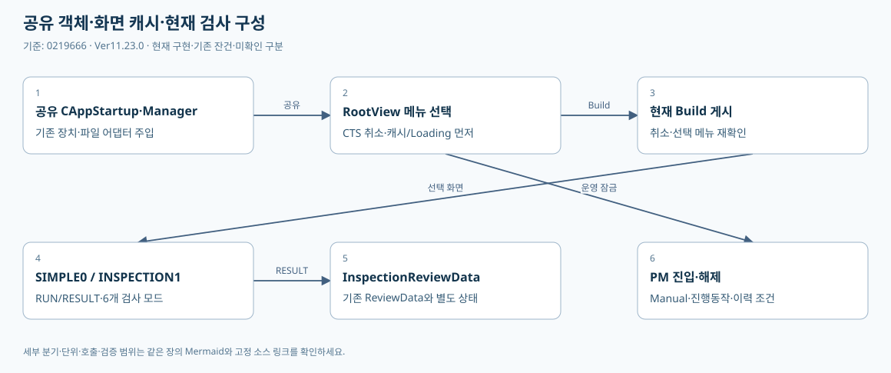

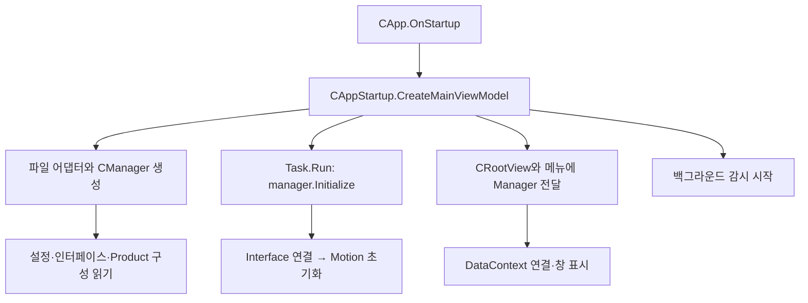

## 1. 시작 시점의 실제 호출 순서

| 단계 | 실제 진입점 | 입력·결과 | 확인할 문제 |
|---|---|---|---|
| 예외 처리 준비 | `CApp.OnStartup → RegisterExceptionHandlers` | Dispatcher/AppDomain/UnobservedTask 예외를 로그에 연결 | 로그 등록과 예외 복구는 다릅니다. 등록했다고 실행이 안전하게 계속된다는 뜻은 아닙니다. |
| 루트 창 읽기 | `LoadComponent(CRootView.xaml)` | WPF Window 인스턴스 | XAML 로드 실패와 ViewModel 생성 실패를 구분합니다. |
| 구성 객체 생성 | `CAppStartup.CreateMainViewModel` | 파일 어댑터, CManager, CRootView | 파일 경로·스키마 오류는 시작 실패 또는 시작 상태 메시지로 드러날 수 있습니다. |
| 화면 연결 | `window.DataContext = _rootView` | 화면이 RootView 속성·명령을 참조 | Manager를 UI에서 다시 만들면 캐시·상태 소유권이 갈라집니다. |
| 표시 | `window.Show()` | 화면 표시 | 표시 완료를 장비 연결 완료로 해석하면 안 됩니다. |

근거: [OnStartup의 창 생성·표시·실패 처리](https://github.com/kjuws10-rgb/A3Drilling/blob/28764c91d521777b8ee068dd7aaf2d3902ce9fe2/Drilling.UI/CApp.xaml.cs#L23-L45), [전역 예외 로그 등록](https://github.com/kjuws10-rgb/A3Drilling/blob/28764c91d521777b8ee068dd7aaf2d3902ce9fe2/Drilling.UI/CApp.xaml.cs#L53-L71), [CreateMainViewModel 전체 조립부](https://github.com/kjuws10-rgb/A3Drilling/blob/28764c91d521777b8ee068dd7aaf2d3902ce9fe2/Drilling.UI/CAppStartup.cs#L14-L69).

`CreateMainViewModel`은 `manager.Initialize()`를 `Task.Run`으로 시작하고 기다리지 않은 채 RootView를 반환합니다. 따라서 **구성 로드 → 창 표시 → 장비 초기화 완료**가 하나의 동기 함수처럼 끝나는 것으로 가정하면 안 됩니다. 이는 소스에서 확인되는 비동기 경계입니다. 실제 장비 준비 완료 판단은 연결 상태와 시작 단계 결과, 인터락을 따로 확인해야 합니다. [비동기 Initialize와 BackgroundMonitoring 시작](https://github.com/kjuws10-rgb/A3Drilling/blob/28764c91d521777b8ee068dd7aaf2d3902ce9fe2/Drilling.UI/CAppStartup.cs#L36-L68).

## 2. CManager 생성자가 만드는 소유 관계

| 객체 | 생성 목적 | 주로 소비하는 곳 | 바꾸면 함께 읽을 곳 |
|---|---|---|---|
| `CSettingManager` | Setting 파일을 읽고 메모리 캐시·검증을 제공 | 메뉴, 좌표 준비, 인터페이스·인터락 | `CSettingFile`, Setting UI, `BuildRuntimeParameters` |
| `CInterfaceManager` | 등록된 장치별 통신·상태·장치 명령의 공통 입구 | Automation, Review, Station, Monitor | `CComm`, 장치별 Comm, JHMI Interface 정의 |
| `CAutomationManager` | Automation1 명령·Script 경로·상태 취득을 묶음 | Station, Manual, Monitor | Automation1 Comm, Script 생성기 |
| `CMotionManager` | 축 정의와 컨트롤러를 연결하고 축 명령을 처리 | Station 및 수동 이동 UI | Motor 정의·컨트롤러별 구현 |
| `CProductManager` | 현재 Glass/Product의 상태·결과·스냅샷 관리 | Station, Review, Monitor | `CProductFile`의 compact 저장 형식 |
| `CReviewManager` | 리뷰 결과/측정 영역의 서비스 객체 | Review·Correction 및 Stage 연동 | 리뷰 전용 상세 장과 파일 레퍼런스 |
| `CRecipeManager` | 레시피 읽기·저장·이력·동시성 관리 | Recipe UI, Station, Review | `CJhmiRecipeFile`, JHMI_RCP 정의 |
| `CStationManager` | Process Station을 UI/상위 요청에 노출 | RootView, 수동/자동 기능 | `CStationProcess` 및 partial 파일 |

이 표는 실제 `CManager` 생성 순서를 요약한 것입니다. 모든 Manager가 임의로 직접 연결되는 것이 아니라 앞서 만들어진 객체가 뒤 객체의 생성자에 전달됩니다. `ProductManager`와 `RecipeManager`는 다른 책임을 갖고 같은 데이터를 저장하는 대체재가 아닙니다. [Manager 생성·주입과 실패 이벤트 연결](https://github.com/kjuws10-rgb/A3Drilling/blob/28764c91d521777b8ee068dd7aaf2d3902ce9fe2/Drilling.Common/Managers/CManager.cs#L93-L142).

## 3. 파일 객체를 인터페이스처럼 주입하는 이유

`CAppStartup`은 `CJhmiRecipeFile`, `CSettingFile`, `CProductFile`, `CReviewResultFile`, `CReviewOffsetFile`, `CAutomation1ScriptFile` 등 구체 파일 객체를 만듭니다. Common 영역의 Manager가 파일 저장 방식을 직접 결정하기보다 주입받은 파일 객체에 작업을 요청하도록 구성되어 있습니다. 예를 들어 레시피 저장 흐름을 이해하려면 **UI의 Save 버튼 → CRecipeManager → CJhmiRecipeFile → CCsvParser**를 따라야 합니다. UI 파일만 읽고 실제 저장 형식을 확정하면 안 됩니다. [파일 어댑터 생성](https://github.com/kjuws10-rgb/A3Drilling/blob/28764c91d521777b8ee068dd7aaf2d3902ce9fe2/Drilling.UI/CAppStartup.cs#L16-L35), [Recipe 파일 추상 계약](https://github.com/kjuws10-rgb/A3Drilling/blob/28764c91d521777b8ee068dd7aaf2d3902ce9fe2/Drilling.Common/Managers/CRecipeManager.cs#L408-L420).

이 분리는 수정 범위 판단에도 유용합니다. 화면 이름만 바꾸는 변경은 UI에 머물 수 있지만, 새 Parameter를 실제 저장하고 Script까지 사용하려면 정의 CSV와 File·Manager·계산기·UI의 연결을 함께 검토해야 합니다. 이 문장은 구조에서 도출한 변경 검토 방법이며, 자동으로 모든 의존성을 찾아주는 기능이 구현되어 있다는 뜻은 아닙니다.

## 4. ConfigRoot와 Script 경로가 정해지는 방식

`GetConfigRoot`는 실행 파일 위치에서 상위 폴더를 거슬러 `Drilling.sln`을 찾으면 그 폴더의 `Config`를 선택합니다. 찾지 못하면 현재 작업 디렉터리의 `Config`를 사용합니다. 실행 EXE 위치와 작업 디렉터리가 다르면 예상과 다른 Config를 읽을 수 있으므로, 경로 문제는 실제 선택된 `ConfigRoot`부터 확인해야 합니다. [ConfigRoot 탐색](https://github.com/kjuws10-rgb/A3Drilling/blob/28764c91d521777b8ee068dd7aaf2d3902ce9fe2/Drilling.UI/CAppStartup.cs#L121-L135).

`GetScriptDirectory`는 Option Setting의 `LocalScriptPath`를 Key 또는 Name으로 찾습니다. 값이 없으면 논리 경로 `Data/Script`를 사용하며, 상대 경로는 Config의 부모 프로젝트 경로를 기준으로 해석합니다. **로컬 Script 폴더와 Controller에 업로드되는 파일명은 별개**입니다. [Script 폴더 결정](https://github.com/kjuws10-rgb/A3Drilling/blob/28764c91d521777b8ee068dd7aaf2d3902ce9fe2/Drilling.UI/CAppStartup.cs#L137-L151), [로컬 경로와 Controller 파일명 전달](https://github.com/kjuws10-rgb/A3Drilling/blob/28764c91d521777b8ee068dd7aaf2d3902ce9fe2/Drilling.Common/Automation/CAutomationManager.cs#L315-L334).

## 5. 초기화·상태 취득·종료를 구분하기

| 동작 | 의미 | 소스 근거 |
|---|---|---|
| 생성자 | 객체·정의·캐시·Product를 준비 | `CManager` 생성부 |
| `Initialize` | Interface 연결 후 Motion Controller 초기화 | [Initialize 순서](https://github.com/kjuws10-rgb/A3Drilling/blob/28764c91d521777b8ee068dd7aaf2d3902ce9fe2/Drilling.Common/Managers/CManager.cs#L212-L226) |
| `StartBackgroundMonitoring` | 0선 대기·보호윈도우·스냅샷·알람 감시를 시작 | [백그라운드 감시](https://github.com/kjuws10-rgb/A3Drilling/blob/28764c91d521777b8ee068dd7aaf2d3902ce9fe2/Drilling.Common/Managers/CManager.cs#L267-L276) |
| `StopBackgroundMonitoring` | Stage 요청·감시·스냅샷 취득을 멈춤 | [감시 중지](https://github.com/kjuws10-rgb/A3Drilling/blob/28764c91d521777b8ee068dd7aaf2d3902ce9fe2/Drilling.Common/Managers/CManager.cs#L278-L286) |
| `Destroy` | 감시 중지 외에 이력 flush·PowerMeasure dispose·Motion/Interface 종료·로그 정리를 수행 | [전체 종료 경로](https://github.com/kjuws10-rgb/A3Drilling/blob/28764c91d521777b8ee068dd7aaf2d3902ce9fe2/Drilling.Common/Managers/CManager.cs#L228-L265) |

앱 종료 시 보이는 경로는 `CApp.OnExit → CRootView.StopAutomationStatusAcquisition → CManager.StopBackgroundMonitoring`입니다. `Destroy`라는 별도 메서드가 존재한다는 이유만으로 이 경로가 `Destroy` 전체를 호출한다고 설명하면 틀립니다. 종료 시 장치 연결 해제까지 원하는 경우 호출 지점을 별도로 추적해야 합니다. [OnExit](https://github.com/kjuws10-rgb/A3Drilling/blob/28764c91d521777b8ee068dd7aaf2d3902ce9fe2/Drilling.UI/CApp.xaml.cs#L47-L51), [RootView 종료 처리](https://github.com/kjuws10-rgb/A3Drilling/blob/28764c91d521777b8ee068dd7aaf2d3902ce9fe2/Drilling.UI/CRootView.cs#L274-L285).

## 6. UI 개발 시 주의할 실제 형태

`CRootView`는 Menu 목록을 만들고 선택한 메뉴를 활성화하며 알람 이벤트를 구독하고 초기 ProcessModel 준비 Task를 시작합니다. Menu 클래스는 같은 Manager 인스턴스를 주입받습니다. [RootView 생성자 입력과 선택 Recipe](https://github.com/kjuws10-rgb/A3Drilling/blob/28764c91d521777b8ee068dd7aaf2d3902ce9fe2/Drilling.UI/CRootView.cs#L140-L177), [메뉴·이벤트·초기 모델 연결](https://github.com/kjuws10-rgb/A3Drilling/blob/28764c91d521777b8ee068dd7aaf2d3902ce9fe2/Drilling.UI/CRootView.cs#L256-L261).

`CBindingBase`는 속성별 `...Changed` 이벤트와 `OnPropertyChanged`의 switch를 사용하는 구조입니다. 통상적인 MVVM 프레임워크의 `INotifyPropertyChanged` 구현이라고 단정해 새 Property만 추가하면 화면이 자동 갱신된다고 가정하면 안 됩니다. `SetProperty`와 `SetSequenceProperty`가 어떤 이벤트를 발생시키는지도 함께 맞춰야 합니다. [Property 변경 알림 구조](https://github.com/kjuws10-rgb/A3Drilling/blob/28764c91d521777b8ee068dd7aaf2d3902ce9fe2/Drilling.UI/Menu/CBindingBase.cs#L766-L889).

## 7. 권장 검증 시나리오

아래는 실행 완료 결과가 아니라 앞으로 수행할 검증 절차입니다.

1. **경로 탐색**: 솔루션 폴더 안/밖에서 실행한 경우 선택된 ConfigRoot와 Script 경로가 설계한 위치인지 시작 로그로 확인합니다.
2. **초기화 지연**: 가짜 Interface 초기화가 지연되도록 한 격리 테스트에서 창이 먼저 열리는지, 준비 전 명령이 UI/인터락에서 차단되는지 확인합니다.
3. **잘못된 정의 파일**: 별도 복사본에서 필수 헤더를 제거하고 실패 단계와 사용자 메시지가 어느 위치에서 생성되는지 확인합니다.
4. **종료 중 지연 통신**: polling과 로그 flush가 진행 중일 때 종료하여 반환 시간·스레드 생존·연결 해제 여부를 기록합니다. 소스상 Stop 경로와 Destroy 경로를 각각 구분합니다.
5. **중복 객체 방지**: 새 메뉴를 추가할 때 기존 CManager를 받아 사용하고 별도 Manager를 몰래 생성하지 않는지 확인합니다.

## 8. Ver11.13.0에서 바뀐 조립과 화면 소유권

11.13.0의 변경은 메뉴 배치와 진단 입력까지 영향을 줍니다. `CMenuReview`를 만드는 곳은 계속 RootView이지만, 완성한 객체를 `Manual.ConfigureReview` 대신 **`Correction.ConfigureReview`에 연결**합니다. 메뉴 진입 시 Review 초기화와 실행 중 화면 이동 차단도 Correction 쪽을 봅니다. `CScreenViewModel.Review`의 `manual?.Review` fallback은 없어졌으므로, 예전 Manual 화면의 DataContext를 그대로 재사용하면 Review가 비어 보일 수 있습니다. [RootView의 메뉴 초기화·이동 차단](https://github.com/kjuws10-rgb/A3Drilling/blob/28764c91d521777b8ee068dd7aaf2d3902ce9fe2/Drilling.UI/CRootView.cs#L655-L668), [Correction에 Review 주입과 Monitor·Alarm 생성](https://github.com/kjuws10-rgb/A3Drilling/blob/28764c91d521777b8ee068dd7aaf2d3902ce9fe2/Drilling.UI/CRootView.cs#L2614-L2648), [ScreenViewModel의 명시적 Review 입력](https://github.com/kjuws10-rgb/A3Drilling/blob/28764c91d521777b8ee068dd7aaf2d3902ce9fe2/Drilling.UI/Menu/Menus/CMenuBase.cs#L434-L446).

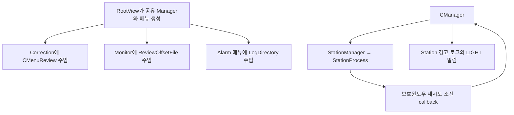

Monitor는 이제 최신 Review Offset 파일을 읽어 좌표 미리보기에 합치며, Alarm 메뉴는 LogDirectory를 받아 이력 한 건의 전후 로그를 분석합니다. 이것은 기존 파일·로그 서비스를 공유하는 연결입니다. 별도 Controller나 통신 드라이버를 만드는 변경으로 해석하지 않습니다. 또한 StationManager 생성자 끝에 재시도 소진 callback이 추가되어 `CManager → CStationManager → CStationProcess → CProtectWindowUsageRequest`로 전달됩니다. callback은 상태를 전달받아 로그와 알람을 요청합니다. [콜백 주입과 처리](https://github.com/kjuws10-rgb/A3Drilling/blob/28764c91d521777b8ee068dd7aaf2d3902ce9fe2/Drilling.Common/Managers/CManager.cs#L126-L151), [StationManager 전달](https://github.com/kjuws10-rgb/A3Drilling/blob/28764c91d521777b8ee068dd7aaf2d3902ce9fe2/Drilling.Common/Station/CStationManager.cs#L32-L67).

**변경 후 확인할 항목**: Correction을 처음 열 때 Review 상태가 초기화되는지, Review 작업 중 메뉴 이동 차단이 취소·정리 경계와 맞는지, Monitor가 같은 Recipe의 Offset 파일을 읽는지, Alarm 이력이 정확한 `OccurredAt`을 넘기는지 확인합니다. 모두 정적 분석에서 정한 후속 검증이며 이번 문서 작성 중 앱을 실행하지 않았습니다.

## 9. Review 화면 통합 이력과 Ver11.19.0의 현재 소유권

이전 11.17 문서는 INSPECTION/SIMPLE/ROUGH/FINE/REVIEW DATA의 5개 탭과 결과 인덱스4를 설명했습니다. 현재는 **SIMPLE=0, INSPECTION=1**의 두 탭입니다. INSPECTION 안에서 RUN/RESULT 작업공간과 ALL SHOT/ONE SHOT/ONE LINE/BEAM INSPECTION/ROUGH/FINE 모드를 고릅니다. 11.17의 인덱스0~4를 현재 호출 규약으로 사용하면 안 됩니다. [현재 두 탭](https://github.com/kjuws10-rgb/A3Drilling/blob/28764c91d521777b8ee068dd7aaf2d3902ce9fe2/Drilling.UI/Views/CCorrectionView.xaml#L259-L264), [현재 인덱스 제한](https://github.com/kjuws10-rgb/A3Drilling/blob/28764c91d521777b8ee068dd7aaf2d3902ce9fe2/Drilling.UI/Menu/Menus/CMenuCorrection.cs#L261-L277), [작업공간·모드·결과 종류](https://github.com/kjuws10-rgb/A3Drilling/blob/28764c91d521777b8ee068dd7aaf2d3902ce9fe2/Drilling.UI/Menu/Menus/CMenuReview.cs#L244-L272), [현재 허용 모드](https://github.com/kjuws10-rgb/A3Drilling/blob/28764c91d521777b8ee068dd7aaf2d3902ce9fe2/Drilling.UI/Menu/Menus/CMenuReview.cs#L841-L915)

Correction은 기존 ReviewData와 별도로 **InspectionReviewData**를 만듭니다. 같은 파일 어댑터와 Manager를 받지만 선택 검사 모드에 맞춘 결과 목록을 갖는 별도 상태 객체입니다. 저장 결과 열기는 INSPECTION1의 RESULT로 이동하며, 외부 보정 작업 중에도 모드/작업공간 변경을 막도록 콜백을 연결합니다. [두 결과 패널의 조립](https://github.com/kjuws10-rgb/A3Drilling/blob/28764c91d521777b8ee068dd7aaf2d3902ce9fe2/Drilling.UI/Menu/Menus/CMenuCorrection.cs#L139-L166), [공유 Review 콜백 연결](https://github.com/kjuws10-rgb/A3Drilling/blob/28764c91d521777b8ee068dd7aaf2d3902ce9fe2/Drilling.UI/Menu/Menus/CMenuCorrection.cs#L403-L416), [결과 열기](https://github.com/kjuws10-rgb/A3Drilling/blob/28764c91d521777b8ee068dd7aaf2d3902ce9fe2/Drilling.UI/Menu/Menus/CMenuCorrection.cs#L509-L518), [공통 실행 중 화면 전환 차단](https://github.com/kjuws10-rgb/A3Drilling/blob/28764c91d521777b8ee068dd7aaf2d3902ce9fe2/Drilling.UI/Menu/Menus/CMenuReview.cs#L1813-L1827)

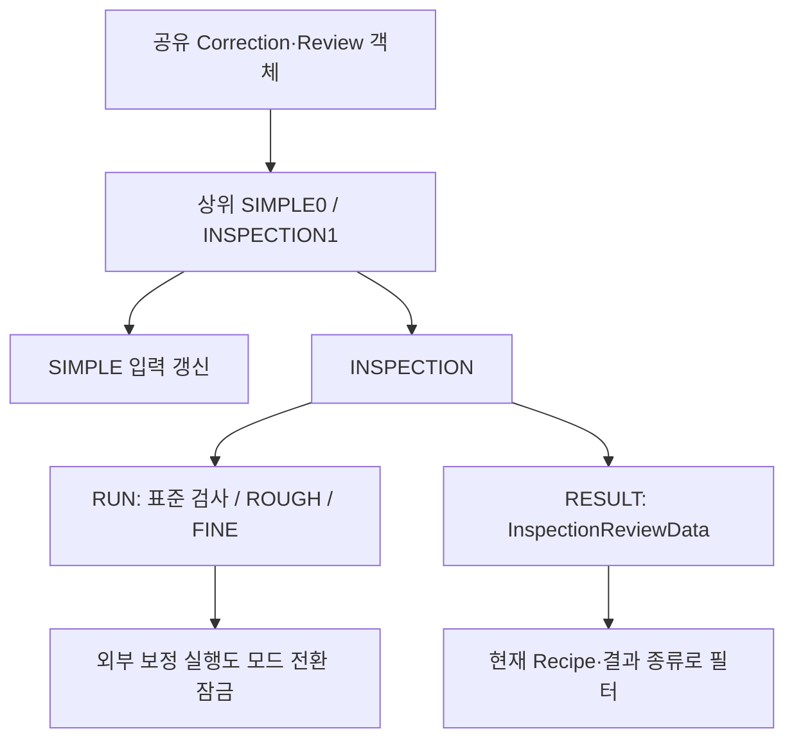

선택한 화면만 갱신하는 방향은 유지됩니다. SIMPLE은 Simple.Update, INSPECTION은 Review.Build를 호출하고 ROUGH/FINE이면 해당 보정 패널도 갱신합니다. 빠른 모드 전환·취소·RESULT 열기 후 다른 결과형 선택·보정 중 전환 차단을 확인해야 합니다. 메뉴/Manager 객체를 새로 만들거나 장치 연결을 새로 수립한 변경은 아닙니다. [선택 화면 Build·예외 범위](https://github.com/kjuws10-rgb/A3Drilling/blob/28764c91d521777b8ee068dd7aaf2d3902ce9fe2/Drilling.UI/Menu/Menus/CMenuCorrection.cs#L553-L589)

## 10. 화면 캐시와 PM 진입은 RootView가 조정합니다

메뉴 선택 시 이전 Build CTS를 취소하고, 해당 메뉴의 캐시 화면 또는 Loading 화면을 먼저 보여 준 뒤 Render 우선순위에 양보하고 새 Build를 수행합니다. Build 전후의 취소와 현재 선택 메뉴를 확인한 후 최신 화면을 게시합니다. 캐시 화면은 최신 파일을 다시 읽기 전의 표시일 수 있고 메뉴 객체의 참조를 포함하므로, 독립적인 불변 실행 스냅샷이라고 부르지 않습니다. 종료 처리도 Build를 취소합니다. [종료 취소](https://github.com/kjuws10-rgb/A3Drilling/blob/28764c91d521777b8ee068dd7aaf2d3902ce9fe2/Drilling.UI/CRootView.cs#L274-L285), [메뉴 전환](https://github.com/kjuws10-rgb/A3Drilling/blob/28764c91d521777b8ee068dd7aaf2d3902ce9fe2/Drilling.UI/CRootView.cs#L340-L382), [Build·게시·CTS 교체](https://github.com/kjuws10-rgb/A3Drilling/blob/28764c91d521777b8ee068dd7aaf2d3902ce9fe2/Drilling.UI/CRootView.cs#L549-L654)

PM 진입은 Manual 모드와 진행 동작 없음 확인→사유 입력→상태 재확인→StartPmSession 성공→메모리 잠금 순서입니다. PM 이력 호출 실패가 있으면 진입을 취소합니다. 잠금 중 다른 메뉴 선택은 비밀번호 해제 절차를 거치며 완료 이력 저장이 성공한 후 잠금을 풉니다. 상세 정지/잠금 경계는 [04장](../manual/architecture/04-product-and-station-lifecycle.md)에 있습니다. [PM 진입·실패](https://github.com/kjuws10-rgb/A3Drilling/blob/28764c91d521777b8ee068dd7aaf2d3902ce9fe2/Drilling.UI/CRootView.cs#L1272-L1330), [PM 해제·실패](https://github.com/kjuws10-rgb/A3Drilling/blob/28764c91d521777b8ee068dd7aaf2d3902ce9fe2/Drilling.UI/CRootView.cs#L1442-L1499)

다음 읽기: [02. Recipe·Setting·저장 형식](../manual/architecture/02-recipe-settings-and-csv.md), [06. 스레드·상태 취득·로그](../manual/architecture/06-threading-snapshots-and-logs.md), [08. 알람 원인 분석](../manual/architecture/08-alarm-cause-analysis.md).


# 별도 정적 추적 상세 해설 · architecture/02-recipe-settings-and-csv.md

# 02. Recipe·Setting·JHMI·CSV를 함께 이해하기

> 기준: `A3Drilling/master` · `28764c91d521777b8ee068dd7aaf2d3902ce9fe2`. 본 장은 해당 Commit의 소스를 정적으로 읽어 설명합니다. 정식 설비 빌드·장비 연결·가공을 실행한 결과가 아닙니다.

**JHMI 정의 파일은 화면 항목의 설계도, Recipe/Setting 값 파일은 그 항목에 들어간 값, ProcessModel은 실행에 사용할 합성 스냅샷**입니다. 같은 Parameter 이름이 보여도 어느 층에 있는지 구분해야 변경이 누락되지 않습니다.

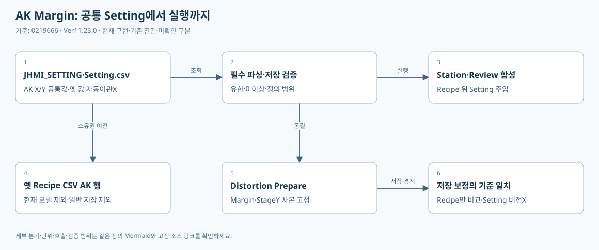

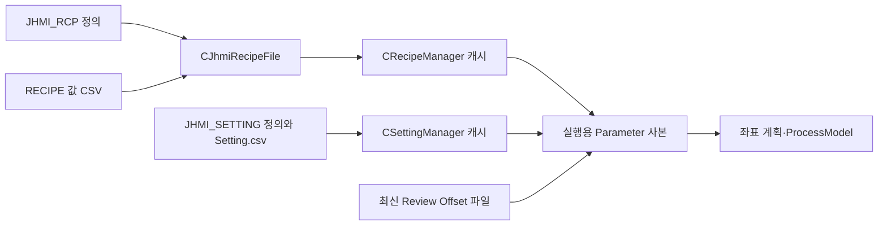

## 1. 세 가지 저장 형식을 혼동하지 않기

| 파일 계층 | 실제 읽기/쓰기 형태 | 대표 필드 | 주의점 |
|---|---|---|---|
| Recipe 항목 정의 | `LoadFormItems → CCsvParser.Read`의 헤더형 CSV | `TAB,GROUP,NAME,DISPLAY NAME,CIM NAME,DATA TYPE,UNIT,SHOW,USE,VALUE,SCALE,CHANGE LIMIT,MIN,MAX,DESCRIPTION,ORDER` | `CIM NAME`이 있다는 사실만으로 고객 Host PPID/Sub PPID 계약이 완성됐다고 말할 수 없습니다. |
| Recipe 값 | `ReadRecipeValues → ParseRecipeLine`이 라인별 첫 3필드를 읽음 | `Tab,Name,Value`, 이후 필드는 Extra | 정의 파일의 헤더 전체를 값 파일의 열 구조로 착각하지 않습니다. 3필드 미만인 행은 파서에서 null로 제외됩니다. |
| Setting 값 | 헤더가 있는 `Setting.csv` | `TAB,NAME,VALUE` | Recipe 값 파서를 그대로 적용하면 안 됩니다. |
| Active Product | 별도의 compact CSV | `TYPE,NAME,VALUE` | PRODUCT/RECIPE/ALIGN/REVIEW 등의 구역 이름이 TYPE에 들어갑니다. [04장](../manual/architecture/04-product-and-station-lifecycle.md)에서 설명합니다. |

근거: [Recipe 정의 헤더와 저장 폴더](https://github.com/kjuws10-rgb/A3Drilling/blob/28764c91d521777b8ee068dd7aaf2d3902ce9fe2/Drilling.File/JHMI/CJhmiRecipeFile.cs#L26-L30), [정의 항목 읽기](https://github.com/kjuws10-rgb/A3Drilling/blob/28764c91d521777b8ee068dd7aaf2d3902ce9fe2/Drilling.File/JHMI/CJhmiRecipeFile.cs#L848-L887), [Recipe 값 파서](https://github.com/kjuws10-rgb/A3Drilling/blob/28764c91d521777b8ee068dd7aaf2d3902ce9fe2/Drilling.File/JHMI/CJhmiRecipeFile.cs#L890-L924), [Setting 헤더와 값 쓰기](https://github.com/kjuws10-rgb/A3Drilling/blob/28764c91d521777b8ee068dd7aaf2d3902ce9fe2/Drilling.File/JHMI/CSettingFile.cs#L328-L385), [Product 헤더](https://github.com/kjuws10-rgb/A3Drilling/blob/28764c91d521777b8ee068dd7aaf2d3902ce9fe2/Drilling.File/Product/CProductFile.cs#L8-L11).

## 2. 실제 CoreData 레코드의 역할

| 타입 | 주요 필드 | 생명주기와 의미 |
|---|---|---|
| `ST_RECIPE_FORM_ITEM` | Tab, Group, Name, DisplayName, CimName, DataType, Unit, Show, Use, DefaultValue, Scale, ChangeLimit, Min, Max, Description, DisplayOrder, Extra | 정의 CSV에서 만들어지는 항목의 메타데이터입니다. 화면 이름과 영속 Key를 분리할 수 있습니다. |
| `ST_RECIPE_PARAMETER` | Name, Value, Unit, Range, DefaultValue, Tab, Group, Key, Description, Show, Use, DisplayOrder, DataType, ChangeLimit, Min, Max, Extra | 현재 Recipe 한 개의 편집/조회 항목입니다. Name과 Key가 같은 의미라고 강제하지 않습니다. |
| `ST_RECIPE_DEFINITION` | Id, Name, Parameters, History | Manager가 로드·저장하는 Recipe 단위입니다. 단순 문자열 딕셔너리와 다릅니다. |
| `ST_RECIPE_VALUE` | Tab, Name, Value, Extra | 값 CSV 한 행을 표현합니다. |
| `ST_RECIPE_HISTORY` | ChangedAt, ItemName, OldValue, NewValue, OperatorId, RecipeName, Action, Tab, Group | 변경 전후와 맥락을 보관합니다. |

근거: [Recipe CoreData 정의](https://github.com/kjuws10-rgb/A3Drilling/blob/28764c91d521777b8ee068dd7aaf2d3902ce9fe2/Drilling.Common/Managers/CRecipeManager.cs#L357-L407). `EN_RECIPE_DATA_TYPE`은 String/Int/Double/Bool입니다. 문자열 Value를 사용하더라도 숫자·논리 타입 검증을 생략해도 된다는 뜻은 아닙니다. [Recipe 타입 enum](https://github.com/kjuws10-rgb/A3Drilling/blob/28764c91d521777b8ee068dd7aaf2d3902ce9fe2/Drilling.Common/Managers/CRecipeManager.cs#L349-L355).

Setting 쪽의 `ST_SYSTEM_PARAMETER`는 Section, Name, Value, Unit, Description, Group, Key, DefaultValue, DataType, Min/Max, Show/Use, DisplayOrder, Extra를 갖습니다. `EN_SETTING_TAB`은 Option/Interface/Io/Motor/Alarm입니다. “Setting 탭 전체가 한 종류의 단순 옵션”이 아니라 인터페이스·축·알람 정의와 연결되는 분류라는 점을 알아두면 경로를 찾기 쉽습니다. [Setting CoreData와 파일 계약](https://github.com/kjuws10-rgb/A3Drilling/blob/28764c91d521777b8ee068dd7aaf2d3902ce9fe2/Drilling.Common/Managers/CSettingManager.cs#L254-L286).

## 3. Recipe 저장을 코드 순서로 따라가기

1. UI가 `ST_RECIPE_DEFINITION`을 만들어 `CRecipeManager.SaveRecipe`에 전달합니다.
2. Manager는 Recipe 작업 gate로 직렬화하고 기존 Recipe/Offset 정보를 유지하는 저장 경로를 사용합니다.
3. `CJhmiRecipeFile.SaveCore`는 정의 항목을 읽고 `Use` 조건과 활성 Cell/Shot 범위에 맞춰 저장할 항목을 고릅니다.
4. `DEFAULT/RECIPE_NAME`, `DEFAULT/RECIPE_ID`를 먼저 기록하고, 일반 항목과 Cell 범위 항목을 별도로 이어 씁니다.
5. 쓰기 후 `ValidateSavedRecipeFile`을 호출하고, 조건에 따라 생성/수정/저장 이력을 남깁니다.

근거: [Manager 저장 진입과 변경 확인](https://github.com/kjuws10-rgb/A3Drilling/blob/28764c91d521777b8ee068dd7aaf2d3902ce9fe2/Drilling.Common/Managers/CRecipeManager.cs#L73-L93), [저장 후 재조회·캐시](https://github.com/kjuws10-rgb/A3Drilling/blob/28764c91d521777b8ee068dd7aaf2d3902ce9fe2/Drilling.Common/Managers/CRecipeManager.cs#L148-L170), [SaveCore 항목 선택](https://github.com/kjuws10-rgb/A3Drilling/blob/28764c91d521777b8ee068dd7aaf2d3902ce9fe2/Drilling.File/JHMI/CJhmiRecipeFile.cs#L120-L165), [Recipe 직렬화·재검증·이력](https://github.com/kjuws10-rgb/A3Drilling/blob/28764c91d521777b8ee068dd7aaf2d3902ce9fe2/Drilling.File/JHMI/CJhmiRecipeFile.cs#L166-L242).

중요한 예외가 `CURRENT_PROCESS_COUNT`입니다. 편집 화면을 연 뒤 실제 가공이 진행될 수 있으므로, 저장 시 기존 파일의 현재 가공매수를 보존합니다. 오래된 편집 초안이 실제 생산 카운터를 되돌리면 안 되기 때문입니다. 보정값 저장의 변경 비교에서도 이 키를 제외합니다. [런타임 소유 카운터 보존](https://github.com/kjuws10-rgb/A3Drilling/blob/28764c91d521777b8ee068dd7aaf2d3902ce9fe2/Drilling.File/JHMI/CJhmiRecipeFile.cs#L188-L206), [동시 수정 비교의 카운터 예외](https://github.com/kjuws10-rgb/A3Drilling/blob/28764c91d521777b8ee068dd7aaf2d3902ce9fe2/Drilling.Common/Managers/CRecipeManager.cs#L74-L93).

`SaveParametersIfUnchanged(expected, changes)`는 측정 당시 Recipe와 현재 파일을 비교한 뒤 수정합니다. 측정 후 다른 작업자가 레시피를 바꾸었다면 예상한 기준과 다르므로 예외를 내는 구조입니다. 저장이 반환된 뒤 재조회와 이력 새로고침은 `CancellationToken.None`을 사용합니다. **저장 전 취소**와 **이미 저장된 뒤 화면 갱신 실패**를 같은 실패로 처리하면 사용자가 같은 보정을 두 번 적용할 위험이 있습니다. [보정 저장의 비교 및 commit 이후 처리](https://github.com/kjuws10-rgb/A3Drilling/blob/28764c91d521777b8ee068dd7aaf2d3902ce9fe2/Drilling.Common/Managers/CRecipeManager.cs#L74-L110).

## 4. Setting의 실제 캐시·검증·저장 순서

`CSettingManager.LoadSection`은 캐시가 있으면 그대로 반환합니다. `ReloadSection`은 파일을 다시 읽어 캐시에 넣습니다. `SetValue`는 Key 또는 Name으로 기존 항목을 찾고 항목이 없으면 예외를 내므로, 정의에도 없는 키를 SetValue만 호출해 추가하는 방식은 성립하지 않습니다. [Setting 조회·기본값](https://github.com/kjuws10-rgb/A3Drilling/blob/28764c91d521777b8ee068dd7aaf2d3902ce9fe2/Drilling.Common/Managers/CSettingManager.cs#L26-L71), [SetValue와 저장](https://github.com/kjuws10-rgb/A3Drilling/blob/28764c91d521777b8ee068dd7aaf2d3902ce9fe2/Drilling.Common/Managers/CSettingManager.cs#L73-L103).

`SaveSection`은 Option의 카메라 해상도·허용치·AK Margin·Level 값을 검증하고, 특정 RunOption 변경은 MELSEC의 캐시된 Review Able 상태로 차단합니다. 파일 저장이 성공한 후에만 캐시를 교체합니다. 캐시값을 먼저 바꾸고 파일 저장 실패를 무시하는 흐름으로 고치면 메모리/디스크가 불일치합니다. [실시간 용량·해상도·RunOption 저장 검증](https://github.com/kjuws10-rgb/A3Drilling/blob/28764c91d521777b8ee068dd7aaf2d3902ce9fe2/Drilling.Common/Managers/CSettingManager.cs#L105-L156).

파일 계층은 정의에 존재하고 Use인 항목을 정규화하고, 다른 탭의 값까지 포함한 Setting 값 전체를 다시 씁니다. 이후 저장 파일을 재로딩하여 기대 Key/Value와 비교합니다. [정규화와 저장](https://github.com/kjuws10-rgb/A3Drilling/blob/28764c91d521777b8ee068dd7aaf2d3902ce9fe2/Drilling.File/JHMI/CSettingFile.cs#L53-L123), [저장 후 재검증](https://github.com/kjuws10-rgb/A3Drilling/blob/28764c91d521777b8ee068dd7aaf2d3902ce9fe2/Drilling.File/JHMI/CSettingFile.cs#L367-L406).

| Setting 개념 | 현재 코드에서 확인되는 조건 | 변경 시 확인 |
|---|---|---|
| Review camera resolution | 유한한 양수 mm/pixel로 파싱 | pixel→mm 변환에 ×1000을 중복 적용하지 않는지 |
| Align camera resolution | Review와 별도로 검증 | Align/Review 해상도 키를 서로 바꾸어 쓰지 않는지 |
| Wapage AlignBase tolerance | 유한한 0 이상 값 | 물리 길이와 pixel 범위 변환의 단위 |
| Vision line capacity | 공급 함수를 통해 현재 캐시값 사용 | 한 번 시작할 때만 읽는 값으로 바꿀 때 런타임 변경 의미 |

코드의 default는 설치된 장비의 최종 교정값이 아닙니다. 실제 설정값과 출하 기준은 별도 승인 자료로 확인해야 합니다. [키와 코드 기본값](https://github.com/kjuws10-rgb/A3Drilling/blob/28764c91d521777b8ee068dd7aaf2d3902ce9fe2/Drilling.Common/Managers/CSettingManager.cs#L16-L22), [값의 검증 범위](https://github.com/kjuws10-rgb/A3Drilling/blob/28764c91d521777b8ee068dd7aaf2d3902ce9fe2/Drilling.Common/Managers/CSettingManager.cs#L105-L156).

## 5. Recipe와 Setting은 실행 시 어떻게 합쳐지는가

`CStationProcess.BuildRuntimeParameters`는 Recipe 입력 딕셔너리의 **사본**을 만든 뒤 Option과 Motor Setting을 순회하여 `parameters[setting.Key] = setting.Value`로 덮어씁니다. 이후 최신 Review Offset 파일을 로드하여 합칩니다. 이름이 충돌하면 이 경로에서는 **Setting이 Recipe를 덮어쓰는 우선순위**가 존재합니다. 모든 프로그램 경로가 같은 우선순위를 쓴다는 보장은 아니므로 Review·수동 동작은 해당 경로도 따로 봐야 합니다. [실행 Parameter 합성](https://github.com/kjuws10-rgb/A3Drilling/blob/28764c91d521777b8ee068dd7aaf2d3902ce9fe2/Drilling.Common/Station/CStationProcess.cs#L1528-L1563).

따라서 항목을 Recipe에서 Setting으로 이전하려면 UI 위치만 옮기면 부족합니다.

| 검토 단계 | 확인 내용 |
|---|---|
| 정의 | JHMI_RCP와 JHMI_SETTING 중 어느 쪽에 정의를 둘 것인가 |
| 이관 | 기존 Recipe 값과 새 Setting 값이 다르면 어떤 값을 한 번 가져올 것인가 |
| 기본값 | 항목 부재·구버전 키에 대한 fallback을 유지할 것인가 |
| 소유권 | 장비 공통 교정값인가, PPID/모델별 공정값인가, Product 실행 시점 값인가 |
| 소비 | Process/Review/Manual/UI 미리보기가 같은 값과 좌표 기준을 쓰는가 |
| 검증 | 재시작·Recipe 변경·제품 교체 시 값이 뜻대로 유지되는가 |

## 6. 고객이 원하는 분류와 현재 구현을 구분하기

**현재 구현 사실**: Recipe는 Geometry·공정 Parameter·Cell별 항목·런타임 카운터를 담을 수 있고, Setting은 별도 공통값을 보관하며 실행 시 합성됩니다. **회의상의 희망 구조**: Recipe 메뉴를 PPID와 관련된 항목 중심으로 정리하고 장비 공통 교정값을 Setting에서 관리하자는 방향입니다. 두 내용은 같지 않습니다. 현재 diff에서는 AK Margin 두 키의 공통 Setting 이전이 구현됐습니다(10절). Recipe 전체 재분류, RecipeSet/실제 Job Change, 조건부 파워 보정, 미확정 I/F와 구버전 값 자동 이관까지 완료된 것으로 확대하지 않습니다.

PPID/Sub PPID·Host 구분자·Auto Job Change 계약은 이 장에서 확정하지 않습니다. 소스의 `CIM NAME`, Product `PPID` 문자열이나 `PAIR_PPID` 필드만으로 고객 자동화 규약의 의미/길이/요청 응답 순서까지 추론할 수 없습니다. 현재 Stage Process 요청 생성부에는 Glass/Lot 매핑 합의 후 교체하라는 TODO도 있습니다. [현재 선택 Recipe와 제품 식별자 fallback](https://github.com/kjuws10-rgb/A3Drilling/blob/28764c91d521777b8ee068dd7aaf2d3902ce9fe2/Drilling.UI/CRootView.cs#L3280-L3293), [Product PPID 입력](https://github.com/kjuws10-rgb/A3Drilling/blob/28764c91d521777b8ee068dd7aaf2d3902ce9fe2/Drilling.Common/Product/CProductManager.cs#L822-L846).

## 7. CSV 공통 구현에서 꼭 확인할 점

`CCsvParser`는 UTF-8 BOM을 인식하고, BOM이 없으면 먼저 엄격 UTF-8로 읽은 뒤 디코딩 실패 시 CP949로 읽습니다. 쓰기는 공통 Escape 로직과 UTF-8 BOM 설정을 사용합니다. 인코딩 호환이 있다는 사실이 모든 잘못된 CSV를 정상 복구한다는 뜻은 아닙니다. [CSV 인코딩 설정](https://github.com/kjuws10-rgb/A3Drilling/blob/28764c91d521777b8ee068dd7aaf2d3902ce9fe2/Drilling.File/Parser/CCsvParser.cs#L8-L10), [헤더·열 확장과 Escape 쓰기](https://github.com/kjuws10-rgb/A3Drilling/blob/28764c91d521777b8ee068dd7aaf2d3902ce9fe2/Drilling.File/Parser/CCsvParser.cs#L58-L93), [UTF-8와 CP949 읽기](https://github.com/kjuws10-rgb/A3Drilling/blob/28764c91d521777b8ee068dd7aaf2d3902ce9fe2/Drilling.File/Parser/CCsvParser.cs#L432-L475).

검증 시에는 한국어 항목명, 쉼표·따옴표가 들어간 값, 알 수 없는 Extra 열, 중복 Key, 필수 헤더 누락, 빈 파일, 쓰기 권한 오류, 저장 직후 취소를 각각 나눠 확인합니다. Recipe와 Setting이 모두 CSV라고 같은 테스트 데이터 형식을 쓰지 않습니다.

## 8. 11.13.0에서 추가된 정의·값·저장 계약

| 변경 | 생산자 → 소비자 | 저장·호환 의미 |
|---|---|---|
| `PROTECT_WINDOW_RETRY_COUNT` 추가 | JHMI_RCP의 INT 정의 → Recipe 항목 → `ParseRetryCount` → 보호윈도우 요청 서비스·MAIN 표시 | 0~3은 **최초 교체 요청 뒤의 추가 횟수**입니다. 누락·공백은 0으로 읽습니다. 일반 생산매수 `CURRENT_PROCESS_COUNT`와 다른 편집 가능한 정책값입니다. |
| `CURRENT_PROCESS_COUNT` 정의 순서 조정 | Recipe 정의 → 숨김 런타임 카운터 | 키와 런타임 소유권은 유지됩니다. 새 Retry 키를 이 카운터처럼 저장 비교에서 제외하는 변경은 없습니다. |
| Setting 값 4개 변경 | Setting.csv → Option 캐시 → RunOption·Review 측정 변환 | `RUNOPTION_ZERO_DEFENCE_USE`, `RUNOPTION_FOLLOWUP_USE`, `Review_Camera_Resolution`, `Wapage_AlignBase_Tolerance` 값 변경입니다. 이 diff는 새 Setting 스키마나 교정 승인 근거가 아닙니다. 운영값 원문은 싣지 않습니다. |
| Default 보정 로그 열 추가 | `ST_DEFAULT_OFFSET_OPTIONS` → `CDefaultOffsetLogFile.Write` | `ALIGN_KEY1_REVIEW_X`, `ALIGN_KEY3_REVIEW_X`를 `BOARD_CENTER_X` 앞에 추가합니다. 열 번호에 의존하는 외부 소비자는 밀린 열을 잘못 읽을 수 있으므로 헤더로 읽어야 합니다. |
| Product Review 메모리 필드 추가 | Review 측정 → `ST_PRODUCT_REVIEW_RESULT` | ReviewResult CSV와 Active Product compact CSV는 별도 계약입니다. 새 필드의 영속 범위는 [04장](../manual/architecture/04-product-and-station-lifecycle.md)에서 구분합니다. |

근거: [Recipe 정의의 최대매수·추가 재시도·현재매수](https://github.com/kjuws10-rgb/A3Drilling/blob/28764c91d521777b8ee068dd7aaf2d3902ce9fe2/Config/JHMI_RCP.csv#L175-L177), [누락·범위 처리](https://github.com/kjuws10-rgb/A3Drilling/blob/28764c91d521777b8ee068dd7aaf2d3902ce9fe2/Drilling.Common/Managers/CRecipeManager.cs#L427-L451), [Default 로그의 헤더·행 생산](https://github.com/kjuws10-rgb/A3Drilling/blob/28764c91d521777b8ee068dd7aaf2d3902ce9fe2/Drilling.File/Correction/CAlignOffsetLogFile.cs#L14-L35). Setting의 변경 범위는 이전 Commit과 현재 Commit의 해당 파일 diff로 확인했으며 실제 값은 공개하지 않습니다.

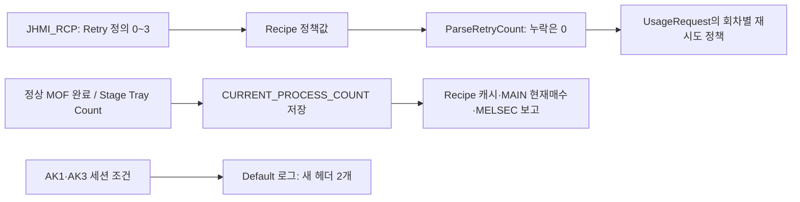

**마이그레이션 검증**: Retry 키 없는 구형 Recipe, 0·1·3, 음수·소수·4·NaN을 나누어 읽기 결과를 확인합니다. 오래 열린 편집 화면을 저장해도 최신 Current Count가 보존되는지 확인합니다. Default 로그는 구형/신형 헤더를 각각 가진 합성 CSV로 열 기반 소비자를 검증합니다. 새 로그 열 두 개는 장비 공통 Setting을 자동 수정하는 기능이 아닙니다.

## 9. Ver11.17.0: 등급·색상·Head별 DOE는 Setting의 서로 다른 계약입니다

| 설정 묶음 | 생산·검증 | 소비·저장 범위 |
|---|---|---|
| `REVIEW_LEVEL1_MAX`~`3_MAX` | 양의 유한 mm, L1 < L2 < L3 | `max(abs(ResultX),abs(ResultY))`를 상한 포함으로 4등급 분류합니다. 측정 JUDGE·허용오차·보정량을 바꾸지 않습니다. |
| `REVIEW_LEVEL1_COLOR`~`4_COLOR` | 6자리 hex 또는 #RRGGBB를 읽어 대문자 #RRGGBB로 정규화 | 색상 picker APPLY는 편집행만 바꾸며 Setting SAVE가 영속화 경계입니다. 정규화 reader 호출이 모든 외부 입력 문자열을 자동 재저장하는 것은 아닙니다. |
| `H01_DOE_EXIST`~`H08_DOE_EXIST` | Bool 정의; Default는 ON/1/TRUE, OFF/0/FALSE를 명시 파싱 | Default 검사에서 Head별 중앙 1점/DOE 격자를 선택합니다. 일반 가공과 다른 Review의 선택 Beam 정책은 별도입니다. |
| Default 로그 | `DOE_EXIST`, `DEFAULT_INSPECTION_POINT_COUNT`를 `DOE_ANGLE` 뒤에 추가 | 실제 결과의 `DoeExists`와 `Marks.Count`를 씁니다. 설정상 기대점수와 로그의 실제 기록점수는 비교 대상입니다. |

근거: [Level 계산과 색상 선택](https://github.com/kjuws10-rgb/A3Drilling/blob/28764c91d521777b8ee068dd7aaf2d3902ce9fe2/Drilling.Common/Review/CReviewResultLevelSettings.cs#L23-L55), [키·기본값과 Read·정규화](https://github.com/kjuws10-rgb/A3Drilling/blob/28764c91d521777b8ee068dd7aaf2d3902ce9fe2/Drilling.Common/Review/CReviewResultLevelSettings.cs#L59-L174), [Head별 DOE 파싱](https://github.com/kjuws10-rgb/A3Drilling/blob/28764c91d521777b8ee068dd7aaf2d3902ce9fe2/Drilling.Common/Correction/CDefaultOffsetCalibration.cs#L29-L62), [로그 헤더와 행](https://github.com/kjuws10-rgb/A3Drilling/blob/28764c91d521777b8ee068dd7aaf2d3902ce9fe2/Drilling.File/Correction/CAlignOffsetLogFile.cs#L14-L35).

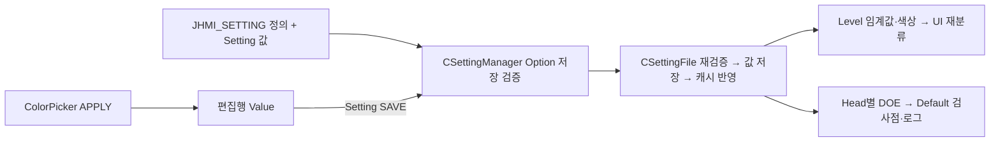

Level 7개 키는 `AppendBuiltInFormItems`에서 구형 정의에도 보충됩니다. **DOE_EXIST 8개 키는 같은 built-in 보충 목록에 없습니다.** 따라서 구형 JHMI_SETTING만 남아 있으면 Setting 값 파일에 키가 있어도 사용 항목으로 로드되지 않을 수 있습니다. Default 화면은 8개 Head의 DoeExists를 읽으므로 비활성 Head 키 누락도 전체 준비를 막는지 확인해야 합니다. 정의 CSV와 값 CSV를 함께 배포하는 검증이 필요합니다. [정의 보충 목록](https://github.com/kjuws10-rgb/A3Drilling/blob/28764c91d521777b8ee068dd7aaf2d3902ce9fe2/Drilling.File/JHMI/CSettingFile.cs#L196-L220), [실제 built-in Scanner 항목](https://github.com/kjuws10-rgb/A3Drilling/blob/28764c91d521777b8ee068dd7aaf2d3902ce9fe2/Drilling.File/JHMI/CSettingFile.cs#L290-L326), [모든 Head 설정 읽기](https://github.com/kjuws10-rgb/A3Drilling/blob/28764c91d521777b8ee068dd7aaf2d3902ce9fe2/Drilling.UI/Menu/Menus/CMenuCorrection.cs#L4572-L4590).

Level은 Manager 저장과 File 저장 양쪽에서 순서·색상 형식을 검사합니다. 다만 helper 자체의 상한 검사는 양수·유한·순서뿐이고, 정의 기반 File 검증은 MIN/MAX도 적용합니다. 직접 helper 호출과 정상 저장 전체 경로의 허용 범위를 혼동하지 않습니다. [Manager의 Level 검증](https://github.com/kjuws10-rgb/A3Drilling/blob/28764c91d521777b8ee068dd7aaf2d3902ce9fe2/Drilling.Common/Managers/CSettingManager.cs#L133-L150), [File의 타입·Level 재검증](https://github.com/kjuws10-rgb/A3Drilling/blob/28764c91d521777b8ee068dd7aaf2d3902ce9fe2/Drilling.File/JHMI/CSettingFile.cs#L408-L451).

후속 검증: 임계값 바로 아래/같음/바로 위, 음수오차·NaN/Infinity, 같은 상한·역순·0, 색상 소문자·#없는6자리·잘못된길이, picker CANCEL/APPLY와 SAVE/재시작, 구형 정의+새 값 조합, DOE OFF/ON 혼합을 합성 자료로 나눕니다. 운영 Setting 값과 측정 CSV 행은 복제하지 않았습니다.

다음 읽기: [03. 좌표와 Script](../manual/architecture/03-coordinate-script-and-mof.md), [04. Product와 Station](../manual/architecture/04-product-and-station-lifecycle.md).

## 10. Ver11.19.0: AK Margin의 원본은 공통 Setting입니다

**AK Margin X/Y는 Glass 가장자리에서 Align Key 중심까지의 공통 설계 거리(mm)**입니다. JHMI_RCP에서 두 정의가 제거되고 JHMI_SETTING의 OPTION/ALIGN으로 이동했습니다. Recipe 화면은 편집기 대신 공통값 텍스트를 표시합니다. 이름이 같은 키를 계속 사용하지만 소유자와 저장 파일이 바뀐 변경입니다. [현재 Recipe 정의 경계](https://github.com/kjuws10-rgb/A3Drilling/blob/28764c91d521777b8ee068dd7aaf2d3902ce9fe2/Config/JHMI_RCP.csv#L26-L36), [Setting built-in 정의](https://github.com/kjuws10-rgb/A3Drilling/blob/28764c91d521777b8ee068dd7aaf2d3902ce9fe2/Drilling.File/JHMI/CSettingFile.cs#L272-L287), [Recipe 읽기 전용 표시](https://github.com/kjuws10-rgb/A3Drilling/blob/28764c91d521777b8ee068dd7aaf2d3902ce9fe2/Drilling.UI/Menu/Menus/CMenuRecipe.cs#L331-L335), [표시값 생산자](https://github.com/kjuws10-rgb/A3Drilling/blob/28764c91d521777b8ee068dd7aaf2d3902ce9fe2/Drilling.UI/Menu/Menus/CMenuRecipe.cs#L567-L575), [텍스트 소비자](https://github.com/kjuws10-rgb/A3Drilling/blob/28764c91d521777b8ee068dd7aaf2d3902ce9fe2/Drilling.UI/Views/CRecipeView.xaml#L763-L790)

| 층 | 생산·변환 | 소비·저장 영향 |
|---|---|---|
| 공통 정의·값 | CSettingFile이 AK 두 built-in 항목을 보충하고 Setting.csv 값을 우선, 값 부재 시 코드 기본값 사용 | 기본값은 설치 교정값이나 옛 Recipe 이관값이라는 뜻이 아님 |
| 입력 검증 | CAlignKeyMarginSettings.Read는 대소문자 무시 Key/Name, invariant 숫자, 유한·0 이상 필수 | 누락/음수/NaN/Infinity는 예외. 정상 파일 저장은 정의의 0~3000 범위도 검사 |
| Recipe 파일 | 현재 정의에서 로드한 항목과 CELL 확장만 Parameter로 구성 | 옛 PROCESS/AK_MARGIN 행이 파일에 남아도 일반 로드 모델에 없고 다음 일반 저장 목록에서 빠짐 |
| 실행 | Station이 Recipe 사본 위에 Option/Motor를 덮어쓰고 보정을 합침 | 모든 Recipe의 새 준비 모델에서 같은 공통 Margin 사용 |
| 보정·화면 | Review, Distortion, Fine, ZeroDefence, Recipe/Correction 미리보기가 공통 Margin을 명시적으로 받음 | 호출자에서 Setting을 빠뜨리면 계산/미리보기 오류로 드러나는 경로가 늘어남 |

근거: [정의와 값의 로드](https://github.com/kjuws10-rgb/A3Drilling/blob/28764c91d521777b8ee068dd7aaf2d3902ce9fe2/Drilling.File/JHMI/CSettingFile.cs#L20-L50), [built-in 보충](https://github.com/kjuws10-rgb/A3Drilling/blob/28764c91d521777b8ee068dd7aaf2d3902ce9fe2/Drilling.File/JHMI/CSettingFile.cs#L196-L219), [공통 파싱 계약](https://github.com/kjuws10-rgb/A3Drilling/blob/28764c91d521777b8ee068dd7aaf2d3902ce9fe2/Drilling.Common/Managers/CAlignKeyMarginSettings.cs#L6-L51), [조회·저장 검증·캐시](https://github.com/kjuws10-rgb/A3Drilling/blob/28764c91d521777b8ee068dd7aaf2d3902ce9fe2/Drilling.Common/Managers/CSettingManager.cs#L116-L155), [정의 기반 숫자·범위 검증](https://github.com/kjuws10-rgb/A3Drilling/blob/28764c91d521777b8ee068dd7aaf2d3902ce9fe2/Drilling.File/JHMI/CSettingFile.cs#L469-L486), [정의 기반 Recipe 로드](https://github.com/kjuws10-rgb/A3Drilling/blob/28764c91d521777b8ee068dd7aaf2d3902ce9fe2/Drilling.File/JHMI/CJhmiRecipeFile.cs#L481-L529), [정의 기반 Recipe 저장](https://github.com/kjuws10-rgb/A3Drilling/blob/28764c91d521777b8ee068dd7aaf2d3902ce9fe2/Drilling.File/JHMI/CJhmiRecipeFile.cs#L148-L206), [실행 합성](https://github.com/kjuws10-rgb/A3Drilling/blob/28764c91d521777b8ee068dd7aaf2d3902ce9fe2/Drilling.Common/Station/CStationProcess.cs#L1528-L1563)

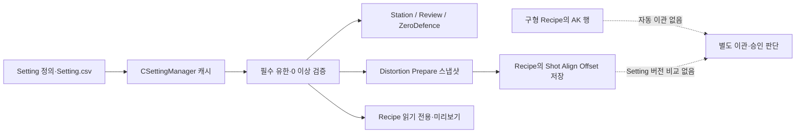

**높은 검증 우선순위**는 기존 Recipe별 Margin이 서로 달랐던 설치입니다. 소스에서 옛 Recipe를 순회해 하나의 승인 공통값으로 이관하는 코드는 확인하지 못했습니다. 공통값 변경은 Recipe 파일이 바뀌지 않아도 설계점·Head 배정·Review 목표·저장 보정의 기준 적합성에 영향을 줍니다. Distortion은 측정 전에 Margin을 고정하지만 저장 비교는 Recipe.Parameters에 한정됩니다. 준비 후 Setting 변경, 저장된 Align/Review Offset 재사용, 과거 결과 재적용을 같은 Recipe ID만으로 승인하면 되는지 검증해야 합니다. [측정 조건 동결](https://github.com/kjuws10-rgb/A3Drilling/blob/28764c91d521777b8ee068dd7aaf2d3902ce9fe2/Drilling.Common/Correction/CAlignInterpolation.cs#L276-L308), [저장 비교 범위](https://github.com/kjuws10-rgb/A3Drilling/blob/28764c91d521777b8ee068dd7aaf2d3902ce9fe2/Drilling.Common/Managers/CRecipeManager.cs#L94-L109), [계산용 Setting 재주입](https://github.com/kjuws10-rgb/A3Drilling/blob/28764c91d521777b8ee068dd7aaf2d3902ce9fe2/Drilling.Common/Recipe/CShotCoordinatePlanBuilder.cs#L716-L728)

CIM 영향도 정의 수준과 Host 실행 계약을 나눕니다. 삭제된 Recipe 정의에는 CIM NAME이 있었으므로 정의 기반 항목 열거의 출력 범위가 바뀝니다. 현재 Setting 스키마에는 같은 CIM NAME 열이 없으며, 그 값이 Host로 자동 대체 전송된다고 확정할 수 없습니다. 고객 PPID/RecipeSet/Job Change 재분류의 완성 증거로 쓰지 않습니다. [Recipe 정의 헤더](https://github.com/kjuws10-rgb/A3Drilling/blob/28764c91d521777b8ee068dd7aaf2d3902ce9fe2/Drilling.File/JHMI/CJhmiRecipeFile.cs#L26-L30), [CIM 이름 로드](https://github.com/kjuws10-rgb/A3Drilling/blob/28764c91d521777b8ee068dd7aaf2d3902ce9fe2/Drilling.File/JHMI/CJhmiRecipeFile.cs#L850-L872), [Setting 정의 헤더](https://github.com/kjuws10-rgb/A3Drilling/blob/28764c91d521777b8ee068dd7aaf2d3902ce9fe2/Drilling.File/JHMI/CSettingFile.cs#L14-L19)

## 11. Distortion 설계 Y와 촬영 Stage Y를 구분합니다

DISTORTION_PAIR0/1/2_Y는 Recipe 화면에서 다시 표시·편집되는 **AK1 기준 설계 Y 거리**입니다. 실제 촬영 Stage Y가 아니며 현재 보간·이동 계산에는 쓰지 않는다는 정의가 명시됐습니다. 실제 Key Y는 Motor DK0/1/2 StageY와 공통 Margin으로 계산합니다. 이 세 값을 편집해 촬영 위치가 옮겨졌다고 판단하면 안 됩니다. [설계 Y 정의](https://github.com/kjuws10-rgb/A3Drilling/blob/28764c91d521777b8ee068dd7aaf2d3902ce9fe2/Config/JHMI_RCP.csv#L32-L36), [설계 Y 편집기 연결](https://github.com/kjuws10-rgb/A3Drilling/blob/28764c91d521777b8ee068dd7aaf2d3902ce9fe2/Drilling.UI/Menu/Menus/CMenuRecipe.cs#L1976-L1984), [실제 StageY·Key 기하](https://github.com/kjuws10-rgb/A3Drilling/blob/28764c91d521777b8ee068dd7aaf2d3902ce9fe2/Drilling.Common/Correction/CAlignInterpolation.cs#L181-L214)

후속 검증은 구형 정의/새 정의×Setting 값 유무, 서로 다른 옛 Recipe 값, 누락·음수·비유한·3000 경계, 저장/재시작, 준비/측정/저장 사이 공통값 변경, Recipe 변경과 보정파일 재사용으로 나눕니다. 운영 CSV 실기록은 테스트 예제로 복제하지 않습니다.


# 별도 정적 추적 상세 해설 · architecture/03-coordinate-script-and-mof.md

# 03. Recipe 좌표가 Head Script와 MOF 실행 입력이 되기까지

> 기준: `A3Drilling/master` · `28764c91d521777b8ee068dd7aaf2d3902ce9fe2`. 본 장은 해당 Commit의 소스를 정적으로 읽어 설명합니다. 정식 설비 빌드·장비 연결·가공을 실행한 결과가 아닙니다.

좌표 문제는 **설계점 → Head 배정 → 좌표축 변환 → Offset 합성 → Encoder 대기 위치 → Script → Controller 실행**을 나누면 추적하기 쉽습니다. 표에 표시되는 최종 숫자만 비교하면 어느 층에서 부호나 단위가 달라졌는지 찾기 어렵습니다.

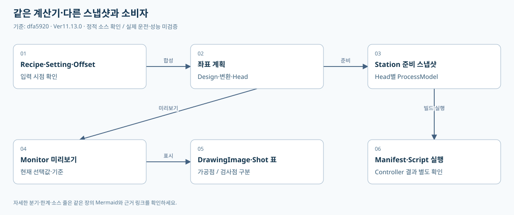


## 1. 계산 진입점과 입력의 성격

`CShotCoordinatePlanBuilder.Build(parameters)`의 입력은 문자열 Key/Value 딕셔너리입니다. 이미 Recipe와 Setting/Offset이 합쳐졌을 수 있으므로 원래 Recipe 파일의 Value와 입력 값이 동일하다고 가정하면 안 됩니다. 실제 합성 지점은 [02장](../manual/architecture/02-recipe-settings-and-csv.md)에 설명했습니다.

| 입력 Key/개념 | 코드상 사용 | 주의점 |
|---|---|---|
| `HEAD_COUNT` | 1~8로 clamp | 요청 수와 실제 활성 Head 수는 다를 수 있습니다. |
| `MAX_CELL_NUMBER` | 최소 Cell 수 검증 | 유효하지 않으면 계산을 중단합니다. |
| `GLASS_SIZE_X/Y` | 계획 데이터에 기록 | 이것만으로 모든 설계점 범위 검증이 완료된다고 단정하지 않습니다. |
| `SCAN_ENCODER_SCALE` | 공통 Encoder scale 기본 입력 | Head별 scale로 달라질 수 있습니다. 절댓값·방향 처리가 분리되어 있습니다. |
| `STAGE_SCAN_DIRECTION_Y` | 진행 방향과 대기 위치·정렬 순서에 사용 | Scanner축의 +Y와 같은 뜻이 아닙니다. |
| `SHIFT_OFFSET_X/Y` | X는 Scanner 변환, Y는 대기 거리에도 반영 | 단순히 최종 Gx/Gy에 두 숫자를 더하는 구조가 아닙니다. |
| `ALIGN_OFFSET_SCALE`, `REVIEW_OFFSET_SCALE` | 현재 실행 기여분의 % | 저장된 Offset 자체를 누적 배율로 바꾸지 않습니다. |

근거: [계획 입력](https://github.com/kjuws10-rgb/A3Drilling/blob/28764c91d521777b8ee068dd7aaf2d3902ce9fe2/Drilling.Common/Recipe/CShotCoordinatePlanBuilder.cs#L11-L36), [Offset scale의 정수 % 파싱](https://github.com/kjuws10-rgb/A3Drilling/blob/28764c91d521777b8ee068dd7aaf2d3902ce9fe2/Drilling.Common/Recipe/CShotCoordinatePlanBuilder.cs#L204-L210).

### 같은 Shift 계산기라도 진입 경로의 입력이 다릅니다

위 표는 `Build`가 **전달받은** Shift를 어떻게 계산하는지 설명한 것입니다. 현재 AUTO(Stage PC 요청) 경로는 `StartStageRequests`의 준비 callback에서 입력 사본을 만든 다음 `SHIFT_OFFSET_X`, `SHIFT_OFFSET_Y`를 각각 `0.000000`으로 덮어쓰고 `PrepareProcess`에 전달합니다. 따라서 이 Commit에서 “좌표 계산기에 Shift 수식이 있다”는 사실만으로 **AUTO 가공에서도 입력된 Shift가 유지된다**고 설명하면 안 됩니다. [AUTO 준비의 Shift 0 정규화](https://github.com/kjuws10-rgb/A3Drilling/blob/28764c91d521777b8ee068dd7aaf2d3902ce9fe2/Drilling.Common/Station/CStationProcess.cs#L4039-L4051).

반면 MAIN START는 MANUAL 모드에서 실행하는 Semi Auto 경로이며 `PrepareInitialProcess(applyShiftOffset: true)` 후 `Station.Start`를 호출합니다. 두 진입점의 구분과 확인할 함수는 [04장](../manual/architecture/04-product-and-station-lifecycle.md)에 정리했습니다. AUTO에서 Shift 유지·확인 팝업·양산 초기화 옵션을 제공하려면 이 준비 경로의 정책을 별도로 변경·검증해야 합니다. 본 문서는 그러한 정책이 구현 완료되었다고 판정하지 않습니다. [MAIN START의 Shift 준비와 Station 시작](https://github.com/kjuws10-rgb/A3Drilling/blob/28764c91d521777b8ee068dd7aaf2d3902ce9fe2/Drilling.UI/CRootView.cs#L1992-L2018).

## 2. 설계점과 가공점은 같은 목록이 아니다

`BuildDesignShots`는 주석상 비활성 Head 및 Masking/Chess 제외점까지 포함하는 설계 Geometry를 만드는 진입점입니다. 반면 `Build`는 활성 Head 집합을 만들고 Head 배정 결과가 비활성이면 그 점을 계산 결과에서 제외합니다. 따라서 설계점 개수, 가공점 개수, 리뷰 측정점 개수는 목적이 달라 일치하지 않을 수 있습니다. [활성 Head와 배정](https://github.com/kjuws10-rgb/A3Drilling/blob/28764c91d521777b8ee068dd7aaf2d3902ce9fe2/Drilling.Common/Recipe/CShotCoordinatePlanBuilder.cs#L23-L57), [설계 Geometry와 가공 변환의 구분](https://github.com/kjuws10-rgb/A3Drilling/blob/28764c91d521777b8ee068dd7aaf2d3902ce9fe2/Drilling.Common/Recipe/CShotCoordinatePlanBuilder.cs#L213-L215).

`BuildProcessModel`은 좌표 계획을 받은 뒤 Chess 제외점을 거르고 Head별로 묶습니다. 활성 Head가 전혀 없으면 예외를 냅니다. Masking이 있다는 이유만으로 이 한 줄에서 모든 Hole/Beam/Review 이동까지 제외됐다고 결론내려서는 안 됩니다. 가공용 Masking과 Flying Review 이동 경로의 검증은 서로 다른 소비자를 확인해야 합니다. [ProcessModel의 Chess 필터와 Head 그룹](https://github.com/kjuws10-rgb/A3Drilling/blob/28764c91d521777b8ee068dd7aaf2d3902ce9fe2/Drilling.Common/Station/CStationProcess.cs#L1608-L1644).

## 3. 한 Shot 계산을 중간값별로 읽기

| 단계 | 소스 변수 | 계산의 의미 |
|---|---|---|
| 설계 X 기준 | `scannerReferenceX = DesignX + scannerReferenceOffsetX` | 설계 X에 Scanner 참조 이동량을 반영한 후 Head를 배정합니다. |
| Head 기준 | `ReadHeadCenterX/Y`, `CScannerAxisTransform.Read` | Head마다 중심과 축 교환/방향 조건을 읽습니다. |
| Stage Y 기준 | `designDistanceYFromAlignKey = DesignY - akMarginY` | Align Key 기준의 설계 거리에서 Stage Y로 변환합니다. |
| 첫 Shot | `firstShotStageY` | 진행 방향에 따라 시작 쪽 Shot을 고릅니다. 단순 인덱스 0 고정이 아닙니다. |
| Scan 시작 | `scanStartStageY = firstShotStageY - direction × delayLength` | 시작 여유 거리를 고려합니다. |
| Encoder 대기 거리 | `baseStageWaitDistanceY`, `stageWaitDistanceY` | 기준 거리에서 ShiftY를 뺀 후 대기 위치 계산에 사용합니다. |
| Scanner 기본 위치 | `baseScannerX/Y` | Stage follow 보상 때문에 Y에는 Stage 기준 반대 방향이 사용됩니다. |

근거: [Head 중심과 Stage 기준](https://github.com/kjuws10-rgb/A3Drilling/blob/28764c91d521777b8ee068dd7aaf2d3902ce9fe2/Drilling.Common/Recipe/CShotCoordinatePlanBuilder.cs#L52-L89), [첫 점·시작 거리·기본 Scanner좌표](https://github.com/kjuws10-rgb/A3Drilling/blob/28764c91d521777b8ee068dd7aaf2d3902ce9fe2/Drilling.Common/Recipe/CShotCoordinatePlanBuilder.cs#L92-L140).

## 4. Offset 종류는 저장 기준과 실행 기준을 구분해야 한다

`Build`에서 확인되는 합성식은 다음과 같습니다. 기호는 설명을 위한 것이며 원본 함수명은 아래 소스 링크에서 확인합니다.

```text
defaultScanner = transform(DefaultX, ConvertRecipeYToStageY(DefaultY))
firstScanner   = transform(FirstBeamX, ConvertRecipeYToStageY(FirstBeamY))
alignScanner   = DesignOffsetToScanner(AlignX, AlignY) × AlignScale
reviewScanner  = ToScanner(ReviewX, ReviewY, ReviewOffsetIsDesign) × ReviewScale

finalOffset = RecipeOffset + defaultScanner + firstScanner + reviewScanner + alignScanner
ScannerGx/Gy = scannerBase + finalOffset + X방향 Shift의 변환분
encoderWaitPosition = stageWaitDistanceY × abs(headEncoderScale) × stageDirectionY
```

근거: [Offset 기준변환·합산·Encoder대기식](https://github.com/kjuws10-rgb/A3Drilling/blob/28764c91d521777b8ee068dd7aaf2d3902ce9fe2/Drilling.Common/Recipe/CShotCoordinatePlanBuilder.cs#L141-L157). 이 식은 이 Commit의 해당 계산 경로를 설명합니다. 정지 가공·Default Offset 평가·Vision 이미지좌표 등 다른 목적의 숫자에 그대로 같은 부호를 적용하라는 뜻이 아닙니다.

`ST_HEAD_SHOT_POINT`에는 최종 Gx/Gy뿐 아니라 설계좌표, Stage 기준점, Recipe/Default/FirstBeam/Review/Shift Offset, 최종 Offset, EncoderWaitPosition을 함께 넣습니다. Align 설계 Offset과 Scanner 변환분도 초기화 속성에 들어갑니다. **중간값이 남는 이유는 최종 결과가 어떤 항목의 합인지 설명하기 위해서**라고 해석할 수 있습니다. 이는 데이터 구조에 근거한 설명이며 실제 화면이 모든 항목을 표시한다는 뜻은 아닙니다. [Shot 결과 레코드 생성](https://github.com/kjuws10-rgb/A3Drilling/blob/28764c91d521777b8ee068dd7aaf2d3902ce9fe2/Drilling.Common/Recipe/CShotCoordinatePlanBuilder.cs#L158-L201).

## 5. ProcessModel은 실행 조건의 스냅샷이다

`BuildProcessModel`은 입력을 새 딕셔너리로 복사하고, 좌표 계획으로 Head별 Shot을 묶은 뒤 레이저 Power/Frequency/ShotCount, Mark/Jump speed, X/Y/Z RampRate, Z speed, AccLimit, DOE Z target을 `ST_HEAD_PROCESS_PLAN`에 담습니다. Head마다 AutomationNo/TaskNo와 `PROCESS_Hxx.ascript` 파일명을 지정합니다. [Head 계획과 ProcessModel 생성](https://github.com/kjuws10-rgb/A3Drilling/blob/28764c91d521777b8ee068dd7aaf2d3902ce9fe2/Drilling.Common/Station/CStationProcess.cs#L1608-L1678).

| 식별자 | 구분해야 할 이유 |
|---|---|
| `HeadNo` | 물리/논리 Head 번호와 계획을 식별합니다. |
| `AutomationNo` | 어느 Automation1 연결 대상으로 보낼지 지정합니다. |
| `TaskNo` | Controller 안에서 어느 Task로 실행할지 지정합니다. |
| `ScriptFileName` | Controller에서 실행할 파일 이름입니다. |
| `FilePath` | PC에 생성된 이번 회차 파일의 실제 경로입니다. |

HeadNo=AutomationNo=TaskNo라고 가정해 코드를 단순화하면 다중 Head/Controller 배정이 깨질 수 있습니다.

실제 선언에서 `ST_PROCESS_MODEL`은 ProcessId/RecipeId/GlassId/LotId/HeadPlans/Parameters/CreatedAt을 갖고, `ST_HEAD_PROCESS_PLAN`은 공정 조건과 Shots를 갖습니다. 기본 TaskNo는 HeadNo이지만 실행 모델을 만들 때 다시 지정할 수 있습니다. `ST_SCRIPT_BUILD_RESULT`의 MofReadyRunId는 파일명과 별도로 이번 회차 준비 상태를 식별합니다. [Process·Head·Script CoreData 선언](https://github.com/kjuws10-rgb/A3Drilling/blob/28764c91d521777b8ee068dd7aaf2d3902ce9fe2/Drilling.Common/Station/CStationManager.cs#L301-L339).

## 6. Script 파일 생성과 추적 산출물

`CAutomation1ScriptFile.Build`는 Standard 또는 지정 모드 하위에 이번 회차의 격리 디렉터리를 만듭니다. 활성 Head 중 실제 Shot이 있는 Head만 남기고 검증한 다음, 좌표 CSV와 Head별 AeroScript를 생성하고 마지막에 `PROCESS.txt` 목록을 생성합니다. 반환하는 `ST_SCRIPT_BUILD_RESULT`에는 Head별 FilePath/Task/Head/점수와 `MofReadyRunId`가 있습니다. [산출물 이름](https://github.com/kjuws10-rgb/A3Drilling/blob/28764c91d521777b8ee068dd7aaf2d3902ce9fe2/Drilling.File/Script/CAutomation1ScriptFile.cs#L9-L19), [회차별 생성과 Manifest 반환](https://github.com/kjuws10-rgb/A3Drilling/blob/28764c91d521777b8ee068dd7aaf2d3902ce9fe2/Drilling.File/Script/CAutomation1ScriptFile.cs#L51-L108).

| 파일 | 목적 | 포함 데이터 |
|---|---|---|
| `PROCESS_Hxx.ascript` | 각 Head의 Controller 실행용 명령 | 축/속도/가속도/추종/대기/가공 명령 |
| `PROCESS_COORDINATES.csv` | 실행 회차 좌표·Offset 추적 | RecipeId, GlassId, 생성시간, Simulator 여부, Head/Automation/Task, Shot/Cell/Row/Col, Design/Scanner/Offset/가공여부 |
| `PROCESS.txt` | 좌표·Head Script 목록을 묶는 산출물 | 이번 빌드와 Head별 파일 연결 정보 |

CSV 필드 근거: [좌표 CSV 헤더](https://github.com/kjuws10-rgb/A3Drilling/blob/28764c91d521777b8ee068dd7aaf2d3902ce9fe2/Drilling.File/Script/CAutomation1ScriptFile.cs#L175-L244). 현장 실측 행은 본 문서에 복제하지 않습니다.

## 7. MOF 준비와 실행은 생성 성공 다음의 별도 단계다

MOF Script에는 `CMofReadiness`의 Task별 GlobalInteger 인덱스와 RunId 표시가 기록됩니다. 소스는 Scanner 중심화·보조 피드백 초기화·레이저 설정과 MotionDone 대기 후 준비 표시를 발행하도록 구성되어 있으며, StartFollow 쪽은 이미 Stage Encoder 움직임을 기다릴 수 있다는 주석이 있습니다. 준비 신호를 단순히 Run 명령 반환과 같다고 취급하면 안 됩니다. [MOF 준비 식별자·준비 위치와 follow 시작](https://github.com/kjuws10-rgb/A3Drilling/blob/28764c91d521777b8ee068dd7aaf2d3902ce9fe2/Drilling.File/Script/CAutomation1ScriptFile.cs#L433-L514).

Station에서는 Script 빌드 후 반환된 Head별 **Manifest FilePath**로 업로드하고 응답을 검사합니다. 표준 실행에서는 Head Task Run을 보낸 뒤 `WaitAutomationHeadScriptsComplete`를 호출합니다. Buffered Run은 다른 실행 분기를 사용합니다. 따라서 `Run command accepted` 로그는 모든 가공점이 정상 완료되었다는 결과가 아닙니다. [빌드·업로드](https://github.com/kjuws10-rgb/A3Drilling/blob/28764c91d521777b8ee068dd7aaf2d3902ce9fe2/Drilling.Common/Station/CStationProcess.cs#L658-L690), [표준/Buffered 실행 분기·실패 정리](https://github.com/kjuws10-rgb/A3Drilling/blob/28764c91d521777b8ee068dd7aaf2d3902ce9fe2/Drilling.Common/Station/CStationProcess.cs#L693-L750).

`AUTOMATION1_SIMULATOR_USE` 조건에서는 Script Y 위치를 `FinalScannerOffsetY + ShiftScannerOffsetY`로 읽는 별도 처리가 있습니다. Simulator 결과를 실제 MOF의 Stage follow GY와 숫자만 같은지 비교하면 틀릴 수 있습니다. [실장비와 Simulator Script 좌표 선택](https://github.com/kjuws10-rgb/A3Drilling/blob/28764c91d521777b8ee068dd7aaf2d3902ce9fe2/Drilling.File/Script/CAutomation1ScriptFile.cs#L703-L715).

## 8. 변경별 검증 계획

| 변경 | 격리된 계산 검증 | 연동/장비에서 나중에 확인할 것 |
|---|---|---|
| Offset 방향 | Offset를 하나만 +값으로 바꾸고 Design/Stage/Scanner/Encoder 중간값을 비교 | 실제 이동·가공 흔적의 방향, Vision 부호 |
| Axis swap/flip | Head별 transform 조합과 역변환 오차 | 모션 표시 방향·SDK 축 이름의 일치 |
| Shift | X만/Y만/혼합 입력에서 대기 위치와 최종 좌표를 각각 비교 | 검사 좌표에도 같은 공정 Shift 기준이 반영되는지 |
| 활성 Head | 동일 설계점에서 Hxx_USE만 변경하여 배정·제외·Head별 점수 비교 | Controller/Task가 중복되거나 비활성 Head가 실행되는지 |
| Masking/Chess | 경계선 위·안·밖을 나누고 설계/가공/리뷰 계획 개수를 별도 비교 | 이동 회피와 Trigger 억제의 실제 차이 |
| Buffered | 같은 ProcessModel로 생성된 표준·Buffered 산출물의 점·Offset 비교 | Queue 부족/Stop/통신 단절·완료 신호 |

이 장의 계획은 정적 분석에서 도출한 검증 항목입니다. 성능 수치·가공 정밀도·Stage 최대속도는 실제 계측 없이 판정하지 않습니다.

## 9. 새 Monitor 좌표 미리보기와 실제 실행 좌표의 경계

Monitor는 **선택 Recipe + Option/Motor Setting + 최신 Review Offset**을 합쳐 좌표 계획을 계산합니다. 준비된 Station 모델이나 이미 업로드한 Script를 읽는 경로가 아닙니다. 따라서 새 Offset 파일을 선택한 직후 Monitor 값은 바뀌어도, 이전 준비 모델이 같은 값으로 실행된다고 확정할 수 없습니다. [미리보기 입력 합성과 계획 생성](https://github.com/kjuws10-rgb/A3Drilling/blob/28764c91d521777b8ee068dd7aaf2d3902ce9fe2/Drilling.UI/Menu/Menus/CMenuMonitor.cs#L3077-L3134), [Recipe와 Setting Key/Name 덮어쓰기](https://github.com/kjuws10-rgb/A3Drilling/blob/28764c91d521777b8ee068dd7aaf2d3902ce9fe2/Drilling.UI/Menu/Menus/CMenuMonitor.cs#L3317-L3344).

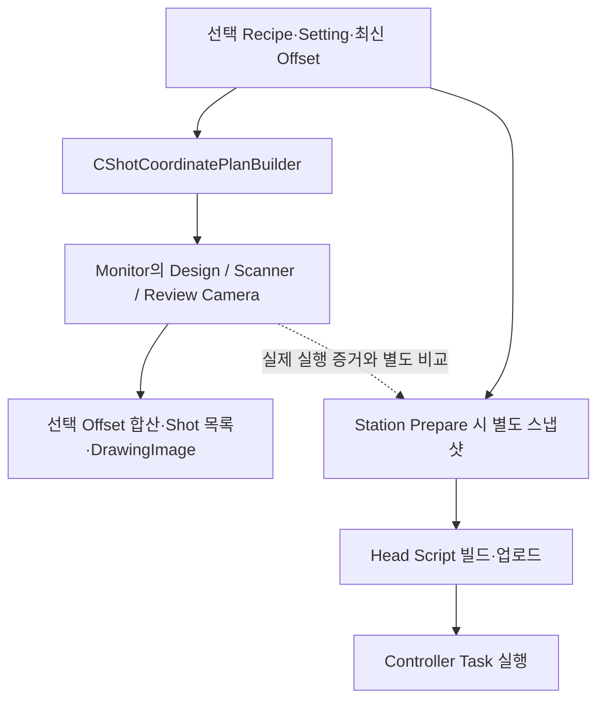

| 미리보기 선택 | 소스상 계산과 단위 | 판정할 때의 범위 |
|---|---|---|
| Design | 설계 mm 기준으로 Offset를 변환해 표시 | 화면에 더하거나 뺀 선택은 미리보기 상태입니다. Recipe 파일에 저장하지 않습니다. |
| Scanner | 최종 ScannerGx/Gy에서 기존 Offset를 뺀 기본점 + 선택한 Scanner Offset | Head별 swap/flip에 따라 축 화살표도 변환됩니다. GX/GY 값을 그대로 Review Camera 좌표로 쓰면 안 됩니다. |
| Review Camera | 기준 CameraX/StageY + 선택한 **Shift만** 검사 위치에 반영 | 다른 5종 Offset는 가공점 비교에만 합산합니다. 가공점과 검사 목표를 따로 표시합니다. |
| Shot Map | GroupColumn/GroupRow를 사각 격자로 그린 논리 선택 지도 | 물리 mm 비율의 기판 도면이나 실제 가공 완료표가 아닙니다. Masking/Chess 상태를 구분합니다. |

근거: [Offset 성분·기준 변환](https://github.com/kjuws10-rgb/A3Drilling/blob/28764c91d521777b8ee068dd7aaf2d3902ce9fe2/Drilling.UI/Menu/Menus/CMenuMonitor.cs#L3447-L3487), [Review Camera의 Shift 제한과 별도 가공점](https://github.com/kjuws10-rgb/A3Drilling/blob/28764c91d521777b8ee068dd7aaf2d3902ce9fe2/Drilling.UI/Menu/Menus/CMenuMonitor.cs#L3531-L3595), [Camera 기준점](https://github.com/kjuws10-rgb/A3Drilling/blob/28764c91d521777b8ee068dd7aaf2d3902ce9fe2/Drilling.UI/Menu/Menus/CMenuMonitor.cs#L4190-L4196), [Shot Map 격자와 클릭 역산](https://github.com/kjuws10-rgb/A3Drilling/blob/28764c91d521777b8ee068dd7aaf2d3902ce9fe2/Drilling.UI/Menu/Menus/CCoordinateShotMapPreviewDrawing.cs#L29-L58), [클릭 좌표에서 행·열 복원](https://github.com/kjuws10-rgb/A3Drilling/blob/28764c91d521777b8ee068dd7aaf2d3902ce9fe2/Drilling.UI/Menu/Menus/CCoordinateShotMapPreviewDrawing.cs#L116-L152).

MIN/MAX는 유한하고 `MIN < 0 < MAX`이어야 하며 20칸의 mm 눈금을 사용합니다. 범위를 벗어난 점은 화면 테두리로 잘라 그리면서 `OUT`으로 알립니다. 이것은 물리 이동 제한·안전 인터락이 아닙니다. 기준 선택 목록은 Design/Scanner/Review Camera 3개로 바뀌었으며, 남아 있는 `STAGE` 분기만 보고 독립 Stage 메뉴가 제공된다고 설명하지 않습니다. [범위 입력 검증](https://github.com/kjuws10-rgb/A3Drilling/blob/28764c91d521777b8ee068dd7aaf2d3902ce9fe2/Drilling.UI/Menu/Menus/CMenuMonitor.cs#L2859-L2887), [20칸·클리핑 표시](https://github.com/kjuws10-rgb/A3Drilling/blob/28764c91d521777b8ee068dd7aaf2d3902ce9fe2/Drilling.UI/Menu/Menus/CCoordinateOffsetPreviewDrawing.cs#L9-L43), [제공하는 기준 목록](https://github.com/kjuws10-rgb/A3Drilling/blob/28764c91d521777b8ee068dd7aaf2d3902ce9fe2/Drilling.UI/Menu/Menus/CMenuMonitor.cs#L3802-L3809).

검증은 같은 합성 Recipe에서 Offset를 하나씩 바꿔 Design/Scanner/Camera의 중간값, Axis flip/swap, Stage 방향 ±1, Review scale 0/100, Shift Y를 비교합니다. 이후 **같은 입력의 Station 모델·좌표 CSV·Script**와 대조해야 합니다. 화면 축 단위 mm가 소스상 확인된다는 사실과 실제 엔코더 교정·가공 방향이 검증됐다는 사실은 구분합니다.

## 10. Default 보정: AK 중심은 유지하고 Head별 DOE 검사 수를 나눕니다

기존 기판 중심 식을 단일 숫자로 보관하던 옵션은 `AlignKey1ReviewX`, `AlignKey3ReviewX`를 보관하고 `BoardCenterX=(AK1+AK3)/2`를 계산하는 형태로 바뀌었습니다. AK1은 Recipe의 taught 위치를 읽고, AK3 기본값은 `AK1 + GLASS_SIZE_X - 2×AK_MARGIN_X`입니다. 조건 창에서 AK3를 세션값으로 수정할 수 있으며 그 값을 실제 엔코더값으로 확인했는지는 작업 기록에서 별도로 확인해야 합니다. [조건·AK3 설계 계산](https://github.com/kjuws10-rgb/A3Drilling/blob/28764c91d521777b8ee068dd7aaf2d3902ce9fe2/Drilling.Common/Correction/CDefaultOffsetCalibration.cs#L64-L91), [조건 창 AK3 입력과 설계값 버튼](https://github.com/kjuws10-rgb/A3Drilling/blob/28764c91d521777b8ee068dd7aaf2d3902ce9fe2/Drilling.UI/Views/CDefaultOffsetView.xaml.cs#L78-L114).

11.13.0에서 전역 `SPLITED_BEAM_COUNT` 1/4를 지원한 데 이어, 11.17.0에서 `Hxx_DOE_EXIST`로 **Default 검사만** Head별로 분기합니다. DOE ON이면 옵션 격자 크기(1 또는4)를 사용하고, OFF이면 격자1·Pitch0·Angle0·중앙1점입니다. 설정 창의 `ON · 4×4` 문구만으로 실제 계산이 항상16점이라고 단정하지 않습니다. 실제 소비자는 `DefaultInspectionGridSize`를 사용합니다. [Head별 검사 정책](https://github.com/kjuws10-rgb/A3Drilling/blob/28764c91d521777b8ee068dd7aaf2d3902ce9fe2/Drilling.Common/Correction/CDefaultOffsetCalibration.cs#L29-L62), [옵션의 명목 점수와 검사 방식](https://github.com/kjuws10-rgb/A3Drilling/blob/28764c91d521777b8ee068dd7aaf2d3902ce9fe2/Drilling.Common/Correction/CDefaultOffsetCalibration.cs#L299-L321), [실제 Capture·Fit·결과](https://github.com/kjuws10-rgb/A3Drilling/blob/28764c91d521777b8ee068dd7aaf2d3902ce9fe2/Drilling.UI/Menu/Menus/CMenuCorrection.cs#L3893-L3924).

샷·십자는 같은 Head별 점수 정책을 사용하고, 십자는 Setting mark 명령을 사용합니다. Default CENTER의 scanner 목표는 현재 Head Default를 축 변환한 위치이며 First Beam·Cell·Align·Review·Shift를 더하는 일반 공정점과 다릅니다. DOE OFF에서는 이 중앙을 1번 검사합니다. 1점 Fit이 반환하는 잔차·Pitch0은 다점 배열의 실측 Pitch 합격이 아닙니다. [CENTER 목표 생성](https://github.com/kjuws10-rgb/A3Drilling/blob/28764c91d521777b8ee068dd7aaf2d3902ce9fe2/Drilling.Common/Correction/CDefaultOffsetCalibration.cs#L146-L159), [1점·16점 Fit 계약](https://github.com/kjuws10-rgb/A3Drilling/blob/28764c91d521777b8ee068dd7aaf2d3902ce9fe2/Drilling.Common/Correction/CDefaultOffsetCalibration.cs#L193-L235).

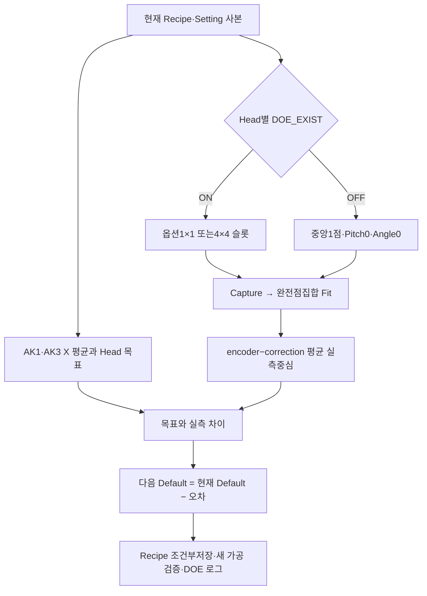

AK1/AK3 중점·HeadGap 기반 목표와 `currentDefault−error` 추천식은 이전부터 유지되는 수식입니다. X 입력 평균이 새 AK 자동촬영·2D 회전 피팅으로 확장됐다는 근거도 없습니다. DOE 장착은 설정값이므로 실제 광학 장착 확인을 대신하지 않습니다. [유지되는 목표·실측·추천식](https://github.com/kjuws10-rgb/A3Drilling/blob/28764c91d521777b8ee068dd7aaf2d3902ce9fe2/Drilling.Common/Correction/CDefaultOffsetCalibration.cs#L241-L294).

후속 검증은 샷/십자 × DOE ON/OFF × 전역격자1/4, 활성/비활성 Head의 키 누락, ON/OFF 혼합, AK1=AK3·역방향·비유한 입력, 점 누락·중복·NG, `DOE_EXIST/DEFAULT_INSPECTION_POINT_COUNT` 로그와 실제 Capture 수의 일치를 포함합니다. OFF Head도 공통 Geometry·Recipe 조건 검증을 완전히 생략하는 경로는 아니므로 'OFF이면 다른 설정 불필요'라고 가정하지 않습니다. DOE 광학 분기·정밀도는 이 소스 분석으로 실증하지 않습니다.

## 11. Shift 입력 그림은 계산량을 줄였지만 거리 도면은 아닙니다

RootView의 Head별 Shift 표는 입력마다 전체 좌표 계획을 두 번 만들고 차이를 구하던 방식에서, `DesignOffsetToScanner(parameters, head, shiftX, shiftY)`를 한 번 적용하는 방식으로 바뀌었습니다. Head 수만큼 변환하고 활성 Shot 유무와 무관하게 행을 만들므로, 예전에 `-`이던 비활성/무점 Head의 표시도 확인해야 합니다. [현재 변환 경로](https://github.com/kjuws10-rgb/A3Drilling/blob/28764c91d521777b8ee068dd7aaf2d3902ce9fe2/Drilling.UI/CRootView.cs#L1798-L1814).

Shift popup은 여러 Cell 사각형 대신 BEFORE/AFTER 점과 방향 화살표를 그립니다. 벡터 길이를 화면에서 24~82로 제한하므로 화살표 길이의 비율은 실제 mm 비율을 항상 유지하지 않습니다. 숫자 caption의 mm값과 방향 설명을 함께 읽습니다. 적용 검증은 여전히 전체 좌표 계획과 Masking을 만들어 가공 가능한 Glass/Head 범위를 검사합니다. 미리보기 계산 단축이 이 검증 삭제를 뜻하지 않습니다. [그림의 방향·길이 제한](https://github.com/kjuws10-rgb/A3Drilling/blob/28764c91d521777b8ee068dd7aaf2d3902ce9fe2/Drilling.UI/Popup/CShiftOffsetDialog.xaml.cs#L91-L159), [적용 전 전체 범위검증](https://github.com/kjuws10-rgb/A3Drilling/blob/28764c91d521777b8ee068dd7aaf2d3902ce9fe2/Drilling.UI/CRootView.cs#L1825-L1861).

검증은 축 swap/flip·X/Y 부호·0·아주 작은 값·범위 밖 큰 값·활성 Shot 없는 Head를 비교하고, 새 직접 변환과 같은 입력의 좌표 계획 차이가 일치하는지 확인합니다. 그림 응답성 개선 의도는 소스에서 확인되지만 실제 응답시간·FPS는 미측정입니다.

## 12. Ver11.19.0: 같은 수식의 입력 원본이 공통 Margin으로 바뀝니다

CShotCoordinatePlanBuilder.Build와 BuildDesignShots는 입구에서 AK X/Y 모두를 필수 파싱합니다. 설계 Cell/Shot 원점, Head 중심 X=MarginX+H01_AK_POSITION_X+(Head−1)×HeadGapX, Head 배정, Stage Y 기준에 공통값이 쓰입니다. 숫자0 기본값으로 누락을 통과시키던 경로와 다릅니다. 합성 맵을 받는 계산기 자체는 값이 Setting에서 왔는지 인증하지 않으므로 호출자의 주입 책임도 추적해야 합니다. [계획 입구·Head 배정](https://github.com/kjuws10-rgb/A3Drilling/blob/28764c91d521777b8ee068dd7aaf2d3902ce9fe2/Drilling.Common/Recipe/CShotCoordinatePlanBuilder.cs#L11-L66), [설계 Shot 입력](https://github.com/kjuws10-rgb/A3Drilling/blob/28764c91d521777b8ee068dd7aaf2d3902ce9fe2/Drilling.Common/Recipe/CShotCoordinatePlanBuilder.cs#L223-L249), [Head 중심 공식](https://github.com/kjuws10-rgb/A3Drilling/blob/28764c91d521777b8ee068dd7aaf2d3902ce9fe2/Drilling.Common/Recipe/CShotCoordinatePlanBuilder.cs#L455-L463)

| 호출 경로 | Margin을 확정하는 시점 | 소비·주의 |
|---|---|---|
| Station 가공 | Prepare의 Recipe→Option/Motor 합성 | ProcessModel·Script는 준비 시점 사본. Margin 편집을 기존 준비 모델에 자동 반영한 증거는 없음 |
| 일반 Review·Beam 목표 | CreatePlan의 현재 Setting 및 명시적 인자 | 설계 좌표와 Review/Stage 목표를 분리. 이미 만든 Plan과 나중 읽은 Margin의 혼합 검증 필요 |
| AUTO Fine·0선 후속 | 합성 후 frozen 맵 | 후속0선은 원 가공값을 보존하고 새 Setting은 누락 키만 채우는 기존 규칙 유지 |
| ZeroDefence | 생성 시 settings Read와 좌표 계획 | Beam을 Glass 안으로 검증할 때 같은 공통 Margin 사용 |
| Distortion | Prepare에서 Option Margin·Motor StageY 복사 | Key 위치와 Shot 보정 계산에 같은 사본 사용. 저장 시 Setting 재비교는 없음 |
| Recipe/Correction 미리보기 | Build/Update에서 Setting 또는 명시 Margin | 실제 실행 회차·실측 장치 위치를 증명하는 화면은 아님 |

근거: [가공 합성](https://github.com/kjuws10-rgb/A3Drilling/blob/28764c91d521777b8ee068dd7aaf2d3902ce9fe2/Drilling.Common/Station/CStationProcess.cs#L1528-L1545), [Review 계획 입력](https://github.com/kjuws10-rgb/A3Drilling/blob/28764c91d521777b8ee068dd7aaf2d3902ce9fe2/Drilling.Common/Review/CReviewManager.cs#L505-L536), [Beam 계산기 인자](https://github.com/kjuws10-rgb/A3Drilling/blob/28764c91d521777b8ee068dd7aaf2d3902ce9fe2/Drilling.Common/Review/CReviewManager.cs#L140-L172), [AUTO 고정 맵](https://github.com/kjuws10-rgb/A3Drilling/blob/28764c91d521777b8ee068dd7aaf2d3902ce9fe2/Drilling.Common/Review/CAutoFineReviewCoordinator.cs#L203-L231), [0선 입력](https://github.com/kjuws10-rgb/A3Drilling/blob/28764c91d521777b8ee068dd7aaf2d3902ce9fe2/Drilling.Common/Review/CZeroDefenceRecipePlan.cs#L18-L39), [0선 Beam Glass 검증](https://github.com/kjuws10-rgb/A3Drilling/blob/28764c91d521777b8ee068dd7aaf2d3902ce9fe2/Drilling.Common/Review/CZeroDefenceRecipePlan.cs#L65-L80), [Distortion 동결](https://github.com/kjuws10-rgb/A3Drilling/blob/28764c91d521777b8ee068dd7aaf2d3902ce9fe2/Drilling.Common/Correction/CAlignInterpolation.cs#L276-L308), [계산·저장·다음 준비값](https://github.com/kjuws10-rgb/A3Drilling/blob/28764c91d521777b8ee068dd7aaf2d3902ce9fe2/Drilling.Common/Correction/CAlignInterpolation.cs#L334-L370)

Distortion의 Key 위치는 Glass 반폭/반높이로 Margin을 clamp하지만 일반 Shot 원점은 공통 Margin을 그대로 사용합니다. helper의 0 이상 검사만으로 모든 Glass 크기에 맞는 기하가 보장되지는 않습니다. 작은 Glass·반폭 경계·큰 Margin의 Key/Shot/Head 배정을 각각 대조해야 합니다. [Key clamp](https://github.com/kjuws10-rgb/A3Drilling/blob/28764c91d521777b8ee068dd7aaf2d3902ce9fe2/Drilling.Common/Correction/CAlignInterpolation.cs#L190-L214), [Shot 원점 소비](https://github.com/kjuws10-rgb/A3Drilling/blob/28764c91d521777b8ee068dd7aaf2d3902ce9fe2/Drilling.Common/Recipe/CShotCoordinatePlanBuilder.cs#L223-L249)

Script 파일의 Build는 **가공 입력 파일 생성**입니다. 이번 diff의 CAutomation1ScriptFile 변경은 설명 주석 보강이며, 회차 폴더·Manifest·MofReadyRunId·준비된 Controller 파일 실행 계약을 새 기능으로 세지 않습니다. 문서 추출기가 성공한 것, 장비 앱이 빌드된 것, AeroScript가 Controller에서 컴파일·실행된 것은 각각 별도 증거입니다. 이번 작업은 뒤 두 가지를 수행하지 않았습니다. [회차 파일 생성](https://github.com/kjuws10-rgb/A3Drilling/blob/28764c91d521777b8ee068dd7aaf2d3902ce9fe2/Drilling.File/Script/CAutomation1ScriptFile.cs#L51-L108), [준비된 Controller 파일 실행](https://github.com/kjuws10-rgb/A3Drilling/blob/28764c91d521777b8ee068dd7aaf2d3902ce9fe2/Drilling.Common/Automation/CAutomationManager.cs#L365-L370)

Default의 Parameters와 화면 Update는 여전히 Setting 후 Recipe를 덮어쓰는 경로입니다. 최신 JHMI_RCP에서 AK가 빠져 정상 로드에서는 공통값을 쓰지만, 구형/수동 생성 Recipe 객체까지 모든 경로가 같은 우선순위라고 일반화하지 않습니다. [Default 합성 순서](https://github.com/kjuws10-rgb/A3Drilling/blob/28764c91d521777b8ee068dd7aaf2d3902ce9fe2/Drilling.Common/Correction/CDefaultOffsetCalibration.cs#L14-L19), [Default 화면 합성](https://github.com/kjuws10-rgb/A3Drilling/blob/28764c91d521777b8ee068dd7aaf2d3902ce9fe2/Drilling.UI/Menu/Menus/CMenuCorrection.cs#L4572-L4584)

Review의 목표식은 CameraAK+(Design−Margin)+Beam+Shift입니다. 같은 공통 Margin으로 Design도 함께 재생성되면 Margin 이동분이 상쇄될 수 있으므로 모든 실제 검사목표가 반드시 이동한다고 단정하지 않습니다. 반면 과거 결과의 Design 좌표나 다른 시점의 Margin을 섞으면 같은 조건이 아닙니다. [Review 목표식](https://github.com/kjuws10-rgb/A3Drilling/blob/28764c91d521777b8ee068dd7aaf2d3902ce9fe2/Drilling.Common/Review/CReviewManager.cs#L177-L196).


# 별도 정적 추적 상세 해설 · architecture/04-product-and-station-lifecycle.md

# 04. Product와 Station: 기판 한 장을 끝까지 추적하기

> 기준: `A3Drilling/master` · `28764c91d521777b8ee068dd7aaf2d3902ce9fe2`. 본 장은 해당 Commit의 소스를 정적으로 읽어 설명합니다. 정식 설비 빌드·장비 연결·가공을 실행한 결과가 아닙니다.

**Recipe는 앞으로 쓸 조건, Product는 지금 또는 과거 기판에 적용한 조건과 결과, Station은 동작 순서**입니다. 세 객체를 나누어 보면 “Recipe는 바꿨는데 왜 현재 Product에 옛값이 남는가”, “Run을 눌렀는데 왜 아직 완료가 아닌가”를 이해할 수 있습니다.

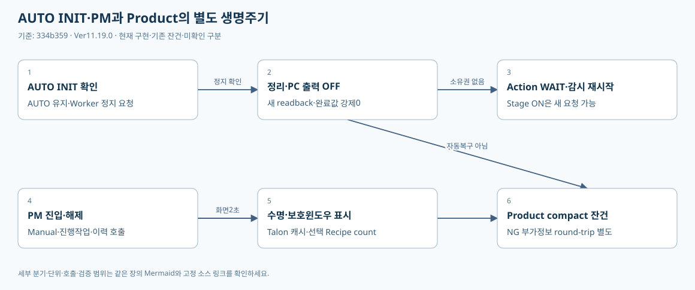

위 SVG는 11.13.0에서 추가되어 현재 유지되는 보호윈도우 교체·추가 요청 경계를 요약합니다. MAIN START와 실제 AUTO(Stage 요청)의 시작 분기는 아래 Mermaid와 6절에서 구분합니다.

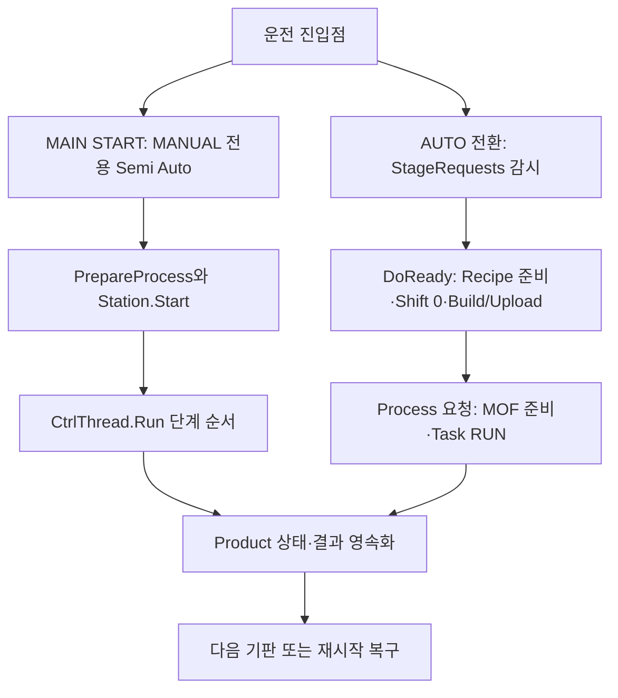

## 1. Product 데이터는 무엇을 담는가

| CoreData | 필드/내용 | 의미 |
|---|---|---|
| `ST_PRODUCT_INFO` | `Values` 딕셔너리, Get/Set helper | Glass/Lot/PPID/상태 등 공통 식별·표시 항목 |
| `ST_PRODUCT_RECIPE_DATA` | Parameters 사본 | 기판의 실행 조건을 남기는 스냅샷 |
| `ST_PRODUCT_ALIGN_DATA` | State, Result, OffsetX, OffsetY, Rotation | Align 수행 상태와 결과 |
| `ST_PRODUCT_DISTORTION_DATA` | State, Result, MaxDa | Distortion 상태·결과 요약 |
| `ST_PRODUCT_REVIEW_DATA` | State, SavedAt, Results + Method/Rule/Beam/Reference 등 | 리뷰 결과와 어느 방식의 검사인지 구분하는 메타데이터 |
| `ST_PRODUCT_HEAD_RESULT` | HeadNo, State, Total/CompletedPoints, Result, ErrorCode, Message, 시각 | Head별 런타임 진행 정보 |
| `ST_PRODUCT_DATA` | Product, Recipe, Align, Distortion, Review, Runtime | 위 자료를 한 기판 단위로 결합 |

근거: [Product CoreData](https://github.com/kjuws10-rgb/A3Drilling/blob/28764c91d521777b8ee068dd7aaf2d3902ce9fe2/Drilling.Common/Product/CProductManager.cs#L996-L1053). `ST_PRODUCT_REVIEW_RESULT`는 ShotKey/HeadNo/CellNo/BeamNo/ErrorX/ErrorY/Judge와 새 초기화 속성 VisionResultCode/NgReason을 갖습니다. 타입 선언과 실제 파일의 저장·복구 범위는 다릅니다. 12절에서 그 공백을 설명합니다.

## 2. 상태와 결과는 서로 다른 축이다

| 구분 | 실제 enum 값 |
|---|---|
| 기판 상태 `EN_PRODUCT_STATE` | Created, Running, Completed, Stopped, Error, Scrapped |
| 판정 `EN_PRODUCT_RESULT` | Pending, Skipped, OK, NG |
| Head 상태 `EN_PRODUCT_HEAD_STATE` | Ready, Running, Completed, Stopped, Error, Disabled |
| Align/Distortion/Review 수행 상태 `EN_PRODUCT_PROCESS_STATE` | NotStarted, Running, Completed, Stopped, Error |

근거: [Product 상태 enum](https://github.com/kjuws10-rgb/A3Drilling/blob/28764c91d521777b8ee068dd7aaf2d3902ce9fe2/Drilling.Common/Product/CProductManager.cs#L959-L994). 예를 들어 `Completed`라고 해서 `OK`라는 뜻은 아닙니다. `CompleteProduct`는 공정 미수행이면 Skipped를 저장하며, `processExecuted=true`에서 isOk 값에 따라 OK/NG를 정합니다. [완료와 판정 조합](https://github.com/kjuws10-rgb/A3Drilling/blob/28764c91d521777b8ee068dd7aaf2d3902ce9fe2/Drilling.Common/Product/CProductManager.cs#L558-L602).

## 3. Product 생성부터 저장까지

`CreateProduct(processId, glassId, lotId, recipeId, parameters, headPointCounts)`는 다음을 수행합니다.

1. `_updateGate`로 상태 갱신을 직렬화합니다.
2. ActiveProduct를 읽는 중 오류가 있었으면 새 Product 생성을 거부합니다. 깨진 기존 기록을 덮어버리지 않으려는 경계입니다.
3. 현재 제품이 없으면 파일에서 다시 확인합니다.
4. 현재 제품이 Completed가 아니면 다른 Glass를 새로 만들지 못하게 합니다.
5. Head 점수가 0이면 Disabled, 양수면 Ready로 만듭니다.
6. 입력 Parameters를 새 딕셔너리로 복사하고 초기 상태를 묶어 저장합니다.

근거: [Product 생성·중복 방지·스냅샷](https://github.com/kjuws10-rgb/A3Drilling/blob/28764c91d521777b8ee068dd7aaf2d3902ce9fe2/Drilling.Common/Product/CProductManager.cs#L129-L199).

`PersistAndLog`는 **Active 파일 저장 → 메모리 현재 Product 공개 → History 기록 → 일반 로그** 순서입니다. Active 저장 후 History/로그 쓰기가 실패하면 이미 커밋된 상태를 실패한 전이로 뒤집지 않도록 catch합니다. 이 경우 상태 전이는 성공했지만 부가 이력이 불완전할 수 있으므로 진단 시 두 결과를 나누어 봐야 합니다. [Product commit 경계](https://github.com/kjuws10-rgb/A3Drilling/blob/28764c91d521777b8ee068dd7aaf2d3902ce9fe2/Drilling.Common/Product/CProductManager.cs#L789-L819).

## 4. ActiveProduct.csv는 객체 전체의 자동 직렬화가 아니다

`CProductFile`은 `Data/Product/ActiveProduct.csv`와 날짜별 History 파일을 사용합니다. 저장 형식은 `TYPE,NAME,VALUE`이고, 각 구역의 필드를 명시적으로 씁니다. [헤더와 Product 루트](https://github.com/kjuws10-rgb/A3Drilling/blob/28764c91d521777b8ee068dd7aaf2d3902ce9fe2/Drilling.File/Product/CProductFile.cs#L8-L11), [Active·History 상대 경로](https://github.com/kjuws10-rgb/A3Drilling/blob/28764c91d521777b8ee068dd7aaf2d3902ce9fe2/Drilling.File/Product/CProductFile.cs#L258-L265).

| TYPE | 주요 저장 항목 |
|---|---|
| PRODUCT | `CProductManager.ProductFieldNames` 목록의 값 |
| RECIPE | 공통 Product 핵심 이름을 제외한 Parameters |
| ALIGN | STATE, RESULT, OFFSET_X/Y, ROTATION |
| DISTORTION | STATE, RESULT, MAX_DA |
| REVIEW | 상태, 검사방식, RecipeId, Rule/Scope, Beam, 기준 Cell/Shot, 줄 수, 총 수 |
| REVIEW_RESULT | SavedAt 및 ShotKey별 HEAD_NO/CELL_NO/BEAM_NO/ERROR_X/ERROR_Y/JUDGE |

근거: [compact 저장 목록](https://github.com/kjuws10-rgb/A3Drilling/blob/28764c91d521777b8ee068dd7aaf2d3902ce9fe2/Drilling.File/Product/CProductFile.cs#L109-L178). 로드할 때 `Runtime`은 `new ST_PRODUCT_RUNTIME_DATA([])`로 구성됩니다. 따라서 “현재 메모리의 모든 Head 런타임 필드가 파일에 그대로 보존된다”고 설명하면 안 됩니다. [compact 로드와 Runtime 초기값](https://github.com/kjuws10-rgb/A3Drilling/blob/28764c91d521777b8ee068dd7aaf2d3902ce9fe2/Drilling.File/Product/CProductFile.cs#L73-L106).

Active 저장은 고유 임시파일에 쓰고 기존 파일이 있으면 `File.Replace`, 없으면 `File.Move`를 사용하며 finally에서 임시파일을 정리합니다. 모든 파일 저장기가 같은 원자적 교체 방식을 쓴다고 확대 해석하지 않습니다. [Active 파일 교체 방식](https://github.com/kjuws10-rgb/A3Drilling/blob/28764c91d521777b8ee068dd7aaf2d3902ce9fe2/Drilling.File/Product/CProductFile.cs#L182-L201).

## 5. 재시작 복구는 자동 재가공이 아니다

`LoadActive`는 읽기 성공/실패 플래그를 관리합니다. `RecoverInterrupted`는 기판 또는 Align/Distortion/Review/Head 중 Running 상태가 있는지 확인합니다. 코드 주석처럼 단지 Created 상태인 제품은 실행 중단으로 보지 않으며, Running이던 부분을 중단 상태로 복구하는 경로입니다. **전원 복구 후 중간 Shot부터 자동 재개**한다는 뜻이 아닙니다. [Active 로드 실패 상태](https://github.com/kjuws10-rgb/A3Drilling/blob/28764c91d521777b8ee068dd7aaf2d3902ce9fe2/Drilling.Common/Product/CProductManager.cs#L25-L47), [재시작 시 중단 판정](https://github.com/kjuws10-rgb/A3Drilling/blob/28764c91d521777b8ee068dd7aaf2d3902ce9fe2/Drilling.Common/Product/CProductManager.cs#L49-L88).

## 6. MAIN START(Semi Auto)와 AUTO(Stage 요청)는 다른 진입점입니다

화면에 `START`가 있고 내부 함수에 `AutoStep`이라는 이름이 있다는 이유로 현재 AUTO 운전 전체를 `CStationProcess.Start → Run` 한 경로로 설명하면 안 됩니다. 실제 RootView는 다음 두 경로를 구분합니다.

| 운전 진입점 | 실제 호출 | 실행을 시작하는 조건 | 다음에 읽을 함수 |
|---|---|---|---|
| MAIN START / Semi Auto | MANUAL 모드 확인 → 초기 모델 준비 → `PrepareInitialProcess(applyShiftOffset:true)` → `CStationManager.Start` | 사용자가 MAIN START를 누름. AUTO 모드에서는 이 버튼 경로를 거부 | `CStationProcess.Start`, `Run`, `RunSequenceStep` |
| AUTO / Stage PC 요청 감시 | AUTO 전환 시 `StartStageRequests(CreateStageProcessRequest, Review/Power/Distortion actions)` | AUTO로 바꾼 뒤 Stage의 요청과 handshake를 기다림. 전환 자체가 즉시 가공 명령은 아님 | `CStationProcess.StartStageRequests`, `CStageRequestSequence.Start/Run`, `RunStageTasks` |

근거: [AUTO 전환의 Stage 요청 감시와 중지](https://github.com/kjuws10-rgb/A3Drilling/blob/28764c91d521777b8ee068dd7aaf2d3902ce9fe2/Drilling.UI/CRootView.cs#L724-L735), [MANUAL 전용 MAIN START](https://github.com/kjuws10-rgb/A3Drilling/blob/28764c91d521777b8ee068dd7aaf2d3902ce9fe2/Drilling.UI/CRootView.cs#L1992-L2018), [AUTO 시작 전 소유권 확인](https://github.com/kjuws10-rgb/A3Drilling/blob/28764c91d521777b8ee068dd7aaf2d3902ce9fe2/Drilling.Common/Station/CStationProcess.cs#L4026-L4039).

`StartStageRequests`는 Manual MOF, Stage/Review의 동작·정리, 현재 Station sequence, 이전 AUTO Task/Buffered 실행의 소유권을 확인한 다음 감시를 시작합니다. `CStageRequestSequence.Start`는 별도의 stop CTS와 worker Task를 만들며 이전 worker/cleanup이 끝나지 않았으면 시작을 거부합니다. 즉 이 경로는 앞서 설명한 CtrlThread의 tick sequence와 같은 시작 함수가 아닙니다. [Station/Task 소유권 gate](https://github.com/kjuws10-rgb/A3Drilling/blob/28764c91d521777b8ee068dd7aaf2d3902ce9fe2/Drilling.Common/Station/CStationProcess.cs#L4026-L4039), [Stage 요청 worker 구성](https://github.com/kjuws10-rgb/A3Drilling/blob/28764c91d521777b8ee068dd7aaf2d3902ce9fe2/Drilling.Common/Station/CStationProcess.cs#L5088-L5123).

### AUTO의 DoReady와 Process 준비 경계

1. DoReady 요청을 받으면 Process ABLE을 쓰고 Stage START를 기다린 뒤 요청 Recipe·좌표를 준비합니다.
2. `prepare` callback은 이전 0선 후속검사 완료를 확인하고 요청 데이터를 가져옵니다. 여기서 Shift X/Y를 0으로 정규화하여 ProcessModel을 준비합니다.
3. `buildUpload` callback은 이번 모델의 Script를 만들고 업로드합니다. 이 단계가 끝났다고 Task RUN까지 실행된 것은 아닙니다.
4. Stage DoReady COMPLETE와 양측 신호 OFF를 확인한 다음 Process 요청을 기다립니다. MOF zero/Task RUN은 Process 준비의 책임으로 분리되어 있습니다.

근거: [AUTO 준비·빌드·zero·RUN callback](https://github.com/kjuws10-rgb/A3Drilling/blob/28764c91d521777b8ee068dd7aaf2d3902ce9fe2/Drilling.Common/Station/CStationProcess.cs#L4039-L4071), [DoReady 준비와 Build/Upload](https://github.com/kjuws10-rgb/A3Drilling/blob/28764c91d521777b8ee068dd7aaf2d3902ce9fe2/Drilling.Common/Station/CStationProcess.cs#L5258-L5275), [DoReady 해제 후 Process 준비](https://github.com/kjuws10-rgb/A3Drilling/blob/28764c91d521777b8ee068dd7aaf2d3902ce9fe2/Drilling.Common/Station/CStationProcess.cs#L5303-L5330). 이것은 해당 경로의 소스 책임을 설명한 것이며 모든 신호의 현장 타이밍을 실측 검증했다는 뜻이 아닙니다.

현재 AUTO의 Shift 0 정규화는 실제 코드 사실입니다. Shift를 유지하면서 가공할지 묻는 정책이나 양산 자동 초기화 옵션은 회의 요구와 별도로 구현 여부를 비교해야 합니다. 수동 Shift를 평가할 때 성공했다고 AUTO에서도 유지된다고 보고하지 않습니다.

## 7. PrepareProcess가 하는 일과 MAIN START의 Start가 하는 일


| 메서드 | 핵심 동작 | 방지하는 오류 |
|---|---|---|
| `PrepareProcess` | sequence lock 아래 Ready와 Manual MOF 상태 확인 | 진행 중 모델 교체 |
| `PrepareProcessCore` | runtime Parameter 합성, ProcessModel·Preview·통계·상태 스냅샷 생성 | Recipe와 실행 조건의 무분별한 공유 |
| `Start` | 준비 모델·Offset 최신성·인터락 확인 후 linked CTS 생성 | 준비 후 Offset가 바뀐 상태의 실행 |
| `base.Start(10, "StationProcess")` | CtrlThread의 주기 실행 시작 | Start 함수 반환과 실제 한 사이클 완료의 혼동 |

근거: [PrepareProcess](https://github.com/kjuws10-rgb/A3Drilling/blob/28764c91d521777b8ee068dd7aaf2d3902ce9fe2/Drilling.Common/Station/CStationProcess.cs#L211-L269), [Start와 이중 상태 확인](https://github.com/kjuws10-rgb/A3Drilling/blob/28764c91d521777b8ee068dd7aaf2d3902ce9fe2/Drilling.Common/Station/CStationProcess.cs#L272-L322). Start는 lock 밖에서 Offset/인터락을 확인한 뒤 lock 안에서 상태를 다시 확인합니다. 첫 확인과 실제 전이 사이에 상태가 바뀔 수 있기 때문이라고 해석할 수 있습니다.

Review Offset 롤백/변경은 준비된 모델을 무효화할 수 있습니다. `EnsurePreparedReviewOffsetIsCurrent`는 파일 경로와 저장시각이 준비 당시와 같은지 확인하고 다르면 DoReady를 다시 요구합니다. UI에서 바뀐 Offset을 표시했다고 이미 준비한 Script/ProcessModel이 저절로 바뀌는 것으로 가정하면 안 됩니다. [준비 모델 무효화·최신성 확인](https://github.com/kjuws10-rgb/A3Drilling/blob/28764c91d521777b8ee068dd7aaf2d3902ce9fe2/Drilling.Common/Station/CStationProcess.cs#L1567-L1600).

## 8. MAIN START의 단계 순서와 실패 순서

MAIN START에서 호출되는 `Run`의 정상 전이는 `Ready → PowerCheck → Align → Process → Inspection → Complete → Ready`입니다. Stop, Reset, Error는 별도 case입니다. 취소 예외는 Stop으로, 명시된 InvalidOperation/Timeout/IO/KeyNotFound 예외는 Error로 전환합니다. 그 외 예외는 상위 CtrlThread의 오류 처리와 함께 확인해야 하므로 “모든 예외가 동일한 Station Error 결과를 남긴다”고 말할 수 없습니다. [Station Run 상태기계](https://github.com/kjuws10-rgb/A3Drilling/blob/28764c91d521777b8ee068dd7aaf2d3902ce9fe2/Drilling.Common/Station/CStationProcess.cs#L325-L381).

`RunSequenceStep`은 기대한 상태에서 다음 상태로 이동했는지 확인하고, 중간에 Stop이 들어오면 Interrupted 경로를 탑니다. `FinishSequence`는 Ready로 돌리고 sequence CTS를 해제합니다. UI가 표시하는 `EN_STATION_STATE`, 단계 `EN_PROCESS_STEP`, 이 내부 순서 `EN_STATION_SEQUENCE`와 Script status는 목적이 다르므로 하나의 bool IsRunning으로 합치지 않는 편이 안전합니다. [단계 전이·정리](https://github.com/kjuws10-rgb/A3Drilling/blob/28764c91d521777b8ee068dd7aaf2d3902ce9fe2/Drilling.Common/Station/CStationProcess.cs#L384-L432).

`EN_STATION_SEQUENCE.PowerCheck`에는 명시값 3이 지정되어 있습니다. 이를 화면 정렬 순서나 Host I/O 값으로 자동 재사용하면 안 됩니다. `EN_STATION_STATE`는 Idle/Check/Process/Complete/Alarm/Stopped이고, 내부 sequence enum과 항목/목적이 다릅니다. [Station enum 선언](https://github.com/kjuws10-rgb/A3Drilling/blob/28764c91d521777b8ee068dd7aaf2d3902ce9fe2/Drilling.Common/Station/CStationManager.cs#L264-L298).

## 9. 상위 자동화 연결에서 아직 확정하지 말아야 할 것

RootView의 Stage Process 요청 생성은 현재 선택 Recipe를 찾고, 현재 Product의 Glass/Lot을 사용하며 없으면 SIM/DUMMY 식별자를 만듭니다. `Stage Glass/Lot mapping is agreed` 후 fallback을 교체하라는 TODO가 남아 있습니다. 따라서 이 부분을 고객 Host PPID/Sub PPID 자동 Job Change의 완성 계약이라고 설명하면 안 됩니다. [Stage 요청의 현재 식별자 생성](https://github.com/kjuws10-rgb/A3Drilling/blob/28764c91d521777b8ee068dd7aaf2d3902ce9fe2/Drilling.UI/CRootView.cs#L3280-L3293).

검토할 후속 계약은 다음과 같습니다. 이는 제안 목록이며 이 소스가 구현 완료했다는 뜻은 아닙니다.

- Host PPID와 설비 RecipeId/Sub PPID의 관계와 길이·허용문자·미등록 처리.
- Job Change 요청 중인 Product 처리, 편집 중 Recipe 처리, 선택·검증·적용 완료 시점.
- 동일 요청 재전송에 대한 중복 적용 방지와 요청 번호.
- Recipe/Setting/Offset 버전이 실제 가공에 사용된 스냅샷과 연결되는 방식.

## 10. 검증 계획

| 조건 | 확인해야 할 결과 |
|---|---|
| Active 파일이 깨진 채 새 Product 생성 | 생성 거부·기존 파일 보존·오류 안내 |
| Created 상태에서 앱 재시작 | Running 중단과 구분하여 불필요한 실패 판정이 없는지 |
| Running 기판/Review 상태로 재시작 | 중단 흔적 보존·자동 재가공 미실행 |
| Active 저장 성공, History 실패 | 현재 상태는 한 번만 전이하고 이력 오류가 진단 가능한지 |
| Prepare 후 Offset 변경/롤백 | Start 차단, 재준비 후 최신값 사용 |
| Start 연속 클릭·Stop과 동시 요청 | 한 실행 소유자 유지·CTS 해제·UI 갱신 |
| 공정 Skip 후 Complete | Completed/Skipped와 OK를 혼동하지 않는지 |
| MANUAL MAIN START와 AUTO Stage 요청 비교 | 서로 다른 시작 함수·worker·신호 순서인지 구분하여 확인 |
| Shift가 있는 상태의 두 경로 | MAIN START의 Shift 반영과 AUTO 준비의 0 정규화를 각각 현재 구현 기대값으로 확인 |

## 11. 보호윈도우는 매수 저장과 추가 교체 요청을 함께 추적합니다

정상 MOF 완료 시 현재매수를 증가시키는 경로와, Stage가 교체완료를 보냈을 때 공식 Tray Count를 받아 **현재매수로 인계**하는 경로는 다릅니다. 교체완료라고 매수를 무조건 0으로 만들지 않습니다. 11.13.0에서 추가된 정책은 인계 매수가 Max 이상이면 Recipe에 정한 0~3회만큼 추가 교체를 요청합니다. [정상 완료 증가와 회차 중복 억제](https://github.com/kjuws10-rgb/A3Drilling/blob/28764c91d521777b8ee068dd7aaf2d3902ce9fe2/Drilling.Common/Station/CStationProcess.cs#L3770-L3795), [시작 임계값·재시도 정책 보관](https://github.com/kjuws10-rgb/A3Drilling/blob/28764c91d521777b8ee068dd7aaf2d3902ce9fe2/Drilling.Common/Station/CStationProcess.cs#L4422-L4461).

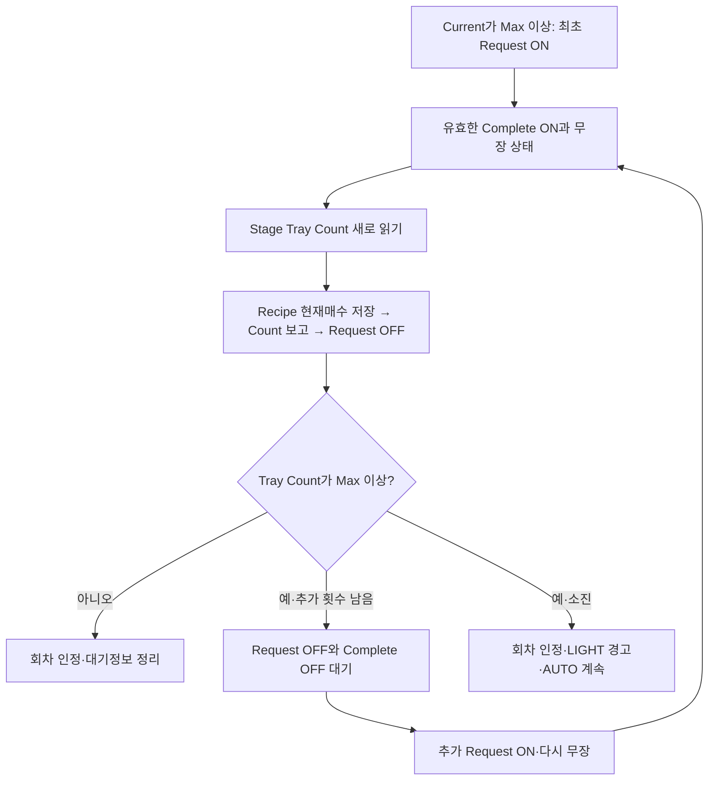

교체완료 처리는 `_gate`로 직렬화하며, 이미 저장한 Tray Count는 `_committedHandoverCount`에 남겨 뒤 보고/Request OFF가 실패했을 때 다시 저장하는 일을 줄입니다. 추가 요청은 두 신호가 모두 OFF로 관측된 뒤 보냅니다. 같은 Complete ON을 여러 번 새 완료로 읽지 않도록 하는 구조입니다. [OFF 대기와 재요청](https://github.com/kjuws10-rgb/A3Drilling/blob/28764c91d521777b8ee068dd7aaf2d3902ce9fe2/Drilling.Common/Station/CStationProcess.cs#L4659-L4674), [인계 저장·보고·정리·소진](https://github.com/kjuws10-rgb/A3Drilling/blob/28764c91d521777b8ee068dd7aaf2d3902ce9fe2/Drilling.Common/Station/CStationProcess.cs#L4708-L4761).

**운전 의미**: `RetryCount=0`도 최초 교체는 요청합니다. 그 첫 완료의 Tray Count가 여전히 Max 이상이면 추가 요청 없이 소진 경고를 냅니다. `Max=0`이면 모든 유효한 비음수 Tray Count가 임계값 이상이므로 설정한 횟수까지 진행한 뒤 소진될 수 있습니다. 소진은 `PROTECT_WINDOW_RETRY_EXHAUSTED` LIGHT 알람이며 코드와 정의가 AUTO 계속 의도를 명시합니다. 이를 HEAVY 정지 기능으로 설명하지 않습니다. [LIGHT 정의](https://github.com/kjuws10-rgb/A3Drilling/blob/28764c91d521777b8ee068dd7aaf2d3902ce9fe2/Config/JHMI_ALARMLIST.csv#L320), [알림 callback과 예외 격리](https://github.com/kjuws10-rgb/A3Drilling/blob/28764c91d521777b8ee068dd7aaf2d3902ce9fe2/Drilling.Common/Station/CStationProcess.cs#L4787-L4797).

정책·시도횟수·완료 무장·회차 객체는 메모리 상태입니다. 재시작 시 Request가 ON인 경우 선택 Recipe로 정책을 다시 읽고 시도횟수를 0으로 복구하므로, **재시작을 가로지른 총 추가 요청 횟수**가 3으로 제한된다고 보장하지 않습니다. [Request ON 복구](https://github.com/kjuws10-rgb/A3Drilling/blob/28764c91d521777b8ee068dd7aaf2d3902ce9fe2/Drilling.Common/Station/CStationProcess.cs#L4687-L4698).

검증은 Retry 0/1/3 × TrayCount의 Max-1/Max/Max+1, Max=0, Complete ON 고정·OFF 지연·통신 끊김, 저장 성공 뒤 보고 실패, 교체 중 Recipe 변경·재시작으로 나눕니다. Request ON 횟수, Current Count의 파일·캐시·보고값, LIGHT 발생, AUTO 지속 여부를 각각 관측해야 합니다. 이번 작업에서는 이러한 장비/상태기계 테스트를 실행하지 않았습니다.

## 12. 새 Review NG 필드는 메모리와 영속 파일의 범위가 다릅니다

`ST_PRODUCT_REVIEW_RESULT`에는 nullable `VisionResultCode`와 기본 빈 문자열 `NgReason`가 추가됐고 Review 결과 생성/복구 경로에서 이를 전달합니다. 하지만 Active Product compact 파일의 writer는 `HEAD_NO,CELL_NO,BEAM_NO,ERROR_X,ERROR_Y,JUDGE`만 쓰고 reader도 이 여섯 필드로 레코드를 다시 만듭니다. **새 메타데이터가 Active Product 재시작 복구까지 보존된다고 설명하면 틀립니다.** ReviewResult CSV에는 별도의 새 열이 있으므로 해당 전문 장과 함께 확인합니다. [새 Product 필드](https://github.com/kjuws10-rgb/A3Drilling/blob/28764c91d521777b8ee068dd7aaf2d3902ce9fe2/Drilling.Common/Product/CProductManager.cs#L996-L1003), [Review에서 Product로 전달](https://github.com/kjuws10-rgb/A3Drilling/blob/28764c91d521777b8ee068dd7aaf2d3902ce9fe2/Drilling.Common/Review/CReviewManager.cs#L1664-L1680), [compact 저장 범위](https://github.com/kjuws10-rgb/A3Drilling/blob/28764c91d521777b8ee068dd7aaf2d3902ce9fe2/Drilling.File/Product/CProductFile.cs#L168-L176), [compact 읽기 범위](https://github.com/kjuws10-rgb/A3Drilling/blob/28764c91d521777b8ee068dd7aaf2d3902ce9fe2/Drilling.File/Product/CProductFile.cs#L298-L325).

합성 결과에 Vision 실패·X/Y 허용오차 실패를 각각 넣고 `ReviewResult 저장/로드`, `Product Active 저장/로드`, `체크포인트 복구`를 나눠 검증해야 합니다. 현재 구조에서는 Active 복구 후 새 필드가 null/빈값으로 돌아오는 정적 저장 공백이 보이며, 실제 파일 round-trip 테스트는 수행하지 않았습니다.

## 13. 11.17에서 도입된 Level 표시와 기존 Product 영속 잔건

11.17.0은 결과 오차의 **표시 등급**을 도입했습니다. Review Data는 결과 행별 Level을 계산하고 같은 Shot의 여러 Beam과 같은 Cell의 행을 최대 Level로 묶어 그림 색에 반영합니다. 파일에 저장된 JUDGE를 이 등급으로 다시 판정하거나 Product 상태를 Completed/OK로 바꾸는 경로가 아닙니다. 같은 결과 파일도 나중에 적용한 Setting 임계값·색상에 따라 다시 표시될 수 있습니다. [행·Cell·Shot 등급 집계](https://github.com/kjuws10-rgb/A3Drilling/blob/28764c91d521777b8ee068dd7aaf2d3902ce9fe2/Drilling.UI/Menu/Menus/CMenuCorrection.ReviewData.Display.cs#L252-L336), [등급별 기판 색](https://github.com/kjuws10-rgb/A3Drilling/blob/28764c91d521777b8ee068dd7aaf2d3902ce9fe2/Drilling.UI/Menu/Menus/CMenuCorrection.ReviewData.Display.cs#L1078-L1093).

Product compact의 새 NG 정보 누락과 보호윈도우 재시작 시 재시도 상태 초기화는 11.19 diff에서도 고쳐진 항목이 아닙니다. 현재 serializer·요청 복구 코드가 이전 기준과 동일함을 대조해 **기존 잔건**으로 유지합니다. 새 색상으로 보인다는 사실이 그 저장 공백을 해소하지 않습니다. 12절의 저장/복구 근거와 11절의 요청 복구 근거를 따릅니다.

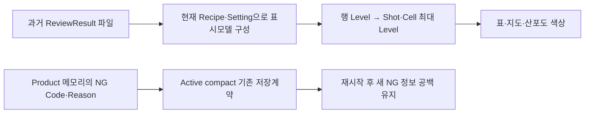

후속 검증은 같은 파일을 다른 Level Setting으로 다시 로드해 JUDGE·오차·Product 상태는 어떤 경로에서 유지되는지, 편집 Revision/미측정/Vision Find NG의 표시가 live 화면과 같은지, Active 재시작 복구와 결과 CSV 재로드를 혼동하지 않는지 나눕니다.

다음 읽기: [05. 장비 통신 경계](../manual/architecture/05-device-interfaces-and-drivers.md), [06. 스레드와 로그](../manual/architecture/06-threading-snapshots-and-logs.md), [08. 알람 원인 분석](../manual/architecture/08-alarm-cause-analysis.md).

## 14. Ver11.19.0 AUTO INIT: PC 시퀀스 정리 후 감시 재시작

새 INIT 명령은 AUTO 모드·MAIN Cycle Ready·다른 INIT 없음일 때 확인창을 엽니다. 창이 열린 동안 상태가 바뀌었는지도 다시 확인합니다. 확인 후에는 Start/Stop/모드 변경 명령을 일시 차단하고 StationManager.ResetStageRequestsAsync를 기다립니다. 성공하면 같은 AUTO 모드에서 요청 감시를 다시 시작합니다. [INIT Command 조건](https://github.com/kjuws10-rgb/A3Drilling/blob/28764c91d521777b8ee068dd7aaf2d3902ce9fe2/Drilling.UI/CRootView.cs#L233-L249), [확인·재확인·정리·감시 재시작](https://github.com/kjuws10-rgb/A3Drilling/blob/28764c91d521777b8ee068dd7aaf2d3902ce9fe2/Drilling.UI/CRootView.cs#L758-L799), [Manager 진입점](https://github.com/kjuws10-rgb/A3Drilling/blob/28764c91d521777b8ee068dd7aaf2d3902ce9fe2/Drilling.Common/Station/CStationManager.cs#L28-L32)

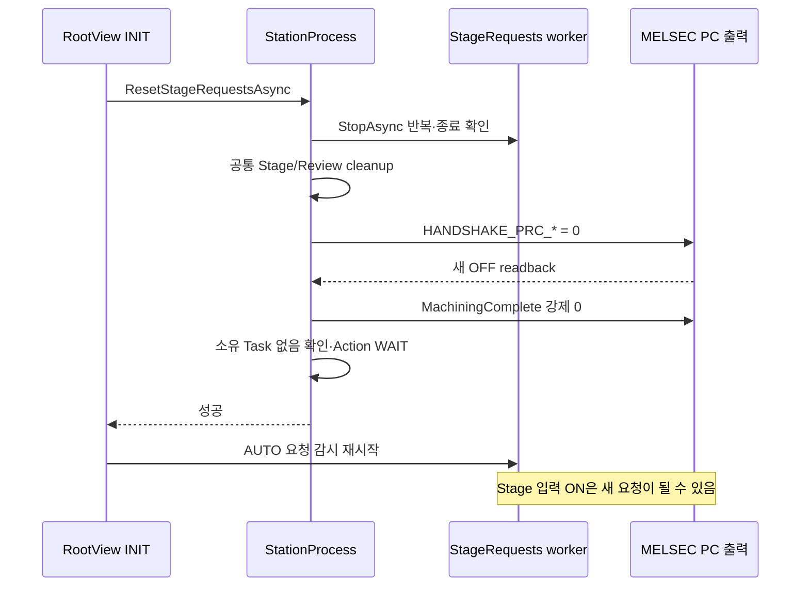

| 단계 | 실제 범위·실패 처리 |
|---|---|
| 직렬화·정지 확인 | INIT gate로 중복 정리를 직렬화. StopAsync와 공통 실행 Session 종료를 반복 확인하며 15초 시각 기준 사용 |
| 출력 정리 | 공통 cleanup 후 활성·쓰기 가능 HANDSHAKE_PRC_* 출력에 0 Write와 새 Readback 확인. 실패들을 모아 예외 |
| 완료값 초기화 | Process MachiningComplete는 캐시가 이미0이어도 forceWrite하여 새 피드백 확인 |
| Action 초기화 | 공통 소유권/Stage Task/BufferedRun이 남으면 Action을 Reset하지 않고 실패 |
| 재시작 | 성공 후 RootView가 감시 재시작. 실패는 상태 메시지·경고창으로 표시하고 감시 재시작 성공으로 처리하지 않음 |

근거: [INIT 전체 단계](https://github.com/kjuws10-rgb/A3Drilling/blob/28764c91d521777b8ee068dd7aaf2d3902ce9fe2/Drilling.Common/Station/CStationProcess.cs#L3912-L3958), [출력 선택·OFF 확인](https://github.com/kjuws10-rgb/A3Drilling/blob/28764c91d521777b8ee068dd7aaf2d3902ce9fe2/Drilling.Common/Station/CStationProcess.cs#L4340-L4385), [강제 완료값 Write·새 피드백](https://github.com/kjuws10-rgb/A3Drilling/blob/28764c91d521777b8ee068dd7aaf2d3902ce9fe2/Drilling.Common/Station/CStationProcess.cs#L4843-L4897), [요청 감시와 Stage 입력 소비](https://github.com/kjuws10-rgb/A3Drilling/blob/28764c91d521777b8ee068dd7aaf2d3902ce9fe2/Drilling.Common/Station/CStationProcess.cs#L5166-L5220)

**INIT는 Home, PLC 전체 초기화, Stage 입력 OFF, 비상정지, 모든 장치의 물리 정지를 보증하는 함수가 아닙니다.** 코드가 수행하는 정지 요청·cleanup·출력 readback 경계와 실제 장치 정지의 승인 시험을 구분합니다. 15초는 앞의 정지 대기 루프 기준이며 이후 모든 파일·통신까지 합친 전체 INIT 제한시간으로 설명하지 않습니다. Stage의 ABLE가 남으면 감시 재시작 후 자동으로 새 요청을 처리할 수 있다는 경고가 UI 확인문에 있습니다. [재시작 경고 문구](https://github.com/kjuws10-rgb/A3Drilling/blob/28764c91d521777b8ee068dd7aaf2d3902ce9fe2/Drilling.UI/CRootView.cs#L763-L771)

후속 검증은 대기/DoReady/Process/Review/TPM/Distortion에서 INIT, Task STOP 지연, 공통 cleanup 실패, OFF readback 실패, 강제 완료값0, Stage ABLE/START/COMPLETE 잔류, 연속 클릭·확인 중 모드 변경으로 나눕니다. 출력만 내려간 상태에서 Action이 완료로 표시되거나 실패 후 감시가 자동 재시작되는지 각각 관측합니다.

## 15. PM 잠금·이력·수명 표시는 서로 다른 책임입니다

PM 진입은 Manual·MAIN Ready 조건에 더해 Stage 요청/cleanup, Manual MOF, 공통 이동, Review Running/Stopping, PowerMeasure, Manual 보조동작, Correction 보정, Monitor Tune 실행 여부를 확인합니다. 사유는 비어 있지 않은 200자 이하 한 줄이며 이력 시작 호출이 성공한 뒤 잠급니다. 이는 UI가 관측하는 소프트웨어 작업 상태의 점검이고 물리 에너지 격리나 별도 정비 안전장치의 증거가 아닙니다. [PM 진입·진행동작 점검·사유](https://github.com/kjuws10-rgb/A3Drilling/blob/28764c91d521777b8ee068dd7aaf2d3902ce9fe2/Drilling.UI/CRootView.cs#L1272-L1390), [Manual 진행동작 집계](https://github.com/kjuws10-rgb/A3Drilling/blob/28764c91d521777b8ee068dd7aaf2d3902ce9fe2/Drilling.UI/Menu/Menus/CMenuManual.cs#L137-L146)

해제는 Setting에서 읽은 비밀번호를 비교한 뒤 현재 PM 세션의 CompletePmSession을 호출합니다. 값 누락·불일치·세션 없음·이력 저장 예외이면 잠금을 유지합니다. 인증값은 문서에 싣지 않습니다. 잠금 상태와 활성 세션 참조는 RootView 메모리 필드로 초기화되며, 이번에 읽은 호출부에서는 재시작 시 열린 세션 복원 경로를 찾지 못했습니다. [메모리 PM 상태](https://github.com/kjuws10-rgb/A3Drilling/blob/28764c91d521777b8ee068dd7aaf2d3902ce9fe2/Drilling.UI/CRootView.cs#L127-L130), [해제 순서·실패 유지](https://github.com/kjuws10-rgb/A3Drilling/blob/28764c91d521777b8ee068dd7aaf2d3902ce9fe2/Drilling.UI/CRootView.cs#L1442-L1499)

PM Build는 선택 Recipe의 현재/최대 보호윈도우 매수, Head1~8→Talon0~7의 캐시 ThgHour, 공통 수명 제한값과 이력을 표시합니다. PM 화면은2초 주기로 재조립 대상으로 선택됩니다. 이 코드는 수명 사용량을 리셋하거나 한계 초과를 자동 차단하지 않습니다. 또한 Snapshot.Value가 있으면 State가 STALE/ERROR여도 캐시 숫자를 표시하는 경로이므로 숫자가 곧 최신 실측값이라는 판단은 피해야 합니다. [PM 화면 생산자](https://github.com/kjuws10-rgb/A3Drilling/blob/28764c91d521777b8ee068dd7aaf2d3902ce9fe2/Drilling.UI/Menu/Menus/CMenuPm.cs#L34-L56), [수명·보호윈도우 표시](https://github.com/kjuws10-rgb/A3Drilling/blob/28764c91d521777b8ee068dd7aaf2d3902ce9fe2/Drilling.UI/Menu/Menus/CMenuPm.cs#L80-L140), [PM 갱신 선택](https://github.com/kjuws10-rgb/A3Drilling/blob/28764c91d521777b8ee068dd7aaf2d3902ce9fe2/Drilling.UI/CRootView.cs#L2313-L2345)

**소스 접근 한계**: 현재 tracked C#에서 CLogManager와 ST_PM_HISTORY_ENTRY의 선언/PM 이력 구현을 찾지 못했습니다. 따라서 Start/Complete/Read 호출 순서는 확인했지만 PM 이력의 실제 저장 형식·원자성·재시작 복원이나 정식 빌드 성공을 확정하지 않습니다. 이력 호출은 기존 로그 서비스에 대한 의존성으로 남습니다. 후속 확인은 진입·해제 중 I/O 실패, 잘못된 비밀번호, 재시작·이력 미완료, STALE 값, 수명한계 경계, 진행 JOG 정지 실패를 포함합니다.


# 별도 정적 추적 상세 해설 · architecture/05-device-interfaces-and-drivers.md

# 05. Device Interface·Automation1·Motion·MELSEC의 경계

> 기준: `A3Drilling/master` · `28764c91d521777b8ee068dd7aaf2d3902ce9fe2`. 본 장은 해당 Commit의 소스를 정적으로 읽어 설명합니다. 정식 설비 빌드·장비 연결·가공을 실행한 결과가 아닙니다.

화면 버튼에서 DLL을 직접 호출한다고 생각하면 추적이 어렵습니다. 이 프로그램은 통신 등록, 장치 명령, Motion 축 제어, MELSEC typed I/O를 나누어 다룹니다. 오류가 났을 때 **어느 대상/번호의 어느 경로**였는지 먼저 정해야 합니다.

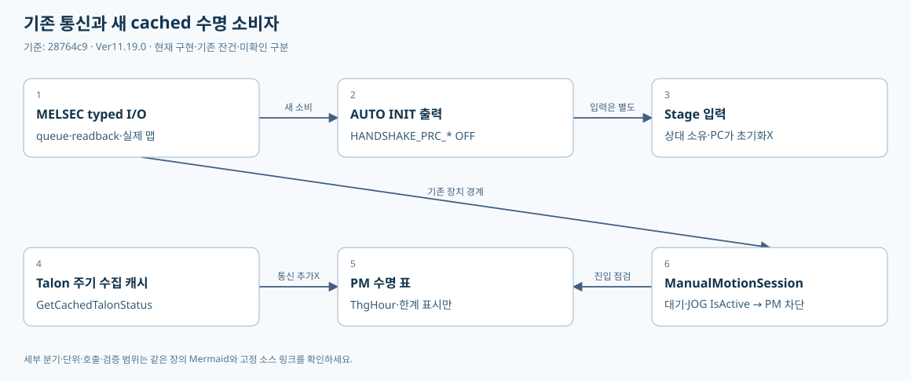

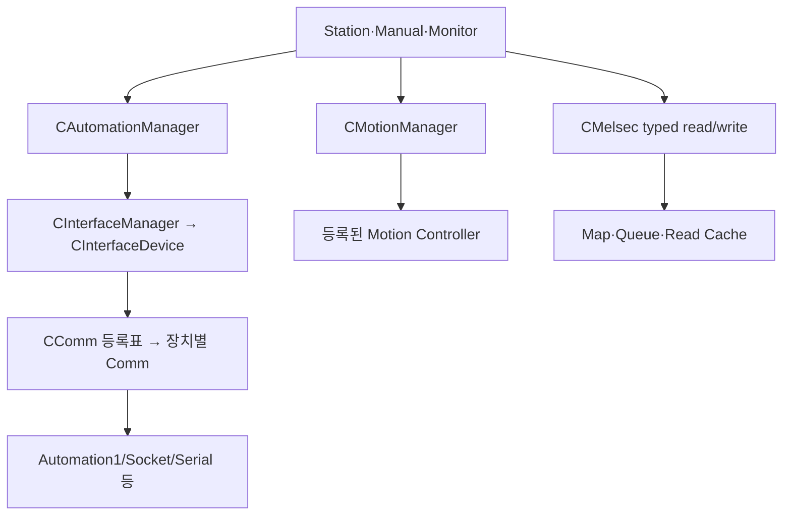

## 1. InterfaceManager의 책임

`CInterfaceManager`는 장치 정의를 바탕으로 `CInterfaceDevice`를 만들고, 모듈+번호 또는 NickName으로 장치를 찾으며, 연결/명령/통신 상태를 묶습니다. 등록되지 않은 모듈/번호는 KeyNotFoundException, 중복 NickName은 명시적 InvalidOperationException이 될 수 있습니다. 번호가 있는 장치에서는 이름만으로 호출하는 코드를 새로 넣을 때 중복 가능성을 확인해야 합니다. [장치 찾기와 중복 이름 처리](https://github.com/kjuws10-rgb/A3Drilling/blob/28764c91d521777b8ee068dd7aaf2d3902ce9fe2/Drilling.Common/Interface/CInterfaceManager.cs#L658-L695).

`ExecuteDeviceFunction`은 device.ExecuteFunction을 호출하고 명령/응답 로그를 남깁니다. Vision line count 초과 예외는 알람 callback도 시도한 뒤 다시 던집니다. 통신 예외를 단순히 빈 문자열로 바꿔 UI에서 OK처럼 보이게 처리하는 변경은 원래 오류 경계를 약화시킬 수 있습니다. [명령 로그·예외·Vision 용량 알람](https://github.com/kjuws10-rgb/A3Drilling/blob/28764c91d521777b8ee068dd7aaf2d3902ce9fe2/Drilling.Common/Interface/CInterfaceManager.cs#L630-L655).

## 2. 장치별 Comm은 어떻게 선택되는가

`CInterfaceDevice`는 연결 옵션을 파싱하고 `CComm.Create(Data, ConnectOption)`으로 실제 Comm을 구성합니다. Comm 팩토리는 같은 Assembly에서 `CCommBase` 하위 타입과 `CCommTypeAttribute`를 찾아 InterfaceType/DeviceName 매칭으로 선택합니다. DeviceNames가 구체적인 등록을 먼저 고릅니다. 맞는 타입이 없으면 `CReadyOnlyComm`을 반환합니다. [장치 Comm 생성](https://github.com/kjuws10-rgb/A3Drilling/blob/28764c91d521777b8ee068dd7aaf2d3902ce9fe2/Drilling.Common/Interface/CInterfaceManager.cs#L2987-L3006), [Attribute 기반 Comm 등록](https://github.com/kjuws10-rgb/A3Drilling/blob/28764c91d521777b8ee068dd7aaf2d3902ce9fe2/Drilling.Common/Interface/CComm.cs#L12-L60).

| 단계 | 확인 내용 |
|---|---|
| 정의 | JHMI Interface에 모듈·번호·InterfaceType·옵션이 올바른지 |
| 파싱 | `CInterfaceConnectOption.Parse` 결과가 의도한 대상인지 |
| 등록 | 해당 Comm 클래스의 Attribute와 Device enum 문자열이 맞는지 |
| 생성 | CReadyOnlyComm으로 fallback하지 않았는지 |
| 연결 | Online/Offline/Simulation과 마지막 오류를 별도로 확인 |
| 응답 | Execute 반환값이 장치별 성공 계약과 일치하는지 |

`CReadyOnlyComm`은 Connect/Execute 때 “Live ... not ready” 오류 상태를 설정합니다. 타입 생성에 성공했다는 사실만으로 실제 통신 드라이버가 지원된다고 설명하면 안 됩니다. [fallback 동작](https://github.com/kjuws10-rgb/A3Drilling/blob/28764c91d521777b8ee068dd7aaf2d3902ce9fe2/Drilling.Common/Interface/CComm.cs#L138-L153).

## 3. Simulation은 통신/모션/Script 조건이 분리되어 있다

| 계층 | 확인되는 처리 | 해석상 주의 |
|---|---|---|
| `CInterfaceDevice` | simulation이면 `SIM:...:OK` 응답 생성 | 장비가 실행된 성공이 아닙니다. |
| `CInterfaceManager.IsSimulation` | 등록 장치 전부의 simulation 상태를 집계 | 장치별 혼합 구성과 전체 boolean의 차이 |
| `CMotionManager` | global 및 controller/axis simulation을 고려 | 축의 상태 갱신과 실제 모션 실행을 구분 |
| `CAutomationManager.RunScript` | simulation이면 합성 Task status 반환 | Controller compiler·queue·가공 결과를 검증하지 않습니다. |
| Script generator | `AUTOMATION1_SIMULATOR_USE`로 Y 출력 선택 | 통신 Simulation과 Script Simulator 조건이 동일하다고 가정하지 않습니다. |

근거: [Interface Simulation 집계](https://github.com/kjuws10-rgb/A3Drilling/blob/28764c91d521777b8ee068dd7aaf2d3902ce9fe2/Drilling.Common/Interface/CInterfaceManager.cs#L97-L107), [SIM 응답](https://github.com/kjuws10-rgb/A3Drilling/blob/28764c91d521777b8ee068dd7aaf2d3902ce9fe2/Drilling.Common/Interface/CInterfaceManager.cs#L3147-L3164), [모션 Simulation과 실제 실행 분기](https://github.com/kjuws10-rgb/A3Drilling/blob/28764c91d521777b8ee068dd7aaf2d3902ce9fe2/Drilling.Common/Motion/CMotionManager.cs#L376-L396), [RunScript Simulation](https://github.com/kjuws10-rgb/A3Drilling/blob/28764c91d521777b8ee068dd7aaf2d3902ce9fe2/Drilling.Common/Automation/CAutomationManager.cs#L324-L334), [Script simulator Y](https://github.com/kjuws10-rgb/A3Drilling/blob/28764c91d521777b8ee068dd7aaf2d3902ce9fe2/Drilling.File/Script/CAutomation1ScriptFile.cs#L713-L715).

## 4. AutomationManager와 Automation1Comm의 분업

`CAutomationManager.UploadScript`는 로컬 경로와 Controller 파일명을 정규화한 뒤 `AUTOMATION1:SCRIPT|UPLOAD|...` 내부 명령을 만듭니다. `RunScript`는 TaskIndex와 파일명을 검증하고 내부 RUN 명령으로 전달합니다. 이 문자열은 모든 외부 장비가 그대로 이해하는 공통 프로토콜이 아니라 A3 내부 Comm 계층으로 내려가는 표현입니다. [Script API와 내부 명령](https://github.com/kjuws10-rgb/A3Drilling/blob/28764c91d521777b8ee068dd7aaf2d3902ce9fe2/Drilling.Common/Automation/CAutomationManager.cs#L301-L344).

| API | 중요한 인자 | 호출 의미 |
|---|---|---|
| `UploadScript` | localScriptPath, scriptFileName, number, token | PC 파일을 특정 Automation 대상으로 전송 |
| `RunScript` | scriptFileName, taskIndex, number, token | Controller에 존재하는 파일 실행 요청 |
| `RunBufferedScripts` | scripts 목록, number, queueSize, linesPerCommand, timeoutMs, token | 업로드와 queue 기반 실행 경로 |
| `RunStagePreparedBufferedScripts` | 준비된 scripts, queue 조건 | 준비 때 올린 정확한 파일을 재업로드 없이 실행하는 stageSession 경로 |

`RunStagePreparedBufferedScripts`의 주석은 LocalScriptPath가 이 경로에서 쓰이지 않으며 큐를 완료/취소까지 소유한다고 명시합니다. 준비된 파일을 실행 시점의 임의 최신 파일로 대체하면 같은 회차라는 보장이 깨집니다. [Buffered API와 준비 파일 소유권](https://github.com/kjuws10-rgb/A3Drilling/blob/28764c91d521777b8ee068dd7aaf2d3902ce9fe2/Drilling.Common/Automation/CAutomationManager.cs#L347-L370).

`CAutomation1Comm`은 `_commLock → _statusReadLock` 순서를 명시합니다. 일반 명령과 연결/해제는 두 잠금을 통해 충돌을 막고, Buffered feed는 comm lock을 유지하되 read-only status lane을 열어 준비/피드백 조회를 허용합니다. 이 분리 경로에서 잠금 순서를 반대로 추가하면 교착을 만들 수 있습니다. [잠금과 실행상태 필드](https://github.com/kjuws10-rgb/A3Drilling/blob/28764c91d521777b8ee068dd7aaf2d3902ce9fe2/Drilling.Common/Interface/Automation1/CAutomation1Comm.cs#L13-L25), [일반/Buffered 실행과 finally 해제](https://github.com/kjuws10-rgb/A3Drilling/blob/28764c91d521777b8ee068dd7aaf2d3902ce9fe2/Drilling.Common/Interface/Automation1/CAutomation1Comm.cs#L76-L157).

Automation1 SDK ControllerOperationException은 연결 자체를 Offline으로 바꾸지 않고 명령 오류 응답을 돌려주는 분기가 있습니다. 다른 예외는 SetError를 통해 Offline 상태가 될 수 있습니다. **Task가 Fault인 것과 통신이 끊긴 것**을 같은 화면 문구로 합치지 않는 것이 좋습니다. [명령오류와 연결오류 분기](https://github.com/kjuws10-rgb/A3Drilling/blob/28764c91d521777b8ee068dd7aaf2d3902ce9fe2/Drilling.Common/Interface/Automation1/CAutomation1Comm.cs#L123-L143).

## 5. MotionManager는 논리 축과 실제 Controller를 연결한다

`ExecuteAxisCommand(axisId, command, parameter, token, parameter2)`는 AxisId를 정규화하고 등록 정보를 찾습니다. 정의나 축 상태가 없으면 예외를 내고, ValidateAxisCommand를 거쳐 해당 Controller에 명령을 보낸 뒤 내부 상태에 반영합니다. AxisId, DevType, DevNo, 물리 축 식별자를 혼동하면 다른 장치로 명령이 갈 수 있습니다. [축 명령 경로](https://github.com/kjuws10-rgb/A3Drilling/blob/28764c91d521777b8ee068dd7aaf2d3902ce9fe2/Drilling.Common/Motion/CMotionManager.cs#L362-L396).

초기화에서는 정의된 축을 Controller 단위로 묶어 각 Controller.Initialize에 전달합니다. 전체 Simulation 또는 개별 Controller Simulation이면 실제 초기화를 건너뜁니다. `Initialize` 반환만으로 모든 물리 축의 원점 완료를 의미한다고 설명하지 않습니다. [Controller별 초기화](https://github.com/kjuws10-rgb/A3Drilling/blob/28764c91d521777b8ee068dd7aaf2d3902ce9fe2/Drilling.Common/Motion/CMotionManager.cs#L96-L123).

## 6. MELSEC은 일반 문자열 Execute가 아니라 별도 typed I/O다

`CreateDevice`에서 MELSEC은 외부 통신 상태 경로로 표시됩니다. 해당 Device의 `ExecuteFunction`을 직접 호출하면 `MELSEC commands must use CMelsec typed read/write functions` 예외를 냅니다. 따라서 새 Stage 인터페이스를 일반 Socket처럼 `ExecuteFunction("...")`로 추가하면 안 됩니다. [MELSEC external 경로](https://github.com/kjuws10-rgb/A3Drilling/blob/28764c91d521777b8ee068dd7aaf2d3902ce9fe2/Drilling.Common/Interface/CInterfaceManager.cs#L168-L180), [typed I/O 강제](https://github.com/kjuws10-rgb/A3Drilling/blob/28764c91d521777b8ee068dd7aaf2d3902ce9fe2/Drilling.Common/Interface/CInterfaceManager.cs#L3147-L3152).

`CMelsec`에는 Map, 요청 Queue, Write Queue/상태, Read Snapshot, CachedValue, polling/backoff를 위한 상태가 분리되어 있습니다. 이는 소스 필드에서 확인되는 구조이며, 본 장이 모든 고객 주소와 신호 순서를 검증했다는 뜻은 아닙니다. [MELSEC 큐·맵·캐시·poll 상태](https://github.com/kjuws10-rgb/A3Drilling/blob/28764c91d521777b8ee068dd7aaf2d3902ce9fe2/Drilling.Common/Interface/Melsec/CMelsec.cs#L15-L58).

새 I/F 항목은 **맵 정의 → 타입·주소·권한 → 읽기 fresh/cache 기준 → 쓰기완료/상대응답 → timeout/reset → 로그**까지 연결해서 검토해야 합니다. 주소가 보인다는 이유만으로 고객 승인된 신호 계약이라고 확정하지 않습니다. Heartbeat, RunEnable, Auto 상태처럼 시간 의미가 있는 신호는 현재값 1만 확인하는 것과 갱신이 살아있다는 것을 구분하여 계약해야 합니다.

## 7. DLL이 보일 때 읽을 수 있는 것과 없는 것

SDK DLL은 C# 소스와 다릅니다. 이 문서에서는 Automation1/PicoMotor/ACS/XPS 등의 파일명·프로젝트 참조와 **공개된 래퍼 소스의 호출**을 분석 대상으로 삼습니다. DLL 본문 역컴파일·실행·장치 호출로 내부 동작을 확인하지 않았습니다. BinaryReference가 표시되는 것 자체가 “프로젝트 코드 전체가 인식되지 않았다”는 증거는 아닙니다. C# 래퍼 파일·설정·호출자까지 검색 결과에 연결되어야 실제 코드 이해에 도움이 됩니다.

Offline Studio에서 SDK 내부 동작을 답변해야 할 경우, 공식 API 문서와 사용자가 승인한 SDK 설명자료를 별도 지식 출처로 연결하고 그 버전을 남겨야 합니다. 래퍼에 없는 사양을 파일명만으로 만들어내면 안 됩니다.

## 8. 변경·오류별 검증 계획

| 조건 | 정적/격리 검증 | 장비 연결 전에 결정할 것 |
|---|---|---|
| 새 장치 타입 | Attribute 등록과 매칭/fallback 테스트 | 대상 프로토콜·응답 오류 코드 |
| 중복 NickName | 이름 호출 거부·모듈번호 호출 성공 | 운영 화면의 유일 식별 방식 |
| Buffered 중 status poll | 잠금 순서·취소·Disconnect 경합 | SDK 허용 동시 호출 범위 |
| 명령 Fault | 연결 Online 유지와 Task 오류 구분 | 사용자 복구/재시도 허용 여부 |
| MELSEC 캐시 stale | 마지막 성공시각·fresh 조회·timeout 구분 | 신호별 최대 허용 지연과 heartbeat 기준 |
| Simulation PASS | 실제 호출 횟수 0인지 확인 | 실장비 평가와 분리한 승인 절차 |

## 9. 11.13.0에서 바뀌어 현재 유지되는 통신 경계

Distortion의 Stage ABLE/COMPLETE 수신 정의는 `UNASSIGNED·Use=false`에서 지정 주소·활성 입력으로 바뀌었습니다. `CMelsecMapFile`의 기본행 생성기도 같은 방향으로 고쳤습니다. 타입은 DWord, 방향 IN, 접근 R, 길이 2 Word, ReadScale `0.0001`, WriteScale `10000`인 정의입니다. 설명의 raw Int32 0/10000을 논리 0/1로 변환한다는 의도와, 실제 PLC가 같은 단위·주소를 쓰는지는 구분합니다. 현장 IP·접속 옵션 원문은 이 장에 공개하지 않습니다. [Stage Distortion 기본 맵 생성](https://github.com/kjuws10-rgb/A3Drilling/blob/28764c91d521777b8ee068dd7aaf2d3902ce9fe2/Drilling.File/JHMI/CMelsecMapFile.cs#L1659-L1670).

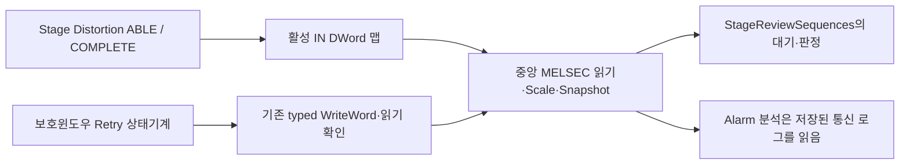

보호윈도우 추가 요청은 새 직접 PLC 접속을 만들지 않습니다. 기존 `PublishIfChanged`가 typed WriteWord를 전달하고, 중앙 Snapshot에서 **쓰기 시작 이후의 readback**을 확인합니다. Stage Tray Count도 기존 통신 소유자의 `RefreshCachedValueAsync`로 새 값을 읽습니다. 값이 유효한 1 Word 비음수 정수인지 검사하며 별도 5초 한도를 둡니다. 추가 요청 정책의 0~3회와 통신 쓰기/읽기 timeout을 같은 '재시도 횟수'로 묶지 않습니다. [출력과 갱신시각 확인](https://github.com/kjuws10-rgb/A3Drilling/blob/28764c91d521777b8ee068dd7aaf2d3902ce9fe2/Drilling.Common/Station/CStationProcess.cs#L4469-L4513), [Tray Count fresh 취득](https://github.com/kjuws10-rgb/A3Drilling/blob/28764c91d521777b8ee068dd7aaf2d3902ce9fe2/Drilling.Common/Station/CStationProcess.cs#L4799-L4820).

검증은 raw 0/10000의 논리 0/1 변환, ABLE/COMPLETE ON→OFF 순서, 오래된 정상 캐시와 새 오류 응답, DWord 인접 두 Word의 계약을 나눕니다. JHMI Interface 정의와 현장용 복사본도 변경됐지만 현재 `CInterfaceFile.GetInterfacePath`는 `JHMI_INTERFACE.csv`라는 고정 이름을 반환합니다. 현장용 복사본 추가만으로 실행 시 자동 선택된다고 설명하지 않습니다. [실제 Interface 정의 경로](https://github.com/kjuws10-rgb/A3Drilling/blob/28764c91d521777b8ee068dd7aaf2d3902ce9fe2/Drilling.File/JHMI/CInterfaceFile.cs#L107-L110). 이 분석은 구성 파일·래퍼 소스 검토이며 실제 통신·벤더 DLL 로드·실행·역컴파일은 수행하지 않았습니다.

## 10. 이전 11.17의 장치 변경 범위

11.17.0 diff에는 새로운 Comm·SDK 래퍼·MELSEC 맵 변경이 없었습니다. 당시 구조 변화는 Default의 Head별 검사점 수, Review의 Shot별 Beam 할당, 화면/설정 소비에 있습니다. 이전 절의 Distortion 맵·typed I/O·스냅샷 한계는 현재 소스에서 유지됩니다. 새 DOE_EXIST를 설정했다고 일반 공정의 Laser 발진 횟수나 외부 장치 프로토콜이 자동 변경되는 것으로 설명하지 않습니다.

Default OFF Head는 `grid=1,pitch=0,angle=0`으로 기존 Capture API를 한 번 호출하고, 같은 기존 Stage/Vision 세션을 사용합니다. Shot별 Beam 할당은 정규화한 ShotKey마다 Beam 목록을 합쳐 기존 대상 좌표 생성기로 전달합니다. 이 검사는 전역 Beam 유효범위와 Shot의 Head/제외조건을 확인하며 DOE_EXIST로 일반 Review의 Beam을 자동 치환하지 않습니다. [Default의 기존 Capture 소비](https://github.com/kjuws10-rgb/A3Drilling/blob/28764c91d521777b8ee068dd7aaf2d3902ce9fe2/Drilling.UI/Menu/Menus/CMenuCorrection.cs#L3902-L3924), [할당 정규화·Beam 검증·좌표 대상](https://github.com/kjuws10-rgb/A3Drilling/blob/28764c91d521777b8ee068dd7aaf2d3902ce9fe2/Drilling.Common/Review/CReviewManager.cs#L1381-L1425).

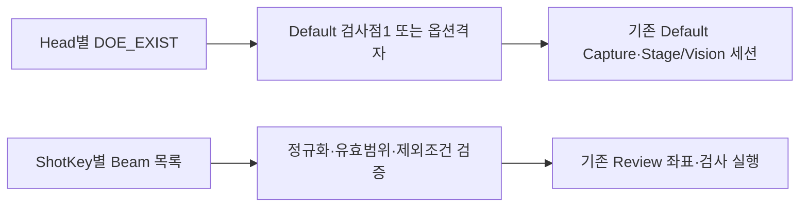

후속 연동 검증에서는 실제 광학 DOE/원빔 Head 구성, 사용 Beam 번호, 1회/16회 Capture 요청 수와 측정 좌표를 확인해야 합니다. 이 문서에서는 장치 호출·Vendor DLL 로드·실행·역컴파일을 하지 않았습니다.

다음 읽기: [06. 동시성과 로그](../manual/architecture/06-threading-snapshots-and-logs.md).

## 11. Ver11.19.0의 새 상태 API와 기존 통신 계약

새 GetCachedTalonStatus(number)는 Talon 상태 딕셔너리를 반환하며 통신 명령을 보내지 않습니다. PM은 이 API의 ThgHour를 소비합니다. 수집기의 최신성 판정과 캐시의 마지막 숫자는 다른 정보이므로, PM 화면에 수치가 있다는 이유로 지금 장치와 통신했다고 설명하지 않습니다. [Talon 상태 사전](https://github.com/kjuws10-rgb/A3Drilling/blob/28764c91d521777b8ee068dd7aaf2d3902ce9fe2/Drilling.Common/Interface/CInterfaceManager.cs#L1656-L1664), [새 cached API](https://github.com/kjuws10-rgb/A3Drilling/blob/28764c91d521777b8ee068dd7aaf2d3902ce9fe2/Drilling.Common/Interface/CInterfaceManager.cs#L2047-L2056), [PM 소비자](https://github.com/kjuws10-rgb/A3Drilling/blob/28764c91d521777b8ee068dd7aaf2d3902ce9fe2/Drilling.UI/Menu/Menus/CMenuPm.cs#L93-L108)

| 변경 파일 | 이번 실제 코드 변화 | 유지되는 경계 |
|---|---|---|
| CMelsec | 확인한 diff는 설명 주석 보강 | Direct I/O queue 직렬화·Scalar2Word·poll 우선순위·simulation 메모리 경계 유지 |
| CVisionComm | 확인한 diff는 설명 주석 보강 | UniqueId pending 매칭·프레임 전체 수신·연결 종료 실패 전파 유지 |
| CAutomationManager | ManualMotionSession IsActive 집계 추가 | SDK/Task/Controller 통신 경계와 준비된 파일 실행은 유지 |
| CStageReviewSequences | 확인한 diff는 설명 주석 보강 | Process Move/IOF 소유권·상대 신호·도착 판정·cleanup은 새 기능으로 세지 않음 |
| CStationProcess | AUTO INIT와 MachiningComplete 강제 초기화 추가 | Write 성공만으로 상대 의미·실기 동작을 확정하지 않음 |

근거: [Direct I/O 직렬화](https://github.com/kjuws10-rgb/A3Drilling/blob/28764c91d521777b8ee068dd7aaf2d3902ce9fe2/Drilling.Common/Interface/Melsec/CMelsec.cs#L613-L630), [Scalar2Word](https://github.com/kjuws10-rgb/A3Drilling/blob/28764c91d521777b8ee068dd7aaf2d3902ce9fe2/Drilling.Common/Interface/Melsec/CMelsec.cs#L546-L577), [Vision pending](https://github.com/kjuws10-rgb/A3Drilling/blob/28764c91d521777b8ee068dd7aaf2d3902ce9fe2/Drilling.Common/Interface/Vision/CVisionComm.cs#L274-L303), [Manual 상태 집계](https://github.com/kjuws10-rgb/A3Drilling/blob/28764c91d521777b8ee068dd7aaf2d3902ce9fe2/Drilling.Common/Automation/CAutomationManager.cs#L1673-L1728), [기존 도착·cleanup](https://github.com/kjuws10-rgb/A3Drilling/blob/28764c91d521777b8ee068dd7aaf2d3902ce9fe2/Drilling.Common/Station/CStageReviewSequences.cs#L654-L702), [새 AUTO INIT](https://github.com/kjuws10-rgb/A3Drilling/blob/28764c91d521777b8ee068dd7aaf2d3902ce9fe2/Drilling.Common/Station/CStationProcess.cs#L3912-L3958)

ManualMotionSession은 gate를 기다리는 요청부터 activeOperations를 증가시키고 finally에서 감소시킵니다. JOG 시작 callback을 보관하면 jogActive를 세우며 성공적으로 StopJog/StopAll이 해당 callback을 끝내야 내립니다. PM의 진행동작 차단이 대기 요청과 미확인 JOG까지 볼 수 있게 한 변화입니다. IsActive는 장치 encoder/Busy의 물리 정지 증명과 같지 않습니다. [대기·JOG·실패 상태 수명](https://github.com/kjuws10-rgb/A3Drilling/blob/28764c91d521777b8ee068dd7aaf2d3902ce9fe2/Drilling.Common/Automation/CAutomationManager.cs#L1673-L1767), [PM의 소유권 소비](https://github.com/kjuws10-rgb/A3Drilling/blob/28764c91d521777b8ee068dd7aaf2d3902ce9fe2/Drilling.UI/CRootView.cs#L1340-L1370)

검증 우선순위는 INIT의 실제 출력 readback, 장치 단절/STALE, JOG 시작 전후 PM 진입·정지 실패, Talon 번호 매핑입니다. 이번 문서 작업에서는 vendor DLL 로드·역컴파일·SDK 호출·장비 연결을 수행하지 않았습니다.


# 별도 정적 추적 상세 해설 · architecture/06-threading-snapshots-and-logs.md

# 06. 스레드·스냅샷·취소·로그를 이용해 멈춤과 오동작 찾기

> 기준: `A3Drilling/master` · `28764c91d521777b8ee068dd7aaf2d3902ce9fe2`. 본 장은 해당 Commit의 소스를 정적으로 읽어 설명합니다. 정식 설비 빌드·장비 연결·가공을 실행한 결과가 아닙니다.

현장에서는 “버튼을 눌렀는데 멈췄다”만으로 원인을 알기 어렵습니다. **UI 스레드, Station 주기 스레드, 비동기 통신, 캐시된 상태, 파일 저장** 중 어디가 기다리는지 나눠야 합니다.

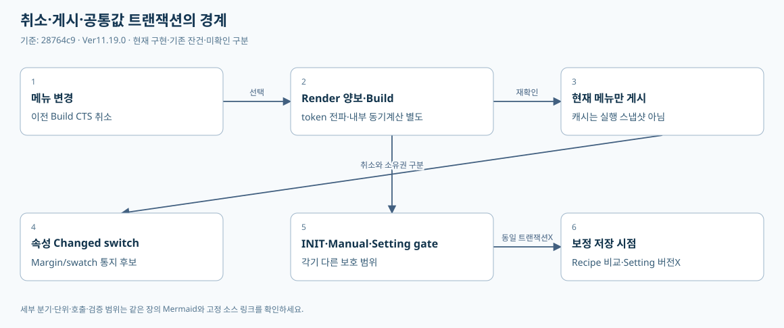

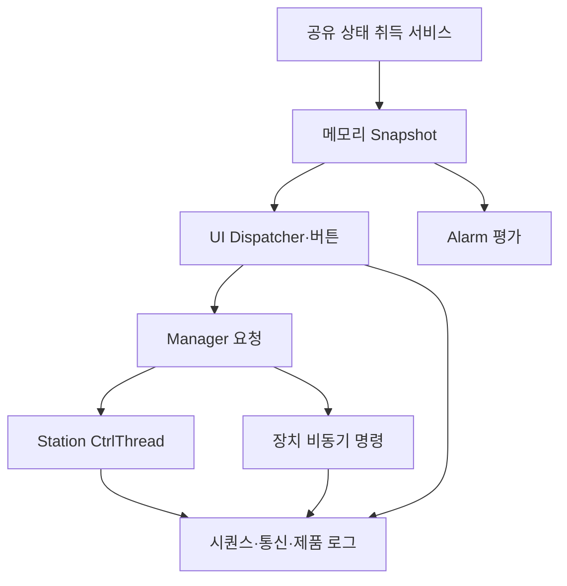

## 1. CtrlThread는 Task.Run 한 번과 다르다

`CtrlThread`는 자체 Thread, pause/stop event, stopRequested, state, LastThreadError를 갖는 반복 실행 기반 클래스입니다. `ThreadProcess`는 stop까지 Run을 반복하고 delay 동안 stop event를 기다립니다. Run에서 예외가 나면 LastThreadError를 저장하고 OnThreadError를 호출합니다. 소스상 이 catch 자체가 즉시 while을 종료하지는 않습니다. [스레드 기본 필드](https://github.com/kjuws10-rgb/A3Drilling/blob/28764c91d521777b8ee068dd7aaf2d3902ce9fe2/Drilling.Common/Threading/CtrlThread.cs#L4-L15), [반복 실행과 예외 처리](https://github.com/kjuws10-rgb/A3Drilling/blob/28764c91d521777b8ee068dd7aaf2d3902ce9fe2/Drilling.Common/Threading/CtrlThread.cs#L232-L281).

| 상태 | 뜻 | 주의 |
|---|---|---|
| Stopped | 실행 스레드 정지 | 장치의 Motion 정지와 별개 |
| Running | 반복 Run 동작 | 내부 시퀀스가 Ready일 수도 있음 |
| Paused | 반복 스레드 일시정지 | 이미 보낸 하드웨어 명령을 자동 취소하는 뜻 아님 |
| Stopping | stop 요청 중 | 현재 SDK 호출이 끝나지 않으면 기다릴 수 있음 |
| Error | stop timeout 등 오류 상태 | LastThreadError와 상위 Station 상태를 같이 봄 |

근거: [CtrlThread 상태 enum](https://github.com/kjuws10-rgb/A3Drilling/blob/28764c91d521777b8ee068dd7aaf2d3902ce9fe2/Drilling.Common/Threading/CtrlThread.cs#L286-L293).

`Stop`은 stopRequested와 event를 설정하고 외부 스레드에서 호출했다면 최대 3초 Join합니다. 멈추지 못하면 TimeoutException과 Error 상태를 남깁니다. 현재 스레드 자신이 Stop을 호출한 경우 Join하지 않습니다. 따라서 “Stop 버튼은 즉시 모든 장비 작업을 취소한다”는 설명은 이 구현만으로 성립하지 않습니다. [Stop의 Join과 timeout](https://github.com/kjuws10-rgb/A3Drilling/blob/28764c91d521777b8ee068dd7aaf2d3902ce9fe2/Drilling.Common/Threading/CtrlThread.cs#L128-L186).

## 2. Station의 취소와 Thread의 정지는 다른 층이다

Station Start는 요청 token에 linked CancellationTokenSource를 만들고 sequence를 PowerCheck로 바꾼 다음 CtrlThread를 시작합니다. RunSequenceStep은 해당 token을 전달하며 OperationCanceledException은 Station Stop 전이로 이어집니다. [sequence CTS 생성](https://github.com/kjuws10-rgb/A3Drilling/blob/28764c91d521777b8ee068dd7aaf2d3902ce9fe2/Drilling.Common/Station/CStationProcess.cs#L297-L321), [취소와 단계 token](https://github.com/kjuws10-rgb/A3Drilling/blob/28764c91d521777b8ee068dd7aaf2d3902ce9fe2/Drilling.Common/Station/CStationProcess.cs#L373-L405).

취소를 지원하는 함수라도 이미 시작한 외부 SDK의 동기 호출을 즉시 중단할 수 있는지는 그 래퍼의 구현을 확인해야 합니다. 이 문장은 일반적 한계를 지적하는 검토 지침이며 이 소스의 특정 SDK가 반드시 중단 불가능하다고 단정하는 것은 아닙니다.

## 3. 잠금은 무엇을 보호하는가

| 소유자 | 동기화 장치 | 보호하는 데이터/작업 | 변경 시 위험 |
|---|---|---|---|
| CRecipeManager | Recipe operation SemaphoreSlim, cache lock, history gate | 파일 기반 작업·캐시·이력 순서 | 파일 저장 뒤 오래된 캐시를 다시 덮음 |
| CSettingManager | save lock, cache lock | section 저장과 캐시 publish | 저장 실패인데 UI만 새 값 |
| CProductManager | update gate | 한 Product의 전이·영속화 | 두 갱신이 이전 상태에서 출발하여 결과 유실 |
| CStationProcess | sequence lock | 시작/준비/수동 MOF와 sequence 상태 | 같은 모델의 이중 실행 |
| Automation1Comm | comm lock → status lock | Controller 수명·명령과 상태 조회 | 반대 순서 잠금으로 deadlock |
| Monitor polling | context/snapshot lock, motor poll gate | 선택 화면과 결과 사본 | 화면 전환과 이전 응답 혼합 |

근거: [Recipe gate](https://github.com/kjuws10-rgb/A3Drilling/blob/28764c91d521777b8ee068dd7aaf2d3902ce9fe2/Drilling.Common/Managers/CRecipeManager.cs#L11-L32), [Setting cache/save lock](https://github.com/kjuws10-rgb/A3Drilling/blob/28764c91d521777b8ee068dd7aaf2d3902ce9fe2/Drilling.Common/Managers/CSettingManager.cs#L23-L50), [Product gate](https://github.com/kjuws10-rgb/A3Drilling/blob/28764c91d521777b8ee068dd7aaf2d3902ce9fe2/Drilling.Common/Product/CProductManager.cs#L25-L45), [Station prepare lock](https://github.com/kjuws10-rgb/A3Drilling/blob/28764c91d521777b8ee068dd7aaf2d3902ce9fe2/Drilling.Common/Station/CStationProcess.cs#L221-L225), [Automation1 lock 순서](https://github.com/kjuws10-rgb/A3Drilling/blob/28764c91d521777b8ee068dd7aaf2d3902ce9fe2/Drilling.Common/Interface/Automation1/CAutomation1Comm.cs#L16-L25), [Monitor 동기화](https://github.com/kjuws10-rgb/A3Drilling/blob/28764c91d521777b8ee068dd7aaf2d3902ce9fe2/Drilling.UI/Menu/Menus/CMonitorStatusPollingService.cs#L17-L31).

설명용 주석을 추가할 때는 “스레드 안전”이라는 한 줄보다 **어떤 필드/시점/잠금 순서/잠금 밖 I/O**를 보호하는지 구체적으로 써야 합니다. lock이 있다는 사실만으로 객체 전체가 thread safe라고 표현하지 않습니다.

## 4. 상태 취득과 화면 표시를 분리하는 구조

`CManager.StartBackgroundMonitoring`은 공유 Motor/Laser/BET 상태 스냅샷을 시작하고 알람 평가에 `ReadAlarmDeviceSnapshot`을 공급합니다. 해당 함수는 “memory-only” 의도로 공유 Snapshot을 읽고 SnapshotError를 모읍니다. 느린 장치 SDK 호출이 알람 워커를 직접 붙잡지 않도록 분리한 구조입니다. [공유 취득과 알람 감시](https://github.com/kjuws10-rgb/A3Drilling/blob/28764c91d521777b8ee068dd7aaf2d3902ce9fe2/Drilling.Common/Managers/CManager.cs#L267-L276), [메모리 Snapshot을 이용한 알람 입력](https://github.com/kjuws10-rgb/A3Drilling/blob/28764c91d521777b8ee068dd7aaf2d3902ce9fe2/Drilling.Common/Managers/CManager.cs#L288-L311).

이 구조에서 표시한 값은 **현재 메모리에서 마지막으로 확인한 결과**일 수 있습니다. 값이 정상 범위여도 오래된 결과라면 안전 판단에 그대로 쓰면 안 되므로, 새 검증에서는 성공시각/오류/갱신 여부를 함께 확인합니다. 소스의 SnapshotError와 실제 서비스의 stale 규칙을 같이 읽어야 합니다.

`CMonitorStatusPollingService`는 LoopInterval 250 ms, ActiveInterval 0.5초, CommunicationInterval 1초 등의 주기를 정의하고 활성 화면 context에 따라 대상을 달리 선택합니다. `UpdateContext`는 선택 Tab/장치 번호/MELSEC group을 새 context로 저장하고 `GetSnapshot`은 lock 아래 결과를 반환합니다. [Monitor 주기·context·snapshot](https://github.com/kjuws10-rgb/A3Drilling/blob/28764c91d521777b8ee068dd7aaf2d3902ce9fe2/Drilling.UI/Menu/Menus/CMonitorStatusPollingService.cs#L9-L59).

주의할 실제 코드가 있습니다. PowerMeter의 두 Poll 호출은 확인한 범위에서 주석 처리되어 있습니다. 따라서 상수명이 `ActivePowerMeterMeasureInterval`이라고 모든 화면에서 PowerMeter를 그 주기로 실제 측정한다고 설명하면 틀립니다. [Tab별 실제 polling 분기](https://github.com/kjuws10-rgb/A3Drilling/blob/28764c91d521777b8ee068dd7aaf2d3902ce9fe2/Drilling.UI/Menu/Menus/CMonitorStatusPollingService.cs#L108-L136).

## 5. UI 변경 통지는 자동으로 모든 스레드를 보정해 주지 않는다

`CBindingBase`의 SetProperty는 값이 같으면 알리지 않고, SetSequenceProperty는 ReferenceEquals/SequenceEqual로 같은 목록 갱신을 피합니다. OnPropertyChanged는 속성명별 이벤트를 호출하는 switch입니다. 이 함수 자체가 Dispatcher로 이동하는 것은 아닙니다. [동일값 억제와 Property 이벤트](https://github.com/kjuws10-rgb/A3Drilling/blob/28764c91d521777b8ee068dd7aaf2d3902ce9fe2/Drilling.UI/Menu/CBindingBase.cs#L766-L889).

새 비동기 작업이 UI 속성이나 ObservableCollection을 바꾸는 경우 해당 경로의 Dispatcher 사용 여부를 확인해야 합니다. 한곳의 Dispatcher를 발견했다고 모든 await 이후 UI 접근이 안전하다고 판단하지 않습니다. RootView는 알람 갱신에 전용 Dispatcher를 보유하고 큐잉하는 경로가 있으므로, 유사 작업도 같은 패턴을 검토할 수 있습니다. (이 장은 전 UI 스레드 접근의 무결성을 검증한 보고서가 아닙니다.)

## 6. 로그는 사용자의 클릭·의도·실제 결과를 따로 연결해야 한다

`CUiLogService.Configure`는 WPF ButtonBase.ClickEvent의 class handler를 등록합니다. OnButtonClicked는 화면·Control·CommandParameter·Detail을 얻어 WriteClick에 넘깁니다. **클릭 로그가 있다는 것과 명령이 허용·실행·완료됐다는 것은 다릅니다.** 실제 명령/시퀀스/통신 결과 로그와 시간·식별자를 연결해야 합니다. [UI 클릭 로그 등록과 기록](https://github.com/kjuws10-rgb/A3Drilling/blob/28764c91d521777b8ee068dd7aaf2d3902ce9fe2/Drilling.UI/CUiLogService.cs#L17-L69).

키 입력 dialog와 password dialog의 일부 글자 버튼은 ShouldSkipButton에서 제외합니다. 따라서 모든 키 입력이 그대로 텍스트 로그에 남는다고 설명해서는 안 됩니다. 진단용 로그를 확장할 때도 비밀번호·키·민감한 원문을 추가하지 않습니다. [입력 버튼 로그 제외](https://github.com/kjuws10-rgb/A3Drilling/blob/28764c91d521777b8ee068dd7aaf2d3902ce9fe2/Drilling.UI/CUiLogService.cs#L72-L92).

| 진단 질문 | 우선 확인할 근거 |
|---|---|
| 사용자가 뭘 눌렀는가 | UI click의 화면·Control·parameter·시각 |
| 명령이 수락됐는가 | Station 전이/Interlock 판단/명령 accept |
| 어떤 파일·조건이었는가 | RecipeId/Product snapshot/Script manifest·RunId |
| 외부 장비가 뭘 응답했는가 | Interface command/response·MELSEC write/read 상태 |
| 실제 완료됐는가 | Task completion·Review 저장·Product 결과 |
| 완료 뒤 로그만 실패했는가 | commit 이후 History/Log error와 Active 파일 |

공통 로그의 의미는 각 호출부와 연결해 읽습니다. 예를 들어 Product는 Active 저장 이후 로그 실패가 상태 전이를 실패로 바꾸지 않도록 처리합니다. 클릭 로그가 없거나 이력이 실패했다고 실제 실행도 없었다고 단정하지 않습니다. [Product의 상태와 이력 분리](https://github.com/kjuws10-rgb/A3Drilling/blob/28764c91d521777b8ee068dd7aaf2d3902ce9fe2/Drilling.Common/Product/CProductManager.cs#L789-L819).

## 7. 현장 디버깅을 위한 검증 계획

1. **연속 클릭/교차 요청**: Start 두 번, Prepare 중 다른 Recipe 선택, Stop/Reset 동시 요청을 격리 테스트합니다. 실제 명령 수와 최종 상태를 기록합니다.
2. **응답 지연**: 가짜 SDK/파일 어댑터를 지연시켜 UI 응답성·snapshot 오류·Stop timeout을 각각 확인합니다.
3. **취소 시점 분리**: 파일 쓰기 전/후, upload 전/후, queue feeding 중의 취소를 나눠 부분 완료와 중복 재시도를 확인합니다.
4. **메모리/파일 불일치**: 저장 성공 후 이력 실패를 주입하고 새로고침/재시작이 올바른 현재값을 보여주는지 확인합니다.
5. **실행 식별자 연결**: 같은 Recipe를 연속 실행해도 Product/Glass/Script directory/RunId가 섞이지 않는지 확인합니다.
6. **원인 분석용 수집**: 알람 앞뒤의 UI/Station/Interface/Product/Script 상태를 같은 시간축으로 묶되 로그 반출 범위는 고객의 승인 조건을 따릅니다.

## 8. 11.13.0의 분석 작업과 미리보기는 다른 성능 경계를 갖습니다

Alarm 원인 분석의 파일 읽기·분류는 `Task.Run`에서 실행하고, 창을 닫으면 load CTS를 취소합니다. `IsBusy`일 때 중복 로드는 반환합니다. 반면 Monitor의 `BuildCoordinateViewerScreen`은 `BuildCoordinateViewerData`를 await하고 그 함수 안에서 좌표 계획·선택 Cell의 전체 Shot 계산행·그림을 만듭니다. 이 경로에 독립적인 `Task.Run`이 있다고 설명할 근거는 없습니다. 호출자의 실제 SynchronizationContext와 입력 크기를 확인해야 합니다. [Alarm 로드·취소](https://github.com/kjuws10-rgb/A3Drilling/blob/28764c91d521777b8ee068dd7aaf2d3902ce9fe2/Drilling.UI/Menu/Menus/CAlarmCauseAnalysis.cs#L209-L271), [Monitor 화면 조립](https://github.com/kjuws10-rgb/A3Drilling/blob/28764c91d521777b8ee068dd7aaf2d3902ce9fe2/Drilling.UI/Menu/Menus/CMenuMonitor.cs#L2665-L2676), [선택 Cell 전체 Shot 계산](https://github.com/kjuws10-rgb/A3Drilling/blob/28764c91d521777b8ee068dd7aaf2d3902ce9fe2/Drilling.UI/Menu/Menus/CMenuMonitor.cs#L3177-L3233).

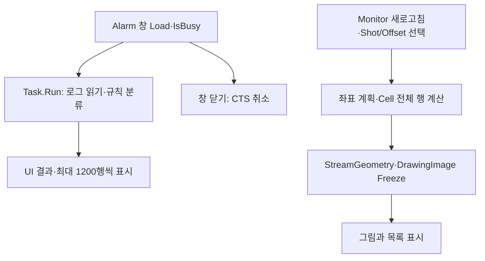

Shot 지도는 Shot마다 WPF 버튼을 생성하는 대신 상태별 `StreamGeometry`에 사각형을 모아 그립니다. 그림·Geometry를 Freeze하고, 촘촘한 격자는 그리드 간격을 넓혀 그립니다. 이것은 표시 객체 수를 줄이려는 구조상 변화이며 FPS·메모리 개선 수치를 측정한 결과가 아닙니다. 여전히 전체 Shot 목록을 순회하고 좌표표를 만들기 때문에 무제한 데이터 크기를 보장하지 않습니다. [Geometry 묶음과 Freeze](https://github.com/kjuws10-rgb/A3Drilling/blob/28764c91d521777b8ee068dd7aaf2d3902ce9fe2/Drilling.UI/Menu/Menus/CCoordinateShotMapPreviewDrawing.cs#L41-L113), [격자 간격 조정](https://github.com/kjuws10-rgb/A3Drilling/blob/28764c91d521777b8ee068dd7aaf2d3902ce9fe2/Drilling.UI/Menu/Menus/CCoordinateShotMapPreviewDrawing.cs#L155-L171).

Alarm의 1200행 제한은 **파일 읽기 이후 표시 선택**에 적용됩니다. 파일은 앞에서부터 읽고 메모리 목록에 모으며, 최대 8개의 이전 비교 구간을 추가 탐색할 수 있습니다. 큰 로그·넓은 시간창·여러 분석창을 동시에 열 때 총 I/O·메모리는 따로 계측해야 합니다. 날짜별 로그가 시간순이라는 가정도 중요합니다. 파서는 범위 끝보다 늦은 첫 시각을 만나면 그 파일을 더 읽지 않습니다. [표시행 제한](https://github.com/kjuws10-rgb/A3Drilling/blob/28764c91d521777b8ee068dd7aaf2d3902ce9fe2/Drilling.UI/Menu/Menus/CAlarmCauseAnalysis.cs#L485-L518), [비교구간 탐색](https://github.com/kjuws10-rgb/A3Drilling/blob/28764c91d521777b8ee068dd7aaf2d3902ce9fe2/Drilling.UI/Menu/Menus/CAlarmCauseAnalysis.cs#L545-L568), [파일 순차 읽기와 break](https://github.com/kjuws10-rgb/A3Drilling/blob/28764c91d521777b8ee068dd7aaf2d3902ce9fe2/Drilling.UI/Menu/Menus/CAlarmCauseAnalysis.cs#L852-L887).

보호윈도우의 `_gate`는 Update와 완료 감시를 직렬화하며, readback·파일 저장까지 gate 안에서 기다립니다. 느린 저장/통신은 다음 완료 점검을 늦출 수 있습니다. 재시도 소진 callback은 로그 쓰기 다음 SetAlarm 순서이고 상위가 예외를 잡으므로, **로그 sink가 throw하면 알람 요청까지 건너뛸 수 있는지** 장애 주입으로 확인해야 합니다. 이는 조건부 위험이며 이번 분석에서 로그 장애를 실제 재현한 것은 아닙니다. [완료 처리 gate](https://github.com/kjuws10-rgb/A3Drilling/blob/28764c91d521777b8ee068dd7aaf2d3902ce9fe2/Drilling.Common/Station/CStationProcess.cs#L4638-L4645), [로그 다음 알람 호출](https://github.com/kjuws10-rgb/A3Drilling/blob/28764c91d521777b8ee068dd7aaf2d3902ce9fe2/Drilling.Common/Managers/CManager.cs#L146-L151), [callback 예외 처리](https://github.com/kjuws10-rgb/A3Drilling/blob/28764c91d521777b8ee068dd7aaf2d3902ce9fe2/Drilling.Common/Station/CStationProcess.cs#L4787-L4797).

검증은 합성 로그의 10³/10⁵/10⁶행·전후 0/60/3600초, 창 닫기 중 취소, 2개 분석창, 시간 역전·손상 행·동시 append로 나눕니다. Monitor는 작은/큰 Cell, 세로·가로 지도, 빠른 Shot/Offset 전환에서 UI 지연·최대 메모리·이전 선택 잔류를 측정합니다. 아직 측정 결과는 없습니다.

## 9. Ver11.17.0의 단일 Shot 지도와 속성 알림 경계

새 `CReviewShotMapControl`은 여러 WPF Button 대신 FrameworkElement 하나의 OnRender에서 Shot 사각형을 그립니다. Rows 교체 때 기존 행 이벤트를 떼고 새 행 이벤트를 붙이며, Loaded/Unloaded에서 400ms blink timer와 구독을 시작/중지합니다. 행 변화가 UI 스레드 밖에서 오면 Dispatcher.Render로 그림 무효화를 예약합니다. **Freeze된 그림을 한 번 보여 주는 Monitor DrawingImage와, 상태 변화를 직접 다시 그리는 이 Control은 다른 방식**입니다. [Control·Rows·수명](https://github.com/kjuws10-rgb/A3Drilling/blob/28764c91d521777b8ee068dd7aaf2d3902ce9fe2/Drilling.UI/Views/CReviewShotMapControl.cs#L13-L111), [Rows 구독 교체·Dispatcher·timer](https://github.com/kjuws10-rgb/A3Drilling/blob/28764c91d521777b8ee068dd7aaf2d3902ce9fe2/Drilling.UI/Views/CReviewShotMapControl.cs#L179-L241).

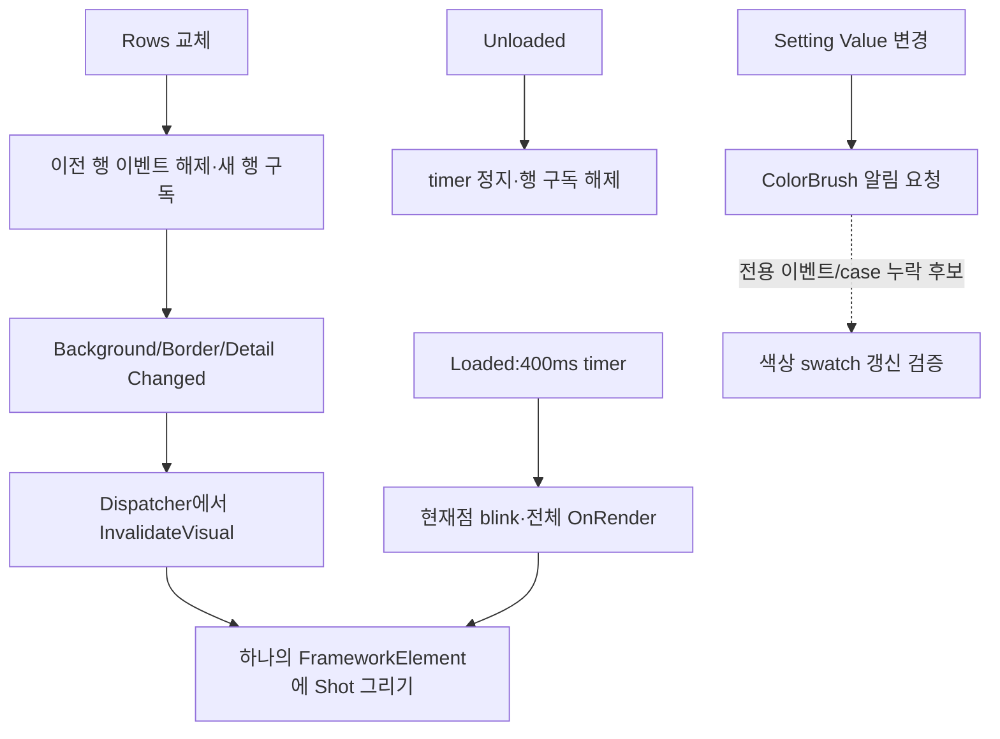

클릭은 가공 mm가 아닌 WPF 화면좌표 19(점 크기18+양쪽 여백0.5)의 행·열 격자로 역산하고 명령의 CanExecute를 확인합니다. 이 방식은 개별 Button 수를 줄이지만 OnRender는 전체 Shot을 순회하고 blink 검사도 전체 Rows에서 현재점을 찾습니다. 가상화·일정 FPS·무제한 점수 지원을 의미하지 않습니다. Row 재할당·메뉴 재진입·빠른 상태변화에서 구독 중복·해제·CPU·메모리를 별도 측정해야 합니다. [전체 그리기](https://github.com/kjuws10-rgb/A3Drilling/blob/28764c91d521777b8ee068dd7aaf2d3902ce9fe2/Drilling.UI/Views/CReviewShotMapControl.cs#L114-L132), [명령과 클릭](https://github.com/kjuws10-rgb/A3Drilling/blob/28764c91d521777b8ee068dd7aaf2d3902ce9fe2/Drilling.UI/Views/CReviewShotMapControl.cs#L156-L177), [좌표 역산·Pen 캐시](https://github.com/kjuws10-rgb/A3Drilling/blob/28764c91d521777b8ee068dd7aaf2d3902ce9fe2/Drilling.UI/Views/CReviewShotMapControl.cs#L324-L356).

**11.17부터 유지된 정적 확인 후보**: Setting 행 Value setter는 `OnPropertyChanged(nameof(ColorBrush))`를 호출하지만, `CBindingBase` 전체 이벤트 선언·switch에는 `ColorBrushChanged`와 `case "ColorBrush"`가 없습니다. 이 구조는 일반 INotifyPropertyChanged 자동 통지가 아니므로 텍스트 Value만 바뀌고 옆 swatch가 즉시 바뀌지 않는지 확인해야 합니다. 같은 파일의 기존 `LevelBrushChanged`는 다른 속성이므로 이를 대신하지 않습니다. 저장 자체 실패로 단정하지 않으며 WPF UI 재현은 미수행입니다. [Value setter](https://github.com/kjuws10-rgb/A3Drilling/blob/28764c91d521777b8ee068dd7aaf2d3902ce9fe2/Drilling.UI/Menu/Menus/CMenuSetting.cs#L1134-L1153), [swatch 계산 속성](https://github.com/kjuws10-rgb/A3Drilling/blob/28764c91d521777b8ee068dd7aaf2d3902ce9fe2/Drilling.UI/Menu/Menus/CMenuSetting.cs#L1180-L1204), [알림 진입 구조](https://github.com/kjuws10-rgb/A3Drilling/blob/28764c91d521777b8ee068dd7aaf2d3902ce9fe2/Drilling.UI/Menu/CBindingBase.cs#L766-L794), [swatch 바인딩](https://github.com/kjuws10-rgb/A3Drilling/blob/28764c91d521777b8ee068dd7aaf2d3902ce9fe2/Drilling.UI/Views/CSettingView.xaml#L632-L646).

## 10. Level 설정의 오류 경로도 화면마다 다릅니다

Live Review는 Level 설정 파싱이 InvalidDataException이면 기본 Level로 fallback합니다. 반면 Review Data의 BuildDisplayModel은 같은 오류를 상위 로드 실패로 전달합니다. Live에는 기본 색이 보이는데 저장 결과의 DATA LOAD는 실패하는 상태가 가능한지 검증해야 합니다. [Live fallback](https://github.com/kjuws10-rgb/A3Drilling/blob/28764c91d521777b8ee068dd7aaf2d3902ce9fe2/Drilling.UI/Menu/Menus/CMenuReview.cs#L4747-L4767), [결과 표시 모델의 직접 파싱](https://github.com/kjuws10-rgb/A3Drilling/blob/28764c91d521777b8ee068dd7aaf2d3902ce9fe2/Drilling.UI/Menu/Menus/CMenuCorrection.ReviewData.Display.cs#L241-L253), [로드 실패 처리](https://github.com/kjuws10-rgb/A3Drilling/blob/28764c91d521777b8ee068dd7aaf2d3902ce9fe2/Drilling.UI/Menu/Menus/CMenuCorrection.ReviewData.Display.cs#L223-L237).

색상 picker 생성자는 현재 Value를 즉시 NormalizeColor합니다. 외부 파일 수정 등으로 이미 잘못된 색이 로드됐다면 picker를 열기 전에 예외가 날 수 있으므로 잘못된 설정을 UI에서 복구할 수 있는지도 확인합니다. picker의 APPLY는 편집값이고 CANCEL은 저장이 아니며, Setting 저장 검증과 혼동하지 않습니다. [picker 생성·정규화](https://github.com/kjuws10-rgb/A3Drilling/blob/28764c91d521777b8ee068dd7aaf2d3902ce9fe2/Drilling.UI/Popup/CColorPickerDialog.xaml.cs#L11-L24), [Setting의 picker 진입](https://github.com/kjuws10-rgb/A3Drilling/blob/28764c91d521777b8ee068dd7aaf2d3902ce9fe2/Drilling.UI/Views/CSettingView.xaml.cs#L49-L69).

검증은 정상·누락·손상 Level, 잘못된 기존 색, picker APPLY 뒤 swatch·SAVE·재시작, 10³/10⁵ Shot의 blink·행 교체·Unload/Reload·빠른 탭 전환으로 나눕니다. 이 장은 문서·정적 흐름 검증이며 설비 빌드·UI 실기·성능 시험을 수행했다는 뜻이 아닙니다.

다음 읽기: [07. 변경 영향과 Offline Studio](../manual/architecture/07-change-impact-and-offline-reference.md), [08. 알람 원인 분석](../manual/architecture/08-alarm-cause-analysis.md).

## 11. Ver11.19.0 메뉴 Build 취소는 게시 경계까지 확인합니다

RootView는 메뉴 전환 때 CTS를 교체하고 이전 Build를 취소합니다. RefreshCurrentScreen의 단일 실행/대기 플래그 루프 안에서 Render에 양보→Build(token)→취소 재확인→현재 메뉴 확인→캐시/화면 게시를 수행합니다. 메뉴 전환 취소는 새 Build 요청을 같은 루프에서 우선 처리하는 방향입니다. 이것이 모든 내부 계산을 background thread로 옮기거나 CPU 계산을 즉시 중단한다는 뜻은 아닙니다. token을 확인하지 않는 동기 계산과 Build 안에서 이미 바뀐 공유 메뉴 필드는 별도 검토해야 합니다. [Build·취소·게시](https://github.com/kjuws10-rgb/A3Drilling/blob/28764c91d521777b8ee068dd7aaf2d3902ce9fe2/Drilling.UI/CRootView.cs#L549-L654)

```mermaid
flowchart LR
 M[메뉴 선택] --> C[이전 CTS 취소]
 C --> V[캐시 또는 Loading 먼저 표시]
 V --> B[Render 양보·Build token 전달]
 B --> K[취소·선택 메뉴 재확인]
 K --> P[캐시·CurrentScreen 게시]
 K -->|전환 취소| M
```

캐시에는 CScreenViewModel이 참조하는 기존 메뉴 객체도 포함됩니다. 화면 재생성/재바인딩 시 보일 수 있는 값과 속성 Changed 이벤트로 즉시 갱신되는 값을 구분해야 합니다. 새 Recipe의 AkMarginXText/YText setter 통지는 요청되지만 CBindingBase의 대응 이벤트·switch case는 확인되지 않았습니다. 기존 ColorBrush swatch 잔건과 같은 **즉시 갱신 누락의 정적 후보**이며, UI가 반드시 오래된 값을 보인다고 재현한 것은 아닙니다. [새 표시 속성](https://github.com/kjuws10-rgb/A3Drilling/blob/28764c91d521777b8ee068dd7aaf2d3902ce9fe2/Drilling.UI/Menu/Menus/CMenuRecipe.cs#L331-L335), [통지 요청](https://github.com/kjuws10-rgb/A3Drilling/blob/28764c91d521777b8ee068dd7aaf2d3902ce9fe2/Drilling.UI/Menu/Menus/CMenuRecipe.cs#L1375-L1384), [표시 바인딩](https://github.com/kjuws10-rgb/A3Drilling/blob/28764c91d521777b8ee068dd7aaf2d3902ce9fe2/Drilling.UI/Views/CRecipeView.xaml#L763-L790), [명시 이벤트 통지 구조](https://github.com/kjuws10-rgb/A3Drilling/blob/28764c91d521777b8ee068dd7aaf2d3902ce9fe2/Drilling.UI/Menu/CBindingBase.cs#L766-L802)

## 12. INIT·PM·공통 Setting은 같은 Lock의 보호 대상이 아닙니다

INIT gate는 시퀀스 정리를, ManualMotionSession gate는 수동 시작/정지를, Setting save lock은 파일 저장과 캐시 게시를 보호합니다. 이 세 가지를 얻었다고 Recipe·Setting·보정파일이 하나의 트랜잭션으로 고정되는 것은 아닙니다. Distortion이 동결한 Margin을 저장 직전에 Setting과 대조하는 검사는 찾지 못했으며, Recipe 동시변경 검사가 공통 Setting 변경까지 감지하지는 않습니다. [INIT gate](https://github.com/kjuws10-rgb/A3Drilling/blob/28764c91d521777b8ee068dd7aaf2d3902ce9fe2/Drilling.Common/Station/CStationProcess.cs#L3912-L3958), [Manual gate](https://github.com/kjuws10-rgb/A3Drilling/blob/28764c91d521777b8ee068dd7aaf2d3902ce9fe2/Drilling.Common/Automation/CAutomationManager.cs#L1683-L1728), [Setting save lock](https://github.com/kjuws10-rgb/A3Drilling/blob/28764c91d521777b8ee068dd7aaf2d3902ce9fe2/Drilling.Common/Managers/CSettingManager.cs#L127-L155), [Recipe 비교 경계](https://github.com/kjuws10-rgb/A3Drilling/blob/28764c91d521777b8ee068dd7aaf2d3902ce9fe2/Drilling.Common/Managers/CRecipeManager.cs#L94-L109)

새 AUTO_INIT 로그는 시작/완료/실패와 각 통신 결과를 연결하는 단서입니다. PM은 Start/Complete 이력 호출 후 상태를 바꾸지만 로그 서비스 구현이 tracked source에 없으므로 디스크 원자성·재시작 복구는 미확인입니다. 클릭 로그만으로 INIT 성공·PM 잠금 복원·장치 정지를 판정하지 않습니다. Alarm 상태/이력 큐 분리는 이번에 주석이 보강됐을 뿐 새 I/O 구조로 도입된 것은 아닙니다. [Alarm 상태·이력 분리](https://github.com/kjuws10-rgb/A3Drilling/blob/28764c91d521777b8ee068dd7aaf2d3902ce9fe2/Drilling.Common/Alarm/CAlarmManager.cs#L245-L268), [상태 lock 안에서 queue만 등록](https://github.com/kjuws10-rgb/A3Drilling/blob/28764c91d521777b8ee068dd7aaf2d3902ce9fe2/Drilling.Common/Alarm/CAlarmManager.cs#L323-L340)

후속 검증은 느린 Build 중 메뉴 연속전환·종료·예외, 캐시 화면의 표시시각, 같은 객체 재사용 후 Margin/swatch 갱신, INIT 중 다른 명령, PM 진입과 대기 JOG 경쟁, Setting 저장과 보정 저장 경쟁입니다. 모든 UI 성능·경쟁 시나리오는 실행 미검증으로 남깁니다.


# 별도 정적 추적 상세 해설 · architecture/07-change-impact-and-offline-reference.md

# 07. 변경 영향 검토와 Offline Studio에서 이 문서를 쓰는 방법

> 기준: `A3Drilling/master` · `28764c91d521777b8ee068dd7aaf2d3902ce9fe2`. 본 장은 해당 Commit의 소스를 정적으로 읽어 설명합니다. 정식 설비 빌드·장비 연결·가공을 실행한 결과가 아닙니다.

> 이번 갱신 범위: 이전 `96e22cd` → 현재 `28764c9`(Ver11.19.0), 두 Commit. 실제 diff와 현재 전체 소스의 관련 생산자·소비자·호출 경계를 대조했습니다. 11.13.0에서 남은 저장·재시작·알람 한계는 신규 변경과 구분해 유지합니다.

코드 레퍼런스는 현재 소스를 대신하는 정답 모음이 아니라 **찾아갈 파일과 호출 연결을 제공하는 지도**입니다. 문서가 최신 소스와 다른 Commit이면 틀린 기준으로 코드를 고칠 수 있으므로, 질문할 때 소스 Commit과 문서 기준을 함께 확인합니다.

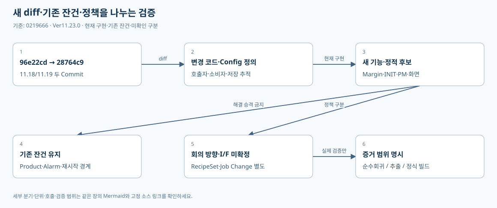

```mermaid
flowchart LR
 A[새 Source Commit] --> B[Git diff·변경 파일]
 B --> C[호출자·소비자·저장 형식 영향]
 C --> D[파일 레퍼런스·상세 챕터 갱신]
 D --> E[Commit·줄 링크·검증 범위 기록]
 E --> F[Offline Studio 색인]
 F --> G[소스 근거를 먼저 검색해 답변]
```

## 1. 가장 먼저 볼 문서

| 궁금한 내용 | 시작할 장 | 실제 소스 진입점 |
|---|---|---|
| 앱이 안 켜지거나 다른 Config를 읽음 | [01 시작](../manual/architecture/01-startup-and-composition.md) | CAppStartup.GetConfigRoot / CManager 구성 |
| Recipe 값이 저장되지 않음 | [02 Recipe·Setting](../manual/architecture/02-recipe-settings-and-csv.md) | CRecipeManager.Save → CJhmiRecipeFile.SaveCore |
| Offset가 원하는 방향으로 가지 않음 | [03 좌표·Script](../manual/architecture/03-coordinate-script-and-mof.md) | CShotCoordinatePlanBuilder.Build |
| 기판/결과가 이전 상태로 보임 | [04 Product·Station](../manual/architecture/04-product-and-station-lifecycle.md) | PersistAndLog / CProductFile.LoadCompactActive |
| 통신/SDK/모션 경로가 궁금함 | [05 장치](../manual/architecture/05-device-interfaces-and-drivers.md) | CInterfaceManager / CComm / CMotionManager |
| 화면 지연·중복 실행·취소 문제 | [06 스레드·로그](../manual/architecture/06-threading-snapshots-and-logs.md) | CtrlThread / Snapshot / gate·Dispatcher |
| 알람 전후 후보·정상 비교·시간 커서의 뜻 | [08 알람 분석](../manual/architecture/08-alarm-cause-analysis.md) | CAlarmIncidentLogReader / CauseCandidateAnalyzer |

## Ver11.19.0에서 우선 확인할 변경

| 우선순위 | 현재 소스에서 바뀐 사실 | 검증·미확인 경계 |
|---|---|---|
| 높음 · 좌표·배포 | AK Margin X/Y가 Recipe에서 공통 Setting으로 이동하고 필수 파싱됨 | 옛 Recipe값 자동 이관 없음. 공통값 변경과 저장 Align/Review Offset·과거 결과의 기준 일치 검사 필요 |
| 높음 · 상태·PLC | AUTO INIT가 Worker 정지·공통 cleanup·PC 출력OFF/완료0 확인 후 Action WAIT와 감시 재시작 | Home/Stage 입력 초기화·물리 정지 보장 아님. 상대 ON은 새 요청이 될 수 있음 |
| 높음 · 배포 근거 | PM 세션 시작/종료/읽기 호출과 ST_PM_HISTORY_ENTRY 사용이 추가됨 | tracked source에 로그 타입/구현 선언이 없어 저장 계약·정식 빌드 성공 미확인 |
| 중간 · PM 수명 | 진입·해제 조건/사유/이력 호출·Manual 상태집계·캐시 수명 표 추가 | 재시작 세션복원·STALE 수치 표시·자동 수명차단과 구분 |
| 중간 · UI | 상위 SIMPLE0/INSPECTION1, RUN/RESULT와 두 결과패널, 메뉴 캐시·Build 취소 | 기존5탭 인덱스 무효, 캐시는 실행 스냅샷 아님, 통지 누락 후보·재바인딩 검증 |
| 개선 · 보정 파일 | RETAINED/EDITED까지 적용대상 확장, 결과 숫자F6, 날짜 전체 적용이력 색인 | 새 Offset 최종0.001mm, 경로 기준 이력·원본 품질/계보 한계는 별도 |
| 유지 · 기존 잔건 | Product NG 추가필드 compact 손실, 보호윈도우 재시작, Alarm 규칙·상관키·대용량 한계 | 이번 기능으로 해결됐다고 승격하지 않음 |

위험도는 **검증 순서**이며 발생 빈도·실기 재현 결과가 아닙니다. 자세한 데이터 흐름과 출처는 [02장](../manual/architecture/02-recipe-settings-and-csv.md), [04장](../manual/architecture/04-product-and-station-lifecycle.md), [06장](../manual/architecture/06-threading-snapshots-and-logs.md) 및 리뷰 전문 장을 함께 읽습니다. 공통 Margin을 장비 전체 기본값으로 옮긴 현재 구현과, 회의의 RecipeSet/실제 Job Change·조건부 파워 보정·미확정 I/F 방향은 분리합니다.

근거: [Margin 계약](https://github.com/kjuws10-rgb/A3Drilling/blob/28764c91d521777b8ee068dd7aaf2d3902ce9fe2/Drilling.Common/Managers/CAlignKeyMarginSettings.cs#L6-L51), [INIT](https://github.com/kjuws10-rgb/A3Drilling/blob/28764c91d521777b8ee068dd7aaf2d3902ce9fe2/Drilling.Common/Station/CStationProcess.cs#L3912-L3958), [PM 진입](https://github.com/kjuws10-rgb/A3Drilling/blob/28764c91d521777b8ee068dd7aaf2d3902ce9fe2/Drilling.UI/CRootView.cs#L1272-L1330), [결과패널 조립](https://github.com/kjuws10-rgb/A3Drilling/blob/28764c91d521777b8ee068dd7aaf2d3902ce9fe2/Drilling.UI/Menu/Menus/CMenuCorrection.cs#L139-L166), [전일자 적용이력 색인](https://github.com/kjuws10-rgb/A3Drilling/blob/28764c91d521777b8ee068dd7aaf2d3902ce9fe2/Drilling.File/ReviewOffset/CReviewOffsetFile.cs#L412-L448), [결과 파일 클래스](https://github.com/kjuws10-rgb/A3Drilling/blob/28764c91d521777b8ee068dd7aaf2d3902ce9fe2/Drilling.File/ReviewResult/CReviewResultFile.cs#L719-L722)

이전 Fine 재개 결과의 RETAINED가 파일 기반 보정에서 빠진다는 잔건은 이번 MeasuredRows 확장 범위만큼 대체합니다. 반면 날짜를 넘는 중복검사는 경로별 이력 색인으로 개선됐어도 내용 hash/공통 Setting 버전의 계보 검증까지 구현된 것은 아닙니다. [MeasuredRows·적용 경계](https://github.com/kjuws10-rgb/A3Drilling/blob/28764c91d521777b8ee068dd7aaf2d3902ce9fe2/Drilling.UI/Menu/Menus/CMenuCorrection.ReviewData.Offset.cs#L471-L480)

이번 검증 증거도 구분합니다. Root가 별도 폴더에서 현재 소스 수치 계산기·DTO를 복사해 수행한 순수 Margin 회귀는34/34 통과했고, Review 담당의 별도 순수회귀는23/23 통과했습니다. 이는 파일/수치 계약 검증이며 WPF 앱 정식 빌드, vendor SDK·Controller compiler·설비·물리 좌표·장시간 성능 검증이 아닙니다. 문서 추출기의 처리·부분 진단 수치도 정식 빌드 결과를 대신하지 않습니다. 빌드 및 실행 증거는 최종 보고의 실제 검증 기록을 따릅니다.

## 이전 11.13.0에서 추가되어 현재도 확인할 경계

| 우선순위·영향 | 지금 확인한 구조 | 다음 검증에서 확인할 결과 |
|---|---|---|
| 높음 · 상태·PLC | 보호윈도우 추가 요청 0~3, 인계 저장 후 OFF 확인, 소진 LIGHT·AUTO 계속 | 임계값과 재시작 경계에서 요청 횟수·파일·캐시·신호가 일치 |
| 높음 · 영속성 | Product 메모리 NG 필드 추가, Active compact의 새 필드 저장은 없음 | ReviewResult/Active/checkpoint 각각 round-trip하여 손실 범위 확인 |
| 높음 · 좌표 의미 | Monitor는 현재 입력의 미리보기, Station은 준비 스냅샷, Camera는 Shift만 검사목표에 적용 | 동일 입력·Axis 변환·실행 회차를 맞춘 모델/Script/Vision 대조 |
| 높음 · 보정 기준 | Default 중심은 AK1·AK3 중점, DOE 1×1/4×4, 로그 열 추가 | 세션 조건과 추천값 재현, 십자/샷의 실제 검사점 수 |
| 중간 · 통신 계약 | Stage Distortion 입력 맵 활성화·DWord scale | 실제 상대 신호·주소 승인·ON/OFF와 캐시 최신성 |
| 중간 · UI·운영 | Review 소유 메뉴가 Correction으로 이동, Alarm 원인 후보·비교구간 추가 | 메뉴 이동/취소·로그 누락·오탐·날짜 경계·큰 로그 응답성 |

위 위험도는 정적 영향 검토의 우선순위입니다. 현장 고장 발생 빈도나 재현 완료 등급이 아닙니다. 구체 근거는 각 장의 새 절과 [08장](../manual/architecture/08-alarm-cause-analysis.md)을 따릅니다. 운영 측정 CSV 행·현장 접속값은 문서의 예제 데이터로 복제하지 않았습니다.

## 이전 11.17.0에서 바뀌어 유지되는 범위

| 구분·우선순위 | 현재 구현과 영향 | 후속 검증 |
|---|---|---|
| 11.17 도입 · 높음 | Head별 DOE_EXIST로 Default 검사1점/옵션격자 분기. 구형 정의의 DOE 키 자동 보충은 없음 | 구형 정의+새값·비활성 Head 누락·ON/OFF 혼합·Capture 수·로그 수 일치 |
| 11.17 도입 · 높음 | Level은 maxabs mm 4등급. 실측 JUDGE·출처와 다른 표시 의미 | 경계값·VisionFind NG·미측정·EDITED의 live/로드 화면 비교 |
| 11.17 도입 · 중간 | Level·색상 저장 이중 검증과 picker, ColorBrush 통지 누락 후보 | CANCEL/APPLY/SAVE/재시작·손상값·swatch 즉시갱신 |
| 11.17 도입 · 중간 | INSPECTION 통합과 선택 탭만 Build, 단일 Shot Control | 탭 인덱스·결과 이동·취소·구독 해제·대용량 UI 응답 |
| 11.17 도입 · 중간 | Shift 표는 직접 축변환, popup은 길이를 제한한 방향그림 | 옛 full-plan 차이와 계산 동등성·활성 Shot 없는 Head·적용검증 유지 |
| 11.17 도입 · 저장형식 | Default 로그 DOE_EXIST/실제 검사점수 2열 추가 | 헤더 기반 구형/신형 소비자·Marks.Count와 설정 기대수 구분 |
| 기존 잔건 | Product 새 NG 필드 Active 누락, Retry 재시작 상태, 알람 후보·상관키·대용량 한계 | 고쳐졌다고 승격하지 않고 기존 검증표 유지 |

과거 보고의 'Level 사용자 설정 미확인'은 11.17에서 **임계값3개+색상4개와 UI 소비가 추가된 범위만큼** 대체합니다. 임의 N등급·다른 거리척도·JUDGE 재계산까지 완료됐다고 확대하지 않습니다. 이전의 '전역 격자만으로 Head별 Default DOE 혼합을 표현하지 못함'도 11.17 Head별 Default 검사 분기로 범위를 갱신하되, 일반 가공·모든 Review의 광학 계약까지 해결됐다고 하지 않습니다. [Level 계약](https://github.com/kjuws10-rgb/A3Drilling/blob/28764c91d521777b8ee068dd7aaf2d3902ce9fe2/Drilling.Common/Review/CReviewResultLevelSettings.cs#L23-L55), [Head별 적용 한계](https://github.com/kjuws10-rgb/A3Drilling/blob/28764c91d521777b8ee068dd7aaf2d3902ce9fe2/Drilling.Common/Correction/CDefaultOffsetCalibration.cs#L29-L62).

```mermaid
flowchart LR
 D[새 diff] --> P[정의·메모리 생산자]
 P --> C[호출자·UI·PLC 소비자]
 C --> F[CSV 저장·복구 경계]
 F --> U[단위·상태·재시작·동시성 위험]
 U --> T[합성 데이터 검증 계획]
 T --> R[현재 Commit 근거로 설명]
```

Review 좌표→Vision 요청→ReviewResult→보정 파일 연결은 별도의 리뷰 전문 챕터와 파일별 레퍼런스를 함께 읽습니다. 가공 ScannerGx/Gy를 찾았다는 이유만으로 그것이 Vision에 보내는 좌표라고 답변하면 안 됩니다.

## 2. 새 Parameter 하나가 거치는 영향 범위

| 단계 | 작성/검토할 항목 | 누락하면 생기는 현상 |
|---|---|---|
| 의미 정의 | 설비 공통/PPID별/Cell별/Shot별/런타임별 중 소유자, 단위·좌표기준 | 같은 이름을 서로 다른 기준으로 해석 |
| 정의 파일 | JHMI_RCP 또는 JHMI_SETTING, 타입·범위·표시·Use·Key | UI에 보이지 않거나 저장 때 제외 |
| 값 파서 | 기존 형식/legacy key/default/Extra 열 호환 | 구버전 Recipe를 못 읽음 |
| Manager | 캐시 갱신·변경 비교·gate·commit 이후 취소 | 화면과 파일이 달라짐·중복 보정 |
| 실행 합성 | Setting 덮어쓰기 우선순위·최신 Offset | 저장했는데 실행값이 다름 |
| 계산 | 단위 변환·axis flip/swap·Head 배정·Masking | 잘못된 위치 또는 다른 Head |
| Script/전송 | 스냅샷·manifest·controller/task 분리 | 이전 파일/다른 Controller 실행 |
| Product/결과 | 실제 적용값과 결과를 추적할 필드 | 사후 로그만으로 조건 재구성 불가 |
| UI | Property 변경 이벤트·선택상태·실행 중 편집 금지 | 수정값이 안 보이거나 도중 모델 교체 |
| 문서/색인 | 최신 Commit·파일 근거·용어·검증상태 | 개발도우미가 오래된 코드로 답변 |

현재 실행 합성의 Setting 우선순위는 [BuildRuntimeParameters](https://github.com/kjuws10-rgb/A3Drilling/blob/28764c91d521777b8ee068dd7aaf2d3902ce9fe2/Drilling.Common/Station/CStationProcess.cs#L1528-L1563), 저장/실행 기준의 분리는 [Offset 변환·합성](https://github.com/kjuws10-rgb/A3Drilling/blob/28764c91d521777b8ee068dd7aaf2d3902ce9fe2/Drilling.Common/Recipe/CShotCoordinatePlanBuilder.cs#L141-L157)에서 확인할 수 있습니다. 표는 그 구조를 확장해 적용하는 검토 절차입니다.

## 3. 기존 자료와 소스를 섞을 때의 신뢰도

| 출처 | 답변에 사용할 수 있는 범위 | 표기 방식 |
|---|---|---|
| 이번 Commit의 실제 소스 | 구현된 조건·필드·분기·저장 | 경로+함수+실제 줄 링크 |
| 회의 기록 | 사용자의 목적·희망 기능·평가 요구 | 구현 여부와 분리하여 요구로 설명 |
| 공식 SDK 설명자료 | 해당 버전 API 사양 | 자료명·버전·해당 항목 |
| 실행/빌드/실측 결과 | 실제 수행한 환경과 시나리오 | 명령·조건·결과·한계 |
| 자동 추출 호출 관계 | 찾아갈 후보와 연결 힌트 | 정적 후보, 오버로드/동적 호출 한계 |
| DLL 파일명 | 외부 의존성 존재 | 내부 로직은 미확인 |

문서에 `검증 계획`이라고 쓰인 항목은 실행 통과 항목이 아닙니다. 예를 들어 `RunScript`에는 Simulation 반환 분기가 있으므로 합성 응답을 받은 것만으로 실제 SDK·Controller compiler·물리 가공 검증까지 통과했다고 표현할 수 없습니다. [Simulation RunScript 분기](https://github.com/kjuws10-rgb/A3Drilling/blob/28764c91d521777b8ee068dd7aaf2d3902ce9fe2/Drilling.Common/Automation/CAutomationManager.cs#L324-L334).

## 4. Offline Studio가 먼저 검색해야 할 단위

아래는 문서 활용 권장 방식입니다. 이 문서 생성만으로 Studio의 검색 엔진이나 모델 가중치가 자동 변경되는 것은 아닙니다.

1. 질문에서 **행위+대상**을 뽑습니다. 예: Review/좌표/계산/Vision/전달.
2. 코드 원문에서 함수·타입·Key 이름을 찾고 그 호출자와 저장/전송 소비자를 확장합니다.
3. 파일별 레퍼런스로 역할을 확인한 후 이 상세 챕터에서 전체 흐름을 보충합니다.
4. 출처마다 sourceCommit/path/startLine/endLine을 유지하고, 같은 Commit의 소스 본문을 모델 context에 함께 넣습니다.
5. 최종 답변은 파일명·함수·핵심 인자·입출력·호출 순서·확인 한계를 포함합니다.

소스 전체 대신 HTML 설명자료 한 줄만 모델에 제공하면 코드 근거를 찾을 수 없습니다. 반대로 DLL 안내가 검색 상단을 차지해 C# 래퍼가 밀려나도 동문서답이 생길 수 있습니다. **코드 질문은 실제 C#/XAML/설정/Script 연결을 우선, 설명자료는 보충**이라는 검색 목적을 설정하는 것이 좋습니다. 이는 과거 오류에서 도출한 개선 지침이며 현재 Studio가 해당 우선순위를 이미 구현했다는 주장은 아닙니다.

## 5. 좋은 답변의 최소 형식

```text
요약: 이 기능은 A → B → C 순서로 처리됩니다.
1. [파일:줄] 함수 A: 입력과 호출자
2. [파일:줄] 함수 B: 단위/좌표 변환, 조건
3. [파일:줄] 함수 C: 저장/전송 대상과 응답 처리
변경 영향: 같은 데이터를 쓰는 다른 경로
검증: 실제 수행한 것 / 아직 해야 할 것
```

“자료에 없으니 못 찾는다”라고 끝내기 전에 색인된 소스 경로·파일 수·검색어·후보 누락 여부를 확인해야 합니다. 다만 실제 소스에 없는 계약을 억지로 추론해서 답변하지 않습니다. 예를 들어 Stage Glass/Lot 매핑 TODO가 남은 경로는 합의 완료로 설명하지 않습니다. [미합의 매핑 표시](https://github.com/kjuws10-rgb/A3Drilling/blob/28764c91d521777b8ee068dd7aaf2d3902ce9fe2/Drilling.UI/CRootView.cs#L3280-L3293).

## 6. 주석을 많이 쓸 때도 우선순위가 필요하다

각 소스파일의 주석형 레퍼런스를 작성할 때 아래 항목을 우선 설명합니다. 공개 레퍼런스의 설명은 원본 코드가 바뀐 것과 구분되어야 합니다.

| 위치 | 상세 주석에 담을 내용 |
|---|---|
| Public API/Command | 어떤 화면/시퀀스가 언제 호출하는가, 인자의 단위·허용범위 |
| 좌표 수식 | 설계/Stage/Scanner/Vision 기준, 부호·scale·반전 순서 |
| 필드/record | 현재 상태인지 스냅샷인지, 파일 영속 여부 |
| 저장 함수 | 검증·쓰기·재읽기·메모리 publish·이력의 순서와 실패 경계 |
| lock/gate | 보호 대상과 획득 순서, lock 안에서의 외부 호출 |
| 취소/finally | 취소 가능한 시점, 부분 적용 후 처리, cleanup 책임 |
| enum/state | 전이 조건과 정상/Stop/Error/Skipped 구분 |
| fallback/default | 구버전 호환인지 설치 기본값인지 임시 미합의값인지 |
| 미확인 | 코드에 근거가 없어 판정할 수 없는 조건 |

예시: Product `PersistAndLog`는 Active 저장 후 로그 실패가 전이를 뒤집지 않게 처리합니다. 여기에는 단순히 “로그 저장”이 아니라 **이미 커밋된 상태를 중복 실행시키지 않는 경계**를 설명하는 것이 유용합니다. [주석 우선순위가 높은 commit 경계](https://github.com/kjuws10-rgb/A3Drilling/blob/28764c91d521777b8ee068dd7aaf2d3902ce9fe2/Drilling.Common/Product/CProductManager.cs#L789-L819).

## 7. 주기적 업데이트의 완료 조건

- 새 원본 Commit을 확인하고 이전 문서 기준과 비교합니다.
- 변경 파일만 요약하지 않고 해당 함수의 호출자·데이터 소비자·저장 호환 영향을 추적합니다.
- sourceCommit이 다른 문서가 한 질문 context에서 섞이지 않게 표시합니다.
- 링크의 실제 파일·줄 범위, 내부 링크, Mermaid 코드 블록, 깨진 문자, 공백 오류를 검사합니다.
- 실행하지 않은 빌드·장비·실측은 미실행으로 남깁니다.
- 최신 자료의 생성과 Offline Studio의 재색인은 별도 단계로 기록합니다.

이 장은 유지보수 절차와 지식 사용 방법을 설명합니다. 예약 실행의 실제 등록·Push·최신화 결과는 이 문서 자체가 아니라 해당 작업 기록과 Shared Commit으로 확인해야 합니다.


# 별도 정적 추적 상세 해설 · architecture/08-alarm-cause-analysis.md

# 08. 알람 원인 분석: 전후 로그에서 무엇을 알 수 있는가

> 기준: `A3Drilling/master` · `28764c91d521777b8ee068dd7aaf2d3902ce9fe2`(Ver11.17.0). 실제 C#/XAML을 정적으로 읽었습니다. 설비 앱·Controller·벤더 DLL을 실행하거나 로그 원문을 공개하지 않았습니다.

새 기능은 **알람 한 건의 시각을 기준점으로, 서로 다른 로그를 한 시간축에 놓고 조사할 후보를 골라 주는 로컬 분석 화면**입니다. AI 서비스 호출이나 인과관계 증명 기능으로 읽으면 안 됩니다. 후보는 문자열·시간·영역 규칙으로 정하며 실제 원인은 원본 로그, 요청 회차, 장비 상태를 대조해 판정해야 합니다.

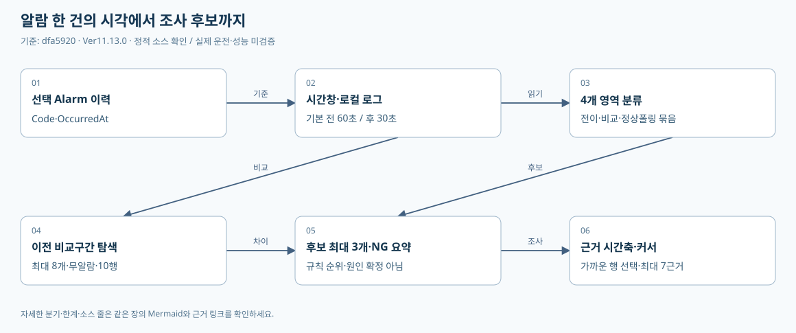

```mermaid
flowchart TD
 H[Alarm 이력 한 행: Code·OccurredAt] --> D[CauseAnalysisDialog]
 L[Manager의 LogDirectory] --> D
 D --> W[전후 시간창: 기본 -60초 / +30초]
 W --> R[Task.Run: 날짜별 로그 읽기]
 R --> P[PROCESS / MELSEC / CONTEXT / INTERFACE]
 R --> B[이전 구간 최대 8개에서 비교 기준 탐색]
 B --> S[정규화한 signature 차이 표시]
 P --> C[알람 이전 후보 최대 3개]
 P --> N[NG_SUMMARY 또는 legacy Vision 실패 요약]
 P --> T[근거 최대 7개 + 선택 알람 시간축]
 C --> U[시간 커서로 각 표의 가장 가까운 행 선택]
 T --> U
```

## 1. 화면을 여는 생산자와 받는 소비자

| 단계 | 실제 연결 | 의미 |
|---|---|---|
| 조립 | RootView → `CMenuAlarm(..., LogDirectory)` | 기존 LogManager의 로그 루트를 받습니다. 장치 연결을 새로 만들지 않습니다. |
| 조회 | AlarmManager의 history 결과 → `ST_ALARM_HISTORY_ROW` | 표시용 Time 문자열 외에 **DateTimeOffset OccurredAt**을 보존합니다. |
| 선택 | `SelectedRow` → `CauseAnalysisCommand` | 행 미선택·조회 중에는 명령을 비활성화합니다. |
| 팝업 | `ShowCauseAnalysis → CAlarmCauseAnalysisDialog` | 선택 행과 루트를 전달하고 modal 창을 엽니다. |
| 로드·종료 | Loaded에서 `LoadAsync`, Closed에서 `Dispose` | 중복 Loaded를 막고 취소 token을 정리합니다. |

근거: [RootView의 Alarm 의존성](https://github.com/kjuws10-rgb/A3Drilling/blob/28764c91d521777b8ee068dd7aaf2d3902ce9fe2/Drilling.UI/CRootView.cs#L2614-L2627), [명령·선택 행·팝업](https://github.com/kjuws10-rgb/A3Drilling/blob/28764c91d521777b8ee068dd7aaf2d3902ce9fe2/Drilling.UI/Menu/Menus/CMenuAlarm.cs#L289-L319), [조회 결과에 실제 시각 보존](https://github.com/kjuws10-rgb/A3Drilling/blob/28764c91d521777b8ee068dd7aaf2d3902ce9fe2/Drilling.UI/Menu/Menus/CMenuAlarm.cs#L418-L425), [팝업 수명과 취소](https://github.com/kjuws10-rgb/A3Drilling/blob/28764c91d521777b8ee068dd7aaf2d3902ce9fe2/Drilling.UI/Popup/CAlarmCauseAnalysisDialog.xaml.cs#L15-L37).

## 2. 기준시각·시간창·파일 배치를 먼저 확인합니다

기본 시간창은 알람 전 60초·후 30초이며, 각각 0~3600 정수초로 제한합니다. 로컬 날짜별로 파일을 찾고 시각은 DateTimeOffset으로 비교합니다. 표시 시각은 LocalDateTime입니다. PC 시간대·장비시각 불일치가 있다면 숫자만 가까운 로그를 같은 사건으로 묶을 수 있으므로 시간 동기 조건을 따로 기록해야 합니다. [기본값과 기준 알람](https://github.com/kjuws10-rgb/A3Drilling/blob/28764c91d521777b8ee068dd7aaf2d3902ce9fe2/Drilling.UI/Menu/Menus/CAlarmCauseAnalysis.cs#L14-L43), [시간창·비동기 로드](https://github.com/kjuws10-rgb/A3Drilling/blob/28764c91d521777b8ee068dd7aaf2d3902ce9fe2/Drilling.UI/Menu/Menus/CAlarmCauseAnalysis.cs#L209-L243), [시간창 범위 파싱](https://github.com/kjuws10-rgb/A3Drilling/blob/28764c91d521777b8ee068dd7aaf2d3902ce9fe2/Drilling.UI/Menu/Menus/CAlarmCauseAnalysis.cs#L316-L320).

| 화면 영역 | 찾는 논리 폴더 | 생산하는 사건 |
|---|---|---|
| PROCESS | `Sequence/<day>`, `Station/<day>` | 단계 시작·완료·중단·실패 |
| MELSEC | `Interface/MELSEC/<day>` | typed I/O 명령·응답·폴링·신호 |
| CONTEXT | `UI,Recipe,Setting,Product/<day>`와 `ProgramOpen` | 조작·조건 변경·제품 상태·프로그램 시작 |
| INTERFACE | 나머지 `Interface/<module>/<day>` | Vision·Automation 등 다른 장치 통신 |

지원 확장자는 txt/log/csv/jsonl입니다. 확장자가 csv여도 이 분석기는 일반 테이블 CSV parser를 사용하지 않고 **행 앞의 시각을 읽는 로그 parser**를 적용합니다. 선택 알람은 별도 이력 객체이고, `Alarm/<day>/Alarm_<day>.jsonl`은 비교 기준 구간에 알람이 있었는지 검사할 때 사용합니다. 모든 Alarm 파일이 네 패널에 통째로 추가된다는 설명은 잘못입니다. [분류·파일 열거](https://github.com/kjuws10-rgb/A3Drilling/blob/28764c91d521777b8ee068dd7aaf2d3902ce9fe2/Drilling.UI/Menu/Menus/CAlarmCauseAnalysis.cs#L790-L850), [Alarm 기준구간 검사](https://github.com/kjuws10-rgb/A3Drilling/blob/28764c91d521777b8ee068dd7aaf2d3902ce9fe2/Drilling.UI/Menu/Menus/CAlarmCauseAnalysis.cs#L571-L611).

파일은 공유 읽기/쓰기/삭제를 허용해 열고, 앞에서부터 읽습니다. 줄 앞의 날짜·시각이 없으면 이전 유효 시각을 상속해 예외의 여러 줄을 이어 읽습니다. 파일의 시간순 정렬을 전제로 범위 끝보다 늦은 행을 만나면 멈추며 메시지는 2000자로 줄입니다. ±500ms는 **시각적 강조**이고 인과 판정 범위가 아닙니다. [읽기와 메시지·시각 처리](https://github.com/kjuws10-rgb/A3Drilling/blob/28764c91d521777b8ee068dd7aaf2d3902ce9fe2/Drilling.UI/Menu/Menus/CAlarmCauseAnalysis.cs#L852-L887), [지원 시각 형식](https://github.com/kjuws10-rgb/A3Drilling/blob/28764c91d521777b8ee068dd7aaf2d3902ce9fe2/Drilling.UI/Menu/Menus/CAlarmCauseAnalysis.cs#L916-L946).

## 3. '정상 비교'는 정상 운전이 입증됐다는 뜻이 아닙니다

현재 분석창 바로 앞에서 같은 길이의 구간을 최대 8개 거슬러 찾습니다. Alarm 파일에서 알람이 검출되지 않고 관련 로그가 10행 이상인 첫 구간을 비교 기준으로 선택합니다. 이 조건은 **공정 성공·같은 Recipe·같은 Product·동일 모드**를 보장하지 않습니다. Alarm 파일이 없는 경우도 '알람을 찾지 못함'으로 취급되고, malformed JSON은 알람이 있는 것으로 보수 처리합니다. [탐색 조건과 횟수](https://github.com/kjuws10-rgb/A3Drilling/blob/28764c91d521777b8ee068dd7aaf2d3902ce9fe2/Drilling.UI/Menu/Menus/CAlarmCauseAnalysis.cs#L394-L405), [비교 구간 선택](https://github.com/kjuws10-rgb/A3Drilling/blob/28764c91d521777b8ee068dd7aaf2d3902ce9fe2/Drilling.UI/Menu/Menus/CAlarmCauseAnalysis.cs#L545-L611).

일반 로그의 비교 signature는 GUID·날짜·숫자를 정규화합니다. 정상 MELSEC 폴링은 ID와 READ/WRITE 분류를 사용하고, ID 이름에 STATE/READY/COMPLETE 같은 단어가 있으면 값을 비교합니다. 다른 아날로그 폴링값은 `ANALOG`로 묶습니다. 따라서 signature가 같아도 실제 오차·속도·좌표가 같다는 뜻이 아니며, 새로운 숫자 이상이 차이 표시에서 사라질 수 있습니다. 이 정규화는 비교용이며 비밀값을 안전하게 지우는 redaction 기능이 아닙니다. [signature와 상태변화 규칙](https://github.com/kjuws10-rgb/A3Drilling/blob/28764c91d521777b8ee068dd7aaf2d3902ce9fe2/Drilling.UI/Menu/Menus/CAlarmCauseAnalysis.cs#L633-L704).

상태변화 필터는 중요 단어·비교 기준 차이·이산 신호 변화·전이 단어를 사용합니다. 정상 MELSEC 폴링은 ID와 1초 단위로 묶어 첫값→끝값으로 보여 줍니다. 빠른 0→1→0 펄스는 요약만 보면 놓칠 수 있으므로 원본 로그와 따로 비교합니다. [1초 묶음](https://github.com/kjuws10-rgb/A3Drilling/blob/28764c91d521777b8ee068dd7aaf2d3902ce9fe2/Drilling.UI/Menu/Menus/CAlarmCauseAnalysis.cs#L711-L774).

## 4. 후보·실패 요약·시간축은 각각 다른 계산입니다

| 결과 | 입력·규칙 | 의미와 한계 |
|---|---|---|
| 원인 후보 최대 3개 | 알람 이전의 패널 행. 직접 실패 150, 인터락 130, Sequence 실패 120, 통신 100, 상태변화 80, UI 조작 60, 최초 이상 40 순 | 규칙 우선순위입니다. 확률·신뢰도 점수가 아닙니다. 같은 근거행은 중복 후보에서 제외합니다. |
| Review 실패 요약 | 알람 이전 최신 `NG_SUMMARY |` 구조 로그, 없으면 Review 알람에서 최근 60초 legacy `Mark[...] Result` | 새 로그는 Vision 실패와 X/Y/XY 허용오차 실패를 나눕니다. legacy는 Vision 코드 기준이라 허용오차 사유를 복원하지 못합니다. |
| 시간축 | 후보와 중요 이벤트를 모아 최대 7개 근거 + 선택 알람 | PROCESS는 최대 3개, 다른 영역은 최대 2개씩. 전체 사건의 무손실 재생이 아닙니다. |
| 시간 커서 | 클릭한 후보/시간축/행의 시각 → 각 표의 가장 가까운 행 | 가까운 시각을 맞추는 UI 동작입니다. 장치 명령을 보내거나 서로 같은 요청 ID임을 보장하지 않습니다. |

근거: [후보 규칙·순위·중복 억제](https://github.com/kjuws10-rgb/A3Drilling/blob/28764c91d521777b8ee068dd7aaf2d3902ce9fe2/Drilling.UI/Menu/Menus/CAlarmCauseAnalysis.cs#L1275-L1332), [구조 NG 요약과 legacy fallback](https://github.com/kjuws10-rgb/A3Drilling/blob/28764c91d521777b8ee068dd7aaf2d3902ce9fe2/Drilling.UI/Menu/Menus/CAlarmCauseAnalysis.cs#L1033-L1107), [legacy 60초 범위](https://github.com/kjuws10-rgb/A3Drilling/blob/28764c91d521777b8ee068dd7aaf2d3902ce9fe2/Drilling.UI/Menu/Menus/CAlarmCauseAnalysis.cs#L1145-L1161), [시간축 선택](https://github.com/kjuws10-rgb/A3Drilling/blob/28764c91d521777b8ee068dd7aaf2d3902ce9fe2/Drilling.UI/Menu/Menus/CAlarmCauseAnalysis.cs#L1475-L1534), [표의 가장 가까운 행 동기화](https://github.com/kjuws10-rgb/A3Drilling/blob/28764c91d521777b8ee068dd7aaf2d3902ce9fe2/Drilling.UI/Popup/CAlarmCauseAnalysisDialog.xaml.cs#L95-L139).

ReviewManager는 P2P/IOF/Fine 완료 지점에서 `NG_SUMMARY`를 생산합니다. Product의 새 메모리 필드와 ReviewResult CSV에도 NG 원인이 연결됩니다. 로그에 남는 요약·결과 CSV·Active Product의 보존 범위는 서로 다르므로 [04장 12절](../manual/architecture/04-product-and-station-lifecycle.md)을 함께 읽습니다. [NG 요약 생산](https://github.com/kjuws10-rgb/A3Drilling/blob/28764c91d521777b8ee068dd7aaf2d3902ce9fe2/Drilling.Common/Review/CReviewManager.cs#L1127-L1159).

## 5. 위험도와 구체적인 후속 검증

아래 위험도는 검토 우선순위입니다. 실제 장애가 발생했다는 뜻이 아닙니다.

| 위험도 | 확인된 조건·추론되는 위험 | 합성 자료로 검증할 시나리오 |
|---|---|---|
| 높음 | 후보는 패널당 1200행 선별 **이후**의 자료로 계산됩니다. 알람에서 멀지만 중요한 실패는 후보에서 누락될 수 있습니다. | 알람 직전 고빈도 로그 2000행과 더 이른 직접 실패를 넣고 표시·후보·전체 원본 결과를 비교합니다. |
| 높음 | 최신 NG_SUMMARY 선택은 Recipe/Glass/Run ID로 결합하지 않습니다. 다른 작업의 요약이 가까이 있으면 잘못 연결될 수 있습니다. | 서로 다른 두 Product의 NG_SUMMARY를 교차 배치하고 선택 알람과의 연결을 확인합니다. |
| 중간 | 비교 기준은 알람 부재·10행만 검사합니다. 무알람이 정상 가공을 뜻하지 않습니다. | 정지/다른 Recipe/Alarm 파일 누락 구간을 앞에 넣고 선택 기준·설명문을 확인합니다. |
| 중간 | timestamp가 역전되면 빠른 break 뒤의 해당 구간 행을 놓칠 수 있습니다. | 날짜 경계, 파일 중간 시간 역전, 이어쓰기·잘린 마지막 행을 각각 검증합니다. |
| 중간 | 숫자 정규화·아날로그 묶음·2000자 절단이 숫자 이상이나 뒤쪽 구조 필드를 숨길 수 있습니다. | 값만 바뀐 두 로그, 짧은 펄스, 긴 NG_SUMMARY를 넣고 원본과 비교합니다. |
| 중간 | 표시 cap은 전체 읽기·메모리 cap이 아닙니다. 8개 비교구간 탐색도 추가 I/O입니다. | 큰 일일 로그에서 취소 지연·peak 메모리·동시 분석창 수를 측정합니다. |
| 중간 | 원문 메시지가 화면에 들어갑니다. signature 정규화는 원문 비밀값 제거가 아닙니다. | 공유용 스크린샷·내보내기 전 토큰/IP/계정값이 남는지 승인된 합성 자료로 점검합니다. |

첫 두 항목 근거: [전체 읽기→패널 선별→후보 분석 순서](https://github.com/kjuws10-rgb/A3Drilling/blob/28764c91d521777b8ee068dd7aaf2d3902ce9fe2/Drilling.UI/Menu/Menus/CAlarmCauseAnalysis.cs#L451-L477), [1200행 선택](https://github.com/kjuws10-rgb/A3Drilling/blob/28764c91d521777b8ee068dd7aaf2d3902ce9fe2/Drilling.UI/Menu/Menus/CAlarmCauseAnalysis.cs#L485-L518), [최신 NG_SUMMARY 조건](https://github.com/kjuws10-rgb/A3Drilling/blob/28764c91d521777b8ee068dd7aaf2d3902ce9fe2/Drilling.UI/Menu/Menus/CAlarmCauseAnalysis.cs#L1038-L1044).

이번 검증 완료 범위는 소스의 호출·필드·분기·줄 인용 확인입니다. 위 실행 시나리오는 미수행이며, 실제 현장 로그 레코드는 예제로 복제하지 않았습니다.

## 6. 11.17의 등급 표시와 기존 알람 분석을 연결해 읽기

`CAlarmCauseAnalysis`·팝업·보호윈도우 알람 callback 자체는 11.17과 이번11.19의 두 Commit에서도 기능 변경이 확인되지 않았습니다. 앞 절의 후보 선별·Run/Glass 상관키·시간순 파일 가정·표시 cap 한계는 **기존 잔건**이며 이번에 재현하거나 수정한 결함으로 세지 않습니다. 현재 인용의 실제 소스 범위를 이전 기준과 대조해 유지했습니다.

새 Review Level 색상은 현재 오차 크기를 표시하는 규칙입니다. 알람의 Vision 실패·허용오차 NG 요약이나 Product JUDGE를 대체하지 않습니다. 특히 live Review는 VisionFind NG에 Level을 표시하지 않는 반면, Review Data는 로드한 각 행의 ErrorX/Y로 Level을 계산합니다. 작은 오차의 Find NG·미측정·편집 행이 낮은 Level 색으로 보이더라도 '원인 해소'나 '새 실측 합격'이라고 판단하지 않습니다. [Live의 Find NG 제외](https://github.com/kjuws10-rgb/A3Drilling/blob/28764c91d521777b8ee068dd7aaf2d3902ce9fe2/Drilling.UI/Menu/Menus/CMenuReview.cs#L4981-L5024), [REVIEW DATA 파일 로드의 Level 계산](https://github.com/kjuws10-rgb/A3Drilling/blob/28764c91d521777b8ee068dd7aaf2d3902ce9fe2/Drilling.UI/Menu/Menus/CMenuCorrection.ReviewData.Display.cs#L279-L301).

```mermaid
flowchart LR
 E[결과 오차 X/Y] --> L[현재 Setting의 Level 색]
 J[JUDGE·Vision code·NG reason] --> N[기존 NG_SUMMARY와 알람 근거]
 L --> U[색상·출처·판정을 함께 확인]
 N --> U
```

후속 검증은 같은 VisionFind NG·허용오차 NG·EDITED 결과에 대해 live·REVIEW DATA 파일 로드·NG_SUMMARY·알람 이력의 의미를 대조합니다. 이 문서의 새 등급 설명은 로그 분석의 인과관계 신뢰도나 대용량 성능을 향상시켰다는 실행 증거가 아닙니다.

이전 읽기: [06. 동시성과 로그](../manual/architecture/06-threading-snapshots-and-logs.md), [07. 변경 영향 검토](../manual/architecture/07-change-impact-and-offline-reference.md).

## 7. Ver11.19.0의 INIT·PM 기록과 연결할 때의 한계

이번 CAlarmManager diff는 중복 Code 억제·발생 순서 queue·외부 I/O 분리의 설명 주석 보강입니다. 앞 절의 원인 후보 규칙·기준구간·시간순 읽기·상관키 한계를 고친 새 알고리즘이 아닙니다. AUTO_INIT 실패는 Station Process 로그에 ERROR로 기록되지만 UI 경고창이 뜬다는 사실만으로 Alarm code 이력이 새로 만들어진다고 단정하지 않습니다. [활성 알람·queue](https://github.com/kjuws10-rgb/A3Drilling/blob/28764c91d521777b8ee068dd7aaf2d3902ce9fe2/Drilling.Common/Alarm/CAlarmManager.cs#L245-L268), [AUTO_INIT 기록](https://github.com/kjuws10-rgb/A3Drilling/blob/28764c91d521777b8ee068dd7aaf2d3902ce9fe2/Drilling.Common/Station/CStationProcess.cs#L3917-L3953), [INIT 사용자 표시](https://github.com/kjuws10-rgb/A3Drilling/blob/28764c91d521777b8ee068dd7aaf2d3902ce9fe2/Drilling.UI/CRootView.cs#L778-L799)

PM 진입/해제는 로그 서비스의 별도 세션 호출을 사용합니다. 그 이력이 실제 어느 파일/형식으로 저장되는지, 현재 분석기가 PM 전용 이력을 읽어 상관관계를 붙이는지까지는 확인하지 못했습니다. PM 이력과 Alarm 원인 후보를 자동 결합한 기능으로 설명하지 않습니다. [PM 시작 호출](https://github.com/kjuws10-rgb/A3Drilling/blob/28764c91d521777b8ee068dd7aaf2d3902ce9fe2/Drilling.UI/CRootView.cs#L1307-L1327), [PM 종료 호출](https://github.com/kjuws10-rgb/A3Drilling/blob/28764c91d521777b8ee068dd7aaf2d3902ce9fe2/Drilling.UI/CRootView.cs#L1467-L1495)

후속 검증은 INIT OFF readback 실패 시 Process/Interface/Alarm 이력의 차이, PM 이력 저장 실패와 실제 Lock 상태, 같은 시각의 별개 Glass/Recipe 기록을 분리하는 것입니다. 운영 로그 원문·비밀번호·접속값은 문서 예제로 수록하지 않습니다.


# 별도 정적 추적 상세 해설 · architecture/README.md

# A3 전체 구조·데이터 흐름 상세 안내

이 묶음은 프로그램 시작부터 조건 파일·좌표·Script·Product·장치·동시성까지 연결해서 읽는 상세 장입니다. 파일별 전체 레퍼런스와 함께 사용합니다. 원본 코드에 주석을 추가하거나 장비 프로그램을 변경한 산출물이 아닙니다.

> 기준: `A3Drilling/master` · `28764c91d521777b8ee068dd7aaf2d3902ce9fe2`. 본 장은 해당 Commit의 소스를 정적으로 읽어 설명합니다. 정식 설비 빌드·장비 연결·가공을 실행한 결과가 아닙니다.


| 장 | 설명 |
|---|---|
| [01. 프로그램은 어떻게 시작되고 누가 무엇을 소유하는가](../manual/architecture/01-startup-and-composition.md) | 구성·초기화·화면 소유권 |
| [02. Recipe·Setting·JHMI·CSV를 함께 이해하기](../manual/architecture/02-recipe-settings-and-csv.md) | JHMI 정의·값·캐시·저장 순서 |
| [03. Recipe 좌표가 Head Script와 MOF 실행 입력이 되기까지](../manual/architecture/03-coordinate-script-and-mof.md) | Head·Offset·Encoder·Manifest |
| [04. Product와 Station: 기판 한 장을 끝까지 추적하기](../manual/architecture/04-product-and-station-lifecycle.md) | 기판 상태·결과·재시작·시퀀스 |
| [05. Device Interface·Automation1·Motion·MELSEC의 경계](../manual/architecture/05-device-interfaces-and-drivers.md) | 통신 등록·SDK 래퍼·Motion·MELSEC |
| [06. 스레드·스냅샷·취소·로그를 이용해 멈춤과 오동작 찾기](../manual/architecture/06-threading-snapshots-and-logs.md) | 잠금·취소·상태 취득·로그 |
| [07. 변경 영향 검토와 Offline Studio에서 이 문서를 쓰는 방법](../manual/architecture/07-change-impact-and-offline-reference.md) | 변경 영향·출처·검색·유지보수 |
| [08. 알람 원인 분석: 전후 로그에서 무엇을 알 수 있는가](../manual/architecture/08-alarm-cause-analysis.md) | 기준시각·비교구간·후보 규칙·NG 요약·표시 한계 |

모든 그림은 오프라인에서도 읽을 수 있는 로컬 SVG와 Mermaid 원문을 함께 제공합니다. SVG는 설명용 구조도이며 실장비 타이밍 도면이 아닙니다. `diagram-spec.json`은 노드/연결을 재사용하기 위한 데이터입니다.

이번 갱신은 `96e22cd` → `28764c9`(Ver11.19.0)의 두 Commit을 반영합니다. AK Margin을 Recipe에서 공통 Setting으로 옮긴 생산자·소비자, AUTO 시퀀스 INIT, PM 진입·해제·수명 표시, 화면 캐시·취소, INSPECTION RUN/RESULT 구성을 현재 소스에 맞췄습니다. 이전 11.13/11.17 설명은 이력과 기존 잔건으로 구분해 보존합니다.

가장 큰 영향은 **공통 AK Margin을 바꾸면 여러 Recipe의 좌표 기준이 함께 바뀐다**는 점입니다. 옛 Recipe 값 자동 이관이나 저장된 보정의 기준 일치 검증까지 완료된 기능은 아닙니다. AUTO INIT은 PC 출력·작업 소유권·Action 상태를 정리한 후 감시를 다시 시작하며, PM은 UI 조작 잠금과 이력 호출을 연결합니다. Home·실제 설비 정지·수명 초과 자동 차단을 검증한 결과가 아닙니다.

Level은 오차 크기의 표시 등급이고 측정 JUDGE와 다릅니다. 현장 좌표·장비 동작·성능·정식 빌드는 미검증입니다. 원본 코드는 수정하지 않았으며 운영 측정 CSV 실제 행과 인증값은 문서에 복제하지 않습니다. 회의의 RecipeSet/Job Change·조건부 파워 보정·미확정 I/F 방향도 구현 사실과 구분합니다.


# 별도 정적 추적 상세 해설 · review/01_Review_계획과_좌표계.md

# Review 계획과 좌표계: 설계 Shot이 카메라 측정점이 되는 과정

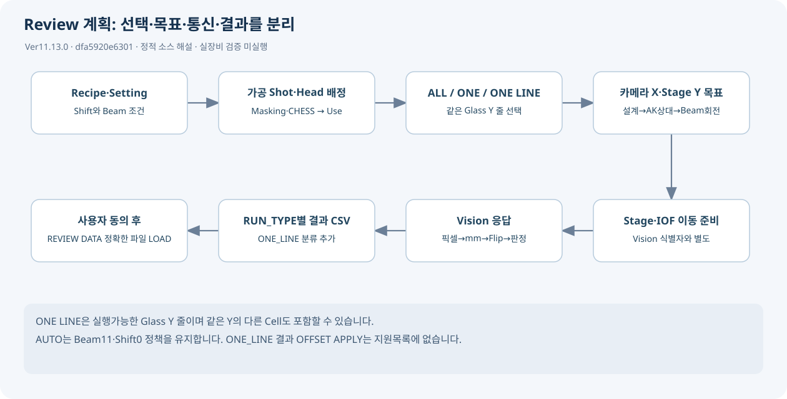


원본: `kjuws10-rgb/A3Drilling` · `master` · `28764c91d521777b8ee068dd7aaf2d3902ce9fe2`

현재 재검토: **11.19.0 / 2026-11-20**, 비교 기준 11.17.0(`96e22cd027c84bf302b23f2949b98985d7f301bb`). 11.18/11.19 두 Commit의 변경과 이전부터 남아 있는 경계를 함께 확인했습니다. 아래 변경 항목과 기존 잔건을 구분합니다. 파일·함수·호출 경계의 정적 확인이며 장비 실행 시험 결과가 아닙니다.

이 장의 **코드 확인**은 해당 Commit의 실제 함수 본문을 정적으로 추적한 사실입니다. **해설**은 그 구조를 이해하기 위한 설명이며, **검증 과제**는 앞으로 실행할 시험입니다. 실장비의 부호·광학 상태·통신 타이밍·정밀도가 검증되었다는 뜻은 아닙니다. 예시 숫자는 설명용 가상값입니다.

## 1. 처음 읽는 사람을 위한 핵심

Review 좌표는 한 함수가 Recipe의 X/Y를 그대로 Vision에 보내는 구조가 아닙니다. 먼저 **어느 Cell의 어느 Shot을 어느 Head가 가공하는지** 정하고, 해당 Shot에서 선택한 Beam의 위치를 더해 **카메라 X와 Stage Y 목표 위치**를 만듭니다. 이 목표 위치는 Stage 이동과 IOF 준비에 쓰입니다. Vision에는 별도의 식별자 요청을 보내며, Vision이 반환한 픽셀 차이를 mm 오차로 바꿉니다. 이 구분을 지켜야 CSV를 통신 패킷으로 오해하지 않습니다. [CReviewManager.cs:153–196](https://github.com/kjuws10-rgb/A3Drilling/blob/28764c91d521777b8ee068dd7aaf2d3902ce9fe2/Drilling.Common/Review/CReviewManager.cs#L153-L196) [CReviewManager.cs:2124–2154](https://github.com/kjuws10-rgb/A3Drilling/blob/28764c91d521777b8ee068dd7aaf2d3902ce9fe2/Drilling.Common/Review/CReviewManager.cs#L2124-L2154)

```mermaid
flowchart LR
 R[Recipe와 Setting] --> P[가공 Shot과 Head 배정]
 P --> M[Masking과 CHESS 판정]
 M --> S[Review 검사점 선택]
 S --> C[선택 Beam의 카메라 X와 Stage Y 계산]
 C --> T[Stage 이동과 IOF 준비]
 S --> V[Vision 식별자 요청]
 V --> E[픽셀 차이를 mm 오차로 환산]
 E --> F[판정과 결과 저장]
```

그림의 경로는 실제 호출 책임을 묶어 표현한 것입니다. Stage와 Vision은 서로 다른 수신자이며, 그림은 물리적 동시 실행 순서를 보장하는 타이밍 차트가 아닙니다.

## 2. 먼저 열어야 할 코드

| 진입점 | 입력 / 출력 | 읽어야 하는 이유 |
|---|---|---|
| `CreatePlanCore` | Recipe, Beam, 선택 방식, Shift → `ST_REVIEW_PLAN` | 일반 Review 계획의 공통 생성 경계. [CReviewManager.cs:501–555](https://github.com/kjuws10-rgb/A3Drilling/blob/28764c91d521777b8ee068dd7aaf2d3902ce9fe2/Drilling.Common/Review/CReviewManager.cs#L501-L555) |
| `BuildShotPoints` | Cell별 설계 패턴, Head 배정 → Point 목록 | 설계 위치·Head·선택 상태·제외 사유가 한 점에 결합된다. [CReviewManager.cs:680–777](https://github.com/kjuws10-rgb/A3Drilling/blob/28764c91d521777b8ee068dd7aaf2d3902ce9fe2/Drilling.Common/Review/CReviewManager.cs#L680-L777) |
| `CreateShotBeamPositionCalculator` | Recipe, 명시적 Setting AK Margin, Stage 방향, Shift → 계산 delegate | AUTO 등에서 각 Shot의 Beam 위치를 나중에 계산한다. [CReviewManager.cs:153–196](https://github.com/kjuws10-rgb/A3Drilling/blob/28764c91d521777b8ee068dd7aaf2d3902ce9fe2/Drilling.Common/Review/CReviewManager.cs#L153-L196) |
| `CalculateReviewTarget` | AK 상대 Shot, 카메라 AK, Beam local offset, Cell 회전, Stage 방향 → 목표 | 실제 좌표식을 확인할 곳. [CReviewManager.cs:1001–1021](https://github.com/kjuws10-rgb/A3Drilling/blob/28764c91d521777b8ee068dd7aaf2d3902ce9fe2/Drilling.Common/Review/CReviewManager.cs#L1001-L1021) |
| `CAutoFineReviewCoordinator.BuildPlan` | 동결한 자동검사 입력 → Fine line 계획 | AUTO는 별도 조건과 제외 규칙을 갖는다. [CAutoFineReviewCoordinator.cs:203–290](https://github.com/kjuws10-rgb/A3Drilling/blob/28764c91d521777b8ee068dd7aaf2d3902ce9fe2/Drilling.Common/Review/CAutoFineReviewCoordinator.cs#L203-L290) |

## 3. 좌표 이름을 분리해서 읽기

| 데이터 | 이 장에서의 뜻 | 주의할 점 |
|---|---|---|
| `DesignX/DesignY` | 설계 패턴에서 생성한 Shot 중심 | 카메라 실제 측정값이 아니다. |
| `BeamOffsetGx/Gy`, 선택 Beam local offset | 한 Shot 내 선택 Beam의 설계 위치 차이 | Cell 회전 후 카메라/Stage 목표로 옮긴다. |
| `ReviewTargetX` | Review 카메라 축의 목표 X | Scanner Gx와 같은 이름의 좌표로 취급하면 안 된다. |
| `ReviewTargetY` / `StageY` | Review 측정에 필요한 Stage Y 목표 | Stage 방향 부호가 적용된다. |
| `ErrorX/ErrorY` | 측정 결과에서 얻은 오차 | raw Vision 축과 flip 변환 후 축을 섞지 않는다. |
| `HeadNo, CellNo, ShotNo, BeamNo, ShotKey` | 점의 소속과 식별자 | 위치가 비슷해도 다른 식별자는 다른 검사점이다. |

표의 구성은 `BuildShotPoints`의 Point 생성 필드와 목표 계산기를 기준으로 합니다. 특히 `ST_REVIEW_BEAM_POSITION(beamNo, target.Y, target.X)`라는 생성자 호출은 인수 순서가 직관적 X/Y 순서와 다릅니다. 이후 사용처가 읽는 **이름 붙은 속성**까지 확인해야 합니다. [CReviewManager.cs:177–196](https://github.com/kjuws10-rgb/A3Drilling/blob/28764c91d521777b8ee068dd7aaf2d3902ce9fe2/Drilling.Common/Review/CReviewManager.cs#L177-L196) [CReviewManager.cs:742–777](https://github.com/kjuws10-rgb/A3Drilling/blob/28764c91d521777b8ee068dd7aaf2d3902ce9fe2/Drilling.Common/Review/CReviewManager.cs#L742-L777) [CAutoFineReviewCoordinator.cs:271–280](https://github.com/kjuws10-rgb/A3Drilling/blob/28764c91d521777b8ee068dd7aaf2d3902ce9fe2/Drilling.Common/Review/CAutoFineReviewCoordinator.cs#L271-L280)

## 4. 목표 위치 계산을 한 단계씩 풀어보기

`CreateShotBeamPositionCalculator`는 Recipe에서 Pixel 크기와 Review 카메라 AK 기준 위치를 읽고, AK margin은 호출자가 전달한 `ST_ALIGN_KEY_MARGINS`를 사용합니다. 이 Margin은 Setting에서 읽은 값이며 Recipe의 옛 Margin을 fallback으로 읽지 않습니다. Cell별 패턴 계산 결과는 `ConcurrentDictionary`에 보관하므로 같은 Cell을 반복 계산할 때 layout을 매번 새로 만들지 않습니다. Cell의 `CELLn_ROTATION`은 Beam local offset을 회전시키는 데 쓰입니다. [CReviewManager.cs:153–187](https://github.com/kjuws10-rgb/A3Drilling/blob/28764c91d521777b8ee068dd7aaf2d3902ce9fe2/Drilling.Common/Review/CReviewManager.cs#L153-L187)

코드의 순서를 수식으로 옮기면 다음과 같습니다. 이 수식의 부호는 소스 그대로이며, 장비별 축 방향을 임의로 추정한 것이 아닙니다. [CReviewManager.cs:182–196](https://github.com/kjuws10-rgb/A3Drilling/blob/28764c91d521777b8ee068dd7aaf2d3902ce9fe2/Drilling.Common/Review/CReviewManager.cs#L182-L196) [CReviewManager.cs:1001–1021](https://github.com/kjuws10-rgb/A3Drilling/blob/28764c91d521777b8ee068dd7aaf2d3902ce9fe2/Drilling.Common/Review/CReviewManager.cs#L1001-L1021)

```text
shotAK_X = DesignX − AK_MARGIN_X + shiftOffsetX
shotAK_Y = DesignY − AK_MARGIN_Y + shiftOffsetY
(beamX, beamY) = RotateLocalOffset(localBeamX, localBeamY, CellRotation)

ReviewX = REVIEW_CAMERA_ALIGN_KEY_POS_X + shotAK_X + beamX
StageY  = REVIEW_CAMERA_ALIGN_KEY_POS_Y
          + StageScanDirectionY × (shotAK_Y + beamY)
```

**해설:** AK margin은 설계 원점과 Align Key 기준의 차이를 옮기는 역할입니다. Stage 방향은 Y 이동의 부호를 바꾸는 별도 값입니다. Cell 회전은 Beam의 상대 위치를 회전시킵니다. 이 셋은 서로 다른 변환이므로 “Y가 반대로 보인다”는 이유만으로 Vision Flip이나 Head Flip을 추가하면 이중 반전이 생길 수 있습니다. 실제 Vision Flip 순서는 별도 함수에 명시되어 있습니다. [CReviewManager.cs:1011–1021](https://github.com/kjuws10-rgb/A3Drilling/blob/28764c91d521777b8ee068dd7aaf2d3902ce9fe2/Drilling.Common/Review/CReviewManager.cs#L1011-L1021) [CReviewManager.cs:3687–3715](https://github.com/kjuws10-rgb/A3Drilling/blob/28764c91d521777b8ee068dd7aaf2d3902ce9fe2/Drilling.Common/Review/CReviewManager.cs#L3687-L3715)

### 설명용 계산 예시

가상 입력이 `Design=(60,50) mm`, `AK margin=(55,45) mm`, `cameraAK=(100,200) mm`, 회전 후 Beam offset `(0.2,−0.1) mm`, Shift `(0,0)`, Stage 방향 `−1`이면 Review 목표는 `(105.2,195.1)`입니다. 이는 위 수식을 손으로 확인하기 위한 예시이며 현재 Recipe나 설비의 실측값이 아닙니다. 이 결과가 Scanner 명령 `(Gx,Gy)`와 같다는 결론은 내릴 수 없습니다.

## 5. Head 배정과 제외 상태가 좌표보다 먼저 필요한 이유

일반 계획은 runtime parameters로 만든 가공 Shot 계획에서 `(CellNo, CellShotNo)`별 Head를 가져옵니다. Review 화면이 독자적으로 Head 번호를 임의 할당하는 구조로 설명하면 안 됩니다. Masking/CHESS 제외는 `ShouldSkipLaser`로 결정되며 해당 Point에 제외 사유도 남길 수 있습니다. [CReviewManager.cs:501–573](https://github.com/kjuws10-rgb/A3Drilling/blob/28764c91d521777b8ee068dd7aaf2d3902ce9fe2/Drilling.Common/Review/CReviewManager.cs#L501-L573)

`BuildShotPoints`는 Head가 있고 제외되지 않은 점만 `Use`로 만들 수 있습니다. 좌표가 계산되어 화면에 존재한다는 사실과 이번 검사에서 사용한다는 사실은 다릅니다. 제외된 Shot이 맵에 보여도 자동 보정 대상에 포함된다는 뜻은 아닙니다. [CReviewManager.cs:742–777](https://github.com/kjuws10-rgb/A3Drilling/blob/28764c91d521777b8ee068dd7aaf2d3902ce9fe2/Drilling.Common/Review/CReviewManager.cs#L742-L777) [CMenuCorrection.ReviewData.Offset.cs:273–278](https://github.com/kjuws10-rgb/A3Drilling/blob/28764c91d521777b8ee068dd7aaf2d3902ce9fe2/Drilling.UI/Menu/Menus/CMenuCorrection.ReviewData.Offset.cs#L273-L278)

## 6. AUTO FINE에서 별도로 동결하는 내용

AUTO 계획은 매 실행마다 입력을 잡아 Recipe와 Setting을 합친 뒤, 사용할 dictionary를 동결합니다. 일반 AUTO Fine은 Setting이 Recipe의 같은 키를 덮고, ZeroLine Follow-up은 이미 동결된 키를 보존하는 분기가 있습니다. `SHIFT_OFFSET_X/Y`는 이 경로에서 명시적으로 `0.000000`으로 설정됩니다. 가공 AUTO 요청 준비 쪽도 Manual MOF Shift를 0으로 만듭니다. 따라서 **현재 코드에서 AUTO가 수동 Shift를 그대로 계승한다는 설명은 맞지 않습니다.** [CAutoFineReviewCoordinator.cs:210–228](https://github.com/kjuws10-rgb/A3Drilling/blob/28764c91d521777b8ee068dd7aaf2d3902ce9fe2/Drilling.Common/Review/CAutoFineReviewCoordinator.cs#L210-L228) [CStationProcess.cs:4039–4050](https://github.com/kjuws10-rgb/A3Drilling/blob/28764c91d521777b8ee068dd7aaf2d3902ce9fe2/Drilling.Common/Station/CStationProcess.cs#L4039-L4050)

AUTO는 Beam11을 기준으로 선택하고, 선택된 line의 점마다 계산기를 호출해 `ReviewX/StageY`를 채웁니다. 줄마다 진행 방향을 번갈아 바꾸는 정렬이 있습니다. 이는 점 순서의 snake 정렬이지, 임의의 Masking 형상을 우회하는 2차원 경로 탐색을 의미하지 않습니다. [CAutoFineReviewCoordinator.cs:238–280](https://github.com/kjuws10-rgb/A3Drilling/blob/28764c91d521777b8ee068dd7aaf2d3902ce9fe2/Drilling.Common/Review/CAutoFineReviewCoordinator.cs#L238-L280)

## 7. 실행과 저장 경계에서 다시 하는 검증

1. 계획 생성 때 Beam 범위, 유효 layout, 유한한 목표좌표를 확인합니다. NaN/Infinity가 이동 명령까지 내려가지 않게 하는 경계입니다. [CReviewManager.cs:153–196](https://github.com/kjuws10-rgb/A3Drilling/blob/28764c91d521777b8ee068dd7aaf2d3902ce9fe2/Drilling.Common/Review/CReviewManager.cs#L153-L196)
2. Fine 실행은 중복 실행을 막는 sequence lock을 잡고 Stage motion 소유권을 엽니다. 실제 Vision 상태인데 외부 simulationMeasurement를 주는 것은 거부합니다. [CReviewManager.cs:2713–2762](https://github.com/kjuws10-rgb/A3Drilling/blob/28764c91d521777b8ee068dd7aaf2d3902ce9fe2/Drilling.Common/Review/CReviewManager.cs#L2713-L2762)
3. AUTO 결과 저장 전에는 Recipe ID, 검사점 개수, `(ShotKey, Head, Cell, Shot, Beam)`의 집합을 다시 확인합니다. 재시도로 순서가 뒤집힐 수 있으므로 배열 위치만 비교하지 않습니다. [CAutoFineReviewCoordinator.cs:171–198](https://github.com/kjuws10-rgb/A3Drilling/blob/28764c91d521777b8ee068dd7aaf2d3902ce9fe2/Drilling.Common/Review/CAutoFineReviewCoordinator.cs#L171-L198)
4. 정상 검사로 끝나지 않았거나 결과 파일 저장 오류가 있으면 자동 보정 저장으로 진행하지 않습니다. 화면에 숫자가 보이는 것만으로 보정이 완료된 것이 아닙니다. [CAutoFineReviewCoordinator.cs:43–76](https://github.com/kjuws10-rgb/A3Drilling/blob/28764c91d521777b8ee068dd7aaf2d3902ce9fe2/Drilling.Common/Review/CAutoFineReviewCoordinator.cs#L43-L76)

## 8. 코드에 주석을 달 때 설명해야 할 부분

| 코드 구간 | 필요한 주석의 내용 |
|---|---|
| 목표 계산 인수 | “설계 절대좌표를 AK 상대거리로 옮긴 다음 선택 Beam local offset을 더한다.” |
| tuple/record 인수 | “이 반환 타입은 StageY와 ReviewX의 인수 순서가 X/Y 직관과 다르므로 사용 속성으로 확인한다.” |
| AUTO Shift 0 | “사용자 수동 MOF Shift와 AUTO 요청을 분리하는 현재 정책이다. 요구 변경 시 가공과 Review 양쪽을 함께 변경해야 한다.” |
| Identity 검증 | “역방향 재시도에서도 점 소속을 보존하기 위해 순서 대신 식별자를 비교한다.” |

이 표는 **문서 주석 제안**입니다. 원본 소스에 주석을 추가하거나 코드를 변경하지 않았습니다.

## 9. 검증 과제

| 시험 입력 | 관찰할 값 | 기대 기준 / 실패 신호 |
|---|---|---|
| Cell 회전 0°/90°/180° | local Beam offset과 최종 목표 | 같은 Shot 중심에 대해 Beam 상대위치만 회전하며 수식과 일치. |
| Stage 방향 ±1 | ReviewX, StageY | X는 동일하고 Y 상대거리의 부호가 소스 수식대로 바뀐다. |
| 수동 Shift 1 mm 후 일반 계획 / AUTO 계획 | Plan metadata와 실제 목표 | 일반 계획의 명시적 인수와 AUTO 0 동결 정책을 구분한다. |
| Head 미배정 Shot | HeadNo, Use, 제외 사유 | 좌표 존재와 검사 사용 여부가 구분된다. |
| 결과 두 점의 순서만 교환 | Identity 검증 | 동일 집합은 허용할 수 있으나 누락·중복·다른 Beam 치환은 거부한다. |
| 목표 NaN/Infinity | 예외와 Stage 요청 발생 여부 | 이동 전 거부되어야 한다. |

위 시험은 제안이며 이 문서 작성 과정에서 장비 이동이나 Vision 측정을 실행하지 않았습니다.

## 10. 검사 화면 이력과 현재 Shot별 Beam 작업표

11.17.0까지 다섯 상위 탭을 사용했으나 현재 CORRECTION → REVIEW는 **SIMPLE(index0) / INSPECTION(index1)**입니다. INSPECTION 안에서 ALL SHOT·ONE SHOT·ONE LINE·BEAM INSP·ROUGH·FINE과 RUN/RESULT를 고릅니다. 동일한 CMenuReview와 별도 InspectionReviewData를 연결하며 Build는 선택 패널을 준비합니다. 검사·보정 실행 중에는 workspace/mode 전환을 잠급니다. [CCorrectionView.xaml:228–265](https://github.com/kjuws10-rgb/A3Drilling/blob/28764c91d521777b8ee068dd7aaf2d3902ce9fe2/Drilling.UI/Views/CCorrectionView.xaml#L228-L265) [CMenuCorrection.cs:553–592](https://github.com/kjuws10-rgb/A3Drilling/blob/28764c91d521777b8ee068dd7aaf2d3902ce9fe2/Drilling.UI/Menu/Menus/CMenuCorrection.cs#L553-L592) [CCorrectionView.xaml.cs:18–47](https://github.com/kjuws10-rgb/A3Drilling/blob/28764c91d521777b8ee068dd7aaf2d3902ce9fe2/Drilling.UI/Views/CCorrectionView.xaml.cs#L18-L47)

이력: 11.13.0에서는 여덟 검사·보정 탭이 나란히 있었고 완료 후 결과 이동을 물었습니다. 11.17.0은 다섯 탭과 최근 결과 LOAD/CLEAR를 사용했습니다. 현재는 저장 결과를 INSPECTION RESULT로 자동 LOAD합니다. 이전의 “8번째 탭(index7)” 또는 “REVIEW DATA index4” 안내는 현재 화면에 적용하지 않습니다. [CMenuCorrection.cs:508–517](https://github.com/kjuws10-rgb/A3Drilling/blob/28764c91d521777b8ee068dd7aaf2d3902ce9fe2/Drilling.UI/Menu/Menus/CMenuCorrection.cs#L508-L517) [CMenuReview.cs:2606–2677](https://github.com/kjuws10-rgb/A3Drilling/blob/28764c91d521777b8ee068dd7aaf2d3902ce9fe2/Drilling.UI/Menu/Menus/CMenuReview.cs#L2606-L2677)

| 조작 / 자료 | 현재 코드 동작 | 반드시 구별할 점 |
|---|---|---|
| ONE LINE | 기준 Shot과 같은 설계 Y의 실행 가능한 줄 선택 | 다른 Cell도 포함될 수 있음 |
| BEAM INSP Shot 선택 | 활성 Shot과 Beam 편집 후보 선택 | 클릭 후보와 ADD/UPDATE 작업표는 다름 |
| ADD / UPDATE | ShotKey별 Beam 집합 복사본 등록 | 다른 Shot에도 같은 Beam을 강제하지 않음 |
| START | 각 Shot Beam 등록 검증 후 배열 동결 | Task수는 각 Shot Beam수의 합 |
| Manager 입력 | ST_BEAM_INSPECTION_ASSIGNMENT | 동일 Shot 중복 입력은 Beam 합집합 정규화 |
| Beam 좌표 | 계획 Shift와 Stage 방향으로 계산 | 이동 목표와 Vision 식별자는 별도 |

[CMenuReview.cs:3162–3193](https://github.com/kjuws10-rgb/A3Drilling/blob/28764c91d521777b8ee068dd7aaf2d3902ce9fe2/Drilling.UI/Menu/Menus/CMenuReview.cs#L3162-L3193) [CMenuReview.cs:3345–3365](https://github.com/kjuws10-rgb/A3Drilling/blob/28764c91d521777b8ee068dd7aaf2d3902ce9fe2/Drilling.UI/Menu/Menus/CMenuReview.cs#L3345-L3365) [CMenuReview.cs:3062–3079](https://github.com/kjuws10-rgb/A3Drilling/blob/28764c91d521777b8ee068dd7aaf2d3902ce9fe2/Drilling.UI/Menu/Menus/CMenuReview.cs#L3062-L3079) [CReviewManager.cs:1381–1426](https://github.com/kjuws10-rgb/A3Drilling/blob/28764c91d521777b8ee068dd7aaf2d3902ce9fe2/Drilling.Common/Review/CReviewManager.cs#L1381-L1426)

새 overload는 미배정 Head·MASKING/CHESS 제외 Shot을 거부하고 전역 SPLITED_BEAM_COUNT로 Beam 번호를 검증합니다. Hxx_DOE_EXIST는 이 검사 빌더에서 사용하지 않습니다. DOE OFF Head의 검사 Beam과 FirstBeam 평가 방식은 별도로 맞춰야 합니다. [CReviewManager.cs:1392–1422](https://github.com/kjuws10-rgb/A3Drilling/blob/28764c91d521777b8ee068dd7aaf2d3902ce9fe2/Drilling.Common/Review/CReviewManager.cs#L1392-L1422) [CDefaultOffsetCalibration.cs:29–59](https://github.com/kjuws10-rgb/A3Drilling/blob/28764c91d521777b8ee068dd7aaf2d3902ce9fe2/Drilling.Common/Correction/CDefaultOffsetCalibration.cs#L29-L59)

```mermaid
flowchart LR
 A[INSPECTION 모드 선택] --> B[Shot별 Beam 편집]
 B --> C[ADD 또는 UPDATE 작업표]
 C --> D[Shot별 Beam 집합 동결]
 D --> E[Manager 검증과 좌표 계산]
 E --> F[측정 결과와 등급 표시]
 F --> G[별도 Offset 적용]
```

ONE LINE은 수동 줄 검사 기능이며 AUTO Fine의 Beam11·Shift0 정책을 바꾸지 않습니다. 현재 ONE_LINE 결과는 DIRECT_LINE으로 검사한 동일 Shot의 OK 오차만 보정할 수 있습니다. FINE 열보간과 다른 적용 방식입니다. [CMenuCorrection.ReviewData.Offset.cs:284–293](https://github.com/kjuws10-rgb/A3Drilling/blob/28764c91d521777b8ee068dd7aaf2d3902ce9fe2/Drilling.UI/Menu/Menus/CMenuCorrection.ReviewData.Offset.cs#L284-L293) [CMenuCorrection.ReviewData.Offset.cs:529–536](https://github.com/kjuws10-rgb/A3Drilling/blob/28764c91d521777b8ee068dd7aaf2d3902ce9fe2/Drilling.UI/Menu/Menus/CMenuCorrection.ReviewData.Offset.cs#L529-L536)

## 11. ShotMap의 선택·그리기·배율 경계

새 CReviewShotMapControl은 여러 Button 대신 하나의 FrameworkElement.OnRender에서 18 DIP(장치 독립 화면단위) 사각형을 그립니다. 행/열×19 DIP 크기를 반환하고 좌표를 나눠 Shot을 찾습니다. 좌클릭은 SelectCommand, 우클릭은 ShowBeamPositionsCommand입니다. 우클릭은 **Beam 위치 표시**이며 이동/측정/보정 context menu가 아닙니다. Ctrl 복수클릭·드래그 선택·Ctrl 휠·Alt 방향키 이동을 이 새 컨트롤에서 구현한 근거는 없습니다. HTML 시안과 실제 WPF 기능을 구분합니다. [CReviewShotMapControl.cs:119–187](https://github.com/kjuws10-rgb/A3Drilling/blob/28764c91d521777b8ee068dd7aaf2d3902ce9fe2/Drilling.UI/Views/CReviewShotMapControl.cs#L119-L187) [CReviewShotMapControl.cs:319–332](https://github.com/kjuws10-rgb/A3Drilling/blob/28764c91d521777b8ee068dd7aaf2d3902ce9fe2/Drilling.UI/Views/CReviewShotMapControl.cs#L319-L332)

같은 계획 참조·Cell·모드·LOAD 여부·등급 설정이면 Shot 행을 재사용하고 runtime 결과만 갱신합니다. 그러나 OnRender는 현재 Cell의 모든 점을 순회하고 깜박임도 전체 행에서 Current를 찾습니다. 화면 밖 점 생략 가상화나 실제 FPS 향상 수치를 입증한 것은 아닙니다. [CMenuReview.cs:5205–5281](https://github.com/kjuws10-rgb/A3Drilling/blob/28764c91d521777b8ee068dd7aaf2d3902ce9fe2/Drilling.UI/Menu/Menus/CMenuReview.cs#L5205-L5281) [CReviewShotMapControl.cs:127–139](https://github.com/kjuws10-rgb/A3Drilling/blob/28764c91d521777b8ee068dd7aaf2d3902ce9fe2/Drilling.UI/Views/CReviewShotMapControl.cs#L127-L139) [CReviewShotMapControl.cs:238–250](https://github.com/kjuws10-rgb/A3Drilling/blob/28764c91d521777b8ee068dd7aaf2d3902ce9fe2/Drilling.UI/Views/CReviewShotMapControl.cs#L238-L250)

검증 과제: 가상 Shot A에 Beam1/11, B에 Beam4를 등록해 Task=3인지 확인합니다. 후보 변경만 한 경우와 UPDATE한 경우, 검사 중 열람 클릭, LOAD 중 START 차단, 1만 Shot Cell 탭 전환·메모리·render 시간을 나눠 시험합니다.

## 15. Setting의 AK Margin이 좌표계 전체에 들어오는 경로

이번 변경은 **AK_MARGIN_X/Y의 출처**를 Recipe에서 Setting > Common > ALIGN으로 옮긴 것입니다. 카메라가 AK를 보는 축 위치인 `REVIEW_CAMERA_ALIGN_KEY_POS_X/Y`는 여전히 Recipe에서 읽습니다. 이름에 Align이 포함되었다고 두 항목을 같은 것으로 설명하면 안 됩니다. [CAlignKeyMarginSettings.cs:6–51](https://github.com/kjuws10-rgb/A3Drilling/blob/28764c91d521777b8ee068dd7aaf2d3902ce9fe2/Drilling.Common/Managers/CAlignKeyMarginSettings.cs#L6-L51) [CReviewManager.cs:152–196](https://github.com/kjuws10-rgb/A3Drilling/blob/28764c91d521777b8ee068dd7aaf2d3902ce9fe2/Drilling.Common/Review/CReviewManager.cs#L152-L196)

```mermaid
flowchart LR
 S[Setting Common ALIGN의 AK Margin] --> V[0 이상 유한 mm 검증]
 R[Recipe의 패턴과 카메라 AK 위치] --> P[CreatePlanCore]
 V --> P
 V --> Q[Shot Beam 계산기에 명시적 전달]
 P --> H[실제 가공 Head 배정과 제외점]
 Q --> T[카메라 X와 Stage Y 목표]
 H --> T
 T --> I[Stage IOF와 Vision 식별자 요청]
```

`CreatePlanCore`는 가공과 같은 Recipe+Option/Motor 합성 맵으로 Head를 배정하고, `settingManager.GetAlignKeyMargins()`를 `BuildShotPoints`에 넘깁니다. AUTO Fine은 합성한 맵에서 Margin을 읽어 동결합니다. Beam Inspection·0선계획·Fine/Rough 미리보기·최근 결과 재구성도 새 인수를 전달합니다. Margin이 누락되거나 음수/NaN이면 예전 Recipe 수치로 조용히 대체하지 않고 오류입니다. [CReviewManager.cs:506–545](https://github.com/kjuws10-rgb/A3Drilling/blob/28764c91d521777b8ee068dd7aaf2d3902ce9fe2/Drilling.Common/Review/CReviewManager.cs#L506-L545) [CReviewManager.cs:576–598](https://github.com/kjuws10-rgb/A3Drilling/blob/28764c91d521777b8ee068dd7aaf2d3902ce9fe2/Drilling.Common/Review/CReviewManager.cs#L576-L598) [CAutoFineReviewCoordinator.cs:203–237](https://github.com/kjuws10-rgb/A3Drilling/blob/28764c91d521777b8ee068dd7aaf2d3902ce9fe2/Drilling.Common/Review/CAutoFineReviewCoordinator.cs#L203-L237)

**운영 확인:** 같은 Recipe라도 공통 Setting Margin을 바꾸면 설계 패턴과 Review 목표가 다시 계산됩니다. 결과/Offset 파일은 당시 Setting 전체의 hash를 보관하지 않으므로, 과거 파일을 LOAD할 때 Recipe ID만 같은지보다 당시 좌표기준도 같은지 대조해야 합니다. 단순 Margin 입력 검증을 과거 보정의 자동 재기준화 검증으로 해석하지 않습니다. 설계 Shot도 같은 Margin을 더해 다시 만들고 Review에서 Design−Margin을 빼는 일관된 경로에서는 두 값이 상쇄될 수 있습니다. Margin 변경이 모든 실제 Review 목표를 반드시 평행이동시킨다는 뜻은 아닙니다. [CMenuReview.cs:2732–2822](https://github.com/kjuws10-rgb/A3Drilling/blob/28764c91d521777b8ee068dd7aaf2d3902ce9fe2/Drilling.UI/Menu/Menus/CMenuReview.cs#L2732-L2822)


# 별도 정적 추적 상세 해설 · review/02_Masking_Sampling_IOF.md

# Masking·Sampling·IOF: 검사점 제외와 실제 이동을 구별하기

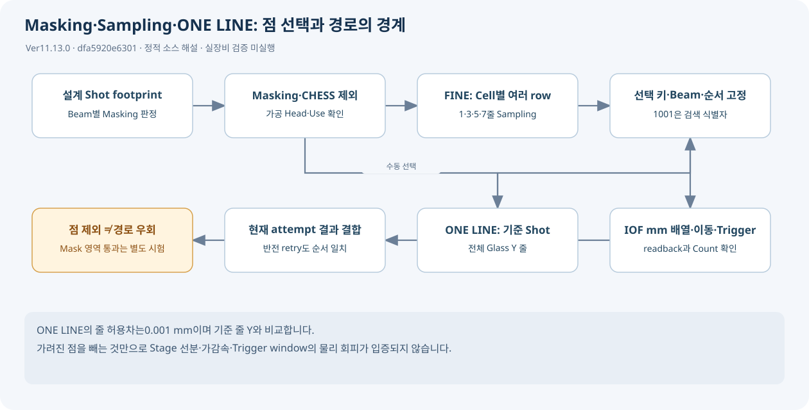


원본: `kjuws10-rgb/A3Drilling` · `master` · `28764c91d521777b8ee068dd7aaf2d3902ce9fe2`

현재 재검토: **11.19.0 / 2026-11-20**, 비교 기준 11.17.0(`96e22cd027c84bf302b23f2949b98985d7f301bb`). 11.18/11.19 두 Commit의 변경과 이전부터 남아 있는 경계를 함께 확인했습니다. 아래 변경 항목과 기존 잔건을 구분합니다. 파일·함수·호출 경계의 정적 확인이며 장비 실행 시험 결과가 아닙니다.

이 장의 **코드 확인**은 해당 Commit의 실제 함수 본문을 정적으로 추적한 사실입니다. **해설**은 그 구조를 이해하기 위한 설명이며, **검증 과제**는 앞으로 실행할 시험입니다. 실장비의 부호·광학 상태·통신 타이밍·정밀도가 검증되었다는 뜻은 아닙니다. 예시 숫자는 설명용 가상값입니다.

## 1. 서로 다른 세 가지 문제

**Masking 판정**은 어느 설계 Shot이 사용 금지 영역과 겹치는지 정하는 문제입니다. **Sampling**은 사용 가능한 Shot 중 어느 줄·점을 검사할지 고르는 문제입니다. **IOF 준비**는 선택된 순서의 위치를 Stage에 넘겨 Trigger 동작을 준비하는 문제입니다. 세 기능의 입력과 출력이 다르므로 “Masking 반영됨”이라는 한 문장만으로 실제 경로가 마스크를 물리적으로 지나지 않는다고 판단하면 안 됩니다. [CShotCoordinatePlanBuilder.cs:876–933](https://github.com/kjuws10-rgb/A3Drilling/blob/28764c91d521777b8ee068dd7aaf2d3902ce9fe2/Drilling.Common/Recipe/CShotCoordinatePlanBuilder.cs#L876-L933) [CReviewRulePlanBuilder.cs:361–401](https://github.com/kjuws10-rgb/A3Drilling/blob/28764c91d521777b8ee068dd7aaf2d3902ce9fe2/Drilling.Common/Review/CReviewRulePlanBuilder.cs#L361-L401) [CStageReviewSequences.cs:740–800](https://github.com/kjuws10-rgb/A3Drilling/blob/28764c91d521777b8ee068dd7aaf2d3902ce9fe2/Drilling.Common/Station/CStageReviewSequences.cs#L740-L800)

```mermaid
flowchart TD
 D[설계 Shot과 DOE footprint] --> M[Masking과 CHESS 평가]
 M --> U[검사 사용 가능 Shot]
 U --> S[Cell별 검사 줄 Sampling]
 S --> O[순서 고정 Trigger buffer]
 O --> B[Stage IOF 위치 배열]
 B --> H[요청과 완료 handshake]
 H --> V[Vision count와 결과 검증]
```

## 2. Masking이 참조하는 기준 좌표

`CRecipeShotMaskingPlan.Build`는 모델별 Pixel 크기, ProcessPitch, 분기 수, Masking hole, edge 조건을 준비합니다. 코드 상수는 모델 최대 5종, hole 최대 3개입니다. 그룹 피치와 Beam 피치는 `groupPitch = pixelSize × ProcessPitch`, `beamPitch = groupPitch / splitBeamCount`로 계산합니다. 이 수치는 실제 광학 측정 피치가 아니라 Recipe에서 구성한 footprint입니다. [CShotCoordinatePlanBuilder.cs:811–873](https://github.com/kjuws10-rgb/A3Drilling/blob/28764c91d521777b8ee068dd7aaf2d3902ce9fe2/Drilling.Common/Recipe/CShotCoordinatePlanBuilder.cs#L811-L873)

`EvaluateShot`의 핵심은 **설계 좌표 기준 불변성**입니다. Recipe/Default/FirstBeam/Align/Review/Shift의 보정값이나 Head flip을 바꿨다고 동일 Shot의 Masking 결과가 달라지면 안 된다는 주석이 있습니다. local 중심은 `GroupColumn × GroupPitch`, `GroupRow × GroupPitch`입니다. 각 Beam을 작은 사각 footprint로 만들고 hole과의 교차 또는 edge 이탈을 검사합니다. [CShotCoordinatePlanBuilder.cs:876–933](https://github.com/kjuws10-rgb/A3Drilling/blob/28764c91d521777b8ee068dd7aaf2d3902ce9fe2/Drilling.Common/Recipe/CShotCoordinatePlanBuilder.cs#L876-L933)

| 입력 | 실제 사용 목적 | 혼동하면 안 되는 것 |
|---|---|---|
| `SPLITED_BEAM_COUNT` | 가로·세로 Beam 격자 루프 수 | 전체 Beam 총 개수와 혼동 금지. 4라면 루프는 4×4. |
| `MODELn_MASKING_HOLE_NUMBER` 및 위치·크기 | hole 사각형 목록 | 카메라가 실시간 검출한 결함 맵이 아니다. |
| edge offset | 유효 가공 가장자리 범위 | Stage travel soft limit가 아니다. |
| `CHESS` / `CHESS_TYPE` | 그룹 row/column의 주기적인 사용 여부 | Masking hole과는 별도 제외 이유다. |
| `BeamNumbers` | 마스크와 겹친 Beam 번호 목록 | 이번 Review에서 고른 Beam11 하나만의 결과가 아니다. |

필드의 계산 근거는 모델 구성과 Beam 루프, CHESS 판정입니다. [CShotCoordinatePlanBuilder.cs:836–873](https://github.com/kjuws10-rgb/A3Drilling/blob/28764c91d521777b8ee068dd7aaf2d3902ce9fe2/Drilling.Common/Recipe/CShotCoordinatePlanBuilder.cs#L836-L873) [CShotCoordinatePlanBuilder.cs:904–970](https://github.com/kjuws10-rgb/A3Drilling/blob/28764c91d521777b8ee068dd7aaf2d3902ce9fe2/Drilling.Common/Recipe/CShotCoordinatePlanBuilder.cs#L904-L970)

## 3. 한 Beam이라도 겹치면 Shot 사용은 어떻게 되는가

`ST_RECIPE_SHOT_MASKING_RESULT.IsMasked`는 `BeamNumbers.Count > 0`이고, `ShouldSkipLaser`는 `IsMasked || IsChessSkipped`입니다. AUTO Review 계획은 이 값이 참인 Shot을 사용하지 않습니다. 따라서 현재 이 경로의 Review 제외 기준은 “검사 Beam11의 중심만 hole 밖이면 허용”이 아니라 **Shot footprint 평가 결과 전체**입니다. [CShotCoordinatePlanBuilder.cs:790–808](https://github.com/kjuws10-rgb/A3Drilling/blob/28764c91d521777b8ee068dd7aaf2d3902ce9fe2/Drilling.Common/Recipe/CShotCoordinatePlanBuilder.cs#L790-L808) [CAutoFineReviewCoordinator.cs:228–248](https://github.com/kjuws10-rgb/A3Drilling/blob/28764c91d521777b8ee068dd7aaf2d3902ce9fe2/Drilling.Common/Review/CAutoFineReviewCoordinator.cs#L228-L248)

**검토 포인트:** HIAA/Round라는 현장 용어 자체가 임의 원형 path solver를 뜻하지 않습니다. 현재 검토한 evaluator는 모델 hole 사각형과 edge 구성을 이용합니다. 현장에 필요한 곡선 경계가 해당 Recipe 표현으로 충분한지, 실제 Masking 도형이 어떤 키로 전달되는지는 별도 설계 확인이 필요합니다. 원·곡선 장애물을 정확히 따라 피해가는 알고리즘이 구현되었다고 확대 설명하지 않습니다. [CShotCoordinatePlanBuilder.cs:951–997](https://github.com/kjuws10-rgb/A3Drilling/blob/28764c91d521777b8ee068dd7aaf2d3902ce9fe2/Drilling.Common/Recipe/CShotCoordinatePlanBuilder.cs#L951-L997)

잘못된 hole 크기나 유한하지 않은 값은 `BuildModel`에서 건너뛰는 분기가 있습니다. 데이터 오입력으로 의도한 마스크가 사라지는 상황을 잡으려면 UI 또는 Recipe 검증에서 별도 오류 표시가 필요한지 검토해야 합니다. “무시됨”은 “안전하게 전부 차단됨”과 다릅니다. [CShotCoordinatePlanBuilder.cs:951–970](https://github.com/kjuws10-rgb/A3Drilling/blob/28764c91d521777b8ee068dd7aaf2d3902ce9fe2/Drilling.Common/Recipe/CShotCoordinatePlanBuilder.cs#L951-L970)

## 4. FINE 줄 선택의 실제 단위

`BuildFineFromCellSource`는 Head가 배정된 점이 있는 Cell별 범위를 만듭니다. 줄 수는 해당 범위의 row 수와 최대 7줄 사이에서 제한됩니다. 한 줄이면 중앙, 여러 줄이면 최소·최대 Y 사이에 균등한 목표 Y를 잡고, 가까운 row 및 인접 row 후보를 확인합니다. 선택한 row에서 Head가 있고 좌표가 유한한 점을 모은 뒤 ShotKey 중복을 제거합니다. [CReviewRulePlanBuilder.cs:361–401](https://github.com/kjuws10-rgb/A3Drilling/blob/28764c91d521777b8ee068dd7aaf2d3902ce9fe2/Drilling.Common/Review/CReviewRulePlanBuilder.cs#L361-L401)

**해설:** 이는 row Sampling입니다. “첫 줄이 막혔으면 다음 유효 row로 바꾸는가”, “마스크를 모두 피하면서 세 줄의 높이 간격을 최적화하는가”, “선택 Beam만 유효한 점을 허용하는가”는 서로 다른 요구입니다. 이 함수 하나를 보고 세 요구가 모두 충족되었다고 판단할 수 없습니다. AUTO 계획은 나중에 `Use` 점과 선택 키를 결합하고 실제 line을 만듭니다. [CAutoFineReviewCoordinator.cs:248–285](https://github.com/kjuws10-rgb/A3Drilling/blob/28764c91d521777b8ee068dd7aaf2d3902ce9fe2/Drilling.Common/Review/CAutoFineReviewCoordinator.cs#L248-L285)

## 5. IOF에 보내는 위치는 Vision의 1001 식별자와 다르다

`CStageReviewSequences.PrepareIof`의 입력은 **순서가 있는 `ST_STAGE_IOF_POINT` 목록**입니다. 빈 배열, 비유한 X/Y, 일반 IOF 500점 초과를 거부합니다. zero-line은 점 수가 2 또는 4여야 합니다. Review X 전용 motion owner가 IOF buffer를 쓰는 것도 금지합니다. [CStageReviewSequences.cs:740–758](https://github.com/kjuws10-rgb/A3Drilling/blob/28764c91d521777b8ee068dd7aaf2d3902ce9fe2/Drilling.Common/Station/CStageReviewSequences.cs#L740-L758)

| 준비 단계 | 코드가 하는 일 | 왜 필요한가 |
|---|---|---|
| 사전 상태 확인 | 이전 Start/ACK가 0인지, Stage가 정지인지 확인 | 직전 요청 완료 비트가 남은 상태를 새 요청의 응답으로 오인하지 않기 위해. |
| 설정·개수 기록 | 일반/zero-line 설정과 별도 count key 기록 | 같은 배열을 다른 의미로 읽지 않게 한다. |
| 배열 구성 | 일반은 `points.Select(p => p.X)`, zero-line은 `p.Y` | **zero-line을 `[Y…][X…]`로 묶는 옛 방식이 아니다.** |
| Route 검증 | `IOF_POS_ARRAY_1`의 Double 타입과 용량 확인 | WORD 정수 배열로 잘못 쓰거나 용량을 넘지 않게 한다. |
| readback | 기록 값과 읽은 값의 오차가 `0.000051`보다 크면 실패 | 쓰기 함수 호출 성공과 실제 데이터 확인을 구분한다. |
| Start 요청 | 동결한 계획을 소유 상태로 보관하고 요청·완료 wait | 그 시도의 순서와 데이터가 끝까지 같은지 보장한다. |

표의 논리 이름과 검증 수치는 소스의 현재 구현 기준입니다. 실제 현장 주소는 해당 버전의 MELSEC map과 장비 사양을 같이 확인해야 합니다. 소스 주석에는 요청 `W8238`, 완료 `WC13C`, ACK `W823A`가 나오지만 주소 고정 사실을 모든 설비에 일반화하지 않습니다. [CStageReviewSequences.cs:751–800](https://github.com/kjuws10-rgb/A3Drilling/blob/28764c91d521777b8ee068dd7aaf2d3902ce9fe2/Drilling.Common/Station/CStageReviewSequences.cs#L751-L800)

## 6. 재시도 때 배열과 결과를 맞추는 방법

Fine flying은 시도마다 새 `triggerBuffer`를 만듭니다. 해당 배열로 IOF를 준비하고, 같은 순서로 `FLYING_READY`를 전송한 뒤 끝점으로 이동합니다. `FLYING_MOVE_DONE`의 count mismatch가 발생하면 허용된 조건에서 순서를 뒤집어 재시도합니다. 이때 실패 시도의 `1003`을 요청하지 않는 분기가 있습니다. [CReviewManager.cs:2844–2895](https://github.com/kjuws10-rgb/A3Drilling/blob/28764c91d521777b8ee068dd7aaf2d3902ce9fe2/Drilling.Common/Review/CReviewManager.cs#L2844-L2895)

수신 결과 개수는 그 시도의 frozen buffer 개수와 일치해야 합니다. 측정 결과를 현재 화면 정렬이나 Recipe 전체 목록에 순서대로 붙이면 재시도 후 다른 Shot에 오차를 넣을 수 있습니다. 저장 전에는 coordinator가 식별자 집합을 다시 검증합니다. [CReviewManager.cs:2898–2929](https://github.com/kjuws10-rgb/A3Drilling/blob/28764c91d521777b8ee068dd7aaf2d3902ce9fe2/Drilling.Common/Review/CReviewManager.cs#L2898-L2929) [CAutoFineReviewCoordinator.cs:171–198](https://github.com/kjuws10-rgb/A3Drilling/blob/28764c91d521777b8ee068dd7aaf2d3902ce9fe2/Drilling.Common/Review/CAutoFineReviewCoordinator.cs#L171-L198)

## 7. 원하는 개선사항을 검증 가능한 요구로 바꾸기

| 요구 | 현재 확인한 근거 | 추가로 확인할 기준 |
|---|---|---|
| Masking 영역에서는 Trigger 미발생 | 사용 점 제외·IOF buffer 경로 존재 | 실제 최종 buffer에 제외 Shot이 없는지 확인. |
| Stage 경로 자체도 Masking 구간 회피 | 점 선택과 직선 이동만으로는 입증 불가 | 시작점~끝점 선분·전환 구간·Trigger window를 함께 기록. |
| 첫/중앙/마지막 줄이 막히면 유효 줄 대체 | row 선택과 Use 필터를 조합해 확인해야 함 | 줄별 예정/선택/제외 점 수와 대체 이유를 표시. |
| 모든 대상이 마스크인 Cell | 빈 line 또는 전체 검사점 부족 가능 | 조용히 성공하지 않고 명확한 불가 사유를 내야 함. |
| Trigger count 누락 | 1002 NCK 분기 있음 | 허용 재시도 횟수와 전체 보정 미적용을 확인. |

## 8. 권장 시험표 — 아직 실행하지 않은 검증 과제

1. 단일 Shot의 첫 Beam footprint만 hole에 걸리게 만든 가상 Recipe로 `BeamNumbers`, `ShouldSkipLaser`, 최종 `Use`를 순서대로 확인합니다. Beam11이 멀쩡해도 Shot 제외가 되는 현재 정책을 확인하는 시험입니다.
2. 보정값을 크게 바꾸되 설계 패턴은 유지합니다. Masking 결과는 같아야 하고 Scanner 최종 좌표만 바뀌어야 합니다.
3. 첫 줄 전체를 가리고 중앙·끝줄은 남긴 뒤 요청 줄 수와 실제 선택 줄 수, 검사점 수를 기록합니다. 요구한 세 줄이 유지되지 않는다면 자동 대체 정책을 별도로 정의합니다.
4. 500점과 501점, zero-line 2/4/3점, readback 오차 경계값을 시험합니다. 실장비 없이 mock route로 먼저 검증할 수 있습니다.
5. 정방향 첫 시도 count mismatch 후 역방향 재시도를 만들고, 각 ShotKey가 정확히 자기 결과를 받는지 확인합니다.
6. Stage의 실제 이동 경로를 검증할 때는 Trigger off만 보고 통과시키지 말고 encoder 경로와 유효 Trigger 위치를 함께 비교합니다.

마지막 6번은 물리 동작 평가가 필요한 항목이며, 이 문서에서 안전성이나 현장 통과를 판정하지 않았습니다.

## 9. 새 ONE LINE과 기존 FINE Sampling의 경계

ONE LINE은 사용자가 Shot 하나를 골라 **Glass 설계 Y가 같은 실행 가능한 줄**을 선택하는 기능입니다. FINE은 Cell별로 여러 row를 샘플링하고 같은 열의 보정값을 계산하기 위한 기능입니다. 화면에서 둘 다 줄처럼 보여도 선택 기준과 결과 소비자가 다릅니다. CreateIofLines의 줄 허용차는 0.001 mm이며 줄의 시작 기준 Y와 비교해 묶습니다. 인접 두 점만의 차이가 작은지를 계속 이어 붙이는 방식으로 해석하면 안 됩니다. [CReviewManager.cs:27–33](https://github.com/kjuws10-rgb/A3Drilling/blob/28764c91d521777b8ee068dd7aaf2d3902ce9fe2/Drilling.Common/Review/CReviewManager.cs#L27-L33) [CReviewManager.cs:214–249](https://github.com/kjuws10-rgb/A3Drilling/blob/28764c91d521777b8ee068dd7aaf2d3902ce9fe2/Drilling.Common/Review/CReviewManager.cs#L214-L249) [CReviewManager.cs:2201–2219](https://github.com/kjuws10-rgb/A3Drilling/blob/28764c91d521777b8ee068dd7aaf2d3902ce9fe2/Drilling.Common/Review/CReviewManager.cs#L2201-L2219)

| 확인할 상황 | ONE LINE의 코드 경계 | 검증할 관찰값 |
|---|---|---|
| 기준 Shot이 Masking/CHESS 제외 | Use/Head와 화면 제외 사유 검사를 통과해야 선택 | 선택 거부·키 집합 비어 있음 |
| 줄 중간이 Masking | 남아 있는 Use 점으로 줄 구성 | 제외 Shot이 결과와 trigger 개수에 들어가지 않음 |
| 같은 Y에 Cell 2개 | Cell별 필터가 없어 같은 Glass 줄에 함께 포함 가능 | Cell별 count 합과 전체 line count |
| Mask 영역 위를 Stage가 지나감 | 검사점 제외와 이동선분은 다른 문제 | 실제 시작/끝·가감속·Trigger window를 별도 검증 |
| ONE LINE을 FINE 결과로 취급 | ResultType=ONE_LINE, DIRECT_LINE으로 동일Shot OK만 누적 | FINE 보간과 구분하고 ONE_LINE 직접 적용을 확인 |

설계 Masking 판정 함수와 FINE row 선택 함수의 본문은 이전 기준에서 바뀌지 않았습니다. 수동 ONE LINE의 기존 IOF 줄 묶음 재사용은 11.13.0에도 있던 기능이며 이번에도 유지합니다. 따라서 “Masking 형상을 피해 Stage 경로까지 자동 우회”하거나 “가려진 줄을 항상 원하는 개수로 대체”하는 새 기능이 추가되었다고 결론낼 근거는 없습니다. [CMenuReview.cs:1432–1466](https://github.com/kjuws10-rgb/A3Drilling/blob/28764c91d521777b8ee068dd7aaf2d3902ce9fe2/Drilling.UI/Menu/Menus/CMenuReview.cs#L1432-L1466) [CMenuCorrection.ReviewData.Offset.cs:284–293](https://github.com/kjuws10-rgb/A3Drilling/blob/28764c91d521777b8ee068dd7aaf2d3902ce9fe2/Drilling.UI/Menu/Menus/CMenuCorrection.ReviewData.Offset.cs#L284-L293)

## 10. 11.17.0 교차 확인: 기하학 줄 선택과 마스크 제거 순서

이번 두 Commit에서 RulePlanBuilder·StageReviewSequences·ShotCoordinatePlanBuilder의 마스크/IOF 엔진은 바뀌지 않았습니다. ShotMap의 빨간 X는 제외 상태를 더 명확하게 그리는 **표시 변경**입니다. 물리 경로 우회 완료를 뜻하지 않습니다. [CReviewShotMapControl.cs:262–302](https://github.com/kjuws10-rgb/A3Drilling/blob/28764c91d521777b8ee068dd7aaf2d3902ce9fe2/Drilling.UI/Views/CReviewShotMapControl.cs#L262-L302)

Fine은 기하학 범위에서 첫/중간/마지막 등에 가까운 row를 먼저 고릅니다. 이웃 row 탐색은 목표 Y에 가까운 기하학 row를 찾는 것이며 “마스크 없는 다음 줄” 조건이 없습니다. AUTO는 그 뒤 선택 키와 Use를 결합하여 제외점을 뺍니다. 한 선택 row가 전부 마스크라면 다른 유효 row로 자동 대체한다고 설명할 근거가 없고, 열에 남는 anchor 수도0~3개로 달라질 수 있습니다. [CReviewRulePlanBuilder.cs:361–420](https://github.com/kjuws10-rgb/A3Drilling/blob/28764c91d521777b8ee068dd7aaf2d3902ce9fe2/Drilling.Common/Review/CReviewRulePlanBuilder.cs#L361-L420) [CAutoFineReviewCoordinator.cs:248–285](https://github.com/kjuws10-rgb/A3Drilling/blob/28764c91d521777b8ee068dd7aaf2d3902ce9fe2/Drilling.Common/Review/CAutoFineReviewCoordinator.cs#L248-L285)

| 조건 | 확인 결과 | 해석 |
|---|---|---|
| 첫 row 전부 Masking | 실제 row·트리거수 | 다음 row 대체를 임의 기대값으로 두지 않음 |
| 같은 X열 첫 점만 제외 | 남은 anchor Y범위 | 유효 양 끝 밖은 외삽 가능 |
| 마스크 중간 긴 구간 | IOF 선분·가감속·count | 점 제외와 물리 회피 각각 확인 |
| 같은 Y의 두 Cell | ONE LINE 최종 키 | Glass line과 Cell 경계 구분 |
| DOE OFF Head | footprint·검사 Beam | Default 전용 flag는 일반 마스크를 바꾸지 않음 |

위 시험은 후속 과제이며 실제 측정·운영 CSV 레코드를 문서에 복제하지 않습니다.

## 13. ONE LINE 보정 추가와 여전히 남는 Masking 경계

ONE LINE의 측정 결과를 다시 LOAD하면 이제 `DIRECT_LINE`으로 같은 Shot에만 OK 오차를 누적할 수 있습니다. 전체 Cell이나 주변 라인으로 자동 보간하는 동작이 아닙니다. Beam Inspection 결과는 측정 상태 확인용으로 보정을 금지합니다. [CMenuCorrection.ReviewData.Offset.cs:285–295](https://github.com/kjuws10-rgb/A3Drilling/blob/28764c91d521777b8ee068dd7aaf2d3902ce9fe2/Drilling.UI/Menu/Menus/CMenuCorrection.ReviewData.Offset.cs#L285-L295) [CMenuCorrection.ReviewData.Offset.cs:515–531](https://github.com/kjuws10-rgb/A3Drilling/blob/28764c91d521777b8ee068dd7aaf2d3902ce9fe2/Drilling.UI/Menu/Menus/CMenuCorrection.ReviewData.Offset.cs#L515-L531) [CMenuCorrection.ReviewData.cs:86–94](https://github.com/kjuws10-rgb/A3Drilling/blob/28764c91d521777b8ee068dd7aaf2d3902ce9fe2/Drilling.UI/Menu/Menus/CMenuCorrection.ReviewData.cs#L86-L94)

Fine의 1/3/5/7줄 선정·Masking 판정·IOF 경로 알고리즘은 이번 두 Commit에서 바뀌지 않았습니다. `FineCellRows`는 기하학 행을 먼저 선정하고 실제 실행점의 Use/제외 여부는 뒤에서 거릅니다. 따라서 한 줄이 전부 Masking이면 다음 유효 행으로 자동 대체하는 기능이 추가되었다고 볼 수 없습니다. 실제 측정된 행/열/점 수와 요청 LINE_COUNT를 함께 검증해야 합니다. [CReviewRulePlanBuilder.cs:282–301](https://github.com/kjuws10-rgb/A3Drilling/blob/28764c91d521777b8ee068dd7aaf2d3902ce9fe2/Drilling.Common/Review/CReviewRulePlanBuilder.cs#L282-L301) [CReviewRulePlanBuilder.cs:434–458](https://github.com/kjuws10-rgb/A3Drilling/blob/28764c91d521777b8ee068dd7aaf2d3902ce9fe2/Drilling.Common/Review/CReviewRulePlanBuilder.cs#L434-L458)

Stage·Vision 통신 파일의 이번 변경은 주로 보호 주석입니다. 점의 Trigger를 빼는 것과 물리 이동 선분이 HIAA/Round 영역을 우회하는 것은 별개이며, 원본 코드에 우회 경로가 새로 생긴 것으로 설명하지 않습니다. 취소·Count 불일치·Trigger 누락·역방향 재시도는 실제 Peer와의 연동 시험이 남습니다. [CReviewManager.cs:1967–1989](https://github.com/kjuws10-rgb/A3Drilling/blob/28764c91d521777b8ee068dd7aaf2d3902ce9fe2/Drilling.Common/Review/CReviewManager.cs#L1967-L1989) [CStageReviewSequences.cs:740–764](https://github.com/kjuws10-rgb/A3Drilling/blob/28764c91d521777b8ee068dd7aaf2d3902ce9fe2/Drilling.Common/Station/CStageReviewSequences.cs#L740-L764)


# 별도 정적 추적 상세 해설 · review/03_Vision_패킷과_단위.md

# Vision 통신: 1001 식별자 패킷, 1003 수신값, 픽셀→mm 오차

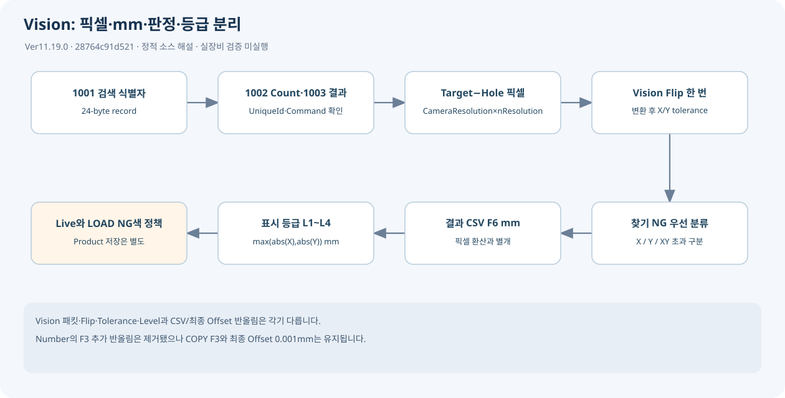


원본: `kjuws10-rgb/A3Drilling` · `master` · `28764c91d521777b8ee068dd7aaf2d3902ce9fe2`

현재 재검토: **11.19.0 / 2026-11-20**, 비교 기준 11.17.0(`96e22cd027c84bf302b23f2949b98985d7f301bb`). 11.18/11.19 두 Commit의 변경과 이전부터 남아 있는 경계를 함께 확인했습니다. 아래 변경 항목과 기존 잔건을 구분합니다. 파일·함수·호출 경계의 정적 확인이며 장비 실행 시험 결과가 아닙니다.

이 장의 **코드 확인**은 해당 Commit의 실제 함수 본문을 정적으로 추적한 사실입니다. **해설**은 그 구조를 이해하기 위한 설명이며, **검증 과제**는 앞으로 실행할 시험입니다. 실장비의 부호·광학 상태·통신 타이밍·정밀도가 검증되었다는 뜻은 아닙니다. 예시 숫자는 설명용 가상값입니다.

## 1. 자주 생기는 오해부터 바로잡기

`ReviewResult.csv`나 `PROCESS_COORDINATES.csv`는 파일 저장 형식입니다. 실제 Vision TCP 전송은 `CVisionComm.Execute → ParseRequest → SendRequest → SendPacket → CVisionProtocol.Encode → NetworkStream.WriteAsync` 경로입니다. 가공·Review 좌표가 파일에 저장된다는 사실은 해당 CSV 행을 Vision에 그대로 보낸다는 근거가 되지 않습니다. [CVisionComm.cs:93–123](https://github.com/kjuws10-rgb/A3Drilling/blob/28764c91d521777b8ee068dd7aaf2d3902ce9fe2/Drilling.Common/Interface/Vision/CVisionComm.cs#L93-L123) [CVisionComm.cs:275–342](https://github.com/kjuws10-rgb/A3Drilling/blob/28764c91d521777b8ee068dd7aaf2d3902ce9fe2/Drilling.Common/Interface/Vision/CVisionComm.cs#L275-L342)

실제 좌표 이동 연결은 `CReviewStageMotion.MoveAndWait`에서 `ReviewTargetX/Y`를 Stage session으로 넘기며, Flying 준비는 같은 값으로 `ST_STAGE_IOF_POINT` 배열을 만듭니다. 이 경로와 TCP의 식별자 payload는 서로 다른 출력입니다. [CReviewManager.cs:2599–2602](https://github.com/kjuws10-rgb/A3Drilling/blob/28764c91d521777b8ee068dd7aaf2d3902ce9fe2/Drilling.Common/Review/CReviewManager.cs#L2599-L2602)

```mermaid
flowchart LR
 P[Review 검사점 목록] --> C[FLYING_READY 명령 문자열]
 C --> B[1001 바이너리 식별자 패킷]
 B --> N[TCP 송신과 UniqueId 대기]
 N --> D[1002 이동완료와 count 확인]
 D --> R[1003 측정 결과]
 R --> MM[Target-Hole 픽셀 차이를 mm 환산]
 MM --> F[Vision Flip과 tolerance 판정]
 F --> S[결과 CSV와 보정 계산]
```

## 2. 실제 코드 경계를 찾는 순서

| 위치 | 책임 | 개발할 때 확인할 질문 |
|---|---|---|
| `CReviewManager.CreateFlyingReadyCommand` | Point를 Vision 검색 식별자로 직렬화하기 전 command 구성 | 어떤 Cell/Beam/row/column/Head를 요청하는가? [CReviewManager.cs:2124–2154](https://github.com/kjuws10-rgb/A3Drilling/blob/28764c91d521777b8ee068dd7aaf2d3902ce9fe2/Drilling.Common/Review/CReviewManager.cs#L2124-L2154) |
| `CVisionComm.Execute` | 문자열 명령을 packet으로 바꾸고 송수신 | UniqueId, line capacity를 언제 정하는가? [CVisionComm.cs:93–123](https://github.com/kjuws10-rgb/A3Drilling/blob/28764c91d521777b8ee068dd7aaf2d3902ce9fe2/Drilling.Common/Interface/Vision/CVisionComm.cs#L93-L123) |
| `CVisionProtocol.CreateFlyingReady` | 헤더 외 body layout 구성 | 사용 slot과 미사용 slot을 어떻게 채우는가? [CVisionComm.cs:581–599](https://github.com/kjuws10-rgb/A3Drilling/blob/28764c91d521777b8ee068dd7aaf2d3902ce9fe2/Drilling.Common/Interface/Vision/CVisionComm.cs#L581-L599) |
| `SendRequest` | 응답 Task, timeout, command 검증 | 다른 요청의 응답을 받을 수 없는가? [CVisionComm.cs:275–312](https://github.com/kjuws10-rgb/A3Drilling/blob/28764c91d521777b8ee068dd7aaf2d3902ce9fe2/Drilling.Common/Interface/Vision/CVisionComm.cs#L275-L312) |
| `SendPacket` / `ReadPacket` | 네트워크 byte 송수신 | partial read, 쓰기 동시성, 길이 검증을 처리하는가? [CVisionComm.cs:315–342](https://github.com/kjuws10-rgb/A3Drilling/blob/28764c91d521777b8ee068dd7aaf2d3902ce9fe2/Drilling.Common/Interface/Vision/CVisionComm.cs#L315-L342) |
| `CreateVisionMeasurement` | 응답 숫자 해석과 mm 오차 생성 | found 신호와 tolerance 판정이 같은 것인가? [CReviewManager.cs:2359–2386](https://github.com/kjuws10-rgb/A3Drilling/blob/28764c91d521777b8ee068dd7aaf2d3902ce9fe2/Drilling.Common/Review/CReviewManager.cs#L2359-L2386) |

## 3. 16바이트 공통 헤더

현재 `CVisionProtocol.HeaderSize`는 16이고, 인코더가 아래 순서로 Int32를 기록합니다. Int32는 little-endian reader와 대응합니다. 헤더의 DataLength와 실제 body 길이가 다르면 전송 전에 예외가 납니다. [CVisionComm.cs:563–564](https://github.com/kjuws10-rgb/A3Drilling/blob/28764c91d521777b8ee068dd7aaf2d3902ce9fe2/Drilling.Common/Interface/Vision/CVisionComm.cs#L563-L564) [CVisionComm.cs:648–672](https://github.com/kjuws10-rgb/A3Drilling/blob/28764c91d521777b8ee068dd7aaf2d3902ce9fe2/Drilling.Common/Interface/Vision/CVisionComm.cs#L648-L672) [CVisionComm.cs:989–990](https://github.com/kjuws10-rgb/A3Drilling/blob/28764c91d521777b8ee068dd7aaf2d3902ce9fe2/Drilling.Common/Interface/Vision/CVisionComm.cs#L989-L990)

| byte offset | 크기 | 필드 | 뜻 |
|---:|---:|---|---|
| 0 | 4 | Command | 예: Flying Ready 1001 |
| 4 | 4 | DataLength | body byte 수; 전체 packet 길이가 아니다. |
| 8 | 4 | UniqueId | 요청과 응답을 연결하는 ID |
| 12 | 4 | ErrorCode | 통신 응답의 오류 코드 |
| 16 | DataLength | Body | command마다 다른 구조 |

`ReadPacket`은 헤더를 정확한 byte 수만큼 읽고 DataLength를 해석한 다음 body를 다시 정확히 읽습니다. TCP에서 한 번의 `ReadAsync`가 한 packet과 일치한다는 가정을 하지 않습니다. 이는 패킷이 두 번에 나눠 들어오는 상황을 다루기 위한 기본 경계입니다. [CVisionComm.cs:333–342](https://github.com/kjuws10-rgb/A3Drilling/blob/28764c91d521777b8ee068dd7aaf2d3902ce9fe2/Drilling.Common/Interface/Vision/CVisionComm.cs#L333-L342)

## 4. 1001 Flying Ready는 mm X/Y 배열이 아니다

`ST_VISION_MARK_SEARCH`는 여섯 정수 `Cell, Doe, Line, IndexX, IndexY, Head`입니다. 레코드 크기는 24바이트입니다. `Doe` 필드에는 Review command builder가 `point.BeamNo`를 넣습니다. 현재 builder는 ShotNo를 PixelCountX로 나눠 1기반 row/column을 만들고 `Line`과 `IndexY` 양쪽에 row index를 넣습니다. 이를 mm좌표라고 설명하면 payload와 Stage 이동을 동시에 잘못 이해하게 됩니다. [CVisionComm.cs:535–553](https://github.com/kjuws10-rgb/A3Drilling/blob/28764c91d521777b8ee068dd7aaf2d3902ce9fe2/Drilling.Common/Interface/Vision/CVisionComm.cs#L535-L553) [CReviewManager.cs:2147–2154](https://github.com/kjuws10-rgb/A3Drilling/blob/28764c91d521777b8ee068dd7aaf2d3902ce9fe2/Drilling.Common/Review/CReviewManager.cs#L2147-L2154) [CVisionComm.cs:960–980](https://github.com/kjuws10-rgb/A3Drilling/blob/28764c91d521777b8ee068dd7aaf2d3902ce9fe2/Drilling.Common/Interface/Vision/CVisionComm.cs#L960-L980)

| body 내 위치 | 내용 | 설명 |
|---|---|---|
| 0..3 | InspectionType Int32 | 검사 유형 |
| 4..7 | 검색 점 수 Int32 | 유효 search 레코드 수 |
| 8부터 | 24바이트 × 설정된 line capacity | 각 slot의 six-int 식별자 |

Body 배열 크기는 `8 + maxHoleCountPerLine × 24`이고 전체를 `0xFF`로 채운 후 유효 슬롯을 기록합니다. 미사용 슬롯을 0좌표로 보는 것은 틀립니다. 이 구조의 정확한 capacity는 해당 실행 옵션과 상대 Vision 사양을 함께 확인해야 합니다. [CVisionComm.cs:581–599](https://github.com/kjuws10-rgb/A3Drilling/blob/28764c91d521777b8ee068dd7aaf2d3902ce9fe2/Drilling.Common/Interface/Vision/CVisionComm.cs#L581-L599)

한 레코드의 상대 byte 배치는 `Cell +0`, `Doe +4`, `Line +8`, `IndexX +12`, `IndexY +16`, `Head +20`입니다. 신규 필드를 추가하면 단순히 C# record에 속성만 더할 것이 아니라 packet 길이·reader·writer·상대 장치 map을 모두 맞춰야 합니다. [CVisionComm.cs:960–980](https://github.com/kjuws10-rgb/A3Drilling/blob/28764c91d521777b8ee068dd7aaf2d3902ce9fe2/Drilling.Common/Interface/Vision/CVisionComm.cs#L960-L980)

## 5. 1001 → 이동 → 1002 → 1003 순서와 실패 처리

Fine flying의 한 시도는 새 frozen buffer로 IOF를 준비하고 실제 Vision일 때 keep-alive와 FlyingReady를 보냅니다. 끝점 이동이 끝난 다음 `FLYING_MOVE_DONE`을 보냅니다. count mismatch는 `CFlyingCountMismatchException`으로 분리하며, 허용된 재시도 조건에서 점 순서를 반대로 바꿉니다. count mismatch 시도의 1003을 요청하지 않는 주석이 있어, 이전 시도 결과를 잘못 소비하지 않도록 되어 있습니다. [CReviewManager.cs:2844–2895](https://github.com/kjuws10-rgb/A3Drilling/blob/28764c91d521777b8ee068dd7aaf2d3902ce9fe2/Drilling.Common/Review/CReviewManager.cs#L2844-L2895)

1003의 측정 개수는 frozen buffer 개수와 일치해야 하고 해당 buffer 순서에 결과를 붙입니다. 다음 줄 선이동과 응답 수신이 일부 겹치는 최적화 분기가 있으므로 UI 표시 순서만으로 물리 Trigger 순서를 추정하지 않아야 합니다. [CReviewManager.cs:2898–2929](https://github.com/kjuws10-rgb/A3Drilling/blob/28764c91d521777b8ee068dd7aaf2d3902ce9fe2/Drilling.Common/Review/CReviewManager.cs#L2898-L2929)

`SendRequest`는 UniqueId별 pending Task를 등록하고 연결된 cancellation token에 timeout을 추가합니다. 응답 Command가 요청과 다르거나 ErrorCode가 0이 아니면 실패합니다. finally에서 pending을 제거합니다. 반면 “정상 header 수신”과 “표적 찾기 성공”은 별개입니다. [CVisionComm.cs:275–312](https://github.com/kjuws10-rgb/A3Drilling/blob/28764c91d521777b8ee068dd7aaf2d3902ce9fe2/Drilling.Common/Interface/Vision/CVisionComm.cs#L275-L312)

## 6. 수신 숫자를 mm 오차로 바꾸기

`ST_VISION_MARK_FIND`는 `Result`와 `TargetMarkX/Y`, `HoleX/Y`를 포함합니다. `CreateVisionMeasurement`에서 `nResult == 0`을 found로 봅니다. 코드 주석은 1000/1003/1010에 대해 0이 found라고 명시합니다. `1=OK`라는 문서가 남아 있다면 현행 구현 및 상대 프로토콜과 불일치 여부를 확인해야 합니다. [CVisionComm.cs:548–552](https://github.com/kjuws10-rgb/A3Drilling/blob/28764c91d521777b8ee068dd7aaf2d3902ce9fe2/Drilling.Common/Interface/Vision/CVisionComm.cs#L548-L552) [CReviewManager.cs:2359–2372](https://github.com/kjuws10-rgb/A3Drilling/blob/28764c91d521777b8ee068dd7aaf2d3902ce9fe2/Drilling.Common/Review/CReviewManager.cs#L2359-L2372)

소스의 실제 변환식은 다음과 같습니다. `cameraResolution` 단위는 함수 검증문에 **mm/pixel**로 명시되어 있습니다. [CReviewManager.cs:2375–2386](https://github.com/kjuws10-rgb/A3Drilling/blob/28764c91d521777b8ee068dd7aaf2d3902ce9fe2/Drilling.Common/Review/CReviewManager.cs#L2375-L2386)

```text
factor = CameraResolution(mm/pixel) × nResolution
rawErrorX_mm = factor × (TargetMarkX − HoleX)
rawErrorY_mm = factor × (TargetMarkY − HoleY)
```

`nResolution <= 0`, CameraResolution 비양수/비유한, 수신 픽셀 비유한, 환산값 비유한은 거부합니다. `nResolution`을 임의의 µm 단위로 해석하거나 `Hole−Target`으로 뒤집으면 보정 방향이 달라집니다. Stage 방향이나 Head Flip을 이 단계에서 추가로 적용하면 원래 경계를 무너뜨립니다. [CReviewManager.cs:2375–2386](https://github.com/kjuws10-rgb/A3Drilling/blob/28764c91d521777b8ee068dd7aaf2d3902ce9fe2/Drilling.Common/Review/CReviewManager.cs#L2375-L2386)

설명용 예로 CameraResolution이 `0.001 mm/pixel`, nResolution이 2, Target−Hole가 `(3,−2) pixel`이면 raw error는 `(0.006,−0.004) mm`입니다. 실제 장비 설정값을 인용한 예가 아닙니다.

## 7. found, geometric OK, 보정 가능은 서로 다르다

`ApplyMeasurementError`는 raw mm 오차에 `VisionErrorToStageOffset`을 적용한 값으로 tolerance를 확인합니다. 먼저 X/Y swap, 다음 X 부호 반전, 다음 Y 부호 반전을 적용합니다. 찾기 상태도 정상이어야 하고 `abs(X)<=TolX && abs(Y)<=TolY`여야 최종 OK입니다. `ErrorX/Y`에는 함수 인수의 raw 오차가 저장됩니다. [CReviewManager.cs:2312–2344](https://github.com/kjuws10-rgb/A3Drilling/blob/28764c91d521777b8ee068dd7aaf2d3902ce9fe2/Drilling.Common/Review/CReviewManager.cs#L2312-L2344) [CReviewManager.cs:3687–3707](https://github.com/kjuws10-rgb/A3Drilling/blob/28764c91d521777b8ee068dd7aaf2d3902ce9fe2/Drilling.Common/Review/CReviewManager.cs#L3687-L3707)

따라서 다음 네 상태를 구분해 설명해야 합니다.

1. TCP 응답 성공: header와 UniqueId/Command가 정상이다.
2. Vision found: nResult가 0이다.
3. Review OK: 변환 후 X/Y가 tolerance 안이다.
4. 보정 적용 완료: 결과 전체의 정합성·NG 여부·중복 적용·파일 저장을 통과했다.

1번만 성공했는데 “검사 OK”로 표시하거나 3번 성공을 “보정값이 이미 적용됨”으로 표시하면 작업자가 중복 적용할 수 있습니다. 자동 보정 저장은 별도 coordinator에서 수행합니다. [CAutoFineReviewCoordinator.cs:95–151](https://github.com/kjuws10-rgb/A3Drilling/blob/28764c91d521777b8ee068dd7aaf2d3902ce9fe2/Drilling.Common/Review/CAutoFineReviewCoordinator.cs#L95-L151)

## 8. 추가 개발 시 필요한 주석과 로그

| 위치 | 반드시 남길 의미 |
|---|---|
| 1001 record 생성 | six-int는 검색 식별자이며 mm 이동 좌표가 아님 |
| 순서 반전 retry | 현재 attempt의 buffer와 결과만 서로 결합 |
| 픽셀 환산 | Target−Hole, mm/pixel, Resolution 곱, 아직 Vision Flip 전 |
| tolerance 판정 | found 여부와 오차 기준을 모두 만족해야 OK |
| CSV 저장 | 통신 packet 사본이 아니라 후처리·이력 artifact |

## 9. 검증 과제

| 수준 | 시험 | 통과 기준 |
|---|---|---|
| Pure unit | 알려진 six-int를 인코딩 후 디코딩 | 24바이트 각 위치와 값이 동일 |
| Pure unit | 1001 capacity 3, 유효 2점 | body 80바이트, 남는 24바이트는 0xFF |
| Fake TCP | 헤더를 여러 조각으로 나눠 수신 | packet 1개로 정상 복원, 다음 packet과 섞이지 않음 |
| Fake TCP | UniqueId 다름 / Command 다름 / ErrorCode≠0 | 정상 측정으로 처리되지 않음 |
| Pure unit | Resolution0, CameraResolutionNaN | 좌표 적용 전에 명확한 예외 |
| Pure unit | tolerance 경계 ±값, found0/1 | found와 경계 포함 비교가 코드대로 동작 |
| Integration simulation | 1002 NCK 후 retry | 실패 attempt의1003 미요청, 역방향 buffer로 새 시도 |

이 시험표는 실행 계획입니다. 작성 시 실제 TCP 서버·카메라·Stage를 구동하지 않았습니다.

## 10. 11.13.0은 NG 원인과 Vision 결과 코드를 따로 보존한다

이번 변경은 수신 패킷의 좌표 단위를 바꾸지 않습니다. CreateVisionMeasurement가 Vision의 nResult를 VisionResultCode로 보관하고, nResult≠0이면 VISION_FIND_NG를 붙입니다. ApplyMeasurementError는 Flip 후 tolerance를 비교하여 최종 판정과 원인을 만듭니다. [CReviewManager.cs:2312–2345](https://github.com/kjuws10-rgb/A3Drilling/blob/28764c91d521777b8ee068dd7aaf2d3902ce9fe2/Drilling.Common/Review/CReviewManager.cs#L2312-L2345) [CReviewManager.cs:2359–2386](https://github.com/kjuws10-rgb/A3Drilling/blob/28764c91d521777b8ee068dd7aaf2d3902ce9fe2/Drilling.Common/Review/CReviewManager.cs#L2359-L2386)

| 입력 조건 | 최종 JUDGE | NG_REASON |
|---|---|---|
| 찾기 정상 + X/Y 허용범위 이내 | OK | 빈 값 |
| Vision 찾기 실패 | NG | VISION_FIND_NG 또는 전달된 측정 원인 |
| 찾기 정상 + X만 초과 | NG | TOLERANCE_X_NG |
| 찾기 정상 + Y만 초과 | NG | TOLERANCE_Y_NG |
| 찾기 정상 + X/Y 모두 초과 | NG | TOLERANCE_XY_NG |

찾기 실패가 있으면 tolerance 분류보다 찾기 실패 원인을 우선합니다. tolerance 경계는 초과(>) 여부로 판정하므로 정확히 경계인 정상 찾기 값은 OK입니다. 통신 실패·잘못된 패킷으로 예외가 발생하는 경우와, 유효 응답에서 찾기 NG가 나오는 경우를 구분해야 합니다. 새 요약은 State가 Ok/Ng인 완료 측정점만 집계하고 Vision 코드별 개수와 첫 NG 식별자를 포함합니다. WAIT·SKIP·통신 실패 전의 점은 완료 측정점 수에 자동 포함되지 않습니다. [CReviewManager.cs:1129–1169](https://github.com/kjuws10-rgb/A3Drilling/blob/28764c91d521777b8ee068dd7aaf2d3902ce9fe2/Drilling.Common/Review/CReviewManager.cs#L1129-L1169) [CReviewManager.cs:4093–4130](https://github.com/kjuws10-rgb/A3Drilling/blob/28764c91d521777b8ee068dd7aaf2d3902ce9fe2/Drilling.Common/Review/CReviewManager.cs#L4093-L4130)

P2P/IOF/FINE 실행 로그와 AUTO 결과 문구에서 NG 요약을 사용할 수 있습니다. AUTO의 전체 NG 차단 정책은 유지되며, 원인 표시가 늘었다고 NG인 Shot만 빼고 나머지를 자동 적용하는 것으로 바뀌지 않습니다. [CAutoFineReviewCoordinator.cs:43–77](https://github.com/kjuws10-rgb/A3Drilling/blob/28764c91d521777b8ee068dd7aaf2d3902ce9fe2/Drilling.Common/Review/CAutoFineReviewCoordinator.cs#L43-L77) [CAutoFineReviewCoordinator.cs:95–122](https://github.com/kjuws10-rgb/A3Drilling/blob/28764c91d521777b8ee068dd7aaf2d3902ce9fe2/Drilling.Common/Review/CAutoFineReviewCoordinator.cs#L95-L122)

**저장 경계:** ALL/ONE LINE·ONE SHOT·FINE·ROUGH의 결과 writer에는 VISION_RESULT_CODE/NG_REASON 열이 추가되었습니다. 반면 재검사 Revision은 받은 update에 이 원시 코드가 없어 해당 행의 코드를 빈 값으로 바꾸고 NG는 REINSPECTION_NG로 기록합니다. 수동 EDIT는 코드 빈 값과 RESULT_EDIT를 기록합니다. 재검사 후에도 원래 NG 원인이 그대로 남는다고 읽으면 안 됩니다. 열이 없는 Legacy CSV에는 새 열을 추가하지 않으므로 기록 범위가 더 좁습니다. [CReviewResultFile.cs:352–403](https://github.com/kjuws10-rgb/A3Drilling/blob/28764c91d521777b8ee068dd7aaf2d3902ce9fe2/Drilling.File/ReviewResult/CReviewResultFile.cs#L352-L403) [CReviewResultFile.cs:534–573](https://github.com/kjuws10-rgb/A3Drilling/blob/28764c91d521777b8ee068dd7aaf2d3902ce9fe2/Drilling.File/ReviewResult/CReviewResultFile.cs#L534-L573) [CReviewResultFile.cs:1027–1080](https://github.com/kjuws10-rgb/A3Drilling/blob/28764c91d521777b8ee068dd7aaf2d3902ce9fe2/Drilling.File/ReviewResult/CReviewResultFile.cs#L1027-L1080)

추가 시험은 nResult 실패+큰 오차, 찾기 성공+X/Y 각각 경계, 재시도 시작 전 이전 원인 초기화, CSV 저장/재로드, 재검사 후 코드 소실, 수정 후 RESULT_EDIT, Active Product 재시작 복원입니다. 이는 정적 분석에서 만든 시험 계획이며 카메라 프로토콜 실연동 합격 결과가 아닙니다.

## 11. 11.17.0 L1~L4는 Vision 패킷이나 품질판정이 아니다

Vision raw 오차는 `CameraResolution(mm/pixel) × nResolution × (Target−Hole)`입니다. Vision Flip은 X/Y swap 뒤 각각 부호 반전을 한 번 적용하며 found와 변환 후 tolerance로 Judge/NgReason을 정합니다. 새 색 등급은 이후 별도 계산 `m=max(abs(ResultX),abs(ResultY))`이며 반경 `sqrt(X²+Y²)`가 아닙니다. [CReviewManager.cs:2321–2387](https://github.com/kjuws10-rgb/A3Drilling/blob/28764c91d521777b8ee068dd7aaf2d3902ce9fe2/Drilling.Common/Review/CReviewManager.cs#L2321-L2387) [CReviewManager.cs:3687–3708](https://github.com/kjuws10-rgb/A3Drilling/blob/28764c91d521777b8ee068dd7aaf2d3902ce9fe2/Drilling.Common/Review/CReviewManager.cs#L3687-L3708) [CReviewResultLevelSettings.cs:23–54](https://github.com/kjuws10-rgb/A3Drilling/blob/28764c91d521777b8ee068dd7aaf2d3902ce9fe2/Drilling.Common/Review/CReviewResultLevelSettings.cs#L23-L54)

| 등급 | 기본 mm 경계 | 기본 색 | 주의 |
|---|---|---|---|
| L1 | m≤0.010 | #22C55E | 10µm 이하 표시, 품질 OK 증명 아님 |
| L2 | 0.010<m≤0.020 | #84CC16 | 상한 경계 포함 |
| L3 | 0.020<m≤0.030 | #F59E0B | tolerance와 독립 |
| L4 | m>0.030 또는 비유한 | #EF4444 | 오류·미측정 정책 별도 확인 |

설정은 OPTION의 REVIEW_LEVEL1~3_MAX(mm), LEVEL1~4_COLOR(#RRGGBB)입니다. 양수·유한·L1<L2<L3 및 색 형식을 저장 경계에서 검사하고 키 없는 옛 설정은 기본값을 씁니다. 결과 CSV에 등급 snapshot을 추가한 것이 아니라 현재 설정으로 계산하므로 같은 CSV도 설정 변경 후 다른 색으로 보일 수 있습니다. [CReviewResultLevelSettings.cs:60–87](https://github.com/kjuws10-rgb/A3Drilling/blob/28764c91d521777b8ee068dd7aaf2d3902ce9fe2/Drilling.Common/Review/CReviewResultLevelSettings.cs#L60-L87) [CReviewResultLevelSettings.cs:114–165](https://github.com/kjuws10-rgb/A3Drilling/blob/28764c91d521777b8ee068dd7aaf2d3902ce9fe2/Drilling.Common/Review/CReviewResultLevelSettings.cs#L114-L165) [CSettingFile.cs:238–274](https://github.com/kjuws10-rgb/A3Drilling/blob/28764c91d521777b8ee068dd7aaf2d3902ce9fe2/Drilling.File/JHMI/CSettingFile.cs#L238-L274)

**새 변경의 표시정책 차이:** live Review는 VisionFind NG의 등급을 숨기지만 REVIEW DATA는 로드된 모든 행 ErrorX/Y로 등급을 만듭니다. 표시 DTO에 NgReason/ResultSource를 넘기지 않습니다. 찾아내지 못한 NG 또는 미측정 행에 숫자0이 있으면 로드 화면에서 L1색일 수 있습니다. Judge는 별도로 남으므로 색이 품질 판정을 바꿨다고 단정하지 않습니다. 운영자가 초록색을 합격으로 오해하지 않도록 NG/미측정/EDITED 정책을 비교해야 합니다. [CMenuReview.cs:4980–5024](https://github.com/kjuws10-rgb/A3Drilling/blob/28764c91d521777b8ee068dd7aaf2d3902ce9fe2/Drilling.UI/Menu/Menus/CMenuReview.cs#L4980-L5024) [CMenuCorrection.ReviewData.Display.cs:274–300](https://github.com/kjuws10-rgb/A3Drilling/blob/28764c91d521777b8ee068dd7aaf2d3902ce9fe2/Drilling.UI/Menu/Menus/CMenuCorrection.ReviewData.Display.cs#L274-L300)

시험은 동일 NG/0값 파일을 live·최근결과LOAD·REVIEW DATA에서 비교하고 임계값±0.000001mm, 비유한 입력, 잘못된 색, 설정 변경 후 재LOAD를 나눕니다. 통신 포맷 변경 없이 표시 단계가 추가된 것이므로 새 색만으로 패킷·실측 오류를 추정하면 안 됩니다.

## 13. 통신 단위와 결과 파일 정밀도는 다릅니다

Vision 수신의 `Target−Hole`은 pixel 차이이고 `CameraResolution(mm/pixel) × nResolution`을 한 번 곱해 mm로 만듭니다. Flip·Tolerance·Level은 그 다음 책임입니다. 이번 CVisionComm 변경은 연결·UniqueId·프레임·Timeout 설명 주석이며 패킷 구조·nResult=0의 OK 의미를 바꾸지 않았습니다. [CReviewManager.cs:2376–2391](https://github.com/kjuws10-rgb/A3Drilling/blob/28764c91d521777b8ee068dd7aaf2d3902ce9fe2/Drilling.Common/Review/CReviewManager.cs#L2376-L2391) [CVisionComm.cs:275–299](https://github.com/kjuws10-rgb/A3Drilling/blob/28764c91d521777b8ee068dd7aaf2d3902ce9fe2/Drilling.Common/Interface/Vision/CVisionComm.cs#L275-L299)

`CReviewResultFile.Number`가 소수3자리 반올림에서 `FormatDouble`로 바뀌어 소수6자리 mm를 기록합니다. 예를 들어 합성 0.000600mm는 과거0.001mm가 아니라0.000600mm로 남습니다. 네트워크 해상도가 좋아진 것이 아니라 CSV 직렬화 단계의 추가 반올림이 줄어든 것입니다. F6는 임의 정밀도 보존도 아니며 최종 보정값의0.001mm 반올림과 UI COPY F3는 남습니다. [CReviewResultFile.cs:719–722](https://github.com/kjuws10-rgb/A3Drilling/blob/28764c91d521777b8ee068dd7aaf2d3902ce9fe2/Drilling.File/ReviewResult/CReviewResultFile.cs#L719-L722) [CReviewResultFile.cs:1328–1328](https://github.com/kjuws10-rgb/A3Drilling/blob/28764c91d521777b8ee068dd7aaf2d3902ce9fe2/Drilling.File/ReviewResult/CReviewResultFile.cs#L1328-L1328) [CMenuCorrection.ReviewData.Edit.cs:665–666](https://github.com/kjuws10-rgb/A3Drilling/blob/28764c91d521777b8ee068dd7aaf2d3902ce9fe2/Drilling.UI/Menu/Menus/CMenuCorrection.ReviewData.Edit.cs#L665-L666) [CShotCoordinatePlanBuilder.cs:663–674](https://github.com/kjuws10-rgb/A3Drilling/blob/28764c91d521777b8ee068dd7aaf2d3902ce9fe2/Drilling.Common/Recipe/CShotCoordinatePlanBuilder.cs#L663-L674)

독립 순수함수 시험에서는 기존값0.000600 + 새 오차0.000600mm의 최종값이 live와 현재 파일 모두0.001mm이고, 예전 F3 경로의0.002mm 차이를 재현했습니다. 이것은 합성 계산 회귀이며 카메라 해상도·광학 정밀도·실제5µm 성능 합격 시험이 아닙니다.


# 별도 정적 추적 상세 해설 · review/04_ReviewOffset_적용과_롤백.md

# Review Offset: 누적 보정·좌표계 태그·중복 방지·원복

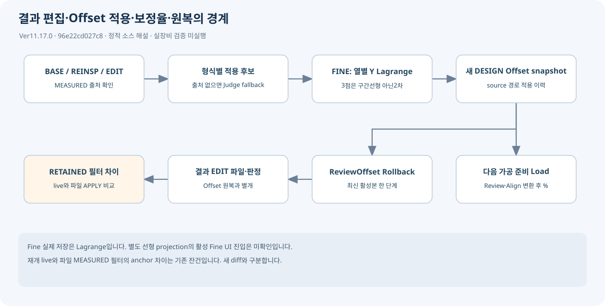


원본: `kjuws10-rgb/A3Drilling` · `master` · `28764c91d521777b8ee068dd7aaf2d3902ce9fe2`

현재 재검토: **11.19.0 / 2026-11-20**, 비교 기준 11.17.0(`96e22cd027c84bf302b23f2949b98985d7f301bb`). 11.18/11.19 두 Commit의 변경과 이전부터 남아 있는 경계를 함께 확인했습니다. 아래 변경 항목과 기존 잔건을 구분합니다. 파일·함수·호출 경계의 정적 확인이며 장비 실행 시험 결과가 아닙니다.

이 장의 **코드 확인**은 해당 Commit의 실제 함수 본문을 정적으로 추적한 사실입니다. **해설**은 그 구조를 이해하기 위한 설명이며, **검증 과제**는 앞으로 실행할 시험입니다. 실장비의 부호·광학 상태·통신 타이밍·정밀도가 검증되었다는 뜻은 아닙니다. 예시 숫자는 설명용 가상값입니다.

## 1. 측정 결과와 적용된 Offset을 분리해서 이해하기

Review 측정 결과는 “지금 어떤 오차가 관찰되었는가”이고, Review Offset은 “다음 가공 좌표에 어떤 값을 더할 것인가”입니다. AUTO Fine은 측정·검증·저장을 별도 단계로 실행합니다. 저장 성공 시 outcome에도 **다음 Glass에 적용**한다고 남깁니다. 결과 CSV를 열었다고 보정값이 자동으로 적용된 것은 아닙니다. [CAutoFineReviewCoordinator.cs:29–76](https://github.com/kjuws10-rgb/A3Drilling/blob/28764c91d521777b8ee068dd7aaf2d3902ce9fe2/Drilling.Common/Review/CAutoFineReviewCoordinator.cs#L29-L76) [CAutoFineReviewCoordinator.cs:165–168](https://github.com/kjuws10-rgb/A3Drilling/blob/28764c91d521777b8ee068dd7aaf2d3902ce9fe2/Drilling.Common/Review/CAutoFineReviewCoordinator.cs#L165-L168)

```mermaid
flowchart TD
 R[완료된 측정 결과] --> V[Recipe와 검사점 식별자 검증]
 V --> G[전점 OK 확인]
 G --> I[같은 Cell과 X열의 Y방향 보간]
 I --> C[기존 Offset을 DESIGN으로 환산]
 C --> A[기존값과 이번 delta 합산]
 A --> N[새 Offset CSV와 적용이력 저장]
 N --> P[다음 가공 준비에서 최신값 병합]
 N --> B[Rollback으로 최신본 보관 이동]
 B --> O[이전 활성본 복원]
```

## 2. AUTO 저장은 어디서 차단되는가

`Save`는 semaphore를 얻은 뒤 `_saved`를 다시 확인합니다. 이는 동시에 들어온 저장 호출 중 먼저 기다리던 호출이 중복 파일을 만들지 못하게 하는 경계입니다. `SaveCore`는 Prepared/Result 존재, Completed 상태, 결과 파일 저장 성공, 점 식별자 정합성, 전체 OK를 다시 검사합니다. 측정 완료 때 한 번 검사했다는 이유로 저장 검증을 생략하지 않습니다. [CAutoFineReviewCoordinator.cs:79–122](https://github.com/kjuws10-rgb/A3Drilling/blob/28764c91d521777b8ee068dd7aaf2d3902ce9fe2/Drilling.Common/Review/CAutoFineReviewCoordinator.cs#L79-L122)

ZeroLine Follow-up은 검사 이력만 남기고 현재 Review Offset을 load하지도 않는 분기가 있습니다. 따라서 “모든 Review 완료는 Offset을 갱신한다”는 설명은 틀립니다. 일반 AUTO Fine과 진단용 후속 검사는 목적이 다릅니다. [CAutoFineReviewCoordinator.cs:103–121](https://github.com/kjuws10-rgb/A3Drilling/blob/28764c91d521777b8ee068dd7aaf2d3902ce9fe2/Drilling.Common/Review/CAutoFineReviewCoordinator.cs#L103-L121)

## 3. FINE 보간의 실제 차원

`CalculateFineOffsets`는 측정점이 비어 있거나 NG, 미완료, 중복 ShotKey, 비유한 좌표를 포함하면 전체 적용을 거부합니다. 측정점을 `(CellNo, Round(DesignX,6))`로 묶고 각 열에서 DesignY 순으로 anchor를 만듭니다. 대상 Shot도 같은 키로 묶습니다. **Cell별 같은 설계 X열의 Y방향 보간입니다. HeadNo는 그룹 키에 없으므로 같은 Cell/X열에 여러 Head가 속하면 anchor가 함께 묶일 수 있습니다. X방향 표면 보간은 아닙니다.** [CReviewManager.cs:3616–3656](https://github.com/kjuws10-rgb/A3Drilling/blob/28764c91d521777b8ee068dd7aaf2d3902ce9fe2/Drilling.Common/Review/CReviewManager.cs#L3616-L3656)

| 경우 | 코드 동작 | 의미 |
|---|---|---|
| 한 열에 anchor 1개 | 해당 값을 반환 | 그 열 전체에 동일 delta를 준다. |
| anchor 여러 개 | Y를 정규화하고 Lagrange basis 계산 | 최대 7개 anchor라는 주석이 있다. |
| 대상 Y가 anchor Y와 사실상 같음 | 해당 anchor 값을 직접 반환 | 불필요한 수치 오차를 줄인다. |
| 같은 열에 같은 Y anchor 중복 | 예외 | 보간 분모가 0이 되는 모호한 입력을 차단한다. |
| 제외 때문에 anchor가 없는 열 | 그 열을 건너뜀 | 기존 저장값을 보존하려는 주석이 있다. |

표는 실제 함수 분기를 풀어쓴 것입니다. anchor 바깥 Y에 대한 계산식도 같은 다항식이므로, “언제나 보간 범위 안에서만 평가한다”는 보장은 함수 자체에 없습니다. 외삽의 물리적 적절성과 overshoot 제한은 별도 검토가 필요합니다. [CReviewManager.cs:3631–3682](https://github.com/kjuws10-rgb/A3Drilling/blob/28764c91d521777b8ee068dd7aaf2d3902ce9fe2/Drilling.Common/Review/CReviewManager.cs#L3631-L3682)

## 4. 보정 방향과 누적식

AUTO는 raw 측정 오차를 Plan의 VisionFlip으로 변환해 delta를 구합니다. 기존 파일의 각 Shot 값을 `CReviewOffsetData.ToDesign`으로 변환한 뒤 **기존 design 값 + 이번 delta**를 계산하고 `IsDesignCoordinate=true`로 저장합니다. 기존값을 이번 delta로 단순 대체하지 않으며, Legacy scanner 좌표를 design이라고 가정하지 않습니다. [CAutoFineReviewCoordinator.cs:123–151](https://github.com/kjuws10-rgb/A3Drilling/blob/28764c91d521777b8ee068dd7aaf2d3902ce9fe2/Drilling.Common/Review/CAutoFineReviewCoordinator.cs#L123-L151)

```text
currentDesign = ToDesign(parameters, HeadNo, oldX, oldY, old.IsDesignCoordinate)
finalDesignX  = Round(currentDesign.X + delta.X)
finalDesignY  = Round(currentDesign.Y + delta.Y)
savedSpace    = DESIGN
```

UI 수동 적용도 `Current / Delta / Final`을 구성하고 같은 누적식을 사용합니다. 적용 대상은 현재 Recipe에서 Head가 배정되어 있고 `Use`인 Shot입니다. ALL_SHOT/ONE_SHOT, ROUGH, FINE/AUTO는 각각 별도 delta builder를 사용합니다. FINE/AUTO 결과에 NG가 있으면 전체 적용을 거부합니다. [CMenuCorrection.ReviewData.Offset.cs:260–347](https://github.com/kjuws10-rgb/A3Drilling/blob/28764c91d521777b8ee068dd7aaf2d3902ce9fe2/Drilling.UI/Menu/Menus/CMenuCorrection.ReviewData.Offset.cs#L260-L347) [CMenuCorrection.ReviewData.Offset.cs:443–468](https://github.com/kjuws10-rgb/A3Drilling/blob/28764c91d521777b8ee068dd7aaf2d3902ce9fe2/Drilling.UI/Menu/Menus/CMenuCorrection.ReviewData.Offset.cs#L443-L468)

**해설:** “오차가 +X이므로 Offset에도 무조건 −X를 입력한다”는 구두 규칙으로 이 함수를 바꾸면 안 됩니다. raw 오차가 Target−Hole인지, VisionFlip이 어느 방향으로 변환하는지, 저장 좌표가 DESIGN인지 SCANNER인지, 최종 Scanner builder가 어떻게 적용하는지까지 연결해 시험해야 합니다. [CReviewManager.cs:2375–2386](https://github.com/kjuws10-rgb/A3Drilling/blob/28764c91d521777b8ee068dd7aaf2d3902ce9fe2/Drilling.Common/Review/CReviewManager.cs#L2375-L2386) [CReviewManager.cs:3687–3715](https://github.com/kjuws10-rgb/A3Drilling/blob/28764c91d521777b8ee068dd7aaf2d3902ce9fe2/Drilling.Common/Review/CReviewManager.cs#L3687-L3715) [CShotCoordinatePlanBuilder.cs:141–156](https://github.com/kjuws10-rgb/A3Drilling/blob/28764c91d521777b8ee068dd7aaf2d3902ce9fe2/Drilling.Common/Recipe/CShotCoordinatePlanBuilder.cs#L141-L156)

## 5. CSV 저장 구조와 Legacy 호환

| 열 | 자료 의미 | 파서 검증 |
|---|---|---|
| `CELLID` | 1 이상 Cell 식별자 | 정수, 유효 범위 |
| `SHOTID` | Cell 내 Shot 이름 | trim·대문자 및 구분자 정규화, 중복 금지 |
| `REVIEWOFFSETX` | 보정 X | 유한 double |
| `REVIEWOFFSETY` | 보정 Y | 유한 double |
| `COORDINATE_SPACE` | DESIGN 또는 SCANNER | 빈 값은 Legacy SCANNER, 그 외 알 수 없는 값은 오류 |

저장 파일은 Recipe별 `recipeId_reviewoffset` 폴더 아래 timestamp `_reviewoffset.csv`로 만들어집니다. 현재 loader는 required header와 실제 CSV 행 번호를 포함해 오류를 보고합니다. 새 값을 적용하기 전 **전체 행을 먼저 검증**한 다음 기존 parameter key를 제거합니다. 입력 중 한 행이 잘못되었다고 정상 기존값을 먼저 지우지 않도록 한 순서입니다. [CReviewOffsetFile.cs:704–777](https://github.com/kjuws10-rgb/A3Drilling/blob/28764c91d521777b8ee068dd7aaf2d3902ce9fe2/Drilling.File/ReviewOffset/CReviewOffsetFile.cs#L704-L777) [CShotCoordinatePlanBuilder.cs:1163–1216](https://github.com/kjuws10-rgb/A3Drilling/blob/28764c91d521777b8ee068dd7aaf2d3902ce9fe2/Drilling.Common/Recipe/CShotCoordinatePlanBuilder.cs#L1163-L1216)

Parameter 병합 시에는 `CELL{cell}_{shot}_REVIEW_OFFSET_X/Y/SPACE`로 저장됩니다. 과거 공통 `REVIEW_OFFSET_X/Y`도 제거합니다. DESIGN이면 최종 Scanner 좌표를 만드는 시점에 Head와 Stage 방향으로 변환하고, SCANNER면 이미 변환된 값으로 취급합니다. [CShotCoordinatePlanBuilder.cs:1137–1161](https://github.com/kjuws10-rgb/A3Drilling/blob/28764c91d521777b8ee068dd7aaf2d3902ce9fe2/Drilling.Common/Recipe/CShotCoordinatePlanBuilder.cs#L1137-L1161) [CShotCoordinatePlanBuilder.cs:1190–1216](https://github.com/kjuws10-rgb/A3Drilling/blob/28764c91d521777b8ee068dd7aaf2d3902ce9fe2/Drilling.Common/Recipe/CShotCoordinatePlanBuilder.cs#L1190-L1216)

## 6. 새 파일과 적용 이력을 함께 남기는 순서

`SaveNewCore`는 검증된 행을 임시 파일에 쓴 후 고유 timestamp 파일명으로 이동합니다. 파일명이 겹치면 millisecond를 증가시킵니다. 기존 활성 파일을 덮어쓰는 저장 방식이 아닙니다. 임시 파일은 finally에서 정리합니다. [CReviewOffsetFile.cs:224–268](https://github.com/kjuws10-rgb/A3Drilling/blob/28764c91d521777b8ee068dd7aaf2d3902ce9fe2/Drilling.File/ReviewOffset/CReviewOffsetFile.cs#L224-L268)

`SaveNewFromSource`는 source result 파일의 identity를 만들고 해당 시점의 history에서 기존 적용을 찾습니다. duplicate가 있고 allowDuplicate가 false면 예외입니다. 새 Offset을 만든 뒤 history append가 실패하면 방금 만든 Offset 파일을 제거하려고 합니다. 이 제거마저 실패하면 원래 오류와 cleanup 오류를 함께 올립니다. 파일 생성만 성공한 상태를 조용히 정상 처리하지 않으려는 보상 동작입니다. [CReviewOffsetFile.cs:150–221](https://github.com/kjuws10-rgb/A3Drilling/blob/28764c91d521777b8ee068dd7aaf2d3902ce9fe2/Drilling.File/ReviewOffset/CReviewOffsetFile.cs#L150-L221)

### 중복 방지의 범위를 과장하지 않기

이 history 경로는 `appliedAt.ToLocalTime()`의 년/월/일 하위 파일입니다. source identity는 application root 내부라면 상대 경로, 외부라면 full path를 `/` 구분자로 정규화한 값입니다. **content hash 기반의 영구 전역 중복 제거가 아닙니다.** 현재는 Recipe의 모든 날짜별 이력을 검색하므로 같은 경로를 다음 날 다시 적용해도 차단합니다. 같은 내용을 다른 경로로 복사한 경우는 별도 identity라 허용될 수 있습니다. [CReviewOffsetFile.cs:633–677](https://github.com/kjuws10-rgb/A3Drilling/blob/28764c91d521777b8ee068dd7aaf2d3902ce9fe2/Drilling.File/ReviewOffset/CReviewOffsetFile.cs#L633-L677)

| 보호 수단 | 막는 문제 | 단독으로 입증할 수 없는 것 |
|---|---|---|
| coordinator `_saved`와 gate | 같은 coordinator 저장의 동시·반복 실행 | 앱 재시작 이후 모든 중복 |
| source application history | Recipe 전체 날짜의 같은 source identity | 다른 경로·내용 복제의 완전 차단 |
| Recipe ID 검사 | 다른 Recipe Offset과 합산 | Recipe 내용 revision 전체 동일성 |
| UI 최신 파일 재확인 | dialog를 연 사이 최신 Offset이 바뀜 | 다른 프로세스와 모든 filesystem race 해소 |

UI는 확인 대화상자 후 latest 파일을 다시 읽고 `SameOffsetSource`를 비교한 뒤 저장합니다. 사용자에게 보인 Current와 실제 저장 대상이 달라지는 것을 막으려는 경계입니다. [CMenuCorrection.ReviewData.Offset.cs:84–124](https://github.com/kjuws10-rgb/A3Drilling/blob/28764c91d521777b8ee068dd7aaf2d3902ce9fe2/Drilling.UI/Menu/Menus/CMenuCorrection.ReviewData.Offset.cs#L84-L124)

## 7. Rollback은 무엇을 원복하는가

`RollbackLatest`는 현재 활성 파일 목록을 읽고 `expectedLatestFilePath`가 최신 파일과 다르면 중단합니다. 그 후 최신 파일을 `Rollback` 하위 보관 경로로 이동하고 이전 활성 파일을 현재값으로 삼습니다. 제거한 Offset 파일에 해당하는 적용 history도 조정합니다. 이 동작은 **최신 활성 snapshot 한 단계 원복**이며 임의 날짜의 모든 Recipe/Setting/측정 결과를 함께 되돌리는 전체 프로젝트 복원은 아닙니다. [CReviewOffsetFile.cs:271–362](https://github.com/kjuws10-rgb/A3Drilling/blob/28764c91d521777b8ee068dd7aaf2d3902ce9fe2/Drilling.File/ReviewOffset/CReviewOffsetFile.cs#L271-L362)

원복 중 history 쓰기나 현재값 확인이 실패하면 이동한 파일과 history를 되살리는 cleanup 경로가 있습니다. 실제 실패 주입 테스트에서는 파일 이동 실패, history 쓰기 실패, 원복 cleanup 실패를 따로 검증해야 합니다. source 코드에 복구 분기가 있다는 사실만으로 파일시스템 장애에 대한 원복 성공을 보장하지 않습니다. [CReviewOffsetFile.cs:319–390](https://github.com/kjuws10-rgb/A3Drilling/blob/28764c91d521777b8ee068dd7aaf2d3902ce9fe2/Drilling.File/ReviewOffset/CReviewOffsetFile.cs#L319-L390)

## 8. 다음 가공에서 값이 사용되는 경계

`CStationProcess.MergeLatestReviewOffsets`는 가공 준비 parameter를 구성하면서 해당 Recipe의 latest Offset을 load하고 파일 경로·저장 시각을 준비 상태에 보관한 뒤 parameter에 병합합니다. 최종 `CShotCoordinatePlanBuilder`는 이 값을 `ToScanner`로 옮겨 다른 offset 성분과 합칩니다. 따라서 지금 저장한 Offset이 이미 진행 중인 Glass의 명령을 소급 변경한다고 설명해서는 안 됩니다. [CStationProcess.cs:1545–1564](https://github.com/kjuws10-rgb/A3Drilling/blob/28764c91d521777b8ee068dd7aaf2d3902ce9fe2/Drilling.Common/Station/CStationProcess.cs#L1545-L1564) [CShotCoordinatePlanBuilder.cs:141–156](https://github.com/kjuws10-rgb/A3Drilling/blob/28764c91d521777b8ee068dd7aaf2d3902ce9fe2/Drilling.Common/Recipe/CShotCoordinatePlanBuilder.cs#L141-L156)

## 9. 개발자용 검증 과제

| 시험 | 준비 | 기대 결과 |
|---|---|---|
| 전체 NG 차단 | 한 anchor만 NG | 새 Offset 파일 없음, 기존 활성값 유지 |
| 한 anchor | 같은 Cell/X 열 여러 Y 대상 | 같은 delta를 받음 |
| 없는 anchor 열 | 해당 열 측정점 전부 제외 | 기존값 보존, 임의 0 보간 금지 |
| Legacy 변환 | SCANNER 이전 파일 + 비정상 Head flip 조합 | design으로 역변환 후 누적·재변환이 일관됨 |
| CSV 한 행 NaN | 나머지 행 정상 | 전체 적용 거부, 기존 parameter 제거 전 실패 |
| 동시 Save | 동일 coordinator 두 호출 | 정상 snapshot 한 번만 저장 |
| 날짜/경로 중복 | 같은 source를 다음 날짜 또는 다른 경로로 지정 | 현재 정책의 한계를 정확히 확인·명세화 |
| rollback stale UI | dialog 후 다른 snapshot 추가 | expectedLatest 불일치로 중단 |
| history failure | append 쓰기만 실패 주입 | 새 Offset cleanup 및 오류 확인 |
| rollback 후 재적용 | 최신본 보관 이동 뒤 같은 source 지정 | history 변경과 duplicate 정책이 일관됨 |

위 항목은 권장 자동시험이며 본 문서 작성 시 실행한 장비 시험 결과가 아닙니다.

## 10. 결과 COPY, 보정값 복사, 보정율을 구별한다

11.13.0의 COPY MODE가 직접 복제하는 것은 **Review 결과 X/Y 또는 JUDGE**입니다. 이미 적용된 ReviewOffset snapshot이나 Head Default를 다른 Shot에 복사하는 함수가 아닙니다. COPY X·COPY Y·COPY JUDGE·COPY ALL은 메모리상의 편집 후보를 채우고, RESULT SAVE가 별도 _EDIT_ 파일을 만듭니다. OFFSET APPLY는 여전히 독립 동작입니다. [CMenuCorrection.ReviewData.Edit.cs:304–345](https://github.com/kjuws10-rgb/A3Drilling/blob/28764c91d521777b8ee068dd7aaf2d3902ce9fe2/Drilling.UI/Menu/Menus/CMenuCorrection.ReviewData.Edit.cs#L304-L345) [CMenuCorrection.ReviewData.Edit.cs:371–416](https://github.com/kjuws10-rgb/A3Drilling/blob/28764c91d521777b8ee068dd7aaf2d3902ce9fe2/Drilling.UI/Menu/Menus/CMenuCorrection.ReviewData.Edit.cs#L371-L416) [CReviewResultFile.cs:157–183](https://github.com/kjuws10-rgb/A3Drilling/blob/28764c91d521777b8ee068dd7aaf2d3902ce9fe2/Drilling.File/ReviewResult/CReviewResultFile.cs#L157-L183)

| 동작 | 바뀌는 자료 | 실측/가공에 대한 의미 |
|---|---|---|
| COPY X / COPY Y | 대상 결과의 해당 축 편집 후보 | 반대축·판정은 자동 변경하지 않고 대상 Shot을 새로 측정하지 않음 |
| COPY JUDGE / ALL | 대상 편집 판정, 또는 좌표+판정 | 복사된 OK는 새 측정 합격 증거가 아님 |
| RESULT SAVE | 새 EDIT Revision | 현재 Offset/Recipe/Product를 함께 적용하지 않음 |
| OFFSET APPLY | Current+Delta인 새 ReviewOffset와 적용 이력 | 다음 가공 준비에 사용하는 별도 저장 |
| REVIEW_OFFSET_SCALE / ALIGN_OFFSET_SCALE | 현재 가공 기여값에 곱하는 비율 | 원래 저장 Offset을 축소 저장하거나 반복 곱하지 않음 |
| Default APPLY | Recipe의 Head별 기본값 | Review 결과 수정·ReviewOffset 원복과 다른 수명 |

보정 레벨을 비율(%)이라는 뜻으로 쓸 때, ReadOffsetScale은 키가 없으면100%, 있으면0 이상 정수만 허용하고 percent/100을 반환합니다. 소스에 100% 상한은 없습니다. 두 비율은 각각 Align/Review의 Scanner 변환 후 기여값에 한 번 곱합니다. Default·FirstBeam·RecipeOffset에는 이 곱셈이 적용되지 않습니다. 0%도 저장 이력 삭제가 아니라 이번 가공 기여를0으로 만드는 선택입니다. [CShotCoordinatePlanBuilder.cs:33–37](https://github.com/kjuws10-rgb/A3Drilling/blob/28764c91d521777b8ee068dd7aaf2d3902ce9fe2/Drilling.Common/Recipe/CShotCoordinatePlanBuilder.cs#L33-L37) [CShotCoordinatePlanBuilder.cs:141–156](https://github.com/kjuws10-rgb/A3Drilling/blob/28764c91d521777b8ee068dd7aaf2d3902ce9fe2/Drilling.Common/Recipe/CShotCoordinatePlanBuilder.cs#L141-L156) [CShotCoordinatePlanBuilder.cs:204–210](https://github.com/kjuws10-rgb/A3Drilling/blob/28764c91d521777b8ee068dd7aaf2d3902ce9fe2/Drilling.Common/Recipe/CShotCoordinatePlanBuilder.cs#L204-L210)

### EDIT 결과가 Offset으로 들어가는지는 결과 형식에 따라 다르다

MeasuredRows는 RESULT_SOURCE가 한 행이라도 있으면 MEASURED·RETAINED·EDITED를 사용합니다. UNMEASURED·ERROR 및 보간행은 제외합니다. Direct·ROUGH는 이 후보 중 OK만 사용하고 FINE/AUTO는 후보 중 비OK가 하나라도 있으면 전체를 차단합니다. 반면 RESULT_SOURCE가 전혀 없는 파일은 OK/NG 판정 행으로 fallback합니다. 새 ONE SHOT writer도 그 열을 만들지 않으므로, 그 파일을 EDIT해 OK로 저장하면 수정값이 fallback 적용 후보가 될 수 있습니다. “편집 결과는 언제나 보정에 적용된다” 또는 “언제나 적용에서 제외된다”는 설명은 둘 다 현재 코드와 맞지 않습니다. [CMenuCorrection.ReviewData.Offset.cs:385–415](https://github.com/kjuws10-rgb/A3Drilling/blob/28764c91d521777b8ee068dd7aaf2d3902ce9fe2/Drilling.UI/Menu/Menus/CMenuCorrection.ReviewData.Offset.cs#L385-L415) [CMenuCorrection.ReviewData.Offset.cs:443–480](https://github.com/kjuws10-rgb/A3Drilling/blob/28764c91d521777b8ee068dd7aaf2d3902ce9fe2/Drilling.UI/Menu/Menus/CMenuCorrection.ReviewData.Offset.cs#L443-L480) [CReviewResultFile.cs:399–403](https://github.com/kjuws10-rgb/A3Drilling/blob/28764c91d521777b8ee068dd7aaf2d3902ce9fe2/Drilling.File/ReviewResult/CReviewResultFile.cs#L399-L403) [CReviewResultFile.cs:1031–1040](https://github.com/kjuws10-rgb/A3Drilling/blob/28764c91d521777b8ee068dd7aaf2d3902ce9fe2/Drilling.File/ReviewResult/CReviewResultFile.cs#L1031-L1040)

FINE에서는 이제 EDITED도 anchor 후보입니다. NG를 EDITED/OK로 바꾸면 그 수정값이 계산에 사용될 수 있으나 새 실측 합격을 의미하지 않습니다. EDITED/NG는 후보에서 사라지지 않아 전체 적용을 차단합니다. 따라서 편집 후에는 숫자와 판정·출처·적용 범위를 함께 검토해야 합니다. [CMenuCorrection.ReviewData.Offset.cs:294–297](https://github.com/kjuws10-rgb/A3Drilling/blob/28764c91d521777b8ee068dd7aaf2d3902ce9fe2/Drilling.UI/Menu/Menus/CMenuCorrection.ReviewData.Offset.cs#L294-L297) [CMenuCorrection.ReviewData.Offset.cs:443–480](https://github.com/kjuws10-rgb/A3Drilling/blob/28764c91d521777b8ee068dd7aaf2d3902ce9fe2/Drilling.UI/Menu/Menus/CMenuCorrection.ReviewData.Offset.cs#L443-L480)

### 중복 적용과 원복 경계

EDIT/REINSP 파일은 BASE와 다른 경로입니다. source identity가 경로 기준인 history에서 새 Revision을 과거 BASE와 같은 측정 계보로 묶어 중복 차단한다는 근거는 없습니다. 먼저 BASE를 적용한 뒤 부분 EDIT 또는 REINSP Revision을 다시 적용하면, 아직 MEASURED로 남은 다른 행의 delta가 재누적되는 경로를 시험해야 합니다. 파일명에 Revision이 있다고 기준 OffsetRevision·부모 결과 해시·적용 소비 ID가 자동 기록되는 것은 아닙니다. [CReviewResultFile.cs:229–268](https://github.com/kjuws10-rgb/A3Drilling/blob/28764c91d521777b8ee068dd7aaf2d3902ce9fe2/Drilling.File/ReviewResult/CReviewResultFile.cs#L229-L268) [CReviewOffsetFile.cs:633–677](https://github.com/kjuws10-rgb/A3Drilling/blob/28764c91d521777b8ee068dd7aaf2d3902ce9fe2/Drilling.File/ReviewOffset/CReviewOffsetFile.cs#L633-L677)

검증할 조합은 (1) BASE 적용 후 일부 EDIT, (2) BASE 적용 후 일부 REINSP, (3) 다음 날짜 같은 경로, (4) 다른 경로 복제, (5) Offset Rollback 후 같은 결과 재적용입니다. 기대 관찰값은 실제 후보 키·Current/Delta/Final·새 snapshot·history source identity입니다. ReviewOffset Rollback은 결과 EDIT/REINSP 파일이나 판정을 되돌리지 않으며, Default의 실패 쌍 복원과도 다릅니다.


## 11. 화면 색·산포도 축·보정율·품질 판정의 차이

11.13.0의 산포도는 Judge 색, ShotMap은 결과존재 색이었습니다. **11.17.0은 L1~L4 임계색으로 변경**되어 산포도는 행 LevelBrush, Shot은 같은 Shot의 최대 Level, Cell은 포함 행의 최대 Level을 씁니다. 기본0.010/0.020/0.030mm는 품질 tolerance가 아닌 표시값입니다. 이전 색 설명을 대체합니다. [CMenuCorrection.ReviewData.Display.cs:315–332](https://github.com/kjuws10-rgb/A3Drilling/blob/28764c91d521777b8ee068dd7aaf2d3902ce9fe2/Drilling.UI/Menu/Menus/CMenuCorrection.ReviewData.Display.cs#L315-L332) [CMenuCorrection.ReviewData.Display.cs:789–814](https://github.com/kjuws10-rgb/A3Drilling/blob/28764c91d521777b8ee068dd7aaf2d3902ce9fe2/Drilling.UI/Menu/Menus/CMenuCorrection.ReviewData.Display.cs#L789-L814) [CMenuCorrection.ReviewData.Display.cs:1178–1195](https://github.com/kjuws10-rgb/A3Drilling/blob/28764c91d521777b8ee068dd7aaf2d3902ce9fe2/Drilling.UI/Menu/Menus/CMenuCorrection.ReviewData.Display.cs#L1178-L1195)

산포도 MIN/MAX/UNIT는 mm 그리기 범위입니다. 점 선택·축 확대·색 편집은 ReviewOffset이나 Judge를 재저장하지 않습니다. Offset scale(%)는 저장된 값의 현재 가공 기여율이며 L1~L4와 별개입니다. [CMenuCorrection.ReviewData.Display.cs:713–746](https://github.com/kjuws10-rgb/A3Drilling/blob/28764c91d521777b8ee068dd7aaf2d3902ce9fe2/Drilling.UI/Menu/Menus/CMenuCorrection.ReviewData.Display.cs#L713-L746) [CShotCoordinatePlanBuilder.cs:141–156](https://github.com/kjuws10-rgb/A3Drilling/blob/28764c91d521777b8ee068dd7aaf2d3902ce9fe2/Drilling.Common/Recipe/CShotCoordinatePlanBuilder.cs#L141-L156)

## 12. Fine 보간의 유지 사항과 재개 파일 필터 개선

같은 X열에서 세 줄을 측정했다고 실제 보정이 구간 선형인 것은 아닙니다. AUTO SaveCore, 수동 FINE APPLY, 파일 FINE/AUTO APPLY는 모두 CalculateFineOffsets를 사용합니다. anchor가1개면 상수,2개면 직선,3개면2차 Lagrange이며 n개면 n−1차입니다. 모든 anchor를 한꺼번에 사용하고 범위 밖을 고정하지 않습니다. 함수 본문은 이번 diff에서 바뀌지 않은 **기존 요구 정합성 잔건**입니다. [CReviewManager.cs:3616–3683](https://github.com/kjuws10-rgb/A3Drilling/blob/28764c91d521777b8ee068dd7aaf2d3902ce9fe2/Drilling.Common/Review/CReviewManager.cs#L3616-L3683) [CAutoFineReviewCoordinator.cs:123–151](https://github.com/kjuws10-rgb/A3Drilling/blob/28764c91d521777b8ee068dd7aaf2d3902ce9fe2/Drilling.Common/Review/CAutoFineReviewCoordinator.cs#L123-L151) [CMenuCorrection.cs:3176–3219](https://github.com/kjuws10-rgb/A3Drilling/blob/28764c91d521777b8ee068dd7aaf2d3902ce9fe2/Drilling.UI/Menu/Menus/CMenuCorrection.cs#L3176-L3219) [CMenuCorrection.ReviewData.Offset.cs:443–480](https://github.com/kjuws10-rgb/A3Drilling/blob/28764c91d521777b8ee068dd7aaf2d3902ce9fe2/Drilling.UI/Menu/Menus/CMenuCorrection.ReviewData.Offset.cs#L443-L480)

별도 ProjectFineResultRows에는 인접 Y 선형 확장과 양 끝 고정 코드가 남아 있습니다. 현재 ReviewData Offset의 ProjectCorrectionRows 호출은 ROUGH 경로이며 별도 Fine projection을 활성 Fine UI가 호출한다고 확정한 근거는 없습니다. “화면은 선형인데 저장은 Lagrange”라고 일반화하지 않습니다. [CReviewManager.cs:794–907](https://github.com/kjuws10-rgb/A3Drilling/blob/28764c91d521777b8ee068dd7aaf2d3902ce9fe2/Drilling.Common/Review/CReviewManager.cs#L794-L907) [CMenuCorrection.ReviewData.Offset.cs:418–466](https://github.com/kjuws10-rgb/A3Drilling/blob/28764c91d521777b8ee068dd7aaf2d3902ce9fe2/Drilling.UI/Menu/Menus/CMenuCorrection.ReviewData.Offset.cs#L418-L466)

| 기존 조건 | 확인된 경계 | 후속 시험 |
|---|---|---|
| anchor0/10/0µm, Y0/50/100mm | Y25 Lagrange7.5µm / 구간선형5µm | 고객 구간 선형 요구와 합의 |
| 처음/마지막 유효 anchor 바깥 | 같은 다항식 외삽 | masked 끝 row·overshoot 제한 |
| 재개 전 완료 row | live 보존 / CSV RETAINED | live APPLY와 재LOAD APPLY 비교 |
| 파일 MeasuredRows | source 있으면 MEASURED/RETAINED/EDITED | 보존점 포함 live/파일 anchor 일치와 수정값 소비 검증 |
| 수동 FINE 대상 | HeadNo>0 전체, Use 필터 없음 | AUTO/REVIEW DATA의 Use=true 비교 |
| 같은 Cell/X 여러 Head | 그룹 키 HeadNo 없음 | 혼합 구성·동일Y 예외 |

[CReviewManager.cs:2731–2774](https://github.com/kjuws10-rgb/A3Drilling/blob/28764c91d521777b8ee068dd7aaf2d3902ce9fe2/Drilling.Common/Review/CReviewManager.cs#L2731-L2774) [CReviewResultFile.cs:1188–1206](https://github.com/kjuws10-rgb/A3Drilling/blob/28764c91d521777b8ee068dd7aaf2d3902ce9fe2/Drilling.File/ReviewResult/CReviewResultFile.cs#L1188-L1206) [CMenuCorrection.cs:6769–6778](https://github.com/kjuws10-rgb/A3Drilling/blob/28764c91d521777b8ee068dd7aaf2d3902ce9fe2/Drilling.UI/Menu/Menus/CMenuCorrection.cs#L6769-L6778) [CMenuCorrection.ReviewData.Offset.cs:443–480](https://github.com/kjuws10-rgb/A3Drilling/blob/28764c91d521777b8ee068dd7aaf2d3902ce9fe2/Drilling.UI/Menu/Menus/CMenuCorrection.ReviewData.Offset.cs#L443-L480)

이전 필터의 가상 반례는 Y0의0µm RETAINED와 Y50/100의10/0µm MEASURED에서 live의 Y25=7.5µm, 파일=15µm였습니다. 현재 필터는 RETAINED를 포함하므로 같은 원본 함수를 복사한 회귀에서 live/파일 모두7.5µm로 일치했습니다. 다항식 자체는 그대로이며 실제 장비의 정확도를 검증한 결과는 아닙니다.

## 13. 11.19 저장·중복 방지의 확인 범위

| 항목 | 현재 실행 경로 | 이번 검증과 한계 |
|---|---|---|
| 날짜 중복 | `FindSourceApplicationAcrossHistory`가 Recipe의 `_apply/**/AppliedSources.csv`를 한 번 색인 | 같은/새 인스턴스 모두 익일 동일경로 차단 재현 |
| 명시적 재적용 | UI가 기존 이력을 보여 주고 재적용을 확인한 경우 `allowDuplicate=true` | 사용자 선택으로 재누적 가능; 자동 무조건 차단이 아님 |
| 원복 | 최신본 이동·해당 이력 제거 후 Recipe cache 무효화 | 이전 이력이 남으면 계속 중복 차단, 전부 원복하면 재적용 가능 |
| 경로/계보 | identity는 파일 경로 | 다른 경로 복제·새 Revision을 같은 측정계보로 묶지는 않음 |
| 외부 변경 | 같은 writer 내부 저장/원복은 cache 갱신 | 별도 writer/프로세스가 history를 바꿀 때 cache 자동 재색인은 없음 |

[CReviewOffsetFile.cs:131–202](https://github.com/kjuws10-rgb/A3Drilling/blob/28764c91d521777b8ee068dd7aaf2d3902ce9fe2/Drilling.File/ReviewOffset/CReviewOffsetFile.cs#L131-L202) [CReviewOffsetFile.cs:409–472](https://github.com/kjuws10-rgb/A3Drilling/blob/28764c91d521777b8ee068dd7aaf2d3902ce9fe2/Drilling.File/ReviewOffset/CReviewOffsetFile.cs#L409-L472) [CReviewOffsetFile.cs:306–385](https://github.com/kjuws10-rgb/A3Drilling/blob/28764c91d521777b8ee068dd7aaf2d3902ce9fe2/Drilling.File/ReviewOffset/CReviewOffsetFile.cs#L306-L385) [CMenuCorrection.cs:2414–2447](https://github.com/kjuws10-rgb/A3Drilling/blob/28764c91d521777b8ee068dd7aaf2d3902ce9fe2/Drilling.UI/Menu/Menus/CMenuCorrection.cs#L2414-L2447)

별도 writer 두 개로 cache를 먼저 만든 뒤 다른 writer가 저장하는 합성 시험에서는 첫 writer가 외부 새 이력을 보지 못하는 한계를 재현했습니다. 실제 앱의 다중 인스턴스 운전이나 외부 이력 수정이 일어났다는 뜻은 아닙니다. 단일 writer 소유 계약을 명시하거나 파일 변경/프로세스 간 잠금을 별도 설계할 때 참고할 근거입니다.

현재 보정 적격 형식은 ALL_SHOT/ONE_SHOT/ONE_LINE/ROUGH/FINE/AUTO입니다. BEAM_INSPECTION은 UI와 적용형식 switch 모두 보정 대상에서 제외됩니다. 완료 여부, 현재 Recipe 대상키·최신 Offset·같은 source 재적용 확인은 각각 별도 가드입니다. [CMenuCorrection.ReviewData.Offset.cs:264–302](https://github.com/kjuws10-rgb/A3Drilling/blob/28764c91d521777b8ee068dd7aaf2d3902ce9fe2/Drilling.UI/Menu/Menus/CMenuCorrection.ReviewData.Offset.cs#L264-L302) [CMenuCorrection.ReviewData.Offset.cs:515–531](https://github.com/kjuws10-rgb/A3Drilling/blob/28764c91d521777b8ee068dd7aaf2d3902ce9fe2/Drilling.UI/Menu/Menus/CMenuCorrection.ReviewData.Offset.cs#L515-L531)


# 별도 정적 추적 상세 해설 · review/05_결과_Revision_Product_연결.md

# ReviewResult·재검사 Revision·Product 이력의 결합

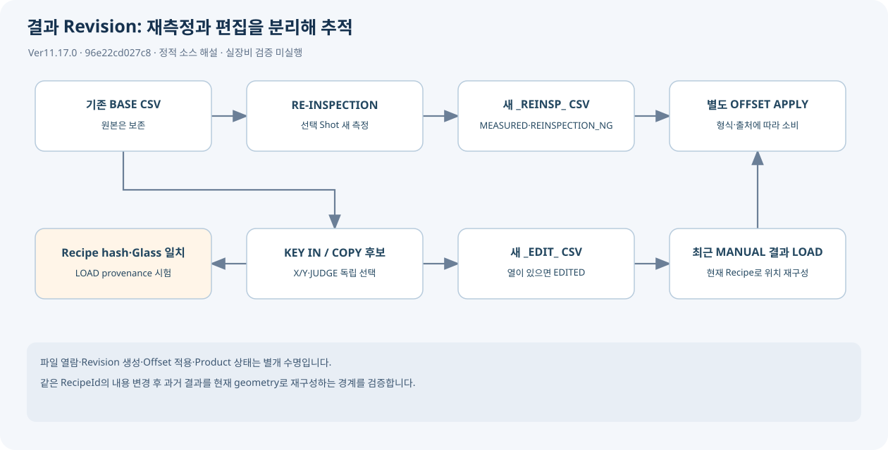


원본: `kjuws10-rgb/A3Drilling` · `master` · `28764c91d521777b8ee068dd7aaf2d3902ce9fe2`

현재 재검토: **11.19.0 / 2026-11-20**, 비교 기준 11.17.0(`96e22cd027c84bf302b23f2949b98985d7f301bb`). 11.18/11.19 두 Commit의 변경과 이전부터 남아 있는 경계를 함께 확인했습니다. 아래 변경 항목과 기존 잔건을 구분합니다. 파일·함수·호출 경계의 정적 확인이며 장비 실행 시험 결과가 아닙니다.

이 장의 **코드 확인**은 해당 Commit의 실제 함수 본문을 정적으로 추적한 사실입니다. **해설**은 그 구조를 이해하기 위한 설명이며, **검증 과제**는 앞으로 실행할 시험입니다. 실장비의 부호·광학 상태·통신 타이밍·정밀도가 검증되었다는 뜻은 아닙니다. 예시 숫자는 설명용 가상값입니다.

## 1. 세 종류의 이력이 별도로 존재한다

이 프로젝트에서 측정 결과 파일, 보정 snapshot, Product 진행 상태는 다른 자료입니다. ReviewResult는 측정 수치와 판정을 저장합니다. ReviewOffset은 다음 가공에 쓸 보정값을 저장합니다. Product는 현재 Glass/공정의 Review가 Running/Completed인지와 결과 요약을 관리합니다. 파일 하나가 존재한다고 나머지 두 상태가 자동으로 동일하다고 추정하면 안 됩니다. [CReviewResultFile.cs:142–257](https://github.com/kjuws10-rgb/A3Drilling/blob/28764c91d521777b8ee068dd7aaf2d3902ce9fe2/Drilling.File/ReviewResult/CReviewResultFile.cs#L142-L257) [CAutoFineReviewCoordinator.cs:123–168](https://github.com/kjuws10-rgb/A3Drilling/blob/28764c91d521777b8ee068dd7aaf2d3902ce9fe2/Drilling.Common/Review/CAutoFineReviewCoordinator.cs#L123-L168) [CProductManager.cs:444–506](https://github.com/kjuws10-rgb/A3Drilling/blob/28764c91d521777b8ee068dd7aaf2d3902ce9fe2/Drilling.Common/Product/CProductManager.cs#L444-L506)

```mermaid
flowchart TD
 G[Glass와 Recipe 식별자] --> P[Product 진행 상태]
 G --> M[Review 실행 결과]
 M --> B[BASE 결과 CSV]
 B --> Q[선택 Shot 재검사]
 Q --> R[새 REINSP Revision CSV]
 B --> K[KEY IN 또는 COPY 후보]
 K --> E[새 EDIT Revision CSV]
 E --> O
 R --> O[별도 Offset 적용 판단]
 M --> S[Product Review Completed 요약]
 O --> A[다음 가공 준비 최신 Offset]
```

그림의 Product 화살표는 데이터 책임을 구분한 것입니다. 수동 재검사 Revision을 만들 때 자동으로 과거 Product 요약도 수정되는지 여부는 이 장에서 확인한 파일 함수만으로 보장하지 않습니다.

## 2. 재검사의 UI 입력이 모이는 곳

`SaveReinspectionResult`는 완료된 재검사 항목만 모읍니다. 각 update에는 `CellNo`, `ShotKey`, `ShotName`, 원래 Beam, 실제 재검사 Beam, raw 결과 X/Y, 변환된 결과 X/Y, 상태가 들어갑니다. 사용자가 다른 Beam으로 재검사했을 때 원래 row와 실제 사용 Beam을 구분하는 이유입니다. 완료 update가 없으면 저장을 거부하고 BASE 파일명과 갱신 Shot 수를 확인한 뒤 파일 writer를 호출합니다. [CMenuCorrection.ReviewData.Reinspection.cs:339–395](https://github.com/kjuws10-rgb/A3Drilling/blob/28764c91d521777b8ee068dd7aaf2d3902ce9fe2/Drilling.UI/Menu/Menus/CMenuCorrection.ReviewData.Reinspection.cs#L339-L395)

| 값 | 구분 목적 |
|---|---|
| SourceBeamNo | BASE 결과에서 어떤 측정 행을 바꾸려는지 찾는 단서 |
| BeamNo | 이번 재검사에 실제 선택한 Beam |
| RawResultX/Y | 수신 오차가 어떤 방향이었는지 추적 |
| ResultX/Y | 변환 후 후처리할 오차 |
| Judge/State | 완료 OK인지 완료 NG인지 구분 |

UI 저장은 새 파일 경로를 받으면 unsaved 상태를 해제합니다. 취소와 일반 예외는 별도로 표시합니다. 저장 버튼을 눌렀다는 조작 이력만으로 파일이 생성되었다고 판단하지 말고 성공 경로와 실제 파일명까지 확인해야 합니다. [CMenuCorrection.ReviewData.Reinspection.cs:385–411](https://github.com/kjuws10-rgb/A3Drilling/blob/28764c91d521777b8ee068dd7aaf2d3902ce9fe2/Drilling.UI/Menu/Menus/CMenuCorrection.ReviewData.Reinspection.cs#L385-L411)

## 3. BASE 파일을 덮어쓰지 않는 Revision 생성

`SaveReinspectionRevision`은 source file 존재, header 존재, row 존재를 먼저 확인합니다. `BEAM1_JUDGE` header를 가진 BEAM INSPECTION 결과는 이 재검사 writer로 저장할 수 없습니다. 즉 어떤 결과 타입이든 같은 Revision 함수에 넣을 수 있는 구조가 아닙니다. [CReviewResultFile.cs:142–227](https://github.com/kjuws10-rgb/A3Drilling/blob/28764c91d521777b8ee068dd7aaf2d3902ce9fe2/Drilling.File/ReviewResult/CReviewResultFile.cs#L142-L227)

BASE 행을 dictionary로 복사한 뒤 update마다 검증하고 대상 행을 찾습니다. 같은 BASE row를 두 번 바꾸려 하면 `updatedRowIndexes`가 중복을 차단합니다. 기존 `SAVED_AT` 열이 있으면 Revision 시각 표현을 갱신합니다. 현재 기준 함수는 기존 파일을 직접 overwrite하는 대신 새 고유 CSV를 만듭니다. [CReviewResultFile.cs:229–257](https://github.com/kjuws10-rgb/A3Drilling/blob/28764c91d521777b8ee068dd7aaf2d3902ce9fe2/Drilling.File/ReviewResult/CReviewResultFile.cs#L229-L257)

새 파일 stem은 StripRevisionSuffix가 _REINSP_와 _EDIT_의 마지막 위치를 각각 구한 뒤, 존재하는 두 위치 중 앞선 지점에서 잘라냅니다. 그 뒤 이번 종류(REINSP 또는 EDIT)와 timestamp를 붙입니다. 부모 파일을 덮어쓰지 않고 같은 폴더에 새 고유 파일을 만듭니다. 파일명 축약은 부모/자식 관계의 명시적 ID나 내용 해시를 기록하는 기능과 다릅니다. [CReviewResultFile.cs:252–268](https://github.com/kjuws10-rgb/A3Drilling/blob/28764c91d521777b8ee068dd7aaf2d3902ce9fe2/Drilling.File/ReviewResult/CReviewResultFile.cs#L252-L268)

## 4. 어떤 열을 어떻게 갱신하는가

`ApplyReinspectionUpdate`는 BASE에 **존재하는 열만** 갱신합니다. 아래 이름들은 저장 형식의 호환 열이며, 무조건 모든 결과 CSV에 동시에 존재한다는 뜻은 아닙니다. 좌표 열은 X와 Y가 한 쌍으로 있어야 하며 한쪽만 있으면 실패합니다. 갱신할 좌표 쌍이 하나도 없으면 저장할 수 없습니다. [CReviewResultFile.cs:352–376](https://github.com/kjuws10-rgb/A3Drilling/blob/28764c91d521777b8ee068dd7aaf2d3902ce9fe2/Drilling.File/ReviewResult/CReviewResultFile.cs#L352-L376)

| 열 묶음 | 들어가는 update 값 | 의미 |
|---|---|---|
| `RECV_TARGET_MINUS_HOLE_X/Y`, `RECV_X/Y` | RawResultX/Y | raw 방향 오차 |
| `VISION_FLIP_CONVERT_X/Y`, `CONVERTED_X/Y`, `ERROR_X/Y` | ResultX/Y | 변환된 오차 |
| `BEAM_NO` | BeamNo | 재검사 Beam |
| `JUDGE`, `STATE` | Judge 대문자 | 재검사 판정 |
| `RESULT_SOURCE` | MEASURED | 직접 측정으로 갱신된 행임을 표시 |

**해설:** result CSV의 `ERROR_X/Y`를 모든 코드 경로에서 raw Vision 축이라고 간주하면 안 됩니다. 이 Revision writer는 ResultX/Y를 넣습니다. 결과를 load해 보정할 때 어느 경로에서 flip이 이미 적용되었는지 확인해야 합니다. UI FINE/AUTO delta builder가 `EN_VISION_FLIP_TYPE.Normal`을 전달하는 것도 파일의 변환 후 오차를 다시 flip하지 않기 위한 읽기 관점에서 검토해야 할 연결점입니다. [CReviewResultFile.cs:361–365](https://github.com/kjuws10-rgb/A3Drilling/blob/28764c91d521777b8ee068dd7aaf2d3902ce9fe2/Drilling.File/ReviewResult/CReviewResultFile.cs#L361-L365) [CMenuCorrection.ReviewData.Offset.cs:443–468](https://github.com/kjuws10-rgb/A3Drilling/blob/28764c91d521777b8ee068dd7aaf2d3902ce9fe2/Drilling.UI/Menu/Menus/CMenuCorrection.ReviewData.Offset.cs#L443-L468)

## 5. 측정 행과 보간 행을 구별하는 이유

UI Offset 적용의 `MeasuredRows`는 결과 중 `ResultSource` metadata가 하나라도 있으면 `MEASURED`·`RETAINED`·`EDITED` 행을 사용합니다. metadata가 전혀 없는 Legacy 결과에서는 Judge가 OK 또는 NG인 행을 fallback으로 선택합니다. 이미 보간해 표시한 행을 다시 실측 anchor로 넣으면 보간 결과를 실측처럼 재활용하게 되기 때문에 source 역할을 구분하는 것이 중요합니다. [CMenuCorrection.ReviewData.Offset.cs:471–480](https://github.com/kjuws10-rgb/A3Drilling/blob/28764c91d521777b8ee068dd7aaf2d3902ce9fe2/Drilling.UI/Menu/Menus/CMenuCorrection.ReviewData.Offset.cs#L471-L480)

새 Revision에서 source를 MEASURED로 바꾸는 행과, 미수정된 BASE 행의 기존 source 상태가 함께 남을 수 있습니다. “Revision 파일 전체가 이번에 새로 촬영한 결과”라고 해석하면 안 됩니다. 어떤 Shot이 이번 재검사로 바뀌었는지 update 목록과 원본 연결을 함께 보아야 합니다. [CReviewResultFile.cs:229–249](https://github.com/kjuws10-rgb/A3Drilling/blob/28764c91d521777b8ee068dd7aaf2d3902ce9fe2/Drilling.File/ReviewResult/CReviewResultFile.cs#L229-L249) [CReviewResultFile.cs:371–376](https://github.com/kjuws10-rgb/A3Drilling/blob/28764c91d521777b8ee068dd7aaf2d3902ce9fe2/Drilling.File/ReviewResult/CReviewResultFile.cs#L371-L376)

## 6. Product Review 상태의 정확한 책임

`SetReviewRunning`은 지정 Product의 Review.State를 Running으로 바꾸고 PersistAndLog를 호출합니다. `SetReviewProgress`는 진행 중 snapshot을 Active 저장소에 쓰고 `_current`를 갱신합니다. `SetReviewCompleted`는 Completed, SavedAt, Results의 복사본을 만들고 완료 로그와 함께 저장합니다. 각 함수는 `_updateGate` 안에서 실행됩니다. [CProductManager.cs:444–506](https://github.com/kjuws10-rgb/A3Drilling/blob/28764c91d521777b8ee068dd7aaf2d3902ce9fe2/Drilling.Common/Product/CProductManager.cs#L444-L506)

| 이벤트 | Product 필드 | 다른 자료와의 차이 |
|---|---|---|
| Review 시작 | State=Running | 결과 CSV 완성 전 상태 |
| 진행 갱신 | Running + 진행 Results | 중간 snapshot, 최종 보정 아님 |
| Review 완료 | Completed + SavedAt + Results | Product 요약 완료, Offset 파일 생성과 동일 함수 아님 |
| 재검사 Revision 저장 | ReviewResult 새 파일 | 이 파일 writer 자체는 Product 상태를 수정하지 않음 |

Product 관리자는 시작 시 중단된 진행 상태를 복구하는 경로를 갖지만, 이는 저장 상태의 정리와 이력 처리입니다. 그 사실만으로 Stage가 물리적으로 원점에 복귀했다거나 미완료 가공을 이어서 실행할 수 있다고 결론내려서는 안 됩니다. [CProductManager.cs:25–121](https://github.com/kjuws10-rgb/A3Drilling/blob/28764c91d521777b8ee068dd7aaf2d3902ce9fe2/Drilling.Common/Product/CProductManager.cs#L25-L121)

## 7. 파일 간 연결을 디버깅하는 순서

1. **대상 고정:** GlassId, RecipeId, RunId와 화면에서 연 BASE 파일명을 먼저 확인합니다. 서로 다른 Glass 결과를 비슷한 timestamp만 보고 결합하지 않습니다.
2. **측정 결과:** 실행이 Completed인지, `ResultFilePath`가 있고 `ResultSaveError`가 없는지 봅니다. [CAutoFineReviewCoordinator.cs:43–76](https://github.com/kjuws10-rgb/A3Drilling/blob/28764c91d521777b8ee068dd7aaf2d3902ce9fe2/Drilling.Common/Review/CAutoFineReviewCoordinator.cs#L43-L76)
3. **행 정합성:** 요구한 검사점과 결과의 식별자 집합·개수가 일치하는지 확인합니다. [CAutoFineReviewCoordinator.cs:171–198](https://github.com/kjuws10-rgb/A3Drilling/blob/28764c91d521777b8ee068dd7aaf2d3902ce9fe2/Drilling.Common/Review/CAutoFineReviewCoordinator.cs#L171-L198)
4. **Revision:** 재검사 대상이 몇 개인지, 어떤 Beam을 썼는지, 새 파일명이 무엇인지 확인합니다. [CMenuCorrection.ReviewData.Reinspection.cs:346–398](https://github.com/kjuws10-rgb/A3Drilling/blob/28764c91d521777b8ee068dd7aaf2d3902ce9fe2/Drilling.UI/Menu/Menus/CMenuCorrection.ReviewData.Reinspection.cs#L346-L398)
5. **보정:** 해당 source 파일에서 Offset을 적용한 적이 있는지, Current/Delta/Final이 무엇인지, 새 Offset snapshot이 무엇인지 봅니다. [CMenuCorrection.ReviewData.Offset.cs:309–341](https://github.com/kjuws10-rgb/A3Drilling/blob/28764c91d521777b8ee068dd7aaf2d3902ce9fe2/Drilling.UI/Menu/Menus/CMenuCorrection.ReviewData.Offset.cs#L309-L341) [CReviewOffsetFile.cs:150–221](https://github.com/kjuws10-rgb/A3Drilling/blob/28764c91d521777b8ee068dd7aaf2d3902ce9fe2/Drilling.File/ReviewOffset/CReviewOffsetFile.cs#L150-L221)
6. **다음 가공:** 준비 parameter에 load된 Offset 파일명과 시각을 확인합니다. 과거 Product가 Completed라는 사실만 보지 않습니다. [CStationProcess.cs:1549–1564](https://github.com/kjuws10-rgb/A3Drilling/blob/28764c91d521777b8ee068dd7aaf2d3902ce9fe2/Drilling.Common/Station/CStationProcess.cs#L1549-L1564)

## 8. 주석과 Offline Studio 검색어 설계

이 장은 “Review 좌표를 Vision에 전달”이라는 질문을 결과 CSV 작성 함수로만 답하는 오류를 줄이기 위한 보조 문서이기도 합니다. 검색 시 다음 책임을 구분해야 합니다.

| 질문 표현 | 우선 찾을 symbol | 이 장의 연결 |
|---|---|---|
| 좌표 계산 | `CalculateReviewTarget` | 카메라/Stage 목표, 통신 식별자와 구분 |
| Vision 전송 | `CVisionComm.SendPacket` | 실제 TCP byte write 경계 |
| 측정 결과 저장 | `CReviewResultFile.Save...` | 측정 artifact |
| 재검사 저장 | `SaveReinspectionRevision` | BASE 보존, 새 Revision |
| Offset 적용 | `SaveNewFromSource`, `BuildOffsetApplyPlan` | 누적값과 source 이력 |
| Product 완료 | `SetReviewCompleted` | Glass 진행 요약 |

## 9. 검증 과제

| 시험 | 기대 기준 |
|---|---|
| BASE 없는 파일 / header 없음 / rows 없음 | Revision 생성 전 명확한 오류 |
| BEAM INSPECTION 결과를 재검사 writer에 입력 | 허용하지 않음 |
| 한 row를 두 update가 지정 | 중복 row 갱신 거부 |
| X열만 있고 Y열 없는 Legacy CSV | 부분 좌표 저장 거부 |
| 다른 Beam으로 재측정 | source row 식별은 정확하고 BEAM_NO는 새 Beam으로 갱신 |
| Revision의 Revision 저장 | 중첩 suffix 없이 새 고유 파일, 기존 두 파일 유지 |
| 출처와 보간 행 혼합 | MEASURED/RETAINED/EDITED만 후보, 보간행 제외 |
| Product progress 중 저장 예외 | 완료로 오인하지 않고 실제 저장 실패 드러남 |
| UI에서 결과만 확인 후 닫기 | Offset 최신 파일이 바뀌지 않음 |

검증 방법은 synthetic CSV와 가짜 Product 저장소를 이용한 단위·통합시험을 우선 권장합니다. 현장 파일의 실제 측정 행은 이 문서에 복제하지 않았습니다.

## 10. RESULT EDIT: 무엇을 누르면 어떤 자료가 바뀌는가

REVIEW DATA는 결과 트리에서 파일 선택 → DATA LOAD → Cell/Shot/산포도 탐색 순서입니다. 산포도는 현재 선택 Cell의 유한한 Result X/Y를 mm 축에 그립니다. MIN<MAX·UNIT>0·40칸 이하를 확인하며 범위 밖 점은 그리지 않습니다. 사라진 점이 측정 삭제된 것은 아닙니다. 표시 요약의 POINTS와 VISIBLE 개수를 함께 확인해야 합니다. [CMenuCorrection.ReviewData.Display.cs:693–855](https://github.com/kjuws10-rgb/A3Drilling/blob/28764c91d521777b8ee068dd7aaf2d3902ce9fe2/Drilling.UI/Menu/Menus/CMenuCorrection.ReviewData.Display.cs#L693-L855)

RESULT EDIT MODE는 데이터가 LOAD되어 있고 재검사 모드가 아닐 때 열 수 있습니다. 재검사 모드 진입도 EDIT 모드와 상호 배제합니다. 하지만 모드 종료가 편집 목록을 전부 초기화하는 것은 아닙니다. 모드 OFF는 선택 표시를 지우며, 다른 결과를 실제 LOAD하여 ClearLoadedDisplay/ResetResultEditState가 실행될 때 목록과 source/target도 초기화합니다. [CMenuCorrection.ReviewData.cs:89–100](https://github.com/kjuws10-rgb/A3Drilling/blob/28764c91d521777b8ee068dd7aaf2d3902ce9fe2/Drilling.UI/Menu/Menus/CMenuCorrection.ReviewData.cs#L89-L100) [CMenuCorrection.ReviewData.cs:234–256](https://github.com/kjuws10-rgb/A3Drilling/blob/28764c91d521777b8ee068dd7aaf2d3902ce9fe2/Drilling.UI/Menu/Menus/CMenuCorrection.ReviewData.cs#L234-L256) [CMenuCorrection.ReviewData.Reinspection.cs:39–49](https://github.com/kjuws10-rgb/A3Drilling/blob/28764c91d521777b8ee068dd7aaf2d3902ce9fe2/Drilling.UI/Menu/Menus/CMenuCorrection.ReviewData.Reinspection.cs#L39-L49) [CMenuCorrection.ReviewData.Edit.cs:565–584](https://github.com/kjuws10-rgb/A3Drilling/blob/28764c91d521777b8ee068dd7aaf2d3902ce9fe2/Drilling.UI/Menu/Menus/CMenuCorrection.ReviewData.Edit.cs#L565-L584)

### KEY IN

현재 Shot 추가, 체크한 Shot 추가, 전체 NG Shot 추가를 선택합니다. 전체 NG 추가는 현재 Cell의 보이는 행만이 아니라 _allRows에서 NG를 고릅니다. 항목은 CellNo+BeamNo+ShotKey로 중복을 막고 번호를 다시 매깁니다. 추가 직후 ORG X/Y를 소수3자리로 보여 주고 EDIT X/Y·EDIT J를 편집합니다. 숫자는 InvariantCulture 유한값이어야 합니다. 사용자가 OK를 고르면 소스 허용오차를 다시 계산해서 OK인지 검증하는 경로는 SaveResultEdit에 없습니다. [CMenuCorrection.ReviewData.Edit.cs:246–279](https://github.com/kjuws10-rgb/A3Drilling/blob/28764c91d521777b8ee068dd7aaf2d3902ce9fe2/Drilling.UI/Menu/Menus/CMenuCorrection.ReviewData.Edit.cs#L246-L279) [CMenuCorrection.ReviewData.Edit.cs:418–469](https://github.com/kjuws10-rgb/A3Drilling/blob/28764c91d521777b8ee068dd7aaf2d3902ce9fe2/Drilling.UI/Menu/Menus/CMenuCorrection.ReviewData.Edit.cs#L418-L469) [CMenuCorrection.ReviewData.Edit.cs:640–720](https://github.com/kjuws10-rgb/A3Drilling/blob/28764c91d521777b8ee068dd7aaf2d3902ce9fe2/Drilling.UI/Menu/Menus/CMenuCorrection.ReviewData.Edit.cs#L640-L720)

### COPY

SOURCE는 정확히 한 Shot이어야 합니다. 여러 선택이 있으면 경고하고, 선택 체크가 없으면 현재 SelectedRow를 사용합니다. 대상은 source와 같은 행 및 이미 추가된 행을 제외합니다. COPY X와 COPY Y는 source의 해당 OriginalXText 또는 OriginalYText만, COPY JUDGE는 OriginalJudge만, COPY ALL은 X/Y와 판정을 함께 복사합니다. 기준 항목의 편집 후보값을 다시 복제하는 기능이 아닙니다. source/target에 서로 다른 Cell·Head가 있는 것을 이 함수가 금지하지는 않습니다. [CMenuCorrection.ReviewData.Edit.cs:236–240](https://github.com/kjuws10-rgb/A3Drilling/blob/28764c91d521777b8ee068dd7aaf2d3902ce9fe2/Drilling.UI/Menu/Menus/CMenuCorrection.ReviewData.Edit.cs#L236-L240) [CMenuCorrection.ReviewData.Edit.cs:304–416](https://github.com/kjuws10-rgb/A3Drilling/blob/28764c91d521777b8ee068dd7aaf2d3902ce9fe2/Drilling.UI/Menu/Menus/CMenuCorrection.ReviewData.Edit.cs#L304-L416)

지도 드래그는 현재 Cell에서 사각형 안에 **Shot 중심점**이 들어온 행을 선택합니다. 산포도 드래그는 현재 보이는 hit 목록에서 점을 선택합니다. 새 사각형 선택은 이전 전체 체크를 먼저 지운 뒤 대체합니다. 드래그가 가로·세로 모두5픽셀 미만이면 단일 점을 고르고 그 현재 Shot 하나로 선택을 바꿉니다. 범위 밖 산포도 점을 포함해 전체 NG를 복사하려면 별도의 NG/목록 조작과 대조해야 합니다. [CMenuCorrection.ReviewData.Edit.cs:160–216](https://github.com/kjuws10-rgb/A3Drilling/blob/28764c91d521777b8ee068dd7aaf2d3902ce9fe2/Drilling.UI/Menu/Menus/CMenuCorrection.ReviewData.Edit.cs#L160-L216) [CReviewDataView.xaml.cs:174–236](https://github.com/kjuws10-rgb/A3Drilling/blob/28764c91d521777b8ee068dd7aaf2d3902ce9fe2/Drilling.UI/Views/CReviewDataView.xaml.cs#L174-L236)

### RESULT SAVE

1. KEY IN이면 그 목록, COPY면 target 목록만 읽습니다.
2. EDIT X/Y를 숫자로 확인하고 표시된 ORG(소수3자리) 및 원 판정과 달라진 항목만 update로 만듭니다. 변하지 않은 축은 Source.ResultX/Y 원래 정밀도를 유지합니다.
3. BASE 파일명과 수정 Shot 수를 확인한 뒤 SaveEditedRevision을 호출합니다. 이때 새 측정을 하지 않고 SourceBeamNo를 보존합니다.
4. writer는 BASE 파일을 디스크에서 다시 읽고 행을 식별합니다. source가 메모리에 LOAD된 뒤 외부에서 수정되었는지 내용 해시로 비교하는 절차는 보이지 않습니다.
5. 새 _EDIT_ 파일을 저장한 뒤, 다시 LOAD할지 묻습니다. 거절하면 화면은 기존 결과에 머무르므로 저장 파일과 현재 LOAD 파일명을 구분해야 합니다.

[CMenuCorrection.ReviewData.Edit.cs:418–530](https://github.com/kjuws10-rgb/A3Drilling/blob/28764c91d521777b8ee068dd7aaf2d3902ce9fe2/Drilling.UI/Menu/Menus/CMenuCorrection.ReviewData.Edit.cs#L418-L530) [CReviewResultFile.cs:157–268](https://github.com/kjuws10-rgb/A3Drilling/blob/28764c91d521777b8ee068dd7aaf2d3902ce9fe2/Drilling.File/ReviewResult/CReviewResultFile.cs#L157-L268)

## 11. 원본 보존과 추적성의 범위

| 항목 | 현재 EDIT writer 동작 | 해석 경계 |
|---|---|---|
| 기존 BASE | overwrite하지 않음 | 원본 보존과 새 파일 계보의 완전성은 별개 |
| 좌표 | 변환열 3쌍 중 존재하는 쌍 모두 갱신 | raw열이 함께 있으면 이전 raw를 유지하므로 새 변환값과 수학적으로 맞지 않을 수 있음 |
| 변환열 전부 없음 | RECV_TARGET_MINUS_HOLE/RECV에 수정값 fallback | 이름은 raw지만 값은 UI의 변환 후 결과일 수 있어 Flip 의미 확인 필요 |
| 판정 | JUDGE/STATE에 사용자가 정한 OK/NG | 새 촬영·허용오차 통과가 자동 입증되지 않음 |
| 출처 | RESULT_SOURCE 열이 있을 때 EDITED | 없는 형식에는 새 출처 열을 만들지 않음 |
| 원인/코드 | VISION_RESULT_CODE 빈 값, NG이면 RESULT_EDIT | 원래 Vision code/원인을 이 행에서 잃음; 원 BASE에는 남음 |
| 시각 | 기존 SAVED_AT를 모든 행에서 Revision 시각으로 갱신 | 수정되지 않은 행도 새 촬영한 것처럼 시각을 읽으면 안 됨 |
| 변경 이력 | 새 파일명과 변경된 열 | 사용자·사유·source Shot/부모 hash·기준 OffsetRevision을 추가 기록하는 계약은 없음 |

[CReviewResultFile.cs:229–268](https://github.com/kjuws10-rgb/A3Drilling/blob/28764c91d521777b8ee068dd7aaf2d3902ce9fe2/Drilling.File/ReviewResult/CReviewResultFile.cs#L229-L268) [CReviewResultFile.cs:378–429](https://github.com/kjuws10-rgb/A3Drilling/blob/28764c91d521777b8ee068dd7aaf2d3902ce9fe2/Drilling.File/ReviewResult/CReviewResultFile.cs#L378-L429)

**정밀도 확인:** COPY는 source의 F3 표시 문자열을 사용하므로 원본이0.01234 mm라면 다른 target에 복사되는 후보는0.012 mm입니다. 이것은 설명용 값입니다. 무변경 저장에서는 F3와 비교하여 같으면 update를 만들지 않아 원 정밀도를 보존합니다. 단일축 변경 시 반대축도 원 수치를 유지합니다. 복사 정밀도와 표시 정밀도, 저장 정밀도를 같은 것으로 설명하지 않습니다. [CMenuCorrection.ReviewData.Edit.cs:439–467](https://github.com/kjuws10-rgb/A3Drilling/blob/28764c91d521777b8ee068dd7aaf2d3902ce9fe2/Drilling.UI/Menu/Menus/CMenuCorrection.ReviewData.Edit.cs#L439-L467) [CMenuCorrection.ReviewData.Edit.cs:665–667](https://github.com/kjuws10-rgb/A3Drilling/blob/28764c91d521777b8ee068dd7aaf2d3902ce9fe2/Drilling.UI/Menu/Menus/CMenuCorrection.ReviewData.Edit.cs#L665-L667)

**UI 근거 표시:** 새 result model에는 ResultSource/VisionResultCode/NgReason가 있으나 ST_REVIEW_DATA_GRID_ROW는 Head·Cell·Shot·Beam·ResultX/Y·Judge 위주이고 이 세 metadata를 넘기지 않습니다. 따라서 산포도의 초록색/그리드 OK만으로 MEASURED와 EDITED를 구별할 수 있다고 주장할 근거가 없습니다. [CReviewResultFile.cs:506–524](https://github.com/kjuws10-rgb/A3Drilling/blob/28764c91d521777b8ee068dd7aaf2d3902ce9fe2/Drilling.File/ReviewResult/CReviewResultFile.cs#L506-L524) [CMenuCorrection.ReviewData.Display.cs:284–300](https://github.com/kjuws10-rgb/A3Drilling/blob/28764c91d521777b8ee068dd7aaf2d3902ce9fe2/Drilling.UI/Menu/Menus/CMenuCorrection.ReviewData.Display.cs#L284-L300) [CMenuCorrection.ReviewData.Display.cs:1481–1507](https://github.com/kjuws10-rgb/A3Drilling/blob/28764c91d521777b8ee068dd7aaf2d3902ce9fe2/Drilling.UI/Menu/Menus/CMenuCorrection.ReviewData.Display.cs#L1481-L1507)

## 12. Product 메모리와 재시작 저장의 차이

CReviewManager는 새 NG metadata를 ST_PRODUCT_REVIEW_RESULT에 채우며 실행 중 Product 결과를 계획에 복원할 때도 읽습니다. 그러나 CProductFile의 compact 저장은 여전히 HEAD/CELL/BEAM/ERROR_X/ERROR_Y/JUDGE 6개 필드만 기록하고, Load도 기존 생성자만 사용합니다. 따라서 메모리에서 보이던 VisionResultCode/NgReason는 Active Product 저장→재시작 복원에서 기본 null/빈 값으로 빠질 수 있습니다. [CReviewManager.cs:1665–1681](https://github.com/kjuws10-rgb/A3Drilling/blob/28764c91d521777b8ee068dd7aaf2d3902ce9fe2/Drilling.Common/Review/CReviewManager.cs#L1665-L1681) [CReviewManager.cs:1765–1788](https://github.com/kjuws10-rgb/A3Drilling/blob/28764c91d521777b8ee068dd7aaf2d3902ce9fe2/Drilling.Common/Review/CReviewManager.cs#L1765-L1788) [CProductFile.cs:168–175](https://github.com/kjuws10-rgb/A3Drilling/blob/28764c91d521777b8ee068dd7aaf2d3902ce9fe2/Drilling.File/Product/CProductFile.cs#L168-L175) [CProductFile.cs:309–320](https://github.com/kjuws10-rgb/A3Drilling/blob/28764c91d521777b8ee068dd7aaf2d3902ce9fe2/Drilling.File/Product/CProductFile.cs#L309-L320)

ReviewResult CSV에는 새 metadata 열이 남을 수 있으므로 결과 파일을 직접 LOAD하면 그 파일의 metadata는 읽힙니다. 그러나 이 동작이 Active Product의 누락 필드를 자동으로 역주입한다는 호출은 본 경로에 없습니다. **CSV 보존, UI 표시, Product 영속성은 각각 별도로 검사**해야 합니다. [CReviewResultFile.cs:506–524](https://github.com/kjuws10-rgb/A3Drilling/blob/28764c91d521777b8ee068dd7aaf2d3902ce9fe2/Drilling.File/ReviewResult/CReviewResultFile.cs#L506-L524) [CMenuCorrection.ReviewData.Display.cs:177–190](https://github.com/kjuws10-rgb/A3Drilling/blob/28764c91d521777b8ee068dd7aaf2d3902ce9fe2/Drilling.UI/Menu/Menus/CMenuCorrection.ReviewData.Display.cs#L177-L190)

## 13. 형식별 검증 시나리오

| 시나리오 | 반드시 확인할 결과 |
|---|---|
| ALL/FINE의 NG를 COPY JUDGE로 OK | 새 파일 EDITED 여부, 수정값이 적용 후보에 포함되는지, 수동 OK가 새 측정으로 오인되지 않는지 |
| ONE SHOT 결과 EDIT/OK | RESULT_SOURCE 헤더 부재와 legacy fallback, 수정값 OFFSET APPLY 후보 여부 |
| COPY X만 / Y만 / JUDGE만 / ALL | 좌표와 판정이 각각 독립적으로 바뀌고 새 측정으로 오인하지 않는지 |
| 같은 F3를 갖는 고정밀 source/target | 무변경 경고·원축 정밀도 유지·복사 반올림 범위 |
| raw+converted 동시 헤더 | EDIT 후 raw는 유지되고 converted만 바뀌는 차이를 명시할 수 있는지 |
| 결과 LOAD 뒤 source 파일 외부 변경 | 저장 시 다시 읽힌 BASE와 화면 ORG가 불일치할 가능성 |
| REINSP→EDIT→REINSP | 각 파일 원본 보존·suffix·행 수·판정/코드/출처 변환 |
| 같은 내용을 다른 Revision 경로로 APPLY | BASE의 이미 적용한 MEASURED 행이 다시 누적되는지 |
| NG metadata 포함 Product 저장·재시작 | 판정은 남지만 원인/코드가 빠지는지, CSV와 차이가 있는지 |

이 표는 합성 CSV·가짜 저장소에서 우선 재현할 계획입니다. 문서 작성 중 실측 행이나 운영 CSV를 열어 검증하지 않았고 장비/카메라를 실행하지 않았습니다.

## 14. 11.17.0 최근 결과 LOAD와 실행 잠금

ALL SHOT·ONE SHOT·ONE LINE에 LAST RESULT LOAD/CLEAR가 추가됩니다. Manager는 catalog에서 Source=MANUAL, 같은 RecipeId와 ResultType을 고릅니다. catalog의 SavedAt 내림차순 첫 파일을 읽고 UI는 cancellation/generation으로 과거 비동기 응답이 새 모드를 덮지 않게 합니다. LOAD 중 또는 로드 결과가 남아 있을 때 새 검사·이동 관련 조작을 차단합니다. 파일 열람은 새 측정이나 Offset 적용이 아닙니다. [CMenuReview.cs:2606–2729](https://github.com/kjuws10-rgb/A3Drilling/blob/28764c91d521777b8ee068dd7aaf2d3902ce9fe2/Drilling.UI/Menu/Menus/CMenuReview.cs#L2606-L2729) [CReviewResultFile.Catalog.cs:12–28](https://github.com/kjuws10-rgb/A3Drilling/blob/28764c91d521777b8ee068dd7aaf2d3902ce9fe2/Drilling.File/ReviewResult/CReviewResultFile.Catalog.cs#L12-L28)

로드 화면은 현재 Recipe로 계획을 다시 만들고 파일 Shift·Beam·오차/판정을 얹습니다. ShotKey 우선, 실패하면 Cell의 ShotName으로 찾습니다. 같은 RecipeId는 확인하지만 Recipe 내용 hash/당시 Head배정/Geometry revision을 맞추는 검증은 이 경로에서 보이지 않습니다. 같은 ID의 Recipe가 수정되면 과거 좌표와 현재 재구성 좌표를 혼동할 수 있어 provenance 검증이 필요합니다. [CMenuReview.cs:2732–2856](https://github.com/kjuws10-rgb/A3Drilling/blob/28764c91d521777b8ee068dd7aaf2d3902ce9fe2/Drilling.UI/Menu/Menus/CMenuReview.cs#L2732-L2856)

| 대상 | 현재 키 / 동작 | 한계 |
|---|---|---|
| 최근 파일 | MANUAL+RecipeId+ResultType+SavedAt | 현재 GlassId 전용 조회 아님 |
| 위치 재구성 | 현재 Recipe+파일 Shift+행 Beam | 과거 Recipe hash 검증 없음 |
| 행 연결 | ShotKey / Cell+ShotName fallback | 설계 변경·동명이름 시험 |
| 여러 Beam 같은 Shot | ShotKey dictionary에 마지막 행 | BEAM INSP 전용 loader와 구분 |
| 결과 색 | 현재 OPTION 임계색 재계산 | 당시 등급 snapshot 저장 아님 |
| Product | 실행 상태·요약 | 과거 열람은 Product 재측정 아님 |

이전 11.17 분석에서 일반 writer 변경은 없었으나, 현재 11.19에서는 ReviewResult의 Number 직렬화와 ReviewOffset의 전일자 중복검색이 바뀌었습니다. Revision metadata와 Product compact serializer의 기존 한계는 별도로 유지합니다. 실제 측정 CSV는 복제하지 않고 스키마·생성·소비 코드만 연결합니다.

시험은 같은 RecipeId의 모델/Cell 변경 후 과거 LOAD, 다른 Glass의 최근 MANUAL, 저장시각 동률, LOAD 중 Recipe 변경, NG/RETAINED/EDITED 혼합을 나눕니다. 잠금·실제 파일 경로·재구성 좌표·별도 보정 후보를 비교합니다.

최근 MANUAL 선택 helper 근거: [CReviewManager.cs:1575–1592](https://github.com/kjuws10-rgb/A3Drilling/blob/28764c91d521777b8ee068dd7aaf2d3902ce9fe2/Drilling.Common/Review/CReviewManager.cs#L1575-L1592)


### Live·최근 LOAD·REVIEW DATA의 색상은 따로 확인합니다

| 경로 | 상태·등급 처리 | 색상 해석 |
|---|---|---|
| Live 검사 | Ready/WAIT는 등급 결과가 아니고 VisionFind NG도 등급에서 제외 | Current의 녹색 점멸은 현재 검사점/진행 상태 표시이며 품질 OK색이 아님 |
| 최근 MANUAL LOAD | 파일의 비OK 행은 State=Ng/Judge=NG로 정규화하고 NgReason은 보존 | VisionFind NG는 등급 제외되지만, 오차0·Reason빈값의 비OK 행은 L1이 될 수 있음 |
| REVIEW DATA 파일 LOAD | 각 로드 행의 ErrorX/Y로 Level을 계산 | 낮은 Level 색과 원행의 Judge·출처를 함께 봐야 함 |

[CMenuReview.cs:2750–2822](https://github.com/kjuws10-rgb/A3Drilling/blob/28764c91d521777b8ee068dd7aaf2d3902ce9fe2/Drilling.UI/Menu/Menus/CMenuReview.cs#L2750-L2822) [CMenuReview.cs:4987–5017](https://github.com/kjuws10-rgb/A3Drilling/blob/28764c91d521777b8ee068dd7aaf2d3902ce9fe2/Drilling.UI/Menu/Menus/CMenuReview.cs#L4987-L5017) [CReviewShotMapControl.cs:282–299](https://github.com/kjuws10-rgb/A3Drilling/blob/28764c91d521777b8ee068dd7aaf2d3902ce9fe2/Drilling.UI/Views/CReviewShotMapControl.cs#L282-L299) [CMenuCorrection.ReviewData.Display.cs:274–300](https://github.com/kjuws10-rgb/A3Drilling/blob/28764c91d521777b8ee068dd7aaf2d3902ce9fe2/Drilling.UI/Menu/Menus/CMenuCorrection.ReviewData.Display.cs#L274-L300)

## 15. INSPECTION에서 검사·결과·보정을 이어서 사용하는 경로

상위 Review 화면은 SIMPLE/INSPECTION 두 탭으로 단순화됩니다. INSPECTION 내부에는 ALL SHOT/ONE SHOT/ONE LINE/BEAM INSPECTION/ROUGH/FINE 모드와 RUN/RESULT 작업공간이 있습니다. RUN에서 새 측정하고 결과 저장이 성공하면 `OpenSavedResultWorkspace`가 별도 `InspectionReviewData.OpenResult`를 거쳐 RESULT로 전환합니다. 이동만 한 경우에는 새 측정 파일을 만들었다고 보지 않습니다. [CMenuCorrection.cs:508–524](https://github.com/kjuws10-rgb/A3Drilling/blob/28764c91d521777b8ee068dd7aaf2d3902ce9fe2/Drilling.UI/Menu/Menus/CMenuCorrection.cs#L508-L524) [CMenuReview.cs:2504–2524](https://github.com/kjuws10-rgb/A3Drilling/blob/28764c91d521777b8ee068dd7aaf2d3902ce9fe2/Drilling.UI/Menu/Menus/CMenuReview.cs#L2504-L2524) [CMenuReview.cs:3903–3913](https://github.com/kjuws10-rgb/A3Drilling/blob/28764c91d521777b8ee068dd7aaf2d3902ce9fe2/Drilling.UI/Menu/Menus/CMenuReview.cs#L3903-L3913)

RESULT 트리는 현재 Recipe와 선택 검사모드로 필터링합니다. FINE만 MANUAL/FINE과 AUTO/AUTO를 함께 보이고 그 외는 MANUAL의 동일 ResultType입니다. 파일 LOAD가 오래 걸리는 부분은 background `PrepareLoadedRunReviewResult`, ShotKey 및 Cell+ShotName dictionary, `(CellNo,ShotNo)` lookup으로 나뉩니다. 세대번호·취소·현재 Recipe/모드 재확인 뒤 화면을 갱신합니다. 원본 측정이나 결과파일의 좌표를 변경하는 최적화는 아닙니다. 실제 응답시간/FPS·WPF 조작부하 개선은 측정하지 않았습니다. [CMenuCorrection.ReviewData.cs:274–307](https://github.com/kjuws10-rgb/A3Drilling/blob/28764c91d521777b8ee068dd7aaf2d3902ce9fe2/Drilling.UI/Menu/Menus/CMenuCorrection.ReviewData.cs#L274-L307) [CMenuCorrection.ReviewData.cs:415–523](https://github.com/kjuws10-rgb/A3Drilling/blob/28764c91d521777b8ee068dd7aaf2d3902ce9fe2/Drilling.UI/Menu/Menus/CMenuCorrection.ReviewData.cs#L415-L523) [CMenuReview.cs:2683–2730](https://github.com/kjuws10-rgb/A3Drilling/blob/28764c91d521777b8ee068dd7aaf2d3902ce9fe2/Drilling.UI/Menu/Menus/CMenuReview.cs#L2683-L2730) [CMenuReview.cs:2732–2840](https://github.com/kjuws10-rgb/A3Drilling/blob/28764c91d521777b8ee068dd7aaf2d3902ce9fe2/Drilling.UI/Menu/Menus/CMenuReview.cs#L2732-L2840)

```mermaid
flowchart LR
 RUN[INSPECTION RUN] --> SAVE[측정 결과 CSV 저장]
 SAVE --> RESULT[RESULT 자동 LOAD]
 RESULT --> EDIT[KEY IN 또는 COPY X Y JUDGE ALL]
 EDIT --> REV[새 EDIT Revision 저장]
 REV --> LOAD[Revision LOAD]
 LOAD --> APPLY[별도 OFFSET APPLY]
 APPLY --> NEXT[다음 가공 준비에서 사용]
 RESULT --> VIEW[조회만 하고 종료 가능]
```

**대표값 상태 승계:** COPY ALL은 원대표의 X/Y/OK·NG를 함께 후보에 넣습니다. COPY X/Y만은 판정을 바꾸지 않고 COPY JUDGE만은 수치를 바꾸지 않습니다. 저장할 때 `RESULT_SOURCE=EDITED`로 구분하고 VisionResultCode는 지우며 NG_REASON은 NG일 때 RESULT_EDIT로 기록합니다. 원대표의 Vision NG 상세 사유·코드·출처 전체를 그대로 복제하는 기능은 아닙니다. [CMenuCorrection.ReviewData.Edit.cs:371–419](https://github.com/kjuws10-rgb/A3Drilling/blob/28764c91d521777b8ee068dd7aaf2d3902ce9fe2/Drilling.UI/Menu/Menus/CMenuCorrection.ReviewData.Edit.cs#L371-L419) [CReviewResultFile.cs:377–404](https://github.com/kjuws10-rgb/A3Drilling/blob/28764c91d521777b8ee068dd7aaf2d3902ce9fe2/Drilling.File/ReviewResult/CReviewResultFile.cs#L377-L404)

UI 편집 후보는 F3 원값을 사용하므로 새 결과 CSV의 F6 저장 개선이 COPY의 정밀도까지 바꾸지는 않습니다. 또한 수동 OK를 공차로 재판정하는 가드는 SaveResultEdit에 없고, 이 OK 편집행은 이제 보정 후보에 들어갑니다. 실측과 수동 승인을 구별할 source Shot·사유·사용자·기준 Offset 계보는 별도 설계 검토 대상입니다. [CMenuCorrection.ReviewData.Edit.cs:422–459](https://github.com/kjuws10-rgb/A3Drilling/blob/28764c91d521777b8ee068dd7aaf2d3902ce9fe2/Drilling.UI/Menu/Menus/CMenuCorrection.ReviewData.Edit.cs#L422-L459) [CMenuCorrection.ReviewData.Edit.cs:665–666](https://github.com/kjuws10-rgb/A3Drilling/blob/28764c91d521777b8ee068dd7aaf2d3902ce9fe2/Drilling.UI/Menu/Menus/CMenuCorrection.ReviewData.Edit.cs#L665-L666) [CMenuCorrection.ReviewData.Offset.cs:443–480](https://github.com/kjuws10-rgb/A3Drilling/blob/28764c91d521777b8ee068dd7aaf2d3902ce9fe2/Drilling.UI/Menu/Menus/CMenuCorrection.ReviewData.Offset.cs#L443-L480)


# 별도 정적 추적 상세 해설 · review/06_DefaultOffset_ZeroOrder_FirstBeam.md

# Default Offset·Zero Order·First Beam: AK 중앙·DOE 슬롯·복원 범위

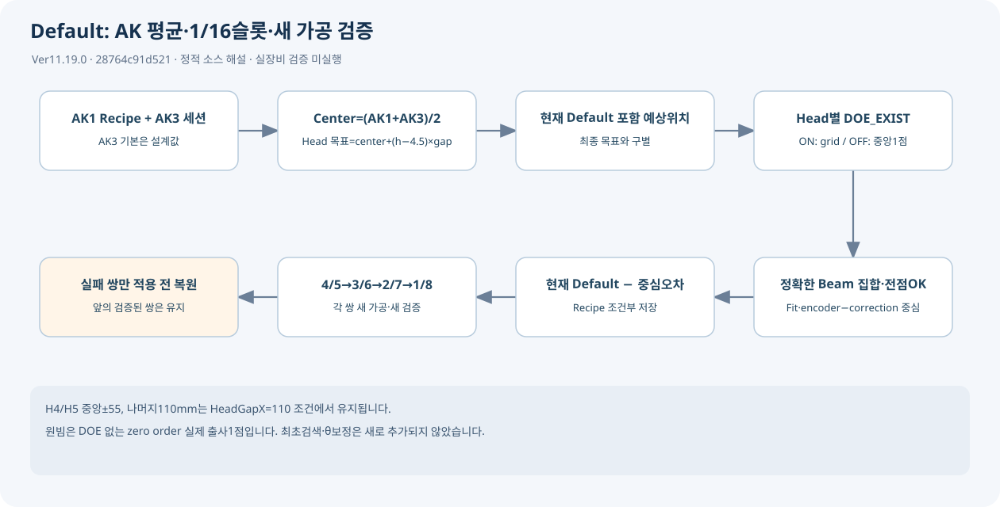

원본: kjuws10-rgb/A3Drilling · master · 28764c91d521777b8ee068dd7aaf2d3902ce9fe2 · Ver11.19.0

현재 재검토: **11.19.0 / 2026-11-20**, 비교 기준 11.17.0(`96e22cd027c84bf302b23f2949b98985d7f301bb`). 11.18/11.19 두 Commit의 변경과 이전부터 남아 있는 경계를 함께 확인했습니다. 아래 변경 항목과 기존 잔건을 구분합니다. 파일·함수·호출 경계의 정적 확인이며 장비 실행 시험 결과가 아닙니다.

이 장은 이전11.10.0의 “중앙은 설계치만 사용, Shot16점/Cross1점” 설명을 새 구현으로 대체합니다. 실제 함수와 호출자를 정적으로 읽었습니다. 실장비 이동·레이저 가공·AeroScript·벤더 DLL을 실행하지 않았으며, 아래 시험은 실행 계획입니다. 숫자 예시는 설명용 가상값입니다.

## 1. 먼저 구분해야 하는 다섯 값

| 이름 | 현재 코드에서의 뜻 | 서로 혼동하면 생기는 문제 |
|---|---|---|
| AK1 Review X | Recipe의 REVIEW_CAMERA_ALIGN_KEY_POS_X | 지금 새로 측정한 좌표로 오인 |
| AK3 Review X | 기본은 설계 계산값, 조건창에서 세션값으로 변경 가능 | 수동 입력을 자동 촬영·검증으로 오인 |
| BoardCenterX | 조건에 적용한 두 Review X의 정확한 평균 | global X/Y 기판 회전 피팅으로 과장 |
| Head Default | 모든 해당 Head Shot에 쓰는 기본 보정 | 평가용 Beam11 추가 이동량과 혼합 |
| First Beam Offset | Default와 독립된 X/Y 추가 offset | Zero Order calibration 자체로 오인 |

11.13.0에서 AK3를 실측 encoder 값으로 **입력할 수 있는 세션 경로**가 추가되었고 이번에도 유지합니다. Conditions 함수가 매번 AK1/AK3를 새로 촬영하거나 PLC의 글로벌 AK4점을 가져오는 것은 아닙니다. [CDefaultOffsetCalibration.cs:64–90](https://github.com/kjuws10-rgb/A3Drilling/blob/28764c91d521777b8ee068dd7aaf2d3902ce9fe2/Drilling.Common/Correction/CDefaultOffsetCalibration.cs#L64-L90) [CDefaultOffsetView.xaml.cs:78–112](https://github.com/kjuws10-rgb/A3Drilling/blob/28764c91d521777b8ee068dd7aaf2d3902ce9fe2/Drilling.UI/Views/CDefaultOffsetView.xaml.cs#L78-L112) [CDefaultOffsetView.xaml.cs:176–192](https://github.com/kjuws10-rgb/A3Drilling/blob/28764c91d521777b8ee068dd7aaf2d3902ce9fe2/Drilling.UI/Views/CDefaultOffsetView.xaml.cs#L176-L192)

~~~mermaid
flowchart TD
 A[Recipe AK1 Review X] --> C[AK1과 AK3 Review X의 평균]
 B[AK3 설계 계산 또는 조건창 입력] --> C
 C --> T[각 Head의 고정 목표 중심]
 F[현재 Default와 탐색 teaching] --> M[예상 마크 위치로 이동]
 M --> D[DOE 1개 또는16개 슬롯 Capture]
 D --> V[완전한 슬롯 집합과 Fit 검사]
 V --> E[encoder와 보정으로 실측 중심]
 T --> G[실측 중심과 목표의 차이]
 E --> G
 G --> R[현재 Default에서 오차 차감]
 R --> P[Recipe 조건부 저장]
 P --> Q[새 가공과 새 측정으로 재검증]
 Q --> N[성공한 쌍 유지하고 다음 쌍]
 Q --> X[실패한 쌍만 적용 전으로 복원]
~~~

## 2. 측정 조건창의 실제 조작 흐름

1. Default 측정 조건에서 현재 Recipe와 Setting을 합칩니다. 이 helper는 Setting을 먼저 넣고 Recipe가 같은 키를 덮습니다.
2. AK1은 Recipe 값으로 읽기 전용입니다. AK3는 편집 가능하고 “설계값 계산”을 누르면 AK1+GlassSizeX−2×AK_MARGIN_X로 되돌립니다. 이 버튼은 encoder 현재값을 채집하지 않습니다.
3. Stage Y, 기준 모델, Shot/십자 가공, 십자 길이를 정합니다. Vision 방식은 Shot이면 Mark Find Single, 십자이면 Mark Find Setting Single로 자동 정해집니다.
4. 두 X의 평균을 미리 보여 주고 조건 적용 시 유한값·양수 tolerance·AK1≠AK3·지원 DOE 크기·십자 양수 길이를 검증합니다.
5. 이전 조건을 다시 열면 AK3 세션값과 가공 방식/길이를 유지하는 분기가 있습니다. 실제 Recipe가 바뀌었을 때 이 값의 출처도 다시 확인해야 합니다.
6. 조건 적용은 측정 run을 준비합니다. Head Default 추천값을 Recipe에 저장하는 APPLY와 다른 단계입니다.

[CDefaultOffsetCalibration.cs:14–19](https://github.com/kjuws10-rgb/A3Drilling/blob/28764c91d521777b8ee068dd7aaf2d3902ce9fe2/Drilling.Common/Correction/CDefaultOffsetCalibration.cs#L14-L19) [CDefaultOffsetCalibration.cs:132–143](https://github.com/kjuws10-rgb/A3Drilling/blob/28764c91d521777b8ee068dd7aaf2d3902ce9fe2/Drilling.Common/Correction/CDefaultOffsetCalibration.cs#L132-L143) [CMenuCorrection.cs:3288–3313](https://github.com/kjuws10-rgb/A3Drilling/blob/28764c91d521777b8ee068dd7aaf2d3902ce9fe2/Drilling.UI/Menu/Menus/CMenuCorrection.cs#L3288-L3313) [CDefaultOffsetView.xaml.cs:78–147](https://github.com/kjuws10-rgb/A3Drilling/blob/28764c91d521777b8ee068dd7aaf2d3902ce9fe2/Drilling.UI/Views/CDefaultOffsetView.xaml.cs#L78-L147) [CDefaultOffsetView.xaml.cs:176–194](https://github.com/kjuws10-rgb/A3Drilling/blob/28764c91d521777b8ee068dd7aaf2d3902ce9fe2/Drilling.UI/Views/CDefaultOffsetView.xaml.cs#L176-L194)

조건창은 “실측 중앙”이라고 표시하지만 AK3가 설계 fallback인지 실제 encoder 값을 사람이 확인해 넣었는지 구분하는 전용 provenance 플래그는 Options에 없습니다. 따라서 표시 문구만으로 새 실측 중앙이라고 인증해서는 안 됩니다. Options에 남는 것은 두 X, Stage Y, tolerance, mode, cross size, DOE grid 크기입니다. [CDefaultOffsetCalibration.cs:299–322](https://github.com/kjuws10-rgb/A3Drilling/blob/28764c91d521777b8ee068dd7aaf2d3902ce9fe2/Drilling.Common/Correction/CDefaultOffsetCalibration.cs#L299-L322)

## 3. 중앙과 Head 목표: ±55/110의 조건

~~~text
AK3_design_X = AK1_X + GlassSizeX − 2 × AK_MARGIN_X
Center_X     = (Options.AK1_X + Options.AK3_X) / 2
Target_X(h)  = Center_X + (h − 4.5) × HeadGapX
Target_Y(h)  = Test_Q − StageDirection × HeadGapY(h)
~~~

HeadGapX가110 mm일 때 H4/H5는 중앙에서−55/+55 mm입니다. H1..8 상대 X는 각각−385,−275,−165,−55,+55,+165,+275,+385 mm입니다. 이는 110 mm라는 설정을 넣었을 때의 계산이지 현재 설비값을 문서에 가져온 것이 아닙니다. odd/even Head의 Y 행 간격도 별도 사용합니다. [CDefaultOffsetCalibration.cs:241–265](https://github.com/kjuws10-rgb/A3Drilling/blob/28764c91d521777b8ee068dd7aaf2d3902ce9fe2/Drilling.Common/Correction/CDefaultOffsetCalibration.cs#L241-L265)

가상 AK1=100, AK3=900이면 중앙500입니다. AK3 입력만902로 바꾸면 중앙501이고 모든 Head 목표 X가1 mm 이동합니다. H4 측정만 바꾸어도 H3 목표가 이어서 바뀌는 구조는 아닙니다. 짝별 실행 순서는4/5→3/6→2/7→1/8이지만 **앞 쌍 실측을 다음 쌍의 전역 중앙으로 삼는 연쇄 calibration이 아닙니다.** [CDefaultOffsetCalibration.cs:238–254](https://github.com/kjuws10-rgb/A3Drilling/blob/28764c91d521777b8ee068dd7aaf2d3902ce9fe2/Drilling.Common/Correction/CDefaultOffsetCalibration.cs#L238-L254) [CMenuCorrection.cs:3464–3478](https://github.com/kjuws10-rgb/A3Drilling/blob/28764c91d521777b8ee068dd7aaf2d3902ce9fe2/Drilling.UI/Menu/Menus/CMenuCorrection.cs#L3464-L3478)

AK3 설계 fallback을 그대로 쓰면 평균은 이전의 AK1+GlassSizeX/2−AK_MARGIN_X와 같습니다. 반면 사람이 입력한 AK3를 쓰면 새 평균이 적용됩니다. 따라서 이전 설명의 “항상 설계중앙만 사용한다”는 문장은 현재에 맞지 않으며, “항상 두 점을 자동 새 측정한다”는 문장도 맞지 않습니다.

이 기능은 X 두 값의 평균입니다. AK1/AK3의 global Y 차이, 두 점 선의 atan2 회전, 기판의2D 중심/자세는 계산하지 않습니다. Distortion의 AK4점 수신·보간과 이 옵션 평균을 같은 계산으로 취급하지 않습니다.

## 4. 11.17.0: Head별 DOE 장착 여부와 검사 개수

11.13.0 전역 grid1/4 검사에 **H01_DOE_EXIST~H08_DOE_EXIST** OPTION이 추가됐습니다. Head1~8에 ON/1/TRUE·OFF/0/FALSE를 해석하고 키 누락/다른 문자열은 예외입니다. 조건창·가공 설명·검사 루프·미리보기·로그가 같은 Head 설정을 읽습니다. [CDefaultOffsetCalibration.cs:29–59](https://github.com/kjuws10-rgb/A3Drilling/blob/28764c91d521777b8ee068dd7aaf2d3902ce9fe2/Drilling.Common/Correction/CDefaultOffsetCalibration.cs#L29-L59) [CMenuCorrection.cs:3300–3308](https://github.com/kjuws10-rgb/A3Drilling/blob/28764c91d521777b8ee068dd7aaf2d3902ce9fe2/Drilling.UI/Menu/Menus/CMenuCorrection.cs#L3300-L3308) [CMenuCorrection.cs:3902–3925](https://github.com/kjuws10-rgb/A3Drilling/blob/28764c91d521777b8ee068dd7aaf2d3902ce9fe2/Drilling.UI/Menu/Menus/CMenuCorrection.cs#L3902-L3925)

| Head 설정 | Recipe grid | 실제 검사 | 의미 |
|---|---|---|---|
| DOE ON | 4 | Beam1~16, pitch/angle 사용 | DOE 배열 Fit 중심 |
| DOE ON | 1 | 중심1점 | 지원 전역 grid 유지 |
| DOE OFF | 4 또는1 | 중앙1점, pitch0/angle0 | 실제 원빔 출사 위치 |
| OFF + Cross | 4 또는1 | 중앙 십자1회 SettingSingle | 16형상을 가정하지 않음 |
| ON + Cross/grid4 | 4 | 슬롯별 십자16회 | scanner 중심 십자를 DOE가 분기 |

OFF이면 DefaultInspectionGridSize=1이고 Capture/Fit도1점입니다. 십자 전체 길이는−L/2~+L/2이고 Shot/Cross가 DOE 유무를 바꾸는 스위치는 아닙니다. DOE16점 가상 중심과 원빔 실제 위치 모두 같은 Zero Order 기준 Head 목표에 맞춥니다. 이전의 “Head별 혼합 DOE 미확인” 설명은 **Default 검사 범위에서 대체**됩니다. [CDefaultOffsetCalibration.cs:43–59](https://github.com/kjuws10-rgb/A3Drilling/blob/28764c91d521777b8ee068dd7aaf2d3902ce9fe2/Drilling.Common/Correction/CDefaultOffsetCalibration.cs#L43-L59) [CDefaultOffsetCalibration.cs:144–208](https://github.com/kjuws10-rgb/A3Drilling/blob/28764c91d521777b8ee068dd7aaf2d3902ce9fe2/Drilling.Common/Correction/CDefaultOffsetCalibration.cs#L144-L208) [CMenuCorrection.cs:3902–3925](https://github.com/kjuws10-rgb/A3Drilling/blob/28764c91d521777b8ee068dd7aaf2d3902ce9fe2/Drilling.UI/Menu/Menus/CMenuCorrection.cs#L3902-L3925)

**범위:** DOE_EXIST는 Default 검사만 바꿉니다. 주석은 일반 가공·다른 Review 모드의 사용자 Beam을 유지한다고 명시하고 일반 Beam builder도 flag를 읽지 않습니다. 원빔을 평가용11번 위치로 옮기는 FirstBeam 정책까지 자동 생성됐다고 해석할 수 없습니다. [CDefaultOffsetCalibration.cs:43–47](https://github.com/kjuws10-rgb/A3Drilling/blob/28764c91d521777b8ee068dd7aaf2d3902ce9fe2/Drilling.Common/Correction/CDefaultOffsetCalibration.cs#L43-L47) [CReviewManager.cs:1392–1422](https://github.com/kjuws10-rgb/A3Drilling/blob/28764c91d521777b8ee068dd7aaf2d3902ce9fe2/Drilling.Common/Review/CReviewManager.cs#L1392-L1422)

## 5. 측정 예상 위치와 보정 목표 위치는 따로 계산한다

MeasureDefaultCenter의 예상 카메라 위치는 teaching 및 **현재 Default**를 더합니다. 적용 후 새 마크가 이동하므로 카메라가 그 위치를 따라가야 하기 때문입니다. 반면 원하는 Head 위치는2절의 AK 평균+Head 간격입니다. 탐색을 쉽게 하려는 teaching과 최종 목표를 같은 값으로 만들어서는 안 됩니다. [CMenuCorrection.cs:3893–3924](https://github.com/kjuws10-rgb/A3Drilling/blob/28764c91d521777b8ee068dd7aaf2d3902ce9fe2/Drilling.UI/Menu/Menus/CMenuCorrection.cs#L3893-L3924)

Capture는 이동 완료 후50ms를 기다리고, 요청 전후 encoder 위치가0.001 mm 넘게 바뀌면 거부합니다. Vision 픽셀의 Target−Hole를 cameraResolution×nResolution으로 mm 변환한 뒤 Vision Flip을 한 번 적용합니다. 이때 mark의 local 실측값은 slot−convertedError입니다. Stage/Review encoder 실측값도 함께 저장합니다. [CReviewManager.cs:3199–3219](https://github.com/kjuws10-rgb/A3Drilling/blob/28764c91d521777b8ee068dd7aaf2d3902ce9fe2/Drilling.Common/Review/CReviewManager.cs#L3199-L3219)

~~~text
ActualCenterReviewX = Average(EncoderX − CorrectionX)
ActualCenterStageY  = Average(EncoderY − StageDirection × CorrectionY)
CenterErrorX        = ActualCenterReviewX − TargetReviewX
CenterErrorY        = (ActualCenterStageY − TargetStageY) / StageDirection
~~~

WithHeadReference는1개 또는16개의 완전한 번호 집합을 요구합니다. 실제 배열 중심은 encoder−correction 평균을 사용하므로 명령 target만 평균하는 것과 다릅니다. local Fit의 중심과 stage/global 목표 대비 중심오차도 다른 값입니다. [CDefaultOffsetCalibration.cs:241–265](https://github.com/kjuws10-rgb/A3Drilling/blob/28764c91d521777b8ee068dd7aaf2d3902ce9fe2/Drilling.Common/Correction/CDefaultOffsetCalibration.cs#L241-L265)

## 6. Fit과 추천이 허용하는 조건

Fit은 설정한 grid에 해당하는 정확한 개수와 Beam1..N 집합, 모든 Judge=OK, 유한한 local/raw/correction/encoder를 요구합니다.1빔은 그 한 점을 중심으로 반환하고 residual/pitchX/pitchY를0으로 둡니다.1점으로 회전·pitch를 검증했다는 뜻이 아닙니다. [CDefaultOffsetCalibration.cs:193–207](https://github.com/kjuws10-rgb/A3Drilling/blob/28764c91d521777b8ee068dd7aaf2d3902ce9fe2/Drilling.Common/Correction/CDefaultOffsetCalibration.cs#L193-L207)

16빔은 평균 중심과 affine 격자 계수를 계산하고, 예상 DOE 각도/간격과의 격자 차이 및 최대 잔차가 tolerance 이하인지 확인합니다. 몇 점이 빠졌을 때 나머지 평균만으로 통과시키는 분기는 없습니다. tolerance는 Recipe Review X/Y 중 작은 값입니다. [CDefaultOffsetCalibration.cs:208–235](https://github.com/kjuws10-rgb/A3Drilling/blob/28764c91d521777b8ee068dd7aaf2d3902ce9fe2/Drilling.Common/Correction/CDefaultOffsetCalibration.cs#L208-L235) [CDefaultOffsetCalibration.cs:69–74](https://github.com/kjuws10-rgb/A3Drilling/blob/28764c91d521777b8ee068dd7aaf2d3902ce9fe2/Drilling.Common/Correction/CDefaultOffsetCalibration.cs#L69-L74)

Recommend는 지정된 USE Head 집합의 유효 결과가 모두 있어야 하며 nextDefault=Round(currentDefault−CenterError,5,AwayFromZero)를 계산합니다. 유한값과±100 mm를 확인하고 Head flip은 뒤의 scanner 변환에 맡깁니다. ±100 mm 숫자 허용범위와 실제 Scan Field 범위는 다른 경계입니다. [CDefaultOffsetCalibration.cs:271–294](https://github.com/kjuws10-rgb/A3Drilling/blob/28764c91d521777b8ee068dd7aaf2d3902ce9fe2/Drilling.Common/Correction/CDefaultOffsetCalibration.cs#L271-L294)

실제 CENTER 명령은 Head transform 이후 X/Y가 Scan Field 반폭 안인지 검사합니다. Shot은 한 점, 십자는4끝점입니다. DOE 분기 간격을 scanner 축 이동범위에 그대로 넣는 구조가 아닙니다. [CDefaultOffsetCalibration.cs:93–102](https://github.com/kjuws10-rgb/A3Drilling/blob/28764c91d521777b8ee068dd7aaf2d3902ce9fe2/Drilling.Common/Correction/CDefaultOffsetCalibration.cs#L93-L102) [CDefaultOffsetCalibration.cs:124–159](https://github.com/kjuws10-rgb/A3Drilling/blob/28764c91d521777b8ee068dd7aaf2d3902ce9fe2/Drilling.Common/Correction/CDefaultOffsetCalibration.cs#L124-L159)

## 7. 적용·재검증·중단·복원을 단계별로 읽기

일괄 모드는 USE Head를4,5,3,6,2,7,1,8 순서로 가공한 뒤 전체 검사, 추천 계산, 일괄 APPLY, 새 가공 VERIFY를 분리합니다. 검증 실패/취소 때 적용한 값이 있으면 RestoreDefault로 이번 run에서 적용한 키들을 조건 적용 시점 값으로 돌립니다. [CMenuCorrection.cs:3327–3352](https://github.com/kjuws10-rgb/A3Drilling/blob/28764c91d521777b8ee068dd7aaf2d3902ce9fe2/Drilling.UI/Menu/Menus/CMenuCorrection.cs#L3327-L3352) [CMenuCorrection.cs:3379–3439](https://github.com/kjuws10-rgb/A3Drilling/blob/28764c91d521777b8ee068dd7aaf2d3902ce9fe2/Drilling.UI/Menu/Menus/CMenuCorrection.cs#L3379-L3439) [CMenuCorrection.cs:3926–3947](https://github.com/kjuws10-rgb/A3Drilling/blob/28764c91d521777b8ee068dd7aaf2d3902ce9fe2/Drilling.UI/Menu/Menus/CMenuCorrection.cs#L3926-L3947)

짝별 모드는4/5→3/6→2/7→1/8에서 USE Head만 골라 각 쌍의 **가공→측정→추천→적용→새 가공→새 측정**을 진행합니다. 모두 허용오차 이내면 해당 쌍 Verified를 확정합니다. 실패 쌍은 그 쌍 적용 전값만 복원하고 이미 검증된 앞 쌍은 유지합니다. 복원도 실패하면 원래 실패와 복원 실패를 함께 보고합니다. 짝별 실행 중 “복원했다”를 전체8 Head 원복으로 읽으면 안 됩니다. [CMenuCorrection.cs:3464–3478](https://github.com/kjuws10-rgb/A3Drilling/blob/28764c91d521777b8ee068dd7aaf2d3902ce9fe2/Drilling.UI/Menu/Menus/CMenuCorrection.cs#L3464-L3478) [CMenuCorrection.cs:3499–3558](https://github.com/kjuws10-rgb/A3Drilling/blob/28764c91d521777b8ee068dd7aaf2d3902ce9fe2/Drilling.UI/Menu/Menus/CMenuCorrection.cs#L3499-L3558)

Recipe/Setting이 바뀌면 EnsureDefaultSource가 기존 측정·추천 재사용을 거부합니다. CURRENT_PROCESS_COUNT 변경은 Recipe 비교에서 제외됩니다. 적용 저장은 SaveParametersIfUnchanged를 사용하고 로그 요청→Recipe 저장→run 상태 갱신의 순서를 갖습니다. 로그·Recipe·실물 마크 전체가 한 원자 transaction으로 되돌아가는 것은 아닙니다. [CMenuCorrection.cs:3561–3579](https://github.com/kjuws10-rgb/A3Drilling/blob/28764c91d521777b8ee068dd7aaf2d3902ce9fe2/Drilling.UI/Menu/Menus/CMenuCorrection.cs#L3561-L3579) [CMenuCorrection.cs:3713–3727](https://github.com/kjuws10-rgb/A3Drilling/blob/28764c91d521777b8ee068dd7aaf2d3902ce9fe2/Drilling.UI/Menu/Menus/CMenuCorrection.cs#L3713-L3727)

가공 전 GuardDefaultOperation은 AUTO/Manual MOF 실행·정리 미완료·Critical 알람을 차단합니다. 측정 전 Laser Off를 요청하고 그 요청 이후 신선한 축 snapshot의 raw output0을 최대5초 확인합니다. Default는 generic random Vision simulation을 쓰지 않고 연결된 응답을 요구합니다. 이러한 software 가드의 존재를 하드웨어 차단 성능·광학 합격으로 승격하지 않습니다. [CMenuCorrection.cs:3707–3711](https://github.com/kjuws10-rgb/A3Drilling/blob/28764c91d521777b8ee068dd7aaf2d3902ce9fe2/Drilling.UI/Menu/Menus/CMenuCorrection.cs#L3707-L3711) [CMenuCorrection.cs:3868–3892](https://github.com/kjuws10-rgb/A3Drilling/blob/28764c91d521777b8ee068dd7aaf2d3902ce9fe2/Drilling.UI/Menu/Menus/CMenuCorrection.cs#L3868-L3892) [CReviewManager.cs:3158–3185](https://github.com/kjuws10-rgb/A3Drilling/blob/28764c91d521777b8ee068dd7aaf2d3902ce9fe2/Drilling.Common/Review/CReviewManager.cs#L3158-L3185)

## 8. DefaultZeroOrder와 FirstBeam·보정율의 역할

16빔 중심은 대칭 DOE 배열에서 얻는 가상 중심이며1빔 중심은 그 실제 한 마크입니다. 이 중심을 Head 기본 기하에 맞추려는 값이 Head Default입니다. FirstBeam은 별도 키로 최종 가공좌표에 추가됩니다. 원빔을 평가용 Beam11 위치로 옮기는 정책을 Default에 섞으면 기본 중심과 평가 이동을 혼동할 수 있습니다. [CDefaultOffsetCalibration.cs:193–235](https://github.com/kjuws10-rgb/A3Drilling/blob/28764c91d521777b8ee068dd7aaf2d3902ce9fe2/Drilling.Common/Correction/CDefaultOffsetCalibration.cs#L193-L235) [CShotCoordinatePlanBuilder.cs:61–67](https://github.com/kjuws10-rgb/A3Drilling/blob/28764c91d521777b8ee068dd7aaf2d3902ce9fe2/Drilling.Common/Recipe/CShotCoordinatePlanBuilder.cs#L61-L67) [CShotCoordinatePlanBuilder.cs:141–156](https://github.com/kjuws10-rgb/A3Drilling/blob/28764c91d521777b8ee068dd7aaf2d3902ce9fe2/Drilling.Common/Recipe/CShotCoordinatePlanBuilder.cs#L141-L156)

최종 scanner는 RecipeOffset+HeadDefault+FirstBeam+scaled Review+scaled Align을 합칩니다. Review/Align 비율은 각각 현재 기여값에 곱하고 저장값을 바꾸지 않습니다. Default 세션의 중앙 입력, FirstBeam 추가값, ReviewOffset Rollback, Align 갱신을 하나의 APPLY/원복 기능으로 설명하지 않습니다. [CShotCoordinatePlanBuilder.cs:141–156](https://github.com/kjuws10-rgb/A3Drilling/blob/28764c91d521777b8ee068dd7aaf2d3902ce9fe2/Drilling.Common/Recipe/CShotCoordinatePlanBuilder.cs#L141-L156)

FINE와SIMPLE UI는 기본 선택 Beam을11로 바꾸되 해당 Recipe의 BeamNumbers에11이 없으면 가능한 첫 Beam으로 fallback합니다. 이 UI 기본값 변화가 전체 Head 광학 mode의1빔↔16빔 자동 대응을 구현한 것은 아닙니다. [CMenuCorrection.cs:6101–6112](https://github.com/kjuws10-rgb/A3Drilling/blob/28764c91d521777b8ee068dd7aaf2d3902ce9fe2/Drilling.UI/Menu/Menus/CMenuCorrection.cs#L6101-L6112) [CMenuCorrection.cs:6238–6246](https://github.com/kjuws10-rgb/A3Drilling/blob/28764c91d521777b8ee068dd7aaf2d3902ce9fe2/Drilling.UI/Menu/Menus/CMenuCorrection.cs#L6238-L6246) [CMenuCorrection.cs:7339–7353](https://github.com/kjuws10-rgb/A3Drilling/blob/28764c91d521777b8ee068dd7aaf2d3902ce9fe2/Drilling.UI/Menu/Menus/CMenuCorrection.cs#L7339-L7353) [CMenuCorrection.cs:7406–7415](https://github.com/kjuws10-rgb/A3Drilling/blob/28764c91d521777b8ee068dd7aaf2d3902ce9fe2/Drilling.UI/Menu/Menus/CMenuCorrection.cs#L7406-L7415)

## 9. 검증표: 계산·저장과 실기를 나눠 수행한다

| 단계 | 합성 입력/실패 주입 | 기대 확인 |
|---|---|---|
| 중앙 계산 | AK3 설계 fallback/입력값/같은값/NaN | 평균 변화, 같은값·비유한 거부, 자동촬영이라 표시하지 않음 |
| Head 목표 | 가상 HeadGapX110, H4 측정만 변경 | ±55/110 산식; 다른 Head 목표는 H4 실측을 연쇄 사용하지 않음 |
| DOE 분기 | grid1/4/2, pitch0/양수/비유한 | 지원1/4만 허용;1점은pitch0;4는양수 |
| Capture 개수 | Shot/Cross × DOE_EXIST ON/OFF × nominal grid1/4 | ON은 grid1/4에 따라1/16회, OFF는 nominal grid와 무관하게1회. Beam1..N이며 Cross Beam0 경로 없음 |
| Fit | 누락/중복/NG/격자회전/잔차 초과 | 추천 계산 전 명확히 거부 |
| 예상/목표 | 현재 Default 비영값으로 적용 전후 | 탐색 위치는 따라가고 AK 기준 목표는 고정 |
| 단일빔 | 실제 광학 원빔과grid1 | 한 점 수신 계약 확인,1점으로pitch/각도합격을 주장하지 않음 |
| 혼합 Head | DOE3+원빔5의 실제 구성 | 전역grid 한 값만으로 지원완료라 보고하지 않음 |
| 일괄 원복 | VERIFY 도중 실패/취소 | 이번run 적용키 전체의 원래값 확인 |
| 짝별 원복 | H3/6 적용 후 실패 | H3/6만 원복, H4/5 Verified 유지 |
| 저장 경합 | 측정 도중 Recipe/Setting 변경 | 기존 추천 재사용 차단 |
| 실기 | 작은±X/±Y·Head flip·Stage 방향 | 실제 마크이동/부호/횟수/레이저OFF를 별도 측정 |

이번 산출물에서 확인한 것은 source의 조건·산식·호출·저장 책임입니다. 실제 장비/광학 시험은 실행하지 않았습니다.

## 10. 저장 스키마·버전 확인과 검증

Default 로그는 DOE_ANGLE 뒤에 `DOE_EXIST`, `DEFAULT_INSPECTION_POINT_COUNT`를 추가합니다. 결과의 ON/OFF와 실제 Marks.Count입니다. 고정 열 번호보다 header 이름으로 읽어야 하고 일반 ReviewResult 변화와 혼동하지 않습니다. [CAlignOffsetLogFile.cs:20–34](https://github.com/kjuws10-rgb/A3Drilling/blob/28764c91d521777b8ee068dd7aaf2d3902ce9fe2/Drilling.File/Correction/CAlignOffsetLogFile.cs#L20-L34)

| 시험 | 기대 관찰 | 범위 |
|---|---|---|
| DOE3개+원빔5개 | ON16/OFF1점과 log count | Default 전용 |
| ON/OFF 후 일반 Review | 선택 Beam 별도 유지 | flag 확장 해석 금지 |
| 키 누락·잘못된값 | 준비에서 명확한 예외 | 구형 설정 migration |
| 원빔 한 점 | residual/pitch0 | 회전·pitch 광학 검증 아님 |
| AK1/AK3 Y 차이 | X평균만 계산 | 2D 회전 피팅 아님 |
| H4/H5±55 / 나머지110 | HeadGapX110 가상 수식 | 실제 광학 합격과 분리 |

이력: AK3 세션 입력과4/5→3/6→2/7→1/8 짝별 복원은11.13.0부터 유지되며 이번에는 Head별 DOE 분기를 추가했습니다. 앞 쌍 실측으로 다음 쌍의 전역 중앙을 계속 옮기는 연쇄 보정은 아닙니다.

## 13. 이번 변경과 11월18일 셋업 시험 잔건의 구분

이번 `CDefaultOffsetCalibration` diff는 주석 정리이며 중앙 계산·가공·측정·추천의 실제 식은 바뀌지 않았습니다. `BoardCenterX=(AK1ReviewX+AK3ReviewX)/2`, 목표X=`BoardCenterX+(Head−4.5)×HeadGapX`입니다. HeadGapX=110mm 조건에서 H4/H5의±55mm와 나머지110mm 간격은 유지합니다. Y기울기/θ를 두점으로 피팅하는 기능이나 최초 빔 자동검색 루프가 새로 추가된 것은 아닙니다. [CDefaultOffsetCalibration.cs:65–88](https://github.com/kjuws10-rgb/A3Drilling/blob/28764c91d521777b8ee068dd7aaf2d3902ce9fe2/Drilling.Common/Correction/CDefaultOffsetCalibration.cs#L65-L88) [CDefaultOffsetCalibration.cs:241–269](https://github.com/kjuws10-rgb/A3Drilling/blob/28764c91d521777b8ee068dd7aaf2d3902ce9fe2/Drilling.Common/Correction/CDefaultOffsetCalibration.cs#L241-L269)

정상 로드된 최신 Recipe에서는 AK_MARGIN 정의가 제거되어 공통 Setting을 사용하므로 AK3 설계 fallback·예상 Glass 위치의 기준도 확인해야 합니다. 다만 Default.Parameters와 화면 Update는 Setting 다음에 Recipe를 덮어쓰는 기존 순서입니다. 옛 AK_MARGIN을 가진 수동/구형 Recipe 객체까지 모든 경로가 Setting 우선이라고 보장하지 않습니다. 반면 AK1의 Review 카메라 기준위치는 여전히 Recipe 값입니다. Default의 DOE_EXIST=OFF는 분기빔16개가 없는 원빔이며 **zero order 위치에서 실제 출사하는1점**을 측정합니다. DOE ON은 grid² 측정 중심을 zero order로 추정합니다. FirstBeam으로 실기판의 평가 Beam 위치를 맞추는 작업과 Default 중심 교정은 별개입니다. [CDefaultOffsetCalibration.cs:32–50](https://github.com/kjuws10-rgb/A3Drilling/blob/28764c91d521777b8ee068dd7aaf2d3902ce9fe2/Drilling.Common/Correction/CDefaultOffsetCalibration.cs#L32-L50) [CDefaultOffsetCalibration.cs:198–211](https://github.com/kjuws10-rgb/A3Drilling/blob/28764c91d521777b8ee068dd7aaf2d3902ce9fe2/Drilling.Common/Correction/CDefaultOffsetCalibration.cs#L198-L211) [CDefaultOffsetCalibration.cs:287–294](https://github.com/kjuws10-rgb/A3Drilling/blob/28764c91d521777b8ee068dd7aaf2d3902ce9fe2/Drilling.Common/Correction/CDefaultOffsetCalibration.cs#L287-L294)

| 11월18일에 확인한 항목 | 현재 diff의 상태 | 필요한 확인 |
|---|---|---|
| 기본 가공 Q의 기판 밖 예상 위치 | 계산/경고 경로 변경 없음 | 현장 Q·기판/축 한계와 실행 차단 정책 |
| 첫 빔 수동 가시성/재티칭 | 새 검색 기능 없음 | 카메라 FOV·광학 티칭·수동 찾은 좌표 반영 |
| AK2점 Y기울기 | X중앙 평균만 유지 | 기판 자세 정렬 또는 θ계산 범위 합의 |
| DOE3개+원빔5개 Default | Head별DOE로1/16점 지원 유지 | 실제 Head별 장착정보/원빔 출사 검증 |
| 일반 Review Beam11 | DOE_EXIST 자동변환 추가 없음 | FirstBeam·원빔 목표 위치·Review 실제 중심 일치 |

이는 이전 시험 보고의 모든 조건을 최신 소스로 다시 실행했다는 뜻이 아닙니다. 해당 핵심 함수가 동일한지 diff와 소비 코드를 대조한 정적 판정이며 실제 광학 세팅·가공 정밀도 평가는 남아 있습니다.


# 별도 정적 추적 상세 해설 · review/07_Align_Distortion_윈도우_복구.md

# Align·Distortion·보호윈도우·복구: 자동 시퀀스의 데이터 경계

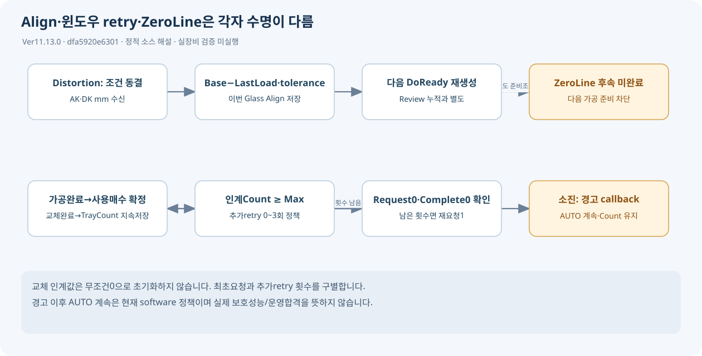


원본: `kjuws10-rgb/A3Drilling` · `master` · `28764c91d521777b8ee068dd7aaf2d3902ce9fe2`

현재 재검토: **11.19.0 / 2026-11-20**, 비교 기준 11.17.0(`96e22cd027c84bf302b23f2949b98985d7f301bb`). 11.18/11.19 두 Commit의 변경과 이전부터 남아 있는 경계를 함께 확인했습니다. 아래 변경 항목과 기존 잔건을 구분합니다. 파일·함수·호출 경계의 정적 확인이며 장비 실행 시험 결과가 아닙니다.

이 장의 **코드 확인**은 해당 Commit의 실제 함수 본문을 정적으로 추적한 사실입니다. **해설**은 그 구조를 이해하기 위한 설명이며, **검증 과제**는 앞으로 실행할 시험입니다. 실장비의 부호·광학 상태·통신 타이밍·정밀도가 검증되었다는 뜻은 아닙니다. 예시 숫자는 설명용 가상값입니다.

## 1. 이 장의 범위

이 장은 Distortion의 AK/DK 수신→Align Offset 계산→다음 DoReady 연결, 수동 Wapage Load/Set의 구분, 보호윈도우 사용매수 handover, ZeroLine 후속검사와 다음 가공 차단을 추적합니다. 모든 A1 알람의 정지·재개 알고리즘이나 실제 광학 회복 성공을 판정하는 장은 아닙니다. 그런 결론에는 Task 정지 확인, 레이저 차단, Stage 정지, 보정 유효성, Glass 처리방침을 추가로 검증해야 합니다.

```mermaid
flowchart TD
 A[Stage Distortion ABLE] --> P[Recipe와 측정 조건 동결]
 P --> W[Base Range Count Index 기록]
 W --> D[Process ABLE 후 Stage COMPLETE 대기]
 D --> R[AK4점과 선택 DK의 mm 수신]
 R --> C[Base-LastLoad 보정과 tolerance]
 C --> S[이번 Glass Align Offset 저장]
 S --> H[완료 handshake와 신호 OFF]
 H --> N[다음 DoReady에서 script 재생성]
 U[가공 Task 완료] --> K[보호윈도우 사용매수 확정]
 K --> E[교체 요청과 Stage 완료 수신]
 E --> T[Stage Tray Count 인계 저장]
 T --> O[요청 OFF]
 O --> RY{인계 Count가 Max 이상인가}
 RY -->|횟수 남음| WF[Request OFF와 Complete OFF 대기]
 WF --> RR[교체 Request 재요청]
 RR --> E
 RY -->|횟수 소진| LA[알람 요청과 AUTO 계속]
 Z[ZeroLine 후속 검사 미완료] --> B[다음 가공 준비 차단]
```

## 2. Distortion이 동결하는 것

`CAlignDistortionCycle.Prepare`는 이전 snapshot/pending/results/model/offsets와 저장 플래그를 초기화하고, 현재 요청의 RecipeId로 Recipe를 새로 읽습니다. Motor의 Stage Y 위치, Run Option의 Distortion group, Align Offset tolerance, Align camera resolution, Wapage 허용 mm 범위를 확보합니다. `pixels = rangeMm / resolution`이며 분해능은 양수, range는0이상이어야 합니다. [CAlignInterpolation.cs:276–293](https://github.com/kjuws10-rgb/A3Drilling/blob/28764c91d521777b8ee068dd7aaf2d3902ce9fe2/Drilling.Common/Correction/CAlignInterpolation.cs#L276-L293)

조건만 읽는 것으로 끝나지 않습니다. 필요한 모든 MELSEC route의 주소·USE·자료형·방향·연결 상태를 **첫 PLC write 전에 검증**합니다. Vision fine-align 결과8값을 읽어 Base에 쓰고, Range pixel을 쓰며, Distortion Count/Index/Stage Y 위치도 기록합니다. viewer snapshot에는 측정 표시와 무관한 Shot offset/history를 빼는 최적화 주석이 있습니다. [CAlignInterpolation.cs:294–320](https://github.com/kjuws10-rgb/A3Drilling/blob/28764c91d521777b8ee068dd7aaf2d3902ce9fe2/Drilling.Common/Correction/CAlignInterpolation.cs#L294-L320)

| 자료 | source의 의미 | 잘못 이해하기 쉬운 점 |
|---|---|---|
| `ALIGNBASE_AKn_X/Y` | Recipe에 저장한 Align 기준값 | 매번 자동으로 현재 측정값으로 overwrite하는 일반 설정값이 아님 |
| `DISTORTION_POS0_CAMnX/Y` | AK1..4의 현재 측정 결과 map | Vision TCP1001 식별자 body와 다른 MELSEC 경로 |
| DK result map | 선택 group의 CAM2/CAM4와 Stage 위치 결과 | 모든 DK를 항상 측정한다고 가정하지 않기 |
| Range | mm 허용범위를 camera resolution으로 나눈 pixel | global mm좌표와 단위가 다름 |
| Align Shot Offset | Base−LastLoad로 계산한 설계 좌표 보정 | Review 보정 파일과 별도 |

AK와 DK result ID mapping은 `ResultId`에서 명시합니다. AK1..4는 POS0/CAM1..4, DK는 group과 CAM2/4로 매핑합니다. [CAlignInterpolation.cs:247–261](https://github.com/kjuws10-rgb/A3Drilling/blob/28764c91d521777b8ee068dd7aaf2d3902ce9fe2/Drilling.Common/Correction/CAlignInterpolation.cs#L247-L261)

## 3. Distortion handshake의 실제 순서

`RunDistortion`은 소유한 Process output을0으로 만들고 Stage Complete0을 확인합니다. 그 뒤 Prepare로 조건을 동결하고 다시 Stage Complete0을 확인합니다. `readyAt`을 잡은 후 Process Able1을 쓰고 그 이후의 Stage Complete1을 기다립니다. 이전 사이클의 stale 완료 신호를 현재 응답으로 취급하지 않으려는 순서입니다. [CStationProcess.cs:5775–5792](https://github.com/kjuws10-rgb/A3Drilling/blob/28764c91d521777b8ee068dd7aaf2d3902ce9fe2/Drilling.Common/Station/CStationProcess.cs#L5775-L5792)

Stage 완료 후 Load→Calculate→Save를 성공해야 Process Complete1을 보냅니다. Stage Complete0 및 Able0을 확인한 다음에 Process outputs를0으로 내립니다. `_distortionNeedsDoReady=true`를 설정하며 로그에도 다음 요청에서 DoReady script 재생성이 필요하다고 남깁니다. 측정이 끝났다고 기존 가공 script를 그대로 써도 된다는 구조가 아닙니다. [CStationProcess.cs:5790–5810](https://github.com/kjuws10-rgb/A3Drilling/blob/28764c91d521777b8ee068dd7aaf2d3902ce9fe2/Drilling.Common/Station/CStationProcess.cs#L5790-L5810)

## 4. AK4점 글로벌 mm 수동 수신과 자동 보정의 구분

현재 코드에 **버튼 기반 one-shot 수신/기록 서비스**가 존재합니다. `CAlignWapageService.Load`는 Vision의 `SVID_FINEALN_CAM1..4_GLS_RESULT_X/Y`8개 값과 Process 쪽 Base/Range를 함께 읽습니다. 수신 숫자는 `CMelsec`에서 READ_SCALE이 적용된 값이고 nonfinite면 거부합니다. 이 service의 Load는 SetBase/SetRange와 분리되어 있어 읽기만 했다고 write하지 않습니다. [CAlignInterpolation.cs:382–393](https://github.com/kjuws10-rgb/A3Drilling/blob/28764c91d521777b8ee068dd7aaf2d3902ce9fe2/Drilling.Common/Correction/CAlignInterpolation.cs#L382-L393) [CAlignInterpolation.cs:426–455](https://github.com/kjuws10-rgb/A3Drilling/blob/28764c91d521777b8ee068dd7aaf2d3902ce9fe2/Drilling.Common/Correction/CAlignInterpolation.cs#L426-L455)

그러나 **현재 map에 있는 값을 읽기**와 **지금 새로 Align 측정을 요청해 특정 Glass의 최신4점 global mm를 얻기**는 다른 기능입니다. 이 Load 함수는 새로운 측정 START/COMPLETE를 발행하지 않습니다. Distortion의 `LoadResults`는 별도 result map을 읽어 `ALIGNBASE_*` 키로 매핑하고 LoadedAt을 기록합니다. 두 source의 주소·소유자·단위·갱신시점이 같다고 임의로 가정하면 안 됩니다. [CAlignInterpolation.cs:322–332](https://github.com/kjuws10-rgb/A3Drilling/blob/28764c91d521777b8ee068dd7aaf2d3902ce9fe2/Drilling.Common/Correction/CAlignInterpolation.cs#L322-L332) [CAlignInterpolation.cs:426–436](https://github.com/kjuws10-rgb/A3Drilling/blob/28764c91d521777b8ee068dd7aaf2d3902ce9fe2/Drilling.Common/Correction/CAlignInterpolation.cs#L426-L436)

**개선 검토:** 사용자가 원하는 “언제든 AK4점 글로벌 X/Y(mm) 수동 수신” 화면은 최소한 source=현재값 읽기인지 새측정 요청인지, GlassId, 측정시각, 수신시각, 유효/NG,8개 좌표, 이전값과의 차이, 보정 반영 여부를 구분해야 합니다. 읽기 버튼이 즉시 Base를 덮어쓰지 않도록 현재 service의 분리 원칙을 유지하는 것이 좋습니다. 이는 UI 요구 해설이며 이 모든 항목의 구현 완료를 주장하지 않습니다.

## 5. Base, Range를 수동으로 쓰는 경계

`SetBase`는 Vision source8값이 전부 유한해야 쓰고, `SetRange`는0이상 유한 pixel이어야 씁니다. destination 순서는 CAM1..4 X→X1..4 다음 CAM1..4 Y→Y1..4입니다. 소스에 기록된 이 순서를 X1,Y1,X2,Y2와 혼동하면 좌표가 뒤섞입니다. [CAlignInterpolation.cs:385–393](https://github.com/kjuws10-rgb/A3Drilling/blob/28764c91d521777b8ee068dd7aaf2d3902ce9fe2/Drilling.Common/Correction/CAlignInterpolation.cs#L385-L393) [CAlignInterpolation.cs:451–460](https://github.com/kjuws10-rgb/A3Drilling/blob/28764c91d521777b8ee068dd7aaf2d3902ce9fe2/Drilling.Common/Correction/CAlignInterpolation.cs#L451-L460)

write 전에는 `WriteScale`로 정수 저장범위를 확인하고 readback 예상값을 계산합니다. 실제 `_write`에는 논리값을 넘겨 CMelsec에서 scale을 한 번만 적용하게 합니다. 모든 값 기록 후 readback과1e−7 기준으로 비교합니다. 일부 write 후 실패하면 “몇 개 쓰기 완료했으며 일부 변경됐을 수 있으니 Load로 확인”하는 오류를 냅니다. **이 write 묶음은 모든 PLC값이 원자적으로 한 번에 바뀌는 트랜잭션이 아닙니다.** [CAlignInterpolation.cs:462–493](https://github.com/kjuws10-rgb/A3Drilling/blob/28764c91d521777b8ee068dd7aaf2d3902ce9fe2/Drilling.Common/Correction/CAlignInterpolation.cs#L462-L493)

## 6. Base−LastLoad가 Align Offset이 되는 과정

`Keys`는 Recipe의 Base에서 수신 measured를 빼 `CorrectionX/Y`를 만듭니다. `Calculate`는 AK와 선택 DK로 `CAlignInterpolation` 모델을 만들고 Shot별 Align Offset을 구합니다. tolerance를 넘는 Shot이 하나라도 있으면 전체 적용을 취소합니다. [CAlignInterpolation.cs:268–273](https://github.com/kjuws10-rgb/A3Drilling/blob/28764c91d521777b8ee068dd7aaf2d3902ce9fe2/Drilling.Common/Correction/CAlignInterpolation.cs#L268-L273) [CAlignInterpolation.cs:334–344](https://github.com/kjuws10-rgb/A3Drilling/blob/28764c91d521777b8ee068dd7aaf2d3902ce9fe2/Drilling.Common/Correction/CAlignInterpolation.cs#L334-L344)

`Save`는 필요한 모델과 결과가 모두 준비되어야 합니다. `SaveAlignOffsetsIfUnchanged`로 Recipe 변경 여부를 고려한 저장을 수행하고, key별 Base/LastLoad/correction 및 계산 offset audit를 남깁니다. 이번 요청의 기존 Align offset key를 제거하고 저장된 Align offset을 넣은 pending request를 만듭니다. `TakePreparedRequest`는 같은 RecipeId만 허용하며 pending을 한 번 가져가도록 합니다. [CAlignInterpolation.cs:346–377](https://github.com/kjuws10-rgb/A3Drilling/blob/28764c91d521777b8ee068dd7aaf2d3902ce9fe2/Drilling.Common/Correction/CAlignInterpolation.cs#L346-L377)

**해설:** 오래 저장된 Review Offset 누적과 이번 Glass Align Offset 갱신은 다른 수명 주기입니다. 동시에 합산된다고 둘을 같은 파일로 관리하거나 동일한 rollback 버튼으로 지우면 운영 의미가 달라집니다. 최종 builder에서는 Align과 Review를 각자 변환하고 각자 scale을 적용한 뒤 합산합니다. [CShotCoordinatePlanBuilder.cs:141–156](https://github.com/kjuws10-rgb/A3Drilling/blob/28764c91d521777b8ee068dd7aaf2d3902ce9fe2/Drilling.Common/Recipe/CShotCoordinatePlanBuilder.cs#L141-L156)

## 7. 보호윈도우 사용매수의 소유권

가공 Task가 모두 완료된 뒤 `CountCompletedProtectWindowGlass`는 Recipe의 사용매수를 증가시킵니다. gate와 `_protectWindowCounted`로 한 번만 확정합니다. 주석에는 이 시점 뒤 STOP·결과 저장 실패·Stage ACK가 와도 레이저 사용 사실이 없어지지 않으므로 durable count commit을 끝낸다고 설명합니다. 따라서 “Product CSV 저장 실패니까 사용매수도 자동 원복”으로 처리하면 실제 사용량을 잃을 수 있습니다. [CStationProcess.cs:3770–3791](https://github.com/kjuws10-rgb/A3Drilling/blob/28764c91d521777b8ee068dd7aaf2d3902ce9fe2/Drilling.Common/Station/CStationProcess.cs#L3770-L3791)

`CProtectWindowUsageRequest.Update`는 Recipe의 Current/Maximum count를 읽고 Process count를 전송합니다. Current>=Maximum이면 교체 요청을 올립니다. Max0은 즉시 요청 조건이며 같은 Glass cycle에서 이미 교체 완료한 경우 다시 요청하지 않도록 acknowledged cycle을 검사합니다. [CStationProcess.cs:4388–4461](https://github.com/kjuws10-rgb/A3Drilling/blob/28764c91d521777b8ee068dd7aaf2d3902ce9fe2/Drilling.Common/Station/CStationProcess.cs#L4388-L4461)

| logical ID | 뜻 | 책임 |
|---|---|---|
| `PROCESS_SEQUENCE_PTW_PROCESS_COUNT` | Process가 보고하는 사용매수 | Recipe 지속값과 연계 |
| `PROCESS_SEQUENCE_TPD_PTW_EXCHANGE_FLAG` | Process 교체 요청 | 요청 유지/해제 |
| `PTW_EXCHANGE_SEQ_COMPLETE` | Stage 교체 완료 | Stage가 인계 준비했는지 판단 |
| `PTW_TRAY_COUNT` | Stage가 인계하는 공식 사용매수 | 완료 수신 시 읽어 지속 저장 |

이 표는 logical ID 기준입니다. 실제 address, scale, 방향은 장비에 배포한 map을 별도로 확인해야 합니다. [CStationProcess.cs:4388–4419](https://github.com/kjuws10-rgb/A3Drilling/blob/28764c91d521777b8ee068dd7aaf2d3902ce9fe2/Drilling.Common/Station/CStationProcess.cs#L4388-L4419)

## 8. 교체 완료 때 무조건0으로 만들지 않는다

완료 감시 코드는 이미 켜진 Request가 앱 재시작 후 남아 있거나 Monitor에서 발생한 경우도 pending Recipe를 잡는 경로가 있습니다. Complete false를 관찰하면 completion을 arm하고, Complete true와 armed 조건이 충족되면 Stage의 Tray Count를 읽습니다. **모든 교체/shift를 새 보호윈도우0매로 가정하지 않습니다.** [CStationProcess.cs:4687–4718](https://github.com/kjuws10-rgb/A3Drilling/blob/28764c91d521777b8ee068dd7aaf2d3902ce9fe2/Drilling.Common/Station/CStationProcess.cs#L4687-L4718)

순서는 Stage count 읽기→`SetProtectWindowCount`로 Recipe에 지속 저장→Process count 보고→Request0입니다. `_committedHandoverCount`를 보관하므로 뒤쪽 보고/요청 해제 재시도 때 이미 확정한 인계 매수를 다시 읽어 바꾸지 않도록 구성합니다. 완료 전후의 다른 장애를 넣어 이 순서가 유지되는지 시험해야 합니다. [CStationProcess.cs:4708–4756](https://github.com/kjuws10-rgb/A3Drilling/blob/28764c91d521777b8ee068dd7aaf2d3902ce9fe2/Drilling.Common/Station/CStationProcess.cs#L4708-L4756)

**11.13.0의 새 retry 정책:** Recipe의 PROTECT_WINDOW_RETRY_COUNT는 빈 값이면0, 정수0~3입니다. 의미는 최초 교체요청 외에 추가로 요청할 수 있는 횟수입니다. Stage가 인계한 TrayCount가 Maximum 이상이면 Request를0으로 확인한 뒤 추가시도 횟수를 올리고 Complete OFF를 기다립니다. Request와 Complete가 모두OFF일 때만 다음 Request1을 보내고 새로운 완료를 받습니다. 기존 Complete1을 다시 소비하는 반복이 아닙니다. [CRecipeManager.cs:428–452](https://github.com/kjuws10-rgb/A3Drilling/blob/28764c91d521777b8ee068dd7aaf2d3902ce9fe2/Drilling.Common/Managers/CRecipeManager.cs#L428-L452) [CStationProcess.cs:4659–4673](https://github.com/kjuws10-rgb/A3Drilling/blob/28764c91d521777b8ee068dd7aaf2d3902ce9fe2/Drilling.Common/Station/CStationProcess.cs#L4659-L4673) [CStationProcess.cs:4722–4756](https://github.com/kjuws10-rgb/A3Drilling/blob/28764c91d521777b8ee068dd7aaf2d3902ce9fe2/Drilling.Common/Station/CStationProcess.cs#L4722-L4756)

횟수를 모두 쓰고도 인계 count가 Max 이상이면 해당 cycle을 acknowledged로 처리하고 pending을 지운 뒤 PROTECT_WINDOW_RETRY_EXHAUSTED callback을 호출합니다. 로그는 LIGHT alarm requested/AUTO continues라고 남깁니다. CManager는 WARNING 로그와 SetAlarm을 호출하므로 실제 배포 Alarm 정의의 LIGHT 수준도 함께 확인해야 합니다. 이 실패는 자동으로 사용 count를0으로 바꾸거나 이번 코드가 직접 AUTO HEAVY 중지하는 분기가 아닙니다. [CStationProcess.cs:4740–4756](https://github.com/kjuws10-rgb/A3Drilling/blob/28764c91d521777b8ee068dd7aaf2d3902ce9fe2/Drilling.Common/Station/CStationProcess.cs#L4740-L4756) [CStationProcess.cs:4787–4796](https://github.com/kjuws10-rgb/A3Drilling/blob/28764c91d521777b8ee068dd7aaf2d3902ce9fe2/Drilling.Common/Station/CStationProcess.cs#L4787-L4796) [CManager.cs:146–151](https://github.com/kjuws10-rgb/A3Drilling/blob/28764c91d521777b8ee068dd7aaf2d3902ce9fe2/Drilling.Common/Managers/CManager.cs#L146-L151)

동일 Glass cycle의 acknowledged 검사가 있으므로 소진 직후 같은 cycle의 Update가 무조건 재요청하지 않습니다. 다만 새cycle, 앱 재시작, Monitor 수동요청에서의 시도계수 수명·정책 재로드를 각각 시험해야 합니다. retry counter는 이 객체의 메모리에 있으며 외부 영구시도 ID를 저장하는 구현으로 읽으면 안 됩니다. 평탄NG·교체NG의 상세한 장치별 원인정책과 현장 승인까지 이 문서로 확정하지 않습니다. [CStationProcess.cs:4402–4412](https://github.com/kjuws10-rgb/A3Drilling/blob/28764c91d521777b8ee068dd7aaf2d3902ce9fe2/Drilling.Common/Station/CStationProcess.cs#L4402-L4412) [CStationProcess.cs:4443–4461](https://github.com/kjuws10-rgb/A3Drilling/blob/28764c91d521777b8ee068dd7aaf2d3902ce9fe2/Drilling.Common/Station/CStationProcess.cs#L4443-L4461) [CStationProcess.cs:4687–4698](https://github.com/kjuws10-rgb/A3Drilling/blob/28764c91d521777b8ee068dd7aaf2d3902ce9fe2/Drilling.Common/Station/CStationProcess.cs#L4687-L4698)

## 9. ZeroLine 후속검사가 남았을 때 다음 가공 차단

`EnsureZeroLineFollowUpCompleted`는 후속 cleanup이 남은 cycle이 있으면 다음 준비를 차단합니다. 후속검사가 요청된 경우에는 Stage Review 시퀀스 완료를 요구하고, 요청 출력 OFF 확인이 남은 경우에는 RESET으로 W8218 OFF 확인을 요구하는 오류를 냅니다. 다음 요청으로 ProcessModel을 바꾸기 전에 이전 Glass의 진단 Review 식별자를 보존하는 주석과 함께 호출됩니다. [CStationProcess.cs:4039–4050](https://github.com/kjuws10-rgb/A3Drilling/blob/28764c91d521777b8ee068dd7aaf2d3902ce9fe2/Drilling.Common/Station/CStationProcess.cs#L4039-L4050) [CStationProcess.cs:4312–4320](https://github.com/kjuws10-rgb/A3Drilling/blob/28764c91d521777b8ee068dd7aaf2d3902ce9fe2/Drilling.Common/Station/CStationProcess.cs#L4312-L4320)

AUTO Review handshake도 Prepare→Able→StageStart→ProcessStart→Measure→Save→ProcessComplete→StageComplete→신호정리 순서입니다. ZeroLine 후속1줄은 보정 미적용, 일반 AUTO는 전체OK일 때 다음 Glass 보정 저장이라는 목적 구분이 시퀀스 설명에도 들어갑니다. [CStationProcess.cs:5851–5875](https://github.com/kjuws10-rgb/A3Drilling/blob/28764c91d521777b8ee068dd7aaf2d3902ce9fe2/Drilling.Common/Station/CStationProcess.cs#L5851-L5875)

**주의:** 이것은 “A1 가공 도중 임의 알람 발생 후 0선만 찍으면 기판 복구 성공”을 보장하는 코드가 아닙니다. 알람이 발생한 Task별 가공 완료 범위, 중단 위치, 레이저 사용량, 생성된 마크의 유효성, Stage handshake 잔류, 보정 파일 적용 상태를 각각 확인해야 합니다. 한 진단 결과를 전체 가공 성공과 동치로 만들지 않습니다.

## 10. 현장 전 검증 시나리오

| 순서 / 실패 주입 | 관찰 자료 | 기대 기준 |
|---|---|---|
| Distortion 시작 전 Complete가 이미1 | fresh signal / readyAt | 오래된 완료값만으로 Load하지 않음 |
| AK 한 route UNASSIGNED | Validate와 PLC write 수 | 첫 write 전 실패 |
| Camera resolution0 / mm range음수 | Prepare 예외 | 픽셀 범위 계산 중단 |
| AK/DK NaN 또는 일부 미수신 | Load/Calculate | 보정 저장·Complete 발행 중단 |
| Shot Align tolerance 초과 | ExceededShots / Recipe | 전체 적용 취소, 부분 갱신 없음 |
| Base 8개 중간 write 실패 | completed count / readback | 부분 변경 가능 경고, Load로 확인 |
| 가공 Task 완료 직후 STOP | 사용매수 지속값 | 레이저 사용 count 한 번 확정 |
| 교체 Complete 뒤 TrayCount가0이 아님 | Recipe count / Process count | Stage 공식값 보존 |
| count 저장 성공 후 Request0 실패 | committed count / 재시도 | 이미 확정한 count 유지하고 마무리 재시도 |
| 앱 재시작에 Request1 잔류 | pending recovery / Complete edge | 무조건 무시하거나 자동0으로 지우지 않음 |
| ZeroLine 후속 미완료에서 새 Glass | 오류와 ProcessModel | 이전 Glass 상태 보존, 다음 준비 차단 |
| retry0/1/3, 인계Count=Max | Request/Complete edge·issued count | 최초+추가횟수로 제한, 기존Complete 재사용 금지 |
| 추가요청 대기 중 Complete1 유지 | Request=0·Complete=1 | Complete0 전 재요청 금지 |
| retry 소진 | Callback·알람정의·AUTO 상태 | count 보존, pending정리, 경고 정책과 실제 운전방침 대조 |
| retry 도중 앱 재시작 | 복구pending·메모리counter | 영구시도계보 없음의 영향을 별도 확인 |

이 표는 mock MELSEC·fake Recipe 저장소·시뮬레이션 시퀀스로 먼저 검증하고, 이후 현장에서 상대 Stage/Vision과 재평가할 항목입니다. 장비의 알람 복구 완료나 보호 성능을 이 문서로 인증하지 않습니다.

## 11. 이번 변경에서 유지된 계약과 보간 잔건

이전 11.17 분석에서는 Distortion·Align 파일·보호윈도우 시퀀스 본문 변경이 없었습니다. 현재 두 Commit은 Distortion의 AK Margin 입력·snapshot을 Setting으로 통일하고 보호 주석을 보완합니다. 보호윈도우 retry 정책이나 새 L1~L4가 I/F 자체를 바꿨다고 확장하지 않습니다. Distortion은 Base−LastLoad(global mm)를 설계 key 위치에 놓고 X선형 후 Y Lagrange로 Align Offset을 만듭니다. Fine의 Cell/X열 Y 보간과 입력·저장·소비 경계가 다릅니다.

AK1~4·DK1~6은 수신 key 번호이고 Distortion Group은0~2입니다. COMPLETE가 최신 이번 Glass 데이터를 보장하는지는 I/F 검증 과제이며 유한값 확인만으로 freshness를 입증하지 않습니다. 저장 성공과 audit 실패가 한 원자 transaction이 아닌 경계, Range/측정값 신선도 확인은 기존 후속 시험입니다.

시험은 무DK/일부DK/세Group, 축·단위·부호, 손실 응답·지난 COMPLETE 잔류·audit 실패를 나눕니다. 이 절은 새 결함 주장이 아닌 기존 전체 흐름의 최신 재연결 설명입니다.

보간·수신·저장 경계: [CAlignInterpolation.cs:9–109](https://github.com/kjuws10-rgb/A3Drilling/blob/28764c91d521777b8ee068dd7aaf2d3902ce9fe2/Drilling.Common/Correction/CAlignInterpolation.cs#L9-L109) [CAlignInterpolation.cs:322–365](https://github.com/kjuws10-rgb/A3Drilling/blob/28764c91d521777b8ee068dd7aaf2d3902ce9fe2/Drilling.Common/Correction/CAlignInterpolation.cs#L322-L365)

## 12. Distortion과 ZeroLine의 AK Margin 동결

Distortion `Prepare`는 Recipe·DK그룹·Motor StageY·Tolerance와 함께 Option의 AK Margin을 동결하고 snapshot에 `AlignKeyMargins`를 보관합니다. `CAlignKeyGeometry.Create`는 Setting Margin으로 AK 설계 위치를, Motor StageY로 DK 위치를 만듭니다. `CAlignShotOffsetData.Calculate/ZeroValues`도 명시적 Margin을 받아 Recipe의 옛 Margin 대신 설계계산 맵에 주입합니다. [CAlignInterpolation.cs:191–215](https://github.com/kjuws10-rgb/A3Drilling/blob/28764c91d521777b8ee068dd7aaf2d3902ce9fe2/Drilling.Common/Correction/CAlignInterpolation.cs#L191-L215) [CAlignInterpolation.cs:276–318](https://github.com/kjuws10-rgb/A3Drilling/blob/28764c91d521777b8ee068dd7aaf2d3902ce9fe2/Drilling.Common/Correction/CAlignInterpolation.cs#L276-L318) [CShotCoordinatePlanBuilder.cs:717–733](https://github.com/kjuws10-rgb/A3Drilling/blob/28764c91d521777b8ee068dd7aaf2d3902ce9fe2/Drilling.Common/Recipe/CShotCoordinatePlanBuilder.cs#L717-L733)

ZeroDefenceRecipePlan도 같은 Setting Margin을 보관하고 Beam의 Review축 위치를 다시 Glass 설계 위치로 옮길 때 사용합니다. 기존 Masking/Chess 제외 및 Glass 영역 밖 거부는 유지됩니다. 이 변경은 원빔을11번 Beam으로 자동 대응시키거나 AUTO Shift를 유지하도록 바꾸는 기능이 아닙니다. AUTO Fine은 여전히 Shift X/Y를0으로 고정합니다. [CZeroDefenceRecipePlan.cs:18–43](https://github.com/kjuws10-rgb/A3Drilling/blob/28764c91d521777b8ee068dd7aaf2d3902ce9fe2/Drilling.Common/Review/CZeroDefenceRecipePlan.cs#L18-L43) [CZeroDefenceRecipePlan.cs:64–81](https://github.com/kjuws10-rgb/A3Drilling/blob/28764c91d521777b8ee068dd7aaf2d3902ce9fe2/Drilling.Common/Review/CZeroDefenceRecipePlan.cs#L64-L81) [CAutoFineReviewCoordinator.cs:202–230](https://github.com/kjuws10-rgb/A3Drilling/blob/28764c91d521777b8ee068dd7aaf2d3902ce9fe2/Drilling.Common/Review/CAutoFineReviewCoordinator.cs#L202-L230)

**검증할 경계:** 측정 준비 후 공통 Margin을 변경하고 APPLY/다음 DoReady를 진행하는 경우, snapshot의 동결 기준과 새 가공 기준이 같은지 확인해야 합니다. 과거 Align/Review 보정파일에 당시 Setting geometry hash를 저장하는 계약은 이 diff에서 새로 보이지 않습니다. 파일 쓰기 성공만으로 좌표기준 변경까지 검증한 것으로 보지 않습니다.


## .gitattributes

source_repository: https://github.com/kjuws10-rgb/A3Drilling.git
source_commit: 28764c91d521777b8ee068dd7aaf2d3902ce9fe2
source_path: .gitattributes
source_sha256: 462475ee5301e77d2a54a64757d95c3f21fc3a79e92e6ec94bdfcc8b36e48964
source_lines: 1–36
evidence_kind: configuration_source

L1 | ############################################################################### ⟦EOL⟧
L2 | # Set default behavior to automatically normalize line endings. ⟦EOL⟧
L3 | ############################################################################### ⟦EOL⟧
L4 | * text=auto ⟦EOL⟧
L5 |  ⟦EOL⟧
L6 | ############################################################################### ⟦EOL⟧
L7 | # Set default behavior for command prompt diff. ⟦EOL⟧
L8 | # ⟦EOL⟧
L9 | # This is need for earlier builds of msysgit that does not have it on by ⟦EOL⟧
L10 | # default for csharp files. ⟦EOL⟧
L11 | # Note: This is only used by command line ⟦EOL⟧
L12 | ############################################################################### ⟦EOL⟧
L13 | #*.cs     diff=csharp ⟦EOL⟧
L14 |  ⟦EOL⟧
L15 | ############################################################################### ⟦EOL⟧
L16 | # Set the merge driver for project and solution files ⟦EOL⟧
L17 | # ⟦EOL⟧
L18 | # Merging from the command prompt will add diff markers to the files if there ⟦EOL⟧
L19 | # are conflicts (Merging from VS is not affected by the settings below, in VS ⟦EOL⟧
L20 | # the diff markers are never inserted). Diff markers may cause the following  ⟦EOL⟧
L21 | # file extensions to fail to load in VS. An alternative would be to treat ⟦EOL⟧
L22 | # these files as binary and thus will always conflict and require user ⟦EOL⟧
L23 | # intervention with every merge. To do so, just uncomment the entries below ⟦EOL⟧
L24 | ############################################################################### ⟦EOL⟧
L25 | #*.sln       merge=binary ⟦EOL⟧
L26 | #*.csproj    merge=binary ⟦EOL⟧
L27 | #*.vbproj    merge=binary ⟦EOL⟧
L28 | #*.vcxproj   merge=binary ⟦EOL⟧
L29 | #*.vcproj    merge=binary ⟦EOL⟧
L30 | #*.dbproj    merge=binary ⟦EOL⟧
L31 | #*.fsproj    merge=binary ⟦EOL⟧
L32 | #*.lsproj    merge=binary ⟦EOL⟧
L33 | #*.wixproj   merge=binary ⟦EOL⟧
L34 | #*.modelproj merge=binary ⟦EOL⟧
L35 | #*.sqlproj   merge=binary ⟦EOL⟧
L36 | #*.wwaproj   merge=binary ⟦EOL⟧

## .gitattributes

source_repository: https://github.com/kjuws10-rgb/A3Drilling.git
source_commit: 28764c91d521777b8ee068dd7aaf2d3902ce9fe2
source_path: .gitattributes
source_sha256: 462475ee5301e77d2a54a64757d95c3f21fc3a79e92e6ec94bdfcc8b36e48964
source_lines: 37–63
evidence_kind: configuration_source

L37 |  ⟦EOL⟧
L38 | ############################################################################### ⟦EOL⟧
L39 | # behavior for image files ⟦EOL⟧
L40 | # ⟦EOL⟧
L41 | # image files are treated as binary by default. ⟦EOL⟧
L42 | ############################################################################### ⟦EOL⟧
L43 | #*.jpg   binary ⟦EOL⟧
L44 | #*.png   binary ⟦EOL⟧
L45 | #*.gif   binary ⟦EOL⟧
L46 |  ⟦EOL⟧
L47 | ############################################################################### ⟦EOL⟧
L48 | # diff behavior for common document formats ⟦EOL⟧
L49 | #  ⟦EOL⟧
L50 | # Convert binary document formats to text before diffing them. This feature ⟦EOL⟧
L51 | # is only available from the command line. Turn it on by uncommenting the  ⟦EOL⟧
L52 | # entries below. ⟦EOL⟧
L53 | ############################################################################### ⟦EOL⟧
L54 | #*.doc   diff=astextplain ⟦EOL⟧
L55 | #*.DOC   diff=astextplain ⟦EOL⟧
L56 | #*.docx  diff=astextplain ⟦EOL⟧
L57 | #*.DOCX  diff=astextplain ⟦EOL⟧
L58 | #*.dot   diff=astextplain ⟦EOL⟧
L59 | #*.DOT   diff=astextplain ⟦EOL⟧
L60 | #*.pdf   diff=astextplain ⟦EOL⟧
L61 | #*.PDF   diff=astextplain ⟦EOL⟧
L62 | #*.rtf   diff=astextplain ⟦EOL⟧
L63 | #*.RTF   diff=astextplain ⟦EOL⟧

## .gitignore

source_repository: https://github.com/kjuws10-rgb/A3Drilling.git
source_commit: 28764c91d521777b8ee068dd7aaf2d3902ce9fe2
source_path: .gitignore
source_sha256: cecdcf578be42a04a093cf13b289090a5108e0ba6413a08fd5beec9ee482cc47
source_lines: 1–36
evidence_kind: configuration_source

L1 | ## Ignore Visual Studio temporary files, build results, and ⟦EOL⟧
L2 | ## files generated by popular Visual Studio add-ons. ⟦EOL⟧
L3 | ## ⟦EOL⟧
L4 | ## Get latest from https://github.com/github/gitignore/blob/master/VisualStudio.gitignore ⟦EOL⟧
L5 |  ⟦EOL⟧
L6 | # User-specific files ⟦EOL⟧
L7 | *.rsuser ⟦EOL⟧
L8 | *.suo ⟦EOL⟧
L9 | *.user ⟦EOL⟧
L10 | *.userosscache ⟦EOL⟧
L11 | *.sln.docstates ⟦EOL⟧
L12 |  ⟦EOL⟧
L13 | # User-specific files (MonoDevelop/Xamarin Studio) ⟦EOL⟧
L14 | *.userprefs ⟦EOL⟧
L15 |  ⟦EOL⟧
L16 | # Mono auto generated files ⟦EOL⟧
L17 | mono_crash.* ⟦EOL⟧
L18 |  ⟦EOL⟧
L19 | # Build results ⟦EOL⟧
L20 | [Dd]ebug/ ⟦EOL⟧
L21 | [Dd]ebugPublic/ ⟦EOL⟧
L22 | [Rr]elease/ ⟦EOL⟧
L23 | [Rr]eleases/ ⟦EOL⟧
L24 | x64/ ⟦EOL⟧
L25 | x86/ ⟦EOL⟧
L26 | [Ww][Ii][Nn]32/ ⟦EOL⟧
L27 | [Aa][Rr][Mm]/ ⟦EOL⟧
L28 | [Aa][Rr][Mm]64/ ⟦EOL⟧
L29 | bld/ ⟦EOL⟧
L30 | [Bb]in/ ⟦EOL⟧
L31 | [Oo]bj/ ⟦EOL⟧
L32 | [Oo]ut/ ⟦EOL⟧
L33 | [Ll]og/ ⟦EOL⟧
L34 | [Ll]ogs/ ⟦EOL⟧
L35 |  ⟦EOL⟧
L36 | # Visual Studio 2015/2017 cache/options directory ⟦EOL⟧

## .gitignore

source_repository: https://github.com/kjuws10-rgb/A3Drilling.git
source_commit: 28764c91d521777b8ee068dd7aaf2d3902ce9fe2
source_path: .gitignore
source_sha256: cecdcf578be42a04a093cf13b289090a5108e0ba6413a08fd5beec9ee482cc47
source_lines: 37–72
evidence_kind: configuration_source

L37 | .vs/ ⟦EOL⟧
L38 | # Uncomment if you have tasks that create the project's static files in wwwroot ⟦EOL⟧
L39 | #wwwroot/ ⟦EOL⟧
L40 |  ⟦EOL⟧
L41 | # Visual Studio 2017 auto generated files ⟦EOL⟧
L42 | Generated\ Files/ ⟦EOL⟧
L43 |  ⟦EOL⟧
L44 | # MSTest test Results ⟦EOL⟧
L45 | [Tt]est[Rr]esult*/ ⟦EOL⟧
L46 | [Bb]uild[Ll]og.* ⟦EOL⟧
L47 |  ⟦EOL⟧
L48 | # NUnit ⟦EOL⟧
L49 | *.VisualState.xml ⟦EOL⟧
L50 | TestResult.xml ⟦EOL⟧
L51 | nunit-*.xml ⟦EOL⟧
L52 |  ⟦EOL⟧
L53 | # Build Results of an ATL Project ⟦EOL⟧
L54 | [Dd]ebugPS/ ⟦EOL⟧
L55 | [Rr]eleasePS/ ⟦EOL⟧
L56 | dlldata.c ⟦EOL⟧
L57 |  ⟦EOL⟧
L58 | # Benchmark Results ⟦EOL⟧
L59 | BenchmarkDotNet.Artifacts/ ⟦EOL⟧
L60 |  ⟦EOL⟧
L61 | # .NET Core ⟦EOL⟧
L62 | project.lock.json ⟦EOL⟧
L63 | project.fragment.lock.json ⟦EOL⟧
L64 | artifacts/ ⟦EOL⟧
L65 |  ⟦EOL⟧
L66 | # ASP.NET Scaffolding ⟦EOL⟧
L67 | ScaffoldingReadMe.txt ⟦EOL⟧
L68 |  ⟦EOL⟧
L69 | # StyleCop ⟦EOL⟧
L70 | StyleCopReport.xml ⟦EOL⟧
L71 |  ⟦EOL⟧
L72 | # Files built by Visual Studio ⟦EOL⟧

## .gitignore

source_repository: https://github.com/kjuws10-rgb/A3Drilling.git
source_commit: 28764c91d521777b8ee068dd7aaf2d3902ce9fe2
source_path: .gitignore
source_sha256: cecdcf578be42a04a093cf13b289090a5108e0ba6413a08fd5beec9ee482cc47
source_lines: 73–108
evidence_kind: configuration_source

L73 | *_i.c ⟦EOL⟧
L74 | *_p.c ⟦EOL⟧
L75 | *_h.h ⟦EOL⟧
L76 | *.ilk ⟦EOL⟧
L77 | *.meta ⟦EOL⟧
L78 | *.obj ⟦EOL⟧
L79 | *.iobj ⟦EOL⟧
L80 | *.pch ⟦EOL⟧
L81 | *.pdb ⟦EOL⟧
L82 | *.ipdb ⟦EOL⟧
L83 | *.pgc ⟦EOL⟧
L84 | *.pgd ⟦EOL⟧
L85 | *.rsp ⟦EOL⟧
L86 | *.sbr ⟦EOL⟧
L87 | *.tlb ⟦EOL⟧
L88 | *.tli ⟦EOL⟧
L89 | *.tlh ⟦EOL⟧
L90 | *.tmp ⟦EOL⟧
L91 | *.tmp_proj ⟦EOL⟧
L92 | *_wpftmp.csproj ⟦EOL⟧
L93 | *.log ⟦EOL⟧
L94 | *.vspscc ⟦EOL⟧
L95 | *.vssscc ⟦EOL⟧
L96 | .builds ⟦EOL⟧
L97 | *.pidb ⟦EOL⟧
L98 | *.svclog ⟦EOL⟧
L99 | *.scc ⟦EOL⟧
L100 |  ⟦EOL⟧
L101 | # Chutzpah Test files ⟦EOL⟧
L102 | _Chutzpah* ⟦EOL⟧
L103 |  ⟦EOL⟧
L104 | # Visual C++ cache files ⟦EOL⟧
L105 | ipch/ ⟦EOL⟧
L106 | *.aps ⟦EOL⟧
L107 | *.ncb ⟦EOL⟧
L108 | *.opendb ⟦EOL⟧

## .gitignore

source_repository: https://github.com/kjuws10-rgb/A3Drilling.git
source_commit: 28764c91d521777b8ee068dd7aaf2d3902ce9fe2
source_path: .gitignore
source_sha256: cecdcf578be42a04a093cf13b289090a5108e0ba6413a08fd5beec9ee482cc47
source_lines: 109–144
evidence_kind: configuration_source

L109 | *.opensdf ⟦EOL⟧
L110 | *.sdf ⟦EOL⟧
L111 | *.cachefile ⟦EOL⟧
L112 | *.VC.db ⟦EOL⟧
L113 | *.VC.VC.opendb ⟦EOL⟧
L114 |  ⟦EOL⟧
L115 | # Visual Studio profiler ⟦EOL⟧
L116 | *.psess ⟦EOL⟧
L117 | *.vsp ⟦EOL⟧
L118 | *.vspx ⟦EOL⟧
L119 | *.sap ⟦EOL⟧
L120 |  ⟦EOL⟧
L121 | # Visual Studio Trace Files ⟦EOL⟧
L122 | *.e2e ⟦EOL⟧
L123 |  ⟦EOL⟧
L124 | # TFS 2012 Local Workspace ⟦EOL⟧
L125 | $tf/ ⟦EOL⟧
L126 |  ⟦EOL⟧
L127 | # Guidance Automation Toolkit ⟦EOL⟧
L128 | *.gpState ⟦EOL⟧
L129 |  ⟦EOL⟧
L130 | # ReSharper is a .NET coding add-in ⟦EOL⟧
L131 | _ReSharper*/ ⟦EOL⟧
L132 | *.[Rr]e[Ss]harper ⟦EOL⟧
L133 | *.DotSettings.user ⟦EOL⟧
L134 |  ⟦EOL⟧
L135 | # TeamCity is a build add-in ⟦EOL⟧
L136 | _TeamCity* ⟦EOL⟧
L137 |  ⟦EOL⟧
L138 | # DotCover is a Code Coverage Tool ⟦EOL⟧
L139 | *.dotCover ⟦EOL⟧
L140 |  ⟦EOL⟧
L141 | # AxoCover is a Code Coverage Tool ⟦EOL⟧
L142 | .axoCover/* ⟦EOL⟧
L143 | !.axoCover/settings.json ⟦EOL⟧
L144 |  ⟦EOL⟧

## .gitignore

source_repository: https://github.com/kjuws10-rgb/A3Drilling.git
source_commit: 28764c91d521777b8ee068dd7aaf2d3902ce9fe2
source_path: .gitignore
source_sha256: cecdcf578be42a04a093cf13b289090a5108e0ba6413a08fd5beec9ee482cc47
source_lines: 145–180
evidence_kind: configuration_source

L145 | # Coverlet is a free, cross platform Code Coverage Tool ⟦EOL⟧
L146 | coverage*.json ⟦EOL⟧
L147 | coverage*.xml ⟦EOL⟧
L148 | coverage*.info ⟦EOL⟧
L149 |  ⟦EOL⟧
L150 | # Visual Studio code coverage results ⟦EOL⟧
L151 | *.coverage ⟦EOL⟧
L152 | *.coveragexml ⟦EOL⟧
L153 |  ⟦EOL⟧
L154 | # NCrunch ⟦EOL⟧
L155 | _NCrunch_* ⟦EOL⟧
L156 | .*crunch*.local.xml ⟦EOL⟧
L157 | nCrunchTemp_* ⟦EOL⟧
L158 |  ⟦EOL⟧
L159 | # MightyMoose ⟦EOL⟧
L160 | *.mm.* ⟦EOL⟧
L161 | AutoTest.Net/ ⟦EOL⟧
L162 |  ⟦EOL⟧
L163 | # Web workbench (sass) ⟦EOL⟧
L164 | .sass-cache/ ⟦EOL⟧
L165 |  ⟦EOL⟧
L166 | # Installshield output folder ⟦EOL⟧
L167 | [Ee]xpress/ ⟦EOL⟧
L168 |  ⟦EOL⟧
L169 | # DocProject is a documentation generator add-in ⟦EOL⟧
L170 | DocProject/buildhelp/ ⟦EOL⟧
L171 | DocProject/Help/*.HxT ⟦EOL⟧
L172 | DocProject/Help/*.HxC ⟦EOL⟧
L173 | DocProject/Help/*.hhc ⟦EOL⟧
L174 | DocProject/Help/*.hhk ⟦EOL⟧
L175 | DocProject/Help/*.hhp ⟦EOL⟧
L176 | DocProject/Help/Html2 ⟦EOL⟧
L177 | DocProject/Help/html ⟦EOL⟧
L178 |  ⟦EOL⟧
L179 | # Click-Once directory ⟦EOL⟧
L180 | publish/ ⟦EOL⟧

## .gitignore

source_repository: https://github.com/kjuws10-rgb/A3Drilling.git
source_commit: 28764c91d521777b8ee068dd7aaf2d3902ce9fe2
source_path: .gitignore
source_sha256: cecdcf578be42a04a093cf13b289090a5108e0ba6413a08fd5beec9ee482cc47
source_lines: 181–216
evidence_kind: configuration_source

L181 |  ⟦EOL⟧
L182 | # Publish Web Output ⟦EOL⟧
L183 | *.[Pp]ublish.xml ⟦EOL⟧
L184 | *.azurePubxml ⟦EOL⟧
L185 | # Note: Comment the next line if you want to checkin your web deploy settings, ⟦EOL⟧
L186 | # but database connection strings (with potential passwords) will be unencrypted ⟦EOL⟧
L187 | *.pubxml ⟦EOL⟧
L188 | *.publishproj ⟦EOL⟧
L189 |  ⟦EOL⟧
L190 | # Microsoft Azure Web App publish settings. Comment the next line if you want to ⟦EOL⟧
L191 | # checkin your Azure Web App publish settings, but sensitive information contained ⟦EOL⟧
L192 | # in these scripts will be unencrypted ⟦EOL⟧
L193 | PublishScripts/ ⟦EOL⟧
L194 |  ⟦EOL⟧
L195 | # NuGet Packages ⟦EOL⟧
L196 | *.nupkg ⟦EOL⟧
L197 | # NuGet Symbol Packages ⟦EOL⟧
L198 | *.snupkg ⟦EOL⟧
L199 | # The packages folder can be ignored because of Package Restore ⟦EOL⟧
L200 | **/[Pp]ackages/* ⟦EOL⟧
L201 | # except build/, which is used as an MSBuild target. ⟦EOL⟧
L202 | !**/[Pp]ackages/build/ ⟦EOL⟧
L203 | # Uncomment if necessary however generally it will be regenerated when needed ⟦EOL⟧
L204 | #!**/[Pp]ackages/repositories.config ⟦EOL⟧
L205 | # NuGet v3's project.json files produces more ignorable files ⟦EOL⟧
L206 | *.nuget.props ⟦EOL⟧
L207 | *.nuget.targets ⟦EOL⟧
L208 |  ⟦EOL⟧
L209 | # Microsoft Azure Build Output ⟦EOL⟧
L210 | csx/ ⟦EOL⟧
L211 | *.build.csdef ⟦EOL⟧
L212 |  ⟦EOL⟧
L213 | # Microsoft Azure Emulator ⟦EOL⟧
L214 | ecf/ ⟦EOL⟧
L215 | rcf/ ⟦EOL⟧
L216 |  ⟦EOL⟧

## .gitignore

source_repository: https://github.com/kjuws10-rgb/A3Drilling.git
source_commit: 28764c91d521777b8ee068dd7aaf2d3902ce9fe2
source_path: .gitignore
source_sha256: cecdcf578be42a04a093cf13b289090a5108e0ba6413a08fd5beec9ee482cc47
source_lines: 217–252
evidence_kind: configuration_source

L217 | # Windows Store app package directories and files ⟦EOL⟧
L218 | AppPackages/ ⟦EOL⟧
L219 | BundleArtifacts/ ⟦EOL⟧
L220 | Package.StoreAssociation.xml ⟦EOL⟧
L221 | _pkginfo.txt ⟦EOL⟧
L222 | *.appx ⟦EOL⟧
L223 | *.appxbundle ⟦EOL⟧
L224 | *.appxupload ⟦EOL⟧
L225 |  ⟦EOL⟧
L226 | # Visual Studio cache files ⟦EOL⟧
L227 | # files ending in .cache can be ignored ⟦EOL⟧
L228 | *.[Cc]ache ⟦EOL⟧
L229 | # but keep track of directories ending in .cache ⟦EOL⟧
L230 | !?*.[Cc]ache/ ⟦EOL⟧
L231 |  ⟦EOL⟧
L232 | # Others ⟦EOL⟧
L233 | ClientBin/ ⟦EOL⟧
L234 | ~$* ⟦EOL⟧
L235 | *~ ⟦EOL⟧
L236 | *.dbmdl ⟦EOL⟧
L237 | *.dbproj.schemaview ⟦EOL⟧
L238 | *.jfm ⟦EOL⟧
L239 | *.pfx ⟦EOL⟧
L240 | *.publishsettings ⟦EOL⟧
L241 | orleans.codegen.cs ⟦EOL⟧
L242 |  ⟦EOL⟧
L243 | # Including strong name files can present a security risk ⟦EOL⟧
L244 | # (https://github.com/github/gitignore/pull/2483#issue-259490424) ⟦EOL⟧
L245 | #*.snk ⟦EOL⟧
L246 |  ⟦EOL⟧
L247 | # Since there are multiple workflows, uncomment next line to ignore bower_components ⟦EOL⟧
L248 | # (https://github.com/github/gitignore/pull/1529#issuecomment-104372622) ⟦EOL⟧
L249 | #bower_components/ ⟦EOL⟧
L250 |  ⟦EOL⟧
L251 | # RIA/Silverlight projects ⟦EOL⟧
L252 | Generated_Code/ ⟦EOL⟧

## .gitignore

source_repository: https://github.com/kjuws10-rgb/A3Drilling.git
source_commit: 28764c91d521777b8ee068dd7aaf2d3902ce9fe2
source_path: .gitignore
source_sha256: cecdcf578be42a04a093cf13b289090a5108e0ba6413a08fd5beec9ee482cc47
source_lines: 253–288
evidence_kind: configuration_source

L253 |  ⟦EOL⟧
L254 | # Backup & report files from converting an old project file ⟦EOL⟧
L255 | # to a newer Visual Studio version. Backup files are not needed, ⟦EOL⟧
L256 | # because we have git ;-) ⟦EOL⟧
L257 | _UpgradeReport_Files/ ⟦EOL⟧
L258 | Backup*/ ⟦EOL⟧
L259 | UpgradeLog*.XML ⟦EOL⟧
L260 | UpgradeLog*.htm ⟦EOL⟧
L261 | ServiceFabricBackup/ ⟦EOL⟧
L262 | *.rptproj.bak ⟦EOL⟧
L263 |  ⟦EOL⟧
L264 | # SQL Server files ⟦EOL⟧
L265 | *.mdf ⟦EOL⟧
L266 | *.ldf ⟦EOL⟧
L267 | *.ndf ⟦EOL⟧
L268 |  ⟦EOL⟧
L269 | # Business Intelligence projects ⟦EOL⟧
L270 | *.rdl.data ⟦EOL⟧
L271 | *.bim.layout ⟦EOL⟧
L272 | *.bim_*.settings ⟦EOL⟧
L273 | *.rptproj.rsuser ⟦EOL⟧
L274 | *- [Bb]ackup.rdl ⟦EOL⟧
L275 | *- [Bb]ackup ([0-9]).rdl ⟦EOL⟧
L276 | *- [Bb]ackup ([0-9][0-9]).rdl ⟦EOL⟧
L277 |  ⟦EOL⟧
L278 | # Microsoft Fakes ⟦EOL⟧
L279 | FakesAssemblies/ ⟦EOL⟧
L280 |  ⟦EOL⟧
L281 | # GhostDoc plugin setting file ⟦EOL⟧
L282 | *.GhostDoc.xml ⟦EOL⟧
L283 |  ⟦EOL⟧
L284 | # Node.js Tools for Visual Studio ⟦EOL⟧
L285 | .ntvs_analysis.dat ⟦EOL⟧
L286 | node_modules/ ⟦EOL⟧
L287 |  ⟦EOL⟧
L288 | # Visual Studio 6 build log ⟦EOL⟧

## .gitignore

source_repository: https://github.com/kjuws10-rgb/A3Drilling.git
source_commit: 28764c91d521777b8ee068dd7aaf2d3902ce9fe2
source_path: .gitignore
source_sha256: cecdcf578be42a04a093cf13b289090a5108e0ba6413a08fd5beec9ee482cc47
source_lines: 289–324
evidence_kind: configuration_source

L289 | *.plg ⟦EOL⟧
L290 |  ⟦EOL⟧
L291 | # Visual Studio 6 workspace options file ⟦EOL⟧
L292 | *.opt ⟦EOL⟧
L293 |  ⟦EOL⟧
L294 | # Visual Studio 6 auto-generated workspace file (contains which files were open etc.) ⟦EOL⟧
L295 | *.vbw ⟦EOL⟧
L296 |  ⟦EOL⟧
L297 | # Visual Studio LightSwitch build output ⟦EOL⟧
L298 | **/*.HTMLClient/GeneratedArtifacts ⟦EOL⟧
L299 | **/*.DesktopClient/GeneratedArtifacts ⟦EOL⟧
L300 | **/*.DesktopClient/ModelManifest.xml ⟦EOL⟧
L301 | **/*.Server/GeneratedArtifacts ⟦EOL⟧
L302 | **/*.Server/ModelManifest.xml ⟦EOL⟧
L303 | _Pvt_Extensions ⟦EOL⟧
L304 |  ⟦EOL⟧
L305 | # Paket dependency manager ⟦EOL⟧
L306 | .paket/paket.exe ⟦EOL⟧
L307 | paket-files/ ⟦EOL⟧
L308 |  ⟦EOL⟧
L309 | # FAKE - F# Make ⟦EOL⟧
L310 | .fake/ ⟦EOL⟧
L311 |  ⟦EOL⟧
L312 | # CodeRush personal settings ⟦EOL⟧
L313 | .cr/personal ⟦EOL⟧
L314 |  ⟦EOL⟧
L315 | # Python Tools for Visual Studio (PTVS) ⟦EOL⟧
L316 | __pycache__/ ⟦EOL⟧
L317 | *.pyc ⟦EOL⟧
L318 |  ⟦EOL⟧
L319 | # Cake - Uncomment if you are using it ⟦EOL⟧
L320 | # tools/** ⟦EOL⟧
L321 | # !tools/packages.config ⟦EOL⟧
L322 |  ⟦EOL⟧
L323 | # Tabs Studio ⟦EOL⟧
L324 | *.tss ⟦EOL⟧

## .gitignore

source_repository: https://github.com/kjuws10-rgb/A3Drilling.git
source_commit: 28764c91d521777b8ee068dd7aaf2d3902ce9fe2
source_path: .gitignore
source_sha256: cecdcf578be42a04a093cf13b289090a5108e0ba6413a08fd5beec9ee482cc47
source_lines: 325–360
evidence_kind: configuration_source

L325 |  ⟦EOL⟧
L326 | # Telerik's JustMock configuration file ⟦EOL⟧
L327 | *.jmconfig ⟦EOL⟧
L328 |  ⟦EOL⟧
L329 | # BizTalk build output ⟦EOL⟧
L330 | *.btp.cs ⟦EOL⟧
L331 | *.btm.cs ⟦EOL⟧
L332 | *.odx.cs ⟦EOL⟧
L333 | *.xsd.cs ⟦EOL⟧
L334 |  ⟦EOL⟧
L335 | # OpenCover UI analysis results ⟦EOL⟧
L336 | OpenCover/ ⟦EOL⟧
L337 |  ⟦EOL⟧
L338 | # Azure Stream Analytics local run output ⟦EOL⟧
L339 | ASALocalRun/ ⟦EOL⟧
L340 |  ⟦EOL⟧
L341 | # MSBuild Binary and Structured Log ⟦EOL⟧
L342 | *.binlog ⟦EOL⟧
L343 |  ⟦EOL⟧
L344 | # NVidia Nsight GPU debugger configuration file ⟦EOL⟧
L345 | *.nvuser ⟦EOL⟧
L346 |  ⟦EOL⟧
L347 | # MFractors (Xamarin productivity tool) working folder ⟦EOL⟧
L348 | .mfractor/ ⟦EOL⟧
L349 |  ⟦EOL⟧
L350 | # Local History for Visual Studio ⟦EOL⟧
L351 | .localhistory/ ⟦EOL⟧
L352 |  ⟦EOL⟧
L353 | # BeatPulse healthcheck temp database ⟦EOL⟧
L354 | healthchecksdb ⟦EOL⟧
L355 |  ⟦EOL⟧
L356 | # Backup folder for Package Reference Convert tool in Visual Studio 2017 ⟦EOL⟧
L357 | MigrationBackup/ ⟦EOL⟧
L358 |  ⟦EOL⟧
L359 | # Ionide (cross platform F# VS Code tools) working folder ⟦EOL⟧
L360 | .ionide/ ⟦EOL⟧

## .gitignore

source_repository: https://github.com/kjuws10-rgb/A3Drilling.git
source_commit: 28764c91d521777b8ee068dd7aaf2d3902ce9fe2
source_path: .gitignore
source_sha256: cecdcf578be42a04a093cf13b289090a5108e0ba6413a08fd5beec9ee482cc47
source_lines: 361–363
evidence_kind: configuration_source

L361 |  ⟦EOL⟧
L362 | # Fody - auto-generated XML schema ⟦EOL⟧
L363 | FodyWeavers.xsd ⟦EOL⟧

## JHMI_ALARMLIST.csv

source_repository: https://github.com/kjuws10-rgb/A3Drilling.git
source_commit: 28764c91d521777b8ee068dd7aaf2d3902ce9fe2
source_path: Config/JHMI_ALARMLIST.csv
source_sha256: 9d847611bd656c4e3fd40fc366f5a42bfa83ae7f9680b934359d08b76196b91f
source_lines: 1–320
evidence_kind: schema_inventory

화면/장비의 데이터 항목 정의입니다. 키·형식·표시와 실제 소비 코드의 연결을 확인합니다.
CSV 행수 320 / 컬럼 후보 ['CODE', 'GROUP', 'ID', 'LEVEL', 'CAUSE', 'SOLUTION', 'CIM_ADRESS']
실측/이력 값은 미복제. 소비 파서로 확정 필요.

## JHMI_BET.csv

source_repository: https://github.com/kjuws10-rgb/A3Drilling.git
source_commit: 28764c91d521777b8ee068dd7aaf2d3902ce9fe2
source_path: Config/JHMI_BET.csv
source_sha256: 9f5c4846bffc968a393a6fba37d52cb3858b010ff5e36c405a5c8fa85e527786
source_lines: 1–6
evidence_kind: schema_inventory

화면/장비의 데이터 항목 정의입니다. 키·형식·표시와 실제 소비 코드의 연결을 확인합니다.
CSV 행수 6 / 컬럼 후보 ['[데이터 값 미복제/소비 파서로 형식 확인]', '[데이터 값 미복제/소비 파서로 형식 확인]', '[데이터 값 미복제/소비 파서로 형식 확인]', '[데이터 값 미복제/소비 파서로 형식 확인]', '[데이터 값 미복제/소비 파서로 형식 확인]']
실측/이력 값은 미복제. 소비 파서로 확정 필요.

## JHMI_INTERFACE.csv

source_repository: https://github.com/kjuws10-rgb/A3Drilling.git
source_commit: 28764c91d521777b8ee068dd7aaf2d3902ce9fe2
source_path: Config/JHMI_INTERFACE.csv
source_sha256: 5e6f6db694e6a8d259bad55329decb46f0b57f5cd7bbc4be4810945be715c45e
source_lines: 1–31
evidence_kind: schema_inventory

화면/장비의 데이터 항목 정의입니다. 키·형식·표시와 실제 소비 코드의 연결을 확인합니다.
CSV 행수 31 / 컬럼 후보 ['TYPE', 'DEVICE', 'NUMBER', 'NICKNAME', 'SYSTEM_SECTION', 'AUTOCONNECTION', 'SIMUL', 'ARG1', 'ARG2', 'ARG3', 'ARG4', 'ARG5', 'MAX_CLIENT_COUNT', 'FLOW_CONTROL', 'ADDRESS']
실측/이력 값은 미복제. 소비 파서로 확정 필요.

## JHMI_INTERFACE_SIMUL.csv

source_repository: https://github.com/kjuws10-rgb/A3Drilling.git
source_commit: 28764c91d521777b8ee068dd7aaf2d3902ce9fe2
source_path: Config/JHMI_INTERFACE_SIMUL.csv
source_sha256: 5e6f6db694e6a8d259bad55329decb46f0b57f5cd7bbc4be4810945be715c45e
source_lines: 1–31
evidence_kind: schema_inventory

화면/장비의 데이터 항목 정의입니다. 키·형식·표시와 실제 소비 코드의 연결을 확인합니다.
CSV 행수 31 / 컬럼 후보 ['TYPE', 'DEVICE', 'NUMBER', 'NICKNAME', 'SYSTEM_SECTION', 'AUTOCONNECTION', 'SIMUL', 'ARG1', 'ARG2', 'ARG3', 'ARG4', 'ARG5', 'MAX_CLIENT_COUNT', 'FLOW_CONTROL', 'ADDRESS']
실측/이력 값은 미복제. 소비 파서로 확정 필요.

## JHMI_INTERFACE_test.csv

source_repository: https://github.com/kjuws10-rgb/A3Drilling.git
source_commit: 28764c91d521777b8ee068dd7aaf2d3902ce9fe2
source_path: Config/JHMI_INTERFACE_test.csv
source_sha256: 5e6f6db694e6a8d259bad55329decb46f0b57f5cd7bbc4be4810945be715c45e
source_lines: 1–31
evidence_kind: schema_inventory

화면/장비의 데이터 항목 정의입니다. 키·형식·표시와 실제 소비 코드의 연결을 확인합니다.
CSV 행수 31 / 컬럼 후보 ['TYPE', 'DEVICE', 'NUMBER', 'NICKNAME', 'SYSTEM_SECTION', 'AUTOCONNECTION', 'SIMUL', 'ARG1', 'ARG2', 'ARG3', 'ARG4', 'ARG5', 'MAX_CLIENT_COUNT', 'FLOW_CONTROL', 'ADDRESS']
실측/이력 값은 미복제. 소비 파서로 확정 필요.

## JHMI_INTERFACE_현장.csv

source_repository: https://github.com/kjuws10-rgb/A3Drilling.git
source_commit: 28764c91d521777b8ee068dd7aaf2d3902ce9fe2
source_path: Config/JHMI_INTERFACE_현장.csv
source_sha256: 22d9b494ed33ef190ebed02f6cd377a54a49d9ff10de0207f98338ffc8487bec
source_lines: 1–31
evidence_kind: schema_inventory

화면/장비의 데이터 항목 정의입니다. 키·형식·표시와 실제 소비 코드의 연결을 확인합니다.
CSV 행수 31 / 컬럼 후보 ['TYPE', 'DEVICE', 'NUMBER', 'NICKNAME', 'SYSTEM_SECTION', 'AUTOCONNECTION', 'SIMUL', 'ARG1', 'ARG2', 'ARG3', 'ARG4', 'ARG5', 'MAX_CLIENT_COUNT', 'FLOW_CONTROL', 'ADDRESS']
실측/이력 값은 미복제. 소비 파서로 확정 필요.

## JHMI_IO.csv

source_repository: https://github.com/kjuws10-rgb/A3Drilling.git
source_commit: 28764c91d521777b8ee068dd7aaf2d3902ce9fe2
source_path: Config/JHMI_IO.csv
source_sha256: bb69757706f19ec453dcc9867514e57d8be4c9da7af9c1fcf6a59e3b0e7e8600
source_lines: 1–27
evidence_kind: schema_inventory

화면/장비의 데이터 항목 정의입니다. 키·형식·표시와 실제 소비 코드의 연결을 확인합니다.
CSV 행수 27 / 컬럼 후보 ['ID', 'USE', 'ADDRESS', 'NAME', 'DIRECTION', 'DEV TYPE', 'DEV NO', 'INITIAL STATE', 'DISPLAY ORDER', 'DESCRIPTION']
실측/이력 값은 미복제. 소비 파서로 확정 필요.

## JHMI_MANUAL_SCAN.csv

source_repository: https://github.com/kjuws10-rgb/A3Drilling.git
source_commit: 28764c91d521777b8ee068dd7aaf2d3902ce9fe2
source_path: Config/JHMI_MANUAL_SCAN.csv
source_sha256: f8b9052755651e4150e2c64b98f50d593532da02b12dd7606a71a6ad9690d6f1
source_lines: 1–19
evidence_kind: schema_inventory

화면/장비의 데이터 항목 정의입니다. 키·형식·표시와 실제 소비 코드의 연결을 확인합니다.
CSV 행수 19 / 컬럼 후보 ['NAME', 'DISPLAY NAME', 'DATA TYPE', 'UNIT', 'SHOW', 'USE', 'VALUE', 'MIN', 'MAX', 'DESCRIPTION', 'ORDER']
실측/이력 값은 미복제. 소비 파서로 확정 필요.

## JHMI_MELSEC_MAP.csv

source_repository: https://github.com/kjuws10-rgb/A3Drilling.git
source_commit: 28764c91d521777b8ee068dd7aaf2d3902ce9fe2
source_path: Config/JHMI_MELSEC_MAP.csv
source_sha256: ddc543334aaa64e579b61a69857cd5005d2d8dcd4df2849059d5418ae18b8d19
source_lines: 1–690
evidence_kind: schema_inventory

화면/장비의 데이터 항목 정의입니다. 키·형식·표시와 실제 소비 코드의 연결을 확인합니다.
CSV 행수 690 / 컬럼 후보 ['ID', 'USE', 'GROUP', 'NAME', 'DEVICE NO', 'ADDRESS', 'DATA TYPE', 'DIRECTION', 'ACCESS', 'READ_SCALE', 'WRITE_SCALE', 'LENGTH', 'POLL_MS', 'DESCRIPTION']
실측/이력 값은 미복제. 소비 파서로 확정 필요.

## JHMI_MOTOR.csv

source_repository: https://github.com/kjuws10-rgb/A3Drilling.git
source_commit: 28764c91d521777b8ee068dd7aaf2d3902ce9fe2
source_path: Config/JHMI_MOTOR.csv
source_sha256: ec1a5a721939383f49a40057d41308155c5af3c8a0808d5bb58c8bc7541d85ca
source_lines: 1–9
evidence_kind: schema_inventory

화면/장비의 데이터 항목 정의입니다. 키·형식·표시와 실제 소비 코드의 연결을 확인합니다.
CSV 행수 9 / 컬럼 후보 ['NAME', 'USE', 'AXIS', 'VIRTURE AXIS', 'DEV TYPE', 'DEV NO', 'COORDINATE NO', 'MOTOR TYPE', 'SCALE', 'SYSTEM', 'STATION NAME', 'SUBORDINATE', 'DISPLAYNAME', 'AXIS_DIR', 'ALIGN_REVERSE', 'PROCESS_REVERSE', 'DIR', 'PRODUCT INDEX', 'AXIS_COLOR', 'REVERSE_DIR', 'COR_ANGLE', 'OFFSET_X', 'OFFSET_Y', 'OFFSET_Z', 'OFFSET_XT', 'OFFSET_YT', 'OFFSET_ZT', 'UNIT', 'MAXVEL', 'INTERLOCK MAXVEL', 'MAXACC', 'MIN', 'MAX', 'HOMEPLC', 'HOMETIMEOUT', 'HOMEPLC FLAG', 'DES', 'LOAD_ALARM_VAL', 'PRE_CHECK_IO']
실측/이력 값은 미복제. 소비 파서로 확정 필요.

## JHMI_RCP.csv

source_repository: https://github.com/kjuws10-rgb/A3Drilling.git
source_commit: 28764c91d521777b8ee068dd7aaf2d3902ce9fe2
source_path: Config/JHMI_RCP.csv
source_sha256: 8c2bb6c0a14548ec3af322c43ac54da57966afc536385335ca60c2bc14277e33
source_lines: 1–355
evidence_kind: schema_inventory

화면/장비의 데이터 항목 정의입니다. 키·형식·표시와 실제 소비 코드의 연결을 확인합니다.
CSV 행수 355 / 컬럼 후보 ['TAB', 'GROUP', 'NAME', 'DISPLAY NAME', 'CIM NAME', 'DATA TYPE', 'UNIT', 'SHOW', 'USE', 'VALUE', 'SCALE', 'CHANGE LIMIT', 'MIN', 'MAX', 'DESCRIPTION', 'ORDER']
실측/이력 값은 미복제. 소비 파서로 확정 필요.

## JHMI_SETTING.csv

source_repository: https://github.com/kjuws10-rgb/A3Drilling.git
source_commit: 28764c91d521777b8ee068dd7aaf2d3902ce9fe2
source_path: Config/JHMI_SETTING.csv
source_sha256: ff33a61b0edb838f37570c5380da7dac8cb8a8d6a3efe9deb147ad50a5961fbd
source_lines: 1–277
evidence_kind: schema_inventory

화면/장비의 데이터 항목 정의입니다. 키·형식·표시와 실제 소비 코드의 연결을 확인합니다.
CSV 행수 277 / 컬럼 후보 ['TAB', 'GROUP', 'NAME', 'DISPLAY NAME', 'DATA TYPE', 'UNIT', 'SHOW', 'USE', 'VALUE', 'MIN', 'MAX', 'DESCRIPTION']
실측/이력 값은 미복제. 소비 파서로 확정 필요.

## Cross_035.scan

source_repository: https://github.com/kjuws10-rgb/A3Drilling.git
source_commit: 28764c91d521777b8ee068dd7aaf2d3902ce9fe2
source_path: Config/Manual/Cross_035.scan
source_sha256: c772e2ec6d5e2ef81a8077b67ee8eb9056eab176a4d519095291bbaa3b355d54
source_lines: 1–19
evidence_kind: script_source

L1 | NAME,VALUE ⟦EOL⟧
L2 | ShapeName,Cross ⟦EOL⟧
L3 | ShapeSize,0.350 ⟦EOL⟧
L4 | Direction,CW ⟦EOL⟧
L5 | OffsetX,1.500 ⟦EOL⟧
L6 | OffsetY,2.000 ⟦EOL⟧
L7 | GridRowLines,5 ⟦EOL⟧
L8 | GridColLines,5 ⟦EOL⟧
L9 | LaserPower,1.00 ⟦EOL⟧
L10 | JumpSpeed,15.000 ⟦EOL⟧
L11 | MarkSpeed,9.000 ⟦EOL⟧
L12 | LaserFrequency,20.000 ⟦EOL⟧
L13 | LaserOnDelay,8.000 ⟦EOL⟧
L14 | LaserOffDelay,12.000 ⟦EOL⟧
L15 | LaserOnMode,TIME ⟦EOL⟧
L16 | Time,1000 ⟦EOL⟧
L17 | Count,1 ⟦EOL⟧
L18 | RepeatCount,1 ⟦EOL⟧
L19 | RepeatDelayTime,0 ⟦EOL⟧

## DEFAULT.scan

source_repository: https://github.com/kjuws10-rgb/A3Drilling.git
source_commit: 28764c91d521777b8ee068dd7aaf2d3902ce9fe2
source_path: Config/Manual/DEFAULT.scan
source_sha256: e408633d97c94d2e790f55cf1995e1f94b06e3313bde7b6f489b47749c49deaa
source_lines: 1–19
evidence_kind: script_source

L1 | NAME,VALUE ⟦EOL⟧
L2 | ShapeName,Circle ⟦EOL⟧
L3 | ShapeSize,0.500 ⟦EOL⟧
L4 | Direction,CW ⟦EOL⟧
L5 | OffsetX,0.000 ⟦EOL⟧
L6 | OffsetY,0.000 ⟦EOL⟧
L7 | GridRowLines,5 ⟦EOL⟧
L8 | GridColLines,5 ⟦EOL⟧
L9 | LaserPower,1.00 ⟦EOL⟧
L10 | JumpSpeed,1.500 ⟦EOL⟧
L11 | MarkSpeed,0.900 ⟦EOL⟧
L12 | LaserFrequency,20.000 ⟦EOL⟧
L13 | LaserOnDelay,8.000 ⟦EOL⟧
L14 | LaserOffDelay,12.000 ⟦EOL⟧
L15 | LaserOnMode,TIME ⟦EOL⟧
L16 | Time,2000 ⟦EOL⟧
L17 | Count,1 ⟦EOL⟧
L18 | RepeatCount,1 ⟦EOL⟧
L19 | RepeatDelayTime,0 ⟦EOL⟧

## HEAD_ALIGN.scan

source_repository: https://github.com/kjuws10-rgb/A3Drilling.git
source_commit: 28764c91d521777b8ee068dd7aaf2d3902ce9fe2
source_path: Config/Manual/HEAD_ALIGN.scan
source_sha256: b77bdcd097687b923f5c1066485ad696751376c3df6b8256d12852737c7e5655
source_lines: 1–14
evidence_kind: script_source

L1 | NAME,VALUE ⟦EOL⟧
L2 | ShapeName,Grid ⟦EOL⟧
L3 | ShapeSize,1.000 ⟦EOL⟧
L4 | Direction,CW ⟦EOL⟧
L5 | OffsetX,0.000 ⟦EOL⟧
L6 | OffsetY,0.000 ⟦EOL⟧
L7 | GridRowLines,5 ⟦EOL⟧
L8 | GridColLines,5 ⟦EOL⟧
L9 | LaserPower,1.00 ⟦EOL⟧
L10 | JumpSpeed,1.500 ⟦EOL⟧
L11 | MarkSpeed,0.900 ⟦EOL⟧
L12 | LaserFrequency,20.000 ⟦EOL⟧
L13 | LaserOnDelay,8.000 ⟦EOL⟧
L14 | LaserOffDelay,12.000 ⟦EOL⟧

## LINE_ARRAY.scan

source_repository: https://github.com/kjuws10-rgb/A3Drilling.git
source_commit: 28764c91d521777b8ee068dd7aaf2d3902ce9fe2
source_path: Config/Manual/LINE_ARRAY.scan
source_sha256: d64e384a4545f387dcce9348e30eda04b10a33d91828932044a19001f133bd39
source_lines: 1–7
evidence_kind: script_source

L1 | NAME,VALUE ⟦EOL⟧
L2 | LaserPower,1.00 ⟦EOL⟧
L3 | JumpSpeed,1.500 ⟦EOL⟧
L4 | MarkSpeed,0.900 ⟦EOL⟧
L5 | LaserFrequency,20.000 ⟦EOL⟧
L6 | LaserOnDelay,8.000 ⟦EOL⟧
L7 | LaserOffDelay,12.000 ⟦EOL⟧

## POWER_CHECK.scan

source_repository: https://github.com/kjuws10-rgb/A3Drilling.git
source_commit: 28764c91d521777b8ee068dd7aaf2d3902ce9fe2
source_path: Config/Manual/POWER_CHECK.scan
source_sha256: d64e384a4545f387dcce9348e30eda04b10a33d91828932044a19001f133bd39
source_lines: 1–7
evidence_kind: script_source

L1 | NAME,VALUE ⟦EOL⟧
L2 | LaserPower,1.00 ⟦EOL⟧
L3 | JumpSpeed,1.500 ⟦EOL⟧
L4 | MarkSpeed,0.900 ⟦EOL⟧
L5 | LaserFrequency,20.000 ⟦EOL⟧
L6 | LaserOnDelay,8.000 ⟦EOL⟧
L7 | LaserOffDelay,12.000 ⟦EOL⟧

## sample1.scan

source_repository: https://github.com/kjuws10-rgb/A3Drilling.git
source_commit: 28764c91d521777b8ee068dd7aaf2d3902ce9fe2
source_path: Config/Manual/sample1.scan
source_sha256: d64e384a4545f387dcce9348e30eda04b10a33d91828932044a19001f133bd39
source_lines: 1–7
evidence_kind: script_source

L1 | NAME,VALUE ⟦EOL⟧
L2 | LaserPower,1.00 ⟦EOL⟧
L3 | JumpSpeed,1.500 ⟦EOL⟧
L4 | MarkSpeed,0.900 ⟦EOL⟧
L5 | LaserFrequency,20.000 ⟦EOL⟧
L6 | LaserOnDelay,8.000 ⟦EOL⟧
L7 | LaserOffDelay,12.000 ⟦EOL⟧

## sample2.scan

source_repository: https://github.com/kjuws10-rgb/A3Drilling.git
source_commit: 28764c91d521777b8ee068dd7aaf2d3902ce9fe2
source_path: Config/Manual/sample2.scan
source_sha256: d64e384a4545f387dcce9348e30eda04b10a33d91828932044a19001f133bd39
source_lines: 1–7
evidence_kind: script_source

L1 | NAME,VALUE ⟦EOL⟧
L2 | LaserPower,1.00 ⟦EOL⟧
L3 | JumpSpeed,1.500 ⟦EOL⟧
L4 | MarkSpeed,0.900 ⟦EOL⟧
L5 | LaserFrequency,20.000 ⟦EOL⟧
L6 | LaserOnDelay,8.000 ⟦EOL⟧
L7 | LaserOffDelay,12.000 ⟦EOL⟧

## sample3.scan

source_repository: https://github.com/kjuws10-rgb/A3Drilling.git
source_commit: 28764c91d521777b8ee068dd7aaf2d3902ce9fe2
source_path: Config/Manual/sample3.scan
source_sha256: d64e384a4545f387dcce9348e30eda04b10a33d91828932044a19001f133bd39
source_lines: 1–7
evidence_kind: script_source

L1 | NAME,VALUE ⟦EOL⟧
L2 | LaserPower,1.00 ⟦EOL⟧
L3 | JumpSpeed,1.500 ⟦EOL⟧
L4 | MarkSpeed,0.900 ⟦EOL⟧
L5 | LaserFrequency,20.000 ⟦EOL⟧
L6 | LaserOnDelay,8.000 ⟦EOL⟧
L7 | LaserOffDelay,12.000 ⟦EOL⟧

## sample4.scan

source_repository: https://github.com/kjuws10-rgb/A3Drilling.git
source_commit: 28764c91d521777b8ee068dd7aaf2d3902ce9fe2
source_path: Config/Manual/sample4.scan
source_sha256: d64e384a4545f387dcce9348e30eda04b10a33d91828932044a19001f133bd39
source_lines: 1–7
evidence_kind: script_source

L1 | NAME,VALUE ⟦EOL⟧
L2 | LaserPower,1.00 ⟦EOL⟧
L3 | JumpSpeed,1.500 ⟦EOL⟧
L4 | MarkSpeed,0.900 ⟦EOL⟧
L5 | LaserFrequency,20.000 ⟦EOL⟧
L6 | LaserOnDelay,8.000 ⟦EOL⟧
L7 | LaserOffDelay,12.000 ⟦EOL⟧

## sample5.scan

source_repository: https://github.com/kjuws10-rgb/A3Drilling.git
source_commit: 28764c91d521777b8ee068dd7aaf2d3902ce9fe2
source_path: Config/Manual/sample5.scan
source_sha256: d64e384a4545f387dcce9348e30eda04b10a33d91828932044a19001f133bd39
source_lines: 1–7
evidence_kind: script_source

L1 | NAME,VALUE ⟦EOL⟧
L2 | LaserPower,1.00 ⟦EOL⟧
L3 | JumpSpeed,1.500 ⟦EOL⟧
L4 | MarkSpeed,0.900 ⟦EOL⟧
L5 | LaserFrequency,20.000 ⟦EOL⟧
L6 | LaserOnDelay,8.000 ⟦EOL⟧
L7 | LaserOffDelay,12.000 ⟦EOL⟧

## sample6.scan

source_repository: https://github.com/kjuws10-rgb/A3Drilling.git
source_commit: 28764c91d521777b8ee068dd7aaf2d3902ce9fe2
source_path: Config/Manual/sample6.scan
source_sha256: d64e384a4545f387dcce9348e30eda04b10a33d91828932044a19001f133bd39
source_lines: 1–7
evidence_kind: script_source

L1 | NAME,VALUE ⟦EOL⟧
L2 | LaserPower,1.00 ⟦EOL⟧
L3 | JumpSpeed,1.500 ⟦EOL⟧
L4 | MarkSpeed,0.900 ⟦EOL⟧
L5 | LaserFrequency,20.000 ⟦EOL⟧
L6 | LaserOnDelay,8.000 ⟦EOL⟧
L7 | LaserOffDelay,12.000 ⟦EOL⟧

## HEAD01.csv

source_repository: https://github.com/kjuws10-rgb/A3Drilling.git
source_commit: 28764c91d521777b8ee068dd7aaf2d3902ce9fe2
source_path: Config/PowerTable/HEAD01.csv
source_sha256: d58bf599892ff9df19aa9ad7747acb76697dcc091031473163ca0bbb4610dae8
source_lines: 1–38
evidence_kind: schema_inventory

프로그램의 시작·구성·공유 타입 또는 빌드 연결에 사용됩니다. 아래 실제 선언·참조와 원본 근거를 확인합니다.
CSV 행수 38 / 컬럼 후보 ['[데이터 값 미복제/소비 파서로 형식 확인]', '[데이터 값 미복제/소비 파서로 형식 확인]']
실측/이력 값은 미복제. 소비 파서로 확정 필요.

## HEAD02.csv

source_repository: https://github.com/kjuws10-rgb/A3Drilling.git
source_commit: 28764c91d521777b8ee068dd7aaf2d3902ce9fe2
source_path: Config/PowerTable/HEAD02.csv
source_sha256: d58bf599892ff9df19aa9ad7747acb76697dcc091031473163ca0bbb4610dae8
source_lines: 1–38
evidence_kind: schema_inventory

프로그램의 시작·구성·공유 타입 또는 빌드 연결에 사용됩니다. 아래 실제 선언·참조와 원본 근거를 확인합니다.
CSV 행수 38 / 컬럼 후보 ['[데이터 값 미복제/소비 파서로 형식 확인]', '[데이터 값 미복제/소비 파서로 형식 확인]']
실측/이력 값은 미복제. 소비 파서로 확정 필요.

## HEAD03.csv

source_repository: https://github.com/kjuws10-rgb/A3Drilling.git
source_commit: 28764c91d521777b8ee068dd7aaf2d3902ce9fe2
source_path: Config/PowerTable/HEAD03.csv
source_sha256: d58bf599892ff9df19aa9ad7747acb76697dcc091031473163ca0bbb4610dae8
source_lines: 1–38
evidence_kind: schema_inventory

프로그램의 시작·구성·공유 타입 또는 빌드 연결에 사용됩니다. 아래 실제 선언·참조와 원본 근거를 확인합니다.
CSV 행수 38 / 컬럼 후보 ['[데이터 값 미복제/소비 파서로 형식 확인]', '[데이터 값 미복제/소비 파서로 형식 확인]']
실측/이력 값은 미복제. 소비 파서로 확정 필요.

## HEAD04.csv

source_repository: https://github.com/kjuws10-rgb/A3Drilling.git
source_commit: 28764c91d521777b8ee068dd7aaf2d3902ce9fe2
source_path: Config/PowerTable/HEAD04.csv
source_sha256: d58bf599892ff9df19aa9ad7747acb76697dcc091031473163ca0bbb4610dae8
source_lines: 1–38
evidence_kind: schema_inventory

프로그램의 시작·구성·공유 타입 또는 빌드 연결에 사용됩니다. 아래 실제 선언·참조와 원본 근거를 확인합니다.
CSV 행수 38 / 컬럼 후보 ['[데이터 값 미복제/소비 파서로 형식 확인]', '[데이터 값 미복제/소비 파서로 형식 확인]']
실측/이력 값은 미복제. 소비 파서로 확정 필요.

## HEAD05.csv

source_repository: https://github.com/kjuws10-rgb/A3Drilling.git
source_commit: 28764c91d521777b8ee068dd7aaf2d3902ce9fe2
source_path: Config/PowerTable/HEAD05.csv
source_sha256: d58bf599892ff9df19aa9ad7747acb76697dcc091031473163ca0bbb4610dae8
source_lines: 1–38
evidence_kind: schema_inventory

프로그램의 시작·구성·공유 타입 또는 빌드 연결에 사용됩니다. 아래 실제 선언·참조와 원본 근거를 확인합니다.
CSV 행수 38 / 컬럼 후보 ['[데이터 값 미복제/소비 파서로 형식 확인]', '[데이터 값 미복제/소비 파서로 형식 확인]']
실측/이력 값은 미복제. 소비 파서로 확정 필요.

## HEAD06.csv

source_repository: https://github.com/kjuws10-rgb/A3Drilling.git
source_commit: 28764c91d521777b8ee068dd7aaf2d3902ce9fe2
source_path: Config/PowerTable/HEAD06.csv
source_sha256: d58bf599892ff9df19aa9ad7747acb76697dcc091031473163ca0bbb4610dae8
source_lines: 1–38
evidence_kind: schema_inventory

프로그램의 시작·구성·공유 타입 또는 빌드 연결에 사용됩니다. 아래 실제 선언·참조와 원본 근거를 확인합니다.
CSV 행수 38 / 컬럼 후보 ['[데이터 값 미복제/소비 파서로 형식 확인]', '[데이터 값 미복제/소비 파서로 형식 확인]']
실측/이력 값은 미복제. 소비 파서로 확정 필요.

## HEAD07.csv

source_repository: https://github.com/kjuws10-rgb/A3Drilling.git
source_commit: 28764c91d521777b8ee068dd7aaf2d3902ce9fe2
source_path: Config/PowerTable/HEAD07.csv
source_sha256: d58bf599892ff9df19aa9ad7747acb76697dcc091031473163ca0bbb4610dae8
source_lines: 1–38
evidence_kind: schema_inventory

프로그램의 시작·구성·공유 타입 또는 빌드 연결에 사용됩니다. 아래 실제 선언·참조와 원본 근거를 확인합니다.
CSV 행수 38 / 컬럼 후보 ['[데이터 값 미복제/소비 파서로 형식 확인]', '[데이터 값 미복제/소비 파서로 형식 확인]']
실측/이력 값은 미복제. 소비 파서로 확정 필요.

## HEAD08.csv

source_repository: https://github.com/kjuws10-rgb/A3Drilling.git
source_commit: 28764c91d521777b8ee068dd7aaf2d3902ce9fe2
source_path: Config/PowerTable/HEAD08.csv
source_sha256: d58bf599892ff9df19aa9ad7747acb76697dcc091031473163ca0bbb4610dae8
source_lines: 1–38
evidence_kind: schema_inventory

프로그램의 시작·구성·공유 타입 또는 빌드 연결에 사용됩니다. 아래 실제 선언·참조와 원본 근거를 확인합니다.
CSV 행수 38 / 컬럼 후보 ['[데이터 값 미복제/소비 파서로 형식 확인]', '[데이터 값 미복제/소비 파서로 형식 확인]']
실측/이력 값은 미복제. 소비 파서로 확정 필요.

## README.txt

source_repository: https://github.com/kjuws10-rgb/A3Drilling.git
source_commit: 28764c91d521777b8ee068dd7aaf2d3902ce9fe2
source_path: Config/PowerTable/README.txt
source_sha256: 628b276e4c2664f2311f6ad37027f4e164f1062c4e1791c6d8ab515d8ac5e247
source_lines: 1–34
evidence_kind: configuration_source

L1 | Head별 ATT-출력 테이블 예제 ⟦EOL⟧
L2 |  ⟦EOL⟧
L3 | 실측값으로 변경 필요: 아래 HEAD01.csv ~ HEAD08.csv는 임의 예제입니다. ⟦EOL⟧
L4 | 실제 장비 운전 전 각 헤드/광학 경로에서 검증한 ATT 각도별 출력(W) 실측값으로 교체해야 합니다. ⟦EOL⟧
L5 | 현재 로더는 실측 여부를 자동 판별하지 않으며 이 예제도 일반 테이블처럼 읽습니다. ⟦EOL⟧
L6 | ATT Limit은 Setting > OPTION > INTERLOCK의 Attenuator Degree Min/Max SW Limit에서 변경 가능합니다. ⟦EOL⟧
L7 | 기본 설정 0/0은 제한 비활성화가 아니라 0도만 허용합니다. 사용 전에 장비에 맞는 범위로 설정해야 합니다. ⟦EOL⟧
L8 | JHMI_SETTING.csv의 입력 메타데이터 MIN/MAX 0/0은 숫자 입력 범위를 제한하지 않으므로 180 또는 360 등의 값을 입력할 수 있습니다. ⟦EOL⟧
L9 |  ⟦EOL⟧
L10 | HEAD01.csv ~ HEAD08.csv는 동일한 예제 데이터입니다. ⟦EOL⟧
L11 | 열: Attenuator_deg(각도, deg), Power_W(출력, W). ⟦EOL⟧
L12 | 각 파일은 헤더 1행과 데이터 37행으로 구성됩니다. ⟦EOL⟧
L13 | ATT는 0 ~ 360 deg를 10 deg 간격으로, 출력은 0 ~ 36 W를 1 W 간격으로 넣었습니다. ⟦EOL⟧
L14 | 예: 0 deg = 0 W, 10 deg = 1 W, 360 deg = 36 W. ⟦EOL⟧
L15 |  ⟦EOL⟧
L16 | 현재 값은 임의로 만든 예제이며 실측 데이터가 아닙니다. ⟦EOL⟧
L17 | Manual SHAPE SCAN START에서 각 Head에 지정한 .scan의 Laser Power(W)를 해당 HEAD 테이블에서 ATT 각도로 변환합니다. ⟦EOL⟧
L18 | 테이블 사이 값은 선형 보간하며, 출력 범위를 벗어나거나 각도가 중복되거나 출력이 단조 증가/감소하지 않으면 실행을 차단합니다. ⟦EOL⟧
L19 | 연결된 ATT만 공통 상태 수집기가 0.5초 간격으로 읽습니다. 미연결 장치에는 조회 명령을 보내지 않습니다. ⟦EOL⟧
L20 | 이동 명령 접수 응답으로 완료를 판단하지 않고, 명령 후 새로 수집한 스냅샷의 READY(이동 완료) 상태와 현재 각도(목표 ±0.01 deg)를 확인합니다. ⟦EOL⟧
L21 | 선택한 모든 Head의 ATT 이동 완료를 확인한 뒤 형상 스크립트를 실행합니다. 30초 내 도착하지 못하면 실행을 차단합니다. ⟦EOL⟧
L22 | ATT 목표 각도는 Setting의 Attenuator Degree Min/Max SW Limit도 만족해야 합니다. ⟦EOL⟧
L23 | 실제 장비에 맞는 측정값으로 교체해야 합니다. ⟦EOL⟧
L24 |  ⟦EOL⟧
L25 | Manual / PowerMeasure ⟦EOL⟧
L26 | - 목표 W를 둘러싼 측정값을 선형 보간해 첫 ATT 각도를 정합니다. 일치하는 실측 W가 있으면 그 각도를 사용합니다. ⟦EOL⟧
L27 | - 목표 W가 범위 밖이거나 파일/유효한 구간이 없거나 각도가 여러 개로 해석되면, 현재 ATT 위치에서 먼저 측정하고 탐색합니다. 첫 측정 전에 임의의 180도로 이동하지 않습니다. ⟦EOL⟧
L28 | - 현재 ATT 위치를 유효하게 확인할 수 없으면 해당 Head는 ERROR 처리합니다. 실장비 연결 시 공통 ATT 스냅샷으로 위치를 제공해야 합니다. ⟦EOL⟧
L29 | - 허용오차 내 도달하고 종료 처리가 성공한 최종 각도와 실제 평균 측정 W를 기록합니다. 목표 W를 실측값으로 기록하지 않습니다. ⟦EOL⟧
L30 | - 동일 각도(차이 0.000001 deg 이내)는 갱신하고 새 각도는 추가합니다. 기존 나머지 행은 유지하며 각도순으로 저장합니다. ⟦EOL⟧
L31 | - NG, STOP, 측정 오류, 종료 처리 실패는 테이블에 반영하지 않습니다. 저장 실패는 ERROR로 표시합니다. ⟦EOL⟧
L32 | - 기존 파일 갱신은 임시 파일을 통한 교체로 처리하고, 직전 파일을 HEADxx.csv.bak으로 보관합니다. 손상된 기존 파일은 자동 덮어쓰기하지 않습니다. ⟦EOL⟧
L33 | - 현재 Manual PowerMeasure는 시뮬레이션 전용입니다. 최초에는 원본 HEADxx.csv를 참고할 수 있지만, 측정 결과는 Config/PowerTable/Simulation/HEADxx.csv에만 저장합니다. 이후에는 해당 시뮬레이션 테이블을 참조하며 실제 보정 테이블과 혼합하지 않습니다. ⟦EOL⟧
L34 | - 실장비 측정 순서 연결은 보류 상태입니다. Shape Scan의 기존 엄격한 테이블 검증/이동 완료 확인 정책은 유지됩니다. ⟦EOL⟧

## HEAD01.csv

source_repository: https://github.com/kjuws10-rgb/A3Drilling.git
source_commit: 28764c91d521777b8ee068dd7aaf2d3902ce9fe2
source_path: Config/PowerTable/Simulation/HEAD01.csv
source_sha256: e6944d5bd466d995a0d308c71b15d7bf22e10eefa90472b79374811f5b8c4a50
source_lines: 1–5
evidence_kind: schema_inventory

프로그램의 시작·구성·공유 타입 또는 빌드 연결에 사용됩니다. 아래 실제 선언·참조와 원본 근거를 확인합니다.
CSV 행수 5 / 컬럼 후보 ['[데이터 값 미복제/소비 파서로 형식 확인]', '[데이터 값 미복제/소비 파서로 형식 확인]']
실측/이력 값은 미복제. 소비 파서로 확정 필요.

## HEAD01.csv.bak

source_repository: https://github.com/kjuws10-rgb/A3Drilling.git
source_commit: 28764c91d521777b8ee068dd7aaf2d3902ce9fe2
source_path: Config/PowerTable/Simulation/HEAD01.csv.bak
source_sha256: 397e3b580423e9008ec1d6e6a3791742fff9a934e4558b45fbb8b7fcfe896d23
source_lines: 1–4
evidence_kind: schema_inventory

프로그램의 시작·구성·공유 타입 또는 빌드 연결에 사용됩니다. 아래 실제 선언·참조와 원본 근거를 확인합니다.
CSV 행수 4 / 컬럼 후보 ['[데이터 값 미복제/소비 파서로 형식 확인]', '[데이터 값 미복제/소비 파서로 형식 확인]']
실측/이력 값은 미복제. 소비 파서로 확정 필요.

## HEAD02.csv

source_repository: https://github.com/kjuws10-rgb/A3Drilling.git
source_commit: 28764c91d521777b8ee068dd7aaf2d3902ce9fe2
source_path: Config/PowerTable/Simulation/HEAD02.csv
source_sha256: 54308e7b7cf7393d409fcedc3d769ae78261fe6e7193fd3071ab66524bd8f888
source_lines: 1–5
evidence_kind: schema_inventory

프로그램의 시작·구성·공유 타입 또는 빌드 연결에 사용됩니다. 아래 실제 선언·참조와 원본 근거를 확인합니다.
CSV 행수 5 / 컬럼 후보 ['[데이터 값 미복제/소비 파서로 형식 확인]', '[데이터 값 미복제/소비 파서로 형식 확인]']
실측/이력 값은 미복제. 소비 파서로 확정 필요.

## HEAD02.csv.bak

source_repository: https://github.com/kjuws10-rgb/A3Drilling.git
source_commit: 28764c91d521777b8ee068dd7aaf2d3902ce9fe2
source_path: Config/PowerTable/Simulation/HEAD02.csv.bak
source_sha256: bd5a122bc4bd61db3d87ac77fd8b9365658f82373ebe7427b4977d255c1a27d6
source_lines: 1–4
evidence_kind: schema_inventory

프로그램의 시작·구성·공유 타입 또는 빌드 연결에 사용됩니다. 아래 실제 선언·참조와 원본 근거를 확인합니다.
CSV 행수 4 / 컬럼 후보 ['[데이터 값 미복제/소비 파서로 형식 확인]', '[데이터 값 미복제/소비 파서로 형식 확인]']
실측/이력 값은 미복제. 소비 파서로 확정 필요.

## HEAD03.csv

source_repository: https://github.com/kjuws10-rgb/A3Drilling.git
source_commit: 28764c91d521777b8ee068dd7aaf2d3902ce9fe2
source_path: Config/PowerTable/Simulation/HEAD03.csv
source_sha256: f92f990248adac2695d0eca70a6e649766aa6b9bcfa74c5bd4af1e5923134068
source_lines: 1–4
evidence_kind: schema_inventory

프로그램의 시작·구성·공유 타입 또는 빌드 연결에 사용됩니다. 아래 실제 선언·참조와 원본 근거를 확인합니다.
CSV 행수 4 / 컬럼 후보 ['[데이터 값 미복제/소비 파서로 형식 확인]', '[데이터 값 미복제/소비 파서로 형식 확인]']
실측/이력 값은 미복제. 소비 파서로 확정 필요.

## HEAD03.csv.bak

source_repository: https://github.com/kjuws10-rgb/A3Drilling.git
source_commit: 28764c91d521777b8ee068dd7aaf2d3902ce9fe2
source_path: Config/PowerTable/Simulation/HEAD03.csv.bak
source_sha256: 7b3579d043598481e635b1b5acab2856e7763daf3d52af5c6c40f2e7c14da74b
source_lines: 1–3
evidence_kind: schema_inventory

프로그램의 시작·구성·공유 타입 또는 빌드 연결에 사용됩니다. 아래 실제 선언·참조와 원본 근거를 확인합니다.
CSV 행수 3 / 컬럼 후보 ['[데이터 값 미복제/소비 파서로 형식 확인]', '[데이터 값 미복제/소비 파서로 형식 확인]']
실측/이력 값은 미복제. 소비 파서로 확정 필요.

## HEAD04.csv

source_repository: https://github.com/kjuws10-rgb/A3Drilling.git
source_commit: 28764c91d521777b8ee068dd7aaf2d3902ce9fe2
source_path: Config/PowerTable/Simulation/HEAD04.csv
source_sha256: 25735ac3c7efdd02ae7203f943401af1004a1a99700ddb06699ab009f0ddb4aa
source_lines: 1–5
evidence_kind: schema_inventory

프로그램의 시작·구성·공유 타입 또는 빌드 연결에 사용됩니다. 아래 실제 선언·참조와 원본 근거를 확인합니다.
CSV 행수 5 / 컬럼 후보 ['[데이터 값 미복제/소비 파서로 형식 확인]', '[데이터 값 미복제/소비 파서로 형식 확인]']
실측/이력 값은 미복제. 소비 파서로 확정 필요.

## HEAD04.csv.bak

source_repository: https://github.com/kjuws10-rgb/A3Drilling.git
source_commit: 28764c91d521777b8ee068dd7aaf2d3902ce9fe2
source_path: Config/PowerTable/Simulation/HEAD04.csv.bak
source_sha256: b7564837344e6f2ed86adb21b5997be43d76e3f636b3c495d1d7f158f39bd14d
source_lines: 1–4
evidence_kind: schema_inventory

프로그램의 시작·구성·공유 타입 또는 빌드 연결에 사용됩니다. 아래 실제 선언·참조와 원본 근거를 확인합니다.
CSV 행수 4 / 컬럼 후보 ['[데이터 값 미복제/소비 파서로 형식 확인]', '[데이터 값 미복제/소비 파서로 형식 확인]']
실측/이력 값은 미복제. 소비 파서로 확정 필요.

## HEAD05.csv

source_repository: https://github.com/kjuws10-rgb/A3Drilling.git
source_commit: 28764c91d521777b8ee068dd7aaf2d3902ce9fe2
source_path: Config/PowerTable/Simulation/HEAD05.csv
source_sha256: 755bc40ecdae236acad6ffb26f56c32027078618345d66c4f6a314bb9e860056
source_lines: 1–3
evidence_kind: schema_inventory

프로그램의 시작·구성·공유 타입 또는 빌드 연결에 사용됩니다. 아래 실제 선언·참조와 원본 근거를 확인합니다.
CSV 행수 3 / 컬럼 후보 ['[데이터 값 미복제/소비 파서로 형식 확인]', '[데이터 값 미복제/소비 파서로 형식 확인]']
실측/이력 값은 미복제. 소비 파서로 확정 필요.

## HEAD05.csv.bak

source_repository: https://github.com/kjuws10-rgb/A3Drilling.git
source_commit: 28764c91d521777b8ee068dd7aaf2d3902ce9fe2
source_path: Config/PowerTable/Simulation/HEAD05.csv.bak
source_sha256: 6ac4d86fc23467cdb27ee93d5cdcbc2534001132f7e9c82a753ab84ba62e73e2
source_lines: 1–2
evidence_kind: schema_inventory

프로그램의 시작·구성·공유 타입 또는 빌드 연결에 사용됩니다. 아래 실제 선언·참조와 원본 근거를 확인합니다.
CSV 행수 2 / 컬럼 후보 ['[데이터 값 미복제/소비 파서로 형식 확인]', '[데이터 값 미복제/소비 파서로 형식 확인]']
실측/이력 값은 미복제. 소비 파서로 확정 필요.

## HEAD06.csv

source_repository: https://github.com/kjuws10-rgb/A3Drilling.git
source_commit: 28764c91d521777b8ee068dd7aaf2d3902ce9fe2
source_path: Config/PowerTable/Simulation/HEAD06.csv
source_sha256: 40e9ac56831f0bd50c5c9e36a91b95eb1fe0f62217d03892b067b9b4df5b540e
source_lines: 1–3
evidence_kind: schema_inventory

프로그램의 시작·구성·공유 타입 또는 빌드 연결에 사용됩니다. 아래 실제 선언·참조와 원본 근거를 확인합니다.
CSV 행수 3 / 컬럼 후보 ['[데이터 값 미복제/소비 파서로 형식 확인]', '[데이터 값 미복제/소비 파서로 형식 확인]']
실측/이력 값은 미복제. 소비 파서로 확정 필요.

## HEAD06.csv.bak

source_repository: https://github.com/kjuws10-rgb/A3Drilling.git
source_commit: 28764c91d521777b8ee068dd7aaf2d3902ce9fe2
source_path: Config/PowerTable/Simulation/HEAD06.csv.bak
source_sha256: 71c63b64a5ef93294b18f2216771079522178d8aa313dfe597fa0ce3a9d7e5e0
source_lines: 1–2
evidence_kind: schema_inventory

프로그램의 시작·구성·공유 타입 또는 빌드 연결에 사용됩니다. 아래 실제 선언·참조와 원본 근거를 확인합니다.
CSV 행수 2 / 컬럼 후보 ['[데이터 값 미복제/소비 파서로 형식 확인]', '[데이터 값 미복제/소비 파서로 형식 확인]']
실측/이력 값은 미복제. 소비 파서로 확정 필요.

## HEAD07.csv

source_repository: https://github.com/kjuws10-rgb/A3Drilling.git
source_commit: 28764c91d521777b8ee068dd7aaf2d3902ce9fe2
source_path: Config/PowerTable/Simulation/HEAD07.csv
source_sha256: 113d694990d74b21006d0378040918c5307b7fb1e9ca75fc2b98a9511abeb2e8
source_lines: 1–3
evidence_kind: schema_inventory

프로그램의 시작·구성·공유 타입 또는 빌드 연결에 사용됩니다. 아래 실제 선언·참조와 원본 근거를 확인합니다.
CSV 행수 3 / 컬럼 후보 ['[데이터 값 미복제/소비 파서로 형식 확인]', '[데이터 값 미복제/소비 파서로 형식 확인]']
실측/이력 값은 미복제. 소비 파서로 확정 필요.

## HEAD07.csv.bak

source_repository: https://github.com/kjuws10-rgb/A3Drilling.git
source_commit: 28764c91d521777b8ee068dd7aaf2d3902ce9fe2
source_path: Config/PowerTable/Simulation/HEAD07.csv.bak
source_sha256: 9c797f7b76441fb4f8ec6f9eaf6bb1b9c9d75f3a8825e41e3444a09454a83397
source_lines: 1–2
evidence_kind: schema_inventory

프로그램의 시작·구성·공유 타입 또는 빌드 연결에 사용됩니다. 아래 실제 선언·참조와 원본 근거를 확인합니다.
CSV 행수 2 / 컬럼 후보 ['[데이터 값 미복제/소비 파서로 형식 확인]', '[데이터 값 미복제/소비 파서로 형식 확인]']
실측/이력 값은 미복제. 소비 파서로 확정 필요.

## HEAD08.csv

source_repository: https://github.com/kjuws10-rgb/A3Drilling.git
source_commit: 28764c91d521777b8ee068dd7aaf2d3902ce9fe2
source_path: Config/PowerTable/Simulation/HEAD08.csv
source_sha256: 5dec3b2c6c8b1f8396ff1a4b8a1fb09c860b7458597c44a4116e8e450fde4e55
source_lines: 1–4
evidence_kind: schema_inventory

프로그램의 시작·구성·공유 타입 또는 빌드 연결에 사용됩니다. 아래 실제 선언·참조와 원본 근거를 확인합니다.
CSV 행수 4 / 컬럼 후보 ['[데이터 값 미복제/소비 파서로 형식 확인]', '[데이터 값 미복제/소비 파서로 형식 확인]']
실측/이력 값은 미복제. 소비 파서로 확정 필요.

## HEAD08.csv.bak

source_repository: https://github.com/kjuws10-rgb/A3Drilling.git
source_commit: 28764c91d521777b8ee068dd7aaf2d3902ce9fe2
source_path: Config/PowerTable/Simulation/HEAD08.csv.bak
source_sha256: fb7befce5a9e683706d34862fa6077edc6832c84ae89a37add124275f29b38f6
source_lines: 1–3
evidence_kind: schema_inventory

프로그램의 시작·구성·공유 타입 또는 빌드 연결에 사용됩니다. 아래 실제 선언·참조와 원본 근거를 확인합니다.
CSV 행수 3 / 컬럼 후보 ['[데이터 값 미복제/소비 파서로 형식 확인]', '[데이터 값 미복제/소비 파서로 형식 확인]']
실측/이력 값은 미복제. 소비 파서로 확정 필요.

## DRILL_A01.csv

source_repository: https://github.com/kjuws10-rgb/A3Drilling.git
source_commit: 28764c91d521777b8ee068dd7aaf2d3902ce9fe2
source_path: Config/RECIPE/DRILL_A01.csv
source_sha256: 544c05c241917e3658a5354fab37b0aa07080df5fd4ec2aadb7bc3b64fb45c80
source_lines: 1–494
evidence_kind: schema_inventory

프로그램의 시작·구성·공유 타입 또는 빌드 연결에 사용됩니다. 아래 실제 선언·참조와 원본 근거를 확인합니다.
CSV 행수 494 / 컬럼 후보 ['[데이터 값 미복제/소비 파서로 형식 확인]', '[데이터 값 미복제/소비 파서로 형식 확인]', '[데이터 값 미복제/소비 파서로 형식 확인]']
실측/이력 값은 미복제. 소비 파서로 확정 필요.

## animotion.csv

source_repository: https://github.com/kjuws10-rgb/A3Drilling.git
source_commit: 28764c91d521777b8ee068dd7aaf2d3902ce9fe2
source_path: Config/RECIPE/animotion.csv
source_sha256: 2812e35b5fe5ec2732ead91a60e8de7e38008f3edd4338e8d63d4b47ae66bd1b
source_lines: 1–331
evidence_kind: schema_inventory

프로그램의 시작·구성·공유 타입 또는 빌드 연결에 사용됩니다. 아래 실제 선언·참조와 원본 근거를 확인합니다.
CSV 행수 331 / 컬럼 후보 ['[데이터 값 미복제/소비 파서로 형식 확인]', '[데이터 값 미복제/소비 파서로 형식 확인]', '[데이터 값 미복제/소비 파서로 형식 확인]']
실측/이력 값은 미복제. 소비 파서로 확정 필요.

## 20261006_111250_575_reviewoffset.csv

source_repository: https://github.com/kjuws10-rgb/A3Drilling.git
source_commit: 28764c91d521777b8ee068dd7aaf2d3902ce9fe2
source_path: Config/RECIPE/copytest_reviewoffset/20261006_111250_575_reviewoffset.csv
source_sha256: 25c88885e61e40811369c74cafcf3e88a091542980cf4dc14834d3ac0f2d40e2
source_lines: 1–20741
evidence_kind: schema_inventory

프로그램의 시작·구성·공유 타입 또는 빌드 연결에 사용됩니다. 아래 실제 선언·참조와 원본 근거를 확인합니다.
CSV 행수 20741 / 컬럼 후보 ['[데이터 값 미복제/소비 파서로 형식 확인]', '[데이터 값 미복제/소비 파서로 형식 확인]', '[데이터 값 미복제/소비 파서로 형식 확인]', '[데이터 값 미복제/소비 파서로 형식 확인]']
실측/이력 값은 미복제. 소비 파서로 확정 필요.

## 20261023_160757_371_reviewoffset.csv

source_repository: https://github.com/kjuws10-rgb/A3Drilling.git
source_commit: 28764c91d521777b8ee068dd7aaf2d3902ce9fe2
source_path: Config/RECIPE/copytest_reviewoffset/20261023_160757_371_reviewoffset.csv
source_sha256: 735007be994b06c374d4a6171f979c3511750466e9882ae57fe88e398b98715f
source_lines: 1–20741
evidence_kind: schema_inventory

프로그램의 시작·구성·공유 타입 또는 빌드 연결에 사용됩니다. 아래 실제 선언·참조와 원본 근거를 확인합니다.
CSV 행수 20741 / 컬럼 후보 ['[데이터 값 미복제/소비 파서로 형식 확인]', '[데이터 값 미복제/소비 파서로 형식 확인]', '[데이터 값 미복제/소비 파서로 형식 확인]', '[데이터 값 미복제/소비 파서로 형식 확인]', '[데이터 값 미복제/소비 파서로 형식 확인]']
실측/이력 값은 미복제. 소비 파서로 확정 필요.

## 20261023_160829_863_reviewoffset.csv

source_repository: https://github.com/kjuws10-rgb/A3Drilling.git
source_commit: 28764c91d521777b8ee068dd7aaf2d3902ce9fe2
source_path: Config/RECIPE/copytest_reviewoffset/20261023_160829_863_reviewoffset.csv
source_sha256: 970d09d58db8047e45fea98036937acc4e90ba396fbec07cf7fc6090eb116857
source_lines: 1–20741
evidence_kind: schema_inventory

프로그램의 시작·구성·공유 타입 또는 빌드 연결에 사용됩니다. 아래 실제 선언·참조와 원본 근거를 확인합니다.
CSV 행수 20741 / 컬럼 후보 ['[데이터 값 미복제/소비 파서로 형식 확인]', '[데이터 값 미복제/소비 파서로 형식 확인]', '[데이터 값 미복제/소비 파서로 형식 확인]', '[데이터 값 미복제/소비 파서로 형식 확인]', '[데이터 값 미복제/소비 파서로 형식 확인]']
실측/이력 값은 미복제. 소비 파서로 확정 필요.

## 20261023_193352_653_reviewoffset.csv

source_repository: https://github.com/kjuws10-rgb/A3Drilling.git
source_commit: 28764c91d521777b8ee068dd7aaf2d3902ce9fe2
source_path: Config/RECIPE/copytest_reviewoffset/20261023_193352_653_reviewoffset.csv
source_sha256: 9e8f20a66e33233ec68a1500901bfdc7a5f2a5d4d8900bcc46c82602089d2b23
source_lines: 1–20741
evidence_kind: schema_inventory

프로그램의 시작·구성·공유 타입 또는 빌드 연결에 사용됩니다. 아래 실제 선언·참조와 원본 근거를 확인합니다.
CSV 행수 20741 / 컬럼 후보 ['[데이터 값 미복제/소비 파서로 형식 확인]', '[데이터 값 미복제/소비 파서로 형식 확인]', '[데이터 값 미복제/소비 파서로 형식 확인]', '[데이터 값 미복제/소비 파서로 형식 확인]', '[데이터 값 미복제/소비 파서로 형식 확인]']
실측/이력 값은 미복제. 소비 파서로 확정 필요.

## 20261023_193645_127_reviewoffset.csv

source_repository: https://github.com/kjuws10-rgb/A3Drilling.git
source_commit: 28764c91d521777b8ee068dd7aaf2d3902ce9fe2
source_path: Config/RECIPE/copytest_reviewoffset/20261023_193645_127_reviewoffset.csv
source_sha256: 790c416121fe5a3319053d6a933163aff08c36d9640e13f647a6bc1d7c5085a4
source_lines: 1–20741
evidence_kind: schema_inventory

프로그램의 시작·구성·공유 타입 또는 빌드 연결에 사용됩니다. 아래 실제 선언·참조와 원본 근거를 확인합니다.
CSV 행수 20741 / 컬럼 후보 ['[데이터 값 미복제/소비 파서로 형식 확인]', '[데이터 값 미복제/소비 파서로 형식 확인]', '[데이터 값 미복제/소비 파서로 형식 확인]', '[데이터 값 미복제/소비 파서로 형식 확인]', '[데이터 값 미복제/소비 파서로 형식 확인]']
실측/이력 값은 미복제. 소비 파서로 확정 필요.

## 20261023_193711_063_reviewoffset.csv

source_repository: https://github.com/kjuws10-rgb/A3Drilling.git
source_commit: 28764c91d521777b8ee068dd7aaf2d3902ce9fe2
source_path: Config/RECIPE/copytest_reviewoffset/20261023_193711_063_reviewoffset.csv
source_sha256: c5d76d8563ba4183496cd355c323d71c79635c2de7404aa7a5750cea691035e4
source_lines: 1–20741
evidence_kind: schema_inventory

프로그램의 시작·구성·공유 타입 또는 빌드 연결에 사용됩니다. 아래 실제 선언·참조와 원본 근거를 확인합니다.
CSV 행수 20741 / 컬럼 후보 ['[데이터 값 미복제/소비 파서로 형식 확인]', '[데이터 값 미복제/소비 파서로 형식 확인]', '[데이터 값 미복제/소비 파서로 형식 확인]', '[데이터 값 미복제/소비 파서로 형식 확인]', '[데이터 값 미복제/소비 파서로 형식 확인]']
실측/이력 값은 미복제. 소비 파서로 확정 필요.

## 20261023_193744_899_reviewoffset.csv

source_repository: https://github.com/kjuws10-rgb/A3Drilling.git
source_commit: 28764c91d521777b8ee068dd7aaf2d3902ce9fe2
source_path: Config/RECIPE/copytest_reviewoffset/20261023_193744_899_reviewoffset.csv
source_sha256: f2a069196985322a0f580e4d36f5493ac80b14b469b91a250a79d2ceb01798b3
source_lines: 1–20741
evidence_kind: schema_inventory

프로그램의 시작·구성·공유 타입 또는 빌드 연결에 사용됩니다. 아래 실제 선언·참조와 원본 근거를 확인합니다.
CSV 행수 20741 / 컬럼 후보 ['[데이터 값 미복제/소비 파서로 형식 확인]', '[데이터 값 미복제/소비 파서로 형식 확인]', '[데이터 값 미복제/소비 파서로 형식 확인]', '[데이터 값 미복제/소비 파서로 형식 확인]', '[데이터 값 미복제/소비 파서로 형식 확인]']
실측/이력 값은 미복제. 소비 파서로 확정 필요.

## 20261023_193823_035_reviewoffset.csv

source_repository: https://github.com/kjuws10-rgb/A3Drilling.git
source_commit: 28764c91d521777b8ee068dd7aaf2d3902ce9fe2
source_path: Config/RECIPE/copytest_reviewoffset/20261023_193823_035_reviewoffset.csv
source_sha256: 5e9f4680eb0c32463eb0f1082aaaace14553f2980350ca19ec8a0306b687fa1f
source_lines: 1–20741
evidence_kind: schema_inventory

프로그램의 시작·구성·공유 타입 또는 빌드 연결에 사용됩니다. 아래 실제 선언·참조와 원본 근거를 확인합니다.
CSV 행수 20741 / 컬럼 후보 ['[데이터 값 미복제/소비 파서로 형식 확인]', '[데이터 값 미복제/소비 파서로 형식 확인]', '[데이터 값 미복제/소비 파서로 형식 확인]', '[데이터 값 미복제/소비 파서로 형식 확인]', '[데이터 값 미복제/소비 파서로 형식 확인]']
실측/이력 값은 미복제. 소비 파서로 확정 필요.

## 20261023_194330_550_reviewoffset.csv

source_repository: https://github.com/kjuws10-rgb/A3Drilling.git
source_commit: 28764c91d521777b8ee068dd7aaf2d3902ce9fe2
source_path: Config/RECIPE/copytest_reviewoffset/20261023_194330_550_reviewoffset.csv
source_sha256: f21fcad8acd18caa47cef32d7749720cb2e25fed622abd0dbecdfb400d5dce33
source_lines: 1–20741
evidence_kind: schema_inventory

프로그램의 시작·구성·공유 타입 또는 빌드 연결에 사용됩니다. 아래 실제 선언·참조와 원본 근거를 확인합니다.
CSV 행수 20741 / 컬럼 후보 ['[데이터 값 미복제/소비 파서로 형식 확인]', '[데이터 값 미복제/소비 파서로 형식 확인]', '[데이터 값 미복제/소비 파서로 형식 확인]', '[데이터 값 미복제/소비 파서로 형식 확인]', '[데이터 값 미복제/소비 파서로 형식 확인]']
실측/이력 값은 미복제. 소비 파서로 확정 필요.

## 20261023_194409_070_reviewoffset.csv

source_repository: https://github.com/kjuws10-rgb/A3Drilling.git
source_commit: 28764c91d521777b8ee068dd7aaf2d3902ce9fe2
source_path: Config/RECIPE/copytest_reviewoffset/20261023_194409_070_reviewoffset.csv
source_sha256: d2489f2fd4cdfa761fd8edcb178d1d64d93c9a399b701c2a4a56a6db88d31bf4
source_lines: 1–20741
evidence_kind: schema_inventory

프로그램의 시작·구성·공유 타입 또는 빌드 연결에 사용됩니다. 아래 실제 선언·참조와 원본 근거를 확인합니다.
CSV 행수 20741 / 컬럼 후보 ['[데이터 값 미복제/소비 파서로 형식 확인]', '[데이터 값 미복제/소비 파서로 형식 확인]', '[데이터 값 미복제/소비 파서로 형식 확인]', '[데이터 값 미복제/소비 파서로 형식 확인]', '[데이터 값 미복제/소비 파서로 형식 확인]']
실측/이력 값은 미복제. 소비 파서로 확정 필요.

## 20261023_194455_164_reviewoffset.csv

source_repository: https://github.com/kjuws10-rgb/A3Drilling.git
source_commit: 28764c91d521777b8ee068dd7aaf2d3902ce9fe2
source_path: Config/RECIPE/copytest_reviewoffset/20261023_194455_164_reviewoffset.csv
source_sha256: 5f128a6b1b05fbf99f1e532db2763552a003964e505c6cc879cfda4aad5fe8ad
source_lines: 1–20741
evidence_kind: schema_inventory

프로그램의 시작·구성·공유 타입 또는 빌드 연결에 사용됩니다. 아래 실제 선언·참조와 원본 근거를 확인합니다.
CSV 행수 20741 / 컬럼 후보 ['[데이터 값 미복제/소비 파서로 형식 확인]', '[데이터 값 미복제/소비 파서로 형식 확인]', '[데이터 값 미복제/소비 파서로 형식 확인]', '[데이터 값 미복제/소비 파서로 형식 확인]', '[데이터 값 미복제/소비 파서로 형식 확인]']
실측/이력 값은 미복제. 소비 파서로 확정 필요.

## 20261026_174834_059_reviewoffset.csv

source_repository: https://github.com/kjuws10-rgb/A3Drilling.git
source_commit: 28764c91d521777b8ee068dd7aaf2d3902ce9fe2
source_path: Config/RECIPE/copytest_reviewoffset/20261026_174834_059_reviewoffset.csv
source_sha256: dfa8003b1c670c35b117ddd0582d24c62f87082cfb702962aea099e2b1626616
source_lines: 1–20741
evidence_kind: schema_inventory

프로그램의 시작·구성·공유 타입 또는 빌드 연결에 사용됩니다. 아래 실제 선언·참조와 원본 근거를 확인합니다.
CSV 행수 20741 / 컬럼 후보 ['[데이터 값 미복제/소비 파서로 형식 확인]', '[데이터 값 미복제/소비 파서로 형식 확인]', '[데이터 값 미복제/소비 파서로 형식 확인]', '[데이터 값 미복제/소비 파서로 형식 확인]', '[데이터 값 미복제/소비 파서로 형식 확인]']
실측/이력 값은 미복제. 소비 파서로 확정 필요.

## 20261026_190115_502_reviewoffset.csv

source_repository: https://github.com/kjuws10-rgb/A3Drilling.git
source_commit: 28764c91d521777b8ee068dd7aaf2d3902ce9fe2
source_path: Config/RECIPE/copytest_reviewoffset/20261026_190115_502_reviewoffset.csv
source_sha256: 700aa553411ac6bd7868df396eae1b0a0a209e1b109dbdf5b7df43055f5f8871
source_lines: 1–20741
evidence_kind: schema_inventory

프로그램의 시작·구성·공유 타입 또는 빌드 연결에 사용됩니다. 아래 실제 선언·참조와 원본 근거를 확인합니다.
CSV 행수 20741 / 컬럼 후보 ['[데이터 값 미복제/소비 파서로 형식 확인]', '[데이터 값 미복제/소비 파서로 형식 확인]', '[데이터 값 미복제/소비 파서로 형식 확인]', '[데이터 값 미복제/소비 파서로 형식 확인]', '[데이터 값 미복제/소비 파서로 형식 확인]']
실측/이력 값은 미복제. 소비 파서로 확정 필요.

## simple2.csv

source_repository: https://github.com/kjuws10-rgb/A3Drilling.git
source_commit: 28764c91d521777b8ee068dd7aaf2d3902ce9fe2
source_path: Config/RECIPE/simple2.csv
source_sha256: e77d5e8f792691734aff890ad19f5284677497951087cdb5c41b4f063989fea8
source_lines: 1–1031
evidence_kind: schema_inventory

프로그램의 시작·구성·공유 타입 또는 빌드 연결에 사용됩니다. 아래 실제 선언·참조와 원본 근거를 확인합니다.
CSV 행수 1031 / 컬럼 후보 ['[데이터 값 미복제/소비 파서로 형식 확인]', '[데이터 값 미복제/소비 파서로 형식 확인]', '[데이터 값 미복제/소비 파서로 형식 확인]']
실측/이력 값은 미복제. 소비 파서로 확정 필요.

## test0929.csv

source_repository: https://github.com/kjuws10-rgb/A3Drilling.git
source_commit: 28764c91d521777b8ee068dd7aaf2d3902ce9fe2
source_path: Config/RECIPE/test0929.csv
source_sha256: 697e84544a1c9f2dfb3a59fb02d0b7bf7f2def36e1c4b07051cab843e6eff0fc
source_lines: 1–43375
evidence_kind: schema_inventory

프로그램의 시작·구성·공유 타입 또는 빌드 연결에 사용됩니다. 아래 실제 선언·참조와 원본 근거를 확인합니다.
CSV 행수 43375 / 컬럼 후보 ['[데이터 값 미복제/소비 파서로 형식 확인]', '[데이터 값 미복제/소비 파서로 형식 확인]', '[데이터 값 미복제/소비 파서로 형식 확인]']
실측/이력 값은 미복제. 소비 파서로 확정 필요.

## 20261006_111250_575_reviewoffset.csv

source_repository: https://github.com/kjuws10-rgb/A3Drilling.git
source_commit: 28764c91d521777b8ee068dd7aaf2d3902ce9fe2
source_path: Config/RECIPE/test0929_reviewoffset/20261006_111250_575_reviewoffset.csv
source_sha256: 25c88885e61e40811369c74cafcf3e88a091542980cf4dc14834d3ac0f2d40e2
source_lines: 1–20741
evidence_kind: schema_inventory

프로그램의 시작·구성·공유 타입 또는 빌드 연결에 사용됩니다. 아래 실제 선언·참조와 원본 근거를 확인합니다.
CSV 행수 20741 / 컬럼 후보 ['[데이터 값 미복제/소비 파서로 형식 확인]', '[데이터 값 미복제/소비 파서로 형식 확인]', '[데이터 값 미복제/소비 파서로 형식 확인]', '[데이터 값 미복제/소비 파서로 형식 확인]']
실측/이력 값은 미복제. 소비 파서로 확정 필요.

## 20261023_160757_371_reviewoffset.csv

source_repository: https://github.com/kjuws10-rgb/A3Drilling.git
source_commit: 28764c91d521777b8ee068dd7aaf2d3902ce9fe2
source_path: Config/RECIPE/test0929_reviewoffset/20261023_160757_371_reviewoffset.csv
source_sha256: 735007be994b06c374d4a6171f979c3511750466e9882ae57fe88e398b98715f
source_lines: 1–20741
evidence_kind: schema_inventory

프로그램의 시작·구성·공유 타입 또는 빌드 연결에 사용됩니다. 아래 실제 선언·참조와 원본 근거를 확인합니다.
CSV 행수 20741 / 컬럼 후보 ['[데이터 값 미복제/소비 파서로 형식 확인]', '[데이터 값 미복제/소비 파서로 형식 확인]', '[데이터 값 미복제/소비 파서로 형식 확인]', '[데이터 값 미복제/소비 파서로 형식 확인]', '[데이터 값 미복제/소비 파서로 형식 확인]']
실측/이력 값은 미복제. 소비 파서로 확정 필요.

## 20261023_160829_863_reviewoffset.csv

source_repository: https://github.com/kjuws10-rgb/A3Drilling.git
source_commit: 28764c91d521777b8ee068dd7aaf2d3902ce9fe2
source_path: Config/RECIPE/test0929_reviewoffset/20261023_160829_863_reviewoffset.csv
source_sha256: 970d09d58db8047e45fea98036937acc4e90ba396fbec07cf7fc6090eb116857
source_lines: 1–20741
evidence_kind: schema_inventory

프로그램의 시작·구성·공유 타입 또는 빌드 연결에 사용됩니다. 아래 실제 선언·참조와 원본 근거를 확인합니다.
CSV 행수 20741 / 컬럼 후보 ['[데이터 값 미복제/소비 파서로 형식 확인]', '[데이터 값 미복제/소비 파서로 형식 확인]', '[데이터 값 미복제/소비 파서로 형식 확인]', '[데이터 값 미복제/소비 파서로 형식 확인]', '[데이터 값 미복제/소비 파서로 형식 확인]']
실측/이력 값은 미복제. 소비 파서로 확정 필요.

## 20261023_193352_653_reviewoffset.csv

source_repository: https://github.com/kjuws10-rgb/A3Drilling.git
source_commit: 28764c91d521777b8ee068dd7aaf2d3902ce9fe2
source_path: Config/RECIPE/test0929_reviewoffset/20261023_193352_653_reviewoffset.csv
source_sha256: 9e8f20a66e33233ec68a1500901bfdc7a5f2a5d4d8900bcc46c82602089d2b23
source_lines: 1–20741
evidence_kind: schema_inventory

프로그램의 시작·구성·공유 타입 또는 빌드 연결에 사용됩니다. 아래 실제 선언·참조와 원본 근거를 확인합니다.
CSV 행수 20741 / 컬럼 후보 ['[데이터 값 미복제/소비 파서로 형식 확인]', '[데이터 값 미복제/소비 파서로 형식 확인]', '[데이터 값 미복제/소비 파서로 형식 확인]', '[데이터 값 미복제/소비 파서로 형식 확인]', '[데이터 값 미복제/소비 파서로 형식 확인]']
실측/이력 값은 미복제. 소비 파서로 확정 필요.

## 20261023_193645_127_reviewoffset.csv

source_repository: https://github.com/kjuws10-rgb/A3Drilling.git
source_commit: 28764c91d521777b8ee068dd7aaf2d3902ce9fe2
source_path: Config/RECIPE/test0929_reviewoffset/20261023_193645_127_reviewoffset.csv
source_sha256: 790c416121fe5a3319053d6a933163aff08c36d9640e13f647a6bc1d7c5085a4
source_lines: 1–20741
evidence_kind: schema_inventory

프로그램의 시작·구성·공유 타입 또는 빌드 연결에 사용됩니다. 아래 실제 선언·참조와 원본 근거를 확인합니다.
CSV 행수 20741 / 컬럼 후보 ['[데이터 값 미복제/소비 파서로 형식 확인]', '[데이터 값 미복제/소비 파서로 형식 확인]', '[데이터 값 미복제/소비 파서로 형식 확인]', '[데이터 값 미복제/소비 파서로 형식 확인]', '[데이터 값 미복제/소비 파서로 형식 확인]']
실측/이력 값은 미복제. 소비 파서로 확정 필요.

## 20261023_193711_063_reviewoffset.csv

source_repository: https://github.com/kjuws10-rgb/A3Drilling.git
source_commit: 28764c91d521777b8ee068dd7aaf2d3902ce9fe2
source_path: Config/RECIPE/test0929_reviewoffset/20261023_193711_063_reviewoffset.csv
source_sha256: c5d76d8563ba4183496cd355c323d71c79635c2de7404aa7a5750cea691035e4
source_lines: 1–20741
evidence_kind: schema_inventory

프로그램의 시작·구성·공유 타입 또는 빌드 연결에 사용됩니다. 아래 실제 선언·참조와 원본 근거를 확인합니다.
CSV 행수 20741 / 컬럼 후보 ['[데이터 값 미복제/소비 파서로 형식 확인]', '[데이터 값 미복제/소비 파서로 형식 확인]', '[데이터 값 미복제/소비 파서로 형식 확인]', '[데이터 값 미복제/소비 파서로 형식 확인]', '[데이터 값 미복제/소비 파서로 형식 확인]']
실측/이력 값은 미복제. 소비 파서로 확정 필요.

## 20261023_193744_899_reviewoffset.csv

source_repository: https://github.com/kjuws10-rgb/A3Drilling.git
source_commit: 28764c91d521777b8ee068dd7aaf2d3902ce9fe2
source_path: Config/RECIPE/test0929_reviewoffset/20261023_193744_899_reviewoffset.csv
source_sha256: f2a069196985322a0f580e4d36f5493ac80b14b469b91a250a79d2ceb01798b3
source_lines: 1–20741
evidence_kind: schema_inventory

프로그램의 시작·구성·공유 타입 또는 빌드 연결에 사용됩니다. 아래 실제 선언·참조와 원본 근거를 확인합니다.
CSV 행수 20741 / 컬럼 후보 ['[데이터 값 미복제/소비 파서로 형식 확인]', '[데이터 값 미복제/소비 파서로 형식 확인]', '[데이터 값 미복제/소비 파서로 형식 확인]', '[데이터 값 미복제/소비 파서로 형식 확인]', '[데이터 값 미복제/소비 파서로 형식 확인]']
실측/이력 값은 미복제. 소비 파서로 확정 필요.

## 20261023_193823_035_reviewoffset.csv

source_repository: https://github.com/kjuws10-rgb/A3Drilling.git
source_commit: 28764c91d521777b8ee068dd7aaf2d3902ce9fe2
source_path: Config/RECIPE/test0929_reviewoffset/20261023_193823_035_reviewoffset.csv
source_sha256: 5e9f4680eb0c32463eb0f1082aaaace14553f2980350ca19ec8a0306b687fa1f
source_lines: 1–20741
evidence_kind: schema_inventory

프로그램의 시작·구성·공유 타입 또는 빌드 연결에 사용됩니다. 아래 실제 선언·참조와 원본 근거를 확인합니다.
CSV 행수 20741 / 컬럼 후보 ['[데이터 값 미복제/소비 파서로 형식 확인]', '[데이터 값 미복제/소비 파서로 형식 확인]', '[데이터 값 미복제/소비 파서로 형식 확인]', '[데이터 값 미복제/소비 파서로 형식 확인]', '[데이터 값 미복제/소비 파서로 형식 확인]']
실측/이력 값은 미복제. 소비 파서로 확정 필요.

## 20261023_194330_550_reviewoffset.csv

source_repository: https://github.com/kjuws10-rgb/A3Drilling.git
source_commit: 28764c91d521777b8ee068dd7aaf2d3902ce9fe2
source_path: Config/RECIPE/test0929_reviewoffset/20261023_194330_550_reviewoffset.csv
source_sha256: f21fcad8acd18caa47cef32d7749720cb2e25fed622abd0dbecdfb400d5dce33
source_lines: 1–20741
evidence_kind: schema_inventory

프로그램의 시작·구성·공유 타입 또는 빌드 연결에 사용됩니다. 아래 실제 선언·참조와 원본 근거를 확인합니다.
CSV 행수 20741 / 컬럼 후보 ['[데이터 값 미복제/소비 파서로 형식 확인]', '[데이터 값 미복제/소비 파서로 형식 확인]', '[데이터 값 미복제/소비 파서로 형식 확인]', '[데이터 값 미복제/소비 파서로 형식 확인]', '[데이터 값 미복제/소비 파서로 형식 확인]']
실측/이력 값은 미복제. 소비 파서로 확정 필요.

## 20261023_194409_070_reviewoffset.csv

source_repository: https://github.com/kjuws10-rgb/A3Drilling.git
source_commit: 28764c91d521777b8ee068dd7aaf2d3902ce9fe2
source_path: Config/RECIPE/test0929_reviewoffset/20261023_194409_070_reviewoffset.csv
source_sha256: d2489f2fd4cdfa761fd8edcb178d1d64d93c9a399b701c2a4a56a6db88d31bf4
source_lines: 1–20741
evidence_kind: schema_inventory

프로그램의 시작·구성·공유 타입 또는 빌드 연결에 사용됩니다. 아래 실제 선언·참조와 원본 근거를 확인합니다.
CSV 행수 20741 / 컬럼 후보 ['[데이터 값 미복제/소비 파서로 형식 확인]', '[데이터 값 미복제/소비 파서로 형식 확인]', '[데이터 값 미복제/소비 파서로 형식 확인]', '[데이터 값 미복제/소비 파서로 형식 확인]', '[데이터 값 미복제/소비 파서로 형식 확인]']
실측/이력 값은 미복제. 소비 파서로 확정 필요.

## 20261023_194455_164_reviewoffset.csv

source_repository: https://github.com/kjuws10-rgb/A3Drilling.git
source_commit: 28764c91d521777b8ee068dd7aaf2d3902ce9fe2
source_path: Config/RECIPE/test0929_reviewoffset/20261023_194455_164_reviewoffset.csv
source_sha256: 5f128a6b1b05fbf99f1e532db2763552a003964e505c6cc879cfda4aad5fe8ad
source_lines: 1–20741
evidence_kind: schema_inventory

프로그램의 시작·구성·공유 타입 또는 빌드 연결에 사용됩니다. 아래 실제 선언·참조와 원본 근거를 확인합니다.
CSV 행수 20741 / 컬럼 후보 ['[데이터 값 미복제/소비 파서로 형식 확인]', '[데이터 값 미복제/소비 파서로 형식 확인]', '[데이터 값 미복제/소비 파서로 형식 확인]', '[데이터 값 미복제/소비 파서로 형식 확인]', '[데이터 값 미복제/소비 파서로 형식 확인]']
실측/이력 값은 미복제. 소비 파서로 확정 필요.

## 20261026_174834_059_reviewoffset.csv

source_repository: https://github.com/kjuws10-rgb/A3Drilling.git
source_commit: 28764c91d521777b8ee068dd7aaf2d3902ce9fe2
source_path: Config/RECIPE/test0929_reviewoffset/20261026_174834_059_reviewoffset.csv
source_sha256: dfa8003b1c670c35b117ddd0582d24c62f87082cfb702962aea099e2b1626616
source_lines: 1–20741
evidence_kind: schema_inventory

프로그램의 시작·구성·공유 타입 또는 빌드 연결에 사용됩니다. 아래 실제 선언·참조와 원본 근거를 확인합니다.
CSV 행수 20741 / 컬럼 후보 ['[데이터 값 미복제/소비 파서로 형식 확인]', '[데이터 값 미복제/소비 파서로 형식 확인]', '[데이터 값 미복제/소비 파서로 형식 확인]', '[데이터 값 미복제/소비 파서로 형식 확인]', '[데이터 값 미복제/소비 파서로 형식 확인]']
실측/이력 값은 미복제. 소비 파서로 확정 필요.

## 20261026_190115_502_reviewoffset.csv

source_repository: https://github.com/kjuws10-rgb/A3Drilling.git
source_commit: 28764c91d521777b8ee068dd7aaf2d3902ce9fe2
source_path: Config/RECIPE/test0929_reviewoffset/20261026_190115_502_reviewoffset.csv
source_sha256: 700aa553411ac6bd7868df396eae1b0a0a209e1b109dbdf5b7df43055f5f8871
source_lines: 1–20741
evidence_kind: schema_inventory

프로그램의 시작·구성·공유 타입 또는 빌드 연결에 사용됩니다. 아래 실제 선언·참조와 원본 근거를 확인합니다.
CSV 행수 20741 / 컬럼 후보 ['[데이터 값 미복제/소비 파서로 형식 확인]', '[데이터 값 미복제/소비 파서로 형식 확인]', '[데이터 값 미복제/소비 파서로 형식 확인]', '[데이터 값 미복제/소비 파서로 형식 확인]', '[데이터 값 미복제/소비 파서로 형식 확인]']
실측/이력 값은 미복제. 소비 파서로 확정 필요.

## 20261104_135833_105_reviewoffset.csv

source_repository: https://github.com/kjuws10-rgb/A3Drilling.git
source_commit: 28764c91d521777b8ee068dd7aaf2d3902ce9fe2
source_path: Config/RECIPE/test0929_reviewoffset/20261104_135833_105_reviewoffset.csv
source_sha256: 925d7e200c87e83b8b0c1588c2a7b8abcfd1224b6aad9dd210fbad73680282d5
source_lines: 1–20741
evidence_kind: schema_inventory

프로그램의 시작·구성·공유 타입 또는 빌드 연결에 사용됩니다. 아래 실제 선언·참조와 원본 근거를 확인합니다.
CSV 행수 20741 / 컬럼 후보 ['[데이터 값 미복제/소비 파서로 형식 확인]', '[데이터 값 미복제/소비 파서로 형식 확인]', '[데이터 값 미복제/소비 파서로 형식 확인]', '[데이터 값 미복제/소비 파서로 형식 확인]', '[데이터 값 미복제/소비 파서로 형식 확인]']
실측/이력 값은 미복제. 소비 파서로 확정 필요.

## 20261110_111651_821_reviewoffset.csv

source_repository: https://github.com/kjuws10-rgb/A3Drilling.git
source_commit: 28764c91d521777b8ee068dd7aaf2d3902ce9fe2
source_path: Config/RECIPE/test0929_reviewoffset/20261110_111651_821_reviewoffset.csv
source_sha256: 8ffb7b1ca9133d9dfa09f944e54f16eeeeb646b75d1445ecd75893c2990766c0
source_lines: 1–20741
evidence_kind: schema_inventory

프로그램의 시작·구성·공유 타입 또는 빌드 연결에 사용됩니다. 아래 실제 선언·참조와 원본 근거를 확인합니다.
CSV 행수 20741 / 컬럼 후보 ['[데이터 값 미복제/소비 파서로 형식 확인]', '[데이터 값 미복제/소비 파서로 형식 확인]', '[데이터 값 미복제/소비 파서로 형식 확인]', '[데이터 값 미복제/소비 파서로 형식 확인]', '[데이터 값 미복제/소비 파서로 형식 확인]']
실측/이력 값은 미복제. 소비 파서로 확정 필요.

## 20261110_111717_076_reviewoffset.csv

source_repository: https://github.com/kjuws10-rgb/A3Drilling.git
source_commit: 28764c91d521777b8ee068dd7aaf2d3902ce9fe2
source_path: Config/RECIPE/test0929_reviewoffset/20261110_111717_076_reviewoffset.csv
source_sha256: fb505780ca6dc05237fd986baac8e0c929008e6773f3a58c9f8f8b539f78f31f
source_lines: 1–20741
evidence_kind: schema_inventory

프로그램의 시작·구성·공유 타입 또는 빌드 연결에 사용됩니다. 아래 실제 선언·참조와 원본 근거를 확인합니다.
CSV 행수 20741 / 컬럼 후보 ['[데이터 값 미복제/소비 파서로 형식 확인]', '[데이터 값 미복제/소비 파서로 형식 확인]', '[데이터 값 미복제/소비 파서로 형식 확인]', '[데이터 값 미복제/소비 파서로 형식 확인]', '[데이터 값 미복제/소비 파서로 형식 확인]']
실측/이력 값은 미복제. 소비 파서로 확정 필요.

## 20261110_111722_430_reviewoffset.csv

source_repository: https://github.com/kjuws10-rgb/A3Drilling.git
source_commit: 28764c91d521777b8ee068dd7aaf2d3902ce9fe2
source_path: Config/RECIPE/test0929_reviewoffset/20261110_111722_430_reviewoffset.csv
source_sha256: 52e652d80f000b3392c7bd44d0f02b5d130d8280602262f7f986d2d1d42470fd
source_lines: 1–20741
evidence_kind: schema_inventory

프로그램의 시작·구성·공유 타입 또는 빌드 연결에 사용됩니다. 아래 실제 선언·참조와 원본 근거를 확인합니다.
CSV 행수 20741 / 컬럼 후보 ['[데이터 값 미복제/소비 파서로 형식 확인]', '[데이터 값 미복제/소비 파서로 형식 확인]', '[데이터 값 미복제/소비 파서로 형식 확인]', '[데이터 값 미복제/소비 파서로 형식 확인]', '[데이터 값 미복제/소비 파서로 형식 확인]']
실측/이력 값은 미복제. 소비 파서로 확정 필요.

## 20261110_111804_908_reviewoffset.csv

source_repository: https://github.com/kjuws10-rgb/A3Drilling.git
source_commit: 28764c91d521777b8ee068dd7aaf2d3902ce9fe2
source_path: Config/RECIPE/test0929_reviewoffset/20261110_111804_908_reviewoffset.csv
source_sha256: adc069ac8d7ba54ba40ca680e72b1b117e9b2f5f841267432acb90b96200f02e
source_lines: 1–20741
evidence_kind: schema_inventory

프로그램의 시작·구성·공유 타입 또는 빌드 연결에 사용됩니다. 아래 실제 선언·참조와 원본 근거를 확인합니다.
CSV 행수 20741 / 컬럼 후보 ['[데이터 값 미복제/소비 파서로 형식 확인]', '[데이터 값 미복제/소비 파서로 형식 확인]', '[데이터 값 미복제/소비 파서로 형식 확인]', '[데이터 값 미복제/소비 파서로 형식 확인]', '[데이터 값 미복제/소비 파서로 형식 확인]']
실측/이력 값은 미복제. 소비 파서로 확정 필요.

## 20261110_111808_269_reviewoffset.csv

source_repository: https://github.com/kjuws10-rgb/A3Drilling.git
source_commit: 28764c91d521777b8ee068dd7aaf2d3902ce9fe2
source_path: Config/RECIPE/test0929_reviewoffset/20261110_111808_269_reviewoffset.csv
source_sha256: 41d025178070808656818d1f3d0ebae9999b7d4832d5ea8d5a7c911a8b5f4646
source_lines: 1–20741
evidence_kind: schema_inventory

프로그램의 시작·구성·공유 타입 또는 빌드 연결에 사용됩니다. 아래 실제 선언·참조와 원본 근거를 확인합니다.
CSV 행수 20741 / 컬럼 후보 ['[데이터 값 미복제/소비 파서로 형식 확인]', '[데이터 값 미복제/소비 파서로 형식 확인]', '[데이터 값 미복제/소비 파서로 형식 확인]', '[데이터 값 미복제/소비 파서로 형식 확인]', '[데이터 값 미복제/소비 파서로 형식 확인]']
실측/이력 값은 미복제. 소비 파서로 확정 필요.

## 20261110_111829_693_reviewoffset.csv

source_repository: https://github.com/kjuws10-rgb/A3Drilling.git
source_commit: 28764c91d521777b8ee068dd7aaf2d3902ce9fe2
source_path: Config/RECIPE/test0929_reviewoffset/20261110_111829_693_reviewoffset.csv
source_sha256: 774cdd4a980a7cae1dd38e94321d6bdaae95262535d9930cd117d547a9248779
source_lines: 1–20741
evidence_kind: schema_inventory

프로그램의 시작·구성·공유 타입 또는 빌드 연결에 사용됩니다. 아래 실제 선언·참조와 원본 근거를 확인합니다.
CSV 행수 20741 / 컬럼 후보 ['[데이터 값 미복제/소비 파서로 형식 확인]', '[데이터 값 미복제/소비 파서로 형식 확인]', '[데이터 값 미복제/소비 파서로 형식 확인]', '[데이터 값 미복제/소비 파서로 형식 확인]', '[데이터 값 미복제/소비 파서로 형식 확인]']
실측/이력 값은 미복제. 소비 파서로 확정 필요.

## 20261110_113316_537_reviewoffset.csv

source_repository: https://github.com/kjuws10-rgb/A3Drilling.git
source_commit: 28764c91d521777b8ee068dd7aaf2d3902ce9fe2
source_path: Config/RECIPE/test0929_reviewoffset/20261110_113316_537_reviewoffset.csv
source_sha256: 010354c22f324183c5d1b8accff2a8b2377922de00c60c8e126ca8cf79d3b2c8
source_lines: 1–20741
evidence_kind: schema_inventory

프로그램의 시작·구성·공유 타입 또는 빌드 연결에 사용됩니다. 아래 실제 선언·참조와 원본 근거를 확인합니다.
CSV 행수 20741 / 컬럼 후보 ['[데이터 값 미복제/소비 파서로 형식 확인]', '[데이터 값 미복제/소비 파서로 형식 확인]', '[데이터 값 미복제/소비 파서로 형식 확인]', '[데이터 값 미복제/소비 파서로 형식 확인]', '[데이터 값 미복제/소비 파서로 형식 확인]']
실측/이력 값은 미복제. 소비 파서로 확정 필요.

## 20261110_113337_134_reviewoffset.csv

source_repository: https://github.com/kjuws10-rgb/A3Drilling.git
source_commit: 28764c91d521777b8ee068dd7aaf2d3902ce9fe2
source_path: Config/RECIPE/test0929_reviewoffset/20261110_113337_134_reviewoffset.csv
source_sha256: e4bc588f35940e4b2528460fd7ddd038c5d65098c686f06d25c0e0bdfd5f9225
source_lines: 1–20741
evidence_kind: schema_inventory

프로그램의 시작·구성·공유 타입 또는 빌드 연결에 사용됩니다. 아래 실제 선언·참조와 원본 근거를 확인합니다.
CSV 행수 20741 / 컬럼 후보 ['[데이터 값 미복제/소비 파서로 형식 확인]', '[데이터 값 미복제/소비 파서로 형식 확인]', '[데이터 값 미복제/소비 파서로 형식 확인]', '[데이터 값 미복제/소비 파서로 형식 확인]', '[데이터 값 미복제/소비 파서로 형식 확인]']
실측/이력 값은 미복제. 소비 파서로 확정 필요.

## 20261110_172320_468_reviewoffset.csv

source_repository: https://github.com/kjuws10-rgb/A3Drilling.git
source_commit: 28764c91d521777b8ee068dd7aaf2d3902ce9fe2
source_path: Config/RECIPE/test0929_reviewoffset/20261110_172320_468_reviewoffset.csv
source_sha256: 87fa1a35125789912cb0510caf8690b53bf36515f4e6af91b11440c7dd12f82b
source_lines: 1–20741
evidence_kind: schema_inventory

프로그램의 시작·구성·공유 타입 또는 빌드 연결에 사용됩니다. 아래 실제 선언·참조와 원본 근거를 확인합니다.
CSV 행수 20741 / 컬럼 후보 ['[데이터 값 미복제/소비 파서로 형식 확인]', '[데이터 값 미복제/소비 파서로 형식 확인]', '[데이터 값 미복제/소비 파서로 형식 확인]', '[데이터 값 미복제/소비 파서로 형식 확인]', '[데이터 값 미복제/소비 파서로 형식 확인]']
실측/이력 값은 미복제. 소비 파서로 확정 필요.

## 20261111_134751_000_reviewoffset.csv

source_repository: https://github.com/kjuws10-rgb/A3Drilling.git
source_commit: 28764c91d521777b8ee068dd7aaf2d3902ce9fe2
source_path: Config/RECIPE/test0929_reviewoffset/20261111_134751_000_reviewoffset.csv
source_sha256: 87fa1a35125789912cb0510caf8690b53bf36515f4e6af91b11440c7dd12f82b
source_lines: 1–20741
evidence_kind: schema_inventory

프로그램의 시작·구성·공유 타입 또는 빌드 연결에 사용됩니다. 아래 실제 선언·참조와 원본 근거를 확인합니다.
CSV 행수 20741 / 컬럼 후보 ['[데이터 값 미복제/소비 파서로 형식 확인]', '[데이터 값 미복제/소비 파서로 형식 확인]', '[데이터 값 미복제/소비 파서로 형식 확인]', '[데이터 값 미복제/소비 파서로 형식 확인]', '[데이터 값 미복제/소비 파서로 형식 확인]']
실측/이력 값은 미복제. 소비 파서로 확정 필요.

## 20261111_135435_964_reviewoffset.csv

source_repository: https://github.com/kjuws10-rgb/A3Drilling.git
source_commit: 28764c91d521777b8ee068dd7aaf2d3902ce9fe2
source_path: Config/RECIPE/test0929_reviewoffset/20261111_135435_964_reviewoffset.csv
source_sha256: 36cc80573bd27146cde8767b65c0ae4461eb34acc75144de18f15420edc99c5e
source_lines: 1–20741
evidence_kind: schema_inventory

프로그램의 시작·구성·공유 타입 또는 빌드 연결에 사용됩니다. 아래 실제 선언·참조와 원본 근거를 확인합니다.
CSV 행수 20741 / 컬럼 후보 ['[데이터 값 미복제/소비 파서로 형식 확인]', '[데이터 값 미복제/소비 파서로 형식 확인]', '[데이터 값 미복제/소비 파서로 형식 확인]', '[데이터 값 미복제/소비 파서로 형식 확인]', '[데이터 값 미복제/소비 파서로 형식 확인]']
실측/이력 값은 미복제. 소비 파서로 확정 필요.

## 20261112_121109_081_reviewoffset.csv

source_repository: https://github.com/kjuws10-rgb/A3Drilling.git
source_commit: 28764c91d521777b8ee068dd7aaf2d3902ce9fe2
source_path: Config/RECIPE/test0929_reviewoffset/20261112_121109_081_reviewoffset.csv
source_sha256: 1df7745959567efcb51507123c2a33d41b494b950eafcc99404d9698fa8699db
source_lines: 1–21421
evidence_kind: schema_inventory

프로그램의 시작·구성·공유 타입 또는 빌드 연결에 사용됩니다. 아래 실제 선언·참조와 원본 근거를 확인합니다.
CSV 행수 21421 / 컬럼 후보 ['[데이터 값 미복제/소비 파서로 형식 확인]', '[데이터 값 미복제/소비 파서로 형식 확인]', '[데이터 값 미복제/소비 파서로 형식 확인]', '[데이터 값 미복제/소비 파서로 형식 확인]', '[데이터 값 미복제/소비 파서로 형식 확인]']
실측/이력 값은 미복제. 소비 파서로 확정 필요.

## 20261118_075556_342_reviewoffset.csv

source_repository: https://github.com/kjuws10-rgb/A3Drilling.git
source_commit: 28764c91d521777b8ee068dd7aaf2d3902ce9fe2
source_path: Config/RECIPE/test0929_reviewoffset/20261118_075556_342_reviewoffset.csv
source_sha256: 612b7a0813c3db08ea8ee5e05ecbedfe34852cd4dff45d750530cd0cec322f09
source_lines: 1–21421
evidence_kind: schema_inventory

프로그램의 시작·구성·공유 타입 또는 빌드 연결에 사용됩니다. 아래 실제 선언·참조와 원본 근거를 확인합니다.
CSV 행수 21421 / 컬럼 후보 ['[데이터 값 미복제/소비 파서로 형식 확인]', '[데이터 값 미복제/소비 파서로 형식 확인]', '[데이터 값 미복제/소비 파서로 형식 확인]', '[데이터 값 미복제/소비 파서로 형식 확인]', '[데이터 값 미복제/소비 파서로 형식 확인]']
실측/이력 값은 미복제. 소비 파서로 확정 필요.

## 20261118_075616_547_reviewoffset.csv

source_repository: https://github.com/kjuws10-rgb/A3Drilling.git
source_commit: 28764c91d521777b8ee068dd7aaf2d3902ce9fe2
source_path: Config/RECIPE/test0929_reviewoffset/20261118_075616_547_reviewoffset.csv
source_sha256: 612b7a0813c3db08ea8ee5e05ecbedfe34852cd4dff45d750530cd0cec322f09
source_lines: 1–21421
evidence_kind: schema_inventory

프로그램의 시작·구성·공유 타입 또는 빌드 연결에 사용됩니다. 아래 실제 선언·참조와 원본 근거를 확인합니다.
CSV 행수 21421 / 컬럼 후보 ['[데이터 값 미복제/소비 파서로 형식 확인]', '[데이터 값 미복제/소비 파서로 형식 확인]', '[데이터 값 미복제/소비 파서로 형식 확인]', '[데이터 값 미복제/소비 파서로 형식 확인]', '[데이터 값 미복제/소비 파서로 형식 확인]']
실측/이력 값은 미복제. 소비 파서로 확정 필요.

## 20261118_080920_594_reviewoffset.csv

source_repository: https://github.com/kjuws10-rgb/A3Drilling.git
source_commit: 28764c91d521777b8ee068dd7aaf2d3902ce9fe2
source_path: Config/RECIPE/test0929_reviewoffset/20261118_080920_594_reviewoffset.csv
source_sha256: 19b142be40115cd1e0ea135c61b762d4c1a977846a974a867a4962eb4a2cacd0
source_lines: 1–21421
evidence_kind: schema_inventory

프로그램의 시작·구성·공유 타입 또는 빌드 연결에 사용됩니다. 아래 실제 선언·참조와 원본 근거를 확인합니다.
CSV 행수 21421 / 컬럼 후보 ['[데이터 값 미복제/소비 파서로 형식 확인]', '[데이터 값 미복제/소비 파서로 형식 확인]', '[데이터 값 미복제/소비 파서로 형식 확인]', '[데이터 값 미복제/소비 파서로 형식 확인]', '[데이터 값 미복제/소비 파서로 형식 확인]']
실측/이력 값은 미복제. 소비 파서로 확정 필요.

## 20261109_180237_316_reviewoffset.csv

source_repository: https://github.com/kjuws10-rgb/A3Drilling.git
source_commit: 28764c91d521777b8ee068dd7aaf2d3902ce9fe2
source_path: Config/RECIPE/test0929_reviewoffset/Rollback/20261109_180237_316_reviewoffset.csv
source_sha256: c2e13e07c0e20beba2cb756b42b3e70973615bb4c1b21c6dfa4b89f722a7fa40
source_lines: 1–20741
evidence_kind: schema_inventory

프로그램의 시작·구성·공유 타입 또는 빌드 연결에 사용됩니다. 아래 실제 선언·참조와 원본 근거를 확인합니다.
CSV 행수 20741 / 컬럼 후보 ['[데이터 값 미복제/소비 파서로 형식 확인]', '[데이터 값 미복제/소비 파서로 형식 확인]', '[데이터 값 미복제/소비 파서로 형식 확인]', '[데이터 값 미복제/소비 파서로 형식 확인]', '[데이터 값 미복제/소비 파서로 형식 확인]']
실측/이력 값은 미복제. 소비 파서로 확정 필요.

## 20261110_113238_132_reviewoffset.csv

source_repository: https://github.com/kjuws10-rgb/A3Drilling.git
source_commit: 28764c91d521777b8ee068dd7aaf2d3902ce9fe2
source_path: Config/RECIPE/test0929_reviewoffset/Rollback/20261110_113238_132_reviewoffset.csv
source_sha256: 010354c22f324183c5d1b8accff2a8b2377922de00c60c8e126ca8cf79d3b2c8
source_lines: 1–20741
evidence_kind: schema_inventory

프로그램의 시작·구성·공유 타입 또는 빌드 연결에 사용됩니다. 아래 실제 선언·참조와 원본 근거를 확인합니다.
CSV 행수 20741 / 컬럼 후보 ['[데이터 값 미복제/소비 파서로 형식 확인]', '[데이터 값 미복제/소비 파서로 형식 확인]', '[데이터 값 미복제/소비 파서로 형식 확인]', '[데이터 값 미복제/소비 파서로 형식 확인]', '[데이터 값 미복제/소비 파서로 형식 확인]']
실측/이력 값은 미복제. 소비 파서로 확정 필요.

## 20261111_134852_777_reviewoffset.csv

source_repository: https://github.com/kjuws10-rgb/A3Drilling.git
source_commit: 28764c91d521777b8ee068dd7aaf2d3902ce9fe2
source_path: Config/RECIPE/test0929_reviewoffset/Rollback/20261111_134852_777_reviewoffset.csv
source_sha256: 5e9f4680eb0c32463eb0f1082aaaace14553f2980350ca19ec8a0306b687fa1f
source_lines: 1–20741
evidence_kind: schema_inventory

프로그램의 시작·구성·공유 타입 또는 빌드 연결에 사용됩니다. 아래 실제 선언·참조와 원본 근거를 확인합니다.
CSV 행수 20741 / 컬럼 후보 ['[데이터 값 미복제/소비 파서로 형식 확인]', '[데이터 값 미복제/소비 파서로 형식 확인]', '[데이터 값 미복제/소비 파서로 형식 확인]', '[데이터 값 미복제/소비 파서로 형식 확인]', '[데이터 값 미복제/소비 파서로 형식 확인]']
실측/이력 값은 미복제. 소비 파서로 확정 필요.

## AppliedSources.csv

source_repository: https://github.com/kjuws10-rgb/A3Drilling.git
source_commit: 28764c91d521777b8ee068dd7aaf2d3902ce9fe2
source_path: Config/RECIPE/test0929_reviewoffset/_apply/2026/11/10/AppliedSources.csv
source_sha256: ac50bb16cfc8e1ee15a479dbc8ed188af66a227a363901cafe8ba143e7f062a6
source_lines: 1–4
evidence_kind: schema_inventory

프로그램의 시작·구성·공유 타입 또는 빌드 연결에 사용됩니다. 아래 실제 선언·참조와 원본 근거를 확인합니다.
CSV 행수 4 / 컬럼 후보 ['[데이터 값 미복제/소비 파서로 형식 확인]', '[데이터 값 미복제/소비 파서로 형식 확인]', '[데이터 값 미복제/소비 파서로 형식 확인]']
실측/이력 값은 미복제. 소비 파서로 확정 필요.

## AppliedSources.csv

source_repository: https://github.com/kjuws10-rgb/A3Drilling.git
source_commit: 28764c91d521777b8ee068dd7aaf2d3902ce9fe2
source_path: Config/RECIPE/test0929_reviewoffset/_apply/2026/11/11/AppliedSources.csv
source_sha256: 5f2570026092fac065a9e42dad30dae84ea60f7c1467e260cff5a8b7bf7e8261
source_lines: 1–3
evidence_kind: schema_inventory

프로그램의 시작·구성·공유 타입 또는 빌드 연결에 사용됩니다. 아래 실제 선언·참조와 원본 근거를 확인합니다.
CSV 행수 3 / 컬럼 후보 ['[데이터 값 미복제/소비 파서로 형식 확인]', '[데이터 값 미복제/소비 파서로 형식 확인]', '[데이터 값 미복제/소비 파서로 형식 확인]']
실측/이력 값은 미복제. 소비 파서로 확정 필요.

## AppliedSources.csv

source_repository: https://github.com/kjuws10-rgb/A3Drilling.git
source_commit: 28764c91d521777b8ee068dd7aaf2d3902ce9fe2
source_path: Config/RECIPE/test0929_reviewoffset/_apply/2026/11/18/AppliedSources.csv
source_sha256: f3e6c0187a4e860238c099b9d53e5dc1441db0db5587a4bbb4cb039cbcea2c8c
source_lines: 1–2
evidence_kind: schema_inventory

프로그램의 시작·구성·공유 타입 또는 빌드 연결에 사용됩니다. 아래 실제 선언·참조와 원본 근거를 확인합니다.
CSV 행수 2 / 컬럼 후보 ['[데이터 값 미복제/소비 파서로 형식 확인]', '[데이터 값 미복제/소비 파서로 형식 확인]', '[데이터 값 미복제/소비 파서로 형식 확인]']
실측/이력 값은 미복제. 소비 파서로 확정 필요.

## wizardtest.csv

source_repository: https://github.com/kjuws10-rgb/A3Drilling.git
source_commit: 28764c91d521777b8ee068dd7aaf2d3902ce9fe2
source_path: Config/RECIPE/wizardtest.csv
source_sha256: 11ca4c0218c8907abbb694747971b656339364ef64c9118f568f6f3386db1754
source_lines: 1–1031
evidence_kind: schema_inventory

프로그램의 시작·구성·공유 타입 또는 빌드 연결에 사용됩니다. 아래 실제 선언·참조와 원본 근거를 확인합니다.
CSV 행수 1031 / 컬럼 후보 ['[데이터 값 미복제/소비 파서로 형식 확인]', '[데이터 값 미복제/소비 파서로 형식 확인]', '[데이터 값 미복제/소비 파서로 형식 확인]']
실측/이력 값은 미복제. 소비 파서로 확정 필요.

## Setting.csv

source_repository: https://github.com/kjuws10-rgb/A3Drilling.git
source_commit: 28764c91d521777b8ee068dd7aaf2d3902ce9fe2
source_path: Config/Setting/Setting.csv
source_sha256: 91d3b1b853f0972519c59b8aeab5bd308a7782fc717b6eb59ea69762a40c52ab
source_lines: 1–277
evidence_kind: schema_inventory

프로그램의 시작·구성·공유 타입 또는 빌드 연결에 사용됩니다. 아래 실제 선언·참조와 원본 근거를 확인합니다.
CSV 행수 277 / 컬럼 후보 ['TAB', 'NAME', 'VALUE']
실측/이력 값은 미복제. 소비 파서로 확정 필요.

## DEBUG_COMMENT_RULES.txt

source_repository: https://github.com/kjuws10-rgb/A3Drilling.git
source_commit: 28764c91d521777b8ee068dd7aaf2d3902ce9fe2
source_path: DEBUG_COMMENT_RULES.txt
source_sha256: 634116f3b07f9519bb0a86b435e8261726df6045ebb17490254f626d37cde14c
source_lines: 1–36
evidence_kind: configuration_source

L1 | Laserdrilling 디버깅 주석 규칙 ⟦EOL⟧
L2 | 작성 기준일: 2026-11-19 ⟦EOL⟧
L3 |  ⟦EOL⟧
L4 | 1. 목적 ⟦EOL⟧
L5 |  ⟦EOL⟧
L6 | 디버깅할 때 흐름, 통신, 좌표 변환, 상태 전이, 파일 저장 지점을 빠르게 찾기 위한 규칙이다. ⟦EOL⟧
L7 | 주석은 코드가 무엇을 하는지 반복하지 않고, 왜 그 순서가 필요한지와 반드시 지켜야 할 조건을 기록한다. ⟦EOL⟧
L8 |  ⟦EOL⟧
L9 | 2. 기본 형식 ⟦EOL⟧
L10 |  ⟦EOL⟧
L11 | // @<태그> [<기능명>] <단계> - <이유, 보장 조건 또는 실패 위험> ⟦EOL⟧
L12 |  ⟦EOL⟧
L13 | 예시 ⟦EOL⟧
L14 |  ⟦EOL⟧
L15 | // @흐름 [리뷰검사] 준비 - 검사 시작 시 Recipe와 Setting 값을 동결한다. ⟦EOL⟧
L16 | // @통신 [비전검사] 요청 - 선택한 Beam 번호로 검사 요청을 전송한다. ⟦EOL⟧
L17 | // @좌표 [리뷰검사] 설계→스테이지 - Design Y+를 Stage 축 방향으로 변환한다. 단위: mm ⟦EOL⟧
L18 | // @보호 [옵셋적용] 중복검사 - 동일 Source Result의 적용 이력을 확인한다. ⟦EOL⟧
L19 |  ⟦EOL⟧
L20 | 3. 표준 태그 ⟦EOL⟧
L21 |  ⟦EOL⟧
L22 | @흐름   : Sequence의 시작, 주요 단계, 완료 순서 ⟦EOL⟧
L23 | @통신   : 장치 요청, 응답, Handshake, Timeout, 연결 해제 ⟦EOL⟧
L24 | @상태   : 상태 전이, 소유권, 실행 중 변경 금지 조건 ⟦EOL⟧
L25 | @좌표   : 좌표계, 축 방향, Flip, 단위, Offset 적용 순서 ⟦EOL⟧
L26 | @보호   : 중복 실행, 잘못된 값, 오래된 데이터, 위험 동작 차단 ⟦EOL⟧
L27 | @파일   : 파일 선택, Revision, 원자 저장, Rollback, 이력 ⟦EOL⟧
L28 | @알람   : 알람 발생 조건, 등급, AUTO 정지 여부 ⟦EOL⟧
L29 | @스레드 : Lock, Dispatcher, 비동기 실행, 취소 소유권 ⟦EOL⟧
L30 | @성능   : Cache, 지연 로딩, 대량 데이터 처리 이유 ⟦EOL⟧
L31 | @시뮬   : Simulation과 실제 통신의 분기 및 공통 완료 조건 ⟦EOL⟧
L32 |  ⟦EOL⟧
L33 | 4. 표준 기능명 ⟦EOL⟧
L34 |  ⟦EOL⟧
L35 | [자동공정] [수동MOF] [리뷰검사] [재검사] [결과편집] ⟦EOL⟧
L36 | [옵셋적용] [리뷰옵셋] [얼라인왜곡] [디폴트옵셋] ⟦EOL⟧

## DEBUG_COMMENT_RULES.txt

source_repository: https://github.com/kjuws10-rgb/A3Drilling.git
source_commit: 28764c91d521777b8ee068dd7aaf2d3902ce9fe2
source_path: DEBUG_COMMENT_RULES.txt
source_sha256: 634116f3b07f9519bb0a86b435e8261726df6045ebb17490254f626d37cde14c
source_lines: 37–72
evidence_kind: configuration_source

L37 | [보호윈도우] [비전검사] [스테이지이동] [알람] [결과파일] ⟦EOL⟧
L38 | [MELSEC] [Automation] [스크립트] [레시피] [Setting] ⟦EOL⟧
L39 |  ⟦EOL⟧
L40 | 새 기능명은 기존 기능명으로 표현할 수 없을 때만 추가한다. ⟦EOL⟧
L41 | 같은 기능을 Review, 리뷰, REVIEW처럼 여러 이름으로 만들지 않는다. ⟦EOL⟧
L42 |  ⟦EOL⟧
L43 | 5. 표준 단계명 ⟦EOL⟧
L44 |  ⟦EOL⟧
L45 | 준비, 조건동결, 요청, 응답대기, 검증, 계산, 저장, 완료, 롤백, 정리 ⟦EOL⟧
L46 |  ⟦EOL⟧
L47 | 단계명은 짧게 쓰고 자세한 내용은 하이픈 뒤에 적는다. ⟦EOL⟧
L48 |  ⟦EOL⟧
L49 | 6. 작성 위치 ⟦EOL⟧
L50 |  ⟦EOL⟧
L51 | - 복잡한 메서드의 첫 핵심 동작 바로 위 ⟦EOL⟧
L52 | - 외부 장치에 명령을 보내기 직전 ⟦EOL⟧
L53 | - 좌표계나 단위가 바뀌는 계산 바로 위 ⟦EOL⟧
L54 | - 파일을 활성값으로 바꾸거나 Rollback하는 동작 바로 위 ⟦EOL⟧
L55 | - NG, 알람, 중복 적용처럼 공정을 막는 조건 바로 위 ⟦EOL⟧
L56 | - Lock, CancellationToken, Dispatcher 소유권이 중요한 위치 ⟦EOL⟧
L57 |  ⟦EOL⟧
L58 | 7. 작성 원칙 ⟦EOL⟧
L59 |  ⟦EOL⟧
L60 | - 한글 위주로 작성하되 Recipe, Setting, Vision, MELSEC, Beam, Shot, Head 같은 코드 용어는 원문을 유지한다. ⟦EOL⟧
L61 | - 값의 단위가 중요하면 mm, um, pixel, ms를 적는다. ⟦EOL⟧
L62 | - 순서가 중요하면 A -> B -> C 형태로 명시한다. ⟦EOL⟧
L63 | - 코드 변경 시 보장 조건이 달라지면 주석도 같은 변경에서 수정한다. ⟦EOL⟧
L64 | - 한 주석은 가능하면 한 줄, 최대 두 줄로 제한한다. ⟦EOL⟧
L65 |  ⟦EOL⟧
L66 | 8. 피해야 할 주석 ⟦EOL⟧
L67 |  ⟦EOL⟧
L68 | 잘못된 예 ⟦EOL⟧
L69 |  ⟦EOL⟧
L70 | // 값을 저장한다. ⟦EOL⟧
L71 | // 반복문을 실행한다. ⟦EOL⟧
L72 | // 에러가 나면 예외를 던진다. ⟦EOL⟧

## DEBUG_COMMENT_RULES.txt

source_repository: https://github.com/kjuws10-rgb/A3Drilling.git
source_commit: 28764c91d521777b8ee068dd7aaf2d3902ce9fe2
source_path: DEBUG_COMMENT_RULES.txt
source_sha256: 634116f3b07f9519bb0a86b435e8261726df6045ebb17490254f626d37cde14c
source_lines: 73–108
evidence_kind: configuration_source

L73 | // 임시 처리 ⟦EOL⟧
L74 |  ⟦EOL⟧
L75 | 코드만 읽어도 알 수 있는 동작 설명, 담당자 이름, 날짜만 있는 메모, 근거 없는 TODO는 남기지 않는다. ⟦EOL⟧
L76 |  ⟦EOL⟧
L77 | 9. 검색 예시 ⟦EOL⟧
L78 |  ⟦EOL⟧
L79 | rg "@흐름" ⟦EOL⟧
L80 | rg "@통신 \[비전검사\]" ⟦EOL⟧
L81 | rg "@좌표" ⟦EOL⟧
L82 | rg "\[옵셋적용\]" ⟦EOL⟧
L83 | rg "@보호.*중복" ⟦EOL⟧
L84 |  ⟦EOL⟧
L85 | 10. 검토 체크 ⟦EOL⟧
L86 |  ⟦EOL⟧
L87 | - 태그와 기능명이 이 문서의 표준 용어인가? ⟦EOL⟧
L88 | - 코드가 아니라 이유와 보장 조건을 설명하는가? ⟦EOL⟧
L89 | - 실제 Simulation/실통신 동작과 일치하는가? ⟦EOL⟧
L90 | - 좌표 방향과 단위가 명확한가? ⟦EOL⟧
L91 | - 오래된 정책을 설명하는 주석이 남아 있지 않은가? ⟦EOL⟧
L92 |  ⟦EOL⟧
L93 | ---------------------------------------------------------------------------------------------------------- ⟦EOL⟧
L94 |  ⟦EOL⟧
L95 | 11. 증상별 디버깅 진입점 ⟦EOL⟧
L96 |  ⟦EOL⟧
L97 | 아래 순서는 증상 발생 시 처음 열 파일과 다음 확인 위치를 정한 것이다. ⟦EOL⟧
L98 | 라인 번호는 변경될 수 있으므로 메서드명 또는 표준 주석 태그로 검색한다. ⟦EOL⟧
L99 |  ⟦EOL⟧
L100 | 11.1 AUTO DoReady, Process 또는 Review가 멈춤 ⟦EOL⟧
L101 |  ⟦EOL⟧
L102 | 첫 진입점 ⟦EOL⟧
L103 | - Drilling.Common/Station/CStationProcess.cs ⟦EOL⟧
L104 | - RunProcess, RunReview, DoReady, WaitSignal 검색 ⟦EOL⟧
L105 |  ⟦EOL⟧
L106 | 확인 순서 ⟦EOL⟧
L107 | 1) 현재 Action과 마지막 완료 Action을 확인한다. ⟦EOL⟧
L108 | 2) 대기 중인 MELSEC ID의 Value, State, SampleAt, AgeMs를 확인한다. ⟦EOL⟧

## DEBUG_COMMENT_RULES.txt

source_repository: https://github.com/kjuws10-rgb/A3Drilling.git
source_commit: 28764c91d521777b8ee068dd7aaf2d3902ce9fe2
source_path: DEBUG_COMMENT_RULES.txt
source_sha256: 634116f3b07f9519bb0a86b435e8261726df6045ebb17490254f626d37cde14c
source_lines: 109–144
evidence_kind: configuration_source

L109 | 3) Stage 이동이면 CStageReviewSequences.cs의 @통신 [스테이지이동]으로 이동한다. ⟦EOL⟧
L110 | 4) 가공 Task이면 CAutomationManager.cs의 @흐름 [Automation]으로 이동한다. ⟦EOL⟧
L111 |  ⟦EOL⟧
L112 | 검색 ⟦EOL⟧
L113 | rg -n "@통신 \[자동공정\]|RunProcess|RunReview|WaitSignal" Drilling.Common/Station ⟦EOL⟧
L114 | rg -n "@통신 \[스테이지이동\]" Drilling.Common/Station/CStageReviewSequences.cs ⟦EOL⟧
L115 |  ⟦EOL⟧
L116 | 11.2 Stage 또는 Review 이동 Timeout, 오위치, STOP 미복귀 ⟦EOL⟧
L117 |  ⟦EOL⟧
L118 | 첫 진입점 ⟦EOL⟧
L119 | - Drilling.Common/Station/CStageReviewSequences.cs ⟦EOL⟧
L120 | - Move, WaitArrival, Abort 검색 ⟦EOL⟧
L121 |  ⟦EOL⟧
L122 | 확인 순서 ⟦EOL⟧
L123 | 1) MoveAble, MoveStart, MoveComplete, MoveAck 순서를 확인한다. ⟦EOL⟧
L124 | 2) 참여 축 Busy가 0인지 확인한다. ⟦EOL⟧
L125 | 3) Current X/Y가 Target X/Y의 +/- 0.0005 mm 이내인지 확인한다. ⟦EOL⟧
L126 | 4) 실패 후 STOP, START, ACK가 모두 복귀했는지 확인한다. ⟦EOL⟧
L127 |  ⟦EOL⟧
L128 | 검색 ⟦EOL⟧
L129 | rg -n "@통신 \[스테이지이동\]|@보호 \[스테이지이동\]" Drilling.Common/Station/CStageReviewSequences.cs ⟦EOL⟧
L130 |  ⟦EOL⟧
L131 | 11.3 IOF 또는 Flying 검사 실패, 촬영 개수 불일치 ⟦EOL⟧
L132 |  ⟦EOL⟧
L133 | 첫 진입점 ⟦EOL⟧
L134 | - Drilling.Common/Station/CStageReviewSequences.cs의 PrepareIof ⟦EOL⟧
L135 | - Drilling.Common/Review/CReviewManager.cs의 MeasureVisionLine, ParseVisionLineResponse ⟦EOL⟧
L136 |  ⟦EOL⟧
L137 | 확인 순서 ⟦EOL⟧
L138 | 1) IOF 좌표 개수와 IOF_TRIGGER_POINT_COUNT를 비교한다. ⟦EOL⟧
L139 | 2) IOF_POS_ARRAY_1 Write 값과 Readback 값을 비교한다. ⟦EOL⟧
L140 | 3) IofStart, IofComplete, IofAck 해제 순서를 확인한다. ⟦EOL⟧
L141 | 4) Vision 응답의 nFindHoleCount와 요청 Shot 수를 비교한다. ⟦EOL⟧
L142 |  ⟦EOL⟧
L143 | 검색 ⟦EOL⟧
L144 | rg -n "PrepareIof|MeasureVisionLine|ParseVisionLineResponse|@통신 \[스테이지이동\]" Drilling.Common ⟦EOL⟧

## DEBUG_COMMENT_RULES.txt

source_repository: https://github.com/kjuws10-rgb/A3Drilling.git
source_commit: 28764c91d521777b8ee068dd7aaf2d3902ce9fe2
source_path: DEBUG_COMMENT_RULES.txt
source_sha256: 634116f3b07f9519bb0a86b435e8261726df6045ebb17490254f626d37cde14c
source_lines: 145–180
evidence_kind: configuration_source

L145 |  ⟦EOL⟧
L146 | 11.4 Vision RESULT NG, Mark 없음, 결과가 모두 0 ⟦EOL⟧
L147 |  ⟦EOL⟧
L148 | 첫 진입점 ⟦EOL⟧
L149 | - Drilling.Common/Interface/Vision/CVisionComm.cs ⟦EOL⟧
L150 | - Drilling.Common/Review/CReviewManager.cs ⟦EOL⟧
L151 |  ⟦EOL⟧
L152 | 확인 순서 ⟦EOL⟧
L153 | 1) 요청 Beam, Method, Target 좌표를 확인한다. ⟦EOL⟧
L154 | 2) 응답 ResultCode, Hole 개수, Vision Mark 유무를 확인한다. ⟦EOL⟧
L155 | 3) Camera Resolution, Vision Flip, X/Y 변환 순서를 확인한다. ⟦EOL⟧
L156 | 4) 통신 NG와 측정값 NG가 같은 상태로 처리되지 않았는지 확인한다. ⟦EOL⟧
L157 |  ⟦EOL⟧
L158 | 검색 ⟦EOL⟧
L159 | rg -n "@통신 \[비전검사\]|@좌표 \[비전검사\]|ResultCode|CreateVisionMeasurement|ApplyMeasurementError" Drilling.Common ⟦EOL⟧
L160 |  ⟦EOL⟧
L161 | 11.5 Automation Script Upload, RUN 또는 Task 정지 실패 ⟦EOL⟧
L162 |  ⟦EOL⟧
L163 | 첫 진입점 ⟦EOL⟧
L164 | - Drilling.File/Script/CAutomation1ScriptFile.cs의 Build, LoadLatest ⟦EOL⟧
L165 | - Drilling.Common/Automation/CAutomationManager.cs의 UploadScript, RunStagePreparedScript, StopStagePreparedTask ⟦EOL⟧
L166 |  ⟦EOL⟧
L167 | 확인 순서 ⟦EOL⟧
L168 | 1) 선택한 Build 폴더와 Manifest가 같은 회차인지 확인한다. ⟦EOL⟧
L169 | 2) Head, Controller, Task, Script 파일명, MOF RunId가 현재 Recipe와 일치하는지 확인한다. ⟦EOL⟧
L170 | 3) Controller Task가 Idle에서 시작했는지 확인한다. ⟦EOL⟧
L171 | 4) STOP 후 새 Status가 Idle, ProgramComplete, QueueComplete 또는 Stopped인지 확인한다. ⟦EOL⟧
L172 |  ⟦EOL⟧
L173 | 검색 ⟦EOL⟧
L174 | rg -n "@흐름 \[Automation\]|@보호 \[Automation\]" Drilling.Common/Automation ⟦EOL⟧
L175 | rg -n "@파일 \[스크립트\]|@보호 \[스크립트\]" Drilling.File/Script ⟦EOL⟧
L176 |  ⟦EOL⟧
L177 | 11.6 Offset 미적용, 중복 적용, Rollback 후 이전 Offset 사용 ⟦EOL⟧
L178 |  ⟦EOL⟧
L179 | 첫 진입점 ⟦EOL⟧
L180 | - Drilling.File/ReviewOffset/CReviewOffsetFile.cs ⟦EOL⟧

## DEBUG_COMMENT_RULES.txt

source_repository: https://github.com/kjuws10-rgb/A3Drilling.git
source_commit: 28764c91d521777b8ee068dd7aaf2d3902ce9fe2
source_path: DEBUG_COMMENT_RULES.txt
source_sha256: 634116f3b07f9519bb0a86b435e8261726df6045ebb17490254f626d37cde14c
source_lines: 181–216
evidence_kind: configuration_source

L181 | - Drilling.UI/Menu/Menus/CMenuCorrection.ReviewData.Offset.cs ⟦EOL⟧
L182 | - Drilling.Common/Station/CStationProcess.cs의 Offset 준비 상태 ⟦EOL⟧
L183 |  ⟦EOL⟧
L184 | 확인 순서 ⟦EOL⟧
L185 | 1) Source Result 파일과 일별 _apply 이력을 확인한다. ⟦EOL⟧
L186 | 2) 활성 Offset 파일명과 SavedAt을 확인한다. ⟦EOL⟧
L187 | 3) Rollback 후 Recipe Cache와 DoReady 준비 상태가 무효화됐는지 확인한다. ⟦EOL⟧
L188 | 4) AUTO 중복이면 Heavy Alarm과 NG가 함께 발생했는지 확인한다. ⟦EOL⟧
L189 |  ⟦EOL⟧
L190 | 검색 ⟦EOL⟧
L191 | rg -n "@보호 \[옵셋적용\]|@파일 \[리뷰옵셋\]|_apply|Rollback" Drilling.Common Drilling.File Drilling.UI ⟦EOL⟧
L192 |  ⟦EOL⟧
L193 | 11.7 재검사 또는 결과 편집 후 화면과 파일 보정값 불일치 ⟦EOL⟧
L194 |  ⟦EOL⟧
L195 | 첫 진입점 ⟦EOL⟧
L196 | - Drilling.File/ReviewResult/CReviewResultFile.cs의 SaveRevision ⟦EOL⟧
L197 | - Drilling.UI/Menu/Menus/CMenuCorrection.ReviewData.Offset.cs의 MeasuredRows ⟦EOL⟧
L198 |  ⟦EOL⟧
L199 | 확인 순서 ⟦EOL⟧
L200 | 1) 결과 Source가 MEASURED, RETAINED, EDITED 중 하나인지 확인한다. ⟦EOL⟧
L201 | 2) UNMEASURED와 ERROR가 보정에서 제외되는지 확인한다. ⟦EOL⟧
L202 | 3) 화면 Preview와 저장 파일이 같은 후보 Shot 집합을 사용했는지 확인한다. ⟦EOL⟧
L203 | 4) mm 저장 정밀도와 um 표시 반올림을 구분한다. ⟦EOL⟧
L204 |  ⟦EOL⟧
L205 | 검색 ⟦EOL⟧
L206 | rg -n "MEASURED|RETAINED|EDITED|MeasuredRows|SaveRevision" Drilling.File Drilling.UI ⟦EOL⟧
L207 |  ⟦EOL⟧
L208 | 11.8 Shot, Beam, Review 또는 Stage 좌표가 예상과 다름 ⟦EOL⟧
L209 |  ⟦EOL⟧
L210 | 첫 진입점 ⟦EOL⟧
L211 | - Drilling.Common/Recipe/CShotCoordinatePlanBuilder.cs ⟦EOL⟧
L212 | - Drilling.Common/Correction/CAlignInterpolation.cs ⟦EOL⟧
L213 | - Drilling.Common/Review/CReviewManager.cs ⟦EOL⟧
L214 |  ⟦EOL⟧
L215 | 확인 순서 ⟦EOL⟧
L216 | 1) Design -> Scanner -> Stage 또는 Review 변환 순서를 확인한다. ⟦EOL⟧

## DEBUG_COMMENT_RULES.txt

source_repository: https://github.com/kjuws10-rgb/A3Drilling.git
source_commit: 28764c91d521777b8ee068dd7aaf2d3902ce9fe2
source_path: DEBUG_COMMENT_RULES.txt
source_sha256: 634116f3b07f9519bb0a86b435e8261726df6045ebb17490254f626d37cde14c
source_lines: 217–252
evidence_kind: configuration_source

L217 | 2) 담당 Head와 선택 Beam의 First Beam Offset을 확인한다. ⟦EOL⟧
L218 | 3) Vision Flip과 축 부호를 확인한다. ⟦EOL⟧
L219 | 4) Recipe, Head Default, Align, Review, Shift Offset의 적용 대상과 순서를 확인한다. ⟦EOL⟧
L220 |  ⟦EOL⟧
L221 | 검색 ⟦EOL⟧
L222 | rg -n "@좌표|FirstBeam|VisionFlip|ShiftOffset" Drilling.Common ⟦EOL⟧
L223 |  ⟦EOL⟧
L224 | 11.9 Recipe 또는 Setting 저장, 복사, 재시작 후 값 불일치 ⟦EOL⟧
L225 |  ⟦EOL⟧
L226 | 첫 진입점 ⟦EOL⟧
L227 | - Drilling.Common/Managers/CRecipeManager.cs ⟦EOL⟧
L228 | - Drilling.Common/Managers/CSettingManager.cs ⟦EOL⟧
L229 | - Drilling.File/JHMI/CJhmiRecipeFile.cs ⟦EOL⟧
L230 | - Drilling.File/JHMI/CSettingFile.cs ⟦EOL⟧
L231 |  ⟦EOL⟧
L232 | 확인 순서 ⟦EOL⟧
L233 | 1) 저장 전 Validation을 통과했는지 확인한다. ⟦EOL⟧
L234 | 2) 파일 Write 후 Readback이 성공했는지 확인한다. ⟦EOL⟧
L235 | 3) Readback 이후 Cache가 게시됐는지 확인한다. ⟦EOL⟧
L236 | 4) Recipe 복사 시 Review Offset의 _apply 이력이 제외됐는지 확인한다. ⟦EOL⟧
L237 |  ⟦EOL⟧
L238 | 검색 ⟦EOL⟧
L239 | rg -n "@보호 \[레시피\]|@파일 \[레시피\]|@보호 \[Setting\]|@파일 \[Setting\]" Drilling.Common Drilling.File ⟦EOL⟧
L240 |  ⟦EOL⟧
L241 | 11.10 Protect Window 재시도 또는 매수 이상 ⟦EOL⟧
L242 |  ⟦EOL⟧
L243 | 첫 진입점 ⟦EOL⟧
L244 | - Drilling.Common/Station/CStationProcess.cs ⟦EOL⟧
L245 | - Drilling.File/JHMI/CJhmiRecipeFile.cs의 ChangeProtectWindowCount ⟦EOL⟧
L246 |  ⟦EOL⟧
L247 | 확인 순서 ⟦EOL⟧
L248 | 1) 교체 완료 응답의 Tray Count를 확인한다. ⟦EOL⟧
L249 | 2) Max Process Count와 Retry Count를 확인한다. ⟦EOL⟧
L250 | 3) 재시도 소진 후 Warning Alarm만 발생하고 AUTO는 계속되는지 확인한다. ⟦EOL⟧
L251 | 4) Count 행만 원자 저장되고 다른 Recipe 값은 유지되는지 확인한다. ⟦EOL⟧
L252 |  ⟦EOL⟧

## DEBUG_COMMENT_RULES.txt

source_repository: https://github.com/kjuws10-rgb/A3Drilling.git
source_commit: 28764c91d521777b8ee068dd7aaf2d3902ce9fe2
source_path: DEBUG_COMMENT_RULES.txt
source_sha256: 634116f3b07f9519bb0a86b435e8261726df6045ebb17490254f626d37cde14c
source_lines: 253–283
evidence_kind: configuration_source

L253 | 검색 ⟦EOL⟧
L254 | rg -n "@보호 \[보호윈도우\]|@파일 \[보호윈도우\]|ProtectWindow" Drilling.Common Drilling.File ⟦EOL⟧
L255 |  ⟦EOL⟧
L256 | 11.11 Alarm은 떴지만 History 또는 분석 화면에 없음 ⟦EOL⟧
L257 |  ⟦EOL⟧
L258 | 첫 진입점 ⟦EOL⟧
L259 | - Drilling.Common/Alarm/CAlarmManager.cs ⟦EOL⟧
L260 | - Alarm History UI와 Log Analysis 데이터 로더 ⟦EOL⟧
L261 |  ⟦EOL⟧
L262 | 확인 순서 ⟦EOL⟧
L263 | 1) Alarm Code가 ALARM_LIST에 있는지 확인한다. ⟦EOL⟧
L264 | 2) 발생 시각, 해제 시각, Severity가 저장됐는지 확인한다. ⟦EOL⟧
L265 | 3) UI 시간 범위와 로그 파일 날짜가 일치하는지 확인한다. ⟦EOL⟧
L266 |  ⟦EOL⟧
L267 | 검색 ⟦EOL⟧
L268 | rg -n "@알람 \[알람\]|ALARM_LIST|AlarmHistory" Drilling.Common Drilling.UI Drilling.File ⟦EOL⟧
L269 |  ⟦EOL⟧
L270 | 11.12 Review 화면 전환 또는 대량 결과 Load가 느림 ⟦EOL⟧
L271 |  ⟦EOL⟧
L272 | 첫 진입점 ⟦EOL⟧
L273 | - Drilling.UI/Menu/Menus/CMenuReview.cs ⟦EOL⟧
L274 | - Drilling.File/ReviewResult/CReviewResultFile.cs ⟦EOL⟧
L275 |  ⟦EOL⟧
L276 | 확인 순서 ⟦EOL⟧
L277 | 1) UI Thread에서 파일 전체 Parse 또는 Shot 전체 재생성을 하는지 확인한다. ⟦EOL⟧
L278 | 2) 취소된 이전 Load가 계속 실행 중인지 확인한다. ⟦EOL⟧
L279 | 3) Progress가 실제 Load Task 생명주기와 같이 닫히는지 확인한다. ⟦EOL⟧
L280 | 4) 지연 렌더링과 Cache가 결과 선택 변경 시 무효화되는지 확인한다. ⟦EOL⟧
L281 |  ⟦EOL⟧
L282 | 검색 ⟦EOL⟧
L283 | rg -n "@성능|Progress|LoadResult|CancellationToken" Drilling.UI/Menu/Menus/CMenuReview.cs Drilling.File/ReviewResult ⟦EOL⟧

## InterLockAlarmRules

source_repository: https://github.com/kjuws10-rgb/A3Drilling.git
source_commit: 28764c91d521777b8ee068dd7aaf2d3902ce9fe2
source_path: Drilling.Common/Alarm/CAlarmManager.cs
source_sha256: 5cbff85f66cfcf6744d14dd9955a75c2eb21a6536e0f7fd7517472b7f95fa872
source_lines: 15–22
evidence_kind: syntax_reference

종류: FieldDeclaration
서명: System.Collections.Generic.IReadOnlyDictionary<string, Drilling.Common.Alarm.CAlarmManager.ST_ALARM_RULE> Drilling.Common.Alarm.CAlarmManager.InterLockAlarmRules
입력:
반환: System.Collections.Generic.IReadOnlyDictionary<string, Drilling.Common.Alarm.CAlarmManager.ST_ALARM_RULE>
호출: L15 System.Collections.Generic.Dictionary<string, Drilling.Common.Alarm.CAlarmManager.ST_ALARM_RULE>.Dictionary(System.Collections.Generic.IEqualityComparer<string>?) [resolved]; L17 Drilling.Common.Alarm.CAlarmManager.ST_ALARM_RULE.ST_ALARM_RULE(int, Drilling.Common.Alarm.EN_ALARM_LEVEL, string, string, string) [resolved]; L18 Drilling.Common.Alarm.CAlarmManager.ST_ALARM_RULE.ST_ALARM_RULE(int, Drilling.Common.Alarm.EN_ALARM_LEVEL, string, string, string) [resolved]; L19 Drilling.Common.Alarm.CAlarmManager.ST_ALARM_RULE.ST_ALARM_RULE(int, Drilling.Common.Alarm.EN_ALARM_LEVEL, string, string, string) [resolved]; L20 Drilling.Common.Alarm.CAlarmManager.ST_ALARM_RULE.ST_ALARM_RULE(int, Drilling.Common.Alarm.EN_ALARM_LEVEL, string, string, string) [resolved]; L21 Drilling.Common.Alarm.CAlarmManager.ST_ALARM_RULE.ST_ALARM_RULE(int, Drilling.Common.Alarm.EN_ALARM_LEVEL, string, string, string) [resolved]
증거: 구문/부분컴파일 바인딩. 아래 원문이 최우선이며 런타임 단정 금지.

```csharp
L15 |         private static readonly IReadOnlyDictionary<string, ST_ALARM_RULE> InterLockAlarmRules = new Dictionary<string, ST_ALARM_RULE>(StringComparer.OrdinalIgnoreCase) ⟦EOL⟧
L16 |         { ⟦EOL⟧
L17 |             ["EMS"] = new(21001, EN_ALARM_LEVEL.Critical, "INTERLOCK", "COMMON", "Release EMS and check emergency circuit"), ⟦EOL⟧
L18 |             ["Door"] = new(21002, EN_ALARM_LEVEL.Warning, "INTERLOCK", "COMMON", "Close door and check door lock sensor"), ⟦EOL⟧
L19 |             ["Leak Sensor"] = new(26001, EN_ALARM_LEVEL.Critical, "INTERLOCK", "COMMON", "Check leak sensor and fluid line"), ⟦EOL⟧
L20 |             ["Smoke Temp"] = new(26002, EN_ALARM_LEVEL.Critical, "INTERLOCK", "COMMON", "Check smoke and temperature sensor"), ⟦EOL⟧
L21 |             ["PM Lock"] = new(27001, EN_ALARM_LEVEL.Critical, "INTERLOCK", "COMMON", "Release PM lock before operation") ⟦EOL⟧
L22 |         }; ⟦EOL⟧
```

## _definitionLock

source_repository: https://github.com/kjuws10-rgb/A3Drilling.git
source_commit: 28764c91d521777b8ee068dd7aaf2d3902ce9fe2
source_path: Drilling.Common/Alarm/CAlarmManager.cs
source_sha256: 5cbff85f66cfcf6744d14dd9955a75c2eb21a6536e0f7fd7517472b7f95fa872
source_lines: 23–23
evidence_kind: syntax_reference

종류: FieldDeclaration
서명: object Drilling.Common.Alarm.CAlarmManager._definitionLock
입력:
반환: object
호출: L23 object.Object() [resolved]
증거: 구문/부분컴파일 바인딩. 아래 원문이 최우선이며 런타임 단정 금지.

```csharp
L23 |         private readonly object _definitionLock = new(); ⟦EOL⟧
```

## _definitionsInitialized

source_repository: https://github.com/kjuws10-rgb/A3Drilling.git
source_commit: 28764c91d521777b8ee068dd7aaf2d3902ce9fe2
source_path: Drilling.Common/Alarm/CAlarmManager.cs
source_sha256: 5cbff85f66cfcf6744d14dd9955a75c2eb21a6536e0f7fd7517472b7f95fa872
source_lines: 24–24
evidence_kind: syntax_reference

종류: FieldDeclaration
서명: bool Drilling.Common.Alarm.CAlarmManager._definitionsInitialized
입력:
반환: bool
호출:
증거: 구문/부분컴파일 바인딩. 아래 원문이 최우선이며 런타임 단정 금지.

```csharp
L24 |         private bool _definitionsInitialized; ⟦EOL⟧
```

## _definitionInitializationRequested

source_repository: https://github.com/kjuws10-rgb/A3Drilling.git
source_commit: 28764c91d521777b8ee068dd7aaf2d3902ce9fe2
source_path: Drilling.Common/Alarm/CAlarmManager.cs
source_sha256: 5cbff85f66cfcf6744d14dd9955a75c2eb21a6536e0f7fd7517472b7f95fa872
source_lines: 25–25
evidence_kind: syntax_reference

종류: FieldDeclaration
서명: bool Drilling.Common.Alarm.CAlarmManager._definitionInitializationRequested
입력:
반환: bool
호출:
증거: 구문/부분컴파일 바인딩. 아래 원문이 최우선이며 런타임 단정 금지.

```csharp
L25 |         private bool _definitionInitializationRequested; ⟦EOL⟧
```

## _definitionRetryTask

source_repository: https://github.com/kjuws10-rgb/A3Drilling.git
source_commit: 28764c91d521777b8ee068dd7aaf2d3902ce9fe2
source_path: Drilling.Common/Alarm/CAlarmManager.cs
source_sha256: 5cbff85f66cfcf6744d14dd9955a75c2eb21a6536e0f7fd7517472b7f95fa872
source_lines: 26–26
evidence_kind: syntax_reference

종류: FieldDeclaration
서명: System.Threading.Tasks.Task? Drilling.Common.Alarm.CAlarmManager._definitionRetryTask
입력:
반환: System.Threading.Tasks.Task?
호출:
증거: 구문/부분컴파일 바인딩. 아래 원문이 최우선이며 런타임 단정 금지.

```csharp
L26 |         private Task? _definitionRetryTask; ⟦EOL⟧
```

## _definitionFile

source_repository: https://github.com/kjuws10-rgb/A3Drilling.git
source_commit: 28764c91d521777b8ee068dd7aaf2d3902ce9fe2
source_path: Drilling.Common/Alarm/CAlarmManager.cs
source_sha256: 5cbff85f66cfcf6744d14dd9955a75c2eb21a6536e0f7fd7517472b7f95fa872
source_lines: 27–27
evidence_kind: syntax_reference

종류: FieldDeclaration
서명: Drilling.Common.Alarm.CAlarmListFileBase? Drilling.Common.Alarm.CAlarmManager._definitionFile
입력:
반환: Drilling.Common.Alarm.CAlarmListFileBase?
호출:
증거: 구문/부분컴파일 바인딩. 아래 원문이 최우선이며 런타임 단정 금지.

```csharp
L27 |         private CAlarmListFileBase? _definitionFile; ⟦EOL⟧
```

## _definitionRetriesRemaining

source_repository: https://github.com/kjuws10-rgb/A3Drilling.git
source_commit: 28764c91d521777b8ee068dd7aaf2d3902ce9fe2
source_path: Drilling.Common/Alarm/CAlarmManager.cs
source_sha256: 5cbff85f66cfcf6744d14dd9955a75c2eb21a6536e0f7fd7517472b7f95fa872
source_lines: 28–28
evidence_kind: syntax_reference

종류: FieldDeclaration
서명: int Drilling.Common.Alarm.CAlarmManager._definitionRetriesRemaining
입력:
반환: int
호출:
증거: 구문/부분컴파일 바인딩. 아래 원문이 최우선이며 런타임 단정 금지.

```csharp
L28 |         private int _definitionRetriesRemaining; ⟦EOL⟧
```

## _nextDefinitionRetryAt

source_repository: https://github.com/kjuws10-rgb/A3Drilling.git
source_commit: 28764c91d521777b8ee068dd7aaf2d3902ce9fe2
source_path: Drilling.Common/Alarm/CAlarmManager.cs
source_sha256: 5cbff85f66cfcf6744d14dd9955a75c2eb21a6536e0f7fd7517472b7f95fa872
source_lines: 29–29
evidence_kind: syntax_reference

종류: FieldDeclaration
서명: long Drilling.Common.Alarm.CAlarmManager._nextDefinitionRetryAt
입력:
반환: long
호출:
증거: 구문/부분컴파일 바인딩. 아래 원문이 최우선이며 런타임 단정 금지.

```csharp
L29 |         private long _nextDefinitionRetryAt; ⟦EOL⟧
```

## _definitions

source_repository: https://github.com/kjuws10-rgb/A3Drilling.git
source_commit: 28764c91d521777b8ee068dd7aaf2d3902ce9fe2
source_path: Drilling.Common/Alarm/CAlarmManager.cs
source_sha256: 5cbff85f66cfcf6744d14dd9955a75c2eb21a6536e0f7fd7517472b7f95fa872
source_lines: 30–30
evidence_kind: syntax_reference

종류: FieldDeclaration
서명: Drilling.Common.Alarm.ST_ALARM_DEFINITION_SNAPSHOT Drilling.Common.Alarm.CAlarmManager._definitions
입력:
반환: Drilling.Common.Alarm.ST_ALARM_DEFINITION_SNAPSHOT
호출: L30 Drilling.Common.Alarm.ST_ALARM_DEFINITION_SNAPSHOT.ST_ALARM_DEFINITION_SNAPSHOT(System.Collections.Generic.IReadOnlyList<Drilling.Common.Alarm.ST_ALARM_DEFINITION>, string) [resolved]
증거: 구문/부분컴파일 바인딩. 아래 원문이 최우선이며 런타임 단정 금지.

```csharp
L30 |         private ST_ALARM_DEFINITION_SNAPSHOT _definitions = new([], "알람 목록이 로드되지 않았습니다."); ⟦EOL⟧
```

## _currentLock

source_repository: https://github.com/kjuws10-rgb/A3Drilling.git
source_commit: 28764c91d521777b8ee068dd7aaf2d3902ce9fe2
source_path: Drilling.Common/Alarm/CAlarmManager.cs
source_sha256: 5cbff85f66cfcf6744d14dd9955a75c2eb21a6536e0f7fd7517472b7f95fa872
source_lines: 31–31
evidence_kind: syntax_reference

종류: FieldDeclaration
서명: object Drilling.Common.Alarm.CAlarmManager._currentLock
입력:
반환: object
호출: L31 object.Object() [resolved]
증거: 구문/부분컴파일 바인딩. 아래 원문이 최우선이며 런타임 단정 금지.

```csharp
L31 |         private readonly object _currentLock = new(); ⟦EOL⟧
```

## _curAlarm

source_repository: https://github.com/kjuws10-rgb/A3Drilling.git
source_commit: 28764c91d521777b8ee068dd7aaf2d3902ce9fe2
source_path: Drilling.Common/Alarm/CAlarmManager.cs
source_sha256: 5cbff85f66cfcf6744d14dd9955a75c2eb21a6536e0f7fd7517472b7f95fa872
source_lines: 32–32
evidence_kind: syntax_reference

종류: FieldDeclaration
서명: System.Collections.Generic.Dictionary<int, Drilling.Common.Alarm.ST_ALARM_DATA> Drilling.Common.Alarm.CAlarmManager._curAlarm
입력:
반환: System.Collections.Generic.Dictionary<int, Drilling.Common.Alarm.ST_ALARM_DATA>
호출:
증거: 구문/부분컴파일 바인딩. 아래 원문이 최우선이며 런타임 단정 금지.

```csharp
L32 |         private readonly Dictionary<int, ST_ALARM_DATA> _curAlarm = []; ⟦EOL⟧
```

## _history

source_repository: https://github.com/kjuws10-rgb/A3Drilling.git
source_commit: 28764c91d521777b8ee068dd7aaf2d3902ce9fe2
source_path: Drilling.Common/Alarm/CAlarmManager.cs
source_sha256: 5cbff85f66cfcf6744d14dd9955a75c2eb21a6536e0f7fd7517472b7f95fa872
source_lines: 33–33
evidence_kind: syntax_reference

종류: FieldDeclaration
서명: Drilling.Common.Alarm.IAlarmHistoryStore? Drilling.Common.Alarm.CAlarmManager._history
입력:
반환: Drilling.Common.Alarm.IAlarmHistoryStore?
호출:
증거: 구문/부분컴파일 바인딩. 아래 원문이 최우선이며 런타임 단정 금지.

```csharp
L33 |         private readonly IAlarmHistoryStore? _history; ⟦EOL⟧
```

## _now

source_repository: https://github.com/kjuws10-rgb/A3Drilling.git
source_commit: 28764c91d521777b8ee068dd7aaf2d3902ce9fe2
source_path: Drilling.Common/Alarm/CAlarmManager.cs
source_sha256: 5cbff85f66cfcf6744d14dd9955a75c2eb21a6536e0f7fd7517472b7f95fa872
source_lines: 34–34
evidence_kind: syntax_reference

종류: FieldDeclaration
서명: System.Func<System.DateTimeOffset> Drilling.Common.Alarm.CAlarmManager._now
입력:
반환: System.Func<System.DateTimeOffset>
호출:
증거: 구문/부분컴파일 바인딩. 아래 원문이 최우선이며 런타임 단정 금지.

```csharp
L34 |         private readonly Func<DateTimeOffset> _now; ⟦EOL⟧
```

## _current

source_repository: https://github.com/kjuws10-rgb/A3Drilling.git
source_commit: 28764c91d521777b8ee068dd7aaf2d3902ce9fe2
source_path: Drilling.Common/Alarm/CAlarmManager.cs
source_sha256: 5cbff85f66cfcf6744d14dd9955a75c2eb21a6536e0f7fd7517472b7f95fa872
source_lines: 35–35
evidence_kind: syntax_reference

종류: FieldDeclaration
서명: Drilling.Common.Alarm.ST_CURRENT_ALARM_SNAPSHOT Drilling.Common.Alarm.CAlarmManager._current
입력:
반환: Drilling.Common.Alarm.ST_CURRENT_ALARM_SNAPSHOT
호출: L35 Drilling.Common.Alarm.ST_CURRENT_ALARM_SNAPSHOT.ST_CURRENT_ALARM_SNAPSHOT(long, long, System.Collections.Generic.IReadOnlyList<Drilling.Common.Alarm.ST_ALARM_DATA>, string) [resolved]
증거: 구문/부분컴파일 바인딩. 아래 원문이 최우선이며 런타임 단정 금지.

```csharp
L35 |         private ST_CURRENT_ALARM_SNAPSHOT _current = new(0, 0, [], ""); ⟦EOL⟧
```

## _notificationError

source_repository: https://github.com/kjuws10-rgb/A3Drilling.git
source_commit: 28764c91d521777b8ee068dd7aaf2d3902ce9fe2
source_path: Drilling.Common/Alarm/CAlarmManager.cs
source_sha256: 5cbff85f66cfcf6744d14dd9955a75c2eb21a6536e0f7fd7517472b7f95fa872
source_lines: 36–36
evidence_kind: syntax_reference

종류: FieldDeclaration
서명: string Drilling.Common.Alarm.CAlarmManager._notificationError
입력:
반환: string
호출:
증거: 구문/부분컴파일 바인딩. 아래 원문이 최우선이며 런타임 단정 금지.

```csharp
L36 |         private string _notificationError = ""; ⟦EOL⟧
```

## CurrentChanged

source_repository: https://github.com/kjuws10-rgb/A3Drilling.git
source_commit: 28764c91d521777b8ee068dd7aaf2d3902ce9fe2
source_path: Drilling.Common/Alarm/CAlarmManager.cs
source_sha256: 5cbff85f66cfcf6744d14dd9955a75c2eb21a6536e0f7fd7517472b7f95fa872
source_lines: 45–45
evidence_kind: syntax_reference

종류: EventFieldDeclaration
서명: System.Action? Drilling.Common.Alarm.CAlarmManager.CurrentChanged
입력:
반환: System.Action?
호출:
증거: 구문/부분컴파일 바인딩. 아래 원문이 최우선이며 런타임 단정 금지.

```csharp
L45 |         public event Action? CurrentChanged; ⟦EOL⟧
```

## HistoryQueueCapacity

source_repository: https://github.com/kjuws10-rgb/A3Drilling.git
source_commit: 28764c91d521777b8ee068dd7aaf2d3902ce9fe2
source_path: Drilling.Common/Alarm/CAlarmManager.cs
source_sha256: 5cbff85f66cfcf6744d14dd9955a75c2eb21a6536e0f7fd7517472b7f95fa872
source_lines: 46–46
evidence_kind: syntax_reference

종류: FieldDeclaration
서명: int Drilling.Common.Alarm.CAlarmManager.HistoryQueueCapacity
입력:
반환: int
호출:
증거: 구문/부분컴파일 바인딩. 아래 원문이 최우선이며 런타임 단정 금지.

```csharp
L46 |         private const int HistoryQueueCapacity = 1024; ⟦EOL⟧
```

## _historyQueueLock

source_repository: https://github.com/kjuws10-rgb/A3Drilling.git
source_commit: 28764c91d521777b8ee068dd7aaf2d3902ce9fe2
source_path: Drilling.Common/Alarm/CAlarmManager.cs
source_sha256: 5cbff85f66cfcf6744d14dd9955a75c2eb21a6536e0f7fd7517472b7f95fa872
source_lines: 47–47
evidence_kind: syntax_reference

종류: FieldDeclaration
서명: object Drilling.Common.Alarm.CAlarmManager._historyQueueLock
입력:
반환: object
호출: L47 object.Object() [resolved]
증거: 구문/부분컴파일 바인딩. 아래 원문이 최우선이며 런타임 단정 금지.

```csharp
L47 |         private readonly object _historyQueueLock = new(); ⟦EOL⟧
```

## _historyQueue

source_repository: https://github.com/kjuws10-rgb/A3Drilling.git
source_commit: 28764c91d521777b8ee068dd7aaf2d3902ce9fe2
source_path: Drilling.Common/Alarm/CAlarmManager.cs
source_sha256: 5cbff85f66cfcf6744d14dd9955a75c2eb21a6536e0f7fd7517472b7f95fa872
source_lines: 48–48
evidence_kind: syntax_reference

종류: FieldDeclaration
서명: System.Collections.Generic.Queue<Drilling.Common.Alarm.ST_ALARM_DATA> Drilling.Common.Alarm.CAlarmManager._historyQueue
입력:
반환: System.Collections.Generic.Queue<Drilling.Common.Alarm.ST_ALARM_DATA>
호출:
증거: 구문/부분컴파일 바인딩. 아래 원문이 최우선이며 런타임 단정 금지.

```csharp
L48 |         private readonly Queue<ST_ALARM_DATA> _historyQueue = []; ⟦EOL⟧
```

## _historyTask

source_repository: https://github.com/kjuws10-rgb/A3Drilling.git
source_commit: 28764c91d521777b8ee068dd7aaf2d3902ce9fe2
source_path: Drilling.Common/Alarm/CAlarmManager.cs
source_sha256: 5cbff85f66cfcf6744d14dd9955a75c2eb21a6536e0f7fd7517472b7f95fa872
source_lines: 49–49
evidence_kind: syntax_reference

종류: FieldDeclaration
서명: System.Threading.Tasks.Task? Drilling.Common.Alarm.CAlarmManager._historyTask
입력:
반환: System.Threading.Tasks.Task?
호출:
증거: 구문/부분컴파일 바인딩. 아래 원문이 최우선이며 런타임 단정 금지.

```csharp
L49 |         private Task? _historyTask; ⟦EOL⟧
```

## _historyError

source_repository: https://github.com/kjuws10-rgb/A3Drilling.git
source_commit: 28764c91d521777b8ee068dd7aaf2d3902ce9fe2
source_path: Drilling.Common/Alarm/CAlarmManager.cs
source_sha256: 5cbff85f66cfcf6744d14dd9955a75c2eb21a6536e0f7fd7517472b7f95fa872
source_lines: 50–50
evidence_kind: syntax_reference

종류: FieldDeclaration
서명: string Drilling.Common.Alarm.CAlarmManager._historyError
입력:
반환: string
호출:
증거: 구문/부분컴파일 바인딩. 아래 원문이 최우선이며 런타임 단정 금지.

```csharp
L50 |         private string _historyError = ""; ⟦EOL⟧
```

## _historyWriteStartedAt

source_repository: https://github.com/kjuws10-rgb/A3Drilling.git
source_commit: 28764c91d521777b8ee068dd7aaf2d3902ce9fe2
source_path: Drilling.Common/Alarm/CAlarmManager.cs
source_sha256: 5cbff85f66cfcf6744d14dd9955a75c2eb21a6536e0f7fd7517472b7f95fa872
source_lines: 51–51
evidence_kind: syntax_reference

종류: FieldDeclaration
서명: long Drilling.Common.Alarm.CAlarmManager._historyWriteStartedAt
입력:
반환: long
호출:
증거: 구문/부분컴파일 바인딩. 아래 원문이 최우선이며 런타임 단정 금지.

```csharp
L51 |         private long _historyWriteStartedAt; ⟦EOL⟧
```

## _monitoringLock

source_repository: https://github.com/kjuws10-rgb/A3Drilling.git
source_commit: 28764c91d521777b8ee068dd7aaf2d3902ce9fe2
source_path: Drilling.Common/Alarm/CAlarmManager.cs
source_sha256: 5cbff85f66cfcf6744d14dd9955a75c2eb21a6536e0f7fd7517472b7f95fa872
source_lines: 52–52
evidence_kind: syntax_reference

종류: FieldDeclaration
서명: object Drilling.Common.Alarm.CAlarmManager._monitoringLock
입력:
반환: object
호출: L52 object.Object() [resolved]
증거: 구문/부분컴파일 바인딩. 아래 원문이 최우선이며 런타임 단정 금지.

```csharp
L52 |         private readonly object _monitoringLock = new(); ⟦EOL⟧
```

## _monitoringStop

source_repository: https://github.com/kjuws10-rgb/A3Drilling.git
source_commit: 28764c91d521777b8ee068dd7aaf2d3902ce9fe2
source_path: Drilling.Common/Alarm/CAlarmManager.cs
source_sha256: 5cbff85f66cfcf6744d14dd9955a75c2eb21a6536e0f7fd7517472b7f95fa872
source_lines: 53–53
evidence_kind: syntax_reference

종류: FieldDeclaration
서명: System.Threading.CancellationTokenSource? Drilling.Common.Alarm.CAlarmManager._monitoringStop
입력:
반환: System.Threading.CancellationTokenSource?
호출:
증거: 구문/부분컴파일 바인딩. 아래 원문이 최우선이며 런타임 단정 금지.

```csharp
L53 |         private CancellationTokenSource? _monitoringStop; ⟦EOL⟧
```

## _monitoringTask

source_repository: https://github.com/kjuws10-rgb/A3Drilling.git
source_commit: 28764c91d521777b8ee068dd7aaf2d3902ce9fe2
source_path: Drilling.Common/Alarm/CAlarmManager.cs
source_sha256: 5cbff85f66cfcf6744d14dd9955a75c2eb21a6536e0f7fd7517472b7f95fa872
source_lines: 54–54
evidence_kind: syntax_reference

종류: FieldDeclaration
서명: System.Threading.Tasks.Task? Drilling.Common.Alarm.CAlarmManager._monitoringTask
입력:
반환: System.Threading.Tasks.Task?
호출:
증거: 구문/부분컴파일 바인딩. 아래 원문이 최우선이며 런타임 단정 금지.

```csharp
L54 |         private Task? _monitoringTask; ⟦EOL⟧
```

## _monitoringError

source_repository: https://github.com/kjuws10-rgb/A3Drilling.git
source_commit: 28764c91d521777b8ee068dd7aaf2d3902ce9fe2
source_path: Drilling.Common/Alarm/CAlarmManager.cs
source_sha256: 5cbff85f66cfcf6744d14dd9955a75c2eb21a6536e0f7fd7517472b7f95fa872
source_lines: 55–55
evidence_kind: syntax_reference

종류: FieldDeclaration
서명: string Drilling.Common.Alarm.CAlarmManager._monitoringError
입력:
반환: string
호출:
증거: 구문/부분컴파일 바인딩. 아래 원문이 최우선이며 런타임 단정 금지.

```csharp
L55 |         private string _monitoringError = ""; ⟦EOL⟧
```

## .ctor

source_repository: https://github.com/kjuws10-rgb/A3Drilling.git
source_commit: 28764c91d521777b8ee068dd7aaf2d3902ce9fe2
source_path: Drilling.Common/Alarm/CAlarmManager.cs
source_sha256: 5cbff85f66cfcf6744d14dd9955a75c2eb21a6536e0f7fd7517472b7f95fa872
source_lines: 58–62
evidence_kind: syntax_reference

종류: ConstructorDeclaration
서명: Drilling.Common.Alarm.CAlarmManager.CAlarmManager(Drilling.Common.Alarm.IAlarmHistoryStore?, System.Func<System.DateTimeOffset>?)
입력: Drilling.Common.Alarm.IAlarmHistoryStore? history, System.Func<System.DateTimeOffset>? now
반환: void
호출:
증거: 구문/부분컴파일 바인딩. 아래 원문이 최우선이며 런타임 단정 금지.

```csharp
L58 |         public CAlarmManager(IAlarmHistoryStore? history = null, Func<DateTimeOffset>? now = null) ⟦EOL⟧
L59 |         { ⟦EOL⟧
L60 |             _history = history; ⟦EOL⟧
L61 |             _now = now ?? (() => DateTimeOffset.Now); ⟦EOL⟧
L62 |         } ⟦EOL⟧
```

## Build

source_repository: https://github.com/kjuws10-rgb/A3Drilling.git
source_commit: 28764c91d521777b8ee068dd7aaf2d3902ce9fe2
source_path: Drilling.Common/Alarm/CAlarmManager.cs
source_sha256: 5cbff85f66cfcf6744d14dd9955a75c2eb21a6536e0f7fd7517472b7f95fa872
source_lines: 66–91
evidence_kind: syntax_reference

종류: MethodDeclaration
서명: System.Collections.Generic.IReadOnlyList<Drilling.Common.Alarm.ST_ALARM_DATA> Drilling.Common.Alarm.CAlarmManager.Build(Drilling.Common.Managers.ST_DEVICE_STATUS, Drilling.Common.InterLock.ST_INTERLOCK_SUMMARY)
입력: Drilling.Common.Managers.ST_DEVICE_STATUS status, Drilling.Common.InterLock.ST_INTERLOCK_SUMMARY interLock
반환: System.Collections.Generic.IReadOnlyList<Drilling.Common.Alarm.ST_ALARM_DATA>
호출: L68 System.Collections.Generic.List<Drilling.Common.Alarm.CAlarmManager.ST_ALARM_CANDIDATE>.List() [resolved]; L69 void Drilling.Common.Alarm.CAlarmManager.AddInterLockAlarms(System.Collections.Generic.ICollection<Drilling.Common.Alarm.CAlarmManager.ST_ALARM_CANDIDATE>, Drilling.Common.InterLock.ST_INTERLOCK_SUMMARY) [resolved]; L75 System.Collections.Generic.IEnumerable<Drilling.Common.Motion.ST_MOTOR_AXIS_STATUS> System.Collections.Generic.IEnumerable<Drilling.Common.Motion.ST_MOTOR_AXIS_STATUS>.Where<Drilling.Common.Motion.ST_MOTOR_AXIS_STATUS>(System.Func<Drilling.Common.Motion.ST_MOTOR_AXIS_STATUS, bool>) [resolved]; L77 void System.Collections.Generic.List<Drilling.Common.Alarm.CAlarmManager.ST_ALARM_CANDIDATE>.Add(Drilling.Common.Alarm.CAlarmManager.ST_ALARM_CANDIDATE) [resolved]; L77 Drilling.Common.Alarm.CAlarmManager.ST_ALARM_CANDIDATE.ST_ALARM_CANDIDATE(int, Drilling.Common.Alarm.EN_ALARM_LEVEL, string, string, string, string) [resolved]; L77 string Drilling.Common.Alarm.CAlarmManager.GetStationNameFromAxis(string) [resolved]; L82 void System.Collections.Generic.List<Drilling.Common.Alarm.CAlarmManager.ST_ALARM_CANDIDATE>.Add(Drilling.Common.Alarm.CAlarmManager.ST_ALARM_CANDIDATE) [resolved]; L82 Drilling.Common.Alarm.CAlarmManager.ST_ALARM_CANDIDATE.ST_ALARM_CANDIDATE(int, Drilling.Common.Alarm.EN_ALARM_LEVEL, string, string, string, string) [resolved]; L87 bool Drilling.Common.Alarm.CAlarmManager.AddCurrent(Drilling.Common.Alarm.ST_ALARM_DATA) [resolved]; L87 Drilling.Common.Alarm.ST_ALARM_DATA.ST_ALARM_DATA(int, Drilling.Common.Alarm.EN_ALARM_LEVEL, string, string, System.DateTimeOffset, string, string) [resolved]; L87 System.DateTimeOffset System.Func<System.DateTimeOffset>.Invoke() [resolved]
증거: 구문/부분컴파일 바인딩. 아래 원문이 최우선이며 런타임 단정 금지.

```csharp
L66 |         public IReadOnlyList<ST_ALARM_DATA> Build(ST_DEVICE_STATUS status, ST_INTERLOCK_SUMMARY interLock) ⟦EOL⟧
L67 |         { ⟦EOL⟧
L68 |             var candidates = new List<ST_ALARM_CANDIDATE>(); ⟦EOL⟧
L69 |             AddInterLockAlarms(candidates, interLock); ⟦EOL⟧
L70 |             bool IsAlarmOn(global::Drilling.Common.Motion.ST_MOTOR_AXIS_STATUS axis) ⟦EOL⟧
L71 |             { ⟦EOL⟧
L72 |                 return axis.AlarmOn; ⟦EOL⟧
L73 |             } ⟦EOL⟧
L74 |  ⟦EOL⟧
L75 |             foreach (var axis in status.Motors.Where(IsAlarmOn)) ⟦EOL⟧
L76 |             { ⟦EOL⟧
L77 |                 candidates.Add(new ST_ALARM_CANDIDATE(24001, EN_ALARM_LEVEL.Warning, $"{axis.AxisId} axis alarm", "Reset axis alarm and confirm servo state", "MOTION", GetStationNameFromAxis(axis.AxisId))); ⟦EOL⟧
L78 |             } ⟦EOL⟧
L79 |  ⟦EOL⟧
L80 |             if (status.Bet.AlarmOn) ⟦EOL⟧
L81 |             { ⟦EOL⟧
L82 |                 candidates.Add(new ST_ALARM_CANDIDATE(25001, EN_ALARM_LEVEL.Warning, "BET alarm is active", "Check beam expander controller and reset alarm", "BET", "COMMON")); ⟦EOL⟧
L83 |             } ⟦EOL⟧
L84 |  ⟦EOL⟧
L85 |             foreach (var alarm in candidates) ⟦EOL⟧
L86 |             { ⟦EOL⟧
L87 |                 AddCurrent(new(alarm.Code, alarm.Severity, alarm.Message, alarm.RecoveryAction, _now(), alarm.Device, alarm.StationName) { Group = alarm.Device }); ⟦EOL⟧
L88 |             } ⟦EOL⟧
L89 |  ⟦EOL⟧
L90 |             return CurAlarm; ⟦EOL⟧
L91 |         } ⟦EOL⟧
```

## IsAlarmOn

source_repository: https://github.com/kjuws10-rgb/A3Drilling.git
source_commit: 28764c91d521777b8ee068dd7aaf2d3902ce9fe2
source_path: Drilling.Common/Alarm/CAlarmManager.cs
source_sha256: 5cbff85f66cfcf6744d14dd9955a75c2eb21a6536e0f7fd7517472b7f95fa872
source_lines: 70–73
evidence_kind: syntax_reference

종류: LocalFunctionStatement
서명: bool IsAlarmOn(Drilling.Common.Motion.ST_MOTOR_AXIS_STATUS)
입력: Drilling.Common.Motion.ST_MOTOR_AXIS_STATUS axis
반환: bool
호출:
증거: 구문/부분컴파일 바인딩. 아래 원문이 최우선이며 런타임 단정 금지.

```csharp
L70 |             bool IsAlarmOn(global::Drilling.Common.Motion.ST_MOTOR_AXIS_STATUS axis) ⟦EOL⟧
L71 |             { ⟦EOL⟧
L72 |                 return axis.AlarmOn; ⟦EOL⟧
L73 |             } ⟦EOL⟧
```

## AddInterLockAlarms

source_repository: https://github.com/kjuws10-rgb/A3Drilling.git
source_commit: 28764c91d521777b8ee068dd7aaf2d3902ce9fe2
source_path: Drilling.Common/Alarm/CAlarmManager.cs
source_sha256: 5cbff85f66cfcf6744d14dd9955a75c2eb21a6536e0f7fd7517472b7f95fa872
source_lines: 93–109
evidence_kind: syntax_reference

종류: MethodDeclaration
서명: void Drilling.Common.Alarm.CAlarmManager.AddInterLockAlarms(System.Collections.Generic.ICollection<Drilling.Common.Alarm.CAlarmManager.ST_ALARM_CANDIDATE>, Drilling.Common.InterLock.ST_INTERLOCK_SUMMARY)
입력: System.Collections.Generic.ICollection<Drilling.Common.Alarm.CAlarmManager.ST_ALARM_CANDIDATE> alarms, Drilling.Common.InterLock.ST_INTERLOCK_SUMMARY interLock
반환: void
호출: L100 System.Collections.Generic.IEnumerable<Drilling.Common.InterLock.ST_INTERLOCK_ITEM> System.Collections.Generic.IEnumerable<Drilling.Common.InterLock.ST_INTERLOCK_ITEM>.Where<Drilling.Common.InterLock.ST_INTERLOCK_ITEM>(System.Func<Drilling.Common.InterLock.ST_INTERLOCK_ITEM, bool>) [resolved]; L102 bool System.Collections.Generic.IReadOnlyDictionary<string, Drilling.Common.Alarm.CAlarmManager.ST_ALARM_RULE>.TryGetValue(string, out Drilling.Common.Alarm.CAlarmManager.ST_ALARM_RULE) [resolved]; L107 void System.Collections.Generic.ICollection<Drilling.Common.Alarm.CAlarmManager.ST_ALARM_CANDIDATE>.Add(Drilling.Common.Alarm.CAlarmManager.ST_ALARM_CANDIDATE) [resolved]; L107 Drilling.Common.Alarm.CAlarmManager.ST_ALARM_CANDIDATE.ST_ALARM_CANDIDATE(int, Drilling.Common.Alarm.EN_ALARM_LEVEL, string, string, string, string) [resolved]
증거: 구문/부분컴파일 바인딩. 아래 원문이 최우선이며 런타임 단정 금지.

```csharp
L93 |         private static void AddInterLockAlarms(ICollection<ST_ALARM_CANDIDATE> alarms, ST_INTERLOCK_SUMMARY interLock) ⟦EOL⟧
L94 |         { ⟦EOL⟧
L95 |             bool ShouldIncludeItem(global::Drilling.Common.InterLock.ST_INTERLOCK_ITEM item) ⟦EOL⟧
L96 |             { ⟦EOL⟧
L97 |                 return item.Level != EN_INTERLOCK_LEVEL.Ok; ⟦EOL⟧
L98 |             } ⟦EOL⟧
L99 |  ⟦EOL⟧
L100 |             foreach (var item in interLock.Items.Where(ShouldIncludeItem)) ⟦EOL⟧
L101 |             { ⟦EOL⟧
L102 |                 if (!InterLockAlarmRules.TryGetValue(item.Signal, out var rule)) ⟦EOL⟧
L103 |                 { ⟦EOL⟧
L104 |                     continue; ⟦EOL⟧
L105 |                 } ⟦EOL⟧
L106 |  ⟦EOL⟧
L107 |                 alarms.Add(new ST_ALARM_CANDIDATE(rule.Code, rule.Severity, item.Detail, rule.RecoveryAction, rule.Device, rule.StationName)); ⟦EOL⟧
L108 |             } ⟦EOL⟧
L109 |         } ⟦EOL⟧
```

## ShouldIncludeItem

source_repository: https://github.com/kjuws10-rgb/A3Drilling.git
source_commit: 28764c91d521777b8ee068dd7aaf2d3902ce9fe2
source_path: Drilling.Common/Alarm/CAlarmManager.cs
source_sha256: 5cbff85f66cfcf6744d14dd9955a75c2eb21a6536e0f7fd7517472b7f95fa872
source_lines: 95–98
evidence_kind: syntax_reference

종류: LocalFunctionStatement
서명: bool ShouldIncludeItem(Drilling.Common.InterLock.ST_INTERLOCK_ITEM)
입력: Drilling.Common.InterLock.ST_INTERLOCK_ITEM item
반환: bool
호출:
증거: 구문/부분컴파일 바인딩. 아래 원문이 최우선이며 런타임 단정 금지.

```csharp
L95 |             bool ShouldIncludeItem(global::Drilling.Common.InterLock.ST_INTERLOCK_ITEM item) ⟦EOL⟧
L96 |             { ⟦EOL⟧
L97 |                 return item.Level != EN_INTERLOCK_LEVEL.Ok; ⟦EOL⟧
L98 |             } ⟦EOL⟧
```

## GetStationNameFromAxis

source_repository: https://github.com/kjuws10-rgb/A3Drilling.git
source_commit: 28764c91d521777b8ee068dd7aaf2d3902ce9fe2
source_path: Drilling.Common/Alarm/CAlarmManager.cs
source_sha256: 5cbff85f66cfcf6744d14dd9955a75c2eb21a6536e0f7fd7517472b7f95fa872
source_lines: 111–121
evidence_kind: syntax_reference

종류: MethodDeclaration
서명: string Drilling.Common.Alarm.CAlarmManager.GetStationNameFromAxis(string)
입력: string axisId
반환: string
호출: L113 string string.ToUpperInvariant() [resolved]; L113 string string.Trim() [resolved]; L114 bool string.StartsWith(string, System.StringComparison) [resolved]; L116 string[] string.Split(char, System.StringSplitOptions) [resolved]
증거: 구문/부분컴파일 바인딩. 아래 원문이 최우선이며 런타임 단정 금지.

```csharp
L111 |         private static string GetStationNameFromAxis(string axisId) ⟦EOL⟧
L112 |         { ⟦EOL⟧
L113 |             var normalized = axisId.Trim().ToUpperInvariant(); ⟦EOL⟧
L114 |             if (normalized.StartsWith("SCANNER_", StringComparison.OrdinalIgnoreCase)) ⟦EOL⟧
L115 |             { ⟦EOL⟧
L116 |                 var parts = normalized.Split('_', StringSplitOptions.RemoveEmptyEntries); ⟦EOL⟧
L117 |                 return parts.Length >= 2 ? $"SCANNER_{parts[1]}" : "DRILLING"; ⟦EOL⟧
L118 |             } ⟦EOL⟧
L119 |  ⟦EOL⟧
L120 |             return "DRILLING"; ⟦EOL⟧
L121 |         } ⟦EOL⟧
```

## GetDefinitionsSnapshot

source_repository: https://github.com/kjuws10-rgb/A3Drilling.git
source_commit: 28764c91d521777b8ee068dd7aaf2d3902ce9fe2
source_path: Drilling.Common/Alarm/CAlarmManager.cs
source_sha256: 5cbff85f66cfcf6744d14dd9955a75c2eb21a6536e0f7fd7517472b7f95fa872
source_lines: 125–125
evidence_kind: syntax_reference

종류: MethodDeclaration
서명: Drilling.Common.Alarm.ST_ALARM_DEFINITION_SNAPSHOT Drilling.Common.Alarm.CAlarmManager.GetDefinitionsSnapshot()
입력:
반환: Drilling.Common.Alarm.ST_ALARM_DEFINITION_SNAPSHOT
호출: L125 Drilling.Common.Alarm.ST_ALARM_DEFINITION_SNAPSHOT System.Threading.Volatile.Read<Drilling.Common.Alarm.ST_ALARM_DEFINITION_SNAPSHOT>(ref readonly Drilling.Common.Alarm.ST_ALARM_DEFINITION_SNAPSHOT) [resolved]
증거: 구문/부분컴파일 바인딩. 아래 원문이 최우선이며 런타임 단정 금지.

```csharp
L125 |         public ST_ALARM_DEFINITION_SNAPSHOT GetDefinitionsSnapshot() => Volatile.Read(ref _definitions); ⟦EOL⟧
```

## InitializeDefinitions

source_repository: https://github.com/kjuws10-rgb/A3Drilling.git
source_commit: 28764c91d521777b8ee068dd7aaf2d3902ce9fe2
source_path: Drilling.Common/Alarm/CAlarmManager.cs
source_sha256: 5cbff85f66cfcf6744d14dd9955a75c2eb21a6536e0f7fd7517472b7f95fa872
source_lines: 126–139
evidence_kind: syntax_reference

종류: MethodDeclaration
서명: Drilling.Common.Alarm.ST_ALARM_DEFINITION_SNAPSHOT Drilling.Common.Alarm.CAlarmManager.InitializeDefinitions(Drilling.Common.Alarm.CAlarmListFileBase)
입력: Drilling.Common.Alarm.CAlarmListFileBase file
반환: Drilling.Common.Alarm.ST_ALARM_DEFINITION_SNAPSHOT
호출: L128 void System.ArgumentNullException.ThrowIfNull(object?, string?) [resolved]; L129 void System.Threading.Volatile.Write(ref bool, bool) [resolved]; L136 void Drilling.Common.Alarm.CAlarmManager.LoadDefinitionsLocked(Drilling.Common.Alarm.CAlarmListFileBase) [resolved]
증거: 구문/부분컴파일 바인딩. 아래 원문이 최우선이며 런타임 단정 금지.

```csharp
L126 |         public ST_ALARM_DEFINITION_SNAPSHOT InitializeDefinitions(CAlarmListFileBase file) ⟦EOL⟧
L127 |         { ⟦EOL⟧
L128 |             ArgumentNullException.ThrowIfNull(file); ⟦EOL⟧
L129 |             Volatile.Write(ref _definitionInitializationRequested, true); ⟦EOL⟧
L130 |             lock (_definitionLock) ⟦EOL⟧
L131 |             { ⟦EOL⟧
L132 |                 if (_definitionsInitialized) ⟦EOL⟧
L133 |                     return _definitions; ⟦EOL⟧
L134 |                 _definitionFile = file; ⟦EOL⟧
L135 |                 _definitionRetriesRemaining = 2; ⟦EOL⟧
L136 |                 LoadDefinitionsLocked(file); ⟦EOL⟧
L137 |                 return _definitions; ⟦EOL⟧
L138 |             } ⟦EOL⟧
L139 |         } ⟦EOL⟧
```

## LoadDefinitionsLocked

source_repository: https://github.com/kjuws10-rgb/A3Drilling.git
source_commit: 28764c91d521777b8ee068dd7aaf2d3902ce9fe2
source_path: Drilling.Common/Alarm/CAlarmManager.cs
source_sha256: 5cbff85f66cfcf6744d14dd9955a75c2eb21a6536e0f7fd7517472b7f95fa872
source_lines: 141–174
evidence_kind: syntax_reference

종류: MethodDeclaration
서명: void Drilling.Common.Alarm.CAlarmManager.LoadDefinitionsLocked(Drilling.Common.Alarm.CAlarmListFileBase)
입력: Drilling.Common.Alarm.CAlarmListFileBase file
반환: void
호출: L145 System.Collections.Generic.HashSet<int>.HashSet() [resolved]; L146 System.Collections.Generic.HashSet<string>.HashSet(System.Collections.Generic.IEqualityComparer<string>?) [resolved]; L147 Drilling.Common.Alarm.ST_ALARM_DEFINITION[] System.Collections.Generic.IEnumerable<Drilling.Common.Alarm.ST_ALARM_DEFINITION>.ToArray<Drilling.Common.Alarm.ST_ALARM_DEFINITION>() [resolved]; L147 System.Collections.Generic.IEnumerable<Drilling.Common.Alarm.ST_ALARM_DEFINITION> System.Collections.Generic.IEnumerable<Drilling.Common.Alarm.ST_ALARM_DEFINITION>.Select<Drilling.Common.Alarm.ST_ALARM_DEFINITION, Drilling.Common.Alarm.ST_ALARM_DEFINITION>(System.Func<Drilling.Common.Alarm.ST_ALARM_DEFINITION, Drilling.Common.Alarm.ST_ALARM_DEFINITION>) [resolved]; L147 System.Collections.Generic.IReadOnlyList<Drilling.Common.Alarm.ST_ALARM_DEFINITION> Drilling.Common.Alarm.CAlarmListFileBase.Load() [resolved]; L149 string string.ToUpperInvariant() [resolved]; L149 string string.Trim() [resolved]; L150 string string.Trim() [resolved]; L152 System.IO.InvalidDataException.InvalidDataException(string?) [resolved]; L153 bool string.IsNullOrEmpty(string?) [resolved]; L153 bool System.Collections.Generic.HashSet<int>.Add(int) [resolved]; L153 bool System.Collections.Generic.HashSet<string>.Add(string) [resolved]; L154 System.IO.InvalidDataException.InvalidDataException(string?) [resolved]; L162 System.IO.InvalidDataException.InvalidDataException(string?) [resolved]; L163 void System.Threading.Volatile.Write<Drilling.Common.Alarm.ST_ALARM_DEFINITION_SNAPSHOT>(ref Drilling.Common.Alarm.ST_ALARM_DEFINITION_SNAPSHOT, Drilling.Common.Alarm.ST_ALARM_DEFINITION_SNAPSHOT) [resolved]; L163 Drilling.Common.Alarm.ST_ALARM_DEFINITION_SNAPSHOT.ST_ALARM_DEFINITION_SNAPSHOT(System.Collections.Generic.IReadO
증거: 구문/부분컴파일 바인딩. 아래 원문이 최우선이며 런타임 단정 금지.

```csharp
L141 |         private void LoadDefinitionsLocked(CAlarmListFileBase file) ⟦EOL⟧
L142 |         { ⟦EOL⟧
L143 |             try ⟦EOL⟧
L144 |             { ⟦EOL⟧
L145 |                 var codes = new HashSet<int>(); ⟦EOL⟧
L146 |                 var ids = new HashSet<string>(StringComparer.OrdinalIgnoreCase); ⟦EOL⟧
L147 |                 var rows = file.Load().Select(row => ⟦EOL⟧
L148 |                 { ⟦EOL⟧
L149 |                     var level = row.Level?.Trim().ToUpperInvariant(); ⟦EOL⟧
L150 |                     var id = row.Id?.Trim(); ⟦EOL⟧
L151 |                     if (level is not ("HEAVY" or "LIGHT")) ⟦EOL⟧
L152 |                         throw new InvalidDataException($"알람 {row.Code}: LEVEL은 HEAVY 또는 LIGHT여야 합니다."); ⟦EOL⟧
L153 |                     if (string.IsNullOrEmpty(id) || !codes.Add(row.Code) || !ids.Add(id)) ⟦EOL⟧
L154 |                         throw new InvalidDataException($"알람 {row.Code}: CODE/ID가 중복되었거나 ID가 비어 있습니다."); ⟦EOL⟧
L155 |                     return row with ⟦EOL⟧
L156 |                     { ⟦EOL⟧
L157 |                         Id = id, ⟦EOL⟧
L158 |                         Level = level ⟦EOL⟧
L159 |                     }; ⟦EOL⟧
L160 |                 }).ToArray(); ⟦EOL⟧
L161 |                 if (rows.Length == 0) ⟦EOL⟧
L162 |                     throw new InvalidDataException("알람 정의 목록이 비어 있습니다."); ⟦EOL⟧
L163 |                 Volatile.Write(ref _definitions, new(Array.AsReadOnly(rows), "")); ⟦EOL⟧
L164 |                 // Freeze only a successfully validated catalog. UI reads never reload this file. ⟦EOL⟧
L165 |                 _definitionsInitialized = true; ⟦EOL⟧
L166 |                 _definitionFile = null; ⟦EOL⟧
L167 |                 _definitionRetriesRemaining = 0; ⟦EOL⟧
L168 |             } ⟦EOL⟧
L169 |             catch (Exception exception) ⟦EOL⟧
L170 |             { ⟦EOL⟧
L171 |                 Volatile.Write(ref _definitions, new(_definitions.Rows, exception.Message)); ⟦EOL⟧
L172 |                 _nextDefinitionRetryAt = Environment.TickCount64 + 1000; ⟦EOL⟧
L173 |             } ⟦EOL⟧
L174 |         } ⟦EOL⟧
```

## RetryDefinitionInitialization

source_repository: https://github.com/kjuws10-rgb/A3Drilling.git
source_commit: 28764c91d521777b8ee068dd7aaf2d3902ce9fe2
source_path: Drilling.Common/Alarm/CAlarmManager.cs
source_sha256: 5cbff85f66cfcf6744d14dd9955a75c2eb21a6536e0f7fd7517472b7f95fa872
source_lines: 176–211
evidence_kind: syntax_reference

종류: MethodDeclaration
서명: string Drilling.Common.Alarm.CAlarmManager.RetryDefinitionInitialization()
입력:
반환: string
호출: L178 Drilling.Common.Alarm.ST_ALARM_DEFINITION_SNAPSHOT Drilling.Common.Alarm.CAlarmManager.GetDefinitionsSnapshot() [resolved]; L182 bool System.Threading.Monitor.TryEnter(object) [resolved]; L196 System.Threading.Tasks.Task System.Threading.Tasks.Task.Run(System.Action) [resolved]; L201 void Drilling.Common.Alarm.CAlarmManager.LoadDefinitionsLocked(Drilling.Common.Alarm.CAlarmListFileBase) [resolved]; L210 void System.Threading.Monitor.Exit(object) [resolved]
증거: 구문/부분컴파일 바인딩. 아래 원문이 최우선이며 런타임 단정 금지.

```csharp
L176 |         private string RetryDefinitionInitialization() ⟦EOL⟧
L177 |         { ⟦EOL⟧
L178 |             var snapshot = GetDefinitionsSnapshot(); ⟦EOL⟧
L179 |             if (snapshot.Error == "" && snapshot.Rows.Count > 0) ⟦EOL⟧
L180 |                 return ""; ⟦EOL⟧
L181 |             // A slow file/network load must never hold the monitor's shutdown path. ⟦EOL⟧
L182 |             if (!global::System.Threading.Monitor.TryEnter(_definitionLock)) ⟦EOL⟧
L183 |                 return snapshot.Error; ⟦EOL⟧
L184 |             try ⟦EOL⟧
L185 |             { ⟦EOL⟧
L186 |                 if (_definitionsInitialized) ⟦EOL⟧
L187 |                     return ""; ⟦EOL⟧
L188 |                 var file = _definitionFile; ⟦EOL⟧
L189 |                 if (file is null) ⟦EOL⟧
L190 |                     return _definitions.Error; ⟦EOL⟧
L191 |                 // Recover transient startup failures without turning the catalog into a polled file. ⟦EOL⟧
L192 |                 // After two background retries, an explicit InitializeDefinitions call can retry again. ⟦EOL⟧
L193 |                 if (_definitionRetriesRemaining > 0 && _definitionRetryTask?.IsCompleted != false && Environment.TickCount64 >= _nextDefinitionRetryAt) ⟦EOL⟧
L194 |                 { ⟦EOL⟧
L195 |                     _definitionRetriesRemaining--; ⟦EOL⟧
L196 |                     _definitionRetryTask = Task.Run(() => ⟦EOL⟧
L197 |                     { ⟦EOL⟧
L198 |                         lock (_definitionLock) ⟦EOL⟧
L199 |                         { ⟦EOL⟧
L200 |                             if (!_definitionsInitialized) ⟦EOL⟧
L201 |                                 LoadDefinitionsLocked(file); ⟦EOL⟧
L202 |                         } ⟦EOL⟧
L203 |                     }); ⟦EOL⟧
L204 |                 } ⟦EOL⟧
L205 |  ⟦EOL⟧
L206 |                 return _definitions.Error; ⟦EOL⟧
L207 |             } ⟦EOL⟧
L208 |             finally ⟦EOL⟧
L209 |             { ⟦EOL⟧
L210 |                 global::System.Threading.Monitor.Exit(_definitionLock); ⟦EOL⟧
L211 |             } ⟦EOL⟧
```

## RetryDefinitionInitialization

source_repository: https://github.com/kjuws10-rgb/A3Drilling.git
source_commit: 28764c91d521777b8ee068dd7aaf2d3902ce9fe2
source_path: Drilling.Common/Alarm/CAlarmManager.cs
source_sha256: 5cbff85f66cfcf6744d14dd9955a75c2eb21a6536e0f7fd7517472b7f95fa872
source_lines: 212–212
evidence_kind: syntax_reference

종류: MethodDeclaration
서명: string Drilling.Common.Alarm.CAlarmManager.RetryDefinitionInitialization()
입력:
반환: string
호출:
증거: 구문/부분컴파일 바인딩. 아래 원문이 최우선이며 런타임 단정 금지.

```csharp
L212 |         } ⟦EOL⟧
```

## EnsureDefinitionsRequested

source_repository: https://github.com/kjuws10-rgb/A3Drilling.git
source_commit: 28764c91d521777b8ee068dd7aaf2d3902ce9fe2
source_path: Drilling.Common/Alarm/CAlarmManager.cs
source_sha256: 5cbff85f66cfcf6744d14dd9955a75c2eb21a6536e0f7fd7517472b7f95fa872
source_lines: 214–218
evidence_kind: syntax_reference

종류: MethodDeclaration
서명: void Drilling.Common.Alarm.CAlarmManager.EnsureDefinitionsRequested()
입력:
반환: void
호출: L216 bool System.Threading.Volatile.Read(ref readonly bool) [resolved]; L217 System.InvalidOperationException.InvalidOperationException(string?) [resolved]
증거: 구문/부분컴파일 바인딩. 아래 원문이 최우선이며 런타임 단정 금지.

```csharp
L214 |         internal void EnsureDefinitionsRequested() ⟦EOL⟧
L215 |         { ⟦EOL⟧
L216 |             if (!Volatile.Read(ref _definitionInitializationRequested)) ⟦EOL⟧
L217 |                 throw new InvalidOperationException("알람 정의 초기화가 필요합니다. InitializeDefinitions 호출 후 감시를 시작해 주세요."); ⟦EOL⟧
L218 |         } ⟦EOL⟧
```

## NotificationError

source_repository: https://github.com/kjuws10-rgb/A3Drilling.git
source_commit: 28764c91d521777b8ee068dd7aaf2d3902ce9fe2
source_path: Drilling.Common/Alarm/CAlarmManager.cs
source_sha256: 5cbff85f66cfcf6744d14dd9955a75c2eb21a6536e0f7fd7517472b7f95fa872
source_lines: 220–220
evidence_kind: syntax_reference

종류: PropertyDeclaration
서명: string Drilling.Common.Alarm.CAlarmManager.NotificationError
입력:
반환: string
호출: L220 string System.Threading.Volatile.Read<string>(ref readonly string) [resolved]
증거: 구문/부분컴파일 바인딩. 아래 원문이 최우선이며 런타임 단정 금지.

```csharp
L220 |         public string NotificationError => Volatile.Read(ref _notificationError); ⟦EOL⟧
```

## CurAlarm

source_repository: https://github.com/kjuws10-rgb/A3Drilling.git
source_commit: 28764c91d521777b8ee068dd7aaf2d3902ce9fe2
source_path: Drilling.Common/Alarm/CAlarmManager.cs
source_sha256: 5cbff85f66cfcf6744d14dd9955a75c2eb21a6536e0f7fd7517472b7f95fa872
source_lines: 221–221
evidence_kind: syntax_reference

종류: PropertyDeclaration
서명: System.Collections.Generic.IReadOnlyList<Drilling.Common.Alarm.ST_ALARM_DATA> Drilling.Common.Alarm.CAlarmManager.CurAlarm
입력:
반환: System.Collections.Generic.IReadOnlyList<Drilling.Common.Alarm.ST_ALARM_DATA>
호출: L221 Drilling.Common.Alarm.ST_CURRENT_ALARM_SNAPSHOT Drilling.Common.Alarm.CAlarmManager.GetCurrentSnapshot() [resolved]
증거: 구문/부분컴파일 바인딩. 아래 원문이 최우선이며 런타임 단정 금지.

```csharp
L221 |         public IReadOnlyList<ST_ALARM_DATA> CurAlarm => GetCurrentSnapshot().Rows; ⟦EOL⟧
```

## GetCurrentSnapshot

source_repository: https://github.com/kjuws10-rgb/A3Drilling.git
source_commit: 28764c91d521777b8ee068dd7aaf2d3902ce9fe2
source_path: Drilling.Common/Alarm/CAlarmManager.cs
source_sha256: 5cbff85f66cfcf6744d14dd9955a75c2eb21a6536e0f7fd7517472b7f95fa872
source_lines: 223–223
evidence_kind: syntax_reference

종류: MethodDeclaration
서명: Drilling.Common.Alarm.ST_CURRENT_ALARM_SNAPSHOT Drilling.Common.Alarm.CAlarmManager.GetCurrentSnapshot()
입력:
반환: Drilling.Common.Alarm.ST_CURRENT_ALARM_SNAPSHOT
호출: L223 Drilling.Common.Alarm.ST_CURRENT_ALARM_SNAPSHOT System.Threading.Volatile.Read<Drilling.Common.Alarm.ST_CURRENT_ALARM_SNAPSHOT>(ref readonly Drilling.Common.Alarm.ST_CURRENT_ALARM_SNAPSHOT) [resolved]
증거: 구문/부분컴파일 바인딩. 아래 원문이 최우선이며 런타임 단정 금지.

```csharp
L223 |         public ST_CURRENT_ALARM_SNAPSHOT GetCurrentSnapshot() => Volatile.Read(ref _current); ⟦EOL⟧
```

## SetSequenceFailure

source_repository: https://github.com/kjuws10-rgb/A3Drilling.git
source_commit: 28764c91d521777b8ee068dd7aaf2d3902ce9fe2
source_path: Drilling.Common/Alarm/CAlarmManager.cs
source_sha256: 5cbff85f66cfcf6744d14dd9955a75c2eb21a6536e0f7fd7517472b7f95fa872
source_lines: 224–231
evidence_kind: syntax_reference

종류: MethodDeclaration
서명: void Drilling.Common.Alarm.CAlarmManager.SetSequenceFailure(Drilling.Common.Alarm.CSequenceFailureException)
입력: Drilling.Common.Alarm.CSequenceFailureException failure
반환: void
호출: L227 Drilling.Common.Alarm.ST_ALARM_DEFINITION_SNAPSHOT Drilling.Common.Alarm.CAlarmManager.GetDefinitionsSnapshot() [resolved]; L228 bool System.Collections.Generic.IEnumerable<Drilling.Common.Alarm.ST_ALARM_DEFINITION>.Any<Drilling.Common.Alarm.ST_ALARM_DEFINITION>(System.Func<Drilling.Common.Alarm.ST_ALARM_DEFINITION, bool>) [resolved]; L229 bool System.Collections.Generic.IEnumerable<Drilling.Common.Alarm.ST_ALARM_DEFINITION>.Any<Drilling.Common.Alarm.ST_ALARM_DEFINITION>(System.Func<Drilling.Common.Alarm.ST_ALARM_DEFINITION, bool>) [resolved]; L230 bool Drilling.Common.Alarm.CAlarmManager.SetAlarm(string) [resolved]
증거: 구문/부분컴파일 바인딩. 아래 원문이 최우선이며 런타임 단정 금지.

```csharp
L224 |         public void SetSequenceFailure(CSequenceFailureException failure) ⟦EOL⟧
L225 |         { ⟦EOL⟧
L226 |             // Definitions are already loaded at startup. This lookup never rereads the CSV. ⟦EOL⟧
L227 |             var rows = GetDefinitionsSnapshot().Rows; ⟦EOL⟧
L228 |             var id = rows.Any(row => row.Id == failure.AlarmId) ? failure.AlarmId ⟦EOL⟧
L229 |                 : rows.Any(row => row.Id == $"SEQ_{failure.Scenario}_NG") ? $"SEQ_{failure.Scenario}_NG" : "SEQ_AUTO_NG"; ⟦EOL⟧
L230 |             SetAlarm(id); ⟦EOL⟧
L231 |         } ⟦EOL⟧
```

## SetAlarm

source_repository: https://github.com/kjuws10-rgb/A3Drilling.git
source_commit: 28764c91d521777b8ee068dd7aaf2d3902ce9fe2
source_path: Drilling.Common/Alarm/CAlarmManager.cs
source_sha256: 5cbff85f66cfcf6744d14dd9955a75c2eb21a6536e0f7fd7517472b7f95fa872
source_lines: 233–237
evidence_kind: syntax_reference

종류: MethodDeclaration
서명: bool Drilling.Common.Alarm.CAlarmManager.SetAlarm(int)
입력: int code
반환: bool
호출: L235 Drilling.Common.Alarm.ST_ALARM_DEFINITION? System.Collections.Generic.IEnumerable<Drilling.Common.Alarm.ST_ALARM_DEFINITION>.FirstOrDefault<Drilling.Common.Alarm.ST_ALARM_DEFINITION>(System.Func<Drilling.Common.Alarm.ST_ALARM_DEFINITION, bool>) [resolved]; L235 Drilling.Common.Alarm.ST_ALARM_DEFINITION_SNAPSHOT Drilling.Common.Alarm.CAlarmManager.GetDefinitionsSnapshot() [resolved]; L235 System.ArgumentException.ArgumentException(string?, string?) [resolved]; L235 nameof [unresolved]; L236 bool Drilling.Common.Alarm.CAlarmManager.SetAlarm(Drilling.Common.Alarm.ST_ALARM_DEFINITION) [resolved]
증거: 구문/부분컴파일 바인딩. 아래 원문이 최우선이며 런타임 단정 금지.

```csharp
L233 |         public bool SetAlarm(int code) ⟦EOL⟧
L234 |         { ⟦EOL⟧
L235 |             var definition = GetDefinitionsSnapshot().Rows.FirstOrDefault(row => row.Code == code) ?? throw new ArgumentException($"등록되지 않은 알람 CODE: {code}", nameof(code)); ⟦EOL⟧
L236 |             return SetAlarm(definition); ⟦EOL⟧
L237 |         } ⟦EOL⟧
```

## SetAlarm

source_repository: https://github.com/kjuws10-rgb/A3Drilling.git
source_commit: 28764c91d521777b8ee068dd7aaf2d3902ce9fe2
source_path: Drilling.Common/Alarm/CAlarmManager.cs
source_sha256: 5cbff85f66cfcf6744d14dd9955a75c2eb21a6536e0f7fd7517472b7f95fa872
source_lines: 239–243
evidence_kind: syntax_reference

종류: MethodDeclaration
서명: bool Drilling.Common.Alarm.CAlarmManager.SetAlarm(string)
입력: string id
반환: bool
호출: L241 Drilling.Common.Alarm.ST_ALARM_DEFINITION? System.Collections.Generic.IEnumerable<Drilling.Common.Alarm.ST_ALARM_DEFINITION>.FirstOrDefault<Drilling.Common.Alarm.ST_ALARM_DEFINITION>(System.Func<Drilling.Common.Alarm.ST_ALARM_DEFINITION, bool>) [resolved]; L241 Drilling.Common.Alarm.ST_ALARM_DEFINITION_SNAPSHOT Drilling.Common.Alarm.CAlarmManager.GetDefinitionsSnapshot() [resolved]; L241 bool string.Equals(string?, System.StringComparison) [resolved]; L241 System.ArgumentException.ArgumentException(string?, string?) [resolved]; L241 nameof [unresolved]; L242 bool Drilling.Common.Alarm.CAlarmManager.SetAlarm(Drilling.Common.Alarm.ST_ALARM_DEFINITION) [resolved]
증거: 구문/부분컴파일 바인딩. 아래 원문이 최우선이며 런타임 단정 금지.

```csharp
L239 |         public bool SetAlarm(string id) ⟦EOL⟧
L240 |         { ⟦EOL⟧
L241 |             var definition = GetDefinitionsSnapshot().Rows.FirstOrDefault(row => row.Id.Equals(id, StringComparison.OrdinalIgnoreCase)) ?? throw new ArgumentException($"등록되지 않은 알람 ID: {id}", nameof(id)); ⟦EOL⟧
L242 |             return SetAlarm(definition); ⟦EOL⟧
L243 |         } ⟦EOL⟧
```

## SetAlarm

source_repository: https://github.com/kjuws10-rgb/A3Drilling.git
source_commit: 28764c91d521777b8ee068dd7aaf2d3902ce9fe2
source_path: Drilling.Common/Alarm/CAlarmManager.cs
source_sha256: 5cbff85f66cfcf6744d14dd9955a75c2eb21a6536e0f7fd7517472b7f95fa872
source_lines: 245–245
evidence_kind: syntax_reference

종류: MethodDeclaration
서명: bool Drilling.Common.Alarm.CAlarmManager.SetAlarm(Drilling.Common.Alarm.ST_ALARM_DEFINITION)
입력: Drilling.Common.Alarm.ST_ALARM_DEFINITION definition
반환: bool
호출: L245 bool Drilling.Common.Alarm.CAlarmManager.AddCurrent(Drilling.Common.Alarm.ST_ALARM_DATA) [resolved]; L245 Drilling.Common.Alarm.ST_ALARM_DATA.ST_ALARM_DATA(int, Drilling.Common.Alarm.EN_ALARM_LEVEL, string, string, System.DateTimeOffset, string, string) [resolved]; L245 System.DateTimeOffset System.Func<System.DateTimeOffset>.Invoke() [resolved]
증거: 구문/부분컴파일 바인딩. 아래 원문이 최우선이며 런타임 단정 금지.

```csharp
L245 |         private bool SetAlarm(ST_ALARM_DEFINITION definition) => AddCurrent(new(definition.Code, definition.Level == "LIGHT" ? EN_ALARM_LEVEL.Warning : EN_ALARM_LEVEL.Critical, definition.Cause, definition.Solution, _now(), definition.Group) { Id = definition.Id, Group = definition.Group, CimAddress = definition.CimAddress }); ⟦EOL⟧
```

## AddCurrent

source_repository: https://github.com/kjuws10-rgb/A3Drilling.git
source_commit: 28764c91d521777b8ee068dd7aaf2d3902ce9fe2
source_path: Drilling.Common/Alarm/CAlarmManager.cs
source_sha256: 5cbff85f66cfcf6744d14dd9955a75c2eb21a6536e0f7fd7517472b7f95fa872
source_lines: 246–265
evidence_kind: syntax_reference

종류: MethodDeclaration
서명: bool Drilling.Common.Alarm.CAlarmManager.AddCurrent(Drilling.Common.Alarm.ST_ALARM_DATA)
입력: Drilling.Common.Alarm.ST_ALARM_DATA alarm
반환: bool
호출: L251 bool System.Collections.Generic.Dictionary<int, Drilling.Common.Alarm.ST_ALARM_DATA>.TryAdd(int, Drilling.Common.Alarm.ST_ALARM_DATA) [resolved]; L253 void Drilling.Common.Alarm.CAlarmManager.PublishCurrent(long, string) [resolved]; L255 bool Drilling.Common.Alarm.CAlarmManager.QueueHistory(Drilling.Common.Alarm.ST_ALARM_DATA) [resolved]; L258 void System.Threading.Volatile.Write<string>(ref string, string) [resolved]; L259 void Drilling.Common.Alarm.CAlarmManager.PublishCurrent(long, string) [resolved]; L263 void Drilling.Common.Alarm.CAlarmManager.NotifyCurrentChanged() [resolved]
증거: 구문/부분컴파일 바인딩. 아래 원문이 최우선이며 런타임 단정 금지.

```csharp
L246 |         private bool AddCurrent(ST_ALARM_DATA alarm) ⟦EOL⟧
L247 |         { ⟦EOL⟧
L248 |             // @알람 [알람] 중복억제 - 같은 Code의 활성 알람은 한 번만 등록해 팝업과 이력의 중복 발생을 막는다. ⟦EOL⟧
L249 |             lock (_currentLock) ⟦EOL⟧
L250 |             { ⟦EOL⟧
L251 |                 if (!_curAlarm.TryAdd(alarm.Code, alarm)) ⟦EOL⟧
L252 |                     return false; ⟦EOL⟧
L253 |                 PublishCurrent(_current.OccurrenceVersion + 1, _current.LogError); ⟦EOL⟧
L254 |                 // @파일 [알람] 이력비동기 - 발생 순서만 메모리 Queue에 넣고 실제 Append I/O는 전용 Worker가 직렬 처리한다. ⟦EOL⟧
L255 |                 if (!QueueHistory(alarm)) ⟦EOL⟧
L256 |                 { ⟦EOL⟧
L257 |                     var error = $"알람 {alarm.Code} 로그 저장 대기열 포화: {HistoryQueueCapacity}건. 해당 이력은 저장되지 않았습니다."; ⟦EOL⟧
L258 |                     Volatile.Write(ref _historyError, error); ⟦EOL⟧
L259 |                     PublishCurrent(_current.OccurrenceVersion, error); ⟦EOL⟧
L260 |                 } ⟦EOL⟧
L261 |             } ⟦EOL⟧
L262 |  ⟦EOL⟧
L263 |             NotifyCurrentChanged(); ⟦EOL⟧
L264 |             return true; ⟦EOL⟧
L265 |         } ⟦EOL⟧
```

## Reset

source_repository: https://github.com/kjuws10-rgb/A3Drilling.git
source_commit: 28764c91d521777b8ee068dd7aaf2d3902ce9fe2
source_path: Drilling.Common/Alarm/CAlarmManager.cs
source_sha256: 5cbff85f66cfcf6744d14dd9955a75c2eb21a6536e0f7fd7517472b7f95fa872
source_lines: 267–278
evidence_kind: syntax_reference

종류: MethodDeclaration
서명: void Drilling.Common.Alarm.CAlarmManager.Reset()
입력:
반환: void
호출: L273 void System.Collections.Generic.Dictionary<int, Drilling.Common.Alarm.ST_ALARM_DATA>.Clear() [resolved]; L274 void Drilling.Common.Alarm.CAlarmManager.PublishCurrent(long, string) [resolved]; L277 void Drilling.Common.Alarm.CAlarmManager.NotifyCurrentChanged() [resolved]
증거: 구문/부분컴파일 바인딩. 아래 원문이 최우선이며 런타임 단정 금지.

```csharp
L267 |         public void Reset() ⟦EOL⟧
L268 |         { ⟦EOL⟧
L269 |             lock (_currentLock) ⟦EOL⟧
L270 |             { ⟦EOL⟧
L271 |                 if (_curAlarm.Count == 0) ⟦EOL⟧
L272 |                     return; ⟦EOL⟧
L273 |                 _curAlarm.Clear(); ⟦EOL⟧
L274 |                 PublishCurrent(_current.OccurrenceVersion, _current.LogError); ⟦EOL⟧
L275 |             } ⟦EOL⟧
L276 |  ⟦EOL⟧
L277 |             NotifyCurrentChanged(); ⟦EOL⟧
L278 |         } ⟦EOL⟧
```

## NotifyCurrentChanged

source_repository: https://github.com/kjuws10-rgb/A3Drilling.git
source_commit: 28764c91d521777b8ee068dd7aaf2d3902ce9fe2
source_path: Drilling.Common/Alarm/CAlarmManager.cs
source_sha256: 5cbff85f66cfcf6744d14dd9955a75c2eb21a6536e0f7fd7517472b7f95fa872
source_lines: 280–302
evidence_kind: syntax_reference

종류: MethodDeclaration
서명: void Drilling.Common.Alarm.CAlarmManager.NotifyCurrentChanged()
입력:
반환: void
호출: L283 System.Collections.Generic.List<string>.List() [resolved]; L286 System.Delegate[] System.MulticastDelegate.GetInvocationList() [resolved]; L290 void System.Action.Invoke() [resolved]; L296 void System.Collections.Generic.List<string>.Add(string) [resolved]; L301 void System.Threading.Volatile.Write<string>(ref string, string) [resolved]; L301 string string.Join(string?, System.Collections.Generic.IEnumerable<string?>) [resolved]
증거: 구문/부분컴파일 바인딩. 아래 원문이 최우선이며 런타임 단정 금지.

```csharp
L280 |         private void NotifyCurrentChanged() ⟦EOL⟧
L281 |         { ⟦EOL⟧
L282 |             var handlers = CurrentChanged; ⟦EOL⟧
L283 |             var errors = new List<string>(); ⟦EOL⟧
L284 |             if (handlers is not null) ⟦EOL⟧
L285 |             { ⟦EOL⟧
L286 |                 foreach (Action handler in handlers.GetInvocationList()) ⟦EOL⟧
L287 |                 { ⟦EOL⟧
L288 |                     try ⟦EOL⟧
L289 |                     { ⟦EOL⟧
L290 |                         handler(); ⟦EOL⟧
L291 |                     } ⟦EOL⟧
L292 |                     catch (Exception exception) ⟦EOL⟧
L293 |                     { ⟦EOL⟧
L294 |                         // Subscribers dispatch to their own UI context. A failed observer must not ⟦EOL⟧
L295 |                         // change SetAlarm/Reset's result or prevent the other observers from running. ⟦EOL⟧
L296 |                         errors.Add($"{handler.Method.Name}: {exception.Message}"); ⟦EOL⟧
L297 |                     } ⟦EOL⟧
L298 |                 } ⟦EOL⟧
L299 |             } ⟦EOL⟧
L300 |  ⟦EOL⟧
L301 |             Volatile.Write(ref _notificationError, string.Join(Environment.NewLine, errors)); ⟦EOL⟧
L302 |         } ⟦EOL⟧
```

## PublishCurrent

source_repository: https://github.com/kjuws10-rgb/A3Drilling.git
source_commit: 28764c91d521777b8ee068dd7aaf2d3902ce9fe2
source_path: Drilling.Common/Alarm/CAlarmManager.cs
source_sha256: 5cbff85f66cfcf6744d14dd9955a75c2eb21a6536e0f7fd7517472b7f95fa872
source_lines: 304–308
evidence_kind: syntax_reference

종류: MethodDeclaration
서명: void Drilling.Common.Alarm.CAlarmManager.PublishCurrent(long, string)
입력: long occurrenceVersion, string error
반환: void
호출: L306 System.Collections.ObjectModel.ReadOnlyCollection<Drilling.Common.Alarm.ST_ALARM_DATA> System.Array.AsReadOnly<Drilling.Common.Alarm.ST_ALARM_DATA>(Drilling.Common.Alarm.ST_ALARM_DATA[]) [resolved]; L306 Drilling.Common.Alarm.ST_ALARM_DATA[] System.Collections.Generic.IEnumerable<Drilling.Common.Alarm.ST_ALARM_DATA>.ToArray<Drilling.Common.Alarm.ST_ALARM_DATA>() [resolved]; L306 System.Linq.IOrderedEnumerable<Drilling.Common.Alarm.ST_ALARM_DATA> System.Linq.IOrderedEnumerable<Drilling.Common.Alarm.ST_ALARM_DATA>.ThenBy<Drilling.Common.Alarm.ST_ALARM_DATA, int>(System.Func<Drilling.Common.Alarm.ST_ALARM_DATA, int>) [resolved]; L306 System.Linq.IOrderedEnumerable<Drilling.Common.Alarm.ST_ALARM_DATA> System.Linq.IOrderedEnumerable<Drilling.Common.Alarm.ST_ALARM_DATA>.ThenBy<Drilling.Common.Alarm.ST_ALARM_DATA, System.DateTimeOffset>(System.Func<Drilling.Common.Alarm.ST_ALARM_DATA, System.DateTimeOffset>) [resolved]; L306 System.Linq.IOrderedEnumerable<Drilling.Common.Alarm.ST_ALARM_DATA> System.Collections.Generic.IEnumerable<Drilling.Common.Alarm.ST_ALARM_DATA>.OrderByDescending<Drilling.Common.Alarm.ST_ALARM_DATA, Drilling.Common.Alarm.EN_ALARM_LEVEL>(System.Func<Drilling.Common.Alarm.ST_ALARM_DATA, Drilling.Common.Alarm.EN_ALARM_LEVEL>) [resolved]; L307 void System.Threading.Volatile.Write<Drilling.Common.Alarm.ST_CURRENT_ALARM_SNAPSHOT>(ref Drilling.Common.Alarm.ST_CURRENT_ALARM_SNAPSHOT, Drilling.Common.Alarm.ST_CURRENT_ALARM_SNAPSHOT) [resolved]; L307 Drilling.Common.Alarm.ST_CURRENT_ALARM_SNAPSHOT.ST_CURRENT_ALARM_SNAPSHOT(long, long, System.Collections.Generic.IReadOnlyList<Drilling.Common.Alarm.ST_ALARM_DATA>, string) [resolved]
증거: 구문/부분컴파일 바인딩. 아래 원문이 최우선이며 런타임 단정 금지.

```csharp
L304 |         private void PublishCurrent(long occurrenceVersion, string error) ⟦EOL⟧
L305 |         { ⟦EOL⟧
L306 |             var rows = Array.AsReadOnly(_curAlarm.Values.OrderByDescending(row => row.Severity).ThenBy(row => row.OccurredAt).ThenBy(row => row.Code).ToArray()); ⟦EOL⟧
L307 |             Volatile.Write(ref _current, new(_current.Revision + 1, occurrenceVersion, rows, error)); ⟦EOL⟧
L308 |         } ⟦EOL⟧
```

## ReadHistory

source_repository: https://github.com/kjuws10-rgb/A3Drilling.git
source_commit: 28764c91d521777b8ee068dd7aaf2d3902ce9fe2
source_path: Drilling.Common/Alarm/CAlarmManager.cs
source_sha256: 5cbff85f66cfcf6744d14dd9955a75c2eb21a6536e0f7fd7517472b7f95fa872
source_lines: 310–310
evidence_kind: syntax_reference

종류: MethodDeclaration
서명: Drilling.Common.Alarm.ST_ALARM_HISTORY_RESULT Drilling.Common.Alarm.CAlarmManager.ReadHistory(System.DateTime, System.DateTime, System.Threading.CancellationToken)
입력: System.DateTime from, System.DateTime through, System.Threading.CancellationToken token
반환: Drilling.Common.Alarm.ST_ALARM_HISTORY_RESULT
호출: L310 Drilling.Common.Alarm.ST_ALARM_HISTORY_RESULT Drilling.Common.Alarm.IAlarmHistoryStore.Read(System.DateTime, System.DateTime, System.Threading.CancellationToken) [resolved]; L310 Drilling.Common.Alarm.ST_ALARM_HISTORY_RESULT.ST_ALARM_HISTORY_RESULT(System.Collections.Generic.IReadOnlyList<Drilling.Common.Alarm.ST_ALARM_HISTORY_ENTRY>, string) [resolved]
증거: 구문/부분컴파일 바인딩. 아래 원문이 최우선이며 런타임 단정 금지.

```csharp
L310 |         public ST_ALARM_HISTORY_RESULT ReadHistory(DateTime from, DateTime through, CancellationToken token = default) => _history?.Read(from, through, token) ?? new([], "알람 로그 저장소가 연결되지 않았습니다."); ⟦EOL⟧
```

## HistoryStorageError

source_repository: https://github.com/kjuws10-rgb/A3Drilling.git
source_commit: 28764c91d521777b8ee068dd7aaf2d3902ce9fe2
source_path: Drilling.Common/Alarm/CAlarmManager.cs
source_sha256: 5cbff85f66cfcf6744d14dd9955a75c2eb21a6536e0f7fd7517472b7f95fa872
source_lines: 311–321
evidence_kind: syntax_reference

종류: PropertyDeclaration
서명: string Drilling.Common.Alarm.CAlarmManager.HistoryStorageError
입력:
반환: string
호출:
증거: 구문/부분컴파일 바인딩. 아래 원문이 최우선이며 런타임 단정 금지.

```csharp
L311 |         public string HistoryStorageError ⟦EOL⟧
L312 |         { ⟦EOL⟧
L313 |             get ⟦EOL⟧
L314 |             { ⟦EOL⟧
L315 |                 var error = Volatile.Read(ref _historyError); ⟦EOL⟧
L316 |                 var startedAt = Volatile.Read(ref _historyWriteStartedAt); ⟦EOL⟧
L317 |                 if (startedAt > 0 && Environment.TickCount64 - startedAt >= 5000) ⟦EOL⟧
L318 |                     return string.IsNullOrEmpty(error) ? "알람 이력 저장이 5초 이상 지연되고 있습니다." : error + Environment.NewLine + "알람 이력 저장이 5초 이상 지연되고 있습니다."; ⟦EOL⟧
L319 |                 return error; ⟦EOL⟧
L320 |             } ⟦EOL⟧
L321 |         } ⟦EOL⟧
```

## get_HistoryStorageError

source_repository: https://github.com/kjuws10-rgb/A3Drilling.git
source_commit: 28764c91d521777b8ee068dd7aaf2d3902ce9fe2
source_path: Drilling.Common/Alarm/CAlarmManager.cs
source_sha256: 5cbff85f66cfcf6744d14dd9955a75c2eb21a6536e0f7fd7517472b7f95fa872
source_lines: 313–320
evidence_kind: syntax_reference

종류: GetAccessorDeclaration
서명: string Drilling.Common.Alarm.CAlarmManager.HistoryStorageError.get
입력:
반환: string
호출: L315 string System.Threading.Volatile.Read<string>(ref readonly string) [resolved]; L316 long System.Threading.Volatile.Read(ref readonly long) [resolved]; L318 bool string.IsNullOrEmpty(string?) [resolved]
증거: 구문/부분컴파일 바인딩. 아래 원문이 최우선이며 런타임 단정 금지.

```csharp
L313 |             get ⟦EOL⟧
L314 |             { ⟦EOL⟧
L315 |                 var error = Volatile.Read(ref _historyError); ⟦EOL⟧
L316 |                 var startedAt = Volatile.Read(ref _historyWriteStartedAt); ⟦EOL⟧
L317 |                 if (startedAt > 0 && Environment.TickCount64 - startedAt >= 5000) ⟦EOL⟧
L318 |                     return string.IsNullOrEmpty(error) ? "알람 이력 저장이 5초 이상 지연되고 있습니다." : error + Environment.NewLine + "알람 이력 저장이 5초 이상 지연되고 있습니다."; ⟦EOL⟧
L319 |                 return error; ⟦EOL⟧
L320 |             } ⟦EOL⟧
```

## QueueHistory

source_repository: https://github.com/kjuws10-rgb/A3Drilling.git
source_commit: 28764c91d521777b8ee068dd7aaf2d3902ce9fe2
source_path: Drilling.Common/Alarm/CAlarmManager.cs
source_sha256: 5cbff85f66cfcf6744d14dd9955a75c2eb21a6536e0f7fd7517472b7f95fa872
source_lines: 324–337
evidence_kind: syntax_reference

종류: MethodDeclaration
서명: bool Drilling.Common.Alarm.CAlarmManager.QueueHistory(Drilling.Common.Alarm.ST_ALARM_DATA)
입력: Drilling.Common.Alarm.ST_ALARM_DATA alarm
반환: bool
호출: L333 void System.Collections.Generic.Queue<Drilling.Common.Alarm.ST_ALARM_DATA>.Enqueue(Drilling.Common.Alarm.ST_ALARM_DATA) [resolved]; L334 System.Threading.Tasks.Task System.Threading.Tasks.Task.Run(System.Action) [resolved]
증거: 구문/부분컴파일 바인딩. 아래 원문이 최우선이며 런타임 단정 금지.

```csharp
L324 |         private bool QueueHistory(ST_ALARM_DATA alarm) ⟦EOL⟧
L325 |         { ⟦EOL⟧
L326 |             // @성능 [알람] 상태분리 - 알람 상태 Lock 안에서는 외부 파일 I/O나 대기를 수행하지 않는다. ⟦EOL⟧
L327 |             if (_history is null) ⟦EOL⟧
L328 |                 return true; ⟦EOL⟧
L329 |             lock (_historyQueueLock) ⟦EOL⟧
L330 |             { ⟦EOL⟧
L331 |                 if (_historyQueue.Count >= HistoryQueueCapacity) ⟦EOL⟧
L332 |                     return false; ⟦EOL⟧
L333 |                 _historyQueue.Enqueue(alarm); ⟦EOL⟧
L334 |                 _historyTask ??= Task.Run(WriteQueuedHistory); ⟦EOL⟧
L335 |                 return true; ⟦EOL⟧
L336 |             } ⟦EOL⟧
L337 |         } ⟦EOL⟧
```

## WriteQueuedHistory

source_repository: https://github.com/kjuws10-rgb/A3Drilling.git
source_commit: 28764c91d521777b8ee068dd7aaf2d3902ce9fe2
source_path: Drilling.Common/Alarm/CAlarmManager.cs
source_sha256: 5cbff85f66cfcf6744d14dd9955a75c2eb21a6536e0f7fd7517472b7f95fa872
source_lines: 339–374
evidence_kind: syntax_reference

종류: MethodDeclaration
서명: void Drilling.Common.Alarm.CAlarmManager.WriteQueuedHistory()
입력:
반환: void
호출: L346 bool System.Collections.Generic.Queue<Drilling.Common.Alarm.ST_ALARM_DATA>.TryDequeue(out Drilling.Common.Alarm.ST_ALARM_DATA) [resolved]; L353 void System.Threading.Volatile.Write(ref long, long) [resolved]; L356 void Drilling.Common.Alarm.IAlarmHistoryStore.Append(Drilling.Common.Alarm.ST_ALARM_DATA) [resolved]; L361 void System.Threading.Volatile.Write<string>(ref string, string) [resolved]; L365 void Drilling.Common.Alarm.CAlarmManager.PublishCurrent(long, string) [resolved]; L368 void Drilling.Common.Alarm.CAlarmManager.NotifyCurrentChanged() [resolved]; L372 void System.Threading.Volatile.Write(ref long, long) [resolved]
증거: 구문/부분컴파일 바인딩. 아래 원문이 최우선이며 런타임 단정 금지.

```csharp
L339 |         private void WriteQueuedHistory() ⟦EOL⟧
L340 |         { ⟦EOL⟧
L341 |             while (true) ⟦EOL⟧
L342 |             { ⟦EOL⟧
L343 |                 ST_ALARM_DATA alarm; ⟦EOL⟧
L344 |                 lock (_historyQueueLock) ⟦EOL⟧
L345 |                 { ⟦EOL⟧
L346 |                     if (!_historyQueue.TryDequeue(out alarm!)) ⟦EOL⟧
L347 |                     { ⟦EOL⟧
L348 |                         _historyTask = null; ⟦EOL⟧
L349 |                         return; ⟦EOL⟧
L350 |                     } ⟦EOL⟧
L351 |                 } ⟦EOL⟧
L352 |  ⟦EOL⟧
L353 |                 Volatile.Write(ref _historyWriteStartedAt, Environment.TickCount64); ⟦EOL⟧
L354 |                 try ⟦EOL⟧
L355 |                 { ⟦EOL⟧
L356 |                     _history!.Append(alarm); ⟦EOL⟧
L357 |                 } ⟦EOL⟧
L358 |                 catch (Exception exception) ⟦EOL⟧
L359 |                 { ⟦EOL⟧
L360 |                     var error = $"알람 {alarm.Code} 로그 저장 실패: {exception.Message}"; ⟦EOL⟧
L361 |                     Volatile.Write(ref _historyError, error); ⟦EOL⟧
L362 |                     lock (_currentLock) ⟦EOL⟧
L363 |                     { ⟦EOL⟧
L364 |                         // A later RESET/new alarm must survive a delayed failure from an older write. ⟦EOL⟧
L365 |                         PublishCurrent(_current.OccurrenceVersion, error); ⟦EOL⟧
L366 |                     } ⟦EOL⟧
L367 |  ⟦EOL⟧
L368 |                     NotifyCurrentChanged(); ⟦EOL⟧
L369 |                 } ⟦EOL⟧
L370 |                 finally ⟦EOL⟧
L371 |                 { ⟦EOL⟧
L372 |                     Volatile.Write(ref _historyWriteStartedAt, 0); ⟦EOL⟧
L373 |                 } ⟦EOL⟧
L374 |             // Single attempt only: no retries, persistence journal, or replay after restart. ⟦EOL⟧
```

## WriteQueuedHistory

source_repository: https://github.com/kjuws10-rgb/A3Drilling.git
source_commit: 28764c91d521777b8ee068dd7aaf2d3902ce9fe2
source_path: Drilling.Common/Alarm/CAlarmManager.cs
source_sha256: 5cbff85f66cfcf6744d14dd9955a75c2eb21a6536e0f7fd7517472b7f95fa872
source_lines: 375–376
evidence_kind: syntax_reference

종류: MethodDeclaration
서명: void Drilling.Common.Alarm.CAlarmManager.WriteQueuedHistory()
입력:
반환: void
호출:
증거: 구문/부분컴파일 바인딩. 아래 원문이 최우선이며 런타임 단정 금지.

```csharp
L375 |             } ⟦EOL⟧
L376 |         } ⟦EOL⟧
```

## FlushHistoryAsync

source_repository: https://github.com/kjuws10-rgb/A3Drilling.git
source_commit: 28764c91d521777b8ee068dd7aaf2d3902ce9fe2
source_path: Drilling.Common/Alarm/CAlarmManager.cs
source_sha256: 5cbff85f66cfcf6744d14dd9955a75c2eb21a6536e0f7fd7517472b7f95fa872
source_lines: 379–385
evidence_kind: syntax_reference

종류: MethodDeclaration
서명: System.Threading.Tasks.Task Drilling.Common.Alarm.CAlarmManager.FlushHistoryAsync(System.Threading.CancellationToken)
입력: System.Threading.CancellationToken cancellationToken
반환: System.Threading.Tasks.Task
호출: L384 System.Threading.Tasks.Task System.Threading.Tasks.Task.WaitAsync(System.Threading.CancellationToken) [resolved]
증거: 구문/부분컴파일 바인딩. 아래 원문이 최우선이며 런타임 단정 금지.

```csharp
L379 |         public Task FlushHistoryAsync(CancellationToken cancellationToken = default) ⟦EOL⟧
L380 |         { ⟦EOL⟧
L381 |             Task pending; ⟦EOL⟧
L382 |             lock (_historyQueueLock) ⟦EOL⟧
L383 |                 pending = _historyTask ?? Task.CompletedTask; ⟦EOL⟧
L384 |             return pending.WaitAsync(cancellationToken); ⟦EOL⟧
L385 |         } ⟦EOL⟧
```

## MonitoringError

source_repository: https://github.com/kjuws10-rgb/A3Drilling.git
source_commit: 28764c91d521777b8ee068dd7aaf2d3902ce9fe2
source_path: Drilling.Common/Alarm/CAlarmManager.cs
source_sha256: 5cbff85f66cfcf6744d14dd9955a75c2eb21a6536e0f7fd7517472b7f95fa872
source_lines: 389–397
evidence_kind: syntax_reference

종류: PropertyDeclaration
서명: string Drilling.Common.Alarm.CAlarmManager.MonitoringError
입력:
반환: string
호출:
증거: 구문/부분컴파일 바인딩. 아래 원문이 최우선이며 런타임 단정 금지.

```csharp
L389 |         public string MonitoringError ⟦EOL⟧
L390 |         { ⟦EOL⟧
L391 |             get ⟦EOL⟧
L392 |             { ⟦EOL⟧
L393 |                 var checks = Volatile.Read(ref _monitoringError); ⟦EOL⟧
L394 |                 var history = HistoryStorageError; ⟦EOL⟧
L395 |                 return string.IsNullOrEmpty(history) ? checks : string.IsNullOrEmpty(checks) ? history : checks + Environment.NewLine + history; ⟦EOL⟧
L396 |             } ⟦EOL⟧
L397 |         } ⟦EOL⟧
```

## get_MonitoringError

source_repository: https://github.com/kjuws10-rgb/A3Drilling.git
source_commit: 28764c91d521777b8ee068dd7aaf2d3902ce9fe2
source_path: Drilling.Common/Alarm/CAlarmManager.cs
source_sha256: 5cbff85f66cfcf6744d14dd9955a75c2eb21a6536e0f7fd7517472b7f95fa872
source_lines: 391–396
evidence_kind: syntax_reference

종류: GetAccessorDeclaration
서명: string Drilling.Common.Alarm.CAlarmManager.MonitoringError.get
입력:
반환: string
호출: L393 string System.Threading.Volatile.Read<string>(ref readonly string) [resolved]; L395 bool string.IsNullOrEmpty(string?) [resolved]; L395 bool string.IsNullOrEmpty(string?) [resolved]
증거: 구문/부분컴파일 바인딩. 아래 원문이 최우선이며 런타임 단정 금지.

```csharp
L391 |             get ⟦EOL⟧
L392 |             { ⟦EOL⟧
L393 |                 var checks = Volatile.Read(ref _monitoringError); ⟦EOL⟧
L394 |                 var history = HistoryStorageError; ⟦EOL⟧
L395 |                 return string.IsNullOrEmpty(history) ? checks : string.IsNullOrEmpty(checks) ? history : checks + Environment.NewLine + history; ⟦EOL⟧
L396 |             } ⟦EOL⟧
```

## StartMonitoring

source_repository: https://github.com/kjuws10-rgb/A3Drilling.git
source_commit: 28764c91d521777b8ee068dd7aaf2d3902ce9fe2
source_path: Drilling.Common/Alarm/CAlarmManager.cs
source_sha256: 5cbff85f66cfcf6744d14dd9955a75c2eb21a6536e0f7fd7517472b7f95fa872
source_lines: 406–429
evidence_kind: syntax_reference

종류: MethodDeclaration
서명: void Drilling.Common.Alarm.CAlarmManager.StartMonitoring(Drilling.Common.Managers.CSettingManager, Drilling.Common.Automation.CAutomationManager, System.Func<Drilling.Common.Managers.ST_DEVICE_STATUS>, Drilling.Common.InterLock.CInterLockManager, System.Action<System.Exception>?)
입력: Drilling.Common.Managers.CSettingManager settings, Drilling.Common.Automation.CAutomationManager automation, System.Func<Drilling.Common.Managers.ST_DEVICE_STATUS> readDeviceSnapshot, Drilling.Common.InterLock.CInterLockManager interLocks, System.Action<System.Exception>? reportError
반환: void
호출: L414 void Drilling.Common.Alarm.CAlarmManager.EnsureDefinitionsRequested() [resolved]; L415 void System.ArgumentNullException.ThrowIfNull(object?, string?) [resolved]; L416 Drilling.Common.Alarm.CScannerTemperatureAlarmMonitor.CScannerTemperatureAlarmMonitor(Drilling.Common.Alarm.CAlarmManager, Drilling.Common.Managers.CSettingManager, Drilling.Common.Automation.CAutomationManager) [resolved]; L417 void Drilling.Common.Alarm.CAlarmManager.StartMonitoring(System.Action<System.Threading.CancellationToken>[], System.Action<System.Exception>?, System.TimeSpan) [resolved]; L419 void System.Threading.CancellationToken.ThrowIfCancellationRequested() [resolved]; L420 void Drilling.Common.Alarm.CScannerTemperatureAlarmMonitor.Check() [resolved]; L423 void System.Threading.CancellationToken.ThrowIfCancellationRequested() [resolved]; L424 Drilling.Common.Managers.ST_DEVICE_STATUS System.Func<Drilling.Common.Managers.ST_DEVICE_STATUS>.Invoke() [resolved]; L425 System.Collections.Generic.IReadOnlyList<Drilling.Common.Alarm.ST_ALARM_DATA> Drilling.Common.Alarm.CAlarmManager.Build(Drilling.Common.Managers.ST_DEVICE_STATUS, Drilling.Common.InterLock.ST_INTERLOCK_SUMMARY) [resolved]; L425 Drilling.Common.InterLock.ST_INTERLOCK_SUMMARY Drilling.Common.InterLock.CInterLockManager.Evaluate(Drilling.Common.Managers.ST_DEVICE_STATUS) [resolved]; L426 bool string.IsNullOrEmpty(string?) [resolved]; L427 System.IO.IOException.IOException(string?) [resolved]; L428 System.TimeSpan System.TimeSpan.FromSeconds(long) [resolved]
증거: 구문/부분컴파일 바인딩. 아래 원문이 최우선이며 런타임 단정 금지.

```csharp
L406 |         public void StartMonitoring( ⟦EOL⟧
L407 |             CSettingManager settings,  ⟦EOL⟧
L408 |             CAutomationManager automation,  ⟦EOL⟧
L409 |             Func<ST_DEVICE_STATUS> readDeviceSnapshot,  ⟦EOL⟧
L410 |             CInterLockManager interLocks,  ⟦EOL⟧
L411 |             Action<Exception>? reportError = null ⟦EOL⟧
L412 |         ) ⟦EOL⟧
L413 |         { ⟦EOL⟧
L414 |             EnsureDefinitionsRequested(); ⟦EOL⟧
L415 |             ArgumentNullException.ThrowIfNull(readDeviceSnapshot); ⟦EOL⟧
L416 |             var temperatures = new CScannerTemperatureAlarmMonitor(this, settings, automation); ⟦EOL⟧
L417 |             StartMonitoring([token => ⟦EOL⟧
L418 |             { ⟦EOL⟧
L419 |                 token.ThrowIfCancellationRequested(); ⟦EOL⟧
L420 |                 temperatures.Check(); ⟦EOL⟧
L421 |             }, token => ⟦EOL⟧
L422 |             { ⟦EOL⟧
L423 |                 token.ThrowIfCancellationRequested(); ⟦EOL⟧
L424 |                 var status = readDeviceSnapshot(); ⟦EOL⟧
L425 |                 Build(status, interLocks.Evaluate(status)); ⟦EOL⟧
L426 |                 if (!string.IsNullOrEmpty(status.SnapshotError)) ⟦EOL⟧
L427 |                     throw new IOException(status.SnapshotError); ⟦EOL⟧
L428 |             }], reportError, TimeSpan.FromSeconds(1)); ⟦EOL⟧
L429 |         } ⟦EOL⟧
```

## StartMonitoring

source_repository: https://github.com/kjuws10-rgb/A3Drilling.git
source_commit: 28764c91d521777b8ee068dd7aaf2d3902ce9fe2
source_path: Drilling.Common/Alarm/CAlarmManager.cs
source_sha256: 5cbff85f66cfcf6744d14dd9955a75c2eb21a6536e0f7fd7517472b7f95fa872
source_lines: 432–447
evidence_kind: syntax_reference

종류: MethodDeclaration
서명: void Drilling.Common.Alarm.CAlarmManager.StartMonitoring(System.Action<System.Threading.CancellationToken>[], System.Action<System.Exception>?, System.TimeSpan)
입력: System.Action<System.Threading.CancellationToken>[] checks, System.Action<System.Exception>? reportError, System.TimeSpan interval
반환: void
호출: L434 void System.ArgumentNullException.ThrowIfNull(object?, string?) [resolved]; L435 void Drilling.Common.Alarm.CAlarmManager.EnsureDefinitionsRequested() [resolved]; L437 System.ArgumentOutOfRangeException.ArgumentOutOfRangeException(string?) [resolved]; L437 nameof [unresolved]; L438 System.Action<System.Threading.CancellationToken>[] System.Collections.Generic.IEnumerable<System.Action<System.Threading.CancellationToken>>.ToArray<System.Action<System.Threading.CancellationToken>>() [resolved]; L443 System.Threading.CancellationTokenSource.CancellationTokenSource() [resolved]; L445 System.Threading.Tasks.Task System.Threading.Tasks.Task.Run(System.Func<System.Threading.Tasks.Task?>) [resolved]; L445 System.Threading.Tasks.Task Drilling.Common.Alarm.CAlarmManager.Monitor(System.Action<System.Threading.CancellationToken>[], System.Action<System.Exception>?, System.TimeSpan, System.Threading.CancellationToken) [resolved]
증거: 구문/부분컴파일 바인딩. 아래 원문이 최우선이며 런타임 단정 금지.

```csharp
L432 |         internal void StartMonitoring(Action<CancellationToken>[] checks, Action<Exception>? reportError, TimeSpan interval) ⟦EOL⟧
L433 |         { ⟦EOL⟧
L434 |             ArgumentNullException.ThrowIfNull(checks); ⟦EOL⟧
L435 |             EnsureDefinitionsRequested(); ⟦EOL⟧
L436 |             if (interval <= TimeSpan.Zero) ⟦EOL⟧
L437 |                 throw new ArgumentOutOfRangeException(nameof(interval)); ⟦EOL⟧
L438 |             var registeredChecks = checks.ToArray(); ⟦EOL⟧
L439 |             lock (_monitoringLock) ⟦EOL⟧
L440 |             { ⟦EOL⟧
L441 |                 if (_monitoringTask is not null) ⟦EOL⟧
L442 |                     return; ⟦EOL⟧
L443 |                 _monitoringStop = new CancellationTokenSource(); ⟦EOL⟧
L444 |                 var token = _monitoringStop.Token; ⟦EOL⟧
L445 |                 _monitoringTask = Task.Run(() => Monitor(registeredChecks, reportError, interval, token)); ⟦EOL⟧
L446 |             } ⟦EOL⟧
L447 |         } ⟦EOL⟧
```

## StopMonitoringAsync

source_repository: https://github.com/kjuws10-rgb/A3Drilling.git
source_commit: 28764c91d521777b8ee068dd7aaf2d3902ce9fe2
source_path: Drilling.Common/Alarm/CAlarmManager.cs
source_sha256: 5cbff85f66cfcf6744d14dd9955a75c2eb21a6536e0f7fd7517472b7f95fa872
source_lines: 449–471
evidence_kind: syntax_reference

종류: MethodDeclaration
서명: System.Threading.Tasks.Task Drilling.Common.Alarm.CAlarmManager.StopMonitoringAsync()
입력:
반환: System.Threading.Tasks.Task
호출: L459 void System.Threading.CancellationTokenSource.Cancel() [resolved]; L462 System.Runtime.CompilerServices.ConfiguredTaskAwaitable System.Threading.Tasks.Task.ConfigureAwait(bool) [resolved]; L465 bool object.ReferenceEquals(object?, object?) [resolved]; L469 void System.Threading.CancellationTokenSource.Dispose() [resolved]
증거: 구문/부분컴파일 바인딩. 아래 원문이 최우선이며 런타임 단정 금지.

```csharp
L449 |         public async Task StopMonitoringAsync() ⟦EOL⟧
L450 |         { ⟦EOL⟧
L451 |             Task task; ⟦EOL⟧
L452 |             CancellationTokenSource stop; ⟦EOL⟧
L453 |             lock (_monitoringLock) ⟦EOL⟧
L454 |             { ⟦EOL⟧
L455 |                 if (_monitoringTask is null || _monitoringStop is null) ⟦EOL⟧
L456 |                     return; ⟦EOL⟧
L457 |                 task = _monitoringTask; ⟦EOL⟧
L458 |                 stop = _monitoringStop; ⟦EOL⟧
L459 |                 stop.Cancel(); ⟦EOL⟧
L460 |             } ⟦EOL⟧
L461 |  ⟦EOL⟧
L462 |             await task.ConfigureAwait(false); ⟦EOL⟧
L463 |             lock (_monitoringLock) ⟦EOL⟧
L464 |             { ⟦EOL⟧
L465 |                 if (!ReferenceEquals(_monitoringTask, task)) ⟦EOL⟧
L466 |                     return; ⟦EOL⟧
L467 |                 _monitoringTask = null; ⟦EOL⟧
L468 |                 _monitoringStop = null; ⟦EOL⟧
L469 |                 stop.Dispose(); ⟦EOL⟧
L470 |             } ⟦EOL⟧
L471 |         } ⟦EOL⟧
```

## Monitor

source_repository: https://github.com/kjuws10-rgb/A3Drilling.git
source_commit: 28764c91d521777b8ee068dd7aaf2d3902ce9fe2
source_path: Drilling.Common/Alarm/CAlarmManager.cs
source_sha256: 5cbff85f66cfcf6744d14dd9955a75c2eb21a6536e0f7fd7517472b7f95fa872
source_lines: 473–508
evidence_kind: syntax_reference

종류: MethodDeclaration
서명: System.Threading.Tasks.Task Drilling.Common.Alarm.CAlarmManager.Monitor(System.Action<System.Threading.CancellationToken>[], System.Action<System.Exception>?, System.TimeSpan, System.Threading.CancellationToken)
입력: System.Action<System.Threading.CancellationToken>[] checks, System.Action<System.Exception>? reportError, System.TimeSpan interval, System.Threading.CancellationToken token
반환: System.Threading.Tasks.Task
호출: L475 System.Threading.PeriodicTimer.PeriodicTimer(System.TimeSpan) [resolved]; L482 System.Collections.Generic.List<string>.List() [resolved]; L483 string Drilling.Common.Alarm.CAlarmManager.RetryDefinitionInitialization() [resolved]; L484 bool string.IsNullOrEmpty(string?) [resolved]; L486 void System.Threading.Volatile.Write<string>(ref string, string) [resolved]; L492 void System.Action<System.Exception>.Invoke(System.Exception) [resolved]; L492 System.InvalidOperationException.InvalidOperationException(string?) [resolved]; L496 void System.Diagnostics.Debug.WriteLine(object?) [resolved]; L506 void System.Threading.CancellationToken.ThrowIfCancellationRequested() [resolved]
증거: 구문/부분컴파일 바인딩. 아래 원문이 최우선이며 런타임 단정 금지.

```csharp
L473 |         private async Task Monitor(Action<CancellationToken>[] checks, Action<Exception>? reportError, TimeSpan interval, CancellationToken token) ⟦EOL⟧
L474 |         { ⟦EOL⟧
L475 |             using var timer = new PeriodicTimer(interval); ⟦EOL⟧
L476 |             var previousErrors = new string[checks.Length]; ⟦EOL⟧
L477 |             var previousDefinitionError = ""; ⟦EOL⟧
L478 |             try ⟦EOL⟧
L479 |             { ⟦EOL⟧
L480 |                 do ⟦EOL⟧
L481 |                 { ⟦EOL⟧
L482 |                     var errors = new List<string>(); ⟦EOL⟧
L483 |                     var definitionError = RetryDefinitionInitialization(); ⟦EOL⟧
L484 |                     if (!string.IsNullOrEmpty(definitionError)) ⟦EOL⟧
L485 |                     { ⟦EOL⟧
L486 |                         Volatile.Write(ref _monitoringError, $"Alarm definitions: {definitionError}"); ⟦EOL⟧
L487 |                         if (previousDefinitionError != definitionError) ⟦EOL⟧
L488 |                         { ⟦EOL⟧
L489 |                             previousDefinitionError = definitionError; ⟦EOL⟧
L490 |                             try ⟦EOL⟧
L491 |                             { ⟦EOL⟧
L492 |                                 reportError?.Invoke(new InvalidOperationException($"알람 정의 초기화 대기: {definitionError}")); ⟦EOL⟧
L493 |                             } ⟦EOL⟧
L494 |                             catch (Exception reportException) ⟦EOL⟧
L495 |                             { ⟦EOL⟧
L496 |                                 System.Diagnostics.Debug.WriteLine(reportException); ⟦EOL⟧
L497 |                             } ⟦EOL⟧
L498 |                         } ⟦EOL⟧
L499 |  ⟦EOL⟧
L500 |                         continue; // No SetAlarm/Build/device snapshot checks until catalog recovery succeeds. ⟦EOL⟧
L501 |                     } ⟦EOL⟧
L502 |  ⟦EOL⟧
L503 |                     previousDefinitionError = ""; ⟦EOL⟧
L504 |                     for (var index = 0; index < checks.Length; index++) ⟦EOL⟧
L505 |                     { ⟦EOL⟧
L506 |                         token.ThrowIfCancellationRequested(); ⟦EOL⟧
L507 |                         try ⟦EOL⟧
L508 |                         { ⟦EOL⟧
```

## Monitor

source_repository: https://github.com/kjuws10-rgb/A3Drilling.git
source_commit: 28764c91d521777b8ee068dd7aaf2d3902ce9fe2
source_path: Drilling.Common/Alarm/CAlarmManager.cs
source_sha256: 5cbff85f66cfcf6744d14dd9955a75c2eb21a6536e0f7fd7517472b7f95fa872
source_lines: 509–542
evidence_kind: syntax_reference

종류: MethodDeclaration
서명: System.Threading.Tasks.Task Drilling.Common.Alarm.CAlarmManager.Monitor(System.Action<System.Threading.CancellationToken>[], System.Action<System.Exception>?, System.TimeSpan, System.Threading.CancellationToken)
입력: System.Action<System.Threading.CancellationToken>[] checks, System.Action<System.Exception>? reportError, System.TimeSpan interval, System.Threading.CancellationToken token
반환: System.Threading.Tasks.Task
호출: L509 void System.Action<System.Threading.CancellationToken>.Invoke(System.Threading.CancellationToken) [resolved]; L519 void System.Collections.Generic.List<string>.Add(string) [resolved]; L525 void System.Action<System.Exception>.Invoke(System.Exception) [resolved]; L529 void System.Diagnostics.Debug.WriteLine(object?) [resolved]; L535 void System.Threading.Volatile.Write<string>(ref string, string) [resolved]; L535 string string.Join(string?, System.Collections.Generic.IEnumerable<string?>) [resolved]; L537 System.Runtime.CompilerServices.ConfiguredValueTaskAwaitable<bool> System.Threading.Tasks.ValueTask<bool>.ConfigureAwait(bool) [resolved]; L537 System.Threading.Tasks.ValueTask<bool> System.Threading.PeriodicTimer.WaitForNextTickAsync(System.Threading.CancellationToken) [resolved]
증거: 구문/부분컴파일 바인딩. 아래 원문이 최우선이며 런타임 단정 금지.

```csharp
L509 |                             checks[index](token); ⟦EOL⟧
L510 |                             previousErrors[index] = ""; ⟦EOL⟧
L511 |                         } ⟦EOL⟧
L512 |                         catch (OperationCanceledException)when (token.IsCancellationRequested) ⟦EOL⟧
L513 |                         { ⟦EOL⟧
L514 |                             throw; ⟦EOL⟧
L515 |                         } ⟦EOL⟧
L516 |                         catch (Exception exception) ⟦EOL⟧
L517 |                         { ⟦EOL⟧
L518 |                             var message = $"Alarm check {index + 1}: {exception.Message}"; ⟦EOL⟧
L519 |                             errors.Add(message); ⟦EOL⟧
L520 |                             if (previousErrors[index] != message) ⟦EOL⟧
L521 |                             { ⟦EOL⟧
L522 |                                 previousErrors[index] = message; ⟦EOL⟧
L523 |                                 try ⟦EOL⟧
L524 |                                 { ⟦EOL⟧
L525 |                                     reportError?.Invoke(exception); ⟦EOL⟧
L526 |                                 } ⟦EOL⟧
L527 |                                 catch (Exception reportException) ⟦EOL⟧
L528 |                                 { ⟦EOL⟧
L529 |                                     System.Diagnostics.Debug.WriteLine(reportException); ⟦EOL⟧
L530 |                                 } ⟦EOL⟧
L531 |                             } ⟦EOL⟧
L532 |                         } ⟦EOL⟧
L533 |                     } ⟦EOL⟧
L534 |  ⟦EOL⟧
L535 |                     Volatile.Write(ref _monitoringError, string.Join(Environment.NewLine, errors)); ⟦EOL⟧
L536 |                 } ⟦EOL⟧
L537 |                 while (await timer.WaitForNextTickAsync(token).ConfigureAwait(false)); ⟦EOL⟧
L538 |             } ⟦EOL⟧
L539 |             catch (OperationCanceledException)when (token.IsCancellationRequested) ⟦EOL⟧
L540 |             { ⟦EOL⟧
L541 |             } ⟦EOL⟧
L542 |         } ⟦EOL⟧
```

## Load

source_repository: https://github.com/kjuws10-rgb/A3Drilling.git
source_commit: 28764c91d521777b8ee068dd7aaf2d3902ce9fe2
source_path: Drilling.Common/Alarm/CAlarmManager.cs
source_sha256: 5cbff85f66cfcf6744d14dd9955a75c2eb21a6536e0f7fd7517472b7f95fa872
source_lines: 549–549
evidence_kind: syntax_reference

종류: MethodDeclaration
서명: System.Collections.Generic.IReadOnlyList<Drilling.Common.Alarm.ST_ALARM_DEFINITION> Drilling.Common.Alarm.CAlarmListFileBase.Load()
입력:
반환: System.Collections.Generic.IReadOnlyList<Drilling.Common.Alarm.ST_ALARM_DEFINITION>
호출:
증거: 구문/부분컴파일 바인딩. 아래 원문이 최우선이며 런타임 단정 금지.

```csharp
L549 |         public abstract IReadOnlyList<ST_ALARM_DEFINITION> Load(); ⟦EOL⟧
```

## Info

source_repository: https://github.com/kjuws10-rgb/A3Drilling.git
source_commit: 28764c91d521777b8ee068dd7aaf2d3902ce9fe2
source_path: Drilling.Common/Alarm/CAlarmManager.cs
source_sha256: 5cbff85f66cfcf6744d14dd9955a75c2eb21a6536e0f7fd7517472b7f95fa872
source_lines: 555–555
evidence_kind: syntax_reference

종류: EnumMemberDeclaration
서명: Drilling.Common.Alarm.EN_ALARM_LEVEL.Info
입력:
반환: Drilling.Common.Alarm.EN_ALARM_LEVEL
호출:
증거: 구문/부분컴파일 바인딩. 아래 원문이 최우선이며 런타임 단정 금지.

```csharp
L555 |         Info, ⟦EOL⟧
```

## Warning

source_repository: https://github.com/kjuws10-rgb/A3Drilling.git
source_commit: 28764c91d521777b8ee068dd7aaf2d3902ce9fe2
source_path: Drilling.Common/Alarm/CAlarmManager.cs
source_sha256: 5cbff85f66cfcf6744d14dd9955a75c2eb21a6536e0f7fd7517472b7f95fa872
source_lines: 556–556
evidence_kind: syntax_reference

종류: EnumMemberDeclaration
서명: Drilling.Common.Alarm.EN_ALARM_LEVEL.Warning
입력:
반환: Drilling.Common.Alarm.EN_ALARM_LEVEL
호출:
증거: 구문/부분컴파일 바인딩. 아래 원문이 최우선이며 런타임 단정 금지.

```csharp
L556 |         Warning, ⟦EOL⟧
```

## Critical

source_repository: https://github.com/kjuws10-rgb/A3Drilling.git
source_commit: 28764c91d521777b8ee068dd7aaf2d3902ce9fe2
source_path: Drilling.Common/Alarm/CAlarmManager.cs
source_sha256: 5cbff85f66cfcf6744d14dd9955a75c2eb21a6536e0f7fd7517472b7f95fa872
source_lines: 557–557
evidence_kind: syntax_reference

종류: EnumMemberDeclaration
서명: Drilling.Common.Alarm.EN_ALARM_LEVEL.Critical
입력:
반환: Drilling.Common.Alarm.EN_ALARM_LEVEL
호출:
증거: 구문/부분컴파일 바인딩. 아래 원문이 최우선이며 런타임 단정 금지.

```csharp
L557 |         Critical ⟦EOL⟧
```

## Clear

source_repository: https://github.com/kjuws10-rgb/A3Drilling.git
source_commit: 28764c91d521777b8ee068dd7aaf2d3902ce9fe2
source_path: Drilling.Common/Alarm/CAlarmManager.cs
source_sha256: 5cbff85f66cfcf6744d14dd9955a75c2eb21a6536e0f7fd7517472b7f95fa872
source_lines: 562–562
evidence_kind: syntax_reference

종류: EnumMemberDeclaration
서명: Drilling.Common.Alarm.EN_ALARM_STATE.Clear
입력:
반환: Drilling.Common.Alarm.EN_ALARM_STATE
호출:
증거: 구문/부분컴파일 바인딩. 아래 원문이 최우선이며 런타임 단정 금지.

```csharp
L562 |         Clear, ⟦EOL⟧
```

## Occur

source_repository: https://github.com/kjuws10-rgb/A3Drilling.git
source_commit: 28764c91d521777b8ee068dd7aaf2d3902ce9fe2
source_path: Drilling.Common/Alarm/CAlarmManager.cs
source_sha256: 5cbff85f66cfcf6744d14dd9955a75c2eb21a6536e0f7fd7517472b7f95fa872
source_lines: 563–563
evidence_kind: syntax_reference

종류: EnumMemberDeclaration
서명: Drilling.Common.Alarm.EN_ALARM_STATE.Occur
입력:
반환: Drilling.Common.Alarm.EN_ALARM_STATE
호출:
증거: 구문/부분컴파일 바인딩. 아래 원문이 최우선이며 런타임 단정 금지.

```csharp
L563 |         Occur ⟦EOL⟧
```

## Id

source_repository: https://github.com/kjuws10-rgb/A3Drilling.git
source_commit: 28764c91d521777b8ee068dd7aaf2d3902ce9fe2
source_path: Drilling.Common/Alarm/CAlarmManager.cs
source_sha256: 5cbff85f66cfcf6744d14dd9955a75c2eb21a6536e0f7fd7517472b7f95fa872
source_lines: 568–568
evidence_kind: syntax_reference

종류: PropertyDeclaration
서명: string Drilling.Common.Alarm.ST_ALARM_DATA.Id
입력:
반환: string
호출:
증거: 구문/부분컴파일 바인딩. 아래 원문이 최우선이며 런타임 단정 금지.

```csharp
L568 |         public string Id { get; init; } = ""; ⟦EOL⟧
```

## get_Id

source_repository: https://github.com/kjuws10-rgb/A3Drilling.git
source_commit: 28764c91d521777b8ee068dd7aaf2d3902ce9fe2
source_path: Drilling.Common/Alarm/CAlarmManager.cs
source_sha256: 5cbff85f66cfcf6744d14dd9955a75c2eb21a6536e0f7fd7517472b7f95fa872
source_lines: 568–568
evidence_kind: syntax_reference

종류: GetAccessorDeclaration
서명: string Drilling.Common.Alarm.ST_ALARM_DATA.Id.get
입력:
반환: string
호출:
증거: 구문/부분컴파일 바인딩. 아래 원문이 최우선이며 런타임 단정 금지.

```csharp
L568 |         public string Id { get; init; } = ""; ⟦EOL⟧
```

## set_Id

source_repository: https://github.com/kjuws10-rgb/A3Drilling.git
source_commit: 28764c91d521777b8ee068dd7aaf2d3902ce9fe2
source_path: Drilling.Common/Alarm/CAlarmManager.cs
source_sha256: 5cbff85f66cfcf6744d14dd9955a75c2eb21a6536e0f7fd7517472b7f95fa872
source_lines: 568–568
evidence_kind: syntax_reference

종류: InitAccessorDeclaration
서명: void Drilling.Common.Alarm.ST_ALARM_DATA.Id.init
입력: string value
반환: void
호출:
증거: 구문/부분컴파일 바인딩. 아래 원문이 최우선이며 런타임 단정 금지.

```csharp
L568 |         public string Id { get; init; } = ""; ⟦EOL⟧
```

## Group

source_repository: https://github.com/kjuws10-rgb/A3Drilling.git
source_commit: 28764c91d521777b8ee068dd7aaf2d3902ce9fe2
source_path: Drilling.Common/Alarm/CAlarmManager.cs
source_sha256: 5cbff85f66cfcf6744d14dd9955a75c2eb21a6536e0f7fd7517472b7f95fa872
source_lines: 569–569
evidence_kind: syntax_reference

종류: PropertyDeclaration
서명: string Drilling.Common.Alarm.ST_ALARM_DATA.Group
입력:
반환: string
호출:
증거: 구문/부분컴파일 바인딩. 아래 원문이 최우선이며 런타임 단정 금지.

```csharp
L569 |         public string Group { get; init; } = ""; ⟦EOL⟧
```

## get_Group

source_repository: https://github.com/kjuws10-rgb/A3Drilling.git
source_commit: 28764c91d521777b8ee068dd7aaf2d3902ce9fe2
source_path: Drilling.Common/Alarm/CAlarmManager.cs
source_sha256: 5cbff85f66cfcf6744d14dd9955a75c2eb21a6536e0f7fd7517472b7f95fa872
source_lines: 569–569
evidence_kind: syntax_reference

종류: GetAccessorDeclaration
서명: string Drilling.Common.Alarm.ST_ALARM_DATA.Group.get
입력:
반환: string
호출:
증거: 구문/부분컴파일 바인딩. 아래 원문이 최우선이며 런타임 단정 금지.

```csharp
L569 |         public string Group { get; init; } = ""; ⟦EOL⟧
```

## set_Group

source_repository: https://github.com/kjuws10-rgb/A3Drilling.git
source_commit: 28764c91d521777b8ee068dd7aaf2d3902ce9fe2
source_path: Drilling.Common/Alarm/CAlarmManager.cs
source_sha256: 5cbff85f66cfcf6744d14dd9955a75c2eb21a6536e0f7fd7517472b7f95fa872
source_lines: 569–569
evidence_kind: syntax_reference

종류: InitAccessorDeclaration
서명: void Drilling.Common.Alarm.ST_ALARM_DATA.Group.init
입력: string value
반환: void
호출:
증거: 구문/부분컴파일 바인딩. 아래 원문이 최우선이며 런타임 단정 금지.

```csharp
L569 |         public string Group { get; init; } = ""; ⟦EOL⟧
```

## CimAddress

source_repository: https://github.com/kjuws10-rgb/A3Drilling.git
source_commit: 28764c91d521777b8ee068dd7aaf2d3902ce9fe2
source_path: Drilling.Common/Alarm/CAlarmManager.cs
source_sha256: 5cbff85f66cfcf6744d14dd9955a75c2eb21a6536e0f7fd7517472b7f95fa872
source_lines: 570–570
evidence_kind: syntax_reference

종류: PropertyDeclaration
서명: string Drilling.Common.Alarm.ST_ALARM_DATA.CimAddress
입력:
반환: string
호출:
증거: 구문/부분컴파일 바인딩. 아래 원문이 최우선이며 런타임 단정 금지.

```csharp
L570 |         public string CimAddress { get; init; } = ""; ⟦EOL⟧
```

## get_CimAddress

source_repository: https://github.com/kjuws10-rgb/A3Drilling.git
source_commit: 28764c91d521777b8ee068dd7aaf2d3902ce9fe2
source_path: Drilling.Common/Alarm/CAlarmManager.cs
source_sha256: 5cbff85f66cfcf6744d14dd9955a75c2eb21a6536e0f7fd7517472b7f95fa872
source_lines: 570–570
evidence_kind: syntax_reference

종류: GetAccessorDeclaration
서명: string Drilling.Common.Alarm.ST_ALARM_DATA.CimAddress.get
입력:
반환: string
호출:
증거: 구문/부분컴파일 바인딩. 아래 원문이 최우선이며 런타임 단정 금지.

```csharp
L570 |         public string CimAddress { get; init; } = ""; ⟦EOL⟧
```

## set_CimAddress

source_repository: https://github.com/kjuws10-rgb/A3Drilling.git
source_commit: 28764c91d521777b8ee068dd7aaf2d3902ce9fe2
source_path: Drilling.Common/Alarm/CAlarmManager.cs
source_sha256: 5cbff85f66cfcf6744d14dd9955a75c2eb21a6536e0f7fd7517472b7f95fa872
source_lines: 570–570
evidence_kind: syntax_reference

종류: InitAccessorDeclaration
서명: void Drilling.Common.Alarm.ST_ALARM_DATA.CimAddress.init
입력: string value
반환: void
호출:
증거: 구문/부분컴파일 바인딩. 아래 원문이 최우선이며 런타임 단정 금지.

```csharp
L570 |         public string CimAddress { get; init; } = ""; ⟦EOL⟧
```

## Check

source_repository: https://github.com/kjuws10-rgb/A3Drilling.git
source_commit: 28764c91d521777b8ee068dd7aaf2d3902ce9fe2
source_path: Drilling.Common/Alarm/CAlarmManager.cs
source_sha256: 5cbff85f66cfcf6744d14dd9955a75c2eb21a6536e0f7fd7517472b7f95fa872
source_lines: 577–609
evidence_kind: syntax_reference

종류: MethodDeclaration
서명: void Drilling.Common.Alarm.CScannerTemperatureAlarmMonitor.Check()
입력:
반환: void
호출: L579 System.Collections.Generic.IReadOnlyList<Drilling.Common.Managers.ST_SYSTEM_PARAMETER> Drilling.Common.Managers.CSettingManager.LoadSection(Drilling.Common.Managers.EN_SETTING_TAB, System.Threading.CancellationToken) [resolved]; L580 Drilling.Common.Managers.ST_SYSTEM_PARAMETER? System.Collections.Generic.IEnumerable<Drilling.Common.Managers.ST_SYSTEM_PARAMETER>.FirstOrDefault<Drilling.Common.Managers.ST_SYSTEM_PARAMETER>(System.Func<Drilling.Common.Managers.ST_SYSTEM_PARAMETER, bool>) [resolved]; L580 bool string.Equals(string?, System.StringComparison) [resolved]; L580 bool string.Equals(string?, System.StringComparison) [resolved]; L581 bool double.TryParse(string?, System.Globalization.NumberStyles, System.IFormatProvider?, out double) [resolved]; L581 bool double.TryParse(string?, System.Globalization.NumberStyles, System.IFormatProvider?, out double) [resolved]; L581 bool double.IsFinite(double) [resolved]; L583 bool string.IsNullOrWhiteSpace(string?) [resolved]; L586 System.IO.InvalidDataException.InvalidDataException(string?) [resolved]; L592 System.Collections.Generic.IReadOnlyList<Drilling.Common.Automation.ST_SCANNER_AXIS_SETTING> Drilling.Common.Automation.CScannerAxisConfiguration.BuildAxisDefinitions(System.Collections.Generic.IReadOnlyList<Drilling.Common.Managers.ST_SYSTEM_PARAMETER>, int) [resolved]; L594 bool string.IsNullOrEmpty(string?) [resolved]; L596 bool Drilling.Common.Automation.CAutomationManager.IsSimul(int) [resolved]; L596 bool Drilling.Common.Automation.CAutomationManager.IsConnect(int) [resolved]; L599 Drilling.Common.Automation.ST_AUTOMATION_STATUS_SNAPSHOT<Drilling.Common.Automation.ST_AUTOMATION_AXIS_STATUS> Drilling.Common.Automation.CAutomationStatusSnapshotService.GetAxis(string, int, int, bool) [resolved]; L602 bool double.IsF
증거: 구문/부분컴파일 바인딩. 아래 원문이 최우선이며 런타임 단정 금지.

```csharp
L577 |         public void Check() ⟦EOL⟧
L578 |         { ⟦EOL⟧
L579 |             var options = settings.LoadSection(EN_SETTING_TAB.Option); ⟦EOL⟧
L580 |             var limitText = options.FirstOrDefault(option => option.Key.Equals("SCANNER_TEMP_LIMIT", StringComparison.OrdinalIgnoreCase) || option.Name.Equals("SCANNER_TEMP_LIMIT", StringComparison.OrdinalIgnoreCase))?.Value; ⟦EOL⟧
L581 |             if ((!double.TryParse(limitText, NumberStyles.Float, CultureInfo.InvariantCulture, out var limit) && !double.TryParse(limitText, NumberStyles.Float, CultureInfo.CurrentCulture, out limit)) || !double.IsFinite(limit) || limit < 0) ⟦EOL⟧
L582 |             { ⟦EOL⟧
L583 |                 var displayedValue = limitText is null ? "<누락>" : string.IsNullOrWhiteSpace(limitText) ? "<빈 값>" : limitText; ⟦EOL⟧
L584 |                 // Let the owning monitor expose MonitoringError and reportError instead of ⟦EOL⟧
L585 |                 // silently treating a disabled temperature check as a successful cycle. ⟦EOL⟧
L586 |                 throw new InvalidDataException($"Scanner Temp Limit (SCANNER_TEMP_LIMIT) 설정 오류: " + $"0 이상의 유한한 온도(°C)가 필요합니다. 현재 값: {displayedValue}. " + "Setting > OPTION > INTERLOCK에서 확인해 주세요."); ⟦EOL⟧
L587 |             } ⟦EOL⟧
L588 |  ⟦EOL⟧
L589 |             for (var headNo = 1; headNo <= 8; headNo++) ⟦EOL⟧
L590 |             { ⟦EOL⟧
L591 |                 var overLimit = false; ⟦EOL⟧
L592 |                 foreach (var axis in CScannerAxisConfiguration.BuildAxisDefinitions(options, headNo)) ⟦EOL⟧
L593 |                 { ⟦EOL⟧
L594 |                     if (!axis.IsUsed || !axis.ReadExtendedStatus || !string.IsNullOrEmpty(axis.ConfigurationError)) ⟦EOL⟧
L595 |                         continue; ⟦EOL⟧
L596 |                     if (!automation.IsSimul(axis.AutomationNo) && !automation.IsConnect(axis.AutomationNo)) ⟦EOL⟧
L597 |                         continue; ⟦EOL⟧
L598 |                     // GetAxis only registers/reads the cache; the shared acquisition service owns device reads. ⟦EOL⟧
L599 |                     var snapshot = automation.StatusSnapshots.GetAxis(axis.AxisReference, axis.AutomationNo, axis.AioNo, axis.ReadExtendedStatus); ⟦EOL⟧
L600 |                     if (snapshot.State != "OK" || snapshot.Value is not { } status) ⟦EOL⟧
L601 |                         continue; ⟦EOL⟧
L602 |                     overLimit |= double.IsFinite(status.MotorTemperature) && status.MotorTemperature > limit; ⟦EOL⟧
L603 |                 } ⟦EOL⟧
L604 |  ⟦EOL⟧
L605 |                 // 1048..1055 correspond to SCANNER 1..8. Keep both X/Y subscribed even when one is hot. ⟦EOL⟧
L606 |                 if (overLimit) ⟦EOL⟧
L607 |                     alarms.SetAlarm(1047 + headNo); ⟦EOL⟧
L608 |             } ⟦EOL⟧
L609 |         } ⟦EOL⟧
```

## _reported

source_repository: https://github.com/kjuws10-rgb/A3Drilling.git
source_commit: 28764c91d521777b8ee068dd7aaf2d3902ce9fe2
source_path: Drilling.Common/Alarm/CAlarmManager.cs
source_sha256: 5cbff85f66cfcf6744d14dd9955a75c2eb21a6536e0f7fd7517472b7f95fa872
source_lines: 615–615
evidence_kind: syntax_reference

종류: FieldDeclaration
서명: int Drilling.Common.Alarm.CSequenceFailureException._reported
입력:
반환: int
호출:
증거: 구문/부분컴파일 바인딩. 아래 원문이 최우선이며 런타임 단정 금지.

```csharp
L615 |         private int _reported; ⟦EOL⟧
```

## .ctor

source_repository: https://github.com/kjuws10-rgb/A3Drilling.git
source_commit: 28764c91d521777b8ee068dd7aaf2d3902ce9fe2
source_path: Drilling.Common/Alarm/CAlarmManager.cs
source_sha256: 5cbff85f66cfcf6744d14dd9955a75c2eb21a6536e0f7fd7517472b7f95fa872
source_lines: 616–618
evidence_kind: syntax_reference

종류: ConstructorDeclaration
서명: Drilling.Common.Alarm.CSequenceFailureException.CSequenceFailureException(string, string, string, System.Exception)
입력: string scenario, string subject, string kind, System.Exception error
반환: void
호출:
증거: 구문/부분컴파일 바인딩. 아래 원문이 최우선이며 런타임 단정 금지.

```csharp
L616 |         private CSequenceFailureException(string scenario, string subject, string kind, Exception error) ⟦EOL⟧
L617 |             : base($"{scenario} / {subject} {kind}: {error.Message}", error) ⟦EOL⟧
L618 |         { Scenario = scenario; Subject = subject; Kind = kind; } ⟦EOL⟧
```

## Scenario

source_repository: https://github.com/kjuws10-rgb/A3Drilling.git
source_commit: 28764c91d521777b8ee068dd7aaf2d3902ce9fe2
source_path: Drilling.Common/Alarm/CAlarmManager.cs
source_sha256: 5cbff85f66cfcf6744d14dd9955a75c2eb21a6536e0f7fd7517472b7f95fa872
source_lines: 619–619
evidence_kind: syntax_reference

종류: PropertyDeclaration
서명: string Drilling.Common.Alarm.CSequenceFailureException.Scenario
입력:
반환: string
호출:
증거: 구문/부분컴파일 바인딩. 아래 원문이 최우선이며 런타임 단정 금지.

```csharp
L619 |         public string Scenario { get; } ⟦EOL⟧
```

## get_Scenario

source_repository: https://github.com/kjuws10-rgb/A3Drilling.git
source_commit: 28764c91d521777b8ee068dd7aaf2d3902ce9fe2
source_path: Drilling.Common/Alarm/CAlarmManager.cs
source_sha256: 5cbff85f66cfcf6744d14dd9955a75c2eb21a6536e0f7fd7517472b7f95fa872
source_lines: 619–619
evidence_kind: syntax_reference

종류: GetAccessorDeclaration
서명: string Drilling.Common.Alarm.CSequenceFailureException.Scenario.get
입력:
반환: string
호출:
증거: 구문/부분컴파일 바인딩. 아래 원문이 최우선이며 런타임 단정 금지.

```csharp
L619 |         public string Scenario { get; } ⟦EOL⟧
```

## Subject

source_repository: https://github.com/kjuws10-rgb/A3Drilling.git
source_commit: 28764c91d521777b8ee068dd7aaf2d3902ce9fe2
source_path: Drilling.Common/Alarm/CAlarmManager.cs
source_sha256: 5cbff85f66cfcf6744d14dd9955a75c2eb21a6536e0f7fd7517472b7f95fa872
source_lines: 620–620
evidence_kind: syntax_reference

종류: PropertyDeclaration
서명: string Drilling.Common.Alarm.CSequenceFailureException.Subject
입력:
반환: string
호출:
증거: 구문/부분컴파일 바인딩. 아래 원문이 최우선이며 런타임 단정 금지.

```csharp
L620 |         public string Subject { get; } ⟦EOL⟧
```

## get_Subject

source_repository: https://github.com/kjuws10-rgb/A3Drilling.git
source_commit: 28764c91d521777b8ee068dd7aaf2d3902ce9fe2
source_path: Drilling.Common/Alarm/CAlarmManager.cs
source_sha256: 5cbff85f66cfcf6744d14dd9955a75c2eb21a6536e0f7fd7517472b7f95fa872
source_lines: 620–620
evidence_kind: syntax_reference

종류: GetAccessorDeclaration
서명: string Drilling.Common.Alarm.CSequenceFailureException.Subject.get
입력:
반환: string
호출:
증거: 구문/부분컴파일 바인딩. 아래 원문이 최우선이며 런타임 단정 금지.

```csharp
L620 |         public string Subject { get; } ⟦EOL⟧
```

## Kind

source_repository: https://github.com/kjuws10-rgb/A3Drilling.git
source_commit: 28764c91d521777b8ee068dd7aaf2d3902ce9fe2
source_path: Drilling.Common/Alarm/CAlarmManager.cs
source_sha256: 5cbff85f66cfcf6744d14dd9955a75c2eb21a6536e0f7fd7517472b7f95fa872
source_lines: 621–621
evidence_kind: syntax_reference

종류: PropertyDeclaration
서명: string Drilling.Common.Alarm.CSequenceFailureException.Kind
입력:
반환: string
호출:
증거: 구문/부분컴파일 바인딩. 아래 원문이 최우선이며 런타임 단정 금지.

```csharp
L621 |         public string Kind { get; } ⟦EOL⟧
```

## get_Kind

source_repository: https://github.com/kjuws10-rgb/A3Drilling.git
source_commit: 28764c91d521777b8ee068dd7aaf2d3902ce9fe2
source_path: Drilling.Common/Alarm/CAlarmManager.cs
source_sha256: 5cbff85f66cfcf6744d14dd9955a75c2eb21a6536e0f7fd7517472b7f95fa872
source_lines: 621–621
evidence_kind: syntax_reference

종류: GetAccessorDeclaration
서명: string Drilling.Common.Alarm.CSequenceFailureException.Kind.get
입력:
반환: string
호출:
증거: 구문/부분컴파일 바인딩. 아래 원문이 최우선이며 런타임 단정 금지.

```csharp
L621 |         public string Kind { get; } ⟦EOL⟧
```

## AlarmId

source_repository: https://github.com/kjuws10-rgb/A3Drilling.git
source_commit: 28764c91d521777b8ee068dd7aaf2d3902ce9fe2
source_path: Drilling.Common/Alarm/CAlarmManager.cs
source_sha256: 5cbff85f66cfcf6744d14dd9955a75c2eb21a6536e0f7fd7517472b7f95fa872
source_lines: 622–622
evidence_kind: syntax_reference

종류: PropertyDeclaration
서명: string Drilling.Common.Alarm.CSequenceFailureException.AlarmId
입력:
반환: string
호출:
증거: 구문/부분컴파일 바인딩. 아래 원문이 최우선이며 런타임 단정 금지.

```csharp
L622 |         public string AlarmId => Subject.Length == 0 ? $"SEQ_{Scenario}_NG" : $"SEQ_{Scenario}_{Subject}_{Kind}"; ⟦EOL⟧
```

## ActionScenario

source_repository: https://github.com/kjuws10-rgb/A3Drilling.git
source_commit: 28764c91d521777b8ee068dd7aaf2d3902ce9fe2
source_path: Drilling.Common/Alarm/CAlarmManager.cs
source_sha256: 5cbff85f66cfcf6744d14dd9955a75c2eb21a6536e0f7fd7517472b7f95fa872
source_lines: 623–629
evidence_kind: syntax_reference

종류: MethodDeclaration
서명: string Drilling.Common.Alarm.CSequenceFailureException.ActionScenario(string)
입력: string id
반환: string
호출: L623 bool string.StartsWith(string, System.StringComparison) [resolved]; L624 bool string.StartsWith(string, System.StringComparison) [resolved]; L625 bool string.StartsWith(string, System.StringComparison) [resolved]; L626 bool string.StartsWith(string, System.StringComparison) [resolved]; L627 bool string.StartsWith(string, System.StringComparison) [resolved]; L628 bool string.StartsWith(string, System.StringComparison) [resolved]; L629 bool string.StartsWith(string, System.StringComparison) [resolved]
증거: 구문/부분컴파일 바인딩. 아래 원문이 최우선이며 런타임 단정 금지.

```csharp
L623 |         public static string ActionScenario(string id) => id.StartsWith("MOVE_", StringComparison.Ordinal) ? "PROCESS_MOVE" ⟦EOL⟧
L624 |             : id.StartsWith("DISTORTION_", StringComparison.Ordinal) ? "DISTORTION" ⟦EOL⟧
L625 |             : id.StartsWith("IOF_", StringComparison.Ordinal) ? "IOF" ⟦EOL⟧
L626 |             : id.StartsWith("DOREADY_", StringComparison.Ordinal) ? "DOREADY" ⟦EOL⟧
L627 |             : id.StartsWith("PROCESS_", StringComparison.Ordinal) ? "PROCESS" ⟦EOL⟧
L628 |             : id.StartsWith("REVIEW_", StringComparison.Ordinal) ? "REVIEW" ⟦EOL⟧
L629 |             : id.StartsWith("TPM_", StringComparison.Ordinal) ? "TPM" : "AUTO"; ⟦EOL⟧
```

## SignalScenario

source_repository: https://github.com/kjuws10-rgb/A3Drilling.git
source_commit: 28764c91d521777b8ee068dd7aaf2d3902ce9fe2
source_path: Drilling.Common/Alarm/CAlarmManager.cs
source_sha256: 5cbff85f66cfcf6744d14dd9955a75c2eb21a6536e0f7fd7517472b7f95fa872
source_lines: 630–641
evidence_kind: syntax_reference

종류: MethodDeclaration
서명: string Drilling.Common.Alarm.CSequenceFailureException.SignalScenario(string, string)
입력: string id, string fallback
반환: string
호출: L632 bool string.Contains(string, System.StringComparison) [resolved]; L633 bool string.Contains(string, System.StringComparison) [resolved]; L634 bool string.Contains(string, System.StringComparison) [resolved]; L635 bool string.Contains(string, System.StringComparison) [resolved]; L636 bool string.Contains(string, System.StringComparison) [resolved]; L637 bool string.Contains(string, System.StringComparison) [resolved]; L637 bool string.Contains(string, System.StringComparison) [resolved]; L637 bool string.Contains(string, System.StringComparison) [resolved]; L637 bool string.StartsWith(string, System.StringComparison) [resolved]; L638 bool string.Contains(string, System.StringComparison) [resolved]; L638 bool string.Contains(string, System.StringComparison) [resolved]; L639 bool string.Contains(string, System.StringComparison) [resolved]; L639 bool string.Contains(string, System.StringComparison) [resolved]
증거: 구문/부분컴파일 바인딩. 아래 원문이 최우선이며 런타임 단정 금지.

```csharp
L630 |         public static string SignalScenario(string id, string fallback) ⟦EOL⟧
L631 |         { ⟦EOL⟧
L632 |             if (id.Contains("DISTORTION", StringComparison.Ordinal)) return "DISTORTION"; ⟦EOL⟧
L633 |             if (id.Contains("TOP_POWERMETER", StringComparison.Ordinal) || id == "PROCESS_SEQUENCE_TPM_LASER_ON") return "TPM"; ⟦EOL⟧
L634 |             if (id.Contains("DOREADY", StringComparison.Ordinal)) return "DOREADY"; ⟦EOL⟧
L635 |             if (id.Contains("DO_ALIGN", StringComparison.Ordinal) || id == "STAGE_MCC_BUSY_FLAGS") return "DO_ALIGN"; ⟦EOL⟧
L636 |             if (id.Contains("IOF", StringComparison.Ordinal)) return "IOF"; ⟦EOL⟧
L637 |             if (id.Contains("_SDC", StringComparison.Ordinal) || id.Contains("REVIEW_MOVE_START", StringComparison.Ordinal) || id.Contains("REVIEW_GENERAL_RUNNING", StringComparison.Ordinal) || id.StartsWith("PROCESS_REVIEW_", StringComparison.Ordinal)) return "PROCESS_MOVE"; ⟦EOL⟧
L638 |             if (id.Contains("HANDSHAKE_", StringComparison.Ordinal) && id.Contains("_PROCESS_", StringComparison.Ordinal)) return "PROCESS"; ⟦EOL⟧
L639 |             if (id.Contains("HANDSHAKE_", StringComparison.Ordinal) && id.Contains("_REVIEW_", StringComparison.Ordinal)) return "REVIEW"; ⟦EOL⟧
L640 |             return fallback; ⟦EOL⟧
L641 |         } ⟦EOL⟧
```

## Existing

source_repository: https://github.com/kjuws10-rgb/A3Drilling.git
source_commit: 28764c91d521777b8ee068dd7aaf2d3902ce9fe2
source_path: Drilling.Common/Alarm/CAlarmManager.cs
source_sha256: 5cbff85f66cfcf6744d14dd9955a75c2eb21a6536e0f7fd7517472b7f95fa872
source_lines: 642–644
evidence_kind: syntax_reference

종류: MethodDeclaration
서명: Drilling.Common.Alarm.CSequenceFailureException? Drilling.Common.Alarm.CSequenceFailureException.Existing(System.Exception)
입력: System.Exception error
반환: Drilling.Common.Alarm.CSequenceFailureException?
호출: L643 Drilling.Common.Alarm.CSequenceFailureException? System.Collections.Generic.IEnumerable<Drilling.Common.Alarm.CSequenceFailureException?>.FirstOrDefault<Drilling.Common.Alarm.CSequenceFailureException?>(System.Func<Drilling.Common.Alarm.CSequenceFailureException?, bool>) [resolved]; L643 System.Collections.Generic.IEnumerable<Drilling.Common.Alarm.CSequenceFailureException?> System.Collections.Generic.IEnumerable<System.Exception>.Select<System.Exception, Drilling.Common.Alarm.CSequenceFailureException?>(System.Func<System.Exception, Drilling.Common.Alarm.CSequenceFailureException?>) [resolved]; L644 Drilling.Common.Alarm.CSequenceFailureException? Drilling.Common.Alarm.CSequenceFailureException.Existing(System.Exception) [resolved]
증거: 구문/부분컴파일 바인딩. 아래 원문이 최우선이며 런타임 단정 금지.

```csharp
L642 |         private static CSequenceFailureException? Existing(Exception error) => error is CSequenceFailureException found ? found ⟦EOL⟧
L643 |             : error is AggregateException group ? group.InnerExceptions.Select(Existing).FirstOrDefault(item => item is not null) ⟦EOL⟧
L644 |             : error.InnerException is { } inner ? Existing(inner) : null; ⟦EOL⟧
```

## Action

source_repository: https://github.com/kjuws10-rgb/A3Drilling.git
source_commit: 28764c91d521777b8ee068dd7aaf2d3902ce9fe2
source_path: Drilling.Common/Alarm/CAlarmManager.cs
source_sha256: 5cbff85f66cfcf6744d14dd9955a75c2eb21a6536e0f7fd7517472b7f95fa872
source_lines: 645–646
evidence_kind: syntax_reference

종류: MethodDeclaration
서명: Drilling.Common.Alarm.CSequenceFailureException Drilling.Common.Alarm.CSequenceFailureException.Action(string, System.Exception)
입력: string id, System.Exception error
반환: Drilling.Common.Alarm.CSequenceFailureException
호출: L645 Drilling.Common.Alarm.CSequenceFailureException? Drilling.Common.Alarm.CSequenceFailureException.Existing(System.Exception) [resolved]; L646 Drilling.Common.Alarm.CSequenceFailureException Drilling.Common.Alarm.CSequenceFailureException.Signal(string, string, bool, System.Exception) [resolved]; L646 Drilling.Common.Alarm.CSequenceFailureException.CSequenceFailureException(string, string, string, System.Exception) [resolved]; L646 string Drilling.Common.Alarm.CSequenceFailureException.ActionScenario(string) [resolved]
증거: 구문/부분컴파일 바인딩. 아래 원문이 최우선이며 런타임 단정 금지.

```csharp
L645 |         public static CSequenceFailureException Action(string id, Exception error) => Existing(error) ⟦EOL⟧
L646 |             ?? (error is CSequenceSignalCanceledException wait ? Signal(wait.Scenario, wait.Signal, true, error) : new(ActionScenario(id), id, "NG", error)); ⟦EOL⟧
```

## Signal

source_repository: https://github.com/kjuws10-rgb/A3Drilling.git
source_commit: 28764c91d521777b8ee068dd7aaf2d3902ce9fe2
source_path: Drilling.Common/Alarm/CAlarmManager.cs
source_sha256: 5cbff85f66cfcf6744d14dd9955a75c2eb21a6536e0f7fd7517472b7f95fa872
source_lines: 647–648
evidence_kind: syntax_reference

종류: MethodDeclaration
서명: Drilling.Common.Alarm.CSequenceFailureException Drilling.Common.Alarm.CSequenceFailureException.Signal(string, string, bool, System.Exception)
입력: string scenario, string id, bool timeout, System.Exception error
반환: Drilling.Common.Alarm.CSequenceFailureException
호출: L647 Drilling.Common.Alarm.CSequenceFailureException? Drilling.Common.Alarm.CSequenceFailureException.Existing(System.Exception) [resolved]; L648 Drilling.Common.Alarm.CSequenceFailureException.CSequenceFailureException(string, string, string, System.Exception) [resolved]; L648 string Drilling.Common.Alarm.CSequenceFailureException.SignalScenario(string, string) [resolved]
증거: 구문/부분컴파일 바인딩. 아래 원문이 최우선이며 런타임 단정 금지.

```csharp
L647 |         public static CSequenceFailureException Signal(string scenario, string id, bool timeout, Exception error) => Existing(error) ⟦EOL⟧
L648 |             ?? new(SignalScenario(id, scenario), id, timeout ? "TIMEOUT" : "NG", error); ⟦EOL⟧
```

## ScenarioFailure

source_repository: https://github.com/kjuws10-rgb/A3Drilling.git
source_commit: 28764c91d521777b8ee068dd7aaf2d3902ce9fe2
source_path: Drilling.Common/Alarm/CAlarmManager.cs
source_sha256: 5cbff85f66cfcf6744d14dd9955a75c2eb21a6536e0f7fd7517472b7f95fa872
source_lines: 649–649
evidence_kind: syntax_reference

종류: MethodDeclaration
서명: Drilling.Common.Alarm.CSequenceFailureException Drilling.Common.Alarm.CSequenceFailureException.ScenarioFailure(string, System.Exception)
입력: string scenario, System.Exception error
반환: Drilling.Common.Alarm.CSequenceFailureException
호출: L649 Drilling.Common.Alarm.CSequenceFailureException? Drilling.Common.Alarm.CSequenceFailureException.Existing(System.Exception) [resolved]; L649 Drilling.Common.Alarm.CSequenceFailureException.CSequenceFailureException(string, string, string, System.Exception) [resolved]
증거: 구문/부분컴파일 바인딩. 아래 원문이 최우선이며 런타임 단정 금지.

```csharp
L649 |         public static CSequenceFailureException ScenarioFailure(string scenario, Exception error) => Existing(error) ?? new(scenario, "", "NG", error); ⟦EOL⟧
```

## Publish

source_repository: https://github.com/kjuws10-rgb/A3Drilling.git
source_commit: 28764c91d521777b8ee068dd7aaf2d3902ce9fe2
source_path: Drilling.Common/Alarm/CAlarmManager.cs
source_sha256: 5cbff85f66cfcf6744d14dd9955a75c2eb21a6536e0f7fd7517472b7f95fa872
source_lines: 650–656
evidence_kind: syntax_reference

종류: MethodDeclaration
서명: void Drilling.Common.Alarm.CSequenceFailureException.Publish(System.Action<Drilling.Common.Alarm.CSequenceFailureException>?)
입력: System.Action<Drilling.Common.Alarm.CSequenceFailureException>? subscribers
반환: void
호출: L652 int System.Threading.Interlocked.Exchange(ref int, int) [resolved]; L653 System.Delegate[] System.MulticastDelegate.GetInvocationList() [resolved]; L654 void System.Action<Drilling.Common.Alarm.CSequenceFailureException>.Invoke(Drilling.Common.Alarm.CSequenceFailureException) [resolved]; L655 void System.Diagnostics.Trace.TraceError(string?) [resolved]
증거: 구문/부분컴파일 바인딩. 아래 원문이 최우선이며 런타임 단정 금지.

```csharp
L650 |         public void Publish(Action<CSequenceFailureException>? subscribers) ⟦EOL⟧
L651 |         { ⟦EOL⟧
L652 |             if (subscribers is null || Interlocked.Exchange(ref _reported, 1) != 0) return; ⟦EOL⟧
L653 |             foreach (var subscriber in subscribers.GetInvocationList()) ⟦EOL⟧
L654 |                 try { ((Action<CSequenceFailureException>)subscriber)(this); } ⟦EOL⟧
L655 |                 catch (Exception error) { try { System.Diagnostics.Trace.TraceError($"Sequence alarm publish failed: {AlarmId}: {error}"); } catch { } } ⟦EOL⟧
L656 |         } ⟦EOL⟧
```

## Scenario

source_repository: https://github.com/kjuws10-rgb/A3Drilling.git
source_commit: 28764c91d521777b8ee068dd7aaf2d3902ce9fe2
source_path: Drilling.Common/Alarm/CAlarmManager.cs
source_sha256: 5cbff85f66cfcf6744d14dd9955a75c2eb21a6536e0f7fd7517472b7f95fa872
source_lines: 663–663
evidence_kind: syntax_reference

종류: PropertyDeclaration
서명: string Drilling.Common.Alarm.CSequenceSignalCanceledException.Scenario
입력:
반환: string
호출:
증거: 구문/부분컴파일 바인딩. 아래 원문이 최우선이며 런타임 단정 금지.

```csharp
L663 |         public string Scenario { get; } = scenario; ⟦EOL⟧
```

## get_Scenario

source_repository: https://github.com/kjuws10-rgb/A3Drilling.git
source_commit: 28764c91d521777b8ee068dd7aaf2d3902ce9fe2
source_path: Drilling.Common/Alarm/CAlarmManager.cs
source_sha256: 5cbff85f66cfcf6744d14dd9955a75c2eb21a6536e0f7fd7517472b7f95fa872
source_lines: 663–663
evidence_kind: syntax_reference

종류: GetAccessorDeclaration
서명: string Drilling.Common.Alarm.CSequenceSignalCanceledException.Scenario.get
입력:
반환: string
호출:
증거: 구문/부분컴파일 바인딩. 아래 원문이 최우선이며 런타임 단정 금지.

```csharp
L663 |         public string Scenario { get; } = scenario; ⟦EOL⟧
```

## Signal

source_repository: https://github.com/kjuws10-rgb/A3Drilling.git
source_commit: 28764c91d521777b8ee068dd7aaf2d3902ce9fe2
source_path: Drilling.Common/Alarm/CAlarmManager.cs
source_sha256: 5cbff85f66cfcf6744d14dd9955a75c2eb21a6536e0f7fd7517472b7f95fa872
source_lines: 664–664
evidence_kind: syntax_reference

종류: PropertyDeclaration
서명: string Drilling.Common.Alarm.CSequenceSignalCanceledException.Signal
입력:
반환: string
호출:
증거: 구문/부분컴파일 바인딩. 아래 원문이 최우선이며 런타임 단정 금지.

```csharp
L664 |         public string Signal { get; } = signal; ⟦EOL⟧
```

## get_Signal

source_repository: https://github.com/kjuws10-rgb/A3Drilling.git
source_commit: 28764c91d521777b8ee068dd7aaf2d3902ce9fe2
source_path: Drilling.Common/Alarm/CAlarmManager.cs
source_sha256: 5cbff85f66cfcf6744d14dd9955a75c2eb21a6536e0f7fd7517472b7f95fa872
source_lines: 664–664
evidence_kind: syntax_reference

종류: GetAccessorDeclaration
서명: string Drilling.Common.Alarm.CSequenceSignalCanceledException.Signal.get
입력:
반환: string
호출:
증거: 구문/부분컴파일 바인딩. 아래 원문이 최우선이며 런타임 단정 금지.

```csharp
L664 |         public string Signal { get; } = signal; ⟦EOL⟧
```

## Append

source_repository: https://github.com/kjuws10-rgb/A3Drilling.git
source_commit: 28764c91d521777b8ee068dd7aaf2d3902ce9fe2
source_path: Drilling.Common/Alarm/CAlarmManager.cs
source_sha256: 5cbff85f66cfcf6744d14dd9955a75c2eb21a6536e0f7fd7517472b7f95fa872
source_lines: 673–673
evidence_kind: syntax_reference

종류: MethodDeclaration
서명: void Drilling.Common.Alarm.IAlarmHistoryStore.Append(Drilling.Common.Alarm.ST_ALARM_DATA)
입력: Drilling.Common.Alarm.ST_ALARM_DATA alarm
반환: void
호출:
증거: 구문/부분컴파일 바인딩. 아래 원문이 최우선이며 런타임 단정 금지.

```csharp
L673 |         void Append(ST_ALARM_DATA alarm); ⟦EOL⟧
```

## Read

source_repository: https://github.com/kjuws10-rgb/A3Drilling.git
source_commit: 28764c91d521777b8ee068dd7aaf2d3902ce9fe2
source_path: Drilling.Common/Alarm/CAlarmManager.cs
source_sha256: 5cbff85f66cfcf6744d14dd9955a75c2eb21a6536e0f7fd7517472b7f95fa872
source_lines: 674–674
evidence_kind: syntax_reference

종류: MethodDeclaration
서명: Drilling.Common.Alarm.ST_ALARM_HISTORY_RESULT Drilling.Common.Alarm.IAlarmHistoryStore.Read(System.DateTime, System.DateTime, System.Threading.CancellationToken)
입력: System.DateTime from, System.DateTime through, System.Threading.CancellationToken token
반환: Drilling.Common.Alarm.ST_ALARM_HISTORY_RESULT
호출:
증거: 구문/부분컴파일 바인딩. 아래 원문이 최우선이며 런타임 단정 금지.

```csharp
L674 |         ST_ALARM_HISTORY_RESULT Read(DateTime from, DateTime through, CancellationToken token = default); ⟦EOL⟧
```

## CAlarmManager.cs · 타입/선언/비활성 원문

source_repository: https://github.com/kjuws10-rgb/A3Drilling.git
source_commit: 28764c91d521777b8ee068dd7aaf2d3902ce9fe2
source_path: Drilling.Common/Alarm/CAlarmManager.cs
source_sha256: 5cbff85f66cfcf6744d14dd9955a75c2eb21a6536e0f7fd7517472b7f95fa872
source_lines: 1–14
evidence_kind: source_structure

L1 | namespace Drilling.Common.Alarm ⟦EOL⟧
L2 | { ⟦EOL⟧
L3 |     using Drilling.Common.Alarm; ⟦EOL⟧
L4 |     using Drilling.Common.Interface; ⟦EOL⟧
L5 |     using Drilling.Common.InterLock; ⟦EOL⟧
L6 |     using Drilling.Common.Managers; ⟦EOL⟧
L7 |     using Drilling.Common.Motion; ⟦EOL⟧
L8 |     using Drilling.Common.Station; ⟦EOL⟧
L9 |     using Drilling.Common.Automation; ⟦EOL⟧
L10 |     using System.Globalization; ⟦EOL⟧
L11 |  ⟦EOL⟧
L12 |     public sealed partial class CAlarmManager ⟦EOL⟧
L13 |     { ⟦EOL⟧
L14 | #region 공유 상태·초기값 ⟦EOL⟧

## CAlarmManager.cs · 타입/선언/비활성 원문

source_repository: https://github.com/kjuws10-rgb/A3Drilling.git
source_commit: 28764c91d521777b8ee068dd7aaf2d3902ce9fe2
source_path: Drilling.Common/Alarm/CAlarmManager.cs
source_sha256: 5cbff85f66cfcf6744d14dd9955a75c2eb21a6536e0f7fd7517472b7f95fa872
source_lines: 37–65
evidence_kind: source_structure

L37 |         /// <summary>현재 알람 스냅샷 변경을 상태를 변경한 스레드에서 동기적으로 통지합니다.</summary> ⟦EOL⟧
L38 |         /// <remarks> ⟦EOL⟧
L39 |         /// 등록/RESET 호출자, 감시 작업자 또는 이력 저장 작업자에서 호출될 수 있습니다. ⟦EOL⟧
L40 |         /// UI 구독자는 WPF Dispatcher.BeginInvoke, WinForms BeginInvoke 또는 ⟦EOL⟧
L41 |         /// SynchronizationContext.Post를 사용해 자신의 UI 스레드로 전달해야 합니다. ⟦EOL⟧
L42 |         /// reportError 콜백에도 같은 UI 전달 규칙이 적용되며, 관리자는 UI 컨텍스트를 자동 전환하지 않습니다. ⟦EOL⟧
L43 |         /// 구독자는 오래 걸리는 작업을 직접 수행하지 않아야 합니다. ⟦EOL⟧
L44 |         /// </remarks> ⟦EOL⟧
L45 |         public event Action? CurrentChanged; ⟦EOL⟧
L46 |         private const int HistoryQueueCapacity = 1024; ⟦EOL⟧
L47 |         private readonly object _historyQueueLock = new(); ⟦EOL⟧
L48 |         private readonly Queue<ST_ALARM_DATA> _historyQueue = []; ⟦EOL⟧
L49 |         private Task? _historyTask; ⟦EOL⟧
L50 |         private string _historyError = ""; ⟦EOL⟧
L51 |         private long _historyWriteStartedAt; ⟦EOL⟧
L52 |         private readonly object _monitoringLock = new(); ⟦EOL⟧
L53 |         private CancellationTokenSource? _monitoringStop; ⟦EOL⟧
L54 |         private Task? _monitoringTask; ⟦EOL⟧
L55 |         private string _monitoringError = ""; ⟦EOL⟧
L56 | #endregion ⟦EOL⟧
L57 | #region 생성·초기화 ⟦EOL⟧
L58 |         public CAlarmManager(IAlarmHistoryStore? history = null, Func<DateTimeOffset>? now = null) ⟦EOL⟧
L59 |         { ⟦EOL⟧
L60 |             _history = history; ⟦EOL⟧
L61 |             _now = now ?? (() => DateTimeOffset.Now); ⟦EOL⟧
L62 |         } ⟦EOL⟧
L63 |  ⟦EOL⟧
L64 | #endregion ⟦EOL⟧
L65 | #region 기본 처리 ⟦EOL⟧

## CAlarmManager.cs · 타입/선언/비활성 원문

source_repository: https://github.com/kjuws10-rgb/A3Drilling.git
source_commit: 28764c91d521777b8ee068dd7aaf2d3902ce9fe2
source_path: Drilling.Common/Alarm/CAlarmManager.cs
source_sha256: 5cbff85f66cfcf6744d14dd9955a75c2eb21a6536e0f7fd7517472b7f95fa872
source_lines: 92–124
evidence_kind: source_structure

L92 |  ⟦EOL⟧
L93 |         private static void AddInterLockAlarms(ICollection<ST_ALARM_CANDIDATE> alarms, ST_INTERLOCK_SUMMARY interLock) ⟦EOL⟧
L94 |         { ⟦EOL⟧
L95 |             bool ShouldIncludeItem(global::Drilling.Common.InterLock.ST_INTERLOCK_ITEM item) ⟦EOL⟧
L96 |             { ⟦EOL⟧
L97 |                 return item.Level != EN_INTERLOCK_LEVEL.Ok; ⟦EOL⟧
L98 |             } ⟦EOL⟧
L99 |  ⟦EOL⟧
L100 |             foreach (var item in interLock.Items.Where(ShouldIncludeItem)) ⟦EOL⟧
L101 |             { ⟦EOL⟧
L102 |                 if (!InterLockAlarmRules.TryGetValue(item.Signal, out var rule)) ⟦EOL⟧
L103 |                 { ⟦EOL⟧
L104 |                     continue; ⟦EOL⟧
L105 |                 } ⟦EOL⟧
L106 |  ⟦EOL⟧
L107 |                 alarms.Add(new ST_ALARM_CANDIDATE(rule.Code, rule.Severity, item.Detail, rule.RecoveryAction, rule.Device, rule.StationName)); ⟦EOL⟧
L108 |             } ⟦EOL⟧
L109 |         } ⟦EOL⟧
L110 |  ⟦EOL⟧
L111 |         private static string GetStationNameFromAxis(string axisId) ⟦EOL⟧
L112 |         { ⟦EOL⟧
L113 |             var normalized = axisId.Trim().ToUpperInvariant(); ⟦EOL⟧
L114 |             if (normalized.StartsWith("SCANNER_", StringComparison.OrdinalIgnoreCase)) ⟦EOL⟧
L115 |             { ⟦EOL⟧
L116 |                 var parts = normalized.Split('_', StringSplitOptions.RemoveEmptyEntries); ⟦EOL⟧
L117 |                 return parts.Length >= 2 ? $"SCANNER_{parts[1]}" : "DRILLING"; ⟦EOL⟧
L118 |             } ⟦EOL⟧
L119 |  ⟦EOL⟧
L120 |             return "DRILLING"; ⟦EOL⟧
L121 |         } ⟦EOL⟧
L122 |  ⟦EOL⟧
L123 |         private sealed record ST_ALARM_RULE(int Code, EN_ALARM_LEVEL Severity, string Device, string StationName, string RecoveryAction); ⟦EOL⟧
L124 |         private sealed record ST_ALARM_CANDIDATE(int Code, EN_ALARM_LEVEL Severity, string Message, string RecoveryAction, string Device, string StationName); ⟦EOL⟧

## CAlarmManager.cs · 타입/선언/비활성 원문

source_repository: https://github.com/kjuws10-rgb/A3Drilling.git
source_commit: 28764c91d521777b8ee068dd7aaf2d3902ce9fe2
source_path: Drilling.Common/Alarm/CAlarmManager.cs
source_sha256: 5cbff85f66cfcf6744d14dd9955a75c2eb21a6536e0f7fd7517472b7f95fa872
source_lines: 140–175
evidence_kind: source_structure

L140 |  ⟦EOL⟧
L141 |         private void LoadDefinitionsLocked(CAlarmListFileBase file) ⟦EOL⟧
L142 |         { ⟦EOL⟧
L143 |             try ⟦EOL⟧
L144 |             { ⟦EOL⟧
L145 |                 var codes = new HashSet<int>(); ⟦EOL⟧
L146 |                 var ids = new HashSet<string>(StringComparer.OrdinalIgnoreCase); ⟦EOL⟧
L147 |                 var rows = file.Load().Select(row => ⟦EOL⟧
L148 |                 { ⟦EOL⟧
L149 |                     var level = row.Level?.Trim().ToUpperInvariant(); ⟦EOL⟧
L150 |                     var id = row.Id?.Trim(); ⟦EOL⟧
L151 |                     if (level is not ("HEAVY" or "LIGHT")) ⟦EOL⟧
L152 |                         throw new InvalidDataException($"알람 {row.Code}: LEVEL은 HEAVY 또는 LIGHT여야 합니다."); ⟦EOL⟧
L153 |                     if (string.IsNullOrEmpty(id) || !codes.Add(row.Code) || !ids.Add(id)) ⟦EOL⟧
L154 |                         throw new InvalidDataException($"알람 {row.Code}: CODE/ID가 중복되었거나 ID가 비어 있습니다."); ⟦EOL⟧
L155 |                     return row with ⟦EOL⟧
L156 |                     { ⟦EOL⟧
L157 |                         Id = id, ⟦EOL⟧
L158 |                         Level = level ⟦EOL⟧
L159 |                     }; ⟦EOL⟧
L160 |                 }).ToArray(); ⟦EOL⟧
L161 |                 if (rows.Length == 0) ⟦EOL⟧
L162 |                     throw new InvalidDataException("알람 정의 목록이 비어 있습니다."); ⟦EOL⟧
L163 |                 Volatile.Write(ref _definitions, new(Array.AsReadOnly(rows), "")); ⟦EOL⟧
L164 |                 // Freeze only a successfully validated catalog. UI reads never reload this file. ⟦EOL⟧
L165 |                 _definitionsInitialized = true; ⟦EOL⟧
L166 |                 _definitionFile = null; ⟦EOL⟧
L167 |                 _definitionRetriesRemaining = 0; ⟦EOL⟧
L168 |             } ⟦EOL⟧
L169 |             catch (Exception exception) ⟦EOL⟧
L170 |             { ⟦EOL⟧
L171 |                 Volatile.Write(ref _definitions, new(_definitions.Rows, exception.Message)); ⟦EOL⟧
L172 |                 _nextDefinitionRetryAt = Environment.TickCount64 + 1000; ⟦EOL⟧
L173 |             } ⟦EOL⟧
L174 |         } ⟦EOL⟧
L175 |  ⟦EOL⟧

## CAlarmManager.cs · 타입/선언/비활성 원문

source_repository: https://github.com/kjuws10-rgb/A3Drilling.git
source_commit: 28764c91d521777b8ee068dd7aaf2d3902ce9fe2
source_path: Drilling.Common/Alarm/CAlarmManager.cs
source_sha256: 5cbff85f66cfcf6744d14dd9955a75c2eb21a6536e0f7fd7517472b7f95fa872
source_lines: 213–244
evidence_kind: source_structure

L213 |  ⟦EOL⟧
L214 |         internal void EnsureDefinitionsRequested() ⟦EOL⟧
L215 |         { ⟦EOL⟧
L216 |             if (!Volatile.Read(ref _definitionInitializationRequested)) ⟦EOL⟧
L217 |                 throw new InvalidOperationException("알람 정의 초기화가 필요합니다. InitializeDefinitions 호출 후 감시를 시작해 주세요."); ⟦EOL⟧
L218 |         } ⟦EOL⟧
L219 |  ⟦EOL⟧
L220 |         public string NotificationError => Volatile.Read(ref _notificationError); ⟦EOL⟧
L221 |         public IReadOnlyList<ST_ALARM_DATA> CurAlarm => GetCurrentSnapshot().Rows; ⟦EOL⟧
L222 |  ⟦EOL⟧
L223 |         public ST_CURRENT_ALARM_SNAPSHOT GetCurrentSnapshot() => Volatile.Read(ref _current); ⟦EOL⟧
L224 |         public void SetSequenceFailure(CSequenceFailureException failure) ⟦EOL⟧
L225 |         { ⟦EOL⟧
L226 |             // Definitions are already loaded at startup. This lookup never rereads the CSV. ⟦EOL⟧
L227 |             var rows = GetDefinitionsSnapshot().Rows; ⟦EOL⟧
L228 |             var id = rows.Any(row => row.Id == failure.AlarmId) ? failure.AlarmId ⟦EOL⟧
L229 |                 : rows.Any(row => row.Id == $"SEQ_{failure.Scenario}_NG") ? $"SEQ_{failure.Scenario}_NG" : "SEQ_AUTO_NG"; ⟦EOL⟧
L230 |             SetAlarm(id); ⟦EOL⟧
L231 |         } ⟦EOL⟧
L232 |  ⟦EOL⟧
L233 |         public bool SetAlarm(int code) ⟦EOL⟧
L234 |         { ⟦EOL⟧
L235 |             var definition = GetDefinitionsSnapshot().Rows.FirstOrDefault(row => row.Code == code) ?? throw new ArgumentException($"등록되지 않은 알람 CODE: {code}", nameof(code)); ⟦EOL⟧
L236 |             return SetAlarm(definition); ⟦EOL⟧
L237 |         } ⟦EOL⟧
L238 |  ⟦EOL⟧
L239 |         public bool SetAlarm(string id) ⟦EOL⟧
L240 |         { ⟦EOL⟧
L241 |             var definition = GetDefinitionsSnapshot().Rows.FirstOrDefault(row => row.Id.Equals(id, StringComparison.OrdinalIgnoreCase)) ?? throw new ArgumentException($"등록되지 않은 알람 ID: {id}", nameof(id)); ⟦EOL⟧
L242 |             return SetAlarm(definition); ⟦EOL⟧
L243 |         } ⟦EOL⟧
L244 |  ⟦EOL⟧

## CAlarmManager.cs · 타입/선언/비활성 원문

source_repository: https://github.com/kjuws10-rgb/A3Drilling.git
source_commit: 28764c91d521777b8ee068dd7aaf2d3902ce9fe2
source_path: Drilling.Common/Alarm/CAlarmManager.cs
source_sha256: 5cbff85f66cfcf6744d14dd9955a75c2eb21a6536e0f7fd7517472b7f95fa872
source_lines: 266–279
evidence_kind: source_structure

L266 |  ⟦EOL⟧
L267 |         public void Reset() ⟦EOL⟧
L268 |         { ⟦EOL⟧
L269 |             lock (_currentLock) ⟦EOL⟧
L270 |             { ⟦EOL⟧
L271 |                 if (_curAlarm.Count == 0) ⟦EOL⟧
L272 |                     return; ⟦EOL⟧
L273 |                 _curAlarm.Clear(); ⟦EOL⟧
L274 |                 PublishCurrent(_current.OccurrenceVersion, _current.LogError); ⟦EOL⟧
L275 |             } ⟦EOL⟧
L276 |  ⟦EOL⟧
L277 |             NotifyCurrentChanged(); ⟦EOL⟧
L278 |         } ⟦EOL⟧
L279 |  ⟦EOL⟧

## CAlarmManager.cs · 타입/선언/비활성 원문

source_repository: https://github.com/kjuws10-rgb/A3Drilling.git
source_commit: 28764c91d521777b8ee068dd7aaf2d3902ce9fe2
source_path: Drilling.Common/Alarm/CAlarmManager.cs
source_sha256: 5cbff85f66cfcf6744d14dd9955a75c2eb21a6536e0f7fd7517472b7f95fa872
source_lines: 303–338
evidence_kind: source_structure

L303 |  ⟦EOL⟧
L304 |         private void PublishCurrent(long occurrenceVersion, string error) ⟦EOL⟧
L305 |         { ⟦EOL⟧
L306 |             var rows = Array.AsReadOnly(_curAlarm.Values.OrderByDescending(row => row.Severity).ThenBy(row => row.OccurredAt).ThenBy(row => row.Code).ToArray()); ⟦EOL⟧
L307 |             Volatile.Write(ref _current, new(_current.Revision + 1, occurrenceVersion, rows, error)); ⟦EOL⟧
L308 |         } ⟦EOL⟧
L309 |  ⟦EOL⟧
L310 |         public ST_ALARM_HISTORY_RESULT ReadHistory(DateTime from, DateTime through, CancellationToken token = default) => _history?.Read(from, through, token) ?? new([], "알람 로그 저장소가 연결되지 않았습니다."); ⟦EOL⟧
L311 |         public string HistoryStorageError ⟦EOL⟧
L312 |         { ⟦EOL⟧
L313 |             get ⟦EOL⟧
L314 |             { ⟦EOL⟧
L315 |                 var error = Volatile.Read(ref _historyError); ⟦EOL⟧
L316 |                 var startedAt = Volatile.Read(ref _historyWriteStartedAt); ⟦EOL⟧
L317 |                 if (startedAt > 0 && Environment.TickCount64 - startedAt >= 5000) ⟦EOL⟧
L318 |                     return string.IsNullOrEmpty(error) ? "알람 이력 저장이 5초 이상 지연되고 있습니다." : error + Environment.NewLine + "알람 이력 저장이 5초 이상 지연되고 있습니다."; ⟦EOL⟧
L319 |                 return error; ⟦EOL⟧
L320 |             } ⟦EOL⟧
L321 |         } ⟦EOL⟧
L322 |  ⟦EOL⟧
L323 |         // Called under _currentLock, after publishing the occurrence. No external I/O or waiting here. ⟦EOL⟧
L324 |         private bool QueueHistory(ST_ALARM_DATA alarm) ⟦EOL⟧
L325 |         { ⟦EOL⟧
L326 |             // @성능 [알람] 상태분리 - 알람 상태 Lock 안에서는 외부 파일 I/O나 대기를 수행하지 않는다. ⟦EOL⟧
L327 |             if (_history is null) ⟦EOL⟧
L328 |                 return true; ⟦EOL⟧
L329 |             lock (_historyQueueLock) ⟦EOL⟧
L330 |             { ⟦EOL⟧
L331 |                 if (_historyQueue.Count >= HistoryQueueCapacity) ⟦EOL⟧
L332 |                     return false; ⟦EOL⟧
L333 |                 _historyQueue.Enqueue(alarm); ⟦EOL⟧
L334 |                 _historyTask ??= Task.Run(WriteQueuedHistory); ⟦EOL⟧
L335 |                 return true; ⟦EOL⟧
L336 |             } ⟦EOL⟧
L337 |         } ⟦EOL⟧
L338 |  ⟦EOL⟧

## CAlarmManager.cs · 타입/선언/비활성 원문

source_repository: https://github.com/kjuws10-rgb/A3Drilling.git
source_commit: 28764c91d521777b8ee068dd7aaf2d3902ce9fe2
source_path: Drilling.Common/Alarm/CAlarmManager.cs
source_sha256: 5cbff85f66cfcf6744d14dd9955a75c2eb21a6536e0f7fd7517472b7f95fa872
source_lines: 377–405
evidence_kind: source_structure

L377 |  ⟦EOL⟧
L378 |         /// <summary>현재 저장 대기열의 처리를 비동기로 기다립니다. 일반 감시 처리에서는 호출하지 않습니다.</summary> ⟦EOL⟧
L379 |         public Task FlushHistoryAsync(CancellationToken cancellationToken = default) ⟦EOL⟧
L380 |         { ⟦EOL⟧
L381 |             Task pending; ⟦EOL⟧
L382 |             lock (_historyQueueLock) ⟦EOL⟧
L383 |                 pending = _historyTask ?? Task.CompletedTask; ⟦EOL⟧
L384 |             return pending.WaitAsync(cancellationToken); ⟦EOL⟧
L385 |         } ⟦EOL⟧
L386 |  ⟦EOL⟧
L387 | #endregion ⟦EOL⟧
L388 | #region Monitoring ⟦EOL⟧
L389 |         public string MonitoringError ⟦EOL⟧
L390 |         { ⟦EOL⟧
L391 |             get ⟦EOL⟧
L392 |             { ⟦EOL⟧
L393 |                 var checks = Volatile.Read(ref _monitoringError); ⟦EOL⟧
L394 |                 var history = HistoryStorageError; ⟦EOL⟧
L395 |                 return string.IsNullOrEmpty(history) ? checks : string.IsNullOrEmpty(checks) ? history : checks + Environment.NewLine + history; ⟦EOL⟧
L396 |             } ⟦EOL⟧
L397 |         } ⟦EOL⟧
L398 |  ⟦EOL⟧
L399 |         /// <summary>단일 백그라운드 작업자에서 알람 조건을 감시합니다.</summary> ⟦EOL⟧
L400 |         /// <remarks> ⟦EOL⟧
L401 |         /// reportError는 감시 작업자 스레드에서 동기적으로 호출되며 동일 오류는 반복 보고하지 않습니다. ⟦EOL⟧
L402 |         /// CurrentChanged와 마찬가지로 UI를 갱신하는 콜백은 Dispatcher/BeginInvoke 또는 ⟦EOL⟧
L403 |         /// SynchronizationContext.Post로 UI 스레드에 전달해야 합니다. 로그 전용 콜백은 저장소의 스레드 안전성을 보장해야 합니다. ⟦EOL⟧
L404 |         /// readDeviceSnapshot은 메모리에 공개된 스냅샷만 반환해야 하며 장치 통신을 수행하면 안 됩니다. ⟦EOL⟧
L405 |         /// </remarks> ⟦EOL⟧

## CAlarmManager.cs · 타입/선언/비활성 원문

source_repository: https://github.com/kjuws10-rgb/A3Drilling.git
source_commit: 28764c91d521777b8ee068dd7aaf2d3902ce9fe2
source_path: Drilling.Common/Alarm/CAlarmManager.cs
source_sha256: 5cbff85f66cfcf6744d14dd9955a75c2eb21a6536e0f7fd7517472b7f95fa872
source_lines: 430–448
evidence_kind: source_structure

L430 |  ⟦EOL⟧
L431 |         // A single worker executes the checks in order; slow checks never overlap the next cycle. ⟦EOL⟧
L432 |         internal void StartMonitoring(Action<CancellationToken>[] checks, Action<Exception>? reportError, TimeSpan interval) ⟦EOL⟧
L433 |         { ⟦EOL⟧
L434 |             ArgumentNullException.ThrowIfNull(checks); ⟦EOL⟧
L435 |             EnsureDefinitionsRequested(); ⟦EOL⟧
L436 |             if (interval <= TimeSpan.Zero) ⟦EOL⟧
L437 |                 throw new ArgumentOutOfRangeException(nameof(interval)); ⟦EOL⟧
L438 |             var registeredChecks = checks.ToArray(); ⟦EOL⟧
L439 |             lock (_monitoringLock) ⟦EOL⟧
L440 |             { ⟦EOL⟧
L441 |                 if (_monitoringTask is not null) ⟦EOL⟧
L442 |                     return; ⟦EOL⟧
L443 |                 _monitoringStop = new CancellationTokenSource(); ⟦EOL⟧
L444 |                 var token = _monitoringStop.Token; ⟦EOL⟧
L445 |                 _monitoringTask = Task.Run(() => Monitor(registeredChecks, reportError, interval, token)); ⟦EOL⟧
L446 |             } ⟦EOL⟧
L447 |         } ⟦EOL⟧
L448 |  ⟦EOL⟧

## CAlarmManager.cs · 타입/선언/비활성 원문

source_repository: https://github.com/kjuws10-rgb/A3Drilling.git
source_commit: 28764c91d521777b8ee068dd7aaf2d3902ce9fe2
source_path: Drilling.Common/Alarm/CAlarmManager.cs
source_sha256: 5cbff85f66cfcf6744d14dd9955a75c2eb21a6536e0f7fd7517472b7f95fa872
source_lines: 472–472
evidence_kind: source_structure

L472 |  ⟦EOL⟧

## CAlarmManager.cs · 타입/선언/비활성 원문

source_repository: https://github.com/kjuws10-rgb/A3Drilling.git
source_commit: 28764c91d521777b8ee068dd7aaf2d3902ce9fe2
source_path: Drilling.Common/Alarm/CAlarmManager.cs
source_sha256: 5cbff85f66cfcf6744d14dd9955a75c2eb21a6536e0f7fd7517472b7f95fa872
source_lines: 543–576
evidence_kind: source_structure

L543 | #endregion ⟦EOL⟧
L544 |     } ⟦EOL⟧
L545 |  ⟦EOL⟧
L546 |     public sealed record ST_ALARM_DEFINITION(int Code, string Group, string Id, string Level, string Cause, string Solution, string CimAddress); ⟦EOL⟧
L547 |     public abstract class CAlarmListFileBase ⟦EOL⟧
L548 |     { ⟦EOL⟧
L549 |         public abstract IReadOnlyList<ST_ALARM_DEFINITION> Load(); ⟦EOL⟧
L550 |     } ⟦EOL⟧
L551 |  ⟦EOL⟧
L552 |     public sealed record ST_ALARM_DEFINITION_SNAPSHOT(IReadOnlyList<ST_ALARM_DEFINITION> Rows, string Error); ⟦EOL⟧
L553 |     public enum EN_ALARM_LEVEL ⟦EOL⟧
L554 |     { ⟦EOL⟧
L555 |         Info, ⟦EOL⟧
L556 |         Warning, ⟦EOL⟧
L557 |         Critical ⟦EOL⟧
L558 |     } ⟦EOL⟧
L559 |  ⟦EOL⟧
L560 |     public enum EN_ALARM_STATE ⟦EOL⟧
L561 |     { ⟦EOL⟧
L562 |         Clear, ⟦EOL⟧
L563 |         Occur ⟦EOL⟧
L564 |     } ⟦EOL⟧
L565 |  ⟦EOL⟧
L566 |     public sealed record ST_ALARM_DATA(int Code, EN_ALARM_LEVEL Severity, string Message, string RecoveryAction, DateTimeOffset OccurredAt, string Device = "SYSTEM", string StationName = "COMMON") ⟦EOL⟧
L567 |     { ⟦EOL⟧
L568 |         public string Id { get; init; } = ""; ⟦EOL⟧
L569 |         public string Group { get; init; } = ""; ⟦EOL⟧
L570 |         public string CimAddress { get; init; } = ""; ⟦EOL⟧
L571 |     } ⟦EOL⟧
L572 |  ⟦EOL⟧
L573 |     public sealed record ST_CURRENT_ALARM_SNAPSHOT(long Revision, long OccurrenceVersion, IReadOnlyList<ST_ALARM_DATA> Rows, string LogError); ⟦EOL⟧
L574 |     // Uses the shared settings/Automation caches regardless of the currently selected menu or heads. ⟦EOL⟧
L575 |     internal sealed class CScannerTemperatureAlarmMonitor(CAlarmManager alarms, CSettingManager settings, CAutomationManager automation) ⟦EOL⟧
L576 |     { ⟦EOL⟧

## CAlarmManager.cs · 타입/선언/비활성 원문

source_repository: https://github.com/kjuws10-rgb/A3Drilling.git
source_commit: 28764c91d521777b8ee068dd7aaf2d3902ce9fe2
source_path: Drilling.Common/Alarm/CAlarmManager.cs
source_sha256: 5cbff85f66cfcf6744d14dd9955a75c2eb21a6536e0f7fd7517472b7f95fa872
source_lines: 610–614
evidence_kind: source_structure

L610 |     } ⟦EOL⟧
L611 |  ⟦EOL⟧
L612 |     /// <summary>Preserve the innermost failing scenario/action or signal across nested sequence calls.</summary> ⟦EOL⟧
L613 |     public sealed class CSequenceFailureException : InvalidOperationException ⟦EOL⟧
L614 |     { ⟦EOL⟧

## CAlarmManager.cs · 타입/선언/비활성 원문

source_repository: https://github.com/kjuws10-rgb/A3Drilling.git
source_commit: 28764c91d521777b8ee068dd7aaf2d3902ce9fe2
source_path: Drilling.Common/Alarm/CAlarmManager.cs
source_sha256: 5cbff85f66cfcf6744d14dd9955a75c2eb21a6536e0f7fd7517472b7f95fa872
source_lines: 657–676
evidence_kind: source_structure

L657 |     } ⟦EOL⟧
L658 |     // A parent Action can distinguish its own deadline from an operator's cancellation ⟦EOL⟧
L659 |     // while retaining the exact signal being awaited. ⟦EOL⟧
L660 |     public sealed class CSequenceSignalCanceledException(string scenario, string signal, OperationCanceledException error) ⟦EOL⟧
L661 |         : OperationCanceledException(error.Message, error, error.CancellationToken) ⟦EOL⟧
L662 |     { ⟦EOL⟧
L663 |         public string Scenario { get; } = scenario; ⟦EOL⟧
L664 |         public string Signal { get; } = signal; ⟦EOL⟧
L665 |     } ⟦EOL⟧
L666 |  ⟦EOL⟧
L667 |     public sealed record ST_ALARM_HISTORY_ENTRY(DateTimeOffset OccurredAt, int Code, string Id, string Group, string Level, string Cause, string Solution, string CimAddress); ⟦EOL⟧
L668 |     public sealed record ST_ALARM_HISTORY_RESULT(IReadOnlyList<ST_ALARM_HISTORY_ENTRY> Rows, string Warning); ⟦EOL⟧
L669 |     public interface IAlarmHistoryStore ⟦EOL⟧
L670 |     { ⟦EOL⟧
L671 |         // Called in FIFO order by a dedicated writer, outside the alarm-state lock and monitoring worker. ⟦EOL⟧
L672 |         // Implementations synchronize shared storage with readers/other manager instances themselves. ⟦EOL⟧
L673 |         void Append(ST_ALARM_DATA alarm); ⟦EOL⟧
L674 |         ST_ALARM_HISTORY_RESULT Read(DateTime from, DateTime through, CancellationToken token = default); ⟦EOL⟧
L675 |     } ⟦EOL⟧
L676 | } ⟦EOL⟧

## _simulationConfiguredHomeSpeeds

source_repository: https://github.com/kjuws10-rgb/A3Drilling.git
source_commit: 28764c91d521777b8ee068dd7aaf2d3902ce9fe2
source_path: Drilling.Common/Automation/CAutomationManager.cs
source_sha256: 5c7cfe44322a363450d005c89c67859d143e0a6fd8aa944d64b932529ef1df72
source_lines: 15–15
evidence_kind: syntax_reference

종류: FieldDeclaration
서명: System.Collections.Concurrent.ConcurrentDictionary<string, double> Drilling.Common.Automation.CAutomationManager._simulationConfiguredHomeSpeeds
입력:
반환: System.Collections.Concurrent.ConcurrentDictionary<string, double>
호출: L15 System.Collections.Concurrent.ConcurrentDictionary<string, double>.ConcurrentDictionary(System.Collections.Generic.IEqualityComparer<string>?) [resolved]
증거: 구문/부분컴파일 바인딩. 아래 원문이 최우선이며 런타임 단정 금지.

```csharp
L15 |         private readonly ConcurrentDictionary<string, double> _simulationConfiguredHomeSpeeds = new(StringComparer.OrdinalIgnoreCase); ⟦EOL⟧
```

## LocalScriptPathKey

source_repository: https://github.com/kjuws10-rgb/A3Drilling.git
source_commit: 28764c91d521777b8ee068dd7aaf2d3902ce9fe2
source_path: Drilling.Common/Automation/CAutomationManager.cs
source_sha256: 5c7cfe44322a363450d005c89c67859d143e0a6fd8aa944d64b932529ef1df72
source_lines: 16–16
evidence_kind: syntax_reference

종류: FieldDeclaration
서명: string Drilling.Common.Automation.CAutomationManager.LocalScriptPathKey
입력:
반환: string
호출:
증거: 구문/부분컴파일 바인딩. 아래 원문이 최우선이며 런타임 단정 금지.

```csharp
L16 |         private const string LocalScriptPathKey = "LocalScriptPath"; ⟦EOL⟧
```

## AutomationScriptPathKey

source_repository: https://github.com/kjuws10-rgb/A3Drilling.git
source_commit: 28764c91d521777b8ee068dd7aaf2d3902ce9fe2
source_path: Drilling.Common/Automation/CAutomationManager.cs
source_sha256: 5c7cfe44322a363450d005c89c67859d143e0a6fd8aa944d64b932529ef1df72
source_lines: 17–17
evidence_kind: syntax_reference

종류: FieldDeclaration
서명: string Drilling.Common.Automation.CAutomationManager.AutomationScriptPathKey
입력:
반환: string
호출:
증거: 구문/부분컴파일 바인딩. 아래 원문이 최우선이며 런타임 단정 금지.

```csharp
L17 |         private const string AutomationScriptPathKey = "AutomationScriptPath"; ⟦EOL⟧
```

## Automation1DriveStatusEnabledMask

source_repository: https://github.com/kjuws10-rgb/A3Drilling.git
source_commit: 28764c91d521777b8ee068dd7aaf2d3902ce9fe2
source_path: Drilling.Common/Automation/CAutomationManager.cs
source_sha256: 5c7cfe44322a363450d005c89c67859d143e0a6fd8aa944d64b932529ef1df72
source_lines: 18–18
evidence_kind: syntax_reference

종류: FieldDeclaration
서명: long Drilling.Common.Automation.CAutomationManager.Automation1DriveStatusEnabledMask
입력:
반환: long
호출:
증거: 구문/부분컴파일 바인딩. 아래 원문이 최우선이며 런타임 단정 금지.

```csharp
L18 |         private const long Automation1DriveStatusEnabledMask = 1L; ⟦EOL⟧
```

## Automation1AxisStatusHomedMask

source_repository: https://github.com/kjuws10-rgb/A3Drilling.git
source_commit: 28764c91d521777b8ee068dd7aaf2d3902ce9fe2
source_path: Drilling.Common/Automation/CAutomationManager.cs
source_sha256: 5c7cfe44322a363450d005c89c67859d143e0a6fd8aa944d64b932529ef1df72
source_lines: 19–19
evidence_kind: syntax_reference

종류: FieldDeclaration
서명: long Drilling.Common.Automation.CAutomationManager.Automation1AxisStatusHomedMask
입력:
반환: long
호출:
증거: 구문/부분컴파일 바인딩. 아래 원문이 최우선이며 런타임 단정 금지.

```csharp
L19 |         private const long Automation1AxisStatusHomedMask = 1L; ⟦EOL⟧
```

## AxisNoMap

source_repository: https://github.com/kjuws10-rgb/A3Drilling.git
source_commit: 28764c91d521777b8ee068dd7aaf2d3902ce9fe2
source_path: Drilling.Common/Automation/CAutomationManager.cs
source_sha256: 5c7cfe44322a363450d005c89c67859d143e0a6fd8aa944d64b932529ef1df72
source_lines: 20–24
evidence_kind: syntax_reference

종류: FieldDeclaration
서명: System.Collections.Generic.IReadOnlyDictionary<string, int> Drilling.Common.Automation.CAutomationManager.AxisNoMap
입력:
반환: System.Collections.Generic.IReadOnlyDictionary<string, int>
호출: L20 System.Collections.Generic.Dictionary<string, int>.Dictionary(System.Collections.Generic.IEqualityComparer<string>?) [resolved]
증거: 구문/부분컴파일 바인딩. 아래 원문이 최우선이며 런타임 단정 금지.

```csharp
L20 |         private static readonly IReadOnlyDictionary<string, int> AxisNoMap = new Dictionary<string, int>(StringComparer.OrdinalIgnoreCase) ⟦EOL⟧
L21 |         { ⟦EOL⟧
L22 |             ["GX"] = 0, ⟦EOL⟧
L23 |             ["GY"] = 1 ⟦EOL⟧
L24 |         }; ⟦EOL⟧
```

## _interfaceManager

source_repository: https://github.com/kjuws10-rgb/A3Drilling.git
source_commit: 28764c91d521777b8ee068dd7aaf2d3902ce9fe2
source_path: Drilling.Common/Automation/CAutomationManager.cs
source_sha256: 5c7cfe44322a363450d005c89c67859d143e0a6fd8aa944d64b932529ef1df72
source_lines: 25–25
evidence_kind: syntax_reference

종류: FieldDeclaration
서명: Drilling.Common.Interface.CInterfaceManager Drilling.Common.Automation.CAutomationManager._interfaceManager
입력:
반환: Drilling.Common.Interface.CInterfaceManager
호출:
증거: 구문/부분컴파일 바인딩. 아래 원문이 최우선이며 런타임 단정 금지.

```csharp
L25 |         private readonly CInterfaceManager _interfaceManager; ⟦EOL⟧
```

## _settingManager

source_repository: https://github.com/kjuws10-rgb/A3Drilling.git
source_commit: 28764c91d521777b8ee068dd7aaf2d3902ce9fe2
source_path: Drilling.Common/Automation/CAutomationManager.cs
source_sha256: 5c7cfe44322a363450d005c89c67859d143e0a6fd8aa944d64b932529ef1df72
source_lines: 26–26
evidence_kind: syntax_reference

종류: FieldDeclaration
서명: Drilling.Common.Managers.CSettingManager? Drilling.Common.Automation.CAutomationManager._settingManager
입력:
반환: Drilling.Common.Managers.CSettingManager?
호출:
증거: 구문/부분컴파일 바인딩. 아래 원문이 최우선이며 런타임 단정 금지.

```csharp
L26 |         private readonly CSettingManager? _settingManager; ⟦EOL⟧
```

## _projectRoot

source_repository: https://github.com/kjuws10-rgb/A3Drilling.git
source_commit: 28764c91d521777b8ee068dd7aaf2d3902ce9fe2
source_path: Drilling.Common/Automation/CAutomationManager.cs
source_sha256: 5c7cfe44322a363450d005c89c67859d143e0a6fd8aa944d64b932529ef1df72
source_lines: 27–27
evidence_kind: syntax_reference

종류: FieldDeclaration
서명: string Drilling.Common.Automation.CAutomationManager._projectRoot
입력:
반환: string
호출:
증거: 구문/부분컴파일 바인딩. 아래 원문이 최우선이며 런타임 단정 금지.

```csharp
L27 |         private readonly string _projectRoot; ⟦EOL⟧
```

## _defaultLocalScriptDirectory

source_repository: https://github.com/kjuws10-rgb/A3Drilling.git
source_commit: 28764c91d521777b8ee068dd7aaf2d3902ce9fe2
source_path: Drilling.Common/Automation/CAutomationManager.cs
source_sha256: 5c7cfe44322a363450d005c89c67859d143e0a6fd8aa944d64b932529ef1df72
source_lines: 28–28
evidence_kind: syntax_reference

종류: FieldDeclaration
서명: string Drilling.Common.Automation.CAutomationManager._defaultLocalScriptDirectory
입력:
반환: string
호출:
증거: 구문/부분컴파일 바인딩. 아래 원문이 최우선이며 런타임 단정 금지.

```csharp
L28 |         private readonly string _defaultLocalScriptDirectory; ⟦EOL⟧
```

## _simulationAxisAbleStates

source_repository: https://github.com/kjuws10-rgb/A3Drilling.git
source_commit: 28764c91d521777b8ee068dd7aaf2d3902ce9fe2
source_path: Drilling.Common/Automation/CAutomationManager.cs
source_sha256: 5c7cfe44322a363450d005c89c67859d143e0a6fd8aa944d64b932529ef1df72
source_lines: 29–29
evidence_kind: syntax_reference

종류: FieldDeclaration
서명: System.Collections.Concurrent.ConcurrentDictionary<string, bool> Drilling.Common.Automation.CAutomationManager._simulationAxisAbleStates
입력:
반환: System.Collections.Concurrent.ConcurrentDictionary<string, bool>
호출: L29 System.Collections.Concurrent.ConcurrentDictionary<string, bool>.ConcurrentDictionary(System.Collections.Generic.IEqualityComparer<string>?) [resolved]
증거: 구문/부분컴파일 바인딩. 아래 원문이 최우선이며 런타임 단정 금지.

```csharp
L29 |         private readonly ConcurrentDictionary<string, bool> _simulationAxisAbleStates = new(StringComparer.OrdinalIgnoreCase); ⟦EOL⟧
```

## _simulationAxisPositions

source_repository: https://github.com/kjuws10-rgb/A3Drilling.git
source_commit: 28764c91d521777b8ee068dd7aaf2d3902ce9fe2
source_path: Drilling.Common/Automation/CAutomationManager.cs
source_sha256: 5c7cfe44322a363450d005c89c67859d143e0a6fd8aa944d64b932529ef1df72
source_lines: 30–30
evidence_kind: syntax_reference

종류: FieldDeclaration
서명: System.Collections.Concurrent.ConcurrentDictionary<string, double> Drilling.Common.Automation.CAutomationManager._simulationAxisPositions
입력:
반환: System.Collections.Concurrent.ConcurrentDictionary<string, double>
호출: L30 System.Collections.Concurrent.ConcurrentDictionary<string, double>.ConcurrentDictionary(System.Collections.Generic.IEqualityComparer<string>?) [resolved]
증거: 구문/부분컴파일 바인딩. 아래 원문이 최우선이며 런타임 단정 금지.

```csharp
L30 |         private readonly ConcurrentDictionary<string, double> _simulationAxisPositions = new(StringComparer.OrdinalIgnoreCase); ⟦EOL⟧
```

## _simulatedMofReadiness

source_repository: https://github.com/kjuws10-rgb/A3Drilling.git
source_commit: 28764c91d521777b8ee068dd7aaf2d3902ce9fe2
source_path: Drilling.Common/Automation/CAutomationManager.cs
source_sha256: 5c7cfe44322a363450d005c89c67859d143e0a6fd8aa944d64b932529ef1df72
source_lines: 31–31
evidence_kind: syntax_reference

종류: FieldDeclaration
서명: System.Collections.Concurrent.ConcurrentDictionary<(int Controller, int Task), Drilling.Common.Automation.CAutomationManager.CSimulatedMofReadiness> Drilling.Common.Automation.CAutomationManager._simulatedMofReadiness
입력:
반환: System.Collections.Concurrent.ConcurrentDictionary<(int Controller, int Task), Drilling.Common.Automation.CAutomationManager.CSimulatedMofReadiness>
호출: L31 System.Collections.Concurrent.ConcurrentDictionary<(int Controller, int Task), Drilling.Common.Automation.CAutomationManager.CSimulatedMofReadiness>.ConcurrentDictionary() [resolved]
증거: 구문/부분컴파일 바인딩. 아래 원문이 최우선이며 런타임 단정 금지.

```csharp
L31 |         private readonly ConcurrentDictionary<(int Controller, int Task), CSimulatedMofReadiness> _simulatedMofReadiness = new(); ⟦EOL⟧
```

## _stageSimulationTasks

source_repository: https://github.com/kjuws10-rgb/A3Drilling.git
source_commit: 28764c91d521777b8ee068dd7aaf2d3902ce9fe2
source_path: Drilling.Common/Automation/CAutomationManager.cs
source_sha256: 5c7cfe44322a363450d005c89c67859d143e0a6fd8aa944d64b932529ef1df72
source_lines: 32–32
evidence_kind: syntax_reference

종류: FieldDeclaration
서명: System.Collections.Concurrent.ConcurrentDictionary<(int Controller, int Task), Drilling.Common.Automation.CAutomationManager.CStageSimulatedTask> Drilling.Common.Automation.CAutomationManager._stageSimulationTasks
입력:
반환: System.Collections.Concurrent.ConcurrentDictionary<(int Controller, int Task), Drilling.Common.Automation.CAutomationManager.CStageSimulatedTask>
호출: L32 System.Collections.Concurrent.ConcurrentDictionary<(int Controller, int Task), Drilling.Common.Automation.CAutomationManager.CStageSimulatedTask>.ConcurrentDictionary() [resolved]
증거: 구문/부분컴파일 바인딩. 아래 원문이 최우선이며 런타임 단정 금지.

```csharp
L32 |         private readonly System.Collections.Concurrent.ConcurrentDictionary<(int Controller, int Task), CStageSimulatedTask> _stageSimulationTasks = new(); ⟦EOL⟧
```

## .ctor

source_repository: https://github.com/kjuws10-rgb/A3Drilling.git
source_commit: 28764c91d521777b8ee068dd7aaf2d3902ce9fe2
source_path: Drilling.Common/Automation/CAutomationManager.cs
source_sha256: 5c7cfe44322a363450d005c89c67859d143e0a6fd8aa944d64b932529ef1df72
source_lines: 35–42
evidence_kind: syntax_reference

종류: ConstructorDeclaration
서명: Drilling.Common.Automation.CAutomationManager.CAutomationManager(Drilling.Common.Interface.CInterfaceManager, Drilling.Common.Managers.CSettingManager?, string, string)
입력: Drilling.Common.Interface.CInterfaceManager interfaceManager, Drilling.Common.Managers.CSettingManager? settingManager, string projectRoot, string defaultLocalScriptDirectory
반환: void
호출: L38 Drilling.Common.Automation.CAutomationStatusSnapshotService.CAutomationStatusSnapshotService(Drilling.Common.Automation.CAutomationManager, bool) [resolved]; L40 bool string.IsNullOrWhiteSpace(string?) [resolved]; L41 bool string.IsNullOrWhiteSpace(string?) [resolved]; L41 string System.IO.Path.Combine(string, string, string) [resolved]
증거: 구문/부분컴파일 바인딩. 아래 원문이 최우선이며 런타임 단정 금지.

```csharp
L35 |         public CAutomationManager(CInterfaceManager interfaceManager, CSettingManager? settingManager = null, string projectRoot = "", string defaultLocalScriptDirectory = "") ⟦EOL⟧
L36 |         { ⟦EOL⟧
L37 |             _interfaceManager = interfaceManager; ⟦EOL⟧
L38 |             StatusSnapshots = new CAutomationStatusSnapshotService(this); ⟦EOL⟧
L39 |             _settingManager = settingManager; ⟦EOL⟧
L40 |             _projectRoot = string.IsNullOrWhiteSpace(projectRoot) ? AppContext.BaseDirectory : projectRoot; ⟦EOL⟧
L41 |             _defaultLocalScriptDirectory = string.IsNullOrWhiteSpace(defaultLocalScriptDirectory) ? Path.Combine(_projectRoot, "Data", "Script") : defaultLocalScriptDirectory; ⟦EOL⟧
L42 |         } ⟦EOL⟧
```

## StatusSnapshots

source_repository: https://github.com/kjuws10-rgb/A3Drilling.git
source_commit: 28764c91d521777b8ee068dd7aaf2d3902ce9fe2
source_path: Drilling.Common/Automation/CAutomationManager.cs
source_sha256: 5c7cfe44322a363450d005c89c67859d143e0a6fd8aa944d64b932529ef1df72
source_lines: 46–46
evidence_kind: syntax_reference

종류: PropertyDeclaration
서명: Drilling.Common.Automation.CAutomationStatusSnapshotService Drilling.Common.Automation.CAutomationManager.StatusSnapshots
입력:
반환: Drilling.Common.Automation.CAutomationStatusSnapshotService
호출:
증거: 구문/부분컴파일 바인딩. 아래 원문이 최우선이며 런타임 단정 금지.

```csharp
L46 |         public CAutomationStatusSnapshotService StatusSnapshots { get; } ⟦EOL⟧
```

## get_StatusSnapshots

source_repository: https://github.com/kjuws10-rgb/A3Drilling.git
source_commit: 28764c91d521777b8ee068dd7aaf2d3902ce9fe2
source_path: Drilling.Common/Automation/CAutomationManager.cs
source_sha256: 5c7cfe44322a363450d005c89c67859d143e0a6fd8aa944d64b932529ef1df72
source_lines: 46–46
evidence_kind: syntax_reference

종류: GetAccessorDeclaration
서명: Drilling.Common.Automation.CAutomationStatusSnapshotService Drilling.Common.Automation.CAutomationManager.StatusSnapshots.get
입력:
반환: Drilling.Common.Automation.CAutomationStatusSnapshotService
호출:
증거: 구문/부분컴파일 바인딩. 아래 원문이 최우선이며 런타임 단정 금지.

```csharp
L46 |         public CAutomationStatusSnapshotService StatusSnapshots { get; } ⟦EOL⟧
```

## Connect

source_repository: https://github.com/kjuws10-rgb/A3Drilling.git
source_commit: 28764c91d521777b8ee068dd7aaf2d3902ce9fe2
source_path: Drilling.Common/Automation/CAutomationManager.cs
source_sha256: 5c7cfe44322a363450d005c89c67859d143e0a6fd8aa944d64b932529ef1df72
source_lines: 48–51
evidence_kind: syntax_reference

종류: MethodDeclaration
서명: System.Threading.Tasks.Task Drilling.Common.Automation.CAutomationManager.Connect(int, System.Threading.CancellationToken)
입력: int number, System.Threading.CancellationToken cancellationToken
반환: System.Threading.Tasks.Task
호출: L50 System.Threading.Tasks.Task Drilling.Common.Interface.CInterfaceManager.Connect(Drilling.Common.Interface.EN_EQP_MODULE, int, bool, System.Threading.CancellationToken) [resolved]
증거: 구문/부분컴파일 바인딩. 아래 원문이 최우선이며 런타임 단정 금지.

```csharp
L48 |         public Task Connect(int number = 0, CancellationToken cancellationToken = default) ⟦EOL⟧
L49 |         { ⟦EOL⟧
L50 |             return _interfaceManager.Connect(EN_EQP_MODULE.Automation1, number, cancellationToken: cancellationToken); ⟦EOL⟧
L51 |         } ⟦EOL⟧
```

## Disconnect

source_repository: https://github.com/kjuws10-rgb/A3Drilling.git
source_commit: 28764c91d521777b8ee068dd7aaf2d3902ce9fe2
source_path: Drilling.Common/Automation/CAutomationManager.cs
source_sha256: 5c7cfe44322a363450d005c89c67859d143e0a6fd8aa944d64b932529ef1df72
source_lines: 53–56
evidence_kind: syntax_reference

종류: MethodDeclaration
서명: System.Threading.Tasks.Task Drilling.Common.Automation.CAutomationManager.Disconnect(int, System.Threading.CancellationToken)
입력: int number, System.Threading.CancellationToken cancellationToken
반환: System.Threading.Tasks.Task
호출: L55 System.Threading.Tasks.Task Drilling.Common.Interface.CInterfaceManager.Disconnect(Drilling.Common.Interface.EN_EQP_MODULE, int, System.Threading.CancellationToken) [resolved]
증거: 구문/부분컴파일 바인딩. 아래 원문이 최우선이며 런타임 단정 금지.

```csharp
L53 |         public Task Disconnect(int number = 0, CancellationToken cancellationToken = default) ⟦EOL⟧
L54 |         { ⟦EOL⟧
L55 |             return _interfaceManager.Disconnect(EN_EQP_MODULE.Automation1, number, cancellationToken); ⟦EOL⟧
L56 |         } ⟦EOL⟧
```

## IsConnect

source_repository: https://github.com/kjuws10-rgb/A3Drilling.git
source_commit: 28764c91d521777b8ee068dd7aaf2d3902ce9fe2
source_path: Drilling.Common/Automation/CAutomationManager.cs
source_sha256: 5c7cfe44322a363450d005c89c67859d143e0a6fd8aa944d64b932529ef1df72
source_lines: 58–61
evidence_kind: syntax_reference

종류: MethodDeclaration
서명: bool Drilling.Common.Automation.CAutomationManager.IsConnect(int)
입력: int number
반환: bool
호출: L60 bool Drilling.Common.Interface.CInterfaceManager.IsConnect(Drilling.Common.Interface.EN_EQP_MODULE, int) [resolved]
증거: 구문/부분컴파일 바인딩. 아래 원문이 최우선이며 런타임 단정 금지.

```csharp
L58 |         public bool IsConnect(int number = 0) ⟦EOL⟧
L59 |         { ⟦EOL⟧
L60 |             return _interfaceManager.IsConnect(EN_EQP_MODULE.Automation1, number); ⟦EOL⟧
L61 |         } ⟦EOL⟧
```

## IsSimul

source_repository: https://github.com/kjuws10-rgb/A3Drilling.git
source_commit: 28764c91d521777b8ee068dd7aaf2d3902ce9fe2
source_path: Drilling.Common/Automation/CAutomationManager.cs
source_sha256: 5c7cfe44322a363450d005c89c67859d143e0a6fd8aa944d64b932529ef1df72
source_lines: 63–66
evidence_kind: syntax_reference

종류: MethodDeclaration
서명: bool Drilling.Common.Automation.CAutomationManager.IsSimul(int)
입력: int number
반환: bool
호출: L65 bool Drilling.Common.Interface.CInterfaceManager.IsSimul(Drilling.Common.Interface.EN_EQP_MODULE, int) [resolved]
증거: 구문/부분컴파일 바인딩. 아래 원문이 최우선이며 런타임 단정 금지.

```csharp
L63 |         public bool IsSimul(int number = 0) ⟦EOL⟧
L64 |         { ⟦EOL⟧
L65 |             return _interfaceManager.IsSimul(EN_EQP_MODULE.Automation1, number); ⟦EOL⟧
L66 |         } ⟦EOL⟧
```

## ReadStatus

source_repository: https://github.com/kjuws10-rgb/A3Drilling.git
source_commit: 28764c91d521777b8ee068dd7aaf2d3902ce9fe2
source_path: Drilling.Common/Automation/CAutomationManager.cs
source_sha256: 5c7cfe44322a363450d005c89c67859d143e0a6fd8aa944d64b932529ef1df72
source_lines: 68–71
evidence_kind: syntax_reference

종류: MethodDeclaration
서명: System.Threading.Tasks.Task<string> Drilling.Common.Automation.CAutomationManager.ReadStatus(int, System.Threading.CancellationToken)
입력: int number, System.Threading.CancellationToken cancellationToken
반환: System.Threading.Tasks.Task<string>
호출: L70 System.Threading.Tasks.Task<string> Drilling.Common.Automation.CAutomationManager.ExecuteRaw(string, int, System.Threading.CancellationToken, bool) [resolved]
증거: 구문/부분컴파일 바인딩. 아래 원문이 최우선이며 런타임 단정 금지.

```csharp
L68 |         public Task<string> ReadStatus(int number = 0, CancellationToken cancellationToken = default) ⟦EOL⟧
L69 |         { ⟦EOL⟧
L70 |             return ExecuteRaw("AUTOMATION1:STATUS", number, cancellationToken); ⟦EOL⟧
L71 |         } ⟦EOL⟧
```

## ReadControllerAxes

source_repository: https://github.com/kjuws10-rgb/A3Drilling.git
source_commit: 28764c91d521777b8ee068dd7aaf2d3902ce9fe2
source_path: Drilling.Common/Automation/CAutomationManager.cs
source_sha256: 5c7cfe44322a363450d005c89c67859d143e0a6fd8aa944d64b932529ef1df72
source_lines: 73–80
evidence_kind: syntax_reference

종류: MethodDeclaration
서명: System.Threading.Tasks.Task<System.Collections.Generic.IReadOnlyList<string>> Drilling.Common.Automation.CAutomationManager.ReadControllerAxes(int, System.Threading.CancellationToken)
입력: int number, System.Threading.CancellationToken cancellationToken
반환: System.Threading.Tasks.Task<System.Collections.Generic.IReadOnlyList<string>>
호출: L75 System.Threading.Tasks.Task<string> Drilling.Common.Automation.CAutomationManager.ExecuteRaw(string, int, System.Threading.CancellationToken, bool) [resolved]; L77 bool string.StartsWith(string, System.StringComparison) [resolved]; L78 System.InvalidOperationException.InvalidOperationException(string?) [resolved]; L79 string[] System.Collections.Generic.IEnumerable<string>.ToArray<string>() [resolved]; L79 System.Collections.Generic.IEnumerable<string> System.Collections.Generic.IEnumerable<string>.Distinct<string>(System.Collections.Generic.IEqualityComparer<string>?) [resolved]; L79 System.Collections.Generic.IEnumerable<string> System.Collections.Generic.IEnumerable<string>.Select<string, string>(System.Func<string, string>) [resolved]; L79 string[] string.Split(char, System.StringSplitOptions) [resolved]
증거: 구문/부분컴파일 바인딩. 아래 원문이 최우선이며 런타임 단정 금지.

```csharp
L73 |         public async Task<IReadOnlyList<string>> ReadControllerAxes(int number = 0, CancellationToken cancellationToken = default) ⟦EOL⟧
L74 |         { ⟦EOL⟧
L75 |             var response = await ExecuteRaw("AUTOMATION1:SYSTEM:AXES", number, cancellationToken, suppressLog: true); ⟦EOL⟧
L76 |             const string prefix = "OK:AXES:"; ⟦EOL⟧
L77 |             if (!response.StartsWith(prefix, StringComparison.Ordinal)) ⟦EOL⟧
L78 |                 throw new InvalidOperationException($"Controller axis list could not be read: {response}"); ⟦EOL⟧
L79 |             return response[prefix.Length..].Split(',', StringSplitOptions.RemoveEmptyEntries).Select(Uri.UnescapeDataString).Distinct(StringComparer.OrdinalIgnoreCase).ToArray(); ⟦EOL⟧
L80 |         } ⟦EOL⟧
```

## ReadProcessorUsage

source_repository: https://github.com/kjuws10-rgb/A3Drilling.git
source_commit: 28764c91d521777b8ee068dd7aaf2d3902ce9fe2
source_path: Drilling.Common/Automation/CAutomationManager.cs
source_sha256: 5c7cfe44322a363450d005c89c67859d143e0a6fd8aa944d64b932529ef1df72
source_lines: 82–85
evidence_kind: syntax_reference

종류: MethodDeclaration
서명: System.Threading.Tasks.Task<string> Drilling.Common.Automation.CAutomationManager.ReadProcessorUsage(int, System.Threading.CancellationToken)
입력: int number, System.Threading.CancellationToken cancellationToken
반환: System.Threading.Tasks.Task<string>
호출: L84 System.Threading.Tasks.Task<string> Drilling.Common.Automation.CAutomationManager.ExecuteRaw(string, int, System.Threading.CancellationToken, bool) [resolved]
증거: 구문/부분컴파일 바인딩. 아래 원문이 최우선이며 런타임 단정 금지.

```csharp
L82 |         public Task<string> ReadProcessorUsage(int number = 0, CancellationToken cancellationToken = default) ⟦EOL⟧
L83 |         { ⟦EOL⟧
L84 |             return ExecuteRaw("AUTOMATION1:SYSTEM:PROCESSOR_USAGE", number, cancellationToken); ⟦EOL⟧
L85 |         } ⟦EOL⟧
```

## ResetController

source_repository: https://github.com/kjuws10-rgb/A3Drilling.git
source_commit: 28764c91d521777b8ee068dd7aaf2d3902ce9fe2
source_path: Drilling.Common/Automation/CAutomationManager.cs
source_sha256: 5c7cfe44322a363450d005c89c67859d143e0a6fd8aa944d64b932529ef1df72
source_lines: 87–95
evidence_kind: syntax_reference

종류: MethodDeclaration
서명: System.Threading.Tasks.Task<string> Drilling.Common.Automation.CAutomationManager.ResetController(int, System.Threading.CancellationToken)
입력: int number, System.Threading.CancellationToken cancellationToken
반환: System.Threading.Tasks.Task<string>
호출: L89 bool Drilling.Common.Automation.CAutomationManager.IsSimul(int) [resolved]; L91 System.Threading.Tasks.Task<string> System.Threading.Tasks.Task.FromResult<string>(string) [resolved]; L91 string int.ToString(System.IFormatProvider?) [resolved]; L94 System.Threading.Tasks.Task<string> Drilling.Common.Automation.CAutomationManager.ExecuteRaw(string, int, System.Threading.CancellationToken, bool) [resolved]
증거: 구문/부분컴파일 바인딩. 아래 원문이 최우선이며 런타임 단정 금지.

```csharp
L87 |         public Task<string> ResetController(int number = 0, CancellationToken cancellationToken = default) ⟦EOL⟧
L88 |         { ⟦EOL⟧
L89 |             if (IsSimul(number)) ⟦EOL⟧
L90 |             { ⟦EOL⟧
L91 |                 return Task.FromResult($"OK:SYSTEM:RESET:{number.ToString(CultureInfo.InvariantCulture)}"); ⟦EOL⟧
L92 |             } ⟦EOL⟧
L93 |  ⟦EOL⟧
L94 |             return ExecuteRaw("AUTOMATION1:SYSTEM:RESET", number, cancellationToken); ⟦EOL⟧
L95 |         } ⟦EOL⟧
```

## ReadIo

source_repository: https://github.com/kjuws10-rgb/A3Drilling.git
source_commit: 28764c91d521777b8ee068dd7aaf2d3902ce9fe2
source_path: Drilling.Common/Automation/CAutomationManager.cs
source_sha256: 5c7cfe44322a363450d005c89c67859d143e0a6fd8aa944d64b932529ef1df72
source_lines: 97–101
evidence_kind: syntax_reference

종류: MethodDeclaration
서명: System.Threading.Tasks.Task<string> Drilling.Common.Automation.CAutomationManager.ReadIo(string, int, System.Threading.CancellationToken)
입력: string address, int number, System.Threading.CancellationToken cancellationToken
반환: System.Threading.Tasks.Task<string>
호출: L99 string Drilling.Common.Automation.CAutomationManager.ValidateIoAddress(string, bool) [resolved]; L100 System.Threading.Tasks.Task<string> Drilling.Common.Automation.CAutomationManager.ExecuteRaw(string, int, System.Threading.CancellationToken, bool) [resolved]
증거: 구문/부분컴파일 바인딩. 아래 원문이 최우선이며 런타임 단정 금지.

```csharp
L97 |         public Task<string> ReadIo(string address, int number = 0, CancellationToken cancellationToken = default) ⟦EOL⟧
L98 |         { ⟦EOL⟧
L99 |             var ioAddress = ValidateIoAddress(address, outputOnly: false); ⟦EOL⟧
L100 |             return ExecuteRaw($"AUTOMATION1:IO:{ioAddress}:READ", number, cancellationToken); ⟦EOL⟧
L101 |         } ⟦EOL⟧
```

## SetIo

source_repository: https://github.com/kjuws10-rgb/A3Drilling.git
source_commit: 28764c91d521777b8ee068dd7aaf2d3902ce9fe2
source_path: Drilling.Common/Automation/CAutomationManager.cs
source_sha256: 5c7cfe44322a363450d005c89c67859d143e0a6fd8aa944d64b932529ef1df72
source_lines: 103–107
evidence_kind: syntax_reference

종류: MethodDeclaration
서명: System.Threading.Tasks.Task<string> Drilling.Common.Automation.CAutomationManager.SetIo(string, bool, int, System.Threading.CancellationToken)
입력: string address, bool isOn, int number, System.Threading.CancellationToken cancellationToken
반환: System.Threading.Tasks.Task<string>
호출: L105 string Drilling.Common.Automation.CAutomationManager.ValidateIoAddress(string, bool) [resolved]; L106 System.Threading.Tasks.Task<string> Drilling.Common.Automation.CAutomationManager.ExecuteRaw(string, int, System.Threading.CancellationToken, bool) [resolved]
증거: 구문/부분컴파일 바인딩. 아래 원문이 최우선이며 런타임 단정 금지.

```csharp
L103 |         public Task<string> SetIo(string address, bool isOn, int number = 0, CancellationToken cancellationToken = default) ⟦EOL⟧
L104 |         { ⟦EOL⟧
L105 |             var ioAddress = ValidateIoAddress(address, outputOnly: true); ⟦EOL⟧
L106 |             return ExecuteRaw($"AUTOMATION1:IO:{ioAddress}:{(isOn ? "ON" : "OFF")}", number, cancellationToken); ⟦EOL⟧
L107 |         } ⟦EOL⟧
```

## ValidateIoAddress

source_repository: https://github.com/kjuws10-rgb/A3Drilling.git
source_commit: 28764c91d521777b8ee068dd7aaf2d3902ce9fe2
source_path: Drilling.Common/Automation/CAutomationManager.cs
source_sha256: 5c7cfe44322a363450d005c89c67859d143e0a6fd8aa944d64b932529ef1df72
source_lines: 109–144
evidence_kind: syntax_reference

종류: MethodDeclaration
서명: string Drilling.Common.Automation.CAutomationManager.ValidateIoAddress(string, bool)
입력: string address, bool outputOnly
반환: string
호출: L111 void System.ArgumentException.ThrowIfNullOrWhiteSpace(string?, string?) [resolved]; L112 string string.Trim() [resolved]; L118 bool System.Collections.Generic.IEnumerable<char>.Any<char>(System.Func<char, bool>) [resolved]; L120 System.InvalidOperationException.InvalidOperationException(string?) [resolved]; L123 string string.ToUpperInvariant() [resolved]; L124 string[] string.Split(char[]?, System.StringSplitOptions) [resolved]; L127 System.InvalidOperationException.InvalidOperationException(string?) [resolved]; L130 string Drilling.Common.Automation.CAutomationManager.TrimIoAxisPrefix(string) [resolved]; L133 bool string.StartsWith(string, System.StringComparison) [resolved]; L138 bool string.StartsWith(string, System.StringComparison) [resolved]; L142 bool string.StartsWith(string, System.StringComparison) [resolved]
증거: 구문/부분컴파일 바인딩. 아래 원문이 최우선이며 런타임 단정 금지.

```csharp
L109 |         private static string ValidateIoAddress(string address, bool outputOnly) ⟦EOL⟧
L110 |         { ⟦EOL⟧
L111 |             ArgumentException.ThrowIfNullOrWhiteSpace(address); ⟦EOL⟧
L112 |             var value = address.Trim(); ⟦EOL⟧
L113 |             bool MatchesItem(char character) ⟦EOL⟧
L114 |             { ⟦EOL⟧
L115 |                 return character is ':' or '|' or '\r' or '\n' || char.IsControl(character) || char.IsWhiteSpace(character); ⟦EOL⟧
L116 |             } ⟦EOL⟧
L117 |  ⟦EOL⟧
L118 |             if (value.Any(MatchesItem)) ⟦EOL⟧
L119 |             { ⟦EOL⟧
L120 |                 throw new InvalidOperationException($"Automation1 IO address contains an invalid command delimiter: {address}"); ⟦EOL⟧
L121 |             } ⟦EOL⟧
L122 |  ⟦EOL⟧
L123 |             var normalized = value.ToUpperInvariant(); ⟦EOL⟧
L124 |             var parts = normalized.Split(['.', '/', ','], StringSplitOptions.None); ⟦EOL⟧
L125 |             if (parts.Length != 2) ⟦EOL⟧
L126 |             { ⟦EOL⟧
L127 |                 throw new InvalidOperationException($"Automation1 IO address is invalid: {address}. Use A0.DO1, A0.DI1, or 0.1."); ⟦EOL⟧
L128 |             } ⟦EOL⟧
L129 |  ⟦EOL⟧
L130 |             var axisText = TrimIoAxisPrefix(parts[0]); ⟦EOL⟧
L131 |             var bitText = parts[1]; ⟦EOL⟧
L132 |             var isOutput = false; ⟦EOL⟧
L133 |             if (bitText.StartsWith("DO", StringComparison.Ordinal)) ⟦EOL⟧
L134 |             { ⟦EOL⟧
L135 |                 isOutput = true; ⟦EOL⟧
L136 |                 bitText = bitText[2..]; ⟦EOL⟧
L137 |             } ⟦EOL⟧
L138 |             else if (bitText.StartsWith("DI", StringComparison.Ordinal)) ⟦EOL⟧
L139 |             { ⟦EOL⟧
L140 |                 bitText = bitText[2..]; ⟦EOL⟧
L141 |             } ⟦EOL⟧
L142 |             else if (bitText.StartsWith("Y", StringComparison.Ordinal)) ⟦EOL⟧
L143 |             { ⟦EOL⟧
L144 |                 isOutput = true; ⟦EOL⟧
```

## ValidateIoAddress

source_repository: https://github.com/kjuws10-rgb/A3Drilling.git
source_commit: 28764c91d521777b8ee068dd7aaf2d3902ce9fe2
source_path: Drilling.Common/Automation/CAutomationManager.cs
source_sha256: 5c7cfe44322a363450d005c89c67859d143e0a6fd8aa944d64b932529ef1df72
source_lines: 145–163
evidence_kind: syntax_reference

종류: MethodDeclaration
서명: string Drilling.Common.Automation.CAutomationManager.ValidateIoAddress(string, bool)
입력: string address, bool outputOnly
반환: string
호출: L147 bool string.StartsWith(string, System.StringComparison) [resolved]; L154 System.InvalidOperationException.InvalidOperationException(string?) [resolved]; L157 bool Drilling.Common.Automation.CAutomationManager.IsUnsignedInteger(string) [resolved]; L157 bool Drilling.Common.Automation.CAutomationManager.IsUnsignedInteger(string) [resolved]; L157 bool int.TryParse(string?, System.Globalization.NumberStyles, System.IFormatProvider?, out int) [resolved]; L157 bool int.TryParse(string?, System.Globalization.NumberStyles, System.IFormatProvider?, out int) [resolved]; L159 System.InvalidOperationException.InvalidOperationException(string?) [resolved]
증거: 구문/부분컴파일 바인딩. 아래 원문이 최우선이며 런타임 단정 금지.

```csharp
L145 |                 bitText = bitText[1..]; ⟦EOL⟧
L146 |             } ⟦EOL⟧
L147 |             else if (bitText.StartsWith("X", StringComparison.Ordinal)) ⟦EOL⟧
L148 |             { ⟦EOL⟧
L149 |                 bitText = bitText[1..]; ⟦EOL⟧
L150 |             } ⟦EOL⟧
L151 |  ⟦EOL⟧
L152 |             if (outputOnly && !isOutput) ⟦EOL⟧
L153 |             { ⟦EOL⟧
L154 |                 throw new InvalidOperationException($"Automation1 IO output command can use DO/Y address only: {address}"); ⟦EOL⟧
L155 |             } ⟦EOL⟧
L156 |  ⟦EOL⟧
L157 |             if (!IsUnsignedInteger(axisText) || !IsUnsignedInteger(bitText) || !int.TryParse(axisText, NumberStyles.None, CultureInfo.InvariantCulture, out var axisNo) || !int.TryParse(bitText, NumberStyles.None, CultureInfo.InvariantCulture, out var bitNo) || axisNo < 0 || bitNo < 0 || bitNo > 63) ⟦EOL⟧
L158 |             { ⟦EOL⟧
L159 |                 throw new InvalidOperationException($"Automation1 IO address is invalid: {address}. Use A0.DO1, A0.DI1, or 0.1."); ⟦EOL⟧
L160 |             } ⟦EOL⟧
L161 |  ⟦EOL⟧
L162 |             return value; ⟦EOL⟧
L163 |         } ⟦EOL⟧
```

## MatchesItem

source_repository: https://github.com/kjuws10-rgb/A3Drilling.git
source_commit: 28764c91d521777b8ee068dd7aaf2d3902ce9fe2
source_path: Drilling.Common/Automation/CAutomationManager.cs
source_sha256: 5c7cfe44322a363450d005c89c67859d143e0a6fd8aa944d64b932529ef1df72
source_lines: 113–116
evidence_kind: syntax_reference

종류: LocalFunctionStatement
서명: bool MatchesItem(char)
입력: char character
반환: bool
호출: L115 bool char.IsControl(char) [resolved]; L115 bool char.IsWhiteSpace(char) [resolved]
증거: 구문/부분컴파일 바인딩. 아래 원문이 최우선이며 런타임 단정 금지.

```csharp
L113 |             bool MatchesItem(char character) ⟦EOL⟧
L114 |             { ⟦EOL⟧
L115 |                 return character is ':' or '|' or '\r' or '\n' || char.IsControl(character) || char.IsWhiteSpace(character); ⟦EOL⟧
L116 |             } ⟦EOL⟧
```

## TrimIoAxisPrefix

source_repository: https://github.com/kjuws10-rgb/A3Drilling.git
source_commit: 28764c91d521777b8ee068dd7aaf2d3902ce9fe2
source_path: Drilling.Common/Automation/CAutomationManager.cs
source_sha256: 5c7cfe44322a363450d005c89c67859d143e0a6fd8aa944d64b932529ef1df72
source_lines: 165–173
evidence_kind: syntax_reference

종류: MethodDeclaration
서명: string Drilling.Common.Automation.CAutomationManager.TrimIoAxisPrefix(string)
입력: string axisText
반환: string
호출: L167 bool string.StartsWith(string, System.StringComparison) [resolved]; L172 bool string.StartsWith(string, System.StringComparison) [resolved]
증거: 구문/부분컴파일 바인딩. 아래 원문이 최우선이며 런타임 단정 금지.

```csharp
L165 |         private static string TrimIoAxisPrefix(string axisText) ⟦EOL⟧
L166 |         { ⟦EOL⟧
L167 |             if (axisText.StartsWith("AXIS", StringComparison.Ordinal)) ⟦EOL⟧
L168 |             { ⟦EOL⟧
L169 |                 return axisText[4..]; ⟦EOL⟧
L170 |             } ⟦EOL⟧
L171 |  ⟦EOL⟧
L172 |             return axisText.StartsWith("A", StringComparison.Ordinal) ? axisText[1..] : axisText; ⟦EOL⟧
L173 |         } ⟦EOL⟧
```

## IsUnsignedInteger

source_repository: https://github.com/kjuws10-rgb/A3Drilling.git
source_commit: 28764c91d521777b8ee068dd7aaf2d3902ce9fe2
source_path: Drilling.Common/Automation/CAutomationManager.cs
source_sha256: 5c7cfe44322a363450d005c89c67859d143e0a6fd8aa944d64b932529ef1df72
source_lines: 175–178
evidence_kind: syntax_reference

종류: MethodDeclaration
서명: bool Drilling.Common.Automation.CAutomationManager.IsUnsignedInteger(string)
입력: string value
반환: bool
호출: L177 bool System.Collections.Generic.IEnumerable<char>.All<char>(System.Func<char, bool>) [resolved]
증거: 구문/부분컴파일 바인딩. 아래 원문이 최우선이며 런타임 단정 금지.

```csharp
L175 |         private static bool IsUnsignedInteger(string value) ⟦EOL⟧
L176 |         { ⟦EOL⟧
L177 |             return value.Length > 0 && value.All(char.IsAsciiDigit); ⟦EOL⟧
L178 |         } ⟦EOL⟧
```

## ExecuteRaw

source_repository: https://github.com/kjuws10-rgb/A3Drilling.git
source_commit: 28764c91d521777b8ee068dd7aaf2d3902ce9fe2
source_path: Drilling.Common/Automation/CAutomationManager.cs
source_sha256: 5c7cfe44322a363450d005c89c67859d143e0a6fd8aa944d64b932529ef1df72
source_lines: 180–184
evidence_kind: syntax_reference

종류: MethodDeclaration
서명: System.Threading.Tasks.Task<string> Drilling.Common.Automation.CAutomationManager.ExecuteRaw(string, int, System.Threading.CancellationToken, bool)
입력: string command, int number, System.Threading.CancellationToken cancellationToken, bool suppressLog
반환: System.Threading.Tasks.Task<string>
호출: L182 void System.ArgumentException.ThrowIfNullOrWhiteSpace(string?, string?) [resolved]; L183 System.Threading.Tasks.Task<string> Drilling.Common.Interface.CInterfaceManager.ExecuteFunctionNoLog(Drilling.Common.Interface.EN_EQP_MODULE, int, string, System.Threading.CancellationToken) [resolved]; L183 System.Threading.Tasks.Task<string> Drilling.Common.Interface.CInterfaceManager.ExecuteFunction(Drilling.Common.Interface.EN_EQP_MODULE, int, string, System.Threading.CancellationToken) [resolved]
증거: 구문/부분컴파일 바인딩. 아래 원문이 최우선이며 런타임 단정 금지.

```csharp
L180 |         private Task<string> ExecuteRaw(string command, int number, CancellationToken cancellationToken, bool suppressLog = false) ⟦EOL⟧
L181 |         { ⟦EOL⟧
L182 |             ArgumentException.ThrowIfNullOrWhiteSpace(command); ⟦EOL⟧
L183 |             return suppressLog ? _interfaceManager.ExecuteFunctionNoLog(EN_EQP_MODULE.Automation1, number, command, cancellationToken) : _interfaceManager.ExecuteFunction(EN_EQP_MODULE.Automation1, number, command, cancellationToken); ⟦EOL⟧
L184 |         } ⟦EOL⟧
```

## Move

source_repository: https://github.com/kjuws10-rgb/A3Drilling.git
source_commit: 28764c91d521777b8ee068dd7aaf2d3902ce9fe2
source_path: Drilling.Common/Automation/CAutomationManager.cs
source_sha256: 5c7cfe44322a363450d005c89c67859d143e0a6fd8aa944d64b932529ef1df72
source_lines: 186–189
evidence_kind: syntax_reference

종류: MethodDeclaration
서명: System.Threading.Tasks.Task<string> Drilling.Common.Automation.CAutomationManager.Move(string, double, double, int, System.Threading.CancellationToken)
입력: string axisName, double targetPosition, double velocity, int number, System.Threading.CancellationToken cancellationToken
반환: System.Threading.Tasks.Task<string>
호출: L188 System.Threading.Tasks.Task<string> Drilling.Common.Automation.CAutomationManager.ExecuteAxis(string, string, int, System.Threading.CancellationToken) [resolved]; L188 string Drilling.Common.Automation.CAutomationManager.Format(double) [resolved]; L188 string Drilling.Common.Automation.CAutomationManager.Format(double) [resolved]
증거: 구문/부분컴파일 바인딩. 아래 원문이 최우선이며 런타임 단정 금지.

```csharp
L186 |         public Task<string> Move(string axisName, double targetPosition, double velocity = 100.0, int number = 0, CancellationToken cancellationToken = default) ⟦EOL⟧
L187 |         { ⟦EOL⟧
L188 |             return ExecuteAxis(axisName, $"MOVE_ABS:{Format(targetPosition)}:{Format(velocity)}", number, cancellationToken); ⟦EOL⟧
L189 |         } ⟦EOL⟧
```

## MoveRel

source_repository: https://github.com/kjuws10-rgb/A3Drilling.git
source_commit: 28764c91d521777b8ee068dd7aaf2d3902ce9fe2
source_path: Drilling.Common/Automation/CAutomationManager.cs
source_sha256: 5c7cfe44322a363450d005c89c67859d143e0a6fd8aa944d64b932529ef1df72
source_lines: 191–194
evidence_kind: syntax_reference

종류: MethodDeclaration
서명: System.Threading.Tasks.Task<string> Drilling.Common.Automation.CAutomationManager.MoveRel(string, double, double, int, System.Threading.CancellationToken)
입력: string axisName, double distance, double velocity, int number, System.Threading.CancellationToken cancellationToken
반환: System.Threading.Tasks.Task<string>
호출: L193 System.Threading.Tasks.Task<string> Drilling.Common.Automation.CAutomationManager.ExecuteAxis(string, string, int, System.Threading.CancellationToken) [resolved]; L193 string Drilling.Common.Automation.CAutomationManager.Format(double) [resolved]; L193 string Drilling.Common.Automation.CAutomationManager.Format(double) [resolved]
증거: 구문/부분컴파일 바인딩. 아래 원문이 최우선이며 런타임 단정 금지.

```csharp
L191 |         public Task<string> MoveRel(string axisName, double distance, double velocity = 100.0, int number = 0, CancellationToken cancellationToken = default) ⟦EOL⟧
L192 |         { ⟦EOL⟧
L193 |             return ExecuteAxis(axisName, $"MOVE_REL:{Format(distance)}:{Format(velocity)}", number, cancellationToken); ⟦EOL⟧
L194 |         } ⟦EOL⟧
```

## Stop

source_repository: https://github.com/kjuws10-rgb/A3Drilling.git
source_commit: 28764c91d521777b8ee068dd7aaf2d3902ce9fe2
source_path: Drilling.Common/Automation/CAutomationManager.cs
source_sha256: 5c7cfe44322a363450d005c89c67859d143e0a6fd8aa944d64b932529ef1df72
source_lines: 196–199
evidence_kind: syntax_reference

종류: MethodDeclaration
서명: System.Threading.Tasks.Task<string> Drilling.Common.Automation.CAutomationManager.Stop(string, int, System.Threading.CancellationToken)
입력: string axisName, int number, System.Threading.CancellationToken cancellationToken
반환: System.Threading.Tasks.Task<string>
호출: L198 System.Threading.Tasks.Task<string> Drilling.Common.Automation.CAutomationManager.ExecuteAxis(string, string, int, System.Threading.CancellationToken) [resolved]
증거: 구문/부분컴파일 바인딩. 아래 원문이 최우선이며 런타임 단정 금지.

```csharp
L196 |         public Task<string> Stop(string axisName, int number = 0, CancellationToken cancellationToken = default) ⟦EOL⟧
L197 |         { ⟦EOL⟧
L198 |             return ExecuteAxis(axisName, "STOP", number, cancellationToken); ⟦EOL⟧
L199 |         } ⟦EOL⟧
```

## ManualMove

source_repository: https://github.com/kjuws10-rgb/A3Drilling.git
source_commit: 28764c91d521777b8ee068dd7aaf2d3902ce9fe2
source_path: Drilling.Common/Automation/CAutomationManager.cs
source_sha256: 5c7cfe44322a363450d005c89c67859d143e0a6fd8aa944d64b932529ef1df72
source_lines: 201–206
evidence_kind: syntax_reference

종류: MethodDeclaration
서명: System.Threading.Tasks.Task<string> Drilling.Common.Automation.CAutomationManager.ManualMove(string, double, double, bool, int, System.Threading.CancellationToken)
입력: string axisName, double value, double velocity, bool relative, int number, System.Threading.CancellationToken cancellationToken
반환: System.Threading.Tasks.Task<string>
호출: L203 bool double.IsFinite(double) [resolved]; L203 bool double.IsFinite(double) [resolved]; L204 System.ArgumentOutOfRangeException.ArgumentOutOfRangeException(string?, string?) [resolved]; L204 nameof [unresolved]; L205 System.Threading.Tasks.Task<string> Drilling.Common.Automation.CAutomationManager.ExecuteAxis(string, string, int, System.Threading.CancellationToken) [resolved]; L205 string Drilling.Common.Automation.CAutomationManager.Format(double) [resolved]; L205 string Drilling.Common.Automation.CAutomationManager.Format(double) [resolved]
증거: 구문/부분컴파일 바인딩. 아래 원문이 최우선이며 런타임 단정 금지.

```csharp
L201 |         public Task<string> ManualMove(string axisName, double value, double velocity, bool relative, int number, CancellationToken cancellationToken = default) ⟦EOL⟧
L202 |         { ⟦EOL⟧
L203 |             if (!double.IsFinite(value) || !double.IsFinite(velocity) || velocity <= 0) ⟦EOL⟧
L204 |                 throw new ArgumentOutOfRangeException(nameof(velocity), "Position and speed must be finite; speed must be positive."); ⟦EOL⟧
L205 |             return ExecuteAxis(axisName, $"MANUAL_{(relative ? "REL" : "ABS")}:{Format(value)}:{Format(velocity)}", number, cancellationToken); ⟦EOL⟧
L206 |         } ⟦EOL⟧
```

## JogStart

source_repository: https://github.com/kjuws10-rgb/A3Drilling.git
source_commit: 28764c91d521777b8ee068dd7aaf2d3902ce9fe2
source_path: Drilling.Common/Automation/CAutomationManager.cs
source_sha256: 5c7cfe44322a363450d005c89c67859d143e0a6fd8aa944d64b932529ef1df72
source_lines: 208–213
evidence_kind: syntax_reference

종류: MethodDeclaration
서명: System.Threading.Tasks.Task<string> Drilling.Common.Automation.CAutomationManager.JogStart(string, double, int)
입력: string axisName, double velocity, int number
반환: System.Threading.Tasks.Task<string>
호출: L210 bool double.IsFinite(double) [resolved]; L211 System.ArgumentOutOfRangeException.ArgumentOutOfRangeException(string?) [resolved]; L211 nameof [unresolved]; L212 System.Threading.Tasks.Task<string> Drilling.Common.Automation.CAutomationManager.ExecuteAxis(string, string, int, System.Threading.CancellationToken) [resolved]; L212 string Drilling.Common.Automation.CAutomationManager.Format(double) [resolved]
증거: 구문/부분컴파일 바인딩. 아래 원문이 최우선이며 런타임 단정 금지.

```csharp
L208 |         public Task<string> JogStart(string axisName, double velocity, int number) ⟦EOL⟧
L209 |         { ⟦EOL⟧
L210 |             if (!double.IsFinite(velocity) || velocity == 0) ⟦EOL⟧
L211 |                 throw new ArgumentOutOfRangeException(nameof(velocity)); ⟦EOL⟧
L212 |             return ExecuteAxis(axisName, $"JOG_START:{Format(velocity)}", number, default); ⟦EOL⟧
L213 |         } ⟦EOL⟧
```

## JogStop

source_repository: https://github.com/kjuws10-rgb/A3Drilling.git
source_commit: 28764c91d521777b8ee068dd7aaf2d3902ce9fe2
source_path: Drilling.Common/Automation/CAutomationManager.cs
source_sha256: 5c7cfe44322a363450d005c89c67859d143e0a6fd8aa944d64b932529ef1df72
source_lines: 215–215
evidence_kind: syntax_reference

종류: MethodDeclaration
서명: System.Threading.Tasks.Task<string> Drilling.Common.Automation.CAutomationManager.JogStop(string, int)
입력: string axisName, int number
반환: System.Threading.Tasks.Task<string>
호출: L215 System.Threading.Tasks.Task<string> Drilling.Common.Automation.CAutomationManager.ExecuteAxis(string, string, int, System.Threading.CancellationToken) [resolved]
증거: 구문/부분컴파일 바인딩. 아래 원문이 최우선이며 런타임 단정 금지.

```csharp
L215 |         public Task<string> JogStop(string axisName, int number) => ExecuteAxis(axisName, "JOG_STOP", number, default); ⟦EOL⟧
```

## AbortMotion

source_repository: https://github.com/kjuws10-rgb/A3Drilling.git
source_commit: 28764c91d521777b8ee068dd7aaf2d3902ce9fe2
source_path: Drilling.Common/Automation/CAutomationManager.cs
source_sha256: 5c7cfe44322a363450d005c89c67859d143e0a6fd8aa944d64b932529ef1df72
source_lines: 216–216
evidence_kind: syntax_reference

종류: MethodDeclaration
서명: System.Threading.Tasks.Task<string> Drilling.Common.Automation.CAutomationManager.AbortMotion(string, int, System.Threading.CancellationToken)
입력: string axisName, int number, System.Threading.CancellationToken cancellationToken
반환: System.Threading.Tasks.Task<string>
호출: L216 System.Threading.Tasks.Task<string> Drilling.Common.Automation.CAutomationManager.ExecuteAxis(string, string, int, System.Threading.CancellationToken) [resolved]
증거: 구문/부분컴파일 바인딩. 아래 원문이 최우선이며 런타임 단정 금지.

```csharp
L216 |         public Task<string> AbortMotion(string axisName, int number, CancellationToken cancellationToken = default) => ExecuteAxis(axisName, "ABORT_MOTION", number, cancellationToken); ⟦EOL⟧
```

## ServoOn

source_repository: https://github.com/kjuws10-rgb/A3Drilling.git
source_commit: 28764c91d521777b8ee068dd7aaf2d3902ce9fe2
source_path: Drilling.Common/Automation/CAutomationManager.cs
source_sha256: 5c7cfe44322a363450d005c89c67859d143e0a6fd8aa944d64b932529ef1df72
source_lines: 217–220
evidence_kind: syntax_reference

종류: MethodDeclaration
서명: System.Threading.Tasks.Task<string> Drilling.Common.Automation.CAutomationManager.ServoOn(string, int, System.Threading.CancellationToken)
입력: string axisName, int number, System.Threading.CancellationToken cancellationToken
반환: System.Threading.Tasks.Task<string>
호출: L219 System.Threading.Tasks.Task<string> Drilling.Common.Automation.CAutomationManager.ExecuteAxis(string, string, int, System.Threading.CancellationToken) [resolved]
증거: 구문/부분컴파일 바인딩. 아래 원문이 최우선이며 런타임 단정 금지.

```csharp
L217 |         public Task<string> ServoOn(string axisName, int number = 0, CancellationToken cancellationToken = default) ⟦EOL⟧
L218 |         { ⟦EOL⟧
L219 |             return ExecuteAxis(axisName, "SERVO_ON", number, cancellationToken); ⟦EOL⟧
L220 |         } ⟦EOL⟧
```

## ServoOff

source_repository: https://github.com/kjuws10-rgb/A3Drilling.git
source_commit: 28764c91d521777b8ee068dd7aaf2d3902ce9fe2
source_path: Drilling.Common/Automation/CAutomationManager.cs
source_sha256: 5c7cfe44322a363450d005c89c67859d143e0a6fd8aa944d64b932529ef1df72
source_lines: 222–225
evidence_kind: syntax_reference

종류: MethodDeclaration
서명: System.Threading.Tasks.Task<string> Drilling.Common.Automation.CAutomationManager.ServoOff(string, int, System.Threading.CancellationToken)
입력: string axisName, int number, System.Threading.CancellationToken cancellationToken
반환: System.Threading.Tasks.Task<string>
호출: L224 System.Threading.Tasks.Task<string> Drilling.Common.Automation.CAutomationManager.ExecuteAxis(string, string, int, System.Threading.CancellationToken) [resolved]
증거: 구문/부분컴파일 바인딩. 아래 원문이 최우선이며 런타임 단정 금지.

```csharp
L222 |         public Task<string> ServoOff(string axisName, int number = 0, CancellationToken cancellationToken = default) ⟦EOL⟧
L223 |         { ⟦EOL⟧
L224 |             return ExecuteAxis(axisName, "SERVO_OFF", number, cancellationToken); ⟦EOL⟧
L225 |         } ⟦EOL⟧
```

## Home

source_repository: https://github.com/kjuws10-rgb/A3Drilling.git
source_commit: 28764c91d521777b8ee068dd7aaf2d3902ce9fe2
source_path: Drilling.Common/Automation/CAutomationManager.cs
source_sha256: 5c7cfe44322a363450d005c89c67859d143e0a6fd8aa944d64b932529ef1df72
source_lines: 227–230
evidence_kind: syntax_reference

종류: MethodDeclaration
서명: System.Threading.Tasks.Task<string> Drilling.Common.Automation.CAutomationManager.Home(string, int, System.Threading.CancellationToken)
입력: string axisName, int number, System.Threading.CancellationToken cancellationToken
반환: System.Threading.Tasks.Task<string>
호출: L229 System.Threading.Tasks.Task<string> Drilling.Common.Automation.CAutomationManager.ExecuteAxis(string, string, int, System.Threading.CancellationToken) [resolved]
증거: 구문/부분컴파일 바인딩. 아래 원문이 최우선이며 런타임 단정 금지.

```csharp
L227 |         public Task<string> Home(string axisName, int number = 0, CancellationToken cancellationToken = default) ⟦EOL⟧
L228 |         { ⟦EOL⟧
L229 |             return ExecuteAxis(axisName, "HOME", number, cancellationToken); ⟦EOL⟧
L230 |         } ⟦EOL⟧
```

## HomeAsync

source_repository: https://github.com/kjuws10-rgb/A3Drilling.git
source_commit: 28764c91d521777b8ee068dd7aaf2d3902ce9fe2
source_path: Drilling.Common/Automation/CAutomationManager.cs
source_sha256: 5c7cfe44322a363450d005c89c67859d143e0a6fd8aa944d64b932529ef1df72
source_lines: 232–235
evidence_kind: syntax_reference

종류: MethodDeclaration
서명: System.Threading.Tasks.Task<string> Drilling.Common.Automation.CAutomationManager.HomeAsync(string, int, System.Threading.CancellationToken)
입력: string axisName, int number, System.Threading.CancellationToken cancellationToken
반환: System.Threading.Tasks.Task<string>
호출: L234 System.Threading.Tasks.Task<string> Drilling.Common.Automation.CAutomationManager.ExecuteAxis(string, string, int, System.Threading.CancellationToken) [resolved]
증거: 구문/부분컴파일 바인딩. 아래 원문이 최우선이며 런타임 단정 금지.

```csharp
L232 |         public Task<string> HomeAsync(string axisName, int number = 0, CancellationToken cancellationToken = default) ⟦EOL⟧
L233 |         { ⟦EOL⟧
L234 |             return ExecuteAxis(axisName, "HOME_ASYNC", number, cancellationToken); ⟦EOL⟧
L235 |         } ⟦EOL⟧
```

## ResetAlarm

source_repository: https://github.com/kjuws10-rgb/A3Drilling.git
source_commit: 28764c91d521777b8ee068dd7aaf2d3902ce9fe2
source_path: Drilling.Common/Automation/CAutomationManager.cs
source_sha256: 5c7cfe44322a363450d005c89c67859d143e0a6fd8aa944d64b932529ef1df72
source_lines: 237–240
evidence_kind: syntax_reference

종류: MethodDeclaration
서명: System.Threading.Tasks.Task<string> Drilling.Common.Automation.CAutomationManager.ResetAlarm(string, int, System.Threading.CancellationToken)
입력: string axisName, int number, System.Threading.CancellationToken cancellationToken
반환: System.Threading.Tasks.Task<string>
호출: L239 System.Threading.Tasks.Task<string> Drilling.Common.Automation.CAutomationManager.ExecuteAxis(string, string, int, System.Threading.CancellationToken) [resolved]
증거: 구문/부분컴파일 바인딩. 아래 원문이 최우선이며 런타임 단정 금지.

```csharp
L237 |         public Task<string> ResetAlarm(string axisName, int number = 0, CancellationToken cancellationToken = default) ⟦EOL⟧
L238 |         { ⟦EOL⟧
L239 |             return ExecuteAxis(axisName, "RESET_ALARM", number, cancellationToken); ⟦EOL⟧
L240 |         } ⟦EOL⟧
```

## ReadAxis

source_repository: https://github.com/kjuws10-rgb/A3Drilling.git
source_commit: 28764c91d521777b8ee068dd7aaf2d3902ce9fe2
source_path: Drilling.Common/Automation/CAutomationManager.cs
source_sha256: 5c7cfe44322a363450d005c89c67859d143e0a6fd8aa944d64b932529ef1df72
source_lines: 242–245
evidence_kind: syntax_reference

종류: MethodDeclaration
서명: System.Threading.Tasks.Task<string> Drilling.Common.Automation.CAutomationManager.ReadAxis(string, int, System.Threading.CancellationToken)
입력: string axisName, int number, System.Threading.CancellationToken cancellationToken
반환: System.Threading.Tasks.Task<string>
호출: L244 System.Threading.Tasks.Task<string> Drilling.Common.Automation.CAutomationManager.ExecuteAxis(string, string, int, System.Threading.CancellationToken) [resolved]
증거: 구문/부분컴파일 바인딩. 아래 원문이 최우선이며 런타임 단정 금지.

```csharp
L242 |         public Task<string> ReadAxis(string axisName, int number = 0, CancellationToken cancellationToken = default) ⟦EOL⟧
L243 |         { ⟦EOL⟧
L244 |             return ExecuteAxis(axisName, "READ", number, cancellationToken); ⟦EOL⟧
L245 |         } ⟦EOL⟧
```

## ReadAxisStatus

source_repository: https://github.com/kjuws10-rgb/A3Drilling.git
source_commit: 28764c91d521777b8ee068dd7aaf2d3902ce9fe2
source_path: Drilling.Common/Automation/CAutomationManager.cs
source_sha256: 5c7cfe44322a363450d005c89c67859d143e0a6fd8aa944d64b932529ef1df72
source_lines: 247–250
evidence_kind: syntax_reference

종류: MethodDeclaration
서명: Drilling.Common.Automation.ST_AUTOMATION_AXIS_STATUS Drilling.Common.Automation.CAutomationManager.ReadAxisStatus(string, int, System.Threading.CancellationToken)
입력: string axisName, int number, System.Threading.CancellationToken cancellationToken
반환: Drilling.Common.Automation.ST_AUTOMATION_AXIS_STATUS
호출: L249 Drilling.Common.Automation.ST_AUTOMATION_AXIS_STATUS Drilling.Common.Automation.CAutomationManager.ReadAxisStatus(string, int, int, System.Threading.CancellationToken) [resolved]
증거: 구문/부분컴파일 바인딩. 아래 원문이 최우선이며 런타임 단정 금지.

```csharp
L247 |         public ST_AUTOMATION_AXIS_STATUS ReadAxisStatus(string axisName, int number = 0, CancellationToken cancellationToken = default) ⟦EOL⟧
L248 |         { ⟦EOL⟧
L249 |             return ReadAxisStatus(axisName, number, 0, cancellationToken); ⟦EOL⟧
L250 |         } ⟦EOL⟧
```

## ReadAxisStatus

source_repository: https://github.com/kjuws10-rgb/A3Drilling.git
source_commit: 28764c91d521777b8ee068dd7aaf2d3902ce9fe2
source_path: Drilling.Common/Automation/CAutomationManager.cs
source_sha256: 5c7cfe44322a363450d005c89c67859d143e0a6fd8aa944d64b932529ef1df72
source_lines: 252–264
evidence_kind: syntax_reference

종류: MethodDeclaration
서명: Drilling.Common.Automation.ST_AUTOMATION_AXIS_STATUS Drilling.Common.Automation.CAutomationManager.ReadAxisStatus(string, int, int, System.Threading.CancellationToken)
입력: string axisName, int number, int analogInputNo, System.Threading.CancellationToken cancellationToken
반환: Drilling.Common.Automation.ST_AUTOMATION_AXIS_STATUS
호출: L254 void System.ArgumentException.ThrowIfNullOrWhiteSpace(string?, string?) [resolved]; L255 void Drilling.Common.Automation.CAutomationManager.ValidateAnalogInputNo(int) [resolved]; L256 string string.Trim() [resolved]; L257 bool Drilling.Common.Automation.CAutomationManager.IsSimul(int) [resolved]; L259 Drilling.Common.Automation.ST_AUTOMATION_AXIS_STATUS Drilling.Common.Automation.CAutomationManager.CreateSimulationAxisStatus(int, string) [resolved]; L262 string System.Runtime.CompilerServices.TaskAwaiter<string>.GetResult() [resolved]; L262 System.Runtime.CompilerServices.TaskAwaiter<string> System.Threading.Tasks.Task<string>.GetAwaiter() [resolved]; L262 System.Threading.Tasks.Task<string> Drilling.Common.Automation.CAutomationManager.ReadAxis(string, int, int, System.Threading.CancellationToken) [resolved]; L263 Drilling.Common.Automation.ST_AUTOMATION_AXIS_STATUS Drilling.Common.Automation.CAutomationManager.ParseAxisStatus(int, string, string) [resolved]
증거: 구문/부분컴파일 바인딩. 아래 원문이 최우선이며 런타임 단정 금지.

```csharp
L252 |         public ST_AUTOMATION_AXIS_STATUS ReadAxisStatus(string axisName, int number, int analogInputNo, CancellationToken cancellationToken = default) ⟦EOL⟧
L253 |         { ⟦EOL⟧
L254 |             ArgumentException.ThrowIfNullOrWhiteSpace(axisName); ⟦EOL⟧
L255 |             ValidateAnalogInputNo(analogInputNo); ⟦EOL⟧
L256 |             var normalizedAxis = axisName.Trim(); ⟦EOL⟧
L257 |             if (IsSimul(number)) ⟦EOL⟧
L258 |             { ⟦EOL⟧
L259 |                 return CreateSimulationAxisStatus(number, normalizedAxis); ⟦EOL⟧
L260 |             } ⟦EOL⟧
L261 |  ⟦EOL⟧
L262 |             var response = ReadAxis(normalizedAxis, number, analogInputNo, cancellationToken).GetAwaiter().GetResult(); ⟦EOL⟧
L263 |             return ParseAxisStatus(number, normalizedAxis, response); ⟦EOL⟧
L264 |         } ⟦EOL⟧
```

## ReadAxisStatusByName

source_repository: https://github.com/kjuws10-rgb/A3Drilling.git
source_commit: 28764c91d521777b8ee068dd7aaf2d3902ce9fe2
source_path: Drilling.Common/Automation/CAutomationManager.cs
source_sha256: 5c7cfe44322a363450d005c89c67859d143e0a6fd8aa944d64b932529ef1df72
source_lines: 266–269
evidence_kind: syntax_reference

종류: MethodDeclaration
서명: Drilling.Common.Automation.ST_AUTOMATION_AXIS_STATUS Drilling.Common.Automation.CAutomationManager.ReadAxisStatusByName(string, int, System.Threading.CancellationToken)
입력: string axisName, int number, System.Threading.CancellationToken cancellationToken
반환: Drilling.Common.Automation.ST_AUTOMATION_AXIS_STATUS
호출: L268 Drilling.Common.Automation.ST_AUTOMATION_AXIS_STATUS Drilling.Common.Automation.CAutomationManager.ReadAxisStatusByName(string, int, int, System.Threading.CancellationToken) [resolved]
증거: 구문/부분컴파일 바인딩. 아래 원문이 최우선이며 런타임 단정 금지.

```csharp
L266 |         public ST_AUTOMATION_AXIS_STATUS ReadAxisStatusByName(string axisName, int number = 0, CancellationToken cancellationToken = default) ⟦EOL⟧
L267 |         { ⟦EOL⟧
L268 |             return ReadAxisStatusByName(axisName, number, 0, cancellationToken); ⟦EOL⟧
L269 |         } ⟦EOL⟧
```

## ReadAxisStatusByName

source_repository: https://github.com/kjuws10-rgb/A3Drilling.git
source_commit: 28764c91d521777b8ee068dd7aaf2d3902ce9fe2
source_path: Drilling.Common/Automation/CAutomationManager.cs
source_sha256: 5c7cfe44322a363450d005c89c67859d143e0a6fd8aa944d64b932529ef1df72
source_lines: 271–284
evidence_kind: syntax_reference

종류: MethodDeclaration
서명: Drilling.Common.Automation.ST_AUTOMATION_AXIS_STATUS Drilling.Common.Automation.CAutomationManager.ReadAxisStatusByName(string, int, int, System.Threading.CancellationToken)
입력: string axisName, int number, int analogInputNo, System.Threading.CancellationToken cancellationToken
반환: Drilling.Common.Automation.ST_AUTOMATION_AXIS_STATUS
호출: L273 void System.ArgumentException.ThrowIfNullOrWhiteSpace(string?, string?) [resolved]; L274 void Drilling.Common.Automation.CAutomationManager.ValidateAnalogInputNo(int) [resolved]; L275 string string.Trim() [resolved]; L276 void Drilling.Common.Automation.CAutomationManager.ValidateAxisNameOnly(string) [resolved]; L277 bool Drilling.Common.Automation.CAutomationManager.IsSimul(int) [resolved]; L279 Drilling.Common.Automation.ST_AUTOMATION_AXIS_STATUS Drilling.Common.Automation.CAutomationManager.CreateSimulationAxisStatus(int, string) [resolved]; L282 string System.Runtime.CompilerServices.TaskAwaiter<string>.GetResult() [resolved]; L282 System.Runtime.CompilerServices.TaskAwaiter<string> System.Threading.Tasks.Task<string>.GetAwaiter() [resolved]; L282 System.Threading.Tasks.Task<string> Drilling.Common.Automation.CAutomationManager.ReadAxisByName(string, int, int, System.Threading.CancellationToken) [resolved]; L283 Drilling.Common.Automation.ST_AUTOMATION_AXIS_STATUS Drilling.Common.Automation.CAutomationManager.ParseAxisStatus(int, string, string) [resolved]
증거: 구문/부분컴파일 바인딩. 아래 원문이 최우선이며 런타임 단정 금지.

```csharp
L271 |         public ST_AUTOMATION_AXIS_STATUS ReadAxisStatusByName(string axisName, int number, int analogInputNo, CancellationToken cancellationToken = default) ⟦EOL⟧
L272 |         { ⟦EOL⟧
L273 |             ArgumentException.ThrowIfNullOrWhiteSpace(axisName); ⟦EOL⟧
L274 |             ValidateAnalogInputNo(analogInputNo); ⟦EOL⟧
L275 |             var normalizedAxis = axisName.Trim(); ⟦EOL⟧
L276 |             ValidateAxisNameOnly(normalizedAxis); ⟦EOL⟧
L277 |             if (IsSimul(number)) ⟦EOL⟧
L278 |             { ⟦EOL⟧
L279 |                 return CreateSimulationAxisStatus(number, normalizedAxis); ⟦EOL⟧
L280 |             } ⟦EOL⟧
L281 |  ⟦EOL⟧
L282 |             var response = ReadAxisByName(normalizedAxis, number, analogInputNo, cancellationToken).GetAwaiter().GetResult(); ⟦EOL⟧
L283 |             return ParseAxisStatus(number, normalizedAxis, response); ⟦EOL⟧
L284 |         } ⟦EOL⟧
```

## ReadAxisStatusByNameNoLog

source_repository: https://github.com/kjuws10-rgb/A3Drilling.git
source_commit: 28764c91d521777b8ee068dd7aaf2d3902ce9fe2
source_path: Drilling.Common/Automation/CAutomationManager.cs
source_sha256: 5c7cfe44322a363450d005c89c67859d143e0a6fd8aa944d64b932529ef1df72
source_lines: 286–299
evidence_kind: syntax_reference

종류: MethodDeclaration
서명: Drilling.Common.Automation.ST_AUTOMATION_AXIS_STATUS Drilling.Common.Automation.CAutomationManager.ReadAxisStatusByNameNoLog(string, int, int, bool, System.Threading.CancellationToken)
입력: string axisName, int number, int analogInputNo, bool readExtendedStatus, System.Threading.CancellationToken cancellationToken
반환: Drilling.Common.Automation.ST_AUTOMATION_AXIS_STATUS
호출: L288 void System.ArgumentException.ThrowIfNullOrWhiteSpace(string?, string?) [resolved]; L289 void Drilling.Common.Automation.CAutomationManager.ValidateAnalogInputNo(int) [resolved]; L290 string string.Trim() [resolved]; L291 void Drilling.Common.Automation.CAutomationManager.ValidateAxisNameOnly(string) [resolved]; L292 bool Drilling.Common.Automation.CAutomationManager.IsSimul(int) [resolved]; L294 Drilling.Common.Automation.ST_AUTOMATION_AXIS_STATUS Drilling.Common.Automation.CAutomationManager.CreateSimulationAxisStatus(int, string) [resolved]; L297 string System.Runtime.CompilerServices.TaskAwaiter<string>.GetResult() [resolved]; L297 System.Runtime.CompilerServices.TaskAwaiter<string> System.Threading.Tasks.Task<string>.GetAwaiter() [resolved]; L297 System.Threading.Tasks.Task<string> Drilling.Common.Automation.CAutomationManager.ReadAxisByName(string, int, int, bool, System.Threading.CancellationToken, bool) [resolved]; L298 Drilling.Common.Automation.ST_AUTOMATION_AXIS_STATUS Drilling.Common.Automation.CAutomationManager.ParseAxisStatus(int, string, string) [resolved]
증거: 구문/부분컴파일 바인딩. 아래 원문이 최우선이며 런타임 단정 금지.

```csharp
L286 |         public ST_AUTOMATION_AXIS_STATUS ReadAxisStatusByNameNoLog(string axisName, int number, int analogInputNo, bool readExtendedStatus, CancellationToken cancellationToken = default) ⟦EOL⟧
L287 |         { ⟦EOL⟧
L288 |             ArgumentException.ThrowIfNullOrWhiteSpace(axisName); ⟦EOL⟧
L289 |             ValidateAnalogInputNo(analogInputNo); ⟦EOL⟧
L290 |             var normalizedAxis = axisName.Trim(); ⟦EOL⟧
L291 |             ValidateAxisNameOnly(normalizedAxis); ⟦EOL⟧
L292 |             if (IsSimul(number)) ⟦EOL⟧
L293 |             { ⟦EOL⟧
L294 |                 return CreateSimulationAxisStatus(number, normalizedAxis); ⟦EOL⟧
L295 |             } ⟦EOL⟧
L296 |  ⟦EOL⟧
L297 |             var response = ReadAxisByName(normalizedAxis, number, analogInputNo, readExtendedStatus, cancellationToken, suppressLog: true).GetAwaiter().GetResult(); ⟦EOL⟧
L298 |             return ParseAxisStatus(number, normalizedAxis, response); ⟦EOL⟧
L299 |         } ⟦EOL⟧
```

## RunLocalScript

source_repository: https://github.com/kjuws10-rgb/A3Drilling.git
source_commit: 28764c91d521777b8ee068dd7aaf2d3902ce9fe2
source_path: Drilling.Common/Automation/CAutomationManager.cs
source_sha256: 5c7cfe44322a363450d005c89c67859d143e0a6fd8aa944d64b932529ef1df72
source_lines: 301–313
evidence_kind: syntax_reference

종류: MethodDeclaration
서명: System.Threading.Tasks.Task<string> Drilling.Common.Automation.CAutomationManager.RunLocalScript(string, string, int, int, System.Threading.CancellationToken)
입력: string localScriptPath, string controllerFileName, int taskIndex, int number, System.Threading.CancellationToken cancellationToken
반환: System.Threading.Tasks.Task<string>
호출: L303 void System.ArgumentException.ThrowIfNullOrWhiteSpace(string?, string?) [resolved]; L304 void Drilling.Common.Automation.CAutomationManager.ValidateTaskIndex(int) [resolved]; L305 string Drilling.Common.Automation.CAutomationManager.ResolveLocalScriptPath(string, System.Threading.CancellationToken) [resolved]; L306 bool string.IsNullOrWhiteSpace(string?) [resolved]; L306 string Drilling.Common.Automation.CAutomationManager.CreateControllerFileName(string, System.Threading.CancellationToken) [resolved]; L306 string Drilling.Common.Automation.CAutomationManager.CreateControllerFileName(string, System.Threading.CancellationToken) [resolved]; L307 bool Drilling.Common.Automation.CAutomationManager.IsSimul(int) [resolved]; L309 string Drilling.Common.Automation.CAutomationManager.CreateSimulationTaskStatus(int, string, string, string) [resolved]; L312 System.Threading.Tasks.Task<string> Drilling.Common.Automation.CAutomationManager.ExecuteRaw(string, int, System.Threading.CancellationToken, bool) [resolved]
증거: 구문/부분컴파일 바인딩. 아래 원문이 최우선이며 런타임 단정 금지.

```csharp
L301 |         public async Task<string> RunLocalScript(string localScriptPath, string controllerFileName = "", int taskIndex = 1, int number = 0, CancellationToken cancellationToken = default) ⟦EOL⟧
L302 |         { ⟦EOL⟧
L303 |             ArgumentException.ThrowIfNullOrWhiteSpace(localScriptPath); ⟦EOL⟧
L304 |             ValidateTaskIndex(taskIndex); ⟦EOL⟧
L305 |             var resolvedLocalScriptPath = ResolveLocalScriptPath(localScriptPath, cancellationToken); ⟦EOL⟧
L306 |             var resolvedControllerFileName = string.IsNullOrWhiteSpace(controllerFileName) ? CreateControllerFileName(localScriptPath, cancellationToken) : CreateControllerFileName(controllerFileName, cancellationToken); ⟦EOL⟧
L307 |             if (IsSimul(number)) ⟦EOL⟧
L308 |             { ⟦EOL⟧
L309 |                 return CreateSimulationTaskStatus(taskIndex, "Idle", resolvedControllerFileName); ⟦EOL⟧
L310 |             } ⟦EOL⟧
L311 |  ⟦EOL⟧
L312 |             return await ExecuteRaw($"AUTOMATION1:SCRIPT|RUN_LOCAL|{taskIndex}|{resolvedLocalScriptPath}|{resolvedControllerFileName}", number, cancellationToken); ⟦EOL⟧
L313 |         } ⟦EOL⟧
```

## UploadScript

source_repository: https://github.com/kjuws10-rgb/A3Drilling.git
source_commit: 28764c91d521777b8ee068dd7aaf2d3902ce9fe2
source_path: Drilling.Common/Automation/CAutomationManager.cs
source_sha256: 5c7cfe44322a363450d005c89c67859d143e0a6fd8aa944d64b932529ef1df72
source_lines: 315–322
evidence_kind: syntax_reference

종류: MethodDeclaration
서명: System.Threading.Tasks.Task<string> Drilling.Common.Automation.CAutomationManager.UploadScript(string, string, int, System.Threading.CancellationToken)
입력: string localScriptPath, string scriptFileName, int number, System.Threading.CancellationToken cancellationToken
반환: System.Threading.Tasks.Task<string>
호출: L317 void System.ArgumentException.ThrowIfNullOrWhiteSpace(string?, string?) [resolved]; L318 string Drilling.Common.Automation.CAutomationManager.ResolveLocalScriptPath(string, System.Threading.CancellationToken) [resolved]; L319 bool string.IsNullOrWhiteSpace(string?) [resolved]; L319 string Drilling.Common.Automation.CAutomationManager.CreateControllerFileName(string, System.Threading.CancellationToken) [resolved]; L319 string Drilling.Common.Automation.CAutomationManager.CreateControllerFileName(string, System.Threading.CancellationToken) [resolved]; L321 System.Threading.Tasks.Task<string> Drilling.Common.Automation.CAutomationManager.ExecuteRaw(string, int, System.Threading.CancellationToken, bool) [resolved]
증거: 구문/부분컴파일 바인딩. 아래 원문이 최우선이며 런타임 단정 금지.

```csharp
L315 |         public virtual async Task<string> UploadScript(string localScriptPath, string scriptFileName = "", int number = 0, CancellationToken cancellationToken = default) ⟦EOL⟧
L316 |         { ⟦EOL⟧
L317 |             ArgumentException.ThrowIfNullOrWhiteSpace(localScriptPath); ⟦EOL⟧
L318 |             var resolvedLocalScriptPath = ResolveLocalScriptPath(localScriptPath, cancellationToken); ⟦EOL⟧
L319 |             var controllerFileName = string.IsNullOrWhiteSpace(scriptFileName) ? CreateControllerFileName(localScriptPath, cancellationToken) : CreateControllerFileName(scriptFileName, cancellationToken); ⟦EOL⟧
L320 |             // @통신 [Automation] 업로드 - 검증한 PC 원본 경로와 Controller 파일명을 묶어 가공 전 Script를 전송한다. ⟦EOL⟧
L321 |             return await ExecuteRaw($"AUTOMATION1:SCRIPT|UPLOAD|{resolvedLocalScriptPath}|{controllerFileName}", number, cancellationToken); ⟦EOL⟧
L322 |         } ⟦EOL⟧
```

## RunScript

source_repository: https://github.com/kjuws10-rgb/A3Drilling.git
source_commit: 28764c91d521777b8ee068dd7aaf2d3902ce9fe2
source_path: Drilling.Common/Automation/CAutomationManager.cs
source_sha256: 5c7cfe44322a363450d005c89c67859d143e0a6fd8aa944d64b932529ef1df72
source_lines: 324–335
evidence_kind: syntax_reference

종류: MethodDeclaration
서명: System.Threading.Tasks.Task<string> Drilling.Common.Automation.CAutomationManager.RunScript(string, int, int, System.Threading.CancellationToken)
입력: string scriptFileName, int taskIndex, int number, System.Threading.CancellationToken cancellationToken
반환: System.Threading.Tasks.Task<string>
호출: L326 void System.ArgumentException.ThrowIfNullOrWhiteSpace(string?, string?) [resolved]; L327 void Drilling.Common.Automation.CAutomationManager.ValidateTaskIndex(int) [resolved]; L328 string Drilling.Common.Automation.CAutomationManager.CreateControllerFileName(string, System.Threading.CancellationToken) [resolved]; L329 bool Drilling.Common.Automation.CAutomationManager.IsSimul(int) [resolved]; L331 string Drilling.Common.Automation.CAutomationManager.CreateSimulationTaskStatus(int, string, string, string) [resolved]; L334 System.Threading.Tasks.Task<string> Drilling.Common.Automation.CAutomationManager.ExecuteRaw(string, int, System.Threading.CancellationToken, bool) [resolved]
증거: 구문/부분컴파일 바인딩. 아래 원문이 최우선이며 런타임 단정 금지.

```csharp
L324 |         public virtual async Task<string> RunScript(string scriptFileName, int taskIndex = 1, int number = 0, CancellationToken cancellationToken = default) ⟦EOL⟧
L325 |         { ⟦EOL⟧
L326 |             ArgumentException.ThrowIfNullOrWhiteSpace(scriptFileName); ⟦EOL⟧
L327 |             ValidateTaskIndex(taskIndex); ⟦EOL⟧
L328 |             var controllerFileName = CreateControllerFileName(scriptFileName, cancellationToken); ⟦EOL⟧
L329 |             if (IsSimul(number)) ⟦EOL⟧
L330 |             { ⟦EOL⟧
L331 |                 return CreateSimulationTaskStatus(taskIndex, "Idle", controllerFileName); ⟦EOL⟧
L332 |             } ⟦EOL⟧
L333 |  ⟦EOL⟧
L334 |             return await ExecuteRaw($"AUTOMATION1:SCRIPT|RUN|{taskIndex}|{controllerFileName}", number, cancellationToken); ⟦EOL⟧
L335 |         } ⟦EOL⟧
```

## RunScriptIfIdle

source_repository: https://github.com/kjuws10-rgb/A3Drilling.git
source_commit: 28764c91d521777b8ee068dd7aaf2d3902ce9fe2
source_path: Drilling.Common/Automation/CAutomationManager.cs
source_sha256: 5c7cfe44322a363450d005c89c67859d143e0a6fd8aa944d64b932529ef1df72
source_lines: 337–345
evidence_kind: syntax_reference

종류: MethodDeclaration
서명: System.Threading.Tasks.Task<string> Drilling.Common.Automation.CAutomationManager.RunScriptIfIdle(string, int, int, System.Threading.CancellationToken)
입력: string scriptFileName, int taskIndex, int number, System.Threading.CancellationToken cancellationToken
반환: System.Threading.Tasks.Task<string>
호출: L339 void System.ArgumentException.ThrowIfNullOrWhiteSpace(string?, string?) [resolved]; L340 void Drilling.Common.Automation.CAutomationManager.ValidateTaskIndex(int) [resolved]; L341 string Drilling.Common.Automation.CAutomationManager.CreateControllerFileName(string, System.Threading.CancellationToken) [resolved]; L342 bool Drilling.Common.Automation.CAutomationManager.IsSimul(int) [resolved]; L343 string Drilling.Common.Automation.CAutomationManager.CreateSimulationTaskStatus(int, string, string, string) [resolved]; L344 System.Threading.Tasks.Task<string> Drilling.Common.Automation.CAutomationManager.ExecuteRaw(string, int, System.Threading.CancellationToken, bool) [resolved]
증거: 구문/부분컴파일 바인딩. 아래 원문이 최우선이며 런타임 단정 금지.

```csharp
L337 |         public async Task<string> RunScriptIfIdle(string scriptFileName, int taskIndex = 1, int number = 0, CancellationToken cancellationToken = default) ⟦EOL⟧
L338 |         { ⟦EOL⟧
L339 |             ArgumentException.ThrowIfNullOrWhiteSpace(scriptFileName); ⟦EOL⟧
L340 |             ValidateTaskIndex(taskIndex); ⟦EOL⟧
L341 |             var controllerFileName = CreateControllerFileName(scriptFileName, cancellationToken); ⟦EOL⟧
L342 |             if (IsSimul(number)) ⟦EOL⟧
L343 |                 return CreateSimulationTaskStatus(taskIndex, "Idle", controllerFileName); ⟦EOL⟧
L344 |             return await ExecuteRaw($"AUTOMATION1:SCRIPT|RUN_IF_IDLE|{taskIndex}|{controllerFileName}", number, cancellationToken); ⟦EOL⟧
L345 |         } ⟦EOL⟧
```

## RunBufferedScript

source_repository: https://github.com/kjuws10-rgb/A3Drilling.git
source_commit: 28764c91d521777b8ee068dd7aaf2d3902ce9fe2
source_path: Drilling.Common/Automation/CAutomationManager.cs
source_sha256: 5c7cfe44322a363450d005c89c67859d143e0a6fd8aa944d64b932529ef1df72
source_lines: 347–359
evidence_kind: syntax_reference

종류: MethodDeclaration
서명: System.Threading.Tasks.Task<string> Drilling.Common.Automation.CAutomationManager.RunBufferedScript(string, string, int, int, int, int, int, System.Threading.CancellationToken)
입력: string localScriptPath, string scriptFileName, int taskIndex, int number, int queueSize, int linesPerCommand, int timeoutMs, System.Threading.CancellationToken cancellationToken
반환: System.Threading.Tasks.Task<string>
호출: L358 System.Threading.Tasks.Task<string> Drilling.Common.Automation.CAutomationManager.RunBufferedScripts(System.Collections.Generic.IReadOnlyList<Drilling.Common.Automation.ST_BUFFERED_SCRIPT_RUN_ITEM>, int, int, int, int, System.Threading.CancellationToken) [resolved]; L358 Drilling.Common.Automation.ST_BUFFERED_SCRIPT_RUN_ITEM.ST_BUFFERED_SCRIPT_RUN_ITEM(string, string, int) [resolved]
증거: 구문/부분컴파일 바인딩. 아래 원문이 최우선이며 런타임 단정 금지.

```csharp
L347 |         public async Task<string> RunBufferedScript( ⟦EOL⟧
L348 |             string localScriptPath,  ⟦EOL⟧
L349 |             string scriptFileName = "",  ⟦EOL⟧
L350 |             int taskIndex = 1,  ⟦EOL⟧
L351 |             int number = 0,  ⟦EOL⟧
L352 |             int queueSize = 100,  ⟦EOL⟧
L353 |             int linesPerCommand = 1000,  ⟦EOL⟧
L354 |             int timeoutMs = 600000,  ⟦EOL⟧
L355 |             CancellationToken cancellationToken = default ⟦EOL⟧
L356 |         ) ⟦EOL⟧
L357 |         { ⟦EOL⟧
L358 |             return await RunBufferedScripts([new ST_BUFFERED_SCRIPT_RUN_ITEM(localScriptPath, scriptFileName, taskIndex)], number, queueSize, linesPerCommand, timeoutMs, cancellationToken); ⟦EOL⟧
L359 |         } ⟦EOL⟧
```

## RunBufferedScripts

source_repository: https://github.com/kjuws10-rgb/A3Drilling.git
source_commit: 28764c91d521777b8ee068dd7aaf2d3902ce9fe2
source_path: Drilling.Common/Automation/CAutomationManager.cs
source_sha256: 5c7cfe44322a363450d005c89c67859d143e0a6fd8aa944d64b932529ef1df72
source_lines: 361–368
evidence_kind: syntax_reference

종류: MethodDeclaration
서명: System.Threading.Tasks.Task<string> Drilling.Common.Automation.CAutomationManager.RunBufferedScripts(System.Collections.Generic.IReadOnlyList<Drilling.Common.Automation.ST_BUFFERED_SCRIPT_RUN_ITEM>, int, int, int, int, System.Threading.CancellationToken)
입력: System.Collections.Generic.IReadOnlyList<Drilling.Common.Automation.ST_BUFFERED_SCRIPT_RUN_ITEM> scripts, int number, int queueSize, int linesPerCommand, int timeoutMs, System.Threading.CancellationToken cancellationToken
반환: System.Threading.Tasks.Task<string>
호출: L368 System.Runtime.CompilerServices.ConfiguredTaskAwaitable<string> System.Threading.Tasks.Task<string>.ConfigureAwait(bool) [resolved]; L368 System.Threading.Tasks.Task<string> Drilling.Common.Automation.CAutomationManager.RunBufferedScriptsCore(System.Collections.Generic.IReadOnlyList<Drilling.Common.Automation.ST_BUFFERED_SCRIPT_RUN_ITEM>, int, int, int, int, bool, bool, System.Threading.CancellationToken) [resolved]
증거: 구문/부분컴파일 바인딩. 아래 원문이 최우선이며 런타임 단정 금지.

```csharp
L361 |         public async Task<string> RunBufferedScripts( ⟦EOL⟧
L362 |             IReadOnlyList<ST_BUFFERED_SCRIPT_RUN_ITEM> scripts,  ⟦EOL⟧
L363 |             int number = 0,  ⟦EOL⟧
L364 |             int queueSize = 100,  ⟦EOL⟧
L365 |             int linesPerCommand = 1000,  ⟦EOL⟧
L366 |             int timeoutMs = 600000,  ⟦EOL⟧
L367 |             CancellationToken cancellationToken = default ⟦EOL⟧
L368 |         ) => await RunBufferedScriptsCore(scripts, number, queueSize, linesPerCommand, timeoutMs, upload: true, stageSession: false, cancellationToken).ConfigureAwait(false); ⟦EOL⟧
```

## RunStagePreparedBufferedScripts

source_repository: https://github.com/kjuws10-rgb/A3Drilling.git
source_commit: 28764c91d521777b8ee068dd7aaf2d3902ce9fe2
source_path: Drilling.Common/Automation/CAutomationManager.cs
source_sha256: 5c7cfe44322a363450d005c89c67859d143e0a6fd8aa944d64b932529ef1df72
source_lines: 370–370
evidence_kind: syntax_reference

종류: MethodDeclaration
서명: System.Threading.Tasks.Task<string> Drilling.Common.Automation.CAutomationManager.RunStagePreparedBufferedScripts(System.Collections.Generic.IReadOnlyList<Drilling.Common.Automation.ST_BUFFERED_SCRIPT_RUN_ITEM>, int, int, int, int, System.Threading.CancellationToken)
입력: System.Collections.Generic.IReadOnlyList<Drilling.Common.Automation.ST_BUFFERED_SCRIPT_RUN_ITEM> scripts, int number, int queueSize, int linesPerCommand, int timeoutMs, System.Threading.CancellationToken cancellationToken
반환: System.Threading.Tasks.Task<string>
호출: L370 System.Threading.Tasks.Task<string> Drilling.Common.Automation.CAutomationManager.RunBufferedScriptsCore(System.Collections.Generic.IReadOnlyList<Drilling.Common.Automation.ST_BUFFERED_SCRIPT_RUN_ITEM>, int, int, int, int, bool, bool, System.Threading.CancellationToken) [resolved]
증거: 구문/부분컴파일 바인딩. 아래 원문이 최우선이며 런타임 단정 금지.

```csharp
L370 |         public virtual Task<string> RunStagePreparedBufferedScripts(IReadOnlyList<ST_BUFFERED_SCRIPT_RUN_ITEM> scripts, int number, int queueSize, int linesPerCommand, int timeoutMs, CancellationToken cancellationToken) => RunBufferedScriptsCore(scripts, number, queueSize, linesPerCommand, timeoutMs, upload: false, stageSession: true, cancellationToken); ⟦EOL⟧
```

## RunBufferedScriptsCore

source_repository: https://github.com/kjuws10-rgb/A3Drilling.git
source_commit: 28764c91d521777b8ee068dd7aaf2d3902ce9fe2
source_path: Drilling.Common/Automation/CAutomationManager.cs
source_sha256: 5c7cfe44322a363450d005c89c67859d143e0a6fd8aa944d64b932529ef1df72
source_lines: 371–406
evidence_kind: syntax_reference

종류: MethodDeclaration
서명: System.Threading.Tasks.Task<string> Drilling.Common.Automation.CAutomationManager.RunBufferedScriptsCore(System.Collections.Generic.IReadOnlyList<Drilling.Common.Automation.ST_BUFFERED_SCRIPT_RUN_ITEM>, int, int, int, int, bool, bool, System.Threading.CancellationToken)
입력: System.Collections.Generic.IReadOnlyList<Drilling.Common.Automation.ST_BUFFERED_SCRIPT_RUN_ITEM> scripts, int number, int queueSize, int linesPerCommand, int timeoutMs, bool upload, bool stageSession, System.Threading.CancellationToken cancellationToken
반환: System.Threading.Tasks.Task<string>
호출: L382 Drilling.Common.Automation.ST_BUFFERED_SCRIPT_RUN_ITEM[] System.Collections.Generic.IEnumerable<Drilling.Common.Automation.ST_BUFFERED_SCRIPT_RUN_ITEM>.ToArray<Drilling.Common.Automation.ST_BUFFERED_SCRIPT_RUN_ITEM>() [resolved]; L389 System.Collections.Generic.HashSet<int>.HashSet() [resolved]; L392 void System.Threading.CancellationToken.ThrowIfCancellationRequested() [resolved]; L393 void Drilling.Common.Automation.CAutomationManager.ValidateTaskIndex(int) [resolved]; L394 bool System.Collections.Generic.HashSet<int>.Add(int) [resolved]; L395 System.InvalidOperationException.InvalidOperationException(string?) [resolved]; L398 int System.Math.Max(int, int) [resolved]; L399 int System.Math.Max(int, int) [resolved]; L400 int System.Math.Max(int, int) [resolved]; L401 System.Collections.Generic.List<string>.List() [resolved]; L405 string int.ToString(System.IFormatProvider?) [resolved]; L406 string int.ToString(System.IFormatProvider?) [resolved]
증거: 구문/부분컴파일 바인딩. 아래 원문이 최우선이며 런타임 단정 금지.

```csharp
L371 |         private async Task<string> RunBufferedScriptsCore( ⟦EOL⟧
L372 |             IReadOnlyList<ST_BUFFERED_SCRIPT_RUN_ITEM> scripts,  ⟦EOL⟧
L373 |             int number,  ⟦EOL⟧
L374 |             int queueSize,  ⟦EOL⟧
L375 |             int linesPerCommand,  ⟦EOL⟧
L376 |             int timeoutMs,  ⟦EOL⟧
L377 |             bool upload,  ⟦EOL⟧
L378 |             bool stageSession,  ⟦EOL⟧
L379 |             CancellationToken cancellationToken ⟦EOL⟧
L380 |         ) ⟦EOL⟧
L381 |         { ⟦EOL⟧
L382 |             var runItems = scripts.ToArray(); ⟦EOL⟧
L383 |             if (runItems.Length == 0) ⟦EOL⟧
L384 |             { ⟦EOL⟧
L385 |                 return "OK:SCRIPT:BUFFERED_RUN:EMPTY"; ⟦EOL⟧
L386 |             } ⟦EOL⟧
L387 |  ⟦EOL⟧
L388 |             // @보호 [Automation] Task중복 - Controller 내부 Task 번호 중복을 파일 접근, Upload, Simulation RUN 전에 차단한다. ⟦EOL⟧
L389 |             var taskIndexes = new HashSet<int>(); ⟦EOL⟧
L390 |             foreach (var script in runItems) ⟦EOL⟧
L391 |             { ⟦EOL⟧
L392 |                 cancellationToken.ThrowIfCancellationRequested(); ⟦EOL⟧
L393 |                 ValidateTaskIndex(script.TaskIndex); ⟦EOL⟧
L394 |                 if (!taskIndexes.Add(script.TaskIndex)) ⟦EOL⟧
L395 |                     throw new InvalidOperationException($"Automation1 buffered run group has duplicated task: {script.TaskIndex}"); ⟦EOL⟧
L396 |             } ⟦EOL⟧
L397 |  ⟦EOL⟧
L398 |             var commandQueueSize = Math.Max(1, queueSize); ⟦EOL⟧
L399 |             var commandLinesPerCommand = Math.Max(2, linesPerCommand); ⟦EOL⟧
L400 |             var commandTimeoutMs = Math.Max(0, timeoutMs); ⟦EOL⟧
L401 |             var fields = new List<string> ⟦EOL⟧
L402 |             { ⟦EOL⟧
L403 |                 "AUTOMATION1:SCRIPT", ⟦EOL⟧
L404 |                 "BUFFERED_RUN_GROUP", ⟦EOL⟧
L405 |                 commandQueueSize.ToString(CultureInfo.InvariantCulture), ⟦EOL⟧
L406 |                 commandLinesPerCommand.ToString(CultureInfo.InvariantCulture), ⟦EOL⟧
```

## RunBufferedScriptsCore

source_repository: https://github.com/kjuws10-rgb/A3Drilling.git
source_commit: 28764c91d521777b8ee068dd7aaf2d3902ce9fe2
source_path: Drilling.Common/Automation/CAutomationManager.cs
source_sha256: 5c7cfe44322a363450d005c89c67859d143e0a6fd8aa944d64b932529ef1df72
source_lines: 407–442
evidence_kind: syntax_reference

종류: MethodDeclaration
서명: System.Threading.Tasks.Task<string> Drilling.Common.Automation.CAutomationManager.RunBufferedScriptsCore(System.Collections.Generic.IReadOnlyList<Drilling.Common.Automation.ST_BUFFERED_SCRIPT_RUN_ITEM>, int, int, int, int, bool, bool, System.Threading.CancellationToken)
입력: System.Collections.Generic.IReadOnlyList<Drilling.Common.Automation.ST_BUFFERED_SCRIPT_RUN_ITEM> scripts, int number, int queueSize, int linesPerCommand, int timeoutMs, bool upload, bool stageSession, System.Threading.CancellationToken cancellationToken
반환: System.Threading.Tasks.Task<string>
호출: L407 string int.ToString(System.IFormatProvider?) [resolved]; L409 System.Collections.Generic.HashSet<string>.HashSet(System.Collections.Generic.IEqualityComparer<string>?) [resolved]; L410 System.Collections.Generic.List<(int TaskIndex, string ControllerFile, string? LocalPath)>.List() [resolved]; L413 void System.Threading.CancellationToken.ThrowIfCancellationRequested() [resolved]; L418 void System.ArgumentException.ThrowIfNullOrWhiteSpace(string?, string?) [resolved]; L419 string Drilling.Common.Automation.CAutomationManager.ResolveLocalScriptPath(string, System.Threading.CancellationToken) [resolved]; L420 void Drilling.Common.Automation.CAutomationManager.ValidateBufferedRunScriptFile(string) [resolved]; L421 string Drilling.Common.Automation.CAutomationManager.CreateBufferedRunControllerFileName(Drilling.Common.Automation.ST_BUFFERED_SCRIPT_RUN_ITEM, string, System.Threading.CancellationToken) [resolved]; L426 void System.ArgumentException.ThrowIfNullOrWhiteSpace(string?, string?) [resolved]; L427 string Drilling.Common.Automation.CAutomationManager.CreateControllerFileName(string, System.Threading.CancellationToken) [resolved]; L430 bool System.Collections.Generic.HashSet<string>.Add(string) [resolved]; L432 System.InvalidOperationException.InvalidOperationException(string?) [resolved]; L435 void System.Collections.Generic.List<(int TaskIndex, string ControllerFile, string? LocalPath)>.Add((int TaskIndex, string ControllerFile, string? LocalPath)) [resolved]; L441 void System.Threading.CancellationToken.ThrowIfCancellationRequested() [resolved]
증거: 구문/부분컴파일 바인딩. 아래 원문이 최우선이며 런타임 단정 금지.

```csharp
L407 |                 commandTimeoutMs.ToString(CultureInfo.InvariantCulture) ⟦EOL⟧
L408 |             }; ⟦EOL⟧
L409 |             var controllerFileNames = new HashSet<string>(StringComparer.OrdinalIgnoreCase); ⟦EOL⟧
L410 |             var requests = new List<(int TaskIndex, string ControllerFile, string? LocalPath)>(); ⟦EOL⟧
L411 |             foreach (var script in runItems) ⟦EOL⟧
L412 |             { ⟦EOL⟧
L413 |                 cancellationToken.ThrowIfCancellationRequested(); ⟦EOL⟧
L414 |                 string? resolvedLocalScriptPath = null; ⟦EOL⟧
L415 |                 string controllerFileName; ⟦EOL⟧
L416 |                 if (upload) ⟦EOL⟧
L417 |                 { ⟦EOL⟧
L418 |                     ArgumentException.ThrowIfNullOrWhiteSpace(script.LocalScriptPath); ⟦EOL⟧
L419 |                     resolvedLocalScriptPath = ResolveLocalScriptPath(script.LocalScriptPath, cancellationToken); ⟦EOL⟧
L420 |                     ValidateBufferedRunScriptFile(resolvedLocalScriptPath); ⟦EOL⟧
L421 |                     controllerFileName = CreateBufferedRunControllerFileName(script, resolvedLocalScriptPath, cancellationToken); ⟦EOL⟧
L422 |                 } ⟦EOL⟧
L423 |                 else ⟦EOL⟧
L424 |                 { ⟦EOL⟧
L425 |                     // @파일 [Automation] Controller실행 - 준비 단계에서 확정한 Controller 파일을 사용하고 PC 원본 경로는 참조하지 않는다. ⟦EOL⟧
L426 |                     ArgumentException.ThrowIfNullOrWhiteSpace(script.ScriptFileName); ⟦EOL⟧
L427 |                     controllerFileName = CreateControllerFileName(script.ScriptFileName, cancellationToken); ⟦EOL⟧
L428 |                 } ⟦EOL⟧
L429 |  ⟦EOL⟧
L430 |                 if (!controllerFileNames.Add(controllerFileName)) ⟦EOL⟧
L431 |                 { ⟦EOL⟧
L432 |                     throw new InvalidOperationException($"Automation1 buffered run controller file is duplicated: {controllerFileName}"); ⟦EOL⟧
L433 |                 } ⟦EOL⟧
L434 |  ⟦EOL⟧
L435 |                 requests.Add((script.TaskIndex, controllerFileName, resolvedLocalScriptPath)); ⟦EOL⟧
L436 |             } ⟦EOL⟧
L437 |  ⟦EOL⟧
L438 |             // @보호 [Automation] 선검증 - 모든 입력 검증을 끝낸 뒤 첫 Upload를 수행해 일부 Head만 실행되는 상태를 막는다. ⟦EOL⟧
L439 |             foreach (var request in requests) ⟦EOL⟧
L440 |             { ⟦EOL⟧
L441 |                 cancellationToken.ThrowIfCancellationRequested(); ⟦EOL⟧
L442 |                 if (upload) ⟦EOL⟧
```

## RunBufferedScriptsCore

source_repository: https://github.com/kjuws10-rgb/A3Drilling.git
source_commit: 28764c91d521777b8ee068dd7aaf2d3902ce9fe2
source_path: Drilling.Common/Automation/CAutomationManager.cs
source_sha256: 5c7cfe44322a363450d005c89c67859d143e0a6fd8aa944d64b932529ef1df72
source_lines: 443–478
evidence_kind: syntax_reference

종류: MethodDeclaration
서명: System.Threading.Tasks.Task<string> Drilling.Common.Automation.CAutomationManager.RunBufferedScriptsCore(System.Collections.Generic.IReadOnlyList<Drilling.Common.Automation.ST_BUFFERED_SCRIPT_RUN_ITEM>, int, int, int, int, bool, bool, System.Threading.CancellationToken)
입력: System.Collections.Generic.IReadOnlyList<Drilling.Common.Automation.ST_BUFFERED_SCRIPT_RUN_ITEM> scripts, int number, int queueSize, int linesPerCommand, int timeoutMs, bool upload, bool stageSession, System.Threading.CancellationToken cancellationToken
반환: System.Threading.Tasks.Task<string>
호출: L444 System.Threading.Tasks.Task<string> Drilling.Common.Automation.CAutomationManager.UploadScript(string, string, int, System.Threading.CancellationToken) [resolved]; L445 void Drilling.Common.Automation.CAutomationManager.EnsureAutomationResponseSucceeded(string, string) [resolved]; L448 void System.Collections.Generic.List<string>.Add(string) [resolved]; L448 string int.ToString(System.IFormatProvider?) [resolved]; L449 void System.Collections.Generic.List<string>.Add(string) [resolved]; L452 bool Drilling.Common.Automation.CAutomationManager.IsSimul(int) [resolved]; L454 System.Collections.Generic.List<Drilling.Common.Automation.CAutomationManager.CStageSimulatedTask>.List() [resolved]; L458 void System.Collections.Generic.List<Drilling.Common.Automation.CAutomationManager.CStageSimulatedTask>.Add(Drilling.Common.Automation.CAutomationManager.CStageSimulatedTask) [resolved]; L458 Drilling.Common.Automation.CAutomationManager.CStageSimulatedTask Drilling.Common.Automation.CAutomationManager.RegisterStageSimulationTask(int, int, string, bool) [resolved]; L460 System.Threading.CancellationTokenSource System.Threading.CancellationTokenSource.CreateLinkedTokenSource(System.Threading.CancellationToken) [resolved]; L462 void System.Threading.CancellationTokenSource.CancelAfter(int) [resolved]; L465 System.Runtime.CompilerServices.ConfiguredTaskAwaitable System.Threading.Tasks.Task.ConfigureAwait(bool) [resolved]; L465 System.Threading.Tasks.Task System.Threading.Tasks.Task.WaitAsync(System.Threading.CancellationToken) [resolved]; L465 System.Threading.Tasks.Task System.Threading.Tasks.Task.WhenAll(System.Collections.Generic.IEnumerable<System.Threading.Tasks.Task>) [resolved]; L465 System.Collections.Generic.IEnumerable<System.Threading.Tasks.Task> System.Collections.Gene
증거: 구문/부분컴파일 바인딩. 아래 원문이 최우선이며 런타임 단정 금지.

```csharp
L443 |                 { ⟦EOL⟧
L444 |                     var uploadResponse = await UploadScript(request.LocalPath!, request.ControllerFile, number, cancellationToken); ⟦EOL⟧
L445 |                     EnsureAutomationResponseSucceeded(uploadResponse, $"Buffered script upload failed. ControllerFile={request.ControllerFile}"); ⟦EOL⟧
L446 |                 } ⟦EOL⟧
L447 |  ⟦EOL⟧
L448 |                 fields.Add(request.TaskIndex.ToString(CultureInfo.InvariantCulture)); ⟦EOL⟧
L449 |                 fields.Add(request.ControllerFile); ⟦EOL⟧
L450 |             } ⟦EOL⟧
L451 |  ⟦EOL⟧
L452 |             if (stageSession && IsSimul(number)) ⟦EOL⟧
L453 |             { ⟦EOL⟧
L454 |                 var sessions = new List<CStageSimulatedTask>(); ⟦EOL⟧
L455 |                 try ⟦EOL⟧
L456 |                 { ⟦EOL⟧
L457 |                     foreach (var request in requests) ⟦EOL⟧
L458 |                         sessions.Add(RegisterStageSimulationTask(number, request.TaskIndex, request.ControllerFile, buffered: true)); ⟦EOL⟧
L459 |                     // @시뮬 [Automation] 가상Task - DoReady가 RUN을 만들고 Process START가 와야 가상 가공 완료를 진행한다. ⟦EOL⟧
L460 |                     using var limit = CancellationTokenSource.CreateLinkedTokenSource(cancellationToken); ⟦EOL⟧
L461 |                     if (commandTimeoutMs > 0) ⟦EOL⟧
L462 |                         limit.CancelAfter(commandTimeoutMs); ⟦EOL⟧
L463 |                     try ⟦EOL⟧
L464 |                     { ⟦EOL⟧
L465 |                         await Task.WhenAll(sessions.Select(session => session.Completion)).WaitAsync(limit.Token).ConfigureAwait(false); ⟦EOL⟧
L466 |                     } ⟦EOL⟧
L467 |                     catch (OperationCanceledException)when (!cancellationToken.IsCancellationRequested && limit.IsCancellationRequested) ⟦EOL⟧
L468 |                     { ⟦EOL⟧
L469 |                         throw new TimeoutException($"Automation1 buffered run timeout: {commandTimeoutMs} ms."); ⟦EOL⟧
L470 |                     } ⟦EOL⟧
L471 |                 } ⟦EOL⟧
L472 |                 catch ⟦EOL⟧
L473 |                 { ⟦EOL⟧
L474 |                     foreach (var session in sessions) ⟦EOL⟧
L475 |                         session.Stop(); ⟦EOL⟧
L476 |                     throw; ⟦EOL⟧
L477 |                 } ⟦EOL⟧
L478 |  ⟦EOL⟧
```

## RunBufferedScriptsCore

source_repository: https://github.com/kjuws10-rgb/A3Drilling.git
source_commit: 28764c91d521777b8ee068dd7aaf2d3902ce9fe2
source_path: Drilling.Common/Automation/CAutomationManager.cs
source_sha256: 5c7cfe44322a363450d005c89c67859d143e0a6fd8aa944d64b932529ef1df72
source_lines: 479–485
evidence_kind: syntax_reference

종류: MethodDeclaration
서명: System.Threading.Tasks.Task<string> Drilling.Common.Automation.CAutomationManager.RunBufferedScriptsCore(System.Collections.Generic.IReadOnlyList<Drilling.Common.Automation.ST_BUFFERED_SCRIPT_RUN_ITEM>, int, int, int, int, bool, bool, System.Threading.CancellationToken)
입력: System.Collections.Generic.IReadOnlyList<Drilling.Common.Automation.ST_BUFFERED_SCRIPT_RUN_ITEM> scripts, int number, int queueSize, int linesPerCommand, int timeoutMs, bool upload, bool stageSession, System.Threading.CancellationToken cancellationToken
반환: System.Threading.Tasks.Task<string>
호출: L482 System.Runtime.CompilerServices.ConfiguredTaskAwaitable<string> System.Threading.Tasks.Task<string>.ConfigureAwait(bool) [resolved]; L482 System.Threading.Tasks.Task<string> Drilling.Common.Automation.CAutomationManager.ExecuteRaw(string, int, System.Threading.CancellationToken, bool) [resolved]; L482 string string.Join(string?, System.Collections.Generic.IEnumerable<string?>) [resolved]; L483 void Drilling.Common.Automation.CAutomationManager.EnsureAutomationResponseSucceeded(string, string) [resolved]
증거: 구문/부분컴파일 바인딩. 아래 원문이 최우선이며 런타임 단정 금지.

```csharp
L479 |                 return "OK:SCRIPT:BUFFERED_RUN:SIMULATION"; ⟦EOL⟧
L480 |             } ⟦EOL⟧
L481 |  ⟦EOL⟧
L482 |             var response = await ExecuteRaw(string.Join("|", fields), number, cancellationToken).ConfigureAwait(false); ⟦EOL⟧
L483 |             EnsureAutomationResponseSucceeded(response, "Buffered script run failed."); ⟦EOL⟧
L484 |             return response; ⟦EOL⟧
L485 |         } ⟦EOL⟧
```

## CreateBufferedRunControllerFileName

source_repository: https://github.com/kjuws10-rgb/A3Drilling.git
source_commit: 28764c91d521777b8ee068dd7aaf2d3902ce9fe2
source_path: Drilling.Common/Automation/CAutomationManager.cs
source_sha256: 5c7cfe44322a363450d005c89c67859d143e0a6fd8aa944d64b932529ef1df72
source_lines: 487–491
evidence_kind: syntax_reference

종류: MethodDeclaration
서명: string Drilling.Common.Automation.CAutomationManager.CreateBufferedRunControllerFileName(Drilling.Common.Automation.ST_BUFFERED_SCRIPT_RUN_ITEM, string, System.Threading.CancellationToken)
입력: Drilling.Common.Automation.ST_BUFFERED_SCRIPT_RUN_ITEM script, string resolvedLocalScriptPath, System.Threading.CancellationToken cancellationToken
반환: string
호출: L489 bool string.IsNullOrWhiteSpace(string?) [resolved]; L489 string Drilling.Common.Automation.CAutomationManager.CreateTaskScopedScriptFileName(int, string) [resolved]; L490 string Drilling.Common.Automation.CAutomationManager.CreateControllerFileName(string, System.Threading.CancellationToken) [resolved]
증거: 구문/부분컴파일 바인딩. 아래 원문이 최우선이며 런타임 단정 금지.

```csharp
L487 |         private string CreateBufferedRunControllerFileName(ST_BUFFERED_SCRIPT_RUN_ITEM script, string resolvedLocalScriptPath, CancellationToken cancellationToken) ⟦EOL⟧
L488 |         { ⟦EOL⟧
L489 |             var fileName = string.IsNullOrWhiteSpace(script.ScriptFileName) ? CreateTaskScopedScriptFileName(script.TaskIndex, resolvedLocalScriptPath) : script.ScriptFileName; ⟦EOL⟧
L490 |             return CreateControllerFileName(fileName, cancellationToken); ⟦EOL⟧
L491 |         } ⟦EOL⟧
```

## CreateTaskScopedScriptFileName

source_repository: https://github.com/kjuws10-rgb/A3Drilling.git
source_commit: 28764c91d521777b8ee068dd7aaf2d3902ce9fe2
source_path: Drilling.Common/Automation/CAutomationManager.cs
source_sha256: 5c7cfe44322a363450d005c89c67859d143e0a6fd8aa944d64b932529ef1df72
source_lines: 493–502
evidence_kind: syntax_reference

종류: MethodDeclaration
서명: string Drilling.Common.Automation.CAutomationManager.CreateTaskScopedScriptFileName(int, string)
입력: int taskIndex, string localScriptPath
반환: string
호출: L495 string? System.IO.Path.GetFileName(string?) [resolved]; L496 bool string.IsNullOrWhiteSpace(string?) [resolved]; L501 string int.ToString(System.IFormatProvider?) [resolved]
증거: 구문/부분컴파일 바인딩. 아래 원문이 최우선이며 런타임 단정 금지.

```csharp
L493 |         private static string CreateTaskScopedScriptFileName(int taskIndex, string localScriptPath) ⟦EOL⟧
L494 |         { ⟦EOL⟧
L495 |             var fileName = Path.GetFileName(localScriptPath); ⟦EOL⟧
L496 |             if (string.IsNullOrWhiteSpace(fileName)) ⟦EOL⟧
L497 |             { ⟦EOL⟧
L498 |                 fileName = "PROCESS.ascript"; ⟦EOL⟧
L499 |             } ⟦EOL⟧
L500 |  ⟦EOL⟧
L501 |             return $"T{taskIndex.ToString(CultureInfo.InvariantCulture)}_{fileName}"; ⟦EOL⟧
L502 |         } ⟦EOL⟧
```

## StopTask

source_repository: https://github.com/kjuws10-rgb/A3Drilling.git
source_commit: 28764c91d521777b8ee068dd7aaf2d3902ce9fe2
source_path: Drilling.Common/Automation/CAutomationManager.cs
source_sha256: 5c7cfe44322a363450d005c89c67859d143e0a6fd8aa944d64b932529ef1df72
source_lines: 504–519
evidence_kind: syntax_reference

종류: MethodDeclaration
서명: System.Threading.Tasks.Task<string> Drilling.Common.Automation.CAutomationManager.StopTask(int, int, System.Threading.CancellationToken)
입력: int taskIndex, int number, System.Threading.CancellationToken cancellationToken
반환: System.Threading.Tasks.Task<string>
호출: L506 void Drilling.Common.Automation.CAutomationManager.ValidateTaskIndex(int) [resolved]; L507 bool Drilling.Common.Automation.CAutomationManager.IsSimul(int) [resolved]; L509 bool System.Collections.Concurrent.ConcurrentDictionary<(int Controller, int Task), Drilling.Common.Automation.CAutomationManager.CStageSimulatedTask>.TryGetValue((int Controller, int Task), out Drilling.Common.Automation.CAutomationManager.CStageSimulatedTask) [resolved]; L511 void Drilling.Common.Automation.CAutomationManager.CStageSimulatedTask.Stop() [resolved]; L512 System.Threading.Tasks.Task<string> System.Threading.Tasks.Task.FromResult<string>(string) [resolved]; L512 string Drilling.Common.Automation.CAutomationManager.CreateSimulationTaskStatus(int, string, string, string) [resolved]; L515 System.Threading.Tasks.Task<string> System.Threading.Tasks.Task.FromResult<string>(string) [resolved]; L515 string Drilling.Common.Automation.CAutomationManager.CreateSimulationTaskStatus(int, string, string, string) [resolved]; L518 System.Threading.Tasks.Task<string> Drilling.Common.Automation.CAutomationManager.ExecuteRaw(string, int, System.Threading.CancellationToken, bool) [resolved]
증거: 구문/부분컴파일 바인딩. 아래 원문이 최우선이며 런타임 단정 금지.

```csharp
L504 |         public virtual Task<string> StopTask(int taskIndex = 1, int number = 0, CancellationToken cancellationToken = default) ⟦EOL⟧
L505 |         { ⟦EOL⟧
L506 |             ValidateTaskIndex(taskIndex); ⟦EOL⟧
L507 |             if (IsSimul(number)) ⟦EOL⟧
L508 |             { ⟦EOL⟧
L509 |                 if (_stageSimulationTasks.TryGetValue((number, taskIndex), out var session)) ⟦EOL⟧
L510 |                 { ⟦EOL⟧
L511 |                     session.Stop(); ⟦EOL⟧
L512 |                     return Task.FromResult(CreateSimulationTaskStatus(taskIndex, session.State, session.File)); ⟦EOL⟧
L513 |                 } ⟦EOL⟧
L514 |  ⟦EOL⟧
L515 |                 return Task.FromResult(CreateSimulationTaskStatus(taskIndex, "Idle")); ⟦EOL⟧
L516 |             } ⟦EOL⟧
L517 |  ⟦EOL⟧
L518 |             return ExecuteRaw($"AUTOMATION1:SCRIPT|STOP|{taskIndex}", number, cancellationToken); ⟦EOL⟧
L519 |         } ⟦EOL⟧
```

## ReadTaskStatus

source_repository: https://github.com/kjuws10-rgb/A3Drilling.git
source_commit: 28764c91d521777b8ee068dd7aaf2d3902ce9fe2
source_path: Drilling.Common/Automation/CAutomationManager.cs
source_sha256: 5c7cfe44322a363450d005c89c67859d143e0a6fd8aa944d64b932529ef1df72
source_lines: 521–530
evidence_kind: syntax_reference

종류: MethodDeclaration
서명: System.Threading.Tasks.Task<string> Drilling.Common.Automation.CAutomationManager.ReadTaskStatus(int, int, System.Threading.CancellationToken)
입력: int taskIndex, int number, System.Threading.CancellationToken cancellationToken
반환: System.Threading.Tasks.Task<string>
호출: L523 void Drilling.Common.Automation.CAutomationManager.ValidateTaskIndex(int) [resolved]; L524 bool Drilling.Common.Automation.CAutomationManager.IsSimul(int) [resolved]; L526 System.Threading.Tasks.Task<string> System.Threading.Tasks.Task.FromResult<string>(string) [resolved]; L526 bool System.Collections.Concurrent.ConcurrentDictionary<(int Controller, int Task), Drilling.Common.Automation.CAutomationManager.CStageSimulatedTask>.TryGetValue((int Controller, int Task), out Drilling.Common.Automation.CAutomationManager.CStageSimulatedTask) [resolved]; L526 string Drilling.Common.Automation.CAutomationManager.CreateSimulationTaskStatus(int, string, string, string) [resolved]; L526 string Drilling.Common.Automation.CAutomationManager.CreateSimulationTaskStatus(int, string, string, string) [resolved]; L529 System.Threading.Tasks.Task<string> Drilling.Common.Automation.CAutomationManager.ExecuteRaw(string, int, System.Threading.CancellationToken, bool) [resolved]
증거: 구문/부분컴파일 바인딩. 아래 원문이 최우선이며 런타임 단정 금지.

```csharp
L521 |         public virtual Task<string> ReadTaskStatus(int taskIndex = 1, int number = 0, CancellationToken cancellationToken = default) ⟦EOL⟧
L522 |         { ⟦EOL⟧
L523 |             ValidateTaskIndex(taskIndex); ⟦EOL⟧
L524 |             if (IsSimul(number)) ⟦EOL⟧
L525 |             { ⟦EOL⟧
L526 |                 return Task.FromResult(_stageSimulationTasks.TryGetValue((number, taskIndex), out var session) ? CreateSimulationTaskStatus(taskIndex, session.State, session.File) : CreateSimulationTaskStatus(taskIndex, "Idle")); ⟦EOL⟧
L527 |             } ⟦EOL⟧
L528 |  ⟦EOL⟧
L529 |             return ExecuteRaw($"AUTOMATION1:SCRIPT|STATUS|{taskIndex}", number, cancellationToken, suppressLog: true); ⟦EOL⟧
L530 |         } ⟦EOL⟧
```

## ReadTaskLineStatus

source_repository: https://github.com/kjuws10-rgb/A3Drilling.git
source_commit: 28764c91d521777b8ee068dd7aaf2d3902ce9fe2
source_path: Drilling.Common/Automation/CAutomationManager.cs
source_sha256: 5c7cfe44322a363450d005c89c67859d143e0a6fd8aa944d64b932529ef1df72
source_lines: 532–541
evidence_kind: syntax_reference

종류: MethodDeclaration
서명: System.Threading.Tasks.Task<string> Drilling.Common.Automation.CAutomationManager.ReadTaskLineStatus(int, int, System.Threading.CancellationToken)
입력: int taskIndex, int number, System.Threading.CancellationToken cancellationToken
반환: System.Threading.Tasks.Task<string>
호출: L534 void Drilling.Common.Automation.CAutomationManager.ValidateTaskIndex(int) [resolved]; L535 bool Drilling.Common.Automation.CAutomationManager.IsSimul(int) [resolved]; L537 System.Threading.Tasks.Task<string> System.Threading.Tasks.Task.FromResult<string>(string) [resolved]; L537 string string.Join(string?, params System.ReadOnlySpan<string?>) [resolved]; L537 string int.ToString(System.IFormatProvider?) [resolved]; L540 System.Threading.Tasks.Task<string> Drilling.Common.Automation.CAutomationManager.ExecuteRaw(string, int, System.Threading.CancellationToken, bool) [resolved]
증거: 구문/부분컴파일 바인딩. 아래 원문이 최우선이며 런타임 단정 금지.

```csharp
L532 |         public virtual Task<string> ReadTaskLineStatus(int taskIndex = 1, int number = 0, CancellationToken cancellationToken = default) ⟦EOL⟧
L533 |         { ⟦EOL⟧
L534 |             ValidateTaskIndex(taskIndex); ⟦EOL⟧
L535 |             if (IsSimul(number)) ⟦EOL⟧
L536 |             { ⟦EOL⟧
L537 |                 return Task.FromResult(string.Join(":", "OK", "TASK_LINE", taskIndex.ToString(CultureInfo.InvariantCulture), "0")); ⟦EOL⟧
L538 |             } ⟦EOL⟧
L539 |  ⟦EOL⟧
L540 |             return ExecuteRaw($"AUTOMATION1:TASK|LINE_STATUS|{taskIndex}", number, cancellationToken, suppressLog: true); ⟦EOL⟧
L541 |         } ⟦EOL⟧
```

## ReleaseEncoderScaleFactor

source_repository: https://github.com/kjuws10-rgb/A3Drilling.git
source_commit: 28764c91d521777b8ee068dd7aaf2d3902ce9fe2
source_path: Drilling.Common/Automation/CAutomationManager.cs
source_sha256: 5c7cfe44322a363450d005c89c67859d143e0a6fd8aa944d64b932529ef1df72
source_lines: 543–550
evidence_kind: syntax_reference

종류: MethodDeclaration
서명: System.Threading.Tasks.Task<string> Drilling.Common.Automation.CAutomationManager.ReleaseEncoderScaleFactor(string, int, int, System.Threading.CancellationToken)
입력: string galvoAxis, int taskIndex, int number, System.Threading.CancellationToken cancellationToken
반환: System.Threading.Tasks.Task<string>
호출: L545 string Drilling.Common.Automation.CAutomationManager.ResolveAeroScriptAxis(string) [resolved]; L546 void Drilling.Common.Automation.CAutomationManager.ValidateTaskIndex(int) [resolved]; L547 System.Threading.Tasks.Task<string> Drilling.Common.Automation.CAutomationManager.ExecuteRaw(string, int, System.Threading.CancellationToken, bool) [resolved]; L547 string int.ToString(System.IFormatProvider?) [resolved]; L548 void Drilling.Common.Automation.CAutomationManager.EnsureAutomationResponseSucceeded(string, string) [resolved]; L548 string int.ToString(System.IFormatProvider?) [resolved]
증거: 구문/부분컴파일 바인딩. 아래 원문이 최우선이며 런타임 단정 금지.

```csharp
L543 |         public virtual async Task<string> ReleaseEncoderScaleFactor(string galvoAxis, int taskIndex = 1, int number = 0, CancellationToken cancellationToken = default) ⟦EOL⟧
L544 |         { ⟦EOL⟧
L545 |             var axis = ResolveAeroScriptAxis(galvoAxis); ⟦EOL⟧
L546 |             ValidateTaskIndex(taskIndex); ⟦EOL⟧
L547 |             var response = await ExecuteRaw($"AUTOMATION1:COMMAND|{taskIndex.ToString(CultureInfo.InvariantCulture)}|GalvoEncoderScaleFactorSet({axis}, 0)", number, cancellationToken); ⟦EOL⟧
L548 |             EnsureAutomationResponseSucceeded(response, $"Automation1 encoder scale release failed. Axis={axis}, Task={taskIndex.ToString(CultureInfo.InvariantCulture)}."); ⟦EOL⟧
L549 |             return response; ⟦EOL⟧
L550 |         } ⟦EOL⟧
```

## SetGalvoLaserOutput

source_repository: https://github.com/kjuws10-rgb/A3Drilling.git
source_commit: 28764c91d521777b8ee068dd7aaf2d3902ce9fe2
source_path: Drilling.Common/Automation/CAutomationManager.cs
source_sha256: 5c7cfe44322a363450d005c89c67859d143e0a6fd8aa944d64b932529ef1df72
source_lines: 552–560
evidence_kind: syntax_reference

종류: MethodDeclaration
서명: System.Threading.Tasks.Task<string> Drilling.Common.Automation.CAutomationManager.SetGalvoLaserOutput(string, bool, int, int, System.Threading.CancellationToken)
입력: string galvoAxis, bool isOn, int taskIndex, int number, System.Threading.CancellationToken cancellationToken
반환: System.Threading.Tasks.Task<string>
호출: L554 string Drilling.Common.Automation.CAutomationManager.ResolveAeroScriptAxis(string) [resolved]; L555 void Drilling.Common.Automation.CAutomationManager.ValidateTaskIndex(int) [resolved]; L557 System.Threading.Tasks.Task<string> Drilling.Common.Automation.CAutomationManager.ExecuteRaw(string, int, System.Threading.CancellationToken, bool) [resolved]; L557 string int.ToString(System.IFormatProvider?) [resolved]; L558 void Drilling.Common.Automation.CAutomationManager.EnsureAutomationResponseSucceeded(string, string) [resolved]; L558 string int.ToString(System.IFormatProvider?) [resolved]
증거: 구문/부분컴파일 바인딩. 아래 원문이 최우선이며 런타임 단정 금지.

```csharp
L552 |         public virtual async Task<string> SetGalvoLaserOutput(string galvoAxis, bool isOn, int taskIndex = 1, int number = 0, CancellationToken cancellationToken = default) ⟦EOL⟧
L553 |         { ⟦EOL⟧
L554 |             var axis = ResolveAeroScriptAxis(galvoAxis); ⟦EOL⟧
L555 |             ValidateTaskIndex(taskIndex); ⟦EOL⟧
L556 |             var output = isOn ? "On" : "Off"; ⟦EOL⟧
L557 |             var response = await ExecuteRaw($"AUTOMATION1:COMMAND|{taskIndex.ToString(CultureInfo.InvariantCulture)}|GalvoLaserOutput({axis}, GalvoLaser.{output})", number, cancellationToken); ⟦EOL⟧
L558 |             EnsureAutomationResponseSucceeded(response, $"Automation1 laser output command failed. Axis={axis}, Output={output}, Task={taskIndex.ToString(CultureInfo.InvariantCulture)}."); ⟦EOL⟧
L559 |             return response; ⟦EOL⟧
L560 |         } ⟦EOL⟧
```

## ConfigurePowerMeasurement

source_repository: https://github.com/kjuws10-rgb/A3Drilling.git
source_commit: 28764c91d521777b8ee068dd7aaf2d3902ce9fe2
source_path: Drilling.Common/Automation/CAutomationManager.cs
source_sha256: 5c7cfe44322a363450d005c89c67859d143e0a6fd8aa944d64b932529ef1df72
source_lines: 563–581
evidence_kind: syntax_reference

종류: MethodDeclaration
서명: System.Threading.Tasks.Task Drilling.Common.Automation.CAutomationManager.ConfigurePowerMeasurement(string, double, int, int, System.Threading.CancellationToken)
입력: string galvoAxis, double frequencyKhz, int taskIndex, int number, System.Threading.CancellationToken token
반환: System.Threading.Tasks.Task
호출: L565 string Drilling.Common.Automation.CAutomationManager.ResolveAeroScriptAxis(string) [resolved]; L566 void Drilling.Common.Automation.CAutomationManager.ValidateTaskIndex(int) [resolved]; L567 bool double.IsFinite(double) [resolved]; L568 System.ArgumentOutOfRangeException.ArgumentOutOfRangeException(string?) [resolved]; L568 nameof [unresolved]; L569 string double.ToString(string?, System.IFormatProvider?) [resolved]; L570 System.Runtime.CompilerServices.ConfiguredTaskAwaitable<string> System.Threading.Tasks.Task<string>.ConfigureAwait(bool) [resolved]; L570 System.Threading.Tasks.Task<string> Drilling.Common.Automation.CAutomationManager.SetGalvoLaserOutput(string, bool, int, int, System.Threading.CancellationToken) [resolved]; L578 System.Runtime.CompilerServices.ConfiguredTaskAwaitable<string> System.Threading.Tasks.Task<string>.ConfigureAwait(bool) [resolved]; L578 System.Threading.Tasks.Task<string> Drilling.Common.Automation.CAutomationManager.ExecuteRaw(string, int, System.Threading.CancellationToken, bool) [resolved]; L579 void Drilling.Common.Automation.CAutomationManager.EnsureAutomationResponseSucceeded(string, string) [resolved]
증거: 구문/부분컴파일 바인딩. 아래 원문이 최우선이며 런타임 단정 금지.

```csharp
L563 |         public virtual async Task ConfigurePowerMeasurement(string galvoAxis, double frequencyKhz, int taskIndex, int number, CancellationToken token) ⟦EOL⟧
L564 |         { ⟦EOL⟧
L565 |             var axis = ResolveAeroScriptAxis(galvoAxis); ⟦EOL⟧
L566 |             ValidateTaskIndex(taskIndex); ⟦EOL⟧
L567 |             if (!double.IsFinite(frequencyKhz) || frequencyKhz <= 0) ⟦EOL⟧
L568 |                 throw new ArgumentOutOfRangeException(nameof(frequencyKhz)); ⟦EOL⟧
L569 |             var period = (1000.0 / frequencyKhz).ToString("R", CultureInfo.InvariantCulture); ⟦EOL⟧
L570 |             await SetGalvoLaserOutput(axis, false, taskIndex, number, token).ConfigureAwait(false); ⟦EOL⟧
L571 |             foreach (var command in new[] { ⟦EOL⟧
L572 |                 "SetupTaskDistanceUnits(DistanceUnits.Primary)", "SetupTaskTimeUnits(TimeUnits.Seconds)", ⟦EOL⟧
L573 |                 "VelocityBlendingOff()", "SetupTaskWaitMode(WaitMode.Auto)", "SetupTaskTargetMode(TargetMode.Absolute)", ⟦EOL⟧
L574 |                 $"GalvoEncoderScaleFactorSet({axis}, 0)", $"GalvoConfigureLaserOutputPeriod({axis}, {period})", ⟦EOL⟧
L575 |                 $"AnalogOutputSet({axis}, 0, 10)", $"GalvoConfigureLaser1PulseWidth({axis}, {period})", ⟦EOL⟧
L576 |                 $"GalvoConfigureLaserDelays({axis}, 0, 0)", $"GalvoConfigureLaserMode({axis}, 0)" }) ⟦EOL⟧
L577 |             { ⟦EOL⟧
L578 |                 var response = await ExecuteRaw($"AUTOMATION1:COMMAND|{taskIndex}|{command}", number, token).ConfigureAwait(false); ⟦EOL⟧
L579 |                 EnsureAutomationResponseSucceeded(response, $"PowerMeasure configuration failed: {command}"); ⟦EOL⟧
L580 |             } ⟦EOL⟧
L581 |         } ⟦EOL⟧
```

## ValidateTaskIndex

source_repository: https://github.com/kjuws10-rgb/A3Drilling.git
source_commit: 28764c91d521777b8ee068dd7aaf2d3902ce9fe2
source_path: Drilling.Common/Automation/CAutomationManager.cs
source_sha256: 5c7cfe44322a363450d005c89c67859d143e0a6fd8aa944d64b932529ef1df72
source_lines: 583–589
evidence_kind: syntax_reference

종류: MethodDeclaration
서명: void Drilling.Common.Automation.CAutomationManager.ValidateTaskIndex(int)
입력: int taskIndex
반환: void
호출: L587 System.ArgumentOutOfRangeException.ArgumentOutOfRangeException(string?, object?, string?) [resolved]; L587 nameof [unresolved]
증거: 구문/부분컴파일 바인딩. 아래 원문이 최우선이며 런타임 단정 금지.

```csharp
L583 |         private static void ValidateTaskIndex(int taskIndex) ⟦EOL⟧
L584 |         { ⟦EOL⟧
L585 |             if (taskIndex < 1) ⟦EOL⟧
L586 |             { ⟦EOL⟧
L587 |                 throw new ArgumentOutOfRangeException(nameof(taskIndex), taskIndex, "Automation1 task index must be 1 or greater."); ⟦EOL⟧
L588 |             } ⟦EOL⟧
L589 |         } ⟦EOL⟧
```

## CreateSimulationTaskStatus

source_repository: https://github.com/kjuws10-rgb/A3Drilling.git
source_commit: 28764c91d521777b8ee068dd7aaf2d3902ce9fe2
source_path: Drilling.Common/Automation/CAutomationManager.cs
source_sha256: 5c7cfe44322a363450d005c89c67859d143e0a6fd8aa944d64b932529ef1df72
source_lines: 591–594
evidence_kind: syntax_reference

종류: MethodDeclaration
서명: string Drilling.Common.Automation.CAutomationManager.CreateSimulationTaskStatus(int, string, string, string)
입력: int taskIndex, string state, string sourceFile, string errorMessage
반환: string
호출: L593 string string.Join(string?, params System.ReadOnlySpan<string?>) [resolved]; L593 string int.ToString(System.IFormatProvider?) [resolved]
증거: 구문/부분컴파일 바인딩. 아래 원문이 최우선이며 런타임 단정 금지.

```csharp
L591 |         private static string CreateSimulationTaskStatus(int taskIndex, string state, string sourceFile = "", string errorMessage = "") ⟦EOL⟧
L592 |         { ⟦EOL⟧
L593 |             return string.Join(":", "OK", "TASK", taskIndex.ToString(CultureInfo.InvariantCulture), state, sourceFile, errorMessage); ⟦EOL⟧
L594 |         } ⟦EOL⟧
```

## ExecuteAxis

source_repository: https://github.com/kjuws10-rgb/A3Drilling.git
source_commit: 28764c91d521777b8ee068dd7aaf2d3902ce9fe2
source_path: Drilling.Common/Automation/CAutomationManager.cs
source_sha256: 5c7cfe44322a363450d005c89c67859d143e0a6fd8aa944d64b932529ef1df72
source_lines: 596–631
evidence_kind: syntax_reference

종류: MethodDeclaration
서명: System.Threading.Tasks.Task<string> Drilling.Common.Automation.CAutomationManager.ExecuteAxis(string, string, int, System.Threading.CancellationToken)
입력: string axisName, string command, int number, System.Threading.CancellationToken cancellationToken
반환: System.Threading.Tasks.Task<string>
호출: L598 void System.ArgumentException.ThrowIfNullOrWhiteSpace(string?, string?) [resolved]; L599 string Drilling.Common.Automation.CAutomationManager.ResolveAutomationAxis(string) [resolved]; L600 bool Drilling.Common.Automation.CAutomationManager.IsSimul(int) [resolved]; L602 void System.Threading.CancellationToken.ThrowIfCancellationRequested() [resolved]; L603 string Drilling.Common.Automation.CAutomationManager.CreateSimulationAxisKey(int, string) [resolved]; L604 System.Threading.Tasks.Task<string> System.Threading.Tasks.Task.FromResult<string>(string) [resolved]; L607 bool Drilling.Common.Automation.CAutomationManager.IsSimul(int) [resolved]; L609 void System.Threading.CancellationToken.ThrowIfCancellationRequested() [resolved]; L610 string[] string.Split(char, System.StringSplitOptions) [resolved]; L614 bool double.TryParse(string?, System.Globalization.NumberStyles, System.IFormatProvider?, out double) [resolved]; L614 bool double.IsFinite(double) [resolved]; L615 System.InvalidOperationException.InvalidOperationException(string?) [resolved]; L616 string Drilling.Common.Automation.CAutomationManager.CreateSimulationAxisKey(int, string) [resolved]; L617 double System.Collections.Concurrent.ConcurrentDictionary<string, double>.AddOrUpdate(string, double, System.Func<string, double, double>) [resolved]; L618 System.Threading.Tasks.Task<string> System.Threading.Tasks.Task.FromResult<string>(string) [resolved]; L623 string Drilling.Common.Automation.CAutomationManager.CreateSimulationAxisKey(int, string) [resolved]; L624 System.Threading.Tasks.Task<string> System.Threading.Tasks.Task.FromResult<string>(string) [resolved]; L628 System.Threading.Tasks.Task<string> System.Threading.Tasks.Task.FromResult<string>(string) [resolved]; L631 System.Threading.Tasks.Task<string> D
증거: 구문/부분컴파일 바인딩. 아래 원문이 최우선이며 런타임 단정 금지.

```csharp
L596 |         private Task<string> ExecuteAxis(string axisName, string command, int number, CancellationToken cancellationToken) ⟦EOL⟧
L597 |         { ⟦EOL⟧
L598 |             ArgumentException.ThrowIfNullOrWhiteSpace(axisName); ⟦EOL⟧
L599 |             var automationAxis = ResolveAutomationAxis(axisName); ⟦EOL⟧
L600 |             if (IsSimul(number) && command is "SERVO_ON" or "SERVO_OFF") ⟦EOL⟧
L601 |             { ⟦EOL⟧
L602 |                 cancellationToken.ThrowIfCancellationRequested(); ⟦EOL⟧
L603 |                 _simulationAxisAbleStates[CreateSimulationAxisKey(number, automationAxis)] = command == "SERVO_ON"; ⟦EOL⟧
L604 |                 return Task.FromResult($"OK:AXIS:{automationAxis}:{command}"); ⟦EOL⟧
L605 |             } ⟦EOL⟧
L606 |  ⟦EOL⟧
L607 |             if (IsSimul(number)) ⟦EOL⟧
L608 |             { ⟦EOL⟧
L609 |                 cancellationToken.ThrowIfCancellationRequested(); ⟦EOL⟧
L610 |                 var parts = command.Split(':'); ⟦EOL⟧
L611 |                 var operation = parts[0]; ⟦EOL⟧
L612 |                 if (operation is "MANUAL_ABS" or "MANUAL_REL" or "MOVE_ABS" or "MOVE_REL") ⟦EOL⟧
L613 |                 { ⟦EOL⟧
L614 |                     if (parts.Length < 2 || !double.TryParse(parts[1], NumberStyles.Float, CultureInfo.InvariantCulture, out var value) || !double.IsFinite(value)) ⟦EOL⟧
L615 |                         throw new InvalidOperationException("Simulated axis target is invalid."); ⟦EOL⟧
L616 |                     var key = CreateSimulationAxisKey(number, automationAxis); ⟦EOL⟧
L617 |                     _simulationAxisPositions.AddOrUpdate(key, value, (_, previous) => operation is "MANUAL_REL" or "MOVE_REL" ? previous + value : value); ⟦EOL⟧
L618 |                     return Task.FromResult($"OK:AXIS:{automationAxis}:{operation}"); ⟦EOL⟧
L619 |                 } ⟦EOL⟧
L620 |  ⟦EOL⟧
L621 |                 if (operation is "HOME" or "HOME_ASYNC") ⟦EOL⟧
L622 |                 { ⟦EOL⟧
L623 |                     _simulationAxisPositions[CreateSimulationAxisKey(number, automationAxis)] = 0; ⟦EOL⟧
L624 |                     return Task.FromResult($"OK:AXIS:{automationAxis}:{operation}"); ⟦EOL⟧
L625 |                 } ⟦EOL⟧
L626 |  ⟦EOL⟧
L627 |                 if (operation is "STOP" or "ABORT_MOTION" or "JOG_STOP") ⟦EOL⟧
L628 |                     return Task.FromResult($"OK:AXIS:{automationAxis}:{operation}"); ⟦EOL⟧
L629 |             } ⟦EOL⟧
L630 |  ⟦EOL⟧
L631 |             return ExecuteRaw($"AUTOMATION1:AXIS:{automationAxis}:{command}", number, cancellationToken); ⟦EOL⟧
```

## ExecuteAxis

source_repository: https://github.com/kjuws10-rgb/A3Drilling.git
source_commit: 28764c91d521777b8ee068dd7aaf2d3902ce9fe2
source_path: Drilling.Common/Automation/CAutomationManager.cs
source_sha256: 5c7cfe44322a363450d005c89c67859d143e0a6fd8aa944d64b932529ef1df72
source_lines: 632–632
evidence_kind: syntax_reference

종류: MethodDeclaration
서명: System.Threading.Tasks.Task<string> Drilling.Common.Automation.CAutomationManager.ExecuteAxis(string, string, int, System.Threading.CancellationToken)
입력: string axisName, string command, int number, System.Threading.CancellationToken cancellationToken
반환: System.Threading.Tasks.Task<string>
호출:
증거: 구문/부분컴파일 바인딩. 아래 원문이 최우선이며 런타임 단정 금지.

```csharp
L632 |         } ⟦EOL⟧
```

## ReadAxis

source_repository: https://github.com/kjuws10-rgb/A3Drilling.git
source_commit: 28764c91d521777b8ee068dd7aaf2d3902ce9fe2
source_path: Drilling.Common/Automation/CAutomationManager.cs
source_sha256: 5c7cfe44322a363450d005c89c67859d143e0a6fd8aa944d64b932529ef1df72
source_lines: 634–638
evidence_kind: syntax_reference

종류: MethodDeclaration
서명: System.Threading.Tasks.Task<string> Drilling.Common.Automation.CAutomationManager.ReadAxis(string, int, int, System.Threading.CancellationToken)
입력: string axisName, int number, int analogInputNo, System.Threading.CancellationToken cancellationToken
반환: System.Threading.Tasks.Task<string>
호출: L636 void Drilling.Common.Automation.CAutomationManager.ValidateAnalogInputNo(int) [resolved]; L637 System.Threading.Tasks.Task<string> Drilling.Common.Automation.CAutomationManager.ExecuteAxis(string, string, int, System.Threading.CancellationToken) [resolved]; L637 string int.ToString(System.IFormatProvider?) [resolved]
증거: 구문/부분컴파일 바인딩. 아래 원문이 최우선이며 런타임 단정 금지.

```csharp
L634 |         private Task<string> ReadAxis(string axisName, int number, int analogInputNo, CancellationToken cancellationToken) ⟦EOL⟧
L635 |         { ⟦EOL⟧
L636 |             ValidateAnalogInputNo(analogInputNo); ⟦EOL⟧
L637 |             return ExecuteAxis(axisName, $"READ:{analogInputNo.ToString(CultureInfo.InvariantCulture)}", number, cancellationToken); ⟦EOL⟧
L638 |         } ⟦EOL⟧
```

## ReadAxisByName

source_repository: https://github.com/kjuws10-rgb/A3Drilling.git
source_commit: 28764c91d521777b8ee068dd7aaf2d3902ce9fe2
source_path: Drilling.Common/Automation/CAutomationManager.cs
source_sha256: 5c7cfe44322a363450d005c89c67859d143e0a6fd8aa944d64b932529ef1df72
source_lines: 640–643
evidence_kind: syntax_reference

종류: MethodDeclaration
서명: System.Threading.Tasks.Task<string> Drilling.Common.Automation.CAutomationManager.ReadAxisByName(string, int, int, System.Threading.CancellationToken)
입력: string axisName, int number, int analogInputNo, System.Threading.CancellationToken cancellationToken
반환: System.Threading.Tasks.Task<string>
호출: L642 System.Threading.Tasks.Task<string> Drilling.Common.Automation.CAutomationManager.ReadAxisByName(string, int, int, bool, System.Threading.CancellationToken) [resolved]
증거: 구문/부분컴파일 바인딩. 아래 원문이 최우선이며 런타임 단정 금지.

```csharp
L640 |         private Task<string> ReadAxisByName(string axisName, int number, int analogInputNo, CancellationToken cancellationToken) ⟦EOL⟧
L641 |         { ⟦EOL⟧
L642 |             return ReadAxisByName(axisName, number, analogInputNo, true, cancellationToken); ⟦EOL⟧
L643 |         } ⟦EOL⟧
```

## ReadAxisByName

source_repository: https://github.com/kjuws10-rgb/A3Drilling.git
source_commit: 28764c91d521777b8ee068dd7aaf2d3902ce9fe2
source_path: Drilling.Common/Automation/CAutomationManager.cs
source_sha256: 5c7cfe44322a363450d005c89c67859d143e0a6fd8aa944d64b932529ef1df72
source_lines: 645–648
evidence_kind: syntax_reference

종류: MethodDeclaration
서명: System.Threading.Tasks.Task<string> Drilling.Common.Automation.CAutomationManager.ReadAxisByName(string, int, int, bool, System.Threading.CancellationToken)
입력: string axisName, int number, int analogInputNo, bool readExtendedStatus, System.Threading.CancellationToken cancellationToken
반환: System.Threading.Tasks.Task<string>
호출: L647 System.Threading.Tasks.Task<string> Drilling.Common.Automation.CAutomationManager.ReadAxisByName(string, int, int, bool, System.Threading.CancellationToken, bool) [resolved]
증거: 구문/부분컴파일 바인딩. 아래 원문이 최우선이며 런타임 단정 금지.

```csharp
L645 |         private Task<string> ReadAxisByName(string axisName, int number, int analogInputNo, bool readExtendedStatus, CancellationToken cancellationToken) ⟦EOL⟧
L646 |         { ⟦EOL⟧
L647 |             return ReadAxisByName(axisName, number, analogInputNo, readExtendedStatus, cancellationToken, suppressLog: false); ⟦EOL⟧
L648 |         } ⟦EOL⟧
```

## ReadAxisByName

source_repository: https://github.com/kjuws10-rgb/A3Drilling.git
source_commit: 28764c91d521777b8ee068dd7aaf2d3902ce9fe2
source_path: Drilling.Common/Automation/CAutomationManager.cs
source_sha256: 5c7cfe44322a363450d005c89c67859d143e0a6fd8aa944d64b932529ef1df72
source_lines: 650–656
evidence_kind: syntax_reference

종류: MethodDeclaration
서명: System.Threading.Tasks.Task<string> Drilling.Common.Automation.CAutomationManager.ReadAxisByName(string, int, int, bool, System.Threading.CancellationToken, bool)
입력: string axisName, int number, int analogInputNo, bool readExtendedStatus, System.Threading.CancellationToken cancellationToken, bool suppressLog
반환: System.Threading.Tasks.Task<string>
호출: L652 void Drilling.Common.Automation.CAutomationManager.ValidateAnalogInputNo(int) [resolved]; L653 void Drilling.Common.Automation.CAutomationManager.ValidateAxisNameOnly(string) [resolved]; L655 System.Threading.Tasks.Task<string> Drilling.Common.Automation.CAutomationManager.ExecuteRaw(string, int, System.Threading.CancellationToken, bool) [resolved]; L655 string string.Trim() [resolved]; L655 string int.ToString(System.IFormatProvider?) [resolved]
증거: 구문/부분컴파일 바인딩. 아래 원문이 최우선이며 런타임 단정 금지.

```csharp
L650 |         private Task<string> ReadAxisByName(string axisName, int number, int analogInputNo, bool readExtendedStatus, CancellationToken cancellationToken, bool suppressLog) ⟦EOL⟧
L651 |         { ⟦EOL⟧
L652 |             ValidateAnalogInputNo(analogInputNo); ⟦EOL⟧
L653 |             ValidateAxisNameOnly(axisName); ⟦EOL⟧
L654 |             var statusMode = readExtendedStatus ? "FULL" : "BASIC"; ⟦EOL⟧
L655 |             return ExecuteRaw($"AUTOMATION1:AXIS:{axisName.Trim()}:READ:{analogInputNo.ToString(CultureInfo.InvariantCulture)}:{statusMode}", number, cancellationToken, suppressLog); ⟦EOL⟧
L656 |         } ⟦EOL⟧
```

## ValidateAxisNameOnly

source_repository: https://github.com/kjuws10-rgb/A3Drilling.git
source_commit: 28764c91d521777b8ee068dd7aaf2d3902ce9fe2
source_path: Drilling.Common/Automation/CAutomationManager.cs
source_sha256: 5c7cfe44322a363450d005c89c67859d143e0a6fd8aa944d64b932529ef1df72
source_lines: 658–665
evidence_kind: syntax_reference

종류: MethodDeclaration
서명: void Drilling.Common.Automation.CAutomationManager.ValidateAxisNameOnly(string)
입력: string axisName
반환: void
호출: L660 string string.Trim() [resolved]; L661 bool Drilling.Common.Automation.CAutomationManager.IsAxisNameOnlyIdentifier(string) [resolved]; L663 System.InvalidOperationException.InvalidOperationException(string?) [resolved]
증거: 구문/부분컴파일 바인딩. 아래 원문이 최우선이며 런타임 단정 금지.

```csharp
L658 |         private static void ValidateAxisNameOnly(string axisName) ⟦EOL⟧
L659 |         { ⟦EOL⟧
L660 |             var normalized = axisName.Trim(); ⟦EOL⟧
L661 |             if (!IsAxisNameOnlyIdentifier(normalized)) ⟦EOL⟧
L662 |             { ⟦EOL⟧
L663 |                 throw new InvalidOperationException($"Automation1 axis must be configured by axis name, not axis number: {axisName}"); ⟦EOL⟧
L664 |             } ⟦EOL⟧
L665 |         } ⟦EOL⟧
```

## ValidateAnalogInputNo

source_repository: https://github.com/kjuws10-rgb/A3Drilling.git
source_commit: 28764c91d521777b8ee068dd7aaf2d3902ce9fe2
source_path: Drilling.Common/Automation/CAutomationManager.cs
source_sha256: 5c7cfe44322a363450d005c89c67859d143e0a6fd8aa944d64b932529ef1df72
source_lines: 667–673
evidence_kind: syntax_reference

종류: MethodDeclaration
서명: void Drilling.Common.Automation.CAutomationManager.ValidateAnalogInputNo(int)
입력: int analogInputNo
반환: void
호출: L671 System.ArgumentOutOfRangeException.ArgumentOutOfRangeException(string?, object?, string?) [resolved]; L671 nameof [unresolved]
증거: 구문/부분컴파일 바인딩. 아래 원문이 최우선이며 런타임 단정 금지.

```csharp
L667 |         private static void ValidateAnalogInputNo(int analogInputNo) ⟦EOL⟧
L668 |         { ⟦EOL⟧
L669 |             if (analogInputNo < 0 || analogInputNo > 3) ⟦EOL⟧
L670 |             { ⟦EOL⟧
L671 |                 throw new ArgumentOutOfRangeException(nameof(analogInputNo), analogInputNo, "Automation1 analog input number must be between 0 and 3."); ⟦EOL⟧
L672 |             } ⟦EOL⟧
L673 |         } ⟦EOL⟧
```

## ValidateBufferedRunScriptFile

source_repository: https://github.com/kjuws10-rgb/A3Drilling.git
source_commit: 28764c91d521777b8ee068dd7aaf2d3902ce9fe2
source_path: Drilling.Common/Automation/CAutomationManager.cs
source_sha256: 5c7cfe44322a363450d005c89c67859d143e0a6fd8aa944d64b932529ef1df72
source_lines: 675–698
evidence_kind: syntax_reference

종류: MethodDeclaration
서명: void Drilling.Common.Automation.CAutomationManager.ValidateBufferedRunScriptFile(string)
입력: string localScriptPath
반환: void
호출: L677 File.Exists [unresolved]; L679 System.IO.FileNotFoundException.FileNotFoundException(string?, string?) [resolved]; L683 File.ReadLines [unresolved]; L686 rawLine.Trim [unresolved]; L687 string.IsNullOrWhiteSpace [candidate]; L687 line.StartsWith [unresolved]; L692 GetAeroScriptToken [candidate]; L693 bool Drilling.Common.Automation.CAutomationManager.IsBufferedRunBlockedToken(string) [resolved]; L693 bool string.StartsWith(char) [resolved]; L693 IsBufferedGlobalIntegerAssignment [candidate]; L695 System.IO.InvalidDataException.InvalidDataException(string?) [resolved]; L695 string? System.IO.Path.GetFileName(string?) [resolved]
증거: 구문/부분컴파일 바인딩. 아래 원문이 최우선이며 런타임 단정 금지.

```csharp
L675 |         private static void ValidateBufferedRunScriptFile(string localScriptPath) ⟦EOL⟧
L676 |         { ⟦EOL⟧
L677 |             if (!File.Exists(localScriptPath)) ⟦EOL⟧
L678 |             { ⟦EOL⟧
L679 |                 throw new FileNotFoundException("Buffered run script file was not found.", localScriptPath); ⟦EOL⟧
L680 |             } ⟦EOL⟧
L681 |  ⟦EOL⟧
L682 |             var lineNo = 0; ⟦EOL⟧
L683 |             foreach (var rawLine in File.ReadLines(localScriptPath)) ⟦EOL⟧
L684 |             { ⟦EOL⟧
L685 |                 lineNo++; ⟦EOL⟧
L686 |                 var line = rawLine.Trim(); ⟦EOL⟧
L687 |                 if (string.IsNullOrWhiteSpace(line) || line.StartsWith("//", StringComparison.Ordinal)) ⟦EOL⟧
L688 |                 { ⟦EOL⟧
L689 |                     continue; ⟦EOL⟧
L690 |                 } ⟦EOL⟧
L691 |  ⟦EOL⟧
L692 |                 var token = GetAeroScriptToken(line); ⟦EOL⟧
L693 |                 if (IsBufferedRunBlockedToken(token) || (token.StartsWith('$') && !IsBufferedGlobalIntegerAssignment(line))) ⟦EOL⟧
L694 |                 { ⟦EOL⟧
L695 |                     throw new InvalidDataException($"Buffered run script validation failed. {Path.GetFileName(localScriptPath)} line {lineNo} cannot be queued: {line}"); ⟦EOL⟧
L696 |                 } ⟦EOL⟧
L697 |             } ⟦EOL⟧
L698 |         } ⟦EOL⟧
```

## GetAeroScriptToken

source_repository: https://github.com/kjuws10-rgb/A3Drilling.git
source_commit: 28764c91d521777b8ee068dd7aaf2d3902ce9fe2
source_path: Drilling.Common/Automation/CAutomationManager.cs
source_sha256: 5c7cfe44322a363450d005c89c67859d143e0a6fd8aa944d64b932529ef1df72
source_lines: 700–704
evidence_kind: syntax_reference

종류: MethodDeclaration
서명: string Drilling.Common.Automation.CAutomationManager.GetAeroScriptToken(string)
입력: string line
반환: string
호출: L702 int string.IndexOfAny(char[]) [resolved]
증거: 구문/부분컴파일 바인딩. 아래 원문이 최우선이며 런타임 단정 금지.

```csharp
L700 |         private static string GetAeroScriptToken(string line) ⟦EOL⟧
L701 |         { ⟦EOL⟧
L702 |             var endIndex = line.IndexOfAny(['(', ' ', '\t']); ⟦EOL⟧
L703 |             return endIndex <= 0 ? line : line[..endIndex]; ⟦EOL⟧
L704 |         } ⟦EOL⟧
```

## IsBufferedGlobalIntegerAssignment

source_repository: https://github.com/kjuws10-rgb/A3Drilling.git
source_commit: 28764c91d521777b8ee068dd7aaf2d3902ce9fe2
source_path: Drilling.Common/Automation/CAutomationManager.cs
source_sha256: 5c7cfe44322a363450d005c89c67859d143e0a6fd8aa944d64b932529ef1df72
source_lines: 707–717
evidence_kind: syntax_reference

종류: MethodDeclaration
서명: bool Drilling.Common.Automation.CAutomationManager.IsBufferedGlobalIntegerAssignment(string)
입력: string line
반환: bool
호출: L710 bool string.StartsWith(string, System.StringComparison) [resolved]; L712 int string.IndexOf(char, int) [resolved]; L713 bool int.TryParse(System.ReadOnlySpan<char>, System.Globalization.NumberStyles, System.IFormatProvider?, out int) [resolved]; L713 System.ReadOnlySpan<char> string?.AsSpan(int, int) [resolved]; L715 string string.Trim() [resolved]; L716 bool string.StartsWith(char) [resolved]; L716 bool long.TryParse(System.ReadOnlySpan<char>, System.Globalization.NumberStyles, System.IFormatProvider?, out long) [resolved]; L716 System.ReadOnlySpan<char> System.ReadOnlySpan<char>.Trim() [resolved]; L716 System.ReadOnlySpan<char> string?.AsSpan(int) [resolved]
증거: 구문/부분컴파일 바인딩. 아래 원문이 최우선이며 런타임 단정 금지.

```csharp
L707 |         private static bool IsBufferedGlobalIntegerAssignment(string line) ⟦EOL⟧
L708 |         { ⟦EOL⟧
L709 |             const string prefix = "$iglobal["; ⟦EOL⟧
L710 |             if (!line.StartsWith(prefix, StringComparison.Ordinal)) ⟦EOL⟧
L711 |                 return false; ⟦EOL⟧
L712 |             var close = line.IndexOf(']', prefix.Length); ⟦EOL⟧
L713 |             if (close < 0 || !int.TryParse(line.AsSpan(prefix.Length, close - prefix.Length), NumberStyles.None, CultureInfo.InvariantCulture, out var index) || index < 0) ⟦EOL⟧
L714 |                 return false; ⟦EOL⟧
L715 |             var assignment = line[(close + 1)..].Trim(); ⟦EOL⟧
L716 |             return assignment.StartsWith('=') && long.TryParse(assignment.AsSpan(1).Trim(), NumberStyles.None, CultureInfo.InvariantCulture, out var value) && value >= 0; ⟦EOL⟧
L717 |         } ⟦EOL⟧
```

## IsBufferedRunBlockedToken

source_repository: https://github.com/kjuws10-rgb/A3Drilling.git
source_commit: 28764c91d521777b8ee068dd7aaf2d3902ce9fe2
source_path: Drilling.Common/Automation/CAutomationManager.cs
source_sha256: 5c7cfe44322a363450d005c89c67859d143e0a6fd8aa944d64b932529ef1df72
source_lines: 719–722
evidence_kind: syntax_reference

종류: MethodDeclaration
서명: bool Drilling.Common.Automation.CAutomationManager.IsBufferedRunBlockedToken(string)
입력: string token
반환: bool
호출: L721 bool string.Equals(string?, System.StringComparison) [resolved]; L721 bool string.Equals(string?, System.StringComparison) [resolved]; L721 bool string.Equals(string?, System.StringComparison) [resolved]; L721 bool string.Equals(string?, System.StringComparison) [resolved]; L721 bool string.Equals(string?, System.StringComparison) [resolved]; L721 bool string.Equals(string?, System.StringComparison) [resolved]; L721 bool string.Equals(string?, System.StringComparison) [resolved]; L721 bool string.Equals(string?, System.StringComparison) [resolved]; L721 bool string.Equals(string?, System.StringComparison) [resolved]; L721 bool string.Equals(string?, System.StringComparison) [resolved]; L721 bool string.Equals(string?, System.StringComparison) [resolved]; L721 bool string.Equals(string?, System.StringComparison) [resolved]; L721 bool string.Equals(string?, System.StringComparison) [resolved]; L721 bool string.Equals(string?, System.StringComparison) [resolved]; L721 bool string.Equals(string?, System.StringComparison) [resolved]; L721 bool string.Equals(string?, System.StringComparison) [resolved]; L721 bool string.Equals(string?, System.StringComparison) [resolved]; L721 bool string.Equals(string?, System.StringComparison) [resolved]; L721 bool string.Equals(string?, System.StringComparison) [resolved]
증거: 구문/부분컴파일 바인딩. 아래 원문이 최우선이며 런타임 단정 금지.

```csharp
L719 |         private static bool IsBufferedRunBlockedToken(string token) ⟦EOL⟧
L720 |         { ⟦EOL⟧
L721 |             return token.Equals("program", StringComparison.OrdinalIgnoreCase) || token.Equals("end", StringComparison.OrdinalIgnoreCase) || token.Equals("var", StringComparison.OrdinalIgnoreCase) || token.Equals("global", StringComparison.OrdinalIgnoreCase) || token.Equals("if", StringComparison.OrdinalIgnoreCase) || token.Equals("else", StringComparison.OrdinalIgnoreCase) || token.Equals("elseif", StringComparison.OrdinalIgnoreCase) || token.Equals("endif", StringComparison.OrdinalIgnoreCase) || token.Equals("while", StringComparison.OrdinalIgnoreCase) || token.Equals("endwhile", StringComparison.OrdinalIgnoreCase) || token.Equals("for", StringComparison.OrdinalIgnoreCase) || token.Equals("endfor", StringComparison.OrdinalIgnoreCase) || token.Equals("repeat", StringComparison.OrdinalIgnoreCase) || token.Equals("endrepeat", StringComparison.OrdinalIgnoreCase) || token.Equals("function", StringComparison.OrdinalIgnoreCase) || token.Equals("endfunction", StringComparison.OrdinalIgnoreCase) || token.Equals("return", StringComparison.OrdinalIgnoreCase) || token.Equals("break", StringComparison.OrdinalIgnoreCase) || token.Equals("continue", StringComparison.OrdinalIgnoreCase); ⟦EOL⟧
L722 |         } ⟦EOL⟧
```

## EnsureAutomationResponseSucceeded

source_repository: https://github.com/kjuws10-rgb/A3Drilling.git
source_commit: 28764c91d521777b8ee068dd7aaf2d3902ce9fe2
source_path: Drilling.Common/Automation/CAutomationManager.cs
source_sha256: 5c7cfe44322a363450d005c89c67859d143e0a6fd8aa944d64b932529ef1df72
source_lines: 724–732
evidence_kind: syntax_reference

종류: MethodDeclaration
서명: void Drilling.Common.Automation.CAutomationManager.EnsureAutomationResponseSucceeded(string, string)
입력: string response, string message
반환: void
호출: L726 bool Drilling.Common.Automation.CAutomationManager.IsAutomationSuccessResponse(string) [resolved]; L731 System.InvalidOperationException.InvalidOperationException(string?) [resolved]; L731 string Drilling.Common.Automation.CAutomationManager.FormatAutomationResponse(string) [resolved]
증거: 구문/부분컴파일 바인딩. 아래 원문이 최우선이며 런타임 단정 금지.

```csharp
L724 |         private static void EnsureAutomationResponseSucceeded(string response, string message) ⟦EOL⟧
L725 |         { ⟦EOL⟧
L726 |             if (IsAutomationSuccessResponse(response)) ⟦EOL⟧
L727 |             { ⟦EOL⟧
L728 |                 return; ⟦EOL⟧
L729 |             } ⟦EOL⟧
L730 |  ⟦EOL⟧
L731 |             throw new InvalidOperationException($"{message} Response={FormatAutomationResponse(response)}"); ⟦EOL⟧
L732 |         } ⟦EOL⟧
```

## IsAutomationSuccessResponse

source_repository: https://github.com/kjuws10-rgb/A3Drilling.git
source_commit: 28764c91d521777b8ee068dd7aaf2d3902ce9fe2
source_path: Drilling.Common/Automation/CAutomationManager.cs
source_sha256: 5c7cfe44322a363450d005c89c67859d143e0a6fd8aa944d64b932529ef1df72
source_lines: 734–748
evidence_kind: syntax_reference

종류: MethodDeclaration
서명: bool Drilling.Common.Automation.CAutomationManager.IsAutomationSuccessResponse(string)
입력: string response
반환: bool
호출: L736 bool string.IsNullOrWhiteSpace(string?) [resolved]; L741 string string.Trim() [resolved]; L742 bool string.StartsWith(string, System.StringComparison) [resolved]; L742 bool string.StartsWith(string, System.StringComparison) [resolved]; L747 bool string.StartsWith(string, System.StringComparison) [resolved]; L747 bool string.EndsWith(string, System.StringComparison) [resolved]
증거: 구문/부분컴파일 바인딩. 아래 원문이 최우선이며 런타임 단정 금지.

```csharp
L734 |         private static bool IsAutomationSuccessResponse(string response) ⟦EOL⟧
L735 |         { ⟦EOL⟧
L736 |             if (string.IsNullOrWhiteSpace(response)) ⟦EOL⟧
L737 |             { ⟦EOL⟧
L738 |                 return false; ⟦EOL⟧
L739 |             } ⟦EOL⟧
L740 |  ⟦EOL⟧
L741 |             var trimmed = response.Trim(); ⟦EOL⟧
L742 |             if (trimmed.StartsWith("OK", StringComparison.OrdinalIgnoreCase) || trimmed.StartsWith("ACK", StringComparison.OrdinalIgnoreCase)) ⟦EOL⟧
L743 |             { ⟦EOL⟧
L744 |                 return true; ⟦EOL⟧
L745 |             } ⟦EOL⟧
L746 |  ⟦EOL⟧
L747 |             return trimmed.StartsWith("SIM:", StringComparison.OrdinalIgnoreCase) && trimmed.EndsWith(":OK", StringComparison.OrdinalIgnoreCase); ⟦EOL⟧
L748 |         } ⟦EOL⟧
```

## FormatAutomationResponse

source_repository: https://github.com/kjuws10-rgb/A3Drilling.git
source_commit: 28764c91d521777b8ee068dd7aaf2d3902ce9fe2
source_path: Drilling.Common/Automation/CAutomationManager.cs
source_sha256: 5c7cfe44322a363450d005c89c67859d143e0a6fd8aa944d64b932529ef1df72
source_lines: 750–759
evidence_kind: syntax_reference

종류: MethodDeclaration
서명: string Drilling.Common.Automation.CAutomationManager.FormatAutomationResponse(string)
입력: string response
반환: string
호출: L752 bool string.IsNullOrWhiteSpace(string?) [resolved]; L757 string Drilling.Common.Automation.CAutomationManager.FormatAutomationErrorResponse(string) [resolved]; L758 bool string.IsNullOrWhiteSpace(string?) [resolved]; L758 string string.Trim() [resolved]
증거: 구문/부분컴파일 바인딩. 아래 원문이 최우선이며 런타임 단정 금지.

```csharp
L750 |         private static string FormatAutomationResponse(string response) ⟦EOL⟧
L751 |         { ⟦EOL⟧
L752 |             if (string.IsNullOrWhiteSpace(response)) ⟦EOL⟧
L753 |             { ⟦EOL⟧
L754 |                 return "<empty>"; ⟦EOL⟧
L755 |             } ⟦EOL⟧
L756 |  ⟦EOL⟧
L757 |             var automationError = FormatAutomationErrorResponse(response); ⟦EOL⟧
L758 |             return string.IsNullOrWhiteSpace(automationError) ? response.Trim() : automationError; ⟦EOL⟧
L759 |         } ⟦EOL⟧
```

## FormatAutomationErrorResponse

source_repository: https://github.com/kjuws10-rgb/A3Drilling.git
source_commit: 28764c91d521777b8ee068dd7aaf2d3902ce9fe2
source_path: Drilling.Common/Automation/CAutomationManager.cs
source_sha256: 5c7cfe44322a363450d005c89c67859d143e0a6fd8aa944d64b932529ef1df72
source_lines: 761–775
evidence_kind: syntax_reference

종류: MethodDeclaration
서명: string Drilling.Common.Automation.CAutomationManager.FormatAutomationErrorResponse(string)
입력: string response
반환: string
호출: L763 bool string.IsNullOrWhiteSpace(string?) [resolved]; L768 string[] string.Split(char, int, System.StringSplitOptions) [resolved]; L768 string string.Trim() [resolved]; L769 bool string.Equals(string?, System.StringComparison) [resolved]; L769 bool string.Equals(string?, System.StringComparison) [resolved]
증거: 구문/부분컴파일 바인딩. 아래 원문이 최우선이며 런타임 단정 금지.

```csharp
L761 |         private static string FormatAutomationErrorResponse(string response) ⟦EOL⟧
L762 |         { ⟦EOL⟧
L763 |             if (string.IsNullOrWhiteSpace(response)) ⟦EOL⟧
L764 |             { ⟦EOL⟧
L765 |                 return ""; ⟦EOL⟧
L766 |             } ⟦EOL⟧
L767 |  ⟦EOL⟧
L768 |             var fields = response.Trim().Split(':', 4, StringSplitOptions.TrimEntries); ⟦EOL⟧
L769 |             if (fields.Length >= 4 && fields[0].Equals("ERROR", StringComparison.OrdinalIgnoreCase) && fields[1].Equals("AUTOMATION1", StringComparison.OrdinalIgnoreCase)) ⟦EOL⟧
L770 |             { ⟦EOL⟧
L771 |                 return $"{fields[2]}: {fields[3]}"; ⟦EOL⟧
L772 |             } ⟦EOL⟧
L773 |  ⟦EOL⟧
L774 |             return ""; ⟦EOL⟧
L775 |         } ⟦EOL⟧
```

## ResolveAutomationAxis

source_repository: https://github.com/kjuws10-rgb/A3Drilling.git
source_commit: 28764c91d521777b8ee068dd7aaf2d3902ce9fe2
source_path: Drilling.Common/Automation/CAutomationManager.cs
source_sha256: 5c7cfe44322a363450d005c89c67859d143e0a6fd8aa944d64b932529ef1df72
source_lines: 777–781
evidence_kind: syntax_reference

종류: MethodDeclaration
서명: string Drilling.Common.Automation.CAutomationManager.ResolveAutomationAxis(string)
입력: string axisName
반환: string
호출: L779 string string.Trim() [resolved]; L780 bool System.Collections.Generic.IReadOnlyDictionary<string, int>.TryGetValue(string, out int) [resolved]; L780 string int.ToString(System.IFormatProvider?) [resolved]
증거: 구문/부분컴파일 바인딩. 아래 원문이 최우선이며 런타임 단정 금지.

```csharp
L777 |         private static string ResolveAutomationAxis(string axisName) ⟦EOL⟧
L778 |         { ⟦EOL⟧
L779 |             var normalized = axisName.Trim(); ⟦EOL⟧
L780 |             return AxisNoMap.TryGetValue(normalized, out var axisNo) ? axisNo.ToString(CultureInfo.InvariantCulture) : normalized; ⟦EOL⟧
L781 |         } ⟦EOL⟧
```

## ResolveAeroScriptAxis

source_repository: https://github.com/kjuws10-rgb/A3Drilling.git
source_commit: 28764c91d521777b8ee068dd7aaf2d3902ce9fe2
source_path: Drilling.Common/Automation/CAutomationManager.cs
source_sha256: 5c7cfe44322a363450d005c89c67859d143e0a6fd8aa944d64b932529ef1df72
source_lines: 783–793
evidence_kind: syntax_reference

종류: MethodDeclaration
서명: string Drilling.Common.Automation.CAutomationManager.ResolveAeroScriptAxis(string)
입력: string axisName
반환: string
호출: L785 void System.ArgumentException.ThrowIfNullOrWhiteSpace(string?, string?) [resolved]; L786 string string.Trim() [resolved]; L787 bool Drilling.Common.Automation.CAutomationManager.IsAeroScriptAxisIdentifier(string) [resolved]; L789 System.InvalidOperationException.InvalidOperationException(string?) [resolved]; L792 bool System.Collections.Generic.IReadOnlyDictionary<string, int>.TryGetValue(string, out int) [resolved]; L792 string int.ToString(System.IFormatProvider?) [resolved]
증거: 구문/부분컴파일 바인딩. 아래 원문이 최우선이며 런타임 단정 금지.

```csharp
L783 |         private static string ResolveAeroScriptAxis(string axisName) ⟦EOL⟧
L784 |         { ⟦EOL⟧
L785 |             ArgumentException.ThrowIfNullOrWhiteSpace(axisName); ⟦EOL⟧
L786 |             var normalized = axisName.Trim(); ⟦EOL⟧
L787 |             if (!IsAeroScriptAxisIdentifier(normalized)) ⟦EOL⟧
L788 |             { ⟦EOL⟧
L789 |                 throw new InvalidOperationException($"Automation1 axis name must be a numeric axis number or start with a letter and use letters, numbers, and underscores only: {axisName}"); ⟦EOL⟧
L790 |             } ⟦EOL⟧
L791 |  ⟦EOL⟧
L792 |             return AxisNoMap.TryGetValue(normalized, out var axisNo) ? axisNo.ToString(CultureInfo.InvariantCulture) : normalized; ⟦EOL⟧
L793 |         } ⟦EOL⟧
```

## IsAeroScriptAxisIdentifier

source_repository: https://github.com/kjuws10-rgb/A3Drilling.git
source_commit: 28764c91d521777b8ee068dd7aaf2d3902ce9fe2
source_path: Drilling.Common/Automation/CAutomationManager.cs
source_sha256: 5c7cfe44322a363450d005c89c67859d143e0a6fd8aa944d64b932529ef1df72
source_lines: 795–813
evidence_kind: syntax_reference

종류: MethodDeclaration
서명: bool Drilling.Common.Automation.CAutomationManager.IsAeroScriptAxisIdentifier(string)
입력: string value
반환: bool
호출: L802 bool System.Collections.Generic.IEnumerable<char>.All<char>(System.Func<char, bool>) [resolved]; L812 bool char.IsAsciiLetter(char) [resolved]; L812 bool System.Collections.Generic.IEnumerable<char>.All<char>(System.Func<char, bool>) [resolved]
증거: 구문/부분컴파일 바인딩. 아래 원문이 최우선이며 런타임 단정 금지.

```csharp
L795 |         private static bool IsAeroScriptAxisIdentifier(string value) ⟦EOL⟧
L796 |         { ⟦EOL⟧
L797 |             if (value.Length == 0) ⟦EOL⟧
L798 |             { ⟦EOL⟧
L799 |                 return false; ⟦EOL⟧
L800 |             } ⟦EOL⟧
L801 |  ⟦EOL⟧
L802 |             if (value.All(char.IsAsciiDigit)) ⟦EOL⟧
L803 |             { ⟦EOL⟧
L804 |                 return true; ⟦EOL⟧
L805 |             } ⟦EOL⟧
L806 |  ⟦EOL⟧
L807 |             bool MatchesItem(char character) ⟦EOL⟧
L808 |             { ⟦EOL⟧
L809 |                 return char.IsAsciiLetter(character) || char.IsAsciiDigit(character) || character == '_'; ⟦EOL⟧
L810 |             } ⟦EOL⟧
L811 |  ⟦EOL⟧
L812 |             return char.IsAsciiLetter(value[0]) && value.All(MatchesItem); ⟦EOL⟧
L813 |         } ⟦EOL⟧
```

## MatchesItem

source_repository: https://github.com/kjuws10-rgb/A3Drilling.git
source_commit: 28764c91d521777b8ee068dd7aaf2d3902ce9fe2
source_path: Drilling.Common/Automation/CAutomationManager.cs
source_sha256: 5c7cfe44322a363450d005c89c67859d143e0a6fd8aa944d64b932529ef1df72
source_lines: 807–810
evidence_kind: syntax_reference

종류: LocalFunctionStatement
서명: bool MatchesItem(char)
입력: char character
반환: bool
호출: L809 bool char.IsAsciiLetter(char) [resolved]; L809 bool char.IsAsciiDigit(char) [resolved]
증거: 구문/부분컴파일 바인딩. 아래 원문이 최우선이며 런타임 단정 금지.

```csharp
L807 |             bool MatchesItem(char character) ⟦EOL⟧
L808 |             { ⟦EOL⟧
L809 |                 return char.IsAsciiLetter(character) || char.IsAsciiDigit(character) || character == '_'; ⟦EOL⟧
L810 |             } ⟦EOL⟧
```

## IsAxisNameOnlyIdentifier

source_repository: https://github.com/kjuws10-rgb/A3Drilling.git
source_commit: 28764c91d521777b8ee068dd7aaf2d3902ce9fe2
source_path: Drilling.Common/Automation/CAutomationManager.cs
source_sha256: 5c7cfe44322a363450d005c89c67859d143e0a6fd8aa944d64b932529ef1df72
source_lines: 815–836
evidence_kind: syntax_reference

종류: MethodDeclaration
서명: bool Drilling.Common.Automation.CAutomationManager.IsAxisNameOnlyIdentifier(string)
입력: string value
반환: bool
호출: L817 bool char.IsAsciiDigit(char) [resolved]; L822 bool char.IsAsciiLetter(char) [resolved]; L829 bool char.IsAsciiLetter(char) [resolved]; L829 bool char.IsAsciiDigit(char) [resolved]
증거: 구문/부분컴파일 바인딩. 아래 원문이 최우선이며 런타임 단정 금지.

```csharp
L815 |         private static bool IsAxisNameOnlyIdentifier(string value) ⟦EOL⟧
L816 |         { ⟦EOL⟧
L817 |             if (value.Length == 0 || char.IsAsciiDigit(value[0])) ⟦EOL⟧
L818 |             { ⟦EOL⟧
L819 |                 return false; ⟦EOL⟧
L820 |             } ⟦EOL⟧
L821 |  ⟦EOL⟧
L822 |             if (!char.IsAsciiLetter(value[0])) ⟦EOL⟧
L823 |             { ⟦EOL⟧
L824 |                 return false; ⟦EOL⟧
L825 |             } ⟦EOL⟧
L826 |  ⟦EOL⟧
L827 |             foreach (var character in value) ⟦EOL⟧
L828 |             { ⟦EOL⟧
L829 |                 if (!char.IsAsciiLetter(character) && !char.IsAsciiDigit(character) && character != '_') ⟦EOL⟧
L830 |                 { ⟦EOL⟧
L831 |                     return false; ⟦EOL⟧
L832 |                 } ⟦EOL⟧
L833 |             } ⟦EOL⟧
L834 |  ⟦EOL⟧
L835 |             return true; ⟦EOL⟧
L836 |         } ⟦EOL⟧
```

## CreateSimulationAxisStatus

source_repository: https://github.com/kjuws10-rgb/A3Drilling.git
source_commit: 28764c91d521777b8ee068dd7aaf2d3902ce9fe2
source_path: Drilling.Common/Automation/CAutomationManager.cs
source_sha256: 5c7cfe44322a363450d005c89c67859d143e0a6fd8aa944d64b932529ef1df72
source_lines: 838–865
evidence_kind: syntax_reference

종류: MethodDeclaration
서명: Drilling.Common.Automation.ST_AUTOMATION_AXIS_STATUS Drilling.Common.Automation.CAutomationManager.CreateSimulationAxisStatus(int, string)
입력: int automationNo, string axisName
반환: Drilling.Common.Automation.ST_AUTOMATION_AXIS_STATUS
호출: L840 bool System.Collections.Concurrent.ConcurrentDictionary<string, bool>.GetOrAdd(string, bool) [resolved]; L840 string Drilling.Common.Automation.CAutomationManager.CreateSimulationAxisKey(int, string) [resolved]; L840 string Drilling.Common.Automation.CAutomationManager.ResolveAutomationAxis(string) [resolved]; L841 double System.Collections.Generic.IReadOnlyDictionary<string, double>.GetValueOrDefault<string, double>(string) [resolved]; L841 string Drilling.Common.Automation.CAutomationManager.CreateSimulationAxisKey(int, string) [resolved]; L841 string Drilling.Common.Automation.CAutomationManager.ResolveAutomationAxis(string) [resolved]; L842 Drilling.Common.Automation.ST_AUTOMATION_AXIS_STATUS.ST_AUTOMATION_AXIS_STATUS(int, string, int?, double, double, double, double, double, double, bool, bool, bool, string, string, string, string, System.DateTimeOffset) [resolved]; L845 int? Drilling.Common.Automation.CAutomationManager.TryGetAxisNo(string) [resolved]
증거: 구문/부분컴파일 바인딩. 아래 원문이 최우선이며 런타임 단정 금지.

```csharp
L838 |         private ST_AUTOMATION_AXIS_STATUS CreateSimulationAxisStatus(int automationNo, string axisName) ⟦EOL⟧
L839 |         { ⟦EOL⟧
L840 |             var able = _simulationAxisAbleStates.GetOrAdd(CreateSimulationAxisKey(automationNo, ResolveAutomationAxis(axisName)), true); ⟦EOL⟧
L841 |             var position = _simulationAxisPositions.GetValueOrDefault(CreateSimulationAxisKey(automationNo, ResolveAutomationAxis(axisName))); ⟦EOL⟧
L842 |             return new ST_AUTOMATION_AXIS_STATUS( ⟦EOL⟧
L843 |                 automationNo,  ⟦EOL⟧
L844 |                 axisName,  ⟦EOL⟧
L845 |                 TryGetAxisNo(axisName),  ⟦EOL⟧
L846 |                 position,  ⟦EOL⟧
L847 |                 position,  ⟦EOL⟧
L848 |                 0.0,  ⟦EOL⟧
L849 |                 0.0,  ⟦EOL⟧
L850 |                 0.0,  ⟦EOL⟧
L851 |                 20.0,  ⟦EOL⟧
L852 |                 able,  ⟦EOL⟧
L853 |                 true,  ⟦EOL⟧
L854 |                 false,  ⟦EOL⟧
L855 |                 able ? "Enabled" : "Disabled",  ⟦EOL⟧
L856 |                 "Homed",  ⟦EOL⟧
L857 |                 "0",  ⟦EOL⟧
L858 |                 $"SIM:AUTOMATION1:AXIS:{axisName}:READ:OK",  ⟦EOL⟧
L859 |                 DateTimeOffset.Now ⟦EOL⟧
L860 |             ) ⟦EOL⟧
L861 |             { ⟦EOL⟧
L862 |                 IsInPosition = true, ⟦EOL⟧
L863 |                 IsMotionDone = true ⟦EOL⟧
L864 |             }; ⟦EOL⟧
L865 |         } ⟦EOL⟧
```

## CreateSimulationAxisKey

source_repository: https://github.com/kjuws10-rgb/A3Drilling.git
source_commit: 28764c91d521777b8ee068dd7aaf2d3902ce9fe2
source_path: Drilling.Common/Automation/CAutomationManager.cs
source_sha256: 5c7cfe44322a363450d005c89c67859d143e0a6fd8aa944d64b932529ef1df72
source_lines: 867–870
evidence_kind: syntax_reference

종류: MethodDeclaration
서명: string Drilling.Common.Automation.CAutomationManager.CreateSimulationAxisKey(int, string)
입력: int automationNo, string axisName
반환: string
호출: L869 string int.ToString(System.IFormatProvider?) [resolved]; L869 string string.Trim() [resolved]
증거: 구문/부분컴파일 바인딩. 아래 원문이 최우선이며 런타임 단정 금지.

```csharp
L867 |         private static string CreateSimulationAxisKey(int automationNo, string axisName) ⟦EOL⟧
L868 |         { ⟦EOL⟧
L869 |             return $"{automationNo.ToString(CultureInfo.InvariantCulture)}:{axisName.Trim()}"; ⟦EOL⟧
L870 |         } ⟦EOL⟧
```

## ParseAxisStatus

source_repository: https://github.com/kjuws10-rgb/A3Drilling.git
source_commit: 28764c91d521777b8ee068dd7aaf2d3902ce9fe2
source_path: Drilling.Common/Automation/CAutomationManager.cs
source_sha256: 5c7cfe44322a363450d005c89c67859d143e0a6fd8aa944d64b932529ef1df72
source_lines: 872–907
evidence_kind: syntax_reference

종류: MethodDeclaration
서명: Drilling.Common.Automation.ST_AUTOMATION_AXIS_STATUS Drilling.Common.Automation.CAutomationManager.ParseAxisStatus(int, string, string)
입력: int automationNo, string requestedAxis, string response
반환: Drilling.Common.Automation.ST_AUTOMATION_AXIS_STATUS
호출: L874 bool string.IsNullOrWhiteSpace(string?) [resolved]; L876 Drilling.Common.Automation.ST_AUTOMATION_AXIS_STATUS Drilling.Common.Automation.CAutomationManager.CreateErrorAxisStatus(int, string, string, string) [resolved]; L879 string Drilling.Common.Automation.CAutomationManager.FormatAutomationErrorResponse(string) [resolved]; L880 bool string.IsNullOrWhiteSpace(string?) [resolved]; L882 Drilling.Common.Automation.ST_AUTOMATION_AXIS_STATUS Drilling.Common.Automation.CAutomationManager.CreateErrorAxisStatus(int, string, string, string) [resolved]; L885 string[] string.Split(char, System.StringSplitOptions) [resolved]; L886 bool string.Equals(string?, System.StringComparison) [resolved]; L886 bool string.Equals(string?, System.StringComparison) [resolved]; L888 Drilling.Common.Automation.ST_AUTOMATION_AXIS_STATUS Drilling.Common.Automation.CAutomationManager.CreateErrorAxisStatus(int, string, string, string) [resolved]; L891 bool string.IsNullOrWhiteSpace(string?) [resolved]; L892 System.Collections.Generic.Dictionary<string, string>.Dictionary(System.Collections.Generic.IEqualityComparer<string>?) [resolved]; L898 string Drilling.Common.Automation.CAutomationManager.GetValue(System.Collections.Generic.IReadOnlyDictionary<string, string>, string) [resolved]; L899 string Drilling.Common.Automation.CAutomationManager.GetValue(System.Collections.Generic.IReadOnlyDictionary<string, string>, string) [resolved]; L900 string Drilling.Common.Automation.CAutomationManager.GetValue(System.Collections.Generic.IReadOnlyDictionary<string, string>, string) [resolved]; L901 bool System.Collections.Generic.Dictionary<string, string>.TryGetValue(string, out string) [resolved]; L901 bool double.TryParse(string?, System.Globalization.NumberStyles, System.IFormatProvider?, out double) [re
증거: 구문/부분컴파일 바인딩. 아래 원문이 최우선이며 런타임 단정 금지.

```csharp
L872 |         private static ST_AUTOMATION_AXIS_STATUS ParseAxisStatus(int automationNo, string requestedAxis, string response) ⟦EOL⟧
L873 |         { ⟦EOL⟧
L874 |             if (string.IsNullOrWhiteSpace(response)) ⟦EOL⟧
L875 |             { ⟦EOL⟧
L876 |                 return CreateErrorAxisStatus(automationNo, requestedAxis, "No Response", response); ⟦EOL⟧
L877 |             } ⟦EOL⟧
L878 |  ⟦EOL⟧
L879 |             var automationError = FormatAutomationErrorResponse(response); ⟦EOL⟧
L880 |             if (!string.IsNullOrWhiteSpace(automationError)) ⟦EOL⟧
L881 |             { ⟦EOL⟧
L882 |                 return CreateErrorAxisStatus(automationNo, requestedAxis, automationError, response); ⟦EOL⟧
L883 |             } ⟦EOL⟧
L884 |  ⟦EOL⟧
L885 |             var tokens = response.Split(':', StringSplitOptions.TrimEntries | StringSplitOptions.None); ⟦EOL⟧
L886 |             if (tokens.Length < 3 || !tokens[0].Equals("OK", StringComparison.OrdinalIgnoreCase) || !tokens[1].Equals("AXIS", StringComparison.OrdinalIgnoreCase)) ⟦EOL⟧
L887 |             { ⟦EOL⟧
L888 |                 return CreateErrorAxisStatus(automationNo, requestedAxis, "Invalid Response", response); ⟦EOL⟧
L889 |             } ⟦EOL⟧
L890 |  ⟦EOL⟧
L891 |             var axisName = string.IsNullOrWhiteSpace(tokens[2]) ? requestedAxis : tokens[2]; ⟦EOL⟧
L892 |             var values = new Dictionary<string, string>(StringComparer.OrdinalIgnoreCase); ⟦EOL⟧
L893 |             for (var index = 3; index + 1 < tokens.Length; index += 2) ⟦EOL⟧
L894 |             { ⟦EOL⟧
L895 |                 values[tokens[index]] = tokens[index + 1]; ⟦EOL⟧
L896 |             } ⟦EOL⟧
L897 |  ⟦EOL⟧
L898 |             var driveStatus = GetValue(values, "DRIVE"); ⟦EOL⟧
L899 |             var fault = GetValue(values, "FAULT"); ⟦EOL⟧
L900 |             var homeState = GetValue(values, "HOME"); ⟦EOL⟧
L901 |             var hasMotionPositions = values.TryGetValue("FPOS", out var feedbackText) && double.TryParse(feedbackText, NumberStyles.Float, CultureInfo.InvariantCulture, out var feedback) && double.IsFinite(feedback) && values.TryGetValue("CPOS", out var commandText) && double.TryParse(commandText, NumberStyles.Float, CultureInfo.InvariantCulture, out var command) && double.IsFinite(command); ⟦EOL⟧
L902 |             return new ST_AUTOMATION_AXIS_STATUS( ⟦EOL⟧
L903 |                 automationNo,  ⟦EOL⟧
L904 |                 axisName,  ⟦EOL⟧
L905 |                 TryGetAxisNo(axisName),  ⟦EOL⟧
L906 |                 ReadDouble(values, "FPOS"),  ⟦EOL⟧
L907 |                 ReadDouble(values, "CPOS"),  ⟦EOL⟧
```

## ParseAxisStatus

source_repository: https://github.com/kjuws10-rgb/A3Drilling.git
source_commit: 28764c91d521777b8ee068dd7aaf2d3902ce9fe2
source_path: Drilling.Common/Automation/CAutomationManager.cs
source_sha256: 5c7cfe44322a363450d005c89c67859d143e0a6fd8aa944d64b932529ef1df72
source_lines: 908–925
evidence_kind: syntax_reference

종류: MethodDeclaration
서명: Drilling.Common.Automation.ST_AUTOMATION_AXIS_STATUS Drilling.Common.Automation.CAutomationManager.ParseAxisStatus(int, string, string)
입력: int automationNo, string requestedAxis, string response
반환: Drilling.Common.Automation.ST_AUTOMATION_AXIS_STATUS
호출: L908 double Drilling.Common.Automation.CAutomationManager.ReadDouble(System.Collections.Generic.IReadOnlyDictionary<string, string>, string) [resolved]; L909 double Drilling.Common.Automation.CAutomationManager.ReadDouble(System.Collections.Generic.IReadOnlyDictionary<string, string>, string) [resolved]; L910 double Drilling.Common.Automation.CAutomationManager.ReadDouble(System.Collections.Generic.IReadOnlyDictionary<string, string>, string) [resolved]; L911 double Drilling.Common.Automation.CAutomationManager.ReadGalvoTemperatureCelsius(System.Collections.Generic.IReadOnlyDictionary<string, string>) [resolved]; L912 bool Drilling.Common.Automation.CAutomationManager.IsDriveAble(string) [resolved]; L913 bool Drilling.Common.Automation.CAutomationManager.IsHomeDone(string) [resolved]; L914 bool Drilling.Common.Automation.CAutomationManager.IsFaultActive(string) [resolved]; L922 bool? Drilling.Common.Automation.CAutomationManager.ReadMotionStatusFlag(System.Collections.Generic.IReadOnlyDictionary<string, string>, string) [resolved]; L923 bool? Drilling.Common.Automation.CAutomationManager.ReadMotionStatusFlag(System.Collections.Generic.IReadOnlyDictionary<string, string>, string) [resolved]
증거: 구문/부분컴파일 바인딩. 아래 원문이 최우선이며 런타임 단정 금지.

```csharp
L908 |                 ReadDouble(values, "AUX"),  ⟦EOL⟧
L909 |                 ReadDouble(values, "CURRENT"),  ⟦EOL⟧
L910 |                 ReadDouble(values, "LASER_RAW"),  ⟦EOL⟧
L911 |                 ReadGalvoTemperatureCelsius(values),  ⟦EOL⟧
L912 |                 IsDriveAble(driveStatus),  ⟦EOL⟧
L913 |                 IsHomeDone(homeState),  ⟦EOL⟧
L914 |                 IsFaultActive(fault),  ⟦EOL⟧
L915 |                 driveStatus,  ⟦EOL⟧
L916 |                 homeState,  ⟦EOL⟧
L917 |                 fault,  ⟦EOL⟧
L918 |                 response,  ⟦EOL⟧
L919 |                 DateTimeOffset.Now ⟦EOL⟧
L920 |             ) ⟦EOL⟧
L921 |             { ⟦EOL⟧
L922 |                 IsInPosition = hasMotionPositions ? ReadMotionStatusFlag(values, "IN_POSITION") : null, ⟦EOL⟧
L923 |                 IsMotionDone = hasMotionPositions ? ReadMotionStatusFlag(values, "MOTION_DONE") : null ⟦EOL⟧
L924 |             }; ⟦EOL⟧
L925 |         } ⟦EOL⟧
```

## ReadMotionStatusFlag

source_repository: https://github.com/kjuws10-rgb/A3Drilling.git
source_commit: 28764c91d521777b8ee068dd7aaf2d3902ce9fe2
source_path: Drilling.Common/Automation/CAutomationManager.cs
source_sha256: 5c7cfe44322a363450d005c89c67859d143e0a6fd8aa944d64b932529ef1df72
source_lines: 927–937
evidence_kind: syntax_reference

종류: MethodDeclaration
서명: bool? Drilling.Common.Automation.CAutomationManager.ReadMotionStatusFlag(System.Collections.Generic.IReadOnlyDictionary<string, string>, string)
입력: System.Collections.Generic.IReadOnlyDictionary<string, string> values, string key
반환: bool?
호출: L929 bool System.Collections.Generic.IReadOnlyDictionary<string, string>.TryGetValue(string, out string) [resolved]; L931 string string.Trim() [resolved]
증거: 구문/부분컴파일 바인딩. 아래 원문이 최우선이며 런타임 단정 금지.

```csharp
L927 |         private static bool? ReadMotionStatusFlag(IReadOnlyDictionary<string, string> values, string key) ⟦EOL⟧
L928 |         { ⟦EOL⟧
L929 |             if (!values.TryGetValue(key, out var text)) ⟦EOL⟧
L930 |                 return null; ⟦EOL⟧
L931 |             return text.Trim() switch ⟦EOL⟧
L932 |             { ⟦EOL⟧
L933 |                 "1" => true, ⟦EOL⟧
L934 |                 "0" => false, ⟦EOL⟧
L935 |                 _ => null ⟦EOL⟧
L936 |             }; ⟦EOL⟧
L937 |         } ⟦EOL⟧
```

## ReadGalvoTemperatureCelsius

source_repository: https://github.com/kjuws10-rgb/A3Drilling.git
source_commit: 28764c91d521777b8ee068dd7aaf2d3902ce9fe2
source_path: Drilling.Common/Automation/CAutomationManager.cs
source_sha256: 5c7cfe44322a363450d005c89c67859d143e0a6fd8aa944d64b932529ef1df72
source_lines: 939–942
evidence_kind: syntax_reference

종류: MethodDeclaration
서명: double Drilling.Common.Automation.CAutomationManager.ReadGalvoTemperatureCelsius(System.Collections.Generic.IReadOnlyDictionary<string, string>)
입력: System.Collections.Generic.IReadOnlyDictionary<string, string> values
반환: double
호출: L941 bool System.Collections.Generic.IReadOnlyDictionary<string, string>.TryGetValue(string, out string) [resolved]; L941 bool double.TryParse(string?, System.Globalization.NumberStyles, System.IFormatProvider?, out double) [resolved]; L941 double Drilling.Common.Automation.CGalvoTemperature.FromAnalogInput(double) [resolved]
증거: 구문/부분컴파일 바인딩. 아래 원문이 최우선이며 런타임 단정 금지.

```csharp
L939 |         private static double ReadGalvoTemperatureCelsius(IReadOnlyDictionary<string, string> values) ⟦EOL⟧
L940 |         { ⟦EOL⟧
L941 |             return values.TryGetValue("MOTOR_TEMP", out var text) && double.TryParse(text, NumberStyles.Float, CultureInfo.InvariantCulture, out var value) ? CGalvoTemperature.FromAnalogInput(value) : double.NaN; ⟦EOL⟧
L942 |         } ⟦EOL⟧
```

## CreateErrorAxisStatus

source_repository: https://github.com/kjuws10-rgb/A3Drilling.git
source_commit: 28764c91d521777b8ee068dd7aaf2d3902ce9fe2
source_path: Drilling.Common/Automation/CAutomationManager.cs
source_sha256: 5c7cfe44322a363450d005c89c67859d143e0a6fd8aa944d64b932529ef1df72
source_lines: 944–947
evidence_kind: syntax_reference

종류: MethodDeclaration
서명: Drilling.Common.Automation.ST_AUTOMATION_AXIS_STATUS Drilling.Common.Automation.CAutomationManager.CreateErrorAxisStatus(int, string, string, string)
입력: int automationNo, string axisName, string fault, string response
반환: Drilling.Common.Automation.ST_AUTOMATION_AXIS_STATUS
호출: L946 Drilling.Common.Automation.ST_AUTOMATION_AXIS_STATUS.ST_AUTOMATION_AXIS_STATUS(int, string, int?, double, double, double, double, double, double, bool, bool, bool, string, string, string, string, System.DateTimeOffset) [resolved]; L946 int? Drilling.Common.Automation.CAutomationManager.TryGetAxisNo(string) [resolved]
증거: 구문/부분컴파일 바인딩. 아래 원문이 최우선이며 런타임 단정 금지.

```csharp
L944 |         private static ST_AUTOMATION_AXIS_STATUS CreateErrorAxisStatus(int automationNo, string axisName, string fault, string response) ⟦EOL⟧
L945 |         { ⟦EOL⟧
L946 |             return new ST_AUTOMATION_AXIS_STATUS(automationNo, axisName, TryGetAxisNo(axisName), 0.0, 0.0, 0.0, 0.0, 0.0, double.NaN, false, false, true, "", "", fault, response, DateTimeOffset.Now); ⟦EOL⟧
L947 |         } ⟦EOL⟧
```

## TryGetAxisNo

source_repository: https://github.com/kjuws10-rgb/A3Drilling.git
source_commit: 28764c91d521777b8ee068dd7aaf2d3902ce9fe2
source_path: Drilling.Common/Automation/CAutomationManager.cs
source_sha256: 5c7cfe44322a363450d005c89c67859d143e0a6fd8aa944d64b932529ef1df72
source_lines: 949–958
evidence_kind: syntax_reference

종류: MethodDeclaration
서명: int? Drilling.Common.Automation.CAutomationManager.TryGetAxisNo(string)
입력: string axisName
반환: int?
호출: L951 string string.Trim() [resolved]; L952 bool int.TryParse(string?, System.Globalization.NumberStyles, System.IFormatProvider?, out int) [resolved]; L957 bool System.Collections.Generic.IReadOnlyDictionary<string, int>.TryGetValue(string, out int) [resolved]
증거: 구문/부분컴파일 바인딩. 아래 원문이 최우선이며 런타임 단정 금지.

```csharp
L949 |         private static int? TryGetAxisNo(string axisName) ⟦EOL⟧
L950 |         { ⟦EOL⟧
L951 |             var normalized = axisName.Trim(); ⟦EOL⟧
L952 |             if (int.TryParse(normalized, NumberStyles.Integer, CultureInfo.InvariantCulture, out var axisNo)) ⟦EOL⟧
L953 |             { ⟦EOL⟧
L954 |                 return axisNo; ⟦EOL⟧
L955 |             } ⟦EOL⟧
L956 |  ⟦EOL⟧
L957 |             return AxisNoMap.TryGetValue(normalized, out axisNo) ? axisNo : null; ⟦EOL⟧
L958 |         } ⟦EOL⟧
```

## GetValue

source_repository: https://github.com/kjuws10-rgb/A3Drilling.git
source_commit: 28764c91d521777b8ee068dd7aaf2d3902ce9fe2
source_path: Drilling.Common/Automation/CAutomationManager.cs
source_sha256: 5c7cfe44322a363450d005c89c67859d143e0a6fd8aa944d64b932529ef1df72
source_lines: 960–963
evidence_kind: syntax_reference

종류: MethodDeclaration
서명: string Drilling.Common.Automation.CAutomationManager.GetValue(System.Collections.Generic.IReadOnlyDictionary<string, string>, string)
입력: System.Collections.Generic.IReadOnlyDictionary<string, string> values, string key
반환: string
호출: L962 bool System.Collections.Generic.IReadOnlyDictionary<string, string>.TryGetValue(string, out string) [resolved]
증거: 구문/부분컴파일 바인딩. 아래 원문이 최우선이며 런타임 단정 금지.

```csharp
L960 |         private static string GetValue(IReadOnlyDictionary<string, string> values, string key) ⟦EOL⟧
L961 |         { ⟦EOL⟧
L962 |             return values.TryGetValue(key, out var value) ? value : ""; ⟦EOL⟧
L963 |         } ⟦EOL⟧
```

## ReadDouble

source_repository: https://github.com/kjuws10-rgb/A3Drilling.git
source_commit: 28764c91d521777b8ee068dd7aaf2d3902ce9fe2
source_path: Drilling.Common/Automation/CAutomationManager.cs
source_sha256: 5c7cfe44322a363450d005c89c67859d143e0a6fd8aa944d64b932529ef1df72
source_lines: 965–968
evidence_kind: syntax_reference

종류: MethodDeclaration
서명: double Drilling.Common.Automation.CAutomationManager.ReadDouble(System.Collections.Generic.IReadOnlyDictionary<string, string>, string)
입력: System.Collections.Generic.IReadOnlyDictionary<string, string> values, string key
반환: double
호출: L967 bool System.Collections.Generic.IReadOnlyDictionary<string, string>.TryGetValue(string, out string) [resolved]; L967 bool double.TryParse(string?, System.Globalization.NumberStyles, System.IFormatProvider?, out double) [resolved]
증거: 구문/부분컴파일 바인딩. 아래 원문이 최우선이며 런타임 단정 금지.

```csharp
L965 |         private static double ReadDouble(IReadOnlyDictionary<string, string> values, string key) ⟦EOL⟧
L966 |         { ⟦EOL⟧
L967 |             return values.TryGetValue(key, out var value) && double.TryParse(value, NumberStyles.Float, CultureInfo.InvariantCulture, out var parsed) ? parsed : 0.0; ⟦EOL⟧
L968 |         } ⟦EOL⟧
```

## IsDriveAble

source_repository: https://github.com/kjuws10-rgb/A3Drilling.git
source_commit: 28764c91d521777b8ee068dd7aaf2d3902ce9fe2
source_path: Drilling.Common/Automation/CAutomationManager.cs
source_sha256: 5c7cfe44322a363450d005c89c67859d143e0a6fd8aa944d64b932529ef1df72
source_lines: 970–978
evidence_kind: syntax_reference

종류: MethodDeclaration
서명: bool Drilling.Common.Automation.CAutomationManager.IsDriveAble(string)
입력: string driveStatus
반환: bool
호출: L972 bool Drilling.Common.Automation.CAutomationManager.TryReadStatusWord(string, out long) [resolved]; L977 bool string.Contains(string, System.StringComparison) [resolved]; L977 bool string.Contains(string, System.StringComparison) [resolved]
증거: 구문/부분컴파일 바인딩. 아래 원문이 최우선이며 런타임 단정 금지.

```csharp
L970 |         private static bool IsDriveAble(string driveStatus) ⟦EOL⟧
L971 |         { ⟦EOL⟧
L972 |             if (TryReadStatusWord(driveStatus, out var statusWord)) ⟦EOL⟧
L973 |             { ⟦EOL⟧
L974 |                 return (statusWord & Automation1DriveStatusEnabledMask) == Automation1DriveStatusEnabledMask; ⟦EOL⟧
L975 |             } ⟦EOL⟧
L976 |  ⟦EOL⟧
L977 |             return driveStatus.Contains("Enabled", StringComparison.OrdinalIgnoreCase) || driveStatus.Contains("ServoControl", StringComparison.OrdinalIgnoreCase); ⟦EOL⟧
L978 |         } ⟦EOL⟧
```

## IsHomeDone

source_repository: https://github.com/kjuws10-rgb/A3Drilling.git
source_commit: 28764c91d521777b8ee068dd7aaf2d3902ce9fe2
source_path: Drilling.Common/Automation/CAutomationManager.cs
source_sha256: 5c7cfe44322a363450d005c89c67859d143e0a6fd8aa944d64b932529ef1df72
source_lines: 980–989
evidence_kind: syntax_reference

종류: MethodDeclaration
서명: bool Drilling.Common.Automation.CAutomationManager.IsHomeDone(string)
입력: string homeState
반환: bool
호출: L982 string string.Trim() [resolved]; L983 bool Drilling.Common.Automation.CAutomationManager.TryReadStatusWord(string, out long) [resolved]; L988 bool string.Equals(string?, System.StringComparison) [resolved]; L988 bool string.Equals(string?, System.StringComparison) [resolved]; L988 bool string.Contains(string, System.StringComparison) [resolved]; L988 bool string.Contains(string, System.StringComparison) [resolved]; L988 bool string.Contains(string, System.StringComparison) [resolved]
증거: 구문/부분컴파일 바인딩. 아래 원문이 최우선이며 런타임 단정 금지.

```csharp
L980 |         private static bool IsHomeDone(string homeState) ⟦EOL⟧
L981 |         { ⟦EOL⟧
L982 |             var normalized = homeState.Trim(); ⟦EOL⟧
L983 |             if (TryReadStatusWord(normalized, out var statusWord)) ⟦EOL⟧
L984 |             { ⟦EOL⟧
L985 |                 return (statusWord & Automation1AxisStatusHomedMask) == Automation1AxisStatusHomedMask; ⟦EOL⟧
L986 |             } ⟦EOL⟧
L987 |  ⟦EOL⟧
L988 |             return normalized.Equals("1", StringComparison.OrdinalIgnoreCase) || normalized.Equals("TRUE", StringComparison.OrdinalIgnoreCase) || normalized.Contains("Homed", StringComparison.OrdinalIgnoreCase) || normalized.Contains("Done", StringComparison.OrdinalIgnoreCase) || normalized.Contains("Complete", StringComparison.OrdinalIgnoreCase); ⟦EOL⟧
L989 |         } ⟦EOL⟧
```

## TryReadStatusWord

source_repository: https://github.com/kjuws10-rgb/A3Drilling.git
source_commit: 28764c91d521777b8ee068dd7aaf2d3902ce9fe2
source_path: Drilling.Common/Automation/CAutomationManager.cs
source_sha256: 5c7cfe44322a363450d005c89c67859d143e0a6fd8aa944d64b932529ef1df72
source_lines: 991–1012
evidence_kind: syntax_reference

종류: MethodDeclaration
서명: bool Drilling.Common.Automation.CAutomationManager.TryReadStatusWord(string, out long)
입력: string value, long statusWord
반환: bool
호출: L993 string string.Trim() [resolved]; L994 bool long.TryParse(string?, System.Globalization.NumberStyles, System.IFormatProvider?, out long) [resolved]; L999 bool string.StartsWith(string, System.StringComparison) [resolved]; L999 bool long.TryParse(string?, System.Globalization.NumberStyles, System.IFormatProvider?, out long) [resolved]; L1004 bool double.TryParse(string?, System.Globalization.NumberStyles, System.IFormatProvider?, out double) [resolved]; L1004 bool double.IsFinite(double) [resolved]; L1006 long System.Convert.ToInt64(double) [resolved]; L1007 double System.Math.Abs(double) [resolved]
증거: 구문/부분컴파일 바인딩. 아래 원문이 최우선이며 런타임 단정 금지.

```csharp
L991 |         private static bool TryReadStatusWord(string value, out long statusWord) ⟦EOL⟧
L992 |         { ⟦EOL⟧
L993 |             var normalized = value.Trim(); ⟦EOL⟧
L994 |             if (long.TryParse(normalized, NumberStyles.Integer, CultureInfo.InvariantCulture, out statusWord)) ⟦EOL⟧
L995 |             { ⟦EOL⟧
L996 |                 return true; ⟦EOL⟧
L997 |             } ⟦EOL⟧
L998 |  ⟦EOL⟧
L999 |             if (normalized.StartsWith("0x", StringComparison.OrdinalIgnoreCase) && long.TryParse(normalized[2..], NumberStyles.HexNumber, CultureInfo.InvariantCulture, out statusWord)) ⟦EOL⟧
L1000 |             { ⟦EOL⟧
L1001 |                 return true; ⟦EOL⟧
L1002 |             } ⟦EOL⟧
L1003 |  ⟦EOL⟧
L1004 |             if (double.TryParse(normalized, NumberStyles.Float, CultureInfo.InvariantCulture, out var doubleValue) && double.IsFinite(doubleValue)) ⟦EOL⟧
L1005 |             { ⟦EOL⟧
L1006 |                 statusWord = Convert.ToInt64(doubleValue); ⟦EOL⟧
L1007 |                 return Math.Abs(doubleValue - statusWord) <= 0.000001; ⟦EOL⟧
L1008 |             } ⟦EOL⟧
L1009 |  ⟦EOL⟧
L1010 |             statusWord = 0; ⟦EOL⟧
L1011 |             return false; ⟦EOL⟧
L1012 |         } ⟦EOL⟧
```

## IsFaultActive

source_repository: https://github.com/kjuws10-rgb/A3Drilling.git
source_commit: 28764c91d521777b8ee068dd7aaf2d3902ce9fe2
source_path: Drilling.Common/Automation/CAutomationManager.cs
source_sha256: 5c7cfe44322a363450d005c89c67859d143e0a6fd8aa944d64b932529ef1df72
source_lines: 1014–1018
evidence_kind: syntax_reference

종류: MethodDeclaration
서명: bool Drilling.Common.Automation.CAutomationManager.IsFaultActive(string)
입력: string fault
반환: bool
호출: L1016 string string.Trim() [resolved]; L1017 bool string.IsNullOrWhiteSpace(string?) [resolved]; L1017 bool string.Equals(string?, System.StringComparison) [resolved]; L1017 bool string.Equals(string?, System.StringComparison) [resolved]
증거: 구문/부분컴파일 바인딩. 아래 원문이 최우선이며 런타임 단정 금지.

```csharp
L1014 |         private static bool IsFaultActive(string fault) ⟦EOL⟧
L1015 |         { ⟦EOL⟧
L1016 |             var normalized = fault.Trim(); ⟦EOL⟧
L1017 |             return !string.IsNullOrWhiteSpace(normalized) && !normalized.Equals("0", StringComparison.OrdinalIgnoreCase) && !normalized.Equals("None", StringComparison.OrdinalIgnoreCase); ⟦EOL⟧
L1018 |         } ⟦EOL⟧
```

## ResolveLocalScriptPath

source_repository: https://github.com/kjuws10-rgb/A3Drilling.git
source_commit: 28764c91d521777b8ee068dd7aaf2d3902ce9fe2
source_path: Drilling.Common/Automation/CAutomationManager.cs
source_sha256: 5c7cfe44322a363450d005c89c67859d143e0a6fd8aa944d64b932529ef1df72
source_lines: 1020–1037
evidence_kind: syntax_reference

종류: MethodDeclaration
서명: string Drilling.Common.Automation.CAutomationManager.ResolveLocalScriptPath(string, System.Threading.CancellationToken)
입력: string fileNameOrPath, System.Threading.CancellationToken cancellationToken
반환: string
호출: L1022 void System.ArgumentException.ThrowIfNullOrWhiteSpace(string?, string?) [resolved]; L1023 string string.Trim() [resolved]; L1024 bool System.IO.Path.IsPathRooted(string?) [resolved]; L1026 string System.IO.Path.GetFullPath(string) [resolved]; L1029 string? System.IO.Path.GetFileName(string?) [resolved]; L1030 bool string.Equals(string?, System.StringComparison) [resolved]; L1032 string Drilling.Common.Automation.CAutomationManager.GetLocalScriptDirectory(System.Threading.CancellationToken) [resolved]; L1033 string System.IO.Path.GetFullPath(string) [resolved]; L1033 string System.IO.Path.Combine(string, string) [resolved]; L1036 string System.IO.Path.GetFullPath(string) [resolved]; L1036 string System.IO.Path.Combine(string, string) [resolved]
증거: 구문/부분컴파일 바인딩. 아래 원문이 최우선이며 런타임 단정 금지.

```csharp
L1020 |         private string ResolveLocalScriptPath(string fileNameOrPath, CancellationToken cancellationToken) ⟦EOL⟧
L1021 |         { ⟦EOL⟧
L1022 |             ArgumentException.ThrowIfNullOrWhiteSpace(fileNameOrPath); ⟦EOL⟧
L1023 |             var trimmed = fileNameOrPath.Trim(); ⟦EOL⟧
L1024 |             if (Path.IsPathRooted(trimmed)) ⟦EOL⟧
L1025 |             { ⟦EOL⟧
L1026 |                 return Path.GetFullPath(trimmed); ⟦EOL⟧
L1027 |             } ⟦EOL⟧
L1028 |  ⟦EOL⟧
L1029 |             var fileNameOnly = Path.GetFileName(trimmed); ⟦EOL⟧
L1030 |             if (trimmed.Equals(fileNameOnly, StringComparison.OrdinalIgnoreCase)) ⟦EOL⟧
L1031 |             { ⟦EOL⟧
L1032 |                 var scriptDirectory = GetLocalScriptDirectory(cancellationToken); ⟦EOL⟧
L1033 |                 return Path.GetFullPath(Path.Combine(scriptDirectory, trimmed)); ⟦EOL⟧
L1034 |             } ⟦EOL⟧
L1035 |  ⟦EOL⟧
L1036 |             return Path.GetFullPath(Path.Combine(_projectRoot, trimmed)); ⟦EOL⟧
L1037 |         } ⟦EOL⟧
```

## GetLocalScriptDirectory

source_repository: https://github.com/kjuws10-rgb/A3Drilling.git
source_commit: 28764c91d521777b8ee068dd7aaf2d3902ce9fe2
source_path: Drilling.Common/Automation/CAutomationManager.cs
source_sha256: 5c7cfe44322a363450d005c89c67859d143e0a6fd8aa944d64b932529ef1df72
source_lines: 1039–1043
evidence_kind: syntax_reference

종류: MethodDeclaration
서명: string Drilling.Common.Automation.CAutomationManager.GetLocalScriptDirectory(System.Threading.CancellationToken)
입력: System.Threading.CancellationToken cancellationToken
반환: string
호출: L1041 string Drilling.Common.Managers.CSettingManager.GetValue(Drilling.Common.Managers.EN_SETTING_TAB, string, string, System.Threading.CancellationToken) [resolved]; L1042 string Drilling.Common.Automation.CAutomationManager.ResolveLocalDirectory(string, string) [resolved]
증거: 구문/부분컴파일 바인딩. 아래 원문이 최우선이며 런타임 단정 금지.

```csharp
L1039 |         private string GetLocalScriptDirectory(CancellationToken cancellationToken) ⟦EOL⟧
L1040 |         { ⟦EOL⟧
L1041 |             var settingValue = _settingManager is null ? "" : _settingManager.GetValue(EN_SETTING_TAB.Option, LocalScriptPathKey, "", cancellationToken); ⟦EOL⟧
L1042 |             return ResolveLocalDirectory(settingValue, _defaultLocalScriptDirectory); ⟦EOL⟧
L1043 |         } ⟦EOL⟧
```

## ResolveLocalDirectory

source_repository: https://github.com/kjuws10-rgb/A3Drilling.git
source_commit: 28764c91d521777b8ee068dd7aaf2d3902ce9fe2
source_path: Drilling.Common/Automation/CAutomationManager.cs
source_sha256: 5c7cfe44322a363450d005c89c67859d143e0a6fd8aa944d64b932529ef1df72
source_lines: 1045–1049
evidence_kind: syntax_reference

종류: MethodDeclaration
서명: string Drilling.Common.Automation.CAutomationManager.ResolveLocalDirectory(string, string)
입력: string settingValue, string defaultDirectory
반환: string
호출: L1047 bool string.IsNullOrWhiteSpace(string?) [resolved]; L1047 string string.Trim() [resolved]; L1048 bool System.IO.Path.IsPathRooted(string?) [resolved]; L1048 string System.IO.Path.GetFullPath(string) [resolved]; L1048 string System.IO.Path.GetFullPath(string) [resolved]; L1048 string System.IO.Path.Combine(string, string) [resolved]
증거: 구문/부분컴파일 바인딩. 아래 원문이 최우선이며 런타임 단정 금지.

```csharp
L1045 |         private string ResolveLocalDirectory(string settingValue, string defaultDirectory) ⟦EOL⟧
L1046 |         { ⟦EOL⟧
L1047 |             var value = string.IsNullOrWhiteSpace(settingValue) ? defaultDirectory : settingValue.Trim(); ⟦EOL⟧
L1048 |             return Path.IsPathRooted(value) ? Path.GetFullPath(value) : Path.GetFullPath(Path.Combine(_projectRoot, value)); ⟦EOL⟧
L1049 |         } ⟦EOL⟧
```

## CreateControllerFileName

source_repository: https://github.com/kjuws10-rgb/A3Drilling.git
source_commit: 28764c91d521777b8ee068dd7aaf2d3902ce9fe2
source_path: Drilling.Common/Automation/CAutomationManager.cs
source_sha256: 5c7cfe44322a363450d005c89c67859d143e0a6fd8aa944d64b932529ef1df72
source_lines: 1051–1063
evidence_kind: syntax_reference

종류: MethodDeclaration
서명: string Drilling.Common.Automation.CAutomationManager.CreateControllerFileName(string, System.Threading.CancellationToken)
입력: string fileNameOrPath, System.Threading.CancellationToken cancellationToken
반환: string
호출: L1053 void System.ArgumentException.ThrowIfNullOrWhiteSpace(string?, string?) [resolved]; L1054 string string.Replace(char, char) [resolved]; L1054 string string.Trim() [resolved]; L1055 bool string.StartsWith(char) [resolved]; L1060 string Drilling.Common.Automation.CAutomationManager.GetControllerScriptDirectory(System.Threading.CancellationToken) [resolved]; L1061 string? System.IO.Path.GetFileName(string?) [resolved]; L1062 string Drilling.Common.Automation.CAutomationManager.CombineControllerPath(string, string) [resolved]
증거: 구문/부분컴파일 바인딩. 아래 원문이 최우선이며 런타임 단정 금지.

```csharp
L1051 |         private string CreateControllerFileName(string fileNameOrPath, CancellationToken cancellationToken) ⟦EOL⟧
L1052 |         { ⟦EOL⟧
L1053 |             ArgumentException.ThrowIfNullOrWhiteSpace(fileNameOrPath); ⟦EOL⟧
L1054 |             var trimmed = fileNameOrPath.Trim().Replace('\\', '/'); ⟦EOL⟧
L1055 |             if (trimmed.StartsWith('/')) ⟦EOL⟧
L1056 |             { ⟦EOL⟧
L1057 |                 return trimmed; ⟦EOL⟧
L1058 |             } ⟦EOL⟧
L1059 |  ⟦EOL⟧
L1060 |             var controllerDirectory = GetControllerScriptDirectory(cancellationToken); ⟦EOL⟧
L1061 |             var fileName = Path.GetFileName(trimmed); ⟦EOL⟧
L1062 |             return CombineControllerPath(controllerDirectory, fileName); ⟦EOL⟧
L1063 |         } ⟦EOL⟧
```

## GetControllerScriptDirectory

source_repository: https://github.com/kjuws10-rgb/A3Drilling.git
source_commit: 28764c91d521777b8ee068dd7aaf2d3902ce9fe2
source_path: Drilling.Common/Automation/CAutomationManager.cs
source_sha256: 5c7cfe44322a363450d005c89c67859d143e0a6fd8aa944d64b932529ef1df72
source_lines: 1065–1075
evidence_kind: syntax_reference

종류: MethodDeclaration
서명: string Drilling.Common.Automation.CAutomationManager.GetControllerScriptDirectory(System.Threading.CancellationToken)
입력: System.Threading.CancellationToken cancellationToken
반환: string
호출: L1067 string Drilling.Common.Managers.CSettingManager.GetValue(Drilling.Common.Managers.EN_SETTING_TAB, string, string, System.Threading.CancellationToken) [resolved]; L1068 bool string.IsNullOrWhiteSpace(string?) [resolved]; L1073 string string.Replace(char, char) [resolved]; L1073 string string.Trim() [resolved]; L1074 bool string.StartsWith(char) [resolved]
증거: 구문/부분컴파일 바인딩. 아래 원문이 최우선이며 런타임 단정 금지.

```csharp
L1065 |         private string GetControllerScriptDirectory(CancellationToken cancellationToken) ⟦EOL⟧
L1066 |         { ⟦EOL⟧
L1067 |             var settingValue = _settingManager is null ? "" : _settingManager.GetValue(EN_SETTING_TAB.Option, AutomationScriptPathKey, "/", cancellationToken); ⟦EOL⟧
L1068 |             if (string.IsNullOrWhiteSpace(settingValue)) ⟦EOL⟧
L1069 |             { ⟦EOL⟧
L1070 |                 return "/"; ⟦EOL⟧
L1071 |             } ⟦EOL⟧
L1072 |  ⟦EOL⟧
L1073 |             var normalized = settingValue.Trim().Replace('\\', '/'); ⟦EOL⟧
L1074 |             return normalized.StartsWith('/') ? normalized : "/" + normalized; ⟦EOL⟧
L1075 |         } ⟦EOL⟧
```

## CombineControllerPath

source_repository: https://github.com/kjuws10-rgb/A3Drilling.git
source_commit: 28764c91d521777b8ee068dd7aaf2d3902ce9fe2
source_path: Drilling.Common/Automation/CAutomationManager.cs
source_sha256: 5c7cfe44322a363450d005c89c67859d143e0a6fd8aa944d64b932529ef1df72
source_lines: 1077–1087
evidence_kind: syntax_reference

종류: MethodDeclaration
서명: string Drilling.Common.Automation.CAutomationManager.CombineControllerPath(string, string)
입력: string directory, string fileName
반환: string
호출: L1079 bool string.IsNullOrWhiteSpace(string?) [resolved]; L1079 string string.Replace(char, char) [resolved]; L1079 string string.Trim() [resolved]; L1080 bool string.StartsWith(char) [resolved]; L1085 string string.TrimEnd(char) [resolved]
증거: 구문/부분컴파일 바인딩. 아래 원문이 최우선이며 런타임 단정 금지.

```csharp
L1077 |         private static string CombineControllerPath(string directory, string fileName) ⟦EOL⟧
L1078 |         { ⟦EOL⟧
L1079 |             var normalizedDirectory = string.IsNullOrWhiteSpace(directory) ? "/" : directory.Trim().Replace('\\', '/'); ⟦EOL⟧
L1080 |             if (!normalizedDirectory.StartsWith('/')) ⟦EOL⟧
L1081 |             { ⟦EOL⟧
L1082 |                 normalizedDirectory = "/" + normalizedDirectory; ⟦EOL⟧
L1083 |             } ⟦EOL⟧
L1084 |  ⟦EOL⟧
L1085 |             normalizedDirectory = normalizedDirectory.TrimEnd('/'); ⟦EOL⟧
L1086 |             return normalizedDirectory.Length == 0 ? "/" + fileName : $"{normalizedDirectory}/{fileName}"; ⟦EOL⟧
L1087 |         } ⟦EOL⟧
```

## Format

source_repository: https://github.com/kjuws10-rgb/A3Drilling.git
source_commit: 28764c91d521777b8ee068dd7aaf2d3902ce9fe2
source_path: Drilling.Common/Automation/CAutomationManager.cs
source_sha256: 5c7cfe44322a363450d005c89c67859d143e0a6fd8aa944d64b932529ef1df72
source_lines: 1089–1092
evidence_kind: syntax_reference

종류: MethodDeclaration
서명: string Drilling.Common.Automation.CAutomationManager.Format(double)
입력: double value
반환: string
호출: L1091 string double.ToString(string?, System.IFormatProvider?) [resolved]
증거: 구문/부분컴파일 바인딩. 아래 원문이 최우선이며 런타임 단정 금지.

```csharp
L1089 |         private static string Format(double value) ⟦EOL⟧
L1090 |         { ⟦EOL⟧
L1091 |             return value.ToString("0.######", CultureInfo.InvariantCulture); ⟦EOL⟧
L1092 |         } ⟦EOL⟧
```

## RunStagePreparedScript

source_repository: https://github.com/kjuws10-rgb/A3Drilling.git
source_commit: 28764c91d521777b8ee068dd7aaf2d3902ce9fe2
source_path: Drilling.Common/Automation/CAutomationManager.cs
source_sha256: 5c7cfe44322a363450d005c89c67859d143e0a6fd8aa944d64b932529ef1df72
source_lines: 1096–1104
evidence_kind: syntax_reference

종류: MethodDeclaration
서명: System.Threading.Tasks.Task Drilling.Common.Automation.CAutomationManager.RunStagePreparedScript(string, int, int, System.Threading.CancellationToken)
입력: string file, int task, int controller, System.Threading.CancellationToken token
반환: System.Threading.Tasks.Task
호출: L1099 System.Runtime.CompilerServices.ConfiguredTaskAwaitable<string> System.Threading.Tasks.Task<string>.ConfigureAwait(bool) [resolved]; L1099 System.Threading.Tasks.Task<string> Drilling.Common.Automation.CAutomationManager.RunScriptIfIdle(string, int, int, System.Threading.CancellationToken) [resolved]; L1100 void Drilling.Common.Automation.CAutomationManager.EnsureAutomationResponseSucceeded(string, string) [resolved]; L1101 bool Drilling.Common.Automation.CAutomationManager.IsSimul(int) [resolved]; L1102 Drilling.Common.Automation.CAutomationManager.CStageSimulatedTask Drilling.Common.Automation.CAutomationManager.RegisterStageSimulationTask(int, int, string, bool) [resolved]; L1103 void Drilling.Common.Automation.CAutomationStatusSnapshotService.InvalidateTask(int, int) [resolved]
증거: 구문/부분컴파일 바인딩. 아래 원문이 최우선이며 런타임 단정 금지.

```csharp
L1096 |         public async Task RunStagePreparedScript(string file, int task, int controller, CancellationToken token) ⟦EOL⟧
L1097 |         { ⟦EOL⟧
L1098 |             // @흐름 [Automation] Task시작 - 이미 Upload된 파일을 Idle Task에서만 RUN하고 Status Cache를 즉시 무효화한다. ⟦EOL⟧
L1099 |             var response = await RunScriptIfIdle(file, task, controller, token).ConfigureAwait(false); ⟦EOL⟧
L1100 |             EnsureAutomationResponseSucceeded(response, $"Stage script RUN failed: {file}."); ⟦EOL⟧
L1101 |             if (IsSimul(controller)) ⟦EOL⟧
L1102 |                 RegisterStageSimulationTask(controller, task, file, buffered: false); ⟦EOL⟧
L1103 |             StatusSnapshots.InvalidateTask(task, controller); ⟦EOL⟧
L1104 |         } ⟦EOL⟧
```

## StopStagePreparedTask

source_repository: https://github.com/kjuws10-rgb/A3Drilling.git
source_commit: 28764c91d521777b8ee068dd7aaf2d3902ce9fe2
source_path: Drilling.Common/Automation/CAutomationManager.cs
source_sha256: 5c7cfe44322a363450d005c89c67859d143e0a6fd8aa944d64b932529ef1df72
source_lines: 1106–1132
evidence_kind: syntax_reference

종류: MethodDeclaration
서명: System.Threading.Tasks.Task Drilling.Common.Automation.CAutomationManager.StopStagePreparedTask(int, int, System.Threading.CancellationToken)
입력: int task, int controller, System.Threading.CancellationToken token
반환: System.Threading.Tasks.Task
호출: L1109 System.Runtime.CompilerServices.ConfiguredTaskAwaitable<string> System.Threading.Tasks.Task<string>.ConfigureAwait(bool) [resolved]; L1109 System.Threading.Tasks.Task<string> Drilling.Common.Automation.CAutomationManager.StopTask(int, int, System.Threading.CancellationToken) [resolved]; L1110 void Drilling.Common.Automation.CAutomationManager.EnsureAutomationResponseSucceeded(string, string) [resolved]; L1111 void Drilling.Common.Automation.CAutomationStatusSnapshotService.InvalidateTask(int, int) [resolved]; L1112 System.Threading.CancellationTokenSource System.Threading.CancellationTokenSource.CreateLinkedTokenSource(System.Threading.CancellationToken) [resolved]; L1113 void System.Threading.CancellationTokenSource.CancelAfter(System.TimeSpan) [resolved]; L1113 System.TimeSpan System.TimeSpan.FromSeconds(long) [resolved]; L1118 void System.Threading.CancellationToken.ThrowIfCancellationRequested() [resolved]; L1119 Drilling.Common.Automation.ST_AUTOMATION_STATUS_SNAPSHOT<string> Drilling.Common.Automation.CAutomationStatusSnapshotService.GetTask(int, int) [resolved]; L1121 System.InvalidOperationException.InvalidOperationException(string?) [resolved]; L1122 string[] string.Split(char, System.StringSplitOptions) [resolved]; L1123 bool int.TryParse(string?, out int) [resolved]; L1125 System.Runtime.CompilerServices.ConfiguredTaskAwaitable System.Threading.Tasks.Task.ConfigureAwait(bool) [resolved]; L1125 System.Threading.Tasks.Task System.Threading.Tasks.Task.Delay(int, System.Threading.CancellationToken) [resolved]; L1130 System.TimeoutException.TimeoutException(string?, System.Exception?) [resolved]
증거: 구문/부분컴파일 바인딩. 아래 원문이 최우선이며 런타임 단정 금지.

```csharp
L1106 |         public async Task StopStagePreparedTask(int task, int controller, CancellationToken token) ⟦EOL⟧
L1107 |         { ⟦EOL⟧
L1108 |             // @보호 [Automation] Task정지 - STOP 응답만 믿지 않고 새 상태가 완료 또는 정지 상태가 될 때까지 확인한다. ⟦EOL⟧
L1109 |             var response = await StopTask(task, controller, token).ConfigureAwait(false); ⟦EOL⟧
L1110 |             EnsureAutomationResponseSucceeded(response, $"Stage Task stop failed: {task}."); ⟦EOL⟧
L1111 |             StatusSnapshots.InvalidateTask(task, controller); ⟦EOL⟧
L1112 |             using var limit = CancellationTokenSource.CreateLinkedTokenSource(token); ⟦EOL⟧
L1113 |             limit.CancelAfter(TimeSpan.FromSeconds(5)); ⟦EOL⟧
L1114 |             try ⟦EOL⟧
L1115 |             { ⟦EOL⟧
L1116 |                 while (true) ⟦EOL⟧
L1117 |                 { ⟦EOL⟧
L1118 |                     limit.Token.ThrowIfCancellationRequested(); ⟦EOL⟧
L1119 |                     var sample = StatusSnapshots.GetTask(task, controller); ⟦EOL⟧
L1120 |                     if (sample.State is "ERROR" or "OFFLINE" or "STOPPED") ⟦EOL⟧
L1121 |                         throw new InvalidOperationException($"Cannot confirm Task STOP: {task}. {sample.Detail}"); ⟦EOL⟧
L1122 |                     var fields = sample.State == "OK" ? sample.Value?.Split(':') : null; ⟦EOL⟧
L1123 |                     if (fields is { Length: >= 4 } && fields[0] == "OK" && fields[1] == "TASK" && int.TryParse(fields[2], out var taskNo) && taskNo == task && fields[3] is "Idle" or "ProgramComplete" or "QueueComplete" or "Stopped") ⟦EOL⟧
L1124 |                         return; ⟦EOL⟧
L1125 |                     await Task.Delay(50, limit.Token).ConfigureAwait(false); ⟦EOL⟧
L1126 |                 } ⟦EOL⟧
L1127 |             } ⟦EOL⟧
L1128 |             catch (OperationCanceledException error)when (limit.IsCancellationRequested && !token.IsCancellationRequested) ⟦EOL⟧
L1129 |             { ⟦EOL⟧
L1130 |                 throw new TimeoutException($"Task STOP 확인 시간 초과(5초): Controller {controller}, Task {task}.", error); ⟦EOL⟧
L1131 |             } ⟦EOL⟧
L1132 |         } ⟦EOL⟧
```

## ReadAuxiliaryFeedback

source_repository: https://github.com/kjuws10-rgb/A3Drilling.git
source_commit: 28764c91d521777b8ee068dd7aaf2d3902ce9fe2
source_path: Drilling.Common/Automation/CAutomationManager.cs
source_sha256: 5c7cfe44322a363450d005c89c67859d143e0a6fd8aa944d64b932529ef1df72
source_lines: 1134–1144
evidence_kind: syntax_reference

종류: MethodDeclaration
서명: System.Threading.Tasks.Task<Drilling.Common.Automation.ST_AUXILIARY_FEEDBACK> Drilling.Common.Automation.CAutomationManager.ReadAuxiliaryFeedback(string, int, System.Threading.CancellationToken)
입력: string axis, int controller, System.Threading.CancellationToken token
반환: System.Threading.Tasks.Task<Drilling.Common.Automation.ST_AUXILIARY_FEEDBACK>
호출: L1136 void Drilling.Common.Automation.CAutomationManager.ValidateAxisNameOnly(string) [resolved]; L1137 bool Drilling.Common.Automation.CAutomationManager.IsSimul(int) [resolved]; L1138 Drilling.Common.Automation.ST_AUXILIARY_FEEDBACK.ST_AUXILIARY_FEEDBACK(double) [resolved]; L1139 System.Runtime.CompilerServices.ConfiguredTaskAwaitable<string> System.Threading.Tasks.Task<string>.ConfigureAwait(bool) [resolved]; L1139 System.Threading.Tasks.Task<string> Drilling.Common.Automation.CAutomationManager.ExecuteRaw(string, int, System.Threading.CancellationToken, bool) [resolved]; L1141 bool string.StartsWith(string, System.StringComparison) [resolved]; L1141 bool double.TryParse(string?, System.Globalization.NumberStyles, System.IFormatProvider?, out double) [resolved]; L1141 bool double.IsFinite(double) [resolved]; L1142 System.InvalidOperationException.InvalidOperationException(string?) [resolved]; L1143 Drilling.Common.Automation.ST_AUXILIARY_FEEDBACK.ST_AUXILIARY_FEEDBACK(double) [resolved]
증거: 구문/부분컴파일 바인딩. 아래 원문이 최우선이며 런타임 단정 금지.

```csharp
L1134 |         internal async Task<ST_AUXILIARY_FEEDBACK> ReadAuxiliaryFeedback(string axis, int controller, CancellationToken token) ⟦EOL⟧
L1135 |         { ⟦EOL⟧
L1136 |             ValidateAxisNameOnly(axis); ⟦EOL⟧
L1137 |             if (IsSimul(controller)) ⟦EOL⟧
L1138 |                 return new(0); ⟦EOL⟧
L1139 |             var response = await ExecuteRaw($"AUTOMATION1:FEEDBACK|READ_AUX|{axis}", controller, token, suppressLog: true).ConfigureAwait(false); ⟦EOL⟧
L1140 |             const string prefix = "OK:AUX:"; ⟦EOL⟧
L1141 |             if (!response.StartsWith(prefix, StringComparison.Ordinal) || !double.TryParse(response[prefix.Length..], NumberStyles.Float, CultureInfo.InvariantCulture, out var value) || !double.IsFinite(value)) ⟦EOL⟧
L1142 |                 throw new InvalidOperationException($"Auxiliary feedback read failed: {axis}. {response}"); ⟦EOL⟧
L1143 |             return new(value); ⟦EOL⟧
L1144 |         } ⟦EOL⟧
```

## SetAuxiliaryFeedbackZero

source_repository: https://github.com/kjuws10-rgb/A3Drilling.git
source_commit: 28764c91d521777b8ee068dd7aaf2d3902ce9fe2
source_path: Drilling.Common/Automation/CAutomationManager.cs
source_sha256: 5c7cfe44322a363450d005c89c67859d143e0a6fd8aa944d64b932529ef1df72
source_lines: 1146–1158
evidence_kind: syntax_reference

종류: MethodDeclaration
서명: System.Threading.Tasks.Task Drilling.Common.Automation.CAutomationManager.SetAuxiliaryFeedbackZero(string, int, int, System.Threading.CancellationToken)
입력: string axis, int task, int controller, System.Threading.CancellationToken token
반환: System.Threading.Tasks.Task
호출: L1148 void Drilling.Common.Automation.CAutomationManager.ValidateAxisNameOnly(string) [resolved]; L1150 System.ArgumentOutOfRangeException.ArgumentOutOfRangeException(string?) [resolved]; L1150 nameof [unresolved]; L1151 bool Drilling.Common.Automation.CAutomationManager.IsSimul(int) [resolved]; L1153 System.Runtime.CompilerServices.ConfiguredTaskAwaitable<string> System.Threading.Tasks.Task<string>.ConfigureAwait(bool) [resolved]; L1153 System.Threading.Tasks.Task<string> Drilling.Common.Automation.CAutomationManager.ExecuteRaw(string, int, System.Threading.CancellationToken, bool) [resolved]; L1154 void Drilling.Common.Automation.CAutomationManager.EnsureAutomationResponseSucceeded(string, string) [resolved]; L1157 void Drilling.Common.Automation.CAutomationStatusSnapshotService.InvalidateAuxiliaryFeedback(string, int) [resolved]
증거: 구문/부분컴파일 바인딩. 아래 원문이 최우선이며 런타임 단정 금지.

```csharp
L1146 |         public async Task SetAuxiliaryFeedbackZero(string axis, int task, int controller, CancellationToken token = default) ⟦EOL⟧
L1147 |         { ⟦EOL⟧
L1148 |             ValidateAxisNameOnly(axis); ⟦EOL⟧
L1149 |             if (task < 1) ⟦EOL⟧
L1150 |                 throw new ArgumentOutOfRangeException(nameof(task)); ⟦EOL⟧
L1151 |             if (!IsSimul(controller)) ⟦EOL⟧
L1152 |             { ⟦EOL⟧
L1153 |                 var response = await ExecuteRaw($"AUTOMATION1:FEEDBACK|ZERO_AUX|{axis}|{task}", controller, token).ConfigureAwait(false); ⟦EOL⟧
L1154 |                 EnsureAutomationResponseSucceeded(response, $"Auxiliary encoder zero failed: {axis}."); ⟦EOL⟧
L1155 |             } ⟦EOL⟧
L1156 |  ⟦EOL⟧
L1157 |             StatusSnapshots.InvalidateAuxiliaryFeedback(axis, controller); ⟦EOL⟧
L1158 |         } ⟦EOL⟧
```

## ZeroMofFeedbackIfNeeded

source_repository: https://github.com/kjuws10-rgb/A3Drilling.git
source_commit: 28764c91d521777b8ee068dd7aaf2d3902ce9fe2
source_path: Drilling.Common/Automation/CAutomationManager.cs
source_sha256: 5c7cfe44322a363450d005c89c67859d143e0a6fd8aa944d64b932529ef1df72
source_lines: 1160–1160
evidence_kind: syntax_reference

종류: MethodDeclaration
서명: System.Threading.Tasks.Task Drilling.Common.Automation.CAutomationManager.ZeroMofFeedbackIfNeeded(System.Collections.Generic.IEnumerable<Drilling.Common.Automation.ST_MOF_ZERO_TARGET>, System.Threading.CancellationToken)
입력: System.Collections.Generic.IEnumerable<Drilling.Common.Automation.ST_MOF_ZERO_TARGET> targets, System.Threading.CancellationToken token
반환: System.Threading.Tasks.Task
호출: L1160 System.Threading.Tasks.Task Drilling.Common.Automation.CMofZeroOperation.Execute(System.Collections.Generic.IEnumerable<Drilling.Common.Automation.ST_MOF_ZERO_TARGET>, System.Threading.CancellationToken) [resolved]; L1160 Drilling.Common.Automation.CMofZeroOperation.CMofZeroOperation(System.Func<Drilling.Common.Automation.ST_MOF_ZERO_TARGET, Drilling.Common.Automation.ST_AUTOMATION_STATUS_SNAPSHOT<Drilling.Common.Automation.ST_AUXILIARY_FEEDBACK>>, System.Func<Drilling.Common.Automation.ST_MOF_ZERO_TARGET, System.Threading.CancellationToken, System.Threading.Tasks.Task>) [resolved]; L1160 Drilling.Common.Automation.ST_AUTOMATION_STATUS_SNAPSHOT<Drilling.Common.Automation.ST_AUXILIARY_FEEDBACK> Drilling.Common.Automation.CAutomationStatusSnapshotService.GetAuxiliaryFeedback(string, int) [resolved]; L1160 System.Threading.Tasks.Task Drilling.Common.Automation.CAutomationManager.SetAuxiliaryFeedbackZero(string, int, int, System.Threading.CancellationToken) [resolved]
증거: 구문/부분컴파일 바인딩. 아래 원문이 최우선이며 런타임 단정 금지.

```csharp
L1160 |         public Task ZeroMofFeedbackIfNeeded(IEnumerable<ST_MOF_ZERO_TARGET> targets, CancellationToken token = default) => new CMofZeroOperation(target => StatusSnapshots.GetAuxiliaryFeedback(target.Axis, target.Controller), (target, ct) => SetAuxiliaryFeedbackZero(target.Axis, target.Task, target.Controller, ct)).Execute(targets, token); ⟦EOL⟧
```

## ReadConfiguredHomeSpeeds

source_repository: https://github.com/kjuws10-rgb/A3Drilling.git
source_commit: 28764c91d521777b8ee068dd7aaf2d3902ce9fe2
source_path: Drilling.Common/Automation/CAutomationManager.cs
source_sha256: 5c7cfe44322a363450d005c89c67859d143e0a6fd8aa944d64b932529ef1df72
source_lines: 1164–1188
evidence_kind: syntax_reference

종류: MethodDeclaration
서명: System.Threading.Tasks.Task<System.Collections.Generic.IReadOnlyDictionary<string, double>> Drilling.Common.Automation.CAutomationManager.ReadConfiguredHomeSpeeds(System.Collections.Generic.IReadOnlyList<string>, int, System.Threading.CancellationToken)
입력: System.Collections.Generic.IReadOnlyList<string> axisNames, int number, System.Threading.CancellationToken cancellationToken
반환: System.Threading.Tasks.Task<System.Collections.Generic.IReadOnlyDictionary<string, double>>
호출: L1166 void System.ArgumentNullException.ThrowIfNull(object?, string?) [resolved]; L1167 void System.ArgumentOutOfRangeException.ThrowIfNegative<int>(int, string?) [resolved]; L1168 void System.Threading.CancellationToken.ThrowIfCancellationRequested() [resolved]; L1169 string[] System.Collections.Generic.IEnumerable<string>.ToArray<string>() [resolved]; L1169 System.Collections.Generic.IEnumerable<string> System.Collections.Generic.IEnumerable<string>.Distinct<string>(System.Collections.Generic.IEqualityComparer<string>?) [resolved]; L1169 System.Collections.Generic.IEnumerable<string> System.Collections.Generic.IEnumerable<string>.Select<string, string>(System.Func<string, string>) [resolved]; L1171 Drilling.Common.Automation.CConfiguredHomeSpeedValues.CConfiguredHomeSpeedValues(System.Collections.Generic.IEnumerable<System.Collections.Generic.KeyValuePair<string, double>>, System.Collections.Generic.IEnumerable<System.Collections.Generic.KeyValuePair<string, string>>?) [resolved]; L1172 bool Drilling.Common.Automation.CAutomationManager.IsSimul(int) [resolved]; L1173 Drilling.Common.Automation.CConfiguredHomeSpeedValues.CConfiguredHomeSpeedValues(System.Collections.Generic.IEnumerable<System.Collections.Generic.KeyValuePair<string, double>>, System.Collections.Generic.IEnumerable<System.Collections.Generic.KeyValuePair<string, string>>?) [resolved]; L1173 System.Collections.Generic.Dictionary<string, double> System.Collections.Generic.IEnumerable<string>.ToDictionary<string, string, double>(System.Func<string, string>, System.Func<string, double>, System.Collections.Generic.IEqualityComparer<string>?) [resolved]; L1173 double System.Collections.Concurrent.ConcurrentDictionary<string, double>.GetOrAdd(string, double) [resolved]; L1173 string Drilling.Common.Automation.
증거: 구문/부분컴파일 바인딩. 아래 원문이 최우선이며 런타임 단정 금지.

```csharp
L1164 |         public virtual async Task<IReadOnlyDictionary<string, double>> ReadConfiguredHomeSpeeds(IReadOnlyList<string> axisNames, int number = 0, CancellationToken cancellationToken = default) ⟦EOL⟧
L1165 |         { ⟦EOL⟧
L1166 |             ArgumentNullException.ThrowIfNull(axisNames); ⟦EOL⟧
L1167 |             ArgumentOutOfRangeException.ThrowIfNegative(number); ⟦EOL⟧
L1168 |             cancellationToken.ThrowIfCancellationRequested(); ⟦EOL⟧
L1169 |             var axes = axisNames.Select(ValidateConfiguredHomeAxis).Distinct(StringComparer.OrdinalIgnoreCase).ToArray(); ⟦EOL⟧
L1170 |             if (axes.Length == 0) ⟦EOL⟧
L1171 |                 return new CConfiguredHomeSpeedValues([]); ⟦EOL⟧
L1172 |             if (IsSimul(number)) ⟦EOL⟧
L1173 |                 return new CConfiguredHomeSpeedValues(axes.ToDictionary(axis => axis, axis => _simulationConfiguredHomeSpeeds.GetOrAdd(CreateSimulationAxisKey(number, axis), 20.0), StringComparer.OrdinalIgnoreCase), axes.ToDictionary(axis => axis, _ => "mm/sec", StringComparer.OrdinalIgnoreCase)); ⟦EOL⟧
L1174 |             var response = await ExecuteRaw($"AUTOMATION1:CONFIG:HOME_SPEEDS:{string.Join(',', axes)}", number, cancellationToken, suppressLog: true).ConfigureAwait(false); ⟦EOL⟧
L1175 |             const string prefix = "OK:CONFIG_HOME_SPEEDS:"; ⟦EOL⟧
L1176 |             if (!response.StartsWith(prefix, StringComparison.Ordinal)) ⟦EOL⟧
L1177 |                 throw new InvalidOperationException($"Saved HomeSpeed values could not be read: {response}"); ⟦EOL⟧
L1178 |             using var document = JsonDocument.Parse(response[prefix.Length..]); ⟦EOL⟧
L1179 |             var root = document.RootElement; ⟦EOL⟧
L1180 |             var hasMetadata = root.ValueKind == JsonValueKind.Object && root.TryGetProperty("Values", out _); ⟦EOL⟧
L1181 |             var valuesElement = hasMetadata ? root.GetProperty("Values") : root; ⟦EOL⟧
L1182 |             var values = valuesElement.Deserialize<Dictionary<string, double>>() ?? throw new InvalidOperationException("Saved HomeSpeed response was empty."); ⟦EOL⟧
L1183 |             var units = hasMetadata && root.TryGetProperty("Units", out var unitsElement) ? unitsElement.Deserialize<Dictionary<string, string>>() : null; ⟦EOL⟧
L1184 |             var result = new CConfiguredHomeSpeedValues(values, units); ⟦EOL⟧
L1185 |             if (result.Count != axes.Length || axes.Any(axis => !result.TryGetValue(axis, out var value) || !double.IsFinite(value) || value < 0)) ⟦EOL⟧
L1186 |                 throw new InvalidOperationException("Saved HomeSpeed response did not contain valid values for the requested axes."); ⟦EOL⟧
L1187 |             return result; ⟦EOL⟧
L1188 |         } ⟦EOL⟧
```

## SetConfiguredHomeSpeed

source_repository: https://github.com/kjuws10-rgb/A3Drilling.git
source_commit: 28764c91d521777b8ee068dd7aaf2d3902ce9fe2
source_path: Drilling.Common/Automation/CAutomationManager.cs
source_sha256: 5c7cfe44322a363450d005c89c67859d143e0a6fd8aa944d64b932529ef1df72
source_lines: 1191–1218
evidence_kind: syntax_reference

종류: MethodDeclaration
서명: System.Threading.Tasks.Task<double> Drilling.Common.Automation.CAutomationManager.SetConfiguredHomeSpeed(string, double, int, System.Threading.CancellationToken)
입력: string axisName, double speed, int number, System.Threading.CancellationToken cancellationToken
반환: System.Threading.Tasks.Task<double>
호출: L1193 string Drilling.Common.Automation.CAutomationManager.ValidateConfiguredHomeAxis(string) [resolved]; L1194 void System.ArgumentOutOfRangeException.ThrowIfNegative<int>(int, string?) [resolved]; L1195 bool double.IsFinite(double) [resolved]; L1196 System.ArgumentOutOfRangeException.ArgumentOutOfRangeException(string?, string?) [resolved]; L1196 nameof [unresolved]; L1197 void System.Threading.CancellationToken.ThrowIfCancellationRequested() [resolved]; L1200 bool Drilling.Common.Automation.CAutomationManager.IsSimul(int) [resolved]; L1202 string Drilling.Common.Automation.CAutomationManager.CreateSimulationAxisKey(int, string) [resolved]; L1207 System.Runtime.CompilerServices.ConfiguredTaskAwaitable<string> System.Threading.Tasks.Task<string>.ConfigureAwait(bool) [resolved]; L1207 System.Threading.Tasks.Task<string> Drilling.Common.Automation.CAutomationManager.ExecuteRaw(string, int, System.Threading.CancellationToken, bool) [resolved]; L1207 string double.ToString(string?, System.IFormatProvider?) [resolved]; L1209 bool string.StartsWith(string, System.StringComparison) [resolved]; L1209 bool double.TryParse(string?, System.Globalization.NumberStyles, System.IFormatProvider?, out double) [resolved]; L1209 bool double.IsFinite(double) [resolved]; L1210 System.InvalidOperationException.InvalidOperationException(string?) [resolved]; L1216 void Drilling.Common.Automation.CAutomationStatusSnapshotService.RequestConfiguredHomeSpeedsRefresh(int) [resolved]
증거: 구문/부분컴파일 바인딩. 아래 원문이 최우선이며 런타임 단정 금지.

```csharp
L1191 |         public virtual async Task<double> SetConfiguredHomeSpeed(string axisName, double speed, int number = 0, CancellationToken cancellationToken = default) ⟦EOL⟧
L1192 |         { ⟦EOL⟧
L1193 |             var axis = ValidateConfiguredHomeAxis(axisName); ⟦EOL⟧
L1194 |             ArgumentOutOfRangeException.ThrowIfNegative(number); ⟦EOL⟧
L1195 |             if (!double.IsFinite(speed) || speed <= 0) ⟦EOL⟧
L1196 |                 throw new ArgumentOutOfRangeException(nameof(speed), "Home speed must be finite and greater than zero."); ⟦EOL⟧
L1197 |             cancellationToken.ThrowIfCancellationRequested(); ⟦EOL⟧
L1198 |             try ⟦EOL⟧
L1199 |             { ⟦EOL⟧
L1200 |                 if (IsSimul(number)) ⟦EOL⟧
L1201 |                 { ⟦EOL⟧
L1202 |                     var key = CreateSimulationAxisKey(number, axis); ⟦EOL⟧
L1203 |                     _simulationConfiguredHomeSpeeds[key] = speed; ⟦EOL⟧
L1204 |                     return _simulationConfiguredHomeSpeeds[key]; ⟦EOL⟧
L1205 |                 } ⟦EOL⟧
L1206 |  ⟦EOL⟧
L1207 |                 var response = await ExecuteRaw($"AUTOMATION1:CONFIG:HOME_SPEED:{axis}:{speed.ToString("R", CultureInfo.InvariantCulture)}", number, cancellationToken).ConfigureAwait(false); ⟦EOL⟧
L1208 |                 const string prefix = "OK:CONFIG_HOME_SPEED:"; ⟦EOL⟧
L1209 |                 if (!response.StartsWith(prefix, StringComparison.Ordinal) || !double.TryParse(response[prefix.Length..], NumberStyles.Float, CultureInfo.InvariantCulture, out var saved) || !double.IsFinite(saved) || saved != speed) ⟦EOL⟧
L1210 |                     throw new InvalidOperationException($"HomeSpeed save could not be verified. Axis={axis}, response={response}"); ⟦EOL⟧
L1211 |                 return saved; ⟦EOL⟧
L1212 |             } ⟦EOL⟧
L1213 |             finally ⟦EOL⟧
L1214 |             { ⟦EOL⟧
L1215 |                 // A failed readback can follow a successful save. Invalidate even when the write reports an error. ⟦EOL⟧
L1216 |                 StatusSnapshots.RequestConfiguredHomeSpeedsRefresh(number); ⟦EOL⟧
L1217 |             } ⟦EOL⟧
L1218 |         } ⟦EOL⟧
```

## ValidateConfiguredHomeAxis

source_repository: https://github.com/kjuws10-rgb/A3Drilling.git
source_commit: 28764c91d521777b8ee068dd7aaf2d3902ce9fe2
source_path: Drilling.Common/Automation/CAutomationManager.cs
source_sha256: 5c7cfe44322a363450d005c89c67859d143e0a6fd8aa944d64b932529ef1df72
source_lines: 1220–1231
evidence_kind: syntax_reference

종류: MethodDeclaration
서명: string Drilling.Common.Automation.CAutomationManager.ValidateConfiguredHomeAxis(string)
입력: string axisName
반환: string
호출: L1222 void System.ArgumentException.ThrowIfNullOrWhiteSpace(string?, string?) [resolved]; L1223 string string.Trim() [resolved]; L1224 bool Drilling.Common.Automation.CAutomationManager.IsAeroScriptAxisIdentifier(string) [resolved]; L1225 System.ArgumentException.ArgumentException(string?, string?) [resolved]; L1225 nameof [unresolved]; L1226 bool System.Collections.Generic.IEnumerable<char>.All<char>(System.Func<char, bool>) [resolved]; L1228 bool int.TryParse(string?, System.Globalization.NumberStyles, System.IFormatProvider?, out int) [resolved]; L1229 System.ArgumentException.ArgumentException(string?, string?) [resolved]; L1229 nameof [unresolved]; L1230 string int.ToString(System.IFormatProvider?) [resolved]
증거: 구문/부분컴파일 바인딩. 아래 원문이 최우선이며 런타임 단정 금지.

```csharp
L1220 |         internal static string ValidateConfiguredHomeAxis(string axisName) ⟦EOL⟧
L1221 |         { ⟦EOL⟧
L1222 |             ArgumentException.ThrowIfNullOrWhiteSpace(axisName); ⟦EOL⟧
L1223 |             var axis = axisName.Trim(); ⟦EOL⟧
L1224 |             if (!IsAeroScriptAxisIdentifier(axis)) ⟦EOL⟧
L1225 |                 throw new ArgumentException("Axis reference must be an axis name or a nonnegative axis number.", nameof(axisName)); ⟦EOL⟧
L1226 |             if (!axis.All(char.IsAsciiDigit)) ⟦EOL⟧
L1227 |                 return axis; ⟦EOL⟧
L1228 |             if (!int.TryParse(axis, NumberStyles.None, CultureInfo.InvariantCulture, out var axisNo)) ⟦EOL⟧
L1229 |                 throw new ArgumentException("Axis number is out of range.", nameof(axisName)); ⟦EOL⟧
L1230 |             return axisNo.ToString(CultureInfo.InvariantCulture); ⟦EOL⟧
L1231 |         } ⟦EOL⟧
```

## PrepareMofReadiness

source_repository: https://github.com/kjuws10-rgb/A3Drilling.git
source_commit: 28764c91d521777b8ee068dd7aaf2d3902ce9fe2
source_path: Drilling.Common/Automation/CAutomationManager.cs
source_sha256: 5c7cfe44322a363450d005c89c67859d143e0a6fd8aa944d64b932529ef1df72
source_lines: 1235–1251
evidence_kind: syntax_reference

종류: MethodDeclaration
서명: System.Threading.Tasks.Task Drilling.Common.Automation.CAutomationManager.PrepareMofReadiness(int, int, long, System.Threading.CancellationToken)
입력: int task, int controller, long runId, System.Threading.CancellationToken token
반환: System.Threading.Tasks.Task
호출: L1237 void System.Threading.CancellationToken.ThrowIfCancellationRequested() [resolved]; L1238 void Drilling.Common.Automation.CAutomationManager.ValidateTaskIndex(int) [resolved]; L1240 System.ArgumentOutOfRangeException.ArgumentOutOfRangeException(string?) [resolved]; L1240 nameof [unresolved]; L1241 bool Drilling.Common.Automation.CAutomationManager.IsSimul(int) [resolved]; L1242 Drilling.Common.Automation.CAutomationManager.CSimulatedMofReadiness.CSimulatedMofReadiness(long) [resolved]; L1246 System.Runtime.CompilerServices.ConfiguredTaskAwaitable<string> System.Threading.Tasks.Task<string>.ConfigureAwait(bool) [resolved]; L1246 System.Threading.Tasks.Task<string> Drilling.Common.Automation.CAutomationManager.ExecuteRaw(string, int, System.Threading.CancellationToken, bool) [resolved]; L1247 void Drilling.Common.Automation.CAutomationManager.EnsureAutomationResponseSucceeded(string, string) [resolved]; L1250 void Drilling.Common.Automation.CAutomationStatusSnapshotService.InvalidateMofReadiness(int, int) [resolved]
증거: 구문/부분컴파일 바인딩. 아래 원문이 최우선이며 런타임 단정 금지.

```csharp
L1235 |         public virtual async Task PrepareMofReadiness(int task, int controller, long runId, CancellationToken token) ⟦EOL⟧
L1236 |         { ⟦EOL⟧
L1237 |             token.ThrowIfCancellationRequested(); ⟦EOL⟧
L1238 |             ValidateTaskIndex(task); ⟦EOL⟧
L1239 |             if (runId <= 0) ⟦EOL⟧
L1240 |                 throw new ArgumentOutOfRangeException(nameof(runId)); ⟦EOL⟧
L1241 |             if (IsSimul(controller)) ⟦EOL⟧
L1242 |                 _simulatedMofReadiness[(controller, task)] = new(runId); ⟦EOL⟧
L1243 |             else ⟦EOL⟧
L1244 |             { ⟦EOL⟧
L1245 |                 // @상태 [Automation] MOF준비번호 - Controller의 실제 Task 수를 확인한 뒤 해당 Task 준비 슬롯을 0으로 초기화한다. ⟦EOL⟧
L1246 |                 var response = await ExecuteRaw($"AUTOMATION1:VARIABLE|SET_MOF_READINESS|{task}|0", controller, token).ConfigureAwait(false); ⟦EOL⟧
L1247 |                 EnsureAutomationResponseSucceeded(response, $"MOF readiness reset failed: A{controller}/T{task}."); ⟦EOL⟧
L1248 |             } ⟦EOL⟧
L1249 |  ⟦EOL⟧
L1250 |             StatusSnapshots.InvalidateMofReadiness(task, controller); ⟦EOL⟧
L1251 |         } ⟦EOL⟧
```

## ReadMofReadiness

source_repository: https://github.com/kjuws10-rgb/A3Drilling.git
source_commit: 28764c91d521777b8ee068dd7aaf2d3902ce9fe2
source_path: Drilling.Common/Automation/CAutomationManager.cs
source_sha256: 5c7cfe44322a363450d005c89c67859d143e0a6fd8aa944d64b932529ef1df72
source_lines: 1253–1264
evidence_kind: syntax_reference

종류: MethodDeclaration
서명: System.Threading.Tasks.Task<Drilling.Common.Automation.ST_MOF_READINESS> Drilling.Common.Automation.CAutomationManager.ReadMofReadiness(int, int, System.Threading.CancellationToken)
입력: int task, int controller, System.Threading.CancellationToken token
반환: System.Threading.Tasks.Task<Drilling.Common.Automation.ST_MOF_READINESS>
호출: L1255 void System.Threading.CancellationToken.ThrowIfCancellationRequested() [resolved]; L1256 int Drilling.Common.Automation.CMofReadiness.VariableIndex(int) [resolved]; L1257 bool Drilling.Common.Automation.CAutomationManager.IsSimul(int) [resolved]; L1258 Drilling.Common.Automation.ST_MOF_READINESS.ST_MOF_READINESS(long) [resolved]; L1258 bool System.Collections.Concurrent.ConcurrentDictionary<(int Controller, int Task), Drilling.Common.Automation.CAutomationManager.CSimulatedMofReadiness>.TryGetValue((int Controller, int Task), out Drilling.Common.Automation.CAutomationManager.CSimulatedMofReadiness) [resolved]; L1259 System.Runtime.CompilerServices.ConfiguredTaskAwaitable<string> System.Threading.Tasks.Task<string>.ConfigureAwait(bool) [resolved]; L1259 System.Threading.Tasks.Task<string> Drilling.Common.Automation.CAutomationManager.ExecuteRaw(string, int, System.Threading.CancellationToken, bool) [resolved]; L1260 string[] string.Split(char, System.StringSplitOptions) [resolved]; L1261 bool int.TryParse(string?, System.Globalization.NumberStyles, System.IFormatProvider?, out int) [resolved]; L1261 bool long.TryParse(string?, System.Globalization.NumberStyles, System.IFormatProvider?, out long) [resolved]; L1262 System.InvalidOperationException.InvalidOperationException(string?) [resolved]; L1263 Drilling.Common.Automation.ST_MOF_READINESS.ST_MOF_READINESS(long) [resolved]
증거: 구문/부분컴파일 바인딩. 아래 원문이 최우선이며 런타임 단정 금지.

```csharp
L1253 |         public virtual async Task<ST_MOF_READINESS> ReadMofReadiness(int task, int controller, CancellationToken token) ⟦EOL⟧
L1254 |         { ⟦EOL⟧
L1255 |             token.ThrowIfCancellationRequested(); ⟦EOL⟧
L1256 |             var index = CMofReadiness.VariableIndex(task); ⟦EOL⟧
L1257 |             if (IsSimul(controller)) ⟦EOL⟧
L1258 |                 return new(_simulatedMofReadiness.TryGetValue((controller, task), out var ready) ? ready.Value : 0); ⟦EOL⟧
L1259 |             var response = await ExecuteRaw($"AUTOMATION1:VARIABLE|GET_MOF_READINESS|{task}", controller, token, suppressLog: true).ConfigureAwait(false); ⟦EOL⟧
L1260 |             var fields = response.Split(':'); ⟦EOL⟧
L1261 |             if (fields.Length != 4 || fields[0] != "OK" || fields[1] != "GLOBAL_INTEGER" || !int.TryParse(fields[2], NumberStyles.Integer, CultureInfo.InvariantCulture, out var receivedIndex) || receivedIndex != index || !long.TryParse(fields[3], NumberStyles.Integer, CultureInfo.InvariantCulture, out var value)) ⟦EOL⟧
L1262 |                 throw new InvalidOperationException($"MOF readiness read failed: A{controller}/T{task}. {response}"); ⟦EOL⟧
L1263 |             return new(value); ⟦EOL⟧
L1264 |         } ⟦EOL⟧
```

## PublishSimulatedMofReadiness

source_repository: https://github.com/kjuws10-rgb/A3Drilling.git
source_commit: 28764c91d521777b8ee068dd7aaf2d3902ce9fe2
source_path: Drilling.Common/Automation/CAutomationManager.cs
source_sha256: 5c7cfe44322a363450d005c89c67859d143e0a6fd8aa944d64b932529ef1df72
source_lines: 1266–1276
evidence_kind: syntax_reference

종류: MethodDeclaration
서명: System.Threading.Tasks.Task Drilling.Common.Automation.CAutomationManager.PublishSimulatedMofReadiness(int, int, Drilling.Common.Automation.CAutomationManager.CStageSimulatedTask)
입력: int controller, int task, Drilling.Common.Automation.CAutomationManager.CStageSimulatedTask session
반환: System.Threading.Tasks.Task
호출: L1269 bool System.Collections.Concurrent.ConcurrentDictionary<(int Controller, int Task), Drilling.Common.Automation.CAutomationManager.CSimulatedMofReadiness>.TryGetValue((int Controller, int Task), out Drilling.Common.Automation.CAutomationManager.CSimulatedMofReadiness) [resolved]; L1271 System.Runtime.CompilerServices.ConfiguredTaskAwaitable System.Threading.Tasks.Task.ConfigureAwait(bool) [resolved]; L1271 System.Threading.Tasks.Task System.Threading.Tasks.Task.Delay(int) [resolved]; L1272 bool System.Collections.Concurrent.ConcurrentDictionary<(int Controller, int Task), Drilling.Common.Automation.CAutomationManager.CStageSimulatedTask>.TryGetValue((int Controller, int Task), out Drilling.Common.Automation.CAutomationManager.CStageSimulatedTask) [resolved]; L1272 bool object.ReferenceEquals(object?, object?) [resolved]; L1272 bool System.Collections.Concurrent.ConcurrentDictionary<(int Controller, int Task), Drilling.Common.Automation.CAutomationManager.CSimulatedMofReadiness>.TryGetValue((int Controller, int Task), out Drilling.Common.Automation.CAutomationManager.CSimulatedMofReadiness) [resolved]; L1272 bool object.ReferenceEquals(object?, object?) [resolved]; L1274 void Drilling.Common.Automation.CAutomationManager.CSimulatedMofReadiness.Publish() [resolved]; L1275 void Drilling.Common.Automation.CAutomationStatusSnapshotService.InvalidateMofReadiness(int, int) [resolved]
증거: 구문/부분컴파일 바인딩. 아래 원문이 최우선이며 런타임 단정 금지.

```csharp
L1266 |         private async Task PublishSimulatedMofReadiness(int controller, int task, CStageSimulatedTask session) ⟦EOL⟧
L1267 |         { ⟦EOL⟧
L1268 |             // @시뮬 [Automation] MOF준비응답 - 현재 활성 가상 Task가 유지될 때만 이번 RunId를 준비 완료값으로 게시한다. ⟦EOL⟧
L1269 |             if (!_simulatedMofReadiness.TryGetValue((controller, task), out var ready)) ⟦EOL⟧
L1270 |                 return; ⟦EOL⟧
L1271 |             await Task.Delay(200).ConfigureAwait(false); ⟦EOL⟧
L1272 |             if (!session.IsActive || !_stageSimulationTasks.TryGetValue((controller, task), out var active) || !ReferenceEquals(active, session) || !_simulatedMofReadiness.TryGetValue((controller, task), out var current) || !ReferenceEquals(current, ready)) ⟦EOL⟧
L1273 |                 return; ⟦EOL⟧
L1274 |             ready.Publish(); ⟦EOL⟧
L1275 |             StatusSnapshots.InvalidateMofReadiness(task, controller); ⟦EOL⟧
L1276 |         } ⟦EOL⟧
```

## _value

source_repository: https://github.com/kjuws10-rgb/A3Drilling.git
source_commit: 28764c91d521777b8ee068dd7aaf2d3902ce9fe2
source_path: Drilling.Common/Automation/CAutomationManager.cs
source_sha256: 5c7cfe44322a363450d005c89c67859d143e0a6fd8aa944d64b932529ef1df72
source_lines: 1280–1280
evidence_kind: syntax_reference

종류: FieldDeclaration
서명: long Drilling.Common.Automation.CAutomationManager.CSimulatedMofReadiness._value
입력:
반환: long
호출:
증거: 구문/부분컴파일 바인딩. 아래 원문이 최우선이며 런타임 단정 금지.

```csharp
L1280 |             private long _value; ⟦EOL⟧
```

## Value

source_repository: https://github.com/kjuws10-rgb/A3Drilling.git
source_commit: 28764c91d521777b8ee068dd7aaf2d3902ce9fe2
source_path: Drilling.Common/Automation/CAutomationManager.cs
source_sha256: 5c7cfe44322a363450d005c89c67859d143e0a6fd8aa944d64b932529ef1df72
source_lines: 1281–1281
evidence_kind: syntax_reference

종류: PropertyDeclaration
서명: long Drilling.Common.Automation.CAutomationManager.CSimulatedMofReadiness.Value
입력:
반환: long
호출: L1281 long System.Threading.Interlocked.Read(ref readonly long) [resolved]
증거: 구문/부분컴파일 바인딩. 아래 원문이 최우선이며 런타임 단정 금지.

```csharp
L1281 |             public long Value => Interlocked.Read(ref _value); ⟦EOL⟧
```

## Publish

source_repository: https://github.com/kjuws10-rgb/A3Drilling.git
source_commit: 28764c91d521777b8ee068dd7aaf2d3902ce9fe2
source_path: Drilling.Common/Automation/CAutomationManager.cs
source_sha256: 5c7cfe44322a363450d005c89c67859d143e0a6fd8aa944d64b932529ef1df72
source_lines: 1283–1283
evidence_kind: syntax_reference

종류: MethodDeclaration
서명: void Drilling.Common.Automation.CAutomationManager.CSimulatedMofReadiness.Publish()
입력:
반환: void
호출: L1283 long System.Threading.Interlocked.Exchange(ref long, long) [resolved]
증거: 구문/부분컴파일 바인딩. 아래 원문이 최우선이며 런타임 단정 금지.

```csharp
L1283 |             public void Publish() => Interlocked.Exchange(ref _value, expected); ⟦EOL⟧
```

## RegisterStageSimulationTask

source_repository: https://github.com/kjuws10-rgb/A3Drilling.git
source_commit: 28764c91d521777b8ee068dd7aaf2d3902ce9fe2
source_path: Drilling.Common/Automation/CAutomationManager.cs
source_sha256: 5c7cfe44322a363450d005c89c67859d143e0a6fd8aa944d64b932529ef1df72
source_lines: 1288–1295
evidence_kind: syntax_reference

종류: MethodDeclaration
서명: Drilling.Common.Automation.CAutomationManager.CStageSimulatedTask Drilling.Common.Automation.CAutomationManager.RegisterStageSimulationTask(int, int, string, bool)
입력: int controller, int task, string file, bool buffered
반환: Drilling.Common.Automation.CAutomationManager.CStageSimulatedTask
호출: L1290 Drilling.Common.Automation.CAutomationManager.CStageSimulatedTask.CStageSimulatedTask(string, bool, System.Action) [resolved]; L1290 void Drilling.Common.Automation.CAutomationStatusSnapshotService.InvalidateTask(int, int) [resolved]; L1291 Drilling.Common.Automation.CAutomationManager.CStageSimulatedTask System.Collections.Concurrent.ConcurrentDictionary<(int Controller, int Task), Drilling.Common.Automation.CAutomationManager.CStageSimulatedTask>.AddOrUpdate((int Controller, int Task), Drilling.Common.Automation.CAutomationManager.CStageSimulatedTask, System.Func<(int Controller, int Task), Drilling.Common.Automation.CAutomationManager.CStageSimulatedTask, Drilling.Common.Automation.CAutomationManager.CStageSimulatedTask>) [resolved]; L1291 System.InvalidOperationException.InvalidOperationException(string?) [resolved]; L1292 void Drilling.Common.Automation.CAutomationStatusSnapshotService.InvalidateTask(int, int) [resolved]; L1293 System.Threading.Tasks.Task Drilling.Common.Automation.CAutomationManager.PublishSimulatedMofReadiness(int, int, Drilling.Common.Automation.CAutomationManager.CStageSimulatedTask) [resolved]
증거: 구문/부분컴파일 바인딩. 아래 원문이 최우선이며 런타임 단정 금지.

```csharp
L1288 |         private CStageSimulatedTask RegisterStageSimulationTask(int controller, int task, string file, bool buffered) ⟦EOL⟧
L1289 |         { ⟦EOL⟧
L1290 |             var session = new CStageSimulatedTask(file, buffered, () => StatusSnapshots.InvalidateTask(task, controller)); ⟦EOL⟧
L1291 |             _stageSimulationTasks.AddOrUpdate((controller, task), session, (_, previous) => previous.IsActive ? throw new InvalidOperationException($"Simulated Task is already running: A{controller}/T{task}.") : session); ⟦EOL⟧
L1292 |             StatusSnapshots.InvalidateTask(task, controller); ⟦EOL⟧
L1293 |             _ = PublishSimulatedMofReadiness(controller, task, session); ⟦EOL⟧
L1294 |             return session; ⟦EOL⟧
L1295 |         } ⟦EOL⟧
```

## StartStageMachiningSimulation

source_repository: https://github.com/kjuws10-rgb/A3Drilling.git
source_commit: 28764c91d521777b8ee068dd7aaf2d3902ce9fe2
source_path: Drilling.Common/Automation/CAutomationManager.cs
source_sha256: 5c7cfe44322a363450d005c89c67859d143e0a6fd8aa944d64b932529ef1df72
source_lines: 1298–1319
evidence_kind: syntax_reference

종류: MethodDeclaration
서명: void Drilling.Common.Automation.CAutomationManager.StartStageMachiningSimulation(System.Collections.Generic.IReadOnlyList<Drilling.Common.Automation.ST_STAGE_TASK_SIMULATION_TARGET>, System.Threading.CancellationToken)
입력: System.Collections.Generic.IReadOnlyList<Drilling.Common.Automation.ST_STAGE_TASK_SIMULATION_TARGET> targets, System.Threading.CancellationToken token
반환: void
호출: L1304 Drilling.Common.Automation.ST_STAGE_TASK_SIMULATION_TARGET[] System.Collections.Generic.IEnumerable<Drilling.Common.Automation.ST_STAGE_TASK_SIMULATION_TARGET>.ToArray<Drilling.Common.Automation.ST_STAGE_TASK_SIMULATION_TARGET>() [resolved]; L1304 System.Linq.IOrderedEnumerable<Drilling.Common.Automation.ST_STAGE_TASK_SIMULATION_TARGET> System.Collections.Generic.IEnumerable<Drilling.Common.Automation.ST_STAGE_TASK_SIMULATION_TARGET>.OrderBy<Drilling.Common.Automation.ST_STAGE_TASK_SIMULATION_TARGET, int>(System.Func<Drilling.Common.Automation.ST_STAGE_TASK_SIMULATION_TARGET, int>) [resolved]; L1307 void System.Threading.CancellationToken.ThrowIfCancellationRequested() [resolved]; L1309 bool Drilling.Common.Automation.CAutomationManager.IsSimul(int) [resolved]; L1311 bool System.Collections.Concurrent.ConcurrentDictionary<(int Controller, int Task), Drilling.Common.Automation.CAutomationManager.CStageSimulatedTask>.TryGetValue((int Controller, int Task), out Drilling.Common.Automation.CAutomationManager.CStageSimulatedTask) [resolved]; L1312 System.InvalidOperationException.InvalidOperationException(string?) [resolved]; L1317 void Drilling.Common.Automation.CAutomationManager.CStageSimulatedTask.Start(System.TimeSpan, System.Threading.CancellationToken) [resolved]; L1317 System.TimeSpan System.TimeSpan.FromSeconds(long) [resolved]
증거: 구문/부분컴파일 바인딩. 아래 원문이 최우선이며 런타임 단정 금지.

```csharp
L1298 |         public void StartStageMachiningSimulation(IReadOnlyList<ST_STAGE_TASK_SIMULATION_TARGET> targets, CancellationToken token) ⟦EOL⟧
L1299 |         { ⟦EOL⟧
L1300 |             // Simulation-only behavior retained by operator decision: start virtual Tasks in ⟦EOL⟧
L1301 |             // Head order, not as an atomic multi-Head transaction. Targets must already have ⟦EOL⟧
L1302 |             // prepared RUN sessions. A later invalid target does not roll back earlier timers; ⟦EOL⟧
L1303 |             // the calling operation owns STOP/cleanup for its Tasks if this method fails. ⟦EOL⟧
L1304 |             var ordered = targets.OrderBy(target => target.HeadNo).ToArray(); ⟦EOL⟧
L1305 |             for (var index = 0; index < ordered.Length; index++) ⟦EOL⟧
L1306 |             { ⟦EOL⟧
L1307 |                 token.ThrowIfCancellationRequested(); ⟦EOL⟧
L1308 |                 var target = ordered[index]; ⟦EOL⟧
L1309 |                 if (!IsSimul(target.Controller)) ⟦EOL⟧
L1310 |                     continue; ⟦EOL⟧
L1311 |                 if (!_stageSimulationTasks.TryGetValue((target.Controller, target.Task), out var session)) ⟦EOL⟧
L1312 |                     throw new InvalidOperationException($"No simulated RUN for H{target.HeadNo:00}: A{target.Controller}/T{target.Task}."); ⟦EOL⟧
L1313 |                 // Deliberate simulation test profile: 3, 4, ... seconds exposes per-Head ⟦EOL⟧
L1314 |                 // completion changes in the UI. This is not a machine cycle-time estimate. ⟦EOL⟧
L1315 |                 // Simulation timeout settings must allow this stagger plus the wait before ⟦EOL⟧
L1316 |                 // machining START; non-simulated controllers never start a virtual timer. ⟦EOL⟧
L1317 |                 session.Start(TimeSpan.FromSeconds(3 + index), token); ⟦EOL⟧
L1318 |             } ⟦EOL⟧
L1319 |         } ⟦EOL⟧
```

## _sync

source_repository: https://github.com/kjuws10-rgb/A3Drilling.git
source_commit: 28764c91d521777b8ee068dd7aaf2d3902ce9fe2
source_path: Drilling.Common/Automation/CAutomationManager.cs
source_sha256: 5c7cfe44322a363450d005c89c67859d143e0a6fd8aa944d64b932529ef1df72
source_lines: 1323–1323
evidence_kind: syntax_reference

종류: FieldDeclaration
서명: object Drilling.Common.Automation.CAutomationManager.CStageSimulatedTask._sync
입력:
반환: object
호출: L1323 object.Object() [resolved]
증거: 구문/부분컴파일 바인딩. 아래 원문이 최우선이며 런타임 단정 금지.

```csharp
L1323 |             private readonly object _sync = new(); ⟦EOL⟧
```

## _completion

source_repository: https://github.com/kjuws10-rgb/A3Drilling.git
source_commit: 28764c91d521777b8ee068dd7aaf2d3902ce9fe2
source_path: Drilling.Common/Automation/CAutomationManager.cs
source_sha256: 5c7cfe44322a363450d005c89c67859d143e0a6fd8aa944d64b932529ef1df72
source_lines: 1324–1324
evidence_kind: syntax_reference

종류: FieldDeclaration
서명: System.Threading.Tasks.TaskCompletionSource Drilling.Common.Automation.CAutomationManager.CStageSimulatedTask._completion
입력:
반환: System.Threading.Tasks.TaskCompletionSource
호출: L1324 System.Threading.Tasks.TaskCompletionSource.TaskCompletionSource(System.Threading.Tasks.TaskCreationOptions) [resolved]
증거: 구문/부분컴파일 바인딩. 아래 원문이 최우선이며 런타임 단정 금지.

```csharp
L1324 |             private readonly TaskCompletionSource _completion = new(TaskCreationOptions.RunContinuationsAsynchronously); ⟦EOL⟧
```

## _stop

source_repository: https://github.com/kjuws10-rgb/A3Drilling.git
source_commit: 28764c91d521777b8ee068dd7aaf2d3902ce9fe2
source_path: Drilling.Common/Automation/CAutomationManager.cs
source_sha256: 5c7cfe44322a363450d005c89c67859d143e0a6fd8aa944d64b932529ef1df72
source_lines: 1325–1325
evidence_kind: syntax_reference

종류: FieldDeclaration
서명: System.Threading.CancellationTokenSource Drilling.Common.Automation.CAutomationManager.CStageSimulatedTask._stop
입력:
반환: System.Threading.CancellationTokenSource
호출: L1325 System.Threading.CancellationTokenSource.CancellationTokenSource() [resolved]
증거: 구문/부분컴파일 바인딩. 아래 원문이 최우선이며 런타임 단정 금지.

```csharp
L1325 |             private readonly CancellationTokenSource _stop = new(); ⟦EOL⟧
```

## _state

source_repository: https://github.com/kjuws10-rgb/A3Drilling.git
source_commit: 28764c91d521777b8ee068dd7aaf2d3902ce9fe2
source_path: Drilling.Common/Automation/CAutomationManager.cs
source_sha256: 5c7cfe44322a363450d005c89c67859d143e0a6fd8aa944d64b932529ef1df72
source_lines: 1326–1326
evidence_kind: syntax_reference

종류: FieldDeclaration
서명: string Drilling.Common.Automation.CAutomationManager.CStageSimulatedTask._state
입력:
반환: string
호출:
증거: 구문/부분컴파일 바인딩. 아래 원문이 최우선이며 런타임 단정 금지.

```csharp
L1326 |             private string _state = buffered ? "QueueRunning" : "ProgramRunning"; ⟦EOL⟧
```

## _started

source_repository: https://github.com/kjuws10-rgb/A3Drilling.git
source_commit: 28764c91d521777b8ee068dd7aaf2d3902ce9fe2
source_path: Drilling.Common/Automation/CAutomationManager.cs
source_sha256: 5c7cfe44322a363450d005c89c67859d143e0a6fd8aa944d64b932529ef1df72
source_lines: 1327–1327
evidence_kind: syntax_reference

종류: FieldDeclaration
서명: bool Drilling.Common.Automation.CAutomationManager.CStageSimulatedTask._started
입력:
반환: bool
호출:
증거: 구문/부분컴파일 바인딩. 아래 원문이 최우선이며 런타임 단정 금지.

```csharp
L1327 |             private bool _started; ⟦EOL⟧
```

## File

source_repository: https://github.com/kjuws10-rgb/A3Drilling.git
source_commit: 28764c91d521777b8ee068dd7aaf2d3902ce9fe2
source_path: Drilling.Common/Automation/CAutomationManager.cs
source_sha256: 5c7cfe44322a363450d005c89c67859d143e0a6fd8aa944d64b932529ef1df72
source_lines: 1328–1328
evidence_kind: syntax_reference

종류: PropertyDeclaration
서명: string Drilling.Common.Automation.CAutomationManager.CStageSimulatedTask.File
입력:
반환: string
호출:
증거: 구문/부분컴파일 바인딩. 아래 원문이 최우선이며 런타임 단정 금지.

```csharp
L1328 |             public string File { get; } = file; ⟦EOL⟧
```

## get_File

source_repository: https://github.com/kjuws10-rgb/A3Drilling.git
source_commit: 28764c91d521777b8ee068dd7aaf2d3902ce9fe2
source_path: Drilling.Common/Automation/CAutomationManager.cs
source_sha256: 5c7cfe44322a363450d005c89c67859d143e0a6fd8aa944d64b932529ef1df72
source_lines: 1328–1328
evidence_kind: syntax_reference

종류: GetAccessorDeclaration
서명: string Drilling.Common.Automation.CAutomationManager.CStageSimulatedTask.File.get
입력:
반환: string
호출:
증거: 구문/부분컴파일 바인딩. 아래 원문이 최우선이며 런타임 단정 금지.

```csharp
L1328 |             public string File { get; } = file; ⟦EOL⟧
```

## State

source_repository: https://github.com/kjuws10-rgb/A3Drilling.git
source_commit: 28764c91d521777b8ee068dd7aaf2d3902ce9fe2
source_path: Drilling.Common/Automation/CAutomationManager.cs
source_sha256: 5c7cfe44322a363450d005c89c67859d143e0a6fd8aa944d64b932529ef1df72
source_lines: 1330–1337
evidence_kind: syntax_reference

종류: PropertyDeclaration
서명: string Drilling.Common.Automation.CAutomationManager.CStageSimulatedTask.State
입력:
반환: string
호출:
증거: 구문/부분컴파일 바인딩. 아래 원문이 최우선이며 런타임 단정 금지.

```csharp
L1330 |             public string State ⟦EOL⟧
L1331 |             { ⟦EOL⟧
L1332 |                 get ⟦EOL⟧
L1333 |                 { ⟦EOL⟧
L1334 |                     lock (_sync) ⟦EOL⟧
L1335 |                         return _state; ⟦EOL⟧
L1336 |                 } ⟦EOL⟧
L1337 |             } ⟦EOL⟧
```

## get_State

source_repository: https://github.com/kjuws10-rgb/A3Drilling.git
source_commit: 28764c91d521777b8ee068dd7aaf2d3902ce9fe2
source_path: Drilling.Common/Automation/CAutomationManager.cs
source_sha256: 5c7cfe44322a363450d005c89c67859d143e0a6fd8aa944d64b932529ef1df72
source_lines: 1332–1336
evidence_kind: syntax_reference

종류: GetAccessorDeclaration
서명: string Drilling.Common.Automation.CAutomationManager.CStageSimulatedTask.State.get
입력:
반환: string
호출:
증거: 구문/부분컴파일 바인딩. 아래 원문이 최우선이며 런타임 단정 금지.

```csharp
L1332 |                 get ⟦EOL⟧
L1333 |                 { ⟦EOL⟧
L1334 |                     lock (_sync) ⟦EOL⟧
L1335 |                         return _state; ⟦EOL⟧
L1336 |                 } ⟦EOL⟧
```

## IsActive

source_repository: https://github.com/kjuws10-rgb/A3Drilling.git
source_commit: 28764c91d521777b8ee068dd7aaf2d3902ce9fe2
source_path: Drilling.Common/Automation/CAutomationManager.cs
source_sha256: 5c7cfe44322a363450d005c89c67859d143e0a6fd8aa944d64b932529ef1df72
source_lines: 1339–1339
evidence_kind: syntax_reference

종류: PropertyDeclaration
서명: bool Drilling.Common.Automation.CAutomationManager.CStageSimulatedTask.IsActive
입력:
반환: bool
호출:
증거: 구문/부분컴파일 바인딩. 아래 원문이 최우선이며 런타임 단정 금지.

```csharp
L1339 |             public bool IsActive => State is "QueueRunning" or "ProgramRunning"; ⟦EOL⟧
```

## Completion

source_repository: https://github.com/kjuws10-rgb/A3Drilling.git
source_commit: 28764c91d521777b8ee068dd7aaf2d3902ce9fe2
source_path: Drilling.Common/Automation/CAutomationManager.cs
source_sha256: 5c7cfe44322a363450d005c89c67859d143e0a6fd8aa944d64b932529ef1df72
source_lines: 1340–1340
evidence_kind: syntax_reference

종류: PropertyDeclaration
서명: System.Threading.Tasks.Task Drilling.Common.Automation.CAutomationManager.CStageSimulatedTask.Completion
입력:
반환: System.Threading.Tasks.Task
호출:
증거: 구문/부분컴파일 바인딩. 아래 원문이 최우선이며 런타임 단정 금지.

```csharp
L1340 |             public Task Completion => _completion.Task; ⟦EOL⟧
```

## Start

source_repository: https://github.com/kjuws10-rgb/A3Drilling.git
source_commit: 28764c91d521777b8ee068dd7aaf2d3902ce9fe2
source_path: Drilling.Common/Automation/CAutomationManager.cs
source_sha256: 5c7cfe44322a363450d005c89c67859d143e0a6fd8aa944d64b932529ef1df72
source_lines: 1342–1354
evidence_kind: syntax_reference

종류: MethodDeclaration
서명: void Drilling.Common.Automation.CAutomationManager.CStageSimulatedTask.Start(System.TimeSpan, System.Threading.CancellationToken)
입력: System.TimeSpan duration, System.Threading.CancellationToken token
반환: void
호출: L1347 System.InvalidOperationException.InvalidOperationException(string?) [resolved]; L1349 System.InvalidOperationException.InvalidOperationException(string?) [resolved]; L1353 System.Threading.Tasks.Task Drilling.Common.Automation.CAutomationManager.CStageSimulatedTask.CompleteAfter(System.TimeSpan, System.Threading.CancellationToken) [resolved]
증거: 구문/부분컴파일 바인딩. 아래 원문이 최우선이며 런타임 단정 금지.

```csharp
L1342 |             public void Start(TimeSpan duration, CancellationToken token) ⟦EOL⟧
L1343 |             { ⟦EOL⟧
L1344 |                 lock (_sync) ⟦EOL⟧
L1345 |                 { ⟦EOL⟧
L1346 |                     if (_started) ⟦EOL⟧
L1347 |                         throw new InvalidOperationException("Simulated machining was already started."); ⟦EOL⟧
L1348 |                     if (!IsActive) ⟦EOL⟧
L1349 |                         throw new InvalidOperationException("Simulated Task is no longer running."); ⟦EOL⟧
L1350 |                     _started = true; ⟦EOL⟧
L1351 |                 } ⟦EOL⟧
L1352 |  ⟦EOL⟧
L1353 |                 _ = CompleteAfter(duration, token); ⟦EOL⟧
L1354 |             } ⟦EOL⟧
```

## CompleteAfter

source_repository: https://github.com/kjuws10-rgb/A3Drilling.git
source_commit: 28764c91d521777b8ee068dd7aaf2d3902ce9fe2
source_path: Drilling.Common/Automation/CAutomationManager.cs
source_sha256: 5c7cfe44322a363450d005c89c67859d143e0a6fd8aa944d64b932529ef1df72
source_lines: 1356–1382
evidence_kind: syntax_reference

종류: MethodDeclaration
서명: System.Threading.Tasks.Task Drilling.Common.Automation.CAutomationManager.CStageSimulatedTask.CompleteAfter(System.TimeSpan, System.Threading.CancellationToken)
입력: System.TimeSpan duration, System.Threading.CancellationToken token
반환: System.Threading.Tasks.Task
호출: L1358 System.Threading.CancellationTokenSource System.Threading.CancellationTokenSource.CreateLinkedTokenSource(System.Threading.CancellationToken, System.Threading.CancellationToken) [resolved]; L1361 System.Runtime.CompilerServices.ConfiguredTaskAwaitable System.Threading.Tasks.Task.ConfigureAwait(bool) [resolved]; L1361 System.Threading.Tasks.Task System.Threading.Tasks.Task.Delay(System.TimeSpan, System.Threading.CancellationToken) [resolved]; L1364 void System.Threading.CancellationToken.ThrowIfCancellationRequested() [resolved]; L1368 bool System.Threading.Tasks.TaskCompletionSource.TrySetResult() [resolved]; L1371 void System.Action.Invoke() [resolved]; L1375 void Drilling.Common.Automation.CAutomationManager.CStageSimulatedTask.Stop() [resolved]; L1380 void System.Threading.CancellationTokenSource.Dispose() [resolved]
증거: 구문/부분컴파일 바인딩. 아래 원문이 최우선이며 런타임 단정 금지.

```csharp
L1356 |             private async Task CompleteAfter(TimeSpan duration, CancellationToken token) ⟦EOL⟧
L1357 |             { ⟦EOL⟧
L1358 |                 using var limit = CancellationTokenSource.CreateLinkedTokenSource(token, _stop.Token); ⟦EOL⟧
L1359 |                 try ⟦EOL⟧
L1360 |                 { ⟦EOL⟧
L1361 |                     await Task.Delay(duration, limit.Token).ConfigureAwait(false); ⟦EOL⟧
L1362 |                     lock (_sync) ⟦EOL⟧
L1363 |                     { ⟦EOL⟧
L1364 |                         limit.Token.ThrowIfCancellationRequested(); ⟦EOL⟧
L1365 |                         if (!IsActive) ⟦EOL⟧
L1366 |                             return; ⟦EOL⟧
L1367 |                         _state = buffered ? "QueueComplete" : "ProgramComplete"; ⟦EOL⟧
L1368 |                         _completion.TrySetResult(); ⟦EOL⟧
L1369 |                     } ⟦EOL⟧
L1370 |  ⟦EOL⟧
L1371 |                     changed(); ⟦EOL⟧
L1372 |                 } ⟦EOL⟧
L1373 |                 catch (OperationCanceledException) ⟦EOL⟧
L1374 |                 { ⟦EOL⟧
L1375 |                     Stop(); ⟦EOL⟧
L1376 |                 } ⟦EOL⟧
L1377 |                 finally ⟦EOL⟧
L1378 |                 { ⟦EOL⟧
L1379 |                     lock (_sync) ⟦EOL⟧
L1380 |                         _stop.Dispose(); ⟦EOL⟧
L1381 |                 } ⟦EOL⟧
L1382 |             } ⟦EOL⟧
```

## Stop

source_repository: https://github.com/kjuws10-rgb/A3Drilling.git
source_commit: 28764c91d521777b8ee068dd7aaf2d3902ce9fe2
source_path: Drilling.Common/Automation/CAutomationManager.cs
source_sha256: 5c7cfe44322a363450d005c89c67859d143e0a6fd8aa944d64b932529ef1df72
source_lines: 1384–1398
evidence_kind: syntax_reference

종류: MethodDeclaration
서명: void Drilling.Common.Automation.CAutomationManager.CStageSimulatedTask.Stop()
입력:
반환: void
호출: L1391 bool System.Threading.Tasks.TaskCompletionSource.TrySetCanceled() [resolved]; L1392 void System.Threading.CancellationTokenSource.Cancel() [resolved]; L1394 void System.Threading.CancellationTokenSource.Dispose() [resolved]; L1397 void System.Action.Invoke() [resolved]
증거: 구문/부분컴파일 바인딩. 아래 원문이 최우선이며 런타임 단정 금지.

```csharp
L1384 |             public void Stop() ⟦EOL⟧
L1385 |             { ⟦EOL⟧
L1386 |                 lock (_sync) ⟦EOL⟧
L1387 |                 { ⟦EOL⟧
L1388 |                     if (!IsActive) ⟦EOL⟧
L1389 |                         return; ⟦EOL⟧
L1390 |                     _state = "Stopped"; ⟦EOL⟧
L1391 |                     _completion.TrySetCanceled(); ⟦EOL⟧
L1392 |                     _stop.Cancel(); ⟦EOL⟧
L1393 |                     if (!_started) ⟦EOL⟧
L1394 |                         _stop.Dispose(); ⟦EOL⟧
L1395 |                 } ⟦EOL⟧
L1396 |  ⟦EOL⟧
L1397 |                 changed(); ⟦EOL⟧
L1398 |             } ⟦EOL⟧
```

## ParseMask

source_repository: https://github.com/kjuws10-rgb/A3Drilling.git
source_commit: 28764c91d521777b8ee068dd7aaf2d3902ce9fe2
source_path: Drilling.Common/Automation/CAutomationManager.cs
source_sha256: 5c7cfe44322a363450d005c89c67859d143e0a6fd8aa944d64b932529ef1df72
source_lines: 1405–1413
evidence_kind: syntax_reference

종류: MethodDeclaration
서명: long? Drilling.Common.Automation.CAutomationAxisFault.ParseMask(string)
입력: string value
반환: long?
호출: L1407 string string.Trim() [resolved]; L1408 bool string.Equals(string?, System.StringComparison) [resolved]; L1410 bool string.StartsWith(string, System.StringComparison) [resolved]; L1411 bool long.TryParse(string?, System.Globalization.NumberStyles, System.IFormatProvider?, out long) [resolved]; L1412 bool long.TryParse(string?, System.Globalization.NumberStyles, System.IFormatProvider?, out long) [resolved]
증거: 구문/부분컴파일 바인딩. 아래 원문이 최우선이며 런타임 단정 금지.

```csharp
L1405 |         public static long? ParseMask(string value) ⟦EOL⟧
L1406 |         { ⟦EOL⟧
L1407 |             var text = value.Trim(); ⟦EOL⟧
L1408 |             if (text.Equals("None", StringComparison.OrdinalIgnoreCase)) ⟦EOL⟧
L1409 |                 return 0; ⟦EOL⟧
L1410 |             if (text.StartsWith("0x", StringComparison.OrdinalIgnoreCase)) ⟦EOL⟧
L1411 |                 return long.TryParse(text[2..], NumberStyles.HexNumber, CultureInfo.InvariantCulture, out var hex) && hex >= 0 ? hex : null; ⟦EOL⟧
L1412 |             return long.TryParse(text, NumberStyles.Integer, CultureInfo.InvariantCulture, out var mask) && mask >= 0 ? mask : null; ⟦EOL⟧
L1413 |         } ⟦EOL⟧
```

## RequiresReset

source_repository: https://github.com/kjuws10-rgb/A3Drilling.git
source_commit: 28764c91d521777b8ee068dd7aaf2d3902ce9fe2
source_path: Drilling.Common/Automation/CAutomationManager.cs
source_sha256: 5c7cfe44322a363450d005c89c67859d143e0a6fd8aa944d64b932529ef1df72
source_lines: 1415–1415
evidence_kind: syntax_reference

종류: MethodDeclaration
서명: bool Drilling.Common.Automation.CAutomationAxisFault.RequiresReset(long)
입력: long mask
반환: bool
호출:
증거: 구문/부분컴파일 바인딩. 아래 원문이 최우선이며 런타임 단정 금지.

```csharp
L1415 |         public static bool RequiresReset(long mask) => (mask & (long)AxisFault.InternalFault) != 0; ⟦EOL⟧
```

## HasLimitFault

source_repository: https://github.com/kjuws10-rgb/A3Drilling.git
source_commit: 28764c91d521777b8ee068dd7aaf2d3902ce9fe2
source_path: Drilling.Common/Automation/CAutomationManager.cs
source_sha256: 5c7cfe44322a363450d005c89c67859d143e0a6fd8aa944d64b932529ef1df72
source_lines: 1416–1416
evidence_kind: syntax_reference

종류: MethodDeclaration
서명: bool Drilling.Common.Automation.CAutomationAxisFault.HasLimitFault(long)
입력: long mask
반환: bool
호출:
증거: 구문/부분컴파일 바인딩. 아래 원문이 최우선이며 런타임 단정 금지.

```csharp
L1416 |         public static bool HasLimitFault(long mask) => (mask & (long)(AxisFault.CwEndOfTravelLimitFault | AxisFault.CcwEndOfTravelLimitFault | AxisFault.CwSoftwareLimitFault | AxisFault.CcwSoftwareLimitFault)) != 0; ⟦EOL⟧
```

## Describe

source_repository: https://github.com/kjuws10-rgb/A3Drilling.git
source_commit: 28764c91d521777b8ee068dd7aaf2d3902ce9fe2
source_path: Drilling.Common/Automation/CAutomationManager.cs
source_sha256: 5c7cfe44322a363450d005c89c67859d143e0a6fd8aa944d64b932529ef1df72
source_lines: 1417–1438
evidence_kind: syntax_reference

종류: MethodDeclaration
서명: string Drilling.Common.Automation.CAutomationAxisFault.Describe(long)
입력: long mask
반환: string
호출: L1421 System.Collections.Generic.List<string>.List() [resolved]; L1423 System.Collections.Generic.IEnumerable<string> System.Collections.Generic.IEnumerable<string>.Where<string>(System.Func<string, bool>) [resolved]; L1423 string[] System.Enum.GetNames<AxisFault>() [resolved]; L1423 bool string.EndsWith(string, System.StringComparison) [resolved]; L1425 AxisFault System.Enum.Parse<AxisFault>(string) [resolved]; L1429 void System.Collections.Generic.List<string>.Add(string) [resolved]; L1434 void System.Collections.Generic.List<string>.Add(string) [resolved]; L1435 bool Drilling.Common.Automation.CAutomationAxisFault.RequiresReset(long) [resolved]; L1436 void System.Collections.Generic.List<string>.Add(string) [resolved]; L1437 string string.Join(string?, System.Collections.Generic.IEnumerable<string?>) [resolved]
증거: 구문/부분컴파일 바인딩. 아래 원문이 최우선이며 런타임 단정 금지.

```csharp
L1417 |         public static string Describe(long mask) ⟦EOL⟧
L1418 |         { ⟦EOL⟧
L1419 |             if (mask == 0) ⟦EOL⟧
L1420 |                 return "활성 Fault 없음"; ⟦EOL⟧
L1421 |             var names = new List<string>(); ⟦EOL⟧
L1422 |             long known = 0; ⟦EOL⟧
L1423 |             foreach (var name in Enum.GetNames<AxisFault>().Where(name => name.EndsWith("Fault", StringComparison.Ordinal))) ⟦EOL⟧
L1424 |             { ⟦EOL⟧
L1425 |                 var fault = Enum.Parse<AxisFault>(name); ⟦EOL⟧
L1426 |                 var bit = (long)fault; ⟦EOL⟧
L1427 |                 if (bit == 0 || (known & bit) == bit || (mask & bit) != bit) ⟦EOL⟧
L1428 |                     continue; ⟦EOL⟧
L1429 |                 names.Add(name); ⟦EOL⟧
L1430 |                 known |= bit; ⟦EOL⟧
L1431 |             } ⟦EOL⟧
L1432 |  ⟦EOL⟧
L1433 |             if ((mask & ~known) != 0) ⟦EOL⟧
L1434 |                 names.Add($"Unknown Fault: 0x{mask & ~known:X}"); ⟦EOL⟧
L1435 |             if (RequiresReset(mask)) ⟦EOL⟧
L1436 |                 names.Add("InternalFault는 컨트롤러 RESET이 필요합니다."); ⟦EOL⟧
L1437 |             return $"FAULT: 0x{mask:X}\n{string.Join("\n", names)}"; ⟦EOL⟧
L1438 |         } ⟦EOL⟧
```

## Execute

source_repository: https://github.com/kjuws10-rgb/A3Drilling.git
source_commit: 28764c91d521777b8ee068dd7aaf2d3902ce9fe2
source_path: Drilling.Common/Automation/CAutomationManager.cs
source_sha256: 5c7cfe44322a363450d005c89c67859d143e0a6fd8aa944d64b932529ef1df72
source_lines: 1446–1481
evidence_kind: syntax_reference

종류: MethodDeclaration
서명: System.Threading.Tasks.Task Drilling.Common.Automation.CMofZeroOperation.Execute(System.Collections.Generic.IEnumerable<Drilling.Common.Automation.ST_MOF_ZERO_TARGET>, System.Threading.CancellationToken)
입력: System.Collections.Generic.IEnumerable<Drilling.Common.Automation.ST_MOF_ZERO_TARGET> targets, System.Threading.CancellationToken token
반환: System.Threading.Tasks.Task
호출: L1448 void System.Threading.CancellationToken.ThrowIfCancellationRequested() [resolved]; L1449 Drilling.Common.Automation.ST_MOF_ZERO_TARGET[] System.Collections.Generic.IEnumerable<Drilling.Common.Automation.ST_MOF_ZERO_TARGET>.ToArray<Drilling.Common.Automation.ST_MOF_ZERO_TARGET>() [resolved]; L1449 System.Collections.Generic.IEnumerable<Drilling.Common.Automation.ST_MOF_ZERO_TARGET> System.Collections.Generic.IEnumerable<Drilling.Common.Automation.ST_MOF_ZERO_TARGET>.DistinctBy<Drilling.Common.Automation.ST_MOF_ZERO_TARGET, (int Controller, string)>(System.Func<Drilling.Common.Automation.ST_MOF_ZERO_TARGET, (int Controller, string)>) [resolved]; L1449 string string.ToUpperInvariant() [resolved]; L1449 string string.Trim() [resolved]; L1450 long System.Diagnostics.Stopwatch.GetTimestamp() [resolved]; L1455 void System.Threading.CancellationToken.ThrowIfCancellationRequested() [resolved]; L1456 Drilling.Common.Automation.ST_AUTOMATION_STATUS_SNAPSHOT<Drilling.Common.Automation.ST_AUXILIARY_FEEDBACK> System.Func<Drilling.Common.Automation.ST_MOF_ZERO_TARGET, Drilling.Common.Automation.ST_AUTOMATION_STATUS_SNAPSHOT<Drilling.Common.Automation.ST_AUXILIARY_FEEDBACK>>.Invoke(Drilling.Common.Automation.ST_MOF_ZERO_TARGET) [resolved]; L1461 System.Threading.CancellationTokenSource System.Threading.CancellationTokenSource.CreateLinkedTokenSource(System.Threading.CancellationToken) [resolved]; L1462 void System.Threading.CancellationTokenSource.CancelAfter(System.TimeSpan) [resolved]; L1462 System.TimeSpan System.TimeSpan.FromSeconds(long) [resolved]; L1466 System.Runtime.CompilerServices.ConfiguredTaskAwaitable<Drilling.Common.Automation.ST_AUTOMATION_STATUS_SNAPSHOT<Drilling.Common.Automation.ST_AUXILIARY_FEEDBACK>> System.Threading.Tasks.Task<Drilling.Common.Automation.ST_A
증거: 구문/부분컴파일 바인딩. 아래 원문이 최우선이며 런타임 단정 금지.

```csharp
L1446 |         public async Task Execute(IEnumerable<ST_MOF_ZERO_TARGET> targets, CancellationToken token = default) ⟦EOL⟧
L1447 |         { ⟦EOL⟧
L1448 |             token.ThrowIfCancellationRequested(); ⟦EOL⟧
L1449 |             var preparedTargets = targets.DistinctBy(t => (t.Controller, t.Axis.Trim().ToUpperInvariant())).ToArray(); ⟦EOL⟧
L1450 |             var preparationStarted = Stopwatch.GetTimestamp(); ⟦EOL⟧
L1451 |             // Register every axis with the shared collector together; these are memory reads, ⟦EOL⟧
L1452 |             // not additional device polling. No sample from before this operation may skip ZERO. ⟦EOL⟧
L1453 |             foreach (var target in preparedTargets) ⟦EOL⟧
L1454 |             { ⟦EOL⟧
L1455 |                 token.ThrowIfCancellationRequested(); ⟦EOL⟧
L1456 |                 read(target); ⟦EOL⟧
L1457 |             } ⟦EOL⟧
L1458 |  ⟦EOL⟧
L1459 |             foreach (var target in preparedTargets) ⟦EOL⟧
L1460 |             { ⟦EOL⟧
L1461 |                 using var timeout = CancellationTokenSource.CreateLinkedTokenSource(token); ⟦EOL⟧
L1462 |                 timeout.CancelAfter(TimeSpan.FromSeconds(10)); ⟦EOL⟧
L1463 |                 var phase = "새 보조 피드백 수집"; ⟦EOL⟧
L1464 |                 try ⟦EOL⟧
L1465 |                 { ⟦EOL⟧
L1466 |                     var before = await WaitForValue(target, preparationStarted, timeout.Token).ConfigureAwait(false); ⟦EOL⟧
L1467 |                     if (before.Value!.Position == 0) ⟦EOL⟧
L1468 |                         continue; ⟦EOL⟧
L1469 |                     phase = "ZERO_AUX 명령"; ⟦EOL⟧
L1470 |                     timeout.Token.ThrowIfCancellationRequested(); ⟦EOL⟧
L1471 |                     await zero(target, timeout.Token).ConfigureAwait(false); ⟦EOL⟧
L1472 |                     var commandCompleted = Stopwatch.GetTimestamp(); ⟦EOL⟧
L1473 |                     phase = "ZERO_AUX 이후 새 0점 피드백 확인"; ⟦EOL⟧
L1474 |                     // The command invalidates the cache generation. Also require a collection ⟦EOL⟧
L1475 |                     // started after its acknowledgement, not an earlier cached or in-flight read. ⟦EOL⟧
L1476 |                     while (true) ⟦EOL⟧
L1477 |                     { ⟦EOL⟧
L1478 |                         var after = await WaitForValue(target, commandCompleted, timeout.Token).ConfigureAwait(false); ⟦EOL⟧
L1479 |                         if (after.Version > before.Version && after.Value!.Position == 0) ⟦EOL⟧
L1480 |                             break; ⟦EOL⟧
L1481 |                         await Task.Delay(50, timeout.Token).ConfigureAwait(false); ⟦EOL⟧
```

## Execute

source_repository: https://github.com/kjuws10-rgb/A3Drilling.git
source_commit: 28764c91d521777b8ee068dd7aaf2d3902ce9fe2
source_path: Drilling.Common/Automation/CAutomationManager.cs
source_sha256: 5c7cfe44322a363450d005c89c67859d143e0a6fd8aa944d64b932529ef1df72
source_lines: 1482–1489
evidence_kind: syntax_reference

종류: MethodDeclaration
서명: System.Threading.Tasks.Task Drilling.Common.Automation.CMofZeroOperation.Execute(System.Collections.Generic.IEnumerable<Drilling.Common.Automation.ST_MOF_ZERO_TARGET>, System.Threading.CancellationToken)
입력: System.Collections.Generic.IEnumerable<Drilling.Common.Automation.ST_MOF_ZERO_TARGET> targets, System.Threading.CancellationToken token
반환: System.Threading.Tasks.Task
호출: L1486 System.TimeoutException.TimeoutException(string?, System.Exception?) [resolved]
증거: 구문/부분컴파일 바인딩. 아래 원문이 최우선이며 런타임 단정 금지.

```csharp
L1482 |                     } ⟦EOL⟧
L1483 |                 } ⟦EOL⟧
L1484 |                 catch (OperationCanceledException error)when (timeout.IsCancellationRequested && !token.IsCancellationRequested) ⟦EOL⟧
L1485 |                 { ⟦EOL⟧
L1486 |                     throw new TimeoutException($"MOF Zero Set 확인 시간 초과(10초): Controller {target.Controller}, Task {target.Task}, Axis {target.Axis}, 단계: {phase}.", error); ⟦EOL⟧
L1487 |                 } ⟦EOL⟧
L1488 |             } ⟦EOL⟧
L1489 |         } ⟦EOL⟧
```

## WaitForValue

source_repository: https://github.com/kjuws10-rgb/A3Drilling.git
source_commit: 28764c91d521777b8ee068dd7aaf2d3902ce9fe2
source_path: Drilling.Common/Automation/CAutomationManager.cs
source_sha256: 5c7cfe44322a363450d005c89c67859d143e0a6fd8aa944d64b932529ef1df72
source_lines: 1491–1503
evidence_kind: syntax_reference

종류: MethodDeclaration
서명: System.Threading.Tasks.Task<Drilling.Common.Automation.ST_AUTOMATION_STATUS_SNAPSHOT<Drilling.Common.Automation.ST_AUXILIARY_FEEDBACK>> Drilling.Common.Automation.CMofZeroOperation.WaitForValue(Drilling.Common.Automation.ST_MOF_ZERO_TARGET, long, System.Threading.CancellationToken)
입력: Drilling.Common.Automation.ST_MOF_ZERO_TARGET target, long collectedAfter, System.Threading.CancellationToken token
반환: System.Threading.Tasks.Task<Drilling.Common.Automation.ST_AUTOMATION_STATUS_SNAPSHOT<Drilling.Common.Automation.ST_AUXILIARY_FEEDBACK>>
호출: L1495 void System.Threading.CancellationToken.ThrowIfCancellationRequested() [resolved]; L1496 Drilling.Common.Automation.ST_AUTOMATION_STATUS_SNAPSHOT<Drilling.Common.Automation.ST_AUXILIARY_FEEDBACK> System.Func<Drilling.Common.Automation.ST_MOF_ZERO_TARGET, Drilling.Common.Automation.ST_AUTOMATION_STATUS_SNAPSHOT<Drilling.Common.Automation.ST_AUXILIARY_FEEDBACK>>.Invoke(Drilling.Common.Automation.ST_MOF_ZERO_TARGET) [resolved]; L1497 bool Drilling.Common.Automation.ST_AUTOMATION_STATUS_SNAPSHOT<Drilling.Common.Automation.ST_AUXILIARY_FEEDBACK>.IsFresh(System.TimeSpan) [resolved]; L1497 System.TimeSpan System.TimeSpan.FromSeconds(long) [resolved]; L1497 bool double.IsFinite(double) [resolved]; L1500 System.InvalidOperationException.InvalidOperationException(string?) [resolved]; L1501 System.Runtime.CompilerServices.ConfiguredTaskAwaitable System.Threading.Tasks.Task.ConfigureAwait(bool) [resolved]; L1501 System.Threading.Tasks.Task System.Threading.Tasks.Task.Delay(int, System.Threading.CancellationToken) [resolved]
증거: 구문/부분컴파일 바인딩. 아래 원문이 최우선이며 런타임 단정 금지.

```csharp
L1491 |         private async Task<ST_AUTOMATION_STATUS_SNAPSHOT<ST_AUXILIARY_FEEDBACK>> WaitForValue(ST_MOF_ZERO_TARGET target, long collectedAfter, CancellationToken token) ⟦EOL⟧
L1492 |         { ⟦EOL⟧
L1493 |             while (true) ⟦EOL⟧
L1494 |             { ⟦EOL⟧
L1495 |                 token.ThrowIfCancellationRequested(); ⟦EOL⟧
L1496 |                 var sample = read(target); ⟦EOL⟧
L1497 |                 if (sample.IsFresh(TimeSpan.FromSeconds(5)) && sample.CollectedTimestamp >= collectedAfter && sample.Value is { } value && double.IsFinite(value.Position)) ⟦EOL⟧
L1498 |                     return sample; ⟦EOL⟧
L1499 |                 if (sample.State is "ERROR" or "OFFLINE" or "STOPPED") ⟦EOL⟧
L1500 |                     throw new InvalidOperationException($"MOF feedback unavailable: Controller {target.Controller}, {target.Axis}. {sample.State}: {sample.Detail}"); ⟦EOL⟧
L1501 |                 await Task.Delay(50, token).ConfigureAwait(false); ⟦EOL⟧
L1502 |             } ⟦EOL⟧
L1503 |         } ⟦EOL⟧
```

## IsInPosition

source_repository: https://github.com/kjuws10-rgb/A3Drilling.git
source_commit: 28764c91d521777b8ee068dd7aaf2d3902ce9fe2
source_path: Drilling.Common/Automation/CAutomationManager.cs
source_sha256: 5c7cfe44322a363450d005c89c67859d143e0a6fd8aa944d64b932529ef1df72
source_lines: 1528–1528
evidence_kind: syntax_reference

종류: PropertyDeclaration
서명: bool? Drilling.Common.Automation.ST_AUTOMATION_AXIS_STATUS.IsInPosition
입력:
반환: bool?
호출:
증거: 구문/부분컴파일 바인딩. 아래 원문이 최우선이며 런타임 단정 금지.

```csharp
L1528 |         public bool? IsInPosition { get; init; } ⟦EOL⟧
```

## get_IsInPosition

source_repository: https://github.com/kjuws10-rgb/A3Drilling.git
source_commit: 28764c91d521777b8ee068dd7aaf2d3902ce9fe2
source_path: Drilling.Common/Automation/CAutomationManager.cs
source_sha256: 5c7cfe44322a363450d005c89c67859d143e0a6fd8aa944d64b932529ef1df72
source_lines: 1528–1528
evidence_kind: syntax_reference

종류: GetAccessorDeclaration
서명: bool? Drilling.Common.Automation.ST_AUTOMATION_AXIS_STATUS.IsInPosition.get
입력:
반환: bool?
호출:
증거: 구문/부분컴파일 바인딩. 아래 원문이 최우선이며 런타임 단정 금지.

```csharp
L1528 |         public bool? IsInPosition { get; init; } ⟦EOL⟧
```

## set_IsInPosition

source_repository: https://github.com/kjuws10-rgb/A3Drilling.git
source_commit: 28764c91d521777b8ee068dd7aaf2d3902ce9fe2
source_path: Drilling.Common/Automation/CAutomationManager.cs
source_sha256: 5c7cfe44322a363450d005c89c67859d143e0a6fd8aa944d64b932529ef1df72
source_lines: 1528–1528
evidence_kind: syntax_reference

종류: InitAccessorDeclaration
서명: void Drilling.Common.Automation.ST_AUTOMATION_AXIS_STATUS.IsInPosition.init
입력: bool? value
반환: void
호출:
증거: 구문/부분컴파일 바인딩. 아래 원문이 최우선이며 런타임 단정 금지.

```csharp
L1528 |         public bool? IsInPosition { get; init; } ⟦EOL⟧
```

## IsMotionDone

source_repository: https://github.com/kjuws10-rgb/A3Drilling.git
source_commit: 28764c91d521777b8ee068dd7aaf2d3902ce9fe2
source_path: Drilling.Common/Automation/CAutomationManager.cs
source_sha256: 5c7cfe44322a363450d005c89c67859d143e0a6fd8aa944d64b932529ef1df72
source_lines: 1529–1529
evidence_kind: syntax_reference

종류: PropertyDeclaration
서명: bool? Drilling.Common.Automation.ST_AUTOMATION_AXIS_STATUS.IsMotionDone
입력:
반환: bool?
호출:
증거: 구문/부분컴파일 바인딩. 아래 원문이 최우선이며 런타임 단정 금지.

```csharp
L1529 |         public bool? IsMotionDone { get; init; } ⟦EOL⟧
```

## get_IsMotionDone

source_repository: https://github.com/kjuws10-rgb/A3Drilling.git
source_commit: 28764c91d521777b8ee068dd7aaf2d3902ce9fe2
source_path: Drilling.Common/Automation/CAutomationManager.cs
source_sha256: 5c7cfe44322a363450d005c89c67859d143e0a6fd8aa944d64b932529ef1df72
source_lines: 1529–1529
evidence_kind: syntax_reference

종류: GetAccessorDeclaration
서명: bool? Drilling.Common.Automation.ST_AUTOMATION_AXIS_STATUS.IsMotionDone.get
입력:
반환: bool?
호출:
증거: 구문/부분컴파일 바인딩. 아래 원문이 최우선이며 런타임 단정 금지.

```csharp
L1529 |         public bool? IsMotionDone { get; init; } ⟦EOL⟧
```

## set_IsMotionDone

source_repository: https://github.com/kjuws10-rgb/A3Drilling.git
source_commit: 28764c91d521777b8ee068dd7aaf2d3902ce9fe2
source_path: Drilling.Common/Automation/CAutomationManager.cs
source_sha256: 5c7cfe44322a363450d005c89c67859d143e0a6fd8aa944d64b932529ef1df72
source_lines: 1529–1529
evidence_kind: syntax_reference

종류: InitAccessorDeclaration
서명: void Drilling.Common.Automation.ST_AUTOMATION_AXIS_STATUS.IsMotionDone.init
입력: bool? value
반환: void
호출:
증거: 구문/부분컴파일 바인딩. 아래 원문이 최우선이며 런타임 단정 금지.

```csharp
L1529 |         public bool? IsMotionDone { get; init; } ⟦EOL⟧
```

## MoveAndWait

source_repository: https://github.com/kjuws10-rgb/A3Drilling.git
source_commit: 28764c91d521777b8ee068dd7aaf2d3902ce9fe2
source_path: Drilling.Common/Automation/CAutomationManager.cs
source_sha256: 5c7cfe44322a363450d005c89c67859d143e0a6fd8aa944d64b932529ef1df72
source_lines: 1537–1572
evidence_kind: syntax_reference

종류: MethodDeclaration
서명: System.Threading.Tasks.Task Drilling.Common.Automation.CAutomationPositioningService.MoveAndWait(System.Collections.Generic.IReadOnlyList<Drilling.Common.Automation.ST_AUTOMATION_ABSOLUTE_MOVE_TARGET>, System.Threading.CancellationToken)
입력: System.Collections.Generic.IReadOnlyList<Drilling.Common.Automation.ST_AUTOMATION_ABSOLUTE_MOVE_TARGET> targets, System.Threading.CancellationToken cancellationToken
반환: System.Threading.Tasks.Task
호출: L1539 System.Collections.Generic.HashSet<(int, string)>.HashSet() [resolved]; L1542 bool double.IsFinite(double) [resolved]; L1542 bool double.IsFinite(double) [resolved]; L1542 bool string.IsNullOrWhiteSpace(string?) [resolved]; L1542 bool char.IsAsciiLetter(char) [resolved]; L1542 bool System.Collections.Generic.IEnumerable<char>.Any<char>(System.Func<char, bool>) [resolved]; L1542 bool char.IsAsciiLetterOrDigit(char) [resolved]; L1542 bool System.Collections.Generic.HashSet<(int, string)>.Add((int, string)) [resolved]; L1542 string string.ToUpperInvariant() [resolved]; L1543 System.InvalidOperationException.InvalidOperationException(string?) [resolved]; L1544 void Drilling.Common.Automation.CAutomationPositioningService.EnsureConnected(Drilling.Common.Automation.ST_AUTOMATION_ABSOLUTE_MOVE_TARGET) [resolved]; L1545 Drilling.Common.Automation.ST_AUTOMATION_STATUS_SNAPSHOT<Drilling.Common.Automation.ST_AUTOMATION_AXIS_STATUS> Drilling.Common.Automation.CAutomationPositioningService.Read(Drilling.Common.Automation.ST_AUTOMATION_ABSOLUTE_MOVE_TARGET) [resolved]; L1550 System.Collections.Generic.List<Drilling.Common.Automation.ST_AUTOMATION_ABSOLUTE_MOVE_TARGET>.List() [resolved]; L1551 System.Collections.Generic.Dictionary<Drilling.Common.Automation.ST_AUTOMATION_ABSOLUTE_MOVE_TARGET, long>.Dictionary() [resolved]; L1554 System.Threading.Tasks.Task Drilling.Common.Automation.CAutomationPositioningService.WaitUntil(System.Collections.Generic.IReadOnlyList<Drilling.Common.Automation.ST_AUTOMATION_ABSOLUTE_MOVE_TARGET>, System.Func<Drilling.Common.Automation.ST_AUTOMATION_ABSOLUTE_MOVE_TARGET, bool>, System.Threading.CancellationToken) [resolved]; L1554 Drilling.Common.Automation.ST_AUTOMATION_AXIS_STATUS? Drilling.Common.Automation.CAutomationPositioningService.ReadReady(D
증거: 구문/부분컴파일 바인딩. 아래 원문이 최우선이며 런타임 단정 금지.

```csharp
L1537 |         public async Task MoveAndWait(IReadOnlyList<ST_AUTOMATION_ABSOLUTE_MOVE_TARGET> targets, CancellationToken cancellationToken = default) ⟦EOL⟧
L1538 |         { ⟦EOL⟧
L1539 |             var routes = new HashSet<(int, string)>(); ⟦EOL⟧
L1540 |             foreach (var target in targets) ⟦EOL⟧
L1541 |             { ⟦EOL⟧
L1542 |                 if (!double.IsFinite(target.Position) || !double.IsFinite(target.Speed) || target.Speed <= 0 || string.IsNullOrWhiteSpace(target.AxisReference) || !char.IsAsciiLetter(target.AxisReference[0]) || target.AxisReference.Any(c => !char.IsAsciiLetterOrDigit(c) && c != '_') || !routes.Add((target.AutomationNo, target.AxisReference.ToUpperInvariant()))) ⟦EOL⟧
L1543 |                     throw new InvalidOperationException($"{target.Label}: invalid or duplicate absolute move target."); ⟦EOL⟧
L1544 |                 EnsureConnected(target); ⟦EOL⟧
L1545 |                 Read(target); // Register every axis with the shared worker before sending commands. ⟦EOL⟧
L1546 |             } ⟦EOL⟧
L1547 |  ⟦EOL⟧
L1548 |             if (targets.Count == 0) ⟦EOL⟧
L1549 |                 return; ⟦EOL⟧
L1550 |             var attempted = new List<ST_AUTOMATION_ABSOLUTE_MOVE_TARGET>(); ⟦EOL⟧
L1551 |             var fences = new Dictionary<ST_AUTOMATION_ABSOLUTE_MOVE_TARGET, long>(); ⟦EOL⟧
L1552 |             try ⟦EOL⟧
L1553 |             { ⟦EOL⟧
L1554 |                 await WaitUntil(targets, target => ReadReady(target)is not null, cancellationToken); ⟦EOL⟧
L1555 |                 foreach (var target in targets) ⟦EOL⟧
L1556 |                 { ⟦EOL⟧
L1557 |                     cancellationToken.ThrowIfCancellationRequested(); ⟦EOL⟧
L1558 |                     EnsureConnected(target); ⟦EOL⟧
L1559 |                     attempted.Add(target); ⟦EOL⟧
L1560 |                     using var commandTimeout = CancellationTokenSource.CreateLinkedTokenSource(cancellationToken); ⟦EOL⟧
L1561 |                     commandTimeout.CancelAfter(TimeSpan.FromSeconds(5)); ⟦EOL⟧
L1562 |                     EnsureResponse(await automation.ManualMove(target.AxisReference, target.Position, target.Speed, false, target.AutomationNo, commandTimeout.Token).WaitAsync(commandTimeout.Token), target.Label); ⟦EOL⟧
L1563 |                     automation.StatusSnapshots.InvalidateAxis(target.AxisReference, target.AutomationNo, target.AioNo, target.ReadExtendedStatus); ⟦EOL⟧
L1564 |                     fences[target] = Stopwatch.GetTimestamp(); ⟦EOL⟧
L1565 |                 } ⟦EOL⟧
L1566 |  ⟦EOL⟧
L1567 |                 await WaitUntil(targets, target => ⟦EOL⟧
L1568 |                 { ⟦EOL⟧
L1569 |                     var snapshot = Read(target); ⟦EOL⟧
L1570 |                     if (snapshot.CollectedTimestamp <= fences[target]) ⟦EOL⟧
L1571 |                         return false; ⟦EOL⟧
L1572 |                     var status = ReadReady(target, snapshot); ⟦EOL⟧
```

## MoveAndWait

source_repository: https://github.com/kjuws10-rgb/A3Drilling.git
source_commit: 28764c91d521777b8ee068dd7aaf2d3902ce9fe2
source_path: Drilling.Common/Automation/CAutomationManager.cs
source_sha256: 5c7cfe44322a363450d005c89c67859d143e0a6fd8aa944d64b932529ef1df72
source_lines: 1573–1598
evidence_kind: syntax_reference

종류: MethodDeclaration
서명: System.Threading.Tasks.Task Drilling.Common.Automation.CAutomationPositioningService.MoveAndWait(System.Collections.Generic.IReadOnlyList<Drilling.Common.Automation.ST_AUTOMATION_ABSOLUTE_MOVE_TARGET>, System.Threading.CancellationToken)
입력: System.Collections.Generic.IReadOnlyList<Drilling.Common.Automation.ST_AUTOMATION_ABSOLUTE_MOVE_TARGET> targets, System.Threading.CancellationToken cancellationToken
반환: System.Threading.Tasks.Task
호출: L1573 bool double.IsFinite(double) [resolved]; L1573 bool double.IsFinite(double) [resolved]; L1573 double System.Math.Abs(double) [resolved]; L1573 double System.Math.Abs(double) [resolved]; L1578 System.Collections.Generic.List<string>.List() [resolved]; L1583 System.Threading.CancellationTokenSource.CancellationTokenSource(System.TimeSpan) [resolved]; L1583 System.TimeSpan System.TimeSpan.FromSeconds(long) [resolved]; L1584 void Drilling.Common.Automation.CAutomationPositioningService.EnsureResponse(string, string) [resolved]; L1584 System.Threading.Tasks.Task<string> System.Threading.Tasks.Task<string>.WaitAsync(System.Threading.CancellationToken) [resolved]; L1584 System.Threading.Tasks.Task<string> Drilling.Common.Automation.CAutomationManager.AbortMotion(string, int, System.Threading.CancellationToken) [resolved]; L1588 void System.Collections.Generic.List<string>.Add(string) [resolved]; L1593 System.InvalidOperationException.InvalidOperationException(string?, System.Exception?) [resolved]; L1593 string string.Join(string?, System.Collections.Generic.IEnumerable<string?>) [resolved]; L1595 System.TimeoutException.TimeoutException(string?, System.Exception?) [resolved]
증거: 구문/부분컴파일 바인딩. 아래 원문이 최우선이며 런타임 단정 금지.

```csharp
L1573 |                     return status is { IsInPosition: true, IsMotionDone: true } && double.IsFinite(status.PositionFeedback) && double.IsFinite(status.PositionCommand) && Math.Abs(status.PositionFeedback - target.Position) <= 0.001 && Math.Abs(status.PositionCommand - target.Position) <= 0.001; ⟦EOL⟧
L1574 |                 }, cancellationToken); ⟦EOL⟧
L1575 |             } ⟦EOL⟧
L1576 |             catch (Exception failure) ⟦EOL⟧
L1577 |             { ⟦EOL⟧
L1578 |                 var stopErrors = new List<string>(); ⟦EOL⟧
L1579 |                 foreach (var target in attempted) ⟦EOL⟧
L1580 |                 { ⟦EOL⟧
L1581 |                     try ⟦EOL⟧
L1582 |                     { ⟦EOL⟧
L1583 |                         using var timeout = new CancellationTokenSource(TimeSpan.FromSeconds(5)); ⟦EOL⟧
L1584 |                         EnsureResponse(await automation.AbortMotion(target.AxisReference, target.AutomationNo, timeout.Token).WaitAsync(timeout.Token), $"{target.Label} STOP"); ⟦EOL⟧
L1585 |                     } ⟦EOL⟧
L1586 |                     catch (Exception stopFailure) ⟦EOL⟧
L1587 |                     { ⟦EOL⟧
L1588 |                         stopErrors.Add($"{target.Label}: {stopFailure.Message}"); ⟦EOL⟧
L1589 |                     } ⟦EOL⟧
L1590 |                 } ⟦EOL⟧
L1591 |  ⟦EOL⟧
L1592 |                 if (stopErrors.Count > 0) ⟦EOL⟧
L1593 |                     throw new InvalidOperationException($"{failure.Message}\n축 정지 확인 실패:\n{string.Join("\n", stopErrors)}", failure); ⟦EOL⟧
L1594 |                 if (failure is OperationCanceledException && !cancellationToken.IsCancellationRequested) ⟦EOL⟧
L1595 |                     throw new TimeoutException("DOE Z 이동 명령 응답 시간이 초과되었습니다.", failure); ⟦EOL⟧
L1596 |                 throw; ⟦EOL⟧
L1597 |             } ⟦EOL⟧
L1598 |         } ⟦EOL⟧
```

## EnsureConnected

source_repository: https://github.com/kjuws10-rgb/A3Drilling.git
source_commit: 28764c91d521777b8ee068dd7aaf2d3902ce9fe2
source_path: Drilling.Common/Automation/CAutomationManager.cs
source_sha256: 5c7cfe44322a363450d005c89c67859d143e0a6fd8aa944d64b932529ef1df72
source_lines: 1600–1604
evidence_kind: syntax_reference

종류: MethodDeclaration
서명: void Drilling.Common.Automation.CAutomationPositioningService.EnsureConnected(Drilling.Common.Automation.ST_AUTOMATION_ABSOLUTE_MOVE_TARGET)
입력: Drilling.Common.Automation.ST_AUTOMATION_ABSOLUTE_MOVE_TARGET target
반환: void
호출: L1602 bool Drilling.Common.Automation.CAutomationManager.IsSimul(int) [resolved]; L1602 bool Drilling.Common.Automation.CAutomationManager.IsConnect(int) [resolved]; L1603 System.InvalidOperationException.InvalidOperationException(string?) [resolved]
증거: 구문/부분컴파일 바인딩. 아래 원문이 최우선이며 런타임 단정 금지.

```csharp
L1600 |         private void EnsureConnected(ST_AUTOMATION_ABSOLUTE_MOVE_TARGET target) ⟦EOL⟧
L1601 |         { ⟦EOL⟧
L1602 |             if (!automation.IsSimul(target.AutomationNo) && !automation.IsConnect(target.AutomationNo)) ⟦EOL⟧
L1603 |                 throw new InvalidOperationException($"{target.Label}: controller is offline."); ⟦EOL⟧
L1604 |         } ⟦EOL⟧
```

## Read

source_repository: https://github.com/kjuws10-rgb/A3Drilling.git
source_commit: 28764c91d521777b8ee068dd7aaf2d3902ce9fe2
source_path: Drilling.Common/Automation/CAutomationManager.cs
source_sha256: 5c7cfe44322a363450d005c89c67859d143e0a6fd8aa944d64b932529ef1df72
source_lines: 1606–1606
evidence_kind: syntax_reference

종류: MethodDeclaration
서명: Drilling.Common.Automation.ST_AUTOMATION_STATUS_SNAPSHOT<Drilling.Common.Automation.ST_AUTOMATION_AXIS_STATUS> Drilling.Common.Automation.CAutomationPositioningService.Read(Drilling.Common.Automation.ST_AUTOMATION_ABSOLUTE_MOVE_TARGET)
입력: Drilling.Common.Automation.ST_AUTOMATION_ABSOLUTE_MOVE_TARGET target
반환: Drilling.Common.Automation.ST_AUTOMATION_STATUS_SNAPSHOT<Drilling.Common.Automation.ST_AUTOMATION_AXIS_STATUS>
호출: L1606 Drilling.Common.Automation.ST_AUTOMATION_STATUS_SNAPSHOT<Drilling.Common.Automation.ST_AUTOMATION_AXIS_STATUS> Drilling.Common.Automation.CAutomationStatusSnapshotService.GetAxis(string, int, int, bool) [resolved]
증거: 구문/부분컴파일 바인딩. 아래 원문이 최우선이며 런타임 단정 금지.

```csharp
L1606 |         private ST_AUTOMATION_STATUS_SNAPSHOT<ST_AUTOMATION_AXIS_STATUS> Read(ST_AUTOMATION_ABSOLUTE_MOVE_TARGET target) => automation.StatusSnapshots.GetAxis(target.AxisReference, target.AutomationNo, target.AioNo, target.ReadExtendedStatus); ⟦EOL⟧
```

## ReadReady

source_repository: https://github.com/kjuws10-rgb/A3Drilling.git
source_commit: 28764c91d521777b8ee068dd7aaf2d3902ce9fe2
source_path: Drilling.Common/Automation/CAutomationManager.cs
source_sha256: 5c7cfe44322a363450d005c89c67859d143e0a6fd8aa944d64b932529ef1df72
source_lines: 1607–1618
evidence_kind: syntax_reference

종류: MethodDeclaration
서명: Drilling.Common.Automation.ST_AUTOMATION_AXIS_STATUS? Drilling.Common.Automation.CAutomationPositioningService.ReadReady(Drilling.Common.Automation.ST_AUTOMATION_ABSOLUTE_MOVE_TARGET, Drilling.Common.Automation.ST_AUTOMATION_STATUS_SNAPSHOT<Drilling.Common.Automation.ST_AUTOMATION_AXIS_STATUS>?)
입력: Drilling.Common.Automation.ST_AUTOMATION_ABSOLUTE_MOVE_TARGET target, Drilling.Common.Automation.ST_AUTOMATION_STATUS_SNAPSHOT<Drilling.Common.Automation.ST_AUTOMATION_AXIS_STATUS>? snapshot
반환: Drilling.Common.Automation.ST_AUTOMATION_AXIS_STATUS?
호출: L1609 void Drilling.Common.Automation.CAutomationPositioningService.EnsureConnected(Drilling.Common.Automation.ST_AUTOMATION_ABSOLUTE_MOVE_TARGET) [resolved]; L1610 Drilling.Common.Automation.ST_AUTOMATION_STATUS_SNAPSHOT<Drilling.Common.Automation.ST_AUTOMATION_AXIS_STATUS> Drilling.Common.Automation.CAutomationPositioningService.Read(Drilling.Common.Automation.ST_AUTOMATION_ABSOLUTE_MOVE_TARGET) [resolved]; L1612 System.InvalidOperationException.InvalidOperationException(string?) [resolved]; L1616 System.InvalidOperationException.InvalidOperationException(string?) [resolved]
증거: 구문/부분컴파일 바인딩. 아래 원문이 최우선이며 런타임 단정 금지.

```csharp
L1607 |         private ST_AUTOMATION_AXIS_STATUS? ReadReady(ST_AUTOMATION_ABSOLUTE_MOVE_TARGET target, ST_AUTOMATION_STATUS_SNAPSHOT<ST_AUTOMATION_AXIS_STATUS>? snapshot = null) ⟦EOL⟧
L1608 |         { ⟦EOL⟧
L1609 |             EnsureConnected(target); ⟦EOL⟧
L1610 |             snapshot ??= Read(target); ⟦EOL⟧
L1611 |             if (snapshot.State is "ERROR" or "OFFLINE" or "STOPPED") ⟦EOL⟧
L1612 |                 throw new InvalidOperationException($"{target.Label}: {snapshot.State} {snapshot.Detail}"); ⟦EOL⟧
L1613 |             if (snapshot.State != "OK" || snapshot.Value is not { } status) ⟦EOL⟧
L1614 |                 return null; ⟦EOL⟧
L1615 |             if (status.HasError || !status.Able || !status.HomeDone) ⟦EOL⟧
L1616 |                 throw new InvalidOperationException($"{target.Label}: Enable/Home/Fault 상태를 확인해 주세요. Fault={status.Fault}"); ⟦EOL⟧
L1617 |             return status; ⟦EOL⟧
L1618 |         } ⟦EOL⟧
```

## WaitUntil

source_repository: https://github.com/kjuws10-rgb/A3Drilling.git
source_commit: 28764c91d521777b8ee068dd7aaf2d3902ce9fe2
source_path: Drilling.Common/Automation/CAutomationManager.cs
source_sha256: 5c7cfe44322a363450d005c89c67859d143e0a6fd8aa944d64b932529ef1df72
source_lines: 1620–1633
evidence_kind: syntax_reference

종류: MethodDeclaration
서명: System.Threading.Tasks.Task Drilling.Common.Automation.CAutomationPositioningService.WaitUntil(System.Collections.Generic.IReadOnlyList<Drilling.Common.Automation.ST_AUTOMATION_ABSOLUTE_MOVE_TARGET>, System.Func<Drilling.Common.Automation.ST_AUTOMATION_ABSOLUTE_MOVE_TARGET, bool>, System.Threading.CancellationToken)
입력: System.Collections.Generic.IReadOnlyList<Drilling.Common.Automation.ST_AUTOMATION_ABSOLUTE_MOVE_TARGET> targets, System.Func<Drilling.Common.Automation.ST_AUTOMATION_ABSOLUTE_MOVE_TARGET, bool> ready, System.Threading.CancellationToken cancellationToken
반환: System.Threading.Tasks.Task
호출: L1622 System.Diagnostics.Stopwatch System.Diagnostics.Stopwatch.StartNew() [resolved]; L1625 void System.Threading.CancellationToken.ThrowIfCancellationRequested() [resolved]; L1626 Drilling.Common.Automation.ST_AUTOMATION_ABSOLUTE_MOVE_TARGET[] System.Collections.Generic.IEnumerable<Drilling.Common.Automation.ST_AUTOMATION_ABSOLUTE_MOVE_TARGET>.ToArray<Drilling.Common.Automation.ST_AUTOMATION_ABSOLUTE_MOVE_TARGET>() [resolved]; L1626 System.Collections.Generic.IEnumerable<Drilling.Common.Automation.ST_AUTOMATION_ABSOLUTE_MOVE_TARGET> System.Collections.Generic.IEnumerable<Drilling.Common.Automation.ST_AUTOMATION_ABSOLUTE_MOVE_TARGET>.Where<Drilling.Common.Automation.ST_AUTOMATION_ABSOLUTE_MOVE_TARGET>(System.Func<Drilling.Common.Automation.ST_AUTOMATION_ABSOLUTE_MOVE_TARGET, bool>) [resolved]; L1626 bool System.Func<Drilling.Common.Automation.ST_AUTOMATION_ABSOLUTE_MOVE_TARGET, bool>.Invoke(Drilling.Common.Automation.ST_AUTOMATION_ABSOLUTE_MOVE_TARGET) [resolved]; L1629 System.TimeSpan System.TimeSpan.FromSeconds(long) [resolved]; L1630 System.TimeoutException.TimeoutException(string?) [resolved]; L1630 string string.Join(string?, System.Collections.Generic.IEnumerable<string?>) [resolved]; L1630 System.Collections.Generic.IEnumerable<string> System.Collections.Generic.IEnumerable<Drilling.Common.Automation.ST_AUTOMATION_ABSOLUTE_MOVE_TARGET>.Select<Drilling.Common.Automation.ST_AUTOMATION_ABSOLUTE_MOVE_TARGET, string>(System.Func<Drilling.Common.Automation.ST_AUTOMATION_ABSOLUTE_MOVE_TARGET, string>) [resolved]; L1631 System.Threading.Tasks.Task System.Threading.Tasks.Task.Delay(int, System.Threading.CancellationToken) [resolved]
증거: 구문/부분컴파일 바인딩. 아래 원문이 최우선이며 런타임 단정 금지.

```csharp
L1620 |         private static async Task WaitUntil(IReadOnlyList<ST_AUTOMATION_ABSOLUTE_MOVE_TARGET> targets, Func<ST_AUTOMATION_ABSOLUTE_MOVE_TARGET, bool> ready, CancellationToken cancellationToken) ⟦EOL⟧
L1621 |         { ⟦EOL⟧
L1622 |             var elapsed = Stopwatch.StartNew(); ⟦EOL⟧
L1623 |             while (true) ⟦EOL⟧
L1624 |             { ⟦EOL⟧
L1625 |                 cancellationToken.ThrowIfCancellationRequested(); ⟦EOL⟧
L1626 |                 var pending = targets.Where(target => !ready(target)).ToArray(); ⟦EOL⟧
L1627 |                 if (pending.Length == 0) ⟦EOL⟧
L1628 |                     return; ⟦EOL⟧
L1629 |                 if (elapsed.Elapsed >= TimeSpan.FromSeconds(60)) ⟦EOL⟧
L1630 |                     throw new TimeoutException($"DOE Z 이동 완료 확인 시간 초과: {string.Join(", ", pending.Select(t => t.Label))}"); ⟦EOL⟧
L1631 |                 await Task.Delay(200, cancellationToken); ⟦EOL⟧
L1632 |             } ⟦EOL⟧
L1633 |         } ⟦EOL⟧
```

## EnsureResponse

source_repository: https://github.com/kjuws10-rgb/A3Drilling.git
source_commit: 28764c91d521777b8ee068dd7aaf2d3902ce9fe2
source_path: Drilling.Common/Automation/CAutomationManager.cs
source_sha256: 5c7cfe44322a363450d005c89c67859d143e0a6fd8aa944d64b932529ef1df72
source_lines: 1635–1639
evidence_kind: syntax_reference

종류: MethodDeclaration
서명: void Drilling.Common.Automation.CAutomationPositioningService.EnsureResponse(string, string)
입력: string response, string label
반환: void
호출: L1637 bool string.StartsWith(string, System.StringComparison) [resolved]; L1637 bool string.StartsWith(string, System.StringComparison) [resolved]; L1638 System.InvalidOperationException.InvalidOperationException(string?) [resolved]
증거: 구문/부분컴파일 바인딩. 아래 원문이 최우선이며 런타임 단정 금지.

```csharp
L1635 |         private static void EnsureResponse(string response, string label) ⟦EOL⟧
L1636 |         { ⟦EOL⟧
L1637 |             if (!response.StartsWith("OK:", StringComparison.OrdinalIgnoreCase) && !response.StartsWith("SIM:", StringComparison.OrdinalIgnoreCase)) ⟦EOL⟧
L1638 |                 throw new InvalidOperationException($"{label}: {response}"); ⟦EOL⟧
L1639 |         } ⟦EOL⟧
```

## Units

source_repository: https://github.com/kjuws10-rgb/A3Drilling.git
source_commit: 28764c91d521777b8ee068dd7aaf2d3902ce9fe2
source_path: Drilling.Common/Automation/CAutomationManager.cs
source_sha256: 5c7cfe44322a363450d005c89c67859d143e0a6fd8aa944d64b932529ef1df72
source_lines: 1645–1645
evidence_kind: syntax_reference

종류: PropertyDeclaration
서명: System.Collections.Generic.IReadOnlyDictionary<string, string> Drilling.Common.Automation.CConfiguredHomeSpeedValues.Units
입력:
반환: System.Collections.Generic.IReadOnlyDictionary<string, string>
호출:
증거: 구문/부분컴파일 바인딩. 아래 원문이 최우선이며 런타임 단정 금지.

```csharp
L1645 |         public IReadOnlyDictionary<string, string> Units { get; } ⟦EOL⟧
```

## get_Units

source_repository: https://github.com/kjuws10-rgb/A3Drilling.git
source_commit: 28764c91d521777b8ee068dd7aaf2d3902ce9fe2
source_path: Drilling.Common/Automation/CAutomationManager.cs
source_sha256: 5c7cfe44322a363450d005c89c67859d143e0a6fd8aa944d64b932529ef1df72
source_lines: 1645–1645
evidence_kind: syntax_reference

종류: GetAccessorDeclaration
서명: System.Collections.Generic.IReadOnlyDictionary<string, string> Drilling.Common.Automation.CConfiguredHomeSpeedValues.Units.get
입력:
반환: System.Collections.Generic.IReadOnlyDictionary<string, string>
호출:
증거: 구문/부분컴파일 바인딩. 아래 원문이 최우선이며 런타임 단정 금지.

```csharp
L1645 |         public IReadOnlyDictionary<string, string> Units { get; } ⟦EOL⟧
```

## .ctor

source_repository: https://github.com/kjuws10-rgb/A3Drilling.git
source_commit: 28764c91d521777b8ee068dd7aaf2d3902ce9fe2
source_path: Drilling.Common/Automation/CAutomationManager.cs
source_sha256: 5c7cfe44322a363450d005c89c67859d143e0a6fd8aa944d64b932529ef1df72
source_lines: 1647–1655
evidence_kind: syntax_reference

종류: ConstructorDeclaration
서명: Drilling.Common.Automation.CConfiguredHomeSpeedValues.CConfiguredHomeSpeedValues(System.Collections.Generic.IEnumerable<System.Collections.Generic.KeyValuePair<string, double>>, System.Collections.Generic.IEnumerable<System.Collections.Generic.KeyValuePair<string, string>>?)
입력: System.Collections.Generic.IEnumerable<System.Collections.Generic.KeyValuePair<string, double>> values, System.Collections.Generic.IEnumerable<System.Collections.Generic.KeyValuePair<string, string>>? units
반환: void
호출: L1647 System.Collections.Generic.Dictionary<string, double>.Dictionary(System.Collections.Generic.IEnumerable<System.Collections.Generic.KeyValuePair<string, double>>, System.Collections.Generic.IEqualityComparer<string>?) [resolved]; L1649 System.Collections.Generic.Dictionary<string, string>.Dictionary(System.Collections.Generic.IEqualityComparer<string>?) [resolved]; L1652 bool System.Collections.ObjectModel.ReadOnlyDictionary<string, double>.ContainsKey(string) [resolved]; L1652 bool string.IsNullOrWhiteSpace(string?) [resolved]; L1653 string string.Trim() [resolved]; L1654 System.Collections.ObjectModel.ReadOnlyDictionary<string, string>.ReadOnlyDictionary(System.Collections.Generic.IDictionary<string, string>) [resolved]
증거: 구문/부분컴파일 바인딩. 아래 원문이 최우선이며 런타임 단정 금지.

```csharp
L1647 |         public CConfiguredHomeSpeedValues(IEnumerable<KeyValuePair<string, double>> values, IEnumerable<KeyValuePair<string, string>>? units = null) : base(new Dictionary<string, double>(values, StringComparer.OrdinalIgnoreCase)) ⟦EOL⟧
L1648 |         { ⟦EOL⟧
L1649 |             var copiedUnits = new Dictionary<string, string>(StringComparer.OrdinalIgnoreCase); ⟦EOL⟧
L1650 |             if (units is not null) ⟦EOL⟧
L1651 |                 foreach (var(axis, unit)in units) ⟦EOL⟧
L1652 |                     if (ContainsKey(axis) && !string.IsNullOrWhiteSpace(unit)) ⟦EOL⟧
L1653 |                         copiedUnits[axis] = unit.Trim(); ⟦EOL⟧
L1654 |             Units = new ReadOnlyDictionary<string, string>(copiedUnits); ⟦EOL⟧
L1655 |         } ⟦EOL⟧
```

## FromAnalogInput

source_repository: https://github.com/kjuws10-rgb/A3Drilling.git
source_commit: 28764c91d521777b8ee068dd7aaf2d3902ce9fe2
source_path: Drilling.Common/Automation/CAutomationManager.cs
source_sha256: 5c7cfe44322a363450d005c89c67859d143e0a6fd8aa944d64b932529ef1df72
source_lines: 1660–1664
evidence_kind: syntax_reference

종류: MethodDeclaration
서명: double Drilling.Common.Automation.CGalvoTemperature.FromAnalogInput(double)
입력: double value
반환: double
호출: L1663 bool double.IsFinite(double) [resolved]
증거: 구문/부분컴파일 바인딩. 아래 원문이 최우선이며 런타임 단정 금지.

```csharp
L1660 |         public static double FromAnalogInput(double value) ⟦EOL⟧
L1661 |         { ⟦EOL⟧
L1662 |             // Apply the equipment's calibration directly to the value read from the analog input. ⟦EOL⟧
L1663 |             return double.IsFinite(value) ? (2637.0 - value) / 13.6 : double.NaN; ⟦EOL⟧
L1664 |         } ⟦EOL⟧
```

## FormatCelsius

source_repository: https://github.com/kjuws10-rgb/A3Drilling.git
source_commit: 28764c91d521777b8ee068dd7aaf2d3902ce9fe2
source_path: Drilling.Common/Automation/CAutomationManager.cs
source_sha256: 5c7cfe44322a363450d005c89c67859d143e0a6fd8aa944d64b932529ef1df72
source_lines: 1666–1669
evidence_kind: syntax_reference

종류: MethodDeclaration
서명: string Drilling.Common.Automation.CGalvoTemperature.FormatCelsius(double)
입력: double value
반환: string
호출: L1668 bool double.IsFinite(double) [resolved]; L1668 string double.ToString(string?, System.IFormatProvider?) [resolved]
증거: 구문/부분컴파일 바인딩. 아래 원문이 최우선이며 런타임 단정 금지.

```csharp
L1666 |         public static string FormatCelsius(double value) ⟦EOL⟧
L1667 |         { ⟦EOL⟧
L1668 |             return double.IsFinite(value) ? $"{value.ToString("F3", CultureInfo.InvariantCulture)} °C" : "-"; ⟦EOL⟧
L1669 |         } ⟦EOL⟧
```

## _gate

source_repository: https://github.com/kjuws10-rgb/A3Drilling.git
source_commit: 28764c91d521777b8ee068dd7aaf2d3902ce9fe2
source_path: Drilling.Common/Automation/CAutomationManager.cs
source_sha256: 5c7cfe44322a363450d005c89c67859d143e0a6fd8aa944d64b932529ef1df72
source_lines: 1675–1675
evidence_kind: syntax_reference

종류: FieldDeclaration
서명: System.Threading.SemaphoreSlim Drilling.Common.Automation.CManualMotionSession._gate
입력:
반환: System.Threading.SemaphoreSlim
호출: L1675 System.Threading.SemaphoreSlim.SemaphoreSlim(int, int) [resolved]
증거: 구문/부분컴파일 바인딩. 아래 원문이 최우선이며 런타임 단정 금지.

```csharp
L1675 |         private readonly SemaphoreSlim _gate = new(1, 1); ⟦EOL⟧
```

## _generation

source_repository: https://github.com/kjuws10-rgb/A3Drilling.git
source_commit: 28764c91d521777b8ee068dd7aaf2d3902ce9fe2
source_path: Drilling.Common/Automation/CAutomationManager.cs
source_sha256: 5c7cfe44322a363450d005c89c67859d143e0a6fd8aa944d64b932529ef1df72
source_lines: 1676–1676
evidence_kind: syntax_reference

종류: FieldDeclaration
서명: long Drilling.Common.Automation.CManualMotionSession._generation
입력:
반환: long
호출:
증거: 구문/부분컴파일 바인딩. 아래 원문이 최우선이며 런타임 단정 금지.

```csharp
L1676 |         private long _generation; ⟦EOL⟧
```

## _stopJog

source_repository: https://github.com/kjuws10-rgb/A3Drilling.git
source_commit: 28764c91d521777b8ee068dd7aaf2d3902ce9fe2
source_path: Drilling.Common/Automation/CAutomationManager.cs
source_sha256: 5c7cfe44322a363450d005c89c67859d143e0a6fd8aa944d64b932529ef1df72
source_lines: 1677–1677
evidence_kind: syntax_reference

종류: FieldDeclaration
서명: System.Func<System.Threading.Tasks.Task>? Drilling.Common.Automation.CManualMotionSession._stopJog
입력:
반환: System.Func<System.Threading.Tasks.Task>?
호출:
증거: 구문/부분컴파일 바인딩. 아래 원문이 최우선이며 런타임 단정 금지.

```csharp
L1677 |         private Func<Task>? _stopJog; ⟦EOL⟧
```

## _activeOperations

source_repository: https://github.com/kjuws10-rgb/A3Drilling.git
source_commit: 28764c91d521777b8ee068dd7aaf2d3902ce9fe2
source_path: Drilling.Common/Automation/CAutomationManager.cs
source_sha256: 5c7cfe44322a363450d005c89c67859d143e0a6fd8aa944d64b932529ef1df72
source_lines: 1678–1678
evidence_kind: syntax_reference

종류: FieldDeclaration
서명: int Drilling.Common.Automation.CManualMotionSession._activeOperations
입력:
반환: int
호출:
증거: 구문/부분컴파일 바인딩. 아래 원문이 최우선이며 런타임 단정 금지.

```csharp
L1678 |         private int _activeOperations; ⟦EOL⟧
```

## _jogActive

source_repository: https://github.com/kjuws10-rgb/A3Drilling.git
source_commit: 28764c91d521777b8ee068dd7aaf2d3902ce9fe2
source_path: Drilling.Common/Automation/CAutomationManager.cs
source_sha256: 5c7cfe44322a363450d005c89c67859d143e0a6fd8aa944d64b932529ef1df72
source_lines: 1679–1679
evidence_kind: syntax_reference

종류: FieldDeclaration
서명: int Drilling.Common.Automation.CManualMotionSession._jogActive
입력:
반환: int
호출:
증거: 구문/부분컴파일 바인딩. 아래 원문이 최우선이며 런타임 단정 금지.

```csharp
L1679 |         private int _jogActive; ⟦EOL⟧
```

## Generation

source_repository: https://github.com/kjuws10-rgb/A3Drilling.git
source_commit: 28764c91d521777b8ee068dd7aaf2d3902ce9fe2
source_path: Drilling.Common/Automation/CAutomationManager.cs
source_sha256: 5c7cfe44322a363450d005c89c67859d143e0a6fd8aa944d64b932529ef1df72
source_lines: 1680–1680
evidence_kind: syntax_reference

종류: PropertyDeclaration
서명: long Drilling.Common.Automation.CManualMotionSession.Generation
입력:
반환: long
호출: L1680 long System.Threading.Interlocked.Read(ref readonly long) [resolved]
증거: 구문/부분컴파일 바인딩. 아래 원문이 최우선이며 런타임 단정 금지.

```csharp
L1680 |         public long Generation => Interlocked.Read(ref _generation); ⟦EOL⟧
```

## IsActive

source_repository: https://github.com/kjuws10-rgb/A3Drilling.git
source_commit: 28764c91d521777b8ee068dd7aaf2d3902ce9fe2
source_path: Drilling.Common/Automation/CAutomationManager.cs
source_sha256: 5c7cfe44322a363450d005c89c67859d143e0a6fd8aa944d64b932529ef1df72
source_lines: 1681–1681
evidence_kind: syntax_reference

종류: PropertyDeclaration
서명: bool Drilling.Common.Automation.CManualMotionSession.IsActive
입력:
반환: bool
호출: L1681 int System.Threading.Volatile.Read(ref readonly int) [resolved]; L1681 int System.Threading.Volatile.Read(ref readonly int) [resolved]
증거: 구문/부분컴파일 바인딩. 아래 원문이 최우선이며 런타임 단정 금지.

```csharp
L1681 |         public bool IsActive => Volatile.Read(ref _activeOperations) > 0 || Volatile.Read(ref _jogActive) != 0; ⟦EOL⟧
```

## Invalidate

source_repository: https://github.com/kjuws10-rgb/A3Drilling.git
source_commit: 28764c91d521777b8ee068dd7aaf2d3902ce9fe2
source_path: Drilling.Common/Automation/CAutomationManager.cs
source_sha256: 5c7cfe44322a363450d005c89c67859d143e0a6fd8aa944d64b932529ef1df72
source_lines: 1683–1683
evidence_kind: syntax_reference

종류: MethodDeclaration
서명: void Drilling.Common.Automation.CManualMotionSession.Invalidate()
입력:
반환: void
호출: L1683 long System.Threading.Interlocked.Increment(ref long) [resolved]
증거: 구문/부분컴파일 바인딩. 아래 원문이 최우선이며 런타임 단정 금지.

```csharp
L1683 |         public void Invalidate() => Interlocked.Increment(ref _generation); ⟦EOL⟧
```

## Execute

source_repository: https://github.com/kjuws10-rgb/A3Drilling.git
source_commit: 28764c91d521777b8ee068dd7aaf2d3902ce9fe2
source_path: Drilling.Common/Automation/CAutomationManager.cs
source_sha256: 5c7cfe44322a363450d005c89c67859d143e0a6fd8aa944d64b932529ef1df72
source_lines: 1684–1711
evidence_kind: syntax_reference

종류: MethodDeclaration
서명: System.Threading.Tasks.Task Drilling.Common.Automation.CManualMotionSession.Execute(long, System.Func<System.Threading.Tasks.Task>, System.Func<System.Threading.Tasks.Task>?)
입력: long generation, System.Func<System.Threading.Tasks.Task> action, System.Func<System.Threading.Tasks.Task>? stopJog
반환: System.Threading.Tasks.Task
호출: L1686 int System.Threading.Interlocked.Increment(ref int) [resolved]; L1689 System.Threading.Tasks.Task System.Threading.SemaphoreSlim.WaitAsync() [resolved]; L1695 System.InvalidOperationException.InvalidOperationException(string?) [resolved]; L1699 void System.Threading.Volatile.Write(ref int, int) [resolved]; L1700 System.Threading.Tasks.Task System.Func<System.Threading.Tasks.Task>.Invoke() [resolved]; L1704 int System.Threading.SemaphoreSlim.Release() [resolved]; L1709 int System.Threading.Interlocked.Decrement(ref int) [resolved]
증거: 구문/부분컴파일 바인딩. 아래 원문이 최우선이며 런타임 단정 금지.

```csharp
L1684 |         public async Task Execute(long generation, Func<Task> action, Func<Task>? stopJog = null) ⟦EOL⟧
L1685 |         { ⟦EOL⟧
L1686 |             Interlocked.Increment(ref _activeOperations); ⟦EOL⟧
L1687 |             try ⟦EOL⟧
L1688 |             { ⟦EOL⟧
L1689 |                 await _gate.WaitAsync(); ⟦EOL⟧
L1690 |                 try ⟦EOL⟧
L1691 |                 { ⟦EOL⟧
L1692 |                     if (generation != Generation) ⟦EOL⟧
L1693 |                         return; ⟦EOL⟧
L1694 |                     if (_stopJog is not null) ⟦EOL⟧
L1695 |                         throw new InvalidOperationException("JOG를 먼저 정지해 주세요."); ⟦EOL⟧
L1696 |                     // Retain the stop callback even if the start reports an error after transmission. ⟦EOL⟧
L1697 |                     _stopJog = stopJog; ⟦EOL⟧
L1698 |                     if (stopJog is not null) ⟦EOL⟧
L1699 |                         Volatile.Write(ref _jogActive, 1); ⟦EOL⟧
L1700 |                     await action(); ⟦EOL⟧
L1701 |                 } ⟦EOL⟧
L1702 |                 finally ⟦EOL⟧
L1703 |                 { ⟦EOL⟧
L1704 |                     _gate.Release(); ⟦EOL⟧
L1705 |                 } ⟦EOL⟧
L1706 |             } ⟦EOL⟧
L1707 |             finally ⟦EOL⟧
L1708 |             { ⟦EOL⟧
L1709 |                 Interlocked.Decrement(ref _activeOperations); ⟦EOL⟧
L1710 |             } ⟦EOL⟧
L1711 |         } ⟦EOL⟧
```

## StopJog

source_repository: https://github.com/kjuws10-rgb/A3Drilling.git
source_commit: 28764c91d521777b8ee068dd7aaf2d3902ce9fe2
source_path: Drilling.Common/Automation/CAutomationManager.cs
source_sha256: 5c7cfe44322a363450d005c89c67859d143e0a6fd8aa944d64b932529ef1df72
source_lines: 1713–1729
evidence_kind: syntax_reference

종류: MethodDeclaration
서명: System.Threading.Tasks.Task Drilling.Common.Automation.CManualMotionSession.StopJog()
입력:
반환: System.Threading.Tasks.Task
호출: L1715 void Drilling.Common.Automation.CManualMotionSession.Invalidate() [resolved]; L1716 System.Threading.Tasks.Task System.Threading.SemaphoreSlim.WaitAsync() [resolved]; L1721 System.Threading.Tasks.Task System.Func<System.Threading.Tasks.Task>.Invoke() [resolved]; L1723 void System.Threading.Volatile.Write(ref int, int) [resolved]; L1727 int System.Threading.SemaphoreSlim.Release() [resolved]
증거: 구문/부분컴파일 바인딩. 아래 원문이 최우선이며 런타임 단정 금지.

```csharp
L1713 |         public async Task StopJog() ⟦EOL⟧
L1714 |         { ⟦EOL⟧
L1715 |             Invalidate(); ⟦EOL⟧
L1716 |             await _gate.WaitAsync(); ⟦EOL⟧
L1717 |             try ⟦EOL⟧
L1718 |             { ⟦EOL⟧
L1719 |                 if (_stopJog is null) ⟦EOL⟧
L1720 |                     return; ⟦EOL⟧
L1721 |                 await _stopJog(); ⟦EOL⟧
L1722 |                 _stopJog = null; ⟦EOL⟧
L1723 |                 Volatile.Write(ref _jogActive, 0); ⟦EOL⟧
L1724 |             } ⟦EOL⟧
L1725 |             finally ⟦EOL⟧
L1726 |             { ⟦EOL⟧
L1727 |                 _gate.Release(); ⟦EOL⟧
L1728 |             } ⟦EOL⟧
L1729 |         } ⟦EOL⟧
```

## StopAll

source_repository: https://github.com/kjuws10-rgb/A3Drilling.git
source_commit: 28764c91d521777b8ee068dd7aaf2d3902ce9fe2
source_path: Drilling.Common/Automation/CAutomationManager.cs
source_sha256: 5c7cfe44322a363450d005c89c67859d143e0a6fd8aa944d64b932529ef1df72
source_lines: 1731–1766
evidence_kind: syntax_reference

종류: MethodDeclaration
서명: System.Threading.Tasks.Task Drilling.Common.Automation.CManualMotionSession.StopAll(System.Func<System.Threading.Tasks.Task>)
입력: System.Func<System.Threading.Tasks.Task> stopAll
반환: System.Threading.Tasks.Task
호출: L1733 void Drilling.Common.Automation.CManualMotionSession.Invalidate() [resolved]; L1734 System.Threading.Tasks.Task System.Threading.SemaphoreSlim.WaitAsync() [resolved]; L1737 System.Collections.Generic.List<System.Exception>.List() [resolved]; L1742 System.Threading.Tasks.Task System.Func<System.Threading.Tasks.Task>.Invoke() [resolved]; L1744 void System.Threading.Volatile.Write(ref int, int) [resolved]; L1749 void System.Collections.Generic.List<System.Exception>.Add(System.Exception) [resolved]; L1754 System.Threading.Tasks.Task System.Func<System.Threading.Tasks.Task>.Invoke() [resolved]; L1758 void System.Collections.Generic.List<System.Exception>.Add(System.Exception) [resolved]; L1762 System.AggregateException.AggregateException(System.Collections.Generic.IEnumerable<System.Exception>) [resolved]; L1766 int System.Threading.SemaphoreSlim.Release() [resolved]
증거: 구문/부분컴파일 바인딩. 아래 원문이 최우선이며 런타임 단정 금지.

```csharp
L1731 |         public async Task StopAll(Func<Task> stopAll) ⟦EOL⟧
L1732 |         { ⟦EOL⟧
L1733 |             Invalidate(); ⟦EOL⟧
L1734 |             await _gate.WaitAsync(); ⟦EOL⟧
L1735 |             try ⟦EOL⟧
L1736 |             { ⟦EOL⟧
L1737 |                 var errors = new List<Exception>(); ⟦EOL⟧
L1738 |                 try ⟦EOL⟧
L1739 |                 { ⟦EOL⟧
L1740 |                     if (_stopJog is not null) ⟦EOL⟧
L1741 |                     { ⟦EOL⟧
L1742 |                         await _stopJog(); ⟦EOL⟧
L1743 |                         _stopJog = null; ⟦EOL⟧
L1744 |                         Volatile.Write(ref _jogActive, 0); ⟦EOL⟧
L1745 |                     } ⟦EOL⟧
L1746 |                 } ⟦EOL⟧
L1747 |                 catch (Exception exception) ⟦EOL⟧
L1748 |                 { ⟦EOL⟧
L1749 |                     errors.Add(exception); ⟦EOL⟧
L1750 |                 } ⟦EOL⟧
L1751 |  ⟦EOL⟧
L1752 |                 try ⟦EOL⟧
L1753 |                 { ⟦EOL⟧
L1754 |                     await stopAll(); ⟦EOL⟧
L1755 |                 } ⟦EOL⟧
L1756 |                 catch (Exception exception) ⟦EOL⟧
L1757 |                 { ⟦EOL⟧
L1758 |                     errors.Add(exception); ⟦EOL⟧
L1759 |                 } ⟦EOL⟧
L1760 |  ⟦EOL⟧
L1761 |                 if (errors.Count > 0) ⟦EOL⟧
L1762 |                     throw new AggregateException(errors); ⟦EOL⟧
L1763 |             } ⟦EOL⟧
L1764 |             finally ⟦EOL⟧
L1765 |             { ⟦EOL⟧
L1766 |                 _gate.Release(); ⟦EOL⟧
```

## StopAll

source_repository: https://github.com/kjuws10-rgb/A3Drilling.git
source_commit: 28764c91d521777b8ee068dd7aaf2d3902ce9fe2
source_path: Drilling.Common/Automation/CAutomationManager.cs
source_sha256: 5c7cfe44322a363450d005c89c67859d143e0a6fd8aa944d64b932529ef1df72
source_lines: 1767–1768
evidence_kind: syntax_reference

종류: MethodDeclaration
서명: System.Threading.Tasks.Task Drilling.Common.Automation.CManualMotionSession.StopAll(System.Func<System.Threading.Tasks.Task>)
입력: System.Func<System.Threading.Tasks.Task> stopAll
반환: System.Threading.Tasks.Task
호출:
증거: 구문/부분컴파일 바인딩. 아래 원문이 최우선이며 런타임 단정 금지.

```csharp
L1767 |             } ⟦EOL⟧
L1768 |         } ⟦EOL⟧
```

## _lastRunId

source_repository: https://github.com/kjuws10-rgb/A3Drilling.git
source_commit: 28764c91d521777b8ee068dd7aaf2d3902ce9fe2
source_path: Drilling.Common/Automation/CAutomationManager.cs
source_sha256: 5c7cfe44322a363450d005c89c67859d143e0a6fd8aa944d64b932529ef1df72
source_lines: 1776–1776
evidence_kind: syntax_reference

종류: FieldDeclaration
서명: long Drilling.Common.Automation.CMofReadiness._lastRunId
입력:
반환: long
호출: L1776 long System.DateTimeOffset.ToUnixTimeMilliseconds() [resolved]
증거: 구문/부분컴파일 바인딩. 아래 원문이 최우선이며 런타임 단정 금지.

```csharp
L1776 |         private static long _lastRunId = DateTimeOffset.UtcNow.ToUnixTimeMilliseconds() * 1000; ⟦EOL⟧
```

## CreateRunId

source_repository: https://github.com/kjuws10-rgb/A3Drilling.git
source_commit: 28764c91d521777b8ee068dd7aaf2d3902ce9fe2
source_path: Drilling.Common/Automation/CAutomationManager.cs
source_sha256: 5c7cfe44322a363450d005c89c67859d143e0a6fd8aa944d64b932529ef1df72
source_lines: 1777–1777
evidence_kind: syntax_reference

종류: MethodDeclaration
서명: long Drilling.Common.Automation.CMofReadiness.CreateRunId()
입력:
반환: long
호출: L1777 long System.Threading.Interlocked.Increment(ref long) [resolved]
증거: 구문/부분컴파일 바인딩. 아래 원문이 최우선이며 런타임 단정 금지.

```csharp
L1777 |         public static long CreateRunId() => Interlocked.Increment(ref _lastRunId); ⟦EOL⟧
```

## VariableIndex

source_repository: https://github.com/kjuws10-rgb/A3Drilling.git
source_commit: 28764c91d521777b8ee068dd7aaf2d3902ce9fe2
source_path: Drilling.Common/Automation/CAutomationManager.cs
source_sha256: 5c7cfe44322a363450d005c89c67859d143e0a6fd8aa944d64b932529ef1df72
source_lines: 1778–1783
evidence_kind: syntax_reference

종류: MethodDeclaration
서명: int Drilling.Common.Automation.CMofReadiness.VariableIndex(int)
입력: int task
반환: int
호출: L1781 System.ArgumentOutOfRangeException.ArgumentOutOfRangeException(string?) [resolved]; L1781 nameof [unresolved]
증거: 구문/부분컴파일 바인딩. 아래 원문이 최우선이며 런타임 단정 금지.

```csharp
L1778 |         public static int VariableIndex(int task) ⟦EOL⟧
L1779 |         { ⟦EOL⟧
L1780 |             if (task < 1) ⟦EOL⟧
L1781 |                 throw new ArgumentOutOfRangeException(nameof(task)); ⟦EOL⟧
L1782 |             return task - 1; ⟦EOL⟧
L1783 |         } ⟦EOL⟧
```

## VariableIndex

source_repository: https://github.com/kjuws10-rgb/A3Drilling.git
source_commit: 28764c91d521777b8ee068dd7aaf2d3902ce9fe2
source_path: Drilling.Common/Automation/CAutomationManager.cs
source_sha256: 5c7cfe44322a363450d005c89c67859d143e0a6fd8aa944d64b932529ef1df72
source_lines: 1785–1792
evidence_kind: syntax_reference

종류: MethodDeclaration
서명: int Drilling.Common.Automation.CMofReadiness.VariableIndex(int, int)
입력: int task, int controllerTaskCount
반환: int
호출: L1788 System.InvalidOperationException.InvalidOperationException(string?) [resolved]; L1790 System.ArgumentOutOfRangeException.ArgumentOutOfRangeException(string?, object?, string?) [resolved]; L1790 nameof [unresolved]
증거: 구문/부분컴파일 바인딩. 아래 원문이 최우선이며 런타임 단정 금지.

```csharp
L1785 |         public static int VariableIndex(int task, int controllerTaskCount) ⟦EOL⟧
L1786 |         { ⟦EOL⟧
L1787 |             if (controllerTaskCount < 1) ⟦EOL⟧
L1788 |                 throw new InvalidOperationException("Automation1 controller has no available Tasks."); ⟦EOL⟧
L1789 |             if (task < 1 || task > controllerTaskCount) ⟦EOL⟧
L1790 |                 throw new ArgumentOutOfRangeException(nameof(task), task, $"Automation1 Task index is out of range. Range=1~{controllerTaskCount}"); ⟦EOL⟧
L1791 |             return task - 1; ⟦EOL⟧
L1792 |         } ⟦EOL⟧
```

## CAutomationManager.cs · 타입/선언/비활성 원문

source_repository: https://github.com/kjuws10-rgb/A3Drilling.git
source_commit: 28764c91d521777b8ee068dd7aaf2d3902ce9fe2
source_path: Drilling.Common/Automation/CAutomationManager.cs
source_sha256: 5c7cfe44322a363450d005c89c67859d143e0a6fd8aa944d64b932529ef1df72
source_lines: 1–34
evidence_kind: source_structure

L1 | namespace Drilling.Common.Automation ⟦EOL⟧
L2 | { ⟦EOL⟧
L3 |     using System.Globalization; ⟦EOL⟧
L4 |     using Aerotech.Automation1.DotNet; ⟦EOL⟧
L5 |     using System.Diagnostics; ⟦EOL⟧
L6 |     using System.Collections.Concurrent; ⟦EOL⟧
L7 |     using System.Text.Json; ⟦EOL⟧
L8 |     using Drilling.Common.Interface; ⟦EOL⟧
L9 |     using Drilling.Common.Managers; ⟦EOL⟧
L10 |     using System.Collections.ObjectModel; ⟦EOL⟧
L11 |  ⟦EOL⟧
L12 |     public partial class CAutomationManager ⟦EOL⟧
L13 |     { ⟦EOL⟧
L14 | #region 공유 상태·초기값 ⟦EOL⟧
L15 |         private readonly ConcurrentDictionary<string, double> _simulationConfiguredHomeSpeeds = new(StringComparer.OrdinalIgnoreCase); ⟦EOL⟧
L16 |         private const string LocalScriptPathKey = "LocalScriptPath"; ⟦EOL⟧
L17 |         private const string AutomationScriptPathKey = "AutomationScriptPath"; ⟦EOL⟧
L18 |         private const long Automation1DriveStatusEnabledMask = 1L; ⟦EOL⟧
L19 |         private const long Automation1AxisStatusHomedMask = 1L; ⟦EOL⟧
L20 |         private static readonly IReadOnlyDictionary<string, int> AxisNoMap = new Dictionary<string, int>(StringComparer.OrdinalIgnoreCase) ⟦EOL⟧
L21 |         { ⟦EOL⟧
L22 |             ["GX"] = 0, ⟦EOL⟧
L23 |             ["GY"] = 1 ⟦EOL⟧
L24 |         }; ⟦EOL⟧
L25 |         private readonly CInterfaceManager _interfaceManager; ⟦EOL⟧
L26 |         private readonly CSettingManager? _settingManager; ⟦EOL⟧
L27 |         private readonly string _projectRoot; ⟦EOL⟧
L28 |         private readonly string _defaultLocalScriptDirectory; ⟦EOL⟧
L29 |         private readonly ConcurrentDictionary<string, bool> _simulationAxisAbleStates = new(StringComparer.OrdinalIgnoreCase); ⟦EOL⟧
L30 |         private readonly ConcurrentDictionary<string, double> _simulationAxisPositions = new(StringComparer.OrdinalIgnoreCase); ⟦EOL⟧
L31 |         private readonly ConcurrentDictionary<(int Controller, int Task), CSimulatedMofReadiness> _simulatedMofReadiness = new(); ⟦EOL⟧
L32 |         private readonly System.Collections.Concurrent.ConcurrentDictionary<(int Controller, int Task), CStageSimulatedTask> _stageSimulationTasks = new(); ⟦EOL⟧
L33 | #endregion ⟦EOL⟧
L34 | #region 생성·초기화 ⟦EOL⟧

## CAutomationManager.cs · 타입/선언/비활성 원문

source_repository: https://github.com/kjuws10-rgb/A3Drilling.git
source_commit: 28764c91d521777b8ee068dd7aaf2d3902ce9fe2
source_path: Drilling.Common/Automation/CAutomationManager.cs
source_sha256: 5c7cfe44322a363450d005c89c67859d143e0a6fd8aa944d64b932529ef1df72
source_lines: 43–72
evidence_kind: source_structure

L43 |  ⟦EOL⟧
L44 | #endregion ⟦EOL⟧
L45 | #region 기본 처리 ⟦EOL⟧
L46 |         public CAutomationStatusSnapshotService StatusSnapshots { get; } ⟦EOL⟧
L47 |  ⟦EOL⟧
L48 |         public Task Connect(int number = 0, CancellationToken cancellationToken = default) ⟦EOL⟧
L49 |         { ⟦EOL⟧
L50 |             return _interfaceManager.Connect(EN_EQP_MODULE.Automation1, number, cancellationToken: cancellationToken); ⟦EOL⟧
L51 |         } ⟦EOL⟧
L52 |  ⟦EOL⟧
L53 |         public Task Disconnect(int number = 0, CancellationToken cancellationToken = default) ⟦EOL⟧
L54 |         { ⟦EOL⟧
L55 |             return _interfaceManager.Disconnect(EN_EQP_MODULE.Automation1, number, cancellationToken); ⟦EOL⟧
L56 |         } ⟦EOL⟧
L57 |  ⟦EOL⟧
L58 |         public bool IsConnect(int number = 0) ⟦EOL⟧
L59 |         { ⟦EOL⟧
L60 |             return _interfaceManager.IsConnect(EN_EQP_MODULE.Automation1, number); ⟦EOL⟧
L61 |         } ⟦EOL⟧
L62 |  ⟦EOL⟧
L63 |         public bool IsSimul(int number = 0) ⟦EOL⟧
L64 |         { ⟦EOL⟧
L65 |             return _interfaceManager.IsSimul(EN_EQP_MODULE.Automation1, number); ⟦EOL⟧
L66 |         } ⟦EOL⟧
L67 |  ⟦EOL⟧
L68 |         public Task<string> ReadStatus(int number = 0, CancellationToken cancellationToken = default) ⟦EOL⟧
L69 |         { ⟦EOL⟧
L70 |             return ExecuteRaw("AUTOMATION1:STATUS", number, cancellationToken); ⟦EOL⟧
L71 |         } ⟦EOL⟧
L72 |  ⟦EOL⟧

## CAutomationManager.cs · 타입/선언/비활성 원문

source_repository: https://github.com/kjuws10-rgb/A3Drilling.git
source_commit: 28764c91d521777b8ee068dd7aaf2d3902ce9fe2
source_path: Drilling.Common/Automation/CAutomationManager.cs
source_sha256: 5c7cfe44322a363450d005c89c67859d143e0a6fd8aa944d64b932529ef1df72
source_lines: 81–108
evidence_kind: source_structure

L81 |  ⟦EOL⟧
L82 |         public Task<string> ReadProcessorUsage(int number = 0, CancellationToken cancellationToken = default) ⟦EOL⟧
L83 |         { ⟦EOL⟧
L84 |             return ExecuteRaw("AUTOMATION1:SYSTEM:PROCESSOR_USAGE", number, cancellationToken); ⟦EOL⟧
L85 |         } ⟦EOL⟧
L86 |  ⟦EOL⟧
L87 |         public Task<string> ResetController(int number = 0, CancellationToken cancellationToken = default) ⟦EOL⟧
L88 |         { ⟦EOL⟧
L89 |             if (IsSimul(number)) ⟦EOL⟧
L90 |             { ⟦EOL⟧
L91 |                 return Task.FromResult($"OK:SYSTEM:RESET:{number.ToString(CultureInfo.InvariantCulture)}"); ⟦EOL⟧
L92 |             } ⟦EOL⟧
L93 |  ⟦EOL⟧
L94 |             return ExecuteRaw("AUTOMATION1:SYSTEM:RESET", number, cancellationToken); ⟦EOL⟧
L95 |         } ⟦EOL⟧
L96 |  ⟦EOL⟧
L97 |         public Task<string> ReadIo(string address, int number = 0, CancellationToken cancellationToken = default) ⟦EOL⟧
L98 |         { ⟦EOL⟧
L99 |             var ioAddress = ValidateIoAddress(address, outputOnly: false); ⟦EOL⟧
L100 |             return ExecuteRaw($"AUTOMATION1:IO:{ioAddress}:READ", number, cancellationToken); ⟦EOL⟧
L101 |         } ⟦EOL⟧
L102 |  ⟦EOL⟧
L103 |         public Task<string> SetIo(string address, bool isOn, int number = 0, CancellationToken cancellationToken = default) ⟦EOL⟧
L104 |         { ⟦EOL⟧
L105 |             var ioAddress = ValidateIoAddress(address, outputOnly: true); ⟦EOL⟧
L106 |             return ExecuteRaw($"AUTOMATION1:IO:{ioAddress}:{(isOn ? "ON" : "OFF")}", number, cancellationToken); ⟦EOL⟧
L107 |         } ⟦EOL⟧
L108 |  ⟦EOL⟧

## CAutomationManager.cs · 타입/선언/비활성 원문

source_repository: https://github.com/kjuws10-rgb/A3Drilling.git
source_commit: 28764c91d521777b8ee068dd7aaf2d3902ce9fe2
source_path: Drilling.Common/Automation/CAutomationManager.cs
source_sha256: 5c7cfe44322a363450d005c89c67859d143e0a6fd8aa944d64b932529ef1df72
source_lines: 164–195
evidence_kind: source_structure

L164 |  ⟦EOL⟧
L165 |         private static string TrimIoAxisPrefix(string axisText) ⟦EOL⟧
L166 |         { ⟦EOL⟧
L167 |             if (axisText.StartsWith("AXIS", StringComparison.Ordinal)) ⟦EOL⟧
L168 |             { ⟦EOL⟧
L169 |                 return axisText[4..]; ⟦EOL⟧
L170 |             } ⟦EOL⟧
L171 |  ⟦EOL⟧
L172 |             return axisText.StartsWith("A", StringComparison.Ordinal) ? axisText[1..] : axisText; ⟦EOL⟧
L173 |         } ⟦EOL⟧
L174 |  ⟦EOL⟧
L175 |         private static bool IsUnsignedInteger(string value) ⟦EOL⟧
L176 |         { ⟦EOL⟧
L177 |             return value.Length > 0 && value.All(char.IsAsciiDigit); ⟦EOL⟧
L178 |         } ⟦EOL⟧
L179 |  ⟦EOL⟧
L180 |         private Task<string> ExecuteRaw(string command, int number, CancellationToken cancellationToken, bool suppressLog = false) ⟦EOL⟧
L181 |         { ⟦EOL⟧
L182 |             ArgumentException.ThrowIfNullOrWhiteSpace(command); ⟦EOL⟧
L183 |             return suppressLog ? _interfaceManager.ExecuteFunctionNoLog(EN_EQP_MODULE.Automation1, number, command, cancellationToken) : _interfaceManager.ExecuteFunction(EN_EQP_MODULE.Automation1, number, command, cancellationToken); ⟦EOL⟧
L184 |         } ⟦EOL⟧
L185 |  ⟦EOL⟧
L186 |         public Task<string> Move(string axisName, double targetPosition, double velocity = 100.0, int number = 0, CancellationToken cancellationToken = default) ⟦EOL⟧
L187 |         { ⟦EOL⟧
L188 |             return ExecuteAxis(axisName, $"MOVE_ABS:{Format(targetPosition)}:{Format(velocity)}", number, cancellationToken); ⟦EOL⟧
L189 |         } ⟦EOL⟧
L190 |  ⟦EOL⟧
L191 |         public Task<string> MoveRel(string axisName, double distance, double velocity = 100.0, int number = 0, CancellationToken cancellationToken = default) ⟦EOL⟧
L192 |         { ⟦EOL⟧
L193 |             return ExecuteAxis(axisName, $"MOVE_REL:{Format(distance)}:{Format(velocity)}", number, cancellationToken); ⟦EOL⟧
L194 |         } ⟦EOL⟧
L195 |  ⟦EOL⟧

## CAutomationManager.cs · 타입/선언/비활성 원문

source_repository: https://github.com/kjuws10-rgb/A3Drilling.git
source_commit: 28764c91d521777b8ee068dd7aaf2d3902ce9fe2
source_path: Drilling.Common/Automation/CAutomationManager.cs
source_sha256: 5c7cfe44322a363450d005c89c67859d143e0a6fd8aa944d64b932529ef1df72
source_lines: 200–231
evidence_kind: source_structure

L200 |  ⟦EOL⟧
L201 |         public Task<string> ManualMove(string axisName, double value, double velocity, bool relative, int number, CancellationToken cancellationToken = default) ⟦EOL⟧
L202 |         { ⟦EOL⟧
L203 |             if (!double.IsFinite(value) || !double.IsFinite(velocity) || velocity <= 0) ⟦EOL⟧
L204 |                 throw new ArgumentOutOfRangeException(nameof(velocity), "Position and speed must be finite; speed must be positive."); ⟦EOL⟧
L205 |             return ExecuteAxis(axisName, $"MANUAL_{(relative ? "REL" : "ABS")}:{Format(value)}:{Format(velocity)}", number, cancellationToken); ⟦EOL⟧
L206 |         } ⟦EOL⟧
L207 |  ⟦EOL⟧
L208 |         public Task<string> JogStart(string axisName, double velocity, int number) ⟦EOL⟧
L209 |         { ⟦EOL⟧
L210 |             if (!double.IsFinite(velocity) || velocity == 0) ⟦EOL⟧
L211 |                 throw new ArgumentOutOfRangeException(nameof(velocity)); ⟦EOL⟧
L212 |             return ExecuteAxis(axisName, $"JOG_START:{Format(velocity)}", number, default); ⟦EOL⟧
L213 |         } ⟦EOL⟧
L214 |  ⟦EOL⟧
L215 |         public Task<string> JogStop(string axisName, int number) => ExecuteAxis(axisName, "JOG_STOP", number, default); ⟦EOL⟧
L216 |         public Task<string> AbortMotion(string axisName, int number, CancellationToken cancellationToken = default) => ExecuteAxis(axisName, "ABORT_MOTION", number, cancellationToken); ⟦EOL⟧
L217 |         public Task<string> ServoOn(string axisName, int number = 0, CancellationToken cancellationToken = default) ⟦EOL⟧
L218 |         { ⟦EOL⟧
L219 |             return ExecuteAxis(axisName, "SERVO_ON", number, cancellationToken); ⟦EOL⟧
L220 |         } ⟦EOL⟧
L221 |  ⟦EOL⟧
L222 |         public Task<string> ServoOff(string axisName, int number = 0, CancellationToken cancellationToken = default) ⟦EOL⟧
L223 |         { ⟦EOL⟧
L224 |             return ExecuteAxis(axisName, "SERVO_OFF", number, cancellationToken); ⟦EOL⟧
L225 |         } ⟦EOL⟧
L226 |  ⟦EOL⟧
L227 |         public Task<string> Home(string axisName, int number = 0, CancellationToken cancellationToken = default) ⟦EOL⟧
L228 |         { ⟦EOL⟧
L229 |             return ExecuteAxis(axisName, "HOME", number, cancellationToken); ⟦EOL⟧
L230 |         } ⟦EOL⟧
L231 |  ⟦EOL⟧

## CAutomationManager.cs · 타입/선언/비활성 원문

source_repository: https://github.com/kjuws10-rgb/A3Drilling.git
source_commit: 28764c91d521777b8ee068dd7aaf2d3902ce9fe2
source_path: Drilling.Common/Automation/CAutomationManager.cs
source_sha256: 5c7cfe44322a363450d005c89c67859d143e0a6fd8aa944d64b932529ef1df72
source_lines: 236–270
evidence_kind: source_structure

L236 |  ⟦EOL⟧
L237 |         public Task<string> ResetAlarm(string axisName, int number = 0, CancellationToken cancellationToken = default) ⟦EOL⟧
L238 |         { ⟦EOL⟧
L239 |             return ExecuteAxis(axisName, "RESET_ALARM", number, cancellationToken); ⟦EOL⟧
L240 |         } ⟦EOL⟧
L241 |  ⟦EOL⟧
L242 |         public Task<string> ReadAxis(string axisName, int number = 0, CancellationToken cancellationToken = default) ⟦EOL⟧
L243 |         { ⟦EOL⟧
L244 |             return ExecuteAxis(axisName, "READ", number, cancellationToken); ⟦EOL⟧
L245 |         } ⟦EOL⟧
L246 |  ⟦EOL⟧
L247 |         public ST_AUTOMATION_AXIS_STATUS ReadAxisStatus(string axisName, int number = 0, CancellationToken cancellationToken = default) ⟦EOL⟧
L248 |         { ⟦EOL⟧
L249 |             return ReadAxisStatus(axisName, number, 0, cancellationToken); ⟦EOL⟧
L250 |         } ⟦EOL⟧
L251 |  ⟦EOL⟧
L252 |         public ST_AUTOMATION_AXIS_STATUS ReadAxisStatus(string axisName, int number, int analogInputNo, CancellationToken cancellationToken = default) ⟦EOL⟧
L253 |         { ⟦EOL⟧
L254 |             ArgumentException.ThrowIfNullOrWhiteSpace(axisName); ⟦EOL⟧
L255 |             ValidateAnalogInputNo(analogInputNo); ⟦EOL⟧
L256 |             var normalizedAxis = axisName.Trim(); ⟦EOL⟧
L257 |             if (IsSimul(number)) ⟦EOL⟧
L258 |             { ⟦EOL⟧
L259 |                 return CreateSimulationAxisStatus(number, normalizedAxis); ⟦EOL⟧
L260 |             } ⟦EOL⟧
L261 |  ⟦EOL⟧
L262 |             var response = ReadAxis(normalizedAxis, number, analogInputNo, cancellationToken).GetAwaiter().GetResult(); ⟦EOL⟧
L263 |             return ParseAxisStatus(number, normalizedAxis, response); ⟦EOL⟧
L264 |         } ⟦EOL⟧
L265 |  ⟦EOL⟧
L266 |         public ST_AUTOMATION_AXIS_STATUS ReadAxisStatusByName(string axisName, int number = 0, CancellationToken cancellationToken = default) ⟦EOL⟧
L267 |         { ⟦EOL⟧
L268 |             return ReadAxisStatusByName(axisName, number, 0, cancellationToken); ⟦EOL⟧
L269 |         } ⟦EOL⟧
L270 |  ⟦EOL⟧

## CAutomationManager.cs · 타입/선언/비활성 원문

source_repository: https://github.com/kjuws10-rgb/A3Drilling.git
source_commit: 28764c91d521777b8ee068dd7aaf2d3902ce9fe2
source_path: Drilling.Common/Automation/CAutomationManager.cs
source_sha256: 5c7cfe44322a363450d005c89c67859d143e0a6fd8aa944d64b932529ef1df72
source_lines: 285–314
evidence_kind: source_structure

L285 |  ⟦EOL⟧
L286 |         public ST_AUTOMATION_AXIS_STATUS ReadAxisStatusByNameNoLog(string axisName, int number, int analogInputNo, bool readExtendedStatus, CancellationToken cancellationToken = default) ⟦EOL⟧
L287 |         { ⟦EOL⟧
L288 |             ArgumentException.ThrowIfNullOrWhiteSpace(axisName); ⟦EOL⟧
L289 |             ValidateAnalogInputNo(analogInputNo); ⟦EOL⟧
L290 |             var normalizedAxis = axisName.Trim(); ⟦EOL⟧
L291 |             ValidateAxisNameOnly(normalizedAxis); ⟦EOL⟧
L292 |             if (IsSimul(number)) ⟦EOL⟧
L293 |             { ⟦EOL⟧
L294 |                 return CreateSimulationAxisStatus(number, normalizedAxis); ⟦EOL⟧
L295 |             } ⟦EOL⟧
L296 |  ⟦EOL⟧
L297 |             var response = ReadAxisByName(normalizedAxis, number, analogInputNo, readExtendedStatus, cancellationToken, suppressLog: true).GetAwaiter().GetResult(); ⟦EOL⟧
L298 |             return ParseAxisStatus(number, normalizedAxis, response); ⟦EOL⟧
L299 |         } ⟦EOL⟧
L300 |  ⟦EOL⟧
L301 |         public async Task<string> RunLocalScript(string localScriptPath, string controllerFileName = "", int taskIndex = 1, int number = 0, CancellationToken cancellationToken = default) ⟦EOL⟧
L302 |         { ⟦EOL⟧
L303 |             ArgumentException.ThrowIfNullOrWhiteSpace(localScriptPath); ⟦EOL⟧
L304 |             ValidateTaskIndex(taskIndex); ⟦EOL⟧
L305 |             var resolvedLocalScriptPath = ResolveLocalScriptPath(localScriptPath, cancellationToken); ⟦EOL⟧
L306 |             var resolvedControllerFileName = string.IsNullOrWhiteSpace(controllerFileName) ? CreateControllerFileName(localScriptPath, cancellationToken) : CreateControllerFileName(controllerFileName, cancellationToken); ⟦EOL⟧
L307 |             if (IsSimul(number)) ⟦EOL⟧
L308 |             { ⟦EOL⟧
L309 |                 return CreateSimulationTaskStatus(taskIndex, "Idle", resolvedControllerFileName); ⟦EOL⟧
L310 |             } ⟦EOL⟧
L311 |  ⟦EOL⟧
L312 |             return await ExecuteRaw($"AUTOMATION1:SCRIPT|RUN_LOCAL|{taskIndex}|{resolvedLocalScriptPath}|{resolvedControllerFileName}", number, cancellationToken); ⟦EOL⟧
L313 |         } ⟦EOL⟧
L314 |  ⟦EOL⟧

## CAutomationManager.cs · 타입/선언/비활성 원문

source_repository: https://github.com/kjuws10-rgb/A3Drilling.git
source_commit: 28764c91d521777b8ee068dd7aaf2d3902ce9fe2
source_path: Drilling.Common/Automation/CAutomationManager.cs
source_sha256: 5c7cfe44322a363450d005c89c67859d143e0a6fd8aa944d64b932529ef1df72
source_lines: 323–346
evidence_kind: source_structure

L323 |  ⟦EOL⟧
L324 |         public virtual async Task<string> RunScript(string scriptFileName, int taskIndex = 1, int number = 0, CancellationToken cancellationToken = default) ⟦EOL⟧
L325 |         { ⟦EOL⟧
L326 |             ArgumentException.ThrowIfNullOrWhiteSpace(scriptFileName); ⟦EOL⟧
L327 |             ValidateTaskIndex(taskIndex); ⟦EOL⟧
L328 |             var controllerFileName = CreateControllerFileName(scriptFileName, cancellationToken); ⟦EOL⟧
L329 |             if (IsSimul(number)) ⟦EOL⟧
L330 |             { ⟦EOL⟧
L331 |                 return CreateSimulationTaskStatus(taskIndex, "Idle", controllerFileName); ⟦EOL⟧
L332 |             } ⟦EOL⟧
L333 |  ⟦EOL⟧
L334 |             return await ExecuteRaw($"AUTOMATION1:SCRIPT|RUN|{taskIndex}|{controllerFileName}", number, cancellationToken); ⟦EOL⟧
L335 |         } ⟦EOL⟧
L336 |  ⟦EOL⟧
L337 |         public async Task<string> RunScriptIfIdle(string scriptFileName, int taskIndex = 1, int number = 0, CancellationToken cancellationToken = default) ⟦EOL⟧
L338 |         { ⟦EOL⟧
L339 |             ArgumentException.ThrowIfNullOrWhiteSpace(scriptFileName); ⟦EOL⟧
L340 |             ValidateTaskIndex(taskIndex); ⟦EOL⟧
L341 |             var controllerFileName = CreateControllerFileName(scriptFileName, cancellationToken); ⟦EOL⟧
L342 |             if (IsSimul(number)) ⟦EOL⟧
L343 |                 return CreateSimulationTaskStatus(taskIndex, "Idle", controllerFileName); ⟦EOL⟧
L344 |             return await ExecuteRaw($"AUTOMATION1:SCRIPT|RUN_IF_IDLE|{taskIndex}|{controllerFileName}", number, cancellationToken); ⟦EOL⟧
L345 |         } ⟦EOL⟧
L346 |  ⟦EOL⟧

## CAutomationManager.cs · 타입/선언/비활성 원문

source_repository: https://github.com/kjuws10-rgb/A3Drilling.git
source_commit: 28764c91d521777b8ee068dd7aaf2d3902ce9fe2
source_path: Drilling.Common/Automation/CAutomationManager.cs
source_sha256: 5c7cfe44322a363450d005c89c67859d143e0a6fd8aa944d64b932529ef1df72
source_lines: 360–369
evidence_kind: source_structure

L360 |  ⟦EOL⟧
L361 |         public async Task<string> RunBufferedScripts( ⟦EOL⟧
L362 |             IReadOnlyList<ST_BUFFERED_SCRIPT_RUN_ITEM> scripts,  ⟦EOL⟧
L363 |             int number = 0,  ⟦EOL⟧
L364 |             int queueSize = 100,  ⟦EOL⟧
L365 |             int linesPerCommand = 1000,  ⟦EOL⟧
L366 |             int timeoutMs = 600000,  ⟦EOL⟧
L367 |             CancellationToken cancellationToken = default ⟦EOL⟧
L368 |         ) => await RunBufferedScriptsCore(scripts, number, queueSize, linesPerCommand, timeoutMs, upload: true, stageSession: false, cancellationToken).ConfigureAwait(false); ⟦EOL⟧
L369 |         // @흐름 [Automation] 준비된Buffered실행 - DoReady에서 Upload한 Controller 파일만 실행하고 PC 원본은 다시 읽지 않는다. ⟦EOL⟧

## CAutomationManager.cs · 타입/선언/비활성 원문

source_repository: https://github.com/kjuws10-rgb/A3Drilling.git
source_commit: 28764c91d521777b8ee068dd7aaf2d3902ce9fe2
source_path: Drilling.Common/Automation/CAutomationManager.cs
source_sha256: 5c7cfe44322a363450d005c89c67859d143e0a6fd8aa944d64b932529ef1df72
source_lines: 486–520
evidence_kind: source_structure

L486 |  ⟦EOL⟧
L487 |         private string CreateBufferedRunControllerFileName(ST_BUFFERED_SCRIPT_RUN_ITEM script, string resolvedLocalScriptPath, CancellationToken cancellationToken) ⟦EOL⟧
L488 |         { ⟦EOL⟧
L489 |             var fileName = string.IsNullOrWhiteSpace(script.ScriptFileName) ? CreateTaskScopedScriptFileName(script.TaskIndex, resolvedLocalScriptPath) : script.ScriptFileName; ⟦EOL⟧
L490 |             return CreateControllerFileName(fileName, cancellationToken); ⟦EOL⟧
L491 |         } ⟦EOL⟧
L492 |  ⟦EOL⟧
L493 |         private static string CreateTaskScopedScriptFileName(int taskIndex, string localScriptPath) ⟦EOL⟧
L494 |         { ⟦EOL⟧
L495 |             var fileName = Path.GetFileName(localScriptPath); ⟦EOL⟧
L496 |             if (string.IsNullOrWhiteSpace(fileName)) ⟦EOL⟧
L497 |             { ⟦EOL⟧
L498 |                 fileName = "PROCESS.ascript"; ⟦EOL⟧
L499 |             } ⟦EOL⟧
L500 |  ⟦EOL⟧
L501 |             return $"T{taskIndex.ToString(CultureInfo.InvariantCulture)}_{fileName}"; ⟦EOL⟧
L502 |         } ⟦EOL⟧
L503 |  ⟦EOL⟧
L504 |         public virtual Task<string> StopTask(int taskIndex = 1, int number = 0, CancellationToken cancellationToken = default) ⟦EOL⟧
L505 |         { ⟦EOL⟧
L506 |             ValidateTaskIndex(taskIndex); ⟦EOL⟧
L507 |             if (IsSimul(number)) ⟦EOL⟧
L508 |             { ⟦EOL⟧
L509 |                 if (_stageSimulationTasks.TryGetValue((number, taskIndex), out var session)) ⟦EOL⟧
L510 |                 { ⟦EOL⟧
L511 |                     session.Stop(); ⟦EOL⟧
L512 |                     return Task.FromResult(CreateSimulationTaskStatus(taskIndex, session.State, session.File)); ⟦EOL⟧
L513 |                 } ⟦EOL⟧
L514 |  ⟦EOL⟧
L515 |                 return Task.FromResult(CreateSimulationTaskStatus(taskIndex, "Idle")); ⟦EOL⟧
L516 |             } ⟦EOL⟧
L517 |  ⟦EOL⟧
L518 |             return ExecuteRaw($"AUTOMATION1:SCRIPT|STOP|{taskIndex}", number, cancellationToken); ⟦EOL⟧
L519 |         } ⟦EOL⟧
L520 |  ⟦EOL⟧

## CAutomationManager.cs · 타입/선언/비활성 원문

source_repository: https://github.com/kjuws10-rgb/A3Drilling.git
source_commit: 28764c91d521777b8ee068dd7aaf2d3902ce9fe2
source_path: Drilling.Common/Automation/CAutomationManager.cs
source_sha256: 5c7cfe44322a363450d005c89c67859d143e0a6fd8aa944d64b932529ef1df72
source_lines: 531–562
evidence_kind: source_structure

L531 |  ⟦EOL⟧
L532 |         public virtual Task<string> ReadTaskLineStatus(int taskIndex = 1, int number = 0, CancellationToken cancellationToken = default) ⟦EOL⟧
L533 |         { ⟦EOL⟧
L534 |             ValidateTaskIndex(taskIndex); ⟦EOL⟧
L535 |             if (IsSimul(number)) ⟦EOL⟧
L536 |             { ⟦EOL⟧
L537 |                 return Task.FromResult(string.Join(":", "OK", "TASK_LINE", taskIndex.ToString(CultureInfo.InvariantCulture), "0")); ⟦EOL⟧
L538 |             } ⟦EOL⟧
L539 |  ⟦EOL⟧
L540 |             return ExecuteRaw($"AUTOMATION1:TASK|LINE_STATUS|{taskIndex}", number, cancellationToken, suppressLog: true); ⟦EOL⟧
L541 |         } ⟦EOL⟧
L542 |  ⟦EOL⟧
L543 |         public virtual async Task<string> ReleaseEncoderScaleFactor(string galvoAxis, int taskIndex = 1, int number = 0, CancellationToken cancellationToken = default) ⟦EOL⟧
L544 |         { ⟦EOL⟧
L545 |             var axis = ResolveAeroScriptAxis(galvoAxis); ⟦EOL⟧
L546 |             ValidateTaskIndex(taskIndex); ⟦EOL⟧
L547 |             var response = await ExecuteRaw($"AUTOMATION1:COMMAND|{taskIndex.ToString(CultureInfo.InvariantCulture)}|GalvoEncoderScaleFactorSet({axis}, 0)", number, cancellationToken); ⟦EOL⟧
L548 |             EnsureAutomationResponseSucceeded(response, $"Automation1 encoder scale release failed. Axis={axis}, Task={taskIndex.ToString(CultureInfo.InvariantCulture)}."); ⟦EOL⟧
L549 |             return response; ⟦EOL⟧
L550 |         } ⟦EOL⟧
L551 |  ⟦EOL⟧
L552 |         public virtual async Task<string> SetGalvoLaserOutput(string galvoAxis, bool isOn, int taskIndex = 1, int number = 0, CancellationToken cancellationToken = default) ⟦EOL⟧
L553 |         { ⟦EOL⟧
L554 |             var axis = ResolveAeroScriptAxis(galvoAxis); ⟦EOL⟧
L555 |             ValidateTaskIndex(taskIndex); ⟦EOL⟧
L556 |             var output = isOn ? "On" : "Off"; ⟦EOL⟧
L557 |             var response = await ExecuteRaw($"AUTOMATION1:COMMAND|{taskIndex.ToString(CultureInfo.InvariantCulture)}|GalvoLaserOutput({axis}, GalvoLaser.{output})", number, cancellationToken); ⟦EOL⟧
L558 |             EnsureAutomationResponseSucceeded(response, $"Automation1 laser output command failed. Axis={axis}, Output={output}, Task={taskIndex.ToString(CultureInfo.InvariantCulture)}."); ⟦EOL⟧
L559 |             return response; ⟦EOL⟧
L560 |         } ⟦EOL⟧
L561 |  ⟦EOL⟧
L562 |         /// <summary>Continuous electrical duty at 10 V; Recipe frequency is kHz and pulse times are microseconds.</summary> ⟦EOL⟧

## CAutomationManager.cs · 타입/선언/비활성 원문

source_repository: https://github.com/kjuws10-rgb/A3Drilling.git
source_commit: 28764c91d521777b8ee068dd7aaf2d3902ce9fe2
source_path: Drilling.Common/Automation/CAutomationManager.cs
source_sha256: 5c7cfe44322a363450d005c89c67859d143e0a6fd8aa944d64b932529ef1df72
source_lines: 582–595
evidence_kind: source_structure

L582 |  ⟦EOL⟧
L583 |         private static void ValidateTaskIndex(int taskIndex) ⟦EOL⟧
L584 |         { ⟦EOL⟧
L585 |             if (taskIndex < 1) ⟦EOL⟧
L586 |             { ⟦EOL⟧
L587 |                 throw new ArgumentOutOfRangeException(nameof(taskIndex), taskIndex, "Automation1 task index must be 1 or greater."); ⟦EOL⟧
L588 |             } ⟦EOL⟧
L589 |         } ⟦EOL⟧
L590 |  ⟦EOL⟧
L591 |         private static string CreateSimulationTaskStatus(int taskIndex, string state, string sourceFile = "", string errorMessage = "") ⟦EOL⟧
L592 |         { ⟦EOL⟧
L593 |             return string.Join(":", "OK", "TASK", taskIndex.ToString(CultureInfo.InvariantCulture), state, sourceFile, errorMessage); ⟦EOL⟧
L594 |         } ⟦EOL⟧
L595 |  ⟦EOL⟧

## CAutomationManager.cs · 타입/선언/비활성 원문

source_repository: https://github.com/kjuws10-rgb/A3Drilling.git
source_commit: 28764c91d521777b8ee068dd7aaf2d3902ce9fe2
source_path: Drilling.Common/Automation/CAutomationManager.cs
source_sha256: 5c7cfe44322a363450d005c89c67859d143e0a6fd8aa944d64b932529ef1df72
source_lines: 633–666
evidence_kind: source_structure

L633 |  ⟦EOL⟧
L634 |         private Task<string> ReadAxis(string axisName, int number, int analogInputNo, CancellationToken cancellationToken) ⟦EOL⟧
L635 |         { ⟦EOL⟧
L636 |             ValidateAnalogInputNo(analogInputNo); ⟦EOL⟧
L637 |             return ExecuteAxis(axisName, $"READ:{analogInputNo.ToString(CultureInfo.InvariantCulture)}", number, cancellationToken); ⟦EOL⟧
L638 |         } ⟦EOL⟧
L639 |  ⟦EOL⟧
L640 |         private Task<string> ReadAxisByName(string axisName, int number, int analogInputNo, CancellationToken cancellationToken) ⟦EOL⟧
L641 |         { ⟦EOL⟧
L642 |             return ReadAxisByName(axisName, number, analogInputNo, true, cancellationToken); ⟦EOL⟧
L643 |         } ⟦EOL⟧
L644 |  ⟦EOL⟧
L645 |         private Task<string> ReadAxisByName(string axisName, int number, int analogInputNo, bool readExtendedStatus, CancellationToken cancellationToken) ⟦EOL⟧
L646 |         { ⟦EOL⟧
L647 |             return ReadAxisByName(axisName, number, analogInputNo, readExtendedStatus, cancellationToken, suppressLog: false); ⟦EOL⟧
L648 |         } ⟦EOL⟧
L649 |  ⟦EOL⟧
L650 |         private Task<string> ReadAxisByName(string axisName, int number, int analogInputNo, bool readExtendedStatus, CancellationToken cancellationToken, bool suppressLog) ⟦EOL⟧
L651 |         { ⟦EOL⟧
L652 |             ValidateAnalogInputNo(analogInputNo); ⟦EOL⟧
L653 |             ValidateAxisNameOnly(axisName); ⟦EOL⟧
L654 |             var statusMode = readExtendedStatus ? "FULL" : "BASIC"; ⟦EOL⟧
L655 |             return ExecuteRaw($"AUTOMATION1:AXIS:{axisName.Trim()}:READ:{analogInputNo.ToString(CultureInfo.InvariantCulture)}:{statusMode}", number, cancellationToken, suppressLog); ⟦EOL⟧
L656 |         } ⟦EOL⟧
L657 |  ⟦EOL⟧
L658 |         private static void ValidateAxisNameOnly(string axisName) ⟦EOL⟧
L659 |         { ⟦EOL⟧
L660 |             var normalized = axisName.Trim(); ⟦EOL⟧
L661 |             if (!IsAxisNameOnlyIdentifier(normalized)) ⟦EOL⟧
L662 |             { ⟦EOL⟧
L663 |                 throw new InvalidOperationException($"Automation1 axis must be configured by axis name, not axis number: {axisName}"); ⟦EOL⟧
L664 |             } ⟦EOL⟧
L665 |         } ⟦EOL⟧
L666 |  ⟦EOL⟧

## CAutomationManager.cs · 타입/선언/비활성 원문

source_repository: https://github.com/kjuws10-rgb/A3Drilling.git
source_commit: 28764c91d521777b8ee068dd7aaf2d3902ce9fe2
source_path: Drilling.Common/Automation/CAutomationManager.cs
source_sha256: 5c7cfe44322a363450d005c89c67859d143e0a6fd8aa944d64b932529ef1df72
source_lines: 674–706
evidence_kind: source_structure

L674 |  ⟦EOL⟧
L675 |         private static void ValidateBufferedRunScriptFile(string localScriptPath) ⟦EOL⟧
L676 |         { ⟦EOL⟧
L677 |             if (!File.Exists(localScriptPath)) ⟦EOL⟧
L678 |             { ⟦EOL⟧
L679 |                 throw new FileNotFoundException("Buffered run script file was not found.", localScriptPath); ⟦EOL⟧
L680 |             } ⟦EOL⟧
L681 |  ⟦EOL⟧
L682 |             var lineNo = 0; ⟦EOL⟧
L683 |             foreach (var rawLine in File.ReadLines(localScriptPath)) ⟦EOL⟧
L684 |             { ⟦EOL⟧
L685 |                 lineNo++; ⟦EOL⟧
L686 |                 var line = rawLine.Trim(); ⟦EOL⟧
L687 |                 if (string.IsNullOrWhiteSpace(line) || line.StartsWith("//", StringComparison.Ordinal)) ⟦EOL⟧
L688 |                 { ⟦EOL⟧
L689 |                     continue; ⟦EOL⟧
L690 |                 } ⟦EOL⟧
L691 |  ⟦EOL⟧
L692 |                 var token = GetAeroScriptToken(line); ⟦EOL⟧
L693 |                 if (IsBufferedRunBlockedToken(token) || (token.StartsWith('$') && !IsBufferedGlobalIntegerAssignment(line))) ⟦EOL⟧
L694 |                 { ⟦EOL⟧
L695 |                     throw new InvalidDataException($"Buffered run script validation failed. {Path.GetFileName(localScriptPath)} line {lineNo} cannot be queued: {line}"); ⟦EOL⟧
L696 |                 } ⟦EOL⟧
L697 |             } ⟦EOL⟧
L698 |         } ⟦EOL⟧
L699 |  ⟦EOL⟧
L700 |         private static string GetAeroScriptToken(string line) ⟦EOL⟧
L701 |         { ⟦EOL⟧
L702 |             var endIndex = line.IndexOfAny(['(', ' ', '\t']); ⟦EOL⟧
L703 |             return endIndex <= 0 ? line : line[..endIndex]; ⟦EOL⟧
L704 |         } ⟦EOL⟧
L705 |  ⟦EOL⟧
L706 |         // Global arrays already exist on the controller; no declaration or local variable is queued. ⟦EOL⟧

## CAutomationManager.cs · 타입/선언/비활성 원문

source_repository: https://github.com/kjuws10-rgb/A3Drilling.git
source_commit: 28764c91d521777b8ee068dd7aaf2d3902ce9fe2
source_path: Drilling.Common/Automation/CAutomationManager.cs
source_sha256: 5c7cfe44322a363450d005c89c67859d143e0a6fd8aa944d64b932529ef1df72
source_lines: 718–749
evidence_kind: source_structure

L718 |  ⟦EOL⟧
L719 |         private static bool IsBufferedRunBlockedToken(string token) ⟦EOL⟧
L720 |         { ⟦EOL⟧
L721 |             return token.Equals("program", StringComparison.OrdinalIgnoreCase) || token.Equals("end", StringComparison.OrdinalIgnoreCase) || token.Equals("var", StringComparison.OrdinalIgnoreCase) || token.Equals("global", StringComparison.OrdinalIgnoreCase) || token.Equals("if", StringComparison.OrdinalIgnoreCase) || token.Equals("else", StringComparison.OrdinalIgnoreCase) || token.Equals("elseif", StringComparison.OrdinalIgnoreCase) || token.Equals("endif", StringComparison.OrdinalIgnoreCase) || token.Equals("while", StringComparison.OrdinalIgnoreCase) || token.Equals("endwhile", StringComparison.OrdinalIgnoreCase) || token.Equals("for", StringComparison.OrdinalIgnoreCase) || token.Equals("endfor", StringComparison.OrdinalIgnoreCase) || token.Equals("repeat", StringComparison.OrdinalIgnoreCase) || token.Equals("endrepeat", StringComparison.OrdinalIgnoreCase) || token.Equals("function", StringComparison.OrdinalIgnoreCase) || token.Equals("endfunction", StringComparison.OrdinalIgnoreCase) || token.Equals("return", StringComparison.OrdinalIgnoreCase) || token.Equals("break", StringComparison.OrdinalIgnoreCase) || token.Equals("continue", StringComparison.OrdinalIgnoreCase); ⟦EOL⟧
L722 |         } ⟦EOL⟧
L723 |  ⟦EOL⟧
L724 |         private static void EnsureAutomationResponseSucceeded(string response, string message) ⟦EOL⟧
L725 |         { ⟦EOL⟧
L726 |             if (IsAutomationSuccessResponse(response)) ⟦EOL⟧
L727 |             { ⟦EOL⟧
L728 |                 return; ⟦EOL⟧
L729 |             } ⟦EOL⟧
L730 |  ⟦EOL⟧
L731 |             throw new InvalidOperationException($"{message} Response={FormatAutomationResponse(response)}"); ⟦EOL⟧
L732 |         } ⟦EOL⟧
L733 |  ⟦EOL⟧
L734 |         private static bool IsAutomationSuccessResponse(string response) ⟦EOL⟧
L735 |         { ⟦EOL⟧
L736 |             if (string.IsNullOrWhiteSpace(response)) ⟦EOL⟧
L737 |             { ⟦EOL⟧
L738 |                 return false; ⟦EOL⟧
L739 |             } ⟦EOL⟧
L740 |  ⟦EOL⟧
L741 |             var trimmed = response.Trim(); ⟦EOL⟧
L742 |             if (trimmed.StartsWith("OK", StringComparison.OrdinalIgnoreCase) || trimmed.StartsWith("ACK", StringComparison.OrdinalIgnoreCase)) ⟦EOL⟧
L743 |             { ⟦EOL⟧
L744 |                 return true; ⟦EOL⟧
L745 |             } ⟦EOL⟧
L746 |  ⟦EOL⟧
L747 |             return trimmed.StartsWith("SIM:", StringComparison.OrdinalIgnoreCase) && trimmed.EndsWith(":OK", StringComparison.OrdinalIgnoreCase); ⟦EOL⟧
L748 |         } ⟦EOL⟧
L749 |  ⟦EOL⟧

## CAutomationManager.cs · 타입/선언/비활성 원문

source_repository: https://github.com/kjuws10-rgb/A3Drilling.git
source_commit: 28764c91d521777b8ee068dd7aaf2d3902ce9fe2
source_path: Drilling.Common/Automation/CAutomationManager.cs
source_sha256: 5c7cfe44322a363450d005c89c67859d143e0a6fd8aa944d64b932529ef1df72
source_lines: 760–794
evidence_kind: source_structure

L760 |  ⟦EOL⟧
L761 |         private static string FormatAutomationErrorResponse(string response) ⟦EOL⟧
L762 |         { ⟦EOL⟧
L763 |             if (string.IsNullOrWhiteSpace(response)) ⟦EOL⟧
L764 |             { ⟦EOL⟧
L765 |                 return ""; ⟦EOL⟧
L766 |             } ⟦EOL⟧
L767 |  ⟦EOL⟧
L768 |             var fields = response.Trim().Split(':', 4, StringSplitOptions.TrimEntries); ⟦EOL⟧
L769 |             if (fields.Length >= 4 && fields[0].Equals("ERROR", StringComparison.OrdinalIgnoreCase) && fields[1].Equals("AUTOMATION1", StringComparison.OrdinalIgnoreCase)) ⟦EOL⟧
L770 |             { ⟦EOL⟧
L771 |                 return $"{fields[2]}: {fields[3]}"; ⟦EOL⟧
L772 |             } ⟦EOL⟧
L773 |  ⟦EOL⟧
L774 |             return ""; ⟦EOL⟧
L775 |         } ⟦EOL⟧
L776 |  ⟦EOL⟧
L777 |         private static string ResolveAutomationAxis(string axisName) ⟦EOL⟧
L778 |         { ⟦EOL⟧
L779 |             var normalized = axisName.Trim(); ⟦EOL⟧
L780 |             return AxisNoMap.TryGetValue(normalized, out var axisNo) ? axisNo.ToString(CultureInfo.InvariantCulture) : normalized; ⟦EOL⟧
L781 |         } ⟦EOL⟧
L782 |  ⟦EOL⟧
L783 |         private static string ResolveAeroScriptAxis(string axisName) ⟦EOL⟧
L784 |         { ⟦EOL⟧
L785 |             ArgumentException.ThrowIfNullOrWhiteSpace(axisName); ⟦EOL⟧
L786 |             var normalized = axisName.Trim(); ⟦EOL⟧
L787 |             if (!IsAeroScriptAxisIdentifier(normalized)) ⟦EOL⟧
L788 |             { ⟦EOL⟧
L789 |                 throw new InvalidOperationException($"Automation1 axis name must be a numeric axis number or start with a letter and use letters, numbers, and underscores only: {axisName}"); ⟦EOL⟧
L790 |             } ⟦EOL⟧
L791 |  ⟦EOL⟧
L792 |             return AxisNoMap.TryGetValue(normalized, out var axisNo) ? axisNo.ToString(CultureInfo.InvariantCulture) : normalized; ⟦EOL⟧
L793 |         } ⟦EOL⟧
L794 |  ⟦EOL⟧

## CAutomationManager.cs · 타입/선언/비활성 원문

source_repository: https://github.com/kjuws10-rgb/A3Drilling.git
source_commit: 28764c91d521777b8ee068dd7aaf2d3902ce9fe2
source_path: Drilling.Common/Automation/CAutomationManager.cs
source_sha256: 5c7cfe44322a363450d005c89c67859d143e0a6fd8aa944d64b932529ef1df72
source_lines: 814–837
evidence_kind: source_structure

L814 |  ⟦EOL⟧
L815 |         private static bool IsAxisNameOnlyIdentifier(string value) ⟦EOL⟧
L816 |         { ⟦EOL⟧
L817 |             if (value.Length == 0 || char.IsAsciiDigit(value[0])) ⟦EOL⟧
L818 |             { ⟦EOL⟧
L819 |                 return false; ⟦EOL⟧
L820 |             } ⟦EOL⟧
L821 |  ⟦EOL⟧
L822 |             if (!char.IsAsciiLetter(value[0])) ⟦EOL⟧
L823 |             { ⟦EOL⟧
L824 |                 return false; ⟦EOL⟧
L825 |             } ⟦EOL⟧
L826 |  ⟦EOL⟧
L827 |             foreach (var character in value) ⟦EOL⟧
L828 |             { ⟦EOL⟧
L829 |                 if (!char.IsAsciiLetter(character) && !char.IsAsciiDigit(character) && character != '_') ⟦EOL⟧
L830 |                 { ⟦EOL⟧
L831 |                     return false; ⟦EOL⟧
L832 |                 } ⟦EOL⟧
L833 |             } ⟦EOL⟧
L834 |  ⟦EOL⟧
L835 |             return true; ⟦EOL⟧
L836 |         } ⟦EOL⟧
L837 |  ⟦EOL⟧

## CAutomationManager.cs · 타입/선언/비활성 원문

source_repository: https://github.com/kjuws10-rgb/A3Drilling.git
source_commit: 28764c91d521777b8ee068dd7aaf2d3902ce9fe2
source_path: Drilling.Common/Automation/CAutomationManager.cs
source_sha256: 5c7cfe44322a363450d005c89c67859d143e0a6fd8aa944d64b932529ef1df72
source_lines: 866–871
evidence_kind: source_structure

L866 |  ⟦EOL⟧
L867 |         private static string CreateSimulationAxisKey(int automationNo, string axisName) ⟦EOL⟧
L868 |         { ⟦EOL⟧
L869 |             return $"{automationNo.ToString(CultureInfo.InvariantCulture)}:{axisName.Trim()}"; ⟦EOL⟧
L870 |         } ⟦EOL⟧
L871 |  ⟦EOL⟧

## CAutomationManager.cs · 타입/선언/비활성 원문

source_repository: https://github.com/kjuws10-rgb/A3Drilling.git
source_commit: 28764c91d521777b8ee068dd7aaf2d3902ce9fe2
source_path: Drilling.Common/Automation/CAutomationManager.cs
source_sha256: 5c7cfe44322a363450d005c89c67859d143e0a6fd8aa944d64b932529ef1df72
source_lines: 926–959
evidence_kind: source_structure

L926 |  ⟦EOL⟧
L927 |         private static bool? ReadMotionStatusFlag(IReadOnlyDictionary<string, string> values, string key) ⟦EOL⟧
L928 |         { ⟦EOL⟧
L929 |             if (!values.TryGetValue(key, out var text)) ⟦EOL⟧
L930 |                 return null; ⟦EOL⟧
L931 |             return text.Trim() switch ⟦EOL⟧
L932 |             { ⟦EOL⟧
L933 |                 "1" => true, ⟦EOL⟧
L934 |                 "0" => false, ⟦EOL⟧
L935 |                 _ => null ⟦EOL⟧
L936 |             }; ⟦EOL⟧
L937 |         } ⟦EOL⟧
L938 |  ⟦EOL⟧
L939 |         private static double ReadGalvoTemperatureCelsius(IReadOnlyDictionary<string, string> values) ⟦EOL⟧
L940 |         { ⟦EOL⟧
L941 |             return values.TryGetValue("MOTOR_TEMP", out var text) && double.TryParse(text, NumberStyles.Float, CultureInfo.InvariantCulture, out var value) ? CGalvoTemperature.FromAnalogInput(value) : double.NaN; ⟦EOL⟧
L942 |         } ⟦EOL⟧
L943 |  ⟦EOL⟧
L944 |         private static ST_AUTOMATION_AXIS_STATUS CreateErrorAxisStatus(int automationNo, string axisName, string fault, string response) ⟦EOL⟧
L945 |         { ⟦EOL⟧
L946 |             return new ST_AUTOMATION_AXIS_STATUS(automationNo, axisName, TryGetAxisNo(axisName), 0.0, 0.0, 0.0, 0.0, 0.0, double.NaN, false, false, true, "", "", fault, response, DateTimeOffset.Now); ⟦EOL⟧
L947 |         } ⟦EOL⟧
L948 |  ⟦EOL⟧
L949 |         private static int? TryGetAxisNo(string axisName) ⟦EOL⟧
L950 |         { ⟦EOL⟧
L951 |             var normalized = axisName.Trim(); ⟦EOL⟧
L952 |             if (int.TryParse(normalized, NumberStyles.Integer, CultureInfo.InvariantCulture, out var axisNo)) ⟦EOL⟧
L953 |             { ⟦EOL⟧
L954 |                 return axisNo; ⟦EOL⟧
L955 |             } ⟦EOL⟧
L956 |  ⟦EOL⟧
L957 |             return AxisNoMap.TryGetValue(normalized, out axisNo) ? axisNo : null; ⟦EOL⟧
L958 |         } ⟦EOL⟧
L959 |  ⟦EOL⟧

## CAutomationManager.cs · 타입/선언/비활성 원문

source_repository: https://github.com/kjuws10-rgb/A3Drilling.git
source_commit: 28764c91d521777b8ee068dd7aaf2d3902ce9fe2
source_path: Drilling.Common/Automation/CAutomationManager.cs
source_sha256: 5c7cfe44322a363450d005c89c67859d143e0a6fd8aa944d64b932529ef1df72
source_lines: 964–990
evidence_kind: source_structure

L964 |  ⟦EOL⟧
L965 |         private static double ReadDouble(IReadOnlyDictionary<string, string> values, string key) ⟦EOL⟧
L966 |         { ⟦EOL⟧
L967 |             return values.TryGetValue(key, out var value) && double.TryParse(value, NumberStyles.Float, CultureInfo.InvariantCulture, out var parsed) ? parsed : 0.0; ⟦EOL⟧
L968 |         } ⟦EOL⟧
L969 |  ⟦EOL⟧
L970 |         private static bool IsDriveAble(string driveStatus) ⟦EOL⟧
L971 |         { ⟦EOL⟧
L972 |             if (TryReadStatusWord(driveStatus, out var statusWord)) ⟦EOL⟧
L973 |             { ⟦EOL⟧
L974 |                 return (statusWord & Automation1DriveStatusEnabledMask) == Automation1DriveStatusEnabledMask; ⟦EOL⟧
L975 |             } ⟦EOL⟧
L976 |  ⟦EOL⟧
L977 |             return driveStatus.Contains("Enabled", StringComparison.OrdinalIgnoreCase) || driveStatus.Contains("ServoControl", StringComparison.OrdinalIgnoreCase); ⟦EOL⟧
L978 |         } ⟦EOL⟧
L979 |  ⟦EOL⟧
L980 |         private static bool IsHomeDone(string homeState) ⟦EOL⟧
L981 |         { ⟦EOL⟧
L982 |             var normalized = homeState.Trim(); ⟦EOL⟧
L983 |             if (TryReadStatusWord(normalized, out var statusWord)) ⟦EOL⟧
L984 |             { ⟦EOL⟧
L985 |                 return (statusWord & Automation1AxisStatusHomedMask) == Automation1AxisStatusHomedMask; ⟦EOL⟧
L986 |             } ⟦EOL⟧
L987 |  ⟦EOL⟧
L988 |             return normalized.Equals("1", StringComparison.OrdinalIgnoreCase) || normalized.Equals("TRUE", StringComparison.OrdinalIgnoreCase) || normalized.Contains("Homed", StringComparison.OrdinalIgnoreCase) || normalized.Contains("Done", StringComparison.OrdinalIgnoreCase) || normalized.Contains("Complete", StringComparison.OrdinalIgnoreCase); ⟦EOL⟧
L989 |         } ⟦EOL⟧
L990 |  ⟦EOL⟧

## CAutomationManager.cs · 타입/선언/비활성 원문

source_repository: https://github.com/kjuws10-rgb/A3Drilling.git
source_commit: 28764c91d521777b8ee068dd7aaf2d3902ce9fe2
source_path: Drilling.Common/Automation/CAutomationManager.cs
source_sha256: 5c7cfe44322a363450d005c89c67859d143e0a6fd8aa944d64b932529ef1df72
source_lines: 1013–1044
evidence_kind: source_structure

L1013 |  ⟦EOL⟧
L1014 |         private static bool IsFaultActive(string fault) ⟦EOL⟧
L1015 |         { ⟦EOL⟧
L1016 |             var normalized = fault.Trim(); ⟦EOL⟧
L1017 |             return !string.IsNullOrWhiteSpace(normalized) && !normalized.Equals("0", StringComparison.OrdinalIgnoreCase) && !normalized.Equals("None", StringComparison.OrdinalIgnoreCase); ⟦EOL⟧
L1018 |         } ⟦EOL⟧
L1019 |  ⟦EOL⟧
L1020 |         private string ResolveLocalScriptPath(string fileNameOrPath, CancellationToken cancellationToken) ⟦EOL⟧
L1021 |         { ⟦EOL⟧
L1022 |             ArgumentException.ThrowIfNullOrWhiteSpace(fileNameOrPath); ⟦EOL⟧
L1023 |             var trimmed = fileNameOrPath.Trim(); ⟦EOL⟧
L1024 |             if (Path.IsPathRooted(trimmed)) ⟦EOL⟧
L1025 |             { ⟦EOL⟧
L1026 |                 return Path.GetFullPath(trimmed); ⟦EOL⟧
L1027 |             } ⟦EOL⟧
L1028 |  ⟦EOL⟧
L1029 |             var fileNameOnly = Path.GetFileName(trimmed); ⟦EOL⟧
L1030 |             if (trimmed.Equals(fileNameOnly, StringComparison.OrdinalIgnoreCase)) ⟦EOL⟧
L1031 |             { ⟦EOL⟧
L1032 |                 var scriptDirectory = GetLocalScriptDirectory(cancellationToken); ⟦EOL⟧
L1033 |                 return Path.GetFullPath(Path.Combine(scriptDirectory, trimmed)); ⟦EOL⟧
L1034 |             } ⟦EOL⟧
L1035 |  ⟦EOL⟧
L1036 |             return Path.GetFullPath(Path.Combine(_projectRoot, trimmed)); ⟦EOL⟧
L1037 |         } ⟦EOL⟧
L1038 |  ⟦EOL⟧
L1039 |         private string GetLocalScriptDirectory(CancellationToken cancellationToken) ⟦EOL⟧
L1040 |         { ⟦EOL⟧
L1041 |             var settingValue = _settingManager is null ? "" : _settingManager.GetValue(EN_SETTING_TAB.Option, LocalScriptPathKey, "", cancellationToken); ⟦EOL⟧
L1042 |             return ResolveLocalDirectory(settingValue, _defaultLocalScriptDirectory); ⟦EOL⟧
L1043 |         } ⟦EOL⟧
L1044 |  ⟦EOL⟧

## CAutomationManager.cs · 타입/선언/비활성 원문

source_repository: https://github.com/kjuws10-rgb/A3Drilling.git
source_commit: 28764c91d521777b8ee068dd7aaf2d3902ce9fe2
source_path: Drilling.Common/Automation/CAutomationManager.cs
source_sha256: 5c7cfe44322a363450d005c89c67859d143e0a6fd8aa944d64b932529ef1df72
source_lines: 1050–1076
evidence_kind: source_structure

L1050 |  ⟦EOL⟧
L1051 |         private string CreateControllerFileName(string fileNameOrPath, CancellationToken cancellationToken) ⟦EOL⟧
L1052 |         { ⟦EOL⟧
L1053 |             ArgumentException.ThrowIfNullOrWhiteSpace(fileNameOrPath); ⟦EOL⟧
L1054 |             var trimmed = fileNameOrPath.Trim().Replace('\\', '/'); ⟦EOL⟧
L1055 |             if (trimmed.StartsWith('/')) ⟦EOL⟧
L1056 |             { ⟦EOL⟧
L1057 |                 return trimmed; ⟦EOL⟧
L1058 |             } ⟦EOL⟧
L1059 |  ⟦EOL⟧
L1060 |             var controllerDirectory = GetControllerScriptDirectory(cancellationToken); ⟦EOL⟧
L1061 |             var fileName = Path.GetFileName(trimmed); ⟦EOL⟧
L1062 |             return CombineControllerPath(controllerDirectory, fileName); ⟦EOL⟧
L1063 |         } ⟦EOL⟧
L1064 |  ⟦EOL⟧
L1065 |         private string GetControllerScriptDirectory(CancellationToken cancellationToken) ⟦EOL⟧
L1066 |         { ⟦EOL⟧
L1067 |             var settingValue = _settingManager is null ? "" : _settingManager.GetValue(EN_SETTING_TAB.Option, AutomationScriptPathKey, "/", cancellationToken); ⟦EOL⟧
L1068 |             if (string.IsNullOrWhiteSpace(settingValue)) ⟦EOL⟧
L1069 |             { ⟦EOL⟧
L1070 |                 return "/"; ⟦EOL⟧
L1071 |             } ⟦EOL⟧
L1072 |  ⟦EOL⟧
L1073 |             var normalized = settingValue.Trim().Replace('\\', '/'); ⟦EOL⟧
L1074 |             return normalized.StartsWith('/') ? normalized : "/" + normalized; ⟦EOL⟧
L1075 |         } ⟦EOL⟧
L1076 |  ⟦EOL⟧

## CAutomationManager.cs · 타입/선언/비활성 원문

source_repository: https://github.com/kjuws10-rgb/A3Drilling.git
source_commit: 28764c91d521777b8ee068dd7aaf2d3902ce9fe2
source_path: Drilling.Common/Automation/CAutomationManager.cs
source_sha256: 5c7cfe44322a363450d005c89c67859d143e0a6fd8aa944d64b932529ef1df72
source_lines: 1088–1105
evidence_kind: source_structure

L1088 |  ⟦EOL⟧
L1089 |         private static string Format(double value) ⟦EOL⟧
L1090 |         { ⟦EOL⟧
L1091 |             return value.ToString("0.######", CultureInfo.InvariantCulture); ⟦EOL⟧
L1092 |         } ⟦EOL⟧
L1093 |  ⟦EOL⟧
L1094 | #endregion ⟦EOL⟧
L1095 | #region AuxiliaryFeedback ⟦EOL⟧
L1096 |         public async Task RunStagePreparedScript(string file, int task, int controller, CancellationToken token) ⟦EOL⟧
L1097 |         { ⟦EOL⟧
L1098 |             // @흐름 [Automation] Task시작 - 이미 Upload된 파일을 Idle Task에서만 RUN하고 Status Cache를 즉시 무효화한다. ⟦EOL⟧
L1099 |             var response = await RunScriptIfIdle(file, task, controller, token).ConfigureAwait(false); ⟦EOL⟧
L1100 |             EnsureAutomationResponseSucceeded(response, $"Stage script RUN failed: {file}."); ⟦EOL⟧
L1101 |             if (IsSimul(controller)) ⟦EOL⟧
L1102 |                 RegisterStageSimulationTask(controller, task, file, buffered: false); ⟦EOL⟧
L1103 |             StatusSnapshots.InvalidateTask(task, controller); ⟦EOL⟧
L1104 |         } ⟦EOL⟧
L1105 |  ⟦EOL⟧

## CAutomationManager.cs · 타입/선언/비활성 원문

source_repository: https://github.com/kjuws10-rgb/A3Drilling.git
source_commit: 28764c91d521777b8ee068dd7aaf2d3902ce9fe2
source_path: Drilling.Common/Automation/CAutomationManager.cs
source_sha256: 5c7cfe44322a363450d005c89c67859d143e0a6fd8aa944d64b932529ef1df72
source_lines: 1133–1163
evidence_kind: source_structure

L1133 |  ⟦EOL⟧
L1134 |         internal async Task<ST_AUXILIARY_FEEDBACK> ReadAuxiliaryFeedback(string axis, int controller, CancellationToken token) ⟦EOL⟧
L1135 |         { ⟦EOL⟧
L1136 |             ValidateAxisNameOnly(axis); ⟦EOL⟧
L1137 |             if (IsSimul(controller)) ⟦EOL⟧
L1138 |                 return new(0); ⟦EOL⟧
L1139 |             var response = await ExecuteRaw($"AUTOMATION1:FEEDBACK|READ_AUX|{axis}", controller, token, suppressLog: true).ConfigureAwait(false); ⟦EOL⟧
L1140 |             const string prefix = "OK:AUX:"; ⟦EOL⟧
L1141 |             if (!response.StartsWith(prefix, StringComparison.Ordinal) || !double.TryParse(response[prefix.Length..], NumberStyles.Float, CultureInfo.InvariantCulture, out var value) || !double.IsFinite(value)) ⟦EOL⟧
L1142 |                 throw new InvalidOperationException($"Auxiliary feedback read failed: {axis}. {response}"); ⟦EOL⟧
L1143 |             return new(value); ⟦EOL⟧
L1144 |         } ⟦EOL⟧
L1145 |  ⟦EOL⟧
L1146 |         public async Task SetAuxiliaryFeedbackZero(string axis, int task, int controller, CancellationToken token = default) ⟦EOL⟧
L1147 |         { ⟦EOL⟧
L1148 |             ValidateAxisNameOnly(axis); ⟦EOL⟧
L1149 |             if (task < 1) ⟦EOL⟧
L1150 |                 throw new ArgumentOutOfRangeException(nameof(task)); ⟦EOL⟧
L1151 |             if (!IsSimul(controller)) ⟦EOL⟧
L1152 |             { ⟦EOL⟧
L1153 |                 var response = await ExecuteRaw($"AUTOMATION1:FEEDBACK|ZERO_AUX|{axis}|{task}", controller, token).ConfigureAwait(false); ⟦EOL⟧
L1154 |                 EnsureAutomationResponseSucceeded(response, $"Auxiliary encoder zero failed: {axis}."); ⟦EOL⟧
L1155 |             } ⟦EOL⟧
L1156 |  ⟦EOL⟧
L1157 |             StatusSnapshots.InvalidateAuxiliaryFeedback(axis, controller); ⟦EOL⟧
L1158 |         } ⟦EOL⟧
L1159 |  ⟦EOL⟧
L1160 |         public Task ZeroMofFeedbackIfNeeded(IEnumerable<ST_MOF_ZERO_TARGET> targets, CancellationToken token = default) => new CMofZeroOperation(target => StatusSnapshots.GetAuxiliaryFeedback(target.Axis, target.Controller), (target, ct) => SetAuxiliaryFeedbackZero(target.Axis, target.Task, target.Controller, ct)).Execute(targets, token); ⟦EOL⟧
L1161 | #endregion ⟦EOL⟧
L1162 | #region ConfiguredHomeSpeed ⟦EOL⟧
L1163 |         /// <summary>Reads saved HomeSpeed values, which may differ from the active values until controller reset.</summary> ⟦EOL⟧

## CAutomationManager.cs · 타입/선언/비활성 원문

source_repository: https://github.com/kjuws10-rgb/A3Drilling.git
source_commit: 28764c91d521777b8ee068dd7aaf2d3902ce9fe2
source_path: Drilling.Common/Automation/CAutomationManager.cs
source_sha256: 5c7cfe44322a363450d005c89c67859d143e0a6fd8aa944d64b932529ef1df72
source_lines: 1189–1219
evidence_kind: source_structure

L1189 |  ⟦EOL⟧
L1190 |         /// <summary>Saves and verifies one HomeSpeed; does not change active parameters or reset the controller.</summary> ⟦EOL⟧
L1191 |         public virtual async Task<double> SetConfiguredHomeSpeed(string axisName, double speed, int number = 0, CancellationToken cancellationToken = default) ⟦EOL⟧
L1192 |         { ⟦EOL⟧
L1193 |             var axis = ValidateConfiguredHomeAxis(axisName); ⟦EOL⟧
L1194 |             ArgumentOutOfRangeException.ThrowIfNegative(number); ⟦EOL⟧
L1195 |             if (!double.IsFinite(speed) || speed <= 0) ⟦EOL⟧
L1196 |                 throw new ArgumentOutOfRangeException(nameof(speed), "Home speed must be finite and greater than zero."); ⟦EOL⟧
L1197 |             cancellationToken.ThrowIfCancellationRequested(); ⟦EOL⟧
L1198 |             try ⟦EOL⟧
L1199 |             { ⟦EOL⟧
L1200 |                 if (IsSimul(number)) ⟦EOL⟧
L1201 |                 { ⟦EOL⟧
L1202 |                     var key = CreateSimulationAxisKey(number, axis); ⟦EOL⟧
L1203 |                     _simulationConfiguredHomeSpeeds[key] = speed; ⟦EOL⟧
L1204 |                     return _simulationConfiguredHomeSpeeds[key]; ⟦EOL⟧
L1205 |                 } ⟦EOL⟧
L1206 |  ⟦EOL⟧
L1207 |                 var response = await ExecuteRaw($"AUTOMATION1:CONFIG:HOME_SPEED:{axis}:{speed.ToString("R", CultureInfo.InvariantCulture)}", number, cancellationToken).ConfigureAwait(false); ⟦EOL⟧
L1208 |                 const string prefix = "OK:CONFIG_HOME_SPEED:"; ⟦EOL⟧
L1209 |                 if (!response.StartsWith(prefix, StringComparison.Ordinal) || !double.TryParse(response[prefix.Length..], NumberStyles.Float, CultureInfo.InvariantCulture, out var saved) || !double.IsFinite(saved) || saved != speed) ⟦EOL⟧
L1210 |                     throw new InvalidOperationException($"HomeSpeed save could not be verified. Axis={axis}, response={response}"); ⟦EOL⟧
L1211 |                 return saved; ⟦EOL⟧
L1212 |             } ⟦EOL⟧
L1213 |             finally ⟦EOL⟧
L1214 |             { ⟦EOL⟧
L1215 |                 // A failed readback can follow a successful save. Invalidate even when the write reports an error. ⟦EOL⟧
L1216 |                 StatusSnapshots.RequestConfiguredHomeSpeedsRefresh(number); ⟦EOL⟧
L1217 |             } ⟦EOL⟧
L1218 |         } ⟦EOL⟧
L1219 |  ⟦EOL⟧

## CAutomationManager.cs · 타입/선언/비활성 원문

source_repository: https://github.com/kjuws10-rgb/A3Drilling.git
source_commit: 28764c91d521777b8ee068dd7aaf2d3902ce9fe2
source_path: Drilling.Common/Automation/CAutomationManager.cs
source_sha256: 5c7cfe44322a363450d005c89c67859d143e0a6fd8aa944d64b932529ef1df72
source_lines: 1232–1265
evidence_kind: source_structure

L1232 |  ⟦EOL⟧
L1233 | #endregion ⟦EOL⟧
L1234 | #region MofReadiness ⟦EOL⟧
L1235 |         public virtual async Task PrepareMofReadiness(int task, int controller, long runId, CancellationToken token) ⟦EOL⟧
L1236 |         { ⟦EOL⟧
L1237 |             token.ThrowIfCancellationRequested(); ⟦EOL⟧
L1238 |             ValidateTaskIndex(task); ⟦EOL⟧
L1239 |             if (runId <= 0) ⟦EOL⟧
L1240 |                 throw new ArgumentOutOfRangeException(nameof(runId)); ⟦EOL⟧
L1241 |             if (IsSimul(controller)) ⟦EOL⟧
L1242 |                 _simulatedMofReadiness[(controller, task)] = new(runId); ⟦EOL⟧
L1243 |             else ⟦EOL⟧
L1244 |             { ⟦EOL⟧
L1245 |                 // @상태 [Automation] MOF준비번호 - Controller의 실제 Task 수를 확인한 뒤 해당 Task 준비 슬롯을 0으로 초기화한다. ⟦EOL⟧
L1246 |                 var response = await ExecuteRaw($"AUTOMATION1:VARIABLE|SET_MOF_READINESS|{task}|0", controller, token).ConfigureAwait(false); ⟦EOL⟧
L1247 |                 EnsureAutomationResponseSucceeded(response, $"MOF readiness reset failed: A{controller}/T{task}."); ⟦EOL⟧
L1248 |             } ⟦EOL⟧
L1249 |  ⟦EOL⟧
L1250 |             StatusSnapshots.InvalidateMofReadiness(task, controller); ⟦EOL⟧
L1251 |         } ⟦EOL⟧
L1252 |  ⟦EOL⟧
L1253 |         public virtual async Task<ST_MOF_READINESS> ReadMofReadiness(int task, int controller, CancellationToken token) ⟦EOL⟧
L1254 |         { ⟦EOL⟧
L1255 |             token.ThrowIfCancellationRequested(); ⟦EOL⟧
L1256 |             var index = CMofReadiness.VariableIndex(task); ⟦EOL⟧
L1257 |             if (IsSimul(controller)) ⟦EOL⟧
L1258 |                 return new(_simulatedMofReadiness.TryGetValue((controller, task), out var ready) ? ready.Value : 0); ⟦EOL⟧
L1259 |             var response = await ExecuteRaw($"AUTOMATION1:VARIABLE|GET_MOF_READINESS|{task}", controller, token, suppressLog: true).ConfigureAwait(false); ⟦EOL⟧
L1260 |             var fields = response.Split(':'); ⟦EOL⟧
L1261 |             if (fields.Length != 4 || fields[0] != "OK" || fields[1] != "GLOBAL_INTEGER" || !int.TryParse(fields[2], NumberStyles.Integer, CultureInfo.InvariantCulture, out var receivedIndex) || receivedIndex != index || !long.TryParse(fields[3], NumberStyles.Integer, CultureInfo.InvariantCulture, out var value)) ⟦EOL⟧
L1262 |                 throw new InvalidOperationException($"MOF readiness read failed: A{controller}/T{task}. {response}"); ⟦EOL⟧
L1263 |             return new(value); ⟦EOL⟧
L1264 |         } ⟦EOL⟧
L1265 |  ⟦EOL⟧

## CAutomationManager.cs · 타입/선언/비활성 원문

source_repository: https://github.com/kjuws10-rgb/A3Drilling.git
source_commit: 28764c91d521777b8ee068dd7aaf2d3902ce9fe2
source_path: Drilling.Common/Automation/CAutomationManager.cs
source_sha256: 5c7cfe44322a363450d005c89c67859d143e0a6fd8aa944d64b932529ef1df72
source_lines: 1277–1297
evidence_kind: source_structure

L1277 |  ⟦EOL⟧
L1278 |         private sealed class CSimulatedMofReadiness(long expected) ⟦EOL⟧
L1279 |         { ⟦EOL⟧
L1280 |             private long _value; ⟦EOL⟧
L1281 |             public long Value => Interlocked.Read(ref _value); ⟦EOL⟧
L1282 |  ⟦EOL⟧
L1283 |             public void Publish() => Interlocked.Exchange(ref _value, expected); ⟦EOL⟧
L1284 |         } ⟦EOL⟧
L1285 |  ⟦EOL⟧
L1286 | #endregion ⟦EOL⟧
L1287 | #region StageSimulation ⟦EOL⟧
L1288 |         private CStageSimulatedTask RegisterStageSimulationTask(int controller, int task, string file, bool buffered) ⟦EOL⟧
L1289 |         { ⟦EOL⟧
L1290 |             var session = new CStageSimulatedTask(file, buffered, () => StatusSnapshots.InvalidateTask(task, controller)); ⟦EOL⟧
L1291 |             _stageSimulationTasks.AddOrUpdate((controller, task), session, (_, previous) => previous.IsActive ? throw new InvalidOperationException($"Simulated Task is already running: A{controller}/T{task}.") : session); ⟦EOL⟧
L1292 |             StatusSnapshots.InvalidateTask(task, controller); ⟦EOL⟧
L1293 |             _ = PublishSimulatedMofReadiness(controller, task, session); ⟦EOL⟧
L1294 |             return session; ⟦EOL⟧
L1295 |         } ⟦EOL⟧
L1296 |  ⟦EOL⟧
L1297 |         /// <summary>Only the Automation interface's own simulation setting permits a virtual completion.</summary> ⟦EOL⟧

## CAutomationManager.cs · 타입/선언/비활성 원문

source_repository: https://github.com/kjuws10-rgb/A3Drilling.git
source_commit: 28764c91d521777b8ee068dd7aaf2d3902ce9fe2
source_path: Drilling.Common/Automation/CAutomationManager.cs
source_sha256: 5c7cfe44322a363450d005c89c67859d143e0a6fd8aa944d64b932529ef1df72
source_lines: 1320–1355
evidence_kind: source_structure

L1320 |  ⟦EOL⟧
L1321 |         private sealed class CStageSimulatedTask(string file, bool buffered, Action changed) ⟦EOL⟧
L1322 |         { ⟦EOL⟧
L1323 |             private readonly object _sync = new(); ⟦EOL⟧
L1324 |             private readonly TaskCompletionSource _completion = new(TaskCreationOptions.RunContinuationsAsynchronously); ⟦EOL⟧
L1325 |             private readonly CancellationTokenSource _stop = new(); ⟦EOL⟧
L1326 |             private string _state = buffered ? "QueueRunning" : "ProgramRunning"; ⟦EOL⟧
L1327 |             private bool _started; ⟦EOL⟧
L1328 |             public string File { get; } = file; ⟦EOL⟧
L1329 |  ⟦EOL⟧
L1330 |             public string State ⟦EOL⟧
L1331 |             { ⟦EOL⟧
L1332 |                 get ⟦EOL⟧
L1333 |                 { ⟦EOL⟧
L1334 |                     lock (_sync) ⟦EOL⟧
L1335 |                         return _state; ⟦EOL⟧
L1336 |                 } ⟦EOL⟧
L1337 |             } ⟦EOL⟧
L1338 |  ⟦EOL⟧
L1339 |             public bool IsActive => State is "QueueRunning" or "ProgramRunning"; ⟦EOL⟧
L1340 |             public Task Completion => _completion.Task; ⟦EOL⟧
L1341 |  ⟦EOL⟧
L1342 |             public void Start(TimeSpan duration, CancellationToken token) ⟦EOL⟧
L1343 |             { ⟦EOL⟧
L1344 |                 lock (_sync) ⟦EOL⟧
L1345 |                 { ⟦EOL⟧
L1346 |                     if (_started) ⟦EOL⟧
L1347 |                         throw new InvalidOperationException("Simulated machining was already started."); ⟦EOL⟧
L1348 |                     if (!IsActive) ⟦EOL⟧
L1349 |                         throw new InvalidOperationException("Simulated Task is no longer running."); ⟦EOL⟧
L1350 |                     _started = true; ⟦EOL⟧
L1351 |                 } ⟦EOL⟧
L1352 |  ⟦EOL⟧
L1353 |                 _ = CompleteAfter(duration, token); ⟦EOL⟧
L1354 |             } ⟦EOL⟧
L1355 |  ⟦EOL⟧

## CAutomationManager.cs · 타입/선언/비활성 원문

source_repository: https://github.com/kjuws10-rgb/A3Drilling.git
source_commit: 28764c91d521777b8ee068dd7aaf2d3902ce9fe2
source_path: Drilling.Common/Automation/CAutomationManager.cs
source_sha256: 5c7cfe44322a363450d005c89c67859d143e0a6fd8aa944d64b932529ef1df72
source_lines: 1383–1414
evidence_kind: source_structure

L1383 |  ⟦EOL⟧
L1384 |             public void Stop() ⟦EOL⟧
L1385 |             { ⟦EOL⟧
L1386 |                 lock (_sync) ⟦EOL⟧
L1387 |                 { ⟦EOL⟧
L1388 |                     if (!IsActive) ⟦EOL⟧
L1389 |                         return; ⟦EOL⟧
L1390 |                     _state = "Stopped"; ⟦EOL⟧
L1391 |                     _completion.TrySetCanceled(); ⟦EOL⟧
L1392 |                     _stop.Cancel(); ⟦EOL⟧
L1393 |                     if (!_started) ⟦EOL⟧
L1394 |                         _stop.Dispose(); ⟦EOL⟧
L1395 |                 } ⟦EOL⟧
L1396 |  ⟦EOL⟧
L1397 |                 changed(); ⟦EOL⟧
L1398 |             } ⟦EOL⟧
L1399 |         } ⟦EOL⟧
L1400 | #endregion ⟦EOL⟧
L1401 |     } ⟦EOL⟧
L1402 |  ⟦EOL⟧
L1403 |     public static class CAutomationAxisFault ⟦EOL⟧
L1404 |     { ⟦EOL⟧
L1405 |         public static long? ParseMask(string value) ⟦EOL⟧
L1406 |         { ⟦EOL⟧
L1407 |             var text = value.Trim(); ⟦EOL⟧
L1408 |             if (text.Equals("None", StringComparison.OrdinalIgnoreCase)) ⟦EOL⟧
L1409 |                 return 0; ⟦EOL⟧
L1410 |             if (text.StartsWith("0x", StringComparison.OrdinalIgnoreCase)) ⟦EOL⟧
L1411 |                 return long.TryParse(text[2..], NumberStyles.HexNumber, CultureInfo.InvariantCulture, out var hex) && hex >= 0 ? hex : null; ⟦EOL⟧
L1412 |             return long.TryParse(text, NumberStyles.Integer, CultureInfo.InvariantCulture, out var mask) && mask >= 0 ? mask : null; ⟦EOL⟧
L1413 |         } ⟦EOL⟧
L1414 |  ⟦EOL⟧

## CAutomationManager.cs · 타입/선언/비활성 원문

source_repository: https://github.com/kjuws10-rgb/A3Drilling.git
source_commit: 28764c91d521777b8ee068dd7aaf2d3902ce9fe2
source_path: Drilling.Common/Automation/CAutomationManager.cs
source_sha256: 5c7cfe44322a363450d005c89c67859d143e0a6fd8aa944d64b932529ef1df72
source_lines: 1439–1445
evidence_kind: source_structure

L1439 |     } ⟦EOL⟧
L1440 |  ⟦EOL⟧
L1441 |     public sealed record ST_AUXILIARY_FEEDBACK(double Position); ⟦EOL⟧
L1442 |     public sealed record ST_MOF_ZERO_TARGET(int Controller, int Task, string Axis); ⟦EOL⟧
L1443 |     /// <summary>Uses the shared acquisition cache; zero axes are never sent a write command.</summary> ⟦EOL⟧
L1444 |     public sealed class CMofZeroOperation(Func<ST_MOF_ZERO_TARGET, ST_AUTOMATION_STATUS_SNAPSHOT<ST_AUXILIARY_FEEDBACK>> read, Func<ST_MOF_ZERO_TARGET, CancellationToken, Task> zero) ⟦EOL⟧
L1445 |     { ⟦EOL⟧

## CAutomationManager.cs · 타입/선언/비활성 원문

source_repository: https://github.com/kjuws10-rgb/A3Drilling.git
source_commit: 28764c91d521777b8ee068dd7aaf2d3902ce9fe2
source_path: Drilling.Common/Automation/CAutomationManager.cs
source_sha256: 5c7cfe44322a363450d005c89c67859d143e0a6fd8aa944d64b932529ef1df72
source_lines: 1490–1525
evidence_kind: source_structure

L1490 |  ⟦EOL⟧
L1491 |         private async Task<ST_AUTOMATION_STATUS_SNAPSHOT<ST_AUXILIARY_FEEDBACK>> WaitForValue(ST_MOF_ZERO_TARGET target, long collectedAfter, CancellationToken token) ⟦EOL⟧
L1492 |         { ⟦EOL⟧
L1493 |             while (true) ⟦EOL⟧
L1494 |             { ⟦EOL⟧
L1495 |                 token.ThrowIfCancellationRequested(); ⟦EOL⟧
L1496 |                 var sample = read(target); ⟦EOL⟧
L1497 |                 if (sample.IsFresh(TimeSpan.FromSeconds(5)) && sample.CollectedTimestamp >= collectedAfter && sample.Value is { } value && double.IsFinite(value.Position)) ⟦EOL⟧
L1498 |                     return sample; ⟦EOL⟧
L1499 |                 if (sample.State is "ERROR" or "OFFLINE" or "STOPPED") ⟦EOL⟧
L1500 |                     throw new InvalidOperationException($"MOF feedback unavailable: Controller {target.Controller}, {target.Axis}. {sample.State}: {sample.Detail}"); ⟦EOL⟧
L1501 |                 await Task.Delay(50, token).ConfigureAwait(false); ⟦EOL⟧
L1502 |             } ⟦EOL⟧
L1503 |         } ⟦EOL⟧
L1504 |     } ⟦EOL⟧
L1505 |  ⟦EOL⟧
L1506 |     public sealed record ST_BUFFERED_SCRIPT_RUN_ITEM(string LocalScriptPath, string ScriptFileName, int TaskIndex); ⟦EOL⟧
L1507 |     // MotorTemperature is the converted Galvo temperature in °C (NaN when unavailable); RawResponse retains the original input. ⟦EOL⟧
L1508 |     public sealed record ST_AUTOMATION_AXIS_STATUS( ⟦EOL⟧
L1509 |         int AutomationNo,  ⟦EOL⟧
L1510 |         string AxisName,  ⟦EOL⟧
L1511 |         int? AxisNo,  ⟦EOL⟧
L1512 |         double PositionFeedback,  ⟦EOL⟧
L1513 |         double PositionCommand,  ⟦EOL⟧
L1514 |         double AuxiliaryFeedback,  ⟦EOL⟧
L1515 |         double CurrentFeedback,  ⟦EOL⟧
L1516 |         double GalvoLaserOutputRaw,  ⟦EOL⟧
L1517 |         double MotorTemperature,  ⟦EOL⟧
L1518 |         bool Able,  ⟦EOL⟧
L1519 |         bool HomeDone,  ⟦EOL⟧
L1520 |         bool HasError,  ⟦EOL⟧
L1521 |         string DriveStatus,  ⟦EOL⟧
L1522 |         string HomeState,  ⟦EOL⟧
L1523 |         string Fault,  ⟦EOL⟧
L1524 |         string RawResponse,  ⟦EOL⟧
L1525 |         DateTimeOffset UpdatedAt ⟦EOL⟧

## CAutomationManager.cs · 타입/선언/비활성 원문

source_repository: https://github.com/kjuws10-rgb/A3Drilling.git
source_commit: 28764c91d521777b8ee068dd7aaf2d3902ce9fe2
source_path: Drilling.Common/Automation/CAutomationManager.cs
source_sha256: 5c7cfe44322a363450d005c89c67859d143e0a6fd8aa944d64b932529ef1df72
source_lines: 1526–1536
evidence_kind: source_structure

L1526 |     ) ⟦EOL⟧
L1527 |     { ⟦EOL⟧
L1528 |         public bool? IsInPosition { get; init; } ⟦EOL⟧
L1529 |         public bool? IsMotionDone { get; init; } ⟦EOL⟧
L1530 |     } ⟦EOL⟧
L1531 |  ⟦EOL⟧
L1532 |     public sealed record ST_STAGE_TASK_SIMULATION_TARGET(int HeadNo, int Controller, int Task); ⟦EOL⟧
L1533 |     public sealed record ST_AUTOMATION_ABSOLUTE_MOVE_TARGET(string Label, int AutomationNo, string AxisReference, int AioNo, bool ReadExtendedStatus, double Position, double Speed); ⟦EOL⟧
L1534 |     /// <summary>Absolute moves with completion verified exclusively through the shared acquisition cache.</summary> ⟦EOL⟧
L1535 |     public sealed class CAutomationPositioningService(CAutomationManager automation) ⟦EOL⟧
L1536 |     { ⟦EOL⟧

## CAutomationManager.cs · 타입/선언/비활성 원문

source_repository: https://github.com/kjuws10-rgb/A3Drilling.git
source_commit: 28764c91d521777b8ee068dd7aaf2d3902ce9fe2
source_path: Drilling.Common/Automation/CAutomationManager.cs
source_sha256: 5c7cfe44322a363450d005c89c67859d143e0a6fd8aa944d64b932529ef1df72
source_lines: 1599–1634
evidence_kind: source_structure

L1599 |  ⟦EOL⟧
L1600 |         private void EnsureConnected(ST_AUTOMATION_ABSOLUTE_MOVE_TARGET target) ⟦EOL⟧
L1601 |         { ⟦EOL⟧
L1602 |             if (!automation.IsSimul(target.AutomationNo) && !automation.IsConnect(target.AutomationNo)) ⟦EOL⟧
L1603 |                 throw new InvalidOperationException($"{target.Label}: controller is offline."); ⟦EOL⟧
L1604 |         } ⟦EOL⟧
L1605 |  ⟦EOL⟧
L1606 |         private ST_AUTOMATION_STATUS_SNAPSHOT<ST_AUTOMATION_AXIS_STATUS> Read(ST_AUTOMATION_ABSOLUTE_MOVE_TARGET target) => automation.StatusSnapshots.GetAxis(target.AxisReference, target.AutomationNo, target.AioNo, target.ReadExtendedStatus); ⟦EOL⟧
L1607 |         private ST_AUTOMATION_AXIS_STATUS? ReadReady(ST_AUTOMATION_ABSOLUTE_MOVE_TARGET target, ST_AUTOMATION_STATUS_SNAPSHOT<ST_AUTOMATION_AXIS_STATUS>? snapshot = null) ⟦EOL⟧
L1608 |         { ⟦EOL⟧
L1609 |             EnsureConnected(target); ⟦EOL⟧
L1610 |             snapshot ??= Read(target); ⟦EOL⟧
L1611 |             if (snapshot.State is "ERROR" or "OFFLINE" or "STOPPED") ⟦EOL⟧
L1612 |                 throw new InvalidOperationException($"{target.Label}: {snapshot.State} {snapshot.Detail}"); ⟦EOL⟧
L1613 |             if (snapshot.State != "OK" || snapshot.Value is not { } status) ⟦EOL⟧
L1614 |                 return null; ⟦EOL⟧
L1615 |             if (status.HasError || !status.Able || !status.HomeDone) ⟦EOL⟧
L1616 |                 throw new InvalidOperationException($"{target.Label}: Enable/Home/Fault 상태를 확인해 주세요. Fault={status.Fault}"); ⟦EOL⟧
L1617 |             return status; ⟦EOL⟧
L1618 |         } ⟦EOL⟧
L1619 |  ⟦EOL⟧
L1620 |         private static async Task WaitUntil(IReadOnlyList<ST_AUTOMATION_ABSOLUTE_MOVE_TARGET> targets, Func<ST_AUTOMATION_ABSOLUTE_MOVE_TARGET, bool> ready, CancellationToken cancellationToken) ⟦EOL⟧
L1621 |         { ⟦EOL⟧
L1622 |             var elapsed = Stopwatch.StartNew(); ⟦EOL⟧
L1623 |             while (true) ⟦EOL⟧
L1624 |             { ⟦EOL⟧
L1625 |                 cancellationToken.ThrowIfCancellationRequested(); ⟦EOL⟧
L1626 |                 var pending = targets.Where(target => !ready(target)).ToArray(); ⟦EOL⟧
L1627 |                 if (pending.Length == 0) ⟦EOL⟧
L1628 |                     return; ⟦EOL⟧
L1629 |                 if (elapsed.Elapsed >= TimeSpan.FromSeconds(60)) ⟦EOL⟧
L1630 |                     throw new TimeoutException($"DOE Z 이동 완료 확인 시간 초과: {string.Join(", ", pending.Select(t => t.Label))}"); ⟦EOL⟧
L1631 |                 await Task.Delay(200, cancellationToken); ⟦EOL⟧
L1632 |             } ⟦EOL⟧
L1633 |         } ⟦EOL⟧
L1634 |  ⟦EOL⟧

## CAutomationManager.cs · 타입/선언/비활성 원문

source_repository: https://github.com/kjuws10-rgb/A3Drilling.git
source_commit: 28764c91d521777b8ee068dd7aaf2d3902ce9fe2
source_path: Drilling.Common/Automation/CAutomationManager.cs
source_sha256: 5c7cfe44322a363450d005c89c67859d143e0a6fd8aa944d64b932529ef1df72
source_lines: 1640–1674
evidence_kind: source_structure

L1640 |     } ⟦EOL⟧
L1641 |  ⟦EOL⟧
L1642 |     /// <summary>Saved HomeSpeed values and their per-axis primary-unit velocity labels from the same configuration read.</summary> ⟦EOL⟧
L1643 |     public sealed class CConfiguredHomeSpeedValues : ReadOnlyDictionary<string, double> ⟦EOL⟧
L1644 |     { ⟦EOL⟧
L1645 |         public IReadOnlyDictionary<string, string> Units { get; } ⟦EOL⟧
L1646 |  ⟦EOL⟧
L1647 |         public CConfiguredHomeSpeedValues(IEnumerable<KeyValuePair<string, double>> values, IEnumerable<KeyValuePair<string, string>>? units = null) : base(new Dictionary<string, double>(values, StringComparer.OrdinalIgnoreCase)) ⟦EOL⟧
L1648 |         { ⟦EOL⟧
L1649 |             var copiedUnits = new Dictionary<string, string>(StringComparer.OrdinalIgnoreCase); ⟦EOL⟧
L1650 |             if (units is not null) ⟦EOL⟧
L1651 |                 foreach (var(axis, unit)in units) ⟦EOL⟧
L1652 |                     if (ContainsKey(axis) && !string.IsNullOrWhiteSpace(unit)) ⟦EOL⟧
L1653 |                         copiedUnits[axis] = unit.Trim(); ⟦EOL⟧
L1654 |             Units = new ReadOnlyDictionary<string, string>(copiedUnits); ⟦EOL⟧
L1655 |         } ⟦EOL⟧
L1656 |     } ⟦EOL⟧
L1657 |  ⟦EOL⟧
L1658 |     public static class CGalvoTemperature ⟦EOL⟧
L1659 |     { ⟦EOL⟧
L1660 |         public static double FromAnalogInput(double value) ⟦EOL⟧
L1661 |         { ⟦EOL⟧
L1662 |             // Apply the equipment's calibration directly to the value read from the analog input. ⟦EOL⟧
L1663 |             return double.IsFinite(value) ? (2637.0 - value) / 13.6 : double.NaN; ⟦EOL⟧
L1664 |         } ⟦EOL⟧
L1665 |  ⟦EOL⟧
L1666 |         public static string FormatCelsius(double value) ⟦EOL⟧
L1667 |         { ⟦EOL⟧
L1668 |             return double.IsFinite(value) ? $"{value.ToString("F3", CultureInfo.InvariantCulture)} °C" : "-"; ⟦EOL⟧
L1669 |         } ⟦EOL⟧
L1670 |     } ⟦EOL⟧
L1671 |  ⟦EOL⟧
L1672 |     /// <summary>Orders manual starts and stops, including a release while a start is still pending.</summary> ⟦EOL⟧
L1673 |     public sealed class CManualMotionSession ⟦EOL⟧
L1674 |     { ⟦EOL⟧

## CAutomationManager.cs · 타입/선언/비활성 원문

source_repository: https://github.com/kjuws10-rgb/A3Drilling.git
source_commit: 28764c91d521777b8ee068dd7aaf2d3902ce9fe2
source_path: Drilling.Common/Automation/CAutomationManager.cs
source_sha256: 5c7cfe44322a363450d005c89c67859d143e0a6fd8aa944d64b932529ef1df72
source_lines: 1682–1712
evidence_kind: source_structure

L1682 |  ⟦EOL⟧
L1683 |         public void Invalidate() => Interlocked.Increment(ref _generation); ⟦EOL⟧
L1684 |         public async Task Execute(long generation, Func<Task> action, Func<Task>? stopJog = null) ⟦EOL⟧
L1685 |         { ⟦EOL⟧
L1686 |             Interlocked.Increment(ref _activeOperations); ⟦EOL⟧
L1687 |             try ⟦EOL⟧
L1688 |             { ⟦EOL⟧
L1689 |                 await _gate.WaitAsync(); ⟦EOL⟧
L1690 |                 try ⟦EOL⟧
L1691 |                 { ⟦EOL⟧
L1692 |                     if (generation != Generation) ⟦EOL⟧
L1693 |                         return; ⟦EOL⟧
L1694 |                     if (_stopJog is not null) ⟦EOL⟧
L1695 |                         throw new InvalidOperationException("JOG를 먼저 정지해 주세요."); ⟦EOL⟧
L1696 |                     // Retain the stop callback even if the start reports an error after transmission. ⟦EOL⟧
L1697 |                     _stopJog = stopJog; ⟦EOL⟧
L1698 |                     if (stopJog is not null) ⟦EOL⟧
L1699 |                         Volatile.Write(ref _jogActive, 1); ⟦EOL⟧
L1700 |                     await action(); ⟦EOL⟧
L1701 |                 } ⟦EOL⟧
L1702 |                 finally ⟦EOL⟧
L1703 |                 { ⟦EOL⟧
L1704 |                     _gate.Release(); ⟦EOL⟧
L1705 |                 } ⟦EOL⟧
L1706 |             } ⟦EOL⟧
L1707 |             finally ⟦EOL⟧
L1708 |             { ⟦EOL⟧
L1709 |                 Interlocked.Decrement(ref _activeOperations); ⟦EOL⟧
L1710 |             } ⟦EOL⟧
L1711 |         } ⟦EOL⟧
L1712 |  ⟦EOL⟧

## CAutomationManager.cs · 타입/선언/비활성 원문

source_repository: https://github.com/kjuws10-rgb/A3Drilling.git
source_commit: 28764c91d521777b8ee068dd7aaf2d3902ce9fe2
source_path: Drilling.Common/Automation/CAutomationManager.cs
source_sha256: 5c7cfe44322a363450d005c89c67859d143e0a6fd8aa944d64b932529ef1df72
source_lines: 1730–1730
evidence_kind: source_structure

L1730 |  ⟦EOL⟧

## CAutomationManager.cs · 타입/선언/비활성 원문

source_repository: https://github.com/kjuws10-rgb/A3Drilling.git
source_commit: 28764c91d521777b8ee068dd7aaf2d3902ce9fe2
source_path: Drilling.Common/Automation/CAutomationManager.cs
source_sha256: 5c7cfe44322a363450d005c89c67859d143e0a6fd8aa944d64b932529ef1df72
source_lines: 1769–1794
evidence_kind: source_structure

L1769 |     } ⟦EOL⟧
L1770 |  ⟦EOL⟧
L1771 |     public sealed record ST_MOF_READINESS(long RunId); ⟦EOL⟧
L1772 |     /// <summary>Controller-local global integers [TaskNo - 1] are reserved for MOF readiness.</summary> ⟦EOL⟧
L1773 |     public static class CMofReadiness ⟦EOL⟧
L1774 |     { ⟦EOL⟧
L1775 |         // Exact even in diagnostics that represent integer status values as doubles (< 2^53). ⟦EOL⟧
L1776 |         private static long _lastRunId = DateTimeOffset.UtcNow.ToUnixTimeMilliseconds() * 1000; ⟦EOL⟧
L1777 |         public static long CreateRunId() => Interlocked.Increment(ref _lastRunId); ⟦EOL⟧
L1778 |         public static int VariableIndex(int task) ⟦EOL⟧
L1779 |         { ⟦EOL⟧
L1780 |             if (task < 1) ⟦EOL⟧
L1781 |                 throw new ArgumentOutOfRangeException(nameof(task)); ⟦EOL⟧
L1782 |             return task - 1; ⟦EOL⟧
L1783 |         } ⟦EOL⟧
L1784 |  ⟦EOL⟧
L1785 |         public static int VariableIndex(int task, int controllerTaskCount) ⟦EOL⟧
L1786 |         { ⟦EOL⟧
L1787 |             if (controllerTaskCount < 1) ⟦EOL⟧
L1788 |                 throw new InvalidOperationException("Automation1 controller has no available Tasks."); ⟦EOL⟧
L1789 |             if (task < 1 || task > controllerTaskCount) ⟦EOL⟧
L1790 |                 throw new ArgumentOutOfRangeException(nameof(task), task, $"Automation1 Task index is out of range. Range=1~{controllerTaskCount}"); ⟦EOL⟧
L1791 |             return task - 1; ⟦EOL⟧
L1792 |         } ⟦EOL⟧
L1793 |     } ⟦EOL⟧
L1794 | } ⟦EOL⟧

## _automation

source_repository: https://github.com/kjuws10-rgb/A3Drilling.git
source_commit: 28764c91d521777b8ee068dd7aaf2d3902ce9fe2
source_path: Drilling.Common/Automation/CAutomationStatusSnapshotService.cs
source_sha256: 33d676df36e26685063a422be9b62c51da89cfd13d2be9fc489f6dad3dc2cfe2
source_lines: 8–8
evidence_kind: syntax_reference

종류: FieldDeclaration
서명: Drilling.Common.Automation.CAutomationManager Drilling.Common.Automation.CAutomationStatusSnapshotService._automation
입력:
반환: Drilling.Common.Automation.CAutomationManager
호출:
증거: 구문/부분컴파일 바인딩. 아래 원문이 최우선이며 런타임 단정 금지.

```csharp
L8 |         private readonly CAutomationManager _automation; ⟦EOL⟧
```

## _sync

source_repository: https://github.com/kjuws10-rgb/A3Drilling.git
source_commit: 28764c91d521777b8ee068dd7aaf2d3902ce9fe2
source_path: Drilling.Common/Automation/CAutomationStatusSnapshotService.cs
source_sha256: 33d676df36e26685063a422be9b62c51da89cfd13d2be9fc489f6dad3dc2cfe2
source_lines: 9–9
evidence_kind: syntax_reference

종류: FieldDeclaration
서명: object Drilling.Common.Automation.CAutomationStatusSnapshotService._sync
입력:
반환: object
호출: L9 object.Object() [resolved]
증거: 구문/부분컴파일 바인딩. 아래 원문이 최우선이며 런타임 단정 금지.

```csharp
L9 |         private readonly object _sync = new(); ⟦EOL⟧
```

## _entries

source_repository: https://github.com/kjuws10-rgb/A3Drilling.git
source_commit: 28764c91d521777b8ee068dd7aaf2d3902ce9fe2
source_path: Drilling.Common/Automation/CAutomationStatusSnapshotService.cs
source_sha256: 33d676df36e26685063a422be9b62c51da89cfd13d2be9fc489f6dad3dc2cfe2
source_lines: 10–10
evidence_kind: syntax_reference

종류: FieldDeclaration
서명: System.Collections.Generic.Dictionary<string, Drilling.Common.Automation.CAutomationStatusSnapshotService.Entry> Drilling.Common.Automation.CAutomationStatusSnapshotService._entries
입력:
반환: System.Collections.Generic.Dictionary<string, Drilling.Common.Automation.CAutomationStatusSnapshotService.Entry>
호출: L10 System.Collections.Generic.Dictionary<string, Drilling.Common.Automation.CAutomationStatusSnapshotService.Entry>.Dictionary(System.Collections.Generic.IEqualityComparer<string>?) [resolved]
증거: 구문/부분컴파일 바인딩. 아래 원문이 최우선이며 런타임 단정 금지.

```csharp
L10 |         private readonly Dictionary<string, Entry> _entries = new(StringComparer.Ordinal); ⟦EOL⟧
```

## _stop

source_repository: https://github.com/kjuws10-rgb/A3Drilling.git
source_commit: 28764c91d521777b8ee068dd7aaf2d3902ce9fe2
source_path: Drilling.Common/Automation/CAutomationStatusSnapshotService.cs
source_sha256: 33d676df36e26685063a422be9b62c51da89cfd13d2be9fc489f6dad3dc2cfe2
source_lines: 11–11
evidence_kind: syntax_reference

종류: FieldDeclaration
서명: System.Threading.CancellationTokenSource Drilling.Common.Automation.CAutomationStatusSnapshotService._stop
입력:
반환: System.Threading.CancellationTokenSource
호출: L11 System.Threading.CancellationTokenSource.CancellationTokenSource() [resolved]
증거: 구문/부분컴파일 바인딩. 아래 원문이 최우선이며 런타임 단정 금지.

```csharp
L11 |         private readonly CancellationTokenSource _stop = new(); ⟦EOL⟧
```

## _autoStart

source_repository: https://github.com/kjuws10-rgb/A3Drilling.git
source_commit: 28764c91d521777b8ee068dd7aaf2d3902ce9fe2
source_path: Drilling.Common/Automation/CAutomationStatusSnapshotService.cs
source_sha256: 33d676df36e26685063a422be9b62c51da89cfd13d2be9fc489f6dad3dc2cfe2
source_lines: 12–12
evidence_kind: syntax_reference

종류: FieldDeclaration
서명: bool Drilling.Common.Automation.CAutomationStatusSnapshotService._autoStart
입력:
반환: bool
호출:
증거: 구문/부분컴파일 바인딩. 아래 원문이 최우선이며 런타임 단정 금지.

```csharp
L12 |         private readonly bool _autoStart; ⟦EOL⟧
```

## _worker

source_repository: https://github.com/kjuws10-rgb/A3Drilling.git
source_commit: 28764c91d521777b8ee068dd7aaf2d3902ce9fe2
source_path: Drilling.Common/Automation/CAutomationStatusSnapshotService.cs
source_sha256: 33d676df36e26685063a422be9b62c51da89cfd13d2be9fc489f6dad3dc2cfe2
source_lines: 13–13
evidence_kind: syntax_reference

종류: FieldDeclaration
서명: System.Threading.Tasks.Task? Drilling.Common.Automation.CAutomationStatusSnapshotService._worker
입력:
반환: System.Threading.Tasks.Task?
호출:
증거: 구문/부분컴파일 바인딩. 아래 원문이 최우선이며 런타임 단정 금지.

```csharp
L13 |         private Task? _worker; ⟦EOL⟧
```

## _disposed

source_repository: https://github.com/kjuws10-rgb/A3Drilling.git
source_commit: 28764c91d521777b8ee068dd7aaf2d3902ce9fe2
source_path: Drilling.Common/Automation/CAutomationStatusSnapshotService.cs
source_sha256: 33d676df36e26685063a422be9b62c51da89cfd13d2be9fc489f6dad3dc2cfe2
source_lines: 14–14
evidence_kind: syntax_reference

종류: FieldDeclaration
서명: bool Drilling.Common.Automation.CAutomationStatusSnapshotService._disposed
입력:
반환: bool
호출:
증거: 구문/부분컴파일 바인딩. 아래 원문이 최우선이며 런타임 단정 금지.

```csharp
L14 |         private bool _disposed; ⟦EOL⟧
```

## LeaseMs

source_repository: https://github.com/kjuws10-rgb/A3Drilling.git
source_commit: 28764c91d521777b8ee068dd7aaf2d3902ce9fe2
source_path: Drilling.Common/Automation/CAutomationStatusSnapshotService.cs
source_sha256: 33d676df36e26685063a422be9b62c51da89cfd13d2be9fc489f6dad3dc2cfe2
source_lines: 15–15
evidence_kind: syntax_reference

종류: FieldDeclaration
서명: int Drilling.Common.Automation.CAutomationStatusSnapshotService.LeaseMs
입력:
반환: int
호출:
증거: 구문/부분컴파일 바인딩. 아래 원문이 최우선이며 런타임 단정 금지.

```csharp
L15 |         private const int LeaseMs = 10000; ⟦EOL⟧
```

## StaleMs

source_repository: https://github.com/kjuws10-rgb/A3Drilling.git
source_commit: 28764c91d521777b8ee068dd7aaf2d3902ce9fe2
source_path: Drilling.Common/Automation/CAutomationStatusSnapshotService.cs
source_sha256: 33d676df36e26685063a422be9b62c51da89cfd13d2be9fc489f6dad3dc2cfe2
source_lines: 16–16
evidence_kind: syntax_reference

종류: FieldDeclaration
서명: int Drilling.Common.Automation.CAutomationStatusSnapshotService.StaleMs
입력:
반환: int
호출:
증거: 구문/부분컴파일 바인딩. 아래 원문이 최우선이며 런타임 단정 금지.

```csharp
L16 |         private const int StaleMs = 5000; ⟦EOL⟧
```

## .ctor

source_repository: https://github.com/kjuws10-rgb/A3Drilling.git
source_commit: 28764c91d521777b8ee068dd7aaf2d3902ce9fe2
source_path: Drilling.Common/Automation/CAutomationStatusSnapshotService.cs
source_sha256: 33d676df36e26685063a422be9b62c51da89cfd13d2be9fc489f6dad3dc2cfe2
source_lines: 17–21
evidence_kind: syntax_reference

종류: ConstructorDeclaration
서명: Drilling.Common.Automation.CAutomationStatusSnapshotService.CAutomationStatusSnapshotService(Drilling.Common.Automation.CAutomationManager, bool)
입력: Drilling.Common.Automation.CAutomationManager automation, bool autoStart
반환: void
호출:
증거: 구문/부분컴파일 바인딩. 아래 원문이 최우선이며 런타임 단정 금지.

```csharp
L17 |         internal CAutomationStatusSnapshotService(CAutomationManager automation, bool autoStart = true) ⟦EOL⟧
L18 |         { ⟦EOL⟧
L19 |             _automation = automation; ⟦EOL⟧
L20 |             _autoStart = autoStart; ⟦EOL⟧
L21 |         } ⟦EOL⟧
```

## GetAxis

source_repository: https://github.com/kjuws10-rgb/A3Drilling.git
source_commit: 28764c91d521777b8ee068dd7aaf2d3902ce9fe2
source_path: Drilling.Common/Automation/CAutomationStatusSnapshotService.cs
source_sha256: 33d676df36e26685063a422be9b62c51da89cfd13d2be9fc489f6dad3dc2cfe2
source_lines: 23–23
evidence_kind: syntax_reference

종류: MethodDeclaration
서명: Drilling.Common.Automation.ST_AUTOMATION_STATUS_SNAPSHOT<Drilling.Common.Automation.ST_AUTOMATION_AXIS_STATUS> Drilling.Common.Automation.CAutomationStatusSnapshotService.GetAxis(string, int, int, bool)
입력: string axis, int controller, int aio, bool extended
반환: Drilling.Common.Automation.ST_AUTOMATION_STATUS_SNAPSHOT<Drilling.Common.Automation.ST_AUTOMATION_AXIS_STATUS>
호출: L23 Drilling.Common.Automation.ST_AUTOMATION_STATUS_SNAPSHOT<Drilling.Common.Automation.ST_AUTOMATION_AXIS_STATUS> Drilling.Common.Automation.CAutomationStatusSnapshotService.Get<Drilling.Common.Automation.ST_AUTOMATION_AXIS_STATUS>(string, int, System.Func<System.Threading.CancellationToken, object>) [resolved]; L23 string string.ToUpperInvariant() [resolved]; L23 string string.Trim() [resolved]; L23 Drilling.Common.Automation.ST_AUTOMATION_AXIS_STATUS Drilling.Common.Automation.CAutomationManager.ReadAxisStatusByNameNoLog(string, int, int, bool, System.Threading.CancellationToken) [resolved]
증거: 구문/부분컴파일 바인딩. 아래 원문이 최우선이며 런타임 단정 금지.

```csharp
L23 |         public ST_AUTOMATION_STATUS_SNAPSHOT<ST_AUTOMATION_AXIS_STATUS> GetAxis(string axis, int controller, int aio, bool extended) => Get<ST_AUTOMATION_AXIS_STATUS>($"AXIS|{controller}|{axis.Trim().ToUpperInvariant()}|{aio}|{extended}", controller, token => _automation.ReadAxisStatusByNameNoLog(axis, controller, aio, extended, token)); ⟦EOL⟧
```

## InvalidateAxis

source_repository: https://github.com/kjuws10-rgb/A3Drilling.git
source_commit: 28764c91d521777b8ee068dd7aaf2d3902ce9fe2
source_path: Drilling.Common/Automation/CAutomationStatusSnapshotService.cs
source_sha256: 33d676df36e26685063a422be9b62c51da89cfd13d2be9fc489f6dad3dc2cfe2
source_lines: 25–42
evidence_kind: syntax_reference

종류: MethodDeclaration
서명: void Drilling.Common.Automation.CAutomationStatusSnapshotService.InvalidateAxis(string, int, int, bool)
입력: string axis, int controller, int aio, bool extended
반환: void
호출: L27 Drilling.Common.Automation.ST_AUTOMATION_STATUS_SNAPSHOT<Drilling.Common.Automation.ST_AUTOMATION_AXIS_STATUS> Drilling.Common.Automation.CAutomationStatusSnapshotService.GetAxis(string, int, int, bool) [resolved]; L28 string string.ToUpperInvariant() [resolved]; L28 string string.Trim() [resolved]; L31 bool System.Collections.Generic.Dictionary<string, Drilling.Common.Automation.CAutomationStatusSnapshotService.Entry>.TryGetValue(string, out Drilling.Common.Automation.CAutomationStatusSnapshotService.Entry) [resolved]
증거: 구문/부분컴파일 바인딩. 아래 원문이 최우선이며 런타임 단정 금지.

```csharp
L25 |         public void InvalidateAxis(string axis, int controller, int aio = 0, bool extended = false) ⟦EOL⟧
L26 |         { ⟦EOL⟧
L27 |             GetAxis(axis, controller, aio, extended); ⟦EOL⟧
L28 |             var key = $"AXIS|{controller}|{axis.Trim().ToUpperInvariant()}|{aio}|{extended}"; ⟦EOL⟧
L29 |             lock (_sync) ⟦EOL⟧
L30 |             { ⟦EOL⟧
L31 |                 if (_disposed || !_entries.TryGetValue(key, out var entry)) ⟦EOL⟧
L32 |                     return; ⟦EOL⟧
L33 |                 entry.Generation++; ⟦EOL⟧
L34 |                 entry.Version++; ⟦EOL⟧
L35 |                 entry.Value = null; ⟦EOL⟧
L36 |                 entry.State = "LOADING"; ⟦EOL⟧
L37 |                 entry.Detail = "Waiting for an Automation snapshot collected after the command."; ⟦EOL⟧
L38 |                 entry.UpdatedAt = default; ⟦EOL⟧
L39 |                 entry.CollectedAt = 0; ⟦EOL⟧
L40 |                 entry.CollectedTimestamp = 0; ⟦EOL⟧
L41 |             } ⟦EOL⟧
L42 |         } ⟦EOL⟧
```

## GetTask

source_repository: https://github.com/kjuws10-rgb/A3Drilling.git
source_commit: 28764c91d521777b8ee068dd7aaf2d3902ce9fe2
source_path: Drilling.Common/Automation/CAutomationStatusSnapshotService.cs
source_sha256: 33d676df36e26685063a422be9b62c51da89cfd13d2be9fc489f6dad3dc2cfe2
source_lines: 44–44
evidence_kind: syntax_reference

종류: MethodDeclaration
서명: Drilling.Common.Automation.ST_AUTOMATION_STATUS_SNAPSHOT<string> Drilling.Common.Automation.CAutomationStatusSnapshotService.GetTask(int, int)
입력: int task, int controller
반환: Drilling.Common.Automation.ST_AUTOMATION_STATUS_SNAPSHOT<string>
호출: L44 Drilling.Common.Automation.ST_AUTOMATION_STATUS_SNAPSHOT<string> Drilling.Common.Automation.CAutomationStatusSnapshotService.Get<string>(string, int, System.Func<System.Threading.CancellationToken, object>) [resolved]; L44 string System.Runtime.CompilerServices.TaskAwaiter<string>.GetResult() [resolved]; L44 System.Runtime.CompilerServices.TaskAwaiter<string> System.Threading.Tasks.Task<string>.GetAwaiter() [resolved]; L44 System.Threading.Tasks.Task<string> Drilling.Common.Automation.CAutomationManager.ReadTaskStatus(int, int, System.Threading.CancellationToken) [resolved]
증거: 구문/부분컴파일 바인딩. 아래 원문이 최우선이며 런타임 단정 금지.

```csharp
L44 |         public ST_AUTOMATION_STATUS_SNAPSHOT<string> GetTask(int task, int controller) => Get<string>($"TASK|{controller}|{task}", controller, token => _automation.ReadTaskStatus(task, controller, token).GetAwaiter().GetResult()); ⟦EOL⟧
```

## GetProcessorUsage

source_repository: https://github.com/kjuws10-rgb/A3Drilling.git
source_commit: 28764c91d521777b8ee068dd7aaf2d3902ce9fe2
source_path: Drilling.Common/Automation/CAutomationStatusSnapshotService.cs
source_sha256: 33d676df36e26685063a422be9b62c51da89cfd13d2be9fc489f6dad3dc2cfe2
source_lines: 45–45
evidence_kind: syntax_reference

종류: MethodDeclaration
서명: Drilling.Common.Automation.ST_AUTOMATION_STATUS_SNAPSHOT<string> Drilling.Common.Automation.CAutomationStatusSnapshotService.GetProcessorUsage(int)
입력: int controller
반환: Drilling.Common.Automation.ST_AUTOMATION_STATUS_SNAPSHOT<string>
호출: L45 Drilling.Common.Automation.ST_AUTOMATION_STATUS_SNAPSHOT<string> Drilling.Common.Automation.CAutomationStatusSnapshotService.Get<string>(string, int, System.Func<System.Threading.CancellationToken, object>) [resolved]; L45 string System.Runtime.CompilerServices.TaskAwaiter<string>.GetResult() [resolved]; L45 System.Runtime.CompilerServices.TaskAwaiter<string> System.Threading.Tasks.Task<string>.GetAwaiter() [resolved]; L45 System.Threading.Tasks.Task<string> Drilling.Common.Automation.CAutomationManager.ReadProcessorUsage(int, System.Threading.CancellationToken) [resolved]
증거: 구문/부분컴파일 바인딩. 아래 원문이 최우선이며 런타임 단정 금지.

```csharp
L45 |         public ST_AUTOMATION_STATUS_SNAPSHOT<string> GetProcessorUsage(int controller) => Get<string>($"CPU|{controller}", controller, token => _automation.ReadProcessorUsage(controller, token).GetAwaiter().GetResult()); ⟦EOL⟧
```

## Get

source_repository: https://github.com/kjuws10-rgb/A3Drilling.git
source_commit: 28764c91d521777b8ee068dd7aaf2d3902ce9fe2
source_path: Drilling.Common/Automation/CAutomationStatusSnapshotService.cs
source_sha256: 33d676df36e26685063a422be9b62c51da89cfd13d2be9fc489f6dad3dc2cfe2
source_lines: 46–76
evidence_kind: syntax_reference

종류: MethodDeclaration
서명: Drilling.Common.Automation.ST_AUTOMATION_STATUS_SNAPSHOT<T> Drilling.Common.Automation.CAutomationStatusSnapshotService.Get<T>(string, int, System.Func<System.Threading.CancellationToken, object>)
입력: string key, int controller, System.Func<System.Threading.CancellationToken, object> read
반환: Drilling.Common.Automation.ST_AUTOMATION_STATUS_SNAPSHOT<T>
호출: L52 Drilling.Common.Automation.ST_AUTOMATION_STATUS_SNAPSHOT<T>.ST_AUTOMATION_STATUS_SNAPSHOT(T?, string, string, System.DateTimeOffset) [resolved]; L54 bool System.Collections.Generic.Dictionary<string, Drilling.Common.Automation.CAutomationStatusSnapshotService.Entry>.TryGetValue(string, out Drilling.Common.Automation.CAutomationStatusSnapshotService.Entry) [resolved]; L55 void System.Collections.Generic.Dictionary<string, Drilling.Common.Automation.CAutomationStatusSnapshotService.Entry>.Add(string, Drilling.Common.Automation.CAutomationStatusSnapshotService.Entry) [resolved]; L55 Drilling.Common.Automation.CAutomationStatusSnapshotService.Entry.Entry(int, System.Func<System.Threading.CancellationToken, object>) [resolved]; L58 System.Threading.Tasks.Task System.Threading.Tasks.Task.Run(System.Func<System.Threading.Tasks.Task?>) [resolved]; L60 Drilling.Common.Automation.ST_AUTOMATION_STATUS_SNAPSHOT<T>.ST_AUTOMATION_STATUS_SNAPSHOT(T?, string, string, System.DateTimeOffset) [resolved]; L65 Drilling.Common.Automation.ST_AUTOMATION_STATUS_SNAPSHOT<T>.ST_AUTOMATION_STATUS_SNAPSHOT(T?, string, string, System.DateTimeOffset) [resolved]; L70 Drilling.Common.Automation.ST_AUTOMATION_STATUS_SNAPSHOT<T>.ST_AUTOMATION_STATUS_SNAPSHOT(T?, string, string, System.DateTimeOffset) [resolved]
증거: 구문/부분컴파일 바인딩. 아래 원문이 최우선이며 런타임 단정 금지.

```csharp
L46 |         internal ST_AUTOMATION_STATUS_SNAPSHOT<T> Get<T>(string key, int controller, Func<CancellationToken, object> read) ⟦EOL⟧
L47 |             where T : class ⟦EOL⟧
L48 |         { ⟦EOL⟧
L49 |             lock (_sync) ⟦EOL⟧
L50 |             { ⟦EOL⟧
L51 |                 if (_disposed) ⟦EOL⟧
L52 |                     return new(null, "STOPPED", "Automation status acquisition stopped.", default); ⟦EOL⟧
L53 |                 var now = Environment.TickCount64; ⟦EOL⟧
L54 |                 if (!_entries.TryGetValue(key, out var entry)) ⟦EOL⟧
L55 |                     _entries.Add(key, entry = new Entry(controller, read)); ⟦EOL⟧
L56 |                 entry.LastRequested = now; ⟦EOL⟧
L57 |                 if (_autoStart) ⟦EOL⟧
L58 |                     _worker ??= Task.Run(Collect); ⟦EOL⟧
L59 |                 if (entry.UpdatedAt == default) ⟦EOL⟧
L60 |                     return new(null, "LOADING", "Waiting for shared Automation snapshot.", default) ⟦EOL⟧
L61 |                     { ⟦EOL⟧
L62 |                         Version = entry.Version ⟦EOL⟧
L63 |                     }; ⟦EOL⟧
L64 |                 if (now - entry.CollectedAt > StaleMs) ⟦EOL⟧
L65 |                     return new(null, "STALE", "Automation snapshot is older than 5 seconds.", entry.UpdatedAt) ⟦EOL⟧
L66 |                     { ⟦EOL⟧
L67 |                         Version = entry.Version, ⟦EOL⟧
L68 |                         CollectedTimestamp = entry.CollectedTimestamp ⟦EOL⟧
L69 |                     }; ⟦EOL⟧
L70 |                 return new(entry.Value as T, entry.State, entry.Detail, entry.UpdatedAt) ⟦EOL⟧
L71 |                 { ⟦EOL⟧
L72 |                     Version = entry.Version, ⟦EOL⟧
L73 |                     CollectedTimestamp = entry.CollectedTimestamp ⟦EOL⟧
L74 |                 }; ⟦EOL⟧
L75 |             } ⟦EOL⟧
L76 |         } ⟦EOL⟧
```

## Collect

source_repository: https://github.com/kjuws10-rgb/A3Drilling.git
source_commit: 28764c91d521777b8ee068dd7aaf2d3902ce9fe2
source_path: Drilling.Common/Automation/CAutomationStatusSnapshotService.cs
source_sha256: 33d676df36e26685063a422be9b62c51da89cfd13d2be9fc489f6dad3dc2cfe2
source_lines: 78–92
evidence_kind: syntax_reference

종류: MethodDeclaration
서명: System.Threading.Tasks.Task Drilling.Common.Automation.CAutomationStatusSnapshotService.Collect()
입력:
반환: System.Threading.Tasks.Task
호출: L84 System.Diagnostics.Stopwatch System.Diagnostics.Stopwatch.StartNew() [resolved]; L85 System.Runtime.CompilerServices.ConfiguredTaskAwaitable System.Threading.Tasks.Task.ConfigureAwait(bool) [resolved]; L85 System.Threading.Tasks.Task Drilling.Common.Automation.CAutomationStatusSnapshotService.CollectOnce(System.Threading.CancellationToken) [resolved]; L86 System.Runtime.CompilerServices.ConfiguredTaskAwaitable System.Threading.Tasks.Task.ConfigureAwait(bool) [resolved]; L86 System.Threading.Tasks.Task System.Threading.Tasks.Task.Delay(int, System.Threading.CancellationToken) [resolved]; L86 int System.Math.Max(int, int) [resolved]; L86 long System.Math.Min(long, long) [resolved]
증거: 구문/부분컴파일 바인딩. 아래 원문이 최우선이며 런타임 단정 금지.

```csharp
L78 |         private async Task Collect() ⟦EOL⟧
L79 |         { ⟦EOL⟧
L80 |             try ⟦EOL⟧
L81 |             { ⟦EOL⟧
L82 |                 while (!_stop.IsCancellationRequested) ⟦EOL⟧
L83 |                 { ⟦EOL⟧
L84 |                     var elapsed = Stopwatch.StartNew(); ⟦EOL⟧
L85 |                     await CollectOnce(_stop.Token).ConfigureAwait(false); ⟦EOL⟧
L86 |                     await Task.Delay(Math.Max(1, 1000 - (int)Math.Min(1000, elapsed.ElapsedMilliseconds)), _stop.Token).ConfigureAwait(false); ⟦EOL⟧
L87 |                 } ⟦EOL⟧
L88 |             } ⟦EOL⟧
L89 |             catch (OperationCanceledException)when (_stop.IsCancellationRequested) ⟦EOL⟧
L90 |             { ⟦EOL⟧
L91 |             } ⟦EOL⟧
L92 |         } ⟦EOL⟧
```

## CollectOnce

source_repository: https://github.com/kjuws10-rgb/A3Drilling.git
source_commit: 28764c91d521777b8ee068dd7aaf2d3902ce9fe2
source_path: Drilling.Common/Automation/CAutomationStatusSnapshotService.cs
source_sha256: 33d676df36e26685063a422be9b62c51da89cfd13d2be9fc489f6dad3dc2cfe2
source_lines: 94–129
evidence_kind: syntax_reference

종류: MethodDeclaration
서명: System.Threading.Tasks.Task Drilling.Common.Automation.CAutomationStatusSnapshotService.CollectOnce(System.Threading.CancellationToken)
입력: System.Threading.CancellationToken token
반환: System.Threading.Tasks.Task
호출: L101 string[] System.Collections.Generic.IEnumerable<string>.ToArray<string>() [resolved]; L101 System.Collections.Generic.IEnumerable<string> System.Collections.Generic.IEnumerable<System.Collections.Generic.KeyValuePair<string, Drilling.Common.Automation.CAutomationStatusSnapshotService.Entry>>.Select<System.Collections.Generic.KeyValuePair<string, Drilling.Common.Automation.CAutomationStatusSnapshotService.Entry>, string>(System.Func<System.Collections.Generic.KeyValuePair<string, Drilling.Common.Automation.CAutomationStatusSnapshotService.Entry>, string>) [resolved]; L101 System.Collections.Generic.IEnumerable<System.Collections.Generic.KeyValuePair<string, Drilling.Common.Automation.CAutomationStatusSnapshotService.Entry>> System.Collections.Generic.IEnumerable<System.Collections.Generic.KeyValuePair<string, Drilling.Common.Automation.CAutomationStatusSnapshotService.Entry>>.Where<System.Collections.Generic.KeyValuePair<string, Drilling.Common.Automation.CAutomationStatusSnapshotService.Entry>>(System.Func<System.Collections.Generic.KeyValuePair<string, Drilling.Common.Automation.CAutomationStatusSnapshotService.Entry>, bool>) [resolved]; L102 bool System.Collections.Generic.Dictionary<string, Drilling.Common.Automation.CAutomationStatusSnapshotService.Entry>.Remove(string) [resolved]; L103 Drilling.Common.Automation.CAutomationStatusSnapshotService.Entry[] System.Collections.Generic.IEnumerable<Drilling.Common.Automation.CAutomationStatusSnapshotService.Entry>.ToArray<Drilling.Common.Automation.CAutomationStatusSnapshotService.Entry>() [resolved]; L104 Drilling.Common.Automation.CAutomationStatusSnapshotService.ConfiguredHomeSpeedRead[] Drilling.Common.Automation.CAutomationStatusSnapshotService.PrepareConfiguredHomeSpeedReads(long) [resolved]; L108 System.Threadi
증거: 구문/부분컴파일 바인딩. 아래 원문이 최우선이며 런타임 단정 금지.

```csharp
L94 |         internal Task CollectOnce(CancellationToken token) ⟦EOL⟧
L95 |         { ⟦EOL⟧
L96 |             Entry[] entries; ⟦EOL⟧
L97 |             ConfiguredHomeSpeedRead[] configuredReads; ⟦EOL⟧
L98 |             lock (_sync) ⟦EOL⟧
L99 |             { ⟦EOL⟧
L100 |                 var now = Environment.TickCount64; ⟦EOL⟧
L101 |                 foreach (var key in _entries.Where(pair => now - pair.Value.LastRequested > LeaseMs).Select(pair => pair.Key).ToArray()) ⟦EOL⟧
L102 |                     _entries.Remove(key); ⟦EOL⟧
L103 |                 entries = _entries.Values.ToArray(); ⟦EOL⟧
L104 |                 configuredReads = PrepareConfiguredHomeSpeedReads(now); ⟦EOL⟧
L105 |             } ⟦EOL⟧
L106 |  ⟦EOL⟧
L107 |             // Different controllers are independent; each controller has one sequential read queue. ⟦EOL⟧
L108 |             return Task.WhenAll(entries.Select(entry => entry.Controller).Concat(configuredReads.Select(read => read.Controller)).Distinct().Select(controller => Task.Run(() => ⟦EOL⟧
L109 |             { ⟦EOL⟧
L110 |                 foreach (var entry in entries.Where(entry => entry.Controller == controller)) ⟦EOL⟧
L111 |                 { ⟦EOL⟧
L112 |                     token.ThrowIfCancellationRequested(); ⟦EOL⟧
L113 |                     long generation; ⟦EOL⟧
L114 |                     long collectedTimestamp; ⟦EOL⟧
L115 |                     lock (_sync) ⟦EOL⟧
L116 |                     { ⟦EOL⟧
L117 |                         if (_disposed) ⟦EOL⟧
L118 |                             return; ⟦EOL⟧
L119 |                         generation = entry.Generation; ⟦EOL⟧
L120 |                         collectedTimestamp = Stopwatch.GetTimestamp(); ⟦EOL⟧
L121 |                     } ⟦EOL⟧
L122 |  ⟦EOL⟧
L123 |                     object? value = null; ⟦EOL⟧
L124 |                     var state = "OK"; ⟦EOL⟧
L125 |                     var detail = "Shared Automation snapshot"; ⟦EOL⟧
L126 |                     try ⟦EOL⟧
L127 |                     { ⟦EOL⟧
L128 |                         if (!_automation.IsSimul(entry.Controller) && !_automation.IsConnect(entry.Controller)) ⟦EOL⟧
L129 |                             (state, detail) = ("OFFLINE", "Automation not connected."); ⟦EOL⟧
```

## CollectOnce

source_repository: https://github.com/kjuws10-rgb/A3Drilling.git
source_commit: 28764c91d521777b8ee068dd7aaf2d3902ce9fe2
source_path: Drilling.Common/Automation/CAutomationStatusSnapshotService.cs
source_sha256: 33d676df36e26685063a422be9b62c51da89cfd13d2be9fc489f6dad3dc2cfe2
source_lines: 130–165
evidence_kind: syntax_reference

종류: MethodDeclaration
서명: System.Threading.Tasks.Task Drilling.Common.Automation.CAutomationStatusSnapshotService.CollectOnce(System.Threading.CancellationToken)
입력: System.Threading.CancellationToken token
반환: System.Threading.Tasks.Task
호출: L132 System.Threading.CancellationTokenSource System.Threading.CancellationTokenSource.CreateLinkedTokenSource(System.Threading.CancellationToken) [resolved]; L133 void System.Threading.CancellationTokenSource.CancelAfter(int) [resolved]; L134 object System.Func<System.Threading.CancellationToken, object>.Invoke(System.Threading.CancellationToken) [resolved]; L135 void System.Threading.CancellationToken.ThrowIfCancellationRequested() [resolved]; L163 System.Collections.Generic.IEnumerable<Drilling.Common.Automation.CAutomationStatusSnapshotService.ConfiguredHomeSpeedRead> System.Collections.Generic.IEnumerable<Drilling.Common.Automation.CAutomationStatusSnapshotService.ConfiguredHomeSpeedRead>.Where<Drilling.Common.Automation.CAutomationStatusSnapshotService.ConfiguredHomeSpeedRead>(System.Func<Drilling.Common.Automation.CAutomationStatusSnapshotService.ConfiguredHomeSpeedRead, bool>) [resolved]; L164 void Drilling.Common.Automation.CAutomationStatusSnapshotService.CollectConfiguredHomeSpeeds(Drilling.Common.Automation.CAutomationStatusSnapshotService.ConfiguredHomeSpeedRead, System.Threading.CancellationToken) [resolved]
증거: 구문/부분컴파일 바인딩. 아래 원문이 최우선이며 런타임 단정 금지.

```csharp
L130 |                         else ⟦EOL⟧
L131 |                         { ⟦EOL⟧
L132 |                             using var timeout = CancellationTokenSource.CreateLinkedTokenSource(token); ⟦EOL⟧
L133 |                             timeout.CancelAfter(2000); ⟦EOL⟧
L134 |                             value = entry.Read(timeout.Token); ⟦EOL⟧
L135 |                             timeout.Token.ThrowIfCancellationRequested(); ⟦EOL⟧
L136 |                         } ⟦EOL⟧
L137 |                     } ⟦EOL⟧
L138 |                     catch (OperationCanceledException)when (token.IsCancellationRequested) ⟦EOL⟧
L139 |                     { ⟦EOL⟧
L140 |                         throw; ⟦EOL⟧
L141 |                     } ⟦EOL⟧
L142 |                     catch (Exception exception) ⟦EOL⟧
L143 |                     { ⟦EOL⟧
L144 |                         (state, detail) = ("ERROR", exception.Message); ⟦EOL⟧
L145 |                     } ⟦EOL⟧
L146 |  ⟦EOL⟧
L147 |                     lock (_sync) ⟦EOL⟧
L148 |                     { ⟦EOL⟧
L149 |                         if (_disposed) ⟦EOL⟧
L150 |                             return; ⟦EOL⟧
L151 |                         if (entry.Generation != generation) ⟦EOL⟧
L152 |                             continue; ⟦EOL⟧
L153 |                         entry.Value = value; ⟦EOL⟧
L154 |                         entry.State = state; ⟦EOL⟧
L155 |                         entry.Detail = detail; ⟦EOL⟧
L156 |                         entry.UpdatedAt = DateTimeOffset.Now; ⟦EOL⟧
L157 |                         entry.CollectedAt = Environment.TickCount64; ⟦EOL⟧
L158 |                         entry.CollectedTimestamp = collectedTimestamp; ⟦EOL⟧
L159 |                         entry.Version++; ⟦EOL⟧
L160 |                     } ⟦EOL⟧
L161 |                 } ⟦EOL⟧
L162 |  ⟦EOL⟧
L163 |                 foreach (var read in configuredReads.Where(read => read.Controller == controller)) ⟦EOL⟧
L164 |                     CollectConfiguredHomeSpeeds(read, token); ⟦EOL⟧
L165 |             }, token))); ⟦EOL⟧
```

## CollectOnce

source_repository: https://github.com/kjuws10-rgb/A3Drilling.git
source_commit: 28764c91d521777b8ee068dd7aaf2d3902ce9fe2
source_path: Drilling.Common/Automation/CAutomationStatusSnapshotService.cs
source_sha256: 33d676df36e26685063a422be9b62c51da89cfd13d2be9fc489f6dad3dc2cfe2
source_lines: 166–166
evidence_kind: syntax_reference

종류: MethodDeclaration
서명: System.Threading.Tasks.Task Drilling.Common.Automation.CAutomationStatusSnapshotService.CollectOnce(System.Threading.CancellationToken)
입력: System.Threading.CancellationToken token
반환: System.Threading.Tasks.Task
호출:
증거: 구문/부분컴파일 바인딩. 아래 원문이 최우선이며 런타임 단정 금지.

```csharp
L166 |         } ⟦EOL⟧
```

## Dispose

source_repository: https://github.com/kjuws10-rgb/A3Drilling.git
source_commit: 28764c91d521777b8ee068dd7aaf2d3902ce9fe2
source_path: Drilling.Common/Automation/CAutomationStatusSnapshotService.cs
source_sha256: 33d676df36e26685063a422be9b62c51da89cfd13d2be9fc489f6dad3dc2cfe2
source_lines: 168–185
evidence_kind: syntax_reference

종류: MethodDeclaration
서명: void Drilling.Common.Automation.CAutomationStatusSnapshotService.Dispose()
입력:
반환: void
호출: L175 void System.Collections.Generic.Dictionary<string, Drilling.Common.Automation.CAutomationStatusSnapshotService.Entry>.Clear() [resolved]; L176 void System.Collections.Generic.Dictionary<int, Drilling.Common.Automation.CAutomationStatusSnapshotService.ConfiguredHomeSpeedEntry>.Clear() [resolved]; L179 void System.Threading.CancellationTokenSource.Cancel() [resolved]; L182 System.Threading.Tasks.Task System.Threading.Tasks.Task.ContinueWith(System.Action<System.Threading.Tasks.Task>, System.Threading.Tasks.TaskScheduler) [resolved]; L182 void System.Threading.CancellationTokenSource.Dispose() [resolved]; L184 void System.Threading.CancellationTokenSource.Dispose() [resolved]
증거: 구문/부분컴파일 바인딩. 아래 원문이 최우선이며 런타임 단정 금지.

```csharp
L168 |         public void Dispose() ⟦EOL⟧
L169 |         { ⟦EOL⟧
L170 |             lock (_sync) ⟦EOL⟧
L171 |             { ⟦EOL⟧
L172 |                 if (_disposed) ⟦EOL⟧
L173 |                     return; ⟦EOL⟧
L174 |                 _disposed = true; ⟦EOL⟧
L175 |                 _entries.Clear(); ⟦EOL⟧
L176 |                 _configuredHomeSpeedEntries.Clear(); ⟦EOL⟧
L177 |             } ⟦EOL⟧
L178 |  ⟦EOL⟧
L179 |             _stop.Cancel(); ⟦EOL⟧
L180 |             // Do not dispose the token source while an SDK read may still be unwinding. ⟦EOL⟧
L181 |             if (_worker is { } worker) ⟦EOL⟧
L182 |                 _ = worker.ContinueWith(_ => _stop.Dispose(), TaskScheduler.Default); ⟦EOL⟧
L183 |             else ⟦EOL⟧
L184 |                 _stop.Dispose(); ⟦EOL⟧
L185 |         } ⟦EOL⟧
```

## Controller

source_repository: https://github.com/kjuws10-rgb/A3Drilling.git
source_commit: 28764c91d521777b8ee068dd7aaf2d3902ce9fe2
source_path: Drilling.Common/Automation/CAutomationStatusSnapshotService.cs
source_sha256: 33d676df36e26685063a422be9b62c51da89cfd13d2be9fc489f6dad3dc2cfe2
source_lines: 189–189
evidence_kind: syntax_reference

종류: PropertyDeclaration
서명: int Drilling.Common.Automation.CAutomationStatusSnapshotService.Entry.Controller
입력:
반환: int
호출:
증거: 구문/부분컴파일 바인딩. 아래 원문이 최우선이며 런타임 단정 금지.

```csharp
L189 |             public int Controller { get; } = controller; ⟦EOL⟧
```

## get_Controller

source_repository: https://github.com/kjuws10-rgb/A3Drilling.git
source_commit: 28764c91d521777b8ee068dd7aaf2d3902ce9fe2
source_path: Drilling.Common/Automation/CAutomationStatusSnapshotService.cs
source_sha256: 33d676df36e26685063a422be9b62c51da89cfd13d2be9fc489f6dad3dc2cfe2
source_lines: 189–189
evidence_kind: syntax_reference

종류: GetAccessorDeclaration
서명: int Drilling.Common.Automation.CAutomationStatusSnapshotService.Entry.Controller.get
입력:
반환: int
호출:
증거: 구문/부분컴파일 바인딩. 아래 원문이 최우선이며 런타임 단정 금지.

```csharp
L189 |             public int Controller { get; } = controller; ⟦EOL⟧
```

## Read

source_repository: https://github.com/kjuws10-rgb/A3Drilling.git
source_commit: 28764c91d521777b8ee068dd7aaf2d3902ce9fe2
source_path: Drilling.Common/Automation/CAutomationStatusSnapshotService.cs
source_sha256: 33d676df36e26685063a422be9b62c51da89cfd13d2be9fc489f6dad3dc2cfe2
source_lines: 190–190
evidence_kind: syntax_reference

종류: PropertyDeclaration
서명: System.Func<System.Threading.CancellationToken, object> Drilling.Common.Automation.CAutomationStatusSnapshotService.Entry.Read
입력:
반환: System.Func<System.Threading.CancellationToken, object>
호출:
증거: 구문/부분컴파일 바인딩. 아래 원문이 최우선이며 런타임 단정 금지.

```csharp
L190 |             public Func<CancellationToken, object> Read { get; } = read; ⟦EOL⟧
```

## get_Read

source_repository: https://github.com/kjuws10-rgb/A3Drilling.git
source_commit: 28764c91d521777b8ee068dd7aaf2d3902ce9fe2
source_path: Drilling.Common/Automation/CAutomationStatusSnapshotService.cs
source_sha256: 33d676df36e26685063a422be9b62c51da89cfd13d2be9fc489f6dad3dc2cfe2
source_lines: 190–190
evidence_kind: syntax_reference

종류: GetAccessorDeclaration
서명: System.Func<System.Threading.CancellationToken, object> Drilling.Common.Automation.CAutomationStatusSnapshotService.Entry.Read.get
입력:
반환: System.Func<System.Threading.CancellationToken, object>
호출:
증거: 구문/부분컴파일 바인딩. 아래 원문이 최우선이며 런타임 단정 금지.

```csharp
L190 |             public Func<CancellationToken, object> Read { get; } = read; ⟦EOL⟧
```

## LastRequested

source_repository: https://github.com/kjuws10-rgb/A3Drilling.git
source_commit: 28764c91d521777b8ee068dd7aaf2d3902ce9fe2
source_path: Drilling.Common/Automation/CAutomationStatusSnapshotService.cs
source_sha256: 33d676df36e26685063a422be9b62c51da89cfd13d2be9fc489f6dad3dc2cfe2
source_lines: 192–192
evidence_kind: syntax_reference

종류: FieldDeclaration
서명: long Drilling.Common.Automation.CAutomationStatusSnapshotService.Entry.LastRequested
입력:
반환: long
호출:
증거: 구문/부분컴파일 바인딩. 아래 원문이 최우선이며 런타임 단정 금지.

```csharp
L192 |             public long LastRequested; ⟦EOL⟧
```

## CollectedAt

source_repository: https://github.com/kjuws10-rgb/A3Drilling.git
source_commit: 28764c91d521777b8ee068dd7aaf2d3902ce9fe2
source_path: Drilling.Common/Automation/CAutomationStatusSnapshotService.cs
source_sha256: 33d676df36e26685063a422be9b62c51da89cfd13d2be9fc489f6dad3dc2cfe2
source_lines: 193–193
evidence_kind: syntax_reference

종류: FieldDeclaration
서명: long Drilling.Common.Automation.CAutomationStatusSnapshotService.Entry.CollectedAt
입력:
반환: long
호출:
증거: 구문/부분컴파일 바인딩. 아래 원문이 최우선이며 런타임 단정 금지.

```csharp
L193 |             public long CollectedAt; ⟦EOL⟧
```

## Value

source_repository: https://github.com/kjuws10-rgb/A3Drilling.git
source_commit: 28764c91d521777b8ee068dd7aaf2d3902ce9fe2
source_path: Drilling.Common/Automation/CAutomationStatusSnapshotService.cs
source_sha256: 33d676df36e26685063a422be9b62c51da89cfd13d2be9fc489f6dad3dc2cfe2
source_lines: 194–194
evidence_kind: syntax_reference

종류: FieldDeclaration
서명: object? Drilling.Common.Automation.CAutomationStatusSnapshotService.Entry.Value
입력:
반환: object?
호출:
증거: 구문/부분컴파일 바인딩. 아래 원문이 최우선이며 런타임 단정 금지.

```csharp
L194 |             public object? Value; ⟦EOL⟧
```

## State

source_repository: https://github.com/kjuws10-rgb/A3Drilling.git
source_commit: 28764c91d521777b8ee068dd7aaf2d3902ce9fe2
source_path: Drilling.Common/Automation/CAutomationStatusSnapshotService.cs
source_sha256: 33d676df36e26685063a422be9b62c51da89cfd13d2be9fc489f6dad3dc2cfe2
source_lines: 195–195
evidence_kind: syntax_reference

종류: FieldDeclaration
서명: string Drilling.Common.Automation.CAutomationStatusSnapshotService.Entry.State
입력:
반환: string
호출:
증거: 구문/부분컴파일 바인딩. 아래 원문이 최우선이며 런타임 단정 금지.

```csharp
L195 |             public string State = "LOADING"; ⟦EOL⟧
```

## Detail

source_repository: https://github.com/kjuws10-rgb/A3Drilling.git
source_commit: 28764c91d521777b8ee068dd7aaf2d3902ce9fe2
source_path: Drilling.Common/Automation/CAutomationStatusSnapshotService.cs
source_sha256: 33d676df36e26685063a422be9b62c51da89cfd13d2be9fc489f6dad3dc2cfe2
source_lines: 196–196
evidence_kind: syntax_reference

종류: FieldDeclaration
서명: string Drilling.Common.Automation.CAutomationStatusSnapshotService.Entry.Detail
입력:
반환: string
호출:
증거: 구문/부분컴파일 바인딩. 아래 원문이 최우선이며 런타임 단정 금지.

```csharp
L196 |             public string Detail = ""; ⟦EOL⟧
```

## UpdatedAt

source_repository: https://github.com/kjuws10-rgb/A3Drilling.git
source_commit: 28764c91d521777b8ee068dd7aaf2d3902ce9fe2
source_path: Drilling.Common/Automation/CAutomationStatusSnapshotService.cs
source_sha256: 33d676df36e26685063a422be9b62c51da89cfd13d2be9fc489f6dad3dc2cfe2
source_lines: 197–197
evidence_kind: syntax_reference

종류: FieldDeclaration
서명: System.DateTimeOffset Drilling.Common.Automation.CAutomationStatusSnapshotService.Entry.UpdatedAt
입력:
반환: System.DateTimeOffset
호출:
증거: 구문/부분컴파일 바인딩. 아래 원문이 최우선이며 런타임 단정 금지.

```csharp
L197 |             public DateTimeOffset UpdatedAt; ⟦EOL⟧
```

## Generation

source_repository: https://github.com/kjuws10-rgb/A3Drilling.git
source_commit: 28764c91d521777b8ee068dd7aaf2d3902ce9fe2
source_path: Drilling.Common/Automation/CAutomationStatusSnapshotService.cs
source_sha256: 33d676df36e26685063a422be9b62c51da89cfd13d2be9fc489f6dad3dc2cfe2
source_lines: 198–198
evidence_kind: syntax_reference

종류: FieldDeclaration
서명: long Drilling.Common.Automation.CAutomationStatusSnapshotService.Entry.Generation
입력:
반환: long
호출:
증거: 구문/부분컴파일 바인딩. 아래 원문이 최우선이며 런타임 단정 금지.

```csharp
L198 |             public long Generation; ⟦EOL⟧
```

## Version

source_repository: https://github.com/kjuws10-rgb/A3Drilling.git
source_commit: 28764c91d521777b8ee068dd7aaf2d3902ce9fe2
source_path: Drilling.Common/Automation/CAutomationStatusSnapshotService.cs
source_sha256: 33d676df36e26685063a422be9b62c51da89cfd13d2be9fc489f6dad3dc2cfe2
source_lines: 199–199
evidence_kind: syntax_reference

종류: FieldDeclaration
서명: long Drilling.Common.Automation.CAutomationStatusSnapshotService.Entry.Version
입력:
반환: long
호출:
증거: 구문/부분컴파일 바인딩. 아래 원문이 최우선이며 런타임 단정 금지.

```csharp
L199 |             public long Version; ⟦EOL⟧
```

## CollectedTimestamp

source_repository: https://github.com/kjuws10-rgb/A3Drilling.git
source_commit: 28764c91d521777b8ee068dd7aaf2d3902ce9fe2
source_path: Drilling.Common/Automation/CAutomationStatusSnapshotService.cs
source_sha256: 33d676df36e26685063a422be9b62c51da89cfd13d2be9fc489f6dad3dc2cfe2
source_lines: 200–200
evidence_kind: syntax_reference

종류: FieldDeclaration
서명: long Drilling.Common.Automation.CAutomationStatusSnapshotService.Entry.CollectedTimestamp
입력:
반환: long
호출:
증거: 구문/부분컴파일 바인딩. 아래 원문이 최우선이며 런타임 단정 금지.

```csharp
L200 |             public long CollectedTimestamp; ⟦EOL⟧
```

## ConfiguredHomeSpeedRefreshMs

source_repository: https://github.com/kjuws10-rgb/A3Drilling.git
source_commit: 28764c91d521777b8ee068dd7aaf2d3902ce9fe2
source_path: Drilling.Common/Automation/CAutomationStatusSnapshotService.cs
source_sha256: 33d676df36e26685063a422be9b62c51da89cfd13d2be9fc489f6dad3dc2cfe2
source_lines: 203–203
evidence_kind: syntax_reference

종류: FieldDeclaration
서명: int Drilling.Common.Automation.CAutomationStatusSnapshotService.ConfiguredHomeSpeedRefreshMs
입력:
반환: int
호출:
증거: 구문/부분컴파일 바인딩. 아래 원문이 최우선이며 런타임 단정 금지.

```csharp
L203 |         private const int ConfiguredHomeSpeedRefreshMs = 10000; ⟦EOL⟧
```

## ConfiguredHomeSpeedStaleMs

source_repository: https://github.com/kjuws10-rgb/A3Drilling.git
source_commit: 28764c91d521777b8ee068dd7aaf2d3902ce9fe2
source_path: Drilling.Common/Automation/CAutomationStatusSnapshotService.cs
source_sha256: 33d676df36e26685063a422be9b62c51da89cfd13d2be9fc489f6dad3dc2cfe2
source_lines: 204–204
evidence_kind: syntax_reference

종류: FieldDeclaration
서명: int Drilling.Common.Automation.CAutomationStatusSnapshotService.ConfiguredHomeSpeedStaleMs
입력:
반환: int
호출:
증거: 구문/부분컴파일 바인딩. 아래 원문이 최우선이며 런타임 단정 금지.

```csharp
L204 |         private const int ConfiguredHomeSpeedStaleMs = 30000; ⟦EOL⟧
```

## _configuredHomeSpeedEntries

source_repository: https://github.com/kjuws10-rgb/A3Drilling.git
source_commit: 28764c91d521777b8ee068dd7aaf2d3902ce9fe2
source_path: Drilling.Common/Automation/CAutomationStatusSnapshotService.cs
source_sha256: 33d676df36e26685063a422be9b62c51da89cfd13d2be9fc489f6dad3dc2cfe2
source_lines: 205–205
evidence_kind: syntax_reference

종류: FieldDeclaration
서명: System.Collections.Generic.Dictionary<int, Drilling.Common.Automation.CAutomationStatusSnapshotService.ConfiguredHomeSpeedEntry> Drilling.Common.Automation.CAutomationStatusSnapshotService._configuredHomeSpeedEntries
입력:
반환: System.Collections.Generic.Dictionary<int, Drilling.Common.Automation.CAutomationStatusSnapshotService.ConfiguredHomeSpeedEntry>
호출:
증거: 구문/부분컴파일 바인딩. 아래 원문이 최우선이며 런타임 단정 금지.

```csharp
L205 |         private readonly Dictionary<int, ConfiguredHomeSpeedEntry> _configuredHomeSpeedEntries = []; ⟦EOL⟧
```

## GetConfiguredHomeSpeeds

source_repository: https://github.com/kjuws10-rgb/A3Drilling.git
source_commit: 28764c91d521777b8ee068dd7aaf2d3902ce9fe2
source_path: Drilling.Common/Automation/CAutomationStatusSnapshotService.cs
source_sha256: 33d676df36e26685063a422be9b62c51da89cfd13d2be9fc489f6dad3dc2cfe2
source_lines: 207–238
evidence_kind: syntax_reference

종류: MethodDeclaration
서명: Drilling.Common.Automation.ST_AUTOMATION_STATUS_SNAPSHOT<System.Collections.Generic.IReadOnlyDictionary<string, double>> Drilling.Common.Automation.CAutomationStatusSnapshotService.GetConfiguredHomeSpeeds(System.Collections.Generic.IReadOnlyList<string>, int)
입력: System.Collections.Generic.IReadOnlyList<string> axes, int controller
반환: Drilling.Common.Automation.ST_AUTOMATION_STATUS_SNAPSHOT<System.Collections.Generic.IReadOnlyDictionary<string, double>>
호출: L209 void System.ArgumentNullException.ThrowIfNull(object?, string?) [resolved]; L210 void System.ArgumentOutOfRangeException.ThrowIfNegative<int>(int, string?) [resolved]; L211 string[] System.Collections.Generic.IEnumerable<string>.ToArray<string>() [resolved]; L211 System.Collections.Generic.IEnumerable<string> System.Collections.Generic.IEnumerable<string>.Distinct<string>(System.Collections.Generic.IEqualityComparer<string>?) [resolved]; L211 System.Collections.Generic.IEnumerable<string> System.Collections.Generic.IEnumerable<string>.Select<string, string>(System.Func<string, string>) [resolved]; L211 System.Collections.Generic.IEnumerable<string> System.Collections.Generic.IEnumerable<string>.Select<string, string>(System.Func<string, string>) [resolved]; L211 string string.ToUpperInvariant() [resolved]; L215 Drilling.Common.Automation.ST_AUTOMATION_STATUS_SNAPSHOT<System.Collections.Generic.IReadOnlyDictionary<string, double>>.ST_AUTOMATION_STATUS_SNAPSHOT(System.Collections.Generic.IReadOnlyDictionary<string, double>?, string, string, System.DateTimeOffset) [resolved]; L217 Drilling.Common.Automation.ST_AUTOMATION_STATUS_SNAPSHOT<System.Collections.Generic.IReadOnlyDictionary<string, double>>.ST_AUTOMATION_STATUS_SNAPSHOT(System.Collections.Generic.IReadOnlyDictionary<string, double>?, string, string, System.DateTimeOffset) [resolved]; L217 System.Collections.Generic.IReadOnlyDictionary<string, double> Drilling.Common.Automation.CAutomationStatusSnapshotService.ReadOnlyValues(System.Collections.Generic.IEnumerable<System.Collections.Generic.KeyValuePair<string, double>>) [resolved]; L217 System.Collections.Generic.Dictionary<string, double>.Dictionary() [resolved]; L218 bool System.Collections.Generic.Dictionary<int, Drilling.Common.Automation.CAutomationStatus
증거: 구문/부분컴파일 바인딩. 아래 원문이 최우선이며 런타임 단정 금지.

```csharp
L207 |         public ST_AUTOMATION_STATUS_SNAPSHOT<IReadOnlyDictionary<string, double>> GetConfiguredHomeSpeeds(IReadOnlyList<string> axes, int controller) ⟦EOL⟧
L208 |         { ⟦EOL⟧
L209 |             ArgumentNullException.ThrowIfNull(axes); ⟦EOL⟧
L210 |             ArgumentOutOfRangeException.ThrowIfNegative(controller); ⟦EOL⟧
L211 |             var normalizedAxes = axes.Select(CAutomationManager.ValidateConfiguredHomeAxis).Select(axis => axis.ToUpperInvariant()).Distinct(StringComparer.OrdinalIgnoreCase).ToArray(); ⟦EOL⟧
L212 |             lock (_sync) ⟦EOL⟧
L213 |             { ⟦EOL⟧
L214 |                 if (_disposed) ⟦EOL⟧
L215 |                     return new(null, "STOPPED", "Automation status acquisition stopped.", default); ⟦EOL⟧
L216 |                 if (normalizedAxes.Length == 0) ⟦EOL⟧
L217 |                     return new(ReadOnlyValues(new Dictionary<string, double>()), "OK", "No configured axes requested.", DateTimeOffset.Now); ⟦EOL⟧
L218 |                 if (!_configuredHomeSpeedEntries.TryGetValue(controller, out var entry)) ⟦EOL⟧
L219 |                     _configuredHomeSpeedEntries.Add(controller, entry = new ConfiguredHomeSpeedEntry(controller)); ⟦EOL⟧
L220 |                 var now = Environment.TickCount64; ⟦EOL⟧
L221 |                 var addedAxis = false; ⟦EOL⟧
L222 |                 foreach (var axis in normalizedAxes) ⟦EOL⟧
L223 |                 { ⟦EOL⟧
L224 |                     addedAxis |= !entry.RequestedAxes.ContainsKey(axis); ⟦EOL⟧
L225 |                     entry.RequestedAxes[axis] = now; ⟦EOL⟧
L226 |                 } ⟦EOL⟧
L227 |  ⟦EOL⟧
L228 |                 if (addedAxis) ⟦EOL⟧
L229 |                     InvalidateConfiguredHomeSpeedEntry(entry); ⟦EOL⟧
L230 |                 if (_autoStart) ⟦EOL⟧
L231 |                     _worker ??= Task.Run(Collect); ⟦EOL⟧
L232 |                 if (entry.UpdatedAt == default) ⟦EOL⟧
L233 |                     return new(null, "LOADING", "Waiting for shared saved HomeSpeed snapshot.", default); ⟦EOL⟧
L234 |                 if (now - entry.CollectedAt > ConfiguredHomeSpeedStaleMs) ⟦EOL⟧
L235 |                     return new(null, "STALE", "Saved HomeSpeed snapshot is older than 30 seconds.", entry.UpdatedAt); ⟦EOL⟧
L236 |                 return new(entry.Value, entry.State, entry.Detail, entry.UpdatedAt); ⟦EOL⟧
L237 |             } ⟦EOL⟧
L238 |         } ⟦EOL⟧
```

## RequestConfiguredHomeSpeedsRefresh

source_repository: https://github.com/kjuws10-rgb/A3Drilling.git
source_commit: 28764c91d521777b8ee068dd7aaf2d3902ce9fe2
source_path: Drilling.Common/Automation/CAutomationStatusSnapshotService.cs
source_sha256: 33d676df36e26685063a422be9b62c51da89cfd13d2be9fc489f6dad3dc2cfe2
source_lines: 241–249
evidence_kind: syntax_reference

종류: MethodDeclaration
서명: void Drilling.Common.Automation.CAutomationStatusSnapshotService.RequestConfiguredHomeSpeedsRefresh(int)
입력: int controller
반환: void
호출: L243 void System.ArgumentOutOfRangeException.ThrowIfNegative<int>(int, string?) [resolved]; L246 bool System.Collections.Generic.Dictionary<int, Drilling.Common.Automation.CAutomationStatusSnapshotService.ConfiguredHomeSpeedEntry>.TryGetValue(int, out Drilling.Common.Automation.CAutomationStatusSnapshotService.ConfiguredHomeSpeedEntry) [resolved]; L247 void Drilling.Common.Automation.CAutomationStatusSnapshotService.InvalidateConfiguredHomeSpeedEntry(Drilling.Common.Automation.CAutomationStatusSnapshotService.ConfiguredHomeSpeedEntry) [resolved]
증거: 구문/부분컴파일 바인딩. 아래 원문이 최우선이며 런타임 단정 금지.

```csharp
L241 |         public void RequestConfiguredHomeSpeedsRefresh(int controller) ⟦EOL⟧
L242 |         { ⟦EOL⟧
L243 |             ArgumentOutOfRangeException.ThrowIfNegative(controller); ⟦EOL⟧
L244 |             lock (_sync) ⟦EOL⟧
L245 |             { ⟦EOL⟧
L246 |                 if (!_disposed && _configuredHomeSpeedEntries.TryGetValue(controller, out var entry)) ⟦EOL⟧
L247 |                     InvalidateConfiguredHomeSpeedEntry(entry); ⟦EOL⟧
L248 |             } ⟦EOL⟧
L249 |         } ⟦EOL⟧
```

## PrepareConfiguredHomeSpeedReads

source_repository: https://github.com/kjuws10-rgb/A3Drilling.git
source_commit: 28764c91d521777b8ee068dd7aaf2d3902ce9fe2
source_path: Drilling.Common/Automation/CAutomationStatusSnapshotService.cs
source_sha256: 33d676df36e26685063a422be9b62c51da89cfd13d2be9fc489f6dad3dc2cfe2
source_lines: 252–277
evidence_kind: syntax_reference

종류: MethodDeclaration
서명: Drilling.Common.Automation.CAutomationStatusSnapshotService.ConfiguredHomeSpeedRead[] Drilling.Common.Automation.CAutomationStatusSnapshotService.PrepareConfiguredHomeSpeedReads(long)
입력: long now
반환: Drilling.Common.Automation.CAutomationStatusSnapshotService.ConfiguredHomeSpeedRead[]
호출: L254 System.Collections.Generic.List<Drilling.Common.Automation.CAutomationStatusSnapshotService.ConfiguredHomeSpeedRead>.List() [resolved]; L255 System.Collections.Generic.KeyValuePair<int, Drilling.Common.Automation.CAutomationStatusSnapshotService.ConfiguredHomeSpeedEntry>[] System.Collections.Generic.IEnumerable<System.Collections.Generic.KeyValuePair<int, Drilling.Common.Automation.CAutomationStatusSnapshotService.ConfiguredHomeSpeedEntry>>.ToArray<System.Collections.Generic.KeyValuePair<int, Drilling.Common.Automation.CAutomationStatusSnapshotService.ConfiguredHomeSpeedEntry>>() [resolved]; L258 string[] System.Collections.Generic.IEnumerable<string>.ToArray<string>() [resolved]; L258 System.Collections.Generic.IEnumerable<string> System.Collections.Generic.IEnumerable<System.Collections.Generic.KeyValuePair<string, long>>.Select<System.Collections.Generic.KeyValuePair<string, long>, string>(System.Func<System.Collections.Generic.KeyValuePair<string, long>, string>) [resolved]; L258 System.Collections.Generic.IEnumerable<System.Collections.Generic.KeyValuePair<string, long>> System.Collections.Generic.IEnumerable<System.Collections.Generic.KeyValuePair<string, long>>.Where<System.Collections.Generic.KeyValuePair<string, long>>(System.Func<System.Collections.Generic.KeyValuePair<string, long>, bool>) [resolved]; L260 bool System.Collections.Generic.Dictionary<string, long>.Remove(string) [resolved]; L263 bool System.Collections.Generic.Dictionary<int, Drilling.Common.Automation.CAutomationStatusSnapshotService.ConfiguredHomeSpeedEntry>.Remove(int) [resolved]; L268 void Drilling.Common.Automation.CAutomationStatusSnapshotService.InvalidateConfiguredHomeSpeedEntry(Drilling.Common.Automation.CAutomationStatusSnapshotService.ConfiguredHomeSpeedEntry) [resolved]; L273 v
증거: 구문/부분컴파일 바인딩. 아래 원문이 최우선이며 런타임 단정 금지.

```csharp
L252 |         private ConfiguredHomeSpeedRead[] PrepareConfiguredHomeSpeedReads(long now) ⟦EOL⟧
L253 |         { ⟦EOL⟧
L254 |             var reads = new List<ConfiguredHomeSpeedRead>(); ⟦EOL⟧
L255 |             foreach (var pair in _configuredHomeSpeedEntries.ToArray()) ⟦EOL⟧
L256 |             { ⟦EOL⟧
L257 |                 var entry = pair.Value; ⟦EOL⟧
L258 |                 var expired = entry.RequestedAxes.Where(axis => now - axis.Value > LeaseMs).Select(axis => axis.Key).ToArray(); ⟦EOL⟧
L259 |                 foreach (var axis in expired) ⟦EOL⟧
L260 |                     entry.RequestedAxes.Remove(axis); ⟦EOL⟧
L261 |                 if (entry.RequestedAxes.Count == 0) ⟦EOL⟧
L262 |                 { ⟦EOL⟧
L263 |                     _configuredHomeSpeedEntries.Remove(pair.Key); ⟦EOL⟧
L264 |                     continue; ⟦EOL⟧
L265 |                 } ⟦EOL⟧
L266 |  ⟦EOL⟧
L267 |                 if (expired.Length > 0) ⟦EOL⟧
L268 |                     InvalidateConfiguredHomeSpeedEntry(entry); ⟦EOL⟧
L269 |                 if (entry.InFlight || entry.UpdatedAt != default && now - entry.LastAttemptAt < ConfiguredHomeSpeedRefreshMs) ⟦EOL⟧
L270 |                     continue; ⟦EOL⟧
L271 |                 entry.InFlight = true; ⟦EOL⟧
L272 |                 entry.LastAttemptAt = now; ⟦EOL⟧
L273 |                 reads.Add(new(entry.Controller, entry, entry.RequestedAxes.Keys.ToArray(), entry.Version)); ⟦EOL⟧
L274 |             } ⟦EOL⟧
L275 |  ⟦EOL⟧
L276 |             return reads.ToArray(); ⟦EOL⟧
L277 |         } ⟦EOL⟧
```

## CollectConfiguredHomeSpeeds

source_repository: https://github.com/kjuws10-rgb/A3Drilling.git
source_commit: 28764c91d521777b8ee068dd7aaf2d3902ce9fe2
source_path: Drilling.Common/Automation/CAutomationStatusSnapshotService.cs
source_sha256: 33d676df36e26685063a422be9b62c51da89cfd13d2be9fc489f6dad3dc2cfe2
source_lines: 279–314
evidence_kind: syntax_reference

종류: MethodDeclaration
서명: void Drilling.Common.Automation.CAutomationStatusSnapshotService.CollectConfiguredHomeSpeeds(Drilling.Common.Automation.CAutomationStatusSnapshotService.ConfiguredHomeSpeedRead, System.Threading.CancellationToken)
입력: Drilling.Common.Automation.CAutomationStatusSnapshotService.ConfiguredHomeSpeedRead read, System.Threading.CancellationToken token
반환: void
호출: L286 void System.Threading.CancellationToken.ThrowIfCancellationRequested() [resolved]; L287 bool Drilling.Common.Automation.CAutomationManager.IsSimul(int) [resolved]; L287 bool Drilling.Common.Automation.CAutomationManager.IsConnect(int) [resolved]; L291 System.Threading.CancellationTokenSource System.Threading.CancellationTokenSource.CreateLinkedTokenSource(System.Threading.CancellationToken) [resolved]; L292 void System.Threading.CancellationTokenSource.CancelAfter(int) [resolved]; L293 System.Collections.Generic.IReadOnlyDictionary<string, double> System.Runtime.CompilerServices.TaskAwaiter<System.Collections.Generic.IReadOnlyDictionary<string, double>>.GetResult() [resolved]; L293 System.Runtime.CompilerServices.TaskAwaiter<System.Collections.Generic.IReadOnlyDictionary<string, double>> System.Threading.Tasks.Task<System.Collections.Generic.IReadOnlyDictionary<string, double>>.GetAwaiter() [resolved]; L293 System.Threading.Tasks.Task<System.Collections.Generic.IReadOnlyDictionary<string, double>> Drilling.Common.Automation.CAutomationManager.ReadConfiguredHomeSpeeds(System.Collections.Generic.IReadOnlyList<string>, int, System.Threading.CancellationToken) [resolved]; L294 void System.Threading.CancellationToken.ThrowIfCancellationRequested() [resolved]; L295 bool System.Collections.Generic.IEnumerable<string>.Any<string>(System.Func<string, bool>) [resolved]; L295 bool System.Collections.Generic.IReadOnlyDictionary<string, double>.TryGetValue(string, out double) [resolved]; L295 bool double.IsFinite(double) [resolved]; L296 System.InvalidOperationException.InvalidOperationException(string?) [resolved]; L297 System.Collections.Generic.IReadOnlyDictionary<string, double> Drilling.Common.Automation.CAutomationStatusSnapshotService.ReadOnlyValues(System.Collections.Ge
증거: 구문/부분컴파일 바인딩. 아래 원문이 최우선이며 런타임 단정 금지.

```csharp
L279 |         private void CollectConfiguredHomeSpeeds(ConfiguredHomeSpeedRead read, CancellationToken token) ⟦EOL⟧
L280 |         { ⟦EOL⟧
L281 |             IReadOnlyDictionary<string, double>? values = null; ⟦EOL⟧
L282 |             var state = "OK"; ⟦EOL⟧
L283 |             var detail = "Shared saved HomeSpeed snapshot"; ⟦EOL⟧
L284 |             try ⟦EOL⟧
L285 |             { ⟦EOL⟧
L286 |                 token.ThrowIfCancellationRequested(); ⟦EOL⟧
L287 |                 if (!_automation.IsSimul(read.Controller) && !_automation.IsConnect(read.Controller)) ⟦EOL⟧
L288 |                     (state, detail) = ("OFFLINE", "Automation not connected."); ⟦EOL⟧
L289 |                 else ⟦EOL⟧
L290 |                 { ⟦EOL⟧
L291 |                     using var timeout = CancellationTokenSource.CreateLinkedTokenSource(token); ⟦EOL⟧
L292 |                     timeout.CancelAfter(2000); ⟦EOL⟧
L293 |                     var result = _automation.ReadConfiguredHomeSpeeds(read.Axes, read.Controller, timeout.Token).GetAwaiter().GetResult(); ⟦EOL⟧
L294 |                     timeout.Token.ThrowIfCancellationRequested(); ⟦EOL⟧
L295 |                     if (read.Axes.Any(axis => !result.TryGetValue(axis, out var value) || !double.IsFinite(value) || value < 0)) ⟦EOL⟧
L296 |                         throw new InvalidOperationException("Saved HomeSpeed snapshot did not contain valid values for all requested axes."); ⟦EOL⟧
L297 |                     values = ReadOnlyValues(result); ⟦EOL⟧
L298 |                 } ⟦EOL⟧
L299 |             } ⟦EOL⟧
L300 |             catch (OperationCanceledException)when (token.IsCancellationRequested) ⟦EOL⟧
L301 |             { ⟦EOL⟧
L302 |                 lock (_sync) ⟦EOL⟧
L303 |                     read.Entry.InFlight = false; ⟦EOL⟧
L304 |                 throw; ⟦EOL⟧
L305 |             } ⟦EOL⟧
L306 |             catch (Exception exception) ⟦EOL⟧
L307 |             { ⟦EOL⟧
L308 |                 (state, detail) = ("ERROR", exception.Message); ⟦EOL⟧
L309 |             } ⟦EOL⟧
L310 |  ⟦EOL⟧
L311 |             lock (_sync) ⟦EOL⟧
L312 |             { ⟦EOL⟧
L313 |                 read.Entry.InFlight = false; ⟦EOL⟧
L314 |                 // SET/REFRESH or a new axis may invalidate an already-running read. Never republish it. ⟦EOL⟧
```

## CollectConfiguredHomeSpeeds

source_repository: https://github.com/kjuws10-rgb/A3Drilling.git
source_commit: 28764c91d521777b8ee068dd7aaf2d3902ce9fe2
source_path: Drilling.Common/Automation/CAutomationStatusSnapshotService.cs
source_sha256: 33d676df36e26685063a422be9b62c51da89cfd13d2be9fc489f6dad3dc2cfe2
source_lines: 315–323
evidence_kind: syntax_reference

종류: MethodDeclaration
서명: void Drilling.Common.Automation.CAutomationStatusSnapshotService.CollectConfiguredHomeSpeeds(Drilling.Common.Automation.CAutomationStatusSnapshotService.ConfiguredHomeSpeedRead, System.Threading.CancellationToken)
입력: Drilling.Common.Automation.CAutomationStatusSnapshotService.ConfiguredHomeSpeedRead read, System.Threading.CancellationToken token
반환: void
호출: L315 bool System.Collections.Generic.Dictionary<int, Drilling.Common.Automation.CAutomationStatusSnapshotService.ConfiguredHomeSpeedEntry>.TryGetValue(int, out Drilling.Common.Automation.CAutomationStatusSnapshotService.ConfiguredHomeSpeedEntry) [resolved]; L315 bool object.ReferenceEquals(object?, object?) [resolved]
증거: 구문/부분컴파일 바인딩. 아래 원문이 최우선이며 런타임 단정 금지.

```csharp
L315 |                 if (_disposed || !_configuredHomeSpeedEntries.TryGetValue(read.Controller, out var current) || !ReferenceEquals(current, read.Entry) || current.Version != read.Version) ⟦EOL⟧
L316 |                     return; ⟦EOL⟧
L317 |                 current.Value = values; ⟦EOL⟧
L318 |                 current.State = state; ⟦EOL⟧
L319 |                 current.Detail = detail; ⟦EOL⟧
L320 |                 current.UpdatedAt = DateTimeOffset.Now; ⟦EOL⟧
L321 |                 current.CollectedAt = Environment.TickCount64; ⟦EOL⟧
L322 |             } ⟦EOL⟧
L323 |         } ⟦EOL⟧
```

## ReadOnlyValues

source_repository: https://github.com/kjuws10-rgb/A3Drilling.git
source_commit: 28764c91d521777b8ee068dd7aaf2d3902ce9fe2
source_path: Drilling.Common/Automation/CAutomationStatusSnapshotService.cs
source_sha256: 33d676df36e26685063a422be9b62c51da89cfd13d2be9fc489f6dad3dc2cfe2
source_lines: 325–325
evidence_kind: syntax_reference

종류: MethodDeclaration
서명: System.Collections.Generic.IReadOnlyDictionary<string, double> Drilling.Common.Automation.CAutomationStatusSnapshotService.ReadOnlyValues(System.Collections.Generic.IEnumerable<System.Collections.Generic.KeyValuePair<string, double>>)
입력: System.Collections.Generic.IEnumerable<System.Collections.Generic.KeyValuePair<string, double>> values
반환: System.Collections.Generic.IReadOnlyDictionary<string, double>
호출: L325 Drilling.Common.Automation.CConfiguredHomeSpeedValues.CConfiguredHomeSpeedValues(System.Collections.Generic.IEnumerable<System.Collections.Generic.KeyValuePair<string, double>>, System.Collections.Generic.IEnumerable<System.Collections.Generic.KeyValuePair<string, string>>?) [resolved]
증거: 구문/부분컴파일 바인딩. 아래 원문이 최우선이며 런타임 단정 금지.

```csharp
L325 |         private static IReadOnlyDictionary<string, double> ReadOnlyValues(IEnumerable<KeyValuePair<string, double>> values) => new CConfiguredHomeSpeedValues(values, (values as CConfiguredHomeSpeedValues)?.Units); ⟦EOL⟧
```

## InvalidateConfiguredHomeSpeedEntry

source_repository: https://github.com/kjuws10-rgb/A3Drilling.git
source_commit: 28764c91d521777b8ee068dd7aaf2d3902ce9fe2
source_path: Drilling.Common/Automation/CAutomationStatusSnapshotService.cs
source_sha256: 33d676df36e26685063a422be9b62c51da89cfd13d2be9fc489f6dad3dc2cfe2
source_lines: 326–335
evidence_kind: syntax_reference

종류: MethodDeclaration
서명: void Drilling.Common.Automation.CAutomationStatusSnapshotService.InvalidateConfiguredHomeSpeedEntry(Drilling.Common.Automation.CAutomationStatusSnapshotService.ConfiguredHomeSpeedEntry)
입력: Drilling.Common.Automation.CAutomationStatusSnapshotService.ConfiguredHomeSpeedEntry entry
반환: void
호출:
증거: 구문/부분컴파일 바인딩. 아래 원문이 최우선이며 런타임 단정 금지.

```csharp
L326 |         private static void InvalidateConfiguredHomeSpeedEntry(ConfiguredHomeSpeedEntry entry) ⟦EOL⟧
L327 |         { ⟦EOL⟧
L328 |             entry.Version++; ⟦EOL⟧
L329 |             entry.Value = null; ⟦EOL⟧
L330 |             entry.State = "LOADING"; ⟦EOL⟧
L331 |             entry.Detail = "Waiting for shared saved HomeSpeed snapshot."; ⟦EOL⟧
L332 |             entry.UpdatedAt = default; ⟦EOL⟧
L333 |             entry.CollectedAt = 0; ⟦EOL⟧
L334 |             entry.LastAttemptAt = 0; ⟦EOL⟧
L335 |         } ⟦EOL⟧
```

## Controller

source_repository: https://github.com/kjuws10-rgb/A3Drilling.git
source_commit: 28764c91d521777b8ee068dd7aaf2d3902ce9fe2
source_path: Drilling.Common/Automation/CAutomationStatusSnapshotService.cs
source_sha256: 33d676df36e26685063a422be9b62c51da89cfd13d2be9fc489f6dad3dc2cfe2
source_lines: 339–339
evidence_kind: syntax_reference

종류: PropertyDeclaration
서명: int Drilling.Common.Automation.CAutomationStatusSnapshotService.ConfiguredHomeSpeedEntry.Controller
입력:
반환: int
호출:
증거: 구문/부분컴파일 바인딩. 아래 원문이 최우선이며 런타임 단정 금지.

```csharp
L339 |             public int Controller { get; } = controller; ⟦EOL⟧
```

## get_Controller

source_repository: https://github.com/kjuws10-rgb/A3Drilling.git
source_commit: 28764c91d521777b8ee068dd7aaf2d3902ce9fe2
source_path: Drilling.Common/Automation/CAutomationStatusSnapshotService.cs
source_sha256: 33d676df36e26685063a422be9b62c51da89cfd13d2be9fc489f6dad3dc2cfe2
source_lines: 339–339
evidence_kind: syntax_reference

종류: GetAccessorDeclaration
서명: int Drilling.Common.Automation.CAutomationStatusSnapshotService.ConfiguredHomeSpeedEntry.Controller.get
입력:
반환: int
호출:
증거: 구문/부분컴파일 바인딩. 아래 원문이 최우선이며 런타임 단정 금지.

```csharp
L339 |             public int Controller { get; } = controller; ⟦EOL⟧
```

## RequestedAxes

source_repository: https://github.com/kjuws10-rgb/A3Drilling.git
source_commit: 28764c91d521777b8ee068dd7aaf2d3902ce9fe2
source_path: Drilling.Common/Automation/CAutomationStatusSnapshotService.cs
source_sha256: 33d676df36e26685063a422be9b62c51da89cfd13d2be9fc489f6dad3dc2cfe2
source_lines: 340–340
evidence_kind: syntax_reference

종류: PropertyDeclaration
서명: System.Collections.Generic.Dictionary<string, long> Drilling.Common.Automation.CAutomationStatusSnapshotService.ConfiguredHomeSpeedEntry.RequestedAxes
입력:
반환: System.Collections.Generic.Dictionary<string, long>
호출: L340 System.Collections.Generic.Dictionary<string, long>.Dictionary(System.Collections.Generic.IEqualityComparer<string>?) [resolved]
증거: 구문/부분컴파일 바인딩. 아래 원문이 최우선이며 런타임 단정 금지.

```csharp
L340 |             public Dictionary<string, long> RequestedAxes { get; } = new(StringComparer.OrdinalIgnoreCase); ⟦EOL⟧
```

## get_RequestedAxes

source_repository: https://github.com/kjuws10-rgb/A3Drilling.git
source_commit: 28764c91d521777b8ee068dd7aaf2d3902ce9fe2
source_path: Drilling.Common/Automation/CAutomationStatusSnapshotService.cs
source_sha256: 33d676df36e26685063a422be9b62c51da89cfd13d2be9fc489f6dad3dc2cfe2
source_lines: 340–340
evidence_kind: syntax_reference

종류: GetAccessorDeclaration
서명: System.Collections.Generic.Dictionary<string, long> Drilling.Common.Automation.CAutomationStatusSnapshotService.ConfiguredHomeSpeedEntry.RequestedAxes.get
입력:
반환: System.Collections.Generic.Dictionary<string, long>
호출:
증거: 구문/부분컴파일 바인딩. 아래 원문이 최우선이며 런타임 단정 금지.

```csharp
L340 |             public Dictionary<string, long> RequestedAxes { get; } = new(StringComparer.OrdinalIgnoreCase); ⟦EOL⟧
```

## Value

source_repository: https://github.com/kjuws10-rgb/A3Drilling.git
source_commit: 28764c91d521777b8ee068dd7aaf2d3902ce9fe2
source_path: Drilling.Common/Automation/CAutomationStatusSnapshotService.cs
source_sha256: 33d676df36e26685063a422be9b62c51da89cfd13d2be9fc489f6dad3dc2cfe2
source_lines: 342–342
evidence_kind: syntax_reference

종류: FieldDeclaration
서명: System.Collections.Generic.IReadOnlyDictionary<string, double>? Drilling.Common.Automation.CAutomationStatusSnapshotService.ConfiguredHomeSpeedEntry.Value
입력:
반환: System.Collections.Generic.IReadOnlyDictionary<string, double>?
호출:
증거: 구문/부분컴파일 바인딩. 아래 원문이 최우선이며 런타임 단정 금지.

```csharp
L342 |             public IReadOnlyDictionary<string, double>? Value; ⟦EOL⟧
```

## State

source_repository: https://github.com/kjuws10-rgb/A3Drilling.git
source_commit: 28764c91d521777b8ee068dd7aaf2d3902ce9fe2
source_path: Drilling.Common/Automation/CAutomationStatusSnapshotService.cs
source_sha256: 33d676df36e26685063a422be9b62c51da89cfd13d2be9fc489f6dad3dc2cfe2
source_lines: 343–343
evidence_kind: syntax_reference

종류: FieldDeclaration
서명: string Drilling.Common.Automation.CAutomationStatusSnapshotService.ConfiguredHomeSpeedEntry.State
입력:
반환: string
호출:
증거: 구문/부분컴파일 바인딩. 아래 원문이 최우선이며 런타임 단정 금지.

```csharp
L343 |             public string State = "LOADING"; ⟦EOL⟧
```

## Detail

source_repository: https://github.com/kjuws10-rgb/A3Drilling.git
source_commit: 28764c91d521777b8ee068dd7aaf2d3902ce9fe2
source_path: Drilling.Common/Automation/CAutomationStatusSnapshotService.cs
source_sha256: 33d676df36e26685063a422be9b62c51da89cfd13d2be9fc489f6dad3dc2cfe2
source_lines: 344–344
evidence_kind: syntax_reference

종류: FieldDeclaration
서명: string Drilling.Common.Automation.CAutomationStatusSnapshotService.ConfiguredHomeSpeedEntry.Detail
입력:
반환: string
호출:
증거: 구문/부분컴파일 바인딩. 아래 원문이 최우선이며 런타임 단정 금지.

```csharp
L344 |             public string Detail = ""; ⟦EOL⟧
```

## UpdatedAt

source_repository: https://github.com/kjuws10-rgb/A3Drilling.git
source_commit: 28764c91d521777b8ee068dd7aaf2d3902ce9fe2
source_path: Drilling.Common/Automation/CAutomationStatusSnapshotService.cs
source_sha256: 33d676df36e26685063a422be9b62c51da89cfd13d2be9fc489f6dad3dc2cfe2
source_lines: 345–345
evidence_kind: syntax_reference

종류: FieldDeclaration
서명: System.DateTimeOffset Drilling.Common.Automation.CAutomationStatusSnapshotService.ConfiguredHomeSpeedEntry.UpdatedAt
입력:
반환: System.DateTimeOffset
호출:
증거: 구문/부분컴파일 바인딩. 아래 원문이 최우선이며 런타임 단정 금지.

```csharp
L345 |             public DateTimeOffset UpdatedAt; ⟦EOL⟧
```

## CollectedAt

source_repository: https://github.com/kjuws10-rgb/A3Drilling.git
source_commit: 28764c91d521777b8ee068dd7aaf2d3902ce9fe2
source_path: Drilling.Common/Automation/CAutomationStatusSnapshotService.cs
source_sha256: 33d676df36e26685063a422be9b62c51da89cfd13d2be9fc489f6dad3dc2cfe2
source_lines: 346–346
evidence_kind: syntax_reference

종류: FieldDeclaration
서명: long Drilling.Common.Automation.CAutomationStatusSnapshotService.ConfiguredHomeSpeedEntry.CollectedAt
입력:
반환: long
호출:
증거: 구문/부분컴파일 바인딩. 아래 원문이 최우선이며 런타임 단정 금지.

```csharp
L346 |             public long CollectedAt; ⟦EOL⟧
```

## LastAttemptAt

source_repository: https://github.com/kjuws10-rgb/A3Drilling.git
source_commit: 28764c91d521777b8ee068dd7aaf2d3902ce9fe2
source_path: Drilling.Common/Automation/CAutomationStatusSnapshotService.cs
source_sha256: 33d676df36e26685063a422be9b62c51da89cfd13d2be9fc489f6dad3dc2cfe2
source_lines: 347–347
evidence_kind: syntax_reference

종류: FieldDeclaration
서명: long Drilling.Common.Automation.CAutomationStatusSnapshotService.ConfiguredHomeSpeedEntry.LastAttemptAt
입력:
반환: long
호출:
증거: 구문/부분컴파일 바인딩. 아래 원문이 최우선이며 런타임 단정 금지.

```csharp
L347 |             public long LastAttemptAt; ⟦EOL⟧
```

## Version

source_repository: https://github.com/kjuws10-rgb/A3Drilling.git
source_commit: 28764c91d521777b8ee068dd7aaf2d3902ce9fe2
source_path: Drilling.Common/Automation/CAutomationStatusSnapshotService.cs
source_sha256: 33d676df36e26685063a422be9b62c51da89cfd13d2be9fc489f6dad3dc2cfe2
source_lines: 348–348
evidence_kind: syntax_reference

종류: FieldDeclaration
서명: long Drilling.Common.Automation.CAutomationStatusSnapshotService.ConfiguredHomeSpeedEntry.Version
입력:
반환: long
호출:
증거: 구문/부분컴파일 바인딩. 아래 원문이 최우선이며 런타임 단정 금지.

```csharp
L348 |             public long Version; ⟦EOL⟧
```

## InFlight

source_repository: https://github.com/kjuws10-rgb/A3Drilling.git
source_commit: 28764c91d521777b8ee068dd7aaf2d3902ce9fe2
source_path: Drilling.Common/Automation/CAutomationStatusSnapshotService.cs
source_sha256: 33d676df36e26685063a422be9b62c51da89cfd13d2be9fc489f6dad3dc2cfe2
source_lines: 349–349
evidence_kind: syntax_reference

종류: FieldDeclaration
서명: bool Drilling.Common.Automation.CAutomationStatusSnapshotService.ConfiguredHomeSpeedEntry.InFlight
입력:
반환: bool
호출:
증거: 구문/부분컴파일 바인딩. 아래 원문이 최우선이며 런타임 단정 금지.

```csharp
L349 |             public bool InFlight; ⟦EOL⟧
```

## GetAuxiliaryFeedback

source_repository: https://github.com/kjuws10-rgb/A3Drilling.git
source_commit: 28764c91d521777b8ee068dd7aaf2d3902ce9fe2
source_path: Drilling.Common/Automation/CAutomationStatusSnapshotService.cs
source_sha256: 33d676df36e26685063a422be9b62c51da89cfd13d2be9fc489f6dad3dc2cfe2
source_lines: 354–354
evidence_kind: syntax_reference

종류: MethodDeclaration
서명: Drilling.Common.Automation.ST_AUTOMATION_STATUS_SNAPSHOT<Drilling.Common.Automation.ST_AUXILIARY_FEEDBACK> Drilling.Common.Automation.CAutomationStatusSnapshotService.GetAuxiliaryFeedback(string, int)
입력: string axis, int controller
반환: Drilling.Common.Automation.ST_AUTOMATION_STATUS_SNAPSHOT<Drilling.Common.Automation.ST_AUXILIARY_FEEDBACK>
호출: L354 Drilling.Common.Automation.ST_AUTOMATION_STATUS_SNAPSHOT<Drilling.Common.Automation.ST_AUXILIARY_FEEDBACK> Drilling.Common.Automation.CAutomationStatusSnapshotService.Get<Drilling.Common.Automation.ST_AUXILIARY_FEEDBACK>(string, int, System.Func<System.Threading.CancellationToken, object>) [resolved]; L354 string Drilling.Common.Automation.CAutomationStatusSnapshotService.AuxiliaryKey(string, int) [resolved]; L354 Drilling.Common.Automation.ST_AUXILIARY_FEEDBACK System.Runtime.CompilerServices.TaskAwaiter<Drilling.Common.Automation.ST_AUXILIARY_FEEDBACK>.GetResult() [resolved]; L354 System.Runtime.CompilerServices.TaskAwaiter<Drilling.Common.Automation.ST_AUXILIARY_FEEDBACK> System.Threading.Tasks.Task<Drilling.Common.Automation.ST_AUXILIARY_FEEDBACK>.GetAwaiter() [resolved]; L354 System.Threading.Tasks.Task<Drilling.Common.Automation.ST_AUXILIARY_FEEDBACK> Drilling.Common.Automation.CAutomationManager.ReadAuxiliaryFeedback(string, int, System.Threading.CancellationToken) [resolved]
증거: 구문/부분컴파일 바인딩. 아래 원문이 최우선이며 런타임 단정 금지.

```csharp
L354 |         public ST_AUTOMATION_STATUS_SNAPSHOT<ST_AUXILIARY_FEEDBACK> GetAuxiliaryFeedback(string axis, int controller) => Get<ST_AUXILIARY_FEEDBACK>(AuxiliaryKey(axis, controller), controller, token => _automation.ReadAuxiliaryFeedback(axis, controller, token).GetAwaiter().GetResult()); ⟦EOL⟧
```

## InvalidateAuxiliaryFeedback

source_repository: https://github.com/kjuws10-rgb/A3Drilling.git
source_commit: 28764c91d521777b8ee068dd7aaf2d3902ce9fe2
source_path: Drilling.Common/Automation/CAutomationStatusSnapshotService.cs
source_sha256: 33d676df36e26685063a422be9b62c51da89cfd13d2be9fc489f6dad3dc2cfe2
source_lines: 355–359
evidence_kind: syntax_reference

종류: MethodDeclaration
서명: void Drilling.Common.Automation.CAutomationStatusSnapshotService.InvalidateAuxiliaryFeedback(string, int)
입력: string axis, int controller
반환: void
호출: L357 Drilling.Common.Automation.ST_AUTOMATION_STATUS_SNAPSHOT<Drilling.Common.Automation.ST_AUXILIARY_FEEDBACK> Drilling.Common.Automation.CAutomationStatusSnapshotService.GetAuxiliaryFeedback(string, int) [resolved]; L358 void Drilling.Common.Automation.CAutomationStatusSnapshotService.InvalidateEntry(string) [resolved]; L358 string Drilling.Common.Automation.CAutomationStatusSnapshotService.AuxiliaryKey(string, int) [resolved]
증거: 구문/부분컴파일 바인딩. 아래 원문이 최우선이며 런타임 단정 금지.

```csharp
L355 |         internal void InvalidateAuxiliaryFeedback(string axis, int controller) ⟦EOL⟧
L356 |         { ⟦EOL⟧
L357 |             GetAuxiliaryFeedback(axis, controller); ⟦EOL⟧
L358 |             InvalidateEntry(AuxiliaryKey(axis, controller)); ⟦EOL⟧
L359 |         } ⟦EOL⟧
```

## InvalidateTask

source_repository: https://github.com/kjuws10-rgb/A3Drilling.git
source_commit: 28764c91d521777b8ee068dd7aaf2d3902ce9fe2
source_path: Drilling.Common/Automation/CAutomationStatusSnapshotService.cs
source_sha256: 33d676df36e26685063a422be9b62c51da89cfd13d2be9fc489f6dad3dc2cfe2
source_lines: 361–365
evidence_kind: syntax_reference

종류: MethodDeclaration
서명: void Drilling.Common.Automation.CAutomationStatusSnapshotService.InvalidateTask(int, int)
입력: int task, int controller
반환: void
호출: L363 Drilling.Common.Automation.ST_AUTOMATION_STATUS_SNAPSHOT<string> Drilling.Common.Automation.CAutomationStatusSnapshotService.GetTask(int, int) [resolved]; L364 void Drilling.Common.Automation.CAutomationStatusSnapshotService.InvalidateEntry(string) [resolved]
증거: 구문/부분컴파일 바인딩. 아래 원문이 최우선이며 런타임 단정 금지.

```csharp
L361 |         public void InvalidateTask(int task, int controller) ⟦EOL⟧
L362 |         { ⟦EOL⟧
L363 |             GetTask(task, controller); ⟦EOL⟧
L364 |             InvalidateEntry($"TASK|{controller}|{task}"); ⟦EOL⟧
L365 |         } ⟦EOL⟧
```

## InvalidateEntry

source_repository: https://github.com/kjuws10-rgb/A3Drilling.git
source_commit: 28764c91d521777b8ee068dd7aaf2d3902ce9fe2
source_path: Drilling.Common/Automation/CAutomationStatusSnapshotService.cs
source_sha256: 33d676df36e26685063a422be9b62c51da89cfd13d2be9fc489f6dad3dc2cfe2
source_lines: 367–381
evidence_kind: syntax_reference

종류: MethodDeclaration
서명: void Drilling.Common.Automation.CAutomationStatusSnapshotService.InvalidateEntry(string)
입력: string key
반환: void
호출: L371 bool System.Collections.Generic.Dictionary<string, Drilling.Common.Automation.CAutomationStatusSnapshotService.Entry>.TryGetValue(string, out Drilling.Common.Automation.CAutomationStatusSnapshotService.Entry) [resolved]
증거: 구문/부분컴파일 바인딩. 아래 원문이 최우선이며 런타임 단정 금지.

```csharp
L367 |         private void InvalidateEntry(string key) ⟦EOL⟧
L368 |         { ⟦EOL⟧
L369 |             lock (_sync) ⟦EOL⟧
L370 |             { ⟦EOL⟧
L371 |                 if (!_entries.TryGetValue(key, out var entry)) ⟦EOL⟧
L372 |                     return; ⟦EOL⟧
L373 |                 entry.Generation++; ⟦EOL⟧
L374 |                 entry.Version++; ⟦EOL⟧
L375 |                 entry.Value = null; ⟦EOL⟧
L376 |                 entry.State = "LOADING"; ⟦EOL⟧
L377 |                 entry.UpdatedAt = default; ⟦EOL⟧
L378 |                 entry.CollectedAt = 0; ⟦EOL⟧
L379 |                 entry.CollectedTimestamp = 0; ⟦EOL⟧
L380 |             } ⟦EOL⟧
L381 |         } ⟦EOL⟧
```

## AuxiliaryKey

source_repository: https://github.com/kjuws10-rgb/A3Drilling.git
source_commit: 28764c91d521777b8ee068dd7aaf2d3902ce9fe2
source_path: Drilling.Common/Automation/CAutomationStatusSnapshotService.cs
source_sha256: 33d676df36e26685063a422be9b62c51da89cfd13d2be9fc489f6dad3dc2cfe2
source_lines: 383–383
evidence_kind: syntax_reference

종류: MethodDeclaration
서명: string Drilling.Common.Automation.CAutomationStatusSnapshotService.AuxiliaryKey(string, int)
입력: string axis, int controller
반환: string
호출: L383 string string.ToUpperInvariant() [resolved]; L383 string string.Trim() [resolved]
증거: 구문/부분컴파일 바인딩. 아래 원문이 최우선이며 런타임 단정 금지.

```csharp
L383 |         private static string AuxiliaryKey(string axis, int controller) => $"AUX|{controller}|{axis.Trim().ToUpperInvariant()}"; ⟦EOL⟧
```

## GetMofReadiness

source_repository: https://github.com/kjuws10-rgb/A3Drilling.git
source_commit: 28764c91d521777b8ee068dd7aaf2d3902ce9fe2
source_path: Drilling.Common/Automation/CAutomationStatusSnapshotService.cs
source_sha256: 33d676df36e26685063a422be9b62c51da89cfd13d2be9fc489f6dad3dc2cfe2
source_lines: 384–384
evidence_kind: syntax_reference

종류: MethodDeclaration
서명: Drilling.Common.Automation.ST_AUTOMATION_STATUS_SNAPSHOT<Drilling.Common.Automation.ST_MOF_READINESS> Drilling.Common.Automation.CAutomationStatusSnapshotService.GetMofReadiness(int, int)
입력: int task, int controller
반환: Drilling.Common.Automation.ST_AUTOMATION_STATUS_SNAPSHOT<Drilling.Common.Automation.ST_MOF_READINESS>
호출: L384 Drilling.Common.Automation.ST_AUTOMATION_STATUS_SNAPSHOT<Drilling.Common.Automation.ST_MOF_READINESS> Drilling.Common.Automation.CAutomationStatusSnapshotService.Get<Drilling.Common.Automation.ST_MOF_READINESS>(string, int, System.Func<System.Threading.CancellationToken, object>) [resolved]; L384 Drilling.Common.Automation.ST_MOF_READINESS System.Runtime.CompilerServices.TaskAwaiter<Drilling.Common.Automation.ST_MOF_READINESS>.GetResult() [resolved]; L384 System.Runtime.CompilerServices.TaskAwaiter<Drilling.Common.Automation.ST_MOF_READINESS> System.Threading.Tasks.Task<Drilling.Common.Automation.ST_MOF_READINESS>.GetAwaiter() [resolved]; L384 System.Threading.Tasks.Task<Drilling.Common.Automation.ST_MOF_READINESS> Drilling.Common.Automation.CAutomationManager.ReadMofReadiness(int, int, System.Threading.CancellationToken) [resolved]
증거: 구문/부분컴파일 바인딩. 아래 원문이 최우선이며 런타임 단정 금지.

```csharp
L384 |         public ST_AUTOMATION_STATUS_SNAPSHOT<ST_MOF_READINESS> GetMofReadiness(int task, int controller) => Get<ST_MOF_READINESS>($"MOF_READY|{controller}|{task}", controller, token => _automation.ReadMofReadiness(task, controller, token).GetAwaiter().GetResult()); ⟦EOL⟧
```

## InvalidateMofReadiness

source_repository: https://github.com/kjuws10-rgb/A3Drilling.git
source_commit: 28764c91d521777b8ee068dd7aaf2d3902ce9fe2
source_path: Drilling.Common/Automation/CAutomationStatusSnapshotService.cs
source_sha256: 33d676df36e26685063a422be9b62c51da89cfd13d2be9fc489f6dad3dc2cfe2
source_lines: 385–389
evidence_kind: syntax_reference

종류: MethodDeclaration
서명: void Drilling.Common.Automation.CAutomationStatusSnapshotService.InvalidateMofReadiness(int, int)
입력: int task, int controller
반환: void
호출: L387 Drilling.Common.Automation.ST_AUTOMATION_STATUS_SNAPSHOT<Drilling.Common.Automation.ST_MOF_READINESS> Drilling.Common.Automation.CAutomationStatusSnapshotService.GetMofReadiness(int, int) [resolved]; L388 void Drilling.Common.Automation.CAutomationStatusSnapshotService.InvalidateEntry(string) [resolved]
증거: 구문/부분컴파일 바인딩. 아래 원문이 최우선이며 런타임 단정 금지.

```csharp
L385 |         public void InvalidateMofReadiness(int task, int controller) ⟦EOL⟧
L386 |         { ⟦EOL⟧
L387 |             GetMofReadiness(task, controller); ⟦EOL⟧
L388 |             InvalidateEntry($"MOF_READY|{controller}|{task}"); ⟦EOL⟧
L389 |         } ⟦EOL⟧
```

## Version

source_repository: https://github.com/kjuws10-rgb/A3Drilling.git
source_commit: 28764c91d521777b8ee068dd7aaf2d3902ce9fe2
source_path: Drilling.Common/Automation/CAutomationStatusSnapshotService.cs
source_sha256: 33d676df36e26685063a422be9b62c51da89cfd13d2be9fc489f6dad3dc2cfe2
source_lines: 395–395
evidence_kind: syntax_reference

종류: PropertyDeclaration
서명: long Drilling.Common.Automation.ST_AUTOMATION_STATUS_SNAPSHOT<T>.Version
입력:
반환: long
호출:
증거: 구문/부분컴파일 바인딩. 아래 원문이 최우선이며 런타임 단정 금지.

```csharp
L395 |         public long Version { get; init; } ⟦EOL⟧
```

## get_Version

source_repository: https://github.com/kjuws10-rgb/A3Drilling.git
source_commit: 28764c91d521777b8ee068dd7aaf2d3902ce9fe2
source_path: Drilling.Common/Automation/CAutomationStatusSnapshotService.cs
source_sha256: 33d676df36e26685063a422be9b62c51da89cfd13d2be9fc489f6dad3dc2cfe2
source_lines: 395–395
evidence_kind: syntax_reference

종류: GetAccessorDeclaration
서명: long Drilling.Common.Automation.ST_AUTOMATION_STATUS_SNAPSHOT<T>.Version.get
입력:
반환: long
호출:
증거: 구문/부분컴파일 바인딩. 아래 원문이 최우선이며 런타임 단정 금지.

```csharp
L395 |         public long Version { get; init; } ⟦EOL⟧
```

## set_Version

source_repository: https://github.com/kjuws10-rgb/A3Drilling.git
source_commit: 28764c91d521777b8ee068dd7aaf2d3902ce9fe2
source_path: Drilling.Common/Automation/CAutomationStatusSnapshotService.cs
source_sha256: 33d676df36e26685063a422be9b62c51da89cfd13d2be9fc489f6dad3dc2cfe2
source_lines: 395–395
evidence_kind: syntax_reference

종류: InitAccessorDeclaration
서명: void Drilling.Common.Automation.ST_AUTOMATION_STATUS_SNAPSHOT<T>.Version.init
입력: long value
반환: void
호출:
증거: 구문/부분컴파일 바인딩. 아래 원문이 최우선이며 런타임 단정 금지.

```csharp
L395 |         public long Version { get; init; } ⟦EOL⟧
```

## CollectedTimestamp

source_repository: https://github.com/kjuws10-rgb/A3Drilling.git
source_commit: 28764c91d521777b8ee068dd7aaf2d3902ce9fe2
source_path: Drilling.Common/Automation/CAutomationStatusSnapshotService.cs
source_sha256: 33d676df36e26685063a422be9b62c51da89cfd13d2be9fc489f6dad3dc2cfe2
source_lines: 396–396
evidence_kind: syntax_reference

종류: PropertyDeclaration
서명: long Drilling.Common.Automation.ST_AUTOMATION_STATUS_SNAPSHOT<T>.CollectedTimestamp
입력:
반환: long
호출:
증거: 구문/부분컴파일 바인딩. 아래 원문이 최우선이며 런타임 단정 금지.

```csharp
L396 |         public long CollectedTimestamp { get; init; } ⟦EOL⟧
```

## get_CollectedTimestamp

source_repository: https://github.com/kjuws10-rgb/A3Drilling.git
source_commit: 28764c91d521777b8ee068dd7aaf2d3902ce9fe2
source_path: Drilling.Common/Automation/CAutomationStatusSnapshotService.cs
source_sha256: 33d676df36e26685063a422be9b62c51da89cfd13d2be9fc489f6dad3dc2cfe2
source_lines: 396–396
evidence_kind: syntax_reference

종류: GetAccessorDeclaration
서명: long Drilling.Common.Automation.ST_AUTOMATION_STATUS_SNAPSHOT<T>.CollectedTimestamp.get
입력:
반환: long
호출:
증거: 구문/부분컴파일 바인딩. 아래 원문이 최우선이며 런타임 단정 금지.

```csharp
L396 |         public long CollectedTimestamp { get; init; } ⟦EOL⟧
```

## set_CollectedTimestamp

source_repository: https://github.com/kjuws10-rgb/A3Drilling.git
source_commit: 28764c91d521777b8ee068dd7aaf2d3902ce9fe2
source_path: Drilling.Common/Automation/CAutomationStatusSnapshotService.cs
source_sha256: 33d676df36e26685063a422be9b62c51da89cfd13d2be9fc489f6dad3dc2cfe2
source_lines: 396–396
evidence_kind: syntax_reference

종류: InitAccessorDeclaration
서명: void Drilling.Common.Automation.ST_AUTOMATION_STATUS_SNAPSHOT<T>.CollectedTimestamp.init
입력: long value
반환: void
호출:
증거: 구문/부분컴파일 바인딩. 아래 원문이 최우선이며 런타임 단정 금지.

```csharp
L396 |         public long CollectedTimestamp { get; init; } ⟦EOL⟧
```

## IsFresh

source_repository: https://github.com/kjuws10-rgb/A3Drilling.git
source_commit: 28764c91d521777b8ee068dd7aaf2d3902ce9fe2
source_path: Drilling.Common/Automation/CAutomationStatusSnapshotService.cs
source_sha256: 33d676df36e26685063a422be9b62c51da89cfd13d2be9fc489f6dad3dc2cfe2
source_lines: 399–405
evidence_kind: syntax_reference

종류: MethodDeclaration
서명: bool Drilling.Common.Automation.ST_AUTOMATION_STATUS_SNAPSHOT<T>.IsFresh(System.TimeSpan)
입력: System.TimeSpan maximumAge
반환: bool
호출: L403 long System.Diagnostics.Stopwatch.GetTimestamp() [resolved]; L404 System.TimeSpan System.Diagnostics.Stopwatch.GetElapsedTime(long, long) [resolved]
증거: 구문/부분컴파일 바인딩. 아래 원문이 최우선이며 런타임 단정 금지.

```csharp
L399 |         public bool IsFresh(TimeSpan maximumAge) ⟦EOL⟧
L400 |         { ⟦EOL⟧
L401 |             if (State != "OK" || Value is null || CollectedTimestamp <= 0) ⟦EOL⟧
L402 |                 return false; ⟦EOL⟧
L403 |             var now = Stopwatch.GetTimestamp(); ⟦EOL⟧
L404 |             return CollectedTimestamp <= now && Stopwatch.GetElapsedTime(CollectedTimestamp, now) <= maximumAge; ⟦EOL⟧
L405 |         } ⟦EOL⟧
```

## SnapshotLock

source_repository: https://github.com/kjuws10-rgb/A3Drilling.git
source_commit: 28764c91d521777b8ee068dd7aaf2d3902ce9fe2
source_path: Drilling.Common/Automation/CAutomationStatusSnapshotService.cs
source_sha256: 33d676df36e26685063a422be9b62c51da89cfd13d2be9fc489f6dad3dc2cfe2
source_lines: 432–432
evidence_kind: syntax_reference

종류: FieldDeclaration
서명: object Drilling.Common.Automation.CScannerStatusLiveSnapshotStore.SnapshotLock
입력:
반환: object
호출: L432 object.Object() [resolved]
증거: 구문/부분컴파일 바인딩. 아래 원문이 최우선이며 런타임 단정 금지.

```csharp
L432 |         private static readonly object SnapshotLock = new(); ⟦EOL⟧
```

## _ownerId

source_repository: https://github.com/kjuws10-rgb/A3Drilling.git
source_commit: 28764c91d521777b8ee068dd7aaf2d3902ce9fe2
source_path: Drilling.Common/Automation/CAutomationStatusSnapshotService.cs
source_sha256: 33d676df36e26685063a422be9b62c51da89cfd13d2be9fc489f6dad3dc2cfe2
source_lines: 433–433
evidence_kind: syntax_reference

종류: FieldDeclaration
서명: System.Guid Drilling.Common.Automation.CScannerStatusLiveSnapshotStore._ownerId
입력:
반환: System.Guid
호출:
증거: 구문/부분컴파일 바인딩. 아래 원문이 최우선이며 런타임 단정 금지.

```csharp
L433 |         private static Guid _ownerId = Guid.Empty; ⟦EOL⟧
```

## _snapshot

source_repository: https://github.com/kjuws10-rgb/A3Drilling.git
source_commit: 28764c91d521777b8ee068dd7aaf2d3902ce9fe2
source_path: Drilling.Common/Automation/CAutomationStatusSnapshotService.cs
source_sha256: 33d676df36e26685063a422be9b62c51da89cfd13d2be9fc489f6dad3dc2cfe2
source_lines: 434–434
evidence_kind: syntax_reference

종류: FieldDeclaration
서명: System.Collections.Generic.IReadOnlyList<Drilling.Common.Automation.ST_SCANNER_AXIS_LIVE_STATUS> Drilling.Common.Automation.CScannerStatusLiveSnapshotStore._snapshot
입력:
반환: System.Collections.Generic.IReadOnlyList<Drilling.Common.Automation.ST_SCANNER_AXIS_LIVE_STATUS>
호출:
증거: 구문/부분컴파일 바인딩. 아래 원문이 최우선이며 런타임 단정 금지.

```csharp
L434 |         private static IReadOnlyList<ST_SCANNER_AXIS_LIVE_STATUS> _snapshot = []; ⟦EOL⟧
```

## Begin

source_repository: https://github.com/kjuws10-rgb/A3Drilling.git
source_commit: 28764c91d521777b8ee068dd7aaf2d3902ce9fe2
source_path: Drilling.Common/Automation/CAutomationStatusSnapshotService.cs
source_sha256: 33d676df36e26685063a422be9b62c51da89cfd13d2be9fc489f6dad3dc2cfe2
source_lines: 435–445
evidence_kind: syntax_reference

종류: MethodDeclaration
서명: System.Guid Drilling.Common.Automation.CScannerStatusLiveSnapshotStore.Begin()
입력:
반환: System.Guid
호출: L437 System.Guid System.Guid.NewGuid() [resolved]
증거: 구문/부분컴파일 바인딩. 아래 원문이 최우선이며 런타임 단정 금지.

```csharp
L435 |         public static Guid Begin() ⟦EOL⟧
L436 |         { ⟦EOL⟧
L437 |             var ownerId = Guid.NewGuid(); ⟦EOL⟧
L438 |             lock (SnapshotLock) ⟦EOL⟧
L439 |             { ⟦EOL⟧
L440 |                 _ownerId = ownerId; ⟦EOL⟧
L441 |                 _snapshot = []; ⟦EOL⟧
L442 |             } ⟦EOL⟧
L443 |  ⟦EOL⟧
L444 |             return ownerId; ⟦EOL⟧
L445 |         } ⟦EOL⟧
```

## Update

source_repository: https://github.com/kjuws10-rgb/A3Drilling.git
source_commit: 28764c91d521777b8ee068dd7aaf2d3902ce9fe2
source_path: Drilling.Common/Automation/CAutomationStatusSnapshotService.cs
source_sha256: 33d676df36e26685063a422be9b62c51da89cfd13d2be9fc489f6dad3dc2cfe2
source_lines: 447–458
evidence_kind: syntax_reference

종류: MethodDeclaration
서명: void Drilling.Common.Automation.CScannerStatusLiveSnapshotStore.Update(System.Guid, System.Collections.Generic.IReadOnlyList<Drilling.Common.Automation.ST_SCANNER_AXIS_LIVE_STATUS>)
입력: System.Guid ownerId, System.Collections.Generic.IReadOnlyList<Drilling.Common.Automation.ST_SCANNER_AXIS_LIVE_STATUS> snapshot
반환: void
호출:
증거: 구문/부분컴파일 바인딩. 아래 원문이 최우선이며 런타임 단정 금지.

```csharp
L447 |         public static void Update(Guid ownerId, IReadOnlyList<ST_SCANNER_AXIS_LIVE_STATUS> snapshot) ⟦EOL⟧
L448 |         { ⟦EOL⟧
L449 |             lock (SnapshotLock) ⟦EOL⟧
L450 |             { ⟦EOL⟧
L451 |                 if (_ownerId != ownerId) ⟦EOL⟧
L452 |                 { ⟦EOL⟧
L453 |                     return; ⟦EOL⟧
L454 |                 } ⟦EOL⟧
L455 |  ⟦EOL⟧
L456 |                 _snapshot = snapshot; ⟦EOL⟧
L457 |             } ⟦EOL⟧
L458 |         } ⟦EOL⟧
```

## End

source_repository: https://github.com/kjuws10-rgb/A3Drilling.git
source_commit: 28764c91d521777b8ee068dd7aaf2d3902ce9fe2
source_path: Drilling.Common/Automation/CAutomationStatusSnapshotService.cs
source_sha256: 33d676df36e26685063a422be9b62c51da89cfd13d2be9fc489f6dad3dc2cfe2
source_lines: 460–472
evidence_kind: syntax_reference

종류: MethodDeclaration
서명: void Drilling.Common.Automation.CScannerStatusLiveSnapshotStore.End(System.Guid)
입력: System.Guid ownerId
반환: void
호출:
증거: 구문/부분컴파일 바인딩. 아래 원문이 최우선이며 런타임 단정 금지.

```csharp
L460 |         public static void End(Guid ownerId) ⟦EOL⟧
L461 |         { ⟦EOL⟧
L462 |             lock (SnapshotLock) ⟦EOL⟧
L463 |             { ⟦EOL⟧
L464 |                 if (_ownerId != ownerId) ⟦EOL⟧
L465 |                 { ⟦EOL⟧
L466 |                     return; ⟦EOL⟧
L467 |                 } ⟦EOL⟧
L468 |  ⟦EOL⟧
L469 |                 _ownerId = Guid.Empty; ⟦EOL⟧
L470 |                 _snapshot = []; ⟦EOL⟧
L471 |             } ⟦EOL⟧
L472 |         } ⟦EOL⟧
```

## TryGetHeadSnapshot

source_repository: https://github.com/kjuws10-rgb/A3Drilling.git
source_commit: 28764c91d521777b8ee068dd7aaf2d3902ce9fe2
source_path: Drilling.Common/Automation/CAutomationStatusSnapshotService.cs
source_sha256: 33d676df36e26685063a422be9b62c51da89cfd13d2be9fc489f6dad3dc2cfe2
source_lines: 474–496
evidence_kind: syntax_reference

종류: MethodDeclaration
서명: bool Drilling.Common.Automation.CScannerStatusLiveSnapshotStore.TryGetHeadSnapshot(int, out System.Collections.Generic.IReadOnlyList<Drilling.Common.Automation.ST_SCANNER_AXIS_LIVE_STATUS>)
입력: int headNo, System.Collections.Generic.IReadOnlyList<Drilling.Common.Automation.ST_SCANNER_AXIS_LIVE_STATUS> snapshot
반환: bool
호출: L484 System.Collections.Generic.List<Drilling.Common.Automation.ST_SCANNER_AXIS_LIVE_STATUS>.List() [resolved]; L489 void System.Collections.Generic.List<Drilling.Common.Automation.ST_SCANNER_AXIS_LIVE_STATUS>.Add(Drilling.Common.Automation.ST_SCANNER_AXIS_LIVE_STATUS) [resolved]
증거: 구문/부분컴파일 바인딩. 아래 원문이 최우선이며 런타임 단정 금지.

```csharp
L474 |         public static bool TryGetHeadSnapshot(int headNo, out IReadOnlyList<ST_SCANNER_AXIS_LIVE_STATUS> snapshot) ⟦EOL⟧
L475 |         { ⟦EOL⟧
L476 |             lock (SnapshotLock) ⟦EOL⟧
L477 |             { ⟦EOL⟧
L478 |                 if (_ownerId == Guid.Empty) ⟦EOL⟧
L479 |                 { ⟦EOL⟧
L480 |                     snapshot = []; ⟦EOL⟧
L481 |                     return false; ⟦EOL⟧
L482 |                 } ⟦EOL⟧
L483 |  ⟦EOL⟧
L484 |                 var items = new List<ST_SCANNER_AXIS_LIVE_STATUS>(); ⟦EOL⟧
L485 |                 foreach (var item in _snapshot) ⟦EOL⟧
L486 |                 { ⟦EOL⟧
L487 |                     if (item.HeadNo == headNo) ⟦EOL⟧
L488 |                     { ⟦EOL⟧
L489 |                         items.Add(item); ⟦EOL⟧
L490 |                     } ⟦EOL⟧
L491 |                 } ⟦EOL⟧
L492 |  ⟦EOL⟧
L493 |                 snapshot = items; ⟦EOL⟧
L494 |                 return true; ⟦EOL⟧
L495 |             } ⟦EOL⟧
L496 |         } ⟦EOL⟧
```

## TryGetTaskStatus

source_repository: https://github.com/kjuws10-rgb/A3Drilling.git
source_commit: 28764c91d521777b8ee068dd7aaf2d3902ce9fe2
source_path: Drilling.Common/Automation/CAutomationStatusSnapshotService.cs
source_sha256: 33d676df36e26685063a422be9b62c51da89cfd13d2be9fc489f6dad3dc2cfe2
source_lines: 498–519
evidence_kind: syntax_reference

종류: MethodDeclaration
서명: bool Drilling.Common.Automation.CScannerStatusLiveSnapshotStore.TryGetTaskStatus(int, int, out string)
입력: int automationNo, int taskNo, string taskStatus
반환: bool
호출: L510 bool string.IsNullOrWhiteSpace(string?) [resolved]
증거: 구문/부분컴파일 바인딩. 아래 원문이 최우선이며 런타임 단정 금지.

```csharp
L498 |         public static bool TryGetTaskStatus(int automationNo, int taskNo, out string taskStatus) ⟦EOL⟧
L499 |         { ⟦EOL⟧
L500 |             lock (SnapshotLock) ⟦EOL⟧
L501 |             { ⟦EOL⟧
L502 |                 taskStatus = "WAIT"; ⟦EOL⟧
L503 |                 if (_ownerId == Guid.Empty) ⟦EOL⟧
L504 |                 { ⟦EOL⟧
L505 |                     return false; ⟦EOL⟧
L506 |                 } ⟦EOL⟧
L507 |  ⟦EOL⟧
L508 |                 foreach (var item in _snapshot) ⟦EOL⟧
L509 |                 { ⟦EOL⟧
L510 |                     if (item.AutomationNo == automationNo && item.TaskNo == taskNo && !string.IsNullOrWhiteSpace(item.TaskStatus)) ⟦EOL⟧
L511 |                     { ⟦EOL⟧
L512 |                         taskStatus = item.TaskStatus; ⟦EOL⟧
L513 |                         return true; ⟦EOL⟧
L514 |                     } ⟦EOL⟧
L515 |                 } ⟦EOL⟧
L516 |  ⟦EOL⟧
L517 |                 return true; ⟦EOL⟧
L518 |             } ⟦EOL⟧
L519 |         } ⟦EOL⟧
```

## TryGetProcessorUsage

source_repository: https://github.com/kjuws10-rgb/A3Drilling.git
source_commit: 28764c91d521777b8ee068dd7aaf2d3902ce9fe2
source_path: Drilling.Common/Automation/CAutomationStatusSnapshotService.cs
source_sha256: 33d676df36e26685063a422be9b62c51da89cfd13d2be9fc489f6dad3dc2cfe2
source_lines: 521–542
evidence_kind: syntax_reference

종류: MethodDeclaration
서명: bool Drilling.Common.Automation.CScannerStatusLiveSnapshotStore.TryGetProcessorUsage(int, out string)
입력: int automationNo, string processorUsage
반환: bool
호출: L533 bool string.IsNullOrWhiteSpace(string?) [resolved]
증거: 구문/부분컴파일 바인딩. 아래 원문이 최우선이며 런타임 단정 금지.

```csharp
L521 |         public static bool TryGetProcessorUsage(int automationNo, out string processorUsage) ⟦EOL⟧
L522 |         { ⟦EOL⟧
L523 |             lock (SnapshotLock) ⟦EOL⟧
L524 |             { ⟦EOL⟧
L525 |                 processorUsage = "WAIT"; ⟦EOL⟧
L526 |                 if (_ownerId == Guid.Empty) ⟦EOL⟧
L527 |                 { ⟦EOL⟧
L528 |                     return false; ⟦EOL⟧
L529 |                 } ⟦EOL⟧
L530 |  ⟦EOL⟧
L531 |                 foreach (var item in _snapshot) ⟦EOL⟧
L532 |                 { ⟦EOL⟧
L533 |                     if (item.AutomationNo == automationNo && !string.IsNullOrWhiteSpace(item.ProcessorUsage)) ⟦EOL⟧
L534 |                     { ⟦EOL⟧
L535 |                         processorUsage = item.ProcessorUsage; ⟦EOL⟧
L536 |                         return true; ⟦EOL⟧
L537 |                     } ⟦EOL⟧
L538 |                 } ⟦EOL⟧
L539 |  ⟦EOL⟧
L540 |                 return true; ⟦EOL⟧
L541 |             } ⟦EOL⟧
L542 |         } ⟦EOL⟧
```

## CAutomationStatusSnapshotService.cs · 타입/선언/비활성 원문

source_repository: https://github.com/kjuws10-rgb/A3Drilling.git
source_commit: 28764c91d521777b8ee068dd7aaf2d3902ce9fe2
source_path: Drilling.Common/Automation/CAutomationStatusSnapshotService.cs
source_sha256: 33d676df36e26685063a422be9b62c51da89cfd13d2be9fc489f6dad3dc2cfe2
source_lines: 1–24
evidence_kind: source_structure

L1 | namespace Drilling.Common.Automation ⟦EOL⟧
L2 | { ⟦EOL⟧
L3 |     using System.Diagnostics; ⟦EOL⟧
L4 |  ⟦EOL⟧
L5 |     /// <summary>One acquisition owner per Automation manager. Consumers only register/read cached values.</summary> ⟦EOL⟧
L6 |     public sealed partial class CAutomationStatusSnapshotService : IDisposable ⟦EOL⟧
L7 |     { ⟦EOL⟧
L8 |         private readonly CAutomationManager _automation; ⟦EOL⟧
L9 |         private readonly object _sync = new(); ⟦EOL⟧
L10 |         private readonly Dictionary<string, Entry> _entries = new(StringComparer.Ordinal); ⟦EOL⟧
L11 |         private readonly CancellationTokenSource _stop = new(); ⟦EOL⟧
L12 |         private readonly bool _autoStart; ⟦EOL⟧
L13 |         private Task? _worker; ⟦EOL⟧
L14 |         private bool _disposed; ⟦EOL⟧
L15 |         private const int LeaseMs = 10000; ⟦EOL⟧
L16 |         private const int StaleMs = 5000; ⟦EOL⟧
L17 |         internal CAutomationStatusSnapshotService(CAutomationManager automation, bool autoStart = true) ⟦EOL⟧
L18 |         { ⟦EOL⟧
L19 |             _automation = automation; ⟦EOL⟧
L20 |             _autoStart = autoStart; ⟦EOL⟧
L21 |         } ⟦EOL⟧
L22 |  ⟦EOL⟧
L23 |         public ST_AUTOMATION_STATUS_SNAPSHOT<ST_AUTOMATION_AXIS_STATUS> GetAxis(string axis, int controller, int aio, bool extended) => Get<ST_AUTOMATION_AXIS_STATUS>($"AXIS|{controller}|{axis.Trim().ToUpperInvariant()}|{aio}|{extended}", controller, token => _automation.ReadAxisStatusByNameNoLog(axis, controller, aio, extended, token)); ⟦EOL⟧
L24 |         /// <summary>Invalidate after a command acknowledgement so an earlier in-flight read cannot complete that command.</summary> ⟦EOL⟧

## CAutomationStatusSnapshotService.cs · 타입/선언/비활성 원문

source_repository: https://github.com/kjuws10-rgb/A3Drilling.git
source_commit: 28764c91d521777b8ee068dd7aaf2d3902ce9fe2
source_path: Drilling.Common/Automation/CAutomationStatusSnapshotService.cs
source_sha256: 33d676df36e26685063a422be9b62c51da89cfd13d2be9fc489f6dad3dc2cfe2
source_lines: 43–77
evidence_kind: source_structure

L43 |  ⟦EOL⟧
L44 |         public ST_AUTOMATION_STATUS_SNAPSHOT<string> GetTask(int task, int controller) => Get<string>($"TASK|{controller}|{task}", controller, token => _automation.ReadTaskStatus(task, controller, token).GetAwaiter().GetResult()); ⟦EOL⟧
L45 |         public ST_AUTOMATION_STATUS_SNAPSHOT<string> GetProcessorUsage(int controller) => Get<string>($"CPU|{controller}", controller, token => _automation.ReadProcessorUsage(controller, token).GetAwaiter().GetResult()); ⟦EOL⟧
L46 |         internal ST_AUTOMATION_STATUS_SNAPSHOT<T> Get<T>(string key, int controller, Func<CancellationToken, object> read) ⟦EOL⟧
L47 |             where T : class ⟦EOL⟧
L48 |         { ⟦EOL⟧
L49 |             lock (_sync) ⟦EOL⟧
L50 |             { ⟦EOL⟧
L51 |                 if (_disposed) ⟦EOL⟧
L52 |                     return new(null, "STOPPED", "Automation status acquisition stopped.", default); ⟦EOL⟧
L53 |                 var now = Environment.TickCount64; ⟦EOL⟧
L54 |                 if (!_entries.TryGetValue(key, out var entry)) ⟦EOL⟧
L55 |                     _entries.Add(key, entry = new Entry(controller, read)); ⟦EOL⟧
L56 |                 entry.LastRequested = now; ⟦EOL⟧
L57 |                 if (_autoStart) ⟦EOL⟧
L58 |                     _worker ??= Task.Run(Collect); ⟦EOL⟧
L59 |                 if (entry.UpdatedAt == default) ⟦EOL⟧
L60 |                     return new(null, "LOADING", "Waiting for shared Automation snapshot.", default) ⟦EOL⟧
L61 |                     { ⟦EOL⟧
L62 |                         Version = entry.Version ⟦EOL⟧
L63 |                     }; ⟦EOL⟧
L64 |                 if (now - entry.CollectedAt > StaleMs) ⟦EOL⟧
L65 |                     return new(null, "STALE", "Automation snapshot is older than 5 seconds.", entry.UpdatedAt) ⟦EOL⟧
L66 |                     { ⟦EOL⟧
L67 |                         Version = entry.Version, ⟦EOL⟧
L68 |                         CollectedTimestamp = entry.CollectedTimestamp ⟦EOL⟧
L69 |                     }; ⟦EOL⟧
L70 |                 return new(entry.Value as T, entry.State, entry.Detail, entry.UpdatedAt) ⟦EOL⟧
L71 |                 { ⟦EOL⟧
L72 |                     Version = entry.Version, ⟦EOL⟧
L73 |                     CollectedTimestamp = entry.CollectedTimestamp ⟦EOL⟧
L74 |                 }; ⟦EOL⟧
L75 |             } ⟦EOL⟧
L76 |         } ⟦EOL⟧
L77 |  ⟦EOL⟧

## CAutomationStatusSnapshotService.cs · 타입/선언/비활성 원문

source_repository: https://github.com/kjuws10-rgb/A3Drilling.git
source_commit: 28764c91d521777b8ee068dd7aaf2d3902ce9fe2
source_path: Drilling.Common/Automation/CAutomationStatusSnapshotService.cs
source_sha256: 33d676df36e26685063a422be9b62c51da89cfd13d2be9fc489f6dad3dc2cfe2
source_lines: 93–93
evidence_kind: source_structure

L93 |  ⟦EOL⟧

## CAutomationStatusSnapshotService.cs · 타입/선언/비활성 원문

source_repository: https://github.com/kjuws10-rgb/A3Drilling.git
source_commit: 28764c91d521777b8ee068dd7aaf2d3902ce9fe2
source_path: Drilling.Common/Automation/CAutomationStatusSnapshotService.cs
source_sha256: 33d676df36e26685063a422be9b62c51da89cfd13d2be9fc489f6dad3dc2cfe2
source_lines: 167–202
evidence_kind: source_structure

L167 |  ⟦EOL⟧
L168 |         public void Dispose() ⟦EOL⟧
L169 |         { ⟦EOL⟧
L170 |             lock (_sync) ⟦EOL⟧
L171 |             { ⟦EOL⟧
L172 |                 if (_disposed) ⟦EOL⟧
L173 |                     return; ⟦EOL⟧
L174 |                 _disposed = true; ⟦EOL⟧
L175 |                 _entries.Clear(); ⟦EOL⟧
L176 |                 _configuredHomeSpeedEntries.Clear(); ⟦EOL⟧
L177 |             } ⟦EOL⟧
L178 |  ⟦EOL⟧
L179 |             _stop.Cancel(); ⟦EOL⟧
L180 |             // Do not dispose the token source while an SDK read may still be unwinding. ⟦EOL⟧
L181 |             if (_worker is { } worker) ⟦EOL⟧
L182 |                 _ = worker.ContinueWith(_ => _stop.Dispose(), TaskScheduler.Default); ⟦EOL⟧
L183 |             else ⟦EOL⟧
L184 |                 _stop.Dispose(); ⟦EOL⟧
L185 |         } ⟦EOL⟧
L186 |  ⟦EOL⟧
L187 |         private sealed class Entry(int controller, Func<CancellationToken, object> read) ⟦EOL⟧
L188 |         { ⟦EOL⟧
L189 |             public int Controller { get; } = controller; ⟦EOL⟧
L190 |             public Func<CancellationToken, object> Read { get; } = read; ⟦EOL⟧
L191 |  ⟦EOL⟧
L192 |             public long LastRequested; ⟦EOL⟧
L193 |             public long CollectedAt; ⟦EOL⟧
L194 |             public object? Value; ⟦EOL⟧
L195 |             public string State = "LOADING"; ⟦EOL⟧
L196 |             public string Detail = ""; ⟦EOL⟧
L197 |             public DateTimeOffset UpdatedAt; ⟦EOL⟧
L198 |             public long Generation; ⟦EOL⟧
L199 |             public long Version; ⟦EOL⟧
L200 |             public long CollectedTimestamp; ⟦EOL⟧
L201 |         } ⟦EOL⟧
L202 |  ⟦EOL⟧

## CAutomationStatusSnapshotService.cs · 타입/선언/비활성 원문

source_repository: https://github.com/kjuws10-rgb/A3Drilling.git
source_commit: 28764c91d521777b8ee068dd7aaf2d3902ce9fe2
source_path: Drilling.Common/Automation/CAutomationStatusSnapshotService.cs
source_sha256: 33d676df36e26685063a422be9b62c51da89cfd13d2be9fc489f6dad3dc2cfe2
source_lines: 206–240
evidence_kind: source_structure

L206 |         /// <summary>Registers requested axes and immediately returns the centrally acquired saved settings.</summary> ⟦EOL⟧
L207 |         public ST_AUTOMATION_STATUS_SNAPSHOT<IReadOnlyDictionary<string, double>> GetConfiguredHomeSpeeds(IReadOnlyList<string> axes, int controller) ⟦EOL⟧
L208 |         { ⟦EOL⟧
L209 |             ArgumentNullException.ThrowIfNull(axes); ⟦EOL⟧
L210 |             ArgumentOutOfRangeException.ThrowIfNegative(controller); ⟦EOL⟧
L211 |             var normalizedAxes = axes.Select(CAutomationManager.ValidateConfiguredHomeAxis).Select(axis => axis.ToUpperInvariant()).Distinct(StringComparer.OrdinalIgnoreCase).ToArray(); ⟦EOL⟧
L212 |             lock (_sync) ⟦EOL⟧
L213 |             { ⟦EOL⟧
L214 |                 if (_disposed) ⟦EOL⟧
L215 |                     return new(null, "STOPPED", "Automation status acquisition stopped.", default); ⟦EOL⟧
L216 |                 if (normalizedAxes.Length == 0) ⟦EOL⟧
L217 |                     return new(ReadOnlyValues(new Dictionary<string, double>()), "OK", "No configured axes requested.", DateTimeOffset.Now); ⟦EOL⟧
L218 |                 if (!_configuredHomeSpeedEntries.TryGetValue(controller, out var entry)) ⟦EOL⟧
L219 |                     _configuredHomeSpeedEntries.Add(controller, entry = new ConfiguredHomeSpeedEntry(controller)); ⟦EOL⟧
L220 |                 var now = Environment.TickCount64; ⟦EOL⟧
L221 |                 var addedAxis = false; ⟦EOL⟧
L222 |                 foreach (var axis in normalizedAxes) ⟦EOL⟧
L223 |                 { ⟦EOL⟧
L224 |                     addedAxis |= !entry.RequestedAxes.ContainsKey(axis); ⟦EOL⟧
L225 |                     entry.RequestedAxes[axis] = now; ⟦EOL⟧
L226 |                 } ⟦EOL⟧
L227 |  ⟦EOL⟧
L228 |                 if (addedAxis) ⟦EOL⟧
L229 |                     InvalidateConfiguredHomeSpeedEntry(entry); ⟦EOL⟧
L230 |                 if (_autoStart) ⟦EOL⟧
L231 |                     _worker ??= Task.Run(Collect); ⟦EOL⟧
L232 |                 if (entry.UpdatedAt == default) ⟦EOL⟧
L233 |                     return new(null, "LOADING", "Waiting for shared saved HomeSpeed snapshot.", default); ⟦EOL⟧
L234 |                 if (now - entry.CollectedAt > ConfiguredHomeSpeedStaleMs) ⟦EOL⟧
L235 |                     return new(null, "STALE", "Saved HomeSpeed snapshot is older than 30 seconds.", entry.UpdatedAt); ⟦EOL⟧
L236 |                 return new(entry.Value, entry.State, entry.Detail, entry.UpdatedAt); ⟦EOL⟧
L237 |             } ⟦EOL⟧
L238 |         } ⟦EOL⟧
L239 |  ⟦EOL⟧
L240 |         /// <summary>Requests a new central read; never performs controller I/O on the caller.</summary> ⟦EOL⟧

## CAutomationStatusSnapshotService.cs · 타입/선언/비활성 원문

source_repository: https://github.com/kjuws10-rgb/A3Drilling.git
source_commit: 28764c91d521777b8ee068dd7aaf2d3902ce9fe2
source_path: Drilling.Common/Automation/CAutomationStatusSnapshotService.cs
source_sha256: 33d676df36e26685063a422be9b62c51da89cfd13d2be9fc489f6dad3dc2cfe2
source_lines: 250–278
evidence_kind: source_structure

L250 |  ⟦EOL⟧
L251 |         // Caller holds _sync. Each axis has its own demand lease so one consumer cannot retain unused axes. ⟦EOL⟧
L252 |         private ConfiguredHomeSpeedRead[] PrepareConfiguredHomeSpeedReads(long now) ⟦EOL⟧
L253 |         { ⟦EOL⟧
L254 |             var reads = new List<ConfiguredHomeSpeedRead>(); ⟦EOL⟧
L255 |             foreach (var pair in _configuredHomeSpeedEntries.ToArray()) ⟦EOL⟧
L256 |             { ⟦EOL⟧
L257 |                 var entry = pair.Value; ⟦EOL⟧
L258 |                 var expired = entry.RequestedAxes.Where(axis => now - axis.Value > LeaseMs).Select(axis => axis.Key).ToArray(); ⟦EOL⟧
L259 |                 foreach (var axis in expired) ⟦EOL⟧
L260 |                     entry.RequestedAxes.Remove(axis); ⟦EOL⟧
L261 |                 if (entry.RequestedAxes.Count == 0) ⟦EOL⟧
L262 |                 { ⟦EOL⟧
L263 |                     _configuredHomeSpeedEntries.Remove(pair.Key); ⟦EOL⟧
L264 |                     continue; ⟦EOL⟧
L265 |                 } ⟦EOL⟧
L266 |  ⟦EOL⟧
L267 |                 if (expired.Length > 0) ⟦EOL⟧
L268 |                     InvalidateConfiguredHomeSpeedEntry(entry); ⟦EOL⟧
L269 |                 if (entry.InFlight || entry.UpdatedAt != default && now - entry.LastAttemptAt < ConfiguredHomeSpeedRefreshMs) ⟦EOL⟧
L270 |                     continue; ⟦EOL⟧
L271 |                 entry.InFlight = true; ⟦EOL⟧
L272 |                 entry.LastAttemptAt = now; ⟦EOL⟧
L273 |                 reads.Add(new(entry.Controller, entry, entry.RequestedAxes.Keys.ToArray(), entry.Version)); ⟦EOL⟧
L274 |             } ⟦EOL⟧
L275 |  ⟦EOL⟧
L276 |             return reads.ToArray(); ⟦EOL⟧
L277 |         } ⟦EOL⟧
L278 |  ⟦EOL⟧

## CAutomationStatusSnapshotService.cs · 타입/선언/비활성 원문

source_repository: https://github.com/kjuws10-rgb/A3Drilling.git
source_commit: 28764c91d521777b8ee068dd7aaf2d3902ce9fe2
source_path: Drilling.Common/Automation/CAutomationStatusSnapshotService.cs
source_sha256: 33d676df36e26685063a422be9b62c51da89cfd13d2be9fc489f6dad3dc2cfe2
source_lines: 324–353
evidence_kind: source_structure

L324 |  ⟦EOL⟧
L325 |         private static IReadOnlyDictionary<string, double> ReadOnlyValues(IEnumerable<KeyValuePair<string, double>> values) => new CConfiguredHomeSpeedValues(values, (values as CConfiguredHomeSpeedValues)?.Units); ⟦EOL⟧
L326 |         private static void InvalidateConfiguredHomeSpeedEntry(ConfiguredHomeSpeedEntry entry) ⟦EOL⟧
L327 |         { ⟦EOL⟧
L328 |             entry.Version++; ⟦EOL⟧
L329 |             entry.Value = null; ⟦EOL⟧
L330 |             entry.State = "LOADING"; ⟦EOL⟧
L331 |             entry.Detail = "Waiting for shared saved HomeSpeed snapshot."; ⟦EOL⟧
L332 |             entry.UpdatedAt = default; ⟦EOL⟧
L333 |             entry.CollectedAt = 0; ⟦EOL⟧
L334 |             entry.LastAttemptAt = 0; ⟦EOL⟧
L335 |         } ⟦EOL⟧
L336 |  ⟦EOL⟧
L337 |         private sealed class ConfiguredHomeSpeedEntry(int controller) ⟦EOL⟧
L338 |         { ⟦EOL⟧
L339 |             public int Controller { get; } = controller; ⟦EOL⟧
L340 |             public Dictionary<string, long> RequestedAxes { get; } = new(StringComparer.OrdinalIgnoreCase); ⟦EOL⟧
L341 |  ⟦EOL⟧
L342 |             public IReadOnlyDictionary<string, double>? Value; ⟦EOL⟧
L343 |             public string State = "LOADING"; ⟦EOL⟧
L344 |             public string Detail = ""; ⟦EOL⟧
L345 |             public DateTimeOffset UpdatedAt; ⟦EOL⟧
L346 |             public long CollectedAt; ⟦EOL⟧
L347 |             public long LastAttemptAt; ⟦EOL⟧
L348 |             public long Version; ⟦EOL⟧
L349 |             public bool InFlight; ⟦EOL⟧
L350 |         } ⟦EOL⟧
L351 |  ⟦EOL⟧
L352 |         private sealed record ConfiguredHomeSpeedRead(int Controller, ConfiguredHomeSpeedEntry Entry, string[] Axes, long Version); ⟦EOL⟧
L353 |         // Encoder axes need only AuxiliaryFeedback; do not query galvo-only status on them. ⟦EOL⟧

## CAutomationStatusSnapshotService.cs · 타입/선언/비활성 원문

source_repository: https://github.com/kjuws10-rgb/A3Drilling.git
source_commit: 28764c91d521777b8ee068dd7aaf2d3902ce9fe2
source_path: Drilling.Common/Automation/CAutomationStatusSnapshotService.cs
source_sha256: 33d676df36e26685063a422be9b62c51da89cfd13d2be9fc489f6dad3dc2cfe2
source_lines: 360–394
evidence_kind: source_structure

L360 |  ⟦EOL⟧
L361 |         public void InvalidateTask(int task, int controller) ⟦EOL⟧
L362 |         { ⟦EOL⟧
L363 |             GetTask(task, controller); ⟦EOL⟧
L364 |             InvalidateEntry($"TASK|{controller}|{task}"); ⟦EOL⟧
L365 |         } ⟦EOL⟧
L366 |  ⟦EOL⟧
L367 |         private void InvalidateEntry(string key) ⟦EOL⟧
L368 |         { ⟦EOL⟧
L369 |             lock (_sync) ⟦EOL⟧
L370 |             { ⟦EOL⟧
L371 |                 if (!_entries.TryGetValue(key, out var entry)) ⟦EOL⟧
L372 |                     return; ⟦EOL⟧
L373 |                 entry.Generation++; ⟦EOL⟧
L374 |                 entry.Version++; ⟦EOL⟧
L375 |                 entry.Value = null; ⟦EOL⟧
L376 |                 entry.State = "LOADING"; ⟦EOL⟧
L377 |                 entry.UpdatedAt = default; ⟦EOL⟧
L378 |                 entry.CollectedAt = 0; ⟦EOL⟧
L379 |                 entry.CollectedTimestamp = 0; ⟦EOL⟧
L380 |             } ⟦EOL⟧
L381 |         } ⟦EOL⟧
L382 |  ⟦EOL⟧
L383 |         private static string AuxiliaryKey(string axis, int controller) => $"AUX|{controller}|{axis.Trim().ToUpperInvariant()}"; ⟦EOL⟧
L384 |         public ST_AUTOMATION_STATUS_SNAPSHOT<ST_MOF_READINESS> GetMofReadiness(int task, int controller) => Get<ST_MOF_READINESS>($"MOF_READY|{controller}|{task}", controller, token => _automation.ReadMofReadiness(task, controller, token).GetAwaiter().GetResult()); ⟦EOL⟧
L385 |         public void InvalidateMofReadiness(int task, int controller) ⟦EOL⟧
L386 |         { ⟦EOL⟧
L387 |             GetMofReadiness(task, controller); ⟦EOL⟧
L388 |             InvalidateEntry($"MOF_READY|{controller}|{task}"); ⟦EOL⟧
L389 |         } ⟦EOL⟧
L390 |     } ⟦EOL⟧
L391 |  ⟦EOL⟧
L392 |     public sealed record ST_AUTOMATION_STATUS_SNAPSHOT<T>(T? Value, string State, string Detail, DateTimeOffset UpdatedAt) ⟦EOL⟧
L393 |         where T : class ⟦EOL⟧
L394 |     { ⟦EOL⟧

## CAutomationStatusSnapshotService.cs · 타입/선언/비활성 원문

source_repository: https://github.com/kjuws10-rgb/A3Drilling.git
source_commit: 28764c91d521777b8ee068dd7aaf2d3902ce9fe2
source_path: Drilling.Common/Automation/CAutomationStatusSnapshotService.cs
source_sha256: 33d676df36e26685063a422be9b62c51da89cfd13d2be9fc489f6dad3dc2cfe2
source_lines: 397–431
evidence_kind: source_structure

L397 |  ⟦EOL⟧
L398 |         /// <summary>Age is measured from the device read start, not cache publication.</summary> ⟦EOL⟧
L399 |         public bool IsFresh(TimeSpan maximumAge) ⟦EOL⟧
L400 |         { ⟦EOL⟧
L401 |             if (State != "OK" || Value is null || CollectedTimestamp <= 0) ⟦EOL⟧
L402 |                 return false; ⟦EOL⟧
L403 |             var now = Stopwatch.GetTimestamp(); ⟦EOL⟧
L404 |             return CollectedTimestamp <= now && Stopwatch.GetElapsedTime(CollectedTimestamp, now) <= maximumAge; ⟦EOL⟧
L405 |         } ⟦EOL⟧
L406 |     } ⟦EOL⟧
L407 |  ⟦EOL⟧
L408 |     public sealed record ST_SCANNER_AXIS_LIVE_STATUS( ⟦EOL⟧
L409 |         int HeadNo,  ⟦EOL⟧
L410 |         int AutomationNo,  ⟦EOL⟧
L411 |         int ControllerNo,  ⟦EOL⟧
L412 |         int TaskNo,  ⟦EOL⟧
L413 |         string Head,  ⟦EOL⟧
L414 |         string Automation,  ⟦EOL⟧
L415 |         string Axis,  ⟦EOL⟧
L416 |         string AxisNo,  ⟦EOL⟧
L417 |         string AxisPosition,  ⟦EOL⟧
L418 |         string AxisCurrentFeedback,  ⟦EOL⟧
L419 |         string AxisEnableStatus,  ⟦EOL⟧
L420 |         string AxisHomeStatus,  ⟦EOL⟧
L421 |         string AxisFault,  ⟦EOL⟧
L422 |         string GalvoTemperature,  ⟦EOL⟧
L423 |         string GalvoLaserOutputRaw,  ⟦EOL⟧
L424 |         string PositionFbkAux,  ⟦EOL⟧
L425 |         string TaskStatus,  ⟦EOL⟧
L426 |         string ProcessorUsage,  ⟦EOL⟧
L427 |         string Error,  ⟦EOL⟧
L428 |         string Detail ⟦EOL⟧
L429 |     ); ⟦EOL⟧
L430 |     public static class CScannerStatusLiveSnapshotStore ⟦EOL⟧
L431 |     { ⟦EOL⟧

## CAutomationStatusSnapshotService.cs · 타입/선언/비활성 원문

source_repository: https://github.com/kjuws10-rgb/A3Drilling.git
source_commit: 28764c91d521777b8ee068dd7aaf2d3902ce9fe2
source_path: Drilling.Common/Automation/CAutomationStatusSnapshotService.cs
source_sha256: 33d676df36e26685063a422be9b62c51da89cfd13d2be9fc489f6dad3dc2cfe2
source_lines: 446–473
evidence_kind: source_structure

L446 |  ⟦EOL⟧
L447 |         public static void Update(Guid ownerId, IReadOnlyList<ST_SCANNER_AXIS_LIVE_STATUS> snapshot) ⟦EOL⟧
L448 |         { ⟦EOL⟧
L449 |             lock (SnapshotLock) ⟦EOL⟧
L450 |             { ⟦EOL⟧
L451 |                 if (_ownerId != ownerId) ⟦EOL⟧
L452 |                 { ⟦EOL⟧
L453 |                     return; ⟦EOL⟧
L454 |                 } ⟦EOL⟧
L455 |  ⟦EOL⟧
L456 |                 _snapshot = snapshot; ⟦EOL⟧
L457 |             } ⟦EOL⟧
L458 |         } ⟦EOL⟧
L459 |  ⟦EOL⟧
L460 |         public static void End(Guid ownerId) ⟦EOL⟧
L461 |         { ⟦EOL⟧
L462 |             lock (SnapshotLock) ⟦EOL⟧
L463 |             { ⟦EOL⟧
L464 |                 if (_ownerId != ownerId) ⟦EOL⟧
L465 |                 { ⟦EOL⟧
L466 |                     return; ⟦EOL⟧
L467 |                 } ⟦EOL⟧
L468 |  ⟦EOL⟧
L469 |                 _ownerId = Guid.Empty; ⟦EOL⟧
L470 |                 _snapshot = []; ⟦EOL⟧
L471 |             } ⟦EOL⟧
L472 |         } ⟦EOL⟧
L473 |  ⟦EOL⟧

## CAutomationStatusSnapshotService.cs · 타입/선언/비활성 원문

source_repository: https://github.com/kjuws10-rgb/A3Drilling.git
source_commit: 28764c91d521777b8ee068dd7aaf2d3902ce9fe2
source_path: Drilling.Common/Automation/CAutomationStatusSnapshotService.cs
source_sha256: 33d676df36e26685063a422be9b62c51da89cfd13d2be9fc489f6dad3dc2cfe2
source_lines: 497–520
evidence_kind: source_structure

L497 |  ⟦EOL⟧
L498 |         public static bool TryGetTaskStatus(int automationNo, int taskNo, out string taskStatus) ⟦EOL⟧
L499 |         { ⟦EOL⟧
L500 |             lock (SnapshotLock) ⟦EOL⟧
L501 |             { ⟦EOL⟧
L502 |                 taskStatus = "WAIT"; ⟦EOL⟧
L503 |                 if (_ownerId == Guid.Empty) ⟦EOL⟧
L504 |                 { ⟦EOL⟧
L505 |                     return false; ⟦EOL⟧
L506 |                 } ⟦EOL⟧
L507 |  ⟦EOL⟧
L508 |                 foreach (var item in _snapshot) ⟦EOL⟧
L509 |                 { ⟦EOL⟧
L510 |                     if (item.AutomationNo == automationNo && item.TaskNo == taskNo && !string.IsNullOrWhiteSpace(item.TaskStatus)) ⟦EOL⟧
L511 |                     { ⟦EOL⟧
L512 |                         taskStatus = item.TaskStatus; ⟦EOL⟧
L513 |                         return true; ⟦EOL⟧
L514 |                     } ⟦EOL⟧
L515 |                 } ⟦EOL⟧
L516 |  ⟦EOL⟧
L517 |                 return true; ⟦EOL⟧
L518 |             } ⟦EOL⟧
L519 |         } ⟦EOL⟧
L520 |  ⟦EOL⟧

## CAutomationStatusSnapshotService.cs · 타입/선언/비활성 원문

source_repository: https://github.com/kjuws10-rgb/A3Drilling.git
source_commit: 28764c91d521777b8ee068dd7aaf2d3902ce9fe2
source_path: Drilling.Common/Automation/CAutomationStatusSnapshotService.cs
source_sha256: 33d676df36e26685063a422be9b62c51da89cfd13d2be9fc489f6dad3dc2cfe2
source_lines: 543–544
evidence_kind: source_structure

L543 |     } ⟦EOL⟧
L544 | } ⟦EOL⟧

## BuildAxisDefinitions

source_repository: https://github.com/kjuws10-rgb/A3Drilling.git
source_commit: 28764c91d521777b8ee068dd7aaf2d3902ce9fe2
source_path: Drilling.Common/Automation/CScannerAxisConfiguration.cs
source_sha256: 46241bee261b984aa7c9999db2414c5f0b92c128bfbae34733ac0aceb59b04b4
source_lines: 8–27
evidence_kind: syntax_reference

종류: MethodDeclaration
서명: System.Collections.Generic.IReadOnlyList<Drilling.Common.Automation.ST_SCANNER_AXIS_SETTING> Drilling.Common.Automation.CScannerAxisConfiguration.BuildAxisDefinitions(System.Collections.Generic.IReadOnlyList<Drilling.Common.Managers.ST_SYSTEM_PARAMETER>, int)
입력: System.Collections.Generic.IReadOnlyList<Drilling.Common.Managers.ST_SYSTEM_PARAMETER> settings, int headNo
반환: System.Collections.Generic.IReadOnlyList<Drilling.Common.Automation.ST_SCANNER_AXIS_SETTING>
호출: L10 int Drilling.Common.Automation.CScannerAxisConfiguration.NormalizeHeadNo(int) [resolved]; L11 bool Drilling.Common.Automation.CScannerAxisConfiguration.IsHeadEnabled(System.Collections.Generic.IReadOnlyList<Drilling.Common.Managers.ST_SYSTEM_PARAMETER>, int) [resolved]; L16 int Drilling.Common.Automation.CScannerAxisConfiguration.ReadHeadSettingInt(System.Collections.Generic.IReadOnlyList<Drilling.Common.Managers.ST_SYSTEM_PARAMETER>, int, int, params string[]) [resolved]; L17 string Drilling.Common.Automation.CScannerAxisConfiguration.ReadHeadSettingText(System.Collections.Generic.IReadOnlyList<Drilling.Common.Managers.ST_SYSTEM_PARAMETER>, string, int, params string[]) [resolved]; L18 string Drilling.Common.Automation.CScannerAxisConfiguration.ReadHeadSettingText(System.Collections.Generic.IReadOnlyList<Drilling.Common.Managers.ST_SYSTEM_PARAMETER>, string, int, params string[]) [resolved]; L19 int Drilling.Common.Automation.CScannerAxisConfiguration.ReadHeadSettingInt(System.Collections.Generic.IReadOnlyList<Drilling.Common.Managers.ST_SYSTEM_PARAMETER>, int, int, params string[]) [resolved]; L20 System.Collections.Generic.List<Drilling.Common.Automation.ST_SCANNER_AXIS_SETTING>.List(int) [resolved]; L22 Drilling.Common.Automation.ST_SCANNER_AXIS_SETTING Drilling.Common.Automation.CScannerAxisConfiguration.CreateAxisDefinition(int, int, string, string, int, bool) [resolved]; L23 Drilling.Common.Automation.ST_SCANNER_AXIS_SETTING Drilling.Common.Automation.CScannerAxisConfiguration.CreateAxisDefinition(int, int, string, string, int, bool) [resolved]; L25 void Drilling.Common.Automation.CScannerAxisConfiguration.AppendScannerZAxisDefinition(System.Collections.Generic.IReadOnlyList<Drilling.Common.Managers.ST_SYSTEM_PARAMETER>, int, int, int, System.Collections.Gene
증거: 구문/부분컴파일 바인딩. 아래 원문이 최우선이며 런타임 단정 금지.

```csharp
L8 |     public static IReadOnlyList<ST_SCANNER_AXIS_SETTING> BuildAxisDefinitions(IReadOnlyList<ST_SYSTEM_PARAMETER> settings, int headNo) ⟦EOL⟧
L9 |     { ⟦EOL⟧
L10 |         var normalizedHeadNo = NormalizeHeadNo(headNo); ⟦EOL⟧
L11 |         if (!IsHeadEnabled(settings, normalizedHeadNo)) ⟦EOL⟧
L12 |         { ⟦EOL⟧
L13 |             return[]; ⟦EOL⟧
L14 |         } ⟦EOL⟧
L15 |  ⟦EOL⟧
L16 |         var automationNo = ReadHeadSettingInt(settings, normalizedHeadNo <= 4 ? 0 : 1, normalizedHeadNo, "AUTOMATION_NO"); ⟦EOL⟧
L17 |         var xAxis = ReadHeadSettingText(settings, "", normalizedHeadNo, "X_AXIS", "GX_AXIS"); ⟦EOL⟧
L18 |         var yAxis = ReadHeadSettingText(settings, "", normalizedHeadNo, "Y_AXIS", "GY_AXIS"); ⟦EOL⟧
L19 |         var aioNo = ReadHeadSettingInt(settings, 0, normalizedHeadNo, "SCANNER_AIO_NO"); ⟦EOL⟧
L20 |         var definitions = new List<ST_SCANNER_AXIS_SETTING>(3) ⟦EOL⟧
L21 |         { ⟦EOL⟧
L22 |             CreateAxisDefinition(normalizedHeadNo, automationNo, "X", xAxis, aioNo), ⟦EOL⟧
L23 |             CreateAxisDefinition(normalizedHeadNo, automationNo, "Y", yAxis, aioNo) ⟦EOL⟧
L24 |         }; ⟦EOL⟧
L25 |         AppendScannerZAxisDefinition(settings, normalizedHeadNo, automationNo, aioNo, definitions); ⟦EOL⟧
L26 |         return definitions; ⟦EOL⟧
L27 |     } ⟦EOL⟧
```

## BuildAxisDefinitions

source_repository: https://github.com/kjuws10-rgb/A3Drilling.git
source_commit: 28764c91d521777b8ee068dd7aaf2d3902ce9fe2
source_path: Drilling.Common/Automation/CScannerAxisConfiguration.cs
source_sha256: 46241bee261b984aa7c9999db2414c5f0b92c128bfbae34733ac0aceb59b04b4
source_lines: 29–48
evidence_kind: syntax_reference

종류: MethodDeclaration
서명: System.Collections.Generic.IReadOnlyList<Drilling.Common.Automation.ST_SCANNER_AXIS_SETTING> Drilling.Common.Automation.CScannerAxisConfiguration.BuildAxisDefinitions(System.Collections.Generic.IReadOnlyDictionary<string, string>, int)
입력: System.Collections.Generic.IReadOnlyDictionary<string, string> parameters, int headNo
반환: System.Collections.Generic.IReadOnlyList<Drilling.Common.Automation.ST_SCANNER_AXIS_SETTING>
호출: L31 int Drilling.Common.Automation.CScannerAxisConfiguration.NormalizeHeadNo(int) [resolved]; L32 bool Drilling.Common.Automation.CScannerAxisConfiguration.IsHeadEnabled(System.Collections.Generic.IReadOnlyDictionary<string, string>, int) [resolved]; L37 int Drilling.Common.Automation.CScannerAxisConfiguration.ReadHeadSettingInt(System.Collections.Generic.IReadOnlyDictionary<string, string>, int, int, params string[]) [resolved]; L38 string Drilling.Common.Automation.CScannerAxisConfiguration.ReadHeadSettingText(System.Collections.Generic.IReadOnlyDictionary<string, string>, string, int, params string[]) [resolved]; L39 string Drilling.Common.Automation.CScannerAxisConfiguration.ReadHeadSettingText(System.Collections.Generic.IReadOnlyDictionary<string, string>, string, int, params string[]) [resolved]; L40 int Drilling.Common.Automation.CScannerAxisConfiguration.ReadHeadSettingInt(System.Collections.Generic.IReadOnlyDictionary<string, string>, int, int, params string[]) [resolved]; L41 System.Collections.Generic.List<Drilling.Common.Automation.ST_SCANNER_AXIS_SETTING>.List(int) [resolved]; L43 Drilling.Common.Automation.ST_SCANNER_AXIS_SETTING Drilling.Common.Automation.CScannerAxisConfiguration.CreateAxisDefinition(int, int, string, string, int, bool) [resolved]; L44 Drilling.Common.Automation.ST_SCANNER_AXIS_SETTING Drilling.Common.Automation.CScannerAxisConfiguration.CreateAxisDefinition(int, int, string, string, int, bool) [resolved]; L46 void Drilling.Common.Automation.CScannerAxisConfiguration.AppendScannerZAxisDefinition(System.Collections.Generic.IReadOnlyDictionary<string, string>, int, int, int, System.Collections.Generic.List<Drilling.Common.Automation.ST_SCANNER_AXIS_SETTING>) [resolved]
증거: 구문/부분컴파일 바인딩. 아래 원문이 최우선이며 런타임 단정 금지.

```csharp
L29 |     public static IReadOnlyList<ST_SCANNER_AXIS_SETTING> BuildAxisDefinitions(IReadOnlyDictionary<string, string> parameters, int headNo) ⟦EOL⟧
L30 |     { ⟦EOL⟧
L31 |         var normalizedHeadNo = NormalizeHeadNo(headNo); ⟦EOL⟧
L32 |         if (!IsHeadEnabled(parameters, normalizedHeadNo)) ⟦EOL⟧
L33 |         { ⟦EOL⟧
L34 |             return[]; ⟦EOL⟧
L35 |         } ⟦EOL⟧
L36 |  ⟦EOL⟧
L37 |         var automationNo = ReadHeadSettingInt(parameters, normalizedHeadNo <= 4 ? 0 : 1, normalizedHeadNo, "AUTOMATION_NO"); ⟦EOL⟧
L38 |         var xAxis = ReadHeadSettingText(parameters, "", normalizedHeadNo, "X_AXIS", "GX_AXIS"); ⟦EOL⟧
L39 |         var yAxis = ReadHeadSettingText(parameters, "", normalizedHeadNo, "Y_AXIS", "GY_AXIS"); ⟦EOL⟧
L40 |         var aioNo = ReadHeadSettingInt(parameters, 0, normalizedHeadNo, "SCANNER_AIO_NO"); ⟦EOL⟧
L41 |         var definitions = new List<ST_SCANNER_AXIS_SETTING>(3) ⟦EOL⟧
L42 |         { ⟦EOL⟧
L43 |             CreateAxisDefinition(normalizedHeadNo, automationNo, "X", xAxis, aioNo), ⟦EOL⟧
L44 |             CreateAxisDefinition(normalizedHeadNo, automationNo, "Y", yAxis, aioNo) ⟦EOL⟧
L45 |         }; ⟦EOL⟧
L46 |         AppendScannerZAxisDefinition(parameters, normalizedHeadNo, automationNo, aioNo, definitions); ⟦EOL⟧
L47 |         return definitions; ⟦EOL⟧
L48 |     } ⟦EOL⟧
```

## AppendScannerZAxisDefinition

source_repository: https://github.com/kjuws10-rgb/A3Drilling.git
source_commit: 28764c91d521777b8ee068dd7aaf2d3902ce9fe2
source_path: Drilling.Common/Automation/CScannerAxisConfiguration.cs
source_sha256: 46241bee261b984aa7c9999db2414c5f0b92c128bfbae34733ac0aceb59b04b4
source_lines: 50–60
evidence_kind: syntax_reference

종류: MethodDeclaration
서명: void Drilling.Common.Automation.CScannerAxisConfiguration.AppendScannerZAxisDefinition(System.Collections.Generic.IReadOnlyList<Drilling.Common.Managers.ST_SYSTEM_PARAMETER>, int, int, int, System.Collections.Generic.List<Drilling.Common.Automation.ST_SCANNER_AXIS_SETTING>)
입력: System.Collections.Generic.IReadOnlyList<Drilling.Common.Managers.ST_SYSTEM_PARAMETER> settings, int headNo, int automationNo, int aioNo, System.Collections.Generic.List<Drilling.Common.Automation.ST_SCANNER_AXIS_SETTING> definitions
반환: void
호출: L52 bool Drilling.Common.Automation.CScannerAxisConfiguration.ReadHeadSettingBool(System.Collections.Generic.IReadOnlyList<Drilling.Common.Managers.ST_SYSTEM_PARAMETER>, bool, int, params string[]) [resolved]; L54 void System.Collections.Generic.List<Drilling.Common.Automation.ST_SCANNER_AXIS_SETTING>.Add(Drilling.Common.Automation.ST_SCANNER_AXIS_SETTING) [resolved]; L54 Drilling.Common.Automation.ST_SCANNER_AXIS_SETTING Drilling.Common.Automation.CScannerAxisConfiguration.CreateUnusedAxisDefinition(int, int, string, int) [resolved]; L58 string Drilling.Common.Automation.CScannerAxisConfiguration.ReadHeadSettingText(System.Collections.Generic.IReadOnlyList<Drilling.Common.Managers.ST_SYSTEM_PARAMETER>, string, int, params string[]) [resolved]; L59 void System.Collections.Generic.List<Drilling.Common.Automation.ST_SCANNER_AXIS_SETTING>.Add(Drilling.Common.Automation.ST_SCANNER_AXIS_SETTING) [resolved]; L59 Drilling.Common.Automation.ST_SCANNER_AXIS_SETTING Drilling.Common.Automation.CScannerAxisConfiguration.CreateAxisDefinition(int, int, string, string, int, bool) [resolved]
증거: 구문/부분컴파일 바인딩. 아래 원문이 최우선이며 런타임 단정 금지.

```csharp
L50 |     private static void AppendScannerZAxisDefinition(IReadOnlyList<ST_SYSTEM_PARAMETER> settings, int headNo, int automationNo, int aioNo, List<ST_SCANNER_AXIS_SETTING> definitions) ⟦EOL⟧
L51 |     { ⟦EOL⟧
L52 |         if (!ReadHeadSettingBool(settings, false, headNo, "SCANNER_Z_USE", "Z_USE")) ⟦EOL⟧
L53 |         { ⟦EOL⟧
L54 |             definitions.Add(CreateUnusedAxisDefinition(headNo, automationNo, "Z", aioNo)); ⟦EOL⟧
L55 |             return; ⟦EOL⟧
L56 |         } ⟦EOL⟧
L57 |  ⟦EOL⟧
L58 |         var zAxis = ReadHeadSettingText(settings, "", headNo, "SCANNER_Z_AXIS", "Z_AXIS"); ⟦EOL⟧
L59 |         definitions.Add(CreateAxisDefinition(headNo, automationNo, "Z", zAxis, aioNo, false)); ⟦EOL⟧
L60 |     } ⟦EOL⟧
```

## AppendScannerZAxisDefinition

source_repository: https://github.com/kjuws10-rgb/A3Drilling.git
source_commit: 28764c91d521777b8ee068dd7aaf2d3902ce9fe2
source_path: Drilling.Common/Automation/CScannerAxisConfiguration.cs
source_sha256: 46241bee261b984aa7c9999db2414c5f0b92c128bfbae34733ac0aceb59b04b4
source_lines: 62–72
evidence_kind: syntax_reference

종류: MethodDeclaration
서명: void Drilling.Common.Automation.CScannerAxisConfiguration.AppendScannerZAxisDefinition(System.Collections.Generic.IReadOnlyDictionary<string, string>, int, int, int, System.Collections.Generic.List<Drilling.Common.Automation.ST_SCANNER_AXIS_SETTING>)
입력: System.Collections.Generic.IReadOnlyDictionary<string, string> parameters, int headNo, int automationNo, int aioNo, System.Collections.Generic.List<Drilling.Common.Automation.ST_SCANNER_AXIS_SETTING> definitions
반환: void
호출: L64 bool Drilling.Common.Automation.CScannerAxisConfiguration.ReadHeadSettingBool(System.Collections.Generic.IReadOnlyDictionary<string, string>, bool, int, params string[]) [resolved]; L66 void System.Collections.Generic.List<Drilling.Common.Automation.ST_SCANNER_AXIS_SETTING>.Add(Drilling.Common.Automation.ST_SCANNER_AXIS_SETTING) [resolved]; L66 Drilling.Common.Automation.ST_SCANNER_AXIS_SETTING Drilling.Common.Automation.CScannerAxisConfiguration.CreateUnusedAxisDefinition(int, int, string, int) [resolved]; L70 string Drilling.Common.Automation.CScannerAxisConfiguration.ReadHeadSettingText(System.Collections.Generic.IReadOnlyDictionary<string, string>, string, int, params string[]) [resolved]; L71 void System.Collections.Generic.List<Drilling.Common.Automation.ST_SCANNER_AXIS_SETTING>.Add(Drilling.Common.Automation.ST_SCANNER_AXIS_SETTING) [resolved]; L71 Drilling.Common.Automation.ST_SCANNER_AXIS_SETTING Drilling.Common.Automation.CScannerAxisConfiguration.CreateAxisDefinition(int, int, string, string, int, bool) [resolved]
증거: 구문/부분컴파일 바인딩. 아래 원문이 최우선이며 런타임 단정 금지.

```csharp
L62 |     private static void AppendScannerZAxisDefinition(IReadOnlyDictionary<string, string> parameters, int headNo, int automationNo, int aioNo, List<ST_SCANNER_AXIS_SETTING> definitions) ⟦EOL⟧
L63 |     { ⟦EOL⟧
L64 |         if (!ReadHeadSettingBool(parameters, false, headNo, "SCANNER_Z_USE", "Z_USE")) ⟦EOL⟧
L65 |         { ⟦EOL⟧
L66 |             definitions.Add(CreateUnusedAxisDefinition(headNo, automationNo, "Z", aioNo)); ⟦EOL⟧
L67 |             return; ⟦EOL⟧
L68 |         } ⟦EOL⟧
L69 |  ⟦EOL⟧
L70 |         var zAxis = ReadHeadSettingText(parameters, "", headNo, "SCANNER_Z_AXIS", "Z_AXIS"); ⟦EOL⟧
L71 |         definitions.Add(CreateAxisDefinition(headNo, automationNo, "Z", zAxis, aioNo, false)); ⟦EOL⟧
L72 |     } ⟦EOL⟧
```

## CreateUnusedAxisDefinition

source_repository: https://github.com/kjuws10-rgb/A3Drilling.git
source_commit: 28764c91d521777b8ee068dd7aaf2d3902ce9fe2
source_path: Drilling.Common/Automation/CScannerAxisConfiguration.cs
source_sha256: 46241bee261b984aa7c9999db2414c5f0b92c128bfbae34733ac0aceb59b04b4
source_lines: 74–77
evidence_kind: syntax_reference

종류: MethodDeclaration
서명: Drilling.Common.Automation.ST_SCANNER_AXIS_SETTING Drilling.Common.Automation.CScannerAxisConfiguration.CreateUnusedAxisDefinition(int, int, string, int)
입력: int headNo, int automationNo, string axisRole, int aioNo
반환: Drilling.Common.Automation.ST_SCANNER_AXIS_SETTING
호출: L76 Drilling.Common.Automation.ST_SCANNER_AXIS_SETTING.ST_SCANNER_AXIS_SETTING(int, int, string, string, int, string, bool, bool) [resolved]
증거: 구문/부분컴파일 바인딩. 아래 원문이 최우선이며 런타임 단정 금지.

```csharp
L74 |     private static ST_SCANNER_AXIS_SETTING CreateUnusedAxisDefinition(int headNo, int automationNo, string axisRole, int aioNo) ⟦EOL⟧
L75 |     { ⟦EOL⟧
L76 |         return new ST_SCANNER_AXIS_SETTING(headNo, automationNo, axisRole, "NOT USE", aioNo, "", false, false); ⟦EOL⟧
L77 |     } ⟦EOL⟧
```

## CreateAxisDefinition

source_repository: https://github.com/kjuws10-rgb/A3Drilling.git
source_commit: 28764c91d521777b8ee068dd7aaf2d3902ce9fe2
source_path: Drilling.Common/Automation/CScannerAxisConfiguration.cs
source_sha256: 46241bee261b984aa7c9999db2414c5f0b92c128bfbae34733ac0aceb59b04b4
source_lines: 79–89
evidence_kind: syntax_reference

종류: MethodDeclaration
서명: Drilling.Common.Automation.ST_SCANNER_AXIS_SETTING Drilling.Common.Automation.CScannerAxisConfiguration.CreateAxisDefinition(int, int, string, string, int, bool)
입력: int headNo, int automationNo, string axisRole, string axisReference, int aioNo, bool readExtendedStatus
반환: Drilling.Common.Automation.ST_SCANNER_AXIS_SETTING
호출: L81 string string.Trim() [resolved]; L82 string Drilling.Common.Automation.CScannerAxisConfiguration.ValidateConfiguredAxisName(int, string, string) [resolved]; L83 bool string.IsNullOrWhiteSpace(string?) [resolved]; L85 Drilling.Common.Automation.ST_SCANNER_AXIS_SETTING.ST_SCANNER_AXIS_SETTING(int, int, string, string, int, string, bool, bool) [resolved]; L88 Drilling.Common.Automation.ST_SCANNER_AXIS_SETTING.ST_SCANNER_AXIS_SETTING(int, int, string, string, int, string, bool, bool) [resolved]
증거: 구문/부분컴파일 바인딩. 아래 원문이 최우선이며 런타임 단정 금지.

```csharp
L79 |     private static ST_SCANNER_AXIS_SETTING CreateAxisDefinition(int headNo, int automationNo, string axisRole, string axisReference, int aioNo, bool readExtendedStatus = true) ⟦EOL⟧
L80 |     { ⟦EOL⟧
L81 |         var normalizedAxisReference = axisReference.Trim(); ⟦EOL⟧
L82 |         var configurationError = ValidateConfiguredAxisName(headNo, axisRole, normalizedAxisReference); ⟦EOL⟧
L83 |         if (!string.IsNullOrWhiteSpace(configurationError)) ⟦EOL⟧
L84 |         { ⟦EOL⟧
L85 |             return new ST_SCANNER_AXIS_SETTING(headNo, automationNo, axisRole, "", aioNo, configurationError, true, readExtendedStatus); ⟦EOL⟧
L86 |         } ⟦EOL⟧
L87 |  ⟦EOL⟧
L88 |         return new ST_SCANNER_AXIS_SETTING(headNo, automationNo, axisRole, normalizedAxisReference, aioNo, "", true, readExtendedStatus); ⟦EOL⟧
L89 |     } ⟦EOL⟧
```

## ValidateConfiguredAxisName

source_repository: https://github.com/kjuws10-rgb/A3Drilling.git
source_commit: 28764c91d521777b8ee068dd7aaf2d3902ce9fe2
source_path: Drilling.Common/Automation/CScannerAxisConfiguration.cs
source_sha256: 46241bee261b984aa7c9999db2414c5f0b92c128bfbae34733ac0aceb59b04b4
source_lines: 91–109
evidence_kind: syntax_reference

종류: MethodDeclaration
서명: string Drilling.Common.Automation.CScannerAxisConfiguration.ValidateConfiguredAxisName(int, string, string)
입력: int headNo, string axisRole, string axisReference
반환: string
호출: L93 bool string.IsNullOrWhiteSpace(string?) [resolved]; L93 bool string.Equals(string?, System.StringComparison) [resolved]; L98 bool Drilling.Common.Automation.CScannerAxisConfiguration.IsAllAsciiDigits(string) [resolved]; L103 bool Drilling.Common.Automation.CScannerAxisConfiguration.IsAutomationAxisName(string) [resolved]
증거: 구문/부분컴파일 바인딩. 아래 원문이 최우선이며 런타임 단정 금지.

```csharp
L91 |     private static string ValidateConfiguredAxisName(int headNo, string axisRole, string axisReference) ⟦EOL⟧
L92 |     { ⟦EOL⟧
L93 |         if (string.IsNullOrWhiteSpace(axisReference) || axisReference.Equals("-", StringComparison.Ordinal)) ⟦EOL⟧
L94 |         { ⟦EOL⟧
L95 |             return $"H{headNo:00} {axisRole} axis name is not configured."; ⟦EOL⟧
L96 |         } ⟦EOL⟧
L97 |  ⟦EOL⟧
L98 |         if (IsAllAsciiDigits(axisReference)) ⟦EOL⟧
L99 |         { ⟦EOL⟧
L100 |             return $"H{headNo:00} {axisRole} axis must be configured by axis name, not axis number: {axisReference}."; ⟦EOL⟧
L101 |         } ⟦EOL⟧
L102 |  ⟦EOL⟧
L103 |         if (!IsAutomationAxisName(axisReference)) ⟦EOL⟧
L104 |         { ⟦EOL⟧
L105 |             return $"H{headNo:00} {axisRole} axis name is invalid: {axisReference}."; ⟦EOL⟧
L106 |         } ⟦EOL⟧
L107 |  ⟦EOL⟧
L108 |         return ""; ⟦EOL⟧
L109 |     } ⟦EOL⟧
```

## IsAllAsciiDigits

source_repository: https://github.com/kjuws10-rgb/A3Drilling.git
source_commit: 28764c91d521777b8ee068dd7aaf2d3902ce9fe2
source_path: Drilling.Common/Automation/CScannerAxisConfiguration.cs
source_sha256: 46241bee261b984aa7c9999db2414c5f0b92c128bfbae34733ac0aceb59b04b4
source_lines: 111–127
evidence_kind: syntax_reference

종류: MethodDeclaration
서명: bool Drilling.Common.Automation.CScannerAxisConfiguration.IsAllAsciiDigits(string)
입력: string value
반환: bool
호출: L120 bool char.IsAsciiDigit(char) [resolved]
증거: 구문/부분컴파일 바인딩. 아래 원문이 최우선이며 런타임 단정 금지.

```csharp
L111 |     private static bool IsAllAsciiDigits(string value) ⟦EOL⟧
L112 |     { ⟦EOL⟧
L113 |         if (value.Length == 0) ⟦EOL⟧
L114 |         { ⟦EOL⟧
L115 |             return false; ⟦EOL⟧
L116 |         } ⟦EOL⟧
L117 |  ⟦EOL⟧
L118 |         foreach (var character in value) ⟦EOL⟧
L119 |         { ⟦EOL⟧
L120 |             if (!char.IsAsciiDigit(character)) ⟦EOL⟧
L121 |             { ⟦EOL⟧
L122 |                 return false; ⟦EOL⟧
L123 |             } ⟦EOL⟧
L124 |         } ⟦EOL⟧
L125 |  ⟦EOL⟧
L126 |         return true; ⟦EOL⟧
L127 |     } ⟦EOL⟧
```

## IsAutomationAxisName

source_repository: https://github.com/kjuws10-rgb/A3Drilling.git
source_commit: 28764c91d521777b8ee068dd7aaf2d3902ce9fe2
source_path: Drilling.Common/Automation/CScannerAxisConfiguration.cs
source_sha256: 46241bee261b984aa7c9999db2414c5f0b92c128bfbae34733ac0aceb59b04b4
source_lines: 129–145
evidence_kind: syntax_reference

종류: MethodDeclaration
서명: bool Drilling.Common.Automation.CScannerAxisConfiguration.IsAutomationAxisName(string)
입력: string value
반환: bool
호출: L131 bool char.IsAsciiLetter(char) [resolved]; L138 bool char.IsAsciiLetter(char) [resolved]; L138 bool char.IsAsciiDigit(char) [resolved]
증거: 구문/부분컴파일 바인딩. 아래 원문이 최우선이며 런타임 단정 금지.

```csharp
L129 |     private static bool IsAutomationAxisName(string value) ⟦EOL⟧
L130 |     { ⟦EOL⟧
L131 |         if (value.Length == 0 || !char.IsAsciiLetter(value[0])) ⟦EOL⟧
L132 |         { ⟦EOL⟧
L133 |             return false; ⟦EOL⟧
L134 |         } ⟦EOL⟧
L135 |  ⟦EOL⟧
L136 |         foreach (var character in value) ⟦EOL⟧
L137 |         { ⟦EOL⟧
L138 |             if (!char.IsAsciiLetter(character) && !char.IsAsciiDigit(character) && character != '_') ⟦EOL⟧
L139 |             { ⟦EOL⟧
L140 |                 return false; ⟦EOL⟧
L141 |             } ⟦EOL⟧
L142 |         } ⟦EOL⟧
L143 |  ⟦EOL⟧
L144 |         return true; ⟦EOL⟧
L145 |     } ⟦EOL⟧
```

## BuildEnabledHeadNumbers

source_repository: https://github.com/kjuws10-rgb/A3Drilling.git
source_commit: 28764c91d521777b8ee068dd7aaf2d3902ce9fe2
source_path: Drilling.Common/Automation/CScannerAxisConfiguration.cs
source_sha256: 46241bee261b984aa7c9999db2414c5f0b92c128bfbae34733ac0aceb59b04b4
source_lines: 147–159
evidence_kind: syntax_reference

종류: MethodDeclaration
서명: System.Collections.Generic.IReadOnlyList<int> Drilling.Common.Automation.CScannerAxisConfiguration.BuildEnabledHeadNumbers(System.Collections.Generic.IReadOnlyList<Drilling.Common.Managers.ST_SYSTEM_PARAMETER>, int)
입력: System.Collections.Generic.IReadOnlyList<Drilling.Common.Managers.ST_SYSTEM_PARAMETER> settings, int headCount
반환: System.Collections.Generic.IReadOnlyList<int>
호출: L149 System.Collections.Generic.List<int>.List(int) [resolved]; L152 bool Drilling.Common.Automation.CScannerAxisConfiguration.IsHeadEnabled(System.Collections.Generic.IReadOnlyList<Drilling.Common.Managers.ST_SYSTEM_PARAMETER>, int) [resolved]; L154 void System.Collections.Generic.List<int>.Add(int) [resolved]
증거: 구문/부분컴파일 바인딩. 아래 원문이 최우선이며 런타임 단정 금지.

```csharp
L147 |     public static IReadOnlyList<int> BuildEnabledHeadNumbers(IReadOnlyList<ST_SYSTEM_PARAMETER> settings, int headCount = 8) ⟦EOL⟧
L148 |     { ⟦EOL⟧
L149 |         var heads = new List<int>(headCount); ⟦EOL⟧
L150 |         for (var headNo = 1; headNo <= headCount; headNo++) ⟦EOL⟧
L151 |         { ⟦EOL⟧
L152 |             if (IsHeadEnabled(settings, headNo)) ⟦EOL⟧
L153 |             { ⟦EOL⟧
L154 |                 heads.Add(headNo); ⟦EOL⟧
L155 |             } ⟦EOL⟧
L156 |         } ⟦EOL⟧
L157 |  ⟦EOL⟧
L158 |         return heads; ⟦EOL⟧
L159 |     } ⟦EOL⟧
```

## IsHeadEnabled

source_repository: https://github.com/kjuws10-rgb/A3Drilling.git
source_commit: 28764c91d521777b8ee068dd7aaf2d3902ce9fe2
source_path: Drilling.Common/Automation/CScannerAxisConfiguration.cs
source_sha256: 46241bee261b984aa7c9999db2414c5f0b92c128bfbae34733ac0aceb59b04b4
source_lines: 161–164
evidence_kind: syntax_reference

종류: MethodDeclaration
서명: bool Drilling.Common.Automation.CScannerAxisConfiguration.IsHeadEnabled(System.Collections.Generic.IReadOnlyList<Drilling.Common.Managers.ST_SYSTEM_PARAMETER>, int)
입력: System.Collections.Generic.IReadOnlyList<Drilling.Common.Managers.ST_SYSTEM_PARAMETER> settings, int headNo
반환: bool
호출: L163 bool Drilling.Common.Automation.CScannerAxisConfiguration.ReadHeadSettingBool(System.Collections.Generic.IReadOnlyList<Drilling.Common.Managers.ST_SYSTEM_PARAMETER>, bool, int, params string[]) [resolved]
증거: 구문/부분컴파일 바인딩. 아래 원문이 최우선이며 런타임 단정 금지.

```csharp
L161 |     public static bool IsHeadEnabled(IReadOnlyList<ST_SYSTEM_PARAMETER> settings, int headNo) ⟦EOL⟧
L162 |     { ⟦EOL⟧
L163 |         return ReadHeadSettingBool(settings, true, headNo, "USE"); ⟦EOL⟧
L164 |     } ⟦EOL⟧
```

## IsHeadEnabled

source_repository: https://github.com/kjuws10-rgb/A3Drilling.git
source_commit: 28764c91d521777b8ee068dd7aaf2d3902ce9fe2
source_path: Drilling.Common/Automation/CScannerAxisConfiguration.cs
source_sha256: 46241bee261b984aa7c9999db2414c5f0b92c128bfbae34733ac0aceb59b04b4
source_lines: 166–169
evidence_kind: syntax_reference

종류: MethodDeclaration
서명: bool Drilling.Common.Automation.CScannerAxisConfiguration.IsHeadEnabled(System.Collections.Generic.IReadOnlyDictionary<string, string>, int)
입력: System.Collections.Generic.IReadOnlyDictionary<string, string> parameters, int headNo
반환: bool
호출: L168 bool Drilling.Common.Automation.CScannerAxisConfiguration.ReadHeadSettingBool(System.Collections.Generic.IReadOnlyDictionary<string, string>, bool, int, params string[]) [resolved]
증거: 구문/부분컴파일 바인딩. 아래 원문이 최우선이며 런타임 단정 금지.

```csharp
L166 |     public static bool IsHeadEnabled(IReadOnlyDictionary<string, string> parameters, int headNo) ⟦EOL⟧
L167 |     { ⟦EOL⟧
L168 |         return ReadHeadSettingBool(parameters, true, headNo, "USE"); ⟦EOL⟧
L169 |     } ⟦EOL⟧
```

## ReadHeadSettingText

source_repository: https://github.com/kjuws10-rgb/A3Drilling.git
source_commit: 28764c91d521777b8ee068dd7aaf2d3902ce9fe2
source_path: Drilling.Common/Automation/CScannerAxisConfiguration.cs
source_sha256: 46241bee261b984aa7c9999db2414c5f0b92c128bfbae34733ac0aceb59b04b4
source_lines: 171–192
evidence_kind: syntax_reference

종류: MethodDeclaration
서명: string Drilling.Common.Automation.CScannerAxisConfiguration.ReadHeadSettingText(System.Collections.Generic.IReadOnlyList<Drilling.Common.Managers.ST_SYSTEM_PARAMETER>, string, int, params string[])
입력: System.Collections.Generic.IReadOnlyList<Drilling.Common.Managers.ST_SYSTEM_PARAMETER> settings, string defaultValue, int headNo, string[] suffixes
반환: string
호출: L179 bool string.Equals(string?, System.StringComparison) [resolved]; L179 bool string.Equals(string?, System.StringComparison) [resolved]; L184 bool string.IsNullOrWhiteSpace(string?) [resolved]; L186 string string.Trim() [resolved]
증거: 구문/부분컴파일 바인딩. 아래 원문이 최우선이며 런타임 단정 금지.

```csharp
L171 |     private static string ReadHeadSettingText(IReadOnlyList<ST_SYSTEM_PARAMETER> settings, string defaultValue, int headNo, params string[] suffixes) ⟦EOL⟧
L172 |     { ⟦EOL⟧
L173 |         var prefix = $"H{headNo:00}_"; ⟦EOL⟧
L174 |         foreach (var suffix in suffixes) ⟦EOL⟧
L175 |         { ⟦EOL⟧
L176 |             var key = prefix + suffix; ⟦EOL⟧
L177 |             foreach (var setting in settings) ⟦EOL⟧
L178 |             { ⟦EOL⟧
L179 |                 if (!key.Equals(setting.Key, StringComparison.OrdinalIgnoreCase) && !key.Equals(setting.Name, StringComparison.OrdinalIgnoreCase)) ⟦EOL⟧
L180 |                 { ⟦EOL⟧
L181 |                     continue; ⟦EOL⟧
L182 |                 } ⟦EOL⟧
L183 |  ⟦EOL⟧
L184 |                 if (!string.IsNullOrWhiteSpace(setting.Value)) ⟦EOL⟧
L185 |                 { ⟦EOL⟧
L186 |                     return setting.Value.Trim(); ⟦EOL⟧
L187 |                 } ⟦EOL⟧
L188 |             } ⟦EOL⟧
L189 |         } ⟦EOL⟧
L190 |  ⟦EOL⟧
L191 |         return defaultValue; ⟦EOL⟧
L192 |     } ⟦EOL⟧
```

## ReadHeadSettingBool

source_repository: https://github.com/kjuws10-rgb/A3Drilling.git
source_commit: 28764c91d521777b8ee068dd7aaf2d3902ce9fe2
source_path: Drilling.Common/Automation/CScannerAxisConfiguration.cs
source_sha256: 46241bee261b984aa7c9999db2414c5f0b92c128bfbae34733ac0aceb59b04b4
source_lines: 194–222
evidence_kind: syntax_reference

종류: MethodDeclaration
서명: bool Drilling.Common.Automation.CScannerAxisConfiguration.ReadHeadSettingBool(System.Collections.Generic.IReadOnlyList<Drilling.Common.Managers.ST_SYSTEM_PARAMETER>, bool, int, params string[])
입력: System.Collections.Generic.IReadOnlyList<Drilling.Common.Managers.ST_SYSTEM_PARAMETER> settings, bool defaultValue, int headNo, string[] suffixes
반환: bool
호출: L202 bool string.Equals(string?, System.StringComparison) [resolved]; L202 bool string.Equals(string?, System.StringComparison) [resolved]; L207 bool string.IsNullOrWhiteSpace(string?) [resolved]; L212 string string.ToUpperInvariant() [resolved]; L212 string string.Trim() [resolved]
증거: 구문/부분컴파일 바인딩. 아래 원문이 최우선이며 런타임 단정 금지.

```csharp
L194 |     private static bool ReadHeadSettingBool(IReadOnlyList<ST_SYSTEM_PARAMETER> settings, bool defaultValue, int headNo, params string[] suffixes) ⟦EOL⟧
L195 |     { ⟦EOL⟧
L196 |         var prefix = $"H{headNo:00}_"; ⟦EOL⟧
L197 |         foreach (var suffix in suffixes) ⟦EOL⟧
L198 |         { ⟦EOL⟧
L199 |             var key = prefix + suffix; ⟦EOL⟧
L200 |             foreach (var setting in settings) ⟦EOL⟧
L201 |             { ⟦EOL⟧
L202 |                 if (!key.Equals(setting.Key, StringComparison.OrdinalIgnoreCase) && !key.Equals(setting.Name, StringComparison.OrdinalIgnoreCase)) ⟦EOL⟧
L203 |                 { ⟦EOL⟧
L204 |                     continue; ⟦EOL⟧
L205 |                 } ⟦EOL⟧
L206 |  ⟦EOL⟧
L207 |                 if (string.IsNullOrWhiteSpace(setting.Value)) ⟦EOL⟧
L208 |                 { ⟦EOL⟧
L209 |                     return defaultValue; ⟦EOL⟧
L210 |                 } ⟦EOL⟧
L211 |  ⟦EOL⟧
L212 |                 return setting.Value.Trim().ToUpperInvariant() switch ⟦EOL⟧
L213 |                 { ⟦EOL⟧
L214 |                     "1" or "Y" or "YES" or "TRUE" or "ON" or "USE" => true, ⟦EOL⟧
L215 |                     "0" or "N" or "NO" or "FALSE" or "OFF" or "SKIP" or "UNUSE" => false, ⟦EOL⟧
L216 |                     _ => defaultValue ⟦EOL⟧
L217 |                 }; ⟦EOL⟧
L218 |             } ⟦EOL⟧
L219 |         } ⟦EOL⟧
L220 |  ⟦EOL⟧
L221 |         return defaultValue; ⟦EOL⟧
L222 |     } ⟦EOL⟧
```

## ReadHeadSettingInt

source_repository: https://github.com/kjuws10-rgb/A3Drilling.git
source_commit: 28764c91d521777b8ee068dd7aaf2d3902ce9fe2
source_path: Drilling.Common/Automation/CScannerAxisConfiguration.cs
source_sha256: 46241bee261b984aa7c9999db2414c5f0b92c128bfbae34733ac0aceb59b04b4
source_lines: 224–245
evidence_kind: syntax_reference

종류: MethodDeclaration
서명: int Drilling.Common.Automation.CScannerAxisConfiguration.ReadHeadSettingInt(System.Collections.Generic.IReadOnlyList<Drilling.Common.Managers.ST_SYSTEM_PARAMETER>, int, int, params string[])
입력: System.Collections.Generic.IReadOnlyList<Drilling.Common.Managers.ST_SYSTEM_PARAMETER> settings, int defaultValue, int headNo, string[] suffixes
반환: int
호출: L232 bool string.Equals(string?, System.StringComparison) [resolved]; L232 bool string.Equals(string?, System.StringComparison) [resolved]; L237 bool int.TryParse(string?, System.Globalization.NumberStyles, System.IFormatProvider?, out int) [resolved]
증거: 구문/부분컴파일 바인딩. 아래 원문이 최우선이며 런타임 단정 금지.

```csharp
L224 |     private static int ReadHeadSettingInt(IReadOnlyList<ST_SYSTEM_PARAMETER> settings, int defaultValue, int headNo, params string[] suffixes) ⟦EOL⟧
L225 |     { ⟦EOL⟧
L226 |         var prefix = $"H{headNo:00}_"; ⟦EOL⟧
L227 |         foreach (var suffix in suffixes) ⟦EOL⟧
L228 |         { ⟦EOL⟧
L229 |             var key = prefix + suffix; ⟦EOL⟧
L230 |             foreach (var setting in settings) ⟦EOL⟧
L231 |             { ⟦EOL⟧
L232 |                 if (!key.Equals(setting.Key, StringComparison.OrdinalIgnoreCase) && !key.Equals(setting.Name, StringComparison.OrdinalIgnoreCase)) ⟦EOL⟧
L233 |                 { ⟦EOL⟧
L234 |                     continue; ⟦EOL⟧
L235 |                 } ⟦EOL⟧
L236 |  ⟦EOL⟧
L237 |                 if (int.TryParse(setting.Value, NumberStyles.Integer, CultureInfo.InvariantCulture, out var parsed)) ⟦EOL⟧
L238 |                 { ⟦EOL⟧
L239 |                     return parsed; ⟦EOL⟧
L240 |                 } ⟦EOL⟧
L241 |             } ⟦EOL⟧
L242 |         } ⟦EOL⟧
L243 |  ⟦EOL⟧
L244 |         return defaultValue; ⟦EOL⟧
L245 |     } ⟦EOL⟧
```

## ReadHeadSettingText

source_repository: https://github.com/kjuws10-rgb/A3Drilling.git
source_commit: 28764c91d521777b8ee068dd7aaf2d3902ce9fe2
source_path: Drilling.Common/Automation/CScannerAxisConfiguration.cs
source_sha256: 46241bee261b984aa7c9999db2414c5f0b92c128bfbae34733ac0aceb59b04b4
source_lines: 247–260
evidence_kind: syntax_reference

종류: MethodDeclaration
서명: string Drilling.Common.Automation.CScannerAxisConfiguration.ReadHeadSettingText(System.Collections.Generic.IReadOnlyDictionary<string, string>, string, int, params string[])
입력: System.Collections.Generic.IReadOnlyDictionary<string, string> parameters, string defaultValue, int headNo, string[] suffixes
반환: string
호출: L253 bool System.Collections.Generic.IReadOnlyDictionary<string, string>.TryGetValue(string, out string) [resolved]; L253 bool string.IsNullOrWhiteSpace(string?) [resolved]; L255 string string.Trim() [resolved]
증거: 구문/부분컴파일 바인딩. 아래 원문이 최우선이며 런타임 단정 금지.

```csharp
L247 |     private static string ReadHeadSettingText(IReadOnlyDictionary<string, string> parameters, string defaultValue, int headNo, params string[] suffixes) ⟦EOL⟧
L248 |     { ⟦EOL⟧
L249 |         var prefix = $"H{headNo:00}_"; ⟦EOL⟧
L250 |         foreach (var suffix in suffixes) ⟦EOL⟧
L251 |         { ⟦EOL⟧
L252 |             var key = prefix + suffix; ⟦EOL⟧
L253 |             if (parameters.TryGetValue(key, out var value) && !string.IsNullOrWhiteSpace(value)) ⟦EOL⟧
L254 |             { ⟦EOL⟧
L255 |                 return value.Trim(); ⟦EOL⟧
L256 |             } ⟦EOL⟧
L257 |         } ⟦EOL⟧
L258 |  ⟦EOL⟧
L259 |         return defaultValue; ⟦EOL⟧
L260 |     } ⟦EOL⟧
```

## ReadHeadSettingBool

source_repository: https://github.com/kjuws10-rgb/A3Drilling.git
source_commit: 28764c91d521777b8ee068dd7aaf2d3902ce9fe2
source_path: Drilling.Common/Automation/CScannerAxisConfiguration.cs
source_sha256: 46241bee261b984aa7c9999db2414c5f0b92c128bfbae34733ac0aceb59b04b4
source_lines: 262–287
evidence_kind: syntax_reference

종류: MethodDeclaration
서명: bool Drilling.Common.Automation.CScannerAxisConfiguration.ReadHeadSettingBool(System.Collections.Generic.IReadOnlyDictionary<string, string>, bool, int, params string[])
입력: System.Collections.Generic.IReadOnlyDictionary<string, string> parameters, bool defaultValue, int headNo, string[] suffixes
반환: bool
호출: L268 bool System.Collections.Generic.IReadOnlyDictionary<string, string>.TryGetValue(string, out string) [resolved]; L273 bool string.IsNullOrWhiteSpace(string?) [resolved]; L278 string string.ToUpperInvariant() [resolved]; L278 string string.Trim() [resolved]
증거: 구문/부분컴파일 바인딩. 아래 원문이 최우선이며 런타임 단정 금지.

```csharp
L262 |     private static bool ReadHeadSettingBool(IReadOnlyDictionary<string, string> parameters, bool defaultValue, int headNo, params string[] suffixes) ⟦EOL⟧
L263 |     { ⟦EOL⟧
L264 |         var prefix = $"H{headNo:00}_"; ⟦EOL⟧
L265 |         foreach (var suffix in suffixes) ⟦EOL⟧
L266 |         { ⟦EOL⟧
L267 |             var key = prefix + suffix; ⟦EOL⟧
L268 |             if (!parameters.TryGetValue(key, out var value)) ⟦EOL⟧
L269 |             { ⟦EOL⟧
L270 |                 continue; ⟦EOL⟧
L271 |             } ⟦EOL⟧
L272 |  ⟦EOL⟧
L273 |             if (string.IsNullOrWhiteSpace(value)) ⟦EOL⟧
L274 |             { ⟦EOL⟧
L275 |                 return defaultValue; ⟦EOL⟧
L276 |             } ⟦EOL⟧
L277 |  ⟦EOL⟧
L278 |             return value.Trim().ToUpperInvariant() switch ⟦EOL⟧
L279 |             { ⟦EOL⟧
L280 |                 "1" or "Y" or "YES" or "TRUE" or "ON" or "USE" => true, ⟦EOL⟧
L281 |                 "0" or "N" or "NO" or "FALSE" or "OFF" or "SKIP" or "UNUSE" => false, ⟦EOL⟧
L282 |                 _ => defaultValue ⟦EOL⟧
L283 |             }; ⟦EOL⟧
L284 |         } ⟦EOL⟧
L285 |  ⟦EOL⟧
L286 |         return defaultValue; ⟦EOL⟧
L287 |     } ⟦EOL⟧
```

## ReadHeadSettingInt

source_repository: https://github.com/kjuws10-rgb/A3Drilling.git
source_commit: 28764c91d521777b8ee068dd7aaf2d3902ce9fe2
source_path: Drilling.Common/Automation/CScannerAxisConfiguration.cs
source_sha256: 46241bee261b984aa7c9999db2414c5f0b92c128bfbae34733ac0aceb59b04b4
source_lines: 289–302
evidence_kind: syntax_reference

종류: MethodDeclaration
서명: int Drilling.Common.Automation.CScannerAxisConfiguration.ReadHeadSettingInt(System.Collections.Generic.IReadOnlyDictionary<string, string>, int, int, params string[])
입력: System.Collections.Generic.IReadOnlyDictionary<string, string> parameters, int defaultValue, int headNo, string[] suffixes
반환: int
호출: L295 bool System.Collections.Generic.IReadOnlyDictionary<string, string>.TryGetValue(string, out string) [resolved]; L295 bool int.TryParse(string?, System.Globalization.NumberStyles, System.IFormatProvider?, out int) [resolved]
증거: 구문/부분컴파일 바인딩. 아래 원문이 최우선이며 런타임 단정 금지.

```csharp
L289 |     private static int ReadHeadSettingInt(IReadOnlyDictionary<string, string> parameters, int defaultValue, int headNo, params string[] suffixes) ⟦EOL⟧
L290 |     { ⟦EOL⟧
L291 |         var prefix = $"H{headNo:00}_"; ⟦EOL⟧
L292 |         foreach (var suffix in suffixes) ⟦EOL⟧
L293 |         { ⟦EOL⟧
L294 |             var key = prefix + suffix; ⟦EOL⟧
L295 |             if (parameters.TryGetValue(key, out var value) && int.TryParse(value, NumberStyles.Integer, CultureInfo.InvariantCulture, out var parsed)) ⟦EOL⟧
L296 |             { ⟦EOL⟧
L297 |                 return parsed; ⟦EOL⟧
L298 |             } ⟦EOL⟧
L299 |         } ⟦EOL⟧
L300 |  ⟦EOL⟧
L301 |         return defaultValue; ⟦EOL⟧
L302 |     } ⟦EOL⟧
```

## NormalizeHeadNo

source_repository: https://github.com/kjuws10-rgb/A3Drilling.git
source_commit: 28764c91d521777b8ee068dd7aaf2d3902ce9fe2
source_path: Drilling.Common/Automation/CScannerAxisConfiguration.cs
source_sha256: 46241bee261b984aa7c9999db2414c5f0b92c128bfbae34733ac0aceb59b04b4
source_lines: 304–304
evidence_kind: syntax_reference

종류: MethodDeclaration
서명: int Drilling.Common.Automation.CScannerAxisConfiguration.NormalizeHeadNo(int)
입력: int headNo
반환: int
호출: L304 int System.Math.Clamp(int, int, int) [resolved]
증거: 구문/부분컴파일 바인딩. 아래 원문이 최우선이며 런타임 단정 금지.

```csharp
L304 |     private static int NormalizeHeadNo(int headNo) => Math.Clamp(headNo, 1, 8); ⟦EOL⟧
```

## CScannerAxisConfiguration.cs · 타입/선언/비활성 원문

source_repository: https://github.com/kjuws10-rgb/A3Drilling.git
source_commit: 28764c91d521777b8ee068dd7aaf2d3902ce9fe2
source_path: Drilling.Common/Automation/CScannerAxisConfiguration.cs
source_sha256: 46241bee261b984aa7c9999db2414c5f0b92c128bfbae34733ac0aceb59b04b4
source_lines: 1–28
evidence_kind: source_structure

L1 | using System.Globalization; ⟦EOL⟧
L2 | using Drilling.Common.Managers; ⟦EOL⟧
L3 |  ⟦EOL⟧
L4 | namespace Drilling.Common.Automation; ⟦EOL⟧
L5 | // One configuration mapping for background alarm checks and all scanner status displays. ⟦EOL⟧
L6 | public static class CScannerAxisConfiguration ⟦EOL⟧
L7 | { ⟦EOL⟧
L8 |     public static IReadOnlyList<ST_SCANNER_AXIS_SETTING> BuildAxisDefinitions(IReadOnlyList<ST_SYSTEM_PARAMETER> settings, int headNo) ⟦EOL⟧
L9 |     { ⟦EOL⟧
L10 |         var normalizedHeadNo = NormalizeHeadNo(headNo); ⟦EOL⟧
L11 |         if (!IsHeadEnabled(settings, normalizedHeadNo)) ⟦EOL⟧
L12 |         { ⟦EOL⟧
L13 |             return[]; ⟦EOL⟧
L14 |         } ⟦EOL⟧
L15 |  ⟦EOL⟧
L16 |         var automationNo = ReadHeadSettingInt(settings, normalizedHeadNo <= 4 ? 0 : 1, normalizedHeadNo, "AUTOMATION_NO"); ⟦EOL⟧
L17 |         var xAxis = ReadHeadSettingText(settings, "", normalizedHeadNo, "X_AXIS", "GX_AXIS"); ⟦EOL⟧
L18 |         var yAxis = ReadHeadSettingText(settings, "", normalizedHeadNo, "Y_AXIS", "GY_AXIS"); ⟦EOL⟧
L19 |         var aioNo = ReadHeadSettingInt(settings, 0, normalizedHeadNo, "SCANNER_AIO_NO"); ⟦EOL⟧
L20 |         var definitions = new List<ST_SCANNER_AXIS_SETTING>(3) ⟦EOL⟧
L21 |         { ⟦EOL⟧
L22 |             CreateAxisDefinition(normalizedHeadNo, automationNo, "X", xAxis, aioNo), ⟦EOL⟧
L23 |             CreateAxisDefinition(normalizedHeadNo, automationNo, "Y", yAxis, aioNo) ⟦EOL⟧
L24 |         }; ⟦EOL⟧
L25 |         AppendScannerZAxisDefinition(settings, normalizedHeadNo, automationNo, aioNo, definitions); ⟦EOL⟧
L26 |         return definitions; ⟦EOL⟧
L27 |     } ⟦EOL⟧
L28 |  ⟦EOL⟧

## CScannerAxisConfiguration.cs · 타입/선언/비활성 원문

source_repository: https://github.com/kjuws10-rgb/A3Drilling.git
source_commit: 28764c91d521777b8ee068dd7aaf2d3902ce9fe2
source_path: Drilling.Common/Automation/CScannerAxisConfiguration.cs
source_sha256: 46241bee261b984aa7c9999db2414c5f0b92c128bfbae34733ac0aceb59b04b4
source_lines: 49–78
evidence_kind: source_structure

L49 |  ⟦EOL⟧
L50 |     private static void AppendScannerZAxisDefinition(IReadOnlyList<ST_SYSTEM_PARAMETER> settings, int headNo, int automationNo, int aioNo, List<ST_SCANNER_AXIS_SETTING> definitions) ⟦EOL⟧
L51 |     { ⟦EOL⟧
L52 |         if (!ReadHeadSettingBool(settings, false, headNo, "SCANNER_Z_USE", "Z_USE")) ⟦EOL⟧
L53 |         { ⟦EOL⟧
L54 |             definitions.Add(CreateUnusedAxisDefinition(headNo, automationNo, "Z", aioNo)); ⟦EOL⟧
L55 |             return; ⟦EOL⟧
L56 |         } ⟦EOL⟧
L57 |  ⟦EOL⟧
L58 |         var zAxis = ReadHeadSettingText(settings, "", headNo, "SCANNER_Z_AXIS", "Z_AXIS"); ⟦EOL⟧
L59 |         definitions.Add(CreateAxisDefinition(headNo, automationNo, "Z", zAxis, aioNo, false)); ⟦EOL⟧
L60 |     } ⟦EOL⟧
L61 |  ⟦EOL⟧
L62 |     private static void AppendScannerZAxisDefinition(IReadOnlyDictionary<string, string> parameters, int headNo, int automationNo, int aioNo, List<ST_SCANNER_AXIS_SETTING> definitions) ⟦EOL⟧
L63 |     { ⟦EOL⟧
L64 |         if (!ReadHeadSettingBool(parameters, false, headNo, "SCANNER_Z_USE", "Z_USE")) ⟦EOL⟧
L65 |         { ⟦EOL⟧
L66 |             definitions.Add(CreateUnusedAxisDefinition(headNo, automationNo, "Z", aioNo)); ⟦EOL⟧
L67 |             return; ⟦EOL⟧
L68 |         } ⟦EOL⟧
L69 |  ⟦EOL⟧
L70 |         var zAxis = ReadHeadSettingText(parameters, "", headNo, "SCANNER_Z_AXIS", "Z_AXIS"); ⟦EOL⟧
L71 |         definitions.Add(CreateAxisDefinition(headNo, automationNo, "Z", zAxis, aioNo, false)); ⟦EOL⟧
L72 |     } ⟦EOL⟧
L73 |  ⟦EOL⟧
L74 |     private static ST_SCANNER_AXIS_SETTING CreateUnusedAxisDefinition(int headNo, int automationNo, string axisRole, int aioNo) ⟦EOL⟧
L75 |     { ⟦EOL⟧
L76 |         return new ST_SCANNER_AXIS_SETTING(headNo, automationNo, axisRole, "NOT USE", aioNo, "", false, false); ⟦EOL⟧
L77 |     } ⟦EOL⟧
L78 |  ⟦EOL⟧

## CScannerAxisConfiguration.cs · 타입/선언/비활성 원문

source_repository: https://github.com/kjuws10-rgb/A3Drilling.git
source_commit: 28764c91d521777b8ee068dd7aaf2d3902ce9fe2
source_path: Drilling.Common/Automation/CScannerAxisConfiguration.cs
source_sha256: 46241bee261b984aa7c9999db2414c5f0b92c128bfbae34733ac0aceb59b04b4
source_lines: 90–110
evidence_kind: source_structure

L90 |  ⟦EOL⟧
L91 |     private static string ValidateConfiguredAxisName(int headNo, string axisRole, string axisReference) ⟦EOL⟧
L92 |     { ⟦EOL⟧
L93 |         if (string.IsNullOrWhiteSpace(axisReference) || axisReference.Equals("-", StringComparison.Ordinal)) ⟦EOL⟧
L94 |         { ⟦EOL⟧
L95 |             return $"H{headNo:00} {axisRole} axis name is not configured."; ⟦EOL⟧
L96 |         } ⟦EOL⟧
L97 |  ⟦EOL⟧
L98 |         if (IsAllAsciiDigits(axisReference)) ⟦EOL⟧
L99 |         { ⟦EOL⟧
L100 |             return $"H{headNo:00} {axisRole} axis must be configured by axis name, not axis number: {axisReference}."; ⟦EOL⟧
L101 |         } ⟦EOL⟧
L102 |  ⟦EOL⟧
L103 |         if (!IsAutomationAxisName(axisReference)) ⟦EOL⟧
L104 |         { ⟦EOL⟧
L105 |             return $"H{headNo:00} {axisRole} axis name is invalid: {axisReference}."; ⟦EOL⟧
L106 |         } ⟦EOL⟧
L107 |  ⟦EOL⟧
L108 |         return ""; ⟦EOL⟧
L109 |     } ⟦EOL⟧
L110 |  ⟦EOL⟧

## CScannerAxisConfiguration.cs · 타입/선언/비활성 원문

source_repository: https://github.com/kjuws10-rgb/A3Drilling.git
source_commit: 28764c91d521777b8ee068dd7aaf2d3902ce9fe2
source_path: Drilling.Common/Automation/CScannerAxisConfiguration.cs
source_sha256: 46241bee261b984aa7c9999db2414c5f0b92c128bfbae34733ac0aceb59b04b4
source_lines: 128–160
evidence_kind: source_structure

L128 |  ⟦EOL⟧
L129 |     private static bool IsAutomationAxisName(string value) ⟦EOL⟧
L130 |     { ⟦EOL⟧
L131 |         if (value.Length == 0 || !char.IsAsciiLetter(value[0])) ⟦EOL⟧
L132 |         { ⟦EOL⟧
L133 |             return false; ⟦EOL⟧
L134 |         } ⟦EOL⟧
L135 |  ⟦EOL⟧
L136 |         foreach (var character in value) ⟦EOL⟧
L137 |         { ⟦EOL⟧
L138 |             if (!char.IsAsciiLetter(character) && !char.IsAsciiDigit(character) && character != '_') ⟦EOL⟧
L139 |             { ⟦EOL⟧
L140 |                 return false; ⟦EOL⟧
L141 |             } ⟦EOL⟧
L142 |         } ⟦EOL⟧
L143 |  ⟦EOL⟧
L144 |         return true; ⟦EOL⟧
L145 |     } ⟦EOL⟧
L146 |  ⟦EOL⟧
L147 |     public static IReadOnlyList<int> BuildEnabledHeadNumbers(IReadOnlyList<ST_SYSTEM_PARAMETER> settings, int headCount = 8) ⟦EOL⟧
L148 |     { ⟦EOL⟧
L149 |         var heads = new List<int>(headCount); ⟦EOL⟧
L150 |         for (var headNo = 1; headNo <= headCount; headNo++) ⟦EOL⟧
L151 |         { ⟦EOL⟧
L152 |             if (IsHeadEnabled(settings, headNo)) ⟦EOL⟧
L153 |             { ⟦EOL⟧
L154 |                 heads.Add(headNo); ⟦EOL⟧
L155 |             } ⟦EOL⟧
L156 |         } ⟦EOL⟧
L157 |  ⟦EOL⟧
L158 |         return heads; ⟦EOL⟧
L159 |     } ⟦EOL⟧
L160 |  ⟦EOL⟧

## CScannerAxisConfiguration.cs · 타입/선언/비활성 원문

source_repository: https://github.com/kjuws10-rgb/A3Drilling.git
source_commit: 28764c91d521777b8ee068dd7aaf2d3902ce9fe2
source_path: Drilling.Common/Automation/CScannerAxisConfiguration.cs
source_sha256: 46241bee261b984aa7c9999db2414c5f0b92c128bfbae34733ac0aceb59b04b4
source_lines: 165–193
evidence_kind: source_structure

L165 |  ⟦EOL⟧
L166 |     public static bool IsHeadEnabled(IReadOnlyDictionary<string, string> parameters, int headNo) ⟦EOL⟧
L167 |     { ⟦EOL⟧
L168 |         return ReadHeadSettingBool(parameters, true, headNo, "USE"); ⟦EOL⟧
L169 |     } ⟦EOL⟧
L170 |  ⟦EOL⟧
L171 |     private static string ReadHeadSettingText(IReadOnlyList<ST_SYSTEM_PARAMETER> settings, string defaultValue, int headNo, params string[] suffixes) ⟦EOL⟧
L172 |     { ⟦EOL⟧
L173 |         var prefix = $"H{headNo:00}_"; ⟦EOL⟧
L174 |         foreach (var suffix in suffixes) ⟦EOL⟧
L175 |         { ⟦EOL⟧
L176 |             var key = prefix + suffix; ⟦EOL⟧
L177 |             foreach (var setting in settings) ⟦EOL⟧
L178 |             { ⟦EOL⟧
L179 |                 if (!key.Equals(setting.Key, StringComparison.OrdinalIgnoreCase) && !key.Equals(setting.Name, StringComparison.OrdinalIgnoreCase)) ⟦EOL⟧
L180 |                 { ⟦EOL⟧
L181 |                     continue; ⟦EOL⟧
L182 |                 } ⟦EOL⟧
L183 |  ⟦EOL⟧
L184 |                 if (!string.IsNullOrWhiteSpace(setting.Value)) ⟦EOL⟧
L185 |                 { ⟦EOL⟧
L186 |                     return setting.Value.Trim(); ⟦EOL⟧
L187 |                 } ⟦EOL⟧
L188 |             } ⟦EOL⟧
L189 |         } ⟦EOL⟧
L190 |  ⟦EOL⟧
L191 |         return defaultValue; ⟦EOL⟧
L192 |     } ⟦EOL⟧
L193 |  ⟦EOL⟧

## CScannerAxisConfiguration.cs · 타입/선언/비활성 원문

source_repository: https://github.com/kjuws10-rgb/A3Drilling.git
source_commit: 28764c91d521777b8ee068dd7aaf2d3902ce9fe2
source_path: Drilling.Common/Automation/CScannerAxisConfiguration.cs
source_sha256: 46241bee261b984aa7c9999db2414c5f0b92c128bfbae34733ac0aceb59b04b4
source_lines: 223–246
evidence_kind: source_structure

L223 |  ⟦EOL⟧
L224 |     private static int ReadHeadSettingInt(IReadOnlyList<ST_SYSTEM_PARAMETER> settings, int defaultValue, int headNo, params string[] suffixes) ⟦EOL⟧
L225 |     { ⟦EOL⟧
L226 |         var prefix = $"H{headNo:00}_"; ⟦EOL⟧
L227 |         foreach (var suffix in suffixes) ⟦EOL⟧
L228 |         { ⟦EOL⟧
L229 |             var key = prefix + suffix; ⟦EOL⟧
L230 |             foreach (var setting in settings) ⟦EOL⟧
L231 |             { ⟦EOL⟧
L232 |                 if (!key.Equals(setting.Key, StringComparison.OrdinalIgnoreCase) && !key.Equals(setting.Name, StringComparison.OrdinalIgnoreCase)) ⟦EOL⟧
L233 |                 { ⟦EOL⟧
L234 |                     continue; ⟦EOL⟧
L235 |                 } ⟦EOL⟧
L236 |  ⟦EOL⟧
L237 |                 if (int.TryParse(setting.Value, NumberStyles.Integer, CultureInfo.InvariantCulture, out var parsed)) ⟦EOL⟧
L238 |                 { ⟦EOL⟧
L239 |                     return parsed; ⟦EOL⟧
L240 |                 } ⟦EOL⟧
L241 |             } ⟦EOL⟧
L242 |         } ⟦EOL⟧
L243 |  ⟦EOL⟧
L244 |         return defaultValue; ⟦EOL⟧
L245 |     } ⟦EOL⟧
L246 |  ⟦EOL⟧

## CScannerAxisConfiguration.cs · 타입/선언/비활성 원문

source_repository: https://github.com/kjuws10-rgb/A3Drilling.git
source_commit: 28764c91d521777b8ee068dd7aaf2d3902ce9fe2
source_path: Drilling.Common/Automation/CScannerAxisConfiguration.cs
source_sha256: 46241bee261b984aa7c9999db2414c5f0b92c128bfbae34733ac0aceb59b04b4
source_lines: 261–288
evidence_kind: source_structure

L261 |  ⟦EOL⟧
L262 |     private static bool ReadHeadSettingBool(IReadOnlyDictionary<string, string> parameters, bool defaultValue, int headNo, params string[] suffixes) ⟦EOL⟧
L263 |     { ⟦EOL⟧
L264 |         var prefix = $"H{headNo:00}_"; ⟦EOL⟧
L265 |         foreach (var suffix in suffixes) ⟦EOL⟧
L266 |         { ⟦EOL⟧
L267 |             var key = prefix + suffix; ⟦EOL⟧
L268 |             if (!parameters.TryGetValue(key, out var value)) ⟦EOL⟧
L269 |             { ⟦EOL⟧
L270 |                 continue; ⟦EOL⟧
L271 |             } ⟦EOL⟧
L272 |  ⟦EOL⟧
L273 |             if (string.IsNullOrWhiteSpace(value)) ⟦EOL⟧
L274 |             { ⟦EOL⟧
L275 |                 return defaultValue; ⟦EOL⟧
L276 |             } ⟦EOL⟧
L277 |  ⟦EOL⟧
L278 |             return value.Trim().ToUpperInvariant() switch ⟦EOL⟧
L279 |             { ⟦EOL⟧
L280 |                 "1" or "Y" or "YES" or "TRUE" or "ON" or "USE" => true, ⟦EOL⟧
L281 |                 "0" or "N" or "NO" or "FALSE" or "OFF" or "SKIP" or "UNUSE" => false, ⟦EOL⟧
L282 |                 _ => defaultValue ⟦EOL⟧
L283 |             }; ⟦EOL⟧
L284 |         } ⟦EOL⟧
L285 |  ⟦EOL⟧
L286 |         return defaultValue; ⟦EOL⟧
L287 |     } ⟦EOL⟧
L288 |  ⟦EOL⟧

## CScannerAxisConfiguration.cs · 타입/선언/비활성 원문

source_repository: https://github.com/kjuws10-rgb/A3Drilling.git
source_commit: 28764c91d521777b8ee068dd7aaf2d3902ce9fe2
source_path: Drilling.Common/Automation/CScannerAxisConfiguration.cs
source_sha256: 46241bee261b984aa7c9999db2414c5f0b92c128bfbae34733ac0aceb59b04b4
source_lines: 303–316
evidence_kind: source_structure

L303 |  ⟦EOL⟧
L304 |     private static int NormalizeHeadNo(int headNo) => Math.Clamp(headNo, 1, 8); ⟦EOL⟧
L305 | } ⟦EOL⟧
L306 |  ⟦EOL⟧
L307 | public readonly record struct ST_SCANNER_AXIS_SETTING( ⟦EOL⟧
L308 |     int HeadNo,  ⟦EOL⟧
L309 |     int AutomationNo,  ⟦EOL⟧
L310 |     string AxisName,  ⟦EOL⟧
L311 |     string AxisReference,  ⟦EOL⟧
L312 |     int AioNo = 0,  ⟦EOL⟧
L313 |     string ConfigurationError = "",  ⟦EOL⟧
L314 |     bool IsUsed = true,  ⟦EOL⟧
L315 |     bool ReadExtendedStatus = true ⟦EOL⟧
L316 | ); ⟦EOL⟧

## AlgorithmName

source_repository: https://github.com/kjuws10-rgb/A3Drilling.git
source_commit: 28764c91d521777b8ee068dd7aaf2d3902ce9fe2
source_path: Drilling.Common/Correction/CAlignInterpolation.cs
source_sha256: 52be19d632488f70435f9c08a0b0ae82c36635c914161a731333839df3aaa94b
source_lines: 13–13
evidence_kind: syntax_reference

종류: FieldDeclaration
서명: string Drilling.Common.Correction.CAlignInterpolation.AlgorithmName
입력:
반환: string
호출:
증거: 구문/부분컴파일 바인딩. 아래 원문이 최우선이며 런타임 단정 금지.

```csharp
L13 |         public const string AlgorithmName = "Lagrange"; ⟦EOL⟧
```

## _normalizedY

source_repository: https://github.com/kjuws10-rgb/A3Drilling.git
source_commit: 28764c91d521777b8ee068dd7aaf2d3902ce9fe2
source_path: Drilling.Common/Correction/CAlignInterpolation.cs
source_sha256: 52be19d632488f70435f9c08a0b0ae82c36635c914161a731333839df3aaa94b
source_lines: 14–14
evidence_kind: syntax_reference

종류: FieldDeclaration
서명: double[] Drilling.Common.Correction.CAlignInterpolation._normalizedY
입력:
반환: double[]
호출:
증거: 구문/부분컴파일 바인딩. 아래 원문이 최우선이며 런타임 단정 금지.

```csharp
L14 |         private readonly double[] _normalizedY; ⟦EOL⟧
```

## _weights

source_repository: https://github.com/kjuws10-rgb/A3Drilling.git
source_commit: 28764c91d521777b8ee068dd7aaf2d3902ce9fe2
source_path: Drilling.Common/Correction/CAlignInterpolation.cs
source_sha256: 52be19d632488f70435f9c08a0b0ae82c36635c914161a731333839df3aaa94b
source_lines: 15–15
evidence_kind: syntax_reference

종류: FieldDeclaration
서명: double[] Drilling.Common.Correction.CAlignInterpolation._weights
입력:
반환: double[]
호출:
증거: 구문/부분컴파일 바인딩. 아래 원문이 최우선이며 런타임 단정 금지.

```csharp
L15 |         private readonly double[] _weights; ⟦EOL⟧
```

## Rows

source_repository: https://github.com/kjuws10-rgb/A3Drilling.git
source_commit: 28764c91d521777b8ee068dd7aaf2d3902ce9fe2
source_path: Drilling.Common/Correction/CAlignInterpolation.cs
source_sha256: 52be19d632488f70435f9c08a0b0ae82c36635c914161a731333839df3aaa94b
source_lines: 16–16
evidence_kind: syntax_reference

종류: PropertyDeclaration
서명: System.Collections.Generic.IReadOnlyList<Drilling.Common.Correction.ST_ALIGN_INTERPOLATION_ROW> Drilling.Common.Correction.CAlignInterpolation.Rows
입력:
반환: System.Collections.Generic.IReadOnlyList<Drilling.Common.Correction.ST_ALIGN_INTERPOLATION_ROW>
호출:
증거: 구문/부분컴파일 바인딩. 아래 원문이 최우선이며 런타임 단정 금지.

```csharp
L16 |         public IReadOnlyList<ST_ALIGN_INTERPOLATION_ROW> Rows { get; } ⟦EOL⟧
```

## get_Rows

source_repository: https://github.com/kjuws10-rgb/A3Drilling.git
source_commit: 28764c91d521777b8ee068dd7aaf2d3902ce9fe2
source_path: Drilling.Common/Correction/CAlignInterpolation.cs
source_sha256: 52be19d632488f70435f9c08a0b0ae82c36635c914161a731333839df3aaa94b
source_lines: 16–16
evidence_kind: syntax_reference

종류: GetAccessorDeclaration
서명: System.Collections.Generic.IReadOnlyList<Drilling.Common.Correction.ST_ALIGN_INTERPOLATION_ROW> Drilling.Common.Correction.CAlignInterpolation.Rows.get
입력:
반환: System.Collections.Generic.IReadOnlyList<Drilling.Common.Correction.ST_ALIGN_INTERPOLATION_ROW>
호출:
증거: 구문/부분컴파일 바인딩. 아래 원문이 최우선이며 런타임 단정 금지.

```csharp
L16 |         public IReadOnlyList<ST_ALIGN_INTERPOLATION_ROW> Rows { get; } ⟦EOL⟧
```

## .ctor

source_repository: https://github.com/kjuws10-rgb/A3Drilling.git
source_commit: 28764c91d521777b8ee068dd7aaf2d3902ce9fe2
source_path: Drilling.Common/Correction/CAlignInterpolation.cs
source_sha256: 52be19d632488f70435f9c08a0b0ae82c36635c914161a731333839df3aaa94b
source_lines: 18–53
evidence_kind: syntax_reference

종류: ConstructorDeclaration
서명: Drilling.Common.Correction.CAlignInterpolation.CAlignInterpolation(System.Collections.Generic.IReadOnlyList<Drilling.Common.Correction.ST_ALIGN_INTERPOLATION_KEY>, System.Collections.Generic.IReadOnlyCollection<string>)
입력: System.Collections.Generic.IReadOnlyList<Drilling.Common.Correction.ST_ALIGN_INTERPOLATION_KEY> keys, System.Collections.Generic.IReadOnlyCollection<string> selectedDkNames
반환: void
호출: L20 System.Collections.Generic.Dictionary<string, Drilling.Common.Correction.ST_ALIGN_INTERPOLATION_KEY> System.Collections.Generic.IEnumerable<Drilling.Common.Correction.ST_ALIGN_INTERPOLATION_KEY>.ToDictionary<Drilling.Common.Correction.ST_ALIGN_INTERPOLATION_KEY, string>(System.Func<Drilling.Common.Correction.ST_ALIGN_INTERPOLATION_KEY, string>, System.Collections.Generic.IEqualityComparer<string>?) [resolved]; L22 Drilling.Common.Correction.ST_ALIGN_INTERPOLATION_ROW.ST_ALIGN_INTERPOLATION_ROW(Drilling.Common.Correction.ST_ALIGN_INTERPOLATION_KEY, Drilling.Common.Correction.ST_ALIGN_INTERPOLATION_KEY) [resolved]; L22 Drilling.Common.Correction.ST_ALIGN_INTERPOLATION_KEY Find(string) [resolved]; L22 Drilling.Common.Correction.ST_ALIGN_INTERPOLATION_KEY Find(string) [resolved]; L23 Drilling.Common.Correction.ST_ALIGN_INTERPOLATION_ROW.ST_ALIGN_INTERPOLATION_ROW(Drilling.Common.Correction.ST_ALIGN_INTERPOLATION_KEY, Drilling.Common.Correction.ST_ALIGN_INTERPOLATION_KEY) [resolved]; L23 Drilling.Common.Correction.ST_ALIGN_INTERPOLATION_KEY Find(string) [resolved]; L23 Drilling.Common.Correction.ST_ALIGN_INTERPOLATION_KEY Find(string) [resolved]; L24 void Drilling.Common.Correction.CAlignInterpolation.ValidateRow(Drilling.Common.Correction.ST_ALIGN_INTERPOLATION_ROW) [resolved]; L25 void Drilling.Common.Correction.CAlignInterpolation.ValidateRow(Drilling.Common.Correction.ST_ALIGN_INTERPOLATION_ROW) [resolved]; L27 System.InvalidOperationException.InvalidOperationException(string?) [resolved]; L28 Drilling.Common.Correction.ST_ALIGN_INTERPOLATION_KEY[] System.Collections.Generic.IEnumerable<Drilling.Common.Correction.ST_ALIGN_INTERPOLATION_KEY>.ToArray<Drilling.Common.Correction.ST_ALIGN_INTERPOLATION_KEY>() [resolved]; L28 System.Collections.Generic.IEnumerable<Drilling
증거: 구문/부분컴파일 바인딩. 아래 원문이 최우선이며 런타임 단정 금지.

```csharp
L18 |         public CAlignInterpolation(IReadOnlyList<ST_ALIGN_INTERPOLATION_KEY> keys, IReadOnlyCollection<string> selectedDkNames) ⟦EOL⟧
L19 |         { ⟦EOL⟧
L20 |             var byName = keys.ToDictionary(key => key.Name, StringComparer.Ordinal); ⟦EOL⟧
L21 |             ST_ALIGN_INTERPOLATION_KEY Find(string name) => byName.TryGetValue(name, out var key) ? key : throw new InvalidOperationException($"{name} 키 위치가 없습니다."); ⟦EOL⟧
L22 |             var top = new ST_ALIGN_INTERPOLATION_ROW(Find("AK1"), Find("AK3")); ⟦EOL⟧
L23 |             var bottom = new ST_ALIGN_INTERPOLATION_ROW(Find("AK2"), Find("AK4")); ⟦EOL⟧
L24 |             ValidateRow(top); ⟦EOL⟧
L25 |             ValidateRow(bottom); ⟦EOL⟧
L26 |             if (bottom.Y - top.Y <= 1e-9) ⟦EOL⟧
L27 |                 throw new InvalidOperationException("위쪽 AK와 아래쪽 AK의 Y 위치가 서로 달라야 합니다."); ⟦EOL⟧
L28 |             var selected = selectedDkNames.Distinct(StringComparer.Ordinal).Select(Find).ToArray(); ⟦EOL⟧
L29 |             var rows = new List<ST_ALIGN_INTERPOLATION_ROW> ⟦EOL⟧
L30 |             { ⟦EOL⟧
L31 |                 top ⟦EOL⟧
L32 |             }; ⟦EOL⟧
L33 |             foreach (var group in selected.GroupBy(key => key.Y).OrderBy(group => group.Key)) ⟦EOL⟧
L34 |             { ⟦EOL⟧
L35 |                 var pair = group.OrderBy(key => key.X).ToArray(); ⟦EOL⟧
L36 |                 if (pair.Length != 2) ⟦EOL⟧
L37 |                     throw new InvalidOperationException($"Y={group.Key:0.###} 행에는 DK가 {pair.Length}개 있습니다. 좌우 DK 두 개로 구성된 행을 선택해 주세요."); ⟦EOL⟧
L38 |                 var row = new ST_ALIGN_INTERPOLATION_ROW(pair[0], pair[1]); ⟦EOL⟧
L39 |                 ValidateRow(row); ⟦EOL⟧
L40 |                 if (row.Y <= top.Y || row.Y >= bottom.Y) ⟦EOL⟧
L41 |                     throw new InvalidOperationException($"{pair[0].Name} / {pair[1].Name}의 Y 위치가 위·아래 AK 사이에 있어야 합니다."); ⟦EOL⟧
L42 |                 rows.Add(row); ⟦EOL⟧
L43 |             } ⟦EOL⟧
L44 |  ⟦EOL⟧
L45 |             rows.Add(bottom); ⟦EOL⟧
L46 |             if (rows.Zip(rows.Skip(1), (first, second) => second.Y - first.Y).Any(span => span <= 1e-9)) ⟦EOL⟧
L47 |                 throw new InvalidOperationException("선택한 키 행의 Y 간격이 너무 작습니다."); ⟦EOL⟧
L48 |             Rows = rows.ToArray(); ⟦EOL⟧
L49 |             _normalizedY = rows.Select(row => (row.Y - top.Y) / (bottom.Y - top.Y)).ToArray(); ⟦EOL⟧
L50 |             _weights = _normalizedY.Select((value, index) => 1.0 / _normalizedY.Where((_, other) => other != index).Aggregate(1.0, (product, other) => product * (value - other))).ToArray(); ⟦EOL⟧
L51 |             if (_weights.Any(weight => !double.IsFinite(weight))) ⟦EOL⟧
L52 |                 throw new InvalidOperationException("선택한 키의 Y 간격으로 라그랑쥬 보간을 계산할 수 없습니다."); ⟦EOL⟧
L53 |         } ⟦EOL⟧
```

## Find

source_repository: https://github.com/kjuws10-rgb/A3Drilling.git
source_commit: 28764c91d521777b8ee068dd7aaf2d3902ce9fe2
source_path: Drilling.Common/Correction/CAlignInterpolation.cs
source_sha256: 52be19d632488f70435f9c08a0b0ae82c36635c914161a731333839df3aaa94b
source_lines: 21–21
evidence_kind: syntax_reference

종류: LocalFunctionStatement
서명: Drilling.Common.Correction.ST_ALIGN_INTERPOLATION_KEY Find(string)
입력: string name
반환: Drilling.Common.Correction.ST_ALIGN_INTERPOLATION_KEY
호출: L21 bool System.Collections.Generic.Dictionary<string, Drilling.Common.Correction.ST_ALIGN_INTERPOLATION_KEY>.TryGetValue(string, out Drilling.Common.Correction.ST_ALIGN_INTERPOLATION_KEY) [resolved]; L21 System.InvalidOperationException.InvalidOperationException(string?) [resolved]
증거: 구문/부분컴파일 바인딩. 아래 원문이 최우선이며 런타임 단정 금지.

```csharp
L21 |             ST_ALIGN_INTERPOLATION_KEY Find(string name) => byName.TryGetValue(name, out var key) ? key : throw new InvalidOperationException($"{name} 키 위치가 없습니다."); ⟦EOL⟧
```

## Contains

source_repository: https://github.com/kjuws10-rgb/A3Drilling.git
source_commit: 28764c91d521777b8ee068dd7aaf2d3902ce9fe2
source_path: Drilling.Common/Correction/CAlignInterpolation.cs
source_sha256: 52be19d632488f70435f9c08a0b0ae82c36635c914161a731333839df3aaa94b
source_lines: 55–63
evidence_kind: syntax_reference

종류: MethodDeclaration
서명: bool Drilling.Common.Correction.CAlignInterpolation.Contains(double, double)
입력: double x, double y
반환: bool
호출: L57 bool double.IsFinite(double) [resolved]; L57 bool double.IsFinite(double) [resolved]; L59 (Drilling.Common.Correction.ST_ALIGN_INTERPOLATION_ROW First, Drilling.Common.Correction.ST_ALIGN_INTERPOLATION_ROW Second, double Fraction) Drilling.Common.Correction.CAlignInterpolation.FindInterval(double) [resolved]
증거: 구문/부분컴파일 바인딩. 아래 원문이 최우선이며 런타임 단정 금지.

```csharp
L55 |         public bool Contains(double x, double y) ⟦EOL⟧
L56 |         { ⟦EOL⟧
L57 |             if (!double.IsFinite(x) || !double.IsFinite(y) || y < Rows[0].Y || y > Rows[^1].Y) ⟦EOL⟧
L58 |                 return false; ⟦EOL⟧
L59 |             var(first, second, fraction) = FindInterval(y); ⟦EOL⟧
L60 |             var left = first.Left.X + fraction * (second.Left.X - first.Left.X); ⟦EOL⟧
L61 |             var right = first.Right.X + fraction * (second.Right.X - first.Right.X); ⟦EOL⟧
L62 |             return x >= left - 1e-9 && x <= right + 1e-9; ⟦EOL⟧
L63 |         } ⟦EOL⟧
```

## ValidateMeasurements

source_repository: https://github.com/kjuws10-rgb/A3Drilling.git
source_commit: 28764c91d521777b8ee068dd7aaf2d3902ce9fe2
source_path: Drilling.Common/Correction/CAlignInterpolation.cs
source_sha256: 52be19d632488f70435f9c08a0b0ae82c36635c914161a731333839df3aaa94b
source_lines: 65–72
evidence_kind: syntax_reference

종류: MethodDeclaration
서명: void Drilling.Common.Correction.CAlignInterpolation.ValidateMeasurements()
입력:
반환: void
호출: L69 Drilling.Common.Correction.ST_ALIGN_CORRECTION Drilling.Common.Correction.CAlignInterpolation.ReadCorrection(Drilling.Common.Correction.ST_ALIGN_INTERPOLATION_KEY) [resolved]; L70 Drilling.Common.Correction.ST_ALIGN_CORRECTION Drilling.Common.Correction.CAlignInterpolation.ReadCorrection(Drilling.Common.Correction.ST_ALIGN_INTERPOLATION_KEY) [resolved]
증거: 구문/부분컴파일 바인딩. 아래 원문이 최우선이며 런타임 단정 금지.

```csharp
L65 |         public void ValidateMeasurements() ⟦EOL⟧
L66 |         { ⟦EOL⟧
L67 |             foreach (var row in Rows) ⟦EOL⟧
L68 |             { ⟦EOL⟧
L69 |                 ReadCorrection(row.Left); ⟦EOL⟧
L70 |                 ReadCorrection(row.Right); ⟦EOL⟧
L71 |             } ⟦EOL⟧
L72 |         } ⟦EOL⟧
```

## Evaluate

source_repository: https://github.com/kjuws10-rgb/A3Drilling.git
source_commit: 28764c91d521777b8ee068dd7aaf2d3902ce9fe2
source_path: Drilling.Common/Correction/CAlignInterpolation.cs
source_sha256: 52be19d632488f70435f9c08a0b0ae82c36635c914161a731333839df3aaa94b
source_lines: 74–94
evidence_kind: syntax_reference

종류: MethodDeclaration
서명: Drilling.Common.Correction.ST_ALIGN_CORRECTION Drilling.Common.Correction.CAlignInterpolation.Evaluate(double, double)
입력: double x, double y
반환: Drilling.Common.Correction.ST_ALIGN_CORRECTION
호출: L76 bool Drilling.Common.Correction.CAlignInterpolation.Contains(double, double) [resolved]; L77 System.InvalidOperationException.InvalidOperationException(string?) [resolved]; L78 void Drilling.Common.Correction.CAlignInterpolation.ValidateMeasurements() [resolved]; L81 Drilling.Common.Correction.ST_ALIGN_CORRECTION Drilling.Common.Correction.CAlignInterpolation.EvaluateRow(Drilling.Common.Correction.ST_ALIGN_INTERPOLATION_ROW, double) [resolved]; L87 Drilling.Common.Correction.ST_ALIGN_CORRECTION Drilling.Common.Correction.CAlignInterpolation.EvaluateRow(Drilling.Common.Correction.ST_ALIGN_INTERPOLATION_ROW, double) [resolved]; L93 Drilling.Common.Correction.ST_ALIGN_CORRECTION Drilling.Common.Correction.CAlignInterpolation.Finite(Drilling.Common.Correction.ST_ALIGN_CORRECTION) [resolved]; L93 Drilling.Common.Correction.ST_ALIGN_CORRECTION.ST_ALIGN_CORRECTION(double, double) [resolved]
증거: 구문/부분컴파일 바인딩. 아래 원문이 최우선이며 런타임 단정 금지.

```csharp
L74 |         public ST_ALIGN_CORRECTION Evaluate(double x, double y) ⟦EOL⟧
L75 |         { ⟦EOL⟧
L76 |             if (!Contains(x, y)) ⟦EOL⟧
L77 |                 throw new InvalidOperationException("검증 위치가 선택한 키로 구성된 보간 범위를 벗어납니다."); ⟦EOL⟧
L78 |             ValidateMeasurements(); ⟦EOL⟧
L79 |             for (var index = 0; index < Rows.Count; index++) ⟦EOL⟧
L80 |                 if (y == Rows[index].Y) ⟦EOL⟧
L81 |                     return EvaluateRow(Rows[index], x); ⟦EOL⟧
L82 |             var normalized = (y - Rows[0].Y) / (Rows[^1].Y - Rows[0].Y); ⟦EOL⟧
L83 |             double denominator = 0, numeratorX = 0, numeratorY = 0; ⟦EOL⟧
L84 |             for (var index = 0; index < Rows.Count; index++) ⟦EOL⟧
L85 |             { ⟦EOL⟧
L86 |                 var term = _weights[index] / (normalized - _normalizedY[index]); ⟦EOL⟧
L87 |                 var value = EvaluateRow(Rows[index], x); ⟦EOL⟧
L88 |                 denominator += term; ⟦EOL⟧
L89 |                 numeratorX += term * value.X; ⟦EOL⟧
L90 |                 numeratorY += term * value.Y; ⟦EOL⟧
L91 |             } ⟦EOL⟧
L92 |  ⟦EOL⟧
L93 |             return Finite(new ST_ALIGN_CORRECTION(numeratorX / denominator, numeratorY / denominator)); ⟦EOL⟧
L94 |         } ⟦EOL⟧
```

## FindInterval

source_repository: https://github.com/kjuws10-rgb/A3Drilling.git
source_commit: 28764c91d521777b8ee068dd7aaf2d3902ce9fe2
source_path: Drilling.Common/Correction/CAlignInterpolation.cs
source_sha256: 52be19d632488f70435f9c08a0b0ae82c36635c914161a731333839df3aaa94b
source_lines: 96–102
evidence_kind: syntax_reference

종류: MethodDeclaration
서명: (Drilling.Common.Correction.ST_ALIGN_INTERPOLATION_ROW First, Drilling.Common.Correction.ST_ALIGN_INTERPOLATION_ROW Second, double Fraction) Drilling.Common.Correction.CAlignInterpolation.FindInterval(double)
입력: double y
반환: (Drilling.Common.Correction.ST_ALIGN_INTERPOLATION_ROW First, Drilling.Common.Correction.ST_ALIGN_INTERPOLATION_ROW Second, double Fraction)
호출: L101 System.InvalidOperationException.InvalidOperationException(string?) [resolved]
증거: 구문/부분컴파일 바인딩. 아래 원문이 최우선이며 런타임 단정 금지.

```csharp
L96 |         private (ST_ALIGN_INTERPOLATION_ROW First, ST_ALIGN_INTERPOLATION_ROW Second, double Fraction) FindInterval(double y) ⟦EOL⟧
L97 |         { ⟦EOL⟧
L98 |             for (var index = 1; index < Rows.Count; index++) ⟦EOL⟧
L99 |                 if (y <= Rows[index].Y) ⟦EOL⟧
L100 |                     return (Rows[index - 1], Rows[index], (y - Rows[index - 1].Y) / (Rows[index].Y - Rows[index - 1].Y)); ⟦EOL⟧
L101 |             throw new InvalidOperationException("검증 위치의 Y 구간을 찾을 수 없습니다."); ⟦EOL⟧
L102 |         } ⟦EOL⟧
```

## ValidateRow

source_repository: https://github.com/kjuws10-rgb/A3Drilling.git
source_commit: 28764c91d521777b8ee068dd7aaf2d3902ce9fe2
source_path: Drilling.Common/Correction/CAlignInterpolation.cs
source_sha256: 52be19d632488f70435f9c08a0b0ae82c36635c914161a731333839df3aaa94b
source_lines: 104–108
evidence_kind: syntax_reference

종류: MethodDeclaration
서명: void Drilling.Common.Correction.CAlignInterpolation.ValidateRow(Drilling.Common.Correction.ST_ALIGN_INTERPOLATION_ROW)
입력: Drilling.Common.Correction.ST_ALIGN_INTERPOLATION_ROW row
반환: void
호출: L106 bool double.IsFinite(double) [resolved]; L106 bool double.IsFinite(double) [resolved]; L106 bool double.IsFinite(double) [resolved]; L106 bool double.IsFinite(double) [resolved]; L107 System.InvalidOperationException.InvalidOperationException(string?) [resolved]
증거: 구문/부분컴파일 바인딩. 아래 원문이 최우선이며 런타임 단정 금지.

```csharp
L104 |         private static void ValidateRow(ST_ALIGN_INTERPOLATION_ROW row) ⟦EOL⟧
L105 |         { ⟦EOL⟧
L106 |             if (!double.IsFinite(row.Y) || !double.IsFinite(row.Right.Y) || row.Y != row.Right.Y || !double.IsFinite(row.Left.X) || !double.IsFinite(row.Right.X) || row.Right.X - row.Left.X <= 1e-9) ⟦EOL⟧
L107 |                 throw new InvalidOperationException($"{row.Left.Name} / {row.Right.Name}는 같은 Y에서 서로 다른 X 위치에 있어야 합니다."); ⟦EOL⟧
L108 |         } ⟦EOL⟧
```

## ReadCorrection

source_repository: https://github.com/kjuws10-rgb/A3Drilling.git
source_commit: 28764c91d521777b8ee068dd7aaf2d3902ce9fe2
source_path: Drilling.Common/Correction/CAlignInterpolation.cs
source_sha256: 52be19d632488f70435f9c08a0b0ae82c36635c914161a731333839df3aaa94b
source_lines: 110–110
evidence_kind: syntax_reference

종류: MethodDeclaration
서명: Drilling.Common.Correction.ST_ALIGN_CORRECTION Drilling.Common.Correction.CAlignInterpolation.ReadCorrection(Drilling.Common.Correction.ST_ALIGN_INTERPOLATION_KEY)
입력: Drilling.Common.Correction.ST_ALIGN_INTERPOLATION_KEY key
반환: Drilling.Common.Correction.ST_ALIGN_CORRECTION
호출: L110 bool double.IsFinite(double) [resolved]; L110 bool double.IsFinite(double) [resolved]; L110 Drilling.Common.Correction.ST_ALIGN_CORRECTION.ST_ALIGN_CORRECTION(double, double) [resolved]; L110 System.InvalidOperationException.InvalidOperationException(string?) [resolved]
증거: 구문/부분컴파일 바인딩. 아래 원문이 최우선이며 런타임 단정 금지.

```csharp
L110 |         private static ST_ALIGN_CORRECTION ReadCorrection(ST_ALIGN_INTERPOLATION_KEY key) => key.CorrectionX is { } x && key.CorrectionY is { } y && double.IsFinite(x) && double.IsFinite(y) ? new(x, y) : throw new InvalidOperationException($"{key.Name}의 Base / LastLoad X/Y 값이 없습니다. Load 후 다시 확인해 주세요."); ⟦EOL⟧
```

## EvaluateRow

source_repository: https://github.com/kjuws10-rgb/A3Drilling.git
source_commit: 28764c91d521777b8ee068dd7aaf2d3902ce9fe2
source_path: Drilling.Common/Correction/CAlignInterpolation.cs
source_sha256: 52be19d632488f70435f9c08a0b0ae82c36635c914161a731333839df3aaa94b
source_lines: 111–111
evidence_kind: syntax_reference

종류: MethodDeclaration
서명: Drilling.Common.Correction.ST_ALIGN_CORRECTION Drilling.Common.Correction.CAlignInterpolation.EvaluateRow(Drilling.Common.Correction.ST_ALIGN_INTERPOLATION_ROW, double)
입력: Drilling.Common.Correction.ST_ALIGN_INTERPOLATION_ROW row, double x
반환: Drilling.Common.Correction.ST_ALIGN_CORRECTION
호출: L111 Drilling.Common.Correction.ST_ALIGN_CORRECTION Drilling.Common.Correction.CAlignInterpolation.Blend(Drilling.Common.Correction.ST_ALIGN_CORRECTION, Drilling.Common.Correction.ST_ALIGN_CORRECTION, double) [resolved]; L111 Drilling.Common.Correction.ST_ALIGN_CORRECTION Drilling.Common.Correction.CAlignInterpolation.ReadCorrection(Drilling.Common.Correction.ST_ALIGN_INTERPOLATION_KEY) [resolved]; L111 Drilling.Common.Correction.ST_ALIGN_CORRECTION Drilling.Common.Correction.CAlignInterpolation.ReadCorrection(Drilling.Common.Correction.ST_ALIGN_INTERPOLATION_KEY) [resolved]
증거: 구문/부분컴파일 바인딩. 아래 원문이 최우선이며 런타임 단정 금지.

```csharp
L111 |         private static ST_ALIGN_CORRECTION EvaluateRow(ST_ALIGN_INTERPOLATION_ROW row, double x) => Blend(ReadCorrection(row.Left), ReadCorrection(row.Right), (x - row.Left.X) / (row.Right.X - row.Left.X)); ⟦EOL⟧
```

## Blend

source_repository: https://github.com/kjuws10-rgb/A3Drilling.git
source_commit: 28764c91d521777b8ee068dd7aaf2d3902ce9fe2
source_path: Drilling.Common/Correction/CAlignInterpolation.cs
source_sha256: 52be19d632488f70435f9c08a0b0ae82c36635c914161a731333839df3aaa94b
source_lines: 112–112
evidence_kind: syntax_reference

종류: MethodDeclaration
서명: Drilling.Common.Correction.ST_ALIGN_CORRECTION Drilling.Common.Correction.CAlignInterpolation.Blend(Drilling.Common.Correction.ST_ALIGN_CORRECTION, Drilling.Common.Correction.ST_ALIGN_CORRECTION, double)
입력: Drilling.Common.Correction.ST_ALIGN_CORRECTION first, Drilling.Common.Correction.ST_ALIGN_CORRECTION second, double fraction
반환: Drilling.Common.Correction.ST_ALIGN_CORRECTION
호출: L112 Drilling.Common.Correction.ST_ALIGN_CORRECTION Drilling.Common.Correction.CAlignInterpolation.Finite(Drilling.Common.Correction.ST_ALIGN_CORRECTION) [resolved]; L112 Drilling.Common.Correction.ST_ALIGN_CORRECTION.ST_ALIGN_CORRECTION(double, double) [resolved]
증거: 구문/부분컴파일 바인딩. 아래 원문이 최우선이며 런타임 단정 금지.

```csharp
L112 |         private static ST_ALIGN_CORRECTION Blend(ST_ALIGN_CORRECTION first, ST_ALIGN_CORRECTION second, double fraction) => Finite(new(first.X + fraction * (second.X - first.X), first.Y + fraction * (second.Y - first.Y))); ⟦EOL⟧
```

## Finite

source_repository: https://github.com/kjuws10-rgb/A3Drilling.git
source_commit: 28764c91d521777b8ee068dd7aaf2d3902ce9fe2
source_path: Drilling.Common/Correction/CAlignInterpolation.cs
source_sha256: 52be19d632488f70435f9c08a0b0ae82c36635c914161a731333839df3aaa94b
source_lines: 113–113
evidence_kind: syntax_reference

종류: MethodDeclaration
서명: Drilling.Common.Correction.ST_ALIGN_CORRECTION Drilling.Common.Correction.CAlignInterpolation.Finite(Drilling.Common.Correction.ST_ALIGN_CORRECTION)
입력: Drilling.Common.Correction.ST_ALIGN_CORRECTION value
반환: Drilling.Common.Correction.ST_ALIGN_CORRECTION
호출: L113 bool double.IsFinite(double) [resolved]; L113 bool double.IsFinite(double) [resolved]; L113 System.InvalidOperationException.InvalidOperationException(string?) [resolved]
증거: 구문/부분컴파일 바인딩. 아래 원문이 최우선이며 런타임 단정 금지.

```csharp
L113 |         private static ST_ALIGN_CORRECTION Finite(ST_ALIGN_CORRECTION value) => double.IsFinite(value.X) && double.IsFinite(value.Y) ? value : throw new InvalidOperationException("보간 계산 결과가 유한한 값이 아닙니다."); ⟦EOL⟧
```

## Y

source_repository: https://github.com/kjuws10-rgb/A3Drilling.git
source_commit: 28764c91d521777b8ee068dd7aaf2d3902ce9fe2
source_path: Drilling.Common/Correction/CAlignInterpolation.cs
source_sha256: 52be19d632488f70435f9c08a0b0ae82c36635c914161a731333839df3aaa94b
source_lines: 119–119
evidence_kind: syntax_reference

종류: PropertyDeclaration
서명: double Drilling.Common.Correction.ST_ALIGN_INTERPOLATION_ROW.Y
입력:
반환: double
호출:
증거: 구문/부분컴파일 바인딩. 아래 원문이 최우선이며 런타임 단정 금지.

```csharp
L119 |         public double Y => Left.Y; ⟦EOL⟧
```

## Tolerance

source_repository: https://github.com/kjuws10-rgb/A3Drilling.git
source_commit: 28764c91d521777b8ee068dd7aaf2d3902ce9fe2
source_path: Drilling.Common/Correction/CAlignInterpolation.cs
source_sha256: 52be19d632488f70435f9c08a0b0ae82c36635c914161a731333839df3aaa94b
source_lines: 146–146
evidence_kind: syntax_reference

종류: PropertyDeclaration
서명: double? Drilling.Common.Correction.ST_ALIGN_OFFSET_LOG.Tolerance
입력:
반환: double?
호출:
증거: 구문/부분컴파일 바인딩. 아래 원문이 최우선이며 런타임 단정 금지.

```csharp
L146 |         public double? Tolerance { get; init; } ⟦EOL⟧
```

## get_Tolerance

source_repository: https://github.com/kjuws10-rgb/A3Drilling.git
source_commit: 28764c91d521777b8ee068dd7aaf2d3902ce9fe2
source_path: Drilling.Common/Correction/CAlignInterpolation.cs
source_sha256: 52be19d632488f70435f9c08a0b0ae82c36635c914161a731333839df3aaa94b
source_lines: 146–146
evidence_kind: syntax_reference

종류: GetAccessorDeclaration
서명: double? Drilling.Common.Correction.ST_ALIGN_OFFSET_LOG.Tolerance.get
입력:
반환: double?
호출:
증거: 구문/부분컴파일 바인딩. 아래 원문이 최우선이며 런타임 단정 금지.

```csharp
L146 |         public double? Tolerance { get; init; } ⟦EOL⟧
```

## set_Tolerance

source_repository: https://github.com/kjuws10-rgb/A3Drilling.git
source_commit: 28764c91d521777b8ee068dd7aaf2d3902ce9fe2
source_path: Drilling.Common/Correction/CAlignInterpolation.cs
source_sha256: 52be19d632488f70435f9c08a0b0ae82c36635c914161a731333839df3aaa94b
source_lines: 146–146
evidence_kind: syntax_reference

종류: InitAccessorDeclaration
서명: void Drilling.Common.Correction.ST_ALIGN_OFFSET_LOG.Tolerance.init
입력: double? value
반환: void
호출:
증거: 구문/부분컴파일 바인딩. 아래 원문이 최우선이며 런타임 단정 금지.

```csharp
L146 |         public double? Tolerance { get; init; } ⟦EOL⟧
```

## CalculatedOffsets

source_repository: https://github.com/kjuws10-rgb/A3Drilling.git
source_commit: 28764c91d521777b8ee068dd7aaf2d3902ce9fe2
source_path: Drilling.Common/Correction/CAlignInterpolation.cs
source_sha256: 52be19d632488f70435f9c08a0b0ae82c36635c914161a731333839df3aaa94b
source_lines: 147–147
evidence_kind: syntax_reference

종류: PropertyDeclaration
서명: System.Collections.Generic.IReadOnlyList<Drilling.Common.Recipe.ST_ALIGN_SHOT_OFFSET> Drilling.Common.Correction.ST_ALIGN_OFFSET_LOG.CalculatedOffsets
입력:
반환: System.Collections.Generic.IReadOnlyList<Drilling.Common.Recipe.ST_ALIGN_SHOT_OFFSET>
호출:
증거: 구문/부분컴파일 바인딩. 아래 원문이 최우선이며 런타임 단정 금지.

```csharp
L147 |         public IReadOnlyList<ST_ALIGN_SHOT_OFFSET> CalculatedOffsets { get; init; } = []; ⟦EOL⟧
```

## get_CalculatedOffsets

source_repository: https://github.com/kjuws10-rgb/A3Drilling.git
source_commit: 28764c91d521777b8ee068dd7aaf2d3902ce9fe2
source_path: Drilling.Common/Correction/CAlignInterpolation.cs
source_sha256: 52be19d632488f70435f9c08a0b0ae82c36635c914161a731333839df3aaa94b
source_lines: 147–147
evidence_kind: syntax_reference

종류: GetAccessorDeclaration
서명: System.Collections.Generic.IReadOnlyList<Drilling.Common.Recipe.ST_ALIGN_SHOT_OFFSET> Drilling.Common.Correction.ST_ALIGN_OFFSET_LOG.CalculatedOffsets.get
입력:
반환: System.Collections.Generic.IReadOnlyList<Drilling.Common.Recipe.ST_ALIGN_SHOT_OFFSET>
호출:
증거: 구문/부분컴파일 바인딩. 아래 원문이 최우선이며 런타임 단정 금지.

```csharp
L147 |         public IReadOnlyList<ST_ALIGN_SHOT_OFFSET> CalculatedOffsets { get; init; } = []; ⟦EOL⟧
```

## set_CalculatedOffsets

source_repository: https://github.com/kjuws10-rgb/A3Drilling.git
source_commit: 28764c91d521777b8ee068dd7aaf2d3902ce9fe2
source_path: Drilling.Common/Correction/CAlignInterpolation.cs
source_sha256: 52be19d632488f70435f9c08a0b0ae82c36635c914161a731333839df3aaa94b
source_lines: 147–147
evidence_kind: syntax_reference

종류: InitAccessorDeclaration
서명: void Drilling.Common.Correction.ST_ALIGN_OFFSET_LOG.CalculatedOffsets.init
입력: System.Collections.Generic.IReadOnlyList<Drilling.Common.Recipe.ST_ALIGN_SHOT_OFFSET> value
반환: void
호출:
증거: 구문/부분컴파일 바인딩. 아래 원문이 최우선이며 런타임 단정 금지.

```csharp
L147 |         public IReadOnlyList<ST_ALIGN_SHOT_OFFSET> CalculatedOffsets { get; init; } = []; ⟦EOL⟧
```

## ExcludedOffsets

source_repository: https://github.com/kjuws10-rgb/A3Drilling.git
source_commit: 28764c91d521777b8ee068dd7aaf2d3902ce9fe2
source_path: Drilling.Common/Correction/CAlignInterpolation.cs
source_sha256: 52be19d632488f70435f9c08a0b0ae82c36635c914161a731333839df3aaa94b
source_lines: 148–148
evidence_kind: syntax_reference

종류: PropertyDeclaration
서명: System.Collections.Generic.IReadOnlyList<Drilling.Common.Recipe.ST_ALIGN_SHOT_OFFSET> Drilling.Common.Correction.ST_ALIGN_OFFSET_LOG.ExcludedOffsets
입력:
반환: System.Collections.Generic.IReadOnlyList<Drilling.Common.Recipe.ST_ALIGN_SHOT_OFFSET>
호출:
증거: 구문/부분컴파일 바인딩. 아래 원문이 최우선이며 런타임 단정 금지.

```csharp
L148 |         public IReadOnlyList<ST_ALIGN_SHOT_OFFSET> ExcludedOffsets { get; init; } = []; ⟦EOL⟧
```

## get_ExcludedOffsets

source_repository: https://github.com/kjuws10-rgb/A3Drilling.git
source_commit: 28764c91d521777b8ee068dd7aaf2d3902ce9fe2
source_path: Drilling.Common/Correction/CAlignInterpolation.cs
source_sha256: 52be19d632488f70435f9c08a0b0ae82c36635c914161a731333839df3aaa94b
source_lines: 148–148
evidence_kind: syntax_reference

종류: GetAccessorDeclaration
서명: System.Collections.Generic.IReadOnlyList<Drilling.Common.Recipe.ST_ALIGN_SHOT_OFFSET> Drilling.Common.Correction.ST_ALIGN_OFFSET_LOG.ExcludedOffsets.get
입력:
반환: System.Collections.Generic.IReadOnlyList<Drilling.Common.Recipe.ST_ALIGN_SHOT_OFFSET>
호출:
증거: 구문/부분컴파일 바인딩. 아래 원문이 최우선이며 런타임 단정 금지.

```csharp
L148 |         public IReadOnlyList<ST_ALIGN_SHOT_OFFSET> ExcludedOffsets { get; init; } = []; ⟦EOL⟧
```

## set_ExcludedOffsets

source_repository: https://github.com/kjuws10-rgb/A3Drilling.git
source_commit: 28764c91d521777b8ee068dd7aaf2d3902ce9fe2
source_path: Drilling.Common/Correction/CAlignInterpolation.cs
source_sha256: 52be19d632488f70435f9c08a0b0ae82c36635c914161a731333839df3aaa94b
source_lines: 148–148
evidence_kind: syntax_reference

종류: InitAccessorDeclaration
서명: void Drilling.Common.Correction.ST_ALIGN_OFFSET_LOG.ExcludedOffsets.init
입력: System.Collections.Generic.IReadOnlyList<Drilling.Common.Recipe.ST_ALIGN_SHOT_OFFSET> value
반환: void
호출:
증거: 구문/부분컴파일 바인딩. 아래 원문이 최우선이며 런타임 단정 금지.

```csharp
L148 |         public IReadOnlyList<ST_ALIGN_SHOT_OFFSET> ExcludedOffsets { get; init; } = []; ⟦EOL⟧
```

## Save

source_repository: https://github.com/kjuws10-rgb/A3Drilling.git
source_commit: 28764c91d521777b8ee068dd7aaf2d3902ce9fe2
source_path: Drilling.Common/Correction/CAlignInterpolation.cs
source_sha256: 52be19d632488f70435f9c08a0b0ae82c36635c914161a731333839df3aaa94b
source_lines: 153–153
evidence_kind: syntax_reference

종류: MethodDeclaration
서명: System.Threading.Tasks.Task<string> Drilling.Common.Correction.CAlignOffsetLogFileBase.Save(Drilling.Common.Correction.ST_ALIGN_OFFSET_LOG, System.Threading.CancellationToken)
입력: Drilling.Common.Correction.ST_ALIGN_OFFSET_LOG entry, System.Threading.CancellationToken cancellationToken
반환: System.Threading.Tasks.Task<string>
호출:
증거: 구문/부분컴파일 바인딩. 아래 원문이 최우선이며 런타임 단정 금지.

```csharp
L153 |         public abstract Task<string> Save(ST_ALIGN_OFFSET_LOG entry, CancellationToken cancellationToken = default); ⟦EOL⟧
```

## ApplyCount

source_repository: https://github.com/kjuws10-rgb/A3Drilling.git
source_commit: 28764c91d521777b8ee068dd7aaf2d3902ce9fe2
source_path: Drilling.Common/Correction/CAlignInterpolation.cs
source_sha256: 52be19d632488f70435f9c08a0b0ae82c36635c914161a731333839df3aaa94b
source_lines: 158–158
evidence_kind: syntax_reference

종류: PropertyDeclaration
서명: int Drilling.Common.Correction.ST_ALIGN_OFFSET_TOLERANCE_CHECK.ApplyCount
입력:
반환: int
호출:
증거: 구문/부분컴파일 바인딩. 아래 원문이 최우선이며 런타임 단정 금지.

```csharp
L158 |         public int ApplyCount => TotalShots - ExceededShots.Count; ⟦EOL⟧
```

## CanApplyRemaining

source_repository: https://github.com/kjuws10-rgb/A3Drilling.git
source_commit: 28764c91d521777b8ee068dd7aaf2d3902ce9fe2
source_path: Drilling.Common/Correction/CAlignInterpolation.cs
source_sha256: 52be19d632488f70435f9c08a0b0ae82c36635c914161a731333839df3aaa94b
source_lines: 159–159
evidence_kind: syntax_reference

종류: PropertyDeclaration
서명: bool Drilling.Common.Correction.ST_ALIGN_OFFSET_TOLERANCE_CHECK.CanApplyRemaining
입력:
반환: bool
호출:
증거: 구문/부분컴파일 바인딩. 아래 원문이 최우선이며 런타임 단정 금지.

```csharp
L159 |         public bool CanApplyRemaining => ApplyCount > 0; ⟦EOL⟧
```

## Summary

source_repository: https://github.com/kjuws10-rgb/A3Drilling.git
source_commit: 28764c91d521777b8ee068dd7aaf2d3902ce9fe2
source_path: Drilling.Common/Correction/CAlignInterpolation.cs
source_sha256: 52be19d632488f70435f9c08a0b0ae82c36635c914161a731333839df3aaa94b
source_lines: 160–160
evidence_kind: syntax_reference

종류: PropertyDeclaration
서명: string Drilling.Common.Correction.ST_ALIGN_OFFSET_TOLERANCE_CHECK.Summary
입력:
반환: string
호출: L160 string double.ToString(string?, System.IFormatProvider?) [resolved]
증거: 구문/부분컴파일 바인딩. 아래 원문이 최우선이며 런타임 단정 금지.

```csharp
L160 |         public string Summary => $"{CAlignInterpolation.AlgorithmName} / Setting Tolerance : ±{Tolerance.ToString("0.000", CultureInfo.InvariantCulture)} mm\n" + $"전체 {TotalShots:N0} Shot · 초과 {ExceededShots.Count:N0} Shot · 적용 가능 {ApplyCount:N0} Shot"; ⟦EOL⟧
```

## SettingKey

source_repository: https://github.com/kjuws10-rgb/A3Drilling.git
source_commit: 28764c91d521777b8ee068dd7aaf2d3902ce9fe2
source_path: Drilling.Common/Correction/CAlignInterpolation.cs
source_sha256: 52be19d632488f70435f9c08a0b0ae82c36635c914161a731333839df3aaa94b
source_lines: 165–165
evidence_kind: syntax_reference

종류: FieldDeclaration
서명: string Drilling.Common.Correction.CAlignOffsetTolerance.SettingKey
입력:
반환: string
호출:
증거: 구문/부분컴파일 바인딩. 아래 원문이 최우선이며 런타임 단정 금지.

```csharp
L165 |         public const string SettingKey = "ALIGN_OFFSET_TOLERANCE"; ⟦EOL⟧
```

## DefaultValue

source_repository: https://github.com/kjuws10-rgb/A3Drilling.git
source_commit: 28764c91d521777b8ee068dd7aaf2d3902ce9fe2
source_path: Drilling.Common/Correction/CAlignInterpolation.cs
source_sha256: 52be19d632488f70435f9c08a0b0ae82c36635c914161a731333839df3aaa94b
source_lines: 166–166
evidence_kind: syntax_reference

종류: FieldDeclaration
서명: double Drilling.Common.Correction.CAlignOffsetTolerance.DefaultValue
입력:
반환: double
호출:
증거: 구문/부분컴파일 바인딩. 아래 원문이 최우선이며 런타임 단정 금지.

```csharp
L166 |         public const double DefaultValue = 0.5; ⟦EOL⟧
```

## Parse

source_repository: https://github.com/kjuws10-rgb/A3Drilling.git
source_commit: 28764c91d521777b8ee068dd7aaf2d3902ce9fe2
source_path: Drilling.Common/Correction/CAlignInterpolation.cs
source_sha256: 52be19d632488f70435f9c08a0b0ae82c36635c914161a731333839df3aaa94b
source_lines: 167–172
evidence_kind: syntax_reference

종류: MethodDeclaration
서명: double Drilling.Common.Correction.CAlignOffsetTolerance.Parse(string)
입력: string value
반환: double
호출: L169 bool double.TryParse(string?, System.Globalization.NumberStyles, System.IFormatProvider?, out double) [resolved]; L169 bool double.IsFinite(double) [resolved]; L170 System.InvalidOperationException.InvalidOperationException(string?) [resolved]; L171 double Drilling.Common.Recipe.CAlignShotOffsetData.RoundValue(double) [resolved]
증거: 구문/부분컴파일 바인딩. 아래 원문이 최우선이며 런타임 단정 금지.

```csharp
L167 |         public static double Parse(string value) ⟦EOL⟧
L168 |         { ⟦EOL⟧
L169 |             if (!double.TryParse(value, NumberStyles.Float, CultureInfo.InvariantCulture, out var tolerance) || !double.IsFinite(tolerance) || tolerance < 0 || tolerance > 100000) ⟦EOL⟧
L170 |                 throw new InvalidOperationException("Setting > COMMON > ALIGN의 Align Offset Tolerance를 0 ~ 100000 mm 범위로 설정해 주세요."); ⟦EOL⟧
L171 |             return CAlignShotOffsetData.RoundValue(tolerance); ⟦EOL⟧
L172 |         } ⟦EOL⟧
```

## Exceeds

source_repository: https://github.com/kjuws10-rgb/A3Drilling.git
source_commit: 28764c91d521777b8ee068dd7aaf2d3902ce9fe2
source_path: Drilling.Common/Correction/CAlignInterpolation.cs
source_sha256: 52be19d632488f70435f9c08a0b0ae82c36635c914161a731333839df3aaa94b
source_lines: 175–175
evidence_kind: syntax_reference

종류: MethodDeclaration
서명: bool Drilling.Common.Correction.CAlignOffsetTolerance.Exceeds(Drilling.Common.Recipe.ST_ALIGN_SHOT_OFFSET, double)
입력: Drilling.Common.Recipe.ST_ALIGN_SHOT_OFFSET shot, double tolerance
반환: bool
호출: L175 double System.Math.Abs(double) [resolved]; L175 double System.Math.Abs(double) [resolved]
증거: 구문/부분컴파일 바인딩. 아래 원문이 최우선이며 런타임 단정 금지.

```csharp
L175 |         public static bool Exceeds(ST_ALIGN_SHOT_OFFSET shot, double tolerance) => Math.Abs(shot.X) > tolerance || Math.Abs(shot.Y) > tolerance; ⟦EOL⟧
```

## Check

source_repository: https://github.com/kjuws10-rgb/A3Drilling.git
source_commit: 28764c91d521777b8ee068dd7aaf2d3902ce9fe2
source_path: Drilling.Common/Correction/CAlignInterpolation.cs
source_sha256: 52be19d632488f70435f9c08a0b0ae82c36635c914161a731333839df3aaa94b
source_lines: 176–176
evidence_kind: syntax_reference

종류: MethodDeclaration
서명: Drilling.Common.Correction.ST_ALIGN_OFFSET_TOLERANCE_CHECK Drilling.Common.Correction.CAlignOffsetTolerance.Check(double, System.Collections.Generic.IReadOnlyList<Drilling.Common.Recipe.ST_ALIGN_SHOT_OFFSET>)
입력: double tolerance, System.Collections.Generic.IReadOnlyList<Drilling.Common.Recipe.ST_ALIGN_SHOT_OFFSET> offsets
반환: Drilling.Common.Correction.ST_ALIGN_OFFSET_TOLERANCE_CHECK
호출: L176 Drilling.Common.Correction.ST_ALIGN_OFFSET_TOLERANCE_CHECK.ST_ALIGN_OFFSET_TOLERANCE_CHECK(double, int, System.Collections.Generic.IReadOnlyList<Drilling.Common.Recipe.ST_ALIGN_SHOT_OFFSET>) [resolved]; L176 Drilling.Common.Recipe.ST_ALIGN_SHOT_OFFSET[] System.Collections.Generic.IEnumerable<Drilling.Common.Recipe.ST_ALIGN_SHOT_OFFSET>.ToArray<Drilling.Common.Recipe.ST_ALIGN_SHOT_OFFSET>() [resolved]; L176 System.Collections.Generic.IEnumerable<Drilling.Common.Recipe.ST_ALIGN_SHOT_OFFSET> System.Collections.Generic.IEnumerable<Drilling.Common.Recipe.ST_ALIGN_SHOT_OFFSET>.Where<Drilling.Common.Recipe.ST_ALIGN_SHOT_OFFSET>(System.Func<Drilling.Common.Recipe.ST_ALIGN_SHOT_OFFSET, bool>) [resolved]; L176 bool Drilling.Common.Correction.CAlignOffsetTolerance.Exceeds(Drilling.Common.Recipe.ST_ALIGN_SHOT_OFFSET, double) [resolved]
증거: 구문/부분컴파일 바인딩. 아래 원문이 최우선이며 런타임 단정 금지.

```csharp
L176 |         public static ST_ALIGN_OFFSET_TOLERANCE_CHECK Check(double tolerance, IReadOnlyList<ST_ALIGN_SHOT_OFFSET> offsets) => new(tolerance, offsets.Count, offsets.Where(shot => Exceeds(shot, tolerance)).ToArray()); ⟦EOL⟧
```

## StagePositionKey

source_repository: https://github.com/kjuws10-rgb/A3Drilling.git
source_commit: 28764c91d521777b8ee068dd7aaf2d3902ce9fe2
source_path: Drilling.Common/Correction/CAlignInterpolation.cs
source_sha256: 52be19d632488f70435f9c08a0b0ae82c36635c914161a731333839df3aaa94b
source_lines: 182–182
evidence_kind: syntax_reference

종류: MethodDeclaration
서명: string Drilling.Common.Correction.CAlignKeyGeometry.StagePositionKey(int)
입력: int group
반환: string
호출: L182 System.ArgumentOutOfRangeException.ArgumentOutOfRangeException(string?) [resolved]; L182 nameof [unresolved]
증거: 구문/부분컴파일 바인딩. 아래 원문이 최우선이며 런타임 단정 금지.

```csharp
L182 |         public static string StagePositionKey(int group) => group is >= 0 and <= 2 ? $"DK{group}_STAGE_Y_POSITION" : throw new ArgumentOutOfRangeException(nameof(group)); ⟦EOL⟧
```

## DesignY

source_repository: https://github.com/kjuws10-rgb/A3Drilling.git
source_commit: 28764c91d521777b8ee068dd7aaf2d3902ce9fe2
source_path: Drilling.Common/Correction/CAlignInterpolation.cs
source_sha256: 52be19d632488f70435f9c08a0b0ae82c36635c914161a731333839df3aaa94b
source_lines: 183–183
evidence_kind: syntax_reference

종류: MethodDeclaration
서명: double Drilling.Common.Correction.CAlignKeyGeometry.DesignY(double, double, double)
입력: double height, double marginY, double stageY
반환: double
호출: L183 double System.Math.Clamp(double, double, double) [resolved]
증거: 구문/부분컴파일 바인딩. 아래 원문이 최우선이며 런타임 단정 금지.

```csharp
L183 |         public static double DesignY(double height, double marginY, double stageY) => height - Math.Clamp(marginY, 0, height / 2) - stageY; ⟦EOL⟧
```

## ReadStagePositions

source_repository: https://github.com/kjuws10-rgb/A3Drilling.git
source_commit: 28764c91d521777b8ee068dd7aaf2d3902ce9fe2
source_path: Drilling.Common/Correction/CAlignInterpolation.cs
source_sha256: 52be19d632488f70435f9c08a0b0ae82c36635c914161a731333839df3aaa94b
source_lines: 184–190
evidence_kind: syntax_reference

종류: MethodDeclaration
서명: double[] Drilling.Common.Correction.CAlignKeyGeometry.ReadStagePositions(System.Collections.Generic.IReadOnlyList<Drilling.Common.Managers.ST_SYSTEM_PARAMETER>)
입력: System.Collections.Generic.IReadOnlyList<Drilling.Common.Managers.ST_SYSTEM_PARAMETER> settings
반환: double[]
호출: L184 double[] System.Collections.Generic.IEnumerable<double>.ToArray<double>() [resolved]; L184 System.Collections.Generic.IEnumerable<double> System.Collections.Generic.IEnumerable<int>.Select<int, double>(System.Func<int, double>) [resolved]; L184 System.Collections.Generic.IEnumerable<int> System.Linq.Enumerable.Range(int, int) [resolved]; L186 string Drilling.Common.Correction.CAlignKeyGeometry.StagePositionKey(int) [resolved]; L187 Drilling.Common.Managers.ST_SYSTEM_PARAMETER? System.Collections.Generic.IEnumerable<Drilling.Common.Managers.ST_SYSTEM_PARAMETER>.FirstOrDefault<Drilling.Common.Managers.ST_SYSTEM_PARAMETER>(System.Func<Drilling.Common.Managers.ST_SYSTEM_PARAMETER, bool>) [resolved]; L187 bool string.Equals(string?, System.StringComparison) [resolved]; L188 bool double.TryParse(string?, System.Globalization.NumberStyles, System.IFormatProvider?, out double) [resolved]; L188 bool double.IsFinite(double) [resolved]; L189 System.InvalidOperationException.InvalidOperationException(string?) [resolved]
증거: 구문/부분컴파일 바인딩. 아래 원문이 최우선이며 런타임 단정 금지.

```csharp
L184 |         public static double[] ReadStagePositions(IReadOnlyList<ST_SYSTEM_PARAMETER> settings) => Enumerable.Range(0, 3).Select(group => ⟦EOL⟧
L185 |         { ⟦EOL⟧
L186 |             var key = StagePositionKey(group); ⟦EOL⟧
L187 |             var text = settings.FirstOrDefault(p => p.Key.Equals(key, StringComparison.OrdinalIgnoreCase))?.Value; ⟦EOL⟧
L188 |             return double.TryParse(text, NumberStyles.Float, CultureInfo.InvariantCulture, out var value) && double.IsFinite(value) ⟦EOL⟧
L189 |                 ? value : throw new InvalidOperationException($"Setting > Motor > ALIGN의 {key}에 유효한 mm 값이 필요합니다."); ⟦EOL⟧
L190 |         }).ToArray(); ⟦EOL⟧
```

## Create

source_repository: https://github.com/kjuws10-rgb/A3Drilling.git
source_commit: 28764c91d521777b8ee068dd7aaf2d3902ce9fe2
source_path: Drilling.Common/Correction/CAlignInterpolation.cs
source_sha256: 52be19d632488f70435f9c08a0b0ae82c36635c914161a731333839df3aaa94b
source_lines: 191–211
evidence_kind: syntax_reference

종류: MethodDeclaration
서명: Drilling.Common.Correction.ST_ALIGN_INTERPOLATION_KEY[] Drilling.Common.Correction.CAlignKeyGeometry.Create(System.Collections.Generic.IReadOnlyDictionary<string, string>, System.Collections.Generic.IReadOnlyList<double>, Drilling.Common.Managers.ST_ALIGN_KEY_MARGINS)
입력: System.Collections.Generic.IReadOnlyDictionary<string, string> recipe, System.Collections.Generic.IReadOnlyList<double> stageY, Drilling.Common.Managers.ST_ALIGN_KEY_MARGINS alignKeyMargins
반환: Drilling.Common.Correction.ST_ALIGN_INTERPOLATION_KEY[]
호출: L199 double Read(string) [resolved]; L199 double Read(string) [resolved]; L200 System.InvalidOperationException.InvalidOperationException(string?) [resolved]; L201 bool System.Collections.Generic.IEnumerable<double>.Any<double>(System.Func<double, bool>) [resolved]; L201 bool double.IsFinite(double) [resolved]; L202 System.InvalidOperationException.InvalidOperationException(string?) [resolved]; L203 double System.Math.Clamp(double, double, double) [resolved]; L204 double System.Math.Clamp(double, double, double) [resolved]; L205 Drilling.Common.Correction.ST_ALIGN_INTERPOLATION_KEY[] System.Collections.Generic.IEnumerable<Drilling.Common.Correction.ST_ALIGN_INTERPOLATION_KEY>.ToArray<Drilling.Common.Correction.ST_ALIGN_INTERPOLATION_KEY>() [resolved]; L205 System.Collections.Generic.IEnumerable<Drilling.Common.Correction.ST_ALIGN_INTERPOLATION_KEY> System.Collections.Generic.IEnumerable<Drilling.Common.Correction.ST_ALIGN_INTERPOLATION_KEY>.Concat<Drilling.Common.Correction.ST_ALIGN_INTERPOLATION_KEY>(System.Collections.Generic.IEnumerable<Drilling.Common.Correction.ST_ALIGN_INTERPOLATION_KEY>) [resolved]; L205 Drilling.Common.Correction.ST_ALIGN_INTERPOLATION_KEY.ST_ALIGN_INTERPOLATION_KEY(string, double, double, double?, double?) [resolved]; L205 Drilling.Common.Correction.ST_ALIGN_INTERPOLATION_KEY.ST_ALIGN_INTERPOLATION_KEY(string, double, double, double?, double?) [resolved]; L205 Drilling.Common.Correction.ST_ALIGN_INTERPOLATION_KEY.ST_ALIGN_INTERPOLATION_KEY(string, double, double, double?, double?) [resolved]; L205 Drilling.Common.Correction.ST_ALIGN_INTERPOLATION_KEY.ST_ALIGN_INTERPOLATION_KEY(string, double, double, double?, double?) [resolved]; L206 System.Collections.Generic.IEnumerable<Drilling.Common.Correction.ST_ALIGN_INTERPOLATION_KEY> System.Collection
증거: 구문/부분컴파일 바인딩. 아래 원문이 최우선이며 런타임 단정 금지.

```csharp
L191 |         public static ST_ALIGN_INTERPOLATION_KEY[] Create( ⟦EOL⟧
L192 |             IReadOnlyDictionary<string, string> recipe, ⟦EOL⟧
L193 |             IReadOnlyList<double> stageY, ⟦EOL⟧
L194 |             ST_ALIGN_KEY_MARGINS alignKeyMargins) ⟦EOL⟧
L195 |         { ⟦EOL⟧
L196 |             // @좌표 [얼라인왜곡] Key배치 - AK는 Setting Margin, DK Y는 Motor에 입력한 실측 Stage 위치로 계산한다. ⟦EOL⟧
L197 |             double Read(string key) => recipe.TryGetValue(key, out var text) && double.TryParse(text, NumberStyles.Float, CultureInfo.InvariantCulture, out var v) && double.IsFinite(v) ⟦EOL⟧
L198 |                 ? v : throw new InvalidOperationException($"{key}의 유효한 숫자 값이 필요합니다."); ⟦EOL⟧
L199 |             var width = Read("GLASS_SIZE_X"); var height = Read("GLASS_SIZE_Y"); ⟦EOL⟧
L200 |             if (width <= 0 || height <= 0) throw new InvalidOperationException("Glass Size는 0보다 커야 합니다."); ⟦EOL⟧
L201 |             if (stageY.Count != 3 || stageY.Any(v => !double.IsFinite(v))) ⟦EOL⟧
L202 |                 throw new InvalidOperationException("Setting > Motor > ALIGN의 DK0/1/2 Stage Y Position을 확인하세요."); ⟦EOL⟧
L203 |             var mx = Math.Clamp(alignKeyMargins.X, 0, width / 2); ⟦EOL⟧
L204 |             var my = Math.Clamp(alignKeyMargins.Y, 0, height / 2); ⟦EOL⟧
L205 |             return new[] { new ST_ALIGN_INTERPOLATION_KEY("AK1", mx, my), new("AK2", mx, height - my), new("AK3", width - mx, my), new("AK4", width - mx, height - my) } ⟦EOL⟧
L206 |                 .Concat(Enumerable.Range(0, 3).SelectMany(group => new[] ⟦EOL⟧
L207 |                 { ⟦EOL⟧
L208 |                     new ST_ALIGN_INTERPOLATION_KEY($"DK{group * 2 + 1}", mx, DesignY(height, my, stageY[group])), ⟦EOL⟧
L209 |                     new ST_ALIGN_INTERPOLATION_KEY($"DK{group * 2 + 2}", width - mx, DesignY(height, my, stageY[group])) ⟦EOL⟧
L210 |                 })).ToArray(); ⟦EOL⟧
L211 |         } ⟦EOL⟧
```

## Read

source_repository: https://github.com/kjuws10-rgb/A3Drilling.git
source_commit: 28764c91d521777b8ee068dd7aaf2d3902ce9fe2
source_path: Drilling.Common/Correction/CAlignInterpolation.cs
source_sha256: 52be19d632488f70435f9c08a0b0ae82c36635c914161a731333839df3aaa94b
source_lines: 197–198
evidence_kind: syntax_reference

종류: LocalFunctionStatement
서명: double Read(string)
입력: string key
반환: double
호출: L197 bool System.Collections.Generic.IReadOnlyDictionary<string, string>.TryGetValue(string, out string) [resolved]; L197 bool double.TryParse(string?, System.Globalization.NumberStyles, System.IFormatProvider?, out double) [resolved]; L197 bool double.IsFinite(double) [resolved]; L198 System.InvalidOperationException.InvalidOperationException(string?) [resolved]
증거: 구문/부분컴파일 바인딩. 아래 원문이 최우선이며 런타임 단정 금지.

```csharp
L197 |             double Read(string key) => recipe.TryGetValue(key, out var text) && double.TryParse(text, NumberStyles.Float, CultureInfo.InvariantCulture, out var v) && double.IsFinite(v) ⟦EOL⟧
L198 |                 ? v : throw new InvalidOperationException($"{key}의 유효한 숫자 값이 필요합니다."); ⟦EOL⟧
```

## StageYPositions

source_repository: https://github.com/kjuws10-rgb/A3Drilling.git
source_commit: 28764c91d521777b8ee068dd7aaf2d3902ce9fe2
source_path: Drilling.Common/Correction/CAlignInterpolation.cs
source_sha256: 52be19d632488f70435f9c08a0b0ae82c36635c914161a731333839df3aaa94b
source_lines: 220–220
evidence_kind: syntax_reference

종류: PropertyDeclaration
서명: System.Collections.Generic.IReadOnlyList<double> Drilling.Common.Correction.ST_DISTORTION_MEASUREMENT_SNAPSHOT.StageYPositions
입력:
반환: System.Collections.Generic.IReadOnlyList<double>
호출:
증거: 구문/부분컴파일 바인딩. 아래 원문이 최우선이며 런타임 단정 금지.

```csharp
L220 |         public IReadOnlyList<double> StageYPositions { get; init; } = []; ⟦EOL⟧
```

## get_StageYPositions

source_repository: https://github.com/kjuws10-rgb/A3Drilling.git
source_commit: 28764c91d521777b8ee068dd7aaf2d3902ce9fe2
source_path: Drilling.Common/Correction/CAlignInterpolation.cs
source_sha256: 52be19d632488f70435f9c08a0b0ae82c36635c914161a731333839df3aaa94b
source_lines: 220–220
evidence_kind: syntax_reference

종류: GetAccessorDeclaration
서명: System.Collections.Generic.IReadOnlyList<double> Drilling.Common.Correction.ST_DISTORTION_MEASUREMENT_SNAPSHOT.StageYPositions.get
입력:
반환: System.Collections.Generic.IReadOnlyList<double>
호출:
증거: 구문/부분컴파일 바인딩. 아래 원문이 최우선이며 런타임 단정 금지.

```csharp
L220 |         public IReadOnlyList<double> StageYPositions { get; init; } = []; ⟦EOL⟧
```

## set_StageYPositions

source_repository: https://github.com/kjuws10-rgb/A3Drilling.git
source_commit: 28764c91d521777b8ee068dd7aaf2d3902ce9fe2
source_path: Drilling.Common/Correction/CAlignInterpolation.cs
source_sha256: 52be19d632488f70435f9c08a0b0ae82c36635c914161a731333839df3aaa94b
source_lines: 220–220
evidence_kind: syntax_reference

종류: InitAccessorDeclaration
서명: void Drilling.Common.Correction.ST_DISTORTION_MEASUREMENT_SNAPSHOT.StageYPositions.init
입력: System.Collections.Generic.IReadOnlyList<double> value
반환: void
호출:
증거: 구문/부분컴파일 바인딩. 아래 원문이 최우선이며 런타임 단정 금지.

```csharp
L220 |         public IReadOnlyList<double> StageYPositions { get; init; } = []; ⟦EOL⟧
```

## AlignKeyMargins

source_repository: https://github.com/kjuws10-rgb/A3Drilling.git
source_commit: 28764c91d521777b8ee068dd7aaf2d3902ce9fe2
source_path: Drilling.Common/Correction/CAlignInterpolation.cs
source_sha256: 52be19d632488f70435f9c08a0b0ae82c36635c914161a731333839df3aaa94b
source_lines: 221–223
evidence_kind: syntax_reference

종류: PropertyDeclaration
서명: Drilling.Common.Managers.ST_ALIGN_KEY_MARGINS Drilling.Common.Correction.ST_DISTORTION_MEASUREMENT_SNAPSHOT.AlignKeyMargins
입력:
반환: Drilling.Common.Managers.ST_ALIGN_KEY_MARGINS
호출: L221 Drilling.Common.Managers.ST_ALIGN_KEY_MARGINS.ST_ALIGN_KEY_MARGINS(double, double) [resolved]
증거: 구문/부분컴파일 바인딩. 아래 원문이 최우선이며 런타임 단정 금지.

```csharp
L221 |         public ST_ALIGN_KEY_MARGINS AlignKeyMargins { get; init; } = new( ⟦EOL⟧
L222 |             CAlignKeyMarginSettings.DefaultMarginX, ⟦EOL⟧
L223 |             CAlignKeyMarginSettings.DefaultMarginY); ⟦EOL⟧
```

## get_AlignKeyMargins

source_repository: https://github.com/kjuws10-rgb/A3Drilling.git
source_commit: 28764c91d521777b8ee068dd7aaf2d3902ce9fe2
source_path: Drilling.Common/Correction/CAlignInterpolation.cs
source_sha256: 52be19d632488f70435f9c08a0b0ae82c36635c914161a731333839df3aaa94b
source_lines: 221–221
evidence_kind: syntax_reference

종류: GetAccessorDeclaration
서명: Drilling.Common.Managers.ST_ALIGN_KEY_MARGINS Drilling.Common.Correction.ST_DISTORTION_MEASUREMENT_SNAPSHOT.AlignKeyMargins.get
입력:
반환: Drilling.Common.Managers.ST_ALIGN_KEY_MARGINS
호출:
증거: 구문/부분컴파일 바인딩. 아래 원문이 최우선이며 런타임 단정 금지.

```csharp
L221 |         public ST_ALIGN_KEY_MARGINS AlignKeyMargins { get; init; } = new( ⟦EOL⟧
```

## set_AlignKeyMargins

source_repository: https://github.com/kjuws10-rgb/A3Drilling.git
source_commit: 28764c91d521777b8ee068dd7aaf2d3902ce9fe2
source_path: Drilling.Common/Correction/CAlignInterpolation.cs
source_sha256: 52be19d632488f70435f9c08a0b0ae82c36635c914161a731333839df3aaa94b
source_lines: 221–221
evidence_kind: syntax_reference

종류: InitAccessorDeclaration
서명: void Drilling.Common.Correction.ST_DISTORTION_MEASUREMENT_SNAPSHOT.AlignKeyMargins.init
입력: Drilling.Common.Managers.ST_ALIGN_KEY_MARGINS value
반환: void
호출:
증거: 구문/부분컴파일 바인딩. 아래 원문이 최우선이며 런타임 단정 금지.

```csharp
L221 |         public ST_ALIGN_KEY_MARGINS AlignKeyMargins { get; init; } = new( ⟦EOL⟧
```

## _io

source_repository: https://github.com/kjuws10-rgb/A3Drilling.git
source_commit: 28764c91d521777b8ee068dd7aaf2d3902ce9fe2
source_path: Drilling.Common/Correction/CAlignInterpolation.cs
source_sha256: 52be19d632488f70435f9c08a0b0ae82c36635c914161a731333839df3aaa94b
source_lines: 230–230
evidence_kind: syntax_reference

종류: FieldDeclaration
서명: Drilling.Common.Correction.CAlignWapageService Drilling.Common.Correction.CAlignDistortionCycle._io
입력:
반환: Drilling.Common.Correction.CAlignWapageService
호출: L230 Drilling.Common.Correction.CAlignWapageService.CAlignWapageService(Drilling.Common.Interface.CInterfaceManager?) [resolved]
증거: 구문/부분컴파일 바인딩. 아래 원문이 최우선이며 런타임 단정 금지.

```csharp
L230 |         private readonly CAlignWapageService _io = new(interfaces); ⟦EOL⟧
```

## _input

source_repository: https://github.com/kjuws10-rgb/A3Drilling.git
source_commit: 28764c91d521777b8ee068dd7aaf2d3902ce9fe2
source_path: Drilling.Common/Correction/CAlignInterpolation.cs
source_sha256: 52be19d632488f70435f9c08a0b0ae82c36635c914161a731333839df3aaa94b
source_lines: 231–231
evidence_kind: syntax_reference

종류: FieldDeclaration
서명: Drilling.Common.Station.ST_STAGE_PROCESS_REQUEST? Drilling.Common.Correction.CAlignDistortionCycle._input
입력:
반환: Drilling.Common.Station.ST_STAGE_PROCESS_REQUEST?
호출:
증거: 구문/부분컴파일 바인딩. 아래 원문이 최우선이며 런타임 단정 금지.

```csharp
L231 |         private ST_STAGE_PROCESS_REQUEST? _input, _pending; ⟦EOL⟧
```

## _pending

source_repository: https://github.com/kjuws10-rgb/A3Drilling.git
source_commit: 28764c91d521777b8ee068dd7aaf2d3902ce9fe2
source_path: Drilling.Common/Correction/CAlignInterpolation.cs
source_sha256: 52be19d632488f70435f9c08a0b0ae82c36635c914161a731333839df3aaa94b
source_lines: 231–231
evidence_kind: syntax_reference

종류: FieldDeclaration
서명: Drilling.Common.Station.ST_STAGE_PROCESS_REQUEST? Drilling.Common.Correction.CAlignDistortionCycle._pending
입력:
반환: Drilling.Common.Station.ST_STAGE_PROCESS_REQUEST?
호출:
증거: 구문/부분컴파일 바인딩. 아래 원문이 최우선이며 런타임 단정 금지.

```csharp
L231 |         private ST_STAGE_PROCESS_REQUEST? _input, _pending; ⟦EOL⟧
```

## _recipe

source_repository: https://github.com/kjuws10-rgb/A3Drilling.git
source_commit: 28764c91d521777b8ee068dd7aaf2d3902ce9fe2
source_path: Drilling.Common/Correction/CAlignInterpolation.cs
source_sha256: 52be19d632488f70435f9c08a0b0ae82c36635c914161a731333839df3aaa94b
source_lines: 232–232
evidence_kind: syntax_reference

종류: FieldDeclaration
서명: Drilling.Common.Managers.ST_RECIPE_DEFINITION? Drilling.Common.Correction.CAlignDistortionCycle._recipe
입력:
반환: Drilling.Common.Managers.ST_RECIPE_DEFINITION?
호출:
증거: 구문/부분컴파일 바인딩. 아래 원문이 최우선이며 런타임 단정 금지.

```csharp
L232 |         private ST_RECIPE_DEFINITION? _recipe; ⟦EOL⟧
```

## _groups

source_repository: https://github.com/kjuws10-rgb/A3Drilling.git
source_commit: 28764c91d521777b8ee068dd7aaf2d3902ce9fe2
source_path: Drilling.Common/Correction/CAlignInterpolation.cs
source_sha256: 52be19d632488f70435f9c08a0b0ae82c36635c914161a731333839df3aaa94b
source_lines: 233–233
evidence_kind: syntax_reference

종류: FieldDeclaration
서명: int[] Drilling.Common.Correction.CAlignDistortionCycle._groups
입력:
반환: int[]
호출:
증거: 구문/부분컴파일 바인딩. 아래 원문이 최우선이며 런타임 단정 금지.

```csharp
L233 |         private int[] _groups = []; ⟦EOL⟧
```

## _stageYPositions

source_repository: https://github.com/kjuws10-rgb/A3Drilling.git
source_commit: 28764c91d521777b8ee068dd7aaf2d3902ce9fe2
source_path: Drilling.Common/Correction/CAlignInterpolation.cs
source_sha256: 52be19d632488f70435f9c08a0b0ae82c36635c914161a731333839df3aaa94b
source_lines: 234–234
evidence_kind: syntax_reference

종류: FieldDeclaration
서명: System.Collections.Generic.IReadOnlyList<double> Drilling.Common.Correction.CAlignDistortionCycle._stageYPositions
입력:
반환: System.Collections.Generic.IReadOnlyList<double>
호출:
증거: 구문/부분컴파일 바인딩. 아래 원문이 최우선이며 런타임 단정 금지.

```csharp
L234 |         private IReadOnlyList<double> _stageYPositions = []; ⟦EOL⟧
```

## _alignKeyMargins

source_repository: https://github.com/kjuws10-rgb/A3Drilling.git
source_commit: 28764c91d521777b8ee068dd7aaf2d3902ce9fe2
source_path: Drilling.Common/Correction/CAlignInterpolation.cs
source_sha256: 52be19d632488f70435f9c08a0b0ae82c36635c914161a731333839df3aaa94b
source_lines: 235–237
evidence_kind: syntax_reference

종류: FieldDeclaration
서명: Drilling.Common.Managers.ST_ALIGN_KEY_MARGINS Drilling.Common.Correction.CAlignDistortionCycle._alignKeyMargins
입력:
반환: Drilling.Common.Managers.ST_ALIGN_KEY_MARGINS
호출: L235 Drilling.Common.Managers.ST_ALIGN_KEY_MARGINS.ST_ALIGN_KEY_MARGINS(double, double) [resolved]
증거: 구문/부분컴파일 바인딩. 아래 원문이 최우선이며 런타임 단정 금지.

```csharp
L235 |         private ST_ALIGN_KEY_MARGINS _alignKeyMargins = new( ⟦EOL⟧
L236 |             CAlignKeyMarginSettings.DefaultMarginX, ⟦EOL⟧
L237 |             CAlignKeyMarginSettings.DefaultMarginY); ⟦EOL⟧
```

## _tolerance

source_repository: https://github.com/kjuws10-rgb/A3Drilling.git
source_commit: 28764c91d521777b8ee068dd7aaf2d3902ce9fe2
source_path: Drilling.Common/Correction/CAlignInterpolation.cs
source_sha256: 52be19d632488f70435f9c08a0b0ae82c36635c914161a731333839df3aaa94b
source_lines: 238–238
evidence_kind: syntax_reference

종류: FieldDeclaration
서명: double Drilling.Common.Correction.CAlignDistortionCycle._tolerance
입력:
반환: double
호출:
증거: 구문/부분컴파일 바인딩. 아래 원문이 최우선이며 런타임 단정 금지.

```csharp
L238 |         private double _tolerance; ⟦EOL⟧
```

## _results

source_repository: https://github.com/kjuws10-rgb/A3Drilling.git
source_commit: 28764c91d521777b8ee068dd7aaf2d3902ce9fe2
source_path: Drilling.Common/Correction/CAlignInterpolation.cs
source_sha256: 52be19d632488f70435f9c08a0b0ae82c36635c914161a731333839df3aaa94b
source_lines: 239–239
evidence_kind: syntax_reference

종류: FieldDeclaration
서명: System.Collections.Generic.IReadOnlyDictionary<string, double>? Drilling.Common.Correction.CAlignDistortionCycle._results
입력:
반환: System.Collections.Generic.IReadOnlyDictionary<string, double>?
호출:
증거: 구문/부분컴파일 바인딩. 아래 원문이 최우선이며 런타임 단정 금지.

```csharp
L239 |         private IReadOnlyDictionary<string, double>? _results; ⟦EOL⟧
```

## _model

source_repository: https://github.com/kjuws10-rgb/A3Drilling.git
source_commit: 28764c91d521777b8ee068dd7aaf2d3902ce9fe2
source_path: Drilling.Common/Correction/CAlignInterpolation.cs
source_sha256: 52be19d632488f70435f9c08a0b0ae82c36635c914161a731333839df3aaa94b
source_lines: 240–240
evidence_kind: syntax_reference

종류: FieldDeclaration
서명: Drilling.Common.Correction.CAlignInterpolation? Drilling.Common.Correction.CAlignDistortionCycle._model
입력:
반환: Drilling.Common.Correction.CAlignInterpolation?
호출:
증거: 구문/부분컴파일 바인딩. 아래 원문이 최우선이며 런타임 단정 금지.

```csharp
L240 |         private CAlignInterpolation? _model; ⟦EOL⟧
```

## _offsets

source_repository: https://github.com/kjuws10-rgb/A3Drilling.git
source_commit: 28764c91d521777b8ee068dd7aaf2d3902ce9fe2
source_path: Drilling.Common/Correction/CAlignInterpolation.cs
source_sha256: 52be19d632488f70435f9c08a0b0ae82c36635c914161a731333839df3aaa94b
source_lines: 241–241
evidence_kind: syntax_reference

종류: FieldDeclaration
서명: System.Collections.Generic.IReadOnlyList<Drilling.Common.Recipe.ST_ALIGN_SHOT_OFFSET>? Drilling.Common.Correction.CAlignDistortionCycle._offsets
입력:
반환: System.Collections.Generic.IReadOnlyList<Drilling.Common.Recipe.ST_ALIGN_SHOT_OFFSET>?
호출:
증거: 구문/부분컴파일 바인딩. 아래 원문이 최우선이며 런타임 단정 금지.

```csharp
L241 |         private IReadOnlyList<ST_ALIGN_SHOT_OFFSET>? _offsets; ⟦EOL⟧
```

## _loadedAt

source_repository: https://github.com/kjuws10-rgb/A3Drilling.git
source_commit: 28764c91d521777b8ee068dd7aaf2d3902ce9fe2
source_path: Drilling.Common/Correction/CAlignInterpolation.cs
source_sha256: 52be19d632488f70435f9c08a0b0ae82c36635c914161a731333839df3aaa94b
source_lines: 242–242
evidence_kind: syntax_reference

종류: FieldDeclaration
서명: System.DateTimeOffset? Drilling.Common.Correction.CAlignDistortionCycle._loadedAt
입력:
반환: System.DateTimeOffset?
호출:
증거: 구문/부분컴파일 바인딩. 아래 원문이 최우선이며 런타임 단정 금지.

```csharp
L242 |         private DateTimeOffset? _loadedAt; ⟦EOL⟧
```

## _saved

source_repository: https://github.com/kjuws10-rgb/A3Drilling.git
source_commit: 28764c91d521777b8ee068dd7aaf2d3902ce9fe2
source_path: Drilling.Common/Correction/CAlignInterpolation.cs
source_sha256: 52be19d632488f70435f9c08a0b0ae82c36635c914161a731333839df3aaa94b
source_lines: 243–243
evidence_kind: syntax_reference

종류: FieldDeclaration
서명: bool Drilling.Common.Correction.CAlignDistortionCycle._saved
입력:
반환: bool
호출:
증거: 구문/부분컴파일 바인딩. 아래 원문이 최우선이며 런타임 단정 금지.

```csharp
L243 |         private bool _saved; ⟦EOL⟧
```

## _snapshot

source_repository: https://github.com/kjuws10-rgb/A3Drilling.git
source_commit: 28764c91d521777b8ee068dd7aaf2d3902ce9fe2
source_path: Drilling.Common/Correction/CAlignInterpolation.cs
source_sha256: 52be19d632488f70435f9c08a0b0ae82c36635c914161a731333839df3aaa94b
source_lines: 244–244
evidence_kind: syntax_reference

종류: FieldDeclaration
서명: Drilling.Common.Correction.ST_DISTORTION_MEASUREMENT_SNAPSHOT? Drilling.Common.Correction.CAlignDistortionCycle._snapshot
입력:
반환: Drilling.Common.Correction.ST_DISTORTION_MEASUREMENT_SNAPSHOT?
호출:
증거: 구문/부분컴파일 바인딩. 아래 원문이 최우선이며 런타임 단정 금지.

```csharp
L244 |         private ST_DISTORTION_MEASUREMENT_SNAPSHOT? _snapshot; ⟦EOL⟧
```

## Snapshot

source_repository: https://github.com/kjuws10-rgb/A3Drilling.git
source_commit: 28764c91d521777b8ee068dd7aaf2d3902ce9fe2
source_path: Drilling.Common/Correction/CAlignInterpolation.cs
source_sha256: 52be19d632488f70435f9c08a0b0ae82c36635c914161a731333839df3aaa94b
source_lines: 245–245
evidence_kind: syntax_reference

종류: PropertyDeclaration
서명: Drilling.Common.Correction.ST_DISTORTION_MEASUREMENT_SNAPSHOT? Drilling.Common.Correction.CAlignDistortionCycle.Snapshot
입력:
반환: Drilling.Common.Correction.ST_DISTORTION_MEASUREMENT_SNAPSHOT?
호출: L245 Drilling.Common.Correction.ST_DISTORTION_MEASUREMENT_SNAPSHOT? System.Threading.Volatile.Read<Drilling.Common.Correction.ST_DISTORTION_MEASUREMENT_SNAPSHOT?>(ref readonly Drilling.Common.Correction.ST_DISTORTION_MEASUREMENT_SNAPSHOT?) [resolved]
증거: 구문/부분컴파일 바인딩. 아래 원문이 최우선이며 런타임 단정 금지.

```csharp
L245 |         public ST_DISTORTION_MEASUREMENT_SNAPSHOT? Snapshot => Volatile.Read(ref _snapshot); ⟦EOL⟧
```

## GlassId

source_repository: https://github.com/kjuws10-rgb/A3Drilling.git
source_commit: 28764c91d521777b8ee068dd7aaf2d3902ce9fe2
source_path: Drilling.Common/Correction/CAlignInterpolation.cs
source_sha256: 52be19d632488f70435f9c08a0b0ae82c36635c914161a731333839df3aaa94b
source_lines: 246–246
evidence_kind: syntax_reference

종류: PropertyDeclaration
서명: string Drilling.Common.Correction.CAlignDistortionCycle.GlassId
입력:
반환: string
호출:
증거: 구문/부분컴파일 바인딩. 아래 원문이 최우선이며 런타임 단정 금지.

```csharp
L246 |         public string GlassId => _input?.GlassId ?? ""; ⟦EOL⟧
```

## ResultId

source_repository: https://github.com/kjuws10-rgb/A3Drilling.git
source_commit: 28764c91d521777b8ee068dd7aaf2d3902ce9fe2
source_path: Drilling.Common/Correction/CAlignInterpolation.cs
source_sha256: 52be19d632488f70435f9c08a0b0ae82c36635c914161a731333839df3aaa94b
source_lines: 247–258
evidence_kind: syntax_reference

종류: MethodDeclaration
서명: string Drilling.Common.Correction.CAlignDistortionCycle.ResultId(string)
입력: string parameterKey
반환: string
호출: L249 string[] string.Split(char, System.StringSplitOptions) [resolved]; L251 bool int.TryParse(System.ReadOnlySpan<char>, System.Globalization.NumberStyles, System.IFormatProvider?, out int) [resolved]; L251 System.ReadOnlySpan<char> string?.AsSpan(int) [resolved]; L252 System.InvalidOperationException.InvalidOperationException(string?) [resolved]; L253 bool string.StartsWith(string, System.StringComparison) [resolved]; L255 bool string.StartsWith(string, System.StringComparison) [resolved]; L257 System.InvalidOperationException.InvalidOperationException(string?) [resolved]
증거: 구문/부분컴파일 바인딩. 아래 원문이 최우선이며 런타임 단정 금지.

```csharp
L247 |         public static string ResultId(string parameterKey) ⟦EOL⟧
L248 |         { ⟦EOL⟧
L249 |             var parts = parameterKey.Split('_'); ⟦EOL⟧
L250 |             if (parts.Length != 3 || parts[0] != "ALIGNBASE" || parts[2] is not ("X" or "Y") || parts[1].Length < 3 ⟦EOL⟧
L251 |                 || !int.TryParse(parts[1].AsSpan(2), NumberStyles.None, CultureInfo.InvariantCulture, out var number)) ⟦EOL⟧
L252 |                 throw new InvalidOperationException($"알 수 없는 Align LastLoad 항목: {parameterKey}"); ⟦EOL⟧
L253 |             if (parts[1].StartsWith("AK", StringComparison.Ordinal) && number is >= 1 and <= 4) ⟦EOL⟧
L254 |                 return $"DISTORTION_POS0_CAM{number}{parts[2]}"; ⟦EOL⟧
L255 |             if (parts[1].StartsWith("DK", StringComparison.Ordinal) && number is >= 1 and <= 6) ⟦EOL⟧
L256 |                 return $"DISTORTION_POS{(number - 1) / 2 + 1}_CAM{(number % 2 == 1 ? 2 : 4)}{parts[2]}"; ⟦EOL⟧
L257 |             throw new InvalidOperationException($"알 수 없는 Align LastLoad 항목: {parameterKey}"); ⟦EOL⟧
L258 |         } ⟦EOL⟧
```

## Names

source_repository: https://github.com/kjuws10-rgb/A3Drilling.git
source_commit: 28764c91d521777b8ee068dd7aaf2d3902ce9fe2
source_path: Drilling.Common/Correction/CAlignInterpolation.cs
source_sha256: 52be19d632488f70435f9c08a0b0ae82c36635c914161a731333839df3aaa94b
source_lines: 259–260
evidence_kind: syntax_reference

종류: MethodDeclaration
서명: string[] Drilling.Common.Correction.CAlignDistortionCycle.Names(System.Collections.Generic.IReadOnlyCollection<int>)
입력: System.Collections.Generic.IReadOnlyCollection<int> groups
반환: string[]
호출: L259 string[] System.Collections.Generic.IEnumerable<string>.ToArray<string>() [resolved]; L259 System.Collections.Generic.IEnumerable<string> System.Collections.Generic.IEnumerable<string>.Concat<string>(System.Collections.Generic.IEnumerable<string>) [resolved]; L259 System.Collections.Generic.IEnumerable<string> System.Collections.Generic.IEnumerable<int>.Select<int, string>(System.Func<int, string>) [resolved]; L259 System.Collections.Generic.IEnumerable<int> System.Linq.Enumerable.Range(int, int) [resolved]; L260 System.Collections.Generic.IEnumerable<string> System.Collections.Generic.IEnumerable<int>.SelectMany<int, string>(System.Func<int, System.Collections.Generic.IEnumerable<string>>) [resolved]; L260 System.Linq.IOrderedEnumerable<int> System.Collections.Generic.IEnumerable<int>.Order<int>() [resolved]
증거: 구문/부분컴파일 바인딩. 아래 원문이 최우선이며 런타임 단정 금지.

```csharp
L259 |         private static string[] Names(IReadOnlyCollection<int> groups) => Enumerable.Range(1, 4).Select(n => $"AK{n}") ⟦EOL⟧
L260 |             .Concat(groups.Order().SelectMany(group => new[] { $"DK{group * 2 + 1}", $"DK{group * 2 + 2}" })).ToArray(); ⟦EOL⟧
```

## ParameterKeys

source_repository: https://github.com/kjuws10-rgb/A3Drilling.git
source_commit: 28764c91d521777b8ee068dd7aaf2d3902ce9fe2
source_path: Drilling.Common/Correction/CAlignInterpolation.cs
source_sha256: 52be19d632488f70435f9c08a0b0ae82c36635c914161a731333839df3aaa94b
source_lines: 261–261
evidence_kind: syntax_reference

종류: MethodDeclaration
서명: string[] Drilling.Common.Correction.CAlignDistortionCycle.ParameterKeys(System.Collections.Generic.IReadOnlyCollection<int>)
입력: System.Collections.Generic.IReadOnlyCollection<int> groups
반환: string[]
호출: L261 string[] System.Collections.Generic.IEnumerable<string>.ToArray<string>() [resolved]; L261 System.Collections.Generic.IEnumerable<string> System.Collections.Generic.IEnumerable<string>.SelectMany<string, string>(System.Func<string, System.Collections.Generic.IEnumerable<string>>) [resolved]; L261 string[] Drilling.Common.Correction.CAlignDistortionCycle.Names(System.Collections.Generic.IReadOnlyCollection<int>) [resolved]
증거: 구문/부분컴파일 바인딩. 아래 원문이 최우선이며 런타임 단정 금지.

```csharp
L261 |         private static string[] ParameterKeys(IReadOnlyCollection<int> groups) => Names(groups).SelectMany(name => new[] { $"ALIGNBASE_{name}_X", $"ALIGNBASE_{name}_Y" }).ToArray(); ⟦EOL⟧
```

## Read

source_repository: https://github.com/kjuws10-rgb/A3Drilling.git
source_commit: 28764c91d521777b8ee068dd7aaf2d3902ce9fe2
source_path: Drilling.Common/Correction/CAlignInterpolation.cs
source_sha256: 52be19d632488f70435f9c08a0b0ae82c36635c914161a731333839df3aaa94b
source_lines: 262–267
evidence_kind: syntax_reference

종류: MethodDeclaration
서명: double Drilling.Common.Correction.CAlignDistortionCycle.Read(System.Collections.Generic.IReadOnlyDictionary<string, string>, string)
입력: System.Collections.Generic.IReadOnlyDictionary<string, string> values, string key
반환: double
호출: L264 bool System.Collections.Generic.IReadOnlyDictionary<string, string>.TryGetValue(string, out string) [resolved]; L264 bool double.TryParse(string?, System.Globalization.NumberStyles, System.IFormatProvider?, out double) [resolved]; L264 bool double.IsFinite(double) [resolved]; L265 System.InvalidOperationException.InvalidOperationException(string?) [resolved]
증거: 구문/부분컴파일 바인딩. 아래 원문이 최우선이며 런타임 단정 금지.

```csharp
L262 |         private static double Read(IReadOnlyDictionary<string, string> values, string key) ⟦EOL⟧
L263 |         { ⟦EOL⟧
L264 |             if (!values.TryGetValue(key, out var text) || !double.TryParse(text, NumberStyles.Float, CultureInfo.InvariantCulture, out var value) || !double.IsFinite(value)) ⟦EOL⟧
L265 |                 throw new InvalidOperationException($"{key}의 유효한 숫자 값이 필요합니다."); ⟦EOL⟧
L266 |             return value; ⟦EOL⟧
L267 |         } ⟦EOL⟧
```

## Keys

source_repository: https://github.com/kjuws10-rgb/A3Drilling.git
source_commit: 28764c91d521777b8ee068dd7aaf2d3902ce9fe2
source_path: Drilling.Common/Correction/CAlignInterpolation.cs
source_sha256: 52be19d632488f70435f9c08a0b0ae82c36635c914161a731333839df3aaa94b
source_lines: 268–274
evidence_kind: syntax_reference

종류: MethodDeclaration
서명: Drilling.Common.Correction.ST_ALIGN_INTERPOLATION_KEY[] Drilling.Common.Correction.CAlignDistortionCycle.Keys()
입력:
반환: Drilling.Common.Correction.ST_ALIGN_INTERPOLATION_KEY[]
호출: L270 System.InvalidOperationException.InvalidOperationException(string?) [resolved]; L271 System.Collections.Generic.Dictionary<string, string> System.Collections.Generic.IEnumerable<Drilling.Common.Managers.ST_RECIPE_PARAMETER>.ToDictionary<Drilling.Common.Managers.ST_RECIPE_PARAMETER, string, string>(System.Func<Drilling.Common.Managers.ST_RECIPE_PARAMETER, string>, System.Func<Drilling.Common.Managers.ST_RECIPE_PARAMETER, string>, System.Collections.Generic.IEqualityComparer<string>?) [resolved]; L273 Drilling.Common.Correction.ST_ALIGN_INTERPOLATION_KEY[] System.Collections.Generic.IEnumerable<Drilling.Common.Correction.ST_ALIGN_INTERPOLATION_KEY>.ToArray<Drilling.Common.Correction.ST_ALIGN_INTERPOLATION_KEY>() [resolved]; L273 System.Collections.Generic.IEnumerable<Drilling.Common.Correction.ST_ALIGN_INTERPOLATION_KEY> System.Collections.Generic.IEnumerable<Drilling.Common.Correction.ST_ALIGN_INTERPOLATION_KEY>.Select<Drilling.Common.Correction.ST_ALIGN_INTERPOLATION_KEY, Drilling.Common.Correction.ST_ALIGN_INTERPOLATION_KEY>(System.Func<Drilling.Common.Correction.ST_ALIGN_INTERPOLATION_KEY, Drilling.Common.Correction.ST_ALIGN_INTERPOLATION_KEY>) [resolved]; L273 Drilling.Common.Correction.ST_ALIGN_INTERPOLATION_KEY[] Drilling.Common.Correction.CAlignKeyGeometry.Create(System.Collections.Generic.IReadOnlyDictionary<string, string>, System.Collections.Generic.IReadOnlyList<double>, Drilling.Common.Managers.ST_ALIGN_KEY_MARGINS) [resolved]; L273 double? Delta(string, string) [resolved]; L273 double? Delta(string, string) [resolved]
증거: 구문/부분컴파일 바인딩. 아래 원문이 최우선이며 런타임 단정 금지.

```csharp
L268 |         private ST_ALIGN_INTERPOLATION_KEY[] Keys() ⟦EOL⟧
L269 |         { ⟦EOL⟧
L270 |             var recipe = _recipe ?? throw new InvalidOperationException("Distortion 레시피가 준비되지 않았습니다."); ⟦EOL⟧
L271 |             var p = recipe.Parameters.ToDictionary(item => item.Key, item => item.Value, StringComparer.OrdinalIgnoreCase); ⟦EOL⟧
L272 |             double? Delta(string name, string axis) => _results is not null && _results.TryGetValue($"ALIGNBASE_{name}_{axis}", out var measured) ? Read(p, $"ALIGNBASE_{name}_{axis}") - measured : null; ⟦EOL⟧
L273 |             return CAlignKeyGeometry.Create(p, _stageYPositions, _alignKeyMargins).Select(key => key with { CorrectionX = Delta(key.Name, "X"), CorrectionY = Delta(key.Name, "Y") }).ToArray(); ⟦EOL⟧
L274 |         } ⟦EOL⟧
```

## Delta

source_repository: https://github.com/kjuws10-rgb/A3Drilling.git
source_commit: 28764c91d521777b8ee068dd7aaf2d3902ce9fe2
source_path: Drilling.Common/Correction/CAlignInterpolation.cs
source_sha256: 52be19d632488f70435f9c08a0b0ae82c36635c914161a731333839df3aaa94b
source_lines: 272–272
evidence_kind: syntax_reference

종류: LocalFunctionStatement
서명: double? Delta(string, string)
입력: string name, string axis
반환: double?
호출: L272 bool System.Collections.Generic.IReadOnlyDictionary<string, double>.TryGetValue(string, out double) [resolved]; L272 double Drilling.Common.Correction.CAlignDistortionCycle.Read(System.Collections.Generic.IReadOnlyDictionary<string, string>, string) [resolved]
증거: 구문/부분컴파일 바인딩. 아래 원문이 최우선이며 런타임 단정 금지.

```csharp
L272 |             double? Delta(string name, string axis) => _results is not null && _results.TryGetValue($"ALIGNBASE_{name}_{axis}", out var measured) ? Read(p, $"ALIGNBASE_{name}_{axis}") - measured : null; ⟦EOL⟧
```

## Prepare

source_repository: https://github.com/kjuws10-rgb/A3Drilling.git
source_commit: 28764c91d521777b8ee068dd7aaf2d3902ce9fe2
source_path: Drilling.Common/Correction/CAlignInterpolation.cs
source_sha256: 52be19d632488f70435f9c08a0b0ae82c36635c914161a731333839df3aaa94b
source_lines: 276–311
evidence_kind: syntax_reference

종류: MethodDeclaration
서명: System.Threading.Tasks.Task Drilling.Common.Correction.CAlignDistortionCycle.Prepare(System.Threading.CancellationToken)
입력: System.Threading.CancellationToken token
반환: System.Threading.Tasks.Task
호출: L279 void System.Threading.Volatile.Write<Drilling.Common.Correction.ST_DISTORTION_MEASUREMENT_SNAPSHOT?>(ref Drilling.Common.Correction.ST_DISTORTION_MEASUREMENT_SNAPSHOT?, Drilling.Common.Correction.ST_DISTORTION_MEASUREMENT_SNAPSHOT?) [resolved]; L281 System.Runtime.CompilerServices.ConfiguredTaskAwaitable<Drilling.Common.Station.ST_STAGE_PROCESS_REQUEST> System.Threading.Tasks.Task<Drilling.Common.Station.ST_STAGE_PROCESS_REQUEST>.ConfigureAwait(bool) [resolved]; L281 System.Threading.Tasks.Task<Drilling.Common.Station.ST_STAGE_PROCESS_REQUEST> System.Func<System.Threading.CancellationToken, System.Threading.Tasks.Task<Drilling.Common.Station.ST_STAGE_PROCESS_REQUEST>>.Invoke(System.Threading.CancellationToken) [resolved]; L282 System.Runtime.CompilerServices.ConfiguredTaskAwaitable<Drilling.Common.Managers.ST_RECIPE_DEFINITION?> System.Threading.Tasks.Task<Drilling.Common.Managers.ST_RECIPE_DEFINITION?>.ConfigureAwait(bool) [resolved]; L282 System.Threading.Tasks.Task<Drilling.Common.Managers.ST_RECIPE_DEFINITION?> Drilling.Common.Managers.CRecipeManager.RefreshRecipe(string, System.Threading.CancellationToken) [resolved]; L282 System.InvalidOperationException.InvalidOperationException(string?) [resolved]; L283 Drilling.Common.Managers.ST_SYSTEM_PARAMETER[] System.Collections.Generic.IEnumerable<Drilling.Common.Managers.ST_SYSTEM_PARAMETER>.ToArray<Drilling.Common.Managers.ST_SYSTEM_PARAMETER>() [resolved]; L283 System.Collections.Generic.IReadOnlyList<Drilling.Common.Managers.ST_SYSTEM_PARAMETER> Drilling.Common.Managers.CSettingManager.LoadSection(Drilling.Common.Managers.EN_SETTING_TAB, System.Threading.CancellationToken) [resolved]; L284 Drilling.Common.Managers.ST_ALIGN_KEY_MARGINS Drilling.Common.Managers.CAlignKeyMarginSettings.Read(System.Collections.Generi
증거: 구문/부분컴파일 바인딩. 아래 원문이 최우선이며 런타임 단정 금지.

```csharp
L276 |         public async Task Prepare(CancellationToken token) ⟦EOL⟧
L277 |         { ⟦EOL⟧
L278 |             // @흐름 [얼라인왜곡] 조건동결 - Recipe, DK 그룹, Stage 위치, AK Margin, Tolerance를 측정 전에 고정한다. ⟦EOL⟧
L279 |             Volatile.Write(ref _snapshot, null); ⟦EOL⟧
L280 |             _pending = null; _results = null; _offsets = null; _model = null; _loadedAt = null; _saved = false; ⟦EOL⟧
L281 |             _input = await capture(token).ConfigureAwait(false); ⟦EOL⟧
L282 |             _recipe = await recipes.RefreshRecipe(_input.RecipeId, token).ConfigureAwait(false) ?? throw new InvalidOperationException("Distortion 레시피를 찾을 수 없습니다."); ⟦EOL⟧
L283 |             var option = settings.LoadSection(EN_SETTING_TAB.Option).ToArray(); ⟦EOL⟧
L284 |             _alignKeyMargins = CAlignKeyMarginSettings.Read(option); ⟦EOL⟧
L285 |             _stageYPositions = Array.AsReadOnly(CAlignKeyGeometry.ReadStagePositions(settings.LoadSection(EN_SETTING_TAB.Motor))); ⟦EOL⟧
L286 |             _groups = CRunOptionSettings.Read(option).DistortionGroups.ToArray(); ⟦EOL⟧
L287 |             var op = option.ToDictionary(p => p.Key, p => p.Value, StringComparer.OrdinalIgnoreCase); ⟦EOL⟧
L288 |             _tolerance = CAlignOffsetTolerance.Parse(op.GetValueOrDefault(CAlignOffsetTolerance.SettingKey, "0.5")); ⟦EOL⟧
L289 |             var resolution = Read(op, CSettingManager.AlignCameraResolutionKey); ⟦EOL⟧
L290 |             var rangeMm = Read(op, CSettingManager.WapageAlignBaseToleranceKey); ⟦EOL⟧
L291 |             if (resolution <= 0 || rangeMm < 0) throw new InvalidOperationException("Align 분해능은 양수, Wapage 허용범위는 0 이상이어야 합니다."); ⟦EOL⟧
L292 |             var pixels = rangeMm / resolution; ⟦EOL⟧
L293 |             if (!double.IsFinite(pixels)) throw new InvalidOperationException("Wapage pixel 범위를 계산할 수 없습니다."); ⟦EOL⟧
L294 |             _ = new CAlignInterpolation(Keys(), Names(_groups).Where(name => name.StartsWith("DK", StringComparison.Ordinal)).ToArray()); ⟦EOL⟧
L295 |             var rp = _recipe.Parameters.ToDictionary(p => p.Key, p => p.Value, StringComparer.OrdinalIgnoreCase); ⟦EOL⟧
L296 |             foreach (var key in ParameterKeys(_groups)) _ = Read(rp, key); ⟦EOL⟧
L297 |             // Keep the viewer frame small: shot offsets/history are unrelated to key measurement display. ⟦EOL⟧
L298 |             var displayKeys = ParameterKeys([0, 1, 2]).ToHashSet(StringComparer.OrdinalIgnoreCase); ⟦EOL⟧
L299 |             displayKeys.UnionWith(new[] { "GLASS_SIZE_X", "GLASS_SIZE_Y" }); ⟦EOL⟧
L300 |             var frozenRecipe = _recipe with { Parameters = Array.AsReadOnly(_recipe.Parameters.Where(p => displayKeys.Contains(p.Key)).ToArray()), History = [] }; ⟦EOL⟧
L301 |             Volatile.Write(ref _snapshot, new(Guid.NewGuid(), frozenRecipe, GlassId, Array.AsReadOnly(_groups.ToArray()), ⟦EOL⟧
L302 |                 new System.Collections.ObjectModel.ReadOnlyDictionary<string, double>(new Dictionary<string, double>()), null) ⟦EOL⟧
L303 |             { ⟦EOL⟧
L304 |                 StageYPositions = _stageYPositions, ⟦EOL⟧
L305 |                 AlignKeyMargins = _alignKeyMargins ⟦EOL⟧
L306 |             }); ⟦EOL⟧
L307 |             var control = new List<(string Id, double Value)> { ("PROCESS_DISTORTION_COUNT", _groups.Length) }; ⟦EOL⟧
L308 |             for (var index = 0; index < 3; index++) control.Add(($"PROCESS_DISTORTION_INDEX_{index}", _groups.Contains(index) ? 1 : 0)); ⟦EOL⟧
L309 |             for (var index = 0; index < 3; index++) control.Add(($"PROCESS_DISTORTION_INDEX_{index}_POSITION", _stageYPositions[index])); ⟦EOL⟧
L310 |             var visionIds = Enumerable.Range(1, 4).SelectMany(camera => new[] { $"SVID_FINEALN_CAM{camera}_GLS_RESULT_X", $"SVID_FINEALN_CAM{camera}_GLS_RESULT_Y" }).ToArray(); ⟦EOL⟧
L311 |             // Validate every required route before the first PLC write. Source/result data are never fabricated. ⟦EOL⟧
```

## Prepare

source_repository: https://github.com/kjuws10-rgb/A3Drilling.git
source_commit: 28764c91d521777b8ee068dd7aaf2d3902ce9fe2
source_path: Drilling.Common/Correction/CAlignInterpolation.cs
source_sha256: 52be19d632488f70435f9c08a0b0ae82c36635c914161a731333839df3aaa94b
source_lines: 312–321
evidence_kind: syntax_reference

종류: MethodDeclaration
서명: System.Threading.Tasks.Task Drilling.Common.Correction.CAlignDistortionCycle.Prepare(System.Threading.CancellationToken)
입력: System.Threading.CancellationToken token
반환: System.Threading.Tasks.Task
호출: L312 System.Collections.Generic.Dictionary<string, Drilling.Common.Interface.ST_MELSEC_MAP_DATA> Drilling.Common.Correction.CAlignWapageService.Validate(System.Collections.Generic.IReadOnlyCollection<string>, bool) [resolved]; L313 System.Collections.Generic.Dictionary<string, Drilling.Common.Interface.ST_MELSEC_MAP_DATA> Drilling.Common.Correction.CAlignWapageService.Validate(System.Collections.Generic.IReadOnlyCollection<string>, bool) [resolved]; L313 string[] System.Collections.Generic.IEnumerable<string>.ToArray<string>() [resolved]; L313 System.Collections.Generic.IEnumerable<string> System.Collections.Generic.IEnumerable<string>.Select<string, string>(System.Func<string, string>) [resolved]; L313 string[] Drilling.Common.Correction.CAlignDistortionCycle.ParameterKeys(System.Collections.Generic.IReadOnlyCollection<int>) [resolved]; L314 System.Collections.Generic.Dictionary<string, Drilling.Common.Interface.ST_MELSEC_MAP_DATA> Drilling.Common.Correction.CAlignWapageService.Validate(System.Collections.Generic.IReadOnlyCollection<string>, bool) [resolved]; L314 string[] System.Collections.Generic.IEnumerable<string>.ToArray<string>() [resolved]; L314 System.Collections.Generic.IEnumerable<string> System.Collections.Generic.IEnumerable<string>.Concat<string>(System.Collections.Generic.IEnumerable<string>) [resolved]; L314 System.Collections.Generic.IEnumerable<string> System.Collections.Generic.IEnumerable<Drilling.Common.Correction.ST_WAPAGE_ALIGNBASE_POINT>.SelectMany<Drilling.Common.Correction.ST_WAPAGE_ALIGNBASE_POINT, string>(System.Func<Drilling.Common.Correction.ST_WAPAGE_ALIGNBASE_POINT, System.Collections.Generic.IEnumerable<string>>) [resolved]; L314 System.Collections.Generic.IEnumerable<string> System.Collections.Generic.IEnumerable<(string Id, double Val
증거: 구문/부분컴파일 바인딩. 아래 원문이 최우선이며 런타임 단정 금지.

```csharp
L312 |             _io.Validate(visionIds, false); ⟦EOL⟧
L313 |             _io.Validate(ParameterKeys(_groups).Select(ResultId).ToArray(), false); ⟦EOL⟧
L314 |             _io.Validate(CAlignWapageService.Points.SelectMany(point => new[] { point.BaseId, point.RangeId }).Concat(control.Select(item => item.Id)).ToArray(), true); ⟦EOL⟧
L315 |             Log($"측정 조건 동결 · Recipe={_recipe.Name}; Groups={string.Join(",", _groups)}; Count={_groups.Length}; Range={pixels:0.####} pixel; " + string.Join(",", control.Where(item => item.Id.EndsWith("_POSITION")).Select(item => $"{item.Id}={item.Value:0.####} mm"))); ⟦EOL⟧
L316 |             var vision = await _io.ReadValues(visionIds, token).ConfigureAwait(false); ⟦EOL⟧
L317 |             await _io.SetBase(vision, token).ConfigureAwait(false); ⟦EOL⟧
L318 |             await _io.SetRange(pixels, token).ConfigureAwait(false); ⟦EOL⟧
L319 |             await _io.WriteValues(control.ToArray(), token).ConfigureAwait(false); ⟦EOL⟧
L320 |             Log("Wapage Base/Range · Distortion Count/Index/Stage Y 기록 및 읽기 확인 완료"); ⟦EOL⟧
L321 |         } ⟦EOL⟧
```

## LoadResults

source_repository: https://github.com/kjuws10-rgb/A3Drilling.git
source_commit: 28764c91d521777b8ee068dd7aaf2d3902ce9fe2
source_path: Drilling.Common/Correction/CAlignInterpolation.cs
source_sha256: 52be19d632488f70435f9c08a0b0ae82c36635c914161a731333839df3aaa94b
source_lines: 322–333
evidence_kind: syntax_reference

종류: MethodDeclaration
서명: System.Threading.Tasks.Task Drilling.Common.Correction.CAlignDistortionCycle.LoadResults(System.Threading.CancellationToken)
입력: System.Threading.CancellationToken token
반환: System.Threading.Tasks.Task
호출: L324 System.InvalidOperationException.InvalidOperationException(string?) [resolved]; L325 string[] Drilling.Common.Correction.CAlignDistortionCycle.ParameterKeys(System.Collections.Generic.IReadOnlyCollection<int>) [resolved]; L326 System.Runtime.CompilerServices.ConfiguredTaskAwaitable<System.Collections.Generic.IReadOnlyDictionary<string, double>> System.Threading.Tasks.Task<System.Collections.Generic.IReadOnlyDictionary<string, double>>.ConfigureAwait(bool) [resolved]; L326 System.Threading.Tasks.Task<System.Collections.Generic.IReadOnlyDictionary<string, double>> Drilling.Common.Correction.CAlignWapageService.ReadValues(string[], System.Threading.CancellationToken) [resolved]; L326 string[] System.Collections.Generic.IEnumerable<string>.ToArray<string>() [resolved]; L326 System.Collections.Generic.IEnumerable<string> System.Collections.Generic.IEnumerable<string>.Select<string, string>(System.Func<string, string>) [resolved]; L327 System.Collections.Generic.Dictionary<string, double> System.Collections.Generic.IEnumerable<string>.ToDictionary<string, string, double>(System.Func<string, string>, System.Func<string, double>, System.Collections.Generic.IEqualityComparer<string>?) [resolved]; L327 string Drilling.Common.Correction.CAlignDistortionCycle.ResultId(string) [resolved]; L330 void System.Threading.Volatile.Write<Drilling.Common.Correction.ST_DISTORTION_MEASUREMENT_SNAPSHOT?>(ref Drilling.Common.Correction.ST_DISTORTION_MEASUREMENT_SNAPSHOT?, Drilling.Common.Correction.ST_DISTORTION_MEASUREMENT_SNAPSHOT?) [resolved]; L330 System.Collections.ObjectModel.ReadOnlyDictionary<string, double>.ReadOnlyDictionary(System.Collections.Generic.IDictionary<string, double>) [resolved]; L331 System.Collections.Generic.Dictionary<string, double>.Dictionary(System.Collections.G
증거: 구문/부분컴파일 바인딩. 아래 원문이 최우선이며 런타임 단정 금지.

```csharp
L322 |         public async Task LoadResults(CancellationToken token) ⟦EOL⟧
L323 |         { ⟦EOL⟧
L324 |             if (_recipe is null) throw new InvalidOperationException("Distortion 준비가 필요합니다."); ⟦EOL⟧
L325 |             var keys = ParameterKeys(_groups); ⟦EOL⟧
L326 |             var values = await _io.ReadValues(keys.Select(ResultId).ToArray(), token).ConfigureAwait(false); ⟦EOL⟧
L327 |             _results = keys.ToDictionary(key => key, key => values[ResultId(key)], StringComparer.OrdinalIgnoreCase); ⟦EOL⟧
L328 |             _loadedAt = DateTimeOffset.Now; ⟦EOL⟧
L329 |             if (Snapshot is { } frame) ⟦EOL⟧
L330 |                 Volatile.Write(ref _snapshot, frame with { LastLoads = new System.Collections.ObjectModel.ReadOnlyDictionary<string, double>( ⟦EOL⟧
L331 |                     new Dictionary<string, double>(_results, StringComparer.OrdinalIgnoreCase)), LoadedAt = _loadedAt }); ⟦EOL⟧
L332 |             foreach (var key in keys) Log($"측정값 취득 · {key}={_results[key]:0.####} mm ({ResultId(key)})"); ⟦EOL⟧
L333 |         } ⟦EOL⟧
```

## Calculate

source_repository: https://github.com/kjuws10-rgb/A3Drilling.git
source_commit: 28764c91d521777b8ee068dd7aaf2d3902ce9fe2
source_path: Drilling.Common/Correction/CAlignInterpolation.cs
source_sha256: 52be19d632488f70435f9c08a0b0ae82c36635c914161a731333839df3aaa94b
source_lines: 334–345
evidence_kind: syntax_reference

종류: MethodDeclaration
서명: System.Threading.Tasks.Task Drilling.Common.Correction.CAlignDistortionCycle.Calculate(System.Threading.CancellationToken)
입력: System.Threading.CancellationToken token
반환: System.Threading.Tasks.Task
호출: L334 System.Threading.Tasks.Task System.Threading.Tasks.Task.Run(System.Action, System.Threading.CancellationToken) [resolved]; L336 void System.Threading.CancellationToken.ThrowIfCancellationRequested() [resolved]; L337 System.InvalidOperationException.InvalidOperationException(string?) [resolved]; L338 Drilling.Common.Correction.CAlignInterpolation.CAlignInterpolation(System.Collections.Generic.IReadOnlyList<Drilling.Common.Correction.ST_ALIGN_INTERPOLATION_KEY>, System.Collections.Generic.IReadOnlyCollection<string>) [resolved]; L338 Drilling.Common.Correction.ST_ALIGN_INTERPOLATION_KEY[] Drilling.Common.Correction.CAlignDistortionCycle.Keys() [resolved]; L338 string[] System.Collections.Generic.IEnumerable<string>.ToArray<string>() [resolved]; L338 System.Collections.Generic.IEnumerable<string> System.Collections.Generic.IEnumerable<string>.Where<string>(System.Func<string, bool>) [resolved]; L338 string[] Drilling.Common.Correction.CAlignDistortionCycle.Names(System.Collections.Generic.IReadOnlyCollection<int>) [resolved]; L338 bool string.StartsWith(string, System.StringComparison) [resolved]; L339 System.Collections.Generic.IReadOnlyList<Drilling.Common.Recipe.ST_ALIGN_SHOT_OFFSET> Drilling.Common.Recipe.CAlignShotOffsetData.Calculate(Drilling.Common.Managers.ST_RECIPE_DEFINITION, Drilling.Common.Correction.CAlignInterpolation, Drilling.Common.Managers.ST_ALIGN_KEY_MARGINS) [resolved]; L341 Drilling.Common.Correction.ST_ALIGN_OFFSET_TOLERANCE_CHECK Drilling.Common.Correction.CAlignOffsetTolerance.Check(double, System.Collections.Generic.IReadOnlyList<Drilling.Common.Recipe.ST_ALIGN_SHOT_OFFSET>) [resolved]; L342 System.InvalidOperationException.InvalidOperationException(string?) [resolved]; L342 string string.Join(string?, System.Collections.Generic.IEnumerable<s
증거: 구문/부분컴파일 바인딩. 아래 원문이 최우선이며 런타임 단정 금지.

```csharp
L334 |         public Task Calculate(CancellationToken token) => Task.Run(() => ⟦EOL⟧
L335 |         { ⟦EOL⟧
L336 |             token.ThrowIfCancellationRequested(); ⟦EOL⟧
L337 |             if (_results is null || _recipe is null) throw new InvalidOperationException("Distortion 측정 결과가 없습니다."); ⟦EOL⟧
L338 |             _model = new(Keys(), Names(_groups).Where(name => name.StartsWith("DK", StringComparison.Ordinal)).ToArray()); ⟦EOL⟧
L339 |             var offsets = CAlignShotOffsetData.Calculate(_recipe, _model, _alignKeyMargins); ⟦EOL⟧
L340 |             // @보호 [얼라인왜곡] 허용범위 - 한 Shot의 X 또는 Y가 Tolerance를 넘으면 전체 자동 적용을 취소한다. ⟦EOL⟧
L341 |             var exceeded = CAlignOffsetTolerance.Check(_tolerance, offsets).ExceededShots; ⟦EOL⟧
L342 |             if (exceeded.Count > 0) throw new InvalidOperationException($"Align Offset Tolerance ±{_tolerance:0.000} mm 초과 {exceeded.Count} Shot. 전체 적용 취소. " + string.Join("; ", exceeded.Take(8).Select(shot => $"Cell{shot.CellNo}/{shot.ShotName}: X={shot.X:0.000}, Y={shot.Y:0.000}"))); ⟦EOL⟧
L343 |             _offsets = offsets; ⟦EOL⟧
L344 |             Log($"Base−LastLoad 라그랑주 계산 완료 · {offsets.Count} Shot · Tolerance ±{_tolerance:0.000} mm · 설계 좌표 기준"); ⟦EOL⟧
L345 |         }, token); ⟦EOL⟧
```

## Save

source_repository: https://github.com/kjuws10-rgb/A3Drilling.git
source_commit: 28764c91d521777b8ee068dd7aaf2d3902ce9fe2
source_path: Drilling.Common/Correction/CAlignInterpolation.cs
source_sha256: 52be19d632488f70435f9c08a0b0ae82c36635c914161a731333839df3aaa94b
source_lines: 346–371
evidence_kind: syntax_reference

종류: MethodDeclaration
서명: System.Threading.Tasks.Task Drilling.Common.Correction.CAlignDistortionCycle.Save(System.Threading.CancellationToken)
입력: System.Threading.CancellationToken token
반환: System.Threading.Tasks.Task
호출: L350 System.InvalidOperationException.InvalidOperationException(string?) [resolved]; L352 System.Runtime.CompilerServices.ConfiguredTaskAwaitable<Drilling.Common.Managers.ST_RECIPE_DEFINITION> System.Threading.Tasks.Task<Drilling.Common.Managers.ST_RECIPE_DEFINITION>.ConfigureAwait(bool) [resolved]; L352 System.Threading.Tasks.Task<Drilling.Common.Managers.ST_RECIPE_DEFINITION> Drilling.Common.Managers.CRecipeManager.SaveAlignOffsetsIfUnchanged(Drilling.Common.Managers.ST_RECIPE_DEFINITION, System.Collections.Generic.IReadOnlyList<Drilling.Common.Recipe.ST_ALIGN_SHOT_OFFSET>, System.Threading.CancellationToken) [resolved]; L353 System.Collections.Generic.HashSet<string> System.Collections.Generic.IEnumerable<string>.ToHashSet<string>(System.Collections.Generic.IEqualityComparer<string>?) [resolved]; L353 string[] Drilling.Common.Correction.CAlignDistortionCycle.Names(System.Collections.Generic.IReadOnlyCollection<int>) [resolved]; L354 System.Collections.Generic.Dictionary<string, string> System.Collections.Generic.IEnumerable<Drilling.Common.Managers.ST_RECIPE_PARAMETER>.ToDictionary<Drilling.Common.Managers.ST_RECIPE_PARAMETER, string, string>(System.Func<Drilling.Common.Managers.ST_RECIPE_PARAMETER, string>, System.Func<Drilling.Common.Managers.ST_RECIPE_PARAMETER, string>, System.Collections.Generic.IEqualityComparer<string>?) [resolved]; L356 Drilling.Common.Correction.ST_ALIGN_OFFSET_KEY_LOG[] System.Collections.Generic.IEnumerable<Drilling.Common.Correction.ST_ALIGN_OFFSET_KEY_LOG>.ToArray<Drilling.Common.Correction.ST_ALIGN_OFFSET_KEY_LOG>() [resolved]; L356 System.Collections.Generic.IEnumerable<Drilling.Common.Correction.ST_ALIGN_OFFSET_KEY_LOG> System.Collections.Generic.IEnumerable<Drilling.Common.Correction.ST_ALIGN_INTERPOLATION_KEY>.Select<Drilling.Common
증거: 구문/부분컴파일 바인딩. 아래 원문이 최우선이며 런타임 단정 금지.

```csharp
L346 |         public async Task Save(CancellationToken token) ⟦EOL⟧
L347 |         { ⟦EOL⟧
L348 |             if (_saved) return; ⟦EOL⟧
L349 |             if (_recipe is null || _input is null || _model is null || _offsets is null || _results is null) ⟦EOL⟧
L350 |                 throw new InvalidOperationException("Distortion 보정 계산이 완료되지 않았습니다."); ⟦EOL⟧
L351 |             // @파일 [얼라인왜곡] 저장 - 준비 때 읽은 Recipe가 변경되지 않았을 때만 Offset과 감사 로그를 같은 측정 스냅샷으로 남긴다. ⟦EOL⟧
L352 |             var saved = await recipes.SaveAlignOffsetsIfUnchanged(_recipe, _offsets, token).ConfigureAwait(false); ⟦EOL⟧
L353 |             var selected = Names(_groups).ToHashSet(StringComparer.Ordinal); ⟦EOL⟧
L354 |             var p = _recipe.Parameters.ToDictionary(item => item.Key, item => item.Value, StringComparer.OrdinalIgnoreCase); ⟦EOL⟧
L355 |             double? OptionalBase(string name, string axis) => p.TryGetValue($"ALIGNBASE_{name}_{axis}", out var text) && double.TryParse(text, NumberStyles.Float, CultureInfo.InvariantCulture, out var value) && double.IsFinite(value) ? value : null; ⟦EOL⟧
L356 |             var keyLog = Keys().Select(key => ⟦EOL⟧
L357 |             { ⟦EOL⟧
L358 |                 var delta = selected.Contains(key.Name) ? new ST_ALIGN_CORRECTION(key.CorrectionX!.Value, key.CorrectionY!.Value) : (ST_ALIGN_CORRECTION?)null; ⟦EOL⟧
L359 |                 return new ST_ALIGN_OFFSET_KEY_LOG(key.Name, selected.Contains(key.Name), key.X, key.Y, OptionalBase(key.Name, "X"), OptionalBase(key.Name, "Y"), ⟦EOL⟧
L360 |                     _results.GetValueOrDefault($"ALIGNBASE_{key.Name}_X", double.NaN) is var x && double.IsFinite(x) ? x : null, ⟦EOL⟧
L361 |                     _results.GetValueOrDefault($"ALIGNBASE_{key.Name}_Y", double.NaN) is var y && double.IsFinite(y) ? y : null, delta?.X, delta?.Y); ⟦EOL⟧
L362 |             }).ToArray(); ⟦EOL⟧
L363 |             var simulation = interfaces.GetInterfaceCommunicationList(EN_EQP_MODULE.Melsec).Any(device => device.IsSimulation); ⟦EOL⟧
L364 |             var path = await audit.Save(new(_recipe.Id, _recipe.Name, false, DateTimeOffset.Now, _loadedAt, simulation, keyLog, _offsets) { Tolerance = _tolerance, CalculatedOffsets = _offsets }, token).ConfigureAwait(false); ⟦EOL⟧
L365 |             var parameters = new Dictionary<string, string>(_input.Parameters, StringComparer.OrdinalIgnoreCase); ⟦EOL⟧
L366 |             foreach (var key in parameters.Keys.Where(CAlignShotOffsetData.IsParameterKey).ToArray()) parameters.Remove(key); ⟦EOL⟧
L367 |             foreach (var item in saved.Parameters.Where(item => CAlignShotOffsetData.IsParameterKey(item.Key))) parameters[item.Key] = item.Value; ⟦EOL⟧
L368 |             Interlocked.Exchange(ref _pending, _input with { Parameters = parameters }); ⟦EOL⟧
L369 |             _saved = true; ⟦EOL⟧
L370 |             Log($"이번 Glass Align Offset 갱신 완료 · {_offsets.Count} Shot · Audit={path}"); ⟦EOL⟧
L371 |         } ⟦EOL⟧
```

## OptionalBase

source_repository: https://github.com/kjuws10-rgb/A3Drilling.git
source_commit: 28764c91d521777b8ee068dd7aaf2d3902ce9fe2
source_path: Drilling.Common/Correction/CAlignInterpolation.cs
source_sha256: 52be19d632488f70435f9c08a0b0ae82c36635c914161a731333839df3aaa94b
source_lines: 355–355
evidence_kind: syntax_reference

종류: LocalFunctionStatement
서명: double? OptionalBase(string, string)
입력: string name, string axis
반환: double?
호출: L355 bool System.Collections.Generic.Dictionary<string, string>.TryGetValue(string, out string) [resolved]; L355 bool double.TryParse(string?, System.Globalization.NumberStyles, System.IFormatProvider?, out double) [resolved]; L355 bool double.IsFinite(double) [resolved]
증거: 구문/부분컴파일 바인딩. 아래 원문이 최우선이며 런타임 단정 금지.

```csharp
L355 |             double? OptionalBase(string name, string axis) => p.TryGetValue($"ALIGNBASE_{name}_{axis}", out var text) && double.TryParse(text, NumberStyles.Float, CultureInfo.InvariantCulture, out var value) && double.IsFinite(value) ? value : null; ⟦EOL⟧
```

## TakePreparedRequest

source_repository: https://github.com/kjuws10-rgb/A3Drilling.git
source_commit: 28764c91d521777b8ee068dd7aaf2d3902ce9fe2
source_path: Drilling.Common/Correction/CAlignInterpolation.cs
source_sha256: 52be19d632488f70435f9c08a0b0ae82c36635c914161a731333839df3aaa94b
source_lines: 372–378
evidence_kind: syntax_reference

종류: MethodDeclaration
서명: Drilling.Common.Station.ST_STAGE_PROCESS_REQUEST? Drilling.Common.Correction.CAlignDistortionCycle.TakePreparedRequest(string)
입력: string recipeId
반환: Drilling.Common.Station.ST_STAGE_PROCESS_REQUEST?
호출: L374 Drilling.Common.Station.ST_STAGE_PROCESS_REQUEST? System.Threading.Volatile.Read<Drilling.Common.Station.ST_STAGE_PROCESS_REQUEST?>(ref readonly Drilling.Common.Station.ST_STAGE_PROCESS_REQUEST?) [resolved]; L376 bool string.Equals(string?, System.StringComparison) [resolved]; L376 System.InvalidOperationException.InvalidOperationException(string?) [resolved]; L377 Drilling.Common.Station.ST_STAGE_PROCESS_REQUEST? System.Threading.Interlocked.CompareExchange<Drilling.Common.Station.ST_STAGE_PROCESS_REQUEST?>(ref Drilling.Common.Station.ST_STAGE_PROCESS_REQUEST?, Drilling.Common.Station.ST_STAGE_PROCESS_REQUEST?, Drilling.Common.Station.ST_STAGE_PROCESS_REQUEST?) [resolved]
증거: 구문/부분컴파일 바인딩. 아래 원문이 최우선이며 런타임 단정 금지.

```csharp
L372 |         public ST_STAGE_PROCESS_REQUEST? TakePreparedRequest(string recipeId) ⟦EOL⟧
L373 |         { ⟦EOL⟧
L374 |             var pending = Volatile.Read(ref _pending); ⟦EOL⟧
L375 |             if (pending is null) return null; ⟦EOL⟧
L376 |             if (!pending.RecipeId.Equals(recipeId, StringComparison.OrdinalIgnoreCase)) throw new InvalidOperationException("Distortion과 DoReady의 레시피가 다릅니다."); ⟦EOL⟧
L377 |             return Interlocked.CompareExchange(ref _pending, null, pending) == pending ? pending : null; ⟦EOL⟧
L378 |         } ⟦EOL⟧
```

## Log

source_repository: https://github.com/kjuws10-rgb/A3Drilling.git
source_commit: 28764c91d521777b8ee068dd7aaf2d3902ce9fe2
source_path: Drilling.Common/Correction/CAlignInterpolation.cs
source_sha256: 52be19d632488f70435f9c08a0b0ae82c36635c914161a731333839df3aaa94b
source_lines: 379–379
evidence_kind: syntax_reference

종류: MethodDeclaration
서명: void Drilling.Common.Correction.CAlignDistortionCycle.Log(string)
입력: string text
반환: void
호출: L379 void System.Action<string>.Invoke(string) [resolved]; L379 void System.Diagnostics.Trace.TraceError(string?) [resolved]
증거: 구문/부분컴파일 바인딩. 아래 원문이 최우선이며 런타임 단정 금지.

```csharp
L379 |         private void Log(string text) { try { log?.Invoke(text); } catch (Exception error) { System.Diagnostics.Trace.TraceError("Distortion log failed: " + error); } } ⟦EOL⟧
```

## Points

source_repository: https://github.com/kjuws10-rgb/A3Drilling.git
source_commit: 28764c91d521777b8ee068dd7aaf2d3902ce9fe2
source_path: Drilling.Common/Correction/CAlignInterpolation.cs
source_sha256: 52be19d632488f70435f9c08a0b0ae82c36635c914161a731333839df3aaa94b
source_lines: 387–393
evidence_kind: syntax_reference

종류: PropertyDeclaration
서명: System.Collections.Generic.IReadOnlyList<Drilling.Common.Correction.ST_WAPAGE_ALIGNBASE_POINT> Drilling.Common.Correction.CAlignWapageService.Points
입력:
반환: System.Collections.Generic.IReadOnlyList<Drilling.Common.Correction.ST_WAPAGE_ALIGNBASE_POINT>
호출: L387 Drilling.Common.Correction.ST_WAPAGE_ALIGNBASE_POINT[] System.Collections.Generic.IEnumerable<Drilling.Common.Correction.ST_WAPAGE_ALIGNBASE_POINT>.ToArray<Drilling.Common.Correction.ST_WAPAGE_ALIGNBASE_POINT>() [resolved]; L387 System.Collections.Generic.IEnumerable<Drilling.Common.Correction.ST_WAPAGE_ALIGNBASE_POINT> System.Collections.Generic.IEnumerable<int>.Select<int, Drilling.Common.Correction.ST_WAPAGE_ALIGNBASE_POINT>(System.Func<int, Drilling.Common.Correction.ST_WAPAGE_ALIGNBASE_POINT>) [resolved]; L387 System.Collections.Generic.IEnumerable<int> System.Linq.Enumerable.Range(int, int) [resolved]; L391 Drilling.Common.Correction.ST_WAPAGE_ALIGNBASE_POINT.ST_WAPAGE_ALIGNBASE_POINT(string, string, string, string) [resolved]
증거: 구문/부분컴파일 바인딩. 아래 원문이 최우선이며 런타임 단정 금지.

```csharp
L387 |         public static IReadOnlyList<ST_WAPAGE_ALIGNBASE_POINT> Points { get; } = Enumerable.Range(0, 8).Select(index => ⟦EOL⟧
L388 |         { ⟦EOL⟧
L389 |             var axis = index < 4 ? "X" : "Y"; ⟦EOL⟧
L390 |             var camera = index % 4 + 1; ⟦EOL⟧
L391 |             return new ST_WAPAGE_ALIGNBASE_POINT($"CAM{camera} {axis} → {axis}{camera}", $"SVID_FINEALN_CAM{camera}_GLS_RESULT_{axis}", ⟦EOL⟧
L392 |                 $"PROCESS_WAPAGE_ALIGNBASE_{axis}{camera}", $"PROCESS_WAPAGE_ALIGNBASE_RAGNE_{axis}{camera}"); ⟦EOL⟧
L393 |         }).ToArray(); ⟦EOL⟧
```

## get_Points

source_repository: https://github.com/kjuws10-rgb/A3Drilling.git
source_commit: 28764c91d521777b8ee068dd7aaf2d3902ce9fe2
source_path: Drilling.Common/Correction/CAlignInterpolation.cs
source_sha256: 52be19d632488f70435f9c08a0b0ae82c36635c914161a731333839df3aaa94b
source_lines: 387–387
evidence_kind: syntax_reference

종류: GetAccessorDeclaration
서명: System.Collections.Generic.IReadOnlyList<Drilling.Common.Correction.ST_WAPAGE_ALIGNBASE_POINT> Drilling.Common.Correction.CAlignWapageService.Points.get
입력:
반환: System.Collections.Generic.IReadOnlyList<Drilling.Common.Correction.ST_WAPAGE_ALIGNBASE_POINT>
호출:
증거: 구문/부분컴파일 바인딩. 아래 원문이 최우선이며 런타임 단정 금지.

```csharp
L387 |         public static IReadOnlyList<ST_WAPAGE_ALIGNBASE_POINT> Points { get; } = Enumerable.Range(0, 8).Select(index => ⟦EOL⟧
```

## _map

source_repository: https://github.com/kjuws10-rgb/A3Drilling.git
source_commit: 28764c91d521777b8ee068dd7aaf2d3902ce9fe2
source_path: Drilling.Common/Correction/CAlignInterpolation.cs
source_sha256: 52be19d632488f70435f9c08a0b0ae82c36635c914161a731333839df3aaa94b
source_lines: 394–394
evidence_kind: syntax_reference

종류: FieldDeclaration
서명: System.Func<System.Collections.Generic.IReadOnlyList<Drilling.Common.Interface.ST_MELSEC_MAP_DATA>> Drilling.Common.Correction.CAlignWapageService._map
입력:
반환: System.Func<System.Collections.Generic.IReadOnlyList<Drilling.Common.Interface.ST_MELSEC_MAP_DATA>>
호출:
증거: 구문/부분컴파일 바인딩. 아래 원문이 최우선이며 런타임 단정 금지.

```csharp
L394 |         private readonly Func<IReadOnlyList<ST_MELSEC_MAP_DATA>> _map; ⟦EOL⟧
```

## _connections

source_repository: https://github.com/kjuws10-rgb/A3Drilling.git
source_commit: 28764c91d521777b8ee068dd7aaf2d3902ce9fe2
source_path: Drilling.Common/Correction/CAlignInterpolation.cs
source_sha256: 52be19d632488f70435f9c08a0b0ae82c36635c914161a731333839df3aaa94b
source_lines: 395–395
evidence_kind: syntax_reference

종류: FieldDeclaration
서명: System.Func<System.Collections.Generic.IReadOnlyList<Drilling.Common.Interface.ST_INTERFACE_COMM_STATUS>> Drilling.Common.Correction.CAlignWapageService._connections
입력:
반환: System.Func<System.Collections.Generic.IReadOnlyList<Drilling.Common.Interface.ST_INTERFACE_COMM_STATUS>>
호출:
증거: 구문/부분컴파일 바인딩. 아래 원문이 최우선이며 런타임 단정 금지.

```csharp
L395 |         private readonly Func<IReadOnlyList<ST_INTERFACE_COMM_STATUS>> _connections; ⟦EOL⟧
```

## _read

source_repository: https://github.com/kjuws10-rgb/A3Drilling.git
source_commit: 28764c91d521777b8ee068dd7aaf2d3902ce9fe2
source_path: Drilling.Common/Correction/CAlignInterpolation.cs
source_sha256: 52be19d632488f70435f9c08a0b0ae82c36635c914161a731333839df3aaa94b
source_lines: 396–396
evidence_kind: syntax_reference

종류: FieldDeclaration
서명: System.Func<string, System.Threading.CancellationToken, double> Drilling.Common.Correction.CAlignWapageService._read
입력:
반환: System.Func<string, System.Threading.CancellationToken, double>
호출:
증거: 구문/부분컴파일 바인딩. 아래 원문이 최우선이며 런타임 단정 금지.

```csharp
L396 |         private readonly Func<string, CancellationToken, double> _read; ⟦EOL⟧
```

## _write

source_repository: https://github.com/kjuws10-rgb/A3Drilling.git
source_commit: 28764c91d521777b8ee068dd7aaf2d3902ce9fe2
source_path: Drilling.Common/Correction/CAlignInterpolation.cs
source_sha256: 52be19d632488f70435f9c08a0b0ae82c36635c914161a731333839df3aaa94b
source_lines: 397–397
evidence_kind: syntax_reference

종류: FieldDeclaration
서명: System.Action<string, double, System.Threading.CancellationToken> Drilling.Common.Correction.CAlignWapageService._write
입력:
반환: System.Action<string, double, System.Threading.CancellationToken>
호출:
증거: 구문/부분컴파일 바인딩. 아래 원문이 최우선이며 런타임 단정 금지.

```csharp
L397 |         private readonly Action<string, double, CancellationToken> _write; ⟦EOL⟧
```

## .ctor

source_repository: https://github.com/kjuws10-rgb/A3Drilling.git
source_commit: 28764c91d521777b8ee068dd7aaf2d3902ce9fe2
source_path: Drilling.Common/Correction/CAlignInterpolation.cs
source_sha256: 52be19d632488f70435f9c08a0b0ae82c36635c914161a731333839df3aaa94b
source_lines: 398–401
evidence_kind: syntax_reference

종류: ConstructorDeclaration
서명: Drilling.Common.Correction.CAlignWapageService.CAlignWapageService(Drilling.Common.Interface.CInterfaceManager?)
입력: Drilling.Common.Interface.CInterfaceManager? manager
반환: void
호출: L398 System.Collections.Generic.IReadOnlyList<Drilling.Common.Interface.ST_MELSEC_MAP_DATA> Drilling.Common.Interface.CMelsec.GetMapList(string) [resolved]; L399 System.Collections.Generic.IReadOnlyList<Drilling.Common.Interface.ST_INTERFACE_COMM_STATUS> Drilling.Common.Interface.CInterfaceManager.GetInterfaceCommunicationList(Drilling.Common.Interface.EN_EQP_MODULE?) [resolved]; L400 double Drilling.Common.Interface.CMelsec.ReadDoubleNoLog(string, System.Threading.CancellationToken) [resolved]; L400 System.InvalidOperationException.InvalidOperationException(string?) [resolved]; L401 System.InvalidOperationException.InvalidOperationException(string?) [resolved]; L401 void Drilling.Common.Interface.CMelsec.WriteDouble(string, double, System.Threading.CancellationToken) [resolved]
증거: 구문/부분컴파일 바인딩. 아래 원문이 최우선이며 런타임 단정 금지.

```csharp
L398 |         public CAlignWapageService(CInterfaceManager? manager) : this(() => manager?.Melsec.GetMapList() ?? [], ⟦EOL⟧
L399 |             () => manager?.GetInterfaceCommunicationList(EN_EQP_MODULE.Melsec) ?? [], ⟦EOL⟧
L400 |             (id, token) => manager?.Melsec.ReadDoubleNoLog(id, token) ?? throw new InvalidOperationException("MELSEC이 연결되어 있지 않습니다."), ⟦EOL⟧
L401 |             (id, value, token) => { if (manager is null) throw new InvalidOperationException("MELSEC이 연결되어 있지 않습니다."); manager.Melsec.WriteDouble(id, value, token); }) { } ⟦EOL⟧
```

## .ctor

source_repository: https://github.com/kjuws10-rgb/A3Drilling.git
source_commit: 28764c91d521777b8ee068dd7aaf2d3902ce9fe2
source_path: Drilling.Common/Correction/CAlignInterpolation.cs
source_sha256: 52be19d632488f70435f9c08a0b0ae82c36635c914161a731333839df3aaa94b
source_lines: 402–404
evidence_kind: syntax_reference

종류: ConstructorDeclaration
서명: Drilling.Common.Correction.CAlignWapageService.CAlignWapageService(System.Func<System.Collections.Generic.IReadOnlyList<Drilling.Common.Interface.ST_MELSEC_MAP_DATA>>, System.Func<System.Collections.Generic.IReadOnlyList<Drilling.Common.Interface.ST_INTERFACE_COMM_STATUS>>, System.Func<string, System.Threading.CancellationToken, double>, System.Action<string, double, System.Threading.CancellationToken>)
입력: System.Func<System.Collections.Generic.IReadOnlyList<Drilling.Common.Interface.ST_MELSEC_MAP_DATA>> map, System.Func<System.Collections.Generic.IReadOnlyList<Drilling.Common.Interface.ST_INTERFACE_COMM_STATUS>> connections, System.Func<string, System.Threading.CancellationToken, double> read, System.Action<string, double, System.Threading.CancellationToken> write
반환: void
호출:
증거: 구문/부분컴파일 바인딩. 아래 원문이 최우선이며 런타임 단정 금지.

```csharp
L402 |         public CAlignWapageService(Func<IReadOnlyList<ST_MELSEC_MAP_DATA>> map, Func<IReadOnlyList<ST_INTERFACE_COMM_STATUS>> connections, ⟦EOL⟧
L403 |             Func<string, CancellationToken, double> read, Action<string, double, CancellationToken> write) ⟦EOL⟧
L404 |         { _map = map; _connections = connections; _read = read; _write = write; } ⟦EOL⟧
```

## Validate

source_repository: https://github.com/kjuws10-rgb/A3Drilling.git
source_commit: 28764c91d521777b8ee068dd7aaf2d3902ce9fe2
source_path: Drilling.Common/Correction/CAlignInterpolation.cs
source_sha256: 52be19d632488f70435f9c08a0b0ae82c36635c914161a731333839df3aaa94b
source_lines: 406–424
evidence_kind: syntax_reference

종류: MethodDeclaration
서명: System.Collections.Generic.Dictionary<string, Drilling.Common.Interface.ST_MELSEC_MAP_DATA> Drilling.Common.Correction.CAlignWapageService.Validate(System.Collections.Generic.IReadOnlyCollection<string>, bool)
입력: System.Collections.Generic.IReadOnlyCollection<string> ids, bool write
반환: System.Collections.Generic.Dictionary<string, Drilling.Common.Interface.ST_MELSEC_MAP_DATA>
호출: L408 System.Collections.Generic.Dictionary<string, Drilling.Common.Interface.ST_MELSEC_MAP_DATA> System.Collections.Generic.IEnumerable<Drilling.Common.Interface.ST_MELSEC_MAP_DATA>.ToDictionary<Drilling.Common.Interface.ST_MELSEC_MAP_DATA, string>(System.Func<Drilling.Common.Interface.ST_MELSEC_MAP_DATA, string>, System.Collections.Generic.IEqualityComparer<string>?) [resolved]; L408 System.Collections.Generic.IReadOnlyList<Drilling.Common.Interface.ST_MELSEC_MAP_DATA> System.Func<System.Collections.Generic.IReadOnlyList<Drilling.Common.Interface.ST_MELSEC_MAP_DATA>>.Invoke() [resolved]; L409 System.Collections.Generic.IReadOnlyList<Drilling.Common.Interface.ST_INTERFACE_COMM_STATUS> System.Func<System.Collections.Generic.IReadOnlyList<Drilling.Common.Interface.ST_INTERFACE_COMM_STATUS>>.Invoke() [resolved]; L412 bool System.Collections.Generic.Dictionary<string, Drilling.Common.Interface.ST_MELSEC_MAP_DATA>.TryGetValue(string, out Drilling.Common.Interface.ST_MELSEC_MAP_DATA) [resolved]; L412 bool string.IsNullOrWhiteSpace(string?) [resolved]; L412 bool string.Equals(string?, System.StringComparison) [resolved]; L413 System.InvalidOperationException.InvalidOperationException(string?) [resolved]; L415 System.InvalidOperationException.InvalidOperationException(string?) [resolved]; L416 bool string.StartsWith(string, System.StringComparison) [resolved]; L416 bool string.StartsWith(string, System.StringComparison) [resolved]; L417 System.InvalidOperationException.InvalidOperationException(string?) [resolved]; L418 void Drilling.Common.Interface.CMelsec.ValidateMapData(Drilling.Common.Interface.ST_MELSEC_MAP_DATA) [resolved]; L419 Drilling.Common.Interface.ST_INTERFACE_COMM_STATUS? System.Collections.Generic.IEnumerable<Drilling.Common.Interface.ST_INTERFACE_COMM_STATUS>.F
증거: 구문/부분컴파일 바인딩. 아래 원문이 최우선이며 런타임 단정 금지.

```csharp
L406 |         internal Dictionary<string, ST_MELSEC_MAP_DATA> Validate(IReadOnlyCollection<string> ids, bool write) ⟦EOL⟧
L407 |         { ⟦EOL⟧
L408 |             var map = _map().ToDictionary(row => row.Id, StringComparer.OrdinalIgnoreCase); ⟦EOL⟧
L409 |             var connections = _connections(); ⟦EOL⟧
L410 |             foreach (var id in ids) ⟦EOL⟧
L411 |             { ⟦EOL⟧
L412 |                 if (!map.TryGetValue(id, out var row) || !row.Use || string.IsNullOrWhiteSpace(row.Address) || row.Address.Equals("UNASSIGNED", StringComparison.OrdinalIgnoreCase)) ⟦EOL⟧
L413 |                     throw new InvalidOperationException($"{id}의 MELSEC 주소와 USE 설정을 확인하세요."); ⟦EOL⟧
L414 |                 if (row.DataType != EN_MELSEC_DATA_TYPE.Double || row.Access == EN_MELSEC_ACCESS.Write || write && row.Access != EN_MELSEC_ACCESS.ReadWrite) ⟦EOL⟧
L415 |                     throw new InvalidOperationException($"{id}의 DOUBLE 형식과 {(write ? "읽기/쓰기" : "읽기")} 권한을 확인하세요."); ⟦EOL⟧
L416 |                 if (id.StartsWith("SVID_", StringComparison.Ordinal) || id.StartsWith("DISTORTION_POS", StringComparison.Ordinal) ? row.Direction != EN_MELSEC_DIRECTION.In : row.Direction != EN_MELSEC_DIRECTION.Out) ⟦EOL⟧
L417 |                     throw new InvalidOperationException($"{id}의 MELSEC 입출력 방향을 확인하세요."); ⟦EOL⟧
L418 |                 CMelsec.ValidateMapData(row); ⟦EOL⟧
L419 |                 var connection = connections.FirstOrDefault(item => item.Module == EN_EQP_MODULE.Melsec && item.Number == row.DeviceNo); ⟦EOL⟧
L420 |                 if (connection is null || !(connection.IsSimulation || connection.ConnectionState is EN_COMM_STATE.Online or EN_COMM_STATE.Simulation)) ⟦EOL⟧
L421 |                     throw new InvalidOperationException("MELSEC이 연결되어 있지 않습니다."); ⟦EOL⟧
L422 |             } ⟦EOL⟧
L423 |             return map; ⟦EOL⟧
L424 |         } ⟦EOL⟧
```

## Load

source_repository: https://github.com/kjuws10-rgb/A3Drilling.git
source_commit: 28764c91d521777b8ee068dd7aaf2d3902ce9fe2
source_path: Drilling.Common/Correction/CAlignInterpolation.cs
source_sha256: 52be19d632488f70435f9c08a0b0ae82c36635c914161a731333839df3aaa94b
source_lines: 426–432
evidence_kind: syntax_reference

종류: MethodDeclaration
서명: System.Threading.Tasks.Task<System.Collections.Generic.IReadOnlyDictionary<string, double>> Drilling.Common.Correction.CAlignWapageService.Load(System.Threading.CancellationToken)
입력: System.Threading.CancellationToken token
반환: System.Threading.Tasks.Task<System.Collections.Generic.IReadOnlyDictionary<string, double>>
호출: L428 System.Collections.Generic.IEnumerable<string> System.Collections.Generic.IEnumerable<int>.SelectMany<int, string>(System.Func<int, System.Collections.Generic.IEnumerable<string>>) [resolved]; L428 System.Collections.Generic.IEnumerable<int> System.Linq.Enumerable.Range(int, int) [resolved]; L429 string[] System.Collections.Generic.IEnumerable<string>.ToArray<string>() [resolved]; L429 System.Collections.Generic.IEnumerable<string> System.Collections.Generic.IEnumerable<string>.Concat<string>(System.Collections.Generic.IEnumerable<string>) [resolved]; L429 System.Collections.Generic.IEnumerable<string> System.Collections.Generic.IEnumerable<string>.Concat<string>(System.Collections.Generic.IEnumerable<string>) [resolved]; L429 System.Collections.Generic.IEnumerable<string> System.Collections.Generic.IEnumerable<Drilling.Common.Correction.ST_WAPAGE_ALIGNBASE_POINT>.Select<Drilling.Common.Correction.ST_WAPAGE_ALIGNBASE_POINT, string>(System.Func<Drilling.Common.Correction.ST_WAPAGE_ALIGNBASE_POINT, string>) [resolved]; L429 System.Collections.Generic.IEnumerable<string> System.Collections.Generic.IEnumerable<Drilling.Common.Correction.ST_WAPAGE_ALIGNBASE_POINT>.Select<Drilling.Common.Correction.ST_WAPAGE_ALIGNBASE_POINT, string>(System.Func<Drilling.Common.Correction.ST_WAPAGE_ALIGNBASE_POINT, string>) [resolved]; L430 System.Collections.Generic.Dictionary<string, Drilling.Common.Interface.ST_MELSEC_MAP_DATA> Drilling.Common.Correction.CAlignWapageService.Validate(System.Collections.Generic.IReadOnlyCollection<string>, bool) [resolved]; L431 System.Threading.Tasks.Task<System.Collections.Generic.IReadOnlyDictionary<string, double>> System.Threading.Tasks.Task.Run<System.Collections.Generic.IReadOnlyDictionary<string, double>>(System.Func<System.Collections.Generic.IR
증거: 구문/부분컴파일 바인딩. 아래 원문이 최우선이며 런타임 단정 금지.

```csharp
L426 |         public Task<IReadOnlyDictionary<string, double>> Load(CancellationToken token = default) ⟦EOL⟧
L427 |         { ⟦EOL⟧
L428 |             var visionOrder = Enumerable.Range(1, 4).SelectMany(camera => new[] { $"SVID_FINEALN_CAM{camera}_GLS_RESULT_X", $"SVID_FINEALN_CAM{camera}_GLS_RESULT_Y" }); ⟦EOL⟧
L429 |             var ids = visionOrder.Concat(Points.Select(point => point.BaseId)).Concat(Points.Select(point => point.RangeId)).ToArray(); ⟦EOL⟧
L430 |             Validate(ids, false); ⟦EOL⟧
L431 |             return Task.Run<IReadOnlyDictionary<string, double>>(() => Read(ids, token), token); ⟦EOL⟧
L432 |         } ⟦EOL⟧
```

## ReadValues

source_repository: https://github.com/kjuws10-rgb/A3Drilling.git
source_commit: 28764c91d521777b8ee068dd7aaf2d3902ce9fe2
source_path: Drilling.Common/Correction/CAlignInterpolation.cs
source_sha256: 52be19d632488f70435f9c08a0b0ae82c36635c914161a731333839df3aaa94b
source_lines: 433–437
evidence_kind: syntax_reference

종류: MethodDeclaration
서명: System.Threading.Tasks.Task<System.Collections.Generic.IReadOnlyDictionary<string, double>> Drilling.Common.Correction.CAlignWapageService.ReadValues(string[], System.Threading.CancellationToken)
입력: string[] ids, System.Threading.CancellationToken token
반환: System.Threading.Tasks.Task<System.Collections.Generic.IReadOnlyDictionary<string, double>>
호출: L435 System.Collections.Generic.Dictionary<string, Drilling.Common.Interface.ST_MELSEC_MAP_DATA> Drilling.Common.Correction.CAlignWapageService.Validate(System.Collections.Generic.IReadOnlyCollection<string>, bool) [resolved]; L436 System.Threading.Tasks.Task<System.Collections.Generic.IReadOnlyDictionary<string, double>> System.Threading.Tasks.Task.Run<System.Collections.Generic.IReadOnlyDictionary<string, double>>(System.Func<System.Collections.Generic.IReadOnlyDictionary<string, double>>, System.Threading.CancellationToken) [resolved]; L436 System.Collections.Generic.Dictionary<string, double> Drilling.Common.Correction.CAlignWapageService.Read(System.Collections.Generic.IEnumerable<string>, System.Threading.CancellationToken) [resolved]
증거: 구문/부분컴파일 바인딩. 아래 원문이 최우선이며 런타임 단정 금지.

```csharp
L433 |         internal Task<IReadOnlyDictionary<string, double>> ReadValues(string[] ids, CancellationToken token) ⟦EOL⟧
L434 |         { ⟦EOL⟧
L435 |             Validate(ids, false); ⟦EOL⟧
L436 |             return Task.Run<IReadOnlyDictionary<string, double>>(() => Read(ids, token), token); ⟦EOL⟧
L437 |         } ⟦EOL⟧
```

## WriteValues

source_repository: https://github.com/kjuws10-rgb/A3Drilling.git
source_commit: 28764c91d521777b8ee068dd7aaf2d3902ce9fe2
source_path: Drilling.Common/Correction/CAlignInterpolation.cs
source_sha256: 52be19d632488f70435f9c08a0b0ae82c36635c914161a731333839df3aaa94b
source_lines: 438–438
evidence_kind: syntax_reference

종류: MethodDeclaration
서명: System.Threading.Tasks.Task<System.Collections.Generic.IReadOnlyDictionary<string, double>> Drilling.Common.Correction.CAlignWapageService.WriteValues((string Id, double Value)[], System.Threading.CancellationToken)
입력: (string Id, double Value)[] values, System.Threading.CancellationToken token
반환: System.Threading.Tasks.Task<System.Collections.Generic.IReadOnlyDictionary<string, double>>
호출: L438 System.Threading.Tasks.Task<System.Collections.Generic.IReadOnlyDictionary<string, double>> Drilling.Common.Correction.CAlignWapageService.Write((string Id, double Value)[], System.Threading.CancellationToken) [resolved]
증거: 구문/부분컴파일 바인딩. 아래 원문이 최우선이며 런타임 단정 금지.

```csharp
L438 |         internal Task<IReadOnlyDictionary<string, double>> WriteValues((string Id, double Value)[] values, CancellationToken token) => Write(values, token); ⟦EOL⟧
```

## Read

source_repository: https://github.com/kjuws10-rgb/A3Drilling.git
source_commit: 28764c91d521777b8ee068dd7aaf2d3902ce9fe2
source_path: Drilling.Common/Correction/CAlignInterpolation.cs
source_sha256: 52be19d632488f70435f9c08a0b0ae82c36635c914161a731333839df3aaa94b
source_lines: 439–450
evidence_kind: syntax_reference

종류: MethodDeclaration
서명: System.Collections.Generic.Dictionary<string, double> Drilling.Common.Correction.CAlignWapageService.Read(System.Collections.Generic.IEnumerable<string>, System.Threading.CancellationToken)
입력: System.Collections.Generic.IEnumerable<string> ids, System.Threading.CancellationToken token
반환: System.Collections.Generic.Dictionary<string, double>
호출: L441 System.Collections.Generic.Dictionary<string, double>.Dictionary(System.Collections.Generic.IEqualityComparer<string>?) [resolved]; L444 void System.Threading.CancellationToken.ThrowIfCancellationRequested() [resolved]; L445 double System.Func<string, System.Threading.CancellationToken, double>.Invoke(string, System.Threading.CancellationToken) [resolved]; L446 bool double.IsFinite(double) [resolved]; L446 System.InvalidOperationException.InvalidOperationException(string?) [resolved]; L447 void System.Collections.Generic.Dictionary<string, double>.Add(string, double) [resolved]
증거: 구문/부분컴파일 바인딩. 아래 원문이 최우선이며 런타임 단정 금지.

```csharp
L439 |         private Dictionary<string, double> Read(IEnumerable<string> ids, CancellationToken token) ⟦EOL⟧
L440 |         { ⟦EOL⟧
L441 |             var values = new Dictionary<string, double>(StringComparer.OrdinalIgnoreCase); ⟦EOL⟧
L442 |             foreach (var id in ids) ⟦EOL⟧
L443 |             { ⟦EOL⟧
L444 |                 token.ThrowIfCancellationRequested(); ⟦EOL⟧
L445 |                 var value = _read(id, token); // READ_SCALE is already applied by CMelsec. ⟦EOL⟧
L446 |                 if (!double.IsFinite(value)) throw new InvalidOperationException($"{id}의 MELSEC 값이 유한한 숫자가 아닙니다."); ⟦EOL⟧
L447 |                 values.Add(id, value); ⟦EOL⟧
L448 |             } ⟦EOL⟧
L449 |             return values; ⟦EOL⟧
L450 |         } ⟦EOL⟧
```

## SetBase

source_repository: https://github.com/kjuws10-rgb/A3Drilling.git
source_commit: 28764c91d521777b8ee068dd7aaf2d3902ce9fe2
source_path: Drilling.Common/Correction/CAlignInterpolation.cs
source_sha256: 52be19d632488f70435f9c08a0b0ae82c36635c914161a731333839df3aaa94b
source_lines: 451–456
evidence_kind: syntax_reference

종류: MethodDeclaration
서명: System.Threading.Tasks.Task<System.Collections.Generic.IReadOnlyDictionary<string, double>> Drilling.Common.Correction.CAlignWapageService.SetBase(System.Collections.Generic.IReadOnlyDictionary<string, double>, System.Threading.CancellationToken)
입력: System.Collections.Generic.IReadOnlyDictionary<string, double> vision, System.Threading.CancellationToken token
반환: System.Threading.Tasks.Task<System.Collections.Generic.IReadOnlyDictionary<string, double>>
호출: L453 bool System.Collections.Generic.IEnumerable<Drilling.Common.Correction.ST_WAPAGE_ALIGNBASE_POINT>.Any<Drilling.Common.Correction.ST_WAPAGE_ALIGNBASE_POINT>(System.Func<Drilling.Common.Correction.ST_WAPAGE_ALIGNBASE_POINT, bool>) [resolved]; L453 bool System.Collections.Generic.IReadOnlyDictionary<string, double>.TryGetValue(string, out double) [resolved]; L453 bool double.IsFinite(double) [resolved]; L454 System.InvalidOperationException.InvalidOperationException(string?) [resolved]; L455 System.Threading.Tasks.Task<System.Collections.Generic.IReadOnlyDictionary<string, double>> Drilling.Common.Correction.CAlignWapageService.Write((string Id, double Value)[], System.Threading.CancellationToken) [resolved]; L455 (string BaseId, double)[] System.Collections.Generic.IEnumerable<(string BaseId, double)>.ToArray<(string BaseId, double)>() [resolved]; L455 System.Collections.Generic.IEnumerable<(string BaseId, double)> System.Collections.Generic.IEnumerable<Drilling.Common.Correction.ST_WAPAGE_ALIGNBASE_POINT>.Select<Drilling.Common.Correction.ST_WAPAGE_ALIGNBASE_POINT, (string BaseId, double)>(System.Func<Drilling.Common.Correction.ST_WAPAGE_ALIGNBASE_POINT, (string BaseId, double)>) [resolved]
증거: 구문/부분컴파일 바인딩. 아래 원문이 최우선이며 런타임 단정 금지.

```csharp
L451 |         public Task<IReadOnlyDictionary<string, double>> SetBase(IReadOnlyDictionary<string, double> vision, CancellationToken token = default) ⟦EOL⟧
L452 |         { ⟦EOL⟧
L453 |             if (vision.Count != 8 || Points.Any(point => !vision.TryGetValue(point.VisionId, out var value) || !double.IsFinite(value))) ⟦EOL⟧
L454 |                 throw new InvalidOperationException("Vision X/Y 8개 값을 먼저 정상적으로 Load해 주세요."); ⟦EOL⟧
L455 |             return Write(Points.Select(point => (point.BaseId, vision[point.VisionId])).ToArray(), token); ⟦EOL⟧
L456 |         } ⟦EOL⟧
```

## SetRange

source_repository: https://github.com/kjuws10-rgb/A3Drilling.git
source_commit: 28764c91d521777b8ee068dd7aaf2d3902ce9fe2
source_path: Drilling.Common/Correction/CAlignInterpolation.cs
source_sha256: 52be19d632488f70435f9c08a0b0ae82c36635c914161a731333839df3aaa94b
source_lines: 457–461
evidence_kind: syntax_reference

종류: MethodDeclaration
서명: System.Threading.Tasks.Task<System.Collections.Generic.IReadOnlyDictionary<string, double>> Drilling.Common.Correction.CAlignWapageService.SetRange(double, System.Threading.CancellationToken)
입력: double pixels, System.Threading.CancellationToken token
반환: System.Threading.Tasks.Task<System.Collections.Generic.IReadOnlyDictionary<string, double>>
호출: L459 bool double.IsFinite(double) [resolved]; L459 System.InvalidOperationException.InvalidOperationException(string?) [resolved]; L460 System.Threading.Tasks.Task<System.Collections.Generic.IReadOnlyDictionary<string, double>> Drilling.Common.Correction.CAlignWapageService.Write((string Id, double Value)[], System.Threading.CancellationToken) [resolved]; L460 (string RangeId, double pixels)[] System.Collections.Generic.IEnumerable<(string RangeId, double pixels)>.ToArray<(string RangeId, double pixels)>() [resolved]; L460 System.Collections.Generic.IEnumerable<(string RangeId, double pixels)> System.Collections.Generic.IEnumerable<Drilling.Common.Correction.ST_WAPAGE_ALIGNBASE_POINT>.Select<Drilling.Common.Correction.ST_WAPAGE_ALIGNBASE_POINT, (string RangeId, double pixels)>(System.Func<Drilling.Common.Correction.ST_WAPAGE_ALIGNBASE_POINT, (string RangeId, double pixels)>) [resolved]
증거: 구문/부분컴파일 바인딩. 아래 원문이 최우선이며 런타임 단정 금지.

```csharp
L457 |         public Task<IReadOnlyDictionary<string, double>> SetRange(double pixels, CancellationToken token = default) ⟦EOL⟧
L458 |         { ⟦EOL⟧
L459 |             if (!double.IsFinite(pixels) || pixels < 0) throw new InvalidOperationException("Wapage Range는 0 이상의 유한한 pixel 값이어야 합니다."); ⟦EOL⟧
L460 |             return Write(Points.Select(point => (point.RangeId, pixels)).ToArray(), token); ⟦EOL⟧
L461 |         } ⟦EOL⟧
```

## Write

source_repository: https://github.com/kjuws10-rgb/A3Drilling.git
source_commit: 28764c91d521777b8ee068dd7aaf2d3902ce9fe2
source_path: Drilling.Common/Correction/CAlignInterpolation.cs
source_sha256: 52be19d632488f70435f9c08a0b0ae82c36635c914161a731333839df3aaa94b
source_lines: 462–495
evidence_kind: syntax_reference

종류: MethodDeclaration
서명: System.Threading.Tasks.Task<System.Collections.Generic.IReadOnlyDictionary<string, double>> Drilling.Common.Correction.CAlignWapageService.Write((string Id, double Value)[], System.Threading.CancellationToken)
입력: (string Id, double Value)[] values, System.Threading.CancellationToken token
반환: System.Threading.Tasks.Task<System.Collections.Generic.IReadOnlyDictionary<string, double>>
호출: L464 System.Collections.Generic.Dictionary<string, Drilling.Common.Interface.ST_MELSEC_MAP_DATA> Drilling.Common.Correction.CAlignWapageService.Validate(System.Collections.Generic.IReadOnlyCollection<string>, bool) [resolved]; L464 string[] System.Collections.Generic.IEnumerable<string>.ToArray<string>() [resolved]; L464 System.Collections.Generic.IEnumerable<string> System.Collections.Generic.IEnumerable<(string Id, double Value)>.Select<(string Id, double Value), string>(System.Func<(string Id, double Value), string>) [resolved]; L465 System.Collections.Generic.Dictionary<string, double>.Dictionary(System.Collections.Generic.IEqualityComparer<string>?) [resolved]; L468 double System.Math.Round(double, System.MidpointRounding) [resolved]; L469 bool double.IsFinite(double) [resolved]; L470 System.InvalidOperationException.InvalidOperationException(string?) [resolved]; L471 void System.Collections.Generic.Dictionary<string, double>.Add(string, double) [resolved]; L473 System.Threading.Tasks.Task<System.Collections.Generic.IReadOnlyDictionary<string, double>> System.Threading.Tasks.Task.Run<System.Collections.Generic.IReadOnlyDictionary<string, double>>(System.Func<System.Collections.Generic.IReadOnlyDictionary<string, double>>, System.Threading.CancellationToken) [resolved]; L480 void System.Threading.CancellationToken.ThrowIfCancellationRequested() [resolved]; L481 void System.Action<string, double, System.Threading.CancellationToken>.Invoke(string, double, System.Threading.CancellationToken) [resolved]; L484 System.Collections.Generic.Dictionary<string, double> Drilling.Common.Correction.CAlignWapageService.Read(System.Collections.Generic.IEnumerable<string>, System.Threading.CancellationToken) [resolved]; L484 System.Collections.Generic.IEnumerable<string> System.Coll
증거: 구문/부분컴파일 바인딩. 아래 원문이 최우선이며 런타임 단정 금지.

```csharp
L462 |         private Task<IReadOnlyDictionary<string, double>> Write((string Id, double Value)[] values, CancellationToken token) ⟦EOL⟧
L463 |         { ⟦EOL⟧
L464 |             var map = Validate(values.Select(item => item.Id).ToArray(), true); ⟦EOL⟧
L465 |             var expected = new Dictionary<string, double>(StringComparer.OrdinalIgnoreCase); ⟦EOL⟧
L466 |             foreach (var item in values) ⟦EOL⟧
L467 |             { ⟦EOL⟧
L468 |                 var raw = Math.Round(item.Value * map[item.Id].WriteScale, MidpointRounding.AwayFromZero); ⟦EOL⟧
L469 |                 if (!double.IsFinite(raw) || raw < int.MinValue || raw > int.MaxValue) ⟦EOL⟧
L470 |                     throw new InvalidOperationException($"{item.Id} 값이 MELSEC 저장 범위를 초과합니다."); ⟦EOL⟧
L471 |                 expected.Add(item.Id, raw * map[item.Id].ReadScale); ⟦EOL⟧
L472 |             } ⟦EOL⟧
L473 |             return Task.Run<IReadOnlyDictionary<string, double>>(() => ⟦EOL⟧
L474 |             { ⟦EOL⟧
L475 |                 var completed = 0; ⟦EOL⟧
L476 |                 try ⟦EOL⟧
L477 |                 { ⟦EOL⟧
L478 |                     foreach (var item in values) ⟦EOL⟧
L479 |                     { ⟦EOL⟧
L480 |                         token.ThrowIfCancellationRequested(); ⟦EOL⟧
L481 |                         _write(item.Id, item.Value, token); // WRITE_SCALE is applied once, inside CMelsec. ⟦EOL⟧
L482 |                         completed++; ⟦EOL⟧
L483 |                     } ⟦EOL⟧
L484 |                     var readback = Read(values.Select(item => item.Id), token); ⟦EOL⟧
L485 |                     foreach (var pair in expected) ⟦EOL⟧
L486 |                         if (Math.Abs(readback[pair.Key] - pair.Value) > 1e-7) ⟦EOL⟧
L487 |                             throw new InvalidOperationException($"{pair.Key} 기록값과 읽은 값이 다릅니다."); ⟦EOL⟧
L488 |                     return readback; ⟦EOL⟧
L489 |                 } ⟦EOL⟧
L490 |                 catch (Exception exception) ⟦EOL⟧
L491 |                 { ⟦EOL⟧
L492 |                     throw new InvalidOperationException($"Wapage Set 확인 실패 (쓰기 완료 {completed}/{values.Length}). 일부 값이 변경되었을 수 있으므로 Load로 현재값을 확인하세요.\n{exception.Message}", exception); ⟦EOL⟧
L493 |                 } ⟦EOL⟧
L494 |             }, token); ⟦EOL⟧
L495 |         } ⟦EOL⟧
```

## CAlignInterpolation.cs · 타입/선언/비활성 원문

source_repository: https://github.com/kjuws10-rgb/A3Drilling.git
source_commit: 28764c91d521777b8ee068dd7aaf2d3902ce9fe2
source_path: Drilling.Common/Correction/CAlignInterpolation.cs
source_sha256: 52be19d632488f70435f9c08a0b0ae82c36635c914161a731333839df3aaa94b
source_lines: 1–17
evidence_kind: source_structure

L1 | namespace Drilling.Common.Correction ⟦EOL⟧
L2 | { ⟦EOL⟧
L3 |     using Drilling.Common.Recipe; ⟦EOL⟧
L4 |     using Drilling.Common.Interface; ⟦EOL⟧
L5 |     using Drilling.Common.Managers; ⟦EOL⟧
L6 |     using Drilling.Common.Station; ⟦EOL⟧
L7 |     using System.Globalization; ⟦EOL⟧
L8 |  ⟦EOL⟧
L9 |     // Interpolate each horizontal row linearly in X, then use global Lagrange interpolation in Y. ⟦EOL⟧
L10 |     // This also handles rows whose left/right X coordinates do not match the AK columns. ⟦EOL⟧
L11 |     public sealed class CAlignInterpolation ⟦EOL⟧
L12 |     { ⟦EOL⟧
L13 |         public const string AlgorithmName = "Lagrange"; ⟦EOL⟧
L14 |         private readonly double[] _normalizedY; ⟦EOL⟧
L15 |         private readonly double[] _weights; ⟦EOL⟧
L16 |         public IReadOnlyList<ST_ALIGN_INTERPOLATION_ROW> Rows { get; } ⟦EOL⟧
L17 |  ⟦EOL⟧

## CAlignInterpolation.cs · 타입/선언/비활성 원문

source_repository: https://github.com/kjuws10-rgb/A3Drilling.git
source_commit: 28764c91d521777b8ee068dd7aaf2d3902ce9fe2
source_path: Drilling.Common/Correction/CAlignInterpolation.cs
source_sha256: 52be19d632488f70435f9c08a0b0ae82c36635c914161a731333839df3aaa94b
source_lines: 54–73
evidence_kind: source_structure

L54 |  ⟦EOL⟧
L55 |         public bool Contains(double x, double y) ⟦EOL⟧
L56 |         { ⟦EOL⟧
L57 |             if (!double.IsFinite(x) || !double.IsFinite(y) || y < Rows[0].Y || y > Rows[^1].Y) ⟦EOL⟧
L58 |                 return false; ⟦EOL⟧
L59 |             var(first, second, fraction) = FindInterval(y); ⟦EOL⟧
L60 |             var left = first.Left.X + fraction * (second.Left.X - first.Left.X); ⟦EOL⟧
L61 |             var right = first.Right.X + fraction * (second.Right.X - first.Right.X); ⟦EOL⟧
L62 |             return x >= left - 1e-9 && x <= right + 1e-9; ⟦EOL⟧
L63 |         } ⟦EOL⟧
L64 |  ⟦EOL⟧
L65 |         public void ValidateMeasurements() ⟦EOL⟧
L66 |         { ⟦EOL⟧
L67 |             foreach (var row in Rows) ⟦EOL⟧
L68 |             { ⟦EOL⟧
L69 |                 ReadCorrection(row.Left); ⟦EOL⟧
L70 |                 ReadCorrection(row.Right); ⟦EOL⟧
L71 |             } ⟦EOL⟧
L72 |         } ⟦EOL⟧
L73 |  ⟦EOL⟧

## CAlignInterpolation.cs · 타입/선언/비활성 원문

source_repository: https://github.com/kjuws10-rgb/A3Drilling.git
source_commit: 28764c91d521777b8ee068dd7aaf2d3902ce9fe2
source_path: Drilling.Common/Correction/CAlignInterpolation.cs
source_sha256: 52be19d632488f70435f9c08a0b0ae82c36635c914161a731333839df3aaa94b
source_lines: 95–130
evidence_kind: source_structure

L95 |  ⟦EOL⟧
L96 |         private (ST_ALIGN_INTERPOLATION_ROW First, ST_ALIGN_INTERPOLATION_ROW Second, double Fraction) FindInterval(double y) ⟦EOL⟧
L97 |         { ⟦EOL⟧
L98 |             for (var index = 1; index < Rows.Count; index++) ⟦EOL⟧
L99 |                 if (y <= Rows[index].Y) ⟦EOL⟧
L100 |                     return (Rows[index - 1], Rows[index], (y - Rows[index - 1].Y) / (Rows[index].Y - Rows[index - 1].Y)); ⟦EOL⟧
L101 |             throw new InvalidOperationException("검증 위치의 Y 구간을 찾을 수 없습니다."); ⟦EOL⟧
L102 |         } ⟦EOL⟧
L103 |  ⟦EOL⟧
L104 |         private static void ValidateRow(ST_ALIGN_INTERPOLATION_ROW row) ⟦EOL⟧
L105 |         { ⟦EOL⟧
L106 |             if (!double.IsFinite(row.Y) || !double.IsFinite(row.Right.Y) || row.Y != row.Right.Y || !double.IsFinite(row.Left.X) || !double.IsFinite(row.Right.X) || row.Right.X - row.Left.X <= 1e-9) ⟦EOL⟧
L107 |                 throw new InvalidOperationException($"{row.Left.Name} / {row.Right.Name}는 같은 Y에서 서로 다른 X 위치에 있어야 합니다."); ⟦EOL⟧
L108 |         } ⟦EOL⟧
L109 |  ⟦EOL⟧
L110 |         private static ST_ALIGN_CORRECTION ReadCorrection(ST_ALIGN_INTERPOLATION_KEY key) => key.CorrectionX is { } x && key.CorrectionY is { } y && double.IsFinite(x) && double.IsFinite(y) ? new(x, y) : throw new InvalidOperationException($"{key.Name}의 Base / LastLoad X/Y 값이 없습니다. Load 후 다시 확인해 주세요."); ⟦EOL⟧
L111 |         private static ST_ALIGN_CORRECTION EvaluateRow(ST_ALIGN_INTERPOLATION_ROW row, double x) => Blend(ReadCorrection(row.Left), ReadCorrection(row.Right), (x - row.Left.X) / (row.Right.X - row.Left.X)); ⟦EOL⟧
L112 |         private static ST_ALIGN_CORRECTION Blend(ST_ALIGN_CORRECTION first, ST_ALIGN_CORRECTION second, double fraction) => Finite(new(first.X + fraction * (second.X - first.X), first.Y + fraction * (second.Y - first.Y))); ⟦EOL⟧
L113 |         private static ST_ALIGN_CORRECTION Finite(ST_ALIGN_CORRECTION value) => double.IsFinite(value.X) && double.IsFinite(value.Y) ? value : throw new InvalidOperationException("보간 계산 결과가 유한한 값이 아닙니다."); ⟦EOL⟧
L114 |     } ⟦EOL⟧
L115 |  ⟦EOL⟧
L116 |     public sealed record ST_ALIGN_INTERPOLATION_KEY(string Name, double X, double Y, double? CorrectionX = null, double? CorrectionY = null); ⟦EOL⟧
L117 |     public sealed record ST_ALIGN_INTERPOLATION_ROW(ST_ALIGN_INTERPOLATION_KEY Left, ST_ALIGN_INTERPOLATION_KEY Right) ⟦EOL⟧
L118 |     { ⟦EOL⟧
L119 |         public double Y => Left.Y; ⟦EOL⟧
L120 |     } ⟦EOL⟧
L121 |  ⟦EOL⟧
L122 |     public readonly record struct ST_ALIGN_CORRECTION(double X, double Y); ⟦EOL⟧
L123 |     public sealed record ST_ALIGN_OFFSET_KEY_LOG( ⟦EOL⟧
L124 |         string Name,  ⟦EOL⟧
L125 |         bool Included,  ⟦EOL⟧
L126 |         double DesignX,  ⟦EOL⟧
L127 |         double DesignY,  ⟦EOL⟧
L128 |         double? BaseX,  ⟦EOL⟧
L129 |         double? BaseY,  ⟦EOL⟧
L130 |         double? LastLoadX,  ⟦EOL⟧

## CAlignInterpolation.cs · 타입/선언/비활성 원문

source_repository: https://github.com/kjuws10-rgb/A3Drilling.git
source_commit: 28764c91d521777b8ee068dd7aaf2d3902ce9fe2
source_path: Drilling.Common/Correction/CAlignInterpolation.cs
source_sha256: 52be19d632488f70435f9c08a0b0ae82c36635c914161a731333839df3aaa94b
source_lines: 131–164
evidence_kind: source_structure

L131 |         double? LastLoadY,  ⟦EOL⟧
L132 |         double? OffsetX,  ⟦EOL⟧
L133 |         double? OffsetY ⟦EOL⟧
L134 |     ); ⟦EOL⟧
L135 |     public sealed record ST_ALIGN_OFFSET_LOG( ⟦EOL⟧
L136 |         string RecipeId,  ⟦EOL⟧
L137 |         string RecipeName,  ⟦EOL⟧
L138 |         bool IsInit,  ⟦EOL⟧
L139 |         DateTimeOffset ChangedAt,  ⟦EOL⟧
L140 |         DateTimeOffset? LastLoadedAt,  ⟦EOL⟧
L141 |         bool IsSimulation,  ⟦EOL⟧
L142 |         IReadOnlyList<ST_ALIGN_OFFSET_KEY_LOG> Keys,  ⟦EOL⟧
L143 |         IReadOnlyList<ST_ALIGN_SHOT_OFFSET> Shots ⟦EOL⟧
L144 |     ) ⟦EOL⟧
L145 |     { ⟦EOL⟧
L146 |         public double? Tolerance { get; init; } ⟦EOL⟧
L147 |         public IReadOnlyList<ST_ALIGN_SHOT_OFFSET> CalculatedOffsets { get; init; } = []; ⟦EOL⟧
L148 |         public IReadOnlyList<ST_ALIGN_SHOT_OFFSET> ExcludedOffsets { get; init; } = []; ⟦EOL⟧
L149 |     } ⟦EOL⟧
L150 |  ⟦EOL⟧
L151 |     public abstract class CAlignOffsetLogFileBase ⟦EOL⟧
L152 |     { ⟦EOL⟧
L153 |         public abstract Task<string> Save(ST_ALIGN_OFFSET_LOG entry, CancellationToken cancellationToken = default); ⟦EOL⟧
L154 |     } ⟦EOL⟧
L155 |  ⟦EOL⟧
L156 |     public sealed record ST_ALIGN_OFFSET_TOLERANCE_CHECK(double Tolerance, int TotalShots, IReadOnlyList<ST_ALIGN_SHOT_OFFSET> ExceededShots) ⟦EOL⟧
L157 |     { ⟦EOL⟧
L158 |         public int ApplyCount => TotalShots - ExceededShots.Count; ⟦EOL⟧
L159 |         public bool CanApplyRemaining => ApplyCount > 0; ⟦EOL⟧
L160 |         public string Summary => $"{CAlignInterpolation.AlgorithmName} / Setting Tolerance : ±{Tolerance.ToString("0.000", CultureInfo.InvariantCulture)} mm\n" + $"전체 {TotalShots:N0} Shot · 초과 {ExceededShots.Count:N0} Shot · 적용 가능 {ApplyCount:N0} Shot"; ⟦EOL⟧
L161 |     } ⟦EOL⟧
L162 |  ⟦EOL⟧
L163 |     public static class CAlignOffsetTolerance ⟦EOL⟧
L164 |     { ⟦EOL⟧

## CAlignInterpolation.cs · 타입/선언/비활성 원문

source_repository: https://github.com/kjuws10-rgb/A3Drilling.git
source_commit: 28764c91d521777b8ee068dd7aaf2d3902ce9fe2
source_path: Drilling.Common/Correction/CAlignInterpolation.cs
source_sha256: 52be19d632488f70435f9c08a0b0ae82c36635c914161a731333839df3aaa94b
source_lines: 173–181
evidence_kind: source_structure

L173 |  ⟦EOL⟧
L174 |         // Reject the entire shot, including its other axis, if either axis exceeds the limit. ⟦EOL⟧
L175 |         public static bool Exceeds(ST_ALIGN_SHOT_OFFSET shot, double tolerance) => Math.Abs(shot.X) > tolerance || Math.Abs(shot.Y) > tolerance; ⟦EOL⟧
L176 |         public static ST_ALIGN_OFFSET_TOLERANCE_CHECK Check(double tolerance, IReadOnlyList<ST_ALIGN_SHOT_OFFSET> offsets) => new(tolerance, offsets.Count, offsets.Where(shot => Exceeds(shot, tolerance)).ToArray()); ⟦EOL⟧
L177 |     } ⟦EOL⟧
L178 |     // Stage Y=0 when imaging AK2/AK4. Positive Stage motion visits Group2,1,0, then AK1/AK3. ⟦EOL⟧
L179 |     // Design Y increases downwards, so Stage displacement is subtracted from the lower AK row. ⟦EOL⟧
L180 |     public static class CAlignKeyGeometry ⟦EOL⟧
L181 |     { ⟦EOL⟧

## CAlignInterpolation.cs · 타입/선언/비활성 원문

source_repository: https://github.com/kjuws10-rgb/A3Drilling.git
source_commit: 28764c91d521777b8ee068dd7aaf2d3902ce9fe2
source_path: Drilling.Common/Correction/CAlignInterpolation.cs
source_sha256: 52be19d632488f70435f9c08a0b0ae82c36635c914161a731333839df3aaa94b
source_lines: 212–229
evidence_kind: source_structure

L212 |     } ⟦EOL⟧
L213 |  ⟦EOL⟧
L214 |     public sealed record ST_WAPAGE_ALIGNBASE_POINT(string Label, string VisionId, string BaseId, string RangeId); ⟦EOL⟧
L215 |  ⟦EOL⟧
L216 |     // A complete published frame. The UI never reads the PLC or an editable recipe to display a run. ⟦EOL⟧
L217 |     public sealed record ST_DISTORTION_MEASUREMENT_SNAPSHOT(Guid RunId, ST_RECIPE_DEFINITION Recipe, string GlassId, ⟦EOL⟧
L218 |         IReadOnlyList<int> Groups, IReadOnlyDictionary<string, double> LastLoads, DateTimeOffset? LoadedAt) ⟦EOL⟧
L219 |     { ⟦EOL⟧
L220 |         public IReadOnlyList<double> StageYPositions { get; init; } = []; ⟦EOL⟧
L221 |         public ST_ALIGN_KEY_MARGINS AlignKeyMargins { get; init; } = new( ⟦EOL⟧
L222 |             CAlignKeyMarginSettings.DefaultMarginX, ⟦EOL⟧
L223 |             CAlignKeyMarginSettings.DefaultMarginY); ⟦EOL⟧
L224 |     } ⟦EOL⟧
L225 |  ⟦EOL⟧
L226 |     /// <summary>One real-communication Distortion transaction, called serially by the Stage worker.</summary> ⟦EOL⟧
L227 |     public sealed class CAlignDistortionCycle(CInterfaceManager interfaces, CSettingManager settings, CRecipeManager recipes, ⟦EOL⟧
L228 |         CAlignOffsetLogFileBase audit, Func<CancellationToken, Task<ST_STAGE_PROCESS_REQUEST>> capture, Action<string>? log = null) ⟦EOL⟧
L229 |     { ⟦EOL⟧

## CAlignInterpolation.cs · 타입/선언/비활성 원문

source_repository: https://github.com/kjuws10-rgb/A3Drilling.git
source_commit: 28764c91d521777b8ee068dd7aaf2d3902ce9fe2
source_path: Drilling.Common/Correction/CAlignInterpolation.cs
source_sha256: 52be19d632488f70435f9c08a0b0ae82c36635c914161a731333839df3aaa94b
source_lines: 275–275
evidence_kind: source_structure

L275 |  ⟦EOL⟧

## CAlignInterpolation.cs · 타입/선언/비활성 원문

source_repository: https://github.com/kjuws10-rgb/A3Drilling.git
source_commit: 28764c91d521777b8ee068dd7aaf2d3902ce9fe2
source_path: Drilling.Common/Correction/CAlignInterpolation.cs
source_sha256: 52be19d632488f70435f9c08a0b0ae82c36635c914161a731333839df3aaa94b
source_lines: 380–405
evidence_kind: source_structure

L380 |     } ⟦EOL⟧
L381 |  ⟦EOL⟧
L382 |     // Button-driven one-shot operations. No polling or automatic publication is added here. ⟦EOL⟧
L383 |     public sealed class CAlignWapageService ⟦EOL⟧
L384 |     { ⟦EOL⟧
L385 |         // Vision source addresses stay unchanged. The user-confirmed destination order is ⟦EOL⟧
L386 |         // CAM1..4 X -> X1..4, then CAM1..4 Y -> Y1..4 (not the interleaved 0.12 sheet remarks). ⟦EOL⟧
L387 |         public static IReadOnlyList<ST_WAPAGE_ALIGNBASE_POINT> Points { get; } = Enumerable.Range(0, 8).Select(index => ⟦EOL⟧
L388 |         { ⟦EOL⟧
L389 |             var axis = index < 4 ? "X" : "Y"; ⟦EOL⟧
L390 |             var camera = index % 4 + 1; ⟦EOL⟧
L391 |             return new ST_WAPAGE_ALIGNBASE_POINT($"CAM{camera} {axis} → {axis}{camera}", $"SVID_FINEALN_CAM{camera}_GLS_RESULT_{axis}", ⟦EOL⟧
L392 |                 $"PROCESS_WAPAGE_ALIGNBASE_{axis}{camera}", $"PROCESS_WAPAGE_ALIGNBASE_RAGNE_{axis}{camera}"); ⟦EOL⟧
L393 |         }).ToArray(); ⟦EOL⟧
L394 |         private readonly Func<IReadOnlyList<ST_MELSEC_MAP_DATA>> _map; ⟦EOL⟧
L395 |         private readonly Func<IReadOnlyList<ST_INTERFACE_COMM_STATUS>> _connections; ⟦EOL⟧
L396 |         private readonly Func<string, CancellationToken, double> _read; ⟦EOL⟧
L397 |         private readonly Action<string, double, CancellationToken> _write; ⟦EOL⟧
L398 |         public CAlignWapageService(CInterfaceManager? manager) : this(() => manager?.Melsec.GetMapList() ?? [], ⟦EOL⟧
L399 |             () => manager?.GetInterfaceCommunicationList(EN_EQP_MODULE.Melsec) ?? [], ⟦EOL⟧
L400 |             (id, token) => manager?.Melsec.ReadDoubleNoLog(id, token) ?? throw new InvalidOperationException("MELSEC이 연결되어 있지 않습니다."), ⟦EOL⟧
L401 |             (id, value, token) => { if (manager is null) throw new InvalidOperationException("MELSEC이 연결되어 있지 않습니다."); manager.Melsec.WriteDouble(id, value, token); }) { } ⟦EOL⟧
L402 |         public CAlignWapageService(Func<IReadOnlyList<ST_MELSEC_MAP_DATA>> map, Func<IReadOnlyList<ST_INTERFACE_COMM_STATUS>> connections, ⟦EOL⟧
L403 |             Func<string, CancellationToken, double> read, Action<string, double, CancellationToken> write) ⟦EOL⟧
L404 |         { _map = map; _connections = connections; _read = read; _write = write; } ⟦EOL⟧
L405 |  ⟦EOL⟧

## CAlignInterpolation.cs · 타입/선언/비활성 원문

source_repository: https://github.com/kjuws10-rgb/A3Drilling.git
source_commit: 28764c91d521777b8ee068dd7aaf2d3902ce9fe2
source_path: Drilling.Common/Correction/CAlignInterpolation.cs
source_sha256: 52be19d632488f70435f9c08a0b0ae82c36635c914161a731333839df3aaa94b
source_lines: 425–425
evidence_kind: source_structure

L425 |  ⟦EOL⟧

## CAlignInterpolation.cs · 타입/선언/비활성 원문

source_repository: https://github.com/kjuws10-rgb/A3Drilling.git
source_commit: 28764c91d521777b8ee068dd7aaf2d3902ce9fe2
source_path: Drilling.Common/Correction/CAlignInterpolation.cs
source_sha256: 52be19d632488f70435f9c08a0b0ae82c36635c914161a731333839df3aaa94b
source_lines: 496–499
evidence_kind: source_structure

L496 |     } ⟦EOL⟧
L497 |  ⟦EOL⟧
L498 |  ⟦EOL⟧
L499 | } ⟦EOL⟧

## Parameters

source_repository: https://github.com/kjuws10-rgb/A3Drilling.git
source_commit: 28764c91d521777b8ee068dd7aaf2d3902ce9fe2
source_path: Drilling.Common/Correction/CDefaultOffsetCalibration.cs
source_sha256: 806ffafa140d6f0baa1d791225aec09a033f799f8a440b1aa07effeb3602a641
source_lines: 14–20
evidence_kind: syntax_reference

종류: MethodDeclaration
서명: System.Collections.Generic.IReadOnlyDictionary<string, string> Drilling.Common.Correction.CDefaultOffsetCalibration.Parameters(Drilling.Common.Managers.ST_RECIPE_DEFINITION, System.Collections.Generic.IEnumerable<Drilling.Common.Managers.ST_SYSTEM_PARAMETER>)
입력: Drilling.Common.Managers.ST_RECIPE_DEFINITION recipe, System.Collections.Generic.IEnumerable<Drilling.Common.Managers.ST_SYSTEM_PARAMETER> settings
반환: System.Collections.Generic.IReadOnlyDictionary<string, string>
호출: L16 System.Collections.Generic.Dictionary<string, string>.Dictionary(System.Collections.Generic.IEqualityComparer<string>?) [resolved]
증거: 구문/부분컴파일 바인딩. 아래 원문이 최우선이며 런타임 단정 금지.

```csharp
L14 |     public static IReadOnlyDictionary<string, string> Parameters(ST_RECIPE_DEFINITION recipe, IEnumerable<ST_SYSTEM_PARAMETER> settings) ⟦EOL⟧
L15 |     { ⟦EOL⟧
L16 |         var values = new Dictionary<string, string>(StringComparer.OrdinalIgnoreCase); ⟦EOL⟧
L17 |         foreach (var p in settings) values[p.Key] = p.Value; ⟦EOL⟧
L18 |         foreach (var p in recipe.Parameters) values[p.Key] = p.Value; ⟦EOL⟧
L19 |         return values; ⟦EOL⟧
L20 |     } ⟦EOL⟧
```

## Number

source_repository: https://github.com/kjuws10-rgb/A3Drilling.git
source_commit: 28764c91d521777b8ee068dd7aaf2d3902ce9fe2
source_path: Drilling.Common/Correction/CDefaultOffsetCalibration.cs
source_sha256: 806ffafa140d6f0baa1d791225aec09a033f799f8a440b1aa07effeb3602a641
source_lines: 22–27
evidence_kind: syntax_reference

종류: MethodDeclaration
서명: double Drilling.Common.Correction.CDefaultOffsetCalibration.Number(System.Collections.Generic.IReadOnlyDictionary<string, string>, string)
입력: System.Collections.Generic.IReadOnlyDictionary<string, string> values, string key
반환: double
호출: L24 bool System.Collections.Generic.IReadOnlyDictionary<string, string>.TryGetValue(string, out string) [resolved]; L24 bool double.TryParse(string?, System.Globalization.NumberStyles, System.IFormatProvider?, out double) [resolved]; L24 bool double.IsFinite(double) [resolved]; L25 System.InvalidOperationException.InvalidOperationException(string?) [resolved]
증거: 구문/부분컴파일 바인딩. 아래 원문이 최우선이며 런타임 단정 금지.

```csharp
L22 |     public static double Number(IReadOnlyDictionary<string, string> values, string key) ⟦EOL⟧
L23 |     { ⟦EOL⟧
L24 |         if (!values.TryGetValue(key, out var text) || !double.TryParse(text, NumberStyles.Float, CultureInfo.InvariantCulture, out var number) || !double.IsFinite(number)) ⟦EOL⟧
L25 |             throw new InvalidOperationException($"Default 측정 설정을 확인해 주세요: {key}"); ⟦EOL⟧
L26 |         return number; ⟦EOL⟧
L27 |     } ⟦EOL⟧
```

## DoeExists

source_repository: https://github.com/kjuws10-rgb/A3Drilling.git
source_commit: 28764c91d521777b8ee068dd7aaf2d3902ce9fe2
source_path: Drilling.Common/Correction/CDefaultOffsetCalibration.cs
source_sha256: 806ffafa140d6f0baa1d791225aec09a033f799f8a440b1aa07effeb3602a641
source_lines: 29–41
evidence_kind: syntax_reference

종류: MethodDeclaration
서명: bool Drilling.Common.Correction.CDefaultOffsetCalibration.DoeExists(System.Collections.Generic.IReadOnlyDictionary<string, string>, int)
입력: System.Collections.Generic.IReadOnlyDictionary<string, string> values, int head
반환: bool
호출: L31 System.ArgumentOutOfRangeException.ArgumentOutOfRangeException(string?) [resolved]; L31 nameof [unresolved]; L33 bool System.Collections.Generic.IReadOnlyDictionary<string, string>.TryGetValue(string, out string) [resolved]; L34 System.InvalidOperationException.InvalidOperationException(string?) [resolved]; L35 string string.ToUpperInvariant() [resolved]; L35 string string.Trim() [resolved]; L39 System.InvalidOperationException.InvalidOperationException(string?) [resolved]
증거: 구문/부분컴파일 바인딩. 아래 원문이 최우선이며 런타임 단정 금지.

```csharp
L29 |     public static bool DoeExists(IReadOnlyDictionary<string, string> values, int head) ⟦EOL⟧
L30 |     { ⟦EOL⟧
L31 |         if (head is < 1 or > 8) throw new ArgumentOutOfRangeException(nameof(head)); ⟦EOL⟧
L32 |         var key = $"H{head:00}_DOE_EXIST"; ⟦EOL⟧
L33 |         if (!values.TryGetValue(key, out var text)) ⟦EOL⟧
L34 |             throw new InvalidOperationException($"Default 측정 설정을 확인해 주세요: {key}"); ⟦EOL⟧
L35 |         return text.Trim().ToUpperInvariant() switch ⟦EOL⟧
L36 |         { ⟦EOL⟧
L37 |             "ON" or "1" or "TRUE" => true, ⟦EOL⟧
L38 |             "OFF" or "0" or "FALSE" => false, ⟦EOL⟧
L39 |             _ => throw new InvalidOperationException($"Default 측정 설정은 ON 또는 OFF여야 합니다: {key}") ⟦EOL⟧
L40 |         }; ⟦EOL⟧
L41 |     } ⟦EOL⟧
```

## DefaultInspectionGridSize

source_repository: https://github.com/kjuws10-rgb/A3Drilling.git
source_commit: 28764c91d521777b8ee068dd7aaf2d3902ce9fe2
source_path: Drilling.Common/Correction/CDefaultOffsetCalibration.cs
source_sha256: 806ffafa140d6f0baa1d791225aec09a033f799f8a440b1aa07effeb3602a641
source_lines: 44–48
evidence_kind: syntax_reference

종류: MethodDeclaration
서명: int Drilling.Common.Correction.CDefaultOffsetCalibration.DefaultInspectionGridSize(System.Collections.Generic.IReadOnlyDictionary<string, string>, int, Drilling.Common.Correction.ST_DEFAULT_OFFSET_OPTIONS)
입력: System.Collections.Generic.IReadOnlyDictionary<string, string> values, int head, Drilling.Common.Correction.ST_DEFAULT_OFFSET_OPTIONS options
반환: int
호출: L46 void Drilling.Common.Correction.CDefaultOffsetCalibration.ValidateOptions(Drilling.Common.Correction.ST_DEFAULT_OFFSET_OPTIONS) [resolved]; L47 bool Drilling.Common.Correction.CDefaultOffsetCalibration.DoeExists(System.Collections.Generic.IReadOnlyDictionary<string, string>, int) [resolved]
증거: 구문/부분컴파일 바인딩. 아래 원문이 최우선이며 런타임 단정 금지.

```csharp
L44 |     public static int DefaultInspectionGridSize(IReadOnlyDictionary<string, string> values, int head, ST_DEFAULT_OFFSET_OPTIONS options) ⟦EOL⟧
L45 |     { ⟦EOL⟧
L46 |         ValidateOptions(options); ⟦EOL⟧
L47 |         return DoeExists(values, head) ? options.DoeBeamGridSize : 1; ⟦EOL⟧
L48 |     } ⟦EOL⟧
```

## DefaultInspectionPointCount

source_repository: https://github.com/kjuws10-rgb/A3Drilling.git
source_commit: 28764c91d521777b8ee068dd7aaf2d3902ce9fe2
source_path: Drilling.Common/Correction/CDefaultOffsetCalibration.cs
source_sha256: 806ffafa140d6f0baa1d791225aec09a033f799f8a440b1aa07effeb3602a641
source_lines: 50–54
evidence_kind: syntax_reference

종류: MethodDeclaration
서명: int Drilling.Common.Correction.CDefaultOffsetCalibration.DefaultInspectionPointCount(System.Collections.Generic.IReadOnlyDictionary<string, string>, int, Drilling.Common.Correction.ST_DEFAULT_OFFSET_OPTIONS)
입력: System.Collections.Generic.IReadOnlyDictionary<string, string> values, int head, Drilling.Common.Correction.ST_DEFAULT_OFFSET_OPTIONS options
반환: int
호출: L52 int Drilling.Common.Correction.CDefaultOffsetCalibration.DefaultInspectionGridSize(System.Collections.Generic.IReadOnlyDictionary<string, string>, int, Drilling.Common.Correction.ST_DEFAULT_OFFSET_OPTIONS) [resolved]
증거: 구문/부분컴파일 바인딩. 아래 원문이 최우선이며 런타임 단정 금지.

```csharp
L50 |     public static int DefaultInspectionPointCount(IReadOnlyDictionary<string, string> values, int head, ST_DEFAULT_OFFSET_OPTIONS options) ⟦EOL⟧
L51 |     { ⟦EOL⟧
L52 |         var gridSize = DefaultInspectionGridSize(values, head, options); ⟦EOL⟧
L53 |         return gridSize * gridSize; ⟦EOL⟧
L54 |     } ⟦EOL⟧
```

## DefaultInspectionDescription

source_repository: https://github.com/kjuws10-rgb/A3Drilling.git
source_commit: 28764c91d521777b8ee068dd7aaf2d3902ce9fe2
source_path: Drilling.Common/Correction/CDefaultOffsetCalibration.cs
source_sha256: 806ffafa140d6f0baa1d791225aec09a033f799f8a440b1aa07effeb3602a641
source_lines: 56–62
evidence_kind: syntax_reference

종류: MethodDeclaration
서명: string Drilling.Common.Correction.CDefaultOffsetCalibration.DefaultInspectionDescription(System.Collections.Generic.IReadOnlyDictionary<string, string>, int, Drilling.Common.Correction.ST_DEFAULT_OFFSET_OPTIONS)
입력: System.Collections.Generic.IReadOnlyDictionary<string, string> values, int head, Drilling.Common.Correction.ST_DEFAULT_OFFSET_OPTIONS options
반환: string
호출: L58 bool Drilling.Common.Correction.CDefaultOffsetCalibration.DoeExists(System.Collections.Generic.IReadOnlyDictionary<string, string>, int) [resolved]
증거: 구문/부분컴파일 바인딩. 아래 원문이 최우선이며 런타임 단정 금지.

```csharp
L56 |     public static string DefaultInspectionDescription(IReadOnlyDictionary<string, string> values, int head, ST_DEFAULT_OFFSET_OPTIONS options) ⟦EOL⟧
L57 |     { ⟦EOL⟧
L58 |         if (DoeExists(values, head)) return options.InspectionDescription; ⟦EOL⟧
L59 |         return options.MachiningMode == EN_DEFAULT_MACHINING_MODE.Cross ⟦EOL⟧
L60 |             ? "DOE OFF · 중앙 십자 1점 측정" ⟦EOL⟧
L61 |             : "DOE OFF · 중앙 1점 측정"; ⟦EOL⟧
L62 |     } ⟦EOL⟧
```

## Conditions

source_repository: https://github.com/kjuws10-rgb/A3Drilling.git
source_commit: 28764c91d521777b8ee068dd7aaf2d3902ce9fe2
source_path: Drilling.Common/Correction/CDefaultOffsetCalibration.cs
source_sha256: 806ffafa140d6f0baa1d791225aec09a033f799f8a440b1aa07effeb3602a641
source_lines: 67–79
evidence_kind: syntax_reference

종류: MethodDeclaration
서명: Drilling.Common.Correction.ST_DEFAULT_OFFSET_OPTIONS Drilling.Common.Correction.CDefaultOffsetCalibration.Conditions(System.Collections.Generic.IReadOnlyDictionary<string, string>, double?)
입력: System.Collections.Generic.IReadOnlyDictionary<string, string> values, double? testStageY
반환: Drilling.Common.Correction.ST_DEFAULT_OFFSET_OPTIONS
호출: L69 double Drilling.Common.Correction.CDefaultOffsetCalibration.Number(System.Collections.Generic.IReadOnlyDictionary<string, string>, string) [resolved]; L70 double Drilling.Common.Correction.CDefaultOffsetCalibration.DesignAlignKey3ReviewX(System.Collections.Generic.IReadOnlyDictionary<string, string>) [resolved]; L71 double Drilling.Common.Correction.CDefaultOffsetCalibration.Number(System.Collections.Generic.IReadOnlyDictionary<string, string>, string) [resolved]; L72 double System.Math.Min(double, double) [resolved]; L72 double Drilling.Common.Correction.CDefaultOffsetCalibration.Number(System.Collections.Generic.IReadOnlyDictionary<string, string>, string) [resolved]; L72 double Drilling.Common.Correction.CDefaultOffsetCalibration.Number(System.Collections.Generic.IReadOnlyDictionary<string, string>, string) [resolved]; L73 bool double.IsFinite(double) [resolved]; L73 bool double.IsFinite(double) [resolved]; L74 System.InvalidOperationException.InvalidOperationException(string?) [resolved]; L75 Drilling.Common.Correction.ST_DEFAULT_OFFSET_OPTIONS.ST_DEFAULT_OFFSET_OPTIONS(double, double, double, double) [resolved]; L77 int Drilling.Common.Correction.CDefaultOffsetCalibration.BeamGridSize(System.Collections.Generic.IReadOnlyDictionary<string, string>) [resolved]
증거: 구문/부분컴파일 바인딩. 아래 원문이 최우선이며 런타임 단정 금지.

```csharp
L67 |     public static ST_DEFAULT_OFFSET_OPTIONS Conditions(IReadOnlyDictionary<string, string> values, double? testStageY = null) ⟦EOL⟧
L68 |     { ⟦EOL⟧
L69 |         var alignKey1ReviewX = Number(values, "REVIEW_CAMERA_ALIGN_KEY_POS_X"); ⟦EOL⟧
L70 |         var alignKey3ReviewX = DesignAlignKey3ReviewX(values); ⟦EOL⟧
L71 |         var stageY = testStageY ?? Number(values, "STAGE_START_POS_Y"); ⟦EOL⟧
L72 |         var tolerance = Math.Min(Number(values, "REVIEW_TOLERANCE_X"), Number(values, "REVIEW_TOLERANCE_Y")); ⟦EOL⟧
L73 |         if (!double.IsFinite(stageY) || !double.IsFinite(tolerance) || tolerance <= 0) ⟦EOL⟧
L74 |             throw new InvalidOperationException("Recipe의 Review 허용오차와 Stage Y 위치를 확인해 주세요."); ⟦EOL⟧
L75 |         return new(alignKey1ReviewX, alignKey3ReviewX, stageY, tolerance) ⟦EOL⟧
L76 |         { ⟦EOL⟧
L77 |             DoeBeamGridSize = BeamGridSize(values) ⟦EOL⟧
L78 |         }; ⟦EOL⟧
L79 |     } ⟦EOL⟧
```

## DesignAlignKey3ReviewX

source_repository: https://github.com/kjuws10-rgb/A3Drilling.git
source_commit: 28764c91d521777b8ee068dd7aaf2d3902ce9fe2
source_path: Drilling.Common/Correction/CDefaultOffsetCalibration.cs
source_sha256: 806ffafa140d6f0baa1d791225aec09a033f799f8a440b1aa07effeb3602a641
source_lines: 81–91
evidence_kind: syntax_reference

종류: MethodDeclaration
서명: double Drilling.Common.Correction.CDefaultOffsetCalibration.DesignAlignKey3ReviewX(System.Collections.Generic.IReadOnlyDictionary<string, string>)
입력: System.Collections.Generic.IReadOnlyDictionary<string, string> values
반환: double
호출: L83 double Drilling.Common.Correction.CDefaultOffsetCalibration.Number(System.Collections.Generic.IReadOnlyDictionary<string, string>, string) [resolved]; L84 double Drilling.Common.Correction.CDefaultOffsetCalibration.Number(System.Collections.Generic.IReadOnlyDictionary<string, string>, string) [resolved]; L85 double Drilling.Common.Correction.CDefaultOffsetCalibration.Number(System.Collections.Generic.IReadOnlyDictionary<string, string>, string) [resolved]; L88 bool double.IsFinite(double) [resolved]; L89 System.InvalidOperationException.InvalidOperationException(string?) [resolved]
증거: 구문/부분컴파일 바인딩. 아래 원문이 최우선이며 런타임 단정 금지.

```csharp
L81 |     public static double DesignAlignKey3ReviewX(IReadOnlyDictionary<string, string> values) ⟦EOL⟧
L82 |     { ⟦EOL⟧
L83 |         var alignKey1ReviewX = Number(values, "REVIEW_CAMERA_ALIGN_KEY_POS_X"); ⟦EOL⟧
L84 |         var glassWidth = Number(values, "GLASS_SIZE_X"); ⟦EOL⟧
L85 |         var marginX = Number(values, "AK_MARGIN_X"); ⟦EOL⟧
L86 |         var alignKeySpan = glassWidth - 2 * marginX; ⟦EOL⟧
L87 |         var alignKey3ReviewX = alignKey1ReviewX + alignKeySpan; ⟦EOL⟧
L88 |         if (!double.IsFinite(alignKey3ReviewX) || alignKeySpan <= 0) ⟦EOL⟧
L89 |             throw new InvalidOperationException("Glass Size X와 AK Margin X로 AK3 설계 Review X를 계산할 수 없습니다."); ⟦EOL⟧
L90 |         return alignKey3ReviewX; ⟦EOL⟧
L91 |     } ⟦EOL⟧
```

## HeadGeometry

source_repository: https://github.com/kjuws10-rgb/A3Drilling.git
source_commit: 28764c91d521777b8ee068dd7aaf2d3902ce9fe2
source_path: Drilling.Common/Correction/CDefaultOffsetCalibration.cs
source_sha256: 806ffafa140d6f0baa1d791225aec09a033f799f8a440b1aa07effeb3602a641
source_lines: 93–103
evidence_kind: syntax_reference

종류: MethodDeclaration
서명: Drilling.Common.Correction.ST_DEFAULT_HEAD_GEOMETRY Drilling.Common.Correction.CDefaultOffsetCalibration.HeadGeometry(System.Collections.Generic.IReadOnlyDictionary<string, string>, int)
입력: System.Collections.Generic.IReadOnlyDictionary<string, string> values, int head
반환: Drilling.Common.Correction.ST_DEFAULT_HEAD_GEOMETRY
호출: L95 System.ArgumentOutOfRangeException.ArgumentOutOfRangeException(string?) [resolved]; L95 nameof [unresolved]; L97 double Drilling.Common.Correction.CDefaultOffsetCalibration.Number(System.Collections.Generic.IReadOnlyDictionary<string, string>, string) [resolved]; L98 double Drilling.Common.Correction.CDefaultOffsetCalibration.Number(System.Collections.Generic.IReadOnlyDictionary<string, string>, string) [resolved]; L99 double Drilling.Common.Correction.CDefaultOffsetCalibration.Number(System.Collections.Generic.IReadOnlyDictionary<string, string>, string) [resolved]; L100 System.InvalidOperationException.InvalidOperationException(string?) [resolved]; L102 Drilling.Common.Correction.ST_DEFAULT_HEAD_GEOMETRY.ST_DEFAULT_HEAD_GEOMETRY(double, double, double) [resolved]
증거: 구문/부분컴파일 바인딩. 아래 원문이 최우선이며 런타임 단정 금지.

```csharp
L93 |     public static ST_DEFAULT_HEAD_GEOMETRY HeadGeometry(IReadOnlyDictionary<string, string> values, int head) ⟦EOL⟧
L94 |     { ⟦EOL⟧
L95 |         if (head is < 1 or > 8) throw new ArgumentOutOfRangeException(nameof(head)); ⟦EOL⟧
L96 |         var prefix = $"H{head:00}_"; ⟦EOL⟧
L97 |         var x = Number(values, prefix + "SCAN_FIELD_WIDTH_X"); ⟦EOL⟧
L98 |         var y = Number(values, prefix + "SCAN_FIELD_HEIGHT_Y"); ⟦EOL⟧
L99 |         var angle = Number(values, prefix + "DOE_ROTATION_ANGLE"); ⟦EOL⟧
L100 |         if (x <= 0 || y <= 0) throw new InvalidOperationException($"HEAD {head:00}의 Setting Scan Field X/Y는 0보다 커야 합니다."); ⟦EOL⟧
L101 |         // Setting stores full dimensions, not the distance from the center. ⟦EOL⟧
L102 |         return new(x / 2, y / 2, angle); ⟦EOL⟧
L103 |     } ⟦EOL⟧
```

## PredictCenter

source_repository: https://github.com/kjuws10-rgb/A3Drilling.git
source_commit: 28764c91d521777b8ee068dd7aaf2d3902ce9fe2
source_path: Drilling.Common/Correction/CDefaultOffsetCalibration.cs
source_sha256: 806ffafa140d6f0baa1d791225aec09a033f799f8a440b1aa07effeb3602a641
source_lines: 105–122
evidence_kind: syntax_reference

종류: MethodDeclaration
서명: Drilling.Common.Correction.ST_DEFAULT_PREVIEW_POINT Drilling.Common.Correction.CDefaultOffsetCalibration.PredictCenter(System.Collections.Generic.IReadOnlyDictionary<string, string>, int, double)
입력: System.Collections.Generic.IReadOnlyDictionary<string, string> values, int head, double stageY
반환: Drilling.Common.Correction.ST_DEFAULT_PREVIEW_POINT
호출: L107 System.ArgumentOutOfRangeException.ArgumentOutOfRangeException(string?) [resolved]; L107 nameof [unresolved]; L108 bool double.IsFinite(double) [resolved]; L108 System.ArgumentOutOfRangeException.ArgumentOutOfRangeException(string?) [resolved]; L108 nameof [unresolved]; L109 double Drilling.Common.Correction.CDefaultOffsetCalibration.Number(System.Collections.Generic.IReadOnlyDictionary<string, string>, string) [resolved]; L110 double Drilling.Common.Recipe.CScannerAxisTransform.ReadStageDirection(System.Collections.Generic.IReadOnlyDictionary<string, string>) [resolved]; L111 bool System.Collections.Generic.IReadOnlyDictionary<string, string>.ContainsKey(string) [resolved]; L111 double Drilling.Common.Correction.CDefaultOffsetCalibration.Number(System.Collections.Generic.IReadOnlyDictionary<string, string>, string) [resolved]; L112 double Drilling.Common.Correction.CDefaultOffsetCalibration.Number(System.Collections.Generic.IReadOnlyDictionary<string, string>, string) [resolved]; L112 double Drilling.Common.Correction.CDefaultOffsetCalibration.Number(System.Collections.Generic.IReadOnlyDictionary<string, string>, string) [resolved]; L116 double Drilling.Common.Correction.CDefaultOffsetCalibration.Number(System.Collections.Generic.IReadOnlyDictionary<string, string>, string) [resolved]; L116 double Drilling.Common.Correction.CDefaultOffsetCalibration.Number(System.Collections.Generic.IReadOnlyDictionary<string, string>, string) [resolved]; L117 double Drilling.Common.Correction.CDefaultOffsetCalibration.Number(System.Collections.Generic.IReadOnlyDictionary<string, string>, string) [resolved]; L117 double Drilling.Common.Correction.CDefaultOffsetCalibration.Number(System.Collections.Generic.IReadOnlyDictionary<string, string>, string) [resolved]; L117 double Drillin
증거: 구문/부분컴파일 바인딩. 아래 원문이 최우선이며 런타임 단정 금지.

```csharp
L105 |     public static ST_DEFAULT_PREVIEW_POINT PredictCenter(IReadOnlyDictionary<string, string> values, int head, double stageY) ⟦EOL⟧
L106 |     { ⟦EOL⟧
L107 |         if (head is < 1 or > 8) throw new ArgumentOutOfRangeException(nameof(head)); ⟦EOL⟧
L108 |         if (!double.IsFinite(stageY)) throw new ArgumentOutOfRangeException(nameof(stageY)); ⟦EOL⟧
L109 |         var start = Number(values, "STAGE_START_POS_Y"); ⟦EOL⟧
L110 |         var direction = CScannerAxisTransform.ReadStageDirection(values); ⟦EOL⟧
L111 |         var gap = values.ContainsKey($"H{head:00}_AK_POSITION_Y") ? Number(values, $"H{head:00}_AK_POSITION_Y") ⟦EOL⟧
L112 |             : Number(values, "REVIEW_TO_HEAD1_GAP_Y") + (head % 2 == 0 ? Number(values, "HeadGapY") : 0); ⟦EOL⟧
L113 |         // Same AK/camera and Head reference as CENTER measurement. Stage Start ⟦EOL⟧
L114 |         // defines the reference pose; its delta is projected into glass design mm. ⟦EOL⟧
L115 |         // Head flips change scanner commands, not the design-coordinate preview. ⟦EOL⟧
L116 |         var yAtStart = (start - direction * gap - Number(values, "REVIEW_CAMERA_ALIGN_KEY_POS_Y")) / direction + Number(values, "AK_MARGIN_Y"); ⟦EOL⟧
L117 |         var x = Number(values, "AK_MARGIN_X") + Number(values, "H01_AK_POSITION_X") + (head - 1) * Number(values, "HeadGapX") + Number(values, $"H{head:00}_DEFAULT_OFFSET_X"); ⟦EOL⟧
L118 |         var y = yAtStart + (stageY - start) / direction + Number(values, $"H{head:00}_DEFAULT_OFFSET_Y"); ⟦EOL⟧
L119 |         var width = Number(values, "GLASS_SIZE_X"); var height = Number(values, "GLASS_SIZE_Y"); ⟦EOL⟧
L120 |         if (!double.IsFinite(x) || !double.IsFinite(y) || width <= 0 || height <= 0) throw new InvalidOperationException("예상 가공 위치의 Recipe·Setting 기준값을 확인해 주세요."); ⟦EOL⟧
L121 |         return new(head, stageY, x, y, x >= 0 && x <= width && y >= 0 && y <= height); ⟦EOL⟧
L122 |     } ⟦EOL⟧
```

## FitsField

source_repository: https://github.com/kjuws10-rgb/A3Drilling.git
source_commit: 28764c91d521777b8ee068dd7aaf2d3902ce9fe2
source_path: Drilling.Common/Correction/CDefaultOffsetCalibration.cs
source_sha256: 806ffafa140d6f0baa1d791225aec09a033f799f8a440b1aa07effeb3602a641
source_lines: 126–130
evidence_kind: syntax_reference

종류: MethodDeclaration
서명: bool Drilling.Common.Correction.CDefaultOffsetCalibration.FitsField(System.Collections.Generic.IReadOnlyDictionary<string, string>, int, double, double)
입력: System.Collections.Generic.IReadOnlyDictionary<string, string> values, int head, double x, double y
반환: bool
호출: L128 Drilling.Common.Correction.ST_DEFAULT_HEAD_GEOMETRY Drilling.Common.Correction.CDefaultOffsetCalibration.HeadGeometry(System.Collections.Generic.IReadOnlyDictionary<string, string>, int) [resolved]; L129 bool double.IsFinite(double) [resolved]; L129 bool double.IsFinite(double) [resolved]; L129 double System.Math.Abs(double) [resolved]; L129 double System.Math.Abs(double) [resolved]
증거: 구문/부분컴파일 바인딩. 아래 원문이 최우선이며 런타임 단정 금지.

```csharp
L126 |     public static bool FitsField(IReadOnlyDictionary<string, string> values, int head, double x, double y) ⟦EOL⟧
L127 |     { ⟦EOL⟧
L128 |         var field = HeadGeometry(values, head); ⟦EOL⟧
L129 |         return double.IsFinite(x) && double.IsFinite(y) && Math.Abs(x) <= field.FieldHalfX && Math.Abs(y) <= field.FieldHalfY; ⟦EOL⟧
L130 |     } ⟦EOL⟧
```

## ValidateOptions

source_repository: https://github.com/kjuws10-rgb/A3Drilling.git
source_commit: 28764c91d521777b8ee068dd7aaf2d3902ce9fe2
source_path: Drilling.Common/Correction/CDefaultOffsetCalibration.cs
source_sha256: 806ffafa140d6f0baa1d791225aec09a033f799f8a440b1aa07effeb3602a641
source_lines: 132–144
evidence_kind: syntax_reference

종류: MethodDeclaration
서명: void Drilling.Common.Correction.CDefaultOffsetCalibration.ValidateOptions(Drilling.Common.Correction.ST_DEFAULT_OFFSET_OPTIONS)
입력: Drilling.Common.Correction.ST_DEFAULT_OFFSET_OPTIONS options
반환: void
호출: L134 bool System.Collections.Generic.IEnumerable<double>.Any<double>(System.Func<double, bool>) [resolved]; L134 bool double.IsFinite(double) [resolved]; L135 System.InvalidOperationException.InvalidOperationException(string?) [resolved]; L136 double System.Math.Abs(double) [resolved]; L137 System.InvalidOperationException.InvalidOperationException(string?) [resolved]; L138 bool System.Enum.IsDefined<Drilling.Common.Correction.EN_DEFAULT_MACHINING_MODE>(Drilling.Common.Correction.EN_DEFAULT_MACHINING_MODE) [resolved]; L139 System.InvalidOperationException.InvalidOperationException(string?) [resolved]; L141 System.InvalidOperationException.InvalidOperationException(string?) [resolved]; L142 bool double.IsFinite(double) [resolved]; L143 System.InvalidOperationException.InvalidOperationException(string?) [resolved]
증거: 구문/부분컴파일 바인딩. 아래 원문이 최우선이며 런타임 단정 금지.

```csharp
L132 |     public static void ValidateOptions(ST_DEFAULT_OFFSET_OPTIONS options) ⟦EOL⟧
L133 |     { ⟦EOL⟧
L134 |         if (new[] { options.AlignKey1ReviewX, options.AlignKey3ReviewX, options.BoardCenterX, options.TestStageY, options.Tolerance }.Any(v => !double.IsFinite(v)) || options.Tolerance <= 0) ⟦EOL⟧
L135 |             throw new InvalidOperationException("AK1·AK3 Review X, 가공할 Stage Y 위치와 Recipe Review 허용오차를 확인해 주세요."); ⟦EOL⟧
L136 |         if (Math.Abs(options.AlignKey3ReviewX - options.AlignKey1ReviewX) <= double.Epsilon) ⟦EOL⟧
L137 |             throw new InvalidOperationException("AK1과 AK3 Review X 위치는 서로 달라야 합니다."); ⟦EOL⟧
L138 |         if (!Enum.IsDefined(options.MachiningMode)) ⟦EOL⟧
L139 |             throw new InvalidOperationException("Default 가공 방식을 확인해 주세요."); ⟦EOL⟧
L140 |         if (options.DoeBeamGridSize is not (1 or 4)) ⟦EOL⟧
L141 |             throw new InvalidOperationException("Default 측정의 DOE Beam Count는 1 또는 4여야 합니다."); ⟦EOL⟧
L142 |         if (options.MachiningMode == EN_DEFAULT_MACHINING_MODE.Cross && (!double.IsFinite(options.CrossSize) || options.CrossSize <= 0)) ⟦EOL⟧
L143 |             throw new InvalidOperationException("십자 전체 길이는 0보다 큰 유한한 mm 값이어야 합니다."); ⟦EOL⟧
L144 |     } ⟦EOL⟧
```

## CenterScannerTargets

source_repository: https://github.com/kjuws10-rgb/A3Drilling.git
source_commit: 28764c91d521777b8ee068dd7aaf2d3902ce9fe2
source_path: Drilling.Common/Correction/CDefaultOffsetCalibration.cs
source_sha256: 806ffafa140d6f0baa1d791225aec09a033f799f8a440b1aa07effeb3602a641
source_lines: 147–160
evidence_kind: syntax_reference

종류: MethodDeclaration
서명: System.Collections.Generic.IReadOnlyList<(double X, double Y)> Drilling.Common.Correction.CDefaultOffsetCalibration.CenterScannerTargets(System.Collections.Generic.IReadOnlyDictionary<string, string>, int, Drilling.Common.Correction.ST_DEFAULT_OFFSET_OPTIONS)
입력: System.Collections.Generic.IReadOnlyDictionary<string, string> values, int head, Drilling.Common.Correction.ST_DEFAULT_OFFSET_OPTIONS options
반환: System.Collections.Generic.IReadOnlyList<(double X, double Y)>
호출: L149 void Drilling.Common.Correction.CDefaultOffsetCalibration.ValidateOptions(Drilling.Common.Correction.ST_DEFAULT_OFFSET_OPTIONS) [resolved]; L150 double Drilling.Common.Correction.CDefaultOffsetCalibration.Number(System.Collections.Generic.IReadOnlyDictionary<string, string>, string) [resolved]; L151 double Drilling.Common.Correction.CDefaultOffsetCalibration.Number(System.Collections.Generic.IReadOnlyDictionary<string, string>, string) [resolved]; L152 Drilling.Common.Recipe.ST_SCANNER_AXIS_TRANSFORM Drilling.Common.Recipe.CScannerAxisTransform.Read(System.Collections.Generic.IReadOnlyDictionary<string, string>, int) [resolved]; L156 (double X, double Y)[] System.Collections.Generic.IEnumerable<(double X, double Y)>.ToArray<(double X, double Y)>() [resolved]; L156 System.Collections.Generic.IEnumerable<(double X, double Y)> System.Collections.Generic.IEnumerable<(double X, double Y)>.Select<(double X, double Y), (double X, double Y)>(System.Func<(double X, double Y), (double X, double Y)>) [resolved]; L156 (double X, double Y) Drilling.Common.Recipe.ST_SCANNER_AXIS_TRANSFORM.Apply(double, double) [resolved]; L157 bool System.Collections.Generic.IEnumerable<(double X, double Y)>.Any<(double X, double Y)>(System.Func<(double X, double Y), bool>) [resolved]; L157 bool Drilling.Common.Correction.CDefaultOffsetCalibration.FitsField(System.Collections.Generic.IReadOnlyDictionary<string, string>, int, double, double) [resolved]; L158 System.InvalidOperationException.InvalidOperationException(string?) [resolved]
증거: 구문/부분컴파일 바인딩. 아래 원문이 최우선이며 런타임 단정 금지.

```csharp
L147 |     public static IReadOnlyList<(double X, double Y)> CenterScannerTargets(IReadOnlyDictionary<string, string> values, int head, ST_DEFAULT_OFFSET_OPTIONS options) ⟦EOL⟧
L148 |     { ⟦EOL⟧
L149 |         ValidateOptions(options); ⟦EOL⟧
L150 |         var x = Number(values, $"H{head:00}_DEFAULT_OFFSET_X"); ⟦EOL⟧
L151 |         var y = Number(values, $"H{head:00}_DEFAULT_OFFSET_Y"); ⟦EOL⟧
L152 |         var transform = CScannerAxisTransform.Read(values, head); ⟦EOL⟧
L153 |         var half = options.CrossSize / 2; ⟦EOL⟧
L154 |         (double X, double Y)[] design = options.MachiningMode == EN_DEFAULT_MACHINING_MODE.Cross ⟦EOL⟧
L155 |             ? [(x - half, y), (x + half, y), (x, y - half), (x, y + half)] : [(x, y)]; ⟦EOL⟧
L156 |         var targets = design.Select(p => transform.Apply(p.X, -p.Y)).ToArray(); ⟦EOL⟧
L157 |         if (targets.Any(p => !FitsField(values, head, p.X, p.Y))) ⟦EOL⟧
L158 |             throw new InvalidOperationException($"HEAD {head:00} CENTER {options.MachiningMode} 스캐너 목표가 설정된 이동 범위를 초과합니다."); ⟦EOL⟧
L159 |         return targets; ⟦EOL⟧
L160 |     } ⟦EOL⟧
```

## BeamGridSize

source_repository: https://github.com/kjuws10-rgb/A3Drilling.git
source_commit: 28764c91d521777b8ee068dd7aaf2d3902ce9fe2
source_path: Drilling.Common/Correction/CDefaultOffsetCalibration.cs
source_sha256: 806ffafa140d6f0baa1d791225aec09a033f799f8a440b1aa07effeb3602a641
source_lines: 162–168
evidence_kind: syntax_reference

종류: MethodDeclaration
서명: int Drilling.Common.Correction.CDefaultOffsetCalibration.BeamGridSize(System.Collections.Generic.IReadOnlyDictionary<string, string>)
입력: System.Collections.Generic.IReadOnlyDictionary<string, string> values
반환: int
호출: L164 double Drilling.Common.Correction.CDefaultOffsetCalibration.Number(System.Collections.Generic.IReadOnlyDictionary<string, string>, string) [resolved]; L165 double System.Math.Truncate(double) [resolved]; L166 System.InvalidOperationException.InvalidOperationException(string?) [resolved]
증거: 구문/부분컴파일 바인딩. 아래 원문이 최우선이며 런타임 단정 금지.

```csharp
L162 |     public static int BeamGridSize(IReadOnlyDictionary<string, string> values) ⟦EOL⟧
L163 |     { ⟦EOL⟧
L164 |         var value = Number(values, "SPLITED_BEAM_COUNT"); ⟦EOL⟧
L165 |         if (value != Math.Truncate(value) || value is not (1 or 4)) ⟦EOL⟧
L166 |             throw new InvalidOperationException("Default 측정의 DOE Beam Count는 1 또는 4여야 합니다."); ⟦EOL⟧
L167 |         return (int)value; ⟦EOL⟧
L168 |     } ⟦EOL⟧
```

## Pitch

source_repository: https://github.com/kjuws10-rgb/A3Drilling.git
source_commit: 28764c91d521777b8ee068dd7aaf2d3902ce9fe2
source_path: Drilling.Common/Correction/CDefaultOffsetCalibration.cs
source_sha256: 806ffafa140d6f0baa1d791225aec09a033f799f8a440b1aa07effeb3602a641
source_lines: 170–178
evidence_kind: syntax_reference

종류: MethodDeclaration
서명: double Drilling.Common.Correction.CDefaultOffsetCalibration.Pitch(System.Collections.Generic.IReadOnlyDictionary<string, string>, int)
입력: System.Collections.Generic.IReadOnlyDictionary<string, string> values, int model
반환: double
호출: L172 int Drilling.Common.Correction.CDefaultOffsetCalibration.BeamGridSize(System.Collections.Generic.IReadOnlyDictionary<string, string>) [resolved]; L174 Drilling.Common.Recipe.ST_RECIPE_MODEL_PATTERN Drilling.Common.Recipe.CRecipeModelPixelCountReader.ReadPatternForModel(System.Collections.Generic.IReadOnlyDictionary<string, string>, int) [resolved]; L175 double Drilling.Common.Correction.CDefaultOffsetCalibration.Number(System.Collections.Generic.IReadOnlyDictionary<string, string>, string) [resolved]; L176 bool double.IsFinite(double) [resolved]; L176 System.InvalidOperationException.InvalidOperationException(string?) [resolved]
증거: 구문/부분컴파일 바인딩. 아래 원문이 최우선이며 런타임 단정 금지.

```csharp
L170 |     public static double Pitch(IReadOnlyDictionary<string, string> values, int model) ⟦EOL⟧
L171 |     { ⟦EOL⟧
L172 |         var gridSize = BeamGridSize(values); ⟦EOL⟧
L173 |         if (gridSize == 1) return 0; ⟦EOL⟧
L174 |         var pattern = CRecipeModelPixelCountReader.ReadPatternForModel(values, model); ⟦EOL⟧
L175 |         var pitch = Number(values, "PIXEL_SIZE") * pattern.ProcessPitch / gridSize; ⟦EOL⟧
L176 |         if (!double.IsFinite(pitch) || pitch <= 0) throw new InvalidOperationException("DOE 빔 간격은 0보다 커야 합니다."); ⟦EOL⟧
L177 |         return pitch; ⟦EOL⟧
L178 |     } ⟦EOL⟧
```

## Slot

source_repository: https://github.com/kjuws10-rgb/A3Drilling.git
source_commit: 28764c91d521777b8ee068dd7aaf2d3902ce9fe2
source_path: Drilling.Common/Correction/CDefaultOffsetCalibration.cs
source_sha256: 806ffafa140d6f0baa1d791225aec09a033f799f8a440b1aa07effeb3602a641
source_lines: 180–191
evidence_kind: syntax_reference

종류: MethodDeclaration
서명: (double X, double Y) Drilling.Common.Correction.CDefaultOffsetCalibration.Slot(int, int, double, double)
입력: int beam, int gridSize, double pitch, double angle
반환: (double X, double Y)
호출: L182 bool double.IsFinite(double) [resolved]; L183 bool double.IsFinite(double) [resolved]; L184 System.ArgumentException.ArgumentException(string?) [resolved]; L190 double System.Math.Cos(double) [resolved]; L190 double System.Math.Sin(double) [resolved]; L190 double System.Math.Sin(double) [resolved]; L190 double System.Math.Cos(double) [resolved]
증거: 구문/부분컴파일 바인딩. 아래 원문이 최우선이며 런타임 단정 금지.

```csharp
L180 |     public static (double X, double Y) Slot(int beam, int gridSize, double pitch, double angle) ⟦EOL⟧
L181 |     { ⟦EOL⟧
L182 |         if (gridSize is not (1 or 4) || beam < 1 || beam > gridSize * gridSize || !double.IsFinite(pitch) || ⟦EOL⟧
L183 |             (gridSize == 4 && pitch <= 0) || (gridSize == 1 && pitch != 0) || !double.IsFinite(angle)) ⟦EOL⟧
L184 |             throw new ArgumentException("DOE 빔 슬롯 설정 오류"); ⟦EOL⟧
L185 |         if (gridSize == 1) return (0, 0); ⟦EOL⟧
L186 |         var center = (gridSize - 1) / 2.0; ⟦EOL⟧
L187 |         var x = ((beam - 1) % gridSize - center) * pitch; ⟦EOL⟧
L188 |         var y = ((beam - 1) / gridSize - center) * pitch; ⟦EOL⟧
L189 |         var radians = angle * Math.PI / 180; ⟦EOL⟧
L190 |         return (x * Math.Cos(radians) - y * Math.Sin(radians), x * Math.Sin(radians) + y * Math.Cos(radians)); ⟦EOL⟧
L191 |     } ⟦EOL⟧
```

## Fit

source_repository: https://github.com/kjuws10-rgb/A3Drilling.git
source_commit: 28764c91d521777b8ee068dd7aaf2d3902ce9fe2
source_path: Drilling.Common/Correction/CDefaultOffsetCalibration.cs
source_sha256: 806ffafa140d6f0baa1d791225aec09a033f799f8a440b1aa07effeb3602a641
source_lines: 193–228
evidence_kind: syntax_reference

종류: MethodDeclaration
서명: Drilling.Common.Correction.ST_DEFAULT_OFFSET_FIT Drilling.Common.Correction.CDefaultOffsetCalibration.Fit(System.Collections.Generic.IReadOnlyList<Drilling.Common.Correction.ST_DEFAULT_OFFSET_MARK>, int, double, double, double)
입력: System.Collections.Generic.IReadOnlyList<Drilling.Common.Correction.ST_DEFAULT_OFFSET_MARK> marks, int gridSize, double pitch, double angle, double residualTolerance
반환: Drilling.Common.Correction.ST_DEFAULT_OFFSET_FIT
호출: L195 bool double.IsFinite(double) [resolved]; L196 System.ArgumentException.ArgumentException(string?) [resolved]; L197 System.ArgumentException.ArgumentException(string?) [resolved]; L198 bool double.IsFinite(double) [resolved]; L198 bool double.IsFinite(double) [resolved]; L199 System.ArgumentException.ArgumentException(string?) [resolved]; L201 bool System.Collections.Generic.IEnumerable<int>.SequenceEqual<int>(System.Collections.Generic.IEnumerable<int>) [resolved]; L201 System.Linq.IOrderedEnumerable<int> System.Collections.Generic.IEnumerable<int>.Order<int>() [resolved]; L201 System.Collections.Generic.IEnumerable<int> System.Collections.Generic.IEnumerable<Drilling.Common.Correction.ST_DEFAULT_OFFSET_MARK>.Select<Drilling.Common.Correction.ST_DEFAULT_OFFSET_MARK, int>(System.Func<Drilling.Common.Correction.ST_DEFAULT_OFFSET_MARK, int>) [resolved]; L201 System.Collections.Generic.IEnumerable<int> System.Linq.Enumerable.Range(int, int) [resolved]; L202 System.InvalidOperationException.InvalidOperationException(string?) [resolved]; L203 bool System.Collections.Generic.IEnumerable<Drilling.Common.Correction.ST_DEFAULT_OFFSET_MARK>.Any<Drilling.Common.Correction.ST_DEFAULT_OFFSET_MARK>(System.Func<Drilling.Common.Correction.ST_DEFAULT_OFFSET_MARK, bool>) [resolved]; L203 bool System.Collections.Generic.IEnumerable<double>.Any<double>(System.Func<double, bool>) [resolved]; L203 bool double.IsFinite(double) [resolved]; L204 System.InvalidOperationException.InvalidOperationException(string?) [resolved]; L207 Drilling.Common.Correction.ST_DEFAULT_OFFSET_FIT.ST_DEFAULT_OFFSET_FIT(double, double, double, double, double) [resolved]; L210 double System.Collections.Generic.IEnumerable<Drilling.Common.Correction.ST_DEFAULT_OFFSET_MARK>.Average<Drilling.Common.Correction.ST_DEF
증거: 구문/부분컴파일 바인딩. 아래 원문이 최우선이며 런타임 단정 금지.

```csharp
L193 |     public static ST_DEFAULT_OFFSET_FIT Fit(IReadOnlyList<ST_DEFAULT_OFFSET_MARK> marks, int gridSize, double pitch, double angle, double residualTolerance) ⟦EOL⟧
L194 |     { ⟦EOL⟧
L195 |         if (!double.IsFinite(residualTolerance) || residualTolerance <= 0) ⟦EOL⟧
L196 |             throw new ArgumentException("중심 위치·Beam 간격 허용오차를 확인해 주세요."); ⟦EOL⟧
L197 |         if (gridSize is not (1 or 4)) throw new ArgumentException("DOE Beam Count는 1 또는 4여야 합니다."); ⟦EOL⟧
L198 |         if (!double.IsFinite(pitch) || (gridSize == 4 && pitch <= 0) || (gridSize == 1 && pitch != 0) || !double.IsFinite(angle)) ⟦EOL⟧
L199 |             throw new ArgumentException("DOE 빔 간격 또는 회전 각도를 확인해 주세요."); ⟦EOL⟧
L200 |         var beamCount = gridSize * gridSize; ⟦EOL⟧
L201 |         if (marks.Count != beamCount || !marks.Select(m => m.Beam).Order().SequenceEqual(Enumerable.Range(1, beamCount))) ⟦EOL⟧
L202 |             throw new InvalidOperationException($"서로 다른 {beamCount}개 DOE 빔이 모두 측정되어야 합니다."); ⟦EOL⟧
L203 |         if (marks.Any(m => m.Judge != "OK" || new[] { m.X, m.Y, m.RawX, m.RawY, m.CorrectionX, m.CorrectionY, m.EncoderX, m.EncoderY }.Any(v => !double.IsFinite(v)))) ⟦EOL⟧
L204 |             throw new InvalidOperationException("NG 또는 유효하지 않은 빔 측정값이 있습니다. 해당 Head를 다시 측정해 주세요."); ⟦EOL⟧
L205 |         // @흐름 [디폴트옵셋] DOE분기 - DOE ON은 4x4 전체 Mark의 중심을, OFF는 First Beam Offset을 제외한 Head 중심 1점을 사용한다. ⟦EOL⟧
L206 |         if (gridSize == 1) ⟦EOL⟧
L207 |             return new(marks[0].X, marks[0].Y, 0, 0, 0); ⟦EOL⟧
L208 |         // The complete symmetric 4x4 grid has orthogonal design columns: the affine ⟦EOL⟧
L209 |         // least-squares solution is well-conditioned and can be evaluated directly. ⟦EOL⟧
L210 |         var cx = marks.Average(m => m.X); var cy = marks.Average(m => m.Y); ⟦EOL⟧
L211 |         var center = (gridSize - 1) / 2.0; ⟦EOL⟧
L212 |         var square = Enumerable.Range(1, beamCount).Sum(beam => Math.Pow(((beam - 1) % gridSize - center) * pitch, 2)); ⟦EOL⟧
L213 |         if (!double.IsFinite(square) || square <= 0) throw new InvalidOperationException("DOE 격자 크기를 확인해 주세요."); ⟦EOL⟧
L214 |         double Coefficient(bool x, bool column) => marks.Sum(m => ((column ? (m.Beam - 1) % gridSize : (m.Beam - 1) / gridSize) - center) * pitch * (x ? m.X - cx : m.Y - cy)) / square; ⟦EOL⟧
L215 |         var a = Coefficient(true, true); var b = Coefficient(true, false); ⟦EOL⟧
L216 |         var c = Coefficient(false, true); var d = Coefficient(false, false); ⟦EOL⟧
L217 |         var px = pitch * Math.Sqrt(a * a + c * c); var py = pitch * Math.Sqrt(b * b + d * d); ⟦EOL⟧
L218 |         var radians = angle * Math.PI / 180; ⟦EOL⟧
L219 |         var expected = new[] { Math.Cos(radians), -Math.Sin(radians), Math.Sin(radians), Math.Cos(radians) }; ⟦EOL⟧
L220 |         // Compare the centered fitted grid with the configured DOE grid in mm. ⟦EOL⟧
L221 |         // Reuse Recipe Review tolerance instead of a separate arbitrary ratio. ⟦EOL⟧
L222 |         var gridError = Enumerable.Range(1, beamCount).Max(beam => ⟦EOL⟧
L223 |         { ⟦EOL⟧
L224 |             var u = ((beam - 1) % gridSize - center) * pitch; var v = ((beam - 1) / gridSize - center) * pitch; ⟦EOL⟧
L225 |             return Math.Sqrt(Math.Pow((a - expected[0]) * u + (b - expected[1]) * v, 2) + Math.Pow((c - expected[2]) * u + (d - expected[3]) * v, 2)); ⟦EOL⟧
L226 |         }); ⟦EOL⟧
L227 |         if (!double.IsFinite(px) || !double.IsFinite(py) || !double.IsFinite(gridError) || gridError > residualTolerance) ⟦EOL⟧
L228 |             throw new InvalidOperationException("실측 Pitch/방향이 예상 DOE 배열과 다릅니다. 슬롯·DOE 각도·Vision Flip을 확인해 주세요."); ⟦EOL⟧
```

## Fit

source_repository: https://github.com/kjuws10-rgb/A3Drilling.git
source_commit: 28764c91d521777b8ee068dd7aaf2d3902ce9fe2
source_path: Drilling.Common/Correction/CDefaultOffsetCalibration.cs
source_sha256: 806ffafa140d6f0baa1d791225aec09a033f799f8a440b1aa07effeb3602a641
source_lines: 229–236
evidence_kind: syntax_reference

종류: MethodDeclaration
서명: Drilling.Common.Correction.ST_DEFAULT_OFFSET_FIT Drilling.Common.Correction.CDefaultOffsetCalibration.Fit(System.Collections.Generic.IReadOnlyList<Drilling.Common.Correction.ST_DEFAULT_OFFSET_MARK>, int, double, double, double)
입력: System.Collections.Generic.IReadOnlyList<Drilling.Common.Correction.ST_DEFAULT_OFFSET_MARK> marks, int gridSize, double pitch, double angle, double residualTolerance
반환: Drilling.Common.Correction.ST_DEFAULT_OFFSET_FIT
호출: L229 double System.Collections.Generic.IEnumerable<Drilling.Common.Correction.ST_DEFAULT_OFFSET_MARK>.Max<Drilling.Common.Correction.ST_DEFAULT_OFFSET_MARK>(System.Func<Drilling.Common.Correction.ST_DEFAULT_OFFSET_MARK, double>) [resolved]; L232 double System.Math.Sqrt(double) [resolved]; L232 double System.Math.Pow(double, double) [resolved]; L232 double System.Math.Pow(double, double) [resolved]; L234 bool double.IsFinite(double) [resolved]; L234 System.InvalidOperationException.InvalidOperationException(string?) [resolved]; L235 Drilling.Common.Correction.ST_DEFAULT_OFFSET_FIT.ST_DEFAULT_OFFSET_FIT(double, double, double, double, double) [resolved]
증거: 구문/부분컴파일 바인딩. 아래 원문이 최우선이며 런타임 단정 금지.

```csharp
L229 |         var residual = marks.Max(m => ⟦EOL⟧
L230 |         { ⟦EOL⟧
L231 |             var u = ((m.Beam - 1) % gridSize - center) * pitch; var v = ((m.Beam - 1) / gridSize - center) * pitch; ⟦EOL⟧
L232 |             return Math.Sqrt(Math.Pow(m.X - cx - a * u - b * v, 2) + Math.Pow(m.Y - cy - c * u - d * v, 2)); ⟦EOL⟧
L233 |         }); ⟦EOL⟧
L234 |         if (!double.IsFinite(residual) || residual > residualTolerance) throw new InvalidOperationException($"{beamCount}빔 위치 오차 {residual:0.0000} mm가 허용값을 초과했습니다."); ⟦EOL⟧
L235 |         return new(cx, cy, residual, px, py); ⟦EOL⟧
L236 |     } ⟦EOL⟧
```

## Coefficient

source_repository: https://github.com/kjuws10-rgb/A3Drilling.git
source_commit: 28764c91d521777b8ee068dd7aaf2d3902ce9fe2
source_path: Drilling.Common/Correction/CDefaultOffsetCalibration.cs
source_sha256: 806ffafa140d6f0baa1d791225aec09a033f799f8a440b1aa07effeb3602a641
source_lines: 214–214
evidence_kind: syntax_reference

종류: LocalFunctionStatement
서명: double Coefficient(bool, bool)
입력: bool x, bool column
반환: double
호출: L214 double System.Collections.Generic.IEnumerable<Drilling.Common.Correction.ST_DEFAULT_OFFSET_MARK>.Sum<Drilling.Common.Correction.ST_DEFAULT_OFFSET_MARK>(System.Func<Drilling.Common.Correction.ST_DEFAULT_OFFSET_MARK, double>) [resolved]
증거: 구문/부분컴파일 바인딩. 아래 원문이 최우선이며 런타임 단정 금지.

```csharp
L214 |         double Coefficient(bool x, bool column) => marks.Sum(m => ((column ? (m.Beam - 1) % gridSize : (m.Beam - 1) / gridSize) - center) * pitch * (x ? m.X - cx : m.Y - cy)) / square; ⟦EOL⟧
```

## WithHeadReference

source_repository: https://github.com/kjuws10-rgb/A3Drilling.git
source_commit: 28764c91d521777b8ee068dd7aaf2d3902ce9fe2
source_path: Drilling.Common/Correction/CDefaultOffsetCalibration.cs
source_sha256: 806ffafa140d6f0baa1d791225aec09a033f799f8a440b1aa07effeb3602a641
source_lines: 241–266
evidence_kind: syntax_reference

종류: MethodDeclaration
서명: Drilling.Common.Correction.ST_DEFAULT_OFFSET_HEAD_RESULT Drilling.Common.Correction.CDefaultOffsetCalibration.WithHeadReference(System.Collections.Generic.IReadOnlyDictionary<string, string>, Drilling.Common.Correction.ST_DEFAULT_OFFSET_OPTIONS, Drilling.Common.Correction.ST_DEFAULT_OFFSET_HEAD_RESULT)
입력: System.Collections.Generic.IReadOnlyDictionary<string, string> values, Drilling.Common.Correction.ST_DEFAULT_OFFSET_OPTIONS options, Drilling.Common.Correction.ST_DEFAULT_OFFSET_HEAD_RESULT result
반환: Drilling.Common.Correction.ST_DEFAULT_OFFSET_HEAD_RESULT
호출: L243 void Drilling.Common.Correction.CDefaultOffsetCalibration.ValidateOptions(Drilling.Common.Correction.ST_DEFAULT_OFFSET_OPTIONS) [resolved]; L245 bool System.Collections.Generic.IEnumerable<int>.SequenceEqual<int>(System.Collections.Generic.IEnumerable<int>) [resolved]; L245 System.Linq.IOrderedEnumerable<int> System.Collections.Generic.IEnumerable<int>.Order<int>() [resolved]; L245 System.Collections.Generic.IEnumerable<int> System.Collections.Generic.IEnumerable<Drilling.Common.Correction.ST_DEFAULT_OFFSET_MARK>.Select<Drilling.Common.Correction.ST_DEFAULT_OFFSET_MARK, int>(System.Func<Drilling.Common.Correction.ST_DEFAULT_OFFSET_MARK, int>) [resolved]; L245 System.Collections.Generic.IEnumerable<int> System.Linq.Enumerable.Range(int, int) [resolved]; L246 bool double.IsFinite(double) [resolved]; L247 bool System.Collections.Generic.IEnumerable<Drilling.Common.Correction.ST_DEFAULT_OFFSET_MARK>.Any<Drilling.Common.Correction.ST_DEFAULT_OFFSET_MARK>(System.Func<Drilling.Common.Correction.ST_DEFAULT_OFFSET_MARK, bool>) [resolved]; L247 bool double.IsFinite(double) [resolved]; L247 bool double.IsFinite(double) [resolved]; L248 bool double.IsFinite(double) [resolved]; L248 bool double.IsFinite(double) [resolved]; L249 System.InvalidOperationException.InvalidOperationException(string?) [resolved]; L250 double Drilling.Common.Correction.CDefaultOffsetCalibration.Number(System.Collections.Generic.IReadOnlyDictionary<string, string>, string) [resolved]; L251 double Drilling.Common.Recipe.CScannerAxisTransform.ReadStageDirection(System.Collections.Generic.IReadOnlyDictionary<string, string>) [resolved]; L252 bool System.Collections.Generic.IReadOnlyDictionary<string, string>.ContainsKey(string) [resolved]; L252 double Drilling.Common.Correction.CDefaultOffsetCalibration.Nu
증거: 구문/부분컴파일 바인딩. 아래 원문이 최우선이며 런타임 단정 금지.

```csharp
L241 |     public static ST_DEFAULT_OFFSET_HEAD_RESULT WithHeadReference(IReadOnlyDictionary<string, string> values, ST_DEFAULT_OFFSET_OPTIONS options, ST_DEFAULT_OFFSET_HEAD_RESULT result) ⟦EOL⟧
L242 |     { ⟦EOL⟧
L243 |         ValidateOptions(options); ⟦EOL⟧
L244 |         var hasCompleteDoeMeasurement = result.Marks.Count is 1 or 16 && ⟦EOL⟧
L245 |             result.Marks.Select(m => m.Beam).Order().SequenceEqual(Enumerable.Range(1, result.Marks.Count)); ⟦EOL⟧
L246 |         if (result.Head is < 1 or > 8 || !double.IsFinite(result.Q) || !hasCompleteDoeMeasurement || ⟦EOL⟧
L247 |             result.Marks.Any(m => !double.IsFinite(m.EncoderX) || !double.IsFinite(m.EncoderY) || ⟦EOL⟧
L248 |                 !double.IsFinite(m.CorrectionX) || !double.IsFinite(m.CorrectionY))) ⟦EOL⟧
L249 |             throw new InvalidOperationException("Head 중심 계산에 중앙 1점 또는 완전한 DOE 16점 측정 좌표가 필요합니다."); ⟦EOL⟧
L250 |         var targetX = options.BoardCenterX + (result.Head - 4.5) * Number(values, "HeadGapX"); ⟦EOL⟧
L251 |         var direction = CScannerAxisTransform.ReadStageDirection(values); ⟦EOL⟧
L252 |         var gapY = values.ContainsKey($"H{result.Head:00}_AK_POSITION_Y") ? Number(values, $"H{result.Head:00}_AK_POSITION_Y") ⟦EOL⟧
L253 |             : Number(values, "REVIEW_TO_HEAD1_GAP_Y") + (result.Head % 2 == 0 ? Number(values, "HeadGapY") : 0); ⟦EOL⟧
L254 |         var targetY = result.Q - direction * gapY; ⟦EOL⟧
L255 |         // Vision Flip has already put Target-Hole in design mm. Each encoder ⟦EOL⟧
L256 |         // position plus the received error locates the real mark. A complete, ⟦EOL⟧
L257 |         // symmetric DOE grid's mean is its virtual center, independent of scan ⟦EOL⟧
L258 |         // order and including the actual camera arrival position. ⟦EOL⟧
L259 |         var actualX = result.Marks.Average(m => m.EncoderX - m.CorrectionX); ⟦EOL⟧
L260 |         var actualY = result.Marks.Average(m => m.EncoderY - direction * m.CorrectionY); ⟦EOL⟧
L261 |         if (new[] { targetX, targetY, actualX, actualY }.Any(v => !double.IsFinite(v))) ⟦EOL⟧
L262 |             throw new InvalidOperationException("글래스 기준 목표 중심 또는 실측 중심 좌표를 확인해 주세요."); ⟦EOL⟧
L263 |         return result with { TargetReviewX = targetX, TargetStageY = targetY, ⟦EOL⟧
L264 |             CenterReviewX = actualX, CenterStageY = actualY, ⟦EOL⟧
L265 |             CenterErrorX = actualX - targetX, CenterErrorY = (actualY - targetY) / direction }; ⟦EOL⟧
L266 |     } ⟦EOL⟧
```

## ActiveHeads

source_repository: https://github.com/kjuws10-rgb/A3Drilling.git
source_commit: 28764c91d521777b8ee068dd7aaf2d3902ce9fe2
source_path: Drilling.Common/Correction/CDefaultOffsetCalibration.cs
source_sha256: 806ffafa140d6f0baa1d791225aec09a033f799f8a440b1aa07effeb3602a641
source_lines: 268–269
evidence_kind: syntax_reference

종류: MethodDeclaration
서명: int[] Drilling.Common.Correction.CDefaultOffsetCalibration.ActiveHeads(System.Collections.Generic.IReadOnlyDictionary<string, string>)
입력: System.Collections.Generic.IReadOnlyDictionary<string, string> values
반환: int[]
호출: L269 int[] System.Collections.Generic.IEnumerable<int>.ToArray<int>() [resolved]; L269 System.Collections.Generic.IEnumerable<int> System.Collections.Generic.IEnumerable<int>.Where<int>(System.Func<int, bool>) [resolved]; L269 System.Collections.Generic.IEnumerable<int> System.Linq.Enumerable.Range(int, int) [resolved]; L269 bool Drilling.Common.Automation.CScannerAxisConfiguration.IsHeadEnabled(System.Collections.Generic.IReadOnlyDictionary<string, string>, int) [resolved]
증거: 구문/부분컴파일 바인딩. 아래 원문이 최우선이며 런타임 단정 금지.

```csharp
L268 |     public static int[] ActiveHeads(IReadOnlyDictionary<string, string> values) => ⟦EOL⟧
L269 |         Enumerable.Range(1, 8).Where(h => CScannerAxisConfiguration.IsHeadEnabled(values, h)).ToArray(); ⟦EOL⟧
```

## Recommend

source_repository: https://github.com/kjuws10-rgb/A3Drilling.git
source_commit: 28764c91d521777b8ee068dd7aaf2d3902ce9fe2
source_path: Drilling.Common/Correction/CDefaultOffsetCalibration.cs
source_sha256: 806ffafa140d6f0baa1d791225aec09a033f799f8a440b1aa07effeb3602a641
source_lines: 271–295
evidence_kind: syntax_reference

종류: MethodDeclaration
서명: System.Collections.Generic.IReadOnlyDictionary<string, string> Drilling.Common.Correction.CDefaultOffsetCalibration.Recommend(System.Collections.Generic.IReadOnlyDictionary<string, string>, Drilling.Common.Correction.ST_DEFAULT_OFFSET_OPTIONS, System.Collections.Generic.IReadOnlyCollection<Drilling.Common.Correction.ST_DEFAULT_OFFSET_HEAD_RESULT>, System.Collections.Generic.IReadOnlyCollection<int>?)
입력: System.Collections.Generic.IReadOnlyDictionary<string, string> values, Drilling.Common.Correction.ST_DEFAULT_OFFSET_OPTIONS options, System.Collections.Generic.IReadOnlyCollection<Drilling.Common.Correction.ST_DEFAULT_OFFSET_HEAD_RESULT> results, System.Collections.Generic.IReadOnlyCollection<int>? targetHeads
반환: System.Collections.Generic.IReadOnlyDictionary<string, string>
호출: L273 void Drilling.Common.Correction.CDefaultOffsetCalibration.ValidateOptions(Drilling.Common.Correction.ST_DEFAULT_OFFSET_OPTIONS) [resolved]; L274 System.Collections.Generic.HashSet<int> System.Collections.Generic.IEnumerable<int>.ToHashSet<int>() [resolved]; L274 int[] Drilling.Common.Correction.CDefaultOffsetCalibration.ActiveHeads(System.Collections.Generic.IReadOnlyDictionary<string, string>) [resolved]; L275 int[] System.Collections.Generic.IEnumerable<int>.ToArray<int>() [resolved]; L275 System.Linq.IOrderedEnumerable<int> System.Collections.Generic.IEnumerable<int>.Order<int>() [resolved]; L276 int System.Collections.Generic.IEnumerable<int>.Count<int>() [resolved]; L276 System.Collections.Generic.IEnumerable<int> System.Collections.Generic.IEnumerable<int>.Distinct<int>() [resolved]; L276 bool System.Collections.Generic.IEnumerable<int>.Any<int>(System.Func<int, bool>) [resolved]; L276 bool System.Collections.Generic.HashSet<int>.Contains(int) [resolved]; L277 System.InvalidOperationException.InvalidOperationException(string?) [resolved]; L278 bool System.Collections.Generic.IEnumerable<int>.SequenceEqual<int>(System.Collections.Generic.IEnumerable<int>) [resolved]; L278 System.Linq.IOrderedEnumerable<int> System.Collections.Generic.IEnumerable<int>.Order<int>() [resolved]; L278 System.Collections.Generic.IEnumerable<int> System.Collections.Generic.IEnumerable<Drilling.Common.Correction.ST_DEFAULT_OFFSET_HEAD_RESULT>.Select<Drilling.Common.Correction.ST_DEFAULT_OFFSET_HEAD_RESULT, int>(System.Func<Drilling.Common.Correction.ST_DEFAULT_OFFSET_HEAD_RESULT, int>) [resolved]; L279 System.InvalidOperationException.InvalidOperationException(string?) [resolved]; L280 System.Collections.Generic.Dictionary<string, string>.Dictionary(System.Collections.Generic.IEqualit
증거: 구문/부분컴파일 바인딩. 아래 원문이 최우선이며 런타임 단정 금지.

```csharp
L271 |     public static IReadOnlyDictionary<string, string> Recommend(IReadOnlyDictionary<string, string> values, ST_DEFAULT_OFFSET_OPTIONS options, IReadOnlyCollection<ST_DEFAULT_OFFSET_HEAD_RESULT> results, IReadOnlyCollection<int>? targetHeads = null) ⟦EOL⟧
L272 |     { ⟦EOL⟧
L273 |         ValidateOptions(options); ⟦EOL⟧
L274 |         var active = ActiveHeads(values).ToHashSet(); ⟦EOL⟧
L275 |         var targets = (targetHeads ?? active).Order().ToArray(); ⟦EOL⟧
L276 |         if (targets.Length == 0 || targets.Distinct().Count() != targets.Length || targets.Any(h => !active.Contains(h))) ⟦EOL⟧
L277 |             throw new InvalidOperationException("USE인 가공 대상 Head를 확인해 주세요."); ⟦EOL⟧
L278 |         if (results.Count != targets.Length || !results.Select(r => r.Head).Order().SequenceEqual(targets)) ⟦EOL⟧
L279 |             throw new InvalidOperationException($"{targets.Length}개 Head(USE)의 유효한 측정을 모두 완료해 주세요."); ⟦EOL⟧
L280 |         var changes = new Dictionary<string, string>(StringComparer.OrdinalIgnoreCase); ⟦EOL⟧
L281 |         foreach (var r in results) ⟦EOL⟧
L282 |         { ⟦EOL⟧
L283 |             var center = WithHeadReference(values, options, r); ⟦EOL⟧
L284 |             // Add the needed correction to the currently used Head Default. ⟦EOL⟧
L285 |             // Head axis flips are applied later by the scanner/script planner. ⟦EOL⟧
L286 |             foreach (var (axis, error) in new[] { ("X", center.CenterErrorX), ("Y", center.CenterErrorY) }) ⟦EOL⟧
L287 |             { ⟦EOL⟧
L288 |                 var key = $"H{r.Head:00}_DEFAULT_OFFSET_{axis}"; ⟦EOL⟧
L289 |                 var next = Math.Round(Number(values, key) - error, 5, MidpointRounding.AwayFromZero); ⟦EOL⟧
L290 |                 if (!double.IsFinite(next) || Math.Abs(next) > 100) throw new InvalidOperationException($"HEAD {r.Head:00} Default {axis}가 레시피 허용범위 ±100 mm를 초과합니다."); ⟦EOL⟧
L291 |                 changes[key] = next.ToString("0.00000", CultureInfo.InvariantCulture); ⟦EOL⟧
L292 |             } ⟦EOL⟧
L293 |         } ⟦EOL⟧
L294 |         return changes; ⟦EOL⟧
L295 |     } ⟦EOL⟧
```

## Shot

source_repository: https://github.com/kjuws10-rgb/A3Drilling.git
source_commit: 28764c91d521777b8ee068dd7aaf2d3902ce9fe2
source_path: Drilling.Common/Correction/CDefaultOffsetCalibration.cs
source_sha256: 806ffafa140d6f0baa1d791225aec09a033f799f8a440b1aa07effeb3602a641
source_lines: 298–298
evidence_kind: syntax_reference

종류: EnumMemberDeclaration
서명: Drilling.Common.Correction.EN_DEFAULT_MACHINING_MODE.Shot
입력:
반환: Drilling.Common.Correction.EN_DEFAULT_MACHINING_MODE
호출:
증거: 구문/부분컴파일 바인딩. 아래 원문이 최우선이며 런타임 단정 금지.

```csharp
L298 | public enum EN_DEFAULT_MACHINING_MODE { Shot, Cross } ⟦EOL⟧
```

## Cross

source_repository: https://github.com/kjuws10-rgb/A3Drilling.git
source_commit: 28764c91d521777b8ee068dd7aaf2d3902ce9fe2
source_path: Drilling.Common/Correction/CDefaultOffsetCalibration.cs
source_sha256: 806ffafa140d6f0baa1d791225aec09a033f799f8a440b1aa07effeb3602a641
source_lines: 298–298
evidence_kind: syntax_reference

종류: EnumMemberDeclaration
서명: Drilling.Common.Correction.EN_DEFAULT_MACHINING_MODE.Cross
입력:
반환: Drilling.Common.Correction.EN_DEFAULT_MACHINING_MODE
호출:
증거: 구문/부분컴파일 바인딩. 아래 원문이 최우선이며 런타임 단정 금지.

```csharp
L298 | public enum EN_DEFAULT_MACHINING_MODE { Shot, Cross } ⟦EOL⟧
```

## BoardCenterX

source_repository: https://github.com/kjuws10-rgb/A3Drilling.git
source_commit: 28764c91d521777b8ee068dd7aaf2d3902ce9fe2
source_path: Drilling.Common/Correction/CDefaultOffsetCalibration.cs
source_sha256: 806ffafa140d6f0baa1d791225aec09a033f799f8a440b1aa07effeb3602a641
source_lines: 301–301
evidence_kind: syntax_reference

종류: PropertyDeclaration
서명: double Drilling.Common.Correction.ST_DEFAULT_OFFSET_OPTIONS.BoardCenterX
입력:
반환: double
호출:
증거: 구문/부분컴파일 바인딩. 아래 원문이 최우선이며 런타임 단정 금지.

```csharp
L301 |     public double BoardCenterX => (AlignKey1ReviewX + AlignKey3ReviewX) / 2; ⟦EOL⟧
```

## MachiningMode

source_repository: https://github.com/kjuws10-rgb/A3Drilling.git
source_commit: 28764c91d521777b8ee068dd7aaf2d3902ce9fe2
source_path: Drilling.Common/Correction/CDefaultOffsetCalibration.cs
source_sha256: 806ffafa140d6f0baa1d791225aec09a033f799f8a440b1aa07effeb3602a641
source_lines: 302–302
evidence_kind: syntax_reference

종류: PropertyDeclaration
서명: Drilling.Common.Correction.EN_DEFAULT_MACHINING_MODE Drilling.Common.Correction.ST_DEFAULT_OFFSET_OPTIONS.MachiningMode
입력:
반환: Drilling.Common.Correction.EN_DEFAULT_MACHINING_MODE
호출:
증거: 구문/부분컴파일 바인딩. 아래 원문이 최우선이며 런타임 단정 금지.

```csharp
L302 |     public EN_DEFAULT_MACHINING_MODE MachiningMode { get; init; } = EN_DEFAULT_MACHINING_MODE.Shot; ⟦EOL⟧
```

## get_MachiningMode

source_repository: https://github.com/kjuws10-rgb/A3Drilling.git
source_commit: 28764c91d521777b8ee068dd7aaf2d3902ce9fe2
source_path: Drilling.Common/Correction/CDefaultOffsetCalibration.cs
source_sha256: 806ffafa140d6f0baa1d791225aec09a033f799f8a440b1aa07effeb3602a641
source_lines: 302–302
evidence_kind: syntax_reference

종류: GetAccessorDeclaration
서명: Drilling.Common.Correction.EN_DEFAULT_MACHINING_MODE Drilling.Common.Correction.ST_DEFAULT_OFFSET_OPTIONS.MachiningMode.get
입력:
반환: Drilling.Common.Correction.EN_DEFAULT_MACHINING_MODE
호출:
증거: 구문/부분컴파일 바인딩. 아래 원문이 최우선이며 런타임 단정 금지.

```csharp
L302 |     public EN_DEFAULT_MACHINING_MODE MachiningMode { get; init; } = EN_DEFAULT_MACHINING_MODE.Shot; ⟦EOL⟧
```

## set_MachiningMode

source_repository: https://github.com/kjuws10-rgb/A3Drilling.git
source_commit: 28764c91d521777b8ee068dd7aaf2d3902ce9fe2
source_path: Drilling.Common/Correction/CDefaultOffsetCalibration.cs
source_sha256: 806ffafa140d6f0baa1d791225aec09a033f799f8a440b1aa07effeb3602a641
source_lines: 302–302
evidence_kind: syntax_reference

종류: InitAccessorDeclaration
서명: void Drilling.Common.Correction.ST_DEFAULT_OFFSET_OPTIONS.MachiningMode.init
입력: Drilling.Common.Correction.EN_DEFAULT_MACHINING_MODE value
반환: void
호출:
증거: 구문/부분컴파일 바인딩. 아래 원문이 최우선이며 런타임 단정 금지.

```csharp
L302 |     public EN_DEFAULT_MACHINING_MODE MachiningMode { get; init; } = EN_DEFAULT_MACHINING_MODE.Shot; ⟦EOL⟧
```

## CrossSize

source_repository: https://github.com/kjuws10-rgb/A3Drilling.git
source_commit: 28764c91d521777b8ee068dd7aaf2d3902ce9fe2
source_path: Drilling.Common/Correction/CDefaultOffsetCalibration.cs
source_sha256: 806ffafa140d6f0baa1d791225aec09a033f799f8a440b1aa07effeb3602a641
source_lines: 303–303
evidence_kind: syntax_reference

종류: PropertyDeclaration
서명: double Drilling.Common.Correction.ST_DEFAULT_OFFSET_OPTIONS.CrossSize
입력:
반환: double
호출:
증거: 구문/부분컴파일 바인딩. 아래 원문이 최우선이며 런타임 단정 금지.

```csharp
L303 |     public double CrossSize { get; init; } = 0.1; ⟦EOL⟧
```

## get_CrossSize

source_repository: https://github.com/kjuws10-rgb/A3Drilling.git
source_commit: 28764c91d521777b8ee068dd7aaf2d3902ce9fe2
source_path: Drilling.Common/Correction/CDefaultOffsetCalibration.cs
source_sha256: 806ffafa140d6f0baa1d791225aec09a033f799f8a440b1aa07effeb3602a641
source_lines: 303–303
evidence_kind: syntax_reference

종류: GetAccessorDeclaration
서명: double Drilling.Common.Correction.ST_DEFAULT_OFFSET_OPTIONS.CrossSize.get
입력:
반환: double
호출:
증거: 구문/부분컴파일 바인딩. 아래 원문이 최우선이며 런타임 단정 금지.

```csharp
L303 |     public double CrossSize { get; init; } = 0.1; ⟦EOL⟧
```

## set_CrossSize

source_repository: https://github.com/kjuws10-rgb/A3Drilling.git
source_commit: 28764c91d521777b8ee068dd7aaf2d3902ce9fe2
source_path: Drilling.Common/Correction/CDefaultOffsetCalibration.cs
source_sha256: 806ffafa140d6f0baa1d791225aec09a033f799f8a440b1aa07effeb3602a641
source_lines: 303–303
evidence_kind: syntax_reference

종류: InitAccessorDeclaration
서명: void Drilling.Common.Correction.ST_DEFAULT_OFFSET_OPTIONS.CrossSize.init
입력: double value
반환: void
호출:
증거: 구문/부분컴파일 바인딩. 아래 원문이 최우선이며 런타임 단정 금지.

```csharp
L303 |     public double CrossSize { get; init; } = 0.1; ⟦EOL⟧
```

## DoeBeamGridSize

source_repository: https://github.com/kjuws10-rgb/A3Drilling.git
source_commit: 28764c91d521777b8ee068dd7aaf2d3902ce9fe2
source_path: Drilling.Common/Correction/CDefaultOffsetCalibration.cs
source_sha256: 806ffafa140d6f0baa1d791225aec09a033f799f8a440b1aa07effeb3602a641
source_lines: 304–304
evidence_kind: syntax_reference

종류: PropertyDeclaration
서명: int Drilling.Common.Correction.ST_DEFAULT_OFFSET_OPTIONS.DoeBeamGridSize
입력:
반환: int
호출:
증거: 구문/부분컴파일 바인딩. 아래 원문이 최우선이며 런타임 단정 금지.

```csharp
L304 |     public int DoeBeamGridSize { get; init; } = 4; ⟦EOL⟧
```

## get_DoeBeamGridSize

source_repository: https://github.com/kjuws10-rgb/A3Drilling.git
source_commit: 28764c91d521777b8ee068dd7aaf2d3902ce9fe2
source_path: Drilling.Common/Correction/CDefaultOffsetCalibration.cs
source_sha256: 806ffafa140d6f0baa1d791225aec09a033f799f8a440b1aa07effeb3602a641
source_lines: 304–304
evidence_kind: syntax_reference

종류: GetAccessorDeclaration
서명: int Drilling.Common.Correction.ST_DEFAULT_OFFSET_OPTIONS.DoeBeamGridSize.get
입력:
반환: int
호출:
증거: 구문/부분컴파일 바인딩. 아래 원문이 최우선이며 런타임 단정 금지.

```csharp
L304 |     public int DoeBeamGridSize { get; init; } = 4; ⟦EOL⟧
```

## set_DoeBeamGridSize

source_repository: https://github.com/kjuws10-rgb/A3Drilling.git
source_commit: 28764c91d521777b8ee068dd7aaf2d3902ce9fe2
source_path: Drilling.Common/Correction/CDefaultOffsetCalibration.cs
source_sha256: 806ffafa140d6f0baa1d791225aec09a033f799f8a440b1aa07effeb3602a641
source_lines: 304–304
evidence_kind: syntax_reference

종류: InitAccessorDeclaration
서명: void Drilling.Common.Correction.ST_DEFAULT_OFFSET_OPTIONS.DoeBeamGridSize.init
입력: int value
반환: void
호출:
증거: 구문/부분컴파일 바인딩. 아래 원문이 최우선이며 런타임 단정 금지.

```csharp
L304 |     public int DoeBeamGridSize { get; init; } = 4; ⟦EOL⟧
```

## InspectionPointCount

source_repository: https://github.com/kjuws10-rgb/A3Drilling.git
source_commit: 28764c91d521777b8ee068dd7aaf2d3902ce9fe2
source_path: Drilling.Common/Correction/CDefaultOffsetCalibration.cs
source_sha256: 806ffafa140d6f0baa1d791225aec09a033f799f8a440b1aa07effeb3602a641
source_lines: 307–307
evidence_kind: syntax_reference

종류: PropertyDeclaration
서명: int Drilling.Common.Correction.ST_DEFAULT_OFFSET_OPTIONS.InspectionPointCount
입력:
반환: int
호출:
증거: 구문/부분컴파일 바인딩. 아래 원문이 최우선이며 런타임 단정 금지.

```csharp
L307 |     public int InspectionPointCount => DoeBeamGridSize * DoeBeamGridSize; ⟦EOL⟧
```

## VisionMethod

source_repository: https://github.com/kjuws10-rgb/A3Drilling.git
source_commit: 28764c91d521777b8ee068dd7aaf2d3902ce9fe2
source_path: Drilling.Common/Correction/CDefaultOffsetCalibration.cs
source_sha256: 806ffafa140d6f0baa1d791225aec09a033f799f8a440b1aa07effeb3602a641
source_lines: 312–314
evidence_kind: syntax_reference

종류: PropertyDeclaration
서명: Drilling.Common.Review.EN_ONE_SHOT_METHOD Drilling.Common.Correction.ST_DEFAULT_OFFSET_OPTIONS.VisionMethod
입력:
반환: Drilling.Common.Review.EN_ONE_SHOT_METHOD
호출:
증거: 구문/부분컴파일 바인딩. 아래 원문이 최우선이며 런타임 단정 금지.

```csharp
L312 |     public EN_ONE_SHOT_METHOD VisionMethod => MachiningMode == EN_DEFAULT_MACHINING_MODE.Cross ⟦EOL⟧
L313 |         ? EN_ONE_SHOT_METHOD.MarkFindSettingSingle ⟦EOL⟧
L314 |         : EN_ONE_SHOT_METHOD.MarkFindSingle; ⟦EOL⟧
```

## InspectionDescription

source_repository: https://github.com/kjuws10-rgb/A3Drilling.git
source_commit: 28764c91d521777b8ee068dd7aaf2d3902ce9fe2
source_path: Drilling.Common/Correction/CDefaultOffsetCalibration.cs
source_sha256: 806ffafa140d6f0baa1d791225aec09a033f799f8a440b1aa07effeb3602a641
source_lines: 315–317
evidence_kind: syntax_reference

종류: PropertyDeclaration
서명: string Drilling.Common.Correction.ST_DEFAULT_OFFSET_OPTIONS.InspectionDescription
입력:
반환: string
호출:
증거: 구문/부분컴파일 바인딩. 아래 원문이 최우선이며 런타임 단정 금지.

```csharp
L315 |     public string InspectionDescription => MachiningMode == EN_DEFAULT_MACHINING_MODE.Cross ⟦EOL⟧
L316 |         ? $"DOE ON {InspectionPointCount}개 십자 / DOE OFF 중앙 십자 1점 측정" ⟦EOL⟧
L317 |         : $"DOE ON {InspectionPointCount}빔 / DOE OFF 중앙 1점 측정"; ⟦EOL⟧
```

## MachiningDescription

source_repository: https://github.com/kjuws10-rgb/A3Drilling.git
source_commit: 28764c91d521777b8ee068dd7aaf2d3902ce9fe2
source_path: Drilling.Common/Correction/CDefaultOffsetCalibration.cs
source_sha256: 806ffafa140d6f0baa1d791225aec09a033f799f8a440b1aa07effeb3602a641
source_lines: 318–320
evidence_kind: syntax_reference

종류: PropertyDeclaration
서명: string Drilling.Common.Correction.ST_DEFAULT_OFFSET_OPTIONS.MachiningDescription
입력:
반환: string
호출: L319 string double.ToString(string?, System.IFormatProvider?) [resolved]
증거: 구문/부분컴파일 바인딩. 아래 원문이 최우선이며 런타임 단정 금지.

```csharp
L318 |     public string MachiningDescription => MachiningMode == EN_DEFAULT_MACHINING_MODE.Cross ⟦EOL⟧
L319 |         ? $"십자 가공 · DOE ON {DoeBeamGridSize}×{DoeBeamGridSize} / DOE OFF 중앙 1개 형상 · 전체 길이 {CrossSize.ToString("0.#####", CultureInfo.InvariantCulture)} mm · Head Jump Speed 사용" ⟦EOL⟧
L320 |         : $"샷 가공 · DOE ON {DoeBeamGridSize}×{DoeBeamGridSize} / DOE OFF 중앙 1점 · Head Shot Count 사용"; ⟦EOL⟧
```

## VisionDescription

source_repository: https://github.com/kjuws10-rgb/A3Drilling.git
source_commit: 28764c91d521777b8ee068dd7aaf2d3902ce9fe2
source_path: Drilling.Common/Correction/CDefaultOffsetCalibration.cs
source_sha256: 806ffafa140d6f0baa1d791225aec09a033f799f8a440b1aa07effeb3602a641
source_lines: 321–321
evidence_kind: syntax_reference

종류: PropertyDeclaration
서명: string Drilling.Common.Correction.ST_DEFAULT_OFFSET_OPTIONS.VisionDescription
입력:
반환: string
호출:
증거: 구문/부분컴파일 바인딩. 아래 원문이 최우선이며 런타임 단정 금지.

```csharp
L321 |     public string VisionDescription => VisionMethod == EN_ONE_SHOT_METHOD.MarkFindSettingSingle ? "Mark Find Setting Single" : "Mark Find Single"; ⟦EOL⟧
```

## DoeExists

source_repository: https://github.com/kjuws10-rgb/A3Drilling.git
source_commit: 28764c91d521777b8ee068dd7aaf2d3902ce9fe2
source_path: Drilling.Common/Correction/CDefaultOffsetCalibration.cs
source_sha256: 806ffafa140d6f0baa1d791225aec09a033f799f8a440b1aa07effeb3602a641
source_lines: 329–329
evidence_kind: syntax_reference

종류: PropertyDeclaration
서명: bool Drilling.Common.Correction.ST_DEFAULT_OFFSET_HEAD_RESULT.DoeExists
입력:
반환: bool
호출:
증거: 구문/부분컴파일 바인딩. 아래 원문이 최우선이며 런타임 단정 금지.

```csharp
L329 |     public bool DoeExists { get; init; } = true; ⟦EOL⟧
```

## get_DoeExists

source_repository: https://github.com/kjuws10-rgb/A3Drilling.git
source_commit: 28764c91d521777b8ee068dd7aaf2d3902ce9fe2
source_path: Drilling.Common/Correction/CDefaultOffsetCalibration.cs
source_sha256: 806ffafa140d6f0baa1d791225aec09a033f799f8a440b1aa07effeb3602a641
source_lines: 329–329
evidence_kind: syntax_reference

종류: GetAccessorDeclaration
서명: bool Drilling.Common.Correction.ST_DEFAULT_OFFSET_HEAD_RESULT.DoeExists.get
입력:
반환: bool
호출:
증거: 구문/부분컴파일 바인딩. 아래 원문이 최우선이며 런타임 단정 금지.

```csharp
L329 |     public bool DoeExists { get; init; } = true; ⟦EOL⟧
```

## set_DoeExists

source_repository: https://github.com/kjuws10-rgb/A3Drilling.git
source_commit: 28764c91d521777b8ee068dd7aaf2d3902ce9fe2
source_path: Drilling.Common/Correction/CDefaultOffsetCalibration.cs
source_sha256: 806ffafa140d6f0baa1d791225aec09a033f799f8a440b1aa07effeb3602a641
source_lines: 329–329
evidence_kind: syntax_reference

종류: InitAccessorDeclaration
서명: void Drilling.Common.Correction.ST_DEFAULT_OFFSET_HEAD_RESULT.DoeExists.init
입력: bool value
반환: void
호출:
증거: 구문/부분컴파일 바인딩. 아래 원문이 최우선이며 런타임 단정 금지.

```csharp
L329 |     public bool DoeExists { get; init; } = true; ⟦EOL⟧
```

## Model

source_repository: https://github.com/kjuws10-rgb/A3Drilling.git
source_commit: 28764c91d521777b8ee068dd7aaf2d3902ce9fe2
source_path: Drilling.Common/Correction/CDefaultOffsetCalibration.cs
source_sha256: 806ffafa140d6f0baa1d791225aec09a033f799f8a440b1aa07effeb3602a641
source_lines: 330–330
evidence_kind: syntax_reference

종류: PropertyDeclaration
서명: int Drilling.Common.Correction.ST_DEFAULT_OFFSET_HEAD_RESULT.Model
입력:
반환: int
호출:
증거: 구문/부분컴파일 바인딩. 아래 원문이 최우선이며 런타임 단정 금지.

```csharp
L330 |     public int Model { get; init; } = 1; ⟦EOL⟧
```

## get_Model

source_repository: https://github.com/kjuws10-rgb/A3Drilling.git
source_commit: 28764c91d521777b8ee068dd7aaf2d3902ce9fe2
source_path: Drilling.Common/Correction/CDefaultOffsetCalibration.cs
source_sha256: 806ffafa140d6f0baa1d791225aec09a033f799f8a440b1aa07effeb3602a641
source_lines: 330–330
evidence_kind: syntax_reference

종류: GetAccessorDeclaration
서명: int Drilling.Common.Correction.ST_DEFAULT_OFFSET_HEAD_RESULT.Model.get
입력:
반환: int
호출:
증거: 구문/부분컴파일 바인딩. 아래 원문이 최우선이며 런타임 단정 금지.

```csharp
L330 |     public int Model { get; init; } = 1; ⟦EOL⟧
```

## set_Model

source_repository: https://github.com/kjuws10-rgb/A3Drilling.git
source_commit: 28764c91d521777b8ee068dd7aaf2d3902ce9fe2
source_path: Drilling.Common/Correction/CDefaultOffsetCalibration.cs
source_sha256: 806ffafa140d6f0baa1d791225aec09a033f799f8a440b1aa07effeb3602a641
source_lines: 330–330
evidence_kind: syntax_reference

종류: InitAccessorDeclaration
서명: void Drilling.Common.Correction.ST_DEFAULT_OFFSET_HEAD_RESULT.Model.init
입력: int value
반환: void
호출:
증거: 구문/부분컴파일 바인딩. 아래 원문이 최우선이며 런타임 단정 금지.

```csharp
L330 |     public int Model { get; init; } = 1; ⟦EOL⟧
```

## ReferenceCell

source_repository: https://github.com/kjuws10-rgb/A3Drilling.git
source_commit: 28764c91d521777b8ee068dd7aaf2d3902ce9fe2
source_path: Drilling.Common/Correction/CDefaultOffsetCalibration.cs
source_sha256: 806ffafa140d6f0baa1d791225aec09a033f799f8a440b1aa07effeb3602a641
source_lines: 331–331
evidence_kind: syntax_reference

종류: PropertyDeclaration
서명: int Drilling.Common.Correction.ST_DEFAULT_OFFSET_HEAD_RESULT.ReferenceCell
입력:
반환: int
호출:
증거: 구문/부분컴파일 바인딩. 아래 원문이 최우선이며 런타임 단정 금지.

```csharp
L331 |     public int ReferenceCell { get; init; } = 1; ⟦EOL⟧
```

## get_ReferenceCell

source_repository: https://github.com/kjuws10-rgb/A3Drilling.git
source_commit: 28764c91d521777b8ee068dd7aaf2d3902ce9fe2
source_path: Drilling.Common/Correction/CDefaultOffsetCalibration.cs
source_sha256: 806ffafa140d6f0baa1d791225aec09a033f799f8a440b1aa07effeb3602a641
source_lines: 331–331
evidence_kind: syntax_reference

종류: GetAccessorDeclaration
서명: int Drilling.Common.Correction.ST_DEFAULT_OFFSET_HEAD_RESULT.ReferenceCell.get
입력:
반환: int
호출:
증거: 구문/부분컴파일 바인딩. 아래 원문이 최우선이며 런타임 단정 금지.

```csharp
L331 |     public int ReferenceCell { get; init; } = 1; ⟦EOL⟧
```

## set_ReferenceCell

source_repository: https://github.com/kjuws10-rgb/A3Drilling.git
source_commit: 28764c91d521777b8ee068dd7aaf2d3902ce9fe2
source_path: Drilling.Common/Correction/CDefaultOffsetCalibration.cs
source_sha256: 806ffafa140d6f0baa1d791225aec09a033f799f8a440b1aa07effeb3602a641
source_lines: 331–331
evidence_kind: syntax_reference

종류: InitAccessorDeclaration
서명: void Drilling.Common.Correction.ST_DEFAULT_OFFSET_HEAD_RESULT.ReferenceCell.init
입력: int value
반환: void
호출:
증거: 구문/부분컴파일 바인딩. 아래 원문이 최우선이며 런타임 단정 금지.

```csharp
L331 |     public int ReferenceCell { get; init; } = 1; ⟦EOL⟧
```

## Geometry

source_repository: https://github.com/kjuws10-rgb/A3Drilling.git
source_commit: 28764c91d521777b8ee068dd7aaf2d3902ce9fe2
source_path: Drilling.Common/Correction/CDefaultOffsetCalibration.cs
source_sha256: 806ffafa140d6f0baa1d791225aec09a033f799f8a440b1aa07effeb3602a641
source_lines: 332–332
evidence_kind: syntax_reference

종류: PropertyDeclaration
서명: Drilling.Common.Correction.ST_DEFAULT_HEAD_GEOMETRY? Drilling.Common.Correction.ST_DEFAULT_OFFSET_HEAD_RESULT.Geometry
입력:
반환: Drilling.Common.Correction.ST_DEFAULT_HEAD_GEOMETRY?
호출:
증거: 구문/부분컴파일 바인딩. 아래 원문이 최우선이며 런타임 단정 금지.

```csharp
L332 |     public ST_DEFAULT_HEAD_GEOMETRY? Geometry { get; init; } ⟦EOL⟧
```

## get_Geometry

source_repository: https://github.com/kjuws10-rgb/A3Drilling.git
source_commit: 28764c91d521777b8ee068dd7aaf2d3902ce9fe2
source_path: Drilling.Common/Correction/CDefaultOffsetCalibration.cs
source_sha256: 806ffafa140d6f0baa1d791225aec09a033f799f8a440b1aa07effeb3602a641
source_lines: 332–332
evidence_kind: syntax_reference

종류: GetAccessorDeclaration
서명: Drilling.Common.Correction.ST_DEFAULT_HEAD_GEOMETRY? Drilling.Common.Correction.ST_DEFAULT_OFFSET_HEAD_RESULT.Geometry.get
입력:
반환: Drilling.Common.Correction.ST_DEFAULT_HEAD_GEOMETRY?
호출:
증거: 구문/부분컴파일 바인딩. 아래 원문이 최우선이며 런타임 단정 금지.

```csharp
L332 |     public ST_DEFAULT_HEAD_GEOMETRY? Geometry { get; init; } ⟦EOL⟧
```

## set_Geometry

source_repository: https://github.com/kjuws10-rgb/A3Drilling.git
source_commit: 28764c91d521777b8ee068dd7aaf2d3902ce9fe2
source_path: Drilling.Common/Correction/CDefaultOffsetCalibration.cs
source_sha256: 806ffafa140d6f0baa1d791225aec09a033f799f8a440b1aa07effeb3602a641
source_lines: 332–332
evidence_kind: syntax_reference

종류: InitAccessorDeclaration
서명: void Drilling.Common.Correction.ST_DEFAULT_OFFSET_HEAD_RESULT.Geometry.init
입력: Drilling.Common.Correction.ST_DEFAULT_HEAD_GEOMETRY? value
반환: void
호출:
증거: 구문/부분컴파일 바인딩. 아래 원문이 최우선이며 런타임 단정 금지.

```csharp
L332 |     public ST_DEFAULT_HEAD_GEOMETRY? Geometry { get; init; } ⟦EOL⟧
```

## TargetReviewX

source_repository: https://github.com/kjuws10-rgb/A3Drilling.git
source_commit: 28764c91d521777b8ee068dd7aaf2d3902ce9fe2
source_path: Drilling.Common/Correction/CDefaultOffsetCalibration.cs
source_sha256: 806ffafa140d6f0baa1d791225aec09a033f799f8a440b1aa07effeb3602a641
source_lines: 333–333
evidence_kind: syntax_reference

종류: PropertyDeclaration
서명: double Drilling.Common.Correction.ST_DEFAULT_OFFSET_HEAD_RESULT.TargetReviewX
입력:
반환: double
호출:
증거: 구문/부분컴파일 바인딩. 아래 원문이 최우선이며 런타임 단정 금지.

```csharp
L333 |     public double TargetReviewX { get; init; } = double.NaN; ⟦EOL⟧
```

## get_TargetReviewX

source_repository: https://github.com/kjuws10-rgb/A3Drilling.git
source_commit: 28764c91d521777b8ee068dd7aaf2d3902ce9fe2
source_path: Drilling.Common/Correction/CDefaultOffsetCalibration.cs
source_sha256: 806ffafa140d6f0baa1d791225aec09a033f799f8a440b1aa07effeb3602a641
source_lines: 333–333
evidence_kind: syntax_reference

종류: GetAccessorDeclaration
서명: double Drilling.Common.Correction.ST_DEFAULT_OFFSET_HEAD_RESULT.TargetReviewX.get
입력:
반환: double
호출:
증거: 구문/부분컴파일 바인딩. 아래 원문이 최우선이며 런타임 단정 금지.

```csharp
L333 |     public double TargetReviewX { get; init; } = double.NaN; ⟦EOL⟧
```

## set_TargetReviewX

source_repository: https://github.com/kjuws10-rgb/A3Drilling.git
source_commit: 28764c91d521777b8ee068dd7aaf2d3902ce9fe2
source_path: Drilling.Common/Correction/CDefaultOffsetCalibration.cs
source_sha256: 806ffafa140d6f0baa1d791225aec09a033f799f8a440b1aa07effeb3602a641
source_lines: 333–333
evidence_kind: syntax_reference

종류: InitAccessorDeclaration
서명: void Drilling.Common.Correction.ST_DEFAULT_OFFSET_HEAD_RESULT.TargetReviewX.init
입력: double value
반환: void
호출:
증거: 구문/부분컴파일 바인딩. 아래 원문이 최우선이며 런타임 단정 금지.

```csharp
L333 |     public double TargetReviewX { get; init; } = double.NaN; ⟦EOL⟧
```

## TargetStageY

source_repository: https://github.com/kjuws10-rgb/A3Drilling.git
source_commit: 28764c91d521777b8ee068dd7aaf2d3902ce9fe2
source_path: Drilling.Common/Correction/CDefaultOffsetCalibration.cs
source_sha256: 806ffafa140d6f0baa1d791225aec09a033f799f8a440b1aa07effeb3602a641
source_lines: 334–334
evidence_kind: syntax_reference

종류: PropertyDeclaration
서명: double Drilling.Common.Correction.ST_DEFAULT_OFFSET_HEAD_RESULT.TargetStageY
입력:
반환: double
호출:
증거: 구문/부분컴파일 바인딩. 아래 원문이 최우선이며 런타임 단정 금지.

```csharp
L334 |     public double TargetStageY { get; init; } = double.NaN; ⟦EOL⟧
```

## get_TargetStageY

source_repository: https://github.com/kjuws10-rgb/A3Drilling.git
source_commit: 28764c91d521777b8ee068dd7aaf2d3902ce9fe2
source_path: Drilling.Common/Correction/CDefaultOffsetCalibration.cs
source_sha256: 806ffafa140d6f0baa1d791225aec09a033f799f8a440b1aa07effeb3602a641
source_lines: 334–334
evidence_kind: syntax_reference

종류: GetAccessorDeclaration
서명: double Drilling.Common.Correction.ST_DEFAULT_OFFSET_HEAD_RESULT.TargetStageY.get
입력:
반환: double
호출:
증거: 구문/부분컴파일 바인딩. 아래 원문이 최우선이며 런타임 단정 금지.

```csharp
L334 |     public double TargetStageY { get; init; } = double.NaN; ⟦EOL⟧
```

## set_TargetStageY

source_repository: https://github.com/kjuws10-rgb/A3Drilling.git
source_commit: 28764c91d521777b8ee068dd7aaf2d3902ce9fe2
source_path: Drilling.Common/Correction/CDefaultOffsetCalibration.cs
source_sha256: 806ffafa140d6f0baa1d791225aec09a033f799f8a440b1aa07effeb3602a641
source_lines: 334–334
evidence_kind: syntax_reference

종류: InitAccessorDeclaration
서명: void Drilling.Common.Correction.ST_DEFAULT_OFFSET_HEAD_RESULT.TargetStageY.init
입력: double value
반환: void
호출:
증거: 구문/부분컴파일 바인딩. 아래 원문이 최우선이며 런타임 단정 금지.

```csharp
L334 |     public double TargetStageY { get; init; } = double.NaN; ⟦EOL⟧
```

## CenterReviewX

source_repository: https://github.com/kjuws10-rgb/A3Drilling.git
source_commit: 28764c91d521777b8ee068dd7aaf2d3902ce9fe2
source_path: Drilling.Common/Correction/CDefaultOffsetCalibration.cs
source_sha256: 806ffafa140d6f0baa1d791225aec09a033f799f8a440b1aa07effeb3602a641
source_lines: 335–335
evidence_kind: syntax_reference

종류: PropertyDeclaration
서명: double Drilling.Common.Correction.ST_DEFAULT_OFFSET_HEAD_RESULT.CenterReviewX
입력:
반환: double
호출:
증거: 구문/부분컴파일 바인딩. 아래 원문이 최우선이며 런타임 단정 금지.

```csharp
L335 |     public double CenterReviewX { get; init; } = double.NaN; ⟦EOL⟧
```

## get_CenterReviewX

source_repository: https://github.com/kjuws10-rgb/A3Drilling.git
source_commit: 28764c91d521777b8ee068dd7aaf2d3902ce9fe2
source_path: Drilling.Common/Correction/CDefaultOffsetCalibration.cs
source_sha256: 806ffafa140d6f0baa1d791225aec09a033f799f8a440b1aa07effeb3602a641
source_lines: 335–335
evidence_kind: syntax_reference

종류: GetAccessorDeclaration
서명: double Drilling.Common.Correction.ST_DEFAULT_OFFSET_HEAD_RESULT.CenterReviewX.get
입력:
반환: double
호출:
증거: 구문/부분컴파일 바인딩. 아래 원문이 최우선이며 런타임 단정 금지.

```csharp
L335 |     public double CenterReviewX { get; init; } = double.NaN; ⟦EOL⟧
```

## set_CenterReviewX

source_repository: https://github.com/kjuws10-rgb/A3Drilling.git
source_commit: 28764c91d521777b8ee068dd7aaf2d3902ce9fe2
source_path: Drilling.Common/Correction/CDefaultOffsetCalibration.cs
source_sha256: 806ffafa140d6f0baa1d791225aec09a033f799f8a440b1aa07effeb3602a641
source_lines: 335–335
evidence_kind: syntax_reference

종류: InitAccessorDeclaration
서명: void Drilling.Common.Correction.ST_DEFAULT_OFFSET_HEAD_RESULT.CenterReviewX.init
입력: double value
반환: void
호출:
증거: 구문/부분컴파일 바인딩. 아래 원문이 최우선이며 런타임 단정 금지.

```csharp
L335 |     public double CenterReviewX { get; init; } = double.NaN; ⟦EOL⟧
```

## CenterStageY

source_repository: https://github.com/kjuws10-rgb/A3Drilling.git
source_commit: 28764c91d521777b8ee068dd7aaf2d3902ce9fe2
source_path: Drilling.Common/Correction/CDefaultOffsetCalibration.cs
source_sha256: 806ffafa140d6f0baa1d791225aec09a033f799f8a440b1aa07effeb3602a641
source_lines: 336–336
evidence_kind: syntax_reference

종류: PropertyDeclaration
서명: double Drilling.Common.Correction.ST_DEFAULT_OFFSET_HEAD_RESULT.CenterStageY
입력:
반환: double
호출:
증거: 구문/부분컴파일 바인딩. 아래 원문이 최우선이며 런타임 단정 금지.

```csharp
L336 |     public double CenterStageY { get; init; } = double.NaN; ⟦EOL⟧
```

## get_CenterStageY

source_repository: https://github.com/kjuws10-rgb/A3Drilling.git
source_commit: 28764c91d521777b8ee068dd7aaf2d3902ce9fe2
source_path: Drilling.Common/Correction/CDefaultOffsetCalibration.cs
source_sha256: 806ffafa140d6f0baa1d791225aec09a033f799f8a440b1aa07effeb3602a641
source_lines: 336–336
evidence_kind: syntax_reference

종류: GetAccessorDeclaration
서명: double Drilling.Common.Correction.ST_DEFAULT_OFFSET_HEAD_RESULT.CenterStageY.get
입력:
반환: double
호출:
증거: 구문/부분컴파일 바인딩. 아래 원문이 최우선이며 런타임 단정 금지.

```csharp
L336 |     public double CenterStageY { get; init; } = double.NaN; ⟦EOL⟧
```

## set_CenterStageY

source_repository: https://github.com/kjuws10-rgb/A3Drilling.git
source_commit: 28764c91d521777b8ee068dd7aaf2d3902ce9fe2
source_path: Drilling.Common/Correction/CDefaultOffsetCalibration.cs
source_sha256: 806ffafa140d6f0baa1d791225aec09a033f799f8a440b1aa07effeb3602a641
source_lines: 336–336
evidence_kind: syntax_reference

종류: InitAccessorDeclaration
서명: void Drilling.Common.Correction.ST_DEFAULT_OFFSET_HEAD_RESULT.CenterStageY.init
입력: double value
반환: void
호출:
증거: 구문/부분컴파일 바인딩. 아래 원문이 최우선이며 런타임 단정 금지.

```csharp
L336 |     public double CenterStageY { get; init; } = double.NaN; ⟦EOL⟧
```

## CenterErrorX

source_repository: https://github.com/kjuws10-rgb/A3Drilling.git
source_commit: 28764c91d521777b8ee068dd7aaf2d3902ce9fe2
source_path: Drilling.Common/Correction/CDefaultOffsetCalibration.cs
source_sha256: 806ffafa140d6f0baa1d791225aec09a033f799f8a440b1aa07effeb3602a641
source_lines: 337–337
evidence_kind: syntax_reference

종류: PropertyDeclaration
서명: double Drilling.Common.Correction.ST_DEFAULT_OFFSET_HEAD_RESULT.CenterErrorX
입력:
반환: double
호출:
증거: 구문/부분컴파일 바인딩. 아래 원문이 최우선이며 런타임 단정 금지.

```csharp
L337 |     public double CenterErrorX { get; init; } = double.NaN; ⟦EOL⟧
```

## get_CenterErrorX

source_repository: https://github.com/kjuws10-rgb/A3Drilling.git
source_commit: 28764c91d521777b8ee068dd7aaf2d3902ce9fe2
source_path: Drilling.Common/Correction/CDefaultOffsetCalibration.cs
source_sha256: 806ffafa140d6f0baa1d791225aec09a033f799f8a440b1aa07effeb3602a641
source_lines: 337–337
evidence_kind: syntax_reference

종류: GetAccessorDeclaration
서명: double Drilling.Common.Correction.ST_DEFAULT_OFFSET_HEAD_RESULT.CenterErrorX.get
입력:
반환: double
호출:
증거: 구문/부분컴파일 바인딩. 아래 원문이 최우선이며 런타임 단정 금지.

```csharp
L337 |     public double CenterErrorX { get; init; } = double.NaN; ⟦EOL⟧
```

## set_CenterErrorX

source_repository: https://github.com/kjuws10-rgb/A3Drilling.git
source_commit: 28764c91d521777b8ee068dd7aaf2d3902ce9fe2
source_path: Drilling.Common/Correction/CDefaultOffsetCalibration.cs
source_sha256: 806ffafa140d6f0baa1d791225aec09a033f799f8a440b1aa07effeb3602a641
source_lines: 337–337
evidence_kind: syntax_reference

종류: InitAccessorDeclaration
서명: void Drilling.Common.Correction.ST_DEFAULT_OFFSET_HEAD_RESULT.CenterErrorX.init
입력: double value
반환: void
호출:
증거: 구문/부분컴파일 바인딩. 아래 원문이 최우선이며 런타임 단정 금지.

```csharp
L337 |     public double CenterErrorX { get; init; } = double.NaN; ⟦EOL⟧
```

## CenterErrorY

source_repository: https://github.com/kjuws10-rgb/A3Drilling.git
source_commit: 28764c91d521777b8ee068dd7aaf2d3902ce9fe2
source_path: Drilling.Common/Correction/CDefaultOffsetCalibration.cs
source_sha256: 806ffafa140d6f0baa1d791225aec09a033f799f8a440b1aa07effeb3602a641
source_lines: 338–338
evidence_kind: syntax_reference

종류: PropertyDeclaration
서명: double Drilling.Common.Correction.ST_DEFAULT_OFFSET_HEAD_RESULT.CenterErrorY
입력:
반환: double
호출:
증거: 구문/부분컴파일 바인딩. 아래 원문이 최우선이며 런타임 단정 금지.

```csharp
L338 |     public double CenterErrorY { get; init; } = double.NaN; ⟦EOL⟧
```

## get_CenterErrorY

source_repository: https://github.com/kjuws10-rgb/A3Drilling.git
source_commit: 28764c91d521777b8ee068dd7aaf2d3902ce9fe2
source_path: Drilling.Common/Correction/CDefaultOffsetCalibration.cs
source_sha256: 806ffafa140d6f0baa1d791225aec09a033f799f8a440b1aa07effeb3602a641
source_lines: 338–338
evidence_kind: syntax_reference

종류: GetAccessorDeclaration
서명: double Drilling.Common.Correction.ST_DEFAULT_OFFSET_HEAD_RESULT.CenterErrorY.get
입력:
반환: double
호출:
증거: 구문/부분컴파일 바인딩. 아래 원문이 최우선이며 런타임 단정 금지.

```csharp
L338 |     public double CenterErrorY { get; init; } = double.NaN; ⟦EOL⟧
```

## set_CenterErrorY

source_repository: https://github.com/kjuws10-rgb/A3Drilling.git
source_commit: 28764c91d521777b8ee068dd7aaf2d3902ce9fe2
source_path: Drilling.Common/Correction/CDefaultOffsetCalibration.cs
source_sha256: 806ffafa140d6f0baa1d791225aec09a033f799f8a440b1aa07effeb3602a641
source_lines: 338–338
evidence_kind: syntax_reference

종류: InitAccessorDeclaration
서명: void Drilling.Common.Correction.ST_DEFAULT_OFFSET_HEAD_RESULT.CenterErrorY.init
입력: double value
반환: void
호출:
증거: 구문/부분컴파일 바인딩. 아래 원문이 최우선이며 런타임 단정 금지.

```csharp
L338 |     public double CenterErrorY { get; init; } = double.NaN; ⟦EOL⟧
```

## CDefaultOffsetCalibration.cs · 타입/선언/비활성 원문

source_repository: https://github.com/kjuws10-rgb/A3Drilling.git
source_commit: 28764c91d521777b8ee068dd7aaf2d3902ce9fe2
source_path: Drilling.Common/Correction/CDefaultOffsetCalibration.cs
source_sha256: 806ffafa140d6f0baa1d791225aec09a033f799f8a440b1aa07effeb3602a641
source_lines: 1–28
evidence_kind: source_structure

L1 | using System.Globalization; ⟦EOL⟧
L2 | using Drilling.Common.Managers; ⟦EOL⟧
L3 | using Drilling.Common.Recipe; ⟦EOL⟧
L4 | using Drilling.Common.Review; ⟦EOL⟧
L5 | using Drilling.Common.Automation; ⟦EOL⟧
L6 |  ⟦EOL⟧
L7 | namespace Drilling.Common.Correction; ⟦EOL⟧
L8 |  ⟦EOL⟧
L9 | // CENTER setup uses the existing design-mm Default convention. A Vision Target-Hole ⟦EOL⟧
L10 | // correction is flipped once into that convention; scanner/head transforms are applied ⟦EOL⟧
L11 | // only when producing scanner commands. No common-Y firing adjustment is introduced. ⟦EOL⟧
L12 | public static class CDefaultOffsetCalibration ⟦EOL⟧
L13 | { ⟦EOL⟧
L14 |     public static IReadOnlyDictionary<string, string> Parameters(ST_RECIPE_DEFINITION recipe, IEnumerable<ST_SYSTEM_PARAMETER> settings) ⟦EOL⟧
L15 |     { ⟦EOL⟧
L16 |         var values = new Dictionary<string, string>(StringComparer.OrdinalIgnoreCase); ⟦EOL⟧
L17 |         foreach (var p in settings) values[p.Key] = p.Value; ⟦EOL⟧
L18 |         foreach (var p in recipe.Parameters) values[p.Key] = p.Value; ⟦EOL⟧
L19 |         return values; ⟦EOL⟧
L20 |     } ⟦EOL⟧
L21 |  ⟦EOL⟧
L22 |     public static double Number(IReadOnlyDictionary<string, string> values, string key) ⟦EOL⟧
L23 |     { ⟦EOL⟧
L24 |         if (!values.TryGetValue(key, out var text) || !double.TryParse(text, NumberStyles.Float, CultureInfo.InvariantCulture, out var number) || !double.IsFinite(number)) ⟦EOL⟧
L25 |             throw new InvalidOperationException($"Default 측정 설정을 확인해 주세요: {key}"); ⟦EOL⟧
L26 |         return number; ⟦EOL⟧
L27 |     } ⟦EOL⟧
L28 |  ⟦EOL⟧

## CDefaultOffsetCalibration.cs · 타입/선언/비활성 원문

source_repository: https://github.com/kjuws10-rgb/A3Drilling.git
source_commit: 28764c91d521777b8ee068dd7aaf2d3902ce9fe2
source_path: Drilling.Common/Correction/CDefaultOffsetCalibration.cs
source_sha256: 806ffafa140d6f0baa1d791225aec09a033f799f8a440b1aa07effeb3602a641
source_lines: 42–66
evidence_kind: source_structure

L42 |  ⟦EOL⟧
L43 |     // @보호 [디폴트옵셋] DOE범위 - DOE_EXIST는 Default Offset에만 적용하고 다른 가공/Review는 작업자가 선택한 Beam을 유지한다. ⟦EOL⟧
L44 |     public static int DefaultInspectionGridSize(IReadOnlyDictionary<string, string> values, int head, ST_DEFAULT_OFFSET_OPTIONS options) ⟦EOL⟧
L45 |     { ⟦EOL⟧
L46 |         ValidateOptions(options); ⟦EOL⟧
L47 |         return DoeExists(values, head) ? options.DoeBeamGridSize : 1; ⟦EOL⟧
L48 |     } ⟦EOL⟧
L49 |  ⟦EOL⟧
L50 |     public static int DefaultInspectionPointCount(IReadOnlyDictionary<string, string> values, int head, ST_DEFAULT_OFFSET_OPTIONS options) ⟦EOL⟧
L51 |     { ⟦EOL⟧
L52 |         var gridSize = DefaultInspectionGridSize(values, head, options); ⟦EOL⟧
L53 |         return gridSize * gridSize; ⟦EOL⟧
L54 |     } ⟦EOL⟧
L55 |  ⟦EOL⟧
L56 |     public static string DefaultInspectionDescription(IReadOnlyDictionary<string, string> values, int head, ST_DEFAULT_OFFSET_OPTIONS options) ⟦EOL⟧
L57 |     { ⟦EOL⟧
L58 |         if (DoeExists(values, head)) return options.InspectionDescription; ⟦EOL⟧
L59 |         return options.MachiningMode == EN_DEFAULT_MACHINING_MODE.Cross ⟦EOL⟧
L60 |             ? "DOE OFF · 중앙 십자 1점 측정" ⟦EOL⟧
L61 |             : "DOE OFF · 중앙 1점 측정"; ⟦EOL⟧
L62 |     } ⟦EOL⟧
L63 |  ⟦EOL⟧
L64 |     // AK1 starts from the taught Recipe position. AK3 defaults to its design ⟦EOL⟧
L65 |     // position, but the measurement session may replace it with the actual ⟦EOL⟧
L66 |     // Review-X encoder position. The glass center is always their midpoint. ⟦EOL⟧

## CDefaultOffsetCalibration.cs · 타입/선언/비활성 원문

source_repository: https://github.com/kjuws10-rgb/A3Drilling.git
source_commit: 28764c91d521777b8ee068dd7aaf2d3902ce9fe2
source_path: Drilling.Common/Correction/CDefaultOffsetCalibration.cs
source_sha256: 806ffafa140d6f0baa1d791225aec09a033f799f8a440b1aa07effeb3602a641
source_lines: 80–104
evidence_kind: source_structure

L80 |  ⟦EOL⟧
L81 |     public static double DesignAlignKey3ReviewX(IReadOnlyDictionary<string, string> values) ⟦EOL⟧
L82 |     { ⟦EOL⟧
L83 |         var alignKey1ReviewX = Number(values, "REVIEW_CAMERA_ALIGN_KEY_POS_X"); ⟦EOL⟧
L84 |         var glassWidth = Number(values, "GLASS_SIZE_X"); ⟦EOL⟧
L85 |         var marginX = Number(values, "AK_MARGIN_X"); ⟦EOL⟧
L86 |         var alignKeySpan = glassWidth - 2 * marginX; ⟦EOL⟧
L87 |         var alignKey3ReviewX = alignKey1ReviewX + alignKeySpan; ⟦EOL⟧
L88 |         if (!double.IsFinite(alignKey3ReviewX) || alignKeySpan <= 0) ⟦EOL⟧
L89 |             throw new InvalidOperationException("Glass Size X와 AK Margin X로 AK3 설계 Review X를 계산할 수 없습니다."); ⟦EOL⟧
L90 |         return alignKey3ReviewX; ⟦EOL⟧
L91 |     } ⟦EOL⟧
L92 |  ⟦EOL⟧
L93 |     public static ST_DEFAULT_HEAD_GEOMETRY HeadGeometry(IReadOnlyDictionary<string, string> values, int head) ⟦EOL⟧
L94 |     { ⟦EOL⟧
L95 |         if (head is < 1 or > 8) throw new ArgumentOutOfRangeException(nameof(head)); ⟦EOL⟧
L96 |         var prefix = $"H{head:00}_"; ⟦EOL⟧
L97 |         var x = Number(values, prefix + "SCAN_FIELD_WIDTH_X"); ⟦EOL⟧
L98 |         var y = Number(values, prefix + "SCAN_FIELD_HEIGHT_Y"); ⟦EOL⟧
L99 |         var angle = Number(values, prefix + "DOE_ROTATION_ANGLE"); ⟦EOL⟧
L100 |         if (x <= 0 || y <= 0) throw new InvalidOperationException($"HEAD {head:00}의 Setting Scan Field X/Y는 0보다 커야 합니다."); ⟦EOL⟧
L101 |         // Setting stores full dimensions, not the distance from the center. ⟦EOL⟧
L102 |         return new(x / 2, y / 2, angle); ⟦EOL⟧
L103 |     } ⟦EOL⟧
L104 |  ⟦EOL⟧

## CDefaultOffsetCalibration.cs · 타입/선언/비활성 원문

source_repository: https://github.com/kjuws10-rgb/A3Drilling.git
source_commit: 28764c91d521777b8ee068dd7aaf2d3902ce9fe2
source_path: Drilling.Common/Correction/CDefaultOffsetCalibration.cs
source_sha256: 806ffafa140d6f0baa1d791225aec09a033f799f8a440b1aa07effeb3602a641
source_lines: 123–146
evidence_kind: source_structure

L123 |  ⟦EOL⟧
L124 |     // x/y are actual absolute GX/GY commands for the CENTER test, after Head ⟦EOL⟧
L125 |     // conversion. DOE beam spacing is an optical separation, not an axis move. ⟦EOL⟧
L126 |     public static bool FitsField(IReadOnlyDictionary<string, string> values, int head, double x, double y) ⟦EOL⟧
L127 |     { ⟦EOL⟧
L128 |         var field = HeadGeometry(values, head); ⟦EOL⟧
L129 |         return double.IsFinite(x) && double.IsFinite(y) && Math.Abs(x) <= field.FieldHalfX && Math.Abs(y) <= field.FieldHalfY; ⟦EOL⟧
L130 |     } ⟦EOL⟧
L131 |  ⟦EOL⟧
L132 |     public static void ValidateOptions(ST_DEFAULT_OFFSET_OPTIONS options) ⟦EOL⟧
L133 |     { ⟦EOL⟧
L134 |         if (new[] { options.AlignKey1ReviewX, options.AlignKey3ReviewX, options.BoardCenterX, options.TestStageY, options.Tolerance }.Any(v => !double.IsFinite(v)) || options.Tolerance <= 0) ⟦EOL⟧
L135 |             throw new InvalidOperationException("AK1·AK3 Review X, 가공할 Stage Y 위치와 Recipe Review 허용오차를 확인해 주세요."); ⟦EOL⟧
L136 |         if (Math.Abs(options.AlignKey3ReviewX - options.AlignKey1ReviewX) <= double.Epsilon) ⟦EOL⟧
L137 |             throw new InvalidOperationException("AK1과 AK3 Review X 위치는 서로 달라야 합니다."); ⟦EOL⟧
L138 |         if (!Enum.IsDefined(options.MachiningMode)) ⟦EOL⟧
L139 |             throw new InvalidOperationException("Default 가공 방식을 확인해 주세요."); ⟦EOL⟧
L140 |         if (options.DoeBeamGridSize is not (1 or 4)) ⟦EOL⟧
L141 |             throw new InvalidOperationException("Default 측정의 DOE Beam Count는 1 또는 4여야 합니다."); ⟦EOL⟧
L142 |         if (options.MachiningMode == EN_DEFAULT_MACHINING_MODE.Cross && (!double.IsFinite(options.CrossSize) || options.CrossSize <= 0)) ⟦EOL⟧
L143 |             throw new InvalidOperationException("십자 전체 길이는 0보다 큰 유한한 mm 값이어야 합니다."); ⟦EOL⟧
L144 |     } ⟦EOL⟧
L145 |  ⟦EOL⟧
L146 |     // @좌표 [디폴트옵셋] 십자가공 - Scanner는 Head 중심 십자 하나를 그리고 DOE가 광학적으로 각 Beam 위치에 복제한다. 단위: mm ⟦EOL⟧

## CDefaultOffsetCalibration.cs · 타입/선언/비활성 원문

source_repository: https://github.com/kjuws10-rgb/A3Drilling.git
source_commit: 28764c91d521777b8ee068dd7aaf2d3902ce9fe2
source_path: Drilling.Common/Correction/CDefaultOffsetCalibration.cs
source_sha256: 806ffafa140d6f0baa1d791225aec09a033f799f8a440b1aa07effeb3602a641
source_lines: 161–192
evidence_kind: source_structure

L161 |  ⟦EOL⟧
L162 |     public static int BeamGridSize(IReadOnlyDictionary<string, string> values) ⟦EOL⟧
L163 |     { ⟦EOL⟧
L164 |         var value = Number(values, "SPLITED_BEAM_COUNT"); ⟦EOL⟧
L165 |         if (value != Math.Truncate(value) || value is not (1 or 4)) ⟦EOL⟧
L166 |             throw new InvalidOperationException("Default 측정의 DOE Beam Count는 1 또는 4여야 합니다."); ⟦EOL⟧
L167 |         return (int)value; ⟦EOL⟧
L168 |     } ⟦EOL⟧
L169 |  ⟦EOL⟧
L170 |     public static double Pitch(IReadOnlyDictionary<string, string> values, int model) ⟦EOL⟧
L171 |     { ⟦EOL⟧
L172 |         var gridSize = BeamGridSize(values); ⟦EOL⟧
L173 |         if (gridSize == 1) return 0; ⟦EOL⟧
L174 |         var pattern = CRecipeModelPixelCountReader.ReadPatternForModel(values, model); ⟦EOL⟧
L175 |         var pitch = Number(values, "PIXEL_SIZE") * pattern.ProcessPitch / gridSize; ⟦EOL⟧
L176 |         if (!double.IsFinite(pitch) || pitch <= 0) throw new InvalidOperationException("DOE 빔 간격은 0보다 커야 합니다."); ⟦EOL⟧
L177 |         return pitch; ⟦EOL⟧
L178 |     } ⟦EOL⟧
L179 |  ⟦EOL⟧
L180 |     public static (double X, double Y) Slot(int beam, int gridSize, double pitch, double angle) ⟦EOL⟧
L181 |     { ⟦EOL⟧
L182 |         if (gridSize is not (1 or 4) || beam < 1 || beam > gridSize * gridSize || !double.IsFinite(pitch) || ⟦EOL⟧
L183 |             (gridSize == 4 && pitch <= 0) || (gridSize == 1 && pitch != 0) || !double.IsFinite(angle)) ⟦EOL⟧
L184 |             throw new ArgumentException("DOE 빔 슬롯 설정 오류"); ⟦EOL⟧
L185 |         if (gridSize == 1) return (0, 0); ⟦EOL⟧
L186 |         var center = (gridSize - 1) / 2.0; ⟦EOL⟧
L187 |         var x = ((beam - 1) % gridSize - center) * pitch; ⟦EOL⟧
L188 |         var y = ((beam - 1) / gridSize - center) * pitch; ⟦EOL⟧
L189 |         var radians = angle * Math.PI / 180; ⟦EOL⟧
L190 |         return (x * Math.Cos(radians) - y * Math.Sin(radians), x * Math.Sin(radians) + y * Math.Cos(radians)); ⟦EOL⟧
L191 |     } ⟦EOL⟧
L192 |  ⟦EOL⟧

## CDefaultOffsetCalibration.cs · 타입/선언/비활성 원문

source_repository: https://github.com/kjuws10-rgb/A3Drilling.git
source_commit: 28764c91d521777b8ee068dd7aaf2d3902ce9fe2
source_path: Drilling.Common/Correction/CDefaultOffsetCalibration.cs
source_sha256: 806ffafa140d6f0baa1d791225aec09a033f799f8a440b1aa07effeb3602a641
source_lines: 237–270
evidence_kind: source_structure

L237 |  ⟦EOL⟧
L238 |     // The global reference never comes from a previously measured Head. H4/H5 ⟦EOL⟧
L239 |     // straddle the glass center; the configured pitch locates every other Head. ⟦EOL⟧
L240 |     // Stage Y targets preserve the machine's odd/even Head row separation. ⟦EOL⟧
L241 |     public static ST_DEFAULT_OFFSET_HEAD_RESULT WithHeadReference(IReadOnlyDictionary<string, string> values, ST_DEFAULT_OFFSET_OPTIONS options, ST_DEFAULT_OFFSET_HEAD_RESULT result) ⟦EOL⟧
L242 |     { ⟦EOL⟧
L243 |         ValidateOptions(options); ⟦EOL⟧
L244 |         var hasCompleteDoeMeasurement = result.Marks.Count is 1 or 16 && ⟦EOL⟧
L245 |             result.Marks.Select(m => m.Beam).Order().SequenceEqual(Enumerable.Range(1, result.Marks.Count)); ⟦EOL⟧
L246 |         if (result.Head is < 1 or > 8 || !double.IsFinite(result.Q) || !hasCompleteDoeMeasurement || ⟦EOL⟧
L247 |             result.Marks.Any(m => !double.IsFinite(m.EncoderX) || !double.IsFinite(m.EncoderY) || ⟦EOL⟧
L248 |                 !double.IsFinite(m.CorrectionX) || !double.IsFinite(m.CorrectionY))) ⟦EOL⟧
L249 |             throw new InvalidOperationException("Head 중심 계산에 중앙 1점 또는 완전한 DOE 16점 측정 좌표가 필요합니다."); ⟦EOL⟧
L250 |         var targetX = options.BoardCenterX + (result.Head - 4.5) * Number(values, "HeadGapX"); ⟦EOL⟧
L251 |         var direction = CScannerAxisTransform.ReadStageDirection(values); ⟦EOL⟧
L252 |         var gapY = values.ContainsKey($"H{result.Head:00}_AK_POSITION_Y") ? Number(values, $"H{result.Head:00}_AK_POSITION_Y") ⟦EOL⟧
L253 |             : Number(values, "REVIEW_TO_HEAD1_GAP_Y") + (result.Head % 2 == 0 ? Number(values, "HeadGapY") : 0); ⟦EOL⟧
L254 |         var targetY = result.Q - direction * gapY; ⟦EOL⟧
L255 |         // Vision Flip has already put Target-Hole in design mm. Each encoder ⟦EOL⟧
L256 |         // position plus the received error locates the real mark. A complete, ⟦EOL⟧
L257 |         // symmetric DOE grid's mean is its virtual center, independent of scan ⟦EOL⟧
L258 |         // order and including the actual camera arrival position. ⟦EOL⟧
L259 |         var actualX = result.Marks.Average(m => m.EncoderX - m.CorrectionX); ⟦EOL⟧
L260 |         var actualY = result.Marks.Average(m => m.EncoderY - direction * m.CorrectionY); ⟦EOL⟧
L261 |         if (new[] { targetX, targetY, actualX, actualY }.Any(v => !double.IsFinite(v))) ⟦EOL⟧
L262 |             throw new InvalidOperationException("글래스 기준 목표 중심 또는 실측 중심 좌표를 확인해 주세요."); ⟦EOL⟧
L263 |         return result with { TargetReviewX = targetX, TargetStageY = targetY, ⟦EOL⟧
L264 |             CenterReviewX = actualX, CenterStageY = actualY, ⟦EOL⟧
L265 |             CenterErrorX = actualX - targetX, CenterErrorY = (actualY - targetY) / direction }; ⟦EOL⟧
L266 |     } ⟦EOL⟧
L267 |  ⟦EOL⟧
L268 |     public static int[] ActiveHeads(IReadOnlyDictionary<string, string> values) => ⟦EOL⟧
L269 |         Enumerable.Range(1, 8).Where(h => CScannerAxisConfiguration.IsHeadEnabled(values, h)).ToArray(); ⟦EOL⟧
L270 |  ⟦EOL⟧

## CDefaultOffsetCalibration.cs · 타입/선언/비활성 원문

source_repository: https://github.com/kjuws10-rgb/A3Drilling.git
source_commit: 28764c91d521777b8ee068dd7aaf2d3902ce9fe2
source_path: Drilling.Common/Correction/CDefaultOffsetCalibration.cs
source_sha256: 806ffafa140d6f0baa1d791225aec09a033f799f8a440b1aa07effeb3602a641
source_lines: 296–328
evidence_kind: source_structure

L296 | } ⟦EOL⟧
L297 |  ⟦EOL⟧
L298 | public enum EN_DEFAULT_MACHINING_MODE { Shot, Cross } ⟦EOL⟧
L299 | public sealed record ST_DEFAULT_OFFSET_OPTIONS(double AlignKey1ReviewX, double AlignKey3ReviewX, double TestStageY, double Tolerance) ⟦EOL⟧
L300 | { ⟦EOL⟧
L301 |     public double BoardCenterX => (AlignKey1ReviewX + AlignKey3ReviewX) / 2; ⟦EOL⟧
L302 |     public EN_DEFAULT_MACHINING_MODE MachiningMode { get; init; } = EN_DEFAULT_MACHINING_MODE.Shot; ⟦EOL⟧
L303 |     public double CrossSize { get; init; } = 0.1; ⟦EOL⟧
L304 |     public int DoeBeamGridSize { get; init; } = 4; ⟦EOL⟧
L305 |     // Nominal point count for a Head with DOE. DOE_EXIST=OFF is overridden to ⟦EOL⟧
L306 |     // one center point by DefaultInspectionGridSize. ⟦EOL⟧
L307 |     public int InspectionPointCount => DoeBeamGridSize * DoeBeamGridSize; ⟦EOL⟧
L308 |     // The inspection command is part of the machining contract, not an independent ⟦EOL⟧
L309 |     // operator option. A DOE Head inspects every optical slot; a no-DOE Head ⟦EOL⟧
L310 |     // inspects its center once. Cross uses the registered setting mark while Shot ⟦EOL⟧
L311 |     // uses the normal single-mark command. ⟦EOL⟧
L312 |     public EN_ONE_SHOT_METHOD VisionMethod => MachiningMode == EN_DEFAULT_MACHINING_MODE.Cross ⟦EOL⟧
L313 |         ? EN_ONE_SHOT_METHOD.MarkFindSettingSingle ⟦EOL⟧
L314 |         : EN_ONE_SHOT_METHOD.MarkFindSingle; ⟦EOL⟧
L315 |     public string InspectionDescription => MachiningMode == EN_DEFAULT_MACHINING_MODE.Cross ⟦EOL⟧
L316 |         ? $"DOE ON {InspectionPointCount}개 십자 / DOE OFF 중앙 십자 1점 측정" ⟦EOL⟧
L317 |         : $"DOE ON {InspectionPointCount}빔 / DOE OFF 중앙 1점 측정"; ⟦EOL⟧
L318 |     public string MachiningDescription => MachiningMode == EN_DEFAULT_MACHINING_MODE.Cross ⟦EOL⟧
L319 |         ? $"십자 가공 · DOE ON {DoeBeamGridSize}×{DoeBeamGridSize} / DOE OFF 중앙 1개 형상 · 전체 길이 {CrossSize.ToString("0.#####", CultureInfo.InvariantCulture)} mm · Head Jump Speed 사용" ⟦EOL⟧
L320 |         : $"샷 가공 · DOE ON {DoeBeamGridSize}×{DoeBeamGridSize} / DOE OFF 중앙 1점 · Head Shot Count 사용"; ⟦EOL⟧
L321 |     public string VisionDescription => VisionMethod == EN_ONE_SHOT_METHOD.MarkFindSettingSingle ? "Mark Find Setting Single" : "Mark Find Single"; ⟦EOL⟧
L322 | } ⟦EOL⟧
L323 | public sealed record ST_DEFAULT_HEAD_GEOMETRY(double FieldHalfX, double FieldHalfY, double DoeAngle); ⟦EOL⟧
L324 | public sealed record ST_DEFAULT_PREVIEW_POINT(int Head, double StageY, double X, double Y, bool IsOnGlass); ⟦EOL⟧
L325 | public sealed record ST_DEFAULT_OFFSET_MARK(int Beam, double X, double Y, double RawX, double RawY, double CorrectionX, double CorrectionY, double EncoderX, double EncoderY, DateTimeOffset CapturedAt, string Judge); ⟦EOL⟧
L326 | public sealed record ST_DEFAULT_OFFSET_FIT(double X, double Y, double Residual, double PitchX, double PitchY); ⟦EOL⟧
L327 | public sealed record ST_DEFAULT_OFFSET_HEAD_RESULT(int Head, Guid TestId, double Q, double R, bool AutomationSimulation, bool StageSimulation, bool VisionSimulation, IReadOnlyList<ST_DEFAULT_OFFSET_MARK> Marks, ST_DEFAULT_OFFSET_FIT Fit) ⟦EOL⟧
L328 | { ⟦EOL⟧

## CDefaultOffsetCalibration.cs · 타입/선언/비활성 원문

source_repository: https://github.com/kjuws10-rgb/A3Drilling.git
source_commit: 28764c91d521777b8ee068dd7aaf2d3902ce9fe2
source_path: Drilling.Common/Correction/CDefaultOffsetCalibration.cs
source_sha256: 806ffafa140d6f0baa1d791225aec09a033f799f8a440b1aa07effeb3602a641
source_lines: 339–340
evidence_kind: source_structure

L339 | } ⟦EOL⟧
L340 | public sealed record ST_DEFAULT_OFFSET_LOG(Guid SessionId, string Recipe, string Action, DateTimeOffset Time, ST_DEFAULT_OFFSET_OPTIONS Options, IReadOnlyCollection<ST_DEFAULT_OFFSET_HEAD_RESULT> Results, IReadOnlyDictionary<string, string> Before, IReadOnlyDictionary<string, string> After); ⟦EOL⟧

## Drilling.Common.csproj

source_repository: https://github.com/kjuws10-rgb/A3Drilling.git
source_commit: 28764c91d521777b8ee068dd7aaf2d3902ce9fe2
source_path: Drilling.Common/Drilling.Common.csproj
source_sha256: ab342673559ca1997b4dfdd797c33d99226d6ccf01ac85cad022cc09319e7e75
source_lines: 1–36
evidence_kind: configuration_source

L1 | <Project Sdk="Microsoft.NET.Sdk"> ⟦EOL⟧
L2 |  ⟦EOL⟧
L3 |   <ItemGroup> ⟦EOL⟧
L4 |     <PackageReference Include="System.IO.Ports" Version="8.0.0" /> ⟦EOL⟧
L5 |   </ItemGroup> ⟦EOL⟧
L6 |  ⟦EOL⟧
L7 |   <ItemGroup> ⟦EOL⟧
L8 |     <Reference Include="ACS.SPiiPlusNET7"> ⟦EOL⟧
L9 |       <HintPath>Motion\ACS\ACS.SPiiPlusNET7.dll</HintPath> ⟦EOL⟧
L10 |       <Private>true</Private> ⟦EOL⟧
L11 |     </Reference> ⟦EOL⟧
L12 |     <Reference Include="CmdLib"> ⟦EOL⟧
L13 |       <HintPath>Interface\PicoMotor\Sdk\CmdLib.dll</HintPath> ⟦EOL⟧
L14 |       <Private>true</Private> ⟦EOL⟧
L15 |     </Reference> ⟦EOL⟧
L16 |     <Reference Include="Newport.XPS.CommandInterface"> ⟦EOL⟧
L17 |       <HintPath>Motion\XPS\Newport.XPS.CommandInterface.dll</HintPath> ⟦EOL⟧
L18 |       <Private>true</Private> ⟦EOL⟧
L19 |     </Reference> ⟦EOL⟧
L20 |     <Reference Include="Aerotech.Automation1.Communication"> ⟦EOL⟧
L21 |       <HintPath>Interface\Automation1\Sdk\Aerotech.Automation1.Communication.dll</HintPath> ⟦EOL⟧
L22 |       <Private>true</Private> ⟦EOL⟧
L23 |     </Reference> ⟦EOL⟧
L24 |     <Reference Include="Aerotech.Automation1.DotNet"> ⟦EOL⟧
L25 |       <HintPath>Interface\Automation1\Sdk\Aerotech.Automation1.DotNet.dll</HintPath> ⟦EOL⟧
L26 |       <Private>true</Private> ⟦EOL⟧
L27 |     </Reference> ⟦EOL⟧
L28 |   </ItemGroup> ⟦EOL⟧
L29 |  ⟦EOL⟧
L30 |   <ItemGroup> ⟦EOL⟧
L31 |     <Content Include="Interface\Automation1\Sdk\Automation1Compiler.dll"> ⟦EOL⟧
L32 |       <Link>Interface\Automation1\Sdk\Automation1Compiler.dll</Link> ⟦EOL⟧
L33 |       <TargetPath>Automation1Compiler.dll</TargetPath> ⟦EOL⟧
L34 |       <CopyToOutputDirectory>PreserveNewest</CopyToOutputDirectory> ⟦EOL⟧
L35 |     </Content> ⟦EOL⟧
L36 |     <Content Include="Interface\Automation1\Sdk\Automation1Compiler64.dll"> ⟦EOL⟧

## Drilling.Common.csproj

source_repository: https://github.com/kjuws10-rgb/A3Drilling.git
source_commit: 28764c91d521777b8ee068dd7aaf2d3902ce9fe2
source_path: Drilling.Common/Drilling.Common.csproj
source_sha256: ab342673559ca1997b4dfdd797c33d99226d6ccf01ac85cad022cc09319e7e75
source_lines: 37–49
evidence_kind: configuration_source

L37 |       <Link>Interface\Automation1\Sdk\Automation1Compiler64.dll</Link> ⟦EOL⟧
L38 |       <TargetPath>Automation1Compiler64.dll</TargetPath> ⟦EOL⟧
L39 |       <CopyToOutputDirectory>PreserveNewest</CopyToOutputDirectory> ⟦EOL⟧
L40 |     </Content> ⟦EOL⟧
L41 |   </ItemGroup> ⟦EOL⟧
L42 |  ⟦EOL⟧
L43 |   <PropertyGroup> ⟦EOL⟧
L44 |     <TargetFramework>net8.0</TargetFramework> ⟦EOL⟧
L45 |     <ImplicitUsings>enable</ImplicitUsings> ⟦EOL⟧
L46 |     <Nullable>enable</Nullable> ⟦EOL⟧
L47 |   </PropertyGroup> ⟦EOL⟧
L48 |  ⟦EOL⟧
L49 | </Project> ⟦EOL⟧

## Rules

source_repository: https://github.com/kjuws10-rgb/A3Drilling.git
source_commit: 28764c91d521777b8ee068dd7aaf2d3902ce9fe2
source_path: Drilling.Common/InterLock/CInterLockManager.cs
source_sha256: 6eb5679e2bedbc38cfd134f78abbba4eaca1cf263a4d13751f7a0561d9e5c149
source_lines: 15–27
evidence_kind: syntax_reference

종류: FieldDeclaration
서명: System.Collections.Generic.IReadOnlyList<Drilling.Common.InterLock.ST_INTERLOCK_RULE> Drilling.Common.InterLock.CInterLockManager.Rules
입력:
반환: System.Collections.Generic.IReadOnlyList<Drilling.Common.InterLock.ST_INTERLOCK_RULE>
호출: L16 Drilling.Common.InterLock.ST_INTERLOCK_RULE Drilling.Common.InterLock.CInterLockManager.Rule(string, string, bool, string, string, Drilling.Common.InterLock.EN_INTERLOCK_LEVEL, Drilling.Common.InterLock.EN_INTERLOCK_TARGET) [resolved]; L17 Drilling.Common.InterLock.ST_INTERLOCK_RULE Drilling.Common.InterLock.CInterLockManager.Rule(string, string, bool, string, string, Drilling.Common.InterLock.EN_INTERLOCK_LEVEL, Drilling.Common.InterLock.EN_INTERLOCK_TARGET) [resolved]; L18 Drilling.Common.InterLock.ST_INTERLOCK_RULE Drilling.Common.InterLock.CInterLockManager.Rule(string, string, bool, string, string, Drilling.Common.InterLock.EN_INTERLOCK_LEVEL, Drilling.Common.InterLock.EN_INTERLOCK_TARGET) [resolved]; L19 Drilling.Common.InterLock.ST_INTERLOCK_RULE Drilling.Common.InterLock.CInterLockManager.Rule(string, string, bool, string, string, Drilling.Common.InterLock.EN_INTERLOCK_LEVEL, Drilling.Common.InterLock.EN_INTERLOCK_TARGET) [resolved]; L20 Drilling.Common.InterLock.ST_INTERLOCK_RULE Drilling.Common.InterLock.CInterLockManager.Rule(string, string, bool, string, string, Drilling.Common.InterLock.EN_INTERLOCK_LEVEL, Drilling.Common.InterLock.EN_INTERLOCK_TARGET) [resolved]; L21 Drilling.Common.InterLock.ST_INTERLOCK_RULE Drilling.Common.InterLock.CInterLockManager.Rule(string, string, bool, string, string, Drilling.Common.InterLock.EN_INTERLOCK_LEVEL, Drilling.Common.InterLock.EN_INTERLOCK_TARGET) [resolved]; L22 Drilling.Common.InterLock.ST_INTERLOCK_RULE Drilling.Common.InterLock.CInterLockManager.Rule(string, string, bool, string, string, Drilling.Common.InterLock.EN_INTERLOCK_LEVEL, Drilling.Common.InterLock.EN_INTERLOCK_TARGET) [resolved]; L23 Drilling.Common.InterLock.ST_INTERLOCK_RULE Drilling.Common.InterLock.CInterLockManager.Rule(string, string, bool, s
증거: 구문/부분컴파일 바인딩. 아래 원문이 최우선이며 런타임 단정 금지.

```csharp
L15 |         private static readonly IReadOnlyList<ST_INTERLOCK_RULE> Rules = [ ⟦EOL⟧
L16 |             Rule("Door", "DOOR_LOCK_SENSOR", true, "Closed", "Door is open", EN_INTERLOCK_LEVEL.Error, EN_INTERLOCK_TARGET.AutoRun | EN_INTERLOCK_TARGET.ManualMove | EN_INTERLOCK_TARGET.LaserOn),  ⟦EOL⟧
L17 |             Rule("EMS", "EMS", true, "Normal", "Emergency stop is active", EN_INTERLOCK_LEVEL.Error, EN_INTERLOCK_TARGET.AutoRun | EN_INTERLOCK_TARGET.ManualMove | EN_INTERLOCK_TARGET.LaserOn),  ⟦EOL⟧
L18 |             Rule("Key Switch", "KEY_SWITCH_AUTO", true, "AUTO", "Key switch is not AUTO", EN_INTERLOCK_LEVEL.Warn, EN_INTERLOCK_TARGET.AutoRun),  ⟦EOL⟧
L19 |             Rule("Laser Shutter", "LASER_SHUTTER_CLOSED", true, "SAFE", "Laser shutter is not closed", EN_INTERLOCK_LEVEL.Warn, EN_INTERLOCK_TARGET.LaserOn),  ⟦EOL⟧
L20 |             Rule("Leak Sensor", "LEAK_SENSOR", true, "OK", "Leak sensor is active", EN_INTERLOCK_LEVEL.Error, EN_INTERLOCK_TARGET.AutoRun | EN_INTERLOCK_TARGET.LaserOn),  ⟦EOL⟧
L21 |             Rule("Smoke Temp", "SMOKE_TEMP", true, "OK", "Smoke or over temperature input is active", EN_INTERLOCK_LEVEL.Error, EN_INTERLOCK_TARGET.AutoRun | EN_INTERLOCK_TARGET.LaserOn),  ⟦EOL⟧
L22 |             Rule("PM Lock", "PM_LOCK", true, "READY", "PM lock is active", EN_INTERLOCK_LEVEL.Error, EN_INTERLOCK_TARGET.AutoRun | EN_INTERLOCK_TARGET.ManualMove | EN_INTERLOCK_TARGET.LaserOn),  ⟦EOL⟧
L23 |             Rule("Scanner Ready", "SCANNER_READY", true, "READY", "Scanner ready signal is off", EN_INTERLOCK_LEVEL.Warn, EN_INTERLOCK_TARGET.AutoRun),  ⟦EOL⟧
L24 |             Rule("Vision Ready", "VISION_READY", true, "READY", "Vision ready signal is off", EN_INTERLOCK_LEVEL.Warn, EN_INTERLOCK_TARGET.AutoRun),  ⟦EOL⟧
L25 |             Rule("Panel In Position", "PANEL_IN_POSITION", true, "OK", "Panel is not in position", EN_INTERLOCK_LEVEL.Warn, EN_INTERLOCK_TARGET.AutoRun),  ⟦EOL⟧
L26 |             Rule("Vacuum Check", "VACUUM_CHECK", true, "OK", "Vacuum check is off", EN_INTERLOCK_LEVEL.Warn, EN_INTERLOCK_TARGET.AutoRun) ⟦EOL⟧
L27 |         ]; ⟦EOL⟧
```

## Evaluate

source_repository: https://github.com/kjuws10-rgb/A3Drilling.git
source_commit: 28764c91d521777b8ee068dd7aaf2d3902ce9fe2
source_path: Drilling.Common/InterLock/CInterLockManager.cs
source_sha256: 6eb5679e2bedbc38cfd134f78abbba4eaca1cf263a4d13751f7a0561d9e5c149
source_lines: 28–63
evidence_kind: syntax_reference

종류: MethodDeclaration
서명: Drilling.Common.InterLock.ST_INTERLOCK_SUMMARY Drilling.Common.InterLock.CInterLockManager.Evaluate(Drilling.Common.Managers.ST_DEVICE_STATUS)
입력: Drilling.Common.Managers.ST_DEVICE_STATUS status
반환: Drilling.Common.InterLock.ST_INTERLOCK_SUMMARY
호출: L35 Drilling.Common.InterLock.CInterLockManager.ST_INTERLOCK_CHECK[] System.Collections.Generic.IEnumerable<Drilling.Common.InterLock.CInterLockManager.ST_INTERLOCK_CHECK>.ToArray<Drilling.Common.InterLock.CInterLockManager.ST_INTERLOCK_CHECK>() [resolved]; L35 System.Collections.Generic.IEnumerable<Drilling.Common.InterLock.CInterLockManager.ST_INTERLOCK_CHECK> System.Collections.Generic.IEnumerable<Drilling.Common.InterLock.ST_INTERLOCK_RULE>.Select<Drilling.Common.InterLock.ST_INTERLOCK_RULE, Drilling.Common.InterLock.CInterLockManager.ST_INTERLOCK_CHECK>(System.Func<Drilling.Common.InterLock.ST_INTERLOCK_RULE, Drilling.Common.InterLock.CInterLockManager.ST_INTERLOCK_CHECK>) [resolved]; L44 System.Collections.Generic.List<Drilling.Common.InterLock.ST_INTERLOCK_ITEM> System.Collections.Generic.IEnumerable<Drilling.Common.InterLock.ST_INTERLOCK_ITEM>.ToList<Drilling.Common.InterLock.ST_INTERLOCK_ITEM>() [resolved]; L44 System.Collections.Generic.IEnumerable<Drilling.Common.InterLock.ST_INTERLOCK_ITEM> System.Collections.Generic.IEnumerable<Drilling.Common.InterLock.CInterLockManager.ST_INTERLOCK_CHECK>.Select<Drilling.Common.InterLock.CInterLockManager.ST_INTERLOCK_CHECK, Drilling.Common.InterLock.ST_INTERLOCK_ITEM>(System.Func<Drilling.Common.InterLock.CInterLockManager.ST_INTERLOCK_CHECK, Drilling.Common.InterLock.ST_INTERLOCK_ITEM>) [resolved]; L50 bool System.Collections.Generic.IEnumerable<Drilling.Common.Motion.ST_MOTOR_AXIS_STATUS>.Any<Drilling.Common.Motion.ST_MOTOR_AXIS_STATUS>(System.Func<Drilling.Common.Motion.ST_MOTOR_AXIS_STATUS, bool>) [resolved]; L53 bool string.IsNullOrWhiteSpace(string?) [resolved]; L54 void System.Collections.Generic.List<Drilling.Common.InterLock.ST_INTERLOCK_ITEM>.Add(Drilling.Common.InterLock.ST_INTERLOCK_ITEM) [resolved]; L54 Dril
증거: 구문/부분컴파일 바인딩. 아래 원문이 최우선이며 런타임 단정 금지.

```csharp
L28 |         public ST_INTERLOCK_SUMMARY Evaluate(ST_DEVICE_STATUS status) ⟦EOL⟧
L29 |         { ⟦EOL⟧
L30 |             global::Drilling.Common.InterLock.CInterLockManager.ST_INTERLOCK_CHECK EvaluateInterlockRule(global::Drilling.Common.InterLock.ST_INTERLOCK_RULE rule) ⟦EOL⟧
L31 |             { ⟦EOL⟧
L32 |                 return EvaluateRule(rule, status); ⟦EOL⟧
L33 |             } ⟦EOL⟧
L34 |  ⟦EOL⟧
L35 |             ST_INTERLOCK_CHECK[] checks = status.Io.Count == 0 ? [] : Rules.Select(EvaluateInterlockRule).ToArray(); ⟦EOL⟧
L36 |             global::Drilling.Common.InterLock.ST_INTERLOCK_ITEM SelectInterlockItem(global::Drilling.Common.InterLock.CInterLockManager.ST_INTERLOCK_CHECK check) ⟦EOL⟧
L37 |             { ⟦EOL⟧
L38 |                 return check.Item with ⟦EOL⟧
L39 |                 { ⟦EOL⟧
L40 |                     BlocksAutoRun = !check.IsOk && check.Rule.Targets.HasFlag(EN_INTERLOCK_TARGET.AutoRun) ⟦EOL⟧
L41 |                 }; ⟦EOL⟧
L42 |             } ⟦EOL⟧
L43 |  ⟦EOL⟧
L44 |             var items = checks.Select(SelectInterlockItem).ToList(); ⟦EOL⟧
L45 |             bool IsAlarmOn(global::Drilling.Common.Motion.ST_MOTOR_AXIS_STATUS axis) ⟦EOL⟧
L46 |             { ⟦EOL⟧
L47 |                 return axis.AlarmOn; ⟦EOL⟧
L48 |             } ⟦EOL⟧
L49 |  ⟦EOL⟧
L50 |             var motionOk = !status.Motors.Any(IsAlarmOn); ⟦EOL⟧
L51 |             foreach (var axis in status.Motors) ⟦EOL⟧
L52 |             { ⟦EOL⟧
L53 |                 var axisName = string.IsNullOrWhiteSpace(axis.Name) ? axis.AxisId : axis.Name; ⟦EOL⟧
L54 |                 items.Add(new ST_INTERLOCK_ITEM(axisName, axis.AlarmOn ? EN_INTERLOCK_LEVEL.Error : EN_INTERLOCK_LEVEL.Ok, axis.AlarmOn ? "ALARM" : "READY", $"{axis.AxisId}: Alarm {(axis.AlarmOn ? "ON" : "OFF")}") { Group = "MOTION", BlocksAutoRun = axis.AlarmOn }); ⟦EOL⟧
L55 |             } ⟦EOL⟧
L56 |  ⟦EOL⟧
L57 |             var betOk = !status.Bet.AlarmOn; ⟦EOL⟧
L58 |             items.Add(new ST_INTERLOCK_ITEM("BET", betOk ? EN_INTERLOCK_LEVEL.Ok : EN_INTERLOCK_LEVEL.Warn, betOk ? "READY" : "ALARM", betOk ? "Beam expander normal" : "Beam expander alarm is active") { BlocksAutoRun = !betOk }); ⟦EOL⟧
L59 |             bool MatchesItem(global::Drilling.Common.InterLock.ST_INTERLOCK_ITEM item) ⟦EOL⟧
L60 |             { ⟦EOL⟧
L61 |                 return item.Level == EN_INTERLOCK_LEVEL.Error; ⟦EOL⟧
L62 |             } ⟦EOL⟧
L63 |  ⟦EOL⟧
```

## Evaluate

source_repository: https://github.com/kjuws10-rgb/A3Drilling.git
source_commit: 28764c91d521777b8ee068dd7aaf2d3902ce9fe2
source_path: Drilling.Common/InterLock/CInterLockManager.cs
source_sha256: 6eb5679e2bedbc38cfd134f78abbba4eaca1cf263a4d13751f7a0561d9e5c149
source_lines: 64–69
evidence_kind: syntax_reference

종류: MethodDeclaration
서명: Drilling.Common.InterLock.ST_INTERLOCK_SUMMARY Drilling.Common.InterLock.CInterLockManager.Evaluate(Drilling.Common.Managers.ST_DEVICE_STATUS)
입력: Drilling.Common.Managers.ST_DEVICE_STATUS status
반환: Drilling.Common.InterLock.ST_INTERLOCK_SUMMARY
호출: L64 bool System.Collections.Generic.IEnumerable<Drilling.Common.InterLock.ST_INTERLOCK_ITEM>.Any<Drilling.Common.InterLock.ST_INTERLOCK_ITEM>(System.Func<Drilling.Common.InterLock.ST_INTERLOCK_ITEM, bool>) [resolved]; L65 bool Drilling.Common.InterLock.CInterLockManager.IsTargetOk(System.Collections.Generic.IEnumerable<Drilling.Common.InterLock.CInterLockManager.ST_INTERLOCK_CHECK>, Drilling.Common.InterLock.EN_INTERLOCK_TARGET) [resolved]; L66 bool Drilling.Common.InterLock.CInterLockManager.IsTargetOk(System.Collections.Generic.IEnumerable<Drilling.Common.InterLock.CInterLockManager.ST_INTERLOCK_CHECK>, Drilling.Common.InterLock.EN_INTERLOCK_TARGET) [resolved]; L67 bool Drilling.Common.InterLock.CInterLockManager.IsTargetOk(System.Collections.Generic.IEnumerable<Drilling.Common.InterLock.CInterLockManager.ST_INTERLOCK_CHECK>, Drilling.Common.InterLock.EN_INTERLOCK_TARGET) [resolved]; L68 Drilling.Common.InterLock.ST_INTERLOCK_SUMMARY.ST_INTERLOCK_SUMMARY(bool, bool, bool, bool, System.Collections.Generic.IReadOnlyList<Drilling.Common.InterLock.ST_INTERLOCK_ITEM>) [resolved]
증거: 구문/부분컴파일 바인딩. 아래 원문이 최우선이며 런타임 단정 금지.

```csharp
L64 |             var hasError = items.Any(MatchesItem); ⟦EOL⟧
L65 |             var canAutoRun = IsTargetOk(checks, EN_INTERLOCK_TARGET.AutoRun) && motionOk && betOk; ⟦EOL⟧
L66 |             var canManualMove = IsTargetOk(checks, EN_INTERLOCK_TARGET.ManualMove) && motionOk; ⟦EOL⟧
L67 |             var canLaserOn = IsTargetOk(checks, EN_INTERLOCK_TARGET.LaserOn); ⟦EOL⟧
L68 |             return new ST_INTERLOCK_SUMMARY(canAutoRun, canManualMove, canLaserOn, hasError, items); ⟦EOL⟧
L69 |         } ⟦EOL⟧
```

## EvaluateInterlockRule

source_repository: https://github.com/kjuws10-rgb/A3Drilling.git
source_commit: 28764c91d521777b8ee068dd7aaf2d3902ce9fe2
source_path: Drilling.Common/InterLock/CInterLockManager.cs
source_sha256: 6eb5679e2bedbc38cfd134f78abbba4eaca1cf263a4d13751f7a0561d9e5c149
source_lines: 30–33
evidence_kind: syntax_reference

종류: LocalFunctionStatement
서명: Drilling.Common.InterLock.CInterLockManager.ST_INTERLOCK_CHECK EvaluateInterlockRule(Drilling.Common.InterLock.ST_INTERLOCK_RULE)
입력: Drilling.Common.InterLock.ST_INTERLOCK_RULE rule
반환: Drilling.Common.InterLock.CInterLockManager.ST_INTERLOCK_CHECK
호출: L32 Drilling.Common.InterLock.CInterLockManager.ST_INTERLOCK_CHECK Drilling.Common.InterLock.CInterLockManager.EvaluateRule(Drilling.Common.InterLock.ST_INTERLOCK_RULE, Drilling.Common.Managers.ST_DEVICE_STATUS) [resolved]
증거: 구문/부분컴파일 바인딩. 아래 원문이 최우선이며 런타임 단정 금지.

```csharp
L30 |             global::Drilling.Common.InterLock.CInterLockManager.ST_INTERLOCK_CHECK EvaluateInterlockRule(global::Drilling.Common.InterLock.ST_INTERLOCK_RULE rule) ⟦EOL⟧
L31 |             { ⟦EOL⟧
L32 |                 return EvaluateRule(rule, status); ⟦EOL⟧
L33 |             } ⟦EOL⟧
```

## SelectInterlockItem

source_repository: https://github.com/kjuws10-rgb/A3Drilling.git
source_commit: 28764c91d521777b8ee068dd7aaf2d3902ce9fe2
source_path: Drilling.Common/InterLock/CInterLockManager.cs
source_sha256: 6eb5679e2bedbc38cfd134f78abbba4eaca1cf263a4d13751f7a0561d9e5c149
source_lines: 36–42
evidence_kind: syntax_reference

종류: LocalFunctionStatement
서명: Drilling.Common.InterLock.ST_INTERLOCK_ITEM SelectInterlockItem(Drilling.Common.InterLock.CInterLockManager.ST_INTERLOCK_CHECK)
입력: Drilling.Common.InterLock.CInterLockManager.ST_INTERLOCK_CHECK check
반환: Drilling.Common.InterLock.ST_INTERLOCK_ITEM
호출: L40 bool System.Enum.HasFlag(System.Enum) [resolved]
증거: 구문/부분컴파일 바인딩. 아래 원문이 최우선이며 런타임 단정 금지.

```csharp
L36 |             global::Drilling.Common.InterLock.ST_INTERLOCK_ITEM SelectInterlockItem(global::Drilling.Common.InterLock.CInterLockManager.ST_INTERLOCK_CHECK check) ⟦EOL⟧
L37 |             { ⟦EOL⟧
L38 |                 return check.Item with ⟦EOL⟧
L39 |                 { ⟦EOL⟧
L40 |                     BlocksAutoRun = !check.IsOk && check.Rule.Targets.HasFlag(EN_INTERLOCK_TARGET.AutoRun) ⟦EOL⟧
L41 |                 }; ⟦EOL⟧
L42 |             } ⟦EOL⟧
```

## IsAlarmOn

source_repository: https://github.com/kjuws10-rgb/A3Drilling.git
source_commit: 28764c91d521777b8ee068dd7aaf2d3902ce9fe2
source_path: Drilling.Common/InterLock/CInterLockManager.cs
source_sha256: 6eb5679e2bedbc38cfd134f78abbba4eaca1cf263a4d13751f7a0561d9e5c149
source_lines: 45–48
evidence_kind: syntax_reference

종류: LocalFunctionStatement
서명: bool IsAlarmOn(Drilling.Common.Motion.ST_MOTOR_AXIS_STATUS)
입력: Drilling.Common.Motion.ST_MOTOR_AXIS_STATUS axis
반환: bool
호출:
증거: 구문/부분컴파일 바인딩. 아래 원문이 최우선이며 런타임 단정 금지.

```csharp
L45 |             bool IsAlarmOn(global::Drilling.Common.Motion.ST_MOTOR_AXIS_STATUS axis) ⟦EOL⟧
L46 |             { ⟦EOL⟧
L47 |                 return axis.AlarmOn; ⟦EOL⟧
L48 |             } ⟦EOL⟧
```

## MatchesItem

source_repository: https://github.com/kjuws10-rgb/A3Drilling.git
source_commit: 28764c91d521777b8ee068dd7aaf2d3902ce9fe2
source_path: Drilling.Common/InterLock/CInterLockManager.cs
source_sha256: 6eb5679e2bedbc38cfd134f78abbba4eaca1cf263a4d13751f7a0561d9e5c149
source_lines: 59–62
evidence_kind: syntax_reference

종류: LocalFunctionStatement
서명: bool MatchesItem(Drilling.Common.InterLock.ST_INTERLOCK_ITEM)
입력: Drilling.Common.InterLock.ST_INTERLOCK_ITEM item
반환: bool
호출:
증거: 구문/부분컴파일 바인딩. 아래 원문이 최우선이며 런타임 단정 금지.

```csharp
L59 |             bool MatchesItem(global::Drilling.Common.InterLock.ST_INTERLOCK_ITEM item) ⟦EOL⟧
L60 |             { ⟦EOL⟧
L61 |                 return item.Level == EN_INTERLOCK_LEVEL.Error; ⟦EOL⟧
L62 |             } ⟦EOL⟧
```

## EvaluateRule

source_repository: https://github.com/kjuws10-rgb/A3Drilling.git
source_commit: 28764c91d521777b8ee068dd7aaf2d3902ce9fe2
source_path: Drilling.Common/InterLock/CInterLockManager.cs
source_sha256: 6eb5679e2bedbc38cfd134f78abbba4eaca1cf263a4d13751f7a0561d9e5c149
source_lines: 71–86
evidence_kind: syntax_reference

종류: MethodDeclaration
서명: Drilling.Common.InterLock.CInterLockManager.ST_INTERLOCK_CHECK Drilling.Common.InterLock.CInterLockManager.EvaluateRule(Drilling.Common.InterLock.ST_INTERLOCK_RULE, Drilling.Common.Managers.ST_DEVICE_STATUS)
입력: Drilling.Common.InterLock.ST_INTERLOCK_RULE rule, Drilling.Common.Managers.ST_DEVICE_STATUS status
반환: Drilling.Common.InterLock.CInterLockManager.ST_INTERLOCK_CHECK
호출: L78 Drilling.Common.Motion.ST_IO_STATUS? System.Collections.Generic.IEnumerable<Drilling.Common.Motion.ST_IO_STATUS>.FirstOrDefault<Drilling.Common.Motion.ST_IO_STATUS>(System.Func<Drilling.Common.Motion.ST_IO_STATUS, bool>) [resolved]; L81 Drilling.Common.InterLock.CInterLockManager.ST_INTERLOCK_CHECK.ST_INTERLOCK_CHECK(Drilling.Common.InterLock.ST_INTERLOCK_RULE, bool, Drilling.Common.InterLock.ST_INTERLOCK_ITEM) [resolved]; L81 Drilling.Common.InterLock.ST_INTERLOCK_ITEM.ST_INTERLOCK_ITEM(string, Drilling.Common.InterLock.EN_INTERLOCK_LEVEL, string, string) [resolved]; L85 Drilling.Common.InterLock.CInterLockManager.ST_INTERLOCK_CHECK.ST_INTERLOCK_CHECK(Drilling.Common.InterLock.ST_INTERLOCK_RULE, bool, Drilling.Common.InterLock.ST_INTERLOCK_ITEM) [resolved]; L85 Drilling.Common.InterLock.ST_INTERLOCK_ITEM.ST_INTERLOCK_ITEM(string, Drilling.Common.InterLock.EN_INTERLOCK_LEVEL, string, string) [resolved]
증거: 구문/부분컴파일 바인딩. 아래 원문이 최우선이며 런타임 단정 금지.

```csharp
L71 |         private static ST_INTERLOCK_CHECK EvaluateRule(ST_INTERLOCK_RULE rule, ST_DEVICE_STATUS status) ⟦EOL⟧
L72 |         { ⟦EOL⟧
L73 |             bool MatchesItem(global::Drilling.Common.Motion.ST_IO_STATUS channel) ⟦EOL⟧
L74 |             { ⟦EOL⟧
L75 |                 return channel.Id.Equals(rule.IoId, StringComparison.OrdinalIgnoreCase) || channel.Address.Equals(rule.IoId, StringComparison.OrdinalIgnoreCase); ⟦EOL⟧
L76 |             } ⟦EOL⟧
L77 |  ⟦EOL⟧
L78 |             var io = status.Io.FirstOrDefault(MatchesItem); ⟦EOL⟧
L79 |             if (io is null) ⟦EOL⟧
L80 |             { ⟦EOL⟧
L81 |                 return new ST_INTERLOCK_CHECK(rule, false, new ST_INTERLOCK_ITEM(rule.Signal, EN_INTERLOCK_LEVEL.Warn, "UNKNOWN", $"{rule.IoId} is not registered")); ⟦EOL⟧
L82 |             } ⟦EOL⟧
L83 |  ⟦EOL⟧
L84 |             var isOk = io.IsOn == rule.ExpectedOn; ⟦EOL⟧
L85 |             return new ST_INTERLOCK_CHECK(rule, isOk, new ST_INTERLOCK_ITEM(rule.Signal, isOk ? EN_INTERLOCK_LEVEL.Ok : rule.NgLevel, isOk ? rule.OkState : (io.IsOn ? "ON" : "OFF"), isOk ? io.Name : rule.NgDetail)); ⟦EOL⟧
L86 |         } ⟦EOL⟧
```

## MatchesItem

source_repository: https://github.com/kjuws10-rgb/A3Drilling.git
source_commit: 28764c91d521777b8ee068dd7aaf2d3902ce9fe2
source_path: Drilling.Common/InterLock/CInterLockManager.cs
source_sha256: 6eb5679e2bedbc38cfd134f78abbba4eaca1cf263a4d13751f7a0561d9e5c149
source_lines: 73–76
evidence_kind: syntax_reference

종류: LocalFunctionStatement
서명: bool MatchesItem(Drilling.Common.Motion.ST_IO_STATUS)
입력: Drilling.Common.Motion.ST_IO_STATUS channel
반환: bool
호출: L75 bool string.Equals(string?, System.StringComparison) [resolved]; L75 bool string.Equals(string?, System.StringComparison) [resolved]
증거: 구문/부분컴파일 바인딩. 아래 원문이 최우선이며 런타임 단정 금지.

```csharp
L73 |             bool MatchesItem(global::Drilling.Common.Motion.ST_IO_STATUS channel) ⟦EOL⟧
L74 |             { ⟦EOL⟧
L75 |                 return channel.Id.Equals(rule.IoId, StringComparison.OrdinalIgnoreCase) || channel.Address.Equals(rule.IoId, StringComparison.OrdinalIgnoreCase); ⟦EOL⟧
L76 |             } ⟦EOL⟧
```

## IsTargetOk

source_repository: https://github.com/kjuws10-rgb/A3Drilling.git
source_commit: 28764c91d521777b8ee068dd7aaf2d3902ce9fe2
source_path: Drilling.Common/InterLock/CInterLockManager.cs
source_sha256: 6eb5679e2bedbc38cfd134f78abbba4eaca1cf263a4d13751f7a0561d9e5c149
source_lines: 88–101
evidence_kind: syntax_reference

종류: MethodDeclaration
서명: bool Drilling.Common.InterLock.CInterLockManager.IsTargetOk(System.Collections.Generic.IEnumerable<Drilling.Common.InterLock.CInterLockManager.ST_INTERLOCK_CHECK>, Drilling.Common.InterLock.EN_INTERLOCK_TARGET)
입력: System.Collections.Generic.IEnumerable<Drilling.Common.InterLock.CInterLockManager.ST_INTERLOCK_CHECK> checks, Drilling.Common.InterLock.EN_INTERLOCK_TARGET target
반환: bool
호출: L100 bool System.Collections.Generic.IEnumerable<Drilling.Common.InterLock.CInterLockManager.ST_INTERLOCK_CHECK>.All<Drilling.Common.InterLock.CInterLockManager.ST_INTERLOCK_CHECK>(System.Func<Drilling.Common.InterLock.CInterLockManager.ST_INTERLOCK_CHECK, bool>) [resolved]; L100 System.Collections.Generic.IEnumerable<Drilling.Common.InterLock.CInterLockManager.ST_INTERLOCK_CHECK> System.Collections.Generic.IEnumerable<Drilling.Common.InterLock.CInterLockManager.ST_INTERLOCK_CHECK>.Where<Drilling.Common.InterLock.CInterLockManager.ST_INTERLOCK_CHECK>(System.Func<Drilling.Common.InterLock.CInterLockManager.ST_INTERLOCK_CHECK, bool>) [resolved]
증거: 구문/부분컴파일 바인딩. 아래 원문이 최우선이며 런타임 단정 금지.

```csharp
L88 |         private static bool IsTargetOk(IEnumerable<ST_INTERLOCK_CHECK> checks, EN_INTERLOCK_TARGET target) ⟦EOL⟧
L89 |         { ⟦EOL⟧
L90 |             bool ShouldIncludeItem(global::Drilling.Common.InterLock.CInterLockManager.ST_INTERLOCK_CHECK check) ⟦EOL⟧
L91 |             { ⟦EOL⟧
L92 |                 return check.Rule.Targets.HasFlag(target); ⟦EOL⟧
L93 |             } ⟦EOL⟧
L94 |  ⟦EOL⟧
L95 |             bool IsIsOk(global::Drilling.Common.InterLock.CInterLockManager.ST_INTERLOCK_CHECK check) ⟦EOL⟧
L96 |             { ⟦EOL⟧
L97 |                 return check.IsOk; ⟦EOL⟧
L98 |             } ⟦EOL⟧
L99 |  ⟦EOL⟧
L100 |             return checks.Where(ShouldIncludeItem).All(IsIsOk); ⟦EOL⟧
L101 |         } ⟦EOL⟧
```

## ShouldIncludeItem

source_repository: https://github.com/kjuws10-rgb/A3Drilling.git
source_commit: 28764c91d521777b8ee068dd7aaf2d3902ce9fe2
source_path: Drilling.Common/InterLock/CInterLockManager.cs
source_sha256: 6eb5679e2bedbc38cfd134f78abbba4eaca1cf263a4d13751f7a0561d9e5c149
source_lines: 90–93
evidence_kind: syntax_reference

종류: LocalFunctionStatement
서명: bool ShouldIncludeItem(Drilling.Common.InterLock.CInterLockManager.ST_INTERLOCK_CHECK)
입력: Drilling.Common.InterLock.CInterLockManager.ST_INTERLOCK_CHECK check
반환: bool
호출: L92 bool System.Enum.HasFlag(System.Enum) [resolved]
증거: 구문/부분컴파일 바인딩. 아래 원문이 최우선이며 런타임 단정 금지.

```csharp
L90 |             bool ShouldIncludeItem(global::Drilling.Common.InterLock.CInterLockManager.ST_INTERLOCK_CHECK check) ⟦EOL⟧
L91 |             { ⟦EOL⟧
L92 |                 return check.Rule.Targets.HasFlag(target); ⟦EOL⟧
L93 |             } ⟦EOL⟧
```

## IsIsOk

source_repository: https://github.com/kjuws10-rgb/A3Drilling.git
source_commit: 28764c91d521777b8ee068dd7aaf2d3902ce9fe2
source_path: Drilling.Common/InterLock/CInterLockManager.cs
source_sha256: 6eb5679e2bedbc38cfd134f78abbba4eaca1cf263a4d13751f7a0561d9e5c149
source_lines: 95–98
evidence_kind: syntax_reference

종류: LocalFunctionStatement
서명: bool IsIsOk(Drilling.Common.InterLock.CInterLockManager.ST_INTERLOCK_CHECK)
입력: Drilling.Common.InterLock.CInterLockManager.ST_INTERLOCK_CHECK check
반환: bool
호출:
증거: 구문/부분컴파일 바인딩. 아래 원문이 최우선이며 런타임 단정 금지.

```csharp
L95 |             bool IsIsOk(global::Drilling.Common.InterLock.CInterLockManager.ST_INTERLOCK_CHECK check) ⟦EOL⟧
L96 |             { ⟦EOL⟧
L97 |                 return check.IsOk; ⟦EOL⟧
L98 |             } ⟦EOL⟧
```

## Rule

source_repository: https://github.com/kjuws10-rgb/A3Drilling.git
source_commit: 28764c91d521777b8ee068dd7aaf2d3902ce9fe2
source_path: Drilling.Common/InterLock/CInterLockManager.cs
source_sha256: 6eb5679e2bedbc38cfd134f78abbba4eaca1cf263a4d13751f7a0561d9e5c149
source_lines: 103–106
evidence_kind: syntax_reference

종류: MethodDeclaration
서명: Drilling.Common.InterLock.ST_INTERLOCK_RULE Drilling.Common.InterLock.CInterLockManager.Rule(string, string, bool, string, string, Drilling.Common.InterLock.EN_INTERLOCK_LEVEL, Drilling.Common.InterLock.EN_INTERLOCK_TARGET)
입력: string signal, string ioId, bool expectedOn, string okState, string ngDetail, Drilling.Common.InterLock.EN_INTERLOCK_LEVEL ngLevel, Drilling.Common.InterLock.EN_INTERLOCK_TARGET targets
반환: Drilling.Common.InterLock.ST_INTERLOCK_RULE
호출: L105 Drilling.Common.InterLock.ST_INTERLOCK_RULE.ST_INTERLOCK_RULE(string, string, bool, string, string, Drilling.Common.InterLock.EN_INTERLOCK_LEVEL, Drilling.Common.InterLock.EN_INTERLOCK_TARGET) [resolved]
증거: 구문/부분컴파일 바인딩. 아래 원문이 최우선이며 런타임 단정 금지.

```csharp
L103 |         private static ST_INTERLOCK_RULE Rule(string signal, string ioId, bool expectedOn, string okState, string ngDetail, EN_INTERLOCK_LEVEL ngLevel, EN_INTERLOCK_TARGET targets) ⟦EOL⟧
L104 |         { ⟦EOL⟧
L105 |             return new ST_INTERLOCK_RULE(signal, ioId, expectedOn, okState, ngDetail, ngLevel, targets); ⟦EOL⟧
L106 |         } ⟦EOL⟧
```

## EvaluateHeadUse

source_repository: https://github.com/kjuws10-rgb/A3Drilling.git
source_commit: 28764c91d521777b8ee068dd7aaf2d3902ce9fe2
source_path: Drilling.Common/InterLock/CInterLockManager.cs
source_sha256: 6eb5679e2bedbc38cfd134f78abbba4eaca1cf263a4d13751f7a0561d9e5c149
source_lines: 110–121
evidence_kind: syntax_reference

종류: MethodDeclaration
서명: System.Collections.Generic.IReadOnlyList<Drilling.Common.InterLock.ST_INTERLOCK_ITEM> Drilling.Common.InterLock.CInterLockManager.EvaluateHeadUse(System.Collections.Generic.IReadOnlyDictionary<string, string>?)
입력: System.Collections.Generic.IReadOnlyDictionary<string, string>? parameters
반환: System.Collections.Generic.IReadOnlyList<Drilling.Common.InterLock.ST_INTERLOCK_ITEM>
호출: L110 Drilling.Common.InterLock.ST_INTERLOCK_ITEM[] System.Collections.Generic.IEnumerable<Drilling.Common.InterLock.ST_INTERLOCK_ITEM>.ToArray<Drilling.Common.InterLock.ST_INTERLOCK_ITEM>() [resolved]; L110 System.Collections.Generic.IEnumerable<Drilling.Common.InterLock.ST_INTERLOCK_ITEM> System.Collections.Generic.IEnumerable<int>.Select<int, Drilling.Common.InterLock.ST_INTERLOCK_ITEM>(System.Func<int, Drilling.Common.InterLock.ST_INTERLOCK_ITEM>) [resolved]; L110 System.Collections.Generic.IEnumerable<int> System.Linq.Enumerable.Range(int, int) [resolved]; L113 string? System.Collections.Generic.IReadOnlyDictionary<string, string>.GetValueOrDefault<string, string>(string) [resolved]; L113 string string.Trim() [resolved]; L114 string string.ToUpperInvariant() [resolved]; L115 bool string.IsNullOrWhiteSpace(string?) [resolved]; L116 Drilling.Common.InterLock.ST_INTERLOCK_ITEM.ST_INTERLOCK_ITEM(string, Drilling.Common.InterLock.EN_INTERLOCK_LEVEL, string, string) [resolved]; L116 bool string.IsNullOrWhiteSpace(string?) [resolved]
증거: 구문/부분컴파일 바인딩. 아래 원문이 최우선이며 런타임 단정 금지.

```csharp
L110 |         public static IReadOnlyList<ST_INTERLOCK_ITEM> EvaluateHeadUse(IReadOnlyDictionary<string, string>? parameters) => Enumerable.Range(1, 8).Select(head => ⟦EOL⟧
L111 |         { ⟦EOL⟧
L112 |             var key = $"H{head:00}_USE"; ⟦EOL⟧
L113 |             var value = parameters?.GetValueOrDefault(key)?.Trim(); ⟦EOL⟧
L114 |             var enabled = value?.ToUpperInvariant()is "ON" or "TRUE" or "1" or "YES"; ⟦EOL⟧
L115 |             var state = enabled ? "USE" : string.IsNullOrWhiteSpace(value) ? "NOT CONFIGURED" : "NOT USE"; ⟦EOL⟧
L116 |             return new ST_INTERLOCK_ITEM($"H{head:00} USE", enabled ? EN_INTERLOCK_LEVEL.Ok : EN_INTERLOCK_LEVEL.Error, state, $"{key} = {(string.IsNullOrWhiteSpace(value) ? "미설정" : value)}. AUTO는 HEAD 1~8이 모두 USE여야 합니다.") ⟦EOL⟧
L117 |             { ⟦EOL⟧
L118 |                 HeadNo = head, ⟦EOL⟧
L119 |                 BlocksAutoRun = !enabled ⟦EOL⟧
L120 |             }; ⟦EOL⟧
L121 |         }).ToArray(); ⟦EOL⟧
```

## EvaluateDoeZ

source_repository: https://github.com/kjuws10-rgb/A3Drilling.git
source_commit: 28764c91d521777b8ee068dd7aaf2d3902ce9fe2
source_path: Drilling.Common/InterLock/CInterLockManager.cs
source_sha256: 6eb5679e2bedbc38cfd134f78abbba4eaca1cf263a4d13751f7a0561d9e5c149
source_lines: 124–159
evidence_kind: syntax_reference

종류: MethodDeclaration
서명: System.Collections.Generic.IReadOnlyList<Drilling.Common.InterLock.ST_INTERLOCK_ITEM> Drilling.Common.InterLock.CInterLockManager.EvaluateDoeZ(System.Collections.Generic.IReadOnlyDictionary<string, string>, System.Func<Drilling.Common.Automation.ST_SCANNER_AXIS_SETTING, Drilling.Common.Automation.ST_AUTOMATION_STATUS_SNAPSHOT<Drilling.Common.Automation.ST_AUTOMATION_AXIS_STATUS>>)
입력: System.Collections.Generic.IReadOnlyDictionary<string, string> parameters, System.Func<Drilling.Common.Automation.ST_SCANNER_AXIS_SETTING, Drilling.Common.Automation.ST_AUTOMATION_STATUS_SNAPSHOT<Drilling.Common.Automation.ST_AUTOMATION_AXIS_STATUS>> readSnapshot
반환: System.Collections.Generic.IReadOnlyList<Drilling.Common.InterLock.ST_INTERLOCK_ITEM>
호출: L126 System.Collections.Generic.List<Drilling.Common.InterLock.ST_INTERLOCK_ITEM>.List() [resolved]; L129 Drilling.Common.Automation.ST_SCANNER_AXIS_SETTING System.Collections.Generic.IEnumerable<Drilling.Common.Automation.ST_SCANNER_AXIS_SETTING>.FirstOrDefault<Drilling.Common.Automation.ST_SCANNER_AXIS_SETTING>(System.Func<Drilling.Common.Automation.ST_SCANNER_AXIS_SETTING, bool>) [resolved]; L129 System.Collections.Generic.IReadOnlyList<Drilling.Common.Automation.ST_SCANNER_AXIS_SETTING> Drilling.Common.Automation.CScannerAxisConfiguration.BuildAxisDefinitions(System.Collections.Generic.IReadOnlyDictionary<string, string>, int) [resolved]; L133 bool string.IsNullOrEmpty(string?) [resolved]; L135 void Add(bool, string, string) [resolved]; L139 bool Drilling.Common.InterLock.CInterLockManager.ReadDoeZNumber(System.Collections.Generic.IReadOnlyDictionary<string, string>, string, out double) [resolved]; L141 void Add(bool, string, string) [resolved]; L145 bool Drilling.Common.InterLock.CInterLockManager.ReadDoeZNumber(System.Collections.Generic.IReadOnlyDictionary<string, string>, string, out double) [resolved]; L147 void Add(bool, string, string) [resolved]; L151 Drilling.Common.Automation.ST_AUTOMATION_STATUS_SNAPSHOT<Drilling.Common.Automation.ST_AUTOMATION_AXIS_STATUS> System.Func<Drilling.Common.Automation.ST_SCANNER_AXIS_SETTING, Drilling.Common.Automation.ST_AUTOMATION_STATUS_SNAPSHOT<Drilling.Common.Automation.ST_AUTOMATION_AXIS_STATUS>>.Invoke(Drilling.Common.Automation.ST_SCANNER_AXIS_SETTING) [resolved]; L152 System.TimeSpan System.Diagnostics.Stopwatch.GetElapsedTime(long) [resolved]; L153 System.TimeSpan System.TimeSpan.FromSeconds(long) [resolved]; L156 void Add(bool, string, string) [resolved]
증거: 구문/부분컴파일 바인딩. 아래 원문이 최우선이며 런타임 단정 금지.

```csharp
L124 |         public static IReadOnlyList<ST_INTERLOCK_ITEM> EvaluateDoeZ(IReadOnlyDictionary<string, string> parameters, Func<ST_SCANNER_AXIS_SETTING, ST_AUTOMATION_STATUS_SNAPSHOT<ST_AUTOMATION_AXIS_STATUS>> readSnapshot) ⟦EOL⟧
L125 |         { ⟦EOL⟧
L126 |             var items = new List<ST_INTERLOCK_ITEM>(); ⟦EOL⟧
L127 |             for (var head = 1; head <= 8; head++) ⟦EOL⟧
L128 |             { ⟦EOL⟧
L129 |                 var axis = CScannerAxisConfiguration.BuildAxisDefinitions(parameters, head).FirstOrDefault(axis => axis.AxisName == "Z" && axis.IsUsed); ⟦EOL⟧
L130 |                 if (axis.HeadNo == 0) ⟦EOL⟧
L131 |                     continue; ⟦EOL⟧
L132 |                 void Add(bool ready, string state, string detail) => items.Add(new("DOE Z Position", ready ? EN_INTERLOCK_LEVEL.Ok : EN_INTERLOCK_LEVEL.Error, state, detail) { Group = "HEAD", HeadNo = head, BlocksAutoRun = !ready }); ⟦EOL⟧
L133 |                 if (!string.IsNullOrEmpty(axis.ConfigurationError)) ⟦EOL⟧
L134 |                 { ⟦EOL⟧
L135 |                     Add(false, "AXIS NG", axis.ConfigurationError); ⟦EOL⟧
L136 |                     continue; ⟦EOL⟧
L137 |                 } ⟦EOL⟧
L138 |  ⟦EOL⟧
L139 |                 if (!ReadDoeZNumber(parameters, $"H{head:00}_DOE_Z_POSITION", out var target)) ⟦EOL⟧
L140 |                 { ⟦EOL⟧
L141 |                     Add(false, "TARGET NG", "Recipe의 DOE Z 목표 위치를 확인해 주세요."); ⟦EOL⟧
L142 |                     continue; ⟦EOL⟧
L143 |                 } ⟦EOL⟧
L144 |  ⟦EOL⟧
L145 |                 if (!ReadDoeZNumber(parameters, "DOE_Z_TOLERANCE", out var tolerance) || tolerance < 0) ⟦EOL⟧
L146 |                 { ⟦EOL⟧
L147 |                     Add(false, "SETTING NG", "Setting의 DOE Z Tolerance는 0 이상의 유한한 값이어야 합니다."); ⟦EOL⟧
L148 |                     continue; ⟦EOL⟧
L149 |                 } ⟦EOL⟧
L150 |  ⟦EOL⟧
L151 |                 var snapshot = readSnapshot(axis); ⟦EOL⟧
L152 |                 var age = snapshot.CollectedTimestamp > 0 ? Stopwatch.GetElapsedTime(snapshot.CollectedTimestamp) : DateTimeOffset.UtcNow - snapshot.UpdatedAt; ⟦EOL⟧
L153 |                 var fresh = snapshot.UpdatedAt != default && age >= TimeSpan.Zero && age <= TimeSpan.FromSeconds(5); ⟦EOL⟧
L154 |                 if (snapshot.State != "OK" || snapshot.Value is not { } status || !fresh) ⟦EOL⟧
L155 |                 { ⟦EOL⟧
L156 |                     Add(false, snapshot.State == "OK" ? "STALE" : snapshot.State, $"{axis.AxisReference}: 유효한 현재 위치 스냅샷이 필요합니다. {snapshot.Detail}"); ⟦EOL⟧
L157 |                     continue; ⟦EOL⟧
L158 |                 } ⟦EOL⟧
L159 |  ⟦EOL⟧
```

## EvaluateDoeZ

source_repository: https://github.com/kjuws10-rgb/A3Drilling.git
source_commit: 28764c91d521777b8ee068dd7aaf2d3902ce9fe2
source_path: Drilling.Common/InterLock/CInterLockManager.cs
source_sha256: 6eb5679e2bedbc38cfd134f78abbba4eaca1cf263a4d13751f7a0561d9e5c149
source_lines: 160–166
evidence_kind: syntax_reference

종류: MethodDeclaration
서명: System.Collections.Generic.IReadOnlyList<Drilling.Common.InterLock.ST_INTERLOCK_ITEM> Drilling.Common.InterLock.CInterLockManager.EvaluateDoeZ(System.Collections.Generic.IReadOnlyDictionary<string, string>, System.Func<Drilling.Common.Automation.ST_SCANNER_AXIS_SETTING, Drilling.Common.Automation.ST_AUTOMATION_STATUS_SNAPSHOT<Drilling.Common.Automation.ST_AUTOMATION_AXIS_STATUS>>)
입력: System.Collections.Generic.IReadOnlyDictionary<string, string> parameters, System.Func<Drilling.Common.Automation.ST_SCANNER_AXIS_SETTING, Drilling.Common.Automation.ST_AUTOMATION_STATUS_SNAPSHOT<Drilling.Common.Automation.ST_AUTOMATION_AXIS_STATUS>> readSnapshot
반환: System.Collections.Generic.IReadOnlyList<Drilling.Common.InterLock.ST_INTERLOCK_ITEM>
호출: L161 bool double.IsFinite(double) [resolved]; L161 double System.Math.Abs(double) [resolved]; L162 void Add(bool, string, string) [resolved]; L162 string System.FormattableString.Invariant(System.FormattableString) [resolved]
증거: 구문/부분컴파일 바인딩. 아래 원문이 최우선이며 런타임 단정 금지.

```csharp
L160 |                 var position = status.PositionFeedback; ⟦EOL⟧
L161 |                 var ready = double.IsFinite(position) && Math.Abs(position - target) <= tolerance + 1e-9; ⟦EOL⟧
L162 |                 Add(ready, ready ? "OK" : "POSITION NG", FormattableString.Invariant($"{axis.AxisReference}: Current {position:0.######} mm / Recipe {target:0.######} mm; Tolerance ±{tolerance:0.######} mm")); ⟦EOL⟧
L163 |             } ⟦EOL⟧
L164 |  ⟦EOL⟧
L165 |             return items; ⟦EOL⟧
L166 |         } ⟦EOL⟧
```

## Add

source_repository: https://github.com/kjuws10-rgb/A3Drilling.git
source_commit: 28764c91d521777b8ee068dd7aaf2d3902ce9fe2
source_path: Drilling.Common/InterLock/CInterLockManager.cs
source_sha256: 6eb5679e2bedbc38cfd134f78abbba4eaca1cf263a4d13751f7a0561d9e5c149
source_lines: 132–132
evidence_kind: syntax_reference

종류: LocalFunctionStatement
서명: void Add(bool, string, string)
입력: bool ready, string state, string detail
반환: void
호출: L132 void System.Collections.Generic.List<Drilling.Common.InterLock.ST_INTERLOCK_ITEM>.Add(Drilling.Common.InterLock.ST_INTERLOCK_ITEM) [resolved]; L132 Drilling.Common.InterLock.ST_INTERLOCK_ITEM.ST_INTERLOCK_ITEM(string, Drilling.Common.InterLock.EN_INTERLOCK_LEVEL, string, string) [resolved]
증거: 구문/부분컴파일 바인딩. 아래 원문이 최우선이며 런타임 단정 금지.

```csharp
L132 |                 void Add(bool ready, string state, string detail) => items.Add(new("DOE Z Position", ready ? EN_INTERLOCK_LEVEL.Ok : EN_INTERLOCK_LEVEL.Error, state, detail) { Group = "HEAD", HeadNo = head, BlocksAutoRun = !ready }); ⟦EOL⟧
```

## ReadDoeZNumber

source_repository: https://github.com/kjuws10-rgb/A3Drilling.git
source_commit: 28764c91d521777b8ee068dd7aaf2d3902ce9fe2
source_path: Drilling.Common/InterLock/CInterLockManager.cs
source_sha256: 6eb5679e2bedbc38cfd134f78abbba4eaca1cf263a4d13751f7a0561d9e5c149
source_lines: 168–172
evidence_kind: syntax_reference

종류: MethodDeclaration
서명: bool Drilling.Common.InterLock.CInterLockManager.ReadDoeZNumber(System.Collections.Generic.IReadOnlyDictionary<string, string>, string, out double)
입력: System.Collections.Generic.IReadOnlyDictionary<string, string> parameters, string key, double value
반환: bool
호출: L171 bool System.Collections.Generic.IReadOnlyDictionary<string, string>.TryGetValue(string, out string) [resolved]; L171 bool double.TryParse(string?, System.Globalization.NumberStyles, System.IFormatProvider?, out double) [resolved]; L171 bool double.IsFinite(double) [resolved]
증거: 구문/부분컴파일 바인딩. 아래 원문이 최우선이며 런타임 단정 금지.

```csharp
L168 |         private static bool ReadDoeZNumber(IReadOnlyDictionary<string, string> parameters, string key, out double value) ⟦EOL⟧
L169 |         { ⟦EOL⟧
L170 |             value = 0; ⟦EOL⟧
L171 |             return parameters.TryGetValue(key, out var text) && double.TryParse(text, NumberStyles.Float, CultureInfo.InvariantCulture, out value) && double.IsFinite(value); ⟦EOL⟧
L172 |         } ⟦EOL⟧
```

## OpticPositionTolerance

source_repository: https://github.com/kjuws10-rgb/A3Drilling.git
source_commit: 28764c91d521777b8ee068dd7aaf2d3902ce9fe2
source_path: Drilling.Common/InterLock/CInterLockManager.cs
source_sha256: 6eb5679e2bedbc38cfd134f78abbba4eaca1cf263a4d13751f7a0561d9e5c149
source_lines: 176–176
evidence_kind: syntax_reference

종류: FieldDeclaration
서명: double Drilling.Common.InterLock.CInterLockManager.OpticPositionTolerance
입력:
반환: double
호출:
증거: 구문/부분컴파일 바인딩. 아래 원문이 최우선이며 런타임 단정 금지.

```csharp
L176 |         public const double OpticPositionTolerance = 0.01; ⟦EOL⟧
```

## EvaluateOptics

source_repository: https://github.com/kjuws10-rgb/A3Drilling.git
source_commit: 28764c91d521777b8ee068dd7aaf2d3902ce9fe2
source_path: Drilling.Common/InterLock/CInterLockManager.cs
source_sha256: 6eb5679e2bedbc38cfd134f78abbba4eaca1cf263a4d13751f7a0561d9e5c149
source_lines: 177–212
evidence_kind: syntax_reference

종류: MethodDeclaration
서명: System.Collections.Generic.IReadOnlyList<Drilling.Common.InterLock.ST_INTERLOCK_ITEM> Drilling.Common.InterLock.CInterLockManager.EvaluateOptics(System.Collections.Generic.IReadOnlyDictionary<string, string>, System.Collections.Generic.IReadOnlyList<Drilling.Common.Interface.ST_INTERFACE_DATA>, System.Func<int, Drilling.Common.Interface.ST_SHARED_DEVICE_SNAPSHOT<Drilling.Common.Interface.ST_LASER_STATUS>>, System.Func<int, Drilling.Common.Interface.ST_SHARED_DEVICE_SNAPSHOT<Drilling.Common.Interface.ST_BET_STATUS>>, System.Func<int, Drilling.Common.Interface.ST_ATTENUATOR_STATUS_SNAPSHOT>)
입력: System.Collections.Generic.IReadOnlyDictionary<string, string> parameters, System.Collections.Generic.IReadOnlyList<Drilling.Common.Interface.ST_INTERFACE_DATA> devices, System.Func<int, Drilling.Common.Interface.ST_SHARED_DEVICE_SNAPSHOT<Drilling.Common.Interface.ST_LASER_STATUS>> laser, System.Func<int, Drilling.Common.Interface.ST_SHARED_DEVICE_SNAPSHOT<Drilling.Common.Interface.ST_BET_STATUS>> bet, System.Func<int, Drilling.Common.Interface.ST_ATTENUATOR_STATUS_SNAPSHOT> attenuator
반환: System.Collections.Generic.IReadOnlyList<Drilling.Common.InterLock.ST_INTERLOCK_ITEM>
호출: L185 System.Collections.Generic.List<Drilling.Common.InterLock.ST_INTERLOCK_ITEM>.List() [resolved]; L188 bool System.Collections.Generic.IReadOnlyDictionary<string, string>.TryGetValue(string, out string) [resolved]; L188 string string.ToUpperInvariant() [resolved]; L188 string string.Trim() [resolved]; L193 bool Registered(Drilling.Common.Interface.EN_EQP_MODULE) [resolved]; L195 Drilling.Common.Interface.ST_SHARED_DEVICE_SNAPSHOT<Drilling.Common.Interface.ST_LASER_STATUS> System.Func<int, Drilling.Common.Interface.ST_SHARED_DEVICE_SNAPSHOT<Drilling.Common.Interface.ST_LASER_STATUS>>.Invoke(int) [resolved]; L198 void Add(string, bool, string, string) [resolved]; L199 void Add(string, bool, string, string) [resolved]; L200 void Add(string, bool, string, string) [resolved]; L203 bool Registered(Drilling.Common.Interface.EN_EQP_MODULE) [resolved]; L205 bool Drilling.Common.InterLock.CInterLockManager.ReadOpticNumber(System.Collections.Generic.IReadOnlyDictionary<string, string>, string, out double) [resolved]; L205 bool Drilling.Common.InterLock.CInterLockManager.ReadOpticNumber(System.Collections.Generic.IReadOnlyDictionary<string, string>, string, out double) [resolved]; L206 void Add(string, bool, string, string) [resolved]; L209 Drilling.Common.Interface.ST_SHARED_DEVICE_SNAPSHOT<Drilling.Common.Interface.ST_BET_STATUS> System.Func<int, Drilling.Common.Interface.ST_SHARED_DEVICE_SNAPSHOT<Drilling.Common.Interface.ST_BET_STATUS>>.Invoke(int) [resolved]; L211 bool Drilling.Common.InterLock.CInterLockManager.NearOpticPosition(double, double) [resolved]; L211 bool Drilling.Common.InterLock.CInterLockManager.NearOpticPosition(double, double) [resolved]; L212 void Add(string, bool, string, string) [resolved]
증거: 구문/부분컴파일 바인딩. 아래 원문이 최우선이며 런타임 단정 금지.

```csharp
L177 |         public static IReadOnlyList<ST_INTERLOCK_ITEM> EvaluateOptics( ⟦EOL⟧
L178 |             IReadOnlyDictionary<string, string> parameters,  ⟦EOL⟧
L179 |             IReadOnlyList<ST_INTERFACE_DATA> devices,  ⟦EOL⟧
L180 |             Func<int, ST_SHARED_DEVICE_SNAPSHOT<ST_LASER_STATUS>> laser,  ⟦EOL⟧
L181 |             Func<int, ST_SHARED_DEVICE_SNAPSHOT<ST_BET_STATUS>> bet,  ⟦EOL⟧
L182 |             Func<int, ST_ATTENUATOR_STATUS_SNAPSHOT> attenuator ⟦EOL⟧
L183 |         ) ⟦EOL⟧
L184 |         { ⟦EOL⟧
L185 |             var items = new List<ST_INTERLOCK_ITEM>(); ⟦EOL⟧
L186 |             for (var head = 1; head <= 8; head++) ⟦EOL⟧
L187 |             { ⟦EOL⟧
L188 |                 if (parameters.TryGetValue($"H{head:00}_USE", out var use) && use.Trim().ToUpperInvariant()is "OFF" or "FALSE" or "0" or "NO") ⟦EOL⟧
L189 |                     continue; ⟦EOL⟧
L190 |                 var name = $"H{head:00}"; ⟦EOL⟧
L191 |                 void Add(string signal, bool ready, string detail, string state = "NOT READY") => items.Add(new($"{name} {signal}", ready ? EN_INTERLOCK_LEVEL.Ok : EN_INTERLOCK_LEVEL.Error, ready ? "READY" : state, detail) { HeadNo = head, BlocksAutoRun = !ready }); ⟦EOL⟧
L192 |                 bool Registered(EN_EQP_MODULE module) => devices.Any(device => device.Device == module && device.Number == head - 1); ⟦EOL⟧
L193 |                 if (Registered(EN_EQP_MODULE.TalonLaser)) ⟦EOL⟧
L194 |                 { ⟦EOL⟧
L195 |                     var laserStatus = laser(head - 1); ⟦EOL⟧
L196 |                     var laserValid = laserStatus is { State: "OK", Value: not null }; ⟦EOL⟧
L197 |                     var value = laserStatus.Value; ⟦EOL⟧
L198 |                     Add("Laser ON", laserValid && value!.PowerOn, laserValid ? $"Laser={(value!.PowerOn ? "ON" : "OFF")}" : laserStatus.Detail, laserValid ? "OFF" : laserStatus.State); ⟦EOL⟧
L199 |                     Add("Laser Gate", laserValid && value!.GateOn, laserValid ? $"Gate={(value!.GateOn ? "OPEN" : "CLOSE")}" : laserStatus.Detail, laserValid ? "CLOSE" : laserStatus.State); ⟦EOL⟧
L200 |                     Add("Laser Shutter", laserValid && value!.ShutterOpen, laserValid ? $"Shutter={(value!.ShutterOpen ? "OPEN" : "CLOSE")}" : laserStatus.Detail, laserValid ? "CLOSE" : laserStatus.State); ⟦EOL⟧
L201 |                 } ⟦EOL⟧
L202 |  ⟦EOL⟧
L203 |                 if (Registered(EN_EQP_MODULE.Bet)) ⟦EOL⟧
L204 |                 { ⟦EOL⟧
L205 |                     if (!ReadOpticNumber(parameters, $"{name}_BET_MAGNIFICATION", out var targetMag) || !ReadOpticNumber(parameters, $"{name}_BET_DIVERGENCE", out var targetDiv)) ⟦EOL⟧
L206 |                         Add("BET Position", false, "레시피의 BET MAG/DIV 목표값을 확인해 주세요.", "TARGET NG"); ⟦EOL⟧
L207 |                     else ⟦EOL⟧
L208 |                     { ⟦EOL⟧
L209 |                         var status = bet(head - 1); ⟦EOL⟧
L210 |                         var current = status.Value; ⟦EOL⟧
L211 |                         var ready = status.State == "OK" && current is { CommOk: true, AlarmOn: false, IsMoving: false, LastError: EN_BET_ERROR.Ok } && NearOpticPosition(current.CurrentMagnification, targetMag) && NearOpticPosition(current.CurrentDivergence, targetDiv); ⟦EOL⟧
L212 |                         Add( ⟦EOL⟧
```

## EvaluateOptics

source_repository: https://github.com/kjuws10-rgb/A3Drilling.git
source_commit: 28764c91d521777b8ee068dd7aaf2d3902ce9fe2
source_path: Drilling.Common/InterLock/CInterLockManager.cs
source_sha256: 6eb5679e2bedbc38cfd134f78abbba4eaca1cf263a4d13751f7a0561d9e5c149
source_lines: 213–241
evidence_kind: syntax_reference

종류: MethodDeclaration
서명: System.Collections.Generic.IReadOnlyList<Drilling.Common.InterLock.ST_INTERLOCK_ITEM> Drilling.Common.InterLock.CInterLockManager.EvaluateOptics(System.Collections.Generic.IReadOnlyDictionary<string, string>, System.Collections.Generic.IReadOnlyList<Drilling.Common.Interface.ST_INTERFACE_DATA>, System.Func<int, Drilling.Common.Interface.ST_SHARED_DEVICE_SNAPSHOT<Drilling.Common.Interface.ST_LASER_STATUS>>, System.Func<int, Drilling.Common.Interface.ST_SHARED_DEVICE_SNAPSHOT<Drilling.Common.Interface.ST_BET_STATUS>>, System.Func<int, Drilling.Common.Interface.ST_ATTENUATOR_STATUS_SNAPSHOT>)
입력: System.Collections.Generic.IReadOnlyDictionary<string, string> parameters, System.Collections.Generic.IReadOnlyList<Drilling.Common.Interface.ST_INTERFACE_DATA> devices, System.Func<int, Drilling.Common.Interface.ST_SHARED_DEVICE_SNAPSHOT<Drilling.Common.Interface.ST_LASER_STATUS>> laser, System.Func<int, Drilling.Common.Interface.ST_SHARED_DEVICE_SNAPSHOT<Drilling.Common.Interface.ST_BET_STATUS>> bet, System.Func<int, Drilling.Common.Interface.ST_ATTENUATOR_STATUS_SNAPSHOT> attenuator
반환: System.Collections.Generic.IReadOnlyList<Drilling.Common.InterLock.ST_INTERLOCK_ITEM>
호출: L215 string System.FormattableString.Invariant(System.FormattableString) [resolved]; L221 bool Registered(Drilling.Common.Interface.EN_EQP_MODULE) [resolved]; L223 bool Drilling.Common.InterLock.CInterLockManager.ReadOpticNumber(System.Collections.Generic.IReadOnlyDictionary<string, string>, string, out double) [resolved]; L224 void Add(string, bool, string, string) [resolved]; L227 Drilling.Common.Interface.ST_ATTENUATOR_STATUS_SNAPSHOT System.Func<int, Drilling.Common.Interface.ST_ATTENUATOR_STATUS_SNAPSHOT>.Invoke(int) [resolved]; L229 bool Drilling.Common.Interface.ST_ATTENUATOR_STATUS_SNAPSHOT.IsFresh(System.TimeSpan) [resolved]; L229 System.TimeSpan System.TimeSpan.FromSeconds(long) [resolved]; L229 string string.ToUpperInvariant() [resolved]; L229 string string.Trim() [resolved]; L229 bool Drilling.Common.InterLock.CInterLockManager.NearOpticPosition(double, double) [resolved]; L230 void Add(string, bool, string, string) [resolved]; L233 string System.FormattableString.Invariant(System.FormattableString) [resolved]; L234 bool Drilling.Common.Interface.ST_ATTENUATOR_STATUS_SNAPSHOT.IsFresh(System.TimeSpan) [resolved]; L234 System.TimeSpan System.TimeSpan.FromSeconds(long) [resolved]
증거: 구문/부분컴파일 바인딩. 아래 원문이 최우선이며 런타임 단정 금지.

```csharp
L213 |                             "BET Position",  ⟦EOL⟧
L214 |                             ready,  ⟦EOL⟧
L215 |                             current is null ? status.Detail : FormattableString.Invariant($"MAG {current.CurrentMagnification:0.###} / Recipe {targetMag:0.###}, DIV {current.CurrentDivergence:0.###} / Recipe {targetDiv:0.###}; Tolerance ±{OpticPositionTolerance}; Moving={current.IsMoving}, Alarm={current.AlarmOn}, Error={current.LastError}"),  ⟦EOL⟧
L216 |                             status.State == "OK" ? "POS NG" : status.State ⟦EOL⟧
L217 |                         ); ⟦EOL⟧
L218 |                     } ⟦EOL⟧
L219 |                 } ⟦EOL⟧
L220 |  ⟦EOL⟧
L221 |                 if (Registered(EN_EQP_MODULE.Attenuator)) ⟦EOL⟧
L222 |                 { ⟦EOL⟧
L223 |                     if (!ReadOpticNumber(parameters, $"{name}_ATTENUATOR_POSITION", out var targetAtt)) ⟦EOL⟧
L224 |                         Add("ATT Position", false, "레시피의 ATT 목표각도를 확인해 주세요.", "TARGET NG"); ⟦EOL⟧
L225 |                     else ⟦EOL⟧
L226 |                     { ⟦EOL⟧
L227 |                         var status = attenuator(head - 1); ⟦EOL⟧
L228 |                         var current = status?.Value; ⟦EOL⟧
L229 |                         var ready = status is { IsValid: true, IsInPosition: true } && status.IsFresh(TimeSpan.FromSeconds(2)) && current is not null && current.CommandState.Trim().ToUpperInvariant()is not ("MOVING" or "HOMING" or "BUSY") && NearOpticPosition(current.CurrentPosition, targetAtt); ⟦EOL⟧
L230 |                         Add( ⟦EOL⟧
L231 |                             "ATT Position",  ⟦EOL⟧
L232 |                             ready,  ⟦EOL⟧
L233 |                             current is null ? status?.Detail ?? "ATT가 등록되지 않았습니다." : FormattableString.Invariant($"Current {current.CurrentPosition:0.###}° / Recipe {targetAtt:0.###}°; Tolerance ±{OpticPositionTolerance}°; InPosition={status!.IsInPosition}, State={current.CommandState}"),  ⟦EOL⟧
L234 |                             status is { IsValid: true } && !status.IsFresh(TimeSpan.FromSeconds(2)) ? "STALE" : status is { IsValid: true } ? "POS NG" : status?.State ?? "N/C" ⟦EOL⟧
L235 |                         ); ⟦EOL⟧
L236 |                     } ⟦EOL⟧
L237 |                 } ⟦EOL⟧
L238 |             } ⟦EOL⟧
L239 |  ⟦EOL⟧
L240 |             return items; ⟦EOL⟧
L241 |         } ⟦EOL⟧
```

## Add

source_repository: https://github.com/kjuws10-rgb/A3Drilling.git
source_commit: 28764c91d521777b8ee068dd7aaf2d3902ce9fe2
source_path: Drilling.Common/InterLock/CInterLockManager.cs
source_sha256: 6eb5679e2bedbc38cfd134f78abbba4eaca1cf263a4d13751f7a0561d9e5c149
source_lines: 191–191
evidence_kind: syntax_reference

종류: LocalFunctionStatement
서명: void Add(string, bool, string, string)
입력: string signal, bool ready, string detail, string state
반환: void
호출: L191 void System.Collections.Generic.List<Drilling.Common.InterLock.ST_INTERLOCK_ITEM>.Add(Drilling.Common.InterLock.ST_INTERLOCK_ITEM) [resolved]; L191 Drilling.Common.InterLock.ST_INTERLOCK_ITEM.ST_INTERLOCK_ITEM(string, Drilling.Common.InterLock.EN_INTERLOCK_LEVEL, string, string) [resolved]
증거: 구문/부분컴파일 바인딩. 아래 원문이 최우선이며 런타임 단정 금지.

```csharp
L191 |                 void Add(string signal, bool ready, string detail, string state = "NOT READY") => items.Add(new($"{name} {signal}", ready ? EN_INTERLOCK_LEVEL.Ok : EN_INTERLOCK_LEVEL.Error, ready ? "READY" : state, detail) { HeadNo = head, BlocksAutoRun = !ready }); ⟦EOL⟧
```

## Registered

source_repository: https://github.com/kjuws10-rgb/A3Drilling.git
source_commit: 28764c91d521777b8ee068dd7aaf2d3902ce9fe2
source_path: Drilling.Common/InterLock/CInterLockManager.cs
source_sha256: 6eb5679e2bedbc38cfd134f78abbba4eaca1cf263a4d13751f7a0561d9e5c149
source_lines: 192–192
evidence_kind: syntax_reference

종류: LocalFunctionStatement
서명: bool Registered(Drilling.Common.Interface.EN_EQP_MODULE)
입력: Drilling.Common.Interface.EN_EQP_MODULE module
반환: bool
호출: L192 bool System.Collections.Generic.IEnumerable<Drilling.Common.Interface.ST_INTERFACE_DATA>.Any<Drilling.Common.Interface.ST_INTERFACE_DATA>(System.Func<Drilling.Common.Interface.ST_INTERFACE_DATA, bool>) [resolved]
증거: 구문/부분컴파일 바인딩. 아래 원문이 최우선이며 런타임 단정 금지.

```csharp
L192 |                 bool Registered(EN_EQP_MODULE module) => devices.Any(device => device.Device == module && device.Number == head - 1); ⟦EOL⟧
```

## ReadOpticNumber

source_repository: https://github.com/kjuws10-rgb/A3Drilling.git
source_commit: 28764c91d521777b8ee068dd7aaf2d3902ce9fe2
source_path: Drilling.Common/InterLock/CInterLockManager.cs
source_sha256: 6eb5679e2bedbc38cfd134f78abbba4eaca1cf263a4d13751f7a0561d9e5c149
source_lines: 243–247
evidence_kind: syntax_reference

종류: MethodDeclaration
서명: bool Drilling.Common.InterLock.CInterLockManager.ReadOpticNumber(System.Collections.Generic.IReadOnlyDictionary<string, string>, string, out double)
입력: System.Collections.Generic.IReadOnlyDictionary<string, string> parameters, string key, double value
반환: bool
호출: L246 bool System.Collections.Generic.IReadOnlyDictionary<string, string>.TryGetValue(string, out string) [resolved]; L246 bool double.TryParse(string?, System.Globalization.NumberStyles, System.IFormatProvider?, out double) [resolved]; L246 bool double.IsFinite(double) [resolved]
증거: 구문/부분컴파일 바인딩. 아래 원문이 최우선이며 런타임 단정 금지.

```csharp
L243 |         private static bool ReadOpticNumber(IReadOnlyDictionary<string, string> parameters, string key, out double value) ⟦EOL⟧
L244 |         { ⟦EOL⟧
L245 |             value = 0; ⟦EOL⟧
L246 |             return parameters.TryGetValue(key, out var text) && double.TryParse(text, NumberStyles.Float, CultureInfo.InvariantCulture, out value) && double.IsFinite(value); ⟦EOL⟧
L247 |         } ⟦EOL⟧
```

## NearOpticPosition

source_repository: https://github.com/kjuws10-rgb/A3Drilling.git
source_commit: 28764c91d521777b8ee068dd7aaf2d3902ce9fe2
source_path: Drilling.Common/InterLock/CInterLockManager.cs
source_sha256: 6eb5679e2bedbc38cfd134f78abbba4eaca1cf263a4d13751f7a0561d9e5c149
source_lines: 249–249
evidence_kind: syntax_reference

종류: MethodDeclaration
서명: bool Drilling.Common.InterLock.CInterLockManager.NearOpticPosition(double, double)
입력: double current, double target
반환: bool
호출: L249 bool double.IsFinite(double) [resolved]; L249 double System.Math.Abs(double) [resolved]
증거: 구문/부분컴파일 바인딩. 아래 원문이 최우선이며 런타임 단정 금지.

```csharp
L249 |         private static bool NearOpticPosition(double current, double target) => double.IsFinite(current) && Math.Abs(current - target) <= OpticPositionTolerance + 1e-9; ⟦EOL⟧
```

## None

source_repository: https://github.com/kjuws10-rgb/A3Drilling.git
source_commit: 28764c91d521777b8ee068dd7aaf2d3902ce9fe2
source_path: Drilling.Common/InterLock/CInterLockManager.cs
source_sha256: 6eb5679e2bedbc38cfd134f78abbba4eaca1cf263a4d13751f7a0561d9e5c149
source_lines: 256–256
evidence_kind: syntax_reference

종류: EnumMemberDeclaration
서명: Drilling.Common.InterLock.EN_INTERLOCK_TARGET.None
입력:
반환: Drilling.Common.InterLock.EN_INTERLOCK_TARGET
호출:
증거: 구문/부분컴파일 바인딩. 아래 원문이 최우선이며 런타임 단정 금지.

```csharp
L256 |         None = 0, ⟦EOL⟧
```

## AutoRun

source_repository: https://github.com/kjuws10-rgb/A3Drilling.git
source_commit: 28764c91d521777b8ee068dd7aaf2d3902ce9fe2
source_path: Drilling.Common/InterLock/CInterLockManager.cs
source_sha256: 6eb5679e2bedbc38cfd134f78abbba4eaca1cf263a4d13751f7a0561d9e5c149
source_lines: 257–257
evidence_kind: syntax_reference

종류: EnumMemberDeclaration
서명: Drilling.Common.InterLock.EN_INTERLOCK_TARGET.AutoRun
입력:
반환: Drilling.Common.InterLock.EN_INTERLOCK_TARGET
호출:
증거: 구문/부분컴파일 바인딩. 아래 원문이 최우선이며 런타임 단정 금지.

```csharp
L257 |         AutoRun = 1, ⟦EOL⟧
```

## ManualMove

source_repository: https://github.com/kjuws10-rgb/A3Drilling.git
source_commit: 28764c91d521777b8ee068dd7aaf2d3902ce9fe2
source_path: Drilling.Common/InterLock/CInterLockManager.cs
source_sha256: 6eb5679e2bedbc38cfd134f78abbba4eaca1cf263a4d13751f7a0561d9e5c149
source_lines: 258–258
evidence_kind: syntax_reference

종류: EnumMemberDeclaration
서명: Drilling.Common.InterLock.EN_INTERLOCK_TARGET.ManualMove
입력:
반환: Drilling.Common.InterLock.EN_INTERLOCK_TARGET
호출:
증거: 구문/부분컴파일 바인딩. 아래 원문이 최우선이며 런타임 단정 금지.

```csharp
L258 |         ManualMove = 2, ⟦EOL⟧
```

## LaserOn

source_repository: https://github.com/kjuws10-rgb/A3Drilling.git
source_commit: 28764c91d521777b8ee068dd7aaf2d3902ce9fe2
source_path: Drilling.Common/InterLock/CInterLockManager.cs
source_sha256: 6eb5679e2bedbc38cfd134f78abbba4eaca1cf263a4d13751f7a0561d9e5c149
source_lines: 259–259
evidence_kind: syntax_reference

종류: EnumMemberDeclaration
서명: Drilling.Common.InterLock.EN_INTERLOCK_TARGET.LaserOn
입력:
반환: Drilling.Common.InterLock.EN_INTERLOCK_TARGET
호출:
증거: 구문/부분컴파일 바인딩. 아래 원문이 최우선이며 런타임 단정 금지.

```csharp
L259 |         LaserOn = 4 ⟦EOL⟧
```

## Ok

source_repository: https://github.com/kjuws10-rgb/A3Drilling.git
source_commit: 28764c91d521777b8ee068dd7aaf2d3902ce9fe2
source_path: Drilling.Common/InterLock/CInterLockManager.cs
source_sha256: 6eb5679e2bedbc38cfd134f78abbba4eaca1cf263a4d13751f7a0561d9e5c149
source_lines: 264–264
evidence_kind: syntax_reference

종류: EnumMemberDeclaration
서명: Drilling.Common.InterLock.EN_INTERLOCK_LEVEL.Ok
입력:
반환: Drilling.Common.InterLock.EN_INTERLOCK_LEVEL
호출:
증거: 구문/부분컴파일 바인딩. 아래 원문이 최우선이며 런타임 단정 금지.

```csharp
L264 |         Ok, ⟦EOL⟧
```

## Warn

source_repository: https://github.com/kjuws10-rgb/A3Drilling.git
source_commit: 28764c91d521777b8ee068dd7aaf2d3902ce9fe2
source_path: Drilling.Common/InterLock/CInterLockManager.cs
source_sha256: 6eb5679e2bedbc38cfd134f78abbba4eaca1cf263a4d13751f7a0561d9e5c149
source_lines: 265–265
evidence_kind: syntax_reference

종류: EnumMemberDeclaration
서명: Drilling.Common.InterLock.EN_INTERLOCK_LEVEL.Warn
입력:
반환: Drilling.Common.InterLock.EN_INTERLOCK_LEVEL
호출:
증거: 구문/부분컴파일 바인딩. 아래 원문이 최우선이며 런타임 단정 금지.

```csharp
L265 |         Warn, ⟦EOL⟧
```

## Error

source_repository: https://github.com/kjuws10-rgb/A3Drilling.git
source_commit: 28764c91d521777b8ee068dd7aaf2d3902ce9fe2
source_path: Drilling.Common/InterLock/CInterLockManager.cs
source_sha256: 6eb5679e2bedbc38cfd134f78abbba4eaca1cf263a4d13751f7a0561d9e5c149
source_lines: 266–266
evidence_kind: syntax_reference

종류: EnumMemberDeclaration
서명: Drilling.Common.InterLock.EN_INTERLOCK_LEVEL.Error
입력:
반환: Drilling.Common.InterLock.EN_INTERLOCK_LEVEL
호출:
증거: 구문/부분컴파일 바인딩. 아래 원문이 최우선이며 런타임 단정 금지.

```csharp
L266 |         Error ⟦EOL⟧
```

## Group

source_repository: https://github.com/kjuws10-rgb/A3Drilling.git
source_commit: 28764c91d521777b8ee068dd7aaf2d3902ce9fe2
source_path: Drilling.Common/InterLock/CInterLockManager.cs
source_sha256: 6eb5679e2bedbc38cfd134f78abbba4eaca1cf263a4d13751f7a0561d9e5c149
source_lines: 271–271
evidence_kind: syntax_reference

종류: PropertyDeclaration
서명: string Drilling.Common.InterLock.ST_INTERLOCK_ITEM.Group
입력:
반환: string
호출:
증거: 구문/부분컴파일 바인딩. 아래 원문이 최우선이며 런타임 단정 금지.

```csharp
L271 |         public string Group { get; init; } = ""; ⟦EOL⟧
```

## get_Group

source_repository: https://github.com/kjuws10-rgb/A3Drilling.git
source_commit: 28764c91d521777b8ee068dd7aaf2d3902ce9fe2
source_path: Drilling.Common/InterLock/CInterLockManager.cs
source_sha256: 6eb5679e2bedbc38cfd134f78abbba4eaca1cf263a4d13751f7a0561d9e5c149
source_lines: 271–271
evidence_kind: syntax_reference

종류: GetAccessorDeclaration
서명: string Drilling.Common.InterLock.ST_INTERLOCK_ITEM.Group.get
입력:
반환: string
호출:
증거: 구문/부분컴파일 바인딩. 아래 원문이 최우선이며 런타임 단정 금지.

```csharp
L271 |         public string Group { get; init; } = ""; ⟦EOL⟧
```

## set_Group

source_repository: https://github.com/kjuws10-rgb/A3Drilling.git
source_commit: 28764c91d521777b8ee068dd7aaf2d3902ce9fe2
source_path: Drilling.Common/InterLock/CInterLockManager.cs
source_sha256: 6eb5679e2bedbc38cfd134f78abbba4eaca1cf263a4d13751f7a0561d9e5c149
source_lines: 271–271
evidence_kind: syntax_reference

종류: InitAccessorDeclaration
서명: void Drilling.Common.InterLock.ST_INTERLOCK_ITEM.Group.init
입력: string value
반환: void
호출:
증거: 구문/부분컴파일 바인딩. 아래 원문이 최우선이며 런타임 단정 금지.

```csharp
L271 |         public string Group { get; init; } = ""; ⟦EOL⟧
```

## BlocksAutoRun

source_repository: https://github.com/kjuws10-rgb/A3Drilling.git
source_commit: 28764c91d521777b8ee068dd7aaf2d3902ce9fe2
source_path: Drilling.Common/InterLock/CInterLockManager.cs
source_sha256: 6eb5679e2bedbc38cfd134f78abbba4eaca1cf263a4d13751f7a0561d9e5c149
source_lines: 272–272
evidence_kind: syntax_reference

종류: PropertyDeclaration
서명: bool Drilling.Common.InterLock.ST_INTERLOCK_ITEM.BlocksAutoRun
입력:
반환: bool
호출:
증거: 구문/부분컴파일 바인딩. 아래 원문이 최우선이며 런타임 단정 금지.

```csharp
L272 |         public bool BlocksAutoRun { get; init; } ⟦EOL⟧
```

## get_BlocksAutoRun

source_repository: https://github.com/kjuws10-rgb/A3Drilling.git
source_commit: 28764c91d521777b8ee068dd7aaf2d3902ce9fe2
source_path: Drilling.Common/InterLock/CInterLockManager.cs
source_sha256: 6eb5679e2bedbc38cfd134f78abbba4eaca1cf263a4d13751f7a0561d9e5c149
source_lines: 272–272
evidence_kind: syntax_reference

종류: GetAccessorDeclaration
서명: bool Drilling.Common.InterLock.ST_INTERLOCK_ITEM.BlocksAutoRun.get
입력:
반환: bool
호출:
증거: 구문/부분컴파일 바인딩. 아래 원문이 최우선이며 런타임 단정 금지.

```csharp
L272 |         public bool BlocksAutoRun { get; init; } ⟦EOL⟧
```

## set_BlocksAutoRun

source_repository: https://github.com/kjuws10-rgb/A3Drilling.git
source_commit: 28764c91d521777b8ee068dd7aaf2d3902ce9fe2
source_path: Drilling.Common/InterLock/CInterLockManager.cs
source_sha256: 6eb5679e2bedbc38cfd134f78abbba4eaca1cf263a4d13751f7a0561d9e5c149
source_lines: 272–272
evidence_kind: syntax_reference

종류: InitAccessorDeclaration
서명: void Drilling.Common.InterLock.ST_INTERLOCK_ITEM.BlocksAutoRun.init
입력: bool value
반환: void
호출:
증거: 구문/부분컴파일 바인딩. 아래 원문이 최우선이며 런타임 단정 금지.

```csharp
L272 |         public bool BlocksAutoRun { get; init; } ⟦EOL⟧
```

## HeadNo

source_repository: https://github.com/kjuws10-rgb/A3Drilling.git
source_commit: 28764c91d521777b8ee068dd7aaf2d3902ce9fe2
source_path: Drilling.Common/InterLock/CInterLockManager.cs
source_sha256: 6eb5679e2bedbc38cfd134f78abbba4eaca1cf263a4d13751f7a0561d9e5c149
source_lines: 273–273
evidence_kind: syntax_reference

종류: PropertyDeclaration
서명: int? Drilling.Common.InterLock.ST_INTERLOCK_ITEM.HeadNo
입력:
반환: int?
호출:
증거: 구문/부분컴파일 바인딩. 아래 원문이 최우선이며 런타임 단정 금지.

```csharp
L273 |         public int? HeadNo { get; init; } ⟦EOL⟧
```

## get_HeadNo

source_repository: https://github.com/kjuws10-rgb/A3Drilling.git
source_commit: 28764c91d521777b8ee068dd7aaf2d3902ce9fe2
source_path: Drilling.Common/InterLock/CInterLockManager.cs
source_sha256: 6eb5679e2bedbc38cfd134f78abbba4eaca1cf263a4d13751f7a0561d9e5c149
source_lines: 273–273
evidence_kind: syntax_reference

종류: GetAccessorDeclaration
서명: int? Drilling.Common.InterLock.ST_INTERLOCK_ITEM.HeadNo.get
입력:
반환: int?
호출:
증거: 구문/부분컴파일 바인딩. 아래 원문이 최우선이며 런타임 단정 금지.

```csharp
L273 |         public int? HeadNo { get; init; } ⟦EOL⟧
```

## set_HeadNo

source_repository: https://github.com/kjuws10-rgb/A3Drilling.git
source_commit: 28764c91d521777b8ee068dd7aaf2d3902ce9fe2
source_path: Drilling.Common/InterLock/CInterLockManager.cs
source_sha256: 6eb5679e2bedbc38cfd134f78abbba4eaca1cf263a4d13751f7a0561d9e5c149
source_lines: 273–273
evidence_kind: syntax_reference

종류: InitAccessorDeclaration
서명: void Drilling.Common.InterLock.ST_INTERLOCK_ITEM.HeadNo.init
입력: int? value
반환: void
호출:
증거: 구문/부분컴파일 바인딩. 아래 원문이 최우선이며 런타임 단정 금지.

```csharp
L273 |         public int? HeadNo { get; init; } ⟦EOL⟧
```

## CInterLockManager.cs · 타입/선언/비활성 원문

source_repository: https://github.com/kjuws10-rgb/A3Drilling.git
source_commit: 28764c91d521777b8ee068dd7aaf2d3902ce9fe2
source_path: Drilling.Common/InterLock/CInterLockManager.cs
source_sha256: 6eb5679e2bedbc38cfd134f78abbba4eaca1cf263a4d13751f7a0561d9e5c149
source_lines: 1–14
evidence_kind: source_structure

L1 | namespace Drilling.Common.InterLock ⟦EOL⟧
L2 | { ⟦EOL⟧
L3 |     using System.Diagnostics; ⟦EOL⟧
L4 |     using System.Globalization; ⟦EOL⟧
L5 |     using Drilling.Common.Automation; ⟦EOL⟧
L6 |     using Drilling.Common.Alarm; ⟦EOL⟧
L7 |     using Drilling.Common.Interface; ⟦EOL⟧
L8 |     using Drilling.Common.InterLock; ⟦EOL⟧
L9 |     using Drilling.Common.Managers; ⟦EOL⟧
L10 |     using Drilling.Common.Motion; ⟦EOL⟧
L11 |     using Drilling.Common.Station; ⟦EOL⟧
L12 |  ⟦EOL⟧
L13 |     public sealed class CInterLockManager ⟦EOL⟧
L14 |     { ⟦EOL⟧

## CInterLockManager.cs · 타입/선언/비활성 원문

source_repository: https://github.com/kjuws10-rgb/A3Drilling.git
source_commit: 28764c91d521777b8ee068dd7aaf2d3902ce9fe2
source_path: Drilling.Common/InterLock/CInterLockManager.cs
source_sha256: 6eb5679e2bedbc38cfd134f78abbba4eaca1cf263a4d13751f7a0561d9e5c149
source_lines: 70–102
evidence_kind: source_structure

L70 |  ⟦EOL⟧
L71 |         private static ST_INTERLOCK_CHECK EvaluateRule(ST_INTERLOCK_RULE rule, ST_DEVICE_STATUS status) ⟦EOL⟧
L72 |         { ⟦EOL⟧
L73 |             bool MatchesItem(global::Drilling.Common.Motion.ST_IO_STATUS channel) ⟦EOL⟧
L74 |             { ⟦EOL⟧
L75 |                 return channel.Id.Equals(rule.IoId, StringComparison.OrdinalIgnoreCase) || channel.Address.Equals(rule.IoId, StringComparison.OrdinalIgnoreCase); ⟦EOL⟧
L76 |             } ⟦EOL⟧
L77 |  ⟦EOL⟧
L78 |             var io = status.Io.FirstOrDefault(MatchesItem); ⟦EOL⟧
L79 |             if (io is null) ⟦EOL⟧
L80 |             { ⟦EOL⟧
L81 |                 return new ST_INTERLOCK_CHECK(rule, false, new ST_INTERLOCK_ITEM(rule.Signal, EN_INTERLOCK_LEVEL.Warn, "UNKNOWN", $"{rule.IoId} is not registered")); ⟦EOL⟧
L82 |             } ⟦EOL⟧
L83 |  ⟦EOL⟧
L84 |             var isOk = io.IsOn == rule.ExpectedOn; ⟦EOL⟧
L85 |             return new ST_INTERLOCK_CHECK(rule, isOk, new ST_INTERLOCK_ITEM(rule.Signal, isOk ? EN_INTERLOCK_LEVEL.Ok : rule.NgLevel, isOk ? rule.OkState : (io.IsOn ? "ON" : "OFF"), isOk ? io.Name : rule.NgDetail)); ⟦EOL⟧
L86 |         } ⟦EOL⟧
L87 |  ⟦EOL⟧
L88 |         private static bool IsTargetOk(IEnumerable<ST_INTERLOCK_CHECK> checks, EN_INTERLOCK_TARGET target) ⟦EOL⟧
L89 |         { ⟦EOL⟧
L90 |             bool ShouldIncludeItem(global::Drilling.Common.InterLock.CInterLockManager.ST_INTERLOCK_CHECK check) ⟦EOL⟧
L91 |             { ⟦EOL⟧
L92 |                 return check.Rule.Targets.HasFlag(target); ⟦EOL⟧
L93 |             } ⟦EOL⟧
L94 |  ⟦EOL⟧
L95 |             bool IsIsOk(global::Drilling.Common.InterLock.CInterLockManager.ST_INTERLOCK_CHECK check) ⟦EOL⟧
L96 |             { ⟦EOL⟧
L97 |                 return check.IsOk; ⟦EOL⟧
L98 |             } ⟦EOL⟧
L99 |  ⟦EOL⟧
L100 |             return checks.Where(ShouldIncludeItem).All(IsIsOk); ⟦EOL⟧
L101 |         } ⟦EOL⟧
L102 |  ⟦EOL⟧

## CInterLockManager.cs · 타입/선언/비활성 원문

source_repository: https://github.com/kjuws10-rgb/A3Drilling.git
source_commit: 28764c91d521777b8ee068dd7aaf2d3902ce9fe2
source_path: Drilling.Common/InterLock/CInterLockManager.cs
source_sha256: 6eb5679e2bedbc38cfd134f78abbba4eaca1cf263a4d13751f7a0561d9e5c149
source_lines: 107–123
evidence_kind: source_structure

L107 |  ⟦EOL⟧
L108 |         private sealed record ST_INTERLOCK_CHECK(ST_INTERLOCK_RULE Rule, bool IsOk, ST_INTERLOCK_ITEM Item); ⟦EOL⟧
L109 | #region AUTO - Head USE 판정 ⟦EOL⟧
L110 |         public static IReadOnlyList<ST_INTERLOCK_ITEM> EvaluateHeadUse(IReadOnlyDictionary<string, string>? parameters) => Enumerable.Range(1, 8).Select(head => ⟦EOL⟧
L111 |         { ⟦EOL⟧
L112 |             var key = $"H{head:00}_USE"; ⟦EOL⟧
L113 |             var value = parameters?.GetValueOrDefault(key)?.Trim(); ⟦EOL⟧
L114 |             var enabled = value?.ToUpperInvariant()is "ON" or "TRUE" or "1" or "YES"; ⟦EOL⟧
L115 |             var state = enabled ? "USE" : string.IsNullOrWhiteSpace(value) ? "NOT CONFIGURED" : "NOT USE"; ⟦EOL⟧
L116 |             return new ST_INTERLOCK_ITEM($"H{head:00} USE", enabled ? EN_INTERLOCK_LEVEL.Ok : EN_INTERLOCK_LEVEL.Error, state, $"{key} = {(string.IsNullOrWhiteSpace(value) ? "미설정" : value)}. AUTO는 HEAD 1~8이 모두 USE여야 합니다.") ⟦EOL⟧
L117 |             { ⟦EOL⟧
L118 |                 HeadNo = head, ⟦EOL⟧
L119 |                 BlocksAutoRun = !enabled ⟦EOL⟧
L120 |             }; ⟦EOL⟧
L121 |         }).ToArray(); ⟦EOL⟧
L122 | #endregion ⟦EOL⟧
L123 | #region DOE Z - 현재 위치 판정 ⟦EOL⟧

## CInterLockManager.cs · 타입/선언/비활성 원문

source_repository: https://github.com/kjuws10-rgb/A3Drilling.git
source_commit: 28764c91d521777b8ee068dd7aaf2d3902ce9fe2
source_path: Drilling.Common/InterLock/CInterLockManager.cs
source_sha256: 6eb5679e2bedbc38cfd134f78abbba4eaca1cf263a4d13751f7a0561d9e5c149
source_lines: 167–175
evidence_kind: source_structure

L167 |  ⟦EOL⟧
L168 |         private static bool ReadDoeZNumber(IReadOnlyDictionary<string, string> parameters, string key, out double value) ⟦EOL⟧
L169 |         { ⟦EOL⟧
L170 |             value = 0; ⟦EOL⟧
L171 |             return parameters.TryGetValue(key, out var text) && double.TryParse(text, NumberStyles.Float, CultureInfo.InvariantCulture, out value) && double.IsFinite(value); ⟦EOL⟧
L172 |         } ⟦EOL⟧
L173 | #endregion ⟦EOL⟧
L174 |  ⟦EOL⟧
L175 | #region Laser·BET·ATT - 레시피 준비 판정 ⟦EOL⟧

## CInterLockManager.cs · 타입/선언/비활성 원문

source_repository: https://github.com/kjuws10-rgb/A3Drilling.git
source_commit: 28764c91d521777b8ee068dd7aaf2d3902ce9fe2
source_path: Drilling.Common/InterLock/CInterLockManager.cs
source_sha256: 6eb5679e2bedbc38cfd134f78abbba4eaca1cf263a4d13751f7a0561d9e5c149
source_lines: 242–277
evidence_kind: source_structure

L242 |  ⟦EOL⟧
L243 |         private static bool ReadOpticNumber(IReadOnlyDictionary<string, string> parameters, string key, out double value) ⟦EOL⟧
L244 |         { ⟦EOL⟧
L245 |             value = 0; ⟦EOL⟧
L246 |             return parameters.TryGetValue(key, out var text) && double.TryParse(text, NumberStyles.Float, CultureInfo.InvariantCulture, out value) && double.IsFinite(value); ⟦EOL⟧
L247 |         } ⟦EOL⟧
L248 |  ⟦EOL⟧
L249 |         private static bool NearOpticPosition(double current, double target) => double.IsFinite(current) && Math.Abs(current - target) <= OpticPositionTolerance + 1e-9; ⟦EOL⟧
L250 | #endregion ⟦EOL⟧
L251 |     } ⟦EOL⟧
L252 |  ⟦EOL⟧
L253 |     [Flags] ⟦EOL⟧
L254 |     public enum EN_INTERLOCK_TARGET ⟦EOL⟧
L255 |     { ⟦EOL⟧
L256 |         None = 0, ⟦EOL⟧
L257 |         AutoRun = 1, ⟦EOL⟧
L258 |         ManualMove = 2, ⟦EOL⟧
L259 |         LaserOn = 4 ⟦EOL⟧
L260 |     } ⟦EOL⟧
L261 |  ⟦EOL⟧
L262 |     public enum EN_INTERLOCK_LEVEL ⟦EOL⟧
L263 |     { ⟦EOL⟧
L264 |         Ok, ⟦EOL⟧
L265 |         Warn, ⟦EOL⟧
L266 |         Error ⟦EOL⟧
L267 |     } ⟦EOL⟧
L268 |  ⟦EOL⟧
L269 |     public sealed record ST_INTERLOCK_ITEM(string Signal, EN_INTERLOCK_LEVEL Level, string State, string Detail) ⟦EOL⟧
L270 |     { ⟦EOL⟧
L271 |         public string Group { get; init; } = ""; ⟦EOL⟧
L272 |         public bool BlocksAutoRun { get; init; } ⟦EOL⟧
L273 |         public int? HeadNo { get; init; } ⟦EOL⟧
L274 |     } ⟦EOL⟧
L275 |  ⟦EOL⟧
L276 |     public sealed record ST_INTERLOCK_RULE(string Signal, string IoId, bool ExpectedOn, string OkState, string NgDetail, EN_INTERLOCK_LEVEL NgLevel, EN_INTERLOCK_TARGET Targets); ⟦EOL⟧
L277 |     public sealed record ST_INTERLOCK_SUMMARY(bool CanAutoRun, bool CanManualMove, bool CanLaserOn, bool HasError, IReadOnlyList<ST_INTERLOCK_ITEM> Items); ⟦EOL⟧

## CInterLockManager.cs · 타입/선언/비활성 원문

source_repository: https://github.com/kjuws10-rgb/A3Drilling.git
source_commit: 28764c91d521777b8ee068dd7aaf2d3902ce9fe2
source_path: Drilling.Common/InterLock/CInterLockManager.cs
source_sha256: 6eb5679e2bedbc38cfd134f78abbba4eaca1cf263a4d13751f7a0561d9e5c149
source_lines: 278–278
evidence_kind: source_structure

L278 | } ⟦EOL⟧

## DefaultTaskIndex

source_repository: https://github.com/kjuws10-rgb/A3Drilling.git
source_commit: 28764c91d521777b8ee068dd7aaf2d3902ce9fe2
source_path: Drilling.Common/Interface/Automation1/CAutomation1Comm.cs
source_sha256: d2a75a6585fbb0315c9c2611d912e1b958ff6e9629e5fe8c05d1ebf2fb33ddc8
source_lines: 13–13
evidence_kind: syntax_reference

종류: FieldDeclaration
서명: int Drilling.Common.Interface.CAutomation1Comm.DefaultTaskIndex
입력:
반환: int
호출:
증거: 구문/부분컴파일 바인딩. 아래 원문이 최우선이며 런타임 단정 금지.

```csharp
L13 |         private const int DefaultTaskIndex = 1; ⟦EOL⟧
```

## CommandQueuePollIntervalMs

source_repository: https://github.com/kjuws10-rgb/A3Drilling.git
source_commit: 28764c91d521777b8ee068dd7aaf2d3902ce9fe2
source_path: Drilling.Common/Interface/Automation1/CAutomation1Comm.cs
source_sha256: d2a75a6585fbb0315c9c2611d912e1b958ff6e9629e5fe8c05d1ebf2fb33ddc8
source_lines: 14–14
evidence_kind: syntax_reference

종류: FieldDeclaration
서명: int Drilling.Common.Interface.CAutomation1Comm.CommandQueuePollIntervalMs
입력:
반환: int
호출:
증거: 구문/부분컴파일 바인딩. 아래 원문이 최우선이며 런타임 단정 금지.

```csharp
L14 |         private const int CommandQueuePollIntervalMs = 100; ⟦EOL⟧
```

## CommandQueueCleanupTimeoutMs

source_repository: https://github.com/kjuws10-rgb/A3Drilling.git
source_commit: 28764c91d521777b8ee068dd7aaf2d3902ce9fe2
source_path: Drilling.Common/Interface/Automation1/CAutomation1Comm.cs
source_sha256: d2a75a6585fbb0315c9c2611d912e1b958ff6e9629e5fe8c05d1ebf2fb33ddc8
source_lines: 15–15
evidence_kind: syntax_reference

종류: FieldDeclaration
서명: int Drilling.Common.Interface.CAutomation1Comm.CommandQueueCleanupTimeoutMs
입력:
반환: int
호출:
증거: 구문/부분컴파일 바인딩. 아래 원문이 최우선이며 런타임 단정 금지.

```csharp
L15 |         private const int CommandQueueCleanupTimeoutMs = 5000; ⟦EOL⟧
```

## _commLock

source_repository: https://github.com/kjuws10-rgb/A3Drilling.git
source_commit: 28764c91d521777b8ee068dd7aaf2d3902ce9fe2
source_path: Drilling.Common/Interface/Automation1/CAutomation1Comm.cs
source_sha256: d2a75a6585fbb0315c9c2611d912e1b958ff6e9629e5fe8c05d1ebf2fb33ddc8
source_lines: 16–16
evidence_kind: syntax_reference

종류: FieldDeclaration
서명: System.Threading.SemaphoreSlim Drilling.Common.Interface.CAutomation1Comm._commLock
입력:
반환: System.Threading.SemaphoreSlim
호출: L16 System.Threading.SemaphoreSlim.SemaphoreSlim(int, int) [resolved]
증거: 구문/부분컴파일 바인딩. 아래 원문이 최우선이며 런타임 단정 금지.

```csharp
L16 |         private readonly SemaphoreSlim _commLock = new(1, 1); ⟦EOL⟧
```

## _statusReadLock

source_repository: https://github.com/kjuws10-rgb/A3Drilling.git
source_commit: 28764c91d521777b8ee068dd7aaf2d3902ce9fe2
source_path: Drilling.Common/Interface/Automation1/CAutomation1Comm.cs
source_sha256: d2a75a6585fbb0315c9c2611d912e1b958ff6e9629e5fe8c05d1ebf2fb33ddc8
source_lines: 19–19
evidence_kind: syntax_reference

종류: FieldDeclaration
서명: System.Threading.SemaphoreSlim Drilling.Common.Interface.CAutomation1Comm._statusReadLock
입력:
반환: System.Threading.SemaphoreSlim
호출: L19 System.Threading.SemaphoreSlim.SemaphoreSlim(int, int) [resolved]
증거: 구문/부분컴파일 바인딩. 아래 원문이 최우선이며 런타임 단정 금지.

```csharp
L19 |         private readonly SemaphoreSlim _statusReadLock = new(1, 1); ⟦EOL⟧
```

## _activeBufferedRunLock

source_repository: https://github.com/kjuws10-rgb/A3Drilling.git
source_commit: 28764c91d521777b8ee068dd7aaf2d3902ce9fe2
source_path: Drilling.Common/Interface/Automation1/CAutomation1Comm.cs
source_sha256: d2a75a6585fbb0315c9c2611d912e1b958ff6e9629e5fe8c05d1ebf2fb33ddc8
source_lines: 20–20
evidence_kind: syntax_reference

종류: FieldDeclaration
서명: object Drilling.Common.Interface.CAutomation1Comm._activeBufferedRunLock
입력:
반환: object
호출: L20 object.Object() [resolved]
증거: 구문/부분컴파일 바인딩. 아래 원문이 최우선이며 런타임 단정 금지.

```csharp
L20 |         private readonly object _activeBufferedRunLock = new(); ⟦EOL⟧
```

## _controller

source_repository: https://github.com/kjuws10-rgb/A3Drilling.git
source_commit: 28764c91d521777b8ee068dd7aaf2d3902ce9fe2
source_path: Drilling.Common/Interface/Automation1/CAutomation1Comm.cs
source_sha256: d2a75a6585fbb0315c9c2611d912e1b958ff6e9629e5fe8c05d1ebf2fb33ddc8
source_lines: 21–21
evidence_kind: syntax_reference

종류: FieldDeclaration
서명: Controller? Drilling.Common.Interface.CAutomation1Comm._controller
입력:
반환: Controller?
호출:
증거: 구문/부분컴파일 바인딩. 아래 원문이 최우선이며 런타임 단정 금지.

```csharp
L21 |         private Controller? _controller; ⟦EOL⟧
```

## _activeBufferedRunCancellation

source_repository: https://github.com/kjuws10-rgb/A3Drilling.git
source_commit: 28764c91d521777b8ee068dd7aaf2d3902ce9fe2
source_path: Drilling.Common/Interface/Automation1/CAutomation1Comm.cs
source_sha256: d2a75a6585fbb0315c9c2611d912e1b958ff6e9629e5fe8c05d1ebf2fb33ddc8
source_lines: 22–22
evidence_kind: syntax_reference

종류: FieldDeclaration
서명: System.Threading.CancellationTokenSource? Drilling.Common.Interface.CAutomation1Comm._activeBufferedRunCancellation
입력:
반환: System.Threading.CancellationTokenSource?
호출:
증거: 구문/부분컴파일 바인딩. 아래 원문이 최우선이며 런타임 단정 금지.

```csharp
L22 |         private CancellationTokenSource? _activeBufferedRunCancellation; ⟦EOL⟧
```

## _bufferedRunChanged

source_repository: https://github.com/kjuws10-rgb/A3Drilling.git
source_commit: 28764c91d521777b8ee068dd7aaf2d3902ce9fe2
source_path: Drilling.Common/Interface/Automation1/CAutomation1Comm.cs
source_sha256: d2a75a6585fbb0315c9c2611d912e1b958ff6e9629e5fe8c05d1ebf2fb33ddc8
source_lines: 23–23
evidence_kind: syntax_reference

종류: FieldDeclaration
서명: System.Threading.Tasks.TaskCompletionSource Drilling.Common.Interface.CAutomation1Comm._bufferedRunChanged
입력:
반환: System.Threading.Tasks.TaskCompletionSource
호출: L23 System.Threading.Tasks.TaskCompletionSource.TaskCompletionSource(System.Threading.Tasks.TaskCreationOptions) [resolved]
증거: 구문/부분컴파일 바인딩. 아래 원문이 최우선이며 런타임 단정 금지.

```csharp
L23 |         private TaskCompletionSource _bufferedRunChanged = new(TaskCreationOptions.RunContinuationsAsynchronously); ⟦EOL⟧
```

## _activeBufferedRunTaskStates

source_repository: https://github.com/kjuws10-rgb/A3Drilling.git
source_commit: 28764c91d521777b8ee068dd7aaf2d3902ce9fe2
source_path: Drilling.Common/Interface/Automation1/CAutomation1Comm.cs
source_sha256: d2a75a6585fbb0315c9c2611d912e1b958ff6e9629e5fe8c05d1ebf2fb33ddc8
source_lines: 24–24
evidence_kind: syntax_reference

종류: FieldDeclaration
서명: System.Collections.Generic.IReadOnlyDictionary<int, Drilling.Common.Interface.CAutomation1Comm.CBufferedRunTaskState> Drilling.Common.Interface.CAutomation1Comm._activeBufferedRunTaskStates
입력:
반환: System.Collections.Generic.IReadOnlyDictionary<int, Drilling.Common.Interface.CAutomation1Comm.CBufferedRunTaskState>
호출: L24 System.Collections.Generic.Dictionary<int, Drilling.Common.Interface.CAutomation1Comm.CBufferedRunTaskState>.Dictionary() [resolved]
증거: 구문/부분컴파일 바인딩. 아래 원문이 최우선이며 런타임 단정 금지.

```csharp
L24 |         private IReadOnlyDictionary<int, CBufferedRunTaskState> _activeBufferedRunTaskStates = new Dictionary<int, CBufferedRunTaskState>(); ⟦EOL⟧
```

## _activeBufferedRunRequestedTasks

source_repository: https://github.com/kjuws10-rgb/A3Drilling.git
source_commit: 28764c91d521777b8ee068dd7aaf2d3902ce9fe2
source_path: Drilling.Common/Interface/Automation1/CAutomation1Comm.cs
source_sha256: d2a75a6585fbb0315c9c2611d912e1b958ff6e9629e5fe8c05d1ebf2fb33ddc8
source_lines: 25–25
evidence_kind: syntax_reference

종류: FieldDeclaration
서명: System.Collections.Generic.IReadOnlySet<int> Drilling.Common.Interface.CAutomation1Comm._activeBufferedRunRequestedTasks
입력:
반환: System.Collections.Generic.IReadOnlySet<int>
호출: L25 System.Collections.Generic.HashSet<int>.HashSet() [resolved]
증거: 구문/부분컴파일 바인딩. 아래 원문이 최우선이며 런타임 단정 금지.

```csharp
L25 |         private IReadOnlySet<int> _activeBufferedRunRequestedTasks = new HashSet<int>(); ⟦EOL⟧
```

## _lastTaskStatusResponses

source_repository: https://github.com/kjuws10-rgb/A3Drilling.git
source_commit: 28764c91d521777b8ee068dd7aaf2d3902ce9fe2
source_path: Drilling.Common/Interface/Automation1/CAutomation1Comm.cs
source_sha256: d2a75a6585fbb0315c9c2611d912e1b958ff6e9629e5fe8c05d1ebf2fb33ddc8
source_lines: 26–26
evidence_kind: syntax_reference

종류: FieldDeclaration
서명: System.Collections.Generic.Dictionary<int, string> Drilling.Common.Interface.CAutomation1Comm._lastTaskStatusResponses
입력:
반환: System.Collections.Generic.Dictionary<int, string>
호출: L26 System.Collections.Generic.Dictionary<int, string>.Dictionary() [resolved]
증거: 구문/부분컴파일 바인딩. 아래 원문이 최우선이며 런타임 단정 금지.

```csharp
L26 |         private readonly Dictionary<int, string> _lastTaskStatusResponses = new(); ⟦EOL⟧
```

## Connect

source_repository: https://github.com/kjuws10-rgb/A3Drilling.git
source_commit: 28764c91d521777b8ee068dd7aaf2d3902ce9fe2
source_path: Drilling.Common/Interface/Automation1/CAutomation1Comm.cs
source_sha256: d2a75a6585fbb0315c9c2611d912e1b958ff6e9629e5fe8c05d1ebf2fb33ddc8
source_lines: 29–54
evidence_kind: syntax_reference

종류: MethodDeclaration
서명: System.Threading.Tasks.Task Drilling.Common.Interface.CAutomation1Comm.Connect(System.Threading.CancellationToken)
입력: System.Threading.CancellationToken cancellationToken
반환: System.Threading.Tasks.Task
호출: L31 System.Threading.Tasks.Task System.Threading.SemaphoreSlim.WaitAsync(System.Threading.CancellationToken) [resolved]; L35 System.Runtime.CompilerServices.ConfiguredTaskAwaitable System.Threading.Tasks.Task.ConfigureAwait(bool) [resolved]; L35 System.Threading.Tasks.Task System.Threading.SemaphoreSlim.WaitAsync(System.Threading.CancellationToken) [resolved]; L37 void Drilling.Common.Interface.CAutomation1Comm.ConnectLocked() [resolved]; L45 void Drilling.Common.Interface.CAutomation1Comm.CloseController() [resolved]; L46 void Drilling.Common.Interface.CCommBase.SetError(System.Exception) [resolved]; L51 int System.Threading.SemaphoreSlim.Release() [resolved]; L52 int System.Threading.SemaphoreSlim.Release() [resolved]
증거: 구문/부분컴파일 바인딩. 아래 원문이 최우선이며 런타임 단정 금지.

```csharp
L29 |         public override async Task Connect(CancellationToken cancellationToken = default) ⟦EOL⟧
L30 |         { ⟦EOL⟧
L31 |             await _commLock.WaitAsync(cancellationToken); ⟦EOL⟧
L32 |             var statusReadLocked = false; ⟦EOL⟧
L33 |             try ⟦EOL⟧
L34 |             { ⟦EOL⟧
L35 |                 await _statusReadLock.WaitAsync(cancellationToken).ConfigureAwait(false); ⟦EOL⟧
L36 |                 statusReadLocked = true; ⟦EOL⟧
L37 |                 ConnectLocked(); ⟦EOL⟧
L38 |             } ⟦EOL⟧
L39 |             catch (OperationCanceledException)when (cancellationToken.IsCancellationRequested) ⟦EOL⟧
L40 |             { ⟦EOL⟧
L41 |                 throw; ⟦EOL⟧
L42 |             } ⟦EOL⟧
L43 |             catch (Exception ex)when (statusReadLocked) ⟦EOL⟧
L44 |             { ⟦EOL⟧
L45 |                 CloseController(); ⟦EOL⟧
L46 |                 SetError(ex); ⟦EOL⟧
L47 |             } ⟦EOL⟧
L48 |             finally ⟦EOL⟧
L49 |             { ⟦EOL⟧
L50 |                 if (statusReadLocked) ⟦EOL⟧
L51 |                     _statusReadLock.Release(); ⟦EOL⟧
L52 |                 _commLock.Release(); ⟦EOL⟧
L53 |             } ⟦EOL⟧
L54 |         } ⟦EOL⟧
```

## Disconnect

source_repository: https://github.com/kjuws10-rgb/A3Drilling.git
source_commit: 28764c91d521777b8ee068dd7aaf2d3902ce9fe2
source_path: Drilling.Common/Interface/Automation1/CAutomation1Comm.cs
source_sha256: d2a75a6585fbb0315c9c2611d912e1b958ff6e9629e5fe8c05d1ebf2fb33ddc8
source_lines: 56–74
evidence_kind: syntax_reference

종류: MethodDeclaration
서명: System.Threading.Tasks.Task Drilling.Common.Interface.CAutomation1Comm.Disconnect(System.Threading.CancellationToken)
입력: System.Threading.CancellationToken cancellationToken
반환: System.Threading.Tasks.Task
호출: L58 void Drilling.Common.Interface.CAutomation1Comm.CancelActiveBufferedRun() [resolved]; L59 System.Threading.Tasks.Task System.Threading.SemaphoreSlim.WaitAsync(System.Threading.CancellationToken) [resolved]; L63 System.Runtime.CompilerServices.ConfiguredTaskAwaitable System.Threading.Tasks.Task.ConfigureAwait(bool) [resolved]; L63 System.Threading.Tasks.Task System.Threading.SemaphoreSlim.WaitAsync(System.Threading.CancellationToken) [resolved]; L65 void Drilling.Common.Interface.CAutomation1Comm.CloseController() [resolved]; L66 void Drilling.Common.Interface.CCommBase.SetState(Drilling.Common.Interface.EN_COMM_STATE) [resolved]; L71 int System.Threading.SemaphoreSlim.Release() [resolved]; L72 int System.Threading.SemaphoreSlim.Release() [resolved]
증거: 구문/부분컴파일 바인딩. 아래 원문이 최우선이며 런타임 단정 금지.

```csharp
L56 |         public override async Task Disconnect(CancellationToken cancellationToken = default) ⟦EOL⟧
L57 |         { ⟦EOL⟧
L58 |             CancelActiveBufferedRun(); ⟦EOL⟧
L59 |             await _commLock.WaitAsync(cancellationToken); ⟦EOL⟧
L60 |             var statusReadLocked = false; ⟦EOL⟧
L61 |             try ⟦EOL⟧
L62 |             { ⟦EOL⟧
L63 |                 await _statusReadLock.WaitAsync(cancellationToken).ConfigureAwait(false); ⟦EOL⟧
L64 |                 statusReadLocked = true; ⟦EOL⟧
L65 |                 CloseController(); ⟦EOL⟧
L66 |                 SetState(EN_COMM_STATE.Offline); ⟦EOL⟧
L67 |             } ⟦EOL⟧
L68 |             finally ⟦EOL⟧
L69 |             { ⟦EOL⟧
L70 |                 if (statusReadLocked) ⟦EOL⟧
L71 |                     _statusReadLock.Release(); ⟦EOL⟧
L72 |                 _commLock.Release(); ⟦EOL⟧
L73 |             } ⟦EOL⟧
L74 |         } ⟦EOL⟧
```

## Execute

source_repository: https://github.com/kjuws10-rgb/A3Drilling.git
source_commit: 28764c91d521777b8ee068dd7aaf2d3902ce9fe2
source_path: Drilling.Common/Interface/Automation1/CAutomation1Comm.cs
source_sha256: d2a75a6585fbb0315c9c2611d912e1b958ff6e9629e5fe8c05d1ebf2fb33ddc8
source_lines: 76–111
evidence_kind: syntax_reference

종류: MethodDeclaration
서명: System.Threading.Tasks.Task<string> Drilling.Common.Interface.CAutomation1Comm.Execute(string, System.Threading.CancellationToken)
입력: string function, System.Threading.CancellationToken cancellationToken
반환: System.Threading.Tasks.Task<string>
호출: L78 void Drilling.Common.Interface.CAutomation1Comm.CancelActiveBufferedRunIfStopCommand(string) [resolved]; L79 System.Runtime.CompilerServices.ConfiguredTaskAwaitable<string?> System.Threading.Tasks.Task<string?>.ConfigureAwait(bool) [resolved]; L79 System.Threading.Tasks.Task<string?> Drilling.Common.Interface.CAutomation1Comm.AcquireCommandLockOrReadBufferedStatus(string, System.Threading.CancellationToken) [resolved]; L91 System.Runtime.CompilerServices.ConfiguredTaskAwaitable System.Threading.Tasks.Task.ConfigureAwait(bool) [resolved]; L91 System.Threading.Tasks.Task System.Threading.SemaphoreSlim.WaitAsync(System.Threading.CancellationToken) [resolved]; L95 void Drilling.Common.Interface.CAutomation1Comm.ConnectLocked() [resolved]; L98 Controller Drilling.Common.Interface.CAutomation1Comm.EnsureController() [resolved]; L99 void System.Threading.CancellationToken.ThrowIfCancellationRequested() [resolved]; L100 bool Drilling.Common.Interface.CAutomation1Comm.IsBufferedRunCommand(string) [resolved]; L102 System.Threading.CancellationTokenSource System.Threading.CancellationTokenSource.CreateLinkedTokenSource(System.Threading.CancellationToken) [resolved]; L104 void Drilling.Common.Interface.CAutomation1Comm.RegisterActiveBufferedRun(System.Threading.CancellationTokenSource, string) [resolved]; L106 int System.Threading.SemaphoreSlim.Release() [resolved]
증거: 구문/부분컴파일 바인딩. 아래 원문이 최우선이며 런타임 단정 금지.

```csharp
L76 |         public override async Task<string> Execute(string function, CancellationToken cancellationToken = default) ⟦EOL⟧
L77 |         { ⟦EOL⟧
L78 |             CancelActiveBufferedRunIfStopCommand(function); ⟦EOL⟧
L79 |             var activeBufferedRunStatusRead = await AcquireCommandLockOrReadBufferedStatus(function, cancellationToken).ConfigureAwait(false); ⟦EOL⟧
L80 |             if (activeBufferedRunStatusRead is not null) ⟦EOL⟧
L81 |             { ⟦EOL⟧
L82 |                 return activeBufferedRunStatusRead; ⟦EOL⟧
L83 |             } ⟦EOL⟧
L84 |  ⟦EOL⟧
L85 |             CancellationTokenSource? bufferedRunCancellation = null; ⟦EOL⟧
L86 |             var statusReadLocked = false; ⟦EOL⟧
L87 |             var executeCancellationToken = cancellationToken; ⟦EOL⟧
L88 |             try ⟦EOL⟧
L89 |             { ⟦EOL⟧
L90 |                 // Normal commands and controller lifecycle exclude the buffered status lane. ⟦EOL⟧
L91 |                 await _statusReadLock.WaitAsync(cancellationToken).ConfigureAwait(false); ⟦EOL⟧
L92 |                 statusReadLocked = true; ⟦EOL⟧
L93 |                 if (_controller is null || ConnectionState != EN_COMM_STATE.Online) ⟦EOL⟧
L94 |                 { ⟦EOL⟧
L95 |                     ConnectLocked(); ⟦EOL⟧
L96 |                 } ⟦EOL⟧
L97 |  ⟦EOL⟧
L98 |                 var controller = EnsureController(); ⟦EOL⟧
L99 |                 cancellationToken.ThrowIfCancellationRequested(); ⟦EOL⟧
L100 |                 if (IsBufferedRunCommand(function)) ⟦EOL⟧
L101 |                 { ⟦EOL⟧
L102 |                     bufferedRunCancellation = CancellationTokenSource.CreateLinkedTokenSource(cancellationToken); ⟦EOL⟧
L103 |                     executeCancellationToken = bufferedRunCancellation.Token; ⟦EOL⟧
L104 |                     RegisterActiveBufferedRun(bufferedRunCancellation, function); ⟦EOL⟧
L105 |                     // Keep readiness/feedback reads available while queue feeding is active. ⟦EOL⟧
L106 |                     _statusReadLock.Release(); ⟦EOL⟧
L107 |                     statusReadLocked = false; ⟦EOL⟧
L108 |                 } ⟦EOL⟧
L109 |  ⟦EOL⟧
L110 |                 string SelectValue() ⟦EOL⟧
L111 |                 { ⟦EOL⟧
```

## Execute

source_repository: https://github.com/kjuws10-rgb/A3Drilling.git
source_commit: 28764c91d521777b8ee068dd7aaf2d3902ce9fe2
source_path: Drilling.Common/Interface/Automation1/CAutomation1Comm.cs
source_sha256: d2a75a6585fbb0315c9c2611d912e1b958ff6e9629e5fe8c05d1ebf2fb33ddc8
source_lines: 112–147
evidence_kind: syntax_reference

종류: MethodDeclaration
서명: System.Threading.Tasks.Task<string> Drilling.Common.Interface.CAutomation1Comm.Execute(string, System.Threading.CancellationToken)
입력: string function, System.Threading.CancellationToken cancellationToken
반환: System.Threading.Tasks.Task<string>
호출: L115 System.Threading.Tasks.Task<string> System.Threading.Tasks.Task.Run<string>(System.Func<string>, System.Threading.CancellationToken) [resolved]; L116 void Drilling.Common.Interface.CAutomation1Comm.RememberTaskStatusResponse(string, string) [resolved]; L120 void Drilling.Common.Interface.CCommBase.SetState(Drilling.Common.Interface.EN_COMM_STATE) [resolved]; L130 CreateErrorResponse [candidate]; L133 void Drilling.Common.Interface.CCommBase.SetCommandError(string) [resolved]; L133 CreateErrorMessage [candidate]; L134 void Drilling.Common.Interface.CCommBase.SetState(Drilling.Common.Interface.EN_COMM_STATE) [resolved]; L139 string Drilling.Common.Interface.CAutomation1Comm.CreateErrorResponse(System.Exception) [resolved]; L142 void Drilling.Common.Interface.CCommBase.SetError(System.Exception) [resolved]
증거: 구문/부분컴파일 바인딩. 아래 원문이 최우선이며 런타임 단정 금지.

```csharp
L112 |                     return ExecuteAutomation1Function(controller, function, executeCancellationToken); ⟦EOL⟧
L113 |                 } ⟦EOL⟧
L114 |  ⟦EOL⟧
L115 |                 var response = await Task.Run(SelectValue, executeCancellationToken); ⟦EOL⟧
L116 |                 RememberTaskStatusResponse(function, response); ⟦EOL⟧
L117 |                 LastSent = function; ⟦EOL⟧
L118 |                 LastReceived = response; ⟦EOL⟧
L119 |                 LastError = ""; ⟦EOL⟧
L120 |                 SetState(EN_COMM_STATE.Online); ⟦EOL⟧
L121 |                 return LastReceived; ⟦EOL⟧
L122 |             } ⟦EOL⟧
L123 |             catch (OperationCanceledException)when (executeCancellationToken.IsCancellationRequested) ⟦EOL⟧
L124 |             { ⟦EOL⟧
L125 |                 LastReceived = ""; ⟦EOL⟧
L126 |                 throw; ⟦EOL⟧
L127 |             } ⟦EOL⟧
L128 |             catch (Aerotech.Automation1.ControllerOperationException ex) ⟦EOL⟧
L129 |             { ⟦EOL⟧
L130 |                 var response = CreateErrorResponse(ex); ⟦EOL⟧
L131 |                 LastSent = function; ⟦EOL⟧
L132 |                 LastReceived = response; ⟦EOL⟧
L133 |                 SetCommandError(CreateErrorMessage(ex)); ⟦EOL⟧
L134 |                 SetState(EN_COMM_STATE.Online); ⟦EOL⟧
L135 |                 return response; ⟦EOL⟧
L136 |             } ⟦EOL⟧
L137 |             catch (Exception ex) ⟦EOL⟧
L138 |             { ⟦EOL⟧
L139 |                 var response = CreateErrorResponse(ex); ⟦EOL⟧
L140 |                 LastSent = function; ⟦EOL⟧
L141 |                 LastReceived = response; ⟦EOL⟧
L142 |                 SetError(ex); ⟦EOL⟧
L143 |                 return response; ⟦EOL⟧
L144 |             } ⟦EOL⟧
L145 |             finally ⟦EOL⟧
L146 |             { ⟦EOL⟧
L147 |                 try ⟦EOL⟧
```

## Execute

source_repository: https://github.com/kjuws10-rgb/A3Drilling.git
source_commit: 28764c91d521777b8ee068dd7aaf2d3902ce9fe2
source_path: Drilling.Common/Interface/Automation1/CAutomation1Comm.cs
source_sha256: d2a75a6585fbb0315c9c2611d912e1b958ff6e9629e5fe8c05d1ebf2fb33ddc8
source_lines: 148–159
evidence_kind: syntax_reference

종류: MethodDeclaration
서명: System.Threading.Tasks.Task<string> Drilling.Common.Interface.CAutomation1Comm.Execute(string, System.Threading.CancellationToken)
입력: string function, System.Threading.CancellationToken cancellationToken
반환: System.Threading.Tasks.Task<string>
호출: L150 int System.Threading.SemaphoreSlim.Release() [resolved]; L152 System.Runtime.CompilerServices.ConfiguredTaskAwaitable System.Threading.Tasks.Task.ConfigureAwait(bool) [resolved]; L152 System.Threading.Tasks.Task Drilling.Common.Interface.CAutomation1Comm.FinishBufferedRunAfterStatusReads(System.Threading.CancellationTokenSource) [resolved]; L156 int System.Threading.SemaphoreSlim.Release() [resolved]
증거: 구문/부분컴파일 바인딩. 아래 원문이 최우선이며 런타임 단정 금지.

```csharp
L148 |                 { ⟦EOL⟧
L149 |                     if (statusReadLocked) ⟦EOL⟧
L150 |                         _statusReadLock.Release(); ⟦EOL⟧
L151 |                     if (bufferedRunCancellation is not null) ⟦EOL⟧
L152 |                         await FinishBufferedRunAfterStatusReads(bufferedRunCancellation).ConfigureAwait(false); ⟦EOL⟧
L153 |                 } ⟦EOL⟧
L154 |                 finally ⟦EOL⟧
L155 |                 { ⟦EOL⟧
L156 |                     _commLock.Release(); ⟦EOL⟧
L157 |                 } ⟦EOL⟧
L158 |             } ⟦EOL⟧
L159 |         } ⟦EOL⟧
```

## SelectValue

source_repository: https://github.com/kjuws10-rgb/A3Drilling.git
source_commit: 28764c91d521777b8ee068dd7aaf2d3902ce9fe2
source_path: Drilling.Common/Interface/Automation1/CAutomation1Comm.cs
source_sha256: d2a75a6585fbb0315c9c2611d912e1b958ff6e9629e5fe8c05d1ebf2fb33ddc8
source_lines: 110–113
evidence_kind: syntax_reference

종류: LocalFunctionStatement
서명: string SelectValue()
입력:
반환: string
호출: L112 string Drilling.Common.Interface.CAutomation1Comm.ExecuteAutomation1Function(Controller, string, System.Threading.CancellationToken) [resolved]
증거: 구문/부분컴파일 바인딩. 아래 원문이 최우선이며 런타임 단정 금지.

```csharp
L110 |                 string SelectValue() ⟦EOL⟧
L111 |                 { ⟦EOL⟧
L112 |                     return ExecuteAutomation1Function(controller, function, executeCancellationToken); ⟦EOL⟧
L113 |                 } ⟦EOL⟧
```

## AcquireCommandLockOrReadBufferedStatus

source_repository: https://github.com/kjuws10-rgb/A3Drilling.git
source_commit: 28764c91d521777b8ee068dd7aaf2d3902ce9fe2
source_path: Drilling.Common/Interface/Automation1/CAutomation1Comm.cs
source_sha256: d2a75a6585fbb0315c9c2611d912e1b958ff6e9629e5fe8c05d1ebf2fb33ddc8
source_lines: 161–196
evidence_kind: syntax_reference

종류: MethodDeclaration
서명: System.Threading.Tasks.Task<string?> Drilling.Common.Interface.CAutomation1Comm.AcquireCommandLockOrReadBufferedStatus(string, System.Threading.CancellationToken)
입력: string function, System.Threading.CancellationToken token
반환: System.Threading.Tasks.Task<string?>
호출: L163 bool Drilling.Common.Interface.CAutomation1Comm.IsBufferedRunReadOnlyStatusRequest(string) [resolved]; L163 bool Drilling.Common.Interface.CAutomation1Comm.TryReadTaskStatusRequest(string, out int) [resolved]; L165 System.Runtime.CompilerServices.ConfiguredTaskAwaitable System.Threading.Tasks.Task.ConfigureAwait(bool) [resolved]; L165 System.Threading.Tasks.Task System.Threading.SemaphoreSlim.WaitAsync(System.Threading.CancellationToken) [resolved]; L171 void System.Threading.CancellationToken.ThrowIfCancellationRequested() [resolved]; L175 bool Drilling.Common.Interface.CAutomation1Comm.TryReadActiveBufferedRunTaskStatus(string, out string) [resolved]; L177 System.Runtime.CompilerServices.ConfiguredTaskAwaitable<string?> System.Threading.Tasks.Task<string?>.ConfigureAwait(bool) [resolved]; L177 System.Threading.Tasks.Task<string?> Drilling.Common.Interface.CAutomation1Comm.TryExecuteActiveBufferedRunStatusRead(string, System.Threading.CancellationToken) [resolved]; L183 System.Threading.CancellationTokenSource System.Threading.CancellationTokenSource.CreateLinkedTokenSource(System.Threading.CancellationToken) [resolved]; L184 System.Threading.Tasks.Task System.Threading.SemaphoreSlim.WaitAsync(System.Threading.CancellationToken) [resolved]; L186 System.Runtime.CompilerServices.ConfiguredTaskAwaitable<System.Threading.Tasks.Task> System.Threading.Tasks.Task<System.Threading.Tasks.Task>.ConfigureAwait(bool) [resolved]; L186 System.Threading.Tasks.Task<System.Threading.Tasks.Task> System.Threading.Tasks.Task.WhenAny(System.Threading.Tasks.Task, System.Threading.Tasks.Task) [resolved]; L186 System.Threading.Tasks.Task System.Threading.Tasks.Task.WaitAsync(System.Threading.CancellationToken) [resolved]; L187 void System.Threading.CancellationTokenSource.Cancel() [resol
증거: 구문/부분컴파일 바인딩. 아래 원문이 최우선이며 런타임 단정 금지.

```csharp
L161 |         private async Task<string?> AcquireCommandLockOrReadBufferedStatus(string function, CancellationToken token) ⟦EOL⟧
L162 |         { ⟦EOL⟧
L163 |             if (!IsBufferedRunReadOnlyStatusRequest(function) && !TryReadTaskStatusRequest(function, out _)) ⟦EOL⟧
L164 |             { ⟦EOL⟧
L165 |                 await _commLock.WaitAsync(token).ConfigureAwait(false); ⟦EOL⟧
L166 |                 return null; ⟦EOL⟧
L167 |             } ⟦EOL⟧
L168 |  ⟦EOL⟧
L169 |             while (true) ⟦EOL⟧
L170 |             { ⟦EOL⟧
L171 |                 token.ThrowIfCancellationRequested(); ⟦EOL⟧
L172 |                 Task changed; ⟦EOL⟧
L173 |                 lock (_activeBufferedRunLock) ⟦EOL⟧
L174 |                     changed = _bufferedRunChanged.Task; ⟦EOL⟧
L175 |                 if (TryReadActiveBufferedRunTaskStatus(function, out var taskStatus)) ⟦EOL⟧
L176 |                     return taskStatus; ⟦EOL⟧
L177 |                 var status = await TryExecuteActiveBufferedRunStatusRead(function, token).ConfigureAwait(false); ⟦EOL⟧
L178 |                 if (status is not null) ⟦EOL⟧
L179 |                     return status; ⟦EOL⟧
L180 |                 // A buffered run can start after the check but before this read obtains ⟦EOL⟧
L181 |                 // _commLock. Wake on that transition and re-route, without polling or ⟦EOL⟧
L182 |                 // leaving a queued semaphore waiter that could consume a later release. ⟦EOL⟧
L183 |                 using var wait = CancellationTokenSource.CreateLinkedTokenSource(token); ⟦EOL⟧
L184 |                 var acquired = _commLock.WaitAsync(wait.Token); ⟦EOL⟧
L185 |                 if (!acquired.IsCompleted) ⟦EOL⟧
L186 |                     await Task.WhenAny(acquired, changed.WaitAsync(wait.Token)).ConfigureAwait(false); ⟦EOL⟧
L187 |                 wait.Cancel(); ⟦EOL⟧
L188 |                 try ⟦EOL⟧
L189 |                 { ⟦EOL⟧
L190 |                     await acquired.ConfigureAwait(false); ⟦EOL⟧
L191 |                     return null; // Command ownership won, including a race with the transition. ⟦EOL⟧
L192 |                 } ⟦EOL⟧
L193 |                 catch (OperationCanceledException)when (!token.IsCancellationRequested) ⟦EOL⟧
L194 |                 { ⟦EOL⟧
L195 |                 } ⟦EOL⟧
L196 |             } ⟦EOL⟧
```

## AcquireCommandLockOrReadBufferedStatus

source_repository: https://github.com/kjuws10-rgb/A3Drilling.git
source_commit: 28764c91d521777b8ee068dd7aaf2d3902ce9fe2
source_path: Drilling.Common/Interface/Automation1/CAutomation1Comm.cs
source_sha256: d2a75a6585fbb0315c9c2611d912e1b958ff6e9629e5fe8c05d1ebf2fb33ddc8
source_lines: 197–197
evidence_kind: syntax_reference

종류: MethodDeclaration
서명: System.Threading.Tasks.Task<string?> Drilling.Common.Interface.CAutomation1Comm.AcquireCommandLockOrReadBufferedStatus(string, System.Threading.CancellationToken)
입력: string function, System.Threading.CancellationToken token
반환: System.Threading.Tasks.Task<string?>
호출:
증거: 구문/부분컴파일 바인딩. 아래 원문이 최우선이며 런타임 단정 금지.

```csharp
L197 |         } ⟦EOL⟧
```

## FinishBufferedRunAfterStatusReads

source_repository: https://github.com/kjuws10-rgb/A3Drilling.git
source_commit: 28764c91d521777b8ee068dd7aaf2d3902ce9fe2
source_path: Drilling.Common/Interface/Automation1/CAutomation1Comm.cs
source_sha256: d2a75a6585fbb0315c9c2611d912e1b958ff6e9629e5fe8c05d1ebf2fb33ddc8
source_lines: 199–212
evidence_kind: syntax_reference

종류: MethodDeclaration
서명: System.Threading.Tasks.Task Drilling.Common.Interface.CAutomation1Comm.FinishBufferedRunAfterStatusReads(System.Threading.CancellationTokenSource)
입력: System.Threading.CancellationTokenSource cancellation
반환: System.Threading.Tasks.Task
호출: L202 System.Runtime.CompilerServices.ConfiguredTaskAwaitable System.Threading.Tasks.Task.ConfigureAwait(bool) [resolved]; L202 System.Threading.Tasks.Task System.Threading.SemaphoreSlim.WaitAsync() [resolved]; L205 void Drilling.Common.Interface.CAutomation1Comm.UnregisterActiveBufferedRun(System.Threading.CancellationTokenSource) [resolved]; L206 void System.Threading.CancellationTokenSource.Dispose() [resolved]; L210 int System.Threading.SemaphoreSlim.Release() [resolved]
증거: 구문/부분컴파일 바인딩. 아래 원문이 최우선이며 런타임 단정 금지.

```csharp
L199 |         private async Task FinishBufferedRunAfterStatusReads(CancellationTokenSource cancellation) ⟦EOL⟧
L200 |         { ⟦EOL⟧
L201 |             // Drain status readers before releasing _commLock to normal commands/Disconnect. ⟦EOL⟧
L202 |             await _statusReadLock.WaitAsync().ConfigureAwait(false); ⟦EOL⟧
L203 |             try ⟦EOL⟧
L204 |             { ⟦EOL⟧
L205 |                 UnregisterActiveBufferedRun(cancellation); ⟦EOL⟧
L206 |                 cancellation.Dispose(); ⟦EOL⟧
L207 |             } ⟦EOL⟧
L208 |             finally ⟦EOL⟧
L209 |             { ⟦EOL⟧
L210 |                 _statusReadLock.Release(); ⟦EOL⟧
L211 |             } ⟦EOL⟧
L212 |         } ⟦EOL⟧
```

## RegisterActiveBufferedRun

source_repository: https://github.com/kjuws10-rgb/A3Drilling.git
source_commit: 28764c91d521777b8ee068dd7aaf2d3902ce9fe2
source_path: Drilling.Common/Interface/Automation1/CAutomation1Comm.cs
source_sha256: d2a75a6585fbb0315c9c2611d912e1b958ff6e9629e5fe8c05d1ebf2fb33ddc8
source_lines: 214–233
evidence_kind: syntax_reference

종류: MethodDeclaration
서명: void Drilling.Common.Interface.CAutomation1Comm.RegisterActiveBufferedRun(System.Threading.CancellationTokenSource, string)
입력: System.Threading.CancellationTokenSource cancellation, string function
반환: void
호출: L216 bool Drilling.Common.Interface.CAutomation1Comm.TryGetAutomationBody(string, out string) [resolved]; L217 string[] Drilling.Common.Interface.CAutomation1Comm.SplitPipe(string) [resolved]; L218 System.Collections.Generic.HashSet<int>.HashSet() [resolved]; L219 bool string.Equals(string?, System.StringComparison) [resolved]; L222 bool System.Collections.Generic.HashSet<int>.Add(int) [resolved]; L222 int Drilling.Common.Interface.CAutomation1Comm.ReadInt(string, string) [resolved]; L225 bool System.Collections.Generic.HashSet<int>.Add(int) [resolved]; L225 int Drilling.Common.Interface.CAutomation1Comm.ReadInt(System.Collections.Generic.IReadOnlyList<string>, int, int, string) [resolved]; L229 System.Collections.Generic.Dictionary<int, Drilling.Common.Interface.CAutomation1Comm.CBufferedRunTaskState>.Dictionary() [resolved]; L231 void Drilling.Common.Interface.CAutomation1Comm.SignalBufferedRunChanged() [resolved]
증거: 구문/부분컴파일 바인딩. 아래 원문이 최우선이며 런타임 단정 금지.

```csharp
L214 |         private void RegisterActiveBufferedRun(CancellationTokenSource cancellation, string function) ⟦EOL⟧
L215 |         { ⟦EOL⟧
L216 |             TryGetAutomationBody(function, out var body); ⟦EOL⟧
L217 |             var fields = SplitPipe(body); ⟦EOL⟧
L218 |             var tasks = new HashSet<int>(); ⟦EOL⟧
L219 |             if (fields.Length > 1 && fields[1].Equals("BUFFERED_RUN_GROUP", StringComparison.OrdinalIgnoreCase)) ⟦EOL⟧
L220 |             { ⟦EOL⟧
L221 |                 for (var index = 5; index + 1 < fields.Length; index += 2) ⟦EOL⟧
L222 |                     tasks.Add(ReadInt(fields[index], "TASK")); ⟦EOL⟧
L223 |             } ⟦EOL⟧
L224 |             else ⟦EOL⟧
L225 |                 tasks.Add(ReadInt(fields, 2, DefaultTaskIndex, "TASK")); ⟦EOL⟧
L226 |             lock (_activeBufferedRunLock) ⟦EOL⟧
L227 |             { ⟦EOL⟧
L228 |                 _activeBufferedRunCancellation = cancellation; ⟦EOL⟧
L229 |                 _activeBufferedRunTaskStates = new Dictionary<int, CBufferedRunTaskState>(); ⟦EOL⟧
L230 |                 _activeBufferedRunRequestedTasks = tasks; ⟦EOL⟧
L231 |                 SignalBufferedRunChanged(); ⟦EOL⟧
L232 |             } ⟦EOL⟧
L233 |         } ⟦EOL⟧
```

## UnregisterActiveBufferedRun

source_repository: https://github.com/kjuws10-rgb/A3Drilling.git
source_commit: 28764c91d521777b8ee068dd7aaf2d3902ce9fe2
source_path: Drilling.Common/Interface/Automation1/CAutomation1Comm.cs
source_sha256: d2a75a6585fbb0315c9c2611d912e1b958ff6e9629e5fe8c05d1ebf2fb33ddc8
source_lines: 235–247
evidence_kind: syntax_reference

종류: MethodDeclaration
서명: void Drilling.Common.Interface.CAutomation1Comm.UnregisterActiveBufferedRun(System.Threading.CancellationTokenSource)
입력: System.Threading.CancellationTokenSource cancellation
반환: void
호출: L239 bool object.ReferenceEquals(object?, object?) [resolved]; L242 System.Collections.Generic.Dictionary<int, Drilling.Common.Interface.CAutomation1Comm.CBufferedRunTaskState>.Dictionary() [resolved]; L243 System.Collections.Generic.HashSet<int>.HashSet() [resolved]; L244 void Drilling.Common.Interface.CAutomation1Comm.SignalBufferedRunChanged() [resolved]
증거: 구문/부분컴파일 바인딩. 아래 원문이 최우선이며 런타임 단정 금지.

```csharp
L235 |         private void UnregisterActiveBufferedRun(CancellationTokenSource cancellation) ⟦EOL⟧
L236 |         { ⟦EOL⟧
L237 |             lock (_activeBufferedRunLock) ⟦EOL⟧
L238 |             { ⟦EOL⟧
L239 |                 if (ReferenceEquals(_activeBufferedRunCancellation, cancellation)) ⟦EOL⟧
L240 |                 { ⟦EOL⟧
L241 |                     _activeBufferedRunCancellation = null; ⟦EOL⟧
L242 |                     _activeBufferedRunTaskStates = new Dictionary<int, CBufferedRunTaskState>(); ⟦EOL⟧
L243 |                     _activeBufferedRunRequestedTasks = new HashSet<int>(); ⟦EOL⟧
L244 |                     SignalBufferedRunChanged(); ⟦EOL⟧
L245 |                 } ⟦EOL⟧
L246 |             } ⟦EOL⟧
L247 |         } ⟦EOL⟧
```

## SignalBufferedRunChanged

source_repository: https://github.com/kjuws10-rgb/A3Drilling.git
source_commit: 28764c91d521777b8ee068dd7aaf2d3902ce9fe2
source_path: Drilling.Common/Interface/Automation1/CAutomation1Comm.cs
source_sha256: d2a75a6585fbb0315c9c2611d912e1b958ff6e9629e5fe8c05d1ebf2fb33ddc8
source_lines: 250–255
evidence_kind: syntax_reference

종류: MethodDeclaration
서명: void Drilling.Common.Interface.CAutomation1Comm.SignalBufferedRunChanged()
입력:
반환: void
호출: L253 System.Threading.Tasks.TaskCompletionSource.TaskCompletionSource(System.Threading.Tasks.TaskCreationOptions) [resolved]; L254 bool System.Threading.Tasks.TaskCompletionSource.TrySetResult() [resolved]
증거: 구문/부분컴파일 바인딩. 아래 원문이 최우선이며 런타임 단정 금지.

```csharp
L250 |         private void SignalBufferedRunChanged() ⟦EOL⟧
L251 |         { ⟦EOL⟧
L252 |             var previous = _bufferedRunChanged; ⟦EOL⟧
L253 |             _bufferedRunChanged = new(TaskCreationOptions.RunContinuationsAsynchronously); ⟦EOL⟧
L254 |             previous.TrySetResult(); ⟦EOL⟧
L255 |         } ⟦EOL⟧
```

## TryReadActiveBufferedRunTaskStatus

source_repository: https://github.com/kjuws10-rgb/A3Drilling.git
source_commit: 28764c91d521777b8ee068dd7aaf2d3902ce9fe2
source_path: Drilling.Common/Interface/Automation1/CAutomation1Comm.cs
source_sha256: d2a75a6585fbb0315c9c2611d912e1b958ff6e9629e5fe8c05d1ebf2fb33ddc8
source_lines: 257–292
evidence_kind: syntax_reference

종류: MethodDeclaration
서명: bool Drilling.Common.Interface.CAutomation1Comm.TryReadActiveBufferedRunTaskStatus(string, out string)
입력: string function, string response
반환: bool
호출: L260 bool Drilling.Common.Interface.CAutomation1Comm.TryReadTaskStatusRequest(string, out int) [resolved]; L272 bool System.Collections.Generic.IReadOnlyDictionary<int, Drilling.Common.Interface.CAutomation1Comm.CBufferedRunTaskState>.TryGetValue(int, out Drilling.Common.Interface.CAutomation1Comm.CBufferedRunTaskState) [resolved]; L274 bool System.Collections.Generic.IReadOnlySet<int>.Contains(int) [resolved]; L274 bool System.Collections.Generic.Dictionary<int, string>.TryGetValue(int, out string) [resolved]; L280 string Drilling.Common.Interface.CAutomation1Comm.FormatBufferedRunTaskStatusStarting(int) [resolved]; L285 string Drilling.Common.Interface.CAutomation1Comm.FormatActiveBufferedRunTaskStatus(Drilling.Common.Interface.CAutomation1Comm.CBufferedRunTaskState) [resolved]
증거: 구문/부분컴파일 바인딩. 아래 원문이 최우선이며 런타임 단정 금지.

```csharp
L257 |         private bool TryReadActiveBufferedRunTaskStatus(string function, out string response) ⟦EOL⟧
L258 |         { ⟦EOL⟧
L259 |             response = ""; ⟦EOL⟧
L260 |             if (!TryReadTaskStatusRequest(function, out var taskIndex)) ⟦EOL⟧
L261 |             { ⟦EOL⟧
L262 |                 return false; ⟦EOL⟧
L263 |             } ⟦EOL⟧
L264 |  ⟦EOL⟧
L265 |             lock (_activeBufferedRunLock) ⟦EOL⟧
L266 |             { ⟦EOL⟧
L267 |                 if (_activeBufferedRunCancellation is null) ⟦EOL⟧
L268 |                 { ⟦EOL⟧
L269 |                     return false; ⟦EOL⟧
L270 |                 } ⟦EOL⟧
L271 |  ⟦EOL⟧
L272 |                 if (!_activeBufferedRunTaskStates.TryGetValue(taskIndex, out var state)) ⟦EOL⟧
L273 |                 { ⟦EOL⟧
L274 |                     if (!_activeBufferedRunRequestedTasks.Contains(taskIndex) && _lastTaskStatusResponses.TryGetValue(taskIndex, out var lastResponse)) ⟦EOL⟧
L275 |                     { ⟦EOL⟧
L276 |                         response = lastResponse; ⟦EOL⟧
L277 |                     } ⟦EOL⟧
L278 |                     else ⟦EOL⟧
L279 |                     { ⟦EOL⟧
L280 |                         response = FormatBufferedRunTaskStatusStarting(taskIndex); ⟦EOL⟧
L281 |                     } ⟦EOL⟧
L282 |                 } ⟦EOL⟧
L283 |                 else ⟦EOL⟧
L284 |                 { ⟦EOL⟧
L285 |                     response = FormatActiveBufferedRunTaskStatus(state); ⟦EOL⟧
L286 |                     _lastTaskStatusResponses[taskIndex] = response; ⟦EOL⟧
L287 |                 } ⟦EOL⟧
L288 |  ⟦EOL⟧
L289 |                 LastSent = function; ⟦EOL⟧
L290 |                 LastReceived = response; ⟦EOL⟧
L291 |                 LastError = ""; ⟦EOL⟧
L292 |                 return true; ⟦EOL⟧
```

## TryReadActiveBufferedRunTaskStatus

source_repository: https://github.com/kjuws10-rgb/A3Drilling.git
source_commit: 28764c91d521777b8ee068dd7aaf2d3902ce9fe2
source_path: Drilling.Common/Interface/Automation1/CAutomation1Comm.cs
source_sha256: d2a75a6585fbb0315c9c2611d912e1b958ff6e9629e5fe8c05d1ebf2fb33ddc8
source_lines: 293–294
evidence_kind: syntax_reference

종류: MethodDeclaration
서명: bool Drilling.Common.Interface.CAutomation1Comm.TryReadActiveBufferedRunTaskStatus(string, out string)
입력: string function, string response
반환: bool
호출:
증거: 구문/부분컴파일 바인딩. 아래 원문이 최우선이며 런타임 단정 금지.

```csharp
L293 |             } ⟦EOL⟧
L294 |         } ⟦EOL⟧
```

## TryExecuteActiveBufferedRunStatusRead

source_repository: https://github.com/kjuws10-rgb/A3Drilling.git
source_commit: 28764c91d521777b8ee068dd7aaf2d3902ce9fe2
source_path: Drilling.Common/Interface/Automation1/CAutomation1Comm.cs
source_sha256: d2a75a6585fbb0315c9c2611d912e1b958ff6e9629e5fe8c05d1ebf2fb33ddc8
source_lines: 296–331
evidence_kind: syntax_reference

종류: MethodDeclaration
서명: System.Threading.Tasks.Task<string?> Drilling.Common.Interface.CAutomation1Comm.TryExecuteActiveBufferedRunStatusRead(string, System.Threading.CancellationToken)
입력: string function, System.Threading.CancellationToken cancellationToken
반환: System.Threading.Tasks.Task<string?>
호출: L298 bool Drilling.Common.Interface.CAutomation1Comm.IsBufferedRunReadOnlyStatusRequest(string) [resolved]; L309 System.Runtime.CompilerServices.ConfiguredTaskAwaitable System.Threading.Tasks.Task.ConfigureAwait(bool) [resolved]; L309 System.Threading.Tasks.Task System.Threading.SemaphoreSlim.WaitAsync(System.Threading.CancellationToken) [resolved]; L314 bool Drilling.Common.Interface.CAutomation1Comm.TryGetActiveBufferedRunController(out Controller) [resolved]; L321 System.Runtime.CompilerServices.ConfiguredTaskAwaitable<string> System.Threading.Tasks.Task<string>.ConfigureAwait(bool) [resolved]; L321 System.Threading.Tasks.Task<string> System.Threading.Tasks.Task.Run<string>(System.Func<string>, System.Threading.CancellationToken) [resolved]; L322 void Drilling.Common.Interface.CAutomation1Comm.RememberTaskStatusResponse(string, string) [resolved]; L326 void Drilling.Common.Interface.CCommBase.SetState(Drilling.Common.Interface.EN_COMM_STATE) [resolved]
증거: 구문/부분컴파일 바인딩. 아래 원문이 최우선이며 런타임 단정 금지.

```csharp
L296 |         private async Task<string?> TryExecuteActiveBufferedRunStatusRead(string function, CancellationToken cancellationToken) ⟦EOL⟧
L297 |         { ⟦EOL⟧
L298 |             if (!IsBufferedRunReadOnlyStatusRequest(function)) ⟦EOL⟧
L299 |             { ⟦EOL⟧
L300 |                 return null; ⟦EOL⟧
L301 |             } ⟦EOL⟧
L302 |  ⟦EOL⟧
L303 |             lock (_activeBufferedRunLock) ⟦EOL⟧
L304 |             { ⟦EOL⟧
L305 |                 if (_activeBufferedRunCancellation is null) ⟦EOL⟧
L306 |                     return null; ⟦EOL⟧
L307 |             } ⟦EOL⟧
L308 |  ⟦EOL⟧
L309 |             await _statusReadLock.WaitAsync(cancellationToken).ConfigureAwait(false); ⟦EOL⟧
L310 |             try ⟦EOL⟧
L311 |             { ⟦EOL⟧
L312 |                 // The run/controller can change while waiting for this lane. Never retain ⟦EOL⟧
L313 |                 // a Controller reference obtained before the wait or bypass ordinary RUNs. ⟦EOL⟧
L314 |                 if (!TryGetActiveBufferedRunController(out var controller)) ⟦EOL⟧
L315 |                     return null; ⟦EOL⟧
L316 |                 string ReadBufferedRunStatus() ⟦EOL⟧
L317 |                 { ⟦EOL⟧
L318 |                     return ExecuteAutomation1Function(controller, function, cancellationToken); ⟦EOL⟧
L319 |                 } ⟦EOL⟧
L320 |  ⟦EOL⟧
L321 |                 var response = await Task.Run(ReadBufferedRunStatus, cancellationToken).ConfigureAwait(false); ⟦EOL⟧
L322 |                 RememberTaskStatusResponse(function, response); ⟦EOL⟧
L323 |                 LastSent = function; ⟦EOL⟧
L324 |                 LastReceived = response; ⟦EOL⟧
L325 |                 LastError = ""; ⟦EOL⟧
L326 |                 SetState(EN_COMM_STATE.Online); ⟦EOL⟧
L327 |                 return response; ⟦EOL⟧
L328 |             } ⟦EOL⟧
L329 |             catch (OperationCanceledException)when (cancellationToken.IsCancellationRequested) ⟦EOL⟧
L330 |             { ⟦EOL⟧
L331 |                 throw; ⟦EOL⟧
```

## TryExecuteActiveBufferedRunStatusRead

source_repository: https://github.com/kjuws10-rgb/A3Drilling.git
source_commit: 28764c91d521777b8ee068dd7aaf2d3902ce9fe2
source_path: Drilling.Common/Interface/Automation1/CAutomation1Comm.cs
source_sha256: d2a75a6585fbb0315c9c2611d912e1b958ff6e9629e5fe8c05d1ebf2fb33ddc8
source_lines: 332–354
evidence_kind: syntax_reference

종류: MethodDeclaration
서명: System.Threading.Tasks.Task<string?> Drilling.Common.Interface.CAutomation1Comm.TryExecuteActiveBufferedRunStatusRead(string, System.Threading.CancellationToken)
입력: string function, System.Threading.CancellationToken cancellationToken
반환: System.Threading.Tasks.Task<string?>
호출: L335 CreateErrorResponse [candidate]; L338 void Drilling.Common.Interface.CCommBase.SetCommandError(string) [resolved]; L338 CreateErrorMessage [candidate]; L339 void Drilling.Common.Interface.CCommBase.SetState(Drilling.Common.Interface.EN_COMM_STATE) [resolved]; L344 string Drilling.Common.Interface.CAutomation1Comm.CreateErrorResponse(System.Exception) [resolved]; L347 void Drilling.Common.Interface.CCommBase.SetError(System.Exception) [resolved]; L352 int System.Threading.SemaphoreSlim.Release() [resolved]
증거: 구문/부분컴파일 바인딩. 아래 원문이 최우선이며 런타임 단정 금지.

```csharp
L332 |             } ⟦EOL⟧
L333 |             catch (Aerotech.Automation1.ControllerOperationException ex) ⟦EOL⟧
L334 |             { ⟦EOL⟧
L335 |                 var response = CreateErrorResponse(ex); ⟦EOL⟧
L336 |                 LastSent = function; ⟦EOL⟧
L337 |                 LastReceived = response; ⟦EOL⟧
L338 |                 SetCommandError(CreateErrorMessage(ex)); ⟦EOL⟧
L339 |                 SetState(EN_COMM_STATE.Online); ⟦EOL⟧
L340 |                 return response; ⟦EOL⟧
L341 |             } ⟦EOL⟧
L342 |             catch (Exception ex) ⟦EOL⟧
L343 |             { ⟦EOL⟧
L344 |                 var response = CreateErrorResponse(ex); ⟦EOL⟧
L345 |                 LastSent = function; ⟦EOL⟧
L346 |                 LastReceived = response; ⟦EOL⟧
L347 |                 SetError(ex); ⟦EOL⟧
L348 |                 return response; ⟦EOL⟧
L349 |             } ⟦EOL⟧
L350 |             finally ⟦EOL⟧
L351 |             { ⟦EOL⟧
L352 |                 _statusReadLock.Release(); ⟦EOL⟧
L353 |             } ⟦EOL⟧
L354 |         } ⟦EOL⟧
```

## ReadBufferedRunStatus

source_repository: https://github.com/kjuws10-rgb/A3Drilling.git
source_commit: 28764c91d521777b8ee068dd7aaf2d3902ce9fe2
source_path: Drilling.Common/Interface/Automation1/CAutomation1Comm.cs
source_sha256: d2a75a6585fbb0315c9c2611d912e1b958ff6e9629e5fe8c05d1ebf2fb33ddc8
source_lines: 316–319
evidence_kind: syntax_reference

종류: LocalFunctionStatement
서명: string ReadBufferedRunStatus()
입력:
반환: string
호출: L318 string Drilling.Common.Interface.CAutomation1Comm.ExecuteAutomation1Function(Controller, string, System.Threading.CancellationToken) [resolved]
증거: 구문/부분컴파일 바인딩. 아래 원문이 최우선이며 런타임 단정 금지.

```csharp
L316 |                 string ReadBufferedRunStatus() ⟦EOL⟧
L317 |                 { ⟦EOL⟧
L318 |                     return ExecuteAutomation1Function(controller, function, cancellationToken); ⟦EOL⟧
L319 |                 } ⟦EOL⟧
```

## TryGetActiveBufferedRunController

source_repository: https://github.com/kjuws10-rgb/A3Drilling.git
source_commit: 28764c91d521777b8ee068dd7aaf2d3902ce9fe2
source_path: Drilling.Common/Interface/Automation1/CAutomation1Comm.cs
source_sha256: d2a75a6585fbb0315c9c2611d912e1b958ff6e9629e5fe8c05d1ebf2fb33ddc8
source_lines: 356–369
evidence_kind: syntax_reference

종류: MethodDeclaration
서명: bool Drilling.Common.Interface.CAutomation1Comm.TryGetActiveBufferedRunController(out Controller)
입력: Controller controller
반환: bool
호출:
증거: 구문/부분컴파일 바인딩. 아래 원문이 최우선이며 런타임 단정 금지.

```csharp
L356 |         private bool TryGetActiveBufferedRunController(out Controller controller) ⟦EOL⟧
L357 |         { ⟦EOL⟧
L358 |             lock (_activeBufferedRunLock) ⟦EOL⟧
L359 |             { ⟦EOL⟧
L360 |                 if (_activeBufferedRunCancellation is null || _controller is null || ConnectionState != EN_COMM_STATE.Online) ⟦EOL⟧
L361 |                 { ⟦EOL⟧
L362 |                     controller = null !; ⟦EOL⟧
L363 |                     return false; ⟦EOL⟧
L364 |                 } ⟦EOL⟧
L365 |  ⟦EOL⟧
L366 |                 controller = _controller; ⟦EOL⟧
L367 |                 return true; ⟦EOL⟧
L368 |             } ⟦EOL⟧
L369 |         } ⟦EOL⟧
```

## IsBufferedRunReadOnlyStatusRequest

source_repository: https://github.com/kjuws10-rgb/A3Drilling.git
source_commit: 28764c91d521777b8ee068dd7aaf2d3902ce9fe2
source_path: Drilling.Common/Interface/Automation1/CAutomation1Comm.cs
source_sha256: d2a75a6585fbb0315c9c2611d912e1b958ff6e9629e5fe8c05d1ebf2fb33ddc8
source_lines: 371–406
evidence_kind: syntax_reference

종류: MethodDeclaration
서명: bool Drilling.Common.Interface.CAutomation1Comm.IsBufferedRunReadOnlyStatusRequest(string)
입력: string function
반환: bool
호출: L373 bool Drilling.Common.Interface.CAutomation1Comm.TryGetAutomationBody(string, out string) [resolved]; L378 string Drilling.Common.Interface.CAutomation1Comm.ReadAutomationSection(string) [resolved]; L379 bool string.Equals(string?, System.StringComparison) [resolved]; L381 bool Drilling.Common.Interface.CAutomation1Comm.IsMofReadinessReadRequest(string) [resolved]; L384 bool string.Equals(string?, System.StringComparison) [resolved]; L386 string[] Drilling.Common.Interface.CAutomation1Comm.SplitPipe(string) [resolved]; L387 bool string.Equals(string?, System.StringComparison) [resolved]; L390 bool string.Equals(string?, System.StringComparison) [resolved]; L392 string[] Drilling.Common.Interface.CAutomation1Comm.SplitColon(string) [resolved]; L393 bool string.Equals(string?, System.StringComparison) [resolved]; L396 bool string.Equals(string?, System.StringComparison) [resolved]; L398 string[] Drilling.Common.Interface.CAutomation1Comm.SplitColon(string) [resolved]; L399 bool string.Equals(string?, System.StringComparison) [resolved]; L402 bool string.Equals(string?, System.StringComparison) [resolved]; L404 bool string.Contains(char, System.StringComparison) [resolved]; L406 string[] Drilling.Common.Interface.CAutomation1Comm.SplitPipe(string) [resolved]
증거: 구문/부분컴파일 바인딩. 아래 원문이 최우선이며 런타임 단정 금지.

```csharp
L371 |         private static bool IsBufferedRunReadOnlyStatusRequest(string function) ⟦EOL⟧
L372 |         { ⟦EOL⟧
L373 |             if (!TryGetAutomationBody(function, out var body)) ⟦EOL⟧
L374 |             { ⟦EOL⟧
L375 |                 return false; ⟦EOL⟧
L376 |             } ⟦EOL⟧
L377 |  ⟦EOL⟧
L378 |             var section = ReadAutomationSection(body); ⟦EOL⟧
L379 |             if (section.Equals("VARIABLE", StringComparison.OrdinalIgnoreCase)) ⟦EOL⟧
L380 |             { ⟦EOL⟧
L381 |                 return IsMofReadinessReadRequest(function); ⟦EOL⟧
L382 |             } ⟦EOL⟧
L383 |  ⟦EOL⟧
L384 |             if (section.Equals("FEEDBACK", StringComparison.OrdinalIgnoreCase)) ⟦EOL⟧
L385 |             { ⟦EOL⟧
L386 |                 var fields = SplitPipe(body); ⟦EOL⟧
L387 |                 return fields.Length >= 2 && fields[1].Equals("READ_AUX", StringComparison.OrdinalIgnoreCase); ⟦EOL⟧
L388 |             } ⟦EOL⟧
L389 |  ⟦EOL⟧
L390 |             if (section.Equals("AXIS", StringComparison.OrdinalIgnoreCase)) ⟦EOL⟧
L391 |             { ⟦EOL⟧
L392 |                 var tokens = SplitColon(body); ⟦EOL⟧
L393 |                 return tokens.Length >= 3 && tokens[2].Equals("READ", StringComparison.OrdinalIgnoreCase); ⟦EOL⟧
L394 |             } ⟦EOL⟧
L395 |  ⟦EOL⟧
L396 |             if (section.Equals("IO", StringComparison.OrdinalIgnoreCase)) ⟦EOL⟧
L397 |             { ⟦EOL⟧
L398 |                 var tokens = SplitColon(body); ⟦EOL⟧
L399 |                 return tokens.Length >= 3 && tokens[2].Equals("READ", StringComparison.OrdinalIgnoreCase); ⟦EOL⟧
L400 |             } ⟦EOL⟧
L401 |  ⟦EOL⟧
L402 |             if (section.Equals("TASK", StringComparison.OrdinalIgnoreCase)) ⟦EOL⟧
L403 |             { ⟦EOL⟧
L404 |                 if (body.Contains('|', StringComparison.Ordinal)) ⟦EOL⟧
L405 |                 { ⟦EOL⟧
L406 |                     var fields = SplitPipe(body); ⟦EOL⟧
```

## IsBufferedRunReadOnlyStatusRequest

source_repository: https://github.com/kjuws10-rgb/A3Drilling.git
source_commit: 28764c91d521777b8ee068dd7aaf2d3902ce9fe2
source_path: Drilling.Common/Interface/Automation1/CAutomation1Comm.cs
source_sha256: d2a75a6585fbb0315c9c2611d912e1b958ff6e9629e5fe8c05d1ebf2fb33ddc8
source_lines: 407–421
evidence_kind: syntax_reference

종류: MethodDeclaration
서명: bool Drilling.Common.Interface.CAutomation1Comm.IsBufferedRunReadOnlyStatusRequest(string)
입력: string function
반환: bool
호출: L407 bool string.Equals(string?, System.StringComparison) [resolved]; L410 string[] Drilling.Common.Interface.CAutomation1Comm.SplitColon(string) [resolved]; L411 bool string.Equals(string?, System.StringComparison) [resolved]; L414 bool string.Equals(string?, System.StringComparison) [resolved]; L416 string[] Drilling.Common.Interface.CAutomation1Comm.SplitColon(string) [resolved]; L417 bool string.Equals(string?, System.StringComparison) [resolved]
증거: 구문/부분컴파일 바인딩. 아래 원문이 최우선이며 런타임 단정 금지.

```csharp
L407 |                     return fields.Length >= 2 && fields[1].Equals("LINE_STATUS", StringComparison.OrdinalIgnoreCase); ⟦EOL⟧
L408 |                 } ⟦EOL⟧
L409 |  ⟦EOL⟧
L410 |                 var tokens = SplitColon(body); ⟦EOL⟧
L411 |                 return tokens.Length >= 3 && tokens[2].Equals("LINE_STATUS", StringComparison.OrdinalIgnoreCase); ⟦EOL⟧
L412 |             } ⟦EOL⟧
L413 |  ⟦EOL⟧
L414 |             if (section.Equals("SYSTEM", StringComparison.OrdinalIgnoreCase)) ⟦EOL⟧
L415 |             { ⟦EOL⟧
L416 |                 var tokens = SplitColon(body); ⟦EOL⟧
L417 |                 return tokens.Length >= 2 && tokens[1].Equals("PROCESSOR_USAGE", StringComparison.OrdinalIgnoreCase); ⟦EOL⟧
L418 |             } ⟦EOL⟧
L419 |  ⟦EOL⟧
L420 |             return false; ⟦EOL⟧
L421 |         } ⟦EOL⟧
```

## RememberTaskStatusResponse

source_repository: https://github.com/kjuws10-rgb/A3Drilling.git
source_commit: 28764c91d521777b8ee068dd7aaf2d3902ce9fe2
source_path: Drilling.Common/Interface/Automation1/CAutomation1Comm.cs
source_sha256: d2a75a6585fbb0315c9c2611d912e1b958ff6e9629e5fe8c05d1ebf2fb33ddc8
source_lines: 423–439
evidence_kind: syntax_reference

종류: MethodDeclaration
서명: void Drilling.Common.Interface.CAutomation1Comm.RememberTaskStatusResponse(string, string)
입력: string function, string response
반환: void
호출: L425 bool Drilling.Common.Interface.CAutomation1Comm.TryReadTaskStatusRequest(string, out int) [resolved]; L430 bool string.StartsWith(string, System.StringComparison) [resolved]
증거: 구문/부분컴파일 바인딩. 아래 원문이 최우선이며 런타임 단정 금지.

```csharp
L423 |         private void RememberTaskStatusResponse(string function, string response) ⟦EOL⟧
L424 |         { ⟦EOL⟧
L425 |             if (!TryReadTaskStatusRequest(function, out var taskIndex)) ⟦EOL⟧
L426 |             { ⟦EOL⟧
L427 |                 return; ⟦EOL⟧
L428 |             } ⟦EOL⟧
L429 |  ⟦EOL⟧
L430 |             if (!response.StartsWith("OK:TASK:", StringComparison.OrdinalIgnoreCase)) ⟦EOL⟧
L431 |             { ⟦EOL⟧
L432 |                 return; ⟦EOL⟧
L433 |             } ⟦EOL⟧
L434 |  ⟦EOL⟧
L435 |             lock (_activeBufferedRunLock) ⟦EOL⟧
L436 |             { ⟦EOL⟧
L437 |                 _lastTaskStatusResponses[taskIndex] = response; ⟦EOL⟧
L438 |             } ⟦EOL⟧
L439 |         } ⟦EOL⟧
```

## CancelActiveBufferedRunIfStopCommand

source_repository: https://github.com/kjuws10-rgb/A3Drilling.git
source_commit: 28764c91d521777b8ee068dd7aaf2d3902ce9fe2
source_path: Drilling.Common/Interface/Automation1/CAutomation1Comm.cs
source_sha256: d2a75a6585fbb0315c9c2611d912e1b958ff6e9629e5fe8c05d1ebf2fb33ddc8
source_lines: 441–447
evidence_kind: syntax_reference

종류: MethodDeclaration
서명: void Drilling.Common.Interface.CAutomation1Comm.CancelActiveBufferedRunIfStopCommand(string)
입력: string function
반환: void
호출: L443 bool Drilling.Common.Interface.CAutomation1Comm.IsBufferedRunStopCommand(string) [resolved]; L445 void Drilling.Common.Interface.CAutomation1Comm.CancelActiveBufferedRun() [resolved]
증거: 구문/부분컴파일 바인딩. 아래 원문이 최우선이며 런타임 단정 금지.

```csharp
L441 |         private void CancelActiveBufferedRunIfStopCommand(string function) ⟦EOL⟧
L442 |         { ⟦EOL⟧
L443 |             if (IsBufferedRunStopCommand(function)) ⟦EOL⟧
L444 |             { ⟦EOL⟧
L445 |                 CancelActiveBufferedRun(); ⟦EOL⟧
L446 |             } ⟦EOL⟧
L447 |         } ⟦EOL⟧
```

## CancelActiveBufferedRun

source_repository: https://github.com/kjuws10-rgb/A3Drilling.git
source_commit: 28764c91d521777b8ee068dd7aaf2d3902ce9fe2
source_path: Drilling.Common/Interface/Automation1/CAutomation1Comm.cs
source_sha256: d2a75a6585fbb0315c9c2611d912e1b958ff6e9629e5fe8c05d1ebf2fb33ddc8
source_lines: 449–455
evidence_kind: syntax_reference

종류: MethodDeclaration
서명: void Drilling.Common.Interface.CAutomation1Comm.CancelActiveBufferedRun()
입력:
반환: void
호출: L453 void System.Threading.CancellationTokenSource.Cancel() [resolved]
증거: 구문/부분컴파일 바인딩. 아래 원문이 최우선이며 런타임 단정 금지.

```csharp
L449 |         private void CancelActiveBufferedRun() ⟦EOL⟧
L450 |         { ⟦EOL⟧
L451 |             lock (_activeBufferedRunLock) ⟦EOL⟧
L452 |             { ⟦EOL⟧
L453 |                 _activeBufferedRunCancellation?.Cancel(); ⟦EOL⟧
L454 |             } ⟦EOL⟧
L455 |         } ⟦EOL⟧
```

## IsBufferedRunCommand

source_repository: https://github.com/kjuws10-rgb/A3Drilling.git
source_commit: 28764c91d521777b8ee068dd7aaf2d3902ce9fe2
source_path: Drilling.Common/Interface/Automation1/CAutomation1Comm.cs
source_sha256: d2a75a6585fbb0315c9c2611d912e1b958ff6e9629e5fe8c05d1ebf2fb33ddc8
source_lines: 457–472
evidence_kind: syntax_reference

종류: MethodDeclaration
서명: bool Drilling.Common.Interface.CAutomation1Comm.IsBufferedRunCommand(string)
입력: string function
반환: bool
호출: L459 bool Drilling.Common.Interface.CAutomation1Comm.TryGetAutomationBody(string, out string) [resolved]; L464 string Drilling.Common.Interface.CAutomation1Comm.ReadAutomationSection(string) [resolved]; L465 bool string.Equals(string?, System.StringComparison) [resolved]; L470 string[] Drilling.Common.Interface.CAutomation1Comm.SplitPipe(string) [resolved]; L471 bool string.Equals(string?, System.StringComparison) [resolved]; L471 bool string.Equals(string?, System.StringComparison) [resolved]
증거: 구문/부분컴파일 바인딩. 아래 원문이 최우선이며 런타임 단정 금지.

```csharp
L457 |         private static bool IsBufferedRunCommand(string function) ⟦EOL⟧
L458 |         { ⟦EOL⟧
L459 |             if (!TryGetAutomationBody(function, out var body)) ⟦EOL⟧
L460 |             { ⟦EOL⟧
L461 |                 return false; ⟦EOL⟧
L462 |             } ⟦EOL⟧
L463 |  ⟦EOL⟧
L464 |             var section = ReadAutomationSection(body); ⟦EOL⟧
L465 |             if (!section.Equals("SCRIPT", StringComparison.OrdinalIgnoreCase)) ⟦EOL⟧
L466 |             { ⟦EOL⟧
L467 |                 return false; ⟦EOL⟧
L468 |             } ⟦EOL⟧
L469 |  ⟦EOL⟧
L470 |             var fields = SplitPipe(body); ⟦EOL⟧
L471 |             return fields.Length >= 2 && (fields[1].Equals("BUFFERED_RUN", StringComparison.OrdinalIgnoreCase) || fields[1].Equals("BUFFERED_RUN_GROUP", StringComparison.OrdinalIgnoreCase)); ⟦EOL⟧
L472 |         } ⟦EOL⟧
```

## IsBufferedRunStopCommand

source_repository: https://github.com/kjuws10-rgb/A3Drilling.git
source_commit: 28764c91d521777b8ee068dd7aaf2d3902ce9fe2
source_path: Drilling.Common/Interface/Automation1/CAutomation1Comm.cs
source_sha256: d2a75a6585fbb0315c9c2611d912e1b958ff6e9629e5fe8c05d1ebf2fb33ddc8
source_lines: 474–500
evidence_kind: syntax_reference

종류: MethodDeclaration
서명: bool Drilling.Common.Interface.CAutomation1Comm.IsBufferedRunStopCommand(string)
입력: string function
반환: bool
호출: L476 bool Drilling.Common.Interface.CAutomation1Comm.TryGetAutomationBody(string, out string) [resolved]; L481 string Drilling.Common.Interface.CAutomation1Comm.ReadAutomationSection(string) [resolved]; L482 bool string.Equals(string?, System.StringComparison) [resolved]; L484 string[] Drilling.Common.Interface.CAutomation1Comm.SplitPipe(string) [resolved]; L485 bool string.Equals(string?, System.StringComparison) [resolved]; L488 bool string.Equals(string?, System.StringComparison) [resolved]; L490 bool Drilling.Common.Interface.CAutomation1Comm.IsTaskStopCommand(string) [resolved]; L493 bool string.Equals(string?, System.StringComparison) [resolved]; L495 string[] Drilling.Common.Interface.CAutomation1Comm.SplitColon(string) [resolved]; L496 bool string.Equals(string?, System.StringComparison) [resolved]
증거: 구문/부분컴파일 바인딩. 아래 원문이 최우선이며 런타임 단정 금지.

```csharp
L474 |         private static bool IsBufferedRunStopCommand(string function) ⟦EOL⟧
L475 |         { ⟦EOL⟧
L476 |             if (!TryGetAutomationBody(function, out var body)) ⟦EOL⟧
L477 |             { ⟦EOL⟧
L478 |                 return false; ⟦EOL⟧
L479 |             } ⟦EOL⟧
L480 |  ⟦EOL⟧
L481 |             var section = ReadAutomationSection(body); ⟦EOL⟧
L482 |             if (section.Equals("SCRIPT", StringComparison.OrdinalIgnoreCase)) ⟦EOL⟧
L483 |             { ⟦EOL⟧
L484 |                 var fields = SplitPipe(body); ⟦EOL⟧
L485 |                 return fields.Length >= 2 && fields[1].Equals("STOP", StringComparison.OrdinalIgnoreCase); ⟦EOL⟧
L486 |             } ⟦EOL⟧
L487 |  ⟦EOL⟧
L488 |             if (section.Equals("TASK", StringComparison.OrdinalIgnoreCase)) ⟦EOL⟧
L489 |             { ⟦EOL⟧
L490 |                 return IsTaskStopCommand(body); ⟦EOL⟧
L491 |             } ⟦EOL⟧
L492 |  ⟦EOL⟧
L493 |             if (section.Equals("AXIS", StringComparison.OrdinalIgnoreCase)) ⟦EOL⟧
L494 |             { ⟦EOL⟧
L495 |                 var tokens = SplitColon(body); ⟦EOL⟧
L496 |                 return tokens.Length >= 3 && tokens[2].Equals("STOP", StringComparison.OrdinalIgnoreCase); ⟦EOL⟧
L497 |             } ⟦EOL⟧
L498 |  ⟦EOL⟧
L499 |             return false; ⟦EOL⟧
L500 |         } ⟦EOL⟧
```

## IsTaskStopCommand

source_repository: https://github.com/kjuws10-rgb/A3Drilling.git
source_commit: 28764c91d521777b8ee068dd7aaf2d3902ce9fe2
source_path: Drilling.Common/Interface/Automation1/CAutomation1Comm.cs
source_sha256: d2a75a6585fbb0315c9c2611d912e1b958ff6e9629e5fe8c05d1ebf2fb33ddc8
source_lines: 502–512
evidence_kind: syntax_reference

종류: MethodDeclaration
서명: bool Drilling.Common.Interface.CAutomation1Comm.IsTaskStopCommand(string)
입력: string body
반환: bool
호출: L504 bool string.Contains(char, System.StringComparison) [resolved]; L506 string[] Drilling.Common.Interface.CAutomation1Comm.SplitPipe(string) [resolved]; L507 bool string.Equals(string?, System.StringComparison) [resolved]; L510 string[] Drilling.Common.Interface.CAutomation1Comm.SplitColon(string) [resolved]; L511 bool string.Equals(string?, System.StringComparison) [resolved]
증거: 구문/부분컴파일 바인딩. 아래 원문이 최우선이며 런타임 단정 금지.

```csharp
L502 |         private static bool IsTaskStopCommand(string body) ⟦EOL⟧
L503 |         { ⟦EOL⟧
L504 |             if (body.Contains('|', StringComparison.Ordinal)) ⟦EOL⟧
L505 |             { ⟦EOL⟧
L506 |                 var fields = SplitPipe(body); ⟦EOL⟧
L507 |                 return fields.Length >= 2 && fields[1].Equals("STOP", StringComparison.OrdinalIgnoreCase); ⟦EOL⟧
L508 |             } ⟦EOL⟧
L509 |  ⟦EOL⟧
L510 |             var tokens = SplitColon(body); ⟦EOL⟧
L511 |             return tokens.Length >= 3 && tokens[2].Equals("STOP", StringComparison.OrdinalIgnoreCase); ⟦EOL⟧
L512 |         } ⟦EOL⟧
```

## TryReadTaskStatusRequest

source_repository: https://github.com/kjuws10-rgb/A3Drilling.git
source_commit: 28764c91d521777b8ee068dd7aaf2d3902ce9fe2
source_path: Drilling.Common/Interface/Automation1/CAutomation1Comm.cs
source_sha256: d2a75a6585fbb0315c9c2611d912e1b958ff6e9629e5fe8c05d1ebf2fb33ddc8
source_lines: 514–549
evidence_kind: syntax_reference

종류: MethodDeclaration
서명: bool Drilling.Common.Interface.CAutomation1Comm.TryReadTaskStatusRequest(string, out int)
입력: string function, int taskIndex
반환: bool
호출: L517 bool Drilling.Common.Interface.CAutomation1Comm.TryGetAutomationBody(string, out string) [resolved]; L524 string Drilling.Common.Interface.CAutomation1Comm.ReadAutomationSection(string) [resolved]; L525 bool string.Equals(string?, System.StringComparison) [resolved]; L527 string[] Drilling.Common.Interface.CAutomation1Comm.SplitPipe(string) [resolved]; L528 bool string.Equals(string?, System.StringComparison) [resolved]; L530 int Drilling.Common.Interface.CAutomation1Comm.ReadInt(System.Collections.Generic.IReadOnlyList<string>, int, int, string) [resolved]; L535 bool string.Equals(string?, System.StringComparison) [resolved]; L537 bool string.Contains(char, System.StringComparison) [resolved]; L539 string[] Drilling.Common.Interface.CAutomation1Comm.SplitPipe(string) [resolved]; L540 bool string.Equals(string?, System.StringComparison) [resolved]; L542 int Drilling.Common.Interface.CAutomation1Comm.ReadInt(System.Collections.Generic.IReadOnlyList<string>, int, int, string) [resolved]; L548 string[] Drilling.Common.Interface.CAutomation1Comm.SplitColon(string) [resolved]; L549 bool string.Equals(string?, System.StringComparison) [resolved]
증거: 구문/부분컴파일 바인딩. 아래 원문이 최우선이며 런타임 단정 금지.

```csharp
L514 |         private static bool TryReadTaskStatusRequest(string function, out int taskIndex) ⟦EOL⟧
L515 |         { ⟦EOL⟧
L516 |             taskIndex = DefaultTaskIndex; ⟦EOL⟧
L517 |             if (!TryGetAutomationBody(function, out var body)) ⟦EOL⟧
L518 |             { ⟦EOL⟧
L519 |                 return false; ⟦EOL⟧
L520 |             } ⟦EOL⟧
L521 |  ⟦EOL⟧
L522 |             try ⟦EOL⟧
L523 |             { ⟦EOL⟧
L524 |                 var section = ReadAutomationSection(body); ⟦EOL⟧
L525 |                 if (section.Equals("SCRIPT", StringComparison.OrdinalIgnoreCase)) ⟦EOL⟧
L526 |                 { ⟦EOL⟧
L527 |                     var fields = SplitPipe(body); ⟦EOL⟧
L528 |                     if (fields.Length >= 2 && fields[1].Equals("STATUS", StringComparison.OrdinalIgnoreCase)) ⟦EOL⟧
L529 |                     { ⟦EOL⟧
L530 |                         taskIndex = ReadInt(fields, 2, DefaultTaskIndex, "TASK"); ⟦EOL⟧
L531 |                         return true; ⟦EOL⟧
L532 |                     } ⟦EOL⟧
L533 |                 } ⟦EOL⟧
L534 |  ⟦EOL⟧
L535 |                 if (section.Equals("TASK", StringComparison.OrdinalIgnoreCase)) ⟦EOL⟧
L536 |                 { ⟦EOL⟧
L537 |                     if (body.Contains('|', StringComparison.Ordinal)) ⟦EOL⟧
L538 |                     { ⟦EOL⟧
L539 |                         var fields = SplitPipe(body); ⟦EOL⟧
L540 |                         if (fields.Length >= 2 && fields[1].Equals("STATUS", StringComparison.OrdinalIgnoreCase)) ⟦EOL⟧
L541 |                         { ⟦EOL⟧
L542 |                             taskIndex = ReadInt(fields, 2, DefaultTaskIndex, "TASK"); ⟦EOL⟧
L543 |                             return true; ⟦EOL⟧
L544 |                         } ⟦EOL⟧
L545 |                     } ⟦EOL⟧
L546 |                     else ⟦EOL⟧
L547 |                     { ⟦EOL⟧
L548 |                         var tokens = SplitColon(body); ⟦EOL⟧
L549 |                         if (tokens.Length >= 3 && tokens[2].Equals("STATUS", StringComparison.OrdinalIgnoreCase)) ⟦EOL⟧
```

## TryReadTaskStatusRequest

source_repository: https://github.com/kjuws10-rgb/A3Drilling.git
source_commit: 28764c91d521777b8ee068dd7aaf2d3902ce9fe2
source_path: Drilling.Common/Interface/Automation1/CAutomation1Comm.cs
source_sha256: d2a75a6585fbb0315c9c2611d912e1b958ff6e9629e5fe8c05d1ebf2fb33ddc8
source_lines: 550–563
evidence_kind: syntax_reference

종류: MethodDeclaration
서명: bool Drilling.Common.Interface.CAutomation1Comm.TryReadTaskStatusRequest(string, out int)
입력: string function, int taskIndex
반환: bool
호출: L551 int Drilling.Common.Interface.CAutomation1Comm.ReadInt(string, string) [resolved]
증거: 구문/부분컴파일 바인딩. 아래 원문이 최우선이며 런타임 단정 금지.

```csharp
L550 |                         { ⟦EOL⟧
L551 |                             taskIndex = ReadInt(tokens[1], "TASK"); ⟦EOL⟧
L552 |                             return true; ⟦EOL⟧
L553 |                         } ⟦EOL⟧
L554 |                     } ⟦EOL⟧
L555 |                 } ⟦EOL⟧
L556 |             } ⟦EOL⟧
L557 |             catch (InvalidOperationException) ⟦EOL⟧
L558 |             { ⟦EOL⟧
L559 |                 taskIndex = DefaultTaskIndex; ⟦EOL⟧
L560 |             } ⟦EOL⟧
L561 |  ⟦EOL⟧
L562 |             return false; ⟦EOL⟧
L563 |         } ⟦EOL⟧
```

## TryGetAutomationBody

source_repository: https://github.com/kjuws10-rgb/A3Drilling.git
source_commit: 28764c91d521777b8ee068dd7aaf2d3902ce9fe2
source_path: Drilling.Common/Interface/Automation1/CAutomation1Comm.cs
source_sha256: d2a75a6585fbb0315c9c2611d912e1b958ff6e9629e5fe8c05d1ebf2fb33ddc8
source_lines: 565–587
evidence_kind: syntax_reference

종류: MethodDeclaration
서명: bool Drilling.Common.Interface.CAutomation1Comm.TryGetAutomationBody(string, out string)
입력: string function, string body
반환: bool
호출: L568 bool string.IsNullOrWhiteSpace(string?) [resolved]; L573 string string.Trim() [resolved]; L574 bool string.StartsWith(string, System.StringComparison) [resolved]; L574 bool string.StartsWith(string, System.StringComparison) [resolved]; L579 int string.IndexOf(char, System.StringComparison) [resolved]
증거: 구문/부분컴파일 바인딩. 아래 원문이 최우선이며 런타임 단정 금지.

```csharp
L565 |         private static bool TryGetAutomationBody(string function, out string body) ⟦EOL⟧
L566 |         { ⟦EOL⟧
L567 |             body = ""; ⟦EOL⟧
L568 |             if (string.IsNullOrWhiteSpace(function)) ⟦EOL⟧
L569 |             { ⟦EOL⟧
L570 |                 return false; ⟦EOL⟧
L571 |             } ⟦EOL⟧
L572 |  ⟦EOL⟧
L573 |             var command = function.Trim(); ⟦EOL⟧
L574 |             if (!command.StartsWith("AUTOMATION1:", StringComparison.OrdinalIgnoreCase) && !command.StartsWith("A1:", StringComparison.OrdinalIgnoreCase)) ⟦EOL⟧
L575 |             { ⟦EOL⟧
L576 |                 return false; ⟦EOL⟧
L577 |             } ⟦EOL⟧
L578 |  ⟦EOL⟧
L579 |             var prefixEnd = command.IndexOf(':', StringComparison.Ordinal); ⟦EOL⟧
L580 |             if (prefixEnd < 0 || prefixEnd + 1 >= command.Length) ⟦EOL⟧
L581 |             { ⟦EOL⟧
L582 |                 return false; ⟦EOL⟧
L583 |             } ⟦EOL⟧
L584 |  ⟦EOL⟧
L585 |             body = command[(prefixEnd + 1)..]; ⟦EOL⟧
L586 |             return true; ⟦EOL⟧
L587 |         } ⟦EOL⟧
```

## ReadAutomationSection

source_repository: https://github.com/kjuws10-rgb/A3Drilling.git
source_commit: 28764c91d521777b8ee068dd7aaf2d3902ce9fe2
source_path: Drilling.Common/Interface/Automation1/CAutomation1Comm.cs
source_sha256: d2a75a6585fbb0315c9c2611d912e1b958ff6e9629e5fe8c05d1ebf2fb33ddc8
source_lines: 589–593
evidence_kind: syntax_reference

종류: MethodDeclaration
서명: string Drilling.Common.Interface.CAutomation1Comm.ReadAutomationSection(string)
입력: string body
반환: string
호출: L591 int string.IndexOfAny(char[]) [resolved]
증거: 구문/부분컴파일 바인딩. 아래 원문이 최우선이며 런타임 단정 금지.

```csharp
L589 |         private static string ReadAutomationSection(string body) ⟦EOL⟧
L590 |         { ⟦EOL⟧
L591 |             var sectionEnd = body.IndexOfAny([':', '|']); ⟦EOL⟧
L592 |             return sectionEnd >= 0 ? body[..sectionEnd] : body; ⟦EOL⟧
L593 |         } ⟦EOL⟧
```

## ConnectLocked

source_repository: https://github.com/kjuws10-rgb/A3Drilling.git
source_commit: 28764c91d521777b8ee068dd7aaf2d3902ce9fe2
source_path: Drilling.Common/Interface/Automation1/CAutomation1Comm.cs
source_sha256: d2a75a6585fbb0315c9c2611d912e1b958ff6e9629e5fe8c05d1ebf2fb33ddc8
source_lines: 595–622
evidence_kind: syntax_reference

종류: MethodDeclaration
서명: void Drilling.Common.Interface.CAutomation1Comm.ConnectLocked()
입력:
반환: void
호출: L597 void Drilling.Common.Interface.CAutomation1Comm.CloseController() [resolved]; L598 int System.Math.Max(int, int) [resolved]; L604 Controller Drilling.Common.Interface.CAutomation1Comm.ConnectController() [resolved]; L607 _controller.Start [unresolved]; L611 void Drilling.Common.Interface.CCommBase.SetState(Drilling.Common.Interface.EN_COMM_STATE) [resolved]; L617 void Drilling.Common.Interface.CAutomation1Comm.CloseController() [resolved]; L621 System.InvalidOperationException.InvalidOperationException(string?, System.Exception?) [resolved]
증거: 구문/부분컴파일 바인딩. 아래 원문이 최우선이며 런타임 단정 금지.

```csharp
L595 |         private void ConnectLocked() ⟦EOL⟧
L596 |         { ⟦EOL⟧
L597 |             CloseController(); ⟦EOL⟧
L598 |             var retryCount = Math.Max(1, Option.RetryCount); ⟦EOL⟧
L599 |             Exception? lastException = null; ⟦EOL⟧
L600 |             for (var tryNo = 0; tryNo < retryCount; tryNo++) ⟦EOL⟧
L601 |             { ⟦EOL⟧
L602 |                 try ⟦EOL⟧
L603 |                 { ⟦EOL⟧
L604 |                     _controller = ConnectController(); ⟦EOL⟧
L605 |                     if (!_controller.IsRunning) ⟦EOL⟧
L606 |                     { ⟦EOL⟧
L607 |                         _controller.Start(); ⟦EOL⟧
L608 |                     } ⟦EOL⟧
L609 |  ⟦EOL⟧
L610 |                     LastError = ""; ⟦EOL⟧
L611 |                     SetState(EN_COMM_STATE.Online); ⟦EOL⟧
L612 |                     return; ⟦EOL⟧
L613 |                 } ⟦EOL⟧
L614 |                 catch (Exception ex) ⟦EOL⟧
L615 |                 { ⟦EOL⟧
L616 |                     lastException = ex; ⟦EOL⟧
L617 |                     CloseController(); ⟦EOL⟧
L618 |                 } ⟦EOL⟧
L619 |             } ⟦EOL⟧
L620 |  ⟦EOL⟧
L621 |             throw new InvalidOperationException($"Automation1 connection failed. Endpoint={Option.Endpoint}", lastException); ⟦EOL⟧
L622 |         } ⟦EOL⟧
```

## ConnectController

source_repository: https://github.com/kjuws10-rgb/A3Drilling.git
source_commit: 28764c91d521777b8ee068dd7aaf2d3902ce9fe2
source_path: Drilling.Common/Interface/Automation1/CAutomation1Comm.cs
source_sha256: d2a75a6585fbb0315c9c2611d912e1b958ff6e9629e5fe8c05d1ebf2fb33ddc8
source_lines: 624–637
evidence_kind: syntax_reference

종류: MethodDeclaration
서명: Controller Drilling.Common.Interface.CAutomation1Comm.ConnectController()
입력:
반환: Controller
호출: L626 bool string.IsNullOrWhiteSpace(string?) [resolved]; L626 bool string.Equals(string?, System.StringComparison) [resolved]; L626 bool string.Equals(string?, System.StringComparison) [resolved]; L628 Controller.Connect [unresolved]; L633 Controller.Connect [unresolved]; L636 Controller.Connect [unresolved]
증거: 구문/부분컴파일 바인딩. 아래 원문이 최우선이며 런타임 단정 금지.

```csharp
L624 |         private Controller ConnectController() ⟦EOL⟧
L625 |         { ⟦EOL⟧
L626 |             if (string.IsNullOrWhiteSpace(Option.RemoteAddress) || Option.RemoteAddress.Equals("LOCAL", StringComparison.OrdinalIgnoreCase) || Option.RemoteAddress.Equals("DEFAULT", StringComparison.OrdinalIgnoreCase)) ⟦EOL⟧
L627 |             { ⟦EOL⟧
L628 |                 return Controller.Connect(); ⟦EOL⟧
L629 |             } ⟦EOL⟧
L630 |  ⟦EOL⟧
L631 |             if (Option.Port <= 0) ⟦EOL⟧
L632 |             { ⟦EOL⟧
L633 |                 return Controller.Connect(Option.RemoteAddress); ⟦EOL⟧
L634 |             } ⟦EOL⟧
L635 |  ⟦EOL⟧
L636 |             return Controller.Connect(Option.RemoteAddress, Option.Port); ⟦EOL⟧
L637 |         } ⟦EOL⟧
```

## ExecuteAutomation1Function

source_repository: https://github.com/kjuws10-rgb/A3Drilling.git
source_commit: 28764c91d521777b8ee068dd7aaf2d3902ce9fe2
source_path: Drilling.Common/Interface/Automation1/CAutomation1Comm.cs
source_sha256: d2a75a6585fbb0315c9c2611d912e1b958ff6e9629e5fe8c05d1ebf2fb33ddc8
source_lines: 639–674
evidence_kind: syntax_reference

종류: MethodDeclaration
서명: string Drilling.Common.Interface.CAutomation1Comm.ExecuteAutomation1Function(Controller, string, System.Threading.CancellationToken)
입력: Controller controller, string function, System.Threading.CancellationToken cancellationToken
반환: string
호출: L641 string string.Trim() [resolved]; L642 bool string.Equals(string?, System.StringComparison) [resolved]; L642 bool string.Equals(string?, System.StringComparison) [resolved]; L644 string Drilling.Common.Interface.CAutomation1Comm.ExecuteStatus(Controller) [resolved]; L647 bool string.StartsWith(string, System.StringComparison) [resolved]; L647 bool string.StartsWith(string, System.StringComparison) [resolved]; L649 void System.Threading.CancellationToken.ThrowIfCancellationRequested() [resolved]; L650 controller.Runtime.Commands.Execute [unresolved]; L654 int string.IndexOf(char, System.StringComparison) [resolved]; L656 int string.IndexOfAny(char[]) [resolved]; L658 bool string.Equals(string?, System.StringComparison) [resolved]; L660 string Drilling.Common.Interface.CAutomation1Comm.ExecuteSystemFunction(Controller, System.Collections.Generic.IReadOnlyList<string>) [resolved]; L660 string[] Drilling.Common.Interface.CAutomation1Comm.SplitColon(string) [resolved]; L663 string string.ToUpperInvariant() [resolved]; L665 string Drilling.Common.Interface.CAutomation1Comm.ExecuteScriptFunction(Controller, string, System.Threading.CancellationToken) [resolved]; L666 string Drilling.Common.Interface.CAutomation1Comm.ExecuteTaskFunction(Controller, string) [resolved]; L667 string Drilling.Common.Interface.CAutomation1Comm.ExecuteCommandFunction(Controller, string) [resolved]; L668 string Drilling.Common.Interface.CAutomation1Comm.ExecuteAxisFunction(Controller, System.Collections.Generic.IReadOnlyList<string>) [resolved]; L668 string[] Drilling.Common.Interface.CAutomation1Comm.SplitColon(string) [resolved]; L669 string Drilling.Common.Interface.CAutomation1Comm.ExecuteConfiguredHomeSpeedFunction(Controller, System.Collections.Generic.IReadOnlyList<string>) [resolved]; L669
증거: 구문/부분컴파일 바인딩. 아래 원문이 최우선이며 런타임 단정 금지.

```csharp
L639 |         private string ExecuteAutomation1Function(Controller controller, string function, CancellationToken cancellationToken) ⟦EOL⟧
L640 |         { ⟦EOL⟧
L641 |             var command = function.Trim(); ⟦EOL⟧
L642 |             if (command.Equals("STATUS", StringComparison.OrdinalIgnoreCase) || command.Equals("AUTOMATION1:STATUS", StringComparison.OrdinalIgnoreCase)) ⟦EOL⟧
L643 |             { ⟦EOL⟧
L644 |                 return ExecuteStatus(controller); ⟦EOL⟧
L645 |             } ⟦EOL⟧
L646 |  ⟦EOL⟧
L647 |             if (!command.StartsWith("AUTOMATION1:", StringComparison.OrdinalIgnoreCase) && !command.StartsWith("A1:", StringComparison.OrdinalIgnoreCase)) ⟦EOL⟧
L648 |             { ⟦EOL⟧
L649 |                 cancellationToken.ThrowIfCancellationRequested(); ⟦EOL⟧
L650 |                 controller.Runtime.Commands.Execute(command, DefaultTaskIndex); ⟦EOL⟧
L651 |                 return "OK:COMMAND"; ⟦EOL⟧
L652 |             } ⟦EOL⟧
L653 |  ⟦EOL⟧
L654 |             var prefixEnd = command.IndexOf(':', StringComparison.Ordinal); ⟦EOL⟧
L655 |             var body = command[(prefixEnd + 1)..]; ⟦EOL⟧
L656 |             var sectionEnd = body.IndexOfAny([':', '|']); ⟦EOL⟧
L657 |             var section = sectionEnd >= 0 ? body[..sectionEnd] : body; ⟦EOL⟧
L658 |             if (section.Equals("SYSTEM", StringComparison.OrdinalIgnoreCase)) ⟦EOL⟧
L659 |             { ⟦EOL⟧
L660 |                 return ExecuteSystemFunction(controller, SplitColon(body)); ⟦EOL⟧
L661 |             } ⟦EOL⟧
L662 |  ⟦EOL⟧
L663 |             return section.ToUpperInvariant() switch ⟦EOL⟧
L664 |             { ⟦EOL⟧
L665 |                 "SCRIPT" => ExecuteScriptFunction(controller, body, cancellationToken), ⟦EOL⟧
L666 |                 "TASK" => ExecuteTaskFunction(controller, body), ⟦EOL⟧
L667 |                 "COMMAND" => ExecuteCommandFunction(controller, body), ⟦EOL⟧
L668 |                 "AXIS" => ExecuteAxisFunction(controller, SplitColon(body)), ⟦EOL⟧
L669 |                 "CONFIG" => ExecuteConfiguredHomeSpeedFunction(controller, SplitColon(body)), ⟦EOL⟧
L670 |                 "FEEDBACK" => ExecuteFeedbackFunction(controller, SplitPipe(body)), ⟦EOL⟧
L671 |                 "VARIABLE" => ExecuteVariableFunction(controller, SplitPipe(body)), ⟦EOL⟧
L672 |                 "IO" => ExecuteIoFunction(controller, SplitColon(body)), ⟦EOL⟧
L673 |                 _ => throw new InvalidOperationException($"Automation1 command is unknown: {function}")}; ⟦EOL⟧
L674 |         } ⟦EOL⟧
```

## ExecuteFeedbackFunction

source_repository: https://github.com/kjuws10-rgb/A3Drilling.git
source_commit: 28764c91d521777b8ee068dd7aaf2d3902ce9fe2
source_path: Drilling.Common/Interface/Automation1/CAutomation1Comm.cs
source_sha256: d2a75a6585fbb0315c9c2611d912e1b958ff6e9629e5fe8c05d1ebf2fb33ddc8
source_lines: 676–694
evidence_kind: syntax_reference

종류: MethodDeclaration
서명: string Drilling.Common.Interface.CAutomation1Comm.ExecuteFeedbackFunction(Controller, string[])
입력: Controller controller, string[] fields
반환: string
호출: L678 bool string.IsNullOrWhiteSpace(string?) [resolved]; L679 System.InvalidOperationException.InvalidOperationException(string?) [resolved]; L683 new StatusItemConfiguration [unresolved]; L684 configuration.Axis.Add [unresolved]; L685 controller.Runtime.Status.GetStatusItems [unresolved]; L686 double System.Convert.ToDouble(object?, System.IFormatProvider?) [resolved]; L686 GetAxisStatusValue [candidate]; L686 Drilling.Common.Interface.CAutomation1Comm.CAutoAxis.CAutoAxis(string, int?) [resolved]; L687 string double.ToString(string?, System.IFormatProvider?) [resolved]; L691 System.InvalidOperationException.InvalidOperationException(string?) [resolved]; L692 controller.Runtime.Commands.Device.DriveSetEncoderPosition [unresolved]; L692 int Drilling.Common.Interface.CAutomation1Comm.ReadInt(string, string) [resolved]
증거: 구문/부분컴파일 바인딩. 아래 원문이 최우선이며 런타임 단정 금지.

```csharp
L676 |         private static string ExecuteFeedbackFunction(Controller controller, string[] fields) ⟦EOL⟧
L677 |         { ⟦EOL⟧
L678 |             if (fields.Length < 3 || string.IsNullOrWhiteSpace(fields[2])) ⟦EOL⟧
L679 |                 throw new InvalidOperationException("Auxiliary feedback command requires an axis."); ⟦EOL⟧
L680 |             var axis = fields[2]; ⟦EOL⟧
L681 |             if (fields[1] == "READ_AUX") ⟦EOL⟧
L682 |             { ⟦EOL⟧
L683 |                 var configuration = new StatusItemConfiguration(); ⟦EOL⟧
L684 |                 configuration.Axis.Add(AxisStatusItem.AuxiliaryFeedback, axis); ⟦EOL⟧
L685 |                 var results = controller.Runtime.Status.GetStatusItems(configuration); ⟦EOL⟧
L686 |                 var value = Convert.ToDouble(GetAxisStatusValue(results, AxisStatusItem.AuxiliaryFeedback, new CAutoAxis(axis, null)), CultureInfo.InvariantCulture); ⟦EOL⟧
L687 |                 return $"OK:AUX:{value.ToString("R", CultureInfo.InvariantCulture)}"; ⟦EOL⟧
L688 |             } ⟦EOL⟧
L689 |  ⟦EOL⟧
L690 |             if (fields[1] != "ZERO_AUX" || fields.Length != 4) ⟦EOL⟧
L691 |                 throw new InvalidOperationException("Unknown auxiliary feedback command."); ⟦EOL⟧
L692 |             controller.Runtime.Commands.Device.DriveSetEncoderPosition(axis, DriveEncoderChannel.AuxiliaryEncoder, 0, ReadInt(fields[3], "TASK")); ⟦EOL⟧
L693 |             return "OK:AUX_ZERO"; ⟦EOL⟧
L694 |         } ⟦EOL⟧
```

## ExecuteScriptFunction

source_repository: https://github.com/kjuws10-rgb/A3Drilling.git
source_commit: 28764c91d521777b8ee068dd7aaf2d3902ce9fe2
source_path: Drilling.Common/Interface/Automation1/CAutomation1Comm.cs
source_sha256: d2a75a6585fbb0315c9c2611d912e1b958ff6e9629e5fe8c05d1ebf2fb33ddc8
source_lines: 696–716
evidence_kind: syntax_reference

종류: MethodDeclaration
서명: string Drilling.Common.Interface.CAutomation1Comm.ExecuteScriptFunction(Controller, string, System.Threading.CancellationToken)
입력: Controller controller, string body, System.Threading.CancellationToken cancellationToken
반환: string
호출: L698 string[] Drilling.Common.Interface.CAutomation1Comm.SplitPipe(string) [resolved]; L701 System.InvalidOperationException.InvalidOperationException(string?) [resolved]; L704 string string.ToUpperInvariant() [resolved]; L707 string Drilling.Common.Interface.CAutomation1Comm.UploadScript(Controller, System.Collections.Generic.IReadOnlyList<string>) [resolved]; L708 string Drilling.Common.Interface.CAutomation1Comm.RunControllerScript(Controller, System.Collections.Generic.IReadOnlyList<string>, bool) [resolved]; L709 string Drilling.Common.Interface.CAutomation1Comm.RunControllerScript(Controller, System.Collections.Generic.IReadOnlyList<string>, bool) [resolved]; L710 string Drilling.Common.Interface.CAutomation1Comm.RunLocalScript(Controller, System.Collections.Generic.IReadOnlyList<string>) [resolved]; L711 string Drilling.Common.Interface.CAutomation1Comm.RunBufferedScript(Controller, System.Collections.Generic.IReadOnlyList<string>, System.Threading.CancellationToken) [resolved]; L712 string Drilling.Common.Interface.CAutomation1Comm.RunBufferedScriptGroup(Controller, System.Collections.Generic.IReadOnlyList<string>, System.Threading.CancellationToken) [resolved]; L713 string Drilling.Common.Interface.CAutomation1Comm.StopTask(Controller, int) [resolved]; L713 int Drilling.Common.Interface.CAutomation1Comm.ReadInt(System.Collections.Generic.IReadOnlyList<string>, int, int, string) [resolved]; L714 string Drilling.Common.Interface.CAutomation1Comm.ReadTaskStatus(Controller, int) [resolved]; L714 int Drilling.Common.Interface.CAutomation1Comm.ReadInt(System.Collections.Generic.IReadOnlyList<string>, int, int, string) [resolved]; L715 System.InvalidOperationException.InvalidOperationException(string?) [resolved]
증거: 구문/부분컴파일 바인딩. 아래 원문이 최우선이며 런타임 단정 금지.

```csharp
L696 |         private string ExecuteScriptFunction(Controller controller, string body, CancellationToken cancellationToken) ⟦EOL⟧
L697 |         { ⟦EOL⟧
L698 |             var fields = SplitPipe(body); ⟦EOL⟧
L699 |             if (fields.Length < 2) ⟦EOL⟧
L700 |             { ⟦EOL⟧
L701 |                 throw new InvalidOperationException("Automation1 script command is invalid."); ⟦EOL⟧
L702 |             } ⟦EOL⟧
L703 |  ⟦EOL⟧
L704 |             var command = fields[1].ToUpperInvariant(); ⟦EOL⟧
L705 |             return command switch ⟦EOL⟧
L706 |             { ⟦EOL⟧
L707 |                 "UPLOAD" => UploadScript(controller, fields), ⟦EOL⟧
L708 |                 "RUN" => RunControllerScript(controller, fields), ⟦EOL⟧
L709 |                 "RUN_IF_IDLE" => RunControllerScript(controller, fields, requireIdle: true), ⟦EOL⟧
L710 |                 "RUN_LOCAL" => RunLocalScript(controller, fields), ⟦EOL⟧
L711 |                 "BUFFERED_RUN" => RunBufferedScript(controller, fields, cancellationToken), ⟦EOL⟧
L712 |                 "BUFFERED_RUN_GROUP" => RunBufferedScriptGroup(controller, fields, cancellationToken), ⟦EOL⟧
L713 |                 "STOP" => StopTask(controller, ReadInt(fields, 2, DefaultTaskIndex, "TASK")), ⟦EOL⟧
L714 |                 "STATUS" => ReadTaskStatus(controller, ReadInt(fields, 2, DefaultTaskIndex, "TASK")), ⟦EOL⟧
L715 |                 _ => throw new InvalidOperationException($"Automation1 script command is unknown: {command}")}; ⟦EOL⟧
L716 |         } ⟦EOL⟧
```

## ExecuteTaskFunction

source_repository: https://github.com/kjuws10-rgb/A3Drilling.git
source_commit: 28764c91d521777b8ee068dd7aaf2d3902ce9fe2
source_path: Drilling.Common/Interface/Automation1/CAutomation1Comm.cs
source_sha256: d2a75a6585fbb0315c9c2611d912e1b958ff6e9629e5fe8c05d1ebf2fb33ddc8
source_lines: 718–752
evidence_kind: syntax_reference

종류: MethodDeclaration
서명: string Drilling.Common.Interface.CAutomation1Comm.ExecuteTaskFunction(Controller, string)
입력: Controller controller, string body
반환: string
호출: L720 bool string.Contains(char, System.StringComparison) [resolved]; L722 string[] Drilling.Common.Interface.CAutomation1Comm.SplitPipe(string) [resolved]; L725 System.InvalidOperationException.InvalidOperationException(string?) [resolved]; L728 string string.ToUpperInvariant() [resolved]; L729 int Drilling.Common.Interface.CAutomation1Comm.ReadInt(System.Collections.Generic.IReadOnlyList<string>, int, int, string) [resolved]; L732 string Drilling.Common.Interface.CAutomation1Comm.ReadTaskStatus(Controller, int) [resolved]; L733 string Drilling.Common.Interface.CAutomation1Comm.ReadTaskLineStatus(Controller, int) [resolved]; L734 string Drilling.Common.Interface.CAutomation1Comm.StopTask(Controller, int) [resolved]; L735 System.InvalidOperationException.InvalidOperationException(string?) [resolved]; L738 string[] Drilling.Common.Interface.CAutomation1Comm.SplitColon(string) [resolved]; L741 System.InvalidOperationException.InvalidOperationException(string?) [resolved]; L744 int Drilling.Common.Interface.CAutomation1Comm.ReadInt(string, string) [resolved]; L745 string string.ToUpperInvariant() [resolved]; L748 string Drilling.Common.Interface.CAutomation1Comm.ReadTaskStatus(Controller, int) [resolved]; L749 string Drilling.Common.Interface.CAutomation1Comm.ReadTaskLineStatus(Controller, int) [resolved]; L750 string Drilling.Common.Interface.CAutomation1Comm.StopTask(Controller, int) [resolved]; L751 System.InvalidOperationException.InvalidOperationException(string?) [resolved]
증거: 구문/부분컴파일 바인딩. 아래 원문이 최우선이며 런타임 단정 금지.

```csharp
L718 |         private static string ExecuteTaskFunction(Controller controller, string body) ⟦EOL⟧
L719 |         { ⟦EOL⟧
L720 |             if (body.Contains('|', StringComparison.Ordinal)) ⟦EOL⟧
L721 |             { ⟦EOL⟧
L722 |                 var fields = SplitPipe(body); ⟦EOL⟧
L723 |                 if (fields.Length < 2) ⟦EOL⟧
L724 |                 { ⟦EOL⟧
L725 |                     throw new InvalidOperationException("Automation1 task command is invalid."); ⟦EOL⟧
L726 |                 } ⟦EOL⟧
L727 |  ⟦EOL⟧
L728 |                 var pipeCommand = fields[1].ToUpperInvariant(); ⟦EOL⟧
L729 |                 var pipeTaskIndex = ReadInt(fields, 2, DefaultTaskIndex, "TASK"); ⟦EOL⟧
L730 |                 return pipeCommand switch ⟦EOL⟧
L731 |                 { ⟦EOL⟧
L732 |                     "STATUS" => ReadTaskStatus(controller, pipeTaskIndex), ⟦EOL⟧
L733 |                     "LINE_STATUS" => ReadTaskLineStatus(controller, pipeTaskIndex), ⟦EOL⟧
L734 |                     "STOP" => StopTask(controller, pipeTaskIndex), ⟦EOL⟧
L735 |                     _ => throw new InvalidOperationException($"Automation1 task command is unknown: {pipeCommand}")}; ⟦EOL⟧
L736 |             } ⟦EOL⟧
L737 |  ⟦EOL⟧
L738 |             var tokens = SplitColon(body); ⟦EOL⟧
L739 |             if (tokens.Length < 3) ⟦EOL⟧
L740 |             { ⟦EOL⟧
L741 |                 throw new InvalidOperationException("Automation1 task command is invalid."); ⟦EOL⟧
L742 |             } ⟦EOL⟧
L743 |  ⟦EOL⟧
L744 |             var taskIndex = ReadInt(tokens[1], "TASK"); ⟦EOL⟧
L745 |             var command = tokens[2].ToUpperInvariant(); ⟦EOL⟧
L746 |             return command switch ⟦EOL⟧
L747 |             { ⟦EOL⟧
L748 |                 "STATUS" => ReadTaskStatus(controller, taskIndex), ⟦EOL⟧
L749 |                 "LINE_STATUS" => ReadTaskLineStatus(controller, taskIndex), ⟦EOL⟧
L750 |                 "STOP" => StopTask(controller, taskIndex), ⟦EOL⟧
L751 |                 _ => throw new InvalidOperationException($"Automation1 task command is unknown: {command}")}; ⟦EOL⟧
L752 |         } ⟦EOL⟧
```

## ExecuteCommandFunction

source_repository: https://github.com/kjuws10-rgb/A3Drilling.git
source_commit: 28764c91d521777b8ee068dd7aaf2d3902ce9fe2
source_path: Drilling.Common/Interface/Automation1/CAutomation1Comm.cs
source_sha256: d2a75a6585fbb0315c9c2611d912e1b958ff6e9629e5fe8c05d1ebf2fb33ddc8
source_lines: 754–767
evidence_kind: syntax_reference

종류: MethodDeclaration
서명: string Drilling.Common.Interface.CAutomation1Comm.ExecuteCommandFunction(Controller, string)
입력: Controller controller, string body
반환: string
호출: L756 string[] Drilling.Common.Interface.CAutomation1Comm.SplitPipe(string) [resolved]; L759 System.InvalidOperationException.InvalidOperationException(string?) [resolved]; L762 int Drilling.Common.Interface.CAutomation1Comm.ReadInt(System.Collections.Generic.IReadOnlyList<string>, int, int, string) [resolved]; L764 void Drilling.Common.Interface.CAutomation1Comm.ValidateTask(Controller, int) [resolved]; L765 controller.Runtime.Commands.Execute [unresolved]
증거: 구문/부분컴파일 바인딩. 아래 원문이 최우선이며 런타임 단정 금지.

```csharp
L754 |         private static string ExecuteCommandFunction(Controller controller, string body) ⟦EOL⟧
L755 |         { ⟦EOL⟧
L756 |             var fields = SplitPipe(body); ⟦EOL⟧
L757 |             if (fields.Length < 3) ⟦EOL⟧
L758 |             { ⟦EOL⟧
L759 |                 throw new InvalidOperationException("Automation1 direct command is invalid. Use AUTOMATION1:COMMAND|task|aeroscript."); ⟦EOL⟧
L760 |             } ⟦EOL⟧
L761 |  ⟦EOL⟧
L762 |             var taskIndex = ReadInt(fields, 1, DefaultTaskIndex, "TASK"); ⟦EOL⟧
L763 |             var aeroScript = fields[2]; ⟦EOL⟧
L764 |             ValidateTask(controller, taskIndex); ⟦EOL⟧
L765 |             controller.Runtime.Commands.Execute(aeroScript, taskIndex); ⟦EOL⟧
L766 |             return $"OK:COMMAND:{taskIndex}"; ⟦EOL⟧
L767 |         } ⟦EOL⟧
```

## UploadScript

source_repository: https://github.com/kjuws10-rgb/A3Drilling.git
source_commit: 28764c91d521777b8ee068dd7aaf2d3902ce9fe2
source_path: Drilling.Common/Interface/Automation1/CAutomation1Comm.cs
source_sha256: d2a75a6585fbb0315c9c2611d912e1b958ff6e9629e5fe8c05d1ebf2fb33ddc8
source_lines: 769–780
evidence_kind: syntax_reference

종류: MethodDeclaration
서명: string Drilling.Common.Interface.CAutomation1Comm.UploadScript(Controller, System.Collections.Generic.IReadOnlyList<string>)
입력: Controller controller, System.Collections.Generic.IReadOnlyList<string> fields
반환: string
호출: L773 System.InvalidOperationException.InvalidOperationException(string?) [resolved]; L778 controller.Files.Upload [unresolved]; L779 string Drilling.Common.Interface.CAutomation1Comm.Sanitize(string) [resolved]
증거: 구문/부분컴파일 바인딩. 아래 원문이 최우선이며 런타임 단정 금지.

```csharp
L769 |         private static string UploadScript(Controller controller, IReadOnlyList<string> fields) ⟦EOL⟧
L770 |         { ⟦EOL⟧
L771 |             if (fields.Count < 4) ⟦EOL⟧
L772 |             { ⟦EOL⟧
L773 |                 throw new InvalidOperationException("Automation1 script upload command is invalid. Use AUTOMATION1:SCRIPT|UPLOAD|localPath|controllerFile."); ⟦EOL⟧
L774 |             } ⟦EOL⟧
L775 |  ⟦EOL⟧
L776 |             var localPath = fields[2]; ⟦EOL⟧
L777 |             var controllerFile = fields[3]; ⟦EOL⟧
L778 |             controller.Files.Upload(localPath, controllerFile); ⟦EOL⟧
L779 |             return $"OK:SCRIPT:UPLOAD:{Sanitize(controllerFile)}"; ⟦EOL⟧
L780 |         } ⟦EOL⟧
```

## RunControllerScript

source_repository: https://github.com/kjuws10-rgb/A3Drilling.git
source_commit: 28764c91d521777b8ee068dd7aaf2d3902ce9fe2
source_path: Drilling.Common/Interface/Automation1/CAutomation1Comm.cs
source_sha256: d2a75a6585fbb0315c9c2611d912e1b958ff6e9629e5fe8c05d1ebf2fb33ddc8
source_lines: 782–803
evidence_kind: syntax_reference

종류: MethodDeclaration
서명: string Drilling.Common.Interface.CAutomation1Comm.RunControllerScript(Controller, System.Collections.Generic.IReadOnlyList<string>, bool)
입력: Controller controller, System.Collections.Generic.IReadOnlyList<string> fields, bool requireIdle
반환: string
호출: L786 System.InvalidOperationException.InvalidOperationException(string?) [resolved]; L789 int Drilling.Common.Interface.CAutomation1Comm.ReadInt(System.Collections.Generic.IReadOnlyList<string>, int, int, string) [resolved]; L791 void Drilling.Common.Interface.CAutomation1Comm.ValidateTask(Controller, int) [resolved]; L792 controller.Compiler.CompileControllerFile [unresolved]; L795 string Drilling.Common.Interface.CAutomation1Comm.ReadTaskStatus(Controller, int) [resolved]; L796 string[] string.Split(char, System.StringSplitOptions) [resolved]; L797 bool string.Equals(string?, System.StringComparison) [resolved]; L797 bool string.Equals(string?, System.StringComparison) [resolved]; L798 System.InvalidOperationException.InvalidOperationException(string?) [resolved]; L801 controller.Runtime.Tasks[taskIndex].Program.Run [unresolved]; L802 string Drilling.Common.Interface.CAutomation1Comm.ReadTaskStatus(Controller, int) [resolved]
증거: 구문/부분컴파일 바인딩. 아래 원문이 최우선이며 런타임 단정 금지.

```csharp
L782 |         private static string RunControllerScript(Controller controller, IReadOnlyList<string> fields, bool requireIdle = false) ⟦EOL⟧
L783 |         { ⟦EOL⟧
L784 |             if (fields.Count < 4) ⟦EOL⟧
L785 |             { ⟦EOL⟧
L786 |                 throw new InvalidOperationException("Automation1 script run command is invalid. Use AUTOMATION1:SCRIPT|RUN|task|controllerFile."); ⟦EOL⟧
L787 |             } ⟦EOL⟧
L788 |  ⟦EOL⟧
L789 |             var taskIndex = ReadInt(fields, 2, DefaultTaskIndex, "TASK"); ⟦EOL⟧
L790 |             var controllerFile = fields[3]; ⟦EOL⟧
L791 |             ValidateTask(controller, taskIndex); ⟦EOL⟧
L792 |             var compiled = controller.Compiler.CompileControllerFile(controllerFile, compileWithDebugInformation: true); ⟦EOL⟧
L793 |             if (requireIdle) ⟦EOL⟧
L794 |             { ⟦EOL⟧
L795 |                 var status = ReadTaskStatus(controller, taskIndex); ⟦EOL⟧
L796 |                 var state = status.Split(':')[3]; ⟦EOL⟧
L797 |                 if (!state.Equals("Idle", StringComparison.OrdinalIgnoreCase) && !state.Equals("ProgramComplete", StringComparison.OrdinalIgnoreCase)) ⟦EOL⟧
L798 |                     throw new InvalidOperationException($"Task {taskIndex} is not idle: {state}"); ⟦EOL⟧
L799 |             } ⟦EOL⟧
L800 |  ⟦EOL⟧
L801 |             controller.Runtime.Tasks[taskIndex].Program.Run(compiled); ⟦EOL⟧
L802 |             return ReadTaskStatus(controller, taskIndex); ⟦EOL⟧
L803 |         } ⟦EOL⟧
```

## RunLocalScript

source_repository: https://github.com/kjuws10-rgb/A3Drilling.git
source_commit: 28764c91d521777b8ee068dd7aaf2d3902ce9fe2
source_path: Drilling.Common/Interface/Automation1/CAutomation1Comm.cs
source_sha256: d2a75a6585fbb0315c9c2611d912e1b958ff6e9629e5fe8c05d1ebf2fb33ddc8
source_lines: 805–820
evidence_kind: syntax_reference

종류: MethodDeclaration
서명: string Drilling.Common.Interface.CAutomation1Comm.RunLocalScript(Controller, System.Collections.Generic.IReadOnlyList<string>)
입력: Controller controller, System.Collections.Generic.IReadOnlyList<string> fields
반환: string
호출: L809 System.InvalidOperationException.InvalidOperationException(string?) [resolved]; L812 int Drilling.Common.Interface.CAutomation1Comm.ReadInt(System.Collections.Generic.IReadOnlyList<string>, int, int, string) [resolved]; L815 void Drilling.Common.Interface.CAutomation1Comm.ValidateTask(Controller, int) [resolved]; L816 controller.Files.Upload [unresolved]; L817 controller.Compiler.CompileControllerFile [unresolved]; L818 controller.Runtime.Tasks[taskIndex].Program.Run [unresolved]; L819 string Drilling.Common.Interface.CAutomation1Comm.ReadTaskStatus(Controller, int) [resolved]
증거: 구문/부분컴파일 바인딩. 아래 원문이 최우선이며 런타임 단정 금지.

```csharp
L805 |         private static string RunLocalScript(Controller controller, IReadOnlyList<string> fields) ⟦EOL⟧
L806 |         { ⟦EOL⟧
L807 |             if (fields.Count < 5) ⟦EOL⟧
L808 |             { ⟦EOL⟧
L809 |                 throw new InvalidOperationException("Automation1 local script run command is invalid. Use AUTOMATION1:SCRIPT|RUN_LOCAL|task|localPath|controllerFile."); ⟦EOL⟧
L810 |             } ⟦EOL⟧
L811 |  ⟦EOL⟧
L812 |             var taskIndex = ReadInt(fields, 2, DefaultTaskIndex, "TASK"); ⟦EOL⟧
L813 |             var localPath = fields[3]; ⟦EOL⟧
L814 |             var controllerFile = fields[4]; ⟦EOL⟧
L815 |             ValidateTask(controller, taskIndex); ⟦EOL⟧
L816 |             controller.Files.Upload(localPath, controllerFile); ⟦EOL⟧
L817 |             var compiled = controller.Compiler.CompileControllerFile(controllerFile, compileWithDebugInformation: true); ⟦EOL⟧
L818 |             controller.Runtime.Tasks[taskIndex].Program.Run(compiled); ⟦EOL⟧
L819 |             return ReadTaskStatus(controller, taskIndex); ⟦EOL⟧
L820 |         } ⟦EOL⟧
```

## RunBufferedScript

source_repository: https://github.com/kjuws10-rgb/A3Drilling.git
source_commit: 28764c91d521777b8ee068dd7aaf2d3902ce9fe2
source_path: Drilling.Common/Interface/Automation1/CAutomation1Comm.cs
source_sha256: d2a75a6585fbb0315c9c2611d912e1b958ff6e9629e5fe8c05d1ebf2fb33ddc8
source_lines: 822–836
evidence_kind: syntax_reference

종류: MethodDeclaration
서명: string Drilling.Common.Interface.CAutomation1Comm.RunBufferedScript(Controller, System.Collections.Generic.IReadOnlyList<string>, System.Threading.CancellationToken)
입력: Controller controller, System.Collections.Generic.IReadOnlyList<string> fields, System.Threading.CancellationToken cancellationToken
반환: string
호출: L826 System.InvalidOperationException.InvalidOperationException(string?) [resolved]; L829 int Drilling.Common.Interface.CAutomation1Comm.ReadInt(System.Collections.Generic.IReadOnlyList<string>, int, int, string) [resolved]; L831 int System.Math.Max(int, int) [resolved]; L831 int Drilling.Common.Interface.CAutomation1Comm.ReadInt(System.Collections.Generic.IReadOnlyList<string>, int, int, string) [resolved]; L832 int System.Math.Max(int, int) [resolved]; L832 int Drilling.Common.Interface.CAutomation1Comm.ReadInt(System.Collections.Generic.IReadOnlyList<string>, int, int, string) [resolved]; L833 int System.Math.Max(int, int) [resolved]; L833 int Drilling.Common.Interface.CAutomation1Comm.ReadInt(System.Collections.Generic.IReadOnlyList<string>, int, int, string) [resolved]; L834 void Drilling.Common.Interface.CAutomation1Comm.ValidateTask(Controller, int) [resolved]; L835 string Drilling.Common.Interface.CAutomation1Comm.RunBufferedControllerFiles(Controller, System.Collections.Generic.IReadOnlyList<Drilling.Common.Interface.CAutomation1Comm.CBufferedRunRequest>, int, int, int, System.Threading.CancellationToken) [resolved]; L835 Drilling.Common.Interface.CAutomation1Comm.CBufferedRunRequest.CBufferedRunRequest(int, string) [resolved]
증거: 구문/부분컴파일 바인딩. 아래 원문이 최우선이며 런타임 단정 금지.

```csharp
L822 |         private string RunBufferedScript(Controller controller, IReadOnlyList<string> fields, CancellationToken cancellationToken) ⟦EOL⟧
L823 |         { ⟦EOL⟧
L824 |             if (fields.Count < 7) ⟦EOL⟧
L825 |             { ⟦EOL⟧
L826 |                 throw new InvalidOperationException("Automation1 buffered run command is invalid. Use AUTOMATION1:SCRIPT|BUFFERED_RUN|task|controllerFile|queueSize|linesPerCommand|timeoutMs."); ⟦EOL⟧
L827 |             } ⟦EOL⟧
L828 |  ⟦EOL⟧
L829 |             var taskIndex = ReadInt(fields, 2, DefaultTaskIndex, "TASK"); ⟦EOL⟧
L830 |             var controllerFile = fields[3]; ⟦EOL⟧
L831 |             var queueSize = Math.Max(1, ReadInt(fields, 4, 100, "QUEUE_SIZE")); ⟦EOL⟧
L832 |             var linesPerCommand = Math.Max(2, ReadInt(fields, 5, 1000, "LINES_PER_COMMAND")); ⟦EOL⟧
L833 |             var timeoutMs = Math.Max(0, ReadInt(fields, 6, 600000, "TIMEOUT_MS")); ⟦EOL⟧
L834 |             ValidateTask(controller, taskIndex); ⟦EOL⟧
L835 |             return RunBufferedControllerFiles(controller, [new CBufferedRunRequest(taskIndex, controllerFile)], queueSize, linesPerCommand, timeoutMs, cancellationToken); ⟦EOL⟧
L836 |         } ⟦EOL⟧
```

## RunBufferedScriptGroup

source_repository: https://github.com/kjuws10-rgb/A3Drilling.git
source_commit: 28764c91d521777b8ee068dd7aaf2d3902ce9fe2
source_path: Drilling.Common/Interface/Automation1/CAutomation1Comm.cs
source_sha256: d2a75a6585fbb0315c9c2611d912e1b958ff6e9629e5fe8c05d1ebf2fb33ddc8
source_lines: 838–864
evidence_kind: syntax_reference

종류: MethodDeclaration
서명: string Drilling.Common.Interface.CAutomation1Comm.RunBufferedScriptGroup(Controller, System.Collections.Generic.IReadOnlyList<string>, System.Threading.CancellationToken)
입력: Controller controller, System.Collections.Generic.IReadOnlyList<string> fields, System.Threading.CancellationToken cancellationToken
반환: string
호출: L842 System.InvalidOperationException.InvalidOperationException(string?) [resolved]; L845 int System.Math.Max(int, int) [resolved]; L845 int Drilling.Common.Interface.CAutomation1Comm.ReadInt(System.Collections.Generic.IReadOnlyList<string>, int, int, string) [resolved]; L846 int System.Math.Max(int, int) [resolved]; L846 int Drilling.Common.Interface.CAutomation1Comm.ReadInt(System.Collections.Generic.IReadOnlyList<string>, int, int, string) [resolved]; L847 int System.Math.Max(int, int) [resolved]; L847 int Drilling.Common.Interface.CAutomation1Comm.ReadInt(System.Collections.Generic.IReadOnlyList<string>, int, int, string) [resolved]; L848 System.Collections.Generic.List<Drilling.Common.Interface.CAutomation1Comm.CBufferedRunRequest>.List() [resolved]; L849 System.Collections.Generic.HashSet<int>.HashSet() [resolved]; L852 int Drilling.Common.Interface.CAutomation1Comm.ReadInt(System.Collections.Generic.IReadOnlyList<string>, int, int, string) [resolved]; L854 bool System.Collections.Generic.HashSet<int>.Add(int) [resolved]; L856 System.InvalidOperationException.InvalidOperationException(string?) [resolved]; L859 void Drilling.Common.Interface.CAutomation1Comm.ValidateTask(Controller, int) [resolved]; L860 void System.Collections.Generic.List<Drilling.Common.Interface.CAutomation1Comm.CBufferedRunRequest>.Add(Drilling.Common.Interface.CAutomation1Comm.CBufferedRunRequest) [resolved]; L860 Drilling.Common.Interface.CAutomation1Comm.CBufferedRunRequest.CBufferedRunRequest(int, string) [resolved]; L863 string Drilling.Common.Interface.CAutomation1Comm.RunBufferedControllerFiles(Controller, System.Collections.Generic.IReadOnlyList<Drilling.Common.Interface.CAutomation1Comm.CBufferedRunRequest>, int, int, int, System.Threading.CancellationToken) [resolved]
증거: 구문/부분컴파일 바인딩. 아래 원문이 최우선이며 런타임 단정 금지.

```csharp
L838 |         private string RunBufferedScriptGroup(Controller controller, IReadOnlyList<string> fields, CancellationToken cancellationToken) ⟦EOL⟧
L839 |         { ⟦EOL⟧
L840 |             if (fields.Count < 7 || (fields.Count - 5) % 2 != 0) ⟦EOL⟧
L841 |             { ⟦EOL⟧
L842 |                 throw new InvalidOperationException("Automation1 buffered run group command is invalid. Use AUTOMATION1:SCRIPT|BUFFERED_RUN_GROUP|queueSize|linesPerCommand|timeoutMs|task|controllerFile..."); ⟦EOL⟧
L843 |             } ⟦EOL⟧
L844 |  ⟦EOL⟧
L845 |             var queueSize = Math.Max(1, ReadInt(fields, 2, 100, "QUEUE_SIZE")); ⟦EOL⟧
L846 |             var linesPerCommand = Math.Max(2, ReadInt(fields, 3, 1000, "LINES_PER_COMMAND")); ⟦EOL⟧
L847 |             var timeoutMs = Math.Max(0, ReadInt(fields, 4, 600000, "TIMEOUT_MS")); ⟦EOL⟧
L848 |             var requests = new List<CBufferedRunRequest>(); ⟦EOL⟧
L849 |             var taskIndexes = new HashSet<int>(); ⟦EOL⟧
L850 |             for (var index = 5; index + 1 < fields.Count; index += 2) ⟦EOL⟧
L851 |             { ⟦EOL⟧
L852 |                 var taskIndex = ReadInt(fields, index, DefaultTaskIndex, "TASK"); ⟦EOL⟧
L853 |                 var controllerFile = fields[index + 1]; ⟦EOL⟧
L854 |                 if (!taskIndexes.Add(taskIndex)) ⟦EOL⟧
L855 |                 { ⟦EOL⟧
L856 |                     throw new InvalidOperationException($"Automation1 buffered run group has duplicated task: {taskIndex}"); ⟦EOL⟧
L857 |                 } ⟦EOL⟧
L858 |  ⟦EOL⟧
L859 |                 ValidateTask(controller, taskIndex); ⟦EOL⟧
L860 |                 requests.Add(new CBufferedRunRequest(taskIndex, controllerFile)); ⟦EOL⟧
L861 |             } ⟦EOL⟧
L862 |  ⟦EOL⟧
L863 |             return RunBufferedControllerFiles(controller, requests, queueSize, linesPerCommand, timeoutMs, cancellationToken); ⟦EOL⟧
L864 |         } ⟦EOL⟧
```

## RunBufferedControllerFiles

source_repository: https://github.com/kjuws10-rgb/A3Drilling.git
source_commit: 28764c91d521777b8ee068dd7aaf2d3902ce9fe2
source_path: Drilling.Common/Interface/Automation1/CAutomation1Comm.cs
source_sha256: d2a75a6585fbb0315c9c2611d912e1b958ff6e9629e5fe8c05d1ebf2fb33ddc8
source_lines: 866–901
evidence_kind: syntax_reference

종류: MethodDeclaration
서명: string Drilling.Common.Interface.CAutomation1Comm.RunBufferedControllerFiles(Controller, System.Collections.Generic.IReadOnlyList<Drilling.Common.Interface.CAutomation1Comm.CBufferedRunRequest>, int, int, int, System.Threading.CancellationToken)
입력: Controller controller, System.Collections.Generic.IReadOnlyList<Drilling.Common.Interface.CAutomation1Comm.CBufferedRunRequest> requests, int queueSize, int linesPerCommand, int timeoutMs, System.Threading.CancellationToken cancellationToken
반환: string
호출: L868 System.Collections.Generic.List<Drilling.Common.Interface.CAutomation1Comm.CBufferedRunQueue>.List() [resolved]; L869 System.Collections.Generic.List<System.Exception>.List() [resolved]; L875 void System.Threading.CancellationToken.ThrowIfCancellationRequested() [resolved]; L876 controller.Runtime.Commands.BeginCommandQueue [unresolved]; L877 new CBufferedRunQueue [candidate]; L878 void System.Collections.Generic.List<Drilling.Common.Interface.CAutomation1Comm.CBufferedRunQueue>.Add(Drilling.Common.Interface.CAutomation1Comm.CBufferedRunQueue) [resolved]; L885 void Drilling.Common.Interface.CAutomation1Comm.UpdateActiveBufferedRunTaskStates(Controller, System.Collections.Generic.IReadOnlyList<Drilling.Common.Interface.CAutomation1Comm.CBufferedRunQueue>) [resolved]; L888 void System.Threading.CancellationToken.ThrowIfCancellationRequested() [resolved]; L889 item.Queue.Commands.ExecuteFromControllerFile [unresolved]; L892 void Drilling.Common.Interface.CAutomation1Comm.UpdateActiveBufferedRunTaskStates(Controller, System.Collections.Generic.IReadOnlyList<Drilling.Common.Interface.CAutomation1Comm.CBufferedRunQueue>) [resolved]; L893 void Drilling.Common.Interface.CAutomation1Comm.WaitForBufferedRunTasksComplete(Controller, System.Collections.Generic.IReadOnlyList<Drilling.Common.Interface.CAutomation1Comm.CBufferedRunQueue>, int, System.Threading.CancellationToken) [resolved]; L898 void Drilling.Common.Interface.CAutomation1Comm.StopBufferedRunTasks(Controller, System.Collections.Generic.IEnumerable<Drilling.Common.Interface.CAutomation1Comm.CBufferedRunRequest>, System.Collections.Generic.ICollection<System.Exception>) [resolved]; L898 System.Collections.Generic.IReadOnlyList<Drilling.Common.Interface.CAutomation1Comm.CBufferedRunRequest> Drilling.Common.Interface.
증거: 구문/부분컴파일 바인딩. 아래 원문이 최우선이며 런타임 단정 금지.

```csharp
L866 |         private string RunBufferedControllerFiles(Controller controller, IReadOnlyList<CBufferedRunRequest> requests, int queueSize, int linesPerCommand, int timeoutMs, CancellationToken cancellationToken) ⟦EOL⟧
L867 |         { ⟦EOL⟧
L868 |             var commandQueues = new List<CBufferedRunQueue>(); ⟦EOL⟧
L869 |             var cleanupExceptions = new List<Exception>(); ⟦EOL⟧
L870 |             Exception? runException = null; ⟦EOL⟧
L871 |             try ⟦EOL⟧
L872 |             { ⟦EOL⟧
L873 |                 foreach (var request in requests) ⟦EOL⟧
L874 |                 { ⟦EOL⟧
L875 |                     cancellationToken.ThrowIfCancellationRequested(); ⟦EOL⟧
L876 |                     var commandQueue = controller.Runtime.Commands.BeginCommandQueue(request.TaskIndex, queueSize, shouldBlockIfFull: false); ⟦EOL⟧
L877 |                     var commandQueueEntry = new CBufferedRunQueue(request, commandQueue, 0); ⟦EOL⟧
L878 |                     commandQueues.Add(commandQueueEntry); ⟦EOL⟧
L879 |                     commandQueues[^1] = commandQueueEntry with ⟦EOL⟧
L880 |                     { ⟦EOL⟧
L881 |                         InitialNumberOfTimesEmptied = commandQueue.Status.NumberOfTimesEmptied ⟦EOL⟧
L882 |                     }; ⟦EOL⟧
L883 |                 } ⟦EOL⟧
L884 |  ⟦EOL⟧
L885 |                 UpdateActiveBufferedRunTaskStates(controller, commandQueues); ⟦EOL⟧
L886 |                 foreach (var item in commandQueues) ⟦EOL⟧
L887 |                 { ⟦EOL⟧
L888 |                     cancellationToken.ThrowIfCancellationRequested(); ⟦EOL⟧
L889 |                     item.Queue.Commands.ExecuteFromControllerFile(item.Request.ControllerFile, linesPerCommand); ⟦EOL⟧
L890 |                 } ⟦EOL⟧
L891 |  ⟦EOL⟧
L892 |                 UpdateActiveBufferedRunTaskStates(controller, commandQueues); ⟦EOL⟧
L893 |                 WaitForBufferedRunTasksComplete(controller, commandQueues, timeoutMs, cancellationToken); ⟦EOL⟧
L894 |             } ⟦EOL⟧
L895 |             catch (Exception ex) ⟦EOL⟧
L896 |             { ⟦EOL⟧
L897 |                 runException = ex; ⟦EOL⟧
L898 |                 StopBufferedRunTasks(controller, ReadBufferedRunRequests(commandQueues), cleanupExceptions); ⟦EOL⟧
L899 |             } ⟦EOL⟧
L900 |             finally ⟦EOL⟧
L901 |             { ⟦EOL⟧
```

## RunBufferedControllerFiles

source_repository: https://github.com/kjuws10-rgb/A3Drilling.git
source_commit: 28764c91d521777b8ee068dd7aaf2d3902ce9fe2
source_path: Drilling.Common/Interface/Automation1/CAutomation1Comm.cs
source_sha256: d2a75a6585fbb0315c9c2611d912e1b958ff6e9629e5fe8c05d1ebf2fb33ddc8
source_lines: 902–918
evidence_kind: syntax_reference

종류: MethodDeclaration
서명: string Drilling.Common.Interface.CAutomation1Comm.RunBufferedControllerFiles(Controller, System.Collections.Generic.IReadOnlyList<Drilling.Common.Interface.CAutomation1Comm.CBufferedRunRequest>, int, int, int, System.Threading.CancellationToken)
입력: Controller controller, System.Collections.Generic.IReadOnlyList<Drilling.Common.Interface.CAutomation1Comm.CBufferedRunRequest> requests, int queueSize, int linesPerCommand, int timeoutMs, System.Threading.CancellationToken cancellationToken
반환: string
호출: L902 int Drilling.Common.Interface.CAutomation1Comm.ReadCommandQueueCleanupTimeoutMs(System.Exception?, int) [resolved]; L903 void Drilling.Common.Interface.CAutomation1Comm.EndBufferedCommandQueues(Controller, System.Collections.Generic.IReadOnlyList<Drilling.Common.Interface.CAutomation1Comm.CBufferedRunQueue>, int, System.Collections.Generic.ICollection<System.Exception>) [resolved]; L908 void Drilling.Common.Interface.CAutomation1Comm.AddCleanupExceptions(System.Exception, System.Collections.Generic.IReadOnlyCollection<System.Exception>) [resolved]; L909 void System.Runtime.ExceptionServices.ExceptionDispatchInfo.Throw() [resolved]; L909 System.Runtime.ExceptionServices.ExceptionDispatchInfo System.Runtime.ExceptionServices.ExceptionDispatchInfo.Capture(System.Exception) [resolved]; L914 System.AggregateException.AggregateException(string?, System.Collections.Generic.IEnumerable<System.Exception>) [resolved]; L917 string string.Join(string?, params System.ReadOnlySpan<string?>) [resolved]; L917 string int.ToString(System.IFormatProvider?) [resolved]; L917 string int.ToString(System.IFormatProvider?) [resolved]; L917 string int.ToString(System.IFormatProvider?) [resolved]
증거: 구문/부분컴파일 바인딩. 아래 원문이 최우선이며 런타임 단정 금지.

```csharp
L902 |                 var cleanupTimeoutMs = ReadCommandQueueCleanupTimeoutMs(runException, timeoutMs); ⟦EOL⟧
L903 |                 EndBufferedCommandQueues(controller, commandQueues, cleanupTimeoutMs, cleanupExceptions); ⟦EOL⟧
L904 |             } ⟦EOL⟧
L905 |  ⟦EOL⟧
L906 |             if (runException is not null) ⟦EOL⟧
L907 |             { ⟦EOL⟧
L908 |                 AddCleanupExceptions(runException, cleanupExceptions); ⟦EOL⟧
L909 |                 ExceptionDispatchInfo.Capture(runException).Throw(); ⟦EOL⟧
L910 |             } ⟦EOL⟧
L911 |  ⟦EOL⟧
L912 |             if (cleanupExceptions.Count > 0) ⟦EOL⟧
L913 |             { ⟦EOL⟧
L914 |                 throw new AggregateException("Automation1 buffered run cleanup failed.", cleanupExceptions); ⟦EOL⟧
L915 |             } ⟦EOL⟧
L916 |  ⟦EOL⟧
L917 |             return string.Join(":", "OK", "SCRIPT", "BUFFERED_RUN", requests.Count.ToString(CultureInfo.InvariantCulture), queueSize.ToString(CultureInfo.InvariantCulture), linesPerCommand.ToString(CultureInfo.InvariantCulture)); ⟦EOL⟧
L918 |         } ⟦EOL⟧
```

## WaitForBufferedRunTasksComplete

source_repository: https://github.com/kjuws10-rgb/A3Drilling.git
source_commit: 28764c91d521777b8ee068dd7aaf2d3902ce9fe2
source_path: Drilling.Common/Interface/Automation1/CAutomation1Comm.cs
source_sha256: d2a75a6585fbb0315c9c2611d912e1b958ff6e9629e5fe8c05d1ebf2fb33ddc8
source_lines: 920–944
evidence_kind: syntax_reference

종류: MethodDeclaration
서명: void Drilling.Common.Interface.CAutomation1Comm.WaitForBufferedRunTasksComplete(Controller, System.Collections.Generic.IReadOnlyList<Drilling.Common.Interface.CAutomation1Comm.CBufferedRunQueue>, int, System.Threading.CancellationToken)
입력: Controller controller, System.Collections.Generic.IReadOnlyList<Drilling.Common.Interface.CAutomation1Comm.CBufferedRunQueue> commandQueues, int timeoutMs, System.Threading.CancellationToken cancellationToken
반환: void
호출: L922 Drilling.Common.Interface.CAutomation1Comm.CBufferedRunQueue[] System.Collections.Generic.IEnumerable<Drilling.Common.Interface.CAutomation1Comm.CBufferedRunQueue>.ToArray<Drilling.Common.Interface.CAutomation1Comm.CBufferedRunQueue>() [resolved]; L926 void System.Threading.CancellationToken.ThrowIfCancellationRequested() [resolved]; L928 Drilling.Common.Interface.CAutomation1Comm.CBufferedRunTaskState[] System.Collections.Generic.IEnumerable<Drilling.Common.Interface.CAutomation1Comm.CBufferedRunTaskState>.ToArray<Drilling.Common.Interface.CAutomation1Comm.CBufferedRunTaskState>() [resolved]; L928 System.Collections.Generic.IEnumerable<Drilling.Common.Interface.CAutomation1Comm.CBufferedRunTaskState> System.Collections.Generic.IEnumerable<Drilling.Common.Interface.CAutomation1Comm.CBufferedRunTaskState>.Select<Drilling.Common.Interface.CAutomation1Comm.CBufferedRunTaskState, Drilling.Common.Interface.CAutomation1Comm.CBufferedRunTaskState>(System.Func<Drilling.Common.Interface.CAutomation1Comm.CBufferedRunTaskState, Drilling.Common.Interface.CAutomation1Comm.CBufferedRunTaskState>) [resolved]; L928 Drilling.Common.Interface.CAutomation1Comm.CBufferedRunTaskState[] Drilling.Common.Interface.CAutomation1Comm.ReadBufferedRunTaskStates(Controller, System.Collections.Generic.IReadOnlyList<Drilling.Common.Interface.CAutomation1Comm.CBufferedRunQueue>) [resolved]; L929 void Drilling.Common.Interface.CAutomation1Comm.SetActiveBufferedRunTaskStates(System.Collections.Generic.IReadOnlyList<Drilling.Common.Interface.CAutomation1Comm.CBufferedRunTaskState>) [resolved]; L930 Drilling.Common.Interface.CAutomation1Comm.CBufferedRunTaskState? Drilling.Common.Interface.CAutomation1Comm.FindBufferedRunErrorState(System.Collections.Generic.IReadOnlyList<Drilling.Common.Interface.CAu
증거: 구문/부분컴파일 바인딩. 아래 원문이 최우선이며 런타임 단정 금지.

```csharp
L920 |         private void WaitForBufferedRunTasksComplete(Controller controller, IReadOnlyList<CBufferedRunQueue> commandQueues, int timeoutMs, CancellationToken cancellationToken) ⟦EOL⟧
L921 |         { ⟦EOL⟧
L922 |             var queueList = commandQueues.ToArray(); ⟦EOL⟧
L923 |             var startedAt = Environment.TickCount64; ⟦EOL⟧
L924 |             while (true) ⟦EOL⟧
L925 |             { ⟦EOL⟧
L926 |                 cancellationToken.ThrowIfCancellationRequested(); ⟦EOL⟧
L927 |                 // This wait begins only after every controller file was added in its entirety. ⟦EOL⟧
L928 |                 var states = ReadBufferedRunTaskStates(controller, queueList).Select(state => state with { FeedComplete = true }).ToArray(); ⟦EOL⟧
L929 |                 SetActiveBufferedRunTaskStates(states); ⟦EOL⟧
L930 |                 var errorState = FindBufferedRunErrorState(states); ⟦EOL⟧
L931 |                 if (errorState is not null) ⟦EOL⟧
L932 |                 { ⟦EOL⟧
L933 |                     throw new InvalidOperationException($"Automation1 buffered run task error. Task={errorState.TaskIndex}, Error={errorState.Error}"); ⟦EOL⟧
L934 |                 } ⟦EOL⟧
L935 |  ⟦EOL⟧
L936 |                 if (AreBufferedRunQueuesComplete(states)) ⟦EOL⟧
L937 |                 { ⟦EOL⟧
L938 |                     return; ⟦EOL⟧
L939 |                 } ⟦EOL⟧
L940 |  ⟦EOL⟧
L941 |                 ThrowIfBufferedRunTimeout(startedAt, timeoutMs, states); ⟦EOL⟧
L942 |                 WaitBufferedRunPollInterval(startedAt, timeoutMs, cancellationToken); ⟦EOL⟧
L943 |             } ⟦EOL⟧
L944 |         } ⟦EOL⟧
```

## ReadBufferedRunTaskState

source_repository: https://github.com/kjuws10-rgb/A3Drilling.git
source_commit: 28764c91d521777b8ee068dd7aaf2d3902ce9fe2
source_path: Drilling.Common/Interface/Automation1/CAutomation1Comm.cs
source_sha256: d2a75a6585fbb0315c9c2611d912e1b958ff6e9629e5fe8c05d1ebf2fb33ddc8
source_lines: 946–963
evidence_kind: syntax_reference

종류: MethodDeclaration
서명: Drilling.Common.Interface.CAutomation1Comm.CBufferedRunTaskState Drilling.Common.Interface.CAutomation1Comm.ReadBufferedRunTaskState(Controller, Drilling.Common.Interface.CAutomation1Comm.CBufferedRunQueue)
입력: Controller controller, Drilling.Common.Interface.CAutomation1Comm.CBufferedRunQueue commandQueue
반환: Drilling.Common.Interface.CAutomation1Comm.CBufferedRunTaskState
호출: L949 void Drilling.Common.Interface.CAutomation1Comm.ValidateTask(Controller, int) [resolved]; L952 new CBufferedRunTaskState [candidate]; L961 .ToString [unresolved]
증거: 구문/부분컴파일 바인딩. 아래 원문이 최우선이며 런타임 단정 금지.

```csharp
L946 |         private static CBufferedRunTaskState ReadBufferedRunTaskState(Controller controller, CBufferedRunQueue commandQueue) ⟦EOL⟧
L947 |         { ⟦EOL⟧
L948 |             var request = commandQueue.Request; ⟦EOL⟧
L949 |             ValidateTask(controller, request.TaskIndex); ⟦EOL⟧
L950 |             var taskStatus = controller.Runtime.Tasks[request.TaskIndex].Status; ⟦EOL⟧
L951 |             var queueStatus = commandQueue.Queue.Status; ⟦EOL⟧
L952 |             return new CBufferedRunTaskState( ⟦EOL⟧
L953 |                 request.TaskIndex,  ⟦EOL⟧
L954 |                 request.ControllerFile,  ⟦EOL⟧
L955 |                 taskStatus.TaskState,  ⟦EOL⟧
L956 |                 queueStatus.NumberOfTimesEmptied,  ⟦EOL⟧
L957 |                 commandQueue.InitialNumberOfTimesEmptied,  ⟦EOL⟧
L958 |                 queueStatus.NumberOfExecutedCommands,  ⟦EOL⟧
L959 |                 queueStatus.NumberOfUnexecutedCommands,  ⟦EOL⟧
L960 |                 queueStatus.IsEmpty,  ⟦EOL⟧
L961 |                 taskStatus.Error?.ToString() ?? "" ⟦EOL⟧
L962 |             ); ⟦EOL⟧
L963 |         } ⟦EOL⟧
```

## ReadBufferedRunTaskStates

source_repository: https://github.com/kjuws10-rgb/A3Drilling.git
source_commit: 28764c91d521777b8ee068dd7aaf2d3902ce9fe2
source_path: Drilling.Common/Interface/Automation1/CAutomation1Comm.cs
source_sha256: d2a75a6585fbb0315c9c2611d912e1b958ff6e9629e5fe8c05d1ebf2fb33ddc8
source_lines: 965–974
evidence_kind: syntax_reference

종류: MethodDeclaration
서명: Drilling.Common.Interface.CAutomation1Comm.CBufferedRunTaskState[] Drilling.Common.Interface.CAutomation1Comm.ReadBufferedRunTaskStates(Controller, System.Collections.Generic.IReadOnlyList<Drilling.Common.Interface.CAutomation1Comm.CBufferedRunQueue>)
입력: Controller controller, System.Collections.Generic.IReadOnlyList<Drilling.Common.Interface.CAutomation1Comm.CBufferedRunQueue> commandQueues
반환: Drilling.Common.Interface.CAutomation1Comm.CBufferedRunTaskState[]
호출: L970 Drilling.Common.Interface.CAutomation1Comm.CBufferedRunTaskState Drilling.Common.Interface.CAutomation1Comm.ReadBufferedRunTaskState(Controller, Drilling.Common.Interface.CAutomation1Comm.CBufferedRunQueue) [resolved]
증거: 구문/부분컴파일 바인딩. 아래 원문이 최우선이며 런타임 단정 금지.

```csharp
L965 |         private static CBufferedRunTaskState[] ReadBufferedRunTaskStates(Controller controller, IReadOnlyList<CBufferedRunQueue> commandQueues) ⟦EOL⟧
L966 |         { ⟦EOL⟧
L967 |             var states = new CBufferedRunTaskState[commandQueues.Count]; ⟦EOL⟧
L968 |             for (var index = 0; index < commandQueues.Count; index++) ⟦EOL⟧
L969 |             { ⟦EOL⟧
L970 |                 states[index] = ReadBufferedRunTaskState(controller, commandQueues[index]); ⟦EOL⟧
L971 |             } ⟦EOL⟧
L972 |  ⟦EOL⟧
L973 |             return states; ⟦EOL⟧
L974 |         } ⟦EOL⟧
```

## FindBufferedRunErrorState

source_repository: https://github.com/kjuws10-rgb/A3Drilling.git
source_commit: 28764c91d521777b8ee068dd7aaf2d3902ce9fe2
source_path: Drilling.Common/Interface/Automation1/CAutomation1Comm.cs
source_sha256: d2a75a6585fbb0315c9c2611d912e1b958ff6e9629e5fe8c05d1ebf2fb33ddc8
source_lines: 976–987
evidence_kind: syntax_reference

종류: MethodDeclaration
서명: Drilling.Common.Interface.CAutomation1Comm.CBufferedRunTaskState? Drilling.Common.Interface.CAutomation1Comm.FindBufferedRunErrorState(System.Collections.Generic.IReadOnlyList<Drilling.Common.Interface.CAutomation1Comm.CBufferedRunTaskState>)
입력: System.Collections.Generic.IReadOnlyList<Drilling.Common.Interface.CAutomation1Comm.CBufferedRunTaskState> states
반환: Drilling.Common.Interface.CAutomation1Comm.CBufferedRunTaskState?
호출:
증거: 구문/부분컴파일 바인딩. 아래 원문이 최우선이며 런타임 단정 금지.

```csharp
L976 |         private static CBufferedRunTaskState? FindBufferedRunErrorState(IReadOnlyList<CBufferedRunTaskState> states) ⟦EOL⟧
L977 |         { ⟦EOL⟧
L978 |             foreach (var state in states) ⟦EOL⟧
L979 |             { ⟦EOL⟧
L980 |                 if (state.State == TaskState.Error) ⟦EOL⟧
L981 |                 { ⟦EOL⟧
L982 |                     return state; ⟦EOL⟧
L983 |                 } ⟦EOL⟧
L984 |             } ⟦EOL⟧
L985 |  ⟦EOL⟧
L986 |             return null; ⟦EOL⟧
L987 |         } ⟦EOL⟧
```

## AreBufferedRunQueuesComplete

source_repository: https://github.com/kjuws10-rgb/A3Drilling.git
source_commit: 28764c91d521777b8ee068dd7aaf2d3902ce9fe2
source_path: Drilling.Common/Interface/Automation1/CAutomation1Comm.cs
source_sha256: d2a75a6585fbb0315c9c2611d912e1b958ff6e9629e5fe8c05d1ebf2fb33ddc8
source_lines: 989–1000
evidence_kind: syntax_reference

종류: MethodDeclaration
서명: bool Drilling.Common.Interface.CAutomation1Comm.AreBufferedRunQueuesComplete(System.Collections.Generic.IReadOnlyList<Drilling.Common.Interface.CAutomation1Comm.CBufferedRunTaskState>)
입력: System.Collections.Generic.IReadOnlyList<Drilling.Common.Interface.CAutomation1Comm.CBufferedRunTaskState> states
반환: bool
호출: L993 bool Drilling.Common.Interface.CAutomation1Comm.IsBufferedRunQueueComplete(Drilling.Common.Interface.CAutomation1Comm.CBufferedRunTaskState) [resolved]
증거: 구문/부분컴파일 바인딩. 아래 원문이 최우선이며 런타임 단정 금지.

```csharp
L989 |         private static bool AreBufferedRunQueuesComplete(IReadOnlyList<CBufferedRunTaskState> states) ⟦EOL⟧
L990 |         { ⟦EOL⟧
L991 |             foreach (var state in states) ⟦EOL⟧
L992 |             { ⟦EOL⟧
L993 |                 if (!IsBufferedRunQueueComplete(state)) ⟦EOL⟧
L994 |                 { ⟦EOL⟧
L995 |                     return false; ⟦EOL⟧
L996 |                 } ⟦EOL⟧
L997 |             } ⟦EOL⟧
L998 |  ⟦EOL⟧
L999 |             return true; ⟦EOL⟧
L1000 |         } ⟦EOL⟧
```

## ThrowIfBufferedRunTimeout

source_repository: https://github.com/kjuws10-rgb/A3Drilling.git
source_commit: 28764c91d521777b8ee068dd7aaf2d3902ce9fe2
source_path: Drilling.Common/Interface/Automation1/CAutomation1Comm.cs
source_sha256: d2a75a6585fbb0315c9c2611d912e1b958ff6e9629e5fe8c05d1ebf2fb33ddc8
source_lines: 1002–1014
evidence_kind: syntax_reference

종류: MethodDeclaration
서명: void Drilling.Common.Interface.CAutomation1Comm.ThrowIfBufferedRunTimeout(long, int, System.Collections.Generic.IReadOnlyList<Drilling.Common.Interface.CAutomation1Comm.CBufferedRunTaskState>)
입력: long startedAt, int timeoutMs, System.Collections.Generic.IReadOnlyList<Drilling.Common.Interface.CAutomation1Comm.CBufferedRunTaskState> states
반환: void
호출: L1012 System.TimeoutException.TimeoutException(string?) [resolved]; L1012 string Drilling.Common.Interface.CAutomation1Comm.FormatBufferedRunTaskStates(System.Collections.Generic.IReadOnlyList<Drilling.Common.Interface.CAutomation1Comm.CBufferedRunTaskState>) [resolved]
증거: 구문/부분컴파일 바인딩. 아래 원문이 최우선이며 런타임 단정 금지.

```csharp
L1002 |         private static void ThrowIfBufferedRunTimeout(long startedAt, int timeoutMs, IReadOnlyList<CBufferedRunTaskState> states) ⟦EOL⟧
L1003 |         { ⟦EOL⟧
L1004 |             if (timeoutMs <= 0) ⟦EOL⟧
L1005 |             { ⟦EOL⟧
L1006 |                 return; ⟦EOL⟧
L1007 |             } ⟦EOL⟧
L1008 |  ⟦EOL⟧
L1009 |             var elapsedMs = Environment.TickCount64 - startedAt; ⟦EOL⟧
L1010 |             if (elapsedMs >= timeoutMs) ⟦EOL⟧
L1011 |             { ⟦EOL⟧
L1012 |                 throw new TimeoutException($"Automation1 buffered run task queue drain timeout. TimeoutMs={timeoutMs}, States={FormatBufferedRunTaskStates(states)}"); ⟦EOL⟧
L1013 |             } ⟦EOL⟧
L1014 |         } ⟦EOL⟧
```

## WaitBufferedRunPollInterval

source_repository: https://github.com/kjuws10-rgb/A3Drilling.git
source_commit: 28764c91d521777b8ee068dd7aaf2d3902ce9fe2
source_path: Drilling.Common/Interface/Automation1/CAutomation1Comm.cs
source_sha256: d2a75a6585fbb0315c9c2611d912e1b958ff6e9629e5fe8c05d1ebf2fb33ddc8
source_lines: 1016–1037
evidence_kind: syntax_reference

종류: MethodDeclaration
서명: void Drilling.Common.Interface.CAutomation1Comm.WaitBufferedRunPollInterval(long, int, System.Threading.CancellationToken)
입력: long startedAt, int timeoutMs, System.Threading.CancellationToken cancellationToken
반환: void
호출: L1028 long System.Math.Min(long, long) [resolved]; L1036 bool System.Threading.WaitHandle.WaitOne(int) [resolved]
증거: 구문/부분컴파일 바인딩. 아래 원문이 최우선이며 런타임 단정 금지.

```csharp
L1016 |         private static void WaitBufferedRunPollInterval(long startedAt, int timeoutMs, CancellationToken cancellationToken) ⟦EOL⟧
L1017 |         { ⟦EOL⟧
L1018 |             var waitMs = CommandQueuePollIntervalMs; ⟦EOL⟧
L1019 |             if (timeoutMs > 0) ⟦EOL⟧
L1020 |             { ⟦EOL⟧
L1021 |                 var elapsedMs = Environment.TickCount64 - startedAt; ⟦EOL⟧
L1022 |                 var remainingMs = timeoutMs - elapsedMs; ⟦EOL⟧
L1023 |                 if (remainingMs <= 0) ⟦EOL⟧
L1024 |                 { ⟦EOL⟧
L1025 |                     return; ⟦EOL⟧
L1026 |                 } ⟦EOL⟧
L1027 |  ⟦EOL⟧
L1028 |                 waitMs = (int)Math.Min(waitMs, remainingMs); ⟦EOL⟧
L1029 |             } ⟦EOL⟧
L1030 |  ⟦EOL⟧
L1031 |             if (waitMs <= 0) ⟦EOL⟧
L1032 |             { ⟦EOL⟧
L1033 |                 return; ⟦EOL⟧
L1034 |             } ⟦EOL⟧
L1035 |  ⟦EOL⟧
L1036 |             cancellationToken.WaitHandle.WaitOne(waitMs); ⟦EOL⟧
L1037 |         } ⟦EOL⟧
```

## ReadBufferedRunRequests

source_repository: https://github.com/kjuws10-rgb/A3Drilling.git
source_commit: 28764c91d521777b8ee068dd7aaf2d3902ce9fe2
source_path: Drilling.Common/Interface/Automation1/CAutomation1Comm.cs
source_sha256: d2a75a6585fbb0315c9c2611d912e1b958ff6e9629e5fe8c05d1ebf2fb33ddc8
source_lines: 1039–1048
evidence_kind: syntax_reference

종류: MethodDeclaration
서명: System.Collections.Generic.IReadOnlyList<Drilling.Common.Interface.CAutomation1Comm.CBufferedRunRequest> Drilling.Common.Interface.CAutomation1Comm.ReadBufferedRunRequests(System.Collections.Generic.IReadOnlyList<Drilling.Common.Interface.CAutomation1Comm.CBufferedRunQueue>)
입력: System.Collections.Generic.IReadOnlyList<Drilling.Common.Interface.CAutomation1Comm.CBufferedRunQueue> commandQueues
반환: System.Collections.Generic.IReadOnlyList<Drilling.Common.Interface.CAutomation1Comm.CBufferedRunRequest>
호출: L1041 System.Collections.Generic.List<Drilling.Common.Interface.CAutomation1Comm.CBufferedRunRequest>.List(int) [resolved]; L1044 void System.Collections.Generic.List<Drilling.Common.Interface.CAutomation1Comm.CBufferedRunRequest>.Add(Drilling.Common.Interface.CAutomation1Comm.CBufferedRunRequest) [resolved]
증거: 구문/부분컴파일 바인딩. 아래 원문이 최우선이며 런타임 단정 금지.

```csharp
L1039 |         private static IReadOnlyList<CBufferedRunRequest> ReadBufferedRunRequests(IReadOnlyList<CBufferedRunQueue> commandQueues) ⟦EOL⟧
L1040 |         { ⟦EOL⟧
L1041 |             var requests = new List<CBufferedRunRequest>(commandQueues.Count); ⟦EOL⟧
L1042 |             foreach (var item in commandQueues) ⟦EOL⟧
L1043 |             { ⟦EOL⟧
L1044 |                 requests.Add(item.Request); ⟦EOL⟧
L1045 |             } ⟦EOL⟧
L1046 |  ⟦EOL⟧
L1047 |             return requests; ⟦EOL⟧
L1048 |         } ⟦EOL⟧
```

## UpdateActiveBufferedRunTaskStates

source_repository: https://github.com/kjuws10-rgb/A3Drilling.git
source_commit: 28764c91d521777b8ee068dd7aaf2d3902ce9fe2
source_path: Drilling.Common/Interface/Automation1/CAutomation1Comm.cs
source_sha256: d2a75a6585fbb0315c9c2611d912e1b958ff6e9629e5fe8c05d1ebf2fb33ddc8
source_lines: 1050–1059
evidence_kind: syntax_reference

종류: MethodDeclaration
서명: void Drilling.Common.Interface.CAutomation1Comm.UpdateActiveBufferedRunTaskStates(Controller, System.Collections.Generic.IReadOnlyList<Drilling.Common.Interface.CAutomation1Comm.CBufferedRunQueue>)
입력: Controller controller, System.Collections.Generic.IReadOnlyList<Drilling.Common.Interface.CAutomation1Comm.CBufferedRunQueue> commandQueues
반환: void
호출: L1055 Drilling.Common.Interface.CAutomation1Comm.CBufferedRunTaskState Drilling.Common.Interface.CAutomation1Comm.ReadBufferedRunTaskState(Controller, Drilling.Common.Interface.CAutomation1Comm.CBufferedRunQueue) [resolved]; L1058 void Drilling.Common.Interface.CAutomation1Comm.SetActiveBufferedRunTaskStates(System.Collections.Generic.IReadOnlyList<Drilling.Common.Interface.CAutomation1Comm.CBufferedRunTaskState>) [resolved]
증거: 구문/부분컴파일 바인딩. 아래 원문이 최우선이며 런타임 단정 금지.

```csharp
L1050 |         private void UpdateActiveBufferedRunTaskStates(Controller controller, IReadOnlyList<CBufferedRunQueue> commandQueues) ⟦EOL⟧
L1051 |         { ⟦EOL⟧
L1052 |             var states = new CBufferedRunTaskState[commandQueues.Count]; ⟦EOL⟧
L1053 |             for (var index = 0; index < commandQueues.Count; index++) ⟦EOL⟧
L1054 |             { ⟦EOL⟧
L1055 |                 states[index] = ReadBufferedRunTaskState(controller, commandQueues[index]); ⟦EOL⟧
L1056 |             } ⟦EOL⟧
L1057 |  ⟦EOL⟧
L1058 |             SetActiveBufferedRunTaskStates(states); ⟦EOL⟧
L1059 |         } ⟦EOL⟧
```

## SetActiveBufferedRunTaskStates

source_repository: https://github.com/kjuws10-rgb/A3Drilling.git
source_commit: 28764c91d521777b8ee068dd7aaf2d3902ce9fe2
source_path: Drilling.Common/Interface/Automation1/CAutomation1Comm.cs
source_sha256: d2a75a6585fbb0315c9c2611d912e1b958ff6e9629e5fe8c05d1ebf2fb33ddc8
source_lines: 1061–1076
evidence_kind: syntax_reference

종류: MethodDeclaration
서명: void Drilling.Common.Interface.CAutomation1Comm.SetActiveBufferedRunTaskStates(System.Collections.Generic.IReadOnlyList<Drilling.Common.Interface.CAutomation1Comm.CBufferedRunTaskState>)
입력: System.Collections.Generic.IReadOnlyList<Drilling.Common.Interface.CAutomation1Comm.CBufferedRunTaskState> states
반환: void
호출: L1063 System.Collections.Generic.Dictionary<int, Drilling.Common.Interface.CAutomation1Comm.CBufferedRunTaskState>.Dictionary() [resolved]
증거: 구문/부분컴파일 바인딩. 아래 원문이 최우선이며 런타임 단정 금지.

```csharp
L1061 |         private void SetActiveBufferedRunTaskStates(IReadOnlyList<CBufferedRunTaskState> states) ⟦EOL⟧
L1062 |         { ⟦EOL⟧
L1063 |             var nextStates = new Dictionary<int, CBufferedRunTaskState>(); ⟦EOL⟧
L1064 |             foreach (var state in states) ⟦EOL⟧
L1065 |             { ⟦EOL⟧
L1066 |                 nextStates[state.TaskIndex] = state; ⟦EOL⟧
L1067 |             } ⟦EOL⟧
L1068 |  ⟦EOL⟧
L1069 |             lock (_activeBufferedRunLock) ⟦EOL⟧
L1070 |             { ⟦EOL⟧
L1071 |                 if (_activeBufferedRunCancellation is not null) ⟦EOL⟧
L1072 |                 { ⟦EOL⟧
L1073 |                     _activeBufferedRunTaskStates = nextStates; ⟦EOL⟧
L1074 |                 } ⟦EOL⟧
L1075 |             } ⟦EOL⟧
L1076 |         } ⟦EOL⟧
```

## FormatActiveBufferedRunTaskStatus

source_repository: https://github.com/kjuws10-rgb/A3Drilling.git
source_commit: 28764c91d521777b8ee068dd7aaf2d3902ce9fe2
source_path: Drilling.Common/Interface/Automation1/CAutomation1Comm.cs
source_sha256: d2a75a6585fbb0315c9c2611d912e1b958ff6e9629e5fe8c05d1ebf2fb33ddc8
source_lines: 1078–1083
evidence_kind: syntax_reference

종류: MethodDeclaration
서명: string Drilling.Common.Interface.CAutomation1Comm.FormatActiveBufferedRunTaskStatus(Drilling.Common.Interface.CAutomation1Comm.CBufferedRunTaskState)
입력: Drilling.Common.Interface.CAutomation1Comm.CBufferedRunTaskState state
반환: string
호출: L1080 string Drilling.Common.Interface.CAutomation1Comm.FormatActiveBufferedRunTaskState(Drilling.Common.Interface.CAutomation1Comm.CBufferedRunTaskState) [resolved]; L1081 bool string.IsNullOrWhiteSpace(string?) [resolved]; L1081 string int.ToString(System.IFormatProvider?) [resolved]; L1081 string int.ToString(System.IFormatProvider?) [resolved]; L1082 string string.Join(string?, params System.ReadOnlySpan<string?>) [resolved]; L1082 string int.ToString(System.IFormatProvider?) [resolved]; L1082 string Drilling.Common.Interface.CAutomation1Comm.Sanitize(string) [resolved]; L1082 string Drilling.Common.Interface.CAutomation1Comm.Sanitize(string) [resolved]; L1082 string Drilling.Common.Interface.CAutomation1Comm.Sanitize(string) [resolved]
증거: 구문/부분컴파일 바인딩. 아래 원문이 최우선이며 런타임 단정 금지.

```csharp
L1078 |         private static string FormatActiveBufferedRunTaskStatus(CBufferedRunTaskState state) ⟦EOL⟧
L1079 |         { ⟦EOL⟧
L1080 |             var taskState = FormatActiveBufferedRunTaskState(state); ⟦EOL⟧
L1081 |             var detail = string.IsNullOrWhiteSpace(state.Error) ? $"QueueEmpty={state.IsQueueEmpty}, QueueExecuted={state.NumberOfExecutedCommands.ToString(CultureInfo.InvariantCulture)}, QueuePending={state.NumberOfUnexecutedCommands.ToString(CultureInfo.InvariantCulture)}" : state.Error; ⟦EOL⟧
L1082 |             return string.Join(":", "OK", "TASK", state.TaskIndex.ToString(CultureInfo.InvariantCulture), Sanitize(taskState), Sanitize(state.SourceFile), Sanitize(detail)); ⟦EOL⟧
L1083 |         } ⟦EOL⟧
```

## FormatBufferedRunTaskStatusStarting

source_repository: https://github.com/kjuws10-rgb/A3Drilling.git
source_commit: 28764c91d521777b8ee068dd7aaf2d3902ce9fe2
source_path: Drilling.Common/Interface/Automation1/CAutomation1Comm.cs
source_sha256: d2a75a6585fbb0315c9c2611d912e1b958ff6e9629e5fe8c05d1ebf2fb33ddc8
source_lines: 1085–1088
evidence_kind: syntax_reference

종류: MethodDeclaration
서명: string Drilling.Common.Interface.CAutomation1Comm.FormatBufferedRunTaskStatusStarting(int)
입력: int taskIndex
반환: string
호출: L1087 string string.Join(string?, params System.ReadOnlySpan<string?>) [resolved]; L1087 string int.ToString(System.IFormatProvider?) [resolved]
증거: 구문/부분컴파일 바인딩. 아래 원문이 최우선이며 런타임 단정 금지.

```csharp
L1085 |         private static string FormatBufferedRunTaskStatusStarting(int taskIndex) ⟦EOL⟧
L1086 |         { ⟦EOL⟧
L1087 |             return string.Join(":", "OK", "TASK", taskIndex.ToString(CultureInfo.InvariantCulture), "QueuePending", "", "Waiting for buffered queue status"); ⟦EOL⟧
L1088 |         } ⟦EOL⟧
```

## FormatActiveBufferedRunTaskState

source_repository: https://github.com/kjuws10-rgb/A3Drilling.git
source_commit: 28764c91d521777b8ee068dd7aaf2d3902ce9fe2
source_path: Drilling.Common/Interface/Automation1/CAutomation1Comm.cs
source_sha256: d2a75a6585fbb0315c9c2611d912e1b958ff6e9629e5fe8c05d1ebf2fb33ddc8
source_lines: 1090–1112
evidence_kind: syntax_reference

종류: MethodDeclaration
서명: string Drilling.Common.Interface.CAutomation1Comm.FormatActiveBufferedRunTaskState(Drilling.Common.Interface.CAutomation1Comm.CBufferedRunTaskState)
입력: Drilling.Common.Interface.CAutomation1Comm.CBufferedRunTaskState state
반환: string
호출: L1094 state.State.ToString [unresolved]; L1097 bool Drilling.Common.Interface.CAutomation1Comm.IsBufferedRunQueueComplete(Drilling.Common.Interface.CAutomation1Comm.CBufferedRunTaskState) [resolved]; L1103 state.State.ToString [unresolved]; L1106 bool Drilling.Common.Interface.CAutomation1Comm.IsBufferedRunQueueComplete(Drilling.Common.Interface.CAutomation1Comm.CBufferedRunTaskState) [resolved]; L1106 bool Drilling.Common.Interface.CAutomation1Comm.HasBufferedRunQueueActivity(Drilling.Common.Interface.CAutomation1Comm.CBufferedRunTaskState) [resolved]
증거: 구문/부분컴파일 바인딩. 아래 원문이 최우선이며 런타임 단정 금지.

```csharp
L1090 |         private static string FormatActiveBufferedRunTaskState(CBufferedRunTaskState state) ⟦EOL⟧
L1091 |         { ⟦EOL⟧
L1092 |             if (state.State is TaskState.Error or TaskState.Inactive or TaskState.Unavailable) ⟦EOL⟧
L1093 |             { ⟦EOL⟧
L1094 |                 return state.State.ToString(); ⟦EOL⟧
L1095 |             } ⟦EOL⟧
L1096 |  ⟦EOL⟧
L1097 |             if (IsBufferedRunQueueComplete(state)) ⟦EOL⟧
L1098 |                 return "QueueComplete"; ⟦EOL⟧
L1099 |             if (state.State == TaskState.QueueRunning) ⟦EOL⟧
L1100 |                 return "QueueRunning"; ⟦EOL⟧
L1101 |             if (state.State == TaskState.ProgramRunning) ⟦EOL⟧
L1102 |             { ⟦EOL⟧
L1103 |                 return state.State.ToString(); ⟦EOL⟧
L1104 |             } ⟦EOL⟧
L1105 |  ⟦EOL⟧
L1106 |             if (!IsBufferedRunQueueComplete(state) && HasBufferedRunQueueActivity(state)) ⟦EOL⟧
L1107 |             { ⟦EOL⟧
L1108 |                 return "QueueRunning"; ⟦EOL⟧
L1109 |             } ⟦EOL⟧
L1110 |  ⟦EOL⟧
L1111 |             return "QueuePending"; ⟦EOL⟧
L1112 |         } ⟦EOL⟧
```

## HasBufferedRunQueueActivity

source_repository: https://github.com/kjuws10-rgb/A3Drilling.git
source_commit: 28764c91d521777b8ee068dd7aaf2d3902ce9fe2
source_path: Drilling.Common/Interface/Automation1/CAutomation1Comm.cs
source_sha256: d2a75a6585fbb0315c9c2611d912e1b958ff6e9629e5fe8c05d1ebf2fb33ddc8
source_lines: 1114–1117
evidence_kind: syntax_reference

종류: MethodDeclaration
서명: bool Drilling.Common.Interface.CAutomation1Comm.HasBufferedRunQueueActivity(Drilling.Common.Interface.CAutomation1Comm.CBufferedRunTaskState)
입력: Drilling.Common.Interface.CAutomation1Comm.CBufferedRunTaskState state
반환: bool
호출:
증거: 구문/부분컴파일 바인딩. 아래 원문이 최우선이며 런타임 단정 금지.

```csharp
L1114 |         private static bool HasBufferedRunQueueActivity(CBufferedRunTaskState state) ⟦EOL⟧
L1115 |         { ⟦EOL⟧
L1116 |             return !state.IsQueueEmpty || state.NumberOfExecutedCommands > 0 || state.NumberOfUnexecutedCommands > 0 || state.NumberOfTimesEmptied > state.InitialNumberOfTimesEmptied; ⟦EOL⟧
L1117 |         } ⟦EOL⟧
```

## IsBufferedRunQueueComplete

source_repository: https://github.com/kjuws10-rgb/A3Drilling.git
source_commit: 28764c91d521777b8ee068dd7aaf2d3902ce9fe2
source_path: Drilling.Common/Interface/Automation1/CAutomation1Comm.cs
source_sha256: d2a75a6585fbb0315c9c2611d912e1b958ff6e9629e5fe8c05d1ebf2fb33ddc8
source_lines: 1119–1128
evidence_kind: syntax_reference

종류: MethodDeclaration
서명: bool Drilling.Common.Interface.CAutomation1Comm.IsBufferedRunQueueComplete(Drilling.Common.Interface.CAutomation1Comm.CBufferedRunTaskState)
입력: Drilling.Common.Interface.CAutomation1Comm.CBufferedRunTaskState state
반환: bool
호출:
증거: 구문/부분컴파일 바인딩. 아래 원문이 최우선이며 런타임 단정 금지.

```csharp
L1119 |         private static bool IsBufferedRunQueueComplete(CBufferedRunTaskState state) ⟦EOL⟧
L1120 |         { ⟦EOL⟧
L1121 |             if (state.State is TaskState.Error or TaskState.Inactive or TaskState.Unavailable) ⟦EOL⟧
L1122 |             { ⟦EOL⟧
L1123 |                 return false; ⟦EOL⟧
L1124 |             } ⟦EOL⟧
L1125 |  ⟦EOL⟧
L1126 |             // A past starvation or Idle alone is not completion. IsEmpty also excludes an executing command. ⟦EOL⟧
L1127 |             return state.FeedComplete && state.IsQueueEmpty && state.NumberOfUnexecutedCommands == 0 && state.NumberOfExecutedCommands > 0; ⟦EOL⟧
L1128 |         } ⟦EOL⟧
```

## FormatBufferedRunTaskStates

source_repository: https://github.com/kjuws10-rgb/A3Drilling.git
source_commit: 28764c91d521777b8ee068dd7aaf2d3902ce9fe2
source_path: Drilling.Common/Interface/Automation1/CAutomation1Comm.cs
source_sha256: d2a75a6585fbb0315c9c2611d912e1b958ff6e9629e5fe8c05d1ebf2fb33ddc8
source_lines: 1130–1139
evidence_kind: syntax_reference

종류: MethodDeclaration
서명: string Drilling.Common.Interface.CAutomation1Comm.FormatBufferedRunTaskStates(System.Collections.Generic.IReadOnlyList<Drilling.Common.Interface.CAutomation1Comm.CBufferedRunTaskState>)
입력: System.Collections.Generic.IReadOnlyList<Drilling.Common.Interface.CAutomation1Comm.CBufferedRunTaskState> states
반환: string
호출: L1132 System.Collections.Generic.List<string>.List(int) [resolved]; L1135 void System.Collections.Generic.List<string>.Add(string) [resolved]; L1135 bool string.IsNullOrWhiteSpace(string?) [resolved]; L1138 string string.Join(string?, System.Collections.Generic.IEnumerable<string?>) [resolved]
증거: 구문/부분컴파일 바인딩. 아래 원문이 최우선이며 런타임 단정 금지.

```csharp
L1130 |         private static string FormatBufferedRunTaskStates(IReadOnlyList<CBufferedRunTaskState> states) ⟦EOL⟧
L1131 |         { ⟦EOL⟧
L1132 |             var details = new List<string>(states.Count); ⟦EOL⟧
L1133 |             foreach (var state in states) ⟦EOL⟧
L1134 |             { ⟦EOL⟧
L1135 |                 details.Add($"T{state.TaskIndex}={state.State}/QueueEmpty={state.IsQueueEmpty}/QueueEmptied={state.NumberOfTimesEmptied}/Initial={state.InitialNumberOfTimesEmptied}/Executed={state.NumberOfExecutedCommands}/Pending={state.NumberOfUnexecutedCommands}{(string.IsNullOrWhiteSpace(state.Error) ? "" : $"/{state.Error}")}"); ⟦EOL⟧
L1136 |             } ⟦EOL⟧
L1137 |  ⟦EOL⟧
L1138 |             return string.Join(", ", details); ⟦EOL⟧
L1139 |         } ⟦EOL⟧
```

## StopBufferedRunTasks

source_repository: https://github.com/kjuws10-rgb/A3Drilling.git
source_commit: 28764c91d521777b8ee068dd7aaf2d3902ce9fe2
source_path: Drilling.Common/Interface/Automation1/CAutomation1Comm.cs
source_sha256: d2a75a6585fbb0315c9c2611d912e1b958ff6e9629e5fe8c05d1ebf2fb33ddc8
source_lines: 1141–1159
evidence_kind: syntax_reference

종류: MethodDeclaration
서명: void Drilling.Common.Interface.CAutomation1Comm.StopBufferedRunTasks(Controller, System.Collections.Generic.IEnumerable<Drilling.Common.Interface.CAutomation1Comm.CBufferedRunRequest>, System.Collections.Generic.ICollection<System.Exception>)
입력: Controller controller, System.Collections.Generic.IEnumerable<Drilling.Common.Interface.CAutomation1Comm.CBufferedRunRequest> requests, System.Collections.Generic.ICollection<System.Exception> cleanupExceptions
반환: void
호출: L1148 System.Collections.Generic.IEnumerable<int> System.Collections.Generic.IEnumerable<int>.Distinct<int>() [resolved]; L1148 System.Collections.Generic.IEnumerable<int> System.Collections.Generic.IEnumerable<Drilling.Common.Interface.CAutomation1Comm.CBufferedRunRequest>.Select<Drilling.Common.Interface.CAutomation1Comm.CBufferedRunRequest, int>(System.Func<Drilling.Common.Interface.CAutomation1Comm.CBufferedRunRequest, int>) [resolved]; L1152 controller.Runtime.Tasks[taskIndex].Program.Stop [unresolved]; L1156 void System.Collections.Generic.ICollection<System.Exception>.Add(System.Exception) [resolved]; L1156 System.InvalidOperationException.InvalidOperationException(string?, System.Exception?) [resolved]
증거: 구문/부분컴파일 바인딩. 아래 원문이 최우선이며 런타임 단정 금지.

```csharp
L1141 |         private static void StopBufferedRunTasks(Controller controller, IEnumerable<CBufferedRunRequest> requests, ICollection<Exception> cleanupExceptions) ⟦EOL⟧
L1142 |         { ⟦EOL⟧
L1143 |             int SelectTaskIndex(global::Drilling.Common.Interface.CAutomation1Comm.CBufferedRunRequest request) ⟦EOL⟧
L1144 |             { ⟦EOL⟧
L1145 |                 return request.TaskIndex; ⟦EOL⟧
L1146 |             } ⟦EOL⟧
L1147 |  ⟦EOL⟧
L1148 |             foreach (var taskIndex in requests.Select(SelectTaskIndex).Distinct()) ⟦EOL⟧
L1149 |             { ⟦EOL⟧
L1150 |                 try ⟦EOL⟧
L1151 |                 { ⟦EOL⟧
L1152 |                     controller.Runtime.Tasks[taskIndex].Program.Stop(5000); ⟦EOL⟧
L1153 |                 } ⟦EOL⟧
L1154 |                 catch (Exception ex) ⟦EOL⟧
L1155 |                 { ⟦EOL⟧
L1156 |                     cleanupExceptions.Add(new InvalidOperationException($"Automation1 buffered run task stop failed. Task={taskIndex}", ex)); ⟦EOL⟧
L1157 |                 } ⟦EOL⟧
L1158 |             } ⟦EOL⟧
L1159 |         } ⟦EOL⟧
```

## SelectTaskIndex

source_repository: https://github.com/kjuws10-rgb/A3Drilling.git
source_commit: 28764c91d521777b8ee068dd7aaf2d3902ce9fe2
source_path: Drilling.Common/Interface/Automation1/CAutomation1Comm.cs
source_sha256: d2a75a6585fbb0315c9c2611d912e1b958ff6e9629e5fe8c05d1ebf2fb33ddc8
source_lines: 1143–1146
evidence_kind: syntax_reference

종류: LocalFunctionStatement
서명: int SelectTaskIndex(Drilling.Common.Interface.CAutomation1Comm.CBufferedRunRequest)
입력: Drilling.Common.Interface.CAutomation1Comm.CBufferedRunRequest request
반환: int
호출:
증거: 구문/부분컴파일 바인딩. 아래 원문이 최우선이며 런타임 단정 금지.

```csharp
L1143 |             int SelectTaskIndex(global::Drilling.Common.Interface.CAutomation1Comm.CBufferedRunRequest request) ⟦EOL⟧
L1144 |             { ⟦EOL⟧
L1145 |                 return request.TaskIndex; ⟦EOL⟧
L1146 |             } ⟦EOL⟧
```

## EndBufferedCommandQueues

source_repository: https://github.com/kjuws10-rgb/A3Drilling.git
source_commit: 28764c91d521777b8ee068dd7aaf2d3902ce9fe2
source_path: Drilling.Common/Interface/Automation1/CAutomation1Comm.cs
source_sha256: d2a75a6585fbb0315c9c2611d912e1b958ff6e9629e5fe8c05d1ebf2fb33ddc8
source_lines: 1161–1181
evidence_kind: syntax_reference

종류: MethodDeclaration
서명: void Drilling.Common.Interface.CAutomation1Comm.EndBufferedCommandQueues(Controller, System.Collections.Generic.IReadOnlyList<Drilling.Common.Interface.CAutomation1Comm.CBufferedRunQueue>, int, System.Collections.Generic.ICollection<System.Exception>)
입력: Controller controller, System.Collections.Generic.IReadOnlyList<Drilling.Common.Interface.CAutomation1Comm.CBufferedRunQueue> commandQueues, int timeoutMs, System.Collections.Generic.ICollection<System.Exception> cleanupExceptions
반환: void
호출: L1163 System.Collections.Generic.IEnumerable<Drilling.Common.Interface.CAutomation1Comm.CBufferedRunQueue> System.Collections.Generic.IEnumerable<Drilling.Common.Interface.CAutomation1Comm.CBufferedRunQueue>.Reverse<Drilling.Common.Interface.CAutomation1Comm.CBufferedRunQueue>() [resolved]; L1163 System.Collections.Generic.IEnumerable<Drilling.Common.Interface.CAutomation1Comm.CBufferedRunQueue> System.Collections.Generic.IEnumerable<Drilling.Common.Interface.CAutomation1Comm.CBufferedRunQueue>.AsEnumerable<Drilling.Common.Interface.CAutomation1Comm.CBufferedRunQueue>() [resolved]; L1169 controller.Runtime.Commands.EndCommandQueue [unresolved]; L1173 controller.Runtime.Commands.EndCommandQueue [unresolved]; L1178 void System.Collections.Generic.ICollection<System.Exception>.Add(System.Exception) [resolved]; L1178 System.InvalidOperationException.InvalidOperationException(string?, System.Exception?) [resolved]
증거: 구문/부분컴파일 바인딩. 아래 원문이 최우선이며 런타임 단정 금지.

```csharp
L1161 |         private static void EndBufferedCommandQueues(Controller controller, IReadOnlyList<CBufferedRunQueue> commandQueues, int timeoutMs, ICollection<Exception> cleanupExceptions) ⟦EOL⟧
L1162 |         { ⟦EOL⟧
L1163 |             foreach (var item in commandQueues.AsEnumerable().Reverse()) ⟦EOL⟧
L1164 |             { ⟦EOL⟧
L1165 |                 try ⟦EOL⟧
L1166 |                 { ⟦EOL⟧
L1167 |                     if (timeoutMs <= 0) ⟦EOL⟧
L1168 |                     { ⟦EOL⟧
L1169 |                         controller.Runtime.Commands.EndCommandQueue(item.Queue); ⟦EOL⟧
L1170 |                     } ⟦EOL⟧
L1171 |                     else ⟦EOL⟧
L1172 |                     { ⟦EOL⟧
L1173 |                         controller.Runtime.Commands.EndCommandQueue(item.Queue, timeoutMs); ⟦EOL⟧
L1174 |                     } ⟦EOL⟧
L1175 |                 } ⟦EOL⟧
L1176 |                 catch (Exception ex) ⟦EOL⟧
L1177 |                 { ⟦EOL⟧
L1178 |                     cleanupExceptions.Add(new InvalidOperationException($"Automation1 command queue end failed. Task={item.Request.TaskIndex}", ex)); ⟦EOL⟧
L1179 |                 } ⟦EOL⟧
L1180 |             } ⟦EOL⟧
L1181 |         } ⟦EOL⟧
```

## ReadCommandQueueCleanupTimeoutMs

source_repository: https://github.com/kjuws10-rgb/A3Drilling.git
source_commit: 28764c91d521777b8ee068dd7aaf2d3902ce9fe2
source_path: Drilling.Common/Interface/Automation1/CAutomation1Comm.cs
source_sha256: d2a75a6585fbb0315c9c2611d912e1b958ff6e9629e5fe8c05d1ebf2fb33ddc8
source_lines: 1183–1196
evidence_kind: syntax_reference

종류: MethodDeclaration
서명: int Drilling.Common.Interface.CAutomation1Comm.ReadCommandQueueCleanupTimeoutMs(System.Exception?, int)
입력: System.Exception? runException, int timeoutMs
반환: int
호출: L1195 int System.Math.Min(int, int) [resolved]
증거: 구문/부분컴파일 바인딩. 아래 원문이 최우선이며 런타임 단정 금지.

```csharp
L1183 |         private static int ReadCommandQueueCleanupTimeoutMs(Exception? runException, int timeoutMs) ⟦EOL⟧
L1184 |         { ⟦EOL⟧
L1185 |             if (runException is null) ⟦EOL⟧
L1186 |             { ⟦EOL⟧
L1187 |                 return timeoutMs; ⟦EOL⟧
L1188 |             } ⟦EOL⟧
L1189 |  ⟦EOL⟧
L1190 |             if (timeoutMs <= 0) ⟦EOL⟧
L1191 |             { ⟦EOL⟧
L1192 |                 return CommandQueueCleanupTimeoutMs; ⟦EOL⟧
L1193 |             } ⟦EOL⟧
L1194 |  ⟦EOL⟧
L1195 |             return Math.Min(timeoutMs, CommandQueueCleanupTimeoutMs); ⟦EOL⟧
L1196 |         } ⟦EOL⟧
```

## AddCleanupExceptions

source_repository: https://github.com/kjuws10-rgb/A3Drilling.git
source_commit: 28764c91d521777b8ee068dd7aaf2d3902ce9fe2
source_path: Drilling.Common/Interface/Automation1/CAutomation1Comm.cs
source_sha256: d2a75a6585fbb0315c9c2611d912e1b958ff6e9629e5fe8c05d1ebf2fb33ddc8
source_lines: 1198–1211
evidence_kind: syntax_reference

종류: MethodDeclaration
서명: void Drilling.Common.Interface.CAutomation1Comm.AddCleanupExceptions(System.Exception, System.Collections.Generic.IReadOnlyCollection<System.Exception>)
입력: System.Exception exception, System.Collections.Generic.IReadOnlyCollection<System.Exception> cleanupExceptions
반환: void
호출: L1210 string string.Join(string?, System.Collections.Generic.IEnumerable<string?>) [resolved]; L1210 System.Collections.Generic.IEnumerable<string> System.Collections.Generic.IEnumerable<System.Exception>.Select<System.Exception, string>(System.Func<System.Exception, string>) [resolved]
증거: 구문/부분컴파일 바인딩. 아래 원문이 최우선이며 런타임 단정 금지.

```csharp
L1198 |         private static void AddCleanupExceptions(Exception exception, IReadOnlyCollection<Exception> cleanupExceptions) ⟦EOL⟧
L1199 |         { ⟦EOL⟧
L1200 |             if (cleanupExceptions.Count == 0) ⟦EOL⟧
L1201 |             { ⟦EOL⟧
L1202 |                 return; ⟦EOL⟧
L1203 |             } ⟦EOL⟧
L1204 |  ⟦EOL⟧
L1205 |             string SelectMessage(global::System.Exception error) ⟦EOL⟧
L1206 |             { ⟦EOL⟧
L1207 |                 return error.Message; ⟦EOL⟧
L1208 |             } ⟦EOL⟧
L1209 |  ⟦EOL⟧
L1210 |             exception.Data["Automation1BufferedRunCleanupErrors"] = string.Join(Environment.NewLine, cleanupExceptions.Select(SelectMessage)); ⟦EOL⟧
L1211 |         } ⟦EOL⟧
```

## SelectMessage

source_repository: https://github.com/kjuws10-rgb/A3Drilling.git
source_commit: 28764c91d521777b8ee068dd7aaf2d3902ce9fe2
source_path: Drilling.Common/Interface/Automation1/CAutomation1Comm.cs
source_sha256: d2a75a6585fbb0315c9c2611d912e1b958ff6e9629e5fe8c05d1ebf2fb33ddc8
source_lines: 1205–1208
evidence_kind: syntax_reference

종류: LocalFunctionStatement
서명: string SelectMessage(System.Exception)
입력: System.Exception error
반환: string
호출:
증거: 구문/부분컴파일 바인딩. 아래 원문이 최우선이며 런타임 단정 금지.

```csharp
L1205 |             string SelectMessage(global::System.Exception error) ⟦EOL⟧
L1206 |             { ⟦EOL⟧
L1207 |                 return error.Message; ⟦EOL⟧
L1208 |             } ⟦EOL⟧
```

## StopTask

source_repository: https://github.com/kjuws10-rgb/A3Drilling.git
source_commit: 28764c91d521777b8ee068dd7aaf2d3902ce9fe2
source_path: Drilling.Common/Interface/Automation1/CAutomation1Comm.cs
source_sha256: d2a75a6585fbb0315c9c2611d912e1b958ff6e9629e5fe8c05d1ebf2fb33ddc8
source_lines: 1213–1218
evidence_kind: syntax_reference

종류: MethodDeclaration
서명: string Drilling.Common.Interface.CAutomation1Comm.StopTask(Controller, int)
입력: Controller controller, int taskIndex
반환: string
호출: L1215 void Drilling.Common.Interface.CAutomation1Comm.ValidateTask(Controller, int) [resolved]; L1216 controller.Runtime.Tasks[taskIndex].Program.Stop [unresolved]; L1217 string Drilling.Common.Interface.CAutomation1Comm.ReadTaskStatus(Controller, int) [resolved]
증거: 구문/부분컴파일 바인딩. 아래 원문이 최우선이며 런타임 단정 금지.

```csharp
L1213 |         private static string StopTask(Controller controller, int taskIndex) ⟦EOL⟧
L1214 |         { ⟦EOL⟧
L1215 |             ValidateTask(controller, taskIndex); ⟦EOL⟧
L1216 |             controller.Runtime.Tasks[taskIndex].Program.Stop(5000); ⟦EOL⟧
L1217 |             return ReadTaskStatus(controller, taskIndex); ⟦EOL⟧
L1218 |         } ⟦EOL⟧
```

## ReadTaskStatus

source_repository: https://github.com/kjuws10-rgb/A3Drilling.git
source_commit: 28764c91d521777b8ee068dd7aaf2d3902ce9fe2
source_path: Drilling.Common/Interface/Automation1/CAutomation1Comm.cs
source_sha256: d2a75a6585fbb0315c9c2611d912e1b958ff6e9629e5fe8c05d1ebf2fb33ddc8
source_lines: 1220–1226
evidence_kind: syntax_reference

종류: MethodDeclaration
서명: string Drilling.Common.Interface.CAutomation1Comm.ReadTaskStatus(Controller, int)
입력: Controller controller, int taskIndex
반환: string
호출: L1222 void Drilling.Common.Interface.CAutomation1Comm.ValidateTask(Controller, int) [resolved]; L1224 .ToString [unresolved]; L1225 string string.Join(string?, params System.ReadOnlySpan<string?>) [resolved]; L1225 string int.ToString(System.IFormatProvider?) [resolved]; L1225 Sanitize [candidate]; L1225 status.TaskState.ToString [unresolved]; L1225 Sanitize [candidate]; L1225 Sanitize [candidate]
증거: 구문/부분컴파일 바인딩. 아래 원문이 최우선이며 런타임 단정 금지.

```csharp
L1220 |         private static string ReadTaskStatus(Controller controller, int taskIndex) ⟦EOL⟧
L1221 |         { ⟦EOL⟧
L1222 |             ValidateTask(controller, taskIndex); ⟦EOL⟧
L1223 |             var status = controller.Runtime.Tasks[taskIndex].Status; ⟦EOL⟧
L1224 |             var error = status.Error?.ToString() ?? ""; ⟦EOL⟧
L1225 |             return string.Join(":", "OK", "TASK", taskIndex.ToString(CultureInfo.InvariantCulture), Sanitize(status.TaskState.ToString()), Sanitize(status.AeroScriptSourceFileName ?? ""), Sanitize(error)); ⟦EOL⟧
L1226 |         } ⟦EOL⟧
```

## ReadTaskLineStatus

source_repository: https://github.com/kjuws10-rgb/A3Drilling.git
source_commit: 28764c91d521777b8ee068dd7aaf2d3902ce9fe2
source_path: Drilling.Common/Interface/Automation1/CAutomation1Comm.cs
source_sha256: d2a75a6585fbb0315c9c2611d912e1b958ff6e9629e5fe8c05d1ebf2fb33ddc8
source_lines: 1228–1236
evidence_kind: syntax_reference

종류: MethodDeclaration
서명: string Drilling.Common.Interface.CAutomation1Comm.ReadTaskLineStatus(Controller, int)
입력: Controller controller, int taskIndex
반환: string
호출: L1230 void Drilling.Common.Interface.CAutomation1Comm.ValidateTask(Controller, int) [resolved]; L1231 new StatusItemConfiguration [unresolved]; L1232 configuration.Task.Add [unresolved]; L1233 controller.Runtime.Status.GetStatusItems [unresolved]; L1234 Convert.ToInt32 [candidate]; L1235 string string.Join(string?, params System.ReadOnlySpan<string?>) [resolved]; L1235 string int.ToString(System.IFormatProvider?) [resolved]; L1235 string int.ToString(System.IFormatProvider?) [resolved]
증거: 구문/부분컴파일 바인딩. 아래 원문이 최우선이며 런타임 단정 금지.

```csharp
L1228 |         private static string ReadTaskLineStatus(Controller controller, int taskIndex) ⟦EOL⟧
L1229 |         { ⟦EOL⟧
L1230 |             ValidateTask(controller, taskIndex); ⟦EOL⟧
L1231 |             var configuration = new StatusItemConfiguration(); ⟦EOL⟧
L1232 |             configuration.Task.Add(TaskStatusItem.ProgramLineNumber, taskIndex); ⟦EOL⟧
L1233 |             var results = controller.Runtime.Status.GetStatusItems(configuration); ⟦EOL⟧
L1234 |             var currentLine = Convert.ToInt32(results.Task[TaskStatusItem.ProgramLineNumber, taskIndex].Value, CultureInfo.InvariantCulture); ⟦EOL⟧
L1235 |             return string.Join(":", "OK", "TASK_LINE", taskIndex.ToString(CultureInfo.InvariantCulture), currentLine.ToString(CultureInfo.InvariantCulture)); ⟦EOL⟧
L1236 |         } ⟦EOL⟧
```

## ExecuteAxisFunction

source_repository: https://github.com/kjuws10-rgb/A3Drilling.git
source_commit: 28764c91d521777b8ee068dd7aaf2d3902ce9fe2
source_path: Drilling.Common/Interface/Automation1/CAutomation1Comm.cs
source_sha256: d2a75a6585fbb0315c9c2611d912e1b958ff6e9629e5fe8c05d1ebf2fb33ddc8
source_lines: 1238–1273
evidence_kind: syntax_reference

종류: MethodDeclaration
서명: string Drilling.Common.Interface.CAutomation1Comm.ExecuteAxisFunction(Controller, System.Collections.Generic.IReadOnlyList<string>)
입력: Controller controller, System.Collections.Generic.IReadOnlyList<string> tokens
반환: string
호출: L1242 System.InvalidOperationException.InvalidOperationException(string?) [resolved]; L1245 Drilling.Common.Interface.CAutomation1Comm.CAutoAxis Drilling.Common.Interface.CAutomation1Comm.CreateAxisReference(string) [resolved]; L1249 string string.ToUpperInvariant() [resolved]; L1250 bool string.Equals(string?, System.StringComparison) [resolved]; L1250 int Drilling.Common.Interface.CAutomation1Comm.ReadInt(string, string) [resolved]
증거: 구문/부분컴파일 바인딩. 아래 원문이 최우선이며 런타임 단정 금지.

```csharp
L1238 |         private static string ExecuteAxisFunction(Controller controller, IReadOnlyList<string> tokens) ⟦EOL⟧
L1239 |         { ⟦EOL⟧
L1240 |             if (tokens.Count < 3) ⟦EOL⟧
L1241 |             { ⟦EOL⟧
L1242 |                 throw new InvalidOperationException("Automation1 axis command is invalid."); ⟦EOL⟧
L1243 |             } ⟦EOL⟧
L1244 |  ⟦EOL⟧
L1245 |             var axis = CreateAxisReference(tokens[1]); ⟦EOL⟧
L1246 |             var axisName = tokens[1]; ⟦EOL⟧
L1247 |             const int commandIndex = 2; ⟦EOL⟧
L1248 |             var valueIndex = commandIndex + 1; ⟦EOL⟧
L1249 |             var command = tokens[commandIndex].ToUpperInvariant(); ⟦EOL⟧
L1250 |             var taskIndex = tokens.Count > valueIndex + 1 && tokens[^2].Equals("TASK", StringComparison.OrdinalIgnoreCase) ? ReadInt(tokens[^1], "TASK") : DefaultTaskIndex; ⟦EOL⟧
L1251 |             void ExecuteIntCallback(int axisNo) ⟦EOL⟧
L1252 |             { ⟦EOL⟧
L1253 |                 controller.Runtime.Commands.Motion.Enable(axisNo); ⟦EOL⟧
L1254 |             } ⟦EOL⟧
L1255 |  ⟦EOL⟧
L1256 |             void ExecuteStringCallback(string axisText) ⟦EOL⟧
L1257 |             { ⟦EOL⟧
L1258 |                 controller.Runtime.Commands.Motion.Enable(axisText); ⟦EOL⟧
L1259 |             } ⟦EOL⟧
L1260 |  ⟦EOL⟧
L1261 |             void ExecuteIntCallback2(int axisNo) ⟦EOL⟧
L1262 |             { ⟦EOL⟧
L1263 |                 controller.Runtime.Commands.Motion.Disable(axisNo); ⟦EOL⟧
L1264 |             } ⟦EOL⟧
L1265 |  ⟦EOL⟧
L1266 |             void ExecuteStringCallback2(string axisText) ⟦EOL⟧
L1267 |             { ⟦EOL⟧
L1268 |                 controller.Runtime.Commands.Motion.Disable(axisText); ⟦EOL⟧
L1269 |             } ⟦EOL⟧
L1270 |  ⟦EOL⟧
L1271 |             void ExecuteIntCallback3(int axisNo) ⟦EOL⟧
L1272 |             { ⟦EOL⟧
L1273 |                 controller.Runtime.Commands.Motion.Home(axisNo); ⟦EOL⟧
```

## ExecuteAxisFunction

source_repository: https://github.com/kjuws10-rgb/A3Drilling.git
source_commit: 28764c91d521777b8ee068dd7aaf2d3902ce9fe2
source_path: Drilling.Common/Interface/Automation1/CAutomation1Comm.cs
source_sha256: d2a75a6585fbb0315c9c2611d912e1b958ff6e9629e5fe8c05d1ebf2fb33ddc8
source_lines: 1274–1309
evidence_kind: syntax_reference

종류: MethodDeclaration
서명: string Drilling.Common.Interface.CAutomation1Comm.ExecuteAxisFunction(Controller, System.Collections.Generic.IReadOnlyList<string>)
입력: Controller controller, System.Collections.Generic.IReadOnlyList<string> tokens
반환: string
호출:
증거: 구문/부분컴파일 바인딩. 아래 원문이 최우선이며 런타임 단정 금지.

```csharp
L1274 |             } ⟦EOL⟧
L1275 |  ⟦EOL⟧
L1276 |             void ExecuteStringCallback3(string axisText) ⟦EOL⟧
L1277 |             { ⟦EOL⟧
L1278 |                 controller.Runtime.Commands.Motion.Home(axisText); ⟦EOL⟧
L1279 |             } ⟦EOL⟧
L1280 |  ⟦EOL⟧
L1281 |             void ExecuteIntCallback4(int axisNo) ⟦EOL⟧
L1282 |             { ⟦EOL⟧
L1283 |                 controller.Runtime.Commands.Motion.HomeAsync(axisNo); ⟦EOL⟧
L1284 |             } ⟦EOL⟧
L1285 |  ⟦EOL⟧
L1286 |             void ExecuteStringCallback4(string axisText) ⟦EOL⟧
L1287 |             { ⟦EOL⟧
L1288 |                 controller.Runtime.Commands.Motion.HomeAsync(axisText); ⟦EOL⟧
L1289 |             } ⟦EOL⟧
L1290 |  ⟦EOL⟧
L1291 |             void ExecuteIntCallback5(int axisNo, double position, double velocity) ⟦EOL⟧
L1292 |             { ⟦EOL⟧
L1293 |                 controller.Runtime.Commands.Motion.MoveAbsolute(axisNo, position, velocity); ⟦EOL⟧
L1294 |             } ⟦EOL⟧
L1295 |  ⟦EOL⟧
L1296 |             void ExecuteStringCallback5(string axisText, double position, double velocity) ⟦EOL⟧
L1297 |             { ⟦EOL⟧
L1298 |                 controller.Runtime.Commands.Motion.MoveAbsolute(axisText, position, velocity); ⟦EOL⟧
L1299 |             } ⟦EOL⟧
L1300 |  ⟦EOL⟧
L1301 |             void ExecuteIntCallback6(int axisNo, double distance, double velocity) ⟦EOL⟧
L1302 |             { ⟦EOL⟧
L1303 |                 controller.Runtime.Commands.Motion.MoveIncremental(axisNo, distance, velocity); ⟦EOL⟧
L1304 |             } ⟦EOL⟧
L1305 |  ⟦EOL⟧
L1306 |             void ExecuteStringCallback6(string axisText, double distance, double velocity) ⟦EOL⟧
L1307 |             { ⟦EOL⟧
L1308 |                 controller.Runtime.Commands.Motion.MoveIncremental(axisText, distance, velocity); ⟦EOL⟧
L1309 |             } ⟦EOL⟧
```

## ExecuteAxisFunction

source_repository: https://github.com/kjuws10-rgb/A3Drilling.git
source_commit: 28764c91d521777b8ee068dd7aaf2d3902ce9fe2
source_path: Drilling.Common/Interface/Automation1/CAutomation1Comm.cs
source_sha256: d2a75a6585fbb0315c9c2611d912e1b958ff6e9629e5fe8c05d1ebf2fb33ddc8
source_lines: 1310–1345
evidence_kind: syntax_reference

종류: MethodDeclaration
서명: string Drilling.Common.Interface.CAutomation1Comm.ExecuteAxisFunction(Controller, System.Collections.Generic.IReadOnlyList<string>)
입력: Controller controller, System.Collections.Generic.IReadOnlyList<string> tokens
반환: string
호출: L1326 controller.Runtime.Commands.Galvo.IfovOff [unresolved]; L1327 controller.Runtime.Commands.MotionSetup.SetupTaskDistanceUnits [unresolved]; L1328 controller.Runtime.Commands.MotionSetup.SetupTaskTimeUnits [unresolved]; L1331 double Drilling.Common.Interface.CAutomation1Comm.ReadDouble(System.Collections.Generic.IReadOnlyList<string>, int, string) [resolved]; L1332 void Drilling.Common.Interface.CAutomation1Comm.ExecuteAxis(Drilling.Common.Interface.CAutomation1Comm.CAutoAxis, System.Action<int>, System.Action<string>) [resolved]; L1332 controller.Runtime.Commands.Motion.MoveFreerun [unresolved]; L1332 controller.Runtime.Commands.Motion.MoveFreerun [unresolved]; L1336 double Drilling.Common.Interface.CAutomation1Comm.ReadDouble(System.Collections.Generic.IReadOnlyList<string>, int, string) [resolved]; L1337 double Drilling.Common.Interface.CAutomation1Comm.ReadDouble(System.Collections.Generic.IReadOnlyList<string>, int, string) [resolved]; L1339 void Drilling.Common.Interface.CAutomation1Comm.ExecuteAxis(Drilling.Common.Interface.CAutomation1Comm.CAutoAxis, System.Action<int, double, double>, System.Action<string, double, double>, double, double) [resolved]; L1341 void Drilling.Common.Interface.CAutomation1Comm.ExecuteAxis(Drilling.Common.Interface.CAutomation1Comm.CAutoAxis, System.Action<int, double, double>, System.Action<string, double, double>, double, double) [resolved]; L1344 string Drilling.Common.Interface.CAutomation1Comm.Sanitize(string) [resolved]
증거: 구문/부분컴파일 바인딩. 아래 원문이 최우선이며 런타임 단정 금지.

```csharp
L1310 |  ⟦EOL⟧
L1311 |             void ExecuteIntCallback7(int axisNo) ⟦EOL⟧
L1312 |             { ⟦EOL⟧
L1313 |                 controller.Runtime.Commands.FaultAndError.FaultAcknowledge(axisNo); ⟦EOL⟧
L1314 |             } ⟦EOL⟧
L1315 |  ⟦EOL⟧
L1316 |             void ExecuteStringCallback7(string axisText) ⟦EOL⟧
L1317 |             { ⟦EOL⟧
L1318 |                 controller.Runtime.Commands.FaultAndError.FaultAcknowledge(axisText); ⟦EOL⟧
L1319 |             } ⟦EOL⟧
L1320 |  ⟦EOL⟧
L1321 |             switch (command) ⟦EOL⟧
L1322 |             { ⟦EOL⟧
L1323 |                 case "MANUAL_ABS": ⟦EOL⟧
L1324 |                 case "MANUAL_REL": ⟦EOL⟧
L1325 |                 case "JOG_START": ⟦EOL⟧
L1326 |                     controller.Runtime.Commands.Galvo.IfovOff(taskIndex); ⟦EOL⟧
L1327 |                     controller.Runtime.Commands.MotionSetup.SetupTaskDistanceUnits(DistanceUnits.Primary, taskIndex); ⟦EOL⟧
L1328 |                     controller.Runtime.Commands.MotionSetup.SetupTaskTimeUnits(TimeUnits.Seconds, taskIndex); ⟦EOL⟧
L1329 |                     if (command == "JOG_START") ⟦EOL⟧
L1330 |                     { ⟦EOL⟧
L1331 |                         var speed = ReadDouble(tokens, valueIndex, "VELOCITY"); ⟦EOL⟧
L1332 |                         ExecuteAxis(axis, n => controller.Runtime.Commands.Motion.MoveFreerun(n, speed, taskIndex), name => controller.Runtime.Commands.Motion.MoveFreerun(name, speed, taskIndex)); ⟦EOL⟧
L1333 |                     } ⟦EOL⟧
L1334 |                     else ⟦EOL⟧
L1335 |                     { ⟦EOL⟧
L1336 |                         var value = ReadDouble(tokens, valueIndex, "POSITION"); ⟦EOL⟧
L1337 |                         var speed = ReadDouble(tokens, valueIndex + 1, "VELOCITY"); ⟦EOL⟧
L1338 |                         if (command == "MANUAL_ABS") ⟦EOL⟧
L1339 |                             ExecuteAxis(axis, ExecuteIntCallback5, ExecuteStringCallback5, value, speed); ⟦EOL⟧
L1340 |                         else ⟦EOL⟧
L1341 |                             ExecuteAxis(axis, ExecuteIntCallback6, ExecuteStringCallback6, value, speed); ⟦EOL⟧
L1342 |                     } ⟦EOL⟧
L1343 |  ⟦EOL⟧
L1344 |                     return $"OK:AXIS:{Sanitize(axisName)}:{command}"; ⟦EOL⟧
L1345 |                 case "JOG_STOP": ⟦EOL⟧
```

## ExecuteAxisFunction

source_repository: https://github.com/kjuws10-rgb/A3Drilling.git
source_commit: 28764c91d521777b8ee068dd7aaf2d3902ce9fe2
source_path: Drilling.Common/Interface/Automation1/CAutomation1Comm.cs
source_sha256: d2a75a6585fbb0315c9c2611d912e1b958ff6e9629e5fe8c05d1ebf2fb33ddc8
source_lines: 1346–1381
evidence_kind: syntax_reference

종류: MethodDeclaration
서명: string Drilling.Common.Interface.CAutomation1Comm.ExecuteAxisFunction(Controller, System.Collections.Generic.IReadOnlyList<string>)
입력: Controller controller, System.Collections.Generic.IReadOnlyList<string> tokens
반환: string
호출: L1346 void Drilling.Common.Interface.CAutomation1Comm.ExecuteAxis(Drilling.Common.Interface.CAutomation1Comm.CAutoAxis, System.Action<int>, System.Action<string>) [resolved]; L1346 controller.Runtime.Commands.Motion.MoveFreerunStop [unresolved]; L1346 controller.Runtime.Commands.Motion.MoveFreerunStop [unresolved]; L1347 string Drilling.Common.Interface.CAutomation1Comm.Sanitize(string) [resolved]; L1349 void Drilling.Common.Interface.CAutomation1Comm.ExecuteAxis(Drilling.Common.Interface.CAutomation1Comm.CAutoAxis, System.Action<int>, System.Action<string>) [resolved]; L1349 controller.Runtime.Commands.Motion.Abort [unresolved]; L1349 controller.Runtime.Commands.Motion.Abort [unresolved]; L1350 string Drilling.Common.Interface.CAutomation1Comm.Sanitize(string) [resolved]; L1352 void Drilling.Common.Interface.CAutomation1Comm.ExecuteAxis(Drilling.Common.Interface.CAutomation1Comm.CAutoAxis, System.Action<int>, System.Action<string>) [resolved]; L1353 string Drilling.Common.Interface.CAutomation1Comm.Sanitize(string) [resolved]; L1355 void Drilling.Common.Interface.CAutomation1Comm.ExecuteAxis(Drilling.Common.Interface.CAutomation1Comm.CAutoAxis, System.Action<int>, System.Action<string>) [resolved]; L1356 string Drilling.Common.Interface.CAutomation1Comm.Sanitize(string) [resolved]; L1358 void Drilling.Common.Interface.CAutomation1Comm.ExecuteAxis(Drilling.Common.Interface.CAutomation1Comm.CAutoAxis, System.Action<int>, System.Action<string>) [resolved]; L1359 string Drilling.Common.Interface.CAutomation1Comm.Sanitize(string) [resolved]; L1361 void Drilling.Common.Interface.CAutomation1Comm.ExecuteAxis(Drilling.Common.Interface.CAutomation1Comm.CAutoAxis, System.Action<int>, System.Action<string>) [resolved]; L1362 string Drilling.Common.Interface.CAutomation1Comm.Sanit
증거: 구문/부분컴파일 바인딩. 아래 원문이 최우선이며 런타임 단정 금지.

```csharp
L1346 |                     ExecuteAxis(axis, n => controller.Runtime.Commands.Motion.MoveFreerunStop(n, taskIndex), name => controller.Runtime.Commands.Motion.MoveFreerunStop(name, taskIndex)); ⟦EOL⟧
L1347 |                     return $"OK:AXIS:{Sanitize(axisName)}:JOG_STOP"; ⟦EOL⟧
L1348 |                 case "ABORT_MOTION": ⟦EOL⟧
L1349 |                     ExecuteAxis(axis, n => controller.Runtime.Commands.Motion.Abort(n), name => controller.Runtime.Commands.Motion.Abort(name)); ⟦EOL⟧
L1350 |                     return $"OK:AXIS:{Sanitize(axisName)}:ABORT_MOTION"; ⟦EOL⟧
L1351 |                 case "SERVO_ON": ⟦EOL⟧
L1352 |                     ExecuteAxis(axis, ExecuteIntCallback, ExecuteStringCallback); ⟦EOL⟧
L1353 |                     return $"OK:AXIS:{Sanitize(axisName)}:SERVO_ON"; ⟦EOL⟧
L1354 |                 case "SERVO_OFF": ⟦EOL⟧
L1355 |                     ExecuteAxis(axis, ExecuteIntCallback2, ExecuteStringCallback2); ⟦EOL⟧
L1356 |                     return $"OK:AXIS:{Sanitize(axisName)}:SERVO_OFF"; ⟦EOL⟧
L1357 |                 case "HOME": ⟦EOL⟧
L1358 |                     ExecuteAxis(axis, ExecuteIntCallback3, ExecuteStringCallback3); ⟦EOL⟧
L1359 |                     return $"OK:AXIS:{Sanitize(axisName)}:HOME"; ⟦EOL⟧
L1360 |                 case "HOME_ASYNC": ⟦EOL⟧
L1361 |                     ExecuteAxis(axis, ExecuteIntCallback4, ExecuteStringCallback4); ⟦EOL⟧
L1362 |                     return $"OK:AXIS:{Sanitize(axisName)}:HOME_ASYNC"; ⟦EOL⟧
L1363 |                 case "MOVE_ABS": ⟦EOL⟧
L1364 |                     ExecuteAxis(axis, ExecuteIntCallback5, ExecuteStringCallback5, ReadDouble(tokens, valueIndex, "MOVE_ABS"), ReadDouble(tokens, valueIndex + 1, 100.0, "VELOCITY")); ⟦EOL⟧
L1365 |                     return $"OK:AXIS:{Sanitize(axisName)}:MOVE_ABS"; ⟦EOL⟧
L1366 |                 case "MOVE_REL": ⟦EOL⟧
L1367 |                     ExecuteAxis(axis, ExecuteIntCallback6, ExecuteStringCallback6, ReadDouble(tokens, valueIndex, "MOVE_REL"), ReadDouble(tokens, valueIndex + 1, 100.0, "VELOCITY")); ⟦EOL⟧
L1368 |                     return $"OK:AXIS:{Sanitize(axisName)}:MOVE_REL"; ⟦EOL⟧
L1369 |                 case "STOP": ⟦EOL⟧
L1370 |                     controller.Runtime.Commands.Execute($"Abort({axis.CommandText})", taskIndex); ⟦EOL⟧
L1371 |                     return $"OK:AXIS:{Sanitize(axisName)}:STOP"; ⟦EOL⟧
L1372 |                 case "RESET_ALARM": ⟦EOL⟧
L1373 |                     ExecuteAxis(axis, ExecuteIntCallback7, ExecuteStringCallback7); ⟦EOL⟧
L1374 |                     return $"OK:AXIS:{Sanitize(axisName)}:RESET_ALARM"; ⟦EOL⟧
L1375 |                 case "READ": ⟦EOL⟧
L1376 |                     var analogInputNo = ReadAxisStatusAnalogInputNo(tokens, valueIndex); ⟦EOL⟧
L1377 |                     var readExtendedStatus = ReadAxisStatusExtendedFlag(tokens, valueIndex + 1); ⟦EOL⟧
L1378 |                     return ReadAxisStatus(controller, axis, axisName, analogInputNo, readExtendedStatus); ⟦EOL⟧
L1379 |                 default: ⟦EOL⟧
L1380 |                     throw new InvalidOperationException($"Automation1 axis command is unknown: {command}"); ⟦EOL⟧
L1381 |             } ⟦EOL⟧
```

## ExecuteAxisFunction

source_repository: https://github.com/kjuws10-rgb/A3Drilling.git
source_commit: 28764c91d521777b8ee068dd7aaf2d3902ce9fe2
source_path: Drilling.Common/Interface/Automation1/CAutomation1Comm.cs
source_sha256: d2a75a6585fbb0315c9c2611d912e1b958ff6e9629e5fe8c05d1ebf2fb33ddc8
source_lines: 1382–1382
evidence_kind: syntax_reference

종류: MethodDeclaration
서명: string Drilling.Common.Interface.CAutomation1Comm.ExecuteAxisFunction(Controller, System.Collections.Generic.IReadOnlyList<string>)
입력: Controller controller, System.Collections.Generic.IReadOnlyList<string> tokens
반환: string
호출:
증거: 구문/부분컴파일 바인딩. 아래 원문이 최우선이며 런타임 단정 금지.

```csharp
L1382 |         } ⟦EOL⟧
```

## ExecuteIntCallback

source_repository: https://github.com/kjuws10-rgb/A3Drilling.git
source_commit: 28764c91d521777b8ee068dd7aaf2d3902ce9fe2
source_path: Drilling.Common/Interface/Automation1/CAutomation1Comm.cs
source_sha256: d2a75a6585fbb0315c9c2611d912e1b958ff6e9629e5fe8c05d1ebf2fb33ddc8
source_lines: 1251–1254
evidence_kind: syntax_reference

종류: LocalFunctionStatement
서명: void ExecuteIntCallback(int)
입력: int axisNo
반환: void
호출: L1253 controller.Runtime.Commands.Motion.Enable [unresolved]
증거: 구문/부분컴파일 바인딩. 아래 원문이 최우선이며 런타임 단정 금지.

```csharp
L1251 |             void ExecuteIntCallback(int axisNo) ⟦EOL⟧
L1252 |             { ⟦EOL⟧
L1253 |                 controller.Runtime.Commands.Motion.Enable(axisNo); ⟦EOL⟧
L1254 |             } ⟦EOL⟧
```

## ExecuteStringCallback

source_repository: https://github.com/kjuws10-rgb/A3Drilling.git
source_commit: 28764c91d521777b8ee068dd7aaf2d3902ce9fe2
source_path: Drilling.Common/Interface/Automation1/CAutomation1Comm.cs
source_sha256: d2a75a6585fbb0315c9c2611d912e1b958ff6e9629e5fe8c05d1ebf2fb33ddc8
source_lines: 1256–1259
evidence_kind: syntax_reference

종류: LocalFunctionStatement
서명: void ExecuteStringCallback(string)
입력: string axisText
반환: void
호출: L1258 controller.Runtime.Commands.Motion.Enable [unresolved]
증거: 구문/부분컴파일 바인딩. 아래 원문이 최우선이며 런타임 단정 금지.

```csharp
L1256 |             void ExecuteStringCallback(string axisText) ⟦EOL⟧
L1257 |             { ⟦EOL⟧
L1258 |                 controller.Runtime.Commands.Motion.Enable(axisText); ⟦EOL⟧
L1259 |             } ⟦EOL⟧
```

## ExecuteIntCallback2

source_repository: https://github.com/kjuws10-rgb/A3Drilling.git
source_commit: 28764c91d521777b8ee068dd7aaf2d3902ce9fe2
source_path: Drilling.Common/Interface/Automation1/CAutomation1Comm.cs
source_sha256: d2a75a6585fbb0315c9c2611d912e1b958ff6e9629e5fe8c05d1ebf2fb33ddc8
source_lines: 1261–1264
evidence_kind: syntax_reference

종류: LocalFunctionStatement
서명: void ExecuteIntCallback2(int)
입력: int axisNo
반환: void
호출: L1263 controller.Runtime.Commands.Motion.Disable [unresolved]
증거: 구문/부분컴파일 바인딩. 아래 원문이 최우선이며 런타임 단정 금지.

```csharp
L1261 |             void ExecuteIntCallback2(int axisNo) ⟦EOL⟧
L1262 |             { ⟦EOL⟧
L1263 |                 controller.Runtime.Commands.Motion.Disable(axisNo); ⟦EOL⟧
L1264 |             } ⟦EOL⟧
```

## ExecuteStringCallback2

source_repository: https://github.com/kjuws10-rgb/A3Drilling.git
source_commit: 28764c91d521777b8ee068dd7aaf2d3902ce9fe2
source_path: Drilling.Common/Interface/Automation1/CAutomation1Comm.cs
source_sha256: d2a75a6585fbb0315c9c2611d912e1b958ff6e9629e5fe8c05d1ebf2fb33ddc8
source_lines: 1266–1269
evidence_kind: syntax_reference

종류: LocalFunctionStatement
서명: void ExecuteStringCallback2(string)
입력: string axisText
반환: void
호출: L1268 controller.Runtime.Commands.Motion.Disable [unresolved]
증거: 구문/부분컴파일 바인딩. 아래 원문이 최우선이며 런타임 단정 금지.

```csharp
L1266 |             void ExecuteStringCallback2(string axisText) ⟦EOL⟧
L1267 |             { ⟦EOL⟧
L1268 |                 controller.Runtime.Commands.Motion.Disable(axisText); ⟦EOL⟧
L1269 |             } ⟦EOL⟧
```

## ExecuteIntCallback3

source_repository: https://github.com/kjuws10-rgb/A3Drilling.git
source_commit: 28764c91d521777b8ee068dd7aaf2d3902ce9fe2
source_path: Drilling.Common/Interface/Automation1/CAutomation1Comm.cs
source_sha256: d2a75a6585fbb0315c9c2611d912e1b958ff6e9629e5fe8c05d1ebf2fb33ddc8
source_lines: 1271–1274
evidence_kind: syntax_reference

종류: LocalFunctionStatement
서명: void ExecuteIntCallback3(int)
입력: int axisNo
반환: void
호출: L1273 controller.Runtime.Commands.Motion.Home [unresolved]
증거: 구문/부분컴파일 바인딩. 아래 원문이 최우선이며 런타임 단정 금지.

```csharp
L1271 |             void ExecuteIntCallback3(int axisNo) ⟦EOL⟧
L1272 |             { ⟦EOL⟧
L1273 |                 controller.Runtime.Commands.Motion.Home(axisNo); ⟦EOL⟧
L1274 |             } ⟦EOL⟧
```

## ExecuteStringCallback3

source_repository: https://github.com/kjuws10-rgb/A3Drilling.git
source_commit: 28764c91d521777b8ee068dd7aaf2d3902ce9fe2
source_path: Drilling.Common/Interface/Automation1/CAutomation1Comm.cs
source_sha256: d2a75a6585fbb0315c9c2611d912e1b958ff6e9629e5fe8c05d1ebf2fb33ddc8
source_lines: 1276–1279
evidence_kind: syntax_reference

종류: LocalFunctionStatement
서명: void ExecuteStringCallback3(string)
입력: string axisText
반환: void
호출: L1278 controller.Runtime.Commands.Motion.Home [unresolved]
증거: 구문/부분컴파일 바인딩. 아래 원문이 최우선이며 런타임 단정 금지.

```csharp
L1276 |             void ExecuteStringCallback3(string axisText) ⟦EOL⟧
L1277 |             { ⟦EOL⟧
L1278 |                 controller.Runtime.Commands.Motion.Home(axisText); ⟦EOL⟧
L1279 |             } ⟦EOL⟧
```

## ExecuteIntCallback4

source_repository: https://github.com/kjuws10-rgb/A3Drilling.git
source_commit: 28764c91d521777b8ee068dd7aaf2d3902ce9fe2
source_path: Drilling.Common/Interface/Automation1/CAutomation1Comm.cs
source_sha256: d2a75a6585fbb0315c9c2611d912e1b958ff6e9629e5fe8c05d1ebf2fb33ddc8
source_lines: 1281–1284
evidence_kind: syntax_reference

종류: LocalFunctionStatement
서명: void ExecuteIntCallback4(int)
입력: int axisNo
반환: void
호출: L1283 controller.Runtime.Commands.Motion.HomeAsync [unresolved]
증거: 구문/부분컴파일 바인딩. 아래 원문이 최우선이며 런타임 단정 금지.

```csharp
L1281 |             void ExecuteIntCallback4(int axisNo) ⟦EOL⟧
L1282 |             { ⟦EOL⟧
L1283 |                 controller.Runtime.Commands.Motion.HomeAsync(axisNo); ⟦EOL⟧
L1284 |             } ⟦EOL⟧
```

## ExecuteStringCallback4

source_repository: https://github.com/kjuws10-rgb/A3Drilling.git
source_commit: 28764c91d521777b8ee068dd7aaf2d3902ce9fe2
source_path: Drilling.Common/Interface/Automation1/CAutomation1Comm.cs
source_sha256: d2a75a6585fbb0315c9c2611d912e1b958ff6e9629e5fe8c05d1ebf2fb33ddc8
source_lines: 1286–1289
evidence_kind: syntax_reference

종류: LocalFunctionStatement
서명: void ExecuteStringCallback4(string)
입력: string axisText
반환: void
호출: L1288 controller.Runtime.Commands.Motion.HomeAsync [unresolved]
증거: 구문/부분컴파일 바인딩. 아래 원문이 최우선이며 런타임 단정 금지.

```csharp
L1286 |             void ExecuteStringCallback4(string axisText) ⟦EOL⟧
L1287 |             { ⟦EOL⟧
L1288 |                 controller.Runtime.Commands.Motion.HomeAsync(axisText); ⟦EOL⟧
L1289 |             } ⟦EOL⟧
```

## ExecuteIntCallback5

source_repository: https://github.com/kjuws10-rgb/A3Drilling.git
source_commit: 28764c91d521777b8ee068dd7aaf2d3902ce9fe2
source_path: Drilling.Common/Interface/Automation1/CAutomation1Comm.cs
source_sha256: d2a75a6585fbb0315c9c2611d912e1b958ff6e9629e5fe8c05d1ebf2fb33ddc8
source_lines: 1291–1294
evidence_kind: syntax_reference

종류: LocalFunctionStatement
서명: void ExecuteIntCallback5(int, double, double)
입력: int axisNo, double position, double velocity
반환: void
호출: L1293 controller.Runtime.Commands.Motion.MoveAbsolute [unresolved]
증거: 구문/부분컴파일 바인딩. 아래 원문이 최우선이며 런타임 단정 금지.

```csharp
L1291 |             void ExecuteIntCallback5(int axisNo, double position, double velocity) ⟦EOL⟧
L1292 |             { ⟦EOL⟧
L1293 |                 controller.Runtime.Commands.Motion.MoveAbsolute(axisNo, position, velocity); ⟦EOL⟧
L1294 |             } ⟦EOL⟧
```

## ExecuteStringCallback5

source_repository: https://github.com/kjuws10-rgb/A3Drilling.git
source_commit: 28764c91d521777b8ee068dd7aaf2d3902ce9fe2
source_path: Drilling.Common/Interface/Automation1/CAutomation1Comm.cs
source_sha256: d2a75a6585fbb0315c9c2611d912e1b958ff6e9629e5fe8c05d1ebf2fb33ddc8
source_lines: 1296–1299
evidence_kind: syntax_reference

종류: LocalFunctionStatement
서명: void ExecuteStringCallback5(string, double, double)
입력: string axisText, double position, double velocity
반환: void
호출: L1298 controller.Runtime.Commands.Motion.MoveAbsolute [unresolved]
증거: 구문/부분컴파일 바인딩. 아래 원문이 최우선이며 런타임 단정 금지.

```csharp
L1296 |             void ExecuteStringCallback5(string axisText, double position, double velocity) ⟦EOL⟧
L1297 |             { ⟦EOL⟧
L1298 |                 controller.Runtime.Commands.Motion.MoveAbsolute(axisText, position, velocity); ⟦EOL⟧
L1299 |             } ⟦EOL⟧
```

## ExecuteIntCallback6

source_repository: https://github.com/kjuws10-rgb/A3Drilling.git
source_commit: 28764c91d521777b8ee068dd7aaf2d3902ce9fe2
source_path: Drilling.Common/Interface/Automation1/CAutomation1Comm.cs
source_sha256: d2a75a6585fbb0315c9c2611d912e1b958ff6e9629e5fe8c05d1ebf2fb33ddc8
source_lines: 1301–1304
evidence_kind: syntax_reference

종류: LocalFunctionStatement
서명: void ExecuteIntCallback6(int, double, double)
입력: int axisNo, double distance, double velocity
반환: void
호출: L1303 controller.Runtime.Commands.Motion.MoveIncremental [unresolved]
증거: 구문/부분컴파일 바인딩. 아래 원문이 최우선이며 런타임 단정 금지.

```csharp
L1301 |             void ExecuteIntCallback6(int axisNo, double distance, double velocity) ⟦EOL⟧
L1302 |             { ⟦EOL⟧
L1303 |                 controller.Runtime.Commands.Motion.MoveIncremental(axisNo, distance, velocity); ⟦EOL⟧
L1304 |             } ⟦EOL⟧
```

## ExecuteStringCallback6

source_repository: https://github.com/kjuws10-rgb/A3Drilling.git
source_commit: 28764c91d521777b8ee068dd7aaf2d3902ce9fe2
source_path: Drilling.Common/Interface/Automation1/CAutomation1Comm.cs
source_sha256: d2a75a6585fbb0315c9c2611d912e1b958ff6e9629e5fe8c05d1ebf2fb33ddc8
source_lines: 1306–1309
evidence_kind: syntax_reference

종류: LocalFunctionStatement
서명: void ExecuteStringCallback6(string, double, double)
입력: string axisText, double distance, double velocity
반환: void
호출: L1308 controller.Runtime.Commands.Motion.MoveIncremental [unresolved]
증거: 구문/부분컴파일 바인딩. 아래 원문이 최우선이며 런타임 단정 금지.

```csharp
L1306 |             void ExecuteStringCallback6(string axisText, double distance, double velocity) ⟦EOL⟧
L1307 |             { ⟦EOL⟧
L1308 |                 controller.Runtime.Commands.Motion.MoveIncremental(axisText, distance, velocity); ⟦EOL⟧
L1309 |             } ⟦EOL⟧
```

## ExecuteIntCallback7

source_repository: https://github.com/kjuws10-rgb/A3Drilling.git
source_commit: 28764c91d521777b8ee068dd7aaf2d3902ce9fe2
source_path: Drilling.Common/Interface/Automation1/CAutomation1Comm.cs
source_sha256: d2a75a6585fbb0315c9c2611d912e1b958ff6e9629e5fe8c05d1ebf2fb33ddc8
source_lines: 1311–1314
evidence_kind: syntax_reference

종류: LocalFunctionStatement
서명: void ExecuteIntCallback7(int)
입력: int axisNo
반환: void
호출: L1313 controller.Runtime.Commands.FaultAndError.FaultAcknowledge [unresolved]
증거: 구문/부분컴파일 바인딩. 아래 원문이 최우선이며 런타임 단정 금지.

```csharp
L1311 |             void ExecuteIntCallback7(int axisNo) ⟦EOL⟧
L1312 |             { ⟦EOL⟧
L1313 |                 controller.Runtime.Commands.FaultAndError.FaultAcknowledge(axisNo); ⟦EOL⟧
L1314 |             } ⟦EOL⟧
```

## ExecuteStringCallback7

source_repository: https://github.com/kjuws10-rgb/A3Drilling.git
source_commit: 28764c91d521777b8ee068dd7aaf2d3902ce9fe2
source_path: Drilling.Common/Interface/Automation1/CAutomation1Comm.cs
source_sha256: d2a75a6585fbb0315c9c2611d912e1b958ff6e9629e5fe8c05d1ebf2fb33ddc8
source_lines: 1316–1319
evidence_kind: syntax_reference

종류: LocalFunctionStatement
서명: void ExecuteStringCallback7(string)
입력: string axisText
반환: void
호출: L1318 controller.Runtime.Commands.FaultAndError.FaultAcknowledge [unresolved]
증거: 구문/부분컴파일 바인딩. 아래 원문이 최우선이며 런타임 단정 금지.

```csharp
L1316 |             void ExecuteStringCallback7(string axisText) ⟦EOL⟧
L1317 |             { ⟦EOL⟧
L1318 |                 controller.Runtime.Commands.FaultAndError.FaultAcknowledge(axisText); ⟦EOL⟧
L1319 |             } ⟦EOL⟧
```

## ReadAxisStatus

source_repository: https://github.com/kjuws10-rgb/A3Drilling.git
source_commit: 28764c91d521777b8ee068dd7aaf2d3902ce9fe2
source_path: Drilling.Common/Interface/Automation1/CAutomation1Comm.cs
source_sha256: d2a75a6585fbb0315c9c2611d912e1b958ff6e9629e5fe8c05d1ebf2fb33ddc8
source_lines: 1384–1419
evidence_kind: syntax_reference

종류: MethodDeclaration
서명: string Drilling.Common.Interface.CAutomation1Comm.ReadAxisStatus(Controller, Drilling.Common.Interface.CAutomation1Comm.CAutoAxis, string, int, bool)
입력: Controller controller, Drilling.Common.Interface.CAutomation1Comm.CAutoAxis axis, string axisName, int analogInputNo, bool readExtendedStatus
반환: string
호출: L1386 new StatusItemConfiguration [unresolved]; L1387 AxisStatusItem Drilling.Common.Interface.CAutomation1Comm.ToAnalogInputStatusItem(int) [resolved]; L1390 configuration.Axis.Add [unresolved]; L1391 configuration.Axis.Add [unresolved]; L1394 configuration.Axis.Add [unresolved]; L1395 configuration.Axis.Add [unresolved]; L1396 configuration.Axis.Add [unresolved]; L1397 configuration.Axis.Add [unresolved]; L1400 configuration.Axis.Add [unresolved]; L1401 configuration.Axis.Add [unresolved]; L1402 configuration.Axis.Add [unresolved]; L1406 configuration.Axis.Add [unresolved]; L1407 configuration.Axis.Add [unresolved]; L1410 configuration.Axis.Add [unresolved]; L1411 configuration.Axis.Add [unresolved]; L1412 configuration.Axis.Add [unresolved]; L1413 configuration.Axis.Add [unresolved]; L1416 configuration.Axis.Add [unresolved]; L1417 configuration.Axis.Add [unresolved]; L1418 configuration.Axis.Add [unresolved]
증거: 구문/부분컴파일 바인딩. 아래 원문이 최우선이며 런타임 단정 금지.

```csharp
L1384 |         private static string ReadAxisStatus(Controller controller, CAutoAxis axis, string axisName, int analogInputNo, bool readExtendedStatus) ⟦EOL⟧
L1385 |         { ⟦EOL⟧
L1386 |             var configuration = new StatusItemConfiguration(); ⟦EOL⟧
L1387 |             var analogInputItem = ToAnalogInputStatusItem(analogInputNo); ⟦EOL⟧
L1388 |             if (axis.AxisNo.HasValue) ⟦EOL⟧
L1389 |             { ⟦EOL⟧
L1390 |                 configuration.Axis.Add(AxisStatusItem.PositionFeedback, axis.AxisNo.Value); ⟦EOL⟧
L1391 |                 configuration.Axis.Add(AxisStatusItem.PositionCommand, axis.AxisNo.Value); ⟦EOL⟧
L1392 |                 if (readExtendedStatus) ⟦EOL⟧
L1393 |                 { ⟦EOL⟧
L1394 |                     configuration.Axis.Add(AxisStatusItem.AuxiliaryFeedback, axis.AxisNo.Value); ⟦EOL⟧
L1395 |                     configuration.Axis.Add(AxisStatusItem.CurrentFeedback, axis.AxisNo.Value); ⟦EOL⟧
L1396 |                     configuration.Axis.Add(AxisStatusItem.GalvoLaserOutputRaw, axis.AxisNo.Value); ⟦EOL⟧
L1397 |                     configuration.Axis.Add(analogInputItem, axis.AxisNo.Value); ⟦EOL⟧
L1398 |                 } ⟦EOL⟧
L1399 |  ⟦EOL⟧
L1400 |                 configuration.Axis.Add(AxisStatusItem.DriveStatus, axis.AxisNo.Value); ⟦EOL⟧
L1401 |                 configuration.Axis.Add(AxisStatusItem.AxisFault, axis.AxisNo.Value); ⟦EOL⟧
L1402 |                 configuration.Axis.Add(AxisStatusItem.AxisStatus, axis.AxisNo.Value); ⟦EOL⟧
L1403 |             } ⟦EOL⟧
L1404 |             else ⟦EOL⟧
L1405 |             { ⟦EOL⟧
L1406 |                 configuration.Axis.Add(AxisStatusItem.PositionFeedback, axis.AxisName); ⟦EOL⟧
L1407 |                 configuration.Axis.Add(AxisStatusItem.PositionCommand, axis.AxisName); ⟦EOL⟧
L1408 |                 if (readExtendedStatus) ⟦EOL⟧
L1409 |                 { ⟦EOL⟧
L1410 |                     configuration.Axis.Add(AxisStatusItem.AuxiliaryFeedback, axis.AxisName); ⟦EOL⟧
L1411 |                     configuration.Axis.Add(AxisStatusItem.CurrentFeedback, axis.AxisName); ⟦EOL⟧
L1412 |                     configuration.Axis.Add(AxisStatusItem.GalvoLaserOutputRaw, axis.AxisName); ⟦EOL⟧
L1413 |                     configuration.Axis.Add(analogInputItem, axis.AxisName); ⟦EOL⟧
L1414 |                 } ⟦EOL⟧
L1415 |  ⟦EOL⟧
L1416 |                 configuration.Axis.Add(AxisStatusItem.DriveStatus, axis.AxisName); ⟦EOL⟧
L1417 |                 configuration.Axis.Add(AxisStatusItem.AxisFault, axis.AxisName); ⟦EOL⟧
L1418 |                 configuration.Axis.Add(AxisStatusItem.AxisStatus, axis.AxisName); ⟦EOL⟧
L1419 |             } ⟦EOL⟧
```

## ReadAxisStatus

source_repository: https://github.com/kjuws10-rgb/A3Drilling.git
source_commit: 28764c91d521777b8ee068dd7aaf2d3902ce9fe2
source_path: Drilling.Common/Interface/Automation1/CAutomation1Comm.cs
source_sha256: d2a75a6585fbb0315c9c2611d912e1b958ff6e9629e5fe8c05d1ebf2fb33ddc8
source_lines: 1420–1455
evidence_kind: syntax_reference

종류: MethodDeclaration
서명: string Drilling.Common.Interface.CAutomation1Comm.ReadAxisStatus(Controller, Drilling.Common.Interface.CAutomation1Comm.CAutoAxis, string, int, bool)
입력: Controller controller, Drilling.Common.Interface.CAutomation1Comm.CAutoAxis axis, string axisName, int analogInputNo, bool readExtendedStatus
반환: string
호출: L1421 controller.Runtime.Status.GetStatusItems [unresolved]; L1422 double System.Convert.ToDouble(object?, System.IFormatProvider?) [resolved]; L1422 GetAxisStatusValue [candidate]; L1423 double System.Convert.ToDouble(object?, System.IFormatProvider?) [resolved]; L1423 GetAxisStatusValue [candidate]; L1424 string? System.Convert.ToString(object?, System.IFormatProvider?) [resolved]; L1424 GetAxisStatusValue [candidate]; L1425 long System.Convert.ToInt64(object?, System.IFormatProvider?) [resolved]; L1425 GetAxisStatusValue [candidate]; L1426 string? System.Convert.ToString(object?, System.IFormatProvider?) [resolved]; L1426 GetAxisStatusValue [candidate]; L1427 System.Collections.Generic.List<string>.List() [resolved]; L1431 string Drilling.Common.Interface.CAutomation1Comm.Sanitize(string) [resolved]; L1433 string double.ToString(string?, System.IFormatProvider?) [resolved]; L1435 string double.ToString(string?, System.IFormatProvider?) [resolved]; L1439 double System.Convert.ToDouble(object?, System.IFormatProvider?) [resolved]; L1439 GetAxisStatusValue [candidate]; L1440 double System.Convert.ToDouble(object?, System.IFormatProvider?) [resolved]; L1440 GetAxisStatusValue [candidate]; L1441 double System.Convert.ToDouble(object?, System.IFormatProvider?) [resolved]; L1441 GetAxisStatusValue [candidate]; L1442 ReadMotorTemperatureFromAnalogInput [candidate]; L1443 void System.Collections.Generic.List<string>.AddRange(System.Collections.Generic.IEnumerable<string>) [resolved]; L1445 string double.ToString(string?, System.IFormatProvider?) [resolved]; L1447 string double.ToString(string?, System.IFormatProvider?) [resolved]; L1449 string double.ToString(string?, System.IFormatProvider?) [resolved]; L1451 string int.ToString(System.IFormatProvider?) [resolved]; L1453 str
증거: 구문/부분컴파일 바인딩. 아래 원문이 최우선이며 런타임 단정 금지.

```csharp
L1420 |  ⟦EOL⟧
L1421 |             var results = controller.Runtime.Status.GetStatusItems(configuration); ⟦EOL⟧
L1422 |             var feedback = Convert.ToDouble(GetAxisStatusValue(results, AxisStatusItem.PositionFeedback, axis), CultureInfo.InvariantCulture); ⟦EOL⟧
L1423 |             var command = Convert.ToDouble(GetAxisStatusValue(results, AxisStatusItem.PositionCommand, axis), CultureInfo.InvariantCulture); ⟦EOL⟧
L1424 |             var driveStatus = Convert.ToString(GetAxisStatusValue(results, AxisStatusItem.DriveStatus, axis), CultureInfo.InvariantCulture) ?? ""; ⟦EOL⟧
L1425 |             var fault = Convert.ToInt64(GetAxisStatusValue(results, AxisStatusItem.AxisFault, axis), CultureInfo.InvariantCulture); ⟦EOL⟧
L1426 |             var axisStatus = Convert.ToString(GetAxisStatusValue(results, AxisStatusItem.AxisStatus, axis), CultureInfo.InvariantCulture) ?? ""; ⟦EOL⟧
L1427 |             var fields = new List<string> ⟦EOL⟧
L1428 |             { ⟦EOL⟧
L1429 |                 "OK", ⟦EOL⟧
L1430 |                 "AXIS", ⟦EOL⟧
L1431 |                 Sanitize(axisName), ⟦EOL⟧
L1432 |                 "FPOS", ⟦EOL⟧
L1433 |                 feedback.ToString("F6", CultureInfo.InvariantCulture), ⟦EOL⟧
L1434 |                 "CPOS", ⟦EOL⟧
L1435 |                 command.ToString("F6", CultureInfo.InvariantCulture) ⟦EOL⟧
L1436 |             }; ⟦EOL⟧
L1437 |             if (readExtendedStatus) ⟦EOL⟧
L1438 |             { ⟦EOL⟧
L1439 |                 var auxiliaryFeedback = Convert.ToDouble(GetAxisStatusValue(results, AxisStatusItem.AuxiliaryFeedback, axis), CultureInfo.InvariantCulture); ⟦EOL⟧
L1440 |                 var currentFeedback = Convert.ToDouble(GetAxisStatusValue(results, AxisStatusItem.CurrentFeedback, axis), CultureInfo.InvariantCulture); ⟦EOL⟧
L1441 |                 var galvoLaserOutputRaw = Convert.ToDouble(GetAxisStatusValue(results, AxisStatusItem.GalvoLaserOutputRaw, axis), CultureInfo.InvariantCulture); ⟦EOL⟧
L1442 |                 var motorTemperature = ReadMotorTemperatureFromAnalogInput(results, analogInputItem, axis); ⟦EOL⟧
L1443 |                 fields.AddRange([ ⟦EOL⟧
L1444 |                     "AUX",  ⟦EOL⟧
L1445 |                     auxiliaryFeedback.ToString("F6", CultureInfo.InvariantCulture),  ⟦EOL⟧
L1446 |                     "CURRENT",  ⟦EOL⟧
L1447 |                     currentFeedback.ToString("F6", CultureInfo.InvariantCulture),  ⟦EOL⟧
L1448 |                     "LASER_RAW",  ⟦EOL⟧
L1449 |                     galvoLaserOutputRaw.ToString("F6", CultureInfo.InvariantCulture),  ⟦EOL⟧
L1450 |                     "AIO_NO",  ⟦EOL⟧
L1451 |                     analogInputNo.ToString(CultureInfo.InvariantCulture),  ⟦EOL⟧
L1452 |                     "MOTOR_TEMP",  ⟦EOL⟧
L1453 |                     motorTemperature.ToString("F6", CultureInfo.InvariantCulture) ⟦EOL⟧
L1454 |                 ]); ⟦EOL⟧
L1455 |             } ⟦EOL⟧
```

## ReadAxisStatus

source_repository: https://github.com/kjuws10-rgb/A3Drilling.git
source_commit: 28764c91d521777b8ee068dd7aaf2d3902ce9fe2
source_path: Drilling.Common/Interface/Automation1/CAutomation1Comm.cs
source_sha256: d2a75a6585fbb0315c9c2611d912e1b958ff6e9629e5fe8c05d1ebf2fb33ddc8
source_lines: 1456–1470
evidence_kind: syntax_reference

종류: MethodDeclaration
서명: string Drilling.Common.Interface.CAutomation1Comm.ReadAxisStatus(Controller, Drilling.Common.Interface.CAutomation1Comm.CAutoAxis, string, int, bool)
입력: Controller controller, Drilling.Common.Interface.CAutomation1Comm.CAutoAxis axis, string axisName, int analogInputNo, bool readExtendedStatus
반환: string
호출: L1457 void System.Collections.Generic.List<string>.AddRange(System.Collections.Generic.IEnumerable<string>) [resolved]; L1459 Sanitize [candidate]; L1461 string long.ToString(System.IFormatProvider?) [resolved]; L1463 Sanitize [candidate]; L1465 ReadStatusFlag [candidate]; L1467 ReadStatusFlag [candidate]; L1469 string string.Join(string?, System.Collections.Generic.IEnumerable<string?>) [resolved]
증거: 구문/부분컴파일 바인딩. 아래 원문이 최우선이며 런타임 단정 금지.

```csharp
L1456 |  ⟦EOL⟧
L1457 |             fields.AddRange([ ⟦EOL⟧
L1458 |                 "DRIVE",  ⟦EOL⟧
L1459 |                 Sanitize(driveStatus),  ⟦EOL⟧
L1460 |                 "FAULT",  ⟦EOL⟧
L1461 |                 fault.ToString(CultureInfo.InvariantCulture),  ⟦EOL⟧
L1462 |                 "HOME",  ⟦EOL⟧
L1463 |                 Sanitize(axisStatus),  ⟦EOL⟧
L1464 |                 "IN_POSITION",  ⟦EOL⟧
L1465 |                 ReadStatusFlag(driveStatus, (long)DriveStatus.InPosition),  ⟦EOL⟧
L1466 |                 "MOTION_DONE",  ⟦EOL⟧
L1467 |                 ReadStatusFlag(axisStatus, (long)AxisStatus.MotionDone) ⟦EOL⟧
L1468 |             ]); ⟦EOL⟧
L1469 |             return string.Join(":", fields); ⟦EOL⟧
L1470 |         } ⟦EOL⟧
```

## ReadStatusFlag

source_repository: https://github.com/kjuws10-rgb/A3Drilling.git
source_commit: 28764c91d521777b8ee068dd7aaf2d3902ce9fe2
source_path: Drilling.Common/Interface/Automation1/CAutomation1Comm.cs
source_sha256: d2a75a6585fbb0315c9c2611d912e1b958ff6e9629e5fe8c05d1ebf2fb33ddc8
source_lines: 1472–1481
evidence_kind: syntax_reference

종류: MethodDeclaration
서명: string Drilling.Common.Interface.CAutomation1Comm.ReadStatusFlag(string, long)
입력: string value, long mask
반환: string
호출: L1474 bool long.TryParse(string?, System.Globalization.NumberStyles, System.IFormatProvider?, out long) [resolved]; L1476 bool System.Enum.TryParse<DriveStatus>(string?, out DriveStatus) [resolved]; L1478 bool System.Enum.TryParse<AxisStatus>(string?, out AxisStatus) [resolved]
증거: 구문/부분컴파일 바인딩. 아래 원문이 최우선이며 런타임 단정 금지.

```csharp
L1472 |         private static string ReadStatusFlag(string value, long mask) ⟦EOL⟧
L1473 |         { ⟦EOL⟧
L1474 |             if (long.TryParse(value, NumberStyles.Integer, CultureInfo.InvariantCulture, out var numeric)) ⟦EOL⟧
L1475 |                 return (numeric & mask) == mask ? "1" : "0"; ⟦EOL⟧
L1476 |             if (Enum.TryParse<DriveStatus>(value, out var drive) && mask == (long)DriveStatus.InPosition) ⟦EOL⟧
L1477 |                 return ((long)drive & mask) == mask ? "1" : "0"; ⟦EOL⟧
L1478 |             if (Enum.TryParse<AxisStatus>(value, out var axis) && mask == (long)AxisStatus.MotionDone) ⟦EOL⟧
L1479 |                 return ((long)axis & mask) == mask ? "1" : "0"; ⟦EOL⟧
L1480 |             return "UNKNOWN"; ⟦EOL⟧
L1481 |         } ⟦EOL⟧
```

## ReadMotorTemperatureFromAnalogInput

source_repository: https://github.com/kjuws10-rgb/A3Drilling.git
source_commit: 28764c91d521777b8ee068dd7aaf2d3902ce9fe2
source_path: Drilling.Common/Interface/Automation1/CAutomation1Comm.cs
source_sha256: d2a75a6585fbb0315c9c2611d912e1b958ff6e9629e5fe8c05d1ebf2fb33ddc8
source_lines: 1483–1486
evidence_kind: syntax_reference

종류: MethodDeclaration
서명: double Drilling.Common.Interface.CAutomation1Comm.ReadMotorTemperatureFromAnalogInput(StatusItemResults, AxisStatusItem, Drilling.Common.Interface.CAutomation1Comm.CAutoAxis)
입력: StatusItemResults results, AxisStatusItem analogInputItem, Drilling.Common.Interface.CAutomation1Comm.CAutoAxis axis
반환: double
호출: L1485 double System.Convert.ToDouble(object?, System.IFormatProvider?) [resolved]; L1485 object Drilling.Common.Interface.CAutomation1Comm.GetAxisStatusValue(StatusItemResults, AxisStatusItem, Drilling.Common.Interface.CAutomation1Comm.CAutoAxis) [resolved]
증거: 구문/부분컴파일 바인딩. 아래 원문이 최우선이며 런타임 단정 금지.

```csharp
L1483 |         private static double ReadMotorTemperatureFromAnalogInput(StatusItemResults results, AxisStatusItem analogInputItem, CAutoAxis axis) ⟦EOL⟧
L1484 |         { ⟦EOL⟧
L1485 |             return Convert.ToDouble(GetAxisStatusValue(results, analogInputItem, axis), CultureInfo.InvariantCulture); ⟦EOL⟧
L1486 |         } ⟦EOL⟧
```

## ReadAxisStatusAnalogInputNo

source_repository: https://github.com/kjuws10-rgb/A3Drilling.git
source_commit: 28764c91d521777b8ee068dd7aaf2d3902ce9fe2
source_path: Drilling.Common/Interface/Automation1/CAutomation1Comm.cs
source_sha256: d2a75a6585fbb0315c9c2611d912e1b958ff6e9629e5fe8c05d1ebf2fb33ddc8
source_lines: 1488–1501
evidence_kind: syntax_reference

종류: MethodDeclaration
서명: int Drilling.Common.Interface.CAutomation1Comm.ReadAxisStatusAnalogInputNo(System.Collections.Generic.IReadOnlyList<string>, int)
입력: System.Collections.Generic.IReadOnlyList<string> tokens, int valueIndex
반환: int
호출: L1495 bool string.Equals(string?, System.StringComparison) [resolved]; L1500 int Drilling.Common.Interface.CAutomation1Comm.ReadAnalogInputNo(string) [resolved]
증거: 구문/부분컴파일 바인딩. 아래 원문이 최우선이며 런타임 단정 금지.

```csharp
L1488 |         private static int ReadAxisStatusAnalogInputNo(IReadOnlyList<string> tokens, int valueIndex) ⟦EOL⟧
L1489 |         { ⟦EOL⟧
L1490 |             if (tokens.Count <= valueIndex) ⟦EOL⟧
L1491 |             { ⟦EOL⟧
L1492 |                 return 0; ⟦EOL⟧
L1493 |             } ⟦EOL⟧
L1494 |  ⟦EOL⟧
L1495 |             if (tokens[valueIndex].Equals("TASK", StringComparison.OrdinalIgnoreCase)) ⟦EOL⟧
L1496 |             { ⟦EOL⟧
L1497 |                 return 0; ⟦EOL⟧
L1498 |             } ⟦EOL⟧
L1499 |  ⟦EOL⟧
L1500 |             return ReadAnalogInputNo(tokens[valueIndex]); ⟦EOL⟧
L1501 |         } ⟦EOL⟧
```

## ReadAxisStatusExtendedFlag

source_repository: https://github.com/kjuws10-rgb/A3Drilling.git
source_commit: 28764c91d521777b8ee068dd7aaf2d3902ce9fe2
source_path: Drilling.Common/Interface/Automation1/CAutomation1Comm.cs
source_sha256: d2a75a6585fbb0315c9c2611d912e1b958ff6e9629e5fe8c05d1ebf2fb33ddc8
source_lines: 1503–1516
evidence_kind: syntax_reference

종류: MethodDeclaration
서명: bool Drilling.Common.Interface.CAutomation1Comm.ReadAxisStatusExtendedFlag(System.Collections.Generic.IReadOnlyList<string>, int)
입력: System.Collections.Generic.IReadOnlyList<string> tokens, int valueIndex
반환: bool
호출: L1510 bool string.Equals(string?, System.StringComparison) [resolved]
증거: 구문/부분컴파일 바인딩. 아래 원문이 최우선이며 런타임 단정 금지.

```csharp
L1503 |         private static bool ReadAxisStatusExtendedFlag(IReadOnlyList<string> tokens, int valueIndex) ⟦EOL⟧
L1504 |         { ⟦EOL⟧
L1505 |             if (tokens.Count <= valueIndex) ⟦EOL⟧
L1506 |             { ⟦EOL⟧
L1507 |                 return true; ⟦EOL⟧
L1508 |             } ⟦EOL⟧
L1509 |  ⟦EOL⟧
L1510 |             if (tokens[valueIndex].Equals("BASIC", StringComparison.OrdinalIgnoreCase)) ⟦EOL⟧
L1511 |             { ⟦EOL⟧
L1512 |                 return false; ⟦EOL⟧
L1513 |             } ⟦EOL⟧
L1514 |  ⟦EOL⟧
L1515 |             return true; ⟦EOL⟧
L1516 |         } ⟦EOL⟧
```

## ReadAnalogInputNo

source_repository: https://github.com/kjuws10-rgb/A3Drilling.git
source_commit: 28764c91d521777b8ee068dd7aaf2d3902ce9fe2
source_path: Drilling.Common/Interface/Automation1/CAutomation1Comm.cs
source_sha256: d2a75a6585fbb0315c9c2611d912e1b958ff6e9629e5fe8c05d1ebf2fb33ddc8
source_lines: 1518–1527
evidence_kind: syntax_reference

종류: MethodDeclaration
서명: int Drilling.Common.Interface.CAutomation1Comm.ReadAnalogInputNo(string)
입력: string value
반환: int
호출: L1520 int Drilling.Common.Interface.CAutomation1Comm.ReadInt(string, string) [resolved]; L1523 System.InvalidOperationException.InvalidOperationException(string?) [resolved]
증거: 구문/부분컴파일 바인딩. 아래 원문이 최우선이며 런타임 단정 금지.

```csharp
L1518 |         private static int ReadAnalogInputNo(string value) ⟦EOL⟧
L1519 |         { ⟦EOL⟧
L1520 |             var analogInputNo = ReadInt(value, "AIO"); ⟦EOL⟧
L1521 |             if (analogInputNo < 0 || analogInputNo > 3) ⟦EOL⟧
L1522 |             { ⟦EOL⟧
L1523 |                 throw new InvalidOperationException($"Automation1 analog input number is out of range. AIO={analogInputNo}, Range=0~3"); ⟦EOL⟧
L1524 |             } ⟦EOL⟧
L1525 |  ⟦EOL⟧
L1526 |             return analogInputNo; ⟦EOL⟧
L1527 |         } ⟦EOL⟧
```

## ToAnalogInputStatusItem

source_repository: https://github.com/kjuws10-rgb/A3Drilling.git
source_commit: 28764c91d521777b8ee068dd7aaf2d3902ce9fe2
source_path: Drilling.Common/Interface/Automation1/CAutomation1Comm.cs
source_sha256: d2a75a6585fbb0315c9c2611d912e1b958ff6e9629e5fe8c05d1ebf2fb33ddc8
source_lines: 1529–1544
evidence_kind: syntax_reference

종류: MethodDeclaration
서명: AxisStatusItem Drilling.Common.Interface.CAutomation1Comm.ToAnalogInputStatusItem(int)
입력: int analogInputNo
반환: AxisStatusItem
호출: L1542 System.InvalidOperationException.InvalidOperationException(string?) [resolved]
증거: 구문/부분컴파일 바인딩. 아래 원문이 최우선이며 런타임 단정 금지.

```csharp
L1529 |         private static AxisStatusItem ToAnalogInputStatusItem(int analogInputNo) ⟦EOL⟧
L1530 |         { ⟦EOL⟧
L1531 |             switch (analogInputNo) ⟦EOL⟧
L1532 |             { ⟦EOL⟧
L1533 |                 case 0: ⟦EOL⟧
L1534 |                     return AxisStatusItem.AnalogInput0; ⟦EOL⟧
L1535 |                 case 1: ⟦EOL⟧
L1536 |                     return AxisStatusItem.AnalogInput1; ⟦EOL⟧
L1537 |                 case 2: ⟦EOL⟧
L1538 |                     return AxisStatusItem.AnalogInput2; ⟦EOL⟧
L1539 |                 case 3: ⟦EOL⟧
L1540 |                     return AxisStatusItem.AnalogInput3; ⟦EOL⟧
L1541 |                 default: ⟦EOL⟧
L1542 |                     throw new InvalidOperationException($"Automation1 analog input number is out of range. AIO={analogInputNo}, Range=0~3"); ⟦EOL⟧
L1543 |             } ⟦EOL⟧
L1544 |         } ⟦EOL⟧
```

## CreateAxisReference

source_repository: https://github.com/kjuws10-rgb/A3Drilling.git
source_commit: 28764c91d521777b8ee068dd7aaf2d3902ce9fe2
source_path: Drilling.Common/Interface/Automation1/CAutomation1Comm.cs
source_sha256: d2a75a6585fbb0315c9c2611d912e1b958ff6e9629e5fe8c05d1ebf2fb33ddc8
source_lines: 1546–1560
evidence_kind: syntax_reference

종류: MethodDeclaration
서명: Drilling.Common.Interface.CAutomation1Comm.CAutoAxis Drilling.Common.Interface.CAutomation1Comm.CreateAxisReference(string)
입력: string value
반환: Drilling.Common.Interface.CAutomation1Comm.CAutoAxis
호출: L1548 string string.Trim() [resolved]; L1549 bool int.TryParse(string?, System.Globalization.NumberStyles, System.IFormatProvider?, out int) [resolved]; L1551 Drilling.Common.Interface.CAutomation1Comm.CAutoAxis.CAutoAxis(string, int?) [resolved]; L1554 bool string.IsNullOrWhiteSpace(string?) [resolved]; L1556 System.InvalidOperationException.InvalidOperationException(string?) [resolved]; L1559 Drilling.Common.Interface.CAutomation1Comm.CAutoAxis.CAutoAxis(string, int?) [resolved]
증거: 구문/부분컴파일 바인딩. 아래 원문이 최우선이며 런타임 단정 금지.

```csharp
L1546 |         private static CAutoAxis CreateAxisReference(string value) ⟦EOL⟧
L1547 |         { ⟦EOL⟧
L1548 |             var axisName = value.Trim(); ⟦EOL⟧
L1549 |             if (int.TryParse(axisName, NumberStyles.Integer, CultureInfo.InvariantCulture, out var axisNo)) ⟦EOL⟧
L1550 |             { ⟦EOL⟧
L1551 |                 return new CAutoAxis(axisName, axisNo); ⟦EOL⟧
L1552 |             } ⟦EOL⟧
L1553 |  ⟦EOL⟧
L1554 |             if (string.IsNullOrWhiteSpace(axisName)) ⟦EOL⟧
L1555 |             { ⟦EOL⟧
L1556 |                 throw new InvalidOperationException("Automation1 axis name is empty."); ⟦EOL⟧
L1557 |             } ⟦EOL⟧
L1558 |  ⟦EOL⟧
L1559 |             return new CAutoAxis(axisName, null); ⟦EOL⟧
L1560 |         } ⟦EOL⟧
```

## ExecuteAxis

source_repository: https://github.com/kjuws10-rgb/A3Drilling.git
source_commit: 28764c91d521777b8ee068dd7aaf2d3902ce9fe2
source_path: Drilling.Common/Interface/Automation1/CAutomation1Comm.cs
source_sha256: d2a75a6585fbb0315c9c2611d912e1b958ff6e9629e5fe8c05d1ebf2fb33ddc8
source_lines: 1562–1571
evidence_kind: syntax_reference

종류: MethodDeclaration
서명: void Drilling.Common.Interface.CAutomation1Comm.ExecuteAxis(Drilling.Common.Interface.CAutomation1Comm.CAutoAxis, System.Action<int>, System.Action<string>)
입력: Drilling.Common.Interface.CAutomation1Comm.CAutoAxis axis, System.Action<int> byNumber, System.Action<string> byName
반환: void
호출: L1566 void System.Action<int>.Invoke(int) [resolved]; L1570 void System.Action<string>.Invoke(string) [resolved]
증거: 구문/부분컴파일 바인딩. 아래 원문이 최우선이며 런타임 단정 금지.

```csharp
L1562 |         private static void ExecuteAxis(CAutoAxis axis, Action<int> byNumber, Action<string> byName) ⟦EOL⟧
L1563 |         { ⟦EOL⟧
L1564 |             if (axis.AxisNo.HasValue) ⟦EOL⟧
L1565 |             { ⟦EOL⟧
L1566 |                 byNumber(axis.AxisNo.Value); ⟦EOL⟧
L1567 |                 return; ⟦EOL⟧
L1568 |             } ⟦EOL⟧
L1569 |  ⟦EOL⟧
L1570 |             byName(axis.AxisName); ⟦EOL⟧
L1571 |         } ⟦EOL⟧
```

## ExecuteAxis

source_repository: https://github.com/kjuws10-rgb/A3Drilling.git
source_commit: 28764c91d521777b8ee068dd7aaf2d3902ce9fe2
source_path: Drilling.Common/Interface/Automation1/CAutomation1Comm.cs
source_sha256: d2a75a6585fbb0315c9c2611d912e1b958ff6e9629e5fe8c05d1ebf2fb33ddc8
source_lines: 1573–1582
evidence_kind: syntax_reference

종류: MethodDeclaration
서명: void Drilling.Common.Interface.CAutomation1Comm.ExecuteAxis(Drilling.Common.Interface.CAutomation1Comm.CAutoAxis, System.Action<int, double, double>, System.Action<string, double, double>, double, double)
입력: Drilling.Common.Interface.CAutomation1Comm.CAutoAxis axis, System.Action<int, double, double> byNumber, System.Action<string, double, double> byName, double value, double velocity
반환: void
호출: L1577 void System.Action<int, double, double>.Invoke(int, double, double) [resolved]; L1581 void System.Action<string, double, double>.Invoke(string, double, double) [resolved]
증거: 구문/부분컴파일 바인딩. 아래 원문이 최우선이며 런타임 단정 금지.

```csharp
L1573 |         private static void ExecuteAxis(CAutoAxis axis, Action<int, double, double> byNumber, Action<string, double, double> byName, double value, double velocity) ⟦EOL⟧
L1574 |         { ⟦EOL⟧
L1575 |             if (axis.AxisNo.HasValue) ⟦EOL⟧
L1576 |             { ⟦EOL⟧
L1577 |                 byNumber(axis.AxisNo.Value, value, velocity); ⟦EOL⟧
L1578 |                 return; ⟦EOL⟧
L1579 |             } ⟦EOL⟧
L1580 |  ⟦EOL⟧
L1581 |             byName(axis.AxisName, value, velocity); ⟦EOL⟧
L1582 |         } ⟦EOL⟧
```

## GetAxisStatusValue

source_repository: https://github.com/kjuws10-rgb/A3Drilling.git
source_commit: 28764c91d521777b8ee068dd7aaf2d3902ce9fe2
source_path: Drilling.Common/Interface/Automation1/CAutomation1Comm.cs
source_sha256: d2a75a6585fbb0315c9c2611d912e1b958ff6e9629e5fe8c05d1ebf2fb33ddc8
source_lines: 1584–1587
evidence_kind: syntax_reference

종류: MethodDeclaration
서명: object Drilling.Common.Interface.CAutomation1Comm.GetAxisStatusValue(StatusItemResults, AxisStatusItem, Drilling.Common.Interface.CAutomation1Comm.CAutoAxis)
입력: StatusItemResults results, AxisStatusItem item, Drilling.Common.Interface.CAutomation1Comm.CAutoAxis axis
반환: object
호출:
증거: 구문/부분컴파일 바인딩. 아래 원문이 최우선이며 런타임 단정 금지.

```csharp
L1584 |         private static object GetAxisStatusValue(StatusItemResults results, AxisStatusItem item, CAutoAxis axis) ⟦EOL⟧
L1585 |         { ⟦EOL⟧
L1586 |             return axis.AxisNo.HasValue ? results.Axis[item, axis.AxisNo.Value].Value : results.Axis[item, axis.AxisName].Value; ⟦EOL⟧
L1587 |         } ⟦EOL⟧
```

## ExecuteIoFunction

source_repository: https://github.com/kjuws10-rgb/A3Drilling.git
source_commit: 28764c91d521777b8ee068dd7aaf2d3902ce9fe2
source_path: Drilling.Common/Interface/Automation1/CAutomation1Comm.cs
source_sha256: d2a75a6585fbb0315c9c2611d912e1b958ff6e9629e5fe8c05d1ebf2fb33ddc8
source_lines: 1589–1616
evidence_kind: syntax_reference

종류: MethodDeclaration
서명: string Drilling.Common.Interface.CAutomation1Comm.ExecuteIoFunction(Controller, System.Collections.Generic.IReadOnlyList<string>)
입력: Controller controller, System.Collections.Generic.IReadOnlyList<string> tokens
반환: string
호출: L1593 System.InvalidOperationException.InvalidOperationException(string?) [resolved]; L1597 (int AxisNo, int BitNo, bool IsOutput) Drilling.Common.Interface.CAutomation1Comm.ParseIoAddress(string) [resolved]; L1598 string string.ToUpperInvariant() [resolved]; L1601 string Drilling.Common.Interface.CAutomation1Comm.ReadIo(Controller, string, int, int, bool) [resolved]; L1606 System.InvalidOperationException.InvalidOperationException(string?) [resolved]; L1611 System.InvalidOperationException.InvalidOperationException(string?) [resolved]; L1614 controller.Runtime.Commands.IO.DigitalOutputSet [unresolved]; L1615 string Drilling.Common.Interface.CAutomation1Comm.Sanitize(string) [resolved]
증거: 구문/부분컴파일 바인딩. 아래 원문이 최우선이며 런타임 단정 금지.

```csharp
L1589 |         private static string ExecuteIoFunction(Controller controller, IReadOnlyList<string> tokens) ⟦EOL⟧
L1590 |         { ⟦EOL⟧
L1591 |             if (tokens.Count < 3) ⟦EOL⟧
L1592 |             { ⟦EOL⟧
L1593 |                 throw new InvalidOperationException("Automation1 IO command is invalid."); ⟦EOL⟧
L1594 |             } ⟦EOL⟧
L1595 |  ⟦EOL⟧
L1596 |             var address = tokens[1]; ⟦EOL⟧
L1597 |             var(axisNo, bitNo, isOutput) = ParseIoAddress(address); ⟦EOL⟧
L1598 |             var command = tokens[2].ToUpperInvariant(); ⟦EOL⟧
L1599 |             if (command == "READ") ⟦EOL⟧
L1600 |             { ⟦EOL⟧
L1601 |                 return ReadIo(controller, address, axisNo, bitNo, isOutput); ⟦EOL⟧
L1602 |             } ⟦EOL⟧
L1603 |  ⟦EOL⟧
L1604 |             if (command is not ("ON" or "OFF")) ⟦EOL⟧
L1605 |             { ⟦EOL⟧
L1606 |                 throw new InvalidOperationException($"Automation1 IO command is unknown: {command}"); ⟦EOL⟧
L1607 |             } ⟦EOL⟧
L1608 |  ⟦EOL⟧
L1609 |             if (!isOutput) ⟦EOL⟧
L1610 |             { ⟦EOL⟧
L1611 |                 throw new InvalidOperationException($"Automation1 IO output command can use DO/Y address only: {address}"); ⟦EOL⟧
L1612 |             } ⟦EOL⟧
L1613 |  ⟦EOL⟧
L1614 |             controller.Runtime.Commands.IO.DigitalOutputSet(axisNo, bitNo, command == "ON" ? 1 : 0); ⟦EOL⟧
L1615 |             return $"OK:IO:{Sanitize(address)}:{command}"; ⟦EOL⟧
L1616 |         } ⟦EOL⟧
```

## ReadIo

source_repository: https://github.com/kjuws10-rgb/A3Drilling.git
source_commit: 28764c91d521777b8ee068dd7aaf2d3902ce9fe2
source_path: Drilling.Common/Interface/Automation1/CAutomation1Comm.cs
source_sha256: d2a75a6585fbb0315c9c2611d912e1b958ff6e9629e5fe8c05d1ebf2fb33ddc8
source_lines: 1618–1627
evidence_kind: syntax_reference

종류: MethodDeclaration
서명: string Drilling.Common.Interface.CAutomation1Comm.ReadIo(Controller, string, int, int, bool)
입력: Controller controller, string address, int axisNo, int bitNo, bool isOutput
반환: string
호출: L1621 new StatusItemConfiguration [unresolved]; L1622 configuration.Axis.Add [unresolved]; L1623 controller.Runtime.Status.GetStatusItems [unresolved]; L1624 Convert.ToInt64 [candidate]; L1626 string Drilling.Common.Interface.CAutomation1Comm.Sanitize(string) [resolved]
증거: 구문/부분컴파일 바인딩. 아래 원문이 최우선이며 런타임 단정 금지.

```csharp
L1618 |         private static string ReadIo(Controller controller, string address, int axisNo, int bitNo, bool isOutput) ⟦EOL⟧
L1619 |         { ⟦EOL⟧
L1620 |             var statusItem = isOutput ? AxisStatusItem.DigitalOutput : AxisStatusItem.DigitalInput; ⟦EOL⟧
L1621 |             var configuration = new StatusItemConfiguration(); ⟦EOL⟧
L1622 |             configuration.Axis.Add(statusItem, axisNo); ⟦EOL⟧
L1623 |             var results = controller.Runtime.Status.GetStatusItems(configuration); ⟦EOL⟧
L1624 |             var maskValue = Convert.ToInt64(results.Axis[statusItem, axisNo].Value, CultureInfo.InvariantCulture); ⟦EOL⟧
L1625 |             var isOn = (maskValue & (1L << bitNo)) != 0; ⟦EOL⟧
L1626 |             return $"OK:IO:{Sanitize(address)}:{(isOn ? "ON" : "OFF")}"; ⟦EOL⟧
L1627 |         } ⟦EOL⟧
```

## ExecuteSystemFunction

source_repository: https://github.com/kjuws10-rgb/A3Drilling.git
source_commit: 28764c91d521777b8ee068dd7aaf2d3902ce9fe2
source_path: Drilling.Common/Interface/Automation1/CAutomation1Comm.cs
source_sha256: d2a75a6585fbb0315c9c2611d912e1b958ff6e9629e5fe8c05d1ebf2fb33ddc8
source_lines: 1629–1648
evidence_kind: syntax_reference

종류: MethodDeclaration
서명: string Drilling.Common.Interface.CAutomation1Comm.ExecuteSystemFunction(Controller, System.Collections.Generic.IReadOnlyList<string>)
입력: Controller controller, System.Collections.Generic.IReadOnlyList<string> tokens
반환: string
호출: L1633 System.InvalidOperationException.InvalidOperationException(string?) [resolved]; L1636 string string.ToUpperInvariant() [resolved]; L1640 string.Join [candidate]; L1640 controller.Runtime.Axes.Select [unresolved]; L1640 Uri.EscapeDataString [candidate]; L1642 string Drilling.Common.Interface.CAutomation1Comm.ReadProcessorUsage(Controller) [resolved]; L1644 string Drilling.Common.Interface.CAutomation1Comm.ResetController(Controller) [resolved]; L1646 System.InvalidOperationException.InvalidOperationException(string?) [resolved]
증거: 구문/부분컴파일 바인딩. 아래 원문이 최우선이며 런타임 단정 금지.

```csharp
L1629 |         private static string ExecuteSystemFunction(Controller controller, IReadOnlyList<string> tokens) ⟦EOL⟧
L1630 |         { ⟦EOL⟧
L1631 |             if (tokens.Count < 2) ⟦EOL⟧
L1632 |             { ⟦EOL⟧
L1633 |                 throw new InvalidOperationException("Automation1 system command is invalid."); ⟦EOL⟧
L1634 |             } ⟦EOL⟧
L1635 |  ⟦EOL⟧
L1636 |             var command = tokens[1].ToUpperInvariant(); ⟦EOL⟧
L1637 |             switch (command) ⟦EOL⟧
L1638 |             { ⟦EOL⟧
L1639 |                 case "AXES": ⟦EOL⟧
L1640 |                     return "OK:AXES:" + string.Join(",", controller.Runtime.Axes.Select(axis => Uri.EscapeDataString(axis.AxisName))); ⟦EOL⟧
L1641 |                 case "PROCESSOR_USAGE": ⟦EOL⟧
L1642 |                     return ReadProcessorUsage(controller); ⟦EOL⟧
L1643 |                 case "RESET": ⟦EOL⟧
L1644 |                     return ResetController(controller); ⟦EOL⟧
L1645 |                 default: ⟦EOL⟧
L1646 |                     throw new InvalidOperationException($"Automation1 system command is unknown: {command}"); ⟦EOL⟧
L1647 |             } ⟦EOL⟧
L1648 |         } ⟦EOL⟧
```

## ResetController

source_repository: https://github.com/kjuws10-rgb/A3Drilling.git
source_commit: 28764c91d521777b8ee068dd7aaf2d3902ce9fe2
source_path: Drilling.Common/Interface/Automation1/CAutomation1Comm.cs
source_sha256: d2a75a6585fbb0315c9c2611d912e1b958ff6e9629e5fe8c05d1ebf2fb33ddc8
source_lines: 1650–1654
evidence_kind: syntax_reference

종류: MethodDeclaration
서명: string Drilling.Common.Interface.CAutomation1Comm.ResetController(Controller)
입력: Controller controller
반환: string
호출: L1652 controller.Reset [unresolved]
증거: 구문/부분컴파일 바인딩. 아래 원문이 최우선이며 런타임 단정 금지.

```csharp
L1650 |         private static string ResetController(Controller controller) ⟦EOL⟧
L1651 |         { ⟦EOL⟧
L1652 |             controller.Reset(); ⟦EOL⟧
L1653 |             return "OK:SYSTEM:RESET"; ⟦EOL⟧
L1654 |         } ⟦EOL⟧
```

## ReadProcessorUsage

source_repository: https://github.com/kjuws10-rgb/A3Drilling.git
source_commit: 28764c91d521777b8ee068dd7aaf2d3902ce9fe2
source_path: Drilling.Common/Interface/Automation1/CAutomation1Comm.cs
source_sha256: d2a75a6585fbb0315c9c2611d912e1b958ff6e9629e5fe8c05d1ebf2fb33ddc8
source_lines: 1656–1663
evidence_kind: syntax_reference

종류: MethodDeclaration
서명: string Drilling.Common.Interface.CAutomation1Comm.ReadProcessorUsage(Controller)
입력: Controller controller
반환: string
호출: L1658 new StatusItemConfiguration [unresolved]; L1659 configuration.System.Add [unresolved]; L1660 controller.Runtime.Status.GetStatusItems [unresolved]; L1661 Convert.ToDouble [candidate]; L1662 string double.ToString(string?, System.IFormatProvider?) [resolved]
증거: 구문/부분컴파일 바인딩. 아래 원문이 최우선이며 런타임 단정 금지.

```csharp
L1656 |         private static string ReadProcessorUsage(Controller controller) ⟦EOL⟧
L1657 |         { ⟦EOL⟧
L1658 |             var configuration = new StatusItemConfiguration(); ⟦EOL⟧
L1659 |             configuration.System.Add(SystemStatusItem.EstimatedProcessorUsage); ⟦EOL⟧
L1660 |             var results = controller.Runtime.Status.GetStatusItems(configuration); ⟦EOL⟧
L1661 |             var usage = Convert.ToDouble(results.System[SystemStatusItem.EstimatedProcessorUsage].Value, CultureInfo.InvariantCulture); ⟦EOL⟧
L1662 |             return $"OK:SYSTEM:PROCESSOR_USAGE:{usage.ToString("F3", CultureInfo.InvariantCulture)}"; ⟦EOL⟧
L1663 |         } ⟦EOL⟧
```

## ExecuteStatus

source_repository: https://github.com/kjuws10-rgb/A3Drilling.git
source_commit: 28764c91d521777b8ee068dd7aaf2d3902ce9fe2
source_path: Drilling.Common/Interface/Automation1/CAutomation1Comm.cs
source_sha256: d2a75a6585fbb0315c9c2611d912e1b958ff6e9629e5fe8c05d1ebf2fb33ddc8
source_lines: 1665–1672
evidence_kind: syntax_reference

종류: MethodDeclaration
서명: string Drilling.Common.Interface.CAutomation1Comm.ExecuteStatus(Controller)
입력: Controller controller
반환: string
호출: L1671 Sanitize [candidate]
증거: 구문/부분컴파일 바인딩. 아래 원문이 최우선이며 런타임 단정 금지.

```csharp
L1665 |         private static string ExecuteStatus(Controller controller) ⟦EOL⟧
L1666 |         { ⟦EOL⟧
L1667 |             var host = controller.Information.Host ?? ""; ⟦EOL⟧
L1668 |             var port = controller.Information.Port; ⟦EOL⟧
L1669 |             var taskCount = controller.IsRunning ? controller.Runtime.Tasks.Count : 0; ⟦EOL⟧
L1670 |             var axisCount = controller.IsRunning ? controller.Runtime.Axes.Count : 0; ⟦EOL⟧
L1671 |             return $"OK:STATUS:{Sanitize(host)}:{port}:{controller.IsRunning}:{taskCount}:{axisCount}"; ⟦EOL⟧
L1672 |         } ⟦EOL⟧
```

## EnsureController

source_repository: https://github.com/kjuws10-rgb/A3Drilling.git
source_commit: 28764c91d521777b8ee068dd7aaf2d3902ce9fe2
source_path: Drilling.Common/Interface/Automation1/CAutomation1Comm.cs
source_sha256: d2a75a6585fbb0315c9c2611d912e1b958ff6e9629e5fe8c05d1ebf2fb33ddc8
source_lines: 1674–1687
evidence_kind: syntax_reference

종류: MethodDeclaration
서명: Controller Drilling.Common.Interface.CAutomation1Comm.EnsureController()
입력:
반환: Controller
호출: L1678 System.InvalidOperationException.InvalidOperationException(string?) [resolved]; L1683 System.InvalidOperationException.InvalidOperationException(string?) [resolved]
증거: 구문/부분컴파일 바인딩. 아래 원문이 최우선이며 런타임 단정 금지.

```csharp
L1674 |         private Controller EnsureController() ⟦EOL⟧
L1675 |         { ⟦EOL⟧
L1676 |             if (_controller is null) ⟦EOL⟧
L1677 |             { ⟦EOL⟧
L1678 |                 throw new InvalidOperationException("Automation1 is not connected."); ⟦EOL⟧
L1679 |             } ⟦EOL⟧
L1680 |  ⟦EOL⟧
L1681 |             if (!_controller.IsRunning) ⟦EOL⟧
L1682 |             { ⟦EOL⟧
L1683 |                 throw new InvalidOperationException("Automation1 controller is not running."); ⟦EOL⟧
L1684 |             } ⟦EOL⟧
L1685 |  ⟦EOL⟧
L1686 |             return _controller; ⟦EOL⟧
L1687 |         } ⟦EOL⟧
```

## CloseController

source_repository: https://github.com/kjuws10-rgb/A3Drilling.git
source_commit: 28764c91d521777b8ee068dd7aaf2d3902ce9fe2
source_path: Drilling.Common/Interface/Automation1/CAutomation1Comm.cs
source_sha256: d2a75a6585fbb0315c9c2611d912e1b958ff6e9629e5fe8c05d1ebf2fb33ddc8
source_lines: 1689–1708
evidence_kind: syntax_reference

종류: MethodDeclaration
서명: void Drilling.Common.Interface.CAutomation1Comm.CloseController()
입력:
반환: void
호출: L1698 _controller.Disconnect [unresolved]
증거: 구문/부분컴파일 바인딩. 아래 원문이 최우선이며 런타임 단정 금지.

```csharp
L1689 |         private void CloseController() ⟦EOL⟧
L1690 |         { ⟦EOL⟧
L1691 |             if (_controller is null) ⟦EOL⟧
L1692 |             { ⟦EOL⟧
L1693 |                 return; ⟦EOL⟧
L1694 |             } ⟦EOL⟧
L1695 |  ⟦EOL⟧
L1696 |             try ⟦EOL⟧
L1697 |             { ⟦EOL⟧
L1698 |                 _controller.Disconnect(); ⟦EOL⟧
L1699 |             } ⟦EOL⟧
L1700 |             catch ⟦EOL⟧
L1701 |             { ⟦EOL⟧
L1702 |             // Disconnect should never block application shutdown. ⟦EOL⟧
L1703 |             } ⟦EOL⟧
L1704 |             finally ⟦EOL⟧
L1705 |             { ⟦EOL⟧
L1706 |                 _controller = null; ⟦EOL⟧
L1707 |             } ⟦EOL⟧
L1708 |         } ⟦EOL⟧
```

## ValidateTask

source_repository: https://github.com/kjuws10-rgb/A3Drilling.git
source_commit: 28764c91d521777b8ee068dd7aaf2d3902ce9fe2
source_path: Drilling.Common/Interface/Automation1/CAutomation1Comm.cs
source_sha256: d2a75a6585fbb0315c9c2611d912e1b958ff6e9629e5fe8c05d1ebf2fb33ddc8
source_lines: 1710–1717
evidence_kind: syntax_reference

종류: MethodDeclaration
서명: void Drilling.Common.Interface.CAutomation1Comm.ValidateTask(Controller, int)
입력: Controller controller, int taskIndex
반환: void
호출: L1715 System.InvalidOperationException.InvalidOperationException(string?) [resolved]
증거: 구문/부분컴파일 바인딩. 아래 원문이 최우선이며 런타임 단정 금지.

```csharp
L1710 |         private static void ValidateTask(Controller controller, int taskIndex) ⟦EOL⟧
L1711 |         { ⟦EOL⟧
L1712 |             var taskCount = controller.Runtime.Tasks.Count; ⟦EOL⟧
L1713 |             if (taskIndex <= 0 || taskIndex > taskCount) ⟦EOL⟧
L1714 |             { ⟦EOL⟧
L1715 |                 throw new InvalidOperationException($"Automation1 task index is out of range. Task={taskIndex}, Range=1~{taskCount}"); ⟦EOL⟧
L1716 |             } ⟦EOL⟧
L1717 |         } ⟦EOL⟧
```

## SplitColon

source_repository: https://github.com/kjuws10-rgb/A3Drilling.git
source_commit: 28764c91d521777b8ee068dd7aaf2d3902ce9fe2
source_path: Drilling.Common/Interface/Automation1/CAutomation1Comm.cs
source_sha256: d2a75a6585fbb0315c9c2611d912e1b958ff6e9629e5fe8c05d1ebf2fb33ddc8
source_lines: 1719–1722
evidence_kind: syntax_reference

종류: MethodDeclaration
서명: string[] Drilling.Common.Interface.CAutomation1Comm.SplitColon(string)
입력: string value
반환: string[]
호출: L1721 string[] string.Split(char, System.StringSplitOptions) [resolved]
증거: 구문/부분컴파일 바인딩. 아래 원문이 최우선이며 런타임 단정 금지.

```csharp
L1719 |         private static string[] SplitColon(string value) ⟦EOL⟧
L1720 |         { ⟦EOL⟧
L1721 |             return value.Split(':', StringSplitOptions.TrimEntries | StringSplitOptions.RemoveEmptyEntries); ⟦EOL⟧
L1722 |         } ⟦EOL⟧
```

## SplitPipe

source_repository: https://github.com/kjuws10-rgb/A3Drilling.git
source_commit: 28764c91d521777b8ee068dd7aaf2d3902ce9fe2
source_path: Drilling.Common/Interface/Automation1/CAutomation1Comm.cs
source_sha256: d2a75a6585fbb0315c9c2611d912e1b958ff6e9629e5fe8c05d1ebf2fb33ddc8
source_lines: 1724–1727
evidence_kind: syntax_reference

종류: MethodDeclaration
서명: string[] Drilling.Common.Interface.CAutomation1Comm.SplitPipe(string)
입력: string value
반환: string[]
호출: L1726 string[] string.Split(char, System.StringSplitOptions) [resolved]
증거: 구문/부분컴파일 바인딩. 아래 원문이 최우선이며 런타임 단정 금지.

```csharp
L1724 |         private static string[] SplitPipe(string value) ⟦EOL⟧
L1725 |         { ⟦EOL⟧
L1726 |             return value.Split('|', StringSplitOptions.TrimEntries | StringSplitOptions.RemoveEmptyEntries); ⟦EOL⟧
L1727 |         } ⟦EOL⟧
```

## ReadInt

source_repository: https://github.com/kjuws10-rgb/A3Drilling.git
source_commit: 28764c91d521777b8ee068dd7aaf2d3902ce9fe2
source_path: Drilling.Common/Interface/Automation1/CAutomation1Comm.cs
source_sha256: d2a75a6585fbb0315c9c2611d912e1b958ff6e9629e5fe8c05d1ebf2fb33ddc8
source_lines: 1729–1732
evidence_kind: syntax_reference

종류: MethodDeclaration
서명: int Drilling.Common.Interface.CAutomation1Comm.ReadInt(string, string)
입력: string value, string fieldName
반환: int
호출: L1731 bool int.TryParse(string?, System.Globalization.NumberStyles, System.IFormatProvider?, out int) [resolved]; L1731 System.InvalidOperationException.InvalidOperationException(string?) [resolved]
증거: 구문/부분컴파일 바인딩. 아래 원문이 최우선이며 런타임 단정 금지.

```csharp
L1729 |         private static int ReadInt(string value, string fieldName) ⟦EOL⟧
L1730 |         { ⟦EOL⟧
L1731 |             return int.TryParse(value, NumberStyles.Integer, CultureInfo.InvariantCulture, out var result) ? result : throw new InvalidOperationException($"Automation1 {fieldName} value is invalid: {value}"); ⟦EOL⟧
L1732 |         } ⟦EOL⟧
```

## ReadInt

source_repository: https://github.com/kjuws10-rgb/A3Drilling.git
source_commit: 28764c91d521777b8ee068dd7aaf2d3902ce9fe2
source_path: Drilling.Common/Interface/Automation1/CAutomation1Comm.cs
source_sha256: d2a75a6585fbb0315c9c2611d912e1b958ff6e9629e5fe8c05d1ebf2fb33ddc8
source_lines: 1734–1737
evidence_kind: syntax_reference

종류: MethodDeclaration
서명: int Drilling.Common.Interface.CAutomation1Comm.ReadInt(System.Collections.Generic.IReadOnlyList<string>, int, int, string)
입력: System.Collections.Generic.IReadOnlyList<string> values, int index, int defaultValue, string fieldName
반환: int
호출: L1736 bool string.IsNullOrWhiteSpace(string?) [resolved]; L1736 int Drilling.Common.Interface.CAutomation1Comm.ReadInt(string, string) [resolved]
증거: 구문/부분컴파일 바인딩. 아래 원문이 최우선이며 런타임 단정 금지.

```csharp
L1734 |         private static int ReadInt(IReadOnlyList<string> values, int index, int defaultValue, string fieldName) ⟦EOL⟧
L1735 |         { ⟦EOL⟧
L1736 |             return values.Count <= index || string.IsNullOrWhiteSpace(values[index]) ? defaultValue : ReadInt(values[index], fieldName); ⟦EOL⟧
L1737 |         } ⟦EOL⟧
```

## ReadDouble

source_repository: https://github.com/kjuws10-rgb/A3Drilling.git
source_commit: 28764c91d521777b8ee068dd7aaf2d3902ce9fe2
source_path: Drilling.Common/Interface/Automation1/CAutomation1Comm.cs
source_sha256: d2a75a6585fbb0315c9c2611d912e1b958ff6e9629e5fe8c05d1ebf2fb33ddc8
source_lines: 1739–1747
evidence_kind: syntax_reference

종류: MethodDeclaration
서명: double Drilling.Common.Interface.CAutomation1Comm.ReadDouble(System.Collections.Generic.IReadOnlyList<string>, int, string)
입력: System.Collections.Generic.IReadOnlyList<string> values, int index, string fieldName
반환: double
호출: L1741 bool double.TryParse(string?, System.Globalization.NumberStyles, System.IFormatProvider?, out double) [resolved]; L1743 System.InvalidOperationException.InvalidOperationException(string?) [resolved]
증거: 구문/부분컴파일 바인딩. 아래 원문이 최우선이며 런타임 단정 금지.

```csharp
L1739 |         private static double ReadDouble(IReadOnlyList<string> values, int index, string fieldName) ⟦EOL⟧
L1740 |         { ⟦EOL⟧
L1741 |             if (values.Count <= index || !double.TryParse(values[index], NumberStyles.Float, CultureInfo.InvariantCulture, out var result)) ⟦EOL⟧
L1742 |             { ⟦EOL⟧
L1743 |                 throw new InvalidOperationException($"Automation1 {fieldName} value is invalid."); ⟦EOL⟧
L1744 |             } ⟦EOL⟧
L1745 |  ⟦EOL⟧
L1746 |             return result; ⟦EOL⟧
L1747 |         } ⟦EOL⟧
```

## ReadDouble

source_repository: https://github.com/kjuws10-rgb/A3Drilling.git
source_commit: 28764c91d521777b8ee068dd7aaf2d3902ce9fe2
source_path: Drilling.Common/Interface/Automation1/CAutomation1Comm.cs
source_sha256: d2a75a6585fbb0315c9c2611d912e1b958ff6e9629e5fe8c05d1ebf2fb33ddc8
source_lines: 1749–1752
evidence_kind: syntax_reference

종류: MethodDeclaration
서명: double Drilling.Common.Interface.CAutomation1Comm.ReadDouble(System.Collections.Generic.IReadOnlyList<string>, int, double, string)
입력: System.Collections.Generic.IReadOnlyList<string> values, int index, double defaultValue, string fieldName
반환: double
호출: L1751 bool string.IsNullOrWhiteSpace(string?) [resolved]; L1751 double Drilling.Common.Interface.CAutomation1Comm.ReadDouble(System.Collections.Generic.IReadOnlyList<string>, int, string) [resolved]
증거: 구문/부분컴파일 바인딩. 아래 원문이 최우선이며 런타임 단정 금지.

```csharp
L1749 |         private static double ReadDouble(IReadOnlyList<string> values, int index, double defaultValue, string fieldName) ⟦EOL⟧
L1750 |         { ⟦EOL⟧
L1751 |             return values.Count <= index || string.IsNullOrWhiteSpace(values[index]) ? defaultValue : ReadDouble(values, index, fieldName); ⟦EOL⟧
L1752 |         } ⟦EOL⟧
```

## ParseIoAddress

source_repository: https://github.com/kjuws10-rgb/A3Drilling.git
source_commit: 28764c91d521777b8ee068dd7aaf2d3902ce9fe2
source_path: Drilling.Common/Interface/Automation1/CAutomation1Comm.cs
source_sha256: d2a75a6585fbb0315c9c2611d912e1b958ff6e9629e5fe8c05d1ebf2fb33ddc8
source_lines: 1754–1766
evidence_kind: syntax_reference

종류: MethodDeclaration
서명: (int AxisNo, int BitNo, bool IsOutput) Drilling.Common.Interface.CAutomation1Comm.ParseIoAddress(string)
입력: string address
반환: (int AxisNo, int BitNo, bool IsOutput)
호출: L1756 string string.ToUpperInvariant() [resolved]; L1756 string string.Trim() [resolved]; L1757 bool string.StartsWith(char) [resolved]; L1757 bool string.Contains(string, System.StringComparison) [resolved]; L1758 string string.Replace(string, string?, System.StringComparison) [resolved]; L1758 string string.Replace(string, string?, System.StringComparison) [resolved]; L1758 string string.Replace(string, string?, System.StringComparison) [resolved]; L1758 string string.Replace(string, string?, System.StringComparison) [resolved]; L1758 string string.Replace(string, string?, System.StringComparison) [resolved]; L1758 string string.Replace(string, string?, System.StringComparison) [resolved]; L1759 string[] string.Split(char[]?, System.StringSplitOptions) [resolved]; L1760 bool int.TryParse(string?, System.Globalization.NumberStyles, System.IFormatProvider?, out int) [resolved]; L1760 bool int.TryParse(string?, System.Globalization.NumberStyles, System.IFormatProvider?, out int) [resolved]; L1762 System.InvalidOperationException.InvalidOperationException(string?) [resolved]
증거: 구문/부분컴파일 바인딩. 아래 원문이 최우선이며 런타임 단정 금지.

```csharp
L1754 |         private static (int AxisNo, int BitNo, bool IsOutput) ParseIoAddress(string address) ⟦EOL⟧
L1755 |         { ⟦EOL⟧
L1756 |             var normalized = address.Trim().ToUpperInvariant(); ⟦EOL⟧
L1757 |             var isOutput = normalized.StartsWith('Y') || normalized.Contains("DO", StringComparison.Ordinal); ⟦EOL⟧
L1758 |             normalized = normalized.Replace("AXIS", "", StringComparison.OrdinalIgnoreCase).Replace("A", "", StringComparison.OrdinalIgnoreCase).Replace("DO", "", StringComparison.OrdinalIgnoreCase).Replace("DI", "", StringComparison.OrdinalIgnoreCase).Replace("Y", "", StringComparison.OrdinalIgnoreCase).Replace("X", "", StringComparison.OrdinalIgnoreCase); ⟦EOL⟧
L1759 |             var parts = normalized.Split(['.', ':', '/', ','], StringSplitOptions.TrimEntries | StringSplitOptions.RemoveEmptyEntries); ⟦EOL⟧
L1760 |             if (parts.Length < 2 || !int.TryParse(parts[0], NumberStyles.Integer, CultureInfo.InvariantCulture, out var axisNo) || !int.TryParse(parts[1], NumberStyles.Integer, CultureInfo.InvariantCulture, out var bitNo) || axisNo < 0 || bitNo < 0 || bitNo > 63) ⟦EOL⟧
L1761 |             { ⟦EOL⟧
L1762 |                 throw new InvalidOperationException($"Automation1 IO address is invalid: {address}. Use A0.DO1, A0.DI1, 0.1, or 0:1."); ⟦EOL⟧
L1763 |             } ⟦EOL⟧
L1764 |  ⟦EOL⟧
L1765 |             return (axisNo, bitNo, isOutput); ⟦EOL⟧
L1766 |         } ⟦EOL⟧
```

## Sanitize

source_repository: https://github.com/kjuws10-rgb/A3Drilling.git
source_commit: 28764c91d521777b8ee068dd7aaf2d3902ce9fe2
source_path: Drilling.Common/Interface/Automation1/CAutomation1Comm.cs
source_sha256: d2a75a6585fbb0315c9c2611d912e1b958ff6e9629e5fe8c05d1ebf2fb33ddc8
source_lines: 1768–1771
evidence_kind: syntax_reference

종류: MethodDeclaration
서명: string Drilling.Common.Interface.CAutomation1Comm.Sanitize(string)
입력: string value
반환: string
호출: L1770 string string.Trim() [resolved]; L1770 string string.Replace(string, string?, System.StringComparison) [resolved]; L1770 string string.Replace(string, string?, System.StringComparison) [resolved]; L1770 string string.Replace(string, string?, System.StringComparison) [resolved]
증거: 구문/부분컴파일 바인딩. 아래 원문이 최우선이며 런타임 단정 금지.

```csharp
L1768 |         private static string Sanitize(string value) ⟦EOL⟧
L1769 |         { ⟦EOL⟧
L1770 |             return value.Replace(":", " ", StringComparison.Ordinal).Replace("\r", " ", StringComparison.Ordinal).Replace("\n", " ", StringComparison.Ordinal).Trim(); ⟦EOL⟧
L1771 |         } ⟦EOL⟧
```

## CreateErrorResponse

source_repository: https://github.com/kjuws10-rgb/A3Drilling.git
source_commit: 28764c91d521777b8ee068dd7aaf2d3902ce9fe2
source_path: Drilling.Common/Interface/Automation1/CAutomation1Comm.cs
source_sha256: d2a75a6585fbb0315c9c2611d912e1b958ff6e9629e5fe8c05d1ebf2fb33ddc8
source_lines: 1773–1776
evidence_kind: syntax_reference

종류: MethodDeclaration
서명: string Drilling.Common.Interface.CAutomation1Comm.CreateErrorResponse(System.Exception)
입력: System.Exception exception
반환: string
호출: L1775 string string.Join(string?, params System.ReadOnlySpan<string?>) [resolved]; L1775 string Drilling.Common.Interface.CAutomation1Comm.Sanitize(string) [resolved]; L1775 System.Type System.Exception.GetType() [resolved]; L1775 string Drilling.Common.Interface.CAutomation1Comm.Sanitize(string) [resolved]; L1775 string Drilling.Common.Interface.CAutomation1Comm.CreateErrorMessage(System.Exception) [resolved]
증거: 구문/부분컴파일 바인딩. 아래 원문이 최우선이며 런타임 단정 금지.

```csharp
L1773 |         private static string CreateErrorResponse(Exception exception) ⟦EOL⟧
L1774 |         { ⟦EOL⟧
L1775 |             return string.Join(":", "ERROR", "AUTOMATION1", Sanitize(exception.GetType().Name), Sanitize(CreateErrorMessage(exception))); ⟦EOL⟧
L1776 |         } ⟦EOL⟧
```

## CreateErrorMessage

source_repository: https://github.com/kjuws10-rgb/A3Drilling.git
source_commit: 28764c91d521777b8ee068dd7aaf2d3902ce9fe2
source_path: Drilling.Common/Interface/Automation1/CAutomation1Comm.cs
source_sha256: d2a75a6585fbb0315c9c2611d912e1b958ff6e9629e5fe8c05d1ebf2fb33ddc8
source_lines: 1778–1787
evidence_kind: syntax_reference

종류: MethodDeclaration
서명: string Drilling.Common.Interface.CAutomation1Comm.CreateErrorMessage(System.Exception)
입력: System.Exception exception
반환: string
호출: L1781 bool string.IsNullOrWhiteSpace(string?) [resolved]; L1783 System.Exception System.Exception.GetBaseException() [resolved]; L1786 bool string.IsNullOrWhiteSpace(string?) [resolved]; L1786 System.Type System.Exception.GetType() [resolved]; L1786 string string.Trim() [resolved]
증거: 구문/부분컴파일 바인딩. 아래 원문이 최우선이며 런타임 단정 금지.

```csharp
L1778 |         private static string CreateErrorMessage(Exception exception) ⟦EOL⟧
L1779 |         { ⟦EOL⟧
L1780 |             var message = exception.Message; ⟦EOL⟧
L1781 |             if (string.IsNullOrWhiteSpace(message)) ⟦EOL⟧
L1782 |             { ⟦EOL⟧
L1783 |                 message = exception.GetBaseException().Message; ⟦EOL⟧
L1784 |             } ⟦EOL⟧
L1785 |  ⟦EOL⟧
L1786 |             return string.IsNullOrWhiteSpace(message) ? exception.GetType().Name : message.Trim(); ⟦EOL⟧
L1787 |         } ⟦EOL⟧
```

## CommandText

source_repository: https://github.com/kjuws10-rgb/A3Drilling.git
source_commit: 28764c91d521777b8ee068dd7aaf2d3902ce9fe2
source_path: Drilling.Common/Interface/Automation1/CAutomation1Comm.cs
source_sha256: d2a75a6585fbb0315c9c2611d912e1b958ff6e9629e5fe8c05d1ebf2fb33ddc8
source_lines: 1791–1797
evidence_kind: syntax_reference

종류: PropertyDeclaration
서명: string Drilling.Common.Interface.CAutomation1Comm.CAutoAxis.CommandText
입력:
반환: string
호출:
증거: 구문/부분컴파일 바인딩. 아래 원문이 최우선이며 런타임 단정 금지.

```csharp
L1791 |             public string CommandText ⟦EOL⟧
L1792 |             { ⟦EOL⟧
L1793 |                 get ⟦EOL⟧
L1794 |                 { ⟦EOL⟧
L1795 |                     return AxisNo.HasValue ? AxisNo.Value.ToString(CultureInfo.InvariantCulture) : AxisName; ⟦EOL⟧
L1796 |                 } ⟦EOL⟧
L1797 |             } ⟦EOL⟧
```

## get_CommandText

source_repository: https://github.com/kjuws10-rgb/A3Drilling.git
source_commit: 28764c91d521777b8ee068dd7aaf2d3902ce9fe2
source_path: Drilling.Common/Interface/Automation1/CAutomation1Comm.cs
source_sha256: d2a75a6585fbb0315c9c2611d912e1b958ff6e9629e5fe8c05d1ebf2fb33ddc8
source_lines: 1793–1796
evidence_kind: syntax_reference

종류: GetAccessorDeclaration
서명: string Drilling.Common.Interface.CAutomation1Comm.CAutoAxis.CommandText.get
입력:
반환: string
호출: L1795 string int.ToString(System.IFormatProvider?) [resolved]
증거: 구문/부분컴파일 바인딩. 아래 원문이 최우선이며 런타임 단정 금지.

```csharp
L1793 |                 get ⟦EOL⟧
L1794 |                 { ⟦EOL⟧
L1795 |                     return AxisNo.HasValue ? AxisNo.Value.ToString(CultureInfo.InvariantCulture) : AxisName; ⟦EOL⟧
L1796 |                 } ⟦EOL⟧
```

## FeedComplete

source_repository: https://github.com/kjuws10-rgb/A3Drilling.git
source_commit: 28764c91d521777b8ee068dd7aaf2d3902ce9fe2
source_path: Drilling.Common/Interface/Automation1/CAutomation1Comm.cs
source_sha256: d2a75a6585fbb0315c9c2611d912e1b958ff6e9629e5fe8c05d1ebf2fb33ddc8
source_lines: 1814–1814
evidence_kind: syntax_reference

종류: PropertyDeclaration
서명: bool Drilling.Common.Interface.CAutomation1Comm.CBufferedRunTaskState.FeedComplete
입력:
반환: bool
호출:
증거: 구문/부분컴파일 바인딩. 아래 원문이 최우선이며 런타임 단정 금지.

```csharp
L1814 |             public bool FeedComplete { get; init; } ⟦EOL⟧
```

## get_FeedComplete

source_repository: https://github.com/kjuws10-rgb/A3Drilling.git
source_commit: 28764c91d521777b8ee068dd7aaf2d3902ce9fe2
source_path: Drilling.Common/Interface/Automation1/CAutomation1Comm.cs
source_sha256: d2a75a6585fbb0315c9c2611d912e1b958ff6e9629e5fe8c05d1ebf2fb33ddc8
source_lines: 1814–1814
evidence_kind: syntax_reference

종류: GetAccessorDeclaration
서명: bool Drilling.Common.Interface.CAutomation1Comm.CBufferedRunTaskState.FeedComplete.get
입력:
반환: bool
호출:
증거: 구문/부분컴파일 바인딩. 아래 원문이 최우선이며 런타임 단정 금지.

```csharp
L1814 |             public bool FeedComplete { get; init; } ⟦EOL⟧
```

## set_FeedComplete

source_repository: https://github.com/kjuws10-rgb/A3Drilling.git
source_commit: 28764c91d521777b8ee068dd7aaf2d3902ce9fe2
source_path: Drilling.Common/Interface/Automation1/CAutomation1Comm.cs
source_sha256: d2a75a6585fbb0315c9c2611d912e1b958ff6e9629e5fe8c05d1ebf2fb33ddc8
source_lines: 1814–1814
evidence_kind: syntax_reference

종류: InitAccessorDeclaration
서명: void Drilling.Common.Interface.CAutomation1Comm.CBufferedRunTaskState.FeedComplete.init
입력: bool value
반환: void
호출:
증거: 구문/부분컴파일 바인딩. 아래 원문이 최우선이며 런타임 단정 금지.

```csharp
L1814 |             public bool FeedComplete { get; init; } ⟦EOL⟧
```

## ExecuteConfiguredHomeSpeedFunction

source_repository: https://github.com/kjuws10-rgb/A3Drilling.git
source_commit: 28764c91d521777b8ee068dd7aaf2d3902ce9fe2
source_path: Drilling.Common/Interface/Automation1/CAutomation1Comm.cs
source_sha256: d2a75a6585fbb0315c9c2611d912e1b958ff6e9629e5fe8c05d1ebf2fb33ddc8
source_lines: 1821–1856
evidence_kind: syntax_reference

종류: MethodDeclaration
서명: string Drilling.Common.Interface.CAutomation1Comm.ExecuteConfiguredHomeSpeedFunction(Controller, System.Collections.Generic.IReadOnlyList<string>)
입력: Controller controller, System.Collections.Generic.IReadOnlyList<string> tokens
반환: string
호출: L1824 System.InvalidOperationException.InvalidOperationException(string?) [resolved]; L1825 string string.ToUpperInvariant() [resolved]; L1828 string[] System.Collections.Generic.IEnumerable<string>.ToArray<string>() [resolved]; L1828 System.Collections.Generic.IEnumerable<string> System.Collections.Generic.IEnumerable<string>.Distinct<string>(System.Collections.Generic.IEqualityComparer<string>?) [resolved]; L1828 System.Collections.Generic.IEnumerable<string> System.Collections.Generic.IEnumerable<string>.Select<string, string>(System.Func<string, string>) [resolved]; L1828 string[] string.Split(char, System.StringSplitOptions) [resolved]; L1829 controller.Configuration.Parameters.GetConfiguration [unresolved]; L1830 System.Collections.Generic.Dictionary<string, > System.Collections.Generic.IEnumerable<string>.ToDictionary<string, string, >(System.Func<string, string>, System.Func<string, >, System.Collections.Generic.IEqualityComparer<string>?) [resolved]; L1830 ConfiguredHomeSpeedAxis [candidate]; L1831 System.Collections.Generic.Dictionary<string, string> System.Collections.Generic.IEnumerable<string>.ToDictionary<string, string, string>(System.Func<string, string>, System.Func<string, string>, System.Collections.Generic.IEqualityComparer<string>?) [resolved]; L1833 ConfiguredHomeSpeedAxis [candidate]; L1833 .Trim [unresolved]; L1834 string.IsNullOrEmpty [candidate]; L1836 string System.Text.Json.JsonSerializer.Serialize<<anonymous type: System.Collections.Generic.Dictionary<string, > Values, System.Collections.Generic.Dictionary<string, string> Units>>(<anonymous type: System.Collections.Generic.Dictionary<string, > Values, System.Collections.Generic.Dictionary<string, string> Units>, System.Text.Json.JsonSerializerOptions?) [resolved]; L1841 string Drilling.Commo
증거: 구문/부분컴파일 바인딩. 아래 원문이 최우선이며 런타임 단정 금지.

```csharp
L1821 |         private static string ExecuteConfiguredHomeSpeedFunction(Controller controller, IReadOnlyList<string> tokens) ⟦EOL⟧
L1822 |         { ⟦EOL⟧
L1823 |             if (tokens.Count < 3) ⟦EOL⟧
L1824 |                 throw new InvalidOperationException("Automation1 saved HomeSpeed command is invalid."); ⟦EOL⟧
L1825 |             var command = tokens[1].ToUpperInvariant(); ⟦EOL⟧
L1826 |             if (command == "HOME_SPEEDS" && tokens.Count == 3) ⟦EOL⟧
L1827 |             { ⟦EOL⟧
L1828 |                 var axes = tokens[2].Split(',', StringSplitOptions.None).Select(ValidateConfiguredHomeSpeedAxis).Distinct(StringComparer.OrdinalIgnoreCase).ToArray(); ⟦EOL⟧
L1829 |                 var configuration = controller.Configuration.Parameters.GetConfiguration(); ⟦EOL⟧
L1830 |                 var values = axes.ToDictionary(axis => axis, axis => ConfiguredHomeSpeedAxis(configuration, axis).Homing.HomeSpeed.Value, StringComparer.OrdinalIgnoreCase); ⟦EOL⟧
L1831 |                 var units = axes.ToDictionary(axis => axis, axis => ⟦EOL⟧
L1832 |                 { ⟦EOL⟧
L1833 |                     var primaryUnits = ConfiguredHomeSpeedAxis(configuration, axis).Units.UnitsName.Value?.Trim(); ⟦EOL⟧
L1834 |                     return string.IsNullOrEmpty(primaryUnits) ? string.Empty : $"{primaryUnits}/sec"; ⟦EOL⟧
L1835 |                 }, StringComparer.OrdinalIgnoreCase); ⟦EOL⟧
L1836 |                 return "OK:CONFIG_HOME_SPEEDS:" + JsonSerializer.Serialize(new { Values = values, Units = units }); ⟦EOL⟧
L1837 |             } ⟦EOL⟧
L1838 |  ⟦EOL⟧
L1839 |             if (command == "HOME_SPEED" && tokens.Count == 4) ⟦EOL⟧
L1840 |             { ⟦EOL⟧
L1841 |                 var axis = ValidateConfiguredHomeSpeedAxis(tokens[2]); ⟦EOL⟧
L1842 |                 var speed = ReadDouble(tokens, 3, "HOME_SPEED"); ⟦EOL⟧
L1843 |                 if (!double.IsFinite(speed) || speed <= 0) ⟦EOL⟧
L1844 |                     throw new ArgumentOutOfRangeException(nameof(speed), "Home speed must be finite and greater than zero."); ⟦EOL⟧
L1845 |                 // Never retain a full configuration between UI reads and writes: other saved parameters ⟦EOL⟧
L1846 |                 // may have changed in the meantime. Read it anew and replace only this axis' HomeSpeed. ⟦EOL⟧
L1847 |                 var configuration = controller.Configuration.Parameters.GetConfiguration(); ⟦EOL⟧
L1848 |                 ConfiguredHomeSpeedAxis(configuration, axis).Homing.HomeSpeed.Value = speed; ⟦EOL⟧
L1849 |                 controller.Configuration.Parameters.SetConfiguration(configuration); ⟦EOL⟧
L1850 |                 var readback = controller.Configuration.Parameters.GetConfiguration(); ⟦EOL⟧
L1851 |                 var saved = ConfiguredHomeSpeedAxis(readback, axis).Homing.HomeSpeed.Value; ⟦EOL⟧
L1852 |                 if (!double.IsFinite(saved) || saved != speed) ⟦EOL⟧
L1853 |                     throw new InvalidOperationException($"Saved HomeSpeed did not match the requested value. Axis={axis}"); ⟦EOL⟧
L1854 |                 return "OK:CONFIG_HOME_SPEED:" + saved.ToString("R", CultureInfo.InvariantCulture); ⟦EOL⟧
L1855 |             } ⟦EOL⟧
L1856 |  ⟦EOL⟧
```

## ExecuteConfiguredHomeSpeedFunction

source_repository: https://github.com/kjuws10-rgb/A3Drilling.git
source_commit: 28764c91d521777b8ee068dd7aaf2d3902ce9fe2
source_path: Drilling.Common/Interface/Automation1/CAutomation1Comm.cs
source_sha256: d2a75a6585fbb0315c9c2611d912e1b958ff6e9629e5fe8c05d1ebf2fb33ddc8
source_lines: 1857–1858
evidence_kind: syntax_reference

종류: MethodDeclaration
서명: string Drilling.Common.Interface.CAutomation1Comm.ExecuteConfiguredHomeSpeedFunction(Controller, System.Collections.Generic.IReadOnlyList<string>)
입력: Controller controller, System.Collections.Generic.IReadOnlyList<string> tokens
반환: string
호출: L1857 System.InvalidOperationException.InvalidOperationException(string?) [resolved]
증거: 구문/부분컴파일 바인딩. 아래 원문이 최우선이며 런타임 단정 금지.

```csharp
L1857 |             throw new InvalidOperationException($"Automation1 saved HomeSpeed command is unknown: {command}"); ⟦EOL⟧
L1858 |         } ⟦EOL⟧
```

## ConfiguredHomeSpeedAxis

source_repository: https://github.com/kjuws10-rgb/A3Drilling.git
source_commit: 28764c91d521777b8ee068dd7aaf2d3902ce9fe2
source_path: Drilling.Common/Interface/Automation1/CAutomation1Comm.cs
source_sha256: d2a75a6585fbb0315c9c2611d912e1b958ff6e9629e5fe8c05d1ebf2fb33ddc8
source_lines: 1860–1860
evidence_kind: syntax_reference

종류: MethodDeclaration
서명: AxisParameterCategory Drilling.Common.Interface.CAutomation1Comm.ConfiguredHomeSpeedAxis(ConfiguredParameters, string)
입력: ConfiguredParameters configuration, string axis
반환: AxisParameterCategory
호출: L1860 bool int.TryParse(string?, System.Globalization.NumberStyles, System.IFormatProvider?, out int) [resolved]
증거: 구문/부분컴파일 바인딩. 아래 원문이 최우선이며 런타임 단정 금지.

```csharp
L1860 |         private static AxisParameterCategory ConfiguredHomeSpeedAxis(ConfiguredParameters configuration, string axis) => int.TryParse(axis, NumberStyles.None, CultureInfo.InvariantCulture, out var number) ? configuration.Axes[number] : configuration.Axes[axis]; ⟦EOL⟧
```

## ValidateConfiguredHomeSpeedAxis

source_repository: https://github.com/kjuws10-rgb/A3Drilling.git
source_commit: 28764c91d521777b8ee068dd7aaf2d3902ce9fe2
source_path: Drilling.Common/Interface/Automation1/CAutomation1Comm.cs
source_sha256: d2a75a6585fbb0315c9c2611d912e1b958ff6e9629e5fe8c05d1ebf2fb33ddc8
source_lines: 1861–1869
evidence_kind: syntax_reference

종류: MethodDeclaration
서명: string Drilling.Common.Interface.CAutomation1Comm.ValidateConfiguredHomeSpeedAxis(string)
입력: string value
반환: string
호출: L1863 string string.Trim() [resolved]; L1864 bool System.Collections.Generic.IEnumerable<char>.All<char>(System.Func<char, bool>) [resolved]; L1865 bool char.IsAsciiLetter(char) [resolved]; L1865 bool System.Collections.Generic.IEnumerable<char>.All<char>(System.Func<char, bool>) [resolved]; L1865 bool char.IsAsciiLetterOrDigit(char) [resolved]; L1866 bool int.TryParse(string?, System.Globalization.NumberStyles, System.IFormatProvider?, out int) [resolved]; L1867 System.InvalidOperationException.InvalidOperationException(string?) [resolved]
증거: 구문/부분컴파일 바인딩. 아래 원문이 최우선이며 런타임 단정 금지.

```csharp
L1861 |         private static string ValidateConfiguredHomeSpeedAxis(string value) ⟦EOL⟧
L1862 |         { ⟦EOL⟧
L1863 |             var axis = value.Trim(); ⟦EOL⟧
L1864 |             var isNumber = axis.Length > 0 && axis.All(char.IsAsciiDigit); ⟦EOL⟧
L1865 |             var isName = axis.Length > 0 && char.IsAsciiLetter(axis[0]) && axis.All(character => char.IsAsciiLetterOrDigit(character) || character == '_'); ⟦EOL⟧
L1866 |             if (!isNumber && !isName || isNumber && !int.TryParse(axis, NumberStyles.None, CultureInfo.InvariantCulture, out _)) ⟦EOL⟧
L1867 |                 throw new InvalidOperationException($"Automation1 configured axis reference is invalid: {value}"); ⟦EOL⟧
L1868 |             return axis; ⟦EOL⟧
L1869 |         } ⟦EOL⟧
```

## IsMofReadinessReadRequest

source_repository: https://github.com/kjuws10-rgb/A3Drilling.git
source_commit: 28764c91d521777b8ee068dd7aaf2d3902ce9fe2
source_path: Drilling.Common/Interface/Automation1/CAutomation1Comm.cs
source_sha256: d2a75a6585fbb0315c9c2611d912e1b958ff6e9629e5fe8c05d1ebf2fb33ddc8
source_lines: 1873–1879
evidence_kind: syntax_reference

종류: MethodDeclaration
서명: bool Drilling.Common.Interface.CAutomation1Comm.IsMofReadinessReadRequest(string)
입력: string function
반환: bool
호출: L1875 bool Drilling.Common.Interface.CAutomation1Comm.TryGetAutomationBody(string, out string) [resolved]; L1877 string[] Drilling.Common.Interface.CAutomation1Comm.SplitPipe(string) [resolved]; L1878 bool string.Equals(string?, System.StringComparison) [resolved]; L1878 bool string.Equals(string?, System.StringComparison) [resolved]; L1878 bool string.Equals(string?, System.StringComparison) [resolved]
증거: 구문/부분컴파일 바인딩. 아래 원문이 최우선이며 런타임 단정 금지.

```csharp
L1873 |         private static bool IsMofReadinessReadRequest(string function) ⟦EOL⟧
L1874 |         { ⟦EOL⟧
L1875 |             if (!TryGetAutomationBody(function, out var body)) ⟦EOL⟧
L1876 |                 return false; ⟦EOL⟧
L1877 |             var fields = SplitPipe(body); ⟦EOL⟧
L1878 |             return fields.Length == 3 && fields[0].Equals("VARIABLE", StringComparison.OrdinalIgnoreCase) && (fields[1].Equals("GET_GLOBAL_INTEGER", StringComparison.OrdinalIgnoreCase) || fields[1].Equals("GET_MOF_READINESS", StringComparison.OrdinalIgnoreCase)); ⟦EOL⟧
L1879 |         } ⟦EOL⟧
```

## ExecuteVariableFunction

source_repository: https://github.com/kjuws10-rgb/A3Drilling.git
source_commit: 28764c91d521777b8ee068dd7aaf2d3902ce9fe2
source_path: Drilling.Common/Interface/Automation1/CAutomation1Comm.cs
source_sha256: d2a75a6585fbb0315c9c2611d912e1b958ff6e9629e5fe8c05d1ebf2fb33ddc8
source_lines: 1881–1897
evidence_kind: syntax_reference

종류: MethodDeclaration
서명: string Drilling.Common.Interface.CAutomation1Comm.ExecuteVariableFunction(Controller, string[])
입력: Controller controller, string[] fields
반환: string
호출: L1884 ExecuteMofReadinessFunction [candidate]; L1884 controller.Runtime.Variables.Global.GetInteger [unresolved]; L1884 controller.Runtime.Variables.Global.SetInteger [unresolved]; L1885 bool int.TryParse(string?, System.Globalization.NumberStyles, System.IFormatProvider?, out int) [resolved]; L1886 System.InvalidOperationException.InvalidOperationException(string?) [resolved]; L1889 controller.Runtime.Variables.Global.GetInteger [unresolved]; L1890 string System.FormattableString.Invariant(System.FormattableString) [resolved]; L1893 bool long.TryParse(string?, System.Globalization.NumberStyles, System.IFormatProvider?, out long) [resolved]; L1894 System.InvalidOperationException.InvalidOperationException(string?) [resolved]; L1895 controller.Runtime.Variables.Global.SetInteger [unresolved]
증거: 구문/부분컴파일 바인딩. 아래 원문이 최우선이며 런타임 단정 금지.

```csharp
L1881 |         private static string ExecuteVariableFunction(Controller controller, string[] fields) ⟦EOL⟧
L1882 |         { ⟦EOL⟧
L1883 |             if (fields.Length >= 2 && fields[1] is "GET_MOF_READINESS" or "SET_MOF_READINESS") ⟦EOL⟧
L1884 |                 return ExecuteMofReadinessFunction(fields, controller.Runtime.Tasks.Count, index => controller.Runtime.Variables.Global.GetInteger(index), (index, value) => controller.Runtime.Variables.Global.SetInteger(index, value)); ⟦EOL⟧
L1885 |             if (fields.Length < 3 || !int.TryParse(fields[2], NumberStyles.Integer, CultureInfo.InvariantCulture, out var index) || index < 0) ⟦EOL⟧
L1886 |                 throw new InvalidOperationException("A non-negative controller global integer index is required."); ⟦EOL⟧
L1887 |             if (fields.Length == 3 && fields[1] == "GET_GLOBAL_INTEGER") ⟦EOL⟧
L1888 |             { ⟦EOL⟧
L1889 |                 var value = controller.Runtime.Variables.Global.GetInteger(index); ⟦EOL⟧
L1890 |                 return FormattableString.Invariant($"OK:GLOBAL_INTEGER:{index}:{value}"); ⟦EOL⟧
L1891 |             } ⟦EOL⟧
L1892 |  ⟦EOL⟧
L1893 |             if (fields.Length != 4 || fields[1] != "SET_GLOBAL_INTEGER" || !long.TryParse(fields[3], NumberStyles.Integer, CultureInfo.InvariantCulture, out var written)) ⟦EOL⟧
L1894 |                 throw new InvalidOperationException("Invalid controller global integer command."); ⟦EOL⟧
L1895 |             controller.Runtime.Variables.Global.SetInteger(index, written); ⟦EOL⟧
L1896 |             return "OK:GLOBAL_INTEGER_WRITE"; ⟦EOL⟧
L1897 |         } ⟦EOL⟧
```

## ExecuteMofReadinessFunction

source_repository: https://github.com/kjuws10-rgb/A3Drilling.git
source_commit: 28764c91d521777b8ee068dd7aaf2d3902ce9fe2
source_path: Drilling.Common/Interface/Automation1/CAutomation1Comm.cs
source_sha256: d2a75a6585fbb0315c9c2611d912e1b958ff6e9629e5fe8c05d1ebf2fb33ddc8
source_lines: 1899–1912
evidence_kind: syntax_reference

종류: MethodDeclaration
서명: string Drilling.Common.Interface.CAutomation1Comm.ExecuteMofReadinessFunction(string[], int, System.Func<int, long>, System.Action<int, long>)
입력: string[] fields, int taskCount, System.Func<int, long> read, System.Action<int, long> write
반환: string
호출: L1901 bool int.TryParse(string?, System.Globalization.NumberStyles, System.IFormatProvider?, out int) [resolved]; L1902 System.InvalidOperationException.InvalidOperationException(string?) [resolved]; L1905 int Drilling.Common.Automation.CMofReadiness.VariableIndex(int, int) [resolved]; L1907 string System.FormattableString.Invariant(System.FormattableString) [resolved]; L1907 long System.Func<int, long>.Invoke(int) [resolved]; L1908 bool long.TryParse(string?, System.Globalization.NumberStyles, System.IFormatProvider?, out long) [resolved]; L1909 System.InvalidOperationException.InvalidOperationException(string?) [resolved]; L1910 void System.Action<int, long>.Invoke(int, long) [resolved]
증거: 구문/부분컴파일 바인딩. 아래 원문이 최우선이며 런타임 단정 금지.

```csharp
L1899 |         private static string ExecuteMofReadinessFunction(string[] fields, int taskCount, Func<int, long> read, Action<int, long> write) ⟦EOL⟧
L1900 |         { ⟦EOL⟧
L1901 |             if (fields.Length < 3 || !int.TryParse(fields[2], NumberStyles.Integer, CultureInfo.InvariantCulture, out var task)) ⟦EOL⟧
L1902 |                 throw new InvalidOperationException("MOF readiness requires an Automation1 Task number."); ⟦EOL⟧
L1903 |             // Validate against the same Controller instance used for the variable access. ⟦EOL⟧
L1904 |             // Simulation keeps isolated per-Task state; no hardware upper bound is invented there. ⟦EOL⟧
L1905 |             var index = CMofReadiness.VariableIndex(task, taskCount); ⟦EOL⟧
L1906 |             if (fields.Length == 3 && fields[1] == "GET_MOF_READINESS") ⟦EOL⟧
L1907 |                 return FormattableString.Invariant($"OK:GLOBAL_INTEGER:{index}:{read(index)}"); ⟦EOL⟧
L1908 |             if (fields.Length != 4 || fields[1] != "SET_MOF_READINESS" || !long.TryParse(fields[3], NumberStyles.Integer, CultureInfo.InvariantCulture, out var value)) ⟦EOL⟧
L1909 |                 throw new InvalidOperationException("Invalid MOF readiness command."); ⟦EOL⟧
L1910 |             write(index, value); ⟦EOL⟧
L1911 |             return "OK:GLOBAL_INTEGER_WRITE"; ⟦EOL⟧
L1912 |         } ⟦EOL⟧
```

## CAutomation1Comm.cs · 타입/선언/비활성 원문

source_repository: https://github.com/kjuws10-rgb/A3Drilling.git
source_commit: 28764c91d521777b8ee068dd7aaf2d3902ce9fe2
source_path: Drilling.Common/Interface/Automation1/CAutomation1Comm.cs
source_sha256: d2a75a6585fbb0315c9c2611d912e1b958ff6e9629e5fe8c05d1ebf2fb33ddc8
source_lines: 1–28
evidence_kind: source_structure

L1 | namespace Drilling.Common.Interface ⟦EOL⟧
L2 | { ⟦EOL⟧
L3 |     using System.Globalization; ⟦EOL⟧
L4 |     using System.Text.Json; ⟦EOL⟧
L5 |     using Aerotech.Automation1.DotNet; ⟦EOL⟧
L6 |     using System.Runtime.ExceptionServices; ⟦EOL⟧
L7 |     using Drilling.Common.Automation; ⟦EOL⟧
L8 |  ⟦EOL⟧
L9 |     [CCommType("Automation1Net", "Automation1", "A1")] ⟦EOL⟧
L10 |     internal sealed partial class CAutomation1Comm(ST_INTERFACE_DATA data, ST_INTERFACE_CONNECT_OPTION option) : CCommBase(data, option) ⟦EOL⟧
L11 |     { ⟦EOL⟧
L12 | #region 공유 상태·초기값 ⟦EOL⟧
L13 |         private const int DefaultTaskIndex = 1; ⟦EOL⟧
L14 |         private const int CommandQueuePollIntervalMs = 100; ⟦EOL⟧
L15 |         private const int CommandQueueCleanupTimeoutMs = 5000; ⟦EOL⟧
L16 |         private readonly SemaphoreSlim _commLock = new(1, 1); ⟦EOL⟧
L17 |         // Lock order: _commLock -> _statusReadLock. Buffered feeding holds only _commLock; ⟦EOL⟧
L18 |         // its read-only status lane holds _statusReadLock and never waits for _commLock. ⟦EOL⟧
L19 |         private readonly SemaphoreSlim _statusReadLock = new(1, 1); ⟦EOL⟧
L20 |         private readonly object _activeBufferedRunLock = new(); ⟦EOL⟧
L21 |         private Controller? _controller; ⟦EOL⟧
L22 |         private CancellationTokenSource? _activeBufferedRunCancellation; ⟦EOL⟧
L23 |         private TaskCompletionSource _bufferedRunChanged = new(TaskCreationOptions.RunContinuationsAsynchronously); ⟦EOL⟧
L24 |         private IReadOnlyDictionary<int, CBufferedRunTaskState> _activeBufferedRunTaskStates = new Dictionary<int, CBufferedRunTaskState>(); ⟦EOL⟧
L25 |         private IReadOnlySet<int> _activeBufferedRunRequestedTasks = new HashSet<int>(); ⟦EOL⟧
L26 |         private readonly Dictionary<int, string> _lastTaskStatusResponses = new(); ⟦EOL⟧
L27 | #endregion ⟦EOL⟧
L28 | #region 기본 처리 ⟦EOL⟧

## CAutomation1Comm.cs · 타입/선언/비활성 원문

source_repository: https://github.com/kjuws10-rgb/A3Drilling.git
source_commit: 28764c91d521777b8ee068dd7aaf2d3902ce9fe2
source_path: Drilling.Common/Interface/Automation1/CAutomation1Comm.cs
source_sha256: d2a75a6585fbb0315c9c2611d912e1b958ff6e9629e5fe8c05d1ebf2fb33ddc8
source_lines: 55–75
evidence_kind: source_structure

L55 |  ⟦EOL⟧
L56 |         public override async Task Disconnect(CancellationToken cancellationToken = default) ⟦EOL⟧
L57 |         { ⟦EOL⟧
L58 |             CancelActiveBufferedRun(); ⟦EOL⟧
L59 |             await _commLock.WaitAsync(cancellationToken); ⟦EOL⟧
L60 |             var statusReadLocked = false; ⟦EOL⟧
L61 |             try ⟦EOL⟧
L62 |             { ⟦EOL⟧
L63 |                 await _statusReadLock.WaitAsync(cancellationToken).ConfigureAwait(false); ⟦EOL⟧
L64 |                 statusReadLocked = true; ⟦EOL⟧
L65 |                 CloseController(); ⟦EOL⟧
L66 |                 SetState(EN_COMM_STATE.Offline); ⟦EOL⟧
L67 |             } ⟦EOL⟧
L68 |             finally ⟦EOL⟧
L69 |             { ⟦EOL⟧
L70 |                 if (statusReadLocked) ⟦EOL⟧
L71 |                     _statusReadLock.Release(); ⟦EOL⟧
L72 |                 _commLock.Release(); ⟦EOL⟧
L73 |             } ⟦EOL⟧
L74 |         } ⟦EOL⟧
L75 |  ⟦EOL⟧

## CAutomation1Comm.cs · 타입/선언/비활성 원문

source_repository: https://github.com/kjuws10-rgb/A3Drilling.git
source_commit: 28764c91d521777b8ee068dd7aaf2d3902ce9fe2
source_path: Drilling.Common/Interface/Automation1/CAutomation1Comm.cs
source_sha256: d2a75a6585fbb0315c9c2611d912e1b958ff6e9629e5fe8c05d1ebf2fb33ddc8
source_lines: 160–160
evidence_kind: source_structure

L160 |  ⟦EOL⟧

## CAutomation1Comm.cs · 타입/선언/비활성 원문

source_repository: https://github.com/kjuws10-rgb/A3Drilling.git
source_commit: 28764c91d521777b8ee068dd7aaf2d3902ce9fe2
source_path: Drilling.Common/Interface/Automation1/CAutomation1Comm.cs
source_sha256: d2a75a6585fbb0315c9c2611d912e1b958ff6e9629e5fe8c05d1ebf2fb33ddc8
source_lines: 198–213
evidence_kind: source_structure

L198 |  ⟦EOL⟧
L199 |         private async Task FinishBufferedRunAfterStatusReads(CancellationTokenSource cancellation) ⟦EOL⟧
L200 |         { ⟦EOL⟧
L201 |             // Drain status readers before releasing _commLock to normal commands/Disconnect. ⟦EOL⟧
L202 |             await _statusReadLock.WaitAsync().ConfigureAwait(false); ⟦EOL⟧
L203 |             try ⟦EOL⟧
L204 |             { ⟦EOL⟧
L205 |                 UnregisterActiveBufferedRun(cancellation); ⟦EOL⟧
L206 |                 cancellation.Dispose(); ⟦EOL⟧
L207 |             } ⟦EOL⟧
L208 |             finally ⟦EOL⟧
L209 |             { ⟦EOL⟧
L210 |                 _statusReadLock.Release(); ⟦EOL⟧
L211 |             } ⟦EOL⟧
L212 |         } ⟦EOL⟧
L213 |  ⟦EOL⟧

## CAutomation1Comm.cs · 타입/선언/비활성 원문

source_repository: https://github.com/kjuws10-rgb/A3Drilling.git
source_commit: 28764c91d521777b8ee068dd7aaf2d3902ce9fe2
source_path: Drilling.Common/Interface/Automation1/CAutomation1Comm.cs
source_sha256: d2a75a6585fbb0315c9c2611d912e1b958ff6e9629e5fe8c05d1ebf2fb33ddc8
source_lines: 234–256
evidence_kind: source_structure

L234 |  ⟦EOL⟧
L235 |         private void UnregisterActiveBufferedRun(CancellationTokenSource cancellation) ⟦EOL⟧
L236 |         { ⟦EOL⟧
L237 |             lock (_activeBufferedRunLock) ⟦EOL⟧
L238 |             { ⟦EOL⟧
L239 |                 if (ReferenceEquals(_activeBufferedRunCancellation, cancellation)) ⟦EOL⟧
L240 |                 { ⟦EOL⟧
L241 |                     _activeBufferedRunCancellation = null; ⟦EOL⟧
L242 |                     _activeBufferedRunTaskStates = new Dictionary<int, CBufferedRunTaskState>(); ⟦EOL⟧
L243 |                     _activeBufferedRunRequestedTasks = new HashSet<int>(); ⟦EOL⟧
L244 |                     SignalBufferedRunChanged(); ⟦EOL⟧
L245 |                 } ⟦EOL⟧
L246 |             } ⟦EOL⟧
L247 |         } ⟦EOL⟧
L248 |  ⟦EOL⟧
L249 |         // Called with _activeBufferedRunLock held; continuations never run inside it. ⟦EOL⟧
L250 |         private void SignalBufferedRunChanged() ⟦EOL⟧
L251 |         { ⟦EOL⟧
L252 |             var previous = _bufferedRunChanged; ⟦EOL⟧
L253 |             _bufferedRunChanged = new(TaskCreationOptions.RunContinuationsAsynchronously); ⟦EOL⟧
L254 |             previous.TrySetResult(); ⟦EOL⟧
L255 |         } ⟦EOL⟧
L256 |  ⟦EOL⟧

## CAutomation1Comm.cs · 타입/선언/비활성 원문

source_repository: https://github.com/kjuws10-rgb/A3Drilling.git
source_commit: 28764c91d521777b8ee068dd7aaf2d3902ce9fe2
source_path: Drilling.Common/Interface/Automation1/CAutomation1Comm.cs
source_sha256: d2a75a6585fbb0315c9c2611d912e1b958ff6e9629e5fe8c05d1ebf2fb33ddc8
source_lines: 295–295
evidence_kind: source_structure

L295 |  ⟦EOL⟧

## CAutomation1Comm.cs · 타입/선언/비활성 원문

source_repository: https://github.com/kjuws10-rgb/A3Drilling.git
source_commit: 28764c91d521777b8ee068dd7aaf2d3902ce9fe2
source_path: Drilling.Common/Interface/Automation1/CAutomation1Comm.cs
source_sha256: d2a75a6585fbb0315c9c2611d912e1b958ff6e9629e5fe8c05d1ebf2fb33ddc8
source_lines: 355–370
evidence_kind: source_structure

L355 |  ⟦EOL⟧
L356 |         private bool TryGetActiveBufferedRunController(out Controller controller) ⟦EOL⟧
L357 |         { ⟦EOL⟧
L358 |             lock (_activeBufferedRunLock) ⟦EOL⟧
L359 |             { ⟦EOL⟧
L360 |                 if (_activeBufferedRunCancellation is null || _controller is null || ConnectionState != EN_COMM_STATE.Online) ⟦EOL⟧
L361 |                 { ⟦EOL⟧
L362 |                     controller = null !; ⟦EOL⟧
L363 |                     return false; ⟦EOL⟧
L364 |                 } ⟦EOL⟧
L365 |  ⟦EOL⟧
L366 |                 controller = _controller; ⟦EOL⟧
L367 |                 return true; ⟦EOL⟧
L368 |             } ⟦EOL⟧
L369 |         } ⟦EOL⟧
L370 |  ⟦EOL⟧

## CAutomation1Comm.cs · 타입/선언/비활성 원문

source_repository: https://github.com/kjuws10-rgb/A3Drilling.git
source_commit: 28764c91d521777b8ee068dd7aaf2d3902ce9fe2
source_path: Drilling.Common/Interface/Automation1/CAutomation1Comm.cs
source_sha256: d2a75a6585fbb0315c9c2611d912e1b958ff6e9629e5fe8c05d1ebf2fb33ddc8
source_lines: 422–456
evidence_kind: source_structure

L422 |  ⟦EOL⟧
L423 |         private void RememberTaskStatusResponse(string function, string response) ⟦EOL⟧
L424 |         { ⟦EOL⟧
L425 |             if (!TryReadTaskStatusRequest(function, out var taskIndex)) ⟦EOL⟧
L426 |             { ⟦EOL⟧
L427 |                 return; ⟦EOL⟧
L428 |             } ⟦EOL⟧
L429 |  ⟦EOL⟧
L430 |             if (!response.StartsWith("OK:TASK:", StringComparison.OrdinalIgnoreCase)) ⟦EOL⟧
L431 |             { ⟦EOL⟧
L432 |                 return; ⟦EOL⟧
L433 |             } ⟦EOL⟧
L434 |  ⟦EOL⟧
L435 |             lock (_activeBufferedRunLock) ⟦EOL⟧
L436 |             { ⟦EOL⟧
L437 |                 _lastTaskStatusResponses[taskIndex] = response; ⟦EOL⟧
L438 |             } ⟦EOL⟧
L439 |         } ⟦EOL⟧
L440 |  ⟦EOL⟧
L441 |         private void CancelActiveBufferedRunIfStopCommand(string function) ⟦EOL⟧
L442 |         { ⟦EOL⟧
L443 |             if (IsBufferedRunStopCommand(function)) ⟦EOL⟧
L444 |             { ⟦EOL⟧
L445 |                 CancelActiveBufferedRun(); ⟦EOL⟧
L446 |             } ⟦EOL⟧
L447 |         } ⟦EOL⟧
L448 |  ⟦EOL⟧
L449 |         private void CancelActiveBufferedRun() ⟦EOL⟧
L450 |         { ⟦EOL⟧
L451 |             lock (_activeBufferedRunLock) ⟦EOL⟧
L452 |             { ⟦EOL⟧
L453 |                 _activeBufferedRunCancellation?.Cancel(); ⟦EOL⟧
L454 |             } ⟦EOL⟧
L455 |         } ⟦EOL⟧
L456 |  ⟦EOL⟧

## CAutomation1Comm.cs · 타입/선언/비활성 원문

source_repository: https://github.com/kjuws10-rgb/A3Drilling.git
source_commit: 28764c91d521777b8ee068dd7aaf2d3902ce9fe2
source_path: Drilling.Common/Interface/Automation1/CAutomation1Comm.cs
source_sha256: d2a75a6585fbb0315c9c2611d912e1b958ff6e9629e5fe8c05d1ebf2fb33ddc8
source_lines: 473–501
evidence_kind: source_structure

L473 |  ⟦EOL⟧
L474 |         private static bool IsBufferedRunStopCommand(string function) ⟦EOL⟧
L475 |         { ⟦EOL⟧
L476 |             if (!TryGetAutomationBody(function, out var body)) ⟦EOL⟧
L477 |             { ⟦EOL⟧
L478 |                 return false; ⟦EOL⟧
L479 |             } ⟦EOL⟧
L480 |  ⟦EOL⟧
L481 |             var section = ReadAutomationSection(body); ⟦EOL⟧
L482 |             if (section.Equals("SCRIPT", StringComparison.OrdinalIgnoreCase)) ⟦EOL⟧
L483 |             { ⟦EOL⟧
L484 |                 var fields = SplitPipe(body); ⟦EOL⟧
L485 |                 return fields.Length >= 2 && fields[1].Equals("STOP", StringComparison.OrdinalIgnoreCase); ⟦EOL⟧
L486 |             } ⟦EOL⟧
L487 |  ⟦EOL⟧
L488 |             if (section.Equals("TASK", StringComparison.OrdinalIgnoreCase)) ⟦EOL⟧
L489 |             { ⟦EOL⟧
L490 |                 return IsTaskStopCommand(body); ⟦EOL⟧
L491 |             } ⟦EOL⟧
L492 |  ⟦EOL⟧
L493 |             if (section.Equals("AXIS", StringComparison.OrdinalIgnoreCase)) ⟦EOL⟧
L494 |             { ⟦EOL⟧
L495 |                 var tokens = SplitColon(body); ⟦EOL⟧
L496 |                 return tokens.Length >= 3 && tokens[2].Equals("STOP", StringComparison.OrdinalIgnoreCase); ⟦EOL⟧
L497 |             } ⟦EOL⟧
L498 |  ⟦EOL⟧
L499 |             return false; ⟦EOL⟧
L500 |         } ⟦EOL⟧
L501 |  ⟦EOL⟧

## CAutomation1Comm.cs · 타입/선언/비활성 원문

source_repository: https://github.com/kjuws10-rgb/A3Drilling.git
source_commit: 28764c91d521777b8ee068dd7aaf2d3902ce9fe2
source_path: Drilling.Common/Interface/Automation1/CAutomation1Comm.cs
source_sha256: d2a75a6585fbb0315c9c2611d912e1b958ff6e9629e5fe8c05d1ebf2fb33ddc8
source_lines: 513–513
evidence_kind: source_structure

L513 |  ⟦EOL⟧

## CAutomation1Comm.cs · 타입/선언/비활성 원문

source_repository: https://github.com/kjuws10-rgb/A3Drilling.git
source_commit: 28764c91d521777b8ee068dd7aaf2d3902ce9fe2
source_path: Drilling.Common/Interface/Automation1/CAutomation1Comm.cs
source_sha256: d2a75a6585fbb0315c9c2611d912e1b958ff6e9629e5fe8c05d1ebf2fb33ddc8
source_lines: 564–594
evidence_kind: source_structure

L564 |  ⟦EOL⟧
L565 |         private static bool TryGetAutomationBody(string function, out string body) ⟦EOL⟧
L566 |         { ⟦EOL⟧
L567 |             body = ""; ⟦EOL⟧
L568 |             if (string.IsNullOrWhiteSpace(function)) ⟦EOL⟧
L569 |             { ⟦EOL⟧
L570 |                 return false; ⟦EOL⟧
L571 |             } ⟦EOL⟧
L572 |  ⟦EOL⟧
L573 |             var command = function.Trim(); ⟦EOL⟧
L574 |             if (!command.StartsWith("AUTOMATION1:", StringComparison.OrdinalIgnoreCase) && !command.StartsWith("A1:", StringComparison.OrdinalIgnoreCase)) ⟦EOL⟧
L575 |             { ⟦EOL⟧
L576 |                 return false; ⟦EOL⟧
L577 |             } ⟦EOL⟧
L578 |  ⟦EOL⟧
L579 |             var prefixEnd = command.IndexOf(':', StringComparison.Ordinal); ⟦EOL⟧
L580 |             if (prefixEnd < 0 || prefixEnd + 1 >= command.Length) ⟦EOL⟧
L581 |             { ⟦EOL⟧
L582 |                 return false; ⟦EOL⟧
L583 |             } ⟦EOL⟧
L584 |  ⟦EOL⟧
L585 |             body = command[(prefixEnd + 1)..]; ⟦EOL⟧
L586 |             return true; ⟦EOL⟧
L587 |         } ⟦EOL⟧
L588 |  ⟦EOL⟧
L589 |         private static string ReadAutomationSection(string body) ⟦EOL⟧
L590 |         { ⟦EOL⟧
L591 |             var sectionEnd = body.IndexOfAny([':', '|']); ⟦EOL⟧
L592 |             return sectionEnd >= 0 ? body[..sectionEnd] : body; ⟦EOL⟧
L593 |         } ⟦EOL⟧
L594 |  ⟦EOL⟧

## CAutomation1Comm.cs · 타입/선언/비활성 원문

source_repository: https://github.com/kjuws10-rgb/A3Drilling.git
source_commit: 28764c91d521777b8ee068dd7aaf2d3902ce9fe2
source_path: Drilling.Common/Interface/Automation1/CAutomation1Comm.cs
source_sha256: d2a75a6585fbb0315c9c2611d912e1b958ff6e9629e5fe8c05d1ebf2fb33ddc8
source_lines: 623–638
evidence_kind: source_structure

L623 |  ⟦EOL⟧
L624 |         private Controller ConnectController() ⟦EOL⟧
L625 |         { ⟦EOL⟧
L626 |             if (string.IsNullOrWhiteSpace(Option.RemoteAddress) || Option.RemoteAddress.Equals("LOCAL", StringComparison.OrdinalIgnoreCase) || Option.RemoteAddress.Equals("DEFAULT", StringComparison.OrdinalIgnoreCase)) ⟦EOL⟧
L627 |             { ⟦EOL⟧
L628 |                 return Controller.Connect(); ⟦EOL⟧
L629 |             } ⟦EOL⟧
L630 |  ⟦EOL⟧
L631 |             if (Option.Port <= 0) ⟦EOL⟧
L632 |             { ⟦EOL⟧
L633 |                 return Controller.Connect(Option.RemoteAddress); ⟦EOL⟧
L634 |             } ⟦EOL⟧
L635 |  ⟦EOL⟧
L636 |             return Controller.Connect(Option.RemoteAddress, Option.Port); ⟦EOL⟧
L637 |         } ⟦EOL⟧
L638 |  ⟦EOL⟧

## CAutomation1Comm.cs · 타입/선언/비활성 원문

source_repository: https://github.com/kjuws10-rgb/A3Drilling.git
source_commit: 28764c91d521777b8ee068dd7aaf2d3902ce9fe2
source_path: Drilling.Common/Interface/Automation1/CAutomation1Comm.cs
source_sha256: d2a75a6585fbb0315c9c2611d912e1b958ff6e9629e5fe8c05d1ebf2fb33ddc8
source_lines: 675–695
evidence_kind: source_structure

L675 |  ⟦EOL⟧
L676 |         private static string ExecuteFeedbackFunction(Controller controller, string[] fields) ⟦EOL⟧
L677 |         { ⟦EOL⟧
L678 |             if (fields.Length < 3 || string.IsNullOrWhiteSpace(fields[2])) ⟦EOL⟧
L679 |                 throw new InvalidOperationException("Auxiliary feedback command requires an axis."); ⟦EOL⟧
L680 |             var axis = fields[2]; ⟦EOL⟧
L681 |             if (fields[1] == "READ_AUX") ⟦EOL⟧
L682 |             { ⟦EOL⟧
L683 |                 var configuration = new StatusItemConfiguration(); ⟦EOL⟧
L684 |                 configuration.Axis.Add(AxisStatusItem.AuxiliaryFeedback, axis); ⟦EOL⟧
L685 |                 var results = controller.Runtime.Status.GetStatusItems(configuration); ⟦EOL⟧
L686 |                 var value = Convert.ToDouble(GetAxisStatusValue(results, AxisStatusItem.AuxiliaryFeedback, new CAutoAxis(axis, null)), CultureInfo.InvariantCulture); ⟦EOL⟧
L687 |                 return $"OK:AUX:{value.ToString("R", CultureInfo.InvariantCulture)}"; ⟦EOL⟧
L688 |             } ⟦EOL⟧
L689 |  ⟦EOL⟧
L690 |             if (fields[1] != "ZERO_AUX" || fields.Length != 4) ⟦EOL⟧
L691 |                 throw new InvalidOperationException("Unknown auxiliary feedback command."); ⟦EOL⟧
L692 |             controller.Runtime.Commands.Device.DriveSetEncoderPosition(axis, DriveEncoderChannel.AuxiliaryEncoder, 0, ReadInt(fields[3], "TASK")); ⟦EOL⟧
L693 |             return "OK:AUX_ZERO"; ⟦EOL⟧
L694 |         } ⟦EOL⟧
L695 |  ⟦EOL⟧

## CAutomation1Comm.cs · 타입/선언/비활성 원문

source_repository: https://github.com/kjuws10-rgb/A3Drilling.git
source_commit: 28764c91d521777b8ee068dd7aaf2d3902ce9fe2
source_path: Drilling.Common/Interface/Automation1/CAutomation1Comm.cs
source_sha256: d2a75a6585fbb0315c9c2611d912e1b958ff6e9629e5fe8c05d1ebf2fb33ddc8
source_lines: 717–717
evidence_kind: source_structure

L717 |  ⟦EOL⟧

## CAutomation1Comm.cs · 타입/선언/비활성 원문

source_repository: https://github.com/kjuws10-rgb/A3Drilling.git
source_commit: 28764c91d521777b8ee068dd7aaf2d3902ce9fe2
source_path: Drilling.Common/Interface/Automation1/CAutomation1Comm.cs
source_sha256: d2a75a6585fbb0315c9c2611d912e1b958ff6e9629e5fe8c05d1ebf2fb33ddc8
source_lines: 753–781
evidence_kind: source_structure

L753 |  ⟦EOL⟧
L754 |         private static string ExecuteCommandFunction(Controller controller, string body) ⟦EOL⟧
L755 |         { ⟦EOL⟧
L756 |             var fields = SplitPipe(body); ⟦EOL⟧
L757 |             if (fields.Length < 3) ⟦EOL⟧
L758 |             { ⟦EOL⟧
L759 |                 throw new InvalidOperationException("Automation1 direct command is invalid. Use AUTOMATION1:COMMAND|task|aeroscript."); ⟦EOL⟧
L760 |             } ⟦EOL⟧
L761 |  ⟦EOL⟧
L762 |             var taskIndex = ReadInt(fields, 1, DefaultTaskIndex, "TASK"); ⟦EOL⟧
L763 |             var aeroScript = fields[2]; ⟦EOL⟧
L764 |             ValidateTask(controller, taskIndex); ⟦EOL⟧
L765 |             controller.Runtime.Commands.Execute(aeroScript, taskIndex); ⟦EOL⟧
L766 |             return $"OK:COMMAND:{taskIndex}"; ⟦EOL⟧
L767 |         } ⟦EOL⟧
L768 |  ⟦EOL⟧
L769 |         private static string UploadScript(Controller controller, IReadOnlyList<string> fields) ⟦EOL⟧
L770 |         { ⟦EOL⟧
L771 |             if (fields.Count < 4) ⟦EOL⟧
L772 |             { ⟦EOL⟧
L773 |                 throw new InvalidOperationException("Automation1 script upload command is invalid. Use AUTOMATION1:SCRIPT|UPLOAD|localPath|controllerFile."); ⟦EOL⟧
L774 |             } ⟦EOL⟧
L775 |  ⟦EOL⟧
L776 |             var localPath = fields[2]; ⟦EOL⟧
L777 |             var controllerFile = fields[3]; ⟦EOL⟧
L778 |             controller.Files.Upload(localPath, controllerFile); ⟦EOL⟧
L779 |             return $"OK:SCRIPT:UPLOAD:{Sanitize(controllerFile)}"; ⟦EOL⟧
L780 |         } ⟦EOL⟧
L781 |  ⟦EOL⟧

## CAutomation1Comm.cs · 타입/선언/비활성 원문

source_repository: https://github.com/kjuws10-rgb/A3Drilling.git
source_commit: 28764c91d521777b8ee068dd7aaf2d3902ce9fe2
source_path: Drilling.Common/Interface/Automation1/CAutomation1Comm.cs
source_sha256: d2a75a6585fbb0315c9c2611d912e1b958ff6e9629e5fe8c05d1ebf2fb33ddc8
source_lines: 804–837
evidence_kind: source_structure

L804 |  ⟦EOL⟧
L805 |         private static string RunLocalScript(Controller controller, IReadOnlyList<string> fields) ⟦EOL⟧
L806 |         { ⟦EOL⟧
L807 |             if (fields.Count < 5) ⟦EOL⟧
L808 |             { ⟦EOL⟧
L809 |                 throw new InvalidOperationException("Automation1 local script run command is invalid. Use AUTOMATION1:SCRIPT|RUN_LOCAL|task|localPath|controllerFile."); ⟦EOL⟧
L810 |             } ⟦EOL⟧
L811 |  ⟦EOL⟧
L812 |             var taskIndex = ReadInt(fields, 2, DefaultTaskIndex, "TASK"); ⟦EOL⟧
L813 |             var localPath = fields[3]; ⟦EOL⟧
L814 |             var controllerFile = fields[4]; ⟦EOL⟧
L815 |             ValidateTask(controller, taskIndex); ⟦EOL⟧
L816 |             controller.Files.Upload(localPath, controllerFile); ⟦EOL⟧
L817 |             var compiled = controller.Compiler.CompileControllerFile(controllerFile, compileWithDebugInformation: true); ⟦EOL⟧
L818 |             controller.Runtime.Tasks[taskIndex].Program.Run(compiled); ⟦EOL⟧
L819 |             return ReadTaskStatus(controller, taskIndex); ⟦EOL⟧
L820 |         } ⟦EOL⟧
L821 |  ⟦EOL⟧
L822 |         private string RunBufferedScript(Controller controller, IReadOnlyList<string> fields, CancellationToken cancellationToken) ⟦EOL⟧
L823 |         { ⟦EOL⟧
L824 |             if (fields.Count < 7) ⟦EOL⟧
L825 |             { ⟦EOL⟧
L826 |                 throw new InvalidOperationException("Automation1 buffered run command is invalid. Use AUTOMATION1:SCRIPT|BUFFERED_RUN|task|controllerFile|queueSize|linesPerCommand|timeoutMs."); ⟦EOL⟧
L827 |             } ⟦EOL⟧
L828 |  ⟦EOL⟧
L829 |             var taskIndex = ReadInt(fields, 2, DefaultTaskIndex, "TASK"); ⟦EOL⟧
L830 |             var controllerFile = fields[3]; ⟦EOL⟧
L831 |             var queueSize = Math.Max(1, ReadInt(fields, 4, 100, "QUEUE_SIZE")); ⟦EOL⟧
L832 |             var linesPerCommand = Math.Max(2, ReadInt(fields, 5, 1000, "LINES_PER_COMMAND")); ⟦EOL⟧
L833 |             var timeoutMs = Math.Max(0, ReadInt(fields, 6, 600000, "TIMEOUT_MS")); ⟦EOL⟧
L834 |             ValidateTask(controller, taskIndex); ⟦EOL⟧
L835 |             return RunBufferedControllerFiles(controller, [new CBufferedRunRequest(taskIndex, controllerFile)], queueSize, linesPerCommand, timeoutMs, cancellationToken); ⟦EOL⟧
L836 |         } ⟦EOL⟧
L837 |  ⟦EOL⟧

## CAutomation1Comm.cs · 타입/선언/비활성 원문

source_repository: https://github.com/kjuws10-rgb/A3Drilling.git
source_commit: 28764c91d521777b8ee068dd7aaf2d3902ce9fe2
source_path: Drilling.Common/Interface/Automation1/CAutomation1Comm.cs
source_sha256: d2a75a6585fbb0315c9c2611d912e1b958ff6e9629e5fe8c05d1ebf2fb33ddc8
source_lines: 865–865
evidence_kind: source_structure

L865 |  ⟦EOL⟧

## CAutomation1Comm.cs · 타입/선언/비활성 원문

source_repository: https://github.com/kjuws10-rgb/A3Drilling.git
source_commit: 28764c91d521777b8ee068dd7aaf2d3902ce9fe2
source_path: Drilling.Common/Interface/Automation1/CAutomation1Comm.cs
source_sha256: d2a75a6585fbb0315c9c2611d912e1b958ff6e9629e5fe8c05d1ebf2fb33ddc8
source_lines: 919–945
evidence_kind: source_structure

L919 |  ⟦EOL⟧
L920 |         private void WaitForBufferedRunTasksComplete(Controller controller, IReadOnlyList<CBufferedRunQueue> commandQueues, int timeoutMs, CancellationToken cancellationToken) ⟦EOL⟧
L921 |         { ⟦EOL⟧
L922 |             var queueList = commandQueues.ToArray(); ⟦EOL⟧
L923 |             var startedAt = Environment.TickCount64; ⟦EOL⟧
L924 |             while (true) ⟦EOL⟧
L925 |             { ⟦EOL⟧
L926 |                 cancellationToken.ThrowIfCancellationRequested(); ⟦EOL⟧
L927 |                 // This wait begins only after every controller file was added in its entirety. ⟦EOL⟧
L928 |                 var states = ReadBufferedRunTaskStates(controller, queueList).Select(state => state with { FeedComplete = true }).ToArray(); ⟦EOL⟧
L929 |                 SetActiveBufferedRunTaskStates(states); ⟦EOL⟧
L930 |                 var errorState = FindBufferedRunErrorState(states); ⟦EOL⟧
L931 |                 if (errorState is not null) ⟦EOL⟧
L932 |                 { ⟦EOL⟧
L933 |                     throw new InvalidOperationException($"Automation1 buffered run task error. Task={errorState.TaskIndex}, Error={errorState.Error}"); ⟦EOL⟧
L934 |                 } ⟦EOL⟧
L935 |  ⟦EOL⟧
L936 |                 if (AreBufferedRunQueuesComplete(states)) ⟦EOL⟧
L937 |                 { ⟦EOL⟧
L938 |                     return; ⟦EOL⟧
L939 |                 } ⟦EOL⟧
L940 |  ⟦EOL⟧
L941 |                 ThrowIfBufferedRunTimeout(startedAt, timeoutMs, states); ⟦EOL⟧
L942 |                 WaitBufferedRunPollInterval(startedAt, timeoutMs, cancellationToken); ⟦EOL⟧
L943 |             } ⟦EOL⟧
L944 |         } ⟦EOL⟧
L945 |  ⟦EOL⟧

## CAutomation1Comm.cs · 타입/선언/비활성 원문

source_repository: https://github.com/kjuws10-rgb/A3Drilling.git
source_commit: 28764c91d521777b8ee068dd7aaf2d3902ce9fe2
source_path: Drilling.Common/Interface/Automation1/CAutomation1Comm.cs
source_sha256: d2a75a6585fbb0315c9c2611d912e1b958ff6e9629e5fe8c05d1ebf2fb33ddc8
source_lines: 964–988
evidence_kind: source_structure

L964 |  ⟦EOL⟧
L965 |         private static CBufferedRunTaskState[] ReadBufferedRunTaskStates(Controller controller, IReadOnlyList<CBufferedRunQueue> commandQueues) ⟦EOL⟧
L966 |         { ⟦EOL⟧
L967 |             var states = new CBufferedRunTaskState[commandQueues.Count]; ⟦EOL⟧
L968 |             for (var index = 0; index < commandQueues.Count; index++) ⟦EOL⟧
L969 |             { ⟦EOL⟧
L970 |                 states[index] = ReadBufferedRunTaskState(controller, commandQueues[index]); ⟦EOL⟧
L971 |             } ⟦EOL⟧
L972 |  ⟦EOL⟧
L973 |             return states; ⟦EOL⟧
L974 |         } ⟦EOL⟧
L975 |  ⟦EOL⟧
L976 |         private static CBufferedRunTaskState? FindBufferedRunErrorState(IReadOnlyList<CBufferedRunTaskState> states) ⟦EOL⟧
L977 |         { ⟦EOL⟧
L978 |             foreach (var state in states) ⟦EOL⟧
L979 |             { ⟦EOL⟧
L980 |                 if (state.State == TaskState.Error) ⟦EOL⟧
L981 |                 { ⟦EOL⟧
L982 |                     return state; ⟦EOL⟧
L983 |                 } ⟦EOL⟧
L984 |             } ⟦EOL⟧
L985 |  ⟦EOL⟧
L986 |             return null; ⟦EOL⟧
L987 |         } ⟦EOL⟧
L988 |  ⟦EOL⟧

## CAutomation1Comm.cs · 타입/선언/비활성 원문

source_repository: https://github.com/kjuws10-rgb/A3Drilling.git
source_commit: 28764c91d521777b8ee068dd7aaf2d3902ce9fe2
source_path: Drilling.Common/Interface/Automation1/CAutomation1Comm.cs
source_sha256: d2a75a6585fbb0315c9c2611d912e1b958ff6e9629e5fe8c05d1ebf2fb33ddc8
source_lines: 1001–1015
evidence_kind: source_structure

L1001 |  ⟦EOL⟧
L1002 |         private static void ThrowIfBufferedRunTimeout(long startedAt, int timeoutMs, IReadOnlyList<CBufferedRunTaskState> states) ⟦EOL⟧
L1003 |         { ⟦EOL⟧
L1004 |             if (timeoutMs <= 0) ⟦EOL⟧
L1005 |             { ⟦EOL⟧
L1006 |                 return; ⟦EOL⟧
L1007 |             } ⟦EOL⟧
L1008 |  ⟦EOL⟧
L1009 |             var elapsedMs = Environment.TickCount64 - startedAt; ⟦EOL⟧
L1010 |             if (elapsedMs >= timeoutMs) ⟦EOL⟧
L1011 |             { ⟦EOL⟧
L1012 |                 throw new TimeoutException($"Automation1 buffered run task queue drain timeout. TimeoutMs={timeoutMs}, States={FormatBufferedRunTaskStates(states)}"); ⟦EOL⟧
L1013 |             } ⟦EOL⟧
L1014 |         } ⟦EOL⟧
L1015 |  ⟦EOL⟧

## CAutomation1Comm.cs · 타입/선언/비활성 원문

source_repository: https://github.com/kjuws10-rgb/A3Drilling.git
source_commit: 28764c91d521777b8ee068dd7aaf2d3902ce9fe2
source_path: Drilling.Common/Interface/Automation1/CAutomation1Comm.cs
source_sha256: d2a75a6585fbb0315c9c2611d912e1b958ff6e9629e5fe8c05d1ebf2fb33ddc8
source_lines: 1038–1060
evidence_kind: source_structure

L1038 |  ⟦EOL⟧
L1039 |         private static IReadOnlyList<CBufferedRunRequest> ReadBufferedRunRequests(IReadOnlyList<CBufferedRunQueue> commandQueues) ⟦EOL⟧
L1040 |         { ⟦EOL⟧
L1041 |             var requests = new List<CBufferedRunRequest>(commandQueues.Count); ⟦EOL⟧
L1042 |             foreach (var item in commandQueues) ⟦EOL⟧
L1043 |             { ⟦EOL⟧
L1044 |                 requests.Add(item.Request); ⟦EOL⟧
L1045 |             } ⟦EOL⟧
L1046 |  ⟦EOL⟧
L1047 |             return requests; ⟦EOL⟧
L1048 |         } ⟦EOL⟧
L1049 |  ⟦EOL⟧
L1050 |         private void UpdateActiveBufferedRunTaskStates(Controller controller, IReadOnlyList<CBufferedRunQueue> commandQueues) ⟦EOL⟧
L1051 |         { ⟦EOL⟧
L1052 |             var states = new CBufferedRunTaskState[commandQueues.Count]; ⟦EOL⟧
L1053 |             for (var index = 0; index < commandQueues.Count; index++) ⟦EOL⟧
L1054 |             { ⟦EOL⟧
L1055 |                 states[index] = ReadBufferedRunTaskState(controller, commandQueues[index]); ⟦EOL⟧
L1056 |             } ⟦EOL⟧
L1057 |  ⟦EOL⟧
L1058 |             SetActiveBufferedRunTaskStates(states); ⟦EOL⟧
L1059 |         } ⟦EOL⟧
L1060 |  ⟦EOL⟧

## CAutomation1Comm.cs · 타입/선언/비활성 원문

source_repository: https://github.com/kjuws10-rgb/A3Drilling.git
source_commit: 28764c91d521777b8ee068dd7aaf2d3902ce9fe2
source_path: Drilling.Common/Interface/Automation1/CAutomation1Comm.cs
source_sha256: d2a75a6585fbb0315c9c2611d912e1b958ff6e9629e5fe8c05d1ebf2fb33ddc8
source_lines: 1077–1089
evidence_kind: source_structure

L1077 |  ⟦EOL⟧
L1078 |         private static string FormatActiveBufferedRunTaskStatus(CBufferedRunTaskState state) ⟦EOL⟧
L1079 |         { ⟦EOL⟧
L1080 |             var taskState = FormatActiveBufferedRunTaskState(state); ⟦EOL⟧
L1081 |             var detail = string.IsNullOrWhiteSpace(state.Error) ? $"QueueEmpty={state.IsQueueEmpty}, QueueExecuted={state.NumberOfExecutedCommands.ToString(CultureInfo.InvariantCulture)}, QueuePending={state.NumberOfUnexecutedCommands.ToString(CultureInfo.InvariantCulture)}" : state.Error; ⟦EOL⟧
L1082 |             return string.Join(":", "OK", "TASK", state.TaskIndex.ToString(CultureInfo.InvariantCulture), Sanitize(taskState), Sanitize(state.SourceFile), Sanitize(detail)); ⟦EOL⟧
L1083 |         } ⟦EOL⟧
L1084 |  ⟦EOL⟧
L1085 |         private static string FormatBufferedRunTaskStatusStarting(int taskIndex) ⟦EOL⟧
L1086 |         { ⟦EOL⟧
L1087 |             return string.Join(":", "OK", "TASK", taskIndex.ToString(CultureInfo.InvariantCulture), "QueuePending", "", "Waiting for buffered queue status"); ⟦EOL⟧
L1088 |         } ⟦EOL⟧
L1089 |  ⟦EOL⟧

## CAutomation1Comm.cs · 타입/선언/비활성 원문

source_repository: https://github.com/kjuws10-rgb/A3Drilling.git
source_commit: 28764c91d521777b8ee068dd7aaf2d3902ce9fe2
source_path: Drilling.Common/Interface/Automation1/CAutomation1Comm.cs
source_sha256: d2a75a6585fbb0315c9c2611d912e1b958ff6e9629e5fe8c05d1ebf2fb33ddc8
source_lines: 1113–1140
evidence_kind: source_structure

L1113 |  ⟦EOL⟧
L1114 |         private static bool HasBufferedRunQueueActivity(CBufferedRunTaskState state) ⟦EOL⟧
L1115 |         { ⟦EOL⟧
L1116 |             return !state.IsQueueEmpty || state.NumberOfExecutedCommands > 0 || state.NumberOfUnexecutedCommands > 0 || state.NumberOfTimesEmptied > state.InitialNumberOfTimesEmptied; ⟦EOL⟧
L1117 |         } ⟦EOL⟧
L1118 |  ⟦EOL⟧
L1119 |         private static bool IsBufferedRunQueueComplete(CBufferedRunTaskState state) ⟦EOL⟧
L1120 |         { ⟦EOL⟧
L1121 |             if (state.State is TaskState.Error or TaskState.Inactive or TaskState.Unavailable) ⟦EOL⟧
L1122 |             { ⟦EOL⟧
L1123 |                 return false; ⟦EOL⟧
L1124 |             } ⟦EOL⟧
L1125 |  ⟦EOL⟧
L1126 |             // A past starvation or Idle alone is not completion. IsEmpty also excludes an executing command. ⟦EOL⟧
L1127 |             return state.FeedComplete && state.IsQueueEmpty && state.NumberOfUnexecutedCommands == 0 && state.NumberOfExecutedCommands > 0; ⟦EOL⟧
L1128 |         } ⟦EOL⟧
L1129 |  ⟦EOL⟧
L1130 |         private static string FormatBufferedRunTaskStates(IReadOnlyList<CBufferedRunTaskState> states) ⟦EOL⟧
L1131 |         { ⟦EOL⟧
L1132 |             var details = new List<string>(states.Count); ⟦EOL⟧
L1133 |             foreach (var state in states) ⟦EOL⟧
L1134 |             { ⟦EOL⟧
L1135 |                 details.Add($"T{state.TaskIndex}={state.State}/QueueEmpty={state.IsQueueEmpty}/QueueEmptied={state.NumberOfTimesEmptied}/Initial={state.InitialNumberOfTimesEmptied}/Executed={state.NumberOfExecutedCommands}/Pending={state.NumberOfUnexecutedCommands}{(string.IsNullOrWhiteSpace(state.Error) ? "" : $"/{state.Error}")}"); ⟦EOL⟧
L1136 |             } ⟦EOL⟧
L1137 |  ⟦EOL⟧
L1138 |             return string.Join(", ", details); ⟦EOL⟧
L1139 |         } ⟦EOL⟧
L1140 |  ⟦EOL⟧

## CAutomation1Comm.cs · 타입/선언/비활성 원문

source_repository: https://github.com/kjuws10-rgb/A3Drilling.git
source_commit: 28764c91d521777b8ee068dd7aaf2d3902ce9fe2
source_path: Drilling.Common/Interface/Automation1/CAutomation1Comm.cs
source_sha256: d2a75a6585fbb0315c9c2611d912e1b958ff6e9629e5fe8c05d1ebf2fb33ddc8
source_lines: 1160–1182
evidence_kind: source_structure

L1160 |  ⟦EOL⟧
L1161 |         private static void EndBufferedCommandQueues(Controller controller, IReadOnlyList<CBufferedRunQueue> commandQueues, int timeoutMs, ICollection<Exception> cleanupExceptions) ⟦EOL⟧
L1162 |         { ⟦EOL⟧
L1163 |             foreach (var item in commandQueues.AsEnumerable().Reverse()) ⟦EOL⟧
L1164 |             { ⟦EOL⟧
L1165 |                 try ⟦EOL⟧
L1166 |                 { ⟦EOL⟧
L1167 |                     if (timeoutMs <= 0) ⟦EOL⟧
L1168 |                     { ⟦EOL⟧
L1169 |                         controller.Runtime.Commands.EndCommandQueue(item.Queue); ⟦EOL⟧
L1170 |                     } ⟦EOL⟧
L1171 |                     else ⟦EOL⟧
L1172 |                     { ⟦EOL⟧
L1173 |                         controller.Runtime.Commands.EndCommandQueue(item.Queue, timeoutMs); ⟦EOL⟧
L1174 |                     } ⟦EOL⟧
L1175 |                 } ⟦EOL⟧
L1176 |                 catch (Exception ex) ⟦EOL⟧
L1177 |                 { ⟦EOL⟧
L1178 |                     cleanupExceptions.Add(new InvalidOperationException($"Automation1 command queue end failed. Task={item.Request.TaskIndex}", ex)); ⟦EOL⟧
L1179 |                 } ⟦EOL⟧
L1180 |             } ⟦EOL⟧
L1181 |         } ⟦EOL⟧
L1182 |  ⟦EOL⟧

## CAutomation1Comm.cs · 타입/선언/비활성 원문

source_repository: https://github.com/kjuws10-rgb/A3Drilling.git
source_commit: 28764c91d521777b8ee068dd7aaf2d3902ce9fe2
source_path: Drilling.Common/Interface/Automation1/CAutomation1Comm.cs
source_sha256: d2a75a6585fbb0315c9c2611d912e1b958ff6e9629e5fe8c05d1ebf2fb33ddc8
source_lines: 1197–1227
evidence_kind: source_structure

L1197 |  ⟦EOL⟧
L1198 |         private static void AddCleanupExceptions(Exception exception, IReadOnlyCollection<Exception> cleanupExceptions) ⟦EOL⟧
L1199 |         { ⟦EOL⟧
L1200 |             if (cleanupExceptions.Count == 0) ⟦EOL⟧
L1201 |             { ⟦EOL⟧
L1202 |                 return; ⟦EOL⟧
L1203 |             } ⟦EOL⟧
L1204 |  ⟦EOL⟧
L1205 |             string SelectMessage(global::System.Exception error) ⟦EOL⟧
L1206 |             { ⟦EOL⟧
L1207 |                 return error.Message; ⟦EOL⟧
L1208 |             } ⟦EOL⟧
L1209 |  ⟦EOL⟧
L1210 |             exception.Data["Automation1BufferedRunCleanupErrors"] = string.Join(Environment.NewLine, cleanupExceptions.Select(SelectMessage)); ⟦EOL⟧
L1211 |         } ⟦EOL⟧
L1212 |  ⟦EOL⟧
L1213 |         private static string StopTask(Controller controller, int taskIndex) ⟦EOL⟧
L1214 |         { ⟦EOL⟧
L1215 |             ValidateTask(controller, taskIndex); ⟦EOL⟧
L1216 |             controller.Runtime.Tasks[taskIndex].Program.Stop(5000); ⟦EOL⟧
L1217 |             return ReadTaskStatus(controller, taskIndex); ⟦EOL⟧
L1218 |         } ⟦EOL⟧
L1219 |  ⟦EOL⟧
L1220 |         private static string ReadTaskStatus(Controller controller, int taskIndex) ⟦EOL⟧
L1221 |         { ⟦EOL⟧
L1222 |             ValidateTask(controller, taskIndex); ⟦EOL⟧
L1223 |             var status = controller.Runtime.Tasks[taskIndex].Status; ⟦EOL⟧
L1224 |             var error = status.Error?.ToString() ?? ""; ⟦EOL⟧
L1225 |             return string.Join(":", "OK", "TASK", taskIndex.ToString(CultureInfo.InvariantCulture), Sanitize(status.TaskState.ToString()), Sanitize(status.AeroScriptSourceFileName ?? ""), Sanitize(error)); ⟦EOL⟧
L1226 |         } ⟦EOL⟧
L1227 |  ⟦EOL⟧

## CAutomation1Comm.cs · 타입/선언/비활성 원문

source_repository: https://github.com/kjuws10-rgb/A3Drilling.git
source_commit: 28764c91d521777b8ee068dd7aaf2d3902ce9fe2
source_path: Drilling.Common/Interface/Automation1/CAutomation1Comm.cs
source_sha256: d2a75a6585fbb0315c9c2611d912e1b958ff6e9629e5fe8c05d1ebf2fb33ddc8
source_lines: 1237–1237
evidence_kind: source_structure

L1237 |  ⟦EOL⟧

## CAutomation1Comm.cs · 타입/선언/비활성 원문

source_repository: https://github.com/kjuws10-rgb/A3Drilling.git
source_commit: 28764c91d521777b8ee068dd7aaf2d3902ce9fe2
source_path: Drilling.Common/Interface/Automation1/CAutomation1Comm.cs
source_sha256: d2a75a6585fbb0315c9c2611d912e1b958ff6e9629e5fe8c05d1ebf2fb33ddc8
source_lines: 1383–1383
evidence_kind: source_structure

L1383 |  ⟦EOL⟧

## CAutomation1Comm.cs · 타입/선언/비활성 원문

source_repository: https://github.com/kjuws10-rgb/A3Drilling.git
source_commit: 28764c91d521777b8ee068dd7aaf2d3902ce9fe2
source_path: Drilling.Common/Interface/Automation1/CAutomation1Comm.cs
source_sha256: d2a75a6585fbb0315c9c2611d912e1b958ff6e9629e5fe8c05d1ebf2fb33ddc8
source_lines: 1471–1502
evidence_kind: source_structure

L1471 |  ⟦EOL⟧
L1472 |         private static string ReadStatusFlag(string value, long mask) ⟦EOL⟧
L1473 |         { ⟦EOL⟧
L1474 |             if (long.TryParse(value, NumberStyles.Integer, CultureInfo.InvariantCulture, out var numeric)) ⟦EOL⟧
L1475 |                 return (numeric & mask) == mask ? "1" : "0"; ⟦EOL⟧
L1476 |             if (Enum.TryParse<DriveStatus>(value, out var drive) && mask == (long)DriveStatus.InPosition) ⟦EOL⟧
L1477 |                 return ((long)drive & mask) == mask ? "1" : "0"; ⟦EOL⟧
L1478 |             if (Enum.TryParse<AxisStatus>(value, out var axis) && mask == (long)AxisStatus.MotionDone) ⟦EOL⟧
L1479 |                 return ((long)axis & mask) == mask ? "1" : "0"; ⟦EOL⟧
L1480 |             return "UNKNOWN"; ⟦EOL⟧
L1481 |         } ⟦EOL⟧
L1482 |  ⟦EOL⟧
L1483 |         private static double ReadMotorTemperatureFromAnalogInput(StatusItemResults results, AxisStatusItem analogInputItem, CAutoAxis axis) ⟦EOL⟧
L1484 |         { ⟦EOL⟧
L1485 |             return Convert.ToDouble(GetAxisStatusValue(results, analogInputItem, axis), CultureInfo.InvariantCulture); ⟦EOL⟧
L1486 |         } ⟦EOL⟧
L1487 |  ⟦EOL⟧
L1488 |         private static int ReadAxisStatusAnalogInputNo(IReadOnlyList<string> tokens, int valueIndex) ⟦EOL⟧
L1489 |         { ⟦EOL⟧
L1490 |             if (tokens.Count <= valueIndex) ⟦EOL⟧
L1491 |             { ⟦EOL⟧
L1492 |                 return 0; ⟦EOL⟧
L1493 |             } ⟦EOL⟧
L1494 |  ⟦EOL⟧
L1495 |             if (tokens[valueIndex].Equals("TASK", StringComparison.OrdinalIgnoreCase)) ⟦EOL⟧
L1496 |             { ⟦EOL⟧
L1497 |                 return 0; ⟦EOL⟧
L1498 |             } ⟦EOL⟧
L1499 |  ⟦EOL⟧
L1500 |             return ReadAnalogInputNo(tokens[valueIndex]); ⟦EOL⟧
L1501 |         } ⟦EOL⟧
L1502 |  ⟦EOL⟧

## CAutomation1Comm.cs · 타입/선언/비활성 원문

source_repository: https://github.com/kjuws10-rgb/A3Drilling.git
source_commit: 28764c91d521777b8ee068dd7aaf2d3902ce9fe2
source_path: Drilling.Common/Interface/Automation1/CAutomation1Comm.cs
source_sha256: d2a75a6585fbb0315c9c2611d912e1b958ff6e9629e5fe8c05d1ebf2fb33ddc8
source_lines: 1517–1545
evidence_kind: source_structure

L1517 |  ⟦EOL⟧
L1518 |         private static int ReadAnalogInputNo(string value) ⟦EOL⟧
L1519 |         { ⟦EOL⟧
L1520 |             var analogInputNo = ReadInt(value, "AIO"); ⟦EOL⟧
L1521 |             if (analogInputNo < 0 || analogInputNo > 3) ⟦EOL⟧
L1522 |             { ⟦EOL⟧
L1523 |                 throw new InvalidOperationException($"Automation1 analog input number is out of range. AIO={analogInputNo}, Range=0~3"); ⟦EOL⟧
L1524 |             } ⟦EOL⟧
L1525 |  ⟦EOL⟧
L1526 |             return analogInputNo; ⟦EOL⟧
L1527 |         } ⟦EOL⟧
L1528 |  ⟦EOL⟧
L1529 |         private static AxisStatusItem ToAnalogInputStatusItem(int analogInputNo) ⟦EOL⟧
L1530 |         { ⟦EOL⟧
L1531 |             switch (analogInputNo) ⟦EOL⟧
L1532 |             { ⟦EOL⟧
L1533 |                 case 0: ⟦EOL⟧
L1534 |                     return AxisStatusItem.AnalogInput0; ⟦EOL⟧
L1535 |                 case 1: ⟦EOL⟧
L1536 |                     return AxisStatusItem.AnalogInput1; ⟦EOL⟧
L1537 |                 case 2: ⟦EOL⟧
L1538 |                     return AxisStatusItem.AnalogInput2; ⟦EOL⟧
L1539 |                 case 3: ⟦EOL⟧
L1540 |                     return AxisStatusItem.AnalogInput3; ⟦EOL⟧
L1541 |                 default: ⟦EOL⟧
L1542 |                     throw new InvalidOperationException($"Automation1 analog input number is out of range. AIO={analogInputNo}, Range=0~3"); ⟦EOL⟧
L1543 |             } ⟦EOL⟧
L1544 |         } ⟦EOL⟧
L1545 |  ⟦EOL⟧

## CAutomation1Comm.cs · 타입/선언/비활성 원문

source_repository: https://github.com/kjuws10-rgb/A3Drilling.git
source_commit: 28764c91d521777b8ee068dd7aaf2d3902ce9fe2
source_path: Drilling.Common/Interface/Automation1/CAutomation1Comm.cs
source_sha256: d2a75a6585fbb0315c9c2611d912e1b958ff6e9629e5fe8c05d1ebf2fb33ddc8
source_lines: 1561–1588
evidence_kind: source_structure

L1561 |  ⟦EOL⟧
L1562 |         private static void ExecuteAxis(CAutoAxis axis, Action<int> byNumber, Action<string> byName) ⟦EOL⟧
L1563 |         { ⟦EOL⟧
L1564 |             if (axis.AxisNo.HasValue) ⟦EOL⟧
L1565 |             { ⟦EOL⟧
L1566 |                 byNumber(axis.AxisNo.Value); ⟦EOL⟧
L1567 |                 return; ⟦EOL⟧
L1568 |             } ⟦EOL⟧
L1569 |  ⟦EOL⟧
L1570 |             byName(axis.AxisName); ⟦EOL⟧
L1571 |         } ⟦EOL⟧
L1572 |  ⟦EOL⟧
L1573 |         private static void ExecuteAxis(CAutoAxis axis, Action<int, double, double> byNumber, Action<string, double, double> byName, double value, double velocity) ⟦EOL⟧
L1574 |         { ⟦EOL⟧
L1575 |             if (axis.AxisNo.HasValue) ⟦EOL⟧
L1576 |             { ⟦EOL⟧
L1577 |                 byNumber(axis.AxisNo.Value, value, velocity); ⟦EOL⟧
L1578 |                 return; ⟦EOL⟧
L1579 |             } ⟦EOL⟧
L1580 |  ⟦EOL⟧
L1581 |             byName(axis.AxisName, value, velocity); ⟦EOL⟧
L1582 |         } ⟦EOL⟧
L1583 |  ⟦EOL⟧
L1584 |         private static object GetAxisStatusValue(StatusItemResults results, AxisStatusItem item, CAutoAxis axis) ⟦EOL⟧
L1585 |         { ⟦EOL⟧
L1586 |             return axis.AxisNo.HasValue ? results.Axis[item, axis.AxisNo.Value].Value : results.Axis[item, axis.AxisName].Value; ⟦EOL⟧
L1587 |         } ⟦EOL⟧
L1588 |  ⟦EOL⟧

## CAutomation1Comm.cs · 타입/선언/비활성 원문

source_repository: https://github.com/kjuws10-rgb/A3Drilling.git
source_commit: 28764c91d521777b8ee068dd7aaf2d3902ce9fe2
source_path: Drilling.Common/Interface/Automation1/CAutomation1Comm.cs
source_sha256: d2a75a6585fbb0315c9c2611d912e1b958ff6e9629e5fe8c05d1ebf2fb33ddc8
source_lines: 1617–1649
evidence_kind: source_structure

L1617 |  ⟦EOL⟧
L1618 |         private static string ReadIo(Controller controller, string address, int axisNo, int bitNo, bool isOutput) ⟦EOL⟧
L1619 |         { ⟦EOL⟧
L1620 |             var statusItem = isOutput ? AxisStatusItem.DigitalOutput : AxisStatusItem.DigitalInput; ⟦EOL⟧
L1621 |             var configuration = new StatusItemConfiguration(); ⟦EOL⟧
L1622 |             configuration.Axis.Add(statusItem, axisNo); ⟦EOL⟧
L1623 |             var results = controller.Runtime.Status.GetStatusItems(configuration); ⟦EOL⟧
L1624 |             var maskValue = Convert.ToInt64(results.Axis[statusItem, axisNo].Value, CultureInfo.InvariantCulture); ⟦EOL⟧
L1625 |             var isOn = (maskValue & (1L << bitNo)) != 0; ⟦EOL⟧
L1626 |             return $"OK:IO:{Sanitize(address)}:{(isOn ? "ON" : "OFF")}"; ⟦EOL⟧
L1627 |         } ⟦EOL⟧
L1628 |  ⟦EOL⟧
L1629 |         private static string ExecuteSystemFunction(Controller controller, IReadOnlyList<string> tokens) ⟦EOL⟧
L1630 |         { ⟦EOL⟧
L1631 |             if (tokens.Count < 2) ⟦EOL⟧
L1632 |             { ⟦EOL⟧
L1633 |                 throw new InvalidOperationException("Automation1 system command is invalid."); ⟦EOL⟧
L1634 |             } ⟦EOL⟧
L1635 |  ⟦EOL⟧
L1636 |             var command = tokens[1].ToUpperInvariant(); ⟦EOL⟧
L1637 |             switch (command) ⟦EOL⟧
L1638 |             { ⟦EOL⟧
L1639 |                 case "AXES": ⟦EOL⟧
L1640 |                     return "OK:AXES:" + string.Join(",", controller.Runtime.Axes.Select(axis => Uri.EscapeDataString(axis.AxisName))); ⟦EOL⟧
L1641 |                 case "PROCESSOR_USAGE": ⟦EOL⟧
L1642 |                     return ReadProcessorUsage(controller); ⟦EOL⟧
L1643 |                 case "RESET": ⟦EOL⟧
L1644 |                     return ResetController(controller); ⟦EOL⟧
L1645 |                 default: ⟦EOL⟧
L1646 |                     throw new InvalidOperationException($"Automation1 system command is unknown: {command}"); ⟦EOL⟧
L1647 |             } ⟦EOL⟧
L1648 |         } ⟦EOL⟧
L1649 |  ⟦EOL⟧

## CAutomation1Comm.cs · 타입/선언/비활성 원문

source_repository: https://github.com/kjuws10-rgb/A3Drilling.git
source_commit: 28764c91d521777b8ee068dd7aaf2d3902ce9fe2
source_path: Drilling.Common/Interface/Automation1/CAutomation1Comm.cs
source_sha256: d2a75a6585fbb0315c9c2611d912e1b958ff6e9629e5fe8c05d1ebf2fb33ddc8
source_lines: 1655–1688
evidence_kind: source_structure

L1655 |  ⟦EOL⟧
L1656 |         private static string ReadProcessorUsage(Controller controller) ⟦EOL⟧
L1657 |         { ⟦EOL⟧
L1658 |             var configuration = new StatusItemConfiguration(); ⟦EOL⟧
L1659 |             configuration.System.Add(SystemStatusItem.EstimatedProcessorUsage); ⟦EOL⟧
L1660 |             var results = controller.Runtime.Status.GetStatusItems(configuration); ⟦EOL⟧
L1661 |             var usage = Convert.ToDouble(results.System[SystemStatusItem.EstimatedProcessorUsage].Value, CultureInfo.InvariantCulture); ⟦EOL⟧
L1662 |             return $"OK:SYSTEM:PROCESSOR_USAGE:{usage.ToString("F3", CultureInfo.InvariantCulture)}"; ⟦EOL⟧
L1663 |         } ⟦EOL⟧
L1664 |  ⟦EOL⟧
L1665 |         private static string ExecuteStatus(Controller controller) ⟦EOL⟧
L1666 |         { ⟦EOL⟧
L1667 |             var host = controller.Information.Host ?? ""; ⟦EOL⟧
L1668 |             var port = controller.Information.Port; ⟦EOL⟧
L1669 |             var taskCount = controller.IsRunning ? controller.Runtime.Tasks.Count : 0; ⟦EOL⟧
L1670 |             var axisCount = controller.IsRunning ? controller.Runtime.Axes.Count : 0; ⟦EOL⟧
L1671 |             return $"OK:STATUS:{Sanitize(host)}:{port}:{controller.IsRunning}:{taskCount}:{axisCount}"; ⟦EOL⟧
L1672 |         } ⟦EOL⟧
L1673 |  ⟦EOL⟧
L1674 |         private Controller EnsureController() ⟦EOL⟧
L1675 |         { ⟦EOL⟧
L1676 |             if (_controller is null) ⟦EOL⟧
L1677 |             { ⟦EOL⟧
L1678 |                 throw new InvalidOperationException("Automation1 is not connected."); ⟦EOL⟧
L1679 |             } ⟦EOL⟧
L1680 |  ⟦EOL⟧
L1681 |             if (!_controller.IsRunning) ⟦EOL⟧
L1682 |             { ⟦EOL⟧
L1683 |                 throw new InvalidOperationException("Automation1 controller is not running."); ⟦EOL⟧
L1684 |             } ⟦EOL⟧
L1685 |  ⟦EOL⟧
L1686 |             return _controller; ⟦EOL⟧
L1687 |         } ⟦EOL⟧
L1688 |  ⟦EOL⟧

## CAutomation1Comm.cs · 타입/선언/비활성 원문

source_repository: https://github.com/kjuws10-rgb/A3Drilling.git
source_commit: 28764c91d521777b8ee068dd7aaf2d3902ce9fe2
source_path: Drilling.Common/Interface/Automation1/CAutomation1Comm.cs
source_sha256: d2a75a6585fbb0315c9c2611d912e1b958ff6e9629e5fe8c05d1ebf2fb33ddc8
source_lines: 1709–1738
evidence_kind: source_structure

L1709 |  ⟦EOL⟧
L1710 |         private static void ValidateTask(Controller controller, int taskIndex) ⟦EOL⟧
L1711 |         { ⟦EOL⟧
L1712 |             var taskCount = controller.Runtime.Tasks.Count; ⟦EOL⟧
L1713 |             if (taskIndex <= 0 || taskIndex > taskCount) ⟦EOL⟧
L1714 |             { ⟦EOL⟧
L1715 |                 throw new InvalidOperationException($"Automation1 task index is out of range. Task={taskIndex}, Range=1~{taskCount}"); ⟦EOL⟧
L1716 |             } ⟦EOL⟧
L1717 |         } ⟦EOL⟧
L1718 |  ⟦EOL⟧
L1719 |         private static string[] SplitColon(string value) ⟦EOL⟧
L1720 |         { ⟦EOL⟧
L1721 |             return value.Split(':', StringSplitOptions.TrimEntries | StringSplitOptions.RemoveEmptyEntries); ⟦EOL⟧
L1722 |         } ⟦EOL⟧
L1723 |  ⟦EOL⟧
L1724 |         private static string[] SplitPipe(string value) ⟦EOL⟧
L1725 |         { ⟦EOL⟧
L1726 |             return value.Split('|', StringSplitOptions.TrimEntries | StringSplitOptions.RemoveEmptyEntries); ⟦EOL⟧
L1727 |         } ⟦EOL⟧
L1728 |  ⟦EOL⟧
L1729 |         private static int ReadInt(string value, string fieldName) ⟦EOL⟧
L1730 |         { ⟦EOL⟧
L1731 |             return int.TryParse(value, NumberStyles.Integer, CultureInfo.InvariantCulture, out var result) ? result : throw new InvalidOperationException($"Automation1 {fieldName} value is invalid: {value}"); ⟦EOL⟧
L1732 |         } ⟦EOL⟧
L1733 |  ⟦EOL⟧
L1734 |         private static int ReadInt(IReadOnlyList<string> values, int index, int defaultValue, string fieldName) ⟦EOL⟧
L1735 |         { ⟦EOL⟧
L1736 |             return values.Count <= index || string.IsNullOrWhiteSpace(values[index]) ? defaultValue : ReadInt(values[index], fieldName); ⟦EOL⟧
L1737 |         } ⟦EOL⟧
L1738 |  ⟦EOL⟧

## CAutomation1Comm.cs · 타입/선언/비활성 원문

source_repository: https://github.com/kjuws10-rgb/A3Drilling.git
source_commit: 28764c91d521777b8ee068dd7aaf2d3902ce9fe2
source_path: Drilling.Common/Interface/Automation1/CAutomation1Comm.cs
source_sha256: d2a75a6585fbb0315c9c2611d912e1b958ff6e9629e5fe8c05d1ebf2fb33ddc8
source_lines: 1748–1777
evidence_kind: source_structure

L1748 |  ⟦EOL⟧
L1749 |         private static double ReadDouble(IReadOnlyList<string> values, int index, double defaultValue, string fieldName) ⟦EOL⟧
L1750 |         { ⟦EOL⟧
L1751 |             return values.Count <= index || string.IsNullOrWhiteSpace(values[index]) ? defaultValue : ReadDouble(values, index, fieldName); ⟦EOL⟧
L1752 |         } ⟦EOL⟧
L1753 |  ⟦EOL⟧
L1754 |         private static (int AxisNo, int BitNo, bool IsOutput) ParseIoAddress(string address) ⟦EOL⟧
L1755 |         { ⟦EOL⟧
L1756 |             var normalized = address.Trim().ToUpperInvariant(); ⟦EOL⟧
L1757 |             var isOutput = normalized.StartsWith('Y') || normalized.Contains("DO", StringComparison.Ordinal); ⟦EOL⟧
L1758 |             normalized = normalized.Replace("AXIS", "", StringComparison.OrdinalIgnoreCase).Replace("A", "", StringComparison.OrdinalIgnoreCase).Replace("DO", "", StringComparison.OrdinalIgnoreCase).Replace("DI", "", StringComparison.OrdinalIgnoreCase).Replace("Y", "", StringComparison.OrdinalIgnoreCase).Replace("X", "", StringComparison.OrdinalIgnoreCase); ⟦EOL⟧
L1759 |             var parts = normalized.Split(['.', ':', '/', ','], StringSplitOptions.TrimEntries | StringSplitOptions.RemoveEmptyEntries); ⟦EOL⟧
L1760 |             if (parts.Length < 2 || !int.TryParse(parts[0], NumberStyles.Integer, CultureInfo.InvariantCulture, out var axisNo) || !int.TryParse(parts[1], NumberStyles.Integer, CultureInfo.InvariantCulture, out var bitNo) || axisNo < 0 || bitNo < 0 || bitNo > 63) ⟦EOL⟧
L1761 |             { ⟦EOL⟧
L1762 |                 throw new InvalidOperationException($"Automation1 IO address is invalid: {address}. Use A0.DO1, A0.DI1, 0.1, or 0:1."); ⟦EOL⟧
L1763 |             } ⟦EOL⟧
L1764 |  ⟦EOL⟧
L1765 |             return (axisNo, bitNo, isOutput); ⟦EOL⟧
L1766 |         } ⟦EOL⟧
L1767 |  ⟦EOL⟧
L1768 |         private static string Sanitize(string value) ⟦EOL⟧
L1769 |         { ⟦EOL⟧
L1770 |             return value.Replace(":", " ", StringComparison.Ordinal).Replace("\r", " ", StringComparison.Ordinal).Replace("\n", " ", StringComparison.Ordinal).Trim(); ⟦EOL⟧
L1771 |         } ⟦EOL⟧
L1772 |  ⟦EOL⟧
L1773 |         private static string CreateErrorResponse(Exception exception) ⟦EOL⟧
L1774 |         { ⟦EOL⟧
L1775 |             return string.Join(":", "ERROR", "AUTOMATION1", Sanitize(exception.GetType().Name), Sanitize(CreateErrorMessage(exception))); ⟦EOL⟧
L1776 |         } ⟦EOL⟧
L1777 |  ⟦EOL⟧

## CAutomation1Comm.cs · 타입/선언/비활성 원문

source_repository: https://github.com/kjuws10-rgb/A3Drilling.git
source_commit: 28764c91d521777b8ee068dd7aaf2d3902ce9fe2
source_path: Drilling.Common/Interface/Automation1/CAutomation1Comm.cs
source_sha256: d2a75a6585fbb0315c9c2611d912e1b958ff6e9629e5fe8c05d1ebf2fb33ddc8
source_lines: 1788–1820
evidence_kind: source_structure

L1788 |  ⟦EOL⟧
L1789 |         private sealed record CAutoAxis(string AxisName, int? AxisNo) ⟦EOL⟧
L1790 |         { ⟦EOL⟧
L1791 |             public string CommandText ⟦EOL⟧
L1792 |             { ⟦EOL⟧
L1793 |                 get ⟦EOL⟧
L1794 |                 { ⟦EOL⟧
L1795 |                     return AxisNo.HasValue ? AxisNo.Value.ToString(CultureInfo.InvariantCulture) : AxisName; ⟦EOL⟧
L1796 |                 } ⟦EOL⟧
L1797 |             } ⟦EOL⟧
L1798 |         } ⟦EOL⟧
L1799 |  ⟦EOL⟧
L1800 |         private sealed record CBufferedRunRequest(int TaskIndex, string ControllerFile); ⟦EOL⟧
L1801 |         private sealed record CBufferedRunQueue(CBufferedRunRequest Request, CommandQueue Queue, int InitialNumberOfTimesEmptied); ⟦EOL⟧
L1802 |         private sealed record CBufferedRunTaskState( ⟦EOL⟧
L1803 |             int TaskIndex,  ⟦EOL⟧
L1804 |             string SourceFile,  ⟦EOL⟧
L1805 |             TaskState State,  ⟦EOL⟧
L1806 |             int NumberOfTimesEmptied,  ⟦EOL⟧
L1807 |             int InitialNumberOfTimesEmptied,  ⟦EOL⟧
L1808 |             int NumberOfExecutedCommands,  ⟦EOL⟧
L1809 |             int NumberOfUnexecutedCommands,  ⟦EOL⟧
L1810 |             bool IsQueueEmpty,  ⟦EOL⟧
L1811 |             string Error ⟦EOL⟧
L1812 |         ) ⟦EOL⟧
L1813 |         { ⟦EOL⟧
L1814 |             public bool FeedComplete { get; init; } ⟦EOL⟧
L1815 |         } ⟦EOL⟧
L1816 | #endregion ⟦EOL⟧
L1817 |  ⟦EOL⟧
L1818 | #region ConfiguredHomeSpeed ⟦EOL⟧
L1819 |         // ExecuteAutomation1Function invokes this while holding _commLock. Configuration is not thread safe; ⟦EOL⟧
L1820 |         // keep each fresh read / one-parameter update / save / readback in that same critical section. ⟦EOL⟧

## CAutomation1Comm.cs · 타입/선언/비활성 원문

source_repository: https://github.com/kjuws10-rgb/A3Drilling.git
source_commit: 28764c91d521777b8ee068dd7aaf2d3902ce9fe2
source_path: Drilling.Common/Interface/Automation1/CAutomation1Comm.cs
source_sha256: d2a75a6585fbb0315c9c2611d912e1b958ff6e9629e5fe8c05d1ebf2fb33ddc8
source_lines: 1859–1880
evidence_kind: source_structure

L1859 |  ⟦EOL⟧
L1860 |         private static AxisParameterCategory ConfiguredHomeSpeedAxis(ConfiguredParameters configuration, string axis) => int.TryParse(axis, NumberStyles.None, CultureInfo.InvariantCulture, out var number) ? configuration.Axes[number] : configuration.Axes[axis]; ⟦EOL⟧
L1861 |         private static string ValidateConfiguredHomeSpeedAxis(string value) ⟦EOL⟧
L1862 |         { ⟦EOL⟧
L1863 |             var axis = value.Trim(); ⟦EOL⟧
L1864 |             var isNumber = axis.Length > 0 && axis.All(char.IsAsciiDigit); ⟦EOL⟧
L1865 |             var isName = axis.Length > 0 && char.IsAsciiLetter(axis[0]) && axis.All(character => char.IsAsciiLetterOrDigit(character) || character == '_'); ⟦EOL⟧
L1866 |             if (!isNumber && !isName || isNumber && !int.TryParse(axis, NumberStyles.None, CultureInfo.InvariantCulture, out _)) ⟦EOL⟧
L1867 |                 throw new InvalidOperationException($"Automation1 configured axis reference is invalid: {value}"); ⟦EOL⟧
L1868 |             return axis; ⟦EOL⟧
L1869 |         } ⟦EOL⟧
L1870 | #endregion ⟦EOL⟧
L1871 |  ⟦EOL⟧
L1872 | #region MofReadiness ⟦EOL⟧
L1873 |         private static bool IsMofReadinessReadRequest(string function) ⟦EOL⟧
L1874 |         { ⟦EOL⟧
L1875 |             if (!TryGetAutomationBody(function, out var body)) ⟦EOL⟧
L1876 |                 return false; ⟦EOL⟧
L1877 |             var fields = SplitPipe(body); ⟦EOL⟧
L1878 |             return fields.Length == 3 && fields[0].Equals("VARIABLE", StringComparison.OrdinalIgnoreCase) && (fields[1].Equals("GET_GLOBAL_INTEGER", StringComparison.OrdinalIgnoreCase) || fields[1].Equals("GET_MOF_READINESS", StringComparison.OrdinalIgnoreCase)); ⟦EOL⟧
L1879 |         } ⟦EOL⟧
L1880 |  ⟦EOL⟧

## CAutomation1Comm.cs · 타입/선언/비활성 원문

source_repository: https://github.com/kjuws10-rgb/A3Drilling.git
source_commit: 28764c91d521777b8ee068dd7aaf2d3902ce9fe2
source_path: Drilling.Common/Interface/Automation1/CAutomation1Comm.cs
source_sha256: d2a75a6585fbb0315c9c2611d912e1b958ff6e9629e5fe8c05d1ebf2fb33ddc8
source_lines: 1898–1915
evidence_kind: source_structure

L1898 |  ⟦EOL⟧
L1899 |         private static string ExecuteMofReadinessFunction(string[] fields, int taskCount, Func<int, long> read, Action<int, long> write) ⟦EOL⟧
L1900 |         { ⟦EOL⟧
L1901 |             if (fields.Length < 3 || !int.TryParse(fields[2], NumberStyles.Integer, CultureInfo.InvariantCulture, out var task)) ⟦EOL⟧
L1902 |                 throw new InvalidOperationException("MOF readiness requires an Automation1 Task number."); ⟦EOL⟧
L1903 |             // Validate against the same Controller instance used for the variable access. ⟦EOL⟧
L1904 |             // Simulation keeps isolated per-Task state; no hardware upper bound is invented there. ⟦EOL⟧
L1905 |             var index = CMofReadiness.VariableIndex(task, taskCount); ⟦EOL⟧
L1906 |             if (fields.Length == 3 && fields[1] == "GET_MOF_READINESS") ⟦EOL⟧
L1907 |                 return FormattableString.Invariant($"OK:GLOBAL_INTEGER:{index}:{read(index)}"); ⟦EOL⟧
L1908 |             if (fields.Length != 4 || fields[1] != "SET_MOF_READINESS" || !long.TryParse(fields[3], NumberStyles.Integer, CultureInfo.InvariantCulture, out var value)) ⟦EOL⟧
L1909 |                 throw new InvalidOperationException("Invalid MOF readiness command."); ⟦EOL⟧
L1910 |             write(index, value); ⟦EOL⟧
L1911 |             return "OK:GLOBAL_INTEGER_WRITE"; ⟦EOL⟧
L1912 |         } ⟦EOL⟧
L1913 | #endregion ⟦EOL⟧
L1914 |     } ⟦EOL⟧
L1915 | } ⟦EOL⟧

## Aerotech.Automation1.DotNet.xml

source_repository: https://github.com/kjuws10-rgb/A3Drilling.git
source_commit: 28764c91d521777b8ee068dd7aaf2d3902ce9fe2
source_path: Drilling.Common/Interface/Automation1/Sdk/Aerotech.Automation1.DotNet.xml
source_sha256: 8db838e7549d1716f5bbad238645b5f0cd2f9c61436bda42d6e122f0cfb55872
source_lines: 1–36
evidence_kind: configuration_source

L1 | <?xml version="1.0"?> ⟦EOL⟧
L2 | <doc> ⟦EOL⟧
L3 |     <assembly> ⟦EOL⟧
L4 |         <name>Aerotech.Automation1.DotNet</name> ⟦EOL⟧
L5 |     </assembly> ⟦EOL⟧
L6 |     <members> ⟦EOL⟧
L7 |         <member name="T:Aerotech.Automation1.DotNet.Properties.Resources.Files"> ⟦EOL⟧
L8 |             <summary> ⟦EOL⟧
L9 |               A strongly-typed resource class, for looking up localized strings, etc. ⟦EOL⟧
L10 |             </summary> ⟦EOL⟧
L11 |         </member> ⟦EOL⟧
L12 |         <member name="P:Aerotech.Automation1.DotNet.Properties.Resources.Files.ResourceManager"> ⟦EOL⟧
L13 |             <summary> ⟦EOL⟧
L14 |               Returns the cached ResourceManager instance used by this class. ⟦EOL⟧
L15 |             </summary> ⟦EOL⟧
L16 |         </member> ⟦EOL⟧
L17 |         <member name="P:Aerotech.Automation1.DotNet.Properties.Resources.Files.Culture"> ⟦EOL⟧
L18 |             <summary> ⟦EOL⟧
L19 |               Overrides the current thread's CurrentUICulture property for all ⟦EOL⟧
L20 |               resource lookups using this strongly typed resource class. ⟦EOL⟧
L21 |             </summary> ⟦EOL⟧
L22 |         </member> ⟦EOL⟧
L23 |         <member name="P:Aerotech.Automation1.DotNet.Properties.Resources.Files.AeroScriptStandardLibrary"> ⟦EOL⟧
L24 |             <summary> ⟦EOL⟧
L25 |               Looks up a localized resource of type System.Byte[]. ⟦EOL⟧
L26 |             </summary> ⟦EOL⟧
L27 |         </member> ⟦EOL⟧
L28 |         <member name="T:Aerotech.Automation1.DotNet.Properties.Resources.Text"> ⟦EOL⟧
L29 |             <summary> ⟦EOL⟧
L30 |               A strongly-typed resource class, for looking up localized strings, etc. ⟦EOL⟧
L31 |             </summary> ⟦EOL⟧
L32 |         </member> ⟦EOL⟧
L33 |         <member name="P:Aerotech.Automation1.DotNet.Properties.Resources.Text.ResourceManager"> ⟦EOL⟧
L34 |             <summary> ⟦EOL⟧
L35 |               Returns the cached ResourceManager instance used by this class. ⟦EOL⟧
L36 |             </summary> ⟦EOL⟧

## Aerotech.Automation1.DotNet.xml

source_repository: https://github.com/kjuws10-rgb/A3Drilling.git
source_commit: 28764c91d521777b8ee068dd7aaf2d3902ce9fe2
source_path: Drilling.Common/Interface/Automation1/Sdk/Aerotech.Automation1.DotNet.xml
source_sha256: 8db838e7549d1716f5bbad238645b5f0cd2f9c61436bda42d6e122f0cfb55872
source_lines: 37–72
evidence_kind: configuration_source

L37 |         </member> ⟦EOL⟧
L38 |         <member name="P:Aerotech.Automation1.DotNet.Properties.Resources.Text.Culture"> ⟦EOL⟧
L39 |             <summary> ⟦EOL⟧
L40 |               Overrides the current thread's CurrentUICulture property for all ⟦EOL⟧
L41 |               resource lookups using this strongly typed resource class. ⟦EOL⟧
L42 |             </summary> ⟦EOL⟧
L43 |         </member> ⟦EOL⟧
L44 |         <member name="T:Aerotech.Automation1.DotNet.Axis"> ⟦EOL⟧
L45 |             <summary> ⟦EOL⟧
L46 |             Represents a motion axis on an Automation1 controller. ⟦EOL⟧
L47 |             </summary> ⟦EOL⟧
L48 |         </member> ⟦EOL⟧
L49 |         <member name="M:Aerotech.Automation1.DotNet.Axis.#ctor(System.Int32,Aerotech.Automation1.DotNet.RefreshableLazy{Aerotech.Automation1.DotNet.AxisSet},Aerotech.Automation1.DotNet.RefreshableLazy{System.Collections.Generic.IReadOnlyList{Aerotech.Automation1.DotNet.HyperWireDevice}})"> ⟦EOL⟧
L50 |             <summary> ⟦EOL⟧
L51 |             Constructor. ⟦EOL⟧
L52 |             </summary> ⟦EOL⟧
L53 |         </member> ⟦EOL⟧
L54 |         <member name="P:Aerotech.Automation1.DotNet.Axis.AxisIndex"> ⟦EOL⟧
L55 |             <summary> ⟦EOL⟧
L56 |             Gets the numeric index of this axis which can be used to uniquely identify this axis. ⟦EOL⟧
L57 |             </summary> ⟦EOL⟧
L58 |         </member> ⟦EOL⟧
L59 |         <member name="P:Aerotech.Automation1.DotNet.Axis.AxisName"> ⟦EOL⟧
L60 |             <summary> ⟦EOL⟧
L61 |             Gets the string name of this axis which can be used to uniquely identify this axis. ⟦EOL⟧
L62 |             </summary> ⟦EOL⟧
L63 |         </member> ⟦EOL⟧
L64 |         <member name="P:Aerotech.Automation1.DotNet.Axis.HyperWireDevice"> ⟦EOL⟧
L65 |             <summary> ⟦EOL⟧
L66 |             Gets the parent HyperWire device (which is always a HyperWire drive) that owns this axis, or null if this is a virtual axis. ⟦EOL⟧
L67 |             </summary> ⟦EOL⟧
L68 |         </member> ⟦EOL⟧
L69 |         <member name="T:Aerotech.Automation1.DotNet.AxisCollection"> ⟦EOL⟧
L70 |             <summary> ⟦EOL⟧
L71 |             Represents a collection of motion axes on an Automation1 controller, accessed by axis name or axis index. ⟦EOL⟧
L72 |             Access an instance of this class through a <see cref="T:Aerotech.Automation1.DotNet.Controller"/> object instance. ⟦EOL⟧

## Aerotech.Automation1.DotNet.xml

source_repository: https://github.com/kjuws10-rgb/A3Drilling.git
source_commit: 28764c91d521777b8ee068dd7aaf2d3902ce9fe2
source_path: Drilling.Common/Interface/Automation1/Sdk/Aerotech.Automation1.DotNet.xml
source_sha256: 8db838e7549d1716f5bbad238645b5f0cd2f9c61436bda42d6e122f0cfb55872
source_lines: 73–108
evidence_kind: configuration_source

L73 |             </summary> ⟦EOL⟧
L74 |         </member> ⟦EOL⟧
L75 |         <member name="M:Aerotech.Automation1.DotNet.AxisCollection.#ctor(Aerotech.Automation1.DotNet.RefreshableLazy{Aerotech.Automation1.DotNet.AxisSet},System.Int32,Aerotech.Automation1.DotNet.RefreshableLazy{System.Collections.Generic.IReadOnlyList{Aerotech.Automation1.DotNet.HyperWireDevice}})"> ⟦EOL⟧
L76 |             <summary> ⟦EOL⟧
L77 |             Constructor. ⟦EOL⟧
L78 |             </summary> ⟦EOL⟧
L79 |         </member> ⟦EOL⟧
L80 |         <member name="P:Aerotech.Automation1.DotNet.AxisCollection.Count"> ⟦EOL⟧
L81 |             <summary> ⟦EOL⟧
L82 |             Gets the number of axes on the Automation1 controller. ⟦EOL⟧
L83 |             </summary> ⟦EOL⟧
L84 |         </member> ⟦EOL⟧
L85 |         <member name="P:Aerotech.Automation1.DotNet.AxisCollection.Item(System.Int32)"> ⟦EOL⟧
L86 |             <summary> ⟦EOL⟧
L87 |             Gets the <see cref="T:Aerotech.Automation1.DotNet.Axis"/> object for a specific axis index. ⟦EOL⟧
L88 |             </summary> ⟦EOL⟧
L89 |         </member> ⟦EOL⟧
L90 |         <member name="P:Aerotech.Automation1.DotNet.AxisCollection.Item(System.String)"> ⟦EOL⟧
L91 |             <summary> ⟦EOL⟧
L92 |             Gets the <see cref="T:Aerotech.Automation1.DotNet.Axis"/> object for a specific axis name. ⟦EOL⟧
L93 |             </summary> ⟦EOL⟧
L94 |         </member> ⟦EOL⟧
L95 |         <member name="M:Aerotech.Automation1.DotNet.AxisCollection.GetEnumerator"> ⟦EOL⟧
L96 |             <summary> ⟦EOL⟧
L97 |             Returns an enumerator that iterates through the axes on the Automation1 controller. ⟦EOL⟧
L98 |             </summary> ⟦EOL⟧
L99 |             <returns>An enumerator that can be used to iterate through the axes on the Automation1 controller.</returns> ⟦EOL⟧
L100 |         </member> ⟦EOL⟧
L101 |         <member name="M:Aerotech.Automation1.DotNet.AxisCollection.System#Collections#IEnumerable#GetEnumerator"> ⟦EOL⟧
L102 |             <summary> ⟦EOL⟧
L103 |             Returns an enumerator that iterates through the axes on the Automation1 controller. ⟦EOL⟧
L104 |             </summary> ⟦EOL⟧
L105 |             <returns>An enumerator that can be used to iterate through the axes on the Automation1 controller.</returns> ⟦EOL⟧
L106 |         </member> ⟦EOL⟧
L107 |         <member name="T:Aerotech.Automation1.DotNet.ICommandQueue"> ⟦EOL⟧
L108 |             <summary> ⟦EOL⟧

## Aerotech.Automation1.DotNet.xml

source_repository: https://github.com/kjuws10-rgb/A3Drilling.git
source_commit: 28764c91d521777b8ee068dd7aaf2d3902ce9fe2
source_path: Drilling.Common/Interface/Automation1/Sdk/Aerotech.Automation1.DotNet.xml
source_sha256: 8db838e7549d1716f5bbad238645b5f0cd2f9c61436bda42d6e122f0cfb55872
source_lines: 109–144
evidence_kind: configuration_source

L109 |             An interface to add commands to a command queue. ⟦EOL⟧
L110 |             </summary> ⟦EOL⟧
L111 |         </member> ⟦EOL⟧
L112 |         <member name="M:Aerotech.Automation1.DotNet.ICommandQueue.Execute(System.String)"> ⟦EOL⟧
L113 |             <summary> ⟦EOL⟧
L114 |             Adds an AeroScript command to the command queue. ⟦EOL⟧
L115 |             </summary> ⟦EOL⟧
L116 |         </member> ⟦EOL⟧
L117 |         <member name="M:Aerotech.Automation1.DotNet.ICommandQueue.ExecuteFromMdkFile(System.String)"> ⟦EOL⟧
L118 |             <summary> ⟦EOL⟧
L119 |             Adds all AeroScript lines in the specified MDK file to the command queue. ⟦EOL⟧
L120 |             </summary> ⟦EOL⟧
L121 |         </member> ⟦EOL⟧
L122 |         <member name="M:Aerotech.Automation1.DotNet.ICommandQueue.ExecuteFromMdkFile(System.String,System.Int32)"> ⟦EOL⟧
L123 |             <summary> ⟦EOL⟧
L124 |             Adds all AeroScript lines in the specified MDK file to the command queue. ⟦EOL⟧
L125 |             </summary> ⟦EOL⟧
L126 |         </member> ⟦EOL⟧
L127 |         <member name="M:Aerotech.Automation1.DotNet.ICommandQueue.ExecuteFromControllerFile(System.String)"> ⟦EOL⟧
L128 |             <summary> ⟦EOL⟧
L129 |             Adds all AeroScript lines in the specified controller file to the command queue. ⟦EOL⟧
L130 |             </summary> ⟦EOL⟧
L131 |         </member> ⟦EOL⟧
L132 |         <member name="M:Aerotech.Automation1.DotNet.ICommandQueue.ExecuteFromControllerFile(System.String,System.Int32)"> ⟦EOL⟧
L133 |             <summary> ⟦EOL⟧
L134 |             Adds all AeroScript lines in the specified controller file to the command queue. ⟦EOL⟧
L135 |             </summary> ⟦EOL⟧
L136 |         </member> ⟦EOL⟧
L137 |         <member name="T:Aerotech.Automation1.DotNet.CommandQueue"> ⟦EOL⟧
L138 |             <summary> ⟦EOL⟧
L139 |             Represents a command queue on a specific task on an Automation1 controller. This class lets you manage and add commands to the command queue. ⟦EOL⟧
L140 |             Use the <see cref="M:Aerotech.Automation1.DotNet.Commands.BeginCommandQueue(System.Int32,System.Int32,System.Boolean)"/> method to begin a command queue on a specific task. ⟦EOL⟧
L141 |             When you are done with the command queue, use the <see cref="M:Aerotech.Automation1.DotNet.Commands.EndCommandQueue(Aerotech.Automation1.DotNet.CommandQueue)"/> method to end the command queue and return the task to its normal state. ⟦EOL⟧
L142 |             A command queue on a task will store all AeroScript commands added to the command queue and execute them sequentially, in the order they were added. ⟦EOL⟧
L143 |             Adding AeroScript commands to the command queue does not block (unless the command queue is full and <see cref="P:Aerotech.Automation1.DotNet.CommandQueue.ShouldBlockIfFull"/> is true), instead the AeroScript command is added to the command queue and will be executed in the future once all previously added commands are executed. ⟦EOL⟧
L144 |             A command queue is usually used to avoid the communication latency in between AeroScript commands when executing your motion with the Commands API (such as when using velocity blending where the communication latency will cause deceleration to occur). ⟦EOL⟧

## Aerotech.Automation1.DotNet.xml

source_repository: https://github.com/kjuws10-rgb/A3Drilling.git
source_commit: 28764c91d521777b8ee068dd7aaf2d3902ce9fe2
source_path: Drilling.Common/Interface/Automation1/Sdk/Aerotech.Automation1.DotNet.xml
source_sha256: 8db838e7549d1716f5bbad238645b5f0cd2f9c61436bda42d6e122f0cfb55872
source_lines: 145–180
evidence_kind: configuration_source

L145 |             A task can only execute queued commands while the command queue is active; non-queued commands from the Commands API and AeroScript programs cannot run while the command queue is active. ⟦EOL⟧
L146 |             </summary> ⟦EOL⟧
L147 |         </member> ⟦EOL⟧
L148 |         <member name="M:Aerotech.Automation1.DotNet.CommandQueue.#ctor(Aerotech.Automation1.Communication.Requester,Aerotech.Automation1.DotNet.ControllerFiles,Aerotech.Automation1.DotNet.InternalAeroScriptCompiler,Aerotech.Automation1.DotNet.RefreshableLazy{Aerotech.Automation1.DotNet.AxisSet},Aerotech.Automation1.DotNet.IStatus,System.Int32,System.String,System.Int32,System.Boolean)"> ⟦EOL⟧
L149 |             <summary> ⟦EOL⟧
L150 |             Constructor. ⟦EOL⟧
L151 |             </summary> ⟦EOL⟧
L152 |         </member> ⟦EOL⟧
L153 |         <member name="P:Aerotech.Automation1.DotNet.CommandQueue.Commands"> ⟦EOL⟧
L154 |             <summary> ⟦EOL⟧
L155 |             Gets a way to add commands to the command queue. ⟦EOL⟧
L156 |             </summary> ⟦EOL⟧
L157 |         </member> ⟦EOL⟧
L158 |         <member name="P:Aerotech.Automation1.DotNet.CommandQueue.TaskIndex"> ⟦EOL⟧
L159 |             <summary> ⟦EOL⟧
L160 |             Gets the numeric index of the task that this command queue exists on. ⟦EOL⟧
L161 |             </summary> ⟦EOL⟧
L162 |         </member> ⟦EOL⟧
L163 |         <member name="P:Aerotech.Automation1.DotNet.CommandQueue.TaskName"> ⟦EOL⟧
L164 |             <summary> ⟦EOL⟧
L165 |             Gets the name of the task that this command queue exists on. ⟦EOL⟧
L166 |             </summary> ⟦EOL⟧
L167 |         </member> ⟦EOL⟧
L168 |         <member name="P:Aerotech.Automation1.DotNet.CommandQueue.CommandCapacity"> ⟦EOL⟧
L169 |             <summary> ⟦EOL⟧
L170 |             Gets the maximum number of unexecuted AeroScript commands that can be stored in this command queue, after which the command queue is full. ⟦EOL⟧
L171 |             </summary> ⟦EOL⟧
L172 |         </member> ⟦EOL⟧
L173 |         <member name="P:Aerotech.Automation1.DotNet.CommandQueue.ShouldBlockIfFull"> ⟦EOL⟧
L174 |             <summary> ⟦EOL⟧
L175 |             Gets whether or not to block if you add an AeroScript command when this command queue is full. ⟦EOL⟧
L176 |             If true, the add will block until the command can be added. If false, a <see cref="T:Aerotech.Automation1.ControllerOperationException"/> will be thrown. ⟦EOL⟧
L177 |             </summary> ⟦EOL⟧
L178 |         </member> ⟦EOL⟧
L179 |         <member name="P:Aerotech.Automation1.DotNet.CommandQueue.Status"> ⟦EOL⟧
L180 |             <summary> ⟦EOL⟧

## Aerotech.Automation1.DotNet.xml

source_repository: https://github.com/kjuws10-rgb/A3Drilling.git
source_commit: 28764c91d521777b8ee068dd7aaf2d3902ce9fe2
source_path: Drilling.Common/Interface/Automation1/Sdk/Aerotech.Automation1.DotNet.xml
source_sha256: 8db838e7549d1716f5bbad238645b5f0cd2f9c61436bda42d6e122f0cfb55872
source_lines: 181–216
evidence_kind: configuration_source

L181 |             Gets the current status of this command queue. ⟦EOL⟧
L182 |             </summary> ⟦EOL⟧
L183 |         </member> ⟦EOL⟧
L184 |         <member name="M:Aerotech.Automation1.DotNet.CommandQueue.WaitForEmpty"> ⟦EOL⟧
L185 |             <summary> ⟦EOL⟧
L186 |             Waits for the command queue to be empty, blocking until all AeroScript commands added to the command queue have been executed. ⟦EOL⟧
L187 |             You can use this method to make sure the command queue is no longer executing commands before ending it with <see cref="M:Aerotech.Automation1.DotNet.Commands.EndCommandQueue(Aerotech.Automation1.DotNet.CommandQueue)"/>. ⟦EOL⟧
L188 |             </summary> ⟦EOL⟧
L189 |         </member> ⟦EOL⟧
L190 |         <member name="M:Aerotech.Automation1.DotNet.CommandQueue.WaitForEmpty(System.Int32)"> ⟦EOL⟧
L191 |             <summary> ⟦EOL⟧
L192 |             Waits for the command queue to be empty, blocking until all AeroScript commands added to the command queue have been executed. ⟦EOL⟧
L193 |             You can use this method to make sure the command queue is no longer executing commands before ending it with <see cref="M:Aerotech.Automation1.DotNet.Commands.EndCommandQueue(Aerotech.Automation1.DotNet.CommandQueue)"/>. ⟦EOL⟧
L194 |             </summary> ⟦EOL⟧
L195 |             <param name="millisecondsTimeout">The number of milliseconds to wait for the command queue to be empty. If the command queue takes longer than this amount of time to be empty, this method will return.</param> ⟦EOL⟧
L196 |         </member> ⟦EOL⟧
L197 |         <member name="M:Aerotech.Automation1.DotNet.CommandQueue.Resume"> ⟦EOL⟧
L198 |             <summary> ⟦EOL⟧
L199 |             Resumes the execution of queued AeroScript commands from this command queue. ⟦EOL⟧
L200 |             </summary> ⟦EOL⟧
L201 |         </member> ⟦EOL⟧
L202 |         <member name="M:Aerotech.Automation1.DotNet.CommandQueue.Pause"> ⟦EOL⟧
L203 |             <summary> ⟦EOL⟧
L204 |             Pauses the execution of queued AeroScript commands from the command queue. The currently executing AeroScript command, if any, will complete normally; the command will not be aborted. ⟦EOL⟧
L205 |             </summary> ⟦EOL⟧
L206 |         </member> ⟦EOL⟧
L207 |         <member name="M:Aerotech.Automation1.DotNet.CommandQueue.Aerotech#Automation1#DotNet#ICommandQueue#Execute(System.String)"> ⟦EOL⟧
L208 |             <summary> ⟦EOL⟧
L209 |             Adds an AeroScript command containing one or more lines of AeroScript to the command queue. ⟦EOL⟧
L210 |             This method does not block (unless the command queue is full and <see cref="P:Aerotech.Automation1.DotNet.CommandQueue.ShouldBlockIfFull"/> is true), instead the AeroScript command is added to the command queue and will be executed in the future once all previously added commands are executed. ⟦EOL⟧
L211 |             </summary> ⟦EOL⟧
L212 |             <param name="stringAeroScript">The AeroScript string text containing one or more lines of AeroScript to compile and add to the command queue.</param> ⟦EOL⟧
L213 |         </member> ⟦EOL⟧
L214 |         <member name="M:Aerotech.Automation1.DotNet.CommandQueue.Aerotech#Automation1#DotNet#ICommandQueue#ExecuteFromMdkFile(System.String)"> ⟦EOL⟧
L215 |             <summary> ⟦EOL⟧
L216 |             Adds all AeroScript lines in the specified MDK file to the command queue. ⟦EOL⟧

## Aerotech.Automation1.DotNet.xml

source_repository: https://github.com/kjuws10-rgb/A3Drilling.git
source_commit: 28764c91d521777b8ee068dd7aaf2d3902ce9fe2
source_path: Drilling.Common/Interface/Automation1/Sdk/Aerotech.Automation1.DotNet.xml
source_sha256: 8db838e7549d1716f5bbad238645b5f0cd2f9c61436bda42d6e122f0cfb55872
source_lines: 217–252
evidence_kind: configuration_source

L217 |             The specified MDK file can only contain simple lines of AeroScript; it cannot contain variables, if statements, loops, or other control flow statements. ⟦EOL⟧
L218 |             This method blocks and waits until all AeroScript lines are added to the queue, but it does not wait for all AeroScript lines to execute. ⟦EOL⟧
L219 |             When this method returns, there might be unexecuted AeroScript lines from the MDK file still in the command queue, call the <see cref="M:Aerotech.Automation1.DotNet.CommandQueue.WaitForEmpty"/> method after this method to make sure all AeroScript lines have been executed. ⟦EOL⟧
L220 |             If <see cref="P:Aerotech.Automation1.DotNet.CommandQueue.ShouldBlockIfFull"/> is false and the command queue fills while reading the MDK file, a <see cref="T:Aerotech.Automation1.ControllerOperationException"/> will be thrown. ⟦EOL⟧
L221 |             The AeroScript lines will be added to the command queue as commands containing multiple lines at a time in order to increase throughput. ⟦EOL⟧
L222 |             By default there will be 1000 file lines per command which will work in most cases. ⟦EOL⟧
L223 |             If the command queue empties before the MDK file is read in its entirety, call the <see cref="M:Aerotech.Automation1.DotNet.CommandQueueCommands.ExecuteFromMdkFile(System.String,System.Int32)"/> overload with a value greater than 1000. ⟦EOL⟧
L224 |             </summary> ⟦EOL⟧
L225 |             <param name="mdkFilePath">A MDK file that contains AeroScript lines to be executed by the command queue.</param> ⟦EOL⟧
L226 |         </member> ⟦EOL⟧
L227 |         <member name="M:Aerotech.Automation1.DotNet.CommandQueue.Aerotech#Automation1#DotNet#ICommandQueue#ExecuteFromMdkFile(System.String,System.Int32)"> ⟦EOL⟧
L228 |             <summary> ⟦EOL⟧
L229 |             Adds all AeroScript lines in the specified MDK file to the command queue. ⟦EOL⟧
L230 |             The specified MDK file can only contain simple lines of AeroScript; it cannot contain variables, if statements, loops, or other control flow statements. ⟦EOL⟧
L231 |             This method blocks and waits until all AeroScript lines are added to the queue, but it does not wait for all AeroScript lines to execute. ⟦EOL⟧
L232 |             When this method returns, there might be unexecuted AeroScript lines from the MDK file still in the command queue, ⟦EOL⟧
L233 |             call the <see cref="M:Aerotech.Automation1.DotNet.CommandQueue.WaitForEmpty"/> method after this method to make sure all AeroScript lines have been executed. ⟦EOL⟧
L234 |             If <see cref="P:Aerotech.Automation1.DotNet.CommandQueue.ShouldBlockIfFull"/> is false and the command queue fills while reading the MDK file, a <see cref="T:Aerotech.Automation1.ControllerOperationException"/> will be thrown. ⟦EOL⟧
L235 |             The AeroScript lines will be added to the command queue as commands containing multiple lines at a time in order to increase throughput. ⟦EOL⟧
L236 |             <paramref name="numberOfLinesPerCommand"/> specifies how many file lines to read from the MDK file for each individual command. ⟦EOL⟧
L237 |             If the command queue empties before the MDK file is read in its entirety, increase <paramref name="numberOfLinesPerCommand"/>. ⟦EOL⟧
L238 |             </summary> ⟦EOL⟧
L239 |             <param name="mdkFilePath">A MDK file that contains one or more lines of AeroScript to be executed by the command queue.</param> ⟦EOL⟧
L240 |             <param name="numberOfLinesPerCommand">The number of file lines to read from the MDK file for each individual command to add to the command queue. <paramref name="numberOfLinesPerCommand"/> must be greater than one.</param> ⟦EOL⟧
L241 |         </member> ⟦EOL⟧
L242 |         <member name="M:Aerotech.Automation1.DotNet.CommandQueue.Aerotech#Automation1#DotNet#ICommandQueue#ExecuteFromControllerFile(System.String)"> ⟦EOL⟧
L243 |             <summary> ⟦EOL⟧
L244 |             Adds all AeroScript lines in the specified controller file to the command queue. ⟦EOL⟧
L245 |             The specified controller file can only contain simple lines of AeroScript; it cannot contain variables, if statements, loops, or other control flow statements. ⟦EOL⟧
L246 |             This method blocks and waits until all AeroScript lines are added to the queue, but it does not wait for all AeroScript lines to execute. ⟦EOL⟧
L247 |             When this method returns, there might be unexecuted AeroScript lines from the controller file still in the command queue, call the <see cref="M:Aerotech.Automation1.DotNet.CommandQueue.WaitForEmpty"/> method after this method to make sure all AeroScript lines have been executed. ⟦EOL⟧
L248 |             If <see cref="P:Aerotech.Automation1.DotNet.CommandQueue.ShouldBlockIfFull"/> is false and the command queue fills while reading the controller file, a <see cref="T:Aerotech.Automation1.ControllerOperationException"/> will be thrown. ⟦EOL⟧
L249 |             The AeroScript lines will be added to the command queue as commands containing multiple lines at a time in order to increase throughput. ⟦EOL⟧
L250 |             By default there will be 1000 file lines per command which will work in most cases. ⟦EOL⟧
L251 |             If the command queue empties before the controller file is read in its entirety, call the <see cref="M:Aerotech.Automation1.DotNet.CommandQueueCommands.ExecuteFromControllerFile(System.String,System.Int32)"/> overload with a value greater than 1000. ⟦EOL⟧
L252 |             </summary> ⟦EOL⟧

## Aerotech.Automation1.DotNet.xml

source_repository: https://github.com/kjuws10-rgb/A3Drilling.git
source_commit: 28764c91d521777b8ee068dd7aaf2d3902ce9fe2
source_path: Drilling.Common/Interface/Automation1/Sdk/Aerotech.Automation1.DotNet.xml
source_sha256: 8db838e7549d1716f5bbad238645b5f0cd2f9c61436bda42d6e122f0cfb55872
source_lines: 253–288
evidence_kind: configuration_source

L253 |             <param name="controllerFileName">A controller file that contains AeroScript lines to be executed by the command queue.</param> ⟦EOL⟧
L254 |         </member> ⟦EOL⟧
L255 |         <member name="M:Aerotech.Automation1.DotNet.CommandQueue.Aerotech#Automation1#DotNet#ICommandQueue#ExecuteFromControllerFile(System.String,System.Int32)"> ⟦EOL⟧
L256 |             <summary> ⟦EOL⟧
L257 |             Adds all AeroScript lines in the specified controller file to the command queue. ⟦EOL⟧
L258 |             The specified controller file can only contain simple lines of AeroScript; it cannot contain variables, if statements, loops, or other control flow statements. ⟦EOL⟧
L259 |             This method blocks and waits until all AeroScript lines are added to the queue, but it does not wait for all AeroScript lines to execute. ⟦EOL⟧
L260 |             When this method returns, there might be unexecuted AeroScript lines from the controller file still in the command queue, ⟦EOL⟧
L261 |             call the <see cref="M:Aerotech.Automation1.DotNet.CommandQueue.WaitForEmpty"/> method after this method to make sure all AeroScript lines have been executed. ⟦EOL⟧
L262 |             If <see cref="P:Aerotech.Automation1.DotNet.CommandQueue.ShouldBlockIfFull"/> is false and the command queue fills while reading the controller file, a <see cref="T:Aerotech.Automation1.ControllerOperationException"/> will be thrown. ⟦EOL⟧
L263 |             The AeroScript lines will be added to the command queue as commands containing multiple lines at a time in order to increase throughput. ⟦EOL⟧
L264 |             <paramref name="numberOfLinesPerCommand"/> specifies how many file lines to read from the controller file for each individual command. ⟦EOL⟧
L265 |             If the command queue empties before the controller file is read in its entirety, increase <paramref name="numberOfLinesPerCommand"/>. ⟦EOL⟧
L266 |             </summary> ⟦EOL⟧
L267 |             <param name="controllerFileName">A controller file that contains one or more lines of AeroScript to be executed by the command queue.</param> ⟦EOL⟧
L268 |             <param name="numberOfLinesPerCommand">The number of file lines to read from the controller file for each individual command to add to the command queue. <paramref name="numberOfLinesPerCommand"/> must be greater than one.</param> ⟦EOL⟧
L269 |         </member> ⟦EOL⟧
L270 |         <member name="M:Aerotech.Automation1.DotNet.CommandQueue.EndQueue(System.Int32)"> ⟦EOL⟧
L271 |             <summary> ⟦EOL⟧
L272 |             Puts the command queue into the "queueEnded" state so that a user can not reuse a CommandQueue object that has been ended. ⟦EOL⟧
L273 |             </summary> ⟦EOL⟧
L274 |         </member> ⟦EOL⟧
L275 |         <member name="M:Aerotech.Automation1.DotNet.CommandQueue.executeLinesFromFile(System.String,System.String[],System.Int32)"> ⟦EOL⟧
L276 |             <summary> ⟦EOL⟧
L277 |             Compiles lines from a file and adds them to the command queue as commands containing multiple lines. ⟦EOL⟧
L278 |             If a compiler error is found, this method calculates the line number of the error in the original file and throws a <see cref="T:Aerotech.Automation1.DotNet.CompileException"/> with the accurate file line number. ⟦EOL⟧
L279 |             </summary> ⟦EOL⟧
L280 |             <param name="fileName">The name of the file the commands came from.</param> ⟦EOL⟧
L281 |             <param name="linesFromFile">The list of lines from the file.</param> ⟦EOL⟧
L282 |             <param name="numberOfLinesPerCommand">The number of lines in each command sent to the compiler.</param> ⟦EOL⟧
L283 |         </member> ⟦EOL⟧
L284 |         <member name="M:Aerotech.Automation1.DotNet.CommandQueue.execute(System.String)"> ⟦EOL⟧
L285 |             <summary> ⟦EOL⟧
L286 |             Takes an AeroScript command containing one or more lines, compiles it, and adds it to the command queue to be executed. ⟦EOL⟧
L287 |             This method blocks if the queue is full until the command can be added if <see cref="P:Aerotech.Automation1.DotNet.CommandQueue.ShouldBlockIfFull"/> is true, otherwise it will throw a <see cref="T:Aerotech.Automation1.ControllerOperationException"/> exception. ⟦EOL⟧
L288 |             </summary> ⟦EOL⟧

## Aerotech.Automation1.DotNet.xml

source_repository: https://github.com/kjuws10-rgb/A3Drilling.git
source_commit: 28764c91d521777b8ee068dd7aaf2d3902ce9fe2
source_path: Drilling.Common/Interface/Automation1/Sdk/Aerotech.Automation1.DotNet.xml
source_sha256: 8db838e7549d1716f5bbad238645b5f0cd2f9c61436bda42d6e122f0cfb55872
source_lines: 289–324
evidence_kind: configuration_source

L289 |             <param name="stringAeroScript">The AeroScript string text containing one or more lines of AeroScript to compile and add to the command queue.</param> ⟦EOL⟧
L290 |         </member> ⟦EOL⟧
L291 |         <member name="T:Aerotech.Automation1.DotNet.CommandQueueCommands"> ⟦EOL⟧
L292 |             <summary> ⟦EOL⟧
L293 |             A class to add AeroScript commands to a command queue. Access an instance of this class through a <see cref="T:Aerotech.Automation1.DotNet.CommandQueue"/> object instance. ⟦EOL⟧
L294 |             </summary> ⟦EOL⟧
L295 |             <summary> ⟦EOL⟧
L296 |             A class to add AeroScript commands to a command queue. Access an instance of this class through a <see cref="T:Aerotech.Automation1.DotNet.CommandQueue"/> object instance. ⟦EOL⟧
L297 |             </summary> ⟦EOL⟧
L298 |         </member> ⟦EOL⟧
L299 |         <member name="M:Aerotech.Automation1.DotNet.CommandQueueCommands.#ctor(Aerotech.Automation1.DotNet.RefreshableLazy{Aerotech.Automation1.DotNet.AxisSet},Aerotech.Automation1.DotNet.ICommandQueue)"> ⟦EOL⟧
L300 |             <summary> ⟦EOL⟧
L301 |             Constructor. ⟦EOL⟧
L302 |             </summary> ⟦EOL⟧
L303 |         </member> ⟦EOL⟧
L304 |         <member name="M:Aerotech.Automation1.DotNet.CommandQueueCommands.Execute(System.String)"> ⟦EOL⟧
L305 |             <summary> ⟦EOL⟧
L306 |             Adds an AeroScript command containing one or more lines of AeroScript to the command queue. ⟦EOL⟧
L307 |             This method does not block (unless the command queue is full and <see cref="P:Aerotech.Automation1.DotNet.CommandQueue.ShouldBlockIfFull"/> is true), instead the AeroScript command is added to the command queue and will be executed in the future once all previously added commands are executed. ⟦EOL⟧
L308 |             </summary> ⟦EOL⟧
L309 |             <param name="stringAeroScript">The AeroScript string text containing one or more lines of AeroScript to compile and add to the command queue.</param> ⟦EOL⟧
L310 |         </member> ⟦EOL⟧
L311 |         <member name="M:Aerotech.Automation1.DotNet.CommandQueueCommands.ExecuteFromMdkFile(System.String)"> ⟦EOL⟧
L312 |             <summary> ⟦EOL⟧
L313 |             Adds all AeroScript lines in the specified MDK file to the command queue. ⟦EOL⟧
L314 |             The specified MDK file can only contain simple lines of AeroScript; it cannot contain variables, if statements, loops, or other control flow statements. ⟦EOL⟧
L315 |             This method blocks and waits until all AeroScript lines are added to the queue, but it does not wait for all AeroScript lines to execute. ⟦EOL⟧
L316 |             When this method returns, there might be unexecuted AeroScript lines from the MDK file still in the command queue, call the <see cref="M:Aerotech.Automation1.DotNet.CommandQueue.WaitForEmpty"/> method after this method to make sure all AeroScript lines have been executed. ⟦EOL⟧
L317 |             If <see cref="P:Aerotech.Automation1.DotNet.CommandQueue.ShouldBlockIfFull"/> is false and the command queue fills while reading the MDK file, a <see cref="T:Aerotech.Automation1.ControllerOperationException"/> will be thrown. ⟦EOL⟧
L318 |             The AeroScript lines will be added to the command queue as commands containing multiple lines at a time in order to increase throughput. ⟦EOL⟧
L319 |             By default there will be 1000 file lines per command which will work in most cases. ⟦EOL⟧
L320 |             If the command queue empties before the MDK file is read in its entirety, call the <see cref="M:Aerotech.Automation1.DotNet.CommandQueueCommands.ExecuteFromMdkFile(System.String,System.Int32)"/> overload with a value greater than 1000. ⟦EOL⟧
L321 |             </summary> ⟦EOL⟧
L322 |             <param name="mdkFilePath">A MDK file that contains AeroScript lines to be executed by the command queue.</param> ⟦EOL⟧
L323 |         </member> ⟦EOL⟧
L324 |         <member name="M:Aerotech.Automation1.DotNet.CommandQueueCommands.ExecuteFromMdkFile(System.String,System.Int32)"> ⟦EOL⟧

## Aerotech.Automation1.DotNet.xml

source_repository: https://github.com/kjuws10-rgb/A3Drilling.git
source_commit: 28764c91d521777b8ee068dd7aaf2d3902ce9fe2
source_path: Drilling.Common/Interface/Automation1/Sdk/Aerotech.Automation1.DotNet.xml
source_sha256: 8db838e7549d1716f5bbad238645b5f0cd2f9c61436bda42d6e122f0cfb55872
source_lines: 325–360
evidence_kind: configuration_source

L325 |             <summary> ⟦EOL⟧
L326 |             Adds all AeroScript lines in the specified MDK file to the command queue. ⟦EOL⟧
L327 |             The specified MDK file can only contain simple lines of AeroScript; it cannot contain variables, if statements, loops, or other control flow statements. ⟦EOL⟧
L328 |             This method blocks and waits until all AeroScript lines are added to the queue, but it does not wait for all AeroScript lines to execute. ⟦EOL⟧
L329 |             When this method returns, there might be unexecuted AeroScript lines from the MDK file still in the command queue, ⟦EOL⟧
L330 |             call the <see cref="M:Aerotech.Automation1.DotNet.CommandQueue.WaitForEmpty"/> method after this method to make sure all AeroScript lines have been executed. ⟦EOL⟧
L331 |             If <see cref="P:Aerotech.Automation1.DotNet.CommandQueue.ShouldBlockIfFull"/> is false and the command queue fills while reading the MDK file, a <see cref="T:Aerotech.Automation1.ControllerOperationException"/> will be thrown. ⟦EOL⟧
L332 |             The AeroScript lines will be added to the command queue as commands containing multiple lines at a time in order to increase throughput. ⟦EOL⟧
L333 |             <paramref name="numberOfLinesPerCommand"/> specifies how many file lines to read from the MDK file for each individual command. ⟦EOL⟧
L334 |             If the command queue empties before the MDK file is read in its entirety, increase <paramref name="numberOfLinesPerCommand"/>. ⟦EOL⟧
L335 |             </summary> ⟦EOL⟧
L336 |             <param name="mdkFilePath">A MDK file that contains one or more lines of AeroScript to be executed by the command queue.</param> ⟦EOL⟧
L337 |             <param name="numberOfLinesPerCommand">The number of file lines to read from the MDK file for each individual command to add to the command queue. <paramref name="numberOfLinesPerCommand"/> must be greater than one.</param> ⟦EOL⟧
L338 |         </member> ⟦EOL⟧
L339 |         <member name="M:Aerotech.Automation1.DotNet.CommandQueueCommands.ExecuteFromControllerFile(System.String)"> ⟦EOL⟧
L340 |             <summary> ⟦EOL⟧
L341 |             Adds all AeroScript lines in the specified controller file to the command queue. ⟦EOL⟧
L342 |             The specified controller file can only contain simple lines of AeroScript; it cannot contain variables, if statements, loops, or other control flow statements. ⟦EOL⟧
L343 |             This method blocks and waits until all AeroScript lines are added to the queue, but it does not wait for all AeroScript lines to execute. ⟦EOL⟧
L344 |             When this method returns, there might be unexecuted AeroScript lines from the controller file still in the command queue, call the <see cref="M:Aerotech.Automation1.DotNet.CommandQueue.WaitForEmpty"/> method after this method to make sure all AeroScript lines have been executed. ⟦EOL⟧
L345 |             If <see cref="P:Aerotech.Automation1.DotNet.CommandQueue.ShouldBlockIfFull"/> is false and the command queue fills while reading the controller file, a <see cref="T:Aerotech.Automation1.ControllerOperationException"/> will be thrown. ⟦EOL⟧
L346 |             The AeroScript lines will be added to the command queue as commands containing multiple lines at a time in order to increase throughput. ⟦EOL⟧
L347 |             By default there will be 1000 file lines per command which will work in most cases. ⟦EOL⟧
L348 |             If the command queue empties before the controller file is read in its entirety, call the <see cref="M:Aerotech.Automation1.DotNet.CommandQueueCommands.ExecuteFromControllerFile(System.String,System.Int32)"/> overload with a value greater than 1000. ⟦EOL⟧
L349 |             </summary> ⟦EOL⟧
L350 |             <param name="controllerFileName">A controller file that contains AeroScript lines to be executed by the command queue.</param> ⟦EOL⟧
L351 |         </member> ⟦EOL⟧
L352 |         <member name="M:Aerotech.Automation1.DotNet.CommandQueueCommands.ExecuteFromControllerFile(System.String,System.Int32)"> ⟦EOL⟧
L353 |             <summary> ⟦EOL⟧
L354 |             Adds all AeroScript lines in the specified controller file to the command queue. ⟦EOL⟧
L355 |             The specified controller file can only contain simple lines of AeroScript; it cannot contain variables, if statements, loops, or other control flow statements. ⟦EOL⟧
L356 |             This method blocks and waits until all AeroScript lines are added to the queue, but it does not wait for all AeroScript lines to execute. ⟦EOL⟧
L357 |             When this method returns, there might be unexecuted AeroScript lines from the controller file still in the command queue, ⟦EOL⟧
L358 |             call the <see cref="M:Aerotech.Automation1.DotNet.CommandQueue.WaitForEmpty"/> method after this method to make sure all AeroScript lines have been executed. ⟦EOL⟧
L359 |             If <see cref="P:Aerotech.Automation1.DotNet.CommandQueue.ShouldBlockIfFull"/> is false and the command queue fills while reading the controller file, a <see cref="T:Aerotech.Automation1.ControllerOperationException"/> will be thrown. ⟦EOL⟧
L360 |             The AeroScript lines will be added to the command queue as commands containing multiple lines at a time in order to increase throughput. ⟦EOL⟧

## Aerotech.Automation1.DotNet.xml

source_repository: https://github.com/kjuws10-rgb/A3Drilling.git
source_commit: 28764c91d521777b8ee068dd7aaf2d3902ce9fe2
source_path: Drilling.Common/Interface/Automation1/Sdk/Aerotech.Automation1.DotNet.xml
source_sha256: 8db838e7549d1716f5bbad238645b5f0cd2f9c61436bda42d6e122f0cfb55872
source_lines: 361–396
evidence_kind: configuration_source

L361 |             <paramref name="numberOfLinesPerCommand"/> specifies how many file lines to read from the controller file for each individual command. ⟦EOL⟧
L362 |             If the command queue empties before the controller file is read in its entirety, increase <paramref name="numberOfLinesPerCommand"/>. ⟦EOL⟧
L363 |             </summary> ⟦EOL⟧
L364 |             <param name="controllerFileName">A controller file that contains one or more lines of AeroScript to be executed by the command queue.</param> ⟦EOL⟧
L365 |             <param name="numberOfLinesPerCommand">The number of file lines to read from the controller file for each individual command to add to the command queue. <paramref name="numberOfLinesPerCommand"/> must be greater than one.</param> ⟦EOL⟧
L366 |         </member> ⟦EOL⟧
L367 |         <member name="T:Aerotech.Automation1.DotNet.CommandQueueCommands.MotionCommands"> ⟦EOL⟧
L368 |             <summary> ⟦EOL⟧
L369 |             A class to add Motion AeroScript commands to a command queue. Access an instance of this class through a <see cref="T:Aerotech.Automation1.DotNet.CommandQueue"/> object instance. ⟦EOL⟧
L370 |             </summary> ⟦EOL⟧
L371 |         </member> ⟦EOL⟧
L372 |         <member name="M:Aerotech.Automation1.DotNet.CommandQueueCommands.MotionCommands.Disable(System.String)"> ⟦EOL⟧
L373 |             <summary> ⟦EOL⟧
L374 |             Adds the Disable AeroScript command to the command queue. ⟦EOL⟧
L375 |             Disables the axis. ⟦EOL⟧
L376 |             Executes on this command queue's task. ⟦EOL⟧
L377 |             </summary> ⟦EOL⟧
L378 |             <param name="axisName">The axis to disable.</param> ⟦EOL⟧
L379 |         </member> ⟦EOL⟧
L380 |         <member name="M:Aerotech.Automation1.DotNet.CommandQueueCommands.MotionCommands.Disable(System.String[])"> ⟦EOL⟧
L381 |             <summary> ⟦EOL⟧
L382 |             Adds the Disable AeroScript command to the command queue. ⟦EOL⟧
L383 |             Disables the axes. ⟦EOL⟧
L384 |             Executes on this command queue's task. ⟦EOL⟧
L385 |             </summary> ⟦EOL⟧
L386 |             <param name="axisNames">The axes to disable.</param> ⟦EOL⟧
L387 |         </member> ⟦EOL⟧
L388 |         <member name="M:Aerotech.Automation1.DotNet.CommandQueueCommands.MotionCommands.Disable(System.Int32)"> ⟦EOL⟧
L389 |             <summary> ⟦EOL⟧
L390 |             Adds the Disable AeroScript command to the command queue. ⟦EOL⟧
L391 |             Disables the axis. ⟦EOL⟧
L392 |             Executes on this command queue's task. ⟦EOL⟧
L393 |             </summary> ⟦EOL⟧
L394 |             <param name="axisIndex">The axis to disable.</param> ⟦EOL⟧
L395 |         </member> ⟦EOL⟧
L396 |         <member name="M:Aerotech.Automation1.DotNet.CommandQueueCommands.MotionCommands.Disable(System.Int32[])"> ⟦EOL⟧

## Aerotech.Automation1.DotNet.xml

source_repository: https://github.com/kjuws10-rgb/A3Drilling.git
source_commit: 28764c91d521777b8ee068dd7aaf2d3902ce9fe2
source_path: Drilling.Common/Interface/Automation1/Sdk/Aerotech.Automation1.DotNet.xml
source_sha256: 8db838e7549d1716f5bbad238645b5f0cd2f9c61436bda42d6e122f0cfb55872
source_lines: 397–432
evidence_kind: configuration_source

L397 |             <summary> ⟦EOL⟧
L398 |             Adds the Disable AeroScript command to the command queue. ⟦EOL⟧
L399 |             Disables the axes. ⟦EOL⟧
L400 |             Executes on this command queue's task. ⟦EOL⟧
L401 |             </summary> ⟦EOL⟧
L402 |             <param name="axisIndices">The axes to disable.</param> ⟦EOL⟧
L403 |         </member> ⟦EOL⟧
L404 |         <member name="M:Aerotech.Automation1.DotNet.CommandQueueCommands.MotionCommands.Dwell(System.Double)"> ⟦EOL⟧
L405 |             <summary> ⟦EOL⟧
L406 |             Adds the Dwell AeroScript command to the command queue. ⟦EOL⟧
L407 |             Suspends the execution of the task for a specified quantity of time. ⟦EOL⟧
L408 |             Executes on this command queue's task. ⟦EOL⟧
L409 |             </summary> ⟦EOL⟧
L410 |             <param name="dwellTime">The quantity of time to suspend the task, in seconds.</param> ⟦EOL⟧
L411 |         </member> ⟦EOL⟧
L412 |         <member name="M:Aerotech.Automation1.DotNet.CommandQueueCommands.MotionCommands.Enable(System.Int32)"> ⟦EOL⟧
L413 |             <summary> ⟦EOL⟧
L414 |             Adds the Enable AeroScript command to the command queue. ⟦EOL⟧
L415 |             Enables the axis so that you can command motion. ⟦EOL⟧
L416 |             Executes on this command queue's task. ⟦EOL⟧
L417 |             </summary> ⟦EOL⟧
L418 |             <param name="axis">The axis to enable.</param> ⟦EOL⟧
L419 |         </member> ⟦EOL⟧
L420 |         <member name="M:Aerotech.Automation1.DotNet.CommandQueueCommands.MotionCommands.Enable(System.String)"> ⟦EOL⟧
L421 |             <summary> ⟦EOL⟧
L422 |             Adds the Enable AeroScript command to the command queue. ⟦EOL⟧
L423 |             Enables the axis so that you can command motion. ⟦EOL⟧
L424 |             Executes on this command queue's task. ⟦EOL⟧
L425 |             </summary> ⟦EOL⟧
L426 |             <param name="axis">The axis to enable.</param> ⟦EOL⟧
L427 |         </member> ⟦EOL⟧
L428 |         <member name="M:Aerotech.Automation1.DotNet.CommandQueueCommands.MotionCommands.Enable(System.Int32[])"> ⟦EOL⟧
L429 |             <summary> ⟦EOL⟧
L430 |             Adds the Enable AeroScript command to the command queue. ⟦EOL⟧
L431 |             Enables the axes so that you can command motion. ⟦EOL⟧
L432 |             Executes on this command queue's task. ⟦EOL⟧

## Aerotech.Automation1.DotNet.xml

source_repository: https://github.com/kjuws10-rgb/A3Drilling.git
source_commit: 28764c91d521777b8ee068dd7aaf2d3902ce9fe2
source_path: Drilling.Common/Interface/Automation1/Sdk/Aerotech.Automation1.DotNet.xml
source_sha256: 8db838e7549d1716f5bbad238645b5f0cd2f9c61436bda42d6e122f0cfb55872
source_lines: 433–468
evidence_kind: configuration_source

L433 |             </summary> ⟦EOL⟧
L434 |             <param name="axes">The axes to enable.</param> ⟦EOL⟧
L435 |         </member> ⟦EOL⟧
L436 |         <member name="M:Aerotech.Automation1.DotNet.CommandQueueCommands.MotionCommands.Enable(System.String[])"> ⟦EOL⟧
L437 |             <summary> ⟦EOL⟧
L438 |             Adds the Enable AeroScript command to the command queue. ⟦EOL⟧
L439 |             Enables the axes so that you can command motion. ⟦EOL⟧
L440 |             Executes on this command queue's task. ⟦EOL⟧
L441 |             </summary> ⟦EOL⟧
L442 |             <param name="axes">The axes to enable.</param> ⟦EOL⟧
L443 |         </member> ⟦EOL⟧
L444 |         <member name="M:Aerotech.Automation1.DotNet.CommandQueueCommands.MotionCommands.Home(System.Int32)"> ⟦EOL⟧
L445 |             <summary> ⟦EOL⟧
L446 |             Adds the Home AeroScript command to the command queue. ⟦EOL⟧
L447 |             Performs a home cycle by moving the axis to a known hardware reference location. The task waits for completion of the home cycle. ⟦EOL⟧
L448 |             Executes on this command queue's task. ⟦EOL⟧
L449 |             </summary> ⟦EOL⟧
L450 |             <param name="axis">The axis to home.</param> ⟦EOL⟧
L451 |         </member> ⟦EOL⟧
L452 |         <member name="M:Aerotech.Automation1.DotNet.CommandQueueCommands.MotionCommands.Home(System.String)"> ⟦EOL⟧
L453 |             <summary> ⟦EOL⟧
L454 |             Adds the Home AeroScript command to the command queue. ⟦EOL⟧
L455 |             Performs a home cycle by moving the axis to a known hardware reference location. The task waits for completion of the home cycle. ⟦EOL⟧
L456 |             Executes on this command queue's task. ⟦EOL⟧
L457 |             </summary> ⟦EOL⟧
L458 |             <param name="axis">The axis to home.</param> ⟦EOL⟧
L459 |         </member> ⟦EOL⟧
L460 |         <member name="M:Aerotech.Automation1.DotNet.CommandQueueCommands.MotionCommands.Home(System.Int32[])"> ⟦EOL⟧
L461 |             <summary> ⟦EOL⟧
L462 |             Adds the Home AeroScript command to the command queue. ⟦EOL⟧
L463 |             Performs a home cycle by moving the axes to a known hardware reference location. The task waits for completion of the home cycle. ⟦EOL⟧
L464 |             Executes on this command queue's task. ⟦EOL⟧
L465 |             </summary> ⟦EOL⟧
L466 |             <param name="axes">The axes to home.</param> ⟦EOL⟧
L467 |         </member> ⟦EOL⟧
L468 |         <member name="M:Aerotech.Automation1.DotNet.CommandQueueCommands.MotionCommands.Home(System.String[])"> ⟦EOL⟧

## Aerotech.Automation1.DotNet.xml

source_repository: https://github.com/kjuws10-rgb/A3Drilling.git
source_commit: 28764c91d521777b8ee068dd7aaf2d3902ce9fe2
source_path: Drilling.Common/Interface/Automation1/Sdk/Aerotech.Automation1.DotNet.xml
source_sha256: 8db838e7549d1716f5bbad238645b5f0cd2f9c61436bda42d6e122f0cfb55872
source_lines: 469–504
evidence_kind: configuration_source

L469 |             <summary> ⟦EOL⟧
L470 |             Adds the Home AeroScript command to the command queue. ⟦EOL⟧
L471 |             Performs a home cycle by moving the axes to a known hardware reference location. The task waits for completion of the home cycle. ⟦EOL⟧
L472 |             Executes on this command queue's task. ⟦EOL⟧
L473 |             </summary> ⟦EOL⟧
L474 |             <param name="axes">The axes to home.</param> ⟦EOL⟧
L475 |         </member> ⟦EOL⟧
L476 |         <member name="M:Aerotech.Automation1.DotNet.CommandQueueCommands.MotionCommands.HomeAsync(System.Int32)"> ⟦EOL⟧
L477 |             <summary> ⟦EOL⟧
L478 |             Adds the HomeAsync AeroScript command to the command queue. ⟦EOL⟧
L479 |             Performs a home cycle by moving the axis to a known hardware reference location. The controller performs the home cycle asynchronously so that the task moves on without waiting for completion. ⟦EOL⟧
L480 |             Executes on this command queue's task. ⟦EOL⟧
L481 |             </summary> ⟦EOL⟧
L482 |             <param name="axis">The axis to home.</param> ⟦EOL⟧
L483 |         </member> ⟦EOL⟧
L484 |         <member name="M:Aerotech.Automation1.DotNet.CommandQueueCommands.MotionCommands.HomeAsync(System.String)"> ⟦EOL⟧
L485 |             <summary> ⟦EOL⟧
L486 |             Adds the HomeAsync AeroScript command to the command queue. ⟦EOL⟧
L487 |             Performs a home cycle by moving the axis to a known hardware reference location. The controller performs the home cycle asynchronously so that the task moves on without waiting for completion. ⟦EOL⟧
L488 |             Executes on this command queue's task. ⟦EOL⟧
L489 |             </summary> ⟦EOL⟧
L490 |             <param name="axis">The axis to home.</param> ⟦EOL⟧
L491 |         </member> ⟦EOL⟧
L492 |         <member name="M:Aerotech.Automation1.DotNet.CommandQueueCommands.MotionCommands.HomeAsync(System.Int32[])"> ⟦EOL⟧
L493 |             <summary> ⟦EOL⟧
L494 |             Adds the HomeAsync AeroScript command to the command queue. ⟦EOL⟧
L495 |             Performs a home cycle by moving the axes to a known hardware reference location. The controller performs the home cycle asynchronously so that the task moves on without waiting for completion. ⟦EOL⟧
L496 |             Executes on this command queue's task. ⟦EOL⟧
L497 |             </summary> ⟦EOL⟧
L498 |             <param name="axes">The axes to home.</param> ⟦EOL⟧
L499 |         </member> ⟦EOL⟧
L500 |         <member name="M:Aerotech.Automation1.DotNet.CommandQueueCommands.MotionCommands.HomeAsync(System.String[])"> ⟦EOL⟧
L501 |             <summary> ⟦EOL⟧
L502 |             Adds the HomeAsync AeroScript command to the command queue. ⟦EOL⟧
L503 |             Performs a home cycle by moving the axes to a known hardware reference location. The controller performs the home cycle asynchronously so that the task moves on without waiting for completion. ⟦EOL⟧
L504 |             Executes on this command queue's task. ⟦EOL⟧

## Aerotech.Automation1.DotNet.xml

source_repository: https://github.com/kjuws10-rgb/A3Drilling.git
source_commit: 28764c91d521777b8ee068dd7aaf2d3902ce9fe2
source_path: Drilling.Common/Interface/Automation1/Sdk/Aerotech.Automation1.DotNet.xml
source_sha256: 8db838e7549d1716f5bbad238645b5f0cd2f9c61436bda42d6e122f0cfb55872
source_lines: 505–540
evidence_kind: configuration_source

L505 |             </summary> ⟦EOL⟧
L506 |             <param name="axes">The axes to home.</param> ⟦EOL⟧
L507 |         </member> ⟦EOL⟧
L508 |         <member name="M:Aerotech.Automation1.DotNet.CommandQueueCommands.MotionCommands.MoveAbsolute(System.Int32,System.Double,System.Double)"> ⟦EOL⟧
L509 |             <summary> ⟦EOL⟧
L510 |             Adds the MoveAbsolute AeroScript command to the command queue. ⟦EOL⟧
L511 |             Executes an asynchronous point-to-point move to an absolute target-position on an axis. ⟦EOL⟧
L512 |             Executes on this command queue's task. ⟦EOL⟧
L513 |             </summary> ⟦EOL⟧
L514 |             <param name="axis">The axis on which to perform point-to-point motion.</param> ⟦EOL⟧
L515 |             <param name="position">The absolute target-position of the move.</param> ⟦EOL⟧
L516 |             <param name="speed">The speed at which to move the specified axis.</param> ⟦EOL⟧
L517 |         </member> ⟦EOL⟧
L518 |         <member name="M:Aerotech.Automation1.DotNet.CommandQueueCommands.MotionCommands.MoveAbsolute(System.String,System.Double,System.Double)"> ⟦EOL⟧
L519 |             <summary> ⟦EOL⟧
L520 |             Adds the MoveAbsolute AeroScript command to the command queue. ⟦EOL⟧
L521 |             Executes an asynchronous point-to-point move to an absolute target-position on an axis. ⟦EOL⟧
L522 |             Executes on this command queue's task. ⟦EOL⟧
L523 |             </summary> ⟦EOL⟧
L524 |             <param name="axis">The axis on which to perform point-to-point motion.</param> ⟦EOL⟧
L525 |             <param name="position">The absolute target-position of the move.</param> ⟦EOL⟧
L526 |             <param name="speed">The speed at which to move the specified axis.</param> ⟦EOL⟧
L527 |         </member> ⟦EOL⟧
L528 |         <member name="M:Aerotech.Automation1.DotNet.CommandQueueCommands.MotionCommands.MoveAbsolute(System.Int32[],System.Double[],System.Double[])"> ⟦EOL⟧
L529 |             <summary> ⟦EOL⟧
L530 |             Adds the MoveAbsolute AeroScript command to the command queue. ⟦EOL⟧
L531 |             Executes an asynchronous point-to-point move to an absolute target-position on the specified axes. ⟦EOL⟧
L532 |             Executes on this command queue's task. ⟦EOL⟧
L533 |             </summary> ⟦EOL⟧
L534 |             <param name="axes">The axes on which to perform point-to-point motion.</param> ⟦EOL⟧
L535 |             <param name="positions">The absolute target-positions of the move.</param> ⟦EOL⟧
L536 |             <param name="speeds">The speeds at which to move the specified axes.</param> ⟦EOL⟧
L537 |         </member> ⟦EOL⟧
L538 |         <member name="M:Aerotech.Automation1.DotNet.CommandQueueCommands.MotionCommands.MoveAbsolute(System.String[],System.Double[],System.Double[])"> ⟦EOL⟧
L539 |             <summary> ⟦EOL⟧
L540 |             Adds the MoveAbsolute AeroScript command to the command queue. ⟦EOL⟧

## Aerotech.Automation1.DotNet.xml

source_repository: https://github.com/kjuws10-rgb/A3Drilling.git
source_commit: 28764c91d521777b8ee068dd7aaf2d3902ce9fe2
source_path: Drilling.Common/Interface/Automation1/Sdk/Aerotech.Automation1.DotNet.xml
source_sha256: 8db838e7549d1716f5bbad238645b5f0cd2f9c61436bda42d6e122f0cfb55872
source_lines: 541–576
evidence_kind: configuration_source

L541 |             Executes an asynchronous point-to-point move to an absolute target-position on the specified axes. ⟦EOL⟧
L542 |             Executes on this command queue's task. ⟦EOL⟧
L543 |             </summary> ⟦EOL⟧
L544 |             <param name="axes">The axes on which to perform point-to-point motion.</param> ⟦EOL⟧
L545 |             <param name="positions">The absolute target-positions of the move.</param> ⟦EOL⟧
L546 |             <param name="speeds">The speeds at which to move the specified axes.</param> ⟦EOL⟧
L547 |         </member> ⟦EOL⟧
L548 |         <member name="M:Aerotech.Automation1.DotNet.CommandQueueCommands.MotionCommands.MoveCcw(System.Int32[],System.Double[],System.Double)"> ⟦EOL⟧
L549 |             <summary> ⟦EOL⟧
L550 |             Adds the MoveCcw AeroScript command to the command queue. ⟦EOL⟧
L551 |             Executes a coordinated counterclockwise circular arc move on the specified axes. An arc move creates an arc in vector space using two axes. ⟦EOL⟧
L552 |             Executes on this command queue's task. ⟦EOL⟧
L553 |             </summary> ⟦EOL⟧
L554 |             <param name="axes">The axes on which to perform counterclockwise circular motion.</param> ⟦EOL⟧
L555 |             <param name="distances">The end points of the circular arc.</param> ⟦EOL⟧
L556 |             <param name="radius">The radius of the circular arc.</param> ⟦EOL⟧
L557 |         </member> ⟦EOL⟧
L558 |         <member name="M:Aerotech.Automation1.DotNet.CommandQueueCommands.MotionCommands.MoveCcw(System.String[],System.Double[],System.Double)"> ⟦EOL⟧
L559 |             <summary> ⟦EOL⟧
L560 |             Adds the MoveCcw AeroScript command to the command queue. ⟦EOL⟧
L561 |             Executes a coordinated counterclockwise circular arc move on the specified axes. An arc move creates an arc in vector space using two axes. ⟦EOL⟧
L562 |             Executes on this command queue's task. ⟦EOL⟧
L563 |             </summary> ⟦EOL⟧
L564 |             <param name="axes">The axes on which to perform counterclockwise circular motion.</param> ⟦EOL⟧
L565 |             <param name="distances">The end points of the circular arc.</param> ⟦EOL⟧
L566 |             <param name="radius">The radius of the circular arc.</param> ⟦EOL⟧
L567 |         </member> ⟦EOL⟧
L568 |         <member name="M:Aerotech.Automation1.DotNet.CommandQueueCommands.MotionCommands.MoveCcw(System.Int32[],System.Double[],System.Double,System.Double)"> ⟦EOL⟧
L569 |             <summary> ⟦EOL⟧
L570 |             Adds the MoveCcw AeroScript command to the command queue. ⟦EOL⟧
L571 |             Executes a coordinated counterclockwise circular arc move on the specified axes. An arc move creates an arc in vector space using two axes. ⟦EOL⟧
L572 |             Executes on this command queue's task. ⟦EOL⟧
L573 |             </summary> ⟦EOL⟧
L574 |             <param name="axes">The axes on which to perform counterclockwise circular motion.</param> ⟦EOL⟧
L575 |             <param name="distances">The end points of the circular arc.</param> ⟦EOL⟧
L576 |             <param name="radius">The radius of the circular arc.</param> ⟦EOL⟧

## Aerotech.Automation1.DotNet.xml

source_repository: https://github.com/kjuws10-rgb/A3Drilling.git
source_commit: 28764c91d521777b8ee068dd7aaf2d3902ce9fe2
source_path: Drilling.Common/Interface/Automation1/Sdk/Aerotech.Automation1.DotNet.xml
source_sha256: 8db838e7549d1716f5bbad238645b5f0cd2f9c61436bda42d6e122f0cfb55872
source_lines: 577–612
evidence_kind: configuration_source

L577 |             <param name="coordinatedSpeed">The speed of the coordinated circular motion.</param> ⟦EOL⟧
L578 |         </member> ⟦EOL⟧
L579 |         <member name="M:Aerotech.Automation1.DotNet.CommandQueueCommands.MotionCommands.MoveCcw(System.String[],System.Double[],System.Double,System.Double)"> ⟦EOL⟧
L580 |             <summary> ⟦EOL⟧
L581 |             Adds the MoveCcw AeroScript command to the command queue. ⟦EOL⟧
L582 |             Executes a coordinated counterclockwise circular arc move on the specified axes. An arc move creates an arc in vector space using two axes. ⟦EOL⟧
L583 |             Executes on this command queue's task. ⟦EOL⟧
L584 |             </summary> ⟦EOL⟧
L585 |             <param name="axes">The axes on which to perform counterclockwise circular motion.</param> ⟦EOL⟧
L586 |             <param name="distances">The end points of the circular arc.</param> ⟦EOL⟧
L587 |             <param name="radius">The radius of the circular arc.</param> ⟦EOL⟧
L588 |             <param name="coordinatedSpeed">The speed of the coordinated circular motion.</param> ⟦EOL⟧
L589 |         </member> ⟦EOL⟧
L590 |         <member name="M:Aerotech.Automation1.DotNet.CommandQueueCommands.MotionCommands.MoveCcw(System.Int32[],System.Double[],System.Double[])"> ⟦EOL⟧
L591 |             <summary> ⟦EOL⟧
L592 |             Adds the MoveCcw AeroScript command to the command queue. ⟦EOL⟧
L593 |             Executes a coordinated counterclockwise circular arc move on the specified axes. An arc move creates an arc in vector space using two axes. ⟦EOL⟧
L594 |             Executes on this command queue's task. ⟦EOL⟧
L595 |             </summary> ⟦EOL⟧
L596 |             <param name="axes">The axes on which to perform counterclockwise circular motion.</param> ⟦EOL⟧
L597 |             <param name="distances">The end points of the circular arc.</param> ⟦EOL⟧
L598 |             <param name="center">The relative offsets of the center point from the starting positions of the axes.</param> ⟦EOL⟧
L599 |         </member> ⟦EOL⟧
L600 |         <member name="M:Aerotech.Automation1.DotNet.CommandQueueCommands.MotionCommands.MoveCcw(System.String[],System.Double[],System.Double[])"> ⟦EOL⟧
L601 |             <summary> ⟦EOL⟧
L602 |             Adds the MoveCcw AeroScript command to the command queue. ⟦EOL⟧
L603 |             Executes a coordinated counterclockwise circular arc move on the specified axes. An arc move creates an arc in vector space using two axes. ⟦EOL⟧
L604 |             Executes on this command queue's task. ⟦EOL⟧
L605 |             </summary> ⟦EOL⟧
L606 |             <param name="axes">The axes on which to perform counterclockwise circular motion.</param> ⟦EOL⟧
L607 |             <param name="distances">The end points of the circular arc.</param> ⟦EOL⟧
L608 |             <param name="center">The relative offsets of the center point from the starting positions of the axes.</param> ⟦EOL⟧
L609 |         </member> ⟦EOL⟧
L610 |         <member name="M:Aerotech.Automation1.DotNet.CommandQueueCommands.MotionCommands.MoveCcw(System.Int32[],System.Double[],System.Double[],System.Double)"> ⟦EOL⟧
L611 |             <summary> ⟦EOL⟧
L612 |             Adds the MoveCcw AeroScript command to the command queue. ⟦EOL⟧

## Aerotech.Automation1.DotNet.xml

source_repository: https://github.com/kjuws10-rgb/A3Drilling.git
source_commit: 28764c91d521777b8ee068dd7aaf2d3902ce9fe2
source_path: Drilling.Common/Interface/Automation1/Sdk/Aerotech.Automation1.DotNet.xml
source_sha256: 8db838e7549d1716f5bbad238645b5f0cd2f9c61436bda42d6e122f0cfb55872
source_lines: 613–648
evidence_kind: configuration_source

L613 |             Executes a coordinated counterclockwise circular arc move on the specified axes. An arc move creates an arc in vector space using two axes. ⟦EOL⟧
L614 |             Executes on this command queue's task. ⟦EOL⟧
L615 |             </summary> ⟦EOL⟧
L616 |             <param name="axes">The axes on which to perform counterclockwise circular motion.</param> ⟦EOL⟧
L617 |             <param name="distances">The end points of the circular arc.</param> ⟦EOL⟧
L618 |             <param name="center">The relative offsets of the center point from the starting positions of the axes.</param> ⟦EOL⟧
L619 |             <param name="coordinatedSpeed">The speed of the coordinated circular motion.</param> ⟦EOL⟧
L620 |         </member> ⟦EOL⟧
L621 |         <member name="M:Aerotech.Automation1.DotNet.CommandQueueCommands.MotionCommands.MoveCcw(System.String[],System.Double[],System.Double[],System.Double)"> ⟦EOL⟧
L622 |             <summary> ⟦EOL⟧
L623 |             Adds the MoveCcw AeroScript command to the command queue. ⟦EOL⟧
L624 |             Executes a coordinated counterclockwise circular arc move on the specified axes. An arc move creates an arc in vector space using two axes. ⟦EOL⟧
L625 |             Executes on this command queue's task. ⟦EOL⟧
L626 |             </summary> ⟦EOL⟧
L627 |             <param name="axes">The axes on which to perform counterclockwise circular motion.</param> ⟦EOL⟧
L628 |             <param name="distances">The end points of the circular arc.</param> ⟦EOL⟧
L629 |             <param name="center">The relative offsets of the center point from the starting positions of the axes.</param> ⟦EOL⟧
L630 |             <param name="coordinatedSpeed">The speed of the coordinated circular motion.</param> ⟦EOL⟧
L631 |         </member> ⟦EOL⟧
L632 |         <member name="M:Aerotech.Automation1.DotNet.CommandQueueCommands.MotionCommands.MoveCw(System.Int32[],System.Double[],System.Double)"> ⟦EOL⟧
L633 |             <summary> ⟦EOL⟧
L634 |             Adds the MoveCw AeroScript command to the command queue. ⟦EOL⟧
L635 |             Executes a coordinated clockwise circular arc move on the specified axes. An arc move creates an arc in vector space using two axes. ⟦EOL⟧
L636 |             Executes on this command queue's task. ⟦EOL⟧
L637 |             </summary> ⟦EOL⟧
L638 |             <param name="axes">The axes on which to perform clockwise circular motion.</param> ⟦EOL⟧
L639 |             <param name="distances">The end points of the circular arc.</param> ⟦EOL⟧
L640 |             <param name="radius">The radius of the circular arc.</param> ⟦EOL⟧
L641 |         </member> ⟦EOL⟧
L642 |         <member name="M:Aerotech.Automation1.DotNet.CommandQueueCommands.MotionCommands.MoveCw(System.String[],System.Double[],System.Double)"> ⟦EOL⟧
L643 |             <summary> ⟦EOL⟧
L644 |             Adds the MoveCw AeroScript command to the command queue. ⟦EOL⟧
L645 |             Executes a coordinated clockwise circular arc move on the specified axes. An arc move creates an arc in vector space using two axes. ⟦EOL⟧
L646 |             Executes on this command queue's task. ⟦EOL⟧
L647 |             </summary> ⟦EOL⟧
L648 |             <param name="axes">The axes on which to perform clockwise circular motion.</param> ⟦EOL⟧

## Aerotech.Automation1.DotNet.xml

source_repository: https://github.com/kjuws10-rgb/A3Drilling.git
source_commit: 28764c91d521777b8ee068dd7aaf2d3902ce9fe2
source_path: Drilling.Common/Interface/Automation1/Sdk/Aerotech.Automation1.DotNet.xml
source_sha256: 8db838e7549d1716f5bbad238645b5f0cd2f9c61436bda42d6e122f0cfb55872
source_lines: 649–684
evidence_kind: configuration_source

L649 |             <param name="distances">The end points of the circular arc.</param> ⟦EOL⟧
L650 |             <param name="radius">The radius of the circular arc.</param> ⟦EOL⟧
L651 |         </member> ⟦EOL⟧
L652 |         <member name="M:Aerotech.Automation1.DotNet.CommandQueueCommands.MotionCommands.MoveCw(System.Int32[],System.Double[],System.Double,System.Double)"> ⟦EOL⟧
L653 |             <summary> ⟦EOL⟧
L654 |             Adds the MoveCw AeroScript command to the command queue. ⟦EOL⟧
L655 |             Executes a coordinated clockwise circular arc move on the specified axes. An arc move creates an arc in vector space using two axes. ⟦EOL⟧
L656 |             Executes on this command queue's task. ⟦EOL⟧
L657 |             </summary> ⟦EOL⟧
L658 |             <param name="axes">The axes on which to perform clockwise circular motion.</param> ⟦EOL⟧
L659 |             <param name="distances">The end points of the circular arc.</param> ⟦EOL⟧
L660 |             <param name="radius">The radius of the circular arc.</param> ⟦EOL⟧
L661 |             <param name="coordinatedSpeed">The speed of the coordinated circular motion.</param> ⟦EOL⟧
L662 |         </member> ⟦EOL⟧
L663 |         <member name="M:Aerotech.Automation1.DotNet.CommandQueueCommands.MotionCommands.MoveCw(System.String[],System.Double[],System.Double,System.Double)"> ⟦EOL⟧
L664 |             <summary> ⟦EOL⟧
L665 |             Adds the MoveCw AeroScript command to the command queue. ⟦EOL⟧
L666 |             Executes a coordinated clockwise circular arc move on the specified axes. An arc move creates an arc in vector space using two axes. ⟦EOL⟧
L667 |             Executes on this command queue's task. ⟦EOL⟧
L668 |             </summary> ⟦EOL⟧
L669 |             <param name="axes">The axes on which to perform clockwise circular motion.</param> ⟦EOL⟧
L670 |             <param name="distances">The end points of the circular arc.</param> ⟦EOL⟧
L671 |             <param name="radius">The radius of the circular arc.</param> ⟦EOL⟧
L672 |             <param name="coordinatedSpeed">The speed of the coordinated circular motion.</param> ⟦EOL⟧
L673 |         </member> ⟦EOL⟧
L674 |         <member name="M:Aerotech.Automation1.DotNet.CommandQueueCommands.MotionCommands.MoveCw(System.Int32[],System.Double[],System.Double[])"> ⟦EOL⟧
L675 |             <summary> ⟦EOL⟧
L676 |             Adds the MoveCw AeroScript command to the command queue. ⟦EOL⟧
L677 |             Executes a coordinated clockwise circular arc move on the specified axes. An arc move creates an arc in vector space using two axes. ⟦EOL⟧
L678 |             Executes on this command queue's task. ⟦EOL⟧
L679 |             </summary> ⟦EOL⟧
L680 |             <param name="axes">The axes on which to perform clockwise circular motion.</param> ⟦EOL⟧
L681 |             <param name="distances">The end points of the circular arc.</param> ⟦EOL⟧
L682 |             <param name="center">The relative offsets of the center point from the starting positions of the axes.</param> ⟦EOL⟧
L683 |         </member> ⟦EOL⟧
L684 |         <member name="M:Aerotech.Automation1.DotNet.CommandQueueCommands.MotionCommands.MoveCw(System.String[],System.Double[],System.Double[])"> ⟦EOL⟧

## Aerotech.Automation1.DotNet.xml

source_repository: https://github.com/kjuws10-rgb/A3Drilling.git
source_commit: 28764c91d521777b8ee068dd7aaf2d3902ce9fe2
source_path: Drilling.Common/Interface/Automation1/Sdk/Aerotech.Automation1.DotNet.xml
source_sha256: 8db838e7549d1716f5bbad238645b5f0cd2f9c61436bda42d6e122f0cfb55872
source_lines: 685–720
evidence_kind: configuration_source

L685 |             <summary> ⟦EOL⟧
L686 |             Adds the MoveCw AeroScript command to the command queue. ⟦EOL⟧
L687 |             Executes a coordinated clockwise circular arc move on the specified axes. An arc move creates an arc in vector space using two axes. ⟦EOL⟧
L688 |             Executes on this command queue's task. ⟦EOL⟧
L689 |             </summary> ⟦EOL⟧
L690 |             <param name="axes">The axes on which to perform clockwise circular motion.</param> ⟦EOL⟧
L691 |             <param name="distances">The end points of the circular arc.</param> ⟦EOL⟧
L692 |             <param name="center">The relative offsets of the center point from the starting positions of the axes.</param> ⟦EOL⟧
L693 |         </member> ⟦EOL⟧
L694 |         <member name="M:Aerotech.Automation1.DotNet.CommandQueueCommands.MotionCommands.MoveCw(System.Int32[],System.Double[],System.Double[],System.Double)"> ⟦EOL⟧
L695 |             <summary> ⟦EOL⟧
L696 |             Adds the MoveCw AeroScript command to the command queue. ⟦EOL⟧
L697 |             Executes a coordinated clockwise circular arc move on the specified axes. An arc move creates an arc in vector space using two axes. ⟦EOL⟧
L698 |             Executes on this command queue's task. ⟦EOL⟧
L699 |             </summary> ⟦EOL⟧
L700 |             <param name="axes">The axes on which to perform clockwise circular motion.</param> ⟦EOL⟧
L701 |             <param name="distances">The end points of the circular arc.</param> ⟦EOL⟧
L702 |             <param name="center">The relative offsets of the center point from the starting positions of the axes.</param> ⟦EOL⟧
L703 |             <param name="coordinatedSpeed">The speed of the coordinated circular motion.</param> ⟦EOL⟧
L704 |         </member> ⟦EOL⟧
L705 |         <member name="M:Aerotech.Automation1.DotNet.CommandQueueCommands.MotionCommands.MoveCw(System.String[],System.Double[],System.Double[],System.Double)"> ⟦EOL⟧
L706 |             <summary> ⟦EOL⟧
L707 |             Adds the MoveCw AeroScript command to the command queue. ⟦EOL⟧
L708 |             Executes a coordinated clockwise circular arc move on the specified axes. An arc move creates an arc in vector space using two axes. ⟦EOL⟧
L709 |             Executes on this command queue's task. ⟦EOL⟧
L710 |             </summary> ⟦EOL⟧
L711 |             <param name="axes">The axes on which to perform clockwise circular motion.</param> ⟦EOL⟧
L712 |             <param name="distances">The end points of the circular arc.</param> ⟦EOL⟧
L713 |             <param name="center">The relative offsets of the center point from the starting positions of the axes.</param> ⟦EOL⟧
L714 |             <param name="coordinatedSpeed">The speed of the coordinated circular motion.</param> ⟦EOL⟧
L715 |         </member> ⟦EOL⟧
L716 |         <member name="M:Aerotech.Automation1.DotNet.CommandQueueCommands.MotionCommands.MoveDelay(System.Int32,System.Double)"> ⟦EOL⟧
L717 |             <summary> ⟦EOL⟧
L718 |             Adds the MoveDelay AeroScript command to the command queue. ⟦EOL⟧
L719 |             Commands an axis to remain at zero velocity for a quantity of time. ⟦EOL⟧
L720 |             Executes on this command queue's task. ⟦EOL⟧

## Aerotech.Automation1.DotNet.xml

source_repository: https://github.com/kjuws10-rgb/A3Drilling.git
source_commit: 28764c91d521777b8ee068dd7aaf2d3902ce9fe2
source_path: Drilling.Common/Interface/Automation1/Sdk/Aerotech.Automation1.DotNet.xml
source_sha256: 8db838e7549d1716f5bbad238645b5f0cd2f9c61436bda42d6e122f0cfb55872
source_lines: 721–756
evidence_kind: configuration_source

L721 |             </summary> ⟦EOL⟧
L722 |             <param name="axis">The axis on which to perform the delay.</param> ⟦EOL⟧
L723 |             <param name="delayTime">Total delay time in milliseconds, rounded to the nearest time interval of the MotionUpdateRate parameter.</param> ⟦EOL⟧
L724 |         </member> ⟦EOL⟧
L725 |         <member name="M:Aerotech.Automation1.DotNet.CommandQueueCommands.MotionCommands.MoveDelay(System.String,System.Double)"> ⟦EOL⟧
L726 |             <summary> ⟦EOL⟧
L727 |             Adds the MoveDelay AeroScript command to the command queue. ⟦EOL⟧
L728 |             Commands an axis to remain at zero velocity for a quantity of time. ⟦EOL⟧
L729 |             Executes on this command queue's task. ⟦EOL⟧
L730 |             </summary> ⟦EOL⟧
L731 |             <param name="axis">The axis on which to perform the delay.</param> ⟦EOL⟧
L732 |             <param name="delayTime">Total delay time in milliseconds, rounded to the nearest time interval of the MotionUpdateRate parameter.</param> ⟦EOL⟧
L733 |         </member> ⟦EOL⟧
L734 |         <member name="M:Aerotech.Automation1.DotNet.CommandQueueCommands.MotionCommands.MoveDelay(System.Int32[],System.Double)"> ⟦EOL⟧
L735 |             <summary> ⟦EOL⟧
L736 |             Adds the MoveDelay AeroScript command to the command queue. ⟦EOL⟧
L737 |             Commands axes to remain at zero velocity for a quantity of time. ⟦EOL⟧
L738 |             Executes on this command queue's task. ⟦EOL⟧
L739 |             </summary> ⟦EOL⟧
L740 |             <param name="axes">The axes on which to perform the delay.</param> ⟦EOL⟧
L741 |             <param name="delayTime">Total delay time in milliseconds, rounded to the nearest time interval of the MotionUpdateRate parameter.</param> ⟦EOL⟧
L742 |         </member> ⟦EOL⟧
L743 |         <member name="M:Aerotech.Automation1.DotNet.CommandQueueCommands.MotionCommands.MoveDelay(System.String[],System.Double)"> ⟦EOL⟧
L744 |             <summary> ⟦EOL⟧
L745 |             Adds the MoveDelay AeroScript command to the command queue. ⟦EOL⟧
L746 |             Commands axes to remain at zero velocity for a quantity of time. ⟦EOL⟧
L747 |             Executes on this command queue's task. ⟦EOL⟧
L748 |             </summary> ⟦EOL⟧
L749 |             <param name="axes">The axes on which to perform the delay.</param> ⟦EOL⟧
L750 |             <param name="delayTime">Total delay time in milliseconds, rounded to the nearest time interval of the MotionUpdateRate parameter.</param> ⟦EOL⟧
L751 |         </member> ⟦EOL⟧
L752 |         <member name="M:Aerotech.Automation1.DotNet.CommandQueueCommands.MotionCommands.MoveFreerun(System.Int32,System.Double)"> ⟦EOL⟧
L753 |             <summary> ⟦EOL⟧
L754 |             Adds the MoveFreerun AeroScript command to the command queue. ⟦EOL⟧
L755 |             Executes an asynchronous freerun move on an axis. The axis will move indefinitely at the specified velocity. ⟦EOL⟧
L756 |             Executes on this command queue's task. ⟦EOL⟧

## Aerotech.Automation1.DotNet.xml

source_repository: https://github.com/kjuws10-rgb/A3Drilling.git
source_commit: 28764c91d521777b8ee068dd7aaf2d3902ce9fe2
source_path: Drilling.Common/Interface/Automation1/Sdk/Aerotech.Automation1.DotNet.xml
source_sha256: 8db838e7549d1716f5bbad238645b5f0cd2f9c61436bda42d6e122f0cfb55872
source_lines: 757–792
evidence_kind: configuration_source

L757 |             </summary> ⟦EOL⟧
L758 |             <param name="axis">The axis on which to perform freerun motion.</param> ⟦EOL⟧
L759 |             <param name="velocity">The velocity at which to move the specified axis. The sign of the velocity specifies the direction of motion.</param> ⟦EOL⟧
L760 |         </member> ⟦EOL⟧
L761 |         <member name="M:Aerotech.Automation1.DotNet.CommandQueueCommands.MotionCommands.MoveFreerun(System.String,System.Double)"> ⟦EOL⟧
L762 |             <summary> ⟦EOL⟧
L763 |             Adds the MoveFreerun AeroScript command to the command queue. ⟦EOL⟧
L764 |             Executes an asynchronous freerun move on an axis. The axis will move indefinitely at the specified velocity. ⟦EOL⟧
L765 |             Executes on this command queue's task. ⟦EOL⟧
L766 |             </summary> ⟦EOL⟧
L767 |             <param name="axis">The axis on which to perform freerun motion.</param> ⟦EOL⟧
L768 |             <param name="velocity">The velocity at which to move the specified axis. The sign of the velocity specifies the direction of motion.</param> ⟦EOL⟧
L769 |         </member> ⟦EOL⟧
L770 |         <member name="M:Aerotech.Automation1.DotNet.CommandQueueCommands.MotionCommands.MoveFreerun(System.Int32[],System.Double[])"> ⟦EOL⟧
L771 |             <summary> ⟦EOL⟧
L772 |             Adds the MoveFreerun AeroScript command to the command queue. ⟦EOL⟧
L773 |             Executes an asynchronous freerun move on the specified axes. The axes will move indefinitely at the specified velocity. ⟦EOL⟧
L774 |             Executes on this command queue's task. ⟦EOL⟧
L775 |             </summary> ⟦EOL⟧
L776 |             <param name="axes">The axes on which to perform freerun motion.</param> ⟦EOL⟧
L777 |             <param name="velocities">The velocities at which to move the specified axes. The signs of the velocities specify the directions of motion.</param> ⟦EOL⟧
L778 |         </member> ⟦EOL⟧
L779 |         <member name="M:Aerotech.Automation1.DotNet.CommandQueueCommands.MotionCommands.MoveFreerun(System.String[],System.Double[])"> ⟦EOL⟧
L780 |             <summary> ⟦EOL⟧
L781 |             Adds the MoveFreerun AeroScript command to the command queue. ⟦EOL⟧
L782 |             Executes an asynchronous freerun move on the specified axes. The axes will move indefinitely at the specified velocity. ⟦EOL⟧
L783 |             Executes on this command queue's task. ⟦EOL⟧
L784 |             </summary> ⟦EOL⟧
L785 |             <param name="axes">The axes on which to perform freerun motion.</param> ⟦EOL⟧
L786 |             <param name="velocities">The velocities at which to move the specified axes. The signs of the velocities specify the directions of motion.</param> ⟦EOL⟧
L787 |         </member> ⟦EOL⟧
L788 |         <member name="M:Aerotech.Automation1.DotNet.CommandQueueCommands.MotionCommands.MoveFreerunStop(System.Int32)"> ⟦EOL⟧
L789 |             <summary> ⟦EOL⟧
L790 |             Adds the MoveFreerunStop AeroScript command to the command queue. ⟦EOL⟧
L791 |             Stops an asynchronous freerun move on an axis. The axis velocity decelerates to zero. ⟦EOL⟧
L792 |             Executes on this command queue's task. ⟦EOL⟧

## Aerotech.Automation1.DotNet.xml

source_repository: https://github.com/kjuws10-rgb/A3Drilling.git
source_commit: 28764c91d521777b8ee068dd7aaf2d3902ce9fe2
source_path: Drilling.Common/Interface/Automation1/Sdk/Aerotech.Automation1.DotNet.xml
source_sha256: 8db838e7549d1716f5bbad238645b5f0cd2f9c61436bda42d6e122f0cfb55872
source_lines: 793–828
evidence_kind: configuration_source

L793 |             </summary> ⟦EOL⟧
L794 |             <param name="axis">The axis on which to stop freerun motion.</param> ⟦EOL⟧
L795 |         </member> ⟦EOL⟧
L796 |         <member name="M:Aerotech.Automation1.DotNet.CommandQueueCommands.MotionCommands.MoveFreerunStop(System.String)"> ⟦EOL⟧
L797 |             <summary> ⟦EOL⟧
L798 |             Adds the MoveFreerunStop AeroScript command to the command queue. ⟦EOL⟧
L799 |             Stops an asynchronous freerun move on an axis. The axis velocity decelerates to zero. ⟦EOL⟧
L800 |             Executes on this command queue's task. ⟦EOL⟧
L801 |             </summary> ⟦EOL⟧
L802 |             <param name="axis">The axis on which to stop freerun motion.</param> ⟦EOL⟧
L803 |         </member> ⟦EOL⟧
L804 |         <member name="M:Aerotech.Automation1.DotNet.CommandQueueCommands.MotionCommands.MoveFreerunStop(System.Int32[])"> ⟦EOL⟧
L805 |             <summary> ⟦EOL⟧
L806 |             Adds the MoveFreerunStop AeroScript command to the command queue. ⟦EOL⟧
L807 |             Stops an asynchronous freerun move on the specified axes. The axis velocities decelerate to zero. ⟦EOL⟧
L808 |             Executes on this command queue's task. ⟦EOL⟧
L809 |             </summary> ⟦EOL⟧
L810 |             <param name="axes">The axes on which to stop freerun motion.</param> ⟦EOL⟧
L811 |         </member> ⟦EOL⟧
L812 |         <member name="M:Aerotech.Automation1.DotNet.CommandQueueCommands.MotionCommands.MoveFreerunStop(System.String[])"> ⟦EOL⟧
L813 |             <summary> ⟦EOL⟧
L814 |             Adds the MoveFreerunStop AeroScript command to the command queue. ⟦EOL⟧
L815 |             Stops an asynchronous freerun move on the specified axes. The axis velocities decelerate to zero. ⟦EOL⟧
L816 |             Executes on this command queue's task. ⟦EOL⟧
L817 |             </summary> ⟦EOL⟧
L818 |             <param name="axes">The axes on which to stop freerun motion.</param> ⟦EOL⟧
L819 |         </member> ⟦EOL⟧
L820 |         <member name="M:Aerotech.Automation1.DotNet.CommandQueueCommands.MotionCommands.MoveIncremental(System.Int32,System.Double,System.Double)"> ⟦EOL⟧
L821 |             <summary> ⟦EOL⟧
L822 |             Adds the MoveIncremental AeroScript command to the command queue. ⟦EOL⟧
L823 |             Executes an asynchronous point-to-point move by an incremental distance on an axis. ⟦EOL⟧
L824 |             Executes on this command queue's task. ⟦EOL⟧
L825 |             </summary> ⟦EOL⟧
L826 |             <param name="axis">The axis on which to perform point-to-point motion.</param> ⟦EOL⟧
L827 |             <param name="distance">The distance and direction to move the specified axis relative to the current position. A distance of zero results in no motion.</param> ⟦EOL⟧
L828 |             <param name="speed">The speed at which to move the specified axis.</param> ⟦EOL⟧

## Aerotech.Automation1.DotNet.xml

source_repository: https://github.com/kjuws10-rgb/A3Drilling.git
source_commit: 28764c91d521777b8ee068dd7aaf2d3902ce9fe2
source_path: Drilling.Common/Interface/Automation1/Sdk/Aerotech.Automation1.DotNet.xml
source_sha256: 8db838e7549d1716f5bbad238645b5f0cd2f9c61436bda42d6e122f0cfb55872
source_lines: 829–864
evidence_kind: configuration_source

L829 |         </member> ⟦EOL⟧
L830 |         <member name="M:Aerotech.Automation1.DotNet.CommandQueueCommands.MotionCommands.MoveIncremental(System.String,System.Double,System.Double)"> ⟦EOL⟧
L831 |             <summary> ⟦EOL⟧
L832 |             Adds the MoveIncremental AeroScript command to the command queue. ⟦EOL⟧
L833 |             Executes an asynchronous point-to-point move by an incremental distance on an axis. ⟦EOL⟧
L834 |             Executes on this command queue's task. ⟦EOL⟧
L835 |             </summary> ⟦EOL⟧
L836 |             <param name="axis">The axis on which to perform point-to-point motion.</param> ⟦EOL⟧
L837 |             <param name="distance">The distance and direction to move the specified axis relative to the current position. A distance of zero results in no motion.</param> ⟦EOL⟧
L838 |             <param name="speed">The speed at which to move the specified axis.</param> ⟦EOL⟧
L839 |         </member> ⟦EOL⟧
L840 |         <member name="M:Aerotech.Automation1.DotNet.CommandQueueCommands.MotionCommands.MoveIncremental(System.Int32[],System.Double[],System.Double[])"> ⟦EOL⟧
L841 |             <summary> ⟦EOL⟧
L842 |             Adds the MoveIncremental AeroScript command to the command queue. ⟦EOL⟧
L843 |             Executes an asynchronous point-to-point move by an incremental distance on the specified axes. ⟦EOL⟧
L844 |             Executes on this command queue's task. ⟦EOL⟧
L845 |             </summary> ⟦EOL⟧
L846 |             <param name="axes">The axes on which to perform point-to-point motion.</param> ⟦EOL⟧
L847 |             <param name="distances">The distances and directions to move the specified axes relative to the current positions. A distance of zero results in no motion.</param> ⟦EOL⟧
L848 |             <param name="speeds">The speeds at which to move the specified axes.</param> ⟦EOL⟧
L849 |         </member> ⟦EOL⟧
L850 |         <member name="M:Aerotech.Automation1.DotNet.CommandQueueCommands.MotionCommands.MoveIncremental(System.String[],System.Double[],System.Double[])"> ⟦EOL⟧
L851 |             <summary> ⟦EOL⟧
L852 |             Adds the MoveIncremental AeroScript command to the command queue. ⟦EOL⟧
L853 |             Executes an asynchronous point-to-point move by an incremental distance on the specified axes. ⟦EOL⟧
L854 |             Executes on this command queue's task. ⟦EOL⟧
L855 |             </summary> ⟦EOL⟧
L856 |             <param name="axes">The axes on which to perform point-to-point motion.</param> ⟦EOL⟧
L857 |             <param name="distances">The distances and directions to move the specified axes relative to the current positions. A distance of zero results in no motion.</param> ⟦EOL⟧
L858 |             <param name="speeds">The speeds at which to move the specified axes.</param> ⟦EOL⟧
L859 |         </member> ⟦EOL⟧
L860 |         <member name="M:Aerotech.Automation1.DotNet.CommandQueueCommands.MotionCommands.MoveLinear(System.Int32,System.Double)"> ⟦EOL⟧
L861 |             <summary> ⟦EOL⟧
L862 |             Adds the MoveLinear AeroScript command to the command queue. ⟦EOL⟧
L863 |             Executes a coordinated linear move on the specified axis. A linear move creates a line in vector space on one or more axes. ⟦EOL⟧
L864 |             Executes on this command queue's task. ⟦EOL⟧

## Aerotech.Automation1.DotNet.xml

source_repository: https://github.com/kjuws10-rgb/A3Drilling.git
source_commit: 28764c91d521777b8ee068dd7aaf2d3902ce9fe2
source_path: Drilling.Common/Interface/Automation1/Sdk/Aerotech.Automation1.DotNet.xml
source_sha256: 8db838e7549d1716f5bbad238645b5f0cd2f9c61436bda42d6e122f0cfb55872
source_lines: 865–900
evidence_kind: configuration_source

L865 |             </summary> ⟦EOL⟧
L866 |             <param name="axis">The axis on which to perform linear motion.</param> ⟦EOL⟧
L867 |             <param name="distance">The end point of the linear move.</param> ⟦EOL⟧
L868 |         </member> ⟦EOL⟧
L869 |         <member name="M:Aerotech.Automation1.DotNet.CommandQueueCommands.MotionCommands.MoveLinear(System.String,System.Double)"> ⟦EOL⟧
L870 |             <summary> ⟦EOL⟧
L871 |             Adds the MoveLinear AeroScript command to the command queue. ⟦EOL⟧
L872 |             Executes a coordinated linear move on the specified axis. A linear move creates a line in vector space on one or more axes. ⟦EOL⟧
L873 |             Executes on this command queue's task. ⟦EOL⟧
L874 |             </summary> ⟦EOL⟧
L875 |             <param name="axis">The axis on which to perform linear motion.</param> ⟦EOL⟧
L876 |             <param name="distance">The end point of the linear move.</param> ⟦EOL⟧
L877 |         </member> ⟦EOL⟧
L878 |         <member name="M:Aerotech.Automation1.DotNet.CommandQueueCommands.MotionCommands.MoveLinear(System.Int32[],System.Double[])"> ⟦EOL⟧
L879 |             <summary> ⟦EOL⟧
L880 |             Adds the MoveLinear AeroScript command to the command queue. ⟦EOL⟧
L881 |             Executes a coordinated linear move on the specified axes. A linear move creates a line in vector space on one or more axes. ⟦EOL⟧
L882 |             Executes on this command queue's task. ⟦EOL⟧
L883 |             </summary> ⟦EOL⟧
L884 |             <param name="axes">The axes on which to perform linear motion.</param> ⟦EOL⟧
L885 |             <param name="distances">The end points of the linear move.</param> ⟦EOL⟧
L886 |         </member> ⟦EOL⟧
L887 |         <member name="M:Aerotech.Automation1.DotNet.CommandQueueCommands.MotionCommands.MoveLinear(System.String[],System.Double[])"> ⟦EOL⟧
L888 |             <summary> ⟦EOL⟧
L889 |             Adds the MoveLinear AeroScript command to the command queue. ⟦EOL⟧
L890 |             Executes a coordinated linear move on the specified axes. A linear move creates a line in vector space on one or more axes. ⟦EOL⟧
L891 |             Executes on this command queue's task. ⟦EOL⟧
L892 |             </summary> ⟦EOL⟧
L893 |             <param name="axes">The axes on which to perform linear motion.</param> ⟦EOL⟧
L894 |             <param name="distances">The end points of the linear move.</param> ⟦EOL⟧
L895 |         </member> ⟦EOL⟧
L896 |         <member name="M:Aerotech.Automation1.DotNet.CommandQueueCommands.MotionCommands.MoveLinear(System.Int32,System.Double,System.Double)"> ⟦EOL⟧
L897 |             <summary> ⟦EOL⟧
L898 |             Adds the MoveLinear AeroScript command to the command queue. ⟦EOL⟧
L899 |             Executes a coordinated linear move on the specified axis. A linear move creates a line in vector space on one or more axes. ⟦EOL⟧
L900 |             Executes on this command queue's task. ⟦EOL⟧

## Aerotech.Automation1.DotNet.xml

source_repository: https://github.com/kjuws10-rgb/A3Drilling.git
source_commit: 28764c91d521777b8ee068dd7aaf2d3902ce9fe2
source_path: Drilling.Common/Interface/Automation1/Sdk/Aerotech.Automation1.DotNet.xml
source_sha256: 8db838e7549d1716f5bbad238645b5f0cd2f9c61436bda42d6e122f0cfb55872
source_lines: 901–936
evidence_kind: configuration_source

L901 |             </summary> ⟦EOL⟧
L902 |             <param name="axis">The axis on which to perform linear motion.</param> ⟦EOL⟧
L903 |             <param name="distance">The end point of the linear move.</param> ⟦EOL⟧
L904 |             <param name="coordinatedSpeed">The speed of the coordinated linear motion.</param> ⟦EOL⟧
L905 |         </member> ⟦EOL⟧
L906 |         <member name="M:Aerotech.Automation1.DotNet.CommandQueueCommands.MotionCommands.MoveLinear(System.String,System.Double,System.Double)"> ⟦EOL⟧
L907 |             <summary> ⟦EOL⟧
L908 |             Adds the MoveLinear AeroScript command to the command queue. ⟦EOL⟧
L909 |             Executes a coordinated linear move on the specified axis. A linear move creates a line in vector space on one or more axes. ⟦EOL⟧
L910 |             Executes on this command queue's task. ⟦EOL⟧
L911 |             </summary> ⟦EOL⟧
L912 |             <param name="axis">The axis on which to perform linear motion.</param> ⟦EOL⟧
L913 |             <param name="distance">The end point of the linear move.</param> ⟦EOL⟧
L914 |             <param name="coordinatedSpeed">The speed of the coordinated linear motion.</param> ⟦EOL⟧
L915 |         </member> ⟦EOL⟧
L916 |         <member name="M:Aerotech.Automation1.DotNet.CommandQueueCommands.MotionCommands.MoveLinear(System.Int32[],System.Double[],System.Double)"> ⟦EOL⟧
L917 |             <summary> ⟦EOL⟧
L918 |             Adds the MoveLinear AeroScript command to the command queue. ⟦EOL⟧
L919 |             Executes a coordinated linear move on the specified axes. A linear move creates a line in vector space on one or more axes. ⟦EOL⟧
L920 |             Executes on this command queue's task. ⟦EOL⟧
L921 |             </summary> ⟦EOL⟧
L922 |             <param name="axes">The axes on which to perform linear motion.</param> ⟦EOL⟧
L923 |             <param name="distances">The end points of the linear move.</param> ⟦EOL⟧
L924 |             <param name="coordinatedSpeed">The speed of the coordinated linear motion.</param> ⟦EOL⟧
L925 |         </member> ⟦EOL⟧
L926 |         <member name="M:Aerotech.Automation1.DotNet.CommandQueueCommands.MotionCommands.MoveLinear(System.String[],System.Double[],System.Double)"> ⟦EOL⟧
L927 |             <summary> ⟦EOL⟧
L928 |             Adds the MoveLinear AeroScript command to the command queue. ⟦EOL⟧
L929 |             Executes a coordinated linear move on the specified axes. A linear move creates a line in vector space on one or more axes. ⟦EOL⟧
L930 |             Executes on this command queue's task. ⟦EOL⟧
L931 |             </summary> ⟦EOL⟧
L932 |             <param name="axes">The axes on which to perform linear motion.</param> ⟦EOL⟧
L933 |             <param name="distances">The end points of the linear move.</param> ⟦EOL⟧
L934 |             <param name="coordinatedSpeed">The speed of the coordinated linear motion.</param> ⟦EOL⟧
L935 |         </member> ⟦EOL⟧
L936 |         <member name="M:Aerotech.Automation1.DotNet.CommandQueueCommands.MotionCommands.MovePt(System.Int32[],System.Double[],System.Double)"> ⟦EOL⟧

## Aerotech.Automation1.DotNet.xml

source_repository: https://github.com/kjuws10-rgb/A3Drilling.git
source_commit: 28764c91d521777b8ee068dd7aaf2d3902ce9fe2
source_path: Drilling.Common/Interface/Automation1/Sdk/Aerotech.Automation1.DotNet.xml
source_sha256: 8db838e7549d1716f5bbad238645b5f0cd2f9c61436bda42d6e122f0cfb55872
source_lines: 937–972
evidence_kind: configuration_source

L937 |             <summary> ⟦EOL⟧
L938 |             Adds the MovePt AeroScript command to the command queue. ⟦EOL⟧
L939 |             Specifies a single point in an arbitrary motion profile. The point contains the position of one or more axes and a time interval. You must call this function for each point in the motion profile. ⟦EOL⟧
L940 |             Executes on this command queue's task. ⟦EOL⟧
L941 |             </summary> ⟦EOL⟧
L942 |             <param name="axes">The axes of the motion profile point.</param> ⟦EOL⟧
L943 |             <param name="positions">The positions of each axis at the end of the time interval.</param> ⟦EOL⟧
L944 |             <param name="time">The total time interval of the motion profile point in milliseconds.</param> ⟦EOL⟧
L945 |         </member> ⟦EOL⟧
L946 |         <member name="M:Aerotech.Automation1.DotNet.CommandQueueCommands.MotionCommands.MovePt(System.String[],System.Double[],System.Double)"> ⟦EOL⟧
L947 |             <summary> ⟦EOL⟧
L948 |             Adds the MovePt AeroScript command to the command queue. ⟦EOL⟧
L949 |             Specifies a single point in an arbitrary motion profile. The point contains the position of one or more axes and a time interval. You must call this function for each point in the motion profile. ⟦EOL⟧
L950 |             Executes on this command queue's task. ⟦EOL⟧
L951 |             </summary> ⟦EOL⟧
L952 |             <param name="axes">The axes of the motion profile point.</param> ⟦EOL⟧
L953 |             <param name="positions">The positions of each axis at the end of the time interval.</param> ⟦EOL⟧
L954 |             <param name="time">The total time interval of the motion profile point in milliseconds.</param> ⟦EOL⟧
L955 |         </member> ⟦EOL⟧
L956 |         <member name="M:Aerotech.Automation1.DotNet.CommandQueueCommands.MotionCommands.MovePvt(System.Int32[],System.Double[],System.Double[],System.Double)"> ⟦EOL⟧
L957 |             <summary> ⟦EOL⟧
L958 |             Adds the MovePvt AeroScript command to the command queue. ⟦EOL⟧
L959 |             Specifies a single point in an arbitrary motion profile. The point contains the position and velocity of one or more axes and a time interval. You must call this function for each point in the motion profile. ⟦EOL⟧
L960 |             Executes on this command queue's task. ⟦EOL⟧
L961 |             </summary> ⟦EOL⟧
L962 |             <param name="axes">The axes of the motion profile point.</param> ⟦EOL⟧
L963 |             <param name="positions">The positions of each axis at the end of the time interval.</param> ⟦EOL⟧
L964 |             <param name="velocities">The velocities, in user units per time base, at which each axis will be moving at the end of the time interval.</param> ⟦EOL⟧
L965 |             <param name="time">The total time interval of the motion profile point in milliseconds.</param> ⟦EOL⟧
L966 |         </member> ⟦EOL⟧
L967 |         <member name="M:Aerotech.Automation1.DotNet.CommandQueueCommands.MotionCommands.MovePvt(System.String[],System.Double[],System.Double[],System.Double)"> ⟦EOL⟧
L968 |             <summary> ⟦EOL⟧
L969 |             Adds the MovePvt AeroScript command to the command queue. ⟦EOL⟧
L970 |             Specifies a single point in an arbitrary motion profile. The point contains the position and velocity of one or more axes and a time interval. You must call this function for each point in the motion profile. ⟦EOL⟧
L971 |             Executes on this command queue's task. ⟦EOL⟧
L972 |             </summary> ⟦EOL⟧

## Aerotech.Automation1.DotNet.xml

source_repository: https://github.com/kjuws10-rgb/A3Drilling.git
source_commit: 28764c91d521777b8ee068dd7aaf2d3902ce9fe2
source_path: Drilling.Common/Interface/Automation1/Sdk/Aerotech.Automation1.DotNet.xml
source_sha256: 8db838e7549d1716f5bbad238645b5f0cd2f9c61436bda42d6e122f0cfb55872
source_lines: 973–1008
evidence_kind: configuration_source

L973 |             <param name="axes">The axes of the motion profile point.</param> ⟦EOL⟧
L974 |             <param name="positions">The positions of each axis at the end of the time interval.</param> ⟦EOL⟧
L975 |             <param name="velocities">The velocities, in user units per time base, at which each axis will be moving at the end of the time interval.</param> ⟦EOL⟧
L976 |             <param name="time">The total time interval of the motion profile point in milliseconds.</param> ⟦EOL⟧
L977 |         </member> ⟦EOL⟧
L978 |         <member name="M:Aerotech.Automation1.DotNet.CommandQueueCommands.MotionCommands.MoveRapid(System.Int32,System.Double)"> ⟦EOL⟧
L979 |             <summary> ⟦EOL⟧
L980 |             Adds the MoveRapid AeroScript command to the command queue. ⟦EOL⟧
L981 |             Executes a point-to-point rapid move on an axis. ⟦EOL⟧
L982 |             Executes on this command queue's task. ⟦EOL⟧
L983 |             </summary> ⟦EOL⟧
L984 |             <param name="axis">The axis on which to perform the point-to-point rapid motion.</param> ⟦EOL⟧
L985 |             <param name="distance">The end point of the rapid move.</param> ⟦EOL⟧
L986 |         </member> ⟦EOL⟧
L987 |         <member name="M:Aerotech.Automation1.DotNet.CommandQueueCommands.MotionCommands.MoveRapid(System.String,System.Double)"> ⟦EOL⟧
L988 |             <summary> ⟦EOL⟧
L989 |             Adds the MoveRapid AeroScript command to the command queue. ⟦EOL⟧
L990 |             Executes a point-to-point rapid move on an axis. ⟦EOL⟧
L991 |             Executes on this command queue's task. ⟦EOL⟧
L992 |             </summary> ⟦EOL⟧
L993 |             <param name="axis">The axis on which to perform the point-to-point rapid motion.</param> ⟦EOL⟧
L994 |             <param name="distance">The end point of the rapid move.</param> ⟦EOL⟧
L995 |         </member> ⟦EOL⟧
L996 |         <member name="M:Aerotech.Automation1.DotNet.CommandQueueCommands.MotionCommands.MoveRapid(System.Int32[],System.Double[])"> ⟦EOL⟧
L997 |             <summary> ⟦EOL⟧
L998 |             Adds the MoveRapid AeroScript command to the command queue. ⟦EOL⟧
L999 |             Executes a point-to-point rapid move on the specified axes. ⟦EOL⟧
L1000 |             Executes on this command queue's task. ⟦EOL⟧
L1001 |             </summary> ⟦EOL⟧
L1002 |             <param name="axes">The axes on which to perform the point-to-point rapid motion.</param> ⟦EOL⟧
L1003 |             <param name="distances">The end points of the rapid move.</param> ⟦EOL⟧
L1004 |         </member> ⟦EOL⟧
L1005 |         <member name="M:Aerotech.Automation1.DotNet.CommandQueueCommands.MotionCommands.MoveRapid(System.String[],System.Double[])"> ⟦EOL⟧
L1006 |             <summary> ⟦EOL⟧
L1007 |             Adds the MoveRapid AeroScript command to the command queue. ⟦EOL⟧
L1008 |             Executes a point-to-point rapid move on the specified axes. ⟦EOL⟧

## Aerotech.Automation1.DotNet.xml

source_repository: https://github.com/kjuws10-rgb/A3Drilling.git
source_commit: 28764c91d521777b8ee068dd7aaf2d3902ce9fe2
source_path: Drilling.Common/Interface/Automation1/Sdk/Aerotech.Automation1.DotNet.xml
source_sha256: 8db838e7549d1716f5bbad238645b5f0cd2f9c61436bda42d6e122f0cfb55872
source_lines: 1009–1044
evidence_kind: configuration_source

L1009 |             Executes on this command queue's task. ⟦EOL⟧
L1010 |             </summary> ⟦EOL⟧
L1011 |             <param name="axes">The axes on which to perform the point-to-point rapid motion.</param> ⟦EOL⟧
L1012 |             <param name="distances">The end points of the rapid move.</param> ⟦EOL⟧
L1013 |         </member> ⟦EOL⟧
L1014 |         <member name="M:Aerotech.Automation1.DotNet.CommandQueueCommands.MotionCommands.MoveRapid(System.Int32,System.Double,System.Double)"> ⟦EOL⟧
L1015 |             <summary> ⟦EOL⟧
L1016 |             Adds the MoveRapid AeroScript command to the command queue. ⟦EOL⟧
L1017 |             Executes a point-to-point rapid move on an axis. ⟦EOL⟧
L1018 |             Executes on this command queue's task. ⟦EOL⟧
L1019 |             </summary> ⟦EOL⟧
L1020 |             <param name="axis">The axis on which to perform the point-to-point rapid motion.</param> ⟦EOL⟧
L1021 |             <param name="distance">The end point of the rapid move.</param> ⟦EOL⟧
L1022 |             <param name="speed">The speed at which to move the axis.</param> ⟦EOL⟧
L1023 |         </member> ⟦EOL⟧
L1024 |         <member name="M:Aerotech.Automation1.DotNet.CommandQueueCommands.MotionCommands.MoveRapid(System.String,System.Double,System.Double)"> ⟦EOL⟧
L1025 |             <summary> ⟦EOL⟧
L1026 |             Adds the MoveRapid AeroScript command to the command queue. ⟦EOL⟧
L1027 |             Executes a point-to-point rapid move on an axis. ⟦EOL⟧
L1028 |             Executes on this command queue's task. ⟦EOL⟧
L1029 |             </summary> ⟦EOL⟧
L1030 |             <param name="axis">The axis on which to perform the point-to-point rapid motion.</param> ⟦EOL⟧
L1031 |             <param name="distance">The end point of the rapid move.</param> ⟦EOL⟧
L1032 |             <param name="speed">The speed at which to move the axis.</param> ⟦EOL⟧
L1033 |         </member> ⟦EOL⟧
L1034 |         <member name="M:Aerotech.Automation1.DotNet.CommandQueueCommands.MotionCommands.MoveRapid(System.Int32[],System.Double[],System.Double[])"> ⟦EOL⟧
L1035 |             <summary> ⟦EOL⟧
L1036 |             Adds the MoveRapid AeroScript command to the command queue. ⟦EOL⟧
L1037 |             Executes a point-to-point rapid move on the specified axes. ⟦EOL⟧
L1038 |             Executes on this command queue's task. ⟦EOL⟧
L1039 |             </summary> ⟦EOL⟧
L1040 |             <param name="axes">The axes on which to perform point-to-point rapid motion.</param> ⟦EOL⟧
L1041 |             <param name="distances">The end points of the rapid move.</param> ⟦EOL⟧
L1042 |             <param name="speeds">The speeds at which to move each of the axes.</param> ⟦EOL⟧
L1043 |         </member> ⟦EOL⟧
L1044 |         <member name="M:Aerotech.Automation1.DotNet.CommandQueueCommands.MotionCommands.MoveRapid(System.String[],System.Double[],System.Double[])"> ⟦EOL⟧

## Aerotech.Automation1.DotNet.xml

source_repository: https://github.com/kjuws10-rgb/A3Drilling.git
source_commit: 28764c91d521777b8ee068dd7aaf2d3902ce9fe2
source_path: Drilling.Common/Interface/Automation1/Sdk/Aerotech.Automation1.DotNet.xml
source_sha256: 8db838e7549d1716f5bbad238645b5f0cd2f9c61436bda42d6e122f0cfb55872
source_lines: 1045–1080
evidence_kind: configuration_source

L1045 |             <summary> ⟦EOL⟧
L1046 |             Adds the MoveRapid AeroScript command to the command queue. ⟦EOL⟧
L1047 |             Executes a point-to-point rapid move on the specified axes. ⟦EOL⟧
L1048 |             Executes on this command queue's task. ⟦EOL⟧
L1049 |             </summary> ⟦EOL⟧
L1050 |             <param name="axes">The axes on which to perform point-to-point rapid motion.</param> ⟦EOL⟧
L1051 |             <param name="distances">The end points of the rapid move.</param> ⟦EOL⟧
L1052 |             <param name="speeds">The speeds at which to move each of the axes.</param> ⟦EOL⟧
L1053 |         </member> ⟦EOL⟧
L1054 |         <member name="M:Aerotech.Automation1.DotNet.CommandQueueCommands.MotionCommands.PositionOffsetClear(System.Int32)"> ⟦EOL⟧
L1055 |             <summary> ⟦EOL⟧
L1056 |             Adds the PositionOffsetClear AeroScript command to the command queue. ⟦EOL⟧
L1057 |             Clears the program position offset on the specified axis. The program position will be restored to the current axis position. ⟦EOL⟧
L1058 |             Executes on this command queue's task. ⟦EOL⟧
L1059 |             </summary> ⟦EOL⟧
L1060 |             <param name="axis">The axis on which to clear the program position offset.</param> ⟦EOL⟧
L1061 |         </member> ⟦EOL⟧
L1062 |         <member name="M:Aerotech.Automation1.DotNet.CommandQueueCommands.MotionCommands.PositionOffsetClear(System.String)"> ⟦EOL⟧
L1063 |             <summary> ⟦EOL⟧
L1064 |             Adds the PositionOffsetClear AeroScript command to the command queue. ⟦EOL⟧
L1065 |             Clears the program position offset on the specified axis. The program position will be restored to the current axis position. ⟦EOL⟧
L1066 |             Executes on this command queue's task. ⟦EOL⟧
L1067 |             </summary> ⟦EOL⟧
L1068 |             <param name="axis">The axis on which to clear the program position offset.</param> ⟦EOL⟧
L1069 |         </member> ⟦EOL⟧
L1070 |         <member name="M:Aerotech.Automation1.DotNet.CommandQueueCommands.MotionCommands.PositionOffsetClear(System.Int32[])"> ⟦EOL⟧
L1071 |             <summary> ⟦EOL⟧
L1072 |             Adds the PositionOffsetClear AeroScript command to the command queue. ⟦EOL⟧
L1073 |             Clears the program position offsets on the specified axes. The program positions will be restored to the current axis positions. ⟦EOL⟧
L1074 |             Executes on this command queue's task. ⟦EOL⟧
L1075 |             </summary> ⟦EOL⟧
L1076 |             <param name="axes">The axes on which to clear the program position offsets.</param> ⟦EOL⟧
L1077 |         </member> ⟦EOL⟧
L1078 |         <member name="M:Aerotech.Automation1.DotNet.CommandQueueCommands.MotionCommands.PositionOffsetClear(System.String[])"> ⟦EOL⟧
L1079 |             <summary> ⟦EOL⟧
L1080 |             Adds the PositionOffsetClear AeroScript command to the command queue. ⟦EOL⟧

## Aerotech.Automation1.DotNet.xml

source_repository: https://github.com/kjuws10-rgb/A3Drilling.git
source_commit: 28764c91d521777b8ee068dd7aaf2d3902ce9fe2
source_path: Drilling.Common/Interface/Automation1/Sdk/Aerotech.Automation1.DotNet.xml
source_sha256: 8db838e7549d1716f5bbad238645b5f0cd2f9c61436bda42d6e122f0cfb55872
source_lines: 1081–1116
evidence_kind: configuration_source

L1081 |             Clears the program position offsets on the specified axes. The program positions will be restored to the current axis positions. ⟦EOL⟧
L1082 |             Executes on this command queue's task. ⟦EOL⟧
L1083 |             </summary> ⟦EOL⟧
L1084 |             <param name="axes">The axes on which to clear the program position offsets.</param> ⟦EOL⟧
L1085 |         </member> ⟦EOL⟧
L1086 |         <member name="M:Aerotech.Automation1.DotNet.CommandQueueCommands.MotionCommands.PositionOffsetSet(System.Int32,System.Double)"> ⟦EOL⟧
L1087 |             <summary> ⟦EOL⟧
L1088 |             Adds the PositionOffsetSet AeroScript command to the command queue. ⟦EOL⟧
L1089 |             Sets the program position of the specified axis to the specified value. The controller applies an offset to the current axis position so that the axis does not move. All moves that specify an absolute target-position will be relative to the new program position. ⟦EOL⟧
L1090 |             Executes on this command queue's task. ⟦EOL⟧
L1091 |             </summary> ⟦EOL⟧
L1092 |             <param name="axis">The axis on which to set the program position.</param> ⟦EOL⟧
L1093 |             <param name="programPosition">The new program position to set.</param> ⟦EOL⟧
L1094 |         </member> ⟦EOL⟧
L1095 |         <member name="M:Aerotech.Automation1.DotNet.CommandQueueCommands.MotionCommands.PositionOffsetSet(System.String,System.Double)"> ⟦EOL⟧
L1096 |             <summary> ⟦EOL⟧
L1097 |             Adds the PositionOffsetSet AeroScript command to the command queue. ⟦EOL⟧
L1098 |             Sets the program position of the specified axis to the specified value. The controller applies an offset to the current axis position so that the axis does not move. All moves that specify an absolute target-position will be relative to the new program position. ⟦EOL⟧
L1099 |             Executes on this command queue's task. ⟦EOL⟧
L1100 |             </summary> ⟦EOL⟧
L1101 |             <param name="axis">The axis on which to set the program position.</param> ⟦EOL⟧
L1102 |             <param name="programPosition">The new program position to set.</param> ⟦EOL⟧
L1103 |         </member> ⟦EOL⟧
L1104 |         <member name="M:Aerotech.Automation1.DotNet.CommandQueueCommands.MotionCommands.PositionOffsetSet(System.Int32[],System.Double[])"> ⟦EOL⟧
L1105 |             <summary> ⟦EOL⟧
L1106 |             Adds the PositionOffsetSet AeroScript command to the command queue. ⟦EOL⟧
L1107 |             Sets the program positions of the specified axes to the specified values. The controller applies an offset to the current axis positions so that the axes do not move. All moves that specify an absolute target-position will be relative to the new program position. ⟦EOL⟧
L1108 |             Executes on this command queue's task. ⟦EOL⟧
L1109 |             </summary> ⟦EOL⟧
L1110 |             <param name="axes">The axes on which to set the program positions.</param> ⟦EOL⟧
L1111 |             <param name="programPositions">The new program positions to set.</param> ⟦EOL⟧
L1112 |         </member> ⟦EOL⟧
L1113 |         <member name="M:Aerotech.Automation1.DotNet.CommandQueueCommands.MotionCommands.PositionOffsetSet(System.String[],System.Double[])"> ⟦EOL⟧
L1114 |             <summary> ⟦EOL⟧
L1115 |             Adds the PositionOffsetSet AeroScript command to the command queue. ⟦EOL⟧
L1116 |             Sets the program positions of the specified axes to the specified values. The controller applies an offset to the current axis positions so that the axes do not move. All moves that specify an absolute target-position will be relative to the new program position. ⟦EOL⟧

## Aerotech.Automation1.DotNet.xml

source_repository: https://github.com/kjuws10-rgb/A3Drilling.git
source_commit: 28764c91d521777b8ee068dd7aaf2d3902ce9fe2
source_path: Drilling.Common/Interface/Automation1/Sdk/Aerotech.Automation1.DotNet.xml
source_sha256: 8db838e7549d1716f5bbad238645b5f0cd2f9c61436bda42d6e122f0cfb55872
source_lines: 1117–1152
evidence_kind: configuration_source

L1117 |             Executes on this command queue's task. ⟦EOL⟧
L1118 |             </summary> ⟦EOL⟧
L1119 |             <param name="axes">The axes on which to set the program positions.</param> ⟦EOL⟧
L1120 |             <param name="programPositions">The new program positions to set.</param> ⟦EOL⟧
L1121 |         </member> ⟦EOL⟧
L1122 |         <member name="M:Aerotech.Automation1.DotNet.CommandQueueCommands.MotionCommands.WaitForInPosition(System.Int32)"> ⟦EOL⟧
L1123 |             <summary> ⟦EOL⟧
L1124 |             Adds the WaitForInPosition AeroScript command to the command queue. ⟦EOL⟧
L1125 |             Waits for motion to be done on the specified axis and for the axis to be in position. The motion is done when the commanded velocity is at zero. The axis is in position when the position error is at the threshold specified by the InPositionTime and InPositionDistance parameters. ⟦EOL⟧
L1126 |             Executes on this command queue's task. ⟦EOL⟧
L1127 |             </summary> ⟦EOL⟧
L1128 |             <param name="axis">The axis on which to wait for motion to be done and in position.</param> ⟦EOL⟧
L1129 |         </member> ⟦EOL⟧
L1130 |         <member name="M:Aerotech.Automation1.DotNet.CommandQueueCommands.MotionCommands.WaitForInPosition(System.String)"> ⟦EOL⟧
L1131 |             <summary> ⟦EOL⟧
L1132 |             Adds the WaitForInPosition AeroScript command to the command queue. ⟦EOL⟧
L1133 |             Waits for motion to be done on the specified axis and for the axis to be in position. The motion is done when the commanded velocity is at zero. The axis is in position when the position error is at the threshold specified by the InPositionTime and InPositionDistance parameters. ⟦EOL⟧
L1134 |             Executes on this command queue's task. ⟦EOL⟧
L1135 |             </summary> ⟦EOL⟧
L1136 |             <param name="axis">The axis on which to wait for motion to be done and in position.</param> ⟦EOL⟧
L1137 |         </member> ⟦EOL⟧
L1138 |         <member name="M:Aerotech.Automation1.DotNet.CommandQueueCommands.MotionCommands.WaitForInPosition(System.Int32[])"> ⟦EOL⟧
L1139 |             <summary> ⟦EOL⟧
L1140 |             Adds the WaitForInPosition AeroScript command to the command queue. ⟦EOL⟧
L1141 |             Waits for motion to be done on the specified axes and for the axes to be in position. The motion is done when the commanded velocity is at zero. The axes are in position when the position error is at the threshold specified by the InPositionTime and InPositionDistance parameters. ⟦EOL⟧
L1142 |             Executes on this command queue's task. ⟦EOL⟧
L1143 |             </summary> ⟦EOL⟧
L1144 |             <param name="axes">The axes on which to wait for motion to be done and in position.</param> ⟦EOL⟧
L1145 |         </member> ⟦EOL⟧
L1146 |         <member name="M:Aerotech.Automation1.DotNet.CommandQueueCommands.MotionCommands.WaitForInPosition(System.String[])"> ⟦EOL⟧
L1147 |             <summary> ⟦EOL⟧
L1148 |             Adds the WaitForInPosition AeroScript command to the command queue. ⟦EOL⟧
L1149 |             Waits for motion to be done on the specified axes and for the axes to be in position. The motion is done when the commanded velocity is at zero. The axes are in position when the position error is at the threshold specified by the InPositionTime and InPositionDistance parameters. ⟦EOL⟧
L1150 |             Executes on this command queue's task. ⟦EOL⟧
L1151 |             </summary> ⟦EOL⟧
L1152 |             <param name="axes">The axes on which to wait for motion to be done and in position.</param> ⟦EOL⟧

## Aerotech.Automation1.DotNet.xml

source_repository: https://github.com/kjuws10-rgb/A3Drilling.git
source_commit: 28764c91d521777b8ee068dd7aaf2d3902ce9fe2
source_path: Drilling.Common/Interface/Automation1/Sdk/Aerotech.Automation1.DotNet.xml
source_sha256: 8db838e7549d1716f5bbad238645b5f0cd2f9c61436bda42d6e122f0cfb55872
source_lines: 1153–1188
evidence_kind: configuration_source

L1153 |         </member> ⟦EOL⟧
L1154 |         <member name="M:Aerotech.Automation1.DotNet.CommandQueueCommands.MotionCommands.WaitForMotionDone(System.Int32)"> ⟦EOL⟧
L1155 |             <summary> ⟦EOL⟧
L1156 |             Adds the WaitForMotionDone AeroScript command to the command queue. ⟦EOL⟧
L1157 |             Waits for motion to be done on the specified axis. The motion is done when the commanded velocity is at zero. ⟦EOL⟧
L1158 |             Executes on this command queue's task. ⟦EOL⟧
L1159 |             </summary> ⟦EOL⟧
L1160 |             <param name="axis">The axis on which to wait for motion to be done.</param> ⟦EOL⟧
L1161 |         </member> ⟦EOL⟧
L1162 |         <member name="M:Aerotech.Automation1.DotNet.CommandQueueCommands.MotionCommands.WaitForMotionDone(System.String)"> ⟦EOL⟧
L1163 |             <summary> ⟦EOL⟧
L1164 |             Adds the WaitForMotionDone AeroScript command to the command queue. ⟦EOL⟧
L1165 |             Waits for motion to be done on the specified axis. The motion is done when the commanded velocity is at zero. ⟦EOL⟧
L1166 |             Executes on this command queue's task. ⟦EOL⟧
L1167 |             </summary> ⟦EOL⟧
L1168 |             <param name="axis">The axis on which to wait for motion to be done.</param> ⟦EOL⟧
L1169 |         </member> ⟦EOL⟧
L1170 |         <member name="M:Aerotech.Automation1.DotNet.CommandQueueCommands.MotionCommands.WaitForMotionDone(System.Int32[])"> ⟦EOL⟧
L1171 |             <summary> ⟦EOL⟧
L1172 |             Adds the WaitForMotionDone AeroScript command to the command queue. ⟦EOL⟧
L1173 |             Waits for motion to be done on the specified axes. The motion is done when the commanded velocity is at zero. ⟦EOL⟧
L1174 |             Executes on this command queue's task. ⟦EOL⟧
L1175 |             </summary> ⟦EOL⟧
L1176 |             <param name="axes">The axes on which to wait for motion to be done.</param> ⟦EOL⟧
L1177 |         </member> ⟦EOL⟧
L1178 |         <member name="M:Aerotech.Automation1.DotNet.CommandQueueCommands.MotionCommands.WaitForMotionDone(System.String[])"> ⟦EOL⟧
L1179 |             <summary> ⟦EOL⟧
L1180 |             Adds the WaitForMotionDone AeroScript command to the command queue. ⟦EOL⟧
L1181 |             Waits for motion to be done on the specified axes. The motion is done when the commanded velocity is at zero. ⟦EOL⟧
L1182 |             Executes on this command queue's task. ⟦EOL⟧
L1183 |             </summary> ⟦EOL⟧
L1184 |             <param name="axes">The axes on which to wait for motion to be done.</param> ⟦EOL⟧
L1185 |         </member> ⟦EOL⟧
L1186 |         <member name="M:Aerotech.Automation1.DotNet.CommandQueueCommands.MotionCommands.WorkOffsetConfigureOffset(System.Int64,System.Int32[],System.Double[])"> ⟦EOL⟧
L1187 |             <summary> ⟦EOL⟧
L1188 |             Adds the WorkOffsetConfigureOffset AeroScript command to the command queue. ⟦EOL⟧

## Aerotech.Automation1.DotNet.xml

source_repository: https://github.com/kjuws10-rgb/A3Drilling.git
source_commit: 28764c91d521777b8ee068dd7aaf2d3902ce9fe2
source_path: Drilling.Common/Interface/Automation1/Sdk/Aerotech.Automation1.DotNet.xml
source_sha256: 8db838e7549d1716f5bbad238645b5f0cd2f9c61436bda42d6e122f0cfb55872
source_lines: 1189–1224
evidence_kind: configuration_source

L1189 |             Configures the specified work offset on the specified axes and values. Previously configured axes will retain their values unless overwritten. ⟦EOL⟧
L1190 |             Executes on this command queue's task. ⟦EOL⟧
L1191 |             </summary> ⟦EOL⟧
L1192 |             <param name="offsetNumber">The index of the work offset to configure. An integer between and including 1 and 100.</param> ⟦EOL⟧
L1193 |             <param name="axes">The axes on which to configure work offset values.</param> ⟦EOL⟧
L1194 |             <param name="programPositions">The program positions to set as the work offset origin.</param> ⟦EOL⟧
L1195 |         </member> ⟦EOL⟧
L1196 |         <member name="M:Aerotech.Automation1.DotNet.CommandQueueCommands.MotionCommands.WorkOffsetConfigureOffset(System.Int64,System.String[],System.Double[])"> ⟦EOL⟧
L1197 |             <summary> ⟦EOL⟧
L1198 |             Adds the WorkOffsetConfigureOffset AeroScript command to the command queue. ⟦EOL⟧
L1199 |             Configures the specified work offset on the specified axes and values. Previously configured axes will retain their values unless overwritten. ⟦EOL⟧
L1200 |             Executes on this command queue's task. ⟦EOL⟧
L1201 |             </summary> ⟦EOL⟧
L1202 |             <param name="offsetNumber">The index of the work offset to configure. An integer between and including 1 and 100.</param> ⟦EOL⟧
L1203 |             <param name="axes">The axes on which to configure work offset values.</param> ⟦EOL⟧
L1204 |             <param name="programPositions">The program positions to set as the work offset origin.</param> ⟦EOL⟧
L1205 |         </member> ⟦EOL⟧
L1206 |         <member name="M:Aerotech.Automation1.DotNet.CommandQueueCommands.MotionCommands.WorkOffsetDisable(System.Int32[])"> ⟦EOL⟧
L1207 |             <summary> ⟦EOL⟧
L1208 |             Adds the WorkOffsetDisable AeroScript command to the command queue. ⟦EOL⟧
L1209 |             Deactivates work offsets for all axes on the controller. ⟦EOL⟧
L1210 |             Executes on this command queue's task. ⟦EOL⟧
L1211 |             </summary> ⟦EOL⟧
L1212 |             <param name="axes">The axes on which to disable work offsets.</param> ⟦EOL⟧
L1213 |         </member> ⟦EOL⟧
L1214 |         <member name="M:Aerotech.Automation1.DotNet.CommandQueueCommands.MotionCommands.WorkOffsetDisable(System.String[])"> ⟦EOL⟧
L1215 |             <summary> ⟦EOL⟧
L1216 |             Adds the WorkOffsetDisable AeroScript command to the command queue. ⟦EOL⟧
L1217 |             Deactivates work offsets for all axes on the controller. ⟦EOL⟧
L1218 |             Executes on this command queue's task. ⟦EOL⟧
L1219 |             </summary> ⟦EOL⟧
L1220 |             <param name="axes">The axes on which to disable work offsets.</param> ⟦EOL⟧
L1221 |         </member> ⟦EOL⟧
L1222 |         <member name="M:Aerotech.Automation1.DotNet.CommandQueueCommands.MotionCommands.WorkOffsetDisable"> ⟦EOL⟧
L1223 |             <summary> ⟦EOL⟧
L1224 |             Adds the WorkOffsetDisable AeroScript command to the command queue. ⟦EOL⟧

## Aerotech.Automation1.DotNet.xml

source_repository: https://github.com/kjuws10-rgb/A3Drilling.git
source_commit: 28764c91d521777b8ee068dd7aaf2d3902ce9fe2
source_path: Drilling.Common/Interface/Automation1/Sdk/Aerotech.Automation1.DotNet.xml
source_sha256: 8db838e7549d1716f5bbad238645b5f0cd2f9c61436bda42d6e122f0cfb55872
source_lines: 1225–1260
evidence_kind: configuration_source

L1225 |             Deactivates all active work offsets. ⟦EOL⟧
L1226 |             Executes on this command queue's task. ⟦EOL⟧
L1227 |             </summary> ⟦EOL⟧
L1228 |         </member> ⟦EOL⟧
L1229 |         <member name="M:Aerotech.Automation1.DotNet.CommandQueueCommands.MotionCommands.WorkOffsetEnable(System.Int64)"> ⟦EOL⟧
L1230 |             <summary> ⟦EOL⟧
L1231 |             Adds the WorkOffsetEnable AeroScript command to the command queue. ⟦EOL⟧
L1232 |             Activates the specified work offset and applies offsets to all configured axes. ⟦EOL⟧
L1233 |             Executes on this command queue's task. ⟦EOL⟧
L1234 |             </summary> ⟦EOL⟧
L1235 |             <param name="offsetNumber">The index of the work offset to enable. An integer between and including 1 and 100.</param> ⟦EOL⟧
L1236 |         </member> ⟦EOL⟧
L1237 |         <member name="M:Aerotech.Automation1.DotNet.CommandQueueCommands.MotionCommands.WorkOffsetEnable(System.Int64,System.Int32[])"> ⟦EOL⟧
L1238 |             <summary> ⟦EOL⟧
L1239 |             Adds the WorkOffsetEnable AeroScript command to the command queue. ⟦EOL⟧
L1240 |             Activates the specified work offset and applies offsets to the specified axes. ⟦EOL⟧
L1241 |             Executes on this command queue's task. ⟦EOL⟧
L1242 |             </summary> ⟦EOL⟧
L1243 |             <param name="offsetNumber">The index of the work offset to enable. An integer between and including 1 and 100.</param> ⟦EOL⟧
L1244 |             <param name="axes">The axes on which to enable the specified work offset.</param> ⟦EOL⟧
L1245 |         </member> ⟦EOL⟧
L1246 |         <member name="M:Aerotech.Automation1.DotNet.CommandQueueCommands.MotionCommands.WorkOffsetEnable(System.Int64,System.String[])"> ⟦EOL⟧
L1247 |             <summary> ⟦EOL⟧
L1248 |             Adds the WorkOffsetEnable AeroScript command to the command queue. ⟦EOL⟧
L1249 |             Activates the specified work offset and applies offsets to the specified axes. ⟦EOL⟧
L1250 |             Executes on this command queue's task. ⟦EOL⟧
L1251 |             </summary> ⟦EOL⟧
L1252 |             <param name="offsetNumber">The index of the work offset to enable. An integer between and including 1 and 100.</param> ⟦EOL⟧
L1253 |             <param name="axes">The axes on which to enable the specified work offset.</param> ⟦EOL⟧
L1254 |         </member> ⟦EOL⟧
L1255 |         <member name="M:Aerotech.Automation1.DotNet.CommandQueueCommands.MotionCommands.WorkOffsetResetConfiguration"> ⟦EOL⟧
L1256 |             <summary> ⟦EOL⟧
L1257 |             Adds the WorkOffsetResetConfiguration AeroScript command to the command queue. ⟦EOL⟧
L1258 |             Erases the work offset configurations on all axes. All work offsets must first be disabled. ⟦EOL⟧
L1259 |             Executes on this command queue's task. ⟦EOL⟧
L1260 |             </summary> ⟦EOL⟧

## Aerotech.Automation1.DotNet.xml

source_repository: https://github.com/kjuws10-rgb/A3Drilling.git
source_commit: 28764c91d521777b8ee068dd7aaf2d3902ce9fe2
source_path: Drilling.Common/Interface/Automation1/Sdk/Aerotech.Automation1.DotNet.xml
source_sha256: 8db838e7549d1716f5bbad238645b5f0cd2f9c61436bda42d6e122f0cfb55872
source_lines: 1261–1296
evidence_kind: configuration_source

L1261 |         </member> ⟦EOL⟧
L1262 |         <member name="P:Aerotech.Automation1.DotNet.CommandQueueCommands.Device"> ⟦EOL⟧
L1263 |             <summary> ⟦EOL⟧
L1264 |             Gets a way to add Device commands to a command queue. ⟦EOL⟧
L1265 |             </summary> ⟦EOL⟧
L1266 |         </member> ⟦EOL⟧
L1267 |         <member name="P:Aerotech.Automation1.DotNet.CommandQueueCommands.AdvancedMotion"> ⟦EOL⟧
L1268 |             <summary> ⟦EOL⟧
L1269 |             Gets a way to add AdvancedMotion commands to a command queue. ⟦EOL⟧
L1270 |             </summary> ⟦EOL⟧
L1271 |         </member> ⟦EOL⟧
L1272 |         <member name="P:Aerotech.Automation1.DotNet.CommandQueueCommands.ServoLoopTuning"> ⟦EOL⟧
L1273 |             <summary> ⟦EOL⟧
L1274 |             Gets a way to add ServoLoopTuning commands to a command queue. ⟦EOL⟧
L1275 |             </summary> ⟦EOL⟧
L1276 |         </member> ⟦EOL⟧
L1277 |         <member name="P:Aerotech.Automation1.DotNet.CommandQueueCommands.Galvo"> ⟦EOL⟧
L1278 |             <summary> ⟦EOL⟧
L1279 |             Gets a way to add Galvo commands to a command queue. ⟦EOL⟧
L1280 |             </summary> ⟦EOL⟧
L1281 |         </member> ⟦EOL⟧
L1282 |         <member name="P:Aerotech.Automation1.DotNet.CommandQueueCommands.MotionSetup"> ⟦EOL⟧
L1283 |             <summary> ⟦EOL⟧
L1284 |             Gets a way to add MotionSetup commands to a command queue. ⟦EOL⟧
L1285 |             </summary> ⟦EOL⟧
L1286 |         </member> ⟦EOL⟧
L1287 |         <member name="P:Aerotech.Automation1.DotNet.CommandQueueCommands.SafeZone"> ⟦EOL⟧
L1288 |             <summary> ⟦EOL⟧
L1289 |             Gets a way to add SafeZone commands to a command queue. ⟦EOL⟧
L1290 |             </summary> ⟦EOL⟧
L1291 |         </member> ⟦EOL⟧
L1292 |         <member name="P:Aerotech.Automation1.DotNet.CommandQueueCommands.Transformation"> ⟦EOL⟧
L1293 |             <summary> ⟦EOL⟧
L1294 |             Gets a way to add Transformation commands to a command queue. ⟦EOL⟧
L1295 |             </summary> ⟦EOL⟧
L1296 |         </member> ⟦EOL⟧

## Aerotech.Automation1.DotNet.xml

source_repository: https://github.com/kjuws10-rgb/A3Drilling.git
source_commit: 28764c91d521777b8ee068dd7aaf2d3902ce9fe2
source_path: Drilling.Common/Interface/Automation1/Sdk/Aerotech.Automation1.DotNet.xml
source_sha256: 8db838e7549d1716f5bbad238645b5f0cd2f9c61436bda42d6e122f0cfb55872
source_lines: 1297–1332
evidence_kind: configuration_source

L1297 |         <member name="P:Aerotech.Automation1.DotNet.CommandQueueCommands.Calibration"> ⟦EOL⟧
L1298 |             <summary> ⟦EOL⟧
L1299 |             Gets a way to add Calibration commands to a command queue. ⟦EOL⟧
L1300 |             </summary> ⟦EOL⟧
L1301 |         </member> ⟦EOL⟧
L1302 |         <member name="P:Aerotech.Automation1.DotNet.CommandQueueCommands.DriveAnalogControl"> ⟦EOL⟧
L1303 |             <summary> ⟦EOL⟧
L1304 |             Gets a way to add DriveAnalogControl commands to a command queue. ⟦EOL⟧
L1305 |             </summary> ⟦EOL⟧
L1306 |         </member> ⟦EOL⟧
L1307 |         <member name="P:Aerotech.Automation1.DotNet.CommandQueueCommands.Autofocus"> ⟦EOL⟧
L1308 |             <summary> ⟦EOL⟧
L1309 |             Gets a way to add Autofocus commands to a command queue. ⟦EOL⟧
L1310 |             </summary> ⟦EOL⟧
L1311 |         </member> ⟦EOL⟧
L1312 |         <member name="P:Aerotech.Automation1.DotNet.CommandQueueCommands.Pso"> ⟦EOL⟧
L1313 |             <summary> ⟦EOL⟧
L1314 |             Gets a way to add Pso commands to a command queue. ⟦EOL⟧
L1315 |             </summary> ⟦EOL⟧
L1316 |         </member> ⟦EOL⟧
L1317 |         <member name="P:Aerotech.Automation1.DotNet.CommandQueueCommands.IO"> ⟦EOL⟧
L1318 |             <summary> ⟦EOL⟧
L1319 |             Gets a way to add IO commands to a command queue. ⟦EOL⟧
L1320 |             </summary> ⟦EOL⟧
L1321 |         </member> ⟦EOL⟧
L1322 |         <member name="P:Aerotech.Automation1.DotNet.CommandQueueCommands.Motion"> ⟦EOL⟧
L1323 |             <summary> ⟦EOL⟧
L1324 |             Gets a way to add Motion commands to a command queue. ⟦EOL⟧
L1325 |             </summary> ⟦EOL⟧
L1326 |         </member> ⟦EOL⟧
L1327 |         <member name="T:Aerotech.Automation1.DotNet.CommandQueueCommands.DeviceCommands"> ⟦EOL⟧
L1328 |             <summary> ⟦EOL⟧
L1329 |             A class to add Device AeroScript commands to a command queue. Access an instance of this class through a <see cref="T:Aerotech.Automation1.DotNet.CommandQueue"/> object instance. ⟦EOL⟧
L1330 |             </summary> ⟦EOL⟧
L1331 |         </member> ⟦EOL⟧
L1332 |         <member name="M:Aerotech.Automation1.DotNet.CommandQueueCommands.DeviceCommands.DriveBrakeOff(System.Int32)"> ⟦EOL⟧

## Aerotech.Automation1.DotNet.xml

source_repository: https://github.com/kjuws10-rgb/A3Drilling.git
source_commit: 28764c91d521777b8ee068dd7aaf2d3902ce9fe2
source_path: Drilling.Common/Interface/Automation1/Sdk/Aerotech.Automation1.DotNet.xml
source_sha256: 8db838e7549d1716f5bbad238645b5f0cd2f9c61436bda42d6e122f0cfb55872
source_lines: 1333–1368
evidence_kind: configuration_source

L1333 |             <summary> ⟦EOL⟧
L1334 |             Adds the DriveBrakeOff AeroScript command to the command queue. ⟦EOL⟧
L1335 |             Disengages the brake output and allows the axis to move freely. ⟦EOL⟧
L1336 |             Executes on this command queue's task. ⟦EOL⟧
L1337 |             </summary> ⟦EOL⟧
L1338 |             <param name="axis">The axis on which to disengage the brake.</param> ⟦EOL⟧
L1339 |         </member> ⟦EOL⟧
L1340 |         <member name="M:Aerotech.Automation1.DotNet.CommandQueueCommands.DeviceCommands.DriveBrakeOff(System.String)"> ⟦EOL⟧
L1341 |             <summary> ⟦EOL⟧
L1342 |             Adds the DriveBrakeOff AeroScript command to the command queue. ⟦EOL⟧
L1343 |             Disengages the brake output and allows the axis to move freely. ⟦EOL⟧
L1344 |             Executes on this command queue's task. ⟦EOL⟧
L1345 |             </summary> ⟦EOL⟧
L1346 |             <param name="axis">The axis on which to disengage the brake.</param> ⟦EOL⟧
L1347 |         </member> ⟦EOL⟧
L1348 |         <member name="M:Aerotech.Automation1.DotNet.CommandQueueCommands.DeviceCommands.DriveBrakeOn(System.Int32)"> ⟦EOL⟧
L1349 |             <summary> ⟦EOL⟧
L1350 |             Adds the DriveBrakeOn AeroScript command to the command queue. ⟦EOL⟧
L1351 |             Engages the brake output and prevents the axis from moving freely. ⟦EOL⟧
L1352 |             Executes on this command queue's task. ⟦EOL⟧
L1353 |             </summary> ⟦EOL⟧
L1354 |             <param name="axis">The axis on which to engage the brake.</param> ⟦EOL⟧
L1355 |         </member> ⟦EOL⟧
L1356 |         <member name="M:Aerotech.Automation1.DotNet.CommandQueueCommands.DeviceCommands.DriveBrakeOn(System.String)"> ⟦EOL⟧
L1357 |             <summary> ⟦EOL⟧
L1358 |             Adds the DriveBrakeOn AeroScript command to the command queue. ⟦EOL⟧
L1359 |             Engages the brake output and prevents the axis from moving freely. ⟦EOL⟧
L1360 |             Executes on this command queue's task. ⟦EOL⟧
L1361 |             </summary> ⟦EOL⟧
L1362 |             <param name="axis">The axis on which to engage the brake.</param> ⟦EOL⟧
L1363 |         </member> ⟦EOL⟧
L1364 |         <member name="M:Aerotech.Automation1.DotNet.CommandQueueCommands.DeviceCommands.DriveDataCaptureConfigureArray(System.Int32,System.Int64,System.Int64)"> ⟦EOL⟧
L1365 |             <summary> ⟦EOL⟧
L1366 |             Adds the DriveDataCaptureConfigureArray AeroScript command to the command queue. ⟦EOL⟧
L1367 |             Configures the drive array for drive data capture. ⟦EOL⟧
L1368 |             Executes on this command queue's task. ⟦EOL⟧

## Aerotech.Automation1.DotNet.xml

source_repository: https://github.com/kjuws10-rgb/A3Drilling.git
source_commit: 28764c91d521777b8ee068dd7aaf2d3902ce9fe2
source_path: Drilling.Common/Interface/Automation1/Sdk/Aerotech.Automation1.DotNet.xml
source_sha256: 8db838e7549d1716f5bbad238645b5f0cd2f9c61436bda42d6e122f0cfb55872
source_lines: 1369–1404
evidence_kind: configuration_source

L1369 |             </summary> ⟦EOL⟧
L1370 |             <param name="axis">The axis on which to configure the drive array for drive data capture.</param> ⟦EOL⟧
L1371 |             <param name="driveArrayStartAddress">The byte-addressable index of the drive array where the first drive data capture value will be written.</param> ⟦EOL⟧
L1372 |             <param name="numberOfPoints">The number of points that will be written to the drive array by drive data capture.</param> ⟦EOL⟧
L1373 |         </member> ⟦EOL⟧
L1374 |         <member name="M:Aerotech.Automation1.DotNet.CommandQueueCommands.DeviceCommands.DriveDataCaptureConfigureArray(System.String,System.Int64,System.Int64)"> ⟦EOL⟧
L1375 |             <summary> ⟦EOL⟧
L1376 |             Adds the DriveDataCaptureConfigureArray AeroScript command to the command queue. ⟦EOL⟧
L1377 |             Configures the drive array for drive data capture. ⟦EOL⟧
L1378 |             Executes on this command queue's task. ⟦EOL⟧
L1379 |             </summary> ⟦EOL⟧
L1380 |             <param name="axis">The axis on which to configure the drive array for drive data capture.</param> ⟦EOL⟧
L1381 |             <param name="driveArrayStartAddress">The byte-addressable index of the drive array where the first drive data capture value will be written.</param> ⟦EOL⟧
L1382 |             <param name="numberOfPoints">The number of points that will be written to the drive array by drive data capture.</param> ⟦EOL⟧
L1383 |         </member> ⟦EOL⟧
L1384 |         <member name="M:Aerotech.Automation1.DotNet.CommandQueueCommands.DeviceCommands.DriveDataCaptureConfigureArray(System.Int32,System.Int64,System.Int64,System.Int64)"> ⟦EOL⟧
L1385 |             <summary> ⟦EOL⟧
L1386 |             Adds the DriveDataCaptureConfigureArray AeroScript command to the command queue. ⟦EOL⟧
L1387 |             Configures the drive array for drive data capture. ⟦EOL⟧
L1388 |             Executes on this command queue's task. ⟦EOL⟧
L1389 |             </summary> ⟦EOL⟧
L1390 |             <param name="axis">The axis on which to configure the drive array for drive data capture.</param> ⟦EOL⟧
L1391 |             <param name="configurationNumber">The data capture configuration number. When capturing one input signal on the specified axis, specify a value of 0. When capturing two input signals on the specified axis, specify 0 for the first signal and 1 for the second signal.</param> ⟦EOL⟧
L1392 |             <param name="driveArrayStartAddress">The byte-addressable index of the drive array where the first drive data capture value will be written.</param> ⟦EOL⟧
L1393 |             <param name="numberOfPoints">The number of points that will be written to the drive array by drive data capture.</param> ⟦EOL⟧
L1394 |         </member> ⟦EOL⟧
L1395 |         <member name="M:Aerotech.Automation1.DotNet.CommandQueueCommands.DeviceCommands.DriveDataCaptureConfigureArray(System.String,System.Int64,System.Int64,System.Int64)"> ⟦EOL⟧
L1396 |             <summary> ⟦EOL⟧
L1397 |             Adds the DriveDataCaptureConfigureArray AeroScript command to the command queue. ⟦EOL⟧
L1398 |             Configures the drive array for drive data capture. ⟦EOL⟧
L1399 |             Executes on this command queue's task. ⟦EOL⟧
L1400 |             </summary> ⟦EOL⟧
L1401 |             <param name="axis">The axis on which to configure the drive array for drive data capture.</param> ⟦EOL⟧
L1402 |             <param name="configurationNumber">The data capture configuration number. When capturing one input signal on the specified axis, specify a value of 0. When capturing two input signals on the specified axis, specify 0 for the first signal and 1 for the second signal.</param> ⟦EOL⟧
L1403 |             <param name="driveArrayStartAddress">The byte-addressable index of the drive array where the first drive data capture value will be written.</param> ⟦EOL⟧
L1404 |             <param name="numberOfPoints">The number of points that will be written to the drive array by drive data capture.</param> ⟦EOL⟧

## Aerotech.Automation1.DotNet.xml

source_repository: https://github.com/kjuws10-rgb/A3Drilling.git
source_commit: 28764c91d521777b8ee068dd7aaf2d3902ce9fe2
source_path: Drilling.Common/Interface/Automation1/Sdk/Aerotech.Automation1.DotNet.xml
source_sha256: 8db838e7549d1716f5bbad238645b5f0cd2f9c61436bda42d6e122f0cfb55872
source_lines: 1405–1440
evidence_kind: configuration_source

L1405 |         </member> ⟦EOL⟧
L1406 |         <member name="M:Aerotech.Automation1.DotNet.CommandQueueCommands.DeviceCommands.DriveDataCaptureConfigureInput(System.Int32,Aerotech.Automation1.DotNet.DriveDataCaptureInput)"> ⟦EOL⟧
L1407 |             <summary> ⟦EOL⟧
L1408 |             Adds the DriveDataCaptureConfigureInput AeroScript command to the command queue. ⟦EOL⟧
L1409 |             Selects the signal that will be stored by drive data capture. ⟦EOL⟧
L1410 |             Executes on this command queue's task. ⟦EOL⟧
L1411 |             </summary> ⟦EOL⟧
L1412 |             <param name="axis">The axis on which to select the drive data capture signal.</param> ⟦EOL⟧
L1413 |             <param name="input">The input signal for drive data capture.</param> ⟦EOL⟧
L1414 |         </member> ⟦EOL⟧
L1415 |         <member name="M:Aerotech.Automation1.DotNet.CommandQueueCommands.DeviceCommands.DriveDataCaptureConfigureInput(System.String,Aerotech.Automation1.DotNet.DriveDataCaptureInput)"> ⟦EOL⟧
L1416 |             <summary> ⟦EOL⟧
L1417 |             Adds the DriveDataCaptureConfigureInput AeroScript command to the command queue. ⟦EOL⟧
L1418 |             Selects the signal that will be stored by drive data capture. ⟦EOL⟧
L1419 |             Executes on this command queue's task. ⟦EOL⟧
L1420 |             </summary> ⟦EOL⟧
L1421 |             <param name="axis">The axis on which to select the drive data capture signal.</param> ⟦EOL⟧
L1422 |             <param name="input">The input signal for drive data capture.</param> ⟦EOL⟧
L1423 |         </member> ⟦EOL⟧
L1424 |         <member name="M:Aerotech.Automation1.DotNet.CommandQueueCommands.DeviceCommands.DriveDataCaptureConfigureInput(System.Int32,System.Int64,Aerotech.Automation1.DotNet.DriveDataCaptureInput)"> ⟦EOL⟧
L1425 |             <summary> ⟦EOL⟧
L1426 |             Adds the DriveDataCaptureConfigureInput AeroScript command to the command queue. ⟦EOL⟧
L1427 |             Selects the signal that will be stored by drive data capture. ⟦EOL⟧
L1428 |             Executes on this command queue's task. ⟦EOL⟧
L1429 |             </summary> ⟦EOL⟧
L1430 |             <param name="axis">The axis on which to select the drive data capture signal.</param> ⟦EOL⟧
L1431 |             <param name="configurationNumber">The data capture configuration number. When capturing one input signal on the specified axis, specify a value of 0. When capturing two input signals on the specified axis, specify 0 for the first signal and 1 for the second signal.</param> ⟦EOL⟧
L1432 |             <param name="input">The input signal for drive data capture.</param> ⟦EOL⟧
L1433 |         </member> ⟦EOL⟧
L1434 |         <member name="M:Aerotech.Automation1.DotNet.CommandQueueCommands.DeviceCommands.DriveDataCaptureConfigureInput(System.String,System.Int64,Aerotech.Automation1.DotNet.DriveDataCaptureInput)"> ⟦EOL⟧
L1435 |             <summary> ⟦EOL⟧
L1436 |             Adds the DriveDataCaptureConfigureInput AeroScript command to the command queue. ⟦EOL⟧
L1437 |             Selects the signal that will be stored by drive data capture. ⟦EOL⟧
L1438 |             Executes on this command queue's task. ⟦EOL⟧
L1439 |             </summary> ⟦EOL⟧
L1440 |             <param name="axis">The axis on which to select the drive data capture signal.</param> ⟦EOL⟧

## Aerotech.Automation1.DotNet.xml

source_repository: https://github.com/kjuws10-rgb/A3Drilling.git
source_commit: 28764c91d521777b8ee068dd7aaf2d3902ce9fe2
source_path: Drilling.Common/Interface/Automation1/Sdk/Aerotech.Automation1.DotNet.xml
source_sha256: 8db838e7549d1716f5bbad238645b5f0cd2f9c61436bda42d6e122f0cfb55872
source_lines: 1441–1476
evidence_kind: configuration_source

L1441 |             <param name="configurationNumber">The data capture configuration number. When capturing one input signal on the specified axis, specify a value of 0. When capturing two input signals on the specified axis, specify 0 for the first signal and 1 for the second signal.</param> ⟦EOL⟧
L1442 |             <param name="input">The input signal for drive data capture.</param> ⟦EOL⟧
L1443 |         </member> ⟦EOL⟧
L1444 |         <member name="M:Aerotech.Automation1.DotNet.CommandQueueCommands.DeviceCommands.DriveDataCaptureConfigureTrigger(System.Int32,Aerotech.Automation1.DotNet.DriveDataCaptureTrigger)"> ⟦EOL⟧
L1445 |             <summary> ⟦EOL⟧
L1446 |             Adds the DriveDataCaptureConfigureTrigger AeroScript command to the command queue. ⟦EOL⟧
L1447 |             Selects the event that will trigger drive data capture. ⟦EOL⟧
L1448 |             Executes on this command queue's task. ⟦EOL⟧
L1449 |             </summary> ⟦EOL⟧
L1450 |             <param name="axis">The axis on which to select the drive data capture trigger.</param> ⟦EOL⟧
L1451 |             <param name="trigger">The trigger event for drive data capture.</param> ⟦EOL⟧
L1452 |         </member> ⟦EOL⟧
L1453 |         <member name="M:Aerotech.Automation1.DotNet.CommandQueueCommands.DeviceCommands.DriveDataCaptureConfigureTrigger(System.String,Aerotech.Automation1.DotNet.DriveDataCaptureTrigger)"> ⟦EOL⟧
L1454 |             <summary> ⟦EOL⟧
L1455 |             Adds the DriveDataCaptureConfigureTrigger AeroScript command to the command queue. ⟦EOL⟧
L1456 |             Selects the event that will trigger drive data capture. ⟦EOL⟧
L1457 |             Executes on this command queue's task. ⟦EOL⟧
L1458 |             </summary> ⟦EOL⟧
L1459 |             <param name="axis">The axis on which to select the drive data capture trigger.</param> ⟦EOL⟧
L1460 |             <param name="trigger">The trigger event for drive data capture.</param> ⟦EOL⟧
L1461 |         </member> ⟦EOL⟧
L1462 |         <member name="M:Aerotech.Automation1.DotNet.CommandQueueCommands.DeviceCommands.DriveDataCaptureConfigureTrigger(System.Int32,System.Int64,Aerotech.Automation1.DotNet.DriveDataCaptureTrigger)"> ⟦EOL⟧
L1463 |             <summary> ⟦EOL⟧
L1464 |             Adds the DriveDataCaptureConfigureTrigger AeroScript command to the command queue. ⟦EOL⟧
L1465 |             Selects the event that will trigger drive data capture. ⟦EOL⟧
L1466 |             Executes on this command queue's task. ⟦EOL⟧
L1467 |             </summary> ⟦EOL⟧
L1468 |             <param name="axis">The axis on which to select the drive data capture trigger.</param> ⟦EOL⟧
L1469 |             <param name="configurationNumber">The data capture configuration number. When capturing one input signal on the specified axis, specify a value of 0. When capturing two input signals on the specified axis, specify 0 for the first signal and 1 for the second signal.</param> ⟦EOL⟧
L1470 |             <param name="trigger">The trigger event for drive data capture.</param> ⟦EOL⟧
L1471 |         </member> ⟦EOL⟧
L1472 |         <member name="M:Aerotech.Automation1.DotNet.CommandQueueCommands.DeviceCommands.DriveDataCaptureConfigureTrigger(System.String,System.Int64,Aerotech.Automation1.DotNet.DriveDataCaptureTrigger)"> ⟦EOL⟧
L1473 |             <summary> ⟦EOL⟧
L1474 |             Adds the DriveDataCaptureConfigureTrigger AeroScript command to the command queue. ⟦EOL⟧
L1475 |             Selects the event that will trigger drive data capture. ⟦EOL⟧
L1476 |             Executes on this command queue's task. ⟦EOL⟧

## Aerotech.Automation1.DotNet.xml

source_repository: https://github.com/kjuws10-rgb/A3Drilling.git
source_commit: 28764c91d521777b8ee068dd7aaf2d3902ce9fe2
source_path: Drilling.Common/Interface/Automation1/Sdk/Aerotech.Automation1.DotNet.xml
source_sha256: 8db838e7549d1716f5bbad238645b5f0cd2f9c61436bda42d6e122f0cfb55872
source_lines: 1477–1512
evidence_kind: configuration_source

L1477 |             </summary> ⟦EOL⟧
L1478 |             <param name="axis">The axis on which to select the drive data capture trigger.</param> ⟦EOL⟧
L1479 |             <param name="configurationNumber">The data capture configuration number. When capturing one input signal on the specified axis, specify a value of 0. When capturing two input signals on the specified axis, specify 0 for the first signal and 1 for the second signal.</param> ⟦EOL⟧
L1480 |             <param name="trigger">The trigger event for drive data capture.</param> ⟦EOL⟧
L1481 |         </member> ⟦EOL⟧
L1482 |         <member name="M:Aerotech.Automation1.DotNet.CommandQueueCommands.DeviceCommands.DriveDataCaptureOff(System.Int32)"> ⟦EOL⟧
L1483 |             <summary> ⟦EOL⟧
L1484 |             Adds the DriveDataCaptureOff AeroScript command to the command queue. ⟦EOL⟧
L1485 |             Disables drive data capture of configured inputs. ⟦EOL⟧
L1486 |             Executes on this command queue's task. ⟦EOL⟧
L1487 |             </summary> ⟦EOL⟧
L1488 |             <param name="axis">The axis on which to disable drive data capture.</param> ⟦EOL⟧
L1489 |         </member> ⟦EOL⟧
L1490 |         <member name="M:Aerotech.Automation1.DotNet.CommandQueueCommands.DeviceCommands.DriveDataCaptureOff(System.String)"> ⟦EOL⟧
L1491 |             <summary> ⟦EOL⟧
L1492 |             Adds the DriveDataCaptureOff AeroScript command to the command queue. ⟦EOL⟧
L1493 |             Disables drive data capture of configured inputs. ⟦EOL⟧
L1494 |             Executes on this command queue's task. ⟦EOL⟧
L1495 |             </summary> ⟦EOL⟧
L1496 |             <param name="axis">The axis on which to disable drive data capture.</param> ⟦EOL⟧
L1497 |         </member> ⟦EOL⟧
L1498 |         <member name="M:Aerotech.Automation1.DotNet.CommandQueueCommands.DeviceCommands.DriveDataCaptureOff(System.Int32,System.Int64)"> ⟦EOL⟧
L1499 |             <summary> ⟦EOL⟧
L1500 |             Adds the DriveDataCaptureOff AeroScript command to the command queue. ⟦EOL⟧
L1501 |             Disables drive data capture of configured inputs. ⟦EOL⟧
L1502 |             Executes on this command queue's task. ⟦EOL⟧
L1503 |             </summary> ⟦EOL⟧
L1504 |             <param name="axis">The axis on which to disable drive data capture.</param> ⟦EOL⟧
L1505 |             <param name="configurationNumber">The data capture configuration number. When capturing one input signal on the specified axis, specify a value of 0. When capturing two input signals on the specified axis, specify 0 for the first signal and 1 for the second signal.</param> ⟦EOL⟧
L1506 |         </member> ⟦EOL⟧
L1507 |         <member name="M:Aerotech.Automation1.DotNet.CommandQueueCommands.DeviceCommands.DriveDataCaptureOff(System.String,System.Int64)"> ⟦EOL⟧
L1508 |             <summary> ⟦EOL⟧
L1509 |             Adds the DriveDataCaptureOff AeroScript command to the command queue. ⟦EOL⟧
L1510 |             Disables drive data capture of configured inputs. ⟦EOL⟧
L1511 |             Executes on this command queue's task. ⟦EOL⟧
L1512 |             </summary> ⟦EOL⟧

## Aerotech.Automation1.DotNet.xml

source_repository: https://github.com/kjuws10-rgb/A3Drilling.git
source_commit: 28764c91d521777b8ee068dd7aaf2d3902ce9fe2
source_path: Drilling.Common/Interface/Automation1/Sdk/Aerotech.Automation1.DotNet.xml
source_sha256: 8db838e7549d1716f5bbad238645b5f0cd2f9c61436bda42d6e122f0cfb55872
source_lines: 1513–1548
evidence_kind: configuration_source

L1513 |             <param name="axis">The axis on which to disable drive data capture.</param> ⟦EOL⟧
L1514 |             <param name="configurationNumber">The data capture configuration number. When capturing one input signal on the specified axis, specify a value of 0. When capturing two input signals on the specified axis, specify 0 for the first signal and 1 for the second signal.</param> ⟦EOL⟧
L1515 |         </member> ⟦EOL⟧
L1516 |         <member name="M:Aerotech.Automation1.DotNet.CommandQueueCommands.DeviceCommands.DriveDataCaptureOn(System.Int32)"> ⟦EOL⟧
L1517 |             <summary> ⟦EOL⟧
L1518 |             Adds the DriveDataCaptureOn AeroScript command to the command queue. ⟦EOL⟧
L1519 |             Enables drive data capture of configured inputs. ⟦EOL⟧
L1520 |             Executes on this command queue's task. ⟦EOL⟧
L1521 |             </summary> ⟦EOL⟧
L1522 |             <param name="axis">The axis on which to enable drive data capture.</param> ⟦EOL⟧
L1523 |         </member> ⟦EOL⟧
L1524 |         <member name="M:Aerotech.Automation1.DotNet.CommandQueueCommands.DeviceCommands.DriveDataCaptureOn(System.String)"> ⟦EOL⟧
L1525 |             <summary> ⟦EOL⟧
L1526 |             Adds the DriveDataCaptureOn AeroScript command to the command queue. ⟦EOL⟧
L1527 |             Enables drive data capture of configured inputs. ⟦EOL⟧
L1528 |             Executes on this command queue's task. ⟦EOL⟧
L1529 |             </summary> ⟦EOL⟧
L1530 |             <param name="axis">The axis on which to enable drive data capture.</param> ⟦EOL⟧
L1531 |         </member> ⟦EOL⟧
L1532 |         <member name="M:Aerotech.Automation1.DotNet.CommandQueueCommands.DeviceCommands.DriveDataCaptureOn(System.Int32,System.Int64)"> ⟦EOL⟧
L1533 |             <summary> ⟦EOL⟧
L1534 |             Adds the DriveDataCaptureOn AeroScript command to the command queue. ⟦EOL⟧
L1535 |             Enables drive data capture of configured inputs. ⟦EOL⟧
L1536 |             Executes on this command queue's task. ⟦EOL⟧
L1537 |             </summary> ⟦EOL⟧
L1538 |             <param name="axis">The axis on which to enable drive data capture.</param> ⟦EOL⟧
L1539 |             <param name="configurationNumber">The data capture configuration number. When capturing one input signal on the specified axis, specify a value of 0. When capturing two input signals on the specified axis, specify 0 for the first signal and 1 for the second signal.</param> ⟦EOL⟧
L1540 |         </member> ⟦EOL⟧
L1541 |         <member name="M:Aerotech.Automation1.DotNet.CommandQueueCommands.DeviceCommands.DriveDataCaptureOn(System.String,System.Int64)"> ⟦EOL⟧
L1542 |             <summary> ⟦EOL⟧
L1543 |             Adds the DriveDataCaptureOn AeroScript command to the command queue. ⟦EOL⟧
L1544 |             Enables drive data capture of configured inputs. ⟦EOL⟧
L1545 |             Executes on this command queue's task. ⟦EOL⟧
L1546 |             </summary> ⟦EOL⟧
L1547 |             <param name="axis">The axis on which to enable drive data capture.</param> ⟦EOL⟧
L1548 |             <param name="configurationNumber">The data capture configuration number. When capturing one input signal on the specified axis, specify a value of 0. When capturing two input signals on the specified axis, specify 0 for the first signal and 1 for the second signal.</param> ⟦EOL⟧

## Aerotech.Automation1.DotNet.xml

source_repository: https://github.com/kjuws10-rgb/A3Drilling.git
source_commit: 28764c91d521777b8ee068dd7aaf2d3902ce9fe2
source_path: Drilling.Common/Interface/Automation1/Sdk/Aerotech.Automation1.DotNet.xml
source_sha256: 8db838e7549d1716f5bbad238645b5f0cd2f9c61436bda42d6e122f0cfb55872
source_lines: 1549–1584
evidence_kind: configuration_source

L1549 |         </member> ⟦EOL⟧
L1550 |         <member name="M:Aerotech.Automation1.DotNet.CommandQueueCommands.DeviceCommands.DriveDataCaptureReset(System.Int32,System.Int64)"> ⟦EOL⟧
L1551 |             <summary> ⟦EOL⟧
L1552 |             Adds the DriveDataCaptureReset AeroScript command to the command queue. ⟦EOL⟧
L1553 |             Resets drive data capture configuration. ⟦EOL⟧
L1554 |             Executes on this command queue's task. ⟦EOL⟧
L1555 |             </summary> ⟦EOL⟧
L1556 |             <param name="axis">The axis on which to reset drive data capture.</param> ⟦EOL⟧
L1557 |             <param name="configurationNumber">The data capture configuration number. To reset the first configuration on the specified axis, specify a value of 0. To reset the second configuration on the specified axis, specify a value of 1.</param> ⟦EOL⟧
L1558 |         </member> ⟦EOL⟧
L1559 |         <member name="M:Aerotech.Automation1.DotNet.CommandQueueCommands.DeviceCommands.DriveDataCaptureReset(System.String,System.Int64)"> ⟦EOL⟧
L1560 |             <summary> ⟦EOL⟧
L1561 |             Adds the DriveDataCaptureReset AeroScript command to the command queue. ⟦EOL⟧
L1562 |             Resets drive data capture configuration. ⟦EOL⟧
L1563 |             Executes on this command queue's task. ⟦EOL⟧
L1564 |             </summary> ⟦EOL⟧
L1565 |             <param name="axis">The axis on which to reset drive data capture.</param> ⟦EOL⟧
L1566 |             <param name="configurationNumber">The data capture configuration number. To reset the first configuration on the specified axis, specify a value of 0. To reset the second configuration on the specified axis, specify a value of 1.</param> ⟦EOL⟧
L1567 |         </member> ⟦EOL⟧
L1568 |         <member name="M:Aerotech.Automation1.DotNet.CommandQueueCommands.DeviceCommands.DriveEncoderOutputConfigureDirection(System.Int32,Aerotech.Automation1.DotNet.EncoderOutputChannel,System.Int64)"> ⟦EOL⟧
L1569 |             <summary> ⟦EOL⟧
L1570 |             Adds the DriveEncoderOutputConfigureDirection AeroScript command to the command queue. ⟦EOL⟧
L1571 |             Inverts the output signal of a specified channel. ⟦EOL⟧
L1572 |             Executes on this command queue's task. ⟦EOL⟧
L1573 |             </summary> ⟦EOL⟧
L1574 |             <param name="axis">The axis on which to apply the configuration.</param> ⟦EOL⟧
L1575 |             <param name="outputChannel">The outgoing encoder channel.</param> ⟦EOL⟧
L1576 |             <param name="reverseDirection">Reverses the direction of the encoder output signal.</param> ⟦EOL⟧
L1577 |         </member> ⟦EOL⟧
L1578 |         <member name="M:Aerotech.Automation1.DotNet.CommandQueueCommands.DeviceCommands.DriveEncoderOutputConfigureDirection(System.String,Aerotech.Automation1.DotNet.EncoderOutputChannel,System.Int64)"> ⟦EOL⟧
L1579 |             <summary> ⟦EOL⟧
L1580 |             Adds the DriveEncoderOutputConfigureDirection AeroScript command to the command queue. ⟦EOL⟧
L1581 |             Inverts the output signal of a specified channel. ⟦EOL⟧
L1582 |             Executes on this command queue's task. ⟦EOL⟧
L1583 |             </summary> ⟦EOL⟧
L1584 |             <param name="axis">The axis on which to apply the configuration.</param> ⟦EOL⟧

## Aerotech.Automation1.DotNet.xml

source_repository: https://github.com/kjuws10-rgb/A3Drilling.git
source_commit: 28764c91d521777b8ee068dd7aaf2d3902ce9fe2
source_path: Drilling.Common/Interface/Automation1/Sdk/Aerotech.Automation1.DotNet.xml
source_sha256: 8db838e7549d1716f5bbad238645b5f0cd2f9c61436bda42d6e122f0cfb55872
source_lines: 1585–1620
evidence_kind: configuration_source

L1585 |             <param name="outputChannel">The outgoing encoder channel.</param> ⟦EOL⟧
L1586 |             <param name="reverseDirection">Reverses the direction of the encoder output signal.</param> ⟦EOL⟧
L1587 |         </member> ⟦EOL⟧
L1588 |         <member name="M:Aerotech.Automation1.DotNet.CommandQueueCommands.DeviceCommands.DriveEncoderOutputConfigureDivider(System.Int32,Aerotech.Automation1.DotNet.EncoderOutputChannel,System.Int64)"> ⟦EOL⟧
L1589 |             <summary> ⟦EOL⟧
L1590 |             Adds the DriveEncoderOutputConfigureDivider AeroScript command to the command queue. ⟦EOL⟧
L1591 |             Applies a divider on the specified output channel, lowering the frequency of output signals. ⟦EOL⟧
L1592 |             Executes on this command queue's task. ⟦EOL⟧
L1593 |             </summary> ⟦EOL⟧
L1594 |             <param name="axis">The axis on which to apply the configuration.</param> ⟦EOL⟧
L1595 |             <param name="outputChannel">The outgoing encoder channel.</param> ⟦EOL⟧
L1596 |             <param name="outputDivider">The divider to apply to encoder output.</param> ⟦EOL⟧
L1597 |         </member> ⟦EOL⟧
L1598 |         <member name="M:Aerotech.Automation1.DotNet.CommandQueueCommands.DeviceCommands.DriveEncoderOutputConfigureDivider(System.String,Aerotech.Automation1.DotNet.EncoderOutputChannel,System.Int64)"> ⟦EOL⟧
L1599 |             <summary> ⟦EOL⟧
L1600 |             Adds the DriveEncoderOutputConfigureDivider AeroScript command to the command queue. ⟦EOL⟧
L1601 |             Applies a divider on the specified output channel, lowering the frequency of output signals. ⟦EOL⟧
L1602 |             Executes on this command queue's task. ⟦EOL⟧
L1603 |             </summary> ⟦EOL⟧
L1604 |             <param name="axis">The axis on which to apply the configuration.</param> ⟦EOL⟧
L1605 |             <param name="outputChannel">The outgoing encoder channel.</param> ⟦EOL⟧
L1606 |             <param name="outputDivider">The divider to apply to encoder output.</param> ⟦EOL⟧
L1607 |         </member> ⟦EOL⟧
L1608 |         <member name="M:Aerotech.Automation1.DotNet.CommandQueueCommands.DeviceCommands.DriveEncoderOutputConfigureInput(System.Int32,Aerotech.Automation1.DotNet.EncoderOutputChannel,Aerotech.Automation1.DotNet.EncoderInputChannel)"> ⟦EOL⟧
L1609 |             <summary> ⟦EOL⟧
L1610 |             Adds the DriveEncoderOutputConfigureInput AeroScript command to the command queue. ⟦EOL⟧
L1611 |             Configures an output channel to echo encoder signals from the specified input channel. ⟦EOL⟧
L1612 |             Executes on this command queue's task. ⟦EOL⟧
L1613 |             </summary> ⟦EOL⟧
L1614 |             <param name="axis">The axis on which to apply the configuration.</param> ⟦EOL⟧
L1615 |             <param name="outputChannel">The outgoing encoder channel.</param> ⟦EOL⟧
L1616 |             <param name="inputChannel">The incoming encoder channel.</param> ⟦EOL⟧
L1617 |         </member> ⟦EOL⟧
L1618 |         <member name="M:Aerotech.Automation1.DotNet.CommandQueueCommands.DeviceCommands.DriveEncoderOutputConfigureInput(System.String,Aerotech.Automation1.DotNet.EncoderOutputChannel,Aerotech.Automation1.DotNet.EncoderInputChannel)"> ⟦EOL⟧
L1619 |             <summary> ⟦EOL⟧
L1620 |             Adds the DriveEncoderOutputConfigureInput AeroScript command to the command queue. ⟦EOL⟧

## Aerotech.Automation1.DotNet.xml

source_repository: https://github.com/kjuws10-rgb/A3Drilling.git
source_commit: 28764c91d521777b8ee068dd7aaf2d3902ce9fe2
source_path: Drilling.Common/Interface/Automation1/Sdk/Aerotech.Automation1.DotNet.xml
source_sha256: 8db838e7549d1716f5bbad238645b5f0cd2f9c61436bda42d6e122f0cfb55872
source_lines: 1621–1656
evidence_kind: configuration_source

L1621 |             Configures an output channel to echo encoder signals from the specified input channel. ⟦EOL⟧
L1622 |             Executes on this command queue's task. ⟦EOL⟧
L1623 |             </summary> ⟦EOL⟧
L1624 |             <param name="axis">The axis on which to apply the configuration.</param> ⟦EOL⟧
L1625 |             <param name="outputChannel">The outgoing encoder channel.</param> ⟦EOL⟧
L1626 |             <param name="inputChannel">The incoming encoder channel.</param> ⟦EOL⟧
L1627 |         </member> ⟦EOL⟧
L1628 |         <member name="M:Aerotech.Automation1.DotNet.CommandQueueCommands.DeviceCommands.DriveEncoderOutputOff(System.Int32,Aerotech.Automation1.DotNet.EncoderOutputChannel)"> ⟦EOL⟧
L1629 |             <summary> ⟦EOL⟧
L1630 |             Adds the DriveEncoderOutputOff AeroScript command to the command queue. ⟦EOL⟧
L1631 |             Disables encoder output on the specified output channel. ⟦EOL⟧
L1632 |             Executes on this command queue's task. ⟦EOL⟧
L1633 |             </summary> ⟦EOL⟧
L1634 |             <param name="axis">The axis on which to disable encoder output.</param> ⟦EOL⟧
L1635 |             <param name="outputChannel">The outgoing encoder channel.</param> ⟦EOL⟧
L1636 |         </member> ⟦EOL⟧
L1637 |         <member name="M:Aerotech.Automation1.DotNet.CommandQueueCommands.DeviceCommands.DriveEncoderOutputOff(System.String,Aerotech.Automation1.DotNet.EncoderOutputChannel)"> ⟦EOL⟧
L1638 |             <summary> ⟦EOL⟧
L1639 |             Adds the DriveEncoderOutputOff AeroScript command to the command queue. ⟦EOL⟧
L1640 |             Disables encoder output on the specified output channel. ⟦EOL⟧
L1641 |             Executes on this command queue's task. ⟦EOL⟧
L1642 |             </summary> ⟦EOL⟧
L1643 |             <param name="axis">The axis on which to disable encoder output.</param> ⟦EOL⟧
L1644 |             <param name="outputChannel">The outgoing encoder channel.</param> ⟦EOL⟧
L1645 |         </member> ⟦EOL⟧
L1646 |         <member name="M:Aerotech.Automation1.DotNet.CommandQueueCommands.DeviceCommands.DriveEncoderOutputOn(System.Int32,Aerotech.Automation1.DotNet.EncoderOutputChannel)"> ⟦EOL⟧
L1647 |             <summary> ⟦EOL⟧
L1648 |             Adds the DriveEncoderOutputOn AeroScript command to the command queue. ⟦EOL⟧
L1649 |             Enables encoder output on the specified output channel. ⟦EOL⟧
L1650 |             Executes on this command queue's task. ⟦EOL⟧
L1651 |             </summary> ⟦EOL⟧
L1652 |             <param name="axis">The axis on which to enable encoder output.</param> ⟦EOL⟧
L1653 |             <param name="outputChannel">The outgoing encoder channel.</param> ⟦EOL⟧
L1654 |         </member> ⟦EOL⟧
L1655 |         <member name="M:Aerotech.Automation1.DotNet.CommandQueueCommands.DeviceCommands.DriveEncoderOutputOn(System.String,Aerotech.Automation1.DotNet.EncoderOutputChannel)"> ⟦EOL⟧
L1656 |             <summary> ⟦EOL⟧

## Aerotech.Automation1.DotNet.xml

source_repository: https://github.com/kjuws10-rgb/A3Drilling.git
source_commit: 28764c91d521777b8ee068dd7aaf2d3902ce9fe2
source_path: Drilling.Common/Interface/Automation1/Sdk/Aerotech.Automation1.DotNet.xml
source_sha256: 8db838e7549d1716f5bbad238645b5f0cd2f9c61436bda42d6e122f0cfb55872
source_lines: 1657–1692
evidence_kind: configuration_source

L1657 |             Adds the DriveEncoderOutputOn AeroScript command to the command queue. ⟦EOL⟧
L1658 |             Enables encoder output on the specified output channel. ⟦EOL⟧
L1659 |             Executes on this command queue's task. ⟦EOL⟧
L1660 |             </summary> ⟦EOL⟧
L1661 |             <param name="axis">The axis on which to enable encoder output.</param> ⟦EOL⟧
L1662 |             <param name="outputChannel">The outgoing encoder channel.</param> ⟦EOL⟧
L1663 |         </member> ⟦EOL⟧
L1664 |         <member name="M:Aerotech.Automation1.DotNet.CommandQueueCommands.DeviceCommands.DriveEncoderOutputOn(System.Int32,Aerotech.Automation1.DotNet.EncoderOutputChannel,Aerotech.Automation1.DotNet.EncoderOutputMode)"> ⟦EOL⟧
L1665 |             <summary> ⟦EOL⟧
L1666 |             Adds the DriveEncoderOutputOn AeroScript command to the command queue. ⟦EOL⟧
L1667 |             Enables encoder output on the specified output channel. ⟦EOL⟧
L1668 |             Executes on this command queue's task. ⟦EOL⟧
L1669 |             </summary> ⟦EOL⟧
L1670 |             <param name="axis">The axis on which to enable encoder output.</param> ⟦EOL⟧
L1671 |             <param name="outputChannel">The outgoing encoder channel.</param> ⟦EOL⟧
L1672 |             <param name="outputMode">This argument is unused and will be removed in the next major version of Automation1 software. You must specify EncoderOutputMode.Default.</param> ⟦EOL⟧
L1673 |         </member> ⟦EOL⟧
L1674 |         <member name="M:Aerotech.Automation1.DotNet.CommandQueueCommands.DeviceCommands.DriveEncoderOutputOn(System.String,Aerotech.Automation1.DotNet.EncoderOutputChannel,Aerotech.Automation1.DotNet.EncoderOutputMode)"> ⟦EOL⟧
L1675 |             <summary> ⟦EOL⟧
L1676 |             Adds the DriveEncoderOutputOn AeroScript command to the command queue. ⟦EOL⟧
L1677 |             Enables encoder output on the specified output channel. ⟦EOL⟧
L1678 |             Executes on this command queue's task. ⟦EOL⟧
L1679 |             </summary> ⟦EOL⟧
L1680 |             <param name="axis">The axis on which to enable encoder output.</param> ⟦EOL⟧
L1681 |             <param name="outputChannel">The outgoing encoder channel.</param> ⟦EOL⟧
L1682 |             <param name="outputMode">This argument is unused and will be removed in the next major version of Automation1 software. You must specify EncoderOutputMode.Default.</param> ⟦EOL⟧
L1683 |         </member> ⟦EOL⟧
L1684 |         <member name="M:Aerotech.Automation1.DotNet.CommandQueueCommands.DeviceCommands.DrivePulseStreamConfigure(System.Int32,System.Int32[],System.Double[])"> ⟦EOL⟧
L1685 |             <summary> ⟦EOL⟧
L1686 |             Adds the DrivePulseStreamConfigure AeroScript command to the command queue. ⟦EOL⟧
L1687 |             Configures pulse streaming mode. ⟦EOL⟧
L1688 |             Executes on this command queue's task. ⟦EOL⟧
L1689 |             </summary> ⟦EOL⟧
L1690 |             <param name="outputAxis">The output axis on which to configure pulse streaming mode.</param> ⟦EOL⟧
L1691 |             <param name="inputAxes">An array of one or more axes which will be tracked.</param> ⟦EOL⟧
L1692 |             <param name="inputScaleFactors">An array of scale factors to apply to each axis in the $inputAxes array.</param> ⟦EOL⟧

## Aerotech.Automation1.DotNet.xml

source_repository: https://github.com/kjuws10-rgb/A3Drilling.git
source_commit: 28764c91d521777b8ee068dd7aaf2d3902ce9fe2
source_path: Drilling.Common/Interface/Automation1/Sdk/Aerotech.Automation1.DotNet.xml
source_sha256: 8db838e7549d1716f5bbad238645b5f0cd2f9c61436bda42d6e122f0cfb55872
source_lines: 1693–1728
evidence_kind: configuration_source

L1693 |         </member> ⟦EOL⟧
L1694 |         <member name="M:Aerotech.Automation1.DotNet.CommandQueueCommands.DeviceCommands.DrivePulseStreamConfigure(System.String,System.String[],System.Double[])"> ⟦EOL⟧
L1695 |             <summary> ⟦EOL⟧
L1696 |             Adds the DrivePulseStreamConfigure AeroScript command to the command queue. ⟦EOL⟧
L1697 |             Configures pulse streaming mode. ⟦EOL⟧
L1698 |             Executes on this command queue's task. ⟦EOL⟧
L1699 |             </summary> ⟦EOL⟧
L1700 |             <param name="outputAxis">The output axis on which to configure pulse streaming mode.</param> ⟦EOL⟧
L1701 |             <param name="inputAxes">An array of one or more axes which will be tracked.</param> ⟦EOL⟧
L1702 |             <param name="inputScaleFactors">An array of scale factors to apply to each axis in the $inputAxes array.</param> ⟦EOL⟧
L1703 |         </member> ⟦EOL⟧
L1704 |         <member name="M:Aerotech.Automation1.DotNet.CommandQueueCommands.DeviceCommands.DrivePulseStreamConfigure(System.Int32,System.Int32[],System.Double[],Aerotech.Automation1.DotNet.DrivePulseStreamSignalMode)"> ⟦EOL⟧
L1705 |             <summary> ⟦EOL⟧
L1706 |             Adds the DrivePulseStreamConfigure AeroScript command to the command queue. ⟦EOL⟧
L1707 |             Configures pulse streaming mode. ⟦EOL⟧
L1708 |             Executes on this command queue's task. ⟦EOL⟧
L1709 |             </summary> ⟦EOL⟧
L1710 |             <param name="outputAxis">The output axis on which to configure pulse streaming mode.</param> ⟦EOL⟧
L1711 |             <param name="inputAxes">An array of one or more axes which will be tracked.</param> ⟦EOL⟧
L1712 |             <param name="inputScaleFactors">An array of scale factors to apply to each axis in the $inputAxes array.</param> ⟦EOL⟧
L1713 |             <param name="signalMode">The signal mode used when DriveEncoderOutputConfigureInput() and DriveEncoderOutputOn() are configured to echo the Pulse Stream signal to an encoder output.</param> ⟦EOL⟧
L1714 |         </member> ⟦EOL⟧
L1715 |         <member name="M:Aerotech.Automation1.DotNet.CommandQueueCommands.DeviceCommands.DrivePulseStreamConfigure(System.String,System.String[],System.Double[],Aerotech.Automation1.DotNet.DrivePulseStreamSignalMode)"> ⟦EOL⟧
L1716 |             <summary> ⟦EOL⟧
L1717 |             Adds the DrivePulseStreamConfigure AeroScript command to the command queue. ⟦EOL⟧
L1718 |             Configures pulse streaming mode. ⟦EOL⟧
L1719 |             Executes on this command queue's task. ⟦EOL⟧
L1720 |             </summary> ⟦EOL⟧
L1721 |             <param name="outputAxis">The output axis on which to configure pulse streaming mode.</param> ⟦EOL⟧
L1722 |             <param name="inputAxes">An array of one or more axes which will be tracked.</param> ⟦EOL⟧
L1723 |             <param name="inputScaleFactors">An array of scale factors to apply to each axis in the $inputAxes array.</param> ⟦EOL⟧
L1724 |             <param name="signalMode">The signal mode used when DriveEncoderOutputConfigureInput() and DriveEncoderOutputOn() are configured to echo the Pulse Stream signal to an encoder output.</param> ⟦EOL⟧
L1725 |         </member> ⟦EOL⟧
L1726 |         <member name="M:Aerotech.Automation1.DotNet.CommandQueueCommands.DeviceCommands.DrivePulseStreamOff(System.Int32)"> ⟦EOL⟧
L1727 |             <summary> ⟦EOL⟧
L1728 |             Adds the DrivePulseStreamOff AeroScript command to the command queue. ⟦EOL⟧

## Aerotech.Automation1.DotNet.xml

source_repository: https://github.com/kjuws10-rgb/A3Drilling.git
source_commit: 28764c91d521777b8ee068dd7aaf2d3902ce9fe2
source_path: Drilling.Common/Interface/Automation1/Sdk/Aerotech.Automation1.DotNet.xml
source_sha256: 8db838e7549d1716f5bbad238645b5f0cd2f9c61436bda42d6e122f0cfb55872
source_lines: 1729–1764
evidence_kind: configuration_source

L1729 |             Disables pulse streaming mode on an axis. ⟦EOL⟧
L1730 |             Executes on this command queue's task. ⟦EOL⟧
L1731 |             </summary> ⟦EOL⟧
L1732 |             <param name="outputAxis">The axis on which to disable pulse streaming mode.</param> ⟦EOL⟧
L1733 |         </member> ⟦EOL⟧
L1734 |         <member name="M:Aerotech.Automation1.DotNet.CommandQueueCommands.DeviceCommands.DrivePulseStreamOff(System.String)"> ⟦EOL⟧
L1735 |             <summary> ⟦EOL⟧
L1736 |             Adds the DrivePulseStreamOff AeroScript command to the command queue. ⟦EOL⟧
L1737 |             Disables pulse streaming mode on an axis. ⟦EOL⟧
L1738 |             Executes on this command queue's task. ⟦EOL⟧
L1739 |             </summary> ⟦EOL⟧
L1740 |             <param name="outputAxis">The axis on which to disable pulse streaming mode.</param> ⟦EOL⟧
L1741 |         </member> ⟦EOL⟧
L1742 |         <member name="M:Aerotech.Automation1.DotNet.CommandQueueCommands.DeviceCommands.DrivePulseStreamOn(System.Int32)"> ⟦EOL⟧
L1743 |             <summary> ⟦EOL⟧
L1744 |             Adds the DrivePulseStreamOn AeroScript command to the command queue. ⟦EOL⟧
L1745 |             Enables pulse streaming mode on an axis. ⟦EOL⟧
L1746 |             Executes on this command queue's task. ⟦EOL⟧
L1747 |             </summary> ⟦EOL⟧
L1748 |             <param name="outputAxis">The axis on which to enable pulse streaming mode.</param> ⟦EOL⟧
L1749 |         </member> ⟦EOL⟧
L1750 |         <member name="M:Aerotech.Automation1.DotNet.CommandQueueCommands.DeviceCommands.DrivePulseStreamOn(System.String)"> ⟦EOL⟧
L1751 |             <summary> ⟦EOL⟧
L1752 |             Adds the DrivePulseStreamOn AeroScript command to the command queue. ⟦EOL⟧
L1753 |             Enables pulse streaming mode on an axis. ⟦EOL⟧
L1754 |             Executes on this command queue's task. ⟦EOL⟧
L1755 |             </summary> ⟦EOL⟧
L1756 |             <param name="outputAxis">The axis on which to enable pulse streaming mode.</param> ⟦EOL⟧
L1757 |         </member> ⟦EOL⟧
L1758 |         <member name="M:Aerotech.Automation1.DotNet.CommandQueueCommands.DeviceCommands.DriveSetAuxiliaryFeedback(System.Int32,System.Double)"> ⟦EOL⟧
L1759 |             <summary> ⟦EOL⟧
L1760 |             Adds the DriveSetAuxiliaryFeedback AeroScript command to the command queue. ⟦EOL⟧
L1761 |             Sets the auxiliary feedback of the axis. ⟦EOL⟧
L1762 |             Executes on this command queue's task. ⟦EOL⟧
L1763 |             </summary> ⟦EOL⟧
L1764 |             <param name="axis">The axis on which to set the auxiliary feedback.</param> ⟦EOL⟧

## Aerotech.Automation1.DotNet.xml

source_repository: https://github.com/kjuws10-rgb/A3Drilling.git
source_commit: 28764c91d521777b8ee068dd7aaf2d3902ce9fe2
source_path: Drilling.Common/Interface/Automation1/Sdk/Aerotech.Automation1.DotNet.xml
source_sha256: 8db838e7549d1716f5bbad238645b5f0cd2f9c61436bda42d6e122f0cfb55872
source_lines: 1765–1800
evidence_kind: configuration_source

L1765 |             <param name="auxiliaryFeedback">The feedback value to set.</param> ⟦EOL⟧
L1766 |         </member> ⟦EOL⟧
L1767 |         <member name="M:Aerotech.Automation1.DotNet.CommandQueueCommands.DeviceCommands.DriveSetAuxiliaryFeedback(System.String,System.Double)"> ⟦EOL⟧
L1768 |             <summary> ⟦EOL⟧
L1769 |             Adds the DriveSetAuxiliaryFeedback AeroScript command to the command queue. ⟦EOL⟧
L1770 |             Sets the auxiliary feedback of the axis. ⟦EOL⟧
L1771 |             Executes on this command queue's task. ⟦EOL⟧
L1772 |             </summary> ⟦EOL⟧
L1773 |             <param name="axis">The axis on which to set the auxiliary feedback.</param> ⟦EOL⟧
L1774 |             <param name="auxiliaryFeedback">The feedback value to set.</param> ⟦EOL⟧
L1775 |         </member> ⟦EOL⟧
L1776 |         <member name="M:Aerotech.Automation1.DotNet.CommandQueueCommands.DeviceCommands.DriveSetEncoderPosition(System.Int32,Aerotech.Automation1.DotNet.DriveEncoderChannel,System.Double)"> ⟦EOL⟧
L1777 |             <summary> ⟦EOL⟧
L1778 |             Adds the DriveSetEncoderPosition AeroScript command to the command queue. ⟦EOL⟧
L1779 |             Sets the hardware position counter of a drive encoder. ⟦EOL⟧
L1780 |             Executes on this command queue's task. ⟦EOL⟧
L1781 |             </summary> ⟦EOL⟧
L1782 |             <param name="axis">The axis on which to set the hardware position counter of a drive encoder.</param> ⟦EOL⟧
L1783 |             <param name="encoderChannel">The drive encoder on which to set the hardware position counter.</param> ⟦EOL⟧
L1784 |             <param name="encoderValue">The value to set to the hardware position counter.</param> ⟦EOL⟧
L1785 |         </member> ⟦EOL⟧
L1786 |         <member name="M:Aerotech.Automation1.DotNet.CommandQueueCommands.DeviceCommands.DriveSetEncoderPosition(System.String,Aerotech.Automation1.DotNet.DriveEncoderChannel,System.Double)"> ⟦EOL⟧
L1787 |             <summary> ⟦EOL⟧
L1788 |             Adds the DriveSetEncoderPosition AeroScript command to the command queue. ⟦EOL⟧
L1789 |             Sets the hardware position counter of a drive encoder. ⟦EOL⟧
L1790 |             Executes on this command queue's task. ⟦EOL⟧
L1791 |             </summary> ⟦EOL⟧
L1792 |             <param name="axis">The axis on which to set the hardware position counter of a drive encoder.</param> ⟦EOL⟧
L1793 |             <param name="encoderChannel">The drive encoder on which to set the hardware position counter.</param> ⟦EOL⟧
L1794 |             <param name="encoderValue">The value to set to the hardware position counter.</param> ⟦EOL⟧
L1795 |         </member> ⟦EOL⟧
L1796 |         <member name="M:Aerotech.Automation1.DotNet.CommandQueueCommands.DeviceCommands.DriveSetPositionCommand(System.Int32,System.Double)"> ⟦EOL⟧
L1797 |             <summary> ⟦EOL⟧
L1798 |             Adds the DriveSetPositionCommand AeroScript command to the command queue. ⟦EOL⟧
L1799 |             Sets the position command value of the specified axis at the servo loop level and adjusts the position feedback for position error. ⟦EOL⟧
L1800 |             Executes on this command queue's task. ⟦EOL⟧

## Aerotech.Automation1.DotNet.xml

source_repository: https://github.com/kjuws10-rgb/A3Drilling.git
source_commit: 28764c91d521777b8ee068dd7aaf2d3902ce9fe2
source_path: Drilling.Common/Interface/Automation1/Sdk/Aerotech.Automation1.DotNet.xml
source_sha256: 8db838e7549d1716f5bbad238645b5f0cd2f9c61436bda42d6e122f0cfb55872
source_lines: 1801–1836
evidence_kind: configuration_source

L1801 |             </summary> ⟦EOL⟧
L1802 |             <param name="axis">The axis on which to set the position command.</param> ⟦EOL⟧
L1803 |             <param name="positionCommandValue">The position command value to set.</param> ⟦EOL⟧
L1804 |         </member> ⟦EOL⟧
L1805 |         <member name="M:Aerotech.Automation1.DotNet.CommandQueueCommands.DeviceCommands.DriveSetPositionCommand(System.String,System.Double)"> ⟦EOL⟧
L1806 |             <summary> ⟦EOL⟧
L1807 |             Adds the DriveSetPositionCommand AeroScript command to the command queue. ⟦EOL⟧
L1808 |             Sets the position command value of the specified axis at the servo loop level and adjusts the position feedback for position error. ⟦EOL⟧
L1809 |             Executes on this command queue's task. ⟦EOL⟧
L1810 |             </summary> ⟦EOL⟧
L1811 |             <param name="axis">The axis on which to set the position command.</param> ⟦EOL⟧
L1812 |             <param name="positionCommandValue">The position command value to set.</param> ⟦EOL⟧
L1813 |         </member> ⟦EOL⟧
L1814 |         <member name="M:Aerotech.Automation1.DotNet.CommandQueueCommands.DeviceCommands.DriveSetPositionCommand(System.Int32[],System.Double[])"> ⟦EOL⟧
L1815 |             <summary> ⟦EOL⟧
L1816 |             Adds the DriveSetPositionCommand AeroScript command to the command queue. ⟦EOL⟧
L1817 |             Sets the position command values of the specified axes at the servo loop level and adjusts the position feedback for position error. ⟦EOL⟧
L1818 |             Executes on this command queue's task. ⟦EOL⟧
L1819 |             </summary> ⟦EOL⟧
L1820 |             <param name="axes">The axes on which to set the position command.</param> ⟦EOL⟧
L1821 |             <param name="positionCommandValues">The position command values to set.</param> ⟦EOL⟧
L1822 |         </member> ⟦EOL⟧
L1823 |         <member name="M:Aerotech.Automation1.DotNet.CommandQueueCommands.DeviceCommands.DriveSetPositionCommand(System.String[],System.Double[])"> ⟦EOL⟧
L1824 |             <summary> ⟦EOL⟧
L1825 |             Adds the DriveSetPositionCommand AeroScript command to the command queue. ⟦EOL⟧
L1826 |             Sets the position command values of the specified axes at the servo loop level and adjusts the position feedback for position error. ⟦EOL⟧
L1827 |             Executes on this command queue's task. ⟦EOL⟧
L1828 |             </summary> ⟦EOL⟧
L1829 |             <param name="axes">The axes on which to set the position command.</param> ⟦EOL⟧
L1830 |             <param name="positionCommandValues">The position command values to set.</param> ⟦EOL⟧
L1831 |         </member> ⟦EOL⟧
L1832 |         <member name="M:Aerotech.Automation1.DotNet.CommandQueueCommands.DeviceCommands.DriveSetPositionFeedback(System.Int32,System.Double)"> ⟦EOL⟧
L1833 |             <summary> ⟦EOL⟧
L1834 |             Adds the DriveSetPositionFeedback AeroScript command to the command queue. ⟦EOL⟧
L1835 |             Sets the position command and the position feedback value of the specified axis at the servo loop level. ⟦EOL⟧
L1836 |             Executes on this command queue's task. ⟦EOL⟧

## Aerotech.Automation1.DotNet.xml

source_repository: https://github.com/kjuws10-rgb/A3Drilling.git
source_commit: 28764c91d521777b8ee068dd7aaf2d3902ce9fe2
source_path: Drilling.Common/Interface/Automation1/Sdk/Aerotech.Automation1.DotNet.xml
source_sha256: 8db838e7549d1716f5bbad238645b5f0cd2f9c61436bda42d6e122f0cfb55872
source_lines: 1837–1872
evidence_kind: configuration_source

L1837 |             </summary> ⟦EOL⟧
L1838 |             <param name="axis">The axis on which to set the position command.</param> ⟦EOL⟧
L1839 |             <param name="positionFeedbackValue">The position feedback value to set.</param> ⟦EOL⟧
L1840 |         </member> ⟦EOL⟧
L1841 |         <member name="M:Aerotech.Automation1.DotNet.CommandQueueCommands.DeviceCommands.DriveSetPositionFeedback(System.String,System.Double)"> ⟦EOL⟧
L1842 |             <summary> ⟦EOL⟧
L1843 |             Adds the DriveSetPositionFeedback AeroScript command to the command queue. ⟦EOL⟧
L1844 |             Sets the position command and the position feedback value of the specified axis at the servo loop level. ⟦EOL⟧
L1845 |             Executes on this command queue's task. ⟦EOL⟧
L1846 |             </summary> ⟦EOL⟧
L1847 |             <param name="axis">The axis on which to set the position command.</param> ⟦EOL⟧
L1848 |             <param name="positionFeedbackValue">The position feedback value to set.</param> ⟦EOL⟧
L1849 |         </member> ⟦EOL⟧
L1850 |         <member name="M:Aerotech.Automation1.DotNet.CommandQueueCommands.DeviceCommands.DriveSetPositionFeedback(System.Int32[],System.Double[])"> ⟦EOL⟧
L1851 |             <summary> ⟦EOL⟧
L1852 |             Adds the DriveSetPositionFeedback AeroScript command to the command queue. ⟦EOL⟧
L1853 |             Sets the position command and the position feedback values of the specified axes at the servo loop level. ⟦EOL⟧
L1854 |             Executes on this command queue's task. ⟦EOL⟧
L1855 |             </summary> ⟦EOL⟧
L1856 |             <param name="axes">The axes on which to set the position command.</param> ⟦EOL⟧
L1857 |             <param name="positionFeedbackValues">The position feedback values to set.</param> ⟦EOL⟧
L1858 |         </member> ⟦EOL⟧
L1859 |         <member name="M:Aerotech.Automation1.DotNet.CommandQueueCommands.DeviceCommands.DriveSetPositionFeedback(System.String[],System.Double[])"> ⟦EOL⟧
L1860 |             <summary> ⟦EOL⟧
L1861 |             Adds the DriveSetPositionFeedback AeroScript command to the command queue. ⟦EOL⟧
L1862 |             Sets the position command and the position feedback values of the specified axes at the servo loop level. ⟦EOL⟧
L1863 |             Executes on this command queue's task. ⟦EOL⟧
L1864 |             </summary> ⟦EOL⟧
L1865 |             <param name="axes">The axes on which to set the position command.</param> ⟦EOL⟧
L1866 |             <param name="positionFeedbackValues">The position feedback values to set.</param> ⟦EOL⟧
L1867 |         </member> ⟦EOL⟧
L1868 |         <member name="T:Aerotech.Automation1.DotNet.CommandQueueCommands.AdvancedMotionCommands"> ⟦EOL⟧
L1869 |             <summary> ⟦EOL⟧
L1870 |             A class to add AdvancedMotion AeroScript commands to a command queue. Access an instance of this class through a <see cref="T:Aerotech.Automation1.DotNet.CommandQueue"/> object instance. ⟦EOL⟧
L1871 |             </summary> ⟦EOL⟧
L1872 |         </member> ⟦EOL⟧

## Aerotech.Automation1.DotNet.xml

source_repository: https://github.com/kjuws10-rgb/A3Drilling.git
source_commit: 28764c91d521777b8ee068dd7aaf2d3902ce9fe2
source_path: Drilling.Common/Interface/Automation1/Sdk/Aerotech.Automation1.DotNet.xml
source_sha256: 8db838e7549d1716f5bbad238645b5f0cd2f9c61436bda42d6e122f0cfb55872
source_lines: 1873–1908
evidence_kind: configuration_source

L1873 |         <member name="M:Aerotech.Automation1.DotNet.CommandQueueCommands.AdvancedMotionCommands.CammingFreeTable(System.Int64)"> ⟦EOL⟧
L1874 |             <summary> ⟦EOL⟧
L1875 |             Adds the CammingFreeTable AeroScript command to the command queue. ⟦EOL⟧
L1876 |             Unloads a camming table from the SMC. ⟦EOL⟧
L1877 |             Executes on this command queue's task. ⟦EOL⟧
L1878 |             </summary> ⟦EOL⟧
L1879 |             <param name="tableNum">The camming table number to remove. This value must be greater than or equal to 0 and less than or equal to 99.</param> ⟦EOL⟧
L1880 |         </member> ⟦EOL⟧
L1881 |         <member name="M:Aerotech.Automation1.DotNet.CommandQueueCommands.AdvancedMotionCommands.CammingLoadTableFromArray(System.Int64,System.Double[],System.Double[],System.Int64,Aerotech.Automation1.DotNet.CammingUnits,Aerotech.Automation1.DotNet.CammingInterpolation,Aerotech.Automation1.DotNet.CammingWrapping,System.Double)"> ⟦EOL⟧
L1882 |             <summary> ⟦EOL⟧
L1883 |             Adds the CammingLoadTableFromArray AeroScript command to the command queue. ⟦EOL⟧
L1884 |             Loads a camming table into the SMC. ⟦EOL⟧
L1885 |             Executes on this command queue's task. ⟦EOL⟧
L1886 |             </summary> ⟦EOL⟧
L1887 |             <param name="tableNum">The camming table number to use. This value must be greater than or equal to 0 and less than or equal to 99. Use this number when using the CammingOn() and CammingFreeTable() functions.</param> ⟦EOL⟧
L1888 |             <param name="leaderValues">Array of leader axis position values for the follower axis to track.</param> ⟦EOL⟧
L1889 |             <param name="followerValues">Array of follower axis positions or velocities to use.</param> ⟦EOL⟧
L1890 |             <param name="numValues">The number of values in the leaderValues and followerValues arrays.</param> ⟦EOL⟧
L1891 |             <param name="unitsMode">The units of the values in the camming table.</param> ⟦EOL⟧
L1892 |             <param name="interpolationMode">The interpolation type to use if the position of the leader axis is between two values in the table.</param> ⟦EOL⟧
L1893 |             <param name="wrapMode">Determines how a leader axis position value outside of the table is treated.</param> ⟦EOL⟧
L1894 |             <param name="tableOffset">An offset applied to all follower axis position or velocity values in the table.</param> ⟦EOL⟧
L1895 |         </member> ⟦EOL⟧
L1896 |         <member name="M:Aerotech.Automation1.DotNet.CommandQueueCommands.AdvancedMotionCommands.CammingOff(System.Int32)"> ⟦EOL⟧
L1897 |             <summary> ⟦EOL⟧
L1898 |             Adds the CammingOff AeroScript command to the command queue. ⟦EOL⟧
L1899 |             Disables camming on the specified follower axis. ⟦EOL⟧
L1900 |             Executes on this command queue's task. ⟦EOL⟧
L1901 |             </summary> ⟦EOL⟧
L1902 |             <param name="followerAxis">The follower axis on which to disable camming.</param> ⟦EOL⟧
L1903 |         </member> ⟦EOL⟧
L1904 |         <member name="M:Aerotech.Automation1.DotNet.CommandQueueCommands.AdvancedMotionCommands.CammingOff(System.String)"> ⟦EOL⟧
L1905 |             <summary> ⟦EOL⟧
L1906 |             Adds the CammingOff AeroScript command to the command queue. ⟦EOL⟧
L1907 |             Disables camming on the specified follower axis. ⟦EOL⟧
L1908 |             Executes on this command queue's task. ⟦EOL⟧

## Aerotech.Automation1.DotNet.xml

source_repository: https://github.com/kjuws10-rgb/A3Drilling.git
source_commit: 28764c91d521777b8ee068dd7aaf2d3902ce9fe2
source_path: Drilling.Common/Interface/Automation1/Sdk/Aerotech.Automation1.DotNet.xml
source_sha256: 8db838e7549d1716f5bbad238645b5f0cd2f9c61436bda42d6e122f0cfb55872
source_lines: 1909–1944
evidence_kind: configuration_source

L1909 |             </summary> ⟦EOL⟧
L1910 |             <param name="followerAxis">The follower axis on which to disable camming.</param> ⟦EOL⟧
L1911 |         </member> ⟦EOL⟧
L1912 |         <member name="M:Aerotech.Automation1.DotNet.CommandQueueCommands.AdvancedMotionCommands.CammingOn(System.Int32,System.Int32,System.Int64,Aerotech.Automation1.DotNet.CammingSource,Aerotech.Automation1.DotNet.CammingOutput)"> ⟦EOL⟧
L1913 |             <summary> ⟦EOL⟧
L1914 |             Adds the CammingOn AeroScript command to the command queue. ⟦EOL⟧
L1915 |             Enables camming on the specified leader axis and follower axis. ⟦EOL⟧
L1916 |             Executes on this command queue's task. ⟦EOL⟧
L1917 |             </summary> ⟦EOL⟧
L1918 |             <param name="followerAxis">The axis to set as the follower axis.</param> ⟦EOL⟧
L1919 |             <param name="leaderAxis">The axis to set as the leader axis.</param> ⟦EOL⟧
L1920 |             <param name="tableNum">The camming table number to use. This value must be greater than or equal to 0 and less than or equal to 99.</param> ⟦EOL⟧
L1921 |             <param name="source">The signal on the leader axis that the follower axis will track.</param> ⟦EOL⟧
L1922 |             <param name="output">The output signal to generate and the synchronization mode to use on the camming follower axis.</param> ⟦EOL⟧
L1923 |         </member> ⟦EOL⟧
L1924 |         <member name="M:Aerotech.Automation1.DotNet.CommandQueueCommands.AdvancedMotionCommands.CammingOn(System.String,System.String,System.Int64,Aerotech.Automation1.DotNet.CammingSource,Aerotech.Automation1.DotNet.CammingOutput)"> ⟦EOL⟧
L1925 |             <summary> ⟦EOL⟧
L1926 |             Adds the CammingOn AeroScript command to the command queue. ⟦EOL⟧
L1927 |             Enables camming on the specified leader axis and follower axis. ⟦EOL⟧
L1928 |             Executes on this command queue's task. ⟦EOL⟧
L1929 |             </summary> ⟦EOL⟧
L1930 |             <param name="followerAxis">The axis to set as the follower axis.</param> ⟦EOL⟧
L1931 |             <param name="leaderAxis">The axis to set as the leader axis.</param> ⟦EOL⟧
L1932 |             <param name="tableNum">The camming table number to use. This value must be greater than or equal to 0 and less than or equal to 99.</param> ⟦EOL⟧
L1933 |             <param name="source">The signal on the leader axis that the follower axis will track.</param> ⟦EOL⟧
L1934 |             <param name="output">The output signal to generate and the synchronization mode to use on the camming follower axis.</param> ⟦EOL⟧
L1935 |         </member> ⟦EOL⟧
L1936 |         <member name="M:Aerotech.Automation1.DotNet.CommandQueueCommands.AdvancedMotionCommands.CornerRoundingOff"> ⟦EOL⟧
L1937 |             <summary> ⟦EOL⟧
L1938 |             Adds the CornerRoundingOff AeroScript command to the command queue. ⟦EOL⟧
L1939 |             Disables corner rounding. ⟦EOL⟧
L1940 |             Executes on this command queue's task. ⟦EOL⟧
L1941 |             </summary> ⟦EOL⟧
L1942 |         </member> ⟦EOL⟧
L1943 |         <member name="M:Aerotech.Automation1.DotNet.CommandQueueCommands.AdvancedMotionCommands.CornerRoundingOn"> ⟦EOL⟧
L1944 |             <summary> ⟦EOL⟧

## Aerotech.Automation1.DotNet.xml

source_repository: https://github.com/kjuws10-rgb/A3Drilling.git
source_commit: 28764c91d521777b8ee068dd7aaf2d3902ce9fe2
source_path: Drilling.Common/Interface/Automation1/Sdk/Aerotech.Automation1.DotNet.xml
source_sha256: 8db838e7549d1716f5bbad238645b5f0cd2f9c61436bda42d6e122f0cfb55872
source_lines: 1945–1980
evidence_kind: configuration_source

L1945 |             Adds the CornerRoundingOn AeroScript command to the command queue. ⟦EOL⟧
L1946 |             Enables corner rounding. ⟦EOL⟧
L1947 |             Executes on this command queue's task. ⟦EOL⟧
L1948 |             </summary> ⟦EOL⟧
L1949 |         </member> ⟦EOL⟧
L1950 |         <member name="M:Aerotech.Automation1.DotNet.CommandQueueCommands.AdvancedMotionCommands.CornerRoundingSetAxes(System.Int32[])"> ⟦EOL⟧
L1951 |             <summary> ⟦EOL⟧
L1952 |             Adds the CornerRoundingSetAxes AeroScript command to the command queue. ⟦EOL⟧
L1953 |             Configures axes to use for corner rounding. ⟦EOL⟧
L1954 |             Executes on this command queue's task. ⟦EOL⟧
L1955 |             </summary> ⟦EOL⟧
L1956 |             <param name="axes">The axes on which corner rounding is done.</param> ⟦EOL⟧
L1957 |         </member> ⟦EOL⟧
L1958 |         <member name="M:Aerotech.Automation1.DotNet.CommandQueueCommands.AdvancedMotionCommands.CornerRoundingSetAxes(System.String[])"> ⟦EOL⟧
L1959 |             <summary> ⟦EOL⟧
L1960 |             Adds the CornerRoundingSetAxes AeroScript command to the command queue. ⟦EOL⟧
L1961 |             Configures axes to use for corner rounding. ⟦EOL⟧
L1962 |             Executes on this command queue's task. ⟦EOL⟧
L1963 |             </summary> ⟦EOL⟧
L1964 |             <param name="axes">The axes on which corner rounding is done.</param> ⟦EOL⟧
L1965 |         </member> ⟦EOL⟧
L1966 |         <member name="M:Aerotech.Automation1.DotNet.CommandQueueCommands.AdvancedMotionCommands.CornerRoundingSetTolerance(System.Double)"> ⟦EOL⟧
L1967 |             <summary> ⟦EOL⟧
L1968 |             Adds the CornerRoundingSetTolerance AeroScript command to the command queue. ⟦EOL⟧
L1969 |             Configures the tolerance to use for corner rounding. ⟦EOL⟧
L1970 |             Executes on this command queue's task. ⟦EOL⟧
L1971 |             </summary> ⟦EOL⟧
L1972 |             <param name="tolerance">The rounding tolerance, in user units.</param> ⟦EOL⟧
L1973 |         </member> ⟦EOL⟧
L1974 |         <member name="M:Aerotech.Automation1.DotNet.CommandQueueCommands.AdvancedMotionCommands.CutterCompensationSetAxes(System.Int32[])"> ⟦EOL⟧
L1975 |             <summary> ⟦EOL⟧
L1976 |             Adds the CutterCompensationSetAxes AeroScript command to the command queue. ⟦EOL⟧
L1977 |             Sets the axes to use in cutter offset and cutter radius compensation. ⟦EOL⟧
L1978 |             Executes on this command queue's task. ⟦EOL⟧
L1979 |             </summary> ⟦EOL⟧
L1980 |             <param name="cutterAxes">The axes to use. You must specify either 2 or 3 axes.</param> ⟦EOL⟧

## Aerotech.Automation1.DotNet.xml

source_repository: https://github.com/kjuws10-rgb/A3Drilling.git
source_commit: 28764c91d521777b8ee068dd7aaf2d3902ce9fe2
source_path: Drilling.Common/Interface/Automation1/Sdk/Aerotech.Automation1.DotNet.xml
source_sha256: 8db838e7549d1716f5bbad238645b5f0cd2f9c61436bda42d6e122f0cfb55872
source_lines: 1981–2016
evidence_kind: configuration_source

L1981 |         </member> ⟦EOL⟧
L1982 |         <member name="M:Aerotech.Automation1.DotNet.CommandQueueCommands.AdvancedMotionCommands.CutterCompensationSetAxes(System.String[])"> ⟦EOL⟧
L1983 |             <summary> ⟦EOL⟧
L1984 |             Adds the CutterCompensationSetAxes AeroScript command to the command queue. ⟦EOL⟧
L1985 |             Sets the axes to use in cutter offset and cutter radius compensation. ⟦EOL⟧
L1986 |             Executes on this command queue's task. ⟦EOL⟧
L1987 |             </summary> ⟦EOL⟧
L1988 |             <param name="cutterAxes">The axes to use. You must specify either 2 or 3 axes.</param> ⟦EOL⟧
L1989 |         </member> ⟦EOL⟧
L1990 |         <member name="M:Aerotech.Automation1.DotNet.CommandQueueCommands.AdvancedMotionCommands.CutterCompensationSetOffsets(System.Double[])"> ⟦EOL⟧
L1991 |             <summary> ⟦EOL⟧
L1992 |             Adds the CutterCompensationSetOffsets AeroScript command to the command queue. ⟦EOL⟧
L1993 |             Sets the offsets to use in cutter offset compensation. The number of offsets that you specify must be the same as the number of axes specified to CutterCompensationSetAxes(). ⟦EOL⟧
L1994 |             Executes on this command queue's task. ⟦EOL⟧
L1995 |             </summary> ⟦EOL⟧
L1996 |             <param name="cutterOffsets">The cutter offsets. You must specify either 2 or 3 offsets.</param> ⟦EOL⟧
L1997 |         </member> ⟦EOL⟧
L1998 |         <member name="M:Aerotech.Automation1.DotNet.CommandQueueCommands.AdvancedMotionCommands.CutterCompensationSetRadius(System.Double)"> ⟦EOL⟧
L1999 |             <summary> ⟦EOL⟧
L2000 |             Adds the CutterCompensationSetRadius AeroScript command to the command queue. ⟦EOL⟧
L2001 |             Sets the radius to use in cutter radius compensation. ⟦EOL⟧
L2002 |             Executes on this command queue's task. ⟦EOL⟧
L2003 |             </summary> ⟦EOL⟧
L2004 |             <param name="cutterRadius">The cutter radius.</param> ⟦EOL⟧
L2005 |         </member> ⟦EOL⟧
L2006 |         <member name="M:Aerotech.Automation1.DotNet.CommandQueueCommands.AdvancedMotionCommands.GearingOff(System.Int32)"> ⟦EOL⟧
L2007 |             <summary> ⟦EOL⟧
L2008 |             Adds the GearingOff AeroScript command to the command queue. ⟦EOL⟧
L2009 |             Disables gearing on an axis. ⟦EOL⟧
L2010 |             Executes on this command queue's task. ⟦EOL⟧
L2011 |             </summary> ⟦EOL⟧
L2012 |             <param name="followerAxis">The axis on which to disable gearing.</param> ⟦EOL⟧
L2013 |         </member> ⟦EOL⟧
L2014 |         <member name="M:Aerotech.Automation1.DotNet.CommandQueueCommands.AdvancedMotionCommands.GearingOff(System.String)"> ⟦EOL⟧
L2015 |             <summary> ⟦EOL⟧
L2016 |             Adds the GearingOff AeroScript command to the command queue. ⟦EOL⟧

## Aerotech.Automation1.DotNet.xml

source_repository: https://github.com/kjuws10-rgb/A3Drilling.git
source_commit: 28764c91d521777b8ee068dd7aaf2d3902ce9fe2
source_path: Drilling.Common/Interface/Automation1/Sdk/Aerotech.Automation1.DotNet.xml
source_sha256: 8db838e7549d1716f5bbad238645b5f0cd2f9c61436bda42d6e122f0cfb55872
source_lines: 2017–2052
evidence_kind: configuration_source

L2017 |             Disables gearing on an axis. ⟦EOL⟧
L2018 |             Executes on this command queue's task. ⟦EOL⟧
L2019 |             </summary> ⟦EOL⟧
L2020 |             <param name="followerAxis">The axis on which to disable gearing.</param> ⟦EOL⟧
L2021 |         </member> ⟦EOL⟧
L2022 |         <member name="M:Aerotech.Automation1.DotNet.CommandQueueCommands.AdvancedMotionCommands.GearingOn(System.Int32,Aerotech.Automation1.DotNet.GearingFilter)"> ⟦EOL⟧
L2023 |             <summary> ⟦EOL⟧
L2024 |             Adds the GearingOn AeroScript command to the command queue. ⟦EOL⟧
L2025 |             Enables gearing on an axis. ⟦EOL⟧
L2026 |             Executes on this command queue's task. ⟦EOL⟧
L2027 |             </summary> ⟦EOL⟧
L2028 |             <param name="followerAxis">The axis on which to enable gearing.</param> ⟦EOL⟧
L2029 |             <param name="filter">Type of filter applied to follower axis motion.</param> ⟦EOL⟧
L2030 |         </member> ⟦EOL⟧
L2031 |         <member name="M:Aerotech.Automation1.DotNet.CommandQueueCommands.AdvancedMotionCommands.GearingOn(System.String,Aerotech.Automation1.DotNet.GearingFilter)"> ⟦EOL⟧
L2032 |             <summary> ⟦EOL⟧
L2033 |             Adds the GearingOn AeroScript command to the command queue. ⟦EOL⟧
L2034 |             Enables gearing on an axis. ⟦EOL⟧
L2035 |             Executes on this command queue's task. ⟦EOL⟧
L2036 |             </summary> ⟦EOL⟧
L2037 |             <param name="followerAxis">The axis on which to enable gearing.</param> ⟦EOL⟧
L2038 |             <param name="filter">Type of filter applied to follower axis motion.</param> ⟦EOL⟧
L2039 |         </member> ⟦EOL⟧
L2040 |         <member name="M:Aerotech.Automation1.DotNet.CommandQueueCommands.AdvancedMotionCommands.GearingSetLeaderAxis(System.Int32,System.Int32,Aerotech.Automation1.DotNet.GearingSource)"> ⟦EOL⟧
L2041 |             <summary> ⟦EOL⟧
L2042 |             Adds the GearingSetLeaderAxis AeroScript command to the command queue. ⟦EOL⟧
L2043 |             Configures gearing for an axis. ⟦EOL⟧
L2044 |             Executes on this command queue's task. ⟦EOL⟧
L2045 |             </summary> ⟦EOL⟧
L2046 |             <param name="followerAxis">Follower axis for the gearing setup.</param> ⟦EOL⟧
L2047 |             <param name="leaderAxis">Leader axis for the gearing setup.</param> ⟦EOL⟧
L2048 |             <param name="gearingSource">Input data source for gearing.</param> ⟦EOL⟧
L2049 |         </member> ⟦EOL⟧
L2050 |         <member name="M:Aerotech.Automation1.DotNet.CommandQueueCommands.AdvancedMotionCommands.GearingSetLeaderAxis(System.String,System.String,Aerotech.Automation1.DotNet.GearingSource)"> ⟦EOL⟧
L2051 |             <summary> ⟦EOL⟧
L2052 |             Adds the GearingSetLeaderAxis AeroScript command to the command queue. ⟦EOL⟧

## Aerotech.Automation1.DotNet.xml

source_repository: https://github.com/kjuws10-rgb/A3Drilling.git
source_commit: 28764c91d521777b8ee068dd7aaf2d3902ce9fe2
source_path: Drilling.Common/Interface/Automation1/Sdk/Aerotech.Automation1.DotNet.xml
source_sha256: 8db838e7549d1716f5bbad238645b5f0cd2f9c61436bda42d6e122f0cfb55872
source_lines: 2053–2088
evidence_kind: configuration_source

L2053 |             Configures gearing for an axis. ⟦EOL⟧
L2054 |             Executes on this command queue's task. ⟦EOL⟧
L2055 |             </summary> ⟦EOL⟧
L2056 |             <param name="followerAxis">Follower axis for the gearing setup.</param> ⟦EOL⟧
L2057 |             <param name="leaderAxis">Leader axis for the gearing setup.</param> ⟦EOL⟧
L2058 |             <param name="gearingSource">Input data source for gearing.</param> ⟦EOL⟧
L2059 |         </member> ⟦EOL⟧
L2060 |         <member name="M:Aerotech.Automation1.DotNet.CommandQueueCommands.AdvancedMotionCommands.GearingSetRatio(System.Int32,System.Double)"> ⟦EOL⟧
L2061 |             <summary> ⟦EOL⟧
L2062 |             Adds the GearingSetRatio AeroScript command to the command queue. ⟦EOL⟧
L2063 |             Sets the gearing ratio for an axis. ⟦EOL⟧
L2064 |             Executes on this command queue's task. ⟦EOL⟧
L2065 |             </summary> ⟦EOL⟧
L2066 |             <param name="followerAxis">The axis on which to set the gear ratio.</param> ⟦EOL⟧
L2067 |             <param name="gearRatio">The scale factor applied to the motion of the follower axis, specified as the ratio of follower axis counts to leader axis counts. A negative gear ratio will cause the follower axis to move in the opposite direction of the motion of the leader axis.</param> ⟦EOL⟧
L2068 |         </member> ⟦EOL⟧
L2069 |         <member name="M:Aerotech.Automation1.DotNet.CommandQueueCommands.AdvancedMotionCommands.GearingSetRatio(System.String,System.Double)"> ⟦EOL⟧
L2070 |             <summary> ⟦EOL⟧
L2071 |             Adds the GearingSetRatio AeroScript command to the command queue. ⟦EOL⟧
L2072 |             Sets the gearing ratio for an axis. ⟦EOL⟧
L2073 |             Executes on this command queue's task. ⟦EOL⟧
L2074 |             </summary> ⟦EOL⟧
L2075 |             <param name="followerAxis">The axis on which to set the gear ratio.</param> ⟦EOL⟧
L2076 |             <param name="gearRatio">The scale factor applied to the motion of the follower axis, specified as the ratio of follower axis counts to leader axis counts. A negative gear ratio will cause the follower axis to move in the opposite direction of the motion of the leader axis.</param> ⟦EOL⟧
L2077 |         </member> ⟦EOL⟧
L2078 |         <member name="M:Aerotech.Automation1.DotNet.CommandQueueCommands.AdvancedMotionCommands.MoveOutOfLimit(System.Int32)"> ⟦EOL⟧
L2079 |             <summary> ⟦EOL⟧
L2080 |             Adds the MoveOutOfLimit AeroScript command to the command queue. ⟦EOL⟧
L2081 |             Executes an asynchronous move on an axis to move it out of a limit condition. ⟦EOL⟧
L2082 |             Executes on this command queue's task. ⟦EOL⟧
L2083 |             </summary> ⟦EOL⟧
L2084 |             <param name="axis">The axis on which to perform the move.</param> ⟦EOL⟧
L2085 |         </member> ⟦EOL⟧
L2086 |         <member name="M:Aerotech.Automation1.DotNet.CommandQueueCommands.AdvancedMotionCommands.MoveOutOfLimit(System.String)"> ⟦EOL⟧
L2087 |             <summary> ⟦EOL⟧
L2088 |             Adds the MoveOutOfLimit AeroScript command to the command queue. ⟦EOL⟧

## Aerotech.Automation1.DotNet.xml

source_repository: https://github.com/kjuws10-rgb/A3Drilling.git
source_commit: 28764c91d521777b8ee068dd7aaf2d3902ce9fe2
source_path: Drilling.Common/Interface/Automation1/Sdk/Aerotech.Automation1.DotNet.xml
source_sha256: 8db838e7549d1716f5bbad238645b5f0cd2f9c61436bda42d6e122f0cfb55872
source_lines: 2089–2124
evidence_kind: configuration_source

L2089 |             Executes an asynchronous move on an axis to move it out of a limit condition. ⟦EOL⟧
L2090 |             Executes on this command queue's task. ⟦EOL⟧
L2091 |             </summary> ⟦EOL⟧
L2092 |             <param name="axis">The axis on which to perform the move.</param> ⟦EOL⟧
L2093 |         </member> ⟦EOL⟧
L2094 |         <member name="M:Aerotech.Automation1.DotNet.CommandQueueCommands.AdvancedMotionCommands.MoveToLimitCcw(System.Int32)"> ⟦EOL⟧
L2095 |             <summary> ⟦EOL⟧
L2096 |             Adds the MoveToLimitCcw AeroScript command to the command queue. ⟦EOL⟧
L2097 |             Executes an asynchronous move on an axis to move it into a limit condition in the counterclockwise direction. ⟦EOL⟧
L2098 |             Executes on this command queue's task. ⟦EOL⟧
L2099 |             </summary> ⟦EOL⟧
L2100 |             <param name="axis">The axis on which to perform the move.</param> ⟦EOL⟧
L2101 |         </member> ⟦EOL⟧
L2102 |         <member name="M:Aerotech.Automation1.DotNet.CommandQueueCommands.AdvancedMotionCommands.MoveToLimitCcw(System.String)"> ⟦EOL⟧
L2103 |             <summary> ⟦EOL⟧
L2104 |             Adds the MoveToLimitCcw AeroScript command to the command queue. ⟦EOL⟧
L2105 |             Executes an asynchronous move on an axis to move it into a limit condition in the counterclockwise direction. ⟦EOL⟧
L2106 |             Executes on this command queue's task. ⟦EOL⟧
L2107 |             </summary> ⟦EOL⟧
L2108 |             <param name="axis">The axis on which to perform the move.</param> ⟦EOL⟧
L2109 |         </member> ⟦EOL⟧
L2110 |         <member name="M:Aerotech.Automation1.DotNet.CommandQueueCommands.AdvancedMotionCommands.MoveToLimitCw(System.Int32)"> ⟦EOL⟧
L2111 |             <summary> ⟦EOL⟧
L2112 |             Adds the MoveToLimitCw AeroScript command to the command queue. ⟦EOL⟧
L2113 |             Executes an asynchronous move on an axis to move it into a limit condition in the clockwise direction. ⟦EOL⟧
L2114 |             Executes on this command queue's task. ⟦EOL⟧
L2115 |             </summary> ⟦EOL⟧
L2116 |             <param name="axis">The axis on which to perform the move.</param> ⟦EOL⟧
L2117 |         </member> ⟦EOL⟧
L2118 |         <member name="M:Aerotech.Automation1.DotNet.CommandQueueCommands.AdvancedMotionCommands.MoveToLimitCw(System.String)"> ⟦EOL⟧
L2119 |             <summary> ⟦EOL⟧
L2120 |             Adds the MoveToLimitCw AeroScript command to the command queue. ⟦EOL⟧
L2121 |             Executes an asynchronous move on an axis to move it into a limit condition in the clockwise direction. ⟦EOL⟧
L2122 |             Executes on this command queue's task. ⟦EOL⟧
L2123 |             </summary> ⟦EOL⟧
L2124 |             <param name="axis">The axis on which to perform the move.</param> ⟦EOL⟧

## Aerotech.Automation1.DotNet.xml

source_repository: https://github.com/kjuws10-rgb/A3Drilling.git
source_commit: 28764c91d521777b8ee068dd7aaf2d3902ce9fe2
source_path: Drilling.Common/Interface/Automation1/Sdk/Aerotech.Automation1.DotNet.xml
source_sha256: 8db838e7549d1716f5bbad238645b5f0cd2f9c61436bda42d6e122f0cfb55872
source_lines: 2125–2160
evidence_kind: configuration_source

L2125 |         </member> ⟦EOL⟧
L2126 |         <member name="M:Aerotech.Automation1.DotNet.CommandQueueCommands.AdvancedMotionCommands.NormalcyOff"> ⟦EOL⟧
L2127 |             <summary> ⟦EOL⟧
L2128 |             Adds the NormalcyOff AeroScript command to the command queue. ⟦EOL⟧
L2129 |             Disables normalcy mode. ⟦EOL⟧
L2130 |             Executes on this command queue's task. ⟦EOL⟧
L2131 |             </summary> ⟦EOL⟧
L2132 |         </member> ⟦EOL⟧
L2133 |         <member name="M:Aerotech.Automation1.DotNet.CommandQueueCommands.AdvancedMotionCommands.NormalcyOn(Aerotech.Automation1.DotNet.NormalcyAlignment)"> ⟦EOL⟧
L2134 |             <summary> ⟦EOL⟧
L2135 |             Adds the NormalcyOn AeroScript command to the command queue. ⟦EOL⟧
L2136 |             Enables normalcy mode. ⟦EOL⟧
L2137 |             Executes on this command queue's task. ⟦EOL⟧
L2138 |             </summary> ⟦EOL⟧
L2139 |             <param name="normalcyAlignment">The type of the normalcy mode.</param> ⟦EOL⟧
L2140 |         </member> ⟦EOL⟧
L2141 |         <member name="M:Aerotech.Automation1.DotNet.CommandQueueCommands.AdvancedMotionCommands.NormalcySetAxes(System.Int32,System.Int32[])"> ⟦EOL⟧
L2142 |             <summary> ⟦EOL⟧
L2143 |             Adds the NormalcySetAxes AeroScript command to the command queue. ⟦EOL⟧
L2144 |             Configures the axes to use for normalcy mode. ⟦EOL⟧
L2145 |             Executes on this command queue's task. ⟦EOL⟧
L2146 |             </summary> ⟦EOL⟧
L2147 |             <param name="normalcyAxis">The normalcy axis. This must be a dependent type axis.</param> ⟦EOL⟧
L2148 |             <param name="planeAxes">The axes to use as the X and Y axes of the normalcy plane. These axes must be dominant type axes.</param> ⟦EOL⟧
L2149 |         </member> ⟦EOL⟧
L2150 |         <member name="M:Aerotech.Automation1.DotNet.CommandQueueCommands.AdvancedMotionCommands.NormalcySetAxes(System.String,System.String[])"> ⟦EOL⟧
L2151 |             <summary> ⟦EOL⟧
L2152 |             Adds the NormalcySetAxes AeroScript command to the command queue. ⟦EOL⟧
L2153 |             Configures the axes to use for normalcy mode. ⟦EOL⟧
L2154 |             Executes on this command queue's task. ⟦EOL⟧
L2155 |             </summary> ⟦EOL⟧
L2156 |             <param name="normalcyAxis">The normalcy axis. This must be a dependent type axis.</param> ⟦EOL⟧
L2157 |             <param name="planeAxes">The axes to use as the X and Y axes of the normalcy plane. These axes must be dominant type axes.</param> ⟦EOL⟧
L2158 |         </member> ⟦EOL⟧
L2159 |         <member name="M:Aerotech.Automation1.DotNet.CommandQueueCommands.AdvancedMotionCommands.NormalcySetTolerance(System.Double)"> ⟦EOL⟧
L2160 |             <summary> ⟦EOL⟧

## Aerotech.Automation1.DotNet.xml

source_repository: https://github.com/kjuws10-rgb/A3Drilling.git
source_commit: 28764c91d521777b8ee068dd7aaf2d3902ce9fe2
source_path: Drilling.Common/Interface/Automation1/Sdk/Aerotech.Automation1.DotNet.xml
source_sha256: 8db838e7549d1716f5bbad238645b5f0cd2f9c61436bda42d6e122f0cfb55872
source_lines: 2161–2196
evidence_kind: configuration_source

L2161 |             Adds the NormalcySetTolerance AeroScript command to the command queue. ⟦EOL⟧
L2162 |             Configures the tolerance to use for normalcy mode. ⟦EOL⟧
L2163 |             Executes on this command queue's task. ⟦EOL⟧
L2164 |             </summary> ⟦EOL⟧
L2165 |             <param name="tolerance">The normalcy mode tolerance, in degrees.</param> ⟦EOL⟧
L2166 |         </member> ⟦EOL⟧
L2167 |         <member name="M:Aerotech.Automation1.DotNet.CommandQueueCommands.AdvancedMotionCommands.VelocityBlendingOff"> ⟦EOL⟧
L2168 |             <summary> ⟦EOL⟧
L2169 |             Adds the VelocityBlendingOff AeroScript command to the command queue. ⟦EOL⟧
L2170 |             Disables velocity profiling mode. ⟦EOL⟧
L2171 |             Executes on this command queue's task. ⟦EOL⟧
L2172 |             </summary> ⟦EOL⟧
L2173 |         </member> ⟦EOL⟧
L2174 |         <member name="M:Aerotech.Automation1.DotNet.CommandQueueCommands.AdvancedMotionCommands.VelocityBlendingOn"> ⟦EOL⟧
L2175 |             <summary> ⟦EOL⟧
L2176 |             Adds the VelocityBlendingOn AeroScript command to the command queue. ⟦EOL⟧
L2177 |             Enables velocity profiling mode. ⟦EOL⟧
L2178 |             Executes on this command queue's task. ⟦EOL⟧
L2179 |             </summary> ⟦EOL⟧
L2180 |         </member> ⟦EOL⟧
L2181 |         <member name="T:Aerotech.Automation1.DotNet.CommandQueueCommands.ServoLoopTuningCommands"> ⟦EOL⟧
L2182 |             <summary> ⟦EOL⟧
L2183 |             A class to add ServoLoopTuning AeroScript commands to a command queue. Access an instance of this class through a <see cref="T:Aerotech.Automation1.DotNet.CommandQueue"/> object instance. ⟦EOL⟧
L2184 |             </summary> ⟦EOL⟧
L2185 |         </member> ⟦EOL⟧
L2186 |         <member name="M:Aerotech.Automation1.DotNet.CommandQueueCommands.ServoLoopTuningCommands.TuningSetFeedforwardGains(System.Int32,Aerotech.Automation1.DotNet.FeedforwardGain[],System.Double[])"> ⟦EOL⟧
L2187 |             <summary> ⟦EOL⟧
L2188 |             Adds the TuningSetFeedforwardGains AeroScript command to the command queue. ⟦EOL⟧
L2189 |             Sets the specified feedforward gain values on the specified axis. ⟦EOL⟧
L2190 |             Executes on this command queue's task. ⟦EOL⟧
L2191 |             </summary> ⟦EOL⟧
L2192 |             <param name="axis">The axis on which to set the gain values.</param> ⟦EOL⟧
L2193 |             <param name="feedforwardGains">An array of feedforward gains to set.</param> ⟦EOL⟧
L2194 |             <param name="feedforwardGainValues">An array of feedforward gain values to set.</param> ⟦EOL⟧
L2195 |         </member> ⟦EOL⟧
L2196 |         <member name="M:Aerotech.Automation1.DotNet.CommandQueueCommands.ServoLoopTuningCommands.TuningSetFeedforwardGains(System.String,Aerotech.Automation1.DotNet.FeedforwardGain[],System.Double[])"> ⟦EOL⟧

## Aerotech.Automation1.DotNet.xml

source_repository: https://github.com/kjuws10-rgb/A3Drilling.git
source_commit: 28764c91d521777b8ee068dd7aaf2d3902ce9fe2
source_path: Drilling.Common/Interface/Automation1/Sdk/Aerotech.Automation1.DotNet.xml
source_sha256: 8db838e7549d1716f5bbad238645b5f0cd2f9c61436bda42d6e122f0cfb55872
source_lines: 2197–2232
evidence_kind: configuration_source

L2197 |             <summary> ⟦EOL⟧
L2198 |             Adds the TuningSetFeedforwardGains AeroScript command to the command queue. ⟦EOL⟧
L2199 |             Sets the specified feedforward gain values on the specified axis. ⟦EOL⟧
L2200 |             Executes on this command queue's task. ⟦EOL⟧
L2201 |             </summary> ⟦EOL⟧
L2202 |             <param name="axis">The axis on which to set the gain values.</param> ⟦EOL⟧
L2203 |             <param name="feedforwardGains">An array of feedforward gains to set.</param> ⟦EOL⟧
L2204 |             <param name="feedforwardGainValues">An array of feedforward gain values to set.</param> ⟦EOL⟧
L2205 |         </member> ⟦EOL⟧
L2206 |         <member name="M:Aerotech.Automation1.DotNet.CommandQueueCommands.ServoLoopTuningCommands.TuningSetMotorAngle(System.Int32,System.Double,System.Double)"> ⟦EOL⟧
L2207 |             <summary> ⟦EOL⟧
L2208 |             Adds the TuningSetMotorAngle AeroScript command to the command queue. ⟦EOL⟧
L2209 |             Generates an open-loop current command at a fixed electrical angle. ⟦EOL⟧
L2210 |             Executes on this command queue's task. ⟦EOL⟧
L2211 |             </summary> ⟦EOL⟧
L2212 |             <param name="axis">The axis on which to command current.</param> ⟦EOL⟧
L2213 |             <param name="current">The current to output, specified in amperes.</param> ⟦EOL⟧
L2214 |             <param name="angle">The electrical angle, specified in degrees. 360 degrees is one electrical commutation cycle of the motor.</param> ⟦EOL⟧
L2215 |         </member> ⟦EOL⟧
L2216 |         <member name="M:Aerotech.Automation1.DotNet.CommandQueueCommands.ServoLoopTuningCommands.TuningSetMotorAngle(System.String,System.Double,System.Double)"> ⟦EOL⟧
L2217 |             <summary> ⟦EOL⟧
L2218 |             Adds the TuningSetMotorAngle AeroScript command to the command queue. ⟦EOL⟧
L2219 |             Generates an open-loop current command at a fixed electrical angle. ⟦EOL⟧
L2220 |             Executes on this command queue's task. ⟦EOL⟧
L2221 |             </summary> ⟦EOL⟧
L2222 |             <param name="axis">The axis on which to command current.</param> ⟦EOL⟧
L2223 |             <param name="current">The current to output, specified in amperes.</param> ⟦EOL⟧
L2224 |             <param name="angle">The electrical angle, specified in degrees. 360 degrees is one electrical commutation cycle of the motor.</param> ⟦EOL⟧
L2225 |         </member> ⟦EOL⟧
L2226 |         <member name="M:Aerotech.Automation1.DotNet.CommandQueueCommands.ServoLoopTuningCommands.TuningSetMotorCurrent(System.Int32,System.Double)"> ⟦EOL⟧
L2227 |             <summary> ⟦EOL⟧
L2228 |             Adds the TuningSetMotorCurrent AeroScript command to the command queue. ⟦EOL⟧
L2229 |             Generates an open-loop current command at a rotating electrical angle. ⟦EOL⟧
L2230 |             Executes on this command queue's task. ⟦EOL⟧
L2231 |             </summary> ⟦EOL⟧
L2232 |             <param name="axis">The axis on which to command current.</param> ⟦EOL⟧

## Aerotech.Automation1.DotNet.xml

source_repository: https://github.com/kjuws10-rgb/A3Drilling.git
source_commit: 28764c91d521777b8ee068dd7aaf2d3902ce9fe2
source_path: Drilling.Common/Interface/Automation1/Sdk/Aerotech.Automation1.DotNet.xml
source_sha256: 8db838e7549d1716f5bbad238645b5f0cd2f9c61436bda42d6e122f0cfb55872
source_lines: 2233–2268
evidence_kind: configuration_source

L2233 |             <param name="current">The current to output, specified in amperes.</param> ⟦EOL⟧
L2234 |         </member> ⟦EOL⟧
L2235 |         <member name="M:Aerotech.Automation1.DotNet.CommandQueueCommands.ServoLoopTuningCommands.TuningSetMotorCurrent(System.String,System.Double)"> ⟦EOL⟧
L2236 |             <summary> ⟦EOL⟧
L2237 |             Adds the TuningSetMotorCurrent AeroScript command to the command queue. ⟦EOL⟧
L2238 |             Generates an open-loop current command at a rotating electrical angle. ⟦EOL⟧
L2239 |             Executes on this command queue's task. ⟦EOL⟧
L2240 |             </summary> ⟦EOL⟧
L2241 |             <param name="axis">The axis on which to command current.</param> ⟦EOL⟧
L2242 |             <param name="current">The current to output, specified in amperes.</param> ⟦EOL⟧
L2243 |         </member> ⟦EOL⟧
L2244 |         <member name="M:Aerotech.Automation1.DotNet.CommandQueueCommands.ServoLoopTuningCommands.TuningSetMotorCurrent(System.Int32,System.Double,System.Int64)"> ⟦EOL⟧
L2245 |             <summary> ⟦EOL⟧
L2246 |             Adds the TuningSetMotorCurrent AeroScript command to the command queue. ⟦EOL⟧
L2247 |             Generates an open-loop current command at a rotating electrical angle. ⟦EOL⟧
L2248 |             Executes on this command queue's task. ⟦EOL⟧
L2249 |             </summary> ⟦EOL⟧
L2250 |             <param name="axis">The axis on which to command current.</param> ⟦EOL⟧
L2251 |             <param name="current">The current to output, specified in amperes.</param> ⟦EOL⟧
L2252 |             <param name="duration">The amount of time to output current, specified in milliseconds. Specify 0 to output current continuously.</param> ⟦EOL⟧
L2253 |         </member> ⟦EOL⟧
L2254 |         <member name="M:Aerotech.Automation1.DotNet.CommandQueueCommands.ServoLoopTuningCommands.TuningSetMotorCurrent(System.String,System.Double,System.Int64)"> ⟦EOL⟧
L2255 |             <summary> ⟦EOL⟧
L2256 |             Adds the TuningSetMotorCurrent AeroScript command to the command queue. ⟦EOL⟧
L2257 |             Generates an open-loop current command at a rotating electrical angle. ⟦EOL⟧
L2258 |             Executes on this command queue's task. ⟦EOL⟧
L2259 |             </summary> ⟦EOL⟧
L2260 |             <param name="axis">The axis on which to command current.</param> ⟦EOL⟧
L2261 |             <param name="current">The current to output, specified in amperes.</param> ⟦EOL⟧
L2262 |             <param name="duration">The amount of time to output current, specified in milliseconds. Specify 0 to output current continuously.</param> ⟦EOL⟧
L2263 |         </member> ⟦EOL⟧
L2264 |         <member name="M:Aerotech.Automation1.DotNet.CommandQueueCommands.ServoLoopTuningCommands.TuningSetServoLoopGains(System.Int32,Aerotech.Automation1.DotNet.ServoLoopGain[],System.Double[])"> ⟦EOL⟧
L2265 |             <summary> ⟦EOL⟧
L2266 |             Adds the TuningSetServoLoopGains AeroScript command to the command queue. ⟦EOL⟧
L2267 |             Sets the specified servo loop gain values on the specified axis. ⟦EOL⟧
L2268 |             Executes on this command queue's task. ⟦EOL⟧

## Aerotech.Automation1.DotNet.xml

source_repository: https://github.com/kjuws10-rgb/A3Drilling.git
source_commit: 28764c91d521777b8ee068dd7aaf2d3902ce9fe2
source_path: Drilling.Common/Interface/Automation1/Sdk/Aerotech.Automation1.DotNet.xml
source_sha256: 8db838e7549d1716f5bbad238645b5f0cd2f9c61436bda42d6e122f0cfb55872
source_lines: 2269–2304
evidence_kind: configuration_source

L2269 |             </summary> ⟦EOL⟧
L2270 |             <param name="axis">The axis on which to set the gain values.</param> ⟦EOL⟧
L2271 |             <param name="servoGains">An array of servo loop gains to set.</param> ⟦EOL⟧
L2272 |             <param name="servoGainValues">An array of servo loop gain values to set.</param> ⟦EOL⟧
L2273 |         </member> ⟦EOL⟧
L2274 |         <member name="M:Aerotech.Automation1.DotNet.CommandQueueCommands.ServoLoopTuningCommands.TuningSetServoLoopGains(System.String,Aerotech.Automation1.DotNet.ServoLoopGain[],System.Double[])"> ⟦EOL⟧
L2275 |             <summary> ⟦EOL⟧
L2276 |             Adds the TuningSetServoLoopGains AeroScript command to the command queue. ⟦EOL⟧
L2277 |             Sets the specified servo loop gain values on the specified axis. ⟦EOL⟧
L2278 |             Executes on this command queue's task. ⟦EOL⟧
L2279 |             </summary> ⟦EOL⟧
L2280 |             <param name="axis">The axis on which to set the gain values.</param> ⟦EOL⟧
L2281 |             <param name="servoGains">An array of servo loop gains to set.</param> ⟦EOL⟧
L2282 |             <param name="servoGainValues">An array of servo loop gain values to set.</param> ⟦EOL⟧
L2283 |         </member> ⟦EOL⟧
L2284 |         <member name="T:Aerotech.Automation1.DotNet.CommandQueueCommands.GalvoCommands"> ⟦EOL⟧
L2285 |             <summary> ⟦EOL⟧
L2286 |             A class to add Galvo AeroScript commands to a command queue. Access an instance of this class through a <see cref="T:Aerotech.Automation1.DotNet.CommandQueue"/> object instance. ⟦EOL⟧
L2287 |             </summary> ⟦EOL⟧
L2288 |         </member> ⟦EOL⟧
L2289 |         <member name="M:Aerotech.Automation1.DotNet.CommandQueueCommands.GalvoCommands.GalvoConfigureLaser1PulseWidth(System.Int32,System.Double)"> ⟦EOL⟧
L2290 |             <summary> ⟦EOL⟧
L2291 |             Adds the GalvoConfigureLaser1PulseWidth AeroScript command to the command queue. ⟦EOL⟧
L2292 |             Specifies the pulse width, in microseconds, of the O1 signal. ⟦EOL⟧
L2293 |             Executes on this command queue's task. ⟦EOL⟧
L2294 |             </summary> ⟦EOL⟧
L2295 |             <param name="axis">The axis on which to configure the laser 1 pulse width.</param> ⟦EOL⟧
L2296 |             <param name="time">The time value in microseconds.</param> ⟦EOL⟧
L2297 |         </member> ⟦EOL⟧
L2298 |         <member name="M:Aerotech.Automation1.DotNet.CommandQueueCommands.GalvoCommands.GalvoConfigureLaser1PulseWidth(System.String,System.Double)"> ⟦EOL⟧
L2299 |             <summary> ⟦EOL⟧
L2300 |             Adds the GalvoConfigureLaser1PulseWidth AeroScript command to the command queue. ⟦EOL⟧
L2301 |             Specifies the pulse width, in microseconds, of the O1 signal. ⟦EOL⟧
L2302 |             Executes on this command queue's task. ⟦EOL⟧
L2303 |             </summary> ⟦EOL⟧
L2304 |             <param name="axis">The axis on which to configure the laser 1 pulse width.</param> ⟦EOL⟧

## Aerotech.Automation1.DotNet.xml

source_repository: https://github.com/kjuws10-rgb/A3Drilling.git
source_commit: 28764c91d521777b8ee068dd7aaf2d3902ce9fe2
source_path: Drilling.Common/Interface/Automation1/Sdk/Aerotech.Automation1.DotNet.xml
source_sha256: 8db838e7549d1716f5bbad238645b5f0cd2f9c61436bda42d6e122f0cfb55872
source_lines: 2305–2340
evidence_kind: configuration_source

L2305 |             <param name="time">The time value in microseconds.</param> ⟦EOL⟧
L2306 |         </member> ⟦EOL⟧
L2307 |         <member name="M:Aerotech.Automation1.DotNet.CommandQueueCommands.GalvoCommands.GalvoConfigureLaser2PulseWidth(System.Int32,System.Double)"> ⟦EOL⟧
L2308 |             <summary> ⟦EOL⟧
L2309 |             Adds the GalvoConfigureLaser2PulseWidth AeroScript command to the command queue. ⟦EOL⟧
L2310 |             Specifies the pulse width, in microseconds, of the O2 signal. ⟦EOL⟧
L2311 |             Executes on this command queue's task. ⟦EOL⟧
L2312 |             </summary> ⟦EOL⟧
L2313 |             <param name="axis">The axis on which to configure the laser 2 pulse width.</param> ⟦EOL⟧
L2314 |             <param name="time">The time value in microseconds.</param> ⟦EOL⟧
L2315 |         </member> ⟦EOL⟧
L2316 |         <member name="M:Aerotech.Automation1.DotNet.CommandQueueCommands.GalvoCommands.GalvoConfigureLaser2PulseWidth(System.String,System.Double)"> ⟦EOL⟧
L2317 |             <summary> ⟦EOL⟧
L2318 |             Adds the GalvoConfigureLaser2PulseWidth AeroScript command to the command queue. ⟦EOL⟧
L2319 |             Specifies the pulse width, in microseconds, of the O2 signal. ⟦EOL⟧
L2320 |             Executes on this command queue's task. ⟦EOL⟧
L2321 |             </summary> ⟦EOL⟧
L2322 |             <param name="axis">The axis on which to configure the laser 2 pulse width.</param> ⟦EOL⟧
L2323 |             <param name="time">The time value in microseconds.</param> ⟦EOL⟧
L2324 |         </member> ⟦EOL⟧
L2325 |         <member name="M:Aerotech.Automation1.DotNet.CommandQueueCommands.GalvoCommands.GalvoConfigureLaserDelays(System.Int32,System.Double,System.Double)"> ⟦EOL⟧
L2326 |             <summary> ⟦EOL⟧
L2327 |             Adds the GalvoConfigureLaserDelays AeroScript command to the command queue. ⟦EOL⟧
L2328 |             Specifies when the axis fires the laser relative to when you command the laser to power on and when the axis stops firing the laser relative to when you command the laser to power off. ⟦EOL⟧
L2329 |             Executes on this command queue's task. ⟦EOL⟧
L2330 |             </summary> ⟦EOL⟧
L2331 |             <param name="axis">The axis on which to configure laser delays.</param> ⟦EOL⟧
L2332 |             <param name="onDelay">The delay time, in microseconds, that is necessary for the laser to power on. If your program uses the automatic laser mode, this value must be greater than or equal to -32,768 and less than or equal to 32,767. If your program uses the manual laser mode or if you are operating in IFOV mode, this value must be greater than or equal to -975 and less than or equal to 32,767.</param> ⟦EOL⟧
L2333 |             <param name="offDelay">The delay time, in microseconds, that is necessary for the laser to power off. This value must be greater than or equal to -975 and less than or equal to 2,000,000.</param> ⟦EOL⟧
L2334 |         </member> ⟦EOL⟧
L2335 |         <member name="M:Aerotech.Automation1.DotNet.CommandQueueCommands.GalvoCommands.GalvoConfigureLaserDelays(System.String,System.Double,System.Double)"> ⟦EOL⟧
L2336 |             <summary> ⟦EOL⟧
L2337 |             Adds the GalvoConfigureLaserDelays AeroScript command to the command queue. ⟦EOL⟧
L2338 |             Specifies when the axis fires the laser relative to when you command the laser to power on and when the axis stops firing the laser relative to when you command the laser to power off. ⟦EOL⟧
L2339 |             Executes on this command queue's task. ⟦EOL⟧
L2340 |             </summary> ⟦EOL⟧

## Aerotech.Automation1.DotNet.xml

source_repository: https://github.com/kjuws10-rgb/A3Drilling.git
source_commit: 28764c91d521777b8ee068dd7aaf2d3902ce9fe2
source_path: Drilling.Common/Interface/Automation1/Sdk/Aerotech.Automation1.DotNet.xml
source_sha256: 8db838e7549d1716f5bbad238645b5f0cd2f9c61436bda42d6e122f0cfb55872
source_lines: 2341–2376
evidence_kind: configuration_source

L2341 |             <param name="axis">The axis on which to configure laser delays.</param> ⟦EOL⟧
L2342 |             <param name="onDelay">The delay time, in microseconds, that is necessary for the laser to power on. If your program uses the automatic laser mode, this value must be greater than or equal to -32,768 and less than or equal to 32,767. If your program uses the manual laser mode or if you are operating in IFOV mode, this value must be greater than or equal to -975 and less than or equal to 32,767.</param> ⟦EOL⟧
L2343 |             <param name="offDelay">The delay time, in microseconds, that is necessary for the laser to power off. This value must be greater than or equal to -975 and less than or equal to 2,000,000.</param> ⟦EOL⟧
L2344 |         </member> ⟦EOL⟧
L2345 |         <member name="M:Aerotech.Automation1.DotNet.CommandQueueCommands.GalvoCommands.GalvoConfigureLaserMode(System.Int32,System.Int64)"> ⟦EOL⟧
L2346 |             <summary> ⟦EOL⟧
L2347 |             Adds the GalvoConfigureLaserMode AeroScript command to the command queue. ⟦EOL⟧
L2348 |             Specifies the mode in which the laser output signals operate. ⟦EOL⟧
L2349 |             Executes on this command queue's task. ⟦EOL⟧
L2350 |             </summary> ⟦EOL⟧
L2351 |             <param name="axis">The axis on which to configure the laser mode.</param> ⟦EOL⟧
L2352 |             <param name="laserMode">The value of the laser output mode.</param> ⟦EOL⟧
L2353 |         </member> ⟦EOL⟧
L2354 |         <member name="M:Aerotech.Automation1.DotNet.CommandQueueCommands.GalvoCommands.GalvoConfigureLaserMode(System.String,System.Int64)"> ⟦EOL⟧
L2355 |             <summary> ⟦EOL⟧
L2356 |             Adds the GalvoConfigureLaserMode AeroScript command to the command queue. ⟦EOL⟧
L2357 |             Specifies the mode in which the laser output signals operate. ⟦EOL⟧
L2358 |             Executes on this command queue's task. ⟦EOL⟧
L2359 |             </summary> ⟦EOL⟧
L2360 |             <param name="axis">The axis on which to configure the laser mode.</param> ⟦EOL⟧
L2361 |             <param name="laserMode">The value of the laser output mode.</param> ⟦EOL⟧
L2362 |         </member> ⟦EOL⟧
L2363 |         <member name="M:Aerotech.Automation1.DotNet.CommandQueueCommands.GalvoCommands.GalvoConfigureLaserOutputPeriod(System.Int32,System.Double)"> ⟦EOL⟧
L2364 |             <summary> ⟦EOL⟧
L2365 |             Adds the GalvoConfigureLaserOutputPeriod AeroScript command to the command queue. ⟦EOL⟧
L2366 |             Specifies the period, in microseconds, of the O1 and O2 signals. ⟦EOL⟧
L2367 |             Executes on this command queue's task. ⟦EOL⟧
L2368 |             </summary> ⟦EOL⟧
L2369 |             <param name="axis">The axis on which to configure the laser output period.</param> ⟦EOL⟧
L2370 |             <param name="time">The time value in microseconds.</param> ⟦EOL⟧
L2371 |         </member> ⟦EOL⟧
L2372 |         <member name="M:Aerotech.Automation1.DotNet.CommandQueueCommands.GalvoCommands.GalvoConfigureLaserOutputPeriod(System.String,System.Double)"> ⟦EOL⟧
L2373 |             <summary> ⟦EOL⟧
L2374 |             Adds the GalvoConfigureLaserOutputPeriod AeroScript command to the command queue. ⟦EOL⟧
L2375 |             Specifies the period, in microseconds, of the O1 and O2 signals. ⟦EOL⟧
L2376 |             Executes on this command queue's task. ⟦EOL⟧

## Aerotech.Automation1.DotNet.xml

source_repository: https://github.com/kjuws10-rgb/A3Drilling.git
source_commit: 28764c91d521777b8ee068dd7aaf2d3902ce9fe2
source_path: Drilling.Common/Interface/Automation1/Sdk/Aerotech.Automation1.DotNet.xml
source_sha256: 8db838e7549d1716f5bbad238645b5f0cd2f9c61436bda42d6e122f0cfb55872
source_lines: 2377–2412
evidence_kind: configuration_source

L2377 |             </summary> ⟦EOL⟧
L2378 |             <param name="axis">The axis on which to configure the laser output period.</param> ⟦EOL⟧
L2379 |             <param name="time">The time value in microseconds.</param> ⟦EOL⟧
L2380 |         </member> ⟦EOL⟧
L2381 |         <member name="M:Aerotech.Automation1.DotNet.CommandQueueCommands.GalvoCommands.GalvoConfigureStandbyPeriod(System.Int32,System.Double)"> ⟦EOL⟧
L2382 |             <summary> ⟦EOL⟧
L2383 |             Adds the GalvoConfigureStandbyPeriod AeroScript command to the command queue. ⟦EOL⟧
L2384 |             Specifies the period, in microseconds, of the standby signals. ⟦EOL⟧
L2385 |             Executes on this command queue's task. ⟦EOL⟧
L2386 |             </summary> ⟦EOL⟧
L2387 |             <param name="axis">The axis on which to configure the standby period.</param> ⟦EOL⟧
L2388 |             <param name="time">The time value in microseconds.</param> ⟦EOL⟧
L2389 |         </member> ⟦EOL⟧
L2390 |         <member name="M:Aerotech.Automation1.DotNet.CommandQueueCommands.GalvoCommands.GalvoConfigureStandbyPeriod(System.String,System.Double)"> ⟦EOL⟧
L2391 |             <summary> ⟦EOL⟧
L2392 |             Adds the GalvoConfigureStandbyPeriod AeroScript command to the command queue. ⟦EOL⟧
L2393 |             Specifies the period, in microseconds, of the standby signals. ⟦EOL⟧
L2394 |             Executes on this command queue's task. ⟦EOL⟧
L2395 |             </summary> ⟦EOL⟧
L2396 |             <param name="axis">The axis on which to configure the standby period.</param> ⟦EOL⟧
L2397 |             <param name="time">The time value in microseconds.</param> ⟦EOL⟧
L2398 |         </member> ⟦EOL⟧
L2399 |         <member name="M:Aerotech.Automation1.DotNet.CommandQueueCommands.GalvoCommands.GalvoConfigureStandbyPulseWidth(System.Int32,System.Double)"> ⟦EOL⟧
L2400 |             <summary> ⟦EOL⟧
L2401 |             Adds the GalvoConfigureStandbyPulseWidth AeroScript command to the command queue. ⟦EOL⟧
L2402 |             Specifies the pulse width, in microseconds, of the standby signals. ⟦EOL⟧
L2403 |             Executes on this command queue's task. ⟦EOL⟧
L2404 |             </summary> ⟦EOL⟧
L2405 |             <param name="axis">The axis on which to configure the standby pulse width.</param> ⟦EOL⟧
L2406 |             <param name="time">The time value in microseconds.</param> ⟦EOL⟧
L2407 |         </member> ⟦EOL⟧
L2408 |         <member name="M:Aerotech.Automation1.DotNet.CommandQueueCommands.GalvoCommands.GalvoConfigureStandbyPulseWidth(System.String,System.Double)"> ⟦EOL⟧
L2409 |             <summary> ⟦EOL⟧
L2410 |             Adds the GalvoConfigureStandbyPulseWidth AeroScript command to the command queue. ⟦EOL⟧
L2411 |             Specifies the pulse width, in microseconds, of the standby signals. ⟦EOL⟧
L2412 |             Executes on this command queue's task. ⟦EOL⟧

## Aerotech.Automation1.DotNet.xml

source_repository: https://github.com/kjuws10-rgb/A3Drilling.git
source_commit: 28764c91d521777b8ee068dd7aaf2d3902ce9fe2
source_path: Drilling.Common/Interface/Automation1/Sdk/Aerotech.Automation1.DotNet.xml
source_sha256: 8db838e7549d1716f5bbad238645b5f0cd2f9c61436bda42d6e122f0cfb55872
source_lines: 2413–2448
evidence_kind: configuration_source

L2413 |             </summary> ⟦EOL⟧
L2414 |             <param name="axis">The axis on which to configure the standby pulse width.</param> ⟦EOL⟧
L2415 |             <param name="time">The time value in microseconds.</param> ⟦EOL⟧
L2416 |         </member> ⟦EOL⟧
L2417 |         <member name="M:Aerotech.Automation1.DotNet.CommandQueueCommands.GalvoCommands.GalvoConfigureSuppressionPulseWidth(System.Int32,System.Double)"> ⟦EOL⟧
L2418 |             <summary> ⟦EOL⟧
L2419 |             Adds the GalvoConfigureSuppressionPulseWidth AeroScript command to the command queue. ⟦EOL⟧
L2420 |             Specifies the pulse width, in microseconds, of the suppression signal. ⟦EOL⟧
L2421 |             Executes on this command queue's task. ⟦EOL⟧
L2422 |             </summary> ⟦EOL⟧
L2423 |             <param name="axis">The axis on which to configure the suppression pulse width.</param> ⟦EOL⟧
L2424 |             <param name="time">The time value in microseconds.</param> ⟦EOL⟧
L2425 |         </member> ⟦EOL⟧
L2426 |         <member name="M:Aerotech.Automation1.DotNet.CommandQueueCommands.GalvoCommands.GalvoConfigureSuppressionPulseWidth(System.String,System.Double)"> ⟦EOL⟧
L2427 |             <summary> ⟦EOL⟧
L2428 |             Adds the GalvoConfigureSuppressionPulseWidth AeroScript command to the command queue. ⟦EOL⟧
L2429 |             Specifies the pulse width, in microseconds, of the suppression signal. ⟦EOL⟧
L2430 |             Executes on this command queue's task. ⟦EOL⟧
L2431 |             </summary> ⟦EOL⟧
L2432 |             <param name="axis">The axis on which to configure the suppression pulse width.</param> ⟦EOL⟧
L2433 |             <param name="time">The time value in microseconds.</param> ⟦EOL⟧
L2434 |         </member> ⟦EOL⟧
L2435 |         <member name="M:Aerotech.Automation1.DotNet.CommandQueueCommands.GalvoCommands.GalvoEncoderScaleFactorSet(System.Int32,System.Double)"> ⟦EOL⟧
L2436 |             <summary> ⟦EOL⟧
L2437 |             Adds the GalvoEncoderScaleFactorSet AeroScript command to the command queue. ⟦EOL⟧
L2438 |             Enables "marking on the fly" functionality. ⟦EOL⟧
L2439 |             Executes on this command queue's task. ⟦EOL⟧
L2440 |             </summary> ⟦EOL⟧
L2441 |             <param name="axis">The axis on which to configure the encoder scale factor.</param> ⟦EOL⟧
L2442 |             <param name="encoderScaleFactor">The ratio of scanner counts to encoder counts. This value must be greater than -32,768 and less than 32,767.</param> ⟦EOL⟧
L2443 |         </member> ⟦EOL⟧
L2444 |         <member name="M:Aerotech.Automation1.DotNet.CommandQueueCommands.GalvoCommands.GalvoEncoderScaleFactorSet(System.String,System.Double)"> ⟦EOL⟧
L2445 |             <summary> ⟦EOL⟧
L2446 |             Adds the GalvoEncoderScaleFactorSet AeroScript command to the command queue. ⟦EOL⟧
L2447 |             Enables "marking on the fly" functionality. ⟦EOL⟧
L2448 |             Executes on this command queue's task. ⟦EOL⟧

## Aerotech.Automation1.DotNet.xml

source_repository: https://github.com/kjuws10-rgb/A3Drilling.git
source_commit: 28764c91d521777b8ee068dd7aaf2d3902ce9fe2
source_path: Drilling.Common/Interface/Automation1/Sdk/Aerotech.Automation1.DotNet.xml
source_sha256: 8db838e7549d1716f5bbad238645b5f0cd2f9c61436bda42d6e122f0cfb55872
source_lines: 2449–2484
evidence_kind: configuration_source

L2449 |             </summary> ⟦EOL⟧
L2450 |             <param name="axis">The axis on which to configure the encoder scale factor.</param> ⟦EOL⟧
L2451 |             <param name="encoderScaleFactor">The ratio of scanner counts to encoder counts. This value must be greater than -32,768 and less than 32,767.</param> ⟦EOL⟧
L2452 |         </member> ⟦EOL⟧
L2453 |         <member name="M:Aerotech.Automation1.DotNet.CommandQueueCommands.GalvoCommands.GalvoLaserOutput(System.Int32,Aerotech.Automation1.DotNet.GalvoLaser)"> ⟦EOL⟧
L2454 |             <summary> ⟦EOL⟧
L2455 |             Adds the GalvoLaserOutput AeroScript command to the command queue. ⟦EOL⟧
L2456 |             Specifies how the laser on a galvo axis is controlled. ⟦EOL⟧
L2457 |             Executes on this command queue's task. ⟦EOL⟧
L2458 |             </summary> ⟦EOL⟧
L2459 |             <param name="axis">The axis on which to configure the laser state.</param> ⟦EOL⟧
L2460 |             <param name="laserState">The mode to use to control the laser.</param> ⟦EOL⟧
L2461 |         </member> ⟦EOL⟧
L2462 |         <member name="M:Aerotech.Automation1.DotNet.CommandQueueCommands.GalvoCommands.GalvoLaserOutput(System.String,Aerotech.Automation1.DotNet.GalvoLaser)"> ⟦EOL⟧
L2463 |             <summary> ⟦EOL⟧
L2464 |             Adds the GalvoLaserOutput AeroScript command to the command queue. ⟦EOL⟧
L2465 |             Specifies how the laser on a galvo axis is controlled. ⟦EOL⟧
L2466 |             Executes on this command queue's task. ⟦EOL⟧
L2467 |             </summary> ⟦EOL⟧
L2468 |             <param name="axis">The axis on which to configure the laser state.</param> ⟦EOL⟧
L2469 |             <param name="laserState">The mode to use to control the laser.</param> ⟦EOL⟧
L2470 |         </member> ⟦EOL⟧
L2471 |         <member name="M:Aerotech.Automation1.DotNet.CommandQueueCommands.GalvoCommands.GalvoProjectionOff(System.Int32)"> ⟦EOL⟧
L2472 |             <summary> ⟦EOL⟧
L2473 |             Adds the GalvoProjectionOff AeroScript command to the command queue. ⟦EOL⟧
L2474 |             Disables the projective transformation on galvo axes. ⟦EOL⟧
L2475 |             Executes on this command queue's task. ⟦EOL⟧
L2476 |             </summary> ⟦EOL⟧
L2477 |             <param name="axis">The galvo axis on which to disable the projection.</param> ⟦EOL⟧
L2478 |         </member> ⟦EOL⟧
L2479 |         <member name="M:Aerotech.Automation1.DotNet.CommandQueueCommands.GalvoCommands.GalvoProjectionOff(System.String)"> ⟦EOL⟧
L2480 |             <summary> ⟦EOL⟧
L2481 |             Adds the GalvoProjectionOff AeroScript command to the command queue. ⟦EOL⟧
L2482 |             Disables the projective transformation on galvo axes. ⟦EOL⟧
L2483 |             Executes on this command queue's task. ⟦EOL⟧
L2484 |             </summary> ⟦EOL⟧

## Aerotech.Automation1.DotNet.xml

source_repository: https://github.com/kjuws10-rgb/A3Drilling.git
source_commit: 28764c91d521777b8ee068dd7aaf2d3902ce9fe2
source_path: Drilling.Common/Interface/Automation1/Sdk/Aerotech.Automation1.DotNet.xml
source_sha256: 8db838e7549d1716f5bbad238645b5f0cd2f9c61436bda42d6e122f0cfb55872
source_lines: 2485–2520
evidence_kind: configuration_source

L2485 |             <param name="axis">The galvo axis on which to disable the projection.</param> ⟦EOL⟧
L2486 |         </member> ⟦EOL⟧
L2487 |         <member name="M:Aerotech.Automation1.DotNet.CommandQueueCommands.GalvoCommands.GalvoProjectionOn(System.Int32)"> ⟦EOL⟧
L2488 |             <summary> ⟦EOL⟧
L2489 |             Adds the GalvoProjectionOn AeroScript command to the command queue. ⟦EOL⟧
L2490 |             Enables the projective transformation on galvo axes. ⟦EOL⟧
L2491 |             Executes on this command queue's task. ⟦EOL⟧
L2492 |             </summary> ⟦EOL⟧
L2493 |             <param name="axis">The galvo axis on which to apply the projection.</param> ⟦EOL⟧
L2494 |         </member> ⟦EOL⟧
L2495 |         <member name="M:Aerotech.Automation1.DotNet.CommandQueueCommands.GalvoCommands.GalvoProjectionOn(System.String)"> ⟦EOL⟧
L2496 |             <summary> ⟦EOL⟧
L2497 |             Adds the GalvoProjectionOn AeroScript command to the command queue. ⟦EOL⟧
L2498 |             Enables the projective transformation on galvo axes. ⟦EOL⟧
L2499 |             Executes on this command queue's task. ⟦EOL⟧
L2500 |             </summary> ⟦EOL⟧
L2501 |             <param name="axis">The galvo axis on which to apply the projection.</param> ⟦EOL⟧
L2502 |         </member> ⟦EOL⟧
L2503 |         <member name="M:Aerotech.Automation1.DotNet.CommandQueueCommands.GalvoCommands.GalvoProjectionSetCoefficients(System.Int32,System.Double[])"> ⟦EOL⟧
L2504 |             <summary> ⟦EOL⟧
L2505 |             Adds the GalvoProjectionSetCoefficients AeroScript command to the command queue. ⟦EOL⟧
L2506 |             Specifies the projective transformation coefficients that are applied to galvo axes. ⟦EOL⟧
L2507 |             Executes on this command queue's task. ⟦EOL⟧
L2508 |             </summary> ⟦EOL⟧
L2509 |             <param name="axis">The galvo axis on which the projection is to be applied.</param> ⟦EOL⟧
L2510 |             <param name="coefficients">The coefficients to use.</param> ⟦EOL⟧
L2511 |         </member> ⟦EOL⟧
L2512 |         <member name="M:Aerotech.Automation1.DotNet.CommandQueueCommands.GalvoCommands.GalvoProjectionSetCoefficients(System.String,System.Double[])"> ⟦EOL⟧
L2513 |             <summary> ⟦EOL⟧
L2514 |             Adds the GalvoProjectionSetCoefficients AeroScript command to the command queue. ⟦EOL⟧
L2515 |             Specifies the projective transformation coefficients that are applied to galvo axes. ⟦EOL⟧
L2516 |             Executes on this command queue's task. ⟦EOL⟧
L2517 |             </summary> ⟦EOL⟧
L2518 |             <param name="axis">The galvo axis on which the projection is to be applied.</param> ⟦EOL⟧
L2519 |             <param name="coefficients">The coefficients to use.</param> ⟦EOL⟧
L2520 |         </member> ⟦EOL⟧

## Aerotech.Automation1.DotNet.xml

source_repository: https://github.com/kjuws10-rgb/A3Drilling.git
source_commit: 28764c91d521777b8ee068dd7aaf2d3902ce9fe2
source_path: Drilling.Common/Interface/Automation1/Sdk/Aerotech.Automation1.DotNet.xml
source_sha256: 8db838e7549d1716f5bbad238645b5f0cd2f9c61436bda42d6e122f0cfb55872
source_lines: 2521–2556
evidence_kind: configuration_source

L2521 |         <member name="M:Aerotech.Automation1.DotNet.CommandQueueCommands.GalvoCommands.GalvoRotationSet(System.Int32,System.Double)"> ⟦EOL⟧
L2522 |             <summary> ⟦EOL⟧
L2523 |             Adds the GalvoRotationSet AeroScript command to the command queue. ⟦EOL⟧
L2524 |             Specifies an angle of rotation that is applied to galvo axes. ⟦EOL⟧
L2525 |             Executes on this command queue's task. ⟦EOL⟧
L2526 |             </summary> ⟦EOL⟧
L2527 |             <param name="axis">The galvo axis on which the rotation is to be applied.</param> ⟦EOL⟧
L2528 |             <param name="angle">The angle in degrees.</param> ⟦EOL⟧
L2529 |         </member> ⟦EOL⟧
L2530 |         <member name="M:Aerotech.Automation1.DotNet.CommandQueueCommands.GalvoCommands.GalvoRotationSet(System.String,System.Double)"> ⟦EOL⟧
L2531 |             <summary> ⟦EOL⟧
L2532 |             Adds the GalvoRotationSet AeroScript command to the command queue. ⟦EOL⟧
L2533 |             Specifies an angle of rotation that is applied to galvo axes. ⟦EOL⟧
L2534 |             Executes on this command queue's task. ⟦EOL⟧
L2535 |             </summary> ⟦EOL⟧
L2536 |             <param name="axis">The galvo axis on which the rotation is to be applied.</param> ⟦EOL⟧
L2537 |             <param name="angle">The angle in degrees.</param> ⟦EOL⟧
L2538 |         </member> ⟦EOL⟧
L2539 |         <member name="M:Aerotech.Automation1.DotNet.CommandQueueCommands.GalvoCommands.GalvoWobbleOff(System.Int32)"> ⟦EOL⟧
L2540 |             <summary> ⟦EOL⟧
L2541 |             Adds the GalvoWobbleOff AeroScript command to the command queue. ⟦EOL⟧
L2542 |             Disables the galvo wobble feature. ⟦EOL⟧
L2543 |             Executes on this command queue's task. ⟦EOL⟧
L2544 |             </summary> ⟦EOL⟧
L2545 |             <param name="axis">The galvo axis on which the galvo wobble is to be disabled.</param> ⟦EOL⟧
L2546 |         </member> ⟦EOL⟧
L2547 |         <member name="M:Aerotech.Automation1.DotNet.CommandQueueCommands.GalvoCommands.GalvoWobbleOff(System.String)"> ⟦EOL⟧
L2548 |             <summary> ⟦EOL⟧
L2549 |             Adds the GalvoWobbleOff AeroScript command to the command queue. ⟦EOL⟧
L2550 |             Disables the galvo wobble feature. ⟦EOL⟧
L2551 |             Executes on this command queue's task. ⟦EOL⟧
L2552 |             </summary> ⟦EOL⟧
L2553 |             <param name="axis">The galvo axis on which the galvo wobble is to be disabled.</param> ⟦EOL⟧
L2554 |         </member> ⟦EOL⟧
L2555 |         <member name="M:Aerotech.Automation1.DotNet.CommandQueueCommands.GalvoCommands.GalvoWobbleOn(System.Int32)"> ⟦EOL⟧
L2556 |             <summary> ⟦EOL⟧

## Aerotech.Automation1.DotNet.xml

source_repository: https://github.com/kjuws10-rgb/A3Drilling.git
source_commit: 28764c91d521777b8ee068dd7aaf2d3902ce9fe2
source_path: Drilling.Common/Interface/Automation1/Sdk/Aerotech.Automation1.DotNet.xml
source_sha256: 8db838e7549d1716f5bbad238645b5f0cd2f9c61436bda42d6e122f0cfb55872
source_lines: 2557–2592
evidence_kind: configuration_source

L2557 |             Adds the GalvoWobbleOn AeroScript command to the command queue. ⟦EOL⟧
L2558 |             Enables the galvo wobble feature. ⟦EOL⟧
L2559 |             Executes on this command queue's task. ⟦EOL⟧
L2560 |             </summary> ⟦EOL⟧
L2561 |             <param name="axis">The galvo axis on which the galvo wobble is to be applied.</param> ⟦EOL⟧
L2562 |         </member> ⟦EOL⟧
L2563 |         <member name="M:Aerotech.Automation1.DotNet.CommandQueueCommands.GalvoCommands.GalvoWobbleOn(System.String)"> ⟦EOL⟧
L2564 |             <summary> ⟦EOL⟧
L2565 |             Adds the GalvoWobbleOn AeroScript command to the command queue. ⟦EOL⟧
L2566 |             Enables the galvo wobble feature. ⟦EOL⟧
L2567 |             Executes on this command queue's task. ⟦EOL⟧
L2568 |             </summary> ⟦EOL⟧
L2569 |             <param name="axis">The galvo axis on which the galvo wobble is to be applied.</param> ⟦EOL⟧
L2570 |         </member> ⟦EOL⟧
L2571 |         <member name="M:Aerotech.Automation1.DotNet.CommandQueueCommands.GalvoCommands.GalvoWobbleSetConfiguration(System.Int32,System.Double,System.Double,System.Double,Aerotech.Automation1.DotNet.GalvoWobbleMode,Aerotech.Automation1.DotNet.GalvoWobbleType)"> ⟦EOL⟧
L2572 |             <summary> ⟦EOL⟧
L2573 |             Adds the GalvoWobbleSetConfiguration AeroScript command to the command queue. ⟦EOL⟧
L2574 |             Configures the wobble feature, which generates a wobble pattern that is added to the motion command of a galvo axis. ⟦EOL⟧
L2575 |             Executes on this command queue's task. ⟦EOL⟧
L2576 |             </summary> ⟦EOL⟧
L2577 |             <param name="axis">The galvo axis on which the galvo wobble is to be applied.</param> ⟦EOL⟧
L2578 |             <param name="amplitudeParallel">The amplitude of the wobble shape parallel to the vector path.</param> ⟦EOL⟧
L2579 |             <param name="amplitudePerpendicular">The amplitude of the wobble shape perpendicular to the vector path.</param> ⟦EOL⟧
L2580 |             <param name="frequency">The frequency of the wobble oscillation. Specified in hertz for time-based mode or user units for distance-based mode.</param> ⟦EOL⟧
L2581 |             <param name="wobbleMode">Specifies whether the wobble is repeated based on a fixed time or a fixed vector distance.</param> ⟦EOL⟧
L2582 |             <param name="wobbleType">The type of figure that is generated by the wobble.</param> ⟦EOL⟧
L2583 |         </member> ⟦EOL⟧
L2584 |         <member name="M:Aerotech.Automation1.DotNet.CommandQueueCommands.GalvoCommands.GalvoWobbleSetConfiguration(System.String,System.Double,System.Double,System.Double,Aerotech.Automation1.DotNet.GalvoWobbleMode,Aerotech.Automation1.DotNet.GalvoWobbleType)"> ⟦EOL⟧
L2585 |             <summary> ⟦EOL⟧
L2586 |             Adds the GalvoWobbleSetConfiguration AeroScript command to the command queue. ⟦EOL⟧
L2587 |             Configures the wobble feature, which generates a wobble pattern that is added to the motion command of a galvo axis. ⟦EOL⟧
L2588 |             Executes on this command queue's task. ⟦EOL⟧
L2589 |             </summary> ⟦EOL⟧
L2590 |             <param name="axis">The galvo axis on which the galvo wobble is to be applied.</param> ⟦EOL⟧
L2591 |             <param name="amplitudeParallel">The amplitude of the wobble shape parallel to the vector path.</param> ⟦EOL⟧
L2592 |             <param name="amplitudePerpendicular">The amplitude of the wobble shape perpendicular to the vector path.</param> ⟦EOL⟧

## Aerotech.Automation1.DotNet.xml

source_repository: https://github.com/kjuws10-rgb/A3Drilling.git
source_commit: 28764c91d521777b8ee068dd7aaf2d3902ce9fe2
source_path: Drilling.Common/Interface/Automation1/Sdk/Aerotech.Automation1.DotNet.xml
source_sha256: 8db838e7549d1716f5bbad238645b5f0cd2f9c61436bda42d6e122f0cfb55872
source_lines: 2593–2628
evidence_kind: configuration_source

L2593 |             <param name="frequency">The frequency of the wobble oscillation. Specified in hertz for time-based mode or user units for distance-based mode.</param> ⟦EOL⟧
L2594 |             <param name="wobbleMode">Specifies whether the wobble is repeated based on a fixed time or a fixed vector distance.</param> ⟦EOL⟧
L2595 |             <param name="wobbleType">The type of figure that is generated by the wobble.</param> ⟦EOL⟧
L2596 |         </member> ⟦EOL⟧
L2597 |         <member name="M:Aerotech.Automation1.DotNet.CommandQueueCommands.GalvoCommands.IfovOff"> ⟦EOL⟧
L2598 |             <summary> ⟦EOL⟧
L2599 |             Adds the IfovOff AeroScript command to the command queue. ⟦EOL⟧
L2600 |             Disables Infinite Field of View (IFOV). ⟦EOL⟧
L2601 |             Executes on this command queue's task. ⟦EOL⟧
L2602 |             </summary> ⟦EOL⟧
L2603 |         </member> ⟦EOL⟧
L2604 |         <member name="M:Aerotech.Automation1.DotNet.CommandQueueCommands.GalvoCommands.IfovOn"> ⟦EOL⟧
L2605 |             <summary> ⟦EOL⟧
L2606 |             Adds the IfovOn AeroScript command to the command queue. ⟦EOL⟧
L2607 |             Enables Infinite Field of View (IFOV). ⟦EOL⟧
L2608 |             Executes on this command queue's task. ⟦EOL⟧
L2609 |             </summary> ⟦EOL⟧
L2610 |         </member> ⟦EOL⟧
L2611 |         <member name="M:Aerotech.Automation1.DotNet.CommandQueueCommands.GalvoCommands.IfovSetAxisPairs(System.Int32[],System.Int32[])"> ⟦EOL⟧
L2612 |             <summary> ⟦EOL⟧
L2613 |             Adds the IfovSetAxisPairs AeroScript command to the command queue. ⟦EOL⟧
L2614 |             Configures axes to command in Infinite Field of View (IFOV). ⟦EOL⟧
L2615 |             Executes on this command queue's task. ⟦EOL⟧
L2616 |             </summary> ⟦EOL⟧
L2617 |             <param name="axisPairH">The horizontal axis pair. This pair consists of a galvo axis and its corresponding servo axis.</param> ⟦EOL⟧
L2618 |             <param name="axisPairV">The vertical axis pair. This pair consists of a galvo axis and its corresponding servo axis.</param> ⟦EOL⟧
L2619 |         </member> ⟦EOL⟧
L2620 |         <member name="M:Aerotech.Automation1.DotNet.CommandQueueCommands.GalvoCommands.IfovSetAxisPairs(System.String[],System.String[])"> ⟦EOL⟧
L2621 |             <summary> ⟦EOL⟧
L2622 |             Adds the IfovSetAxisPairs AeroScript command to the command queue. ⟦EOL⟧
L2623 |             Configures axes to command in Infinite Field of View (IFOV). ⟦EOL⟧
L2624 |             Executes on this command queue's task. ⟦EOL⟧
L2625 |             </summary> ⟦EOL⟧
L2626 |             <param name="axisPairH">The horizontal axis pair. This pair consists of a galvo axis and its corresponding servo axis.</param> ⟦EOL⟧
L2627 |             <param name="axisPairV">The vertical axis pair. This pair consists of a galvo axis and its corresponding servo axis.</param> ⟦EOL⟧
L2628 |         </member> ⟦EOL⟧

## Aerotech.Automation1.DotNet.xml

source_repository: https://github.com/kjuws10-rgb/A3Drilling.git
source_commit: 28764c91d521777b8ee068dd7aaf2d3902ce9fe2
source_path: Drilling.Common/Interface/Automation1/Sdk/Aerotech.Automation1.DotNet.xml
source_sha256: 8db838e7549d1716f5bbad238645b5f0cd2f9c61436bda42d6e122f0cfb55872
source_lines: 2629–2664
evidence_kind: configuration_source

L2629 |         <member name="M:Aerotech.Automation1.DotNet.CommandQueueCommands.GalvoCommands.IfovSetAxisPairs(System.Int32[],System.Int32[],System.Double,System.Double)"> ⟦EOL⟧
L2630 |             <summary> ⟦EOL⟧
L2631 |             Adds the IfovSetAxisPairs AeroScript command to the command queue. ⟦EOL⟧
L2632 |             Configures axes to command in Infinite Field of View (IFOV). ⟦EOL⟧
L2633 |             Executes on this command queue's task. ⟦EOL⟧
L2634 |             </summary> ⟦EOL⟧
L2635 |             <param name="axisPairH">The horizontal axis pair. This pair consists of a galvo axis and its corresponding servo axis.</param> ⟦EOL⟧
L2636 |             <param name="axisPairV">The vertical axis pair. This pair consists of a galvo axis and its corresponding servo axis.</param> ⟦EOL⟧
L2637 |             <param name="scaleFactorH">Specifies the scaling from the servo axis to the galvo axis in the horizontal axis pair.</param> ⟦EOL⟧
L2638 |             <param name="scaleFactorV">Specifies the scaling from the servo axis to the galvo axis in the vertical axis pair.</param> ⟦EOL⟧
L2639 |         </member> ⟦EOL⟧
L2640 |         <member name="M:Aerotech.Automation1.DotNet.CommandQueueCommands.GalvoCommands.IfovSetAxisPairs(System.String[],System.String[],System.Double,System.Double)"> ⟦EOL⟧
L2641 |             <summary> ⟦EOL⟧
L2642 |             Adds the IfovSetAxisPairs AeroScript command to the command queue. ⟦EOL⟧
L2643 |             Configures axes to command in Infinite Field of View (IFOV). ⟦EOL⟧
L2644 |             Executes on this command queue's task. ⟦EOL⟧
L2645 |             </summary> ⟦EOL⟧
L2646 |             <param name="axisPairH">The horizontal axis pair. This pair consists of a galvo axis and its corresponding servo axis.</param> ⟦EOL⟧
L2647 |             <param name="axisPairV">The vertical axis pair. This pair consists of a galvo axis and its corresponding servo axis.</param> ⟦EOL⟧
L2648 |             <param name="scaleFactorH">Specifies the scaling from the servo axis to the galvo axis in the horizontal axis pair.</param> ⟦EOL⟧
L2649 |             <param name="scaleFactorV">Specifies the scaling from the servo axis to the galvo axis in the vertical axis pair.</param> ⟦EOL⟧
L2650 |         </member> ⟦EOL⟧
L2651 |         <member name="M:Aerotech.Automation1.DotNet.CommandQueueCommands.GalvoCommands.IfovSetSize(System.Double)"> ⟦EOL⟧
L2652 |             <summary> ⟦EOL⟧
L2653 |             Adds the IfovSetSize AeroScript command to the command queue. ⟦EOL⟧
L2654 |             Configures the field of view size of the galvo head in Infinite Field of View (IFOV). ⟦EOL⟧
L2655 |             Executes on this command queue's task. ⟦EOL⟧
L2656 |             </summary> ⟦EOL⟧
L2657 |             <param name="size">The field of view size, in user units, of the galvo head.</param> ⟦EOL⟧
L2658 |         </member> ⟦EOL⟧
L2659 |         <member name="M:Aerotech.Automation1.DotNet.CommandQueueCommands.GalvoCommands.IfovSetSyncAxes(System.Int32[])"> ⟦EOL⟧
L2660 |             <summary> ⟦EOL⟧
L2661 |             Adds the IfovSetSyncAxes AeroScript command to the command queue. ⟦EOL⟧
L2662 |             Configures more axes to command in Infinite Field of View (IFOV). ⟦EOL⟧
L2663 |             Executes on this command queue's task. ⟦EOL⟧
L2664 |             </summary> ⟦EOL⟧

## Aerotech.Automation1.DotNet.xml

source_repository: https://github.com/kjuws10-rgb/A3Drilling.git
source_commit: 28764c91d521777b8ee068dd7aaf2d3902ce9fe2
source_path: Drilling.Common/Interface/Automation1/Sdk/Aerotech.Automation1.DotNet.xml
source_sha256: 8db838e7549d1716f5bbad238645b5f0cd2f9c61436bda42d6e122f0cfb55872
source_lines: 2665–2700
evidence_kind: configuration_source

L2665 |             <param name="axes">A list of axes to synchronize in Infinite Field of View in addition to those specified in IfovSetAxisPairs().</param> ⟦EOL⟧
L2666 |         </member> ⟦EOL⟧
L2667 |         <member name="M:Aerotech.Automation1.DotNet.CommandQueueCommands.GalvoCommands.IfovSetSyncAxes(System.String[])"> ⟦EOL⟧
L2668 |             <summary> ⟦EOL⟧
L2669 |             Adds the IfovSetSyncAxes AeroScript command to the command queue. ⟦EOL⟧
L2670 |             Configures more axes to command in Infinite Field of View (IFOV). ⟦EOL⟧
L2671 |             Executes on this command queue's task. ⟦EOL⟧
L2672 |             </summary> ⟦EOL⟧
L2673 |             <param name="axes">A list of axes to synchronize in Infinite Field of View in addition to those specified in IfovSetAxisPairs().</param> ⟦EOL⟧
L2674 |         </member> ⟦EOL⟧
L2675 |         <member name="M:Aerotech.Automation1.DotNet.CommandQueueCommands.GalvoCommands.IfovSetTime(System.Int64)"> ⟦EOL⟧
L2676 |             <summary> ⟦EOL⟧
L2677 |             Adds the IfovSetTime AeroScript command to the command queue. ⟦EOL⟧
L2678 |             Configures the maximum search time that the controller looks ahead in Infinite Field of View (IFOV). ⟦EOL⟧
L2679 |             Executes on this command queue's task. ⟦EOL⟧
L2680 |             </summary> ⟦EOL⟧
L2681 |             <param name="time">The time, in milliseconds, that the controller looks ahead.</param> ⟦EOL⟧
L2682 |         </member> ⟦EOL⟧
L2683 |         <member name="M:Aerotech.Automation1.DotNet.CommandQueueCommands.GalvoCommands.IfovSetTrackingAcceleration(System.Double)"> ⟦EOL⟧
L2684 |             <summary> ⟦EOL⟧
L2685 |             Adds the IfovSetTrackingAcceleration AeroScript command to the command queue. ⟦EOL⟧
L2686 |             Configures the maximum acceleration of the servo axes while in Infinite Field of View (IFOV). ⟦EOL⟧
L2687 |             Executes on this command queue's task. ⟦EOL⟧
L2688 |             </summary> ⟦EOL⟧
L2689 |             <param name="acceleration">The maximum acceleration, in user units/second squared, of the servo axes.</param> ⟦EOL⟧
L2690 |         </member> ⟦EOL⟧
L2691 |         <member name="M:Aerotech.Automation1.DotNet.CommandQueueCommands.GalvoCommands.IfovSetTrackingSpeed(System.Double)"> ⟦EOL⟧
L2692 |             <summary> ⟦EOL⟧
L2693 |             Adds the IfovSetTrackingSpeed AeroScript command to the command queue. ⟦EOL⟧
L2694 |             Configures the maximum speed of the servo axes while in Infinite Field of View (IFOV). ⟦EOL⟧
L2695 |             Executes on this command queue's task. ⟦EOL⟧
L2696 |             </summary> ⟦EOL⟧
L2697 |             <param name="speed">The maximum speed, in user units/time base, of the servo axes.</param> ⟦EOL⟧
L2698 |         </member> ⟦EOL⟧
L2699 |         <member name="T:Aerotech.Automation1.DotNet.CommandQueueCommands.MotionSetupCommands"> ⟦EOL⟧
L2700 |             <summary> ⟦EOL⟧

## Aerotech.Automation1.DotNet.xml

source_repository: https://github.com/kjuws10-rgb/A3Drilling.git
source_commit: 28764c91d521777b8ee068dd7aaf2d3902ce9fe2
source_path: Drilling.Common/Interface/Automation1/Sdk/Aerotech.Automation1.DotNet.xml
source_sha256: 8db838e7549d1716f5bbad238645b5f0cd2f9c61436bda42d6e122f0cfb55872
source_lines: 2701–2736
evidence_kind: configuration_source

L2701 |             A class to add MotionSetup AeroScript commands to a command queue. Access an instance of this class through a <see cref="T:Aerotech.Automation1.DotNet.CommandQueue"/> object instance. ⟦EOL⟧
L2702 |             </summary> ⟦EOL⟧
L2703 |         </member> ⟦EOL⟧
L2704 |         <member name="M:Aerotech.Automation1.DotNet.CommandQueueCommands.MotionSetupCommands.MotionRestrictionOff(System.Int32[])"> ⟦EOL⟧
L2705 |             <summary> ⟦EOL⟧
L2706 |             Adds the MotionRestrictionOff AeroScript command to the command queue. ⟦EOL⟧
L2707 |             Removes all motion restrictions from the selected axes. ⟦EOL⟧
L2708 |             Executes on this command queue's task. ⟦EOL⟧
L2709 |             </summary> ⟦EOL⟧
L2710 |             <param name="axes">The axes from which to remove motion restrictions.</param> ⟦EOL⟧
L2711 |         </member> ⟦EOL⟧
L2712 |         <member name="M:Aerotech.Automation1.DotNet.CommandQueueCommands.MotionSetupCommands.MotionRestrictionOff(System.String[])"> ⟦EOL⟧
L2713 |             <summary> ⟦EOL⟧
L2714 |             Adds the MotionRestrictionOff AeroScript command to the command queue. ⟦EOL⟧
L2715 |             Removes all motion restrictions from the selected axes. ⟦EOL⟧
L2716 |             Executes on this command queue's task. ⟦EOL⟧
L2717 |             </summary> ⟦EOL⟧
L2718 |             <param name="axes">The axes from which to remove motion restrictions.</param> ⟦EOL⟧
L2719 |         </member> ⟦EOL⟧
L2720 |         <member name="M:Aerotech.Automation1.DotNet.CommandQueueCommands.MotionSetupCommands.MotionRestrictionOn(System.Int32[])"> ⟦EOL⟧
L2721 |             <summary> ⟦EOL⟧
L2722 |             Adds the MotionRestrictionOn AeroScript command to the command queue. ⟦EOL⟧
L2723 |             Applies motion restrictions to the selected axes. This function restricts the motion, home, and enable features on the selected axes. ⟦EOL⟧
L2724 |             Executes on this command queue's task. ⟦EOL⟧
L2725 |             </summary> ⟦EOL⟧
L2726 |             <param name="axes">The axes on which to apply motion restrictions.</param> ⟦EOL⟧
L2727 |         </member> ⟦EOL⟧
L2728 |         <member name="M:Aerotech.Automation1.DotNet.CommandQueueCommands.MotionSetupCommands.MotionRestrictionOn(System.String[])"> ⟦EOL⟧
L2729 |             <summary> ⟦EOL⟧
L2730 |             Adds the MotionRestrictionOn AeroScript command to the command queue. ⟦EOL⟧
L2731 |             Applies motion restrictions to the selected axes. This function restricts the motion, home, and enable features on the selected axes. ⟦EOL⟧
L2732 |             Executes on this command queue's task. ⟦EOL⟧
L2733 |             </summary> ⟦EOL⟧
L2734 |             <param name="axes">The axes on which to apply motion restrictions.</param> ⟦EOL⟧
L2735 |         </member> ⟦EOL⟧
L2736 |         <member name="M:Aerotech.Automation1.DotNet.CommandQueueCommands.MotionSetupCommands.MotionRestrictionOn(System.Int32[],Aerotech.Automation1.DotNet.MotionRestrictionType[])"> ⟦EOL⟧

## Aerotech.Automation1.DotNet.xml

source_repository: https://github.com/kjuws10-rgb/A3Drilling.git
source_commit: 28764c91d521777b8ee068dd7aaf2d3902ce9fe2
source_path: Drilling.Common/Interface/Automation1/Sdk/Aerotech.Automation1.DotNet.xml
source_sha256: 8db838e7549d1716f5bbad238645b5f0cd2f9c61436bda42d6e122f0cfb55872
source_lines: 2737–2772
evidence_kind: configuration_source

L2737 |             <summary> ⟦EOL⟧
L2738 |             Adds the MotionRestrictionOn AeroScript command to the command queue. ⟦EOL⟧
L2739 |             Applies the specified motion restrictions to the selected axes. ⟦EOL⟧
L2740 |             Executes on this command queue's task. ⟦EOL⟧
L2741 |             </summary> ⟦EOL⟧
L2742 |             <param name="axes">The axes on which to apply the motion restrictions.</param> ⟦EOL⟧
L2743 |             <param name="motionRestrictionTypes">The types of motion restrictions to apply to the selected axes.</param> ⟦EOL⟧
L2744 |         </member> ⟦EOL⟧
L2745 |         <member name="M:Aerotech.Automation1.DotNet.CommandQueueCommands.MotionSetupCommands.MotionRestrictionOn(System.String[],Aerotech.Automation1.DotNet.MotionRestrictionType[])"> ⟦EOL⟧
L2746 |             <summary> ⟦EOL⟧
L2747 |             Adds the MotionRestrictionOn AeroScript command to the command queue. ⟦EOL⟧
L2748 |             Applies the specified motion restrictions to the selected axes. ⟦EOL⟧
L2749 |             Executes on this command queue's task. ⟦EOL⟧
L2750 |             </summary> ⟦EOL⟧
L2751 |             <param name="axes">The axes on which to apply the motion restrictions.</param> ⟦EOL⟧
L2752 |             <param name="motionRestrictionTypes">The types of motion restrictions to apply to the selected axes.</param> ⟦EOL⟧
L2753 |         </member> ⟦EOL⟧
L2754 |         <member name="M:Aerotech.Automation1.DotNet.CommandQueueCommands.MotionSetupCommands.SetupAxisRampType(System.Int32,Aerotech.Automation1.DotNet.RampType)"> ⟦EOL⟧
L2755 |             <summary> ⟦EOL⟧
L2756 |             Adds the SetupAxisRampType AeroScript command to the command queue. ⟦EOL⟧
L2757 |             Sets a ramp type for both accelerations and decelerations simultaneously for an axis. ⟦EOL⟧
L2758 |             Executes on this command queue's task. ⟦EOL⟧
L2759 |             </summary> ⟦EOL⟧
L2760 |             <param name="axis">The axis on which to set the ramp type.</param> ⟦EOL⟧
L2761 |             <param name="rampType">The ramping type to set.</param> ⟦EOL⟧
L2762 |         </member> ⟦EOL⟧
L2763 |         <member name="M:Aerotech.Automation1.DotNet.CommandQueueCommands.MotionSetupCommands.SetupAxisRampType(System.String,Aerotech.Automation1.DotNet.RampType)"> ⟦EOL⟧
L2764 |             <summary> ⟦EOL⟧
L2765 |             Adds the SetupAxisRampType AeroScript command to the command queue. ⟦EOL⟧
L2766 |             Sets a ramp type for both accelerations and decelerations simultaneously for an axis. ⟦EOL⟧
L2767 |             Executes on this command queue's task. ⟦EOL⟧
L2768 |             </summary> ⟦EOL⟧
L2769 |             <param name="axis">The axis on which to set the ramp type.</param> ⟦EOL⟧
L2770 |             <param name="rampType">The ramping type to set.</param> ⟦EOL⟧
L2771 |         </member> ⟦EOL⟧
L2772 |         <member name="M:Aerotech.Automation1.DotNet.CommandQueueCommands.MotionSetupCommands.SetupAxisRampType(System.Int32[],Aerotech.Automation1.DotNet.RampType)"> ⟦EOL⟧

## Aerotech.Automation1.DotNet.xml

source_repository: https://github.com/kjuws10-rgb/A3Drilling.git
source_commit: 28764c91d521777b8ee068dd7aaf2d3902ce9fe2
source_path: Drilling.Common/Interface/Automation1/Sdk/Aerotech.Automation1.DotNet.xml
source_sha256: 8db838e7549d1716f5bbad238645b5f0cd2f9c61436bda42d6e122f0cfb55872
source_lines: 2773–2808
evidence_kind: configuration_source

L2773 |             <summary> ⟦EOL⟧
L2774 |             Adds the SetupAxisRampType AeroScript command to the command queue. ⟦EOL⟧
L2775 |             Sets a ramp type for both accelerations and decelerations simultaneously for an axis. ⟦EOL⟧
L2776 |             Executes on this command queue's task. ⟦EOL⟧
L2777 |             </summary> ⟦EOL⟧
L2778 |             <param name="axes">The axes on which to set the ramp type.</param> ⟦EOL⟧
L2779 |             <param name="rampType">The ramping type to set.</param> ⟦EOL⟧
L2780 |         </member> ⟦EOL⟧
L2781 |         <member name="M:Aerotech.Automation1.DotNet.CommandQueueCommands.MotionSetupCommands.SetupAxisRampType(System.String[],Aerotech.Automation1.DotNet.RampType)"> ⟦EOL⟧
L2782 |             <summary> ⟦EOL⟧
L2783 |             Adds the SetupAxisRampType AeroScript command to the command queue. ⟦EOL⟧
L2784 |             Sets a ramp type for both accelerations and decelerations simultaneously for an axis. ⟦EOL⟧
L2785 |             Executes on this command queue's task. ⟦EOL⟧
L2786 |             </summary> ⟦EOL⟧
L2787 |             <param name="axes">The axes on which to set the ramp type.</param> ⟦EOL⟧
L2788 |             <param name="rampType">The ramping type to set.</param> ⟦EOL⟧
L2789 |         </member> ⟦EOL⟧
L2790 |         <member name="M:Aerotech.Automation1.DotNet.CommandQueueCommands.MotionSetupCommands.SetupAxisRampType(System.Int32,Aerotech.Automation1.DotNet.RampType,System.Double)"> ⟦EOL⟧
L2791 |             <summary> ⟦EOL⟧
L2792 |             Adds the SetupAxisRampType AeroScript command to the command queue. ⟦EOL⟧
L2793 |             Sets a ramp type along with a ramp type value for both accelerations and decelerations simultaneously for an axis. ⟦EOL⟧
L2794 |             Executes on this command queue's task. ⟦EOL⟧
L2795 |             </summary> ⟦EOL⟧
L2796 |             <param name="axis">The axis on which to set the ramp type.</param> ⟦EOL⟧
L2797 |             <param name="rampType">The ramping type to set.</param> ⟦EOL⟧
L2798 |             <param name="rampTypeArg">The ramping type additional argument. This is only used when $rampType is RampType.SCurve and represents the s-curve percentage.</param> ⟦EOL⟧
L2799 |         </member> ⟦EOL⟧
L2800 |         <member name="M:Aerotech.Automation1.DotNet.CommandQueueCommands.MotionSetupCommands.SetupAxisRampType(System.String,Aerotech.Automation1.DotNet.RampType,System.Double)"> ⟦EOL⟧
L2801 |             <summary> ⟦EOL⟧
L2802 |             Adds the SetupAxisRampType AeroScript command to the command queue. ⟦EOL⟧
L2803 |             Sets a ramp type along with a ramp type value for both accelerations and decelerations simultaneously for an axis. ⟦EOL⟧
L2804 |             Executes on this command queue's task. ⟦EOL⟧
L2805 |             </summary> ⟦EOL⟧
L2806 |             <param name="axis">The axis on which to set the ramp type.</param> ⟦EOL⟧
L2807 |             <param name="rampType">The ramping type to set.</param> ⟦EOL⟧
L2808 |             <param name="rampTypeArg">The ramping type additional argument. This is only used when $rampType is RampType.SCurve and represents the s-curve percentage.</param> ⟦EOL⟧

## Aerotech.Automation1.DotNet.xml

source_repository: https://github.com/kjuws10-rgb/A3Drilling.git
source_commit: 28764c91d521777b8ee068dd7aaf2d3902ce9fe2
source_path: Drilling.Common/Interface/Automation1/Sdk/Aerotech.Automation1.DotNet.xml
source_sha256: 8db838e7549d1716f5bbad238645b5f0cd2f9c61436bda42d6e122f0cfb55872
source_lines: 2809–2844
evidence_kind: configuration_source

L2809 |         </member> ⟦EOL⟧
L2810 |         <member name="M:Aerotech.Automation1.DotNet.CommandQueueCommands.MotionSetupCommands.SetupAxisRampType(System.Int32[],Aerotech.Automation1.DotNet.RampType,System.Double)"> ⟦EOL⟧
L2811 |             <summary> ⟦EOL⟧
L2812 |             Adds the SetupAxisRampType AeroScript command to the command queue. ⟦EOL⟧
L2813 |             Sets a ramp type along with a ramp type value for both accelerations and decelerations simultaneously for axes. ⟦EOL⟧
L2814 |             Executes on this command queue's task. ⟦EOL⟧
L2815 |             </summary> ⟦EOL⟧
L2816 |             <param name="axes">The axes on which to set the ramp type.</param> ⟦EOL⟧
L2817 |             <param name="rampType">The ramping type to set.</param> ⟦EOL⟧
L2818 |             <param name="rampTypeArg">The ramping type additional argument. This is only used when $rampType is RampType.SCurve and represents the s-curve percentage.</param> ⟦EOL⟧
L2819 |         </member> ⟦EOL⟧
L2820 |         <member name="M:Aerotech.Automation1.DotNet.CommandQueueCommands.MotionSetupCommands.SetupAxisRampType(System.String[],Aerotech.Automation1.DotNet.RampType,System.Double)"> ⟦EOL⟧
L2821 |             <summary> ⟦EOL⟧
L2822 |             Adds the SetupAxisRampType AeroScript command to the command queue. ⟦EOL⟧
L2823 |             Sets a ramp type along with a ramp type value for both accelerations and decelerations simultaneously for axes. ⟦EOL⟧
L2824 |             Executes on this command queue's task. ⟦EOL⟧
L2825 |             </summary> ⟦EOL⟧
L2826 |             <param name="axes">The axes on which to set the ramp type.</param> ⟦EOL⟧
L2827 |             <param name="rampType">The ramping type to set.</param> ⟦EOL⟧
L2828 |             <param name="rampTypeArg">The ramping type additional argument. This is only used when $rampType is RampType.SCurve and represents the s-curve percentage.</param> ⟦EOL⟧
L2829 |         </member> ⟦EOL⟧
L2830 |         <member name="M:Aerotech.Automation1.DotNet.CommandQueueCommands.MotionSetupCommands.SetupAxisRampType(System.Int32,Aerotech.Automation1.DotNet.RampType,System.Double,Aerotech.Automation1.DotNet.RampType,System.Double)"> ⟦EOL⟧
L2831 |             <summary> ⟦EOL⟧
L2832 |             Adds the SetupAxisRampType AeroScript command to the command queue. ⟦EOL⟧
L2833 |             Sets a ramp type along with a ramp type value for accelerations and decelerations separately for an axis. ⟦EOL⟧
L2834 |             Executes on this command queue's task. ⟦EOL⟧
L2835 |             </summary> ⟦EOL⟧
L2836 |             <param name="axis">The axis on which to set the ramp type.</param> ⟦EOL⟧
L2837 |             <param name="rampTypeAccel">The ramping type to set during accelerations.</param> ⟦EOL⟧
L2838 |             <param name="rampTypeArgAccel">The ramping type additional argument for accelerations. This is only used when $rampTypeAccel is RampType.SCurve and represents the s-curve percentage.</param> ⟦EOL⟧
L2839 |             <param name="rampTypeDecel">The ramping type to set during decelerations.</param> ⟦EOL⟧
L2840 |             <param name="rampTypeArgDecel">The ramping type additional argument for decelerations. This is only used when $rampTypeDecel is RampType.SCurve and represents the s-curve percentage.</param> ⟦EOL⟧
L2841 |         </member> ⟦EOL⟧
L2842 |         <member name="M:Aerotech.Automation1.DotNet.CommandQueueCommands.MotionSetupCommands.SetupAxisRampType(System.String,Aerotech.Automation1.DotNet.RampType,System.Double,Aerotech.Automation1.DotNet.RampType,System.Double)"> ⟦EOL⟧
L2843 |             <summary> ⟦EOL⟧
L2844 |             Adds the SetupAxisRampType AeroScript command to the command queue. ⟦EOL⟧

## Aerotech.Automation1.DotNet.xml

source_repository: https://github.com/kjuws10-rgb/A3Drilling.git
source_commit: 28764c91d521777b8ee068dd7aaf2d3902ce9fe2
source_path: Drilling.Common/Interface/Automation1/Sdk/Aerotech.Automation1.DotNet.xml
source_sha256: 8db838e7549d1716f5bbad238645b5f0cd2f9c61436bda42d6e122f0cfb55872
source_lines: 2845–2880
evidence_kind: configuration_source

L2845 |             Sets a ramp type along with a ramp type value for accelerations and decelerations separately for an axis. ⟦EOL⟧
L2846 |             Executes on this command queue's task. ⟦EOL⟧
L2847 |             </summary> ⟦EOL⟧
L2848 |             <param name="axis">The axis on which to set the ramp type.</param> ⟦EOL⟧
L2849 |             <param name="rampTypeAccel">The ramping type to set during accelerations.</param> ⟦EOL⟧
L2850 |             <param name="rampTypeArgAccel">The ramping type additional argument for accelerations. This is only used when $rampTypeAccel is RampType.SCurve and represents the s-curve percentage.</param> ⟦EOL⟧
L2851 |             <param name="rampTypeDecel">The ramping type to set during decelerations.</param> ⟦EOL⟧
L2852 |             <param name="rampTypeArgDecel">The ramping type additional argument for decelerations. This is only used when $rampTypeDecel is RampType.SCurve and represents the s-curve percentage.</param> ⟦EOL⟧
L2853 |         </member> ⟦EOL⟧
L2854 |         <member name="M:Aerotech.Automation1.DotNet.CommandQueueCommands.MotionSetupCommands.SetupAxisRampType(System.Int32[],Aerotech.Automation1.DotNet.RampType,System.Double,Aerotech.Automation1.DotNet.RampType,System.Double)"> ⟦EOL⟧
L2855 |             <summary> ⟦EOL⟧
L2856 |             Adds the SetupAxisRampType AeroScript command to the command queue. ⟦EOL⟧
L2857 |             Sets a ramp type along with a ramp type value for accelerations and decelerations separately for axes. ⟦EOL⟧
L2858 |             Executes on this command queue's task. ⟦EOL⟧
L2859 |             </summary> ⟦EOL⟧
L2860 |             <param name="axes">The axes on which to set the ramp type.</param> ⟦EOL⟧
L2861 |             <param name="rampTypeAccel">The ramping type to set during accelerations.</param> ⟦EOL⟧
L2862 |             <param name="rampTypeArgAccel">The ramping type additional argument for accelerations. This is only used when $rampTypeAccel is RampType.SCurve and represents the s-curve percentage.</param> ⟦EOL⟧
L2863 |             <param name="rampTypeDecel">The ramping type to set during decelerations.</param> ⟦EOL⟧
L2864 |             <param name="rampTypeArgDecel">The ramping type additional argument for decelerations. This is only used when $rampTypeDecel is RampType.SCurve and represents the s-curve percentage.</param> ⟦EOL⟧
L2865 |         </member> ⟦EOL⟧
L2866 |         <member name="M:Aerotech.Automation1.DotNet.CommandQueueCommands.MotionSetupCommands.SetupAxisRampType(System.String[],Aerotech.Automation1.DotNet.RampType,System.Double,Aerotech.Automation1.DotNet.RampType,System.Double)"> ⟦EOL⟧
L2867 |             <summary> ⟦EOL⟧
L2868 |             Adds the SetupAxisRampType AeroScript command to the command queue. ⟦EOL⟧
L2869 |             Sets a ramp type along with a ramp type value for accelerations and decelerations separately for axes. ⟦EOL⟧
L2870 |             Executes on this command queue's task. ⟦EOL⟧
L2871 |             </summary> ⟦EOL⟧
L2872 |             <param name="axes">The axes on which to set the ramp type.</param> ⟦EOL⟧
L2873 |             <param name="rampTypeAccel">The ramping type to set during accelerations.</param> ⟦EOL⟧
L2874 |             <param name="rampTypeArgAccel">The ramping type additional argument for accelerations. This is only used when $rampTypeAccel is RampType.SCurve and represents the s-curve percentage.</param> ⟦EOL⟧
L2875 |             <param name="rampTypeDecel">The ramping type to set during decelerations.</param> ⟦EOL⟧
L2876 |             <param name="rampTypeArgDecel">The ramping type additional argument for decelerations. This is only used when $rampTypeDecel is RampType.SCurve and represents the s-curve percentage.</param> ⟦EOL⟧
L2877 |         </member> ⟦EOL⟧
L2878 |         <member name="M:Aerotech.Automation1.DotNet.CommandQueueCommands.MotionSetupCommands.SetupAxisRampValue(System.Int32,Aerotech.Automation1.DotNet.RampMode,System.Double)"> ⟦EOL⟧
L2879 |             <summary> ⟦EOL⟧
L2880 |             Adds the SetupAxisRampValue AeroScript command to the command queue. ⟦EOL⟧

## Aerotech.Automation1.DotNet.xml

source_repository: https://github.com/kjuws10-rgb/A3Drilling.git
source_commit: 28764c91d521777b8ee068dd7aaf2d3902ce9fe2
source_path: Drilling.Common/Interface/Automation1/Sdk/Aerotech.Automation1.DotNet.xml
source_sha256: 8db838e7549d1716f5bbad238645b5f0cd2f9c61436bda42d6e122f0cfb55872
source_lines: 2881–2916
evidence_kind: configuration_source

L2881 |             Sets a ramp value for both accelerations and decelerations simultaneously for an axis. ⟦EOL⟧
L2882 |             Executes on this command queue's task. ⟦EOL⟧
L2883 |             </summary> ⟦EOL⟧
L2884 |             <param name="axis">The axis on which to set the ramp value.</param> ⟦EOL⟧
L2885 |             <param name="rampMode">The ramping mode to set.</param> ⟦EOL⟧
L2886 |             <param name="rampValue">The ramp value to set.</param> ⟦EOL⟧
L2887 |         </member> ⟦EOL⟧
L2888 |         <member name="M:Aerotech.Automation1.DotNet.CommandQueueCommands.MotionSetupCommands.SetupAxisRampValue(System.String,Aerotech.Automation1.DotNet.RampMode,System.Double)"> ⟦EOL⟧
L2889 |             <summary> ⟦EOL⟧
L2890 |             Adds the SetupAxisRampValue AeroScript command to the command queue. ⟦EOL⟧
L2891 |             Sets a ramp value for both accelerations and decelerations simultaneously for an axis. ⟦EOL⟧
L2892 |             Executes on this command queue's task. ⟦EOL⟧
L2893 |             </summary> ⟦EOL⟧
L2894 |             <param name="axis">The axis on which to set the ramp value.</param> ⟦EOL⟧
L2895 |             <param name="rampMode">The ramping mode to set.</param> ⟦EOL⟧
L2896 |             <param name="rampValue">The ramp value to set.</param> ⟦EOL⟧
L2897 |         </member> ⟦EOL⟧
L2898 |         <member name="M:Aerotech.Automation1.DotNet.CommandQueueCommands.MotionSetupCommands.SetupAxisRampValue(System.Int32[],Aerotech.Automation1.DotNet.RampMode,System.Double)"> ⟦EOL⟧
L2899 |             <summary> ⟦EOL⟧
L2900 |             Adds the SetupAxisRampValue AeroScript command to the command queue. ⟦EOL⟧
L2901 |             Sets a ramp value for both accelerations and decelerations simultaneously for axes. ⟦EOL⟧
L2902 |             Executes on this command queue's task. ⟦EOL⟧
L2903 |             </summary> ⟦EOL⟧
L2904 |             <param name="axes">The axes on which to set the ramp value.</param> ⟦EOL⟧
L2905 |             <param name="rampMode">The ramping mode to set.</param> ⟦EOL⟧
L2906 |             <param name="rampValue">The ramp value to set.</param> ⟦EOL⟧
L2907 |         </member> ⟦EOL⟧
L2908 |         <member name="M:Aerotech.Automation1.DotNet.CommandQueueCommands.MotionSetupCommands.SetupAxisRampValue(System.String[],Aerotech.Automation1.DotNet.RampMode,System.Double)"> ⟦EOL⟧
L2909 |             <summary> ⟦EOL⟧
L2910 |             Adds the SetupAxisRampValue AeroScript command to the command queue. ⟦EOL⟧
L2911 |             Sets a ramp value for both accelerations and decelerations simultaneously for axes. ⟦EOL⟧
L2912 |             Executes on this command queue's task. ⟦EOL⟧
L2913 |             </summary> ⟦EOL⟧
L2914 |             <param name="axes">The axes on which to set the ramp value.</param> ⟦EOL⟧
L2915 |             <param name="rampMode">The ramping mode to set.</param> ⟦EOL⟧
L2916 |             <param name="rampValue">The ramp value to set.</param> ⟦EOL⟧

## Aerotech.Automation1.DotNet.xml

source_repository: https://github.com/kjuws10-rgb/A3Drilling.git
source_commit: 28764c91d521777b8ee068dd7aaf2d3902ce9fe2
source_path: Drilling.Common/Interface/Automation1/Sdk/Aerotech.Automation1.DotNet.xml
source_sha256: 8db838e7549d1716f5bbad238645b5f0cd2f9c61436bda42d6e122f0cfb55872
source_lines: 2917–2952
evidence_kind: configuration_source

L2917 |         </member> ⟦EOL⟧
L2918 |         <member name="M:Aerotech.Automation1.DotNet.CommandQueueCommands.MotionSetupCommands.SetupAxisRampValue(System.Int32,Aerotech.Automation1.DotNet.RampMode,System.Double,Aerotech.Automation1.DotNet.RampMode,System.Double)"> ⟦EOL⟧
L2919 |             <summary> ⟦EOL⟧
L2920 |             Adds the SetupAxisRampValue AeroScript command to the command queue. ⟦EOL⟧
L2921 |             Sets a ramp value for accelerations and decelerations separately for an axis. ⟦EOL⟧
L2922 |             Executes on this command queue's task. ⟦EOL⟧
L2923 |             </summary> ⟦EOL⟧
L2924 |             <param name="axis">The axis on which to set the ramp value.</param> ⟦EOL⟧
L2925 |             <param name="rampModeAccel">The ramping mode to set during accelerations.</param> ⟦EOL⟧
L2926 |             <param name="rampValueAccel">The ramp value to set during accelerations.</param> ⟦EOL⟧
L2927 |             <param name="rampModeDecel">The ramping mode to set during decelerations.</param> ⟦EOL⟧
L2928 |             <param name="rampValueDecel">The ramp value to set during decelerations.</param> ⟦EOL⟧
L2929 |         </member> ⟦EOL⟧
L2930 |         <member name="M:Aerotech.Automation1.DotNet.CommandQueueCommands.MotionSetupCommands.SetupAxisRampValue(System.String,Aerotech.Automation1.DotNet.RampMode,System.Double,Aerotech.Automation1.DotNet.RampMode,System.Double)"> ⟦EOL⟧
L2931 |             <summary> ⟦EOL⟧
L2932 |             Adds the SetupAxisRampValue AeroScript command to the command queue. ⟦EOL⟧
L2933 |             Sets a ramp value for accelerations and decelerations separately for an axis. ⟦EOL⟧
L2934 |             Executes on this command queue's task. ⟦EOL⟧
L2935 |             </summary> ⟦EOL⟧
L2936 |             <param name="axis">The axis on which to set the ramp value.</param> ⟦EOL⟧
L2937 |             <param name="rampModeAccel">The ramping mode to set during accelerations.</param> ⟦EOL⟧
L2938 |             <param name="rampValueAccel">The ramp value to set during accelerations.</param> ⟦EOL⟧
L2939 |             <param name="rampModeDecel">The ramping mode to set during decelerations.</param> ⟦EOL⟧
L2940 |             <param name="rampValueDecel">The ramp value to set during decelerations.</param> ⟦EOL⟧
L2941 |         </member> ⟦EOL⟧
L2942 |         <member name="M:Aerotech.Automation1.DotNet.CommandQueueCommands.MotionSetupCommands.SetupAxisRampValue(System.Int32[],Aerotech.Automation1.DotNet.RampMode,System.Double,Aerotech.Automation1.DotNet.RampMode,System.Double)"> ⟦EOL⟧
L2943 |             <summary> ⟦EOL⟧
L2944 |             Adds the SetupAxisRampValue AeroScript command to the command queue. ⟦EOL⟧
L2945 |             Sets a ramp value for accelerations and decelerations separately for axes. ⟦EOL⟧
L2946 |             Executes on this command queue's task. ⟦EOL⟧
L2947 |             </summary> ⟦EOL⟧
L2948 |             <param name="axes">The axes on which to set the ramp value.</param> ⟦EOL⟧
L2949 |             <param name="rampModeAccel">The ramping mode to set during accelerations.</param> ⟦EOL⟧
L2950 |             <param name="rampValueAccel">The ramp value to set during accelerations.</param> ⟦EOL⟧
L2951 |             <param name="rampModeDecel">The ramping mode to set during decelerations.</param> ⟦EOL⟧
L2952 |             <param name="rampValueDecel">The ramp value to set during decelerations.</param> ⟦EOL⟧

## Aerotech.Automation1.DotNet.xml

source_repository: https://github.com/kjuws10-rgb/A3Drilling.git
source_commit: 28764c91d521777b8ee068dd7aaf2d3902ce9fe2
source_path: Drilling.Common/Interface/Automation1/Sdk/Aerotech.Automation1.DotNet.xml
source_sha256: 8db838e7549d1716f5bbad238645b5f0cd2f9c61436bda42d6e122f0cfb55872
source_lines: 2953–2988
evidence_kind: configuration_source

L2953 |         </member> ⟦EOL⟧
L2954 |         <member name="M:Aerotech.Automation1.DotNet.CommandQueueCommands.MotionSetupCommands.SetupAxisRampValue(System.String[],Aerotech.Automation1.DotNet.RampMode,System.Double,Aerotech.Automation1.DotNet.RampMode,System.Double)"> ⟦EOL⟧
L2955 |             <summary> ⟦EOL⟧
L2956 |             Adds the SetupAxisRampValue AeroScript command to the command queue. ⟦EOL⟧
L2957 |             Sets a ramp value for accelerations and decelerations separately for axes. ⟦EOL⟧
L2958 |             Executes on this command queue's task. ⟦EOL⟧
L2959 |             </summary> ⟦EOL⟧
L2960 |             <param name="axes">The axes on which to set the ramp value.</param> ⟦EOL⟧
L2961 |             <param name="rampModeAccel">The ramping mode to set during accelerations.</param> ⟦EOL⟧
L2962 |             <param name="rampValueAccel">The ramp value to set during accelerations.</param> ⟦EOL⟧
L2963 |             <param name="rampModeDecel">The ramping mode to set during decelerations.</param> ⟦EOL⟧
L2964 |             <param name="rampValueDecel">The ramp value to set during decelerations.</param> ⟦EOL⟧
L2965 |         </member> ⟦EOL⟧
L2966 |         <member name="M:Aerotech.Automation1.DotNet.CommandQueueCommands.MotionSetupCommands.SetupAxisSpeed(System.Int32,System.Double)"> ⟦EOL⟧
L2967 |             <summary> ⟦EOL⟧
L2968 |             Adds the SetupAxisSpeed AeroScript command to the command queue. ⟦EOL⟧
L2969 |             Sets the speed of an axis for MoveRapid() motion. ⟦EOL⟧
L2970 |             Executes on this command queue's task. ⟦EOL⟧
L2971 |             </summary> ⟦EOL⟧
L2972 |             <param name="axis">The axis on which to set the speed.</param> ⟦EOL⟧
L2973 |             <param name="speed">The speed to set.</param> ⟦EOL⟧
L2974 |         </member> ⟦EOL⟧
L2975 |         <member name="M:Aerotech.Automation1.DotNet.CommandQueueCommands.MotionSetupCommands.SetupAxisSpeed(System.String,System.Double)"> ⟦EOL⟧
L2976 |             <summary> ⟦EOL⟧
L2977 |             Adds the SetupAxisSpeed AeroScript command to the command queue. ⟦EOL⟧
L2978 |             Sets the speed of an axis for MoveRapid() motion. ⟦EOL⟧
L2979 |             Executes on this command queue's task. ⟦EOL⟧
L2980 |             </summary> ⟦EOL⟧
L2981 |             <param name="axis">The axis on which to set the speed.</param> ⟦EOL⟧
L2982 |             <param name="speed">The speed to set.</param> ⟦EOL⟧
L2983 |         </member> ⟦EOL⟧
L2984 |         <member name="M:Aerotech.Automation1.DotNet.CommandQueueCommands.MotionSetupCommands.SetupAxisSpeed(System.Int32[],System.Double[])"> ⟦EOL⟧
L2985 |             <summary> ⟦EOL⟧
L2986 |             Adds the SetupAxisSpeed AeroScript command to the command queue. ⟦EOL⟧
L2987 |             Sets the speeds of axes for MoveRapid() motion. ⟦EOL⟧
L2988 |             Executes on this command queue's task. ⟦EOL⟧

## Aerotech.Automation1.DotNet.xml

source_repository: https://github.com/kjuws10-rgb/A3Drilling.git
source_commit: 28764c91d521777b8ee068dd7aaf2d3902ce9fe2
source_path: Drilling.Common/Interface/Automation1/Sdk/Aerotech.Automation1.DotNet.xml
source_sha256: 8db838e7549d1716f5bbad238645b5f0cd2f9c61436bda42d6e122f0cfb55872
source_lines: 2989–3024
evidence_kind: configuration_source

L2989 |             </summary> ⟦EOL⟧
L2990 |             <param name="axes">The axes on which to set the speed.</param> ⟦EOL⟧
L2991 |             <param name="speeds">The speeds to set.</param> ⟦EOL⟧
L2992 |         </member> ⟦EOL⟧
L2993 |         <member name="M:Aerotech.Automation1.DotNet.CommandQueueCommands.MotionSetupCommands.SetupAxisSpeed(System.String[],System.Double[])"> ⟦EOL⟧
L2994 |             <summary> ⟦EOL⟧
L2995 |             Adds the SetupAxisSpeed AeroScript command to the command queue. ⟦EOL⟧
L2996 |             Sets the speeds of axes for MoveRapid() motion. ⟦EOL⟧
L2997 |             Executes on this command queue's task. ⟦EOL⟧
L2998 |             </summary> ⟦EOL⟧
L2999 |             <param name="axes">The axes on which to set the speed.</param> ⟦EOL⟧
L3000 |             <param name="speeds">The speeds to set.</param> ⟦EOL⟧
L3001 |         </member> ⟦EOL⟧
L3002 |         <member name="M:Aerotech.Automation1.DotNet.CommandQueueCommands.MotionSetupCommands.SetupCoordinatedAccelLimit(System.Double,System.Double)"> ⟦EOL⟧
L3003 |             <summary> ⟦EOL⟧
L3004 |             Adds the SetupCoordinatedAccelLimit AeroScript command to the command queue. ⟦EOL⟧
L3005 |             Sets the maximum acceleration of coordinated motion on dominant axes on the current task. ⟦EOL⟧
L3006 |             Executes on this command queue's task. ⟦EOL⟧
L3007 |             </summary> ⟦EOL⟧
L3008 |             <param name="accelLimitNonTangent">The maximum acceleration of axes at non-tangent portions of a motion path.</param> ⟦EOL⟧
L3009 |             <param name="accelLimitCircular">The maximum acceleration of axes at curved parts of a motion path.</param> ⟦EOL⟧
L3010 |         </member> ⟦EOL⟧
L3011 |         <member name="M:Aerotech.Automation1.DotNet.CommandQueueCommands.MotionSetupCommands.SetupCoordinatedRampType(Aerotech.Automation1.DotNet.RampType)"> ⟦EOL⟧
L3012 |             <summary> ⟦EOL⟧
L3013 |             Adds the SetupCoordinatedRampType AeroScript command to the command queue. ⟦EOL⟧
L3014 |             Sets a coordinated ramp type for both accelerations and decelerations simultaneously for dominant axes on the current task. ⟦EOL⟧
L3015 |             Executes on this command queue's task. ⟦EOL⟧
L3016 |             </summary> ⟦EOL⟧
L3017 |             <param name="rampType">The ramping type to set.</param> ⟦EOL⟧
L3018 |         </member> ⟦EOL⟧
L3019 |         <member name="M:Aerotech.Automation1.DotNet.CommandQueueCommands.MotionSetupCommands.SetupCoordinatedRampType(Aerotech.Automation1.DotNet.RampType,System.Double)"> ⟦EOL⟧
L3020 |             <summary> ⟦EOL⟧
L3021 |             Adds the SetupCoordinatedRampType AeroScript command to the command queue. ⟦EOL⟧
L3022 |             Sets a coordinated ramp type along with a ramp type value for both accelerations and decelerations simultaneously for dominant axes on the current task. ⟦EOL⟧
L3023 |             Executes on this command queue's task. ⟦EOL⟧
L3024 |             </summary> ⟦EOL⟧

## Aerotech.Automation1.DotNet.xml

source_repository: https://github.com/kjuws10-rgb/A3Drilling.git
source_commit: 28764c91d521777b8ee068dd7aaf2d3902ce9fe2
source_path: Drilling.Common/Interface/Automation1/Sdk/Aerotech.Automation1.DotNet.xml
source_sha256: 8db838e7549d1716f5bbad238645b5f0cd2f9c61436bda42d6e122f0cfb55872
source_lines: 3025–3060
evidence_kind: configuration_source

L3025 |             <param name="rampType">The ramping type to set.</param> ⟦EOL⟧
L3026 |             <param name="rampTypeArg">The ramping type additional argument. This is only used when $rampType is RampType.SCurve and represents the s-curve percentage.</param> ⟦EOL⟧
L3027 |         </member> ⟦EOL⟧
L3028 |         <member name="M:Aerotech.Automation1.DotNet.CommandQueueCommands.MotionSetupCommands.SetupCoordinatedRampType(Aerotech.Automation1.DotNet.RampType,System.Double,Aerotech.Automation1.DotNet.RampType,System.Double)"> ⟦EOL⟧
L3029 |             <summary> ⟦EOL⟧
L3030 |             Adds the SetupCoordinatedRampType AeroScript command to the command queue. ⟦EOL⟧
L3031 |             Sets a coordinated ramp type along with a ramp type value for accelerations and decelerations separately for dominant axes on the current task. ⟦EOL⟧
L3032 |             Executes on this command queue's task. ⟦EOL⟧
L3033 |             </summary> ⟦EOL⟧
L3034 |             <param name="rampTypeAccel">The ramping type to set during accelerations.</param> ⟦EOL⟧
L3035 |             <param name="rampTypeArgAccel">The ramping type additional argument for accelerations. This is only used when $rampTypeAccel is RampType.SCurve and represents the s-curve percentage.</param> ⟦EOL⟧
L3036 |             <param name="rampTypeDecel">The ramping type to set during decelerations.</param> ⟦EOL⟧
L3037 |             <param name="rampTypeArgDecel">The ramping type additional argument for decelerations. This is only used when $rampTypeDecel is RampType.SCurve and represents the s-curve percentage.</param> ⟦EOL⟧
L3038 |         </member> ⟦EOL⟧
L3039 |         <member name="M:Aerotech.Automation1.DotNet.CommandQueueCommands.MotionSetupCommands.SetupCoordinatedRampValue(Aerotech.Automation1.DotNet.RampMode,System.Double)"> ⟦EOL⟧
L3040 |             <summary> ⟦EOL⟧
L3041 |             Adds the SetupCoordinatedRampValue AeroScript command to the command queue. ⟦EOL⟧
L3042 |             Sets a coordinated ramp value for both accelerations and decelerations simultaneously for dominant axes on the current task. ⟦EOL⟧
L3043 |             Executes on this command queue's task. ⟦EOL⟧
L3044 |             </summary> ⟦EOL⟧
L3045 |             <param name="rampMode">The ramping mode to set.</param> ⟦EOL⟧
L3046 |             <param name="rampValue">The ramp value to set.</param> ⟦EOL⟧
L3047 |         </member> ⟦EOL⟧
L3048 |         <member name="M:Aerotech.Automation1.DotNet.CommandQueueCommands.MotionSetupCommands.SetupCoordinatedRampValue(Aerotech.Automation1.DotNet.RampMode,System.Double,Aerotech.Automation1.DotNet.RampMode,System.Double)"> ⟦EOL⟧
L3049 |             <summary> ⟦EOL⟧
L3050 |             Adds the SetupCoordinatedRampValue AeroScript command to the command queue. ⟦EOL⟧
L3051 |             Sets a coordinated ramp value for accelerations and decelerations separately for dominant axes on the current task. ⟦EOL⟧
L3052 |             Executes on this command queue's task. ⟦EOL⟧
L3053 |             </summary> ⟦EOL⟧
L3054 |             <param name="rampModeAccel">The ramping mode to set during accelerations.</param> ⟦EOL⟧
L3055 |             <param name="rampValueAccel">The ramp value to set during accelerations.</param> ⟦EOL⟧
L3056 |             <param name="rampModeDecel">The ramping mode to set during decelerations.</param> ⟦EOL⟧
L3057 |             <param name="rampValueDecel">The ramp value to set during decelerations.</param> ⟦EOL⟧
L3058 |         </member> ⟦EOL⟧
L3059 |         <member name="M:Aerotech.Automation1.DotNet.CommandQueueCommands.MotionSetupCommands.SetupCoordinatedSpeed(System.Double)"> ⟦EOL⟧
L3060 |             <summary> ⟦EOL⟧

## Aerotech.Automation1.DotNet.xml

source_repository: https://github.com/kjuws10-rgb/A3Drilling.git
source_commit: 28764c91d521777b8ee068dd7aaf2d3902ce9fe2
source_path: Drilling.Common/Interface/Automation1/Sdk/Aerotech.Automation1.DotNet.xml
source_sha256: 8db838e7549d1716f5bbad238645b5f0cd2f9c61436bda42d6e122f0cfb55872
source_lines: 3061–3096
evidence_kind: configuration_source

L3061 |             Adds the SetupCoordinatedSpeed AeroScript command to the command queue. ⟦EOL⟧
L3062 |             Sets the coordinated speed for dominant axes on the current task. ⟦EOL⟧
L3063 |             Executes on this command queue's task. ⟦EOL⟧
L3064 |             </summary> ⟦EOL⟧
L3065 |             <param name="speed">The speed to set.</param> ⟦EOL⟧
L3066 |         </member> ⟦EOL⟧
L3067 |         <member name="M:Aerotech.Automation1.DotNet.CommandQueueCommands.MotionSetupCommands.SetupDependentCoordinatedAccelLimit(System.Double)"> ⟦EOL⟧
L3068 |             <summary> ⟦EOL⟧
L3069 |             Adds the SetupDependentCoordinatedAccelLimit AeroScript command to the command queue. ⟦EOL⟧
L3070 |             Sets the maximum acceleration of coordinated motion on dependent axes on the current task. ⟦EOL⟧
L3071 |             Executes on this command queue's task. ⟦EOL⟧
L3072 |             </summary> ⟦EOL⟧
L3073 |             <param name="accelLimitDependent">The maximum acceleration of axes at all portions of a motion path.</param> ⟦EOL⟧
L3074 |         </member> ⟦EOL⟧
L3075 |         <member name="M:Aerotech.Automation1.DotNet.CommandQueueCommands.MotionSetupCommands.SetupDependentCoordinatedRampRate(System.Double)"> ⟦EOL⟧
L3076 |             <summary> ⟦EOL⟧
L3077 |             Adds the SetupDependentCoordinatedRampRate AeroScript command to the command queue. ⟦EOL⟧
L3078 |             Sets a coordinated ramp rate for both accelerations and decelerations simultaneously for dependent axes on the current task. ⟦EOL⟧
L3079 |             Executes on this command queue's task. ⟦EOL⟧
L3080 |             </summary> ⟦EOL⟧
L3081 |             <param name="rampValue">The ramp rate value to set.</param> ⟦EOL⟧
L3082 |         </member> ⟦EOL⟧
L3083 |         <member name="M:Aerotech.Automation1.DotNet.CommandQueueCommands.MotionSetupCommands.SetupDependentCoordinatedRampRate(System.Double,System.Double)"> ⟦EOL⟧
L3084 |             <summary> ⟦EOL⟧
L3085 |             Adds the SetupDependentCoordinatedRampRate AeroScript command to the command queue. ⟦EOL⟧
L3086 |             Sets a coordinated ramp rate for accelerations and decelerations separately for dependent axes on the current task. ⟦EOL⟧
L3087 |             Executes on this command queue's task. ⟦EOL⟧
L3088 |             </summary> ⟦EOL⟧
L3089 |             <param name="rampValueAccel">The ramp rate value to set during accelerations.</param> ⟦EOL⟧
L3090 |             <param name="rampValueDecel">The ramp rate value to set during decelerations.</param> ⟦EOL⟧
L3091 |         </member> ⟦EOL⟧
L3092 |         <member name="M:Aerotech.Automation1.DotNet.CommandQueueCommands.MotionSetupCommands.SetupDependentCoordinatedSpeed(System.Double)"> ⟦EOL⟧
L3093 |             <summary> ⟦EOL⟧
L3094 |             Adds the SetupDependentCoordinatedSpeed AeroScript command to the command queue. ⟦EOL⟧
L3095 |             Sets the coordinated speed for dependent axes on the current task. ⟦EOL⟧
L3096 |             Executes on this command queue's task. ⟦EOL⟧

## Aerotech.Automation1.DotNet.xml

source_repository: https://github.com/kjuws10-rgb/A3Drilling.git
source_commit: 28764c91d521777b8ee068dd7aaf2d3902ce9fe2
source_path: Drilling.Common/Interface/Automation1/Sdk/Aerotech.Automation1.DotNet.xml
source_sha256: 8db838e7549d1716f5bbad238645b5f0cd2f9c61436bda42d6e122f0cfb55872
source_lines: 3097–3132
evidence_kind: configuration_source

L3097 |             </summary> ⟦EOL⟧
L3098 |             <param name="speed">The speed to set.</param> ⟦EOL⟧
L3099 |         </member> ⟦EOL⟧
L3100 |         <member name="M:Aerotech.Automation1.DotNet.CommandQueueCommands.MotionSetupCommands.SetupTaskDistanceUnits(Aerotech.Automation1.DotNet.DistanceUnits)"> ⟦EOL⟧
L3101 |             <summary> ⟦EOL⟧
L3102 |             Adds the SetupTaskDistanceUnits AeroScript command to the command queue. ⟦EOL⟧
L3103 |             Sets the distance units of the current task. ⟦EOL⟧
L3104 |             Executes on this command queue's task. ⟦EOL⟧
L3105 |             </summary> ⟦EOL⟧
L3106 |             <param name="distanceUnits">The distance units to set.</param> ⟦EOL⟧
L3107 |         </member> ⟦EOL⟧
L3108 |         <member name="M:Aerotech.Automation1.DotNet.CommandQueueCommands.MotionSetupCommands.SetupTaskTargetMode(Aerotech.Automation1.DotNet.TargetMode)"> ⟦EOL⟧
L3109 |             <summary> ⟦EOL⟧
L3110 |             Adds the SetupTaskTargetMode AeroScript command to the command queue. ⟦EOL⟧
L3111 |             Sets the target mode of the current task. ⟦EOL⟧
L3112 |             Executes on this command queue's task. ⟦EOL⟧
L3113 |             </summary> ⟦EOL⟧
L3114 |             <param name="targetMode">The target mode to set.</param> ⟦EOL⟧
L3115 |         </member> ⟦EOL⟧
L3116 |         <member name="M:Aerotech.Automation1.DotNet.CommandQueueCommands.MotionSetupCommands.SetupTaskTimeUnits(Aerotech.Automation1.DotNet.TimeUnits)"> ⟦EOL⟧
L3117 |             <summary> ⟦EOL⟧
L3118 |             Adds the SetupTaskTimeUnits AeroScript command to the command queue. ⟦EOL⟧
L3119 |             Sets the time units of the current task. ⟦EOL⟧
L3120 |             Executes on this command queue's task. ⟦EOL⟧
L3121 |             </summary> ⟦EOL⟧
L3122 |             <param name="timeUnits">The time units to set.</param> ⟦EOL⟧
L3123 |         </member> ⟦EOL⟧
L3124 |         <member name="M:Aerotech.Automation1.DotNet.CommandQueueCommands.MotionSetupCommands.SetupTaskWaitMode(Aerotech.Automation1.DotNet.WaitMode)"> ⟦EOL⟧
L3125 |             <summary> ⟦EOL⟧
L3126 |             Adds the SetupTaskWaitMode AeroScript command to the command queue. ⟦EOL⟧
L3127 |             Sets the wait mode of the current task. ⟦EOL⟧
L3128 |             Executes on this command queue's task. ⟦EOL⟧
L3129 |             </summary> ⟦EOL⟧
L3130 |             <param name="waitMode">The wait mode to set.</param> ⟦EOL⟧
L3131 |         </member> ⟦EOL⟧
L3132 |         <member name="T:Aerotech.Automation1.DotNet.CommandQueueCommands.SafeZoneCommands"> ⟦EOL⟧

## Aerotech.Automation1.DotNet.xml

source_repository: https://github.com/kjuws10-rgb/A3Drilling.git
source_commit: 28764c91d521777b8ee068dd7aaf2d3902ce9fe2
source_path: Drilling.Common/Interface/Automation1/Sdk/Aerotech.Automation1.DotNet.xml
source_sha256: 8db838e7549d1716f5bbad238645b5f0cd2f9c61436bda42d6e122f0cfb55872
source_lines: 3133–3168
evidence_kind: configuration_source

L3133 |             <summary> ⟦EOL⟧
L3134 |             A class to add SafeZone AeroScript commands to a command queue. Access an instance of this class through a <see cref="T:Aerotech.Automation1.DotNet.CommandQueue"/> object instance. ⟦EOL⟧
L3135 |             </summary> ⟦EOL⟧
L3136 |         </member> ⟦EOL⟧
L3137 |         <member name="M:Aerotech.Automation1.DotNet.CommandQueueCommands.SafeZoneCommands.SafeZoneBoundaryAdd(System.Int64,System.Int32,System.Double,System.Double)"> ⟦EOL⟧
L3138 |             <summary> ⟦EOL⟧
L3139 |             Adds the SafeZoneBoundaryAdd AeroScript command to the command queue. ⟦EOL⟧
L3140 |             Adds a boundary to the specified safe zone. ⟦EOL⟧
L3141 |             Executes on this command queue's task. ⟦EOL⟧
L3142 |             </summary> ⟦EOL⟧
L3143 |             <param name="zone">The index of the safe zone on which to add a boundary.</param> ⟦EOL⟧
L3144 |             <param name="axis">The axis that represents the boundary to add.</param> ⟦EOL⟧
L3145 |             <param name="lowerBound">The safe zone lower boundary, specified in user units.</param> ⟦EOL⟧
L3146 |             <param name="upperBound">The safe zone upper boundary, specified in user units.</param> ⟦EOL⟧
L3147 |         </member> ⟦EOL⟧
L3148 |         <member name="M:Aerotech.Automation1.DotNet.CommandQueueCommands.SafeZoneCommands.SafeZoneBoundaryAdd(System.Int64,System.String,System.Double,System.Double)"> ⟦EOL⟧
L3149 |             <summary> ⟦EOL⟧
L3150 |             Adds the SafeZoneBoundaryAdd AeroScript command to the command queue. ⟦EOL⟧
L3151 |             Adds a boundary to the specified safe zone. ⟦EOL⟧
L3152 |             Executes on this command queue's task. ⟦EOL⟧
L3153 |             </summary> ⟦EOL⟧
L3154 |             <param name="zone">The index of the safe zone on which to add a boundary.</param> ⟦EOL⟧
L3155 |             <param name="axis">The axis that represents the boundary to add.</param> ⟦EOL⟧
L3156 |             <param name="lowerBound">The safe zone lower boundary, specified in user units.</param> ⟦EOL⟧
L3157 |             <param name="upperBound">The safe zone upper boundary, specified in user units.</param> ⟦EOL⟧
L3158 |         </member> ⟦EOL⟧
L3159 |         <member name="M:Aerotech.Automation1.DotNet.CommandQueueCommands.SafeZoneCommands.SafeZoneBoundaryRemove(System.Int64,System.Int32)"> ⟦EOL⟧
L3160 |             <summary> ⟦EOL⟧
L3161 |             Adds the SafeZoneBoundaryRemove AeroScript command to the command queue. ⟦EOL⟧
L3162 |             Removes the specified boundary from the specified safe zone. ⟦EOL⟧
L3163 |             Executes on this command queue's task. ⟦EOL⟧
L3164 |             </summary> ⟦EOL⟧
L3165 |             <param name="zone">The index of the safe zone on which to remove a boundary.</param> ⟦EOL⟧
L3166 |             <param name="axis">The axis that represents the boundary to remove.</param> ⟦EOL⟧
L3167 |         </member> ⟦EOL⟧
L3168 |         <member name="M:Aerotech.Automation1.DotNet.CommandQueueCommands.SafeZoneCommands.SafeZoneBoundaryRemove(System.Int64,System.String)"> ⟦EOL⟧

## Aerotech.Automation1.DotNet.xml

source_repository: https://github.com/kjuws10-rgb/A3Drilling.git
source_commit: 28764c91d521777b8ee068dd7aaf2d3902ce9fe2
source_path: Drilling.Common/Interface/Automation1/Sdk/Aerotech.Automation1.DotNet.xml
source_sha256: 8db838e7549d1716f5bbad238645b5f0cd2f9c61436bda42d6e122f0cfb55872
source_lines: 3169–3204
evidence_kind: configuration_source

L3169 |             <summary> ⟦EOL⟧
L3170 |             Adds the SafeZoneBoundaryRemove AeroScript command to the command queue. ⟦EOL⟧
L3171 |             Removes the specified boundary from the specified safe zone. ⟦EOL⟧
L3172 |             Executes on this command queue's task. ⟦EOL⟧
L3173 |             </summary> ⟦EOL⟧
L3174 |             <param name="zone">The index of the safe zone on which to remove a boundary.</param> ⟦EOL⟧
L3175 |             <param name="axis">The axis that represents the boundary to remove.</param> ⟦EOL⟧
L3176 |         </member> ⟦EOL⟧
L3177 |         <member name="M:Aerotech.Automation1.DotNet.CommandQueueCommands.SafeZoneCommands.SafeZoneBoundaryRemoveAll(System.Int64)"> ⟦EOL⟧
L3178 |             <summary> ⟦EOL⟧
L3179 |             Adds the SafeZoneBoundaryRemoveAll AeroScript command to the command queue. ⟦EOL⟧
L3180 |             Removes all boundaries from the specified safe zone. ⟦EOL⟧
L3181 |             Executes on this command queue's task. ⟦EOL⟧
L3182 |             </summary> ⟦EOL⟧
L3183 |             <param name="zone">The index of the safe zone on which to remove all boundaries.</param> ⟦EOL⟧
L3184 |         </member> ⟦EOL⟧
L3185 |         <member name="M:Aerotech.Automation1.DotNet.CommandQueueCommands.SafeZoneCommands.SafeZoneOff(System.Int64)"> ⟦EOL⟧
L3186 |             <summary> ⟦EOL⟧
L3187 |             Adds the SafeZoneOff AeroScript command to the command queue. ⟦EOL⟧
L3188 |             Disables the specified safe zone. ⟦EOL⟧
L3189 |             Executes on this command queue's task. ⟦EOL⟧
L3190 |             </summary> ⟦EOL⟧
L3191 |             <param name="zone">The safe zone to disable.</param> ⟦EOL⟧
L3192 |         </member> ⟦EOL⟧
L3193 |         <member name="M:Aerotech.Automation1.DotNet.CommandQueueCommands.SafeZoneCommands.SafeZoneOn(System.Int64)"> ⟦EOL⟧
L3194 |             <summary> ⟦EOL⟧
L3195 |             Adds the SafeZoneOn AeroScript command to the command queue. ⟦EOL⟧
L3196 |             Enables the specified safe zone. ⟦EOL⟧
L3197 |             Executes on this command queue's task. ⟦EOL⟧
L3198 |             </summary> ⟦EOL⟧
L3199 |             <param name="zone">The safe zone to enable.</param> ⟦EOL⟧
L3200 |         </member> ⟦EOL⟧
L3201 |         <member name="M:Aerotech.Automation1.DotNet.CommandQueueCommands.SafeZoneCommands.SafeZoneSetType(System.Int64,Aerotech.Automation1.DotNet.SafeZoneType)"> ⟦EOL⟧
L3202 |             <summary> ⟦EOL⟧
L3203 |             Adds the SafeZoneSetType AeroScript command to the command queue. ⟦EOL⟧
L3204 |             Sets the safe zone type for the specified safe zone. ⟦EOL⟧

## Aerotech.Automation1.DotNet.xml

source_repository: https://github.com/kjuws10-rgb/A3Drilling.git
source_commit: 28764c91d521777b8ee068dd7aaf2d3902ce9fe2
source_path: Drilling.Common/Interface/Automation1/Sdk/Aerotech.Automation1.DotNet.xml
source_sha256: 8db838e7549d1716f5bbad238645b5f0cd2f9c61436bda42d6e122f0cfb55872
source_lines: 3205–3240
evidence_kind: configuration_source

L3205 |             Executes on this command queue's task. ⟦EOL⟧
L3206 |             </summary> ⟦EOL⟧
L3207 |             <param name="zone">The safe zone on which to set the safe zone type.</param> ⟦EOL⟧
L3208 |             <param name="zoneType">The safe zone type to set.</param> ⟦EOL⟧
L3209 |         </member> ⟦EOL⟧
L3210 |         <member name="T:Aerotech.Automation1.DotNet.CommandQueueCommands.TransformationCommands"> ⟦EOL⟧
L3211 |             <summary> ⟦EOL⟧
L3212 |             A class to add Transformation AeroScript commands to a command queue. Access an instance of this class through a <see cref="T:Aerotech.Automation1.DotNet.CommandQueue"/> object instance. ⟦EOL⟧
L3213 |             </summary> ⟦EOL⟧
L3214 |         </member> ⟦EOL⟧
L3215 |         <member name="M:Aerotech.Automation1.DotNet.CommandQueueCommands.TransformationCommands.CTransformationDisable(System.String)"> ⟦EOL⟧
L3216 |             <summary> ⟦EOL⟧
L3217 |             Adds the CTransformationDisable AeroScript command to the command queue. ⟦EOL⟧
L3218 |             Disable a C transformation. This will stop running inverse and forward computations for this transformation. ⟦EOL⟧
L3219 |             Executes on this command queue's task. ⟦EOL⟧
L3220 |             </summary> ⟦EOL⟧
L3221 |             <param name="transformationName">The name specified in the C Transformation configuration.</param> ⟦EOL⟧
L3222 |         </member> ⟦EOL⟧
L3223 |         <member name="M:Aerotech.Automation1.DotNet.CommandQueueCommands.TransformationCommands.CTransformationDisable(System.String[])"> ⟦EOL⟧
L3224 |             <summary> ⟦EOL⟧
L3225 |             Adds the CTransformationDisable AeroScript command to the command queue. ⟦EOL⟧
L3226 |             Disable multiple C transformations simultaneously. This will stop running inverse and forward computations for the specified transformations. ⟦EOL⟧
L3227 |             Executes on this command queue's task. ⟦EOL⟧
L3228 |             </summary> ⟦EOL⟧
L3229 |             <param name="transformationNames">The names specified in the C Transformation configuration.</param> ⟦EOL⟧
L3230 |         </member> ⟦EOL⟧
L3231 |         <member name="M:Aerotech.Automation1.DotNet.CommandQueueCommands.TransformationCommands.CTransformationEnable(System.String)"> ⟦EOL⟧
L3232 |             <summary> ⟦EOL⟧
L3233 |             Adds the CTransformationEnable AeroScript command to the command queue. ⟦EOL⟧
L3234 |             Enable a C transformation. This will begin running inverse and forward computations for the specified transformation. All axes part of the transformation must be enabled at any time the transformation is enabled. If the transformation is enabled while there is synchronous motion on the same task, then the motion program will wait for motion to complete before enabling the transformation. ⟦EOL⟧
L3235 |             Executes on this command queue's task. ⟦EOL⟧
L3236 |             </summary> ⟦EOL⟧
L3237 |             <param name="transformationName">The name specified in the C Transformation configuration.</param> ⟦EOL⟧
L3238 |         </member> ⟦EOL⟧
L3239 |         <member name="M:Aerotech.Automation1.DotNet.CommandQueueCommands.TransformationCommands.CTransformationEnable(System.String[])"> ⟦EOL⟧
L3240 |             <summary> ⟦EOL⟧

## Aerotech.Automation1.DotNet.xml

source_repository: https://github.com/kjuws10-rgb/A3Drilling.git
source_commit: 28764c91d521777b8ee068dd7aaf2d3902ce9fe2
source_path: Drilling.Common/Interface/Automation1/Sdk/Aerotech.Automation1.DotNet.xml
source_sha256: 8db838e7549d1716f5bbad238645b5f0cd2f9c61436bda42d6e122f0cfb55872
source_lines: 3241–3276
evidence_kind: configuration_source

L3241 |             Adds the CTransformationEnable AeroScript command to the command queue. ⟦EOL⟧
L3242 |             Enable multiple C transformations simultaneously. This will begin running inverse and forward computations for the specified transformations. All axes part of the transformations must be enabled at any time the transformations are enabled. If the transformations are enabled while there is synchronous motion on the same task, then the motion program will wait for motion to complete before enabling the transformations. ⟦EOL⟧
L3243 |             Executes on this command queue's task. ⟦EOL⟧
L3244 |             </summary> ⟦EOL⟧
L3245 |             <param name="transformationNames">The names specified in the C Transformation configuration.</param> ⟦EOL⟧
L3246 |         </member> ⟦EOL⟧
L3247 |         <member name="M:Aerotech.Automation1.DotNet.CommandQueueCommands.TransformationCommands.CTransformationSetInputAxes(System.String,System.Int32[])"> ⟦EOL⟧
L3248 |             <summary> ⟦EOL⟧
L3249 |             Adds the CTransformationSetInputAxes AeroScript command to the command queue. ⟦EOL⟧
L3250 |             Set the input axes of a C transformation. ⟦EOL⟧
L3251 |             Executes on this command queue's task. ⟦EOL⟧
L3252 |             </summary> ⟦EOL⟧
L3253 |             <param name="transformationName">The name specified in the C Transformation configuration.</param> ⟦EOL⟧
L3254 |             <param name="inputAxes">The input axes of the transformation. Motion from these axes are input to the transformation.</param> ⟦EOL⟧
L3255 |         </member> ⟦EOL⟧
L3256 |         <member name="M:Aerotech.Automation1.DotNet.CommandQueueCommands.TransformationCommands.CTransformationSetInputAxes(System.String,System.String[])"> ⟦EOL⟧
L3257 |             <summary> ⟦EOL⟧
L3258 |             Adds the CTransformationSetInputAxes AeroScript command to the command queue. ⟦EOL⟧
L3259 |             Set the input axes of a C transformation. ⟦EOL⟧
L3260 |             Executes on this command queue's task. ⟦EOL⟧
L3261 |             </summary> ⟦EOL⟧
L3262 |             <param name="transformationName">The name specified in the C Transformation configuration.</param> ⟦EOL⟧
L3263 |             <param name="inputAxes">The input axes of the transformation. Motion from these axes are input to the transformation.</param> ⟦EOL⟧
L3264 |         </member> ⟦EOL⟧
L3265 |         <member name="M:Aerotech.Automation1.DotNet.CommandQueueCommands.TransformationCommands.CTransformationSetOutputAxes(System.String,System.Int32[])"> ⟦EOL⟧
L3266 |             <summary> ⟦EOL⟧
L3267 |             Adds the CTransformationSetOutputAxes AeroScript command to the command queue. ⟦EOL⟧
L3268 |             Set the output axes of a C transformation. ⟦EOL⟧
L3269 |             Executes on this command queue's task. ⟦EOL⟧
L3270 |             </summary> ⟦EOL⟧
L3271 |             <param name="transformationName">The name specified in the C Transformation configuration.</param> ⟦EOL⟧
L3272 |             <param name="outputAxes">The output axes of the transformation. The transformation outputs motion to these axes.</param> ⟦EOL⟧
L3273 |         </member> ⟦EOL⟧
L3274 |         <member name="M:Aerotech.Automation1.DotNet.CommandQueueCommands.TransformationCommands.CTransformationSetOutputAxes(System.String,System.String[])"> ⟦EOL⟧
L3275 |             <summary> ⟦EOL⟧
L3276 |             Adds the CTransformationSetOutputAxes AeroScript command to the command queue. ⟦EOL⟧

## Aerotech.Automation1.DotNet.xml

source_repository: https://github.com/kjuws10-rgb/A3Drilling.git
source_commit: 28764c91d521777b8ee068dd7aaf2d3902ce9fe2
source_path: Drilling.Common/Interface/Automation1/Sdk/Aerotech.Automation1.DotNet.xml
source_sha256: 8db838e7549d1716f5bbad238645b5f0cd2f9c61436bda42d6e122f0cfb55872
source_lines: 3277–3312
evidence_kind: configuration_source

L3277 |             Set the output axes of a C transformation. ⟦EOL⟧
L3278 |             Executes on this command queue's task. ⟦EOL⟧
L3279 |             </summary> ⟦EOL⟧
L3280 |             <param name="transformationName">The name specified in the C Transformation configuration.</param> ⟦EOL⟧
L3281 |             <param name="outputAxes">The output axes of the transformation. The transformation outputs motion to these axes.</param> ⟦EOL⟧
L3282 |         </member> ⟦EOL⟧
L3283 |         <member name="M:Aerotech.Automation1.DotNet.CommandQueueCommands.TransformationCommands.CTransformationSetProperty(System.String,System.String,System.Double)"> ⟦EOL⟧
L3284 |             <summary> ⟦EOL⟧
L3285 |             Adds the CTransformationSetProperty AeroScript command to the command queue. ⟦EOL⟧
L3286 |             Call the OnSetProperty() C function defined in a C transformation. ⟦EOL⟧
L3287 |             Executes on this command queue's task. ⟦EOL⟧
L3288 |             </summary> ⟦EOL⟧
L3289 |             <param name="transformationName">The name specified in the C Transformation configuration.</param> ⟦EOL⟧
L3290 |             <param name="property">The property argument provided to the OnSetProperty() C function.</param> ⟦EOL⟧
L3291 |             <param name="value">The value argument provided to the OnSetProperty() C function.</param> ⟦EOL⟧
L3292 |         </member> ⟦EOL⟧
L3293 |         <member name="T:Aerotech.Automation1.DotNet.CommandQueueCommands.CalibrationCommands"> ⟦EOL⟧
L3294 |             <summary> ⟦EOL⟧
L3295 |             A class to add Calibration AeroScript commands to a command queue. Access an instance of this class through a <see cref="T:Aerotech.Automation1.DotNet.CommandQueue"/> object instance. ⟦EOL⟧
L3296 |             </summary> ⟦EOL⟧
L3297 |         </member> ⟦EOL⟧
L3298 |         <member name="M:Aerotech.Automation1.DotNet.CommandQueueCommands.CalibrationCommands.CalibrationLoad(Aerotech.Automation1.DotNet.CalibrationType,System.String)"> ⟦EOL⟧
L3299 |             <summary> ⟦EOL⟧
L3300 |             Adds the CalibrationLoad AeroScript command to the command queue. ⟦EOL⟧
L3301 |             Loads and activates the specified axis calibration file or galvo power correction file. ⟦EOL⟧
L3302 |             Executes on this command queue's task. ⟦EOL⟧
L3303 |             </summary> ⟦EOL⟧
L3304 |             <param name="calibrationType">The type of calibration that the specified file represents.</param> ⟦EOL⟧
L3305 |             <param name="controllerFileName">The path to the file to be loaded as a calibration file.</param> ⟦EOL⟧
L3306 |         </member> ⟦EOL⟧
L3307 |         <member name="M:Aerotech.Automation1.DotNet.CommandQueueCommands.CalibrationCommands.CalibrationUnload(Aerotech.Automation1.DotNet.CalibrationType)"> ⟦EOL⟧
L3308 |             <summary> ⟦EOL⟧
L3309 |             Adds the CalibrationUnload AeroScript command to the command queue. ⟦EOL⟧
L3310 |             Deactivates and unloads the calibration for the specified calibration type. ⟦EOL⟧
L3311 |             Executes on this command queue's task. ⟦EOL⟧
L3312 |             </summary> ⟦EOL⟧

## Aerotech.Automation1.DotNet.xml

source_repository: https://github.com/kjuws10-rgb/A3Drilling.git
source_commit: 28764c91d521777b8ee068dd7aaf2d3902ce9fe2
source_path: Drilling.Common/Interface/Automation1/Sdk/Aerotech.Automation1.DotNet.xml
source_sha256: 8db838e7549d1716f5bbad238645b5f0cd2f9c61436bda42d6e122f0cfb55872
source_lines: 3313–3348
evidence_kind: configuration_source

L3313 |             <param name="calibrationType">The type of calibration to be unloaded.</param> ⟦EOL⟧
L3314 |         </member> ⟦EOL⟧
L3315 |         <member name="T:Aerotech.Automation1.DotNet.CommandQueueCommands.DriveAnalogControlCommands"> ⟦EOL⟧
L3316 |             <summary> ⟦EOL⟧
L3317 |             A class to add DriveAnalogControl AeroScript commands to a command queue. Access an instance of this class through a <see cref="T:Aerotech.Automation1.DotNet.CommandQueue"/> object instance. ⟦EOL⟧
L3318 |             </summary> ⟦EOL⟧
L3319 |         </member> ⟦EOL⟧
L3320 |         <member name="M:Aerotech.Automation1.DotNet.CommandQueueCommands.DriveAnalogControlCommands.DriveAnalogAccelerationFeedforwardConfigureInput(System.Int32,System.Int64,System.Double,System.Double)"> ⟦EOL⟧
L3321 |             <summary> ⟦EOL⟧
L3322 |             Adds the DriveAnalogAccelerationFeedforwardConfigureInput AeroScript command to the command queue. ⟦EOL⟧
L3323 |             Configures the relationship between the acceleration feedforward and analog input voltage, where Acceleration Feedforward = (Analog Input Voltage - ($inputOffset / 1000)) x $inputScale. ⟦EOL⟧
L3324 |             Executes on this command queue's task. ⟦EOL⟧
L3325 |             </summary> ⟦EOL⟧
L3326 |             <param name="axis">The axis on which to apply the configuration for the Drive Analog Acceleration Feedforward feature.</param> ⟦EOL⟧
L3327 |             <param name="analogInputNum">The analog input signal used in the acceleration feedforward computation.</param> ⟦EOL⟧
L3328 |             <param name="inputScale">The scale value used in the acceleration feedforward computation to convert from volts to units/second^2.</param> ⟦EOL⟧
L3329 |             <param name="inputOffset">The offset value in millivolts used in the acceleration feedforward computation. This argument has a minimum value of -1000 and a maximum value of 1000.</param> ⟦EOL⟧
L3330 |         </member> ⟦EOL⟧
L3331 |         <member name="M:Aerotech.Automation1.DotNet.CommandQueueCommands.DriveAnalogControlCommands.DriveAnalogAccelerationFeedforwardConfigureInput(System.String,System.Int64,System.Double,System.Double)"> ⟦EOL⟧
L3332 |             <summary> ⟦EOL⟧
L3333 |             Adds the DriveAnalogAccelerationFeedforwardConfigureInput AeroScript command to the command queue. ⟦EOL⟧
L3334 |             Configures the relationship between the acceleration feedforward and analog input voltage, where Acceleration Feedforward = (Analog Input Voltage - ($inputOffset / 1000)) x $inputScale. ⟦EOL⟧
L3335 |             Executes on this command queue's task. ⟦EOL⟧
L3336 |             </summary> ⟦EOL⟧
L3337 |             <param name="axis">The axis on which to apply the configuration for the Drive Analog Acceleration Feedforward feature.</param> ⟦EOL⟧
L3338 |             <param name="analogInputNum">The analog input signal used in the acceleration feedforward computation.</param> ⟦EOL⟧
L3339 |             <param name="inputScale">The scale value used in the acceleration feedforward computation to convert from volts to units/second^2.</param> ⟦EOL⟧
L3340 |             <param name="inputOffset">The offset value in millivolts used in the acceleration feedforward computation. This argument has a minimum value of -1000 and a maximum value of 1000.</param> ⟦EOL⟧
L3341 |         </member> ⟦EOL⟧
L3342 |         <member name="M:Aerotech.Automation1.DotNet.CommandQueueCommands.DriveAnalogControlCommands.DriveAnalogAccelerationFeedforwardOff(System.Int32)"> ⟦EOL⟧
L3343 |             <summary> ⟦EOL⟧
L3344 |             Adds the DriveAnalogAccelerationFeedforwardOff AeroScript command to the command queue. ⟦EOL⟧
L3345 |             Disables the Drive Analog Acceleration Feedforward feature. ⟦EOL⟧
L3346 |             Executes on this command queue's task. ⟦EOL⟧
L3347 |             </summary> ⟦EOL⟧
L3348 |             <param name="axis">The axis on which to disable the Drive Analog Acceleration Feedforward feature.</param> ⟦EOL⟧

## Aerotech.Automation1.DotNet.xml

source_repository: https://github.com/kjuws10-rgb/A3Drilling.git
source_commit: 28764c91d521777b8ee068dd7aaf2d3902ce9fe2
source_path: Drilling.Common/Interface/Automation1/Sdk/Aerotech.Automation1.DotNet.xml
source_sha256: 8db838e7549d1716f5bbad238645b5f0cd2f9c61436bda42d6e122f0cfb55872
source_lines: 3349–3384
evidence_kind: configuration_source

L3349 |         </member> ⟦EOL⟧
L3350 |         <member name="M:Aerotech.Automation1.DotNet.CommandQueueCommands.DriveAnalogControlCommands.DriveAnalogAccelerationFeedforwardOff(System.String)"> ⟦EOL⟧
L3351 |             <summary> ⟦EOL⟧
L3352 |             Adds the DriveAnalogAccelerationFeedforwardOff AeroScript command to the command queue. ⟦EOL⟧
L3353 |             Disables the Drive Analog Acceleration Feedforward feature. ⟦EOL⟧
L3354 |             Executes on this command queue's task. ⟦EOL⟧
L3355 |             </summary> ⟦EOL⟧
L3356 |             <param name="axis">The axis on which to disable the Drive Analog Acceleration Feedforward feature.</param> ⟦EOL⟧
L3357 |         </member> ⟦EOL⟧
L3358 |         <member name="M:Aerotech.Automation1.DotNet.CommandQueueCommands.DriveAnalogControlCommands.DriveAnalogAccelerationFeedforwardOn(System.Int32)"> ⟦EOL⟧
L3359 |             <summary> ⟦EOL⟧
L3360 |             Adds the DriveAnalogAccelerationFeedforwardOn AeroScript command to the command queue. ⟦EOL⟧
L3361 |             Enables the Drive Analog Acceleration Feedforward feature. ⟦EOL⟧
L3362 |             Executes on this command queue's task. ⟦EOL⟧
L3363 |             </summary> ⟦EOL⟧
L3364 |             <param name="axis">The axis on which to enable the Drive Analog Acceleration Feedforward feature.</param> ⟦EOL⟧
L3365 |         </member> ⟦EOL⟧
L3366 |         <member name="M:Aerotech.Automation1.DotNet.CommandQueueCommands.DriveAnalogControlCommands.DriveAnalogAccelerationFeedforwardOn(System.String)"> ⟦EOL⟧
L3367 |             <summary> ⟦EOL⟧
L3368 |             Adds the DriveAnalogAccelerationFeedforwardOn AeroScript command to the command queue. ⟦EOL⟧
L3369 |             Enables the Drive Analog Acceleration Feedforward feature. ⟦EOL⟧
L3370 |             Executes on this command queue's task. ⟦EOL⟧
L3371 |             </summary> ⟦EOL⟧
L3372 |             <param name="axis">The axis on which to enable the Drive Analog Acceleration Feedforward feature.</param> ⟦EOL⟧
L3373 |         </member> ⟦EOL⟧
L3374 |         <member name="M:Aerotech.Automation1.DotNet.CommandQueueCommands.DriveAnalogControlCommands.DriveAnalogCurrentControlConfigureInput(System.Int32,System.Int64,System.Int64,System.Double,System.Double)"> ⟦EOL⟧
L3375 |             <summary> ⟦EOL⟧
L3376 |             Adds the DriveAnalogCurrentControlConfigureInput AeroScript command to the command queue. ⟦EOL⟧
L3377 |             Configures the relationship between the output current and analog input voltage, where Current = (Analog Input Voltage - ($inputOffset / 1000)) x $inputScale. ⟦EOL⟧
L3378 |             Executes on this command queue's task. ⟦EOL⟧
L3379 |             </summary> ⟦EOL⟧
L3380 |             <param name="axis">The axis on which to apply the configuration for the Drive Analog Current Control feature.</param> ⟦EOL⟧
L3381 |             <param name="analogInputNum">The analog input signal used in the current computation.</param> ⟦EOL⟧
L3382 |             <param name="digitalInputNum">The digital input signal used to enable and disable the axis.</param> ⟦EOL⟧
L3383 |             <param name="inputScale">The scale value used in the current computation to convert from volts to amps.</param> ⟦EOL⟧
L3384 |             <param name="inputOffset">The offset value in millivolts used in the current computation. This argument has a minimum value of -1000 and a maximum value of 1000.</param> ⟦EOL⟧

## Aerotech.Automation1.DotNet.xml

source_repository: https://github.com/kjuws10-rgb/A3Drilling.git
source_commit: 28764c91d521777b8ee068dd7aaf2d3902ce9fe2
source_path: Drilling.Common/Interface/Automation1/Sdk/Aerotech.Automation1.DotNet.xml
source_sha256: 8db838e7549d1716f5bbad238645b5f0cd2f9c61436bda42d6e122f0cfb55872
source_lines: 3385–3420
evidence_kind: configuration_source

L3385 |         </member> ⟦EOL⟧
L3386 |         <member name="M:Aerotech.Automation1.DotNet.CommandQueueCommands.DriveAnalogControlCommands.DriveAnalogCurrentControlConfigureInput(System.String,System.Int64,System.Int64,System.Double,System.Double)"> ⟦EOL⟧
L3387 |             <summary> ⟦EOL⟧
L3388 |             Adds the DriveAnalogCurrentControlConfigureInput AeroScript command to the command queue. ⟦EOL⟧
L3389 |             Configures the relationship between the output current and analog input voltage, where Current = (Analog Input Voltage - ($inputOffset / 1000)) x $inputScale. ⟦EOL⟧
L3390 |             Executes on this command queue's task. ⟦EOL⟧
L3391 |             </summary> ⟦EOL⟧
L3392 |             <param name="axis">The axis on which to apply the configuration for the Drive Analog Current Control feature.</param> ⟦EOL⟧
L3393 |             <param name="analogInputNum">The analog input signal used in the current computation.</param> ⟦EOL⟧
L3394 |             <param name="digitalInputNum">The digital input signal used to enable and disable the axis.</param> ⟦EOL⟧
L3395 |             <param name="inputScale">The scale value used in the current computation to convert from volts to amps.</param> ⟦EOL⟧
L3396 |             <param name="inputOffset">The offset value in millivolts used in the current computation. This argument has a minimum value of -1000 and a maximum value of 1000.</param> ⟦EOL⟧
L3397 |         </member> ⟦EOL⟧
L3398 |         <member name="M:Aerotech.Automation1.DotNet.CommandQueueCommands.DriveAnalogControlCommands.DriveAnalogCurrentControlOff(System.Int32)"> ⟦EOL⟧
L3399 |             <summary> ⟦EOL⟧
L3400 |             Adds the DriveAnalogCurrentControlOff AeroScript command to the command queue. ⟦EOL⟧
L3401 |             Disables the Drive Analog Current Control feature. ⟦EOL⟧
L3402 |             Executes on this command queue's task. ⟦EOL⟧
L3403 |             </summary> ⟦EOL⟧
L3404 |             <param name="axis">The axis on which to disable the Drive Analog Current Control feature.</param> ⟦EOL⟧
L3405 |         </member> ⟦EOL⟧
L3406 |         <member name="M:Aerotech.Automation1.DotNet.CommandQueueCommands.DriveAnalogControlCommands.DriveAnalogCurrentControlOff(System.String)"> ⟦EOL⟧
L3407 |             <summary> ⟦EOL⟧
L3408 |             Adds the DriveAnalogCurrentControlOff AeroScript command to the command queue. ⟦EOL⟧
L3409 |             Disables the Drive Analog Current Control feature. ⟦EOL⟧
L3410 |             Executes on this command queue's task. ⟦EOL⟧
L3411 |             </summary> ⟦EOL⟧
L3412 |             <param name="axis">The axis on which to disable the Drive Analog Current Control feature.</param> ⟦EOL⟧
L3413 |         </member> ⟦EOL⟧
L3414 |         <member name="M:Aerotech.Automation1.DotNet.CommandQueueCommands.DriveAnalogControlCommands.DriveAnalogCurrentControlOn(System.Int32)"> ⟦EOL⟧
L3415 |             <summary> ⟦EOL⟧
L3416 |             Adds the DriveAnalogCurrentControlOn AeroScript command to the command queue. ⟦EOL⟧
L3417 |             Enables the Drive Analog Current Control feature. ⟦EOL⟧
L3418 |             Executes on this command queue's task. ⟦EOL⟧
L3419 |             </summary> ⟦EOL⟧
L3420 |             <param name="axis">The axis on which to enable the Drive Analog Current Control feature.</param> ⟦EOL⟧

## Aerotech.Automation1.DotNet.xml

source_repository: https://github.com/kjuws10-rgb/A3Drilling.git
source_commit: 28764c91d521777b8ee068dd7aaf2d3902ce9fe2
source_path: Drilling.Common/Interface/Automation1/Sdk/Aerotech.Automation1.DotNet.xml
source_sha256: 8db838e7549d1716f5bbad238645b5f0cd2f9c61436bda42d6e122f0cfb55872
source_lines: 3421–3456
evidence_kind: configuration_source

L3421 |         </member> ⟦EOL⟧
L3422 |         <member name="M:Aerotech.Automation1.DotNet.CommandQueueCommands.DriveAnalogControlCommands.DriveAnalogCurrentControlOn(System.String)"> ⟦EOL⟧
L3423 |             <summary> ⟦EOL⟧
L3424 |             Adds the DriveAnalogCurrentControlOn AeroScript command to the command queue. ⟦EOL⟧
L3425 |             Enables the Drive Analog Current Control feature. ⟦EOL⟧
L3426 |             Executes on this command queue's task. ⟦EOL⟧
L3427 |             </summary> ⟦EOL⟧
L3428 |             <param name="axis">The axis on which to enable the Drive Analog Current Control feature.</param> ⟦EOL⟧
L3429 |         </member> ⟦EOL⟧
L3430 |         <member name="M:Aerotech.Automation1.DotNet.CommandQueueCommands.DriveAnalogControlCommands.DriveAnalogPositionControlConfigureInput(System.Int32,System.Int64,System.Double,System.Double)"> ⟦EOL⟧
L3431 |             <summary> ⟦EOL⟧
L3432 |             Adds the DriveAnalogPositionControlConfigureInput AeroScript command to the command queue. ⟦EOL⟧
L3433 |             Configures the relationship between the output position and analog input voltage, where Position = (Analog Input Voltage - $inputOffset) x $inputScale + (Starting Position). Starting Position is the position of the axis at the time DriveAnalogPositionControlOn() is called. ⟦EOL⟧
L3434 |             Executes on this command queue's task. ⟦EOL⟧
L3435 |             </summary> ⟦EOL⟧
L3436 |             <param name="axis">The axis on which to apply the configuration for the Drive Analog Position Control feature.</param> ⟦EOL⟧
L3437 |             <param name="inputNum">The analog input signal used in the position computation.</param> ⟦EOL⟧
L3438 |             <param name="inputScale">The scale value used in the position computation.</param> ⟦EOL⟧
L3439 |             <param name="inputOffset">The offset value used in the position computation.</param> ⟦EOL⟧
L3440 |         </member> ⟦EOL⟧
L3441 |         <member name="M:Aerotech.Automation1.DotNet.CommandQueueCommands.DriveAnalogControlCommands.DriveAnalogPositionControlConfigureInput(System.String,System.Int64,System.Double,System.Double)"> ⟦EOL⟧
L3442 |             <summary> ⟦EOL⟧
L3443 |             Adds the DriveAnalogPositionControlConfigureInput AeroScript command to the command queue. ⟦EOL⟧
L3444 |             Configures the relationship between the output position and analog input voltage, where Position = (Analog Input Voltage - $inputOffset) x $inputScale + (Starting Position). Starting Position is the position of the axis at the time DriveAnalogPositionControlOn() is called. ⟦EOL⟧
L3445 |             Executes on this command queue's task. ⟦EOL⟧
L3446 |             </summary> ⟦EOL⟧
L3447 |             <param name="axis">The axis on which to apply the configuration for the Drive Analog Position Control feature.</param> ⟦EOL⟧
L3448 |             <param name="inputNum">The analog input signal used in the position computation.</param> ⟦EOL⟧
L3449 |             <param name="inputScale">The scale value used in the position computation.</param> ⟦EOL⟧
L3450 |             <param name="inputOffset">The offset value used in the position computation.</param> ⟦EOL⟧
L3451 |         </member> ⟦EOL⟧
L3452 |         <member name="M:Aerotech.Automation1.DotNet.CommandQueueCommands.DriveAnalogControlCommands.DriveAnalogPositionControlConfigureSpeedClamp(System.Int32,System.Double)"> ⟦EOL⟧
L3453 |             <summary> ⟦EOL⟧
L3454 |             Adds the DriveAnalogPositionControlConfigureSpeedClamp AeroScript command to the command queue. ⟦EOL⟧
L3455 |             Configures the maximum speed at which the controller commands the axis to move using the Drive Analog Position Control feature. If you do not use this function, then the controller does not limit the maximum speed. ⟦EOL⟧
L3456 |             Executes on this command queue's task. ⟦EOL⟧

## Aerotech.Automation1.DotNet.xml

source_repository: https://github.com/kjuws10-rgb/A3Drilling.git
source_commit: 28764c91d521777b8ee068dd7aaf2d3902ce9fe2
source_path: Drilling.Common/Interface/Automation1/Sdk/Aerotech.Automation1.DotNet.xml
source_sha256: 8db838e7549d1716f5bbad238645b5f0cd2f9c61436bda42d6e122f0cfb55872
source_lines: 3457–3492
evidence_kind: configuration_source

L3457 |             </summary> ⟦EOL⟧
L3458 |             <param name="axis">The axis on which to apply the configuration for the Drive Analog Position Control feature.</param> ⟦EOL⟧
L3459 |             <param name="maxSpeed">The speed in user units per second. If you specify a value of 0 for this argument, then the controller does not limit the maximum speed.</param> ⟦EOL⟧
L3460 |         </member> ⟦EOL⟧
L3461 |         <member name="M:Aerotech.Automation1.DotNet.CommandQueueCommands.DriveAnalogControlCommands.DriveAnalogPositionControlConfigureSpeedClamp(System.String,System.Double)"> ⟦EOL⟧
L3462 |             <summary> ⟦EOL⟧
L3463 |             Adds the DriveAnalogPositionControlConfigureSpeedClamp AeroScript command to the command queue. ⟦EOL⟧
L3464 |             Configures the maximum speed at which the controller commands the axis to move using the Drive Analog Position Control feature. If you do not use this function, then the controller does not limit the maximum speed. ⟦EOL⟧
L3465 |             Executes on this command queue's task. ⟦EOL⟧
L3466 |             </summary> ⟦EOL⟧
L3467 |             <param name="axis">The axis on which to apply the configuration for the Drive Analog Position Control feature.</param> ⟦EOL⟧
L3468 |             <param name="maxSpeed">The speed in user units per second. If you specify a value of 0 for this argument, then the controller does not limit the maximum speed.</param> ⟦EOL⟧
L3469 |         </member> ⟦EOL⟧
L3470 |         <member name="M:Aerotech.Automation1.DotNet.CommandQueueCommands.DriveAnalogControlCommands.DriveAnalogPositionControlOff(System.Int32)"> ⟦EOL⟧
L3471 |             <summary> ⟦EOL⟧
L3472 |             Adds the DriveAnalogPositionControlOff AeroScript command to the command queue. ⟦EOL⟧
L3473 |             Disable the Drive Analog Position Control feature. ⟦EOL⟧
L3474 |             Executes on this command queue's task. ⟦EOL⟧
L3475 |             </summary> ⟦EOL⟧
L3476 |             <param name="axis">The axis on which to disable the Drive Analog Position Control feature.</param> ⟦EOL⟧
L3477 |         </member> ⟦EOL⟧
L3478 |         <member name="M:Aerotech.Automation1.DotNet.CommandQueueCommands.DriveAnalogControlCommands.DriveAnalogPositionControlOff(System.String)"> ⟦EOL⟧
L3479 |             <summary> ⟦EOL⟧
L3480 |             Adds the DriveAnalogPositionControlOff AeroScript command to the command queue. ⟦EOL⟧
L3481 |             Disable the Drive Analog Position Control feature. ⟦EOL⟧
L3482 |             Executes on this command queue's task. ⟦EOL⟧
L3483 |             </summary> ⟦EOL⟧
L3484 |             <param name="axis">The axis on which to disable the Drive Analog Position Control feature.</param> ⟦EOL⟧
L3485 |         </member> ⟦EOL⟧
L3486 |         <member name="M:Aerotech.Automation1.DotNet.CommandQueueCommands.DriveAnalogControlCommands.DriveAnalogPositionControlOn(System.Int32)"> ⟦EOL⟧
L3487 |             <summary> ⟦EOL⟧
L3488 |             Adds the DriveAnalogPositionControlOn AeroScript command to the command queue. ⟦EOL⟧
L3489 |             Enable the Drive Analog Position Control feature. ⟦EOL⟧
L3490 |             Executes on this command queue's task. ⟦EOL⟧
L3491 |             </summary> ⟦EOL⟧
L3492 |             <param name="axis">The axis on which to enable the Drive Analog Position Control feature.</param> ⟦EOL⟧

## Aerotech.Automation1.DotNet.xml

source_repository: https://github.com/kjuws10-rgb/A3Drilling.git
source_commit: 28764c91d521777b8ee068dd7aaf2d3902ce9fe2
source_path: Drilling.Common/Interface/Automation1/Sdk/Aerotech.Automation1.DotNet.xml
source_sha256: 8db838e7549d1716f5bbad238645b5f0cd2f9c61436bda42d6e122f0cfb55872
source_lines: 3493–3528
evidence_kind: configuration_source

L3493 |         </member> ⟦EOL⟧
L3494 |         <member name="M:Aerotech.Automation1.DotNet.CommandQueueCommands.DriveAnalogControlCommands.DriveAnalogPositionControlOn(System.String)"> ⟦EOL⟧
L3495 |             <summary> ⟦EOL⟧
L3496 |             Adds the DriveAnalogPositionControlOn AeroScript command to the command queue. ⟦EOL⟧
L3497 |             Enable the Drive Analog Position Control feature. ⟦EOL⟧
L3498 |             Executes on this command queue's task. ⟦EOL⟧
L3499 |             </summary> ⟦EOL⟧
L3500 |             <param name="axis">The axis on which to enable the Drive Analog Position Control feature.</param> ⟦EOL⟧
L3501 |         </member> ⟦EOL⟧
L3502 |         <member name="M:Aerotech.Automation1.DotNet.CommandQueueCommands.DriveAnalogControlCommands.DriveAnalogVelocityControlConfigureInput(System.Int32,System.Int64,System.Int64,System.Double,System.Double)"> ⟦EOL⟧
L3503 |             <summary> ⟦EOL⟧
L3504 |             Adds the DriveAnalogVelocityControlConfigureInput AeroScript command to the command queue. ⟦EOL⟧
L3505 |             Configures the relationship between the output velocity and analog input voltage, where Velocity = (Analog Input Voltage - ($inputOffset / 1000)) x $inputScale. ⟦EOL⟧
L3506 |             Executes on this command queue's task. ⟦EOL⟧
L3507 |             </summary> ⟦EOL⟧
L3508 |             <param name="axis">The axis on which to apply the configuration for the Drive Analog Velocity Control feature.</param> ⟦EOL⟧
L3509 |             <param name="analogInputNum">The analog input signal used in the velocity computation.</param> ⟦EOL⟧
L3510 |             <param name="digitalInputNum">The digital input signal used to enable and disable the axis.</param> ⟦EOL⟧
L3511 |             <param name="inputScale">The scale value used in the velocity computation to convert from volts to units/second.</param> ⟦EOL⟧
L3512 |             <param name="inputOffset">The offset value in millivolts used in the velocity computation. This argument has a minimum value of -1000 and a maximum value of 1000.</param> ⟦EOL⟧
L3513 |         </member> ⟦EOL⟧
L3514 |         <member name="M:Aerotech.Automation1.DotNet.CommandQueueCommands.DriveAnalogControlCommands.DriveAnalogVelocityControlConfigureInput(System.String,System.Int64,System.Int64,System.Double,System.Double)"> ⟦EOL⟧
L3515 |             <summary> ⟦EOL⟧
L3516 |             Adds the DriveAnalogVelocityControlConfigureInput AeroScript command to the command queue. ⟦EOL⟧
L3517 |             Configures the relationship between the output velocity and analog input voltage, where Velocity = (Analog Input Voltage - ($inputOffset / 1000)) x $inputScale. ⟦EOL⟧
L3518 |             Executes on this command queue's task. ⟦EOL⟧
L3519 |             </summary> ⟦EOL⟧
L3520 |             <param name="axis">The axis on which to apply the configuration for the Drive Analog Velocity Control feature.</param> ⟦EOL⟧
L3521 |             <param name="analogInputNum">The analog input signal used in the velocity computation.</param> ⟦EOL⟧
L3522 |             <param name="digitalInputNum">The digital input signal used to enable and disable the axis.</param> ⟦EOL⟧
L3523 |             <param name="inputScale">The scale value used in the velocity computation to convert from volts to units/second.</param> ⟦EOL⟧
L3524 |             <param name="inputOffset">The offset value in millivolts used in the velocity computation. This argument has a minimum value of -1000 and a maximum value of 1000.</param> ⟦EOL⟧
L3525 |         </member> ⟦EOL⟧
L3526 |         <member name="M:Aerotech.Automation1.DotNet.CommandQueueCommands.DriveAnalogControlCommands.DriveAnalogVelocityControlOff(System.Int32)"> ⟦EOL⟧
L3527 |             <summary> ⟦EOL⟧
L3528 |             Adds the DriveAnalogVelocityControlOff AeroScript command to the command queue. ⟦EOL⟧

## Aerotech.Automation1.DotNet.xml

source_repository: https://github.com/kjuws10-rgb/A3Drilling.git
source_commit: 28764c91d521777b8ee068dd7aaf2d3902ce9fe2
source_path: Drilling.Common/Interface/Automation1/Sdk/Aerotech.Automation1.DotNet.xml
source_sha256: 8db838e7549d1716f5bbad238645b5f0cd2f9c61436bda42d6e122f0cfb55872
source_lines: 3529–3564
evidence_kind: configuration_source

L3529 |             Disables the Drive Analog Velocity Control feature. ⟦EOL⟧
L3530 |             Executes on this command queue's task. ⟦EOL⟧
L3531 |             </summary> ⟦EOL⟧
L3532 |             <param name="axis">The axis on which to disable the Drive Analog Current Control feature.</param> ⟦EOL⟧
L3533 |         </member> ⟦EOL⟧
L3534 |         <member name="M:Aerotech.Automation1.DotNet.CommandQueueCommands.DriveAnalogControlCommands.DriveAnalogVelocityControlOff(System.String)"> ⟦EOL⟧
L3535 |             <summary> ⟦EOL⟧
L3536 |             Adds the DriveAnalogVelocityControlOff AeroScript command to the command queue. ⟦EOL⟧
L3537 |             Disables the Drive Analog Velocity Control feature. ⟦EOL⟧
L3538 |             Executes on this command queue's task. ⟦EOL⟧
L3539 |             </summary> ⟦EOL⟧
L3540 |             <param name="axis">The axis on which to disable the Drive Analog Current Control feature.</param> ⟦EOL⟧
L3541 |         </member> ⟦EOL⟧
L3542 |         <member name="M:Aerotech.Automation1.DotNet.CommandQueueCommands.DriveAnalogControlCommands.DriveAnalogVelocityControlOn(System.Int32)"> ⟦EOL⟧
L3543 |             <summary> ⟦EOL⟧
L3544 |             Adds the DriveAnalogVelocityControlOn AeroScript command to the command queue. ⟦EOL⟧
L3545 |             Enables the Drive Analog Velocity Control feature. ⟦EOL⟧
L3546 |             Executes on this command queue's task. ⟦EOL⟧
L3547 |             </summary> ⟦EOL⟧
L3548 |             <param name="axis">The axis on which to enable the Drive Analog Velocity Control feature.</param> ⟦EOL⟧
L3549 |         </member> ⟦EOL⟧
L3550 |         <member name="M:Aerotech.Automation1.DotNet.CommandQueueCommands.DriveAnalogControlCommands.DriveAnalogVelocityControlOn(System.String)"> ⟦EOL⟧
L3551 |             <summary> ⟦EOL⟧
L3552 |             Adds the DriveAnalogVelocityControlOn AeroScript command to the command queue. ⟦EOL⟧
L3553 |             Enables the Drive Analog Velocity Control feature. ⟦EOL⟧
L3554 |             Executes on this command queue's task. ⟦EOL⟧
L3555 |             </summary> ⟦EOL⟧
L3556 |             <param name="axis">The axis on which to enable the Drive Analog Velocity Control feature.</param> ⟦EOL⟧
L3557 |         </member> ⟦EOL⟧
L3558 |         <member name="M:Aerotech.Automation1.DotNet.CommandQueueCommands.DriveAnalogControlCommands.DriveAnalogVelocityFeedforwardConfigureInput(System.Int32,System.Int64,System.Double,System.Double)"> ⟦EOL⟧
L3559 |             <summary> ⟦EOL⟧
L3560 |             Adds the DriveAnalogVelocityFeedforwardConfigureInput AeroScript command to the command queue. ⟦EOL⟧
L3561 |             Configures the relationship between the velocity feedforward and analog input voltage, where Velocity Feedforward = (Analog Input Voltage - ($inputOffset / 1000)) x $inputScale. ⟦EOL⟧
L3562 |             Executes on this command queue's task. ⟦EOL⟧
L3563 |             </summary> ⟦EOL⟧
L3564 |             <param name="axis">The axis on which to apply the configuration for the Drive Analog Velocity Feedforward feature.</param> ⟦EOL⟧

## Aerotech.Automation1.DotNet.xml

source_repository: https://github.com/kjuws10-rgb/A3Drilling.git
source_commit: 28764c91d521777b8ee068dd7aaf2d3902ce9fe2
source_path: Drilling.Common/Interface/Automation1/Sdk/Aerotech.Automation1.DotNet.xml
source_sha256: 8db838e7549d1716f5bbad238645b5f0cd2f9c61436bda42d6e122f0cfb55872
source_lines: 3565–3600
evidence_kind: configuration_source

L3565 |             <param name="analogInputNum">The analog input signal used in the velocity feedforward computation.</param> ⟦EOL⟧
L3566 |             <param name="inputScale">The scale value used in the velocity feedforward computation to convert from volts to units/second.</param> ⟦EOL⟧
L3567 |             <param name="inputOffset">The offset value in millivolts used in the velocity feedforward computation. This argument has a minimum value of -1000 and a maximum value of 1000.</param> ⟦EOL⟧
L3568 |         </member> ⟦EOL⟧
L3569 |         <member name="M:Aerotech.Automation1.DotNet.CommandQueueCommands.DriveAnalogControlCommands.DriveAnalogVelocityFeedforwardConfigureInput(System.String,System.Int64,System.Double,System.Double)"> ⟦EOL⟧
L3570 |             <summary> ⟦EOL⟧
L3571 |             Adds the DriveAnalogVelocityFeedforwardConfigureInput AeroScript command to the command queue. ⟦EOL⟧
L3572 |             Configures the relationship between the velocity feedforward and analog input voltage, where Velocity Feedforward = (Analog Input Voltage - ($inputOffset / 1000)) x $inputScale. ⟦EOL⟧
L3573 |             Executes on this command queue's task. ⟦EOL⟧
L3574 |             </summary> ⟦EOL⟧
L3575 |             <param name="axis">The axis on which to apply the configuration for the Drive Analog Velocity Feedforward feature.</param> ⟦EOL⟧
L3576 |             <param name="analogInputNum">The analog input signal used in the velocity feedforward computation.</param> ⟦EOL⟧
L3577 |             <param name="inputScale">The scale value used in the velocity feedforward computation to convert from volts to units/second.</param> ⟦EOL⟧
L3578 |             <param name="inputOffset">The offset value in millivolts used in the velocity feedforward computation. This argument has a minimum value of -1000 and a maximum value of 1000.</param> ⟦EOL⟧
L3579 |         </member> ⟦EOL⟧
L3580 |         <member name="M:Aerotech.Automation1.DotNet.CommandQueueCommands.DriveAnalogControlCommands.DriveAnalogVelocityFeedforwardOff(System.Int32)"> ⟦EOL⟧
L3581 |             <summary> ⟦EOL⟧
L3582 |             Adds the DriveAnalogVelocityFeedforwardOff AeroScript command to the command queue. ⟦EOL⟧
L3583 |             Disables the Drive Analog Velocity Feedforward feature. ⟦EOL⟧
L3584 |             Executes on this command queue's task. ⟦EOL⟧
L3585 |             </summary> ⟦EOL⟧
L3586 |             <param name="axis">The axis on which to disable the Drive Analog Velocity Feedforward feature.</param> ⟦EOL⟧
L3587 |         </member> ⟦EOL⟧
L3588 |         <member name="M:Aerotech.Automation1.DotNet.CommandQueueCommands.DriveAnalogControlCommands.DriveAnalogVelocityFeedforwardOff(System.String)"> ⟦EOL⟧
L3589 |             <summary> ⟦EOL⟧
L3590 |             Adds the DriveAnalogVelocityFeedforwardOff AeroScript command to the command queue. ⟦EOL⟧
L3591 |             Disables the Drive Analog Velocity Feedforward feature. ⟦EOL⟧
L3592 |             Executes on this command queue's task. ⟦EOL⟧
L3593 |             </summary> ⟦EOL⟧
L3594 |             <param name="axis">The axis on which to disable the Drive Analog Velocity Feedforward feature.</param> ⟦EOL⟧
L3595 |         </member> ⟦EOL⟧
L3596 |         <member name="M:Aerotech.Automation1.DotNet.CommandQueueCommands.DriveAnalogControlCommands.DriveAnalogVelocityFeedforwardOn(System.Int32)"> ⟦EOL⟧
L3597 |             <summary> ⟦EOL⟧
L3598 |             Adds the DriveAnalogVelocityFeedforwardOn AeroScript command to the command queue. ⟦EOL⟧
L3599 |             Enables the Drive Analog Velocity Feedforward feature. ⟦EOL⟧
L3600 |             Executes on this command queue's task. ⟦EOL⟧

## Aerotech.Automation1.DotNet.xml

source_repository: https://github.com/kjuws10-rgb/A3Drilling.git
source_commit: 28764c91d521777b8ee068dd7aaf2d3902ce9fe2
source_path: Drilling.Common/Interface/Automation1/Sdk/Aerotech.Automation1.DotNet.xml
source_sha256: 8db838e7549d1716f5bbad238645b5f0cd2f9c61436bda42d6e122f0cfb55872
source_lines: 3601–3636
evidence_kind: configuration_source

L3601 |             </summary> ⟦EOL⟧
L3602 |             <param name="axis">The axis on which to enable the Drive Analog Velocity Feedforward feature.</param> ⟦EOL⟧
L3603 |         </member> ⟦EOL⟧
L3604 |         <member name="M:Aerotech.Automation1.DotNet.CommandQueueCommands.DriveAnalogControlCommands.DriveAnalogVelocityFeedforwardOn(System.String)"> ⟦EOL⟧
L3605 |             <summary> ⟦EOL⟧
L3606 |             Adds the DriveAnalogVelocityFeedforwardOn AeroScript command to the command queue. ⟦EOL⟧
L3607 |             Enables the Drive Analog Velocity Feedforward feature. ⟦EOL⟧
L3608 |             Executes on this command queue's task. ⟦EOL⟧
L3609 |             </summary> ⟦EOL⟧
L3610 |             <param name="axis">The axis on which to enable the Drive Analog Velocity Feedforward feature.</param> ⟦EOL⟧
L3611 |         </member> ⟦EOL⟧
L3612 |         <member name="T:Aerotech.Automation1.DotNet.CommandQueueCommands.AutofocusCommands"> ⟦EOL⟧
L3613 |             <summary> ⟦EOL⟧
L3614 |             A class to add Autofocus AeroScript commands to a command queue. Access an instance of this class through a <see cref="T:Aerotech.Automation1.DotNet.CommandQueue"/> object instance. ⟦EOL⟧
L3615 |             </summary> ⟦EOL⟧
L3616 |         </member> ⟦EOL⟧
L3617 |         <member name="M:Aerotech.Automation1.DotNet.CommandQueueCommands.AutofocusCommands.AutofocusOff(System.Int32)"> ⟦EOL⟧
L3618 |             <summary> ⟦EOL⟧
L3619 |             Adds the AutofocusOff AeroScript command to the command queue. ⟦EOL⟧
L3620 |             Disables autofocus on an axis. ⟦EOL⟧
L3621 |             Executes on this command queue's task. ⟦EOL⟧
L3622 |             </summary> ⟦EOL⟧
L3623 |             <param name="axis">The axis on which to disable autofocus.</param> ⟦EOL⟧
L3624 |         </member> ⟦EOL⟧
L3625 |         <member name="M:Aerotech.Automation1.DotNet.CommandQueueCommands.AutofocusCommands.AutofocusOff(System.String)"> ⟦EOL⟧
L3626 |             <summary> ⟦EOL⟧
L3627 |             Adds the AutofocusOff AeroScript command to the command queue. ⟦EOL⟧
L3628 |             Disables autofocus on an axis. ⟦EOL⟧
L3629 |             Executes on this command queue's task. ⟦EOL⟧
L3630 |             </summary> ⟦EOL⟧
L3631 |             <param name="axis">The axis on which to disable autofocus.</param> ⟦EOL⟧
L3632 |         </member> ⟦EOL⟧
L3633 |         <member name="M:Aerotech.Automation1.DotNet.CommandQueueCommands.AutofocusCommands.AutofocusOn(System.Int32,Aerotech.Automation1.DotNet.AutofocusFocusMode)"> ⟦EOL⟧
L3634 |             <summary> ⟦EOL⟧
L3635 |             Adds the AutofocusOn AeroScript command to the command queue. ⟦EOL⟧
L3636 |             Enables autofocus on an axis. ⟦EOL⟧

## Aerotech.Automation1.DotNet.xml

source_repository: https://github.com/kjuws10-rgb/A3Drilling.git
source_commit: 28764c91d521777b8ee068dd7aaf2d3902ce9fe2
source_path: Drilling.Common/Interface/Automation1/Sdk/Aerotech.Automation1.DotNet.xml
source_sha256: 8db838e7549d1716f5bbad238645b5f0cd2f9c61436bda42d6e122f0cfb55872
source_lines: 3637–3672
evidence_kind: configuration_source

L3637 |             Executes on this command queue's task. ⟦EOL⟧
L3638 |             </summary> ⟦EOL⟧
L3639 |             <param name="axis">The axis on which to enable autofocus.</param> ⟦EOL⟧
L3640 |             <param name="focusMode">Selects if autofocus will run in continuous focus or single focus mode.</param> ⟦EOL⟧
L3641 |         </member> ⟦EOL⟧
L3642 |         <member name="M:Aerotech.Automation1.DotNet.CommandQueueCommands.AutofocusCommands.AutofocusOn(System.String,Aerotech.Automation1.DotNet.AutofocusFocusMode)"> ⟦EOL⟧
L3643 |             <summary> ⟦EOL⟧
L3644 |             Adds the AutofocusOn AeroScript command to the command queue. ⟦EOL⟧
L3645 |             Enables autofocus on an axis. ⟦EOL⟧
L3646 |             Executes on this command queue's task. ⟦EOL⟧
L3647 |             </summary> ⟦EOL⟧
L3648 |             <param name="axis">The axis on which to enable autofocus.</param> ⟦EOL⟧
L3649 |             <param name="focusMode">Selects if autofocus will run in continuous focus or single focus mode.</param> ⟦EOL⟧
L3650 |         </member> ⟦EOL⟧
L3651 |         <member name="T:Aerotech.Automation1.DotNet.CommandQueueCommands.PsoCommands"> ⟦EOL⟧
L3652 |             <summary> ⟦EOL⟧
L3653 |             A class to add Pso AeroScript commands to a command queue. Access an instance of this class through a <see cref="T:Aerotech.Automation1.DotNet.CommandQueue"/> object instance. ⟦EOL⟧
L3654 |             </summary> ⟦EOL⟧
L3655 |         </member> ⟦EOL⟧
L3656 |         <member name="M:Aerotech.Automation1.DotNet.CommandQueueCommands.PsoCommands.PsoBitmapConfigureArray(System.Int32,System.Int64,System.Int64,System.Int64)"> ⟦EOL⟧
L3657 |             <summary> ⟦EOL⟧
L3658 |             Adds the PsoBitmapConfigureArray AeroScript command to the command queue. ⟦EOL⟧
L3659 |             Configures an array of PSO bit data words, where each word is a 32-bit integer. ⟦EOL⟧
L3660 |             Executes on this command queue's task. ⟦EOL⟧
L3661 |             </summary> ⟦EOL⟧
L3662 |             <param name="axis">The axis on which to configure the bit data.</param> ⟦EOL⟧
L3663 |             <param name="driveArrayStartAddress">The byte-addressable index of the drive array where the first word of bit data is stored.</param> ⟦EOL⟧
L3664 |             <param name="numberOfPoints">The number of bit data words to be read from the drive array.</param> ⟦EOL⟧
L3665 |             <param name="enableRepeat">Configures PSO to continue to use bit data words after the last word in the array is used, starting over at the first word.</param> ⟦EOL⟧
L3666 |         </member> ⟦EOL⟧
L3667 |         <member name="M:Aerotech.Automation1.DotNet.CommandQueueCommands.PsoCommands.PsoBitmapConfigureArray(System.String,System.Int64,System.Int64,System.Int64)"> ⟦EOL⟧
L3668 |             <summary> ⟦EOL⟧
L3669 |             Adds the PsoBitmapConfigureArray AeroScript command to the command queue. ⟦EOL⟧
L3670 |             Configures an array of PSO bit data words, where each word is a 32-bit integer. ⟦EOL⟧
L3671 |             Executes on this command queue's task. ⟦EOL⟧
L3672 |             </summary> ⟦EOL⟧

## Aerotech.Automation1.DotNet.xml

source_repository: https://github.com/kjuws10-rgb/A3Drilling.git
source_commit: 28764c91d521777b8ee068dd7aaf2d3902ce9fe2
source_path: Drilling.Common/Interface/Automation1/Sdk/Aerotech.Automation1.DotNet.xml
source_sha256: 8db838e7549d1716f5bbad238645b5f0cd2f9c61436bda42d6e122f0cfb55872
source_lines: 3673–3708
evidence_kind: configuration_source

L3673 |             <param name="axis">The axis on which to configure the bit data.</param> ⟦EOL⟧
L3674 |             <param name="driveArrayStartAddress">The byte-addressable index of the drive array where the first word of bit data is stored.</param> ⟦EOL⟧
L3675 |             <param name="numberOfPoints">The number of bit data words to be read from the drive array.</param> ⟦EOL⟧
L3676 |             <param name="enableRepeat">Configures PSO to continue to use bit data words after the last word in the array is used, starting over at the first word.</param> ⟦EOL⟧
L3677 |         </member> ⟦EOL⟧
L3678 |         <member name="M:Aerotech.Automation1.DotNet.CommandQueueCommands.PsoCommands.PsoDistanceConfigureAllowedEventDirection(System.Int32,Aerotech.Automation1.DotNet.PsoDistanceAllowedEventDirection)"> ⟦EOL⟧
L3679 |             <summary> ⟦EOL⟧
L3680 |             Adds the PsoDistanceConfigureAllowedEventDirection AeroScript command to the command queue. ⟦EOL⟧
L3681 |             Configures the distance counter tracking directions that will cause PSO distance events. ⟦EOL⟧
L3682 |             Executes on this command queue's task. ⟦EOL⟧
L3683 |             </summary> ⟦EOL⟧
L3684 |             <param name="axis">The axis on which to configure the distance event directions.</param> ⟦EOL⟧
L3685 |             <param name="eventDirection">The distance event directions to set.</param> ⟦EOL⟧
L3686 |         </member> ⟦EOL⟧
L3687 |         <member name="M:Aerotech.Automation1.DotNet.CommandQueueCommands.PsoCommands.PsoDistanceConfigureAllowedEventDirection(System.String,Aerotech.Automation1.DotNet.PsoDistanceAllowedEventDirection)"> ⟦EOL⟧
L3688 |             <summary> ⟦EOL⟧
L3689 |             Adds the PsoDistanceConfigureAllowedEventDirection AeroScript command to the command queue. ⟦EOL⟧
L3690 |             Configures the distance counter tracking directions that will cause PSO distance events. ⟦EOL⟧
L3691 |             Executes on this command queue's task. ⟦EOL⟧
L3692 |             </summary> ⟦EOL⟧
L3693 |             <param name="axis">The axis on which to configure the distance event directions.</param> ⟦EOL⟧
L3694 |             <param name="eventDirection">The distance event directions to set.</param> ⟦EOL⟧
L3695 |         </member> ⟦EOL⟧
L3696 |         <member name="M:Aerotech.Automation1.DotNet.CommandQueueCommands.PsoCommands.PsoDistanceConfigureArrayDistances(System.Int32,System.Int64,System.Int64,System.Int64)"> ⟦EOL⟧
L3697 |             <summary> ⟦EOL⟧
L3698 |             Adds the PsoDistanceConfigureArrayDistances AeroScript command to the command queue. ⟦EOL⟧
L3699 |             Configures an array of distances in counts that the PSO counter or counters must travel for an event to occur. ⟦EOL⟧
L3700 |             Executes on this command queue's task. ⟦EOL⟧
L3701 |             </summary> ⟦EOL⟧
L3702 |             <param name="axis">The axis on which to configure the distances.</param> ⟦EOL⟧
L3703 |             <param name="driveArrayStartAddress">The byte-addressable index of the drive array where the first distance is stored.</param> ⟦EOL⟧
L3704 |             <param name="numberOfDistances">The number of distances to be read from the drive array.</param> ⟦EOL⟧
L3705 |             <param name="enableRepeat">Configures PSO to continue to use distances after the last distance in the array is used, starting over at the first distance.</param> ⟦EOL⟧
L3706 |         </member> ⟦EOL⟧
L3707 |         <member name="M:Aerotech.Automation1.DotNet.CommandQueueCommands.PsoCommands.PsoDistanceConfigureArrayDistances(System.String,System.Int64,System.Int64,System.Int64)"> ⟦EOL⟧
L3708 |             <summary> ⟦EOL⟧

## Aerotech.Automation1.DotNet.xml

source_repository: https://github.com/kjuws10-rgb/A3Drilling.git
source_commit: 28764c91d521777b8ee068dd7aaf2d3902ce9fe2
source_path: Drilling.Common/Interface/Automation1/Sdk/Aerotech.Automation1.DotNet.xml
source_sha256: 8db838e7549d1716f5bbad238645b5f0cd2f9c61436bda42d6e122f0cfb55872
source_lines: 3709–3744
evidence_kind: configuration_source

L3709 |             Adds the PsoDistanceConfigureArrayDistances AeroScript command to the command queue. ⟦EOL⟧
L3710 |             Configures an array of distances in counts that the PSO counter or counters must travel for an event to occur. ⟦EOL⟧
L3711 |             Executes on this command queue's task. ⟦EOL⟧
L3712 |             </summary> ⟦EOL⟧
L3713 |             <param name="axis">The axis on which to configure the distances.</param> ⟦EOL⟧
L3714 |             <param name="driveArrayStartAddress">The byte-addressable index of the drive array where the first distance is stored.</param> ⟦EOL⟧
L3715 |             <param name="numberOfDistances">The number of distances to be read from the drive array.</param> ⟦EOL⟧
L3716 |             <param name="enableRepeat">Configures PSO to continue to use distances after the last distance in the array is used, starting over at the first distance.</param> ⟦EOL⟧
L3717 |         </member> ⟦EOL⟧
L3718 |         <member name="M:Aerotech.Automation1.DotNet.CommandQueueCommands.PsoCommands.PsoDistanceConfigureCounterReset(System.Int32,System.Int64)"> ⟦EOL⟧
L3719 |             <summary> ⟦EOL⟧
L3720 |             Adds the PsoDistanceConfigureCounterReset AeroScript command to the command queue. ⟦EOL⟧
L3721 |             Configures the conditions which will reset the PSO distance counters. ⟦EOL⟧
L3722 |             Executes on this command queue's task. ⟦EOL⟧
L3723 |             </summary> ⟦EOL⟧
L3724 |             <param name="axis">The axis on which to configure the distance counter reset conditions.</param> ⟦EOL⟧
L3725 |             <param name="optionsMask">A bitmask of PSO distance counter reset options. Use the values from the PsoDistanceCounterResetMask enum.</param> ⟦EOL⟧
L3726 |         </member> ⟦EOL⟧
L3727 |         <member name="M:Aerotech.Automation1.DotNet.CommandQueueCommands.PsoCommands.PsoDistanceConfigureCounterReset(System.String,System.Int64)"> ⟦EOL⟧
L3728 |             <summary> ⟦EOL⟧
L3729 |             Adds the PsoDistanceConfigureCounterReset AeroScript command to the command queue. ⟦EOL⟧
L3730 |             Configures the conditions which will reset the PSO distance counters. ⟦EOL⟧
L3731 |             Executes on this command queue's task. ⟦EOL⟧
L3732 |             </summary> ⟦EOL⟧
L3733 |             <param name="axis">The axis on which to configure the distance counter reset conditions.</param> ⟦EOL⟧
L3734 |             <param name="optionsMask">A bitmask of PSO distance counter reset options. Use the values from the PsoDistanceCounterResetMask enum.</param> ⟦EOL⟧
L3735 |         </member> ⟦EOL⟧
L3736 |         <member name="M:Aerotech.Automation1.DotNet.CommandQueueCommands.PsoCommands.PsoDistanceConfigureFixedDistance(System.Int32,System.Int64)"> ⟦EOL⟧
L3737 |             <summary> ⟦EOL⟧
L3738 |             Adds the PsoDistanceConfigureFixedDistance AeroScript command to the command queue. ⟦EOL⟧
L3739 |             Configures the distance in counts that the PSO counter or counters must travel for an event to occur. ⟦EOL⟧
L3740 |             Executes on this command queue's task. ⟦EOL⟧
L3741 |             </summary> ⟦EOL⟧
L3742 |             <param name="axis">The axis on which to configure the distance.</param> ⟦EOL⟧
L3743 |             <param name="distance">The distance in counts.</param> ⟦EOL⟧
L3744 |         </member> ⟦EOL⟧

## Aerotech.Automation1.DotNet.xml

source_repository: https://github.com/kjuws10-rgb/A3Drilling.git
source_commit: 28764c91d521777b8ee068dd7aaf2d3902ce9fe2
source_path: Drilling.Common/Interface/Automation1/Sdk/Aerotech.Automation1.DotNet.xml
source_sha256: 8db838e7549d1716f5bbad238645b5f0cd2f9c61436bda42d6e122f0cfb55872
source_lines: 3745–3780
evidence_kind: configuration_source

L3745 |         <member name="M:Aerotech.Automation1.DotNet.CommandQueueCommands.PsoCommands.PsoDistanceConfigureFixedDistance(System.String,System.Int64)"> ⟦EOL⟧
L3746 |             <summary> ⟦EOL⟧
L3747 |             Adds the PsoDistanceConfigureFixedDistance AeroScript command to the command queue. ⟦EOL⟧
L3748 |             Configures the distance in counts that the PSO counter or counters must travel for an event to occur. ⟦EOL⟧
L3749 |             Executes on this command queue's task. ⟦EOL⟧
L3750 |             </summary> ⟦EOL⟧
L3751 |             <param name="axis">The axis on which to configure the distance.</param> ⟦EOL⟧
L3752 |             <param name="distance">The distance in counts.</param> ⟦EOL⟧
L3753 |         </member> ⟦EOL⟧
L3754 |         <member name="M:Aerotech.Automation1.DotNet.CommandQueueCommands.PsoCommands.PsoDistanceConfigureInputs(System.Int32,Aerotech.Automation1.DotNet.PsoDistanceInput[])"> ⟦EOL⟧
L3755 |             <summary> ⟦EOL⟧
L3756 |             Adds the PsoDistanceConfigureInputs AeroScript command to the command queue. ⟦EOL⟧
L3757 |             Selects the source of each PSO distance counter. ⟦EOL⟧
L3758 |             Executes on this command queue's task. ⟦EOL⟧
L3759 |             </summary> ⟦EOL⟧
L3760 |             <param name="axis">The axis on which to configure the distance counter sources.</param> ⟦EOL⟧
L3761 |             <param name="inputs">An array of one to three input sources, one for each distance counter.</param> ⟦EOL⟧
L3762 |         </member> ⟦EOL⟧
L3763 |         <member name="M:Aerotech.Automation1.DotNet.CommandQueueCommands.PsoCommands.PsoDistanceConfigureInputs(System.String,Aerotech.Automation1.DotNet.PsoDistanceInput[])"> ⟦EOL⟧
L3764 |             <summary> ⟦EOL⟧
L3765 |             Adds the PsoDistanceConfigureInputs AeroScript command to the command queue. ⟦EOL⟧
L3766 |             Selects the source of each PSO distance counter. ⟦EOL⟧
L3767 |             Executes on this command queue's task. ⟦EOL⟧
L3768 |             </summary> ⟦EOL⟧
L3769 |             <param name="axis">The axis on which to configure the distance counter sources.</param> ⟦EOL⟧
L3770 |             <param name="inputs">An array of one to three input sources, one for each distance counter.</param> ⟦EOL⟧
L3771 |         </member> ⟦EOL⟧
L3772 |         <member name="M:Aerotech.Automation1.DotNet.CommandQueueCommands.PsoCommands.PsoDistanceConfigureScaling(System.Int32,System.Int64[])"> ⟦EOL⟧
L3773 |             <summary> ⟦EOL⟧
L3774 |             Adds the PsoDistanceConfigureScaling AeroScript command to the command queue. ⟦EOL⟧
L3775 |             Configures the PSO distance counters to apply an integer scale factor for each tracking input. ⟦EOL⟧
L3776 |             Executes on this command queue's task. ⟦EOL⟧
L3777 |             </summary> ⟦EOL⟧
L3778 |             <param name="axis">The axis on which to configure the scale factors.</param> ⟦EOL⟧
L3779 |             <param name="scaleFactors">An array of one to three integer scale factors, one per tracking input.</param> ⟦EOL⟧
L3780 |         </member> ⟦EOL⟧

## Aerotech.Automation1.DotNet.xml

source_repository: https://github.com/kjuws10-rgb/A3Drilling.git
source_commit: 28764c91d521777b8ee068dd7aaf2d3902ce9fe2
source_path: Drilling.Common/Interface/Automation1/Sdk/Aerotech.Automation1.DotNet.xml
source_sha256: 8db838e7549d1716f5bbad238645b5f0cd2f9c61436bda42d6e122f0cfb55872
source_lines: 3781–3816
evidence_kind: configuration_source

L3781 |         <member name="M:Aerotech.Automation1.DotNet.CommandQueueCommands.PsoCommands.PsoDistanceConfigureScaling(System.String,System.Int64[])"> ⟦EOL⟧
L3782 |             <summary> ⟦EOL⟧
L3783 |             Adds the PsoDistanceConfigureScaling AeroScript command to the command queue. ⟦EOL⟧
L3784 |             Configures the PSO distance counters to apply an integer scale factor for each tracking input. ⟦EOL⟧
L3785 |             Executes on this command queue's task. ⟦EOL⟧
L3786 |             </summary> ⟦EOL⟧
L3787 |             <param name="axis">The axis on which to configure the scale factors.</param> ⟦EOL⟧
L3788 |             <param name="scaleFactors">An array of one to three integer scale factors, one per tracking input.</param> ⟦EOL⟧
L3789 |         </member> ⟦EOL⟧
L3790 |         <member name="M:Aerotech.Automation1.DotNet.CommandQueueCommands.PsoCommands.PsoDistanceCounterOff(System.Int32)"> ⟦EOL⟧
L3791 |             <summary> ⟦EOL⟧
L3792 |             Adds the PsoDistanceCounterOff AeroScript command to the command queue. ⟦EOL⟧
L3793 |             Disables the PSO distance counters, causing them to retain their values and ignore their configured inputs. ⟦EOL⟧
L3794 |             Executes on this command queue's task. ⟦EOL⟧
L3795 |             </summary> ⟦EOL⟧
L3796 |             <param name="axis">The axis on which to disable the PSO distance counters.</param> ⟦EOL⟧
L3797 |         </member> ⟦EOL⟧
L3798 |         <member name="M:Aerotech.Automation1.DotNet.CommandQueueCommands.PsoCommands.PsoDistanceCounterOff(System.String)"> ⟦EOL⟧
L3799 |             <summary> ⟦EOL⟧
L3800 |             Adds the PsoDistanceCounterOff AeroScript command to the command queue. ⟦EOL⟧
L3801 |             Disables the PSO distance counters, causing them to retain their values and ignore their configured inputs. ⟦EOL⟧
L3802 |             Executes on this command queue's task. ⟦EOL⟧
L3803 |             </summary> ⟦EOL⟧
L3804 |             <param name="axis">The axis on which to disable the PSO distance counters.</param> ⟦EOL⟧
L3805 |         </member> ⟦EOL⟧
L3806 |         <member name="M:Aerotech.Automation1.DotNet.CommandQueueCommands.PsoCommands.PsoDistanceCounterOn(System.Int32)"> ⟦EOL⟧
L3807 |             <summary> ⟦EOL⟧
L3808 |             Adds the PsoDistanceCounterOn AeroScript command to the command queue. ⟦EOL⟧
L3809 |             Enables the PSO distance counters, allowing them to track their configured inputs. ⟦EOL⟧
L3810 |             Executes on this command queue's task. ⟦EOL⟧
L3811 |             </summary> ⟦EOL⟧
L3812 |             <param name="axis">The axis on which to enable the PSO distance counters.</param> ⟦EOL⟧
L3813 |         </member> ⟦EOL⟧
L3814 |         <member name="M:Aerotech.Automation1.DotNet.CommandQueueCommands.PsoCommands.PsoDistanceCounterOn(System.String)"> ⟦EOL⟧
L3815 |             <summary> ⟦EOL⟧
L3816 |             Adds the PsoDistanceCounterOn AeroScript command to the command queue. ⟦EOL⟧

## Aerotech.Automation1.DotNet.xml

source_repository: https://github.com/kjuws10-rgb/A3Drilling.git
source_commit: 28764c91d521777b8ee068dd7aaf2d3902ce9fe2
source_path: Drilling.Common/Interface/Automation1/Sdk/Aerotech.Automation1.DotNet.xml
source_sha256: 8db838e7549d1716f5bbad238645b5f0cd2f9c61436bda42d6e122f0cfb55872
source_lines: 3817–3852
evidence_kind: configuration_source

L3817 |             Enables the PSO distance counters, allowing them to track their configured inputs. ⟦EOL⟧
L3818 |             Executes on this command queue's task. ⟦EOL⟧
L3819 |             </summary> ⟦EOL⟧
L3820 |             <param name="axis">The axis on which to enable the PSO distance counters.</param> ⟦EOL⟧
L3821 |         </member> ⟦EOL⟧
L3822 |         <member name="M:Aerotech.Automation1.DotNet.CommandQueueCommands.PsoCommands.PsoDistanceEventsOff(System.Int32)"> ⟦EOL⟧
L3823 |             <summary> ⟦EOL⟧
L3824 |             Adds the PsoDistanceEventsOff AeroScript command to the command queue. ⟦EOL⟧
L3825 |             Disables PSO distance events. ⟦EOL⟧
L3826 |             Executes on this command queue's task. ⟦EOL⟧
L3827 |             </summary> ⟦EOL⟧
L3828 |             <param name="axis">The axis on which to disable distance events.</param> ⟦EOL⟧
L3829 |         </member> ⟦EOL⟧
L3830 |         <member name="M:Aerotech.Automation1.DotNet.CommandQueueCommands.PsoCommands.PsoDistanceEventsOff(System.String)"> ⟦EOL⟧
L3831 |             <summary> ⟦EOL⟧
L3832 |             Adds the PsoDistanceEventsOff AeroScript command to the command queue. ⟦EOL⟧
L3833 |             Disables PSO distance events. ⟦EOL⟧
L3834 |             Executes on this command queue's task. ⟦EOL⟧
L3835 |             </summary> ⟦EOL⟧
L3836 |             <param name="axis">The axis on which to disable distance events.</param> ⟦EOL⟧
L3837 |         </member> ⟦EOL⟧
L3838 |         <member name="M:Aerotech.Automation1.DotNet.CommandQueueCommands.PsoCommands.PsoDistanceEventsOn(System.Int32)"> ⟦EOL⟧
L3839 |             <summary> ⟦EOL⟧
L3840 |             Adds the PsoDistanceEventsOn AeroScript command to the command queue. ⟦EOL⟧
L3841 |             Enables PSO distance events. ⟦EOL⟧
L3842 |             Executes on this command queue's task. ⟦EOL⟧
L3843 |             </summary> ⟦EOL⟧
L3844 |             <param name="axis">The axis on which to enable distance events.</param> ⟦EOL⟧
L3845 |         </member> ⟦EOL⟧
L3846 |         <member name="M:Aerotech.Automation1.DotNet.CommandQueueCommands.PsoCommands.PsoDistanceEventsOn(System.String)"> ⟦EOL⟧
L3847 |             <summary> ⟦EOL⟧
L3848 |             Adds the PsoDistanceEventsOn AeroScript command to the command queue. ⟦EOL⟧
L3849 |             Enables PSO distance events. ⟦EOL⟧
L3850 |             Executes on this command queue's task. ⟦EOL⟧
L3851 |             </summary> ⟦EOL⟧
L3852 |             <param name="axis">The axis on which to enable distance events.</param> ⟦EOL⟧

## Aerotech.Automation1.DotNet.xml

source_repository: https://github.com/kjuws10-rgb/A3Drilling.git
source_commit: 28764c91d521777b8ee068dd7aaf2d3902ce9fe2
source_path: Drilling.Common/Interface/Automation1/Sdk/Aerotech.Automation1.DotNet.xml
source_sha256: 8db838e7549d1716f5bbad238645b5f0cd2f9c61436bda42d6e122f0cfb55872
source_lines: 3853–3888
evidence_kind: configuration_source

L3853 |         </member> ⟦EOL⟧
L3854 |         <member name="M:Aerotech.Automation1.DotNet.CommandQueueCommands.PsoCommands.PsoEventConfigureMask(System.Int32,System.Int64)"> ⟦EOL⟧
L3855 |             <summary> ⟦EOL⟧
L3856 |             Adds the PsoEventConfigureMask AeroScript command to the command queue. ⟦EOL⟧
L3857 |             Configures additional conditions to prevent PSO events from occurring. ⟦EOL⟧
L3858 |             Executes on this command queue's task. ⟦EOL⟧
L3859 |             </summary> ⟦EOL⟧
L3860 |             <param name="axis">The axis on which to configure the event mask conditions.</param> ⟦EOL⟧
L3861 |             <param name="eventMask">A bitmask of event mask conditions. Use the values from the PsoEventMask enum.</param> ⟦EOL⟧
L3862 |         </member> ⟦EOL⟧
L3863 |         <member name="M:Aerotech.Automation1.DotNet.CommandQueueCommands.PsoCommands.PsoEventConfigureMask(System.String,System.Int64)"> ⟦EOL⟧
L3864 |             <summary> ⟦EOL⟧
L3865 |             Adds the PsoEventConfigureMask AeroScript command to the command queue. ⟦EOL⟧
L3866 |             Configures additional conditions to prevent PSO events from occurring. ⟦EOL⟧
L3867 |             Executes on this command queue's task. ⟦EOL⟧
L3868 |             </summary> ⟦EOL⟧
L3869 |             <param name="axis">The axis on which to configure the event mask conditions.</param> ⟦EOL⟧
L3870 |             <param name="eventMask">A bitmask of event mask conditions. Use the values from the PsoEventMask enum.</param> ⟦EOL⟧
L3871 |         </member> ⟦EOL⟧
L3872 |         <member name="M:Aerotech.Automation1.DotNet.CommandQueueCommands.PsoCommands.PsoEventContinuousOff(System.Int32)"> ⟦EOL⟧
L3873 |             <summary> ⟦EOL⟧
L3874 |             Adds the PsoEventContinuousOff AeroScript command to the command queue. ⟦EOL⟧
L3875 |             Immediately halts active continuous PSO events. ⟦EOL⟧
L3876 |             Executes on this command queue's task. ⟦EOL⟧
L3877 |             </summary> ⟦EOL⟧
L3878 |             <param name="axis">The axis on which to halt the events.</param> ⟦EOL⟧
L3879 |         </member> ⟦EOL⟧
L3880 |         <member name="M:Aerotech.Automation1.DotNet.CommandQueueCommands.PsoCommands.PsoEventContinuousOff(System.String)"> ⟦EOL⟧
L3881 |             <summary> ⟦EOL⟧
L3882 |             Adds the PsoEventContinuousOff AeroScript command to the command queue. ⟦EOL⟧
L3883 |             Immediately halts active continuous PSO events. ⟦EOL⟧
L3884 |             Executes on this command queue's task. ⟦EOL⟧
L3885 |             </summary> ⟦EOL⟧
L3886 |             <param name="axis">The axis on which to halt the events.</param> ⟦EOL⟧
L3887 |         </member> ⟦EOL⟧
L3888 |         <member name="M:Aerotech.Automation1.DotNet.CommandQueueCommands.PsoCommands.PsoEventContinuousOn(System.Int32)"> ⟦EOL⟧

## Aerotech.Automation1.DotNet.xml

source_repository: https://github.com/kjuws10-rgb/A3Drilling.git
source_commit: 28764c91d521777b8ee068dd7aaf2d3902ce9fe2
source_path: Drilling.Common/Interface/Automation1/Sdk/Aerotech.Automation1.DotNet.xml
source_sha256: 8db838e7549d1716f5bbad238645b5f0cd2f9c61436bda42d6e122f0cfb55872
source_lines: 3889–3924
evidence_kind: configuration_source

L3889 |             <summary> ⟦EOL⟧
L3890 |             Adds the PsoEventContinuousOn AeroScript command to the command queue. ⟦EOL⟧
L3891 |             Immediately causes continuous PSO events to occur. ⟦EOL⟧
L3892 |             Executes on this command queue's task. ⟦EOL⟧
L3893 |             </summary> ⟦EOL⟧
L3894 |             <param name="axis">The axis on which to cause the events.</param> ⟦EOL⟧
L3895 |         </member> ⟦EOL⟧
L3896 |         <member name="M:Aerotech.Automation1.DotNet.CommandQueueCommands.PsoCommands.PsoEventContinuousOn(System.String)"> ⟦EOL⟧
L3897 |             <summary> ⟦EOL⟧
L3898 |             Adds the PsoEventContinuousOn AeroScript command to the command queue. ⟦EOL⟧
L3899 |             Immediately causes continuous PSO events to occur. ⟦EOL⟧
L3900 |             Executes on this command queue's task. ⟦EOL⟧
L3901 |             </summary> ⟦EOL⟧
L3902 |             <param name="axis">The axis on which to cause the events.</param> ⟦EOL⟧
L3903 |         </member> ⟦EOL⟧
L3904 |         <member name="M:Aerotech.Automation1.DotNet.CommandQueueCommands.PsoCommands.PsoEventGenerateSingle(System.Int32)"> ⟦EOL⟧
L3905 |             <summary> ⟦EOL⟧
L3906 |             Adds the PsoEventGenerateSingle AeroScript command to the command queue. ⟦EOL⟧
L3907 |             Immediately causes a single PSO event to occur. ⟦EOL⟧
L3908 |             Executes on this command queue's task. ⟦EOL⟧
L3909 |             </summary> ⟦EOL⟧
L3910 |             <param name="axis">The axis on which to cause the event.</param> ⟦EOL⟧
L3911 |         </member> ⟦EOL⟧
L3912 |         <member name="M:Aerotech.Automation1.DotNet.CommandQueueCommands.PsoCommands.PsoEventGenerateSingle(System.String)"> ⟦EOL⟧
L3913 |             <summary> ⟦EOL⟧
L3914 |             Adds the PsoEventGenerateSingle AeroScript command to the command queue. ⟦EOL⟧
L3915 |             Immediately causes a single PSO event to occur. ⟦EOL⟧
L3916 |             Executes on this command queue's task. ⟦EOL⟧
L3917 |             </summary> ⟦EOL⟧
L3918 |             <param name="axis">The axis on which to cause the event.</param> ⟦EOL⟧
L3919 |         </member> ⟦EOL⟧
L3920 |         <member name="M:Aerotech.Automation1.DotNet.CommandQueueCommands.PsoCommands.PsoLaserEventsOff(System.Int32)"> ⟦EOL⟧
L3921 |             <summary> ⟦EOL⟧
L3922 |             Adds the PsoLaserEventsOff AeroScript command to the command queue. ⟦EOL⟧
L3923 |             Disables PSO laser events. ⟦EOL⟧
L3924 |             Executes on this command queue's task. ⟦EOL⟧

## Aerotech.Automation1.DotNet.xml

source_repository: https://github.com/kjuws10-rgb/A3Drilling.git
source_commit: 28764c91d521777b8ee068dd7aaf2d3902ce9fe2
source_path: Drilling.Common/Interface/Automation1/Sdk/Aerotech.Automation1.DotNet.xml
source_sha256: 8db838e7549d1716f5bbad238645b5f0cd2f9c61436bda42d6e122f0cfb55872
source_lines: 3925–3960
evidence_kind: configuration_source

L3925 |             </summary> ⟦EOL⟧
L3926 |             <param name="axis">The axis on which to disable PSO laser events.</param> ⟦EOL⟧
L3927 |         </member> ⟦EOL⟧
L3928 |         <member name="M:Aerotech.Automation1.DotNet.CommandQueueCommands.PsoCommands.PsoLaserEventsOff(System.String)"> ⟦EOL⟧
L3929 |             <summary> ⟦EOL⟧
L3930 |             Adds the PsoLaserEventsOff AeroScript command to the command queue. ⟦EOL⟧
L3931 |             Disables PSO laser events. ⟦EOL⟧
L3932 |             Executes on this command queue's task. ⟦EOL⟧
L3933 |             </summary> ⟦EOL⟧
L3934 |             <param name="axis">The axis on which to disable PSO laser events.</param> ⟦EOL⟧
L3935 |         </member> ⟦EOL⟧
L3936 |         <member name="M:Aerotech.Automation1.DotNet.CommandQueueCommands.PsoCommands.PsoLaserEventsOn(System.Int32)"> ⟦EOL⟧
L3937 |             <summary> ⟦EOL⟧
L3938 |             Adds the PsoLaserEventsOn AeroScript command to the command queue. ⟦EOL⟧
L3939 |             Configures the PSO to generate an event when the laser command bit turns on. ⟦EOL⟧
L3940 |             Executes on this command queue's task. ⟦EOL⟧
L3941 |             </summary> ⟦EOL⟧
L3942 |             <param name="axis">The axis on which to generate laser PSO events.</param> ⟦EOL⟧
L3943 |         </member> ⟦EOL⟧
L3944 |         <member name="M:Aerotech.Automation1.DotNet.CommandQueueCommands.PsoCommands.PsoLaserEventsOn(System.String)"> ⟦EOL⟧
L3945 |             <summary> ⟦EOL⟧
L3946 |             Adds the PsoLaserEventsOn AeroScript command to the command queue. ⟦EOL⟧
L3947 |             Configures the PSO to generate an event when the laser command bit turns on. ⟦EOL⟧
L3948 |             Executes on this command queue's task. ⟦EOL⟧
L3949 |             </summary> ⟦EOL⟧
L3950 |             <param name="axis">The axis on which to generate laser PSO events.</param> ⟦EOL⟧
L3951 |         </member> ⟦EOL⟧
L3952 |         <member name="M:Aerotech.Automation1.DotNet.CommandQueueCommands.PsoCommands.PsoOutputConfigureOutput(System.Int32,Aerotech.Automation1.DotNet.PsoOutputPin)"> ⟦EOL⟧
L3953 |             <summary> ⟦EOL⟧
L3954 |             Adds the PsoOutputConfigureOutput AeroScript command to the command queue. ⟦EOL⟧
L3955 |             Selects the output pin on which to drive the PSO output. ⟦EOL⟧
L3956 |             Executes on this command queue's task. ⟦EOL⟧
L3957 |             </summary> ⟦EOL⟧
L3958 |             <param name="axis">The axis on which to select the PSO output pin.</param> ⟦EOL⟧
L3959 |             <param name="output">The selected output pin.</param> ⟦EOL⟧
L3960 |         </member> ⟦EOL⟧

## Aerotech.Automation1.DotNet.xml

source_repository: https://github.com/kjuws10-rgb/A3Drilling.git
source_commit: 28764c91d521777b8ee068dd7aaf2d3902ce9fe2
source_path: Drilling.Common/Interface/Automation1/Sdk/Aerotech.Automation1.DotNet.xml
source_sha256: 8db838e7549d1716f5bbad238645b5f0cd2f9c61436bda42d6e122f0cfb55872
source_lines: 3961–3996
evidence_kind: configuration_source

L3961 |         <member name="M:Aerotech.Automation1.DotNet.CommandQueueCommands.PsoCommands.PsoOutputConfigureOutput(System.String,Aerotech.Automation1.DotNet.PsoOutputPin)"> ⟦EOL⟧
L3962 |             <summary> ⟦EOL⟧
L3963 |             Adds the PsoOutputConfigureOutput AeroScript command to the command queue. ⟦EOL⟧
L3964 |             Selects the output pin on which to drive the PSO output. ⟦EOL⟧
L3965 |             Executes on this command queue's task. ⟦EOL⟧
L3966 |             </summary> ⟦EOL⟧
L3967 |             <param name="axis">The axis on which to select the PSO output pin.</param> ⟦EOL⟧
L3968 |             <param name="output">The selected output pin.</param> ⟦EOL⟧
L3969 |         </member> ⟦EOL⟧
L3970 |         <member name="M:Aerotech.Automation1.DotNet.CommandQueueCommands.PsoCommands.PsoOutputConfigureSource(System.Int32,Aerotech.Automation1.DotNet.PsoOutputSource)"> ⟦EOL⟧
L3971 |             <summary> ⟦EOL⟧
L3972 |             Adds the PsoOutputConfigureSource AeroScript command to the command queue. ⟦EOL⟧
L3973 |             Selects which internal PSO signal to drive onto the output pin. ⟦EOL⟧
L3974 |             Executes on this command queue's task. ⟦EOL⟧
L3975 |             </summary> ⟦EOL⟧
L3976 |             <param name="axis">The axis on which to select the PSO output source.</param> ⟦EOL⟧
L3977 |             <param name="outputSource">The selected output source.</param> ⟦EOL⟧
L3978 |         </member> ⟦EOL⟧
L3979 |         <member name="M:Aerotech.Automation1.DotNet.CommandQueueCommands.PsoCommands.PsoOutputConfigureSource(System.String,Aerotech.Automation1.DotNet.PsoOutputSource)"> ⟦EOL⟧
L3980 |             <summary> ⟦EOL⟧
L3981 |             Adds the PsoOutputConfigureSource AeroScript command to the command queue. ⟦EOL⟧
L3982 |             Selects which internal PSO signal to drive onto the output pin. ⟦EOL⟧
L3983 |             Executes on this command queue's task. ⟦EOL⟧
L3984 |             </summary> ⟦EOL⟧
L3985 |             <param name="axis">The axis on which to select the PSO output source.</param> ⟦EOL⟧
L3986 |             <param name="outputSource">The selected output source.</param> ⟦EOL⟧
L3987 |         </member> ⟦EOL⟧
L3988 |         <member name="M:Aerotech.Automation1.DotNet.CommandQueueCommands.PsoCommands.PsoOutputOff(System.Int32)"> ⟦EOL⟧
L3989 |             <summary> ⟦EOL⟧
L3990 |             Adds the PsoOutputOff AeroScript command to the command queue. ⟦EOL⟧
L3991 |             Immediately deactivates the PSO output. ⟦EOL⟧
L3992 |             Executes on this command queue's task. ⟦EOL⟧
L3993 |             </summary> ⟦EOL⟧
L3994 |             <param name="axis">The axis on which to deactivate the PSO output.</param> ⟦EOL⟧
L3995 |         </member> ⟦EOL⟧
L3996 |         <member name="M:Aerotech.Automation1.DotNet.CommandQueueCommands.PsoCommands.PsoOutputOff(System.String)"> ⟦EOL⟧

## Aerotech.Automation1.DotNet.xml

source_repository: https://github.com/kjuws10-rgb/A3Drilling.git
source_commit: 28764c91d521777b8ee068dd7aaf2d3902ce9fe2
source_path: Drilling.Common/Interface/Automation1/Sdk/Aerotech.Automation1.DotNet.xml
source_sha256: 8db838e7549d1716f5bbad238645b5f0cd2f9c61436bda42d6e122f0cfb55872
source_lines: 3997–4032
evidence_kind: configuration_source

L3997 |             <summary> ⟦EOL⟧
L3998 |             Adds the PsoOutputOff AeroScript command to the command queue. ⟦EOL⟧
L3999 |             Immediately deactivates the PSO output. ⟦EOL⟧
L4000 |             Executes on this command queue's task. ⟦EOL⟧
L4001 |             </summary> ⟦EOL⟧
L4002 |             <param name="axis">The axis on which to deactivate the PSO output.</param> ⟦EOL⟧
L4003 |         </member> ⟦EOL⟧
L4004 |         <member name="M:Aerotech.Automation1.DotNet.CommandQueueCommands.PsoCommands.PsoOutputOn(System.Int32)"> ⟦EOL⟧
L4005 |             <summary> ⟦EOL⟧
L4006 |             Adds the PsoOutputOn AeroScript command to the command queue. ⟦EOL⟧
L4007 |             Immediately activates the PSO output. ⟦EOL⟧
L4008 |             Executes on this command queue's task. ⟦EOL⟧
L4009 |             </summary> ⟦EOL⟧
L4010 |             <param name="axis">The axis on which to activate the PSO output.</param> ⟦EOL⟧
L4011 |         </member> ⟦EOL⟧
L4012 |         <member name="M:Aerotech.Automation1.DotNet.CommandQueueCommands.PsoCommands.PsoOutputOn(System.String)"> ⟦EOL⟧
L4013 |             <summary> ⟦EOL⟧
L4014 |             Adds the PsoOutputOn AeroScript command to the command queue. ⟦EOL⟧
L4015 |             Immediately activates the PSO output. ⟦EOL⟧
L4016 |             Executes on this command queue's task. ⟦EOL⟧
L4017 |             </summary> ⟦EOL⟧
L4018 |             <param name="axis">The axis on which to activate the PSO output.</param> ⟦EOL⟧
L4019 |         </member> ⟦EOL⟧
L4020 |         <member name="M:Aerotech.Automation1.DotNet.CommandQueueCommands.PsoCommands.PsoReset(System.Int32)"> ⟦EOL⟧
L4021 |             <summary> ⟦EOL⟧
L4022 |             Adds the PsoReset AeroScript command to the command queue. ⟦EOL⟧
L4023 |             Resets all PSO configuration, which restores all PSO settings to their default values. ⟦EOL⟧
L4024 |             Executes on this command queue's task. ⟦EOL⟧
L4025 |             </summary> ⟦EOL⟧
L4026 |             <param name="axis">The axis on which to reset the PSO configuration.</param> ⟦EOL⟧
L4027 |         </member> ⟦EOL⟧
L4028 |         <member name="M:Aerotech.Automation1.DotNet.CommandQueueCommands.PsoCommands.PsoReset(System.String)"> ⟦EOL⟧
L4029 |             <summary> ⟦EOL⟧
L4030 |             Adds the PsoReset AeroScript command to the command queue. ⟦EOL⟧
L4031 |             Resets all PSO configuration, which restores all PSO settings to their default values. ⟦EOL⟧
L4032 |             Executes on this command queue's task. ⟦EOL⟧

## Aerotech.Automation1.DotNet.xml

source_repository: https://github.com/kjuws10-rgb/A3Drilling.git
source_commit: 28764c91d521777b8ee068dd7aaf2d3902ce9fe2
source_path: Drilling.Common/Interface/Automation1/Sdk/Aerotech.Automation1.DotNet.xml
source_sha256: 8db838e7549d1716f5bbad238645b5f0cd2f9c61436bda42d6e122f0cfb55872
source_lines: 4033–4068
evidence_kind: configuration_source

L4033 |             </summary> ⟦EOL⟧
L4034 |             <param name="axis">The axis on which to reset the PSO configuration.</param> ⟦EOL⟧
L4035 |         </member> ⟦EOL⟧
L4036 |         <member name="M:Aerotech.Automation1.DotNet.CommandQueueCommands.PsoCommands.PsoTransformationConfigure(System.Int32,System.Int64,Aerotech.Automation1.DotNet.PsoTransformationInput,Aerotech.Automation1.DotNet.PsoTransformationInput,Aerotech.Automation1.DotNet.PsoTransformationFunction)"> ⟦EOL⟧
L4037 |             <summary> ⟦EOL⟧
L4038 |             Adds the PsoTransformationConfigure AeroScript command to the command queue. ⟦EOL⟧
L4039 |             Configures a PSO input transformation channel. ⟦EOL⟧
L4040 |             Executes on this command queue's task. ⟦EOL⟧
L4041 |             </summary> ⟦EOL⟧
L4042 |             <param name="axis">The axis on which to configure the transformation channel.</param> ⟦EOL⟧
L4043 |             <param name="transformationChannel">The transformation channel to configure.</param> ⟦EOL⟧
L4044 |             <param name="inputA">The first input to the transformation.</param> ⟦EOL⟧
L4045 |             <param name="inputB">The second input to the transformation.</param> ⟦EOL⟧
L4046 |             <param name="transformationFunction">The function of the transformation.</param> ⟦EOL⟧
L4047 |         </member> ⟦EOL⟧
L4048 |         <member name="M:Aerotech.Automation1.DotNet.CommandQueueCommands.PsoCommands.PsoTransformationConfigure(System.String,System.Int64,Aerotech.Automation1.DotNet.PsoTransformationInput,Aerotech.Automation1.DotNet.PsoTransformationInput,Aerotech.Automation1.DotNet.PsoTransformationFunction)"> ⟦EOL⟧
L4049 |             <summary> ⟦EOL⟧
L4050 |             Adds the PsoTransformationConfigure AeroScript command to the command queue. ⟦EOL⟧
L4051 |             Configures a PSO input transformation channel. ⟦EOL⟧
L4052 |             Executes on this command queue's task. ⟦EOL⟧
L4053 |             </summary> ⟦EOL⟧
L4054 |             <param name="axis">The axis on which to configure the transformation channel.</param> ⟦EOL⟧
L4055 |             <param name="transformationChannel">The transformation channel to configure.</param> ⟦EOL⟧
L4056 |             <param name="inputA">The first input to the transformation.</param> ⟦EOL⟧
L4057 |             <param name="inputB">The second input to the transformation.</param> ⟦EOL⟧
L4058 |             <param name="transformationFunction">The function of the transformation.</param> ⟦EOL⟧
L4059 |         </member> ⟦EOL⟧
L4060 |         <member name="M:Aerotech.Automation1.DotNet.CommandQueueCommands.PsoCommands.PsoTransformationOff(System.Int32,System.Int64)"> ⟦EOL⟧
L4061 |             <summary> ⟦EOL⟧
L4062 |             Adds the PsoTransformationOff AeroScript command to the command queue. ⟦EOL⟧
L4063 |             Disables a PSO input transformation channel. ⟦EOL⟧
L4064 |             Executes on this command queue's task. ⟦EOL⟧
L4065 |             </summary> ⟦EOL⟧
L4066 |             <param name="axis">The axis on which to disable the transformation channel.</param> ⟦EOL⟧
L4067 |             <param name="transformationChannel">The transformation channel to disable.</param> ⟦EOL⟧
L4068 |         </member> ⟦EOL⟧

## Aerotech.Automation1.DotNet.xml

source_repository: https://github.com/kjuws10-rgb/A3Drilling.git
source_commit: 28764c91d521777b8ee068dd7aaf2d3902ce9fe2
source_path: Drilling.Common/Interface/Automation1/Sdk/Aerotech.Automation1.DotNet.xml
source_sha256: 8db838e7549d1716f5bbad238645b5f0cd2f9c61436bda42d6e122f0cfb55872
source_lines: 4069–4104
evidence_kind: configuration_source

L4069 |         <member name="M:Aerotech.Automation1.DotNet.CommandQueueCommands.PsoCommands.PsoTransformationOff(System.String,System.Int64)"> ⟦EOL⟧
L4070 |             <summary> ⟦EOL⟧
L4071 |             Adds the PsoTransformationOff AeroScript command to the command queue. ⟦EOL⟧
L4072 |             Disables a PSO input transformation channel. ⟦EOL⟧
L4073 |             Executes on this command queue's task. ⟦EOL⟧
L4074 |             </summary> ⟦EOL⟧
L4075 |             <param name="axis">The axis on which to disable the transformation channel.</param> ⟦EOL⟧
L4076 |             <param name="transformationChannel">The transformation channel to disable.</param> ⟦EOL⟧
L4077 |         </member> ⟦EOL⟧
L4078 |         <member name="M:Aerotech.Automation1.DotNet.CommandQueueCommands.PsoCommands.PsoTransformationOn(System.Int32,System.Int64)"> ⟦EOL⟧
L4079 |             <summary> ⟦EOL⟧
L4080 |             Adds the PsoTransformationOn AeroScript command to the command queue. ⟦EOL⟧
L4081 |             Enables a PSO input transformation channel. ⟦EOL⟧
L4082 |             Executes on this command queue's task. ⟦EOL⟧
L4083 |             </summary> ⟦EOL⟧
L4084 |             <param name="axis">The axis on which to enable the transformation channel.</param> ⟦EOL⟧
L4085 |             <param name="transformationChannel">The transformation channel to enable.</param> ⟦EOL⟧
L4086 |         </member> ⟦EOL⟧
L4087 |         <member name="M:Aerotech.Automation1.DotNet.CommandQueueCommands.PsoCommands.PsoTransformationOn(System.String,System.Int64)"> ⟦EOL⟧
L4088 |             <summary> ⟦EOL⟧
L4089 |             Adds the PsoTransformationOn AeroScript command to the command queue. ⟦EOL⟧
L4090 |             Enables a PSO input transformation channel. ⟦EOL⟧
L4091 |             Executes on this command queue's task. ⟦EOL⟧
L4092 |             </summary> ⟦EOL⟧
L4093 |             <param name="axis">The axis on which to enable the transformation channel.</param> ⟦EOL⟧
L4094 |             <param name="transformationChannel">The transformation channel to enable.</param> ⟦EOL⟧
L4095 |         </member> ⟦EOL⟧
L4096 |         <member name="M:Aerotech.Automation1.DotNet.CommandQueueCommands.PsoCommands.PsoWaveformApplyPulseConfiguration(System.Int32)"> ⟦EOL⟧
L4097 |             <summary> ⟦EOL⟧
L4098 |             Adds the PsoWaveformApplyPulseConfiguration AeroScript command to the command queue. ⟦EOL⟧
L4099 |             Checks for a valid configuration of pulse mode parameters and applies the configuration to the waveform module. ⟦EOL⟧
L4100 |             Executes on this command queue's task. ⟦EOL⟧
L4101 |             </summary> ⟦EOL⟧
L4102 |             <param name="axis">The axis on which to apply the pulse configuration.</param> ⟦EOL⟧
L4103 |         </member> ⟦EOL⟧
L4104 |         <member name="M:Aerotech.Automation1.DotNet.CommandQueueCommands.PsoCommands.PsoWaveformApplyPulseConfiguration(System.String)"> ⟦EOL⟧

## Aerotech.Automation1.DotNet.xml

source_repository: https://github.com/kjuws10-rgb/A3Drilling.git
source_commit: 28764c91d521777b8ee068dd7aaf2d3902ce9fe2
source_path: Drilling.Common/Interface/Automation1/Sdk/Aerotech.Automation1.DotNet.xml
source_sha256: 8db838e7549d1716f5bbad238645b5f0cd2f9c61436bda42d6e122f0cfb55872
source_lines: 4105–4140
evidence_kind: configuration_source

L4105 |             <summary> ⟦EOL⟧
L4106 |             Adds the PsoWaveformApplyPulseConfiguration AeroScript command to the command queue. ⟦EOL⟧
L4107 |             Checks for a valid configuration of pulse mode parameters and applies the configuration to the waveform module. ⟦EOL⟧
L4108 |             Executes on this command queue's task. ⟦EOL⟧
L4109 |             </summary> ⟦EOL⟧
L4110 |             <param name="axis">The axis on which to apply the pulse configuration.</param> ⟦EOL⟧
L4111 |         </member> ⟦EOL⟧
L4112 |         <member name="M:Aerotech.Automation1.DotNet.CommandQueueCommands.PsoCommands.PsoWaveformApplyPwmConfiguration(System.Int32)"> ⟦EOL⟧
L4113 |             <summary> ⟦EOL⟧
L4114 |             Adds the PsoWaveformApplyPwmConfiguration AeroScript command to the command queue. ⟦EOL⟧
L4115 |             Checks for a valid configuration of PWM mode parameters and applies the configuration to the waveform module. ⟦EOL⟧
L4116 |             Executes on this command queue's task. ⟦EOL⟧
L4117 |             </summary> ⟦EOL⟧
L4118 |             <param name="axis">The axis on which to apply the PWM configuration.</param> ⟦EOL⟧
L4119 |         </member> ⟦EOL⟧
L4120 |         <member name="M:Aerotech.Automation1.DotNet.CommandQueueCommands.PsoCommands.PsoWaveformApplyPwmConfiguration(System.String)"> ⟦EOL⟧
L4121 |             <summary> ⟦EOL⟧
L4122 |             Adds the PsoWaveformApplyPwmConfiguration AeroScript command to the command queue. ⟦EOL⟧
L4123 |             Checks for a valid configuration of PWM mode parameters and applies the configuration to the waveform module. ⟦EOL⟧
L4124 |             Executes on this command queue's task. ⟦EOL⟧
L4125 |             </summary> ⟦EOL⟧
L4126 |             <param name="axis">The axis on which to apply the PWM configuration.</param> ⟦EOL⟧
L4127 |         </member> ⟦EOL⟧
L4128 |         <member name="M:Aerotech.Automation1.DotNet.CommandQueueCommands.PsoCommands.PsoWaveformConfigureDelay(System.Int32,System.Double)"> ⟦EOL⟧
L4129 |             <summary> ⟦EOL⟧
L4130 |             Adds the PsoWaveformConfigureDelay AeroScript command to the command queue. ⟦EOL⟧
L4131 |             Configures the waveform module to wait for the specified time after a PSO event before beginning to output a waveform. ⟦EOL⟧
L4132 |             Executes on this command queue's task. ⟦EOL⟧
L4133 |             </summary> ⟦EOL⟧
L4134 |             <param name="axis">The axis on which to configure the waveform output delay.</param> ⟦EOL⟧
L4135 |             <param name="delayTime">The delay time in microseconds.</param> ⟦EOL⟧
L4136 |         </member> ⟦EOL⟧
L4137 |         <member name="M:Aerotech.Automation1.DotNet.CommandQueueCommands.PsoCommands.PsoWaveformConfigureDelay(System.String,System.Double)"> ⟦EOL⟧
L4138 |             <summary> ⟦EOL⟧
L4139 |             Adds the PsoWaveformConfigureDelay AeroScript command to the command queue. ⟦EOL⟧
L4140 |             Configures the waveform module to wait for the specified time after a PSO event before beginning to output a waveform. ⟦EOL⟧

## Aerotech.Automation1.DotNet.xml

source_repository: https://github.com/kjuws10-rgb/A3Drilling.git
source_commit: 28764c91d521777b8ee068dd7aaf2d3902ce9fe2
source_path: Drilling.Common/Interface/Automation1/Sdk/Aerotech.Automation1.DotNet.xml
source_sha256: 8db838e7549d1716f5bbad238645b5f0cd2f9c61436bda42d6e122f0cfb55872
source_lines: 4141–4176
evidence_kind: configuration_source

L4141 |             Executes on this command queue's task. ⟦EOL⟧
L4142 |             </summary> ⟦EOL⟧
L4143 |             <param name="axis">The axis on which to configure the waveform output delay.</param> ⟦EOL⟧
L4144 |             <param name="delayTime">The delay time in microseconds.</param> ⟦EOL⟧
L4145 |         </member> ⟦EOL⟧
L4146 |         <member name="M:Aerotech.Automation1.DotNet.CommandQueueCommands.PsoCommands.PsoWaveformConfigureMode(System.Int32,Aerotech.Automation1.DotNet.PsoWaveformMode)"> ⟦EOL⟧
L4147 |             <summary> ⟦EOL⟧
L4148 |             Adds the PsoWaveformConfigureMode AeroScript command to the command queue. ⟦EOL⟧
L4149 |             Selects the output mode of the waveform module. ⟦EOL⟧
L4150 |             Executes on this command queue's task. ⟦EOL⟧
L4151 |             </summary> ⟦EOL⟧
L4152 |             <param name="axis">The axis on which to select the output mode of the waveform module.</param> ⟦EOL⟧
L4153 |             <param name="waveformMode">Mode selection for the waveform module output.</param> ⟦EOL⟧
L4154 |         </member> ⟦EOL⟧
L4155 |         <member name="M:Aerotech.Automation1.DotNet.CommandQueueCommands.PsoCommands.PsoWaveformConfigureMode(System.String,Aerotech.Automation1.DotNet.PsoWaveformMode)"> ⟦EOL⟧
L4156 |             <summary> ⟦EOL⟧
L4157 |             Adds the PsoWaveformConfigureMode AeroScript command to the command queue. ⟦EOL⟧
L4158 |             Selects the output mode of the waveform module. ⟦EOL⟧
L4159 |             Executes on this command queue's task. ⟦EOL⟧
L4160 |             </summary> ⟦EOL⟧
L4161 |             <param name="axis">The axis on which to select the output mode of the waveform module.</param> ⟦EOL⟧
L4162 |             <param name="waveformMode">Mode selection for the waveform module output.</param> ⟦EOL⟧
L4163 |         </member> ⟦EOL⟧
L4164 |         <member name="M:Aerotech.Automation1.DotNet.CommandQueueCommands.PsoCommands.PsoWaveformConfigurePulseArrayCounts(System.Int32,System.Int64,System.Int64,System.Int64)"> ⟦EOL⟧
L4165 |             <summary> ⟦EOL⟧
L4166 |             Adds the PsoWaveformConfigurePulseArrayCounts AeroScript command to the command queue. ⟦EOL⟧
L4167 |             Configures an array of pulse counts for a sequence of waveform module outputs in pulse mode. The pulse count specifies the number of periods that will be generated from a single PSO event. ⟦EOL⟧
L4168 |             Executes on this command queue's task. ⟦EOL⟧
L4169 |             </summary> ⟦EOL⟧
L4170 |             <param name="axis">The axis on which to configure the pulse counts.</param> ⟦EOL⟧
L4171 |             <param name="driveArrayStartAddress">The byte-addressable index of the drive array where the first pulse count is stored.</param> ⟦EOL⟧
L4172 |             <param name="numberOfPoints">The number of pulse counts to be read from the drive array.</param> ⟦EOL⟧
L4173 |             <param name="enableRepeat">Configures PSO to continue to use pulse counts after the last pulse count in the array is used, starting over at the first pulse count.</param> ⟦EOL⟧
L4174 |         </member> ⟦EOL⟧
L4175 |         <member name="M:Aerotech.Automation1.DotNet.CommandQueueCommands.PsoCommands.PsoWaveformConfigurePulseArrayCounts(System.String,System.Int64,System.Int64,System.Int64)"> ⟦EOL⟧
L4176 |             <summary> ⟦EOL⟧

## Aerotech.Automation1.DotNet.xml

source_repository: https://github.com/kjuws10-rgb/A3Drilling.git
source_commit: 28764c91d521777b8ee068dd7aaf2d3902ce9fe2
source_path: Drilling.Common/Interface/Automation1/Sdk/Aerotech.Automation1.DotNet.xml
source_sha256: 8db838e7549d1716f5bbad238645b5f0cd2f9c61436bda42d6e122f0cfb55872
source_lines: 4177–4212
evidence_kind: configuration_source

L4177 |             Adds the PsoWaveformConfigurePulseArrayCounts AeroScript command to the command queue. ⟦EOL⟧
L4178 |             Configures an array of pulse counts for a sequence of waveform module outputs in pulse mode. The pulse count specifies the number of periods that will be generated from a single PSO event. ⟦EOL⟧
L4179 |             Executes on this command queue's task. ⟦EOL⟧
L4180 |             </summary> ⟦EOL⟧
L4181 |             <param name="axis">The axis on which to configure the pulse counts.</param> ⟦EOL⟧
L4182 |             <param name="driveArrayStartAddress">The byte-addressable index of the drive array where the first pulse count is stored.</param> ⟦EOL⟧
L4183 |             <param name="numberOfPoints">The number of pulse counts to be read from the drive array.</param> ⟦EOL⟧
L4184 |             <param name="enableRepeat">Configures PSO to continue to use pulse counts after the last pulse count in the array is used, starting over at the first pulse count.</param> ⟦EOL⟧
L4185 |         </member> ⟦EOL⟧
L4186 |         <member name="M:Aerotech.Automation1.DotNet.CommandQueueCommands.PsoCommands.PsoWaveformConfigurePulseArrayOnTimes(System.Int32,System.Int64,System.Int64,System.Int64)"> ⟦EOL⟧
L4187 |             <summary> ⟦EOL⟧
L4188 |             Adds the PsoWaveformConfigurePulseArrayOnTimes AeroScript command to the command queue. ⟦EOL⟧
L4189 |             Configures an array of on times for a sequence of waveform module outputs in pulse mode. The on time specifies the active portion of the pulse period. ⟦EOL⟧
L4190 |             Executes on this command queue's task. ⟦EOL⟧
L4191 |             </summary> ⟦EOL⟧
L4192 |             <param name="axis">The axis on which to configure the on times.</param> ⟦EOL⟧
L4193 |             <param name="driveArrayStartAddress">The byte-addressable index of the drive array where the first on time is stored.</param> ⟦EOL⟧
L4194 |             <param name="numberOfPoints">The number of on times to be read from the drive array.</param> ⟦EOL⟧
L4195 |             <param name="enableRepeat">Configures PSO to continue to use on times after the last on time in the array is used, starting over at the first on time.</param> ⟦EOL⟧
L4196 |         </member> ⟦EOL⟧
L4197 |         <member name="M:Aerotech.Automation1.DotNet.CommandQueueCommands.PsoCommands.PsoWaveformConfigurePulseArrayOnTimes(System.String,System.Int64,System.Int64,System.Int64)"> ⟦EOL⟧
L4198 |             <summary> ⟦EOL⟧
L4199 |             Adds the PsoWaveformConfigurePulseArrayOnTimes AeroScript command to the command queue. ⟦EOL⟧
L4200 |             Configures an array of on times for a sequence of waveform module outputs in pulse mode. The on time specifies the active portion of the pulse period. ⟦EOL⟧
L4201 |             Executes on this command queue's task. ⟦EOL⟧
L4202 |             </summary> ⟦EOL⟧
L4203 |             <param name="axis">The axis on which to configure the on times.</param> ⟦EOL⟧
L4204 |             <param name="driveArrayStartAddress">The byte-addressable index of the drive array where the first on time is stored.</param> ⟦EOL⟧
L4205 |             <param name="numberOfPoints">The number of on times to be read from the drive array.</param> ⟦EOL⟧
L4206 |             <param name="enableRepeat">Configures PSO to continue to use on times after the last on time in the array is used, starting over at the first on time.</param> ⟦EOL⟧
L4207 |         </member> ⟦EOL⟧
L4208 |         <member name="M:Aerotech.Automation1.DotNet.CommandQueueCommands.PsoCommands.PsoWaveformConfigurePulseArrayTotalTimes(System.Int32,System.Int64,System.Int64,System.Int64)"> ⟦EOL⟧
L4209 |             <summary> ⟦EOL⟧
L4210 |             Adds the PsoWaveformConfigurePulseArrayTotalTimes AeroScript command to the command queue. ⟦EOL⟧
L4211 |             Configures an array of total times for a sequence of waveform module outputs in pulse mode. The total time specifies the full period of the pulse. ⟦EOL⟧
L4212 |             Executes on this command queue's task. ⟦EOL⟧

## Aerotech.Automation1.DotNet.xml

source_repository: https://github.com/kjuws10-rgb/A3Drilling.git
source_commit: 28764c91d521777b8ee068dd7aaf2d3902ce9fe2
source_path: Drilling.Common/Interface/Automation1/Sdk/Aerotech.Automation1.DotNet.xml
source_sha256: 8db838e7549d1716f5bbad238645b5f0cd2f9c61436bda42d6e122f0cfb55872
source_lines: 4213–4248
evidence_kind: configuration_source

L4213 |             </summary> ⟦EOL⟧
L4214 |             <param name="axis">The axis on which to configure the total times.</param> ⟦EOL⟧
L4215 |             <param name="driveArrayStartAddress">The byte-addressable index of the drive array where the first total time is stored.</param> ⟦EOL⟧
L4216 |             <param name="numberOfPoints">The number of total times to be read from the drive array.</param> ⟦EOL⟧
L4217 |             <param name="enableRepeat">Configures PSO to continue to use total times after the last total time in the array is used, starting over at the first total time.</param> ⟦EOL⟧
L4218 |         </member> ⟦EOL⟧
L4219 |         <member name="M:Aerotech.Automation1.DotNet.CommandQueueCommands.PsoCommands.PsoWaveformConfigurePulseArrayTotalTimes(System.String,System.Int64,System.Int64,System.Int64)"> ⟦EOL⟧
L4220 |             <summary> ⟦EOL⟧
L4221 |             Adds the PsoWaveformConfigurePulseArrayTotalTimes AeroScript command to the command queue. ⟦EOL⟧
L4222 |             Configures an array of total times for a sequence of waveform module outputs in pulse mode. The total time specifies the full period of the pulse. ⟦EOL⟧
L4223 |             Executes on this command queue's task. ⟦EOL⟧
L4224 |             </summary> ⟦EOL⟧
L4225 |             <param name="axis">The axis on which to configure the total times.</param> ⟦EOL⟧
L4226 |             <param name="driveArrayStartAddress">The byte-addressable index of the drive array where the first total time is stored.</param> ⟦EOL⟧
L4227 |             <param name="numberOfPoints">The number of total times to be read from the drive array.</param> ⟦EOL⟧
L4228 |             <param name="enableRepeat">Configures PSO to continue to use total times after the last total time in the array is used, starting over at the first total time.</param> ⟦EOL⟧
L4229 |         </member> ⟦EOL⟧
L4230 |         <member name="M:Aerotech.Automation1.DotNet.CommandQueueCommands.PsoCommands.PsoWaveformConfigurePulseEventQueue(System.Int32,System.Int64)"> ⟦EOL⟧
L4231 |             <summary> ⟦EOL⟧
L4232 |             Adds the PsoWaveformConfigurePulseEventQueue AeroScript command to the command queue. ⟦EOL⟧
L4233 |             Configures the maximum number of events in the queue. Each event in the queue will cause a PSO waveform pulse generation to occur after the active waveform period completes. ⟦EOL⟧
L4234 |             Executes on this command queue's task. ⟦EOL⟧
L4235 |             </summary> ⟦EOL⟧
L4236 |             <param name="axis">The axis on which to configure the queue for the PSO waveform pulse event.</param> ⟦EOL⟧
L4237 |             <param name="maxQueuedEvents">The maximum number of events to put in the queue.</param> ⟦EOL⟧
L4238 |         </member> ⟦EOL⟧
L4239 |         <member name="M:Aerotech.Automation1.DotNet.CommandQueueCommands.PsoCommands.PsoWaveformConfigurePulseEventQueue(System.String,System.Int64)"> ⟦EOL⟧
L4240 |             <summary> ⟦EOL⟧
L4241 |             Adds the PsoWaveformConfigurePulseEventQueue AeroScript command to the command queue. ⟦EOL⟧
L4242 |             Configures the maximum number of events in the queue. Each event in the queue will cause a PSO waveform pulse generation to occur after the active waveform period completes. ⟦EOL⟧
L4243 |             Executes on this command queue's task. ⟦EOL⟧
L4244 |             </summary> ⟦EOL⟧
L4245 |             <param name="axis">The axis on which to configure the queue for the PSO waveform pulse event.</param> ⟦EOL⟧
L4246 |             <param name="maxQueuedEvents">The maximum number of events to put in the queue.</param> ⟦EOL⟧
L4247 |         </member> ⟦EOL⟧
L4248 |         <member name="M:Aerotech.Automation1.DotNet.CommandQueueCommands.PsoCommands.PsoWaveformConfigurePulseFixedCount(System.Int32,System.Int64)"> ⟦EOL⟧

## Aerotech.Automation1.DotNet.xml

source_repository: https://github.com/kjuws10-rgb/A3Drilling.git
source_commit: 28764c91d521777b8ee068dd7aaf2d3902ce9fe2
source_path: Drilling.Common/Interface/Automation1/Sdk/Aerotech.Automation1.DotNet.xml
source_sha256: 8db838e7549d1716f5bbad238645b5f0cd2f9c61436bda42d6e122f0cfb55872
source_lines: 4249–4284
evidence_kind: configuration_source

L4249 |             <summary> ⟦EOL⟧
L4250 |             Adds the PsoWaveformConfigurePulseFixedCount AeroScript command to the command queue. ⟦EOL⟧
L4251 |             Configures the fixed pulse count of the waveform module output in pulse mode, which will be applied to all pulses. The pulse count specifies the number of periods that will be generated from a single PSO event. ⟦EOL⟧
L4252 |             Executes on this command queue's task. ⟦EOL⟧
L4253 |             </summary> ⟦EOL⟧
L4254 |             <param name="axis">The axis on which to configure the number of pulses.</param> ⟦EOL⟧
L4255 |             <param name="pulseCount">The integer number of pulses.</param> ⟦EOL⟧
L4256 |         </member> ⟦EOL⟧
L4257 |         <member name="M:Aerotech.Automation1.DotNet.CommandQueueCommands.PsoCommands.PsoWaveformConfigurePulseFixedCount(System.String,System.Int64)"> ⟦EOL⟧
L4258 |             <summary> ⟦EOL⟧
L4259 |             Adds the PsoWaveformConfigurePulseFixedCount AeroScript command to the command queue. ⟦EOL⟧
L4260 |             Configures the fixed pulse count of the waveform module output in pulse mode, which will be applied to all pulses. The pulse count specifies the number of periods that will be generated from a single PSO event. ⟦EOL⟧
L4261 |             Executes on this command queue's task. ⟦EOL⟧
L4262 |             </summary> ⟦EOL⟧
L4263 |             <param name="axis">The axis on which to configure the number of pulses.</param> ⟦EOL⟧
L4264 |             <param name="pulseCount">The integer number of pulses.</param> ⟦EOL⟧
L4265 |         </member> ⟦EOL⟧
L4266 |         <member name="M:Aerotech.Automation1.DotNet.CommandQueueCommands.PsoCommands.PsoWaveformConfigurePulseFixedOnTime(System.Int32,System.Double)"> ⟦EOL⟧
L4267 |             <summary> ⟦EOL⟧
L4268 |             Adds the PsoWaveformConfigurePulseFixedOnTime AeroScript command to the command queue. ⟦EOL⟧
L4269 |             Configures the fixed on time of the waveform module output in pulse mode, which will be applied to all pulses. The on time specifies the active portion of the pulse period. ⟦EOL⟧
L4270 |             Executes on this command queue's task. ⟦EOL⟧
L4271 |             </summary> ⟦EOL⟧
L4272 |             <param name="axis">The axis on which to configure the on time.</param> ⟦EOL⟧
L4273 |             <param name="onTime">The on time in microseconds.</param> ⟦EOL⟧
L4274 |         </member> ⟦EOL⟧
L4275 |         <member name="M:Aerotech.Automation1.DotNet.CommandQueueCommands.PsoCommands.PsoWaveformConfigurePulseFixedOnTime(System.String,System.Double)"> ⟦EOL⟧
L4276 |             <summary> ⟦EOL⟧
L4277 |             Adds the PsoWaveformConfigurePulseFixedOnTime AeroScript command to the command queue. ⟦EOL⟧
L4278 |             Configures the fixed on time of the waveform module output in pulse mode, which will be applied to all pulses. The on time specifies the active portion of the pulse period. ⟦EOL⟧
L4279 |             Executes on this command queue's task. ⟦EOL⟧
L4280 |             </summary> ⟦EOL⟧
L4281 |             <param name="axis">The axis on which to configure the on time.</param> ⟦EOL⟧
L4282 |             <param name="onTime">The on time in microseconds.</param> ⟦EOL⟧
L4283 |         </member> ⟦EOL⟧
L4284 |         <member name="M:Aerotech.Automation1.DotNet.CommandQueueCommands.PsoCommands.PsoWaveformConfigurePulseFixedTotalTime(System.Int32,System.Double)"> ⟦EOL⟧

## Aerotech.Automation1.DotNet.xml

source_repository: https://github.com/kjuws10-rgb/A3Drilling.git
source_commit: 28764c91d521777b8ee068dd7aaf2d3902ce9fe2
source_path: Drilling.Common/Interface/Automation1/Sdk/Aerotech.Automation1.DotNet.xml
source_sha256: 8db838e7549d1716f5bbad238645b5f0cd2f9c61436bda42d6e122f0cfb55872
source_lines: 4285–4320
evidence_kind: configuration_source

L4285 |             <summary> ⟦EOL⟧
L4286 |             Adds the PsoWaveformConfigurePulseFixedTotalTime AeroScript command to the command queue. ⟦EOL⟧
L4287 |             Configures the fixed total time of the waveform module output in pulse mode, which will be applied to all pulses. The total time specifies the full period of the pulse. ⟦EOL⟧
L4288 |             Executes on this command queue's task. ⟦EOL⟧
L4289 |             </summary> ⟦EOL⟧
L4290 |             <param name="axis">The axis on which to configure the total time.</param> ⟦EOL⟧
L4291 |             <param name="totalTime">The total time in microseconds.</param> ⟦EOL⟧
L4292 |         </member> ⟦EOL⟧
L4293 |         <member name="M:Aerotech.Automation1.DotNet.CommandQueueCommands.PsoCommands.PsoWaveformConfigurePulseFixedTotalTime(System.String,System.Double)"> ⟦EOL⟧
L4294 |             <summary> ⟦EOL⟧
L4295 |             Adds the PsoWaveformConfigurePulseFixedTotalTime AeroScript command to the command queue. ⟦EOL⟧
L4296 |             Configures the fixed total time of the waveform module output in pulse mode, which will be applied to all pulses. The total time specifies the full period of the pulse. ⟦EOL⟧
L4297 |             Executes on this command queue's task. ⟦EOL⟧
L4298 |             </summary> ⟦EOL⟧
L4299 |             <param name="axis">The axis on which to configure the total time.</param> ⟦EOL⟧
L4300 |             <param name="totalTime">The total time in microseconds.</param> ⟦EOL⟧
L4301 |         </member> ⟦EOL⟧
L4302 |         <member name="M:Aerotech.Automation1.DotNet.CommandQueueCommands.PsoCommands.PsoWaveformConfigurePulseMask(System.Int32,System.Int64)"> ⟦EOL⟧
L4303 |             <summary> ⟦EOL⟧
L4304 |             Adds the PsoWaveformConfigurePulseMask AeroScript command to the command queue. ⟦EOL⟧
L4305 |             Configures additional conditions to disable the PSO waveform output in pulse mode. ⟦EOL⟧
L4306 |             Executes on this command queue's task. ⟦EOL⟧
L4307 |             </summary> ⟦EOL⟧
L4308 |             <param name="axis">The axis on which to configure PSO waveform pulse mode masking options.</param> ⟦EOL⟧
L4309 |             <param name="pulseMask">A bitmask of PSO waveform pulse mode masking options. Use the values from the PsoWaveformPulseMask enum.</param> ⟦EOL⟧
L4310 |         </member> ⟦EOL⟧
L4311 |         <member name="M:Aerotech.Automation1.DotNet.CommandQueueCommands.PsoCommands.PsoWaveformConfigurePulseMask(System.String,System.Int64)"> ⟦EOL⟧
L4312 |             <summary> ⟦EOL⟧
L4313 |             Adds the PsoWaveformConfigurePulseMask AeroScript command to the command queue. ⟦EOL⟧
L4314 |             Configures additional conditions to disable the PSO waveform output in pulse mode. ⟦EOL⟧
L4315 |             Executes on this command queue's task. ⟦EOL⟧
L4316 |             </summary> ⟦EOL⟧
L4317 |             <param name="axis">The axis on which to configure PSO waveform pulse mode masking options.</param> ⟦EOL⟧
L4318 |             <param name="pulseMask">A bitmask of PSO waveform pulse mode masking options. Use the values from the PsoWaveformPulseMask enum.</param> ⟦EOL⟧
L4319 |         </member> ⟦EOL⟧
L4320 |         <member name="M:Aerotech.Automation1.DotNet.CommandQueueCommands.PsoCommands.PsoWaveformConfigurePulseTruncation(System.Int32,System.Int64)"> ⟦EOL⟧

## Aerotech.Automation1.DotNet.xml

source_repository: https://github.com/kjuws10-rgb/A3Drilling.git
source_commit: 28764c91d521777b8ee068dd7aaf2d3902ce9fe2
source_path: Drilling.Common/Interface/Automation1/Sdk/Aerotech.Automation1.DotNet.xml
source_sha256: 8db838e7549d1716f5bbad238645b5f0cd2f9c61436bda42d6e122f0cfb55872
source_lines: 4321–4356
evidence_kind: configuration_source

L4321 |             <summary> ⟦EOL⟧
L4322 |             Adds the PsoWaveformConfigurePulseTruncation AeroScript command to the command queue. ⟦EOL⟧
L4323 |             Allows or prevents the waveform module from outputting truncated waveform outputs in pulse mode. ⟦EOL⟧
L4324 |             Executes on this command queue's task. ⟦EOL⟧
L4325 |             </summary> ⟦EOL⟧
L4326 |             <param name="axis">The axis on which to configure the pulse truncation prevention feature.</param> ⟦EOL⟧
L4327 |             <param name="preventTruncation">Configures the waveform module to not allow the generation of truncated waveform outputs in pulse mode.</param> ⟦EOL⟧
L4328 |         </member> ⟦EOL⟧
L4329 |         <member name="M:Aerotech.Automation1.DotNet.CommandQueueCommands.PsoCommands.PsoWaveformConfigurePulseTruncation(System.String,System.Int64)"> ⟦EOL⟧
L4330 |             <summary> ⟦EOL⟧
L4331 |             Adds the PsoWaveformConfigurePulseTruncation AeroScript command to the command queue. ⟦EOL⟧
L4332 |             Allows or prevents the waveform module from outputting truncated waveform outputs in pulse mode. ⟦EOL⟧
L4333 |             Executes on this command queue's task. ⟦EOL⟧
L4334 |             </summary> ⟦EOL⟧
L4335 |             <param name="axis">The axis on which to configure the pulse truncation prevention feature.</param> ⟦EOL⟧
L4336 |             <param name="preventTruncation">Configures the waveform module to not allow the generation of truncated waveform outputs in pulse mode.</param> ⟦EOL⟧
L4337 |         </member> ⟦EOL⟧
L4338 |         <member name="M:Aerotech.Automation1.DotNet.CommandQueueCommands.PsoCommands.PsoWaveformConfigurePwmOnTimes(System.Int32,System.Int64,System.Int64,System.Int64)"> ⟦EOL⟧
L4339 |             <summary> ⟦EOL⟧
L4340 |             Adds the PsoWaveformConfigurePwmOnTimes AeroScript command to the command queue. ⟦EOL⟧
L4341 |             Configures an array of on times for a sequence of waveform module outputs in PWM mode. The on time specifies the variable active portion of the PWM signal. ⟦EOL⟧
L4342 |             Executes on this command queue's task. ⟦EOL⟧
L4343 |             </summary> ⟦EOL⟧
L4344 |             <param name="axis">The axis on which to configure the on times.</param> ⟦EOL⟧
L4345 |             <param name="driveArrayStartAddress">The byte-addressable index of the drive array where the first on time is stored.</param> ⟦EOL⟧
L4346 |             <param name="numberOfPoints">The number of on times to be read from the drive array.</param> ⟦EOL⟧
L4347 |             <param name="enableRepeat">Configures PSO to continue to use on times after the last on time in the array is used, starting over at the first on time.</param> ⟦EOL⟧
L4348 |         </member> ⟦EOL⟧
L4349 |         <member name="M:Aerotech.Automation1.DotNet.CommandQueueCommands.PsoCommands.PsoWaveformConfigurePwmOnTimes(System.String,System.Int64,System.Int64,System.Int64)"> ⟦EOL⟧
L4350 |             <summary> ⟦EOL⟧
L4351 |             Adds the PsoWaveformConfigurePwmOnTimes AeroScript command to the command queue. ⟦EOL⟧
L4352 |             Configures an array of on times for a sequence of waveform module outputs in PWM mode. The on time specifies the variable active portion of the PWM signal. ⟦EOL⟧
L4353 |             Executes on this command queue's task. ⟦EOL⟧
L4354 |             </summary> ⟦EOL⟧
L4355 |             <param name="axis">The axis on which to configure the on times.</param> ⟦EOL⟧
L4356 |             <param name="driveArrayStartAddress">The byte-addressable index of the drive array where the first on time is stored.</param> ⟦EOL⟧

## Aerotech.Automation1.DotNet.xml

source_repository: https://github.com/kjuws10-rgb/A3Drilling.git
source_commit: 28764c91d521777b8ee068dd7aaf2d3902ce9fe2
source_path: Drilling.Common/Interface/Automation1/Sdk/Aerotech.Automation1.DotNet.xml
source_sha256: 8db838e7549d1716f5bbad238645b5f0cd2f9c61436bda42d6e122f0cfb55872
source_lines: 4357–4392
evidence_kind: configuration_source

L4357 |             <param name="numberOfPoints">The number of on times to be read from the drive array.</param> ⟦EOL⟧
L4358 |             <param name="enableRepeat">Configures PSO to continue to use on times after the last on time in the array is used, starting over at the first on time.</param> ⟦EOL⟧
L4359 |         </member> ⟦EOL⟧
L4360 |         <member name="M:Aerotech.Automation1.DotNet.CommandQueueCommands.PsoCommands.PsoWaveformConfigurePwmTotalTime(System.Int32,System.Double)"> ⟦EOL⟧
L4361 |             <summary> ⟦EOL⟧
L4362 |             Adds the PsoWaveformConfigurePwmTotalTime AeroScript command to the command queue. ⟦EOL⟧
L4363 |             Configures the fixed total time of the waveform module output in PWM mode. The total time specifies the full period of the PWM signal. ⟦EOL⟧
L4364 |             Executes on this command queue's task. ⟦EOL⟧
L4365 |             </summary> ⟦EOL⟧
L4366 |             <param name="axis">The axis on which to configure the total time.</param> ⟦EOL⟧
L4367 |             <param name="totalTime">The total time in microseconds.</param> ⟦EOL⟧
L4368 |         </member> ⟦EOL⟧
L4369 |         <member name="M:Aerotech.Automation1.DotNet.CommandQueueCommands.PsoCommands.PsoWaveformConfigurePwmTotalTime(System.String,System.Double)"> ⟦EOL⟧
L4370 |             <summary> ⟦EOL⟧
L4371 |             Adds the PsoWaveformConfigurePwmTotalTime AeroScript command to the command queue. ⟦EOL⟧
L4372 |             Configures the fixed total time of the waveform module output in PWM mode. The total time specifies the full period of the PWM signal. ⟦EOL⟧
L4373 |             Executes on this command queue's task. ⟦EOL⟧
L4374 |             </summary> ⟦EOL⟧
L4375 |             <param name="axis">The axis on which to configure the total time.</param> ⟦EOL⟧
L4376 |             <param name="totalTime">The total time in microseconds.</param> ⟦EOL⟧
L4377 |         </member> ⟦EOL⟧
L4378 |         <member name="M:Aerotech.Automation1.DotNet.CommandQueueCommands.PsoCommands.PsoWaveformExternalSyncConfigureDelayMode(System.Int32,Aerotech.Automation1.DotNet.PsoWaveformExternalSyncDelayMode)"> ⟦EOL⟧
L4379 |             <summary> ⟦EOL⟧
L4380 |             Adds the PsoWaveformExternalSyncConfigureDelayMode AeroScript command to the command queue. ⟦EOL⟧
L4381 |             Configures the delay mode of the waveform module when you use the external synchronization signal. ⟦EOL⟧
L4382 |             Executes on this command queue's task. ⟦EOL⟧
L4383 |             </summary> ⟦EOL⟧
L4384 |             <param name="axis">The axis on which to configure the external sync delay mode.</param> ⟦EOL⟧
L4385 |             <param name="delayMode">The external sync delay mode.</param> ⟦EOL⟧
L4386 |         </member> ⟦EOL⟧
L4387 |         <member name="M:Aerotech.Automation1.DotNet.CommandQueueCommands.PsoCommands.PsoWaveformExternalSyncConfigureDelayMode(System.String,Aerotech.Automation1.DotNet.PsoWaveformExternalSyncDelayMode)"> ⟦EOL⟧
L4388 |             <summary> ⟦EOL⟧
L4389 |             Adds the PsoWaveformExternalSyncConfigureDelayMode AeroScript command to the command queue. ⟦EOL⟧
L4390 |             Configures the delay mode of the waveform module when you use the external synchronization signal. ⟦EOL⟧
L4391 |             Executes on this command queue's task. ⟦EOL⟧
L4392 |             </summary> ⟦EOL⟧

## Aerotech.Automation1.DotNet.xml

source_repository: https://github.com/kjuws10-rgb/A3Drilling.git
source_commit: 28764c91d521777b8ee068dd7aaf2d3902ce9fe2
source_path: Drilling.Common/Interface/Automation1/Sdk/Aerotech.Automation1.DotNet.xml
source_sha256: 8db838e7549d1716f5bbad238645b5f0cd2f9c61436bda42d6e122f0cfb55872
source_lines: 4393–4428
evidence_kind: configuration_source

L4393 |             <param name="axis">The axis on which to configure the external sync delay mode.</param> ⟦EOL⟧
L4394 |             <param name="delayMode">The external sync delay mode.</param> ⟦EOL⟧
L4395 |         </member> ⟦EOL⟧
L4396 |         <member name="M:Aerotech.Automation1.DotNet.CommandQueueCommands.PsoCommands.PsoWaveformExternalSyncOff(System.Int32)"> ⟦EOL⟧
L4397 |             <summary> ⟦EOL⟧
L4398 |             Adds the PsoWaveformExternalSyncOff AeroScript command to the command queue. ⟦EOL⟧
L4399 |             Disables the external sync option for the waveform module. ⟦EOL⟧
L4400 |             Executes on this command queue's task. ⟦EOL⟧
L4401 |             </summary> ⟦EOL⟧
L4402 |             <param name="axis">The axis on which to disable external sync option.</param> ⟦EOL⟧
L4403 |         </member> ⟦EOL⟧
L4404 |         <member name="M:Aerotech.Automation1.DotNet.CommandQueueCommands.PsoCommands.PsoWaveformExternalSyncOff(System.String)"> ⟦EOL⟧
L4405 |             <summary> ⟦EOL⟧
L4406 |             Adds the PsoWaveformExternalSyncOff AeroScript command to the command queue. ⟦EOL⟧
L4407 |             Disables the external sync option for the waveform module. ⟦EOL⟧
L4408 |             Executes on this command queue's task. ⟦EOL⟧
L4409 |             </summary> ⟦EOL⟧
L4410 |             <param name="axis">The axis on which to disable external sync option.</param> ⟦EOL⟧
L4411 |         </member> ⟦EOL⟧
L4412 |         <member name="M:Aerotech.Automation1.DotNet.CommandQueueCommands.PsoCommands.PsoWaveformExternalSyncOn(System.Int32)"> ⟦EOL⟧
L4413 |             <summary> ⟦EOL⟧
L4414 |             Adds the PsoWaveformExternalSyncOn AeroScript command to the command queue. ⟦EOL⟧
L4415 |             Configures the waveform module to wait for the rising edge of the external sync signal before beginning to output a waveform. ⟦EOL⟧
L4416 |             Executes on this command queue's task. ⟦EOL⟧
L4417 |             </summary> ⟦EOL⟧
L4418 |             <param name="axis">The axis on which to enable external sync option.</param> ⟦EOL⟧
L4419 |         </member> ⟦EOL⟧
L4420 |         <member name="M:Aerotech.Automation1.DotNet.CommandQueueCommands.PsoCommands.PsoWaveformExternalSyncOn(System.String)"> ⟦EOL⟧
L4421 |             <summary> ⟦EOL⟧
L4422 |             Adds the PsoWaveformExternalSyncOn AeroScript command to the command queue. ⟦EOL⟧
L4423 |             Configures the waveform module to wait for the rising edge of the external sync signal before beginning to output a waveform. ⟦EOL⟧
L4424 |             Executes on this command queue's task. ⟦EOL⟧
L4425 |             </summary> ⟦EOL⟧
L4426 |             <param name="axis">The axis on which to enable external sync option.</param> ⟦EOL⟧
L4427 |         </member> ⟦EOL⟧
L4428 |         <member name="M:Aerotech.Automation1.DotNet.CommandQueueCommands.PsoCommands.PsoWaveformOff(System.Int32)"> ⟦EOL⟧

## Aerotech.Automation1.DotNet.xml

source_repository: https://github.com/kjuws10-rgb/A3Drilling.git
source_commit: 28764c91d521777b8ee068dd7aaf2d3902ce9fe2
source_path: Drilling.Common/Interface/Automation1/Sdk/Aerotech.Automation1.DotNet.xml
source_sha256: 8db838e7549d1716f5bbad238645b5f0cd2f9c61436bda42d6e122f0cfb55872
source_lines: 4429–4464
evidence_kind: configuration_source

L4429 |             <summary> ⟦EOL⟧
L4430 |             Adds the PsoWaveformOff AeroScript command to the command queue. ⟦EOL⟧
L4431 |             Disables the waveform module, preventing PSO events from triggering it. ⟦EOL⟧
L4432 |             Executes on this command queue's task. ⟦EOL⟧
L4433 |             </summary> ⟦EOL⟧
L4434 |             <param name="axis">The axis on which to disable the waveform module.</param> ⟦EOL⟧
L4435 |         </member> ⟦EOL⟧
L4436 |         <member name="M:Aerotech.Automation1.DotNet.CommandQueueCommands.PsoCommands.PsoWaveformOff(System.String)"> ⟦EOL⟧
L4437 |             <summary> ⟦EOL⟧
L4438 |             Adds the PsoWaveformOff AeroScript command to the command queue. ⟦EOL⟧
L4439 |             Disables the waveform module, preventing PSO events from triggering it. ⟦EOL⟧
L4440 |             Executes on this command queue's task. ⟦EOL⟧
L4441 |             </summary> ⟦EOL⟧
L4442 |             <param name="axis">The axis on which to disable the waveform module.</param> ⟦EOL⟧
L4443 |         </member> ⟦EOL⟧
L4444 |         <member name="M:Aerotech.Automation1.DotNet.CommandQueueCommands.PsoCommands.PsoWaveformOn(System.Int32)"> ⟦EOL⟧
L4445 |             <summary> ⟦EOL⟧
L4446 |             Adds the PsoWaveformOn AeroScript command to the command queue. ⟦EOL⟧
L4447 |             Enables the waveform module, allowing PSO events to trigger it. ⟦EOL⟧
L4448 |             Executes on this command queue's task. ⟦EOL⟧
L4449 |             </summary> ⟦EOL⟧
L4450 |             <param name="axis">The axis on which to enable the waveform module.</param> ⟦EOL⟧
L4451 |         </member> ⟦EOL⟧
L4452 |         <member name="M:Aerotech.Automation1.DotNet.CommandQueueCommands.PsoCommands.PsoWaveformOn(System.String)"> ⟦EOL⟧
L4453 |             <summary> ⟦EOL⟧
L4454 |             Adds the PsoWaveformOn AeroScript command to the command queue. ⟦EOL⟧
L4455 |             Enables the waveform module, allowing PSO events to trigger it. ⟦EOL⟧
L4456 |             Executes on this command queue's task. ⟦EOL⟧
L4457 |             </summary> ⟦EOL⟧
L4458 |             <param name="axis">The axis on which to enable the waveform module.</param> ⟦EOL⟧
L4459 |         </member> ⟦EOL⟧
L4460 |         <member name="M:Aerotech.Automation1.DotNet.CommandQueueCommands.PsoCommands.PsoWaveformScalingConfigure(System.Int32,Aerotech.Automation1.DotNet.PsoWaveformScalingMode,Aerotech.Automation1.DotNet.PsoWaveformScalingInput,System.Double[],System.Double[])"> ⟦EOL⟧
L4461 |             <summary> ⟦EOL⟧
L4462 |             Adds the PsoWaveformScalingConfigure AeroScript command to the command queue. ⟦EOL⟧
L4463 |             Specifies the configuration of the optional PSO waveform scaling feature. ⟦EOL⟧
L4464 |             Executes on this command queue's task. ⟦EOL⟧

## Aerotech.Automation1.DotNet.xml

source_repository: https://github.com/kjuws10-rgb/A3Drilling.git
source_commit: 28764c91d521777b8ee068dd7aaf2d3902ce9fe2
source_path: Drilling.Common/Interface/Automation1/Sdk/Aerotech.Automation1.DotNet.xml
source_sha256: 8db838e7549d1716f5bbad238645b5f0cd2f9c61436bda42d6e122f0cfb55872
source_lines: 4465–4500
evidence_kind: configuration_source

L4465 |             </summary> ⟦EOL⟧
L4466 |             <param name="axis">The axis on which to configure PSO waveform scaling.</param> ⟦EOL⟧
L4467 |             <param name="scalingMode">Specifies the waveform parameters to which to apply the PSO waveform scaling.</param> ⟦EOL⟧
L4468 |             <param name="scalingInput">Specifies the input to the PSO waveform scaling.</param> ⟦EOL⟧
L4469 |             <param name="inputRange">Specifies the range of values in which the configured input will be used to calculate the scale factor to apply to the waveform parameters.</param> ⟦EOL⟧
L4470 |             <param name="scaleFactorRange">Specifies the valid range of scale factor outputs from the PSO waveform scaling feature.</param> ⟦EOL⟧
L4471 |         </member> ⟦EOL⟧
L4472 |         <member name="M:Aerotech.Automation1.DotNet.CommandQueueCommands.PsoCommands.PsoWaveformScalingConfigure(System.String,Aerotech.Automation1.DotNet.PsoWaveformScalingMode,Aerotech.Automation1.DotNet.PsoWaveformScalingInput,System.Double[],System.Double[])"> ⟦EOL⟧
L4473 |             <summary> ⟦EOL⟧
L4474 |             Adds the PsoWaveformScalingConfigure AeroScript command to the command queue. ⟦EOL⟧
L4475 |             Specifies the configuration of the optional PSO waveform scaling feature. ⟦EOL⟧
L4476 |             Executes on this command queue's task. ⟦EOL⟧
L4477 |             </summary> ⟦EOL⟧
L4478 |             <param name="axis">The axis on which to configure PSO waveform scaling.</param> ⟦EOL⟧
L4479 |             <param name="scalingMode">Specifies the waveform parameters to which to apply the PSO waveform scaling.</param> ⟦EOL⟧
L4480 |             <param name="scalingInput">Specifies the input to the PSO waveform scaling.</param> ⟦EOL⟧
L4481 |             <param name="inputRange">Specifies the range of values in which the configured input will be used to calculate the scale factor to apply to the waveform parameters.</param> ⟦EOL⟧
L4482 |             <param name="scaleFactorRange">Specifies the valid range of scale factor outputs from the PSO waveform scaling feature.</param> ⟦EOL⟧
L4483 |         </member> ⟦EOL⟧
L4484 |         <member name="M:Aerotech.Automation1.DotNet.CommandQueueCommands.PsoCommands.PsoWaveformScalingOff(System.Int32)"> ⟦EOL⟧
L4485 |             <summary> ⟦EOL⟧
L4486 |             Adds the PsoWaveformScalingOff AeroScript command to the command queue. ⟦EOL⟧
L4487 |             Deactivates PSO waveform scaling. ⟦EOL⟧
L4488 |             Executes on this command queue's task. ⟦EOL⟧
L4489 |             </summary> ⟦EOL⟧
L4490 |             <param name="axis">The axis on which to deactivate PSO waveform scaling.</param> ⟦EOL⟧
L4491 |         </member> ⟦EOL⟧
L4492 |         <member name="M:Aerotech.Automation1.DotNet.CommandQueueCommands.PsoCommands.PsoWaveformScalingOff(System.String)"> ⟦EOL⟧
L4493 |             <summary> ⟦EOL⟧
L4494 |             Adds the PsoWaveformScalingOff AeroScript command to the command queue. ⟦EOL⟧
L4495 |             Deactivates PSO waveform scaling. ⟦EOL⟧
L4496 |             Executes on this command queue's task. ⟦EOL⟧
L4497 |             </summary> ⟦EOL⟧
L4498 |             <param name="axis">The axis on which to deactivate PSO waveform scaling.</param> ⟦EOL⟧
L4499 |         </member> ⟦EOL⟧
L4500 |         <member name="M:Aerotech.Automation1.DotNet.CommandQueueCommands.PsoCommands.PsoWaveformScalingOn(System.Int32)"> ⟦EOL⟧

## Aerotech.Automation1.DotNet.xml

source_repository: https://github.com/kjuws10-rgb/A3Drilling.git
source_commit: 28764c91d521777b8ee068dd7aaf2d3902ce9fe2
source_path: Drilling.Common/Interface/Automation1/Sdk/Aerotech.Automation1.DotNet.xml
source_sha256: 8db838e7549d1716f5bbad238645b5f0cd2f9c61436bda42d6e122f0cfb55872
source_lines: 4501–4536
evidence_kind: configuration_source

L4501 |             <summary> ⟦EOL⟧
L4502 |             Adds the PsoWaveformScalingOn AeroScript command to the command queue. ⟦EOL⟧
L4503 |             Activates PSO waveform scaling. ⟦EOL⟧
L4504 |             Executes on this command queue's task. ⟦EOL⟧
L4505 |             </summary> ⟦EOL⟧
L4506 |             <param name="axis">The axis on which to activate PSO waveform scaling.</param> ⟦EOL⟧
L4507 |         </member> ⟦EOL⟧
L4508 |         <member name="M:Aerotech.Automation1.DotNet.CommandQueueCommands.PsoCommands.PsoWaveformScalingOn(System.String)"> ⟦EOL⟧
L4509 |             <summary> ⟦EOL⟧
L4510 |             Adds the PsoWaveformScalingOn AeroScript command to the command queue. ⟦EOL⟧
L4511 |             Activates PSO waveform scaling. ⟦EOL⟧
L4512 |             Executes on this command queue's task. ⟦EOL⟧
L4513 |             </summary> ⟦EOL⟧
L4514 |             <param name="axis">The axis on which to activate PSO waveform scaling.</param> ⟦EOL⟧
L4515 |         </member> ⟦EOL⟧
L4516 |         <member name="M:Aerotech.Automation1.DotNet.CommandQueueCommands.PsoCommands.PsoWindowConfigureArrayRanges(System.Int32,System.Int64,System.Int64,System.Int64,System.Int64)"> ⟦EOL⟧
L4517 |             <summary> ⟦EOL⟧
L4518 |             Adds the PsoWindowConfigureArrayRanges AeroScript command to the command queue. ⟦EOL⟧
L4519 |             Configures an array of window range pairs each consisting of a lower bound followed by an upper bound. ⟦EOL⟧
L4520 |             Executes on this command queue's task. ⟦EOL⟧
L4521 |             </summary> ⟦EOL⟧
L4522 |             <param name="axis">The axis on which to configure the window ranges.</param> ⟦EOL⟧
L4523 |             <param name="windowNumber">The number of the window on which to configure the ranges.</param> ⟦EOL⟧
L4524 |             <param name="driveArrayStartAddress">The byte-addressable index of the drive array where the lower bound of the first range pair is stored.</param> ⟦EOL⟧
L4525 |             <param name="numberOfRanges">The number of range value pairs to be read from the drive array.</param> ⟦EOL⟧
L4526 |             <param name="enableRepeat">Configures PSO to continue to use range pairs after the last range pair in the array is used, starting over at the first range pair.</param> ⟦EOL⟧
L4527 |         </member> ⟦EOL⟧
L4528 |         <member name="M:Aerotech.Automation1.DotNet.CommandQueueCommands.PsoCommands.PsoWindowConfigureArrayRanges(System.String,System.Int64,System.Int64,System.Int64,System.Int64)"> ⟦EOL⟧
L4529 |             <summary> ⟦EOL⟧
L4530 |             Adds the PsoWindowConfigureArrayRanges AeroScript command to the command queue. ⟦EOL⟧
L4531 |             Configures an array of window range pairs each consisting of a lower bound followed by an upper bound. ⟦EOL⟧
L4532 |             Executes on this command queue's task. ⟦EOL⟧
L4533 |             </summary> ⟦EOL⟧
L4534 |             <param name="axis">The axis on which to configure the window ranges.</param> ⟦EOL⟧
L4535 |             <param name="windowNumber">The number of the window on which to configure the ranges.</param> ⟦EOL⟧
L4536 |             <param name="driveArrayStartAddress">The byte-addressable index of the drive array where the lower bound of the first range pair is stored.</param> ⟦EOL⟧

## Aerotech.Automation1.DotNet.xml

source_repository: https://github.com/kjuws10-rgb/A3Drilling.git
source_commit: 28764c91d521777b8ee068dd7aaf2d3902ce9fe2
source_path: Drilling.Common/Interface/Automation1/Sdk/Aerotech.Automation1.DotNet.xml
source_sha256: 8db838e7549d1716f5bbad238645b5f0cd2f9c61436bda42d6e122f0cfb55872
source_lines: 4537–4572
evidence_kind: configuration_source

L4537 |             <param name="numberOfRanges">The number of range value pairs to be read from the drive array.</param> ⟦EOL⟧
L4538 |             <param name="enableRepeat">Configures PSO to continue to use range pairs after the last range pair in the array is used, starting over at the first range pair.</param> ⟦EOL⟧
L4539 |         </member> ⟦EOL⟧
L4540 |         <member name="M:Aerotech.Automation1.DotNet.CommandQueueCommands.PsoCommands.PsoWindowConfigureArrayUpdateDirection(System.Int32,System.Int64,Aerotech.Automation1.DotNet.PsoWindowUpdateDirection)"> ⟦EOL⟧
L4541 |             <summary> ⟦EOL⟧
L4542 |             Adds the PsoWindowConfigureArrayUpdateDirection AeroScript command to the command queue. ⟦EOL⟧
L4543 |             Configures the array of window range pairs to update when exiting the active window range in specific directions. ⟦EOL⟧
L4544 |             Executes on this command queue's task. ⟦EOL⟧
L4545 |             </summary> ⟦EOL⟧
L4546 |             <param name="axis">The axis on which to configure the window array update direction.</param> ⟦EOL⟧
L4547 |             <param name="windowNumber">The number of the window on which to configure the array update direction.</param> ⟦EOL⟧
L4548 |             <param name="windowUpdateDirection">Mode selection to select the active window range exit directions on which to update the window range.</param> ⟦EOL⟧
L4549 |         </member> ⟦EOL⟧
L4550 |         <member name="M:Aerotech.Automation1.DotNet.CommandQueueCommands.PsoCommands.PsoWindowConfigureArrayUpdateDirection(System.String,System.Int64,Aerotech.Automation1.DotNet.PsoWindowUpdateDirection)"> ⟦EOL⟧
L4551 |             <summary> ⟦EOL⟧
L4552 |             Adds the PsoWindowConfigureArrayUpdateDirection AeroScript command to the command queue. ⟦EOL⟧
L4553 |             Configures the array of window range pairs to update when exiting the active window range in specific directions. ⟦EOL⟧
L4554 |             Executes on this command queue's task. ⟦EOL⟧
L4555 |             </summary> ⟦EOL⟧
L4556 |             <param name="axis">The axis on which to configure the window array update direction.</param> ⟦EOL⟧
L4557 |             <param name="windowNumber">The number of the window on which to configure the array update direction.</param> ⟦EOL⟧
L4558 |             <param name="windowUpdateDirection">Mode selection to select the active window range exit directions on which to update the window range.</param> ⟦EOL⟧
L4559 |         </member> ⟦EOL⟧
L4560 |         <member name="M:Aerotech.Automation1.DotNet.CommandQueueCommands.PsoCommands.PsoWindowConfigureCounterReset(System.Int32,System.Int64)"> ⟦EOL⟧
L4561 |             <summary> ⟦EOL⟧
L4562 |             Adds the PsoWindowConfigureCounterReset AeroScript command to the command queue. ⟦EOL⟧
L4563 |             Configures the conditions which will reset the PSO window counters. ⟦EOL⟧
L4564 |             Executes on this command queue's task. ⟦EOL⟧
L4565 |             </summary> ⟦EOL⟧
L4566 |             <param name="axis">The axis on which to configure the window counter reset conditions.</param> ⟦EOL⟧
L4567 |             <param name="optionsMask">A bitmask of PSO window counter reset options. Use the values from the PsoWindowCounterResetMask enum.</param> ⟦EOL⟧
L4568 |         </member> ⟦EOL⟧
L4569 |         <member name="M:Aerotech.Automation1.DotNet.CommandQueueCommands.PsoCommands.PsoWindowConfigureCounterReset(System.String,System.Int64)"> ⟦EOL⟧
L4570 |             <summary> ⟦EOL⟧
L4571 |             Adds the PsoWindowConfigureCounterReset AeroScript command to the command queue. ⟦EOL⟧
L4572 |             Configures the conditions which will reset the PSO window counters. ⟦EOL⟧

## Aerotech.Automation1.DotNet.xml

source_repository: https://github.com/kjuws10-rgb/A3Drilling.git
source_commit: 28764c91d521777b8ee068dd7aaf2d3902ce9fe2
source_path: Drilling.Common/Interface/Automation1/Sdk/Aerotech.Automation1.DotNet.xml
source_sha256: 8db838e7549d1716f5bbad238645b5f0cd2f9c61436bda42d6e122f0cfb55872
source_lines: 4573–4608
evidence_kind: configuration_source

L4573 |             Executes on this command queue's task. ⟦EOL⟧
L4574 |             </summary> ⟦EOL⟧
L4575 |             <param name="axis">The axis on which to configure the window counter reset conditions.</param> ⟦EOL⟧
L4576 |             <param name="optionsMask">A bitmask of PSO window counter reset options. Use the values from the PsoWindowCounterResetMask enum.</param> ⟦EOL⟧
L4577 |         </member> ⟦EOL⟧
L4578 |         <member name="M:Aerotech.Automation1.DotNet.CommandQueueCommands.PsoCommands.PsoWindowConfigureEventDirection(System.Int32,System.Int64,Aerotech.Automation1.DotNet.PsoWindowEventDirection)"> ⟦EOL⟧
L4579 |             <summary> ⟦EOL⟧
L4580 |             Adds the PsoWindowConfigureEventDirection AeroScript command to the command queue. ⟦EOL⟧
L4581 |             Configures the directions which will trigger an internal window event upon entering or exiting the active window. ⟦EOL⟧
L4582 |             Executes on this command queue's task. ⟦EOL⟧
L4583 |             </summary> ⟦EOL⟧
L4584 |             <param name="axis">The axis on which to configure the window event direction.</param> ⟦EOL⟧
L4585 |             <param name="windowNumber">The number of the window on which to configure the window event direction.</param> ⟦EOL⟧
L4586 |             <param name="windowEventDirection">Specifies the directions which will trigger an internal window event upon entering or exiting the active window.</param> ⟦EOL⟧
L4587 |         </member> ⟦EOL⟧
L4588 |         <member name="M:Aerotech.Automation1.DotNet.CommandQueueCommands.PsoCommands.PsoWindowConfigureEventDirection(System.String,System.Int64,Aerotech.Automation1.DotNet.PsoWindowEventDirection)"> ⟦EOL⟧
L4589 |             <summary> ⟦EOL⟧
L4590 |             Adds the PsoWindowConfigureEventDirection AeroScript command to the command queue. ⟦EOL⟧
L4591 |             Configures the directions which will trigger an internal window event upon entering or exiting the active window. ⟦EOL⟧
L4592 |             Executes on this command queue's task. ⟦EOL⟧
L4593 |             </summary> ⟦EOL⟧
L4594 |             <param name="axis">The axis on which to configure the window event direction.</param> ⟦EOL⟧
L4595 |             <param name="windowNumber">The number of the window on which to configure the window event direction.</param> ⟦EOL⟧
L4596 |             <param name="windowEventDirection">Specifies the directions which will trigger an internal window event upon entering or exiting the active window.</param> ⟦EOL⟧
L4597 |         </member> ⟦EOL⟧
L4598 |         <member name="M:Aerotech.Automation1.DotNet.CommandQueueCommands.PsoCommands.PsoWindowConfigureEvents(System.Int32,Aerotech.Automation1.DotNet.PsoWindowEventMode)"> ⟦EOL⟧
L4599 |             <summary> ⟦EOL⟧
L4600 |             Adds the PsoWindowConfigureEvents AeroScript command to the command queue. ⟦EOL⟧
L4601 |             Configures the conditions which will generate PSO window events. ⟦EOL⟧
L4602 |             Executes on this command queue's task. ⟦EOL⟧
L4603 |             </summary> ⟦EOL⟧
L4604 |             <param name="axis">The axis on which to configure the window event conditions.</param> ⟦EOL⟧
L4605 |             <param name="eventMode">The specified window event mode.</param> ⟦EOL⟧
L4606 |         </member> ⟦EOL⟧
L4607 |         <member name="M:Aerotech.Automation1.DotNet.CommandQueueCommands.PsoCommands.PsoWindowConfigureEvents(System.String,Aerotech.Automation1.DotNet.PsoWindowEventMode)"> ⟦EOL⟧
L4608 |             <summary> ⟦EOL⟧

## Aerotech.Automation1.DotNet.xml

source_repository: https://github.com/kjuws10-rgb/A3Drilling.git
source_commit: 28764c91d521777b8ee068dd7aaf2d3902ce9fe2
source_path: Drilling.Common/Interface/Automation1/Sdk/Aerotech.Automation1.DotNet.xml
source_sha256: 8db838e7549d1716f5bbad238645b5f0cd2f9c61436bda42d6e122f0cfb55872
source_lines: 4609–4644
evidence_kind: configuration_source

L4609 |             Adds the PsoWindowConfigureEvents AeroScript command to the command queue. ⟦EOL⟧
L4610 |             Configures the conditions which will generate PSO window events. ⟦EOL⟧
L4611 |             Executes on this command queue's task. ⟦EOL⟧
L4612 |             </summary> ⟦EOL⟧
L4613 |             <param name="axis">The axis on which to configure the window event conditions.</param> ⟦EOL⟧
L4614 |             <param name="eventMode">The specified window event mode.</param> ⟦EOL⟧
L4615 |         </member> ⟦EOL⟧
L4616 |         <member name="M:Aerotech.Automation1.DotNet.CommandQueueCommands.PsoCommands.PsoWindowConfigureFixedRange(System.Int32,System.Int64,System.Int64,System.Int64)"> ⟦EOL⟧
L4617 |             <summary> ⟦EOL⟧
L4618 |             Adds the PsoWindowConfigureFixedRange AeroScript command to the command queue. ⟦EOL⟧
L4619 |             Configures a fixed window range consisting of a lower bound and an upper bound for the specified window. ⟦EOL⟧
L4620 |             Executes on this command queue's task. ⟦EOL⟧
L4621 |             </summary> ⟦EOL⟧
L4622 |             <param name="axis">The axis on which to configure the window range.</param> ⟦EOL⟧
L4623 |             <param name="windowNumber">The number of the window on which to configure the range.</param> ⟦EOL⟧
L4624 |             <param name="lowerBound">The value for the window range lower bound.</param> ⟦EOL⟧
L4625 |             <param name="upperBound">The value for the window range upper bound.</param> ⟦EOL⟧
L4626 |         </member> ⟦EOL⟧
L4627 |         <member name="M:Aerotech.Automation1.DotNet.CommandQueueCommands.PsoCommands.PsoWindowConfigureFixedRange(System.String,System.Int64,System.Int64,System.Int64)"> ⟦EOL⟧
L4628 |             <summary> ⟦EOL⟧
L4629 |             Adds the PsoWindowConfigureFixedRange AeroScript command to the command queue. ⟦EOL⟧
L4630 |             Configures a fixed window range consisting of a lower bound and an upper bound for the specified window. ⟦EOL⟧
L4631 |             Executes on this command queue's task. ⟦EOL⟧
L4632 |             </summary> ⟦EOL⟧
L4633 |             <param name="axis">The axis on which to configure the window range.</param> ⟦EOL⟧
L4634 |             <param name="windowNumber">The number of the window on which to configure the range.</param> ⟦EOL⟧
L4635 |             <param name="lowerBound">The value for the window range lower bound.</param> ⟦EOL⟧
L4636 |             <param name="upperBound">The value for the window range upper bound.</param> ⟦EOL⟧
L4637 |         </member> ⟦EOL⟧
L4638 |         <member name="M:Aerotech.Automation1.DotNet.CommandQueueCommands.PsoCommands.PsoWindowConfigureInput(System.Int32,System.Int64,Aerotech.Automation1.DotNet.PsoWindowInput,System.Int64)"> ⟦EOL⟧
L4639 |             <summary> ⟦EOL⟧
L4640 |             Adds the PsoWindowConfigureInput AeroScript command to the command queue. ⟦EOL⟧
L4641 |             Selects the source of the specified window counter. ⟦EOL⟧
L4642 |             Executes on this command queue's task. ⟦EOL⟧
L4643 |             </summary> ⟦EOL⟧
L4644 |             <param name="axis">The axis on which to select the window counter input source.</param> ⟦EOL⟧

## Aerotech.Automation1.DotNet.xml

source_repository: https://github.com/kjuws10-rgb/A3Drilling.git
source_commit: 28764c91d521777b8ee068dd7aaf2d3902ce9fe2
source_path: Drilling.Common/Interface/Automation1/Sdk/Aerotech.Automation1.DotNet.xml
source_sha256: 8db838e7549d1716f5bbad238645b5f0cd2f9c61436bda42d6e122f0cfb55872
source_lines: 4645–4680
evidence_kind: configuration_source

L4645 |             <param name="windowNumber">The window number for which to select the counter input source.</param> ⟦EOL⟧
L4646 |             <param name="input">The window counter input source.</param> ⟦EOL⟧
L4647 |             <param name="reverseDirection">Configures the window counter to count in the opposite direction of its input source.</param> ⟦EOL⟧
L4648 |         </member> ⟦EOL⟧
L4649 |         <member name="M:Aerotech.Automation1.DotNet.CommandQueueCommands.PsoCommands.PsoWindowConfigureInput(System.String,System.Int64,Aerotech.Automation1.DotNet.PsoWindowInput,System.Int64)"> ⟦EOL⟧
L4650 |             <summary> ⟦EOL⟧
L4651 |             Adds the PsoWindowConfigureInput AeroScript command to the command queue. ⟦EOL⟧
L4652 |             Selects the source of the specified window counter. ⟦EOL⟧
L4653 |             Executes on this command queue's task. ⟦EOL⟧
L4654 |             </summary> ⟦EOL⟧
L4655 |             <param name="axis">The axis on which to select the window counter input source.</param> ⟦EOL⟧
L4656 |             <param name="windowNumber">The window number for which to select the counter input source.</param> ⟦EOL⟧
L4657 |             <param name="input">The window counter input source.</param> ⟦EOL⟧
L4658 |             <param name="reverseDirection">Configures the window counter to count in the opposite direction of its input source.</param> ⟦EOL⟧
L4659 |         </member> ⟦EOL⟧
L4660 |         <member name="M:Aerotech.Automation1.DotNet.CommandQueueCommands.PsoCommands.PsoWindowCounterSetValue(System.Int32,System.Int64,System.Int64)"> ⟦EOL⟧
L4661 |             <summary> ⟦EOL⟧
L4662 |             Adds the PsoWindowCounterSetValue AeroScript command to the command queue. ⟦EOL⟧
L4663 |             Sets the specified window counter to the specified value. ⟦EOL⟧
L4664 |             Executes on this command queue's task. ⟦EOL⟧
L4665 |             </summary> ⟦EOL⟧
L4666 |             <param name="axis">The axis on which to set the window counter.</param> ⟦EOL⟧
L4667 |             <param name="windowNumber">The number of the window on which to set the counter.</param> ⟦EOL⟧
L4668 |             <param name="value">The new counter value.</param> ⟦EOL⟧
L4669 |         </member> ⟦EOL⟧
L4670 |         <member name="M:Aerotech.Automation1.DotNet.CommandQueueCommands.PsoCommands.PsoWindowCounterSetValue(System.String,System.Int64,System.Int64)"> ⟦EOL⟧
L4671 |             <summary> ⟦EOL⟧
L4672 |             Adds the PsoWindowCounterSetValue AeroScript command to the command queue. ⟦EOL⟧
L4673 |             Sets the specified window counter to the specified value. ⟦EOL⟧
L4674 |             Executes on this command queue's task. ⟦EOL⟧
L4675 |             </summary> ⟦EOL⟧
L4676 |             <param name="axis">The axis on which to set the window counter.</param> ⟦EOL⟧
L4677 |             <param name="windowNumber">The number of the window on which to set the counter.</param> ⟦EOL⟧
L4678 |             <param name="value">The new counter value.</param> ⟦EOL⟧
L4679 |         </member> ⟦EOL⟧
L4680 |         <member name="M:Aerotech.Automation1.DotNet.CommandQueueCommands.PsoCommands.PsoWindowOutputOff(System.Int32,System.Int64)"> ⟦EOL⟧

## Aerotech.Automation1.DotNet.xml

source_repository: https://github.com/kjuws10-rgb/A3Drilling.git
source_commit: 28764c91d521777b8ee068dd7aaf2d3902ce9fe2
source_path: Drilling.Common/Interface/Automation1/Sdk/Aerotech.Automation1.DotNet.xml
source_sha256: 8db838e7549d1716f5bbad238645b5f0cd2f9c61436bda42d6e122f0cfb55872
source_lines: 4681–4716
evidence_kind: configuration_source

L4681 |             <summary> ⟦EOL⟧
L4682 |             Adds the PsoWindowOutputOff AeroScript command to the command queue. ⟦EOL⟧
L4683 |             Disables the specified window output. ⟦EOL⟧
L4684 |             Executes on this command queue's task. ⟦EOL⟧
L4685 |             </summary> ⟦EOL⟧
L4686 |             <param name="axis">The axis on which to disable the window output.</param> ⟦EOL⟧
L4687 |             <param name="windowNumber">The number of the window on which to disable the output.</param> ⟦EOL⟧
L4688 |         </member> ⟦EOL⟧
L4689 |         <member name="M:Aerotech.Automation1.DotNet.CommandQueueCommands.PsoCommands.PsoWindowOutputOff(System.String,System.Int64)"> ⟦EOL⟧
L4690 |             <summary> ⟦EOL⟧
L4691 |             Adds the PsoWindowOutputOff AeroScript command to the command queue. ⟦EOL⟧
L4692 |             Disables the specified window output. ⟦EOL⟧
L4693 |             Executes on this command queue's task. ⟦EOL⟧
L4694 |             </summary> ⟦EOL⟧
L4695 |             <param name="axis">The axis on which to disable the window output.</param> ⟦EOL⟧
L4696 |             <param name="windowNumber">The number of the window on which to disable the output.</param> ⟦EOL⟧
L4697 |         </member> ⟦EOL⟧
L4698 |         <member name="M:Aerotech.Automation1.DotNet.CommandQueueCommands.PsoCommands.PsoWindowOutputOn(System.Int32,System.Int64)"> ⟦EOL⟧
L4699 |             <summary> ⟦EOL⟧
L4700 |             Adds the PsoWindowOutputOn AeroScript command to the command queue. ⟦EOL⟧
L4701 |             Enables the specified window output. ⟦EOL⟧
L4702 |             Executes on this command queue's task. ⟦EOL⟧
L4703 |             </summary> ⟦EOL⟧
L4704 |             <param name="axis">The axis on which to enable the window output.</param> ⟦EOL⟧
L4705 |             <param name="windowNumber">The number of the window on which to enable the output.</param> ⟦EOL⟧
L4706 |         </member> ⟦EOL⟧
L4707 |         <member name="M:Aerotech.Automation1.DotNet.CommandQueueCommands.PsoCommands.PsoWindowOutputOn(System.String,System.Int64)"> ⟦EOL⟧
L4708 |             <summary> ⟦EOL⟧
L4709 |             Adds the PsoWindowOutputOn AeroScript command to the command queue. ⟦EOL⟧
L4710 |             Enables the specified window output. ⟦EOL⟧
L4711 |             Executes on this command queue's task. ⟦EOL⟧
L4712 |             </summary> ⟦EOL⟧
L4713 |             <param name="axis">The axis on which to enable the window output.</param> ⟦EOL⟧
L4714 |             <param name="windowNumber">The number of the window on which to enable the output.</param> ⟦EOL⟧
L4715 |         </member> ⟦EOL⟧
L4716 |         <member name="T:Aerotech.Automation1.DotNet.CommandQueueCommands.IOCommands"> ⟦EOL⟧

## Aerotech.Automation1.DotNet.xml

source_repository: https://github.com/kjuws10-rgb/A3Drilling.git
source_commit: 28764c91d521777b8ee068dd7aaf2d3902ce9fe2
source_path: Drilling.Common/Interface/Automation1/Sdk/Aerotech.Automation1.DotNet.xml
source_sha256: 8db838e7549d1716f5bbad238645b5f0cd2f9c61436bda42d6e122f0cfb55872
source_lines: 4717–4752
evidence_kind: configuration_source

L4717 |             <summary> ⟦EOL⟧
L4718 |             A class to add IO AeroScript commands to a command queue. Access an instance of this class through a <see cref="T:Aerotech.Automation1.DotNet.CommandQueue"/> object instance. ⟦EOL⟧
L4719 |             </summary> ⟦EOL⟧
L4720 |         </member> ⟦EOL⟧
L4721 |         <member name="M:Aerotech.Automation1.DotNet.CommandQueueCommands.IOCommands.AnalogOutputConfigureArrayMode(System.Int32,System.Int64,Aerotech.Automation1.DotNet.AnalogOutputUpdateEvent,System.Int64,System.Int64,System.Int64,System.Int64)"> ⟦EOL⟧
L4722 |             <summary> ⟦EOL⟧
L4723 |             Adds the AnalogOutputConfigureArrayMode AeroScript command to the command queue. ⟦EOL⟧
L4724 |             Configures the specified analog output to use values from the drive array. ⟦EOL⟧
L4725 |             Executes on this command queue's task. ⟦EOL⟧
L4726 |             </summary> ⟦EOL⟧
L4727 |             <param name="axis">The axis on which to apply the configuration.</param> ⟦EOL⟧
L4728 |             <param name="outputNum">The number of the analog output to configure.</param> ⟦EOL⟧
L4729 |             <param name="updateEvent">The event which causes a new analog output value to be read from the drive array.</param> ⟦EOL⟧
L4730 |             <param name="driveArrayStartAddress">The byte-addressable index of the drive array where the first analog output value is stored.</param> ⟦EOL⟧
L4731 |             <param name="numberOfPoints">The number of analog output values to read from the drive array.</param> ⟦EOL⟧
L4732 |             <param name="divisor">Divides the default update event rate by the specified integer if $updateEvent is set to Time.</param> ⟦EOL⟧
L4733 |             <param name="enableRepeat">Configures the specified analog output to start over at the first analog output value after the last value in the drive array is used.</param> ⟦EOL⟧
L4734 |         </member> ⟦EOL⟧
L4735 |         <member name="M:Aerotech.Automation1.DotNet.CommandQueueCommands.IOCommands.AnalogOutputConfigureArrayMode(System.String,System.Int64,Aerotech.Automation1.DotNet.AnalogOutputUpdateEvent,System.Int64,System.Int64,System.Int64,System.Int64)"> ⟦EOL⟧
L4736 |             <summary> ⟦EOL⟧
L4737 |             Adds the AnalogOutputConfigureArrayMode AeroScript command to the command queue. ⟦EOL⟧
L4738 |             Configures the specified analog output to use values from the drive array. ⟦EOL⟧
L4739 |             Executes on this command queue's task. ⟦EOL⟧
L4740 |             </summary> ⟦EOL⟧
L4741 |             <param name="axis">The axis on which to apply the configuration.</param> ⟦EOL⟧
L4742 |             <param name="outputNum">The number of the analog output to configure.</param> ⟦EOL⟧
L4743 |             <param name="updateEvent">The event which causes a new analog output value to be read from the drive array.</param> ⟦EOL⟧
L4744 |             <param name="driveArrayStartAddress">The byte-addressable index of the drive array where the first analog output value is stored.</param> ⟦EOL⟧
L4745 |             <param name="numberOfPoints">The number of analog output values to read from the drive array.</param> ⟦EOL⟧
L4746 |             <param name="divisor">Divides the default update event rate by the specified integer if $updateEvent is set to Time.</param> ⟦EOL⟧
L4747 |             <param name="enableRepeat">Configures the specified analog output to start over at the first analog output value after the last value in the drive array is used.</param> ⟦EOL⟧
L4748 |         </member> ⟦EOL⟧
L4749 |         <member name="M:Aerotech.Automation1.DotNet.CommandQueueCommands.IOCommands.AnalogOutputConfigureAxisTrackingMode(System.Int32,System.Int64,Aerotech.Automation1.DotNet.AnalogOutputAxisTrackingItem,System.Double,System.Double,System.Double,System.Double)"> ⟦EOL⟧
L4750 |             <summary> ⟦EOL⟧
L4751 |             Adds the AnalogOutputConfigureAxisTrackingMode AeroScript command to the command queue. ⟦EOL⟧
L4752 |             Configures an analog output to be dependent on a specified real-time internal servo loop value of a single axis. ⟦EOL⟧

## Aerotech.Automation1.DotNet.xml

source_repository: https://github.com/kjuws10-rgb/A3Drilling.git
source_commit: 28764c91d521777b8ee068dd7aaf2d3902ce9fe2
source_path: Drilling.Common/Interface/Automation1/Sdk/Aerotech.Automation1.DotNet.xml
source_sha256: 8db838e7549d1716f5bbad238645b5f0cd2f9c61436bda42d6e122f0cfb55872
source_lines: 4753–4788
evidence_kind: configuration_source

L4753 |             Executes on this command queue's task. ⟦EOL⟧
L4754 |             </summary> ⟦EOL⟧
L4755 |             <param name="outputAxis">The axis of the servo loop value that $trackingItem is tracking.</param> ⟦EOL⟧
L4756 |             <param name="outputNum">The index of the analog output to update.</param> ⟦EOL⟧
L4757 |             <param name="trackingItem">A servo loop value, such as position command, to track.</param> ⟦EOL⟧
L4758 |             <param name="scaleFactor">The scale factor applied to the analog output.</param> ⟦EOL⟧
L4759 |             <param name="offset">This value is applied with the tracking value to the analog output. Use this argument if you want to track position on a stage where the position can never be negative. The units are volts.</param> ⟦EOL⟧
L4760 |             <param name="minVoltage">The minimum voltage that the analog output will be set to.</param> ⟦EOL⟧
L4761 |             <param name="maxVoltage">The maximum voltage that the analog output will be set to.</param> ⟦EOL⟧
L4762 |         </member> ⟦EOL⟧
L4763 |         <member name="M:Aerotech.Automation1.DotNet.CommandQueueCommands.IOCommands.AnalogOutputConfigureAxisTrackingMode(System.String,System.Int64,Aerotech.Automation1.DotNet.AnalogOutputAxisTrackingItem,System.Double,System.Double,System.Double,System.Double)"> ⟦EOL⟧
L4764 |             <summary> ⟦EOL⟧
L4765 |             Adds the AnalogOutputConfigureAxisTrackingMode AeroScript command to the command queue. ⟦EOL⟧
L4766 |             Configures an analog output to be dependent on a specified real-time internal servo loop value of a single axis. ⟦EOL⟧
L4767 |             Executes on this command queue's task. ⟦EOL⟧
L4768 |             </summary> ⟦EOL⟧
L4769 |             <param name="outputAxis">The axis of the servo loop value that $trackingItem is tracking.</param> ⟦EOL⟧
L4770 |             <param name="outputNum">The index of the analog output to update.</param> ⟦EOL⟧
L4771 |             <param name="trackingItem">A servo loop value, such as position command, to track.</param> ⟦EOL⟧
L4772 |             <param name="scaleFactor">The scale factor applied to the analog output.</param> ⟦EOL⟧
L4773 |             <param name="offset">This value is applied with the tracking value to the analog output. Use this argument if you want to track position on a stage where the position can never be negative. The units are volts.</param> ⟦EOL⟧
L4774 |             <param name="minVoltage">The minimum voltage that the analog output will be set to.</param> ⟦EOL⟧
L4775 |             <param name="maxVoltage">The maximum voltage that the analog output will be set to.</param> ⟦EOL⟧
L4776 |         </member> ⟦EOL⟧
L4777 |         <member name="M:Aerotech.Automation1.DotNet.CommandQueueCommands.IOCommands.AnalogOutputConfigureDefaultMode(System.Int32,System.Int64)"> ⟦EOL⟧
L4778 |             <summary> ⟦EOL⟧
L4779 |             Adds the AnalogOutputConfigureDefaultMode AeroScript command to the command queue. ⟦EOL⟧
L4780 |             Restores the analog output configuration to the default operating mode. ⟦EOL⟧
L4781 |             Executes on this command queue's task. ⟦EOL⟧
L4782 |             </summary> ⟦EOL⟧
L4783 |             <param name="axis">The axis on which to apply the configuration.</param> ⟦EOL⟧
L4784 |             <param name="outputNum">The number of the analog output to configure.</param> ⟦EOL⟧
L4785 |         </member> ⟦EOL⟧
L4786 |         <member name="M:Aerotech.Automation1.DotNet.CommandQueueCommands.IOCommands.AnalogOutputConfigureDefaultMode(System.String,System.Int64)"> ⟦EOL⟧
L4787 |             <summary> ⟦EOL⟧
L4788 |             Adds the AnalogOutputConfigureDefaultMode AeroScript command to the command queue. ⟦EOL⟧

## Aerotech.Automation1.DotNet.xml

source_repository: https://github.com/kjuws10-rgb/A3Drilling.git
source_commit: 28764c91d521777b8ee068dd7aaf2d3902ce9fe2
source_path: Drilling.Common/Interface/Automation1/Sdk/Aerotech.Automation1.DotNet.xml
source_sha256: 8db838e7549d1716f5bbad238645b5f0cd2f9c61436bda42d6e122f0cfb55872
source_lines: 4789–4824
evidence_kind: configuration_source

L4789 |             Restores the analog output configuration to the default operating mode. ⟦EOL⟧
L4790 |             Executes on this command queue's task. ⟦EOL⟧
L4791 |             </summary> ⟦EOL⟧
L4792 |             <param name="axis">The axis on which to apply the configuration.</param> ⟦EOL⟧
L4793 |             <param name="outputNum">The number of the analog output to configure.</param> ⟦EOL⟧
L4794 |         </member> ⟦EOL⟧
L4795 |         <member name="M:Aerotech.Automation1.DotNet.CommandQueueCommands.IOCommands.AnalogOutputConfigureVectorTrackingMode(System.Int32,System.Int64,System.Int32[],Aerotech.Automation1.DotNet.AnalogOutputVectorTrackingItem,System.Double,System.Double,System.Double,System.Double)"> ⟦EOL⟧
L4796 |             <summary> ⟦EOL⟧
L4797 |             Adds the AnalogOutputConfigureVectorTrackingMode AeroScript command to the command queue. ⟦EOL⟧
L4798 |             Configures an analog output to be dependent on the square root of the sum of squares of a specified real-time internal servo loop value of multiple axes. The tracked value is always positive or zero. ⟦EOL⟧
L4799 |             Executes on this command queue's task. ⟦EOL⟧
L4800 |             </summary> ⟦EOL⟧
L4801 |             <param name="outputAxis">The axis of the servo loop value that $trackingItem is tracking.</param> ⟦EOL⟧
L4802 |             <param name="outputNum">The index of the analog output to update.</param> ⟦EOL⟧
L4803 |             <param name="inputAxes">An array of axes from which to read the $trackingItem from, vectorizing the result, in order to update the analog output.</param> ⟦EOL⟧
L4804 |             <param name="trackingItem">A servo loop value, such as position command, to track.</param> ⟦EOL⟧
L4805 |             <param name="scaleFactor">The scale factor applied to the analog output.</param> ⟦EOL⟧
L4806 |             <param name="offset">This value is applied with the tracking value to the analog output. Use this argument if you want to track position on a stage where the position can never be negative. The units are volts.</param> ⟦EOL⟧
L4807 |             <param name="minVoltage">The minimum voltage that the analog output will be set to.</param> ⟦EOL⟧
L4808 |             <param name="maxVoltage">The maximum voltage that the analog output will be set to.</param> ⟦EOL⟧
L4809 |         </member> ⟦EOL⟧
L4810 |         <member name="M:Aerotech.Automation1.DotNet.CommandQueueCommands.IOCommands.AnalogOutputConfigureVectorTrackingMode(System.String,System.Int64,System.String[],Aerotech.Automation1.DotNet.AnalogOutputVectorTrackingItem,System.Double,System.Double,System.Double,System.Double)"> ⟦EOL⟧
L4811 |             <summary> ⟦EOL⟧
L4812 |             Adds the AnalogOutputConfigureVectorTrackingMode AeroScript command to the command queue. ⟦EOL⟧
L4813 |             Configures an analog output to be dependent on the square root of the sum of squares of a specified real-time internal servo loop value of multiple axes. The tracked value is always positive or zero. ⟦EOL⟧
L4814 |             Executes on this command queue's task. ⟦EOL⟧
L4815 |             </summary> ⟦EOL⟧
L4816 |             <param name="outputAxis">The axis of the servo loop value that $trackingItem is tracking.</param> ⟦EOL⟧
L4817 |             <param name="outputNum">The index of the analog output to update.</param> ⟦EOL⟧
L4818 |             <param name="inputAxes">An array of axes from which to read the $trackingItem from, vectorizing the result, in order to update the analog output.</param> ⟦EOL⟧
L4819 |             <param name="trackingItem">A servo loop value, such as position command, to track.</param> ⟦EOL⟧
L4820 |             <param name="scaleFactor">The scale factor applied to the analog output.</param> ⟦EOL⟧
L4821 |             <param name="offset">This value is applied with the tracking value to the analog output. Use this argument if you want to track position on a stage where the position can never be negative. The units are volts.</param> ⟦EOL⟧
L4822 |             <param name="minVoltage">The minimum voltage that the analog output will be set to.</param> ⟦EOL⟧
L4823 |             <param name="maxVoltage">The maximum voltage that the analog output will be set to.</param> ⟦EOL⟧
L4824 |         </member> ⟦EOL⟧

## Aerotech.Automation1.DotNet.xml

source_repository: https://github.com/kjuws10-rgb/A3Drilling.git
source_commit: 28764c91d521777b8ee068dd7aaf2d3902ce9fe2
source_path: Drilling.Common/Interface/Automation1/Sdk/Aerotech.Automation1.DotNet.xml
source_sha256: 8db838e7549d1716f5bbad238645b5f0cd2f9c61436bda42d6e122f0cfb55872
source_lines: 4825–4860
evidence_kind: configuration_source

L4825 |         <member name="M:Aerotech.Automation1.DotNet.CommandQueueCommands.IOCommands.AnalogOutputSet(System.Int32,System.Int64,System.Double)"> ⟦EOL⟧
L4826 |             <summary> ⟦EOL⟧
L4827 |             Adds the AnalogOutputSet AeroScript command to the command queue. ⟦EOL⟧
L4828 |             Sets the value of a specified analog output. ⟦EOL⟧
L4829 |             Executes on this command queue's task. ⟦EOL⟧
L4830 |             </summary> ⟦EOL⟧
L4831 |             <param name="axis">The axis on which to set the value of the analog output.</param> ⟦EOL⟧
L4832 |             <param name="outputNum">The number of the analog output to set.</param> ⟦EOL⟧
L4833 |             <param name="value">The value to set to the specified analog output.</param> ⟦EOL⟧
L4834 |         </member> ⟦EOL⟧
L4835 |         <member name="M:Aerotech.Automation1.DotNet.CommandQueueCommands.IOCommands.AnalogOutputSet(System.String,System.Int64,System.Double)"> ⟦EOL⟧
L4836 |             <summary> ⟦EOL⟧
L4837 |             Adds the AnalogOutputSet AeroScript command to the command queue. ⟦EOL⟧
L4838 |             Sets the value of a specified analog output. ⟦EOL⟧
L4839 |             Executes on this command queue's task. ⟦EOL⟧
L4840 |             </summary> ⟦EOL⟧
L4841 |             <param name="axis">The axis on which to set the value of the analog output.</param> ⟦EOL⟧
L4842 |             <param name="outputNum">The number of the analog output to set.</param> ⟦EOL⟧
L4843 |             <param name="value">The value to set to the specified analog output.</param> ⟦EOL⟧
L4844 |         </member> ⟦EOL⟧
L4845 |         <member name="M:Aerotech.Automation1.DotNet.CommandQueueCommands.IOCommands.DigitalOutputSet(System.Int32,System.Int64,System.Int64)"> ⟦EOL⟧
L4846 |             <summary> ⟦EOL⟧
L4847 |             Adds the DigitalOutputSet AeroScript command to the command queue. ⟦EOL⟧
L4848 |             Sets the value of the specified digital output bit. ⟦EOL⟧
L4849 |             Executes on this command queue's task. ⟦EOL⟧
L4850 |             </summary> ⟦EOL⟧
L4851 |             <param name="axis">The axis on which to set the digital output bit.</param> ⟦EOL⟧
L4852 |             <param name="outputNum">The digital output bit to set.</param> ⟦EOL⟧
L4853 |             <param name="value">The value of the specified digital output bit.</param> ⟦EOL⟧
L4854 |         </member> ⟦EOL⟧
L4855 |         <member name="M:Aerotech.Automation1.DotNet.CommandQueueCommands.IOCommands.DigitalOutputSet(System.String,System.Int64,System.Int64)"> ⟦EOL⟧
L4856 |             <summary> ⟦EOL⟧
L4857 |             Adds the DigitalOutputSet AeroScript command to the command queue. ⟦EOL⟧
L4858 |             Sets the value of the specified digital output bit. ⟦EOL⟧
L4859 |             Executes on this command queue's task. ⟦EOL⟧
L4860 |             </summary> ⟦EOL⟧

## Aerotech.Automation1.DotNet.xml

source_repository: https://github.com/kjuws10-rgb/A3Drilling.git
source_commit: 28764c91d521777b8ee068dd7aaf2d3902ce9fe2
source_path: Drilling.Common/Interface/Automation1/Sdk/Aerotech.Automation1.DotNet.xml
source_sha256: 8db838e7549d1716f5bbad238645b5f0cd2f9c61436bda42d6e122f0cfb55872
source_lines: 4861–4896
evidence_kind: configuration_source

L4861 |             <param name="axis">The axis on which to set the digital output bit.</param> ⟦EOL⟧
L4862 |             <param name="outputNum">The digital output bit to set.</param> ⟦EOL⟧
L4863 |             <param name="value">The value of the specified digital output bit.</param> ⟦EOL⟧
L4864 |         </member> ⟦EOL⟧
L4865 |         <member name="M:Aerotech.Automation1.DotNet.CommandQueueCommands.IOCommands.LaserOutputSet(System.Int32,System.Int64)"> ⟦EOL⟧
L4866 |             <summary> ⟦EOL⟧
L4867 |             Adds the LaserOutputSet AeroScript command to the command queue. ⟦EOL⟧
L4868 |             Sets the laser to manual mode and to the specified value. ⟦EOL⟧
L4869 |             Executes on this command queue's task. ⟦EOL⟧
L4870 |             </summary> ⟦EOL⟧
L4871 |             <param name="axis">The axis on which to configure the laser state.</param> ⟦EOL⟧
L4872 |             <param name="laserState">The value for the laser. To turn off the laser, specify a value of 0. To turn on the laser, specify a value of 1.</param> ⟦EOL⟧
L4873 |         </member> ⟦EOL⟧
L4874 |         <member name="M:Aerotech.Automation1.DotNet.CommandQueueCommands.IOCommands.LaserOutputSet(System.String,System.Int64)"> ⟦EOL⟧
L4875 |             <summary> ⟦EOL⟧
L4876 |             Adds the LaserOutputSet AeroScript command to the command queue. ⟦EOL⟧
L4877 |             Sets the laser to manual mode and to the specified value. ⟦EOL⟧
L4878 |             Executes on this command queue's task. ⟦EOL⟧
L4879 |             </summary> ⟦EOL⟧
L4880 |             <param name="axis">The axis on which to configure the laser state.</param> ⟦EOL⟧
L4881 |             <param name="laserState">The value for the laser. To turn off the laser, specify a value of 0. To turn on the laser, specify a value of 1.</param> ⟦EOL⟧
L4882 |         </member> ⟦EOL⟧
L4883 |         <member name="M:Aerotech.Automation1.DotNet.CommandQueueCommands.IOCommands.VirtualBinaryInputSet(System.Int64,System.Int64)"> ⟦EOL⟧
L4884 |             <summary> ⟦EOL⟧
L4885 |             Adds the VirtualBinaryInputSet AeroScript command to the command queue. ⟦EOL⟧
L4886 |             Sets the value of the specified virtual binary input bit. ⟦EOL⟧
L4887 |             Executes on this command queue's task. ⟦EOL⟧
L4888 |             </summary> ⟦EOL⟧
L4889 |             <param name="inputNum">The virtual binary input bit to set.</param> ⟦EOL⟧
L4890 |             <param name="value">The value to which you set the virtual binary input bit.</param> ⟦EOL⟧
L4891 |         </member> ⟦EOL⟧
L4892 |         <member name="M:Aerotech.Automation1.DotNet.CommandQueueCommands.IOCommands.VirtualBinaryOutputSet(System.Int64,System.Int64)"> ⟦EOL⟧
L4893 |             <summary> ⟦EOL⟧
L4894 |             Adds the VirtualBinaryOutputSet AeroScript command to the command queue. ⟦EOL⟧
L4895 |             Sets the value of the specified virtual binary output bit. ⟦EOL⟧
L4896 |             Executes on this command queue's task. ⟦EOL⟧

## Aerotech.Automation1.DotNet.xml

source_repository: https://github.com/kjuws10-rgb/A3Drilling.git
source_commit: 28764c91d521777b8ee068dd7aaf2d3902ce9fe2
source_path: Drilling.Common/Interface/Automation1/Sdk/Aerotech.Automation1.DotNet.xml
source_sha256: 8db838e7549d1716f5bbad238645b5f0cd2f9c61436bda42d6e122f0cfb55872
source_lines: 4897–4932
evidence_kind: configuration_source

L4897 |             </summary> ⟦EOL⟧
L4898 |             <param name="outputNum">The virtual binary output bit to set.</param> ⟦EOL⟧
L4899 |             <param name="value">The value to which you set the virtual binary output bit.</param> ⟦EOL⟧
L4900 |         </member> ⟦EOL⟧
L4901 |         <member name="M:Aerotech.Automation1.DotNet.CommandQueueCommands.IOCommands.VirtualRegisterInputSet(System.Int64,System.Double)"> ⟦EOL⟧
L4902 |             <summary> ⟦EOL⟧
L4903 |             Adds the VirtualRegisterInputSet AeroScript command to the command queue. ⟦EOL⟧
L4904 |             Sets the value of a specified virtual register input. ⟦EOL⟧
L4905 |             Executes on this command queue's task. ⟦EOL⟧
L4906 |             </summary> ⟦EOL⟧
L4907 |             <param name="inputNum">The number of the virtual register input to set.</param> ⟦EOL⟧
L4908 |             <param name="value">The value to set to the virtual register input.</param> ⟦EOL⟧
L4909 |         </member> ⟦EOL⟧
L4910 |         <member name="M:Aerotech.Automation1.DotNet.CommandQueueCommands.IOCommands.VirtualRegisterOutputSet(System.Int64,System.Double)"> ⟦EOL⟧
L4911 |             <summary> ⟦EOL⟧
L4912 |             Adds the VirtualRegisterOutputSet AeroScript command to the command queue. ⟦EOL⟧
L4913 |             Sets the value of a specified virtual register output. ⟦EOL⟧
L4914 |             Executes on this command queue's task. ⟦EOL⟧
L4915 |             </summary> ⟦EOL⟧
L4916 |             <param name="outputNum">The number of the virtual register output to set.</param> ⟦EOL⟧
L4917 |             <param name="value">The value to set to the virtual register output.</param> ⟦EOL⟧
L4918 |         </member> ⟦EOL⟧
L4919 |         <member name="T:Aerotech.Automation1.DotNet.CommandQueueStatus"> ⟦EOL⟧
L4920 |             <summary> ⟦EOL⟧
L4921 |             Represents the status of a command queue on an Automation1 controller. ⟦EOL⟧
L4922 |             Instances of this class represent a moment in time for a command queue. ⟦EOL⟧
L4923 |             Access an instance of this class through a <see cref="T:Aerotech.Automation1.DotNet.CommandQueue"/> object instance and then through the <see cref="P:Aerotech.Automation1.DotNet.CommandQueue.Status"/> property. ⟦EOL⟧
L4924 |             </summary> ⟦EOL⟧
L4925 |         </member> ⟦EOL⟧
L4926 |         <member name="M:Aerotech.Automation1.DotNet.CommandQueueStatus.#ctor(System.Boolean,System.Int32,System.Int32,System.Int32,System.Int32)"> ⟦EOL⟧
L4927 |             <summary> ⟦EOL⟧
L4928 |             Constructor. ⟦EOL⟧
L4929 |             </summary> ⟦EOL⟧
L4930 |         </member> ⟦EOL⟧
L4931 |         <member name="P:Aerotech.Automation1.DotNet.CommandQueueStatus.IsPaused"> ⟦EOL⟧
L4932 |             <summary> ⟦EOL⟧

## Aerotech.Automation1.DotNet.xml

source_repository: https://github.com/kjuws10-rgb/A3Drilling.git
source_commit: 28764c91d521777b8ee068dd7aaf2d3902ce9fe2
source_path: Drilling.Common/Interface/Automation1/Sdk/Aerotech.Automation1.DotNet.xml
source_sha256: 8db838e7549d1716f5bbad238645b5f0cd2f9c61436bda42d6e122f0cfb55872
source_lines: 4933–4968
evidence_kind: configuration_source

L4933 |             Gets whether the command queue is currently paused. ⟦EOL⟧
L4934 |             </summary> ⟦EOL⟧
L4935 |         </member> ⟦EOL⟧
L4936 |         <member name="P:Aerotech.Automation1.DotNet.CommandQueueStatus.IsEmpty"> ⟦EOL⟧
L4937 |             <summary> ⟦EOL⟧
L4938 |             Gets whether the command queue is empty, meaning there is no currently executing AeroScript command and there are no other AeroScript commands in the command queue. ⟦EOL⟧
L4939 |             </summary> ⟦EOL⟧
L4940 |         </member> ⟦EOL⟧
L4941 |         <member name="P:Aerotech.Automation1.DotNet.CommandQueueStatus.CommandQueueLineNumber"> ⟦EOL⟧
L4942 |             <summary> ⟦EOL⟧
L4943 |             Gets the number of lines of AeroScript that the command queue has executed over its entire lifespan. This property gets the total number of lines of AeroScript executed since the command queue was created, not the number of commands that have been executed, since each command can contain multiple lines of AeroScript. ⟦EOL⟧
L4944 |             </summary> ⟦EOL⟧
L4945 |         </member> ⟦EOL⟧
L4946 |         <member name="P:Aerotech.Automation1.DotNet.CommandQueueStatus.NumberOfExecutedCommands"> ⟦EOL⟧
L4947 |             <summary> ⟦EOL⟧
L4948 |             Gets the number of commands the command queue has executed over its entire lifespan. An individual command can contain one or more lines of AeroScript which is possible if you call the <see cref="M:Aerotech.Automation1.DotNet.CommandQueueCommands.Execute(System.String)"/> method with a string of AeroScript that contains multiple lines. This property gets how many individual commands were executed regardless of how many lines of AeroScript each command contained. ⟦EOL⟧
L4949 |             </summary> ⟦EOL⟧
L4950 |         </member> ⟦EOL⟧
L4951 |         <member name="P:Aerotech.Automation1.DotNet.CommandQueueStatus.NumberOfUnexecutedCommands"> ⟦EOL⟧
L4952 |             <summary> ⟦EOL⟧
L4953 |             Gets the number of commands that have been added to the command queue and have yet to be executed. This count includes the currently executing AeroScript command, if there is one. An individual command can contain one or more lines of AeroScript which is possible if you call the <see cref="M:Aerotech.Automation1.DotNet.CommandQueueCommands.Execute(System.String)"/> method with a string of AeroScript that contains multiple lines. This property gets how many unexecuted commands remain in the command queue regardless of how many lines of AeroScript each command contains. ⟦EOL⟧
L4954 |             </summary> ⟦EOL⟧
L4955 |         </member> ⟦EOL⟧
L4956 |         <member name="P:Aerotech.Automation1.DotNet.CommandQueueStatus.NumberOfTimesEmptied"> ⟦EOL⟧
L4957 |             <summary> ⟦EOL⟧
L4958 |             Gets the number of times the command queue has been emptied. ⟦EOL⟧
L4959 |             </summary> ⟦EOL⟧
L4960 |         </member> ⟦EOL⟧
L4961 |         <member name="T:Aerotech.Automation1.DotNet.ICommandExecuter"> ⟦EOL⟧
L4962 |             <summary> ⟦EOL⟧
L4963 |             An interface to execute commands on the Automation1 controller. ⟦EOL⟧
L4964 |             </summary> ⟦EOL⟧
L4965 |         </member> ⟦EOL⟧
L4966 |         <member name="T:Aerotech.Automation1.DotNet.Commands"> ⟦EOL⟧
L4967 |             <summary> ⟦EOL⟧
L4968 |             A class to execute commands on the Automation1 controller. Access an instance of this class through a <see cref="T:Aerotech.Automation1.DotNet.Controller"/> object instance. ⟦EOL⟧

## Aerotech.Automation1.DotNet.xml

source_repository: https://github.com/kjuws10-rgb/A3Drilling.git
source_commit: 28764c91d521777b8ee068dd7aaf2d3902ce9fe2
source_path: Drilling.Common/Interface/Automation1/Sdk/Aerotech.Automation1.DotNet.xml
source_sha256: 8db838e7549d1716f5bbad238645b5f0cd2f9c61436bda42d6e122f0cfb55872
source_lines: 4969–5004
evidence_kind: configuration_source

L4969 |             </summary> ⟦EOL⟧
L4970 |         </member> ⟦EOL⟧
L4971 |         <member name="M:Aerotech.Automation1.DotNet.Commands.#ctor(Aerotech.Automation1.Communication.Requester,Aerotech.Automation1.DotNet.ControllerFiles,Aerotech.Automation1.DotNet.IStatus,Aerotech.Automation1.DotNet.RefreshableLazy{Aerotech.Automation1.DotNet.AxisSet},Aerotech.Automation1.DotNet.RefreshableLazy{Aerotech.Automation1.DotNet.TaskSet},Aerotech.Automation1.DotNet.RefreshableLazy{Aerotech.Automation1.DotNet.CompilerIncludeAndImportCache},Aerotech.Automation1.DotNet.RefreshableLazy{Aerotech.Automation1.DotNet.InternalAeroScriptCompiler})"> ⟦EOL⟧
L4972 |             <summary> ⟦EOL⟧
L4973 |             Constructor. ⟦EOL⟧
L4974 |             </summary> ⟦EOL⟧
L4975 |         </member> ⟦EOL⟧
L4976 |         <member name="M:Aerotech.Automation1.DotNet.Commands.Execute(System.String)"> ⟦EOL⟧
L4977 |             <summary> ⟦EOL⟧
L4978 |             Executes an AeroScript command on the Automation1 controller on task 1. ⟦EOL⟧
L4979 |             </summary> ⟦EOL⟧
L4980 |             <param name="stringAeroScript">The AeroScript string text to compile and execute.</param> ⟦EOL⟧
L4981 |         </member> ⟦EOL⟧
L4982 |         <member name="M:Aerotech.Automation1.DotNet.Commands.Execute(System.String,System.String)"> ⟦EOL⟧
L4983 |             <summary> ⟦EOL⟧
L4984 |             Executes an AeroScript command on the Automation1 controller on the specified task. ⟦EOL⟧
L4985 |             </summary> ⟦EOL⟧
L4986 |             <param name="stringAeroScript">The AeroScript string text to compile and execute.</param> ⟦EOL⟧
L4987 |             <param name="executionTaskName">The string name of the task to execute the AeroScript on.</param> ⟦EOL⟧
L4988 |         </member> ⟦EOL⟧
L4989 |         <member name="M:Aerotech.Automation1.DotNet.Commands.Execute(System.String,System.Int32)"> ⟦EOL⟧
L4990 |             <summary> ⟦EOL⟧
L4991 |             Executes an AeroScript command on the Automation1 controller on the specified task. ⟦EOL⟧
L4992 |             </summary> ⟦EOL⟧
L4993 |             <param name="stringAeroScript">The AeroScript string text to compile and execute.</param> ⟦EOL⟧
L4994 |             <param name="executionTaskIndex">The index of the task to execute the AeroScript command on.</param> ⟦EOL⟧
L4995 |         </member> ⟦EOL⟧
L4996 |         <member name="M:Aerotech.Automation1.DotNet.Commands.ExecuteAndReturnAeroScriptAxis(System.String)"> ⟦EOL⟧
L4997 |             <summary> ⟦EOL⟧
L4998 |             Executes an AeroScript command on the Automation1 controller on task 1 and returns an AeroScript axis value (which is the index of the axis). ⟦EOL⟧
L4999 |             To get a return value from the AeroScript command, set the value of the AeroScript $areturn[0] property in the AeroScript command. If no return value ⟦EOL⟧
L5000 |             is set or the AeroScript command fails before setting the AeroScript $areturn[0] property, this method will return 0 by default. ⟦EOL⟧
L5001 |             </summary> ⟦EOL⟧
L5002 |             <param name="stringAeroScript">The AeroScript string text to compile and execute.</param> ⟦EOL⟧
L5003 |         </member> ⟦EOL⟧
L5004 |         <member name="M:Aerotech.Automation1.DotNet.Commands.ExecuteAndReturnAeroScriptAxis(System.String,System.String)"> ⟦EOL⟧

## Aerotech.Automation1.DotNet.xml

source_repository: https://github.com/kjuws10-rgb/A3Drilling.git
source_commit: 28764c91d521777b8ee068dd7aaf2d3902ce9fe2
source_path: Drilling.Common/Interface/Automation1/Sdk/Aerotech.Automation1.DotNet.xml
source_sha256: 8db838e7549d1716f5bbad238645b5f0cd2f9c61436bda42d6e122f0cfb55872
source_lines: 5005–5040
evidence_kind: configuration_source

L5005 |             <summary> ⟦EOL⟧
L5006 |             Executes an AeroScript command on the Automation1 controller on the specified task and returns an AeroScript axis value (which is the index of the axis). ⟦EOL⟧
L5007 |             To get a return value from the AeroScript command, set the value of the AeroScript $areturn[0] property in the AeroScript command. If no return value ⟦EOL⟧
L5008 |             is set or the AeroScript command fails before setting the AeroScript $areturn[0] property, this method will return 0 by default. ⟦EOL⟧
L5009 |             </summary> ⟦EOL⟧
L5010 |             <param name="stringAeroScript">The AeroScript string text to compile and execute.</param> ⟦EOL⟧
L5011 |             <param name="executionTaskName">The string name of the task to execute the AeroScript command on.</param> ⟦EOL⟧
L5012 |         </member> ⟦EOL⟧
L5013 |         <member name="M:Aerotech.Automation1.DotNet.Commands.ExecuteAndReturnAeroScriptAxis(System.String,System.Int32)"> ⟦EOL⟧
L5014 |             <summary> ⟦EOL⟧
L5015 |             Executes an AeroScript command on the Automation1 controller on the specified task and returns an AeroScript axis value (which is the index of the axis). ⟦EOL⟧
L5016 |             To get a return value from the AeroScript command, set the value of the AeroScript $areturn[0] property in the AeroScript command. If no return value ⟦EOL⟧
L5017 |             is set or the AeroScript command fails before setting the AeroScript $areturn[0] property, this method will return 0 by default. ⟦EOL⟧
L5018 |             </summary> ⟦EOL⟧
L5019 |             <param name="stringAeroScript">The AeroScript string text to compile and execute.</param> ⟦EOL⟧
L5020 |             <param name="executionTaskIndex">The index of the task to execute the AeroScript command on.</param> ⟦EOL⟧
L5021 |         </member> ⟦EOL⟧
L5022 |         <member name="M:Aerotech.Automation1.DotNet.Commands.ExecuteAndReturnAeroScriptInteger(System.String)"> ⟦EOL⟧
L5023 |             <summary> ⟦EOL⟧
L5024 |             Executes an AeroScript command on the Automation1 controller on task 1 and returns an AeroScript integer value (which is a 64-bit long integer). ⟦EOL⟧
L5025 |             To get a return value from the AeroScript command, set the value of the AeroScript $ireturn[0] property in the AeroScript command. If no return value ⟦EOL⟧
L5026 |             is set or the AeroScript command fails before setting the AeroScript $ireturn[0] property, this method will return 0 by default. ⟦EOL⟧
L5027 |             </summary> ⟦EOL⟧
L5028 |             <param name="stringAeroScript">The AeroScript string text to compile and execute.</param> ⟦EOL⟧
L5029 |         </member> ⟦EOL⟧
L5030 |         <member name="M:Aerotech.Automation1.DotNet.Commands.ExecuteAndReturnAeroScriptInteger(System.String,System.String)"> ⟦EOL⟧
L5031 |             <summary> ⟦EOL⟧
L5032 |             Executes an AeroScript command on the Automation1 controller on the specified task and returns an AeroScript integer value (which is a 64-bit long integer). ⟦EOL⟧
L5033 |             To get a return value from the AeroScript command, set the value of the AeroScript $ireturn[0] property in the AeroScript command. If no return value ⟦EOL⟧
L5034 |             is set or the AeroScript command fails before setting the AeroScript $ireturn[0] property, this method will return 0 by default. ⟦EOL⟧
L5035 |             </summary> ⟦EOL⟧
L5036 |             <param name="stringAeroScript">The AeroScript string text to compile and execute.</param> ⟦EOL⟧
L5037 |             <param name="executionTaskName">The string name of the task to execute the AeroScript command on.</param> ⟦EOL⟧
L5038 |         </member> ⟦EOL⟧
L5039 |         <member name="M:Aerotech.Automation1.DotNet.Commands.ExecuteAndReturnAeroScriptInteger(System.String,System.Int32)"> ⟦EOL⟧
L5040 |             <summary> ⟦EOL⟧

## Aerotech.Automation1.DotNet.xml

source_repository: https://github.com/kjuws10-rgb/A3Drilling.git
source_commit: 28764c91d521777b8ee068dd7aaf2d3902ce9fe2
source_path: Drilling.Common/Interface/Automation1/Sdk/Aerotech.Automation1.DotNet.xml
source_sha256: 8db838e7549d1716f5bbad238645b5f0cd2f9c61436bda42d6e122f0cfb55872
source_lines: 5041–5076
evidence_kind: configuration_source

L5041 |             Executes an AeroScript command on the Automation1 controller on the specified task and returns an AeroScript integer value (which is a 64-bit long integer). ⟦EOL⟧
L5042 |             To get a return value from the AeroScript command, set the value of the AeroScript $ireturn[0] property in the AeroScript command. If no return value ⟦EOL⟧
L5043 |             is set or the AeroScript command fails before setting the AeroScript $ireturn[0] property, this method will return 0 by default. ⟦EOL⟧
L5044 |             </summary> ⟦EOL⟧
L5045 |             <param name="stringAeroScript">The AeroScript string text to compile and execute.</param> ⟦EOL⟧
L5046 |             <param name="executionTaskIndex">The index of the task to execute the AeroScript command on.</param> ⟦EOL⟧
L5047 |         </member> ⟦EOL⟧
L5048 |         <member name="M:Aerotech.Automation1.DotNet.Commands.ExecuteAndReturnAeroScriptReal(System.String)"> ⟦EOL⟧
L5049 |             <summary> ⟦EOL⟧
L5050 |             Executes an AeroScript command on the Automation1 controller on task 1 and returns an AeroScript real value (which is a double precision floating point number). ⟦EOL⟧
L5051 |             To get a return value from the AeroScript command, set the value of the AeroScript $rreturn[0] property in the AeroScript command. If no return value ⟦EOL⟧
L5052 |             is set or the AeroScript command fails before setting the AeroScript $rreturn[0] property, this method will return 0.0 by default. ⟦EOL⟧
L5053 |             </summary> ⟦EOL⟧
L5054 |             <param name="stringAeroScript">The AeroScript string text to compile and execute.</param> ⟦EOL⟧
L5055 |         </member> ⟦EOL⟧
L5056 |         <member name="M:Aerotech.Automation1.DotNet.Commands.ExecuteAndReturnAeroScriptReal(System.String,System.String)"> ⟦EOL⟧
L5057 |             <summary> ⟦EOL⟧
L5058 |             Executes an AeroScript command on the Automation1 controller on the specified task and returns an AeroScript real value (which is a double precision floating point number). ⟦EOL⟧
L5059 |             To get a return value from the AeroScript command, set the value of the AeroScript $rreturn[0] property in the AeroScript command. If no return value ⟦EOL⟧
L5060 |             is set or the AeroScript command fails before setting the AeroScript $rreturn[0] property, this method will return 0.0 by default. ⟦EOL⟧
L5061 |             </summary> ⟦EOL⟧
L5062 |             <param name="stringAeroScript">The AeroScript string text to compile and execute.</param> ⟦EOL⟧
L5063 |             <param name="executionTaskName">The string name of the task to execute the AeroScript command on.</param> ⟦EOL⟧
L5064 |         </member> ⟦EOL⟧
L5065 |         <member name="M:Aerotech.Automation1.DotNet.Commands.ExecuteAndReturnAeroScriptReal(System.String,System.Int32)"> ⟦EOL⟧
L5066 |             <summary> ⟦EOL⟧
L5067 |             Executes an AeroScript command on the Automation1 controller on the specified task and returns an AeroScript real value (which is a double precision floating point number). ⟦EOL⟧
L5068 |             To get a return value from the AeroScript command, set the value of the AeroScript $rreturn[0] property in the AeroScript command. If no return value ⟦EOL⟧
L5069 |             is set or the AeroScript command fails before setting the AeroScript $rreturn[0] property, this method will return 0.0 by default. ⟦EOL⟧
L5070 |             </summary> ⟦EOL⟧
L5071 |             <param name="stringAeroScript">The AeroScript string text to compile and execute.</param> ⟦EOL⟧
L5072 |             <param name="executionTaskIndex">The index of the task to execute the AeroScript command on.</param> ⟦EOL⟧
L5073 |         </member> ⟦EOL⟧
L5074 |         <member name="M:Aerotech.Automation1.DotNet.Commands.ExecuteAndReturnAeroScriptString(System.String)"> ⟦EOL⟧
L5075 |             <summary> ⟦EOL⟧
L5076 |             Executes an AeroScript command on the Automation1 controller on task 1 and returns an AeroScript string value. ⟦EOL⟧

## Aerotech.Automation1.DotNet.xml

source_repository: https://github.com/kjuws10-rgb/A3Drilling.git
source_commit: 28764c91d521777b8ee068dd7aaf2d3902ce9fe2
source_path: Drilling.Common/Interface/Automation1/Sdk/Aerotech.Automation1.DotNet.xml
source_sha256: 8db838e7549d1716f5bbad238645b5f0cd2f9c61436bda42d6e122f0cfb55872
source_lines: 5077–5112
evidence_kind: configuration_source

L5077 |             To get a return value from the AeroScript command, set the value of the AeroScript $sreturn[0] property in the AeroScript command. If no return value ⟦EOL⟧
L5078 |             is set or the AeroScript command fails before setting the AeroScript $sreturn[0] property, this method will return an empty string by default. ⟦EOL⟧
L5079 |             </summary> ⟦EOL⟧
L5080 |             <param name="stringAeroScript">The AeroScript string text to compile and execute.</param> ⟦EOL⟧
L5081 |         </member> ⟦EOL⟧
L5082 |         <member name="M:Aerotech.Automation1.DotNet.Commands.ExecuteAndReturnAeroScriptString(System.String,System.String)"> ⟦EOL⟧
L5083 |             <summary> ⟦EOL⟧
L5084 |             Executes an AeroScript command on the Automation1 controller on the specified task and returns an AeroScript string value. ⟦EOL⟧
L5085 |             To get a return value from the AeroScript command, set the value of the AeroScript $sreturn[0] property in the AeroScript command. If no return value ⟦EOL⟧
L5086 |             is set or the AeroScript command fails before setting the AeroScript $sreturn[0] property, this method will return an empty string by default. ⟦EOL⟧
L5087 |             </summary> ⟦EOL⟧
L5088 |             <param name="stringAeroScript">The AeroScript string text to compile and execute.</param> ⟦EOL⟧
L5089 |             <param name="executionTaskName">The string name of the task to execute the AeroScript command on.</param> ⟦EOL⟧
L5090 |         </member> ⟦EOL⟧
L5091 |         <member name="M:Aerotech.Automation1.DotNet.Commands.ExecuteAndReturnAeroScriptString(System.String,System.Int32)"> ⟦EOL⟧
L5092 |             <summary> ⟦EOL⟧
L5093 |             Executes an AeroScript command on the Automation1 controller on the specified task and returns an AeroScript string value. ⟦EOL⟧
L5094 |             To get a return value from the AeroScript command, set the value of the AeroScript $sreturn[0] property in the AeroScript command. If no return value ⟦EOL⟧
L5095 |             is set or the AeroScript command fails before setting the AeroScript $sreturn[0] property, this method will return an empty string by default. ⟦EOL⟧
L5096 |             </summary> ⟦EOL⟧
L5097 |             <param name="stringAeroScript">The AeroScript string text to compile and execute.</param> ⟦EOL⟧
L5098 |             <param name="executionTaskIndex">The index of the task to execute the AeroScript command on.</param> ⟦EOL⟧
L5099 |         </member> ⟦EOL⟧
L5100 |         <member name="M:Aerotech.Automation1.DotNet.Commands.BeginCommandQueue(System.String,System.Int32,System.Boolean)"> ⟦EOL⟧
L5101 |             <summary> ⟦EOL⟧
L5102 |             Starts a command queue on the specified task and returns a <see cref="T:Aerotech.Automation1.DotNet.CommandQueue"/> object to manage and add commands to the new command queue. ⟦EOL⟧
L5103 |             A command queue on a task will store all AeroScript commands added to the command queue and execute them sequentially, in the order they were added. ⟦EOL⟧
L5104 |             Adding AeroScript commands to the command queue does not block (unless the command queue is full and <paramref name="shouldBlockIfFull"/> is true), instead the AeroScript command is added to the command queue and will be executed in the future once all previously added commands are executed. ⟦EOL⟧
L5105 |             A command queue is usually used to avoid the communication latency in between AeroScript commands when executing your motion with the Commands API (such as when using velocity blending where the communication latency will cause deceleration to occur). ⟦EOL⟧
L5106 |             The specified task can only execute queued commands while the command queue is active; non-queued commands from the Commands API and AeroScript programs cannot run while the command queue is active. ⟦EOL⟧
L5107 |             When you are done with the command queue, use the <see cref="M:Aerotech.Automation1.DotNet.Commands.EndCommandQueue(Aerotech.Automation1.DotNet.CommandQueue)"/> method to end the command queue and return the task to its normal state. ⟦EOL⟧
L5108 |             </summary> ⟦EOL⟧
L5109 |             <param name="taskName">The string name of the task to start a command queue on.</param> ⟦EOL⟧
L5110 |             <param name="commandCapacity">The maximum number of unexecuted AeroScript commands that can be stored in the command queue, after which the command queue is full. ⟦EOL⟧
L5111 |             If the number of unexecuted AeroScript commands in the command queue reaches this number, the next AeroScript command added will either block until the command can be added (if <paramref name="shouldBlockIfFull"/> is true) or throw a <see cref="T:Aerotech.Automation1.ControllerOperationException"/> (if <paramref name="shouldBlockIfFull"/> is false).</param> ⟦EOL⟧
L5112 |             <param name="shouldBlockIfFull">Whether or not to block if you add an AeroScript command when the command queue is full. If true, the add will block until the command can be added. If false, a <see cref="T:Aerotech.Automation1.ControllerOperationException"/> will be thrown.</param> ⟦EOL⟧

## Aerotech.Automation1.DotNet.xml

source_repository: https://github.com/kjuws10-rgb/A3Drilling.git
source_commit: 28764c91d521777b8ee068dd7aaf2d3902ce9fe2
source_path: Drilling.Common/Interface/Automation1/Sdk/Aerotech.Automation1.DotNet.xml
source_sha256: 8db838e7549d1716f5bbad238645b5f0cd2f9c61436bda42d6e122f0cfb55872
source_lines: 5113–5148
evidence_kind: configuration_source

L5113 |             <returns>A <see cref="T:Aerotech.Automation1.DotNet.CommandQueue"/> object to manage and add commands to the new command queue on the specified task.</returns> ⟦EOL⟧
L5114 |         </member> ⟦EOL⟧
L5115 |         <member name="M:Aerotech.Automation1.DotNet.Commands.BeginCommandQueue(System.Int32,System.Int32,System.Boolean)"> ⟦EOL⟧
L5116 |             <summary> ⟦EOL⟧
L5117 |             Starts a command queue on the specified task and returns a <see cref="T:Aerotech.Automation1.DotNet.CommandQueue"/> object to manage and add commands to the new command queue. ⟦EOL⟧
L5118 |             A command queue on a task will store all AeroScript commands added to the command queue and execute them sequentially, in the order they were added. ⟦EOL⟧
L5119 |             Adding AeroScript commands to the command queue does not block (unless the command queue is full and <paramref name="shouldBlockIfFull"/> is true), instead the AeroScript command is added to the command queue and will be executed in the future once all previously added commands are executed. ⟦EOL⟧
L5120 |             A command queue is usually used to avoid the communication latency in between AeroScript commands when executing your motion with the Commands API (such as when using velocity blending where the communication latency will cause deceleration to occur). ⟦EOL⟧
L5121 |             The specified task can only execute queued commands while the command queue is active; non-queued commands from the Commands API and AeroScript programs cannot run while the command queue is active. ⟦EOL⟧
L5122 |             When you are done with the command queue, use the <see cref="M:Aerotech.Automation1.DotNet.Commands.EndCommandQueue(Aerotech.Automation1.DotNet.CommandQueue)"/> method to end the command queue and return the task to its normal state. ⟦EOL⟧
L5123 |             </summary> ⟦EOL⟧
L5124 |             <param name="taskIndex">The index of the task to start a command queue on.</param> ⟦EOL⟧
L5125 |             <param name="commandCapacity">The maximum number of unexecuted AeroScript commands that can be stored in the command queue, after which the command queue is full. ⟦EOL⟧
L5126 |             If the number of unexecuted AeroScript commands in the command queue reaches this number, the next AeroScript command added will either block until the command can be added (if <paramref name="shouldBlockIfFull"/> is true) or throw a <see cref="T:Aerotech.Automation1.ControllerOperationException"/> (if <paramref name="shouldBlockIfFull"/> is false).</param> ⟦EOL⟧
L5127 |             <param name="shouldBlockIfFull">Whether or not to block if you add an AeroScript command when the command queue is full. If true, the add will block until the command can be added. If false, a <see cref="T:Aerotech.Automation1.ControllerOperationException"/> will be thrown.</param> ⟦EOL⟧
L5128 |             <returns>A <see cref="T:Aerotech.Automation1.DotNet.CommandQueue"/> object to manage and add commands to the new command queue on the specified task.</returns> ⟦EOL⟧
L5129 |         </member> ⟦EOL⟧
L5130 |         <member name="M:Aerotech.Automation1.DotNet.Commands.EndCommandQueue(Aerotech.Automation1.DotNet.CommandQueue)"> ⟦EOL⟧
L5131 |             <summary> ⟦EOL⟧
L5132 |             Stops the command queue on the task and returns the task to normal AeroScript execution. ⟦EOL⟧
L5133 |             The currently executing AeroScript command, if any, will be aborted. All remaining queued AeroScript commands will be discarded. ⟦EOL⟧
L5134 |             This method will wait indefinitely for a command queue to end. Use <see cref="M:Aerotech.Automation1.DotNet.Commands.EndCommandQueue(Aerotech.Automation1.DotNet.CommandQueue,System.Int32)"/> to specify a timeout. ⟦EOL⟧
L5135 |             The specified <see cref="T:Aerotech.Automation1.DotNet.CommandQueue"/> object is no longer usable after this method is called. ⟦EOL⟧
L5136 |             </summary> ⟦EOL⟧
L5137 |             <param name="commandQueue">The command queue to end.</param> ⟦EOL⟧
L5138 |         </member> ⟦EOL⟧
L5139 |         <member name="M:Aerotech.Automation1.DotNet.Commands.EndCommandQueue(Aerotech.Automation1.DotNet.CommandQueue,System.Int32)"> ⟦EOL⟧
L5140 |             <summary> ⟦EOL⟧
L5141 |             Stops the command queue on the task and returns the task to normal AeroScript execution. ⟦EOL⟧
L5142 |             The currently executing AeroScript command, if any, will be aborted. All remaining queued AeroScript commands will be discarded. ⟦EOL⟧
L5143 |             The specified <see cref="T:Aerotech.Automation1.DotNet.CommandQueue"/> object is no longer usable after this method is called. ⟦EOL⟧
L5144 |             </summary> ⟦EOL⟧
L5145 |             <param name="commandQueue">The command queue to end.</param> ⟦EOL⟧
L5146 |             <param name="millisecondsTimeout">The number of milliseconds to wait to end the command queue. If the command queue takes longer than this amount of time to end, an exception is thrown.</param> ⟦EOL⟧
L5147 |         </member> ⟦EOL⟧
L5148 |         <member name="M:Aerotech.Automation1.DotNet.Commands.assertIsNotReservedTask(System.Int32)"> ⟦EOL⟧

## Aerotech.Automation1.DotNet.xml

source_repository: https://github.com/kjuws10-rgb/A3Drilling.git
source_commit: 28764c91d521777b8ee068dd7aaf2d3902ce9fe2
source_path: Drilling.Common/Interface/Automation1/Sdk/Aerotech.Automation1.DotNet.xml
source_sha256: 8db838e7549d1716f5bbad238645b5f0cd2f9c61436bda42d6e122f0cfb55872
source_lines: 5149–5184
evidence_kind: configuration_source

L5149 |             <summary> ⟦EOL⟧
L5150 |             Throws an exception if the task provided is equal to the reserved task or if the task provided is not a valid task. ⟦EOL⟧
L5151 |             </summary> ⟦EOL⟧
L5152 |         </member> ⟦EOL⟧
L5153 |         <member name="T:Aerotech.Automation1.DotNet.Commands.MotionCommands"> ⟦EOL⟧
L5154 |             <summary> ⟦EOL⟧
L5155 |             A class to execute Motion AeroScript commands on the Automation1 controller. Access an instance of this class through a <see cref="T:Aerotech.Automation1.DotNet.Controller"/> object instance. ⟦EOL⟧
L5156 |             </summary> ⟦EOL⟧
L5157 |         </member> ⟦EOL⟧
L5158 |         <member name="M:Aerotech.Automation1.DotNet.Commands.MotionCommands.Abort(System.String)"> ⟦EOL⟧
L5159 |             <summary> ⟦EOL⟧
L5160 |             Aborts motion on the specified axis. The controller stops all motion and ramps the axis to zero speed. ⟦EOL⟧
L5161 |             This method waits for the abort to start but it does not wait for the abort to complete. ⟦EOL⟧
L5162 |             This method does not block. It is different from the AeroScript Abort() function, which does block. ⟦EOL⟧
L5163 |             Use the <see cref="M:Aerotech.Automation1.DotNet.Commands.MotionCommands.WaitForMotionDone(System.String)"/> method to ensure aborted motion is done before executing the next command, ⟦EOL⟧
L5164 |             otherwise an error might occur. ⟦EOL⟧
L5165 |             </summary> ⟦EOL⟧
L5166 |             <param name="axisName">The axis to abort.</param> ⟦EOL⟧
L5167 |         </member> ⟦EOL⟧
L5168 |         <member name="M:Aerotech.Automation1.DotNet.Commands.MotionCommands.Abort(System.String[])"> ⟦EOL⟧
L5169 |             <summary> ⟦EOL⟧
L5170 |             Aborts motion on the specified axes. The controller stops all motion and ramps the axes to zero speed. ⟦EOL⟧
L5171 |             This method waits for the abort to start but it does not wait for the abort to complete. ⟦EOL⟧
L5172 |             This method does not block. It is different from the AeroScript Abort() function, which does block. ⟦EOL⟧
L5173 |             Use the <see cref="M:Aerotech.Automation1.DotNet.Commands.MotionCommands.WaitForMotionDone(System.String[])"/> method to ensure aborted motion is done before executing the next command, ⟦EOL⟧
L5174 |             otherwise an error might occur. ⟦EOL⟧
L5175 |             </summary> ⟦EOL⟧
L5176 |             <param name="axisNames">The axes to abort.</param> ⟦EOL⟧
L5177 |         </member> ⟦EOL⟧
L5178 |         <member name="M:Aerotech.Automation1.DotNet.Commands.MotionCommands.Abort(System.Int32)"> ⟦EOL⟧
L5179 |             <summary> ⟦EOL⟧
L5180 |             Aborts motion on the specified axis. The controller stops all motion and ramps the axis to zero speed. ⟦EOL⟧
L5181 |             This method waits for the abort to start but it does not wait for the abort to complete. ⟦EOL⟧
L5182 |             This method does not block. It is different from the AeroScript Abort() function, which does block. ⟦EOL⟧
L5183 |             Use the <see cref="M:Aerotech.Automation1.DotNet.Commands.MotionCommands.WaitForMotionDone(System.Int32)"/> method to ensure aborted motion is done before executing the next command, ⟦EOL⟧
L5184 |             otherwise an error might occur. ⟦EOL⟧

## Aerotech.Automation1.DotNet.xml

source_repository: https://github.com/kjuws10-rgb/A3Drilling.git
source_commit: 28764c91d521777b8ee068dd7aaf2d3902ce9fe2
source_path: Drilling.Common/Interface/Automation1/Sdk/Aerotech.Automation1.DotNet.xml
source_sha256: 8db838e7549d1716f5bbad238645b5f0cd2f9c61436bda42d6e122f0cfb55872
source_lines: 5185–5220
evidence_kind: configuration_source

L5185 |             </summary> ⟦EOL⟧
L5186 |             <param name="axisIndex">The axis to abort.</param> ⟦EOL⟧
L5187 |         </member> ⟦EOL⟧
L5188 |         <member name="M:Aerotech.Automation1.DotNet.Commands.MotionCommands.Abort(System.Int32[])"> ⟦EOL⟧
L5189 |             <summary> ⟦EOL⟧
L5190 |             Aborts motion on the specified axes. The controller stops all motion and ramps the axes to zero speed. ⟦EOL⟧
L5191 |             This method waits for the abort to start but it does not wait for the abort to complete. ⟦EOL⟧
L5192 |             This method does not block. It is different from the AeroScript Abort() function, which does block. ⟦EOL⟧
L5193 |             Use the <see cref="M:Aerotech.Automation1.DotNet.Commands.MotionCommands.WaitForMotionDone(System.Int32[])"/> method to ensure aborted motion is done before executing the next command, ⟦EOL⟧
L5194 |             otherwise an error might occur. ⟦EOL⟧
L5195 |             </summary> ⟦EOL⟧
L5196 |             <param name="axisIndices">The axes to abort.</param> ⟦EOL⟧
L5197 |         </member> ⟦EOL⟧
L5198 |         <member name="M:Aerotech.Automation1.DotNet.Commands.MotionCommands.Disable(System.String)"> ⟦EOL⟧
L5199 |             <summary> ⟦EOL⟧
L5200 |             Disables the axis so that you cannot command motion. ⟦EOL⟧
L5201 |             This method waits for the disable to start but it does not wait for the disable to complete. ⟦EOL⟧
L5202 |             This method does not block. It is different from the AeroScript Disable() function, which does block. ⟦EOL⟧
L5203 |             </summary> ⟦EOL⟧
L5204 |             <param name="axisName">The axis to disable.</param> ⟦EOL⟧
L5205 |         </member> ⟦EOL⟧
L5206 |         <member name="M:Aerotech.Automation1.DotNet.Commands.MotionCommands.Disable(System.String[])"> ⟦EOL⟧
L5207 |             <summary> ⟦EOL⟧
L5208 |             Disables the axes so that you cannot command motion. ⟦EOL⟧
L5209 |             This method waits for the disable to start but it does not wait for the disable to complete. ⟦EOL⟧
L5210 |             This method does not block. It is different from the AeroScript Disable() function, which does block. ⟦EOL⟧
L5211 |             </summary> ⟦EOL⟧
L5212 |             <param name="axisNames">The axes to disable.</param> ⟦EOL⟧
L5213 |         </member> ⟦EOL⟧
L5214 |         <member name="M:Aerotech.Automation1.DotNet.Commands.MotionCommands.Disable(System.Int32)"> ⟦EOL⟧
L5215 |             <summary> ⟦EOL⟧
L5216 |             Disables the axis so that you cannot command motion. ⟦EOL⟧
L5217 |             This method waits for the disable to start but it does not wait for the disable to complete. ⟦EOL⟧
L5218 |             This method does not block. It is different from the AeroScript Disable() function, which does block. ⟦EOL⟧
L5219 |             </summary> ⟦EOL⟧
L5220 |             <param name="axisIndex">The axis to disable.</param> ⟦EOL⟧

## Aerotech.Automation1.DotNet.xml

source_repository: https://github.com/kjuws10-rgb/A3Drilling.git
source_commit: 28764c91d521777b8ee068dd7aaf2d3902ce9fe2
source_path: Drilling.Common/Interface/Automation1/Sdk/Aerotech.Automation1.DotNet.xml
source_sha256: 8db838e7549d1716f5bbad238645b5f0cd2f9c61436bda42d6e122f0cfb55872
source_lines: 5221–5256
evidence_kind: configuration_source

L5221 |         </member> ⟦EOL⟧
L5222 |         <member name="M:Aerotech.Automation1.DotNet.Commands.MotionCommands.Disable(System.Int32[])"> ⟦EOL⟧
L5223 |             <summary> ⟦EOL⟧
L5224 |             Disables the axes so that you cannot command motion. ⟦EOL⟧
L5225 |             This method waits for the disable to start but it does not wait for the disable to complete. ⟦EOL⟧
L5226 |             This method does not block. It is different from the AeroScript Disable() function, which does block. ⟦EOL⟧
L5227 |             </summary> ⟦EOL⟧
L5228 |             <param name="axisIndices">The axes to disable.</param> ⟦EOL⟧
L5229 |         </member> ⟦EOL⟧
L5230 |         <member name="M:Aerotech.Automation1.DotNet.Commands.MotionCommands.Enable(System.Int32)"> ⟦EOL⟧
L5231 |             <summary> ⟦EOL⟧
L5232 |             Enables the axis so that you can command motion. ⟦EOL⟧
L5233 |             Executes on task 1. ⟦EOL⟧
L5234 |             </summary> ⟦EOL⟧
L5235 |             <param name="axis">The axis to enable.</param> ⟦EOL⟧
L5236 |         </member> ⟦EOL⟧
L5237 |         <member name="M:Aerotech.Automation1.DotNet.Commands.MotionCommands.Enable(System.String)"> ⟦EOL⟧
L5238 |             <summary> ⟦EOL⟧
L5239 |             Enables the axis so that you can command motion. ⟦EOL⟧
L5240 |             Executes on task 1. ⟦EOL⟧
L5241 |             </summary> ⟦EOL⟧
L5242 |             <param name="axis">The axis to enable.</param> ⟦EOL⟧
L5243 |         </member> ⟦EOL⟧
L5244 |         <member name="M:Aerotech.Automation1.DotNet.Commands.MotionCommands.Enable(System.Int32,System.Int32)"> ⟦EOL⟧
L5245 |             <summary> ⟦EOL⟧
L5246 |             Enables the axis so that you can command motion. ⟦EOL⟧
L5247 |             Executes on the specified task. ⟦EOL⟧
L5248 |             </summary> ⟦EOL⟧
L5249 |             <param name="axis">The axis to enable.</param> ⟦EOL⟧
L5250 |             <param name="executionTaskIndex">The index of the task to execute the AeroScript command on.</param> ⟦EOL⟧
L5251 |         </member> ⟦EOL⟧
L5252 |         <member name="M:Aerotech.Automation1.DotNet.Commands.MotionCommands.Enable(System.String,System.Int32)"> ⟦EOL⟧
L5253 |             <summary> ⟦EOL⟧
L5254 |             Enables the axis so that you can command motion. ⟦EOL⟧
L5255 |             Executes on the specified task. ⟦EOL⟧
L5256 |             </summary> ⟦EOL⟧

## Aerotech.Automation1.DotNet.xml

source_repository: https://github.com/kjuws10-rgb/A3Drilling.git
source_commit: 28764c91d521777b8ee068dd7aaf2d3902ce9fe2
source_path: Drilling.Common/Interface/Automation1/Sdk/Aerotech.Automation1.DotNet.xml
source_sha256: 8db838e7549d1716f5bbad238645b5f0cd2f9c61436bda42d6e122f0cfb55872
source_lines: 5257–5292
evidence_kind: configuration_source

L5257 |             <param name="axis">The axis to enable.</param> ⟦EOL⟧
L5258 |             <param name="executionTaskIndex">The index of the task to execute the AeroScript command on.</param> ⟦EOL⟧
L5259 |         </member> ⟦EOL⟧
L5260 |         <member name="M:Aerotech.Automation1.DotNet.Commands.MotionCommands.Enable(System.Int32,System.String)"> ⟦EOL⟧
L5261 |             <summary> ⟦EOL⟧
L5262 |             Enables the axis so that you can command motion. ⟦EOL⟧
L5263 |             Executes on the specified task. ⟦EOL⟧
L5264 |             </summary> ⟦EOL⟧
L5265 |             <param name="axis">The axis to enable.</param> ⟦EOL⟧
L5266 |             <param name="executionTaskName">The string name of the task to execute the AeroScript command on.</param> ⟦EOL⟧
L5267 |         </member> ⟦EOL⟧
L5268 |         <member name="M:Aerotech.Automation1.DotNet.Commands.MotionCommands.Enable(System.String,System.String)"> ⟦EOL⟧
L5269 |             <summary> ⟦EOL⟧
L5270 |             Enables the axis so that you can command motion. ⟦EOL⟧
L5271 |             Executes on the specified task. ⟦EOL⟧
L5272 |             </summary> ⟦EOL⟧
L5273 |             <param name="axis">The axis to enable.</param> ⟦EOL⟧
L5274 |             <param name="executionTaskName">The string name of the task to execute the AeroScript command on.</param> ⟦EOL⟧
L5275 |         </member> ⟦EOL⟧
L5276 |         <member name="M:Aerotech.Automation1.DotNet.Commands.MotionCommands.Enable(System.Int32[])"> ⟦EOL⟧
L5277 |             <summary> ⟦EOL⟧
L5278 |             Enables the axes so that you can command motion. ⟦EOL⟧
L5279 |             Executes on task 1. ⟦EOL⟧
L5280 |             </summary> ⟦EOL⟧
L5281 |             <param name="axes">The axes to enable.</param> ⟦EOL⟧
L5282 |         </member> ⟦EOL⟧
L5283 |         <member name="M:Aerotech.Automation1.DotNet.Commands.MotionCommands.Enable(System.String[])"> ⟦EOL⟧
L5284 |             <summary> ⟦EOL⟧
L5285 |             Enables the axes so that you can command motion. ⟦EOL⟧
L5286 |             Executes on task 1. ⟦EOL⟧
L5287 |             </summary> ⟦EOL⟧
L5288 |             <param name="axes">The axes to enable.</param> ⟦EOL⟧
L5289 |         </member> ⟦EOL⟧
L5290 |         <member name="M:Aerotech.Automation1.DotNet.Commands.MotionCommands.Enable(System.Int32[],System.Int32)"> ⟦EOL⟧
L5291 |             <summary> ⟦EOL⟧
L5292 |             Enables the axes so that you can command motion. ⟦EOL⟧

## Aerotech.Automation1.DotNet.xml

source_repository: https://github.com/kjuws10-rgb/A3Drilling.git
source_commit: 28764c91d521777b8ee068dd7aaf2d3902ce9fe2
source_path: Drilling.Common/Interface/Automation1/Sdk/Aerotech.Automation1.DotNet.xml
source_sha256: 8db838e7549d1716f5bbad238645b5f0cd2f9c61436bda42d6e122f0cfb55872
source_lines: 5293–5328
evidence_kind: configuration_source

L5293 |             Executes on the specified task. ⟦EOL⟧
L5294 |             </summary> ⟦EOL⟧
L5295 |             <param name="axes">The axes to enable.</param> ⟦EOL⟧
L5296 |             <param name="executionTaskIndex">The index of the task to execute the AeroScript command on.</param> ⟦EOL⟧
L5297 |         </member> ⟦EOL⟧
L5298 |         <member name="M:Aerotech.Automation1.DotNet.Commands.MotionCommands.Enable(System.String[],System.Int32)"> ⟦EOL⟧
L5299 |             <summary> ⟦EOL⟧
L5300 |             Enables the axes so that you can command motion. ⟦EOL⟧
L5301 |             Executes on the specified task. ⟦EOL⟧
L5302 |             </summary> ⟦EOL⟧
L5303 |             <param name="axes">The axes to enable.</param> ⟦EOL⟧
L5304 |             <param name="executionTaskIndex">The index of the task to execute the AeroScript command on.</param> ⟦EOL⟧
L5305 |         </member> ⟦EOL⟧
L5306 |         <member name="M:Aerotech.Automation1.DotNet.Commands.MotionCommands.Enable(System.Int32[],System.String)"> ⟦EOL⟧
L5307 |             <summary> ⟦EOL⟧
L5308 |             Enables the axes so that you can command motion. ⟦EOL⟧
L5309 |             Executes on the specified task. ⟦EOL⟧
L5310 |             </summary> ⟦EOL⟧
L5311 |             <param name="axes">The axes to enable.</param> ⟦EOL⟧
L5312 |             <param name="executionTaskName">The string name of the task to execute the AeroScript command on.</param> ⟦EOL⟧
L5313 |         </member> ⟦EOL⟧
L5314 |         <member name="M:Aerotech.Automation1.DotNet.Commands.MotionCommands.Enable(System.String[],System.String)"> ⟦EOL⟧
L5315 |             <summary> ⟦EOL⟧
L5316 |             Enables the axes so that you can command motion. ⟦EOL⟧
L5317 |             Executes on the specified task. ⟦EOL⟧
L5318 |             </summary> ⟦EOL⟧
L5319 |             <param name="axes">The axes to enable.</param> ⟦EOL⟧
L5320 |             <param name="executionTaskName">The string name of the task to execute the AeroScript command on.</param> ⟦EOL⟧
L5321 |         </member> ⟦EOL⟧
L5322 |         <member name="M:Aerotech.Automation1.DotNet.Commands.MotionCommands.Home(System.Int32)"> ⟦EOL⟧
L5323 |             <summary> ⟦EOL⟧
L5324 |             Performs a home cycle by moving the axis to a known hardware reference location. The task waits for completion of the home cycle. ⟦EOL⟧
L5325 |             Executes on task 1. ⟦EOL⟧
L5326 |             </summary> ⟦EOL⟧
L5327 |             <param name="axis">The axis to home.</param> ⟦EOL⟧
L5328 |         </member> ⟦EOL⟧

## Aerotech.Automation1.DotNet.xml

source_repository: https://github.com/kjuws10-rgb/A3Drilling.git
source_commit: 28764c91d521777b8ee068dd7aaf2d3902ce9fe2
source_path: Drilling.Common/Interface/Automation1/Sdk/Aerotech.Automation1.DotNet.xml
source_sha256: 8db838e7549d1716f5bbad238645b5f0cd2f9c61436bda42d6e122f0cfb55872
source_lines: 5329–5364
evidence_kind: configuration_source

L5329 |         <member name="M:Aerotech.Automation1.DotNet.Commands.MotionCommands.Home(System.String)"> ⟦EOL⟧
L5330 |             <summary> ⟦EOL⟧
L5331 |             Performs a home cycle by moving the axis to a known hardware reference location. The task waits for completion of the home cycle. ⟦EOL⟧
L5332 |             Executes on task 1. ⟦EOL⟧
L5333 |             </summary> ⟦EOL⟧
L5334 |             <param name="axis">The axis to home.</param> ⟦EOL⟧
L5335 |         </member> ⟦EOL⟧
L5336 |         <member name="M:Aerotech.Automation1.DotNet.Commands.MotionCommands.Home(System.Int32,System.Int32)"> ⟦EOL⟧
L5337 |             <summary> ⟦EOL⟧
L5338 |             Performs a home cycle by moving the axis to a known hardware reference location. The task waits for completion of the home cycle. ⟦EOL⟧
L5339 |             Executes on the specified task. ⟦EOL⟧
L5340 |             </summary> ⟦EOL⟧
L5341 |             <param name="axis">The axis to home.</param> ⟦EOL⟧
L5342 |             <param name="executionTaskIndex">The index of the task to execute the AeroScript command on.</param> ⟦EOL⟧
L5343 |         </member> ⟦EOL⟧
L5344 |         <member name="M:Aerotech.Automation1.DotNet.Commands.MotionCommands.Home(System.String,System.Int32)"> ⟦EOL⟧
L5345 |             <summary> ⟦EOL⟧
L5346 |             Performs a home cycle by moving the axis to a known hardware reference location. The task waits for completion of the home cycle. ⟦EOL⟧
L5347 |             Executes on the specified task. ⟦EOL⟧
L5348 |             </summary> ⟦EOL⟧
L5349 |             <param name="axis">The axis to home.</param> ⟦EOL⟧
L5350 |             <param name="executionTaskIndex">The index of the task to execute the AeroScript command on.</param> ⟦EOL⟧
L5351 |         </member> ⟦EOL⟧
L5352 |         <member name="M:Aerotech.Automation1.DotNet.Commands.MotionCommands.Home(System.Int32,System.String)"> ⟦EOL⟧
L5353 |             <summary> ⟦EOL⟧
L5354 |             Performs a home cycle by moving the axis to a known hardware reference location. The task waits for completion of the home cycle. ⟦EOL⟧
L5355 |             Executes on the specified task. ⟦EOL⟧
L5356 |             </summary> ⟦EOL⟧
L5357 |             <param name="axis">The axis to home.</param> ⟦EOL⟧
L5358 |             <param name="executionTaskName">The string name of the task to execute the AeroScript command on.</param> ⟦EOL⟧
L5359 |         </member> ⟦EOL⟧
L5360 |         <member name="M:Aerotech.Automation1.DotNet.Commands.MotionCommands.Home(System.String,System.String)"> ⟦EOL⟧
L5361 |             <summary> ⟦EOL⟧
L5362 |             Performs a home cycle by moving the axis to a known hardware reference location. The task waits for completion of the home cycle. ⟦EOL⟧
L5363 |             Executes on the specified task. ⟦EOL⟧
L5364 |             </summary> ⟦EOL⟧

## Aerotech.Automation1.DotNet.xml

source_repository: https://github.com/kjuws10-rgb/A3Drilling.git
source_commit: 28764c91d521777b8ee068dd7aaf2d3902ce9fe2
source_path: Drilling.Common/Interface/Automation1/Sdk/Aerotech.Automation1.DotNet.xml
source_sha256: 8db838e7549d1716f5bbad238645b5f0cd2f9c61436bda42d6e122f0cfb55872
source_lines: 5365–5400
evidence_kind: configuration_source

L5365 |             <param name="axis">The axis to home.</param> ⟦EOL⟧
L5366 |             <param name="executionTaskName">The string name of the task to execute the AeroScript command on.</param> ⟦EOL⟧
L5367 |         </member> ⟦EOL⟧
L5368 |         <member name="M:Aerotech.Automation1.DotNet.Commands.MotionCommands.Home(System.Int32[])"> ⟦EOL⟧
L5369 |             <summary> ⟦EOL⟧
L5370 |             Performs a home cycle by moving the axes to a known hardware reference location. The task waits for completion of the home cycle. ⟦EOL⟧
L5371 |             Executes on task 1. ⟦EOL⟧
L5372 |             </summary> ⟦EOL⟧
L5373 |             <param name="axes">The axes to home.</param> ⟦EOL⟧
L5374 |         </member> ⟦EOL⟧
L5375 |         <member name="M:Aerotech.Automation1.DotNet.Commands.MotionCommands.Home(System.String[])"> ⟦EOL⟧
L5376 |             <summary> ⟦EOL⟧
L5377 |             Performs a home cycle by moving the axes to a known hardware reference location. The task waits for completion of the home cycle. ⟦EOL⟧
L5378 |             Executes on task 1. ⟦EOL⟧
L5379 |             </summary> ⟦EOL⟧
L5380 |             <param name="axes">The axes to home.</param> ⟦EOL⟧
L5381 |         </member> ⟦EOL⟧
L5382 |         <member name="M:Aerotech.Automation1.DotNet.Commands.MotionCommands.Home(System.Int32[],System.Int32)"> ⟦EOL⟧
L5383 |             <summary> ⟦EOL⟧
L5384 |             Performs a home cycle by moving the axes to a known hardware reference location. The task waits for completion of the home cycle. ⟦EOL⟧
L5385 |             Executes on the specified task. ⟦EOL⟧
L5386 |             </summary> ⟦EOL⟧
L5387 |             <param name="axes">The axes to home.</param> ⟦EOL⟧
L5388 |             <param name="executionTaskIndex">The index of the task to execute the AeroScript command on.</param> ⟦EOL⟧
L5389 |         </member> ⟦EOL⟧
L5390 |         <member name="M:Aerotech.Automation1.DotNet.Commands.MotionCommands.Home(System.String[],System.Int32)"> ⟦EOL⟧
L5391 |             <summary> ⟦EOL⟧
L5392 |             Performs a home cycle by moving the axes to a known hardware reference location. The task waits for completion of the home cycle. ⟦EOL⟧
L5393 |             Executes on the specified task. ⟦EOL⟧
L5394 |             </summary> ⟦EOL⟧
L5395 |             <param name="axes">The axes to home.</param> ⟦EOL⟧
L5396 |             <param name="executionTaskIndex">The index of the task to execute the AeroScript command on.</param> ⟦EOL⟧
L5397 |         </member> ⟦EOL⟧
L5398 |         <member name="M:Aerotech.Automation1.DotNet.Commands.MotionCommands.Home(System.Int32[],System.String)"> ⟦EOL⟧
L5399 |             <summary> ⟦EOL⟧
L5400 |             Performs a home cycle by moving the axes to a known hardware reference location. The task waits for completion of the home cycle. ⟦EOL⟧

## Aerotech.Automation1.DotNet.xml

source_repository: https://github.com/kjuws10-rgb/A3Drilling.git
source_commit: 28764c91d521777b8ee068dd7aaf2d3902ce9fe2
source_path: Drilling.Common/Interface/Automation1/Sdk/Aerotech.Automation1.DotNet.xml
source_sha256: 8db838e7549d1716f5bbad238645b5f0cd2f9c61436bda42d6e122f0cfb55872
source_lines: 5401–5436
evidence_kind: configuration_source

L5401 |             Executes on the specified task. ⟦EOL⟧
L5402 |             </summary> ⟦EOL⟧
L5403 |             <param name="axes">The axes to home.</param> ⟦EOL⟧
L5404 |             <param name="executionTaskName">The string name of the task to execute the AeroScript command on.</param> ⟦EOL⟧
L5405 |         </member> ⟦EOL⟧
L5406 |         <member name="M:Aerotech.Automation1.DotNet.Commands.MotionCommands.Home(System.String[],System.String)"> ⟦EOL⟧
L5407 |             <summary> ⟦EOL⟧
L5408 |             Performs a home cycle by moving the axes to a known hardware reference location. The task waits for completion of the home cycle. ⟦EOL⟧
L5409 |             Executes on the specified task. ⟦EOL⟧
L5410 |             </summary> ⟦EOL⟧
L5411 |             <param name="axes">The axes to home.</param> ⟦EOL⟧
L5412 |             <param name="executionTaskName">The string name of the task to execute the AeroScript command on.</param> ⟦EOL⟧
L5413 |         </member> ⟦EOL⟧
L5414 |         <member name="M:Aerotech.Automation1.DotNet.Commands.MotionCommands.HomeAsync(System.Int32)"> ⟦EOL⟧
L5415 |             <summary> ⟦EOL⟧
L5416 |             Performs a home cycle by moving the axis to a known hardware reference location. The controller performs the home cycle asynchronously so that the task moves on without waiting for completion. ⟦EOL⟧
L5417 |             Executes on task 1. ⟦EOL⟧
L5418 |             </summary> ⟦EOL⟧
L5419 |             <param name="axis">The axis to home.</param> ⟦EOL⟧
L5420 |         </member> ⟦EOL⟧
L5421 |         <member name="M:Aerotech.Automation1.DotNet.Commands.MotionCommands.HomeAsync(System.String)"> ⟦EOL⟧
L5422 |             <summary> ⟦EOL⟧
L5423 |             Performs a home cycle by moving the axis to a known hardware reference location. The controller performs the home cycle asynchronously so that the task moves on without waiting for completion. ⟦EOL⟧
L5424 |             Executes on task 1. ⟦EOL⟧
L5425 |             </summary> ⟦EOL⟧
L5426 |             <param name="axis">The axis to home.</param> ⟦EOL⟧
L5427 |         </member> ⟦EOL⟧
L5428 |         <member name="M:Aerotech.Automation1.DotNet.Commands.MotionCommands.HomeAsync(System.Int32,System.Int32)"> ⟦EOL⟧
L5429 |             <summary> ⟦EOL⟧
L5430 |             Performs a home cycle by moving the axis to a known hardware reference location. The controller performs the home cycle asynchronously so that the task moves on without waiting for completion. ⟦EOL⟧
L5431 |             Executes on the specified task. ⟦EOL⟧
L5432 |             </summary> ⟦EOL⟧
L5433 |             <param name="axis">The axis to home.</param> ⟦EOL⟧
L5434 |             <param name="executionTaskIndex">The index of the task to execute the AeroScript command on.</param> ⟦EOL⟧
L5435 |         </member> ⟦EOL⟧
L5436 |         <member name="M:Aerotech.Automation1.DotNet.Commands.MotionCommands.HomeAsync(System.String,System.Int32)"> ⟦EOL⟧

## Aerotech.Automation1.DotNet.xml

source_repository: https://github.com/kjuws10-rgb/A3Drilling.git
source_commit: 28764c91d521777b8ee068dd7aaf2d3902ce9fe2
source_path: Drilling.Common/Interface/Automation1/Sdk/Aerotech.Automation1.DotNet.xml
source_sha256: 8db838e7549d1716f5bbad238645b5f0cd2f9c61436bda42d6e122f0cfb55872
source_lines: 5437–5472
evidence_kind: configuration_source

L5437 |             <summary> ⟦EOL⟧
L5438 |             Performs a home cycle by moving the axis to a known hardware reference location. The controller performs the home cycle asynchronously so that the task moves on without waiting for completion. ⟦EOL⟧
L5439 |             Executes on the specified task. ⟦EOL⟧
L5440 |             </summary> ⟦EOL⟧
L5441 |             <param name="axis">The axis to home.</param> ⟦EOL⟧
L5442 |             <param name="executionTaskIndex">The index of the task to execute the AeroScript command on.</param> ⟦EOL⟧
L5443 |         </member> ⟦EOL⟧
L5444 |         <member name="M:Aerotech.Automation1.DotNet.Commands.MotionCommands.HomeAsync(System.Int32,System.String)"> ⟦EOL⟧
L5445 |             <summary> ⟦EOL⟧
L5446 |             Performs a home cycle by moving the axis to a known hardware reference location. The controller performs the home cycle asynchronously so that the task moves on without waiting for completion. ⟦EOL⟧
L5447 |             Executes on the specified task. ⟦EOL⟧
L5448 |             </summary> ⟦EOL⟧
L5449 |             <param name="axis">The axis to home.</param> ⟦EOL⟧
L5450 |             <param name="executionTaskName">The string name of the task to execute the AeroScript command on.</param> ⟦EOL⟧
L5451 |         </member> ⟦EOL⟧
L5452 |         <member name="M:Aerotech.Automation1.DotNet.Commands.MotionCommands.HomeAsync(System.String,System.String)"> ⟦EOL⟧
L5453 |             <summary> ⟦EOL⟧
L5454 |             Performs a home cycle by moving the axis to a known hardware reference location. The controller performs the home cycle asynchronously so that the task moves on without waiting for completion. ⟦EOL⟧
L5455 |             Executes on the specified task. ⟦EOL⟧
L5456 |             </summary> ⟦EOL⟧
L5457 |             <param name="axis">The axis to home.</param> ⟦EOL⟧
L5458 |             <param name="executionTaskName">The string name of the task to execute the AeroScript command on.</param> ⟦EOL⟧
L5459 |         </member> ⟦EOL⟧
L5460 |         <member name="M:Aerotech.Automation1.DotNet.Commands.MotionCommands.HomeAsync(System.Int32[])"> ⟦EOL⟧
L5461 |             <summary> ⟦EOL⟧
L5462 |             Performs a home cycle by moving the axes to a known hardware reference location. The controller performs the home cycle asynchronously so that the task moves on without waiting for completion. ⟦EOL⟧
L5463 |             Executes on task 1. ⟦EOL⟧
L5464 |             </summary> ⟦EOL⟧
L5465 |             <param name="axes">The axes to home.</param> ⟦EOL⟧
L5466 |         </member> ⟦EOL⟧
L5467 |         <member name="M:Aerotech.Automation1.DotNet.Commands.MotionCommands.HomeAsync(System.String[])"> ⟦EOL⟧
L5468 |             <summary> ⟦EOL⟧
L5469 |             Performs a home cycle by moving the axes to a known hardware reference location. The controller performs the home cycle asynchronously so that the task moves on without waiting for completion. ⟦EOL⟧
L5470 |             Executes on task 1. ⟦EOL⟧
L5471 |             </summary> ⟦EOL⟧
L5472 |             <param name="axes">The axes to home.</param> ⟦EOL⟧

## Aerotech.Automation1.DotNet.xml

source_repository: https://github.com/kjuws10-rgb/A3Drilling.git
source_commit: 28764c91d521777b8ee068dd7aaf2d3902ce9fe2
source_path: Drilling.Common/Interface/Automation1/Sdk/Aerotech.Automation1.DotNet.xml
source_sha256: 8db838e7549d1716f5bbad238645b5f0cd2f9c61436bda42d6e122f0cfb55872
source_lines: 5473–5508
evidence_kind: configuration_source

L5473 |         </member> ⟦EOL⟧
L5474 |         <member name="M:Aerotech.Automation1.DotNet.Commands.MotionCommands.HomeAsync(System.Int32[],System.Int32)"> ⟦EOL⟧
L5475 |             <summary> ⟦EOL⟧
L5476 |             Performs a home cycle by moving the axes to a known hardware reference location. The controller performs the home cycle asynchronously so that the task moves on without waiting for completion. ⟦EOL⟧
L5477 |             Executes on the specified task. ⟦EOL⟧
L5478 |             </summary> ⟦EOL⟧
L5479 |             <param name="axes">The axes to home.</param> ⟦EOL⟧
L5480 |             <param name="executionTaskIndex">The index of the task to execute the AeroScript command on.</param> ⟦EOL⟧
L5481 |         </member> ⟦EOL⟧
L5482 |         <member name="M:Aerotech.Automation1.DotNet.Commands.MotionCommands.HomeAsync(System.String[],System.Int32)"> ⟦EOL⟧
L5483 |             <summary> ⟦EOL⟧
L5484 |             Performs a home cycle by moving the axes to a known hardware reference location. The controller performs the home cycle asynchronously so that the task moves on without waiting for completion. ⟦EOL⟧
L5485 |             Executes on the specified task. ⟦EOL⟧
L5486 |             </summary> ⟦EOL⟧
L5487 |             <param name="axes">The axes to home.</param> ⟦EOL⟧
L5488 |             <param name="executionTaskIndex">The index of the task to execute the AeroScript command on.</param> ⟦EOL⟧
L5489 |         </member> ⟦EOL⟧
L5490 |         <member name="M:Aerotech.Automation1.DotNet.Commands.MotionCommands.HomeAsync(System.Int32[],System.String)"> ⟦EOL⟧
L5491 |             <summary> ⟦EOL⟧
L5492 |             Performs a home cycle by moving the axes to a known hardware reference location. The controller performs the home cycle asynchronously so that the task moves on without waiting for completion. ⟦EOL⟧
L5493 |             Executes on the specified task. ⟦EOL⟧
L5494 |             </summary> ⟦EOL⟧
L5495 |             <param name="axes">The axes to home.</param> ⟦EOL⟧
L5496 |             <param name="executionTaskName">The string name of the task to execute the AeroScript command on.</param> ⟦EOL⟧
L5497 |         </member> ⟦EOL⟧
L5498 |         <member name="M:Aerotech.Automation1.DotNet.Commands.MotionCommands.HomeAsync(System.String[],System.String)"> ⟦EOL⟧
L5499 |             <summary> ⟦EOL⟧
L5500 |             Performs a home cycle by moving the axes to a known hardware reference location. The controller performs the home cycle asynchronously so that the task moves on without waiting for completion. ⟦EOL⟧
L5501 |             Executes on the specified task. ⟦EOL⟧
L5502 |             </summary> ⟦EOL⟧
L5503 |             <param name="axes">The axes to home.</param> ⟦EOL⟧
L5504 |             <param name="executionTaskName">The string name of the task to execute the AeroScript command on.</param> ⟦EOL⟧
L5505 |         </member> ⟦EOL⟧
L5506 |         <member name="M:Aerotech.Automation1.DotNet.Commands.MotionCommands.MoveAbsolute(System.Int32,System.Double,System.Double)"> ⟦EOL⟧
L5507 |             <summary> ⟦EOL⟧
L5508 |             Executes an asynchronous point-to-point move to an absolute target-position on an axis. ⟦EOL⟧

## Aerotech.Automation1.DotNet.xml

source_repository: https://github.com/kjuws10-rgb/A3Drilling.git
source_commit: 28764c91d521777b8ee068dd7aaf2d3902ce9fe2
source_path: Drilling.Common/Interface/Automation1/Sdk/Aerotech.Automation1.DotNet.xml
source_sha256: 8db838e7549d1716f5bbad238645b5f0cd2f9c61436bda42d6e122f0cfb55872
source_lines: 5509–5544
evidence_kind: configuration_source

L5509 |             Executes on task 1. ⟦EOL⟧
L5510 |             </summary> ⟦EOL⟧
L5511 |             <param name="axis">The axis on which to perform point-to-point motion.</param> ⟦EOL⟧
L5512 |             <param name="position">The absolute target-position of the move.</param> ⟦EOL⟧
L5513 |             <param name="speed">The speed at which to move the specified axis.</param> ⟦EOL⟧
L5514 |         </member> ⟦EOL⟧
L5515 |         <member name="M:Aerotech.Automation1.DotNet.Commands.MotionCommands.MoveAbsolute(System.String,System.Double,System.Double)"> ⟦EOL⟧
L5516 |             <summary> ⟦EOL⟧
L5517 |             Executes an asynchronous point-to-point move to an absolute target-position on an axis. ⟦EOL⟧
L5518 |             Executes on task 1. ⟦EOL⟧
L5519 |             </summary> ⟦EOL⟧
L5520 |             <param name="axis">The axis on which to perform point-to-point motion.</param> ⟦EOL⟧
L5521 |             <param name="position">The absolute target-position of the move.</param> ⟦EOL⟧
L5522 |             <param name="speed">The speed at which to move the specified axis.</param> ⟦EOL⟧
L5523 |         </member> ⟦EOL⟧
L5524 |         <member name="M:Aerotech.Automation1.DotNet.Commands.MotionCommands.MoveAbsolute(System.Int32,System.Double,System.Double,System.Int32)"> ⟦EOL⟧
L5525 |             <summary> ⟦EOL⟧
L5526 |             Executes an asynchronous point-to-point move to an absolute target-position on an axis. ⟦EOL⟧
L5527 |             Executes on the specified task. ⟦EOL⟧
L5528 |             </summary> ⟦EOL⟧
L5529 |             <param name="axis">The axis on which to perform point-to-point motion.</param> ⟦EOL⟧
L5530 |             <param name="position">The absolute target-position of the move.</param> ⟦EOL⟧
L5531 |             <param name="speed">The speed at which to move the specified axis.</param> ⟦EOL⟧
L5532 |             <param name="executionTaskIndex">The index of the task to execute the AeroScript command on.</param> ⟦EOL⟧
L5533 |         </member> ⟦EOL⟧
L5534 |         <member name="M:Aerotech.Automation1.DotNet.Commands.MotionCommands.MoveAbsolute(System.String,System.Double,System.Double,System.Int32)"> ⟦EOL⟧
L5535 |             <summary> ⟦EOL⟧
L5536 |             Executes an asynchronous point-to-point move to an absolute target-position on an axis. ⟦EOL⟧
L5537 |             Executes on the specified task. ⟦EOL⟧
L5538 |             </summary> ⟦EOL⟧
L5539 |             <param name="axis">The axis on which to perform point-to-point motion.</param> ⟦EOL⟧
L5540 |             <param name="position">The absolute target-position of the move.</param> ⟦EOL⟧
L5541 |             <param name="speed">The speed at which to move the specified axis.</param> ⟦EOL⟧
L5542 |             <param name="executionTaskIndex">The index of the task to execute the AeroScript command on.</param> ⟦EOL⟧
L5543 |         </member> ⟦EOL⟧
L5544 |         <member name="M:Aerotech.Automation1.DotNet.Commands.MotionCommands.MoveAbsolute(System.Int32,System.Double,System.Double,System.String)"> ⟦EOL⟧

## Aerotech.Automation1.DotNet.xml

source_repository: https://github.com/kjuws10-rgb/A3Drilling.git
source_commit: 28764c91d521777b8ee068dd7aaf2d3902ce9fe2
source_path: Drilling.Common/Interface/Automation1/Sdk/Aerotech.Automation1.DotNet.xml
source_sha256: 8db838e7549d1716f5bbad238645b5f0cd2f9c61436bda42d6e122f0cfb55872
source_lines: 5545–5580
evidence_kind: configuration_source

L5545 |             <summary> ⟦EOL⟧
L5546 |             Executes an asynchronous point-to-point move to an absolute target-position on an axis. ⟦EOL⟧
L5547 |             Executes on the specified task. ⟦EOL⟧
L5548 |             </summary> ⟦EOL⟧
L5549 |             <param name="axis">The axis on which to perform point-to-point motion.</param> ⟦EOL⟧
L5550 |             <param name="position">The absolute target-position of the move.</param> ⟦EOL⟧
L5551 |             <param name="speed">The speed at which to move the specified axis.</param> ⟦EOL⟧
L5552 |             <param name="executionTaskName">The string name of the task to execute the AeroScript command on.</param> ⟦EOL⟧
L5553 |         </member> ⟦EOL⟧
L5554 |         <member name="M:Aerotech.Automation1.DotNet.Commands.MotionCommands.MoveAbsolute(System.String,System.Double,System.Double,System.String)"> ⟦EOL⟧
L5555 |             <summary> ⟦EOL⟧
L5556 |             Executes an asynchronous point-to-point move to an absolute target-position on an axis. ⟦EOL⟧
L5557 |             Executes on the specified task. ⟦EOL⟧
L5558 |             </summary> ⟦EOL⟧
L5559 |             <param name="axis">The axis on which to perform point-to-point motion.</param> ⟦EOL⟧
L5560 |             <param name="position">The absolute target-position of the move.</param> ⟦EOL⟧
L5561 |             <param name="speed">The speed at which to move the specified axis.</param> ⟦EOL⟧
L5562 |             <param name="executionTaskName">The string name of the task to execute the AeroScript command on.</param> ⟦EOL⟧
L5563 |         </member> ⟦EOL⟧
L5564 |         <member name="M:Aerotech.Automation1.DotNet.Commands.MotionCommands.MoveAbsolute(System.Int32[],System.Double[],System.Double[])"> ⟦EOL⟧
L5565 |             <summary> ⟦EOL⟧
L5566 |             Executes an asynchronous point-to-point move to an absolute target-position on the specified axes. ⟦EOL⟧
L5567 |             Executes on task 1. ⟦EOL⟧
L5568 |             </summary> ⟦EOL⟧
L5569 |             <param name="axes">The axes on which to perform point-to-point motion.</param> ⟦EOL⟧
L5570 |             <param name="positions">The absolute target-positions of the move.</param> ⟦EOL⟧
L5571 |             <param name="speeds">The speeds at which to move the specified axes.</param> ⟦EOL⟧
L5572 |         </member> ⟦EOL⟧
L5573 |         <member name="M:Aerotech.Automation1.DotNet.Commands.MotionCommands.MoveAbsolute(System.String[],System.Double[],System.Double[])"> ⟦EOL⟧
L5574 |             <summary> ⟦EOL⟧
L5575 |             Executes an asynchronous point-to-point move to an absolute target-position on the specified axes. ⟦EOL⟧
L5576 |             Executes on task 1. ⟦EOL⟧
L5577 |             </summary> ⟦EOL⟧
L5578 |             <param name="axes">The axes on which to perform point-to-point motion.</param> ⟦EOL⟧
L5579 |             <param name="positions">The absolute target-positions of the move.</param> ⟦EOL⟧
L5580 |             <param name="speeds">The speeds at which to move the specified axes.</param> ⟦EOL⟧

## Aerotech.Automation1.DotNet.xml

source_repository: https://github.com/kjuws10-rgb/A3Drilling.git
source_commit: 28764c91d521777b8ee068dd7aaf2d3902ce9fe2
source_path: Drilling.Common/Interface/Automation1/Sdk/Aerotech.Automation1.DotNet.xml
source_sha256: 8db838e7549d1716f5bbad238645b5f0cd2f9c61436bda42d6e122f0cfb55872
source_lines: 5581–5616
evidence_kind: configuration_source

L5581 |         </member> ⟦EOL⟧
L5582 |         <member name="M:Aerotech.Automation1.DotNet.Commands.MotionCommands.MoveAbsolute(System.Int32[],System.Double[],System.Double[],System.Int32)"> ⟦EOL⟧
L5583 |             <summary> ⟦EOL⟧
L5584 |             Executes an asynchronous point-to-point move to an absolute target-position on the specified axes. ⟦EOL⟧
L5585 |             Executes on the specified task. ⟦EOL⟧
L5586 |             </summary> ⟦EOL⟧
L5587 |             <param name="axes">The axes on which to perform point-to-point motion.</param> ⟦EOL⟧
L5588 |             <param name="positions">The absolute target-positions of the move.</param> ⟦EOL⟧
L5589 |             <param name="speeds">The speeds at which to move the specified axes.</param> ⟦EOL⟧
L5590 |             <param name="executionTaskIndex">The index of the task to execute the AeroScript command on.</param> ⟦EOL⟧
L5591 |         </member> ⟦EOL⟧
L5592 |         <member name="M:Aerotech.Automation1.DotNet.Commands.MotionCommands.MoveAbsolute(System.String[],System.Double[],System.Double[],System.Int32)"> ⟦EOL⟧
L5593 |             <summary> ⟦EOL⟧
L5594 |             Executes an asynchronous point-to-point move to an absolute target-position on the specified axes. ⟦EOL⟧
L5595 |             Executes on the specified task. ⟦EOL⟧
L5596 |             </summary> ⟦EOL⟧
L5597 |             <param name="axes">The axes on which to perform point-to-point motion.</param> ⟦EOL⟧
L5598 |             <param name="positions">The absolute target-positions of the move.</param> ⟦EOL⟧
L5599 |             <param name="speeds">The speeds at which to move the specified axes.</param> ⟦EOL⟧
L5600 |             <param name="executionTaskIndex">The index of the task to execute the AeroScript command on.</param> ⟦EOL⟧
L5601 |         </member> ⟦EOL⟧
L5602 |         <member name="M:Aerotech.Automation1.DotNet.Commands.MotionCommands.MoveAbsolute(System.Int32[],System.Double[],System.Double[],System.String)"> ⟦EOL⟧
L5603 |             <summary> ⟦EOL⟧
L5604 |             Executes an asynchronous point-to-point move to an absolute target-position on the specified axes. ⟦EOL⟧
L5605 |             Executes on the specified task. ⟦EOL⟧
L5606 |             </summary> ⟦EOL⟧
L5607 |             <param name="axes">The axes on which to perform point-to-point motion.</param> ⟦EOL⟧
L5608 |             <param name="positions">The absolute target-positions of the move.</param> ⟦EOL⟧
L5609 |             <param name="speeds">The speeds at which to move the specified axes.</param> ⟦EOL⟧
L5610 |             <param name="executionTaskName">The string name of the task to execute the AeroScript command on.</param> ⟦EOL⟧
L5611 |         </member> ⟦EOL⟧
L5612 |         <member name="M:Aerotech.Automation1.DotNet.Commands.MotionCommands.MoveAbsolute(System.String[],System.Double[],System.Double[],System.String)"> ⟦EOL⟧
L5613 |             <summary> ⟦EOL⟧
L5614 |             Executes an asynchronous point-to-point move to an absolute target-position on the specified axes. ⟦EOL⟧
L5615 |             Executes on the specified task. ⟦EOL⟧
L5616 |             </summary> ⟦EOL⟧

## Aerotech.Automation1.DotNet.xml

source_repository: https://github.com/kjuws10-rgb/A3Drilling.git
source_commit: 28764c91d521777b8ee068dd7aaf2d3902ce9fe2
source_path: Drilling.Common/Interface/Automation1/Sdk/Aerotech.Automation1.DotNet.xml
source_sha256: 8db838e7549d1716f5bbad238645b5f0cd2f9c61436bda42d6e122f0cfb55872
source_lines: 5617–5652
evidence_kind: configuration_source

L5617 |             <param name="axes">The axes on which to perform point-to-point motion.</param> ⟦EOL⟧
L5618 |             <param name="positions">The absolute target-positions of the move.</param> ⟦EOL⟧
L5619 |             <param name="speeds">The speeds at which to move the specified axes.</param> ⟦EOL⟧
L5620 |             <param name="executionTaskName">The string name of the task to execute the AeroScript command on.</param> ⟦EOL⟧
L5621 |         </member> ⟦EOL⟧
L5622 |         <member name="M:Aerotech.Automation1.DotNet.Commands.MotionCommands.MoveCcw(System.Int32[],System.Double[],System.Double)"> ⟦EOL⟧
L5623 |             <summary> ⟦EOL⟧
L5624 |             Executes a coordinated counterclockwise circular arc move on the specified axes. An arc move creates an arc in vector space using two axes. ⟦EOL⟧
L5625 |             Executes on task 1. ⟦EOL⟧
L5626 |             </summary> ⟦EOL⟧
L5627 |             <param name="axes">The axes on which to perform counterclockwise circular motion.</param> ⟦EOL⟧
L5628 |             <param name="distances">The end points of the circular arc.</param> ⟦EOL⟧
L5629 |             <param name="radius">The radius of the circular arc.</param> ⟦EOL⟧
L5630 |         </member> ⟦EOL⟧
L5631 |         <member name="M:Aerotech.Automation1.DotNet.Commands.MotionCommands.MoveCcw(System.String[],System.Double[],System.Double)"> ⟦EOL⟧
L5632 |             <summary> ⟦EOL⟧
L5633 |             Executes a coordinated counterclockwise circular arc move on the specified axes. An arc move creates an arc in vector space using two axes. ⟦EOL⟧
L5634 |             Executes on task 1. ⟦EOL⟧
L5635 |             </summary> ⟦EOL⟧
L5636 |             <param name="axes">The axes on which to perform counterclockwise circular motion.</param> ⟦EOL⟧
L5637 |             <param name="distances">The end points of the circular arc.</param> ⟦EOL⟧
L5638 |             <param name="radius">The radius of the circular arc.</param> ⟦EOL⟧
L5639 |         </member> ⟦EOL⟧
L5640 |         <member name="M:Aerotech.Automation1.DotNet.Commands.MotionCommands.MoveCcw(System.Int32[],System.Double[],System.Double,System.Int32)"> ⟦EOL⟧
L5641 |             <summary> ⟦EOL⟧
L5642 |             Executes a coordinated counterclockwise circular arc move on the specified axes. An arc move creates an arc in vector space using two axes. ⟦EOL⟧
L5643 |             Executes on the specified task. ⟦EOL⟧
L5644 |             </summary> ⟦EOL⟧
L5645 |             <param name="axes">The axes on which to perform counterclockwise circular motion.</param> ⟦EOL⟧
L5646 |             <param name="distances">The end points of the circular arc.</param> ⟦EOL⟧
L5647 |             <param name="radius">The radius of the circular arc.</param> ⟦EOL⟧
L5648 |             <param name="executionTaskIndex">The index of the task to execute the AeroScript command on.</param> ⟦EOL⟧
L5649 |         </member> ⟦EOL⟧
L5650 |         <member name="M:Aerotech.Automation1.DotNet.Commands.MotionCommands.MoveCcw(System.String[],System.Double[],System.Double,System.Int32)"> ⟦EOL⟧
L5651 |             <summary> ⟦EOL⟧
L5652 |             Executes a coordinated counterclockwise circular arc move on the specified axes. An arc move creates an arc in vector space using two axes. ⟦EOL⟧

## Aerotech.Automation1.DotNet.xml

source_repository: https://github.com/kjuws10-rgb/A3Drilling.git
source_commit: 28764c91d521777b8ee068dd7aaf2d3902ce9fe2
source_path: Drilling.Common/Interface/Automation1/Sdk/Aerotech.Automation1.DotNet.xml
source_sha256: 8db838e7549d1716f5bbad238645b5f0cd2f9c61436bda42d6e122f0cfb55872
source_lines: 5653–5688
evidence_kind: configuration_source

L5653 |             Executes on the specified task. ⟦EOL⟧
L5654 |             </summary> ⟦EOL⟧
L5655 |             <param name="axes">The axes on which to perform counterclockwise circular motion.</param> ⟦EOL⟧
L5656 |             <param name="distances">The end points of the circular arc.</param> ⟦EOL⟧
L5657 |             <param name="radius">The radius of the circular arc.</param> ⟦EOL⟧
L5658 |             <param name="executionTaskIndex">The index of the task to execute the AeroScript command on.</param> ⟦EOL⟧
L5659 |         </member> ⟦EOL⟧
L5660 |         <member name="M:Aerotech.Automation1.DotNet.Commands.MotionCommands.MoveCcw(System.Int32[],System.Double[],System.Double,System.String)"> ⟦EOL⟧
L5661 |             <summary> ⟦EOL⟧
L5662 |             Executes a coordinated counterclockwise circular arc move on the specified axes. An arc move creates an arc in vector space using two axes. ⟦EOL⟧
L5663 |             Executes on the specified task. ⟦EOL⟧
L5664 |             </summary> ⟦EOL⟧
L5665 |             <param name="axes">The axes on which to perform counterclockwise circular motion.</param> ⟦EOL⟧
L5666 |             <param name="distances">The end points of the circular arc.</param> ⟦EOL⟧
L5667 |             <param name="radius">The radius of the circular arc.</param> ⟦EOL⟧
L5668 |             <param name="executionTaskName">The string name of the task to execute the AeroScript command on.</param> ⟦EOL⟧
L5669 |         </member> ⟦EOL⟧
L5670 |         <member name="M:Aerotech.Automation1.DotNet.Commands.MotionCommands.MoveCcw(System.String[],System.Double[],System.Double,System.String)"> ⟦EOL⟧
L5671 |             <summary> ⟦EOL⟧
L5672 |             Executes a coordinated counterclockwise circular arc move on the specified axes. An arc move creates an arc in vector space using two axes. ⟦EOL⟧
L5673 |             Executes on the specified task. ⟦EOL⟧
L5674 |             </summary> ⟦EOL⟧
L5675 |             <param name="axes">The axes on which to perform counterclockwise circular motion.</param> ⟦EOL⟧
L5676 |             <param name="distances">The end points of the circular arc.</param> ⟦EOL⟧
L5677 |             <param name="radius">The radius of the circular arc.</param> ⟦EOL⟧
L5678 |             <param name="executionTaskName">The string name of the task to execute the AeroScript command on.</param> ⟦EOL⟧
L5679 |         </member> ⟦EOL⟧
L5680 |         <member name="M:Aerotech.Automation1.DotNet.Commands.MotionCommands.MoveCcw(System.Int32[],System.Double[],System.Double,System.Double)"> ⟦EOL⟧
L5681 |             <summary> ⟦EOL⟧
L5682 |             Executes a coordinated counterclockwise circular arc move on the specified axes. An arc move creates an arc in vector space using two axes. ⟦EOL⟧
L5683 |             Executes on task 1. ⟦EOL⟧
L5684 |             </summary> ⟦EOL⟧
L5685 |             <param name="axes">The axes on which to perform counterclockwise circular motion.</param> ⟦EOL⟧
L5686 |             <param name="distances">The end points of the circular arc.</param> ⟦EOL⟧
L5687 |             <param name="radius">The radius of the circular arc.</param> ⟦EOL⟧
L5688 |             <param name="coordinatedSpeed">The speed of the coordinated circular motion.</param> ⟦EOL⟧

## Aerotech.Automation1.DotNet.xml

source_repository: https://github.com/kjuws10-rgb/A3Drilling.git
source_commit: 28764c91d521777b8ee068dd7aaf2d3902ce9fe2
source_path: Drilling.Common/Interface/Automation1/Sdk/Aerotech.Automation1.DotNet.xml
source_sha256: 8db838e7549d1716f5bbad238645b5f0cd2f9c61436bda42d6e122f0cfb55872
source_lines: 5689–5724
evidence_kind: configuration_source

L5689 |         </member> ⟦EOL⟧
L5690 |         <member name="M:Aerotech.Automation1.DotNet.Commands.MotionCommands.MoveCcw(System.String[],System.Double[],System.Double,System.Double)"> ⟦EOL⟧
L5691 |             <summary> ⟦EOL⟧
L5692 |             Executes a coordinated counterclockwise circular arc move on the specified axes. An arc move creates an arc in vector space using two axes. ⟦EOL⟧
L5693 |             Executes on task 1. ⟦EOL⟧
L5694 |             </summary> ⟦EOL⟧
L5695 |             <param name="axes">The axes on which to perform counterclockwise circular motion.</param> ⟦EOL⟧
L5696 |             <param name="distances">The end points of the circular arc.</param> ⟦EOL⟧
L5697 |             <param name="radius">The radius of the circular arc.</param> ⟦EOL⟧
L5698 |             <param name="coordinatedSpeed">The speed of the coordinated circular motion.</param> ⟦EOL⟧
L5699 |         </member> ⟦EOL⟧
L5700 |         <member name="M:Aerotech.Automation1.DotNet.Commands.MotionCommands.MoveCcw(System.Int32[],System.Double[],System.Double,System.Double,System.Int32)"> ⟦EOL⟧
L5701 |             <summary> ⟦EOL⟧
L5702 |             Executes a coordinated counterclockwise circular arc move on the specified axes. An arc move creates an arc in vector space using two axes. ⟦EOL⟧
L5703 |             Executes on the specified task. ⟦EOL⟧
L5704 |             </summary> ⟦EOL⟧
L5705 |             <param name="axes">The axes on which to perform counterclockwise circular motion.</param> ⟦EOL⟧
L5706 |             <param name="distances">The end points of the circular arc.</param> ⟦EOL⟧
L5707 |             <param name="radius">The radius of the circular arc.</param> ⟦EOL⟧
L5708 |             <param name="coordinatedSpeed">The speed of the coordinated circular motion.</param> ⟦EOL⟧
L5709 |             <param name="executionTaskIndex">The index of the task to execute the AeroScript command on.</param> ⟦EOL⟧
L5710 |         </member> ⟦EOL⟧
L5711 |         <member name="M:Aerotech.Automation1.DotNet.Commands.MotionCommands.MoveCcw(System.String[],System.Double[],System.Double,System.Double,System.Int32)"> ⟦EOL⟧
L5712 |             <summary> ⟦EOL⟧
L5713 |             Executes a coordinated counterclockwise circular arc move on the specified axes. An arc move creates an arc in vector space using two axes. ⟦EOL⟧
L5714 |             Executes on the specified task. ⟦EOL⟧
L5715 |             </summary> ⟦EOL⟧
L5716 |             <param name="axes">The axes on which to perform counterclockwise circular motion.</param> ⟦EOL⟧
L5717 |             <param name="distances">The end points of the circular arc.</param> ⟦EOL⟧
L5718 |             <param name="radius">The radius of the circular arc.</param> ⟦EOL⟧
L5719 |             <param name="coordinatedSpeed">The speed of the coordinated circular motion.</param> ⟦EOL⟧
L5720 |             <param name="executionTaskIndex">The index of the task to execute the AeroScript command on.</param> ⟦EOL⟧
L5721 |         </member> ⟦EOL⟧
L5722 |         <member name="M:Aerotech.Automation1.DotNet.Commands.MotionCommands.MoveCcw(System.Int32[],System.Double[],System.Double,System.Double,System.String)"> ⟦EOL⟧
L5723 |             <summary> ⟦EOL⟧
L5724 |             Executes a coordinated counterclockwise circular arc move on the specified axes. An arc move creates an arc in vector space using two axes. ⟦EOL⟧

## Aerotech.Automation1.DotNet.xml

source_repository: https://github.com/kjuws10-rgb/A3Drilling.git
source_commit: 28764c91d521777b8ee068dd7aaf2d3902ce9fe2
source_path: Drilling.Common/Interface/Automation1/Sdk/Aerotech.Automation1.DotNet.xml
source_sha256: 8db838e7549d1716f5bbad238645b5f0cd2f9c61436bda42d6e122f0cfb55872
source_lines: 5725–5760
evidence_kind: configuration_source

L5725 |             Executes on the specified task. ⟦EOL⟧
L5726 |             </summary> ⟦EOL⟧
L5727 |             <param name="axes">The axes on which to perform counterclockwise circular motion.</param> ⟦EOL⟧
L5728 |             <param name="distances">The end points of the circular arc.</param> ⟦EOL⟧
L5729 |             <param name="radius">The radius of the circular arc.</param> ⟦EOL⟧
L5730 |             <param name="coordinatedSpeed">The speed of the coordinated circular motion.</param> ⟦EOL⟧
L5731 |             <param name="executionTaskName">The string name of the task to execute the AeroScript command on.</param> ⟦EOL⟧
L5732 |         </member> ⟦EOL⟧
L5733 |         <member name="M:Aerotech.Automation1.DotNet.Commands.MotionCommands.MoveCcw(System.String[],System.Double[],System.Double,System.Double,System.String)"> ⟦EOL⟧
L5734 |             <summary> ⟦EOL⟧
L5735 |             Executes a coordinated counterclockwise circular arc move on the specified axes. An arc move creates an arc in vector space using two axes. ⟦EOL⟧
L5736 |             Executes on the specified task. ⟦EOL⟧
L5737 |             </summary> ⟦EOL⟧
L5738 |             <param name="axes">The axes on which to perform counterclockwise circular motion.</param> ⟦EOL⟧
L5739 |             <param name="distances">The end points of the circular arc.</param> ⟦EOL⟧
L5740 |             <param name="radius">The radius of the circular arc.</param> ⟦EOL⟧
L5741 |             <param name="coordinatedSpeed">The speed of the coordinated circular motion.</param> ⟦EOL⟧
L5742 |             <param name="executionTaskName">The string name of the task to execute the AeroScript command on.</param> ⟦EOL⟧
L5743 |         </member> ⟦EOL⟧
L5744 |         <member name="M:Aerotech.Automation1.DotNet.Commands.MotionCommands.MoveCcw(System.Int32[],System.Double[],System.Double[])"> ⟦EOL⟧
L5745 |             <summary> ⟦EOL⟧
L5746 |             Executes a coordinated counterclockwise circular arc move on the specified axes. An arc move creates an arc in vector space using two axes. ⟦EOL⟧
L5747 |             Executes on task 1. ⟦EOL⟧
L5748 |             </summary> ⟦EOL⟧
L5749 |             <param name="axes">The axes on which to perform counterclockwise circular motion.</param> ⟦EOL⟧
L5750 |             <param name="distances">The end points of the circular arc.</param> ⟦EOL⟧
L5751 |             <param name="center">The relative offsets of the center point from the starting positions of the axes.</param> ⟦EOL⟧
L5752 |         </member> ⟦EOL⟧
L5753 |         <member name="M:Aerotech.Automation1.DotNet.Commands.MotionCommands.MoveCcw(System.String[],System.Double[],System.Double[])"> ⟦EOL⟧
L5754 |             <summary> ⟦EOL⟧
L5755 |             Executes a coordinated counterclockwise circular arc move on the specified axes. An arc move creates an arc in vector space using two axes. ⟦EOL⟧
L5756 |             Executes on task 1. ⟦EOL⟧
L5757 |             </summary> ⟦EOL⟧
L5758 |             <param name="axes">The axes on which to perform counterclockwise circular motion.</param> ⟦EOL⟧
L5759 |             <param name="distances">The end points of the circular arc.</param> ⟦EOL⟧
L5760 |             <param name="center">The relative offsets of the center point from the starting positions of the axes.</param> ⟦EOL⟧

## Aerotech.Automation1.DotNet.xml

source_repository: https://github.com/kjuws10-rgb/A3Drilling.git
source_commit: 28764c91d521777b8ee068dd7aaf2d3902ce9fe2
source_path: Drilling.Common/Interface/Automation1/Sdk/Aerotech.Automation1.DotNet.xml
source_sha256: 8db838e7549d1716f5bbad238645b5f0cd2f9c61436bda42d6e122f0cfb55872
source_lines: 5761–5796
evidence_kind: configuration_source

L5761 |         </member> ⟦EOL⟧
L5762 |         <member name="M:Aerotech.Automation1.DotNet.Commands.MotionCommands.MoveCcw(System.Int32[],System.Double[],System.Double[],System.Int32)"> ⟦EOL⟧
L5763 |             <summary> ⟦EOL⟧
L5764 |             Executes a coordinated counterclockwise circular arc move on the specified axes. An arc move creates an arc in vector space using two axes. ⟦EOL⟧
L5765 |             Executes on the specified task. ⟦EOL⟧
L5766 |             </summary> ⟦EOL⟧
L5767 |             <param name="axes">The axes on which to perform counterclockwise circular motion.</param> ⟦EOL⟧
L5768 |             <param name="distances">The end points of the circular arc.</param> ⟦EOL⟧
L5769 |             <param name="center">The relative offsets of the center point from the starting positions of the axes.</param> ⟦EOL⟧
L5770 |             <param name="executionTaskIndex">The index of the task to execute the AeroScript command on.</param> ⟦EOL⟧
L5771 |         </member> ⟦EOL⟧
L5772 |         <member name="M:Aerotech.Automation1.DotNet.Commands.MotionCommands.MoveCcw(System.String[],System.Double[],System.Double[],System.Int32)"> ⟦EOL⟧
L5773 |             <summary> ⟦EOL⟧
L5774 |             Executes a coordinated counterclockwise circular arc move on the specified axes. An arc move creates an arc in vector space using two axes. ⟦EOL⟧
L5775 |             Executes on the specified task. ⟦EOL⟧
L5776 |             </summary> ⟦EOL⟧
L5777 |             <param name="axes">The axes on which to perform counterclockwise circular motion.</param> ⟦EOL⟧
L5778 |             <param name="distances">The end points of the circular arc.</param> ⟦EOL⟧
L5779 |             <param name="center">The relative offsets of the center point from the starting positions of the axes.</param> ⟦EOL⟧
L5780 |             <param name="executionTaskIndex">The index of the task to execute the AeroScript command on.</param> ⟦EOL⟧
L5781 |         </member> ⟦EOL⟧
L5782 |         <member name="M:Aerotech.Automation1.DotNet.Commands.MotionCommands.MoveCcw(System.Int32[],System.Double[],System.Double[],System.String)"> ⟦EOL⟧
L5783 |             <summary> ⟦EOL⟧
L5784 |             Executes a coordinated counterclockwise circular arc move on the specified axes. An arc move creates an arc in vector space using two axes. ⟦EOL⟧
L5785 |             Executes on the specified task. ⟦EOL⟧
L5786 |             </summary> ⟦EOL⟧
L5787 |             <param name="axes">The axes on which to perform counterclockwise circular motion.</param> ⟦EOL⟧
L5788 |             <param name="distances">The end points of the circular arc.</param> ⟦EOL⟧
L5789 |             <param name="center">The relative offsets of the center point from the starting positions of the axes.</param> ⟦EOL⟧
L5790 |             <param name="executionTaskName">The string name of the task to execute the AeroScript command on.</param> ⟦EOL⟧
L5791 |         </member> ⟦EOL⟧
L5792 |         <member name="M:Aerotech.Automation1.DotNet.Commands.MotionCommands.MoveCcw(System.String[],System.Double[],System.Double[],System.String)"> ⟦EOL⟧
L5793 |             <summary> ⟦EOL⟧
L5794 |             Executes a coordinated counterclockwise circular arc move on the specified axes. An arc move creates an arc in vector space using two axes. ⟦EOL⟧
L5795 |             Executes on the specified task. ⟦EOL⟧
L5796 |             </summary> ⟦EOL⟧

## Aerotech.Automation1.DotNet.xml

source_repository: https://github.com/kjuws10-rgb/A3Drilling.git
source_commit: 28764c91d521777b8ee068dd7aaf2d3902ce9fe2
source_path: Drilling.Common/Interface/Automation1/Sdk/Aerotech.Automation1.DotNet.xml
source_sha256: 8db838e7549d1716f5bbad238645b5f0cd2f9c61436bda42d6e122f0cfb55872
source_lines: 5797–5832
evidence_kind: configuration_source

L5797 |             <param name="axes">The axes on which to perform counterclockwise circular motion.</param> ⟦EOL⟧
L5798 |             <param name="distances">The end points of the circular arc.</param> ⟦EOL⟧
L5799 |             <param name="center">The relative offsets of the center point from the starting positions of the axes.</param> ⟦EOL⟧
L5800 |             <param name="executionTaskName">The string name of the task to execute the AeroScript command on.</param> ⟦EOL⟧
L5801 |         </member> ⟦EOL⟧
L5802 |         <member name="M:Aerotech.Automation1.DotNet.Commands.MotionCommands.MoveCcw(System.Int32[],System.Double[],System.Double[],System.Double)"> ⟦EOL⟧
L5803 |             <summary> ⟦EOL⟧
L5804 |             Executes a coordinated counterclockwise circular arc move on the specified axes. An arc move creates an arc in vector space using two axes. ⟦EOL⟧
L5805 |             Executes on task 1. ⟦EOL⟧
L5806 |             </summary> ⟦EOL⟧
L5807 |             <param name="axes">The axes on which to perform counterclockwise circular motion.</param> ⟦EOL⟧
L5808 |             <param name="distances">The end points of the circular arc.</param> ⟦EOL⟧
L5809 |             <param name="center">The relative offsets of the center point from the starting positions of the axes.</param> ⟦EOL⟧
L5810 |             <param name="coordinatedSpeed">The speed of the coordinated circular motion.</param> ⟦EOL⟧
L5811 |         </member> ⟦EOL⟧
L5812 |         <member name="M:Aerotech.Automation1.DotNet.Commands.MotionCommands.MoveCcw(System.String[],System.Double[],System.Double[],System.Double)"> ⟦EOL⟧
L5813 |             <summary> ⟦EOL⟧
L5814 |             Executes a coordinated counterclockwise circular arc move on the specified axes. An arc move creates an arc in vector space using two axes. ⟦EOL⟧
L5815 |             Executes on task 1. ⟦EOL⟧
L5816 |             </summary> ⟦EOL⟧
L5817 |             <param name="axes">The axes on which to perform counterclockwise circular motion.</param> ⟦EOL⟧
L5818 |             <param name="distances">The end points of the circular arc.</param> ⟦EOL⟧
L5819 |             <param name="center">The relative offsets of the center point from the starting positions of the axes.</param> ⟦EOL⟧
L5820 |             <param name="coordinatedSpeed">The speed of the coordinated circular motion.</param> ⟦EOL⟧
L5821 |         </member> ⟦EOL⟧
L5822 |         <member name="M:Aerotech.Automation1.DotNet.Commands.MotionCommands.MoveCcw(System.Int32[],System.Double[],System.Double[],System.Double,System.Int32)"> ⟦EOL⟧
L5823 |             <summary> ⟦EOL⟧
L5824 |             Executes a coordinated counterclockwise circular arc move on the specified axes. An arc move creates an arc in vector space using two axes. ⟦EOL⟧
L5825 |             Executes on the specified task. ⟦EOL⟧
L5826 |             </summary> ⟦EOL⟧
L5827 |             <param name="axes">The axes on which to perform counterclockwise circular motion.</param> ⟦EOL⟧
L5828 |             <param name="distances">The end points of the circular arc.</param> ⟦EOL⟧
L5829 |             <param name="center">The relative offsets of the center point from the starting positions of the axes.</param> ⟦EOL⟧
L5830 |             <param name="coordinatedSpeed">The speed of the coordinated circular motion.</param> ⟦EOL⟧
L5831 |             <param name="executionTaskIndex">The index of the task to execute the AeroScript command on.</param> ⟦EOL⟧
L5832 |         </member> ⟦EOL⟧

## Aerotech.Automation1.DotNet.xml

source_repository: https://github.com/kjuws10-rgb/A3Drilling.git
source_commit: 28764c91d521777b8ee068dd7aaf2d3902ce9fe2
source_path: Drilling.Common/Interface/Automation1/Sdk/Aerotech.Automation1.DotNet.xml
source_sha256: 8db838e7549d1716f5bbad238645b5f0cd2f9c61436bda42d6e122f0cfb55872
source_lines: 5833–5868
evidence_kind: configuration_source

L5833 |         <member name="M:Aerotech.Automation1.DotNet.Commands.MotionCommands.MoveCcw(System.String[],System.Double[],System.Double[],System.Double,System.Int32)"> ⟦EOL⟧
L5834 |             <summary> ⟦EOL⟧
L5835 |             Executes a coordinated counterclockwise circular arc move on the specified axes. An arc move creates an arc in vector space using two axes. ⟦EOL⟧
L5836 |             Executes on the specified task. ⟦EOL⟧
L5837 |             </summary> ⟦EOL⟧
L5838 |             <param name="axes">The axes on which to perform counterclockwise circular motion.</param> ⟦EOL⟧
L5839 |             <param name="distances">The end points of the circular arc.</param> ⟦EOL⟧
L5840 |             <param name="center">The relative offsets of the center point from the starting positions of the axes.</param> ⟦EOL⟧
L5841 |             <param name="coordinatedSpeed">The speed of the coordinated circular motion.</param> ⟦EOL⟧
L5842 |             <param name="executionTaskIndex">The index of the task to execute the AeroScript command on.</param> ⟦EOL⟧
L5843 |         </member> ⟦EOL⟧
L5844 |         <member name="M:Aerotech.Automation1.DotNet.Commands.MotionCommands.MoveCcw(System.Int32[],System.Double[],System.Double[],System.Double,System.String)"> ⟦EOL⟧
L5845 |             <summary> ⟦EOL⟧
L5846 |             Executes a coordinated counterclockwise circular arc move on the specified axes. An arc move creates an arc in vector space using two axes. ⟦EOL⟧
L5847 |             Executes on the specified task. ⟦EOL⟧
L5848 |             </summary> ⟦EOL⟧
L5849 |             <param name="axes">The axes on which to perform counterclockwise circular motion.</param> ⟦EOL⟧
L5850 |             <param name="distances">The end points of the circular arc.</param> ⟦EOL⟧
L5851 |             <param name="center">The relative offsets of the center point from the starting positions of the axes.</param> ⟦EOL⟧
L5852 |             <param name="coordinatedSpeed">The speed of the coordinated circular motion.</param> ⟦EOL⟧
L5853 |             <param name="executionTaskName">The string name of the task to execute the AeroScript command on.</param> ⟦EOL⟧
L5854 |         </member> ⟦EOL⟧
L5855 |         <member name="M:Aerotech.Automation1.DotNet.Commands.MotionCommands.MoveCcw(System.String[],System.Double[],System.Double[],System.Double,System.String)"> ⟦EOL⟧
L5856 |             <summary> ⟦EOL⟧
L5857 |             Executes a coordinated counterclockwise circular arc move on the specified axes. An arc move creates an arc in vector space using two axes. ⟦EOL⟧
L5858 |             Executes on the specified task. ⟦EOL⟧
L5859 |             </summary> ⟦EOL⟧
L5860 |             <param name="axes">The axes on which to perform counterclockwise circular motion.</param> ⟦EOL⟧
L5861 |             <param name="distances">The end points of the circular arc.</param> ⟦EOL⟧
L5862 |             <param name="center">The relative offsets of the center point from the starting positions of the axes.</param> ⟦EOL⟧
L5863 |             <param name="coordinatedSpeed">The speed of the coordinated circular motion.</param> ⟦EOL⟧
L5864 |             <param name="executionTaskName">The string name of the task to execute the AeroScript command on.</param> ⟦EOL⟧
L5865 |         </member> ⟦EOL⟧
L5866 |         <member name="M:Aerotech.Automation1.DotNet.Commands.MotionCommands.MoveCw(System.Int32[],System.Double[],System.Double)"> ⟦EOL⟧
L5867 |             <summary> ⟦EOL⟧
L5868 |             Executes a coordinated clockwise circular arc move on the specified axes. An arc move creates an arc in vector space using two axes. ⟦EOL⟧

## Aerotech.Automation1.DotNet.xml

source_repository: https://github.com/kjuws10-rgb/A3Drilling.git
source_commit: 28764c91d521777b8ee068dd7aaf2d3902ce9fe2
source_path: Drilling.Common/Interface/Automation1/Sdk/Aerotech.Automation1.DotNet.xml
source_sha256: 8db838e7549d1716f5bbad238645b5f0cd2f9c61436bda42d6e122f0cfb55872
source_lines: 5869–5904
evidence_kind: configuration_source

L5869 |             Executes on task 1. ⟦EOL⟧
L5870 |             </summary> ⟦EOL⟧
L5871 |             <param name="axes">The axes on which to perform clockwise circular motion.</param> ⟦EOL⟧
L5872 |             <param name="distances">The end points of the circular arc.</param> ⟦EOL⟧
L5873 |             <param name="radius">The radius of the circular arc.</param> ⟦EOL⟧
L5874 |         </member> ⟦EOL⟧
L5875 |         <member name="M:Aerotech.Automation1.DotNet.Commands.MotionCommands.MoveCw(System.String[],System.Double[],System.Double)"> ⟦EOL⟧
L5876 |             <summary> ⟦EOL⟧
L5877 |             Executes a coordinated clockwise circular arc move on the specified axes. An arc move creates an arc in vector space using two axes. ⟦EOL⟧
L5878 |             Executes on task 1. ⟦EOL⟧
L5879 |             </summary> ⟦EOL⟧
L5880 |             <param name="axes">The axes on which to perform clockwise circular motion.</param> ⟦EOL⟧
L5881 |             <param name="distances">The end points of the circular arc.</param> ⟦EOL⟧
L5882 |             <param name="radius">The radius of the circular arc.</param> ⟦EOL⟧
L5883 |         </member> ⟦EOL⟧
L5884 |         <member name="M:Aerotech.Automation1.DotNet.Commands.MotionCommands.MoveCw(System.Int32[],System.Double[],System.Double,System.Int32)"> ⟦EOL⟧
L5885 |             <summary> ⟦EOL⟧
L5886 |             Executes a coordinated clockwise circular arc move on the specified axes. An arc move creates an arc in vector space using two axes. ⟦EOL⟧
L5887 |             Executes on the specified task. ⟦EOL⟧
L5888 |             </summary> ⟦EOL⟧
L5889 |             <param name="axes">The axes on which to perform clockwise circular motion.</param> ⟦EOL⟧
L5890 |             <param name="distances">The end points of the circular arc.</param> ⟦EOL⟧
L5891 |             <param name="radius">The radius of the circular arc.</param> ⟦EOL⟧
L5892 |             <param name="executionTaskIndex">The index of the task to execute the AeroScript command on.</param> ⟦EOL⟧
L5893 |         </member> ⟦EOL⟧
L5894 |         <member name="M:Aerotech.Automation1.DotNet.Commands.MotionCommands.MoveCw(System.String[],System.Double[],System.Double,System.Int32)"> ⟦EOL⟧
L5895 |             <summary> ⟦EOL⟧
L5896 |             Executes a coordinated clockwise circular arc move on the specified axes. An arc move creates an arc in vector space using two axes. ⟦EOL⟧
L5897 |             Executes on the specified task. ⟦EOL⟧
L5898 |             </summary> ⟦EOL⟧
L5899 |             <param name="axes">The axes on which to perform clockwise circular motion.</param> ⟦EOL⟧
L5900 |             <param name="distances">The end points of the circular arc.</param> ⟦EOL⟧
L5901 |             <param name="radius">The radius of the circular arc.</param> ⟦EOL⟧
L5902 |             <param name="executionTaskIndex">The index of the task to execute the AeroScript command on.</param> ⟦EOL⟧
L5903 |         </member> ⟦EOL⟧
L5904 |         <member name="M:Aerotech.Automation1.DotNet.Commands.MotionCommands.MoveCw(System.Int32[],System.Double[],System.Double,System.String)"> ⟦EOL⟧

## Aerotech.Automation1.DotNet.xml

source_repository: https://github.com/kjuws10-rgb/A3Drilling.git
source_commit: 28764c91d521777b8ee068dd7aaf2d3902ce9fe2
source_path: Drilling.Common/Interface/Automation1/Sdk/Aerotech.Automation1.DotNet.xml
source_sha256: 8db838e7549d1716f5bbad238645b5f0cd2f9c61436bda42d6e122f0cfb55872
source_lines: 5905–5940
evidence_kind: configuration_source

L5905 |             <summary> ⟦EOL⟧
L5906 |             Executes a coordinated clockwise circular arc move on the specified axes. An arc move creates an arc in vector space using two axes. ⟦EOL⟧
L5907 |             Executes on the specified task. ⟦EOL⟧
L5908 |             </summary> ⟦EOL⟧
L5909 |             <param name="axes">The axes on which to perform clockwise circular motion.</param> ⟦EOL⟧
L5910 |             <param name="distances">The end points of the circular arc.</param> ⟦EOL⟧
L5911 |             <param name="radius">The radius of the circular arc.</param> ⟦EOL⟧
L5912 |             <param name="executionTaskName">The string name of the task to execute the AeroScript command on.</param> ⟦EOL⟧
L5913 |         </member> ⟦EOL⟧
L5914 |         <member name="M:Aerotech.Automation1.DotNet.Commands.MotionCommands.MoveCw(System.String[],System.Double[],System.Double,System.String)"> ⟦EOL⟧
L5915 |             <summary> ⟦EOL⟧
L5916 |             Executes a coordinated clockwise circular arc move on the specified axes. An arc move creates an arc in vector space using two axes. ⟦EOL⟧
L5917 |             Executes on the specified task. ⟦EOL⟧
L5918 |             </summary> ⟦EOL⟧
L5919 |             <param name="axes">The axes on which to perform clockwise circular motion.</param> ⟦EOL⟧
L5920 |             <param name="distances">The end points of the circular arc.</param> ⟦EOL⟧
L5921 |             <param name="radius">The radius of the circular arc.</param> ⟦EOL⟧
L5922 |             <param name="executionTaskName">The string name of the task to execute the AeroScript command on.</param> ⟦EOL⟧
L5923 |         </member> ⟦EOL⟧
L5924 |         <member name="M:Aerotech.Automation1.DotNet.Commands.MotionCommands.MoveCw(System.Int32[],System.Double[],System.Double,System.Double)"> ⟦EOL⟧
L5925 |             <summary> ⟦EOL⟧
L5926 |             Executes a coordinated clockwise circular arc move on the specified axes. An arc move creates an arc in vector space using two axes. ⟦EOL⟧
L5927 |             Executes on task 1. ⟦EOL⟧
L5928 |             </summary> ⟦EOL⟧
L5929 |             <param name="axes">The axes on which to perform clockwise circular motion.</param> ⟦EOL⟧
L5930 |             <param name="distances">The end points of the circular arc.</param> ⟦EOL⟧
L5931 |             <param name="radius">The radius of the circular arc.</param> ⟦EOL⟧
L5932 |             <param name="coordinatedSpeed">The speed of the coordinated circular motion.</param> ⟦EOL⟧
L5933 |         </member> ⟦EOL⟧
L5934 |         <member name="M:Aerotech.Automation1.DotNet.Commands.MotionCommands.MoveCw(System.String[],System.Double[],System.Double,System.Double)"> ⟦EOL⟧
L5935 |             <summary> ⟦EOL⟧
L5936 |             Executes a coordinated clockwise circular arc move on the specified axes. An arc move creates an arc in vector space using two axes. ⟦EOL⟧
L5937 |             Executes on task 1. ⟦EOL⟧
L5938 |             </summary> ⟦EOL⟧
L5939 |             <param name="axes">The axes on which to perform clockwise circular motion.</param> ⟦EOL⟧
L5940 |             <param name="distances">The end points of the circular arc.</param> ⟦EOL⟧

## Aerotech.Automation1.DotNet.xml

source_repository: https://github.com/kjuws10-rgb/A3Drilling.git
source_commit: 28764c91d521777b8ee068dd7aaf2d3902ce9fe2
source_path: Drilling.Common/Interface/Automation1/Sdk/Aerotech.Automation1.DotNet.xml
source_sha256: 8db838e7549d1716f5bbad238645b5f0cd2f9c61436bda42d6e122f0cfb55872
source_lines: 5941–5976
evidence_kind: configuration_source

L5941 |             <param name="radius">The radius of the circular arc.</param> ⟦EOL⟧
L5942 |             <param name="coordinatedSpeed">The speed of the coordinated circular motion.</param> ⟦EOL⟧
L5943 |         </member> ⟦EOL⟧
L5944 |         <member name="M:Aerotech.Automation1.DotNet.Commands.MotionCommands.MoveCw(System.Int32[],System.Double[],System.Double,System.Double,System.Int32)"> ⟦EOL⟧
L5945 |             <summary> ⟦EOL⟧
L5946 |             Executes a coordinated clockwise circular arc move on the specified axes. An arc move creates an arc in vector space using two axes. ⟦EOL⟧
L5947 |             Executes on the specified task. ⟦EOL⟧
L5948 |             </summary> ⟦EOL⟧
L5949 |             <param name="axes">The axes on which to perform clockwise circular motion.</param> ⟦EOL⟧
L5950 |             <param name="distances">The end points of the circular arc.</param> ⟦EOL⟧
L5951 |             <param name="radius">The radius of the circular arc.</param> ⟦EOL⟧
L5952 |             <param name="coordinatedSpeed">The speed of the coordinated circular motion.</param> ⟦EOL⟧
L5953 |             <param name="executionTaskIndex">The index of the task to execute the AeroScript command on.</param> ⟦EOL⟧
L5954 |         </member> ⟦EOL⟧
L5955 |         <member name="M:Aerotech.Automation1.DotNet.Commands.MotionCommands.MoveCw(System.String[],System.Double[],System.Double,System.Double,System.Int32)"> ⟦EOL⟧
L5956 |             <summary> ⟦EOL⟧
L5957 |             Executes a coordinated clockwise circular arc move on the specified axes. An arc move creates an arc in vector space using two axes. ⟦EOL⟧
L5958 |             Executes on the specified task. ⟦EOL⟧
L5959 |             </summary> ⟦EOL⟧
L5960 |             <param name="axes">The axes on which to perform clockwise circular motion.</param> ⟦EOL⟧
L5961 |             <param name="distances">The end points of the circular arc.</param> ⟦EOL⟧
L5962 |             <param name="radius">The radius of the circular arc.</param> ⟦EOL⟧
L5963 |             <param name="coordinatedSpeed">The speed of the coordinated circular motion.</param> ⟦EOL⟧
L5964 |             <param name="executionTaskIndex">The index of the task to execute the AeroScript command on.</param> ⟦EOL⟧
L5965 |         </member> ⟦EOL⟧
L5966 |         <member name="M:Aerotech.Automation1.DotNet.Commands.MotionCommands.MoveCw(System.Int32[],System.Double[],System.Double,System.Double,System.String)"> ⟦EOL⟧
L5967 |             <summary> ⟦EOL⟧
L5968 |             Executes a coordinated clockwise circular arc move on the specified axes. An arc move creates an arc in vector space using two axes. ⟦EOL⟧
L5969 |             Executes on the specified task. ⟦EOL⟧
L5970 |             </summary> ⟦EOL⟧
L5971 |             <param name="axes">The axes on which to perform clockwise circular motion.</param> ⟦EOL⟧
L5972 |             <param name="distances">The end points of the circular arc.</param> ⟦EOL⟧
L5973 |             <param name="radius">The radius of the circular arc.</param> ⟦EOL⟧
L5974 |             <param name="coordinatedSpeed">The speed of the coordinated circular motion.</param> ⟦EOL⟧
L5975 |             <param name="executionTaskName">The string name of the task to execute the AeroScript command on.</param> ⟦EOL⟧
L5976 |         </member> ⟦EOL⟧

## Aerotech.Automation1.DotNet.xml

source_repository: https://github.com/kjuws10-rgb/A3Drilling.git
source_commit: 28764c91d521777b8ee068dd7aaf2d3902ce9fe2
source_path: Drilling.Common/Interface/Automation1/Sdk/Aerotech.Automation1.DotNet.xml
source_sha256: 8db838e7549d1716f5bbad238645b5f0cd2f9c61436bda42d6e122f0cfb55872
source_lines: 5977–6012
evidence_kind: configuration_source

L5977 |         <member name="M:Aerotech.Automation1.DotNet.Commands.MotionCommands.MoveCw(System.String[],System.Double[],System.Double,System.Double,System.String)"> ⟦EOL⟧
L5978 |             <summary> ⟦EOL⟧
L5979 |             Executes a coordinated clockwise circular arc move on the specified axes. An arc move creates an arc in vector space using two axes. ⟦EOL⟧
L5980 |             Executes on the specified task. ⟦EOL⟧
L5981 |             </summary> ⟦EOL⟧
L5982 |             <param name="axes">The axes on which to perform clockwise circular motion.</param> ⟦EOL⟧
L5983 |             <param name="distances">The end points of the circular arc.</param> ⟦EOL⟧
L5984 |             <param name="radius">The radius of the circular arc.</param> ⟦EOL⟧
L5985 |             <param name="coordinatedSpeed">The speed of the coordinated circular motion.</param> ⟦EOL⟧
L5986 |             <param name="executionTaskName">The string name of the task to execute the AeroScript command on.</param> ⟦EOL⟧
L5987 |         </member> ⟦EOL⟧
L5988 |         <member name="M:Aerotech.Automation1.DotNet.Commands.MotionCommands.MoveCw(System.Int32[],System.Double[],System.Double[])"> ⟦EOL⟧
L5989 |             <summary> ⟦EOL⟧
L5990 |             Executes a coordinated clockwise circular arc move on the specified axes. An arc move creates an arc in vector space using two axes. ⟦EOL⟧
L5991 |             Executes on task 1. ⟦EOL⟧
L5992 |             </summary> ⟦EOL⟧
L5993 |             <param name="axes">The axes on which to perform clockwise circular motion.</param> ⟦EOL⟧
L5994 |             <param name="distances">The end points of the circular arc.</param> ⟦EOL⟧
L5995 |             <param name="center">The relative offsets of the center point from the starting positions of the axes.</param> ⟦EOL⟧
L5996 |         </member> ⟦EOL⟧
L5997 |         <member name="M:Aerotech.Automation1.DotNet.Commands.MotionCommands.MoveCw(System.String[],System.Double[],System.Double[])"> ⟦EOL⟧
L5998 |             <summary> ⟦EOL⟧
L5999 |             Executes a coordinated clockwise circular arc move on the specified axes. An arc move creates an arc in vector space using two axes. ⟦EOL⟧
L6000 |             Executes on task 1. ⟦EOL⟧
L6001 |             </summary> ⟦EOL⟧
L6002 |             <param name="axes">The axes on which to perform clockwise circular motion.</param> ⟦EOL⟧
L6003 |             <param name="distances">The end points of the circular arc.</param> ⟦EOL⟧
L6004 |             <param name="center">The relative offsets of the center point from the starting positions of the axes.</param> ⟦EOL⟧
L6005 |         </member> ⟦EOL⟧
L6006 |         <member name="M:Aerotech.Automation1.DotNet.Commands.MotionCommands.MoveCw(System.Int32[],System.Double[],System.Double[],System.Int32)"> ⟦EOL⟧
L6007 |             <summary> ⟦EOL⟧
L6008 |             Executes a coordinated clockwise circular arc move on the specified axes. An arc move creates an arc in vector space using two axes. ⟦EOL⟧
L6009 |             Executes on the specified task. ⟦EOL⟧
L6010 |             </summary> ⟦EOL⟧
L6011 |             <param name="axes">The axes on which to perform clockwise circular motion.</param> ⟦EOL⟧
L6012 |             <param name="distances">The end points of the circular arc.</param> ⟦EOL⟧

## Aerotech.Automation1.DotNet.xml

source_repository: https://github.com/kjuws10-rgb/A3Drilling.git
source_commit: 28764c91d521777b8ee068dd7aaf2d3902ce9fe2
source_path: Drilling.Common/Interface/Automation1/Sdk/Aerotech.Automation1.DotNet.xml
source_sha256: 8db838e7549d1716f5bbad238645b5f0cd2f9c61436bda42d6e122f0cfb55872
source_lines: 6013–6048
evidence_kind: configuration_source

L6013 |             <param name="center">The relative offsets of the center point from the starting positions of the axes.</param> ⟦EOL⟧
L6014 |             <param name="executionTaskIndex">The index of the task to execute the AeroScript command on.</param> ⟦EOL⟧
L6015 |         </member> ⟦EOL⟧
L6016 |         <member name="M:Aerotech.Automation1.DotNet.Commands.MotionCommands.MoveCw(System.String[],System.Double[],System.Double[],System.Int32)"> ⟦EOL⟧
L6017 |             <summary> ⟦EOL⟧
L6018 |             Executes a coordinated clockwise circular arc move on the specified axes. An arc move creates an arc in vector space using two axes. ⟦EOL⟧
L6019 |             Executes on the specified task. ⟦EOL⟧
L6020 |             </summary> ⟦EOL⟧
L6021 |             <param name="axes">The axes on which to perform clockwise circular motion.</param> ⟦EOL⟧
L6022 |             <param name="distances">The end points of the circular arc.</param> ⟦EOL⟧
L6023 |             <param name="center">The relative offsets of the center point from the starting positions of the axes.</param> ⟦EOL⟧
L6024 |             <param name="executionTaskIndex">The index of the task to execute the AeroScript command on.</param> ⟦EOL⟧
L6025 |         </member> ⟦EOL⟧
L6026 |         <member name="M:Aerotech.Automation1.DotNet.Commands.MotionCommands.MoveCw(System.Int32[],System.Double[],System.Double[],System.String)"> ⟦EOL⟧
L6027 |             <summary> ⟦EOL⟧
L6028 |             Executes a coordinated clockwise circular arc move on the specified axes. An arc move creates an arc in vector space using two axes. ⟦EOL⟧
L6029 |             Executes on the specified task. ⟦EOL⟧
L6030 |             </summary> ⟦EOL⟧
L6031 |             <param name="axes">The axes on which to perform clockwise circular motion.</param> ⟦EOL⟧
L6032 |             <param name="distances">The end points of the circular arc.</param> ⟦EOL⟧
L6033 |             <param name="center">The relative offsets of the center point from the starting positions of the axes.</param> ⟦EOL⟧
L6034 |             <param name="executionTaskName">The string name of the task to execute the AeroScript command on.</param> ⟦EOL⟧
L6035 |         </member> ⟦EOL⟧
L6036 |         <member name="M:Aerotech.Automation1.DotNet.Commands.MotionCommands.MoveCw(System.String[],System.Double[],System.Double[],System.String)"> ⟦EOL⟧
L6037 |             <summary> ⟦EOL⟧
L6038 |             Executes a coordinated clockwise circular arc move on the specified axes. An arc move creates an arc in vector space using two axes. ⟦EOL⟧
L6039 |             Executes on the specified task. ⟦EOL⟧
L6040 |             </summary> ⟦EOL⟧
L6041 |             <param name="axes">The axes on which to perform clockwise circular motion.</param> ⟦EOL⟧
L6042 |             <param name="distances">The end points of the circular arc.</param> ⟦EOL⟧
L6043 |             <param name="center">The relative offsets of the center point from the starting positions of the axes.</param> ⟦EOL⟧
L6044 |             <param name="executionTaskName">The string name of the task to execute the AeroScript command on.</param> ⟦EOL⟧
L6045 |         </member> ⟦EOL⟧
L6046 |         <member name="M:Aerotech.Automation1.DotNet.Commands.MotionCommands.MoveCw(System.Int32[],System.Double[],System.Double[],System.Double)"> ⟦EOL⟧
L6047 |             <summary> ⟦EOL⟧
L6048 |             Executes a coordinated clockwise circular arc move on the specified axes. An arc move creates an arc in vector space using two axes. ⟦EOL⟧

## Aerotech.Automation1.DotNet.xml

source_repository: https://github.com/kjuws10-rgb/A3Drilling.git
source_commit: 28764c91d521777b8ee068dd7aaf2d3902ce9fe2
source_path: Drilling.Common/Interface/Automation1/Sdk/Aerotech.Automation1.DotNet.xml
source_sha256: 8db838e7549d1716f5bbad238645b5f0cd2f9c61436bda42d6e122f0cfb55872
source_lines: 6049–6084
evidence_kind: configuration_source

L6049 |             Executes on task 1. ⟦EOL⟧
L6050 |             </summary> ⟦EOL⟧
L6051 |             <param name="axes">The axes on which to perform clockwise circular motion.</param> ⟦EOL⟧
L6052 |             <param name="distances">The end points of the circular arc.</param> ⟦EOL⟧
L6053 |             <param name="center">The relative offsets of the center point from the starting positions of the axes.</param> ⟦EOL⟧
L6054 |             <param name="coordinatedSpeed">The speed of the coordinated circular motion.</param> ⟦EOL⟧
L6055 |         </member> ⟦EOL⟧
L6056 |         <member name="M:Aerotech.Automation1.DotNet.Commands.MotionCommands.MoveCw(System.String[],System.Double[],System.Double[],System.Double)"> ⟦EOL⟧
L6057 |             <summary> ⟦EOL⟧
L6058 |             Executes a coordinated clockwise circular arc move on the specified axes. An arc move creates an arc in vector space using two axes. ⟦EOL⟧
L6059 |             Executes on task 1. ⟦EOL⟧
L6060 |             </summary> ⟦EOL⟧
L6061 |             <param name="axes">The axes on which to perform clockwise circular motion.</param> ⟦EOL⟧
L6062 |             <param name="distances">The end points of the circular arc.</param> ⟦EOL⟧
L6063 |             <param name="center">The relative offsets of the center point from the starting positions of the axes.</param> ⟦EOL⟧
L6064 |             <param name="coordinatedSpeed">The speed of the coordinated circular motion.</param> ⟦EOL⟧
L6065 |         </member> ⟦EOL⟧
L6066 |         <member name="M:Aerotech.Automation1.DotNet.Commands.MotionCommands.MoveCw(System.Int32[],System.Double[],System.Double[],System.Double,System.Int32)"> ⟦EOL⟧
L6067 |             <summary> ⟦EOL⟧
L6068 |             Executes a coordinated clockwise circular arc move on the specified axes. An arc move creates an arc in vector space using two axes. ⟦EOL⟧
L6069 |             Executes on the specified task. ⟦EOL⟧
L6070 |             </summary> ⟦EOL⟧
L6071 |             <param name="axes">The axes on which to perform clockwise circular motion.</param> ⟦EOL⟧
L6072 |             <param name="distances">The end points of the circular arc.</param> ⟦EOL⟧
L6073 |             <param name="center">The relative offsets of the center point from the starting positions of the axes.</param> ⟦EOL⟧
L6074 |             <param name="coordinatedSpeed">The speed of the coordinated circular motion.</param> ⟦EOL⟧
L6075 |             <param name="executionTaskIndex">The index of the task to execute the AeroScript command on.</param> ⟦EOL⟧
L6076 |         </member> ⟦EOL⟧
L6077 |         <member name="M:Aerotech.Automation1.DotNet.Commands.MotionCommands.MoveCw(System.String[],System.Double[],System.Double[],System.Double,System.Int32)"> ⟦EOL⟧
L6078 |             <summary> ⟦EOL⟧
L6079 |             Executes a coordinated clockwise circular arc move on the specified axes. An arc move creates an arc in vector space using two axes. ⟦EOL⟧
L6080 |             Executes on the specified task. ⟦EOL⟧
L6081 |             </summary> ⟦EOL⟧
L6082 |             <param name="axes">The axes on which to perform clockwise circular motion.</param> ⟦EOL⟧
L6083 |             <param name="distances">The end points of the circular arc.</param> ⟦EOL⟧
L6084 |             <param name="center">The relative offsets of the center point from the starting positions of the axes.</param> ⟦EOL⟧

## Aerotech.Automation1.DotNet.xml

source_repository: https://github.com/kjuws10-rgb/A3Drilling.git
source_commit: 28764c91d521777b8ee068dd7aaf2d3902ce9fe2
source_path: Drilling.Common/Interface/Automation1/Sdk/Aerotech.Automation1.DotNet.xml
source_sha256: 8db838e7549d1716f5bbad238645b5f0cd2f9c61436bda42d6e122f0cfb55872
source_lines: 6085–6120
evidence_kind: configuration_source

L6085 |             <param name="coordinatedSpeed">The speed of the coordinated circular motion.</param> ⟦EOL⟧
L6086 |             <param name="executionTaskIndex">The index of the task to execute the AeroScript command on.</param> ⟦EOL⟧
L6087 |         </member> ⟦EOL⟧
L6088 |         <member name="M:Aerotech.Automation1.DotNet.Commands.MotionCommands.MoveCw(System.Int32[],System.Double[],System.Double[],System.Double,System.String)"> ⟦EOL⟧
L6089 |             <summary> ⟦EOL⟧
L6090 |             Executes a coordinated clockwise circular arc move on the specified axes. An arc move creates an arc in vector space using two axes. ⟦EOL⟧
L6091 |             Executes on the specified task. ⟦EOL⟧
L6092 |             </summary> ⟦EOL⟧
L6093 |             <param name="axes">The axes on which to perform clockwise circular motion.</param> ⟦EOL⟧
L6094 |             <param name="distances">The end points of the circular arc.</param> ⟦EOL⟧
L6095 |             <param name="center">The relative offsets of the center point from the starting positions of the axes.</param> ⟦EOL⟧
L6096 |             <param name="coordinatedSpeed">The speed of the coordinated circular motion.</param> ⟦EOL⟧
L6097 |             <param name="executionTaskName">The string name of the task to execute the AeroScript command on.</param> ⟦EOL⟧
L6098 |         </member> ⟦EOL⟧
L6099 |         <member name="M:Aerotech.Automation1.DotNet.Commands.MotionCommands.MoveCw(System.String[],System.Double[],System.Double[],System.Double,System.String)"> ⟦EOL⟧
L6100 |             <summary> ⟦EOL⟧
L6101 |             Executes a coordinated clockwise circular arc move on the specified axes. An arc move creates an arc in vector space using two axes. ⟦EOL⟧
L6102 |             Executes on the specified task. ⟦EOL⟧
L6103 |             </summary> ⟦EOL⟧
L6104 |             <param name="axes">The axes on which to perform clockwise circular motion.</param> ⟦EOL⟧
L6105 |             <param name="distances">The end points of the circular arc.</param> ⟦EOL⟧
L6106 |             <param name="center">The relative offsets of the center point from the starting positions of the axes.</param> ⟦EOL⟧
L6107 |             <param name="coordinatedSpeed">The speed of the coordinated circular motion.</param> ⟦EOL⟧
L6108 |             <param name="executionTaskName">The string name of the task to execute the AeroScript command on.</param> ⟦EOL⟧
L6109 |         </member> ⟦EOL⟧
L6110 |         <member name="M:Aerotech.Automation1.DotNet.Commands.MotionCommands.MoveDelay(System.Int32,System.Double)"> ⟦EOL⟧
L6111 |             <summary> ⟦EOL⟧
L6112 |             Commands an axis to remain at zero velocity for a quantity of time. ⟦EOL⟧
L6113 |             Executes on task 1. ⟦EOL⟧
L6114 |             </summary> ⟦EOL⟧
L6115 |             <param name="axis">The axis on which to perform the delay.</param> ⟦EOL⟧
L6116 |             <param name="delayTime">Total delay time in milliseconds, rounded to the nearest time interval of the MotionUpdateRate parameter.</param> ⟦EOL⟧
L6117 |         </member> ⟦EOL⟧
L6118 |         <member name="M:Aerotech.Automation1.DotNet.Commands.MotionCommands.MoveDelay(System.String,System.Double)"> ⟦EOL⟧
L6119 |             <summary> ⟦EOL⟧
L6120 |             Commands an axis to remain at zero velocity for a quantity of time. ⟦EOL⟧

## Aerotech.Automation1.DotNet.xml

source_repository: https://github.com/kjuws10-rgb/A3Drilling.git
source_commit: 28764c91d521777b8ee068dd7aaf2d3902ce9fe2
source_path: Drilling.Common/Interface/Automation1/Sdk/Aerotech.Automation1.DotNet.xml
source_sha256: 8db838e7549d1716f5bbad238645b5f0cd2f9c61436bda42d6e122f0cfb55872
source_lines: 6121–6156
evidence_kind: configuration_source

L6121 |             Executes on task 1. ⟦EOL⟧
L6122 |             </summary> ⟦EOL⟧
L6123 |             <param name="axis">The axis on which to perform the delay.</param> ⟦EOL⟧
L6124 |             <param name="delayTime">Total delay time in milliseconds, rounded to the nearest time interval of the MotionUpdateRate parameter.</param> ⟦EOL⟧
L6125 |         </member> ⟦EOL⟧
L6126 |         <member name="M:Aerotech.Automation1.DotNet.Commands.MotionCommands.MoveDelay(System.Int32,System.Double,System.Int32)"> ⟦EOL⟧
L6127 |             <summary> ⟦EOL⟧
L6128 |             Commands an axis to remain at zero velocity for a quantity of time. ⟦EOL⟧
L6129 |             Executes on the specified task. ⟦EOL⟧
L6130 |             </summary> ⟦EOL⟧
L6131 |             <param name="axis">The axis on which to perform the delay.</param> ⟦EOL⟧
L6132 |             <param name="delayTime">Total delay time in milliseconds, rounded to the nearest time interval of the MotionUpdateRate parameter.</param> ⟦EOL⟧
L6133 |             <param name="executionTaskIndex">The index of the task to execute the AeroScript command on.</param> ⟦EOL⟧
L6134 |         </member> ⟦EOL⟧
L6135 |         <member name="M:Aerotech.Automation1.DotNet.Commands.MotionCommands.MoveDelay(System.String,System.Double,System.Int32)"> ⟦EOL⟧
L6136 |             <summary> ⟦EOL⟧
L6137 |             Commands an axis to remain at zero velocity for a quantity of time. ⟦EOL⟧
L6138 |             Executes on the specified task. ⟦EOL⟧
L6139 |             </summary> ⟦EOL⟧
L6140 |             <param name="axis">The axis on which to perform the delay.</param> ⟦EOL⟧
L6141 |             <param name="delayTime">Total delay time in milliseconds, rounded to the nearest time interval of the MotionUpdateRate parameter.</param> ⟦EOL⟧
L6142 |             <param name="executionTaskIndex">The index of the task to execute the AeroScript command on.</param> ⟦EOL⟧
L6143 |         </member> ⟦EOL⟧
L6144 |         <member name="M:Aerotech.Automation1.DotNet.Commands.MotionCommands.MoveDelay(System.Int32,System.Double,System.String)"> ⟦EOL⟧
L6145 |             <summary> ⟦EOL⟧
L6146 |             Commands an axis to remain at zero velocity for a quantity of time. ⟦EOL⟧
L6147 |             Executes on the specified task. ⟦EOL⟧
L6148 |             </summary> ⟦EOL⟧
L6149 |             <param name="axis">The axis on which to perform the delay.</param> ⟦EOL⟧
L6150 |             <param name="delayTime">Total delay time in milliseconds, rounded to the nearest time interval of the MotionUpdateRate parameter.</param> ⟦EOL⟧
L6151 |             <param name="executionTaskName">The string name of the task to execute the AeroScript command on.</param> ⟦EOL⟧
L6152 |         </member> ⟦EOL⟧
L6153 |         <member name="M:Aerotech.Automation1.DotNet.Commands.MotionCommands.MoveDelay(System.String,System.Double,System.String)"> ⟦EOL⟧
L6154 |             <summary> ⟦EOL⟧
L6155 |             Commands an axis to remain at zero velocity for a quantity of time. ⟦EOL⟧
L6156 |             Executes on the specified task. ⟦EOL⟧

## Aerotech.Automation1.DotNet.xml

source_repository: https://github.com/kjuws10-rgb/A3Drilling.git
source_commit: 28764c91d521777b8ee068dd7aaf2d3902ce9fe2
source_path: Drilling.Common/Interface/Automation1/Sdk/Aerotech.Automation1.DotNet.xml
source_sha256: 8db838e7549d1716f5bbad238645b5f0cd2f9c61436bda42d6e122f0cfb55872
source_lines: 6157–6192
evidence_kind: configuration_source

L6157 |             </summary> ⟦EOL⟧
L6158 |             <param name="axis">The axis on which to perform the delay.</param> ⟦EOL⟧
L6159 |             <param name="delayTime">Total delay time in milliseconds, rounded to the nearest time interval of the MotionUpdateRate parameter.</param> ⟦EOL⟧
L6160 |             <param name="executionTaskName">The string name of the task to execute the AeroScript command on.</param> ⟦EOL⟧
L6161 |         </member> ⟦EOL⟧
L6162 |         <member name="M:Aerotech.Automation1.DotNet.Commands.MotionCommands.MoveDelay(System.Int32[],System.Double)"> ⟦EOL⟧
L6163 |             <summary> ⟦EOL⟧
L6164 |             Commands axes to remain at zero velocity for a quantity of time. ⟦EOL⟧
L6165 |             Executes on task 1. ⟦EOL⟧
L6166 |             </summary> ⟦EOL⟧
L6167 |             <param name="axes">The axes on which to perform the delay.</param> ⟦EOL⟧
L6168 |             <param name="delayTime">Total delay time in milliseconds, rounded to the nearest time interval of the MotionUpdateRate parameter.</param> ⟦EOL⟧
L6169 |         </member> ⟦EOL⟧
L6170 |         <member name="M:Aerotech.Automation1.DotNet.Commands.MotionCommands.MoveDelay(System.String[],System.Double)"> ⟦EOL⟧
L6171 |             <summary> ⟦EOL⟧
L6172 |             Commands axes to remain at zero velocity for a quantity of time. ⟦EOL⟧
L6173 |             Executes on task 1. ⟦EOL⟧
L6174 |             </summary> ⟦EOL⟧
L6175 |             <param name="axes">The axes on which to perform the delay.</param> ⟦EOL⟧
L6176 |             <param name="delayTime">Total delay time in milliseconds, rounded to the nearest time interval of the MotionUpdateRate parameter.</param> ⟦EOL⟧
L6177 |         </member> ⟦EOL⟧
L6178 |         <member name="M:Aerotech.Automation1.DotNet.Commands.MotionCommands.MoveDelay(System.Int32[],System.Double,System.Int32)"> ⟦EOL⟧
L6179 |             <summary> ⟦EOL⟧
L6180 |             Commands axes to remain at zero velocity for a quantity of time. ⟦EOL⟧
L6181 |             Executes on the specified task. ⟦EOL⟧
L6182 |             </summary> ⟦EOL⟧
L6183 |             <param name="axes">The axes on which to perform the delay.</param> ⟦EOL⟧
L6184 |             <param name="delayTime">Total delay time in milliseconds, rounded to the nearest time interval of the MotionUpdateRate parameter.</param> ⟦EOL⟧
L6185 |             <param name="executionTaskIndex">The index of the task to execute the AeroScript command on.</param> ⟦EOL⟧
L6186 |         </member> ⟦EOL⟧
L6187 |         <member name="M:Aerotech.Automation1.DotNet.Commands.MotionCommands.MoveDelay(System.String[],System.Double,System.Int32)"> ⟦EOL⟧
L6188 |             <summary> ⟦EOL⟧
L6189 |             Commands axes to remain at zero velocity for a quantity of time. ⟦EOL⟧
L6190 |             Executes on the specified task. ⟦EOL⟧
L6191 |             </summary> ⟦EOL⟧
L6192 |             <param name="axes">The axes on which to perform the delay.</param> ⟦EOL⟧

## Aerotech.Automation1.DotNet.xml

source_repository: https://github.com/kjuws10-rgb/A3Drilling.git
source_commit: 28764c91d521777b8ee068dd7aaf2d3902ce9fe2
source_path: Drilling.Common/Interface/Automation1/Sdk/Aerotech.Automation1.DotNet.xml
source_sha256: 8db838e7549d1716f5bbad238645b5f0cd2f9c61436bda42d6e122f0cfb55872
source_lines: 6193–6228
evidence_kind: configuration_source

L6193 |             <param name="delayTime">Total delay time in milliseconds, rounded to the nearest time interval of the MotionUpdateRate parameter.</param> ⟦EOL⟧
L6194 |             <param name="executionTaskIndex">The index of the task to execute the AeroScript command on.</param> ⟦EOL⟧
L6195 |         </member> ⟦EOL⟧
L6196 |         <member name="M:Aerotech.Automation1.DotNet.Commands.MotionCommands.MoveDelay(System.Int32[],System.Double,System.String)"> ⟦EOL⟧
L6197 |             <summary> ⟦EOL⟧
L6198 |             Commands axes to remain at zero velocity for a quantity of time. ⟦EOL⟧
L6199 |             Executes on the specified task. ⟦EOL⟧
L6200 |             </summary> ⟦EOL⟧
L6201 |             <param name="axes">The axes on which to perform the delay.</param> ⟦EOL⟧
L6202 |             <param name="delayTime">Total delay time in milliseconds, rounded to the nearest time interval of the MotionUpdateRate parameter.</param> ⟦EOL⟧
L6203 |             <param name="executionTaskName">The string name of the task to execute the AeroScript command on.</param> ⟦EOL⟧
L6204 |         </member> ⟦EOL⟧
L6205 |         <member name="M:Aerotech.Automation1.DotNet.Commands.MotionCommands.MoveDelay(System.String[],System.Double,System.String)"> ⟦EOL⟧
L6206 |             <summary> ⟦EOL⟧
L6207 |             Commands axes to remain at zero velocity for a quantity of time. ⟦EOL⟧
L6208 |             Executes on the specified task. ⟦EOL⟧
L6209 |             </summary> ⟦EOL⟧
L6210 |             <param name="axes">The axes on which to perform the delay.</param> ⟦EOL⟧
L6211 |             <param name="delayTime">Total delay time in milliseconds, rounded to the nearest time interval of the MotionUpdateRate parameter.</param> ⟦EOL⟧
L6212 |             <param name="executionTaskName">The string name of the task to execute the AeroScript command on.</param> ⟦EOL⟧
L6213 |         </member> ⟦EOL⟧
L6214 |         <member name="M:Aerotech.Automation1.DotNet.Commands.MotionCommands.MoveFreerun(System.Int32,System.Double)"> ⟦EOL⟧
L6215 |             <summary> ⟦EOL⟧
L6216 |             Executes an asynchronous freerun move on an axis. The axis will move indefinitely at the specified velocity. ⟦EOL⟧
L6217 |             Executes on task 1. ⟦EOL⟧
L6218 |             </summary> ⟦EOL⟧
L6219 |             <param name="axis">The axis on which to perform freerun motion.</param> ⟦EOL⟧
L6220 |             <param name="velocity">The velocity at which to move the specified axis. The sign of the velocity specifies the direction of motion.</param> ⟦EOL⟧
L6221 |         </member> ⟦EOL⟧
L6222 |         <member name="M:Aerotech.Automation1.DotNet.Commands.MotionCommands.MoveFreerun(System.String,System.Double)"> ⟦EOL⟧
L6223 |             <summary> ⟦EOL⟧
L6224 |             Executes an asynchronous freerun move on an axis. The axis will move indefinitely at the specified velocity. ⟦EOL⟧
L6225 |             Executes on task 1. ⟦EOL⟧
L6226 |             </summary> ⟦EOL⟧
L6227 |             <param name="axis">The axis on which to perform freerun motion.</param> ⟦EOL⟧
L6228 |             <param name="velocity">The velocity at which to move the specified axis. The sign of the velocity specifies the direction of motion.</param> ⟦EOL⟧

## Aerotech.Automation1.DotNet.xml

source_repository: https://github.com/kjuws10-rgb/A3Drilling.git
source_commit: 28764c91d521777b8ee068dd7aaf2d3902ce9fe2
source_path: Drilling.Common/Interface/Automation1/Sdk/Aerotech.Automation1.DotNet.xml
source_sha256: 8db838e7549d1716f5bbad238645b5f0cd2f9c61436bda42d6e122f0cfb55872
source_lines: 6229–6264
evidence_kind: configuration_source

L6229 |         </member> ⟦EOL⟧
L6230 |         <member name="M:Aerotech.Automation1.DotNet.Commands.MotionCommands.MoveFreerun(System.Int32,System.Double,System.Int32)"> ⟦EOL⟧
L6231 |             <summary> ⟦EOL⟧
L6232 |             Executes an asynchronous freerun move on an axis. The axis will move indefinitely at the specified velocity. ⟦EOL⟧
L6233 |             Executes on the specified task. ⟦EOL⟧
L6234 |             </summary> ⟦EOL⟧
L6235 |             <param name="axis">The axis on which to perform freerun motion.</param> ⟦EOL⟧
L6236 |             <param name="velocity">The velocity at which to move the specified axis. The sign of the velocity specifies the direction of motion.</param> ⟦EOL⟧
L6237 |             <param name="executionTaskIndex">The index of the task to execute the AeroScript command on.</param> ⟦EOL⟧
L6238 |         </member> ⟦EOL⟧
L6239 |         <member name="M:Aerotech.Automation1.DotNet.Commands.MotionCommands.MoveFreerun(System.String,System.Double,System.Int32)"> ⟦EOL⟧
L6240 |             <summary> ⟦EOL⟧
L6241 |             Executes an asynchronous freerun move on an axis. The axis will move indefinitely at the specified velocity. ⟦EOL⟧
L6242 |             Executes on the specified task. ⟦EOL⟧
L6243 |             </summary> ⟦EOL⟧
L6244 |             <param name="axis">The axis on which to perform freerun motion.</param> ⟦EOL⟧
L6245 |             <param name="velocity">The velocity at which to move the specified axis. The sign of the velocity specifies the direction of motion.</param> ⟦EOL⟧
L6246 |             <param name="executionTaskIndex">The index of the task to execute the AeroScript command on.</param> ⟦EOL⟧
L6247 |         </member> ⟦EOL⟧
L6248 |         <member name="M:Aerotech.Automation1.DotNet.Commands.MotionCommands.MoveFreerun(System.Int32,System.Double,System.String)"> ⟦EOL⟧
L6249 |             <summary> ⟦EOL⟧
L6250 |             Executes an asynchronous freerun move on an axis. The axis will move indefinitely at the specified velocity. ⟦EOL⟧
L6251 |             Executes on the specified task. ⟦EOL⟧
L6252 |             </summary> ⟦EOL⟧
L6253 |             <param name="axis">The axis on which to perform freerun motion.</param> ⟦EOL⟧
L6254 |             <param name="velocity">The velocity at which to move the specified axis. The sign of the velocity specifies the direction of motion.</param> ⟦EOL⟧
L6255 |             <param name="executionTaskName">The string name of the task to execute the AeroScript command on.</param> ⟦EOL⟧
L6256 |         </member> ⟦EOL⟧
L6257 |         <member name="M:Aerotech.Automation1.DotNet.Commands.MotionCommands.MoveFreerun(System.String,System.Double,System.String)"> ⟦EOL⟧
L6258 |             <summary> ⟦EOL⟧
L6259 |             Executes an asynchronous freerun move on an axis. The axis will move indefinitely at the specified velocity. ⟦EOL⟧
L6260 |             Executes on the specified task. ⟦EOL⟧
L6261 |             </summary> ⟦EOL⟧
L6262 |             <param name="axis">The axis on which to perform freerun motion.</param> ⟦EOL⟧
L6263 |             <param name="velocity">The velocity at which to move the specified axis. The sign of the velocity specifies the direction of motion.</param> ⟦EOL⟧
L6264 |             <param name="executionTaskName">The string name of the task to execute the AeroScript command on.</param> ⟦EOL⟧

## Aerotech.Automation1.DotNet.xml

source_repository: https://github.com/kjuws10-rgb/A3Drilling.git
source_commit: 28764c91d521777b8ee068dd7aaf2d3902ce9fe2
source_path: Drilling.Common/Interface/Automation1/Sdk/Aerotech.Automation1.DotNet.xml
source_sha256: 8db838e7549d1716f5bbad238645b5f0cd2f9c61436bda42d6e122f0cfb55872
source_lines: 6265–6300
evidence_kind: configuration_source

L6265 |         </member> ⟦EOL⟧
L6266 |         <member name="M:Aerotech.Automation1.DotNet.Commands.MotionCommands.MoveFreerun(System.Int32[],System.Double[])"> ⟦EOL⟧
L6267 |             <summary> ⟦EOL⟧
L6268 |             Executes an asynchronous freerun move on the specified axes. The axes will move indefinitely at the specified velocity. ⟦EOL⟧
L6269 |             Executes on task 1. ⟦EOL⟧
L6270 |             </summary> ⟦EOL⟧
L6271 |             <param name="axes">The axes on which to perform freerun motion.</param> ⟦EOL⟧
L6272 |             <param name="velocities">The velocities at which to move the specified axes. The signs of the velocities specify the directions of motion.</param> ⟦EOL⟧
L6273 |         </member> ⟦EOL⟧
L6274 |         <member name="M:Aerotech.Automation1.DotNet.Commands.MotionCommands.MoveFreerun(System.String[],System.Double[])"> ⟦EOL⟧
L6275 |             <summary> ⟦EOL⟧
L6276 |             Executes an asynchronous freerun move on the specified axes. The axes will move indefinitely at the specified velocity. ⟦EOL⟧
L6277 |             Executes on task 1. ⟦EOL⟧
L6278 |             </summary> ⟦EOL⟧
L6279 |             <param name="axes">The axes on which to perform freerun motion.</param> ⟦EOL⟧
L6280 |             <param name="velocities">The velocities at which to move the specified axes. The signs of the velocities specify the directions of motion.</param> ⟦EOL⟧
L6281 |         </member> ⟦EOL⟧
L6282 |         <member name="M:Aerotech.Automation1.DotNet.Commands.MotionCommands.MoveFreerun(System.Int32[],System.Double[],System.Int32)"> ⟦EOL⟧
L6283 |             <summary> ⟦EOL⟧
L6284 |             Executes an asynchronous freerun move on the specified axes. The axes will move indefinitely at the specified velocity. ⟦EOL⟧
L6285 |             Executes on the specified task. ⟦EOL⟧
L6286 |             </summary> ⟦EOL⟧
L6287 |             <param name="axes">The axes on which to perform freerun motion.</param> ⟦EOL⟧
L6288 |             <param name="velocities">The velocities at which to move the specified axes. The signs of the velocities specify the directions of motion.</param> ⟦EOL⟧
L6289 |             <param name="executionTaskIndex">The index of the task to execute the AeroScript command on.</param> ⟦EOL⟧
L6290 |         </member> ⟦EOL⟧
L6291 |         <member name="M:Aerotech.Automation1.DotNet.Commands.MotionCommands.MoveFreerun(System.String[],System.Double[],System.Int32)"> ⟦EOL⟧
L6292 |             <summary> ⟦EOL⟧
L6293 |             Executes an asynchronous freerun move on the specified axes. The axes will move indefinitely at the specified velocity. ⟦EOL⟧
L6294 |             Executes on the specified task. ⟦EOL⟧
L6295 |             </summary> ⟦EOL⟧
L6296 |             <param name="axes">The axes on which to perform freerun motion.</param> ⟦EOL⟧
L6297 |             <param name="velocities">The velocities at which to move the specified axes. The signs of the velocities specify the directions of motion.</param> ⟦EOL⟧
L6298 |             <param name="executionTaskIndex">The index of the task to execute the AeroScript command on.</param> ⟦EOL⟧
L6299 |         </member> ⟦EOL⟧
L6300 |         <member name="M:Aerotech.Automation1.DotNet.Commands.MotionCommands.MoveFreerun(System.Int32[],System.Double[],System.String)"> ⟦EOL⟧

## Aerotech.Automation1.DotNet.xml

source_repository: https://github.com/kjuws10-rgb/A3Drilling.git
source_commit: 28764c91d521777b8ee068dd7aaf2d3902ce9fe2
source_path: Drilling.Common/Interface/Automation1/Sdk/Aerotech.Automation1.DotNet.xml
source_sha256: 8db838e7549d1716f5bbad238645b5f0cd2f9c61436bda42d6e122f0cfb55872
source_lines: 6301–6336
evidence_kind: configuration_source

L6301 |             <summary> ⟦EOL⟧
L6302 |             Executes an asynchronous freerun move on the specified axes. The axes will move indefinitely at the specified velocity. ⟦EOL⟧
L6303 |             Executes on the specified task. ⟦EOL⟧
L6304 |             </summary> ⟦EOL⟧
L6305 |             <param name="axes">The axes on which to perform freerun motion.</param> ⟦EOL⟧
L6306 |             <param name="velocities">The velocities at which to move the specified axes. The signs of the velocities specify the directions of motion.</param> ⟦EOL⟧
L6307 |             <param name="executionTaskName">The string name of the task to execute the AeroScript command on.</param> ⟦EOL⟧
L6308 |         </member> ⟦EOL⟧
L6309 |         <member name="M:Aerotech.Automation1.DotNet.Commands.MotionCommands.MoveFreerun(System.String[],System.Double[],System.String)"> ⟦EOL⟧
L6310 |             <summary> ⟦EOL⟧
L6311 |             Executes an asynchronous freerun move on the specified axes. The axes will move indefinitely at the specified velocity. ⟦EOL⟧
L6312 |             Executes on the specified task. ⟦EOL⟧
L6313 |             </summary> ⟦EOL⟧
L6314 |             <param name="axes">The axes on which to perform freerun motion.</param> ⟦EOL⟧
L6315 |             <param name="velocities">The velocities at which to move the specified axes. The signs of the velocities specify the directions of motion.</param> ⟦EOL⟧
L6316 |             <param name="executionTaskName">The string name of the task to execute the AeroScript command on.</param> ⟦EOL⟧
L6317 |         </member> ⟦EOL⟧
L6318 |         <member name="M:Aerotech.Automation1.DotNet.Commands.MotionCommands.MoveFreerunStop(System.Int32)"> ⟦EOL⟧
L6319 |             <summary> ⟦EOL⟧
L6320 |             Stops an asynchronous freerun move on an axis. The axis velocity decelerates to zero. ⟦EOL⟧
L6321 |             Executes on task 1. ⟦EOL⟧
L6322 |             </summary> ⟦EOL⟧
L6323 |             <param name="axis">The axis on which to stop freerun motion.</param> ⟦EOL⟧
L6324 |         </member> ⟦EOL⟧
L6325 |         <member name="M:Aerotech.Automation1.DotNet.Commands.MotionCommands.MoveFreerunStop(System.String)"> ⟦EOL⟧
L6326 |             <summary> ⟦EOL⟧
L6327 |             Stops an asynchronous freerun move on an axis. The axis velocity decelerates to zero. ⟦EOL⟧
L6328 |             Executes on task 1. ⟦EOL⟧
L6329 |             </summary> ⟦EOL⟧
L6330 |             <param name="axis">The axis on which to stop freerun motion.</param> ⟦EOL⟧
L6331 |         </member> ⟦EOL⟧
L6332 |         <member name="M:Aerotech.Automation1.DotNet.Commands.MotionCommands.MoveFreerunStop(System.Int32,System.Int32)"> ⟦EOL⟧
L6333 |             <summary> ⟦EOL⟧
L6334 |             Stops an asynchronous freerun move on an axis. The axis velocity decelerates to zero. ⟦EOL⟧
L6335 |             Executes on the specified task. ⟦EOL⟧
L6336 |             </summary> ⟦EOL⟧

## Aerotech.Automation1.DotNet.xml

source_repository: https://github.com/kjuws10-rgb/A3Drilling.git
source_commit: 28764c91d521777b8ee068dd7aaf2d3902ce9fe2
source_path: Drilling.Common/Interface/Automation1/Sdk/Aerotech.Automation1.DotNet.xml
source_sha256: 8db838e7549d1716f5bbad238645b5f0cd2f9c61436bda42d6e122f0cfb55872
source_lines: 6337–6372
evidence_kind: configuration_source

L6337 |             <param name="axis">The axis on which to stop freerun motion.</param> ⟦EOL⟧
L6338 |             <param name="executionTaskIndex">The index of the task to execute the AeroScript command on.</param> ⟦EOL⟧
L6339 |         </member> ⟦EOL⟧
L6340 |         <member name="M:Aerotech.Automation1.DotNet.Commands.MotionCommands.MoveFreerunStop(System.String,System.Int32)"> ⟦EOL⟧
L6341 |             <summary> ⟦EOL⟧
L6342 |             Stops an asynchronous freerun move on an axis. The axis velocity decelerates to zero. ⟦EOL⟧
L6343 |             Executes on the specified task. ⟦EOL⟧
L6344 |             </summary> ⟦EOL⟧
L6345 |             <param name="axis">The axis on which to stop freerun motion.</param> ⟦EOL⟧
L6346 |             <param name="executionTaskIndex">The index of the task to execute the AeroScript command on.</param> ⟦EOL⟧
L6347 |         </member> ⟦EOL⟧
L6348 |         <member name="M:Aerotech.Automation1.DotNet.Commands.MotionCommands.MoveFreerunStop(System.Int32,System.String)"> ⟦EOL⟧
L6349 |             <summary> ⟦EOL⟧
L6350 |             Stops an asynchronous freerun move on an axis. The axis velocity decelerates to zero. ⟦EOL⟧
L6351 |             Executes on the specified task. ⟦EOL⟧
L6352 |             </summary> ⟦EOL⟧
L6353 |             <param name="axis">The axis on which to stop freerun motion.</param> ⟦EOL⟧
L6354 |             <param name="executionTaskName">The string name of the task to execute the AeroScript command on.</param> ⟦EOL⟧
L6355 |         </member> ⟦EOL⟧
L6356 |         <member name="M:Aerotech.Automation1.DotNet.Commands.MotionCommands.MoveFreerunStop(System.String,System.String)"> ⟦EOL⟧
L6357 |             <summary> ⟦EOL⟧
L6358 |             Stops an asynchronous freerun move on an axis. The axis velocity decelerates to zero. ⟦EOL⟧
L6359 |             Executes on the specified task. ⟦EOL⟧
L6360 |             </summary> ⟦EOL⟧
L6361 |             <param name="axis">The axis on which to stop freerun motion.</param> ⟦EOL⟧
L6362 |             <param name="executionTaskName">The string name of the task to execute the AeroScript command on.</param> ⟦EOL⟧
L6363 |         </member> ⟦EOL⟧
L6364 |         <member name="M:Aerotech.Automation1.DotNet.Commands.MotionCommands.MoveFreerunStop(System.Int32[])"> ⟦EOL⟧
L6365 |             <summary> ⟦EOL⟧
L6366 |             Stops an asynchronous freerun move on the specified axes. The axis velocities decelerate to zero. ⟦EOL⟧
L6367 |             Executes on task 1. ⟦EOL⟧
L6368 |             </summary> ⟦EOL⟧
L6369 |             <param name="axes">The axes on which to stop freerun motion.</param> ⟦EOL⟧
L6370 |         </member> ⟦EOL⟧
L6371 |         <member name="M:Aerotech.Automation1.DotNet.Commands.MotionCommands.MoveFreerunStop(System.String[])"> ⟦EOL⟧
L6372 |             <summary> ⟦EOL⟧

## Aerotech.Automation1.DotNet.xml

source_repository: https://github.com/kjuws10-rgb/A3Drilling.git
source_commit: 28764c91d521777b8ee068dd7aaf2d3902ce9fe2
source_path: Drilling.Common/Interface/Automation1/Sdk/Aerotech.Automation1.DotNet.xml
source_sha256: 8db838e7549d1716f5bbad238645b5f0cd2f9c61436bda42d6e122f0cfb55872
source_lines: 6373–6408
evidence_kind: configuration_source

L6373 |             Stops an asynchronous freerun move on the specified axes. The axis velocities decelerate to zero. ⟦EOL⟧
L6374 |             Executes on task 1. ⟦EOL⟧
L6375 |             </summary> ⟦EOL⟧
L6376 |             <param name="axes">The axes on which to stop freerun motion.</param> ⟦EOL⟧
L6377 |         </member> ⟦EOL⟧
L6378 |         <member name="M:Aerotech.Automation1.DotNet.Commands.MotionCommands.MoveFreerunStop(System.Int32[],System.Int32)"> ⟦EOL⟧
L6379 |             <summary> ⟦EOL⟧
L6380 |             Stops an asynchronous freerun move on the specified axes. The axis velocities decelerate to zero. ⟦EOL⟧
L6381 |             Executes on the specified task. ⟦EOL⟧
L6382 |             </summary> ⟦EOL⟧
L6383 |             <param name="axes">The axes on which to stop freerun motion.</param> ⟦EOL⟧
L6384 |             <param name="executionTaskIndex">The index of the task to execute the AeroScript command on.</param> ⟦EOL⟧
L6385 |         </member> ⟦EOL⟧
L6386 |         <member name="M:Aerotech.Automation1.DotNet.Commands.MotionCommands.MoveFreerunStop(System.String[],System.Int32)"> ⟦EOL⟧
L6387 |             <summary> ⟦EOL⟧
L6388 |             Stops an asynchronous freerun move on the specified axes. The axis velocities decelerate to zero. ⟦EOL⟧
L6389 |             Executes on the specified task. ⟦EOL⟧
L6390 |             </summary> ⟦EOL⟧
L6391 |             <param name="axes">The axes on which to stop freerun motion.</param> ⟦EOL⟧
L6392 |             <param name="executionTaskIndex">The index of the task to execute the AeroScript command on.</param> ⟦EOL⟧
L6393 |         </member> ⟦EOL⟧
L6394 |         <member name="M:Aerotech.Automation1.DotNet.Commands.MotionCommands.MoveFreerunStop(System.Int32[],System.String)"> ⟦EOL⟧
L6395 |             <summary> ⟦EOL⟧
L6396 |             Stops an asynchronous freerun move on the specified axes. The axis velocities decelerate to zero. ⟦EOL⟧
L6397 |             Executes on the specified task. ⟦EOL⟧
L6398 |             </summary> ⟦EOL⟧
L6399 |             <param name="axes">The axes on which to stop freerun motion.</param> ⟦EOL⟧
L6400 |             <param name="executionTaskName">The string name of the task to execute the AeroScript command on.</param> ⟦EOL⟧
L6401 |         </member> ⟦EOL⟧
L6402 |         <member name="M:Aerotech.Automation1.DotNet.Commands.MotionCommands.MoveFreerunStop(System.String[],System.String)"> ⟦EOL⟧
L6403 |             <summary> ⟦EOL⟧
L6404 |             Stops an asynchronous freerun move on the specified axes. The axis velocities decelerate to zero. ⟦EOL⟧
L6405 |             Executes on the specified task. ⟦EOL⟧
L6406 |             </summary> ⟦EOL⟧
L6407 |             <param name="axes">The axes on which to stop freerun motion.</param> ⟦EOL⟧
L6408 |             <param name="executionTaskName">The string name of the task to execute the AeroScript command on.</param> ⟦EOL⟧

## Aerotech.Automation1.DotNet.xml

source_repository: https://github.com/kjuws10-rgb/A3Drilling.git
source_commit: 28764c91d521777b8ee068dd7aaf2d3902ce9fe2
source_path: Drilling.Common/Interface/Automation1/Sdk/Aerotech.Automation1.DotNet.xml
source_sha256: 8db838e7549d1716f5bbad238645b5f0cd2f9c61436bda42d6e122f0cfb55872
source_lines: 6409–6444
evidence_kind: configuration_source

L6409 |         </member> ⟦EOL⟧
L6410 |         <member name="M:Aerotech.Automation1.DotNet.Commands.MotionCommands.MoveIncremental(System.Int32,System.Double,System.Double)"> ⟦EOL⟧
L6411 |             <summary> ⟦EOL⟧
L6412 |             Executes an asynchronous point-to-point move by an incremental distance on an axis. ⟦EOL⟧
L6413 |             Executes on task 1. ⟦EOL⟧
L6414 |             </summary> ⟦EOL⟧
L6415 |             <param name="axis">The axis on which to perform point-to-point motion.</param> ⟦EOL⟧
L6416 |             <param name="distance">The distance and direction to move the specified axis relative to the current position. A distance of zero results in no motion.</param> ⟦EOL⟧
L6417 |             <param name="speed">The speed at which to move the specified axis.</param> ⟦EOL⟧
L6418 |         </member> ⟦EOL⟧
L6419 |         <member name="M:Aerotech.Automation1.DotNet.Commands.MotionCommands.MoveIncremental(System.String,System.Double,System.Double)"> ⟦EOL⟧
L6420 |             <summary> ⟦EOL⟧
L6421 |             Executes an asynchronous point-to-point move by an incremental distance on an axis. ⟦EOL⟧
L6422 |             Executes on task 1. ⟦EOL⟧
L6423 |             </summary> ⟦EOL⟧
L6424 |             <param name="axis">The axis on which to perform point-to-point motion.</param> ⟦EOL⟧
L6425 |             <param name="distance">The distance and direction to move the specified axis relative to the current position. A distance of zero results in no motion.</param> ⟦EOL⟧
L6426 |             <param name="speed">The speed at which to move the specified axis.</param> ⟦EOL⟧
L6427 |         </member> ⟦EOL⟧
L6428 |         <member name="M:Aerotech.Automation1.DotNet.Commands.MotionCommands.MoveIncremental(System.Int32,System.Double,System.Double,System.Int32)"> ⟦EOL⟧
L6429 |             <summary> ⟦EOL⟧
L6430 |             Executes an asynchronous point-to-point move by an incremental distance on an axis. ⟦EOL⟧
L6431 |             Executes on the specified task. ⟦EOL⟧
L6432 |             </summary> ⟦EOL⟧
L6433 |             <param name="axis">The axis on which to perform point-to-point motion.</param> ⟦EOL⟧
L6434 |             <param name="distance">The distance and direction to move the specified axis relative to the current position. A distance of zero results in no motion.</param> ⟦EOL⟧
L6435 |             <param name="speed">The speed at which to move the specified axis.</param> ⟦EOL⟧
L6436 |             <param name="executionTaskIndex">The index of the task to execute the AeroScript command on.</param> ⟦EOL⟧
L6437 |         </member> ⟦EOL⟧
L6438 |         <member name="M:Aerotech.Automation1.DotNet.Commands.MotionCommands.MoveIncremental(System.String,System.Double,System.Double,System.Int32)"> ⟦EOL⟧
L6439 |             <summary> ⟦EOL⟧
L6440 |             Executes an asynchronous point-to-point move by an incremental distance on an axis. ⟦EOL⟧
L6441 |             Executes on the specified task. ⟦EOL⟧
L6442 |             </summary> ⟦EOL⟧
L6443 |             <param name="axis">The axis on which to perform point-to-point motion.</param> ⟦EOL⟧
L6444 |             <param name="distance">The distance and direction to move the specified axis relative to the current position. A distance of zero results in no motion.</param> ⟦EOL⟧

## Aerotech.Automation1.DotNet.xml

source_repository: https://github.com/kjuws10-rgb/A3Drilling.git
source_commit: 28764c91d521777b8ee068dd7aaf2d3902ce9fe2
source_path: Drilling.Common/Interface/Automation1/Sdk/Aerotech.Automation1.DotNet.xml
source_sha256: 8db838e7549d1716f5bbad238645b5f0cd2f9c61436bda42d6e122f0cfb55872
source_lines: 6445–6480
evidence_kind: configuration_source

L6445 |             <param name="speed">The speed at which to move the specified axis.</param> ⟦EOL⟧
L6446 |             <param name="executionTaskIndex">The index of the task to execute the AeroScript command on.</param> ⟦EOL⟧
L6447 |         </member> ⟦EOL⟧
L6448 |         <member name="M:Aerotech.Automation1.DotNet.Commands.MotionCommands.MoveIncremental(System.Int32,System.Double,System.Double,System.String)"> ⟦EOL⟧
L6449 |             <summary> ⟦EOL⟧
L6450 |             Executes an asynchronous point-to-point move by an incremental distance on an axis. ⟦EOL⟧
L6451 |             Executes on the specified task. ⟦EOL⟧
L6452 |             </summary> ⟦EOL⟧
L6453 |             <param name="axis">The axis on which to perform point-to-point motion.</param> ⟦EOL⟧
L6454 |             <param name="distance">The distance and direction to move the specified axis relative to the current position. A distance of zero results in no motion.</param> ⟦EOL⟧
L6455 |             <param name="speed">The speed at which to move the specified axis.</param> ⟦EOL⟧
L6456 |             <param name="executionTaskName">The string name of the task to execute the AeroScript command on.</param> ⟦EOL⟧
L6457 |         </member> ⟦EOL⟧
L6458 |         <member name="M:Aerotech.Automation1.DotNet.Commands.MotionCommands.MoveIncremental(System.String,System.Double,System.Double,System.String)"> ⟦EOL⟧
L6459 |             <summary> ⟦EOL⟧
L6460 |             Executes an asynchronous point-to-point move by an incremental distance on an axis. ⟦EOL⟧
L6461 |             Executes on the specified task. ⟦EOL⟧
L6462 |             </summary> ⟦EOL⟧
L6463 |             <param name="axis">The axis on which to perform point-to-point motion.</param> ⟦EOL⟧
L6464 |             <param name="distance">The distance and direction to move the specified axis relative to the current position. A distance of zero results in no motion.</param> ⟦EOL⟧
L6465 |             <param name="speed">The speed at which to move the specified axis.</param> ⟦EOL⟧
L6466 |             <param name="executionTaskName">The string name of the task to execute the AeroScript command on.</param> ⟦EOL⟧
L6467 |         </member> ⟦EOL⟧
L6468 |         <member name="M:Aerotech.Automation1.DotNet.Commands.MotionCommands.MoveIncremental(System.Int32[],System.Double[],System.Double[])"> ⟦EOL⟧
L6469 |             <summary> ⟦EOL⟧
L6470 |             Executes an asynchronous point-to-point move by an incremental distance on the specified axes. ⟦EOL⟧
L6471 |             Executes on task 1. ⟦EOL⟧
L6472 |             </summary> ⟦EOL⟧
L6473 |             <param name="axes">The axes on which to perform point-to-point motion.</param> ⟦EOL⟧
L6474 |             <param name="distances">The distances and directions to move the specified axes relative to the current positions. A distance of zero results in no motion.</param> ⟦EOL⟧
L6475 |             <param name="speeds">The speeds at which to move the specified axes.</param> ⟦EOL⟧
L6476 |         </member> ⟦EOL⟧
L6477 |         <member name="M:Aerotech.Automation1.DotNet.Commands.MotionCommands.MoveIncremental(System.String[],System.Double[],System.Double[])"> ⟦EOL⟧
L6478 |             <summary> ⟦EOL⟧
L6479 |             Executes an asynchronous point-to-point move by an incremental distance on the specified axes. ⟦EOL⟧
L6480 |             Executes on task 1. ⟦EOL⟧

## Aerotech.Automation1.DotNet.xml

source_repository: https://github.com/kjuws10-rgb/A3Drilling.git
source_commit: 28764c91d521777b8ee068dd7aaf2d3902ce9fe2
source_path: Drilling.Common/Interface/Automation1/Sdk/Aerotech.Automation1.DotNet.xml
source_sha256: 8db838e7549d1716f5bbad238645b5f0cd2f9c61436bda42d6e122f0cfb55872
source_lines: 6481–6516
evidence_kind: configuration_source

L6481 |             </summary> ⟦EOL⟧
L6482 |             <param name="axes">The axes on which to perform point-to-point motion.</param> ⟦EOL⟧
L6483 |             <param name="distances">The distances and directions to move the specified axes relative to the current positions. A distance of zero results in no motion.</param> ⟦EOL⟧
L6484 |             <param name="speeds">The speeds at which to move the specified axes.</param> ⟦EOL⟧
L6485 |         </member> ⟦EOL⟧
L6486 |         <member name="M:Aerotech.Automation1.DotNet.Commands.MotionCommands.MoveIncremental(System.Int32[],System.Double[],System.Double[],System.Int32)"> ⟦EOL⟧
L6487 |             <summary> ⟦EOL⟧
L6488 |             Executes an asynchronous point-to-point move by an incremental distance on the specified axes. ⟦EOL⟧
L6489 |             Executes on the specified task. ⟦EOL⟧
L6490 |             </summary> ⟦EOL⟧
L6491 |             <param name="axes">The axes on which to perform point-to-point motion.</param> ⟦EOL⟧
L6492 |             <param name="distances">The distances and directions to move the specified axes relative to the current positions. A distance of zero results in no motion.</param> ⟦EOL⟧
L6493 |             <param name="speeds">The speeds at which to move the specified axes.</param> ⟦EOL⟧
L6494 |             <param name="executionTaskIndex">The index of the task to execute the AeroScript command on.</param> ⟦EOL⟧
L6495 |         </member> ⟦EOL⟧
L6496 |         <member name="M:Aerotech.Automation1.DotNet.Commands.MotionCommands.MoveIncremental(System.String[],System.Double[],System.Double[],System.Int32)"> ⟦EOL⟧
L6497 |             <summary> ⟦EOL⟧
L6498 |             Executes an asynchronous point-to-point move by an incremental distance on the specified axes. ⟦EOL⟧
L6499 |             Executes on the specified task. ⟦EOL⟧
L6500 |             </summary> ⟦EOL⟧
L6501 |             <param name="axes">The axes on which to perform point-to-point motion.</param> ⟦EOL⟧
L6502 |             <param name="distances">The distances and directions to move the specified axes relative to the current positions. A distance of zero results in no motion.</param> ⟦EOL⟧
L6503 |             <param name="speeds">The speeds at which to move the specified axes.</param> ⟦EOL⟧
L6504 |             <param name="executionTaskIndex">The index of the task to execute the AeroScript command on.</param> ⟦EOL⟧
L6505 |         </member> ⟦EOL⟧
L6506 |         <member name="M:Aerotech.Automation1.DotNet.Commands.MotionCommands.MoveIncremental(System.Int32[],System.Double[],System.Double[],System.String)"> ⟦EOL⟧
L6507 |             <summary> ⟦EOL⟧
L6508 |             Executes an asynchronous point-to-point move by an incremental distance on the specified axes. ⟦EOL⟧
L6509 |             Executes on the specified task. ⟦EOL⟧
L6510 |             </summary> ⟦EOL⟧
L6511 |             <param name="axes">The axes on which to perform point-to-point motion.</param> ⟦EOL⟧
L6512 |             <param name="distances">The distances and directions to move the specified axes relative to the current positions. A distance of zero results in no motion.</param> ⟦EOL⟧
L6513 |             <param name="speeds">The speeds at which to move the specified axes.</param> ⟦EOL⟧
L6514 |             <param name="executionTaskName">The string name of the task to execute the AeroScript command on.</param> ⟦EOL⟧
L6515 |         </member> ⟦EOL⟧
L6516 |         <member name="M:Aerotech.Automation1.DotNet.Commands.MotionCommands.MoveIncremental(System.String[],System.Double[],System.Double[],System.String)"> ⟦EOL⟧

## Aerotech.Automation1.DotNet.xml

source_repository: https://github.com/kjuws10-rgb/A3Drilling.git
source_commit: 28764c91d521777b8ee068dd7aaf2d3902ce9fe2
source_path: Drilling.Common/Interface/Automation1/Sdk/Aerotech.Automation1.DotNet.xml
source_sha256: 8db838e7549d1716f5bbad238645b5f0cd2f9c61436bda42d6e122f0cfb55872
source_lines: 6517–6552
evidence_kind: configuration_source

L6517 |             <summary> ⟦EOL⟧
L6518 |             Executes an asynchronous point-to-point move by an incremental distance on the specified axes. ⟦EOL⟧
L6519 |             Executes on the specified task. ⟦EOL⟧
L6520 |             </summary> ⟦EOL⟧
L6521 |             <param name="axes">The axes on which to perform point-to-point motion.</param> ⟦EOL⟧
L6522 |             <param name="distances">The distances and directions to move the specified axes relative to the current positions. A distance of zero results in no motion.</param> ⟦EOL⟧
L6523 |             <param name="speeds">The speeds at which to move the specified axes.</param> ⟦EOL⟧
L6524 |             <param name="executionTaskName">The string name of the task to execute the AeroScript command on.</param> ⟦EOL⟧
L6525 |         </member> ⟦EOL⟧
L6526 |         <member name="M:Aerotech.Automation1.DotNet.Commands.MotionCommands.MoveLinear(System.Int32,System.Double)"> ⟦EOL⟧
L6527 |             <summary> ⟦EOL⟧
L6528 |             Executes a coordinated linear move on the specified axis. A linear move creates a line in vector space on one or more axes. ⟦EOL⟧
L6529 |             Executes on task 1. ⟦EOL⟧
L6530 |             </summary> ⟦EOL⟧
L6531 |             <param name="axis">The axis on which to perform linear motion.</param> ⟦EOL⟧
L6532 |             <param name="distance">The end point of the linear move.</param> ⟦EOL⟧
L6533 |         </member> ⟦EOL⟧
L6534 |         <member name="M:Aerotech.Automation1.DotNet.Commands.MotionCommands.MoveLinear(System.String,System.Double)"> ⟦EOL⟧
L6535 |             <summary> ⟦EOL⟧
L6536 |             Executes a coordinated linear move on the specified axis. A linear move creates a line in vector space on one or more axes. ⟦EOL⟧
L6537 |             Executes on task 1. ⟦EOL⟧
L6538 |             </summary> ⟦EOL⟧
L6539 |             <param name="axis">The axis on which to perform linear motion.</param> ⟦EOL⟧
L6540 |             <param name="distance">The end point of the linear move.</param> ⟦EOL⟧
L6541 |         </member> ⟦EOL⟧
L6542 |         <member name="M:Aerotech.Automation1.DotNet.Commands.MotionCommands.MoveLinear(System.Int32,System.Double,System.Int32)"> ⟦EOL⟧
L6543 |             <summary> ⟦EOL⟧
L6544 |             Executes a coordinated linear move on the specified axis. A linear move creates a line in vector space on one or more axes. ⟦EOL⟧
L6545 |             Executes on the specified task. ⟦EOL⟧
L6546 |             </summary> ⟦EOL⟧
L6547 |             <param name="axis">The axis on which to perform linear motion.</param> ⟦EOL⟧
L6548 |             <param name="distance">The end point of the linear move.</param> ⟦EOL⟧
L6549 |             <param name="executionTaskIndex">The index of the task to execute the AeroScript command on.</param> ⟦EOL⟧
L6550 |         </member> ⟦EOL⟧
L6551 |         <member name="M:Aerotech.Automation1.DotNet.Commands.MotionCommands.MoveLinear(System.String,System.Double,System.Int32)"> ⟦EOL⟧
L6552 |             <summary> ⟦EOL⟧

## Aerotech.Automation1.DotNet.xml

source_repository: https://github.com/kjuws10-rgb/A3Drilling.git
source_commit: 28764c91d521777b8ee068dd7aaf2d3902ce9fe2
source_path: Drilling.Common/Interface/Automation1/Sdk/Aerotech.Automation1.DotNet.xml
source_sha256: 8db838e7549d1716f5bbad238645b5f0cd2f9c61436bda42d6e122f0cfb55872
source_lines: 6553–6588
evidence_kind: configuration_source

L6553 |             Executes a coordinated linear move on the specified axis. A linear move creates a line in vector space on one or more axes. ⟦EOL⟧
L6554 |             Executes on the specified task. ⟦EOL⟧
L6555 |             </summary> ⟦EOL⟧
L6556 |             <param name="axis">The axis on which to perform linear motion.</param> ⟦EOL⟧
L6557 |             <param name="distance">The end point of the linear move.</param> ⟦EOL⟧
L6558 |             <param name="executionTaskIndex">The index of the task to execute the AeroScript command on.</param> ⟦EOL⟧
L6559 |         </member> ⟦EOL⟧
L6560 |         <member name="M:Aerotech.Automation1.DotNet.Commands.MotionCommands.MoveLinear(System.Int32,System.Double,System.String)"> ⟦EOL⟧
L6561 |             <summary> ⟦EOL⟧
L6562 |             Executes a coordinated linear move on the specified axis. A linear move creates a line in vector space on one or more axes. ⟦EOL⟧
L6563 |             Executes on the specified task. ⟦EOL⟧
L6564 |             </summary> ⟦EOL⟧
L6565 |             <param name="axis">The axis on which to perform linear motion.</param> ⟦EOL⟧
L6566 |             <param name="distance">The end point of the linear move.</param> ⟦EOL⟧
L6567 |             <param name="executionTaskName">The string name of the task to execute the AeroScript command on.</param> ⟦EOL⟧
L6568 |         </member> ⟦EOL⟧
L6569 |         <member name="M:Aerotech.Automation1.DotNet.Commands.MotionCommands.MoveLinear(System.String,System.Double,System.String)"> ⟦EOL⟧
L6570 |             <summary> ⟦EOL⟧
L6571 |             Executes a coordinated linear move on the specified axis. A linear move creates a line in vector space on one or more axes. ⟦EOL⟧
L6572 |             Executes on the specified task. ⟦EOL⟧
L6573 |             </summary> ⟦EOL⟧
L6574 |             <param name="axis">The axis on which to perform linear motion.</param> ⟦EOL⟧
L6575 |             <param name="distance">The end point of the linear move.</param> ⟦EOL⟧
L6576 |             <param name="executionTaskName">The string name of the task to execute the AeroScript command on.</param> ⟦EOL⟧
L6577 |         </member> ⟦EOL⟧
L6578 |         <member name="M:Aerotech.Automation1.DotNet.Commands.MotionCommands.MoveLinear(System.Int32[],System.Double[])"> ⟦EOL⟧
L6579 |             <summary> ⟦EOL⟧
L6580 |             Executes a coordinated linear move on the specified axes. A linear move creates a line in vector space on one or more axes. ⟦EOL⟧
L6581 |             Executes on task 1. ⟦EOL⟧
L6582 |             </summary> ⟦EOL⟧
L6583 |             <param name="axes">The axes on which to perform linear motion.</param> ⟦EOL⟧
L6584 |             <param name="distances">The end points of the linear move.</param> ⟦EOL⟧
L6585 |         </member> ⟦EOL⟧
L6586 |         <member name="M:Aerotech.Automation1.DotNet.Commands.MotionCommands.MoveLinear(System.String[],System.Double[])"> ⟦EOL⟧
L6587 |             <summary> ⟦EOL⟧
L6588 |             Executes a coordinated linear move on the specified axes. A linear move creates a line in vector space on one or more axes. ⟦EOL⟧

## Aerotech.Automation1.DotNet.xml

source_repository: https://github.com/kjuws10-rgb/A3Drilling.git
source_commit: 28764c91d521777b8ee068dd7aaf2d3902ce9fe2
source_path: Drilling.Common/Interface/Automation1/Sdk/Aerotech.Automation1.DotNet.xml
source_sha256: 8db838e7549d1716f5bbad238645b5f0cd2f9c61436bda42d6e122f0cfb55872
source_lines: 6589–6624
evidence_kind: configuration_source

L6589 |             Executes on task 1. ⟦EOL⟧
L6590 |             </summary> ⟦EOL⟧
L6591 |             <param name="axes">The axes on which to perform linear motion.</param> ⟦EOL⟧
L6592 |             <param name="distances">The end points of the linear move.</param> ⟦EOL⟧
L6593 |         </member> ⟦EOL⟧
L6594 |         <member name="M:Aerotech.Automation1.DotNet.Commands.MotionCommands.MoveLinear(System.Int32[],System.Double[],System.Int32)"> ⟦EOL⟧
L6595 |             <summary> ⟦EOL⟧
L6596 |             Executes a coordinated linear move on the specified axes. A linear move creates a line in vector space on one or more axes. ⟦EOL⟧
L6597 |             Executes on the specified task. ⟦EOL⟧
L6598 |             </summary> ⟦EOL⟧
L6599 |             <param name="axes">The axes on which to perform linear motion.</param> ⟦EOL⟧
L6600 |             <param name="distances">The end points of the linear move.</param> ⟦EOL⟧
L6601 |             <param name="executionTaskIndex">The index of the task to execute the AeroScript command on.</param> ⟦EOL⟧
L6602 |         </member> ⟦EOL⟧
L6603 |         <member name="M:Aerotech.Automation1.DotNet.Commands.MotionCommands.MoveLinear(System.String[],System.Double[],System.Int32)"> ⟦EOL⟧
L6604 |             <summary> ⟦EOL⟧
L6605 |             Executes a coordinated linear move on the specified axes. A linear move creates a line in vector space on one or more axes. ⟦EOL⟧
L6606 |             Executes on the specified task. ⟦EOL⟧
L6607 |             </summary> ⟦EOL⟧
L6608 |             <param name="axes">The axes on which to perform linear motion.</param> ⟦EOL⟧
L6609 |             <param name="distances">The end points of the linear move.</param> ⟦EOL⟧
L6610 |             <param name="executionTaskIndex">The index of the task to execute the AeroScript command on.</param> ⟦EOL⟧
L6611 |         </member> ⟦EOL⟧
L6612 |         <member name="M:Aerotech.Automation1.DotNet.Commands.MotionCommands.MoveLinear(System.Int32[],System.Double[],System.String)"> ⟦EOL⟧
L6613 |             <summary> ⟦EOL⟧
L6614 |             Executes a coordinated linear move on the specified axes. A linear move creates a line in vector space on one or more axes. ⟦EOL⟧
L6615 |             Executes on the specified task. ⟦EOL⟧
L6616 |             </summary> ⟦EOL⟧
L6617 |             <param name="axes">The axes on which to perform linear motion.</param> ⟦EOL⟧
L6618 |             <param name="distances">The end points of the linear move.</param> ⟦EOL⟧
L6619 |             <param name="executionTaskName">The string name of the task to execute the AeroScript command on.</param> ⟦EOL⟧
L6620 |         </member> ⟦EOL⟧
L6621 |         <member name="M:Aerotech.Automation1.DotNet.Commands.MotionCommands.MoveLinear(System.String[],System.Double[],System.String)"> ⟦EOL⟧
L6622 |             <summary> ⟦EOL⟧
L6623 |             Executes a coordinated linear move on the specified axes. A linear move creates a line in vector space on one or more axes. ⟦EOL⟧
L6624 |             Executes on the specified task. ⟦EOL⟧

## Aerotech.Automation1.DotNet.xml

source_repository: https://github.com/kjuws10-rgb/A3Drilling.git
source_commit: 28764c91d521777b8ee068dd7aaf2d3902ce9fe2
source_path: Drilling.Common/Interface/Automation1/Sdk/Aerotech.Automation1.DotNet.xml
source_sha256: 8db838e7549d1716f5bbad238645b5f0cd2f9c61436bda42d6e122f0cfb55872
source_lines: 6625–6660
evidence_kind: configuration_source

L6625 |             </summary> ⟦EOL⟧
L6626 |             <param name="axes">The axes on which to perform linear motion.</param> ⟦EOL⟧
L6627 |             <param name="distances">The end points of the linear move.</param> ⟦EOL⟧
L6628 |             <param name="executionTaskName">The string name of the task to execute the AeroScript command on.</param> ⟦EOL⟧
L6629 |         </member> ⟦EOL⟧
L6630 |         <member name="M:Aerotech.Automation1.DotNet.Commands.MotionCommands.MoveLinear(System.Int32,System.Double,System.Double)"> ⟦EOL⟧
L6631 |             <summary> ⟦EOL⟧
L6632 |             Executes a coordinated linear move on the specified axis. A linear move creates a line in vector space on one or more axes. ⟦EOL⟧
L6633 |             Executes on task 1. ⟦EOL⟧
L6634 |             </summary> ⟦EOL⟧
L6635 |             <param name="axis">The axis on which to perform linear motion.</param> ⟦EOL⟧
L6636 |             <param name="distance">The end point of the linear move.</param> ⟦EOL⟧
L6637 |             <param name="coordinatedSpeed">The speed of the coordinated linear motion.</param> ⟦EOL⟧
L6638 |         </member> ⟦EOL⟧
L6639 |         <member name="M:Aerotech.Automation1.DotNet.Commands.MotionCommands.MoveLinear(System.String,System.Double,System.Double)"> ⟦EOL⟧
L6640 |             <summary> ⟦EOL⟧
L6641 |             Executes a coordinated linear move on the specified axis. A linear move creates a line in vector space on one or more axes. ⟦EOL⟧
L6642 |             Executes on task 1. ⟦EOL⟧
L6643 |             </summary> ⟦EOL⟧
L6644 |             <param name="axis">The axis on which to perform linear motion.</param> ⟦EOL⟧
L6645 |             <param name="distance">The end point of the linear move.</param> ⟦EOL⟧
L6646 |             <param name="coordinatedSpeed">The speed of the coordinated linear motion.</param> ⟦EOL⟧
L6647 |         </member> ⟦EOL⟧
L6648 |         <member name="M:Aerotech.Automation1.DotNet.Commands.MotionCommands.MoveLinear(System.Int32,System.Double,System.Double,System.Int32)"> ⟦EOL⟧
L6649 |             <summary> ⟦EOL⟧
L6650 |             Executes a coordinated linear move on the specified axis. A linear move creates a line in vector space on one or more axes. ⟦EOL⟧
L6651 |             Executes on the specified task. ⟦EOL⟧
L6652 |             </summary> ⟦EOL⟧
L6653 |             <param name="axis">The axis on which to perform linear motion.</param> ⟦EOL⟧
L6654 |             <param name="distance">The end point of the linear move.</param> ⟦EOL⟧
L6655 |             <param name="coordinatedSpeed">The speed of the coordinated linear motion.</param> ⟦EOL⟧
L6656 |             <param name="executionTaskIndex">The index of the task to execute the AeroScript command on.</param> ⟦EOL⟧
L6657 |         </member> ⟦EOL⟧
L6658 |         <member name="M:Aerotech.Automation1.DotNet.Commands.MotionCommands.MoveLinear(System.String,System.Double,System.Double,System.Int32)"> ⟦EOL⟧
L6659 |             <summary> ⟦EOL⟧
L6660 |             Executes a coordinated linear move on the specified axis. A linear move creates a line in vector space on one or more axes. ⟦EOL⟧

## Aerotech.Automation1.DotNet.xml

source_repository: https://github.com/kjuws10-rgb/A3Drilling.git
source_commit: 28764c91d521777b8ee068dd7aaf2d3902ce9fe2
source_path: Drilling.Common/Interface/Automation1/Sdk/Aerotech.Automation1.DotNet.xml
source_sha256: 8db838e7549d1716f5bbad238645b5f0cd2f9c61436bda42d6e122f0cfb55872
source_lines: 6661–6696
evidence_kind: configuration_source

L6661 |             Executes on the specified task. ⟦EOL⟧
L6662 |             </summary> ⟦EOL⟧
L6663 |             <param name="axis">The axis on which to perform linear motion.</param> ⟦EOL⟧
L6664 |             <param name="distance">The end point of the linear move.</param> ⟦EOL⟧
L6665 |             <param name="coordinatedSpeed">The speed of the coordinated linear motion.</param> ⟦EOL⟧
L6666 |             <param name="executionTaskIndex">The index of the task to execute the AeroScript command on.</param> ⟦EOL⟧
L6667 |         </member> ⟦EOL⟧
L6668 |         <member name="M:Aerotech.Automation1.DotNet.Commands.MotionCommands.MoveLinear(System.Int32,System.Double,System.Double,System.String)"> ⟦EOL⟧
L6669 |             <summary> ⟦EOL⟧
L6670 |             Executes a coordinated linear move on the specified axis. A linear move creates a line in vector space on one or more axes. ⟦EOL⟧
L6671 |             Executes on the specified task. ⟦EOL⟧
L6672 |             </summary> ⟦EOL⟧
L6673 |             <param name="axis">The axis on which to perform linear motion.</param> ⟦EOL⟧
L6674 |             <param name="distance">The end point of the linear move.</param> ⟦EOL⟧
L6675 |             <param name="coordinatedSpeed">The speed of the coordinated linear motion.</param> ⟦EOL⟧
L6676 |             <param name="executionTaskName">The string name of the task to execute the AeroScript command on.</param> ⟦EOL⟧
L6677 |         </member> ⟦EOL⟧
L6678 |         <member name="M:Aerotech.Automation1.DotNet.Commands.MotionCommands.MoveLinear(System.String,System.Double,System.Double,System.String)"> ⟦EOL⟧
L6679 |             <summary> ⟦EOL⟧
L6680 |             Executes a coordinated linear move on the specified axis. A linear move creates a line in vector space on one or more axes. ⟦EOL⟧
L6681 |             Executes on the specified task. ⟦EOL⟧
L6682 |             </summary> ⟦EOL⟧
L6683 |             <param name="axis">The axis on which to perform linear motion.</param> ⟦EOL⟧
L6684 |             <param name="distance">The end point of the linear move.</param> ⟦EOL⟧
L6685 |             <param name="coordinatedSpeed">The speed of the coordinated linear motion.</param> ⟦EOL⟧
L6686 |             <param name="executionTaskName">The string name of the task to execute the AeroScript command on.</param> ⟦EOL⟧
L6687 |         </member> ⟦EOL⟧
L6688 |         <member name="M:Aerotech.Automation1.DotNet.Commands.MotionCommands.MoveLinear(System.Int32[],System.Double[],System.Double)"> ⟦EOL⟧
L6689 |             <summary> ⟦EOL⟧
L6690 |             Executes a coordinated linear move on the specified axes. A linear move creates a line in vector space on one or more axes. ⟦EOL⟧
L6691 |             Executes on task 1. ⟦EOL⟧
L6692 |             </summary> ⟦EOL⟧
L6693 |             <param name="axes">The axes on which to perform linear motion.</param> ⟦EOL⟧
L6694 |             <param name="distances">The end points of the linear move.</param> ⟦EOL⟧
L6695 |             <param name="coordinatedSpeed">The speed of the coordinated linear motion.</param> ⟦EOL⟧
L6696 |         </member> ⟦EOL⟧

## Aerotech.Automation1.DotNet.xml

source_repository: https://github.com/kjuws10-rgb/A3Drilling.git
source_commit: 28764c91d521777b8ee068dd7aaf2d3902ce9fe2
source_path: Drilling.Common/Interface/Automation1/Sdk/Aerotech.Automation1.DotNet.xml
source_sha256: 8db838e7549d1716f5bbad238645b5f0cd2f9c61436bda42d6e122f0cfb55872
source_lines: 6697–6732
evidence_kind: configuration_source

L6697 |         <member name="M:Aerotech.Automation1.DotNet.Commands.MotionCommands.MoveLinear(System.String[],System.Double[],System.Double)"> ⟦EOL⟧
L6698 |             <summary> ⟦EOL⟧
L6699 |             Executes a coordinated linear move on the specified axes. A linear move creates a line in vector space on one or more axes. ⟦EOL⟧
L6700 |             Executes on task 1. ⟦EOL⟧
L6701 |             </summary> ⟦EOL⟧
L6702 |             <param name="axes">The axes on which to perform linear motion.</param> ⟦EOL⟧
L6703 |             <param name="distances">The end points of the linear move.</param> ⟦EOL⟧
L6704 |             <param name="coordinatedSpeed">The speed of the coordinated linear motion.</param> ⟦EOL⟧
L6705 |         </member> ⟦EOL⟧
L6706 |         <member name="M:Aerotech.Automation1.DotNet.Commands.MotionCommands.MoveLinear(System.Int32[],System.Double[],System.Double,System.Int32)"> ⟦EOL⟧
L6707 |             <summary> ⟦EOL⟧
L6708 |             Executes a coordinated linear move on the specified axes. A linear move creates a line in vector space on one or more axes. ⟦EOL⟧
L6709 |             Executes on the specified task. ⟦EOL⟧
L6710 |             </summary> ⟦EOL⟧
L6711 |             <param name="axes">The axes on which to perform linear motion.</param> ⟦EOL⟧
L6712 |             <param name="distances">The end points of the linear move.</param> ⟦EOL⟧
L6713 |             <param name="coordinatedSpeed">The speed of the coordinated linear motion.</param> ⟦EOL⟧
L6714 |             <param name="executionTaskIndex">The index of the task to execute the AeroScript command on.</param> ⟦EOL⟧
L6715 |         </member> ⟦EOL⟧
L6716 |         <member name="M:Aerotech.Automation1.DotNet.Commands.MotionCommands.MoveLinear(System.String[],System.Double[],System.Double,System.Int32)"> ⟦EOL⟧
L6717 |             <summary> ⟦EOL⟧
L6718 |             Executes a coordinated linear move on the specified axes. A linear move creates a line in vector space on one or more axes. ⟦EOL⟧
L6719 |             Executes on the specified task. ⟦EOL⟧
L6720 |             </summary> ⟦EOL⟧
L6721 |             <param name="axes">The axes on which to perform linear motion.</param> ⟦EOL⟧
L6722 |             <param name="distances">The end points of the linear move.</param> ⟦EOL⟧
L6723 |             <param name="coordinatedSpeed">The speed of the coordinated linear motion.</param> ⟦EOL⟧
L6724 |             <param name="executionTaskIndex">The index of the task to execute the AeroScript command on.</param> ⟦EOL⟧
L6725 |         </member> ⟦EOL⟧
L6726 |         <member name="M:Aerotech.Automation1.DotNet.Commands.MotionCommands.MoveLinear(System.Int32[],System.Double[],System.Double,System.String)"> ⟦EOL⟧
L6727 |             <summary> ⟦EOL⟧
L6728 |             Executes a coordinated linear move on the specified axes. A linear move creates a line in vector space on one or more axes. ⟦EOL⟧
L6729 |             Executes on the specified task. ⟦EOL⟧
L6730 |             </summary> ⟦EOL⟧
L6731 |             <param name="axes">The axes on which to perform linear motion.</param> ⟦EOL⟧
L6732 |             <param name="distances">The end points of the linear move.</param> ⟦EOL⟧

## Aerotech.Automation1.DotNet.xml

source_repository: https://github.com/kjuws10-rgb/A3Drilling.git
source_commit: 28764c91d521777b8ee068dd7aaf2d3902ce9fe2
source_path: Drilling.Common/Interface/Automation1/Sdk/Aerotech.Automation1.DotNet.xml
source_sha256: 8db838e7549d1716f5bbad238645b5f0cd2f9c61436bda42d6e122f0cfb55872
source_lines: 6733–6768
evidence_kind: configuration_source

L6733 |             <param name="coordinatedSpeed">The speed of the coordinated linear motion.</param> ⟦EOL⟧
L6734 |             <param name="executionTaskName">The string name of the task to execute the AeroScript command on.</param> ⟦EOL⟧
L6735 |         </member> ⟦EOL⟧
L6736 |         <member name="M:Aerotech.Automation1.DotNet.Commands.MotionCommands.MoveLinear(System.String[],System.Double[],System.Double,System.String)"> ⟦EOL⟧
L6737 |             <summary> ⟦EOL⟧
L6738 |             Executes a coordinated linear move on the specified axes. A linear move creates a line in vector space on one or more axes. ⟦EOL⟧
L6739 |             Executes on the specified task. ⟦EOL⟧
L6740 |             </summary> ⟦EOL⟧
L6741 |             <param name="axes">The axes on which to perform linear motion.</param> ⟦EOL⟧
L6742 |             <param name="distances">The end points of the linear move.</param> ⟦EOL⟧
L6743 |             <param name="coordinatedSpeed">The speed of the coordinated linear motion.</param> ⟦EOL⟧
L6744 |             <param name="executionTaskName">The string name of the task to execute the AeroScript command on.</param> ⟦EOL⟧
L6745 |         </member> ⟦EOL⟧
L6746 |         <member name="M:Aerotech.Automation1.DotNet.Commands.MotionCommands.MoveRapid(System.Int32,System.Double)"> ⟦EOL⟧
L6747 |             <summary> ⟦EOL⟧
L6748 |             Executes a point-to-point rapid move on an axis. ⟦EOL⟧
L6749 |             Executes on task 1. ⟦EOL⟧
L6750 |             </summary> ⟦EOL⟧
L6751 |             <param name="axis">The axis on which to perform the point-to-point rapid motion.</param> ⟦EOL⟧
L6752 |             <param name="distance">The end point of the rapid move.</param> ⟦EOL⟧
L6753 |         </member> ⟦EOL⟧
L6754 |         <member name="M:Aerotech.Automation1.DotNet.Commands.MotionCommands.MoveRapid(System.String,System.Double)"> ⟦EOL⟧
L6755 |             <summary> ⟦EOL⟧
L6756 |             Executes a point-to-point rapid move on an axis. ⟦EOL⟧
L6757 |             Executes on task 1. ⟦EOL⟧
L6758 |             </summary> ⟦EOL⟧
L6759 |             <param name="axis">The axis on which to perform the point-to-point rapid motion.</param> ⟦EOL⟧
L6760 |             <param name="distance">The end point of the rapid move.</param> ⟦EOL⟧
L6761 |         </member> ⟦EOL⟧
L6762 |         <member name="M:Aerotech.Automation1.DotNet.Commands.MotionCommands.MoveRapid(System.Int32,System.Double,System.Int32)"> ⟦EOL⟧
L6763 |             <summary> ⟦EOL⟧
L6764 |             Executes a point-to-point rapid move on an axis. ⟦EOL⟧
L6765 |             Executes on the specified task. ⟦EOL⟧
L6766 |             </summary> ⟦EOL⟧
L6767 |             <param name="axis">The axis on which to perform the point-to-point rapid motion.</param> ⟦EOL⟧
L6768 |             <param name="distance">The end point of the rapid move.</param> ⟦EOL⟧

## Aerotech.Automation1.DotNet.xml

source_repository: https://github.com/kjuws10-rgb/A3Drilling.git
source_commit: 28764c91d521777b8ee068dd7aaf2d3902ce9fe2
source_path: Drilling.Common/Interface/Automation1/Sdk/Aerotech.Automation1.DotNet.xml
source_sha256: 8db838e7549d1716f5bbad238645b5f0cd2f9c61436bda42d6e122f0cfb55872
source_lines: 6769–6804
evidence_kind: configuration_source

L6769 |             <param name="executionTaskIndex">The index of the task to execute the AeroScript command on.</param> ⟦EOL⟧
L6770 |         </member> ⟦EOL⟧
L6771 |         <member name="M:Aerotech.Automation1.DotNet.Commands.MotionCommands.MoveRapid(System.String,System.Double,System.Int32)"> ⟦EOL⟧
L6772 |             <summary> ⟦EOL⟧
L6773 |             Executes a point-to-point rapid move on an axis. ⟦EOL⟧
L6774 |             Executes on the specified task. ⟦EOL⟧
L6775 |             </summary> ⟦EOL⟧
L6776 |             <param name="axis">The axis on which to perform the point-to-point rapid motion.</param> ⟦EOL⟧
L6777 |             <param name="distance">The end point of the rapid move.</param> ⟦EOL⟧
L6778 |             <param name="executionTaskIndex">The index of the task to execute the AeroScript command on.</param> ⟦EOL⟧
L6779 |         </member> ⟦EOL⟧
L6780 |         <member name="M:Aerotech.Automation1.DotNet.Commands.MotionCommands.MoveRapid(System.Int32,System.Double,System.String)"> ⟦EOL⟧
L6781 |             <summary> ⟦EOL⟧
L6782 |             Executes a point-to-point rapid move on an axis. ⟦EOL⟧
L6783 |             Executes on the specified task. ⟦EOL⟧
L6784 |             </summary> ⟦EOL⟧
L6785 |             <param name="axis">The axis on which to perform the point-to-point rapid motion.</param> ⟦EOL⟧
L6786 |             <param name="distance">The end point of the rapid move.</param> ⟦EOL⟧
L6787 |             <param name="executionTaskName">The string name of the task to execute the AeroScript command on.</param> ⟦EOL⟧
L6788 |         </member> ⟦EOL⟧
L6789 |         <member name="M:Aerotech.Automation1.DotNet.Commands.MotionCommands.MoveRapid(System.String,System.Double,System.String)"> ⟦EOL⟧
L6790 |             <summary> ⟦EOL⟧
L6791 |             Executes a point-to-point rapid move on an axis. ⟦EOL⟧
L6792 |             Executes on the specified task. ⟦EOL⟧
L6793 |             </summary> ⟦EOL⟧
L6794 |             <param name="axis">The axis on which to perform the point-to-point rapid motion.</param> ⟦EOL⟧
L6795 |             <param name="distance">The end point of the rapid move.</param> ⟦EOL⟧
L6796 |             <param name="executionTaskName">The string name of the task to execute the AeroScript command on.</param> ⟦EOL⟧
L6797 |         </member> ⟦EOL⟧
L6798 |         <member name="M:Aerotech.Automation1.DotNet.Commands.MotionCommands.MoveRapid(System.Int32[],System.Double[])"> ⟦EOL⟧
L6799 |             <summary> ⟦EOL⟧
L6800 |             Executes a point-to-point rapid move on the specified axes. ⟦EOL⟧
L6801 |             Executes on task 1. ⟦EOL⟧
L6802 |             </summary> ⟦EOL⟧
L6803 |             <param name="axes">The axes on which to perform the point-to-point rapid motion.</param> ⟦EOL⟧
L6804 |             <param name="distances">The end points of the rapid move.</param> ⟦EOL⟧

## Aerotech.Automation1.DotNet.xml

source_repository: https://github.com/kjuws10-rgb/A3Drilling.git
source_commit: 28764c91d521777b8ee068dd7aaf2d3902ce9fe2
source_path: Drilling.Common/Interface/Automation1/Sdk/Aerotech.Automation1.DotNet.xml
source_sha256: 8db838e7549d1716f5bbad238645b5f0cd2f9c61436bda42d6e122f0cfb55872
source_lines: 6805–6840
evidence_kind: configuration_source

L6805 |         </member> ⟦EOL⟧
L6806 |         <member name="M:Aerotech.Automation1.DotNet.Commands.MotionCommands.MoveRapid(System.String[],System.Double[])"> ⟦EOL⟧
L6807 |             <summary> ⟦EOL⟧
L6808 |             Executes a point-to-point rapid move on the specified axes. ⟦EOL⟧
L6809 |             Executes on task 1. ⟦EOL⟧
L6810 |             </summary> ⟦EOL⟧
L6811 |             <param name="axes">The axes on which to perform the point-to-point rapid motion.</param> ⟦EOL⟧
L6812 |             <param name="distances">The end points of the rapid move.</param> ⟦EOL⟧
L6813 |         </member> ⟦EOL⟧
L6814 |         <member name="M:Aerotech.Automation1.DotNet.Commands.MotionCommands.MoveRapid(System.Int32[],System.Double[],System.Int32)"> ⟦EOL⟧
L6815 |             <summary> ⟦EOL⟧
L6816 |             Executes a point-to-point rapid move on the specified axes. ⟦EOL⟧
L6817 |             Executes on the specified task. ⟦EOL⟧
L6818 |             </summary> ⟦EOL⟧
L6819 |             <param name="axes">The axes on which to perform the point-to-point rapid motion.</param> ⟦EOL⟧
L6820 |             <param name="distances">The end points of the rapid move.</param> ⟦EOL⟧
L6821 |             <param name="executionTaskIndex">The index of the task to execute the AeroScript command on.</param> ⟦EOL⟧
L6822 |         </member> ⟦EOL⟧
L6823 |         <member name="M:Aerotech.Automation1.DotNet.Commands.MotionCommands.MoveRapid(System.String[],System.Double[],System.Int32)"> ⟦EOL⟧
L6824 |             <summary> ⟦EOL⟧
L6825 |             Executes a point-to-point rapid move on the specified axes. ⟦EOL⟧
L6826 |             Executes on the specified task. ⟦EOL⟧
L6827 |             </summary> ⟦EOL⟧
L6828 |             <param name="axes">The axes on which to perform the point-to-point rapid motion.</param> ⟦EOL⟧
L6829 |             <param name="distances">The end points of the rapid move.</param> ⟦EOL⟧
L6830 |             <param name="executionTaskIndex">The index of the task to execute the AeroScript command on.</param> ⟦EOL⟧
L6831 |         </member> ⟦EOL⟧
L6832 |         <member name="M:Aerotech.Automation1.DotNet.Commands.MotionCommands.MoveRapid(System.Int32[],System.Double[],System.String)"> ⟦EOL⟧
L6833 |             <summary> ⟦EOL⟧
L6834 |             Executes a point-to-point rapid move on the specified axes. ⟦EOL⟧
L6835 |             Executes on the specified task. ⟦EOL⟧
L6836 |             </summary> ⟦EOL⟧
L6837 |             <param name="axes">The axes on which to perform the point-to-point rapid motion.</param> ⟦EOL⟧
L6838 |             <param name="distances">The end points of the rapid move.</param> ⟦EOL⟧
L6839 |             <param name="executionTaskName">The string name of the task to execute the AeroScript command on.</param> ⟦EOL⟧
L6840 |         </member> ⟦EOL⟧

## Aerotech.Automation1.DotNet.xml

source_repository: https://github.com/kjuws10-rgb/A3Drilling.git
source_commit: 28764c91d521777b8ee068dd7aaf2d3902ce9fe2
source_path: Drilling.Common/Interface/Automation1/Sdk/Aerotech.Automation1.DotNet.xml
source_sha256: 8db838e7549d1716f5bbad238645b5f0cd2f9c61436bda42d6e122f0cfb55872
source_lines: 6841–6876
evidence_kind: configuration_source

L6841 |         <member name="M:Aerotech.Automation1.DotNet.Commands.MotionCommands.MoveRapid(System.String[],System.Double[],System.String)"> ⟦EOL⟧
L6842 |             <summary> ⟦EOL⟧
L6843 |             Executes a point-to-point rapid move on the specified axes. ⟦EOL⟧
L6844 |             Executes on the specified task. ⟦EOL⟧
L6845 |             </summary> ⟦EOL⟧
L6846 |             <param name="axes">The axes on which to perform the point-to-point rapid motion.</param> ⟦EOL⟧
L6847 |             <param name="distances">The end points of the rapid move.</param> ⟦EOL⟧
L6848 |             <param name="executionTaskName">The string name of the task to execute the AeroScript command on.</param> ⟦EOL⟧
L6849 |         </member> ⟦EOL⟧
L6850 |         <member name="M:Aerotech.Automation1.DotNet.Commands.MotionCommands.MoveRapid(System.Int32,System.Double,System.Double)"> ⟦EOL⟧
L6851 |             <summary> ⟦EOL⟧
L6852 |             Executes a point-to-point rapid move on an axis. ⟦EOL⟧
L6853 |             Executes on task 1. ⟦EOL⟧
L6854 |             </summary> ⟦EOL⟧
L6855 |             <param name="axis">The axis on which to perform the point-to-point rapid motion.</param> ⟦EOL⟧
L6856 |             <param name="distance">The end point of the rapid move.</param> ⟦EOL⟧
L6857 |             <param name="speed">The speed at which to move the axis.</param> ⟦EOL⟧
L6858 |         </member> ⟦EOL⟧
L6859 |         <member name="M:Aerotech.Automation1.DotNet.Commands.MotionCommands.MoveRapid(System.String,System.Double,System.Double)"> ⟦EOL⟧
L6860 |             <summary> ⟦EOL⟧
L6861 |             Executes a point-to-point rapid move on an axis. ⟦EOL⟧
L6862 |             Executes on task 1. ⟦EOL⟧
L6863 |             </summary> ⟦EOL⟧
L6864 |             <param name="axis">The axis on which to perform the point-to-point rapid motion.</param> ⟦EOL⟧
L6865 |             <param name="distance">The end point of the rapid move.</param> ⟦EOL⟧
L6866 |             <param name="speed">The speed at which to move the axis.</param> ⟦EOL⟧
L6867 |         </member> ⟦EOL⟧
L6868 |         <member name="M:Aerotech.Automation1.DotNet.Commands.MotionCommands.MoveRapid(System.Int32,System.Double,System.Double,System.Int32)"> ⟦EOL⟧
L6869 |             <summary> ⟦EOL⟧
L6870 |             Executes a point-to-point rapid move on an axis. ⟦EOL⟧
L6871 |             Executes on the specified task. ⟦EOL⟧
L6872 |             </summary> ⟦EOL⟧
L6873 |             <param name="axis">The axis on which to perform the point-to-point rapid motion.</param> ⟦EOL⟧
L6874 |             <param name="distance">The end point of the rapid move.</param> ⟦EOL⟧
L6875 |             <param name="speed">The speed at which to move the axis.</param> ⟦EOL⟧
L6876 |             <param name="executionTaskIndex">The index of the task to execute the AeroScript command on.</param> ⟦EOL⟧

## Aerotech.Automation1.DotNet.xml

source_repository: https://github.com/kjuws10-rgb/A3Drilling.git
source_commit: 28764c91d521777b8ee068dd7aaf2d3902ce9fe2
source_path: Drilling.Common/Interface/Automation1/Sdk/Aerotech.Automation1.DotNet.xml
source_sha256: 8db838e7549d1716f5bbad238645b5f0cd2f9c61436bda42d6e122f0cfb55872
source_lines: 6877–6912
evidence_kind: configuration_source

L6877 |         </member> ⟦EOL⟧
L6878 |         <member name="M:Aerotech.Automation1.DotNet.Commands.MotionCommands.MoveRapid(System.String,System.Double,System.Double,System.Int32)"> ⟦EOL⟧
L6879 |             <summary> ⟦EOL⟧
L6880 |             Executes a point-to-point rapid move on an axis. ⟦EOL⟧
L6881 |             Executes on the specified task. ⟦EOL⟧
L6882 |             </summary> ⟦EOL⟧
L6883 |             <param name="axis">The axis on which to perform the point-to-point rapid motion.</param> ⟦EOL⟧
L6884 |             <param name="distance">The end point of the rapid move.</param> ⟦EOL⟧
L6885 |             <param name="speed">The speed at which to move the axis.</param> ⟦EOL⟧
L6886 |             <param name="executionTaskIndex">The index of the task to execute the AeroScript command on.</param> ⟦EOL⟧
L6887 |         </member> ⟦EOL⟧
L6888 |         <member name="M:Aerotech.Automation1.DotNet.Commands.MotionCommands.MoveRapid(System.Int32,System.Double,System.Double,System.String)"> ⟦EOL⟧
L6889 |             <summary> ⟦EOL⟧
L6890 |             Executes a point-to-point rapid move on an axis. ⟦EOL⟧
L6891 |             Executes on the specified task. ⟦EOL⟧
L6892 |             </summary> ⟦EOL⟧
L6893 |             <param name="axis">The axis on which to perform the point-to-point rapid motion.</param> ⟦EOL⟧
L6894 |             <param name="distance">The end point of the rapid move.</param> ⟦EOL⟧
L6895 |             <param name="speed">The speed at which to move the axis.</param> ⟦EOL⟧
L6896 |             <param name="executionTaskName">The string name of the task to execute the AeroScript command on.</param> ⟦EOL⟧
L6897 |         </member> ⟦EOL⟧
L6898 |         <member name="M:Aerotech.Automation1.DotNet.Commands.MotionCommands.MoveRapid(System.String,System.Double,System.Double,System.String)"> ⟦EOL⟧
L6899 |             <summary> ⟦EOL⟧
L6900 |             Executes a point-to-point rapid move on an axis. ⟦EOL⟧
L6901 |             Executes on the specified task. ⟦EOL⟧
L6902 |             </summary> ⟦EOL⟧
L6903 |             <param name="axis">The axis on which to perform the point-to-point rapid motion.</param> ⟦EOL⟧
L6904 |             <param name="distance">The end point of the rapid move.</param> ⟦EOL⟧
L6905 |             <param name="speed">The speed at which to move the axis.</param> ⟦EOL⟧
L6906 |             <param name="executionTaskName">The string name of the task to execute the AeroScript command on.</param> ⟦EOL⟧
L6907 |         </member> ⟦EOL⟧
L6908 |         <member name="M:Aerotech.Automation1.DotNet.Commands.MotionCommands.MoveRapid(System.Int32[],System.Double[],System.Double[])"> ⟦EOL⟧
L6909 |             <summary> ⟦EOL⟧
L6910 |             Executes a point-to-point rapid move on the specified axes. ⟦EOL⟧
L6911 |             Executes on task 1. ⟦EOL⟧
L6912 |             </summary> ⟦EOL⟧

## Aerotech.Automation1.DotNet.xml

source_repository: https://github.com/kjuws10-rgb/A3Drilling.git
source_commit: 28764c91d521777b8ee068dd7aaf2d3902ce9fe2
source_path: Drilling.Common/Interface/Automation1/Sdk/Aerotech.Automation1.DotNet.xml
source_sha256: 8db838e7549d1716f5bbad238645b5f0cd2f9c61436bda42d6e122f0cfb55872
source_lines: 6913–6948
evidence_kind: configuration_source

L6913 |             <param name="axes">The axes on which to perform point-to-point rapid motion.</param> ⟦EOL⟧
L6914 |             <param name="distances">The end points of the rapid move.</param> ⟦EOL⟧
L6915 |             <param name="speeds">The speeds at which to move each of the axes.</param> ⟦EOL⟧
L6916 |         </member> ⟦EOL⟧
L6917 |         <member name="M:Aerotech.Automation1.DotNet.Commands.MotionCommands.MoveRapid(System.String[],System.Double[],System.Double[])"> ⟦EOL⟧
L6918 |             <summary> ⟦EOL⟧
L6919 |             Executes a point-to-point rapid move on the specified axes. ⟦EOL⟧
L6920 |             Executes on task 1. ⟦EOL⟧
L6921 |             </summary> ⟦EOL⟧
L6922 |             <param name="axes">The axes on which to perform point-to-point rapid motion.</param> ⟦EOL⟧
L6923 |             <param name="distances">The end points of the rapid move.</param> ⟦EOL⟧
L6924 |             <param name="speeds">The speeds at which to move each of the axes.</param> ⟦EOL⟧
L6925 |         </member> ⟦EOL⟧
L6926 |         <member name="M:Aerotech.Automation1.DotNet.Commands.MotionCommands.MoveRapid(System.Int32[],System.Double[],System.Double[],System.Int32)"> ⟦EOL⟧
L6927 |             <summary> ⟦EOL⟧
L6928 |             Executes a point-to-point rapid move on the specified axes. ⟦EOL⟧
L6929 |             Executes on the specified task. ⟦EOL⟧
L6930 |             </summary> ⟦EOL⟧
L6931 |             <param name="axes">The axes on which to perform point-to-point rapid motion.</param> ⟦EOL⟧
L6932 |             <param name="distances">The end points of the rapid move.</param> ⟦EOL⟧
L6933 |             <param name="speeds">The speeds at which to move each of the axes.</param> ⟦EOL⟧
L6934 |             <param name="executionTaskIndex">The index of the task to execute the AeroScript command on.</param> ⟦EOL⟧
L6935 |         </member> ⟦EOL⟧
L6936 |         <member name="M:Aerotech.Automation1.DotNet.Commands.MotionCommands.MoveRapid(System.String[],System.Double[],System.Double[],System.Int32)"> ⟦EOL⟧
L6937 |             <summary> ⟦EOL⟧
L6938 |             Executes a point-to-point rapid move on the specified axes. ⟦EOL⟧
L6939 |             Executes on the specified task. ⟦EOL⟧
L6940 |             </summary> ⟦EOL⟧
L6941 |             <param name="axes">The axes on which to perform point-to-point rapid motion.</param> ⟦EOL⟧
L6942 |             <param name="distances">The end points of the rapid move.</param> ⟦EOL⟧
L6943 |             <param name="speeds">The speeds at which to move each of the axes.</param> ⟦EOL⟧
L6944 |             <param name="executionTaskIndex">The index of the task to execute the AeroScript command on.</param> ⟦EOL⟧
L6945 |         </member> ⟦EOL⟧
L6946 |         <member name="M:Aerotech.Automation1.DotNet.Commands.MotionCommands.MoveRapid(System.Int32[],System.Double[],System.Double[],System.String)"> ⟦EOL⟧
L6947 |             <summary> ⟦EOL⟧
L6948 |             Executes a point-to-point rapid move on the specified axes. ⟦EOL⟧

## Aerotech.Automation1.DotNet.xml

source_repository: https://github.com/kjuws10-rgb/A3Drilling.git
source_commit: 28764c91d521777b8ee068dd7aaf2d3902ce9fe2
source_path: Drilling.Common/Interface/Automation1/Sdk/Aerotech.Automation1.DotNet.xml
source_sha256: 8db838e7549d1716f5bbad238645b5f0cd2f9c61436bda42d6e122f0cfb55872
source_lines: 6949–6984
evidence_kind: configuration_source

L6949 |             Executes on the specified task. ⟦EOL⟧
L6950 |             </summary> ⟦EOL⟧
L6951 |             <param name="axes">The axes on which to perform point-to-point rapid motion.</param> ⟦EOL⟧
L6952 |             <param name="distances">The end points of the rapid move.</param> ⟦EOL⟧
L6953 |             <param name="speeds">The speeds at which to move each of the axes.</param> ⟦EOL⟧
L6954 |             <param name="executionTaskName">The string name of the task to execute the AeroScript command on.</param> ⟦EOL⟧
L6955 |         </member> ⟦EOL⟧
L6956 |         <member name="M:Aerotech.Automation1.DotNet.Commands.MotionCommands.MoveRapid(System.String[],System.Double[],System.Double[],System.String)"> ⟦EOL⟧
L6957 |             <summary> ⟦EOL⟧
L6958 |             Executes a point-to-point rapid move on the specified axes. ⟦EOL⟧
L6959 |             Executes on the specified task. ⟦EOL⟧
L6960 |             </summary> ⟦EOL⟧
L6961 |             <param name="axes">The axes on which to perform point-to-point rapid motion.</param> ⟦EOL⟧
L6962 |             <param name="distances">The end points of the rapid move.</param> ⟦EOL⟧
L6963 |             <param name="speeds">The speeds at which to move each of the axes.</param> ⟦EOL⟧
L6964 |             <param name="executionTaskName">The string name of the task to execute the AeroScript command on.</param> ⟦EOL⟧
L6965 |         </member> ⟦EOL⟧
L6966 |         <member name="M:Aerotech.Automation1.DotNet.Commands.MotionCommands.PositionOffsetClear(System.Int32)"> ⟦EOL⟧
L6967 |             <summary> ⟦EOL⟧
L6968 |             Clears the program position offset on the specified axis. The program position will be restored to the current axis position. ⟦EOL⟧
L6969 |             Executes on task 1. ⟦EOL⟧
L6970 |             </summary> ⟦EOL⟧
L6971 |             <param name="axis">The axis on which to clear the program position offset.</param> ⟦EOL⟧
L6972 |         </member> ⟦EOL⟧
L6973 |         <member name="M:Aerotech.Automation1.DotNet.Commands.MotionCommands.PositionOffsetClear(System.String)"> ⟦EOL⟧
L6974 |             <summary> ⟦EOL⟧
L6975 |             Clears the program position offset on the specified axis. The program position will be restored to the current axis position. ⟦EOL⟧
L6976 |             Executes on task 1. ⟦EOL⟧
L6977 |             </summary> ⟦EOL⟧
L6978 |             <param name="axis">The axis on which to clear the program position offset.</param> ⟦EOL⟧
L6979 |         </member> ⟦EOL⟧
L6980 |         <member name="M:Aerotech.Automation1.DotNet.Commands.MotionCommands.PositionOffsetClear(System.Int32,System.Int32)"> ⟦EOL⟧
L6981 |             <summary> ⟦EOL⟧
L6982 |             Clears the program position offset on the specified axis. The program position will be restored to the current axis position. ⟦EOL⟧
L6983 |             Executes on the specified task. ⟦EOL⟧
L6984 |             </summary> ⟦EOL⟧

## Aerotech.Automation1.DotNet.xml

source_repository: https://github.com/kjuws10-rgb/A3Drilling.git
source_commit: 28764c91d521777b8ee068dd7aaf2d3902ce9fe2
source_path: Drilling.Common/Interface/Automation1/Sdk/Aerotech.Automation1.DotNet.xml
source_sha256: 8db838e7549d1716f5bbad238645b5f0cd2f9c61436bda42d6e122f0cfb55872
source_lines: 6985–7020
evidence_kind: configuration_source

L6985 |             <param name="axis">The axis on which to clear the program position offset.</param> ⟦EOL⟧
L6986 |             <param name="executionTaskIndex">The index of the task to execute the AeroScript command on.</param> ⟦EOL⟧
L6987 |         </member> ⟦EOL⟧
L6988 |         <member name="M:Aerotech.Automation1.DotNet.Commands.MotionCommands.PositionOffsetClear(System.String,System.Int32)"> ⟦EOL⟧
L6989 |             <summary> ⟦EOL⟧
L6990 |             Clears the program position offset on the specified axis. The program position will be restored to the current axis position. ⟦EOL⟧
L6991 |             Executes on the specified task. ⟦EOL⟧
L6992 |             </summary> ⟦EOL⟧
L6993 |             <param name="axis">The axis on which to clear the program position offset.</param> ⟦EOL⟧
L6994 |             <param name="executionTaskIndex">The index of the task to execute the AeroScript command on.</param> ⟦EOL⟧
L6995 |         </member> ⟦EOL⟧
L6996 |         <member name="M:Aerotech.Automation1.DotNet.Commands.MotionCommands.PositionOffsetClear(System.Int32,System.String)"> ⟦EOL⟧
L6997 |             <summary> ⟦EOL⟧
L6998 |             Clears the program position offset on the specified axis. The program position will be restored to the current axis position. ⟦EOL⟧
L6999 |             Executes on the specified task. ⟦EOL⟧
L7000 |             </summary> ⟦EOL⟧
L7001 |             <param name="axis">The axis on which to clear the program position offset.</param> ⟦EOL⟧
L7002 |             <param name="executionTaskName">The string name of the task to execute the AeroScript command on.</param> ⟦EOL⟧
L7003 |         </member> ⟦EOL⟧
L7004 |         <member name="M:Aerotech.Automation1.DotNet.Commands.MotionCommands.PositionOffsetClear(System.String,System.String)"> ⟦EOL⟧
L7005 |             <summary> ⟦EOL⟧
L7006 |             Clears the program position offset on the specified axis. The program position will be restored to the current axis position. ⟦EOL⟧
L7007 |             Executes on the specified task. ⟦EOL⟧
L7008 |             </summary> ⟦EOL⟧
L7009 |             <param name="axis">The axis on which to clear the program position offset.</param> ⟦EOL⟧
L7010 |             <param name="executionTaskName">The string name of the task to execute the AeroScript command on.</param> ⟦EOL⟧
L7011 |         </member> ⟦EOL⟧
L7012 |         <member name="M:Aerotech.Automation1.DotNet.Commands.MotionCommands.PositionOffsetClear(System.Int32[])"> ⟦EOL⟧
L7013 |             <summary> ⟦EOL⟧
L7014 |             Clears the program position offsets on the specified axes. The program positions will be restored to the current axis positions. ⟦EOL⟧
L7015 |             Executes on task 1. ⟦EOL⟧
L7016 |             </summary> ⟦EOL⟧
L7017 |             <param name="axes">The axes on which to clear the program position offsets.</param> ⟦EOL⟧
L7018 |         </member> ⟦EOL⟧
L7019 |         <member name="M:Aerotech.Automation1.DotNet.Commands.MotionCommands.PositionOffsetClear(System.String[])"> ⟦EOL⟧
L7020 |             <summary> ⟦EOL⟧

## Aerotech.Automation1.DotNet.xml

source_repository: https://github.com/kjuws10-rgb/A3Drilling.git
source_commit: 28764c91d521777b8ee068dd7aaf2d3902ce9fe2
source_path: Drilling.Common/Interface/Automation1/Sdk/Aerotech.Automation1.DotNet.xml
source_sha256: 8db838e7549d1716f5bbad238645b5f0cd2f9c61436bda42d6e122f0cfb55872
source_lines: 7021–7056
evidence_kind: configuration_source

L7021 |             Clears the program position offsets on the specified axes. The program positions will be restored to the current axis positions. ⟦EOL⟧
L7022 |             Executes on task 1. ⟦EOL⟧
L7023 |             </summary> ⟦EOL⟧
L7024 |             <param name="axes">The axes on which to clear the program position offsets.</param> ⟦EOL⟧
L7025 |         </member> ⟦EOL⟧
L7026 |         <member name="M:Aerotech.Automation1.DotNet.Commands.MotionCommands.PositionOffsetClear(System.Int32[],System.Int32)"> ⟦EOL⟧
L7027 |             <summary> ⟦EOL⟧
L7028 |             Clears the program position offsets on the specified axes. The program positions will be restored to the current axis positions. ⟦EOL⟧
L7029 |             Executes on the specified task. ⟦EOL⟧
L7030 |             </summary> ⟦EOL⟧
L7031 |             <param name="axes">The axes on which to clear the program position offsets.</param> ⟦EOL⟧
L7032 |             <param name="executionTaskIndex">The index of the task to execute the AeroScript command on.</param> ⟦EOL⟧
L7033 |         </member> ⟦EOL⟧
L7034 |         <member name="M:Aerotech.Automation1.DotNet.Commands.MotionCommands.PositionOffsetClear(System.String[],System.Int32)"> ⟦EOL⟧
L7035 |             <summary> ⟦EOL⟧
L7036 |             Clears the program position offsets on the specified axes. The program positions will be restored to the current axis positions. ⟦EOL⟧
L7037 |             Executes on the specified task. ⟦EOL⟧
L7038 |             </summary> ⟦EOL⟧
L7039 |             <param name="axes">The axes on which to clear the program position offsets.</param> ⟦EOL⟧
L7040 |             <param name="executionTaskIndex">The index of the task to execute the AeroScript command on.</param> ⟦EOL⟧
L7041 |         </member> ⟦EOL⟧
L7042 |         <member name="M:Aerotech.Automation1.DotNet.Commands.MotionCommands.PositionOffsetClear(System.Int32[],System.String)"> ⟦EOL⟧
L7043 |             <summary> ⟦EOL⟧
L7044 |             Clears the program position offsets on the specified axes. The program positions will be restored to the current axis positions. ⟦EOL⟧
L7045 |             Executes on the specified task. ⟦EOL⟧
L7046 |             </summary> ⟦EOL⟧
L7047 |             <param name="axes">The axes on which to clear the program position offsets.</param> ⟦EOL⟧
L7048 |             <param name="executionTaskName">The string name of the task to execute the AeroScript command on.</param> ⟦EOL⟧
L7049 |         </member> ⟦EOL⟧
L7050 |         <member name="M:Aerotech.Automation1.DotNet.Commands.MotionCommands.PositionOffsetClear(System.String[],System.String)"> ⟦EOL⟧
L7051 |             <summary> ⟦EOL⟧
L7052 |             Clears the program position offsets on the specified axes. The program positions will be restored to the current axis positions. ⟦EOL⟧
L7053 |             Executes on the specified task. ⟦EOL⟧
L7054 |             </summary> ⟦EOL⟧
L7055 |             <param name="axes">The axes on which to clear the program position offsets.</param> ⟦EOL⟧
L7056 |             <param name="executionTaskName">The string name of the task to execute the AeroScript command on.</param> ⟦EOL⟧

## Aerotech.Automation1.DotNet.xml

source_repository: https://github.com/kjuws10-rgb/A3Drilling.git
source_commit: 28764c91d521777b8ee068dd7aaf2d3902ce9fe2
source_path: Drilling.Common/Interface/Automation1/Sdk/Aerotech.Automation1.DotNet.xml
source_sha256: 8db838e7549d1716f5bbad238645b5f0cd2f9c61436bda42d6e122f0cfb55872
source_lines: 7057–7092
evidence_kind: configuration_source

L7057 |         </member> ⟦EOL⟧
L7058 |         <member name="M:Aerotech.Automation1.DotNet.Commands.MotionCommands.PositionOffsetSet(System.Int32,System.Double)"> ⟦EOL⟧
L7059 |             <summary> ⟦EOL⟧
L7060 |             Sets the program position of the specified axis to the specified value. The controller applies an offset to the current axis position so that the axis does not move. All moves that specify an absolute target-position will be relative to the new program position. ⟦EOL⟧
L7061 |             Executes on task 1. ⟦EOL⟧
L7062 |             </summary> ⟦EOL⟧
L7063 |             <param name="axis">The axis on which to set the program position.</param> ⟦EOL⟧
L7064 |             <param name="programPosition">The new program position to set.</param> ⟦EOL⟧
L7065 |         </member> ⟦EOL⟧
L7066 |         <member name="M:Aerotech.Automation1.DotNet.Commands.MotionCommands.PositionOffsetSet(System.String,System.Double)"> ⟦EOL⟧
L7067 |             <summary> ⟦EOL⟧
L7068 |             Sets the program position of the specified axis to the specified value. The controller applies an offset to the current axis position so that the axis does not move. All moves that specify an absolute target-position will be relative to the new program position. ⟦EOL⟧
L7069 |             Executes on task 1. ⟦EOL⟧
L7070 |             </summary> ⟦EOL⟧
L7071 |             <param name="axis">The axis on which to set the program position.</param> ⟦EOL⟧
L7072 |             <param name="programPosition">The new program position to set.</param> ⟦EOL⟧
L7073 |         </member> ⟦EOL⟧
L7074 |         <member name="M:Aerotech.Automation1.DotNet.Commands.MotionCommands.PositionOffsetSet(System.Int32,System.Double,System.Int32)"> ⟦EOL⟧
L7075 |             <summary> ⟦EOL⟧
L7076 |             Sets the program position of the specified axis to the specified value. The controller applies an offset to the current axis position so that the axis does not move. All moves that specify an absolute target-position will be relative to the new program position. ⟦EOL⟧
L7077 |             Executes on the specified task. ⟦EOL⟧
L7078 |             </summary> ⟦EOL⟧
L7079 |             <param name="axis">The axis on which to set the program position.</param> ⟦EOL⟧
L7080 |             <param name="programPosition">The new program position to set.</param> ⟦EOL⟧
L7081 |             <param name="executionTaskIndex">The index of the task to execute the AeroScript command on.</param> ⟦EOL⟧
L7082 |         </member> ⟦EOL⟧
L7083 |         <member name="M:Aerotech.Automation1.DotNet.Commands.MotionCommands.PositionOffsetSet(System.String,System.Double,System.Int32)"> ⟦EOL⟧
L7084 |             <summary> ⟦EOL⟧
L7085 |             Sets the program position of the specified axis to the specified value. The controller applies an offset to the current axis position so that the axis does not move. All moves that specify an absolute target-position will be relative to the new program position. ⟦EOL⟧
L7086 |             Executes on the specified task. ⟦EOL⟧
L7087 |             </summary> ⟦EOL⟧
L7088 |             <param name="axis">The axis on which to set the program position.</param> ⟦EOL⟧
L7089 |             <param name="programPosition">The new program position to set.</param> ⟦EOL⟧
L7090 |             <param name="executionTaskIndex">The index of the task to execute the AeroScript command on.</param> ⟦EOL⟧
L7091 |         </member> ⟦EOL⟧
L7092 |         <member name="M:Aerotech.Automation1.DotNet.Commands.MotionCommands.PositionOffsetSet(System.Int32,System.Double,System.String)"> ⟦EOL⟧

## Aerotech.Automation1.DotNet.xml

source_repository: https://github.com/kjuws10-rgb/A3Drilling.git
source_commit: 28764c91d521777b8ee068dd7aaf2d3902ce9fe2
source_path: Drilling.Common/Interface/Automation1/Sdk/Aerotech.Automation1.DotNet.xml
source_sha256: 8db838e7549d1716f5bbad238645b5f0cd2f9c61436bda42d6e122f0cfb55872
source_lines: 7093–7128
evidence_kind: configuration_source

L7093 |             <summary> ⟦EOL⟧
L7094 |             Sets the program position of the specified axis to the specified value. The controller applies an offset to the current axis position so that the axis does not move. All moves that specify an absolute target-position will be relative to the new program position. ⟦EOL⟧
L7095 |             Executes on the specified task. ⟦EOL⟧
L7096 |             </summary> ⟦EOL⟧
L7097 |             <param name="axis">The axis on which to set the program position.</param> ⟦EOL⟧
L7098 |             <param name="programPosition">The new program position to set.</param> ⟦EOL⟧
L7099 |             <param name="executionTaskName">The string name of the task to execute the AeroScript command on.</param> ⟦EOL⟧
L7100 |         </member> ⟦EOL⟧
L7101 |         <member name="M:Aerotech.Automation1.DotNet.Commands.MotionCommands.PositionOffsetSet(System.String,System.Double,System.String)"> ⟦EOL⟧
L7102 |             <summary> ⟦EOL⟧
L7103 |             Sets the program position of the specified axis to the specified value. The controller applies an offset to the current axis position so that the axis does not move. All moves that specify an absolute target-position will be relative to the new program position. ⟦EOL⟧
L7104 |             Executes on the specified task. ⟦EOL⟧
L7105 |             </summary> ⟦EOL⟧
L7106 |             <param name="axis">The axis on which to set the program position.</param> ⟦EOL⟧
L7107 |             <param name="programPosition">The new program position to set.</param> ⟦EOL⟧
L7108 |             <param name="executionTaskName">The string name of the task to execute the AeroScript command on.</param> ⟦EOL⟧
L7109 |         </member> ⟦EOL⟧
L7110 |         <member name="M:Aerotech.Automation1.DotNet.Commands.MotionCommands.PositionOffsetSet(System.Int32[],System.Double[])"> ⟦EOL⟧
L7111 |             <summary> ⟦EOL⟧
L7112 |             Sets the program positions of the specified axes to the specified values. The controller applies an offset to the current axis positions so that the axes do not move. All moves that specify an absolute target-position will be relative to the new program position. ⟦EOL⟧
L7113 |             Executes on task 1. ⟦EOL⟧
L7114 |             </summary> ⟦EOL⟧
L7115 |             <param name="axes">The axes on which to set the program positions.</param> ⟦EOL⟧
L7116 |             <param name="programPositions">The new program positions to set.</param> ⟦EOL⟧
L7117 |         </member> ⟦EOL⟧
L7118 |         <member name="M:Aerotech.Automation1.DotNet.Commands.MotionCommands.PositionOffsetSet(System.String[],System.Double[])"> ⟦EOL⟧
L7119 |             <summary> ⟦EOL⟧
L7120 |             Sets the program positions of the specified axes to the specified values. The controller applies an offset to the current axis positions so that the axes do not move. All moves that specify an absolute target-position will be relative to the new program position. ⟦EOL⟧
L7121 |             Executes on task 1. ⟦EOL⟧
L7122 |             </summary> ⟦EOL⟧
L7123 |             <param name="axes">The axes on which to set the program positions.</param> ⟦EOL⟧
L7124 |             <param name="programPositions">The new program positions to set.</param> ⟦EOL⟧
L7125 |         </member> ⟦EOL⟧
L7126 |         <member name="M:Aerotech.Automation1.DotNet.Commands.MotionCommands.PositionOffsetSet(System.Int32[],System.Double[],System.Int32)"> ⟦EOL⟧
L7127 |             <summary> ⟦EOL⟧
L7128 |             Sets the program positions of the specified axes to the specified values. The controller applies an offset to the current axis positions so that the axes do not move. All moves that specify an absolute target-position will be relative to the new program position. ⟦EOL⟧

## Aerotech.Automation1.DotNet.xml

source_repository: https://github.com/kjuws10-rgb/A3Drilling.git
source_commit: 28764c91d521777b8ee068dd7aaf2d3902ce9fe2
source_path: Drilling.Common/Interface/Automation1/Sdk/Aerotech.Automation1.DotNet.xml
source_sha256: 8db838e7549d1716f5bbad238645b5f0cd2f9c61436bda42d6e122f0cfb55872
source_lines: 7129–7164
evidence_kind: configuration_source

L7129 |             Executes on the specified task. ⟦EOL⟧
L7130 |             </summary> ⟦EOL⟧
L7131 |             <param name="axes">The axes on which to set the program positions.</param> ⟦EOL⟧
L7132 |             <param name="programPositions">The new program positions to set.</param> ⟦EOL⟧
L7133 |             <param name="executionTaskIndex">The index of the task to execute the AeroScript command on.</param> ⟦EOL⟧
L7134 |         </member> ⟦EOL⟧
L7135 |         <member name="M:Aerotech.Automation1.DotNet.Commands.MotionCommands.PositionOffsetSet(System.String[],System.Double[],System.Int32)"> ⟦EOL⟧
L7136 |             <summary> ⟦EOL⟧
L7137 |             Sets the program positions of the specified axes to the specified values. The controller applies an offset to the current axis positions so that the axes do not move. All moves that specify an absolute target-position will be relative to the new program position. ⟦EOL⟧
L7138 |             Executes on the specified task. ⟦EOL⟧
L7139 |             </summary> ⟦EOL⟧
L7140 |             <param name="axes">The axes on which to set the program positions.</param> ⟦EOL⟧
L7141 |             <param name="programPositions">The new program positions to set.</param> ⟦EOL⟧
L7142 |             <param name="executionTaskIndex">The index of the task to execute the AeroScript command on.</param> ⟦EOL⟧
L7143 |         </member> ⟦EOL⟧
L7144 |         <member name="M:Aerotech.Automation1.DotNet.Commands.MotionCommands.PositionOffsetSet(System.Int32[],System.Double[],System.String)"> ⟦EOL⟧
L7145 |             <summary> ⟦EOL⟧
L7146 |             Sets the program positions of the specified axes to the specified values. The controller applies an offset to the current axis positions so that the axes do not move. All moves that specify an absolute target-position will be relative to the new program position. ⟦EOL⟧
L7147 |             Executes on the specified task. ⟦EOL⟧
L7148 |             </summary> ⟦EOL⟧
L7149 |             <param name="axes">The axes on which to set the program positions.</param> ⟦EOL⟧
L7150 |             <param name="programPositions">The new program positions to set.</param> ⟦EOL⟧
L7151 |             <param name="executionTaskName">The string name of the task to execute the AeroScript command on.</param> ⟦EOL⟧
L7152 |         </member> ⟦EOL⟧
L7153 |         <member name="M:Aerotech.Automation1.DotNet.Commands.MotionCommands.PositionOffsetSet(System.String[],System.Double[],System.String)"> ⟦EOL⟧
L7154 |             <summary> ⟦EOL⟧
L7155 |             Sets the program positions of the specified axes to the specified values. The controller applies an offset to the current axis positions so that the axes do not move. All moves that specify an absolute target-position will be relative to the new program position. ⟦EOL⟧
L7156 |             Executes on the specified task. ⟦EOL⟧
L7157 |             </summary> ⟦EOL⟧
L7158 |             <param name="axes">The axes on which to set the program positions.</param> ⟦EOL⟧
L7159 |             <param name="programPositions">The new program positions to set.</param> ⟦EOL⟧
L7160 |             <param name="executionTaskName">The string name of the task to execute the AeroScript command on.</param> ⟦EOL⟧
L7161 |         </member> ⟦EOL⟧
L7162 |         <member name="M:Aerotech.Automation1.DotNet.Commands.MotionCommands.WaitForInPosition(System.Int32)"> ⟦EOL⟧
L7163 |             <summary> ⟦EOL⟧
L7164 |             Waits for motion to be done on the specified axis and for the axis to be in position. The motion is done when the commanded velocity is at zero. The axis is in position when the position error is at the threshold specified by the InPositionTime and InPositionDistance parameters. ⟦EOL⟧

## Aerotech.Automation1.DotNet.xml

source_repository: https://github.com/kjuws10-rgb/A3Drilling.git
source_commit: 28764c91d521777b8ee068dd7aaf2d3902ce9fe2
source_path: Drilling.Common/Interface/Automation1/Sdk/Aerotech.Automation1.DotNet.xml
source_sha256: 8db838e7549d1716f5bbad238645b5f0cd2f9c61436bda42d6e122f0cfb55872
source_lines: 7165–7200
evidence_kind: configuration_source

L7165 |             Executes on task 1. ⟦EOL⟧
L7166 |             </summary> ⟦EOL⟧
L7167 |             <param name="axis">The axis on which to wait for motion to be done and in position.</param> ⟦EOL⟧
L7168 |         </member> ⟦EOL⟧
L7169 |         <member name="M:Aerotech.Automation1.DotNet.Commands.MotionCommands.WaitForInPosition(System.String)"> ⟦EOL⟧
L7170 |             <summary> ⟦EOL⟧
L7171 |             Waits for motion to be done on the specified axis and for the axis to be in position. The motion is done when the commanded velocity is at zero. The axis is in position when the position error is at the threshold specified by the InPositionTime and InPositionDistance parameters. ⟦EOL⟧
L7172 |             Executes on task 1. ⟦EOL⟧
L7173 |             </summary> ⟦EOL⟧
L7174 |             <param name="axis">The axis on which to wait for motion to be done and in position.</param> ⟦EOL⟧
L7175 |         </member> ⟦EOL⟧
L7176 |         <member name="M:Aerotech.Automation1.DotNet.Commands.MotionCommands.WaitForInPosition(System.Int32,System.Int32)"> ⟦EOL⟧
L7177 |             <summary> ⟦EOL⟧
L7178 |             Waits for motion to be done on the specified axis and for the axis to be in position. The motion is done when the commanded velocity is at zero. The axis is in position when the position error is at the threshold specified by the InPositionTime and InPositionDistance parameters. ⟦EOL⟧
L7179 |             Executes on the specified task. ⟦EOL⟧
L7180 |             </summary> ⟦EOL⟧
L7181 |             <param name="axis">The axis on which to wait for motion to be done and in position.</param> ⟦EOL⟧
L7182 |             <param name="executionTaskIndex">The index of the task to execute the AeroScript command on.</param> ⟦EOL⟧
L7183 |         </member> ⟦EOL⟧
L7184 |         <member name="M:Aerotech.Automation1.DotNet.Commands.MotionCommands.WaitForInPosition(System.String,System.Int32)"> ⟦EOL⟧
L7185 |             <summary> ⟦EOL⟧
L7186 |             Waits for motion to be done on the specified axis and for the axis to be in position. The motion is done when the commanded velocity is at zero. The axis is in position when the position error is at the threshold specified by the InPositionTime and InPositionDistance parameters. ⟦EOL⟧
L7187 |             Executes on the specified task. ⟦EOL⟧
L7188 |             </summary> ⟦EOL⟧
L7189 |             <param name="axis">The axis on which to wait for motion to be done and in position.</param> ⟦EOL⟧
L7190 |             <param name="executionTaskIndex">The index of the task to execute the AeroScript command on.</param> ⟦EOL⟧
L7191 |         </member> ⟦EOL⟧
L7192 |         <member name="M:Aerotech.Automation1.DotNet.Commands.MotionCommands.WaitForInPosition(System.Int32,System.String)"> ⟦EOL⟧
L7193 |             <summary> ⟦EOL⟧
L7194 |             Waits for motion to be done on the specified axis and for the axis to be in position. The motion is done when the commanded velocity is at zero. The axis is in position when the position error is at the threshold specified by the InPositionTime and InPositionDistance parameters. ⟦EOL⟧
L7195 |             Executes on the specified task. ⟦EOL⟧
L7196 |             </summary> ⟦EOL⟧
L7197 |             <param name="axis">The axis on which to wait for motion to be done and in position.</param> ⟦EOL⟧
L7198 |             <param name="executionTaskName">The string name of the task to execute the AeroScript command on.</param> ⟦EOL⟧
L7199 |         </member> ⟦EOL⟧
L7200 |         <member name="M:Aerotech.Automation1.DotNet.Commands.MotionCommands.WaitForInPosition(System.String,System.String)"> ⟦EOL⟧

## Aerotech.Automation1.DotNet.xml

source_repository: https://github.com/kjuws10-rgb/A3Drilling.git
source_commit: 28764c91d521777b8ee068dd7aaf2d3902ce9fe2
source_path: Drilling.Common/Interface/Automation1/Sdk/Aerotech.Automation1.DotNet.xml
source_sha256: 8db838e7549d1716f5bbad238645b5f0cd2f9c61436bda42d6e122f0cfb55872
source_lines: 7201–7236
evidence_kind: configuration_source

L7201 |             <summary> ⟦EOL⟧
L7202 |             Waits for motion to be done on the specified axis and for the axis to be in position. The motion is done when the commanded velocity is at zero. The axis is in position when the position error is at the threshold specified by the InPositionTime and InPositionDistance parameters. ⟦EOL⟧
L7203 |             Executes on the specified task. ⟦EOL⟧
L7204 |             </summary> ⟦EOL⟧
L7205 |             <param name="axis">The axis on which to wait for motion to be done and in position.</param> ⟦EOL⟧
L7206 |             <param name="executionTaskName">The string name of the task to execute the AeroScript command on.</param> ⟦EOL⟧
L7207 |         </member> ⟦EOL⟧
L7208 |         <member name="M:Aerotech.Automation1.DotNet.Commands.MotionCommands.WaitForInPosition(System.Int32[])"> ⟦EOL⟧
L7209 |             <summary> ⟦EOL⟧
L7210 |             Waits for motion to be done on the specified axes and for the axes to be in position. The motion is done when the commanded velocity is at zero. The axes are in position when the position error is at the threshold specified by the InPositionTime and InPositionDistance parameters. ⟦EOL⟧
L7211 |             Executes on task 1. ⟦EOL⟧
L7212 |             </summary> ⟦EOL⟧
L7213 |             <param name="axes">The axes on which to wait for motion to be done and in position.</param> ⟦EOL⟧
L7214 |         </member> ⟦EOL⟧
L7215 |         <member name="M:Aerotech.Automation1.DotNet.Commands.MotionCommands.WaitForInPosition(System.String[])"> ⟦EOL⟧
L7216 |             <summary> ⟦EOL⟧
L7217 |             Waits for motion to be done on the specified axes and for the axes to be in position. The motion is done when the commanded velocity is at zero. The axes are in position when the position error is at the threshold specified by the InPositionTime and InPositionDistance parameters. ⟦EOL⟧
L7218 |             Executes on task 1. ⟦EOL⟧
L7219 |             </summary> ⟦EOL⟧
L7220 |             <param name="axes">The axes on which to wait for motion to be done and in position.</param> ⟦EOL⟧
L7221 |         </member> ⟦EOL⟧
L7222 |         <member name="M:Aerotech.Automation1.DotNet.Commands.MotionCommands.WaitForInPosition(System.Int32[],System.Int32)"> ⟦EOL⟧
L7223 |             <summary> ⟦EOL⟧
L7224 |             Waits for motion to be done on the specified axes and for the axes to be in position. The motion is done when the commanded velocity is at zero. The axes are in position when the position error is at the threshold specified by the InPositionTime and InPositionDistance parameters. ⟦EOL⟧
L7225 |             Executes on the specified task. ⟦EOL⟧
L7226 |             </summary> ⟦EOL⟧
L7227 |             <param name="axes">The axes on which to wait for motion to be done and in position.</param> ⟦EOL⟧
L7228 |             <param name="executionTaskIndex">The index of the task to execute the AeroScript command on.</param> ⟦EOL⟧
L7229 |         </member> ⟦EOL⟧
L7230 |         <member name="M:Aerotech.Automation1.DotNet.Commands.MotionCommands.WaitForInPosition(System.String[],System.Int32)"> ⟦EOL⟧
L7231 |             <summary> ⟦EOL⟧
L7232 |             Waits for motion to be done on the specified axes and for the axes to be in position. The motion is done when the commanded velocity is at zero. The axes are in position when the position error is at the threshold specified by the InPositionTime and InPositionDistance parameters. ⟦EOL⟧
L7233 |             Executes on the specified task. ⟦EOL⟧
L7234 |             </summary> ⟦EOL⟧
L7235 |             <param name="axes">The axes on which to wait for motion to be done and in position.</param> ⟦EOL⟧
L7236 |             <param name="executionTaskIndex">The index of the task to execute the AeroScript command on.</param> ⟦EOL⟧

## Aerotech.Automation1.DotNet.xml

source_repository: https://github.com/kjuws10-rgb/A3Drilling.git
source_commit: 28764c91d521777b8ee068dd7aaf2d3902ce9fe2
source_path: Drilling.Common/Interface/Automation1/Sdk/Aerotech.Automation1.DotNet.xml
source_sha256: 8db838e7549d1716f5bbad238645b5f0cd2f9c61436bda42d6e122f0cfb55872
source_lines: 7237–7272
evidence_kind: configuration_source

L7237 |         </member> ⟦EOL⟧
L7238 |         <member name="M:Aerotech.Automation1.DotNet.Commands.MotionCommands.WaitForInPosition(System.Int32[],System.String)"> ⟦EOL⟧
L7239 |             <summary> ⟦EOL⟧
L7240 |             Waits for motion to be done on the specified axes and for the axes to be in position. The motion is done when the commanded velocity is at zero. The axes are in position when the position error is at the threshold specified by the InPositionTime and InPositionDistance parameters. ⟦EOL⟧
L7241 |             Executes on the specified task. ⟦EOL⟧
L7242 |             </summary> ⟦EOL⟧
L7243 |             <param name="axes">The axes on which to wait for motion to be done and in position.</param> ⟦EOL⟧
L7244 |             <param name="executionTaskName">The string name of the task to execute the AeroScript command on.</param> ⟦EOL⟧
L7245 |         </member> ⟦EOL⟧
L7246 |         <member name="M:Aerotech.Automation1.DotNet.Commands.MotionCommands.WaitForInPosition(System.String[],System.String)"> ⟦EOL⟧
L7247 |             <summary> ⟦EOL⟧
L7248 |             Waits for motion to be done on the specified axes and for the axes to be in position. The motion is done when the commanded velocity is at zero. The axes are in position when the position error is at the threshold specified by the InPositionTime and InPositionDistance parameters. ⟦EOL⟧
L7249 |             Executes on the specified task. ⟦EOL⟧
L7250 |             </summary> ⟦EOL⟧
L7251 |             <param name="axes">The axes on which to wait for motion to be done and in position.</param> ⟦EOL⟧
L7252 |             <param name="executionTaskName">The string name of the task to execute the AeroScript command on.</param> ⟦EOL⟧
L7253 |         </member> ⟦EOL⟧
L7254 |         <member name="M:Aerotech.Automation1.DotNet.Commands.MotionCommands.WaitForMotionDone(System.Int32)"> ⟦EOL⟧
L7255 |             <summary> ⟦EOL⟧
L7256 |             Waits for motion to be done on the specified axis. The motion is done when the commanded velocity is at zero. ⟦EOL⟧
L7257 |             Executes on task 1. ⟦EOL⟧
L7258 |             </summary> ⟦EOL⟧
L7259 |             <param name="axis">The axis on which to wait for motion to be done.</param> ⟦EOL⟧
L7260 |         </member> ⟦EOL⟧
L7261 |         <member name="M:Aerotech.Automation1.DotNet.Commands.MotionCommands.WaitForMotionDone(System.String)"> ⟦EOL⟧
L7262 |             <summary> ⟦EOL⟧
L7263 |             Waits for motion to be done on the specified axis. The motion is done when the commanded velocity is at zero. ⟦EOL⟧
L7264 |             Executes on task 1. ⟦EOL⟧
L7265 |             </summary> ⟦EOL⟧
L7266 |             <param name="axis">The axis on which to wait for motion to be done.</param> ⟦EOL⟧
L7267 |         </member> ⟦EOL⟧
L7268 |         <member name="M:Aerotech.Automation1.DotNet.Commands.MotionCommands.WaitForMotionDone(System.Int32,System.Int32)"> ⟦EOL⟧
L7269 |             <summary> ⟦EOL⟧
L7270 |             Waits for motion to be done on the specified axis. The motion is done when the commanded velocity is at zero. ⟦EOL⟧
L7271 |             Executes on the specified task. ⟦EOL⟧
L7272 |             </summary> ⟦EOL⟧

## Aerotech.Automation1.DotNet.xml

source_repository: https://github.com/kjuws10-rgb/A3Drilling.git
source_commit: 28764c91d521777b8ee068dd7aaf2d3902ce9fe2
source_path: Drilling.Common/Interface/Automation1/Sdk/Aerotech.Automation1.DotNet.xml
source_sha256: 8db838e7549d1716f5bbad238645b5f0cd2f9c61436bda42d6e122f0cfb55872
source_lines: 7273–7308
evidence_kind: configuration_source

L7273 |             <param name="axis">The axis on which to wait for motion to be done.</param> ⟦EOL⟧
L7274 |             <param name="executionTaskIndex">The index of the task to execute the AeroScript command on.</param> ⟦EOL⟧
L7275 |         </member> ⟦EOL⟧
L7276 |         <member name="M:Aerotech.Automation1.DotNet.Commands.MotionCommands.WaitForMotionDone(System.String,System.Int32)"> ⟦EOL⟧
L7277 |             <summary> ⟦EOL⟧
L7278 |             Waits for motion to be done on the specified axis. The motion is done when the commanded velocity is at zero. ⟦EOL⟧
L7279 |             Executes on the specified task. ⟦EOL⟧
L7280 |             </summary> ⟦EOL⟧
L7281 |             <param name="axis">The axis on which to wait for motion to be done.</param> ⟦EOL⟧
L7282 |             <param name="executionTaskIndex">The index of the task to execute the AeroScript command on.</param> ⟦EOL⟧
L7283 |         </member> ⟦EOL⟧
L7284 |         <member name="M:Aerotech.Automation1.DotNet.Commands.MotionCommands.WaitForMotionDone(System.Int32,System.String)"> ⟦EOL⟧
L7285 |             <summary> ⟦EOL⟧
L7286 |             Waits for motion to be done on the specified axis. The motion is done when the commanded velocity is at zero. ⟦EOL⟧
L7287 |             Executes on the specified task. ⟦EOL⟧
L7288 |             </summary> ⟦EOL⟧
L7289 |             <param name="axis">The axis on which to wait for motion to be done.</param> ⟦EOL⟧
L7290 |             <param name="executionTaskName">The string name of the task to execute the AeroScript command on.</param> ⟦EOL⟧
L7291 |         </member> ⟦EOL⟧
L7292 |         <member name="M:Aerotech.Automation1.DotNet.Commands.MotionCommands.WaitForMotionDone(System.String,System.String)"> ⟦EOL⟧
L7293 |             <summary> ⟦EOL⟧
L7294 |             Waits for motion to be done on the specified axis. The motion is done when the commanded velocity is at zero. ⟦EOL⟧
L7295 |             Executes on the specified task. ⟦EOL⟧
L7296 |             </summary> ⟦EOL⟧
L7297 |             <param name="axis">The axis on which to wait for motion to be done.</param> ⟦EOL⟧
L7298 |             <param name="executionTaskName">The string name of the task to execute the AeroScript command on.</param> ⟦EOL⟧
L7299 |         </member> ⟦EOL⟧
L7300 |         <member name="M:Aerotech.Automation1.DotNet.Commands.MotionCommands.WaitForMotionDone(System.Int32[])"> ⟦EOL⟧
L7301 |             <summary> ⟦EOL⟧
L7302 |             Waits for motion to be done on the specified axes. The motion is done when the commanded velocity is at zero. ⟦EOL⟧
L7303 |             Executes on task 1. ⟦EOL⟧
L7304 |             </summary> ⟦EOL⟧
L7305 |             <param name="axes">The axes on which to wait for motion to be done.</param> ⟦EOL⟧
L7306 |         </member> ⟦EOL⟧
L7307 |         <member name="M:Aerotech.Automation1.DotNet.Commands.MotionCommands.WaitForMotionDone(System.String[])"> ⟦EOL⟧
L7308 |             <summary> ⟦EOL⟧

## Aerotech.Automation1.DotNet.xml

source_repository: https://github.com/kjuws10-rgb/A3Drilling.git
source_commit: 28764c91d521777b8ee068dd7aaf2d3902ce9fe2
source_path: Drilling.Common/Interface/Automation1/Sdk/Aerotech.Automation1.DotNet.xml
source_sha256: 8db838e7549d1716f5bbad238645b5f0cd2f9c61436bda42d6e122f0cfb55872
source_lines: 7309–7344
evidence_kind: configuration_source

L7309 |             Waits for motion to be done on the specified axes. The motion is done when the commanded velocity is at zero. ⟦EOL⟧
L7310 |             Executes on task 1. ⟦EOL⟧
L7311 |             </summary> ⟦EOL⟧
L7312 |             <param name="axes">The axes on which to wait for motion to be done.</param> ⟦EOL⟧
L7313 |         </member> ⟦EOL⟧
L7314 |         <member name="M:Aerotech.Automation1.DotNet.Commands.MotionCommands.WaitForMotionDone(System.Int32[],System.Int32)"> ⟦EOL⟧
L7315 |             <summary> ⟦EOL⟧
L7316 |             Waits for motion to be done on the specified axes. The motion is done when the commanded velocity is at zero. ⟦EOL⟧
L7317 |             Executes on the specified task. ⟦EOL⟧
L7318 |             </summary> ⟦EOL⟧
L7319 |             <param name="axes">The axes on which to wait for motion to be done.</param> ⟦EOL⟧
L7320 |             <param name="executionTaskIndex">The index of the task to execute the AeroScript command on.</param> ⟦EOL⟧
L7321 |         </member> ⟦EOL⟧
L7322 |         <member name="M:Aerotech.Automation1.DotNet.Commands.MotionCommands.WaitForMotionDone(System.String[],System.Int32)"> ⟦EOL⟧
L7323 |             <summary> ⟦EOL⟧
L7324 |             Waits for motion to be done on the specified axes. The motion is done when the commanded velocity is at zero. ⟦EOL⟧
L7325 |             Executes on the specified task. ⟦EOL⟧
L7326 |             </summary> ⟦EOL⟧
L7327 |             <param name="axes">The axes on which to wait for motion to be done.</param> ⟦EOL⟧
L7328 |             <param name="executionTaskIndex">The index of the task to execute the AeroScript command on.</param> ⟦EOL⟧
L7329 |         </member> ⟦EOL⟧
L7330 |         <member name="M:Aerotech.Automation1.DotNet.Commands.MotionCommands.WaitForMotionDone(System.Int32[],System.String)"> ⟦EOL⟧
L7331 |             <summary> ⟦EOL⟧
L7332 |             Waits for motion to be done on the specified axes. The motion is done when the commanded velocity is at zero. ⟦EOL⟧
L7333 |             Executes on the specified task. ⟦EOL⟧
L7334 |             </summary> ⟦EOL⟧
L7335 |             <param name="axes">The axes on which to wait for motion to be done.</param> ⟦EOL⟧
L7336 |             <param name="executionTaskName">The string name of the task to execute the AeroScript command on.</param> ⟦EOL⟧
L7337 |         </member> ⟦EOL⟧
L7338 |         <member name="M:Aerotech.Automation1.DotNet.Commands.MotionCommands.WaitForMotionDone(System.String[],System.String)"> ⟦EOL⟧
L7339 |             <summary> ⟦EOL⟧
L7340 |             Waits for motion to be done on the specified axes. The motion is done when the commanded velocity is at zero. ⟦EOL⟧
L7341 |             Executes on the specified task. ⟦EOL⟧
L7342 |             </summary> ⟦EOL⟧
L7343 |             <param name="axes">The axes on which to wait for motion to be done.</param> ⟦EOL⟧
L7344 |             <param name="executionTaskName">The string name of the task to execute the AeroScript command on.</param> ⟦EOL⟧

## Aerotech.Automation1.DotNet.xml

source_repository: https://github.com/kjuws10-rgb/A3Drilling.git
source_commit: 28764c91d521777b8ee068dd7aaf2d3902ce9fe2
source_path: Drilling.Common/Interface/Automation1/Sdk/Aerotech.Automation1.DotNet.xml
source_sha256: 8db838e7549d1716f5bbad238645b5f0cd2f9c61436bda42d6e122f0cfb55872
source_lines: 7345–7380
evidence_kind: configuration_source

L7345 |         </member> ⟦EOL⟧
L7346 |         <member name="M:Aerotech.Automation1.DotNet.Commands.MotionCommands.WorkOffsetConfigureOffset(System.Int64,System.Int32[],System.Double[])"> ⟦EOL⟧
L7347 |             <summary> ⟦EOL⟧
L7348 |             Configures the specified work offset on the specified axes and values. Previously configured axes will retain their values unless overwritten. ⟦EOL⟧
L7349 |             Executes on task 1. ⟦EOL⟧
L7350 |             </summary> ⟦EOL⟧
L7351 |             <param name="offsetNumber">The index of the work offset to configure. An integer between and including 1 and 100.</param> ⟦EOL⟧
L7352 |             <param name="axes">The axes on which to configure work offset values.</param> ⟦EOL⟧
L7353 |             <param name="programPositions">The program positions to set as the work offset origin.</param> ⟦EOL⟧
L7354 |         </member> ⟦EOL⟧
L7355 |         <member name="M:Aerotech.Automation1.DotNet.Commands.MotionCommands.WorkOffsetConfigureOffset(System.Int64,System.String[],System.Double[])"> ⟦EOL⟧
L7356 |             <summary> ⟦EOL⟧
L7357 |             Configures the specified work offset on the specified axes and values. Previously configured axes will retain their values unless overwritten. ⟦EOL⟧
L7358 |             Executes on task 1. ⟦EOL⟧
L7359 |             </summary> ⟦EOL⟧
L7360 |             <param name="offsetNumber">The index of the work offset to configure. An integer between and including 1 and 100.</param> ⟦EOL⟧
L7361 |             <param name="axes">The axes on which to configure work offset values.</param> ⟦EOL⟧
L7362 |             <param name="programPositions">The program positions to set as the work offset origin.</param> ⟦EOL⟧
L7363 |         </member> ⟦EOL⟧
L7364 |         <member name="M:Aerotech.Automation1.DotNet.Commands.MotionCommands.WorkOffsetConfigureOffset(System.Int64,System.Int32[],System.Double[],System.Int32)"> ⟦EOL⟧
L7365 |             <summary> ⟦EOL⟧
L7366 |             Configures the specified work offset on the specified axes and values. Previously configured axes will retain their values unless overwritten. ⟦EOL⟧
L7367 |             Executes on the specified task. ⟦EOL⟧
L7368 |             </summary> ⟦EOL⟧
L7369 |             <param name="offsetNumber">The index of the work offset to configure. An integer between and including 1 and 100.</param> ⟦EOL⟧
L7370 |             <param name="axes">The axes on which to configure work offset values.</param> ⟦EOL⟧
L7371 |             <param name="programPositions">The program positions to set as the work offset origin.</param> ⟦EOL⟧
L7372 |             <param name="executionTaskIndex">The index of the task to execute the AeroScript command on.</param> ⟦EOL⟧
L7373 |         </member> ⟦EOL⟧
L7374 |         <member name="M:Aerotech.Automation1.DotNet.Commands.MotionCommands.WorkOffsetConfigureOffset(System.Int64,System.String[],System.Double[],System.Int32)"> ⟦EOL⟧
L7375 |             <summary> ⟦EOL⟧
L7376 |             Configures the specified work offset on the specified axes and values. Previously configured axes will retain their values unless overwritten. ⟦EOL⟧
L7377 |             Executes on the specified task. ⟦EOL⟧
L7378 |             </summary> ⟦EOL⟧
L7379 |             <param name="offsetNumber">The index of the work offset to configure. An integer between and including 1 and 100.</param> ⟦EOL⟧
L7380 |             <param name="axes">The axes on which to configure work offset values.</param> ⟦EOL⟧

## Aerotech.Automation1.DotNet.xml

source_repository: https://github.com/kjuws10-rgb/A3Drilling.git
source_commit: 28764c91d521777b8ee068dd7aaf2d3902ce9fe2
source_path: Drilling.Common/Interface/Automation1/Sdk/Aerotech.Automation1.DotNet.xml
source_sha256: 8db838e7549d1716f5bbad238645b5f0cd2f9c61436bda42d6e122f0cfb55872
source_lines: 7381–7416
evidence_kind: configuration_source

L7381 |             <param name="programPositions">The program positions to set as the work offset origin.</param> ⟦EOL⟧
L7382 |             <param name="executionTaskIndex">The index of the task to execute the AeroScript command on.</param> ⟦EOL⟧
L7383 |         </member> ⟦EOL⟧
L7384 |         <member name="M:Aerotech.Automation1.DotNet.Commands.MotionCommands.WorkOffsetConfigureOffset(System.Int64,System.Int32[],System.Double[],System.String)"> ⟦EOL⟧
L7385 |             <summary> ⟦EOL⟧
L7386 |             Configures the specified work offset on the specified axes and values. Previously configured axes will retain their values unless overwritten. ⟦EOL⟧
L7387 |             Executes on the specified task. ⟦EOL⟧
L7388 |             </summary> ⟦EOL⟧
L7389 |             <param name="offsetNumber">The index of the work offset to configure. An integer between and including 1 and 100.</param> ⟦EOL⟧
L7390 |             <param name="axes">The axes on which to configure work offset values.</param> ⟦EOL⟧
L7391 |             <param name="programPositions">The program positions to set as the work offset origin.</param> ⟦EOL⟧
L7392 |             <param name="executionTaskName">The string name of the task to execute the AeroScript command on.</param> ⟦EOL⟧
L7393 |         </member> ⟦EOL⟧
L7394 |         <member name="M:Aerotech.Automation1.DotNet.Commands.MotionCommands.WorkOffsetConfigureOffset(System.Int64,System.String[],System.Double[],System.String)"> ⟦EOL⟧
L7395 |             <summary> ⟦EOL⟧
L7396 |             Configures the specified work offset on the specified axes and values. Previously configured axes will retain their values unless overwritten. ⟦EOL⟧
L7397 |             Executes on the specified task. ⟦EOL⟧
L7398 |             </summary> ⟦EOL⟧
L7399 |             <param name="offsetNumber">The index of the work offset to configure. An integer between and including 1 and 100.</param> ⟦EOL⟧
L7400 |             <param name="axes">The axes on which to configure work offset values.</param> ⟦EOL⟧
L7401 |             <param name="programPositions">The program positions to set as the work offset origin.</param> ⟦EOL⟧
L7402 |             <param name="executionTaskName">The string name of the task to execute the AeroScript command on.</param> ⟦EOL⟧
L7403 |         </member> ⟦EOL⟧
L7404 |         <member name="M:Aerotech.Automation1.DotNet.Commands.MotionCommands.WorkOffsetDisable(System.Int32[])"> ⟦EOL⟧
L7405 |             <summary> ⟦EOL⟧
L7406 |             Deactivates work offsets for all axes on the controller. ⟦EOL⟧
L7407 |             Executes on task 1. ⟦EOL⟧
L7408 |             </summary> ⟦EOL⟧
L7409 |             <param name="axes">The axes on which to disable work offsets.</param> ⟦EOL⟧
L7410 |         </member> ⟦EOL⟧
L7411 |         <member name="M:Aerotech.Automation1.DotNet.Commands.MotionCommands.WorkOffsetDisable(System.String[])"> ⟦EOL⟧
L7412 |             <summary> ⟦EOL⟧
L7413 |             Deactivates work offsets for all axes on the controller. ⟦EOL⟧
L7414 |             Executes on task 1. ⟦EOL⟧
L7415 |             </summary> ⟦EOL⟧
L7416 |             <param name="axes">The axes on which to disable work offsets.</param> ⟦EOL⟧

## Aerotech.Automation1.DotNet.xml

source_repository: https://github.com/kjuws10-rgb/A3Drilling.git
source_commit: 28764c91d521777b8ee068dd7aaf2d3902ce9fe2
source_path: Drilling.Common/Interface/Automation1/Sdk/Aerotech.Automation1.DotNet.xml
source_sha256: 8db838e7549d1716f5bbad238645b5f0cd2f9c61436bda42d6e122f0cfb55872
source_lines: 7417–7452
evidence_kind: configuration_source

L7417 |         </member> ⟦EOL⟧
L7418 |         <member name="M:Aerotech.Automation1.DotNet.Commands.MotionCommands.WorkOffsetDisable(System.Int32[],System.Int32)"> ⟦EOL⟧
L7419 |             <summary> ⟦EOL⟧
L7420 |             Deactivates work offsets for all axes on the controller. ⟦EOL⟧
L7421 |             Executes on the specified task. ⟦EOL⟧
L7422 |             </summary> ⟦EOL⟧
L7423 |             <param name="axes">The axes on which to disable work offsets.</param> ⟦EOL⟧
L7424 |             <param name="executionTaskIndex">The index of the task to execute the AeroScript command on.</param> ⟦EOL⟧
L7425 |         </member> ⟦EOL⟧
L7426 |         <member name="M:Aerotech.Automation1.DotNet.Commands.MotionCommands.WorkOffsetDisable(System.String[],System.Int32)"> ⟦EOL⟧
L7427 |             <summary> ⟦EOL⟧
L7428 |             Deactivates work offsets for all axes on the controller. ⟦EOL⟧
L7429 |             Executes on the specified task. ⟦EOL⟧
L7430 |             </summary> ⟦EOL⟧
L7431 |             <param name="axes">The axes on which to disable work offsets.</param> ⟦EOL⟧
L7432 |             <param name="executionTaskIndex">The index of the task to execute the AeroScript command on.</param> ⟦EOL⟧
L7433 |         </member> ⟦EOL⟧
L7434 |         <member name="M:Aerotech.Automation1.DotNet.Commands.MotionCommands.WorkOffsetDisable(System.Int32[],System.String)"> ⟦EOL⟧
L7435 |             <summary> ⟦EOL⟧
L7436 |             Deactivates work offsets for all axes on the controller. ⟦EOL⟧
L7437 |             Executes on the specified task. ⟦EOL⟧
L7438 |             </summary> ⟦EOL⟧
L7439 |             <param name="axes">The axes on which to disable work offsets.</param> ⟦EOL⟧
L7440 |             <param name="executionTaskName">The string name of the task to execute the AeroScript command on.</param> ⟦EOL⟧
L7441 |         </member> ⟦EOL⟧
L7442 |         <member name="M:Aerotech.Automation1.DotNet.Commands.MotionCommands.WorkOffsetDisable(System.String[],System.String)"> ⟦EOL⟧
L7443 |             <summary> ⟦EOL⟧
L7444 |             Deactivates work offsets for all axes on the controller. ⟦EOL⟧
L7445 |             Executes on the specified task. ⟦EOL⟧
L7446 |             </summary> ⟦EOL⟧
L7447 |             <param name="axes">The axes on which to disable work offsets.</param> ⟦EOL⟧
L7448 |             <param name="executionTaskName">The string name of the task to execute the AeroScript command on.</param> ⟦EOL⟧
L7449 |         </member> ⟦EOL⟧
L7450 |         <member name="M:Aerotech.Automation1.DotNet.Commands.MotionCommands.WorkOffsetDisable"> ⟦EOL⟧
L7451 |             <summary> ⟦EOL⟧
L7452 |             Deactivates all active work offsets. ⟦EOL⟧

## Aerotech.Automation1.DotNet.xml

source_repository: https://github.com/kjuws10-rgb/A3Drilling.git
source_commit: 28764c91d521777b8ee068dd7aaf2d3902ce9fe2
source_path: Drilling.Common/Interface/Automation1/Sdk/Aerotech.Automation1.DotNet.xml
source_sha256: 8db838e7549d1716f5bbad238645b5f0cd2f9c61436bda42d6e122f0cfb55872
source_lines: 7453–7488
evidence_kind: configuration_source

L7453 |             Executes on task 1. ⟦EOL⟧
L7454 |             </summary> ⟦EOL⟧
L7455 |         </member> ⟦EOL⟧
L7456 |         <member name="M:Aerotech.Automation1.DotNet.Commands.MotionCommands.WorkOffsetDisable(System.Int32)"> ⟦EOL⟧
L7457 |             <summary> ⟦EOL⟧
L7458 |             Deactivates all active work offsets. ⟦EOL⟧
L7459 |             Executes on the specified task. ⟦EOL⟧
L7460 |             </summary> ⟦EOL⟧
L7461 |             <param name="executionTaskIndex">The index of the task to execute the AeroScript command on.</param> ⟦EOL⟧
L7462 |         </member> ⟦EOL⟧
L7463 |         <member name="M:Aerotech.Automation1.DotNet.Commands.MotionCommands.WorkOffsetDisable(System.String)"> ⟦EOL⟧
L7464 |             <summary> ⟦EOL⟧
L7465 |             Deactivates all active work offsets. ⟦EOL⟧
L7466 |             Executes on the specified task. ⟦EOL⟧
L7467 |             </summary> ⟦EOL⟧
L7468 |             <param name="executionTaskName">The string name of the task to execute the AeroScript command on.</param> ⟦EOL⟧
L7469 |         </member> ⟦EOL⟧
L7470 |         <member name="M:Aerotech.Automation1.DotNet.Commands.MotionCommands.WorkOffsetEnable(System.Int64)"> ⟦EOL⟧
L7471 |             <summary> ⟦EOL⟧
L7472 |             Activates the specified work offset and applies offsets to all configured axes. ⟦EOL⟧
L7473 |             Executes on task 1. ⟦EOL⟧
L7474 |             </summary> ⟦EOL⟧
L7475 |             <param name="offsetNumber">The index of the work offset to enable. An integer between and including 1 and 100.</param> ⟦EOL⟧
L7476 |         </member> ⟦EOL⟧
L7477 |         <member name="M:Aerotech.Automation1.DotNet.Commands.MotionCommands.WorkOffsetEnable(System.Int64,System.Int32)"> ⟦EOL⟧
L7478 |             <summary> ⟦EOL⟧
L7479 |             Activates the specified work offset and applies offsets to all configured axes. ⟦EOL⟧
L7480 |             Executes on the specified task. ⟦EOL⟧
L7481 |             </summary> ⟦EOL⟧
L7482 |             <param name="offsetNumber">The index of the work offset to enable. An integer between and including 1 and 100.</param> ⟦EOL⟧
L7483 |             <param name="executionTaskIndex">The index of the task to execute the AeroScript command on.</param> ⟦EOL⟧
L7484 |         </member> ⟦EOL⟧
L7485 |         <member name="M:Aerotech.Automation1.DotNet.Commands.MotionCommands.WorkOffsetEnable(System.Int64,System.String)"> ⟦EOL⟧
L7486 |             <summary> ⟦EOL⟧
L7487 |             Activates the specified work offset and applies offsets to all configured axes. ⟦EOL⟧
L7488 |             Executes on the specified task. ⟦EOL⟧

## Aerotech.Automation1.DotNet.xml

source_repository: https://github.com/kjuws10-rgb/A3Drilling.git
source_commit: 28764c91d521777b8ee068dd7aaf2d3902ce9fe2
source_path: Drilling.Common/Interface/Automation1/Sdk/Aerotech.Automation1.DotNet.xml
source_sha256: 8db838e7549d1716f5bbad238645b5f0cd2f9c61436bda42d6e122f0cfb55872
source_lines: 7489–7524
evidence_kind: configuration_source

L7489 |             </summary> ⟦EOL⟧
L7490 |             <param name="offsetNumber">The index of the work offset to enable. An integer between and including 1 and 100.</param> ⟦EOL⟧
L7491 |             <param name="executionTaskName">The string name of the task to execute the AeroScript command on.</param> ⟦EOL⟧
L7492 |         </member> ⟦EOL⟧
L7493 |         <member name="M:Aerotech.Automation1.DotNet.Commands.MotionCommands.WorkOffsetEnable(System.Int64,System.Int32[])"> ⟦EOL⟧
L7494 |             <summary> ⟦EOL⟧
L7495 |             Activates the specified work offset and applies offsets to the specified axes. ⟦EOL⟧
L7496 |             Executes on task 1. ⟦EOL⟧
L7497 |             </summary> ⟦EOL⟧
L7498 |             <param name="offsetNumber">The index of the work offset to enable. An integer between and including 1 and 100.</param> ⟦EOL⟧
L7499 |             <param name="axes">The axes on which to enable the specified work offset.</param> ⟦EOL⟧
L7500 |         </member> ⟦EOL⟧
L7501 |         <member name="M:Aerotech.Automation1.DotNet.Commands.MotionCommands.WorkOffsetEnable(System.Int64,System.String[])"> ⟦EOL⟧
L7502 |             <summary> ⟦EOL⟧
L7503 |             Activates the specified work offset and applies offsets to the specified axes. ⟦EOL⟧
L7504 |             Executes on task 1. ⟦EOL⟧
L7505 |             </summary> ⟦EOL⟧
L7506 |             <param name="offsetNumber">The index of the work offset to enable. An integer between and including 1 and 100.</param> ⟦EOL⟧
L7507 |             <param name="axes">The axes on which to enable the specified work offset.</param> ⟦EOL⟧
L7508 |         </member> ⟦EOL⟧
L7509 |         <member name="M:Aerotech.Automation1.DotNet.Commands.MotionCommands.WorkOffsetEnable(System.Int64,System.Int32[],System.Int32)"> ⟦EOL⟧
L7510 |             <summary> ⟦EOL⟧
L7511 |             Activates the specified work offset and applies offsets to the specified axes. ⟦EOL⟧
L7512 |             Executes on the specified task. ⟦EOL⟧
L7513 |             </summary> ⟦EOL⟧
L7514 |             <param name="offsetNumber">The index of the work offset to enable. An integer between and including 1 and 100.</param> ⟦EOL⟧
L7515 |             <param name="axes">The axes on which to enable the specified work offset.</param> ⟦EOL⟧
L7516 |             <param name="executionTaskIndex">The index of the task to execute the AeroScript command on.</param> ⟦EOL⟧
L7517 |         </member> ⟦EOL⟧
L7518 |         <member name="M:Aerotech.Automation1.DotNet.Commands.MotionCommands.WorkOffsetEnable(System.Int64,System.String[],System.Int32)"> ⟦EOL⟧
L7519 |             <summary> ⟦EOL⟧
L7520 |             Activates the specified work offset and applies offsets to the specified axes. ⟦EOL⟧
L7521 |             Executes on the specified task. ⟦EOL⟧
L7522 |             </summary> ⟦EOL⟧
L7523 |             <param name="offsetNumber">The index of the work offset to enable. An integer between and including 1 and 100.</param> ⟦EOL⟧
L7524 |             <param name="axes">The axes on which to enable the specified work offset.</param> ⟦EOL⟧

## Aerotech.Automation1.DotNet.xml

source_repository: https://github.com/kjuws10-rgb/A3Drilling.git
source_commit: 28764c91d521777b8ee068dd7aaf2d3902ce9fe2
source_path: Drilling.Common/Interface/Automation1/Sdk/Aerotech.Automation1.DotNet.xml
source_sha256: 8db838e7549d1716f5bbad238645b5f0cd2f9c61436bda42d6e122f0cfb55872
source_lines: 7525–7560
evidence_kind: configuration_source

L7525 |             <param name="executionTaskIndex">The index of the task to execute the AeroScript command on.</param> ⟦EOL⟧
L7526 |         </member> ⟦EOL⟧
L7527 |         <member name="M:Aerotech.Automation1.DotNet.Commands.MotionCommands.WorkOffsetEnable(System.Int64,System.Int32[],System.String)"> ⟦EOL⟧
L7528 |             <summary> ⟦EOL⟧
L7529 |             Activates the specified work offset and applies offsets to the specified axes. ⟦EOL⟧
L7530 |             Executes on the specified task. ⟦EOL⟧
L7531 |             </summary> ⟦EOL⟧
L7532 |             <param name="offsetNumber">The index of the work offset to enable. An integer between and including 1 and 100.</param> ⟦EOL⟧
L7533 |             <param name="axes">The axes on which to enable the specified work offset.</param> ⟦EOL⟧
L7534 |             <param name="executionTaskName">The string name of the task to execute the AeroScript command on.</param> ⟦EOL⟧
L7535 |         </member> ⟦EOL⟧
L7536 |         <member name="M:Aerotech.Automation1.DotNet.Commands.MotionCommands.WorkOffsetEnable(System.Int64,System.String[],System.String)"> ⟦EOL⟧
L7537 |             <summary> ⟦EOL⟧
L7538 |             Activates the specified work offset and applies offsets to the specified axes. ⟦EOL⟧
L7539 |             Executes on the specified task. ⟦EOL⟧
L7540 |             </summary> ⟦EOL⟧
L7541 |             <param name="offsetNumber">The index of the work offset to enable. An integer between and including 1 and 100.</param> ⟦EOL⟧
L7542 |             <param name="axes">The axes on which to enable the specified work offset.</param> ⟦EOL⟧
L7543 |             <param name="executionTaskName">The string name of the task to execute the AeroScript command on.</param> ⟦EOL⟧
L7544 |         </member> ⟦EOL⟧
L7545 |         <member name="M:Aerotech.Automation1.DotNet.Commands.MotionCommands.WorkOffsetResetConfiguration"> ⟦EOL⟧
L7546 |             <summary> ⟦EOL⟧
L7547 |             Erases the work offset configurations on all axes. All work offsets must first be disabled. ⟦EOL⟧
L7548 |             Executes on task 1. ⟦EOL⟧
L7549 |             </summary> ⟦EOL⟧
L7550 |         </member> ⟦EOL⟧
L7551 |         <member name="M:Aerotech.Automation1.DotNet.Commands.MotionCommands.WorkOffsetResetConfiguration(System.Int32)"> ⟦EOL⟧
L7552 |             <summary> ⟦EOL⟧
L7553 |             Erases the work offset configurations on all axes. All work offsets must first be disabled. ⟦EOL⟧
L7554 |             Executes on the specified task. ⟦EOL⟧
L7555 |             </summary> ⟦EOL⟧
L7556 |             <param name="executionTaskIndex">The index of the task to execute the AeroScript command on.</param> ⟦EOL⟧
L7557 |         </member> ⟦EOL⟧
L7558 |         <member name="M:Aerotech.Automation1.DotNet.Commands.MotionCommands.WorkOffsetResetConfiguration(System.String)"> ⟦EOL⟧
L7559 |             <summary> ⟦EOL⟧
L7560 |             Erases the work offset configurations on all axes. All work offsets must first be disabled. ⟦EOL⟧

## Aerotech.Automation1.DotNet.xml

source_repository: https://github.com/kjuws10-rgb/A3Drilling.git
source_commit: 28764c91d521777b8ee068dd7aaf2d3902ce9fe2
source_path: Drilling.Common/Interface/Automation1/Sdk/Aerotech.Automation1.DotNet.xml
source_sha256: 8db838e7549d1716f5bbad238645b5f0cd2f9c61436bda42d6e122f0cfb55872
source_lines: 7561–7596
evidence_kind: configuration_source

L7561 |             Executes on the specified task. ⟦EOL⟧
L7562 |             </summary> ⟦EOL⟧
L7563 |             <param name="executionTaskName">The string name of the task to execute the AeroScript command on.</param> ⟦EOL⟧
L7564 |         </member> ⟦EOL⟧
L7565 |         <member name="T:Aerotech.Automation1.DotNet.Commands.DeviceCommands"> ⟦EOL⟧
L7566 |             <summary> ⟦EOL⟧
L7567 |             A class to execute Device AeroScript commands on the Automation1 controller. Access an instance of this class through a <see cref="T:Aerotech.Automation1.DotNet.Controller"/> object instance. ⟦EOL⟧
L7568 |             </summary> ⟦EOL⟧
L7569 |         </member> ⟦EOL⟧
L7570 |         <member name="M:Aerotech.Automation1.DotNet.Commands.DeviceCommands.DriveArrayRead(System.String,System.Double[],System.Int64,System.Int64,Aerotech.Automation1.DotNet.DriveArrayType)"> ⟦EOL⟧
L7571 |             <summary> ⟦EOL⟧
L7572 |             Reads the contents of the drive array into the <paramref name="valuesArrayToPopulate"/> array. ⟦EOL⟧
L7573 |             This method does not use a controller task. ⟦EOL⟧
L7574 |             </summary> ⟦EOL⟧
L7575 |             <param name="axisName">The axis from which to read the drive array.</param> ⟦EOL⟧
L7576 |             <param name="valuesArrayToPopulate">The array to populate with data that was read from the drive array.</param> ⟦EOL⟧
L7577 |             <param name="startAddress">Byte-addressable index of the drive array from which to begin reading data.</param> ⟦EOL⟧
L7578 |             <param name="numElements">The number of drive array elements to read.</param> ⟦EOL⟧
L7579 |             <param name="driveArrayType">The underlying data type to read from the drive array.</param> ⟦EOL⟧
L7580 |         </member> ⟦EOL⟧
L7581 |         <member name="M:Aerotech.Automation1.DotNet.Commands.DeviceCommands.DriveArrayRead(System.Int32,System.Double[],System.Int64,System.Int64,Aerotech.Automation1.DotNet.DriveArrayType)"> ⟦EOL⟧
L7582 |             <summary> ⟦EOL⟧
L7583 |             Reads the contents of the drive array into the <paramref name="valuesArrayToPopulate"/> array. ⟦EOL⟧
L7584 |             This method does not use a controller task. ⟦EOL⟧
L7585 |             </summary> ⟦EOL⟧
L7586 |             <param name="axisIndex">The axis from which to read the drive array.</param> ⟦EOL⟧
L7587 |             <param name="valuesArrayToPopulate">The array to populate with data that was read from the drive array.</param> ⟦EOL⟧
L7588 |             <param name="startAddress">Byte-addressable index of the drive array from which to begin reading data.</param> ⟦EOL⟧
L7589 |             <param name="numElements">The number of drive array elements to read.</param> ⟦EOL⟧
L7590 |             <param name="driveArrayType">The underlying data type to read from the drive array.</param> ⟦EOL⟧
L7591 |         </member> ⟦EOL⟧
L7592 |         <member name="M:Aerotech.Automation1.DotNet.Commands.DeviceCommands.DriveArrayWrite(System.String,System.Double[],System.Int64,System.Int64,Aerotech.Automation1.DotNet.DriveArrayType)"> ⟦EOL⟧
L7593 |             <summary> ⟦EOL⟧
L7594 |             Writes the contents of the <paramref name="values"/> array to the drive array. ⟦EOL⟧
L7595 |             This method does not use a controller task. ⟦EOL⟧
L7596 |             </summary> ⟦EOL⟧

## Aerotech.Automation1.DotNet.xml

source_repository: https://github.com/kjuws10-rgb/A3Drilling.git
source_commit: 28764c91d521777b8ee068dd7aaf2d3902ce9fe2
source_path: Drilling.Common/Interface/Automation1/Sdk/Aerotech.Automation1.DotNet.xml
source_sha256: 8db838e7549d1716f5bbad238645b5f0cd2f9c61436bda42d6e122f0cfb55872
source_lines: 7597–7632
evidence_kind: configuration_source

L7597 |             <param name="axis">The axis on which to write the drive array.</param> ⟦EOL⟧
L7598 |             <param name="values">The AeroScript array variable from which to write data to the drive array.</param> ⟦EOL⟧
L7599 |             <param name="startAddress">Byte-addressable index of the drive array from which to begin writing data.</param> ⟦EOL⟧
L7600 |             <param name="numElements">The number of drive array elements to write.</param> ⟦EOL⟧
L7601 |             <param name="driveArrayType">The underlying data type to write to the drive array.</param> ⟦EOL⟧
L7602 |         </member> ⟦EOL⟧
L7603 |         <member name="M:Aerotech.Automation1.DotNet.Commands.DeviceCommands.DriveArrayWrite(System.Int32,System.Double[],System.Int64,System.Int64,Aerotech.Automation1.DotNet.DriveArrayType)"> ⟦EOL⟧
L7604 |             <summary> ⟦EOL⟧
L7605 |             Writes the contents of the <paramref name="values"/> array to the drive array. ⟦EOL⟧
L7606 |             This method does not use a controller task. ⟦EOL⟧
L7607 |             </summary> ⟦EOL⟧
L7608 |             <param name="axisIndex">The axis on which to write the drive array.</param> ⟦EOL⟧
L7609 |             <param name="values">The array containing data to write to the drive array.</param> ⟦EOL⟧
L7610 |             <param name="startAddress">Byte-addressable index of the drive array at which to begin writing data.</param> ⟦EOL⟧
L7611 |             <param name="numElements">The number of drive array elements to write.</param> ⟦EOL⟧
L7612 |             <param name="driveArrayType">The underlying data type to write to the drive array.</param> ⟦EOL⟧
L7613 |         </member> ⟦EOL⟧
L7614 |         <member name="M:Aerotech.Automation1.DotNet.Commands.DeviceCommands.DriveArrayWrite(System.Int32,System.Double[],System.Int64,System.Int64,Aerotech.Automation1.DotNet.DriveArrayType,System.Int32)"> ⟦EOL⟧
L7615 |             <summary> ⟦EOL⟧
L7616 |             Writes the contents of an AeroScript array variable to the drive array. ⟦EOL⟧
L7617 |             This command is deprecated and will be removed in the next major version of Automation1 software. This command now executes without using a task. ⟦EOL⟧
L7618 |             Use an overload that does not accept a task argument. ⟦EOL⟧
L7619 |             </summary> ⟦EOL⟧
L7620 |             <param name="axis">The axis on which to write the drive array.</param> ⟦EOL⟧
L7621 |             <param name="values">The AeroScript array variable from which to write data to the drive array.</param> ⟦EOL⟧
L7622 |             <param name="startAddress">Byte-addressable index of the drive array from which to begin writing data.</param> ⟦EOL⟧
L7623 |             <param name="numElements">The number of drive array elements to write.</param> ⟦EOL⟧
L7624 |             <param name="driveArrayType">The underlying data type to write to the drive array.</param> ⟦EOL⟧
L7625 |             <param name="executionTaskIndex">This argument is unused.</param> ⟦EOL⟧
L7626 |         </member> ⟦EOL⟧
L7627 |         <member name="M:Aerotech.Automation1.DotNet.Commands.DeviceCommands.DriveArrayWrite(System.String,System.Double[],System.Int64,System.Int64,Aerotech.Automation1.DotNet.DriveArrayType,System.Int32)"> ⟦EOL⟧
L7628 |             <summary> ⟦EOL⟧
L7629 |             Writes the contents of an AeroScript array variable to the drive array. ⟦EOL⟧
L7630 |             This command is deprecated and will be removed in the next major version of Automation1 software. This command now executes without using a task. ⟦EOL⟧
L7631 |             Use an overload that does not accept a task argument. ⟦EOL⟧
L7632 |             </summary> ⟦EOL⟧

## Aerotech.Automation1.DotNet.xml

source_repository: https://github.com/kjuws10-rgb/A3Drilling.git
source_commit: 28764c91d521777b8ee068dd7aaf2d3902ce9fe2
source_path: Drilling.Common/Interface/Automation1/Sdk/Aerotech.Automation1.DotNet.xml
source_sha256: 8db838e7549d1716f5bbad238645b5f0cd2f9c61436bda42d6e122f0cfb55872
source_lines: 7633–7668
evidence_kind: configuration_source

L7633 |             <param name="axis">The axis on which to write the drive array.</param> ⟦EOL⟧
L7634 |             <param name="values">The AeroScript array variable from which to write data to the drive array.</param> ⟦EOL⟧
L7635 |             <param name="startAddress">Byte-addressable index of the drive array from which to begin writing data.</param> ⟦EOL⟧
L7636 |             <param name="numElements">The number of drive array elements to write.</param> ⟦EOL⟧
L7637 |             <param name="driveArrayType">The underlying data type to write to the drive array.</param> ⟦EOL⟧
L7638 |             <param name="executionTaskIndex">This argument is unused.</param> ⟦EOL⟧
L7639 |         </member> ⟦EOL⟧
L7640 |         <member name="M:Aerotech.Automation1.DotNet.Commands.DeviceCommands.DriveArrayWrite(System.Int32,System.Double[],System.Int64,System.Int64,Aerotech.Automation1.DotNet.DriveArrayType,System.String)"> ⟦EOL⟧
L7641 |             <summary> ⟦EOL⟧
L7642 |             Writes the contents of an AeroScript array variable to the drive array. ⟦EOL⟧
L7643 |             This command is deprecated and will be removed in the next major version of Automation1 software. This command now executes without using a task. ⟦EOL⟧
L7644 |             Use an overload that does not accept a task argument. ⟦EOL⟧
L7645 |             </summary> ⟦EOL⟧
L7646 |             <param name="axis">The axis on which to write the drive array.</param> ⟦EOL⟧
L7647 |             <param name="values">The AeroScript array variable from which to write data to the drive array.</param> ⟦EOL⟧
L7648 |             <param name="startAddress">Byte-addressable index of the drive array from which to begin writing data.</param> ⟦EOL⟧
L7649 |             <param name="numElements">The number of drive array elements to write.</param> ⟦EOL⟧
L7650 |             <param name="driveArrayType">The underlying data type to write to the drive array.</param> ⟦EOL⟧
L7651 |             <param name="executionTaskName">This argument is unused.</param> ⟦EOL⟧
L7652 |         </member> ⟦EOL⟧
L7653 |         <member name="M:Aerotech.Automation1.DotNet.Commands.DeviceCommands.DriveArrayWrite(System.String,System.Double[],System.Int64,System.Int64,Aerotech.Automation1.DotNet.DriveArrayType,System.String)"> ⟦EOL⟧
L7654 |             <summary> ⟦EOL⟧
L7655 |             Writes the contents of an AeroScript array variable to the drive array. ⟦EOL⟧
L7656 |             This command is deprecated and will be removed in the next major version of Automation1 software. This command now executes without using a task. ⟦EOL⟧
L7657 |             Use an overload that does not accept a task argument. ⟦EOL⟧
L7658 |             </summary> ⟦EOL⟧
L7659 |             <param name="axis">The axis on which to write the drive array.</param> ⟦EOL⟧
L7660 |             <param name="values">The AeroScript array variable from which to write data to the drive array.</param> ⟦EOL⟧
L7661 |             <param name="startAddress">Byte-addressable index of the drive array from which to begin writing data.</param> ⟦EOL⟧
L7662 |             <param name="numElements">The number of drive array elements to write.</param> ⟦EOL⟧
L7663 |             <param name="driveArrayType">The underlying data type to write to the drive array.</param> ⟦EOL⟧
L7664 |             <param name="executionTaskName">This argument is unused.</param> ⟦EOL⟧
L7665 |         </member> ⟦EOL⟧
L7666 |         <member name="M:Aerotech.Automation1.DotNet.Commands.DeviceCommands.DriveBrakeOff(System.Int32)"> ⟦EOL⟧
L7667 |             <summary> ⟦EOL⟧
L7668 |             Disengages the brake output and allows the axis to move freely. ⟦EOL⟧

## Aerotech.Automation1.DotNet.xml

source_repository: https://github.com/kjuws10-rgb/A3Drilling.git
source_commit: 28764c91d521777b8ee068dd7aaf2d3902ce9fe2
source_path: Drilling.Common/Interface/Automation1/Sdk/Aerotech.Automation1.DotNet.xml
source_sha256: 8db838e7549d1716f5bbad238645b5f0cd2f9c61436bda42d6e122f0cfb55872
source_lines: 7669–7704
evidence_kind: configuration_source

L7669 |             Executes on task 1. ⟦EOL⟧
L7670 |             </summary> ⟦EOL⟧
L7671 |             <param name="axis">The axis on which to disengage the brake.</param> ⟦EOL⟧
L7672 |         </member> ⟦EOL⟧
L7673 |         <member name="M:Aerotech.Automation1.DotNet.Commands.DeviceCommands.DriveBrakeOff(System.String)"> ⟦EOL⟧
L7674 |             <summary> ⟦EOL⟧
L7675 |             Disengages the brake output and allows the axis to move freely. ⟦EOL⟧
L7676 |             Executes on task 1. ⟦EOL⟧
L7677 |             </summary> ⟦EOL⟧
L7678 |             <param name="axis">The axis on which to disengage the brake.</param> ⟦EOL⟧
L7679 |         </member> ⟦EOL⟧
L7680 |         <member name="M:Aerotech.Automation1.DotNet.Commands.DeviceCommands.DriveBrakeOff(System.Int32,System.Int32)"> ⟦EOL⟧
L7681 |             <summary> ⟦EOL⟧
L7682 |             Disengages the brake output and allows the axis to move freely. ⟦EOL⟧
L7683 |             Executes on the specified task. ⟦EOL⟧
L7684 |             </summary> ⟦EOL⟧
L7685 |             <param name="axis">The axis on which to disengage the brake.</param> ⟦EOL⟧
L7686 |             <param name="executionTaskIndex">The index of the task to execute the AeroScript command on.</param> ⟦EOL⟧
L7687 |         </member> ⟦EOL⟧
L7688 |         <member name="M:Aerotech.Automation1.DotNet.Commands.DeviceCommands.DriveBrakeOff(System.String,System.Int32)"> ⟦EOL⟧
L7689 |             <summary> ⟦EOL⟧
L7690 |             Disengages the brake output and allows the axis to move freely. ⟦EOL⟧
L7691 |             Executes on the specified task. ⟦EOL⟧
L7692 |             </summary> ⟦EOL⟧
L7693 |             <param name="axis">The axis on which to disengage the brake.</param> ⟦EOL⟧
L7694 |             <param name="executionTaskIndex">The index of the task to execute the AeroScript command on.</param> ⟦EOL⟧
L7695 |         </member> ⟦EOL⟧
L7696 |         <member name="M:Aerotech.Automation1.DotNet.Commands.DeviceCommands.DriveBrakeOff(System.Int32,System.String)"> ⟦EOL⟧
L7697 |             <summary> ⟦EOL⟧
L7698 |             Disengages the brake output and allows the axis to move freely. ⟦EOL⟧
L7699 |             Executes on the specified task. ⟦EOL⟧
L7700 |             </summary> ⟦EOL⟧
L7701 |             <param name="axis">The axis on which to disengage the brake.</param> ⟦EOL⟧
L7702 |             <param name="executionTaskName">The string name of the task to execute the AeroScript command on.</param> ⟦EOL⟧
L7703 |         </member> ⟦EOL⟧
L7704 |         <member name="M:Aerotech.Automation1.DotNet.Commands.DeviceCommands.DriveBrakeOff(System.String,System.String)"> ⟦EOL⟧

## Aerotech.Automation1.DotNet.xml

source_repository: https://github.com/kjuws10-rgb/A3Drilling.git
source_commit: 28764c91d521777b8ee068dd7aaf2d3902ce9fe2
source_path: Drilling.Common/Interface/Automation1/Sdk/Aerotech.Automation1.DotNet.xml
source_sha256: 8db838e7549d1716f5bbad238645b5f0cd2f9c61436bda42d6e122f0cfb55872
source_lines: 7705–7740
evidence_kind: configuration_source

L7705 |             <summary> ⟦EOL⟧
L7706 |             Disengages the brake output and allows the axis to move freely. ⟦EOL⟧
L7707 |             Executes on the specified task. ⟦EOL⟧
L7708 |             </summary> ⟦EOL⟧
L7709 |             <param name="axis">The axis on which to disengage the brake.</param> ⟦EOL⟧
L7710 |             <param name="executionTaskName">The string name of the task to execute the AeroScript command on.</param> ⟦EOL⟧
L7711 |         </member> ⟦EOL⟧
L7712 |         <member name="M:Aerotech.Automation1.DotNet.Commands.DeviceCommands.DriveBrakeOn(System.Int32)"> ⟦EOL⟧
L7713 |             <summary> ⟦EOL⟧
L7714 |             Engages the brake output and prevents the axis from moving freely. ⟦EOL⟧
L7715 |             Executes on task 1. ⟦EOL⟧
L7716 |             </summary> ⟦EOL⟧
L7717 |             <param name="axis">The axis on which to engage the brake.</param> ⟦EOL⟧
L7718 |         </member> ⟦EOL⟧
L7719 |         <member name="M:Aerotech.Automation1.DotNet.Commands.DeviceCommands.DriveBrakeOn(System.String)"> ⟦EOL⟧
L7720 |             <summary> ⟦EOL⟧
L7721 |             Engages the brake output and prevents the axis from moving freely. ⟦EOL⟧
L7722 |             Executes on task 1. ⟦EOL⟧
L7723 |             </summary> ⟦EOL⟧
L7724 |             <param name="axis">The axis on which to engage the brake.</param> ⟦EOL⟧
L7725 |         </member> ⟦EOL⟧
L7726 |         <member name="M:Aerotech.Automation1.DotNet.Commands.DeviceCommands.DriveBrakeOn(System.Int32,System.Int32)"> ⟦EOL⟧
L7727 |             <summary> ⟦EOL⟧
L7728 |             Engages the brake output and prevents the axis from moving freely. ⟦EOL⟧
L7729 |             Executes on the specified task. ⟦EOL⟧
L7730 |             </summary> ⟦EOL⟧
L7731 |             <param name="axis">The axis on which to engage the brake.</param> ⟦EOL⟧
L7732 |             <param name="executionTaskIndex">The index of the task to execute the AeroScript command on.</param> ⟦EOL⟧
L7733 |         </member> ⟦EOL⟧
L7734 |         <member name="M:Aerotech.Automation1.DotNet.Commands.DeviceCommands.DriveBrakeOn(System.String,System.Int32)"> ⟦EOL⟧
L7735 |             <summary> ⟦EOL⟧
L7736 |             Engages the brake output and prevents the axis from moving freely. ⟦EOL⟧
L7737 |             Executes on the specified task. ⟦EOL⟧
L7738 |             </summary> ⟦EOL⟧
L7739 |             <param name="axis">The axis on which to engage the brake.</param> ⟦EOL⟧
L7740 |             <param name="executionTaskIndex">The index of the task to execute the AeroScript command on.</param> ⟦EOL⟧

## Aerotech.Automation1.DotNet.xml

source_repository: https://github.com/kjuws10-rgb/A3Drilling.git
source_commit: 28764c91d521777b8ee068dd7aaf2d3902ce9fe2
source_path: Drilling.Common/Interface/Automation1/Sdk/Aerotech.Automation1.DotNet.xml
source_sha256: 8db838e7549d1716f5bbad238645b5f0cd2f9c61436bda42d6e122f0cfb55872
source_lines: 7741–7776
evidence_kind: configuration_source

L7741 |         </member> ⟦EOL⟧
L7742 |         <member name="M:Aerotech.Automation1.DotNet.Commands.DeviceCommands.DriveBrakeOn(System.Int32,System.String)"> ⟦EOL⟧
L7743 |             <summary> ⟦EOL⟧
L7744 |             Engages the brake output and prevents the axis from moving freely. ⟦EOL⟧
L7745 |             Executes on the specified task. ⟦EOL⟧
L7746 |             </summary> ⟦EOL⟧
L7747 |             <param name="axis">The axis on which to engage the brake.</param> ⟦EOL⟧
L7748 |             <param name="executionTaskName">The string name of the task to execute the AeroScript command on.</param> ⟦EOL⟧
L7749 |         </member> ⟦EOL⟧
L7750 |         <member name="M:Aerotech.Automation1.DotNet.Commands.DeviceCommands.DriveBrakeOn(System.String,System.String)"> ⟦EOL⟧
L7751 |             <summary> ⟦EOL⟧
L7752 |             Engages the brake output and prevents the axis from moving freely. ⟦EOL⟧
L7753 |             Executes on the specified task. ⟦EOL⟧
L7754 |             </summary> ⟦EOL⟧
L7755 |             <param name="axis">The axis on which to engage the brake.</param> ⟦EOL⟧
L7756 |             <param name="executionTaskName">The string name of the task to execute the AeroScript command on.</param> ⟦EOL⟧
L7757 |         </member> ⟦EOL⟧
L7758 |         <member name="M:Aerotech.Automation1.DotNet.Commands.DeviceCommands.DriveDataCaptureConfigureArray(System.Int32,System.Int64,System.Int64)"> ⟦EOL⟧
L7759 |             <summary> ⟦EOL⟧
L7760 |             Configures the drive array for drive data capture. ⟦EOL⟧
L7761 |             Executes on task 1. ⟦EOL⟧
L7762 |             </summary> ⟦EOL⟧
L7763 |             <param name="axis">The axis on which to configure the drive array for drive data capture.</param> ⟦EOL⟧
L7764 |             <param name="driveArrayStartAddress">The byte-addressable index of the drive array where the first drive data capture value will be written.</param> ⟦EOL⟧
L7765 |             <param name="numberOfPoints">The number of points that will be written to the drive array by drive data capture.</param> ⟦EOL⟧
L7766 |         </member> ⟦EOL⟧
L7767 |         <member name="M:Aerotech.Automation1.DotNet.Commands.DeviceCommands.DriveDataCaptureConfigureArray(System.String,System.Int64,System.Int64)"> ⟦EOL⟧
L7768 |             <summary> ⟦EOL⟧
L7769 |             Configures the drive array for drive data capture. ⟦EOL⟧
L7770 |             Executes on task 1. ⟦EOL⟧
L7771 |             </summary> ⟦EOL⟧
L7772 |             <param name="axis">The axis on which to configure the drive array for drive data capture.</param> ⟦EOL⟧
L7773 |             <param name="driveArrayStartAddress">The byte-addressable index of the drive array where the first drive data capture value will be written.</param> ⟦EOL⟧
L7774 |             <param name="numberOfPoints">The number of points that will be written to the drive array by drive data capture.</param> ⟦EOL⟧
L7775 |         </member> ⟦EOL⟧
L7776 |         <member name="M:Aerotech.Automation1.DotNet.Commands.DeviceCommands.DriveDataCaptureConfigureArray(System.Int32,System.Int64,System.Int64,System.Int32)"> ⟦EOL⟧

## Aerotech.Automation1.DotNet.xml

source_repository: https://github.com/kjuws10-rgb/A3Drilling.git
source_commit: 28764c91d521777b8ee068dd7aaf2d3902ce9fe2
source_path: Drilling.Common/Interface/Automation1/Sdk/Aerotech.Automation1.DotNet.xml
source_sha256: 8db838e7549d1716f5bbad238645b5f0cd2f9c61436bda42d6e122f0cfb55872
source_lines: 7777–7812
evidence_kind: configuration_source

L7777 |             <summary> ⟦EOL⟧
L7778 |             Configures the drive array for drive data capture. ⟦EOL⟧
L7779 |             Executes on the specified task. ⟦EOL⟧
L7780 |             </summary> ⟦EOL⟧
L7781 |             <param name="axis">The axis on which to configure the drive array for drive data capture.</param> ⟦EOL⟧
L7782 |             <param name="driveArrayStartAddress">The byte-addressable index of the drive array where the first drive data capture value will be written.</param> ⟦EOL⟧
L7783 |             <param name="numberOfPoints">The number of points that will be written to the drive array by drive data capture.</param> ⟦EOL⟧
L7784 |             <param name="executionTaskIndex">The index of the task to execute the AeroScript command on.</param> ⟦EOL⟧
L7785 |         </member> ⟦EOL⟧
L7786 |         <member name="M:Aerotech.Automation1.DotNet.Commands.DeviceCommands.DriveDataCaptureConfigureArray(System.String,System.Int64,System.Int64,System.Int32)"> ⟦EOL⟧
L7787 |             <summary> ⟦EOL⟧
L7788 |             Configures the drive array for drive data capture. ⟦EOL⟧
L7789 |             Executes on the specified task. ⟦EOL⟧
L7790 |             </summary> ⟦EOL⟧
L7791 |             <param name="axis">The axis on which to configure the drive array for drive data capture.</param> ⟦EOL⟧
L7792 |             <param name="driveArrayStartAddress">The byte-addressable index of the drive array where the first drive data capture value will be written.</param> ⟦EOL⟧
L7793 |             <param name="numberOfPoints">The number of points that will be written to the drive array by drive data capture.</param> ⟦EOL⟧
L7794 |             <param name="executionTaskIndex">The index of the task to execute the AeroScript command on.</param> ⟦EOL⟧
L7795 |         </member> ⟦EOL⟧
L7796 |         <member name="M:Aerotech.Automation1.DotNet.Commands.DeviceCommands.DriveDataCaptureConfigureArray(System.Int32,System.Int64,System.Int64,System.String)"> ⟦EOL⟧
L7797 |             <summary> ⟦EOL⟧
L7798 |             Configures the drive array for drive data capture. ⟦EOL⟧
L7799 |             Executes on the specified task. ⟦EOL⟧
L7800 |             </summary> ⟦EOL⟧
L7801 |             <param name="axis">The axis on which to configure the drive array for drive data capture.</param> ⟦EOL⟧
L7802 |             <param name="driveArrayStartAddress">The byte-addressable index of the drive array where the first drive data capture value will be written.</param> ⟦EOL⟧
L7803 |             <param name="numberOfPoints">The number of points that will be written to the drive array by drive data capture.</param> ⟦EOL⟧
L7804 |             <param name="executionTaskName">The string name of the task to execute the AeroScript command on.</param> ⟦EOL⟧
L7805 |         </member> ⟦EOL⟧
L7806 |         <member name="M:Aerotech.Automation1.DotNet.Commands.DeviceCommands.DriveDataCaptureConfigureArray(System.String,System.Int64,System.Int64,System.String)"> ⟦EOL⟧
L7807 |             <summary> ⟦EOL⟧
L7808 |             Configures the drive array for drive data capture. ⟦EOL⟧
L7809 |             Executes on the specified task. ⟦EOL⟧
L7810 |             </summary> ⟦EOL⟧
L7811 |             <param name="axis">The axis on which to configure the drive array for drive data capture.</param> ⟦EOL⟧
L7812 |             <param name="driveArrayStartAddress">The byte-addressable index of the drive array where the first drive data capture value will be written.</param> ⟦EOL⟧

## Aerotech.Automation1.DotNet.xml

source_repository: https://github.com/kjuws10-rgb/A3Drilling.git
source_commit: 28764c91d521777b8ee068dd7aaf2d3902ce9fe2
source_path: Drilling.Common/Interface/Automation1/Sdk/Aerotech.Automation1.DotNet.xml
source_sha256: 8db838e7549d1716f5bbad238645b5f0cd2f9c61436bda42d6e122f0cfb55872
source_lines: 7813–7848
evidence_kind: configuration_source

L7813 |             <param name="numberOfPoints">The number of points that will be written to the drive array by drive data capture.</param> ⟦EOL⟧
L7814 |             <param name="executionTaskName">The string name of the task to execute the AeroScript command on.</param> ⟦EOL⟧
L7815 |         </member> ⟦EOL⟧
L7816 |         <member name="M:Aerotech.Automation1.DotNet.Commands.DeviceCommands.DriveDataCaptureConfigureArray(System.Int32,System.Int64,System.Int64,System.Int64)"> ⟦EOL⟧
L7817 |             <summary> ⟦EOL⟧
L7818 |             Configures the drive array for drive data capture. ⟦EOL⟧
L7819 |             Executes on task 1. ⟦EOL⟧
L7820 |             </summary> ⟦EOL⟧
L7821 |             <param name="axis">The axis on which to configure the drive array for drive data capture.</param> ⟦EOL⟧
L7822 |             <param name="configurationNumber">The data capture configuration number. When capturing one input signal on the specified axis, specify a value of 0. When capturing two input signals on the specified axis, specify 0 for the first signal and 1 for the second signal.</param> ⟦EOL⟧
L7823 |             <param name="driveArrayStartAddress">The byte-addressable index of the drive array where the first drive data capture value will be written.</param> ⟦EOL⟧
L7824 |             <param name="numberOfPoints">The number of points that will be written to the drive array by drive data capture.</param> ⟦EOL⟧
L7825 |         </member> ⟦EOL⟧
L7826 |         <member name="M:Aerotech.Automation1.DotNet.Commands.DeviceCommands.DriveDataCaptureConfigureArray(System.String,System.Int64,System.Int64,System.Int64)"> ⟦EOL⟧
L7827 |             <summary> ⟦EOL⟧
L7828 |             Configures the drive array for drive data capture. ⟦EOL⟧
L7829 |             Executes on task 1. ⟦EOL⟧
L7830 |             </summary> ⟦EOL⟧
L7831 |             <param name="axis">The axis on which to configure the drive array for drive data capture.</param> ⟦EOL⟧
L7832 |             <param name="configurationNumber">The data capture configuration number. When capturing one input signal on the specified axis, specify a value of 0. When capturing two input signals on the specified axis, specify 0 for the first signal and 1 for the second signal.</param> ⟦EOL⟧
L7833 |             <param name="driveArrayStartAddress">The byte-addressable index of the drive array where the first drive data capture value will be written.</param> ⟦EOL⟧
L7834 |             <param name="numberOfPoints">The number of points that will be written to the drive array by drive data capture.</param> ⟦EOL⟧
L7835 |         </member> ⟦EOL⟧
L7836 |         <member name="M:Aerotech.Automation1.DotNet.Commands.DeviceCommands.DriveDataCaptureConfigureArray(System.Int32,System.Int64,System.Int64,System.Int64,System.Int32)"> ⟦EOL⟧
L7837 |             <summary> ⟦EOL⟧
L7838 |             Configures the drive array for drive data capture. ⟦EOL⟧
L7839 |             Executes on the specified task. ⟦EOL⟧
L7840 |             </summary> ⟦EOL⟧
L7841 |             <param name="axis">The axis on which to configure the drive array for drive data capture.</param> ⟦EOL⟧
L7842 |             <param name="configurationNumber">The data capture configuration number. When capturing one input signal on the specified axis, specify a value of 0. When capturing two input signals on the specified axis, specify 0 for the first signal and 1 for the second signal.</param> ⟦EOL⟧
L7843 |             <param name="driveArrayStartAddress">The byte-addressable index of the drive array where the first drive data capture value will be written.</param> ⟦EOL⟧
L7844 |             <param name="numberOfPoints">The number of points that will be written to the drive array by drive data capture.</param> ⟦EOL⟧
L7845 |             <param name="executionTaskIndex">The index of the task to execute the AeroScript command on.</param> ⟦EOL⟧
L7846 |         </member> ⟦EOL⟧
L7847 |         <member name="M:Aerotech.Automation1.DotNet.Commands.DeviceCommands.DriveDataCaptureConfigureArray(System.String,System.Int64,System.Int64,System.Int64,System.Int32)"> ⟦EOL⟧
L7848 |             <summary> ⟦EOL⟧

## Aerotech.Automation1.DotNet.xml

source_repository: https://github.com/kjuws10-rgb/A3Drilling.git
source_commit: 28764c91d521777b8ee068dd7aaf2d3902ce9fe2
source_path: Drilling.Common/Interface/Automation1/Sdk/Aerotech.Automation1.DotNet.xml
source_sha256: 8db838e7549d1716f5bbad238645b5f0cd2f9c61436bda42d6e122f0cfb55872
source_lines: 7849–7884
evidence_kind: configuration_source

L7849 |             Configures the drive array for drive data capture. ⟦EOL⟧
L7850 |             Executes on the specified task. ⟦EOL⟧
L7851 |             </summary> ⟦EOL⟧
L7852 |             <param name="axis">The axis on which to configure the drive array for drive data capture.</param> ⟦EOL⟧
L7853 |             <param name="configurationNumber">The data capture configuration number. When capturing one input signal on the specified axis, specify a value of 0. When capturing two input signals on the specified axis, specify 0 for the first signal and 1 for the second signal.</param> ⟦EOL⟧
L7854 |             <param name="driveArrayStartAddress">The byte-addressable index of the drive array where the first drive data capture value will be written.</param> ⟦EOL⟧
L7855 |             <param name="numberOfPoints">The number of points that will be written to the drive array by drive data capture.</param> ⟦EOL⟧
L7856 |             <param name="executionTaskIndex">The index of the task to execute the AeroScript command on.</param> ⟦EOL⟧
L7857 |         </member> ⟦EOL⟧
L7858 |         <member name="M:Aerotech.Automation1.DotNet.Commands.DeviceCommands.DriveDataCaptureConfigureArray(System.Int32,System.Int64,System.Int64,System.Int64,System.String)"> ⟦EOL⟧
L7859 |             <summary> ⟦EOL⟧
L7860 |             Configures the drive array for drive data capture. ⟦EOL⟧
L7861 |             Executes on the specified task. ⟦EOL⟧
L7862 |             </summary> ⟦EOL⟧
L7863 |             <param name="axis">The axis on which to configure the drive array for drive data capture.</param> ⟦EOL⟧
L7864 |             <param name="configurationNumber">The data capture configuration number. When capturing one input signal on the specified axis, specify a value of 0. When capturing two input signals on the specified axis, specify 0 for the first signal and 1 for the second signal.</param> ⟦EOL⟧
L7865 |             <param name="driveArrayStartAddress">The byte-addressable index of the drive array where the first drive data capture value will be written.</param> ⟦EOL⟧
L7866 |             <param name="numberOfPoints">The number of points that will be written to the drive array by drive data capture.</param> ⟦EOL⟧
L7867 |             <param name="executionTaskName">The string name of the task to execute the AeroScript command on.</param> ⟦EOL⟧
L7868 |         </member> ⟦EOL⟧
L7869 |         <member name="M:Aerotech.Automation1.DotNet.Commands.DeviceCommands.DriveDataCaptureConfigureArray(System.String,System.Int64,System.Int64,System.Int64,System.String)"> ⟦EOL⟧
L7870 |             <summary> ⟦EOL⟧
L7871 |             Configures the drive array for drive data capture. ⟦EOL⟧
L7872 |             Executes on the specified task. ⟦EOL⟧
L7873 |             </summary> ⟦EOL⟧
L7874 |             <param name="axis">The axis on which to configure the drive array for drive data capture.</param> ⟦EOL⟧
L7875 |             <param name="configurationNumber">The data capture configuration number. When capturing one input signal on the specified axis, specify a value of 0. When capturing two input signals on the specified axis, specify 0 for the first signal and 1 for the second signal.</param> ⟦EOL⟧
L7876 |             <param name="driveArrayStartAddress">The byte-addressable index of the drive array where the first drive data capture value will be written.</param> ⟦EOL⟧
L7877 |             <param name="numberOfPoints">The number of points that will be written to the drive array by drive data capture.</param> ⟦EOL⟧
L7878 |             <param name="executionTaskName">The string name of the task to execute the AeroScript command on.</param> ⟦EOL⟧
L7879 |         </member> ⟦EOL⟧
L7880 |         <member name="M:Aerotech.Automation1.DotNet.Commands.DeviceCommands.DriveDataCaptureConfigureInput(System.Int32,Aerotech.Automation1.DotNet.DriveDataCaptureInput)"> ⟦EOL⟧
L7881 |             <summary> ⟦EOL⟧
L7882 |             Selects the signal that will be stored by drive data capture. ⟦EOL⟧
L7883 |             Executes on task 1. ⟦EOL⟧
L7884 |             </summary> ⟦EOL⟧

## Aerotech.Automation1.DotNet.xml

source_repository: https://github.com/kjuws10-rgb/A3Drilling.git
source_commit: 28764c91d521777b8ee068dd7aaf2d3902ce9fe2
source_path: Drilling.Common/Interface/Automation1/Sdk/Aerotech.Automation1.DotNet.xml
source_sha256: 8db838e7549d1716f5bbad238645b5f0cd2f9c61436bda42d6e122f0cfb55872
source_lines: 7885–7920
evidence_kind: configuration_source

L7885 |             <param name="axis">The axis on which to select the drive data capture signal.</param> ⟦EOL⟧
L7886 |             <param name="input">The input signal for drive data capture.</param> ⟦EOL⟧
L7887 |         </member> ⟦EOL⟧
L7888 |         <member name="M:Aerotech.Automation1.DotNet.Commands.DeviceCommands.DriveDataCaptureConfigureInput(System.String,Aerotech.Automation1.DotNet.DriveDataCaptureInput)"> ⟦EOL⟧
L7889 |             <summary> ⟦EOL⟧
L7890 |             Selects the signal that will be stored by drive data capture. ⟦EOL⟧
L7891 |             Executes on task 1. ⟦EOL⟧
L7892 |             </summary> ⟦EOL⟧
L7893 |             <param name="axis">The axis on which to select the drive data capture signal.</param> ⟦EOL⟧
L7894 |             <param name="input">The input signal for drive data capture.</param> ⟦EOL⟧
L7895 |         </member> ⟦EOL⟧
L7896 |         <member name="M:Aerotech.Automation1.DotNet.Commands.DeviceCommands.DriveDataCaptureConfigureInput(System.Int32,Aerotech.Automation1.DotNet.DriveDataCaptureInput,System.Int32)"> ⟦EOL⟧
L7897 |             <summary> ⟦EOL⟧
L7898 |             Selects the signal that will be stored by drive data capture. ⟦EOL⟧
L7899 |             Executes on the specified task. ⟦EOL⟧
L7900 |             </summary> ⟦EOL⟧
L7901 |             <param name="axis">The axis on which to select the drive data capture signal.</param> ⟦EOL⟧
L7902 |             <param name="input">The input signal for drive data capture.</param> ⟦EOL⟧
L7903 |             <param name="executionTaskIndex">The index of the task to execute the AeroScript command on.</param> ⟦EOL⟧
L7904 |         </member> ⟦EOL⟧
L7905 |         <member name="M:Aerotech.Automation1.DotNet.Commands.DeviceCommands.DriveDataCaptureConfigureInput(System.String,Aerotech.Automation1.DotNet.DriveDataCaptureInput,System.Int32)"> ⟦EOL⟧
L7906 |             <summary> ⟦EOL⟧
L7907 |             Selects the signal that will be stored by drive data capture. ⟦EOL⟧
L7908 |             Executes on the specified task. ⟦EOL⟧
L7909 |             </summary> ⟦EOL⟧
L7910 |             <param name="axis">The axis on which to select the drive data capture signal.</param> ⟦EOL⟧
L7911 |             <param name="input">The input signal for drive data capture.</param> ⟦EOL⟧
L7912 |             <param name="executionTaskIndex">The index of the task to execute the AeroScript command on.</param> ⟦EOL⟧
L7913 |         </member> ⟦EOL⟧
L7914 |         <member name="M:Aerotech.Automation1.DotNet.Commands.DeviceCommands.DriveDataCaptureConfigureInput(System.Int32,Aerotech.Automation1.DotNet.DriveDataCaptureInput,System.String)"> ⟦EOL⟧
L7915 |             <summary> ⟦EOL⟧
L7916 |             Selects the signal that will be stored by drive data capture. ⟦EOL⟧
L7917 |             Executes on the specified task. ⟦EOL⟧
L7918 |             </summary> ⟦EOL⟧
L7919 |             <param name="axis">The axis on which to select the drive data capture signal.</param> ⟦EOL⟧
L7920 |             <param name="input">The input signal for drive data capture.</param> ⟦EOL⟧

## Aerotech.Automation1.DotNet.xml

source_repository: https://github.com/kjuws10-rgb/A3Drilling.git
source_commit: 28764c91d521777b8ee068dd7aaf2d3902ce9fe2
source_path: Drilling.Common/Interface/Automation1/Sdk/Aerotech.Automation1.DotNet.xml
source_sha256: 8db838e7549d1716f5bbad238645b5f0cd2f9c61436bda42d6e122f0cfb55872
source_lines: 7921–7956
evidence_kind: configuration_source

L7921 |             <param name="executionTaskName">The string name of the task to execute the AeroScript command on.</param> ⟦EOL⟧
L7922 |         </member> ⟦EOL⟧
L7923 |         <member name="M:Aerotech.Automation1.DotNet.Commands.DeviceCommands.DriveDataCaptureConfigureInput(System.String,Aerotech.Automation1.DotNet.DriveDataCaptureInput,System.String)"> ⟦EOL⟧
L7924 |             <summary> ⟦EOL⟧
L7925 |             Selects the signal that will be stored by drive data capture. ⟦EOL⟧
L7926 |             Executes on the specified task. ⟦EOL⟧
L7927 |             </summary> ⟦EOL⟧
L7928 |             <param name="axis">The axis on which to select the drive data capture signal.</param> ⟦EOL⟧
L7929 |             <param name="input">The input signal for drive data capture.</param> ⟦EOL⟧
L7930 |             <param name="executionTaskName">The string name of the task to execute the AeroScript command on.</param> ⟦EOL⟧
L7931 |         </member> ⟦EOL⟧
L7932 |         <member name="M:Aerotech.Automation1.DotNet.Commands.DeviceCommands.DriveDataCaptureConfigureInput(System.Int32,System.Int64,Aerotech.Automation1.DotNet.DriveDataCaptureInput)"> ⟦EOL⟧
L7933 |             <summary> ⟦EOL⟧
L7934 |             Selects the signal that will be stored by drive data capture. ⟦EOL⟧
L7935 |             Executes on task 1. ⟦EOL⟧
L7936 |             </summary> ⟦EOL⟧
L7937 |             <param name="axis">The axis on which to select the drive data capture signal.</param> ⟦EOL⟧
L7938 |             <param name="configurationNumber">The data capture configuration number. When capturing one input signal on the specified axis, specify a value of 0. When capturing two input signals on the specified axis, specify 0 for the first signal and 1 for the second signal.</param> ⟦EOL⟧
L7939 |             <param name="input">The input signal for drive data capture.</param> ⟦EOL⟧
L7940 |         </member> ⟦EOL⟧
L7941 |         <member name="M:Aerotech.Automation1.DotNet.Commands.DeviceCommands.DriveDataCaptureConfigureInput(System.String,System.Int64,Aerotech.Automation1.DotNet.DriveDataCaptureInput)"> ⟦EOL⟧
L7942 |             <summary> ⟦EOL⟧
L7943 |             Selects the signal that will be stored by drive data capture. ⟦EOL⟧
L7944 |             Executes on task 1. ⟦EOL⟧
L7945 |             </summary> ⟦EOL⟧
L7946 |             <param name="axis">The axis on which to select the drive data capture signal.</param> ⟦EOL⟧
L7947 |             <param name="configurationNumber">The data capture configuration number. When capturing one input signal on the specified axis, specify a value of 0. When capturing two input signals on the specified axis, specify 0 for the first signal and 1 for the second signal.</param> ⟦EOL⟧
L7948 |             <param name="input">The input signal for drive data capture.</param> ⟦EOL⟧
L7949 |         </member> ⟦EOL⟧
L7950 |         <member name="M:Aerotech.Automation1.DotNet.Commands.DeviceCommands.DriveDataCaptureConfigureInput(System.Int32,System.Int64,Aerotech.Automation1.DotNet.DriveDataCaptureInput,System.Int32)"> ⟦EOL⟧
L7951 |             <summary> ⟦EOL⟧
L7952 |             Selects the signal that will be stored by drive data capture. ⟦EOL⟧
L7953 |             Executes on the specified task. ⟦EOL⟧
L7954 |             </summary> ⟦EOL⟧
L7955 |             <param name="axis">The axis on which to select the drive data capture signal.</param> ⟦EOL⟧
L7956 |             <param name="configurationNumber">The data capture configuration number. When capturing one input signal on the specified axis, specify a value of 0. When capturing two input signals on the specified axis, specify 0 for the first signal and 1 for the second signal.</param> ⟦EOL⟧

## Aerotech.Automation1.DotNet.xml

source_repository: https://github.com/kjuws10-rgb/A3Drilling.git
source_commit: 28764c91d521777b8ee068dd7aaf2d3902ce9fe2
source_path: Drilling.Common/Interface/Automation1/Sdk/Aerotech.Automation1.DotNet.xml
source_sha256: 8db838e7549d1716f5bbad238645b5f0cd2f9c61436bda42d6e122f0cfb55872
source_lines: 7957–7992
evidence_kind: configuration_source

L7957 |             <param name="input">The input signal for drive data capture.</param> ⟦EOL⟧
L7958 |             <param name="executionTaskIndex">The index of the task to execute the AeroScript command on.</param> ⟦EOL⟧
L7959 |         </member> ⟦EOL⟧
L7960 |         <member name="M:Aerotech.Automation1.DotNet.Commands.DeviceCommands.DriveDataCaptureConfigureInput(System.String,System.Int64,Aerotech.Automation1.DotNet.DriveDataCaptureInput,System.Int32)"> ⟦EOL⟧
L7961 |             <summary> ⟦EOL⟧
L7962 |             Selects the signal that will be stored by drive data capture. ⟦EOL⟧
L7963 |             Executes on the specified task. ⟦EOL⟧
L7964 |             </summary> ⟦EOL⟧
L7965 |             <param name="axis">The axis on which to select the drive data capture signal.</param> ⟦EOL⟧
L7966 |             <param name="configurationNumber">The data capture configuration number. When capturing one input signal on the specified axis, specify a value of 0. When capturing two input signals on the specified axis, specify 0 for the first signal and 1 for the second signal.</param> ⟦EOL⟧
L7967 |             <param name="input">The input signal for drive data capture.</param> ⟦EOL⟧
L7968 |             <param name="executionTaskIndex">The index of the task to execute the AeroScript command on.</param> ⟦EOL⟧
L7969 |         </member> ⟦EOL⟧
L7970 |         <member name="M:Aerotech.Automation1.DotNet.Commands.DeviceCommands.DriveDataCaptureConfigureInput(System.Int32,System.Int64,Aerotech.Automation1.DotNet.DriveDataCaptureInput,System.String)"> ⟦EOL⟧
L7971 |             <summary> ⟦EOL⟧
L7972 |             Selects the signal that will be stored by drive data capture. ⟦EOL⟧
L7973 |             Executes on the specified task. ⟦EOL⟧
L7974 |             </summary> ⟦EOL⟧
L7975 |             <param name="axis">The axis on which to select the drive data capture signal.</param> ⟦EOL⟧
L7976 |             <param name="configurationNumber">The data capture configuration number. When capturing one input signal on the specified axis, specify a value of 0. When capturing two input signals on the specified axis, specify 0 for the first signal and 1 for the second signal.</param> ⟦EOL⟧
L7977 |             <param name="input">The input signal for drive data capture.</param> ⟦EOL⟧
L7978 |             <param name="executionTaskName">The string name of the task to execute the AeroScript command on.</param> ⟦EOL⟧
L7979 |         </member> ⟦EOL⟧
L7980 |         <member name="M:Aerotech.Automation1.DotNet.Commands.DeviceCommands.DriveDataCaptureConfigureInput(System.String,System.Int64,Aerotech.Automation1.DotNet.DriveDataCaptureInput,System.String)"> ⟦EOL⟧
L7981 |             <summary> ⟦EOL⟧
L7982 |             Selects the signal that will be stored by drive data capture. ⟦EOL⟧
L7983 |             Executes on the specified task. ⟦EOL⟧
L7984 |             </summary> ⟦EOL⟧
L7985 |             <param name="axis">The axis on which to select the drive data capture signal.</param> ⟦EOL⟧
L7986 |             <param name="configurationNumber">The data capture configuration number. When capturing one input signal on the specified axis, specify a value of 0. When capturing two input signals on the specified axis, specify 0 for the first signal and 1 for the second signal.</param> ⟦EOL⟧
L7987 |             <param name="input">The input signal for drive data capture.</param> ⟦EOL⟧
L7988 |             <param name="executionTaskName">The string name of the task to execute the AeroScript command on.</param> ⟦EOL⟧
L7989 |         </member> ⟦EOL⟧
L7990 |         <member name="M:Aerotech.Automation1.DotNet.Commands.DeviceCommands.DriveDataCaptureConfigureTrigger(System.Int32,Aerotech.Automation1.DotNet.DriveDataCaptureTrigger)"> ⟦EOL⟧
L7991 |             <summary> ⟦EOL⟧
L7992 |             Selects the event that will trigger drive data capture. ⟦EOL⟧

## Aerotech.Automation1.DotNet.xml

source_repository: https://github.com/kjuws10-rgb/A3Drilling.git
source_commit: 28764c91d521777b8ee068dd7aaf2d3902ce9fe2
source_path: Drilling.Common/Interface/Automation1/Sdk/Aerotech.Automation1.DotNet.xml
source_sha256: 8db838e7549d1716f5bbad238645b5f0cd2f9c61436bda42d6e122f0cfb55872
source_lines: 7993–8028
evidence_kind: configuration_source

L7993 |             Executes on task 1. ⟦EOL⟧
L7994 |             </summary> ⟦EOL⟧
L7995 |             <param name="axis">The axis on which to select the drive data capture trigger.</param> ⟦EOL⟧
L7996 |             <param name="trigger">The trigger event for drive data capture.</param> ⟦EOL⟧
L7997 |         </member> ⟦EOL⟧
L7998 |         <member name="M:Aerotech.Automation1.DotNet.Commands.DeviceCommands.DriveDataCaptureConfigureTrigger(System.String,Aerotech.Automation1.DotNet.DriveDataCaptureTrigger)"> ⟦EOL⟧
L7999 |             <summary> ⟦EOL⟧
L8000 |             Selects the event that will trigger drive data capture. ⟦EOL⟧
L8001 |             Executes on task 1. ⟦EOL⟧
L8002 |             </summary> ⟦EOL⟧
L8003 |             <param name="axis">The axis on which to select the drive data capture trigger.</param> ⟦EOL⟧
L8004 |             <param name="trigger">The trigger event for drive data capture.</param> ⟦EOL⟧
L8005 |         </member> ⟦EOL⟧
L8006 |         <member name="M:Aerotech.Automation1.DotNet.Commands.DeviceCommands.DriveDataCaptureConfigureTrigger(System.Int32,Aerotech.Automation1.DotNet.DriveDataCaptureTrigger,System.Int32)"> ⟦EOL⟧
L8007 |             <summary> ⟦EOL⟧
L8008 |             Selects the event that will trigger drive data capture. ⟦EOL⟧
L8009 |             Executes on the specified task. ⟦EOL⟧
L8010 |             </summary> ⟦EOL⟧
L8011 |             <param name="axis">The axis on which to select the drive data capture trigger.</param> ⟦EOL⟧
L8012 |             <param name="trigger">The trigger event for drive data capture.</param> ⟦EOL⟧
L8013 |             <param name="executionTaskIndex">The index of the task to execute the AeroScript command on.</param> ⟦EOL⟧
L8014 |         </member> ⟦EOL⟧
L8015 |         <member name="M:Aerotech.Automation1.DotNet.Commands.DeviceCommands.DriveDataCaptureConfigureTrigger(System.String,Aerotech.Automation1.DotNet.DriveDataCaptureTrigger,System.Int32)"> ⟦EOL⟧
L8016 |             <summary> ⟦EOL⟧
L8017 |             Selects the event that will trigger drive data capture. ⟦EOL⟧
L8018 |             Executes on the specified task. ⟦EOL⟧
L8019 |             </summary> ⟦EOL⟧
L8020 |             <param name="axis">The axis on which to select the drive data capture trigger.</param> ⟦EOL⟧
L8021 |             <param name="trigger">The trigger event for drive data capture.</param> ⟦EOL⟧
L8022 |             <param name="executionTaskIndex">The index of the task to execute the AeroScript command on.</param> ⟦EOL⟧
L8023 |         </member> ⟦EOL⟧
L8024 |         <member name="M:Aerotech.Automation1.DotNet.Commands.DeviceCommands.DriveDataCaptureConfigureTrigger(System.Int32,Aerotech.Automation1.DotNet.DriveDataCaptureTrigger,System.String)"> ⟦EOL⟧
L8025 |             <summary> ⟦EOL⟧
L8026 |             Selects the event that will trigger drive data capture. ⟦EOL⟧
L8027 |             Executes on the specified task. ⟦EOL⟧
L8028 |             </summary> ⟦EOL⟧

## Aerotech.Automation1.DotNet.xml

source_repository: https://github.com/kjuws10-rgb/A3Drilling.git
source_commit: 28764c91d521777b8ee068dd7aaf2d3902ce9fe2
source_path: Drilling.Common/Interface/Automation1/Sdk/Aerotech.Automation1.DotNet.xml
source_sha256: 8db838e7549d1716f5bbad238645b5f0cd2f9c61436bda42d6e122f0cfb55872
source_lines: 8029–8064
evidence_kind: configuration_source

L8029 |             <param name="axis">The axis on which to select the drive data capture trigger.</param> ⟦EOL⟧
L8030 |             <param name="trigger">The trigger event for drive data capture.</param> ⟦EOL⟧
L8031 |             <param name="executionTaskName">The string name of the task to execute the AeroScript command on.</param> ⟦EOL⟧
L8032 |         </member> ⟦EOL⟧
L8033 |         <member name="M:Aerotech.Automation1.DotNet.Commands.DeviceCommands.DriveDataCaptureConfigureTrigger(System.String,Aerotech.Automation1.DotNet.DriveDataCaptureTrigger,System.String)"> ⟦EOL⟧
L8034 |             <summary> ⟦EOL⟧
L8035 |             Selects the event that will trigger drive data capture. ⟦EOL⟧
L8036 |             Executes on the specified task. ⟦EOL⟧
L8037 |             </summary> ⟦EOL⟧
L8038 |             <param name="axis">The axis on which to select the drive data capture trigger.</param> ⟦EOL⟧
L8039 |             <param name="trigger">The trigger event for drive data capture.</param> ⟦EOL⟧
L8040 |             <param name="executionTaskName">The string name of the task to execute the AeroScript command on.</param> ⟦EOL⟧
L8041 |         </member> ⟦EOL⟧
L8042 |         <member name="M:Aerotech.Automation1.DotNet.Commands.DeviceCommands.DriveDataCaptureConfigureTrigger(System.Int32,System.Int64,Aerotech.Automation1.DotNet.DriveDataCaptureTrigger)"> ⟦EOL⟧
L8043 |             <summary> ⟦EOL⟧
L8044 |             Selects the event that will trigger drive data capture. ⟦EOL⟧
L8045 |             Executes on task 1. ⟦EOL⟧
L8046 |             </summary> ⟦EOL⟧
L8047 |             <param name="axis">The axis on which to select the drive data capture trigger.</param> ⟦EOL⟧
L8048 |             <param name="configurationNumber">The data capture configuration number. When capturing one input signal on the specified axis, specify a value of 0. When capturing two input signals on the specified axis, specify 0 for the first signal and 1 for the second signal.</param> ⟦EOL⟧
L8049 |             <param name="trigger">The trigger event for drive data capture.</param> ⟦EOL⟧
L8050 |         </member> ⟦EOL⟧
L8051 |         <member name="M:Aerotech.Automation1.DotNet.Commands.DeviceCommands.DriveDataCaptureConfigureTrigger(System.String,System.Int64,Aerotech.Automation1.DotNet.DriveDataCaptureTrigger)"> ⟦EOL⟧
L8052 |             <summary> ⟦EOL⟧
L8053 |             Selects the event that will trigger drive data capture. ⟦EOL⟧
L8054 |             Executes on task 1. ⟦EOL⟧
L8055 |             </summary> ⟦EOL⟧
L8056 |             <param name="axis">The axis on which to select the drive data capture trigger.</param> ⟦EOL⟧
L8057 |             <param name="configurationNumber">The data capture configuration number. When capturing one input signal on the specified axis, specify a value of 0. When capturing two input signals on the specified axis, specify 0 for the first signal and 1 for the second signal.</param> ⟦EOL⟧
L8058 |             <param name="trigger">The trigger event for drive data capture.</param> ⟦EOL⟧
L8059 |         </member> ⟦EOL⟧
L8060 |         <member name="M:Aerotech.Automation1.DotNet.Commands.DeviceCommands.DriveDataCaptureConfigureTrigger(System.Int32,System.Int64,Aerotech.Automation1.DotNet.DriveDataCaptureTrigger,System.Int32)"> ⟦EOL⟧
L8061 |             <summary> ⟦EOL⟧
L8062 |             Selects the event that will trigger drive data capture. ⟦EOL⟧
L8063 |             Executes on the specified task. ⟦EOL⟧
L8064 |             </summary> ⟦EOL⟧

## Aerotech.Automation1.DotNet.xml

source_repository: https://github.com/kjuws10-rgb/A3Drilling.git
source_commit: 28764c91d521777b8ee068dd7aaf2d3902ce9fe2
source_path: Drilling.Common/Interface/Automation1/Sdk/Aerotech.Automation1.DotNet.xml
source_sha256: 8db838e7549d1716f5bbad238645b5f0cd2f9c61436bda42d6e122f0cfb55872
source_lines: 8065–8100
evidence_kind: configuration_source

L8065 |             <param name="axis">The axis on which to select the drive data capture trigger.</param> ⟦EOL⟧
L8066 |             <param name="configurationNumber">The data capture configuration number. When capturing one input signal on the specified axis, specify a value of 0. When capturing two input signals on the specified axis, specify 0 for the first signal and 1 for the second signal.</param> ⟦EOL⟧
L8067 |             <param name="trigger">The trigger event for drive data capture.</param> ⟦EOL⟧
L8068 |             <param name="executionTaskIndex">The index of the task to execute the AeroScript command on.</param> ⟦EOL⟧
L8069 |         </member> ⟦EOL⟧
L8070 |         <member name="M:Aerotech.Automation1.DotNet.Commands.DeviceCommands.DriveDataCaptureConfigureTrigger(System.String,System.Int64,Aerotech.Automation1.DotNet.DriveDataCaptureTrigger,System.Int32)"> ⟦EOL⟧
L8071 |             <summary> ⟦EOL⟧
L8072 |             Selects the event that will trigger drive data capture. ⟦EOL⟧
L8073 |             Executes on the specified task. ⟦EOL⟧
L8074 |             </summary> ⟦EOL⟧
L8075 |             <param name="axis">The axis on which to select the drive data capture trigger.</param> ⟦EOL⟧
L8076 |             <param name="configurationNumber">The data capture configuration number. When capturing one input signal on the specified axis, specify a value of 0. When capturing two input signals on the specified axis, specify 0 for the first signal and 1 for the second signal.</param> ⟦EOL⟧
L8077 |             <param name="trigger">The trigger event for drive data capture.</param> ⟦EOL⟧
L8078 |             <param name="executionTaskIndex">The index of the task to execute the AeroScript command on.</param> ⟦EOL⟧
L8079 |         </member> ⟦EOL⟧
L8080 |         <member name="M:Aerotech.Automation1.DotNet.Commands.DeviceCommands.DriveDataCaptureConfigureTrigger(System.Int32,System.Int64,Aerotech.Automation1.DotNet.DriveDataCaptureTrigger,System.String)"> ⟦EOL⟧
L8081 |             <summary> ⟦EOL⟧
L8082 |             Selects the event that will trigger drive data capture. ⟦EOL⟧
L8083 |             Executes on the specified task. ⟦EOL⟧
L8084 |             </summary> ⟦EOL⟧
L8085 |             <param name="axis">The axis on which to select the drive data capture trigger.</param> ⟦EOL⟧
L8086 |             <param name="configurationNumber">The data capture configuration number. When capturing one input signal on the specified axis, specify a value of 0. When capturing two input signals on the specified axis, specify 0 for the first signal and 1 for the second signal.</param> ⟦EOL⟧
L8087 |             <param name="trigger">The trigger event for drive data capture.</param> ⟦EOL⟧
L8088 |             <param name="executionTaskName">The string name of the task to execute the AeroScript command on.</param> ⟦EOL⟧
L8089 |         </member> ⟦EOL⟧
L8090 |         <member name="M:Aerotech.Automation1.DotNet.Commands.DeviceCommands.DriveDataCaptureConfigureTrigger(System.String,System.Int64,Aerotech.Automation1.DotNet.DriveDataCaptureTrigger,System.String)"> ⟦EOL⟧
L8091 |             <summary> ⟦EOL⟧
L8092 |             Selects the event that will trigger drive data capture. ⟦EOL⟧
L8093 |             Executes on the specified task. ⟦EOL⟧
L8094 |             </summary> ⟦EOL⟧
L8095 |             <param name="axis">The axis on which to select the drive data capture trigger.</param> ⟦EOL⟧
L8096 |             <param name="configurationNumber">The data capture configuration number. When capturing one input signal on the specified axis, specify a value of 0. When capturing two input signals on the specified axis, specify 0 for the first signal and 1 for the second signal.</param> ⟦EOL⟧
L8097 |             <param name="trigger">The trigger event for drive data capture.</param> ⟦EOL⟧
L8098 |             <param name="executionTaskName">The string name of the task to execute the AeroScript command on.</param> ⟦EOL⟧
L8099 |         </member> ⟦EOL⟧
L8100 |         <member name="M:Aerotech.Automation1.DotNet.Commands.DeviceCommands.DriveDataCaptureOff(System.Int32)"> ⟦EOL⟧

## Aerotech.Automation1.DotNet.xml

source_repository: https://github.com/kjuws10-rgb/A3Drilling.git
source_commit: 28764c91d521777b8ee068dd7aaf2d3902ce9fe2
source_path: Drilling.Common/Interface/Automation1/Sdk/Aerotech.Automation1.DotNet.xml
source_sha256: 8db838e7549d1716f5bbad238645b5f0cd2f9c61436bda42d6e122f0cfb55872
source_lines: 8101–8136
evidence_kind: configuration_source

L8101 |             <summary> ⟦EOL⟧
L8102 |             Disables drive data capture of configured inputs. ⟦EOL⟧
L8103 |             Executes on task 1. ⟦EOL⟧
L8104 |             </summary> ⟦EOL⟧
L8105 |             <param name="axis">The axis on which to disable drive data capture.</param> ⟦EOL⟧
L8106 |         </member> ⟦EOL⟧
L8107 |         <member name="M:Aerotech.Automation1.DotNet.Commands.DeviceCommands.DriveDataCaptureOff(System.String)"> ⟦EOL⟧
L8108 |             <summary> ⟦EOL⟧
L8109 |             Disables drive data capture of configured inputs. ⟦EOL⟧
L8110 |             Executes on task 1. ⟦EOL⟧
L8111 |             </summary> ⟦EOL⟧
L8112 |             <param name="axis">The axis on which to disable drive data capture.</param> ⟦EOL⟧
L8113 |         </member> ⟦EOL⟧
L8114 |         <member name="M:Aerotech.Automation1.DotNet.Commands.DeviceCommands.DriveDataCaptureOff(System.Int32,System.Int32)"> ⟦EOL⟧
L8115 |             <summary> ⟦EOL⟧
L8116 |             Disables drive data capture of configured inputs. ⟦EOL⟧
L8117 |             Executes on the specified task. ⟦EOL⟧
L8118 |             </summary> ⟦EOL⟧
L8119 |             <param name="axis">The axis on which to disable drive data capture.</param> ⟦EOL⟧
L8120 |             <param name="executionTaskIndex">The index of the task to execute the AeroScript command on.</param> ⟦EOL⟧
L8121 |         </member> ⟦EOL⟧
L8122 |         <member name="M:Aerotech.Automation1.DotNet.Commands.DeviceCommands.DriveDataCaptureOff(System.String,System.Int32)"> ⟦EOL⟧
L8123 |             <summary> ⟦EOL⟧
L8124 |             Disables drive data capture of configured inputs. ⟦EOL⟧
L8125 |             Executes on the specified task. ⟦EOL⟧
L8126 |             </summary> ⟦EOL⟧
L8127 |             <param name="axis">The axis on which to disable drive data capture.</param> ⟦EOL⟧
L8128 |             <param name="executionTaskIndex">The index of the task to execute the AeroScript command on.</param> ⟦EOL⟧
L8129 |         </member> ⟦EOL⟧
L8130 |         <member name="M:Aerotech.Automation1.DotNet.Commands.DeviceCommands.DriveDataCaptureOff(System.Int32,System.String)"> ⟦EOL⟧
L8131 |             <summary> ⟦EOL⟧
L8132 |             Disables drive data capture of configured inputs. ⟦EOL⟧
L8133 |             Executes on the specified task. ⟦EOL⟧
L8134 |             </summary> ⟦EOL⟧
L8135 |             <param name="axis">The axis on which to disable drive data capture.</param> ⟦EOL⟧
L8136 |             <param name="executionTaskName">The string name of the task to execute the AeroScript command on.</param> ⟦EOL⟧

## Aerotech.Automation1.DotNet.xml

source_repository: https://github.com/kjuws10-rgb/A3Drilling.git
source_commit: 28764c91d521777b8ee068dd7aaf2d3902ce9fe2
source_path: Drilling.Common/Interface/Automation1/Sdk/Aerotech.Automation1.DotNet.xml
source_sha256: 8db838e7549d1716f5bbad238645b5f0cd2f9c61436bda42d6e122f0cfb55872
source_lines: 8137–8172
evidence_kind: configuration_source

L8137 |         </member> ⟦EOL⟧
L8138 |         <member name="M:Aerotech.Automation1.DotNet.Commands.DeviceCommands.DriveDataCaptureOff(System.String,System.String)"> ⟦EOL⟧
L8139 |             <summary> ⟦EOL⟧
L8140 |             Disables drive data capture of configured inputs. ⟦EOL⟧
L8141 |             Executes on the specified task. ⟦EOL⟧
L8142 |             </summary> ⟦EOL⟧
L8143 |             <param name="axis">The axis on which to disable drive data capture.</param> ⟦EOL⟧
L8144 |             <param name="executionTaskName">The string name of the task to execute the AeroScript command on.</param> ⟦EOL⟧
L8145 |         </member> ⟦EOL⟧
L8146 |         <member name="M:Aerotech.Automation1.DotNet.Commands.DeviceCommands.DriveDataCaptureOff(System.Int32,System.Int64)"> ⟦EOL⟧
L8147 |             <summary> ⟦EOL⟧
L8148 |             Disables drive data capture of configured inputs. ⟦EOL⟧
L8149 |             Executes on task 1. ⟦EOL⟧
L8150 |             </summary> ⟦EOL⟧
L8151 |             <param name="axis">The axis on which to disable drive data capture.</param> ⟦EOL⟧
L8152 |             <param name="configurationNumber">The data capture configuration number. When capturing one input signal on the specified axis, specify a value of 0. When capturing two input signals on the specified axis, specify 0 for the first signal and 1 for the second signal.</param> ⟦EOL⟧
L8153 |         </member> ⟦EOL⟧
L8154 |         <member name="M:Aerotech.Automation1.DotNet.Commands.DeviceCommands.DriveDataCaptureOff(System.String,System.Int64)"> ⟦EOL⟧
L8155 |             <summary> ⟦EOL⟧
L8156 |             Disables drive data capture of configured inputs. ⟦EOL⟧
L8157 |             Executes on task 1. ⟦EOL⟧
L8158 |             </summary> ⟦EOL⟧
L8159 |             <param name="axis">The axis on which to disable drive data capture.</param> ⟦EOL⟧
L8160 |             <param name="configurationNumber">The data capture configuration number. When capturing one input signal on the specified axis, specify a value of 0. When capturing two input signals on the specified axis, specify 0 for the first signal and 1 for the second signal.</param> ⟦EOL⟧
L8161 |         </member> ⟦EOL⟧
L8162 |         <member name="M:Aerotech.Automation1.DotNet.Commands.DeviceCommands.DriveDataCaptureOff(System.Int32,System.Int64,System.Int32)"> ⟦EOL⟧
L8163 |             <summary> ⟦EOL⟧
L8164 |             Disables drive data capture of configured inputs. ⟦EOL⟧
L8165 |             Executes on the specified task. ⟦EOL⟧
L8166 |             </summary> ⟦EOL⟧
L8167 |             <param name="axis">The axis on which to disable drive data capture.</param> ⟦EOL⟧
L8168 |             <param name="configurationNumber">The data capture configuration number. When capturing one input signal on the specified axis, specify a value of 0. When capturing two input signals on the specified axis, specify 0 for the first signal and 1 for the second signal.</param> ⟦EOL⟧
L8169 |             <param name="executionTaskIndex">The index of the task to execute the AeroScript command on.</param> ⟦EOL⟧
L8170 |         </member> ⟦EOL⟧
L8171 |         <member name="M:Aerotech.Automation1.DotNet.Commands.DeviceCommands.DriveDataCaptureOff(System.String,System.Int64,System.Int32)"> ⟦EOL⟧
L8172 |             <summary> ⟦EOL⟧

## Aerotech.Automation1.DotNet.xml

source_repository: https://github.com/kjuws10-rgb/A3Drilling.git
source_commit: 28764c91d521777b8ee068dd7aaf2d3902ce9fe2
source_path: Drilling.Common/Interface/Automation1/Sdk/Aerotech.Automation1.DotNet.xml
source_sha256: 8db838e7549d1716f5bbad238645b5f0cd2f9c61436bda42d6e122f0cfb55872
source_lines: 8173–8208
evidence_kind: configuration_source

L8173 |             Disables drive data capture of configured inputs. ⟦EOL⟧
L8174 |             Executes on the specified task. ⟦EOL⟧
L8175 |             </summary> ⟦EOL⟧
L8176 |             <param name="axis">The axis on which to disable drive data capture.</param> ⟦EOL⟧
L8177 |             <param name="configurationNumber">The data capture configuration number. When capturing one input signal on the specified axis, specify a value of 0. When capturing two input signals on the specified axis, specify 0 for the first signal and 1 for the second signal.</param> ⟦EOL⟧
L8178 |             <param name="executionTaskIndex">The index of the task to execute the AeroScript command on.</param> ⟦EOL⟧
L8179 |         </member> ⟦EOL⟧
L8180 |         <member name="M:Aerotech.Automation1.DotNet.Commands.DeviceCommands.DriveDataCaptureOff(System.Int32,System.Int64,System.String)"> ⟦EOL⟧
L8181 |             <summary> ⟦EOL⟧
L8182 |             Disables drive data capture of configured inputs. ⟦EOL⟧
L8183 |             Executes on the specified task. ⟦EOL⟧
L8184 |             </summary> ⟦EOL⟧
L8185 |             <param name="axis">The axis on which to disable drive data capture.</param> ⟦EOL⟧
L8186 |             <param name="configurationNumber">The data capture configuration number. When capturing one input signal on the specified axis, specify a value of 0. When capturing two input signals on the specified axis, specify 0 for the first signal and 1 for the second signal.</param> ⟦EOL⟧
L8187 |             <param name="executionTaskName">The string name of the task to execute the AeroScript command on.</param> ⟦EOL⟧
L8188 |         </member> ⟦EOL⟧
L8189 |         <member name="M:Aerotech.Automation1.DotNet.Commands.DeviceCommands.DriveDataCaptureOff(System.String,System.Int64,System.String)"> ⟦EOL⟧
L8190 |             <summary> ⟦EOL⟧
L8191 |             Disables drive data capture of configured inputs. ⟦EOL⟧
L8192 |             Executes on the specified task. ⟦EOL⟧
L8193 |             </summary> ⟦EOL⟧
L8194 |             <param name="axis">The axis on which to disable drive data capture.</param> ⟦EOL⟧
L8195 |             <param name="configurationNumber">The data capture configuration number. When capturing one input signal on the specified axis, specify a value of 0. When capturing two input signals on the specified axis, specify 0 for the first signal and 1 for the second signal.</param> ⟦EOL⟧
L8196 |             <param name="executionTaskName">The string name of the task to execute the AeroScript command on.</param> ⟦EOL⟧
L8197 |         </member> ⟦EOL⟧
L8198 |         <member name="M:Aerotech.Automation1.DotNet.Commands.DeviceCommands.DriveDataCaptureOn(System.Int32)"> ⟦EOL⟧
L8199 |             <summary> ⟦EOL⟧
L8200 |             Enables drive data capture of configured inputs. ⟦EOL⟧
L8201 |             Executes on task 1. ⟦EOL⟧
L8202 |             </summary> ⟦EOL⟧
L8203 |             <param name="axis">The axis on which to enable drive data capture.</param> ⟦EOL⟧
L8204 |         </member> ⟦EOL⟧
L8205 |         <member name="M:Aerotech.Automation1.DotNet.Commands.DeviceCommands.DriveDataCaptureOn(System.String)"> ⟦EOL⟧
L8206 |             <summary> ⟦EOL⟧
L8207 |             Enables drive data capture of configured inputs. ⟦EOL⟧
L8208 |             Executes on task 1. ⟦EOL⟧

## Aerotech.Automation1.DotNet.xml

source_repository: https://github.com/kjuws10-rgb/A3Drilling.git
source_commit: 28764c91d521777b8ee068dd7aaf2d3902ce9fe2
source_path: Drilling.Common/Interface/Automation1/Sdk/Aerotech.Automation1.DotNet.xml
source_sha256: 8db838e7549d1716f5bbad238645b5f0cd2f9c61436bda42d6e122f0cfb55872
source_lines: 8209–8244
evidence_kind: configuration_source

L8209 |             </summary> ⟦EOL⟧
L8210 |             <param name="axis">The axis on which to enable drive data capture.</param> ⟦EOL⟧
L8211 |         </member> ⟦EOL⟧
L8212 |         <member name="M:Aerotech.Automation1.DotNet.Commands.DeviceCommands.DriveDataCaptureOn(System.Int32,System.Int32)"> ⟦EOL⟧
L8213 |             <summary> ⟦EOL⟧
L8214 |             Enables drive data capture of configured inputs. ⟦EOL⟧
L8215 |             Executes on the specified task. ⟦EOL⟧
L8216 |             </summary> ⟦EOL⟧
L8217 |             <param name="axis">The axis on which to enable drive data capture.</param> ⟦EOL⟧
L8218 |             <param name="executionTaskIndex">The index of the task to execute the AeroScript command on.</param> ⟦EOL⟧
L8219 |         </member> ⟦EOL⟧
L8220 |         <member name="M:Aerotech.Automation1.DotNet.Commands.DeviceCommands.DriveDataCaptureOn(System.String,System.Int32)"> ⟦EOL⟧
L8221 |             <summary> ⟦EOL⟧
L8222 |             Enables drive data capture of configured inputs. ⟦EOL⟧
L8223 |             Executes on the specified task. ⟦EOL⟧
L8224 |             </summary> ⟦EOL⟧
L8225 |             <param name="axis">The axis on which to enable drive data capture.</param> ⟦EOL⟧
L8226 |             <param name="executionTaskIndex">The index of the task to execute the AeroScript command on.</param> ⟦EOL⟧
L8227 |         </member> ⟦EOL⟧
L8228 |         <member name="M:Aerotech.Automation1.DotNet.Commands.DeviceCommands.DriveDataCaptureOn(System.Int32,System.String)"> ⟦EOL⟧
L8229 |             <summary> ⟦EOL⟧
L8230 |             Enables drive data capture of configured inputs. ⟦EOL⟧
L8231 |             Executes on the specified task. ⟦EOL⟧
L8232 |             </summary> ⟦EOL⟧
L8233 |             <param name="axis">The axis on which to enable drive data capture.</param> ⟦EOL⟧
L8234 |             <param name="executionTaskName">The string name of the task to execute the AeroScript command on.</param> ⟦EOL⟧
L8235 |         </member> ⟦EOL⟧
L8236 |         <member name="M:Aerotech.Automation1.DotNet.Commands.DeviceCommands.DriveDataCaptureOn(System.String,System.String)"> ⟦EOL⟧
L8237 |             <summary> ⟦EOL⟧
L8238 |             Enables drive data capture of configured inputs. ⟦EOL⟧
L8239 |             Executes on the specified task. ⟦EOL⟧
L8240 |             </summary> ⟦EOL⟧
L8241 |             <param name="axis">The axis on which to enable drive data capture.</param> ⟦EOL⟧
L8242 |             <param name="executionTaskName">The string name of the task to execute the AeroScript command on.</param> ⟦EOL⟧
L8243 |         </member> ⟦EOL⟧
L8244 |         <member name="M:Aerotech.Automation1.DotNet.Commands.DeviceCommands.DriveDataCaptureOn(System.Int32,System.Int64)"> ⟦EOL⟧

## Aerotech.Automation1.DotNet.xml

source_repository: https://github.com/kjuws10-rgb/A3Drilling.git
source_commit: 28764c91d521777b8ee068dd7aaf2d3902ce9fe2
source_path: Drilling.Common/Interface/Automation1/Sdk/Aerotech.Automation1.DotNet.xml
source_sha256: 8db838e7549d1716f5bbad238645b5f0cd2f9c61436bda42d6e122f0cfb55872
source_lines: 8245–8280
evidence_kind: configuration_source

L8245 |             <summary> ⟦EOL⟧
L8246 |             Enables drive data capture of configured inputs. ⟦EOL⟧
L8247 |             Executes on task 1. ⟦EOL⟧
L8248 |             </summary> ⟦EOL⟧
L8249 |             <param name="axis">The axis on which to enable drive data capture.</param> ⟦EOL⟧
L8250 |             <param name="configurationNumber">The data capture configuration number. When capturing one input signal on the specified axis, specify a value of 0. When capturing two input signals on the specified axis, specify 0 for the first signal and 1 for the second signal.</param> ⟦EOL⟧
L8251 |         </member> ⟦EOL⟧
L8252 |         <member name="M:Aerotech.Automation1.DotNet.Commands.DeviceCommands.DriveDataCaptureOn(System.String,System.Int64)"> ⟦EOL⟧
L8253 |             <summary> ⟦EOL⟧
L8254 |             Enables drive data capture of configured inputs. ⟦EOL⟧
L8255 |             Executes on task 1. ⟦EOL⟧
L8256 |             </summary> ⟦EOL⟧
L8257 |             <param name="axis">The axis on which to enable drive data capture.</param> ⟦EOL⟧
L8258 |             <param name="configurationNumber">The data capture configuration number. When capturing one input signal on the specified axis, specify a value of 0. When capturing two input signals on the specified axis, specify 0 for the first signal and 1 for the second signal.</param> ⟦EOL⟧
L8259 |         </member> ⟦EOL⟧
L8260 |         <member name="M:Aerotech.Automation1.DotNet.Commands.DeviceCommands.DriveDataCaptureOn(System.Int32,System.Int64,System.Int32)"> ⟦EOL⟧
L8261 |             <summary> ⟦EOL⟧
L8262 |             Enables drive data capture of configured inputs. ⟦EOL⟧
L8263 |             Executes on the specified task. ⟦EOL⟧
L8264 |             </summary> ⟦EOL⟧
L8265 |             <param name="axis">The axis on which to enable drive data capture.</param> ⟦EOL⟧
L8266 |             <param name="configurationNumber">The data capture configuration number. When capturing one input signal on the specified axis, specify a value of 0. When capturing two input signals on the specified axis, specify 0 for the first signal and 1 for the second signal.</param> ⟦EOL⟧
L8267 |             <param name="executionTaskIndex">The index of the task to execute the AeroScript command on.</param> ⟦EOL⟧
L8268 |         </member> ⟦EOL⟧
L8269 |         <member name="M:Aerotech.Automation1.DotNet.Commands.DeviceCommands.DriveDataCaptureOn(System.String,System.Int64,System.Int32)"> ⟦EOL⟧
L8270 |             <summary> ⟦EOL⟧
L8271 |             Enables drive data capture of configured inputs. ⟦EOL⟧
L8272 |             Executes on the specified task. ⟦EOL⟧
L8273 |             </summary> ⟦EOL⟧
L8274 |             <param name="axis">The axis on which to enable drive data capture.</param> ⟦EOL⟧
L8275 |             <param name="configurationNumber">The data capture configuration number. When capturing one input signal on the specified axis, specify a value of 0. When capturing two input signals on the specified axis, specify 0 for the first signal and 1 for the second signal.</param> ⟦EOL⟧
L8276 |             <param name="executionTaskIndex">The index of the task to execute the AeroScript command on.</param> ⟦EOL⟧
L8277 |         </member> ⟦EOL⟧
L8278 |         <member name="M:Aerotech.Automation1.DotNet.Commands.DeviceCommands.DriveDataCaptureOn(System.Int32,System.Int64,System.String)"> ⟦EOL⟧
L8279 |             <summary> ⟦EOL⟧
L8280 |             Enables drive data capture of configured inputs. ⟦EOL⟧

## Aerotech.Automation1.DotNet.xml

source_repository: https://github.com/kjuws10-rgb/A3Drilling.git
source_commit: 28764c91d521777b8ee068dd7aaf2d3902ce9fe2
source_path: Drilling.Common/Interface/Automation1/Sdk/Aerotech.Automation1.DotNet.xml
source_sha256: 8db838e7549d1716f5bbad238645b5f0cd2f9c61436bda42d6e122f0cfb55872
source_lines: 8281–8316
evidence_kind: configuration_source

L8281 |             Executes on the specified task. ⟦EOL⟧
L8282 |             </summary> ⟦EOL⟧
L8283 |             <param name="axis">The axis on which to enable drive data capture.</param> ⟦EOL⟧
L8284 |             <param name="configurationNumber">The data capture configuration number. When capturing one input signal on the specified axis, specify a value of 0. When capturing two input signals on the specified axis, specify 0 for the first signal and 1 for the second signal.</param> ⟦EOL⟧
L8285 |             <param name="executionTaskName">The string name of the task to execute the AeroScript command on.</param> ⟦EOL⟧
L8286 |         </member> ⟦EOL⟧
L8287 |         <member name="M:Aerotech.Automation1.DotNet.Commands.DeviceCommands.DriveDataCaptureOn(System.String,System.Int64,System.String)"> ⟦EOL⟧
L8288 |             <summary> ⟦EOL⟧
L8289 |             Enables drive data capture of configured inputs. ⟦EOL⟧
L8290 |             Executes on the specified task. ⟦EOL⟧
L8291 |             </summary> ⟦EOL⟧
L8292 |             <param name="axis">The axis on which to enable drive data capture.</param> ⟦EOL⟧
L8293 |             <param name="configurationNumber">The data capture configuration number. When capturing one input signal on the specified axis, specify a value of 0. When capturing two input signals on the specified axis, specify 0 for the first signal and 1 for the second signal.</param> ⟦EOL⟧
L8294 |             <param name="executionTaskName">The string name of the task to execute the AeroScript command on.</param> ⟦EOL⟧
L8295 |         </member> ⟦EOL⟧
L8296 |         <member name="M:Aerotech.Automation1.DotNet.Commands.DeviceCommands.DriveDataCaptureReset(System.Int32,System.Int64)"> ⟦EOL⟧
L8297 |             <summary> ⟦EOL⟧
L8298 |             Resets drive data capture configuration. ⟦EOL⟧
L8299 |             Executes on task 1. ⟦EOL⟧
L8300 |             </summary> ⟦EOL⟧
L8301 |             <param name="axis">The axis on which to reset drive data capture.</param> ⟦EOL⟧
L8302 |             <param name="configurationNumber">The data capture configuration number. To reset the first configuration on the specified axis, specify a value of 0. To reset the second configuration on the specified axis, specify a value of 1.</param> ⟦EOL⟧
L8303 |         </member> ⟦EOL⟧
L8304 |         <member name="M:Aerotech.Automation1.DotNet.Commands.DeviceCommands.DriveDataCaptureReset(System.String,System.Int64)"> ⟦EOL⟧
L8305 |             <summary> ⟦EOL⟧
L8306 |             Resets drive data capture configuration. ⟦EOL⟧
L8307 |             Executes on task 1. ⟦EOL⟧
L8308 |             </summary> ⟦EOL⟧
L8309 |             <param name="axis">The axis on which to reset drive data capture.</param> ⟦EOL⟧
L8310 |             <param name="configurationNumber">The data capture configuration number. To reset the first configuration on the specified axis, specify a value of 0. To reset the second configuration on the specified axis, specify a value of 1.</param> ⟦EOL⟧
L8311 |         </member> ⟦EOL⟧
L8312 |         <member name="M:Aerotech.Automation1.DotNet.Commands.DeviceCommands.DriveDataCaptureReset(System.Int32,System.Int64,System.Int32)"> ⟦EOL⟧
L8313 |             <summary> ⟦EOL⟧
L8314 |             Resets drive data capture configuration. ⟦EOL⟧
L8315 |             Executes on the specified task. ⟦EOL⟧
L8316 |             </summary> ⟦EOL⟧

## Aerotech.Automation1.DotNet.xml

source_repository: https://github.com/kjuws10-rgb/A3Drilling.git
source_commit: 28764c91d521777b8ee068dd7aaf2d3902ce9fe2
source_path: Drilling.Common/Interface/Automation1/Sdk/Aerotech.Automation1.DotNet.xml
source_sha256: 8db838e7549d1716f5bbad238645b5f0cd2f9c61436bda42d6e122f0cfb55872
source_lines: 8317–8352
evidence_kind: configuration_source

L8317 |             <param name="axis">The axis on which to reset drive data capture.</param> ⟦EOL⟧
L8318 |             <param name="configurationNumber">The data capture configuration number. To reset the first configuration on the specified axis, specify a value of 0. To reset the second configuration on the specified axis, specify a value of 1.</param> ⟦EOL⟧
L8319 |             <param name="executionTaskIndex">The index of the task to execute the AeroScript command on.</param> ⟦EOL⟧
L8320 |         </member> ⟦EOL⟧
L8321 |         <member name="M:Aerotech.Automation1.DotNet.Commands.DeviceCommands.DriveDataCaptureReset(System.String,System.Int64,System.Int32)"> ⟦EOL⟧
L8322 |             <summary> ⟦EOL⟧
L8323 |             Resets drive data capture configuration. ⟦EOL⟧
L8324 |             Executes on the specified task. ⟦EOL⟧
L8325 |             </summary> ⟦EOL⟧
L8326 |             <param name="axis">The axis on which to reset drive data capture.</param> ⟦EOL⟧
L8327 |             <param name="configurationNumber">The data capture configuration number. To reset the first configuration on the specified axis, specify a value of 0. To reset the second configuration on the specified axis, specify a value of 1.</param> ⟦EOL⟧
L8328 |             <param name="executionTaskIndex">The index of the task to execute the AeroScript command on.</param> ⟦EOL⟧
L8329 |         </member> ⟦EOL⟧
L8330 |         <member name="M:Aerotech.Automation1.DotNet.Commands.DeviceCommands.DriveDataCaptureReset(System.Int32,System.Int64,System.String)"> ⟦EOL⟧
L8331 |             <summary> ⟦EOL⟧
L8332 |             Resets drive data capture configuration. ⟦EOL⟧
L8333 |             Executes on the specified task. ⟦EOL⟧
L8334 |             </summary> ⟦EOL⟧
L8335 |             <param name="axis">The axis on which to reset drive data capture.</param> ⟦EOL⟧
L8336 |             <param name="configurationNumber">The data capture configuration number. To reset the first configuration on the specified axis, specify a value of 0. To reset the second configuration on the specified axis, specify a value of 1.</param> ⟦EOL⟧
L8337 |             <param name="executionTaskName">The string name of the task to execute the AeroScript command on.</param> ⟦EOL⟧
L8338 |         </member> ⟦EOL⟧
L8339 |         <member name="M:Aerotech.Automation1.DotNet.Commands.DeviceCommands.DriveDataCaptureReset(System.String,System.Int64,System.String)"> ⟦EOL⟧
L8340 |             <summary> ⟦EOL⟧
L8341 |             Resets drive data capture configuration. ⟦EOL⟧
L8342 |             Executes on the specified task. ⟦EOL⟧
L8343 |             </summary> ⟦EOL⟧
L8344 |             <param name="axis">The axis on which to reset drive data capture.</param> ⟦EOL⟧
L8345 |             <param name="configurationNumber">The data capture configuration number. To reset the first configuration on the specified axis, specify a value of 0. To reset the second configuration on the specified axis, specify a value of 1.</param> ⟦EOL⟧
L8346 |             <param name="executionTaskName">The string name of the task to execute the AeroScript command on.</param> ⟦EOL⟧
L8347 |         </member> ⟦EOL⟧
L8348 |         <member name="M:Aerotech.Automation1.DotNet.Commands.DeviceCommands.DriveEncoderOutputConfigureDirection(System.Int32,Aerotech.Automation1.DotNet.EncoderOutputChannel,System.Int64)"> ⟦EOL⟧
L8349 |             <summary> ⟦EOL⟧
L8350 |             Inverts the output signal of a specified channel. ⟦EOL⟧
L8351 |             Executes on task 1. ⟦EOL⟧
L8352 |             </summary> ⟦EOL⟧

## Aerotech.Automation1.DotNet.xml

source_repository: https://github.com/kjuws10-rgb/A3Drilling.git
source_commit: 28764c91d521777b8ee068dd7aaf2d3902ce9fe2
source_path: Drilling.Common/Interface/Automation1/Sdk/Aerotech.Automation1.DotNet.xml
source_sha256: 8db838e7549d1716f5bbad238645b5f0cd2f9c61436bda42d6e122f0cfb55872
source_lines: 8353–8388
evidence_kind: configuration_source

L8353 |             <param name="axis">The axis on which to apply the configuration.</param> ⟦EOL⟧
L8354 |             <param name="outputChannel">The outgoing encoder channel.</param> ⟦EOL⟧
L8355 |             <param name="reverseDirection">Reverses the direction of the encoder output signal.</param> ⟦EOL⟧
L8356 |         </member> ⟦EOL⟧
L8357 |         <member name="M:Aerotech.Automation1.DotNet.Commands.DeviceCommands.DriveEncoderOutputConfigureDirection(System.String,Aerotech.Automation1.DotNet.EncoderOutputChannel,System.Int64)"> ⟦EOL⟧
L8358 |             <summary> ⟦EOL⟧
L8359 |             Inverts the output signal of a specified channel. ⟦EOL⟧
L8360 |             Executes on task 1. ⟦EOL⟧
L8361 |             </summary> ⟦EOL⟧
L8362 |             <param name="axis">The axis on which to apply the configuration.</param> ⟦EOL⟧
L8363 |             <param name="outputChannel">The outgoing encoder channel.</param> ⟦EOL⟧
L8364 |             <param name="reverseDirection">Reverses the direction of the encoder output signal.</param> ⟦EOL⟧
L8365 |         </member> ⟦EOL⟧
L8366 |         <member name="M:Aerotech.Automation1.DotNet.Commands.DeviceCommands.DriveEncoderOutputConfigureDirection(System.Int32,Aerotech.Automation1.DotNet.EncoderOutputChannel,System.Int64,System.Int32)"> ⟦EOL⟧
L8367 |             <summary> ⟦EOL⟧
L8368 |             Inverts the output signal of a specified channel. ⟦EOL⟧
L8369 |             Executes on the specified task. ⟦EOL⟧
L8370 |             </summary> ⟦EOL⟧
L8371 |             <param name="axis">The axis on which to apply the configuration.</param> ⟦EOL⟧
L8372 |             <param name="outputChannel">The outgoing encoder channel.</param> ⟦EOL⟧
L8373 |             <param name="reverseDirection">Reverses the direction of the encoder output signal.</param> ⟦EOL⟧
L8374 |             <param name="executionTaskIndex">The index of the task to execute the AeroScript command on.</param> ⟦EOL⟧
L8375 |         </member> ⟦EOL⟧
L8376 |         <member name="M:Aerotech.Automation1.DotNet.Commands.DeviceCommands.DriveEncoderOutputConfigureDirection(System.String,Aerotech.Automation1.DotNet.EncoderOutputChannel,System.Int64,System.Int32)"> ⟦EOL⟧
L8377 |             <summary> ⟦EOL⟧
L8378 |             Inverts the output signal of a specified channel. ⟦EOL⟧
L8379 |             Executes on the specified task. ⟦EOL⟧
L8380 |             </summary> ⟦EOL⟧
L8381 |             <param name="axis">The axis on which to apply the configuration.</param> ⟦EOL⟧
L8382 |             <param name="outputChannel">The outgoing encoder channel.</param> ⟦EOL⟧
L8383 |             <param name="reverseDirection">Reverses the direction of the encoder output signal.</param> ⟦EOL⟧
L8384 |             <param name="executionTaskIndex">The index of the task to execute the AeroScript command on.</param> ⟦EOL⟧
L8385 |         </member> ⟦EOL⟧
L8386 |         <member name="M:Aerotech.Automation1.DotNet.Commands.DeviceCommands.DriveEncoderOutputConfigureDirection(System.Int32,Aerotech.Automation1.DotNet.EncoderOutputChannel,System.Int64,System.String)"> ⟦EOL⟧
L8387 |             <summary> ⟦EOL⟧
L8388 |             Inverts the output signal of a specified channel. ⟦EOL⟧

## Aerotech.Automation1.DotNet.xml

source_repository: https://github.com/kjuws10-rgb/A3Drilling.git
source_commit: 28764c91d521777b8ee068dd7aaf2d3902ce9fe2
source_path: Drilling.Common/Interface/Automation1/Sdk/Aerotech.Automation1.DotNet.xml
source_sha256: 8db838e7549d1716f5bbad238645b5f0cd2f9c61436bda42d6e122f0cfb55872
source_lines: 8389–8424
evidence_kind: configuration_source

L8389 |             Executes on the specified task. ⟦EOL⟧
L8390 |             </summary> ⟦EOL⟧
L8391 |             <param name="axis">The axis on which to apply the configuration.</param> ⟦EOL⟧
L8392 |             <param name="outputChannel">The outgoing encoder channel.</param> ⟦EOL⟧
L8393 |             <param name="reverseDirection">Reverses the direction of the encoder output signal.</param> ⟦EOL⟧
L8394 |             <param name="executionTaskName">The string name of the task to execute the AeroScript command on.</param> ⟦EOL⟧
L8395 |         </member> ⟦EOL⟧
L8396 |         <member name="M:Aerotech.Automation1.DotNet.Commands.DeviceCommands.DriveEncoderOutputConfigureDirection(System.String,Aerotech.Automation1.DotNet.EncoderOutputChannel,System.Int64,System.String)"> ⟦EOL⟧
L8397 |             <summary> ⟦EOL⟧
L8398 |             Inverts the output signal of a specified channel. ⟦EOL⟧
L8399 |             Executes on the specified task. ⟦EOL⟧
L8400 |             </summary> ⟦EOL⟧
L8401 |             <param name="axis">The axis on which to apply the configuration.</param> ⟦EOL⟧
L8402 |             <param name="outputChannel">The outgoing encoder channel.</param> ⟦EOL⟧
L8403 |             <param name="reverseDirection">Reverses the direction of the encoder output signal.</param> ⟦EOL⟧
L8404 |             <param name="executionTaskName">The string name of the task to execute the AeroScript command on.</param> ⟦EOL⟧
L8405 |         </member> ⟦EOL⟧
L8406 |         <member name="M:Aerotech.Automation1.DotNet.Commands.DeviceCommands.DriveEncoderOutputConfigureDivider(System.Int32,Aerotech.Automation1.DotNet.EncoderOutputChannel,System.Int64)"> ⟦EOL⟧
L8407 |             <summary> ⟦EOL⟧
L8408 |             Applies a divider on the specified output channel, lowering the frequency of output signals. ⟦EOL⟧
L8409 |             Executes on task 1. ⟦EOL⟧
L8410 |             </summary> ⟦EOL⟧
L8411 |             <param name="axis">The axis on which to apply the configuration.</param> ⟦EOL⟧
L8412 |             <param name="outputChannel">The outgoing encoder channel.</param> ⟦EOL⟧
L8413 |             <param name="outputDivider">The divider to apply to encoder output.</param> ⟦EOL⟧
L8414 |         </member> ⟦EOL⟧
L8415 |         <member name="M:Aerotech.Automation1.DotNet.Commands.DeviceCommands.DriveEncoderOutputConfigureDivider(System.String,Aerotech.Automation1.DotNet.EncoderOutputChannel,System.Int64)"> ⟦EOL⟧
L8416 |             <summary> ⟦EOL⟧
L8417 |             Applies a divider on the specified output channel, lowering the frequency of output signals. ⟦EOL⟧
L8418 |             Executes on task 1. ⟦EOL⟧
L8419 |             </summary> ⟦EOL⟧
L8420 |             <param name="axis">The axis on which to apply the configuration.</param> ⟦EOL⟧
L8421 |             <param name="outputChannel">The outgoing encoder channel.</param> ⟦EOL⟧
L8422 |             <param name="outputDivider">The divider to apply to encoder output.</param> ⟦EOL⟧
L8423 |         </member> ⟦EOL⟧
L8424 |         <member name="M:Aerotech.Automation1.DotNet.Commands.DeviceCommands.DriveEncoderOutputConfigureDivider(System.Int32,Aerotech.Automation1.DotNet.EncoderOutputChannel,System.Int64,System.Int32)"> ⟦EOL⟧

## Aerotech.Automation1.DotNet.xml

source_repository: https://github.com/kjuws10-rgb/A3Drilling.git
source_commit: 28764c91d521777b8ee068dd7aaf2d3902ce9fe2
source_path: Drilling.Common/Interface/Automation1/Sdk/Aerotech.Automation1.DotNet.xml
source_sha256: 8db838e7549d1716f5bbad238645b5f0cd2f9c61436bda42d6e122f0cfb55872
source_lines: 8425–8460
evidence_kind: configuration_source

L8425 |             <summary> ⟦EOL⟧
L8426 |             Applies a divider on the specified output channel, lowering the frequency of output signals. ⟦EOL⟧
L8427 |             Executes on the specified task. ⟦EOL⟧
L8428 |             </summary> ⟦EOL⟧
L8429 |             <param name="axis">The axis on which to apply the configuration.</param> ⟦EOL⟧
L8430 |             <param name="outputChannel">The outgoing encoder channel.</param> ⟦EOL⟧
L8431 |             <param name="outputDivider">The divider to apply to encoder output.</param> ⟦EOL⟧
L8432 |             <param name="executionTaskIndex">The index of the task to execute the AeroScript command on.</param> ⟦EOL⟧
L8433 |         </member> ⟦EOL⟧
L8434 |         <member name="M:Aerotech.Automation1.DotNet.Commands.DeviceCommands.DriveEncoderOutputConfigureDivider(System.String,Aerotech.Automation1.DotNet.EncoderOutputChannel,System.Int64,System.Int32)"> ⟦EOL⟧
L8435 |             <summary> ⟦EOL⟧
L8436 |             Applies a divider on the specified output channel, lowering the frequency of output signals. ⟦EOL⟧
L8437 |             Executes on the specified task. ⟦EOL⟧
L8438 |             </summary> ⟦EOL⟧
L8439 |             <param name="axis">The axis on which to apply the configuration.</param> ⟦EOL⟧
L8440 |             <param name="outputChannel">The outgoing encoder channel.</param> ⟦EOL⟧
L8441 |             <param name="outputDivider">The divider to apply to encoder output.</param> ⟦EOL⟧
L8442 |             <param name="executionTaskIndex">The index of the task to execute the AeroScript command on.</param> ⟦EOL⟧
L8443 |         </member> ⟦EOL⟧
L8444 |         <member name="M:Aerotech.Automation1.DotNet.Commands.DeviceCommands.DriveEncoderOutputConfigureDivider(System.Int32,Aerotech.Automation1.DotNet.EncoderOutputChannel,System.Int64,System.String)"> ⟦EOL⟧
L8445 |             <summary> ⟦EOL⟧
L8446 |             Applies a divider on the specified output channel, lowering the frequency of output signals. ⟦EOL⟧
L8447 |             Executes on the specified task. ⟦EOL⟧
L8448 |             </summary> ⟦EOL⟧
L8449 |             <param name="axis">The axis on which to apply the configuration.</param> ⟦EOL⟧
L8450 |             <param name="outputChannel">The outgoing encoder channel.</param> ⟦EOL⟧
L8451 |             <param name="outputDivider">The divider to apply to encoder output.</param> ⟦EOL⟧
L8452 |             <param name="executionTaskName">The string name of the task to execute the AeroScript command on.</param> ⟦EOL⟧
L8453 |         </member> ⟦EOL⟧
L8454 |         <member name="M:Aerotech.Automation1.DotNet.Commands.DeviceCommands.DriveEncoderOutputConfigureDivider(System.String,Aerotech.Automation1.DotNet.EncoderOutputChannel,System.Int64,System.String)"> ⟦EOL⟧
L8455 |             <summary> ⟦EOL⟧
L8456 |             Applies a divider on the specified output channel, lowering the frequency of output signals. ⟦EOL⟧
L8457 |             Executes on the specified task. ⟦EOL⟧
L8458 |             </summary> ⟦EOL⟧
L8459 |             <param name="axis">The axis on which to apply the configuration.</param> ⟦EOL⟧
L8460 |             <param name="outputChannel">The outgoing encoder channel.</param> ⟦EOL⟧

## Aerotech.Automation1.DotNet.xml

source_repository: https://github.com/kjuws10-rgb/A3Drilling.git
source_commit: 28764c91d521777b8ee068dd7aaf2d3902ce9fe2
source_path: Drilling.Common/Interface/Automation1/Sdk/Aerotech.Automation1.DotNet.xml
source_sha256: 8db838e7549d1716f5bbad238645b5f0cd2f9c61436bda42d6e122f0cfb55872
source_lines: 8461–8496
evidence_kind: configuration_source

L8461 |             <param name="outputDivider">The divider to apply to encoder output.</param> ⟦EOL⟧
L8462 |             <param name="executionTaskName">The string name of the task to execute the AeroScript command on.</param> ⟦EOL⟧
L8463 |         </member> ⟦EOL⟧
L8464 |         <member name="M:Aerotech.Automation1.DotNet.Commands.DeviceCommands.DriveEncoderOutputConfigureInput(System.Int32,Aerotech.Automation1.DotNet.EncoderOutputChannel,Aerotech.Automation1.DotNet.EncoderInputChannel)"> ⟦EOL⟧
L8465 |             <summary> ⟦EOL⟧
L8466 |             Configures an output channel to echo encoder signals from the specified input channel. ⟦EOL⟧
L8467 |             Executes on task 1. ⟦EOL⟧
L8468 |             </summary> ⟦EOL⟧
L8469 |             <param name="axis">The axis on which to apply the configuration.</param> ⟦EOL⟧
L8470 |             <param name="outputChannel">The outgoing encoder channel.</param> ⟦EOL⟧
L8471 |             <param name="inputChannel">The incoming encoder channel.</param> ⟦EOL⟧
L8472 |         </member> ⟦EOL⟧
L8473 |         <member name="M:Aerotech.Automation1.DotNet.Commands.DeviceCommands.DriveEncoderOutputConfigureInput(System.String,Aerotech.Automation1.DotNet.EncoderOutputChannel,Aerotech.Automation1.DotNet.EncoderInputChannel)"> ⟦EOL⟧
L8474 |             <summary> ⟦EOL⟧
L8475 |             Configures an output channel to echo encoder signals from the specified input channel. ⟦EOL⟧
L8476 |             Executes on task 1. ⟦EOL⟧
L8477 |             </summary> ⟦EOL⟧
L8478 |             <param name="axis">The axis on which to apply the configuration.</param> ⟦EOL⟧
L8479 |             <param name="outputChannel">The outgoing encoder channel.</param> ⟦EOL⟧
L8480 |             <param name="inputChannel">The incoming encoder channel.</param> ⟦EOL⟧
L8481 |         </member> ⟦EOL⟧
L8482 |         <member name="M:Aerotech.Automation1.DotNet.Commands.DeviceCommands.DriveEncoderOutputConfigureInput(System.Int32,Aerotech.Automation1.DotNet.EncoderOutputChannel,Aerotech.Automation1.DotNet.EncoderInputChannel,System.Int32)"> ⟦EOL⟧
L8483 |             <summary> ⟦EOL⟧
L8484 |             Configures an output channel to echo encoder signals from the specified input channel. ⟦EOL⟧
L8485 |             Executes on the specified task. ⟦EOL⟧
L8486 |             </summary> ⟦EOL⟧
L8487 |             <param name="axis">The axis on which to apply the configuration.</param> ⟦EOL⟧
L8488 |             <param name="outputChannel">The outgoing encoder channel.</param> ⟦EOL⟧
L8489 |             <param name="inputChannel">The incoming encoder channel.</param> ⟦EOL⟧
L8490 |             <param name="executionTaskIndex">The index of the task to execute the AeroScript command on.</param> ⟦EOL⟧
L8491 |         </member> ⟦EOL⟧
L8492 |         <member name="M:Aerotech.Automation1.DotNet.Commands.DeviceCommands.DriveEncoderOutputConfigureInput(System.String,Aerotech.Automation1.DotNet.EncoderOutputChannel,Aerotech.Automation1.DotNet.EncoderInputChannel,System.Int32)"> ⟦EOL⟧
L8493 |             <summary> ⟦EOL⟧
L8494 |             Configures an output channel to echo encoder signals from the specified input channel. ⟦EOL⟧
L8495 |             Executes on the specified task. ⟦EOL⟧
L8496 |             </summary> ⟦EOL⟧

## Aerotech.Automation1.DotNet.xml

source_repository: https://github.com/kjuws10-rgb/A3Drilling.git
source_commit: 28764c91d521777b8ee068dd7aaf2d3902ce9fe2
source_path: Drilling.Common/Interface/Automation1/Sdk/Aerotech.Automation1.DotNet.xml
source_sha256: 8db838e7549d1716f5bbad238645b5f0cd2f9c61436bda42d6e122f0cfb55872
source_lines: 8497–8532
evidence_kind: configuration_source

L8497 |             <param name="axis">The axis on which to apply the configuration.</param> ⟦EOL⟧
L8498 |             <param name="outputChannel">The outgoing encoder channel.</param> ⟦EOL⟧
L8499 |             <param name="inputChannel">The incoming encoder channel.</param> ⟦EOL⟧
L8500 |             <param name="executionTaskIndex">The index of the task to execute the AeroScript command on.</param> ⟦EOL⟧
L8501 |         </member> ⟦EOL⟧
L8502 |         <member name="M:Aerotech.Automation1.DotNet.Commands.DeviceCommands.DriveEncoderOutputConfigureInput(System.Int32,Aerotech.Automation1.DotNet.EncoderOutputChannel,Aerotech.Automation1.DotNet.EncoderInputChannel,System.String)"> ⟦EOL⟧
L8503 |             <summary> ⟦EOL⟧
L8504 |             Configures an output channel to echo encoder signals from the specified input channel. ⟦EOL⟧
L8505 |             Executes on the specified task. ⟦EOL⟧
L8506 |             </summary> ⟦EOL⟧
L8507 |             <param name="axis">The axis on which to apply the configuration.</param> ⟦EOL⟧
L8508 |             <param name="outputChannel">The outgoing encoder channel.</param> ⟦EOL⟧
L8509 |             <param name="inputChannel">The incoming encoder channel.</param> ⟦EOL⟧
L8510 |             <param name="executionTaskName">The string name of the task to execute the AeroScript command on.</param> ⟦EOL⟧
L8511 |         </member> ⟦EOL⟧
L8512 |         <member name="M:Aerotech.Automation1.DotNet.Commands.DeviceCommands.DriveEncoderOutputConfigureInput(System.String,Aerotech.Automation1.DotNet.EncoderOutputChannel,Aerotech.Automation1.DotNet.EncoderInputChannel,System.String)"> ⟦EOL⟧
L8513 |             <summary> ⟦EOL⟧
L8514 |             Configures an output channel to echo encoder signals from the specified input channel. ⟦EOL⟧
L8515 |             Executes on the specified task. ⟦EOL⟧
L8516 |             </summary> ⟦EOL⟧
L8517 |             <param name="axis">The axis on which to apply the configuration.</param> ⟦EOL⟧
L8518 |             <param name="outputChannel">The outgoing encoder channel.</param> ⟦EOL⟧
L8519 |             <param name="inputChannel">The incoming encoder channel.</param> ⟦EOL⟧
L8520 |             <param name="executionTaskName">The string name of the task to execute the AeroScript command on.</param> ⟦EOL⟧
L8521 |         </member> ⟦EOL⟧
L8522 |         <member name="M:Aerotech.Automation1.DotNet.Commands.DeviceCommands.DriveEncoderOutputOff(System.Int32,Aerotech.Automation1.DotNet.EncoderOutputChannel)"> ⟦EOL⟧
L8523 |             <summary> ⟦EOL⟧
L8524 |             Disables encoder output on the specified output channel. ⟦EOL⟧
L8525 |             Executes on task 1. ⟦EOL⟧
L8526 |             </summary> ⟦EOL⟧
L8527 |             <param name="axis">The axis on which to disable encoder output.</param> ⟦EOL⟧
L8528 |             <param name="outputChannel">The outgoing encoder channel.</param> ⟦EOL⟧
L8529 |         </member> ⟦EOL⟧
L8530 |         <member name="M:Aerotech.Automation1.DotNet.Commands.DeviceCommands.DriveEncoderOutputOff(System.String,Aerotech.Automation1.DotNet.EncoderOutputChannel)"> ⟦EOL⟧
L8531 |             <summary> ⟦EOL⟧
L8532 |             Disables encoder output on the specified output channel. ⟦EOL⟧

## Aerotech.Automation1.DotNet.xml

source_repository: https://github.com/kjuws10-rgb/A3Drilling.git
source_commit: 28764c91d521777b8ee068dd7aaf2d3902ce9fe2
source_path: Drilling.Common/Interface/Automation1/Sdk/Aerotech.Automation1.DotNet.xml
source_sha256: 8db838e7549d1716f5bbad238645b5f0cd2f9c61436bda42d6e122f0cfb55872
source_lines: 8533–8568
evidence_kind: configuration_source

L8533 |             Executes on task 1. ⟦EOL⟧
L8534 |             </summary> ⟦EOL⟧
L8535 |             <param name="axis">The axis on which to disable encoder output.</param> ⟦EOL⟧
L8536 |             <param name="outputChannel">The outgoing encoder channel.</param> ⟦EOL⟧
L8537 |         </member> ⟦EOL⟧
L8538 |         <member name="M:Aerotech.Automation1.DotNet.Commands.DeviceCommands.DriveEncoderOutputOff(System.Int32,Aerotech.Automation1.DotNet.EncoderOutputChannel,System.Int32)"> ⟦EOL⟧
L8539 |             <summary> ⟦EOL⟧
L8540 |             Disables encoder output on the specified output channel. ⟦EOL⟧
L8541 |             Executes on the specified task. ⟦EOL⟧
L8542 |             </summary> ⟦EOL⟧
L8543 |             <param name="axis">The axis on which to disable encoder output.</param> ⟦EOL⟧
L8544 |             <param name="outputChannel">The outgoing encoder channel.</param> ⟦EOL⟧
L8545 |             <param name="executionTaskIndex">The index of the task to execute the AeroScript command on.</param> ⟦EOL⟧
L8546 |         </member> ⟦EOL⟧
L8547 |         <member name="M:Aerotech.Automation1.DotNet.Commands.DeviceCommands.DriveEncoderOutputOff(System.String,Aerotech.Automation1.DotNet.EncoderOutputChannel,System.Int32)"> ⟦EOL⟧
L8548 |             <summary> ⟦EOL⟧
L8549 |             Disables encoder output on the specified output channel. ⟦EOL⟧
L8550 |             Executes on the specified task. ⟦EOL⟧
L8551 |             </summary> ⟦EOL⟧
L8552 |             <param name="axis">The axis on which to disable encoder output.</param> ⟦EOL⟧
L8553 |             <param name="outputChannel">The outgoing encoder channel.</param> ⟦EOL⟧
L8554 |             <param name="executionTaskIndex">The index of the task to execute the AeroScript command on.</param> ⟦EOL⟧
L8555 |         </member> ⟦EOL⟧
L8556 |         <member name="M:Aerotech.Automation1.DotNet.Commands.DeviceCommands.DriveEncoderOutputOff(System.Int32,Aerotech.Automation1.DotNet.EncoderOutputChannel,System.String)"> ⟦EOL⟧
L8557 |             <summary> ⟦EOL⟧
L8558 |             Disables encoder output on the specified output channel. ⟦EOL⟧
L8559 |             Executes on the specified task. ⟦EOL⟧
L8560 |             </summary> ⟦EOL⟧
L8561 |             <param name="axis">The axis on which to disable encoder output.</param> ⟦EOL⟧
L8562 |             <param name="outputChannel">The outgoing encoder channel.</param> ⟦EOL⟧
L8563 |             <param name="executionTaskName">The string name of the task to execute the AeroScript command on.</param> ⟦EOL⟧
L8564 |         </member> ⟦EOL⟧
L8565 |         <member name="M:Aerotech.Automation1.DotNet.Commands.DeviceCommands.DriveEncoderOutputOff(System.String,Aerotech.Automation1.DotNet.EncoderOutputChannel,System.String)"> ⟦EOL⟧
L8566 |             <summary> ⟦EOL⟧
L8567 |             Disables encoder output on the specified output channel. ⟦EOL⟧
L8568 |             Executes on the specified task. ⟦EOL⟧

## Aerotech.Automation1.DotNet.xml

source_repository: https://github.com/kjuws10-rgb/A3Drilling.git
source_commit: 28764c91d521777b8ee068dd7aaf2d3902ce9fe2
source_path: Drilling.Common/Interface/Automation1/Sdk/Aerotech.Automation1.DotNet.xml
source_sha256: 8db838e7549d1716f5bbad238645b5f0cd2f9c61436bda42d6e122f0cfb55872
source_lines: 8569–8604
evidence_kind: configuration_source

L8569 |             </summary> ⟦EOL⟧
L8570 |             <param name="axis">The axis on which to disable encoder output.</param> ⟦EOL⟧
L8571 |             <param name="outputChannel">The outgoing encoder channel.</param> ⟦EOL⟧
L8572 |             <param name="executionTaskName">The string name of the task to execute the AeroScript command on.</param> ⟦EOL⟧
L8573 |         </member> ⟦EOL⟧
L8574 |         <member name="M:Aerotech.Automation1.DotNet.Commands.DeviceCommands.DriveEncoderOutputOn(System.Int32,Aerotech.Automation1.DotNet.EncoderOutputChannel)"> ⟦EOL⟧
L8575 |             <summary> ⟦EOL⟧
L8576 |             Enables encoder output on the specified output channel. ⟦EOL⟧
L8577 |             Executes on task 1. ⟦EOL⟧
L8578 |             </summary> ⟦EOL⟧
L8579 |             <param name="axis">The axis on which to enable encoder output.</param> ⟦EOL⟧
L8580 |             <param name="outputChannel">The outgoing encoder channel.</param> ⟦EOL⟧
L8581 |         </member> ⟦EOL⟧
L8582 |         <member name="M:Aerotech.Automation1.DotNet.Commands.DeviceCommands.DriveEncoderOutputOn(System.String,Aerotech.Automation1.DotNet.EncoderOutputChannel)"> ⟦EOL⟧
L8583 |             <summary> ⟦EOL⟧
L8584 |             Enables encoder output on the specified output channel. ⟦EOL⟧
L8585 |             Executes on task 1. ⟦EOL⟧
L8586 |             </summary> ⟦EOL⟧
L8587 |             <param name="axis">The axis on which to enable encoder output.</param> ⟦EOL⟧
L8588 |             <param name="outputChannel">The outgoing encoder channel.</param> ⟦EOL⟧
L8589 |         </member> ⟦EOL⟧
L8590 |         <member name="M:Aerotech.Automation1.DotNet.Commands.DeviceCommands.DriveEncoderOutputOn(System.Int32,Aerotech.Automation1.DotNet.EncoderOutputChannel,System.Int32)"> ⟦EOL⟧
L8591 |             <summary> ⟦EOL⟧
L8592 |             Enables encoder output on the specified output channel. ⟦EOL⟧
L8593 |             Executes on the specified task. ⟦EOL⟧
L8594 |             </summary> ⟦EOL⟧
L8595 |             <param name="axis">The axis on which to enable encoder output.</param> ⟦EOL⟧
L8596 |             <param name="outputChannel">The outgoing encoder channel.</param> ⟦EOL⟧
L8597 |             <param name="executionTaskIndex">The index of the task to execute the AeroScript command on.</param> ⟦EOL⟧
L8598 |         </member> ⟦EOL⟧
L8599 |         <member name="M:Aerotech.Automation1.DotNet.Commands.DeviceCommands.DriveEncoderOutputOn(System.String,Aerotech.Automation1.DotNet.EncoderOutputChannel,System.Int32)"> ⟦EOL⟧
L8600 |             <summary> ⟦EOL⟧
L8601 |             Enables encoder output on the specified output channel. ⟦EOL⟧
L8602 |             Executes on the specified task. ⟦EOL⟧
L8603 |             </summary> ⟦EOL⟧
L8604 |             <param name="axis">The axis on which to enable encoder output.</param> ⟦EOL⟧

## Aerotech.Automation1.DotNet.xml

source_repository: https://github.com/kjuws10-rgb/A3Drilling.git
source_commit: 28764c91d521777b8ee068dd7aaf2d3902ce9fe2
source_path: Drilling.Common/Interface/Automation1/Sdk/Aerotech.Automation1.DotNet.xml
source_sha256: 8db838e7549d1716f5bbad238645b5f0cd2f9c61436bda42d6e122f0cfb55872
source_lines: 8605–8640
evidence_kind: configuration_source

L8605 |             <param name="outputChannel">The outgoing encoder channel.</param> ⟦EOL⟧
L8606 |             <param name="executionTaskIndex">The index of the task to execute the AeroScript command on.</param> ⟦EOL⟧
L8607 |         </member> ⟦EOL⟧
L8608 |         <member name="M:Aerotech.Automation1.DotNet.Commands.DeviceCommands.DriveEncoderOutputOn(System.Int32,Aerotech.Automation1.DotNet.EncoderOutputChannel,System.String)"> ⟦EOL⟧
L8609 |             <summary> ⟦EOL⟧
L8610 |             Enables encoder output on the specified output channel. ⟦EOL⟧
L8611 |             Executes on the specified task. ⟦EOL⟧
L8612 |             </summary> ⟦EOL⟧
L8613 |             <param name="axis">The axis on which to enable encoder output.</param> ⟦EOL⟧
L8614 |             <param name="outputChannel">The outgoing encoder channel.</param> ⟦EOL⟧
L8615 |             <param name="executionTaskName">The string name of the task to execute the AeroScript command on.</param> ⟦EOL⟧
L8616 |         </member> ⟦EOL⟧
L8617 |         <member name="M:Aerotech.Automation1.DotNet.Commands.DeviceCommands.DriveEncoderOutputOn(System.String,Aerotech.Automation1.DotNet.EncoderOutputChannel,System.String)"> ⟦EOL⟧
L8618 |             <summary> ⟦EOL⟧
L8619 |             Enables encoder output on the specified output channel. ⟦EOL⟧
L8620 |             Executes on the specified task. ⟦EOL⟧
L8621 |             </summary> ⟦EOL⟧
L8622 |             <param name="axis">The axis on which to enable encoder output.</param> ⟦EOL⟧
L8623 |             <param name="outputChannel">The outgoing encoder channel.</param> ⟦EOL⟧
L8624 |             <param name="executionTaskName">The string name of the task to execute the AeroScript command on.</param> ⟦EOL⟧
L8625 |         </member> ⟦EOL⟧
L8626 |         <member name="M:Aerotech.Automation1.DotNet.Commands.DeviceCommands.DriveEncoderOutputOn(System.Int32,Aerotech.Automation1.DotNet.EncoderOutputChannel,Aerotech.Automation1.DotNet.EncoderOutputMode)"> ⟦EOL⟧
L8627 |             <summary> ⟦EOL⟧
L8628 |             Enables encoder output on the specified output channel. ⟦EOL⟧
L8629 |             Executes on task 1. ⟦EOL⟧
L8630 |             </summary> ⟦EOL⟧
L8631 |             <param name="axis">The axis on which to enable encoder output.</param> ⟦EOL⟧
L8632 |             <param name="outputChannel">The outgoing encoder channel.</param> ⟦EOL⟧
L8633 |             <param name="outputMode">This argument is unused and will be removed in the next major version of Automation1 software. You must specify EncoderOutputMode.Default.</param> ⟦EOL⟧
L8634 |         </member> ⟦EOL⟧
L8635 |         <member name="M:Aerotech.Automation1.DotNet.Commands.DeviceCommands.DriveEncoderOutputOn(System.String,Aerotech.Automation1.DotNet.EncoderOutputChannel,Aerotech.Automation1.DotNet.EncoderOutputMode)"> ⟦EOL⟧
L8636 |             <summary> ⟦EOL⟧
L8637 |             Enables encoder output on the specified output channel. ⟦EOL⟧
L8638 |             Executes on task 1. ⟦EOL⟧
L8639 |             </summary> ⟦EOL⟧
L8640 |             <param name="axis">The axis on which to enable encoder output.</param> ⟦EOL⟧

## Aerotech.Automation1.DotNet.xml

source_repository: https://github.com/kjuws10-rgb/A3Drilling.git
source_commit: 28764c91d521777b8ee068dd7aaf2d3902ce9fe2
source_path: Drilling.Common/Interface/Automation1/Sdk/Aerotech.Automation1.DotNet.xml
source_sha256: 8db838e7549d1716f5bbad238645b5f0cd2f9c61436bda42d6e122f0cfb55872
source_lines: 8641–8676
evidence_kind: configuration_source

L8641 |             <param name="outputChannel">The outgoing encoder channel.</param> ⟦EOL⟧
L8642 |             <param name="outputMode">This argument is unused and will be removed in the next major version of Automation1 software. You must specify EncoderOutputMode.Default.</param> ⟦EOL⟧
L8643 |         </member> ⟦EOL⟧
L8644 |         <member name="M:Aerotech.Automation1.DotNet.Commands.DeviceCommands.DriveEncoderOutputOn(System.Int32,Aerotech.Automation1.DotNet.EncoderOutputChannel,Aerotech.Automation1.DotNet.EncoderOutputMode,System.Int32)"> ⟦EOL⟧
L8645 |             <summary> ⟦EOL⟧
L8646 |             Enables encoder output on the specified output channel. ⟦EOL⟧
L8647 |             Executes on the specified task. ⟦EOL⟧
L8648 |             </summary> ⟦EOL⟧
L8649 |             <param name="axis">The axis on which to enable encoder output.</param> ⟦EOL⟧
L8650 |             <param name="outputChannel">The outgoing encoder channel.</param> ⟦EOL⟧
L8651 |             <param name="outputMode">This argument is unused and will be removed in the next major version of Automation1 software. You must specify EncoderOutputMode.Default.</param> ⟦EOL⟧
L8652 |             <param name="executionTaskIndex">The index of the task to execute the AeroScript command on.</param> ⟦EOL⟧
L8653 |         </member> ⟦EOL⟧
L8654 |         <member name="M:Aerotech.Automation1.DotNet.Commands.DeviceCommands.DriveEncoderOutputOn(System.String,Aerotech.Automation1.DotNet.EncoderOutputChannel,Aerotech.Automation1.DotNet.EncoderOutputMode,System.Int32)"> ⟦EOL⟧
L8655 |             <summary> ⟦EOL⟧
L8656 |             Enables encoder output on the specified output channel. ⟦EOL⟧
L8657 |             Executes on the specified task. ⟦EOL⟧
L8658 |             </summary> ⟦EOL⟧
L8659 |             <param name="axis">The axis on which to enable encoder output.</param> ⟦EOL⟧
L8660 |             <param name="outputChannel">The outgoing encoder channel.</param> ⟦EOL⟧
L8661 |             <param name="outputMode">This argument is unused and will be removed in the next major version of Automation1 software. You must specify EncoderOutputMode.Default.</param> ⟦EOL⟧
L8662 |             <param name="executionTaskIndex">The index of the task to execute the AeroScript command on.</param> ⟦EOL⟧
L8663 |         </member> ⟦EOL⟧
L8664 |         <member name="M:Aerotech.Automation1.DotNet.Commands.DeviceCommands.DriveEncoderOutputOn(System.Int32,Aerotech.Automation1.DotNet.EncoderOutputChannel,Aerotech.Automation1.DotNet.EncoderOutputMode,System.String)"> ⟦EOL⟧
L8665 |             <summary> ⟦EOL⟧
L8666 |             Enables encoder output on the specified output channel. ⟦EOL⟧
L8667 |             Executes on the specified task. ⟦EOL⟧
L8668 |             </summary> ⟦EOL⟧
L8669 |             <param name="axis">The axis on which to enable encoder output.</param> ⟦EOL⟧
L8670 |             <param name="outputChannel">The outgoing encoder channel.</param> ⟦EOL⟧
L8671 |             <param name="outputMode">This argument is unused and will be removed in the next major version of Automation1 software. You must specify EncoderOutputMode.Default.</param> ⟦EOL⟧
L8672 |             <param name="executionTaskName">The string name of the task to execute the AeroScript command on.</param> ⟦EOL⟧
L8673 |         </member> ⟦EOL⟧
L8674 |         <member name="M:Aerotech.Automation1.DotNet.Commands.DeviceCommands.DriveEncoderOutputOn(System.String,Aerotech.Automation1.DotNet.EncoderOutputChannel,Aerotech.Automation1.DotNet.EncoderOutputMode,System.String)"> ⟦EOL⟧
L8675 |             <summary> ⟦EOL⟧
L8676 |             Enables encoder output on the specified output channel. ⟦EOL⟧

## Aerotech.Automation1.DotNet.xml

source_repository: https://github.com/kjuws10-rgb/A3Drilling.git
source_commit: 28764c91d521777b8ee068dd7aaf2d3902ce9fe2
source_path: Drilling.Common/Interface/Automation1/Sdk/Aerotech.Automation1.DotNet.xml
source_sha256: 8db838e7549d1716f5bbad238645b5f0cd2f9c61436bda42d6e122f0cfb55872
source_lines: 8677–8712
evidence_kind: configuration_source

L8677 |             Executes on the specified task. ⟦EOL⟧
L8678 |             </summary> ⟦EOL⟧
L8679 |             <param name="axis">The axis on which to enable encoder output.</param> ⟦EOL⟧
L8680 |             <param name="outputChannel">The outgoing encoder channel.</param> ⟦EOL⟧
L8681 |             <param name="outputMode">This argument is unused and will be removed in the next major version of Automation1 software. You must specify EncoderOutputMode.Default.</param> ⟦EOL⟧
L8682 |             <param name="executionTaskName">The string name of the task to execute the AeroScript command on.</param> ⟦EOL⟧
L8683 |         </member> ⟦EOL⟧
L8684 |         <member name="M:Aerotech.Automation1.DotNet.Commands.DeviceCommands.DriveGetItem(System.Int32,Aerotech.Automation1.DotNet.DriveItem)"> ⟦EOL⟧
L8685 |             <summary> ⟦EOL⟧
L8686 |             Gets the specified drive item from the specified axis. ⟦EOL⟧
L8687 |             Executes on task 1. ⟦EOL⟧
L8688 |             </summary> ⟦EOL⟧
L8689 |             <param name="axis">The axis from which to retrieve the drive item value.</param> ⟦EOL⟧
L8690 |             <param name="driveItem">The drive item to retrieve.</param> ⟦EOL⟧
L8691 |             <returns> ⟦EOL⟧
L8692 |             The value of the specified drive item. ⟦EOL⟧
L8693 |             </returns> ⟦EOL⟧
L8694 |         </member> ⟦EOL⟧
L8695 |         <member name="M:Aerotech.Automation1.DotNet.Commands.DeviceCommands.DriveGetItem(System.String,Aerotech.Automation1.DotNet.DriveItem)"> ⟦EOL⟧
L8696 |             <summary> ⟦EOL⟧
L8697 |             Gets the specified drive item from the specified axis. ⟦EOL⟧
L8698 |             Executes on task 1. ⟦EOL⟧
L8699 |             </summary> ⟦EOL⟧
L8700 |             <param name="axis">The axis from which to retrieve the drive item value.</param> ⟦EOL⟧
L8701 |             <param name="driveItem">The drive item to retrieve.</param> ⟦EOL⟧
L8702 |             <returns> ⟦EOL⟧
L8703 |             The value of the specified drive item. ⟦EOL⟧
L8704 |             </returns> ⟦EOL⟧
L8705 |         </member> ⟦EOL⟧
L8706 |         <member name="M:Aerotech.Automation1.DotNet.Commands.DeviceCommands.DriveGetItem(System.Int32,Aerotech.Automation1.DotNet.DriveItem,System.Int32)"> ⟦EOL⟧
L8707 |             <summary> ⟦EOL⟧
L8708 |             Gets the specified drive item from the specified axis. ⟦EOL⟧
L8709 |             Executes on the specified task. ⟦EOL⟧
L8710 |             </summary> ⟦EOL⟧
L8711 |             <param name="axis">The axis from which to retrieve the drive item value.</param> ⟦EOL⟧
L8712 |             <param name="driveItem">The drive item to retrieve.</param> ⟦EOL⟧

## Aerotech.Automation1.DotNet.xml

source_repository: https://github.com/kjuws10-rgb/A3Drilling.git
source_commit: 28764c91d521777b8ee068dd7aaf2d3902ce9fe2
source_path: Drilling.Common/Interface/Automation1/Sdk/Aerotech.Automation1.DotNet.xml
source_sha256: 8db838e7549d1716f5bbad238645b5f0cd2f9c61436bda42d6e122f0cfb55872
source_lines: 8713–8748
evidence_kind: configuration_source

L8713 |             <param name="executionTaskIndex">The index of the task to execute the AeroScript command on.</param> ⟦EOL⟧
L8714 |             <returns> ⟦EOL⟧
L8715 |             The value of the specified drive item. ⟦EOL⟧
L8716 |             </returns> ⟦EOL⟧
L8717 |         </member> ⟦EOL⟧
L8718 |         <member name="M:Aerotech.Automation1.DotNet.Commands.DeviceCommands.DriveGetItem(System.String,Aerotech.Automation1.DotNet.DriveItem,System.Int32)"> ⟦EOL⟧
L8719 |             <summary> ⟦EOL⟧
L8720 |             Gets the specified drive item from the specified axis. ⟦EOL⟧
L8721 |             Executes on the specified task. ⟦EOL⟧
L8722 |             </summary> ⟦EOL⟧
L8723 |             <param name="axis">The axis from which to retrieve the drive item value.</param> ⟦EOL⟧
L8724 |             <param name="driveItem">The drive item to retrieve.</param> ⟦EOL⟧
L8725 |             <param name="executionTaskIndex">The index of the task to execute the AeroScript command on.</param> ⟦EOL⟧
L8726 |             <returns> ⟦EOL⟧
L8727 |             The value of the specified drive item. ⟦EOL⟧
L8728 |             </returns> ⟦EOL⟧
L8729 |         </member> ⟦EOL⟧
L8730 |         <member name="M:Aerotech.Automation1.DotNet.Commands.DeviceCommands.DriveGetItem(System.Int32,Aerotech.Automation1.DotNet.DriveItem,System.String)"> ⟦EOL⟧
L8731 |             <summary> ⟦EOL⟧
L8732 |             Gets the specified drive item from the specified axis. ⟦EOL⟧
L8733 |             Executes on the specified task. ⟦EOL⟧
L8734 |             </summary> ⟦EOL⟧
L8735 |             <param name="axis">The axis from which to retrieve the drive item value.</param> ⟦EOL⟧
L8736 |             <param name="driveItem">The drive item to retrieve.</param> ⟦EOL⟧
L8737 |             <param name="executionTaskName">The string name of the task to execute the AeroScript command on.</param> ⟦EOL⟧
L8738 |             <returns> ⟦EOL⟧
L8739 |             The value of the specified drive item. ⟦EOL⟧
L8740 |             </returns> ⟦EOL⟧
L8741 |         </member> ⟦EOL⟧
L8742 |         <member name="M:Aerotech.Automation1.DotNet.Commands.DeviceCommands.DriveGetItem(System.String,Aerotech.Automation1.DotNet.DriveItem,System.String)"> ⟦EOL⟧
L8743 |             <summary> ⟦EOL⟧
L8744 |             Gets the specified drive item from the specified axis. ⟦EOL⟧
L8745 |             Executes on the specified task. ⟦EOL⟧
L8746 |             </summary> ⟦EOL⟧
L8747 |             <param name="axis">The axis from which to retrieve the drive item value.</param> ⟦EOL⟧
L8748 |             <param name="driveItem">The drive item to retrieve.</param> ⟦EOL⟧

## Aerotech.Automation1.DotNet.xml

source_repository: https://github.com/kjuws10-rgb/A3Drilling.git
source_commit: 28764c91d521777b8ee068dd7aaf2d3902ce9fe2
source_path: Drilling.Common/Interface/Automation1/Sdk/Aerotech.Automation1.DotNet.xml
source_sha256: 8db838e7549d1716f5bbad238645b5f0cd2f9c61436bda42d6e122f0cfb55872
source_lines: 8749–8784
evidence_kind: configuration_source

L8749 |             <param name="executionTaskName">The string name of the task to execute the AeroScript command on.</param> ⟦EOL⟧
L8750 |             <returns> ⟦EOL⟧
L8751 |             The value of the specified drive item. ⟦EOL⟧
L8752 |             </returns> ⟦EOL⟧
L8753 |         </member> ⟦EOL⟧
L8754 |         <member name="M:Aerotech.Automation1.DotNet.Commands.DeviceCommands.DriveGetItem(System.Int32,Aerotech.Automation1.DotNet.DriveItem,System.Int64)"> ⟦EOL⟧
L8755 |             <summary> ⟦EOL⟧
L8756 |             Gets the specified drive item from the specified axis. ⟦EOL⟧
L8757 |             Executes on task 1. ⟦EOL⟧
L8758 |             </summary> ⟦EOL⟧
L8759 |             <param name="axis">The axis from which to retrieve the drive item value.</param> ⟦EOL⟧
L8760 |             <param name="driveItem">The drive item to retrieve.</param> ⟦EOL⟧
L8761 |             <param name="additionalData">Additional data for the specified drive item. This argument is required by some drive items.</param> ⟦EOL⟧
L8762 |             <returns> ⟦EOL⟧
L8763 |             The value of the specified drive item. ⟦EOL⟧
L8764 |             </returns> ⟦EOL⟧
L8765 |         </member> ⟦EOL⟧
L8766 |         <member name="M:Aerotech.Automation1.DotNet.Commands.DeviceCommands.DriveGetItem(System.String,Aerotech.Automation1.DotNet.DriveItem,System.Int64)"> ⟦EOL⟧
L8767 |             <summary> ⟦EOL⟧
L8768 |             Gets the specified drive item from the specified axis. ⟦EOL⟧
L8769 |             Executes on task 1. ⟦EOL⟧
L8770 |             </summary> ⟦EOL⟧
L8771 |             <param name="axis">The axis from which to retrieve the drive item value.</param> ⟦EOL⟧
L8772 |             <param name="driveItem">The drive item to retrieve.</param> ⟦EOL⟧
L8773 |             <param name="additionalData">Additional data for the specified drive item. This argument is required by some drive items.</param> ⟦EOL⟧
L8774 |             <returns> ⟦EOL⟧
L8775 |             The value of the specified drive item. ⟦EOL⟧
L8776 |             </returns> ⟦EOL⟧
L8777 |         </member> ⟦EOL⟧
L8778 |         <member name="M:Aerotech.Automation1.DotNet.Commands.DeviceCommands.DriveGetItem(System.Int32,Aerotech.Automation1.DotNet.DriveItem,System.Int64,System.Int32)"> ⟦EOL⟧
L8779 |             <summary> ⟦EOL⟧
L8780 |             Gets the specified drive item from the specified axis. ⟦EOL⟧
L8781 |             Executes on the specified task. ⟦EOL⟧
L8782 |             </summary> ⟦EOL⟧
L8783 |             <param name="axis">The axis from which to retrieve the drive item value.</param> ⟦EOL⟧
L8784 |             <param name="driveItem">The drive item to retrieve.</param> ⟦EOL⟧

## Aerotech.Automation1.DotNet.xml

source_repository: https://github.com/kjuws10-rgb/A3Drilling.git
source_commit: 28764c91d521777b8ee068dd7aaf2d3902ce9fe2
source_path: Drilling.Common/Interface/Automation1/Sdk/Aerotech.Automation1.DotNet.xml
source_sha256: 8db838e7549d1716f5bbad238645b5f0cd2f9c61436bda42d6e122f0cfb55872
source_lines: 8785–8820
evidence_kind: configuration_source

L8785 |             <param name="additionalData">Additional data for the specified drive item. This argument is required by some drive items.</param> ⟦EOL⟧
L8786 |             <param name="executionTaskIndex">The index of the task to execute the AeroScript command on.</param> ⟦EOL⟧
L8787 |             <returns> ⟦EOL⟧
L8788 |             The value of the specified drive item. ⟦EOL⟧
L8789 |             </returns> ⟦EOL⟧
L8790 |         </member> ⟦EOL⟧
L8791 |         <member name="M:Aerotech.Automation1.DotNet.Commands.DeviceCommands.DriveGetItem(System.String,Aerotech.Automation1.DotNet.DriveItem,System.Int64,System.Int32)"> ⟦EOL⟧
L8792 |             <summary> ⟦EOL⟧
L8793 |             Gets the specified drive item from the specified axis. ⟦EOL⟧
L8794 |             Executes on the specified task. ⟦EOL⟧
L8795 |             </summary> ⟦EOL⟧
L8796 |             <param name="axis">The axis from which to retrieve the drive item value.</param> ⟦EOL⟧
L8797 |             <param name="driveItem">The drive item to retrieve.</param> ⟦EOL⟧
L8798 |             <param name="additionalData">Additional data for the specified drive item. This argument is required by some drive items.</param> ⟦EOL⟧
L8799 |             <param name="executionTaskIndex">The index of the task to execute the AeroScript command on.</param> ⟦EOL⟧
L8800 |             <returns> ⟦EOL⟧
L8801 |             The value of the specified drive item. ⟦EOL⟧
L8802 |             </returns> ⟦EOL⟧
L8803 |         </member> ⟦EOL⟧
L8804 |         <member name="M:Aerotech.Automation1.DotNet.Commands.DeviceCommands.DriveGetItem(System.Int32,Aerotech.Automation1.DotNet.DriveItem,System.Int64,System.String)"> ⟦EOL⟧
L8805 |             <summary> ⟦EOL⟧
L8806 |             Gets the specified drive item from the specified axis. ⟦EOL⟧
L8807 |             Executes on the specified task. ⟦EOL⟧
L8808 |             </summary> ⟦EOL⟧
L8809 |             <param name="axis">The axis from which to retrieve the drive item value.</param> ⟦EOL⟧
L8810 |             <param name="driveItem">The drive item to retrieve.</param> ⟦EOL⟧
L8811 |             <param name="additionalData">Additional data for the specified drive item. This argument is required by some drive items.</param> ⟦EOL⟧
L8812 |             <param name="executionTaskName">The string name of the task to execute the AeroScript command on.</param> ⟦EOL⟧
L8813 |             <returns> ⟦EOL⟧
L8814 |             The value of the specified drive item. ⟦EOL⟧
L8815 |             </returns> ⟦EOL⟧
L8816 |         </member> ⟦EOL⟧
L8817 |         <member name="M:Aerotech.Automation1.DotNet.Commands.DeviceCommands.DriveGetItem(System.String,Aerotech.Automation1.DotNet.DriveItem,System.Int64,System.String)"> ⟦EOL⟧
L8818 |             <summary> ⟦EOL⟧
L8819 |             Gets the specified drive item from the specified axis. ⟦EOL⟧
L8820 |             Executes on the specified task. ⟦EOL⟧

## Aerotech.Automation1.DotNet.xml

source_repository: https://github.com/kjuws10-rgb/A3Drilling.git
source_commit: 28764c91d521777b8ee068dd7aaf2d3902ce9fe2
source_path: Drilling.Common/Interface/Automation1/Sdk/Aerotech.Automation1.DotNet.xml
source_sha256: 8db838e7549d1716f5bbad238645b5f0cd2f9c61436bda42d6e122f0cfb55872
source_lines: 8821–8856
evidence_kind: configuration_source

L8821 |             </summary> ⟦EOL⟧
L8822 |             <param name="axis">The axis from which to retrieve the drive item value.</param> ⟦EOL⟧
L8823 |             <param name="driveItem">The drive item to retrieve.</param> ⟦EOL⟧
L8824 |             <param name="additionalData">Additional data for the specified drive item. This argument is required by some drive items.</param> ⟦EOL⟧
L8825 |             <param name="executionTaskName">The string name of the task to execute the AeroScript command on.</param> ⟦EOL⟧
L8826 |             <returns> ⟦EOL⟧
L8827 |             The value of the specified drive item. ⟦EOL⟧
L8828 |             </returns> ⟦EOL⟧
L8829 |         </member> ⟦EOL⟧
L8830 |         <member name="M:Aerotech.Automation1.DotNet.Commands.DeviceCommands.DrivePulseStreamConfigure(System.Int32,System.Int32[],System.Double[])"> ⟦EOL⟧
L8831 |             <summary> ⟦EOL⟧
L8832 |             Configures pulse streaming mode. ⟦EOL⟧
L8833 |             Executes on task 1. ⟦EOL⟧
L8834 |             </summary> ⟦EOL⟧
L8835 |             <param name="outputAxis">The output axis on which to configure pulse streaming mode.</param> ⟦EOL⟧
L8836 |             <param name="inputAxes">An array of one or more axes which will be tracked.</param> ⟦EOL⟧
L8837 |             <param name="inputScaleFactors">An array of scale factors to apply to each axis in the $inputAxes array.</param> ⟦EOL⟧
L8838 |         </member> ⟦EOL⟧
L8839 |         <member name="M:Aerotech.Automation1.DotNet.Commands.DeviceCommands.DrivePulseStreamConfigure(System.String,System.String[],System.Double[])"> ⟦EOL⟧
L8840 |             <summary> ⟦EOL⟧
L8841 |             Configures pulse streaming mode. ⟦EOL⟧
L8842 |             Executes on task 1. ⟦EOL⟧
L8843 |             </summary> ⟦EOL⟧
L8844 |             <param name="outputAxis">The output axis on which to configure pulse streaming mode.</param> ⟦EOL⟧
L8845 |             <param name="inputAxes">An array of one or more axes which will be tracked.</param> ⟦EOL⟧
L8846 |             <param name="inputScaleFactors">An array of scale factors to apply to each axis in the $inputAxes array.</param> ⟦EOL⟧
L8847 |         </member> ⟦EOL⟧
L8848 |         <member name="M:Aerotech.Automation1.DotNet.Commands.DeviceCommands.DrivePulseStreamConfigure(System.Int32,System.Int32[],System.Double[],System.Int32)"> ⟦EOL⟧
L8849 |             <summary> ⟦EOL⟧
L8850 |             Configures pulse streaming mode. ⟦EOL⟧
L8851 |             Executes on the specified task. ⟦EOL⟧
L8852 |             </summary> ⟦EOL⟧
L8853 |             <param name="outputAxis">The output axis on which to configure pulse streaming mode.</param> ⟦EOL⟧
L8854 |             <param name="inputAxes">An array of one or more axes which will be tracked.</param> ⟦EOL⟧
L8855 |             <param name="inputScaleFactors">An array of scale factors to apply to each axis in the $inputAxes array.</param> ⟦EOL⟧
L8856 |             <param name="executionTaskIndex">The index of the task to execute the AeroScript command on.</param> ⟦EOL⟧

## Aerotech.Automation1.DotNet.xml

source_repository: https://github.com/kjuws10-rgb/A3Drilling.git
source_commit: 28764c91d521777b8ee068dd7aaf2d3902ce9fe2
source_path: Drilling.Common/Interface/Automation1/Sdk/Aerotech.Automation1.DotNet.xml
source_sha256: 8db838e7549d1716f5bbad238645b5f0cd2f9c61436bda42d6e122f0cfb55872
source_lines: 8857–8892
evidence_kind: configuration_source

L8857 |         </member> ⟦EOL⟧
L8858 |         <member name="M:Aerotech.Automation1.DotNet.Commands.DeviceCommands.DrivePulseStreamConfigure(System.String,System.String[],System.Double[],System.Int32)"> ⟦EOL⟧
L8859 |             <summary> ⟦EOL⟧
L8860 |             Configures pulse streaming mode. ⟦EOL⟧
L8861 |             Executes on the specified task. ⟦EOL⟧
L8862 |             </summary> ⟦EOL⟧
L8863 |             <param name="outputAxis">The output axis on which to configure pulse streaming mode.</param> ⟦EOL⟧
L8864 |             <param name="inputAxes">An array of one or more axes which will be tracked.</param> ⟦EOL⟧
L8865 |             <param name="inputScaleFactors">An array of scale factors to apply to each axis in the $inputAxes array.</param> ⟦EOL⟧
L8866 |             <param name="executionTaskIndex">The index of the task to execute the AeroScript command on.</param> ⟦EOL⟧
L8867 |         </member> ⟦EOL⟧
L8868 |         <member name="M:Aerotech.Automation1.DotNet.Commands.DeviceCommands.DrivePulseStreamConfigure(System.Int32,System.Int32[],System.Double[],System.String)"> ⟦EOL⟧
L8869 |             <summary> ⟦EOL⟧
L8870 |             Configures pulse streaming mode. ⟦EOL⟧
L8871 |             Executes on the specified task. ⟦EOL⟧
L8872 |             </summary> ⟦EOL⟧
L8873 |             <param name="outputAxis">The output axis on which to configure pulse streaming mode.</param> ⟦EOL⟧
L8874 |             <param name="inputAxes">An array of one or more axes which will be tracked.</param> ⟦EOL⟧
L8875 |             <param name="inputScaleFactors">An array of scale factors to apply to each axis in the $inputAxes array.</param> ⟦EOL⟧
L8876 |             <param name="executionTaskName">The string name of the task to execute the AeroScript command on.</param> ⟦EOL⟧
L8877 |         </member> ⟦EOL⟧
L8878 |         <member name="M:Aerotech.Automation1.DotNet.Commands.DeviceCommands.DrivePulseStreamConfigure(System.String,System.String[],System.Double[],System.String)"> ⟦EOL⟧
L8879 |             <summary> ⟦EOL⟧
L8880 |             Configures pulse streaming mode. ⟦EOL⟧
L8881 |             Executes on the specified task. ⟦EOL⟧
L8882 |             </summary> ⟦EOL⟧
L8883 |             <param name="outputAxis">The output axis on which to configure pulse streaming mode.</param> ⟦EOL⟧
L8884 |             <param name="inputAxes">An array of one or more axes which will be tracked.</param> ⟦EOL⟧
L8885 |             <param name="inputScaleFactors">An array of scale factors to apply to each axis in the $inputAxes array.</param> ⟦EOL⟧
L8886 |             <param name="executionTaskName">The string name of the task to execute the AeroScript command on.</param> ⟦EOL⟧
L8887 |         </member> ⟦EOL⟧
L8888 |         <member name="M:Aerotech.Automation1.DotNet.Commands.DeviceCommands.DrivePulseStreamConfigure(System.Int32,System.Int32[],System.Double[],Aerotech.Automation1.DotNet.DrivePulseStreamSignalMode)"> ⟦EOL⟧
L8889 |             <summary> ⟦EOL⟧
L8890 |             Configures pulse streaming mode. ⟦EOL⟧
L8891 |             Executes on task 1. ⟦EOL⟧
L8892 |             </summary> ⟦EOL⟧

## Aerotech.Automation1.DotNet.xml

source_repository: https://github.com/kjuws10-rgb/A3Drilling.git
source_commit: 28764c91d521777b8ee068dd7aaf2d3902ce9fe2
source_path: Drilling.Common/Interface/Automation1/Sdk/Aerotech.Automation1.DotNet.xml
source_sha256: 8db838e7549d1716f5bbad238645b5f0cd2f9c61436bda42d6e122f0cfb55872
source_lines: 8893–8928
evidence_kind: configuration_source

L8893 |             <param name="outputAxis">The output axis on which to configure pulse streaming mode.</param> ⟦EOL⟧
L8894 |             <param name="inputAxes">An array of one or more axes which will be tracked.</param> ⟦EOL⟧
L8895 |             <param name="inputScaleFactors">An array of scale factors to apply to each axis in the $inputAxes array.</param> ⟦EOL⟧
L8896 |             <param name="signalMode">The signal mode used when DriveEncoderOutputConfigureInput() and DriveEncoderOutputOn() are configured to echo the Pulse Stream signal to an encoder output.</param> ⟦EOL⟧
L8897 |         </member> ⟦EOL⟧
L8898 |         <member name="M:Aerotech.Automation1.DotNet.Commands.DeviceCommands.DrivePulseStreamConfigure(System.String,System.String[],System.Double[],Aerotech.Automation1.DotNet.DrivePulseStreamSignalMode)"> ⟦EOL⟧
L8899 |             <summary> ⟦EOL⟧
L8900 |             Configures pulse streaming mode. ⟦EOL⟧
L8901 |             Executes on task 1. ⟦EOL⟧
L8902 |             </summary> ⟦EOL⟧
L8903 |             <param name="outputAxis">The output axis on which to configure pulse streaming mode.</param> ⟦EOL⟧
L8904 |             <param name="inputAxes">An array of one or more axes which will be tracked.</param> ⟦EOL⟧
L8905 |             <param name="inputScaleFactors">An array of scale factors to apply to each axis in the $inputAxes array.</param> ⟦EOL⟧
L8906 |             <param name="signalMode">The signal mode used when DriveEncoderOutputConfigureInput() and DriveEncoderOutputOn() are configured to echo the Pulse Stream signal to an encoder output.</param> ⟦EOL⟧
L8907 |         </member> ⟦EOL⟧
L8908 |         <member name="M:Aerotech.Automation1.DotNet.Commands.DeviceCommands.DrivePulseStreamConfigure(System.Int32,System.Int32[],System.Double[],Aerotech.Automation1.DotNet.DrivePulseStreamSignalMode,System.Int32)"> ⟦EOL⟧
L8909 |             <summary> ⟦EOL⟧
L8910 |             Configures pulse streaming mode. ⟦EOL⟧
L8911 |             Executes on the specified task. ⟦EOL⟧
L8912 |             </summary> ⟦EOL⟧
L8913 |             <param name="outputAxis">The output axis on which to configure pulse streaming mode.</param> ⟦EOL⟧
L8914 |             <param name="inputAxes">An array of one or more axes which will be tracked.</param> ⟦EOL⟧
L8915 |             <param name="inputScaleFactors">An array of scale factors to apply to each axis in the $inputAxes array.</param> ⟦EOL⟧
L8916 |             <param name="signalMode">The signal mode used when DriveEncoderOutputConfigureInput() and DriveEncoderOutputOn() are configured to echo the Pulse Stream signal to an encoder output.</param> ⟦EOL⟧
L8917 |             <param name="executionTaskIndex">The index of the task to execute the AeroScript command on.</param> ⟦EOL⟧
L8918 |         </member> ⟦EOL⟧
L8919 |         <member name="M:Aerotech.Automation1.DotNet.Commands.DeviceCommands.DrivePulseStreamConfigure(System.String,System.String[],System.Double[],Aerotech.Automation1.DotNet.DrivePulseStreamSignalMode,System.Int32)"> ⟦EOL⟧
L8920 |             <summary> ⟦EOL⟧
L8921 |             Configures pulse streaming mode. ⟦EOL⟧
L8922 |             Executes on the specified task. ⟦EOL⟧
L8923 |             </summary> ⟦EOL⟧
L8924 |             <param name="outputAxis">The output axis on which to configure pulse streaming mode.</param> ⟦EOL⟧
L8925 |             <param name="inputAxes">An array of one or more axes which will be tracked.</param> ⟦EOL⟧
L8926 |             <param name="inputScaleFactors">An array of scale factors to apply to each axis in the $inputAxes array.</param> ⟦EOL⟧
L8927 |             <param name="signalMode">The signal mode used when DriveEncoderOutputConfigureInput() and DriveEncoderOutputOn() are configured to echo the Pulse Stream signal to an encoder output.</param> ⟦EOL⟧
L8928 |             <param name="executionTaskIndex">The index of the task to execute the AeroScript command on.</param> ⟦EOL⟧

## Aerotech.Automation1.DotNet.xml

source_repository: https://github.com/kjuws10-rgb/A3Drilling.git
source_commit: 28764c91d521777b8ee068dd7aaf2d3902ce9fe2
source_path: Drilling.Common/Interface/Automation1/Sdk/Aerotech.Automation1.DotNet.xml
source_sha256: 8db838e7549d1716f5bbad238645b5f0cd2f9c61436bda42d6e122f0cfb55872
source_lines: 8929–8964
evidence_kind: configuration_source

L8929 |         </member> ⟦EOL⟧
L8930 |         <member name="M:Aerotech.Automation1.DotNet.Commands.DeviceCommands.DrivePulseStreamConfigure(System.Int32,System.Int32[],System.Double[],Aerotech.Automation1.DotNet.DrivePulseStreamSignalMode,System.String)"> ⟦EOL⟧
L8931 |             <summary> ⟦EOL⟧
L8932 |             Configures pulse streaming mode. ⟦EOL⟧
L8933 |             Executes on the specified task. ⟦EOL⟧
L8934 |             </summary> ⟦EOL⟧
L8935 |             <param name="outputAxis">The output axis on which to configure pulse streaming mode.</param> ⟦EOL⟧
L8936 |             <param name="inputAxes">An array of one or more axes which will be tracked.</param> ⟦EOL⟧
L8937 |             <param name="inputScaleFactors">An array of scale factors to apply to each axis in the $inputAxes array.</param> ⟦EOL⟧
L8938 |             <param name="signalMode">The signal mode used when DriveEncoderOutputConfigureInput() and DriveEncoderOutputOn() are configured to echo the Pulse Stream signal to an encoder output.</param> ⟦EOL⟧
L8939 |             <param name="executionTaskName">The string name of the task to execute the AeroScript command on.</param> ⟦EOL⟧
L8940 |         </member> ⟦EOL⟧
L8941 |         <member name="M:Aerotech.Automation1.DotNet.Commands.DeviceCommands.DrivePulseStreamConfigure(System.String,System.String[],System.Double[],Aerotech.Automation1.DotNet.DrivePulseStreamSignalMode,System.String)"> ⟦EOL⟧
L8942 |             <summary> ⟦EOL⟧
L8943 |             Configures pulse streaming mode. ⟦EOL⟧
L8944 |             Executes on the specified task. ⟦EOL⟧
L8945 |             </summary> ⟦EOL⟧
L8946 |             <param name="outputAxis">The output axis on which to configure pulse streaming mode.</param> ⟦EOL⟧
L8947 |             <param name="inputAxes">An array of one or more axes which will be tracked.</param> ⟦EOL⟧
L8948 |             <param name="inputScaleFactors">An array of scale factors to apply to each axis in the $inputAxes array.</param> ⟦EOL⟧
L8949 |             <param name="signalMode">The signal mode used when DriveEncoderOutputConfigureInput() and DriveEncoderOutputOn() are configured to echo the Pulse Stream signal to an encoder output.</param> ⟦EOL⟧
L8950 |             <param name="executionTaskName">The string name of the task to execute the AeroScript command on.</param> ⟦EOL⟧
L8951 |         </member> ⟦EOL⟧
L8952 |         <member name="M:Aerotech.Automation1.DotNet.Commands.DeviceCommands.DrivePulseStreamOff(System.Int32)"> ⟦EOL⟧
L8953 |             <summary> ⟦EOL⟧
L8954 |             Disables pulse streaming mode on an axis. ⟦EOL⟧
L8955 |             Executes on task 1. ⟦EOL⟧
L8956 |             </summary> ⟦EOL⟧
L8957 |             <param name="outputAxis">The axis on which to disable pulse streaming mode.</param> ⟦EOL⟧
L8958 |         </member> ⟦EOL⟧
L8959 |         <member name="M:Aerotech.Automation1.DotNet.Commands.DeviceCommands.DrivePulseStreamOff(System.String)"> ⟦EOL⟧
L8960 |             <summary> ⟦EOL⟧
L8961 |             Disables pulse streaming mode on an axis. ⟦EOL⟧
L8962 |             Executes on task 1. ⟦EOL⟧
L8963 |             </summary> ⟦EOL⟧
L8964 |             <param name="outputAxis">The axis on which to disable pulse streaming mode.</param> ⟦EOL⟧

## Aerotech.Automation1.DotNet.xml

source_repository: https://github.com/kjuws10-rgb/A3Drilling.git
source_commit: 28764c91d521777b8ee068dd7aaf2d3902ce9fe2
source_path: Drilling.Common/Interface/Automation1/Sdk/Aerotech.Automation1.DotNet.xml
source_sha256: 8db838e7549d1716f5bbad238645b5f0cd2f9c61436bda42d6e122f0cfb55872
source_lines: 8965–9000
evidence_kind: configuration_source

L8965 |         </member> ⟦EOL⟧
L8966 |         <member name="M:Aerotech.Automation1.DotNet.Commands.DeviceCommands.DrivePulseStreamOff(System.Int32,System.Int32)"> ⟦EOL⟧
L8967 |             <summary> ⟦EOL⟧
L8968 |             Disables pulse streaming mode on an axis. ⟦EOL⟧
L8969 |             Executes on the specified task. ⟦EOL⟧
L8970 |             </summary> ⟦EOL⟧
L8971 |             <param name="outputAxis">The axis on which to disable pulse streaming mode.</param> ⟦EOL⟧
L8972 |             <param name="executionTaskIndex">The index of the task to execute the AeroScript command on.</param> ⟦EOL⟧
L8973 |         </member> ⟦EOL⟧
L8974 |         <member name="M:Aerotech.Automation1.DotNet.Commands.DeviceCommands.DrivePulseStreamOff(System.String,System.Int32)"> ⟦EOL⟧
L8975 |             <summary> ⟦EOL⟧
L8976 |             Disables pulse streaming mode on an axis. ⟦EOL⟧
L8977 |             Executes on the specified task. ⟦EOL⟧
L8978 |             </summary> ⟦EOL⟧
L8979 |             <param name="outputAxis">The axis on which to disable pulse streaming mode.</param> ⟦EOL⟧
L8980 |             <param name="executionTaskIndex">The index of the task to execute the AeroScript command on.</param> ⟦EOL⟧
L8981 |         </member> ⟦EOL⟧
L8982 |         <member name="M:Aerotech.Automation1.DotNet.Commands.DeviceCommands.DrivePulseStreamOff(System.Int32,System.String)"> ⟦EOL⟧
L8983 |             <summary> ⟦EOL⟧
L8984 |             Disables pulse streaming mode on an axis. ⟦EOL⟧
L8985 |             Executes on the specified task. ⟦EOL⟧
L8986 |             </summary> ⟦EOL⟧
L8987 |             <param name="outputAxis">The axis on which to disable pulse streaming mode.</param> ⟦EOL⟧
L8988 |             <param name="executionTaskName">The string name of the task to execute the AeroScript command on.</param> ⟦EOL⟧
L8989 |         </member> ⟦EOL⟧
L8990 |         <member name="M:Aerotech.Automation1.DotNet.Commands.DeviceCommands.DrivePulseStreamOff(System.String,System.String)"> ⟦EOL⟧
L8991 |             <summary> ⟦EOL⟧
L8992 |             Disables pulse streaming mode on an axis. ⟦EOL⟧
L8993 |             Executes on the specified task. ⟦EOL⟧
L8994 |             </summary> ⟦EOL⟧
L8995 |             <param name="outputAxis">The axis on which to disable pulse streaming mode.</param> ⟦EOL⟧
L8996 |             <param name="executionTaskName">The string name of the task to execute the AeroScript command on.</param> ⟦EOL⟧
L8997 |         </member> ⟦EOL⟧
L8998 |         <member name="M:Aerotech.Automation1.DotNet.Commands.DeviceCommands.DrivePulseStreamOn(System.Int32)"> ⟦EOL⟧
L8999 |             <summary> ⟦EOL⟧
L9000 |             Enables pulse streaming mode on an axis. ⟦EOL⟧

## Aerotech.Automation1.DotNet.xml

source_repository: https://github.com/kjuws10-rgb/A3Drilling.git
source_commit: 28764c91d521777b8ee068dd7aaf2d3902ce9fe2
source_path: Drilling.Common/Interface/Automation1/Sdk/Aerotech.Automation1.DotNet.xml
source_sha256: 8db838e7549d1716f5bbad238645b5f0cd2f9c61436bda42d6e122f0cfb55872
source_lines: 9001–9036
evidence_kind: configuration_source

L9001 |             Executes on task 1. ⟦EOL⟧
L9002 |             </summary> ⟦EOL⟧
L9003 |             <param name="outputAxis">The axis on which to enable pulse streaming mode.</param> ⟦EOL⟧
L9004 |         </member> ⟦EOL⟧
L9005 |         <member name="M:Aerotech.Automation1.DotNet.Commands.DeviceCommands.DrivePulseStreamOn(System.String)"> ⟦EOL⟧
L9006 |             <summary> ⟦EOL⟧
L9007 |             Enables pulse streaming mode on an axis. ⟦EOL⟧
L9008 |             Executes on task 1. ⟦EOL⟧
L9009 |             </summary> ⟦EOL⟧
L9010 |             <param name="outputAxis">The axis on which to enable pulse streaming mode.</param> ⟦EOL⟧
L9011 |         </member> ⟦EOL⟧
L9012 |         <member name="M:Aerotech.Automation1.DotNet.Commands.DeviceCommands.DrivePulseStreamOn(System.Int32,System.Int32)"> ⟦EOL⟧
L9013 |             <summary> ⟦EOL⟧
L9014 |             Enables pulse streaming mode on an axis. ⟦EOL⟧
L9015 |             Executes on the specified task. ⟦EOL⟧
L9016 |             </summary> ⟦EOL⟧
L9017 |             <param name="outputAxis">The axis on which to enable pulse streaming mode.</param> ⟦EOL⟧
L9018 |             <param name="executionTaskIndex">The index of the task to execute the AeroScript command on.</param> ⟦EOL⟧
L9019 |         </member> ⟦EOL⟧
L9020 |         <member name="M:Aerotech.Automation1.DotNet.Commands.DeviceCommands.DrivePulseStreamOn(System.String,System.Int32)"> ⟦EOL⟧
L9021 |             <summary> ⟦EOL⟧
L9022 |             Enables pulse streaming mode on an axis. ⟦EOL⟧
L9023 |             Executes on the specified task. ⟦EOL⟧
L9024 |             </summary> ⟦EOL⟧
L9025 |             <param name="outputAxis">The axis on which to enable pulse streaming mode.</param> ⟦EOL⟧
L9026 |             <param name="executionTaskIndex">The index of the task to execute the AeroScript command on.</param> ⟦EOL⟧
L9027 |         </member> ⟦EOL⟧
L9028 |         <member name="M:Aerotech.Automation1.DotNet.Commands.DeviceCommands.DrivePulseStreamOn(System.Int32,System.String)"> ⟦EOL⟧
L9029 |             <summary> ⟦EOL⟧
L9030 |             Enables pulse streaming mode on an axis. ⟦EOL⟧
L9031 |             Executes on the specified task. ⟦EOL⟧
L9032 |             </summary> ⟦EOL⟧
L9033 |             <param name="outputAxis">The axis on which to enable pulse streaming mode.</param> ⟦EOL⟧
L9034 |             <param name="executionTaskName">The string name of the task to execute the AeroScript command on.</param> ⟦EOL⟧
L9035 |         </member> ⟦EOL⟧
L9036 |         <member name="M:Aerotech.Automation1.DotNet.Commands.DeviceCommands.DrivePulseStreamOn(System.String,System.String)"> ⟦EOL⟧

## Aerotech.Automation1.DotNet.xml

source_repository: https://github.com/kjuws10-rgb/A3Drilling.git
source_commit: 28764c91d521777b8ee068dd7aaf2d3902ce9fe2
source_path: Drilling.Common/Interface/Automation1/Sdk/Aerotech.Automation1.DotNet.xml
source_sha256: 8db838e7549d1716f5bbad238645b5f0cd2f9c61436bda42d6e122f0cfb55872
source_lines: 9037–9072
evidence_kind: configuration_source

L9037 |             <summary> ⟦EOL⟧
L9038 |             Enables pulse streaming mode on an axis. ⟦EOL⟧
L9039 |             Executes on the specified task. ⟦EOL⟧
L9040 |             </summary> ⟦EOL⟧
L9041 |             <param name="outputAxis">The axis on which to enable pulse streaming mode.</param> ⟦EOL⟧
L9042 |             <param name="executionTaskName">The string name of the task to execute the AeroScript command on.</param> ⟦EOL⟧
L9043 |         </member> ⟦EOL⟧
L9044 |         <member name="M:Aerotech.Automation1.DotNet.Commands.DeviceCommands.DriveSetAuxiliaryFeedback(System.Int32,System.Double)"> ⟦EOL⟧
L9045 |             <summary> ⟦EOL⟧
L9046 |             Sets the auxiliary feedback of the axis. ⟦EOL⟧
L9047 |             Executes on task 1. ⟦EOL⟧
L9048 |             </summary> ⟦EOL⟧
L9049 |             <param name="axis">The axis on which to set the auxiliary feedback.</param> ⟦EOL⟧
L9050 |             <param name="auxiliaryFeedback">The feedback value to set.</param> ⟦EOL⟧
L9051 |         </member> ⟦EOL⟧
L9052 |         <member name="M:Aerotech.Automation1.DotNet.Commands.DeviceCommands.DriveSetAuxiliaryFeedback(System.String,System.Double)"> ⟦EOL⟧
L9053 |             <summary> ⟦EOL⟧
L9054 |             Sets the auxiliary feedback of the axis. ⟦EOL⟧
L9055 |             Executes on task 1. ⟦EOL⟧
L9056 |             </summary> ⟦EOL⟧
L9057 |             <param name="axis">The axis on which to set the auxiliary feedback.</param> ⟦EOL⟧
L9058 |             <param name="auxiliaryFeedback">The feedback value to set.</param> ⟦EOL⟧
L9059 |         </member> ⟦EOL⟧
L9060 |         <member name="M:Aerotech.Automation1.DotNet.Commands.DeviceCommands.DriveSetAuxiliaryFeedback(System.Int32,System.Double,System.Int32)"> ⟦EOL⟧
L9061 |             <summary> ⟦EOL⟧
L9062 |             Sets the auxiliary feedback of the axis. ⟦EOL⟧
L9063 |             Executes on the specified task. ⟦EOL⟧
L9064 |             </summary> ⟦EOL⟧
L9065 |             <param name="axis">The axis on which to set the auxiliary feedback.</param> ⟦EOL⟧
L9066 |             <param name="auxiliaryFeedback">The feedback value to set.</param> ⟦EOL⟧
L9067 |             <param name="executionTaskIndex">The index of the task to execute the AeroScript command on.</param> ⟦EOL⟧
L9068 |         </member> ⟦EOL⟧
L9069 |         <member name="M:Aerotech.Automation1.DotNet.Commands.DeviceCommands.DriveSetAuxiliaryFeedback(System.String,System.Double,System.Int32)"> ⟦EOL⟧
L9070 |             <summary> ⟦EOL⟧
L9071 |             Sets the auxiliary feedback of the axis. ⟦EOL⟧
L9072 |             Executes on the specified task. ⟦EOL⟧

## Aerotech.Automation1.DotNet.xml

source_repository: https://github.com/kjuws10-rgb/A3Drilling.git
source_commit: 28764c91d521777b8ee068dd7aaf2d3902ce9fe2
source_path: Drilling.Common/Interface/Automation1/Sdk/Aerotech.Automation1.DotNet.xml
source_sha256: 8db838e7549d1716f5bbad238645b5f0cd2f9c61436bda42d6e122f0cfb55872
source_lines: 9073–9108
evidence_kind: configuration_source

L9073 |             </summary> ⟦EOL⟧
L9074 |             <param name="axis">The axis on which to set the auxiliary feedback.</param> ⟦EOL⟧
L9075 |             <param name="auxiliaryFeedback">The feedback value to set.</param> ⟦EOL⟧
L9076 |             <param name="executionTaskIndex">The index of the task to execute the AeroScript command on.</param> ⟦EOL⟧
L9077 |         </member> ⟦EOL⟧
L9078 |         <member name="M:Aerotech.Automation1.DotNet.Commands.DeviceCommands.DriveSetAuxiliaryFeedback(System.Int32,System.Double,System.String)"> ⟦EOL⟧
L9079 |             <summary> ⟦EOL⟧
L9080 |             Sets the auxiliary feedback of the axis. ⟦EOL⟧
L9081 |             Executes on the specified task. ⟦EOL⟧
L9082 |             </summary> ⟦EOL⟧
L9083 |             <param name="axis">The axis on which to set the auxiliary feedback.</param> ⟦EOL⟧
L9084 |             <param name="auxiliaryFeedback">The feedback value to set.</param> ⟦EOL⟧
L9085 |             <param name="executionTaskName">The string name of the task to execute the AeroScript command on.</param> ⟦EOL⟧
L9086 |         </member> ⟦EOL⟧
L9087 |         <member name="M:Aerotech.Automation1.DotNet.Commands.DeviceCommands.DriveSetAuxiliaryFeedback(System.String,System.Double,System.String)"> ⟦EOL⟧
L9088 |             <summary> ⟦EOL⟧
L9089 |             Sets the auxiliary feedback of the axis. ⟦EOL⟧
L9090 |             Executes on the specified task. ⟦EOL⟧
L9091 |             </summary> ⟦EOL⟧
L9092 |             <param name="axis">The axis on which to set the auxiliary feedback.</param> ⟦EOL⟧
L9093 |             <param name="auxiliaryFeedback">The feedback value to set.</param> ⟦EOL⟧
L9094 |             <param name="executionTaskName">The string name of the task to execute the AeroScript command on.</param> ⟦EOL⟧
L9095 |         </member> ⟦EOL⟧
L9096 |         <member name="M:Aerotech.Automation1.DotNet.Commands.DeviceCommands.DriveSetEncoderPosition(System.Int32,Aerotech.Automation1.DotNet.DriveEncoderChannel,System.Double)"> ⟦EOL⟧
L9097 |             <summary> ⟦EOL⟧
L9098 |             Sets the hardware position counter of a drive encoder. ⟦EOL⟧
L9099 |             Executes on task 1. ⟦EOL⟧
L9100 |             </summary> ⟦EOL⟧
L9101 |             <param name="axis">The axis on which to set the hardware position counter of a drive encoder.</param> ⟦EOL⟧
L9102 |             <param name="encoderChannel">The drive encoder on which to set the hardware position counter.</param> ⟦EOL⟧
L9103 |             <param name="encoderValue">The value to set to the hardware position counter.</param> ⟦EOL⟧
L9104 |         </member> ⟦EOL⟧
L9105 |         <member name="M:Aerotech.Automation1.DotNet.Commands.DeviceCommands.DriveSetEncoderPosition(System.String,Aerotech.Automation1.DotNet.DriveEncoderChannel,System.Double)"> ⟦EOL⟧
L9106 |             <summary> ⟦EOL⟧
L9107 |             Sets the hardware position counter of a drive encoder. ⟦EOL⟧
L9108 |             Executes on task 1. ⟦EOL⟧

## Aerotech.Automation1.DotNet.xml

source_repository: https://github.com/kjuws10-rgb/A3Drilling.git
source_commit: 28764c91d521777b8ee068dd7aaf2d3902ce9fe2
source_path: Drilling.Common/Interface/Automation1/Sdk/Aerotech.Automation1.DotNet.xml
source_sha256: 8db838e7549d1716f5bbad238645b5f0cd2f9c61436bda42d6e122f0cfb55872
source_lines: 9109–9144
evidence_kind: configuration_source

L9109 |             </summary> ⟦EOL⟧
L9110 |             <param name="axis">The axis on which to set the hardware position counter of a drive encoder.</param> ⟦EOL⟧
L9111 |             <param name="encoderChannel">The drive encoder on which to set the hardware position counter.</param> ⟦EOL⟧
L9112 |             <param name="encoderValue">The value to set to the hardware position counter.</param> ⟦EOL⟧
L9113 |         </member> ⟦EOL⟧
L9114 |         <member name="M:Aerotech.Automation1.DotNet.Commands.DeviceCommands.DriveSetEncoderPosition(System.Int32,Aerotech.Automation1.DotNet.DriveEncoderChannel,System.Double,System.Int32)"> ⟦EOL⟧
L9115 |             <summary> ⟦EOL⟧
L9116 |             Sets the hardware position counter of a drive encoder. ⟦EOL⟧
L9117 |             Executes on the specified task. ⟦EOL⟧
L9118 |             </summary> ⟦EOL⟧
L9119 |             <param name="axis">The axis on which to set the hardware position counter of a drive encoder.</param> ⟦EOL⟧
L9120 |             <param name="encoderChannel">The drive encoder on which to set the hardware position counter.</param> ⟦EOL⟧
L9121 |             <param name="encoderValue">The value to set to the hardware position counter.</param> ⟦EOL⟧
L9122 |             <param name="executionTaskIndex">The index of the task to execute the AeroScript command on.</param> ⟦EOL⟧
L9123 |         </member> ⟦EOL⟧
L9124 |         <member name="M:Aerotech.Automation1.DotNet.Commands.DeviceCommands.DriveSetEncoderPosition(System.String,Aerotech.Automation1.DotNet.DriveEncoderChannel,System.Double,System.Int32)"> ⟦EOL⟧
L9125 |             <summary> ⟦EOL⟧
L9126 |             Sets the hardware position counter of a drive encoder. ⟦EOL⟧
L9127 |             Executes on the specified task. ⟦EOL⟧
L9128 |             </summary> ⟦EOL⟧
L9129 |             <param name="axis">The axis on which to set the hardware position counter of a drive encoder.</param> ⟦EOL⟧
L9130 |             <param name="encoderChannel">The drive encoder on which to set the hardware position counter.</param> ⟦EOL⟧
L9131 |             <param name="encoderValue">The value to set to the hardware position counter.</param> ⟦EOL⟧
L9132 |             <param name="executionTaskIndex">The index of the task to execute the AeroScript command on.</param> ⟦EOL⟧
L9133 |         </member> ⟦EOL⟧
L9134 |         <member name="M:Aerotech.Automation1.DotNet.Commands.DeviceCommands.DriveSetEncoderPosition(System.Int32,Aerotech.Automation1.DotNet.DriveEncoderChannel,System.Double,System.String)"> ⟦EOL⟧
L9135 |             <summary> ⟦EOL⟧
L9136 |             Sets the hardware position counter of a drive encoder. ⟦EOL⟧
L9137 |             Executes on the specified task. ⟦EOL⟧
L9138 |             </summary> ⟦EOL⟧
L9139 |             <param name="axis">The axis on which to set the hardware position counter of a drive encoder.</param> ⟦EOL⟧
L9140 |             <param name="encoderChannel">The drive encoder on which to set the hardware position counter.</param> ⟦EOL⟧
L9141 |             <param name="encoderValue">The value to set to the hardware position counter.</param> ⟦EOL⟧
L9142 |             <param name="executionTaskName">The string name of the task to execute the AeroScript command on.</param> ⟦EOL⟧
L9143 |         </member> ⟦EOL⟧
L9144 |         <member name="M:Aerotech.Automation1.DotNet.Commands.DeviceCommands.DriveSetEncoderPosition(System.String,Aerotech.Automation1.DotNet.DriveEncoderChannel,System.Double,System.String)"> ⟦EOL⟧

## Aerotech.Automation1.DotNet.xml

source_repository: https://github.com/kjuws10-rgb/A3Drilling.git
source_commit: 28764c91d521777b8ee068dd7aaf2d3902ce9fe2
source_path: Drilling.Common/Interface/Automation1/Sdk/Aerotech.Automation1.DotNet.xml
source_sha256: 8db838e7549d1716f5bbad238645b5f0cd2f9c61436bda42d6e122f0cfb55872
source_lines: 9145–9180
evidence_kind: configuration_source

L9145 |             <summary> ⟦EOL⟧
L9146 |             Sets the hardware position counter of a drive encoder. ⟦EOL⟧
L9147 |             Executes on the specified task. ⟦EOL⟧
L9148 |             </summary> ⟦EOL⟧
L9149 |             <param name="axis">The axis on which to set the hardware position counter of a drive encoder.</param> ⟦EOL⟧
L9150 |             <param name="encoderChannel">The drive encoder on which to set the hardware position counter.</param> ⟦EOL⟧
L9151 |             <param name="encoderValue">The value to set to the hardware position counter.</param> ⟦EOL⟧
L9152 |             <param name="executionTaskName">The string name of the task to execute the AeroScript command on.</param> ⟦EOL⟧
L9153 |         </member> ⟦EOL⟧
L9154 |         <member name="M:Aerotech.Automation1.DotNet.Commands.DeviceCommands.DriveSetPositionCommand(System.Int32,System.Double)"> ⟦EOL⟧
L9155 |             <summary> ⟦EOL⟧
L9156 |             Sets the position command value of the specified axis at the servo loop level and adjusts the position feedback for position error. ⟦EOL⟧
L9157 |             Executes on task 1. ⟦EOL⟧
L9158 |             </summary> ⟦EOL⟧
L9159 |             <param name="axis">The axis on which to set the position command.</param> ⟦EOL⟧
L9160 |             <param name="positionCommandValue">The position command value to set.</param> ⟦EOL⟧
L9161 |         </member> ⟦EOL⟧
L9162 |         <member name="M:Aerotech.Automation1.DotNet.Commands.DeviceCommands.DriveSetPositionCommand(System.String,System.Double)"> ⟦EOL⟧
L9163 |             <summary> ⟦EOL⟧
L9164 |             Sets the position command value of the specified axis at the servo loop level and adjusts the position feedback for position error. ⟦EOL⟧
L9165 |             Executes on task 1. ⟦EOL⟧
L9166 |             </summary> ⟦EOL⟧
L9167 |             <param name="axis">The axis on which to set the position command.</param> ⟦EOL⟧
L9168 |             <param name="positionCommandValue">The position command value to set.</param> ⟦EOL⟧
L9169 |         </member> ⟦EOL⟧
L9170 |         <member name="M:Aerotech.Automation1.DotNet.Commands.DeviceCommands.DriveSetPositionCommand(System.Int32,System.Double,System.Int32)"> ⟦EOL⟧
L9171 |             <summary> ⟦EOL⟧
L9172 |             Sets the position command value of the specified axis at the servo loop level and adjusts the position feedback for position error. ⟦EOL⟧
L9173 |             Executes on the specified task. ⟦EOL⟧
L9174 |             </summary> ⟦EOL⟧
L9175 |             <param name="axis">The axis on which to set the position command.</param> ⟦EOL⟧
L9176 |             <param name="positionCommandValue">The position command value to set.</param> ⟦EOL⟧
L9177 |             <param name="executionTaskIndex">The index of the task to execute the AeroScript command on.</param> ⟦EOL⟧
L9178 |         </member> ⟦EOL⟧
L9179 |         <member name="M:Aerotech.Automation1.DotNet.Commands.DeviceCommands.DriveSetPositionCommand(System.String,System.Double,System.Int32)"> ⟦EOL⟧
L9180 |             <summary> ⟦EOL⟧

## Aerotech.Automation1.DotNet.xml

source_repository: https://github.com/kjuws10-rgb/A3Drilling.git
source_commit: 28764c91d521777b8ee068dd7aaf2d3902ce9fe2
source_path: Drilling.Common/Interface/Automation1/Sdk/Aerotech.Automation1.DotNet.xml
source_sha256: 8db838e7549d1716f5bbad238645b5f0cd2f9c61436bda42d6e122f0cfb55872
source_lines: 9181–9216
evidence_kind: configuration_source

L9181 |             Sets the position command value of the specified axis at the servo loop level and adjusts the position feedback for position error. ⟦EOL⟧
L9182 |             Executes on the specified task. ⟦EOL⟧
L9183 |             </summary> ⟦EOL⟧
L9184 |             <param name="axis">The axis on which to set the position command.</param> ⟦EOL⟧
L9185 |             <param name="positionCommandValue">The position command value to set.</param> ⟦EOL⟧
L9186 |             <param name="executionTaskIndex">The index of the task to execute the AeroScript command on.</param> ⟦EOL⟧
L9187 |         </member> ⟦EOL⟧
L9188 |         <member name="M:Aerotech.Automation1.DotNet.Commands.DeviceCommands.DriveSetPositionCommand(System.Int32,System.Double,System.String)"> ⟦EOL⟧
L9189 |             <summary> ⟦EOL⟧
L9190 |             Sets the position command value of the specified axis at the servo loop level and adjusts the position feedback for position error. ⟦EOL⟧
L9191 |             Executes on the specified task. ⟦EOL⟧
L9192 |             </summary> ⟦EOL⟧
L9193 |             <param name="axis">The axis on which to set the position command.</param> ⟦EOL⟧
L9194 |             <param name="positionCommandValue">The position command value to set.</param> ⟦EOL⟧
L9195 |             <param name="executionTaskName">The string name of the task to execute the AeroScript command on.</param> ⟦EOL⟧
L9196 |         </member> ⟦EOL⟧
L9197 |         <member name="M:Aerotech.Automation1.DotNet.Commands.DeviceCommands.DriveSetPositionCommand(System.String,System.Double,System.String)"> ⟦EOL⟧
L9198 |             <summary> ⟦EOL⟧
L9199 |             Sets the position command value of the specified axis at the servo loop level and adjusts the position feedback for position error. ⟦EOL⟧
L9200 |             Executes on the specified task. ⟦EOL⟧
L9201 |             </summary> ⟦EOL⟧
L9202 |             <param name="axis">The axis on which to set the position command.</param> ⟦EOL⟧
L9203 |             <param name="positionCommandValue">The position command value to set.</param> ⟦EOL⟧
L9204 |             <param name="executionTaskName">The string name of the task to execute the AeroScript command on.</param> ⟦EOL⟧
L9205 |         </member> ⟦EOL⟧
L9206 |         <member name="M:Aerotech.Automation1.DotNet.Commands.DeviceCommands.DriveSetPositionCommand(System.Int32[],System.Double[])"> ⟦EOL⟧
L9207 |             <summary> ⟦EOL⟧
L9208 |             Sets the position command values of the specified axes at the servo loop level and adjusts the position feedback for position error. ⟦EOL⟧
L9209 |             Executes on task 1. ⟦EOL⟧
L9210 |             </summary> ⟦EOL⟧
L9211 |             <param name="axes">The axes on which to set the position command.</param> ⟦EOL⟧
L9212 |             <param name="positionCommandValues">The position command values to set.</param> ⟦EOL⟧
L9213 |         </member> ⟦EOL⟧
L9214 |         <member name="M:Aerotech.Automation1.DotNet.Commands.DeviceCommands.DriveSetPositionCommand(System.String[],System.Double[])"> ⟦EOL⟧
L9215 |             <summary> ⟦EOL⟧
L9216 |             Sets the position command values of the specified axes at the servo loop level and adjusts the position feedback for position error. ⟦EOL⟧

## Aerotech.Automation1.DotNet.xml

source_repository: https://github.com/kjuws10-rgb/A3Drilling.git
source_commit: 28764c91d521777b8ee068dd7aaf2d3902ce9fe2
source_path: Drilling.Common/Interface/Automation1/Sdk/Aerotech.Automation1.DotNet.xml
source_sha256: 8db838e7549d1716f5bbad238645b5f0cd2f9c61436bda42d6e122f0cfb55872
source_lines: 9217–9252
evidence_kind: configuration_source

L9217 |             Executes on task 1. ⟦EOL⟧
L9218 |             </summary> ⟦EOL⟧
L9219 |             <param name="axes">The axes on which to set the position command.</param> ⟦EOL⟧
L9220 |             <param name="positionCommandValues">The position command values to set.</param> ⟦EOL⟧
L9221 |         </member> ⟦EOL⟧
L9222 |         <member name="M:Aerotech.Automation1.DotNet.Commands.DeviceCommands.DriveSetPositionCommand(System.Int32[],System.Double[],System.Int32)"> ⟦EOL⟧
L9223 |             <summary> ⟦EOL⟧
L9224 |             Sets the position command values of the specified axes at the servo loop level and adjusts the position feedback for position error. ⟦EOL⟧
L9225 |             Executes on the specified task. ⟦EOL⟧
L9226 |             </summary> ⟦EOL⟧
L9227 |             <param name="axes">The axes on which to set the position command.</param> ⟦EOL⟧
L9228 |             <param name="positionCommandValues">The position command values to set.</param> ⟦EOL⟧
L9229 |             <param name="executionTaskIndex">The index of the task to execute the AeroScript command on.</param> ⟦EOL⟧
L9230 |         </member> ⟦EOL⟧
L9231 |         <member name="M:Aerotech.Automation1.DotNet.Commands.DeviceCommands.DriveSetPositionCommand(System.String[],System.Double[],System.Int32)"> ⟦EOL⟧
L9232 |             <summary> ⟦EOL⟧
L9233 |             Sets the position command values of the specified axes at the servo loop level and adjusts the position feedback for position error. ⟦EOL⟧
L9234 |             Executes on the specified task. ⟦EOL⟧
L9235 |             </summary> ⟦EOL⟧
L9236 |             <param name="axes">The axes on which to set the position command.</param> ⟦EOL⟧
L9237 |             <param name="positionCommandValues">The position command values to set.</param> ⟦EOL⟧
L9238 |             <param name="executionTaskIndex">The index of the task to execute the AeroScript command on.</param> ⟦EOL⟧
L9239 |         </member> ⟦EOL⟧
L9240 |         <member name="M:Aerotech.Automation1.DotNet.Commands.DeviceCommands.DriveSetPositionCommand(System.Int32[],System.Double[],System.String)"> ⟦EOL⟧
L9241 |             <summary> ⟦EOL⟧
L9242 |             Sets the position command values of the specified axes at the servo loop level and adjusts the position feedback for position error. ⟦EOL⟧
L9243 |             Executes on the specified task. ⟦EOL⟧
L9244 |             </summary> ⟦EOL⟧
L9245 |             <param name="axes">The axes on which to set the position command.</param> ⟦EOL⟧
L9246 |             <param name="positionCommandValues">The position command values to set.</param> ⟦EOL⟧
L9247 |             <param name="executionTaskName">The string name of the task to execute the AeroScript command on.</param> ⟦EOL⟧
L9248 |         </member> ⟦EOL⟧
L9249 |         <member name="M:Aerotech.Automation1.DotNet.Commands.DeviceCommands.DriveSetPositionCommand(System.String[],System.Double[],System.String)"> ⟦EOL⟧
L9250 |             <summary> ⟦EOL⟧
L9251 |             Sets the position command values of the specified axes at the servo loop level and adjusts the position feedback for position error. ⟦EOL⟧
L9252 |             Executes on the specified task. ⟦EOL⟧

## Aerotech.Automation1.DotNet.xml

source_repository: https://github.com/kjuws10-rgb/A3Drilling.git
source_commit: 28764c91d521777b8ee068dd7aaf2d3902ce9fe2
source_path: Drilling.Common/Interface/Automation1/Sdk/Aerotech.Automation1.DotNet.xml
source_sha256: 8db838e7549d1716f5bbad238645b5f0cd2f9c61436bda42d6e122f0cfb55872
source_lines: 9253–9288
evidence_kind: configuration_source

L9253 |             </summary> ⟦EOL⟧
L9254 |             <param name="axes">The axes on which to set the position command.</param> ⟦EOL⟧
L9255 |             <param name="positionCommandValues">The position command values to set.</param> ⟦EOL⟧
L9256 |             <param name="executionTaskName">The string name of the task to execute the AeroScript command on.</param> ⟦EOL⟧
L9257 |         </member> ⟦EOL⟧
L9258 |         <member name="M:Aerotech.Automation1.DotNet.Commands.DeviceCommands.DriveSetPositionFeedback(System.Int32,System.Double)"> ⟦EOL⟧
L9259 |             <summary> ⟦EOL⟧
L9260 |             Sets the position command and the position feedback value of the specified axis at the servo loop level. ⟦EOL⟧
L9261 |             Executes on task 1. ⟦EOL⟧
L9262 |             </summary> ⟦EOL⟧
L9263 |             <param name="axis">The axis on which to set the position command.</param> ⟦EOL⟧
L9264 |             <param name="positionFeedbackValue">The position feedback value to set.</param> ⟦EOL⟧
L9265 |         </member> ⟦EOL⟧
L9266 |         <member name="M:Aerotech.Automation1.DotNet.Commands.DeviceCommands.DriveSetPositionFeedback(System.String,System.Double)"> ⟦EOL⟧
L9267 |             <summary> ⟦EOL⟧
L9268 |             Sets the position command and the position feedback value of the specified axis at the servo loop level. ⟦EOL⟧
L9269 |             Executes on task 1. ⟦EOL⟧
L9270 |             </summary> ⟦EOL⟧
L9271 |             <param name="axis">The axis on which to set the position command.</param> ⟦EOL⟧
L9272 |             <param name="positionFeedbackValue">The position feedback value to set.</param> ⟦EOL⟧
L9273 |         </member> ⟦EOL⟧
L9274 |         <member name="M:Aerotech.Automation1.DotNet.Commands.DeviceCommands.DriveSetPositionFeedback(System.Int32,System.Double,System.Int32)"> ⟦EOL⟧
L9275 |             <summary> ⟦EOL⟧
L9276 |             Sets the position command and the position feedback value of the specified axis at the servo loop level. ⟦EOL⟧
L9277 |             Executes on the specified task. ⟦EOL⟧
L9278 |             </summary> ⟦EOL⟧
L9279 |             <param name="axis">The axis on which to set the position command.</param> ⟦EOL⟧
L9280 |             <param name="positionFeedbackValue">The position feedback value to set.</param> ⟦EOL⟧
L9281 |             <param name="executionTaskIndex">The index of the task to execute the AeroScript command on.</param> ⟦EOL⟧
L9282 |         </member> ⟦EOL⟧
L9283 |         <member name="M:Aerotech.Automation1.DotNet.Commands.DeviceCommands.DriveSetPositionFeedback(System.String,System.Double,System.Int32)"> ⟦EOL⟧
L9284 |             <summary> ⟦EOL⟧
L9285 |             Sets the position command and the position feedback value of the specified axis at the servo loop level. ⟦EOL⟧
L9286 |             Executes on the specified task. ⟦EOL⟧
L9287 |             </summary> ⟦EOL⟧
L9288 |             <param name="axis">The axis on which to set the position command.</param> ⟦EOL⟧

## Aerotech.Automation1.DotNet.xml

source_repository: https://github.com/kjuws10-rgb/A3Drilling.git
source_commit: 28764c91d521777b8ee068dd7aaf2d3902ce9fe2
source_path: Drilling.Common/Interface/Automation1/Sdk/Aerotech.Automation1.DotNet.xml
source_sha256: 8db838e7549d1716f5bbad238645b5f0cd2f9c61436bda42d6e122f0cfb55872
source_lines: 9289–9324
evidence_kind: configuration_source

L9289 |             <param name="positionFeedbackValue">The position feedback value to set.</param> ⟦EOL⟧
L9290 |             <param name="executionTaskIndex">The index of the task to execute the AeroScript command on.</param> ⟦EOL⟧
L9291 |         </member> ⟦EOL⟧
L9292 |         <member name="M:Aerotech.Automation1.DotNet.Commands.DeviceCommands.DriveSetPositionFeedback(System.Int32,System.Double,System.String)"> ⟦EOL⟧
L9293 |             <summary> ⟦EOL⟧
L9294 |             Sets the position command and the position feedback value of the specified axis at the servo loop level. ⟦EOL⟧
L9295 |             Executes on the specified task. ⟦EOL⟧
L9296 |             </summary> ⟦EOL⟧
L9297 |             <param name="axis">The axis on which to set the position command.</param> ⟦EOL⟧
L9298 |             <param name="positionFeedbackValue">The position feedback value to set.</param> ⟦EOL⟧
L9299 |             <param name="executionTaskName">The string name of the task to execute the AeroScript command on.</param> ⟦EOL⟧
L9300 |         </member> ⟦EOL⟧
L9301 |         <member name="M:Aerotech.Automation1.DotNet.Commands.DeviceCommands.DriveSetPositionFeedback(System.String,System.Double,System.String)"> ⟦EOL⟧
L9302 |             <summary> ⟦EOL⟧
L9303 |             Sets the position command and the position feedback value of the specified axis at the servo loop level. ⟦EOL⟧
L9304 |             Executes on the specified task. ⟦EOL⟧
L9305 |             </summary> ⟦EOL⟧
L9306 |             <param name="axis">The axis on which to set the position command.</param> ⟦EOL⟧
L9307 |             <param name="positionFeedbackValue">The position feedback value to set.</param> ⟦EOL⟧
L9308 |             <param name="executionTaskName">The string name of the task to execute the AeroScript command on.</param> ⟦EOL⟧
L9309 |         </member> ⟦EOL⟧
L9310 |         <member name="M:Aerotech.Automation1.DotNet.Commands.DeviceCommands.DriveSetPositionFeedback(System.Int32[],System.Double[])"> ⟦EOL⟧
L9311 |             <summary> ⟦EOL⟧
L9312 |             Sets the position command and the position feedback values of the specified axes at the servo loop level. ⟦EOL⟧
L9313 |             Executes on task 1. ⟦EOL⟧
L9314 |             </summary> ⟦EOL⟧
L9315 |             <param name="axes">The axes on which to set the position command.</param> ⟦EOL⟧
L9316 |             <param name="positionFeedbackValues">The position feedback values to set.</param> ⟦EOL⟧
L9317 |         </member> ⟦EOL⟧
L9318 |         <member name="M:Aerotech.Automation1.DotNet.Commands.DeviceCommands.DriveSetPositionFeedback(System.String[],System.Double[])"> ⟦EOL⟧
L9319 |             <summary> ⟦EOL⟧
L9320 |             Sets the position command and the position feedback values of the specified axes at the servo loop level. ⟦EOL⟧
L9321 |             Executes on task 1. ⟦EOL⟧
L9322 |             </summary> ⟦EOL⟧
L9323 |             <param name="axes">The axes on which to set the position command.</param> ⟦EOL⟧
L9324 |             <param name="positionFeedbackValues">The position feedback values to set.</param> ⟦EOL⟧

## Aerotech.Automation1.DotNet.xml

source_repository: https://github.com/kjuws10-rgb/A3Drilling.git
source_commit: 28764c91d521777b8ee068dd7aaf2d3902ce9fe2
source_path: Drilling.Common/Interface/Automation1/Sdk/Aerotech.Automation1.DotNet.xml
source_sha256: 8db838e7549d1716f5bbad238645b5f0cd2f9c61436bda42d6e122f0cfb55872
source_lines: 9325–9360
evidence_kind: configuration_source

L9325 |         </member> ⟦EOL⟧
L9326 |         <member name="M:Aerotech.Automation1.DotNet.Commands.DeviceCommands.DriveSetPositionFeedback(System.Int32[],System.Double[],System.Int32)"> ⟦EOL⟧
L9327 |             <summary> ⟦EOL⟧
L9328 |             Sets the position command and the position feedback values of the specified axes at the servo loop level. ⟦EOL⟧
L9329 |             Executes on the specified task. ⟦EOL⟧
L9330 |             </summary> ⟦EOL⟧
L9331 |             <param name="axes">The axes on which to set the position command.</param> ⟦EOL⟧
L9332 |             <param name="positionFeedbackValues">The position feedback values to set.</param> ⟦EOL⟧
L9333 |             <param name="executionTaskIndex">The index of the task to execute the AeroScript command on.</param> ⟦EOL⟧
L9334 |         </member> ⟦EOL⟧
L9335 |         <member name="M:Aerotech.Automation1.DotNet.Commands.DeviceCommands.DriveSetPositionFeedback(System.String[],System.Double[],System.Int32)"> ⟦EOL⟧
L9336 |             <summary> ⟦EOL⟧
L9337 |             Sets the position command and the position feedback values of the specified axes at the servo loop level. ⟦EOL⟧
L9338 |             Executes on the specified task. ⟦EOL⟧
L9339 |             </summary> ⟦EOL⟧
L9340 |             <param name="axes">The axes on which to set the position command.</param> ⟦EOL⟧
L9341 |             <param name="positionFeedbackValues">The position feedback values to set.</param> ⟦EOL⟧
L9342 |             <param name="executionTaskIndex">The index of the task to execute the AeroScript command on.</param> ⟦EOL⟧
L9343 |         </member> ⟦EOL⟧
L9344 |         <member name="M:Aerotech.Automation1.DotNet.Commands.DeviceCommands.DriveSetPositionFeedback(System.Int32[],System.Double[],System.String)"> ⟦EOL⟧
L9345 |             <summary> ⟦EOL⟧
L9346 |             Sets the position command and the position feedback values of the specified axes at the servo loop level. ⟦EOL⟧
L9347 |             Executes on the specified task. ⟦EOL⟧
L9348 |             </summary> ⟦EOL⟧
L9349 |             <param name="axes">The axes on which to set the position command.</param> ⟦EOL⟧
L9350 |             <param name="positionFeedbackValues">The position feedback values to set.</param> ⟦EOL⟧
L9351 |             <param name="executionTaskName">The string name of the task to execute the AeroScript command on.</param> ⟦EOL⟧
L9352 |         </member> ⟦EOL⟧
L9353 |         <member name="M:Aerotech.Automation1.DotNet.Commands.DeviceCommands.DriveSetPositionFeedback(System.String[],System.Double[],System.String)"> ⟦EOL⟧
L9354 |             <summary> ⟦EOL⟧
L9355 |             Sets the position command and the position feedback values of the specified axes at the servo loop level. ⟦EOL⟧
L9356 |             Executes on the specified task. ⟦EOL⟧
L9357 |             </summary> ⟦EOL⟧
L9358 |             <param name="axes">The axes on which to set the position command.</param> ⟦EOL⟧
L9359 |             <param name="positionFeedbackValues">The position feedback values to set.</param> ⟦EOL⟧
L9360 |             <param name="executionTaskName">The string name of the task to execute the AeroScript command on.</param> ⟦EOL⟧

## Aerotech.Automation1.DotNet.xml

source_repository: https://github.com/kjuws10-rgb/A3Drilling.git
source_commit: 28764c91d521777b8ee068dd7aaf2d3902ce9fe2
source_path: Drilling.Common/Interface/Automation1/Sdk/Aerotech.Automation1.DotNet.xml
source_sha256: 8db838e7549d1716f5bbad238645b5f0cd2f9c61436bda42d6e122f0cfb55872
source_lines: 9361–9396
evidence_kind: configuration_source

L9361 |         </member> ⟦EOL⟧
L9362 |         <member name="P:Aerotech.Automation1.DotNet.Commands.Device"> ⟦EOL⟧
L9363 |             <summary> ⟦EOL⟧
L9364 |             Gets a way to execute Device commands on the Automation1 controller. ⟦EOL⟧
L9365 |             </summary> ⟦EOL⟧
L9366 |         </member> ⟦EOL⟧
L9367 |         <member name="P:Aerotech.Automation1.DotNet.Commands.AdvancedMotion"> ⟦EOL⟧
L9368 |             <summary> ⟦EOL⟧
L9369 |             Gets a way to execute AdvancedMotion commands on the Automation1 controller. ⟦EOL⟧
L9370 |             </summary> ⟦EOL⟧
L9371 |         </member> ⟦EOL⟧
L9372 |         <member name="P:Aerotech.Automation1.DotNet.Commands.ServoLoopTuning"> ⟦EOL⟧
L9373 |             <summary> ⟦EOL⟧
L9374 |             Gets a way to execute ServoLoopTuning commands on the Automation1 controller. ⟦EOL⟧
L9375 |             </summary> ⟦EOL⟧
L9376 |         </member> ⟦EOL⟧
L9377 |         <member name="P:Aerotech.Automation1.DotNet.Commands.Galvo"> ⟦EOL⟧
L9378 |             <summary> ⟦EOL⟧
L9379 |             Gets a way to execute Galvo commands on the Automation1 controller. ⟦EOL⟧
L9380 |             </summary> ⟦EOL⟧
L9381 |         </member> ⟦EOL⟧
L9382 |         <member name="P:Aerotech.Automation1.DotNet.Commands.FaultAndError"> ⟦EOL⟧
L9383 |             <summary> ⟦EOL⟧
L9384 |             Gets a way to execute FaultAndError commands on the Automation1 controller. ⟦EOL⟧
L9385 |             </summary> ⟦EOL⟧
L9386 |         </member> ⟦EOL⟧
L9387 |         <member name="P:Aerotech.Automation1.DotNet.Commands.MotionSetup"> ⟦EOL⟧
L9388 |             <summary> ⟦EOL⟧
L9389 |             Gets a way to execute MotionSetup commands on the Automation1 controller. ⟦EOL⟧
L9390 |             </summary> ⟦EOL⟧
L9391 |         </member> ⟦EOL⟧
L9392 |         <member name="P:Aerotech.Automation1.DotNet.Commands.SafeZone"> ⟦EOL⟧
L9393 |             <summary> ⟦EOL⟧
L9394 |             Gets a way to execute SafeZone commands on the Automation1 controller. ⟦EOL⟧
L9395 |             </summary> ⟦EOL⟧
L9396 |         </member> ⟦EOL⟧

## Aerotech.Automation1.DotNet.xml

source_repository: https://github.com/kjuws10-rgb/A3Drilling.git
source_commit: 28764c91d521777b8ee068dd7aaf2d3902ce9fe2
source_path: Drilling.Common/Interface/Automation1/Sdk/Aerotech.Automation1.DotNet.xml
source_sha256: 8db838e7549d1716f5bbad238645b5f0cd2f9c61436bda42d6e122f0cfb55872
source_lines: 9397–9432
evidence_kind: configuration_source

L9397 |         <member name="P:Aerotech.Automation1.DotNet.Commands.Transformation"> ⟦EOL⟧
L9398 |             <summary> ⟦EOL⟧
L9399 |             Gets a way to execute Transformation commands on the Automation1 controller. ⟦EOL⟧
L9400 |             </summary> ⟦EOL⟧
L9401 |         </member> ⟦EOL⟧
L9402 |         <member name="P:Aerotech.Automation1.DotNet.Commands.Calibration"> ⟦EOL⟧
L9403 |             <summary> ⟦EOL⟧
L9404 |             Gets a way to execute Calibration commands on the Automation1 controller. ⟦EOL⟧
L9405 |             </summary> ⟦EOL⟧
L9406 |         </member> ⟦EOL⟧
L9407 |         <member name="P:Aerotech.Automation1.DotNet.Commands.Joystick"> ⟦EOL⟧
L9408 |             <summary> ⟦EOL⟧
L9409 |             Gets a way to execute Joystick commands on the Automation1 controller. ⟦EOL⟧
L9410 |             </summary> ⟦EOL⟧
L9411 |         </member> ⟦EOL⟧
L9412 |         <member name="P:Aerotech.Automation1.DotNet.Commands.DriveAnalogControl"> ⟦EOL⟧
L9413 |             <summary> ⟦EOL⟧
L9414 |             Gets a way to execute DriveAnalogControl commands on the Automation1 controller. ⟦EOL⟧
L9415 |             </summary> ⟦EOL⟧
L9416 |         </member> ⟦EOL⟧
L9417 |         <member name="P:Aerotech.Automation1.DotNet.Commands.Autofocus"> ⟦EOL⟧
L9418 |             <summary> ⟦EOL⟧
L9419 |             Gets a way to execute Autofocus commands on the Automation1 controller. ⟦EOL⟧
L9420 |             </summary> ⟦EOL⟧
L9421 |         </member> ⟦EOL⟧
L9422 |         <member name="P:Aerotech.Automation1.DotNet.Commands.UtilityAndConversion"> ⟦EOL⟧
L9423 |             <summary> ⟦EOL⟧
L9424 |             Gets a way to execute Utility and Conversion commands on the Automation1 controller. ⟦EOL⟧
L9425 |             </summary> ⟦EOL⟧
L9426 |         </member> ⟦EOL⟧
L9427 |         <member name="P:Aerotech.Automation1.DotNet.Commands.Pso"> ⟦EOL⟧
L9428 |             <summary> ⟦EOL⟧
L9429 |             Gets a way to execute Pso commands on the Automation1 controller. ⟦EOL⟧
L9430 |             </summary> ⟦EOL⟧
L9431 |         </member> ⟦EOL⟧
L9432 |         <member name="P:Aerotech.Automation1.DotNet.Commands.IO"> ⟦EOL⟧

## Aerotech.Automation1.DotNet.xml

source_repository: https://github.com/kjuws10-rgb/A3Drilling.git
source_commit: 28764c91d521777b8ee068dd7aaf2d3902ce9fe2
source_path: Drilling.Common/Interface/Automation1/Sdk/Aerotech.Automation1.DotNet.xml
source_sha256: 8db838e7549d1716f5bbad238645b5f0cd2f9c61436bda42d6e122f0cfb55872
source_lines: 9433–9468
evidence_kind: configuration_source

L9433 |             <summary> ⟦EOL⟧
L9434 |             Gets a way to execute IO commands on the Automation1 controller. ⟦EOL⟧
L9435 |             </summary> ⟦EOL⟧
L9436 |         </member> ⟦EOL⟧
L9437 |         <member name="P:Aerotech.Automation1.DotNet.Commands.Motion"> ⟦EOL⟧
L9438 |             <summary> ⟦EOL⟧
L9439 |             Gets a way to execute Motion commands on the Automation1 controller. ⟦EOL⟧
L9440 |             </summary> ⟦EOL⟧
L9441 |         </member> ⟦EOL⟧
L9442 |         <member name="T:Aerotech.Automation1.DotNet.Commands.AdvancedMotionCommands"> ⟦EOL⟧
L9443 |             <summary> ⟦EOL⟧
L9444 |             A class to execute AdvancedMotion AeroScript commands on the Automation1 controller. Access an instance of this class through a <see cref="T:Aerotech.Automation1.DotNet.Controller"/> object instance. ⟦EOL⟧
L9445 |             </summary> ⟦EOL⟧
L9446 |         </member> ⟦EOL⟧
L9447 |         <member name="M:Aerotech.Automation1.DotNet.Commands.AdvancedMotionCommands.CammingFreeTable(System.Int64)"> ⟦EOL⟧
L9448 |             <summary> ⟦EOL⟧
L9449 |             Unloads a camming table from the SMC. ⟦EOL⟧
L9450 |             Executes on task 1. ⟦EOL⟧
L9451 |             </summary> ⟦EOL⟧
L9452 |             <param name="tableNum">The camming table number to remove. This value must be greater than or equal to 0 and less than or equal to 99.</param> ⟦EOL⟧
L9453 |         </member> ⟦EOL⟧
L9454 |         <member name="M:Aerotech.Automation1.DotNet.Commands.AdvancedMotionCommands.CammingFreeTable(System.Int64,System.Int32)"> ⟦EOL⟧
L9455 |             <summary> ⟦EOL⟧
L9456 |             Unloads a camming table from the SMC. ⟦EOL⟧
L9457 |             Executes on the specified task. ⟦EOL⟧
L9458 |             </summary> ⟦EOL⟧
L9459 |             <param name="tableNum">The camming table number to remove. This value must be greater than or equal to 0 and less than or equal to 99.</param> ⟦EOL⟧
L9460 |             <param name="executionTaskIndex">The index of the task to execute the AeroScript command on.</param> ⟦EOL⟧
L9461 |         </member> ⟦EOL⟧
L9462 |         <member name="M:Aerotech.Automation1.DotNet.Commands.AdvancedMotionCommands.CammingFreeTable(System.Int64,System.String)"> ⟦EOL⟧
L9463 |             <summary> ⟦EOL⟧
L9464 |             Unloads a camming table from the SMC. ⟦EOL⟧
L9465 |             Executes on the specified task. ⟦EOL⟧
L9466 |             </summary> ⟦EOL⟧
L9467 |             <param name="tableNum">The camming table number to remove. This value must be greater than or equal to 0 and less than or equal to 99.</param> ⟦EOL⟧
L9468 |             <param name="executionTaskName">The string name of the task to execute the AeroScript command on.</param> ⟦EOL⟧

## Aerotech.Automation1.DotNet.xml

source_repository: https://github.com/kjuws10-rgb/A3Drilling.git
source_commit: 28764c91d521777b8ee068dd7aaf2d3902ce9fe2
source_path: Drilling.Common/Interface/Automation1/Sdk/Aerotech.Automation1.DotNet.xml
source_sha256: 8db838e7549d1716f5bbad238645b5f0cd2f9c61436bda42d6e122f0cfb55872
source_lines: 9469–9504
evidence_kind: configuration_source

L9469 |         </member> ⟦EOL⟧
L9470 |         <member name="M:Aerotech.Automation1.DotNet.Commands.AdvancedMotionCommands.CammingLoadTableFromArray(System.Int64,System.Double[],System.Double[],System.Int64,Aerotech.Automation1.DotNet.CammingUnits,Aerotech.Automation1.DotNet.CammingInterpolation,Aerotech.Automation1.DotNet.CammingWrapping,System.Double)"> ⟦EOL⟧
L9471 |             <summary> ⟦EOL⟧
L9472 |             Loads a camming table into the SMC. ⟦EOL⟧
L9473 |             Executes on task 1. ⟦EOL⟧
L9474 |             </summary> ⟦EOL⟧
L9475 |             <param name="tableNum">The camming table number to use. This value must be greater than or equal to 0 and less than or equal to 99. Use this number when using the CammingOn() and CammingFreeTable() functions.</param> ⟦EOL⟧
L9476 |             <param name="leaderValues">Array of leader axis position values for the follower axis to track.</param> ⟦EOL⟧
L9477 |             <param name="followerValues">Array of follower axis positions or velocities to use.</param> ⟦EOL⟧
L9478 |             <param name="numValues">The number of values in the leaderValues and followerValues arrays.</param> ⟦EOL⟧
L9479 |             <param name="unitsMode">The units of the values in the camming table.</param> ⟦EOL⟧
L9480 |             <param name="interpolationMode">The interpolation type to use if the position of the leader axis is between two values in the table.</param> ⟦EOL⟧
L9481 |             <param name="wrapMode">Determines how a leader axis position value outside of the table is treated.</param> ⟦EOL⟧
L9482 |             <param name="tableOffset">An offset applied to all follower axis position or velocity values in the table.</param> ⟦EOL⟧
L9483 |         </member> ⟦EOL⟧
L9484 |         <member name="M:Aerotech.Automation1.DotNet.Commands.AdvancedMotionCommands.CammingLoadTableFromArray(System.Int64,System.Double[],System.Double[],System.Int64,Aerotech.Automation1.DotNet.CammingUnits,Aerotech.Automation1.DotNet.CammingInterpolation,Aerotech.Automation1.DotNet.CammingWrapping,System.Double,System.Int32)"> ⟦EOL⟧
L9485 |             <summary> ⟦EOL⟧
L9486 |             Loads a camming table into the SMC. ⟦EOL⟧
L9487 |             Executes on the specified task. ⟦EOL⟧
L9488 |             </summary> ⟦EOL⟧
L9489 |             <param name="tableNum">The camming table number to use. This value must be greater than or equal to 0 and less than or equal to 99. Use this number when using the CammingOn() and CammingFreeTable() functions.</param> ⟦EOL⟧
L9490 |             <param name="leaderValues">Array of leader axis position values for the follower axis to track.</param> ⟦EOL⟧
L9491 |             <param name="followerValues">Array of follower axis positions or velocities to use.</param> ⟦EOL⟧
L9492 |             <param name="numValues">The number of values in the leaderValues and followerValues arrays.</param> ⟦EOL⟧
L9493 |             <param name="unitsMode">The units of the values in the camming table.</param> ⟦EOL⟧
L9494 |             <param name="interpolationMode">The interpolation type to use if the position of the leader axis is between two values in the table.</param> ⟦EOL⟧
L9495 |             <param name="wrapMode">Determines how a leader axis position value outside of the table is treated.</param> ⟦EOL⟧
L9496 |             <param name="tableOffset">An offset applied to all follower axis position or velocity values in the table.</param> ⟦EOL⟧
L9497 |             <param name="executionTaskIndex">The index of the task to execute the AeroScript command on.</param> ⟦EOL⟧
L9498 |         </member> ⟦EOL⟧
L9499 |         <member name="M:Aerotech.Automation1.DotNet.Commands.AdvancedMotionCommands.CammingLoadTableFromArray(System.Int64,System.Double[],System.Double[],System.Int64,Aerotech.Automation1.DotNet.CammingUnits,Aerotech.Automation1.DotNet.CammingInterpolation,Aerotech.Automation1.DotNet.CammingWrapping,System.Double,System.String)"> ⟦EOL⟧
L9500 |             <summary> ⟦EOL⟧
L9501 |             Loads a camming table into the SMC. ⟦EOL⟧
L9502 |             Executes on the specified task. ⟦EOL⟧
L9503 |             </summary> ⟦EOL⟧
L9504 |             <param name="tableNum">The camming table number to use. This value must be greater than or equal to 0 and less than or equal to 99. Use this number when using the CammingOn() and CammingFreeTable() functions.</param> ⟦EOL⟧

## Aerotech.Automation1.DotNet.xml

source_repository: https://github.com/kjuws10-rgb/A3Drilling.git
source_commit: 28764c91d521777b8ee068dd7aaf2d3902ce9fe2
source_path: Drilling.Common/Interface/Automation1/Sdk/Aerotech.Automation1.DotNet.xml
source_sha256: 8db838e7549d1716f5bbad238645b5f0cd2f9c61436bda42d6e122f0cfb55872
source_lines: 9505–9540
evidence_kind: configuration_source

L9505 |             <param name="leaderValues">Array of leader axis position values for the follower axis to track.</param> ⟦EOL⟧
L9506 |             <param name="followerValues">Array of follower axis positions or velocities to use.</param> ⟦EOL⟧
L9507 |             <param name="numValues">The number of values in the leaderValues and followerValues arrays.</param> ⟦EOL⟧
L9508 |             <param name="unitsMode">The units of the values in the camming table.</param> ⟦EOL⟧
L9509 |             <param name="interpolationMode">The interpolation type to use if the position of the leader axis is between two values in the table.</param> ⟦EOL⟧
L9510 |             <param name="wrapMode">Determines how a leader axis position value outside of the table is treated.</param> ⟦EOL⟧
L9511 |             <param name="tableOffset">An offset applied to all follower axis position or velocity values in the table.</param> ⟦EOL⟧
L9512 |             <param name="executionTaskName">The string name of the task to execute the AeroScript command on.</param> ⟦EOL⟧
L9513 |         </member> ⟦EOL⟧
L9514 |         <member name="M:Aerotech.Automation1.DotNet.Commands.AdvancedMotionCommands.CammingOff(System.Int32)"> ⟦EOL⟧
L9515 |             <summary> ⟦EOL⟧
L9516 |             Disables camming on the specified follower axis. ⟦EOL⟧
L9517 |             Executes on task 1. ⟦EOL⟧
L9518 |             </summary> ⟦EOL⟧
L9519 |             <param name="followerAxis">The follower axis on which to disable camming.</param> ⟦EOL⟧
L9520 |         </member> ⟦EOL⟧
L9521 |         <member name="M:Aerotech.Automation1.DotNet.Commands.AdvancedMotionCommands.CammingOff(System.String)"> ⟦EOL⟧
L9522 |             <summary> ⟦EOL⟧
L9523 |             Disables camming on the specified follower axis. ⟦EOL⟧
L9524 |             Executes on task 1. ⟦EOL⟧
L9525 |             </summary> ⟦EOL⟧
L9526 |             <param name="followerAxis">The follower axis on which to disable camming.</param> ⟦EOL⟧
L9527 |         </member> ⟦EOL⟧
L9528 |         <member name="M:Aerotech.Automation1.DotNet.Commands.AdvancedMotionCommands.CammingOff(System.Int32,System.Int32)"> ⟦EOL⟧
L9529 |             <summary> ⟦EOL⟧
L9530 |             Disables camming on the specified follower axis. ⟦EOL⟧
L9531 |             Executes on the specified task. ⟦EOL⟧
L9532 |             </summary> ⟦EOL⟧
L9533 |             <param name="followerAxis">The follower axis on which to disable camming.</param> ⟦EOL⟧
L9534 |             <param name="executionTaskIndex">The index of the task to execute the AeroScript command on.</param> ⟦EOL⟧
L9535 |         </member> ⟦EOL⟧
L9536 |         <member name="M:Aerotech.Automation1.DotNet.Commands.AdvancedMotionCommands.CammingOff(System.String,System.Int32)"> ⟦EOL⟧
L9537 |             <summary> ⟦EOL⟧
L9538 |             Disables camming on the specified follower axis. ⟦EOL⟧
L9539 |             Executes on the specified task. ⟦EOL⟧
L9540 |             </summary> ⟦EOL⟧

## Aerotech.Automation1.DotNet.xml

source_repository: https://github.com/kjuws10-rgb/A3Drilling.git
source_commit: 28764c91d521777b8ee068dd7aaf2d3902ce9fe2
source_path: Drilling.Common/Interface/Automation1/Sdk/Aerotech.Automation1.DotNet.xml
source_sha256: 8db838e7549d1716f5bbad238645b5f0cd2f9c61436bda42d6e122f0cfb55872
source_lines: 9541–9576
evidence_kind: configuration_source

L9541 |             <param name="followerAxis">The follower axis on which to disable camming.</param> ⟦EOL⟧
L9542 |             <param name="executionTaskIndex">The index of the task to execute the AeroScript command on.</param> ⟦EOL⟧
L9543 |         </member> ⟦EOL⟧
L9544 |         <member name="M:Aerotech.Automation1.DotNet.Commands.AdvancedMotionCommands.CammingOff(System.Int32,System.String)"> ⟦EOL⟧
L9545 |             <summary> ⟦EOL⟧
L9546 |             Disables camming on the specified follower axis. ⟦EOL⟧
L9547 |             Executes on the specified task. ⟦EOL⟧
L9548 |             </summary> ⟦EOL⟧
L9549 |             <param name="followerAxis">The follower axis on which to disable camming.</param> ⟦EOL⟧
L9550 |             <param name="executionTaskName">The string name of the task to execute the AeroScript command on.</param> ⟦EOL⟧
L9551 |         </member> ⟦EOL⟧
L9552 |         <member name="M:Aerotech.Automation1.DotNet.Commands.AdvancedMotionCommands.CammingOff(System.String,System.String)"> ⟦EOL⟧
L9553 |             <summary> ⟦EOL⟧
L9554 |             Disables camming on the specified follower axis. ⟦EOL⟧
L9555 |             Executes on the specified task. ⟦EOL⟧
L9556 |             </summary> ⟦EOL⟧
L9557 |             <param name="followerAxis">The follower axis on which to disable camming.</param> ⟦EOL⟧
L9558 |             <param name="executionTaskName">The string name of the task to execute the AeroScript command on.</param> ⟦EOL⟧
L9559 |         </member> ⟦EOL⟧
L9560 |         <member name="M:Aerotech.Automation1.DotNet.Commands.AdvancedMotionCommands.CammingOn(System.Int32,System.Int32,System.Int64,Aerotech.Automation1.DotNet.CammingSource,Aerotech.Automation1.DotNet.CammingOutput)"> ⟦EOL⟧
L9561 |             <summary> ⟦EOL⟧
L9562 |             Enables camming on the specified leader axis and follower axis. ⟦EOL⟧
L9563 |             Executes on task 1. ⟦EOL⟧
L9564 |             </summary> ⟦EOL⟧
L9565 |             <param name="followerAxis">The axis to set as the follower axis.</param> ⟦EOL⟧
L9566 |             <param name="leaderAxis">The axis to set as the leader axis.</param> ⟦EOL⟧
L9567 |             <param name="tableNum">The camming table number to use. This value must be greater than or equal to 0 and less than or equal to 99.</param> ⟦EOL⟧
L9568 |             <param name="source">The signal on the leader axis that the follower axis will track.</param> ⟦EOL⟧
L9569 |             <param name="output">The output signal to generate and the synchronization mode to use on the camming follower axis.</param> ⟦EOL⟧
L9570 |         </member> ⟦EOL⟧
L9571 |         <member name="M:Aerotech.Automation1.DotNet.Commands.AdvancedMotionCommands.CammingOn(System.String,System.String,System.Int64,Aerotech.Automation1.DotNet.CammingSource,Aerotech.Automation1.DotNet.CammingOutput)"> ⟦EOL⟧
L9572 |             <summary> ⟦EOL⟧
L9573 |             Enables camming on the specified leader axis and follower axis. ⟦EOL⟧
L9574 |             Executes on task 1. ⟦EOL⟧
L9575 |             </summary> ⟦EOL⟧
L9576 |             <param name="followerAxis">The axis to set as the follower axis.</param> ⟦EOL⟧

## Aerotech.Automation1.DotNet.xml

source_repository: https://github.com/kjuws10-rgb/A3Drilling.git
source_commit: 28764c91d521777b8ee068dd7aaf2d3902ce9fe2
source_path: Drilling.Common/Interface/Automation1/Sdk/Aerotech.Automation1.DotNet.xml
source_sha256: 8db838e7549d1716f5bbad238645b5f0cd2f9c61436bda42d6e122f0cfb55872
source_lines: 9577–9612
evidence_kind: configuration_source

L9577 |             <param name="leaderAxis">The axis to set as the leader axis.</param> ⟦EOL⟧
L9578 |             <param name="tableNum">The camming table number to use. This value must be greater than or equal to 0 and less than or equal to 99.</param> ⟦EOL⟧
L9579 |             <param name="source">The signal on the leader axis that the follower axis will track.</param> ⟦EOL⟧
L9580 |             <param name="output">The output signal to generate and the synchronization mode to use on the camming follower axis.</param> ⟦EOL⟧
L9581 |         </member> ⟦EOL⟧
L9582 |         <member name="M:Aerotech.Automation1.DotNet.Commands.AdvancedMotionCommands.CammingOn(System.Int32,System.Int32,System.Int64,Aerotech.Automation1.DotNet.CammingSource,Aerotech.Automation1.DotNet.CammingOutput,System.Int32)"> ⟦EOL⟧
L9583 |             <summary> ⟦EOL⟧
L9584 |             Enables camming on the specified leader axis and follower axis. ⟦EOL⟧
L9585 |             Executes on the specified task. ⟦EOL⟧
L9586 |             </summary> ⟦EOL⟧
L9587 |             <param name="followerAxis">The axis to set as the follower axis.</param> ⟦EOL⟧
L9588 |             <param name="leaderAxis">The axis to set as the leader axis.</param> ⟦EOL⟧
L9589 |             <param name="tableNum">The camming table number to use. This value must be greater than or equal to 0 and less than or equal to 99.</param> ⟦EOL⟧
L9590 |             <param name="source">The signal on the leader axis that the follower axis will track.</param> ⟦EOL⟧
L9591 |             <param name="output">The output signal to generate and the synchronization mode to use on the camming follower axis.</param> ⟦EOL⟧
L9592 |             <param name="executionTaskIndex">The index of the task to execute the AeroScript command on.</param> ⟦EOL⟧
L9593 |         </member> ⟦EOL⟧
L9594 |         <member name="M:Aerotech.Automation1.DotNet.Commands.AdvancedMotionCommands.CammingOn(System.String,System.String,System.Int64,Aerotech.Automation1.DotNet.CammingSource,Aerotech.Automation1.DotNet.CammingOutput,System.Int32)"> ⟦EOL⟧
L9595 |             <summary> ⟦EOL⟧
L9596 |             Enables camming on the specified leader axis and follower axis. ⟦EOL⟧
L9597 |             Executes on the specified task. ⟦EOL⟧
L9598 |             </summary> ⟦EOL⟧
L9599 |             <param name="followerAxis">The axis to set as the follower axis.</param> ⟦EOL⟧
L9600 |             <param name="leaderAxis">The axis to set as the leader axis.</param> ⟦EOL⟧
L9601 |             <param name="tableNum">The camming table number to use. This value must be greater than or equal to 0 and less than or equal to 99.</param> ⟦EOL⟧
L9602 |             <param name="source">The signal on the leader axis that the follower axis will track.</param> ⟦EOL⟧
L9603 |             <param name="output">The output signal to generate and the synchronization mode to use on the camming follower axis.</param> ⟦EOL⟧
L9604 |             <param name="executionTaskIndex">The index of the task to execute the AeroScript command on.</param> ⟦EOL⟧
L9605 |         </member> ⟦EOL⟧
L9606 |         <member name="M:Aerotech.Automation1.DotNet.Commands.AdvancedMotionCommands.CammingOn(System.Int32,System.Int32,System.Int64,Aerotech.Automation1.DotNet.CammingSource,Aerotech.Automation1.DotNet.CammingOutput,System.String)"> ⟦EOL⟧
L9607 |             <summary> ⟦EOL⟧
L9608 |             Enables camming on the specified leader axis and follower axis. ⟦EOL⟧
L9609 |             Executes on the specified task. ⟦EOL⟧
L9610 |             </summary> ⟦EOL⟧
L9611 |             <param name="followerAxis">The axis to set as the follower axis.</param> ⟦EOL⟧
L9612 |             <param name="leaderAxis">The axis to set as the leader axis.</param> ⟦EOL⟧

## Aerotech.Automation1.DotNet.xml

source_repository: https://github.com/kjuws10-rgb/A3Drilling.git
source_commit: 28764c91d521777b8ee068dd7aaf2d3902ce9fe2
source_path: Drilling.Common/Interface/Automation1/Sdk/Aerotech.Automation1.DotNet.xml
source_sha256: 8db838e7549d1716f5bbad238645b5f0cd2f9c61436bda42d6e122f0cfb55872
source_lines: 9613–9648
evidence_kind: configuration_source

L9613 |             <param name="tableNum">The camming table number to use. This value must be greater than or equal to 0 and less than or equal to 99.</param> ⟦EOL⟧
L9614 |             <param name="source">The signal on the leader axis that the follower axis will track.</param> ⟦EOL⟧
L9615 |             <param name="output">The output signal to generate and the synchronization mode to use on the camming follower axis.</param> ⟦EOL⟧
L9616 |             <param name="executionTaskName">The string name of the task to execute the AeroScript command on.</param> ⟦EOL⟧
L9617 |         </member> ⟦EOL⟧
L9618 |         <member name="M:Aerotech.Automation1.DotNet.Commands.AdvancedMotionCommands.CammingOn(System.String,System.String,System.Int64,Aerotech.Automation1.DotNet.CammingSource,Aerotech.Automation1.DotNet.CammingOutput,System.String)"> ⟦EOL⟧
L9619 |             <summary> ⟦EOL⟧
L9620 |             Enables camming on the specified leader axis and follower axis. ⟦EOL⟧
L9621 |             Executes on the specified task. ⟦EOL⟧
L9622 |             </summary> ⟦EOL⟧
L9623 |             <param name="followerAxis">The axis to set as the follower axis.</param> ⟦EOL⟧
L9624 |             <param name="leaderAxis">The axis to set as the leader axis.</param> ⟦EOL⟧
L9625 |             <param name="tableNum">The camming table number to use. This value must be greater than or equal to 0 and less than or equal to 99.</param> ⟦EOL⟧
L9626 |             <param name="source">The signal on the leader axis that the follower axis will track.</param> ⟦EOL⟧
L9627 |             <param name="output">The output signal to generate and the synchronization mode to use on the camming follower axis.</param> ⟦EOL⟧
L9628 |             <param name="executionTaskName">The string name of the task to execute the AeroScript command on.</param> ⟦EOL⟧
L9629 |         </member> ⟦EOL⟧
L9630 |         <member name="M:Aerotech.Automation1.DotNet.Commands.AdvancedMotionCommands.GearingOff(System.Int32)"> ⟦EOL⟧
L9631 |             <summary> ⟦EOL⟧
L9632 |             Disables gearing on an axis. ⟦EOL⟧
L9633 |             Executes on task 1. ⟦EOL⟧
L9634 |             </summary> ⟦EOL⟧
L9635 |             <param name="followerAxis">The axis on which to disable gearing.</param> ⟦EOL⟧
L9636 |         </member> ⟦EOL⟧
L9637 |         <member name="M:Aerotech.Automation1.DotNet.Commands.AdvancedMotionCommands.GearingOff(System.String)"> ⟦EOL⟧
L9638 |             <summary> ⟦EOL⟧
L9639 |             Disables gearing on an axis. ⟦EOL⟧
L9640 |             Executes on task 1. ⟦EOL⟧
L9641 |             </summary> ⟦EOL⟧
L9642 |             <param name="followerAxis">The axis on which to disable gearing.</param> ⟦EOL⟧
L9643 |         </member> ⟦EOL⟧
L9644 |         <member name="M:Aerotech.Automation1.DotNet.Commands.AdvancedMotionCommands.GearingOff(System.Int32,System.Int32)"> ⟦EOL⟧
L9645 |             <summary> ⟦EOL⟧
L9646 |             Disables gearing on an axis. ⟦EOL⟧
L9647 |             Executes on the specified task. ⟦EOL⟧
L9648 |             </summary> ⟦EOL⟧

## Aerotech.Automation1.DotNet.xml

source_repository: https://github.com/kjuws10-rgb/A3Drilling.git
source_commit: 28764c91d521777b8ee068dd7aaf2d3902ce9fe2
source_path: Drilling.Common/Interface/Automation1/Sdk/Aerotech.Automation1.DotNet.xml
source_sha256: 8db838e7549d1716f5bbad238645b5f0cd2f9c61436bda42d6e122f0cfb55872
source_lines: 9649–9684
evidence_kind: configuration_source

L9649 |             <param name="followerAxis">The axis on which to disable gearing.</param> ⟦EOL⟧
L9650 |             <param name="executionTaskIndex">The index of the task to execute the AeroScript command on.</param> ⟦EOL⟧
L9651 |         </member> ⟦EOL⟧
L9652 |         <member name="M:Aerotech.Automation1.DotNet.Commands.AdvancedMotionCommands.GearingOff(System.String,System.Int32)"> ⟦EOL⟧
L9653 |             <summary> ⟦EOL⟧
L9654 |             Disables gearing on an axis. ⟦EOL⟧
L9655 |             Executes on the specified task. ⟦EOL⟧
L9656 |             </summary> ⟦EOL⟧
L9657 |             <param name="followerAxis">The axis on which to disable gearing.</param> ⟦EOL⟧
L9658 |             <param name="executionTaskIndex">The index of the task to execute the AeroScript command on.</param> ⟦EOL⟧
L9659 |         </member> ⟦EOL⟧
L9660 |         <member name="M:Aerotech.Automation1.DotNet.Commands.AdvancedMotionCommands.GearingOff(System.Int32,System.String)"> ⟦EOL⟧
L9661 |             <summary> ⟦EOL⟧
L9662 |             Disables gearing on an axis. ⟦EOL⟧
L9663 |             Executes on the specified task. ⟦EOL⟧
L9664 |             </summary> ⟦EOL⟧
L9665 |             <param name="followerAxis">The axis on which to disable gearing.</param> ⟦EOL⟧
L9666 |             <param name="executionTaskName">The string name of the task to execute the AeroScript command on.</param> ⟦EOL⟧
L9667 |         </member> ⟦EOL⟧
L9668 |         <member name="M:Aerotech.Automation1.DotNet.Commands.AdvancedMotionCommands.GearingOff(System.String,System.String)"> ⟦EOL⟧
L9669 |             <summary> ⟦EOL⟧
L9670 |             Disables gearing on an axis. ⟦EOL⟧
L9671 |             Executes on the specified task. ⟦EOL⟧
L9672 |             </summary> ⟦EOL⟧
L9673 |             <param name="followerAxis">The axis on which to disable gearing.</param> ⟦EOL⟧
L9674 |             <param name="executionTaskName">The string name of the task to execute the AeroScript command on.</param> ⟦EOL⟧
L9675 |         </member> ⟦EOL⟧
L9676 |         <member name="M:Aerotech.Automation1.DotNet.Commands.AdvancedMotionCommands.GearingOn(System.Int32,Aerotech.Automation1.DotNet.GearingFilter)"> ⟦EOL⟧
L9677 |             <summary> ⟦EOL⟧
L9678 |             Enables gearing on an axis. ⟦EOL⟧
L9679 |             Executes on task 1. ⟦EOL⟧
L9680 |             </summary> ⟦EOL⟧
L9681 |             <param name="followerAxis">The axis on which to enable gearing.</param> ⟦EOL⟧
L9682 |             <param name="filter">Type of filter applied to follower axis motion.</param> ⟦EOL⟧
L9683 |         </member> ⟦EOL⟧
L9684 |         <member name="M:Aerotech.Automation1.DotNet.Commands.AdvancedMotionCommands.GearingOn(System.String,Aerotech.Automation1.DotNet.GearingFilter)"> ⟦EOL⟧

## Aerotech.Automation1.DotNet.xml

source_repository: https://github.com/kjuws10-rgb/A3Drilling.git
source_commit: 28764c91d521777b8ee068dd7aaf2d3902ce9fe2
source_path: Drilling.Common/Interface/Automation1/Sdk/Aerotech.Automation1.DotNet.xml
source_sha256: 8db838e7549d1716f5bbad238645b5f0cd2f9c61436bda42d6e122f0cfb55872
source_lines: 9685–9720
evidence_kind: configuration_source

L9685 |             <summary> ⟦EOL⟧
L9686 |             Enables gearing on an axis. ⟦EOL⟧
L9687 |             Executes on task 1. ⟦EOL⟧
L9688 |             </summary> ⟦EOL⟧
L9689 |             <param name="followerAxis">The axis on which to enable gearing.</param> ⟦EOL⟧
L9690 |             <param name="filter">Type of filter applied to follower axis motion.</param> ⟦EOL⟧
L9691 |         </member> ⟦EOL⟧
L9692 |         <member name="M:Aerotech.Automation1.DotNet.Commands.AdvancedMotionCommands.GearingOn(System.Int32,Aerotech.Automation1.DotNet.GearingFilter,System.Int32)"> ⟦EOL⟧
L9693 |             <summary> ⟦EOL⟧
L9694 |             Enables gearing on an axis. ⟦EOL⟧
L9695 |             Executes on the specified task. ⟦EOL⟧
L9696 |             </summary> ⟦EOL⟧
L9697 |             <param name="followerAxis">The axis on which to enable gearing.</param> ⟦EOL⟧
L9698 |             <param name="filter">Type of filter applied to follower axis motion.</param> ⟦EOL⟧
L9699 |             <param name="executionTaskIndex">The index of the task to execute the AeroScript command on.</param> ⟦EOL⟧
L9700 |         </member> ⟦EOL⟧
L9701 |         <member name="M:Aerotech.Automation1.DotNet.Commands.AdvancedMotionCommands.GearingOn(System.String,Aerotech.Automation1.DotNet.GearingFilter,System.Int32)"> ⟦EOL⟧
L9702 |             <summary> ⟦EOL⟧
L9703 |             Enables gearing on an axis. ⟦EOL⟧
L9704 |             Executes on the specified task. ⟦EOL⟧
L9705 |             </summary> ⟦EOL⟧
L9706 |             <param name="followerAxis">The axis on which to enable gearing.</param> ⟦EOL⟧
L9707 |             <param name="filter">Type of filter applied to follower axis motion.</param> ⟦EOL⟧
L9708 |             <param name="executionTaskIndex">The index of the task to execute the AeroScript command on.</param> ⟦EOL⟧
L9709 |         </member> ⟦EOL⟧
L9710 |         <member name="M:Aerotech.Automation1.DotNet.Commands.AdvancedMotionCommands.GearingOn(System.Int32,Aerotech.Automation1.DotNet.GearingFilter,System.String)"> ⟦EOL⟧
L9711 |             <summary> ⟦EOL⟧
L9712 |             Enables gearing on an axis. ⟦EOL⟧
L9713 |             Executes on the specified task. ⟦EOL⟧
L9714 |             </summary> ⟦EOL⟧
L9715 |             <param name="followerAxis">The axis on which to enable gearing.</param> ⟦EOL⟧
L9716 |             <param name="filter">Type of filter applied to follower axis motion.</param> ⟦EOL⟧
L9717 |             <param name="executionTaskName">The string name of the task to execute the AeroScript command on.</param> ⟦EOL⟧
L9718 |         </member> ⟦EOL⟧
L9719 |         <member name="M:Aerotech.Automation1.DotNet.Commands.AdvancedMotionCommands.GearingOn(System.String,Aerotech.Automation1.DotNet.GearingFilter,System.String)"> ⟦EOL⟧
L9720 |             <summary> ⟦EOL⟧

## Aerotech.Automation1.DotNet.xml

source_repository: https://github.com/kjuws10-rgb/A3Drilling.git
source_commit: 28764c91d521777b8ee068dd7aaf2d3902ce9fe2
source_path: Drilling.Common/Interface/Automation1/Sdk/Aerotech.Automation1.DotNet.xml
source_sha256: 8db838e7549d1716f5bbad238645b5f0cd2f9c61436bda42d6e122f0cfb55872
source_lines: 9721–9756
evidence_kind: configuration_source

L9721 |             Enables gearing on an axis. ⟦EOL⟧
L9722 |             Executes on the specified task. ⟦EOL⟧
L9723 |             </summary> ⟦EOL⟧
L9724 |             <param name="followerAxis">The axis on which to enable gearing.</param> ⟦EOL⟧
L9725 |             <param name="filter">Type of filter applied to follower axis motion.</param> ⟦EOL⟧
L9726 |             <param name="executionTaskName">The string name of the task to execute the AeroScript command on.</param> ⟦EOL⟧
L9727 |         </member> ⟦EOL⟧
L9728 |         <member name="M:Aerotech.Automation1.DotNet.Commands.AdvancedMotionCommands.GearingSetLeaderAxis(System.Int32,System.Int32,Aerotech.Automation1.DotNet.GearingSource)"> ⟦EOL⟧
L9729 |             <summary> ⟦EOL⟧
L9730 |             Configures gearing for an axis. ⟦EOL⟧
L9731 |             Executes on task 1. ⟦EOL⟧
L9732 |             </summary> ⟦EOL⟧
L9733 |             <param name="followerAxis">Follower axis for the gearing setup.</param> ⟦EOL⟧
L9734 |             <param name="leaderAxis">Leader axis for the gearing setup.</param> ⟦EOL⟧
L9735 |             <param name="gearingSource">Input data source for gearing.</param> ⟦EOL⟧
L9736 |         </member> ⟦EOL⟧
L9737 |         <member name="M:Aerotech.Automation1.DotNet.Commands.AdvancedMotionCommands.GearingSetLeaderAxis(System.String,System.String,Aerotech.Automation1.DotNet.GearingSource)"> ⟦EOL⟧
L9738 |             <summary> ⟦EOL⟧
L9739 |             Configures gearing for an axis. ⟦EOL⟧
L9740 |             Executes on task 1. ⟦EOL⟧
L9741 |             </summary> ⟦EOL⟧
L9742 |             <param name="followerAxis">Follower axis for the gearing setup.</param> ⟦EOL⟧
L9743 |             <param name="leaderAxis">Leader axis for the gearing setup.</param> ⟦EOL⟧
L9744 |             <param name="gearingSource">Input data source for gearing.</param> ⟦EOL⟧
L9745 |         </member> ⟦EOL⟧
L9746 |         <member name="M:Aerotech.Automation1.DotNet.Commands.AdvancedMotionCommands.GearingSetLeaderAxis(System.Int32,System.Int32,Aerotech.Automation1.DotNet.GearingSource,System.Int32)"> ⟦EOL⟧
L9747 |             <summary> ⟦EOL⟧
L9748 |             Configures gearing for an axis. ⟦EOL⟧
L9749 |             Executes on the specified task. ⟦EOL⟧
L9750 |             </summary> ⟦EOL⟧
L9751 |             <param name="followerAxis">Follower axis for the gearing setup.</param> ⟦EOL⟧
L9752 |             <param name="leaderAxis">Leader axis for the gearing setup.</param> ⟦EOL⟧
L9753 |             <param name="gearingSource">Input data source for gearing.</param> ⟦EOL⟧
L9754 |             <param name="executionTaskIndex">The index of the task to execute the AeroScript command on.</param> ⟦EOL⟧
L9755 |         </member> ⟦EOL⟧
L9756 |         <member name="M:Aerotech.Automation1.DotNet.Commands.AdvancedMotionCommands.GearingSetLeaderAxis(System.String,System.String,Aerotech.Automation1.DotNet.GearingSource,System.Int32)"> ⟦EOL⟧

## Aerotech.Automation1.DotNet.xml

source_repository: https://github.com/kjuws10-rgb/A3Drilling.git
source_commit: 28764c91d521777b8ee068dd7aaf2d3902ce9fe2
source_path: Drilling.Common/Interface/Automation1/Sdk/Aerotech.Automation1.DotNet.xml
source_sha256: 8db838e7549d1716f5bbad238645b5f0cd2f9c61436bda42d6e122f0cfb55872
source_lines: 9757–9792
evidence_kind: configuration_source

L9757 |             <summary> ⟦EOL⟧
L9758 |             Configures gearing for an axis. ⟦EOL⟧
L9759 |             Executes on the specified task. ⟦EOL⟧
L9760 |             </summary> ⟦EOL⟧
L9761 |             <param name="followerAxis">Follower axis for the gearing setup.</param> ⟦EOL⟧
L9762 |             <param name="leaderAxis">Leader axis for the gearing setup.</param> ⟦EOL⟧
L9763 |             <param name="gearingSource">Input data source for gearing.</param> ⟦EOL⟧
L9764 |             <param name="executionTaskIndex">The index of the task to execute the AeroScript command on.</param> ⟦EOL⟧
L9765 |         </member> ⟦EOL⟧
L9766 |         <member name="M:Aerotech.Automation1.DotNet.Commands.AdvancedMotionCommands.GearingSetLeaderAxis(System.Int32,System.Int32,Aerotech.Automation1.DotNet.GearingSource,System.String)"> ⟦EOL⟧
L9767 |             <summary> ⟦EOL⟧
L9768 |             Configures gearing for an axis. ⟦EOL⟧
L9769 |             Executes on the specified task. ⟦EOL⟧
L9770 |             </summary> ⟦EOL⟧
L9771 |             <param name="followerAxis">Follower axis for the gearing setup.</param> ⟦EOL⟧
L9772 |             <param name="leaderAxis">Leader axis for the gearing setup.</param> ⟦EOL⟧
L9773 |             <param name="gearingSource">Input data source for gearing.</param> ⟦EOL⟧
L9774 |             <param name="executionTaskName">The string name of the task to execute the AeroScript command on.</param> ⟦EOL⟧
L9775 |         </member> ⟦EOL⟧
L9776 |         <member name="M:Aerotech.Automation1.DotNet.Commands.AdvancedMotionCommands.GearingSetLeaderAxis(System.String,System.String,Aerotech.Automation1.DotNet.GearingSource,System.String)"> ⟦EOL⟧
L9777 |             <summary> ⟦EOL⟧
L9778 |             Configures gearing for an axis. ⟦EOL⟧
L9779 |             Executes on the specified task. ⟦EOL⟧
L9780 |             </summary> ⟦EOL⟧
L9781 |             <param name="followerAxis">Follower axis for the gearing setup.</param> ⟦EOL⟧
L9782 |             <param name="leaderAxis">Leader axis for the gearing setup.</param> ⟦EOL⟧
L9783 |             <param name="gearingSource">Input data source for gearing.</param> ⟦EOL⟧
L9784 |             <param name="executionTaskName">The string name of the task to execute the AeroScript command on.</param> ⟦EOL⟧
L9785 |         </member> ⟦EOL⟧
L9786 |         <member name="M:Aerotech.Automation1.DotNet.Commands.AdvancedMotionCommands.GearingSetRatio(System.Int32,System.Double)"> ⟦EOL⟧
L9787 |             <summary> ⟦EOL⟧
L9788 |             Sets the gearing ratio for an axis. ⟦EOL⟧
L9789 |             Executes on task 1. ⟦EOL⟧
L9790 |             </summary> ⟦EOL⟧
L9791 |             <param name="followerAxis">The axis on which to set the gear ratio.</param> ⟦EOL⟧
L9792 |             <param name="gearRatio">The scale factor applied to the motion of the follower axis, specified as the ratio of follower axis counts to leader axis counts. A negative gear ratio will cause the follower axis to move in the opposite direction of the motion of the leader axis.</param> ⟦EOL⟧

## Aerotech.Automation1.DotNet.xml

source_repository: https://github.com/kjuws10-rgb/A3Drilling.git
source_commit: 28764c91d521777b8ee068dd7aaf2d3902ce9fe2
source_path: Drilling.Common/Interface/Automation1/Sdk/Aerotech.Automation1.DotNet.xml
source_sha256: 8db838e7549d1716f5bbad238645b5f0cd2f9c61436bda42d6e122f0cfb55872
source_lines: 9793–9828
evidence_kind: configuration_source

L9793 |         </member> ⟦EOL⟧
L9794 |         <member name="M:Aerotech.Automation1.DotNet.Commands.AdvancedMotionCommands.GearingSetRatio(System.String,System.Double)"> ⟦EOL⟧
L9795 |             <summary> ⟦EOL⟧
L9796 |             Sets the gearing ratio for an axis. ⟦EOL⟧
L9797 |             Executes on task 1. ⟦EOL⟧
L9798 |             </summary> ⟦EOL⟧
L9799 |             <param name="followerAxis">The axis on which to set the gear ratio.</param> ⟦EOL⟧
L9800 |             <param name="gearRatio">The scale factor applied to the motion of the follower axis, specified as the ratio of follower axis counts to leader axis counts. A negative gear ratio will cause the follower axis to move in the opposite direction of the motion of the leader axis.</param> ⟦EOL⟧
L9801 |         </member> ⟦EOL⟧
L9802 |         <member name="M:Aerotech.Automation1.DotNet.Commands.AdvancedMotionCommands.GearingSetRatio(System.Int32,System.Double,System.Int32)"> ⟦EOL⟧
L9803 |             <summary> ⟦EOL⟧
L9804 |             Sets the gearing ratio for an axis. ⟦EOL⟧
L9805 |             Executes on the specified task. ⟦EOL⟧
L9806 |             </summary> ⟦EOL⟧
L9807 |             <param name="followerAxis">The axis on which to set the gear ratio.</param> ⟦EOL⟧
L9808 |             <param name="gearRatio">The scale factor applied to the motion of the follower axis, specified as the ratio of follower axis counts to leader axis counts. A negative gear ratio will cause the follower axis to move in the opposite direction of the motion of the leader axis.</param> ⟦EOL⟧
L9809 |             <param name="executionTaskIndex">The index of the task to execute the AeroScript command on.</param> ⟦EOL⟧
L9810 |         </member> ⟦EOL⟧
L9811 |         <member name="M:Aerotech.Automation1.DotNet.Commands.AdvancedMotionCommands.GearingSetRatio(System.String,System.Double,System.Int32)"> ⟦EOL⟧
L9812 |             <summary> ⟦EOL⟧
L9813 |             Sets the gearing ratio for an axis. ⟦EOL⟧
L9814 |             Executes on the specified task. ⟦EOL⟧
L9815 |             </summary> ⟦EOL⟧
L9816 |             <param name="followerAxis">The axis on which to set the gear ratio.</param> ⟦EOL⟧
L9817 |             <param name="gearRatio">The scale factor applied to the motion of the follower axis, specified as the ratio of follower axis counts to leader axis counts. A negative gear ratio will cause the follower axis to move in the opposite direction of the motion of the leader axis.</param> ⟦EOL⟧
L9818 |             <param name="executionTaskIndex">The index of the task to execute the AeroScript command on.</param> ⟦EOL⟧
L9819 |         </member> ⟦EOL⟧
L9820 |         <member name="M:Aerotech.Automation1.DotNet.Commands.AdvancedMotionCommands.GearingSetRatio(System.Int32,System.Double,System.String)"> ⟦EOL⟧
L9821 |             <summary> ⟦EOL⟧
L9822 |             Sets the gearing ratio for an axis. ⟦EOL⟧
L9823 |             Executes on the specified task. ⟦EOL⟧
L9824 |             </summary> ⟦EOL⟧
L9825 |             <param name="followerAxis">The axis on which to set the gear ratio.</param> ⟦EOL⟧
L9826 |             <param name="gearRatio">The scale factor applied to the motion of the follower axis, specified as the ratio of follower axis counts to leader axis counts. A negative gear ratio will cause the follower axis to move in the opposite direction of the motion of the leader axis.</param> ⟦EOL⟧
L9827 |             <param name="executionTaskName">The string name of the task to execute the AeroScript command on.</param> ⟦EOL⟧
L9828 |         </member> ⟦EOL⟧

## Aerotech.Automation1.DotNet.xml

source_repository: https://github.com/kjuws10-rgb/A3Drilling.git
source_commit: 28764c91d521777b8ee068dd7aaf2d3902ce9fe2
source_path: Drilling.Common/Interface/Automation1/Sdk/Aerotech.Automation1.DotNet.xml
source_sha256: 8db838e7549d1716f5bbad238645b5f0cd2f9c61436bda42d6e122f0cfb55872
source_lines: 9829–9864
evidence_kind: configuration_source

L9829 |         <member name="M:Aerotech.Automation1.DotNet.Commands.AdvancedMotionCommands.GearingSetRatio(System.String,System.Double,System.String)"> ⟦EOL⟧
L9830 |             <summary> ⟦EOL⟧
L9831 |             Sets the gearing ratio for an axis. ⟦EOL⟧
L9832 |             Executes on the specified task. ⟦EOL⟧
L9833 |             </summary> ⟦EOL⟧
L9834 |             <param name="followerAxis">The axis on which to set the gear ratio.</param> ⟦EOL⟧
L9835 |             <param name="gearRatio">The scale factor applied to the motion of the follower axis, specified as the ratio of follower axis counts to leader axis counts. A negative gear ratio will cause the follower axis to move in the opposite direction of the motion of the leader axis.</param> ⟦EOL⟧
L9836 |             <param name="executionTaskName">The string name of the task to execute the AeroScript command on.</param> ⟦EOL⟧
L9837 |         </member> ⟦EOL⟧
L9838 |         <member name="M:Aerotech.Automation1.DotNet.Commands.AdvancedMotionCommands.MoveOutOfLimit(System.Int32)"> ⟦EOL⟧
L9839 |             <summary> ⟦EOL⟧
L9840 |             Executes an asynchronous move on an axis to move it out of a limit condition. ⟦EOL⟧
L9841 |             Executes on task 1. ⟦EOL⟧
L9842 |             </summary> ⟦EOL⟧
L9843 |             <param name="axis">The axis on which to perform the move.</param> ⟦EOL⟧
L9844 |         </member> ⟦EOL⟧
L9845 |         <member name="M:Aerotech.Automation1.DotNet.Commands.AdvancedMotionCommands.MoveOutOfLimit(System.String)"> ⟦EOL⟧
L9846 |             <summary> ⟦EOL⟧
L9847 |             Executes an asynchronous move on an axis to move it out of a limit condition. ⟦EOL⟧
L9848 |             Executes on task 1. ⟦EOL⟧
L9849 |             </summary> ⟦EOL⟧
L9850 |             <param name="axis">The axis on which to perform the move.</param> ⟦EOL⟧
L9851 |         </member> ⟦EOL⟧
L9852 |         <member name="M:Aerotech.Automation1.DotNet.Commands.AdvancedMotionCommands.MoveOutOfLimit(System.Int32,System.Int32)"> ⟦EOL⟧
L9853 |             <summary> ⟦EOL⟧
L9854 |             Executes an asynchronous move on an axis to move it out of a limit condition. ⟦EOL⟧
L9855 |             Executes on the specified task. ⟦EOL⟧
L9856 |             </summary> ⟦EOL⟧
L9857 |             <param name="axis">The axis on which to perform the move.</param> ⟦EOL⟧
L9858 |             <param name="executionTaskIndex">The index of the task to execute the AeroScript command on.</param> ⟦EOL⟧
L9859 |         </member> ⟦EOL⟧
L9860 |         <member name="M:Aerotech.Automation1.DotNet.Commands.AdvancedMotionCommands.MoveOutOfLimit(System.String,System.Int32)"> ⟦EOL⟧
L9861 |             <summary> ⟦EOL⟧
L9862 |             Executes an asynchronous move on an axis to move it out of a limit condition. ⟦EOL⟧
L9863 |             Executes on the specified task. ⟦EOL⟧
L9864 |             </summary> ⟦EOL⟧

## Aerotech.Automation1.DotNet.xml

source_repository: https://github.com/kjuws10-rgb/A3Drilling.git
source_commit: 28764c91d521777b8ee068dd7aaf2d3902ce9fe2
source_path: Drilling.Common/Interface/Automation1/Sdk/Aerotech.Automation1.DotNet.xml
source_sha256: 8db838e7549d1716f5bbad238645b5f0cd2f9c61436bda42d6e122f0cfb55872
source_lines: 9865–9900
evidence_kind: configuration_source

L9865 |             <param name="axis">The axis on which to perform the move.</param> ⟦EOL⟧
L9866 |             <param name="executionTaskIndex">The index of the task to execute the AeroScript command on.</param> ⟦EOL⟧
L9867 |         </member> ⟦EOL⟧
L9868 |         <member name="M:Aerotech.Automation1.DotNet.Commands.AdvancedMotionCommands.MoveOutOfLimit(System.Int32,System.String)"> ⟦EOL⟧
L9869 |             <summary> ⟦EOL⟧
L9870 |             Executes an asynchronous move on an axis to move it out of a limit condition. ⟦EOL⟧
L9871 |             Executes on the specified task. ⟦EOL⟧
L9872 |             </summary> ⟦EOL⟧
L9873 |             <param name="axis">The axis on which to perform the move.</param> ⟦EOL⟧
L9874 |             <param name="executionTaskName">The string name of the task to execute the AeroScript command on.</param> ⟦EOL⟧
L9875 |         </member> ⟦EOL⟧
L9876 |         <member name="M:Aerotech.Automation1.DotNet.Commands.AdvancedMotionCommands.MoveOutOfLimit(System.String,System.String)"> ⟦EOL⟧
L9877 |             <summary> ⟦EOL⟧
L9878 |             Executes an asynchronous move on an axis to move it out of a limit condition. ⟦EOL⟧
L9879 |             Executes on the specified task. ⟦EOL⟧
L9880 |             </summary> ⟦EOL⟧
L9881 |             <param name="axis">The axis on which to perform the move.</param> ⟦EOL⟧
L9882 |             <param name="executionTaskName">The string name of the task to execute the AeroScript command on.</param> ⟦EOL⟧
L9883 |         </member> ⟦EOL⟧
L9884 |         <member name="M:Aerotech.Automation1.DotNet.Commands.AdvancedMotionCommands.MoveToLimitCcw(System.Int32)"> ⟦EOL⟧
L9885 |             <summary> ⟦EOL⟧
L9886 |             Executes an asynchronous move on an axis to move it into a limit condition in the counterclockwise direction. ⟦EOL⟧
L9887 |             Executes on task 1. ⟦EOL⟧
L9888 |             </summary> ⟦EOL⟧
L9889 |             <param name="axis">The axis on which to perform the move.</param> ⟦EOL⟧
L9890 |         </member> ⟦EOL⟧
L9891 |         <member name="M:Aerotech.Automation1.DotNet.Commands.AdvancedMotionCommands.MoveToLimitCcw(System.String)"> ⟦EOL⟧
L9892 |             <summary> ⟦EOL⟧
L9893 |             Executes an asynchronous move on an axis to move it into a limit condition in the counterclockwise direction. ⟦EOL⟧
L9894 |             Executes on task 1. ⟦EOL⟧
L9895 |             </summary> ⟦EOL⟧
L9896 |             <param name="axis">The axis on which to perform the move.</param> ⟦EOL⟧
L9897 |         </member> ⟦EOL⟧
L9898 |         <member name="M:Aerotech.Automation1.DotNet.Commands.AdvancedMotionCommands.MoveToLimitCcw(System.Int32,System.Int32)"> ⟦EOL⟧
L9899 |             <summary> ⟦EOL⟧
L9900 |             Executes an asynchronous move on an axis to move it into a limit condition in the counterclockwise direction. ⟦EOL⟧

## Aerotech.Automation1.DotNet.xml

source_repository: https://github.com/kjuws10-rgb/A3Drilling.git
source_commit: 28764c91d521777b8ee068dd7aaf2d3902ce9fe2
source_path: Drilling.Common/Interface/Automation1/Sdk/Aerotech.Automation1.DotNet.xml
source_sha256: 8db838e7549d1716f5bbad238645b5f0cd2f9c61436bda42d6e122f0cfb55872
source_lines: 9901–9936
evidence_kind: configuration_source

L9901 |             Executes on the specified task. ⟦EOL⟧
L9902 |             </summary> ⟦EOL⟧
L9903 |             <param name="axis">The axis on which to perform the move.</param> ⟦EOL⟧
L9904 |             <param name="executionTaskIndex">The index of the task to execute the AeroScript command on.</param> ⟦EOL⟧
L9905 |         </member> ⟦EOL⟧
L9906 |         <member name="M:Aerotech.Automation1.DotNet.Commands.AdvancedMotionCommands.MoveToLimitCcw(System.String,System.Int32)"> ⟦EOL⟧
L9907 |             <summary> ⟦EOL⟧
L9908 |             Executes an asynchronous move on an axis to move it into a limit condition in the counterclockwise direction. ⟦EOL⟧
L9909 |             Executes on the specified task. ⟦EOL⟧
L9910 |             </summary> ⟦EOL⟧
L9911 |             <param name="axis">The axis on which to perform the move.</param> ⟦EOL⟧
L9912 |             <param name="executionTaskIndex">The index of the task to execute the AeroScript command on.</param> ⟦EOL⟧
L9913 |         </member> ⟦EOL⟧
L9914 |         <member name="M:Aerotech.Automation1.DotNet.Commands.AdvancedMotionCommands.MoveToLimitCcw(System.Int32,System.String)"> ⟦EOL⟧
L9915 |             <summary> ⟦EOL⟧
L9916 |             Executes an asynchronous move on an axis to move it into a limit condition in the counterclockwise direction. ⟦EOL⟧
L9917 |             Executes on the specified task. ⟦EOL⟧
L9918 |             </summary> ⟦EOL⟧
L9919 |             <param name="axis">The axis on which to perform the move.</param> ⟦EOL⟧
L9920 |             <param name="executionTaskName">The string name of the task to execute the AeroScript command on.</param> ⟦EOL⟧
L9921 |         </member> ⟦EOL⟧
L9922 |         <member name="M:Aerotech.Automation1.DotNet.Commands.AdvancedMotionCommands.MoveToLimitCcw(System.String,System.String)"> ⟦EOL⟧
L9923 |             <summary> ⟦EOL⟧
L9924 |             Executes an asynchronous move on an axis to move it into a limit condition in the counterclockwise direction. ⟦EOL⟧
L9925 |             Executes on the specified task. ⟦EOL⟧
L9926 |             </summary> ⟦EOL⟧
L9927 |             <param name="axis">The axis on which to perform the move.</param> ⟦EOL⟧
L9928 |             <param name="executionTaskName">The string name of the task to execute the AeroScript command on.</param> ⟦EOL⟧
L9929 |         </member> ⟦EOL⟧
L9930 |         <member name="M:Aerotech.Automation1.DotNet.Commands.AdvancedMotionCommands.MoveToLimitCw(System.Int32)"> ⟦EOL⟧
L9931 |             <summary> ⟦EOL⟧
L9932 |             Executes an asynchronous move on an axis to move it into a limit condition in the clockwise direction. ⟦EOL⟧
L9933 |             Executes on task 1. ⟦EOL⟧
L9934 |             </summary> ⟦EOL⟧
L9935 |             <param name="axis">The axis on which to perform the move.</param> ⟦EOL⟧
L9936 |         </member> ⟦EOL⟧

## Aerotech.Automation1.DotNet.xml

source_repository: https://github.com/kjuws10-rgb/A3Drilling.git
source_commit: 28764c91d521777b8ee068dd7aaf2d3902ce9fe2
source_path: Drilling.Common/Interface/Automation1/Sdk/Aerotech.Automation1.DotNet.xml
source_sha256: 8db838e7549d1716f5bbad238645b5f0cd2f9c61436bda42d6e122f0cfb55872
source_lines: 9937–9972
evidence_kind: configuration_source

L9937 |         <member name="M:Aerotech.Automation1.DotNet.Commands.AdvancedMotionCommands.MoveToLimitCw(System.String)"> ⟦EOL⟧
L9938 |             <summary> ⟦EOL⟧
L9939 |             Executes an asynchronous move on an axis to move it into a limit condition in the clockwise direction. ⟦EOL⟧
L9940 |             Executes on task 1. ⟦EOL⟧
L9941 |             </summary> ⟦EOL⟧
L9942 |             <param name="axis">The axis on which to perform the move.</param> ⟦EOL⟧
L9943 |         </member> ⟦EOL⟧
L9944 |         <member name="M:Aerotech.Automation1.DotNet.Commands.AdvancedMotionCommands.MoveToLimitCw(System.Int32,System.Int32)"> ⟦EOL⟧
L9945 |             <summary> ⟦EOL⟧
L9946 |             Executes an asynchronous move on an axis to move it into a limit condition in the clockwise direction. ⟦EOL⟧
L9947 |             Executes on the specified task. ⟦EOL⟧
L9948 |             </summary> ⟦EOL⟧
L9949 |             <param name="axis">The axis on which to perform the move.</param> ⟦EOL⟧
L9950 |             <param name="executionTaskIndex">The index of the task to execute the AeroScript command on.</param> ⟦EOL⟧
L9951 |         </member> ⟦EOL⟧
L9952 |         <member name="M:Aerotech.Automation1.DotNet.Commands.AdvancedMotionCommands.MoveToLimitCw(System.String,System.Int32)"> ⟦EOL⟧
L9953 |             <summary> ⟦EOL⟧
L9954 |             Executes an asynchronous move on an axis to move it into a limit condition in the clockwise direction. ⟦EOL⟧
L9955 |             Executes on the specified task. ⟦EOL⟧
L9956 |             </summary> ⟦EOL⟧
L9957 |             <param name="axis">The axis on which to perform the move.</param> ⟦EOL⟧
L9958 |             <param name="executionTaskIndex">The index of the task to execute the AeroScript command on.</param> ⟦EOL⟧
L9959 |         </member> ⟦EOL⟧
L9960 |         <member name="M:Aerotech.Automation1.DotNet.Commands.AdvancedMotionCommands.MoveToLimitCw(System.Int32,System.String)"> ⟦EOL⟧
L9961 |             <summary> ⟦EOL⟧
L9962 |             Executes an asynchronous move on an axis to move it into a limit condition in the clockwise direction. ⟦EOL⟧
L9963 |             Executes on the specified task. ⟦EOL⟧
L9964 |             </summary> ⟦EOL⟧
L9965 |             <param name="axis">The axis on which to perform the move.</param> ⟦EOL⟧
L9966 |             <param name="executionTaskName">The string name of the task to execute the AeroScript command on.</param> ⟦EOL⟧
L9967 |         </member> ⟦EOL⟧
L9968 |         <member name="M:Aerotech.Automation1.DotNet.Commands.AdvancedMotionCommands.MoveToLimitCw(System.String,System.String)"> ⟦EOL⟧
L9969 |             <summary> ⟦EOL⟧
L9970 |             Executes an asynchronous move on an axis to move it into a limit condition in the clockwise direction. ⟦EOL⟧
L9971 |             Executes on the specified task. ⟦EOL⟧
L9972 |             </summary> ⟦EOL⟧

## Aerotech.Automation1.DotNet.xml

source_repository: https://github.com/kjuws10-rgb/A3Drilling.git
source_commit: 28764c91d521777b8ee068dd7aaf2d3902ce9fe2
source_path: Drilling.Common/Interface/Automation1/Sdk/Aerotech.Automation1.DotNet.xml
source_sha256: 8db838e7549d1716f5bbad238645b5f0cd2f9c61436bda42d6e122f0cfb55872
source_lines: 9973–10008
evidence_kind: configuration_source

L9973 |             <param name="axis">The axis on which to perform the move.</param> ⟦EOL⟧
L9974 |             <param name="executionTaskName">The string name of the task to execute the AeroScript command on.</param> ⟦EOL⟧
L9975 |         </member> ⟦EOL⟧
L9976 |         <member name="M:Aerotech.Automation1.DotNet.Commands.AdvancedMotionCommands.NormalcyOff"> ⟦EOL⟧
L9977 |             <summary> ⟦EOL⟧
L9978 |             Disables normalcy mode. ⟦EOL⟧
L9979 |             Executes on task 1. ⟦EOL⟧
L9980 |             </summary> ⟦EOL⟧
L9981 |         </member> ⟦EOL⟧
L9982 |         <member name="M:Aerotech.Automation1.DotNet.Commands.AdvancedMotionCommands.NormalcyOff(System.Int32)"> ⟦EOL⟧
L9983 |             <summary> ⟦EOL⟧
L9984 |             Disables normalcy mode. ⟦EOL⟧
L9985 |             Executes on the specified task. ⟦EOL⟧
L9986 |             </summary> ⟦EOL⟧
L9987 |             <param name="executionTaskIndex">The index of the task to execute the AeroScript command on.</param> ⟦EOL⟧
L9988 |         </member> ⟦EOL⟧
L9989 |         <member name="M:Aerotech.Automation1.DotNet.Commands.AdvancedMotionCommands.NormalcyOff(System.String)"> ⟦EOL⟧
L9990 |             <summary> ⟦EOL⟧
L9991 |             Disables normalcy mode. ⟦EOL⟧
L9992 |             Executes on the specified task. ⟦EOL⟧
L9993 |             </summary> ⟦EOL⟧
L9994 |             <param name="executionTaskName">The string name of the task to execute the AeroScript command on.</param> ⟦EOL⟧
L9995 |         </member> ⟦EOL⟧
L9996 |         <member name="M:Aerotech.Automation1.DotNet.Commands.AdvancedMotionCommands.NormalcyOn(Aerotech.Automation1.DotNet.NormalcyAlignment)"> ⟦EOL⟧
L9997 |             <summary> ⟦EOL⟧
L9998 |             Enables normalcy mode. ⟦EOL⟧
L9999 |             Executes on task 1. ⟦EOL⟧
L10000 |             </summary> ⟦EOL⟧
L10001 |             <param name="normalcyAlignment">The type of the normalcy mode.</param> ⟦EOL⟧
L10002 |         </member> ⟦EOL⟧
L10003 |         <member name="M:Aerotech.Automation1.DotNet.Commands.AdvancedMotionCommands.NormalcyOn(Aerotech.Automation1.DotNet.NormalcyAlignment,System.Int32)"> ⟦EOL⟧
L10004 |             <summary> ⟦EOL⟧
L10005 |             Enables normalcy mode. ⟦EOL⟧
L10006 |             Executes on the specified task. ⟦EOL⟧
L10007 |             </summary> ⟦EOL⟧
L10008 |             <param name="normalcyAlignment">The type of the normalcy mode.</param> ⟦EOL⟧

## Aerotech.Automation1.DotNet.xml

source_repository: https://github.com/kjuws10-rgb/A3Drilling.git
source_commit: 28764c91d521777b8ee068dd7aaf2d3902ce9fe2
source_path: Drilling.Common/Interface/Automation1/Sdk/Aerotech.Automation1.DotNet.xml
source_sha256: 8db838e7549d1716f5bbad238645b5f0cd2f9c61436bda42d6e122f0cfb55872
source_lines: 10009–10044
evidence_kind: configuration_source

L10009 |             <param name="executionTaskIndex">The index of the task to execute the AeroScript command on.</param> ⟦EOL⟧
L10010 |         </member> ⟦EOL⟧
L10011 |         <member name="M:Aerotech.Automation1.DotNet.Commands.AdvancedMotionCommands.NormalcyOn(Aerotech.Automation1.DotNet.NormalcyAlignment,System.String)"> ⟦EOL⟧
L10012 |             <summary> ⟦EOL⟧
L10013 |             Enables normalcy mode. ⟦EOL⟧
L10014 |             Executes on the specified task. ⟦EOL⟧
L10015 |             </summary> ⟦EOL⟧
L10016 |             <param name="normalcyAlignment">The type of the normalcy mode.</param> ⟦EOL⟧
L10017 |             <param name="executionTaskName">The string name of the task to execute the AeroScript command on.</param> ⟦EOL⟧
L10018 |         </member> ⟦EOL⟧
L10019 |         <member name="M:Aerotech.Automation1.DotNet.Commands.AdvancedMotionCommands.NormalcySetAxes(System.Int32,System.Int32[])"> ⟦EOL⟧
L10020 |             <summary> ⟦EOL⟧
L10021 |             Configures the axes to use for normalcy mode. ⟦EOL⟧
L10022 |             Executes on task 1. ⟦EOL⟧
L10023 |             </summary> ⟦EOL⟧
L10024 |             <param name="normalcyAxis">The normalcy axis. This must be a dependent type axis.</param> ⟦EOL⟧
L10025 |             <param name="planeAxes">The axes to use as the X and Y axes of the normalcy plane. These axes must be dominant type axes.</param> ⟦EOL⟧
L10026 |         </member> ⟦EOL⟧
L10027 |         <member name="M:Aerotech.Automation1.DotNet.Commands.AdvancedMotionCommands.NormalcySetAxes(System.String,System.String[])"> ⟦EOL⟧
L10028 |             <summary> ⟦EOL⟧
L10029 |             Configures the axes to use for normalcy mode. ⟦EOL⟧
L10030 |             Executes on task 1. ⟦EOL⟧
L10031 |             </summary> ⟦EOL⟧
L10032 |             <param name="normalcyAxis">The normalcy axis. This must be a dependent type axis.</param> ⟦EOL⟧
L10033 |             <param name="planeAxes">The axes to use as the X and Y axes of the normalcy plane. These axes must be dominant type axes.</param> ⟦EOL⟧
L10034 |         </member> ⟦EOL⟧
L10035 |         <member name="M:Aerotech.Automation1.DotNet.Commands.AdvancedMotionCommands.NormalcySetAxes(System.Int32,System.Int32[],System.Int32)"> ⟦EOL⟧
L10036 |             <summary> ⟦EOL⟧
L10037 |             Configures the axes to use for normalcy mode. ⟦EOL⟧
L10038 |             Executes on the specified task. ⟦EOL⟧
L10039 |             </summary> ⟦EOL⟧
L10040 |             <param name="normalcyAxis">The normalcy axis. This must be a dependent type axis.</param> ⟦EOL⟧
L10041 |             <param name="planeAxes">The axes to use as the X and Y axes of the normalcy plane. These axes must be dominant type axes.</param> ⟦EOL⟧
L10042 |             <param name="executionTaskIndex">The index of the task to execute the AeroScript command on.</param> ⟦EOL⟧
L10043 |         </member> ⟦EOL⟧
L10044 |         <member name="M:Aerotech.Automation1.DotNet.Commands.AdvancedMotionCommands.NormalcySetAxes(System.String,System.String[],System.Int32)"> ⟦EOL⟧

## Aerotech.Automation1.DotNet.xml

source_repository: https://github.com/kjuws10-rgb/A3Drilling.git
source_commit: 28764c91d521777b8ee068dd7aaf2d3902ce9fe2
source_path: Drilling.Common/Interface/Automation1/Sdk/Aerotech.Automation1.DotNet.xml
source_sha256: 8db838e7549d1716f5bbad238645b5f0cd2f9c61436bda42d6e122f0cfb55872
source_lines: 10045–10080
evidence_kind: configuration_source

L10045 |             <summary> ⟦EOL⟧
L10046 |             Configures the axes to use for normalcy mode. ⟦EOL⟧
L10047 |             Executes on the specified task. ⟦EOL⟧
L10048 |             </summary> ⟦EOL⟧
L10049 |             <param name="normalcyAxis">The normalcy axis. This must be a dependent type axis.</param> ⟦EOL⟧
L10050 |             <param name="planeAxes">The axes to use as the X and Y axes of the normalcy plane. These axes must be dominant type axes.</param> ⟦EOL⟧
L10051 |             <param name="executionTaskIndex">The index of the task to execute the AeroScript command on.</param> ⟦EOL⟧
L10052 |         </member> ⟦EOL⟧
L10053 |         <member name="M:Aerotech.Automation1.DotNet.Commands.AdvancedMotionCommands.NormalcySetAxes(System.Int32,System.Int32[],System.String)"> ⟦EOL⟧
L10054 |             <summary> ⟦EOL⟧
L10055 |             Configures the axes to use for normalcy mode. ⟦EOL⟧
L10056 |             Executes on the specified task. ⟦EOL⟧
L10057 |             </summary> ⟦EOL⟧
L10058 |             <param name="normalcyAxis">The normalcy axis. This must be a dependent type axis.</param> ⟦EOL⟧
L10059 |             <param name="planeAxes">The axes to use as the X and Y axes of the normalcy plane. These axes must be dominant type axes.</param> ⟦EOL⟧
L10060 |             <param name="executionTaskName">The string name of the task to execute the AeroScript command on.</param> ⟦EOL⟧
L10061 |         </member> ⟦EOL⟧
L10062 |         <member name="M:Aerotech.Automation1.DotNet.Commands.AdvancedMotionCommands.NormalcySetAxes(System.String,System.String[],System.String)"> ⟦EOL⟧
L10063 |             <summary> ⟦EOL⟧
L10064 |             Configures the axes to use for normalcy mode. ⟦EOL⟧
L10065 |             Executes on the specified task. ⟦EOL⟧
L10066 |             </summary> ⟦EOL⟧
L10067 |             <param name="normalcyAxis">The normalcy axis. This must be a dependent type axis.</param> ⟦EOL⟧
L10068 |             <param name="planeAxes">The axes to use as the X and Y axes of the normalcy plane. These axes must be dominant type axes.</param> ⟦EOL⟧
L10069 |             <param name="executionTaskName">The string name of the task to execute the AeroScript command on.</param> ⟦EOL⟧
L10070 |         </member> ⟦EOL⟧
L10071 |         <member name="M:Aerotech.Automation1.DotNet.Commands.AdvancedMotionCommands.NormalcySetTolerance(System.Double)"> ⟦EOL⟧
L10072 |             <summary> ⟦EOL⟧
L10073 |             Configures the tolerance to use for normalcy mode. ⟦EOL⟧
L10074 |             Executes on task 1. ⟦EOL⟧
L10075 |             </summary> ⟦EOL⟧
L10076 |             <param name="tolerance">The normalcy mode tolerance, in degrees.</param> ⟦EOL⟧
L10077 |         </member> ⟦EOL⟧
L10078 |         <member name="M:Aerotech.Automation1.DotNet.Commands.AdvancedMotionCommands.NormalcySetTolerance(System.Double,System.Int32)"> ⟦EOL⟧
L10079 |             <summary> ⟦EOL⟧
L10080 |             Configures the tolerance to use for normalcy mode. ⟦EOL⟧

## Aerotech.Automation1.DotNet.xml

source_repository: https://github.com/kjuws10-rgb/A3Drilling.git
source_commit: 28764c91d521777b8ee068dd7aaf2d3902ce9fe2
source_path: Drilling.Common/Interface/Automation1/Sdk/Aerotech.Automation1.DotNet.xml
source_sha256: 8db838e7549d1716f5bbad238645b5f0cd2f9c61436bda42d6e122f0cfb55872
source_lines: 10081–10116
evidence_kind: configuration_source

L10081 |             Executes on the specified task. ⟦EOL⟧
L10082 |             </summary> ⟦EOL⟧
L10083 |             <param name="tolerance">The normalcy mode tolerance, in degrees.</param> ⟦EOL⟧
L10084 |             <param name="executionTaskIndex">The index of the task to execute the AeroScript command on.</param> ⟦EOL⟧
L10085 |         </member> ⟦EOL⟧
L10086 |         <member name="M:Aerotech.Automation1.DotNet.Commands.AdvancedMotionCommands.NormalcySetTolerance(System.Double,System.String)"> ⟦EOL⟧
L10087 |             <summary> ⟦EOL⟧
L10088 |             Configures the tolerance to use for normalcy mode. ⟦EOL⟧
L10089 |             Executes on the specified task. ⟦EOL⟧
L10090 |             </summary> ⟦EOL⟧
L10091 |             <param name="tolerance">The normalcy mode tolerance, in degrees.</param> ⟦EOL⟧
L10092 |             <param name="executionTaskName">The string name of the task to execute the AeroScript command on.</param> ⟦EOL⟧
L10093 |         </member> ⟦EOL⟧
L10094 |         <member name="T:Aerotech.Automation1.DotNet.Commands.ServoLoopTuningCommands"> ⟦EOL⟧
L10095 |             <summary> ⟦EOL⟧
L10096 |             A class to execute ServoLoopTuning AeroScript commands on the Automation1 controller. Access an instance of this class through a <see cref="T:Aerotech.Automation1.DotNet.Controller"/> object instance. ⟦EOL⟧
L10097 |             </summary> ⟦EOL⟧
L10098 |         </member> ⟦EOL⟧
L10099 |         <member name="M:Aerotech.Automation1.DotNet.Commands.ServoLoopTuningCommands.TuningSetFeedforwardGains(System.Int32,Aerotech.Automation1.DotNet.FeedforwardGain[],System.Double[])"> ⟦EOL⟧
L10100 |             <summary> ⟦EOL⟧
L10101 |             Sets the specified feedforward gain values on the specified axis. ⟦EOL⟧
L10102 |             Executes on task 1. ⟦EOL⟧
L10103 |             </summary> ⟦EOL⟧
L10104 |             <param name="axis">The axis on which to set the gain values.</param> ⟦EOL⟧
L10105 |             <param name="feedforwardGains">An array of feedforward gains to set.</param> ⟦EOL⟧
L10106 |             <param name="feedforwardGainValues">An array of feedforward gain values to set.</param> ⟦EOL⟧
L10107 |         </member> ⟦EOL⟧
L10108 |         <member name="M:Aerotech.Automation1.DotNet.Commands.ServoLoopTuningCommands.TuningSetFeedforwardGains(System.String,Aerotech.Automation1.DotNet.FeedforwardGain[],System.Double[])"> ⟦EOL⟧
L10109 |             <summary> ⟦EOL⟧
L10110 |             Sets the specified feedforward gain values on the specified axis. ⟦EOL⟧
L10111 |             Executes on task 1. ⟦EOL⟧
L10112 |             </summary> ⟦EOL⟧
L10113 |             <param name="axis">The axis on which to set the gain values.</param> ⟦EOL⟧
L10114 |             <param name="feedforwardGains">An array of feedforward gains to set.</param> ⟦EOL⟧
L10115 |             <param name="feedforwardGainValues">An array of feedforward gain values to set.</param> ⟦EOL⟧
L10116 |         </member> ⟦EOL⟧

## Aerotech.Automation1.DotNet.xml

source_repository: https://github.com/kjuws10-rgb/A3Drilling.git
source_commit: 28764c91d521777b8ee068dd7aaf2d3902ce9fe2
source_path: Drilling.Common/Interface/Automation1/Sdk/Aerotech.Automation1.DotNet.xml
source_sha256: 8db838e7549d1716f5bbad238645b5f0cd2f9c61436bda42d6e122f0cfb55872
source_lines: 10117–10152
evidence_kind: configuration_source

L10117 |         <member name="M:Aerotech.Automation1.DotNet.Commands.ServoLoopTuningCommands.TuningSetFeedforwardGains(System.Int32,Aerotech.Automation1.DotNet.FeedforwardGain[],System.Double[],System.Int32)"> ⟦EOL⟧
L10118 |             <summary> ⟦EOL⟧
L10119 |             Sets the specified feedforward gain values on the specified axis. ⟦EOL⟧
L10120 |             Executes on the specified task. ⟦EOL⟧
L10121 |             </summary> ⟦EOL⟧
L10122 |             <param name="axis">The axis on which to set the gain values.</param> ⟦EOL⟧
L10123 |             <param name="feedforwardGains">An array of feedforward gains to set.</param> ⟦EOL⟧
L10124 |             <param name="feedforwardGainValues">An array of feedforward gain values to set.</param> ⟦EOL⟧
L10125 |             <param name="executionTaskIndex">The index of the task to execute the AeroScript command on.</param> ⟦EOL⟧
L10126 |         </member> ⟦EOL⟧
L10127 |         <member name="M:Aerotech.Automation1.DotNet.Commands.ServoLoopTuningCommands.TuningSetFeedforwardGains(System.String,Aerotech.Automation1.DotNet.FeedforwardGain[],System.Double[],System.Int32)"> ⟦EOL⟧
L10128 |             <summary> ⟦EOL⟧
L10129 |             Sets the specified feedforward gain values on the specified axis. ⟦EOL⟧
L10130 |             Executes on the specified task. ⟦EOL⟧
L10131 |             </summary> ⟦EOL⟧
L10132 |             <param name="axis">The axis on which to set the gain values.</param> ⟦EOL⟧
L10133 |             <param name="feedforwardGains">An array of feedforward gains to set.</param> ⟦EOL⟧
L10134 |             <param name="feedforwardGainValues">An array of feedforward gain values to set.</param> ⟦EOL⟧
L10135 |             <param name="executionTaskIndex">The index of the task to execute the AeroScript command on.</param> ⟦EOL⟧
L10136 |         </member> ⟦EOL⟧
L10137 |         <member name="M:Aerotech.Automation1.DotNet.Commands.ServoLoopTuningCommands.TuningSetFeedforwardGains(System.Int32,Aerotech.Automation1.DotNet.FeedforwardGain[],System.Double[],System.String)"> ⟦EOL⟧
L10138 |             <summary> ⟦EOL⟧
L10139 |             Sets the specified feedforward gain values on the specified axis. ⟦EOL⟧
L10140 |             Executes on the specified task. ⟦EOL⟧
L10141 |             </summary> ⟦EOL⟧
L10142 |             <param name="axis">The axis on which to set the gain values.</param> ⟦EOL⟧
L10143 |             <param name="feedforwardGains">An array of feedforward gains to set.</param> ⟦EOL⟧
L10144 |             <param name="feedforwardGainValues">An array of feedforward gain values to set.</param> ⟦EOL⟧
L10145 |             <param name="executionTaskName">The string name of the task to execute the AeroScript command on.</param> ⟦EOL⟧
L10146 |         </member> ⟦EOL⟧
L10147 |         <member name="M:Aerotech.Automation1.DotNet.Commands.ServoLoopTuningCommands.TuningSetFeedforwardGains(System.String,Aerotech.Automation1.DotNet.FeedforwardGain[],System.Double[],System.String)"> ⟦EOL⟧
L10148 |             <summary> ⟦EOL⟧
L10149 |             Sets the specified feedforward gain values on the specified axis. ⟦EOL⟧
L10150 |             Executes on the specified task. ⟦EOL⟧
L10151 |             </summary> ⟦EOL⟧
L10152 |             <param name="axis">The axis on which to set the gain values.</param> ⟦EOL⟧

## Aerotech.Automation1.DotNet.xml

source_repository: https://github.com/kjuws10-rgb/A3Drilling.git
source_commit: 28764c91d521777b8ee068dd7aaf2d3902ce9fe2
source_path: Drilling.Common/Interface/Automation1/Sdk/Aerotech.Automation1.DotNet.xml
source_sha256: 8db838e7549d1716f5bbad238645b5f0cd2f9c61436bda42d6e122f0cfb55872
source_lines: 10153–10188
evidence_kind: configuration_source

L10153 |             <param name="feedforwardGains">An array of feedforward gains to set.</param> ⟦EOL⟧
L10154 |             <param name="feedforwardGainValues">An array of feedforward gain values to set.</param> ⟦EOL⟧
L10155 |             <param name="executionTaskName">The string name of the task to execute the AeroScript command on.</param> ⟦EOL⟧
L10156 |         </member> ⟦EOL⟧
L10157 |         <member name="M:Aerotech.Automation1.DotNet.Commands.ServoLoopTuningCommands.TuningSetMotorAngle(System.Int32,System.Double,System.Double)"> ⟦EOL⟧
L10158 |             <summary> ⟦EOL⟧
L10159 |             Generates an open-loop current command at a fixed electrical angle. ⟦EOL⟧
L10160 |             Executes on task 1. ⟦EOL⟧
L10161 |             </summary> ⟦EOL⟧
L10162 |             <param name="axis">The axis on which to command current.</param> ⟦EOL⟧
L10163 |             <param name="current">The current to output, specified in amperes.</param> ⟦EOL⟧
L10164 |             <param name="angle">The electrical angle, specified in degrees. 360 degrees is one electrical commutation cycle of the motor.</param> ⟦EOL⟧
L10165 |         </member> ⟦EOL⟧
L10166 |         <member name="M:Aerotech.Automation1.DotNet.Commands.ServoLoopTuningCommands.TuningSetMotorAngle(System.String,System.Double,System.Double)"> ⟦EOL⟧
L10167 |             <summary> ⟦EOL⟧
L10168 |             Generates an open-loop current command at a fixed electrical angle. ⟦EOL⟧
L10169 |             Executes on task 1. ⟦EOL⟧
L10170 |             </summary> ⟦EOL⟧
L10171 |             <param name="axis">The axis on which to command current.</param> ⟦EOL⟧
L10172 |             <param name="current">The current to output, specified in amperes.</param> ⟦EOL⟧
L10173 |             <param name="angle">The electrical angle, specified in degrees. 360 degrees is one electrical commutation cycle of the motor.</param> ⟦EOL⟧
L10174 |         </member> ⟦EOL⟧
L10175 |         <member name="M:Aerotech.Automation1.DotNet.Commands.ServoLoopTuningCommands.TuningSetMotorAngle(System.Int32,System.Double,System.Double,System.Int32)"> ⟦EOL⟧
L10176 |             <summary> ⟦EOL⟧
L10177 |             Generates an open-loop current command at a fixed electrical angle. ⟦EOL⟧
L10178 |             Executes on the specified task. ⟦EOL⟧
L10179 |             </summary> ⟦EOL⟧
L10180 |             <param name="axis">The axis on which to command current.</param> ⟦EOL⟧
L10181 |             <param name="current">The current to output, specified in amperes.</param> ⟦EOL⟧
L10182 |             <param name="angle">The electrical angle, specified in degrees. 360 degrees is one electrical commutation cycle of the motor.</param> ⟦EOL⟧
L10183 |             <param name="executionTaskIndex">The index of the task to execute the AeroScript command on.</param> ⟦EOL⟧
L10184 |         </member> ⟦EOL⟧
L10185 |         <member name="M:Aerotech.Automation1.DotNet.Commands.ServoLoopTuningCommands.TuningSetMotorAngle(System.String,System.Double,System.Double,System.Int32)"> ⟦EOL⟧
L10186 |             <summary> ⟦EOL⟧
L10187 |             Generates an open-loop current command at a fixed electrical angle. ⟦EOL⟧
L10188 |             Executes on the specified task. ⟦EOL⟧

## Aerotech.Automation1.DotNet.xml

source_repository: https://github.com/kjuws10-rgb/A3Drilling.git
source_commit: 28764c91d521777b8ee068dd7aaf2d3902ce9fe2
source_path: Drilling.Common/Interface/Automation1/Sdk/Aerotech.Automation1.DotNet.xml
source_sha256: 8db838e7549d1716f5bbad238645b5f0cd2f9c61436bda42d6e122f0cfb55872
source_lines: 10189–10224
evidence_kind: configuration_source

L10189 |             </summary> ⟦EOL⟧
L10190 |             <param name="axis">The axis on which to command current.</param> ⟦EOL⟧
L10191 |             <param name="current">The current to output, specified in amperes.</param> ⟦EOL⟧
L10192 |             <param name="angle">The electrical angle, specified in degrees. 360 degrees is one electrical commutation cycle of the motor.</param> ⟦EOL⟧
L10193 |             <param name="executionTaskIndex">The index of the task to execute the AeroScript command on.</param> ⟦EOL⟧
L10194 |         </member> ⟦EOL⟧
L10195 |         <member name="M:Aerotech.Automation1.DotNet.Commands.ServoLoopTuningCommands.TuningSetMotorAngle(System.Int32,System.Double,System.Double,System.String)"> ⟦EOL⟧
L10196 |             <summary> ⟦EOL⟧
L10197 |             Generates an open-loop current command at a fixed electrical angle. ⟦EOL⟧
L10198 |             Executes on the specified task. ⟦EOL⟧
L10199 |             </summary> ⟦EOL⟧
L10200 |             <param name="axis">The axis on which to command current.</param> ⟦EOL⟧
L10201 |             <param name="current">The current to output, specified in amperes.</param> ⟦EOL⟧
L10202 |             <param name="angle">The electrical angle, specified in degrees. 360 degrees is one electrical commutation cycle of the motor.</param> ⟦EOL⟧
L10203 |             <param name="executionTaskName">The string name of the task to execute the AeroScript command on.</param> ⟦EOL⟧
L10204 |         </member> ⟦EOL⟧
L10205 |         <member name="M:Aerotech.Automation1.DotNet.Commands.ServoLoopTuningCommands.TuningSetMotorAngle(System.String,System.Double,System.Double,System.String)"> ⟦EOL⟧
L10206 |             <summary> ⟦EOL⟧
L10207 |             Generates an open-loop current command at a fixed electrical angle. ⟦EOL⟧
L10208 |             Executes on the specified task. ⟦EOL⟧
L10209 |             </summary> ⟦EOL⟧
L10210 |             <param name="axis">The axis on which to command current.</param> ⟦EOL⟧
L10211 |             <param name="current">The current to output, specified in amperes.</param> ⟦EOL⟧
L10212 |             <param name="angle">The electrical angle, specified in degrees. 360 degrees is one electrical commutation cycle of the motor.</param> ⟦EOL⟧
L10213 |             <param name="executionTaskName">The string name of the task to execute the AeroScript command on.</param> ⟦EOL⟧
L10214 |         </member> ⟦EOL⟧
L10215 |         <member name="M:Aerotech.Automation1.DotNet.Commands.ServoLoopTuningCommands.TuningSetMotorCurrent(System.Int32,System.Double)"> ⟦EOL⟧
L10216 |             <summary> ⟦EOL⟧
L10217 |             Generates an open-loop current command at a rotating electrical angle. ⟦EOL⟧
L10218 |             Executes on task 1. ⟦EOL⟧
L10219 |             </summary> ⟦EOL⟧
L10220 |             <param name="axis">The axis on which to command current.</param> ⟦EOL⟧
L10221 |             <param name="current">The current to output, specified in amperes.</param> ⟦EOL⟧
L10222 |         </member> ⟦EOL⟧
L10223 |         <member name="M:Aerotech.Automation1.DotNet.Commands.ServoLoopTuningCommands.TuningSetMotorCurrent(System.String,System.Double)"> ⟦EOL⟧
L10224 |             <summary> ⟦EOL⟧

## Aerotech.Automation1.DotNet.xml

source_repository: https://github.com/kjuws10-rgb/A3Drilling.git
source_commit: 28764c91d521777b8ee068dd7aaf2d3902ce9fe2
source_path: Drilling.Common/Interface/Automation1/Sdk/Aerotech.Automation1.DotNet.xml
source_sha256: 8db838e7549d1716f5bbad238645b5f0cd2f9c61436bda42d6e122f0cfb55872
source_lines: 10225–10260
evidence_kind: configuration_source

L10225 |             Generates an open-loop current command at a rotating electrical angle. ⟦EOL⟧
L10226 |             Executes on task 1. ⟦EOL⟧
L10227 |             </summary> ⟦EOL⟧
L10228 |             <param name="axis">The axis on which to command current.</param> ⟦EOL⟧
L10229 |             <param name="current">The current to output, specified in amperes.</param> ⟦EOL⟧
L10230 |         </member> ⟦EOL⟧
L10231 |         <member name="M:Aerotech.Automation1.DotNet.Commands.ServoLoopTuningCommands.TuningSetMotorCurrent(System.Int32,System.Double,System.Int32)"> ⟦EOL⟧
L10232 |             <summary> ⟦EOL⟧
L10233 |             Generates an open-loop current command at a rotating electrical angle. ⟦EOL⟧
L10234 |             Executes on the specified task. ⟦EOL⟧
L10235 |             </summary> ⟦EOL⟧
L10236 |             <param name="axis">The axis on which to command current.</param> ⟦EOL⟧
L10237 |             <param name="current">The current to output, specified in amperes.</param> ⟦EOL⟧
L10238 |             <param name="executionTaskIndex">The index of the task to execute the AeroScript command on.</param> ⟦EOL⟧
L10239 |         </member> ⟦EOL⟧
L10240 |         <member name="M:Aerotech.Automation1.DotNet.Commands.ServoLoopTuningCommands.TuningSetMotorCurrent(System.String,System.Double,System.Int32)"> ⟦EOL⟧
L10241 |             <summary> ⟦EOL⟧
L10242 |             Generates an open-loop current command at a rotating electrical angle. ⟦EOL⟧
L10243 |             Executes on the specified task. ⟦EOL⟧
L10244 |             </summary> ⟦EOL⟧
L10245 |             <param name="axis">The axis on which to command current.</param> ⟦EOL⟧
L10246 |             <param name="current">The current to output, specified in amperes.</param> ⟦EOL⟧
L10247 |             <param name="executionTaskIndex">The index of the task to execute the AeroScript command on.</param> ⟦EOL⟧
L10248 |         </member> ⟦EOL⟧
L10249 |         <member name="M:Aerotech.Automation1.DotNet.Commands.ServoLoopTuningCommands.TuningSetMotorCurrent(System.Int32,System.Double,System.String)"> ⟦EOL⟧
L10250 |             <summary> ⟦EOL⟧
L10251 |             Generates an open-loop current command at a rotating electrical angle. ⟦EOL⟧
L10252 |             Executes on the specified task. ⟦EOL⟧
L10253 |             </summary> ⟦EOL⟧
L10254 |             <param name="axis">The axis on which to command current.</param> ⟦EOL⟧
L10255 |             <param name="current">The current to output, specified in amperes.</param> ⟦EOL⟧
L10256 |             <param name="executionTaskName">The string name of the task to execute the AeroScript command on.</param> ⟦EOL⟧
L10257 |         </member> ⟦EOL⟧
L10258 |         <member name="M:Aerotech.Automation1.DotNet.Commands.ServoLoopTuningCommands.TuningSetMotorCurrent(System.String,System.Double,System.String)"> ⟦EOL⟧
L10259 |             <summary> ⟦EOL⟧
L10260 |             Generates an open-loop current command at a rotating electrical angle. ⟦EOL⟧

## Aerotech.Automation1.DotNet.xml

source_repository: https://github.com/kjuws10-rgb/A3Drilling.git
source_commit: 28764c91d521777b8ee068dd7aaf2d3902ce9fe2
source_path: Drilling.Common/Interface/Automation1/Sdk/Aerotech.Automation1.DotNet.xml
source_sha256: 8db838e7549d1716f5bbad238645b5f0cd2f9c61436bda42d6e122f0cfb55872
source_lines: 10261–10296
evidence_kind: configuration_source

L10261 |             Executes on the specified task. ⟦EOL⟧
L10262 |             </summary> ⟦EOL⟧
L10263 |             <param name="axis">The axis on which to command current.</param> ⟦EOL⟧
L10264 |             <param name="current">The current to output, specified in amperes.</param> ⟦EOL⟧
L10265 |             <param name="executionTaskName">The string name of the task to execute the AeroScript command on.</param> ⟦EOL⟧
L10266 |         </member> ⟦EOL⟧
L10267 |         <member name="M:Aerotech.Automation1.DotNet.Commands.ServoLoopTuningCommands.TuningSetMotorCurrent(System.Int32,System.Double,System.Int64)"> ⟦EOL⟧
L10268 |             <summary> ⟦EOL⟧
L10269 |             Generates an open-loop current command at a rotating electrical angle. ⟦EOL⟧
L10270 |             Executes on task 1. ⟦EOL⟧
L10271 |             </summary> ⟦EOL⟧
L10272 |             <param name="axis">The axis on which to command current.</param> ⟦EOL⟧
L10273 |             <param name="current">The current to output, specified in amperes.</param> ⟦EOL⟧
L10274 |             <param name="duration">The amount of time to output current, specified in milliseconds. Specify 0 to output current continuously.</param> ⟦EOL⟧
L10275 |         </member> ⟦EOL⟧
L10276 |         <member name="M:Aerotech.Automation1.DotNet.Commands.ServoLoopTuningCommands.TuningSetMotorCurrent(System.String,System.Double,System.Int64)"> ⟦EOL⟧
L10277 |             <summary> ⟦EOL⟧
L10278 |             Generates an open-loop current command at a rotating electrical angle. ⟦EOL⟧
L10279 |             Executes on task 1. ⟦EOL⟧
L10280 |             </summary> ⟦EOL⟧
L10281 |             <param name="axis">The axis on which to command current.</param> ⟦EOL⟧
L10282 |             <param name="current">The current to output, specified in amperes.</param> ⟦EOL⟧
L10283 |             <param name="duration">The amount of time to output current, specified in milliseconds. Specify 0 to output current continuously.</param> ⟦EOL⟧
L10284 |         </member> ⟦EOL⟧
L10285 |         <member name="M:Aerotech.Automation1.DotNet.Commands.ServoLoopTuningCommands.TuningSetMotorCurrent(System.Int32,System.Double,System.Int64,System.Int32)"> ⟦EOL⟧
L10286 |             <summary> ⟦EOL⟧
L10287 |             Generates an open-loop current command at a rotating electrical angle. ⟦EOL⟧
L10288 |             Executes on the specified task. ⟦EOL⟧
L10289 |             </summary> ⟦EOL⟧
L10290 |             <param name="axis">The axis on which to command current.</param> ⟦EOL⟧
L10291 |             <param name="current">The current to output, specified in amperes.</param> ⟦EOL⟧
L10292 |             <param name="duration">The amount of time to output current, specified in milliseconds. Specify 0 to output current continuously.</param> ⟦EOL⟧
L10293 |             <param name="executionTaskIndex">The index of the task to execute the AeroScript command on.</param> ⟦EOL⟧
L10294 |         </member> ⟦EOL⟧
L10295 |         <member name="M:Aerotech.Automation1.DotNet.Commands.ServoLoopTuningCommands.TuningSetMotorCurrent(System.String,System.Double,System.Int64,System.Int32)"> ⟦EOL⟧
L10296 |             <summary> ⟦EOL⟧

## Aerotech.Automation1.DotNet.xml

source_repository: https://github.com/kjuws10-rgb/A3Drilling.git
source_commit: 28764c91d521777b8ee068dd7aaf2d3902ce9fe2
source_path: Drilling.Common/Interface/Automation1/Sdk/Aerotech.Automation1.DotNet.xml
source_sha256: 8db838e7549d1716f5bbad238645b5f0cd2f9c61436bda42d6e122f0cfb55872
source_lines: 10297–10332
evidence_kind: configuration_source

L10297 |             Generates an open-loop current command at a rotating electrical angle. ⟦EOL⟧
L10298 |             Executes on the specified task. ⟦EOL⟧
L10299 |             </summary> ⟦EOL⟧
L10300 |             <param name="axis">The axis on which to command current.</param> ⟦EOL⟧
L10301 |             <param name="current">The current to output, specified in amperes.</param> ⟦EOL⟧
L10302 |             <param name="duration">The amount of time to output current, specified in milliseconds. Specify 0 to output current continuously.</param> ⟦EOL⟧
L10303 |             <param name="executionTaskIndex">The index of the task to execute the AeroScript command on.</param> ⟦EOL⟧
L10304 |         </member> ⟦EOL⟧
L10305 |         <member name="M:Aerotech.Automation1.DotNet.Commands.ServoLoopTuningCommands.TuningSetMotorCurrent(System.Int32,System.Double,System.Int64,System.String)"> ⟦EOL⟧
L10306 |             <summary> ⟦EOL⟧
L10307 |             Generates an open-loop current command at a rotating electrical angle. ⟦EOL⟧
L10308 |             Executes on the specified task. ⟦EOL⟧
L10309 |             </summary> ⟦EOL⟧
L10310 |             <param name="axis">The axis on which to command current.</param> ⟦EOL⟧
L10311 |             <param name="current">The current to output, specified in amperes.</param> ⟦EOL⟧
L10312 |             <param name="duration">The amount of time to output current, specified in milliseconds. Specify 0 to output current continuously.</param> ⟦EOL⟧
L10313 |             <param name="executionTaskName">The string name of the task to execute the AeroScript command on.</param> ⟦EOL⟧
L10314 |         </member> ⟦EOL⟧
L10315 |         <member name="M:Aerotech.Automation1.DotNet.Commands.ServoLoopTuningCommands.TuningSetMotorCurrent(System.String,System.Double,System.Int64,System.String)"> ⟦EOL⟧
L10316 |             <summary> ⟦EOL⟧
L10317 |             Generates an open-loop current command at a rotating electrical angle. ⟦EOL⟧
L10318 |             Executes on the specified task. ⟦EOL⟧
L10319 |             </summary> ⟦EOL⟧
L10320 |             <param name="axis">The axis on which to command current.</param> ⟦EOL⟧
L10321 |             <param name="current">The current to output, specified in amperes.</param> ⟦EOL⟧
L10322 |             <param name="duration">The amount of time to output current, specified in milliseconds. Specify 0 to output current continuously.</param> ⟦EOL⟧
L10323 |             <param name="executionTaskName">The string name of the task to execute the AeroScript command on.</param> ⟦EOL⟧
L10324 |         </member> ⟦EOL⟧
L10325 |         <member name="M:Aerotech.Automation1.DotNet.Commands.ServoLoopTuningCommands.TuningSetServoLoopGains(System.Int32,Aerotech.Automation1.DotNet.ServoLoopGain[],System.Double[])"> ⟦EOL⟧
L10326 |             <summary> ⟦EOL⟧
L10327 |             Sets the specified servo loop gain values on the specified axis. ⟦EOL⟧
L10328 |             Executes on task 1. ⟦EOL⟧
L10329 |             </summary> ⟦EOL⟧
L10330 |             <param name="axis">The axis on which to set the gain values.</param> ⟦EOL⟧
L10331 |             <param name="servoGains">An array of servo loop gains to set.</param> ⟦EOL⟧
L10332 |             <param name="servoGainValues">An array of servo loop gain values to set.</param> ⟦EOL⟧

## Aerotech.Automation1.DotNet.xml

source_repository: https://github.com/kjuws10-rgb/A3Drilling.git
source_commit: 28764c91d521777b8ee068dd7aaf2d3902ce9fe2
source_path: Drilling.Common/Interface/Automation1/Sdk/Aerotech.Automation1.DotNet.xml
source_sha256: 8db838e7549d1716f5bbad238645b5f0cd2f9c61436bda42d6e122f0cfb55872
source_lines: 10333–10368
evidence_kind: configuration_source

L10333 |         </member> ⟦EOL⟧
L10334 |         <member name="M:Aerotech.Automation1.DotNet.Commands.ServoLoopTuningCommands.TuningSetServoLoopGains(System.String,Aerotech.Automation1.DotNet.ServoLoopGain[],System.Double[])"> ⟦EOL⟧
L10335 |             <summary> ⟦EOL⟧
L10336 |             Sets the specified servo loop gain values on the specified axis. ⟦EOL⟧
L10337 |             Executes on task 1. ⟦EOL⟧
L10338 |             </summary> ⟦EOL⟧
L10339 |             <param name="axis">The axis on which to set the gain values.</param> ⟦EOL⟧
L10340 |             <param name="servoGains">An array of servo loop gains to set.</param> ⟦EOL⟧
L10341 |             <param name="servoGainValues">An array of servo loop gain values to set.</param> ⟦EOL⟧
L10342 |         </member> ⟦EOL⟧
L10343 |         <member name="M:Aerotech.Automation1.DotNet.Commands.ServoLoopTuningCommands.TuningSetServoLoopGains(System.Int32,Aerotech.Automation1.DotNet.ServoLoopGain[],System.Double[],System.Int32)"> ⟦EOL⟧
L10344 |             <summary> ⟦EOL⟧
L10345 |             Sets the specified servo loop gain values on the specified axis. ⟦EOL⟧
L10346 |             Executes on the specified task. ⟦EOL⟧
L10347 |             </summary> ⟦EOL⟧
L10348 |             <param name="axis">The axis on which to set the gain values.</param> ⟦EOL⟧
L10349 |             <param name="servoGains">An array of servo loop gains to set.</param> ⟦EOL⟧
L10350 |             <param name="servoGainValues">An array of servo loop gain values to set.</param> ⟦EOL⟧
L10351 |             <param name="executionTaskIndex">The index of the task to execute the AeroScript command on.</param> ⟦EOL⟧
L10352 |         </member> ⟦EOL⟧
L10353 |         <member name="M:Aerotech.Automation1.DotNet.Commands.ServoLoopTuningCommands.TuningSetServoLoopGains(System.String,Aerotech.Automation1.DotNet.ServoLoopGain[],System.Double[],System.Int32)"> ⟦EOL⟧
L10354 |             <summary> ⟦EOL⟧
L10355 |             Sets the specified servo loop gain values on the specified axis. ⟦EOL⟧
L10356 |             Executes on the specified task. ⟦EOL⟧
L10357 |             </summary> ⟦EOL⟧
L10358 |             <param name="axis">The axis on which to set the gain values.</param> ⟦EOL⟧
L10359 |             <param name="servoGains">An array of servo loop gains to set.</param> ⟦EOL⟧
L10360 |             <param name="servoGainValues">An array of servo loop gain values to set.</param> ⟦EOL⟧
L10361 |             <param name="executionTaskIndex">The index of the task to execute the AeroScript command on.</param> ⟦EOL⟧
L10362 |         </member> ⟦EOL⟧
L10363 |         <member name="M:Aerotech.Automation1.DotNet.Commands.ServoLoopTuningCommands.TuningSetServoLoopGains(System.Int32,Aerotech.Automation1.DotNet.ServoLoopGain[],System.Double[],System.String)"> ⟦EOL⟧
L10364 |             <summary> ⟦EOL⟧
L10365 |             Sets the specified servo loop gain values on the specified axis. ⟦EOL⟧
L10366 |             Executes on the specified task. ⟦EOL⟧
L10367 |             </summary> ⟦EOL⟧
L10368 |             <param name="axis">The axis on which to set the gain values.</param> ⟦EOL⟧

## Aerotech.Automation1.DotNet.xml

source_repository: https://github.com/kjuws10-rgb/A3Drilling.git
source_commit: 28764c91d521777b8ee068dd7aaf2d3902ce9fe2
source_path: Drilling.Common/Interface/Automation1/Sdk/Aerotech.Automation1.DotNet.xml
source_sha256: 8db838e7549d1716f5bbad238645b5f0cd2f9c61436bda42d6e122f0cfb55872
source_lines: 10369–10404
evidence_kind: configuration_source

L10369 |             <param name="servoGains">An array of servo loop gains to set.</param> ⟦EOL⟧
L10370 |             <param name="servoGainValues">An array of servo loop gain values to set.</param> ⟦EOL⟧
L10371 |             <param name="executionTaskName">The string name of the task to execute the AeroScript command on.</param> ⟦EOL⟧
L10372 |         </member> ⟦EOL⟧
L10373 |         <member name="M:Aerotech.Automation1.DotNet.Commands.ServoLoopTuningCommands.TuningSetServoLoopGains(System.String,Aerotech.Automation1.DotNet.ServoLoopGain[],System.Double[],System.String)"> ⟦EOL⟧
L10374 |             <summary> ⟦EOL⟧
L10375 |             Sets the specified servo loop gain values on the specified axis. ⟦EOL⟧
L10376 |             Executes on the specified task. ⟦EOL⟧
L10377 |             </summary> ⟦EOL⟧
L10378 |             <param name="axis">The axis on which to set the gain values.</param> ⟦EOL⟧
L10379 |             <param name="servoGains">An array of servo loop gains to set.</param> ⟦EOL⟧
L10380 |             <param name="servoGainValues">An array of servo loop gain values to set.</param> ⟦EOL⟧
L10381 |             <param name="executionTaskName">The string name of the task to execute the AeroScript command on.</param> ⟦EOL⟧
L10382 |         </member> ⟦EOL⟧
L10383 |         <member name="T:Aerotech.Automation1.DotNet.Commands.GalvoCommands"> ⟦EOL⟧
L10384 |             <summary> ⟦EOL⟧
L10385 |             A class to execute Galvo AeroScript commands on the Automation1 controller. Access an instance of this class through a <see cref="T:Aerotech.Automation1.DotNet.Controller"/> object instance. ⟦EOL⟧
L10386 |             </summary> ⟦EOL⟧
L10387 |         </member> ⟦EOL⟧
L10388 |         <member name="M:Aerotech.Automation1.DotNet.Commands.GalvoCommands.GalvoConfigureLaser1PulseWidth(System.Int32,System.Double)"> ⟦EOL⟧
L10389 |             <summary> ⟦EOL⟧
L10390 |             Specifies the pulse width, in microseconds, of the O1 signal. ⟦EOL⟧
L10391 |             Executes on task 1. ⟦EOL⟧
L10392 |             </summary> ⟦EOL⟧
L10393 |             <param name="axis">The axis on which to configure the laser 1 pulse width.</param> ⟦EOL⟧
L10394 |             <param name="time">The time value in microseconds.</param> ⟦EOL⟧
L10395 |         </member> ⟦EOL⟧
L10396 |         <member name="M:Aerotech.Automation1.DotNet.Commands.GalvoCommands.GalvoConfigureLaser1PulseWidth(System.String,System.Double)"> ⟦EOL⟧
L10397 |             <summary> ⟦EOL⟧
L10398 |             Specifies the pulse width, in microseconds, of the O1 signal. ⟦EOL⟧
L10399 |             Executes on task 1. ⟦EOL⟧
L10400 |             </summary> ⟦EOL⟧
L10401 |             <param name="axis">The axis on which to configure the laser 1 pulse width.</param> ⟦EOL⟧
L10402 |             <param name="time">The time value in microseconds.</param> ⟦EOL⟧
L10403 |         </member> ⟦EOL⟧
L10404 |         <member name="M:Aerotech.Automation1.DotNet.Commands.GalvoCommands.GalvoConfigureLaser1PulseWidth(System.Int32,System.Double,System.Int32)"> ⟦EOL⟧

## Aerotech.Automation1.DotNet.xml

source_repository: https://github.com/kjuws10-rgb/A3Drilling.git
source_commit: 28764c91d521777b8ee068dd7aaf2d3902ce9fe2
source_path: Drilling.Common/Interface/Automation1/Sdk/Aerotech.Automation1.DotNet.xml
source_sha256: 8db838e7549d1716f5bbad238645b5f0cd2f9c61436bda42d6e122f0cfb55872
source_lines: 10405–10440
evidence_kind: configuration_source

L10405 |             <summary> ⟦EOL⟧
L10406 |             Specifies the pulse width, in microseconds, of the O1 signal. ⟦EOL⟧
L10407 |             Executes on the specified task. ⟦EOL⟧
L10408 |             </summary> ⟦EOL⟧
L10409 |             <param name="axis">The axis on which to configure the laser 1 pulse width.</param> ⟦EOL⟧
L10410 |             <param name="time">The time value in microseconds.</param> ⟦EOL⟧
L10411 |             <param name="executionTaskIndex">The index of the task to execute the AeroScript command on.</param> ⟦EOL⟧
L10412 |         </member> ⟦EOL⟧
L10413 |         <member name="M:Aerotech.Automation1.DotNet.Commands.GalvoCommands.GalvoConfigureLaser1PulseWidth(System.String,System.Double,System.Int32)"> ⟦EOL⟧
L10414 |             <summary> ⟦EOL⟧
L10415 |             Specifies the pulse width, in microseconds, of the O1 signal. ⟦EOL⟧
L10416 |             Executes on the specified task. ⟦EOL⟧
L10417 |             </summary> ⟦EOL⟧
L10418 |             <param name="axis">The axis on which to configure the laser 1 pulse width.</param> ⟦EOL⟧
L10419 |             <param name="time">The time value in microseconds.</param> ⟦EOL⟧
L10420 |             <param name="executionTaskIndex">The index of the task to execute the AeroScript command on.</param> ⟦EOL⟧
L10421 |         </member> ⟦EOL⟧
L10422 |         <member name="M:Aerotech.Automation1.DotNet.Commands.GalvoCommands.GalvoConfigureLaser1PulseWidth(System.Int32,System.Double,System.String)"> ⟦EOL⟧
L10423 |             <summary> ⟦EOL⟧
L10424 |             Specifies the pulse width, in microseconds, of the O1 signal. ⟦EOL⟧
L10425 |             Executes on the specified task. ⟦EOL⟧
L10426 |             </summary> ⟦EOL⟧
L10427 |             <param name="axis">The axis on which to configure the laser 1 pulse width.</param> ⟦EOL⟧
L10428 |             <param name="time">The time value in microseconds.</param> ⟦EOL⟧
L10429 |             <param name="executionTaskName">The string name of the task to execute the AeroScript command on.</param> ⟦EOL⟧
L10430 |         </member> ⟦EOL⟧
L10431 |         <member name="M:Aerotech.Automation1.DotNet.Commands.GalvoCommands.GalvoConfigureLaser1PulseWidth(System.String,System.Double,System.String)"> ⟦EOL⟧
L10432 |             <summary> ⟦EOL⟧
L10433 |             Specifies the pulse width, in microseconds, of the O1 signal. ⟦EOL⟧
L10434 |             Executes on the specified task. ⟦EOL⟧
L10435 |             </summary> ⟦EOL⟧
L10436 |             <param name="axis">The axis on which to configure the laser 1 pulse width.</param> ⟦EOL⟧
L10437 |             <param name="time">The time value in microseconds.</param> ⟦EOL⟧
L10438 |             <param name="executionTaskName">The string name of the task to execute the AeroScript command on.</param> ⟦EOL⟧
L10439 |         </member> ⟦EOL⟧
L10440 |         <member name="M:Aerotech.Automation1.DotNet.Commands.GalvoCommands.GalvoConfigureLaser2PulseWidth(System.Int32,System.Double)"> ⟦EOL⟧

## Aerotech.Automation1.DotNet.xml

source_repository: https://github.com/kjuws10-rgb/A3Drilling.git
source_commit: 28764c91d521777b8ee068dd7aaf2d3902ce9fe2
source_path: Drilling.Common/Interface/Automation1/Sdk/Aerotech.Automation1.DotNet.xml
source_sha256: 8db838e7549d1716f5bbad238645b5f0cd2f9c61436bda42d6e122f0cfb55872
source_lines: 10441–10476
evidence_kind: configuration_source

L10441 |             <summary> ⟦EOL⟧
L10442 |             Specifies the pulse width, in microseconds, of the O2 signal. ⟦EOL⟧
L10443 |             Executes on task 1. ⟦EOL⟧
L10444 |             </summary> ⟦EOL⟧
L10445 |             <param name="axis">The axis on which to configure the laser 2 pulse width.</param> ⟦EOL⟧
L10446 |             <param name="time">The time value in microseconds.</param> ⟦EOL⟧
L10447 |         </member> ⟦EOL⟧
L10448 |         <member name="M:Aerotech.Automation1.DotNet.Commands.GalvoCommands.GalvoConfigureLaser2PulseWidth(System.String,System.Double)"> ⟦EOL⟧
L10449 |             <summary> ⟦EOL⟧
L10450 |             Specifies the pulse width, in microseconds, of the O2 signal. ⟦EOL⟧
L10451 |             Executes on task 1. ⟦EOL⟧
L10452 |             </summary> ⟦EOL⟧
L10453 |             <param name="axis">The axis on which to configure the laser 2 pulse width.</param> ⟦EOL⟧
L10454 |             <param name="time">The time value in microseconds.</param> ⟦EOL⟧
L10455 |         </member> ⟦EOL⟧
L10456 |         <member name="M:Aerotech.Automation1.DotNet.Commands.GalvoCommands.GalvoConfigureLaser2PulseWidth(System.Int32,System.Double,System.Int32)"> ⟦EOL⟧
L10457 |             <summary> ⟦EOL⟧
L10458 |             Specifies the pulse width, in microseconds, of the O2 signal. ⟦EOL⟧
L10459 |             Executes on the specified task. ⟦EOL⟧
L10460 |             </summary> ⟦EOL⟧
L10461 |             <param name="axis">The axis on which to configure the laser 2 pulse width.</param> ⟦EOL⟧
L10462 |             <param name="time">The time value in microseconds.</param> ⟦EOL⟧
L10463 |             <param name="executionTaskIndex">The index of the task to execute the AeroScript command on.</param> ⟦EOL⟧
L10464 |         </member> ⟦EOL⟧
L10465 |         <member name="M:Aerotech.Automation1.DotNet.Commands.GalvoCommands.GalvoConfigureLaser2PulseWidth(System.String,System.Double,System.Int32)"> ⟦EOL⟧
L10466 |             <summary> ⟦EOL⟧
L10467 |             Specifies the pulse width, in microseconds, of the O2 signal. ⟦EOL⟧
L10468 |             Executes on the specified task. ⟦EOL⟧
L10469 |             </summary> ⟦EOL⟧
L10470 |             <param name="axis">The axis on which to configure the laser 2 pulse width.</param> ⟦EOL⟧
L10471 |             <param name="time">The time value in microseconds.</param> ⟦EOL⟧
L10472 |             <param name="executionTaskIndex">The index of the task to execute the AeroScript command on.</param> ⟦EOL⟧
L10473 |         </member> ⟦EOL⟧
L10474 |         <member name="M:Aerotech.Automation1.DotNet.Commands.GalvoCommands.GalvoConfigureLaser2PulseWidth(System.Int32,System.Double,System.String)"> ⟦EOL⟧
L10475 |             <summary> ⟦EOL⟧
L10476 |             Specifies the pulse width, in microseconds, of the O2 signal. ⟦EOL⟧

## Aerotech.Automation1.DotNet.xml

source_repository: https://github.com/kjuws10-rgb/A3Drilling.git
source_commit: 28764c91d521777b8ee068dd7aaf2d3902ce9fe2
source_path: Drilling.Common/Interface/Automation1/Sdk/Aerotech.Automation1.DotNet.xml
source_sha256: 8db838e7549d1716f5bbad238645b5f0cd2f9c61436bda42d6e122f0cfb55872
source_lines: 10477–10512
evidence_kind: configuration_source

L10477 |             Executes on the specified task. ⟦EOL⟧
L10478 |             </summary> ⟦EOL⟧
L10479 |             <param name="axis">The axis on which to configure the laser 2 pulse width.</param> ⟦EOL⟧
L10480 |             <param name="time">The time value in microseconds.</param> ⟦EOL⟧
L10481 |             <param name="executionTaskName">The string name of the task to execute the AeroScript command on.</param> ⟦EOL⟧
L10482 |         </member> ⟦EOL⟧
L10483 |         <member name="M:Aerotech.Automation1.DotNet.Commands.GalvoCommands.GalvoConfigureLaser2PulseWidth(System.String,System.Double,System.String)"> ⟦EOL⟧
L10484 |             <summary> ⟦EOL⟧
L10485 |             Specifies the pulse width, in microseconds, of the O2 signal. ⟦EOL⟧
L10486 |             Executes on the specified task. ⟦EOL⟧
L10487 |             </summary> ⟦EOL⟧
L10488 |             <param name="axis">The axis on which to configure the laser 2 pulse width.</param> ⟦EOL⟧
L10489 |             <param name="time">The time value in microseconds.</param> ⟦EOL⟧
L10490 |             <param name="executionTaskName">The string name of the task to execute the AeroScript command on.</param> ⟦EOL⟧
L10491 |         </member> ⟦EOL⟧
L10492 |         <member name="M:Aerotech.Automation1.DotNet.Commands.GalvoCommands.GalvoConfigureLaserDelays(System.Int32,System.Double,System.Double)"> ⟦EOL⟧
L10493 |             <summary> ⟦EOL⟧
L10494 |             Specifies when the axis fires the laser relative to when you command the laser to power on and when the axis stops firing the laser relative to when you command the laser to power off. ⟦EOL⟧
L10495 |             Executes on task 1. ⟦EOL⟧
L10496 |             </summary> ⟦EOL⟧
L10497 |             <param name="axis">The axis on which to configure laser delays.</param> ⟦EOL⟧
L10498 |             <param name="onDelay">The delay time, in microseconds, that is necessary for the laser to power on. If your program uses the automatic laser mode, this value must be greater than or equal to -32,768 and less than or equal to 32,767. If your program uses the manual laser mode or if you are operating in IFOV mode, this value must be greater than or equal to -975 and less than or equal to 32,767.</param> ⟦EOL⟧
L10499 |             <param name="offDelay">The delay time, in microseconds, that is necessary for the laser to power off. This value must be greater than or equal to -975 and less than or equal to 2,000,000.</param> ⟦EOL⟧
L10500 |         </member> ⟦EOL⟧
L10501 |         <member name="M:Aerotech.Automation1.DotNet.Commands.GalvoCommands.GalvoConfigureLaserDelays(System.String,System.Double,System.Double)"> ⟦EOL⟧
L10502 |             <summary> ⟦EOL⟧
L10503 |             Specifies when the axis fires the laser relative to when you command the laser to power on and when the axis stops firing the laser relative to when you command the laser to power off. ⟦EOL⟧
L10504 |             Executes on task 1. ⟦EOL⟧
L10505 |             </summary> ⟦EOL⟧
L10506 |             <param name="axis">The axis on which to configure laser delays.</param> ⟦EOL⟧
L10507 |             <param name="onDelay">The delay time, in microseconds, that is necessary for the laser to power on. If your program uses the automatic laser mode, this value must be greater than or equal to -32,768 and less than or equal to 32,767. If your program uses the manual laser mode or if you are operating in IFOV mode, this value must be greater than or equal to -975 and less than or equal to 32,767.</param> ⟦EOL⟧
L10508 |             <param name="offDelay">The delay time, in microseconds, that is necessary for the laser to power off. This value must be greater than or equal to -975 and less than or equal to 2,000,000.</param> ⟦EOL⟧
L10509 |         </member> ⟦EOL⟧
L10510 |         <member name="M:Aerotech.Automation1.DotNet.Commands.GalvoCommands.GalvoConfigureLaserDelays(System.Int32,System.Double,System.Double,System.Int32)"> ⟦EOL⟧
L10511 |             <summary> ⟦EOL⟧
L10512 |             Specifies when the axis fires the laser relative to when you command the laser to power on and when the axis stops firing the laser relative to when you command the laser to power off. ⟦EOL⟧

## Aerotech.Automation1.DotNet.xml

source_repository: https://github.com/kjuws10-rgb/A3Drilling.git
source_commit: 28764c91d521777b8ee068dd7aaf2d3902ce9fe2
source_path: Drilling.Common/Interface/Automation1/Sdk/Aerotech.Automation1.DotNet.xml
source_sha256: 8db838e7549d1716f5bbad238645b5f0cd2f9c61436bda42d6e122f0cfb55872
source_lines: 10513–10548
evidence_kind: configuration_source

L10513 |             Executes on the specified task. ⟦EOL⟧
L10514 |             </summary> ⟦EOL⟧
L10515 |             <param name="axis">The axis on which to configure laser delays.</param> ⟦EOL⟧
L10516 |             <param name="onDelay">The delay time, in microseconds, that is necessary for the laser to power on. If your program uses the automatic laser mode, this value must be greater than or equal to -32,768 and less than or equal to 32,767. If your program uses the manual laser mode or if you are operating in IFOV mode, this value must be greater than or equal to -975 and less than or equal to 32,767.</param> ⟦EOL⟧
L10517 |             <param name="offDelay">The delay time, in microseconds, that is necessary for the laser to power off. This value must be greater than or equal to -975 and less than or equal to 2,000,000.</param> ⟦EOL⟧
L10518 |             <param name="executionTaskIndex">The index of the task to execute the AeroScript command on.</param> ⟦EOL⟧
L10519 |         </member> ⟦EOL⟧
L10520 |         <member name="M:Aerotech.Automation1.DotNet.Commands.GalvoCommands.GalvoConfigureLaserDelays(System.String,System.Double,System.Double,System.Int32)"> ⟦EOL⟧
L10521 |             <summary> ⟦EOL⟧
L10522 |             Specifies when the axis fires the laser relative to when you command the laser to power on and when the axis stops firing the laser relative to when you command the laser to power off. ⟦EOL⟧
L10523 |             Executes on the specified task. ⟦EOL⟧
L10524 |             </summary> ⟦EOL⟧
L10525 |             <param name="axis">The axis on which to configure laser delays.</param> ⟦EOL⟧
L10526 |             <param name="onDelay">The delay time, in microseconds, that is necessary for the laser to power on. If your program uses the automatic laser mode, this value must be greater than or equal to -32,768 and less than or equal to 32,767. If your program uses the manual laser mode or if you are operating in IFOV mode, this value must be greater than or equal to -975 and less than or equal to 32,767.</param> ⟦EOL⟧
L10527 |             <param name="offDelay">The delay time, in microseconds, that is necessary for the laser to power off. This value must be greater than or equal to -975 and less than or equal to 2,000,000.</param> ⟦EOL⟧
L10528 |             <param name="executionTaskIndex">The index of the task to execute the AeroScript command on.</param> ⟦EOL⟧
L10529 |         </member> ⟦EOL⟧
L10530 |         <member name="M:Aerotech.Automation1.DotNet.Commands.GalvoCommands.GalvoConfigureLaserDelays(System.Int32,System.Double,System.Double,System.String)"> ⟦EOL⟧
L10531 |             <summary> ⟦EOL⟧
L10532 |             Specifies when the axis fires the laser relative to when you command the laser to power on and when the axis stops firing the laser relative to when you command the laser to power off. ⟦EOL⟧
L10533 |             Executes on the specified task. ⟦EOL⟧
L10534 |             </summary> ⟦EOL⟧
L10535 |             <param name="axis">The axis on which to configure laser delays.</param> ⟦EOL⟧
L10536 |             <param name="onDelay">The delay time, in microseconds, that is necessary for the laser to power on. If your program uses the automatic laser mode, this value must be greater than or equal to -32,768 and less than or equal to 32,767. If your program uses the manual laser mode or if you are operating in IFOV mode, this value must be greater than or equal to -975 and less than or equal to 32,767.</param> ⟦EOL⟧
L10537 |             <param name="offDelay">The delay time, in microseconds, that is necessary for the laser to power off. This value must be greater than or equal to -975 and less than or equal to 2,000,000.</param> ⟦EOL⟧
L10538 |             <param name="executionTaskName">The string name of the task to execute the AeroScript command on.</param> ⟦EOL⟧
L10539 |         </member> ⟦EOL⟧
L10540 |         <member name="M:Aerotech.Automation1.DotNet.Commands.GalvoCommands.GalvoConfigureLaserDelays(System.String,System.Double,System.Double,System.String)"> ⟦EOL⟧
L10541 |             <summary> ⟦EOL⟧
L10542 |             Specifies when the axis fires the laser relative to when you command the laser to power on and when the axis stops firing the laser relative to when you command the laser to power off. ⟦EOL⟧
L10543 |             Executes on the specified task. ⟦EOL⟧
L10544 |             </summary> ⟦EOL⟧
L10545 |             <param name="axis">The axis on which to configure laser delays.</param> ⟦EOL⟧
L10546 |             <param name="onDelay">The delay time, in microseconds, that is necessary for the laser to power on. If your program uses the automatic laser mode, this value must be greater than or equal to -32,768 and less than or equal to 32,767. If your program uses the manual laser mode or if you are operating in IFOV mode, this value must be greater than or equal to -975 and less than or equal to 32,767.</param> ⟦EOL⟧
L10547 |             <param name="offDelay">The delay time, in microseconds, that is necessary for the laser to power off. This value must be greater than or equal to -975 and less than or equal to 2,000,000.</param> ⟦EOL⟧
L10548 |             <param name="executionTaskName">The string name of the task to execute the AeroScript command on.</param> ⟦EOL⟧

## Aerotech.Automation1.DotNet.xml

source_repository: https://github.com/kjuws10-rgb/A3Drilling.git
source_commit: 28764c91d521777b8ee068dd7aaf2d3902ce9fe2
source_path: Drilling.Common/Interface/Automation1/Sdk/Aerotech.Automation1.DotNet.xml
source_sha256: 8db838e7549d1716f5bbad238645b5f0cd2f9c61436bda42d6e122f0cfb55872
source_lines: 10549–10584
evidence_kind: configuration_source

L10549 |         </member> ⟦EOL⟧
L10550 |         <member name="M:Aerotech.Automation1.DotNet.Commands.GalvoCommands.GalvoConfigureLaserMode(System.Int32,System.Int64)"> ⟦EOL⟧
L10551 |             <summary> ⟦EOL⟧
L10552 |             Specifies the mode in which the laser output signals operate. ⟦EOL⟧
L10553 |             Executes on task 1. ⟦EOL⟧
L10554 |             </summary> ⟦EOL⟧
L10555 |             <param name="axis">The axis on which to configure the laser mode.</param> ⟦EOL⟧
L10556 |             <param name="laserMode">The value of the laser output mode.</param> ⟦EOL⟧
L10557 |         </member> ⟦EOL⟧
L10558 |         <member name="M:Aerotech.Automation1.DotNet.Commands.GalvoCommands.GalvoConfigureLaserMode(System.String,System.Int64)"> ⟦EOL⟧
L10559 |             <summary> ⟦EOL⟧
L10560 |             Specifies the mode in which the laser output signals operate. ⟦EOL⟧
L10561 |             Executes on task 1. ⟦EOL⟧
L10562 |             </summary> ⟦EOL⟧
L10563 |             <param name="axis">The axis on which to configure the laser mode.</param> ⟦EOL⟧
L10564 |             <param name="laserMode">The value of the laser output mode.</param> ⟦EOL⟧
L10565 |         </member> ⟦EOL⟧
L10566 |         <member name="M:Aerotech.Automation1.DotNet.Commands.GalvoCommands.GalvoConfigureLaserMode(System.Int32,System.Int64,System.Int32)"> ⟦EOL⟧
L10567 |             <summary> ⟦EOL⟧
L10568 |             Specifies the mode in which the laser output signals operate. ⟦EOL⟧
L10569 |             Executes on the specified task. ⟦EOL⟧
L10570 |             </summary> ⟦EOL⟧
L10571 |             <param name="axis">The axis on which to configure the laser mode.</param> ⟦EOL⟧
L10572 |             <param name="laserMode">The value of the laser output mode.</param> ⟦EOL⟧
L10573 |             <param name="executionTaskIndex">The index of the task to execute the AeroScript command on.</param> ⟦EOL⟧
L10574 |         </member> ⟦EOL⟧
L10575 |         <member name="M:Aerotech.Automation1.DotNet.Commands.GalvoCommands.GalvoConfigureLaserMode(System.String,System.Int64,System.Int32)"> ⟦EOL⟧
L10576 |             <summary> ⟦EOL⟧
L10577 |             Specifies the mode in which the laser output signals operate. ⟦EOL⟧
L10578 |             Executes on the specified task. ⟦EOL⟧
L10579 |             </summary> ⟦EOL⟧
L10580 |             <param name="axis">The axis on which to configure the laser mode.</param> ⟦EOL⟧
L10581 |             <param name="laserMode">The value of the laser output mode.</param> ⟦EOL⟧
L10582 |             <param name="executionTaskIndex">The index of the task to execute the AeroScript command on.</param> ⟦EOL⟧
L10583 |         </member> ⟦EOL⟧
L10584 |         <member name="M:Aerotech.Automation1.DotNet.Commands.GalvoCommands.GalvoConfigureLaserMode(System.Int32,System.Int64,System.String)"> ⟦EOL⟧

## Aerotech.Automation1.DotNet.xml

source_repository: https://github.com/kjuws10-rgb/A3Drilling.git
source_commit: 28764c91d521777b8ee068dd7aaf2d3902ce9fe2
source_path: Drilling.Common/Interface/Automation1/Sdk/Aerotech.Automation1.DotNet.xml
source_sha256: 8db838e7549d1716f5bbad238645b5f0cd2f9c61436bda42d6e122f0cfb55872
source_lines: 10585–10620
evidence_kind: configuration_source

L10585 |             <summary> ⟦EOL⟧
L10586 |             Specifies the mode in which the laser output signals operate. ⟦EOL⟧
L10587 |             Executes on the specified task. ⟦EOL⟧
L10588 |             </summary> ⟦EOL⟧
L10589 |             <param name="axis">The axis on which to configure the laser mode.</param> ⟦EOL⟧
L10590 |             <param name="laserMode">The value of the laser output mode.</param> ⟦EOL⟧
L10591 |             <param name="executionTaskName">The string name of the task to execute the AeroScript command on.</param> ⟦EOL⟧
L10592 |         </member> ⟦EOL⟧
L10593 |         <member name="M:Aerotech.Automation1.DotNet.Commands.GalvoCommands.GalvoConfigureLaserMode(System.String,System.Int64,System.String)"> ⟦EOL⟧
L10594 |             <summary> ⟦EOL⟧
L10595 |             Specifies the mode in which the laser output signals operate. ⟦EOL⟧
L10596 |             Executes on the specified task. ⟦EOL⟧
L10597 |             </summary> ⟦EOL⟧
L10598 |             <param name="axis">The axis on which to configure the laser mode.</param> ⟦EOL⟧
L10599 |             <param name="laserMode">The value of the laser output mode.</param> ⟦EOL⟧
L10600 |             <param name="executionTaskName">The string name of the task to execute the AeroScript command on.</param> ⟦EOL⟧
L10601 |         </member> ⟦EOL⟧
L10602 |         <member name="M:Aerotech.Automation1.DotNet.Commands.GalvoCommands.GalvoConfigureLaserOutputPeriod(System.Int32,System.Double)"> ⟦EOL⟧
L10603 |             <summary> ⟦EOL⟧
L10604 |             Specifies the period, in microseconds, of the O1 and O2 signals. ⟦EOL⟧
L10605 |             Executes on task 1. ⟦EOL⟧
L10606 |             </summary> ⟦EOL⟧
L10607 |             <param name="axis">The axis on which to configure the laser output period.</param> ⟦EOL⟧
L10608 |             <param name="time">The time value in microseconds.</param> ⟦EOL⟧
L10609 |         </member> ⟦EOL⟧
L10610 |         <member name="M:Aerotech.Automation1.DotNet.Commands.GalvoCommands.GalvoConfigureLaserOutputPeriod(System.String,System.Double)"> ⟦EOL⟧
L10611 |             <summary> ⟦EOL⟧
L10612 |             Specifies the period, in microseconds, of the O1 and O2 signals. ⟦EOL⟧
L10613 |             Executes on task 1. ⟦EOL⟧
L10614 |             </summary> ⟦EOL⟧
L10615 |             <param name="axis">The axis on which to configure the laser output period.</param> ⟦EOL⟧
L10616 |             <param name="time">The time value in microseconds.</param> ⟦EOL⟧
L10617 |         </member> ⟦EOL⟧
L10618 |         <member name="M:Aerotech.Automation1.DotNet.Commands.GalvoCommands.GalvoConfigureLaserOutputPeriod(System.Int32,System.Double,System.Int32)"> ⟦EOL⟧
L10619 |             <summary> ⟦EOL⟧
L10620 |             Specifies the period, in microseconds, of the O1 and O2 signals. ⟦EOL⟧

## Aerotech.Automation1.DotNet.xml

source_repository: https://github.com/kjuws10-rgb/A3Drilling.git
source_commit: 28764c91d521777b8ee068dd7aaf2d3902ce9fe2
source_path: Drilling.Common/Interface/Automation1/Sdk/Aerotech.Automation1.DotNet.xml
source_sha256: 8db838e7549d1716f5bbad238645b5f0cd2f9c61436bda42d6e122f0cfb55872
source_lines: 10621–10656
evidence_kind: configuration_source

L10621 |             Executes on the specified task. ⟦EOL⟧
L10622 |             </summary> ⟦EOL⟧
L10623 |             <param name="axis">The axis on which to configure the laser output period.</param> ⟦EOL⟧
L10624 |             <param name="time">The time value in microseconds.</param> ⟦EOL⟧
L10625 |             <param name="executionTaskIndex">The index of the task to execute the AeroScript command on.</param> ⟦EOL⟧
L10626 |         </member> ⟦EOL⟧
L10627 |         <member name="M:Aerotech.Automation1.DotNet.Commands.GalvoCommands.GalvoConfigureLaserOutputPeriod(System.String,System.Double,System.Int32)"> ⟦EOL⟧
L10628 |             <summary> ⟦EOL⟧
L10629 |             Specifies the period, in microseconds, of the O1 and O2 signals. ⟦EOL⟧
L10630 |             Executes on the specified task. ⟦EOL⟧
L10631 |             </summary> ⟦EOL⟧
L10632 |             <param name="axis">The axis on which to configure the laser output period.</param> ⟦EOL⟧
L10633 |             <param name="time">The time value in microseconds.</param> ⟦EOL⟧
L10634 |             <param name="executionTaskIndex">The index of the task to execute the AeroScript command on.</param> ⟦EOL⟧
L10635 |         </member> ⟦EOL⟧
L10636 |         <member name="M:Aerotech.Automation1.DotNet.Commands.GalvoCommands.GalvoConfigureLaserOutputPeriod(System.Int32,System.Double,System.String)"> ⟦EOL⟧
L10637 |             <summary> ⟦EOL⟧
L10638 |             Specifies the period, in microseconds, of the O1 and O2 signals. ⟦EOL⟧
L10639 |             Executes on the specified task. ⟦EOL⟧
L10640 |             </summary> ⟦EOL⟧
L10641 |             <param name="axis">The axis on which to configure the laser output period.</param> ⟦EOL⟧
L10642 |             <param name="time">The time value in microseconds.</param> ⟦EOL⟧
L10643 |             <param name="executionTaskName">The string name of the task to execute the AeroScript command on.</param> ⟦EOL⟧
L10644 |         </member> ⟦EOL⟧
L10645 |         <member name="M:Aerotech.Automation1.DotNet.Commands.GalvoCommands.GalvoConfigureLaserOutputPeriod(System.String,System.Double,System.String)"> ⟦EOL⟧
L10646 |             <summary> ⟦EOL⟧
L10647 |             Specifies the period, in microseconds, of the O1 and O2 signals. ⟦EOL⟧
L10648 |             Executes on the specified task. ⟦EOL⟧
L10649 |             </summary> ⟦EOL⟧
L10650 |             <param name="axis">The axis on which to configure the laser output period.</param> ⟦EOL⟧
L10651 |             <param name="time">The time value in microseconds.</param> ⟦EOL⟧
L10652 |             <param name="executionTaskName">The string name of the task to execute the AeroScript command on.</param> ⟦EOL⟧
L10653 |         </member> ⟦EOL⟧
L10654 |         <member name="M:Aerotech.Automation1.DotNet.Commands.GalvoCommands.GalvoConfigureStandbyPeriod(System.Int32,System.Double)"> ⟦EOL⟧
L10655 |             <summary> ⟦EOL⟧
L10656 |             Specifies the period, in microseconds, of the standby signals. ⟦EOL⟧

## Aerotech.Automation1.DotNet.xml

source_repository: https://github.com/kjuws10-rgb/A3Drilling.git
source_commit: 28764c91d521777b8ee068dd7aaf2d3902ce9fe2
source_path: Drilling.Common/Interface/Automation1/Sdk/Aerotech.Automation1.DotNet.xml
source_sha256: 8db838e7549d1716f5bbad238645b5f0cd2f9c61436bda42d6e122f0cfb55872
source_lines: 10657–10692
evidence_kind: configuration_source

L10657 |             Executes on task 1. ⟦EOL⟧
L10658 |             </summary> ⟦EOL⟧
L10659 |             <param name="axis">The axis on which to configure the standby period.</param> ⟦EOL⟧
L10660 |             <param name="time">The time value in microseconds.</param> ⟦EOL⟧
L10661 |         </member> ⟦EOL⟧
L10662 |         <member name="M:Aerotech.Automation1.DotNet.Commands.GalvoCommands.GalvoConfigureStandbyPeriod(System.String,System.Double)"> ⟦EOL⟧
L10663 |             <summary> ⟦EOL⟧
L10664 |             Specifies the period, in microseconds, of the standby signals. ⟦EOL⟧
L10665 |             Executes on task 1. ⟦EOL⟧
L10666 |             </summary> ⟦EOL⟧
L10667 |             <param name="axis">The axis on which to configure the standby period.</param> ⟦EOL⟧
L10668 |             <param name="time">The time value in microseconds.</param> ⟦EOL⟧
L10669 |         </member> ⟦EOL⟧
L10670 |         <member name="M:Aerotech.Automation1.DotNet.Commands.GalvoCommands.GalvoConfigureStandbyPeriod(System.Int32,System.Double,System.Int32)"> ⟦EOL⟧
L10671 |             <summary> ⟦EOL⟧
L10672 |             Specifies the period, in microseconds, of the standby signals. ⟦EOL⟧
L10673 |             Executes on the specified task. ⟦EOL⟧
L10674 |             </summary> ⟦EOL⟧
L10675 |             <param name="axis">The axis on which to configure the standby period.</param> ⟦EOL⟧
L10676 |             <param name="time">The time value in microseconds.</param> ⟦EOL⟧
L10677 |             <param name="executionTaskIndex">The index of the task to execute the AeroScript command on.</param> ⟦EOL⟧
L10678 |         </member> ⟦EOL⟧
L10679 |         <member name="M:Aerotech.Automation1.DotNet.Commands.GalvoCommands.GalvoConfigureStandbyPeriod(System.String,System.Double,System.Int32)"> ⟦EOL⟧
L10680 |             <summary> ⟦EOL⟧
L10681 |             Specifies the period, in microseconds, of the standby signals. ⟦EOL⟧
L10682 |             Executes on the specified task. ⟦EOL⟧
L10683 |             </summary> ⟦EOL⟧
L10684 |             <param name="axis">The axis on which to configure the standby period.</param> ⟦EOL⟧
L10685 |             <param name="time">The time value in microseconds.</param> ⟦EOL⟧
L10686 |             <param name="executionTaskIndex">The index of the task to execute the AeroScript command on.</param> ⟦EOL⟧
L10687 |         </member> ⟦EOL⟧
L10688 |         <member name="M:Aerotech.Automation1.DotNet.Commands.GalvoCommands.GalvoConfigureStandbyPeriod(System.Int32,System.Double,System.String)"> ⟦EOL⟧
L10689 |             <summary> ⟦EOL⟧
L10690 |             Specifies the period, in microseconds, of the standby signals. ⟦EOL⟧
L10691 |             Executes on the specified task. ⟦EOL⟧
L10692 |             </summary> ⟦EOL⟧

## Aerotech.Automation1.DotNet.xml

source_repository: https://github.com/kjuws10-rgb/A3Drilling.git
source_commit: 28764c91d521777b8ee068dd7aaf2d3902ce9fe2
source_path: Drilling.Common/Interface/Automation1/Sdk/Aerotech.Automation1.DotNet.xml
source_sha256: 8db838e7549d1716f5bbad238645b5f0cd2f9c61436bda42d6e122f0cfb55872
source_lines: 10693–10728
evidence_kind: configuration_source

L10693 |             <param name="axis">The axis on which to configure the standby period.</param> ⟦EOL⟧
L10694 |             <param name="time">The time value in microseconds.</param> ⟦EOL⟧
L10695 |             <param name="executionTaskName">The string name of the task to execute the AeroScript command on.</param> ⟦EOL⟧
L10696 |         </member> ⟦EOL⟧
L10697 |         <member name="M:Aerotech.Automation1.DotNet.Commands.GalvoCommands.GalvoConfigureStandbyPeriod(System.String,System.Double,System.String)"> ⟦EOL⟧
L10698 |             <summary> ⟦EOL⟧
L10699 |             Specifies the period, in microseconds, of the standby signals. ⟦EOL⟧
L10700 |             Executes on the specified task. ⟦EOL⟧
L10701 |             </summary> ⟦EOL⟧
L10702 |             <param name="axis">The axis on which to configure the standby period.</param> ⟦EOL⟧
L10703 |             <param name="time">The time value in microseconds.</param> ⟦EOL⟧
L10704 |             <param name="executionTaskName">The string name of the task to execute the AeroScript command on.</param> ⟦EOL⟧
L10705 |         </member> ⟦EOL⟧
L10706 |         <member name="M:Aerotech.Automation1.DotNet.Commands.GalvoCommands.GalvoConfigureStandbyPulseWidth(System.Int32,System.Double)"> ⟦EOL⟧
L10707 |             <summary> ⟦EOL⟧
L10708 |             Specifies the pulse width, in microseconds, of the standby signals. ⟦EOL⟧
L10709 |             Executes on task 1. ⟦EOL⟧
L10710 |             </summary> ⟦EOL⟧
L10711 |             <param name="axis">The axis on which to configure the standby pulse width.</param> ⟦EOL⟧
L10712 |             <param name="time">The time value in microseconds.</param> ⟦EOL⟧
L10713 |         </member> ⟦EOL⟧
L10714 |         <member name="M:Aerotech.Automation1.DotNet.Commands.GalvoCommands.GalvoConfigureStandbyPulseWidth(System.String,System.Double)"> ⟦EOL⟧
L10715 |             <summary> ⟦EOL⟧
L10716 |             Specifies the pulse width, in microseconds, of the standby signals. ⟦EOL⟧
L10717 |             Executes on task 1. ⟦EOL⟧
L10718 |             </summary> ⟦EOL⟧
L10719 |             <param name="axis">The axis on which to configure the standby pulse width.</param> ⟦EOL⟧
L10720 |             <param name="time">The time value in microseconds.</param> ⟦EOL⟧
L10721 |         </member> ⟦EOL⟧
L10722 |         <member name="M:Aerotech.Automation1.DotNet.Commands.GalvoCommands.GalvoConfigureStandbyPulseWidth(System.Int32,System.Double,System.Int32)"> ⟦EOL⟧
L10723 |             <summary> ⟦EOL⟧
L10724 |             Specifies the pulse width, in microseconds, of the standby signals. ⟦EOL⟧
L10725 |             Executes on the specified task. ⟦EOL⟧
L10726 |             </summary> ⟦EOL⟧
L10727 |             <param name="axis">The axis on which to configure the standby pulse width.</param> ⟦EOL⟧
L10728 |             <param name="time">The time value in microseconds.</param> ⟦EOL⟧

## Aerotech.Automation1.DotNet.xml

source_repository: https://github.com/kjuws10-rgb/A3Drilling.git
source_commit: 28764c91d521777b8ee068dd7aaf2d3902ce9fe2
source_path: Drilling.Common/Interface/Automation1/Sdk/Aerotech.Automation1.DotNet.xml
source_sha256: 8db838e7549d1716f5bbad238645b5f0cd2f9c61436bda42d6e122f0cfb55872
source_lines: 10729–10764
evidence_kind: configuration_source

L10729 |             <param name="executionTaskIndex">The index of the task to execute the AeroScript command on.</param> ⟦EOL⟧
L10730 |         </member> ⟦EOL⟧
L10731 |         <member name="M:Aerotech.Automation1.DotNet.Commands.GalvoCommands.GalvoConfigureStandbyPulseWidth(System.String,System.Double,System.Int32)"> ⟦EOL⟧
L10732 |             <summary> ⟦EOL⟧
L10733 |             Specifies the pulse width, in microseconds, of the standby signals. ⟦EOL⟧
L10734 |             Executes on the specified task. ⟦EOL⟧
L10735 |             </summary> ⟦EOL⟧
L10736 |             <param name="axis">The axis on which to configure the standby pulse width.</param> ⟦EOL⟧
L10737 |             <param name="time">The time value in microseconds.</param> ⟦EOL⟧
L10738 |             <param name="executionTaskIndex">The index of the task to execute the AeroScript command on.</param> ⟦EOL⟧
L10739 |         </member> ⟦EOL⟧
L10740 |         <member name="M:Aerotech.Automation1.DotNet.Commands.GalvoCommands.GalvoConfigureStandbyPulseWidth(System.Int32,System.Double,System.String)"> ⟦EOL⟧
L10741 |             <summary> ⟦EOL⟧
L10742 |             Specifies the pulse width, in microseconds, of the standby signals. ⟦EOL⟧
L10743 |             Executes on the specified task. ⟦EOL⟧
L10744 |             </summary> ⟦EOL⟧
L10745 |             <param name="axis">The axis on which to configure the standby pulse width.</param> ⟦EOL⟧
L10746 |             <param name="time">The time value in microseconds.</param> ⟦EOL⟧
L10747 |             <param name="executionTaskName">The string name of the task to execute the AeroScript command on.</param> ⟦EOL⟧
L10748 |         </member> ⟦EOL⟧
L10749 |         <member name="M:Aerotech.Automation1.DotNet.Commands.GalvoCommands.GalvoConfigureStandbyPulseWidth(System.String,System.Double,System.String)"> ⟦EOL⟧
L10750 |             <summary> ⟦EOL⟧
L10751 |             Specifies the pulse width, in microseconds, of the standby signals. ⟦EOL⟧
L10752 |             Executes on the specified task. ⟦EOL⟧
L10753 |             </summary> ⟦EOL⟧
L10754 |             <param name="axis">The axis on which to configure the standby pulse width.</param> ⟦EOL⟧
L10755 |             <param name="time">The time value in microseconds.</param> ⟦EOL⟧
L10756 |             <param name="executionTaskName">The string name of the task to execute the AeroScript command on.</param> ⟦EOL⟧
L10757 |         </member> ⟦EOL⟧
L10758 |         <member name="M:Aerotech.Automation1.DotNet.Commands.GalvoCommands.GalvoConfigureSuppressionPulseWidth(System.Int32,System.Double)"> ⟦EOL⟧
L10759 |             <summary> ⟦EOL⟧
L10760 |             Specifies the pulse width, in microseconds, of the suppression signal. ⟦EOL⟧
L10761 |             Executes on task 1. ⟦EOL⟧
L10762 |             </summary> ⟦EOL⟧
L10763 |             <param name="axis">The axis on which to configure the suppression pulse width.</param> ⟦EOL⟧
L10764 |             <param name="time">The time value in microseconds.</param> ⟦EOL⟧

## Aerotech.Automation1.DotNet.xml

source_repository: https://github.com/kjuws10-rgb/A3Drilling.git
source_commit: 28764c91d521777b8ee068dd7aaf2d3902ce9fe2
source_path: Drilling.Common/Interface/Automation1/Sdk/Aerotech.Automation1.DotNet.xml
source_sha256: 8db838e7549d1716f5bbad238645b5f0cd2f9c61436bda42d6e122f0cfb55872
source_lines: 10765–10800
evidence_kind: configuration_source

L10765 |         </member> ⟦EOL⟧
L10766 |         <member name="M:Aerotech.Automation1.DotNet.Commands.GalvoCommands.GalvoConfigureSuppressionPulseWidth(System.String,System.Double)"> ⟦EOL⟧
L10767 |             <summary> ⟦EOL⟧
L10768 |             Specifies the pulse width, in microseconds, of the suppression signal. ⟦EOL⟧
L10769 |             Executes on task 1. ⟦EOL⟧
L10770 |             </summary> ⟦EOL⟧
L10771 |             <param name="axis">The axis on which to configure the suppression pulse width.</param> ⟦EOL⟧
L10772 |             <param name="time">The time value in microseconds.</param> ⟦EOL⟧
L10773 |         </member> ⟦EOL⟧
L10774 |         <member name="M:Aerotech.Automation1.DotNet.Commands.GalvoCommands.GalvoConfigureSuppressionPulseWidth(System.Int32,System.Double,System.Int32)"> ⟦EOL⟧
L10775 |             <summary> ⟦EOL⟧
L10776 |             Specifies the pulse width, in microseconds, of the suppression signal. ⟦EOL⟧
L10777 |             Executes on the specified task. ⟦EOL⟧
L10778 |             </summary> ⟦EOL⟧
L10779 |             <param name="axis">The axis on which to configure the suppression pulse width.</param> ⟦EOL⟧
L10780 |             <param name="time">The time value in microseconds.</param> ⟦EOL⟧
L10781 |             <param name="executionTaskIndex">The index of the task to execute the AeroScript command on.</param> ⟦EOL⟧
L10782 |         </member> ⟦EOL⟧
L10783 |         <member name="M:Aerotech.Automation1.DotNet.Commands.GalvoCommands.GalvoConfigureSuppressionPulseWidth(System.String,System.Double,System.Int32)"> ⟦EOL⟧
L10784 |             <summary> ⟦EOL⟧
L10785 |             Specifies the pulse width, in microseconds, of the suppression signal. ⟦EOL⟧
L10786 |             Executes on the specified task. ⟦EOL⟧
L10787 |             </summary> ⟦EOL⟧
L10788 |             <param name="axis">The axis on which to configure the suppression pulse width.</param> ⟦EOL⟧
L10789 |             <param name="time">The time value in microseconds.</param> ⟦EOL⟧
L10790 |             <param name="executionTaskIndex">The index of the task to execute the AeroScript command on.</param> ⟦EOL⟧
L10791 |         </member> ⟦EOL⟧
L10792 |         <member name="M:Aerotech.Automation1.DotNet.Commands.GalvoCommands.GalvoConfigureSuppressionPulseWidth(System.Int32,System.Double,System.String)"> ⟦EOL⟧
L10793 |             <summary> ⟦EOL⟧
L10794 |             Specifies the pulse width, in microseconds, of the suppression signal. ⟦EOL⟧
L10795 |             Executes on the specified task. ⟦EOL⟧
L10796 |             </summary> ⟦EOL⟧
L10797 |             <param name="axis">The axis on which to configure the suppression pulse width.</param> ⟦EOL⟧
L10798 |             <param name="time">The time value in microseconds.</param> ⟦EOL⟧
L10799 |             <param name="executionTaskName">The string name of the task to execute the AeroScript command on.</param> ⟦EOL⟧
L10800 |         </member> ⟦EOL⟧

## Aerotech.Automation1.DotNet.xml

source_repository: https://github.com/kjuws10-rgb/A3Drilling.git
source_commit: 28764c91d521777b8ee068dd7aaf2d3902ce9fe2
source_path: Drilling.Common/Interface/Automation1/Sdk/Aerotech.Automation1.DotNet.xml
source_sha256: 8db838e7549d1716f5bbad238645b5f0cd2f9c61436bda42d6e122f0cfb55872
source_lines: 10801–10836
evidence_kind: configuration_source

L10801 |         <member name="M:Aerotech.Automation1.DotNet.Commands.GalvoCommands.GalvoConfigureSuppressionPulseWidth(System.String,System.Double,System.String)"> ⟦EOL⟧
L10802 |             <summary> ⟦EOL⟧
L10803 |             Specifies the pulse width, in microseconds, of the suppression signal. ⟦EOL⟧
L10804 |             Executes on the specified task. ⟦EOL⟧
L10805 |             </summary> ⟦EOL⟧
L10806 |             <param name="axis">The axis on which to configure the suppression pulse width.</param> ⟦EOL⟧
L10807 |             <param name="time">The time value in microseconds.</param> ⟦EOL⟧
L10808 |             <param name="executionTaskName">The string name of the task to execute the AeroScript command on.</param> ⟦EOL⟧
L10809 |         </member> ⟦EOL⟧
L10810 |         <member name="M:Aerotech.Automation1.DotNet.Commands.GalvoCommands.GalvoEncoderScaleFactorSet(System.Int32,System.Double)"> ⟦EOL⟧
L10811 |             <summary> ⟦EOL⟧
L10812 |             Enables "marking on the fly" functionality. ⟦EOL⟧
L10813 |             Executes on task 1. ⟦EOL⟧
L10814 |             </summary> ⟦EOL⟧
L10815 |             <param name="axis">The axis on which to configure the encoder scale factor.</param> ⟦EOL⟧
L10816 |             <param name="encoderScaleFactor">The ratio of scanner counts to encoder counts. This value must be greater than -32,768 and less than 32,767.</param> ⟦EOL⟧
L10817 |         </member> ⟦EOL⟧
L10818 |         <member name="M:Aerotech.Automation1.DotNet.Commands.GalvoCommands.GalvoEncoderScaleFactorSet(System.String,System.Double)"> ⟦EOL⟧
L10819 |             <summary> ⟦EOL⟧
L10820 |             Enables "marking on the fly" functionality. ⟦EOL⟧
L10821 |             Executes on task 1. ⟦EOL⟧
L10822 |             </summary> ⟦EOL⟧
L10823 |             <param name="axis">The axis on which to configure the encoder scale factor.</param> ⟦EOL⟧
L10824 |             <param name="encoderScaleFactor">The ratio of scanner counts to encoder counts. This value must be greater than -32,768 and less than 32,767.</param> ⟦EOL⟧
L10825 |         </member> ⟦EOL⟧
L10826 |         <member name="M:Aerotech.Automation1.DotNet.Commands.GalvoCommands.GalvoEncoderScaleFactorSet(System.Int32,System.Double,System.Int32)"> ⟦EOL⟧
L10827 |             <summary> ⟦EOL⟧
L10828 |             Enables "marking on the fly" functionality. ⟦EOL⟧
L10829 |             Executes on the specified task. ⟦EOL⟧
L10830 |             </summary> ⟦EOL⟧
L10831 |             <param name="axis">The axis on which to configure the encoder scale factor.</param> ⟦EOL⟧
L10832 |             <param name="encoderScaleFactor">The ratio of scanner counts to encoder counts. This value must be greater than -32,768 and less than 32,767.</param> ⟦EOL⟧
L10833 |             <param name="executionTaskIndex">The index of the task to execute the AeroScript command on.</param> ⟦EOL⟧
L10834 |         </member> ⟦EOL⟧
L10835 |         <member name="M:Aerotech.Automation1.DotNet.Commands.GalvoCommands.GalvoEncoderScaleFactorSet(System.String,System.Double,System.Int32)"> ⟦EOL⟧
L10836 |             <summary> ⟦EOL⟧

## Aerotech.Automation1.DotNet.xml

source_repository: https://github.com/kjuws10-rgb/A3Drilling.git
source_commit: 28764c91d521777b8ee068dd7aaf2d3902ce9fe2
source_path: Drilling.Common/Interface/Automation1/Sdk/Aerotech.Automation1.DotNet.xml
source_sha256: 8db838e7549d1716f5bbad238645b5f0cd2f9c61436bda42d6e122f0cfb55872
source_lines: 10837–10872
evidence_kind: configuration_source

L10837 |             Enables "marking on the fly" functionality. ⟦EOL⟧
L10838 |             Executes on the specified task. ⟦EOL⟧
L10839 |             </summary> ⟦EOL⟧
L10840 |             <param name="axis">The axis on which to configure the encoder scale factor.</param> ⟦EOL⟧
L10841 |             <param name="encoderScaleFactor">The ratio of scanner counts to encoder counts. This value must be greater than -32,768 and less than 32,767.</param> ⟦EOL⟧
L10842 |             <param name="executionTaskIndex">The index of the task to execute the AeroScript command on.</param> ⟦EOL⟧
L10843 |         </member> ⟦EOL⟧
L10844 |         <member name="M:Aerotech.Automation1.DotNet.Commands.GalvoCommands.GalvoEncoderScaleFactorSet(System.Int32,System.Double,System.String)"> ⟦EOL⟧
L10845 |             <summary> ⟦EOL⟧
L10846 |             Enables "marking on the fly" functionality. ⟦EOL⟧
L10847 |             Executes on the specified task. ⟦EOL⟧
L10848 |             </summary> ⟦EOL⟧
L10849 |             <param name="axis">The axis on which to configure the encoder scale factor.</param> ⟦EOL⟧
L10850 |             <param name="encoderScaleFactor">The ratio of scanner counts to encoder counts. This value must be greater than -32,768 and less than 32,767.</param> ⟦EOL⟧
L10851 |             <param name="executionTaskName">The string name of the task to execute the AeroScript command on.</param> ⟦EOL⟧
L10852 |         </member> ⟦EOL⟧
L10853 |         <member name="M:Aerotech.Automation1.DotNet.Commands.GalvoCommands.GalvoEncoderScaleFactorSet(System.String,System.Double,System.String)"> ⟦EOL⟧
L10854 |             <summary> ⟦EOL⟧
L10855 |             Enables "marking on the fly" functionality. ⟦EOL⟧
L10856 |             Executes on the specified task. ⟦EOL⟧
L10857 |             </summary> ⟦EOL⟧
L10858 |             <param name="axis">The axis on which to configure the encoder scale factor.</param> ⟦EOL⟧
L10859 |             <param name="encoderScaleFactor">The ratio of scanner counts to encoder counts. This value must be greater than -32,768 and less than 32,767.</param> ⟦EOL⟧
L10860 |             <param name="executionTaskName">The string name of the task to execute the AeroScript command on.</param> ⟦EOL⟧
L10861 |         </member> ⟦EOL⟧
L10862 |         <member name="M:Aerotech.Automation1.DotNet.Commands.GalvoCommands.GalvoLaserOutput(System.Int32,Aerotech.Automation1.DotNet.GalvoLaser)"> ⟦EOL⟧
L10863 |             <summary> ⟦EOL⟧
L10864 |             Specifies how the laser on a galvo axis is controlled. ⟦EOL⟧
L10865 |             Executes on task 1. ⟦EOL⟧
L10866 |             </summary> ⟦EOL⟧
L10867 |             <param name="axis">The axis on which to configure the laser state.</param> ⟦EOL⟧
L10868 |             <param name="laserState">The mode to use to control the laser.</param> ⟦EOL⟧
L10869 |         </member> ⟦EOL⟧
L10870 |         <member name="M:Aerotech.Automation1.DotNet.Commands.GalvoCommands.GalvoLaserOutput(System.String,Aerotech.Automation1.DotNet.GalvoLaser)"> ⟦EOL⟧
L10871 |             <summary> ⟦EOL⟧
L10872 |             Specifies how the laser on a galvo axis is controlled. ⟦EOL⟧

## Aerotech.Automation1.DotNet.xml

source_repository: https://github.com/kjuws10-rgb/A3Drilling.git
source_commit: 28764c91d521777b8ee068dd7aaf2d3902ce9fe2
source_path: Drilling.Common/Interface/Automation1/Sdk/Aerotech.Automation1.DotNet.xml
source_sha256: 8db838e7549d1716f5bbad238645b5f0cd2f9c61436bda42d6e122f0cfb55872
source_lines: 10873–10908
evidence_kind: configuration_source

L10873 |             Executes on task 1. ⟦EOL⟧
L10874 |             </summary> ⟦EOL⟧
L10875 |             <param name="axis">The axis on which to configure the laser state.</param> ⟦EOL⟧
L10876 |             <param name="laserState">The mode to use to control the laser.</param> ⟦EOL⟧
L10877 |         </member> ⟦EOL⟧
L10878 |         <member name="M:Aerotech.Automation1.DotNet.Commands.GalvoCommands.GalvoLaserOutput(System.Int32,Aerotech.Automation1.DotNet.GalvoLaser,System.Int32)"> ⟦EOL⟧
L10879 |             <summary> ⟦EOL⟧
L10880 |             Specifies how the laser on a galvo axis is controlled. ⟦EOL⟧
L10881 |             Executes on the specified task. ⟦EOL⟧
L10882 |             </summary> ⟦EOL⟧
L10883 |             <param name="axis">The axis on which to configure the laser state.</param> ⟦EOL⟧
L10884 |             <param name="laserState">The mode to use to control the laser.</param> ⟦EOL⟧
L10885 |             <param name="executionTaskIndex">The index of the task to execute the AeroScript command on.</param> ⟦EOL⟧
L10886 |         </member> ⟦EOL⟧
L10887 |         <member name="M:Aerotech.Automation1.DotNet.Commands.GalvoCommands.GalvoLaserOutput(System.String,Aerotech.Automation1.DotNet.GalvoLaser,System.Int32)"> ⟦EOL⟧
L10888 |             <summary> ⟦EOL⟧
L10889 |             Specifies how the laser on a galvo axis is controlled. ⟦EOL⟧
L10890 |             Executes on the specified task. ⟦EOL⟧
L10891 |             </summary> ⟦EOL⟧
L10892 |             <param name="axis">The axis on which to configure the laser state.</param> ⟦EOL⟧
L10893 |             <param name="laserState">The mode to use to control the laser.</param> ⟦EOL⟧
L10894 |             <param name="executionTaskIndex">The index of the task to execute the AeroScript command on.</param> ⟦EOL⟧
L10895 |         </member> ⟦EOL⟧
L10896 |         <member name="M:Aerotech.Automation1.DotNet.Commands.GalvoCommands.GalvoLaserOutput(System.Int32,Aerotech.Automation1.DotNet.GalvoLaser,System.String)"> ⟦EOL⟧
L10897 |             <summary> ⟦EOL⟧
L10898 |             Specifies how the laser on a galvo axis is controlled. ⟦EOL⟧
L10899 |             Executes on the specified task. ⟦EOL⟧
L10900 |             </summary> ⟦EOL⟧
L10901 |             <param name="axis">The axis on which to configure the laser state.</param> ⟦EOL⟧
L10902 |             <param name="laserState">The mode to use to control the laser.</param> ⟦EOL⟧
L10903 |             <param name="executionTaskName">The string name of the task to execute the AeroScript command on.</param> ⟦EOL⟧
L10904 |         </member> ⟦EOL⟧
L10905 |         <member name="M:Aerotech.Automation1.DotNet.Commands.GalvoCommands.GalvoLaserOutput(System.String,Aerotech.Automation1.DotNet.GalvoLaser,System.String)"> ⟦EOL⟧
L10906 |             <summary> ⟦EOL⟧
L10907 |             Specifies how the laser on a galvo axis is controlled. ⟦EOL⟧
L10908 |             Executes on the specified task. ⟦EOL⟧

## Aerotech.Automation1.DotNet.xml

source_repository: https://github.com/kjuws10-rgb/A3Drilling.git
source_commit: 28764c91d521777b8ee068dd7aaf2d3902ce9fe2
source_path: Drilling.Common/Interface/Automation1/Sdk/Aerotech.Automation1.DotNet.xml
source_sha256: 8db838e7549d1716f5bbad238645b5f0cd2f9c61436bda42d6e122f0cfb55872
source_lines: 10909–10944
evidence_kind: configuration_source

L10909 |             </summary> ⟦EOL⟧
L10910 |             <param name="axis">The axis on which to configure the laser state.</param> ⟦EOL⟧
L10911 |             <param name="laserState">The mode to use to control the laser.</param> ⟦EOL⟧
L10912 |             <param name="executionTaskName">The string name of the task to execute the AeroScript command on.</param> ⟦EOL⟧
L10913 |         </member> ⟦EOL⟧
L10914 |         <member name="M:Aerotech.Automation1.DotNet.Commands.GalvoCommands.GalvoProjectionOff(System.Int32)"> ⟦EOL⟧
L10915 |             <summary> ⟦EOL⟧
L10916 |             Disables the projective transformation on galvo axes. ⟦EOL⟧
L10917 |             Executes on task 1. ⟦EOL⟧
L10918 |             </summary> ⟦EOL⟧
L10919 |             <param name="axis">The galvo axis on which to disable the projection.</param> ⟦EOL⟧
L10920 |         </member> ⟦EOL⟧
L10921 |         <member name="M:Aerotech.Automation1.DotNet.Commands.GalvoCommands.GalvoProjectionOff(System.String)"> ⟦EOL⟧
L10922 |             <summary> ⟦EOL⟧
L10923 |             Disables the projective transformation on galvo axes. ⟦EOL⟧
L10924 |             Executes on task 1. ⟦EOL⟧
L10925 |             </summary> ⟦EOL⟧
L10926 |             <param name="axis">The galvo axis on which to disable the projection.</param> ⟦EOL⟧
L10927 |         </member> ⟦EOL⟧
L10928 |         <member name="M:Aerotech.Automation1.DotNet.Commands.GalvoCommands.GalvoProjectionOff(System.Int32,System.Int32)"> ⟦EOL⟧
L10929 |             <summary> ⟦EOL⟧
L10930 |             Disables the projective transformation on galvo axes. ⟦EOL⟧
L10931 |             Executes on the specified task. ⟦EOL⟧
L10932 |             </summary> ⟦EOL⟧
L10933 |             <param name="axis">The galvo axis on which to disable the projection.</param> ⟦EOL⟧
L10934 |             <param name="executionTaskIndex">The index of the task to execute the AeroScript command on.</param> ⟦EOL⟧
L10935 |         </member> ⟦EOL⟧
L10936 |         <member name="M:Aerotech.Automation1.DotNet.Commands.GalvoCommands.GalvoProjectionOff(System.String,System.Int32)"> ⟦EOL⟧
L10937 |             <summary> ⟦EOL⟧
L10938 |             Disables the projective transformation on galvo axes. ⟦EOL⟧
L10939 |             Executes on the specified task. ⟦EOL⟧
L10940 |             </summary> ⟦EOL⟧
L10941 |             <param name="axis">The galvo axis on which to disable the projection.</param> ⟦EOL⟧
L10942 |             <param name="executionTaskIndex">The index of the task to execute the AeroScript command on.</param> ⟦EOL⟧
L10943 |         </member> ⟦EOL⟧
L10944 |         <member name="M:Aerotech.Automation1.DotNet.Commands.GalvoCommands.GalvoProjectionOff(System.Int32,System.String)"> ⟦EOL⟧

## Aerotech.Automation1.DotNet.xml

source_repository: https://github.com/kjuws10-rgb/A3Drilling.git
source_commit: 28764c91d521777b8ee068dd7aaf2d3902ce9fe2
source_path: Drilling.Common/Interface/Automation1/Sdk/Aerotech.Automation1.DotNet.xml
source_sha256: 8db838e7549d1716f5bbad238645b5f0cd2f9c61436bda42d6e122f0cfb55872
source_lines: 10945–10980
evidence_kind: configuration_source

L10945 |             <summary> ⟦EOL⟧
L10946 |             Disables the projective transformation on galvo axes. ⟦EOL⟧
L10947 |             Executes on the specified task. ⟦EOL⟧
L10948 |             </summary> ⟦EOL⟧
L10949 |             <param name="axis">The galvo axis on which to disable the projection.</param> ⟦EOL⟧
L10950 |             <param name="executionTaskName">The string name of the task to execute the AeroScript command on.</param> ⟦EOL⟧
L10951 |         </member> ⟦EOL⟧
L10952 |         <member name="M:Aerotech.Automation1.DotNet.Commands.GalvoCommands.GalvoProjectionOff(System.String,System.String)"> ⟦EOL⟧
L10953 |             <summary> ⟦EOL⟧
L10954 |             Disables the projective transformation on galvo axes. ⟦EOL⟧
L10955 |             Executes on the specified task. ⟦EOL⟧
L10956 |             </summary> ⟦EOL⟧
L10957 |             <param name="axis">The galvo axis on which to disable the projection.</param> ⟦EOL⟧
L10958 |             <param name="executionTaskName">The string name of the task to execute the AeroScript command on.</param> ⟦EOL⟧
L10959 |         </member> ⟦EOL⟧
L10960 |         <member name="M:Aerotech.Automation1.DotNet.Commands.GalvoCommands.GalvoProjectionOn(System.Int32)"> ⟦EOL⟧
L10961 |             <summary> ⟦EOL⟧
L10962 |             Enables the projective transformation on galvo axes. ⟦EOL⟧
L10963 |             Executes on task 1. ⟦EOL⟧
L10964 |             </summary> ⟦EOL⟧
L10965 |             <param name="axis">The galvo axis on which to apply the projection.</param> ⟦EOL⟧
L10966 |         </member> ⟦EOL⟧
L10967 |         <member name="M:Aerotech.Automation1.DotNet.Commands.GalvoCommands.GalvoProjectionOn(System.String)"> ⟦EOL⟧
L10968 |             <summary> ⟦EOL⟧
L10969 |             Enables the projective transformation on galvo axes. ⟦EOL⟧
L10970 |             Executes on task 1. ⟦EOL⟧
L10971 |             </summary> ⟦EOL⟧
L10972 |             <param name="axis">The galvo axis on which to apply the projection.</param> ⟦EOL⟧
L10973 |         </member> ⟦EOL⟧
L10974 |         <member name="M:Aerotech.Automation1.DotNet.Commands.GalvoCommands.GalvoProjectionOn(System.Int32,System.Int32)"> ⟦EOL⟧
L10975 |             <summary> ⟦EOL⟧
L10976 |             Enables the projective transformation on galvo axes. ⟦EOL⟧
L10977 |             Executes on the specified task. ⟦EOL⟧
L10978 |             </summary> ⟦EOL⟧
L10979 |             <param name="axis">The galvo axis on which to apply the projection.</param> ⟦EOL⟧
L10980 |             <param name="executionTaskIndex">The index of the task to execute the AeroScript command on.</param> ⟦EOL⟧

## Aerotech.Automation1.DotNet.xml

source_repository: https://github.com/kjuws10-rgb/A3Drilling.git
source_commit: 28764c91d521777b8ee068dd7aaf2d3902ce9fe2
source_path: Drilling.Common/Interface/Automation1/Sdk/Aerotech.Automation1.DotNet.xml
source_sha256: 8db838e7549d1716f5bbad238645b5f0cd2f9c61436bda42d6e122f0cfb55872
source_lines: 10981–11016
evidence_kind: configuration_source

L10981 |         </member> ⟦EOL⟧
L10982 |         <member name="M:Aerotech.Automation1.DotNet.Commands.GalvoCommands.GalvoProjectionOn(System.String,System.Int32)"> ⟦EOL⟧
L10983 |             <summary> ⟦EOL⟧
L10984 |             Enables the projective transformation on galvo axes. ⟦EOL⟧
L10985 |             Executes on the specified task. ⟦EOL⟧
L10986 |             </summary> ⟦EOL⟧
L10987 |             <param name="axis">The galvo axis on which to apply the projection.</param> ⟦EOL⟧
L10988 |             <param name="executionTaskIndex">The index of the task to execute the AeroScript command on.</param> ⟦EOL⟧
L10989 |         </member> ⟦EOL⟧
L10990 |         <member name="M:Aerotech.Automation1.DotNet.Commands.GalvoCommands.GalvoProjectionOn(System.Int32,System.String)"> ⟦EOL⟧
L10991 |             <summary> ⟦EOL⟧
L10992 |             Enables the projective transformation on galvo axes. ⟦EOL⟧
L10993 |             Executes on the specified task. ⟦EOL⟧
L10994 |             </summary> ⟦EOL⟧
L10995 |             <param name="axis">The galvo axis on which to apply the projection.</param> ⟦EOL⟧
L10996 |             <param name="executionTaskName">The string name of the task to execute the AeroScript command on.</param> ⟦EOL⟧
L10997 |         </member> ⟦EOL⟧
L10998 |         <member name="M:Aerotech.Automation1.DotNet.Commands.GalvoCommands.GalvoProjectionOn(System.String,System.String)"> ⟦EOL⟧
L10999 |             <summary> ⟦EOL⟧
L11000 |             Enables the projective transformation on galvo axes. ⟦EOL⟧
L11001 |             Executes on the specified task. ⟦EOL⟧
L11002 |             </summary> ⟦EOL⟧
L11003 |             <param name="axis">The galvo axis on which to apply the projection.</param> ⟦EOL⟧
L11004 |             <param name="executionTaskName">The string name of the task to execute the AeroScript command on.</param> ⟦EOL⟧
L11005 |         </member> ⟦EOL⟧
L11006 |         <member name="M:Aerotech.Automation1.DotNet.Commands.GalvoCommands.GalvoProjectionSetCoefficients(System.Int32,System.Double[])"> ⟦EOL⟧
L11007 |             <summary> ⟦EOL⟧
L11008 |             Specifies the projective transformation coefficients that are applied to galvo axes. ⟦EOL⟧
L11009 |             Executes on task 1. ⟦EOL⟧
L11010 |             </summary> ⟦EOL⟧
L11011 |             <param name="axis">The galvo axis on which the projection is to be applied.</param> ⟦EOL⟧
L11012 |             <param name="coefficients">The coefficients to use.</param> ⟦EOL⟧
L11013 |         </member> ⟦EOL⟧
L11014 |         <member name="M:Aerotech.Automation1.DotNet.Commands.GalvoCommands.GalvoProjectionSetCoefficients(System.String,System.Double[])"> ⟦EOL⟧
L11015 |             <summary> ⟦EOL⟧
L11016 |             Specifies the projective transformation coefficients that are applied to galvo axes. ⟦EOL⟧

## Aerotech.Automation1.DotNet.xml

source_repository: https://github.com/kjuws10-rgb/A3Drilling.git
source_commit: 28764c91d521777b8ee068dd7aaf2d3902ce9fe2
source_path: Drilling.Common/Interface/Automation1/Sdk/Aerotech.Automation1.DotNet.xml
source_sha256: 8db838e7549d1716f5bbad238645b5f0cd2f9c61436bda42d6e122f0cfb55872
source_lines: 11017–11052
evidence_kind: configuration_source

L11017 |             Executes on task 1. ⟦EOL⟧
L11018 |             </summary> ⟦EOL⟧
L11019 |             <param name="axis">The galvo axis on which the projection is to be applied.</param> ⟦EOL⟧
L11020 |             <param name="coefficients">The coefficients to use.</param> ⟦EOL⟧
L11021 |         </member> ⟦EOL⟧
L11022 |         <member name="M:Aerotech.Automation1.DotNet.Commands.GalvoCommands.GalvoProjectionSetCoefficients(System.Int32,System.Double[],System.Int32)"> ⟦EOL⟧
L11023 |             <summary> ⟦EOL⟧
L11024 |             Specifies the projective transformation coefficients that are applied to galvo axes. ⟦EOL⟧
L11025 |             Executes on the specified task. ⟦EOL⟧
L11026 |             </summary> ⟦EOL⟧
L11027 |             <param name="axis">The galvo axis on which the projection is to be applied.</param> ⟦EOL⟧
L11028 |             <param name="coefficients">The coefficients to use.</param> ⟦EOL⟧
L11029 |             <param name="executionTaskIndex">The index of the task to execute the AeroScript command on.</param> ⟦EOL⟧
L11030 |         </member> ⟦EOL⟧
L11031 |         <member name="M:Aerotech.Automation1.DotNet.Commands.GalvoCommands.GalvoProjectionSetCoefficients(System.String,System.Double[],System.Int32)"> ⟦EOL⟧
L11032 |             <summary> ⟦EOL⟧
L11033 |             Specifies the projective transformation coefficients that are applied to galvo axes. ⟦EOL⟧
L11034 |             Executes on the specified task. ⟦EOL⟧
L11035 |             </summary> ⟦EOL⟧
L11036 |             <param name="axis">The galvo axis on which the projection is to be applied.</param> ⟦EOL⟧
L11037 |             <param name="coefficients">The coefficients to use.</param> ⟦EOL⟧
L11038 |             <param name="executionTaskIndex">The index of the task to execute the AeroScript command on.</param> ⟦EOL⟧
L11039 |         </member> ⟦EOL⟧
L11040 |         <member name="M:Aerotech.Automation1.DotNet.Commands.GalvoCommands.GalvoProjectionSetCoefficients(System.Int32,System.Double[],System.String)"> ⟦EOL⟧
L11041 |             <summary> ⟦EOL⟧
L11042 |             Specifies the projective transformation coefficients that are applied to galvo axes. ⟦EOL⟧
L11043 |             Executes on the specified task. ⟦EOL⟧
L11044 |             </summary> ⟦EOL⟧
L11045 |             <param name="axis">The galvo axis on which the projection is to be applied.</param> ⟦EOL⟧
L11046 |             <param name="coefficients">The coefficients to use.</param> ⟦EOL⟧
L11047 |             <param name="executionTaskName">The string name of the task to execute the AeroScript command on.</param> ⟦EOL⟧
L11048 |         </member> ⟦EOL⟧
L11049 |         <member name="M:Aerotech.Automation1.DotNet.Commands.GalvoCommands.GalvoProjectionSetCoefficients(System.String,System.Double[],System.String)"> ⟦EOL⟧
L11050 |             <summary> ⟦EOL⟧
L11051 |             Specifies the projective transformation coefficients that are applied to galvo axes. ⟦EOL⟧
L11052 |             Executes on the specified task. ⟦EOL⟧

## Aerotech.Automation1.DotNet.xml

source_repository: https://github.com/kjuws10-rgb/A3Drilling.git
source_commit: 28764c91d521777b8ee068dd7aaf2d3902ce9fe2
source_path: Drilling.Common/Interface/Automation1/Sdk/Aerotech.Automation1.DotNet.xml
source_sha256: 8db838e7549d1716f5bbad238645b5f0cd2f9c61436bda42d6e122f0cfb55872
source_lines: 11053–11088
evidence_kind: configuration_source

L11053 |             </summary> ⟦EOL⟧
L11054 |             <param name="axis">The galvo axis on which the projection is to be applied.</param> ⟦EOL⟧
L11055 |             <param name="coefficients">The coefficients to use.</param> ⟦EOL⟧
L11056 |             <param name="executionTaskName">The string name of the task to execute the AeroScript command on.</param> ⟦EOL⟧
L11057 |         </member> ⟦EOL⟧
L11058 |         <member name="M:Aerotech.Automation1.DotNet.Commands.GalvoCommands.GalvoRotationSet(System.Int32,System.Double)"> ⟦EOL⟧
L11059 |             <summary> ⟦EOL⟧
L11060 |             Specifies an angle of rotation that is applied to galvo axes. ⟦EOL⟧
L11061 |             Executes on task 1. ⟦EOL⟧
L11062 |             </summary> ⟦EOL⟧
L11063 |             <param name="axis">The galvo axis on which the rotation is to be applied.</param> ⟦EOL⟧
L11064 |             <param name="angle">The angle in degrees.</param> ⟦EOL⟧
L11065 |         </member> ⟦EOL⟧
L11066 |         <member name="M:Aerotech.Automation1.DotNet.Commands.GalvoCommands.GalvoRotationSet(System.String,System.Double)"> ⟦EOL⟧
L11067 |             <summary> ⟦EOL⟧
L11068 |             Specifies an angle of rotation that is applied to galvo axes. ⟦EOL⟧
L11069 |             Executes on task 1. ⟦EOL⟧
L11070 |             </summary> ⟦EOL⟧
L11071 |             <param name="axis">The galvo axis on which the rotation is to be applied.</param> ⟦EOL⟧
L11072 |             <param name="angle">The angle in degrees.</param> ⟦EOL⟧
L11073 |         </member> ⟦EOL⟧
L11074 |         <member name="M:Aerotech.Automation1.DotNet.Commands.GalvoCommands.GalvoRotationSet(System.Int32,System.Double,System.Int32)"> ⟦EOL⟧
L11075 |             <summary> ⟦EOL⟧
L11076 |             Specifies an angle of rotation that is applied to galvo axes. ⟦EOL⟧
L11077 |             Executes on the specified task. ⟦EOL⟧
L11078 |             </summary> ⟦EOL⟧
L11079 |             <param name="axis">The galvo axis on which the rotation is to be applied.</param> ⟦EOL⟧
L11080 |             <param name="angle">The angle in degrees.</param> ⟦EOL⟧
L11081 |             <param name="executionTaskIndex">The index of the task to execute the AeroScript command on.</param> ⟦EOL⟧
L11082 |         </member> ⟦EOL⟧
L11083 |         <member name="M:Aerotech.Automation1.DotNet.Commands.GalvoCommands.GalvoRotationSet(System.String,System.Double,System.Int32)"> ⟦EOL⟧
L11084 |             <summary> ⟦EOL⟧
L11085 |             Specifies an angle of rotation that is applied to galvo axes. ⟦EOL⟧
L11086 |             Executes on the specified task. ⟦EOL⟧
L11087 |             </summary> ⟦EOL⟧
L11088 |             <param name="axis">The galvo axis on which the rotation is to be applied.</param> ⟦EOL⟧

## Aerotech.Automation1.DotNet.xml

source_repository: https://github.com/kjuws10-rgb/A3Drilling.git
source_commit: 28764c91d521777b8ee068dd7aaf2d3902ce9fe2
source_path: Drilling.Common/Interface/Automation1/Sdk/Aerotech.Automation1.DotNet.xml
source_sha256: 8db838e7549d1716f5bbad238645b5f0cd2f9c61436bda42d6e122f0cfb55872
source_lines: 11089–11124
evidence_kind: configuration_source

L11089 |             <param name="angle">The angle in degrees.</param> ⟦EOL⟧
L11090 |             <param name="executionTaskIndex">The index of the task to execute the AeroScript command on.</param> ⟦EOL⟧
L11091 |         </member> ⟦EOL⟧
L11092 |         <member name="M:Aerotech.Automation1.DotNet.Commands.GalvoCommands.GalvoRotationSet(System.Int32,System.Double,System.String)"> ⟦EOL⟧
L11093 |             <summary> ⟦EOL⟧
L11094 |             Specifies an angle of rotation that is applied to galvo axes. ⟦EOL⟧
L11095 |             Executes on the specified task. ⟦EOL⟧
L11096 |             </summary> ⟦EOL⟧
L11097 |             <param name="axis">The galvo axis on which the rotation is to be applied.</param> ⟦EOL⟧
L11098 |             <param name="angle">The angle in degrees.</param> ⟦EOL⟧
L11099 |             <param name="executionTaskName">The string name of the task to execute the AeroScript command on.</param> ⟦EOL⟧
L11100 |         </member> ⟦EOL⟧
L11101 |         <member name="M:Aerotech.Automation1.DotNet.Commands.GalvoCommands.GalvoRotationSet(System.String,System.Double,System.String)"> ⟦EOL⟧
L11102 |             <summary> ⟦EOL⟧
L11103 |             Specifies an angle of rotation that is applied to galvo axes. ⟦EOL⟧
L11104 |             Executes on the specified task. ⟦EOL⟧
L11105 |             </summary> ⟦EOL⟧
L11106 |             <param name="axis">The galvo axis on which the rotation is to be applied.</param> ⟦EOL⟧
L11107 |             <param name="angle">The angle in degrees.</param> ⟦EOL⟧
L11108 |             <param name="executionTaskName">The string name of the task to execute the AeroScript command on.</param> ⟦EOL⟧
L11109 |         </member> ⟦EOL⟧
L11110 |         <member name="M:Aerotech.Automation1.DotNet.Commands.GalvoCommands.GalvoWobbleOff(System.Int32)"> ⟦EOL⟧
L11111 |             <summary> ⟦EOL⟧
L11112 |             Disables the galvo wobble feature. ⟦EOL⟧
L11113 |             Executes on task 1. ⟦EOL⟧
L11114 |             </summary> ⟦EOL⟧
L11115 |             <param name="axis">The galvo axis on which the galvo wobble is to be disabled.</param> ⟦EOL⟧
L11116 |         </member> ⟦EOL⟧
L11117 |         <member name="M:Aerotech.Automation1.DotNet.Commands.GalvoCommands.GalvoWobbleOff(System.String)"> ⟦EOL⟧
L11118 |             <summary> ⟦EOL⟧
L11119 |             Disables the galvo wobble feature. ⟦EOL⟧
L11120 |             Executes on task 1. ⟦EOL⟧
L11121 |             </summary> ⟦EOL⟧
L11122 |             <param name="axis">The galvo axis on which the galvo wobble is to be disabled.</param> ⟦EOL⟧
L11123 |         </member> ⟦EOL⟧
L11124 |         <member name="M:Aerotech.Automation1.DotNet.Commands.GalvoCommands.GalvoWobbleOff(System.Int32,System.Int32)"> ⟦EOL⟧

## Aerotech.Automation1.DotNet.xml

source_repository: https://github.com/kjuws10-rgb/A3Drilling.git
source_commit: 28764c91d521777b8ee068dd7aaf2d3902ce9fe2
source_path: Drilling.Common/Interface/Automation1/Sdk/Aerotech.Automation1.DotNet.xml
source_sha256: 8db838e7549d1716f5bbad238645b5f0cd2f9c61436bda42d6e122f0cfb55872
source_lines: 11125–11160
evidence_kind: configuration_source

L11125 |             <summary> ⟦EOL⟧
L11126 |             Disables the galvo wobble feature. ⟦EOL⟧
L11127 |             Executes on the specified task. ⟦EOL⟧
L11128 |             </summary> ⟦EOL⟧
L11129 |             <param name="axis">The galvo axis on which the galvo wobble is to be disabled.</param> ⟦EOL⟧
L11130 |             <param name="executionTaskIndex">The index of the task to execute the AeroScript command on.</param> ⟦EOL⟧
L11131 |         </member> ⟦EOL⟧
L11132 |         <member name="M:Aerotech.Automation1.DotNet.Commands.GalvoCommands.GalvoWobbleOff(System.String,System.Int32)"> ⟦EOL⟧
L11133 |             <summary> ⟦EOL⟧
L11134 |             Disables the galvo wobble feature. ⟦EOL⟧
L11135 |             Executes on the specified task. ⟦EOL⟧
L11136 |             </summary> ⟦EOL⟧
L11137 |             <param name="axis">The galvo axis on which the galvo wobble is to be disabled.</param> ⟦EOL⟧
L11138 |             <param name="executionTaskIndex">The index of the task to execute the AeroScript command on.</param> ⟦EOL⟧
L11139 |         </member> ⟦EOL⟧
L11140 |         <member name="M:Aerotech.Automation1.DotNet.Commands.GalvoCommands.GalvoWobbleOff(System.Int32,System.String)"> ⟦EOL⟧
L11141 |             <summary> ⟦EOL⟧
L11142 |             Disables the galvo wobble feature. ⟦EOL⟧
L11143 |             Executes on the specified task. ⟦EOL⟧
L11144 |             </summary> ⟦EOL⟧
L11145 |             <param name="axis">The galvo axis on which the galvo wobble is to be disabled.</param> ⟦EOL⟧
L11146 |             <param name="executionTaskName">The string name of the task to execute the AeroScript command on.</param> ⟦EOL⟧
L11147 |         </member> ⟦EOL⟧
L11148 |         <member name="M:Aerotech.Automation1.DotNet.Commands.GalvoCommands.GalvoWobbleOff(System.String,System.String)"> ⟦EOL⟧
L11149 |             <summary> ⟦EOL⟧
L11150 |             Disables the galvo wobble feature. ⟦EOL⟧
L11151 |             Executes on the specified task. ⟦EOL⟧
L11152 |             </summary> ⟦EOL⟧
L11153 |             <param name="axis">The galvo axis on which the galvo wobble is to be disabled.</param> ⟦EOL⟧
L11154 |             <param name="executionTaskName">The string name of the task to execute the AeroScript command on.</param> ⟦EOL⟧
L11155 |         </member> ⟦EOL⟧
L11156 |         <member name="M:Aerotech.Automation1.DotNet.Commands.GalvoCommands.GalvoWobbleOn(System.Int32)"> ⟦EOL⟧
L11157 |             <summary> ⟦EOL⟧
L11158 |             Enables the galvo wobble feature. ⟦EOL⟧
L11159 |             Executes on task 1. ⟦EOL⟧
L11160 |             </summary> ⟦EOL⟧

## Aerotech.Automation1.DotNet.xml

source_repository: https://github.com/kjuws10-rgb/A3Drilling.git
source_commit: 28764c91d521777b8ee068dd7aaf2d3902ce9fe2
source_path: Drilling.Common/Interface/Automation1/Sdk/Aerotech.Automation1.DotNet.xml
source_sha256: 8db838e7549d1716f5bbad238645b5f0cd2f9c61436bda42d6e122f0cfb55872
source_lines: 11161–11196
evidence_kind: configuration_source

L11161 |             <param name="axis">The galvo axis on which the galvo wobble is to be applied.</param> ⟦EOL⟧
L11162 |         </member> ⟦EOL⟧
L11163 |         <member name="M:Aerotech.Automation1.DotNet.Commands.GalvoCommands.GalvoWobbleOn(System.String)"> ⟦EOL⟧
L11164 |             <summary> ⟦EOL⟧
L11165 |             Enables the galvo wobble feature. ⟦EOL⟧
L11166 |             Executes on task 1. ⟦EOL⟧
L11167 |             </summary> ⟦EOL⟧
L11168 |             <param name="axis">The galvo axis on which the galvo wobble is to be applied.</param> ⟦EOL⟧
L11169 |         </member> ⟦EOL⟧
L11170 |         <member name="M:Aerotech.Automation1.DotNet.Commands.GalvoCommands.GalvoWobbleOn(System.Int32,System.Int32)"> ⟦EOL⟧
L11171 |             <summary> ⟦EOL⟧
L11172 |             Enables the galvo wobble feature. ⟦EOL⟧
L11173 |             Executes on the specified task. ⟦EOL⟧
L11174 |             </summary> ⟦EOL⟧
L11175 |             <param name="axis">The galvo axis on which the galvo wobble is to be applied.</param> ⟦EOL⟧
L11176 |             <param name="executionTaskIndex">The index of the task to execute the AeroScript command on.</param> ⟦EOL⟧
L11177 |         </member> ⟦EOL⟧
L11178 |         <member name="M:Aerotech.Automation1.DotNet.Commands.GalvoCommands.GalvoWobbleOn(System.String,System.Int32)"> ⟦EOL⟧
L11179 |             <summary> ⟦EOL⟧
L11180 |             Enables the galvo wobble feature. ⟦EOL⟧
L11181 |             Executes on the specified task. ⟦EOL⟧
L11182 |             </summary> ⟦EOL⟧
L11183 |             <param name="axis">The galvo axis on which the galvo wobble is to be applied.</param> ⟦EOL⟧
L11184 |             <param name="executionTaskIndex">The index of the task to execute the AeroScript command on.</param> ⟦EOL⟧
L11185 |         </member> ⟦EOL⟧
L11186 |         <member name="M:Aerotech.Automation1.DotNet.Commands.GalvoCommands.GalvoWobbleOn(System.Int32,System.String)"> ⟦EOL⟧
L11187 |             <summary> ⟦EOL⟧
L11188 |             Enables the galvo wobble feature. ⟦EOL⟧
L11189 |             Executes on the specified task. ⟦EOL⟧
L11190 |             </summary> ⟦EOL⟧
L11191 |             <param name="axis">The galvo axis on which the galvo wobble is to be applied.</param> ⟦EOL⟧
L11192 |             <param name="executionTaskName">The string name of the task to execute the AeroScript command on.</param> ⟦EOL⟧
L11193 |         </member> ⟦EOL⟧
L11194 |         <member name="M:Aerotech.Automation1.DotNet.Commands.GalvoCommands.GalvoWobbleOn(System.String,System.String)"> ⟦EOL⟧
L11195 |             <summary> ⟦EOL⟧
L11196 |             Enables the galvo wobble feature. ⟦EOL⟧

## Aerotech.Automation1.DotNet.xml

source_repository: https://github.com/kjuws10-rgb/A3Drilling.git
source_commit: 28764c91d521777b8ee068dd7aaf2d3902ce9fe2
source_path: Drilling.Common/Interface/Automation1/Sdk/Aerotech.Automation1.DotNet.xml
source_sha256: 8db838e7549d1716f5bbad238645b5f0cd2f9c61436bda42d6e122f0cfb55872
source_lines: 11197–11232
evidence_kind: configuration_source

L11197 |             Executes on the specified task. ⟦EOL⟧
L11198 |             </summary> ⟦EOL⟧
L11199 |             <param name="axis">The galvo axis on which the galvo wobble is to be applied.</param> ⟦EOL⟧
L11200 |             <param name="executionTaskName">The string name of the task to execute the AeroScript command on.</param> ⟦EOL⟧
L11201 |         </member> ⟦EOL⟧
L11202 |         <member name="M:Aerotech.Automation1.DotNet.Commands.GalvoCommands.GalvoWobbleSetConfiguration(System.Int32,System.Double,System.Double,System.Double,Aerotech.Automation1.DotNet.GalvoWobbleMode,Aerotech.Automation1.DotNet.GalvoWobbleType)"> ⟦EOL⟧
L11203 |             <summary> ⟦EOL⟧
L11204 |             Configures the wobble feature, which generates a wobble pattern that is added to the motion command of a galvo axis. ⟦EOL⟧
L11205 |             Executes on task 1. ⟦EOL⟧
L11206 |             </summary> ⟦EOL⟧
L11207 |             <param name="axis">The galvo axis on which the galvo wobble is to be applied.</param> ⟦EOL⟧
L11208 |             <param name="amplitudeParallel">The amplitude of the wobble shape parallel to the vector path.</param> ⟦EOL⟧
L11209 |             <param name="amplitudePerpendicular">The amplitude of the wobble shape perpendicular to the vector path.</param> ⟦EOL⟧
L11210 |             <param name="frequency">The frequency of the wobble oscillation. Specified in hertz for time-based mode or user units for distance-based mode.</param> ⟦EOL⟧
L11211 |             <param name="wobbleMode">Specifies whether the wobble is repeated based on a fixed time or a fixed vector distance.</param> ⟦EOL⟧
L11212 |             <param name="wobbleType">The type of figure that is generated by the wobble.</param> ⟦EOL⟧
L11213 |         </member> ⟦EOL⟧
L11214 |         <member name="M:Aerotech.Automation1.DotNet.Commands.GalvoCommands.GalvoWobbleSetConfiguration(System.String,System.Double,System.Double,System.Double,Aerotech.Automation1.DotNet.GalvoWobbleMode,Aerotech.Automation1.DotNet.GalvoWobbleType)"> ⟦EOL⟧
L11215 |             <summary> ⟦EOL⟧
L11216 |             Configures the wobble feature, which generates a wobble pattern that is added to the motion command of a galvo axis. ⟦EOL⟧
L11217 |             Executes on task 1. ⟦EOL⟧
L11218 |             </summary> ⟦EOL⟧
L11219 |             <param name="axis">The galvo axis on which the galvo wobble is to be applied.</param> ⟦EOL⟧
L11220 |             <param name="amplitudeParallel">The amplitude of the wobble shape parallel to the vector path.</param> ⟦EOL⟧
L11221 |             <param name="amplitudePerpendicular">The amplitude of the wobble shape perpendicular to the vector path.</param> ⟦EOL⟧
L11222 |             <param name="frequency">The frequency of the wobble oscillation. Specified in hertz for time-based mode or user units for distance-based mode.</param> ⟦EOL⟧
L11223 |             <param name="wobbleMode">Specifies whether the wobble is repeated based on a fixed time or a fixed vector distance.</param> ⟦EOL⟧
L11224 |             <param name="wobbleType">The type of figure that is generated by the wobble.</param> ⟦EOL⟧
L11225 |         </member> ⟦EOL⟧
L11226 |         <member name="M:Aerotech.Automation1.DotNet.Commands.GalvoCommands.GalvoWobbleSetConfiguration(System.Int32,System.Double,System.Double,System.Double,Aerotech.Automation1.DotNet.GalvoWobbleMode,Aerotech.Automation1.DotNet.GalvoWobbleType,System.Int32)"> ⟦EOL⟧
L11227 |             <summary> ⟦EOL⟧
L11228 |             Configures the wobble feature, which generates a wobble pattern that is added to the motion command of a galvo axis. ⟦EOL⟧
L11229 |             Executes on the specified task. ⟦EOL⟧
L11230 |             </summary> ⟦EOL⟧
L11231 |             <param name="axis">The galvo axis on which the galvo wobble is to be applied.</param> ⟦EOL⟧
L11232 |             <param name="amplitudeParallel">The amplitude of the wobble shape parallel to the vector path.</param> ⟦EOL⟧

## Aerotech.Automation1.DotNet.xml

source_repository: https://github.com/kjuws10-rgb/A3Drilling.git
source_commit: 28764c91d521777b8ee068dd7aaf2d3902ce9fe2
source_path: Drilling.Common/Interface/Automation1/Sdk/Aerotech.Automation1.DotNet.xml
source_sha256: 8db838e7549d1716f5bbad238645b5f0cd2f9c61436bda42d6e122f0cfb55872
source_lines: 11233–11268
evidence_kind: configuration_source

L11233 |             <param name="amplitudePerpendicular">The amplitude of the wobble shape perpendicular to the vector path.</param> ⟦EOL⟧
L11234 |             <param name="frequency">The frequency of the wobble oscillation. Specified in hertz for time-based mode or user units for distance-based mode.</param> ⟦EOL⟧
L11235 |             <param name="wobbleMode">Specifies whether the wobble is repeated based on a fixed time or a fixed vector distance.</param> ⟦EOL⟧
L11236 |             <param name="wobbleType">The type of figure that is generated by the wobble.</param> ⟦EOL⟧
L11237 |             <param name="executionTaskIndex">The index of the task to execute the AeroScript command on.</param> ⟦EOL⟧
L11238 |         </member> ⟦EOL⟧
L11239 |         <member name="M:Aerotech.Automation1.DotNet.Commands.GalvoCommands.GalvoWobbleSetConfiguration(System.String,System.Double,System.Double,System.Double,Aerotech.Automation1.DotNet.GalvoWobbleMode,Aerotech.Automation1.DotNet.GalvoWobbleType,System.Int32)"> ⟦EOL⟧
L11240 |             <summary> ⟦EOL⟧
L11241 |             Configures the wobble feature, which generates a wobble pattern that is added to the motion command of a galvo axis. ⟦EOL⟧
L11242 |             Executes on the specified task. ⟦EOL⟧
L11243 |             </summary> ⟦EOL⟧
L11244 |             <param name="axis">The galvo axis on which the galvo wobble is to be applied.</param> ⟦EOL⟧
L11245 |             <param name="amplitudeParallel">The amplitude of the wobble shape parallel to the vector path.</param> ⟦EOL⟧
L11246 |             <param name="amplitudePerpendicular">The amplitude of the wobble shape perpendicular to the vector path.</param> ⟦EOL⟧
L11247 |             <param name="frequency">The frequency of the wobble oscillation. Specified in hertz for time-based mode or user units for distance-based mode.</param> ⟦EOL⟧
L11248 |             <param name="wobbleMode">Specifies whether the wobble is repeated based on a fixed time or a fixed vector distance.</param> ⟦EOL⟧
L11249 |             <param name="wobbleType">The type of figure that is generated by the wobble.</param> ⟦EOL⟧
L11250 |             <param name="executionTaskIndex">The index of the task to execute the AeroScript command on.</param> ⟦EOL⟧
L11251 |         </member> ⟦EOL⟧
L11252 |         <member name="M:Aerotech.Automation1.DotNet.Commands.GalvoCommands.GalvoWobbleSetConfiguration(System.Int32,System.Double,System.Double,System.Double,Aerotech.Automation1.DotNet.GalvoWobbleMode,Aerotech.Automation1.DotNet.GalvoWobbleType,System.String)"> ⟦EOL⟧
L11253 |             <summary> ⟦EOL⟧
L11254 |             Configures the wobble feature, which generates a wobble pattern that is added to the motion command of a galvo axis. ⟦EOL⟧
L11255 |             Executes on the specified task. ⟦EOL⟧
L11256 |             </summary> ⟦EOL⟧
L11257 |             <param name="axis">The galvo axis on which the galvo wobble is to be applied.</param> ⟦EOL⟧
L11258 |             <param name="amplitudeParallel">The amplitude of the wobble shape parallel to the vector path.</param> ⟦EOL⟧
L11259 |             <param name="amplitudePerpendicular">The amplitude of the wobble shape perpendicular to the vector path.</param> ⟦EOL⟧
L11260 |             <param name="frequency">The frequency of the wobble oscillation. Specified in hertz for time-based mode or user units for distance-based mode.</param> ⟦EOL⟧
L11261 |             <param name="wobbleMode">Specifies whether the wobble is repeated based on a fixed time or a fixed vector distance.</param> ⟦EOL⟧
L11262 |             <param name="wobbleType">The type of figure that is generated by the wobble.</param> ⟦EOL⟧
L11263 |             <param name="executionTaskName">The string name of the task to execute the AeroScript command on.</param> ⟦EOL⟧
L11264 |         </member> ⟦EOL⟧
L11265 |         <member name="M:Aerotech.Automation1.DotNet.Commands.GalvoCommands.GalvoWobbleSetConfiguration(System.String,System.Double,System.Double,System.Double,Aerotech.Automation1.DotNet.GalvoWobbleMode,Aerotech.Automation1.DotNet.GalvoWobbleType,System.String)"> ⟦EOL⟧
L11266 |             <summary> ⟦EOL⟧
L11267 |             Configures the wobble feature, which generates a wobble pattern that is added to the motion command of a galvo axis. ⟦EOL⟧
L11268 |             Executes on the specified task. ⟦EOL⟧

## Aerotech.Automation1.DotNet.xml

source_repository: https://github.com/kjuws10-rgb/A3Drilling.git
source_commit: 28764c91d521777b8ee068dd7aaf2d3902ce9fe2
source_path: Drilling.Common/Interface/Automation1/Sdk/Aerotech.Automation1.DotNet.xml
source_sha256: 8db838e7549d1716f5bbad238645b5f0cd2f9c61436bda42d6e122f0cfb55872
source_lines: 11269–11304
evidence_kind: configuration_source

L11269 |             </summary> ⟦EOL⟧
L11270 |             <param name="axis">The galvo axis on which the galvo wobble is to be applied.</param> ⟦EOL⟧
L11271 |             <param name="amplitudeParallel">The amplitude of the wobble shape parallel to the vector path.</param> ⟦EOL⟧
L11272 |             <param name="amplitudePerpendicular">The amplitude of the wobble shape perpendicular to the vector path.</param> ⟦EOL⟧
L11273 |             <param name="frequency">The frequency of the wobble oscillation. Specified in hertz for time-based mode or user units for distance-based mode.</param> ⟦EOL⟧
L11274 |             <param name="wobbleMode">Specifies whether the wobble is repeated based on a fixed time or a fixed vector distance.</param> ⟦EOL⟧
L11275 |             <param name="wobbleType">The type of figure that is generated by the wobble.</param> ⟦EOL⟧
L11276 |             <param name="executionTaskName">The string name of the task to execute the AeroScript command on.</param> ⟦EOL⟧
L11277 |         </member> ⟦EOL⟧
L11278 |         <member name="M:Aerotech.Automation1.DotNet.Commands.GalvoCommands.IfovOff"> ⟦EOL⟧
L11279 |             <summary> ⟦EOL⟧
L11280 |             Disables Infinite Field of View (IFOV). ⟦EOL⟧
L11281 |             Executes on task 1. ⟦EOL⟧
L11282 |             </summary> ⟦EOL⟧
L11283 |         </member> ⟦EOL⟧
L11284 |         <member name="M:Aerotech.Automation1.DotNet.Commands.GalvoCommands.IfovOff(System.Int32)"> ⟦EOL⟧
L11285 |             <summary> ⟦EOL⟧
L11286 |             Disables Infinite Field of View (IFOV). ⟦EOL⟧
L11287 |             Executes on the specified task. ⟦EOL⟧
L11288 |             </summary> ⟦EOL⟧
L11289 |             <param name="executionTaskIndex">The index of the task to execute the AeroScript command on.</param> ⟦EOL⟧
L11290 |         </member> ⟦EOL⟧
L11291 |         <member name="M:Aerotech.Automation1.DotNet.Commands.GalvoCommands.IfovOff(System.String)"> ⟦EOL⟧
L11292 |             <summary> ⟦EOL⟧
L11293 |             Disables Infinite Field of View (IFOV). ⟦EOL⟧
L11294 |             Executes on the specified task. ⟦EOL⟧
L11295 |             </summary> ⟦EOL⟧
L11296 |             <param name="executionTaskName">The string name of the task to execute the AeroScript command on.</param> ⟦EOL⟧
L11297 |         </member> ⟦EOL⟧
L11298 |         <member name="M:Aerotech.Automation1.DotNet.Commands.GalvoCommands.IfovOn"> ⟦EOL⟧
L11299 |             <summary> ⟦EOL⟧
L11300 |             Enables Infinite Field of View (IFOV). ⟦EOL⟧
L11301 |             Executes on task 1. ⟦EOL⟧
L11302 |             </summary> ⟦EOL⟧
L11303 |         </member> ⟦EOL⟧
L11304 |         <member name="M:Aerotech.Automation1.DotNet.Commands.GalvoCommands.IfovOn(System.Int32)"> ⟦EOL⟧

## Aerotech.Automation1.DotNet.xml

source_repository: https://github.com/kjuws10-rgb/A3Drilling.git
source_commit: 28764c91d521777b8ee068dd7aaf2d3902ce9fe2
source_path: Drilling.Common/Interface/Automation1/Sdk/Aerotech.Automation1.DotNet.xml
source_sha256: 8db838e7549d1716f5bbad238645b5f0cd2f9c61436bda42d6e122f0cfb55872
source_lines: 11305–11340
evidence_kind: configuration_source

L11305 |             <summary> ⟦EOL⟧
L11306 |             Enables Infinite Field of View (IFOV). ⟦EOL⟧
L11307 |             Executes on the specified task. ⟦EOL⟧
L11308 |             </summary> ⟦EOL⟧
L11309 |             <param name="executionTaskIndex">The index of the task to execute the AeroScript command on.</param> ⟦EOL⟧
L11310 |         </member> ⟦EOL⟧
L11311 |         <member name="M:Aerotech.Automation1.DotNet.Commands.GalvoCommands.IfovOn(System.String)"> ⟦EOL⟧
L11312 |             <summary> ⟦EOL⟧
L11313 |             Enables Infinite Field of View (IFOV). ⟦EOL⟧
L11314 |             Executes on the specified task. ⟦EOL⟧
L11315 |             </summary> ⟦EOL⟧
L11316 |             <param name="executionTaskName">The string name of the task to execute the AeroScript command on.</param> ⟦EOL⟧
L11317 |         </member> ⟦EOL⟧
L11318 |         <member name="M:Aerotech.Automation1.DotNet.Commands.GalvoCommands.IfovSetAxisPairs(System.Int32[],System.Int32[])"> ⟦EOL⟧
L11319 |             <summary> ⟦EOL⟧
L11320 |             Configures axes to command in Infinite Field of View (IFOV). ⟦EOL⟧
L11321 |             Executes on task 1. ⟦EOL⟧
L11322 |             </summary> ⟦EOL⟧
L11323 |             <param name="axisPairH">The horizontal axis pair. This pair consists of a galvo axis and its corresponding servo axis.</param> ⟦EOL⟧
L11324 |             <param name="axisPairV">The vertical axis pair. This pair consists of a galvo axis and its corresponding servo axis.</param> ⟦EOL⟧
L11325 |         </member> ⟦EOL⟧
L11326 |         <member name="M:Aerotech.Automation1.DotNet.Commands.GalvoCommands.IfovSetAxisPairs(System.String[],System.String[])"> ⟦EOL⟧
L11327 |             <summary> ⟦EOL⟧
L11328 |             Configures axes to command in Infinite Field of View (IFOV). ⟦EOL⟧
L11329 |             Executes on task 1. ⟦EOL⟧
L11330 |             </summary> ⟦EOL⟧
L11331 |             <param name="axisPairH">The horizontal axis pair. This pair consists of a galvo axis and its corresponding servo axis.</param> ⟦EOL⟧
L11332 |             <param name="axisPairV">The vertical axis pair. This pair consists of a galvo axis and its corresponding servo axis.</param> ⟦EOL⟧
L11333 |         </member> ⟦EOL⟧
L11334 |         <member name="M:Aerotech.Automation1.DotNet.Commands.GalvoCommands.IfovSetAxisPairs(System.Int32[],System.Int32[],System.Int32)"> ⟦EOL⟧
L11335 |             <summary> ⟦EOL⟧
L11336 |             Configures axes to command in Infinite Field of View (IFOV). ⟦EOL⟧
L11337 |             Executes on the specified task. ⟦EOL⟧
L11338 |             </summary> ⟦EOL⟧
L11339 |             <param name="axisPairH">The horizontal axis pair. This pair consists of a galvo axis and its corresponding servo axis.</param> ⟦EOL⟧
L11340 |             <param name="axisPairV">The vertical axis pair. This pair consists of a galvo axis and its corresponding servo axis.</param> ⟦EOL⟧

## Aerotech.Automation1.DotNet.xml

source_repository: https://github.com/kjuws10-rgb/A3Drilling.git
source_commit: 28764c91d521777b8ee068dd7aaf2d3902ce9fe2
source_path: Drilling.Common/Interface/Automation1/Sdk/Aerotech.Automation1.DotNet.xml
source_sha256: 8db838e7549d1716f5bbad238645b5f0cd2f9c61436bda42d6e122f0cfb55872
source_lines: 11341–11376
evidence_kind: configuration_source

L11341 |             <param name="executionTaskIndex">The index of the task to execute the AeroScript command on.</param> ⟦EOL⟧
L11342 |         </member> ⟦EOL⟧
L11343 |         <member name="M:Aerotech.Automation1.DotNet.Commands.GalvoCommands.IfovSetAxisPairs(System.String[],System.String[],System.Int32)"> ⟦EOL⟧
L11344 |             <summary> ⟦EOL⟧
L11345 |             Configures axes to command in Infinite Field of View (IFOV). ⟦EOL⟧
L11346 |             Executes on the specified task. ⟦EOL⟧
L11347 |             </summary> ⟦EOL⟧
L11348 |             <param name="axisPairH">The horizontal axis pair. This pair consists of a galvo axis and its corresponding servo axis.</param> ⟦EOL⟧
L11349 |             <param name="axisPairV">The vertical axis pair. This pair consists of a galvo axis and its corresponding servo axis.</param> ⟦EOL⟧
L11350 |             <param name="executionTaskIndex">The index of the task to execute the AeroScript command on.</param> ⟦EOL⟧
L11351 |         </member> ⟦EOL⟧
L11352 |         <member name="M:Aerotech.Automation1.DotNet.Commands.GalvoCommands.IfovSetAxisPairs(System.Int32[],System.Int32[],System.String)"> ⟦EOL⟧
L11353 |             <summary> ⟦EOL⟧
L11354 |             Configures axes to command in Infinite Field of View (IFOV). ⟦EOL⟧
L11355 |             Executes on the specified task. ⟦EOL⟧
L11356 |             </summary> ⟦EOL⟧
L11357 |             <param name="axisPairH">The horizontal axis pair. This pair consists of a galvo axis and its corresponding servo axis.</param> ⟦EOL⟧
L11358 |             <param name="axisPairV">The vertical axis pair. This pair consists of a galvo axis and its corresponding servo axis.</param> ⟦EOL⟧
L11359 |             <param name="executionTaskName">The string name of the task to execute the AeroScript command on.</param> ⟦EOL⟧
L11360 |         </member> ⟦EOL⟧
L11361 |         <member name="M:Aerotech.Automation1.DotNet.Commands.GalvoCommands.IfovSetAxisPairs(System.String[],System.String[],System.String)"> ⟦EOL⟧
L11362 |             <summary> ⟦EOL⟧
L11363 |             Configures axes to command in Infinite Field of View (IFOV). ⟦EOL⟧
L11364 |             Executes on the specified task. ⟦EOL⟧
L11365 |             </summary> ⟦EOL⟧
L11366 |             <param name="axisPairH">The horizontal axis pair. This pair consists of a galvo axis and its corresponding servo axis.</param> ⟦EOL⟧
L11367 |             <param name="axisPairV">The vertical axis pair. This pair consists of a galvo axis and its corresponding servo axis.</param> ⟦EOL⟧
L11368 |             <param name="executionTaskName">The string name of the task to execute the AeroScript command on.</param> ⟦EOL⟧
L11369 |         </member> ⟦EOL⟧
L11370 |         <member name="M:Aerotech.Automation1.DotNet.Commands.GalvoCommands.IfovSetAxisPairs(System.Int32[],System.Int32[],System.Double,System.Double)"> ⟦EOL⟧
L11371 |             <summary> ⟦EOL⟧
L11372 |             Configures axes to command in Infinite Field of View (IFOV). ⟦EOL⟧
L11373 |             Executes on task 1. ⟦EOL⟧
L11374 |             </summary> ⟦EOL⟧
L11375 |             <param name="axisPairH">The horizontal axis pair. This pair consists of a galvo axis and its corresponding servo axis.</param> ⟦EOL⟧
L11376 |             <param name="axisPairV">The vertical axis pair. This pair consists of a galvo axis and its corresponding servo axis.</param> ⟦EOL⟧

## Aerotech.Automation1.DotNet.xml

source_repository: https://github.com/kjuws10-rgb/A3Drilling.git
source_commit: 28764c91d521777b8ee068dd7aaf2d3902ce9fe2
source_path: Drilling.Common/Interface/Automation1/Sdk/Aerotech.Automation1.DotNet.xml
source_sha256: 8db838e7549d1716f5bbad238645b5f0cd2f9c61436bda42d6e122f0cfb55872
source_lines: 11377–11412
evidence_kind: configuration_source

L11377 |             <param name="scaleFactorH">Specifies the scaling from the servo axis to the galvo axis in the horizontal axis pair.</param> ⟦EOL⟧
L11378 |             <param name="scaleFactorV">Specifies the scaling from the servo axis to the galvo axis in the vertical axis pair.</param> ⟦EOL⟧
L11379 |         </member> ⟦EOL⟧
L11380 |         <member name="M:Aerotech.Automation1.DotNet.Commands.GalvoCommands.IfovSetAxisPairs(System.String[],System.String[],System.Double,System.Double)"> ⟦EOL⟧
L11381 |             <summary> ⟦EOL⟧
L11382 |             Configures axes to command in Infinite Field of View (IFOV). ⟦EOL⟧
L11383 |             Executes on task 1. ⟦EOL⟧
L11384 |             </summary> ⟦EOL⟧
L11385 |             <param name="axisPairH">The horizontal axis pair. This pair consists of a galvo axis and its corresponding servo axis.</param> ⟦EOL⟧
L11386 |             <param name="axisPairV">The vertical axis pair. This pair consists of a galvo axis and its corresponding servo axis.</param> ⟦EOL⟧
L11387 |             <param name="scaleFactorH">Specifies the scaling from the servo axis to the galvo axis in the horizontal axis pair.</param> ⟦EOL⟧
L11388 |             <param name="scaleFactorV">Specifies the scaling from the servo axis to the galvo axis in the vertical axis pair.</param> ⟦EOL⟧
L11389 |         </member> ⟦EOL⟧
L11390 |         <member name="M:Aerotech.Automation1.DotNet.Commands.GalvoCommands.IfovSetAxisPairs(System.Int32[],System.Int32[],System.Double,System.Double,System.Int32)"> ⟦EOL⟧
L11391 |             <summary> ⟦EOL⟧
L11392 |             Configures axes to command in Infinite Field of View (IFOV). ⟦EOL⟧
L11393 |             Executes on the specified task. ⟦EOL⟧
L11394 |             </summary> ⟦EOL⟧
L11395 |             <param name="axisPairH">The horizontal axis pair. This pair consists of a galvo axis and its corresponding servo axis.</param> ⟦EOL⟧
L11396 |             <param name="axisPairV">The vertical axis pair. This pair consists of a galvo axis and its corresponding servo axis.</param> ⟦EOL⟧
L11397 |             <param name="scaleFactorH">Specifies the scaling from the servo axis to the galvo axis in the horizontal axis pair.</param> ⟦EOL⟧
L11398 |             <param name="scaleFactorV">Specifies the scaling from the servo axis to the galvo axis in the vertical axis pair.</param> ⟦EOL⟧
L11399 |             <param name="executionTaskIndex">The index of the task to execute the AeroScript command on.</param> ⟦EOL⟧
L11400 |         </member> ⟦EOL⟧
L11401 |         <member name="M:Aerotech.Automation1.DotNet.Commands.GalvoCommands.IfovSetAxisPairs(System.String[],System.String[],System.Double,System.Double,System.Int32)"> ⟦EOL⟧
L11402 |             <summary> ⟦EOL⟧
L11403 |             Configures axes to command in Infinite Field of View (IFOV). ⟦EOL⟧
L11404 |             Executes on the specified task. ⟦EOL⟧
L11405 |             </summary> ⟦EOL⟧
L11406 |             <param name="axisPairH">The horizontal axis pair. This pair consists of a galvo axis and its corresponding servo axis.</param> ⟦EOL⟧
L11407 |             <param name="axisPairV">The vertical axis pair. This pair consists of a galvo axis and its corresponding servo axis.</param> ⟦EOL⟧
L11408 |             <param name="scaleFactorH">Specifies the scaling from the servo axis to the galvo axis in the horizontal axis pair.</param> ⟦EOL⟧
L11409 |             <param name="scaleFactorV">Specifies the scaling from the servo axis to the galvo axis in the vertical axis pair.</param> ⟦EOL⟧
L11410 |             <param name="executionTaskIndex">The index of the task to execute the AeroScript command on.</param> ⟦EOL⟧
L11411 |         </member> ⟦EOL⟧
L11412 |         <member name="M:Aerotech.Automation1.DotNet.Commands.GalvoCommands.IfovSetAxisPairs(System.Int32[],System.Int32[],System.Double,System.Double,System.String)"> ⟦EOL⟧

## Aerotech.Automation1.DotNet.xml

source_repository: https://github.com/kjuws10-rgb/A3Drilling.git
source_commit: 28764c91d521777b8ee068dd7aaf2d3902ce9fe2
source_path: Drilling.Common/Interface/Automation1/Sdk/Aerotech.Automation1.DotNet.xml
source_sha256: 8db838e7549d1716f5bbad238645b5f0cd2f9c61436bda42d6e122f0cfb55872
source_lines: 11413–11448
evidence_kind: configuration_source

L11413 |             <summary> ⟦EOL⟧
L11414 |             Configures axes to command in Infinite Field of View (IFOV). ⟦EOL⟧
L11415 |             Executes on the specified task. ⟦EOL⟧
L11416 |             </summary> ⟦EOL⟧
L11417 |             <param name="axisPairH">The horizontal axis pair. This pair consists of a galvo axis and its corresponding servo axis.</param> ⟦EOL⟧
L11418 |             <param name="axisPairV">The vertical axis pair. This pair consists of a galvo axis and its corresponding servo axis.</param> ⟦EOL⟧
L11419 |             <param name="scaleFactorH">Specifies the scaling from the servo axis to the galvo axis in the horizontal axis pair.</param> ⟦EOL⟧
L11420 |             <param name="scaleFactorV">Specifies the scaling from the servo axis to the galvo axis in the vertical axis pair.</param> ⟦EOL⟧
L11421 |             <param name="executionTaskName">The string name of the task to execute the AeroScript command on.</param> ⟦EOL⟧
L11422 |         </member> ⟦EOL⟧
L11423 |         <member name="M:Aerotech.Automation1.DotNet.Commands.GalvoCommands.IfovSetAxisPairs(System.String[],System.String[],System.Double,System.Double,System.String)"> ⟦EOL⟧
L11424 |             <summary> ⟦EOL⟧
L11425 |             Configures axes to command in Infinite Field of View (IFOV). ⟦EOL⟧
L11426 |             Executes on the specified task. ⟦EOL⟧
L11427 |             </summary> ⟦EOL⟧
L11428 |             <param name="axisPairH">The horizontal axis pair. This pair consists of a galvo axis and its corresponding servo axis.</param> ⟦EOL⟧
L11429 |             <param name="axisPairV">The vertical axis pair. This pair consists of a galvo axis and its corresponding servo axis.</param> ⟦EOL⟧
L11430 |             <param name="scaleFactorH">Specifies the scaling from the servo axis to the galvo axis in the horizontal axis pair.</param> ⟦EOL⟧
L11431 |             <param name="scaleFactorV">Specifies the scaling from the servo axis to the galvo axis in the vertical axis pair.</param> ⟦EOL⟧
L11432 |             <param name="executionTaskName">The string name of the task to execute the AeroScript command on.</param> ⟦EOL⟧
L11433 |         </member> ⟦EOL⟧
L11434 |         <member name="M:Aerotech.Automation1.DotNet.Commands.GalvoCommands.IfovSetSize(System.Double)"> ⟦EOL⟧
L11435 |             <summary> ⟦EOL⟧
L11436 |             Configures the field of view size of the galvo head in Infinite Field of View (IFOV). ⟦EOL⟧
L11437 |             Executes on task 1. ⟦EOL⟧
L11438 |             </summary> ⟦EOL⟧
L11439 |             <param name="size">The field of view size, in user units, of the galvo head.</param> ⟦EOL⟧
L11440 |         </member> ⟦EOL⟧
L11441 |         <member name="M:Aerotech.Automation1.DotNet.Commands.GalvoCommands.IfovSetSize(System.Double,System.Int32)"> ⟦EOL⟧
L11442 |             <summary> ⟦EOL⟧
L11443 |             Configures the field of view size of the galvo head in Infinite Field of View (IFOV). ⟦EOL⟧
L11444 |             Executes on the specified task. ⟦EOL⟧
L11445 |             </summary> ⟦EOL⟧
L11446 |             <param name="size">The field of view size, in user units, of the galvo head.</param> ⟦EOL⟧
L11447 |             <param name="executionTaskIndex">The index of the task to execute the AeroScript command on.</param> ⟦EOL⟧
L11448 |         </member> ⟦EOL⟧

## Aerotech.Automation1.DotNet.xml

source_repository: https://github.com/kjuws10-rgb/A3Drilling.git
source_commit: 28764c91d521777b8ee068dd7aaf2d3902ce9fe2
source_path: Drilling.Common/Interface/Automation1/Sdk/Aerotech.Automation1.DotNet.xml
source_sha256: 8db838e7549d1716f5bbad238645b5f0cd2f9c61436bda42d6e122f0cfb55872
source_lines: 11449–11484
evidence_kind: configuration_source

L11449 |         <member name="M:Aerotech.Automation1.DotNet.Commands.GalvoCommands.IfovSetSize(System.Double,System.String)"> ⟦EOL⟧
L11450 |             <summary> ⟦EOL⟧
L11451 |             Configures the field of view size of the galvo head in Infinite Field of View (IFOV). ⟦EOL⟧
L11452 |             Executes on the specified task. ⟦EOL⟧
L11453 |             </summary> ⟦EOL⟧
L11454 |             <param name="size">The field of view size, in user units, of the galvo head.</param> ⟦EOL⟧
L11455 |             <param name="executionTaskName">The string name of the task to execute the AeroScript command on.</param> ⟦EOL⟧
L11456 |         </member> ⟦EOL⟧
L11457 |         <member name="M:Aerotech.Automation1.DotNet.Commands.GalvoCommands.IfovSetSyncAxes(System.Int32[])"> ⟦EOL⟧
L11458 |             <summary> ⟦EOL⟧
L11459 |             Configures more axes to command in Infinite Field of View (IFOV). ⟦EOL⟧
L11460 |             Executes on task 1. ⟦EOL⟧
L11461 |             </summary> ⟦EOL⟧
L11462 |             <param name="axes">A list of axes to synchronize in Infinite Field of View in addition to those specified in IfovSetAxisPairs().</param> ⟦EOL⟧
L11463 |         </member> ⟦EOL⟧
L11464 |         <member name="M:Aerotech.Automation1.DotNet.Commands.GalvoCommands.IfovSetSyncAxes(System.String[])"> ⟦EOL⟧
L11465 |             <summary> ⟦EOL⟧
L11466 |             Configures more axes to command in Infinite Field of View (IFOV). ⟦EOL⟧
L11467 |             Executes on task 1. ⟦EOL⟧
L11468 |             </summary> ⟦EOL⟧
L11469 |             <param name="axes">A list of axes to synchronize in Infinite Field of View in addition to those specified in IfovSetAxisPairs().</param> ⟦EOL⟧
L11470 |         </member> ⟦EOL⟧
L11471 |         <member name="M:Aerotech.Automation1.DotNet.Commands.GalvoCommands.IfovSetSyncAxes(System.Int32[],System.Int32)"> ⟦EOL⟧
L11472 |             <summary> ⟦EOL⟧
L11473 |             Configures more axes to command in Infinite Field of View (IFOV). ⟦EOL⟧
L11474 |             Executes on the specified task. ⟦EOL⟧
L11475 |             </summary> ⟦EOL⟧
L11476 |             <param name="axes">A list of axes to synchronize in Infinite Field of View in addition to those specified in IfovSetAxisPairs().</param> ⟦EOL⟧
L11477 |             <param name="executionTaskIndex">The index of the task to execute the AeroScript command on.</param> ⟦EOL⟧
L11478 |         </member> ⟦EOL⟧
L11479 |         <member name="M:Aerotech.Automation1.DotNet.Commands.GalvoCommands.IfovSetSyncAxes(System.String[],System.Int32)"> ⟦EOL⟧
L11480 |             <summary> ⟦EOL⟧
L11481 |             Configures more axes to command in Infinite Field of View (IFOV). ⟦EOL⟧
L11482 |             Executes on the specified task. ⟦EOL⟧
L11483 |             </summary> ⟦EOL⟧
L11484 |             <param name="axes">A list of axes to synchronize in Infinite Field of View in addition to those specified in IfovSetAxisPairs().</param> ⟦EOL⟧

## Aerotech.Automation1.DotNet.xml

source_repository: https://github.com/kjuws10-rgb/A3Drilling.git
source_commit: 28764c91d521777b8ee068dd7aaf2d3902ce9fe2
source_path: Drilling.Common/Interface/Automation1/Sdk/Aerotech.Automation1.DotNet.xml
source_sha256: 8db838e7549d1716f5bbad238645b5f0cd2f9c61436bda42d6e122f0cfb55872
source_lines: 11485–11520
evidence_kind: configuration_source

L11485 |             <param name="executionTaskIndex">The index of the task to execute the AeroScript command on.</param> ⟦EOL⟧
L11486 |         </member> ⟦EOL⟧
L11487 |         <member name="M:Aerotech.Automation1.DotNet.Commands.GalvoCommands.IfovSetSyncAxes(System.Int32[],System.String)"> ⟦EOL⟧
L11488 |             <summary> ⟦EOL⟧
L11489 |             Configures more axes to command in Infinite Field of View (IFOV). ⟦EOL⟧
L11490 |             Executes on the specified task. ⟦EOL⟧
L11491 |             </summary> ⟦EOL⟧
L11492 |             <param name="axes">A list of axes to synchronize in Infinite Field of View in addition to those specified in IfovSetAxisPairs().</param> ⟦EOL⟧
L11493 |             <param name="executionTaskName">The string name of the task to execute the AeroScript command on.</param> ⟦EOL⟧
L11494 |         </member> ⟦EOL⟧
L11495 |         <member name="M:Aerotech.Automation1.DotNet.Commands.GalvoCommands.IfovSetSyncAxes(System.String[],System.String)"> ⟦EOL⟧
L11496 |             <summary> ⟦EOL⟧
L11497 |             Configures more axes to command in Infinite Field of View (IFOV). ⟦EOL⟧
L11498 |             Executes on the specified task. ⟦EOL⟧
L11499 |             </summary> ⟦EOL⟧
L11500 |             <param name="axes">A list of axes to synchronize in Infinite Field of View in addition to those specified in IfovSetAxisPairs().</param> ⟦EOL⟧
L11501 |             <param name="executionTaskName">The string name of the task to execute the AeroScript command on.</param> ⟦EOL⟧
L11502 |         </member> ⟦EOL⟧
L11503 |         <member name="M:Aerotech.Automation1.DotNet.Commands.GalvoCommands.IfovSetTime(System.Int64)"> ⟦EOL⟧
L11504 |             <summary> ⟦EOL⟧
L11505 |             Configures the maximum search time that the controller looks ahead in Infinite Field of View (IFOV). ⟦EOL⟧
L11506 |             Executes on task 1. ⟦EOL⟧
L11507 |             </summary> ⟦EOL⟧
L11508 |             <param name="time">The time, in milliseconds, that the controller looks ahead.</param> ⟦EOL⟧
L11509 |         </member> ⟦EOL⟧
L11510 |         <member name="M:Aerotech.Automation1.DotNet.Commands.GalvoCommands.IfovSetTime(System.Int64,System.Int32)"> ⟦EOL⟧
L11511 |             <summary> ⟦EOL⟧
L11512 |             Configures the maximum search time that the controller looks ahead in Infinite Field of View (IFOV). ⟦EOL⟧
L11513 |             Executes on the specified task. ⟦EOL⟧
L11514 |             </summary> ⟦EOL⟧
L11515 |             <param name="time">The time, in milliseconds, that the controller looks ahead.</param> ⟦EOL⟧
L11516 |             <param name="executionTaskIndex">The index of the task to execute the AeroScript command on.</param> ⟦EOL⟧
L11517 |         </member> ⟦EOL⟧
L11518 |         <member name="M:Aerotech.Automation1.DotNet.Commands.GalvoCommands.IfovSetTime(System.Int64,System.String)"> ⟦EOL⟧
L11519 |             <summary> ⟦EOL⟧
L11520 |             Configures the maximum search time that the controller looks ahead in Infinite Field of View (IFOV). ⟦EOL⟧

## Aerotech.Automation1.DotNet.xml

source_repository: https://github.com/kjuws10-rgb/A3Drilling.git
source_commit: 28764c91d521777b8ee068dd7aaf2d3902ce9fe2
source_path: Drilling.Common/Interface/Automation1/Sdk/Aerotech.Automation1.DotNet.xml
source_sha256: 8db838e7549d1716f5bbad238645b5f0cd2f9c61436bda42d6e122f0cfb55872
source_lines: 11521–11556
evidence_kind: configuration_source

L11521 |             Executes on the specified task. ⟦EOL⟧
L11522 |             </summary> ⟦EOL⟧
L11523 |             <param name="time">The time, in milliseconds, that the controller looks ahead.</param> ⟦EOL⟧
L11524 |             <param name="executionTaskName">The string name of the task to execute the AeroScript command on.</param> ⟦EOL⟧
L11525 |         </member> ⟦EOL⟧
L11526 |         <member name="M:Aerotech.Automation1.DotNet.Commands.GalvoCommands.IfovSetTrackingAcceleration(System.Double)"> ⟦EOL⟧
L11527 |             <summary> ⟦EOL⟧
L11528 |             Configures the maximum acceleration of the servo axes while in Infinite Field of View (IFOV). ⟦EOL⟧
L11529 |             Executes on task 1. ⟦EOL⟧
L11530 |             </summary> ⟦EOL⟧
L11531 |             <param name="acceleration">The maximum acceleration, in user units/second squared, of the servo axes.</param> ⟦EOL⟧
L11532 |         </member> ⟦EOL⟧
L11533 |         <member name="M:Aerotech.Automation1.DotNet.Commands.GalvoCommands.IfovSetTrackingAcceleration(System.Double,System.Int32)"> ⟦EOL⟧
L11534 |             <summary> ⟦EOL⟧
L11535 |             Configures the maximum acceleration of the servo axes while in Infinite Field of View (IFOV). ⟦EOL⟧
L11536 |             Executes on the specified task. ⟦EOL⟧
L11537 |             </summary> ⟦EOL⟧
L11538 |             <param name="acceleration">The maximum acceleration, in user units/second squared, of the servo axes.</param> ⟦EOL⟧
L11539 |             <param name="executionTaskIndex">The index of the task to execute the AeroScript command on.</param> ⟦EOL⟧
L11540 |         </member> ⟦EOL⟧
L11541 |         <member name="M:Aerotech.Automation1.DotNet.Commands.GalvoCommands.IfovSetTrackingAcceleration(System.Double,System.String)"> ⟦EOL⟧
L11542 |             <summary> ⟦EOL⟧
L11543 |             Configures the maximum acceleration of the servo axes while in Infinite Field of View (IFOV). ⟦EOL⟧
L11544 |             Executes on the specified task. ⟦EOL⟧
L11545 |             </summary> ⟦EOL⟧
L11546 |             <param name="acceleration">The maximum acceleration, in user units/second squared, of the servo axes.</param> ⟦EOL⟧
L11547 |             <param name="executionTaskName">The string name of the task to execute the AeroScript command on.</param> ⟦EOL⟧
L11548 |         </member> ⟦EOL⟧
L11549 |         <member name="M:Aerotech.Automation1.DotNet.Commands.GalvoCommands.IfovSetTrackingSpeed(System.Double)"> ⟦EOL⟧
L11550 |             <summary> ⟦EOL⟧
L11551 |             Configures the maximum speed of the servo axes while in Infinite Field of View (IFOV). ⟦EOL⟧
L11552 |             Executes on task 1. ⟦EOL⟧
L11553 |             </summary> ⟦EOL⟧
L11554 |             <param name="speed">The maximum speed, in user units/time base, of the servo axes.</param> ⟦EOL⟧
L11555 |         </member> ⟦EOL⟧
L11556 |         <member name="M:Aerotech.Automation1.DotNet.Commands.GalvoCommands.IfovSetTrackingSpeed(System.Double,System.Int32)"> ⟦EOL⟧

## Aerotech.Automation1.DotNet.xml

source_repository: https://github.com/kjuws10-rgb/A3Drilling.git
source_commit: 28764c91d521777b8ee068dd7aaf2d3902ce9fe2
source_path: Drilling.Common/Interface/Automation1/Sdk/Aerotech.Automation1.DotNet.xml
source_sha256: 8db838e7549d1716f5bbad238645b5f0cd2f9c61436bda42d6e122f0cfb55872
source_lines: 11557–11592
evidence_kind: configuration_source

L11557 |             <summary> ⟦EOL⟧
L11558 |             Configures the maximum speed of the servo axes while in Infinite Field of View (IFOV). ⟦EOL⟧
L11559 |             Executes on the specified task. ⟦EOL⟧
L11560 |             </summary> ⟦EOL⟧
L11561 |             <param name="speed">The maximum speed, in user units/time base, of the servo axes.</param> ⟦EOL⟧
L11562 |             <param name="executionTaskIndex">The index of the task to execute the AeroScript command on.</param> ⟦EOL⟧
L11563 |         </member> ⟦EOL⟧
L11564 |         <member name="M:Aerotech.Automation1.DotNet.Commands.GalvoCommands.IfovSetTrackingSpeed(System.Double,System.String)"> ⟦EOL⟧
L11565 |             <summary> ⟦EOL⟧
L11566 |             Configures the maximum speed of the servo axes while in Infinite Field of View (IFOV). ⟦EOL⟧
L11567 |             Executes on the specified task. ⟦EOL⟧
L11568 |             </summary> ⟦EOL⟧
L11569 |             <param name="speed">The maximum speed, in user units/time base, of the servo axes.</param> ⟦EOL⟧
L11570 |             <param name="executionTaskName">The string name of the task to execute the AeroScript command on.</param> ⟦EOL⟧
L11571 |         </member> ⟦EOL⟧
L11572 |         <member name="T:Aerotech.Automation1.DotNet.Commands.FaultAndErrorCommands"> ⟦EOL⟧
L11573 |             <summary> ⟦EOL⟧
L11574 |             A class to execute FaultAndError AeroScript commands on the Automation1 controller. Access an instance of this class through a <see cref="T:Aerotech.Automation1.DotNet.Controller"/> object instance. ⟦EOL⟧
L11575 |             </summary> ⟦EOL⟧
L11576 |         </member> ⟦EOL⟧
L11577 |         <member name="M:Aerotech.Automation1.DotNet.Commands.FaultAndErrorCommands.AcknowledgeAll"> ⟦EOL⟧
L11578 |             <summary> ⟦EOL⟧
L11579 |             Acknowledges all axis faults and clears all task errors. ⟦EOL⟧
L11580 |             Executes on task 1. ⟦EOL⟧
L11581 |             </summary> ⟦EOL⟧
L11582 |         </member> ⟦EOL⟧
L11583 |         <member name="M:Aerotech.Automation1.DotNet.Commands.FaultAndErrorCommands.AcknowledgeAll(System.Int32)"> ⟦EOL⟧
L11584 |             <summary> ⟦EOL⟧
L11585 |             Acknowledges all axis faults and clears all task errors. ⟦EOL⟧
L11586 |             Executes on the specified task. ⟦EOL⟧
L11587 |             </summary> ⟦EOL⟧
L11588 |             <param name="executionTaskIndex">The index of the task to execute the AeroScript command on.</param> ⟦EOL⟧
L11589 |         </member> ⟦EOL⟧
L11590 |         <member name="M:Aerotech.Automation1.DotNet.Commands.FaultAndErrorCommands.AcknowledgeAll(System.String)"> ⟦EOL⟧
L11591 |             <summary> ⟦EOL⟧
L11592 |             Acknowledges all axis faults and clears all task errors. ⟦EOL⟧

## Aerotech.Automation1.DotNet.xml

source_repository: https://github.com/kjuws10-rgb/A3Drilling.git
source_commit: 28764c91d521777b8ee068dd7aaf2d3902ce9fe2
source_path: Drilling.Common/Interface/Automation1/Sdk/Aerotech.Automation1.DotNet.xml
source_sha256: 8db838e7549d1716f5bbad238645b5f0cd2f9c61436bda42d6e122f0cfb55872
source_lines: 11593–11628
evidence_kind: configuration_source

L11593 |             Executes on the specified task. ⟦EOL⟧
L11594 |             </summary> ⟦EOL⟧
L11595 |             <param name="executionTaskName">The string name of the task to execute the AeroScript command on.</param> ⟦EOL⟧
L11596 |         </member> ⟦EOL⟧
L11597 |         <member name="M:Aerotech.Automation1.DotNet.Commands.FaultAndErrorCommands.FaultAcknowledge(System.Int32)"> ⟦EOL⟧
L11598 |             <summary> ⟦EOL⟧
L11599 |             Acknowledges faults on an axis. ⟦EOL⟧
L11600 |             Executes on task 1. ⟦EOL⟧
L11601 |             </summary> ⟦EOL⟧
L11602 |             <param name="axis">The axis on which to acknowledge faults.</param> ⟦EOL⟧
L11603 |         </member> ⟦EOL⟧
L11604 |         <member name="M:Aerotech.Automation1.DotNet.Commands.FaultAndErrorCommands.FaultAcknowledge(System.String)"> ⟦EOL⟧
L11605 |             <summary> ⟦EOL⟧
L11606 |             Acknowledges faults on an axis. ⟦EOL⟧
L11607 |             Executes on task 1. ⟦EOL⟧
L11608 |             </summary> ⟦EOL⟧
L11609 |             <param name="axis">The axis on which to acknowledge faults.</param> ⟦EOL⟧
L11610 |         </member> ⟦EOL⟧
L11611 |         <member name="M:Aerotech.Automation1.DotNet.Commands.FaultAndErrorCommands.FaultAcknowledge(System.Int32,System.Int32)"> ⟦EOL⟧
L11612 |             <summary> ⟦EOL⟧
L11613 |             Acknowledges faults on an axis. ⟦EOL⟧
L11614 |             Executes on the specified task. ⟦EOL⟧
L11615 |             </summary> ⟦EOL⟧
L11616 |             <param name="axis">The axis on which to acknowledge faults.</param> ⟦EOL⟧
L11617 |             <param name="executionTaskIndex">The index of the task to execute the AeroScript command on.</param> ⟦EOL⟧
L11618 |         </member> ⟦EOL⟧
L11619 |         <member name="M:Aerotech.Automation1.DotNet.Commands.FaultAndErrorCommands.FaultAcknowledge(System.String,System.Int32)"> ⟦EOL⟧
L11620 |             <summary> ⟦EOL⟧
L11621 |             Acknowledges faults on an axis. ⟦EOL⟧
L11622 |             Executes on the specified task. ⟦EOL⟧
L11623 |             </summary> ⟦EOL⟧
L11624 |             <param name="axis">The axis on which to acknowledge faults.</param> ⟦EOL⟧
L11625 |             <param name="executionTaskIndex">The index of the task to execute the AeroScript command on.</param> ⟦EOL⟧
L11626 |         </member> ⟦EOL⟧
L11627 |         <member name="M:Aerotech.Automation1.DotNet.Commands.FaultAndErrorCommands.FaultAcknowledge(System.Int32,System.String)"> ⟦EOL⟧
L11628 |             <summary> ⟦EOL⟧

## Aerotech.Automation1.DotNet.xml

source_repository: https://github.com/kjuws10-rgb/A3Drilling.git
source_commit: 28764c91d521777b8ee068dd7aaf2d3902ce9fe2
source_path: Drilling.Common/Interface/Automation1/Sdk/Aerotech.Automation1.DotNet.xml
source_sha256: 8db838e7549d1716f5bbad238645b5f0cd2f9c61436bda42d6e122f0cfb55872
source_lines: 11629–11664
evidence_kind: configuration_source

L11629 |             Acknowledges faults on an axis. ⟦EOL⟧
L11630 |             Executes on the specified task. ⟦EOL⟧
L11631 |             </summary> ⟦EOL⟧
L11632 |             <param name="axis">The axis on which to acknowledge faults.</param> ⟦EOL⟧
L11633 |             <param name="executionTaskName">The string name of the task to execute the AeroScript command on.</param> ⟦EOL⟧
L11634 |         </member> ⟦EOL⟧
L11635 |         <member name="M:Aerotech.Automation1.DotNet.Commands.FaultAndErrorCommands.FaultAcknowledge(System.String,System.String)"> ⟦EOL⟧
L11636 |             <summary> ⟦EOL⟧
L11637 |             Acknowledges faults on an axis. ⟦EOL⟧
L11638 |             Executes on the specified task. ⟦EOL⟧
L11639 |             </summary> ⟦EOL⟧
L11640 |             <param name="axis">The axis on which to acknowledge faults.</param> ⟦EOL⟧
L11641 |             <param name="executionTaskName">The string name of the task to execute the AeroScript command on.</param> ⟦EOL⟧
L11642 |         </member> ⟦EOL⟧
L11643 |         <member name="M:Aerotech.Automation1.DotNet.Commands.FaultAndErrorCommands.FaultAcknowledge(System.Int32[])"> ⟦EOL⟧
L11644 |             <summary> ⟦EOL⟧
L11645 |             Acknowledges faults on axes. ⟦EOL⟧
L11646 |             Executes on task 1. ⟦EOL⟧
L11647 |             </summary> ⟦EOL⟧
L11648 |             <param name="axes">The axes on which to acknowledge faults.</param> ⟦EOL⟧
L11649 |         </member> ⟦EOL⟧
L11650 |         <member name="M:Aerotech.Automation1.DotNet.Commands.FaultAndErrorCommands.FaultAcknowledge(System.String[])"> ⟦EOL⟧
L11651 |             <summary> ⟦EOL⟧
L11652 |             Acknowledges faults on axes. ⟦EOL⟧
L11653 |             Executes on task 1. ⟦EOL⟧
L11654 |             </summary> ⟦EOL⟧
L11655 |             <param name="axes">The axes on which to acknowledge faults.</param> ⟦EOL⟧
L11656 |         </member> ⟦EOL⟧
L11657 |         <member name="M:Aerotech.Automation1.DotNet.Commands.FaultAndErrorCommands.FaultAcknowledge(System.Int32[],System.Int32)"> ⟦EOL⟧
L11658 |             <summary> ⟦EOL⟧
L11659 |             Acknowledges faults on axes. ⟦EOL⟧
L11660 |             Executes on the specified task. ⟦EOL⟧
L11661 |             </summary> ⟦EOL⟧
L11662 |             <param name="axes">The axes on which to acknowledge faults.</param> ⟦EOL⟧
L11663 |             <param name="executionTaskIndex">The index of the task to execute the AeroScript command on.</param> ⟦EOL⟧
L11664 |         </member> ⟦EOL⟧

## Aerotech.Automation1.DotNet.xml

source_repository: https://github.com/kjuws10-rgb/A3Drilling.git
source_commit: 28764c91d521777b8ee068dd7aaf2d3902ce9fe2
source_path: Drilling.Common/Interface/Automation1/Sdk/Aerotech.Automation1.DotNet.xml
source_sha256: 8db838e7549d1716f5bbad238645b5f0cd2f9c61436bda42d6e122f0cfb55872
source_lines: 11665–11700
evidence_kind: configuration_source

L11665 |         <member name="M:Aerotech.Automation1.DotNet.Commands.FaultAndErrorCommands.FaultAcknowledge(System.String[],System.Int32)"> ⟦EOL⟧
L11666 |             <summary> ⟦EOL⟧
L11667 |             Acknowledges faults on axes. ⟦EOL⟧
L11668 |             Executes on the specified task. ⟦EOL⟧
L11669 |             </summary> ⟦EOL⟧
L11670 |             <param name="axes">The axes on which to acknowledge faults.</param> ⟦EOL⟧
L11671 |             <param name="executionTaskIndex">The index of the task to execute the AeroScript command on.</param> ⟦EOL⟧
L11672 |         </member> ⟦EOL⟧
L11673 |         <member name="M:Aerotech.Automation1.DotNet.Commands.FaultAndErrorCommands.FaultAcknowledge(System.Int32[],System.String)"> ⟦EOL⟧
L11674 |             <summary> ⟦EOL⟧
L11675 |             Acknowledges faults on axes. ⟦EOL⟧
L11676 |             Executes on the specified task. ⟦EOL⟧
L11677 |             </summary> ⟦EOL⟧
L11678 |             <param name="axes">The axes on which to acknowledge faults.</param> ⟦EOL⟧
L11679 |             <param name="executionTaskName">The string name of the task to execute the AeroScript command on.</param> ⟦EOL⟧
L11680 |         </member> ⟦EOL⟧
L11681 |         <member name="M:Aerotech.Automation1.DotNet.Commands.FaultAndErrorCommands.FaultAcknowledge(System.String[],System.String)"> ⟦EOL⟧
L11682 |             <summary> ⟦EOL⟧
L11683 |             Acknowledges faults on axes. ⟦EOL⟧
L11684 |             Executes on the specified task. ⟦EOL⟧
L11685 |             </summary> ⟦EOL⟧
L11686 |             <param name="axes">The axes on which to acknowledge faults.</param> ⟦EOL⟧
L11687 |             <param name="executionTaskName">The string name of the task to execute the AeroScript command on.</param> ⟦EOL⟧
L11688 |         </member> ⟦EOL⟧
L11689 |         <member name="M:Aerotech.Automation1.DotNet.Commands.FaultAndErrorCommands.FaultThrow(System.Int32,System.Int64)"> ⟦EOL⟧
L11690 |             <summary> ⟦EOL⟧
L11691 |             Causes faults on an axis. ⟦EOL⟧
L11692 |             Executes on task 1. ⟦EOL⟧
L11693 |             </summary> ⟦EOL⟧
L11694 |             <param name="axis">The axis on which to cause faults.</param> ⟦EOL⟧
L11695 |             <param name="faultMask">The mask of faults to cause on the axis.</param> ⟦EOL⟧
L11696 |         </member> ⟦EOL⟧
L11697 |         <member name="M:Aerotech.Automation1.DotNet.Commands.FaultAndErrorCommands.FaultThrow(System.String,System.Int64)"> ⟦EOL⟧
L11698 |             <summary> ⟦EOL⟧
L11699 |             Causes faults on an axis. ⟦EOL⟧
L11700 |             Executes on task 1. ⟦EOL⟧

## Aerotech.Automation1.DotNet.xml

source_repository: https://github.com/kjuws10-rgb/A3Drilling.git
source_commit: 28764c91d521777b8ee068dd7aaf2d3902ce9fe2
source_path: Drilling.Common/Interface/Automation1/Sdk/Aerotech.Automation1.DotNet.xml
source_sha256: 8db838e7549d1716f5bbad238645b5f0cd2f9c61436bda42d6e122f0cfb55872
source_lines: 11701–11736
evidence_kind: configuration_source

L11701 |             </summary> ⟦EOL⟧
L11702 |             <param name="axis">The axis on which to cause faults.</param> ⟦EOL⟧
L11703 |             <param name="faultMask">The mask of faults to cause on the axis.</param> ⟦EOL⟧
L11704 |         </member> ⟦EOL⟧
L11705 |         <member name="M:Aerotech.Automation1.DotNet.Commands.FaultAndErrorCommands.FaultThrow(System.Int32,System.Int64,System.Int32)"> ⟦EOL⟧
L11706 |             <summary> ⟦EOL⟧
L11707 |             Causes faults on an axis. ⟦EOL⟧
L11708 |             Executes on the specified task. ⟦EOL⟧
L11709 |             </summary> ⟦EOL⟧
L11710 |             <param name="axis">The axis on which to cause faults.</param> ⟦EOL⟧
L11711 |             <param name="faultMask">The mask of faults to cause on the axis.</param> ⟦EOL⟧
L11712 |             <param name="executionTaskIndex">The index of the task to execute the AeroScript command on.</param> ⟦EOL⟧
L11713 |         </member> ⟦EOL⟧
L11714 |         <member name="M:Aerotech.Automation1.DotNet.Commands.FaultAndErrorCommands.FaultThrow(System.String,System.Int64,System.Int32)"> ⟦EOL⟧
L11715 |             <summary> ⟦EOL⟧
L11716 |             Causes faults on an axis. ⟦EOL⟧
L11717 |             Executes on the specified task. ⟦EOL⟧
L11718 |             </summary> ⟦EOL⟧
L11719 |             <param name="axis">The axis on which to cause faults.</param> ⟦EOL⟧
L11720 |             <param name="faultMask">The mask of faults to cause on the axis.</param> ⟦EOL⟧
L11721 |             <param name="executionTaskIndex">The index of the task to execute the AeroScript command on.</param> ⟦EOL⟧
L11722 |         </member> ⟦EOL⟧
L11723 |         <member name="M:Aerotech.Automation1.DotNet.Commands.FaultAndErrorCommands.FaultThrow(System.Int32,System.Int64,System.String)"> ⟦EOL⟧
L11724 |             <summary> ⟦EOL⟧
L11725 |             Causes faults on an axis. ⟦EOL⟧
L11726 |             Executes on the specified task. ⟦EOL⟧
L11727 |             </summary> ⟦EOL⟧
L11728 |             <param name="axis">The axis on which to cause faults.</param> ⟦EOL⟧
L11729 |             <param name="faultMask">The mask of faults to cause on the axis.</param> ⟦EOL⟧
L11730 |             <param name="executionTaskName">The string name of the task to execute the AeroScript command on.</param> ⟦EOL⟧
L11731 |         </member> ⟦EOL⟧
L11732 |         <member name="M:Aerotech.Automation1.DotNet.Commands.FaultAndErrorCommands.FaultThrow(System.String,System.Int64,System.String)"> ⟦EOL⟧
L11733 |             <summary> ⟦EOL⟧
L11734 |             Causes faults on an axis. ⟦EOL⟧
L11735 |             Executes on the specified task. ⟦EOL⟧
L11736 |             </summary> ⟦EOL⟧

## Aerotech.Automation1.DotNet.xml

source_repository: https://github.com/kjuws10-rgb/A3Drilling.git
source_commit: 28764c91d521777b8ee068dd7aaf2d3902ce9fe2
source_path: Drilling.Common/Interface/Automation1/Sdk/Aerotech.Automation1.DotNet.xml
source_sha256: 8db838e7549d1716f5bbad238645b5f0cd2f9c61436bda42d6e122f0cfb55872
source_lines: 11737–11772
evidence_kind: configuration_source

L11737 |             <param name="axis">The axis on which to cause faults.</param> ⟦EOL⟧
L11738 |             <param name="faultMask">The mask of faults to cause on the axis.</param> ⟦EOL⟧
L11739 |             <param name="executionTaskName">The string name of the task to execute the AeroScript command on.</param> ⟦EOL⟧
L11740 |         </member> ⟦EOL⟧
L11741 |         <member name="M:Aerotech.Automation1.DotNet.Commands.FaultAndErrorCommands.TaskClearError(System.Int64)"> ⟦EOL⟧
L11742 |             <summary> ⟦EOL⟧
L11743 |             Clears the task error that is set on the given task. ⟦EOL⟧
L11744 |             Executes on task 1. ⟦EOL⟧
L11745 |             </summary> ⟦EOL⟧
L11746 |             <param name="taskIndex">The task index on which to clear the task error.</param> ⟦EOL⟧
L11747 |         </member> ⟦EOL⟧
L11748 |         <member name="M:Aerotech.Automation1.DotNet.Commands.FaultAndErrorCommands.TaskClearError(System.Int64,System.Int32)"> ⟦EOL⟧
L11749 |             <summary> ⟦EOL⟧
L11750 |             Clears the task error that is set on the given task. ⟦EOL⟧
L11751 |             Executes on the specified task. ⟦EOL⟧
L11752 |             </summary> ⟦EOL⟧
L11753 |             <param name="taskIndex">The task index on which to clear the task error.</param> ⟦EOL⟧
L11754 |             <param name="executionTaskIndex">The index of the task to execute the AeroScript command on.</param> ⟦EOL⟧
L11755 |         </member> ⟦EOL⟧
L11756 |         <member name="M:Aerotech.Automation1.DotNet.Commands.FaultAndErrorCommands.TaskClearError(System.Int64,System.String)"> ⟦EOL⟧
L11757 |             <summary> ⟦EOL⟧
L11758 |             Clears the task error that is set on the given task. ⟦EOL⟧
L11759 |             Executes on the specified task. ⟦EOL⟧
L11760 |             </summary> ⟦EOL⟧
L11761 |             <param name="taskIndex">The task index on which to clear the task error.</param> ⟦EOL⟧
L11762 |             <param name="executionTaskName">The string name of the task to execute the AeroScript command on.</param> ⟦EOL⟧
L11763 |         </member> ⟦EOL⟧
L11764 |         <member name="M:Aerotech.Automation1.DotNet.Commands.FaultAndErrorCommands.TaskClearWarning(System.Int64)"> ⟦EOL⟧
L11765 |             <summary> ⟦EOL⟧
L11766 |             Clears the task warning that is set on the given task. ⟦EOL⟧
L11767 |             Executes on task 1. ⟦EOL⟧
L11768 |             </summary> ⟦EOL⟧
L11769 |             <param name="taskIndex">The task index on which to clear the task warning.</param> ⟦EOL⟧
L11770 |         </member> ⟦EOL⟧
L11771 |         <member name="M:Aerotech.Automation1.DotNet.Commands.FaultAndErrorCommands.TaskClearWarning(System.Int64,System.Int32)"> ⟦EOL⟧
L11772 |             <summary> ⟦EOL⟧

## Aerotech.Automation1.DotNet.xml

source_repository: https://github.com/kjuws10-rgb/A3Drilling.git
source_commit: 28764c91d521777b8ee068dd7aaf2d3902ce9fe2
source_path: Drilling.Common/Interface/Automation1/Sdk/Aerotech.Automation1.DotNet.xml
source_sha256: 8db838e7549d1716f5bbad238645b5f0cd2f9c61436bda42d6e122f0cfb55872
source_lines: 11773–11808
evidence_kind: configuration_source

L11773 |             Clears the task warning that is set on the given task. ⟦EOL⟧
L11774 |             Executes on the specified task. ⟦EOL⟧
L11775 |             </summary> ⟦EOL⟧
L11776 |             <param name="taskIndex">The task index on which to clear the task warning.</param> ⟦EOL⟧
L11777 |             <param name="executionTaskIndex">The index of the task to execute the AeroScript command on.</param> ⟦EOL⟧
L11778 |         </member> ⟦EOL⟧
L11779 |         <member name="M:Aerotech.Automation1.DotNet.Commands.FaultAndErrorCommands.TaskClearWarning(System.Int64,System.String)"> ⟦EOL⟧
L11780 |             <summary> ⟦EOL⟧
L11781 |             Clears the task warning that is set on the given task. ⟦EOL⟧
L11782 |             Executes on the specified task. ⟦EOL⟧
L11783 |             </summary> ⟦EOL⟧
L11784 |             <param name="taskIndex">The task index on which to clear the task warning.</param> ⟦EOL⟧
L11785 |             <param name="executionTaskName">The string name of the task to execute the AeroScript command on.</param> ⟦EOL⟧
L11786 |         </member> ⟦EOL⟧
L11787 |         <member name="M:Aerotech.Automation1.DotNet.Commands.FaultAndErrorCommands.TaskSetError(System.Int64,System.Int64)"> ⟦EOL⟧
L11788 |             <summary> ⟦EOL⟧
L11789 |             Causes a specified task error on a task. ⟦EOL⟧
L11790 |             Executes on task 1. ⟦EOL⟧
L11791 |             </summary> ⟦EOL⟧
L11792 |             <param name="taskIndex">The task on which to cause a task error.</param> ⟦EOL⟧
L11793 |             <param name="error">The task error to cause. Specify 0 to clear the current task error.</param> ⟦EOL⟧
L11794 |         </member> ⟦EOL⟧
L11795 |         <member name="M:Aerotech.Automation1.DotNet.Commands.FaultAndErrorCommands.TaskSetError(System.Int64,System.Int64,System.Int32)"> ⟦EOL⟧
L11796 |             <summary> ⟦EOL⟧
L11797 |             Causes a specified task error on a task. ⟦EOL⟧
L11798 |             Executes on the specified task. ⟦EOL⟧
L11799 |             </summary> ⟦EOL⟧
L11800 |             <param name="taskIndex">The task on which to cause a task error.</param> ⟦EOL⟧
L11801 |             <param name="error">The task error to cause. Specify 0 to clear the current task error.</param> ⟦EOL⟧
L11802 |             <param name="executionTaskIndex">The index of the task to execute the AeroScript command on.</param> ⟦EOL⟧
L11803 |         </member> ⟦EOL⟧
L11804 |         <member name="M:Aerotech.Automation1.DotNet.Commands.FaultAndErrorCommands.TaskSetError(System.Int64,System.Int64,System.String)"> ⟦EOL⟧
L11805 |             <summary> ⟦EOL⟧
L11806 |             Causes a specified task error on a task. ⟦EOL⟧
L11807 |             Executes on the specified task. ⟦EOL⟧
L11808 |             </summary> ⟦EOL⟧

## Aerotech.Automation1.DotNet.xml

source_repository: https://github.com/kjuws10-rgb/A3Drilling.git
source_commit: 28764c91d521777b8ee068dd7aaf2d3902ce9fe2
source_path: Drilling.Common/Interface/Automation1/Sdk/Aerotech.Automation1.DotNet.xml
source_sha256: 8db838e7549d1716f5bbad238645b5f0cd2f9c61436bda42d6e122f0cfb55872
source_lines: 11809–11844
evidence_kind: configuration_source

L11809 |             <param name="taskIndex">The task on which to cause a task error.</param> ⟦EOL⟧
L11810 |             <param name="error">The task error to cause. Specify 0 to clear the current task error.</param> ⟦EOL⟧
L11811 |             <param name="executionTaskName">The string name of the task to execute the AeroScript command on.</param> ⟦EOL⟧
L11812 |         </member> ⟦EOL⟧
L11813 |         <member name="M:Aerotech.Automation1.DotNet.Commands.FaultAndErrorCommands.TaskSetError(System.Int64,System.String)"> ⟦EOL⟧
L11814 |             <summary> ⟦EOL⟧
L11815 |             Causes a task error with the specified message on a task. ⟦EOL⟧
L11816 |             Executes on task 1. ⟦EOL⟧
L11817 |             </summary> ⟦EOL⟧
L11818 |             <param name="taskIndex">The task on which to cause a task error.</param> ⟦EOL⟧
L11819 |             <param name="errorMessage">The error message to display.</param> ⟦EOL⟧
L11820 |         </member> ⟦EOL⟧
L11821 |         <member name="M:Aerotech.Automation1.DotNet.Commands.FaultAndErrorCommands.TaskSetError(System.Int64,System.String,System.Int32)"> ⟦EOL⟧
L11822 |             <summary> ⟦EOL⟧
L11823 |             Causes a task error with the specified message on a task. ⟦EOL⟧
L11824 |             Executes on the specified task. ⟦EOL⟧
L11825 |             </summary> ⟦EOL⟧
L11826 |             <param name="taskIndex">The task on which to cause a task error.</param> ⟦EOL⟧
L11827 |             <param name="errorMessage">The error message to display.</param> ⟦EOL⟧
L11828 |             <param name="executionTaskIndex">The index of the task to execute the AeroScript command on.</param> ⟦EOL⟧
L11829 |         </member> ⟦EOL⟧
L11830 |         <member name="M:Aerotech.Automation1.DotNet.Commands.FaultAndErrorCommands.TaskSetError(System.Int64,System.String,System.String)"> ⟦EOL⟧
L11831 |             <summary> ⟦EOL⟧
L11832 |             Causes a task error with the specified message on a task. ⟦EOL⟧
L11833 |             Executes on the specified task. ⟦EOL⟧
L11834 |             </summary> ⟦EOL⟧
L11835 |             <param name="taskIndex">The task on which to cause a task error.</param> ⟦EOL⟧
L11836 |             <param name="errorMessage">The error message to display.</param> ⟦EOL⟧
L11837 |             <param name="executionTaskName">The string name of the task to execute the AeroScript command on.</param> ⟦EOL⟧
L11838 |         </member> ⟦EOL⟧
L11839 |         <member name="M:Aerotech.Automation1.DotNet.Commands.FaultAndErrorCommands.TaskSetWarning(System.Int64,System.Int64)"> ⟦EOL⟧
L11840 |             <summary> ⟦EOL⟧
L11841 |             Causes a specified task warning on a task. ⟦EOL⟧
L11842 |             Executes on task 1. ⟦EOL⟧
L11843 |             </summary> ⟦EOL⟧
L11844 |             <param name="taskIndex">The task on which to cause a task warning.</param> ⟦EOL⟧

## Aerotech.Automation1.DotNet.xml

source_repository: https://github.com/kjuws10-rgb/A3Drilling.git
source_commit: 28764c91d521777b8ee068dd7aaf2d3902ce9fe2
source_path: Drilling.Common/Interface/Automation1/Sdk/Aerotech.Automation1.DotNet.xml
source_sha256: 8db838e7549d1716f5bbad238645b5f0cd2f9c61436bda42d6e122f0cfb55872
source_lines: 11845–11880
evidence_kind: configuration_source

L11845 |             <param name="warning">The task warning to cause. Specify 0 to clear the current task warning.</param> ⟦EOL⟧
L11846 |         </member> ⟦EOL⟧
L11847 |         <member name="M:Aerotech.Automation1.DotNet.Commands.FaultAndErrorCommands.TaskSetWarning(System.Int64,System.Int64,System.Int32)"> ⟦EOL⟧
L11848 |             <summary> ⟦EOL⟧
L11849 |             Causes a specified task warning on a task. ⟦EOL⟧
L11850 |             Executes on the specified task. ⟦EOL⟧
L11851 |             </summary> ⟦EOL⟧
L11852 |             <param name="taskIndex">The task on which to cause a task warning.</param> ⟦EOL⟧
L11853 |             <param name="warning">The task warning to cause. Specify 0 to clear the current task warning.</param> ⟦EOL⟧
L11854 |             <param name="executionTaskIndex">The index of the task to execute the AeroScript command on.</param> ⟦EOL⟧
L11855 |         </member> ⟦EOL⟧
L11856 |         <member name="M:Aerotech.Automation1.DotNet.Commands.FaultAndErrorCommands.TaskSetWarning(System.Int64,System.Int64,System.String)"> ⟦EOL⟧
L11857 |             <summary> ⟦EOL⟧
L11858 |             Causes a specified task warning on a task. ⟦EOL⟧
L11859 |             Executes on the specified task. ⟦EOL⟧
L11860 |             </summary> ⟦EOL⟧
L11861 |             <param name="taskIndex">The task on which to cause a task warning.</param> ⟦EOL⟧
L11862 |             <param name="warning">The task warning to cause. Specify 0 to clear the current task warning.</param> ⟦EOL⟧
L11863 |             <param name="executionTaskName">The string name of the task to execute the AeroScript command on.</param> ⟦EOL⟧
L11864 |         </member> ⟦EOL⟧
L11865 |         <member name="M:Aerotech.Automation1.DotNet.Commands.FaultAndErrorCommands.TaskSetWarning(System.Int64,System.String)"> ⟦EOL⟧
L11866 |             <summary> ⟦EOL⟧
L11867 |             Causes a task warning with the specified message on a task. ⟦EOL⟧
L11868 |             Executes on task 1. ⟦EOL⟧
L11869 |             </summary> ⟦EOL⟧
L11870 |             <param name="taskIndex">The task on which to cause a task warning.</param> ⟦EOL⟧
L11871 |             <param name="warningMessage">The warning message to display.</param> ⟦EOL⟧
L11872 |         </member> ⟦EOL⟧
L11873 |         <member name="M:Aerotech.Automation1.DotNet.Commands.FaultAndErrorCommands.TaskSetWarning(System.Int64,System.String,System.Int32)"> ⟦EOL⟧
L11874 |             <summary> ⟦EOL⟧
L11875 |             Causes a task warning with the specified message on a task. ⟦EOL⟧
L11876 |             Executes on the specified task. ⟦EOL⟧
L11877 |             </summary> ⟦EOL⟧
L11878 |             <param name="taskIndex">The task on which to cause a task warning.</param> ⟦EOL⟧
L11879 |             <param name="warningMessage">The warning message to display.</param> ⟦EOL⟧
L11880 |             <param name="executionTaskIndex">The index of the task to execute the AeroScript command on.</param> ⟦EOL⟧

## Aerotech.Automation1.DotNet.xml

source_repository: https://github.com/kjuws10-rgb/A3Drilling.git
source_commit: 28764c91d521777b8ee068dd7aaf2d3902ce9fe2
source_path: Drilling.Common/Interface/Automation1/Sdk/Aerotech.Automation1.DotNet.xml
source_sha256: 8db838e7549d1716f5bbad238645b5f0cd2f9c61436bda42d6e122f0cfb55872
source_lines: 11881–11916
evidence_kind: configuration_source

L11881 |         </member> ⟦EOL⟧
L11882 |         <member name="M:Aerotech.Automation1.DotNet.Commands.FaultAndErrorCommands.TaskSetWarning(System.Int64,System.String,System.String)"> ⟦EOL⟧
L11883 |             <summary> ⟦EOL⟧
L11884 |             Causes a task warning with the specified message on a task. ⟦EOL⟧
L11885 |             Executes on the specified task. ⟦EOL⟧
L11886 |             </summary> ⟦EOL⟧
L11887 |             <param name="taskIndex">The task on which to cause a task warning.</param> ⟦EOL⟧
L11888 |             <param name="warningMessage">The warning message to display.</param> ⟦EOL⟧
L11889 |             <param name="executionTaskName">The string name of the task to execute the AeroScript command on.</param> ⟦EOL⟧
L11890 |         </member> ⟦EOL⟧
L11891 |         <member name="T:Aerotech.Automation1.DotNet.Commands.MotionSetupCommands"> ⟦EOL⟧
L11892 |             <summary> ⟦EOL⟧
L11893 |             A class to execute MotionSetup AeroScript commands on the Automation1 controller. Access an instance of this class through a <see cref="T:Aerotech.Automation1.DotNet.Controller"/> object instance. ⟦EOL⟧
L11894 |             </summary> ⟦EOL⟧
L11895 |         </member> ⟦EOL⟧
L11896 |         <member name="M:Aerotech.Automation1.DotNet.Commands.MotionSetupCommands.MotionRestrictionOff(System.Int32[])"> ⟦EOL⟧
L11897 |             <summary> ⟦EOL⟧
L11898 |             Removes all motion restrictions from the selected axes. ⟦EOL⟧
L11899 |             Executes on task 1. ⟦EOL⟧
L11900 |             </summary> ⟦EOL⟧
L11901 |             <param name="axes">The axes from which to remove motion restrictions.</param> ⟦EOL⟧
L11902 |         </member> ⟦EOL⟧
L11903 |         <member name="M:Aerotech.Automation1.DotNet.Commands.MotionSetupCommands.MotionRestrictionOff(System.String[])"> ⟦EOL⟧
L11904 |             <summary> ⟦EOL⟧
L11905 |             Removes all motion restrictions from the selected axes. ⟦EOL⟧
L11906 |             Executes on task 1. ⟦EOL⟧
L11907 |             </summary> ⟦EOL⟧
L11908 |             <param name="axes">The axes from which to remove motion restrictions.</param> ⟦EOL⟧
L11909 |         </member> ⟦EOL⟧
L11910 |         <member name="M:Aerotech.Automation1.DotNet.Commands.MotionSetupCommands.MotionRestrictionOff(System.Int32[],System.Int32)"> ⟦EOL⟧
L11911 |             <summary> ⟦EOL⟧
L11912 |             Removes all motion restrictions from the selected axes. ⟦EOL⟧
L11913 |             Executes on the specified task. ⟦EOL⟧
L11914 |             </summary> ⟦EOL⟧
L11915 |             <param name="axes">The axes from which to remove motion restrictions.</param> ⟦EOL⟧
L11916 |             <param name="executionTaskIndex">The index of the task to execute the AeroScript command on.</param> ⟦EOL⟧

## Aerotech.Automation1.DotNet.xml

source_repository: https://github.com/kjuws10-rgb/A3Drilling.git
source_commit: 28764c91d521777b8ee068dd7aaf2d3902ce9fe2
source_path: Drilling.Common/Interface/Automation1/Sdk/Aerotech.Automation1.DotNet.xml
source_sha256: 8db838e7549d1716f5bbad238645b5f0cd2f9c61436bda42d6e122f0cfb55872
source_lines: 11917–11952
evidence_kind: configuration_source

L11917 |         </member> ⟦EOL⟧
L11918 |         <member name="M:Aerotech.Automation1.DotNet.Commands.MotionSetupCommands.MotionRestrictionOff(System.String[],System.Int32)"> ⟦EOL⟧
L11919 |             <summary> ⟦EOL⟧
L11920 |             Removes all motion restrictions from the selected axes. ⟦EOL⟧
L11921 |             Executes on the specified task. ⟦EOL⟧
L11922 |             </summary> ⟦EOL⟧
L11923 |             <param name="axes">The axes from which to remove motion restrictions.</param> ⟦EOL⟧
L11924 |             <param name="executionTaskIndex">The index of the task to execute the AeroScript command on.</param> ⟦EOL⟧
L11925 |         </member> ⟦EOL⟧
L11926 |         <member name="M:Aerotech.Automation1.DotNet.Commands.MotionSetupCommands.MotionRestrictionOff(System.Int32[],System.String)"> ⟦EOL⟧
L11927 |             <summary> ⟦EOL⟧
L11928 |             Removes all motion restrictions from the selected axes. ⟦EOL⟧
L11929 |             Executes on the specified task. ⟦EOL⟧
L11930 |             </summary> ⟦EOL⟧
L11931 |             <param name="axes">The axes from which to remove motion restrictions.</param> ⟦EOL⟧
L11932 |             <param name="executionTaskName">The string name of the task to execute the AeroScript command on.</param> ⟦EOL⟧
L11933 |         </member> ⟦EOL⟧
L11934 |         <member name="M:Aerotech.Automation1.DotNet.Commands.MotionSetupCommands.MotionRestrictionOff(System.String[],System.String)"> ⟦EOL⟧
L11935 |             <summary> ⟦EOL⟧
L11936 |             Removes all motion restrictions from the selected axes. ⟦EOL⟧
L11937 |             Executes on the specified task. ⟦EOL⟧
L11938 |             </summary> ⟦EOL⟧
L11939 |             <param name="axes">The axes from which to remove motion restrictions.</param> ⟦EOL⟧
L11940 |             <param name="executionTaskName">The string name of the task to execute the AeroScript command on.</param> ⟦EOL⟧
L11941 |         </member> ⟦EOL⟧
L11942 |         <member name="M:Aerotech.Automation1.DotNet.Commands.MotionSetupCommands.MotionRestrictionOn(System.Int32[])"> ⟦EOL⟧
L11943 |             <summary> ⟦EOL⟧
L11944 |             Applies motion restrictions to the selected axes. This function restricts the motion, home, and enable features on the selected axes. ⟦EOL⟧
L11945 |             Executes on task 1. ⟦EOL⟧
L11946 |             </summary> ⟦EOL⟧
L11947 |             <param name="axes">The axes on which to apply motion restrictions.</param> ⟦EOL⟧
L11948 |         </member> ⟦EOL⟧
L11949 |         <member name="M:Aerotech.Automation1.DotNet.Commands.MotionSetupCommands.MotionRestrictionOn(System.String[])"> ⟦EOL⟧
L11950 |             <summary> ⟦EOL⟧
L11951 |             Applies motion restrictions to the selected axes. This function restricts the motion, home, and enable features on the selected axes. ⟦EOL⟧
L11952 |             Executes on task 1. ⟦EOL⟧

## Aerotech.Automation1.DotNet.xml

source_repository: https://github.com/kjuws10-rgb/A3Drilling.git
source_commit: 28764c91d521777b8ee068dd7aaf2d3902ce9fe2
source_path: Drilling.Common/Interface/Automation1/Sdk/Aerotech.Automation1.DotNet.xml
source_sha256: 8db838e7549d1716f5bbad238645b5f0cd2f9c61436bda42d6e122f0cfb55872
source_lines: 11953–11988
evidence_kind: configuration_source

L11953 |             </summary> ⟦EOL⟧
L11954 |             <param name="axes">The axes on which to apply motion restrictions.</param> ⟦EOL⟧
L11955 |         </member> ⟦EOL⟧
L11956 |         <member name="M:Aerotech.Automation1.DotNet.Commands.MotionSetupCommands.MotionRestrictionOn(System.Int32[],System.Int32)"> ⟦EOL⟧
L11957 |             <summary> ⟦EOL⟧
L11958 |             Applies motion restrictions to the selected axes. This function restricts the motion, home, and enable features on the selected axes. ⟦EOL⟧
L11959 |             Executes on the specified task. ⟦EOL⟧
L11960 |             </summary> ⟦EOL⟧
L11961 |             <param name="axes">The axes on which to apply motion restrictions.</param> ⟦EOL⟧
L11962 |             <param name="executionTaskIndex">The index of the task to execute the AeroScript command on.</param> ⟦EOL⟧
L11963 |         </member> ⟦EOL⟧
L11964 |         <member name="M:Aerotech.Automation1.DotNet.Commands.MotionSetupCommands.MotionRestrictionOn(System.String[],System.Int32)"> ⟦EOL⟧
L11965 |             <summary> ⟦EOL⟧
L11966 |             Applies motion restrictions to the selected axes. This function restricts the motion, home, and enable features on the selected axes. ⟦EOL⟧
L11967 |             Executes on the specified task. ⟦EOL⟧
L11968 |             </summary> ⟦EOL⟧
L11969 |             <param name="axes">The axes on which to apply motion restrictions.</param> ⟦EOL⟧
L11970 |             <param name="executionTaskIndex">The index of the task to execute the AeroScript command on.</param> ⟦EOL⟧
L11971 |         </member> ⟦EOL⟧
L11972 |         <member name="M:Aerotech.Automation1.DotNet.Commands.MotionSetupCommands.MotionRestrictionOn(System.Int32[],System.String)"> ⟦EOL⟧
L11973 |             <summary> ⟦EOL⟧
L11974 |             Applies motion restrictions to the selected axes. This function restricts the motion, home, and enable features on the selected axes. ⟦EOL⟧
L11975 |             Executes on the specified task. ⟦EOL⟧
L11976 |             </summary> ⟦EOL⟧
L11977 |             <param name="axes">The axes on which to apply motion restrictions.</param> ⟦EOL⟧
L11978 |             <param name="executionTaskName">The string name of the task to execute the AeroScript command on.</param> ⟦EOL⟧
L11979 |         </member> ⟦EOL⟧
L11980 |         <member name="M:Aerotech.Automation1.DotNet.Commands.MotionSetupCommands.MotionRestrictionOn(System.String[],System.String)"> ⟦EOL⟧
L11981 |             <summary> ⟦EOL⟧
L11982 |             Applies motion restrictions to the selected axes. This function restricts the motion, home, and enable features on the selected axes. ⟦EOL⟧
L11983 |             Executes on the specified task. ⟦EOL⟧
L11984 |             </summary> ⟦EOL⟧
L11985 |             <param name="axes">The axes on which to apply motion restrictions.</param> ⟦EOL⟧
L11986 |             <param name="executionTaskName">The string name of the task to execute the AeroScript command on.</param> ⟦EOL⟧
L11987 |         </member> ⟦EOL⟧
L11988 |         <member name="M:Aerotech.Automation1.DotNet.Commands.MotionSetupCommands.MotionRestrictionOn(System.Int32[],Aerotech.Automation1.DotNet.MotionRestrictionType[])"> ⟦EOL⟧

## Aerotech.Automation1.DotNet.xml

source_repository: https://github.com/kjuws10-rgb/A3Drilling.git
source_commit: 28764c91d521777b8ee068dd7aaf2d3902ce9fe2
source_path: Drilling.Common/Interface/Automation1/Sdk/Aerotech.Automation1.DotNet.xml
source_sha256: 8db838e7549d1716f5bbad238645b5f0cd2f9c61436bda42d6e122f0cfb55872
source_lines: 11989–12024
evidence_kind: configuration_source

L11989 |             <summary> ⟦EOL⟧
L11990 |             Applies the specified motion restrictions to the selected axes. ⟦EOL⟧
L11991 |             Executes on task 1. ⟦EOL⟧
L11992 |             </summary> ⟦EOL⟧
L11993 |             <param name="axes">The axes on which to apply the motion restrictions.</param> ⟦EOL⟧
L11994 |             <param name="motionRestrictionTypes">The types of motion restrictions to apply to the selected axes.</param> ⟦EOL⟧
L11995 |         </member> ⟦EOL⟧
L11996 |         <member name="M:Aerotech.Automation1.DotNet.Commands.MotionSetupCommands.MotionRestrictionOn(System.String[],Aerotech.Automation1.DotNet.MotionRestrictionType[])"> ⟦EOL⟧
L11997 |             <summary> ⟦EOL⟧
L11998 |             Applies the specified motion restrictions to the selected axes. ⟦EOL⟧
L11999 |             Executes on task 1. ⟦EOL⟧
L12000 |             </summary> ⟦EOL⟧
L12001 |             <param name="axes">The axes on which to apply the motion restrictions.</param> ⟦EOL⟧
L12002 |             <param name="motionRestrictionTypes">The types of motion restrictions to apply to the selected axes.</param> ⟦EOL⟧
L12003 |         </member> ⟦EOL⟧
L12004 |         <member name="M:Aerotech.Automation1.DotNet.Commands.MotionSetupCommands.MotionRestrictionOn(System.Int32[],Aerotech.Automation1.DotNet.MotionRestrictionType[],System.Int32)"> ⟦EOL⟧
L12005 |             <summary> ⟦EOL⟧
L12006 |             Applies the specified motion restrictions to the selected axes. ⟦EOL⟧
L12007 |             Executes on the specified task. ⟦EOL⟧
L12008 |             </summary> ⟦EOL⟧
L12009 |             <param name="axes">The axes on which to apply the motion restrictions.</param> ⟦EOL⟧
L12010 |             <param name="motionRestrictionTypes">The types of motion restrictions to apply to the selected axes.</param> ⟦EOL⟧
L12011 |             <param name="executionTaskIndex">The index of the task to execute the AeroScript command on.</param> ⟦EOL⟧
L12012 |         </member> ⟦EOL⟧
L12013 |         <member name="M:Aerotech.Automation1.DotNet.Commands.MotionSetupCommands.MotionRestrictionOn(System.String[],Aerotech.Automation1.DotNet.MotionRestrictionType[],System.Int32)"> ⟦EOL⟧
L12014 |             <summary> ⟦EOL⟧
L12015 |             Applies the specified motion restrictions to the selected axes. ⟦EOL⟧
L12016 |             Executes on the specified task. ⟦EOL⟧
L12017 |             </summary> ⟦EOL⟧
L12018 |             <param name="axes">The axes on which to apply the motion restrictions.</param> ⟦EOL⟧
L12019 |             <param name="motionRestrictionTypes">The types of motion restrictions to apply to the selected axes.</param> ⟦EOL⟧
L12020 |             <param name="executionTaskIndex">The index of the task to execute the AeroScript command on.</param> ⟦EOL⟧
L12021 |         </member> ⟦EOL⟧
L12022 |         <member name="M:Aerotech.Automation1.DotNet.Commands.MotionSetupCommands.MotionRestrictionOn(System.Int32[],Aerotech.Automation1.DotNet.MotionRestrictionType[],System.String)"> ⟦EOL⟧
L12023 |             <summary> ⟦EOL⟧
L12024 |             Applies the specified motion restrictions to the selected axes. ⟦EOL⟧

## Aerotech.Automation1.DotNet.xml

source_repository: https://github.com/kjuws10-rgb/A3Drilling.git
source_commit: 28764c91d521777b8ee068dd7aaf2d3902ce9fe2
source_path: Drilling.Common/Interface/Automation1/Sdk/Aerotech.Automation1.DotNet.xml
source_sha256: 8db838e7549d1716f5bbad238645b5f0cd2f9c61436bda42d6e122f0cfb55872
source_lines: 12025–12060
evidence_kind: configuration_source

L12025 |             Executes on the specified task. ⟦EOL⟧
L12026 |             </summary> ⟦EOL⟧
L12027 |             <param name="axes">The axes on which to apply the motion restrictions.</param> ⟦EOL⟧
L12028 |             <param name="motionRestrictionTypes">The types of motion restrictions to apply to the selected axes.</param> ⟦EOL⟧
L12029 |             <param name="executionTaskName">The string name of the task to execute the AeroScript command on.</param> ⟦EOL⟧
L12030 |         </member> ⟦EOL⟧
L12031 |         <member name="M:Aerotech.Automation1.DotNet.Commands.MotionSetupCommands.MotionRestrictionOn(System.String[],Aerotech.Automation1.DotNet.MotionRestrictionType[],System.String)"> ⟦EOL⟧
L12032 |             <summary> ⟦EOL⟧
L12033 |             Applies the specified motion restrictions to the selected axes. ⟦EOL⟧
L12034 |             Executes on the specified task. ⟦EOL⟧
L12035 |             </summary> ⟦EOL⟧
L12036 |             <param name="axes">The axes on which to apply the motion restrictions.</param> ⟦EOL⟧
L12037 |             <param name="motionRestrictionTypes">The types of motion restrictions to apply to the selected axes.</param> ⟦EOL⟧
L12038 |             <param name="executionTaskName">The string name of the task to execute the AeroScript command on.</param> ⟦EOL⟧
L12039 |         </member> ⟦EOL⟧
L12040 |         <member name="M:Aerotech.Automation1.DotNet.Commands.MotionSetupCommands.SetupAxisRampType(System.Int32,Aerotech.Automation1.DotNet.RampType)"> ⟦EOL⟧
L12041 |             <summary> ⟦EOL⟧
L12042 |             Sets a ramp type for both accelerations and decelerations simultaneously for an axis. ⟦EOL⟧
L12043 |             Executes on task 1. ⟦EOL⟧
L12044 |             </summary> ⟦EOL⟧
L12045 |             <param name="axis">The axis on which to set the ramp type.</param> ⟦EOL⟧
L12046 |             <param name="rampType">The ramping type to set.</param> ⟦EOL⟧
L12047 |         </member> ⟦EOL⟧
L12048 |         <member name="M:Aerotech.Automation1.DotNet.Commands.MotionSetupCommands.SetupAxisRampType(System.String,Aerotech.Automation1.DotNet.RampType)"> ⟦EOL⟧
L12049 |             <summary> ⟦EOL⟧
L12050 |             Sets a ramp type for both accelerations and decelerations simultaneously for an axis. ⟦EOL⟧
L12051 |             Executes on task 1. ⟦EOL⟧
L12052 |             </summary> ⟦EOL⟧
L12053 |             <param name="axis">The axis on which to set the ramp type.</param> ⟦EOL⟧
L12054 |             <param name="rampType">The ramping type to set.</param> ⟦EOL⟧
L12055 |         </member> ⟦EOL⟧
L12056 |         <member name="M:Aerotech.Automation1.DotNet.Commands.MotionSetupCommands.SetupAxisRampType(System.Int32,Aerotech.Automation1.DotNet.RampType,System.Int32)"> ⟦EOL⟧
L12057 |             <summary> ⟦EOL⟧
L12058 |             Sets a ramp type for both accelerations and decelerations simultaneously for an axis. ⟦EOL⟧
L12059 |             Executes on the specified task. ⟦EOL⟧
L12060 |             </summary> ⟦EOL⟧

## Aerotech.Automation1.DotNet.xml

source_repository: https://github.com/kjuws10-rgb/A3Drilling.git
source_commit: 28764c91d521777b8ee068dd7aaf2d3902ce9fe2
source_path: Drilling.Common/Interface/Automation1/Sdk/Aerotech.Automation1.DotNet.xml
source_sha256: 8db838e7549d1716f5bbad238645b5f0cd2f9c61436bda42d6e122f0cfb55872
source_lines: 12061–12096
evidence_kind: configuration_source

L12061 |             <param name="axis">The axis on which to set the ramp type.</param> ⟦EOL⟧
L12062 |             <param name="rampType">The ramping type to set.</param> ⟦EOL⟧
L12063 |             <param name="executionTaskIndex">The index of the task to execute the AeroScript command on.</param> ⟦EOL⟧
L12064 |         </member> ⟦EOL⟧
L12065 |         <member name="M:Aerotech.Automation1.DotNet.Commands.MotionSetupCommands.SetupAxisRampType(System.String,Aerotech.Automation1.DotNet.RampType,System.Int32)"> ⟦EOL⟧
L12066 |             <summary> ⟦EOL⟧
L12067 |             Sets a ramp type for both accelerations and decelerations simultaneously for an axis. ⟦EOL⟧
L12068 |             Executes on the specified task. ⟦EOL⟧
L12069 |             </summary> ⟦EOL⟧
L12070 |             <param name="axis">The axis on which to set the ramp type.</param> ⟦EOL⟧
L12071 |             <param name="rampType">The ramping type to set.</param> ⟦EOL⟧
L12072 |             <param name="executionTaskIndex">The index of the task to execute the AeroScript command on.</param> ⟦EOL⟧
L12073 |         </member> ⟦EOL⟧
L12074 |         <member name="M:Aerotech.Automation1.DotNet.Commands.MotionSetupCommands.SetupAxisRampType(System.Int32,Aerotech.Automation1.DotNet.RampType,System.String)"> ⟦EOL⟧
L12075 |             <summary> ⟦EOL⟧
L12076 |             Sets a ramp type for both accelerations and decelerations simultaneously for an axis. ⟦EOL⟧
L12077 |             Executes on the specified task. ⟦EOL⟧
L12078 |             </summary> ⟦EOL⟧
L12079 |             <param name="axis">The axis on which to set the ramp type.</param> ⟦EOL⟧
L12080 |             <param name="rampType">The ramping type to set.</param> ⟦EOL⟧
L12081 |             <param name="executionTaskName">The string name of the task to execute the AeroScript command on.</param> ⟦EOL⟧
L12082 |         </member> ⟦EOL⟧
L12083 |         <member name="M:Aerotech.Automation1.DotNet.Commands.MotionSetupCommands.SetupAxisRampType(System.String,Aerotech.Automation1.DotNet.RampType,System.String)"> ⟦EOL⟧
L12084 |             <summary> ⟦EOL⟧
L12085 |             Sets a ramp type for both accelerations and decelerations simultaneously for an axis. ⟦EOL⟧
L12086 |             Executes on the specified task. ⟦EOL⟧
L12087 |             </summary> ⟦EOL⟧
L12088 |             <param name="axis">The axis on which to set the ramp type.</param> ⟦EOL⟧
L12089 |             <param name="rampType">The ramping type to set.</param> ⟦EOL⟧
L12090 |             <param name="executionTaskName">The string name of the task to execute the AeroScript command on.</param> ⟦EOL⟧
L12091 |         </member> ⟦EOL⟧
L12092 |         <member name="M:Aerotech.Automation1.DotNet.Commands.MotionSetupCommands.SetupAxisRampType(System.Int32[],Aerotech.Automation1.DotNet.RampType)"> ⟦EOL⟧
L12093 |             <summary> ⟦EOL⟧
L12094 |             Sets a ramp type for both accelerations and decelerations simultaneously for an axis. ⟦EOL⟧
L12095 |             Executes on task 1. ⟦EOL⟧
L12096 |             </summary> ⟦EOL⟧

## Aerotech.Automation1.DotNet.xml

source_repository: https://github.com/kjuws10-rgb/A3Drilling.git
source_commit: 28764c91d521777b8ee068dd7aaf2d3902ce9fe2
source_path: Drilling.Common/Interface/Automation1/Sdk/Aerotech.Automation1.DotNet.xml
source_sha256: 8db838e7549d1716f5bbad238645b5f0cd2f9c61436bda42d6e122f0cfb55872
source_lines: 12097–12132
evidence_kind: configuration_source

L12097 |             <param name="axes">The axes on which to set the ramp type.</param> ⟦EOL⟧
L12098 |             <param name="rampType">The ramping type to set.</param> ⟦EOL⟧
L12099 |         </member> ⟦EOL⟧
L12100 |         <member name="M:Aerotech.Automation1.DotNet.Commands.MotionSetupCommands.SetupAxisRampType(System.String[],Aerotech.Automation1.DotNet.RampType)"> ⟦EOL⟧
L12101 |             <summary> ⟦EOL⟧
L12102 |             Sets a ramp type for both accelerations and decelerations simultaneously for an axis. ⟦EOL⟧
L12103 |             Executes on task 1. ⟦EOL⟧
L12104 |             </summary> ⟦EOL⟧
L12105 |             <param name="axes">The axes on which to set the ramp type.</param> ⟦EOL⟧
L12106 |             <param name="rampType">The ramping type to set.</param> ⟦EOL⟧
L12107 |         </member> ⟦EOL⟧
L12108 |         <member name="M:Aerotech.Automation1.DotNet.Commands.MotionSetupCommands.SetupAxisRampType(System.Int32[],Aerotech.Automation1.DotNet.RampType,System.Int32)"> ⟦EOL⟧
L12109 |             <summary> ⟦EOL⟧
L12110 |             Sets a ramp type for both accelerations and decelerations simultaneously for an axis. ⟦EOL⟧
L12111 |             Executes on the specified task. ⟦EOL⟧
L12112 |             </summary> ⟦EOL⟧
L12113 |             <param name="axes">The axes on which to set the ramp type.</param> ⟦EOL⟧
L12114 |             <param name="rampType">The ramping type to set.</param> ⟦EOL⟧
L12115 |             <param name="executionTaskIndex">The index of the task to execute the AeroScript command on.</param> ⟦EOL⟧
L12116 |         </member> ⟦EOL⟧
L12117 |         <member name="M:Aerotech.Automation1.DotNet.Commands.MotionSetupCommands.SetupAxisRampType(System.String[],Aerotech.Automation1.DotNet.RampType,System.Int32)"> ⟦EOL⟧
L12118 |             <summary> ⟦EOL⟧
L12119 |             Sets a ramp type for both accelerations and decelerations simultaneously for an axis. ⟦EOL⟧
L12120 |             Executes on the specified task. ⟦EOL⟧
L12121 |             </summary> ⟦EOL⟧
L12122 |             <param name="axes">The axes on which to set the ramp type.</param> ⟦EOL⟧
L12123 |             <param name="rampType">The ramping type to set.</param> ⟦EOL⟧
L12124 |             <param name="executionTaskIndex">The index of the task to execute the AeroScript command on.</param> ⟦EOL⟧
L12125 |         </member> ⟦EOL⟧
L12126 |         <member name="M:Aerotech.Automation1.DotNet.Commands.MotionSetupCommands.SetupAxisRampType(System.Int32[],Aerotech.Automation1.DotNet.RampType,System.String)"> ⟦EOL⟧
L12127 |             <summary> ⟦EOL⟧
L12128 |             Sets a ramp type for both accelerations and decelerations simultaneously for an axis. ⟦EOL⟧
L12129 |             Executes on the specified task. ⟦EOL⟧
L12130 |             </summary> ⟦EOL⟧
L12131 |             <param name="axes">The axes on which to set the ramp type.</param> ⟦EOL⟧
L12132 |             <param name="rampType">The ramping type to set.</param> ⟦EOL⟧

## Aerotech.Automation1.DotNet.xml

source_repository: https://github.com/kjuws10-rgb/A3Drilling.git
source_commit: 28764c91d521777b8ee068dd7aaf2d3902ce9fe2
source_path: Drilling.Common/Interface/Automation1/Sdk/Aerotech.Automation1.DotNet.xml
source_sha256: 8db838e7549d1716f5bbad238645b5f0cd2f9c61436bda42d6e122f0cfb55872
source_lines: 12133–12168
evidence_kind: configuration_source

L12133 |             <param name="executionTaskName">The string name of the task to execute the AeroScript command on.</param> ⟦EOL⟧
L12134 |         </member> ⟦EOL⟧
L12135 |         <member name="M:Aerotech.Automation1.DotNet.Commands.MotionSetupCommands.SetupAxisRampType(System.String[],Aerotech.Automation1.DotNet.RampType,System.String)"> ⟦EOL⟧
L12136 |             <summary> ⟦EOL⟧
L12137 |             Sets a ramp type for both accelerations and decelerations simultaneously for an axis. ⟦EOL⟧
L12138 |             Executes on the specified task. ⟦EOL⟧
L12139 |             </summary> ⟦EOL⟧
L12140 |             <param name="axes">The axes on which to set the ramp type.</param> ⟦EOL⟧
L12141 |             <param name="rampType">The ramping type to set.</param> ⟦EOL⟧
L12142 |             <param name="executionTaskName">The string name of the task to execute the AeroScript command on.</param> ⟦EOL⟧
L12143 |         </member> ⟦EOL⟧
L12144 |         <member name="M:Aerotech.Automation1.DotNet.Commands.MotionSetupCommands.SetupAxisRampType(System.Int32,Aerotech.Automation1.DotNet.RampType,System.Double)"> ⟦EOL⟧
L12145 |             <summary> ⟦EOL⟧
L12146 |             Sets a ramp type along with a ramp type value for both accelerations and decelerations simultaneously for an axis. ⟦EOL⟧
L12147 |             Executes on task 1. ⟦EOL⟧
L12148 |             </summary> ⟦EOL⟧
L12149 |             <param name="axis">The axis on which to set the ramp type.</param> ⟦EOL⟧
L12150 |             <param name="rampType">The ramping type to set.</param> ⟦EOL⟧
L12151 |             <param name="rampTypeArg">The ramping type additional argument. This is only used when $rampType is RampType.SCurve and represents the s-curve percentage.</param> ⟦EOL⟧
L12152 |         </member> ⟦EOL⟧
L12153 |         <member name="M:Aerotech.Automation1.DotNet.Commands.MotionSetupCommands.SetupAxisRampType(System.String,Aerotech.Automation1.DotNet.RampType,System.Double)"> ⟦EOL⟧
L12154 |             <summary> ⟦EOL⟧
L12155 |             Sets a ramp type along with a ramp type value for both accelerations and decelerations simultaneously for an axis. ⟦EOL⟧
L12156 |             Executes on task 1. ⟦EOL⟧
L12157 |             </summary> ⟦EOL⟧
L12158 |             <param name="axis">The axis on which to set the ramp type.</param> ⟦EOL⟧
L12159 |             <param name="rampType">The ramping type to set.</param> ⟦EOL⟧
L12160 |             <param name="rampTypeArg">The ramping type additional argument. This is only used when $rampType is RampType.SCurve and represents the s-curve percentage.</param> ⟦EOL⟧
L12161 |         </member> ⟦EOL⟧
L12162 |         <member name="M:Aerotech.Automation1.DotNet.Commands.MotionSetupCommands.SetupAxisRampType(System.Int32,Aerotech.Automation1.DotNet.RampType,System.Double,System.Int32)"> ⟦EOL⟧
L12163 |             <summary> ⟦EOL⟧
L12164 |             Sets a ramp type along with a ramp type value for both accelerations and decelerations simultaneously for an axis. ⟦EOL⟧
L12165 |             Executes on the specified task. ⟦EOL⟧
L12166 |             </summary> ⟦EOL⟧
L12167 |             <param name="axis">The axis on which to set the ramp type.</param> ⟦EOL⟧
L12168 |             <param name="rampType">The ramping type to set.</param> ⟦EOL⟧

## Aerotech.Automation1.DotNet.xml

source_repository: https://github.com/kjuws10-rgb/A3Drilling.git
source_commit: 28764c91d521777b8ee068dd7aaf2d3902ce9fe2
source_path: Drilling.Common/Interface/Automation1/Sdk/Aerotech.Automation1.DotNet.xml
source_sha256: 8db838e7549d1716f5bbad238645b5f0cd2f9c61436bda42d6e122f0cfb55872
source_lines: 12169–12204
evidence_kind: configuration_source

L12169 |             <param name="rampTypeArg">The ramping type additional argument. This is only used when $rampType is RampType.SCurve and represents the s-curve percentage.</param> ⟦EOL⟧
L12170 |             <param name="executionTaskIndex">The index of the task to execute the AeroScript command on.</param> ⟦EOL⟧
L12171 |         </member> ⟦EOL⟧
L12172 |         <member name="M:Aerotech.Automation1.DotNet.Commands.MotionSetupCommands.SetupAxisRampType(System.String,Aerotech.Automation1.DotNet.RampType,System.Double,System.Int32)"> ⟦EOL⟧
L12173 |             <summary> ⟦EOL⟧
L12174 |             Sets a ramp type along with a ramp type value for both accelerations and decelerations simultaneously for an axis. ⟦EOL⟧
L12175 |             Executes on the specified task. ⟦EOL⟧
L12176 |             </summary> ⟦EOL⟧
L12177 |             <param name="axis">The axis on which to set the ramp type.</param> ⟦EOL⟧
L12178 |             <param name="rampType">The ramping type to set.</param> ⟦EOL⟧
L12179 |             <param name="rampTypeArg">The ramping type additional argument. This is only used when $rampType is RampType.SCurve and represents the s-curve percentage.</param> ⟦EOL⟧
L12180 |             <param name="executionTaskIndex">The index of the task to execute the AeroScript command on.</param> ⟦EOL⟧
L12181 |         </member> ⟦EOL⟧
L12182 |         <member name="M:Aerotech.Automation1.DotNet.Commands.MotionSetupCommands.SetupAxisRampType(System.Int32,Aerotech.Automation1.DotNet.RampType,System.Double,System.String)"> ⟦EOL⟧
L12183 |             <summary> ⟦EOL⟧
L12184 |             Sets a ramp type along with a ramp type value for both accelerations and decelerations simultaneously for an axis. ⟦EOL⟧
L12185 |             Executes on the specified task. ⟦EOL⟧
L12186 |             </summary> ⟦EOL⟧
L12187 |             <param name="axis">The axis on which to set the ramp type.</param> ⟦EOL⟧
L12188 |             <param name="rampType">The ramping type to set.</param> ⟦EOL⟧
L12189 |             <param name="rampTypeArg">The ramping type additional argument. This is only used when $rampType is RampType.SCurve and represents the s-curve percentage.</param> ⟦EOL⟧
L12190 |             <param name="executionTaskName">The string name of the task to execute the AeroScript command on.</param> ⟦EOL⟧
L12191 |         </member> ⟦EOL⟧
L12192 |         <member name="M:Aerotech.Automation1.DotNet.Commands.MotionSetupCommands.SetupAxisRampType(System.String,Aerotech.Automation1.DotNet.RampType,System.Double,System.String)"> ⟦EOL⟧
L12193 |             <summary> ⟦EOL⟧
L12194 |             Sets a ramp type along with a ramp type value for both accelerations and decelerations simultaneously for an axis. ⟦EOL⟧
L12195 |             Executes on the specified task. ⟦EOL⟧
L12196 |             </summary> ⟦EOL⟧
L12197 |             <param name="axis">The axis on which to set the ramp type.</param> ⟦EOL⟧
L12198 |             <param name="rampType">The ramping type to set.</param> ⟦EOL⟧
L12199 |             <param name="rampTypeArg">The ramping type additional argument. This is only used when $rampType is RampType.SCurve and represents the s-curve percentage.</param> ⟦EOL⟧
L12200 |             <param name="executionTaskName">The string name of the task to execute the AeroScript command on.</param> ⟦EOL⟧
L12201 |         </member> ⟦EOL⟧
L12202 |         <member name="M:Aerotech.Automation1.DotNet.Commands.MotionSetupCommands.SetupAxisRampType(System.Int32[],Aerotech.Automation1.DotNet.RampType,System.Double)"> ⟦EOL⟧
L12203 |             <summary> ⟦EOL⟧
L12204 |             Sets a ramp type along with a ramp type value for both accelerations and decelerations simultaneously for axes. ⟦EOL⟧

## Aerotech.Automation1.DotNet.xml

source_repository: https://github.com/kjuws10-rgb/A3Drilling.git
source_commit: 28764c91d521777b8ee068dd7aaf2d3902ce9fe2
source_path: Drilling.Common/Interface/Automation1/Sdk/Aerotech.Automation1.DotNet.xml
source_sha256: 8db838e7549d1716f5bbad238645b5f0cd2f9c61436bda42d6e122f0cfb55872
source_lines: 12205–12240
evidence_kind: configuration_source

L12205 |             Executes on task 1. ⟦EOL⟧
L12206 |             </summary> ⟦EOL⟧
L12207 |             <param name="axes">The axes on which to set the ramp type.</param> ⟦EOL⟧
L12208 |             <param name="rampType">The ramping type to set.</param> ⟦EOL⟧
L12209 |             <param name="rampTypeArg">The ramping type additional argument. This is only used when $rampType is RampType.SCurve and represents the s-curve percentage.</param> ⟦EOL⟧
L12210 |         </member> ⟦EOL⟧
L12211 |         <member name="M:Aerotech.Automation1.DotNet.Commands.MotionSetupCommands.SetupAxisRampType(System.String[],Aerotech.Automation1.DotNet.RampType,System.Double)"> ⟦EOL⟧
L12212 |             <summary> ⟦EOL⟧
L12213 |             Sets a ramp type along with a ramp type value for both accelerations and decelerations simultaneously for axes. ⟦EOL⟧
L12214 |             Executes on task 1. ⟦EOL⟧
L12215 |             </summary> ⟦EOL⟧
L12216 |             <param name="axes">The axes on which to set the ramp type.</param> ⟦EOL⟧
L12217 |             <param name="rampType">The ramping type to set.</param> ⟦EOL⟧
L12218 |             <param name="rampTypeArg">The ramping type additional argument. This is only used when $rampType is RampType.SCurve and represents the s-curve percentage.</param> ⟦EOL⟧
L12219 |         </member> ⟦EOL⟧
L12220 |         <member name="M:Aerotech.Automation1.DotNet.Commands.MotionSetupCommands.SetupAxisRampType(System.Int32[],Aerotech.Automation1.DotNet.RampType,System.Double,System.Int32)"> ⟦EOL⟧
L12221 |             <summary> ⟦EOL⟧
L12222 |             Sets a ramp type along with a ramp type value for both accelerations and decelerations simultaneously for axes. ⟦EOL⟧
L12223 |             Executes on the specified task. ⟦EOL⟧
L12224 |             </summary> ⟦EOL⟧
L12225 |             <param name="axes">The axes on which to set the ramp type.</param> ⟦EOL⟧
L12226 |             <param name="rampType">The ramping type to set.</param> ⟦EOL⟧
L12227 |             <param name="rampTypeArg">The ramping type additional argument. This is only used when $rampType is RampType.SCurve and represents the s-curve percentage.</param> ⟦EOL⟧
L12228 |             <param name="executionTaskIndex">The index of the task to execute the AeroScript command on.</param> ⟦EOL⟧
L12229 |         </member> ⟦EOL⟧
L12230 |         <member name="M:Aerotech.Automation1.DotNet.Commands.MotionSetupCommands.SetupAxisRampType(System.String[],Aerotech.Automation1.DotNet.RampType,System.Double,System.Int32)"> ⟦EOL⟧
L12231 |             <summary> ⟦EOL⟧
L12232 |             Sets a ramp type along with a ramp type value for both accelerations and decelerations simultaneously for axes. ⟦EOL⟧
L12233 |             Executes on the specified task. ⟦EOL⟧
L12234 |             </summary> ⟦EOL⟧
L12235 |             <param name="axes">The axes on which to set the ramp type.</param> ⟦EOL⟧
L12236 |             <param name="rampType">The ramping type to set.</param> ⟦EOL⟧
L12237 |             <param name="rampTypeArg">The ramping type additional argument. This is only used when $rampType is RampType.SCurve and represents the s-curve percentage.</param> ⟦EOL⟧
L12238 |             <param name="executionTaskIndex">The index of the task to execute the AeroScript command on.</param> ⟦EOL⟧
L12239 |         </member> ⟦EOL⟧
L12240 |         <member name="M:Aerotech.Automation1.DotNet.Commands.MotionSetupCommands.SetupAxisRampType(System.Int32[],Aerotech.Automation1.DotNet.RampType,System.Double,System.String)"> ⟦EOL⟧

## Aerotech.Automation1.DotNet.xml

source_repository: https://github.com/kjuws10-rgb/A3Drilling.git
source_commit: 28764c91d521777b8ee068dd7aaf2d3902ce9fe2
source_path: Drilling.Common/Interface/Automation1/Sdk/Aerotech.Automation1.DotNet.xml
source_sha256: 8db838e7549d1716f5bbad238645b5f0cd2f9c61436bda42d6e122f0cfb55872
source_lines: 12241–12276
evidence_kind: configuration_source

L12241 |             <summary> ⟦EOL⟧
L12242 |             Sets a ramp type along with a ramp type value for both accelerations and decelerations simultaneously for axes. ⟦EOL⟧
L12243 |             Executes on the specified task. ⟦EOL⟧
L12244 |             </summary> ⟦EOL⟧
L12245 |             <param name="axes">The axes on which to set the ramp type.</param> ⟦EOL⟧
L12246 |             <param name="rampType">The ramping type to set.</param> ⟦EOL⟧
L12247 |             <param name="rampTypeArg">The ramping type additional argument. This is only used when $rampType is RampType.SCurve and represents the s-curve percentage.</param> ⟦EOL⟧
L12248 |             <param name="executionTaskName">The string name of the task to execute the AeroScript command on.</param> ⟦EOL⟧
L12249 |         </member> ⟦EOL⟧
L12250 |         <member name="M:Aerotech.Automation1.DotNet.Commands.MotionSetupCommands.SetupAxisRampType(System.String[],Aerotech.Automation1.DotNet.RampType,System.Double,System.String)"> ⟦EOL⟧
L12251 |             <summary> ⟦EOL⟧
L12252 |             Sets a ramp type along with a ramp type value for both accelerations and decelerations simultaneously for axes. ⟦EOL⟧
L12253 |             Executes on the specified task. ⟦EOL⟧
L12254 |             </summary> ⟦EOL⟧
L12255 |             <param name="axes">The axes on which to set the ramp type.</param> ⟦EOL⟧
L12256 |             <param name="rampType">The ramping type to set.</param> ⟦EOL⟧
L12257 |             <param name="rampTypeArg">The ramping type additional argument. This is only used when $rampType is RampType.SCurve and represents the s-curve percentage.</param> ⟦EOL⟧
L12258 |             <param name="executionTaskName">The string name of the task to execute the AeroScript command on.</param> ⟦EOL⟧
L12259 |         </member> ⟦EOL⟧
L12260 |         <member name="M:Aerotech.Automation1.DotNet.Commands.MotionSetupCommands.SetupAxisRampType(System.Int32,Aerotech.Automation1.DotNet.RampType,System.Double,Aerotech.Automation1.DotNet.RampType,System.Double)"> ⟦EOL⟧
L12261 |             <summary> ⟦EOL⟧
L12262 |             Sets a ramp type along with a ramp type value for accelerations and decelerations separately for an axis. ⟦EOL⟧
L12263 |             Executes on task 1. ⟦EOL⟧
L12264 |             </summary> ⟦EOL⟧
L12265 |             <param name="axis">The axis on which to set the ramp type.</param> ⟦EOL⟧
L12266 |             <param name="rampTypeAccel">The ramping type to set during accelerations.</param> ⟦EOL⟧
L12267 |             <param name="rampTypeArgAccel">The ramping type additional argument for accelerations. This is only used when $rampTypeAccel is RampType.SCurve and represents the s-curve percentage.</param> ⟦EOL⟧
L12268 |             <param name="rampTypeDecel">The ramping type to set during decelerations.</param> ⟦EOL⟧
L12269 |             <param name="rampTypeArgDecel">The ramping type additional argument for decelerations. This is only used when $rampTypeDecel is RampType.SCurve and represents the s-curve percentage.</param> ⟦EOL⟧
L12270 |         </member> ⟦EOL⟧
L12271 |         <member name="M:Aerotech.Automation1.DotNet.Commands.MotionSetupCommands.SetupAxisRampType(System.String,Aerotech.Automation1.DotNet.RampType,System.Double,Aerotech.Automation1.DotNet.RampType,System.Double)"> ⟦EOL⟧
L12272 |             <summary> ⟦EOL⟧
L12273 |             Sets a ramp type along with a ramp type value for accelerations and decelerations separately for an axis. ⟦EOL⟧
L12274 |             Executes on task 1. ⟦EOL⟧
L12275 |             </summary> ⟦EOL⟧
L12276 |             <param name="axis">The axis on which to set the ramp type.</param> ⟦EOL⟧

## Aerotech.Automation1.DotNet.xml

source_repository: https://github.com/kjuws10-rgb/A3Drilling.git
source_commit: 28764c91d521777b8ee068dd7aaf2d3902ce9fe2
source_path: Drilling.Common/Interface/Automation1/Sdk/Aerotech.Automation1.DotNet.xml
source_sha256: 8db838e7549d1716f5bbad238645b5f0cd2f9c61436bda42d6e122f0cfb55872
source_lines: 12277–12312
evidence_kind: configuration_source

L12277 |             <param name="rampTypeAccel">The ramping type to set during accelerations.</param> ⟦EOL⟧
L12278 |             <param name="rampTypeArgAccel">The ramping type additional argument for accelerations. This is only used when $rampTypeAccel is RampType.SCurve and represents the s-curve percentage.</param> ⟦EOL⟧
L12279 |             <param name="rampTypeDecel">The ramping type to set during decelerations.</param> ⟦EOL⟧
L12280 |             <param name="rampTypeArgDecel">The ramping type additional argument for decelerations. This is only used when $rampTypeDecel is RampType.SCurve and represents the s-curve percentage.</param> ⟦EOL⟧
L12281 |         </member> ⟦EOL⟧
L12282 |         <member name="M:Aerotech.Automation1.DotNet.Commands.MotionSetupCommands.SetupAxisRampType(System.Int32,Aerotech.Automation1.DotNet.RampType,System.Double,Aerotech.Automation1.DotNet.RampType,System.Double,System.Int32)"> ⟦EOL⟧
L12283 |             <summary> ⟦EOL⟧
L12284 |             Sets a ramp type along with a ramp type value for accelerations and decelerations separately for an axis. ⟦EOL⟧
L12285 |             Executes on the specified task. ⟦EOL⟧
L12286 |             </summary> ⟦EOL⟧
L12287 |             <param name="axis">The axis on which to set the ramp type.</param> ⟦EOL⟧
L12288 |             <param name="rampTypeAccel">The ramping type to set during accelerations.</param> ⟦EOL⟧
L12289 |             <param name="rampTypeArgAccel">The ramping type additional argument for accelerations. This is only used when $rampTypeAccel is RampType.SCurve and represents the s-curve percentage.</param> ⟦EOL⟧
L12290 |             <param name="rampTypeDecel">The ramping type to set during decelerations.</param> ⟦EOL⟧
L12291 |             <param name="rampTypeArgDecel">The ramping type additional argument for decelerations. This is only used when $rampTypeDecel is RampType.SCurve and represents the s-curve percentage.</param> ⟦EOL⟧
L12292 |             <param name="executionTaskIndex">The index of the task to execute the AeroScript command on.</param> ⟦EOL⟧
L12293 |         </member> ⟦EOL⟧
L12294 |         <member name="M:Aerotech.Automation1.DotNet.Commands.MotionSetupCommands.SetupAxisRampType(System.String,Aerotech.Automation1.DotNet.RampType,System.Double,Aerotech.Automation1.DotNet.RampType,System.Double,System.Int32)"> ⟦EOL⟧
L12295 |             <summary> ⟦EOL⟧
L12296 |             Sets a ramp type along with a ramp type value for accelerations and decelerations separately for an axis. ⟦EOL⟧
L12297 |             Executes on the specified task. ⟦EOL⟧
L12298 |             </summary> ⟦EOL⟧
L12299 |             <param name="axis">The axis on which to set the ramp type.</param> ⟦EOL⟧
L12300 |             <param name="rampTypeAccel">The ramping type to set during accelerations.</param> ⟦EOL⟧
L12301 |             <param name="rampTypeArgAccel">The ramping type additional argument for accelerations. This is only used when $rampTypeAccel is RampType.SCurve and represents the s-curve percentage.</param> ⟦EOL⟧
L12302 |             <param name="rampTypeDecel">The ramping type to set during decelerations.</param> ⟦EOL⟧
L12303 |             <param name="rampTypeArgDecel">The ramping type additional argument for decelerations. This is only used when $rampTypeDecel is RampType.SCurve and represents the s-curve percentage.</param> ⟦EOL⟧
L12304 |             <param name="executionTaskIndex">The index of the task to execute the AeroScript command on.</param> ⟦EOL⟧
L12305 |         </member> ⟦EOL⟧
L12306 |         <member name="M:Aerotech.Automation1.DotNet.Commands.MotionSetupCommands.SetupAxisRampType(System.Int32,Aerotech.Automation1.DotNet.RampType,System.Double,Aerotech.Automation1.DotNet.RampType,System.Double,System.String)"> ⟦EOL⟧
L12307 |             <summary> ⟦EOL⟧
L12308 |             Sets a ramp type along with a ramp type value for accelerations and decelerations separately for an axis. ⟦EOL⟧
L12309 |             Executes on the specified task. ⟦EOL⟧
L12310 |             </summary> ⟦EOL⟧
L12311 |             <param name="axis">The axis on which to set the ramp type.</param> ⟦EOL⟧
L12312 |             <param name="rampTypeAccel">The ramping type to set during accelerations.</param> ⟦EOL⟧

## Aerotech.Automation1.DotNet.xml

source_repository: https://github.com/kjuws10-rgb/A3Drilling.git
source_commit: 28764c91d521777b8ee068dd7aaf2d3902ce9fe2
source_path: Drilling.Common/Interface/Automation1/Sdk/Aerotech.Automation1.DotNet.xml
source_sha256: 8db838e7549d1716f5bbad238645b5f0cd2f9c61436bda42d6e122f0cfb55872
source_lines: 12313–12348
evidence_kind: configuration_source

L12313 |             <param name="rampTypeArgAccel">The ramping type additional argument for accelerations. This is only used when $rampTypeAccel is RampType.SCurve and represents the s-curve percentage.</param> ⟦EOL⟧
L12314 |             <param name="rampTypeDecel">The ramping type to set during decelerations.</param> ⟦EOL⟧
L12315 |             <param name="rampTypeArgDecel">The ramping type additional argument for decelerations. This is only used when $rampTypeDecel is RampType.SCurve and represents the s-curve percentage.</param> ⟦EOL⟧
L12316 |             <param name="executionTaskName">The string name of the task to execute the AeroScript command on.</param> ⟦EOL⟧
L12317 |         </member> ⟦EOL⟧
L12318 |         <member name="M:Aerotech.Automation1.DotNet.Commands.MotionSetupCommands.SetupAxisRampType(System.String,Aerotech.Automation1.DotNet.RampType,System.Double,Aerotech.Automation1.DotNet.RampType,System.Double,System.String)"> ⟦EOL⟧
L12319 |             <summary> ⟦EOL⟧
L12320 |             Sets a ramp type along with a ramp type value for accelerations and decelerations separately for an axis. ⟦EOL⟧
L12321 |             Executes on the specified task. ⟦EOL⟧
L12322 |             </summary> ⟦EOL⟧
L12323 |             <param name="axis">The axis on which to set the ramp type.</param> ⟦EOL⟧
L12324 |             <param name="rampTypeAccel">The ramping type to set during accelerations.</param> ⟦EOL⟧
L12325 |             <param name="rampTypeArgAccel">The ramping type additional argument for accelerations. This is only used when $rampTypeAccel is RampType.SCurve and represents the s-curve percentage.</param> ⟦EOL⟧
L12326 |             <param name="rampTypeDecel">The ramping type to set during decelerations.</param> ⟦EOL⟧
L12327 |             <param name="rampTypeArgDecel">The ramping type additional argument for decelerations. This is only used when $rampTypeDecel is RampType.SCurve and represents the s-curve percentage.</param> ⟦EOL⟧
L12328 |             <param name="executionTaskName">The string name of the task to execute the AeroScript command on.</param> ⟦EOL⟧
L12329 |         </member> ⟦EOL⟧
L12330 |         <member name="M:Aerotech.Automation1.DotNet.Commands.MotionSetupCommands.SetupAxisRampType(System.Int32[],Aerotech.Automation1.DotNet.RampType,System.Double,Aerotech.Automation1.DotNet.RampType,System.Double)"> ⟦EOL⟧
L12331 |             <summary> ⟦EOL⟧
L12332 |             Sets a ramp type along with a ramp type value for accelerations and decelerations separately for axes. ⟦EOL⟧
L12333 |             Executes on task 1. ⟦EOL⟧
L12334 |             </summary> ⟦EOL⟧
L12335 |             <param name="axes">The axes on which to set the ramp type.</param> ⟦EOL⟧
L12336 |             <param name="rampTypeAccel">The ramping type to set during accelerations.</param> ⟦EOL⟧
L12337 |             <param name="rampTypeArgAccel">The ramping type additional argument for accelerations. This is only used when $rampTypeAccel is RampType.SCurve and represents the s-curve percentage.</param> ⟦EOL⟧
L12338 |             <param name="rampTypeDecel">The ramping type to set during decelerations.</param> ⟦EOL⟧
L12339 |             <param name="rampTypeArgDecel">The ramping type additional argument for decelerations. This is only used when $rampTypeDecel is RampType.SCurve and represents the s-curve percentage.</param> ⟦EOL⟧
L12340 |         </member> ⟦EOL⟧
L12341 |         <member name="M:Aerotech.Automation1.DotNet.Commands.MotionSetupCommands.SetupAxisRampType(System.String[],Aerotech.Automation1.DotNet.RampType,System.Double,Aerotech.Automation1.DotNet.RampType,System.Double)"> ⟦EOL⟧
L12342 |             <summary> ⟦EOL⟧
L12343 |             Sets a ramp type along with a ramp type value for accelerations and decelerations separately for axes. ⟦EOL⟧
L12344 |             Executes on task 1. ⟦EOL⟧
L12345 |             </summary> ⟦EOL⟧
L12346 |             <param name="axes">The axes on which to set the ramp type.</param> ⟦EOL⟧
L12347 |             <param name="rampTypeAccel">The ramping type to set during accelerations.</param> ⟦EOL⟧
L12348 |             <param name="rampTypeArgAccel">The ramping type additional argument for accelerations. This is only used when $rampTypeAccel is RampType.SCurve and represents the s-curve percentage.</param> ⟦EOL⟧

## Aerotech.Automation1.DotNet.xml

source_repository: https://github.com/kjuws10-rgb/A3Drilling.git
source_commit: 28764c91d521777b8ee068dd7aaf2d3902ce9fe2
source_path: Drilling.Common/Interface/Automation1/Sdk/Aerotech.Automation1.DotNet.xml
source_sha256: 8db838e7549d1716f5bbad238645b5f0cd2f9c61436bda42d6e122f0cfb55872
source_lines: 12349–12384
evidence_kind: configuration_source

L12349 |             <param name="rampTypeDecel">The ramping type to set during decelerations.</param> ⟦EOL⟧
L12350 |             <param name="rampTypeArgDecel">The ramping type additional argument for decelerations. This is only used when $rampTypeDecel is RampType.SCurve and represents the s-curve percentage.</param> ⟦EOL⟧
L12351 |         </member> ⟦EOL⟧
L12352 |         <member name="M:Aerotech.Automation1.DotNet.Commands.MotionSetupCommands.SetupAxisRampType(System.Int32[],Aerotech.Automation1.DotNet.RampType,System.Double,Aerotech.Automation1.DotNet.RampType,System.Double,System.Int32)"> ⟦EOL⟧
L12353 |             <summary> ⟦EOL⟧
L12354 |             Sets a ramp type along with a ramp type value for accelerations and decelerations separately for axes. ⟦EOL⟧
L12355 |             Executes on the specified task. ⟦EOL⟧
L12356 |             </summary> ⟦EOL⟧
L12357 |             <param name="axes">The axes on which to set the ramp type.</param> ⟦EOL⟧
L12358 |             <param name="rampTypeAccel">The ramping type to set during accelerations.</param> ⟦EOL⟧
L12359 |             <param name="rampTypeArgAccel">The ramping type additional argument for accelerations. This is only used when $rampTypeAccel is RampType.SCurve and represents the s-curve percentage.</param> ⟦EOL⟧
L12360 |             <param name="rampTypeDecel">The ramping type to set during decelerations.</param> ⟦EOL⟧
L12361 |             <param name="rampTypeArgDecel">The ramping type additional argument for decelerations. This is only used when $rampTypeDecel is RampType.SCurve and represents the s-curve percentage.</param> ⟦EOL⟧
L12362 |             <param name="executionTaskIndex">The index of the task to execute the AeroScript command on.</param> ⟦EOL⟧
L12363 |         </member> ⟦EOL⟧
L12364 |         <member name="M:Aerotech.Automation1.DotNet.Commands.MotionSetupCommands.SetupAxisRampType(System.String[],Aerotech.Automation1.DotNet.RampType,System.Double,Aerotech.Automation1.DotNet.RampType,System.Double,System.Int32)"> ⟦EOL⟧
L12365 |             <summary> ⟦EOL⟧
L12366 |             Sets a ramp type along with a ramp type value for accelerations and decelerations separately for axes. ⟦EOL⟧
L12367 |             Executes on the specified task. ⟦EOL⟧
L12368 |             </summary> ⟦EOL⟧
L12369 |             <param name="axes">The axes on which to set the ramp type.</param> ⟦EOL⟧
L12370 |             <param name="rampTypeAccel">The ramping type to set during accelerations.</param> ⟦EOL⟧
L12371 |             <param name="rampTypeArgAccel">The ramping type additional argument for accelerations. This is only used when $rampTypeAccel is RampType.SCurve and represents the s-curve percentage.</param> ⟦EOL⟧
L12372 |             <param name="rampTypeDecel">The ramping type to set during decelerations.</param> ⟦EOL⟧
L12373 |             <param name="rampTypeArgDecel">The ramping type additional argument for decelerations. This is only used when $rampTypeDecel is RampType.SCurve and represents the s-curve percentage.</param> ⟦EOL⟧
L12374 |             <param name="executionTaskIndex">The index of the task to execute the AeroScript command on.</param> ⟦EOL⟧
L12375 |         </member> ⟦EOL⟧
L12376 |         <member name="M:Aerotech.Automation1.DotNet.Commands.MotionSetupCommands.SetupAxisRampType(System.Int32[],Aerotech.Automation1.DotNet.RampType,System.Double,Aerotech.Automation1.DotNet.RampType,System.Double,System.String)"> ⟦EOL⟧
L12377 |             <summary> ⟦EOL⟧
L12378 |             Sets a ramp type along with a ramp type value for accelerations and decelerations separately for axes. ⟦EOL⟧
L12379 |             Executes on the specified task. ⟦EOL⟧
L12380 |             </summary> ⟦EOL⟧
L12381 |             <param name="axes">The axes on which to set the ramp type.</param> ⟦EOL⟧
L12382 |             <param name="rampTypeAccel">The ramping type to set during accelerations.</param> ⟦EOL⟧
L12383 |             <param name="rampTypeArgAccel">The ramping type additional argument for accelerations. This is only used when $rampTypeAccel is RampType.SCurve and represents the s-curve percentage.</param> ⟦EOL⟧
L12384 |             <param name="rampTypeDecel">The ramping type to set during decelerations.</param> ⟦EOL⟧

## Aerotech.Automation1.DotNet.xml

source_repository: https://github.com/kjuws10-rgb/A3Drilling.git
source_commit: 28764c91d521777b8ee068dd7aaf2d3902ce9fe2
source_path: Drilling.Common/Interface/Automation1/Sdk/Aerotech.Automation1.DotNet.xml
source_sha256: 8db838e7549d1716f5bbad238645b5f0cd2f9c61436bda42d6e122f0cfb55872
source_lines: 12385–12420
evidence_kind: configuration_source

L12385 |             <param name="rampTypeArgDecel">The ramping type additional argument for decelerations. This is only used when $rampTypeDecel is RampType.SCurve and represents the s-curve percentage.</param> ⟦EOL⟧
L12386 |             <param name="executionTaskName">The string name of the task to execute the AeroScript command on.</param> ⟦EOL⟧
L12387 |         </member> ⟦EOL⟧
L12388 |         <member name="M:Aerotech.Automation1.DotNet.Commands.MotionSetupCommands.SetupAxisRampType(System.String[],Aerotech.Automation1.DotNet.RampType,System.Double,Aerotech.Automation1.DotNet.RampType,System.Double,System.String)"> ⟦EOL⟧
L12389 |             <summary> ⟦EOL⟧
L12390 |             Sets a ramp type along with a ramp type value for accelerations and decelerations separately for axes. ⟦EOL⟧
L12391 |             Executes on the specified task. ⟦EOL⟧
L12392 |             </summary> ⟦EOL⟧
L12393 |             <param name="axes">The axes on which to set the ramp type.</param> ⟦EOL⟧
L12394 |             <param name="rampTypeAccel">The ramping type to set during accelerations.</param> ⟦EOL⟧
L12395 |             <param name="rampTypeArgAccel">The ramping type additional argument for accelerations. This is only used when $rampTypeAccel is RampType.SCurve and represents the s-curve percentage.</param> ⟦EOL⟧
L12396 |             <param name="rampTypeDecel">The ramping type to set during decelerations.</param> ⟦EOL⟧
L12397 |             <param name="rampTypeArgDecel">The ramping type additional argument for decelerations. This is only used when $rampTypeDecel is RampType.SCurve and represents the s-curve percentage.</param> ⟦EOL⟧
L12398 |             <param name="executionTaskName">The string name of the task to execute the AeroScript command on.</param> ⟦EOL⟧
L12399 |         </member> ⟦EOL⟧
L12400 |         <member name="M:Aerotech.Automation1.DotNet.Commands.MotionSetupCommands.SetupAxisRampValue(System.Int32,Aerotech.Automation1.DotNet.RampMode,System.Double)"> ⟦EOL⟧
L12401 |             <summary> ⟦EOL⟧
L12402 |             Sets a ramp value for both accelerations and decelerations simultaneously for an axis. ⟦EOL⟧
L12403 |             Executes on task 1. ⟦EOL⟧
L12404 |             </summary> ⟦EOL⟧
L12405 |             <param name="axis">The axis on which to set the ramp value.</param> ⟦EOL⟧
L12406 |             <param name="rampMode">The ramping mode to set.</param> ⟦EOL⟧
L12407 |             <param name="rampValue">The ramp value to set.</param> ⟦EOL⟧
L12408 |         </member> ⟦EOL⟧
L12409 |         <member name="M:Aerotech.Automation1.DotNet.Commands.MotionSetupCommands.SetupAxisRampValue(System.String,Aerotech.Automation1.DotNet.RampMode,System.Double)"> ⟦EOL⟧
L12410 |             <summary> ⟦EOL⟧
L12411 |             Sets a ramp value for both accelerations and decelerations simultaneously for an axis. ⟦EOL⟧
L12412 |             Executes on task 1. ⟦EOL⟧
L12413 |             </summary> ⟦EOL⟧
L12414 |             <param name="axis">The axis on which to set the ramp value.</param> ⟦EOL⟧
L12415 |             <param name="rampMode">The ramping mode to set.</param> ⟦EOL⟧
L12416 |             <param name="rampValue">The ramp value to set.</param> ⟦EOL⟧
L12417 |         </member> ⟦EOL⟧
L12418 |         <member name="M:Aerotech.Automation1.DotNet.Commands.MotionSetupCommands.SetupAxisRampValue(System.Int32,Aerotech.Automation1.DotNet.RampMode,System.Double,System.Int32)"> ⟦EOL⟧
L12419 |             <summary> ⟦EOL⟧
L12420 |             Sets a ramp value for both accelerations and decelerations simultaneously for an axis. ⟦EOL⟧

## Aerotech.Automation1.DotNet.xml

source_repository: https://github.com/kjuws10-rgb/A3Drilling.git
source_commit: 28764c91d521777b8ee068dd7aaf2d3902ce9fe2
source_path: Drilling.Common/Interface/Automation1/Sdk/Aerotech.Automation1.DotNet.xml
source_sha256: 8db838e7549d1716f5bbad238645b5f0cd2f9c61436bda42d6e122f0cfb55872
source_lines: 12421–12456
evidence_kind: configuration_source

L12421 |             Executes on the specified task. ⟦EOL⟧
L12422 |             </summary> ⟦EOL⟧
L12423 |             <param name="axis">The axis on which to set the ramp value.</param> ⟦EOL⟧
L12424 |             <param name="rampMode">The ramping mode to set.</param> ⟦EOL⟧
L12425 |             <param name="rampValue">The ramp value to set.</param> ⟦EOL⟧
L12426 |             <param name="executionTaskIndex">The index of the task to execute the AeroScript command on.</param> ⟦EOL⟧
L12427 |         </member> ⟦EOL⟧
L12428 |         <member name="M:Aerotech.Automation1.DotNet.Commands.MotionSetupCommands.SetupAxisRampValue(System.String,Aerotech.Automation1.DotNet.RampMode,System.Double,System.Int32)"> ⟦EOL⟧
L12429 |             <summary> ⟦EOL⟧
L12430 |             Sets a ramp value for both accelerations and decelerations simultaneously for an axis. ⟦EOL⟧
L12431 |             Executes on the specified task. ⟦EOL⟧
L12432 |             </summary> ⟦EOL⟧
L12433 |             <param name="axis">The axis on which to set the ramp value.</param> ⟦EOL⟧
L12434 |             <param name="rampMode">The ramping mode to set.</param> ⟦EOL⟧
L12435 |             <param name="rampValue">The ramp value to set.</param> ⟦EOL⟧
L12436 |             <param name="executionTaskIndex">The index of the task to execute the AeroScript command on.</param> ⟦EOL⟧
L12437 |         </member> ⟦EOL⟧
L12438 |         <member name="M:Aerotech.Automation1.DotNet.Commands.MotionSetupCommands.SetupAxisRampValue(System.Int32,Aerotech.Automation1.DotNet.RampMode,System.Double,System.String)"> ⟦EOL⟧
L12439 |             <summary> ⟦EOL⟧
L12440 |             Sets a ramp value for both accelerations and decelerations simultaneously for an axis. ⟦EOL⟧
L12441 |             Executes on the specified task. ⟦EOL⟧
L12442 |             </summary> ⟦EOL⟧
L12443 |             <param name="axis">The axis on which to set the ramp value.</param> ⟦EOL⟧
L12444 |             <param name="rampMode">The ramping mode to set.</param> ⟦EOL⟧
L12445 |             <param name="rampValue">The ramp value to set.</param> ⟦EOL⟧
L12446 |             <param name="executionTaskName">The string name of the task to execute the AeroScript command on.</param> ⟦EOL⟧
L12447 |         </member> ⟦EOL⟧
L12448 |         <member name="M:Aerotech.Automation1.DotNet.Commands.MotionSetupCommands.SetupAxisRampValue(System.String,Aerotech.Automation1.DotNet.RampMode,System.Double,System.String)"> ⟦EOL⟧
L12449 |             <summary> ⟦EOL⟧
L12450 |             Sets a ramp value for both accelerations and decelerations simultaneously for an axis. ⟦EOL⟧
L12451 |             Executes on the specified task. ⟦EOL⟧
L12452 |             </summary> ⟦EOL⟧
L12453 |             <param name="axis">The axis on which to set the ramp value.</param> ⟦EOL⟧
L12454 |             <param name="rampMode">The ramping mode to set.</param> ⟦EOL⟧
L12455 |             <param name="rampValue">The ramp value to set.</param> ⟦EOL⟧
L12456 |             <param name="executionTaskName">The string name of the task to execute the AeroScript command on.</param> ⟦EOL⟧

## Aerotech.Automation1.DotNet.xml

source_repository: https://github.com/kjuws10-rgb/A3Drilling.git
source_commit: 28764c91d521777b8ee068dd7aaf2d3902ce9fe2
source_path: Drilling.Common/Interface/Automation1/Sdk/Aerotech.Automation1.DotNet.xml
source_sha256: 8db838e7549d1716f5bbad238645b5f0cd2f9c61436bda42d6e122f0cfb55872
source_lines: 12457–12492
evidence_kind: configuration_source

L12457 |         </member> ⟦EOL⟧
L12458 |         <member name="M:Aerotech.Automation1.DotNet.Commands.MotionSetupCommands.SetupAxisRampValue(System.Int32[],Aerotech.Automation1.DotNet.RampMode,System.Double)"> ⟦EOL⟧
L12459 |             <summary> ⟦EOL⟧
L12460 |             Sets a ramp value for both accelerations and decelerations simultaneously for axes. ⟦EOL⟧
L12461 |             Executes on task 1. ⟦EOL⟧
L12462 |             </summary> ⟦EOL⟧
L12463 |             <param name="axes">The axes on which to set the ramp value.</param> ⟦EOL⟧
L12464 |             <param name="rampMode">The ramping mode to set.</param> ⟦EOL⟧
L12465 |             <param name="rampValue">The ramp value to set.</param> ⟦EOL⟧
L12466 |         </member> ⟦EOL⟧
L12467 |         <member name="M:Aerotech.Automation1.DotNet.Commands.MotionSetupCommands.SetupAxisRampValue(System.String[],Aerotech.Automation1.DotNet.RampMode,System.Double)"> ⟦EOL⟧
L12468 |             <summary> ⟦EOL⟧
L12469 |             Sets a ramp value for both accelerations and decelerations simultaneously for axes. ⟦EOL⟧
L12470 |             Executes on task 1. ⟦EOL⟧
L12471 |             </summary> ⟦EOL⟧
L12472 |             <param name="axes">The axes on which to set the ramp value.</param> ⟦EOL⟧
L12473 |             <param name="rampMode">The ramping mode to set.</param> ⟦EOL⟧
L12474 |             <param name="rampValue">The ramp value to set.</param> ⟦EOL⟧
L12475 |         </member> ⟦EOL⟧
L12476 |         <member name="M:Aerotech.Automation1.DotNet.Commands.MotionSetupCommands.SetupAxisRampValue(System.Int32[],Aerotech.Automation1.DotNet.RampMode,System.Double,System.Int32)"> ⟦EOL⟧
L12477 |             <summary> ⟦EOL⟧
L12478 |             Sets a ramp value for both accelerations and decelerations simultaneously for axes. ⟦EOL⟧
L12479 |             Executes on the specified task. ⟦EOL⟧
L12480 |             </summary> ⟦EOL⟧
L12481 |             <param name="axes">The axes on which to set the ramp value.</param> ⟦EOL⟧
L12482 |             <param name="rampMode">The ramping mode to set.</param> ⟦EOL⟧
L12483 |             <param name="rampValue">The ramp value to set.</param> ⟦EOL⟧
L12484 |             <param name="executionTaskIndex">The index of the task to execute the AeroScript command on.</param> ⟦EOL⟧
L12485 |         </member> ⟦EOL⟧
L12486 |         <member name="M:Aerotech.Automation1.DotNet.Commands.MotionSetupCommands.SetupAxisRampValue(System.String[],Aerotech.Automation1.DotNet.RampMode,System.Double,System.Int32)"> ⟦EOL⟧
L12487 |             <summary> ⟦EOL⟧
L12488 |             Sets a ramp value for both accelerations and decelerations simultaneously for axes. ⟦EOL⟧
L12489 |             Executes on the specified task. ⟦EOL⟧
L12490 |             </summary> ⟦EOL⟧
L12491 |             <param name="axes">The axes on which to set the ramp value.</param> ⟦EOL⟧
L12492 |             <param name="rampMode">The ramping mode to set.</param> ⟦EOL⟧

## Aerotech.Automation1.DotNet.xml

source_repository: https://github.com/kjuws10-rgb/A3Drilling.git
source_commit: 28764c91d521777b8ee068dd7aaf2d3902ce9fe2
source_path: Drilling.Common/Interface/Automation1/Sdk/Aerotech.Automation1.DotNet.xml
source_sha256: 8db838e7549d1716f5bbad238645b5f0cd2f9c61436bda42d6e122f0cfb55872
source_lines: 12493–12528
evidence_kind: configuration_source

L12493 |             <param name="rampValue">The ramp value to set.</param> ⟦EOL⟧
L12494 |             <param name="executionTaskIndex">The index of the task to execute the AeroScript command on.</param> ⟦EOL⟧
L12495 |         </member> ⟦EOL⟧
L12496 |         <member name="M:Aerotech.Automation1.DotNet.Commands.MotionSetupCommands.SetupAxisRampValue(System.Int32[],Aerotech.Automation1.DotNet.RampMode,System.Double,System.String)"> ⟦EOL⟧
L12497 |             <summary> ⟦EOL⟧
L12498 |             Sets a ramp value for both accelerations and decelerations simultaneously for axes. ⟦EOL⟧
L12499 |             Executes on the specified task. ⟦EOL⟧
L12500 |             </summary> ⟦EOL⟧
L12501 |             <param name="axes">The axes on which to set the ramp value.</param> ⟦EOL⟧
L12502 |             <param name="rampMode">The ramping mode to set.</param> ⟦EOL⟧
L12503 |             <param name="rampValue">The ramp value to set.</param> ⟦EOL⟧
L12504 |             <param name="executionTaskName">The string name of the task to execute the AeroScript command on.</param> ⟦EOL⟧
L12505 |         </member> ⟦EOL⟧
L12506 |         <member name="M:Aerotech.Automation1.DotNet.Commands.MotionSetupCommands.SetupAxisRampValue(System.String[],Aerotech.Automation1.DotNet.RampMode,System.Double,System.String)"> ⟦EOL⟧
L12507 |             <summary> ⟦EOL⟧
L12508 |             Sets a ramp value for both accelerations and decelerations simultaneously for axes. ⟦EOL⟧
L12509 |             Executes on the specified task. ⟦EOL⟧
L12510 |             </summary> ⟦EOL⟧
L12511 |             <param name="axes">The axes on which to set the ramp value.</param> ⟦EOL⟧
L12512 |             <param name="rampMode">The ramping mode to set.</param> ⟦EOL⟧
L12513 |             <param name="rampValue">The ramp value to set.</param> ⟦EOL⟧
L12514 |             <param name="executionTaskName">The string name of the task to execute the AeroScript command on.</param> ⟦EOL⟧
L12515 |         </member> ⟦EOL⟧
L12516 |         <member name="M:Aerotech.Automation1.DotNet.Commands.MotionSetupCommands.SetupAxisRampValue(System.Int32,Aerotech.Automation1.DotNet.RampMode,System.Double,Aerotech.Automation1.DotNet.RampMode,System.Double)"> ⟦EOL⟧
L12517 |             <summary> ⟦EOL⟧
L12518 |             Sets a ramp value for accelerations and decelerations separately for an axis. ⟦EOL⟧
L12519 |             Executes on task 1. ⟦EOL⟧
L12520 |             </summary> ⟦EOL⟧
L12521 |             <param name="axis">The axis on which to set the ramp value.</param> ⟦EOL⟧
L12522 |             <param name="rampModeAccel">The ramping mode to set during accelerations.</param> ⟦EOL⟧
L12523 |             <param name="rampValueAccel">The ramp value to set during accelerations.</param> ⟦EOL⟧
L12524 |             <param name="rampModeDecel">The ramping mode to set during decelerations.</param> ⟦EOL⟧
L12525 |             <param name="rampValueDecel">The ramp value to set during decelerations.</param> ⟦EOL⟧
L12526 |         </member> ⟦EOL⟧
L12527 |         <member name="M:Aerotech.Automation1.DotNet.Commands.MotionSetupCommands.SetupAxisRampValue(System.String,Aerotech.Automation1.DotNet.RampMode,System.Double,Aerotech.Automation1.DotNet.RampMode,System.Double)"> ⟦EOL⟧
L12528 |             <summary> ⟦EOL⟧

## Aerotech.Automation1.DotNet.xml

source_repository: https://github.com/kjuws10-rgb/A3Drilling.git
source_commit: 28764c91d521777b8ee068dd7aaf2d3902ce9fe2
source_path: Drilling.Common/Interface/Automation1/Sdk/Aerotech.Automation1.DotNet.xml
source_sha256: 8db838e7549d1716f5bbad238645b5f0cd2f9c61436bda42d6e122f0cfb55872
source_lines: 12529–12564
evidence_kind: configuration_source

L12529 |             Sets a ramp value for accelerations and decelerations separately for an axis. ⟦EOL⟧
L12530 |             Executes on task 1. ⟦EOL⟧
L12531 |             </summary> ⟦EOL⟧
L12532 |             <param name="axis">The axis on which to set the ramp value.</param> ⟦EOL⟧
L12533 |             <param name="rampModeAccel">The ramping mode to set during accelerations.</param> ⟦EOL⟧
L12534 |             <param name="rampValueAccel">The ramp value to set during accelerations.</param> ⟦EOL⟧
L12535 |             <param name="rampModeDecel">The ramping mode to set during decelerations.</param> ⟦EOL⟧
L12536 |             <param name="rampValueDecel">The ramp value to set during decelerations.</param> ⟦EOL⟧
L12537 |         </member> ⟦EOL⟧
L12538 |         <member name="M:Aerotech.Automation1.DotNet.Commands.MotionSetupCommands.SetupAxisRampValue(System.Int32,Aerotech.Automation1.DotNet.RampMode,System.Double,Aerotech.Automation1.DotNet.RampMode,System.Double,System.Int32)"> ⟦EOL⟧
L12539 |             <summary> ⟦EOL⟧
L12540 |             Sets a ramp value for accelerations and decelerations separately for an axis. ⟦EOL⟧
L12541 |             Executes on the specified task. ⟦EOL⟧
L12542 |             </summary> ⟦EOL⟧
L12543 |             <param name="axis">The axis on which to set the ramp value.</param> ⟦EOL⟧
L12544 |             <param name="rampModeAccel">The ramping mode to set during accelerations.</param> ⟦EOL⟧
L12545 |             <param name="rampValueAccel">The ramp value to set during accelerations.</param> ⟦EOL⟧
L12546 |             <param name="rampModeDecel">The ramping mode to set during decelerations.</param> ⟦EOL⟧
L12547 |             <param name="rampValueDecel">The ramp value to set during decelerations.</param> ⟦EOL⟧
L12548 |             <param name="executionTaskIndex">The index of the task to execute the AeroScript command on.</param> ⟦EOL⟧
L12549 |         </member> ⟦EOL⟧
L12550 |         <member name="M:Aerotech.Automation1.DotNet.Commands.MotionSetupCommands.SetupAxisRampValue(System.String,Aerotech.Automation1.DotNet.RampMode,System.Double,Aerotech.Automation1.DotNet.RampMode,System.Double,System.Int32)"> ⟦EOL⟧
L12551 |             <summary> ⟦EOL⟧
L12552 |             Sets a ramp value for accelerations and decelerations separately for an axis. ⟦EOL⟧
L12553 |             Executes on the specified task. ⟦EOL⟧
L12554 |             </summary> ⟦EOL⟧
L12555 |             <param name="axis">The axis on which to set the ramp value.</param> ⟦EOL⟧
L12556 |             <param name="rampModeAccel">The ramping mode to set during accelerations.</param> ⟦EOL⟧
L12557 |             <param name="rampValueAccel">The ramp value to set during accelerations.</param> ⟦EOL⟧
L12558 |             <param name="rampModeDecel">The ramping mode to set during decelerations.</param> ⟦EOL⟧
L12559 |             <param name="rampValueDecel">The ramp value to set during decelerations.</param> ⟦EOL⟧
L12560 |             <param name="executionTaskIndex">The index of the task to execute the AeroScript command on.</param> ⟦EOL⟧
L12561 |         </member> ⟦EOL⟧
L12562 |         <member name="M:Aerotech.Automation1.DotNet.Commands.MotionSetupCommands.SetupAxisRampValue(System.Int32,Aerotech.Automation1.DotNet.RampMode,System.Double,Aerotech.Automation1.DotNet.RampMode,System.Double,System.String)"> ⟦EOL⟧
L12563 |             <summary> ⟦EOL⟧
L12564 |             Sets a ramp value for accelerations and decelerations separately for an axis. ⟦EOL⟧

## Aerotech.Automation1.DotNet.xml

source_repository: https://github.com/kjuws10-rgb/A3Drilling.git
source_commit: 28764c91d521777b8ee068dd7aaf2d3902ce9fe2
source_path: Drilling.Common/Interface/Automation1/Sdk/Aerotech.Automation1.DotNet.xml
source_sha256: 8db838e7549d1716f5bbad238645b5f0cd2f9c61436bda42d6e122f0cfb55872
source_lines: 12565–12600
evidence_kind: configuration_source

L12565 |             Executes on the specified task. ⟦EOL⟧
L12566 |             </summary> ⟦EOL⟧
L12567 |             <param name="axis">The axis on which to set the ramp value.</param> ⟦EOL⟧
L12568 |             <param name="rampModeAccel">The ramping mode to set during accelerations.</param> ⟦EOL⟧
L12569 |             <param name="rampValueAccel">The ramp value to set during accelerations.</param> ⟦EOL⟧
L12570 |             <param name="rampModeDecel">The ramping mode to set during decelerations.</param> ⟦EOL⟧
L12571 |             <param name="rampValueDecel">The ramp value to set during decelerations.</param> ⟦EOL⟧
L12572 |             <param name="executionTaskName">The string name of the task to execute the AeroScript command on.</param> ⟦EOL⟧
L12573 |         </member> ⟦EOL⟧
L12574 |         <member name="M:Aerotech.Automation1.DotNet.Commands.MotionSetupCommands.SetupAxisRampValue(System.String,Aerotech.Automation1.DotNet.RampMode,System.Double,Aerotech.Automation1.DotNet.RampMode,System.Double,System.String)"> ⟦EOL⟧
L12575 |             <summary> ⟦EOL⟧
L12576 |             Sets a ramp value for accelerations and decelerations separately for an axis. ⟦EOL⟧
L12577 |             Executes on the specified task. ⟦EOL⟧
L12578 |             </summary> ⟦EOL⟧
L12579 |             <param name="axis">The axis on which to set the ramp value.</param> ⟦EOL⟧
L12580 |             <param name="rampModeAccel">The ramping mode to set during accelerations.</param> ⟦EOL⟧
L12581 |             <param name="rampValueAccel">The ramp value to set during accelerations.</param> ⟦EOL⟧
L12582 |             <param name="rampModeDecel">The ramping mode to set during decelerations.</param> ⟦EOL⟧
L12583 |             <param name="rampValueDecel">The ramp value to set during decelerations.</param> ⟦EOL⟧
L12584 |             <param name="executionTaskName">The string name of the task to execute the AeroScript command on.</param> ⟦EOL⟧
L12585 |         </member> ⟦EOL⟧
L12586 |         <member name="M:Aerotech.Automation1.DotNet.Commands.MotionSetupCommands.SetupAxisRampValue(System.Int32[],Aerotech.Automation1.DotNet.RampMode,System.Double,Aerotech.Automation1.DotNet.RampMode,System.Double)"> ⟦EOL⟧
L12587 |             <summary> ⟦EOL⟧
L12588 |             Sets a ramp value for accelerations and decelerations separately for axes. ⟦EOL⟧
L12589 |             Executes on task 1. ⟦EOL⟧
L12590 |             </summary> ⟦EOL⟧
L12591 |             <param name="axes">The axes on which to set the ramp value.</param> ⟦EOL⟧
L12592 |             <param name="rampModeAccel">The ramping mode to set during accelerations.</param> ⟦EOL⟧
L12593 |             <param name="rampValueAccel">The ramp value to set during accelerations.</param> ⟦EOL⟧
L12594 |             <param name="rampModeDecel">The ramping mode to set during decelerations.</param> ⟦EOL⟧
L12595 |             <param name="rampValueDecel">The ramp value to set during decelerations.</param> ⟦EOL⟧
L12596 |         </member> ⟦EOL⟧
L12597 |         <member name="M:Aerotech.Automation1.DotNet.Commands.MotionSetupCommands.SetupAxisRampValue(System.String[],Aerotech.Automation1.DotNet.RampMode,System.Double,Aerotech.Automation1.DotNet.RampMode,System.Double)"> ⟦EOL⟧
L12598 |             <summary> ⟦EOL⟧
L12599 |             Sets a ramp value for accelerations and decelerations separately for axes. ⟦EOL⟧
L12600 |             Executes on task 1. ⟦EOL⟧

## Aerotech.Automation1.DotNet.xml

source_repository: https://github.com/kjuws10-rgb/A3Drilling.git
source_commit: 28764c91d521777b8ee068dd7aaf2d3902ce9fe2
source_path: Drilling.Common/Interface/Automation1/Sdk/Aerotech.Automation1.DotNet.xml
source_sha256: 8db838e7549d1716f5bbad238645b5f0cd2f9c61436bda42d6e122f0cfb55872
source_lines: 12601–12636
evidence_kind: configuration_source

L12601 |             </summary> ⟦EOL⟧
L12602 |             <param name="axes">The axes on which to set the ramp value.</param> ⟦EOL⟧
L12603 |             <param name="rampModeAccel">The ramping mode to set during accelerations.</param> ⟦EOL⟧
L12604 |             <param name="rampValueAccel">The ramp value to set during accelerations.</param> ⟦EOL⟧
L12605 |             <param name="rampModeDecel">The ramping mode to set during decelerations.</param> ⟦EOL⟧
L12606 |             <param name="rampValueDecel">The ramp value to set during decelerations.</param> ⟦EOL⟧
L12607 |         </member> ⟦EOL⟧
L12608 |         <member name="M:Aerotech.Automation1.DotNet.Commands.MotionSetupCommands.SetupAxisRampValue(System.Int32[],Aerotech.Automation1.DotNet.RampMode,System.Double,Aerotech.Automation1.DotNet.RampMode,System.Double,System.Int32)"> ⟦EOL⟧
L12609 |             <summary> ⟦EOL⟧
L12610 |             Sets a ramp value for accelerations and decelerations separately for axes. ⟦EOL⟧
L12611 |             Executes on the specified task. ⟦EOL⟧
L12612 |             </summary> ⟦EOL⟧
L12613 |             <param name="axes">The axes on which to set the ramp value.</param> ⟦EOL⟧
L12614 |             <param name="rampModeAccel">The ramping mode to set during accelerations.</param> ⟦EOL⟧
L12615 |             <param name="rampValueAccel">The ramp value to set during accelerations.</param> ⟦EOL⟧
L12616 |             <param name="rampModeDecel">The ramping mode to set during decelerations.</param> ⟦EOL⟧
L12617 |             <param name="rampValueDecel">The ramp value to set during decelerations.</param> ⟦EOL⟧
L12618 |             <param name="executionTaskIndex">The index of the task to execute the AeroScript command on.</param> ⟦EOL⟧
L12619 |         </member> ⟦EOL⟧
L12620 |         <member name="M:Aerotech.Automation1.DotNet.Commands.MotionSetupCommands.SetupAxisRampValue(System.String[],Aerotech.Automation1.DotNet.RampMode,System.Double,Aerotech.Automation1.DotNet.RampMode,System.Double,System.Int32)"> ⟦EOL⟧
L12621 |             <summary> ⟦EOL⟧
L12622 |             Sets a ramp value for accelerations and decelerations separately for axes. ⟦EOL⟧
L12623 |             Executes on the specified task. ⟦EOL⟧
L12624 |             </summary> ⟦EOL⟧
L12625 |             <param name="axes">The axes on which to set the ramp value.</param> ⟦EOL⟧
L12626 |             <param name="rampModeAccel">The ramping mode to set during accelerations.</param> ⟦EOL⟧
L12627 |             <param name="rampValueAccel">The ramp value to set during accelerations.</param> ⟦EOL⟧
L12628 |             <param name="rampModeDecel">The ramping mode to set during decelerations.</param> ⟦EOL⟧
L12629 |             <param name="rampValueDecel">The ramp value to set during decelerations.</param> ⟦EOL⟧
L12630 |             <param name="executionTaskIndex">The index of the task to execute the AeroScript command on.</param> ⟦EOL⟧
L12631 |         </member> ⟦EOL⟧
L12632 |         <member name="M:Aerotech.Automation1.DotNet.Commands.MotionSetupCommands.SetupAxisRampValue(System.Int32[],Aerotech.Automation1.DotNet.RampMode,System.Double,Aerotech.Automation1.DotNet.RampMode,System.Double,System.String)"> ⟦EOL⟧
L12633 |             <summary> ⟦EOL⟧
L12634 |             Sets a ramp value for accelerations and decelerations separately for axes. ⟦EOL⟧
L12635 |             Executes on the specified task. ⟦EOL⟧
L12636 |             </summary> ⟦EOL⟧

## Aerotech.Automation1.DotNet.xml

source_repository: https://github.com/kjuws10-rgb/A3Drilling.git
source_commit: 28764c91d521777b8ee068dd7aaf2d3902ce9fe2
source_path: Drilling.Common/Interface/Automation1/Sdk/Aerotech.Automation1.DotNet.xml
source_sha256: 8db838e7549d1716f5bbad238645b5f0cd2f9c61436bda42d6e122f0cfb55872
source_lines: 12637–12672
evidence_kind: configuration_source

L12637 |             <param name="axes">The axes on which to set the ramp value.</param> ⟦EOL⟧
L12638 |             <param name="rampModeAccel">The ramping mode to set during accelerations.</param> ⟦EOL⟧
L12639 |             <param name="rampValueAccel">The ramp value to set during accelerations.</param> ⟦EOL⟧
L12640 |             <param name="rampModeDecel">The ramping mode to set during decelerations.</param> ⟦EOL⟧
L12641 |             <param name="rampValueDecel">The ramp value to set during decelerations.</param> ⟦EOL⟧
L12642 |             <param name="executionTaskName">The string name of the task to execute the AeroScript command on.</param> ⟦EOL⟧
L12643 |         </member> ⟦EOL⟧
L12644 |         <member name="M:Aerotech.Automation1.DotNet.Commands.MotionSetupCommands.SetupAxisRampValue(System.String[],Aerotech.Automation1.DotNet.RampMode,System.Double,Aerotech.Automation1.DotNet.RampMode,System.Double,System.String)"> ⟦EOL⟧
L12645 |             <summary> ⟦EOL⟧
L12646 |             Sets a ramp value for accelerations and decelerations separately for axes. ⟦EOL⟧
L12647 |             Executes on the specified task. ⟦EOL⟧
L12648 |             </summary> ⟦EOL⟧
L12649 |             <param name="axes">The axes on which to set the ramp value.</param> ⟦EOL⟧
L12650 |             <param name="rampModeAccel">The ramping mode to set during accelerations.</param> ⟦EOL⟧
L12651 |             <param name="rampValueAccel">The ramp value to set during accelerations.</param> ⟦EOL⟧
L12652 |             <param name="rampModeDecel">The ramping mode to set during decelerations.</param> ⟦EOL⟧
L12653 |             <param name="rampValueDecel">The ramp value to set during decelerations.</param> ⟦EOL⟧
L12654 |             <param name="executionTaskName">The string name of the task to execute the AeroScript command on.</param> ⟦EOL⟧
L12655 |         </member> ⟦EOL⟧
L12656 |         <member name="M:Aerotech.Automation1.DotNet.Commands.MotionSetupCommands.SetupAxisSpeed(System.Int32,System.Double)"> ⟦EOL⟧
L12657 |             <summary> ⟦EOL⟧
L12658 |             Sets the speed of an axis for MoveRapid() motion. ⟦EOL⟧
L12659 |             Executes on task 1. ⟦EOL⟧
L12660 |             </summary> ⟦EOL⟧
L12661 |             <param name="axis">The axis on which to set the speed.</param> ⟦EOL⟧
L12662 |             <param name="speed">The speed to set.</param> ⟦EOL⟧
L12663 |         </member> ⟦EOL⟧
L12664 |         <member name="M:Aerotech.Automation1.DotNet.Commands.MotionSetupCommands.SetupAxisSpeed(System.String,System.Double)"> ⟦EOL⟧
L12665 |             <summary> ⟦EOL⟧
L12666 |             Sets the speed of an axis for MoveRapid() motion. ⟦EOL⟧
L12667 |             Executes on task 1. ⟦EOL⟧
L12668 |             </summary> ⟦EOL⟧
L12669 |             <param name="axis">The axis on which to set the speed.</param> ⟦EOL⟧
L12670 |             <param name="speed">The speed to set.</param> ⟦EOL⟧
L12671 |         </member> ⟦EOL⟧
L12672 |         <member name="M:Aerotech.Automation1.DotNet.Commands.MotionSetupCommands.SetupAxisSpeed(System.Int32,System.Double,System.Int32)"> ⟦EOL⟧

## Aerotech.Automation1.DotNet.xml

source_repository: https://github.com/kjuws10-rgb/A3Drilling.git
source_commit: 28764c91d521777b8ee068dd7aaf2d3902ce9fe2
source_path: Drilling.Common/Interface/Automation1/Sdk/Aerotech.Automation1.DotNet.xml
source_sha256: 8db838e7549d1716f5bbad238645b5f0cd2f9c61436bda42d6e122f0cfb55872
source_lines: 12673–12708
evidence_kind: configuration_source

L12673 |             <summary> ⟦EOL⟧
L12674 |             Sets the speed of an axis for MoveRapid() motion. ⟦EOL⟧
L12675 |             Executes on the specified task. ⟦EOL⟧
L12676 |             </summary> ⟦EOL⟧
L12677 |             <param name="axis">The axis on which to set the speed.</param> ⟦EOL⟧
L12678 |             <param name="speed">The speed to set.</param> ⟦EOL⟧
L12679 |             <param name="executionTaskIndex">The index of the task to execute the AeroScript command on.</param> ⟦EOL⟧
L12680 |         </member> ⟦EOL⟧
L12681 |         <member name="M:Aerotech.Automation1.DotNet.Commands.MotionSetupCommands.SetupAxisSpeed(System.String,System.Double,System.Int32)"> ⟦EOL⟧
L12682 |             <summary> ⟦EOL⟧
L12683 |             Sets the speed of an axis for MoveRapid() motion. ⟦EOL⟧
L12684 |             Executes on the specified task. ⟦EOL⟧
L12685 |             </summary> ⟦EOL⟧
L12686 |             <param name="axis">The axis on which to set the speed.</param> ⟦EOL⟧
L12687 |             <param name="speed">The speed to set.</param> ⟦EOL⟧
L12688 |             <param name="executionTaskIndex">The index of the task to execute the AeroScript command on.</param> ⟦EOL⟧
L12689 |         </member> ⟦EOL⟧
L12690 |         <member name="M:Aerotech.Automation1.DotNet.Commands.MotionSetupCommands.SetupAxisSpeed(System.Int32,System.Double,System.String)"> ⟦EOL⟧
L12691 |             <summary> ⟦EOL⟧
L12692 |             Sets the speed of an axis for MoveRapid() motion. ⟦EOL⟧
L12693 |             Executes on the specified task. ⟦EOL⟧
L12694 |             </summary> ⟦EOL⟧
L12695 |             <param name="axis">The axis on which to set the speed.</param> ⟦EOL⟧
L12696 |             <param name="speed">The speed to set.</param> ⟦EOL⟧
L12697 |             <param name="executionTaskName">The string name of the task to execute the AeroScript command on.</param> ⟦EOL⟧
L12698 |         </member> ⟦EOL⟧
L12699 |         <member name="M:Aerotech.Automation1.DotNet.Commands.MotionSetupCommands.SetupAxisSpeed(System.String,System.Double,System.String)"> ⟦EOL⟧
L12700 |             <summary> ⟦EOL⟧
L12701 |             Sets the speed of an axis for MoveRapid() motion. ⟦EOL⟧
L12702 |             Executes on the specified task. ⟦EOL⟧
L12703 |             </summary> ⟦EOL⟧
L12704 |             <param name="axis">The axis on which to set the speed.</param> ⟦EOL⟧
L12705 |             <param name="speed">The speed to set.</param> ⟦EOL⟧
L12706 |             <param name="executionTaskName">The string name of the task to execute the AeroScript command on.</param> ⟦EOL⟧
L12707 |         </member> ⟦EOL⟧
L12708 |         <member name="M:Aerotech.Automation1.DotNet.Commands.MotionSetupCommands.SetupAxisSpeed(System.Int32[],System.Double[])"> ⟦EOL⟧

## Aerotech.Automation1.DotNet.xml

source_repository: https://github.com/kjuws10-rgb/A3Drilling.git
source_commit: 28764c91d521777b8ee068dd7aaf2d3902ce9fe2
source_path: Drilling.Common/Interface/Automation1/Sdk/Aerotech.Automation1.DotNet.xml
source_sha256: 8db838e7549d1716f5bbad238645b5f0cd2f9c61436bda42d6e122f0cfb55872
source_lines: 12709–12744
evidence_kind: configuration_source

L12709 |             <summary> ⟦EOL⟧
L12710 |             Sets the speeds of axes for MoveRapid() motion. ⟦EOL⟧
L12711 |             Executes on task 1. ⟦EOL⟧
L12712 |             </summary> ⟦EOL⟧
L12713 |             <param name="axes">The axes on which to set the speed.</param> ⟦EOL⟧
L12714 |             <param name="speeds">The speeds to set.</param> ⟦EOL⟧
L12715 |         </member> ⟦EOL⟧
L12716 |         <member name="M:Aerotech.Automation1.DotNet.Commands.MotionSetupCommands.SetupAxisSpeed(System.String[],System.Double[])"> ⟦EOL⟧
L12717 |             <summary> ⟦EOL⟧
L12718 |             Sets the speeds of axes for MoveRapid() motion. ⟦EOL⟧
L12719 |             Executes on task 1. ⟦EOL⟧
L12720 |             </summary> ⟦EOL⟧
L12721 |             <param name="axes">The axes on which to set the speed.</param> ⟦EOL⟧
L12722 |             <param name="speeds">The speeds to set.</param> ⟦EOL⟧
L12723 |         </member> ⟦EOL⟧
L12724 |         <member name="M:Aerotech.Automation1.DotNet.Commands.MotionSetupCommands.SetupAxisSpeed(System.Int32[],System.Double[],System.Int32)"> ⟦EOL⟧
L12725 |             <summary> ⟦EOL⟧
L12726 |             Sets the speeds of axes for MoveRapid() motion. ⟦EOL⟧
L12727 |             Executes on the specified task. ⟦EOL⟧
L12728 |             </summary> ⟦EOL⟧
L12729 |             <param name="axes">The axes on which to set the speed.</param> ⟦EOL⟧
L12730 |             <param name="speeds">The speeds to set.</param> ⟦EOL⟧
L12731 |             <param name="executionTaskIndex">The index of the task to execute the AeroScript command on.</param> ⟦EOL⟧
L12732 |         </member> ⟦EOL⟧
L12733 |         <member name="M:Aerotech.Automation1.DotNet.Commands.MotionSetupCommands.SetupAxisSpeed(System.String[],System.Double[],System.Int32)"> ⟦EOL⟧
L12734 |             <summary> ⟦EOL⟧
L12735 |             Sets the speeds of axes for MoveRapid() motion. ⟦EOL⟧
L12736 |             Executes on the specified task. ⟦EOL⟧
L12737 |             </summary> ⟦EOL⟧
L12738 |             <param name="axes">The axes on which to set the speed.</param> ⟦EOL⟧
L12739 |             <param name="speeds">The speeds to set.</param> ⟦EOL⟧
L12740 |             <param name="executionTaskIndex">The index of the task to execute the AeroScript command on.</param> ⟦EOL⟧
L12741 |         </member> ⟦EOL⟧
L12742 |         <member name="M:Aerotech.Automation1.DotNet.Commands.MotionSetupCommands.SetupAxisSpeed(System.Int32[],System.Double[],System.String)"> ⟦EOL⟧
L12743 |             <summary> ⟦EOL⟧
L12744 |             Sets the speeds of axes for MoveRapid() motion. ⟦EOL⟧

## Aerotech.Automation1.DotNet.xml

source_repository: https://github.com/kjuws10-rgb/A3Drilling.git
source_commit: 28764c91d521777b8ee068dd7aaf2d3902ce9fe2
source_path: Drilling.Common/Interface/Automation1/Sdk/Aerotech.Automation1.DotNet.xml
source_sha256: 8db838e7549d1716f5bbad238645b5f0cd2f9c61436bda42d6e122f0cfb55872
source_lines: 12745–12780
evidence_kind: configuration_source

L12745 |             Executes on the specified task. ⟦EOL⟧
L12746 |             </summary> ⟦EOL⟧
L12747 |             <param name="axes">The axes on which to set the speed.</param> ⟦EOL⟧
L12748 |             <param name="speeds">The speeds to set.</param> ⟦EOL⟧
L12749 |             <param name="executionTaskName">The string name of the task to execute the AeroScript command on.</param> ⟦EOL⟧
L12750 |         </member> ⟦EOL⟧
L12751 |         <member name="M:Aerotech.Automation1.DotNet.Commands.MotionSetupCommands.SetupAxisSpeed(System.String[],System.Double[],System.String)"> ⟦EOL⟧
L12752 |             <summary> ⟦EOL⟧
L12753 |             Sets the speeds of axes for MoveRapid() motion. ⟦EOL⟧
L12754 |             Executes on the specified task. ⟦EOL⟧
L12755 |             </summary> ⟦EOL⟧
L12756 |             <param name="axes">The axes on which to set the speed.</param> ⟦EOL⟧
L12757 |             <param name="speeds">The speeds to set.</param> ⟦EOL⟧
L12758 |             <param name="executionTaskName">The string name of the task to execute the AeroScript command on.</param> ⟦EOL⟧
L12759 |         </member> ⟦EOL⟧
L12760 |         <member name="M:Aerotech.Automation1.DotNet.Commands.MotionSetupCommands.SetupCoordinatedAccelLimit(System.Double,System.Double)"> ⟦EOL⟧
L12761 |             <summary> ⟦EOL⟧
L12762 |             Sets the maximum acceleration of coordinated motion on dominant axes on the current task. ⟦EOL⟧
L12763 |             Executes on task 1. ⟦EOL⟧
L12764 |             </summary> ⟦EOL⟧
L12765 |             <param name="accelLimitNonTangent">The maximum acceleration of axes at non-tangent portions of a motion path.</param> ⟦EOL⟧
L12766 |             <param name="accelLimitCircular">The maximum acceleration of axes at curved parts of a motion path.</param> ⟦EOL⟧
L12767 |         </member> ⟦EOL⟧
L12768 |         <member name="M:Aerotech.Automation1.DotNet.Commands.MotionSetupCommands.SetupCoordinatedAccelLimit(System.Double,System.Double,System.Int32)"> ⟦EOL⟧
L12769 |             <summary> ⟦EOL⟧
L12770 |             Sets the maximum acceleration of coordinated motion on dominant axes on the current task. ⟦EOL⟧
L12771 |             Executes on the specified task. ⟦EOL⟧
L12772 |             </summary> ⟦EOL⟧
L12773 |             <param name="accelLimitNonTangent">The maximum acceleration of axes at non-tangent portions of a motion path.</param> ⟦EOL⟧
L12774 |             <param name="accelLimitCircular">The maximum acceleration of axes at curved parts of a motion path.</param> ⟦EOL⟧
L12775 |             <param name="executionTaskIndex">The index of the task to execute the AeroScript command on.</param> ⟦EOL⟧
L12776 |         </member> ⟦EOL⟧
L12777 |         <member name="M:Aerotech.Automation1.DotNet.Commands.MotionSetupCommands.SetupCoordinatedAccelLimit(System.Double,System.Double,System.String)"> ⟦EOL⟧
L12778 |             <summary> ⟦EOL⟧
L12779 |             Sets the maximum acceleration of coordinated motion on dominant axes on the current task. ⟦EOL⟧
L12780 |             Executes on the specified task. ⟦EOL⟧

## Aerotech.Automation1.DotNet.xml

source_repository: https://github.com/kjuws10-rgb/A3Drilling.git
source_commit: 28764c91d521777b8ee068dd7aaf2d3902ce9fe2
source_path: Drilling.Common/Interface/Automation1/Sdk/Aerotech.Automation1.DotNet.xml
source_sha256: 8db838e7549d1716f5bbad238645b5f0cd2f9c61436bda42d6e122f0cfb55872
source_lines: 12781–12816
evidence_kind: configuration_source

L12781 |             </summary> ⟦EOL⟧
L12782 |             <param name="accelLimitNonTangent">The maximum acceleration of axes at non-tangent portions of a motion path.</param> ⟦EOL⟧
L12783 |             <param name="accelLimitCircular">The maximum acceleration of axes at curved parts of a motion path.</param> ⟦EOL⟧
L12784 |             <param name="executionTaskName">The string name of the task to execute the AeroScript command on.</param> ⟦EOL⟧
L12785 |         </member> ⟦EOL⟧
L12786 |         <member name="M:Aerotech.Automation1.DotNet.Commands.MotionSetupCommands.SetupCoordinatedRampType(Aerotech.Automation1.DotNet.RampType)"> ⟦EOL⟧
L12787 |             <summary> ⟦EOL⟧
L12788 |             Sets a coordinated ramp type for both accelerations and decelerations simultaneously for dominant axes on the current task. ⟦EOL⟧
L12789 |             Executes on task 1. ⟦EOL⟧
L12790 |             </summary> ⟦EOL⟧
L12791 |             <param name="rampType">The ramping type to set.</param> ⟦EOL⟧
L12792 |         </member> ⟦EOL⟧
L12793 |         <member name="M:Aerotech.Automation1.DotNet.Commands.MotionSetupCommands.SetupCoordinatedRampType(Aerotech.Automation1.DotNet.RampType,System.Int32)"> ⟦EOL⟧
L12794 |             <summary> ⟦EOL⟧
L12795 |             Sets a coordinated ramp type for both accelerations and decelerations simultaneously for dominant axes on the current task. ⟦EOL⟧
L12796 |             Executes on the specified task. ⟦EOL⟧
L12797 |             </summary> ⟦EOL⟧
L12798 |             <param name="rampType">The ramping type to set.</param> ⟦EOL⟧
L12799 |             <param name="executionTaskIndex">The index of the task to execute the AeroScript command on.</param> ⟦EOL⟧
L12800 |         </member> ⟦EOL⟧
L12801 |         <member name="M:Aerotech.Automation1.DotNet.Commands.MotionSetupCommands.SetupCoordinatedRampType(Aerotech.Automation1.DotNet.RampType,System.String)"> ⟦EOL⟧
L12802 |             <summary> ⟦EOL⟧
L12803 |             Sets a coordinated ramp type for both accelerations and decelerations simultaneously for dominant axes on the current task. ⟦EOL⟧
L12804 |             Executes on the specified task. ⟦EOL⟧
L12805 |             </summary> ⟦EOL⟧
L12806 |             <param name="rampType">The ramping type to set.</param> ⟦EOL⟧
L12807 |             <param name="executionTaskName">The string name of the task to execute the AeroScript command on.</param> ⟦EOL⟧
L12808 |         </member> ⟦EOL⟧
L12809 |         <member name="M:Aerotech.Automation1.DotNet.Commands.MotionSetupCommands.SetupCoordinatedRampType(Aerotech.Automation1.DotNet.RampType,System.Double)"> ⟦EOL⟧
L12810 |             <summary> ⟦EOL⟧
L12811 |             Sets a coordinated ramp type along with a ramp type value for both accelerations and decelerations simultaneously for dominant axes on the current task. ⟦EOL⟧
L12812 |             Executes on task 1. ⟦EOL⟧
L12813 |             </summary> ⟦EOL⟧
L12814 |             <param name="rampType">The ramping type to set.</param> ⟦EOL⟧
L12815 |             <param name="rampTypeArg">The ramping type additional argument. This is only used when $rampType is RampType.SCurve and represents the s-curve percentage.</param> ⟦EOL⟧
L12816 |         </member> ⟦EOL⟧

## Aerotech.Automation1.DotNet.xml

source_repository: https://github.com/kjuws10-rgb/A3Drilling.git
source_commit: 28764c91d521777b8ee068dd7aaf2d3902ce9fe2
source_path: Drilling.Common/Interface/Automation1/Sdk/Aerotech.Automation1.DotNet.xml
source_sha256: 8db838e7549d1716f5bbad238645b5f0cd2f9c61436bda42d6e122f0cfb55872
source_lines: 12817–12852
evidence_kind: configuration_source

L12817 |         <member name="M:Aerotech.Automation1.DotNet.Commands.MotionSetupCommands.SetupCoordinatedRampType(Aerotech.Automation1.DotNet.RampType,System.Double,System.Int32)"> ⟦EOL⟧
L12818 |             <summary> ⟦EOL⟧
L12819 |             Sets a coordinated ramp type along with a ramp type value for both accelerations and decelerations simultaneously for dominant axes on the current task. ⟦EOL⟧
L12820 |             Executes on the specified task. ⟦EOL⟧
L12821 |             </summary> ⟦EOL⟧
L12822 |             <param name="rampType">The ramping type to set.</param> ⟦EOL⟧
L12823 |             <param name="rampTypeArg">The ramping type additional argument. This is only used when $rampType is RampType.SCurve and represents the s-curve percentage.</param> ⟦EOL⟧
L12824 |             <param name="executionTaskIndex">The index of the task to execute the AeroScript command on.</param> ⟦EOL⟧
L12825 |         </member> ⟦EOL⟧
L12826 |         <member name="M:Aerotech.Automation1.DotNet.Commands.MotionSetupCommands.SetupCoordinatedRampType(Aerotech.Automation1.DotNet.RampType,System.Double,System.String)"> ⟦EOL⟧
L12827 |             <summary> ⟦EOL⟧
L12828 |             Sets a coordinated ramp type along with a ramp type value for both accelerations and decelerations simultaneously for dominant axes on the current task. ⟦EOL⟧
L12829 |             Executes on the specified task. ⟦EOL⟧
L12830 |             </summary> ⟦EOL⟧
L12831 |             <param name="rampType">The ramping type to set.</param> ⟦EOL⟧
L12832 |             <param name="rampTypeArg">The ramping type additional argument. This is only used when $rampType is RampType.SCurve and represents the s-curve percentage.</param> ⟦EOL⟧
L12833 |             <param name="executionTaskName">The string name of the task to execute the AeroScript command on.</param> ⟦EOL⟧
L12834 |         </member> ⟦EOL⟧
L12835 |         <member name="M:Aerotech.Automation1.DotNet.Commands.MotionSetupCommands.SetupCoordinatedRampType(Aerotech.Automation1.DotNet.RampType,System.Double,Aerotech.Automation1.DotNet.RampType,System.Double)"> ⟦EOL⟧
L12836 |             <summary> ⟦EOL⟧
L12837 |             Sets a coordinated ramp type along with a ramp type value for accelerations and decelerations separately for dominant axes on the current task. ⟦EOL⟧
L12838 |             Executes on task 1. ⟦EOL⟧
L12839 |             </summary> ⟦EOL⟧
L12840 |             <param name="rampTypeAccel">The ramping type to set during accelerations.</param> ⟦EOL⟧
L12841 |             <param name="rampTypeArgAccel">The ramping type additional argument for accelerations. This is only used when $rampTypeAccel is RampType.SCurve and represents the s-curve percentage.</param> ⟦EOL⟧
L12842 |             <param name="rampTypeDecel">The ramping type to set during decelerations.</param> ⟦EOL⟧
L12843 |             <param name="rampTypeArgDecel">The ramping type additional argument for decelerations. This is only used when $rampTypeDecel is RampType.SCurve and represents the s-curve percentage.</param> ⟦EOL⟧
L12844 |         </member> ⟦EOL⟧
L12845 |         <member name="M:Aerotech.Automation1.DotNet.Commands.MotionSetupCommands.SetupCoordinatedRampType(Aerotech.Automation1.DotNet.RampType,System.Double,Aerotech.Automation1.DotNet.RampType,System.Double,System.Int32)"> ⟦EOL⟧
L12846 |             <summary> ⟦EOL⟧
L12847 |             Sets a coordinated ramp type along with a ramp type value for accelerations and decelerations separately for dominant axes on the current task. ⟦EOL⟧
L12848 |             Executes on the specified task. ⟦EOL⟧
L12849 |             </summary> ⟦EOL⟧
L12850 |             <param name="rampTypeAccel">The ramping type to set during accelerations.</param> ⟦EOL⟧
L12851 |             <param name="rampTypeArgAccel">The ramping type additional argument for accelerations. This is only used when $rampTypeAccel is RampType.SCurve and represents the s-curve percentage.</param> ⟦EOL⟧
L12852 |             <param name="rampTypeDecel">The ramping type to set during decelerations.</param> ⟦EOL⟧

## Aerotech.Automation1.DotNet.xml

source_repository: https://github.com/kjuws10-rgb/A3Drilling.git
source_commit: 28764c91d521777b8ee068dd7aaf2d3902ce9fe2
source_path: Drilling.Common/Interface/Automation1/Sdk/Aerotech.Automation1.DotNet.xml
source_sha256: 8db838e7549d1716f5bbad238645b5f0cd2f9c61436bda42d6e122f0cfb55872
source_lines: 12853–12888
evidence_kind: configuration_source

L12853 |             <param name="rampTypeArgDecel">The ramping type additional argument for decelerations. This is only used when $rampTypeDecel is RampType.SCurve and represents the s-curve percentage.</param> ⟦EOL⟧
L12854 |             <param name="executionTaskIndex">The index of the task to execute the AeroScript command on.</param> ⟦EOL⟧
L12855 |         </member> ⟦EOL⟧
L12856 |         <member name="M:Aerotech.Automation1.DotNet.Commands.MotionSetupCommands.SetupCoordinatedRampType(Aerotech.Automation1.DotNet.RampType,System.Double,Aerotech.Automation1.DotNet.RampType,System.Double,System.String)"> ⟦EOL⟧
L12857 |             <summary> ⟦EOL⟧
L12858 |             Sets a coordinated ramp type along with a ramp type value for accelerations and decelerations separately for dominant axes on the current task. ⟦EOL⟧
L12859 |             Executes on the specified task. ⟦EOL⟧
L12860 |             </summary> ⟦EOL⟧
L12861 |             <param name="rampTypeAccel">The ramping type to set during accelerations.</param> ⟦EOL⟧
L12862 |             <param name="rampTypeArgAccel">The ramping type additional argument for accelerations. This is only used when $rampTypeAccel is RampType.SCurve and represents the s-curve percentage.</param> ⟦EOL⟧
L12863 |             <param name="rampTypeDecel">The ramping type to set during decelerations.</param> ⟦EOL⟧
L12864 |             <param name="rampTypeArgDecel">The ramping type additional argument for decelerations. This is only used when $rampTypeDecel is RampType.SCurve and represents the s-curve percentage.</param> ⟦EOL⟧
L12865 |             <param name="executionTaskName">The string name of the task to execute the AeroScript command on.</param> ⟦EOL⟧
L12866 |         </member> ⟦EOL⟧
L12867 |         <member name="M:Aerotech.Automation1.DotNet.Commands.MotionSetupCommands.SetupCoordinatedRampValue(Aerotech.Automation1.DotNet.RampMode,System.Double)"> ⟦EOL⟧
L12868 |             <summary> ⟦EOL⟧
L12869 |             Sets a coordinated ramp value for both accelerations and decelerations simultaneously for dominant axes on the current task. ⟦EOL⟧
L12870 |             Executes on task 1. ⟦EOL⟧
L12871 |             </summary> ⟦EOL⟧
L12872 |             <param name="rampMode">The ramping mode to set.</param> ⟦EOL⟧
L12873 |             <param name="rampValue">The ramp value to set.</param> ⟦EOL⟧
L12874 |         </member> ⟦EOL⟧
L12875 |         <member name="M:Aerotech.Automation1.DotNet.Commands.MotionSetupCommands.SetupCoordinatedRampValue(Aerotech.Automation1.DotNet.RampMode,System.Double,System.Int32)"> ⟦EOL⟧
L12876 |             <summary> ⟦EOL⟧
L12877 |             Sets a coordinated ramp value for both accelerations and decelerations simultaneously for dominant axes on the current task. ⟦EOL⟧
L12878 |             Executes on the specified task. ⟦EOL⟧
L12879 |             </summary> ⟦EOL⟧
L12880 |             <param name="rampMode">The ramping mode to set.</param> ⟦EOL⟧
L12881 |             <param name="rampValue">The ramp value to set.</param> ⟦EOL⟧
L12882 |             <param name="executionTaskIndex">The index of the task to execute the AeroScript command on.</param> ⟦EOL⟧
L12883 |         </member> ⟦EOL⟧
L12884 |         <member name="M:Aerotech.Automation1.DotNet.Commands.MotionSetupCommands.SetupCoordinatedRampValue(Aerotech.Automation1.DotNet.RampMode,System.Double,System.String)"> ⟦EOL⟧
L12885 |             <summary> ⟦EOL⟧
L12886 |             Sets a coordinated ramp value for both accelerations and decelerations simultaneously for dominant axes on the current task. ⟦EOL⟧
L12887 |             Executes on the specified task. ⟦EOL⟧
L12888 |             </summary> ⟦EOL⟧

## Aerotech.Automation1.DotNet.xml

source_repository: https://github.com/kjuws10-rgb/A3Drilling.git
source_commit: 28764c91d521777b8ee068dd7aaf2d3902ce9fe2
source_path: Drilling.Common/Interface/Automation1/Sdk/Aerotech.Automation1.DotNet.xml
source_sha256: 8db838e7549d1716f5bbad238645b5f0cd2f9c61436bda42d6e122f0cfb55872
source_lines: 12889–12924
evidence_kind: configuration_source

L12889 |             <param name="rampMode">The ramping mode to set.</param> ⟦EOL⟧
L12890 |             <param name="rampValue">The ramp value to set.</param> ⟦EOL⟧
L12891 |             <param name="executionTaskName">The string name of the task to execute the AeroScript command on.</param> ⟦EOL⟧
L12892 |         </member> ⟦EOL⟧
L12893 |         <member name="M:Aerotech.Automation1.DotNet.Commands.MotionSetupCommands.SetupCoordinatedRampValue(Aerotech.Automation1.DotNet.RampMode,System.Double,Aerotech.Automation1.DotNet.RampMode,System.Double)"> ⟦EOL⟧
L12894 |             <summary> ⟦EOL⟧
L12895 |             Sets a coordinated ramp value for accelerations and decelerations separately for dominant axes on the current task. ⟦EOL⟧
L12896 |             Executes on task 1. ⟦EOL⟧
L12897 |             </summary> ⟦EOL⟧
L12898 |             <param name="rampModeAccel">The ramping mode to set during accelerations.</param> ⟦EOL⟧
L12899 |             <param name="rampValueAccel">The ramp value to set during accelerations.</param> ⟦EOL⟧
L12900 |             <param name="rampModeDecel">The ramping mode to set during decelerations.</param> ⟦EOL⟧
L12901 |             <param name="rampValueDecel">The ramp value to set during decelerations.</param> ⟦EOL⟧
L12902 |         </member> ⟦EOL⟧
L12903 |         <member name="M:Aerotech.Automation1.DotNet.Commands.MotionSetupCommands.SetupCoordinatedRampValue(Aerotech.Automation1.DotNet.RampMode,System.Double,Aerotech.Automation1.DotNet.RampMode,System.Double,System.Int32)"> ⟦EOL⟧
L12904 |             <summary> ⟦EOL⟧
L12905 |             Sets a coordinated ramp value for accelerations and decelerations separately for dominant axes on the current task. ⟦EOL⟧
L12906 |             Executes on the specified task. ⟦EOL⟧
L12907 |             </summary> ⟦EOL⟧
L12908 |             <param name="rampModeAccel">The ramping mode to set during accelerations.</param> ⟦EOL⟧
L12909 |             <param name="rampValueAccel">The ramp value to set during accelerations.</param> ⟦EOL⟧
L12910 |             <param name="rampModeDecel">The ramping mode to set during decelerations.</param> ⟦EOL⟧
L12911 |             <param name="rampValueDecel">The ramp value to set during decelerations.</param> ⟦EOL⟧
L12912 |             <param name="executionTaskIndex">The index of the task to execute the AeroScript command on.</param> ⟦EOL⟧
L12913 |         </member> ⟦EOL⟧
L12914 |         <member name="M:Aerotech.Automation1.DotNet.Commands.MotionSetupCommands.SetupCoordinatedRampValue(Aerotech.Automation1.DotNet.RampMode,System.Double,Aerotech.Automation1.DotNet.RampMode,System.Double,System.String)"> ⟦EOL⟧
L12915 |             <summary> ⟦EOL⟧
L12916 |             Sets a coordinated ramp value for accelerations and decelerations separately for dominant axes on the current task. ⟦EOL⟧
L12917 |             Executes on the specified task. ⟦EOL⟧
L12918 |             </summary> ⟦EOL⟧
L12919 |             <param name="rampModeAccel">The ramping mode to set during accelerations.</param> ⟦EOL⟧
L12920 |             <param name="rampValueAccel">The ramp value to set during accelerations.</param> ⟦EOL⟧
L12921 |             <param name="rampModeDecel">The ramping mode to set during decelerations.</param> ⟦EOL⟧
L12922 |             <param name="rampValueDecel">The ramp value to set during decelerations.</param> ⟦EOL⟧
L12923 |             <param name="executionTaskName">The string name of the task to execute the AeroScript command on.</param> ⟦EOL⟧
L12924 |         </member> ⟦EOL⟧

## Aerotech.Automation1.DotNet.xml

source_repository: https://github.com/kjuws10-rgb/A3Drilling.git
source_commit: 28764c91d521777b8ee068dd7aaf2d3902ce9fe2
source_path: Drilling.Common/Interface/Automation1/Sdk/Aerotech.Automation1.DotNet.xml
source_sha256: 8db838e7549d1716f5bbad238645b5f0cd2f9c61436bda42d6e122f0cfb55872
source_lines: 12925–12960
evidence_kind: configuration_source

L12925 |         <member name="M:Aerotech.Automation1.DotNet.Commands.MotionSetupCommands.SetupCoordinatedSpeed(System.Double)"> ⟦EOL⟧
L12926 |             <summary> ⟦EOL⟧
L12927 |             Sets the coordinated speed for dominant axes on the current task. ⟦EOL⟧
L12928 |             Executes on task 1. ⟦EOL⟧
L12929 |             </summary> ⟦EOL⟧
L12930 |             <param name="speed">The speed to set.</param> ⟦EOL⟧
L12931 |         </member> ⟦EOL⟧
L12932 |         <member name="M:Aerotech.Automation1.DotNet.Commands.MotionSetupCommands.SetupCoordinatedSpeed(System.Double,System.Int32)"> ⟦EOL⟧
L12933 |             <summary> ⟦EOL⟧
L12934 |             Sets the coordinated speed for dominant axes on the current task. ⟦EOL⟧
L12935 |             Executes on the specified task. ⟦EOL⟧
L12936 |             </summary> ⟦EOL⟧
L12937 |             <param name="speed">The speed to set.</param> ⟦EOL⟧
L12938 |             <param name="executionTaskIndex">The index of the task to execute the AeroScript command on.</param> ⟦EOL⟧
L12939 |         </member> ⟦EOL⟧
L12940 |         <member name="M:Aerotech.Automation1.DotNet.Commands.MotionSetupCommands.SetupCoordinatedSpeed(System.Double,System.String)"> ⟦EOL⟧
L12941 |             <summary> ⟦EOL⟧
L12942 |             Sets the coordinated speed for dominant axes on the current task. ⟦EOL⟧
L12943 |             Executes on the specified task. ⟦EOL⟧
L12944 |             </summary> ⟦EOL⟧
L12945 |             <param name="speed">The speed to set.</param> ⟦EOL⟧
L12946 |             <param name="executionTaskName">The string name of the task to execute the AeroScript command on.</param> ⟦EOL⟧
L12947 |         </member> ⟦EOL⟧
L12948 |         <member name="M:Aerotech.Automation1.DotNet.Commands.MotionSetupCommands.SetupDependentCoordinatedAccelLimit(System.Double)"> ⟦EOL⟧
L12949 |             <summary> ⟦EOL⟧
L12950 |             Sets the maximum acceleration of coordinated motion on dependent axes on the current task. ⟦EOL⟧
L12951 |             Executes on task 1. ⟦EOL⟧
L12952 |             </summary> ⟦EOL⟧
L12953 |             <param name="accelLimitDependent">The maximum acceleration of axes at all portions of a motion path.</param> ⟦EOL⟧
L12954 |         </member> ⟦EOL⟧
L12955 |         <member name="M:Aerotech.Automation1.DotNet.Commands.MotionSetupCommands.SetupDependentCoordinatedAccelLimit(System.Double,System.Int32)"> ⟦EOL⟧
L12956 |             <summary> ⟦EOL⟧
L12957 |             Sets the maximum acceleration of coordinated motion on dependent axes on the current task. ⟦EOL⟧
L12958 |             Executes on the specified task. ⟦EOL⟧
L12959 |             </summary> ⟦EOL⟧
L12960 |             <param name="accelLimitDependent">The maximum acceleration of axes at all portions of a motion path.</param> ⟦EOL⟧

## Aerotech.Automation1.DotNet.xml

source_repository: https://github.com/kjuws10-rgb/A3Drilling.git
source_commit: 28764c91d521777b8ee068dd7aaf2d3902ce9fe2
source_path: Drilling.Common/Interface/Automation1/Sdk/Aerotech.Automation1.DotNet.xml
source_sha256: 8db838e7549d1716f5bbad238645b5f0cd2f9c61436bda42d6e122f0cfb55872
source_lines: 12961–12996
evidence_kind: configuration_source

L12961 |             <param name="executionTaskIndex">The index of the task to execute the AeroScript command on.</param> ⟦EOL⟧
L12962 |         </member> ⟦EOL⟧
L12963 |         <member name="M:Aerotech.Automation1.DotNet.Commands.MotionSetupCommands.SetupDependentCoordinatedAccelLimit(System.Double,System.String)"> ⟦EOL⟧
L12964 |             <summary> ⟦EOL⟧
L12965 |             Sets the maximum acceleration of coordinated motion on dependent axes on the current task. ⟦EOL⟧
L12966 |             Executes on the specified task. ⟦EOL⟧
L12967 |             </summary> ⟦EOL⟧
L12968 |             <param name="accelLimitDependent">The maximum acceleration of axes at all portions of a motion path.</param> ⟦EOL⟧
L12969 |             <param name="executionTaskName">The string name of the task to execute the AeroScript command on.</param> ⟦EOL⟧
L12970 |         </member> ⟦EOL⟧
L12971 |         <member name="M:Aerotech.Automation1.DotNet.Commands.MotionSetupCommands.SetupDependentCoordinatedRampRate(System.Double)"> ⟦EOL⟧
L12972 |             <summary> ⟦EOL⟧
L12973 |             Sets a coordinated ramp rate for both accelerations and decelerations simultaneously for dependent axes on the current task. ⟦EOL⟧
L12974 |             Executes on task 1. ⟦EOL⟧
L12975 |             </summary> ⟦EOL⟧
L12976 |             <param name="rampValue">The ramp rate value to set.</param> ⟦EOL⟧
L12977 |         </member> ⟦EOL⟧
L12978 |         <member name="M:Aerotech.Automation1.DotNet.Commands.MotionSetupCommands.SetupDependentCoordinatedRampRate(System.Double,System.Int32)"> ⟦EOL⟧
L12979 |             <summary> ⟦EOL⟧
L12980 |             Sets a coordinated ramp rate for both accelerations and decelerations simultaneously for dependent axes on the current task. ⟦EOL⟧
L12981 |             Executes on the specified task. ⟦EOL⟧
L12982 |             </summary> ⟦EOL⟧
L12983 |             <param name="rampValue">The ramp rate value to set.</param> ⟦EOL⟧
L12984 |             <param name="executionTaskIndex">The index of the task to execute the AeroScript command on.</param> ⟦EOL⟧
L12985 |         </member> ⟦EOL⟧
L12986 |         <member name="M:Aerotech.Automation1.DotNet.Commands.MotionSetupCommands.SetupDependentCoordinatedRampRate(System.Double,System.String)"> ⟦EOL⟧
L12987 |             <summary> ⟦EOL⟧
L12988 |             Sets a coordinated ramp rate for both accelerations and decelerations simultaneously for dependent axes on the current task. ⟦EOL⟧
L12989 |             Executes on the specified task. ⟦EOL⟧
L12990 |             </summary> ⟦EOL⟧
L12991 |             <param name="rampValue">The ramp rate value to set.</param> ⟦EOL⟧
L12992 |             <param name="executionTaskName">The string name of the task to execute the AeroScript command on.</param> ⟦EOL⟧
L12993 |         </member> ⟦EOL⟧
L12994 |         <member name="M:Aerotech.Automation1.DotNet.Commands.MotionSetupCommands.SetupDependentCoordinatedRampRate(System.Double,System.Double)"> ⟦EOL⟧
L12995 |             <summary> ⟦EOL⟧
L12996 |             Sets a coordinated ramp rate for accelerations and decelerations separately for dependent axes on the current task. ⟦EOL⟧

## Aerotech.Automation1.DotNet.xml

source_repository: https://github.com/kjuws10-rgb/A3Drilling.git
source_commit: 28764c91d521777b8ee068dd7aaf2d3902ce9fe2
source_path: Drilling.Common/Interface/Automation1/Sdk/Aerotech.Automation1.DotNet.xml
source_sha256: 8db838e7549d1716f5bbad238645b5f0cd2f9c61436bda42d6e122f0cfb55872
source_lines: 12997–13032
evidence_kind: configuration_source

L12997 |             Executes on task 1. ⟦EOL⟧
L12998 |             </summary> ⟦EOL⟧
L12999 |             <param name="rampValueAccel">The ramp rate value to set during accelerations.</param> ⟦EOL⟧
L13000 |             <param name="rampValueDecel">The ramp rate value to set during decelerations.</param> ⟦EOL⟧
L13001 |         </member> ⟦EOL⟧
L13002 |         <member name="M:Aerotech.Automation1.DotNet.Commands.MotionSetupCommands.SetupDependentCoordinatedRampRate(System.Double,System.Double,System.Int32)"> ⟦EOL⟧
L13003 |             <summary> ⟦EOL⟧
L13004 |             Sets a coordinated ramp rate for accelerations and decelerations separately for dependent axes on the current task. ⟦EOL⟧
L13005 |             Executes on the specified task. ⟦EOL⟧
L13006 |             </summary> ⟦EOL⟧
L13007 |             <param name="rampValueAccel">The ramp rate value to set during accelerations.</param> ⟦EOL⟧
L13008 |             <param name="rampValueDecel">The ramp rate value to set during decelerations.</param> ⟦EOL⟧
L13009 |             <param name="executionTaskIndex">The index of the task to execute the AeroScript command on.</param> ⟦EOL⟧
L13010 |         </member> ⟦EOL⟧
L13011 |         <member name="M:Aerotech.Automation1.DotNet.Commands.MotionSetupCommands.SetupDependentCoordinatedRampRate(System.Double,System.Double,System.String)"> ⟦EOL⟧
L13012 |             <summary> ⟦EOL⟧
L13013 |             Sets a coordinated ramp rate for accelerations and decelerations separately for dependent axes on the current task. ⟦EOL⟧
L13014 |             Executes on the specified task. ⟦EOL⟧
L13015 |             </summary> ⟦EOL⟧
L13016 |             <param name="rampValueAccel">The ramp rate value to set during accelerations.</param> ⟦EOL⟧
L13017 |             <param name="rampValueDecel">The ramp rate value to set during decelerations.</param> ⟦EOL⟧
L13018 |             <param name="executionTaskName">The string name of the task to execute the AeroScript command on.</param> ⟦EOL⟧
L13019 |         </member> ⟦EOL⟧
L13020 |         <member name="M:Aerotech.Automation1.DotNet.Commands.MotionSetupCommands.SetupDependentCoordinatedSpeed(System.Double)"> ⟦EOL⟧
L13021 |             <summary> ⟦EOL⟧
L13022 |             Sets the coordinated speed for dependent axes on the current task. ⟦EOL⟧
L13023 |             Executes on task 1. ⟦EOL⟧
L13024 |             </summary> ⟦EOL⟧
L13025 |             <param name="speed">The speed to set.</param> ⟦EOL⟧
L13026 |         </member> ⟦EOL⟧
L13027 |         <member name="M:Aerotech.Automation1.DotNet.Commands.MotionSetupCommands.SetupDependentCoordinatedSpeed(System.Double,System.Int32)"> ⟦EOL⟧
L13028 |             <summary> ⟦EOL⟧
L13029 |             Sets the coordinated speed for dependent axes on the current task. ⟦EOL⟧
L13030 |             Executes on the specified task. ⟦EOL⟧
L13031 |             </summary> ⟦EOL⟧
L13032 |             <param name="speed">The speed to set.</param> ⟦EOL⟧

## Aerotech.Automation1.DotNet.xml

source_repository: https://github.com/kjuws10-rgb/A3Drilling.git
source_commit: 28764c91d521777b8ee068dd7aaf2d3902ce9fe2
source_path: Drilling.Common/Interface/Automation1/Sdk/Aerotech.Automation1.DotNet.xml
source_sha256: 8db838e7549d1716f5bbad238645b5f0cd2f9c61436bda42d6e122f0cfb55872
source_lines: 13033–13068
evidence_kind: configuration_source

L13033 |             <param name="executionTaskIndex">The index of the task to execute the AeroScript command on.</param> ⟦EOL⟧
L13034 |         </member> ⟦EOL⟧
L13035 |         <member name="M:Aerotech.Automation1.DotNet.Commands.MotionSetupCommands.SetupDependentCoordinatedSpeed(System.Double,System.String)"> ⟦EOL⟧
L13036 |             <summary> ⟦EOL⟧
L13037 |             Sets the coordinated speed for dependent axes on the current task. ⟦EOL⟧
L13038 |             Executes on the specified task. ⟦EOL⟧
L13039 |             </summary> ⟦EOL⟧
L13040 |             <param name="speed">The speed to set.</param> ⟦EOL⟧
L13041 |             <param name="executionTaskName">The string name of the task to execute the AeroScript command on.</param> ⟦EOL⟧
L13042 |         </member> ⟦EOL⟧
L13043 |         <member name="M:Aerotech.Automation1.DotNet.Commands.MotionSetupCommands.SetupTaskDistanceUnits(Aerotech.Automation1.DotNet.DistanceUnits)"> ⟦EOL⟧
L13044 |             <summary> ⟦EOL⟧
L13045 |             Sets the distance units of the current task. ⟦EOL⟧
L13046 |             Executes on task 1. ⟦EOL⟧
L13047 |             </summary> ⟦EOL⟧
L13048 |             <param name="distanceUnits">The distance units to set.</param> ⟦EOL⟧
L13049 |         </member> ⟦EOL⟧
L13050 |         <member name="M:Aerotech.Automation1.DotNet.Commands.MotionSetupCommands.SetupTaskDistanceUnits(Aerotech.Automation1.DotNet.DistanceUnits,System.Int32)"> ⟦EOL⟧
L13051 |             <summary> ⟦EOL⟧
L13052 |             Sets the distance units of the current task. ⟦EOL⟧
L13053 |             Executes on the specified task. ⟦EOL⟧
L13054 |             </summary> ⟦EOL⟧
L13055 |             <param name="distanceUnits">The distance units to set.</param> ⟦EOL⟧
L13056 |             <param name="executionTaskIndex">The index of the task to execute the AeroScript command on.</param> ⟦EOL⟧
L13057 |         </member> ⟦EOL⟧
L13058 |         <member name="M:Aerotech.Automation1.DotNet.Commands.MotionSetupCommands.SetupTaskDistanceUnits(Aerotech.Automation1.DotNet.DistanceUnits,System.String)"> ⟦EOL⟧
L13059 |             <summary> ⟦EOL⟧
L13060 |             Sets the distance units of the current task. ⟦EOL⟧
L13061 |             Executes on the specified task. ⟦EOL⟧
L13062 |             </summary> ⟦EOL⟧
L13063 |             <param name="distanceUnits">The distance units to set.</param> ⟦EOL⟧
L13064 |             <param name="executionTaskName">The string name of the task to execute the AeroScript command on.</param> ⟦EOL⟧
L13065 |         </member> ⟦EOL⟧
L13066 |         <member name="M:Aerotech.Automation1.DotNet.Commands.MotionSetupCommands.SetupTaskTargetMode(Aerotech.Automation1.DotNet.TargetMode)"> ⟦EOL⟧
L13067 |             <summary> ⟦EOL⟧
L13068 |             Sets the target mode of the current task. ⟦EOL⟧

## Aerotech.Automation1.DotNet.xml

source_repository: https://github.com/kjuws10-rgb/A3Drilling.git
source_commit: 28764c91d521777b8ee068dd7aaf2d3902ce9fe2
source_path: Drilling.Common/Interface/Automation1/Sdk/Aerotech.Automation1.DotNet.xml
source_sha256: 8db838e7549d1716f5bbad238645b5f0cd2f9c61436bda42d6e122f0cfb55872
source_lines: 13069–13104
evidence_kind: configuration_source

L13069 |             Executes on task 1. ⟦EOL⟧
L13070 |             </summary> ⟦EOL⟧
L13071 |             <param name="targetMode">The target mode to set.</param> ⟦EOL⟧
L13072 |         </member> ⟦EOL⟧
L13073 |         <member name="M:Aerotech.Automation1.DotNet.Commands.MotionSetupCommands.SetupTaskTargetMode(Aerotech.Automation1.DotNet.TargetMode,System.Int32)"> ⟦EOL⟧
L13074 |             <summary> ⟦EOL⟧
L13075 |             Sets the target mode of the current task. ⟦EOL⟧
L13076 |             Executes on the specified task. ⟦EOL⟧
L13077 |             </summary> ⟦EOL⟧
L13078 |             <param name="targetMode">The target mode to set.</param> ⟦EOL⟧
L13079 |             <param name="executionTaskIndex">The index of the task to execute the AeroScript command on.</param> ⟦EOL⟧
L13080 |         </member> ⟦EOL⟧
L13081 |         <member name="M:Aerotech.Automation1.DotNet.Commands.MotionSetupCommands.SetupTaskTargetMode(Aerotech.Automation1.DotNet.TargetMode,System.String)"> ⟦EOL⟧
L13082 |             <summary> ⟦EOL⟧
L13083 |             Sets the target mode of the current task. ⟦EOL⟧
L13084 |             Executes on the specified task. ⟦EOL⟧
L13085 |             </summary> ⟦EOL⟧
L13086 |             <param name="targetMode">The target mode to set.</param> ⟦EOL⟧
L13087 |             <param name="executionTaskName">The string name of the task to execute the AeroScript command on.</param> ⟦EOL⟧
L13088 |         </member> ⟦EOL⟧
L13089 |         <member name="M:Aerotech.Automation1.DotNet.Commands.MotionSetupCommands.SetupTaskTimeUnits(Aerotech.Automation1.DotNet.TimeUnits)"> ⟦EOL⟧
L13090 |             <summary> ⟦EOL⟧
L13091 |             Sets the time units of the current task. ⟦EOL⟧
L13092 |             Executes on task 1. ⟦EOL⟧
L13093 |             </summary> ⟦EOL⟧
L13094 |             <param name="timeUnits">The time units to set.</param> ⟦EOL⟧
L13095 |         </member> ⟦EOL⟧
L13096 |         <member name="M:Aerotech.Automation1.DotNet.Commands.MotionSetupCommands.SetupTaskTimeUnits(Aerotech.Automation1.DotNet.TimeUnits,System.Int32)"> ⟦EOL⟧
L13097 |             <summary> ⟦EOL⟧
L13098 |             Sets the time units of the current task. ⟦EOL⟧
L13099 |             Executes on the specified task. ⟦EOL⟧
L13100 |             </summary> ⟦EOL⟧
L13101 |             <param name="timeUnits">The time units to set.</param> ⟦EOL⟧
L13102 |             <param name="executionTaskIndex">The index of the task to execute the AeroScript command on.</param> ⟦EOL⟧
L13103 |         </member> ⟦EOL⟧
L13104 |         <member name="M:Aerotech.Automation1.DotNet.Commands.MotionSetupCommands.SetupTaskTimeUnits(Aerotech.Automation1.DotNet.TimeUnits,System.String)"> ⟦EOL⟧

## Aerotech.Automation1.DotNet.xml

source_repository: https://github.com/kjuws10-rgb/A3Drilling.git
source_commit: 28764c91d521777b8ee068dd7aaf2d3902ce9fe2
source_path: Drilling.Common/Interface/Automation1/Sdk/Aerotech.Automation1.DotNet.xml
source_sha256: 8db838e7549d1716f5bbad238645b5f0cd2f9c61436bda42d6e122f0cfb55872
source_lines: 13105–13140
evidence_kind: configuration_source

L13105 |             <summary> ⟦EOL⟧
L13106 |             Sets the time units of the current task. ⟦EOL⟧
L13107 |             Executes on the specified task. ⟦EOL⟧
L13108 |             </summary> ⟦EOL⟧
L13109 |             <param name="timeUnits">The time units to set.</param> ⟦EOL⟧
L13110 |             <param name="executionTaskName">The string name of the task to execute the AeroScript command on.</param> ⟦EOL⟧
L13111 |         </member> ⟦EOL⟧
L13112 |         <member name="M:Aerotech.Automation1.DotNet.Commands.MotionSetupCommands.SetupTaskWaitMode(Aerotech.Automation1.DotNet.WaitMode)"> ⟦EOL⟧
L13113 |             <summary> ⟦EOL⟧
L13114 |             Sets the wait mode of the current task. ⟦EOL⟧
L13115 |             Executes on task 1. ⟦EOL⟧
L13116 |             </summary> ⟦EOL⟧
L13117 |             <param name="waitMode">The wait mode to set.</param> ⟦EOL⟧
L13118 |         </member> ⟦EOL⟧
L13119 |         <member name="M:Aerotech.Automation1.DotNet.Commands.MotionSetupCommands.SetupTaskWaitMode(Aerotech.Automation1.DotNet.WaitMode,System.Int32)"> ⟦EOL⟧
L13120 |             <summary> ⟦EOL⟧
L13121 |             Sets the wait mode of the current task. ⟦EOL⟧
L13122 |             Executes on the specified task. ⟦EOL⟧
L13123 |             </summary> ⟦EOL⟧
L13124 |             <param name="waitMode">The wait mode to set.</param> ⟦EOL⟧
L13125 |             <param name="executionTaskIndex">The index of the task to execute the AeroScript command on.</param> ⟦EOL⟧
L13126 |         </member> ⟦EOL⟧
L13127 |         <member name="M:Aerotech.Automation1.DotNet.Commands.MotionSetupCommands.SetupTaskWaitMode(Aerotech.Automation1.DotNet.WaitMode,System.String)"> ⟦EOL⟧
L13128 |             <summary> ⟦EOL⟧
L13129 |             Sets the wait mode of the current task. ⟦EOL⟧
L13130 |             Executes on the specified task. ⟦EOL⟧
L13131 |             </summary> ⟦EOL⟧
L13132 |             <param name="waitMode">The wait mode to set.</param> ⟦EOL⟧
L13133 |             <param name="executionTaskName">The string name of the task to execute the AeroScript command on.</param> ⟦EOL⟧
L13134 |         </member> ⟦EOL⟧
L13135 |         <member name="T:Aerotech.Automation1.DotNet.Commands.SafeZoneCommands"> ⟦EOL⟧
L13136 |             <summary> ⟦EOL⟧
L13137 |             A class to execute SafeZone AeroScript commands on the Automation1 controller. Access an instance of this class through a <see cref="T:Aerotech.Automation1.DotNet.Controller"/> object instance. ⟦EOL⟧
L13138 |             </summary> ⟦EOL⟧
L13139 |         </member> ⟦EOL⟧
L13140 |         <member name="M:Aerotech.Automation1.DotNet.Commands.SafeZoneCommands.SafeZoneBoundaryAdd(System.Int64,System.Int32,System.Double,System.Double)"> ⟦EOL⟧

## Aerotech.Automation1.DotNet.xml

source_repository: https://github.com/kjuws10-rgb/A3Drilling.git
source_commit: 28764c91d521777b8ee068dd7aaf2d3902ce9fe2
source_path: Drilling.Common/Interface/Automation1/Sdk/Aerotech.Automation1.DotNet.xml
source_sha256: 8db838e7549d1716f5bbad238645b5f0cd2f9c61436bda42d6e122f0cfb55872
source_lines: 13141–13176
evidence_kind: configuration_source

L13141 |             <summary> ⟦EOL⟧
L13142 |             Adds a boundary to the specified safe zone. ⟦EOL⟧
L13143 |             Executes on task 1. ⟦EOL⟧
L13144 |             </summary> ⟦EOL⟧
L13145 |             <param name="zone">The index of the safe zone on which to add a boundary.</param> ⟦EOL⟧
L13146 |             <param name="axis">The axis that represents the boundary to add.</param> ⟦EOL⟧
L13147 |             <param name="lowerBound">The safe zone lower boundary, specified in user units.</param> ⟦EOL⟧
L13148 |             <param name="upperBound">The safe zone upper boundary, specified in user units.</param> ⟦EOL⟧
L13149 |         </member> ⟦EOL⟧
L13150 |         <member name="M:Aerotech.Automation1.DotNet.Commands.SafeZoneCommands.SafeZoneBoundaryAdd(System.Int64,System.String,System.Double,System.Double)"> ⟦EOL⟧
L13151 |             <summary> ⟦EOL⟧
L13152 |             Adds a boundary to the specified safe zone. ⟦EOL⟧
L13153 |             Executes on task 1. ⟦EOL⟧
L13154 |             </summary> ⟦EOL⟧
L13155 |             <param name="zone">The index of the safe zone on which to add a boundary.</param> ⟦EOL⟧
L13156 |             <param name="axis">The axis that represents the boundary to add.</param> ⟦EOL⟧
L13157 |             <param name="lowerBound">The safe zone lower boundary, specified in user units.</param> ⟦EOL⟧
L13158 |             <param name="upperBound">The safe zone upper boundary, specified in user units.</param> ⟦EOL⟧
L13159 |         </member> ⟦EOL⟧
L13160 |         <member name="M:Aerotech.Automation1.DotNet.Commands.SafeZoneCommands.SafeZoneBoundaryAdd(System.Int64,System.Int32,System.Double,System.Double,System.Int32)"> ⟦EOL⟧
L13161 |             <summary> ⟦EOL⟧
L13162 |             Adds a boundary to the specified safe zone. ⟦EOL⟧
L13163 |             Executes on the specified task. ⟦EOL⟧
L13164 |             </summary> ⟦EOL⟧
L13165 |             <param name="zone">The index of the safe zone on which to add a boundary.</param> ⟦EOL⟧
L13166 |             <param name="axis">The axis that represents the boundary to add.</param> ⟦EOL⟧
L13167 |             <param name="lowerBound">The safe zone lower boundary, specified in user units.</param> ⟦EOL⟧
L13168 |             <param name="upperBound">The safe zone upper boundary, specified in user units.</param> ⟦EOL⟧
L13169 |             <param name="executionTaskIndex">The index of the task to execute the AeroScript command on.</param> ⟦EOL⟧
L13170 |         </member> ⟦EOL⟧
L13171 |         <member name="M:Aerotech.Automation1.DotNet.Commands.SafeZoneCommands.SafeZoneBoundaryAdd(System.Int64,System.String,System.Double,System.Double,System.Int32)"> ⟦EOL⟧
L13172 |             <summary> ⟦EOL⟧
L13173 |             Adds a boundary to the specified safe zone. ⟦EOL⟧
L13174 |             Executes on the specified task. ⟦EOL⟧
L13175 |             </summary> ⟦EOL⟧
L13176 |             <param name="zone">The index of the safe zone on which to add a boundary.</param> ⟦EOL⟧

## Aerotech.Automation1.DotNet.xml

source_repository: https://github.com/kjuws10-rgb/A3Drilling.git
source_commit: 28764c91d521777b8ee068dd7aaf2d3902ce9fe2
source_path: Drilling.Common/Interface/Automation1/Sdk/Aerotech.Automation1.DotNet.xml
source_sha256: 8db838e7549d1716f5bbad238645b5f0cd2f9c61436bda42d6e122f0cfb55872
source_lines: 13177–13212
evidence_kind: configuration_source

L13177 |             <param name="axis">The axis that represents the boundary to add.</param> ⟦EOL⟧
L13178 |             <param name="lowerBound">The safe zone lower boundary, specified in user units.</param> ⟦EOL⟧
L13179 |             <param name="upperBound">The safe zone upper boundary, specified in user units.</param> ⟦EOL⟧
L13180 |             <param name="executionTaskIndex">The index of the task to execute the AeroScript command on.</param> ⟦EOL⟧
L13181 |         </member> ⟦EOL⟧
L13182 |         <member name="M:Aerotech.Automation1.DotNet.Commands.SafeZoneCommands.SafeZoneBoundaryAdd(System.Int64,System.Int32,System.Double,System.Double,System.String)"> ⟦EOL⟧
L13183 |             <summary> ⟦EOL⟧
L13184 |             Adds a boundary to the specified safe zone. ⟦EOL⟧
L13185 |             Executes on the specified task. ⟦EOL⟧
L13186 |             </summary> ⟦EOL⟧
L13187 |             <param name="zone">The index of the safe zone on which to add a boundary.</param> ⟦EOL⟧
L13188 |             <param name="axis">The axis that represents the boundary to add.</param> ⟦EOL⟧
L13189 |             <param name="lowerBound">The safe zone lower boundary, specified in user units.</param> ⟦EOL⟧
L13190 |             <param name="upperBound">The safe zone upper boundary, specified in user units.</param> ⟦EOL⟧
L13191 |             <param name="executionTaskName">The string name of the task to execute the AeroScript command on.</param> ⟦EOL⟧
L13192 |         </member> ⟦EOL⟧
L13193 |         <member name="M:Aerotech.Automation1.DotNet.Commands.SafeZoneCommands.SafeZoneBoundaryAdd(System.Int64,System.String,System.Double,System.Double,System.String)"> ⟦EOL⟧
L13194 |             <summary> ⟦EOL⟧
L13195 |             Adds a boundary to the specified safe zone. ⟦EOL⟧
L13196 |             Executes on the specified task. ⟦EOL⟧
L13197 |             </summary> ⟦EOL⟧
L13198 |             <param name="zone">The index of the safe zone on which to add a boundary.</param> ⟦EOL⟧
L13199 |             <param name="axis">The axis that represents the boundary to add.</param> ⟦EOL⟧
L13200 |             <param name="lowerBound">The safe zone lower boundary, specified in user units.</param> ⟦EOL⟧
L13201 |             <param name="upperBound">The safe zone upper boundary, specified in user units.</param> ⟦EOL⟧
L13202 |             <param name="executionTaskName">The string name of the task to execute the AeroScript command on.</param> ⟦EOL⟧
L13203 |         </member> ⟦EOL⟧
L13204 |         <member name="M:Aerotech.Automation1.DotNet.Commands.SafeZoneCommands.SafeZoneBoundaryRemove(System.Int64,System.Int32)"> ⟦EOL⟧
L13205 |             <summary> ⟦EOL⟧
L13206 |             Removes the specified boundary from the specified safe zone. ⟦EOL⟧
L13207 |             Executes on task 1. ⟦EOL⟧
L13208 |             </summary> ⟦EOL⟧
L13209 |             <param name="zone">The index of the safe zone on which to remove a boundary.</param> ⟦EOL⟧
L13210 |             <param name="axis">The axis that represents the boundary to remove.</param> ⟦EOL⟧
L13211 |         </member> ⟦EOL⟧
L13212 |         <member name="M:Aerotech.Automation1.DotNet.Commands.SafeZoneCommands.SafeZoneBoundaryRemove(System.Int64,System.String)"> ⟦EOL⟧

## Aerotech.Automation1.DotNet.xml

source_repository: https://github.com/kjuws10-rgb/A3Drilling.git
source_commit: 28764c91d521777b8ee068dd7aaf2d3902ce9fe2
source_path: Drilling.Common/Interface/Automation1/Sdk/Aerotech.Automation1.DotNet.xml
source_sha256: 8db838e7549d1716f5bbad238645b5f0cd2f9c61436bda42d6e122f0cfb55872
source_lines: 13213–13248
evidence_kind: configuration_source

L13213 |             <summary> ⟦EOL⟧
L13214 |             Removes the specified boundary from the specified safe zone. ⟦EOL⟧
L13215 |             Executes on task 1. ⟦EOL⟧
L13216 |             </summary> ⟦EOL⟧
L13217 |             <param name="zone">The index of the safe zone on which to remove a boundary.</param> ⟦EOL⟧
L13218 |             <param name="axis">The axis that represents the boundary to remove.</param> ⟦EOL⟧
L13219 |         </member> ⟦EOL⟧
L13220 |         <member name="M:Aerotech.Automation1.DotNet.Commands.SafeZoneCommands.SafeZoneBoundaryRemove(System.Int64,System.Int32,System.Int32)"> ⟦EOL⟧
L13221 |             <summary> ⟦EOL⟧
L13222 |             Removes the specified boundary from the specified safe zone. ⟦EOL⟧
L13223 |             Executes on the specified task. ⟦EOL⟧
L13224 |             </summary> ⟦EOL⟧
L13225 |             <param name="zone">The index of the safe zone on which to remove a boundary.</param> ⟦EOL⟧
L13226 |             <param name="axis">The axis that represents the boundary to remove.</param> ⟦EOL⟧
L13227 |             <param name="executionTaskIndex">The index of the task to execute the AeroScript command on.</param> ⟦EOL⟧
L13228 |         </member> ⟦EOL⟧
L13229 |         <member name="M:Aerotech.Automation1.DotNet.Commands.SafeZoneCommands.SafeZoneBoundaryRemove(System.Int64,System.String,System.Int32)"> ⟦EOL⟧
L13230 |             <summary> ⟦EOL⟧
L13231 |             Removes the specified boundary from the specified safe zone. ⟦EOL⟧
L13232 |             Executes on the specified task. ⟦EOL⟧
L13233 |             </summary> ⟦EOL⟧
L13234 |             <param name="zone">The index of the safe zone on which to remove a boundary.</param> ⟦EOL⟧
L13235 |             <param name="axis">The axis that represents the boundary to remove.</param> ⟦EOL⟧
L13236 |             <param name="executionTaskIndex">The index of the task to execute the AeroScript command on.</param> ⟦EOL⟧
L13237 |         </member> ⟦EOL⟧
L13238 |         <member name="M:Aerotech.Automation1.DotNet.Commands.SafeZoneCommands.SafeZoneBoundaryRemove(System.Int64,System.Int32,System.String)"> ⟦EOL⟧
L13239 |             <summary> ⟦EOL⟧
L13240 |             Removes the specified boundary from the specified safe zone. ⟦EOL⟧
L13241 |             Executes on the specified task. ⟦EOL⟧
L13242 |             </summary> ⟦EOL⟧
L13243 |             <param name="zone">The index of the safe zone on which to remove a boundary.</param> ⟦EOL⟧
L13244 |             <param name="axis">The axis that represents the boundary to remove.</param> ⟦EOL⟧
L13245 |             <param name="executionTaskName">The string name of the task to execute the AeroScript command on.</param> ⟦EOL⟧
L13246 |         </member> ⟦EOL⟧
L13247 |         <member name="M:Aerotech.Automation1.DotNet.Commands.SafeZoneCommands.SafeZoneBoundaryRemove(System.Int64,System.String,System.String)"> ⟦EOL⟧
L13248 |             <summary> ⟦EOL⟧

## Aerotech.Automation1.DotNet.xml

source_repository: https://github.com/kjuws10-rgb/A3Drilling.git
source_commit: 28764c91d521777b8ee068dd7aaf2d3902ce9fe2
source_path: Drilling.Common/Interface/Automation1/Sdk/Aerotech.Automation1.DotNet.xml
source_sha256: 8db838e7549d1716f5bbad238645b5f0cd2f9c61436bda42d6e122f0cfb55872
source_lines: 13249–13284
evidence_kind: configuration_source

L13249 |             Removes the specified boundary from the specified safe zone. ⟦EOL⟧
L13250 |             Executes on the specified task. ⟦EOL⟧
L13251 |             </summary> ⟦EOL⟧
L13252 |             <param name="zone">The index of the safe zone on which to remove a boundary.</param> ⟦EOL⟧
L13253 |             <param name="axis">The axis that represents the boundary to remove.</param> ⟦EOL⟧
L13254 |             <param name="executionTaskName">The string name of the task to execute the AeroScript command on.</param> ⟦EOL⟧
L13255 |         </member> ⟦EOL⟧
L13256 |         <member name="M:Aerotech.Automation1.DotNet.Commands.SafeZoneCommands.SafeZoneBoundaryRemoveAll(System.Int64)"> ⟦EOL⟧
L13257 |             <summary> ⟦EOL⟧
L13258 |             Removes all boundaries from the specified safe zone. ⟦EOL⟧
L13259 |             Executes on task 1. ⟦EOL⟧
L13260 |             </summary> ⟦EOL⟧
L13261 |             <param name="zone">The index of the safe zone on which to remove all boundaries.</param> ⟦EOL⟧
L13262 |         </member> ⟦EOL⟧
L13263 |         <member name="M:Aerotech.Automation1.DotNet.Commands.SafeZoneCommands.SafeZoneBoundaryRemoveAll(System.Int64,System.Int32)"> ⟦EOL⟧
L13264 |             <summary> ⟦EOL⟧
L13265 |             Removes all boundaries from the specified safe zone. ⟦EOL⟧
L13266 |             Executes on the specified task. ⟦EOL⟧
L13267 |             </summary> ⟦EOL⟧
L13268 |             <param name="zone">The index of the safe zone on which to remove all boundaries.</param> ⟦EOL⟧
L13269 |             <param name="executionTaskIndex">The index of the task to execute the AeroScript command on.</param> ⟦EOL⟧
L13270 |         </member> ⟦EOL⟧
L13271 |         <member name="M:Aerotech.Automation1.DotNet.Commands.SafeZoneCommands.SafeZoneBoundaryRemoveAll(System.Int64,System.String)"> ⟦EOL⟧
L13272 |             <summary> ⟦EOL⟧
L13273 |             Removes all boundaries from the specified safe zone. ⟦EOL⟧
L13274 |             Executes on the specified task. ⟦EOL⟧
L13275 |             </summary> ⟦EOL⟧
L13276 |             <param name="zone">The index of the safe zone on which to remove all boundaries.</param> ⟦EOL⟧
L13277 |             <param name="executionTaskName">The string name of the task to execute the AeroScript command on.</param> ⟦EOL⟧
L13278 |         </member> ⟦EOL⟧
L13279 |         <member name="M:Aerotech.Automation1.DotNet.Commands.SafeZoneCommands.SafeZoneOff(System.Int64)"> ⟦EOL⟧
L13280 |             <summary> ⟦EOL⟧
L13281 |             Disables the specified safe zone. ⟦EOL⟧
L13282 |             Executes on task 1. ⟦EOL⟧
L13283 |             </summary> ⟦EOL⟧
L13284 |             <param name="zone">The safe zone to disable.</param> ⟦EOL⟧

## Aerotech.Automation1.DotNet.xml

source_repository: https://github.com/kjuws10-rgb/A3Drilling.git
source_commit: 28764c91d521777b8ee068dd7aaf2d3902ce9fe2
source_path: Drilling.Common/Interface/Automation1/Sdk/Aerotech.Automation1.DotNet.xml
source_sha256: 8db838e7549d1716f5bbad238645b5f0cd2f9c61436bda42d6e122f0cfb55872
source_lines: 13285–13320
evidence_kind: configuration_source

L13285 |         </member> ⟦EOL⟧
L13286 |         <member name="M:Aerotech.Automation1.DotNet.Commands.SafeZoneCommands.SafeZoneOff(System.Int64,System.Int32)"> ⟦EOL⟧
L13287 |             <summary> ⟦EOL⟧
L13288 |             Disables the specified safe zone. ⟦EOL⟧
L13289 |             Executes on the specified task. ⟦EOL⟧
L13290 |             </summary> ⟦EOL⟧
L13291 |             <param name="zone">The safe zone to disable.</param> ⟦EOL⟧
L13292 |             <param name="executionTaskIndex">The index of the task to execute the AeroScript command on.</param> ⟦EOL⟧
L13293 |         </member> ⟦EOL⟧
L13294 |         <member name="M:Aerotech.Automation1.DotNet.Commands.SafeZoneCommands.SafeZoneOff(System.Int64,System.String)"> ⟦EOL⟧
L13295 |             <summary> ⟦EOL⟧
L13296 |             Disables the specified safe zone. ⟦EOL⟧
L13297 |             Executes on the specified task. ⟦EOL⟧
L13298 |             </summary> ⟦EOL⟧
L13299 |             <param name="zone">The safe zone to disable.</param> ⟦EOL⟧
L13300 |             <param name="executionTaskName">The string name of the task to execute the AeroScript command on.</param> ⟦EOL⟧
L13301 |         </member> ⟦EOL⟧
L13302 |         <member name="M:Aerotech.Automation1.DotNet.Commands.SafeZoneCommands.SafeZoneOn(System.Int64)"> ⟦EOL⟧
L13303 |             <summary> ⟦EOL⟧
L13304 |             Enables the specified safe zone. ⟦EOL⟧
L13305 |             Executes on task 1. ⟦EOL⟧
L13306 |             </summary> ⟦EOL⟧
L13307 |             <param name="zone">The safe zone to enable.</param> ⟦EOL⟧
L13308 |         </member> ⟦EOL⟧
L13309 |         <member name="M:Aerotech.Automation1.DotNet.Commands.SafeZoneCommands.SafeZoneOn(System.Int64,System.Int32)"> ⟦EOL⟧
L13310 |             <summary> ⟦EOL⟧
L13311 |             Enables the specified safe zone. ⟦EOL⟧
L13312 |             Executes on the specified task. ⟦EOL⟧
L13313 |             </summary> ⟦EOL⟧
L13314 |             <param name="zone">The safe zone to enable.</param> ⟦EOL⟧
L13315 |             <param name="executionTaskIndex">The index of the task to execute the AeroScript command on.</param> ⟦EOL⟧
L13316 |         </member> ⟦EOL⟧
L13317 |         <member name="M:Aerotech.Automation1.DotNet.Commands.SafeZoneCommands.SafeZoneOn(System.Int64,System.String)"> ⟦EOL⟧
L13318 |             <summary> ⟦EOL⟧
L13319 |             Enables the specified safe zone. ⟦EOL⟧
L13320 |             Executes on the specified task. ⟦EOL⟧

## Aerotech.Automation1.DotNet.xml

source_repository: https://github.com/kjuws10-rgb/A3Drilling.git
source_commit: 28764c91d521777b8ee068dd7aaf2d3902ce9fe2
source_path: Drilling.Common/Interface/Automation1/Sdk/Aerotech.Automation1.DotNet.xml
source_sha256: 8db838e7549d1716f5bbad238645b5f0cd2f9c61436bda42d6e122f0cfb55872
source_lines: 13321–13356
evidence_kind: configuration_source

L13321 |             </summary> ⟦EOL⟧
L13322 |             <param name="zone">The safe zone to enable.</param> ⟦EOL⟧
L13323 |             <param name="executionTaskName">The string name of the task to execute the AeroScript command on.</param> ⟦EOL⟧
L13324 |         </member> ⟦EOL⟧
L13325 |         <member name="M:Aerotech.Automation1.DotNet.Commands.SafeZoneCommands.SafeZoneSetType(System.Int64,Aerotech.Automation1.DotNet.SafeZoneType)"> ⟦EOL⟧
L13326 |             <summary> ⟦EOL⟧
L13327 |             Sets the safe zone type for the specified safe zone. ⟦EOL⟧
L13328 |             Executes on task 1. ⟦EOL⟧
L13329 |             </summary> ⟦EOL⟧
L13330 |             <param name="zone">The safe zone on which to set the safe zone type.</param> ⟦EOL⟧
L13331 |             <param name="zoneType">The safe zone type to set.</param> ⟦EOL⟧
L13332 |         </member> ⟦EOL⟧
L13333 |         <member name="M:Aerotech.Automation1.DotNet.Commands.SafeZoneCommands.SafeZoneSetType(System.Int64,Aerotech.Automation1.DotNet.SafeZoneType,System.Int32)"> ⟦EOL⟧
L13334 |             <summary> ⟦EOL⟧
L13335 |             Sets the safe zone type for the specified safe zone. ⟦EOL⟧
L13336 |             Executes on the specified task. ⟦EOL⟧
L13337 |             </summary> ⟦EOL⟧
L13338 |             <param name="zone">The safe zone on which to set the safe zone type.</param> ⟦EOL⟧
L13339 |             <param name="zoneType">The safe zone type to set.</param> ⟦EOL⟧
L13340 |             <param name="executionTaskIndex">The index of the task to execute the AeroScript command on.</param> ⟦EOL⟧
L13341 |         </member> ⟦EOL⟧
L13342 |         <member name="M:Aerotech.Automation1.DotNet.Commands.SafeZoneCommands.SafeZoneSetType(System.Int64,Aerotech.Automation1.DotNet.SafeZoneType,System.String)"> ⟦EOL⟧
L13343 |             <summary> ⟦EOL⟧
L13344 |             Sets the safe zone type for the specified safe zone. ⟦EOL⟧
L13345 |             Executes on the specified task. ⟦EOL⟧
L13346 |             </summary> ⟦EOL⟧
L13347 |             <param name="zone">The safe zone on which to set the safe zone type.</param> ⟦EOL⟧
L13348 |             <param name="zoneType">The safe zone type to set.</param> ⟦EOL⟧
L13349 |             <param name="executionTaskName">The string name of the task to execute the AeroScript command on.</param> ⟦EOL⟧
L13350 |         </member> ⟦EOL⟧
L13351 |         <member name="T:Aerotech.Automation1.DotNet.Commands.TransformationCommands"> ⟦EOL⟧
L13352 |             <summary> ⟦EOL⟧
L13353 |             A class to execute Transformation AeroScript commands on the Automation1 controller. Access an instance of this class through a <see cref="T:Aerotech.Automation1.DotNet.Controller"/> object instance. ⟦EOL⟧
L13354 |             </summary> ⟦EOL⟧
L13355 |         </member> ⟦EOL⟧
L13356 |         <member name="M:Aerotech.Automation1.DotNet.Commands.TransformationCommands.CTransformationDisable(System.String)"> ⟦EOL⟧

## Aerotech.Automation1.DotNet.xml

source_repository: https://github.com/kjuws10-rgb/A3Drilling.git
source_commit: 28764c91d521777b8ee068dd7aaf2d3902ce9fe2
source_path: Drilling.Common/Interface/Automation1/Sdk/Aerotech.Automation1.DotNet.xml
source_sha256: 8db838e7549d1716f5bbad238645b5f0cd2f9c61436bda42d6e122f0cfb55872
source_lines: 13357–13392
evidence_kind: configuration_source

L13357 |             <summary> ⟦EOL⟧
L13358 |             Disable a C transformation. This will stop running inverse and forward computations for this transformation. ⟦EOL⟧
L13359 |             Executes on task 1. ⟦EOL⟧
L13360 |             </summary> ⟦EOL⟧
L13361 |             <param name="transformationName">The name specified in the C Transformation configuration.</param> ⟦EOL⟧
L13362 |         </member> ⟦EOL⟧
L13363 |         <member name="M:Aerotech.Automation1.DotNet.Commands.TransformationCommands.CTransformationDisable(System.String,System.Int32)"> ⟦EOL⟧
L13364 |             <summary> ⟦EOL⟧
L13365 |             Disable a C transformation. This will stop running inverse and forward computations for this transformation. ⟦EOL⟧
L13366 |             Executes on the specified task. ⟦EOL⟧
L13367 |             </summary> ⟦EOL⟧
L13368 |             <param name="transformationName">The name specified in the C Transformation configuration.</param> ⟦EOL⟧
L13369 |             <param name="executionTaskIndex">The index of the task to execute the AeroScript command on.</param> ⟦EOL⟧
L13370 |         </member> ⟦EOL⟧
L13371 |         <member name="M:Aerotech.Automation1.DotNet.Commands.TransformationCommands.CTransformationDisable(System.String,System.String)"> ⟦EOL⟧
L13372 |             <summary> ⟦EOL⟧
L13373 |             Disable a C transformation. This will stop running inverse and forward computations for this transformation. ⟦EOL⟧
L13374 |             Executes on the specified task. ⟦EOL⟧
L13375 |             </summary> ⟦EOL⟧
L13376 |             <param name="transformationName">The name specified in the C Transformation configuration.</param> ⟦EOL⟧
L13377 |             <param name="executionTaskName">The string name of the task to execute the AeroScript command on.</param> ⟦EOL⟧
L13378 |         </member> ⟦EOL⟧
L13379 |         <member name="M:Aerotech.Automation1.DotNet.Commands.TransformationCommands.CTransformationDisable(System.String[])"> ⟦EOL⟧
L13380 |             <summary> ⟦EOL⟧
L13381 |             Disable multiple C transformations simultaneously. This will stop running inverse and forward computations for the specified transformations. ⟦EOL⟧
L13382 |             Executes on task 1. ⟦EOL⟧
L13383 |             </summary> ⟦EOL⟧
L13384 |             <param name="transformationNames">The names specified in the C Transformation configuration.</param> ⟦EOL⟧
L13385 |         </member> ⟦EOL⟧
L13386 |         <member name="M:Aerotech.Automation1.DotNet.Commands.TransformationCommands.CTransformationDisable(System.String[],System.Int32)"> ⟦EOL⟧
L13387 |             <summary> ⟦EOL⟧
L13388 |             Disable multiple C transformations simultaneously. This will stop running inverse and forward computations for the specified transformations. ⟦EOL⟧
L13389 |             Executes on the specified task. ⟦EOL⟧
L13390 |             </summary> ⟦EOL⟧
L13391 |             <param name="transformationNames">The names specified in the C Transformation configuration.</param> ⟦EOL⟧
L13392 |             <param name="executionTaskIndex">The index of the task to execute the AeroScript command on.</param> ⟦EOL⟧

## Aerotech.Automation1.DotNet.xml

source_repository: https://github.com/kjuws10-rgb/A3Drilling.git
source_commit: 28764c91d521777b8ee068dd7aaf2d3902ce9fe2
source_path: Drilling.Common/Interface/Automation1/Sdk/Aerotech.Automation1.DotNet.xml
source_sha256: 8db838e7549d1716f5bbad238645b5f0cd2f9c61436bda42d6e122f0cfb55872
source_lines: 13393–13428
evidence_kind: configuration_source

L13393 |         </member> ⟦EOL⟧
L13394 |         <member name="M:Aerotech.Automation1.DotNet.Commands.TransformationCommands.CTransformationDisable(System.String[],System.String)"> ⟦EOL⟧
L13395 |             <summary> ⟦EOL⟧
L13396 |             Disable multiple C transformations simultaneously. This will stop running inverse and forward computations for the specified transformations. ⟦EOL⟧
L13397 |             Executes on the specified task. ⟦EOL⟧
L13398 |             </summary> ⟦EOL⟧
L13399 |             <param name="transformationNames">The names specified in the C Transformation configuration.</param> ⟦EOL⟧
L13400 |             <param name="executionTaskName">The string name of the task to execute the AeroScript command on.</param> ⟦EOL⟧
L13401 |         </member> ⟦EOL⟧
L13402 |         <member name="M:Aerotech.Automation1.DotNet.Commands.TransformationCommands.CTransformationEnable(System.String)"> ⟦EOL⟧
L13403 |             <summary> ⟦EOL⟧
L13404 |             Enable a C transformation. This will begin running inverse and forward computations for the specified transformation. All axes part of the transformation must be enabled at any time the transformation is enabled. If the transformation is enabled while there is synchronous motion on the same task, then the motion program will wait for motion to complete before enabling the transformation. ⟦EOL⟧
L13405 |             Executes on task 1. ⟦EOL⟧
L13406 |             </summary> ⟦EOL⟧
L13407 |             <param name="transformationName">The name specified in the C Transformation configuration.</param> ⟦EOL⟧
L13408 |         </member> ⟦EOL⟧
L13409 |         <member name="M:Aerotech.Automation1.DotNet.Commands.TransformationCommands.CTransformationEnable(System.String,System.Int32)"> ⟦EOL⟧
L13410 |             <summary> ⟦EOL⟧
L13411 |             Enable a C transformation. This will begin running inverse and forward computations for the specified transformation. All axes part of the transformation must be enabled at any time the transformation is enabled. If the transformation is enabled while there is synchronous motion on the same task, then the motion program will wait for motion to complete before enabling the transformation. ⟦EOL⟧
L13412 |             Executes on the specified task. ⟦EOL⟧
L13413 |             </summary> ⟦EOL⟧
L13414 |             <param name="transformationName">The name specified in the C Transformation configuration.</param> ⟦EOL⟧
L13415 |             <param name="executionTaskIndex">The index of the task to execute the AeroScript command on.</param> ⟦EOL⟧
L13416 |         </member> ⟦EOL⟧
L13417 |         <member name="M:Aerotech.Automation1.DotNet.Commands.TransformationCommands.CTransformationEnable(System.String,System.String)"> ⟦EOL⟧
L13418 |             <summary> ⟦EOL⟧
L13419 |             Enable a C transformation. This will begin running inverse and forward computations for the specified transformation. All axes part of the transformation must be enabled at any time the transformation is enabled. If the transformation is enabled while there is synchronous motion on the same task, then the motion program will wait for motion to complete before enabling the transformation. ⟦EOL⟧
L13420 |             Executes on the specified task. ⟦EOL⟧
L13421 |             </summary> ⟦EOL⟧
L13422 |             <param name="transformationName">The name specified in the C Transformation configuration.</param> ⟦EOL⟧
L13423 |             <param name="executionTaskName">The string name of the task to execute the AeroScript command on.</param> ⟦EOL⟧
L13424 |         </member> ⟦EOL⟧
L13425 |         <member name="M:Aerotech.Automation1.DotNet.Commands.TransformationCommands.CTransformationEnable(System.String[])"> ⟦EOL⟧
L13426 |             <summary> ⟦EOL⟧
L13427 |             Enable multiple C transformations simultaneously. This will begin running inverse and forward computations for the specified transformations. All axes part of the transformations must be enabled at any time the transformations are enabled. If the transformations are enabled while there is synchronous motion on the same task, then the motion program will wait for motion to complete before enabling the transformations. ⟦EOL⟧
L13428 |             Executes on task 1. ⟦EOL⟧

## Aerotech.Automation1.DotNet.xml

source_repository: https://github.com/kjuws10-rgb/A3Drilling.git
source_commit: 28764c91d521777b8ee068dd7aaf2d3902ce9fe2
source_path: Drilling.Common/Interface/Automation1/Sdk/Aerotech.Automation1.DotNet.xml
source_sha256: 8db838e7549d1716f5bbad238645b5f0cd2f9c61436bda42d6e122f0cfb55872
source_lines: 13429–13464
evidence_kind: configuration_source

L13429 |             </summary> ⟦EOL⟧
L13430 |             <param name="transformationNames">The names specified in the C Transformation configuration.</param> ⟦EOL⟧
L13431 |         </member> ⟦EOL⟧
L13432 |         <member name="M:Aerotech.Automation1.DotNet.Commands.TransformationCommands.CTransformationEnable(System.String[],System.Int32)"> ⟦EOL⟧
L13433 |             <summary> ⟦EOL⟧
L13434 |             Enable multiple C transformations simultaneously. This will begin running inverse and forward computations for the specified transformations. All axes part of the transformations must be enabled at any time the transformations are enabled. If the transformations are enabled while there is synchronous motion on the same task, then the motion program will wait for motion to complete before enabling the transformations. ⟦EOL⟧
L13435 |             Executes on the specified task. ⟦EOL⟧
L13436 |             </summary> ⟦EOL⟧
L13437 |             <param name="transformationNames">The names specified in the C Transformation configuration.</param> ⟦EOL⟧
L13438 |             <param name="executionTaskIndex">The index of the task to execute the AeroScript command on.</param> ⟦EOL⟧
L13439 |         </member> ⟦EOL⟧
L13440 |         <member name="M:Aerotech.Automation1.DotNet.Commands.TransformationCommands.CTransformationEnable(System.String[],System.String)"> ⟦EOL⟧
L13441 |             <summary> ⟦EOL⟧
L13442 |             Enable multiple C transformations simultaneously. This will begin running inverse and forward computations for the specified transformations. All axes part of the transformations must be enabled at any time the transformations are enabled. If the transformations are enabled while there is synchronous motion on the same task, then the motion program will wait for motion to complete before enabling the transformations. ⟦EOL⟧
L13443 |             Executes on the specified task. ⟦EOL⟧
L13444 |             </summary> ⟦EOL⟧
L13445 |             <param name="transformationNames">The names specified in the C Transformation configuration.</param> ⟦EOL⟧
L13446 |             <param name="executionTaskName">The string name of the task to execute the AeroScript command on.</param> ⟦EOL⟧
L13447 |         </member> ⟦EOL⟧
L13448 |         <member name="M:Aerotech.Automation1.DotNet.Commands.TransformationCommands.CTransformationGetProperty(System.String,System.String)"> ⟦EOL⟧
L13449 |             <summary> ⟦EOL⟧
L13450 |             Call the OnGetProperty() C function defined in a C transformation. ⟦EOL⟧
L13451 |             Executes on task 1. ⟦EOL⟧
L13452 |             </summary> ⟦EOL⟧
L13453 |             <param name="transformationName">The name specified in the C Transformation configuration.</param> ⟦EOL⟧
L13454 |             <param name="property">The property argument provided to the OnGetProperty() C function.</param> ⟦EOL⟧
L13455 |             <returns> ⟦EOL⟧
L13456 |             The value argument set by the OnGetProperty() C function. ⟦EOL⟧
L13457 |             </returns> ⟦EOL⟧
L13458 |         </member> ⟦EOL⟧
L13459 |         <member name="M:Aerotech.Automation1.DotNet.Commands.TransformationCommands.CTransformationGetProperty(System.String,System.String,System.Int32)"> ⟦EOL⟧
L13460 |             <summary> ⟦EOL⟧
L13461 |             Call the OnGetProperty() C function defined in a C transformation. ⟦EOL⟧
L13462 |             Executes on the specified task. ⟦EOL⟧
L13463 |             </summary> ⟦EOL⟧
L13464 |             <param name="transformationName">The name specified in the C Transformation configuration.</param> ⟦EOL⟧

## Aerotech.Automation1.DotNet.xml

source_repository: https://github.com/kjuws10-rgb/A3Drilling.git
source_commit: 28764c91d521777b8ee068dd7aaf2d3902ce9fe2
source_path: Drilling.Common/Interface/Automation1/Sdk/Aerotech.Automation1.DotNet.xml
source_sha256: 8db838e7549d1716f5bbad238645b5f0cd2f9c61436bda42d6e122f0cfb55872
source_lines: 13465–13500
evidence_kind: configuration_source

L13465 |             <param name="property">The property argument provided to the OnGetProperty() C function.</param> ⟦EOL⟧
L13466 |             <param name="executionTaskIndex">The index of the task to execute the AeroScript command on.</param> ⟦EOL⟧
L13467 |             <returns> ⟦EOL⟧
L13468 |             The value argument set by the OnGetProperty() C function. ⟦EOL⟧
L13469 |             </returns> ⟦EOL⟧
L13470 |         </member> ⟦EOL⟧
L13471 |         <member name="M:Aerotech.Automation1.DotNet.Commands.TransformationCommands.CTransformationGetProperty(System.String,System.String,System.String)"> ⟦EOL⟧
L13472 |             <summary> ⟦EOL⟧
L13473 |             Call the OnGetProperty() C function defined in a C transformation. ⟦EOL⟧
L13474 |             Executes on the specified task. ⟦EOL⟧
L13475 |             </summary> ⟦EOL⟧
L13476 |             <param name="transformationName">The name specified in the C Transformation configuration.</param> ⟦EOL⟧
L13477 |             <param name="property">The property argument provided to the OnGetProperty() C function.</param> ⟦EOL⟧
L13478 |             <param name="executionTaskName">The string name of the task to execute the AeroScript command on.</param> ⟦EOL⟧
L13479 |             <returns> ⟦EOL⟧
L13480 |             The value argument set by the OnGetProperty() C function. ⟦EOL⟧
L13481 |             </returns> ⟦EOL⟧
L13482 |         </member> ⟦EOL⟧
L13483 |         <member name="M:Aerotech.Automation1.DotNet.Commands.TransformationCommands.CTransformationSetInputAxes(System.String,System.Int32[])"> ⟦EOL⟧
L13484 |             <summary> ⟦EOL⟧
L13485 |             Set the input axes of a C transformation. ⟦EOL⟧
L13486 |             Executes on task 1. ⟦EOL⟧
L13487 |             </summary> ⟦EOL⟧
L13488 |             <param name="transformationName">The name specified in the C Transformation configuration.</param> ⟦EOL⟧
L13489 |             <param name="inputAxes">The input axes of the transformation. Motion from these axes are input to the transformation.</param> ⟦EOL⟧
L13490 |         </member> ⟦EOL⟧
L13491 |         <member name="M:Aerotech.Automation1.DotNet.Commands.TransformationCommands.CTransformationSetInputAxes(System.String,System.String[])"> ⟦EOL⟧
L13492 |             <summary> ⟦EOL⟧
L13493 |             Set the input axes of a C transformation. ⟦EOL⟧
L13494 |             Executes on task 1. ⟦EOL⟧
L13495 |             </summary> ⟦EOL⟧
L13496 |             <param name="transformationName">The name specified in the C Transformation configuration.</param> ⟦EOL⟧
L13497 |             <param name="inputAxes">The input axes of the transformation. Motion from these axes are input to the transformation.</param> ⟦EOL⟧
L13498 |         </member> ⟦EOL⟧
L13499 |         <member name="M:Aerotech.Automation1.DotNet.Commands.TransformationCommands.CTransformationSetInputAxes(System.String,System.Int32[],System.Int32)"> ⟦EOL⟧
L13500 |             <summary> ⟦EOL⟧

## Aerotech.Automation1.DotNet.xml

source_repository: https://github.com/kjuws10-rgb/A3Drilling.git
source_commit: 28764c91d521777b8ee068dd7aaf2d3902ce9fe2
source_path: Drilling.Common/Interface/Automation1/Sdk/Aerotech.Automation1.DotNet.xml
source_sha256: 8db838e7549d1716f5bbad238645b5f0cd2f9c61436bda42d6e122f0cfb55872
source_lines: 13501–13536
evidence_kind: configuration_source

L13501 |             Set the input axes of a C transformation. ⟦EOL⟧
L13502 |             Executes on the specified task. ⟦EOL⟧
L13503 |             </summary> ⟦EOL⟧
L13504 |             <param name="transformationName">The name specified in the C Transformation configuration.</param> ⟦EOL⟧
L13505 |             <param name="inputAxes">The input axes of the transformation. Motion from these axes are input to the transformation.</param> ⟦EOL⟧
L13506 |             <param name="executionTaskIndex">The index of the task to execute the AeroScript command on.</param> ⟦EOL⟧
L13507 |         </member> ⟦EOL⟧
L13508 |         <member name="M:Aerotech.Automation1.DotNet.Commands.TransformationCommands.CTransformationSetInputAxes(System.String,System.String[],System.Int32)"> ⟦EOL⟧
L13509 |             <summary> ⟦EOL⟧
L13510 |             Set the input axes of a C transformation. ⟦EOL⟧
L13511 |             Executes on the specified task. ⟦EOL⟧
L13512 |             </summary> ⟦EOL⟧
L13513 |             <param name="transformationName">The name specified in the C Transformation configuration.</param> ⟦EOL⟧
L13514 |             <param name="inputAxes">The input axes of the transformation. Motion from these axes are input to the transformation.</param> ⟦EOL⟧
L13515 |             <param name="executionTaskIndex">The index of the task to execute the AeroScript command on.</param> ⟦EOL⟧
L13516 |         </member> ⟦EOL⟧
L13517 |         <member name="M:Aerotech.Automation1.DotNet.Commands.TransformationCommands.CTransformationSetInputAxes(System.String,System.Int32[],System.String)"> ⟦EOL⟧
L13518 |             <summary> ⟦EOL⟧
L13519 |             Set the input axes of a C transformation. ⟦EOL⟧
L13520 |             Executes on the specified task. ⟦EOL⟧
L13521 |             </summary> ⟦EOL⟧
L13522 |             <param name="transformationName">The name specified in the C Transformation configuration.</param> ⟦EOL⟧
L13523 |             <param name="inputAxes">The input axes of the transformation. Motion from these axes are input to the transformation.</param> ⟦EOL⟧
L13524 |             <param name="executionTaskName">The string name of the task to execute the AeroScript command on.</param> ⟦EOL⟧
L13525 |         </member> ⟦EOL⟧
L13526 |         <member name="M:Aerotech.Automation1.DotNet.Commands.TransformationCommands.CTransformationSetInputAxes(System.String,System.String[],System.String)"> ⟦EOL⟧
L13527 |             <summary> ⟦EOL⟧
L13528 |             Set the input axes of a C transformation. ⟦EOL⟧
L13529 |             Executes on the specified task. ⟦EOL⟧
L13530 |             </summary> ⟦EOL⟧
L13531 |             <param name="transformationName">The name specified in the C Transformation configuration.</param> ⟦EOL⟧
L13532 |             <param name="inputAxes">The input axes of the transformation. Motion from these axes are input to the transformation.</param> ⟦EOL⟧
L13533 |             <param name="executionTaskName">The string name of the task to execute the AeroScript command on.</param> ⟦EOL⟧
L13534 |         </member> ⟦EOL⟧
L13535 |         <member name="M:Aerotech.Automation1.DotNet.Commands.TransformationCommands.CTransformationSetOutputAxes(System.String,System.Int32[])"> ⟦EOL⟧
L13536 |             <summary> ⟦EOL⟧

## Aerotech.Automation1.DotNet.xml

source_repository: https://github.com/kjuws10-rgb/A3Drilling.git
source_commit: 28764c91d521777b8ee068dd7aaf2d3902ce9fe2
source_path: Drilling.Common/Interface/Automation1/Sdk/Aerotech.Automation1.DotNet.xml
source_sha256: 8db838e7549d1716f5bbad238645b5f0cd2f9c61436bda42d6e122f0cfb55872
source_lines: 13537–13572
evidence_kind: configuration_source

L13537 |             Set the output axes of a C transformation. ⟦EOL⟧
L13538 |             Executes on task 1. ⟦EOL⟧
L13539 |             </summary> ⟦EOL⟧
L13540 |             <param name="transformationName">The name specified in the C Transformation configuration.</param> ⟦EOL⟧
L13541 |             <param name="outputAxes">The output axes of the transformation. The transformation outputs motion to these axes.</param> ⟦EOL⟧
L13542 |         </member> ⟦EOL⟧
L13543 |         <member name="M:Aerotech.Automation1.DotNet.Commands.TransformationCommands.CTransformationSetOutputAxes(System.String,System.String[])"> ⟦EOL⟧
L13544 |             <summary> ⟦EOL⟧
L13545 |             Set the output axes of a C transformation. ⟦EOL⟧
L13546 |             Executes on task 1. ⟦EOL⟧
L13547 |             </summary> ⟦EOL⟧
L13548 |             <param name="transformationName">The name specified in the C Transformation configuration.</param> ⟦EOL⟧
L13549 |             <param name="outputAxes">The output axes of the transformation. The transformation outputs motion to these axes.</param> ⟦EOL⟧
L13550 |         </member> ⟦EOL⟧
L13551 |         <member name="M:Aerotech.Automation1.DotNet.Commands.TransformationCommands.CTransformationSetOutputAxes(System.String,System.Int32[],System.Int32)"> ⟦EOL⟧
L13552 |             <summary> ⟦EOL⟧
L13553 |             Set the output axes of a C transformation. ⟦EOL⟧
L13554 |             Executes on the specified task. ⟦EOL⟧
L13555 |             </summary> ⟦EOL⟧
L13556 |             <param name="transformationName">The name specified in the C Transformation configuration.</param> ⟦EOL⟧
L13557 |             <param name="outputAxes">The output axes of the transformation. The transformation outputs motion to these axes.</param> ⟦EOL⟧
L13558 |             <param name="executionTaskIndex">The index of the task to execute the AeroScript command on.</param> ⟦EOL⟧
L13559 |         </member> ⟦EOL⟧
L13560 |         <member name="M:Aerotech.Automation1.DotNet.Commands.TransformationCommands.CTransformationSetOutputAxes(System.String,System.String[],System.Int32)"> ⟦EOL⟧
L13561 |             <summary> ⟦EOL⟧
L13562 |             Set the output axes of a C transformation. ⟦EOL⟧
L13563 |             Executes on the specified task. ⟦EOL⟧
L13564 |             </summary> ⟦EOL⟧
L13565 |             <param name="transformationName">The name specified in the C Transformation configuration.</param> ⟦EOL⟧
L13566 |             <param name="outputAxes">The output axes of the transformation. The transformation outputs motion to these axes.</param> ⟦EOL⟧
L13567 |             <param name="executionTaskIndex">The index of the task to execute the AeroScript command on.</param> ⟦EOL⟧
L13568 |         </member> ⟦EOL⟧
L13569 |         <member name="M:Aerotech.Automation1.DotNet.Commands.TransformationCommands.CTransformationSetOutputAxes(System.String,System.Int32[],System.String)"> ⟦EOL⟧
L13570 |             <summary> ⟦EOL⟧
L13571 |             Set the output axes of a C transformation. ⟦EOL⟧
L13572 |             Executes on the specified task. ⟦EOL⟧

## Aerotech.Automation1.DotNet.xml

source_repository: https://github.com/kjuws10-rgb/A3Drilling.git
source_commit: 28764c91d521777b8ee068dd7aaf2d3902ce9fe2
source_path: Drilling.Common/Interface/Automation1/Sdk/Aerotech.Automation1.DotNet.xml
source_sha256: 8db838e7549d1716f5bbad238645b5f0cd2f9c61436bda42d6e122f0cfb55872
source_lines: 13573–13608
evidence_kind: configuration_source

L13573 |             </summary> ⟦EOL⟧
L13574 |             <param name="transformationName">The name specified in the C Transformation configuration.</param> ⟦EOL⟧
L13575 |             <param name="outputAxes">The output axes of the transformation. The transformation outputs motion to these axes.</param> ⟦EOL⟧
L13576 |             <param name="executionTaskName">The string name of the task to execute the AeroScript command on.</param> ⟦EOL⟧
L13577 |         </member> ⟦EOL⟧
L13578 |         <member name="M:Aerotech.Automation1.DotNet.Commands.TransformationCommands.CTransformationSetOutputAxes(System.String,System.String[],System.String)"> ⟦EOL⟧
L13579 |             <summary> ⟦EOL⟧
L13580 |             Set the output axes of a C transformation. ⟦EOL⟧
L13581 |             Executes on the specified task. ⟦EOL⟧
L13582 |             </summary> ⟦EOL⟧
L13583 |             <param name="transformationName">The name specified in the C Transformation configuration.</param> ⟦EOL⟧
L13584 |             <param name="outputAxes">The output axes of the transformation. The transformation outputs motion to these axes.</param> ⟦EOL⟧
L13585 |             <param name="executionTaskName">The string name of the task to execute the AeroScript command on.</param> ⟦EOL⟧
L13586 |         </member> ⟦EOL⟧
L13587 |         <member name="M:Aerotech.Automation1.DotNet.Commands.TransformationCommands.CTransformationSetProperty(System.String,System.String,System.Double)"> ⟦EOL⟧
L13588 |             <summary> ⟦EOL⟧
L13589 |             Call the OnSetProperty() C function defined in a C transformation. ⟦EOL⟧
L13590 |             Executes on task 1. ⟦EOL⟧
L13591 |             </summary> ⟦EOL⟧
L13592 |             <param name="transformationName">The name specified in the C Transformation configuration.</param> ⟦EOL⟧
L13593 |             <param name="property">The property argument provided to the OnSetProperty() C function.</param> ⟦EOL⟧
L13594 |             <param name="value">The value argument provided to the OnSetProperty() C function.</param> ⟦EOL⟧
L13595 |         </member> ⟦EOL⟧
L13596 |         <member name="M:Aerotech.Automation1.DotNet.Commands.TransformationCommands.CTransformationSetProperty(System.String,System.String,System.Double,System.Int32)"> ⟦EOL⟧
L13597 |             <summary> ⟦EOL⟧
L13598 |             Call the OnSetProperty() C function defined in a C transformation. ⟦EOL⟧
L13599 |             Executes on the specified task. ⟦EOL⟧
L13600 |             </summary> ⟦EOL⟧
L13601 |             <param name="transformationName">The name specified in the C Transformation configuration.</param> ⟦EOL⟧
L13602 |             <param name="property">The property argument provided to the OnSetProperty() C function.</param> ⟦EOL⟧
L13603 |             <param name="value">The value argument provided to the OnSetProperty() C function.</param> ⟦EOL⟧
L13604 |             <param name="executionTaskIndex">The index of the task to execute the AeroScript command on.</param> ⟦EOL⟧
L13605 |         </member> ⟦EOL⟧
L13606 |         <member name="M:Aerotech.Automation1.DotNet.Commands.TransformationCommands.CTransformationSetProperty(System.String,System.String,System.Double,System.String)"> ⟦EOL⟧
L13607 |             <summary> ⟦EOL⟧
L13608 |             Call the OnSetProperty() C function defined in a C transformation. ⟦EOL⟧

## Aerotech.Automation1.DotNet.xml

source_repository: https://github.com/kjuws10-rgb/A3Drilling.git
source_commit: 28764c91d521777b8ee068dd7aaf2d3902ce9fe2
source_path: Drilling.Common/Interface/Automation1/Sdk/Aerotech.Automation1.DotNet.xml
source_sha256: 8db838e7549d1716f5bbad238645b5f0cd2f9c61436bda42d6e122f0cfb55872
source_lines: 13609–13644
evidence_kind: configuration_source

L13609 |             Executes on the specified task. ⟦EOL⟧
L13610 |             </summary> ⟦EOL⟧
L13611 |             <param name="transformationName">The name specified in the C Transformation configuration.</param> ⟦EOL⟧
L13612 |             <param name="property">The property argument provided to the OnSetProperty() C function.</param> ⟦EOL⟧
L13613 |             <param name="value">The value argument provided to the OnSetProperty() C function.</param> ⟦EOL⟧
L13614 |             <param name="executionTaskName">The string name of the task to execute the AeroScript command on.</param> ⟦EOL⟧
L13615 |         </member> ⟦EOL⟧
L13616 |         <member name="T:Aerotech.Automation1.DotNet.Commands.CalibrationCommands"> ⟦EOL⟧
L13617 |             <summary> ⟦EOL⟧
L13618 |             A class to execute Calibration AeroScript commands on the Automation1 controller. Access an instance of this class through a <see cref="T:Aerotech.Automation1.DotNet.Controller"/> object instance. ⟦EOL⟧
L13619 |             </summary> ⟦EOL⟧
L13620 |         </member> ⟦EOL⟧
L13621 |         <member name="M:Aerotech.Automation1.DotNet.Commands.CalibrationCommands.CalibrationLoad(Aerotech.Automation1.DotNet.CalibrationType,System.String)"> ⟦EOL⟧
L13622 |             <summary> ⟦EOL⟧
L13623 |             Loads and activates the specified axis calibration file or galvo power correction file. ⟦EOL⟧
L13624 |             Executes on task 1. ⟦EOL⟧
L13625 |             </summary> ⟦EOL⟧
L13626 |             <param name="calibrationType">The type of calibration that the specified file represents.</param> ⟦EOL⟧
L13627 |             <param name="controllerFileName">The path to the file to be loaded as a calibration file.</param> ⟦EOL⟧
L13628 |         </member> ⟦EOL⟧
L13629 |         <member name="M:Aerotech.Automation1.DotNet.Commands.CalibrationCommands.CalibrationLoad(Aerotech.Automation1.DotNet.CalibrationType,System.String,System.Int32)"> ⟦EOL⟧
L13630 |             <summary> ⟦EOL⟧
L13631 |             Loads and activates the specified axis calibration file or galvo power correction file. ⟦EOL⟧
L13632 |             Executes on the specified task. ⟦EOL⟧
L13633 |             </summary> ⟦EOL⟧
L13634 |             <param name="calibrationType">The type of calibration that the specified file represents.</param> ⟦EOL⟧
L13635 |             <param name="controllerFileName">The path to the file to be loaded as a calibration file.</param> ⟦EOL⟧
L13636 |             <param name="executionTaskIndex">The index of the task to execute the AeroScript command on.</param> ⟦EOL⟧
L13637 |         </member> ⟦EOL⟧
L13638 |         <member name="M:Aerotech.Automation1.DotNet.Commands.CalibrationCommands.CalibrationLoad(Aerotech.Automation1.DotNet.CalibrationType,System.String,System.String)"> ⟦EOL⟧
L13639 |             <summary> ⟦EOL⟧
L13640 |             Loads and activates the specified axis calibration file or galvo power correction file. ⟦EOL⟧
L13641 |             Executes on the specified task. ⟦EOL⟧
L13642 |             </summary> ⟦EOL⟧
L13643 |             <param name="calibrationType">The type of calibration that the specified file represents.</param> ⟦EOL⟧
L13644 |             <param name="controllerFileName">The path to the file to be loaded as a calibration file.</param> ⟦EOL⟧

## Aerotech.Automation1.DotNet.xml

source_repository: https://github.com/kjuws10-rgb/A3Drilling.git
source_commit: 28764c91d521777b8ee068dd7aaf2d3902ce9fe2
source_path: Drilling.Common/Interface/Automation1/Sdk/Aerotech.Automation1.DotNet.xml
source_sha256: 8db838e7549d1716f5bbad238645b5f0cd2f9c61436bda42d6e122f0cfb55872
source_lines: 13645–13680
evidence_kind: configuration_source

L13645 |             <param name="executionTaskName">The string name of the task to execute the AeroScript command on.</param> ⟦EOL⟧
L13646 |         </member> ⟦EOL⟧
L13647 |         <member name="M:Aerotech.Automation1.DotNet.Commands.CalibrationCommands.CalibrationUnload(Aerotech.Automation1.DotNet.CalibrationType)"> ⟦EOL⟧
L13648 |             <summary> ⟦EOL⟧
L13649 |             Deactivates and unloads the calibration for the specified calibration type. ⟦EOL⟧
L13650 |             Executes on task 1. ⟦EOL⟧
L13651 |             </summary> ⟦EOL⟧
L13652 |             <param name="calibrationType">The type of calibration to be unloaded.</param> ⟦EOL⟧
L13653 |         </member> ⟦EOL⟧
L13654 |         <member name="M:Aerotech.Automation1.DotNet.Commands.CalibrationCommands.CalibrationUnload(Aerotech.Automation1.DotNet.CalibrationType,System.Int32)"> ⟦EOL⟧
L13655 |             <summary> ⟦EOL⟧
L13656 |             Deactivates and unloads the calibration for the specified calibration type. ⟦EOL⟧
L13657 |             Executes on the specified task. ⟦EOL⟧
L13658 |             </summary> ⟦EOL⟧
L13659 |             <param name="calibrationType">The type of calibration to be unloaded.</param> ⟦EOL⟧
L13660 |             <param name="executionTaskIndex">The index of the task to execute the AeroScript command on.</param> ⟦EOL⟧
L13661 |         </member> ⟦EOL⟧
L13662 |         <member name="M:Aerotech.Automation1.DotNet.Commands.CalibrationCommands.CalibrationUnload(Aerotech.Automation1.DotNet.CalibrationType,System.String)"> ⟦EOL⟧
L13663 |             <summary> ⟦EOL⟧
L13664 |             Deactivates and unloads the calibration for the specified calibration type. ⟦EOL⟧
L13665 |             Executes on the specified task. ⟦EOL⟧
L13666 |             </summary> ⟦EOL⟧
L13667 |             <param name="calibrationType">The type of calibration to be unloaded.</param> ⟦EOL⟧
L13668 |             <param name="executionTaskName">The string name of the task to execute the AeroScript command on.</param> ⟦EOL⟧
L13669 |         </member> ⟦EOL⟧
L13670 |         <member name="T:Aerotech.Automation1.DotNet.Commands.JoystickCommands"> ⟦EOL⟧
L13671 |             <summary> ⟦EOL⟧
L13672 |             A class to execute Joystick AeroScript commands on the Automation1 controller. Access an instance of this class through a <see cref="T:Aerotech.Automation1.DotNet.Controller"/> object instance. ⟦EOL⟧
L13673 |             </summary> ⟦EOL⟧
L13674 |         </member> ⟦EOL⟧
L13675 |         <member name="M:Aerotech.Automation1.DotNet.Commands.JoystickCommands.JoystickAxisGroupAdd(System.Int32[],Aerotech.Automation1.DotNet.JoystickInput[])"> ⟦EOL⟧
L13676 |             <summary> ⟦EOL⟧
L13677 |             Adds an axis group configuration to the joystick configuration. ⟦EOL⟧
L13678 |             Executes on task 1. ⟦EOL⟧
L13679 |             </summary> ⟦EOL⟧
L13680 |             <param name="motionAxes">An array of one or more axes to control with the joystick.</param> ⟦EOL⟧

## Aerotech.Automation1.DotNet.xml

source_repository: https://github.com/kjuws10-rgb/A3Drilling.git
source_commit: 28764c91d521777b8ee068dd7aaf2d3902ce9fe2
source_path: Drilling.Common/Interface/Automation1/Sdk/Aerotech.Automation1.DotNet.xml
source_sha256: 8db838e7549d1716f5bbad238645b5f0cd2f9c61436bda42d6e122f0cfb55872
source_lines: 13681–13716
evidence_kind: configuration_source

L13681 |             <param name="joystickInputs">An array of one or more joystick inputs to use to control axes.</param> ⟦EOL⟧
L13682 |         </member> ⟦EOL⟧
L13683 |         <member name="M:Aerotech.Automation1.DotNet.Commands.JoystickCommands.JoystickAxisGroupAdd(System.String[],Aerotech.Automation1.DotNet.JoystickInput[])"> ⟦EOL⟧
L13684 |             <summary> ⟦EOL⟧
L13685 |             Adds an axis group configuration to the joystick configuration. ⟦EOL⟧
L13686 |             Executes on task 1. ⟦EOL⟧
L13687 |             </summary> ⟦EOL⟧
L13688 |             <param name="motionAxes">An array of one or more axes to control with the joystick.</param> ⟦EOL⟧
L13689 |             <param name="joystickInputs">An array of one or more joystick inputs to use to control axes.</param> ⟦EOL⟧
L13690 |         </member> ⟦EOL⟧
L13691 |         <member name="M:Aerotech.Automation1.DotNet.Commands.JoystickCommands.JoystickAxisGroupAdd(System.Int32[],Aerotech.Automation1.DotNet.JoystickInput[],System.Int32)"> ⟦EOL⟧
L13692 |             <summary> ⟦EOL⟧
L13693 |             Adds an axis group configuration to the joystick configuration. ⟦EOL⟧
L13694 |             Executes on the specified task. ⟦EOL⟧
L13695 |             </summary> ⟦EOL⟧
L13696 |             <param name="motionAxes">An array of one or more axes to control with the joystick.</param> ⟦EOL⟧
L13697 |             <param name="joystickInputs">An array of one or more joystick inputs to use to control axes.</param> ⟦EOL⟧
L13698 |             <param name="executionTaskIndex">The index of the task to execute the AeroScript command on.</param> ⟦EOL⟧
L13699 |         </member> ⟦EOL⟧
L13700 |         <member name="M:Aerotech.Automation1.DotNet.Commands.JoystickCommands.JoystickAxisGroupAdd(System.String[],Aerotech.Automation1.DotNet.JoystickInput[],System.Int32)"> ⟦EOL⟧
L13701 |             <summary> ⟦EOL⟧
L13702 |             Adds an axis group configuration to the joystick configuration. ⟦EOL⟧
L13703 |             Executes on the specified task. ⟦EOL⟧
L13704 |             </summary> ⟦EOL⟧
L13705 |             <param name="motionAxes">An array of one or more axes to control with the joystick.</param> ⟦EOL⟧
L13706 |             <param name="joystickInputs">An array of one or more joystick inputs to use to control axes.</param> ⟦EOL⟧
L13707 |             <param name="executionTaskIndex">The index of the task to execute the AeroScript command on.</param> ⟦EOL⟧
L13708 |         </member> ⟦EOL⟧
L13709 |         <member name="M:Aerotech.Automation1.DotNet.Commands.JoystickCommands.JoystickAxisGroupAdd(System.Int32[],Aerotech.Automation1.DotNet.JoystickInput[],System.String)"> ⟦EOL⟧
L13710 |             <summary> ⟦EOL⟧
L13711 |             Adds an axis group configuration to the joystick configuration. ⟦EOL⟧
L13712 |             Executes on the specified task. ⟦EOL⟧
L13713 |             </summary> ⟦EOL⟧
L13714 |             <param name="motionAxes">An array of one or more axes to control with the joystick.</param> ⟦EOL⟧
L13715 |             <param name="joystickInputs">An array of one or more joystick inputs to use to control axes.</param> ⟦EOL⟧
L13716 |             <param name="executionTaskName">The string name of the task to execute the AeroScript command on.</param> ⟦EOL⟧

## Aerotech.Automation1.DotNet.xml

source_repository: https://github.com/kjuws10-rgb/A3Drilling.git
source_commit: 28764c91d521777b8ee068dd7aaf2d3902ce9fe2
source_path: Drilling.Common/Interface/Automation1/Sdk/Aerotech.Automation1.DotNet.xml
source_sha256: 8db838e7549d1716f5bbad238645b5f0cd2f9c61436bda42d6e122f0cfb55872
source_lines: 13717–13752
evidence_kind: configuration_source

L13717 |         </member> ⟦EOL⟧
L13718 |         <member name="M:Aerotech.Automation1.DotNet.Commands.JoystickCommands.JoystickAxisGroupAdd(System.String[],Aerotech.Automation1.DotNet.JoystickInput[],System.String)"> ⟦EOL⟧
L13719 |             <summary> ⟦EOL⟧
L13720 |             Adds an axis group configuration to the joystick configuration. ⟦EOL⟧
L13721 |             Executes on the specified task. ⟦EOL⟧
L13722 |             </summary> ⟦EOL⟧
L13723 |             <param name="motionAxes">An array of one or more axes to control with the joystick.</param> ⟦EOL⟧
L13724 |             <param name="joystickInputs">An array of one or more joystick inputs to use to control axes.</param> ⟦EOL⟧
L13725 |             <param name="executionTaskName">The string name of the task to execute the AeroScript command on.</param> ⟦EOL⟧
L13726 |         </member> ⟦EOL⟧
L13727 |         <member name="M:Aerotech.Automation1.DotNet.Commands.JoystickCommands.JoystickAxisGroupRemoveAll"> ⟦EOL⟧
L13728 |             <summary> ⟦EOL⟧
L13729 |             Removes all axis group configurations from the joystick configuration. ⟦EOL⟧
L13730 |             Executes on task 1. ⟦EOL⟧
L13731 |             </summary> ⟦EOL⟧
L13732 |         </member> ⟦EOL⟧
L13733 |         <member name="M:Aerotech.Automation1.DotNet.Commands.JoystickCommands.JoystickAxisGroupRemoveAll(System.Int32)"> ⟦EOL⟧
L13734 |             <summary> ⟦EOL⟧
L13735 |             Removes all axis group configurations from the joystick configuration. ⟦EOL⟧
L13736 |             Executes on the specified task. ⟦EOL⟧
L13737 |             </summary> ⟦EOL⟧
L13738 |             <param name="executionTaskIndex">The index of the task to execute the AeroScript command on.</param> ⟦EOL⟧
L13739 |         </member> ⟦EOL⟧
L13740 |         <member name="M:Aerotech.Automation1.DotNet.Commands.JoystickCommands.JoystickAxisGroupRemoveAll(System.String)"> ⟦EOL⟧
L13741 |             <summary> ⟦EOL⟧
L13742 |             Removes all axis group configurations from the joystick configuration. ⟦EOL⟧
L13743 |             Executes on the specified task. ⟦EOL⟧
L13744 |             </summary> ⟦EOL⟧
L13745 |             <param name="executionTaskName">The string name of the task to execute the AeroScript command on.</param> ⟦EOL⟧
L13746 |         </member> ⟦EOL⟧
L13747 |         <member name="M:Aerotech.Automation1.DotNet.Commands.JoystickCommands.JoystickRun"> ⟦EOL⟧
L13748 |             <summary> ⟦EOL⟧
L13749 |             Activates the joystick. ⟦EOL⟧
L13750 |             Executes on task 1. ⟦EOL⟧
L13751 |             </summary> ⟦EOL⟧
L13752 |         </member> ⟦EOL⟧

## Aerotech.Automation1.DotNet.xml

source_repository: https://github.com/kjuws10-rgb/A3Drilling.git
source_commit: 28764c91d521777b8ee068dd7aaf2d3902ce9fe2
source_path: Drilling.Common/Interface/Automation1/Sdk/Aerotech.Automation1.DotNet.xml
source_sha256: 8db838e7549d1716f5bbad238645b5f0cd2f9c61436bda42d6e122f0cfb55872
source_lines: 13753–13788
evidence_kind: configuration_source

L13753 |         <member name="M:Aerotech.Automation1.DotNet.Commands.JoystickCommands.JoystickRun(System.Int32)"> ⟦EOL⟧
L13754 |             <summary> ⟦EOL⟧
L13755 |             Activates the joystick. ⟦EOL⟧
L13756 |             Executes on the specified task. ⟦EOL⟧
L13757 |             </summary> ⟦EOL⟧
L13758 |             <param name="executionTaskIndex">The index of the task to execute the AeroScript command on.</param> ⟦EOL⟧
L13759 |         </member> ⟦EOL⟧
L13760 |         <member name="M:Aerotech.Automation1.DotNet.Commands.JoystickCommands.JoystickRun(System.String)"> ⟦EOL⟧
L13761 |             <summary> ⟦EOL⟧
L13762 |             Activates the joystick. ⟦EOL⟧
L13763 |             Executes on the specified task. ⟦EOL⟧
L13764 |             </summary> ⟦EOL⟧
L13765 |             <param name="executionTaskName">The string name of the task to execute the AeroScript command on.</param> ⟦EOL⟧
L13766 |         </member> ⟦EOL⟧
L13767 |         <member name="T:Aerotech.Automation1.DotNet.Commands.DriveAnalogControlCommands"> ⟦EOL⟧
L13768 |             <summary> ⟦EOL⟧
L13769 |             A class to execute DriveAnalogControl AeroScript commands on the Automation1 controller. Access an instance of this class through a <see cref="T:Aerotech.Automation1.DotNet.Controller"/> object instance. ⟦EOL⟧
L13770 |             </summary> ⟦EOL⟧
L13771 |         </member> ⟦EOL⟧
L13772 |         <member name="M:Aerotech.Automation1.DotNet.Commands.DriveAnalogControlCommands.DriveAnalogAccelerationFeedforwardConfigureInput(System.Int32,System.Int64,System.Double,System.Double)"> ⟦EOL⟧
L13773 |             <summary> ⟦EOL⟧
L13774 |             Configures the relationship between the acceleration feedforward and analog input voltage, where Acceleration Feedforward = (Analog Input Voltage - ($inputOffset / 1000)) x $inputScale. ⟦EOL⟧
L13775 |             Executes on task 1. ⟦EOL⟧
L13776 |             </summary> ⟦EOL⟧
L13777 |             <param name="axis">The axis on which to apply the configuration for the Drive Analog Acceleration Feedforward feature.</param> ⟦EOL⟧
L13778 |             <param name="analogInputNum">The analog input signal used in the acceleration feedforward computation.</param> ⟦EOL⟧
L13779 |             <param name="inputScale">The scale value used in the acceleration feedforward computation to convert from volts to units/second^2.</param> ⟦EOL⟧
L13780 |             <param name="inputOffset">The offset value in millivolts used in the acceleration feedforward computation. This argument has a minimum value of -1000 and a maximum value of 1000.</param> ⟦EOL⟧
L13781 |         </member> ⟦EOL⟧
L13782 |         <member name="M:Aerotech.Automation1.DotNet.Commands.DriveAnalogControlCommands.DriveAnalogAccelerationFeedforwardConfigureInput(System.String,System.Int64,System.Double,System.Double)"> ⟦EOL⟧
L13783 |             <summary> ⟦EOL⟧
L13784 |             Configures the relationship between the acceleration feedforward and analog input voltage, where Acceleration Feedforward = (Analog Input Voltage - ($inputOffset / 1000)) x $inputScale. ⟦EOL⟧
L13785 |             Executes on task 1. ⟦EOL⟧
L13786 |             </summary> ⟦EOL⟧
L13787 |             <param name="axis">The axis on which to apply the configuration for the Drive Analog Acceleration Feedforward feature.</param> ⟦EOL⟧
L13788 |             <param name="analogInputNum">The analog input signal used in the acceleration feedforward computation.</param> ⟦EOL⟧

## Aerotech.Automation1.DotNet.xml

source_repository: https://github.com/kjuws10-rgb/A3Drilling.git
source_commit: 28764c91d521777b8ee068dd7aaf2d3902ce9fe2
source_path: Drilling.Common/Interface/Automation1/Sdk/Aerotech.Automation1.DotNet.xml
source_sha256: 8db838e7549d1716f5bbad238645b5f0cd2f9c61436bda42d6e122f0cfb55872
source_lines: 13789–13824
evidence_kind: configuration_source

L13789 |             <param name="inputScale">The scale value used in the acceleration feedforward computation to convert from volts to units/second^2.</param> ⟦EOL⟧
L13790 |             <param name="inputOffset">The offset value in millivolts used in the acceleration feedforward computation. This argument has a minimum value of -1000 and a maximum value of 1000.</param> ⟦EOL⟧
L13791 |         </member> ⟦EOL⟧
L13792 |         <member name="M:Aerotech.Automation1.DotNet.Commands.DriveAnalogControlCommands.DriveAnalogAccelerationFeedforwardConfigureInput(System.Int32,System.Int64,System.Double,System.Double,System.Int32)"> ⟦EOL⟧
L13793 |             <summary> ⟦EOL⟧
L13794 |             Configures the relationship between the acceleration feedforward and analog input voltage, where Acceleration Feedforward = (Analog Input Voltage - ($inputOffset / 1000)) x $inputScale. ⟦EOL⟧
L13795 |             Executes on the specified task. ⟦EOL⟧
L13796 |             </summary> ⟦EOL⟧
L13797 |             <param name="axis">The axis on which to apply the configuration for the Drive Analog Acceleration Feedforward feature.</param> ⟦EOL⟧
L13798 |             <param name="analogInputNum">The analog input signal used in the acceleration feedforward computation.</param> ⟦EOL⟧
L13799 |             <param name="inputScale">The scale value used in the acceleration feedforward computation to convert from volts to units/second^2.</param> ⟦EOL⟧
L13800 |             <param name="inputOffset">The offset value in millivolts used in the acceleration feedforward computation. This argument has a minimum value of -1000 and a maximum value of 1000.</param> ⟦EOL⟧
L13801 |             <param name="executionTaskIndex">The index of the task to execute the AeroScript command on.</param> ⟦EOL⟧
L13802 |         </member> ⟦EOL⟧
L13803 |         <member name="M:Aerotech.Automation1.DotNet.Commands.DriveAnalogControlCommands.DriveAnalogAccelerationFeedforwardConfigureInput(System.String,System.Int64,System.Double,System.Double,System.Int32)"> ⟦EOL⟧
L13804 |             <summary> ⟦EOL⟧
L13805 |             Configures the relationship between the acceleration feedforward and analog input voltage, where Acceleration Feedforward = (Analog Input Voltage - ($inputOffset / 1000)) x $inputScale. ⟦EOL⟧
L13806 |             Executes on the specified task. ⟦EOL⟧
L13807 |             </summary> ⟦EOL⟧
L13808 |             <param name="axis">The axis on which to apply the configuration for the Drive Analog Acceleration Feedforward feature.</param> ⟦EOL⟧
L13809 |             <param name="analogInputNum">The analog input signal used in the acceleration feedforward computation.</param> ⟦EOL⟧
L13810 |             <param name="inputScale">The scale value used in the acceleration feedforward computation to convert from volts to units/second^2.</param> ⟦EOL⟧
L13811 |             <param name="inputOffset">The offset value in millivolts used in the acceleration feedforward computation. This argument has a minimum value of -1000 and a maximum value of 1000.</param> ⟦EOL⟧
L13812 |             <param name="executionTaskIndex">The index of the task to execute the AeroScript command on.</param> ⟦EOL⟧
L13813 |         </member> ⟦EOL⟧
L13814 |         <member name="M:Aerotech.Automation1.DotNet.Commands.DriveAnalogControlCommands.DriveAnalogAccelerationFeedforwardConfigureInput(System.Int32,System.Int64,System.Double,System.Double,System.String)"> ⟦EOL⟧
L13815 |             <summary> ⟦EOL⟧
L13816 |             Configures the relationship between the acceleration feedforward and analog input voltage, where Acceleration Feedforward = (Analog Input Voltage - ($inputOffset / 1000)) x $inputScale. ⟦EOL⟧
L13817 |             Executes on the specified task. ⟦EOL⟧
L13818 |             </summary> ⟦EOL⟧
L13819 |             <param name="axis">The axis on which to apply the configuration for the Drive Analog Acceleration Feedforward feature.</param> ⟦EOL⟧
L13820 |             <param name="analogInputNum">The analog input signal used in the acceleration feedforward computation.</param> ⟦EOL⟧
L13821 |             <param name="inputScale">The scale value used in the acceleration feedforward computation to convert from volts to units/second^2.</param> ⟦EOL⟧
L13822 |             <param name="inputOffset">The offset value in millivolts used in the acceleration feedforward computation. This argument has a minimum value of -1000 and a maximum value of 1000.</param> ⟦EOL⟧
L13823 |             <param name="executionTaskName">The string name of the task to execute the AeroScript command on.</param> ⟦EOL⟧
L13824 |         </member> ⟦EOL⟧

## Aerotech.Automation1.DotNet.xml

source_repository: https://github.com/kjuws10-rgb/A3Drilling.git
source_commit: 28764c91d521777b8ee068dd7aaf2d3902ce9fe2
source_path: Drilling.Common/Interface/Automation1/Sdk/Aerotech.Automation1.DotNet.xml
source_sha256: 8db838e7549d1716f5bbad238645b5f0cd2f9c61436bda42d6e122f0cfb55872
source_lines: 13825–13860
evidence_kind: configuration_source

L13825 |         <member name="M:Aerotech.Automation1.DotNet.Commands.DriveAnalogControlCommands.DriveAnalogAccelerationFeedforwardConfigureInput(System.String,System.Int64,System.Double,System.Double,System.String)"> ⟦EOL⟧
L13826 |             <summary> ⟦EOL⟧
L13827 |             Configures the relationship between the acceleration feedforward and analog input voltage, where Acceleration Feedforward = (Analog Input Voltage - ($inputOffset / 1000)) x $inputScale. ⟦EOL⟧
L13828 |             Executes on the specified task. ⟦EOL⟧
L13829 |             </summary> ⟦EOL⟧
L13830 |             <param name="axis">The axis on which to apply the configuration for the Drive Analog Acceleration Feedforward feature.</param> ⟦EOL⟧
L13831 |             <param name="analogInputNum">The analog input signal used in the acceleration feedforward computation.</param> ⟦EOL⟧
L13832 |             <param name="inputScale">The scale value used in the acceleration feedforward computation to convert from volts to units/second^2.</param> ⟦EOL⟧
L13833 |             <param name="inputOffset">The offset value in millivolts used in the acceleration feedforward computation. This argument has a minimum value of -1000 and a maximum value of 1000.</param> ⟦EOL⟧
L13834 |             <param name="executionTaskName">The string name of the task to execute the AeroScript command on.</param> ⟦EOL⟧
L13835 |         </member> ⟦EOL⟧
L13836 |         <member name="M:Aerotech.Automation1.DotNet.Commands.DriveAnalogControlCommands.DriveAnalogAccelerationFeedforwardOff(System.Int32)"> ⟦EOL⟧
L13837 |             <summary> ⟦EOL⟧
L13838 |             Disables the Drive Analog Acceleration Feedforward feature. ⟦EOL⟧
L13839 |             Executes on task 1. ⟦EOL⟧
L13840 |             </summary> ⟦EOL⟧
L13841 |             <param name="axis">The axis on which to disable the Drive Analog Acceleration Feedforward feature.</param> ⟦EOL⟧
L13842 |         </member> ⟦EOL⟧
L13843 |         <member name="M:Aerotech.Automation1.DotNet.Commands.DriveAnalogControlCommands.DriveAnalogAccelerationFeedforwardOff(System.String)"> ⟦EOL⟧
L13844 |             <summary> ⟦EOL⟧
L13845 |             Disables the Drive Analog Acceleration Feedforward feature. ⟦EOL⟧
L13846 |             Executes on task 1. ⟦EOL⟧
L13847 |             </summary> ⟦EOL⟧
L13848 |             <param name="axis">The axis on which to disable the Drive Analog Acceleration Feedforward feature.</param> ⟦EOL⟧
L13849 |         </member> ⟦EOL⟧
L13850 |         <member name="M:Aerotech.Automation1.DotNet.Commands.DriveAnalogControlCommands.DriveAnalogAccelerationFeedforwardOff(System.Int32,System.Int32)"> ⟦EOL⟧
L13851 |             <summary> ⟦EOL⟧
L13852 |             Disables the Drive Analog Acceleration Feedforward feature. ⟦EOL⟧
L13853 |             Executes on the specified task. ⟦EOL⟧
L13854 |             </summary> ⟦EOL⟧
L13855 |             <param name="axis">The axis on which to disable the Drive Analog Acceleration Feedforward feature.</param> ⟦EOL⟧
L13856 |             <param name="executionTaskIndex">The index of the task to execute the AeroScript command on.</param> ⟦EOL⟧
L13857 |         </member> ⟦EOL⟧
L13858 |         <member name="M:Aerotech.Automation1.DotNet.Commands.DriveAnalogControlCommands.DriveAnalogAccelerationFeedforwardOff(System.String,System.Int32)"> ⟦EOL⟧
L13859 |             <summary> ⟦EOL⟧
L13860 |             Disables the Drive Analog Acceleration Feedforward feature. ⟦EOL⟧

## Aerotech.Automation1.DotNet.xml

source_repository: https://github.com/kjuws10-rgb/A3Drilling.git
source_commit: 28764c91d521777b8ee068dd7aaf2d3902ce9fe2
source_path: Drilling.Common/Interface/Automation1/Sdk/Aerotech.Automation1.DotNet.xml
source_sha256: 8db838e7549d1716f5bbad238645b5f0cd2f9c61436bda42d6e122f0cfb55872
source_lines: 13861–13896
evidence_kind: configuration_source

L13861 |             Executes on the specified task. ⟦EOL⟧
L13862 |             </summary> ⟦EOL⟧
L13863 |             <param name="axis">The axis on which to disable the Drive Analog Acceleration Feedforward feature.</param> ⟦EOL⟧
L13864 |             <param name="executionTaskIndex">The index of the task to execute the AeroScript command on.</param> ⟦EOL⟧
L13865 |         </member> ⟦EOL⟧
L13866 |         <member name="M:Aerotech.Automation1.DotNet.Commands.DriveAnalogControlCommands.DriveAnalogAccelerationFeedforwardOff(System.Int32,System.String)"> ⟦EOL⟧
L13867 |             <summary> ⟦EOL⟧
L13868 |             Disables the Drive Analog Acceleration Feedforward feature. ⟦EOL⟧
L13869 |             Executes on the specified task. ⟦EOL⟧
L13870 |             </summary> ⟦EOL⟧
L13871 |             <param name="axis">The axis on which to disable the Drive Analog Acceleration Feedforward feature.</param> ⟦EOL⟧
L13872 |             <param name="executionTaskName">The string name of the task to execute the AeroScript command on.</param> ⟦EOL⟧
L13873 |         </member> ⟦EOL⟧
L13874 |         <member name="M:Aerotech.Automation1.DotNet.Commands.DriveAnalogControlCommands.DriveAnalogAccelerationFeedforwardOff(System.String,System.String)"> ⟦EOL⟧
L13875 |             <summary> ⟦EOL⟧
L13876 |             Disables the Drive Analog Acceleration Feedforward feature. ⟦EOL⟧
L13877 |             Executes on the specified task. ⟦EOL⟧
L13878 |             </summary> ⟦EOL⟧
L13879 |             <param name="axis">The axis on which to disable the Drive Analog Acceleration Feedforward feature.</param> ⟦EOL⟧
L13880 |             <param name="executionTaskName">The string name of the task to execute the AeroScript command on.</param> ⟦EOL⟧
L13881 |         </member> ⟦EOL⟧
L13882 |         <member name="M:Aerotech.Automation1.DotNet.Commands.DriveAnalogControlCommands.DriveAnalogAccelerationFeedforwardOn(System.Int32)"> ⟦EOL⟧
L13883 |             <summary> ⟦EOL⟧
L13884 |             Enables the Drive Analog Acceleration Feedforward feature. ⟦EOL⟧
L13885 |             Executes on task 1. ⟦EOL⟧
L13886 |             </summary> ⟦EOL⟧
L13887 |             <param name="axis">The axis on which to enable the Drive Analog Acceleration Feedforward feature.</param> ⟦EOL⟧
L13888 |         </member> ⟦EOL⟧
L13889 |         <member name="M:Aerotech.Automation1.DotNet.Commands.DriveAnalogControlCommands.DriveAnalogAccelerationFeedforwardOn(System.String)"> ⟦EOL⟧
L13890 |             <summary> ⟦EOL⟧
L13891 |             Enables the Drive Analog Acceleration Feedforward feature. ⟦EOL⟧
L13892 |             Executes on task 1. ⟦EOL⟧
L13893 |             </summary> ⟦EOL⟧
L13894 |             <param name="axis">The axis on which to enable the Drive Analog Acceleration Feedforward feature.</param> ⟦EOL⟧
L13895 |         </member> ⟦EOL⟧
L13896 |         <member name="M:Aerotech.Automation1.DotNet.Commands.DriveAnalogControlCommands.DriveAnalogAccelerationFeedforwardOn(System.Int32,System.Int32)"> ⟦EOL⟧

## Aerotech.Automation1.DotNet.xml

source_repository: https://github.com/kjuws10-rgb/A3Drilling.git
source_commit: 28764c91d521777b8ee068dd7aaf2d3902ce9fe2
source_path: Drilling.Common/Interface/Automation1/Sdk/Aerotech.Automation1.DotNet.xml
source_sha256: 8db838e7549d1716f5bbad238645b5f0cd2f9c61436bda42d6e122f0cfb55872
source_lines: 13897–13932
evidence_kind: configuration_source

L13897 |             <summary> ⟦EOL⟧
L13898 |             Enables the Drive Analog Acceleration Feedforward feature. ⟦EOL⟧
L13899 |             Executes on the specified task. ⟦EOL⟧
L13900 |             </summary> ⟦EOL⟧
L13901 |             <param name="axis">The axis on which to enable the Drive Analog Acceleration Feedforward feature.</param> ⟦EOL⟧
L13902 |             <param name="executionTaskIndex">The index of the task to execute the AeroScript command on.</param> ⟦EOL⟧
L13903 |         </member> ⟦EOL⟧
L13904 |         <member name="M:Aerotech.Automation1.DotNet.Commands.DriveAnalogControlCommands.DriveAnalogAccelerationFeedforwardOn(System.String,System.Int32)"> ⟦EOL⟧
L13905 |             <summary> ⟦EOL⟧
L13906 |             Enables the Drive Analog Acceleration Feedforward feature. ⟦EOL⟧
L13907 |             Executes on the specified task. ⟦EOL⟧
L13908 |             </summary> ⟦EOL⟧
L13909 |             <param name="axis">The axis on which to enable the Drive Analog Acceleration Feedforward feature.</param> ⟦EOL⟧
L13910 |             <param name="executionTaskIndex">The index of the task to execute the AeroScript command on.</param> ⟦EOL⟧
L13911 |         </member> ⟦EOL⟧
L13912 |         <member name="M:Aerotech.Automation1.DotNet.Commands.DriveAnalogControlCommands.DriveAnalogAccelerationFeedforwardOn(System.Int32,System.String)"> ⟦EOL⟧
L13913 |             <summary> ⟦EOL⟧
L13914 |             Enables the Drive Analog Acceleration Feedforward feature. ⟦EOL⟧
L13915 |             Executes on the specified task. ⟦EOL⟧
L13916 |             </summary> ⟦EOL⟧
L13917 |             <param name="axis">The axis on which to enable the Drive Analog Acceleration Feedforward feature.</param> ⟦EOL⟧
L13918 |             <param name="executionTaskName">The string name of the task to execute the AeroScript command on.</param> ⟦EOL⟧
L13919 |         </member> ⟦EOL⟧
L13920 |         <member name="M:Aerotech.Automation1.DotNet.Commands.DriveAnalogControlCommands.DriveAnalogAccelerationFeedforwardOn(System.String,System.String)"> ⟦EOL⟧
L13921 |             <summary> ⟦EOL⟧
L13922 |             Enables the Drive Analog Acceleration Feedforward feature. ⟦EOL⟧
L13923 |             Executes on the specified task. ⟦EOL⟧
L13924 |             </summary> ⟦EOL⟧
L13925 |             <param name="axis">The axis on which to enable the Drive Analog Acceleration Feedforward feature.</param> ⟦EOL⟧
L13926 |             <param name="executionTaskName">The string name of the task to execute the AeroScript command on.</param> ⟦EOL⟧
L13927 |         </member> ⟦EOL⟧
L13928 |         <member name="M:Aerotech.Automation1.DotNet.Commands.DriveAnalogControlCommands.DriveAnalogCurrentControlConfigureInput(System.Int32,System.Int64,System.Int64,System.Double,System.Double)"> ⟦EOL⟧
L13929 |             <summary> ⟦EOL⟧
L13930 |             Configures the relationship between the output current and analog input voltage, where Current = (Analog Input Voltage - ($inputOffset / 1000)) x $inputScale. ⟦EOL⟧
L13931 |             Executes on task 1. ⟦EOL⟧
L13932 |             </summary> ⟦EOL⟧

## Aerotech.Automation1.DotNet.xml

source_repository: https://github.com/kjuws10-rgb/A3Drilling.git
source_commit: 28764c91d521777b8ee068dd7aaf2d3902ce9fe2
source_path: Drilling.Common/Interface/Automation1/Sdk/Aerotech.Automation1.DotNet.xml
source_sha256: 8db838e7549d1716f5bbad238645b5f0cd2f9c61436bda42d6e122f0cfb55872
source_lines: 13933–13968
evidence_kind: configuration_source

L13933 |             <param name="axis">The axis on which to apply the configuration for the Drive Analog Current Control feature.</param> ⟦EOL⟧
L13934 |             <param name="analogInputNum">The analog input signal used in the current computation.</param> ⟦EOL⟧
L13935 |             <param name="digitalInputNum">The digital input signal used to enable and disable the axis.</param> ⟦EOL⟧
L13936 |             <param name="inputScale">The scale value used in the current computation to convert from volts to amps.</param> ⟦EOL⟧
L13937 |             <param name="inputOffset">The offset value in millivolts used in the current computation. This argument has a minimum value of -1000 and a maximum value of 1000.</param> ⟦EOL⟧
L13938 |         </member> ⟦EOL⟧
L13939 |         <member name="M:Aerotech.Automation1.DotNet.Commands.DriveAnalogControlCommands.DriveAnalogCurrentControlConfigureInput(System.String,System.Int64,System.Int64,System.Double,System.Double)"> ⟦EOL⟧
L13940 |             <summary> ⟦EOL⟧
L13941 |             Configures the relationship between the output current and analog input voltage, where Current = (Analog Input Voltage - ($inputOffset / 1000)) x $inputScale. ⟦EOL⟧
L13942 |             Executes on task 1. ⟦EOL⟧
L13943 |             </summary> ⟦EOL⟧
L13944 |             <param name="axis">The axis on which to apply the configuration for the Drive Analog Current Control feature.</param> ⟦EOL⟧
L13945 |             <param name="analogInputNum">The analog input signal used in the current computation.</param> ⟦EOL⟧
L13946 |             <param name="digitalInputNum">The digital input signal used to enable and disable the axis.</param> ⟦EOL⟧
L13947 |             <param name="inputScale">The scale value used in the current computation to convert from volts to amps.</param> ⟦EOL⟧
L13948 |             <param name="inputOffset">The offset value in millivolts used in the current computation. This argument has a minimum value of -1000 and a maximum value of 1000.</param> ⟦EOL⟧
L13949 |         </member> ⟦EOL⟧
L13950 |         <member name="M:Aerotech.Automation1.DotNet.Commands.DriveAnalogControlCommands.DriveAnalogCurrentControlConfigureInput(System.Int32,System.Int64,System.Int64,System.Double,System.Double,System.Int32)"> ⟦EOL⟧
L13951 |             <summary> ⟦EOL⟧
L13952 |             Configures the relationship between the output current and analog input voltage, where Current = (Analog Input Voltage - ($inputOffset / 1000)) x $inputScale. ⟦EOL⟧
L13953 |             Executes on the specified task. ⟦EOL⟧
L13954 |             </summary> ⟦EOL⟧
L13955 |             <param name="axis">The axis on which to apply the configuration for the Drive Analog Current Control feature.</param> ⟦EOL⟧
L13956 |             <param name="analogInputNum">The analog input signal used in the current computation.</param> ⟦EOL⟧
L13957 |             <param name="digitalInputNum">The digital input signal used to enable and disable the axis.</param> ⟦EOL⟧
L13958 |             <param name="inputScale">The scale value used in the current computation to convert from volts to amps.</param> ⟦EOL⟧
L13959 |             <param name="inputOffset">The offset value in millivolts used in the current computation. This argument has a minimum value of -1000 and a maximum value of 1000.</param> ⟦EOL⟧
L13960 |             <param name="executionTaskIndex">The index of the task to execute the AeroScript command on.</param> ⟦EOL⟧
L13961 |         </member> ⟦EOL⟧
L13962 |         <member name="M:Aerotech.Automation1.DotNet.Commands.DriveAnalogControlCommands.DriveAnalogCurrentControlConfigureInput(System.String,System.Int64,System.Int64,System.Double,System.Double,System.Int32)"> ⟦EOL⟧
L13963 |             <summary> ⟦EOL⟧
L13964 |             Configures the relationship between the output current and analog input voltage, where Current = (Analog Input Voltage - ($inputOffset / 1000)) x $inputScale. ⟦EOL⟧
L13965 |             Executes on the specified task. ⟦EOL⟧
L13966 |             </summary> ⟦EOL⟧
L13967 |             <param name="axis">The axis on which to apply the configuration for the Drive Analog Current Control feature.</param> ⟦EOL⟧
L13968 |             <param name="analogInputNum">The analog input signal used in the current computation.</param> ⟦EOL⟧

## Aerotech.Automation1.DotNet.xml

source_repository: https://github.com/kjuws10-rgb/A3Drilling.git
source_commit: 28764c91d521777b8ee068dd7aaf2d3902ce9fe2
source_path: Drilling.Common/Interface/Automation1/Sdk/Aerotech.Automation1.DotNet.xml
source_sha256: 8db838e7549d1716f5bbad238645b5f0cd2f9c61436bda42d6e122f0cfb55872
source_lines: 13969–14004
evidence_kind: configuration_source

L13969 |             <param name="digitalInputNum">The digital input signal used to enable and disable the axis.</param> ⟦EOL⟧
L13970 |             <param name="inputScale">The scale value used in the current computation to convert from volts to amps.</param> ⟦EOL⟧
L13971 |             <param name="inputOffset">The offset value in millivolts used in the current computation. This argument has a minimum value of -1000 and a maximum value of 1000.</param> ⟦EOL⟧
L13972 |             <param name="executionTaskIndex">The index of the task to execute the AeroScript command on.</param> ⟦EOL⟧
L13973 |         </member> ⟦EOL⟧
L13974 |         <member name="M:Aerotech.Automation1.DotNet.Commands.DriveAnalogControlCommands.DriveAnalogCurrentControlConfigureInput(System.Int32,System.Int64,System.Int64,System.Double,System.Double,System.String)"> ⟦EOL⟧
L13975 |             <summary> ⟦EOL⟧
L13976 |             Configures the relationship between the output current and analog input voltage, where Current = (Analog Input Voltage - ($inputOffset / 1000)) x $inputScale. ⟦EOL⟧
L13977 |             Executes on the specified task. ⟦EOL⟧
L13978 |             </summary> ⟦EOL⟧
L13979 |             <param name="axis">The axis on which to apply the configuration for the Drive Analog Current Control feature.</param> ⟦EOL⟧
L13980 |             <param name="analogInputNum">The analog input signal used in the current computation.</param> ⟦EOL⟧
L13981 |             <param name="digitalInputNum">The digital input signal used to enable and disable the axis.</param> ⟦EOL⟧
L13982 |             <param name="inputScale">The scale value used in the current computation to convert from volts to amps.</param> ⟦EOL⟧
L13983 |             <param name="inputOffset">The offset value in millivolts used in the current computation. This argument has a minimum value of -1000 and a maximum value of 1000.</param> ⟦EOL⟧
L13984 |             <param name="executionTaskName">The string name of the task to execute the AeroScript command on.</param> ⟦EOL⟧
L13985 |         </member> ⟦EOL⟧
L13986 |         <member name="M:Aerotech.Automation1.DotNet.Commands.DriveAnalogControlCommands.DriveAnalogCurrentControlConfigureInput(System.String,System.Int64,System.Int64,System.Double,System.Double,System.String)"> ⟦EOL⟧
L13987 |             <summary> ⟦EOL⟧
L13988 |             Configures the relationship between the output current and analog input voltage, where Current = (Analog Input Voltage - ($inputOffset / 1000)) x $inputScale. ⟦EOL⟧
L13989 |             Executes on the specified task. ⟦EOL⟧
L13990 |             </summary> ⟦EOL⟧
L13991 |             <param name="axis">The axis on which to apply the configuration for the Drive Analog Current Control feature.</param> ⟦EOL⟧
L13992 |             <param name="analogInputNum">The analog input signal used in the current computation.</param> ⟦EOL⟧
L13993 |             <param name="digitalInputNum">The digital input signal used to enable and disable the axis.</param> ⟦EOL⟧
L13994 |             <param name="inputScale">The scale value used in the current computation to convert from volts to amps.</param> ⟦EOL⟧
L13995 |             <param name="inputOffset">The offset value in millivolts used in the current computation. This argument has a minimum value of -1000 and a maximum value of 1000.</param> ⟦EOL⟧
L13996 |             <param name="executionTaskName">The string name of the task to execute the AeroScript command on.</param> ⟦EOL⟧
L13997 |         </member> ⟦EOL⟧
L13998 |         <member name="M:Aerotech.Automation1.DotNet.Commands.DriveAnalogControlCommands.DriveAnalogCurrentControlOff(System.Int32)"> ⟦EOL⟧
L13999 |             <summary> ⟦EOL⟧
L14000 |             Disables the Drive Analog Current Control feature. ⟦EOL⟧
L14001 |             Executes on task 1. ⟦EOL⟧
L14002 |             </summary> ⟦EOL⟧
L14003 |             <param name="axis">The axis on which to disable the Drive Analog Current Control feature.</param> ⟦EOL⟧
L14004 |         </member> ⟦EOL⟧

## Aerotech.Automation1.DotNet.xml

source_repository: https://github.com/kjuws10-rgb/A3Drilling.git
source_commit: 28764c91d521777b8ee068dd7aaf2d3902ce9fe2
source_path: Drilling.Common/Interface/Automation1/Sdk/Aerotech.Automation1.DotNet.xml
source_sha256: 8db838e7549d1716f5bbad238645b5f0cd2f9c61436bda42d6e122f0cfb55872
source_lines: 14005–14040
evidence_kind: configuration_source

L14005 |         <member name="M:Aerotech.Automation1.DotNet.Commands.DriveAnalogControlCommands.DriveAnalogCurrentControlOff(System.String)"> ⟦EOL⟧
L14006 |             <summary> ⟦EOL⟧
L14007 |             Disables the Drive Analog Current Control feature. ⟦EOL⟧
L14008 |             Executes on task 1. ⟦EOL⟧
L14009 |             </summary> ⟦EOL⟧
L14010 |             <param name="axis">The axis on which to disable the Drive Analog Current Control feature.</param> ⟦EOL⟧
L14011 |         </member> ⟦EOL⟧
L14012 |         <member name="M:Aerotech.Automation1.DotNet.Commands.DriveAnalogControlCommands.DriveAnalogCurrentControlOff(System.Int32,System.Int32)"> ⟦EOL⟧
L14013 |             <summary> ⟦EOL⟧
L14014 |             Disables the Drive Analog Current Control feature. ⟦EOL⟧
L14015 |             Executes on the specified task. ⟦EOL⟧
L14016 |             </summary> ⟦EOL⟧
L14017 |             <param name="axis">The axis on which to disable the Drive Analog Current Control feature.</param> ⟦EOL⟧
L14018 |             <param name="executionTaskIndex">The index of the task to execute the AeroScript command on.</param> ⟦EOL⟧
L14019 |         </member> ⟦EOL⟧
L14020 |         <member name="M:Aerotech.Automation1.DotNet.Commands.DriveAnalogControlCommands.DriveAnalogCurrentControlOff(System.String,System.Int32)"> ⟦EOL⟧
L14021 |             <summary> ⟦EOL⟧
L14022 |             Disables the Drive Analog Current Control feature. ⟦EOL⟧
L14023 |             Executes on the specified task. ⟦EOL⟧
L14024 |             </summary> ⟦EOL⟧
L14025 |             <param name="axis">The axis on which to disable the Drive Analog Current Control feature.</param> ⟦EOL⟧
L14026 |             <param name="executionTaskIndex">The index of the task to execute the AeroScript command on.</param> ⟦EOL⟧
L14027 |         </member> ⟦EOL⟧
L14028 |         <member name="M:Aerotech.Automation1.DotNet.Commands.DriveAnalogControlCommands.DriveAnalogCurrentControlOff(System.Int32,System.String)"> ⟦EOL⟧
L14029 |             <summary> ⟦EOL⟧
L14030 |             Disables the Drive Analog Current Control feature. ⟦EOL⟧
L14031 |             Executes on the specified task. ⟦EOL⟧
L14032 |             </summary> ⟦EOL⟧
L14033 |             <param name="axis">The axis on which to disable the Drive Analog Current Control feature.</param> ⟦EOL⟧
L14034 |             <param name="executionTaskName">The string name of the task to execute the AeroScript command on.</param> ⟦EOL⟧
L14035 |         </member> ⟦EOL⟧
L14036 |         <member name="M:Aerotech.Automation1.DotNet.Commands.DriveAnalogControlCommands.DriveAnalogCurrentControlOff(System.String,System.String)"> ⟦EOL⟧
L14037 |             <summary> ⟦EOL⟧
L14038 |             Disables the Drive Analog Current Control feature. ⟦EOL⟧
L14039 |             Executes on the specified task. ⟦EOL⟧
L14040 |             </summary> ⟦EOL⟧

## Aerotech.Automation1.DotNet.xml

source_repository: https://github.com/kjuws10-rgb/A3Drilling.git
source_commit: 28764c91d521777b8ee068dd7aaf2d3902ce9fe2
source_path: Drilling.Common/Interface/Automation1/Sdk/Aerotech.Automation1.DotNet.xml
source_sha256: 8db838e7549d1716f5bbad238645b5f0cd2f9c61436bda42d6e122f0cfb55872
source_lines: 14041–14076
evidence_kind: configuration_source

L14041 |             <param name="axis">The axis on which to disable the Drive Analog Current Control feature.</param> ⟦EOL⟧
L14042 |             <param name="executionTaskName">The string name of the task to execute the AeroScript command on.</param> ⟦EOL⟧
L14043 |         </member> ⟦EOL⟧
L14044 |         <member name="M:Aerotech.Automation1.DotNet.Commands.DriveAnalogControlCommands.DriveAnalogCurrentControlOn(System.Int32)"> ⟦EOL⟧
L14045 |             <summary> ⟦EOL⟧
L14046 |             Enables the Drive Analog Current Control feature. ⟦EOL⟧
L14047 |             Executes on task 1. ⟦EOL⟧
L14048 |             </summary> ⟦EOL⟧
L14049 |             <param name="axis">The axis on which to enable the Drive Analog Current Control feature.</param> ⟦EOL⟧
L14050 |         </member> ⟦EOL⟧
L14051 |         <member name="M:Aerotech.Automation1.DotNet.Commands.DriveAnalogControlCommands.DriveAnalogCurrentControlOn(System.String)"> ⟦EOL⟧
L14052 |             <summary> ⟦EOL⟧
L14053 |             Enables the Drive Analog Current Control feature. ⟦EOL⟧
L14054 |             Executes on task 1. ⟦EOL⟧
L14055 |             </summary> ⟦EOL⟧
L14056 |             <param name="axis">The axis on which to enable the Drive Analog Current Control feature.</param> ⟦EOL⟧
L14057 |         </member> ⟦EOL⟧
L14058 |         <member name="M:Aerotech.Automation1.DotNet.Commands.DriveAnalogControlCommands.DriveAnalogCurrentControlOn(System.Int32,System.Int32)"> ⟦EOL⟧
L14059 |             <summary> ⟦EOL⟧
L14060 |             Enables the Drive Analog Current Control feature. ⟦EOL⟧
L14061 |             Executes on the specified task. ⟦EOL⟧
L14062 |             </summary> ⟦EOL⟧
L14063 |             <param name="axis">The axis on which to enable the Drive Analog Current Control feature.</param> ⟦EOL⟧
L14064 |             <param name="executionTaskIndex">The index of the task to execute the AeroScript command on.</param> ⟦EOL⟧
L14065 |         </member> ⟦EOL⟧
L14066 |         <member name="M:Aerotech.Automation1.DotNet.Commands.DriveAnalogControlCommands.DriveAnalogCurrentControlOn(System.String,System.Int32)"> ⟦EOL⟧
L14067 |             <summary> ⟦EOL⟧
L14068 |             Enables the Drive Analog Current Control feature. ⟦EOL⟧
L14069 |             Executes on the specified task. ⟦EOL⟧
L14070 |             </summary> ⟦EOL⟧
L14071 |             <param name="axis">The axis on which to enable the Drive Analog Current Control feature.</param> ⟦EOL⟧
L14072 |             <param name="executionTaskIndex">The index of the task to execute the AeroScript command on.</param> ⟦EOL⟧
L14073 |         </member> ⟦EOL⟧
L14074 |         <member name="M:Aerotech.Automation1.DotNet.Commands.DriveAnalogControlCommands.DriveAnalogCurrentControlOn(System.Int32,System.String)"> ⟦EOL⟧
L14075 |             <summary> ⟦EOL⟧
L14076 |             Enables the Drive Analog Current Control feature. ⟦EOL⟧

## Aerotech.Automation1.DotNet.xml

source_repository: https://github.com/kjuws10-rgb/A3Drilling.git
source_commit: 28764c91d521777b8ee068dd7aaf2d3902ce9fe2
source_path: Drilling.Common/Interface/Automation1/Sdk/Aerotech.Automation1.DotNet.xml
source_sha256: 8db838e7549d1716f5bbad238645b5f0cd2f9c61436bda42d6e122f0cfb55872
source_lines: 14077–14112
evidence_kind: configuration_source

L14077 |             Executes on the specified task. ⟦EOL⟧
L14078 |             </summary> ⟦EOL⟧
L14079 |             <param name="axis">The axis on which to enable the Drive Analog Current Control feature.</param> ⟦EOL⟧
L14080 |             <param name="executionTaskName">The string name of the task to execute the AeroScript command on.</param> ⟦EOL⟧
L14081 |         </member> ⟦EOL⟧
L14082 |         <member name="M:Aerotech.Automation1.DotNet.Commands.DriveAnalogControlCommands.DriveAnalogCurrentControlOn(System.String,System.String)"> ⟦EOL⟧
L14083 |             <summary> ⟦EOL⟧
L14084 |             Enables the Drive Analog Current Control feature. ⟦EOL⟧
L14085 |             Executes on the specified task. ⟦EOL⟧
L14086 |             </summary> ⟦EOL⟧
L14087 |             <param name="axis">The axis on which to enable the Drive Analog Current Control feature.</param> ⟦EOL⟧
L14088 |             <param name="executionTaskName">The string name of the task to execute the AeroScript command on.</param> ⟦EOL⟧
L14089 |         </member> ⟦EOL⟧
L14090 |         <member name="M:Aerotech.Automation1.DotNet.Commands.DriveAnalogControlCommands.DriveAnalogPositionControlConfigureInput(System.Int32,System.Int64,System.Double,System.Double)"> ⟦EOL⟧
L14091 |             <summary> ⟦EOL⟧
L14092 |             Configures the relationship between the output position and analog input voltage, where Position = (Analog Input Voltage - $inputOffset) x $inputScale + (Starting Position). Starting Position is the position of the axis at the time DriveAnalogPositionControlOn() is called. ⟦EOL⟧
L14093 |             Executes on task 1. ⟦EOL⟧
L14094 |             </summary> ⟦EOL⟧
L14095 |             <param name="axis">The axis on which to apply the configuration for the Drive Analog Position Control feature.</param> ⟦EOL⟧
L14096 |             <param name="inputNum">The analog input signal used in the position computation.</param> ⟦EOL⟧
L14097 |             <param name="inputScale">The scale value used in the position computation.</param> ⟦EOL⟧
L14098 |             <param name="inputOffset">The offset value used in the position computation.</param> ⟦EOL⟧
L14099 |         </member> ⟦EOL⟧
L14100 |         <member name="M:Aerotech.Automation1.DotNet.Commands.DriveAnalogControlCommands.DriveAnalogPositionControlConfigureInput(System.String,System.Int64,System.Double,System.Double)"> ⟦EOL⟧
L14101 |             <summary> ⟦EOL⟧
L14102 |             Configures the relationship between the output position and analog input voltage, where Position = (Analog Input Voltage - $inputOffset) x $inputScale + (Starting Position). Starting Position is the position of the axis at the time DriveAnalogPositionControlOn() is called. ⟦EOL⟧
L14103 |             Executes on task 1. ⟦EOL⟧
L14104 |             </summary> ⟦EOL⟧
L14105 |             <param name="axis">The axis on which to apply the configuration for the Drive Analog Position Control feature.</param> ⟦EOL⟧
L14106 |             <param name="inputNum">The analog input signal used in the position computation.</param> ⟦EOL⟧
L14107 |             <param name="inputScale">The scale value used in the position computation.</param> ⟦EOL⟧
L14108 |             <param name="inputOffset">The offset value used in the position computation.</param> ⟦EOL⟧
L14109 |         </member> ⟦EOL⟧
L14110 |         <member name="M:Aerotech.Automation1.DotNet.Commands.DriveAnalogControlCommands.DriveAnalogPositionControlConfigureInput(System.Int32,System.Int64,System.Double,System.Double,System.Int32)"> ⟦EOL⟧
L14111 |             <summary> ⟦EOL⟧
L14112 |             Configures the relationship between the output position and analog input voltage, where Position = (Analog Input Voltage - $inputOffset) x $inputScale + (Starting Position). Starting Position is the position of the axis at the time DriveAnalogPositionControlOn() is called. ⟦EOL⟧

## Aerotech.Automation1.DotNet.xml

source_repository: https://github.com/kjuws10-rgb/A3Drilling.git
source_commit: 28764c91d521777b8ee068dd7aaf2d3902ce9fe2
source_path: Drilling.Common/Interface/Automation1/Sdk/Aerotech.Automation1.DotNet.xml
source_sha256: 8db838e7549d1716f5bbad238645b5f0cd2f9c61436bda42d6e122f0cfb55872
source_lines: 14113–14148
evidence_kind: configuration_source

L14113 |             Executes on the specified task. ⟦EOL⟧
L14114 |             </summary> ⟦EOL⟧
L14115 |             <param name="axis">The axis on which to apply the configuration for the Drive Analog Position Control feature.</param> ⟦EOL⟧
L14116 |             <param name="inputNum">The analog input signal used in the position computation.</param> ⟦EOL⟧
L14117 |             <param name="inputScale">The scale value used in the position computation.</param> ⟦EOL⟧
L14118 |             <param name="inputOffset">The offset value used in the position computation.</param> ⟦EOL⟧
L14119 |             <param name="executionTaskIndex">The index of the task to execute the AeroScript command on.</param> ⟦EOL⟧
L14120 |         </member> ⟦EOL⟧
L14121 |         <member name="M:Aerotech.Automation1.DotNet.Commands.DriveAnalogControlCommands.DriveAnalogPositionControlConfigureInput(System.String,System.Int64,System.Double,System.Double,System.Int32)"> ⟦EOL⟧
L14122 |             <summary> ⟦EOL⟧
L14123 |             Configures the relationship between the output position and analog input voltage, where Position = (Analog Input Voltage - $inputOffset) x $inputScale + (Starting Position). Starting Position is the position of the axis at the time DriveAnalogPositionControlOn() is called. ⟦EOL⟧
L14124 |             Executes on the specified task. ⟦EOL⟧
L14125 |             </summary> ⟦EOL⟧
L14126 |             <param name="axis">The axis on which to apply the configuration for the Drive Analog Position Control feature.</param> ⟦EOL⟧
L14127 |             <param name="inputNum">The analog input signal used in the position computation.</param> ⟦EOL⟧
L14128 |             <param name="inputScale">The scale value used in the position computation.</param> ⟦EOL⟧
L14129 |             <param name="inputOffset">The offset value used in the position computation.</param> ⟦EOL⟧
L14130 |             <param name="executionTaskIndex">The index of the task to execute the AeroScript command on.</param> ⟦EOL⟧
L14131 |         </member> ⟦EOL⟧
L14132 |         <member name="M:Aerotech.Automation1.DotNet.Commands.DriveAnalogControlCommands.DriveAnalogPositionControlConfigureInput(System.Int32,System.Int64,System.Double,System.Double,System.String)"> ⟦EOL⟧
L14133 |             <summary> ⟦EOL⟧
L14134 |             Configures the relationship between the output position and analog input voltage, where Position = (Analog Input Voltage - $inputOffset) x $inputScale + (Starting Position). Starting Position is the position of the axis at the time DriveAnalogPositionControlOn() is called. ⟦EOL⟧
L14135 |             Executes on the specified task. ⟦EOL⟧
L14136 |             </summary> ⟦EOL⟧
L14137 |             <param name="axis">The axis on which to apply the configuration for the Drive Analog Position Control feature.</param> ⟦EOL⟧
L14138 |             <param name="inputNum">The analog input signal used in the position computation.</param> ⟦EOL⟧
L14139 |             <param name="inputScale">The scale value used in the position computation.</param> ⟦EOL⟧
L14140 |             <param name="inputOffset">The offset value used in the position computation.</param> ⟦EOL⟧
L14141 |             <param name="executionTaskName">The string name of the task to execute the AeroScript command on.</param> ⟦EOL⟧
L14142 |         </member> ⟦EOL⟧
L14143 |         <member name="M:Aerotech.Automation1.DotNet.Commands.DriveAnalogControlCommands.DriveAnalogPositionControlConfigureInput(System.String,System.Int64,System.Double,System.Double,System.String)"> ⟦EOL⟧
L14144 |             <summary> ⟦EOL⟧
L14145 |             Configures the relationship between the output position and analog input voltage, where Position = (Analog Input Voltage - $inputOffset) x $inputScale + (Starting Position). Starting Position is the position of the axis at the time DriveAnalogPositionControlOn() is called. ⟦EOL⟧
L14146 |             Executes on the specified task. ⟦EOL⟧
L14147 |             </summary> ⟦EOL⟧
L14148 |             <param name="axis">The axis on which to apply the configuration for the Drive Analog Position Control feature.</param> ⟦EOL⟧

## Aerotech.Automation1.DotNet.xml

source_repository: https://github.com/kjuws10-rgb/A3Drilling.git
source_commit: 28764c91d521777b8ee068dd7aaf2d3902ce9fe2
source_path: Drilling.Common/Interface/Automation1/Sdk/Aerotech.Automation1.DotNet.xml
source_sha256: 8db838e7549d1716f5bbad238645b5f0cd2f9c61436bda42d6e122f0cfb55872
source_lines: 14149–14184
evidence_kind: configuration_source

L14149 |             <param name="inputNum">The analog input signal used in the position computation.</param> ⟦EOL⟧
L14150 |             <param name="inputScale">The scale value used in the position computation.</param> ⟦EOL⟧
L14151 |             <param name="inputOffset">The offset value used in the position computation.</param> ⟦EOL⟧
L14152 |             <param name="executionTaskName">The string name of the task to execute the AeroScript command on.</param> ⟦EOL⟧
L14153 |         </member> ⟦EOL⟧
L14154 |         <member name="M:Aerotech.Automation1.DotNet.Commands.DriveAnalogControlCommands.DriveAnalogPositionControlConfigureSpeedClamp(System.Int32,System.Double)"> ⟦EOL⟧
L14155 |             <summary> ⟦EOL⟧
L14156 |             Configures the maximum speed at which the controller commands the axis to move using the Drive Analog Position Control feature. If you do not use this function, then the controller does not limit the maximum speed. ⟦EOL⟧
L14157 |             Executes on task 1. ⟦EOL⟧
L14158 |             </summary> ⟦EOL⟧
L14159 |             <param name="axis">The axis on which to apply the configuration for the Drive Analog Position Control feature.</param> ⟦EOL⟧
L14160 |             <param name="maxSpeed">The speed in user units per second. If you specify a value of 0 for this argument, then the controller does not limit the maximum speed.</param> ⟦EOL⟧
L14161 |         </member> ⟦EOL⟧
L14162 |         <member name="M:Aerotech.Automation1.DotNet.Commands.DriveAnalogControlCommands.DriveAnalogPositionControlConfigureSpeedClamp(System.String,System.Double)"> ⟦EOL⟧
L14163 |             <summary> ⟦EOL⟧
L14164 |             Configures the maximum speed at which the controller commands the axis to move using the Drive Analog Position Control feature. If you do not use this function, then the controller does not limit the maximum speed. ⟦EOL⟧
L14165 |             Executes on task 1. ⟦EOL⟧
L14166 |             </summary> ⟦EOL⟧
L14167 |             <param name="axis">The axis on which to apply the configuration for the Drive Analog Position Control feature.</param> ⟦EOL⟧
L14168 |             <param name="maxSpeed">The speed in user units per second. If you specify a value of 0 for this argument, then the controller does not limit the maximum speed.</param> ⟦EOL⟧
L14169 |         </member> ⟦EOL⟧
L14170 |         <member name="M:Aerotech.Automation1.DotNet.Commands.DriveAnalogControlCommands.DriveAnalogPositionControlConfigureSpeedClamp(System.Int32,System.Double,System.Int32)"> ⟦EOL⟧
L14171 |             <summary> ⟦EOL⟧
L14172 |             Configures the maximum speed at which the controller commands the axis to move using the Drive Analog Position Control feature. If you do not use this function, then the controller does not limit the maximum speed. ⟦EOL⟧
L14173 |             Executes on the specified task. ⟦EOL⟧
L14174 |             </summary> ⟦EOL⟧
L14175 |             <param name="axis">The axis on which to apply the configuration for the Drive Analog Position Control feature.</param> ⟦EOL⟧
L14176 |             <param name="maxSpeed">The speed in user units per second. If you specify a value of 0 for this argument, then the controller does not limit the maximum speed.</param> ⟦EOL⟧
L14177 |             <param name="executionTaskIndex">The index of the task to execute the AeroScript command on.</param> ⟦EOL⟧
L14178 |         </member> ⟦EOL⟧
L14179 |         <member name="M:Aerotech.Automation1.DotNet.Commands.DriveAnalogControlCommands.DriveAnalogPositionControlConfigureSpeedClamp(System.String,System.Double,System.Int32)"> ⟦EOL⟧
L14180 |             <summary> ⟦EOL⟧
L14181 |             Configures the maximum speed at which the controller commands the axis to move using the Drive Analog Position Control feature. If you do not use this function, then the controller does not limit the maximum speed. ⟦EOL⟧
L14182 |             Executes on the specified task. ⟦EOL⟧
L14183 |             </summary> ⟦EOL⟧
L14184 |             <param name="axis">The axis on which to apply the configuration for the Drive Analog Position Control feature.</param> ⟦EOL⟧

## Aerotech.Automation1.DotNet.xml

source_repository: https://github.com/kjuws10-rgb/A3Drilling.git
source_commit: 28764c91d521777b8ee068dd7aaf2d3902ce9fe2
source_path: Drilling.Common/Interface/Automation1/Sdk/Aerotech.Automation1.DotNet.xml
source_sha256: 8db838e7549d1716f5bbad238645b5f0cd2f9c61436bda42d6e122f0cfb55872
source_lines: 14185–14220
evidence_kind: configuration_source

L14185 |             <param name="maxSpeed">The speed in user units per second. If you specify a value of 0 for this argument, then the controller does not limit the maximum speed.</param> ⟦EOL⟧
L14186 |             <param name="executionTaskIndex">The index of the task to execute the AeroScript command on.</param> ⟦EOL⟧
L14187 |         </member> ⟦EOL⟧
L14188 |         <member name="M:Aerotech.Automation1.DotNet.Commands.DriveAnalogControlCommands.DriveAnalogPositionControlConfigureSpeedClamp(System.Int32,System.Double,System.String)"> ⟦EOL⟧
L14189 |             <summary> ⟦EOL⟧
L14190 |             Configures the maximum speed at which the controller commands the axis to move using the Drive Analog Position Control feature. If you do not use this function, then the controller does not limit the maximum speed. ⟦EOL⟧
L14191 |             Executes on the specified task. ⟦EOL⟧
L14192 |             </summary> ⟦EOL⟧
L14193 |             <param name="axis">The axis on which to apply the configuration for the Drive Analog Position Control feature.</param> ⟦EOL⟧
L14194 |             <param name="maxSpeed">The speed in user units per second. If you specify a value of 0 for this argument, then the controller does not limit the maximum speed.</param> ⟦EOL⟧
L14195 |             <param name="executionTaskName">The string name of the task to execute the AeroScript command on.</param> ⟦EOL⟧
L14196 |         </member> ⟦EOL⟧
L14197 |         <member name="M:Aerotech.Automation1.DotNet.Commands.DriveAnalogControlCommands.DriveAnalogPositionControlConfigureSpeedClamp(System.String,System.Double,System.String)"> ⟦EOL⟧
L14198 |             <summary> ⟦EOL⟧
L14199 |             Configures the maximum speed at which the controller commands the axis to move using the Drive Analog Position Control feature. If you do not use this function, then the controller does not limit the maximum speed. ⟦EOL⟧
L14200 |             Executes on the specified task. ⟦EOL⟧
L14201 |             </summary> ⟦EOL⟧
L14202 |             <param name="axis">The axis on which to apply the configuration for the Drive Analog Position Control feature.</param> ⟦EOL⟧
L14203 |             <param name="maxSpeed">The speed in user units per second. If you specify a value of 0 for this argument, then the controller does not limit the maximum speed.</param> ⟦EOL⟧
L14204 |             <param name="executionTaskName">The string name of the task to execute the AeroScript command on.</param> ⟦EOL⟧
L14205 |         </member> ⟦EOL⟧
L14206 |         <member name="M:Aerotech.Automation1.DotNet.Commands.DriveAnalogControlCommands.DriveAnalogPositionControlOff(System.Int32)"> ⟦EOL⟧
L14207 |             <summary> ⟦EOL⟧
L14208 |             Disable the Drive Analog Position Control feature. ⟦EOL⟧
L14209 |             Executes on task 1. ⟦EOL⟧
L14210 |             </summary> ⟦EOL⟧
L14211 |             <param name="axis">The axis on which to disable the Drive Analog Position Control feature.</param> ⟦EOL⟧
L14212 |         </member> ⟦EOL⟧
L14213 |         <member name="M:Aerotech.Automation1.DotNet.Commands.DriveAnalogControlCommands.DriveAnalogPositionControlOff(System.String)"> ⟦EOL⟧
L14214 |             <summary> ⟦EOL⟧
L14215 |             Disable the Drive Analog Position Control feature. ⟦EOL⟧
L14216 |             Executes on task 1. ⟦EOL⟧
L14217 |             </summary> ⟦EOL⟧
L14218 |             <param name="axis">The axis on which to disable the Drive Analog Position Control feature.</param> ⟦EOL⟧
L14219 |         </member> ⟦EOL⟧
L14220 |         <member name="M:Aerotech.Automation1.DotNet.Commands.DriveAnalogControlCommands.DriveAnalogPositionControlOff(System.Int32,System.Int32)"> ⟦EOL⟧

## Aerotech.Automation1.DotNet.xml

source_repository: https://github.com/kjuws10-rgb/A3Drilling.git
source_commit: 28764c91d521777b8ee068dd7aaf2d3902ce9fe2
source_path: Drilling.Common/Interface/Automation1/Sdk/Aerotech.Automation1.DotNet.xml
source_sha256: 8db838e7549d1716f5bbad238645b5f0cd2f9c61436bda42d6e122f0cfb55872
source_lines: 14221–14256
evidence_kind: configuration_source

L14221 |             <summary> ⟦EOL⟧
L14222 |             Disable the Drive Analog Position Control feature. ⟦EOL⟧
L14223 |             Executes on the specified task. ⟦EOL⟧
L14224 |             </summary> ⟦EOL⟧
L14225 |             <param name="axis">The axis on which to disable the Drive Analog Position Control feature.</param> ⟦EOL⟧
L14226 |             <param name="executionTaskIndex">The index of the task to execute the AeroScript command on.</param> ⟦EOL⟧
L14227 |         </member> ⟦EOL⟧
L14228 |         <member name="M:Aerotech.Automation1.DotNet.Commands.DriveAnalogControlCommands.DriveAnalogPositionControlOff(System.String,System.Int32)"> ⟦EOL⟧
L14229 |             <summary> ⟦EOL⟧
L14230 |             Disable the Drive Analog Position Control feature. ⟦EOL⟧
L14231 |             Executes on the specified task. ⟦EOL⟧
L14232 |             </summary> ⟦EOL⟧
L14233 |             <param name="axis">The axis on which to disable the Drive Analog Position Control feature.</param> ⟦EOL⟧
L14234 |             <param name="executionTaskIndex">The index of the task to execute the AeroScript command on.</param> ⟦EOL⟧
L14235 |         </member> ⟦EOL⟧
L14236 |         <member name="M:Aerotech.Automation1.DotNet.Commands.DriveAnalogControlCommands.DriveAnalogPositionControlOff(System.Int32,System.String)"> ⟦EOL⟧
L14237 |             <summary> ⟦EOL⟧
L14238 |             Disable the Drive Analog Position Control feature. ⟦EOL⟧
L14239 |             Executes on the specified task. ⟦EOL⟧
L14240 |             </summary> ⟦EOL⟧
L14241 |             <param name="axis">The axis on which to disable the Drive Analog Position Control feature.</param> ⟦EOL⟧
L14242 |             <param name="executionTaskName">The string name of the task to execute the AeroScript command on.</param> ⟦EOL⟧
L14243 |         </member> ⟦EOL⟧
L14244 |         <member name="M:Aerotech.Automation1.DotNet.Commands.DriveAnalogControlCommands.DriveAnalogPositionControlOff(System.String,System.String)"> ⟦EOL⟧
L14245 |             <summary> ⟦EOL⟧
L14246 |             Disable the Drive Analog Position Control feature. ⟦EOL⟧
L14247 |             Executes on the specified task. ⟦EOL⟧
L14248 |             </summary> ⟦EOL⟧
L14249 |             <param name="axis">The axis on which to disable the Drive Analog Position Control feature.</param> ⟦EOL⟧
L14250 |             <param name="executionTaskName">The string name of the task to execute the AeroScript command on.</param> ⟦EOL⟧
L14251 |         </member> ⟦EOL⟧
L14252 |         <member name="M:Aerotech.Automation1.DotNet.Commands.DriveAnalogControlCommands.DriveAnalogPositionControlOn(System.Int32)"> ⟦EOL⟧
L14253 |             <summary> ⟦EOL⟧
L14254 |             Enable the Drive Analog Position Control feature. ⟦EOL⟧
L14255 |             Executes on task 1. ⟦EOL⟧
L14256 |             </summary> ⟦EOL⟧

## Aerotech.Automation1.DotNet.xml

source_repository: https://github.com/kjuws10-rgb/A3Drilling.git
source_commit: 28764c91d521777b8ee068dd7aaf2d3902ce9fe2
source_path: Drilling.Common/Interface/Automation1/Sdk/Aerotech.Automation1.DotNet.xml
source_sha256: 8db838e7549d1716f5bbad238645b5f0cd2f9c61436bda42d6e122f0cfb55872
source_lines: 14257–14292
evidence_kind: configuration_source

L14257 |             <param name="axis">The axis on which to enable the Drive Analog Position Control feature.</param> ⟦EOL⟧
L14258 |         </member> ⟦EOL⟧
L14259 |         <member name="M:Aerotech.Automation1.DotNet.Commands.DriveAnalogControlCommands.DriveAnalogPositionControlOn(System.String)"> ⟦EOL⟧
L14260 |             <summary> ⟦EOL⟧
L14261 |             Enable the Drive Analog Position Control feature. ⟦EOL⟧
L14262 |             Executes on task 1. ⟦EOL⟧
L14263 |             </summary> ⟦EOL⟧
L14264 |             <param name="axis">The axis on which to enable the Drive Analog Position Control feature.</param> ⟦EOL⟧
L14265 |         </member> ⟦EOL⟧
L14266 |         <member name="M:Aerotech.Automation1.DotNet.Commands.DriveAnalogControlCommands.DriveAnalogPositionControlOn(System.Int32,System.Int32)"> ⟦EOL⟧
L14267 |             <summary> ⟦EOL⟧
L14268 |             Enable the Drive Analog Position Control feature. ⟦EOL⟧
L14269 |             Executes on the specified task. ⟦EOL⟧
L14270 |             </summary> ⟦EOL⟧
L14271 |             <param name="axis">The axis on which to enable the Drive Analog Position Control feature.</param> ⟦EOL⟧
L14272 |             <param name="executionTaskIndex">The index of the task to execute the AeroScript command on.</param> ⟦EOL⟧
L14273 |         </member> ⟦EOL⟧
L14274 |         <member name="M:Aerotech.Automation1.DotNet.Commands.DriveAnalogControlCommands.DriveAnalogPositionControlOn(System.String,System.Int32)"> ⟦EOL⟧
L14275 |             <summary> ⟦EOL⟧
L14276 |             Enable the Drive Analog Position Control feature. ⟦EOL⟧
L14277 |             Executes on the specified task. ⟦EOL⟧
L14278 |             </summary> ⟦EOL⟧
L14279 |             <param name="axis">The axis on which to enable the Drive Analog Position Control feature.</param> ⟦EOL⟧
L14280 |             <param name="executionTaskIndex">The index of the task to execute the AeroScript command on.</param> ⟦EOL⟧
L14281 |         </member> ⟦EOL⟧
L14282 |         <member name="M:Aerotech.Automation1.DotNet.Commands.DriveAnalogControlCommands.DriveAnalogPositionControlOn(System.Int32,System.String)"> ⟦EOL⟧
L14283 |             <summary> ⟦EOL⟧
L14284 |             Enable the Drive Analog Position Control feature. ⟦EOL⟧
L14285 |             Executes on the specified task. ⟦EOL⟧
L14286 |             </summary> ⟦EOL⟧
L14287 |             <param name="axis">The axis on which to enable the Drive Analog Position Control feature.</param> ⟦EOL⟧
L14288 |             <param name="executionTaskName">The string name of the task to execute the AeroScript command on.</param> ⟦EOL⟧
L14289 |         </member> ⟦EOL⟧
L14290 |         <member name="M:Aerotech.Automation1.DotNet.Commands.DriveAnalogControlCommands.DriveAnalogPositionControlOn(System.String,System.String)"> ⟦EOL⟧
L14291 |             <summary> ⟦EOL⟧
L14292 |             Enable the Drive Analog Position Control feature. ⟦EOL⟧

## Aerotech.Automation1.DotNet.xml

source_repository: https://github.com/kjuws10-rgb/A3Drilling.git
source_commit: 28764c91d521777b8ee068dd7aaf2d3902ce9fe2
source_path: Drilling.Common/Interface/Automation1/Sdk/Aerotech.Automation1.DotNet.xml
source_sha256: 8db838e7549d1716f5bbad238645b5f0cd2f9c61436bda42d6e122f0cfb55872
source_lines: 14293–14328
evidence_kind: configuration_source

L14293 |             Executes on the specified task. ⟦EOL⟧
L14294 |             </summary> ⟦EOL⟧
L14295 |             <param name="axis">The axis on which to enable the Drive Analog Position Control feature.</param> ⟦EOL⟧
L14296 |             <param name="executionTaskName">The string name of the task to execute the AeroScript command on.</param> ⟦EOL⟧
L14297 |         </member> ⟦EOL⟧
L14298 |         <member name="M:Aerotech.Automation1.DotNet.Commands.DriveAnalogControlCommands.DriveAnalogVelocityControlConfigureInput(System.Int32,System.Int64,System.Int64,System.Double,System.Double)"> ⟦EOL⟧
L14299 |             <summary> ⟦EOL⟧
L14300 |             Configures the relationship between the output velocity and analog input voltage, where Velocity = (Analog Input Voltage - ($inputOffset / 1000)) x $inputScale. ⟦EOL⟧
L14301 |             Executes on task 1. ⟦EOL⟧
L14302 |             </summary> ⟦EOL⟧
L14303 |             <param name="axis">The axis on which to apply the configuration for the Drive Analog Velocity Control feature.</param> ⟦EOL⟧
L14304 |             <param name="analogInputNum">The analog input signal used in the velocity computation.</param> ⟦EOL⟧
L14305 |             <param name="digitalInputNum">The digital input signal used to enable and disable the axis.</param> ⟦EOL⟧
L14306 |             <param name="inputScale">The scale value used in the velocity computation to convert from volts to units/second.</param> ⟦EOL⟧
L14307 |             <param name="inputOffset">The offset value in millivolts used in the velocity computation. This argument has a minimum value of -1000 and a maximum value of 1000.</param> ⟦EOL⟧
L14308 |         </member> ⟦EOL⟧
L14309 |         <member name="M:Aerotech.Automation1.DotNet.Commands.DriveAnalogControlCommands.DriveAnalogVelocityControlConfigureInput(System.String,System.Int64,System.Int64,System.Double,System.Double)"> ⟦EOL⟧
L14310 |             <summary> ⟦EOL⟧
L14311 |             Configures the relationship between the output velocity and analog input voltage, where Velocity = (Analog Input Voltage - ($inputOffset / 1000)) x $inputScale. ⟦EOL⟧
L14312 |             Executes on task 1. ⟦EOL⟧
L14313 |             </summary> ⟦EOL⟧
L14314 |             <param name="axis">The axis on which to apply the configuration for the Drive Analog Velocity Control feature.</param> ⟦EOL⟧
L14315 |             <param name="analogInputNum">The analog input signal used in the velocity computation.</param> ⟦EOL⟧
L14316 |             <param name="digitalInputNum">The digital input signal used to enable and disable the axis.</param> ⟦EOL⟧
L14317 |             <param name="inputScale">The scale value used in the velocity computation to convert from volts to units/second.</param> ⟦EOL⟧
L14318 |             <param name="inputOffset">The offset value in millivolts used in the velocity computation. This argument has a minimum value of -1000 and a maximum value of 1000.</param> ⟦EOL⟧
L14319 |         </member> ⟦EOL⟧
L14320 |         <member name="M:Aerotech.Automation1.DotNet.Commands.DriveAnalogControlCommands.DriveAnalogVelocityControlConfigureInput(System.Int32,System.Int64,System.Int64,System.Double,System.Double,System.Int32)"> ⟦EOL⟧
L14321 |             <summary> ⟦EOL⟧
L14322 |             Configures the relationship between the output velocity and analog input voltage, where Velocity = (Analog Input Voltage - ($inputOffset / 1000)) x $inputScale. ⟦EOL⟧
L14323 |             Executes on the specified task. ⟦EOL⟧
L14324 |             </summary> ⟦EOL⟧
L14325 |             <param name="axis">The axis on which to apply the configuration for the Drive Analog Velocity Control feature.</param> ⟦EOL⟧
L14326 |             <param name="analogInputNum">The analog input signal used in the velocity computation.</param> ⟦EOL⟧
L14327 |             <param name="digitalInputNum">The digital input signal used to enable and disable the axis.</param> ⟦EOL⟧
L14328 |             <param name="inputScale">The scale value used in the velocity computation to convert from volts to units/second.</param> ⟦EOL⟧

## Aerotech.Automation1.DotNet.xml

source_repository: https://github.com/kjuws10-rgb/A3Drilling.git
source_commit: 28764c91d521777b8ee068dd7aaf2d3902ce9fe2
source_path: Drilling.Common/Interface/Automation1/Sdk/Aerotech.Automation1.DotNet.xml
source_sha256: 8db838e7549d1716f5bbad238645b5f0cd2f9c61436bda42d6e122f0cfb55872
source_lines: 14329–14364
evidence_kind: configuration_source

L14329 |             <param name="inputOffset">The offset value in millivolts used in the velocity computation. This argument has a minimum value of -1000 and a maximum value of 1000.</param> ⟦EOL⟧
L14330 |             <param name="executionTaskIndex">The index of the task to execute the AeroScript command on.</param> ⟦EOL⟧
L14331 |         </member> ⟦EOL⟧
L14332 |         <member name="M:Aerotech.Automation1.DotNet.Commands.DriveAnalogControlCommands.DriveAnalogVelocityControlConfigureInput(System.String,System.Int64,System.Int64,System.Double,System.Double,System.Int32)"> ⟦EOL⟧
L14333 |             <summary> ⟦EOL⟧
L14334 |             Configures the relationship between the output velocity and analog input voltage, where Velocity = (Analog Input Voltage - ($inputOffset / 1000)) x $inputScale. ⟦EOL⟧
L14335 |             Executes on the specified task. ⟦EOL⟧
L14336 |             </summary> ⟦EOL⟧
L14337 |             <param name="axis">The axis on which to apply the configuration for the Drive Analog Velocity Control feature.</param> ⟦EOL⟧
L14338 |             <param name="analogInputNum">The analog input signal used in the velocity computation.</param> ⟦EOL⟧
L14339 |             <param name="digitalInputNum">The digital input signal used to enable and disable the axis.</param> ⟦EOL⟧
L14340 |             <param name="inputScale">The scale value used in the velocity computation to convert from volts to units/second.</param> ⟦EOL⟧
L14341 |             <param name="inputOffset">The offset value in millivolts used in the velocity computation. This argument has a minimum value of -1000 and a maximum value of 1000.</param> ⟦EOL⟧
L14342 |             <param name="executionTaskIndex">The index of the task to execute the AeroScript command on.</param> ⟦EOL⟧
L14343 |         </member> ⟦EOL⟧
L14344 |         <member name="M:Aerotech.Automation1.DotNet.Commands.DriveAnalogControlCommands.DriveAnalogVelocityControlConfigureInput(System.Int32,System.Int64,System.Int64,System.Double,System.Double,System.String)"> ⟦EOL⟧
L14345 |             <summary> ⟦EOL⟧
L14346 |             Configures the relationship between the output velocity and analog input voltage, where Velocity = (Analog Input Voltage - ($inputOffset / 1000)) x $inputScale. ⟦EOL⟧
L14347 |             Executes on the specified task. ⟦EOL⟧
L14348 |             </summary> ⟦EOL⟧
L14349 |             <param name="axis">The axis on which to apply the configuration for the Drive Analog Velocity Control feature.</param> ⟦EOL⟧
L14350 |             <param name="analogInputNum">The analog input signal used in the velocity computation.</param> ⟦EOL⟧
L14351 |             <param name="digitalInputNum">The digital input signal used to enable and disable the axis.</param> ⟦EOL⟧
L14352 |             <param name="inputScale">The scale value used in the velocity computation to convert from volts to units/second.</param> ⟦EOL⟧
L14353 |             <param name="inputOffset">The offset value in millivolts used in the velocity computation. This argument has a minimum value of -1000 and a maximum value of 1000.</param> ⟦EOL⟧
L14354 |             <param name="executionTaskName">The string name of the task to execute the AeroScript command on.</param> ⟦EOL⟧
L14355 |         </member> ⟦EOL⟧
L14356 |         <member name="M:Aerotech.Automation1.DotNet.Commands.DriveAnalogControlCommands.DriveAnalogVelocityControlConfigureInput(System.String,System.Int64,System.Int64,System.Double,System.Double,System.String)"> ⟦EOL⟧
L14357 |             <summary> ⟦EOL⟧
L14358 |             Configures the relationship between the output velocity and analog input voltage, where Velocity = (Analog Input Voltage - ($inputOffset / 1000)) x $inputScale. ⟦EOL⟧
L14359 |             Executes on the specified task. ⟦EOL⟧
L14360 |             </summary> ⟦EOL⟧
L14361 |             <param name="axis">The axis on which to apply the configuration for the Drive Analog Velocity Control feature.</param> ⟦EOL⟧
L14362 |             <param name="analogInputNum">The analog input signal used in the velocity computation.</param> ⟦EOL⟧
L14363 |             <param name="digitalInputNum">The digital input signal used to enable and disable the axis.</param> ⟦EOL⟧
L14364 |             <param name="inputScale">The scale value used in the velocity computation to convert from volts to units/second.</param> ⟦EOL⟧

## Aerotech.Automation1.DotNet.xml

source_repository: https://github.com/kjuws10-rgb/A3Drilling.git
source_commit: 28764c91d521777b8ee068dd7aaf2d3902ce9fe2
source_path: Drilling.Common/Interface/Automation1/Sdk/Aerotech.Automation1.DotNet.xml
source_sha256: 8db838e7549d1716f5bbad238645b5f0cd2f9c61436bda42d6e122f0cfb55872
source_lines: 14365–14400
evidence_kind: configuration_source

L14365 |             <param name="inputOffset">The offset value in millivolts used in the velocity computation. This argument has a minimum value of -1000 and a maximum value of 1000.</param> ⟦EOL⟧
L14366 |             <param name="executionTaskName">The string name of the task to execute the AeroScript command on.</param> ⟦EOL⟧
L14367 |         </member> ⟦EOL⟧
L14368 |         <member name="M:Aerotech.Automation1.DotNet.Commands.DriveAnalogControlCommands.DriveAnalogVelocityControlOff(System.Int32)"> ⟦EOL⟧
L14369 |             <summary> ⟦EOL⟧
L14370 |             Disables the Drive Analog Velocity Control feature. ⟦EOL⟧
L14371 |             Executes on task 1. ⟦EOL⟧
L14372 |             </summary> ⟦EOL⟧
L14373 |             <param name="axis">The axis on which to disable the Drive Analog Current Control feature.</param> ⟦EOL⟧
L14374 |         </member> ⟦EOL⟧
L14375 |         <member name="M:Aerotech.Automation1.DotNet.Commands.DriveAnalogControlCommands.DriveAnalogVelocityControlOff(System.String)"> ⟦EOL⟧
L14376 |             <summary> ⟦EOL⟧
L14377 |             Disables the Drive Analog Velocity Control feature. ⟦EOL⟧
L14378 |             Executes on task 1. ⟦EOL⟧
L14379 |             </summary> ⟦EOL⟧
L14380 |             <param name="axis">The axis on which to disable the Drive Analog Current Control feature.</param> ⟦EOL⟧
L14381 |         </member> ⟦EOL⟧
L14382 |         <member name="M:Aerotech.Automation1.DotNet.Commands.DriveAnalogControlCommands.DriveAnalogVelocityControlOff(System.Int32,System.Int32)"> ⟦EOL⟧
L14383 |             <summary> ⟦EOL⟧
L14384 |             Disables the Drive Analog Velocity Control feature. ⟦EOL⟧
L14385 |             Executes on the specified task. ⟦EOL⟧
L14386 |             </summary> ⟦EOL⟧
L14387 |             <param name="axis">The axis on which to disable the Drive Analog Current Control feature.</param> ⟦EOL⟧
L14388 |             <param name="executionTaskIndex">The index of the task to execute the AeroScript command on.</param> ⟦EOL⟧
L14389 |         </member> ⟦EOL⟧
L14390 |         <member name="M:Aerotech.Automation1.DotNet.Commands.DriveAnalogControlCommands.DriveAnalogVelocityControlOff(System.String,System.Int32)"> ⟦EOL⟧
L14391 |             <summary> ⟦EOL⟧
L14392 |             Disables the Drive Analog Velocity Control feature. ⟦EOL⟧
L14393 |             Executes on the specified task. ⟦EOL⟧
L14394 |             </summary> ⟦EOL⟧
L14395 |             <param name="axis">The axis on which to disable the Drive Analog Current Control feature.</param> ⟦EOL⟧
L14396 |             <param name="executionTaskIndex">The index of the task to execute the AeroScript command on.</param> ⟦EOL⟧
L14397 |         </member> ⟦EOL⟧
L14398 |         <member name="M:Aerotech.Automation1.DotNet.Commands.DriveAnalogControlCommands.DriveAnalogVelocityControlOff(System.Int32,System.String)"> ⟦EOL⟧
L14399 |             <summary> ⟦EOL⟧
L14400 |             Disables the Drive Analog Velocity Control feature. ⟦EOL⟧

## Aerotech.Automation1.DotNet.xml

source_repository: https://github.com/kjuws10-rgb/A3Drilling.git
source_commit: 28764c91d521777b8ee068dd7aaf2d3902ce9fe2
source_path: Drilling.Common/Interface/Automation1/Sdk/Aerotech.Automation1.DotNet.xml
source_sha256: 8db838e7549d1716f5bbad238645b5f0cd2f9c61436bda42d6e122f0cfb55872
source_lines: 14401–14436
evidence_kind: configuration_source

L14401 |             Executes on the specified task. ⟦EOL⟧
L14402 |             </summary> ⟦EOL⟧
L14403 |             <param name="axis">The axis on which to disable the Drive Analog Current Control feature.</param> ⟦EOL⟧
L14404 |             <param name="executionTaskName">The string name of the task to execute the AeroScript command on.</param> ⟦EOL⟧
L14405 |         </member> ⟦EOL⟧
L14406 |         <member name="M:Aerotech.Automation1.DotNet.Commands.DriveAnalogControlCommands.DriveAnalogVelocityControlOff(System.String,System.String)"> ⟦EOL⟧
L14407 |             <summary> ⟦EOL⟧
L14408 |             Disables the Drive Analog Velocity Control feature. ⟦EOL⟧
L14409 |             Executes on the specified task. ⟦EOL⟧
L14410 |             </summary> ⟦EOL⟧
L14411 |             <param name="axis">The axis on which to disable the Drive Analog Current Control feature.</param> ⟦EOL⟧
L14412 |             <param name="executionTaskName">The string name of the task to execute the AeroScript command on.</param> ⟦EOL⟧
L14413 |         </member> ⟦EOL⟧
L14414 |         <member name="M:Aerotech.Automation1.DotNet.Commands.DriveAnalogControlCommands.DriveAnalogVelocityControlOn(System.Int32)"> ⟦EOL⟧
L14415 |             <summary> ⟦EOL⟧
L14416 |             Enables the Drive Analog Velocity Control feature. ⟦EOL⟧
L14417 |             Executes on task 1. ⟦EOL⟧
L14418 |             </summary> ⟦EOL⟧
L14419 |             <param name="axis">The axis on which to enable the Drive Analog Velocity Control feature.</param> ⟦EOL⟧
L14420 |         </member> ⟦EOL⟧
L14421 |         <member name="M:Aerotech.Automation1.DotNet.Commands.DriveAnalogControlCommands.DriveAnalogVelocityControlOn(System.String)"> ⟦EOL⟧
L14422 |             <summary> ⟦EOL⟧
L14423 |             Enables the Drive Analog Velocity Control feature. ⟦EOL⟧
L14424 |             Executes on task 1. ⟦EOL⟧
L14425 |             </summary> ⟦EOL⟧
L14426 |             <param name="axis">The axis on which to enable the Drive Analog Velocity Control feature.</param> ⟦EOL⟧
L14427 |         </member> ⟦EOL⟧
L14428 |         <member name="M:Aerotech.Automation1.DotNet.Commands.DriveAnalogControlCommands.DriveAnalogVelocityControlOn(System.Int32,System.Int32)"> ⟦EOL⟧
L14429 |             <summary> ⟦EOL⟧
L14430 |             Enables the Drive Analog Velocity Control feature. ⟦EOL⟧
L14431 |             Executes on the specified task. ⟦EOL⟧
L14432 |             </summary> ⟦EOL⟧
L14433 |             <param name="axis">The axis on which to enable the Drive Analog Velocity Control feature.</param> ⟦EOL⟧
L14434 |             <param name="executionTaskIndex">The index of the task to execute the AeroScript command on.</param> ⟦EOL⟧
L14435 |         </member> ⟦EOL⟧
L14436 |         <member name="M:Aerotech.Automation1.DotNet.Commands.DriveAnalogControlCommands.DriveAnalogVelocityControlOn(System.String,System.Int32)"> ⟦EOL⟧

## Aerotech.Automation1.DotNet.xml

source_repository: https://github.com/kjuws10-rgb/A3Drilling.git
source_commit: 28764c91d521777b8ee068dd7aaf2d3902ce9fe2
source_path: Drilling.Common/Interface/Automation1/Sdk/Aerotech.Automation1.DotNet.xml
source_sha256: 8db838e7549d1716f5bbad238645b5f0cd2f9c61436bda42d6e122f0cfb55872
source_lines: 14437–14472
evidence_kind: configuration_source

L14437 |             <summary> ⟦EOL⟧
L14438 |             Enables the Drive Analog Velocity Control feature. ⟦EOL⟧
L14439 |             Executes on the specified task. ⟦EOL⟧
L14440 |             </summary> ⟦EOL⟧
L14441 |             <param name="axis">The axis on which to enable the Drive Analog Velocity Control feature.</param> ⟦EOL⟧
L14442 |             <param name="executionTaskIndex">The index of the task to execute the AeroScript command on.</param> ⟦EOL⟧
L14443 |         </member> ⟦EOL⟧
L14444 |         <member name="M:Aerotech.Automation1.DotNet.Commands.DriveAnalogControlCommands.DriveAnalogVelocityControlOn(System.Int32,System.String)"> ⟦EOL⟧
L14445 |             <summary> ⟦EOL⟧
L14446 |             Enables the Drive Analog Velocity Control feature. ⟦EOL⟧
L14447 |             Executes on the specified task. ⟦EOL⟧
L14448 |             </summary> ⟦EOL⟧
L14449 |             <param name="axis">The axis on which to enable the Drive Analog Velocity Control feature.</param> ⟦EOL⟧
L14450 |             <param name="executionTaskName">The string name of the task to execute the AeroScript command on.</param> ⟦EOL⟧
L14451 |         </member> ⟦EOL⟧
L14452 |         <member name="M:Aerotech.Automation1.DotNet.Commands.DriveAnalogControlCommands.DriveAnalogVelocityControlOn(System.String,System.String)"> ⟦EOL⟧
L14453 |             <summary> ⟦EOL⟧
L14454 |             Enables the Drive Analog Velocity Control feature. ⟦EOL⟧
L14455 |             Executes on the specified task. ⟦EOL⟧
L14456 |             </summary> ⟦EOL⟧
L14457 |             <param name="axis">The axis on which to enable the Drive Analog Velocity Control feature.</param> ⟦EOL⟧
L14458 |             <param name="executionTaskName">The string name of the task to execute the AeroScript command on.</param> ⟦EOL⟧
L14459 |         </member> ⟦EOL⟧
L14460 |         <member name="M:Aerotech.Automation1.DotNet.Commands.DriveAnalogControlCommands.DriveAnalogVelocityFeedforwardConfigureInput(System.Int32,System.Int64,System.Double,System.Double)"> ⟦EOL⟧
L14461 |             <summary> ⟦EOL⟧
L14462 |             Configures the relationship between the velocity feedforward and analog input voltage, where Velocity Feedforward = (Analog Input Voltage - ($inputOffset / 1000)) x $inputScale. ⟦EOL⟧
L14463 |             Executes on task 1. ⟦EOL⟧
L14464 |             </summary> ⟦EOL⟧
L14465 |             <param name="axis">The axis on which to apply the configuration for the Drive Analog Velocity Feedforward feature.</param> ⟦EOL⟧
L14466 |             <param name="analogInputNum">The analog input signal used in the velocity feedforward computation.</param> ⟦EOL⟧
L14467 |             <param name="inputScale">The scale value used in the velocity feedforward computation to convert from volts to units/second.</param> ⟦EOL⟧
L14468 |             <param name="inputOffset">The offset value in millivolts used in the velocity feedforward computation. This argument has a minimum value of -1000 and a maximum value of 1000.</param> ⟦EOL⟧
L14469 |         </member> ⟦EOL⟧
L14470 |         <member name="M:Aerotech.Automation1.DotNet.Commands.DriveAnalogControlCommands.DriveAnalogVelocityFeedforwardConfigureInput(System.String,System.Int64,System.Double,System.Double)"> ⟦EOL⟧
L14471 |             <summary> ⟦EOL⟧
L14472 |             Configures the relationship between the velocity feedforward and analog input voltage, where Velocity Feedforward = (Analog Input Voltage - ($inputOffset / 1000)) x $inputScale. ⟦EOL⟧

## Aerotech.Automation1.DotNet.xml

source_repository: https://github.com/kjuws10-rgb/A3Drilling.git
source_commit: 28764c91d521777b8ee068dd7aaf2d3902ce9fe2
source_path: Drilling.Common/Interface/Automation1/Sdk/Aerotech.Automation1.DotNet.xml
source_sha256: 8db838e7549d1716f5bbad238645b5f0cd2f9c61436bda42d6e122f0cfb55872
source_lines: 14473–14508
evidence_kind: configuration_source

L14473 |             Executes on task 1. ⟦EOL⟧
L14474 |             </summary> ⟦EOL⟧
L14475 |             <param name="axis">The axis on which to apply the configuration for the Drive Analog Velocity Feedforward feature.</param> ⟦EOL⟧
L14476 |             <param name="analogInputNum">The analog input signal used in the velocity feedforward computation.</param> ⟦EOL⟧
L14477 |             <param name="inputScale">The scale value used in the velocity feedforward computation to convert from volts to units/second.</param> ⟦EOL⟧
L14478 |             <param name="inputOffset">The offset value in millivolts used in the velocity feedforward computation. This argument has a minimum value of -1000 and a maximum value of 1000.</param> ⟦EOL⟧
L14479 |         </member> ⟦EOL⟧
L14480 |         <member name="M:Aerotech.Automation1.DotNet.Commands.DriveAnalogControlCommands.DriveAnalogVelocityFeedforwardConfigureInput(System.Int32,System.Int64,System.Double,System.Double,System.Int32)"> ⟦EOL⟧
L14481 |             <summary> ⟦EOL⟧
L14482 |             Configures the relationship between the velocity feedforward and analog input voltage, where Velocity Feedforward = (Analog Input Voltage - ($inputOffset / 1000)) x $inputScale. ⟦EOL⟧
L14483 |             Executes on the specified task. ⟦EOL⟧
L14484 |             </summary> ⟦EOL⟧
L14485 |             <param name="axis">The axis on which to apply the configuration for the Drive Analog Velocity Feedforward feature.</param> ⟦EOL⟧
L14486 |             <param name="analogInputNum">The analog input signal used in the velocity feedforward computation.</param> ⟦EOL⟧
L14487 |             <param name="inputScale">The scale value used in the velocity feedforward computation to convert from volts to units/second.</param> ⟦EOL⟧
L14488 |             <param name="inputOffset">The offset value in millivolts used in the velocity feedforward computation. This argument has a minimum value of -1000 and a maximum value of 1000.</param> ⟦EOL⟧
L14489 |             <param name="executionTaskIndex">The index of the task to execute the AeroScript command on.</param> ⟦EOL⟧
L14490 |         </member> ⟦EOL⟧
L14491 |         <member name="M:Aerotech.Automation1.DotNet.Commands.DriveAnalogControlCommands.DriveAnalogVelocityFeedforwardConfigureInput(System.String,System.Int64,System.Double,System.Double,System.Int32)"> ⟦EOL⟧
L14492 |             <summary> ⟦EOL⟧
L14493 |             Configures the relationship between the velocity feedforward and analog input voltage, where Velocity Feedforward = (Analog Input Voltage - ($inputOffset / 1000)) x $inputScale. ⟦EOL⟧
L14494 |             Executes on the specified task. ⟦EOL⟧
L14495 |             </summary> ⟦EOL⟧
L14496 |             <param name="axis">The axis on which to apply the configuration for the Drive Analog Velocity Feedforward feature.</param> ⟦EOL⟧
L14497 |             <param name="analogInputNum">The analog input signal used in the velocity feedforward computation.</param> ⟦EOL⟧
L14498 |             <param name="inputScale">The scale value used in the velocity feedforward computation to convert from volts to units/second.</param> ⟦EOL⟧
L14499 |             <param name="inputOffset">The offset value in millivolts used in the velocity feedforward computation. This argument has a minimum value of -1000 and a maximum value of 1000.</param> ⟦EOL⟧
L14500 |             <param name="executionTaskIndex">The index of the task to execute the AeroScript command on.</param> ⟦EOL⟧
L14501 |         </member> ⟦EOL⟧
L14502 |         <member name="M:Aerotech.Automation1.DotNet.Commands.DriveAnalogControlCommands.DriveAnalogVelocityFeedforwardConfigureInput(System.Int32,System.Int64,System.Double,System.Double,System.String)"> ⟦EOL⟧
L14503 |             <summary> ⟦EOL⟧
L14504 |             Configures the relationship between the velocity feedforward and analog input voltage, where Velocity Feedforward = (Analog Input Voltage - ($inputOffset / 1000)) x $inputScale. ⟦EOL⟧
L14505 |             Executes on the specified task. ⟦EOL⟧
L14506 |             </summary> ⟦EOL⟧
L14507 |             <param name="axis">The axis on which to apply the configuration for the Drive Analog Velocity Feedforward feature.</param> ⟦EOL⟧
L14508 |             <param name="analogInputNum">The analog input signal used in the velocity feedforward computation.</param> ⟦EOL⟧

## Aerotech.Automation1.DotNet.xml

source_repository: https://github.com/kjuws10-rgb/A3Drilling.git
source_commit: 28764c91d521777b8ee068dd7aaf2d3902ce9fe2
source_path: Drilling.Common/Interface/Automation1/Sdk/Aerotech.Automation1.DotNet.xml
source_sha256: 8db838e7549d1716f5bbad238645b5f0cd2f9c61436bda42d6e122f0cfb55872
source_lines: 14509–14544
evidence_kind: configuration_source

L14509 |             <param name="inputScale">The scale value used in the velocity feedforward computation to convert from volts to units/second.</param> ⟦EOL⟧
L14510 |             <param name="inputOffset">The offset value in millivolts used in the velocity feedforward computation. This argument has a minimum value of -1000 and a maximum value of 1000.</param> ⟦EOL⟧
L14511 |             <param name="executionTaskName">The string name of the task to execute the AeroScript command on.</param> ⟦EOL⟧
L14512 |         </member> ⟦EOL⟧
L14513 |         <member name="M:Aerotech.Automation1.DotNet.Commands.DriveAnalogControlCommands.DriveAnalogVelocityFeedforwardConfigureInput(System.String,System.Int64,System.Double,System.Double,System.String)"> ⟦EOL⟧
L14514 |             <summary> ⟦EOL⟧
L14515 |             Configures the relationship between the velocity feedforward and analog input voltage, where Velocity Feedforward = (Analog Input Voltage - ($inputOffset / 1000)) x $inputScale. ⟦EOL⟧
L14516 |             Executes on the specified task. ⟦EOL⟧
L14517 |             </summary> ⟦EOL⟧
L14518 |             <param name="axis">The axis on which to apply the configuration for the Drive Analog Velocity Feedforward feature.</param> ⟦EOL⟧
L14519 |             <param name="analogInputNum">The analog input signal used in the velocity feedforward computation.</param> ⟦EOL⟧
L14520 |             <param name="inputScale">The scale value used in the velocity feedforward computation to convert from volts to units/second.</param> ⟦EOL⟧
L14521 |             <param name="inputOffset">The offset value in millivolts used in the velocity feedforward computation. This argument has a minimum value of -1000 and a maximum value of 1000.</param> ⟦EOL⟧
L14522 |             <param name="executionTaskName">The string name of the task to execute the AeroScript command on.</param> ⟦EOL⟧
L14523 |         </member> ⟦EOL⟧
L14524 |         <member name="M:Aerotech.Automation1.DotNet.Commands.DriveAnalogControlCommands.DriveAnalogVelocityFeedforwardOff(System.Int32)"> ⟦EOL⟧
L14525 |             <summary> ⟦EOL⟧
L14526 |             Disables the Drive Analog Velocity Feedforward feature. ⟦EOL⟧
L14527 |             Executes on task 1. ⟦EOL⟧
L14528 |             </summary> ⟦EOL⟧
L14529 |             <param name="axis">The axis on which to disable the Drive Analog Velocity Feedforward feature.</param> ⟦EOL⟧
L14530 |         </member> ⟦EOL⟧
L14531 |         <member name="M:Aerotech.Automation1.DotNet.Commands.DriveAnalogControlCommands.DriveAnalogVelocityFeedforwardOff(System.String)"> ⟦EOL⟧
L14532 |             <summary> ⟦EOL⟧
L14533 |             Disables the Drive Analog Velocity Feedforward feature. ⟦EOL⟧
L14534 |             Executes on task 1. ⟦EOL⟧
L14535 |             </summary> ⟦EOL⟧
L14536 |             <param name="axis">The axis on which to disable the Drive Analog Velocity Feedforward feature.</param> ⟦EOL⟧
L14537 |         </member> ⟦EOL⟧
L14538 |         <member name="M:Aerotech.Automation1.DotNet.Commands.DriveAnalogControlCommands.DriveAnalogVelocityFeedforwardOff(System.Int32,System.Int32)"> ⟦EOL⟧
L14539 |             <summary> ⟦EOL⟧
L14540 |             Disables the Drive Analog Velocity Feedforward feature. ⟦EOL⟧
L14541 |             Executes on the specified task. ⟦EOL⟧
L14542 |             </summary> ⟦EOL⟧
L14543 |             <param name="axis">The axis on which to disable the Drive Analog Velocity Feedforward feature.</param> ⟦EOL⟧
L14544 |             <param name="executionTaskIndex">The index of the task to execute the AeroScript command on.</param> ⟦EOL⟧

## Aerotech.Automation1.DotNet.xml

source_repository: https://github.com/kjuws10-rgb/A3Drilling.git
source_commit: 28764c91d521777b8ee068dd7aaf2d3902ce9fe2
source_path: Drilling.Common/Interface/Automation1/Sdk/Aerotech.Automation1.DotNet.xml
source_sha256: 8db838e7549d1716f5bbad238645b5f0cd2f9c61436bda42d6e122f0cfb55872
source_lines: 14545–14580
evidence_kind: configuration_source

L14545 |         </member> ⟦EOL⟧
L14546 |         <member name="M:Aerotech.Automation1.DotNet.Commands.DriveAnalogControlCommands.DriveAnalogVelocityFeedforwardOff(System.String,System.Int32)"> ⟦EOL⟧
L14547 |             <summary> ⟦EOL⟧
L14548 |             Disables the Drive Analog Velocity Feedforward feature. ⟦EOL⟧
L14549 |             Executes on the specified task. ⟦EOL⟧
L14550 |             </summary> ⟦EOL⟧
L14551 |             <param name="axis">The axis on which to disable the Drive Analog Velocity Feedforward feature.</param> ⟦EOL⟧
L14552 |             <param name="executionTaskIndex">The index of the task to execute the AeroScript command on.</param> ⟦EOL⟧
L14553 |         </member> ⟦EOL⟧
L14554 |         <member name="M:Aerotech.Automation1.DotNet.Commands.DriveAnalogControlCommands.DriveAnalogVelocityFeedforwardOff(System.Int32,System.String)"> ⟦EOL⟧
L14555 |             <summary> ⟦EOL⟧
L14556 |             Disables the Drive Analog Velocity Feedforward feature. ⟦EOL⟧
L14557 |             Executes on the specified task. ⟦EOL⟧
L14558 |             </summary> ⟦EOL⟧
L14559 |             <param name="axis">The axis on which to disable the Drive Analog Velocity Feedforward feature.</param> ⟦EOL⟧
L14560 |             <param name="executionTaskName">The string name of the task to execute the AeroScript command on.</param> ⟦EOL⟧
L14561 |         </member> ⟦EOL⟧
L14562 |         <member name="M:Aerotech.Automation1.DotNet.Commands.DriveAnalogControlCommands.DriveAnalogVelocityFeedforwardOff(System.String,System.String)"> ⟦EOL⟧
L14563 |             <summary> ⟦EOL⟧
L14564 |             Disables the Drive Analog Velocity Feedforward feature. ⟦EOL⟧
L14565 |             Executes on the specified task. ⟦EOL⟧
L14566 |             </summary> ⟦EOL⟧
L14567 |             <param name="axis">The axis on which to disable the Drive Analog Velocity Feedforward feature.</param> ⟦EOL⟧
L14568 |             <param name="executionTaskName">The string name of the task to execute the AeroScript command on.</param> ⟦EOL⟧
L14569 |         </member> ⟦EOL⟧
L14570 |         <member name="M:Aerotech.Automation1.DotNet.Commands.DriveAnalogControlCommands.DriveAnalogVelocityFeedforwardOn(System.Int32)"> ⟦EOL⟧
L14571 |             <summary> ⟦EOL⟧
L14572 |             Enables the Drive Analog Velocity Feedforward feature. ⟦EOL⟧
L14573 |             Executes on task 1. ⟦EOL⟧
L14574 |             </summary> ⟦EOL⟧
L14575 |             <param name="axis">The axis on which to enable the Drive Analog Velocity Feedforward feature.</param> ⟦EOL⟧
L14576 |         </member> ⟦EOL⟧
L14577 |         <member name="M:Aerotech.Automation1.DotNet.Commands.DriveAnalogControlCommands.DriveAnalogVelocityFeedforwardOn(System.String)"> ⟦EOL⟧
L14578 |             <summary> ⟦EOL⟧
L14579 |             Enables the Drive Analog Velocity Feedforward feature. ⟦EOL⟧
L14580 |             Executes on task 1. ⟦EOL⟧

## Aerotech.Automation1.DotNet.xml

source_repository: https://github.com/kjuws10-rgb/A3Drilling.git
source_commit: 28764c91d521777b8ee068dd7aaf2d3902ce9fe2
source_path: Drilling.Common/Interface/Automation1/Sdk/Aerotech.Automation1.DotNet.xml
source_sha256: 8db838e7549d1716f5bbad238645b5f0cd2f9c61436bda42d6e122f0cfb55872
source_lines: 14581–14616
evidence_kind: configuration_source

L14581 |             </summary> ⟦EOL⟧
L14582 |             <param name="axis">The axis on which to enable the Drive Analog Velocity Feedforward feature.</param> ⟦EOL⟧
L14583 |         </member> ⟦EOL⟧
L14584 |         <member name="M:Aerotech.Automation1.DotNet.Commands.DriveAnalogControlCommands.DriveAnalogVelocityFeedforwardOn(System.Int32,System.Int32)"> ⟦EOL⟧
L14585 |             <summary> ⟦EOL⟧
L14586 |             Enables the Drive Analog Velocity Feedforward feature. ⟦EOL⟧
L14587 |             Executes on the specified task. ⟦EOL⟧
L14588 |             </summary> ⟦EOL⟧
L14589 |             <param name="axis">The axis on which to enable the Drive Analog Velocity Feedforward feature.</param> ⟦EOL⟧
L14590 |             <param name="executionTaskIndex">The index of the task to execute the AeroScript command on.</param> ⟦EOL⟧
L14591 |         </member> ⟦EOL⟧
L14592 |         <member name="M:Aerotech.Automation1.DotNet.Commands.DriveAnalogControlCommands.DriveAnalogVelocityFeedforwardOn(System.String,System.Int32)"> ⟦EOL⟧
L14593 |             <summary> ⟦EOL⟧
L14594 |             Enables the Drive Analog Velocity Feedforward feature. ⟦EOL⟧
L14595 |             Executes on the specified task. ⟦EOL⟧
L14596 |             </summary> ⟦EOL⟧
L14597 |             <param name="axis">The axis on which to enable the Drive Analog Velocity Feedforward feature.</param> ⟦EOL⟧
L14598 |             <param name="executionTaskIndex">The index of the task to execute the AeroScript command on.</param> ⟦EOL⟧
L14599 |         </member> ⟦EOL⟧
L14600 |         <member name="M:Aerotech.Automation1.DotNet.Commands.DriveAnalogControlCommands.DriveAnalogVelocityFeedforwardOn(System.Int32,System.String)"> ⟦EOL⟧
L14601 |             <summary> ⟦EOL⟧
L14602 |             Enables the Drive Analog Velocity Feedforward feature. ⟦EOL⟧
L14603 |             Executes on the specified task. ⟦EOL⟧
L14604 |             </summary> ⟦EOL⟧
L14605 |             <param name="axis">The axis on which to enable the Drive Analog Velocity Feedforward feature.</param> ⟦EOL⟧
L14606 |             <param name="executionTaskName">The string name of the task to execute the AeroScript command on.</param> ⟦EOL⟧
L14607 |         </member> ⟦EOL⟧
L14608 |         <member name="M:Aerotech.Automation1.DotNet.Commands.DriveAnalogControlCommands.DriveAnalogVelocityFeedforwardOn(System.String,System.String)"> ⟦EOL⟧
L14609 |             <summary> ⟦EOL⟧
L14610 |             Enables the Drive Analog Velocity Feedforward feature. ⟦EOL⟧
L14611 |             Executes on the specified task. ⟦EOL⟧
L14612 |             </summary> ⟦EOL⟧
L14613 |             <param name="axis">The axis on which to enable the Drive Analog Velocity Feedforward feature.</param> ⟦EOL⟧
L14614 |             <param name="executionTaskName">The string name of the task to execute the AeroScript command on.</param> ⟦EOL⟧
L14615 |         </member> ⟦EOL⟧
L14616 |         <member name="T:Aerotech.Automation1.DotNet.Commands.AutofocusCommands"> ⟦EOL⟧

## Aerotech.Automation1.DotNet.xml

source_repository: https://github.com/kjuws10-rgb/A3Drilling.git
source_commit: 28764c91d521777b8ee068dd7aaf2d3902ce9fe2
source_path: Drilling.Common/Interface/Automation1/Sdk/Aerotech.Automation1.DotNet.xml
source_sha256: 8db838e7549d1716f5bbad238645b5f0cd2f9c61436bda42d6e122f0cfb55872
source_lines: 14617–14652
evidence_kind: configuration_source

L14617 |             <summary> ⟦EOL⟧
L14618 |             A class to execute Autofocus AeroScript commands on the Automation1 controller. Access an instance of this class through a <see cref="T:Aerotech.Automation1.DotNet.Controller"/> object instance. ⟦EOL⟧
L14619 |             </summary> ⟦EOL⟧
L14620 |         </member> ⟦EOL⟧
L14621 |         <member name="M:Aerotech.Automation1.DotNet.Commands.AutofocusCommands.AutofocusOff(System.Int32)"> ⟦EOL⟧
L14622 |             <summary> ⟦EOL⟧
L14623 |             Disables autofocus on an axis. ⟦EOL⟧
L14624 |             Executes on task 1. ⟦EOL⟧
L14625 |             </summary> ⟦EOL⟧
L14626 |             <param name="axis">The axis on which to disable autofocus.</param> ⟦EOL⟧
L14627 |         </member> ⟦EOL⟧
L14628 |         <member name="M:Aerotech.Automation1.DotNet.Commands.AutofocusCommands.AutofocusOff(System.String)"> ⟦EOL⟧
L14629 |             <summary> ⟦EOL⟧
L14630 |             Disables autofocus on an axis. ⟦EOL⟧
L14631 |             Executes on task 1. ⟦EOL⟧
L14632 |             </summary> ⟦EOL⟧
L14633 |             <param name="axis">The axis on which to disable autofocus.</param> ⟦EOL⟧
L14634 |         </member> ⟦EOL⟧
L14635 |         <member name="M:Aerotech.Automation1.DotNet.Commands.AutofocusCommands.AutofocusOff(System.Int32,System.Int32)"> ⟦EOL⟧
L14636 |             <summary> ⟦EOL⟧
L14637 |             Disables autofocus on an axis. ⟦EOL⟧
L14638 |             Executes on the specified task. ⟦EOL⟧
L14639 |             </summary> ⟦EOL⟧
L14640 |             <param name="axis">The axis on which to disable autofocus.</param> ⟦EOL⟧
L14641 |             <param name="executionTaskIndex">The index of the task to execute the AeroScript command on.</param> ⟦EOL⟧
L14642 |         </member> ⟦EOL⟧
L14643 |         <member name="M:Aerotech.Automation1.DotNet.Commands.AutofocusCommands.AutofocusOff(System.String,System.Int32)"> ⟦EOL⟧
L14644 |             <summary> ⟦EOL⟧
L14645 |             Disables autofocus on an axis. ⟦EOL⟧
L14646 |             Executes on the specified task. ⟦EOL⟧
L14647 |             </summary> ⟦EOL⟧
L14648 |             <param name="axis">The axis on which to disable autofocus.</param> ⟦EOL⟧
L14649 |             <param name="executionTaskIndex">The index of the task to execute the AeroScript command on.</param> ⟦EOL⟧
L14650 |         </member> ⟦EOL⟧
L14651 |         <member name="M:Aerotech.Automation1.DotNet.Commands.AutofocusCommands.AutofocusOff(System.Int32,System.String)"> ⟦EOL⟧
L14652 |             <summary> ⟦EOL⟧

## Aerotech.Automation1.DotNet.xml

source_repository: https://github.com/kjuws10-rgb/A3Drilling.git
source_commit: 28764c91d521777b8ee068dd7aaf2d3902ce9fe2
source_path: Drilling.Common/Interface/Automation1/Sdk/Aerotech.Automation1.DotNet.xml
source_sha256: 8db838e7549d1716f5bbad238645b5f0cd2f9c61436bda42d6e122f0cfb55872
source_lines: 14653–14688
evidence_kind: configuration_source

L14653 |             Disables autofocus on an axis. ⟦EOL⟧
L14654 |             Executes on the specified task. ⟦EOL⟧
L14655 |             </summary> ⟦EOL⟧
L14656 |             <param name="axis">The axis on which to disable autofocus.</param> ⟦EOL⟧
L14657 |             <param name="executionTaskName">The string name of the task to execute the AeroScript command on.</param> ⟦EOL⟧
L14658 |         </member> ⟦EOL⟧
L14659 |         <member name="M:Aerotech.Automation1.DotNet.Commands.AutofocusCommands.AutofocusOff(System.String,System.String)"> ⟦EOL⟧
L14660 |             <summary> ⟦EOL⟧
L14661 |             Disables autofocus on an axis. ⟦EOL⟧
L14662 |             Executes on the specified task. ⟦EOL⟧
L14663 |             </summary> ⟦EOL⟧
L14664 |             <param name="axis">The axis on which to disable autofocus.</param> ⟦EOL⟧
L14665 |             <param name="executionTaskName">The string name of the task to execute the AeroScript command on.</param> ⟦EOL⟧
L14666 |         </member> ⟦EOL⟧
L14667 |         <member name="M:Aerotech.Automation1.DotNet.Commands.AutofocusCommands.AutofocusOn(System.Int32,Aerotech.Automation1.DotNet.AutofocusFocusMode)"> ⟦EOL⟧
L14668 |             <summary> ⟦EOL⟧
L14669 |             Enables autofocus on an axis. ⟦EOL⟧
L14670 |             Executes on task 1. ⟦EOL⟧
L14671 |             </summary> ⟦EOL⟧
L14672 |             <param name="axis">The axis on which to enable autofocus.</param> ⟦EOL⟧
L14673 |             <param name="focusMode">Selects if autofocus will run in continuous focus or single focus mode.</param> ⟦EOL⟧
L14674 |         </member> ⟦EOL⟧
L14675 |         <member name="M:Aerotech.Automation1.DotNet.Commands.AutofocusCommands.AutofocusOn(System.String,Aerotech.Automation1.DotNet.AutofocusFocusMode)"> ⟦EOL⟧
L14676 |             <summary> ⟦EOL⟧
L14677 |             Enables autofocus on an axis. ⟦EOL⟧
L14678 |             Executes on task 1. ⟦EOL⟧
L14679 |             </summary> ⟦EOL⟧
L14680 |             <param name="axis">The axis on which to enable autofocus.</param> ⟦EOL⟧
L14681 |             <param name="focusMode">Selects if autofocus will run in continuous focus or single focus mode.</param> ⟦EOL⟧
L14682 |         </member> ⟦EOL⟧
L14683 |         <member name="M:Aerotech.Automation1.DotNet.Commands.AutofocusCommands.AutofocusOn(System.Int32,Aerotech.Automation1.DotNet.AutofocusFocusMode,System.Int32)"> ⟦EOL⟧
L14684 |             <summary> ⟦EOL⟧
L14685 |             Enables autofocus on an axis. ⟦EOL⟧
L14686 |             Executes on the specified task. ⟦EOL⟧
L14687 |             </summary> ⟦EOL⟧
L14688 |             <param name="axis">The axis on which to enable autofocus.</param> ⟦EOL⟧

## Aerotech.Automation1.DotNet.xml

source_repository: https://github.com/kjuws10-rgb/A3Drilling.git
source_commit: 28764c91d521777b8ee068dd7aaf2d3902ce9fe2
source_path: Drilling.Common/Interface/Automation1/Sdk/Aerotech.Automation1.DotNet.xml
source_sha256: 8db838e7549d1716f5bbad238645b5f0cd2f9c61436bda42d6e122f0cfb55872
source_lines: 14689–14724
evidence_kind: configuration_source

L14689 |             <param name="focusMode">Selects if autofocus will run in continuous focus or single focus mode.</param> ⟦EOL⟧
L14690 |             <param name="executionTaskIndex">The index of the task to execute the AeroScript command on.</param> ⟦EOL⟧
L14691 |         </member> ⟦EOL⟧
L14692 |         <member name="M:Aerotech.Automation1.DotNet.Commands.AutofocusCommands.AutofocusOn(System.String,Aerotech.Automation1.DotNet.AutofocusFocusMode,System.Int32)"> ⟦EOL⟧
L14693 |             <summary> ⟦EOL⟧
L14694 |             Enables autofocus on an axis. ⟦EOL⟧
L14695 |             Executes on the specified task. ⟦EOL⟧
L14696 |             </summary> ⟦EOL⟧
L14697 |             <param name="axis">The axis on which to enable autofocus.</param> ⟦EOL⟧
L14698 |             <param name="focusMode">Selects if autofocus will run in continuous focus or single focus mode.</param> ⟦EOL⟧
L14699 |             <param name="executionTaskIndex">The index of the task to execute the AeroScript command on.</param> ⟦EOL⟧
L14700 |         </member> ⟦EOL⟧
L14701 |         <member name="M:Aerotech.Automation1.DotNet.Commands.AutofocusCommands.AutofocusOn(System.Int32,Aerotech.Automation1.DotNet.AutofocusFocusMode,System.String)"> ⟦EOL⟧
L14702 |             <summary> ⟦EOL⟧
L14703 |             Enables autofocus on an axis. ⟦EOL⟧
L14704 |             Executes on the specified task. ⟦EOL⟧
L14705 |             </summary> ⟦EOL⟧
L14706 |             <param name="axis">The axis on which to enable autofocus.</param> ⟦EOL⟧
L14707 |             <param name="focusMode">Selects if autofocus will run in continuous focus or single focus mode.</param> ⟦EOL⟧
L14708 |             <param name="executionTaskName">The string name of the task to execute the AeroScript command on.</param> ⟦EOL⟧
L14709 |         </member> ⟦EOL⟧
L14710 |         <member name="M:Aerotech.Automation1.DotNet.Commands.AutofocusCommands.AutofocusOn(System.String,Aerotech.Automation1.DotNet.AutofocusFocusMode,System.String)"> ⟦EOL⟧
L14711 |             <summary> ⟦EOL⟧
L14712 |             Enables autofocus on an axis. ⟦EOL⟧
L14713 |             Executes on the specified task. ⟦EOL⟧
L14714 |             </summary> ⟦EOL⟧
L14715 |             <param name="axis">The axis on which to enable autofocus.</param> ⟦EOL⟧
L14716 |             <param name="focusMode">Selects if autofocus will run in continuous focus or single focus mode.</param> ⟦EOL⟧
L14717 |             <param name="executionTaskName">The string name of the task to execute the AeroScript command on.</param> ⟦EOL⟧
L14718 |         </member> ⟦EOL⟧
L14719 |         <member name="T:Aerotech.Automation1.DotNet.Commands.UtilityAndConversionCommands"> ⟦EOL⟧
L14720 |             <summary> ⟦EOL⟧
L14721 |             A class to execute Utility and Conversion AeroScript commands on the Automation1 controller. Access an instance of this class through a <see cref="T:Aerotech.Automation1.DotNet.Controller"/> object instance. ⟦EOL⟧
L14722 |             </summary> ⟦EOL⟧
L14723 |         </member> ⟦EOL⟧
L14724 |         <member name="M:Aerotech.Automation1.DotNet.Commands.UtilityAndConversionCommands.CountsToUnits(System.Int32,System.Double)"> ⟦EOL⟧

## Aerotech.Automation1.DotNet.xml

source_repository: https://github.com/kjuws10-rgb/A3Drilling.git
source_commit: 28764c91d521777b8ee068dd7aaf2d3902ce9fe2
source_path: Drilling.Common/Interface/Automation1/Sdk/Aerotech.Automation1.DotNet.xml
source_sha256: 8db838e7549d1716f5bbad238645b5f0cd2f9c61436bda42d6e122f0cfb55872
source_lines: 14725–14760
evidence_kind: configuration_source

L14725 |             <summary> ⟦EOL⟧
L14726 |             Returns the value in user units of a specified value in counts. ⟦EOL⟧
L14727 |             Executes on task 1. ⟦EOL⟧
L14728 |             </summary> ⟦EOL⟧
L14729 |             <param name="axis">The axis to use when performing the conversion.</param> ⟦EOL⟧
L14730 |             <param name="counts">The value in counts.</param> ⟦EOL⟧
L14731 |             <returns> ⟦EOL⟧
L14732 |             The value converted to user units. ⟦EOL⟧
L14733 |             </returns> ⟦EOL⟧
L14734 |         </member> ⟦EOL⟧
L14735 |         <member name="M:Aerotech.Automation1.DotNet.Commands.UtilityAndConversionCommands.CountsToUnits(System.String,System.Double)"> ⟦EOL⟧
L14736 |             <summary> ⟦EOL⟧
L14737 |             Returns the value in user units of a specified value in counts. ⟦EOL⟧
L14738 |             Executes on task 1. ⟦EOL⟧
L14739 |             </summary> ⟦EOL⟧
L14740 |             <param name="axis">The axis to use when performing the conversion.</param> ⟦EOL⟧
L14741 |             <param name="counts">The value in counts.</param> ⟦EOL⟧
L14742 |             <returns> ⟦EOL⟧
L14743 |             The value converted to user units. ⟦EOL⟧
L14744 |             </returns> ⟦EOL⟧
L14745 |         </member> ⟦EOL⟧
L14746 |         <member name="M:Aerotech.Automation1.DotNet.Commands.UtilityAndConversionCommands.CountsToUnits(System.Int32,System.Double,System.Int32)"> ⟦EOL⟧
L14747 |             <summary> ⟦EOL⟧
L14748 |             Returns the value in user units of a specified value in counts. ⟦EOL⟧
L14749 |             Executes on the specified task. ⟦EOL⟧
L14750 |             </summary> ⟦EOL⟧
L14751 |             <param name="axis">The axis to use when performing the conversion.</param> ⟦EOL⟧
L14752 |             <param name="counts">The value in counts.</param> ⟦EOL⟧
L14753 |             <param name="executionTaskIndex">The index of the task to execute the AeroScript command on.</param> ⟦EOL⟧
L14754 |             <returns> ⟦EOL⟧
L14755 |             The value converted to user units. ⟦EOL⟧
L14756 |             </returns> ⟦EOL⟧
L14757 |         </member> ⟦EOL⟧
L14758 |         <member name="M:Aerotech.Automation1.DotNet.Commands.UtilityAndConversionCommands.CountsToUnits(System.String,System.Double,System.Int32)"> ⟦EOL⟧
L14759 |             <summary> ⟦EOL⟧
L14760 |             Returns the value in user units of a specified value in counts. ⟦EOL⟧

## Aerotech.Automation1.DotNet.xml

source_repository: https://github.com/kjuws10-rgb/A3Drilling.git
source_commit: 28764c91d521777b8ee068dd7aaf2d3902ce9fe2
source_path: Drilling.Common/Interface/Automation1/Sdk/Aerotech.Automation1.DotNet.xml
source_sha256: 8db838e7549d1716f5bbad238645b5f0cd2f9c61436bda42d6e122f0cfb55872
source_lines: 14761–14796
evidence_kind: configuration_source

L14761 |             Executes on the specified task. ⟦EOL⟧
L14762 |             </summary> ⟦EOL⟧
L14763 |             <param name="axis">The axis to use when performing the conversion.</param> ⟦EOL⟧
L14764 |             <param name="counts">The value in counts.</param> ⟦EOL⟧
L14765 |             <param name="executionTaskIndex">The index of the task to execute the AeroScript command on.</param> ⟦EOL⟧
L14766 |             <returns> ⟦EOL⟧
L14767 |             The value converted to user units. ⟦EOL⟧
L14768 |             </returns> ⟦EOL⟧
L14769 |         </member> ⟦EOL⟧
L14770 |         <member name="M:Aerotech.Automation1.DotNet.Commands.UtilityAndConversionCommands.CountsToUnits(System.Int32,System.Double,System.String)"> ⟦EOL⟧
L14771 |             <summary> ⟦EOL⟧
L14772 |             Returns the value in user units of a specified value in counts. ⟦EOL⟧
L14773 |             Executes on the specified task. ⟦EOL⟧
L14774 |             </summary> ⟦EOL⟧
L14775 |             <param name="axis">The axis to use when performing the conversion.</param> ⟦EOL⟧
L14776 |             <param name="counts">The value in counts.</param> ⟦EOL⟧
L14777 |             <param name="executionTaskName">The string name of the task to execute the AeroScript command on.</param> ⟦EOL⟧
L14778 |             <returns> ⟦EOL⟧
L14779 |             The value converted to user units. ⟦EOL⟧
L14780 |             </returns> ⟦EOL⟧
L14781 |         </member> ⟦EOL⟧
L14782 |         <member name="M:Aerotech.Automation1.DotNet.Commands.UtilityAndConversionCommands.CountsToUnits(System.String,System.Double,System.String)"> ⟦EOL⟧
L14783 |             <summary> ⟦EOL⟧
L14784 |             Returns the value in user units of a specified value in counts. ⟦EOL⟧
L14785 |             Executes on the specified task. ⟦EOL⟧
L14786 |             </summary> ⟦EOL⟧
L14787 |             <param name="axis">The axis to use when performing the conversion.</param> ⟦EOL⟧
L14788 |             <param name="counts">The value in counts.</param> ⟦EOL⟧
L14789 |             <param name="executionTaskName">The string name of the task to execute the AeroScript command on.</param> ⟦EOL⟧
L14790 |             <returns> ⟦EOL⟧
L14791 |             The value converted to user units. ⟦EOL⟧
L14792 |             </returns> ⟦EOL⟧
L14793 |         </member> ⟦EOL⟧
L14794 |         <member name="M:Aerotech.Automation1.DotNet.Commands.UtilityAndConversionCommands.UnitsToCounts(System.Int32,System.Double)"> ⟦EOL⟧
L14795 |             <summary> ⟦EOL⟧
L14796 |             Returns the value in counts of a specified value in user units. ⟦EOL⟧

## Aerotech.Automation1.DotNet.xml

source_repository: https://github.com/kjuws10-rgb/A3Drilling.git
source_commit: 28764c91d521777b8ee068dd7aaf2d3902ce9fe2
source_path: Drilling.Common/Interface/Automation1/Sdk/Aerotech.Automation1.DotNet.xml
source_sha256: 8db838e7549d1716f5bbad238645b5f0cd2f9c61436bda42d6e122f0cfb55872
source_lines: 14797–14832
evidence_kind: configuration_source

L14797 |             Executes on task 1. ⟦EOL⟧
L14798 |             </summary> ⟦EOL⟧
L14799 |             <param name="axis">The axis to use when performing the conversion.</param> ⟦EOL⟧
L14800 |             <param name="units">The value in user units.</param> ⟦EOL⟧
L14801 |             <returns> ⟦EOL⟧
L14802 |             The value converted to counts. ⟦EOL⟧
L14803 |             </returns> ⟦EOL⟧
L14804 |         </member> ⟦EOL⟧
L14805 |         <member name="M:Aerotech.Automation1.DotNet.Commands.UtilityAndConversionCommands.UnitsToCounts(System.String,System.Double)"> ⟦EOL⟧
L14806 |             <summary> ⟦EOL⟧
L14807 |             Returns the value in counts of a specified value in user units. ⟦EOL⟧
L14808 |             Executes on task 1. ⟦EOL⟧
L14809 |             </summary> ⟦EOL⟧
L14810 |             <param name="axis">The axis to use when performing the conversion.</param> ⟦EOL⟧
L14811 |             <param name="units">The value in user units.</param> ⟦EOL⟧
L14812 |             <returns> ⟦EOL⟧
L14813 |             The value converted to counts. ⟦EOL⟧
L14814 |             </returns> ⟦EOL⟧
L14815 |         </member> ⟦EOL⟧
L14816 |         <member name="M:Aerotech.Automation1.DotNet.Commands.UtilityAndConversionCommands.UnitsToCounts(System.Int32,System.Double,System.Int32)"> ⟦EOL⟧
L14817 |             <summary> ⟦EOL⟧
L14818 |             Returns the value in counts of a specified value in user units. ⟦EOL⟧
L14819 |             Executes on the specified task. ⟦EOL⟧
L14820 |             </summary> ⟦EOL⟧
L14821 |             <param name="axis">The axis to use when performing the conversion.</param> ⟦EOL⟧
L14822 |             <param name="units">The value in user units.</param> ⟦EOL⟧
L14823 |             <param name="executionTaskIndex">The index of the task to execute the AeroScript command on.</param> ⟦EOL⟧
L14824 |             <returns> ⟦EOL⟧
L14825 |             The value converted to counts. ⟦EOL⟧
L14826 |             </returns> ⟦EOL⟧
L14827 |         </member> ⟦EOL⟧
L14828 |         <member name="M:Aerotech.Automation1.DotNet.Commands.UtilityAndConversionCommands.UnitsToCounts(System.String,System.Double,System.Int32)"> ⟦EOL⟧
L14829 |             <summary> ⟦EOL⟧
L14830 |             Returns the value in counts of a specified value in user units. ⟦EOL⟧
L14831 |             Executes on the specified task. ⟦EOL⟧
L14832 |             </summary> ⟦EOL⟧

## Aerotech.Automation1.DotNet.xml

source_repository: https://github.com/kjuws10-rgb/A3Drilling.git
source_commit: 28764c91d521777b8ee068dd7aaf2d3902ce9fe2
source_path: Drilling.Common/Interface/Automation1/Sdk/Aerotech.Automation1.DotNet.xml
source_sha256: 8db838e7549d1716f5bbad238645b5f0cd2f9c61436bda42d6e122f0cfb55872
source_lines: 14833–14868
evidence_kind: configuration_source

L14833 |             <param name="axis">The axis to use when performing the conversion.</param> ⟦EOL⟧
L14834 |             <param name="units">The value in user units.</param> ⟦EOL⟧
L14835 |             <param name="executionTaskIndex">The index of the task to execute the AeroScript command on.</param> ⟦EOL⟧
L14836 |             <returns> ⟦EOL⟧
L14837 |             The value converted to counts. ⟦EOL⟧
L14838 |             </returns> ⟦EOL⟧
L14839 |         </member> ⟦EOL⟧
L14840 |         <member name="M:Aerotech.Automation1.DotNet.Commands.UtilityAndConversionCommands.UnitsToCounts(System.Int32,System.Double,System.String)"> ⟦EOL⟧
L14841 |             <summary> ⟦EOL⟧
L14842 |             Returns the value in counts of a specified value in user units. ⟦EOL⟧
L14843 |             Executes on the specified task. ⟦EOL⟧
L14844 |             </summary> ⟦EOL⟧
L14845 |             <param name="axis">The axis to use when performing the conversion.</param> ⟦EOL⟧
L14846 |             <param name="units">The value in user units.</param> ⟦EOL⟧
L14847 |             <param name="executionTaskName">The string name of the task to execute the AeroScript command on.</param> ⟦EOL⟧
L14848 |             <returns> ⟦EOL⟧
L14849 |             The value converted to counts. ⟦EOL⟧
L14850 |             </returns> ⟦EOL⟧
L14851 |         </member> ⟦EOL⟧
L14852 |         <member name="M:Aerotech.Automation1.DotNet.Commands.UtilityAndConversionCommands.UnitsToCounts(System.String,System.Double,System.String)"> ⟦EOL⟧
L14853 |             <summary> ⟦EOL⟧
L14854 |             Returns the value in counts of a specified value in user units. ⟦EOL⟧
L14855 |             Executes on the specified task. ⟦EOL⟧
L14856 |             </summary> ⟦EOL⟧
L14857 |             <param name="axis">The axis to use when performing the conversion.</param> ⟦EOL⟧
L14858 |             <param name="units">The value in user units.</param> ⟦EOL⟧
L14859 |             <param name="executionTaskName">The string name of the task to execute the AeroScript command on.</param> ⟦EOL⟧
L14860 |             <returns> ⟦EOL⟧
L14861 |             The value converted to counts. ⟦EOL⟧
L14862 |             </returns> ⟦EOL⟧
L14863 |         </member> ⟦EOL⟧
L14864 |         <member name="T:Aerotech.Automation1.DotNet.Commands.PsoCommands"> ⟦EOL⟧
L14865 |             <summary> ⟦EOL⟧
L14866 |             A class to execute Pso AeroScript commands on the Automation1 controller. Access an instance of this class through a <see cref="T:Aerotech.Automation1.DotNet.Controller"/> object instance. ⟦EOL⟧
L14867 |             </summary> ⟦EOL⟧
L14868 |         </member> ⟦EOL⟧

## Aerotech.Automation1.DotNet.xml

source_repository: https://github.com/kjuws10-rgb/A3Drilling.git
source_commit: 28764c91d521777b8ee068dd7aaf2d3902ce9fe2
source_path: Drilling.Common/Interface/Automation1/Sdk/Aerotech.Automation1.DotNet.xml
source_sha256: 8db838e7549d1716f5bbad238645b5f0cd2f9c61436bda42d6e122f0cfb55872
source_lines: 14869–14904
evidence_kind: configuration_source

L14869 |         <member name="M:Aerotech.Automation1.DotNet.Commands.PsoCommands.PsoBitmapConfigureArray(System.Int32,System.Int64,System.Int64,System.Int64)"> ⟦EOL⟧
L14870 |             <summary> ⟦EOL⟧
L14871 |             Configures an array of PSO bit data words, where each word is a 32-bit integer. ⟦EOL⟧
L14872 |             Executes on task 1. ⟦EOL⟧
L14873 |             </summary> ⟦EOL⟧
L14874 |             <param name="axis">The axis on which to configure the bit data.</param> ⟦EOL⟧
L14875 |             <param name="driveArrayStartAddress">The byte-addressable index of the drive array where the first word of bit data is stored.</param> ⟦EOL⟧
L14876 |             <param name="numberOfPoints">The number of bit data words to be read from the drive array.</param> ⟦EOL⟧
L14877 |             <param name="enableRepeat">Configures PSO to continue to use bit data words after the last word in the array is used, starting over at the first word.</param> ⟦EOL⟧
L14878 |         </member> ⟦EOL⟧
L14879 |         <member name="M:Aerotech.Automation1.DotNet.Commands.PsoCommands.PsoBitmapConfigureArray(System.String,System.Int64,System.Int64,System.Int64)"> ⟦EOL⟧
L14880 |             <summary> ⟦EOL⟧
L14881 |             Configures an array of PSO bit data words, where each word is a 32-bit integer. ⟦EOL⟧
L14882 |             Executes on task 1. ⟦EOL⟧
L14883 |             </summary> ⟦EOL⟧
L14884 |             <param name="axis">The axis on which to configure the bit data.</param> ⟦EOL⟧
L14885 |             <param name="driveArrayStartAddress">The byte-addressable index of the drive array where the first word of bit data is stored.</param> ⟦EOL⟧
L14886 |             <param name="numberOfPoints">The number of bit data words to be read from the drive array.</param> ⟦EOL⟧
L14887 |             <param name="enableRepeat">Configures PSO to continue to use bit data words after the last word in the array is used, starting over at the first word.</param> ⟦EOL⟧
L14888 |         </member> ⟦EOL⟧
L14889 |         <member name="M:Aerotech.Automation1.DotNet.Commands.PsoCommands.PsoBitmapConfigureArray(System.Int32,System.Int64,System.Int64,System.Int64,System.Int32)"> ⟦EOL⟧
L14890 |             <summary> ⟦EOL⟧
L14891 |             Configures an array of PSO bit data words, where each word is a 32-bit integer. ⟦EOL⟧
L14892 |             Executes on the specified task. ⟦EOL⟧
L14893 |             </summary> ⟦EOL⟧
L14894 |             <param name="axis">The axis on which to configure the bit data.</param> ⟦EOL⟧
L14895 |             <param name="driveArrayStartAddress">The byte-addressable index of the drive array where the first word of bit data is stored.</param> ⟦EOL⟧
L14896 |             <param name="numberOfPoints">The number of bit data words to be read from the drive array.</param> ⟦EOL⟧
L14897 |             <param name="enableRepeat">Configures PSO to continue to use bit data words after the last word in the array is used, starting over at the first word.</param> ⟦EOL⟧
L14898 |             <param name="executionTaskIndex">The index of the task to execute the AeroScript command on.</param> ⟦EOL⟧
L14899 |         </member> ⟦EOL⟧
L14900 |         <member name="M:Aerotech.Automation1.DotNet.Commands.PsoCommands.PsoBitmapConfigureArray(System.String,System.Int64,System.Int64,System.Int64,System.Int32)"> ⟦EOL⟧
L14901 |             <summary> ⟦EOL⟧
L14902 |             Configures an array of PSO bit data words, where each word is a 32-bit integer. ⟦EOL⟧
L14903 |             Executes on the specified task. ⟦EOL⟧
L14904 |             </summary> ⟦EOL⟧

## Aerotech.Automation1.DotNet.xml

source_repository: https://github.com/kjuws10-rgb/A3Drilling.git
source_commit: 28764c91d521777b8ee068dd7aaf2d3902ce9fe2
source_path: Drilling.Common/Interface/Automation1/Sdk/Aerotech.Automation1.DotNet.xml
source_sha256: 8db838e7549d1716f5bbad238645b5f0cd2f9c61436bda42d6e122f0cfb55872
source_lines: 14905–14940
evidence_kind: configuration_source

L14905 |             <param name="axis">The axis on which to configure the bit data.</param> ⟦EOL⟧
L14906 |             <param name="driveArrayStartAddress">The byte-addressable index of the drive array where the first word of bit data is stored.</param> ⟦EOL⟧
L14907 |             <param name="numberOfPoints">The number of bit data words to be read from the drive array.</param> ⟦EOL⟧
L14908 |             <param name="enableRepeat">Configures PSO to continue to use bit data words after the last word in the array is used, starting over at the first word.</param> ⟦EOL⟧
L14909 |             <param name="executionTaskIndex">The index of the task to execute the AeroScript command on.</param> ⟦EOL⟧
L14910 |         </member> ⟦EOL⟧
L14911 |         <member name="M:Aerotech.Automation1.DotNet.Commands.PsoCommands.PsoBitmapConfigureArray(System.Int32,System.Int64,System.Int64,System.Int64,System.String)"> ⟦EOL⟧
L14912 |             <summary> ⟦EOL⟧
L14913 |             Configures an array of PSO bit data words, where each word is a 32-bit integer. ⟦EOL⟧
L14914 |             Executes on the specified task. ⟦EOL⟧
L14915 |             </summary> ⟦EOL⟧
L14916 |             <param name="axis">The axis on which to configure the bit data.</param> ⟦EOL⟧
L14917 |             <param name="driveArrayStartAddress">The byte-addressable index of the drive array where the first word of bit data is stored.</param> ⟦EOL⟧
L14918 |             <param name="numberOfPoints">The number of bit data words to be read from the drive array.</param> ⟦EOL⟧
L14919 |             <param name="enableRepeat">Configures PSO to continue to use bit data words after the last word in the array is used, starting over at the first word.</param> ⟦EOL⟧
L14920 |             <param name="executionTaskName">The string name of the task to execute the AeroScript command on.</param> ⟦EOL⟧
L14921 |         </member> ⟦EOL⟧
L14922 |         <member name="M:Aerotech.Automation1.DotNet.Commands.PsoCommands.PsoBitmapConfigureArray(System.String,System.Int64,System.Int64,System.Int64,System.String)"> ⟦EOL⟧
L14923 |             <summary> ⟦EOL⟧
L14924 |             Configures an array of PSO bit data words, where each word is a 32-bit integer. ⟦EOL⟧
L14925 |             Executes on the specified task. ⟦EOL⟧
L14926 |             </summary> ⟦EOL⟧
L14927 |             <param name="axis">The axis on which to configure the bit data.</param> ⟦EOL⟧
L14928 |             <param name="driveArrayStartAddress">The byte-addressable index of the drive array where the first word of bit data is stored.</param> ⟦EOL⟧
L14929 |             <param name="numberOfPoints">The number of bit data words to be read from the drive array.</param> ⟦EOL⟧
L14930 |             <param name="enableRepeat">Configures PSO to continue to use bit data words after the last word in the array is used, starting over at the first word.</param> ⟦EOL⟧
L14931 |             <param name="executionTaskName">The string name of the task to execute the AeroScript command on.</param> ⟦EOL⟧
L14932 |         </member> ⟦EOL⟧
L14933 |         <member name="M:Aerotech.Automation1.DotNet.Commands.PsoCommands.PsoDistanceConfigureAllowedEventDirection(System.Int32,Aerotech.Automation1.DotNet.PsoDistanceAllowedEventDirection)"> ⟦EOL⟧
L14934 |             <summary> ⟦EOL⟧
L14935 |             Configures the distance counter tracking directions that will cause PSO distance events. ⟦EOL⟧
L14936 |             Executes on task 1. ⟦EOL⟧
L14937 |             </summary> ⟦EOL⟧
L14938 |             <param name="axis">The axis on which to configure the distance event directions.</param> ⟦EOL⟧
L14939 |             <param name="eventDirection">The distance event directions to set.</param> ⟦EOL⟧
L14940 |         </member> ⟦EOL⟧

## Aerotech.Automation1.DotNet.xml

source_repository: https://github.com/kjuws10-rgb/A3Drilling.git
source_commit: 28764c91d521777b8ee068dd7aaf2d3902ce9fe2
source_path: Drilling.Common/Interface/Automation1/Sdk/Aerotech.Automation1.DotNet.xml
source_sha256: 8db838e7549d1716f5bbad238645b5f0cd2f9c61436bda42d6e122f0cfb55872
source_lines: 14941–14976
evidence_kind: configuration_source

L14941 |         <member name="M:Aerotech.Automation1.DotNet.Commands.PsoCommands.PsoDistanceConfigureAllowedEventDirection(System.String,Aerotech.Automation1.DotNet.PsoDistanceAllowedEventDirection)"> ⟦EOL⟧
L14942 |             <summary> ⟦EOL⟧
L14943 |             Configures the distance counter tracking directions that will cause PSO distance events. ⟦EOL⟧
L14944 |             Executes on task 1. ⟦EOL⟧
L14945 |             </summary> ⟦EOL⟧
L14946 |             <param name="axis">The axis on which to configure the distance event directions.</param> ⟦EOL⟧
L14947 |             <param name="eventDirection">The distance event directions to set.</param> ⟦EOL⟧
L14948 |         </member> ⟦EOL⟧
L14949 |         <member name="M:Aerotech.Automation1.DotNet.Commands.PsoCommands.PsoDistanceConfigureAllowedEventDirection(System.Int32,Aerotech.Automation1.DotNet.PsoDistanceAllowedEventDirection,System.Int32)"> ⟦EOL⟧
L14950 |             <summary> ⟦EOL⟧
L14951 |             Configures the distance counter tracking directions that will cause PSO distance events. ⟦EOL⟧
L14952 |             Executes on the specified task. ⟦EOL⟧
L14953 |             </summary> ⟦EOL⟧
L14954 |             <param name="axis">The axis on which to configure the distance event directions.</param> ⟦EOL⟧
L14955 |             <param name="eventDirection">The distance event directions to set.</param> ⟦EOL⟧
L14956 |             <param name="executionTaskIndex">The index of the task to execute the AeroScript command on.</param> ⟦EOL⟧
L14957 |         </member> ⟦EOL⟧
L14958 |         <member name="M:Aerotech.Automation1.DotNet.Commands.PsoCommands.PsoDistanceConfigureAllowedEventDirection(System.String,Aerotech.Automation1.DotNet.PsoDistanceAllowedEventDirection,System.Int32)"> ⟦EOL⟧
L14959 |             <summary> ⟦EOL⟧
L14960 |             Configures the distance counter tracking directions that will cause PSO distance events. ⟦EOL⟧
L14961 |             Executes on the specified task. ⟦EOL⟧
L14962 |             </summary> ⟦EOL⟧
L14963 |             <param name="axis">The axis on which to configure the distance event directions.</param> ⟦EOL⟧
L14964 |             <param name="eventDirection">The distance event directions to set.</param> ⟦EOL⟧
L14965 |             <param name="executionTaskIndex">The index of the task to execute the AeroScript command on.</param> ⟦EOL⟧
L14966 |         </member> ⟦EOL⟧
L14967 |         <member name="M:Aerotech.Automation1.DotNet.Commands.PsoCommands.PsoDistanceConfigureAllowedEventDirection(System.Int32,Aerotech.Automation1.DotNet.PsoDistanceAllowedEventDirection,System.String)"> ⟦EOL⟧
L14968 |             <summary> ⟦EOL⟧
L14969 |             Configures the distance counter tracking directions that will cause PSO distance events. ⟦EOL⟧
L14970 |             Executes on the specified task. ⟦EOL⟧
L14971 |             </summary> ⟦EOL⟧
L14972 |             <param name="axis">The axis on which to configure the distance event directions.</param> ⟦EOL⟧
L14973 |             <param name="eventDirection">The distance event directions to set.</param> ⟦EOL⟧
L14974 |             <param name="executionTaskName">The string name of the task to execute the AeroScript command on.</param> ⟦EOL⟧
L14975 |         </member> ⟦EOL⟧
L14976 |         <member name="M:Aerotech.Automation1.DotNet.Commands.PsoCommands.PsoDistanceConfigureAllowedEventDirection(System.String,Aerotech.Automation1.DotNet.PsoDistanceAllowedEventDirection,System.String)"> ⟦EOL⟧

## Aerotech.Automation1.DotNet.xml

source_repository: https://github.com/kjuws10-rgb/A3Drilling.git
source_commit: 28764c91d521777b8ee068dd7aaf2d3902ce9fe2
source_path: Drilling.Common/Interface/Automation1/Sdk/Aerotech.Automation1.DotNet.xml
source_sha256: 8db838e7549d1716f5bbad238645b5f0cd2f9c61436bda42d6e122f0cfb55872
source_lines: 14977–15012
evidence_kind: configuration_source

L14977 |             <summary> ⟦EOL⟧
L14978 |             Configures the distance counter tracking directions that will cause PSO distance events. ⟦EOL⟧
L14979 |             Executes on the specified task. ⟦EOL⟧
L14980 |             </summary> ⟦EOL⟧
L14981 |             <param name="axis">The axis on which to configure the distance event directions.</param> ⟦EOL⟧
L14982 |             <param name="eventDirection">The distance event directions to set.</param> ⟦EOL⟧
L14983 |             <param name="executionTaskName">The string name of the task to execute the AeroScript command on.</param> ⟦EOL⟧
L14984 |         </member> ⟦EOL⟧
L14985 |         <member name="M:Aerotech.Automation1.DotNet.Commands.PsoCommands.PsoDistanceConfigureArrayDistances(System.Int32,System.Int64,System.Int64,System.Int64)"> ⟦EOL⟧
L14986 |             <summary> ⟦EOL⟧
L14987 |             Configures an array of distances in counts that the PSO counter or counters must travel for an event to occur. ⟦EOL⟧
L14988 |             Executes on task 1. ⟦EOL⟧
L14989 |             </summary> ⟦EOL⟧
L14990 |             <param name="axis">The axis on which to configure the distances.</param> ⟦EOL⟧
L14991 |             <param name="driveArrayStartAddress">The byte-addressable index of the drive array where the first distance is stored.</param> ⟦EOL⟧
L14992 |             <param name="numberOfDistances">The number of distances to be read from the drive array.</param> ⟦EOL⟧
L14993 |             <param name="enableRepeat">Configures PSO to continue to use distances after the last distance in the array is used, starting over at the first distance.</param> ⟦EOL⟧
L14994 |         </member> ⟦EOL⟧
L14995 |         <member name="M:Aerotech.Automation1.DotNet.Commands.PsoCommands.PsoDistanceConfigureArrayDistances(System.String,System.Int64,System.Int64,System.Int64)"> ⟦EOL⟧
L14996 |             <summary> ⟦EOL⟧
L14997 |             Configures an array of distances in counts that the PSO counter or counters must travel for an event to occur. ⟦EOL⟧
L14998 |             Executes on task 1. ⟦EOL⟧
L14999 |             </summary> ⟦EOL⟧
L15000 |             <param name="axis">The axis on which to configure the distances.</param> ⟦EOL⟧
L15001 |             <param name="driveArrayStartAddress">The byte-addressable index of the drive array where the first distance is stored.</param> ⟦EOL⟧
L15002 |             <param name="numberOfDistances">The number of distances to be read from the drive array.</param> ⟦EOL⟧
L15003 |             <param name="enableRepeat">Configures PSO to continue to use distances after the last distance in the array is used, starting over at the first distance.</param> ⟦EOL⟧
L15004 |         </member> ⟦EOL⟧
L15005 |         <member name="M:Aerotech.Automation1.DotNet.Commands.PsoCommands.PsoDistanceConfigureArrayDistances(System.Int32,System.Int64,System.Int64,System.Int64,System.Int32)"> ⟦EOL⟧
L15006 |             <summary> ⟦EOL⟧
L15007 |             Configures an array of distances in counts that the PSO counter or counters must travel for an event to occur. ⟦EOL⟧
L15008 |             Executes on the specified task. ⟦EOL⟧
L15009 |             </summary> ⟦EOL⟧
L15010 |             <param name="axis">The axis on which to configure the distances.</param> ⟦EOL⟧
L15011 |             <param name="driveArrayStartAddress">The byte-addressable index of the drive array where the first distance is stored.</param> ⟦EOL⟧
L15012 |             <param name="numberOfDistances">The number of distances to be read from the drive array.</param> ⟦EOL⟧

## Aerotech.Automation1.DotNet.xml

source_repository: https://github.com/kjuws10-rgb/A3Drilling.git
source_commit: 28764c91d521777b8ee068dd7aaf2d3902ce9fe2
source_path: Drilling.Common/Interface/Automation1/Sdk/Aerotech.Automation1.DotNet.xml
source_sha256: 8db838e7549d1716f5bbad238645b5f0cd2f9c61436bda42d6e122f0cfb55872
source_lines: 15013–15048
evidence_kind: configuration_source

L15013 |             <param name="enableRepeat">Configures PSO to continue to use distances after the last distance in the array is used, starting over at the first distance.</param> ⟦EOL⟧
L15014 |             <param name="executionTaskIndex">The index of the task to execute the AeroScript command on.</param> ⟦EOL⟧
L15015 |         </member> ⟦EOL⟧
L15016 |         <member name="M:Aerotech.Automation1.DotNet.Commands.PsoCommands.PsoDistanceConfigureArrayDistances(System.String,System.Int64,System.Int64,System.Int64,System.Int32)"> ⟦EOL⟧
L15017 |             <summary> ⟦EOL⟧
L15018 |             Configures an array of distances in counts that the PSO counter or counters must travel for an event to occur. ⟦EOL⟧
L15019 |             Executes on the specified task. ⟦EOL⟧
L15020 |             </summary> ⟦EOL⟧
L15021 |             <param name="axis">The axis on which to configure the distances.</param> ⟦EOL⟧
L15022 |             <param name="driveArrayStartAddress">The byte-addressable index of the drive array where the first distance is stored.</param> ⟦EOL⟧
L15023 |             <param name="numberOfDistances">The number of distances to be read from the drive array.</param> ⟦EOL⟧
L15024 |             <param name="enableRepeat">Configures PSO to continue to use distances after the last distance in the array is used, starting over at the first distance.</param> ⟦EOL⟧
L15025 |             <param name="executionTaskIndex">The index of the task to execute the AeroScript command on.</param> ⟦EOL⟧
L15026 |         </member> ⟦EOL⟧
L15027 |         <member name="M:Aerotech.Automation1.DotNet.Commands.PsoCommands.PsoDistanceConfigureArrayDistances(System.Int32,System.Int64,System.Int64,System.Int64,System.String)"> ⟦EOL⟧
L15028 |             <summary> ⟦EOL⟧
L15029 |             Configures an array of distances in counts that the PSO counter or counters must travel for an event to occur. ⟦EOL⟧
L15030 |             Executes on the specified task. ⟦EOL⟧
L15031 |             </summary> ⟦EOL⟧
L15032 |             <param name="axis">The axis on which to configure the distances.</param> ⟦EOL⟧
L15033 |             <param name="driveArrayStartAddress">The byte-addressable index of the drive array where the first distance is stored.</param> ⟦EOL⟧
L15034 |             <param name="numberOfDistances">The number of distances to be read from the drive array.</param> ⟦EOL⟧
L15035 |             <param name="enableRepeat">Configures PSO to continue to use distances after the last distance in the array is used, starting over at the first distance.</param> ⟦EOL⟧
L15036 |             <param name="executionTaskName">The string name of the task to execute the AeroScript command on.</param> ⟦EOL⟧
L15037 |         </member> ⟦EOL⟧
L15038 |         <member name="M:Aerotech.Automation1.DotNet.Commands.PsoCommands.PsoDistanceConfigureArrayDistances(System.String,System.Int64,System.Int64,System.Int64,System.String)"> ⟦EOL⟧
L15039 |             <summary> ⟦EOL⟧
L15040 |             Configures an array of distances in counts that the PSO counter or counters must travel for an event to occur. ⟦EOL⟧
L15041 |             Executes on the specified task. ⟦EOL⟧
L15042 |             </summary> ⟦EOL⟧
L15043 |             <param name="axis">The axis on which to configure the distances.</param> ⟦EOL⟧
L15044 |             <param name="driveArrayStartAddress">The byte-addressable index of the drive array where the first distance is stored.</param> ⟦EOL⟧
L15045 |             <param name="numberOfDistances">The number of distances to be read from the drive array.</param> ⟦EOL⟧
L15046 |             <param name="enableRepeat">Configures PSO to continue to use distances after the last distance in the array is used, starting over at the first distance.</param> ⟦EOL⟧
L15047 |             <param name="executionTaskName">The string name of the task to execute the AeroScript command on.</param> ⟦EOL⟧
L15048 |         </member> ⟦EOL⟧

## Aerotech.Automation1.DotNet.xml

source_repository: https://github.com/kjuws10-rgb/A3Drilling.git
source_commit: 28764c91d521777b8ee068dd7aaf2d3902ce9fe2
source_path: Drilling.Common/Interface/Automation1/Sdk/Aerotech.Automation1.DotNet.xml
source_sha256: 8db838e7549d1716f5bbad238645b5f0cd2f9c61436bda42d6e122f0cfb55872
source_lines: 15049–15084
evidence_kind: configuration_source

L15049 |         <member name="M:Aerotech.Automation1.DotNet.Commands.PsoCommands.PsoDistanceConfigureCounterReset(System.Int32,System.Int64)"> ⟦EOL⟧
L15050 |             <summary> ⟦EOL⟧
L15051 |             Configures the conditions which will reset the PSO distance counters. ⟦EOL⟧
L15052 |             Executes on task 1. ⟦EOL⟧
L15053 |             </summary> ⟦EOL⟧
L15054 |             <param name="axis">The axis on which to configure the distance counter reset conditions.</param> ⟦EOL⟧
L15055 |             <param name="optionsMask">A bitmask of PSO distance counter reset options. Use the values from the PsoDistanceCounterResetMask enum.</param> ⟦EOL⟧
L15056 |         </member> ⟦EOL⟧
L15057 |         <member name="M:Aerotech.Automation1.DotNet.Commands.PsoCommands.PsoDistanceConfigureCounterReset(System.String,System.Int64)"> ⟦EOL⟧
L15058 |             <summary> ⟦EOL⟧
L15059 |             Configures the conditions which will reset the PSO distance counters. ⟦EOL⟧
L15060 |             Executes on task 1. ⟦EOL⟧
L15061 |             </summary> ⟦EOL⟧
L15062 |             <param name="axis">The axis on which to configure the distance counter reset conditions.</param> ⟦EOL⟧
L15063 |             <param name="optionsMask">A bitmask of PSO distance counter reset options. Use the values from the PsoDistanceCounterResetMask enum.</param> ⟦EOL⟧
L15064 |         </member> ⟦EOL⟧
L15065 |         <member name="M:Aerotech.Automation1.DotNet.Commands.PsoCommands.PsoDistanceConfigureCounterReset(System.Int32,System.Int64,System.Int32)"> ⟦EOL⟧
L15066 |             <summary> ⟦EOL⟧
L15067 |             Configures the conditions which will reset the PSO distance counters. ⟦EOL⟧
L15068 |             Executes on the specified task. ⟦EOL⟧
L15069 |             </summary> ⟦EOL⟧
L15070 |             <param name="axis">The axis on which to configure the distance counter reset conditions.</param> ⟦EOL⟧
L15071 |             <param name="optionsMask">A bitmask of PSO distance counter reset options. Use the values from the PsoDistanceCounterResetMask enum.</param> ⟦EOL⟧
L15072 |             <param name="executionTaskIndex">The index of the task to execute the AeroScript command on.</param> ⟦EOL⟧
L15073 |         </member> ⟦EOL⟧
L15074 |         <member name="M:Aerotech.Automation1.DotNet.Commands.PsoCommands.PsoDistanceConfigureCounterReset(System.String,System.Int64,System.Int32)"> ⟦EOL⟧
L15075 |             <summary> ⟦EOL⟧
L15076 |             Configures the conditions which will reset the PSO distance counters. ⟦EOL⟧
L15077 |             Executes on the specified task. ⟦EOL⟧
L15078 |             </summary> ⟦EOL⟧
L15079 |             <param name="axis">The axis on which to configure the distance counter reset conditions.</param> ⟦EOL⟧
L15080 |             <param name="optionsMask">A bitmask of PSO distance counter reset options. Use the values from the PsoDistanceCounterResetMask enum.</param> ⟦EOL⟧
L15081 |             <param name="executionTaskIndex">The index of the task to execute the AeroScript command on.</param> ⟦EOL⟧
L15082 |         </member> ⟦EOL⟧
L15083 |         <member name="M:Aerotech.Automation1.DotNet.Commands.PsoCommands.PsoDistanceConfigureCounterReset(System.Int32,System.Int64,System.String)"> ⟦EOL⟧
L15084 |             <summary> ⟦EOL⟧

## Aerotech.Automation1.DotNet.xml

source_repository: https://github.com/kjuws10-rgb/A3Drilling.git
source_commit: 28764c91d521777b8ee068dd7aaf2d3902ce9fe2
source_path: Drilling.Common/Interface/Automation1/Sdk/Aerotech.Automation1.DotNet.xml
source_sha256: 8db838e7549d1716f5bbad238645b5f0cd2f9c61436bda42d6e122f0cfb55872
source_lines: 15085–15120
evidence_kind: configuration_source

L15085 |             Configures the conditions which will reset the PSO distance counters. ⟦EOL⟧
L15086 |             Executes on the specified task. ⟦EOL⟧
L15087 |             </summary> ⟦EOL⟧
L15088 |             <param name="axis">The axis on which to configure the distance counter reset conditions.</param> ⟦EOL⟧
L15089 |             <param name="optionsMask">A bitmask of PSO distance counter reset options. Use the values from the PsoDistanceCounterResetMask enum.</param> ⟦EOL⟧
L15090 |             <param name="executionTaskName">The string name of the task to execute the AeroScript command on.</param> ⟦EOL⟧
L15091 |         </member> ⟦EOL⟧
L15092 |         <member name="M:Aerotech.Automation1.DotNet.Commands.PsoCommands.PsoDistanceConfigureCounterReset(System.String,System.Int64,System.String)"> ⟦EOL⟧
L15093 |             <summary> ⟦EOL⟧
L15094 |             Configures the conditions which will reset the PSO distance counters. ⟦EOL⟧
L15095 |             Executes on the specified task. ⟦EOL⟧
L15096 |             </summary> ⟦EOL⟧
L15097 |             <param name="axis">The axis on which to configure the distance counter reset conditions.</param> ⟦EOL⟧
L15098 |             <param name="optionsMask">A bitmask of PSO distance counter reset options. Use the values from the PsoDistanceCounterResetMask enum.</param> ⟦EOL⟧
L15099 |             <param name="executionTaskName">The string name of the task to execute the AeroScript command on.</param> ⟦EOL⟧
L15100 |         </member> ⟦EOL⟧
L15101 |         <member name="M:Aerotech.Automation1.DotNet.Commands.PsoCommands.PsoDistanceConfigureFixedDistance(System.Int32,System.Int64)"> ⟦EOL⟧
L15102 |             <summary> ⟦EOL⟧
L15103 |             Configures the distance in counts that the PSO counter or counters must travel for an event to occur. ⟦EOL⟧
L15104 |             Executes on task 1. ⟦EOL⟧
L15105 |             </summary> ⟦EOL⟧
L15106 |             <param name="axis">The axis on which to configure the distance.</param> ⟦EOL⟧
L15107 |             <param name="distance">The distance in counts.</param> ⟦EOL⟧
L15108 |         </member> ⟦EOL⟧
L15109 |         <member name="M:Aerotech.Automation1.DotNet.Commands.PsoCommands.PsoDistanceConfigureFixedDistance(System.String,System.Int64)"> ⟦EOL⟧
L15110 |             <summary> ⟦EOL⟧
L15111 |             Configures the distance in counts that the PSO counter or counters must travel for an event to occur. ⟦EOL⟧
L15112 |             Executes on task 1. ⟦EOL⟧
L15113 |             </summary> ⟦EOL⟧
L15114 |             <param name="axis">The axis on which to configure the distance.</param> ⟦EOL⟧
L15115 |             <param name="distance">The distance in counts.</param> ⟦EOL⟧
L15116 |         </member> ⟦EOL⟧
L15117 |         <member name="M:Aerotech.Automation1.DotNet.Commands.PsoCommands.PsoDistanceConfigureFixedDistance(System.Int32,System.Int64,System.Int32)"> ⟦EOL⟧
L15118 |             <summary> ⟦EOL⟧
L15119 |             Configures the distance in counts that the PSO counter or counters must travel for an event to occur. ⟦EOL⟧
L15120 |             Executes on the specified task. ⟦EOL⟧

## Aerotech.Automation1.DotNet.xml

source_repository: https://github.com/kjuws10-rgb/A3Drilling.git
source_commit: 28764c91d521777b8ee068dd7aaf2d3902ce9fe2
source_path: Drilling.Common/Interface/Automation1/Sdk/Aerotech.Automation1.DotNet.xml
source_sha256: 8db838e7549d1716f5bbad238645b5f0cd2f9c61436bda42d6e122f0cfb55872
source_lines: 15121–15156
evidence_kind: configuration_source

L15121 |             </summary> ⟦EOL⟧
L15122 |             <param name="axis">The axis on which to configure the distance.</param> ⟦EOL⟧
L15123 |             <param name="distance">The distance in counts.</param> ⟦EOL⟧
L15124 |             <param name="executionTaskIndex">The index of the task to execute the AeroScript command on.</param> ⟦EOL⟧
L15125 |         </member> ⟦EOL⟧
L15126 |         <member name="M:Aerotech.Automation1.DotNet.Commands.PsoCommands.PsoDistanceConfigureFixedDistance(System.String,System.Int64,System.Int32)"> ⟦EOL⟧
L15127 |             <summary> ⟦EOL⟧
L15128 |             Configures the distance in counts that the PSO counter or counters must travel for an event to occur. ⟦EOL⟧
L15129 |             Executes on the specified task. ⟦EOL⟧
L15130 |             </summary> ⟦EOL⟧
L15131 |             <param name="axis">The axis on which to configure the distance.</param> ⟦EOL⟧
L15132 |             <param name="distance">The distance in counts.</param> ⟦EOL⟧
L15133 |             <param name="executionTaskIndex">The index of the task to execute the AeroScript command on.</param> ⟦EOL⟧
L15134 |         </member> ⟦EOL⟧
L15135 |         <member name="M:Aerotech.Automation1.DotNet.Commands.PsoCommands.PsoDistanceConfigureFixedDistance(System.Int32,System.Int64,System.String)"> ⟦EOL⟧
L15136 |             <summary> ⟦EOL⟧
L15137 |             Configures the distance in counts that the PSO counter or counters must travel for an event to occur. ⟦EOL⟧
L15138 |             Executes on the specified task. ⟦EOL⟧
L15139 |             </summary> ⟦EOL⟧
L15140 |             <param name="axis">The axis on which to configure the distance.</param> ⟦EOL⟧
L15141 |             <param name="distance">The distance in counts.</param> ⟦EOL⟧
L15142 |             <param name="executionTaskName">The string name of the task to execute the AeroScript command on.</param> ⟦EOL⟧
L15143 |         </member> ⟦EOL⟧
L15144 |         <member name="M:Aerotech.Automation1.DotNet.Commands.PsoCommands.PsoDistanceConfigureFixedDistance(System.String,System.Int64,System.String)"> ⟦EOL⟧
L15145 |             <summary> ⟦EOL⟧
L15146 |             Configures the distance in counts that the PSO counter or counters must travel for an event to occur. ⟦EOL⟧
L15147 |             Executes on the specified task. ⟦EOL⟧
L15148 |             </summary> ⟦EOL⟧
L15149 |             <param name="axis">The axis on which to configure the distance.</param> ⟦EOL⟧
L15150 |             <param name="distance">The distance in counts.</param> ⟦EOL⟧
L15151 |             <param name="executionTaskName">The string name of the task to execute the AeroScript command on.</param> ⟦EOL⟧
L15152 |         </member> ⟦EOL⟧
L15153 |         <member name="M:Aerotech.Automation1.DotNet.Commands.PsoCommands.PsoDistanceConfigureInputs(System.Int32,Aerotech.Automation1.DotNet.PsoDistanceInput[])"> ⟦EOL⟧
L15154 |             <summary> ⟦EOL⟧
L15155 |             Selects the source of each PSO distance counter. ⟦EOL⟧
L15156 |             Executes on task 1. ⟦EOL⟧

## Aerotech.Automation1.DotNet.xml

source_repository: https://github.com/kjuws10-rgb/A3Drilling.git
source_commit: 28764c91d521777b8ee068dd7aaf2d3902ce9fe2
source_path: Drilling.Common/Interface/Automation1/Sdk/Aerotech.Automation1.DotNet.xml
source_sha256: 8db838e7549d1716f5bbad238645b5f0cd2f9c61436bda42d6e122f0cfb55872
source_lines: 15157–15192
evidence_kind: configuration_source

L15157 |             </summary> ⟦EOL⟧
L15158 |             <param name="axis">The axis on which to configure the distance counter sources.</param> ⟦EOL⟧
L15159 |             <param name="inputs">An array of one to three input sources, one for each distance counter.</param> ⟦EOL⟧
L15160 |         </member> ⟦EOL⟧
L15161 |         <member name="M:Aerotech.Automation1.DotNet.Commands.PsoCommands.PsoDistanceConfigureInputs(System.String,Aerotech.Automation1.DotNet.PsoDistanceInput[])"> ⟦EOL⟧
L15162 |             <summary> ⟦EOL⟧
L15163 |             Selects the source of each PSO distance counter. ⟦EOL⟧
L15164 |             Executes on task 1. ⟦EOL⟧
L15165 |             </summary> ⟦EOL⟧
L15166 |             <param name="axis">The axis on which to configure the distance counter sources.</param> ⟦EOL⟧
L15167 |             <param name="inputs">An array of one to three input sources, one for each distance counter.</param> ⟦EOL⟧
L15168 |         </member> ⟦EOL⟧
L15169 |         <member name="M:Aerotech.Automation1.DotNet.Commands.PsoCommands.PsoDistanceConfigureInputs(System.Int32,Aerotech.Automation1.DotNet.PsoDistanceInput[],System.Int32)"> ⟦EOL⟧
L15170 |             <summary> ⟦EOL⟧
L15171 |             Selects the source of each PSO distance counter. ⟦EOL⟧
L15172 |             Executes on the specified task. ⟦EOL⟧
L15173 |             </summary> ⟦EOL⟧
L15174 |             <param name="axis">The axis on which to configure the distance counter sources.</param> ⟦EOL⟧
L15175 |             <param name="inputs">An array of one to three input sources, one for each distance counter.</param> ⟦EOL⟧
L15176 |             <param name="executionTaskIndex">The index of the task to execute the AeroScript command on.</param> ⟦EOL⟧
L15177 |         </member> ⟦EOL⟧
L15178 |         <member name="M:Aerotech.Automation1.DotNet.Commands.PsoCommands.PsoDistanceConfigureInputs(System.String,Aerotech.Automation1.DotNet.PsoDistanceInput[],System.Int32)"> ⟦EOL⟧
L15179 |             <summary> ⟦EOL⟧
L15180 |             Selects the source of each PSO distance counter. ⟦EOL⟧
L15181 |             Executes on the specified task. ⟦EOL⟧
L15182 |             </summary> ⟦EOL⟧
L15183 |             <param name="axis">The axis on which to configure the distance counter sources.</param> ⟦EOL⟧
L15184 |             <param name="inputs">An array of one to three input sources, one for each distance counter.</param> ⟦EOL⟧
L15185 |             <param name="executionTaskIndex">The index of the task to execute the AeroScript command on.</param> ⟦EOL⟧
L15186 |         </member> ⟦EOL⟧
L15187 |         <member name="M:Aerotech.Automation1.DotNet.Commands.PsoCommands.PsoDistanceConfigureInputs(System.Int32,Aerotech.Automation1.DotNet.PsoDistanceInput[],System.String)"> ⟦EOL⟧
L15188 |             <summary> ⟦EOL⟧
L15189 |             Selects the source of each PSO distance counter. ⟦EOL⟧
L15190 |             Executes on the specified task. ⟦EOL⟧
L15191 |             </summary> ⟦EOL⟧
L15192 |             <param name="axis">The axis on which to configure the distance counter sources.</param> ⟦EOL⟧

## Aerotech.Automation1.DotNet.xml

source_repository: https://github.com/kjuws10-rgb/A3Drilling.git
source_commit: 28764c91d521777b8ee068dd7aaf2d3902ce9fe2
source_path: Drilling.Common/Interface/Automation1/Sdk/Aerotech.Automation1.DotNet.xml
source_sha256: 8db838e7549d1716f5bbad238645b5f0cd2f9c61436bda42d6e122f0cfb55872
source_lines: 15193–15228
evidence_kind: configuration_source

L15193 |             <param name="inputs">An array of one to three input sources, one for each distance counter.</param> ⟦EOL⟧
L15194 |             <param name="executionTaskName">The string name of the task to execute the AeroScript command on.</param> ⟦EOL⟧
L15195 |         </member> ⟦EOL⟧
L15196 |         <member name="M:Aerotech.Automation1.DotNet.Commands.PsoCommands.PsoDistanceConfigureInputs(System.String,Aerotech.Automation1.DotNet.PsoDistanceInput[],System.String)"> ⟦EOL⟧
L15197 |             <summary> ⟦EOL⟧
L15198 |             Selects the source of each PSO distance counter. ⟦EOL⟧
L15199 |             Executes on the specified task. ⟦EOL⟧
L15200 |             </summary> ⟦EOL⟧
L15201 |             <param name="axis">The axis on which to configure the distance counter sources.</param> ⟦EOL⟧
L15202 |             <param name="inputs">An array of one to three input sources, one for each distance counter.</param> ⟦EOL⟧
L15203 |             <param name="executionTaskName">The string name of the task to execute the AeroScript command on.</param> ⟦EOL⟧
L15204 |         </member> ⟦EOL⟧
L15205 |         <member name="M:Aerotech.Automation1.DotNet.Commands.PsoCommands.PsoDistanceConfigureScaling(System.Int32,System.Int64[])"> ⟦EOL⟧
L15206 |             <summary> ⟦EOL⟧
L15207 |             Configures the PSO distance counters to apply an integer scale factor for each tracking input. ⟦EOL⟧
L15208 |             Executes on task 1. ⟦EOL⟧
L15209 |             </summary> ⟦EOL⟧
L15210 |             <param name="axis">The axis on which to configure the scale factors.</param> ⟦EOL⟧
L15211 |             <param name="scaleFactors">An array of one to three integer scale factors, one per tracking input.</param> ⟦EOL⟧
L15212 |         </member> ⟦EOL⟧
L15213 |         <member name="M:Aerotech.Automation1.DotNet.Commands.PsoCommands.PsoDistanceConfigureScaling(System.String,System.Int64[])"> ⟦EOL⟧
L15214 |             <summary> ⟦EOL⟧
L15215 |             Configures the PSO distance counters to apply an integer scale factor for each tracking input. ⟦EOL⟧
L15216 |             Executes on task 1. ⟦EOL⟧
L15217 |             </summary> ⟦EOL⟧
L15218 |             <param name="axis">The axis on which to configure the scale factors.</param> ⟦EOL⟧
L15219 |             <param name="scaleFactors">An array of one to three integer scale factors, one per tracking input.</param> ⟦EOL⟧
L15220 |         </member> ⟦EOL⟧
L15221 |         <member name="M:Aerotech.Automation1.DotNet.Commands.PsoCommands.PsoDistanceConfigureScaling(System.Int32,System.Int64[],System.Int32)"> ⟦EOL⟧
L15222 |             <summary> ⟦EOL⟧
L15223 |             Configures the PSO distance counters to apply an integer scale factor for each tracking input. ⟦EOL⟧
L15224 |             Executes on the specified task. ⟦EOL⟧
L15225 |             </summary> ⟦EOL⟧
L15226 |             <param name="axis">The axis on which to configure the scale factors.</param> ⟦EOL⟧
L15227 |             <param name="scaleFactors">An array of one to three integer scale factors, one per tracking input.</param> ⟦EOL⟧
L15228 |             <param name="executionTaskIndex">The index of the task to execute the AeroScript command on.</param> ⟦EOL⟧

## Aerotech.Automation1.DotNet.xml

source_repository: https://github.com/kjuws10-rgb/A3Drilling.git
source_commit: 28764c91d521777b8ee068dd7aaf2d3902ce9fe2
source_path: Drilling.Common/Interface/Automation1/Sdk/Aerotech.Automation1.DotNet.xml
source_sha256: 8db838e7549d1716f5bbad238645b5f0cd2f9c61436bda42d6e122f0cfb55872
source_lines: 15229–15264
evidence_kind: configuration_source

L15229 |         </member> ⟦EOL⟧
L15230 |         <member name="M:Aerotech.Automation1.DotNet.Commands.PsoCommands.PsoDistanceConfigureScaling(System.String,System.Int64[],System.Int32)"> ⟦EOL⟧
L15231 |             <summary> ⟦EOL⟧
L15232 |             Configures the PSO distance counters to apply an integer scale factor for each tracking input. ⟦EOL⟧
L15233 |             Executes on the specified task. ⟦EOL⟧
L15234 |             </summary> ⟦EOL⟧
L15235 |             <param name="axis">The axis on which to configure the scale factors.</param> ⟦EOL⟧
L15236 |             <param name="scaleFactors">An array of one to three integer scale factors, one per tracking input.</param> ⟦EOL⟧
L15237 |             <param name="executionTaskIndex">The index of the task to execute the AeroScript command on.</param> ⟦EOL⟧
L15238 |         </member> ⟦EOL⟧
L15239 |         <member name="M:Aerotech.Automation1.DotNet.Commands.PsoCommands.PsoDistanceConfigureScaling(System.Int32,System.Int64[],System.String)"> ⟦EOL⟧
L15240 |             <summary> ⟦EOL⟧
L15241 |             Configures the PSO distance counters to apply an integer scale factor for each tracking input. ⟦EOL⟧
L15242 |             Executes on the specified task. ⟦EOL⟧
L15243 |             </summary> ⟦EOL⟧
L15244 |             <param name="axis">The axis on which to configure the scale factors.</param> ⟦EOL⟧
L15245 |             <param name="scaleFactors">An array of one to three integer scale factors, one per tracking input.</param> ⟦EOL⟧
L15246 |             <param name="executionTaskName">The string name of the task to execute the AeroScript command on.</param> ⟦EOL⟧
L15247 |         </member> ⟦EOL⟧
L15248 |         <member name="M:Aerotech.Automation1.DotNet.Commands.PsoCommands.PsoDistanceConfigureScaling(System.String,System.Int64[],System.String)"> ⟦EOL⟧
L15249 |             <summary> ⟦EOL⟧
L15250 |             Configures the PSO distance counters to apply an integer scale factor for each tracking input. ⟦EOL⟧
L15251 |             Executes on the specified task. ⟦EOL⟧
L15252 |             </summary> ⟦EOL⟧
L15253 |             <param name="axis">The axis on which to configure the scale factors.</param> ⟦EOL⟧
L15254 |             <param name="scaleFactors">An array of one to three integer scale factors, one per tracking input.</param> ⟦EOL⟧
L15255 |             <param name="executionTaskName">The string name of the task to execute the AeroScript command on.</param> ⟦EOL⟧
L15256 |         </member> ⟦EOL⟧
L15257 |         <member name="M:Aerotech.Automation1.DotNet.Commands.PsoCommands.PsoDistanceCounterOff(System.Int32)"> ⟦EOL⟧
L15258 |             <summary> ⟦EOL⟧
L15259 |             Disables the PSO distance counters, causing them to retain their values and ignore their configured inputs. ⟦EOL⟧
L15260 |             Executes on task 1. ⟦EOL⟧
L15261 |             </summary> ⟦EOL⟧
L15262 |             <param name="axis">The axis on which to disable the PSO distance counters.</param> ⟦EOL⟧
L15263 |         </member> ⟦EOL⟧
L15264 |         <member name="M:Aerotech.Automation1.DotNet.Commands.PsoCommands.PsoDistanceCounterOff(System.String)"> ⟦EOL⟧

## Aerotech.Automation1.DotNet.xml

source_repository: https://github.com/kjuws10-rgb/A3Drilling.git
source_commit: 28764c91d521777b8ee068dd7aaf2d3902ce9fe2
source_path: Drilling.Common/Interface/Automation1/Sdk/Aerotech.Automation1.DotNet.xml
source_sha256: 8db838e7549d1716f5bbad238645b5f0cd2f9c61436bda42d6e122f0cfb55872
source_lines: 15265–15300
evidence_kind: configuration_source

L15265 |             <summary> ⟦EOL⟧
L15266 |             Disables the PSO distance counters, causing them to retain their values and ignore their configured inputs. ⟦EOL⟧
L15267 |             Executes on task 1. ⟦EOL⟧
L15268 |             </summary> ⟦EOL⟧
L15269 |             <param name="axis">The axis on which to disable the PSO distance counters.</param> ⟦EOL⟧
L15270 |         </member> ⟦EOL⟧
L15271 |         <member name="M:Aerotech.Automation1.DotNet.Commands.PsoCommands.PsoDistanceCounterOff(System.Int32,System.Int32)"> ⟦EOL⟧
L15272 |             <summary> ⟦EOL⟧
L15273 |             Disables the PSO distance counters, causing them to retain their values and ignore their configured inputs. ⟦EOL⟧
L15274 |             Executes on the specified task. ⟦EOL⟧
L15275 |             </summary> ⟦EOL⟧
L15276 |             <param name="axis">The axis on which to disable the PSO distance counters.</param> ⟦EOL⟧
L15277 |             <param name="executionTaskIndex">The index of the task to execute the AeroScript command on.</param> ⟦EOL⟧
L15278 |         </member> ⟦EOL⟧
L15279 |         <member name="M:Aerotech.Automation1.DotNet.Commands.PsoCommands.PsoDistanceCounterOff(System.String,System.Int32)"> ⟦EOL⟧
L15280 |             <summary> ⟦EOL⟧
L15281 |             Disables the PSO distance counters, causing them to retain their values and ignore their configured inputs. ⟦EOL⟧
L15282 |             Executes on the specified task. ⟦EOL⟧
L15283 |             </summary> ⟦EOL⟧
L15284 |             <param name="axis">The axis on which to disable the PSO distance counters.</param> ⟦EOL⟧
L15285 |             <param name="executionTaskIndex">The index of the task to execute the AeroScript command on.</param> ⟦EOL⟧
L15286 |         </member> ⟦EOL⟧
L15287 |         <member name="M:Aerotech.Automation1.DotNet.Commands.PsoCommands.PsoDistanceCounterOff(System.Int32,System.String)"> ⟦EOL⟧
L15288 |             <summary> ⟦EOL⟧
L15289 |             Disables the PSO distance counters, causing them to retain their values and ignore their configured inputs. ⟦EOL⟧
L15290 |             Executes on the specified task. ⟦EOL⟧
L15291 |             </summary> ⟦EOL⟧
L15292 |             <param name="axis">The axis on which to disable the PSO distance counters.</param> ⟦EOL⟧
L15293 |             <param name="executionTaskName">The string name of the task to execute the AeroScript command on.</param> ⟦EOL⟧
L15294 |         </member> ⟦EOL⟧
L15295 |         <member name="M:Aerotech.Automation1.DotNet.Commands.PsoCommands.PsoDistanceCounterOff(System.String,System.String)"> ⟦EOL⟧
L15296 |             <summary> ⟦EOL⟧
L15297 |             Disables the PSO distance counters, causing them to retain their values and ignore their configured inputs. ⟦EOL⟧
L15298 |             Executes on the specified task. ⟦EOL⟧
L15299 |             </summary> ⟦EOL⟧
L15300 |             <param name="axis">The axis on which to disable the PSO distance counters.</param> ⟦EOL⟧

## Aerotech.Automation1.DotNet.xml

source_repository: https://github.com/kjuws10-rgb/A3Drilling.git
source_commit: 28764c91d521777b8ee068dd7aaf2d3902ce9fe2
source_path: Drilling.Common/Interface/Automation1/Sdk/Aerotech.Automation1.DotNet.xml
source_sha256: 8db838e7549d1716f5bbad238645b5f0cd2f9c61436bda42d6e122f0cfb55872
source_lines: 15301–15336
evidence_kind: configuration_source

L15301 |             <param name="executionTaskName">The string name of the task to execute the AeroScript command on.</param> ⟦EOL⟧
L15302 |         </member> ⟦EOL⟧
L15303 |         <member name="M:Aerotech.Automation1.DotNet.Commands.PsoCommands.PsoDistanceCounterOn(System.Int32)"> ⟦EOL⟧
L15304 |             <summary> ⟦EOL⟧
L15305 |             Enables the PSO distance counters, allowing them to track their configured inputs. ⟦EOL⟧
L15306 |             Executes on task 1. ⟦EOL⟧
L15307 |             </summary> ⟦EOL⟧
L15308 |             <param name="axis">The axis on which to enable the PSO distance counters.</param> ⟦EOL⟧
L15309 |         </member> ⟦EOL⟧
L15310 |         <member name="M:Aerotech.Automation1.DotNet.Commands.PsoCommands.PsoDistanceCounterOn(System.String)"> ⟦EOL⟧
L15311 |             <summary> ⟦EOL⟧
L15312 |             Enables the PSO distance counters, allowing them to track their configured inputs. ⟦EOL⟧
L15313 |             Executes on task 1. ⟦EOL⟧
L15314 |             </summary> ⟦EOL⟧
L15315 |             <param name="axis">The axis on which to enable the PSO distance counters.</param> ⟦EOL⟧
L15316 |         </member> ⟦EOL⟧
L15317 |         <member name="M:Aerotech.Automation1.DotNet.Commands.PsoCommands.PsoDistanceCounterOn(System.Int32,System.Int32)"> ⟦EOL⟧
L15318 |             <summary> ⟦EOL⟧
L15319 |             Enables the PSO distance counters, allowing them to track their configured inputs. ⟦EOL⟧
L15320 |             Executes on the specified task. ⟦EOL⟧
L15321 |             </summary> ⟦EOL⟧
L15322 |             <param name="axis">The axis on which to enable the PSO distance counters.</param> ⟦EOL⟧
L15323 |             <param name="executionTaskIndex">The index of the task to execute the AeroScript command on.</param> ⟦EOL⟧
L15324 |         </member> ⟦EOL⟧
L15325 |         <member name="M:Aerotech.Automation1.DotNet.Commands.PsoCommands.PsoDistanceCounterOn(System.String,System.Int32)"> ⟦EOL⟧
L15326 |             <summary> ⟦EOL⟧
L15327 |             Enables the PSO distance counters, allowing them to track their configured inputs. ⟦EOL⟧
L15328 |             Executes on the specified task. ⟦EOL⟧
L15329 |             </summary> ⟦EOL⟧
L15330 |             <param name="axis">The axis on which to enable the PSO distance counters.</param> ⟦EOL⟧
L15331 |             <param name="executionTaskIndex">The index of the task to execute the AeroScript command on.</param> ⟦EOL⟧
L15332 |         </member> ⟦EOL⟧
L15333 |         <member name="M:Aerotech.Automation1.DotNet.Commands.PsoCommands.PsoDistanceCounterOn(System.Int32,System.String)"> ⟦EOL⟧
L15334 |             <summary> ⟦EOL⟧
L15335 |             Enables the PSO distance counters, allowing them to track their configured inputs. ⟦EOL⟧
L15336 |             Executes on the specified task. ⟦EOL⟧

## Aerotech.Automation1.DotNet.xml

source_repository: https://github.com/kjuws10-rgb/A3Drilling.git
source_commit: 28764c91d521777b8ee068dd7aaf2d3902ce9fe2
source_path: Drilling.Common/Interface/Automation1/Sdk/Aerotech.Automation1.DotNet.xml
source_sha256: 8db838e7549d1716f5bbad238645b5f0cd2f9c61436bda42d6e122f0cfb55872
source_lines: 15337–15372
evidence_kind: configuration_source

L15337 |             </summary> ⟦EOL⟧
L15338 |             <param name="axis">The axis on which to enable the PSO distance counters.</param> ⟦EOL⟧
L15339 |             <param name="executionTaskName">The string name of the task to execute the AeroScript command on.</param> ⟦EOL⟧
L15340 |         </member> ⟦EOL⟧
L15341 |         <member name="M:Aerotech.Automation1.DotNet.Commands.PsoCommands.PsoDistanceCounterOn(System.String,System.String)"> ⟦EOL⟧
L15342 |             <summary> ⟦EOL⟧
L15343 |             Enables the PSO distance counters, allowing them to track their configured inputs. ⟦EOL⟧
L15344 |             Executes on the specified task. ⟦EOL⟧
L15345 |             </summary> ⟦EOL⟧
L15346 |             <param name="axis">The axis on which to enable the PSO distance counters.</param> ⟦EOL⟧
L15347 |             <param name="executionTaskName">The string name of the task to execute the AeroScript command on.</param> ⟦EOL⟧
L15348 |         </member> ⟦EOL⟧
L15349 |         <member name="M:Aerotech.Automation1.DotNet.Commands.PsoCommands.PsoDistanceEventsOff(System.Int32)"> ⟦EOL⟧
L15350 |             <summary> ⟦EOL⟧
L15351 |             Disables PSO distance events. ⟦EOL⟧
L15352 |             Executes on task 1. ⟦EOL⟧
L15353 |             </summary> ⟦EOL⟧
L15354 |             <param name="axis">The axis on which to disable distance events.</param> ⟦EOL⟧
L15355 |         </member> ⟦EOL⟧
L15356 |         <member name="M:Aerotech.Automation1.DotNet.Commands.PsoCommands.PsoDistanceEventsOff(System.String)"> ⟦EOL⟧
L15357 |             <summary> ⟦EOL⟧
L15358 |             Disables PSO distance events. ⟦EOL⟧
L15359 |             Executes on task 1. ⟦EOL⟧
L15360 |             </summary> ⟦EOL⟧
L15361 |             <param name="axis">The axis on which to disable distance events.</param> ⟦EOL⟧
L15362 |         </member> ⟦EOL⟧
L15363 |         <member name="M:Aerotech.Automation1.DotNet.Commands.PsoCommands.PsoDistanceEventsOff(System.Int32,System.Int32)"> ⟦EOL⟧
L15364 |             <summary> ⟦EOL⟧
L15365 |             Disables PSO distance events. ⟦EOL⟧
L15366 |             Executes on the specified task. ⟦EOL⟧
L15367 |             </summary> ⟦EOL⟧
L15368 |             <param name="axis">The axis on which to disable distance events.</param> ⟦EOL⟧
L15369 |             <param name="executionTaskIndex">The index of the task to execute the AeroScript command on.</param> ⟦EOL⟧
L15370 |         </member> ⟦EOL⟧
L15371 |         <member name="M:Aerotech.Automation1.DotNet.Commands.PsoCommands.PsoDistanceEventsOff(System.String,System.Int32)"> ⟦EOL⟧
L15372 |             <summary> ⟦EOL⟧

## Aerotech.Automation1.DotNet.xml

source_repository: https://github.com/kjuws10-rgb/A3Drilling.git
source_commit: 28764c91d521777b8ee068dd7aaf2d3902ce9fe2
source_path: Drilling.Common/Interface/Automation1/Sdk/Aerotech.Automation1.DotNet.xml
source_sha256: 8db838e7549d1716f5bbad238645b5f0cd2f9c61436bda42d6e122f0cfb55872
source_lines: 15373–15408
evidence_kind: configuration_source

L15373 |             Disables PSO distance events. ⟦EOL⟧
L15374 |             Executes on the specified task. ⟦EOL⟧
L15375 |             </summary> ⟦EOL⟧
L15376 |             <param name="axis">The axis on which to disable distance events.</param> ⟦EOL⟧
L15377 |             <param name="executionTaskIndex">The index of the task to execute the AeroScript command on.</param> ⟦EOL⟧
L15378 |         </member> ⟦EOL⟧
L15379 |         <member name="M:Aerotech.Automation1.DotNet.Commands.PsoCommands.PsoDistanceEventsOff(System.Int32,System.String)"> ⟦EOL⟧
L15380 |             <summary> ⟦EOL⟧
L15381 |             Disables PSO distance events. ⟦EOL⟧
L15382 |             Executes on the specified task. ⟦EOL⟧
L15383 |             </summary> ⟦EOL⟧
L15384 |             <param name="axis">The axis on which to disable distance events.</param> ⟦EOL⟧
L15385 |             <param name="executionTaskName">The string name of the task to execute the AeroScript command on.</param> ⟦EOL⟧
L15386 |         </member> ⟦EOL⟧
L15387 |         <member name="M:Aerotech.Automation1.DotNet.Commands.PsoCommands.PsoDistanceEventsOff(System.String,System.String)"> ⟦EOL⟧
L15388 |             <summary> ⟦EOL⟧
L15389 |             Disables PSO distance events. ⟦EOL⟧
L15390 |             Executes on the specified task. ⟦EOL⟧
L15391 |             </summary> ⟦EOL⟧
L15392 |             <param name="axis">The axis on which to disable distance events.</param> ⟦EOL⟧
L15393 |             <param name="executionTaskName">The string name of the task to execute the AeroScript command on.</param> ⟦EOL⟧
L15394 |         </member> ⟦EOL⟧
L15395 |         <member name="M:Aerotech.Automation1.DotNet.Commands.PsoCommands.PsoDistanceEventsOn(System.Int32)"> ⟦EOL⟧
L15396 |             <summary> ⟦EOL⟧
L15397 |             Enables PSO distance events. ⟦EOL⟧
L15398 |             Executes on task 1. ⟦EOL⟧
L15399 |             </summary> ⟦EOL⟧
L15400 |             <param name="axis">The axis on which to enable distance events.</param> ⟦EOL⟧
L15401 |         </member> ⟦EOL⟧
L15402 |         <member name="M:Aerotech.Automation1.DotNet.Commands.PsoCommands.PsoDistanceEventsOn(System.String)"> ⟦EOL⟧
L15403 |             <summary> ⟦EOL⟧
L15404 |             Enables PSO distance events. ⟦EOL⟧
L15405 |             Executes on task 1. ⟦EOL⟧
L15406 |             </summary> ⟦EOL⟧
L15407 |             <param name="axis">The axis on which to enable distance events.</param> ⟦EOL⟧
L15408 |         </member> ⟦EOL⟧

## Aerotech.Automation1.DotNet.xml

source_repository: https://github.com/kjuws10-rgb/A3Drilling.git
source_commit: 28764c91d521777b8ee068dd7aaf2d3902ce9fe2
source_path: Drilling.Common/Interface/Automation1/Sdk/Aerotech.Automation1.DotNet.xml
source_sha256: 8db838e7549d1716f5bbad238645b5f0cd2f9c61436bda42d6e122f0cfb55872
source_lines: 15409–15444
evidence_kind: configuration_source

L15409 |         <member name="M:Aerotech.Automation1.DotNet.Commands.PsoCommands.PsoDistanceEventsOn(System.Int32,System.Int32)"> ⟦EOL⟧
L15410 |             <summary> ⟦EOL⟧
L15411 |             Enables PSO distance events. ⟦EOL⟧
L15412 |             Executes on the specified task. ⟦EOL⟧
L15413 |             </summary> ⟦EOL⟧
L15414 |             <param name="axis">The axis on which to enable distance events.</param> ⟦EOL⟧
L15415 |             <param name="executionTaskIndex">The index of the task to execute the AeroScript command on.</param> ⟦EOL⟧
L15416 |         </member> ⟦EOL⟧
L15417 |         <member name="M:Aerotech.Automation1.DotNet.Commands.PsoCommands.PsoDistanceEventsOn(System.String,System.Int32)"> ⟦EOL⟧
L15418 |             <summary> ⟦EOL⟧
L15419 |             Enables PSO distance events. ⟦EOL⟧
L15420 |             Executes on the specified task. ⟦EOL⟧
L15421 |             </summary> ⟦EOL⟧
L15422 |             <param name="axis">The axis on which to enable distance events.</param> ⟦EOL⟧
L15423 |             <param name="executionTaskIndex">The index of the task to execute the AeroScript command on.</param> ⟦EOL⟧
L15424 |         </member> ⟦EOL⟧
L15425 |         <member name="M:Aerotech.Automation1.DotNet.Commands.PsoCommands.PsoDistanceEventsOn(System.Int32,System.String)"> ⟦EOL⟧
L15426 |             <summary> ⟦EOL⟧
L15427 |             Enables PSO distance events. ⟦EOL⟧
L15428 |             Executes on the specified task. ⟦EOL⟧
L15429 |             </summary> ⟦EOL⟧
L15430 |             <param name="axis">The axis on which to enable distance events.</param> ⟦EOL⟧
L15431 |             <param name="executionTaskName">The string name of the task to execute the AeroScript command on.</param> ⟦EOL⟧
L15432 |         </member> ⟦EOL⟧
L15433 |         <member name="M:Aerotech.Automation1.DotNet.Commands.PsoCommands.PsoDistanceEventsOn(System.String,System.String)"> ⟦EOL⟧
L15434 |             <summary> ⟦EOL⟧
L15435 |             Enables PSO distance events. ⟦EOL⟧
L15436 |             Executes on the specified task. ⟦EOL⟧
L15437 |             </summary> ⟦EOL⟧
L15438 |             <param name="axis">The axis on which to enable distance events.</param> ⟦EOL⟧
L15439 |             <param name="executionTaskName">The string name of the task to execute the AeroScript command on.</param> ⟦EOL⟧
L15440 |         </member> ⟦EOL⟧
L15441 |         <member name="M:Aerotech.Automation1.DotNet.Commands.PsoCommands.PsoEventConfigureMask(System.Int32,System.Int64)"> ⟦EOL⟧
L15442 |             <summary> ⟦EOL⟧
L15443 |             Configures additional conditions to prevent PSO events from occurring. ⟦EOL⟧
L15444 |             Executes on task 1. ⟦EOL⟧

## Aerotech.Automation1.DotNet.xml

source_repository: https://github.com/kjuws10-rgb/A3Drilling.git
source_commit: 28764c91d521777b8ee068dd7aaf2d3902ce9fe2
source_path: Drilling.Common/Interface/Automation1/Sdk/Aerotech.Automation1.DotNet.xml
source_sha256: 8db838e7549d1716f5bbad238645b5f0cd2f9c61436bda42d6e122f0cfb55872
source_lines: 15445–15480
evidence_kind: configuration_source

L15445 |             </summary> ⟦EOL⟧
L15446 |             <param name="axis">The axis on which to configure the event mask conditions.</param> ⟦EOL⟧
L15447 |             <param name="eventMask">A bitmask of event mask conditions. Use the values from the PsoEventMask enum.</param> ⟦EOL⟧
L15448 |         </member> ⟦EOL⟧
L15449 |         <member name="M:Aerotech.Automation1.DotNet.Commands.PsoCommands.PsoEventConfigureMask(System.String,System.Int64)"> ⟦EOL⟧
L15450 |             <summary> ⟦EOL⟧
L15451 |             Configures additional conditions to prevent PSO events from occurring. ⟦EOL⟧
L15452 |             Executes on task 1. ⟦EOL⟧
L15453 |             </summary> ⟦EOL⟧
L15454 |             <param name="axis">The axis on which to configure the event mask conditions.</param> ⟦EOL⟧
L15455 |             <param name="eventMask">A bitmask of event mask conditions. Use the values from the PsoEventMask enum.</param> ⟦EOL⟧
L15456 |         </member> ⟦EOL⟧
L15457 |         <member name="M:Aerotech.Automation1.DotNet.Commands.PsoCommands.PsoEventConfigureMask(System.Int32,System.Int64,System.Int32)"> ⟦EOL⟧
L15458 |             <summary> ⟦EOL⟧
L15459 |             Configures additional conditions to prevent PSO events from occurring. ⟦EOL⟧
L15460 |             Executes on the specified task. ⟦EOL⟧
L15461 |             </summary> ⟦EOL⟧
L15462 |             <param name="axis">The axis on which to configure the event mask conditions.</param> ⟦EOL⟧
L15463 |             <param name="eventMask">A bitmask of event mask conditions. Use the values from the PsoEventMask enum.</param> ⟦EOL⟧
L15464 |             <param name="executionTaskIndex">The index of the task to execute the AeroScript command on.</param> ⟦EOL⟧
L15465 |         </member> ⟦EOL⟧
L15466 |         <member name="M:Aerotech.Automation1.DotNet.Commands.PsoCommands.PsoEventConfigureMask(System.String,System.Int64,System.Int32)"> ⟦EOL⟧
L15467 |             <summary> ⟦EOL⟧
L15468 |             Configures additional conditions to prevent PSO events from occurring. ⟦EOL⟧
L15469 |             Executes on the specified task. ⟦EOL⟧
L15470 |             </summary> ⟦EOL⟧
L15471 |             <param name="axis">The axis on which to configure the event mask conditions.</param> ⟦EOL⟧
L15472 |             <param name="eventMask">A bitmask of event mask conditions. Use the values from the PsoEventMask enum.</param> ⟦EOL⟧
L15473 |             <param name="executionTaskIndex">The index of the task to execute the AeroScript command on.</param> ⟦EOL⟧
L15474 |         </member> ⟦EOL⟧
L15475 |         <member name="M:Aerotech.Automation1.DotNet.Commands.PsoCommands.PsoEventConfigureMask(System.Int32,System.Int64,System.String)"> ⟦EOL⟧
L15476 |             <summary> ⟦EOL⟧
L15477 |             Configures additional conditions to prevent PSO events from occurring. ⟦EOL⟧
L15478 |             Executes on the specified task. ⟦EOL⟧
L15479 |             </summary> ⟦EOL⟧
L15480 |             <param name="axis">The axis on which to configure the event mask conditions.</param> ⟦EOL⟧

## Aerotech.Automation1.DotNet.xml

source_repository: https://github.com/kjuws10-rgb/A3Drilling.git
source_commit: 28764c91d521777b8ee068dd7aaf2d3902ce9fe2
source_path: Drilling.Common/Interface/Automation1/Sdk/Aerotech.Automation1.DotNet.xml
source_sha256: 8db838e7549d1716f5bbad238645b5f0cd2f9c61436bda42d6e122f0cfb55872
source_lines: 15481–15516
evidence_kind: configuration_source

L15481 |             <param name="eventMask">A bitmask of event mask conditions. Use the values from the PsoEventMask enum.</param> ⟦EOL⟧
L15482 |             <param name="executionTaskName">The string name of the task to execute the AeroScript command on.</param> ⟦EOL⟧
L15483 |         </member> ⟦EOL⟧
L15484 |         <member name="M:Aerotech.Automation1.DotNet.Commands.PsoCommands.PsoEventConfigureMask(System.String,System.Int64,System.String)"> ⟦EOL⟧
L15485 |             <summary> ⟦EOL⟧
L15486 |             Configures additional conditions to prevent PSO events from occurring. ⟦EOL⟧
L15487 |             Executes on the specified task. ⟦EOL⟧
L15488 |             </summary> ⟦EOL⟧
L15489 |             <param name="axis">The axis on which to configure the event mask conditions.</param> ⟦EOL⟧
L15490 |             <param name="eventMask">A bitmask of event mask conditions. Use the values from the PsoEventMask enum.</param> ⟦EOL⟧
L15491 |             <param name="executionTaskName">The string name of the task to execute the AeroScript command on.</param> ⟦EOL⟧
L15492 |         </member> ⟦EOL⟧
L15493 |         <member name="M:Aerotech.Automation1.DotNet.Commands.PsoCommands.PsoEventContinuousOff(System.Int32)"> ⟦EOL⟧
L15494 |             <summary> ⟦EOL⟧
L15495 |             Immediately halts active continuous PSO events. ⟦EOL⟧
L15496 |             Executes on task 1. ⟦EOL⟧
L15497 |             </summary> ⟦EOL⟧
L15498 |             <param name="axis">The axis on which to halt the events.</param> ⟦EOL⟧
L15499 |         </member> ⟦EOL⟧
L15500 |         <member name="M:Aerotech.Automation1.DotNet.Commands.PsoCommands.PsoEventContinuousOff(System.String)"> ⟦EOL⟧
L15501 |             <summary> ⟦EOL⟧
L15502 |             Immediately halts active continuous PSO events. ⟦EOL⟧
L15503 |             Executes on task 1. ⟦EOL⟧
L15504 |             </summary> ⟦EOL⟧
L15505 |             <param name="axis">The axis on which to halt the events.</param> ⟦EOL⟧
L15506 |         </member> ⟦EOL⟧
L15507 |         <member name="M:Aerotech.Automation1.DotNet.Commands.PsoCommands.PsoEventContinuousOff(System.Int32,System.Int32)"> ⟦EOL⟧
L15508 |             <summary> ⟦EOL⟧
L15509 |             Immediately halts active continuous PSO events. ⟦EOL⟧
L15510 |             Executes on the specified task. ⟦EOL⟧
L15511 |             </summary> ⟦EOL⟧
L15512 |             <param name="axis">The axis on which to halt the events.</param> ⟦EOL⟧
L15513 |             <param name="executionTaskIndex">The index of the task to execute the AeroScript command on.</param> ⟦EOL⟧
L15514 |         </member> ⟦EOL⟧
L15515 |         <member name="M:Aerotech.Automation1.DotNet.Commands.PsoCommands.PsoEventContinuousOff(System.String,System.Int32)"> ⟦EOL⟧
L15516 |             <summary> ⟦EOL⟧

## Aerotech.Automation1.DotNet.xml

source_repository: https://github.com/kjuws10-rgb/A3Drilling.git
source_commit: 28764c91d521777b8ee068dd7aaf2d3902ce9fe2
source_path: Drilling.Common/Interface/Automation1/Sdk/Aerotech.Automation1.DotNet.xml
source_sha256: 8db838e7549d1716f5bbad238645b5f0cd2f9c61436bda42d6e122f0cfb55872
source_lines: 15517–15552
evidence_kind: configuration_source

L15517 |             Immediately halts active continuous PSO events. ⟦EOL⟧
L15518 |             Executes on the specified task. ⟦EOL⟧
L15519 |             </summary> ⟦EOL⟧
L15520 |             <param name="axis">The axis on which to halt the events.</param> ⟦EOL⟧
L15521 |             <param name="executionTaskIndex">The index of the task to execute the AeroScript command on.</param> ⟦EOL⟧
L15522 |         </member> ⟦EOL⟧
L15523 |         <member name="M:Aerotech.Automation1.DotNet.Commands.PsoCommands.PsoEventContinuousOff(System.Int32,System.String)"> ⟦EOL⟧
L15524 |             <summary> ⟦EOL⟧
L15525 |             Immediately halts active continuous PSO events. ⟦EOL⟧
L15526 |             Executes on the specified task. ⟦EOL⟧
L15527 |             </summary> ⟦EOL⟧
L15528 |             <param name="axis">The axis on which to halt the events.</param> ⟦EOL⟧
L15529 |             <param name="executionTaskName">The string name of the task to execute the AeroScript command on.</param> ⟦EOL⟧
L15530 |         </member> ⟦EOL⟧
L15531 |         <member name="M:Aerotech.Automation1.DotNet.Commands.PsoCommands.PsoEventContinuousOff(System.String,System.String)"> ⟦EOL⟧
L15532 |             <summary> ⟦EOL⟧
L15533 |             Immediately halts active continuous PSO events. ⟦EOL⟧
L15534 |             Executes on the specified task. ⟦EOL⟧
L15535 |             </summary> ⟦EOL⟧
L15536 |             <param name="axis">The axis on which to halt the events.</param> ⟦EOL⟧
L15537 |             <param name="executionTaskName">The string name of the task to execute the AeroScript command on.</param> ⟦EOL⟧
L15538 |         </member> ⟦EOL⟧
L15539 |         <member name="M:Aerotech.Automation1.DotNet.Commands.PsoCommands.PsoEventContinuousOn(System.Int32)"> ⟦EOL⟧
L15540 |             <summary> ⟦EOL⟧
L15541 |             Immediately causes continuous PSO events to occur. ⟦EOL⟧
L15542 |             Executes on task 1. ⟦EOL⟧
L15543 |             </summary> ⟦EOL⟧
L15544 |             <param name="axis">The axis on which to cause the events.</param> ⟦EOL⟧
L15545 |         </member> ⟦EOL⟧
L15546 |         <member name="M:Aerotech.Automation1.DotNet.Commands.PsoCommands.PsoEventContinuousOn(System.String)"> ⟦EOL⟧
L15547 |             <summary> ⟦EOL⟧
L15548 |             Immediately causes continuous PSO events to occur. ⟦EOL⟧
L15549 |             Executes on task 1. ⟦EOL⟧
L15550 |             </summary> ⟦EOL⟧
L15551 |             <param name="axis">The axis on which to cause the events.</param> ⟦EOL⟧
L15552 |         </member> ⟦EOL⟧

## Aerotech.Automation1.DotNet.xml

source_repository: https://github.com/kjuws10-rgb/A3Drilling.git
source_commit: 28764c91d521777b8ee068dd7aaf2d3902ce9fe2
source_path: Drilling.Common/Interface/Automation1/Sdk/Aerotech.Automation1.DotNet.xml
source_sha256: 8db838e7549d1716f5bbad238645b5f0cd2f9c61436bda42d6e122f0cfb55872
source_lines: 15553–15588
evidence_kind: configuration_source

L15553 |         <member name="M:Aerotech.Automation1.DotNet.Commands.PsoCommands.PsoEventContinuousOn(System.Int32,System.Int32)"> ⟦EOL⟧
L15554 |             <summary> ⟦EOL⟧
L15555 |             Immediately causes continuous PSO events to occur. ⟦EOL⟧
L15556 |             Executes on the specified task. ⟦EOL⟧
L15557 |             </summary> ⟦EOL⟧
L15558 |             <param name="axis">The axis on which to cause the events.</param> ⟦EOL⟧
L15559 |             <param name="executionTaskIndex">The index of the task to execute the AeroScript command on.</param> ⟦EOL⟧
L15560 |         </member> ⟦EOL⟧
L15561 |         <member name="M:Aerotech.Automation1.DotNet.Commands.PsoCommands.PsoEventContinuousOn(System.String,System.Int32)"> ⟦EOL⟧
L15562 |             <summary> ⟦EOL⟧
L15563 |             Immediately causes continuous PSO events to occur. ⟦EOL⟧
L15564 |             Executes on the specified task. ⟦EOL⟧
L15565 |             </summary> ⟦EOL⟧
L15566 |             <param name="axis">The axis on which to cause the events.</param> ⟦EOL⟧
L15567 |             <param name="executionTaskIndex">The index of the task to execute the AeroScript command on.</param> ⟦EOL⟧
L15568 |         </member> ⟦EOL⟧
L15569 |         <member name="M:Aerotech.Automation1.DotNet.Commands.PsoCommands.PsoEventContinuousOn(System.Int32,System.String)"> ⟦EOL⟧
L15570 |             <summary> ⟦EOL⟧
L15571 |             Immediately causes continuous PSO events to occur. ⟦EOL⟧
L15572 |             Executes on the specified task. ⟦EOL⟧
L15573 |             </summary> ⟦EOL⟧
L15574 |             <param name="axis">The axis on which to cause the events.</param> ⟦EOL⟧
L15575 |             <param name="executionTaskName">The string name of the task to execute the AeroScript command on.</param> ⟦EOL⟧
L15576 |         </member> ⟦EOL⟧
L15577 |         <member name="M:Aerotech.Automation1.DotNet.Commands.PsoCommands.PsoEventContinuousOn(System.String,System.String)"> ⟦EOL⟧
L15578 |             <summary> ⟦EOL⟧
L15579 |             Immediately causes continuous PSO events to occur. ⟦EOL⟧
L15580 |             Executes on the specified task. ⟦EOL⟧
L15581 |             </summary> ⟦EOL⟧
L15582 |             <param name="axis">The axis on which to cause the events.</param> ⟦EOL⟧
L15583 |             <param name="executionTaskName">The string name of the task to execute the AeroScript command on.</param> ⟦EOL⟧
L15584 |         </member> ⟦EOL⟧
L15585 |         <member name="M:Aerotech.Automation1.DotNet.Commands.PsoCommands.PsoEventGenerateSingle(System.Int32)"> ⟦EOL⟧
L15586 |             <summary> ⟦EOL⟧
L15587 |             Immediately causes a single PSO event to occur. ⟦EOL⟧
L15588 |             Executes on task 1. ⟦EOL⟧

## Aerotech.Automation1.DotNet.xml

source_repository: https://github.com/kjuws10-rgb/A3Drilling.git
source_commit: 28764c91d521777b8ee068dd7aaf2d3902ce9fe2
source_path: Drilling.Common/Interface/Automation1/Sdk/Aerotech.Automation1.DotNet.xml
source_sha256: 8db838e7549d1716f5bbad238645b5f0cd2f9c61436bda42d6e122f0cfb55872
source_lines: 15589–15624
evidence_kind: configuration_source

L15589 |             </summary> ⟦EOL⟧
L15590 |             <param name="axis">The axis on which to cause the event.</param> ⟦EOL⟧
L15591 |         </member> ⟦EOL⟧
L15592 |         <member name="M:Aerotech.Automation1.DotNet.Commands.PsoCommands.PsoEventGenerateSingle(System.String)"> ⟦EOL⟧
L15593 |             <summary> ⟦EOL⟧
L15594 |             Immediately causes a single PSO event to occur. ⟦EOL⟧
L15595 |             Executes on task 1. ⟦EOL⟧
L15596 |             </summary> ⟦EOL⟧
L15597 |             <param name="axis">The axis on which to cause the event.</param> ⟦EOL⟧
L15598 |         </member> ⟦EOL⟧
L15599 |         <member name="M:Aerotech.Automation1.DotNet.Commands.PsoCommands.PsoEventGenerateSingle(System.Int32,System.Int32)"> ⟦EOL⟧
L15600 |             <summary> ⟦EOL⟧
L15601 |             Immediately causes a single PSO event to occur. ⟦EOL⟧
L15602 |             Executes on the specified task. ⟦EOL⟧
L15603 |             </summary> ⟦EOL⟧
L15604 |             <param name="axis">The axis on which to cause the event.</param> ⟦EOL⟧
L15605 |             <param name="executionTaskIndex">The index of the task to execute the AeroScript command on.</param> ⟦EOL⟧
L15606 |         </member> ⟦EOL⟧
L15607 |         <member name="M:Aerotech.Automation1.DotNet.Commands.PsoCommands.PsoEventGenerateSingle(System.String,System.Int32)"> ⟦EOL⟧
L15608 |             <summary> ⟦EOL⟧
L15609 |             Immediately causes a single PSO event to occur. ⟦EOL⟧
L15610 |             Executes on the specified task. ⟦EOL⟧
L15611 |             </summary> ⟦EOL⟧
L15612 |             <param name="axis">The axis on which to cause the event.</param> ⟦EOL⟧
L15613 |             <param name="executionTaskIndex">The index of the task to execute the AeroScript command on.</param> ⟦EOL⟧
L15614 |         </member> ⟦EOL⟧
L15615 |         <member name="M:Aerotech.Automation1.DotNet.Commands.PsoCommands.PsoEventGenerateSingle(System.Int32,System.String)"> ⟦EOL⟧
L15616 |             <summary> ⟦EOL⟧
L15617 |             Immediately causes a single PSO event to occur. ⟦EOL⟧
L15618 |             Executes on the specified task. ⟦EOL⟧
L15619 |             </summary> ⟦EOL⟧
L15620 |             <param name="axis">The axis on which to cause the event.</param> ⟦EOL⟧
L15621 |             <param name="executionTaskName">The string name of the task to execute the AeroScript command on.</param> ⟦EOL⟧
L15622 |         </member> ⟦EOL⟧
L15623 |         <member name="M:Aerotech.Automation1.DotNet.Commands.PsoCommands.PsoEventGenerateSingle(System.String,System.String)"> ⟦EOL⟧
L15624 |             <summary> ⟦EOL⟧

## Aerotech.Automation1.DotNet.xml

source_repository: https://github.com/kjuws10-rgb/A3Drilling.git
source_commit: 28764c91d521777b8ee068dd7aaf2d3902ce9fe2
source_path: Drilling.Common/Interface/Automation1/Sdk/Aerotech.Automation1.DotNet.xml
source_sha256: 8db838e7549d1716f5bbad238645b5f0cd2f9c61436bda42d6e122f0cfb55872
source_lines: 15625–15660
evidence_kind: configuration_source

L15625 |             Immediately causes a single PSO event to occur. ⟦EOL⟧
L15626 |             Executes on the specified task. ⟦EOL⟧
L15627 |             </summary> ⟦EOL⟧
L15628 |             <param name="axis">The axis on which to cause the event.</param> ⟦EOL⟧
L15629 |             <param name="executionTaskName">The string name of the task to execute the AeroScript command on.</param> ⟦EOL⟧
L15630 |         </member> ⟦EOL⟧
L15631 |         <member name="M:Aerotech.Automation1.DotNet.Commands.PsoCommands.PsoLaserEventsOff(System.Int32)"> ⟦EOL⟧
L15632 |             <summary> ⟦EOL⟧
L15633 |             Disables PSO laser events. ⟦EOL⟧
L15634 |             Executes on task 1. ⟦EOL⟧
L15635 |             </summary> ⟦EOL⟧
L15636 |             <param name="axis">The axis on which to disable PSO laser events.</param> ⟦EOL⟧
L15637 |         </member> ⟦EOL⟧
L15638 |         <member name="M:Aerotech.Automation1.DotNet.Commands.PsoCommands.PsoLaserEventsOff(System.String)"> ⟦EOL⟧
L15639 |             <summary> ⟦EOL⟧
L15640 |             Disables PSO laser events. ⟦EOL⟧
L15641 |             Executes on task 1. ⟦EOL⟧
L15642 |             </summary> ⟦EOL⟧
L15643 |             <param name="axis">The axis on which to disable PSO laser events.</param> ⟦EOL⟧
L15644 |         </member> ⟦EOL⟧
L15645 |         <member name="M:Aerotech.Automation1.DotNet.Commands.PsoCommands.PsoLaserEventsOff(System.Int32,System.Int32)"> ⟦EOL⟧
L15646 |             <summary> ⟦EOL⟧
L15647 |             Disables PSO laser events. ⟦EOL⟧
L15648 |             Executes on the specified task. ⟦EOL⟧
L15649 |             </summary> ⟦EOL⟧
L15650 |             <param name="axis">The axis on which to disable PSO laser events.</param> ⟦EOL⟧
L15651 |             <param name="executionTaskIndex">The index of the task to execute the AeroScript command on.</param> ⟦EOL⟧
L15652 |         </member> ⟦EOL⟧
L15653 |         <member name="M:Aerotech.Automation1.DotNet.Commands.PsoCommands.PsoLaserEventsOff(System.String,System.Int32)"> ⟦EOL⟧
L15654 |             <summary> ⟦EOL⟧
L15655 |             Disables PSO laser events. ⟦EOL⟧
L15656 |             Executes on the specified task. ⟦EOL⟧
L15657 |             </summary> ⟦EOL⟧
L15658 |             <param name="axis">The axis on which to disable PSO laser events.</param> ⟦EOL⟧
L15659 |             <param name="executionTaskIndex">The index of the task to execute the AeroScript command on.</param> ⟦EOL⟧
L15660 |         </member> ⟦EOL⟧

## Aerotech.Automation1.DotNet.xml

source_repository: https://github.com/kjuws10-rgb/A3Drilling.git
source_commit: 28764c91d521777b8ee068dd7aaf2d3902ce9fe2
source_path: Drilling.Common/Interface/Automation1/Sdk/Aerotech.Automation1.DotNet.xml
source_sha256: 8db838e7549d1716f5bbad238645b5f0cd2f9c61436bda42d6e122f0cfb55872
source_lines: 15661–15696
evidence_kind: configuration_source

L15661 |         <member name="M:Aerotech.Automation1.DotNet.Commands.PsoCommands.PsoLaserEventsOff(System.Int32,System.String)"> ⟦EOL⟧
L15662 |             <summary> ⟦EOL⟧
L15663 |             Disables PSO laser events. ⟦EOL⟧
L15664 |             Executes on the specified task. ⟦EOL⟧
L15665 |             </summary> ⟦EOL⟧
L15666 |             <param name="axis">The axis on which to disable PSO laser events.</param> ⟦EOL⟧
L15667 |             <param name="executionTaskName">The string name of the task to execute the AeroScript command on.</param> ⟦EOL⟧
L15668 |         </member> ⟦EOL⟧
L15669 |         <member name="M:Aerotech.Automation1.DotNet.Commands.PsoCommands.PsoLaserEventsOff(System.String,System.String)"> ⟦EOL⟧
L15670 |             <summary> ⟦EOL⟧
L15671 |             Disables PSO laser events. ⟦EOL⟧
L15672 |             Executes on the specified task. ⟦EOL⟧
L15673 |             </summary> ⟦EOL⟧
L15674 |             <param name="axis">The axis on which to disable PSO laser events.</param> ⟦EOL⟧
L15675 |             <param name="executionTaskName">The string name of the task to execute the AeroScript command on.</param> ⟦EOL⟧
L15676 |         </member> ⟦EOL⟧
L15677 |         <member name="M:Aerotech.Automation1.DotNet.Commands.PsoCommands.PsoLaserEventsOn(System.Int32)"> ⟦EOL⟧
L15678 |             <summary> ⟦EOL⟧
L15679 |             Configures the PSO to generate an event when the laser command bit turns on. ⟦EOL⟧
L15680 |             Executes on task 1. ⟦EOL⟧
L15681 |             </summary> ⟦EOL⟧
L15682 |             <param name="axis">The axis on which to generate laser PSO events.</param> ⟦EOL⟧
L15683 |         </member> ⟦EOL⟧
L15684 |         <member name="M:Aerotech.Automation1.DotNet.Commands.PsoCommands.PsoLaserEventsOn(System.String)"> ⟦EOL⟧
L15685 |             <summary> ⟦EOL⟧
L15686 |             Configures the PSO to generate an event when the laser command bit turns on. ⟦EOL⟧
L15687 |             Executes on task 1. ⟦EOL⟧
L15688 |             </summary> ⟦EOL⟧
L15689 |             <param name="axis">The axis on which to generate laser PSO events.</param> ⟦EOL⟧
L15690 |         </member> ⟦EOL⟧
L15691 |         <member name="M:Aerotech.Automation1.DotNet.Commands.PsoCommands.PsoLaserEventsOn(System.Int32,System.Int32)"> ⟦EOL⟧
L15692 |             <summary> ⟦EOL⟧
L15693 |             Configures the PSO to generate an event when the laser command bit turns on. ⟦EOL⟧
L15694 |             Executes on the specified task. ⟦EOL⟧
L15695 |             </summary> ⟦EOL⟧
L15696 |             <param name="axis">The axis on which to generate laser PSO events.</param> ⟦EOL⟧

## Aerotech.Automation1.DotNet.xml

source_repository: https://github.com/kjuws10-rgb/A3Drilling.git
source_commit: 28764c91d521777b8ee068dd7aaf2d3902ce9fe2
source_path: Drilling.Common/Interface/Automation1/Sdk/Aerotech.Automation1.DotNet.xml
source_sha256: 8db838e7549d1716f5bbad238645b5f0cd2f9c61436bda42d6e122f0cfb55872
source_lines: 15697–15732
evidence_kind: configuration_source

L15697 |             <param name="executionTaskIndex">The index of the task to execute the AeroScript command on.</param> ⟦EOL⟧
L15698 |         </member> ⟦EOL⟧
L15699 |         <member name="M:Aerotech.Automation1.DotNet.Commands.PsoCommands.PsoLaserEventsOn(System.String,System.Int32)"> ⟦EOL⟧
L15700 |             <summary> ⟦EOL⟧
L15701 |             Configures the PSO to generate an event when the laser command bit turns on. ⟦EOL⟧
L15702 |             Executes on the specified task. ⟦EOL⟧
L15703 |             </summary> ⟦EOL⟧
L15704 |             <param name="axis">The axis on which to generate laser PSO events.</param> ⟦EOL⟧
L15705 |             <param name="executionTaskIndex">The index of the task to execute the AeroScript command on.</param> ⟦EOL⟧
L15706 |         </member> ⟦EOL⟧
L15707 |         <member name="M:Aerotech.Automation1.DotNet.Commands.PsoCommands.PsoLaserEventsOn(System.Int32,System.String)"> ⟦EOL⟧
L15708 |             <summary> ⟦EOL⟧
L15709 |             Configures the PSO to generate an event when the laser command bit turns on. ⟦EOL⟧
L15710 |             Executes on the specified task. ⟦EOL⟧
L15711 |             </summary> ⟦EOL⟧
L15712 |             <param name="axis">The axis on which to generate laser PSO events.</param> ⟦EOL⟧
L15713 |             <param name="executionTaskName">The string name of the task to execute the AeroScript command on.</param> ⟦EOL⟧
L15714 |         </member> ⟦EOL⟧
L15715 |         <member name="M:Aerotech.Automation1.DotNet.Commands.PsoCommands.PsoLaserEventsOn(System.String,System.String)"> ⟦EOL⟧
L15716 |             <summary> ⟦EOL⟧
L15717 |             Configures the PSO to generate an event when the laser command bit turns on. ⟦EOL⟧
L15718 |             Executes on the specified task. ⟦EOL⟧
L15719 |             </summary> ⟦EOL⟧
L15720 |             <param name="axis">The axis on which to generate laser PSO events.</param> ⟦EOL⟧
L15721 |             <param name="executionTaskName">The string name of the task to execute the AeroScript command on.</param> ⟦EOL⟧
L15722 |         </member> ⟦EOL⟧
L15723 |         <member name="M:Aerotech.Automation1.DotNet.Commands.PsoCommands.PsoOutputConfigureOutput(System.Int32,Aerotech.Automation1.DotNet.PsoOutputPin)"> ⟦EOL⟧
L15724 |             <summary> ⟦EOL⟧
L15725 |             Selects the output pin on which to drive the PSO output. ⟦EOL⟧
L15726 |             Executes on task 1. ⟦EOL⟧
L15727 |             </summary> ⟦EOL⟧
L15728 |             <param name="axis">The axis on which to select the PSO output pin.</param> ⟦EOL⟧
L15729 |             <param name="output">The selected output pin.</param> ⟦EOL⟧
L15730 |         </member> ⟦EOL⟧
L15731 |         <member name="M:Aerotech.Automation1.DotNet.Commands.PsoCommands.PsoOutputConfigureOutput(System.String,Aerotech.Automation1.DotNet.PsoOutputPin)"> ⟦EOL⟧
L15732 |             <summary> ⟦EOL⟧

## Aerotech.Automation1.DotNet.xml

source_repository: https://github.com/kjuws10-rgb/A3Drilling.git
source_commit: 28764c91d521777b8ee068dd7aaf2d3902ce9fe2
source_path: Drilling.Common/Interface/Automation1/Sdk/Aerotech.Automation1.DotNet.xml
source_sha256: 8db838e7549d1716f5bbad238645b5f0cd2f9c61436bda42d6e122f0cfb55872
source_lines: 15733–15768
evidence_kind: configuration_source

L15733 |             Selects the output pin on which to drive the PSO output. ⟦EOL⟧
L15734 |             Executes on task 1. ⟦EOL⟧
L15735 |             </summary> ⟦EOL⟧
L15736 |             <param name="axis">The axis on which to select the PSO output pin.</param> ⟦EOL⟧
L15737 |             <param name="output">The selected output pin.</param> ⟦EOL⟧
L15738 |         </member> ⟦EOL⟧
L15739 |         <member name="M:Aerotech.Automation1.DotNet.Commands.PsoCommands.PsoOutputConfigureOutput(System.Int32,Aerotech.Automation1.DotNet.PsoOutputPin,System.Int32)"> ⟦EOL⟧
L15740 |             <summary> ⟦EOL⟧
L15741 |             Selects the output pin on which to drive the PSO output. ⟦EOL⟧
L15742 |             Executes on the specified task. ⟦EOL⟧
L15743 |             </summary> ⟦EOL⟧
L15744 |             <param name="axis">The axis on which to select the PSO output pin.</param> ⟦EOL⟧
L15745 |             <param name="output">The selected output pin.</param> ⟦EOL⟧
L15746 |             <param name="executionTaskIndex">The index of the task to execute the AeroScript command on.</param> ⟦EOL⟧
L15747 |         </member> ⟦EOL⟧
L15748 |         <member name="M:Aerotech.Automation1.DotNet.Commands.PsoCommands.PsoOutputConfigureOutput(System.String,Aerotech.Automation1.DotNet.PsoOutputPin,System.Int32)"> ⟦EOL⟧
L15749 |             <summary> ⟦EOL⟧
L15750 |             Selects the output pin on which to drive the PSO output. ⟦EOL⟧
L15751 |             Executes on the specified task. ⟦EOL⟧
L15752 |             </summary> ⟦EOL⟧
L15753 |             <param name="axis">The axis on which to select the PSO output pin.</param> ⟦EOL⟧
L15754 |             <param name="output">The selected output pin.</param> ⟦EOL⟧
L15755 |             <param name="executionTaskIndex">The index of the task to execute the AeroScript command on.</param> ⟦EOL⟧
L15756 |         </member> ⟦EOL⟧
L15757 |         <member name="M:Aerotech.Automation1.DotNet.Commands.PsoCommands.PsoOutputConfigureOutput(System.Int32,Aerotech.Automation1.DotNet.PsoOutputPin,System.String)"> ⟦EOL⟧
L15758 |             <summary> ⟦EOL⟧
L15759 |             Selects the output pin on which to drive the PSO output. ⟦EOL⟧
L15760 |             Executes on the specified task. ⟦EOL⟧
L15761 |             </summary> ⟦EOL⟧
L15762 |             <param name="axis">The axis on which to select the PSO output pin.</param> ⟦EOL⟧
L15763 |             <param name="output">The selected output pin.</param> ⟦EOL⟧
L15764 |             <param name="executionTaskName">The string name of the task to execute the AeroScript command on.</param> ⟦EOL⟧
L15765 |         </member> ⟦EOL⟧
L15766 |         <member name="M:Aerotech.Automation1.DotNet.Commands.PsoCommands.PsoOutputConfigureOutput(System.String,Aerotech.Automation1.DotNet.PsoOutputPin,System.String)"> ⟦EOL⟧
L15767 |             <summary> ⟦EOL⟧
L15768 |             Selects the output pin on which to drive the PSO output. ⟦EOL⟧

## Aerotech.Automation1.DotNet.xml

source_repository: https://github.com/kjuws10-rgb/A3Drilling.git
source_commit: 28764c91d521777b8ee068dd7aaf2d3902ce9fe2
source_path: Drilling.Common/Interface/Automation1/Sdk/Aerotech.Automation1.DotNet.xml
source_sha256: 8db838e7549d1716f5bbad238645b5f0cd2f9c61436bda42d6e122f0cfb55872
source_lines: 15769–15804
evidence_kind: configuration_source

L15769 |             Executes on the specified task. ⟦EOL⟧
L15770 |             </summary> ⟦EOL⟧
L15771 |             <param name="axis">The axis on which to select the PSO output pin.</param> ⟦EOL⟧
L15772 |             <param name="output">The selected output pin.</param> ⟦EOL⟧
L15773 |             <param name="executionTaskName">The string name of the task to execute the AeroScript command on.</param> ⟦EOL⟧
L15774 |         </member> ⟦EOL⟧
L15775 |         <member name="M:Aerotech.Automation1.DotNet.Commands.PsoCommands.PsoOutputConfigureSource(System.Int32,Aerotech.Automation1.DotNet.PsoOutputSource)"> ⟦EOL⟧
L15776 |             <summary> ⟦EOL⟧
L15777 |             Selects which internal PSO signal to drive onto the output pin. ⟦EOL⟧
L15778 |             Executes on task 1. ⟦EOL⟧
L15779 |             </summary> ⟦EOL⟧
L15780 |             <param name="axis">The axis on which to select the PSO output source.</param> ⟦EOL⟧
L15781 |             <param name="outputSource">The selected output source.</param> ⟦EOL⟧
L15782 |         </member> ⟦EOL⟧
L15783 |         <member name="M:Aerotech.Automation1.DotNet.Commands.PsoCommands.PsoOutputConfigureSource(System.String,Aerotech.Automation1.DotNet.PsoOutputSource)"> ⟦EOL⟧
L15784 |             <summary> ⟦EOL⟧
L15785 |             Selects which internal PSO signal to drive onto the output pin. ⟦EOL⟧
L15786 |             Executes on task 1. ⟦EOL⟧
L15787 |             </summary> ⟦EOL⟧
L15788 |             <param name="axis">The axis on which to select the PSO output source.</param> ⟦EOL⟧
L15789 |             <param name="outputSource">The selected output source.</param> ⟦EOL⟧
L15790 |         </member> ⟦EOL⟧
L15791 |         <member name="M:Aerotech.Automation1.DotNet.Commands.PsoCommands.PsoOutputConfigureSource(System.Int32,Aerotech.Automation1.DotNet.PsoOutputSource,System.Int32)"> ⟦EOL⟧
L15792 |             <summary> ⟦EOL⟧
L15793 |             Selects which internal PSO signal to drive onto the output pin. ⟦EOL⟧
L15794 |             Executes on the specified task. ⟦EOL⟧
L15795 |             </summary> ⟦EOL⟧
L15796 |             <param name="axis">The axis on which to select the PSO output source.</param> ⟦EOL⟧
L15797 |             <param name="outputSource">The selected output source.</param> ⟦EOL⟧
L15798 |             <param name="executionTaskIndex">The index of the task to execute the AeroScript command on.</param> ⟦EOL⟧
L15799 |         </member> ⟦EOL⟧
L15800 |         <member name="M:Aerotech.Automation1.DotNet.Commands.PsoCommands.PsoOutputConfigureSource(System.String,Aerotech.Automation1.DotNet.PsoOutputSource,System.Int32)"> ⟦EOL⟧
L15801 |             <summary> ⟦EOL⟧
L15802 |             Selects which internal PSO signal to drive onto the output pin. ⟦EOL⟧
L15803 |             Executes on the specified task. ⟦EOL⟧
L15804 |             </summary> ⟦EOL⟧

## Aerotech.Automation1.DotNet.xml

source_repository: https://github.com/kjuws10-rgb/A3Drilling.git
source_commit: 28764c91d521777b8ee068dd7aaf2d3902ce9fe2
source_path: Drilling.Common/Interface/Automation1/Sdk/Aerotech.Automation1.DotNet.xml
source_sha256: 8db838e7549d1716f5bbad238645b5f0cd2f9c61436bda42d6e122f0cfb55872
source_lines: 15805–15840
evidence_kind: configuration_source

L15805 |             <param name="axis">The axis on which to select the PSO output source.</param> ⟦EOL⟧
L15806 |             <param name="outputSource">The selected output source.</param> ⟦EOL⟧
L15807 |             <param name="executionTaskIndex">The index of the task to execute the AeroScript command on.</param> ⟦EOL⟧
L15808 |         </member> ⟦EOL⟧
L15809 |         <member name="M:Aerotech.Automation1.DotNet.Commands.PsoCommands.PsoOutputConfigureSource(System.Int32,Aerotech.Automation1.DotNet.PsoOutputSource,System.String)"> ⟦EOL⟧
L15810 |             <summary> ⟦EOL⟧
L15811 |             Selects which internal PSO signal to drive onto the output pin. ⟦EOL⟧
L15812 |             Executes on the specified task. ⟦EOL⟧
L15813 |             </summary> ⟦EOL⟧
L15814 |             <param name="axis">The axis on which to select the PSO output source.</param> ⟦EOL⟧
L15815 |             <param name="outputSource">The selected output source.</param> ⟦EOL⟧
L15816 |             <param name="executionTaskName">The string name of the task to execute the AeroScript command on.</param> ⟦EOL⟧
L15817 |         </member> ⟦EOL⟧
L15818 |         <member name="M:Aerotech.Automation1.DotNet.Commands.PsoCommands.PsoOutputConfigureSource(System.String,Aerotech.Automation1.DotNet.PsoOutputSource,System.String)"> ⟦EOL⟧
L15819 |             <summary> ⟦EOL⟧
L15820 |             Selects which internal PSO signal to drive onto the output pin. ⟦EOL⟧
L15821 |             Executes on the specified task. ⟦EOL⟧
L15822 |             </summary> ⟦EOL⟧
L15823 |             <param name="axis">The axis on which to select the PSO output source.</param> ⟦EOL⟧
L15824 |             <param name="outputSource">The selected output source.</param> ⟦EOL⟧
L15825 |             <param name="executionTaskName">The string name of the task to execute the AeroScript command on.</param> ⟦EOL⟧
L15826 |         </member> ⟦EOL⟧
L15827 |         <member name="M:Aerotech.Automation1.DotNet.Commands.PsoCommands.PsoOutputOff(System.Int32)"> ⟦EOL⟧
L15828 |             <summary> ⟦EOL⟧
L15829 |             Immediately deactivates the PSO output. ⟦EOL⟧
L15830 |             Executes on task 1. ⟦EOL⟧
L15831 |             </summary> ⟦EOL⟧
L15832 |             <param name="axis">The axis on which to deactivate the PSO output.</param> ⟦EOL⟧
L15833 |         </member> ⟦EOL⟧
L15834 |         <member name="M:Aerotech.Automation1.DotNet.Commands.PsoCommands.PsoOutputOff(System.String)"> ⟦EOL⟧
L15835 |             <summary> ⟦EOL⟧
L15836 |             Immediately deactivates the PSO output. ⟦EOL⟧
L15837 |             Executes on task 1. ⟦EOL⟧
L15838 |             </summary> ⟦EOL⟧
L15839 |             <param name="axis">The axis on which to deactivate the PSO output.</param> ⟦EOL⟧
L15840 |         </member> ⟦EOL⟧

## Aerotech.Automation1.DotNet.xml

source_repository: https://github.com/kjuws10-rgb/A3Drilling.git
source_commit: 28764c91d521777b8ee068dd7aaf2d3902ce9fe2
source_path: Drilling.Common/Interface/Automation1/Sdk/Aerotech.Automation1.DotNet.xml
source_sha256: 8db838e7549d1716f5bbad238645b5f0cd2f9c61436bda42d6e122f0cfb55872
source_lines: 15841–15876
evidence_kind: configuration_source

L15841 |         <member name="M:Aerotech.Automation1.DotNet.Commands.PsoCommands.PsoOutputOff(System.Int32,System.Int32)"> ⟦EOL⟧
L15842 |             <summary> ⟦EOL⟧
L15843 |             Immediately deactivates the PSO output. ⟦EOL⟧
L15844 |             Executes on the specified task. ⟦EOL⟧
L15845 |             </summary> ⟦EOL⟧
L15846 |             <param name="axis">The axis on which to deactivate the PSO output.</param> ⟦EOL⟧
L15847 |             <param name="executionTaskIndex">The index of the task to execute the AeroScript command on.</param> ⟦EOL⟧
L15848 |         </member> ⟦EOL⟧
L15849 |         <member name="M:Aerotech.Automation1.DotNet.Commands.PsoCommands.PsoOutputOff(System.String,System.Int32)"> ⟦EOL⟧
L15850 |             <summary> ⟦EOL⟧
L15851 |             Immediately deactivates the PSO output. ⟦EOL⟧
L15852 |             Executes on the specified task. ⟦EOL⟧
L15853 |             </summary> ⟦EOL⟧
L15854 |             <param name="axis">The axis on which to deactivate the PSO output.</param> ⟦EOL⟧
L15855 |             <param name="executionTaskIndex">The index of the task to execute the AeroScript command on.</param> ⟦EOL⟧
L15856 |         </member> ⟦EOL⟧
L15857 |         <member name="M:Aerotech.Automation1.DotNet.Commands.PsoCommands.PsoOutputOff(System.Int32,System.String)"> ⟦EOL⟧
L15858 |             <summary> ⟦EOL⟧
L15859 |             Immediately deactivates the PSO output. ⟦EOL⟧
L15860 |             Executes on the specified task. ⟦EOL⟧
L15861 |             </summary> ⟦EOL⟧
L15862 |             <param name="axis">The axis on which to deactivate the PSO output.</param> ⟦EOL⟧
L15863 |             <param name="executionTaskName">The string name of the task to execute the AeroScript command on.</param> ⟦EOL⟧
L15864 |         </member> ⟦EOL⟧
L15865 |         <member name="M:Aerotech.Automation1.DotNet.Commands.PsoCommands.PsoOutputOff(System.String,System.String)"> ⟦EOL⟧
L15866 |             <summary> ⟦EOL⟧
L15867 |             Immediately deactivates the PSO output. ⟦EOL⟧
L15868 |             Executes on the specified task. ⟦EOL⟧
L15869 |             </summary> ⟦EOL⟧
L15870 |             <param name="axis">The axis on which to deactivate the PSO output.</param> ⟦EOL⟧
L15871 |             <param name="executionTaskName">The string name of the task to execute the AeroScript command on.</param> ⟦EOL⟧
L15872 |         </member> ⟦EOL⟧
L15873 |         <member name="M:Aerotech.Automation1.DotNet.Commands.PsoCommands.PsoOutputOn(System.Int32)"> ⟦EOL⟧
L15874 |             <summary> ⟦EOL⟧
L15875 |             Immediately activates the PSO output. ⟦EOL⟧
L15876 |             Executes on task 1. ⟦EOL⟧

## Aerotech.Automation1.DotNet.xml

source_repository: https://github.com/kjuws10-rgb/A3Drilling.git
source_commit: 28764c91d521777b8ee068dd7aaf2d3902ce9fe2
source_path: Drilling.Common/Interface/Automation1/Sdk/Aerotech.Automation1.DotNet.xml
source_sha256: 8db838e7549d1716f5bbad238645b5f0cd2f9c61436bda42d6e122f0cfb55872
source_lines: 15877–15912
evidence_kind: configuration_source

L15877 |             </summary> ⟦EOL⟧
L15878 |             <param name="axis">The axis on which to activate the PSO output.</param> ⟦EOL⟧
L15879 |         </member> ⟦EOL⟧
L15880 |         <member name="M:Aerotech.Automation1.DotNet.Commands.PsoCommands.PsoOutputOn(System.String)"> ⟦EOL⟧
L15881 |             <summary> ⟦EOL⟧
L15882 |             Immediately activates the PSO output. ⟦EOL⟧
L15883 |             Executes on task 1. ⟦EOL⟧
L15884 |             </summary> ⟦EOL⟧
L15885 |             <param name="axis">The axis on which to activate the PSO output.</param> ⟦EOL⟧
L15886 |         </member> ⟦EOL⟧
L15887 |         <member name="M:Aerotech.Automation1.DotNet.Commands.PsoCommands.PsoOutputOn(System.Int32,System.Int32)"> ⟦EOL⟧
L15888 |             <summary> ⟦EOL⟧
L15889 |             Immediately activates the PSO output. ⟦EOL⟧
L15890 |             Executes on the specified task. ⟦EOL⟧
L15891 |             </summary> ⟦EOL⟧
L15892 |             <param name="axis">The axis on which to activate the PSO output.</param> ⟦EOL⟧
L15893 |             <param name="executionTaskIndex">The index of the task to execute the AeroScript command on.</param> ⟦EOL⟧
L15894 |         </member> ⟦EOL⟧
L15895 |         <member name="M:Aerotech.Automation1.DotNet.Commands.PsoCommands.PsoOutputOn(System.String,System.Int32)"> ⟦EOL⟧
L15896 |             <summary> ⟦EOL⟧
L15897 |             Immediately activates the PSO output. ⟦EOL⟧
L15898 |             Executes on the specified task. ⟦EOL⟧
L15899 |             </summary> ⟦EOL⟧
L15900 |             <param name="axis">The axis on which to activate the PSO output.</param> ⟦EOL⟧
L15901 |             <param name="executionTaskIndex">The index of the task to execute the AeroScript command on.</param> ⟦EOL⟧
L15902 |         </member> ⟦EOL⟧
L15903 |         <member name="M:Aerotech.Automation1.DotNet.Commands.PsoCommands.PsoOutputOn(System.Int32,System.String)"> ⟦EOL⟧
L15904 |             <summary> ⟦EOL⟧
L15905 |             Immediately activates the PSO output. ⟦EOL⟧
L15906 |             Executes on the specified task. ⟦EOL⟧
L15907 |             </summary> ⟦EOL⟧
L15908 |             <param name="axis">The axis on which to activate the PSO output.</param> ⟦EOL⟧
L15909 |             <param name="executionTaskName">The string name of the task to execute the AeroScript command on.</param> ⟦EOL⟧
L15910 |         </member> ⟦EOL⟧
L15911 |         <member name="M:Aerotech.Automation1.DotNet.Commands.PsoCommands.PsoOutputOn(System.String,System.String)"> ⟦EOL⟧
L15912 |             <summary> ⟦EOL⟧

## Aerotech.Automation1.DotNet.xml

source_repository: https://github.com/kjuws10-rgb/A3Drilling.git
source_commit: 28764c91d521777b8ee068dd7aaf2d3902ce9fe2
source_path: Drilling.Common/Interface/Automation1/Sdk/Aerotech.Automation1.DotNet.xml
source_sha256: 8db838e7549d1716f5bbad238645b5f0cd2f9c61436bda42d6e122f0cfb55872
source_lines: 15913–15948
evidence_kind: configuration_source

L15913 |             Immediately activates the PSO output. ⟦EOL⟧
L15914 |             Executes on the specified task. ⟦EOL⟧
L15915 |             </summary> ⟦EOL⟧
L15916 |             <param name="axis">The axis on which to activate the PSO output.</param> ⟦EOL⟧
L15917 |             <param name="executionTaskName">The string name of the task to execute the AeroScript command on.</param> ⟦EOL⟧
L15918 |         </member> ⟦EOL⟧
L15919 |         <member name="M:Aerotech.Automation1.DotNet.Commands.PsoCommands.PsoReset(System.Int32)"> ⟦EOL⟧
L15920 |             <summary> ⟦EOL⟧
L15921 |             Resets all PSO configuration, which restores all PSO settings to their default values. ⟦EOL⟧
L15922 |             Executes on task 1. ⟦EOL⟧
L15923 |             </summary> ⟦EOL⟧
L15924 |             <param name="axis">The axis on which to reset the PSO configuration.</param> ⟦EOL⟧
L15925 |         </member> ⟦EOL⟧
L15926 |         <member name="M:Aerotech.Automation1.DotNet.Commands.PsoCommands.PsoReset(System.String)"> ⟦EOL⟧
L15927 |             <summary> ⟦EOL⟧
L15928 |             Resets all PSO configuration, which restores all PSO settings to their default values. ⟦EOL⟧
L15929 |             Executes on task 1. ⟦EOL⟧
L15930 |             </summary> ⟦EOL⟧
L15931 |             <param name="axis">The axis on which to reset the PSO configuration.</param> ⟦EOL⟧
L15932 |         </member> ⟦EOL⟧
L15933 |         <member name="M:Aerotech.Automation1.DotNet.Commands.PsoCommands.PsoReset(System.Int32,System.Int32)"> ⟦EOL⟧
L15934 |             <summary> ⟦EOL⟧
L15935 |             Resets all PSO configuration, which restores all PSO settings to their default values. ⟦EOL⟧
L15936 |             Executes on the specified task. ⟦EOL⟧
L15937 |             </summary> ⟦EOL⟧
L15938 |             <param name="axis">The axis on which to reset the PSO configuration.</param> ⟦EOL⟧
L15939 |             <param name="executionTaskIndex">The index of the task to execute the AeroScript command on.</param> ⟦EOL⟧
L15940 |         </member> ⟦EOL⟧
L15941 |         <member name="M:Aerotech.Automation1.DotNet.Commands.PsoCommands.PsoReset(System.String,System.Int32)"> ⟦EOL⟧
L15942 |             <summary> ⟦EOL⟧
L15943 |             Resets all PSO configuration, which restores all PSO settings to their default values. ⟦EOL⟧
L15944 |             Executes on the specified task. ⟦EOL⟧
L15945 |             </summary> ⟦EOL⟧
L15946 |             <param name="axis">The axis on which to reset the PSO configuration.</param> ⟦EOL⟧
L15947 |             <param name="executionTaskIndex">The index of the task to execute the AeroScript command on.</param> ⟦EOL⟧
L15948 |         </member> ⟦EOL⟧

## Aerotech.Automation1.DotNet.xml

source_repository: https://github.com/kjuws10-rgb/A3Drilling.git
source_commit: 28764c91d521777b8ee068dd7aaf2d3902ce9fe2
source_path: Drilling.Common/Interface/Automation1/Sdk/Aerotech.Automation1.DotNet.xml
source_sha256: 8db838e7549d1716f5bbad238645b5f0cd2f9c61436bda42d6e122f0cfb55872
source_lines: 15949–15984
evidence_kind: configuration_source

L15949 |         <member name="M:Aerotech.Automation1.DotNet.Commands.PsoCommands.PsoReset(System.Int32,System.String)"> ⟦EOL⟧
L15950 |             <summary> ⟦EOL⟧
L15951 |             Resets all PSO configuration, which restores all PSO settings to their default values. ⟦EOL⟧
L15952 |             Executes on the specified task. ⟦EOL⟧
L15953 |             </summary> ⟦EOL⟧
L15954 |             <param name="axis">The axis on which to reset the PSO configuration.</param> ⟦EOL⟧
L15955 |             <param name="executionTaskName">The string name of the task to execute the AeroScript command on.</param> ⟦EOL⟧
L15956 |         </member> ⟦EOL⟧
L15957 |         <member name="M:Aerotech.Automation1.DotNet.Commands.PsoCommands.PsoReset(System.String,System.String)"> ⟦EOL⟧
L15958 |             <summary> ⟦EOL⟧
L15959 |             Resets all PSO configuration, which restores all PSO settings to their default values. ⟦EOL⟧
L15960 |             Executes on the specified task. ⟦EOL⟧
L15961 |             </summary> ⟦EOL⟧
L15962 |             <param name="axis">The axis on which to reset the PSO configuration.</param> ⟦EOL⟧
L15963 |             <param name="executionTaskName">The string name of the task to execute the AeroScript command on.</param> ⟦EOL⟧
L15964 |         </member> ⟦EOL⟧
L15965 |         <member name="M:Aerotech.Automation1.DotNet.Commands.PsoCommands.PsoTransformationConfigure(System.Int32,System.Int64,Aerotech.Automation1.DotNet.PsoTransformationInput,Aerotech.Automation1.DotNet.PsoTransformationInput,Aerotech.Automation1.DotNet.PsoTransformationFunction)"> ⟦EOL⟧
L15966 |             <summary> ⟦EOL⟧
L15967 |             Configures a PSO input transformation channel. ⟦EOL⟧
L15968 |             Executes on task 1. ⟦EOL⟧
L15969 |             </summary> ⟦EOL⟧
L15970 |             <param name="axis">The axis on which to configure the transformation channel.</param> ⟦EOL⟧
L15971 |             <param name="transformationChannel">The transformation channel to configure.</param> ⟦EOL⟧
L15972 |             <param name="inputA">The first input to the transformation.</param> ⟦EOL⟧
L15973 |             <param name="inputB">The second input to the transformation.</param> ⟦EOL⟧
L15974 |             <param name="transformationFunction">The function of the transformation.</param> ⟦EOL⟧
L15975 |         </member> ⟦EOL⟧
L15976 |         <member name="M:Aerotech.Automation1.DotNet.Commands.PsoCommands.PsoTransformationConfigure(System.String,System.Int64,Aerotech.Automation1.DotNet.PsoTransformationInput,Aerotech.Automation1.DotNet.PsoTransformationInput,Aerotech.Automation1.DotNet.PsoTransformationFunction)"> ⟦EOL⟧
L15977 |             <summary> ⟦EOL⟧
L15978 |             Configures a PSO input transformation channel. ⟦EOL⟧
L15979 |             Executes on task 1. ⟦EOL⟧
L15980 |             </summary> ⟦EOL⟧
L15981 |             <param name="axis">The axis on which to configure the transformation channel.</param> ⟦EOL⟧
L15982 |             <param name="transformationChannel">The transformation channel to configure.</param> ⟦EOL⟧
L15983 |             <param name="inputA">The first input to the transformation.</param> ⟦EOL⟧
L15984 |             <param name="inputB">The second input to the transformation.</param> ⟦EOL⟧

## Aerotech.Automation1.DotNet.xml

source_repository: https://github.com/kjuws10-rgb/A3Drilling.git
source_commit: 28764c91d521777b8ee068dd7aaf2d3902ce9fe2
source_path: Drilling.Common/Interface/Automation1/Sdk/Aerotech.Automation1.DotNet.xml
source_sha256: 8db838e7549d1716f5bbad238645b5f0cd2f9c61436bda42d6e122f0cfb55872
source_lines: 15985–16020
evidence_kind: configuration_source

L15985 |             <param name="transformationFunction">The function of the transformation.</param> ⟦EOL⟧
L15986 |         </member> ⟦EOL⟧
L15987 |         <member name="M:Aerotech.Automation1.DotNet.Commands.PsoCommands.PsoTransformationConfigure(System.Int32,System.Int64,Aerotech.Automation1.DotNet.PsoTransformationInput,Aerotech.Automation1.DotNet.PsoTransformationInput,Aerotech.Automation1.DotNet.PsoTransformationFunction,System.Int32)"> ⟦EOL⟧
L15988 |             <summary> ⟦EOL⟧
L15989 |             Configures a PSO input transformation channel. ⟦EOL⟧
L15990 |             Executes on the specified task. ⟦EOL⟧
L15991 |             </summary> ⟦EOL⟧
L15992 |             <param name="axis">The axis on which to configure the transformation channel.</param> ⟦EOL⟧
L15993 |             <param name="transformationChannel">The transformation channel to configure.</param> ⟦EOL⟧
L15994 |             <param name="inputA">The first input to the transformation.</param> ⟦EOL⟧
L15995 |             <param name="inputB">The second input to the transformation.</param> ⟦EOL⟧
L15996 |             <param name="transformationFunction">The function of the transformation.</param> ⟦EOL⟧
L15997 |             <param name="executionTaskIndex">The index of the task to execute the AeroScript command on.</param> ⟦EOL⟧
L15998 |         </member> ⟦EOL⟧
L15999 |         <member name="M:Aerotech.Automation1.DotNet.Commands.PsoCommands.PsoTransformationConfigure(System.String,System.Int64,Aerotech.Automation1.DotNet.PsoTransformationInput,Aerotech.Automation1.DotNet.PsoTransformationInput,Aerotech.Automation1.DotNet.PsoTransformationFunction,System.Int32)"> ⟦EOL⟧
L16000 |             <summary> ⟦EOL⟧
L16001 |             Configures a PSO input transformation channel. ⟦EOL⟧
L16002 |             Executes on the specified task. ⟦EOL⟧
L16003 |             </summary> ⟦EOL⟧
L16004 |             <param name="axis">The axis on which to configure the transformation channel.</param> ⟦EOL⟧
L16005 |             <param name="transformationChannel">The transformation channel to configure.</param> ⟦EOL⟧
L16006 |             <param name="inputA">The first input to the transformation.</param> ⟦EOL⟧
L16007 |             <param name="inputB">The second input to the transformation.</param> ⟦EOL⟧
L16008 |             <param name="transformationFunction">The function of the transformation.</param> ⟦EOL⟧
L16009 |             <param name="executionTaskIndex">The index of the task to execute the AeroScript command on.</param> ⟦EOL⟧
L16010 |         </member> ⟦EOL⟧
L16011 |         <member name="M:Aerotech.Automation1.DotNet.Commands.PsoCommands.PsoTransformationConfigure(System.Int32,System.Int64,Aerotech.Automation1.DotNet.PsoTransformationInput,Aerotech.Automation1.DotNet.PsoTransformationInput,Aerotech.Automation1.DotNet.PsoTransformationFunction,System.String)"> ⟦EOL⟧
L16012 |             <summary> ⟦EOL⟧
L16013 |             Configures a PSO input transformation channel. ⟦EOL⟧
L16014 |             Executes on the specified task. ⟦EOL⟧
L16015 |             </summary> ⟦EOL⟧
L16016 |             <param name="axis">The axis on which to configure the transformation channel.</param> ⟦EOL⟧
L16017 |             <param name="transformationChannel">The transformation channel to configure.</param> ⟦EOL⟧
L16018 |             <param name="inputA">The first input to the transformation.</param> ⟦EOL⟧
L16019 |             <param name="inputB">The second input to the transformation.</param> ⟦EOL⟧
L16020 |             <param name="transformationFunction">The function of the transformation.</param> ⟦EOL⟧

## Aerotech.Automation1.DotNet.xml

source_repository: https://github.com/kjuws10-rgb/A3Drilling.git
source_commit: 28764c91d521777b8ee068dd7aaf2d3902ce9fe2
source_path: Drilling.Common/Interface/Automation1/Sdk/Aerotech.Automation1.DotNet.xml
source_sha256: 8db838e7549d1716f5bbad238645b5f0cd2f9c61436bda42d6e122f0cfb55872
source_lines: 16021–16056
evidence_kind: configuration_source

L16021 |             <param name="executionTaskName">The string name of the task to execute the AeroScript command on.</param> ⟦EOL⟧
L16022 |         </member> ⟦EOL⟧
L16023 |         <member name="M:Aerotech.Automation1.DotNet.Commands.PsoCommands.PsoTransformationConfigure(System.String,System.Int64,Aerotech.Automation1.DotNet.PsoTransformationInput,Aerotech.Automation1.DotNet.PsoTransformationInput,Aerotech.Automation1.DotNet.PsoTransformationFunction,System.String)"> ⟦EOL⟧
L16024 |             <summary> ⟦EOL⟧
L16025 |             Configures a PSO input transformation channel. ⟦EOL⟧
L16026 |             Executes on the specified task. ⟦EOL⟧
L16027 |             </summary> ⟦EOL⟧
L16028 |             <param name="axis">The axis on which to configure the transformation channel.</param> ⟦EOL⟧
L16029 |             <param name="transformationChannel">The transformation channel to configure.</param> ⟦EOL⟧
L16030 |             <param name="inputA">The first input to the transformation.</param> ⟦EOL⟧
L16031 |             <param name="inputB">The second input to the transformation.</param> ⟦EOL⟧
L16032 |             <param name="transformationFunction">The function of the transformation.</param> ⟦EOL⟧
L16033 |             <param name="executionTaskName">The string name of the task to execute the AeroScript command on.</param> ⟦EOL⟧
L16034 |         </member> ⟦EOL⟧
L16035 |         <member name="M:Aerotech.Automation1.DotNet.Commands.PsoCommands.PsoTransformationOff(System.Int32,System.Int64)"> ⟦EOL⟧
L16036 |             <summary> ⟦EOL⟧
L16037 |             Disables a PSO input transformation channel. ⟦EOL⟧
L16038 |             Executes on task 1. ⟦EOL⟧
L16039 |             </summary> ⟦EOL⟧
L16040 |             <param name="axis">The axis on which to disable the transformation channel.</param> ⟦EOL⟧
L16041 |             <param name="transformationChannel">The transformation channel to disable.</param> ⟦EOL⟧
L16042 |         </member> ⟦EOL⟧
L16043 |         <member name="M:Aerotech.Automation1.DotNet.Commands.PsoCommands.PsoTransformationOff(System.String,System.Int64)"> ⟦EOL⟧
L16044 |             <summary> ⟦EOL⟧
L16045 |             Disables a PSO input transformation channel. ⟦EOL⟧
L16046 |             Executes on task 1. ⟦EOL⟧
L16047 |             </summary> ⟦EOL⟧
L16048 |             <param name="axis">The axis on which to disable the transformation channel.</param> ⟦EOL⟧
L16049 |             <param name="transformationChannel">The transformation channel to disable.</param> ⟦EOL⟧
L16050 |         </member> ⟦EOL⟧
L16051 |         <member name="M:Aerotech.Automation1.DotNet.Commands.PsoCommands.PsoTransformationOff(System.Int32,System.Int64,System.Int32)"> ⟦EOL⟧
L16052 |             <summary> ⟦EOL⟧
L16053 |             Disables a PSO input transformation channel. ⟦EOL⟧
L16054 |             Executes on the specified task. ⟦EOL⟧
L16055 |             </summary> ⟦EOL⟧
L16056 |             <param name="axis">The axis on which to disable the transformation channel.</param> ⟦EOL⟧

## Aerotech.Automation1.DotNet.xml

source_repository: https://github.com/kjuws10-rgb/A3Drilling.git
source_commit: 28764c91d521777b8ee068dd7aaf2d3902ce9fe2
source_path: Drilling.Common/Interface/Automation1/Sdk/Aerotech.Automation1.DotNet.xml
source_sha256: 8db838e7549d1716f5bbad238645b5f0cd2f9c61436bda42d6e122f0cfb55872
source_lines: 16057–16092
evidence_kind: configuration_source

L16057 |             <param name="transformationChannel">The transformation channel to disable.</param> ⟦EOL⟧
L16058 |             <param name="executionTaskIndex">The index of the task to execute the AeroScript command on.</param> ⟦EOL⟧
L16059 |         </member> ⟦EOL⟧
L16060 |         <member name="M:Aerotech.Automation1.DotNet.Commands.PsoCommands.PsoTransformationOff(System.String,System.Int64,System.Int32)"> ⟦EOL⟧
L16061 |             <summary> ⟦EOL⟧
L16062 |             Disables a PSO input transformation channel. ⟦EOL⟧
L16063 |             Executes on the specified task. ⟦EOL⟧
L16064 |             </summary> ⟦EOL⟧
L16065 |             <param name="axis">The axis on which to disable the transformation channel.</param> ⟦EOL⟧
L16066 |             <param name="transformationChannel">The transformation channel to disable.</param> ⟦EOL⟧
L16067 |             <param name="executionTaskIndex">The index of the task to execute the AeroScript command on.</param> ⟦EOL⟧
L16068 |         </member> ⟦EOL⟧
L16069 |         <member name="M:Aerotech.Automation1.DotNet.Commands.PsoCommands.PsoTransformationOff(System.Int32,System.Int64,System.String)"> ⟦EOL⟧
L16070 |             <summary> ⟦EOL⟧
L16071 |             Disables a PSO input transformation channel. ⟦EOL⟧
L16072 |             Executes on the specified task. ⟦EOL⟧
L16073 |             </summary> ⟦EOL⟧
L16074 |             <param name="axis">The axis on which to disable the transformation channel.</param> ⟦EOL⟧
L16075 |             <param name="transformationChannel">The transformation channel to disable.</param> ⟦EOL⟧
L16076 |             <param name="executionTaskName">The string name of the task to execute the AeroScript command on.</param> ⟦EOL⟧
L16077 |         </member> ⟦EOL⟧
L16078 |         <member name="M:Aerotech.Automation1.DotNet.Commands.PsoCommands.PsoTransformationOff(System.String,System.Int64,System.String)"> ⟦EOL⟧
L16079 |             <summary> ⟦EOL⟧
L16080 |             Disables a PSO input transformation channel. ⟦EOL⟧
L16081 |             Executes on the specified task. ⟦EOL⟧
L16082 |             </summary> ⟦EOL⟧
L16083 |             <param name="axis">The axis on which to disable the transformation channel.</param> ⟦EOL⟧
L16084 |             <param name="transformationChannel">The transformation channel to disable.</param> ⟦EOL⟧
L16085 |             <param name="executionTaskName">The string name of the task to execute the AeroScript command on.</param> ⟦EOL⟧
L16086 |         </member> ⟦EOL⟧
L16087 |         <member name="M:Aerotech.Automation1.DotNet.Commands.PsoCommands.PsoTransformationOn(System.Int32,System.Int64)"> ⟦EOL⟧
L16088 |             <summary> ⟦EOL⟧
L16089 |             Enables a PSO input transformation channel. ⟦EOL⟧
L16090 |             Executes on task 1. ⟦EOL⟧
L16091 |             </summary> ⟦EOL⟧
L16092 |             <param name="axis">The axis on which to enable the transformation channel.</param> ⟦EOL⟧

## Aerotech.Automation1.DotNet.xml

source_repository: https://github.com/kjuws10-rgb/A3Drilling.git
source_commit: 28764c91d521777b8ee068dd7aaf2d3902ce9fe2
source_path: Drilling.Common/Interface/Automation1/Sdk/Aerotech.Automation1.DotNet.xml
source_sha256: 8db838e7549d1716f5bbad238645b5f0cd2f9c61436bda42d6e122f0cfb55872
source_lines: 16093–16128
evidence_kind: configuration_source

L16093 |             <param name="transformationChannel">The transformation channel to enable.</param> ⟦EOL⟧
L16094 |         </member> ⟦EOL⟧
L16095 |         <member name="M:Aerotech.Automation1.DotNet.Commands.PsoCommands.PsoTransformationOn(System.String,System.Int64)"> ⟦EOL⟧
L16096 |             <summary> ⟦EOL⟧
L16097 |             Enables a PSO input transformation channel. ⟦EOL⟧
L16098 |             Executes on task 1. ⟦EOL⟧
L16099 |             </summary> ⟦EOL⟧
L16100 |             <param name="axis">The axis on which to enable the transformation channel.</param> ⟦EOL⟧
L16101 |             <param name="transformationChannel">The transformation channel to enable.</param> ⟦EOL⟧
L16102 |         </member> ⟦EOL⟧
L16103 |         <member name="M:Aerotech.Automation1.DotNet.Commands.PsoCommands.PsoTransformationOn(System.Int32,System.Int64,System.Int32)"> ⟦EOL⟧
L16104 |             <summary> ⟦EOL⟧
L16105 |             Enables a PSO input transformation channel. ⟦EOL⟧
L16106 |             Executes on the specified task. ⟦EOL⟧
L16107 |             </summary> ⟦EOL⟧
L16108 |             <param name="axis">The axis on which to enable the transformation channel.</param> ⟦EOL⟧
L16109 |             <param name="transformationChannel">The transformation channel to enable.</param> ⟦EOL⟧
L16110 |             <param name="executionTaskIndex">The index of the task to execute the AeroScript command on.</param> ⟦EOL⟧
L16111 |         </member> ⟦EOL⟧
L16112 |         <member name="M:Aerotech.Automation1.DotNet.Commands.PsoCommands.PsoTransformationOn(System.String,System.Int64,System.Int32)"> ⟦EOL⟧
L16113 |             <summary> ⟦EOL⟧
L16114 |             Enables a PSO input transformation channel. ⟦EOL⟧
L16115 |             Executes on the specified task. ⟦EOL⟧
L16116 |             </summary> ⟦EOL⟧
L16117 |             <param name="axis">The axis on which to enable the transformation channel.</param> ⟦EOL⟧
L16118 |             <param name="transformationChannel">The transformation channel to enable.</param> ⟦EOL⟧
L16119 |             <param name="executionTaskIndex">The index of the task to execute the AeroScript command on.</param> ⟦EOL⟧
L16120 |         </member> ⟦EOL⟧
L16121 |         <member name="M:Aerotech.Automation1.DotNet.Commands.PsoCommands.PsoTransformationOn(System.Int32,System.Int64,System.String)"> ⟦EOL⟧
L16122 |             <summary> ⟦EOL⟧
L16123 |             Enables a PSO input transformation channel. ⟦EOL⟧
L16124 |             Executes on the specified task. ⟦EOL⟧
L16125 |             </summary> ⟦EOL⟧
L16126 |             <param name="axis">The axis on which to enable the transformation channel.</param> ⟦EOL⟧
L16127 |             <param name="transformationChannel">The transformation channel to enable.</param> ⟦EOL⟧
L16128 |             <param name="executionTaskName">The string name of the task to execute the AeroScript command on.</param> ⟦EOL⟧

## Aerotech.Automation1.DotNet.xml

source_repository: https://github.com/kjuws10-rgb/A3Drilling.git
source_commit: 28764c91d521777b8ee068dd7aaf2d3902ce9fe2
source_path: Drilling.Common/Interface/Automation1/Sdk/Aerotech.Automation1.DotNet.xml
source_sha256: 8db838e7549d1716f5bbad238645b5f0cd2f9c61436bda42d6e122f0cfb55872
source_lines: 16129–16164
evidence_kind: configuration_source

L16129 |         </member> ⟦EOL⟧
L16130 |         <member name="M:Aerotech.Automation1.DotNet.Commands.PsoCommands.PsoTransformationOn(System.String,System.Int64,System.String)"> ⟦EOL⟧
L16131 |             <summary> ⟦EOL⟧
L16132 |             Enables a PSO input transformation channel. ⟦EOL⟧
L16133 |             Executes on the specified task. ⟦EOL⟧
L16134 |             </summary> ⟦EOL⟧
L16135 |             <param name="axis">The axis on which to enable the transformation channel.</param> ⟦EOL⟧
L16136 |             <param name="transformationChannel">The transformation channel to enable.</param> ⟦EOL⟧
L16137 |             <param name="executionTaskName">The string name of the task to execute the AeroScript command on.</param> ⟦EOL⟧
L16138 |         </member> ⟦EOL⟧
L16139 |         <member name="M:Aerotech.Automation1.DotNet.Commands.PsoCommands.PsoWaveformApplyPulseConfiguration(System.Int32)"> ⟦EOL⟧
L16140 |             <summary> ⟦EOL⟧
L16141 |             Checks for a valid configuration of pulse mode parameters and applies the configuration to the waveform module. ⟦EOL⟧
L16142 |             Executes on task 1. ⟦EOL⟧
L16143 |             </summary> ⟦EOL⟧
L16144 |             <param name="axis">The axis on which to apply the pulse configuration.</param> ⟦EOL⟧
L16145 |         </member> ⟦EOL⟧
L16146 |         <member name="M:Aerotech.Automation1.DotNet.Commands.PsoCommands.PsoWaveformApplyPulseConfiguration(System.String)"> ⟦EOL⟧
L16147 |             <summary> ⟦EOL⟧
L16148 |             Checks for a valid configuration of pulse mode parameters and applies the configuration to the waveform module. ⟦EOL⟧
L16149 |             Executes on task 1. ⟦EOL⟧
L16150 |             </summary> ⟦EOL⟧
L16151 |             <param name="axis">The axis on which to apply the pulse configuration.</param> ⟦EOL⟧
L16152 |         </member> ⟦EOL⟧
L16153 |         <member name="M:Aerotech.Automation1.DotNet.Commands.PsoCommands.PsoWaveformApplyPulseConfiguration(System.Int32,System.Int32)"> ⟦EOL⟧
L16154 |             <summary> ⟦EOL⟧
L16155 |             Checks for a valid configuration of pulse mode parameters and applies the configuration to the waveform module. ⟦EOL⟧
L16156 |             Executes on the specified task. ⟦EOL⟧
L16157 |             </summary> ⟦EOL⟧
L16158 |             <param name="axis">The axis on which to apply the pulse configuration.</param> ⟦EOL⟧
L16159 |             <param name="executionTaskIndex">The index of the task to execute the AeroScript command on.</param> ⟦EOL⟧
L16160 |         </member> ⟦EOL⟧
L16161 |         <member name="M:Aerotech.Automation1.DotNet.Commands.PsoCommands.PsoWaveformApplyPulseConfiguration(System.String,System.Int32)"> ⟦EOL⟧
L16162 |             <summary> ⟦EOL⟧
L16163 |             Checks for a valid configuration of pulse mode parameters and applies the configuration to the waveform module. ⟦EOL⟧
L16164 |             Executes on the specified task. ⟦EOL⟧

## Aerotech.Automation1.DotNet.xml

source_repository: https://github.com/kjuws10-rgb/A3Drilling.git
source_commit: 28764c91d521777b8ee068dd7aaf2d3902ce9fe2
source_path: Drilling.Common/Interface/Automation1/Sdk/Aerotech.Automation1.DotNet.xml
source_sha256: 8db838e7549d1716f5bbad238645b5f0cd2f9c61436bda42d6e122f0cfb55872
source_lines: 16165–16200
evidence_kind: configuration_source

L16165 |             </summary> ⟦EOL⟧
L16166 |             <param name="axis">The axis on which to apply the pulse configuration.</param> ⟦EOL⟧
L16167 |             <param name="executionTaskIndex">The index of the task to execute the AeroScript command on.</param> ⟦EOL⟧
L16168 |         </member> ⟦EOL⟧
L16169 |         <member name="M:Aerotech.Automation1.DotNet.Commands.PsoCommands.PsoWaveformApplyPulseConfiguration(System.Int32,System.String)"> ⟦EOL⟧
L16170 |             <summary> ⟦EOL⟧
L16171 |             Checks for a valid configuration of pulse mode parameters and applies the configuration to the waveform module. ⟦EOL⟧
L16172 |             Executes on the specified task. ⟦EOL⟧
L16173 |             </summary> ⟦EOL⟧
L16174 |             <param name="axis">The axis on which to apply the pulse configuration.</param> ⟦EOL⟧
L16175 |             <param name="executionTaskName">The string name of the task to execute the AeroScript command on.</param> ⟦EOL⟧
L16176 |         </member> ⟦EOL⟧
L16177 |         <member name="M:Aerotech.Automation1.DotNet.Commands.PsoCommands.PsoWaveformApplyPulseConfiguration(System.String,System.String)"> ⟦EOL⟧
L16178 |             <summary> ⟦EOL⟧
L16179 |             Checks for a valid configuration of pulse mode parameters and applies the configuration to the waveform module. ⟦EOL⟧
L16180 |             Executes on the specified task. ⟦EOL⟧
L16181 |             </summary> ⟦EOL⟧
L16182 |             <param name="axis">The axis on which to apply the pulse configuration.</param> ⟦EOL⟧
L16183 |             <param name="executionTaskName">The string name of the task to execute the AeroScript command on.</param> ⟦EOL⟧
L16184 |         </member> ⟦EOL⟧
L16185 |         <member name="M:Aerotech.Automation1.DotNet.Commands.PsoCommands.PsoWaveformApplyPwmConfiguration(System.Int32)"> ⟦EOL⟧
L16186 |             <summary> ⟦EOL⟧
L16187 |             Checks for a valid configuration of PWM mode parameters and applies the configuration to the waveform module. ⟦EOL⟧
L16188 |             Executes on task 1. ⟦EOL⟧
L16189 |             </summary> ⟦EOL⟧
L16190 |             <param name="axis">The axis on which to apply the PWM configuration.</param> ⟦EOL⟧
L16191 |         </member> ⟦EOL⟧
L16192 |         <member name="M:Aerotech.Automation1.DotNet.Commands.PsoCommands.PsoWaveformApplyPwmConfiguration(System.String)"> ⟦EOL⟧
L16193 |             <summary> ⟦EOL⟧
L16194 |             Checks for a valid configuration of PWM mode parameters and applies the configuration to the waveform module. ⟦EOL⟧
L16195 |             Executes on task 1. ⟦EOL⟧
L16196 |             </summary> ⟦EOL⟧
L16197 |             <param name="axis">The axis on which to apply the PWM configuration.</param> ⟦EOL⟧
L16198 |         </member> ⟦EOL⟧
L16199 |         <member name="M:Aerotech.Automation1.DotNet.Commands.PsoCommands.PsoWaveformApplyPwmConfiguration(System.Int32,System.Int32)"> ⟦EOL⟧
L16200 |             <summary> ⟦EOL⟧

## Aerotech.Automation1.DotNet.xml

source_repository: https://github.com/kjuws10-rgb/A3Drilling.git
source_commit: 28764c91d521777b8ee068dd7aaf2d3902ce9fe2
source_path: Drilling.Common/Interface/Automation1/Sdk/Aerotech.Automation1.DotNet.xml
source_sha256: 8db838e7549d1716f5bbad238645b5f0cd2f9c61436bda42d6e122f0cfb55872
source_lines: 16201–16236
evidence_kind: configuration_source

L16201 |             Checks for a valid configuration of PWM mode parameters and applies the configuration to the waveform module. ⟦EOL⟧
L16202 |             Executes on the specified task. ⟦EOL⟧
L16203 |             </summary> ⟦EOL⟧
L16204 |             <param name="axis">The axis on which to apply the PWM configuration.</param> ⟦EOL⟧
L16205 |             <param name="executionTaskIndex">The index of the task to execute the AeroScript command on.</param> ⟦EOL⟧
L16206 |         </member> ⟦EOL⟧
L16207 |         <member name="M:Aerotech.Automation1.DotNet.Commands.PsoCommands.PsoWaveformApplyPwmConfiguration(System.String,System.Int32)"> ⟦EOL⟧
L16208 |             <summary> ⟦EOL⟧
L16209 |             Checks for a valid configuration of PWM mode parameters and applies the configuration to the waveform module. ⟦EOL⟧
L16210 |             Executes on the specified task. ⟦EOL⟧
L16211 |             </summary> ⟦EOL⟧
L16212 |             <param name="axis">The axis on which to apply the PWM configuration.</param> ⟦EOL⟧
L16213 |             <param name="executionTaskIndex">The index of the task to execute the AeroScript command on.</param> ⟦EOL⟧
L16214 |         </member> ⟦EOL⟧
L16215 |         <member name="M:Aerotech.Automation1.DotNet.Commands.PsoCommands.PsoWaveformApplyPwmConfiguration(System.Int32,System.String)"> ⟦EOL⟧
L16216 |             <summary> ⟦EOL⟧
L16217 |             Checks for a valid configuration of PWM mode parameters and applies the configuration to the waveform module. ⟦EOL⟧
L16218 |             Executes on the specified task. ⟦EOL⟧
L16219 |             </summary> ⟦EOL⟧
L16220 |             <param name="axis">The axis on which to apply the PWM configuration.</param> ⟦EOL⟧
L16221 |             <param name="executionTaskName">The string name of the task to execute the AeroScript command on.</param> ⟦EOL⟧
L16222 |         </member> ⟦EOL⟧
L16223 |         <member name="M:Aerotech.Automation1.DotNet.Commands.PsoCommands.PsoWaveformApplyPwmConfiguration(System.String,System.String)"> ⟦EOL⟧
L16224 |             <summary> ⟦EOL⟧
L16225 |             Checks for a valid configuration of PWM mode parameters and applies the configuration to the waveform module. ⟦EOL⟧
L16226 |             Executes on the specified task. ⟦EOL⟧
L16227 |             </summary> ⟦EOL⟧
L16228 |             <param name="axis">The axis on which to apply the PWM configuration.</param> ⟦EOL⟧
L16229 |             <param name="executionTaskName">The string name of the task to execute the AeroScript command on.</param> ⟦EOL⟧
L16230 |         </member> ⟦EOL⟧
L16231 |         <member name="M:Aerotech.Automation1.DotNet.Commands.PsoCommands.PsoWaveformConfigureDelay(System.Int32,System.Double)"> ⟦EOL⟧
L16232 |             <summary> ⟦EOL⟧
L16233 |             Configures the waveform module to wait for the specified time after a PSO event before beginning to output a waveform. ⟦EOL⟧
L16234 |             Executes on task 1. ⟦EOL⟧
L16235 |             </summary> ⟦EOL⟧
L16236 |             <param name="axis">The axis on which to configure the waveform output delay.</param> ⟦EOL⟧

## Aerotech.Automation1.DotNet.xml

source_repository: https://github.com/kjuws10-rgb/A3Drilling.git
source_commit: 28764c91d521777b8ee068dd7aaf2d3902ce9fe2
source_path: Drilling.Common/Interface/Automation1/Sdk/Aerotech.Automation1.DotNet.xml
source_sha256: 8db838e7549d1716f5bbad238645b5f0cd2f9c61436bda42d6e122f0cfb55872
source_lines: 16237–16272
evidence_kind: configuration_source

L16237 |             <param name="delayTime">The delay time in microseconds.</param> ⟦EOL⟧
L16238 |         </member> ⟦EOL⟧
L16239 |         <member name="M:Aerotech.Automation1.DotNet.Commands.PsoCommands.PsoWaveformConfigureDelay(System.String,System.Double)"> ⟦EOL⟧
L16240 |             <summary> ⟦EOL⟧
L16241 |             Configures the waveform module to wait for the specified time after a PSO event before beginning to output a waveform. ⟦EOL⟧
L16242 |             Executes on task 1. ⟦EOL⟧
L16243 |             </summary> ⟦EOL⟧
L16244 |             <param name="axis">The axis on which to configure the waveform output delay.</param> ⟦EOL⟧
L16245 |             <param name="delayTime">The delay time in microseconds.</param> ⟦EOL⟧
L16246 |         </member> ⟦EOL⟧
L16247 |         <member name="M:Aerotech.Automation1.DotNet.Commands.PsoCommands.PsoWaveformConfigureDelay(System.Int32,System.Double,System.Int32)"> ⟦EOL⟧
L16248 |             <summary> ⟦EOL⟧
L16249 |             Configures the waveform module to wait for the specified time after a PSO event before beginning to output a waveform. ⟦EOL⟧
L16250 |             Executes on the specified task. ⟦EOL⟧
L16251 |             </summary> ⟦EOL⟧
L16252 |             <param name="axis">The axis on which to configure the waveform output delay.</param> ⟦EOL⟧
L16253 |             <param name="delayTime">The delay time in microseconds.</param> ⟦EOL⟧
L16254 |             <param name="executionTaskIndex">The index of the task to execute the AeroScript command on.</param> ⟦EOL⟧
L16255 |         </member> ⟦EOL⟧
L16256 |         <member name="M:Aerotech.Automation1.DotNet.Commands.PsoCommands.PsoWaveformConfigureDelay(System.String,System.Double,System.Int32)"> ⟦EOL⟧
L16257 |             <summary> ⟦EOL⟧
L16258 |             Configures the waveform module to wait for the specified time after a PSO event before beginning to output a waveform. ⟦EOL⟧
L16259 |             Executes on the specified task. ⟦EOL⟧
L16260 |             </summary> ⟦EOL⟧
L16261 |             <param name="axis">The axis on which to configure the waveform output delay.</param> ⟦EOL⟧
L16262 |             <param name="delayTime">The delay time in microseconds.</param> ⟦EOL⟧
L16263 |             <param name="executionTaskIndex">The index of the task to execute the AeroScript command on.</param> ⟦EOL⟧
L16264 |         </member> ⟦EOL⟧
L16265 |         <member name="M:Aerotech.Automation1.DotNet.Commands.PsoCommands.PsoWaveformConfigureDelay(System.Int32,System.Double,System.String)"> ⟦EOL⟧
L16266 |             <summary> ⟦EOL⟧
L16267 |             Configures the waveform module to wait for the specified time after a PSO event before beginning to output a waveform. ⟦EOL⟧
L16268 |             Executes on the specified task. ⟦EOL⟧
L16269 |             </summary> ⟦EOL⟧
L16270 |             <param name="axis">The axis on which to configure the waveform output delay.</param> ⟦EOL⟧
L16271 |             <param name="delayTime">The delay time in microseconds.</param> ⟦EOL⟧
L16272 |             <param name="executionTaskName">The string name of the task to execute the AeroScript command on.</param> ⟦EOL⟧

## Aerotech.Automation1.DotNet.xml

source_repository: https://github.com/kjuws10-rgb/A3Drilling.git
source_commit: 28764c91d521777b8ee068dd7aaf2d3902ce9fe2
source_path: Drilling.Common/Interface/Automation1/Sdk/Aerotech.Automation1.DotNet.xml
source_sha256: 8db838e7549d1716f5bbad238645b5f0cd2f9c61436bda42d6e122f0cfb55872
source_lines: 16273–16308
evidence_kind: configuration_source

L16273 |         </member> ⟦EOL⟧
L16274 |         <member name="M:Aerotech.Automation1.DotNet.Commands.PsoCommands.PsoWaveformConfigureDelay(System.String,System.Double,System.String)"> ⟦EOL⟧
L16275 |             <summary> ⟦EOL⟧
L16276 |             Configures the waveform module to wait for the specified time after a PSO event before beginning to output a waveform. ⟦EOL⟧
L16277 |             Executes on the specified task. ⟦EOL⟧
L16278 |             </summary> ⟦EOL⟧
L16279 |             <param name="axis">The axis on which to configure the waveform output delay.</param> ⟦EOL⟧
L16280 |             <param name="delayTime">The delay time in microseconds.</param> ⟦EOL⟧
L16281 |             <param name="executionTaskName">The string name of the task to execute the AeroScript command on.</param> ⟦EOL⟧
L16282 |         </member> ⟦EOL⟧
L16283 |         <member name="M:Aerotech.Automation1.DotNet.Commands.PsoCommands.PsoWaveformConfigureMode(System.Int32,Aerotech.Automation1.DotNet.PsoWaveformMode)"> ⟦EOL⟧
L16284 |             <summary> ⟦EOL⟧
L16285 |             Selects the output mode of the waveform module. ⟦EOL⟧
L16286 |             Executes on task 1. ⟦EOL⟧
L16287 |             </summary> ⟦EOL⟧
L16288 |             <param name="axis">The axis on which to select the output mode of the waveform module.</param> ⟦EOL⟧
L16289 |             <param name="waveformMode">Mode selection for the waveform module output.</param> ⟦EOL⟧
L16290 |         </member> ⟦EOL⟧
L16291 |         <member name="M:Aerotech.Automation1.DotNet.Commands.PsoCommands.PsoWaveformConfigureMode(System.String,Aerotech.Automation1.DotNet.PsoWaveformMode)"> ⟦EOL⟧
L16292 |             <summary> ⟦EOL⟧
L16293 |             Selects the output mode of the waveform module. ⟦EOL⟧
L16294 |             Executes on task 1. ⟦EOL⟧
L16295 |             </summary> ⟦EOL⟧
L16296 |             <param name="axis">The axis on which to select the output mode of the waveform module.</param> ⟦EOL⟧
L16297 |             <param name="waveformMode">Mode selection for the waveform module output.</param> ⟦EOL⟧
L16298 |         </member> ⟦EOL⟧
L16299 |         <member name="M:Aerotech.Automation1.DotNet.Commands.PsoCommands.PsoWaveformConfigureMode(System.Int32,Aerotech.Automation1.DotNet.PsoWaveformMode,System.Int32)"> ⟦EOL⟧
L16300 |             <summary> ⟦EOL⟧
L16301 |             Selects the output mode of the waveform module. ⟦EOL⟧
L16302 |             Executes on the specified task. ⟦EOL⟧
L16303 |             </summary> ⟦EOL⟧
L16304 |             <param name="axis">The axis on which to select the output mode of the waveform module.</param> ⟦EOL⟧
L16305 |             <param name="waveformMode">Mode selection for the waveform module output.</param> ⟦EOL⟧
L16306 |             <param name="executionTaskIndex">The index of the task to execute the AeroScript command on.</param> ⟦EOL⟧
L16307 |         </member> ⟦EOL⟧
L16308 |         <member name="M:Aerotech.Automation1.DotNet.Commands.PsoCommands.PsoWaveformConfigureMode(System.String,Aerotech.Automation1.DotNet.PsoWaveformMode,System.Int32)"> ⟦EOL⟧

## Aerotech.Automation1.DotNet.xml

source_repository: https://github.com/kjuws10-rgb/A3Drilling.git
source_commit: 28764c91d521777b8ee068dd7aaf2d3902ce9fe2
source_path: Drilling.Common/Interface/Automation1/Sdk/Aerotech.Automation1.DotNet.xml
source_sha256: 8db838e7549d1716f5bbad238645b5f0cd2f9c61436bda42d6e122f0cfb55872
source_lines: 16309–16344
evidence_kind: configuration_source

L16309 |             <summary> ⟦EOL⟧
L16310 |             Selects the output mode of the waveform module. ⟦EOL⟧
L16311 |             Executes on the specified task. ⟦EOL⟧
L16312 |             </summary> ⟦EOL⟧
L16313 |             <param name="axis">The axis on which to select the output mode of the waveform module.</param> ⟦EOL⟧
L16314 |             <param name="waveformMode">Mode selection for the waveform module output.</param> ⟦EOL⟧
L16315 |             <param name="executionTaskIndex">The index of the task to execute the AeroScript command on.</param> ⟦EOL⟧
L16316 |         </member> ⟦EOL⟧
L16317 |         <member name="M:Aerotech.Automation1.DotNet.Commands.PsoCommands.PsoWaveformConfigureMode(System.Int32,Aerotech.Automation1.DotNet.PsoWaveformMode,System.String)"> ⟦EOL⟧
L16318 |             <summary> ⟦EOL⟧
L16319 |             Selects the output mode of the waveform module. ⟦EOL⟧
L16320 |             Executes on the specified task. ⟦EOL⟧
L16321 |             </summary> ⟦EOL⟧
L16322 |             <param name="axis">The axis on which to select the output mode of the waveform module.</param> ⟦EOL⟧
L16323 |             <param name="waveformMode">Mode selection for the waveform module output.</param> ⟦EOL⟧
L16324 |             <param name="executionTaskName">The string name of the task to execute the AeroScript command on.</param> ⟦EOL⟧
L16325 |         </member> ⟦EOL⟧
L16326 |         <member name="M:Aerotech.Automation1.DotNet.Commands.PsoCommands.PsoWaveformConfigureMode(System.String,Aerotech.Automation1.DotNet.PsoWaveformMode,System.String)"> ⟦EOL⟧
L16327 |             <summary> ⟦EOL⟧
L16328 |             Selects the output mode of the waveform module. ⟦EOL⟧
L16329 |             Executes on the specified task. ⟦EOL⟧
L16330 |             </summary> ⟦EOL⟧
L16331 |             <param name="axis">The axis on which to select the output mode of the waveform module.</param> ⟦EOL⟧
L16332 |             <param name="waveformMode">Mode selection for the waveform module output.</param> ⟦EOL⟧
L16333 |             <param name="executionTaskName">The string name of the task to execute the AeroScript command on.</param> ⟦EOL⟧
L16334 |         </member> ⟦EOL⟧
L16335 |         <member name="M:Aerotech.Automation1.DotNet.Commands.PsoCommands.PsoWaveformConfigurePulseArrayCounts(System.Int32,System.Int64,System.Int64,System.Int64)"> ⟦EOL⟧
L16336 |             <summary> ⟦EOL⟧
L16337 |             Configures an array of pulse counts for a sequence of waveform module outputs in pulse mode. The pulse count specifies the number of periods that will be generated from a single PSO event. ⟦EOL⟧
L16338 |             Executes on task 1. ⟦EOL⟧
L16339 |             </summary> ⟦EOL⟧
L16340 |             <param name="axis">The axis on which to configure the pulse counts.</param> ⟦EOL⟧
L16341 |             <param name="driveArrayStartAddress">The byte-addressable index of the drive array where the first pulse count is stored.</param> ⟦EOL⟧
L16342 |             <param name="numberOfPoints">The number of pulse counts to be read from the drive array.</param> ⟦EOL⟧
L16343 |             <param name="enableRepeat">Configures PSO to continue to use pulse counts after the last pulse count in the array is used, starting over at the first pulse count.</param> ⟦EOL⟧
L16344 |         </member> ⟦EOL⟧

## Aerotech.Automation1.DotNet.xml

source_repository: https://github.com/kjuws10-rgb/A3Drilling.git
source_commit: 28764c91d521777b8ee068dd7aaf2d3902ce9fe2
source_path: Drilling.Common/Interface/Automation1/Sdk/Aerotech.Automation1.DotNet.xml
source_sha256: 8db838e7549d1716f5bbad238645b5f0cd2f9c61436bda42d6e122f0cfb55872
source_lines: 16345–16380
evidence_kind: configuration_source

L16345 |         <member name="M:Aerotech.Automation1.DotNet.Commands.PsoCommands.PsoWaveformConfigurePulseArrayCounts(System.String,System.Int64,System.Int64,System.Int64)"> ⟦EOL⟧
L16346 |             <summary> ⟦EOL⟧
L16347 |             Configures an array of pulse counts for a sequence of waveform module outputs in pulse mode. The pulse count specifies the number of periods that will be generated from a single PSO event. ⟦EOL⟧
L16348 |             Executes on task 1. ⟦EOL⟧
L16349 |             </summary> ⟦EOL⟧
L16350 |             <param name="axis">The axis on which to configure the pulse counts.</param> ⟦EOL⟧
L16351 |             <param name="driveArrayStartAddress">The byte-addressable index of the drive array where the first pulse count is stored.</param> ⟦EOL⟧
L16352 |             <param name="numberOfPoints">The number of pulse counts to be read from the drive array.</param> ⟦EOL⟧
L16353 |             <param name="enableRepeat">Configures PSO to continue to use pulse counts after the last pulse count in the array is used, starting over at the first pulse count.</param> ⟦EOL⟧
L16354 |         </member> ⟦EOL⟧
L16355 |         <member name="M:Aerotech.Automation1.DotNet.Commands.PsoCommands.PsoWaveformConfigurePulseArrayCounts(System.Int32,System.Int64,System.Int64,System.Int64,System.Int32)"> ⟦EOL⟧
L16356 |             <summary> ⟦EOL⟧
L16357 |             Configures an array of pulse counts for a sequence of waveform module outputs in pulse mode. The pulse count specifies the number of periods that will be generated from a single PSO event. ⟦EOL⟧
L16358 |             Executes on the specified task. ⟦EOL⟧
L16359 |             </summary> ⟦EOL⟧
L16360 |             <param name="axis">The axis on which to configure the pulse counts.</param> ⟦EOL⟧
L16361 |             <param name="driveArrayStartAddress">The byte-addressable index of the drive array where the first pulse count is stored.</param> ⟦EOL⟧
L16362 |             <param name="numberOfPoints">The number of pulse counts to be read from the drive array.</param> ⟦EOL⟧
L16363 |             <param name="enableRepeat">Configures PSO to continue to use pulse counts after the last pulse count in the array is used, starting over at the first pulse count.</param> ⟦EOL⟧
L16364 |             <param name="executionTaskIndex">The index of the task to execute the AeroScript command on.</param> ⟦EOL⟧
L16365 |         </member> ⟦EOL⟧
L16366 |         <member name="M:Aerotech.Automation1.DotNet.Commands.PsoCommands.PsoWaveformConfigurePulseArrayCounts(System.String,System.Int64,System.Int64,System.Int64,System.Int32)"> ⟦EOL⟧
L16367 |             <summary> ⟦EOL⟧
L16368 |             Configures an array of pulse counts for a sequence of waveform module outputs in pulse mode. The pulse count specifies the number of periods that will be generated from a single PSO event. ⟦EOL⟧
L16369 |             Executes on the specified task. ⟦EOL⟧
L16370 |             </summary> ⟦EOL⟧
L16371 |             <param name="axis">The axis on which to configure the pulse counts.</param> ⟦EOL⟧
L16372 |             <param name="driveArrayStartAddress">The byte-addressable index of the drive array where the first pulse count is stored.</param> ⟦EOL⟧
L16373 |             <param name="numberOfPoints">The number of pulse counts to be read from the drive array.</param> ⟦EOL⟧
L16374 |             <param name="enableRepeat">Configures PSO to continue to use pulse counts after the last pulse count in the array is used, starting over at the first pulse count.</param> ⟦EOL⟧
L16375 |             <param name="executionTaskIndex">The index of the task to execute the AeroScript command on.</param> ⟦EOL⟧
L16376 |         </member> ⟦EOL⟧
L16377 |         <member name="M:Aerotech.Automation1.DotNet.Commands.PsoCommands.PsoWaveformConfigurePulseArrayCounts(System.Int32,System.Int64,System.Int64,System.Int64,System.String)"> ⟦EOL⟧
L16378 |             <summary> ⟦EOL⟧
L16379 |             Configures an array of pulse counts for a sequence of waveform module outputs in pulse mode. The pulse count specifies the number of periods that will be generated from a single PSO event. ⟦EOL⟧
L16380 |             Executes on the specified task. ⟦EOL⟧

## Aerotech.Automation1.DotNet.xml

source_repository: https://github.com/kjuws10-rgb/A3Drilling.git
source_commit: 28764c91d521777b8ee068dd7aaf2d3902ce9fe2
source_path: Drilling.Common/Interface/Automation1/Sdk/Aerotech.Automation1.DotNet.xml
source_sha256: 8db838e7549d1716f5bbad238645b5f0cd2f9c61436bda42d6e122f0cfb55872
source_lines: 16381–16416
evidence_kind: configuration_source

L16381 |             </summary> ⟦EOL⟧
L16382 |             <param name="axis">The axis on which to configure the pulse counts.</param> ⟦EOL⟧
L16383 |             <param name="driveArrayStartAddress">The byte-addressable index of the drive array where the first pulse count is stored.</param> ⟦EOL⟧
L16384 |             <param name="numberOfPoints">The number of pulse counts to be read from the drive array.</param> ⟦EOL⟧
L16385 |             <param name="enableRepeat">Configures PSO to continue to use pulse counts after the last pulse count in the array is used, starting over at the first pulse count.</param> ⟦EOL⟧
L16386 |             <param name="executionTaskName">The string name of the task to execute the AeroScript command on.</param> ⟦EOL⟧
L16387 |         </member> ⟦EOL⟧
L16388 |         <member name="M:Aerotech.Automation1.DotNet.Commands.PsoCommands.PsoWaveformConfigurePulseArrayCounts(System.String,System.Int64,System.Int64,System.Int64,System.String)"> ⟦EOL⟧
L16389 |             <summary> ⟦EOL⟧
L16390 |             Configures an array of pulse counts for a sequence of waveform module outputs in pulse mode. The pulse count specifies the number of periods that will be generated from a single PSO event. ⟦EOL⟧
L16391 |             Executes on the specified task. ⟦EOL⟧
L16392 |             </summary> ⟦EOL⟧
L16393 |             <param name="axis">The axis on which to configure the pulse counts.</param> ⟦EOL⟧
L16394 |             <param name="driveArrayStartAddress">The byte-addressable index of the drive array where the first pulse count is stored.</param> ⟦EOL⟧
L16395 |             <param name="numberOfPoints">The number of pulse counts to be read from the drive array.</param> ⟦EOL⟧
L16396 |             <param name="enableRepeat">Configures PSO to continue to use pulse counts after the last pulse count in the array is used, starting over at the first pulse count.</param> ⟦EOL⟧
L16397 |             <param name="executionTaskName">The string name of the task to execute the AeroScript command on.</param> ⟦EOL⟧
L16398 |         </member> ⟦EOL⟧
L16399 |         <member name="M:Aerotech.Automation1.DotNet.Commands.PsoCommands.PsoWaveformConfigurePulseArrayOnTimes(System.Int32,System.Int64,System.Int64,System.Int64)"> ⟦EOL⟧
L16400 |             <summary> ⟦EOL⟧
L16401 |             Configures an array of on times for a sequence of waveform module outputs in pulse mode. The on time specifies the active portion of the pulse period. ⟦EOL⟧
L16402 |             Executes on task 1. ⟦EOL⟧
L16403 |             </summary> ⟦EOL⟧
L16404 |             <param name="axis">The axis on which to configure the on times.</param> ⟦EOL⟧
L16405 |             <param name="driveArrayStartAddress">The byte-addressable index of the drive array where the first on time is stored.</param> ⟦EOL⟧
L16406 |             <param name="numberOfPoints">The number of on times to be read from the drive array.</param> ⟦EOL⟧
L16407 |             <param name="enableRepeat">Configures PSO to continue to use on times after the last on time in the array is used, starting over at the first on time.</param> ⟦EOL⟧
L16408 |         </member> ⟦EOL⟧
L16409 |         <member name="M:Aerotech.Automation1.DotNet.Commands.PsoCommands.PsoWaveformConfigurePulseArrayOnTimes(System.String,System.Int64,System.Int64,System.Int64)"> ⟦EOL⟧
L16410 |             <summary> ⟦EOL⟧
L16411 |             Configures an array of on times for a sequence of waveform module outputs in pulse mode. The on time specifies the active portion of the pulse period. ⟦EOL⟧
L16412 |             Executes on task 1. ⟦EOL⟧
L16413 |             </summary> ⟦EOL⟧
L16414 |             <param name="axis">The axis on which to configure the on times.</param> ⟦EOL⟧
L16415 |             <param name="driveArrayStartAddress">The byte-addressable index of the drive array where the first on time is stored.</param> ⟦EOL⟧
L16416 |             <param name="numberOfPoints">The number of on times to be read from the drive array.</param> ⟦EOL⟧

## Aerotech.Automation1.DotNet.xml

source_repository: https://github.com/kjuws10-rgb/A3Drilling.git
source_commit: 28764c91d521777b8ee068dd7aaf2d3902ce9fe2
source_path: Drilling.Common/Interface/Automation1/Sdk/Aerotech.Automation1.DotNet.xml
source_sha256: 8db838e7549d1716f5bbad238645b5f0cd2f9c61436bda42d6e122f0cfb55872
source_lines: 16417–16452
evidence_kind: configuration_source

L16417 |             <param name="enableRepeat">Configures PSO to continue to use on times after the last on time in the array is used, starting over at the first on time.</param> ⟦EOL⟧
L16418 |         </member> ⟦EOL⟧
L16419 |         <member name="M:Aerotech.Automation1.DotNet.Commands.PsoCommands.PsoWaveformConfigurePulseArrayOnTimes(System.Int32,System.Int64,System.Int64,System.Int64,System.Int32)"> ⟦EOL⟧
L16420 |             <summary> ⟦EOL⟧
L16421 |             Configures an array of on times for a sequence of waveform module outputs in pulse mode. The on time specifies the active portion of the pulse period. ⟦EOL⟧
L16422 |             Executes on the specified task. ⟦EOL⟧
L16423 |             </summary> ⟦EOL⟧
L16424 |             <param name="axis">The axis on which to configure the on times.</param> ⟦EOL⟧
L16425 |             <param name="driveArrayStartAddress">The byte-addressable index of the drive array where the first on time is stored.</param> ⟦EOL⟧
L16426 |             <param name="numberOfPoints">The number of on times to be read from the drive array.</param> ⟦EOL⟧
L16427 |             <param name="enableRepeat">Configures PSO to continue to use on times after the last on time in the array is used, starting over at the first on time.</param> ⟦EOL⟧
L16428 |             <param name="executionTaskIndex">The index of the task to execute the AeroScript command on.</param> ⟦EOL⟧
L16429 |         </member> ⟦EOL⟧
L16430 |         <member name="M:Aerotech.Automation1.DotNet.Commands.PsoCommands.PsoWaveformConfigurePulseArrayOnTimes(System.String,System.Int64,System.Int64,System.Int64,System.Int32)"> ⟦EOL⟧
L16431 |             <summary> ⟦EOL⟧
L16432 |             Configures an array of on times for a sequence of waveform module outputs in pulse mode. The on time specifies the active portion of the pulse period. ⟦EOL⟧
L16433 |             Executes on the specified task. ⟦EOL⟧
L16434 |             </summary> ⟦EOL⟧
L16435 |             <param name="axis">The axis on which to configure the on times.</param> ⟦EOL⟧
L16436 |             <param name="driveArrayStartAddress">The byte-addressable index of the drive array where the first on time is stored.</param> ⟦EOL⟧
L16437 |             <param name="numberOfPoints">The number of on times to be read from the drive array.</param> ⟦EOL⟧
L16438 |             <param name="enableRepeat">Configures PSO to continue to use on times after the last on time in the array is used, starting over at the first on time.</param> ⟦EOL⟧
L16439 |             <param name="executionTaskIndex">The index of the task to execute the AeroScript command on.</param> ⟦EOL⟧
L16440 |         </member> ⟦EOL⟧
L16441 |         <member name="M:Aerotech.Automation1.DotNet.Commands.PsoCommands.PsoWaveformConfigurePulseArrayOnTimes(System.Int32,System.Int64,System.Int64,System.Int64,System.String)"> ⟦EOL⟧
L16442 |             <summary> ⟦EOL⟧
L16443 |             Configures an array of on times for a sequence of waveform module outputs in pulse mode. The on time specifies the active portion of the pulse period. ⟦EOL⟧
L16444 |             Executes on the specified task. ⟦EOL⟧
L16445 |             </summary> ⟦EOL⟧
L16446 |             <param name="axis">The axis on which to configure the on times.</param> ⟦EOL⟧
L16447 |             <param name="driveArrayStartAddress">The byte-addressable index of the drive array where the first on time is stored.</param> ⟦EOL⟧
L16448 |             <param name="numberOfPoints">The number of on times to be read from the drive array.</param> ⟦EOL⟧
L16449 |             <param name="enableRepeat">Configures PSO to continue to use on times after the last on time in the array is used, starting over at the first on time.</param> ⟦EOL⟧
L16450 |             <param name="executionTaskName">The string name of the task to execute the AeroScript command on.</param> ⟦EOL⟧
L16451 |         </member> ⟦EOL⟧
L16452 |         <member name="M:Aerotech.Automation1.DotNet.Commands.PsoCommands.PsoWaveformConfigurePulseArrayOnTimes(System.String,System.Int64,System.Int64,System.Int64,System.String)"> ⟦EOL⟧

## Aerotech.Automation1.DotNet.xml

source_repository: https://github.com/kjuws10-rgb/A3Drilling.git
source_commit: 28764c91d521777b8ee068dd7aaf2d3902ce9fe2
source_path: Drilling.Common/Interface/Automation1/Sdk/Aerotech.Automation1.DotNet.xml
source_sha256: 8db838e7549d1716f5bbad238645b5f0cd2f9c61436bda42d6e122f0cfb55872
source_lines: 16453–16488
evidence_kind: configuration_source

L16453 |             <summary> ⟦EOL⟧
L16454 |             Configures an array of on times for a sequence of waveform module outputs in pulse mode. The on time specifies the active portion of the pulse period. ⟦EOL⟧
L16455 |             Executes on the specified task. ⟦EOL⟧
L16456 |             </summary> ⟦EOL⟧
L16457 |             <param name="axis">The axis on which to configure the on times.</param> ⟦EOL⟧
L16458 |             <param name="driveArrayStartAddress">The byte-addressable index of the drive array where the first on time is stored.</param> ⟦EOL⟧
L16459 |             <param name="numberOfPoints">The number of on times to be read from the drive array.</param> ⟦EOL⟧
L16460 |             <param name="enableRepeat">Configures PSO to continue to use on times after the last on time in the array is used, starting over at the first on time.</param> ⟦EOL⟧
L16461 |             <param name="executionTaskName">The string name of the task to execute the AeroScript command on.</param> ⟦EOL⟧
L16462 |         </member> ⟦EOL⟧
L16463 |         <member name="M:Aerotech.Automation1.DotNet.Commands.PsoCommands.PsoWaveformConfigurePulseArrayTotalTimes(System.Int32,System.Int64,System.Int64,System.Int64)"> ⟦EOL⟧
L16464 |             <summary> ⟦EOL⟧
L16465 |             Configures an array of total times for a sequence of waveform module outputs in pulse mode. The total time specifies the full period of the pulse. ⟦EOL⟧
L16466 |             Executes on task 1. ⟦EOL⟧
L16467 |             </summary> ⟦EOL⟧
L16468 |             <param name="axis">The axis on which to configure the total times.</param> ⟦EOL⟧
L16469 |             <param name="driveArrayStartAddress">The byte-addressable index of the drive array where the first total time is stored.</param> ⟦EOL⟧
L16470 |             <param name="numberOfPoints">The number of total times to be read from the drive array.</param> ⟦EOL⟧
L16471 |             <param name="enableRepeat">Configures PSO to continue to use total times after the last total time in the array is used, starting over at the first total time.</param> ⟦EOL⟧
L16472 |         </member> ⟦EOL⟧
L16473 |         <member name="M:Aerotech.Automation1.DotNet.Commands.PsoCommands.PsoWaveformConfigurePulseArrayTotalTimes(System.String,System.Int64,System.Int64,System.Int64)"> ⟦EOL⟧
L16474 |             <summary> ⟦EOL⟧
L16475 |             Configures an array of total times for a sequence of waveform module outputs in pulse mode. The total time specifies the full period of the pulse. ⟦EOL⟧
L16476 |             Executes on task 1. ⟦EOL⟧
L16477 |             </summary> ⟦EOL⟧
L16478 |             <param name="axis">The axis on which to configure the total times.</param> ⟦EOL⟧
L16479 |             <param name="driveArrayStartAddress">The byte-addressable index of the drive array where the first total time is stored.</param> ⟦EOL⟧
L16480 |             <param name="numberOfPoints">The number of total times to be read from the drive array.</param> ⟦EOL⟧
L16481 |             <param name="enableRepeat">Configures PSO to continue to use total times after the last total time in the array is used, starting over at the first total time.</param> ⟦EOL⟧
L16482 |         </member> ⟦EOL⟧
L16483 |         <member name="M:Aerotech.Automation1.DotNet.Commands.PsoCommands.PsoWaveformConfigurePulseArrayTotalTimes(System.Int32,System.Int64,System.Int64,System.Int64,System.Int32)"> ⟦EOL⟧
L16484 |             <summary> ⟦EOL⟧
L16485 |             Configures an array of total times for a sequence of waveform module outputs in pulse mode. The total time specifies the full period of the pulse. ⟦EOL⟧
L16486 |             Executes on the specified task. ⟦EOL⟧
L16487 |             </summary> ⟦EOL⟧
L16488 |             <param name="axis">The axis on which to configure the total times.</param> ⟦EOL⟧

## Aerotech.Automation1.DotNet.xml

source_repository: https://github.com/kjuws10-rgb/A3Drilling.git
source_commit: 28764c91d521777b8ee068dd7aaf2d3902ce9fe2
source_path: Drilling.Common/Interface/Automation1/Sdk/Aerotech.Automation1.DotNet.xml
source_sha256: 8db838e7549d1716f5bbad238645b5f0cd2f9c61436bda42d6e122f0cfb55872
source_lines: 16489–16524
evidence_kind: configuration_source

L16489 |             <param name="driveArrayStartAddress">The byte-addressable index of the drive array where the first total time is stored.</param> ⟦EOL⟧
L16490 |             <param name="numberOfPoints">The number of total times to be read from the drive array.</param> ⟦EOL⟧
L16491 |             <param name="enableRepeat">Configures PSO to continue to use total times after the last total time in the array is used, starting over at the first total time.</param> ⟦EOL⟧
L16492 |             <param name="executionTaskIndex">The index of the task to execute the AeroScript command on.</param> ⟦EOL⟧
L16493 |         </member> ⟦EOL⟧
L16494 |         <member name="M:Aerotech.Automation1.DotNet.Commands.PsoCommands.PsoWaveformConfigurePulseArrayTotalTimes(System.String,System.Int64,System.Int64,System.Int64,System.Int32)"> ⟦EOL⟧
L16495 |             <summary> ⟦EOL⟧
L16496 |             Configures an array of total times for a sequence of waveform module outputs in pulse mode. The total time specifies the full period of the pulse. ⟦EOL⟧
L16497 |             Executes on the specified task. ⟦EOL⟧
L16498 |             </summary> ⟦EOL⟧
L16499 |             <param name="axis">The axis on which to configure the total times.</param> ⟦EOL⟧
L16500 |             <param name="driveArrayStartAddress">The byte-addressable index of the drive array where the first total time is stored.</param> ⟦EOL⟧
L16501 |             <param name="numberOfPoints">The number of total times to be read from the drive array.</param> ⟦EOL⟧
L16502 |             <param name="enableRepeat">Configures PSO to continue to use total times after the last total time in the array is used, starting over at the first total time.</param> ⟦EOL⟧
L16503 |             <param name="executionTaskIndex">The index of the task to execute the AeroScript command on.</param> ⟦EOL⟧
L16504 |         </member> ⟦EOL⟧
L16505 |         <member name="M:Aerotech.Automation1.DotNet.Commands.PsoCommands.PsoWaveformConfigurePulseArrayTotalTimes(System.Int32,System.Int64,System.Int64,System.Int64,System.String)"> ⟦EOL⟧
L16506 |             <summary> ⟦EOL⟧
L16507 |             Configures an array of total times for a sequence of waveform module outputs in pulse mode. The total time specifies the full period of the pulse. ⟦EOL⟧
L16508 |             Executes on the specified task. ⟦EOL⟧
L16509 |             </summary> ⟦EOL⟧
L16510 |             <param name="axis">The axis on which to configure the total times.</param> ⟦EOL⟧
L16511 |             <param name="driveArrayStartAddress">The byte-addressable index of the drive array where the first total time is stored.</param> ⟦EOL⟧
L16512 |             <param name="numberOfPoints">The number of total times to be read from the drive array.</param> ⟦EOL⟧
L16513 |             <param name="enableRepeat">Configures PSO to continue to use total times after the last total time in the array is used, starting over at the first total time.</param> ⟦EOL⟧
L16514 |             <param name="executionTaskName">The string name of the task to execute the AeroScript command on.</param> ⟦EOL⟧
L16515 |         </member> ⟦EOL⟧
L16516 |         <member name="M:Aerotech.Automation1.DotNet.Commands.PsoCommands.PsoWaveformConfigurePulseArrayTotalTimes(System.String,System.Int64,System.Int64,System.Int64,System.String)"> ⟦EOL⟧
L16517 |             <summary> ⟦EOL⟧
L16518 |             Configures an array of total times for a sequence of waveform module outputs in pulse mode. The total time specifies the full period of the pulse. ⟦EOL⟧
L16519 |             Executes on the specified task. ⟦EOL⟧
L16520 |             </summary> ⟦EOL⟧
L16521 |             <param name="axis">The axis on which to configure the total times.</param> ⟦EOL⟧
L16522 |             <param name="driveArrayStartAddress">The byte-addressable index of the drive array where the first total time is stored.</param> ⟦EOL⟧
L16523 |             <param name="numberOfPoints">The number of total times to be read from the drive array.</param> ⟦EOL⟧
L16524 |             <param name="enableRepeat">Configures PSO to continue to use total times after the last total time in the array is used, starting over at the first total time.</param> ⟦EOL⟧

## Aerotech.Automation1.DotNet.xml

source_repository: https://github.com/kjuws10-rgb/A3Drilling.git
source_commit: 28764c91d521777b8ee068dd7aaf2d3902ce9fe2
source_path: Drilling.Common/Interface/Automation1/Sdk/Aerotech.Automation1.DotNet.xml
source_sha256: 8db838e7549d1716f5bbad238645b5f0cd2f9c61436bda42d6e122f0cfb55872
source_lines: 16525–16560
evidence_kind: configuration_source

L16525 |             <param name="executionTaskName">The string name of the task to execute the AeroScript command on.</param> ⟦EOL⟧
L16526 |         </member> ⟦EOL⟧
L16527 |         <member name="M:Aerotech.Automation1.DotNet.Commands.PsoCommands.PsoWaveformConfigurePulseEventQueue(System.Int32,System.Int64)"> ⟦EOL⟧
L16528 |             <summary> ⟦EOL⟧
L16529 |             Configures the maximum number of events in the queue. Each event in the queue will cause a PSO waveform pulse generation to occur after the active waveform period completes. ⟦EOL⟧
L16530 |             Executes on task 1. ⟦EOL⟧
L16531 |             </summary> ⟦EOL⟧
L16532 |             <param name="axis">The axis on which to configure the queue for the PSO waveform pulse event.</param> ⟦EOL⟧
L16533 |             <param name="maxQueuedEvents">The maximum number of events to put in the queue.</param> ⟦EOL⟧
L16534 |         </member> ⟦EOL⟧
L16535 |         <member name="M:Aerotech.Automation1.DotNet.Commands.PsoCommands.PsoWaveformConfigurePulseEventQueue(System.String,System.Int64)"> ⟦EOL⟧
L16536 |             <summary> ⟦EOL⟧
L16537 |             Configures the maximum number of events in the queue. Each event in the queue will cause a PSO waveform pulse generation to occur after the active waveform period completes. ⟦EOL⟧
L16538 |             Executes on task 1. ⟦EOL⟧
L16539 |             </summary> ⟦EOL⟧
L16540 |             <param name="axis">The axis on which to configure the queue for the PSO waveform pulse event.</param> ⟦EOL⟧
L16541 |             <param name="maxQueuedEvents">The maximum number of events to put in the queue.</param> ⟦EOL⟧
L16542 |         </member> ⟦EOL⟧
L16543 |         <member name="M:Aerotech.Automation1.DotNet.Commands.PsoCommands.PsoWaveformConfigurePulseEventQueue(System.Int32,System.Int64,System.Int32)"> ⟦EOL⟧
L16544 |             <summary> ⟦EOL⟧
L16545 |             Configures the maximum number of events in the queue. Each event in the queue will cause a PSO waveform pulse generation to occur after the active waveform period completes. ⟦EOL⟧
L16546 |             Executes on the specified task. ⟦EOL⟧
L16547 |             </summary> ⟦EOL⟧
L16548 |             <param name="axis">The axis on which to configure the queue for the PSO waveform pulse event.</param> ⟦EOL⟧
L16549 |             <param name="maxQueuedEvents">The maximum number of events to put in the queue.</param> ⟦EOL⟧
L16550 |             <param name="executionTaskIndex">The index of the task to execute the AeroScript command on.</param> ⟦EOL⟧
L16551 |         </member> ⟦EOL⟧
L16552 |         <member name="M:Aerotech.Automation1.DotNet.Commands.PsoCommands.PsoWaveformConfigurePulseEventQueue(System.String,System.Int64,System.Int32)"> ⟦EOL⟧
L16553 |             <summary> ⟦EOL⟧
L16554 |             Configures the maximum number of events in the queue. Each event in the queue will cause a PSO waveform pulse generation to occur after the active waveform period completes. ⟦EOL⟧
L16555 |             Executes on the specified task. ⟦EOL⟧
L16556 |             </summary> ⟦EOL⟧
L16557 |             <param name="axis">The axis on which to configure the queue for the PSO waveform pulse event.</param> ⟦EOL⟧
L16558 |             <param name="maxQueuedEvents">The maximum number of events to put in the queue.</param> ⟦EOL⟧
L16559 |             <param name="executionTaskIndex">The index of the task to execute the AeroScript command on.</param> ⟦EOL⟧
L16560 |         </member> ⟦EOL⟧

## Aerotech.Automation1.DotNet.xml

source_repository: https://github.com/kjuws10-rgb/A3Drilling.git
source_commit: 28764c91d521777b8ee068dd7aaf2d3902ce9fe2
source_path: Drilling.Common/Interface/Automation1/Sdk/Aerotech.Automation1.DotNet.xml
source_sha256: 8db838e7549d1716f5bbad238645b5f0cd2f9c61436bda42d6e122f0cfb55872
source_lines: 16561–16596
evidence_kind: configuration_source

L16561 |         <member name="M:Aerotech.Automation1.DotNet.Commands.PsoCommands.PsoWaveformConfigurePulseEventQueue(System.Int32,System.Int64,System.String)"> ⟦EOL⟧
L16562 |             <summary> ⟦EOL⟧
L16563 |             Configures the maximum number of events in the queue. Each event in the queue will cause a PSO waveform pulse generation to occur after the active waveform period completes. ⟦EOL⟧
L16564 |             Executes on the specified task. ⟦EOL⟧
L16565 |             </summary> ⟦EOL⟧
L16566 |             <param name="axis">The axis on which to configure the queue for the PSO waveform pulse event.</param> ⟦EOL⟧
L16567 |             <param name="maxQueuedEvents">The maximum number of events to put in the queue.</param> ⟦EOL⟧
L16568 |             <param name="executionTaskName">The string name of the task to execute the AeroScript command on.</param> ⟦EOL⟧
L16569 |         </member> ⟦EOL⟧
L16570 |         <member name="M:Aerotech.Automation1.DotNet.Commands.PsoCommands.PsoWaveformConfigurePulseEventQueue(System.String,System.Int64,System.String)"> ⟦EOL⟧
L16571 |             <summary> ⟦EOL⟧
L16572 |             Configures the maximum number of events in the queue. Each event in the queue will cause a PSO waveform pulse generation to occur after the active waveform period completes. ⟦EOL⟧
L16573 |             Executes on the specified task. ⟦EOL⟧
L16574 |             </summary> ⟦EOL⟧
L16575 |             <param name="axis">The axis on which to configure the queue for the PSO waveform pulse event.</param> ⟦EOL⟧
L16576 |             <param name="maxQueuedEvents">The maximum number of events to put in the queue.</param> ⟦EOL⟧
L16577 |             <param name="executionTaskName">The string name of the task to execute the AeroScript command on.</param> ⟦EOL⟧
L16578 |         </member> ⟦EOL⟧
L16579 |         <member name="M:Aerotech.Automation1.DotNet.Commands.PsoCommands.PsoWaveformConfigurePulseFixedCount(System.Int32,System.Int64)"> ⟦EOL⟧
L16580 |             <summary> ⟦EOL⟧
L16581 |             Configures the fixed pulse count of the waveform module output in pulse mode, which will be applied to all pulses. The pulse count specifies the number of periods that will be generated from a single PSO event. ⟦EOL⟧
L16582 |             Executes on task 1. ⟦EOL⟧
L16583 |             </summary> ⟦EOL⟧
L16584 |             <param name="axis">The axis on which to configure the number of pulses.</param> ⟦EOL⟧
L16585 |             <param name="pulseCount">The integer number of pulses.</param> ⟦EOL⟧
L16586 |         </member> ⟦EOL⟧
L16587 |         <member name="M:Aerotech.Automation1.DotNet.Commands.PsoCommands.PsoWaveformConfigurePulseFixedCount(System.String,System.Int64)"> ⟦EOL⟧
L16588 |             <summary> ⟦EOL⟧
L16589 |             Configures the fixed pulse count of the waveform module output in pulse mode, which will be applied to all pulses. The pulse count specifies the number of periods that will be generated from a single PSO event. ⟦EOL⟧
L16590 |             Executes on task 1. ⟦EOL⟧
L16591 |             </summary> ⟦EOL⟧
L16592 |             <param name="axis">The axis on which to configure the number of pulses.</param> ⟦EOL⟧
L16593 |             <param name="pulseCount">The integer number of pulses.</param> ⟦EOL⟧
L16594 |         </member> ⟦EOL⟧
L16595 |         <member name="M:Aerotech.Automation1.DotNet.Commands.PsoCommands.PsoWaveformConfigurePulseFixedCount(System.Int32,System.Int64,System.Int32)"> ⟦EOL⟧
L16596 |             <summary> ⟦EOL⟧

## Aerotech.Automation1.DotNet.xml

source_repository: https://github.com/kjuws10-rgb/A3Drilling.git
source_commit: 28764c91d521777b8ee068dd7aaf2d3902ce9fe2
source_path: Drilling.Common/Interface/Automation1/Sdk/Aerotech.Automation1.DotNet.xml
source_sha256: 8db838e7549d1716f5bbad238645b5f0cd2f9c61436bda42d6e122f0cfb55872
source_lines: 16597–16632
evidence_kind: configuration_source

L16597 |             Configures the fixed pulse count of the waveform module output in pulse mode, which will be applied to all pulses. The pulse count specifies the number of periods that will be generated from a single PSO event. ⟦EOL⟧
L16598 |             Executes on the specified task. ⟦EOL⟧
L16599 |             </summary> ⟦EOL⟧
L16600 |             <param name="axis">The axis on which to configure the number of pulses.</param> ⟦EOL⟧
L16601 |             <param name="pulseCount">The integer number of pulses.</param> ⟦EOL⟧
L16602 |             <param name="executionTaskIndex">The index of the task to execute the AeroScript command on.</param> ⟦EOL⟧
L16603 |         </member> ⟦EOL⟧
L16604 |         <member name="M:Aerotech.Automation1.DotNet.Commands.PsoCommands.PsoWaveformConfigurePulseFixedCount(System.String,System.Int64,System.Int32)"> ⟦EOL⟧
L16605 |             <summary> ⟦EOL⟧
L16606 |             Configures the fixed pulse count of the waveform module output in pulse mode, which will be applied to all pulses. The pulse count specifies the number of periods that will be generated from a single PSO event. ⟦EOL⟧
L16607 |             Executes on the specified task. ⟦EOL⟧
L16608 |             </summary> ⟦EOL⟧
L16609 |             <param name="axis">The axis on which to configure the number of pulses.</param> ⟦EOL⟧
L16610 |             <param name="pulseCount">The integer number of pulses.</param> ⟦EOL⟧
L16611 |             <param name="executionTaskIndex">The index of the task to execute the AeroScript command on.</param> ⟦EOL⟧
L16612 |         </member> ⟦EOL⟧
L16613 |         <member name="M:Aerotech.Automation1.DotNet.Commands.PsoCommands.PsoWaveformConfigurePulseFixedCount(System.Int32,System.Int64,System.String)"> ⟦EOL⟧
L16614 |             <summary> ⟦EOL⟧
L16615 |             Configures the fixed pulse count of the waveform module output in pulse mode, which will be applied to all pulses. The pulse count specifies the number of periods that will be generated from a single PSO event. ⟦EOL⟧
L16616 |             Executes on the specified task. ⟦EOL⟧
L16617 |             </summary> ⟦EOL⟧
L16618 |             <param name="axis">The axis on which to configure the number of pulses.</param> ⟦EOL⟧
L16619 |             <param name="pulseCount">The integer number of pulses.</param> ⟦EOL⟧
L16620 |             <param name="executionTaskName">The string name of the task to execute the AeroScript command on.</param> ⟦EOL⟧
L16621 |         </member> ⟦EOL⟧
L16622 |         <member name="M:Aerotech.Automation1.DotNet.Commands.PsoCommands.PsoWaveformConfigurePulseFixedCount(System.String,System.Int64,System.String)"> ⟦EOL⟧
L16623 |             <summary> ⟦EOL⟧
L16624 |             Configures the fixed pulse count of the waveform module output in pulse mode, which will be applied to all pulses. The pulse count specifies the number of periods that will be generated from a single PSO event. ⟦EOL⟧
L16625 |             Executes on the specified task. ⟦EOL⟧
L16626 |             </summary> ⟦EOL⟧
L16627 |             <param name="axis">The axis on which to configure the number of pulses.</param> ⟦EOL⟧
L16628 |             <param name="pulseCount">The integer number of pulses.</param> ⟦EOL⟧
L16629 |             <param name="executionTaskName">The string name of the task to execute the AeroScript command on.</param> ⟦EOL⟧
L16630 |         </member> ⟦EOL⟧
L16631 |         <member name="M:Aerotech.Automation1.DotNet.Commands.PsoCommands.PsoWaveformConfigurePulseFixedOnTime(System.Int32,System.Double)"> ⟦EOL⟧
L16632 |             <summary> ⟦EOL⟧

## Aerotech.Automation1.DotNet.xml

source_repository: https://github.com/kjuws10-rgb/A3Drilling.git
source_commit: 28764c91d521777b8ee068dd7aaf2d3902ce9fe2
source_path: Drilling.Common/Interface/Automation1/Sdk/Aerotech.Automation1.DotNet.xml
source_sha256: 8db838e7549d1716f5bbad238645b5f0cd2f9c61436bda42d6e122f0cfb55872
source_lines: 16633–16668
evidence_kind: configuration_source

L16633 |             Configures the fixed on time of the waveform module output in pulse mode, which will be applied to all pulses. The on time specifies the active portion of the pulse period. ⟦EOL⟧
L16634 |             Executes on task 1. ⟦EOL⟧
L16635 |             </summary> ⟦EOL⟧
L16636 |             <param name="axis">The axis on which to configure the on time.</param> ⟦EOL⟧
L16637 |             <param name="onTime">The on time in microseconds.</param> ⟦EOL⟧
L16638 |         </member> ⟦EOL⟧
L16639 |         <member name="M:Aerotech.Automation1.DotNet.Commands.PsoCommands.PsoWaveformConfigurePulseFixedOnTime(System.String,System.Double)"> ⟦EOL⟧
L16640 |             <summary> ⟦EOL⟧
L16641 |             Configures the fixed on time of the waveform module output in pulse mode, which will be applied to all pulses. The on time specifies the active portion of the pulse period. ⟦EOL⟧
L16642 |             Executes on task 1. ⟦EOL⟧
L16643 |             </summary> ⟦EOL⟧
L16644 |             <param name="axis">The axis on which to configure the on time.</param> ⟦EOL⟧
L16645 |             <param name="onTime">The on time in microseconds.</param> ⟦EOL⟧
L16646 |         </member> ⟦EOL⟧
L16647 |         <member name="M:Aerotech.Automation1.DotNet.Commands.PsoCommands.PsoWaveformConfigurePulseFixedOnTime(System.Int32,System.Double,System.Int32)"> ⟦EOL⟧
L16648 |             <summary> ⟦EOL⟧
L16649 |             Configures the fixed on time of the waveform module output in pulse mode, which will be applied to all pulses. The on time specifies the active portion of the pulse period. ⟦EOL⟧
L16650 |             Executes on the specified task. ⟦EOL⟧
L16651 |             </summary> ⟦EOL⟧
L16652 |             <param name="axis">The axis on which to configure the on time.</param> ⟦EOL⟧
L16653 |             <param name="onTime">The on time in microseconds.</param> ⟦EOL⟧
L16654 |             <param name="executionTaskIndex">The index of the task to execute the AeroScript command on.</param> ⟦EOL⟧
L16655 |         </member> ⟦EOL⟧
L16656 |         <member name="M:Aerotech.Automation1.DotNet.Commands.PsoCommands.PsoWaveformConfigurePulseFixedOnTime(System.String,System.Double,System.Int32)"> ⟦EOL⟧
L16657 |             <summary> ⟦EOL⟧
L16658 |             Configures the fixed on time of the waveform module output in pulse mode, which will be applied to all pulses. The on time specifies the active portion of the pulse period. ⟦EOL⟧
L16659 |             Executes on the specified task. ⟦EOL⟧
L16660 |             </summary> ⟦EOL⟧
L16661 |             <param name="axis">The axis on which to configure the on time.</param> ⟦EOL⟧
L16662 |             <param name="onTime">The on time in microseconds.</param> ⟦EOL⟧
L16663 |             <param name="executionTaskIndex">The index of the task to execute the AeroScript command on.</param> ⟦EOL⟧
L16664 |         </member> ⟦EOL⟧
L16665 |         <member name="M:Aerotech.Automation1.DotNet.Commands.PsoCommands.PsoWaveformConfigurePulseFixedOnTime(System.Int32,System.Double,System.String)"> ⟦EOL⟧
L16666 |             <summary> ⟦EOL⟧
L16667 |             Configures the fixed on time of the waveform module output in pulse mode, which will be applied to all pulses. The on time specifies the active portion of the pulse period. ⟦EOL⟧
L16668 |             Executes on the specified task. ⟦EOL⟧

## Aerotech.Automation1.DotNet.xml

source_repository: https://github.com/kjuws10-rgb/A3Drilling.git
source_commit: 28764c91d521777b8ee068dd7aaf2d3902ce9fe2
source_path: Drilling.Common/Interface/Automation1/Sdk/Aerotech.Automation1.DotNet.xml
source_sha256: 8db838e7549d1716f5bbad238645b5f0cd2f9c61436bda42d6e122f0cfb55872
source_lines: 16669–16704
evidence_kind: configuration_source

L16669 |             </summary> ⟦EOL⟧
L16670 |             <param name="axis">The axis on which to configure the on time.</param> ⟦EOL⟧
L16671 |             <param name="onTime">The on time in microseconds.</param> ⟦EOL⟧
L16672 |             <param name="executionTaskName">The string name of the task to execute the AeroScript command on.</param> ⟦EOL⟧
L16673 |         </member> ⟦EOL⟧
L16674 |         <member name="M:Aerotech.Automation1.DotNet.Commands.PsoCommands.PsoWaveformConfigurePulseFixedOnTime(System.String,System.Double,System.String)"> ⟦EOL⟧
L16675 |             <summary> ⟦EOL⟧
L16676 |             Configures the fixed on time of the waveform module output in pulse mode, which will be applied to all pulses. The on time specifies the active portion of the pulse period. ⟦EOL⟧
L16677 |             Executes on the specified task. ⟦EOL⟧
L16678 |             </summary> ⟦EOL⟧
L16679 |             <param name="axis">The axis on which to configure the on time.</param> ⟦EOL⟧
L16680 |             <param name="onTime">The on time in microseconds.</param> ⟦EOL⟧
L16681 |             <param name="executionTaskName">The string name of the task to execute the AeroScript command on.</param> ⟦EOL⟧
L16682 |         </member> ⟦EOL⟧
L16683 |         <member name="M:Aerotech.Automation1.DotNet.Commands.PsoCommands.PsoWaveformConfigurePulseFixedTotalTime(System.Int32,System.Double)"> ⟦EOL⟧
L16684 |             <summary> ⟦EOL⟧
L16685 |             Configures the fixed total time of the waveform module output in pulse mode, which will be applied to all pulses. The total time specifies the full period of the pulse. ⟦EOL⟧
L16686 |             Executes on task 1. ⟦EOL⟧
L16687 |             </summary> ⟦EOL⟧
L16688 |             <param name="axis">The axis on which to configure the total time.</param> ⟦EOL⟧
L16689 |             <param name="totalTime">The total time in microseconds.</param> ⟦EOL⟧
L16690 |         </member> ⟦EOL⟧
L16691 |         <member name="M:Aerotech.Automation1.DotNet.Commands.PsoCommands.PsoWaveformConfigurePulseFixedTotalTime(System.String,System.Double)"> ⟦EOL⟧
L16692 |             <summary> ⟦EOL⟧
L16693 |             Configures the fixed total time of the waveform module output in pulse mode, which will be applied to all pulses. The total time specifies the full period of the pulse. ⟦EOL⟧
L16694 |             Executes on task 1. ⟦EOL⟧
L16695 |             </summary> ⟦EOL⟧
L16696 |             <param name="axis">The axis on which to configure the total time.</param> ⟦EOL⟧
L16697 |             <param name="totalTime">The total time in microseconds.</param> ⟦EOL⟧
L16698 |         </member> ⟦EOL⟧
L16699 |         <member name="M:Aerotech.Automation1.DotNet.Commands.PsoCommands.PsoWaveformConfigurePulseFixedTotalTime(System.Int32,System.Double,System.Int32)"> ⟦EOL⟧
L16700 |             <summary> ⟦EOL⟧
L16701 |             Configures the fixed total time of the waveform module output in pulse mode, which will be applied to all pulses. The total time specifies the full period of the pulse. ⟦EOL⟧
L16702 |             Executes on the specified task. ⟦EOL⟧
L16703 |             </summary> ⟦EOL⟧
L16704 |             <param name="axis">The axis on which to configure the total time.</param> ⟦EOL⟧

## Aerotech.Automation1.DotNet.xml

source_repository: https://github.com/kjuws10-rgb/A3Drilling.git
source_commit: 28764c91d521777b8ee068dd7aaf2d3902ce9fe2
source_path: Drilling.Common/Interface/Automation1/Sdk/Aerotech.Automation1.DotNet.xml
source_sha256: 8db838e7549d1716f5bbad238645b5f0cd2f9c61436bda42d6e122f0cfb55872
source_lines: 16705–16740
evidence_kind: configuration_source

L16705 |             <param name="totalTime">The total time in microseconds.</param> ⟦EOL⟧
L16706 |             <param name="executionTaskIndex">The index of the task to execute the AeroScript command on.</param> ⟦EOL⟧
L16707 |         </member> ⟦EOL⟧
L16708 |         <member name="M:Aerotech.Automation1.DotNet.Commands.PsoCommands.PsoWaveformConfigurePulseFixedTotalTime(System.String,System.Double,System.Int32)"> ⟦EOL⟧
L16709 |             <summary> ⟦EOL⟧
L16710 |             Configures the fixed total time of the waveform module output in pulse mode, which will be applied to all pulses. The total time specifies the full period of the pulse. ⟦EOL⟧
L16711 |             Executes on the specified task. ⟦EOL⟧
L16712 |             </summary> ⟦EOL⟧
L16713 |             <param name="axis">The axis on which to configure the total time.</param> ⟦EOL⟧
L16714 |             <param name="totalTime">The total time in microseconds.</param> ⟦EOL⟧
L16715 |             <param name="executionTaskIndex">The index of the task to execute the AeroScript command on.</param> ⟦EOL⟧
L16716 |         </member> ⟦EOL⟧
L16717 |         <member name="M:Aerotech.Automation1.DotNet.Commands.PsoCommands.PsoWaveformConfigurePulseFixedTotalTime(System.Int32,System.Double,System.String)"> ⟦EOL⟧
L16718 |             <summary> ⟦EOL⟧
L16719 |             Configures the fixed total time of the waveform module output in pulse mode, which will be applied to all pulses. The total time specifies the full period of the pulse. ⟦EOL⟧
L16720 |             Executes on the specified task. ⟦EOL⟧
L16721 |             </summary> ⟦EOL⟧
L16722 |             <param name="axis">The axis on which to configure the total time.</param> ⟦EOL⟧
L16723 |             <param name="totalTime">The total time in microseconds.</param> ⟦EOL⟧
L16724 |             <param name="executionTaskName">The string name of the task to execute the AeroScript command on.</param> ⟦EOL⟧
L16725 |         </member> ⟦EOL⟧
L16726 |         <member name="M:Aerotech.Automation1.DotNet.Commands.PsoCommands.PsoWaveformConfigurePulseFixedTotalTime(System.String,System.Double,System.String)"> ⟦EOL⟧
L16727 |             <summary> ⟦EOL⟧
L16728 |             Configures the fixed total time of the waveform module output in pulse mode, which will be applied to all pulses. The total time specifies the full period of the pulse. ⟦EOL⟧
L16729 |             Executes on the specified task. ⟦EOL⟧
L16730 |             </summary> ⟦EOL⟧
L16731 |             <param name="axis">The axis on which to configure the total time.</param> ⟦EOL⟧
L16732 |             <param name="totalTime">The total time in microseconds.</param> ⟦EOL⟧
L16733 |             <param name="executionTaskName">The string name of the task to execute the AeroScript command on.</param> ⟦EOL⟧
L16734 |         </member> ⟦EOL⟧
L16735 |         <member name="M:Aerotech.Automation1.DotNet.Commands.PsoCommands.PsoWaveformConfigurePulseMask(System.Int32,System.Int64)"> ⟦EOL⟧
L16736 |             <summary> ⟦EOL⟧
L16737 |             Configures additional conditions to disable the PSO waveform output in pulse mode. ⟦EOL⟧
L16738 |             Executes on task 1. ⟦EOL⟧
L16739 |             </summary> ⟦EOL⟧
L16740 |             <param name="axis">The axis on which to configure PSO waveform pulse mode masking options.</param> ⟦EOL⟧

## Aerotech.Automation1.DotNet.xml

source_repository: https://github.com/kjuws10-rgb/A3Drilling.git
source_commit: 28764c91d521777b8ee068dd7aaf2d3902ce9fe2
source_path: Drilling.Common/Interface/Automation1/Sdk/Aerotech.Automation1.DotNet.xml
source_sha256: 8db838e7549d1716f5bbad238645b5f0cd2f9c61436bda42d6e122f0cfb55872
source_lines: 16741–16776
evidence_kind: configuration_source

L16741 |             <param name="pulseMask">A bitmask of PSO waveform pulse mode masking options. Use the values from the PsoWaveformPulseMask enum.</param> ⟦EOL⟧
L16742 |         </member> ⟦EOL⟧
L16743 |         <member name="M:Aerotech.Automation1.DotNet.Commands.PsoCommands.PsoWaveformConfigurePulseMask(System.String,System.Int64)"> ⟦EOL⟧
L16744 |             <summary> ⟦EOL⟧
L16745 |             Configures additional conditions to disable the PSO waveform output in pulse mode. ⟦EOL⟧
L16746 |             Executes on task 1. ⟦EOL⟧
L16747 |             </summary> ⟦EOL⟧
L16748 |             <param name="axis">The axis on which to configure PSO waveform pulse mode masking options.</param> ⟦EOL⟧
L16749 |             <param name="pulseMask">A bitmask of PSO waveform pulse mode masking options. Use the values from the PsoWaveformPulseMask enum.</param> ⟦EOL⟧
L16750 |         </member> ⟦EOL⟧
L16751 |         <member name="M:Aerotech.Automation1.DotNet.Commands.PsoCommands.PsoWaveformConfigurePulseMask(System.Int32,System.Int64,System.Int32)"> ⟦EOL⟧
L16752 |             <summary> ⟦EOL⟧
L16753 |             Configures additional conditions to disable the PSO waveform output in pulse mode. ⟦EOL⟧
L16754 |             Executes on the specified task. ⟦EOL⟧
L16755 |             </summary> ⟦EOL⟧
L16756 |             <param name="axis">The axis on which to configure PSO waveform pulse mode masking options.</param> ⟦EOL⟧
L16757 |             <param name="pulseMask">A bitmask of PSO waveform pulse mode masking options. Use the values from the PsoWaveformPulseMask enum.</param> ⟦EOL⟧
L16758 |             <param name="executionTaskIndex">The index of the task to execute the AeroScript command on.</param> ⟦EOL⟧
L16759 |         </member> ⟦EOL⟧
L16760 |         <member name="M:Aerotech.Automation1.DotNet.Commands.PsoCommands.PsoWaveformConfigurePulseMask(System.String,System.Int64,System.Int32)"> ⟦EOL⟧
L16761 |             <summary> ⟦EOL⟧
L16762 |             Configures additional conditions to disable the PSO waveform output in pulse mode. ⟦EOL⟧
L16763 |             Executes on the specified task. ⟦EOL⟧
L16764 |             </summary> ⟦EOL⟧
L16765 |             <param name="axis">The axis on which to configure PSO waveform pulse mode masking options.</param> ⟦EOL⟧
L16766 |             <param name="pulseMask">A bitmask of PSO waveform pulse mode masking options. Use the values from the PsoWaveformPulseMask enum.</param> ⟦EOL⟧
L16767 |             <param name="executionTaskIndex">The index of the task to execute the AeroScript command on.</param> ⟦EOL⟧
L16768 |         </member> ⟦EOL⟧
L16769 |         <member name="M:Aerotech.Automation1.DotNet.Commands.PsoCommands.PsoWaveformConfigurePulseMask(System.Int32,System.Int64,System.String)"> ⟦EOL⟧
L16770 |             <summary> ⟦EOL⟧
L16771 |             Configures additional conditions to disable the PSO waveform output in pulse mode. ⟦EOL⟧
L16772 |             Executes on the specified task. ⟦EOL⟧
L16773 |             </summary> ⟦EOL⟧
L16774 |             <param name="axis">The axis on which to configure PSO waveform pulse mode masking options.</param> ⟦EOL⟧
L16775 |             <param name="pulseMask">A bitmask of PSO waveform pulse mode masking options. Use the values from the PsoWaveformPulseMask enum.</param> ⟦EOL⟧
L16776 |             <param name="executionTaskName">The string name of the task to execute the AeroScript command on.</param> ⟦EOL⟧

## Aerotech.Automation1.DotNet.xml

source_repository: https://github.com/kjuws10-rgb/A3Drilling.git
source_commit: 28764c91d521777b8ee068dd7aaf2d3902ce9fe2
source_path: Drilling.Common/Interface/Automation1/Sdk/Aerotech.Automation1.DotNet.xml
source_sha256: 8db838e7549d1716f5bbad238645b5f0cd2f9c61436bda42d6e122f0cfb55872
source_lines: 16777–16812
evidence_kind: configuration_source

L16777 |         </member> ⟦EOL⟧
L16778 |         <member name="M:Aerotech.Automation1.DotNet.Commands.PsoCommands.PsoWaveformConfigurePulseMask(System.String,System.Int64,System.String)"> ⟦EOL⟧
L16779 |             <summary> ⟦EOL⟧
L16780 |             Configures additional conditions to disable the PSO waveform output in pulse mode. ⟦EOL⟧
L16781 |             Executes on the specified task. ⟦EOL⟧
L16782 |             </summary> ⟦EOL⟧
L16783 |             <param name="axis">The axis on which to configure PSO waveform pulse mode masking options.</param> ⟦EOL⟧
L16784 |             <param name="pulseMask">A bitmask of PSO waveform pulse mode masking options. Use the values from the PsoWaveformPulseMask enum.</param> ⟦EOL⟧
L16785 |             <param name="executionTaskName">The string name of the task to execute the AeroScript command on.</param> ⟦EOL⟧
L16786 |         </member> ⟦EOL⟧
L16787 |         <member name="M:Aerotech.Automation1.DotNet.Commands.PsoCommands.PsoWaveformConfigurePulseTruncation(System.Int32,System.Int64)"> ⟦EOL⟧
L16788 |             <summary> ⟦EOL⟧
L16789 |             Allows or prevents the waveform module from outputting truncated waveform outputs in pulse mode. ⟦EOL⟧
L16790 |             Executes on task 1. ⟦EOL⟧
L16791 |             </summary> ⟦EOL⟧
L16792 |             <param name="axis">The axis on which to configure the pulse truncation prevention feature.</param> ⟦EOL⟧
L16793 |             <param name="preventTruncation">Configures the waveform module to not allow the generation of truncated waveform outputs in pulse mode.</param> ⟦EOL⟧
L16794 |         </member> ⟦EOL⟧
L16795 |         <member name="M:Aerotech.Automation1.DotNet.Commands.PsoCommands.PsoWaveformConfigurePulseTruncation(System.String,System.Int64)"> ⟦EOL⟧
L16796 |             <summary> ⟦EOL⟧
L16797 |             Allows or prevents the waveform module from outputting truncated waveform outputs in pulse mode. ⟦EOL⟧
L16798 |             Executes on task 1. ⟦EOL⟧
L16799 |             </summary> ⟦EOL⟧
L16800 |             <param name="axis">The axis on which to configure the pulse truncation prevention feature.</param> ⟦EOL⟧
L16801 |             <param name="preventTruncation">Configures the waveform module to not allow the generation of truncated waveform outputs in pulse mode.</param> ⟦EOL⟧
L16802 |         </member> ⟦EOL⟧
L16803 |         <member name="M:Aerotech.Automation1.DotNet.Commands.PsoCommands.PsoWaveformConfigurePulseTruncation(System.Int32,System.Int64,System.Int32)"> ⟦EOL⟧
L16804 |             <summary> ⟦EOL⟧
L16805 |             Allows or prevents the waveform module from outputting truncated waveform outputs in pulse mode. ⟦EOL⟧
L16806 |             Executes on the specified task. ⟦EOL⟧
L16807 |             </summary> ⟦EOL⟧
L16808 |             <param name="axis">The axis on which to configure the pulse truncation prevention feature.</param> ⟦EOL⟧
L16809 |             <param name="preventTruncation">Configures the waveform module to not allow the generation of truncated waveform outputs in pulse mode.</param> ⟦EOL⟧
L16810 |             <param name="executionTaskIndex">The index of the task to execute the AeroScript command on.</param> ⟦EOL⟧
L16811 |         </member> ⟦EOL⟧
L16812 |         <member name="M:Aerotech.Automation1.DotNet.Commands.PsoCommands.PsoWaveformConfigurePulseTruncation(System.String,System.Int64,System.Int32)"> ⟦EOL⟧

## Aerotech.Automation1.DotNet.xml

source_repository: https://github.com/kjuws10-rgb/A3Drilling.git
source_commit: 28764c91d521777b8ee068dd7aaf2d3902ce9fe2
source_path: Drilling.Common/Interface/Automation1/Sdk/Aerotech.Automation1.DotNet.xml
source_sha256: 8db838e7549d1716f5bbad238645b5f0cd2f9c61436bda42d6e122f0cfb55872
source_lines: 16813–16848
evidence_kind: configuration_source

L16813 |             <summary> ⟦EOL⟧
L16814 |             Allows or prevents the waveform module from outputting truncated waveform outputs in pulse mode. ⟦EOL⟧
L16815 |             Executes on the specified task. ⟦EOL⟧
L16816 |             </summary> ⟦EOL⟧
L16817 |             <param name="axis">The axis on which to configure the pulse truncation prevention feature.</param> ⟦EOL⟧
L16818 |             <param name="preventTruncation">Configures the waveform module to not allow the generation of truncated waveform outputs in pulse mode.</param> ⟦EOL⟧
L16819 |             <param name="executionTaskIndex">The index of the task to execute the AeroScript command on.</param> ⟦EOL⟧
L16820 |         </member> ⟦EOL⟧
L16821 |         <member name="M:Aerotech.Automation1.DotNet.Commands.PsoCommands.PsoWaveformConfigurePulseTruncation(System.Int32,System.Int64,System.String)"> ⟦EOL⟧
L16822 |             <summary> ⟦EOL⟧
L16823 |             Allows or prevents the waveform module from outputting truncated waveform outputs in pulse mode. ⟦EOL⟧
L16824 |             Executes on the specified task. ⟦EOL⟧
L16825 |             </summary> ⟦EOL⟧
L16826 |             <param name="axis">The axis on which to configure the pulse truncation prevention feature.</param> ⟦EOL⟧
L16827 |             <param name="preventTruncation">Configures the waveform module to not allow the generation of truncated waveform outputs in pulse mode.</param> ⟦EOL⟧
L16828 |             <param name="executionTaskName">The string name of the task to execute the AeroScript command on.</param> ⟦EOL⟧
L16829 |         </member> ⟦EOL⟧
L16830 |         <member name="M:Aerotech.Automation1.DotNet.Commands.PsoCommands.PsoWaveformConfigurePulseTruncation(System.String,System.Int64,System.String)"> ⟦EOL⟧
L16831 |             <summary> ⟦EOL⟧
L16832 |             Allows or prevents the waveform module from outputting truncated waveform outputs in pulse mode. ⟦EOL⟧
L16833 |             Executes on the specified task. ⟦EOL⟧
L16834 |             </summary> ⟦EOL⟧
L16835 |             <param name="axis">The axis on which to configure the pulse truncation prevention feature.</param> ⟦EOL⟧
L16836 |             <param name="preventTruncation">Configures the waveform module to not allow the generation of truncated waveform outputs in pulse mode.</param> ⟦EOL⟧
L16837 |             <param name="executionTaskName">The string name of the task to execute the AeroScript command on.</param> ⟦EOL⟧
L16838 |         </member> ⟦EOL⟧
L16839 |         <member name="M:Aerotech.Automation1.DotNet.Commands.PsoCommands.PsoWaveformConfigurePwmOnTimes(System.Int32,System.Int64,System.Int64,System.Int64)"> ⟦EOL⟧
L16840 |             <summary> ⟦EOL⟧
L16841 |             Configures an array of on times for a sequence of waveform module outputs in PWM mode. The on time specifies the variable active portion of the PWM signal. ⟦EOL⟧
L16842 |             Executes on task 1. ⟦EOL⟧
L16843 |             </summary> ⟦EOL⟧
L16844 |             <param name="axis">The axis on which to configure the on times.</param> ⟦EOL⟧
L16845 |             <param name="driveArrayStartAddress">The byte-addressable index of the drive array where the first on time is stored.</param> ⟦EOL⟧
L16846 |             <param name="numberOfPoints">The number of on times to be read from the drive array.</param> ⟦EOL⟧
L16847 |             <param name="enableRepeat">Configures PSO to continue to use on times after the last on time in the array is used, starting over at the first on time.</param> ⟦EOL⟧
L16848 |         </member> ⟦EOL⟧

## Aerotech.Automation1.DotNet.xml

source_repository: https://github.com/kjuws10-rgb/A3Drilling.git
source_commit: 28764c91d521777b8ee068dd7aaf2d3902ce9fe2
source_path: Drilling.Common/Interface/Automation1/Sdk/Aerotech.Automation1.DotNet.xml
source_sha256: 8db838e7549d1716f5bbad238645b5f0cd2f9c61436bda42d6e122f0cfb55872
source_lines: 16849–16884
evidence_kind: configuration_source

L16849 |         <member name="M:Aerotech.Automation1.DotNet.Commands.PsoCommands.PsoWaveformConfigurePwmOnTimes(System.String,System.Int64,System.Int64,System.Int64)"> ⟦EOL⟧
L16850 |             <summary> ⟦EOL⟧
L16851 |             Configures an array of on times for a sequence of waveform module outputs in PWM mode. The on time specifies the variable active portion of the PWM signal. ⟦EOL⟧
L16852 |             Executes on task 1. ⟦EOL⟧
L16853 |             </summary> ⟦EOL⟧
L16854 |             <param name="axis">The axis on which to configure the on times.</param> ⟦EOL⟧
L16855 |             <param name="driveArrayStartAddress">The byte-addressable index of the drive array where the first on time is stored.</param> ⟦EOL⟧
L16856 |             <param name="numberOfPoints">The number of on times to be read from the drive array.</param> ⟦EOL⟧
L16857 |             <param name="enableRepeat">Configures PSO to continue to use on times after the last on time in the array is used, starting over at the first on time.</param> ⟦EOL⟧
L16858 |         </member> ⟦EOL⟧
L16859 |         <member name="M:Aerotech.Automation1.DotNet.Commands.PsoCommands.PsoWaveformConfigurePwmOnTimes(System.Int32,System.Int64,System.Int64,System.Int64,System.Int32)"> ⟦EOL⟧
L16860 |             <summary> ⟦EOL⟧
L16861 |             Configures an array of on times for a sequence of waveform module outputs in PWM mode. The on time specifies the variable active portion of the PWM signal. ⟦EOL⟧
L16862 |             Executes on the specified task. ⟦EOL⟧
L16863 |             </summary> ⟦EOL⟧
L16864 |             <param name="axis">The axis on which to configure the on times.</param> ⟦EOL⟧
L16865 |             <param name="driveArrayStartAddress">The byte-addressable index of the drive array where the first on time is stored.</param> ⟦EOL⟧
L16866 |             <param name="numberOfPoints">The number of on times to be read from the drive array.</param> ⟦EOL⟧
L16867 |             <param name="enableRepeat">Configures PSO to continue to use on times after the last on time in the array is used, starting over at the first on time.</param> ⟦EOL⟧
L16868 |             <param name="executionTaskIndex">The index of the task to execute the AeroScript command on.</param> ⟦EOL⟧
L16869 |         </member> ⟦EOL⟧
L16870 |         <member name="M:Aerotech.Automation1.DotNet.Commands.PsoCommands.PsoWaveformConfigurePwmOnTimes(System.String,System.Int64,System.Int64,System.Int64,System.Int32)"> ⟦EOL⟧
L16871 |             <summary> ⟦EOL⟧
L16872 |             Configures an array of on times for a sequence of waveform module outputs in PWM mode. The on time specifies the variable active portion of the PWM signal. ⟦EOL⟧
L16873 |             Executes on the specified task. ⟦EOL⟧
L16874 |             </summary> ⟦EOL⟧
L16875 |             <param name="axis">The axis on which to configure the on times.</param> ⟦EOL⟧
L16876 |             <param name="driveArrayStartAddress">The byte-addressable index of the drive array where the first on time is stored.</param> ⟦EOL⟧
L16877 |             <param name="numberOfPoints">The number of on times to be read from the drive array.</param> ⟦EOL⟧
L16878 |             <param name="enableRepeat">Configures PSO to continue to use on times after the last on time in the array is used, starting over at the first on time.</param> ⟦EOL⟧
L16879 |             <param name="executionTaskIndex">The index of the task to execute the AeroScript command on.</param> ⟦EOL⟧
L16880 |         </member> ⟦EOL⟧
L16881 |         <member name="M:Aerotech.Automation1.DotNet.Commands.PsoCommands.PsoWaveformConfigurePwmOnTimes(System.Int32,System.Int64,System.Int64,System.Int64,System.String)"> ⟦EOL⟧
L16882 |             <summary> ⟦EOL⟧
L16883 |             Configures an array of on times for a sequence of waveform module outputs in PWM mode. The on time specifies the variable active portion of the PWM signal. ⟦EOL⟧
L16884 |             Executes on the specified task. ⟦EOL⟧

## Aerotech.Automation1.DotNet.xml

source_repository: https://github.com/kjuws10-rgb/A3Drilling.git
source_commit: 28764c91d521777b8ee068dd7aaf2d3902ce9fe2
source_path: Drilling.Common/Interface/Automation1/Sdk/Aerotech.Automation1.DotNet.xml
source_sha256: 8db838e7549d1716f5bbad238645b5f0cd2f9c61436bda42d6e122f0cfb55872
source_lines: 16885–16920
evidence_kind: configuration_source

L16885 |             </summary> ⟦EOL⟧
L16886 |             <param name="axis">The axis on which to configure the on times.</param> ⟦EOL⟧
L16887 |             <param name="driveArrayStartAddress">The byte-addressable index of the drive array where the first on time is stored.</param> ⟦EOL⟧
L16888 |             <param name="numberOfPoints">The number of on times to be read from the drive array.</param> ⟦EOL⟧
L16889 |             <param name="enableRepeat">Configures PSO to continue to use on times after the last on time in the array is used, starting over at the first on time.</param> ⟦EOL⟧
L16890 |             <param name="executionTaskName">The string name of the task to execute the AeroScript command on.</param> ⟦EOL⟧
L16891 |         </member> ⟦EOL⟧
L16892 |         <member name="M:Aerotech.Automation1.DotNet.Commands.PsoCommands.PsoWaveformConfigurePwmOnTimes(System.String,System.Int64,System.Int64,System.Int64,System.String)"> ⟦EOL⟧
L16893 |             <summary> ⟦EOL⟧
L16894 |             Configures an array of on times for a sequence of waveform module outputs in PWM mode. The on time specifies the variable active portion of the PWM signal. ⟦EOL⟧
L16895 |             Executes on the specified task. ⟦EOL⟧
L16896 |             </summary> ⟦EOL⟧
L16897 |             <param name="axis">The axis on which to configure the on times.</param> ⟦EOL⟧
L16898 |             <param name="driveArrayStartAddress">The byte-addressable index of the drive array where the first on time is stored.</param> ⟦EOL⟧
L16899 |             <param name="numberOfPoints">The number of on times to be read from the drive array.</param> ⟦EOL⟧
L16900 |             <param name="enableRepeat">Configures PSO to continue to use on times after the last on time in the array is used, starting over at the first on time.</param> ⟦EOL⟧
L16901 |             <param name="executionTaskName">The string name of the task to execute the AeroScript command on.</param> ⟦EOL⟧
L16902 |         </member> ⟦EOL⟧
L16903 |         <member name="M:Aerotech.Automation1.DotNet.Commands.PsoCommands.PsoWaveformConfigurePwmTotalTime(System.Int32,System.Double)"> ⟦EOL⟧
L16904 |             <summary> ⟦EOL⟧
L16905 |             Configures the fixed total time of the waveform module output in PWM mode. The total time specifies the full period of the PWM signal. ⟦EOL⟧
L16906 |             Executes on task 1. ⟦EOL⟧
L16907 |             </summary> ⟦EOL⟧
L16908 |             <param name="axis">The axis on which to configure the total time.</param> ⟦EOL⟧
L16909 |             <param name="totalTime">The total time in microseconds.</param> ⟦EOL⟧
L16910 |         </member> ⟦EOL⟧
L16911 |         <member name="M:Aerotech.Automation1.DotNet.Commands.PsoCommands.PsoWaveformConfigurePwmTotalTime(System.String,System.Double)"> ⟦EOL⟧
L16912 |             <summary> ⟦EOL⟧
L16913 |             Configures the fixed total time of the waveform module output in PWM mode. The total time specifies the full period of the PWM signal. ⟦EOL⟧
L16914 |             Executes on task 1. ⟦EOL⟧
L16915 |             </summary> ⟦EOL⟧
L16916 |             <param name="axis">The axis on which to configure the total time.</param> ⟦EOL⟧
L16917 |             <param name="totalTime">The total time in microseconds.</param> ⟦EOL⟧
L16918 |         </member> ⟦EOL⟧
L16919 |         <member name="M:Aerotech.Automation1.DotNet.Commands.PsoCommands.PsoWaveformConfigurePwmTotalTime(System.Int32,System.Double,System.Int32)"> ⟦EOL⟧
L16920 |             <summary> ⟦EOL⟧

## Aerotech.Automation1.DotNet.xml

source_repository: https://github.com/kjuws10-rgb/A3Drilling.git
source_commit: 28764c91d521777b8ee068dd7aaf2d3902ce9fe2
source_path: Drilling.Common/Interface/Automation1/Sdk/Aerotech.Automation1.DotNet.xml
source_sha256: 8db838e7549d1716f5bbad238645b5f0cd2f9c61436bda42d6e122f0cfb55872
source_lines: 16921–16956
evidence_kind: configuration_source

L16921 |             Configures the fixed total time of the waveform module output in PWM mode. The total time specifies the full period of the PWM signal. ⟦EOL⟧
L16922 |             Executes on the specified task. ⟦EOL⟧
L16923 |             </summary> ⟦EOL⟧
L16924 |             <param name="axis">The axis on which to configure the total time.</param> ⟦EOL⟧
L16925 |             <param name="totalTime">The total time in microseconds.</param> ⟦EOL⟧
L16926 |             <param name="executionTaskIndex">The index of the task to execute the AeroScript command on.</param> ⟦EOL⟧
L16927 |         </member> ⟦EOL⟧
L16928 |         <member name="M:Aerotech.Automation1.DotNet.Commands.PsoCommands.PsoWaveformConfigurePwmTotalTime(System.String,System.Double,System.Int32)"> ⟦EOL⟧
L16929 |             <summary> ⟦EOL⟧
L16930 |             Configures the fixed total time of the waveform module output in PWM mode. The total time specifies the full period of the PWM signal. ⟦EOL⟧
L16931 |             Executes on the specified task. ⟦EOL⟧
L16932 |             </summary> ⟦EOL⟧
L16933 |             <param name="axis">The axis on which to configure the total time.</param> ⟦EOL⟧
L16934 |             <param name="totalTime">The total time in microseconds.</param> ⟦EOL⟧
L16935 |             <param name="executionTaskIndex">The index of the task to execute the AeroScript command on.</param> ⟦EOL⟧
L16936 |         </member> ⟦EOL⟧
L16937 |         <member name="M:Aerotech.Automation1.DotNet.Commands.PsoCommands.PsoWaveformConfigurePwmTotalTime(System.Int32,System.Double,System.String)"> ⟦EOL⟧
L16938 |             <summary> ⟦EOL⟧
L16939 |             Configures the fixed total time of the waveform module output in PWM mode. The total time specifies the full period of the PWM signal. ⟦EOL⟧
L16940 |             Executes on the specified task. ⟦EOL⟧
L16941 |             </summary> ⟦EOL⟧
L16942 |             <param name="axis">The axis on which to configure the total time.</param> ⟦EOL⟧
L16943 |             <param name="totalTime">The total time in microseconds.</param> ⟦EOL⟧
L16944 |             <param name="executionTaskName">The string name of the task to execute the AeroScript command on.</param> ⟦EOL⟧
L16945 |         </member> ⟦EOL⟧
L16946 |         <member name="M:Aerotech.Automation1.DotNet.Commands.PsoCommands.PsoWaveformConfigurePwmTotalTime(System.String,System.Double,System.String)"> ⟦EOL⟧
L16947 |             <summary> ⟦EOL⟧
L16948 |             Configures the fixed total time of the waveform module output in PWM mode. The total time specifies the full period of the PWM signal. ⟦EOL⟧
L16949 |             Executes on the specified task. ⟦EOL⟧
L16950 |             </summary> ⟦EOL⟧
L16951 |             <param name="axis">The axis on which to configure the total time.</param> ⟦EOL⟧
L16952 |             <param name="totalTime">The total time in microseconds.</param> ⟦EOL⟧
L16953 |             <param name="executionTaskName">The string name of the task to execute the AeroScript command on.</param> ⟦EOL⟧
L16954 |         </member> ⟦EOL⟧
L16955 |         <member name="M:Aerotech.Automation1.DotNet.Commands.PsoCommands.PsoWaveformExternalSyncConfigureDelayMode(System.Int32,Aerotech.Automation1.DotNet.PsoWaveformExternalSyncDelayMode)"> ⟦EOL⟧
L16956 |             <summary> ⟦EOL⟧

## Aerotech.Automation1.DotNet.xml

source_repository: https://github.com/kjuws10-rgb/A3Drilling.git
source_commit: 28764c91d521777b8ee068dd7aaf2d3902ce9fe2
source_path: Drilling.Common/Interface/Automation1/Sdk/Aerotech.Automation1.DotNet.xml
source_sha256: 8db838e7549d1716f5bbad238645b5f0cd2f9c61436bda42d6e122f0cfb55872
source_lines: 16957–16992
evidence_kind: configuration_source

L16957 |             Configures the delay mode of the waveform module when you use the external synchronization signal. ⟦EOL⟧
L16958 |             Executes on task 1. ⟦EOL⟧
L16959 |             </summary> ⟦EOL⟧
L16960 |             <param name="axis">The axis on which to configure the external sync delay mode.</param> ⟦EOL⟧
L16961 |             <param name="delayMode">The external sync delay mode.</param> ⟦EOL⟧
L16962 |         </member> ⟦EOL⟧
L16963 |         <member name="M:Aerotech.Automation1.DotNet.Commands.PsoCommands.PsoWaveformExternalSyncConfigureDelayMode(System.String,Aerotech.Automation1.DotNet.PsoWaveformExternalSyncDelayMode)"> ⟦EOL⟧
L16964 |             <summary> ⟦EOL⟧
L16965 |             Configures the delay mode of the waveform module when you use the external synchronization signal. ⟦EOL⟧
L16966 |             Executes on task 1. ⟦EOL⟧
L16967 |             </summary> ⟦EOL⟧
L16968 |             <param name="axis">The axis on which to configure the external sync delay mode.</param> ⟦EOL⟧
L16969 |             <param name="delayMode">The external sync delay mode.</param> ⟦EOL⟧
L16970 |         </member> ⟦EOL⟧
L16971 |         <member name="M:Aerotech.Automation1.DotNet.Commands.PsoCommands.PsoWaveformExternalSyncConfigureDelayMode(System.Int32,Aerotech.Automation1.DotNet.PsoWaveformExternalSyncDelayMode,System.Int32)"> ⟦EOL⟧
L16972 |             <summary> ⟦EOL⟧
L16973 |             Configures the delay mode of the waveform module when you use the external synchronization signal. ⟦EOL⟧
L16974 |             Executes on the specified task. ⟦EOL⟧
L16975 |             </summary> ⟦EOL⟧
L16976 |             <param name="axis">The axis on which to configure the external sync delay mode.</param> ⟦EOL⟧
L16977 |             <param name="delayMode">The external sync delay mode.</param> ⟦EOL⟧
L16978 |             <param name="executionTaskIndex">The index of the task to execute the AeroScript command on.</param> ⟦EOL⟧
L16979 |         </member> ⟦EOL⟧
L16980 |         <member name="M:Aerotech.Automation1.DotNet.Commands.PsoCommands.PsoWaveformExternalSyncConfigureDelayMode(System.String,Aerotech.Automation1.DotNet.PsoWaveformExternalSyncDelayMode,System.Int32)"> ⟦EOL⟧
L16981 |             <summary> ⟦EOL⟧
L16982 |             Configures the delay mode of the waveform module when you use the external synchronization signal. ⟦EOL⟧
L16983 |             Executes on the specified task. ⟦EOL⟧
L16984 |             </summary> ⟦EOL⟧
L16985 |             <param name="axis">The axis on which to configure the external sync delay mode.</param> ⟦EOL⟧
L16986 |             <param name="delayMode">The external sync delay mode.</param> ⟦EOL⟧
L16987 |             <param name="executionTaskIndex">The index of the task to execute the AeroScript command on.</param> ⟦EOL⟧
L16988 |         </member> ⟦EOL⟧
L16989 |         <member name="M:Aerotech.Automation1.DotNet.Commands.PsoCommands.PsoWaveformExternalSyncConfigureDelayMode(System.Int32,Aerotech.Automation1.DotNet.PsoWaveformExternalSyncDelayMode,System.String)"> ⟦EOL⟧
L16990 |             <summary> ⟦EOL⟧
L16991 |             Configures the delay mode of the waveform module when you use the external synchronization signal. ⟦EOL⟧
L16992 |             Executes on the specified task. ⟦EOL⟧

## Aerotech.Automation1.DotNet.xml

source_repository: https://github.com/kjuws10-rgb/A3Drilling.git
source_commit: 28764c91d521777b8ee068dd7aaf2d3902ce9fe2
source_path: Drilling.Common/Interface/Automation1/Sdk/Aerotech.Automation1.DotNet.xml
source_sha256: 8db838e7549d1716f5bbad238645b5f0cd2f9c61436bda42d6e122f0cfb55872
source_lines: 16993–17028
evidence_kind: configuration_source

L16993 |             </summary> ⟦EOL⟧
L16994 |             <param name="axis">The axis on which to configure the external sync delay mode.</param> ⟦EOL⟧
L16995 |             <param name="delayMode">The external sync delay mode.</param> ⟦EOL⟧
L16996 |             <param name="executionTaskName">The string name of the task to execute the AeroScript command on.</param> ⟦EOL⟧
L16997 |         </member> ⟦EOL⟧
L16998 |         <member name="M:Aerotech.Automation1.DotNet.Commands.PsoCommands.PsoWaveformExternalSyncConfigureDelayMode(System.String,Aerotech.Automation1.DotNet.PsoWaveformExternalSyncDelayMode,System.String)"> ⟦EOL⟧
L16999 |             <summary> ⟦EOL⟧
L17000 |             Configures the delay mode of the waveform module when you use the external synchronization signal. ⟦EOL⟧
L17001 |             Executes on the specified task. ⟦EOL⟧
L17002 |             </summary> ⟦EOL⟧
L17003 |             <param name="axis">The axis on which to configure the external sync delay mode.</param> ⟦EOL⟧
L17004 |             <param name="delayMode">The external sync delay mode.</param> ⟦EOL⟧
L17005 |             <param name="executionTaskName">The string name of the task to execute the AeroScript command on.</param> ⟦EOL⟧
L17006 |         </member> ⟦EOL⟧
L17007 |         <member name="M:Aerotech.Automation1.DotNet.Commands.PsoCommands.PsoWaveformExternalSyncOff(System.Int32)"> ⟦EOL⟧
L17008 |             <summary> ⟦EOL⟧
L17009 |             Disables the external sync option for the waveform module. ⟦EOL⟧
L17010 |             Executes on task 1. ⟦EOL⟧
L17011 |             </summary> ⟦EOL⟧
L17012 |             <param name="axis">The axis on which to disable external sync option.</param> ⟦EOL⟧
L17013 |         </member> ⟦EOL⟧
L17014 |         <member name="M:Aerotech.Automation1.DotNet.Commands.PsoCommands.PsoWaveformExternalSyncOff(System.String)"> ⟦EOL⟧
L17015 |             <summary> ⟦EOL⟧
L17016 |             Disables the external sync option for the waveform module. ⟦EOL⟧
L17017 |             Executes on task 1. ⟦EOL⟧
L17018 |             </summary> ⟦EOL⟧
L17019 |             <param name="axis">The axis on which to disable external sync option.</param> ⟦EOL⟧
L17020 |         </member> ⟦EOL⟧
L17021 |         <member name="M:Aerotech.Automation1.DotNet.Commands.PsoCommands.PsoWaveformExternalSyncOff(System.Int32,System.Int32)"> ⟦EOL⟧
L17022 |             <summary> ⟦EOL⟧
L17023 |             Disables the external sync option for the waveform module. ⟦EOL⟧
L17024 |             Executes on the specified task. ⟦EOL⟧
L17025 |             </summary> ⟦EOL⟧
L17026 |             <param name="axis">The axis on which to disable external sync option.</param> ⟦EOL⟧
L17027 |             <param name="executionTaskIndex">The index of the task to execute the AeroScript command on.</param> ⟦EOL⟧
L17028 |         </member> ⟦EOL⟧

## Aerotech.Automation1.DotNet.xml

source_repository: https://github.com/kjuws10-rgb/A3Drilling.git
source_commit: 28764c91d521777b8ee068dd7aaf2d3902ce9fe2
source_path: Drilling.Common/Interface/Automation1/Sdk/Aerotech.Automation1.DotNet.xml
source_sha256: 8db838e7549d1716f5bbad238645b5f0cd2f9c61436bda42d6e122f0cfb55872
source_lines: 17029–17064
evidence_kind: configuration_source

L17029 |         <member name="M:Aerotech.Automation1.DotNet.Commands.PsoCommands.PsoWaveformExternalSyncOff(System.String,System.Int32)"> ⟦EOL⟧
L17030 |             <summary> ⟦EOL⟧
L17031 |             Disables the external sync option for the waveform module. ⟦EOL⟧
L17032 |             Executes on the specified task. ⟦EOL⟧
L17033 |             </summary> ⟦EOL⟧
L17034 |             <param name="axis">The axis on which to disable external sync option.</param> ⟦EOL⟧
L17035 |             <param name="executionTaskIndex">The index of the task to execute the AeroScript command on.</param> ⟦EOL⟧
L17036 |         </member> ⟦EOL⟧
L17037 |         <member name="M:Aerotech.Automation1.DotNet.Commands.PsoCommands.PsoWaveformExternalSyncOff(System.Int32,System.String)"> ⟦EOL⟧
L17038 |             <summary> ⟦EOL⟧
L17039 |             Disables the external sync option for the waveform module. ⟦EOL⟧
L17040 |             Executes on the specified task. ⟦EOL⟧
L17041 |             </summary> ⟦EOL⟧
L17042 |             <param name="axis">The axis on which to disable external sync option.</param> ⟦EOL⟧
L17043 |             <param name="executionTaskName">The string name of the task to execute the AeroScript command on.</param> ⟦EOL⟧
L17044 |         </member> ⟦EOL⟧
L17045 |         <member name="M:Aerotech.Automation1.DotNet.Commands.PsoCommands.PsoWaveformExternalSyncOff(System.String,System.String)"> ⟦EOL⟧
L17046 |             <summary> ⟦EOL⟧
L17047 |             Disables the external sync option for the waveform module. ⟦EOL⟧
L17048 |             Executes on the specified task. ⟦EOL⟧
L17049 |             </summary> ⟦EOL⟧
L17050 |             <param name="axis">The axis on which to disable external sync option.</param> ⟦EOL⟧
L17051 |             <param name="executionTaskName">The string name of the task to execute the AeroScript command on.</param> ⟦EOL⟧
L17052 |         </member> ⟦EOL⟧
L17053 |         <member name="M:Aerotech.Automation1.DotNet.Commands.PsoCommands.PsoWaveformExternalSyncOn(System.Int32)"> ⟦EOL⟧
L17054 |             <summary> ⟦EOL⟧
L17055 |             Configures the waveform module to wait for the rising edge of the external sync signal before beginning to output a waveform. ⟦EOL⟧
L17056 |             Executes on task 1. ⟦EOL⟧
L17057 |             </summary> ⟦EOL⟧
L17058 |             <param name="axis">The axis on which to enable external sync option.</param> ⟦EOL⟧
L17059 |         </member> ⟦EOL⟧
L17060 |         <member name="M:Aerotech.Automation1.DotNet.Commands.PsoCommands.PsoWaveformExternalSyncOn(System.String)"> ⟦EOL⟧
L17061 |             <summary> ⟦EOL⟧
L17062 |             Configures the waveform module to wait for the rising edge of the external sync signal before beginning to output a waveform. ⟦EOL⟧
L17063 |             Executes on task 1. ⟦EOL⟧
L17064 |             </summary> ⟦EOL⟧

## Aerotech.Automation1.DotNet.xml

source_repository: https://github.com/kjuws10-rgb/A3Drilling.git
source_commit: 28764c91d521777b8ee068dd7aaf2d3902ce9fe2
source_path: Drilling.Common/Interface/Automation1/Sdk/Aerotech.Automation1.DotNet.xml
source_sha256: 8db838e7549d1716f5bbad238645b5f0cd2f9c61436bda42d6e122f0cfb55872
source_lines: 17065–17100
evidence_kind: configuration_source

L17065 |             <param name="axis">The axis on which to enable external sync option.</param> ⟦EOL⟧
L17066 |         </member> ⟦EOL⟧
L17067 |         <member name="M:Aerotech.Automation1.DotNet.Commands.PsoCommands.PsoWaveformExternalSyncOn(System.Int32,System.Int32)"> ⟦EOL⟧
L17068 |             <summary> ⟦EOL⟧
L17069 |             Configures the waveform module to wait for the rising edge of the external sync signal before beginning to output a waveform. ⟦EOL⟧
L17070 |             Executes on the specified task. ⟦EOL⟧
L17071 |             </summary> ⟦EOL⟧
L17072 |             <param name="axis">The axis on which to enable external sync option.</param> ⟦EOL⟧
L17073 |             <param name="executionTaskIndex">The index of the task to execute the AeroScript command on.</param> ⟦EOL⟧
L17074 |         </member> ⟦EOL⟧
L17075 |         <member name="M:Aerotech.Automation1.DotNet.Commands.PsoCommands.PsoWaveformExternalSyncOn(System.String,System.Int32)"> ⟦EOL⟧
L17076 |             <summary> ⟦EOL⟧
L17077 |             Configures the waveform module to wait for the rising edge of the external sync signal before beginning to output a waveform. ⟦EOL⟧
L17078 |             Executes on the specified task. ⟦EOL⟧
L17079 |             </summary> ⟦EOL⟧
L17080 |             <param name="axis">The axis on which to enable external sync option.</param> ⟦EOL⟧
L17081 |             <param name="executionTaskIndex">The index of the task to execute the AeroScript command on.</param> ⟦EOL⟧
L17082 |         </member> ⟦EOL⟧
L17083 |         <member name="M:Aerotech.Automation1.DotNet.Commands.PsoCommands.PsoWaveformExternalSyncOn(System.Int32,System.String)"> ⟦EOL⟧
L17084 |             <summary> ⟦EOL⟧
L17085 |             Configures the waveform module to wait for the rising edge of the external sync signal before beginning to output a waveform. ⟦EOL⟧
L17086 |             Executes on the specified task. ⟦EOL⟧
L17087 |             </summary> ⟦EOL⟧
L17088 |             <param name="axis">The axis on which to enable external sync option.</param> ⟦EOL⟧
L17089 |             <param name="executionTaskName">The string name of the task to execute the AeroScript command on.</param> ⟦EOL⟧
L17090 |         </member> ⟦EOL⟧
L17091 |         <member name="M:Aerotech.Automation1.DotNet.Commands.PsoCommands.PsoWaveformExternalSyncOn(System.String,System.String)"> ⟦EOL⟧
L17092 |             <summary> ⟦EOL⟧
L17093 |             Configures the waveform module to wait for the rising edge of the external sync signal before beginning to output a waveform. ⟦EOL⟧
L17094 |             Executes on the specified task. ⟦EOL⟧
L17095 |             </summary> ⟦EOL⟧
L17096 |             <param name="axis">The axis on which to enable external sync option.</param> ⟦EOL⟧
L17097 |             <param name="executionTaskName">The string name of the task to execute the AeroScript command on.</param> ⟦EOL⟧
L17098 |         </member> ⟦EOL⟧
L17099 |         <member name="M:Aerotech.Automation1.DotNet.Commands.PsoCommands.PsoWaveformOff(System.Int32)"> ⟦EOL⟧
L17100 |             <summary> ⟦EOL⟧

## Aerotech.Automation1.DotNet.xml

source_repository: https://github.com/kjuws10-rgb/A3Drilling.git
source_commit: 28764c91d521777b8ee068dd7aaf2d3902ce9fe2
source_path: Drilling.Common/Interface/Automation1/Sdk/Aerotech.Automation1.DotNet.xml
source_sha256: 8db838e7549d1716f5bbad238645b5f0cd2f9c61436bda42d6e122f0cfb55872
source_lines: 17101–17136
evidence_kind: configuration_source

L17101 |             Disables the waveform module, preventing PSO events from triggering it. ⟦EOL⟧
L17102 |             Executes on task 1. ⟦EOL⟧
L17103 |             </summary> ⟦EOL⟧
L17104 |             <param name="axis">The axis on which to disable the waveform module.</param> ⟦EOL⟧
L17105 |         </member> ⟦EOL⟧
L17106 |         <member name="M:Aerotech.Automation1.DotNet.Commands.PsoCommands.PsoWaveformOff(System.String)"> ⟦EOL⟧
L17107 |             <summary> ⟦EOL⟧
L17108 |             Disables the waveform module, preventing PSO events from triggering it. ⟦EOL⟧
L17109 |             Executes on task 1. ⟦EOL⟧
L17110 |             </summary> ⟦EOL⟧
L17111 |             <param name="axis">The axis on which to disable the waveform module.</param> ⟦EOL⟧
L17112 |         </member> ⟦EOL⟧
L17113 |         <member name="M:Aerotech.Automation1.DotNet.Commands.PsoCommands.PsoWaveformOff(System.Int32,System.Int32)"> ⟦EOL⟧
L17114 |             <summary> ⟦EOL⟧
L17115 |             Disables the waveform module, preventing PSO events from triggering it. ⟦EOL⟧
L17116 |             Executes on the specified task. ⟦EOL⟧
L17117 |             </summary> ⟦EOL⟧
L17118 |             <param name="axis">The axis on which to disable the waveform module.</param> ⟦EOL⟧
L17119 |             <param name="executionTaskIndex">The index of the task to execute the AeroScript command on.</param> ⟦EOL⟧
L17120 |         </member> ⟦EOL⟧
L17121 |         <member name="M:Aerotech.Automation1.DotNet.Commands.PsoCommands.PsoWaveformOff(System.String,System.Int32)"> ⟦EOL⟧
L17122 |             <summary> ⟦EOL⟧
L17123 |             Disables the waveform module, preventing PSO events from triggering it. ⟦EOL⟧
L17124 |             Executes on the specified task. ⟦EOL⟧
L17125 |             </summary> ⟦EOL⟧
L17126 |             <param name="axis">The axis on which to disable the waveform module.</param> ⟦EOL⟧
L17127 |             <param name="executionTaskIndex">The index of the task to execute the AeroScript command on.</param> ⟦EOL⟧
L17128 |         </member> ⟦EOL⟧
L17129 |         <member name="M:Aerotech.Automation1.DotNet.Commands.PsoCommands.PsoWaveformOff(System.Int32,System.String)"> ⟦EOL⟧
L17130 |             <summary> ⟦EOL⟧
L17131 |             Disables the waveform module, preventing PSO events from triggering it. ⟦EOL⟧
L17132 |             Executes on the specified task. ⟦EOL⟧
L17133 |             </summary> ⟦EOL⟧
L17134 |             <param name="axis">The axis on which to disable the waveform module.</param> ⟦EOL⟧
L17135 |             <param name="executionTaskName">The string name of the task to execute the AeroScript command on.</param> ⟦EOL⟧
L17136 |         </member> ⟦EOL⟧

## Aerotech.Automation1.DotNet.xml

source_repository: https://github.com/kjuws10-rgb/A3Drilling.git
source_commit: 28764c91d521777b8ee068dd7aaf2d3902ce9fe2
source_path: Drilling.Common/Interface/Automation1/Sdk/Aerotech.Automation1.DotNet.xml
source_sha256: 8db838e7549d1716f5bbad238645b5f0cd2f9c61436bda42d6e122f0cfb55872
source_lines: 17137–17172
evidence_kind: configuration_source

L17137 |         <member name="M:Aerotech.Automation1.DotNet.Commands.PsoCommands.PsoWaveformOff(System.String,System.String)"> ⟦EOL⟧
L17138 |             <summary> ⟦EOL⟧
L17139 |             Disables the waveform module, preventing PSO events from triggering it. ⟦EOL⟧
L17140 |             Executes on the specified task. ⟦EOL⟧
L17141 |             </summary> ⟦EOL⟧
L17142 |             <param name="axis">The axis on which to disable the waveform module.</param> ⟦EOL⟧
L17143 |             <param name="executionTaskName">The string name of the task to execute the AeroScript command on.</param> ⟦EOL⟧
L17144 |         </member> ⟦EOL⟧
L17145 |         <member name="M:Aerotech.Automation1.DotNet.Commands.PsoCommands.PsoWaveformOn(System.Int32)"> ⟦EOL⟧
L17146 |             <summary> ⟦EOL⟧
L17147 |             Enables the waveform module, allowing PSO events to trigger it. ⟦EOL⟧
L17148 |             Executes on task 1. ⟦EOL⟧
L17149 |             </summary> ⟦EOL⟧
L17150 |             <param name="axis">The axis on which to enable the waveform module.</param> ⟦EOL⟧
L17151 |         </member> ⟦EOL⟧
L17152 |         <member name="M:Aerotech.Automation1.DotNet.Commands.PsoCommands.PsoWaveformOn(System.String)"> ⟦EOL⟧
L17153 |             <summary> ⟦EOL⟧
L17154 |             Enables the waveform module, allowing PSO events to trigger it. ⟦EOL⟧
L17155 |             Executes on task 1. ⟦EOL⟧
L17156 |             </summary> ⟦EOL⟧
L17157 |             <param name="axis">The axis on which to enable the waveform module.</param> ⟦EOL⟧
L17158 |         </member> ⟦EOL⟧
L17159 |         <member name="M:Aerotech.Automation1.DotNet.Commands.PsoCommands.PsoWaveformOn(System.Int32,System.Int32)"> ⟦EOL⟧
L17160 |             <summary> ⟦EOL⟧
L17161 |             Enables the waveform module, allowing PSO events to trigger it. ⟦EOL⟧
L17162 |             Executes on the specified task. ⟦EOL⟧
L17163 |             </summary> ⟦EOL⟧
L17164 |             <param name="axis">The axis on which to enable the waveform module.</param> ⟦EOL⟧
L17165 |             <param name="executionTaskIndex">The index of the task to execute the AeroScript command on.</param> ⟦EOL⟧
L17166 |         </member> ⟦EOL⟧
L17167 |         <member name="M:Aerotech.Automation1.DotNet.Commands.PsoCommands.PsoWaveformOn(System.String,System.Int32)"> ⟦EOL⟧
L17168 |             <summary> ⟦EOL⟧
L17169 |             Enables the waveform module, allowing PSO events to trigger it. ⟦EOL⟧
L17170 |             Executes on the specified task. ⟦EOL⟧
L17171 |             </summary> ⟦EOL⟧
L17172 |             <param name="axis">The axis on which to enable the waveform module.</param> ⟦EOL⟧

## Aerotech.Automation1.DotNet.xml

source_repository: https://github.com/kjuws10-rgb/A3Drilling.git
source_commit: 28764c91d521777b8ee068dd7aaf2d3902ce9fe2
source_path: Drilling.Common/Interface/Automation1/Sdk/Aerotech.Automation1.DotNet.xml
source_sha256: 8db838e7549d1716f5bbad238645b5f0cd2f9c61436bda42d6e122f0cfb55872
source_lines: 17173–17208
evidence_kind: configuration_source

L17173 |             <param name="executionTaskIndex">The index of the task to execute the AeroScript command on.</param> ⟦EOL⟧
L17174 |         </member> ⟦EOL⟧
L17175 |         <member name="M:Aerotech.Automation1.DotNet.Commands.PsoCommands.PsoWaveformOn(System.Int32,System.String)"> ⟦EOL⟧
L17176 |             <summary> ⟦EOL⟧
L17177 |             Enables the waveform module, allowing PSO events to trigger it. ⟦EOL⟧
L17178 |             Executes on the specified task. ⟦EOL⟧
L17179 |             </summary> ⟦EOL⟧
L17180 |             <param name="axis">The axis on which to enable the waveform module.</param> ⟦EOL⟧
L17181 |             <param name="executionTaskName">The string name of the task to execute the AeroScript command on.</param> ⟦EOL⟧
L17182 |         </member> ⟦EOL⟧
L17183 |         <member name="M:Aerotech.Automation1.DotNet.Commands.PsoCommands.PsoWaveformOn(System.String,System.String)"> ⟦EOL⟧
L17184 |             <summary> ⟦EOL⟧
L17185 |             Enables the waveform module, allowing PSO events to trigger it. ⟦EOL⟧
L17186 |             Executes on the specified task. ⟦EOL⟧
L17187 |             </summary> ⟦EOL⟧
L17188 |             <param name="axis">The axis on which to enable the waveform module.</param> ⟦EOL⟧
L17189 |             <param name="executionTaskName">The string name of the task to execute the AeroScript command on.</param> ⟦EOL⟧
L17190 |         </member> ⟦EOL⟧
L17191 |         <member name="M:Aerotech.Automation1.DotNet.Commands.PsoCommands.PsoWaveformScalingConfigure(System.Int32,Aerotech.Automation1.DotNet.PsoWaveformScalingMode,Aerotech.Automation1.DotNet.PsoWaveformScalingInput,System.Double[],System.Double[])"> ⟦EOL⟧
L17192 |             <summary> ⟦EOL⟧
L17193 |             Specifies the configuration of the optional PSO waveform scaling feature. ⟦EOL⟧
L17194 |             Executes on task 1. ⟦EOL⟧
L17195 |             </summary> ⟦EOL⟧
L17196 |             <param name="axis">The axis on which to configure PSO waveform scaling.</param> ⟦EOL⟧
L17197 |             <param name="scalingMode">Specifies the waveform parameters to which to apply the PSO waveform scaling.</param> ⟦EOL⟧
L17198 |             <param name="scalingInput">Specifies the input to the PSO waveform scaling.</param> ⟦EOL⟧
L17199 |             <param name="inputRange">Specifies the range of values in which the configured input will be used to calculate the scale factor to apply to the waveform parameters.</param> ⟦EOL⟧
L17200 |             <param name="scaleFactorRange">Specifies the valid range of scale factor outputs from the PSO waveform scaling feature.</param> ⟦EOL⟧
L17201 |         </member> ⟦EOL⟧
L17202 |         <member name="M:Aerotech.Automation1.DotNet.Commands.PsoCommands.PsoWaveformScalingConfigure(System.String,Aerotech.Automation1.DotNet.PsoWaveformScalingMode,Aerotech.Automation1.DotNet.PsoWaveformScalingInput,System.Double[],System.Double[])"> ⟦EOL⟧
L17203 |             <summary> ⟦EOL⟧
L17204 |             Specifies the configuration of the optional PSO waveform scaling feature. ⟦EOL⟧
L17205 |             Executes on task 1. ⟦EOL⟧
L17206 |             </summary> ⟦EOL⟧
L17207 |             <param name="axis">The axis on which to configure PSO waveform scaling.</param> ⟦EOL⟧
L17208 |             <param name="scalingMode">Specifies the waveform parameters to which to apply the PSO waveform scaling.</param> ⟦EOL⟧

## Aerotech.Automation1.DotNet.xml

source_repository: https://github.com/kjuws10-rgb/A3Drilling.git
source_commit: 28764c91d521777b8ee068dd7aaf2d3902ce9fe2
source_path: Drilling.Common/Interface/Automation1/Sdk/Aerotech.Automation1.DotNet.xml
source_sha256: 8db838e7549d1716f5bbad238645b5f0cd2f9c61436bda42d6e122f0cfb55872
source_lines: 17209–17244
evidence_kind: configuration_source

L17209 |             <param name="scalingInput">Specifies the input to the PSO waveform scaling.</param> ⟦EOL⟧
L17210 |             <param name="inputRange">Specifies the range of values in which the configured input will be used to calculate the scale factor to apply to the waveform parameters.</param> ⟦EOL⟧
L17211 |             <param name="scaleFactorRange">Specifies the valid range of scale factor outputs from the PSO waveform scaling feature.</param> ⟦EOL⟧
L17212 |         </member> ⟦EOL⟧
L17213 |         <member name="M:Aerotech.Automation1.DotNet.Commands.PsoCommands.PsoWaveformScalingConfigure(System.Int32,Aerotech.Automation1.DotNet.PsoWaveformScalingMode,Aerotech.Automation1.DotNet.PsoWaveformScalingInput,System.Double[],System.Double[],System.Int32)"> ⟦EOL⟧
L17214 |             <summary> ⟦EOL⟧
L17215 |             Specifies the configuration of the optional PSO waveform scaling feature. ⟦EOL⟧
L17216 |             Executes on the specified task. ⟦EOL⟧
L17217 |             </summary> ⟦EOL⟧
L17218 |             <param name="axis">The axis on which to configure PSO waveform scaling.</param> ⟦EOL⟧
L17219 |             <param name="scalingMode">Specifies the waveform parameters to which to apply the PSO waveform scaling.</param> ⟦EOL⟧
L17220 |             <param name="scalingInput">Specifies the input to the PSO waveform scaling.</param> ⟦EOL⟧
L17221 |             <param name="inputRange">Specifies the range of values in which the configured input will be used to calculate the scale factor to apply to the waveform parameters.</param> ⟦EOL⟧
L17222 |             <param name="scaleFactorRange">Specifies the valid range of scale factor outputs from the PSO waveform scaling feature.</param> ⟦EOL⟧
L17223 |             <param name="executionTaskIndex">The index of the task to execute the AeroScript command on.</param> ⟦EOL⟧
L17224 |         </member> ⟦EOL⟧
L17225 |         <member name="M:Aerotech.Automation1.DotNet.Commands.PsoCommands.PsoWaveformScalingConfigure(System.String,Aerotech.Automation1.DotNet.PsoWaveformScalingMode,Aerotech.Automation1.DotNet.PsoWaveformScalingInput,System.Double[],System.Double[],System.Int32)"> ⟦EOL⟧
L17226 |             <summary> ⟦EOL⟧
L17227 |             Specifies the configuration of the optional PSO waveform scaling feature. ⟦EOL⟧
L17228 |             Executes on the specified task. ⟦EOL⟧
L17229 |             </summary> ⟦EOL⟧
L17230 |             <param name="axis">The axis on which to configure PSO waveform scaling.</param> ⟦EOL⟧
L17231 |             <param name="scalingMode">Specifies the waveform parameters to which to apply the PSO waveform scaling.</param> ⟦EOL⟧
L17232 |             <param name="scalingInput">Specifies the input to the PSO waveform scaling.</param> ⟦EOL⟧
L17233 |             <param name="inputRange">Specifies the range of values in which the configured input will be used to calculate the scale factor to apply to the waveform parameters.</param> ⟦EOL⟧
L17234 |             <param name="scaleFactorRange">Specifies the valid range of scale factor outputs from the PSO waveform scaling feature.</param> ⟦EOL⟧
L17235 |             <param name="executionTaskIndex">The index of the task to execute the AeroScript command on.</param> ⟦EOL⟧
L17236 |         </member> ⟦EOL⟧
L17237 |         <member name="M:Aerotech.Automation1.DotNet.Commands.PsoCommands.PsoWaveformScalingConfigure(System.Int32,Aerotech.Automation1.DotNet.PsoWaveformScalingMode,Aerotech.Automation1.DotNet.PsoWaveformScalingInput,System.Double[],System.Double[],System.String)"> ⟦EOL⟧
L17238 |             <summary> ⟦EOL⟧
L17239 |             Specifies the configuration of the optional PSO waveform scaling feature. ⟦EOL⟧
L17240 |             Executes on the specified task. ⟦EOL⟧
L17241 |             </summary> ⟦EOL⟧
L17242 |             <param name="axis">The axis on which to configure PSO waveform scaling.</param> ⟦EOL⟧
L17243 |             <param name="scalingMode">Specifies the waveform parameters to which to apply the PSO waveform scaling.</param> ⟦EOL⟧
L17244 |             <param name="scalingInput">Specifies the input to the PSO waveform scaling.</param> ⟦EOL⟧

## Aerotech.Automation1.DotNet.xml

source_repository: https://github.com/kjuws10-rgb/A3Drilling.git
source_commit: 28764c91d521777b8ee068dd7aaf2d3902ce9fe2
source_path: Drilling.Common/Interface/Automation1/Sdk/Aerotech.Automation1.DotNet.xml
source_sha256: 8db838e7549d1716f5bbad238645b5f0cd2f9c61436bda42d6e122f0cfb55872
source_lines: 17245–17280
evidence_kind: configuration_source

L17245 |             <param name="inputRange">Specifies the range of values in which the configured input will be used to calculate the scale factor to apply to the waveform parameters.</param> ⟦EOL⟧
L17246 |             <param name="scaleFactorRange">Specifies the valid range of scale factor outputs from the PSO waveform scaling feature.</param> ⟦EOL⟧
L17247 |             <param name="executionTaskName">The string name of the task to execute the AeroScript command on.</param> ⟦EOL⟧
L17248 |         </member> ⟦EOL⟧
L17249 |         <member name="M:Aerotech.Automation1.DotNet.Commands.PsoCommands.PsoWaveformScalingConfigure(System.String,Aerotech.Automation1.DotNet.PsoWaveformScalingMode,Aerotech.Automation1.DotNet.PsoWaveformScalingInput,System.Double[],System.Double[],System.String)"> ⟦EOL⟧
L17250 |             <summary> ⟦EOL⟧
L17251 |             Specifies the configuration of the optional PSO waveform scaling feature. ⟦EOL⟧
L17252 |             Executes on the specified task. ⟦EOL⟧
L17253 |             </summary> ⟦EOL⟧
L17254 |             <param name="axis">The axis on which to configure PSO waveform scaling.</param> ⟦EOL⟧
L17255 |             <param name="scalingMode">Specifies the waveform parameters to which to apply the PSO waveform scaling.</param> ⟦EOL⟧
L17256 |             <param name="scalingInput">Specifies the input to the PSO waveform scaling.</param> ⟦EOL⟧
L17257 |             <param name="inputRange">Specifies the range of values in which the configured input will be used to calculate the scale factor to apply to the waveform parameters.</param> ⟦EOL⟧
L17258 |             <param name="scaleFactorRange">Specifies the valid range of scale factor outputs from the PSO waveform scaling feature.</param> ⟦EOL⟧
L17259 |             <param name="executionTaskName">The string name of the task to execute the AeroScript command on.</param> ⟦EOL⟧
L17260 |         </member> ⟦EOL⟧
L17261 |         <member name="M:Aerotech.Automation1.DotNet.Commands.PsoCommands.PsoWaveformScalingOff(System.Int32)"> ⟦EOL⟧
L17262 |             <summary> ⟦EOL⟧
L17263 |             Deactivates PSO waveform scaling. ⟦EOL⟧
L17264 |             Executes on task 1. ⟦EOL⟧
L17265 |             </summary> ⟦EOL⟧
L17266 |             <param name="axis">The axis on which to deactivate PSO waveform scaling.</param> ⟦EOL⟧
L17267 |         </member> ⟦EOL⟧
L17268 |         <member name="M:Aerotech.Automation1.DotNet.Commands.PsoCommands.PsoWaveformScalingOff(System.String)"> ⟦EOL⟧
L17269 |             <summary> ⟦EOL⟧
L17270 |             Deactivates PSO waveform scaling. ⟦EOL⟧
L17271 |             Executes on task 1. ⟦EOL⟧
L17272 |             </summary> ⟦EOL⟧
L17273 |             <param name="axis">The axis on which to deactivate PSO waveform scaling.</param> ⟦EOL⟧
L17274 |         </member> ⟦EOL⟧
L17275 |         <member name="M:Aerotech.Automation1.DotNet.Commands.PsoCommands.PsoWaveformScalingOff(System.Int32,System.Int32)"> ⟦EOL⟧
L17276 |             <summary> ⟦EOL⟧
L17277 |             Deactivates PSO waveform scaling. ⟦EOL⟧
L17278 |             Executes on the specified task. ⟦EOL⟧
L17279 |             </summary> ⟦EOL⟧
L17280 |             <param name="axis">The axis on which to deactivate PSO waveform scaling.</param> ⟦EOL⟧

## Aerotech.Automation1.DotNet.xml

source_repository: https://github.com/kjuws10-rgb/A3Drilling.git
source_commit: 28764c91d521777b8ee068dd7aaf2d3902ce9fe2
source_path: Drilling.Common/Interface/Automation1/Sdk/Aerotech.Automation1.DotNet.xml
source_sha256: 8db838e7549d1716f5bbad238645b5f0cd2f9c61436bda42d6e122f0cfb55872
source_lines: 17281–17316
evidence_kind: configuration_source

L17281 |             <param name="executionTaskIndex">The index of the task to execute the AeroScript command on.</param> ⟦EOL⟧
L17282 |         </member> ⟦EOL⟧
L17283 |         <member name="M:Aerotech.Automation1.DotNet.Commands.PsoCommands.PsoWaveformScalingOff(System.String,System.Int32)"> ⟦EOL⟧
L17284 |             <summary> ⟦EOL⟧
L17285 |             Deactivates PSO waveform scaling. ⟦EOL⟧
L17286 |             Executes on the specified task. ⟦EOL⟧
L17287 |             </summary> ⟦EOL⟧
L17288 |             <param name="axis">The axis on which to deactivate PSO waveform scaling.</param> ⟦EOL⟧
L17289 |             <param name="executionTaskIndex">The index of the task to execute the AeroScript command on.</param> ⟦EOL⟧
L17290 |         </member> ⟦EOL⟧
L17291 |         <member name="M:Aerotech.Automation1.DotNet.Commands.PsoCommands.PsoWaveformScalingOff(System.Int32,System.String)"> ⟦EOL⟧
L17292 |             <summary> ⟦EOL⟧
L17293 |             Deactivates PSO waveform scaling. ⟦EOL⟧
L17294 |             Executes on the specified task. ⟦EOL⟧
L17295 |             </summary> ⟦EOL⟧
L17296 |             <param name="axis">The axis on which to deactivate PSO waveform scaling.</param> ⟦EOL⟧
L17297 |             <param name="executionTaskName">The string name of the task to execute the AeroScript command on.</param> ⟦EOL⟧
L17298 |         </member> ⟦EOL⟧
L17299 |         <member name="M:Aerotech.Automation1.DotNet.Commands.PsoCommands.PsoWaveformScalingOff(System.String,System.String)"> ⟦EOL⟧
L17300 |             <summary> ⟦EOL⟧
L17301 |             Deactivates PSO waveform scaling. ⟦EOL⟧
L17302 |             Executes on the specified task. ⟦EOL⟧
L17303 |             </summary> ⟦EOL⟧
L17304 |             <param name="axis">The axis on which to deactivate PSO waveform scaling.</param> ⟦EOL⟧
L17305 |             <param name="executionTaskName">The string name of the task to execute the AeroScript command on.</param> ⟦EOL⟧
L17306 |         </member> ⟦EOL⟧
L17307 |         <member name="M:Aerotech.Automation1.DotNet.Commands.PsoCommands.PsoWaveformScalingOn(System.Int32)"> ⟦EOL⟧
L17308 |             <summary> ⟦EOL⟧
L17309 |             Activates PSO waveform scaling. ⟦EOL⟧
L17310 |             Executes on task 1. ⟦EOL⟧
L17311 |             </summary> ⟦EOL⟧
L17312 |             <param name="axis">The axis on which to activate PSO waveform scaling.</param> ⟦EOL⟧
L17313 |         </member> ⟦EOL⟧
L17314 |         <member name="M:Aerotech.Automation1.DotNet.Commands.PsoCommands.PsoWaveformScalingOn(System.String)"> ⟦EOL⟧
L17315 |             <summary> ⟦EOL⟧
L17316 |             Activates PSO waveform scaling. ⟦EOL⟧

## Aerotech.Automation1.DotNet.xml

source_repository: https://github.com/kjuws10-rgb/A3Drilling.git
source_commit: 28764c91d521777b8ee068dd7aaf2d3902ce9fe2
source_path: Drilling.Common/Interface/Automation1/Sdk/Aerotech.Automation1.DotNet.xml
source_sha256: 8db838e7549d1716f5bbad238645b5f0cd2f9c61436bda42d6e122f0cfb55872
source_lines: 17317–17352
evidence_kind: configuration_source

L17317 |             Executes on task 1. ⟦EOL⟧
L17318 |             </summary> ⟦EOL⟧
L17319 |             <param name="axis">The axis on which to activate PSO waveform scaling.</param> ⟦EOL⟧
L17320 |         </member> ⟦EOL⟧
L17321 |         <member name="M:Aerotech.Automation1.DotNet.Commands.PsoCommands.PsoWaveformScalingOn(System.Int32,System.Int32)"> ⟦EOL⟧
L17322 |             <summary> ⟦EOL⟧
L17323 |             Activates PSO waveform scaling. ⟦EOL⟧
L17324 |             Executes on the specified task. ⟦EOL⟧
L17325 |             </summary> ⟦EOL⟧
L17326 |             <param name="axis">The axis on which to activate PSO waveform scaling.</param> ⟦EOL⟧
L17327 |             <param name="executionTaskIndex">The index of the task to execute the AeroScript command on.</param> ⟦EOL⟧
L17328 |         </member> ⟦EOL⟧
L17329 |         <member name="M:Aerotech.Automation1.DotNet.Commands.PsoCommands.PsoWaveformScalingOn(System.String,System.Int32)"> ⟦EOL⟧
L17330 |             <summary> ⟦EOL⟧
L17331 |             Activates PSO waveform scaling. ⟦EOL⟧
L17332 |             Executes on the specified task. ⟦EOL⟧
L17333 |             </summary> ⟦EOL⟧
L17334 |             <param name="axis">The axis on which to activate PSO waveform scaling.</param> ⟦EOL⟧
L17335 |             <param name="executionTaskIndex">The index of the task to execute the AeroScript command on.</param> ⟦EOL⟧
L17336 |         </member> ⟦EOL⟧
L17337 |         <member name="M:Aerotech.Automation1.DotNet.Commands.PsoCommands.PsoWaveformScalingOn(System.Int32,System.String)"> ⟦EOL⟧
L17338 |             <summary> ⟦EOL⟧
L17339 |             Activates PSO waveform scaling. ⟦EOL⟧
L17340 |             Executes on the specified task. ⟦EOL⟧
L17341 |             </summary> ⟦EOL⟧
L17342 |             <param name="axis">The axis on which to activate PSO waveform scaling.</param> ⟦EOL⟧
L17343 |             <param name="executionTaskName">The string name of the task to execute the AeroScript command on.</param> ⟦EOL⟧
L17344 |         </member> ⟦EOL⟧
L17345 |         <member name="M:Aerotech.Automation1.DotNet.Commands.PsoCommands.PsoWaveformScalingOn(System.String,System.String)"> ⟦EOL⟧
L17346 |             <summary> ⟦EOL⟧
L17347 |             Activates PSO waveform scaling. ⟦EOL⟧
L17348 |             Executes on the specified task. ⟦EOL⟧
L17349 |             </summary> ⟦EOL⟧
L17350 |             <param name="axis">The axis on which to activate PSO waveform scaling.</param> ⟦EOL⟧
L17351 |             <param name="executionTaskName">The string name of the task to execute the AeroScript command on.</param> ⟦EOL⟧
L17352 |         </member> ⟦EOL⟧

## Aerotech.Automation1.DotNet.xml

source_repository: https://github.com/kjuws10-rgb/A3Drilling.git
source_commit: 28764c91d521777b8ee068dd7aaf2d3902ce9fe2
source_path: Drilling.Common/Interface/Automation1/Sdk/Aerotech.Automation1.DotNet.xml
source_sha256: 8db838e7549d1716f5bbad238645b5f0cd2f9c61436bda42d6e122f0cfb55872
source_lines: 17353–17388
evidence_kind: configuration_source

L17353 |         <member name="M:Aerotech.Automation1.DotNet.Commands.PsoCommands.PsoWindowConfigureArrayRanges(System.Int32,System.Int64,System.Int64,System.Int64,System.Int64)"> ⟦EOL⟧
L17354 |             <summary> ⟦EOL⟧
L17355 |             Configures an array of window range pairs each consisting of a lower bound followed by an upper bound. ⟦EOL⟧
L17356 |             Executes on task 1. ⟦EOL⟧
L17357 |             </summary> ⟦EOL⟧
L17358 |             <param name="axis">The axis on which to configure the window ranges.</param> ⟦EOL⟧
L17359 |             <param name="windowNumber">The number of the window on which to configure the ranges.</param> ⟦EOL⟧
L17360 |             <param name="driveArrayStartAddress">The byte-addressable index of the drive array where the lower bound of the first range pair is stored.</param> ⟦EOL⟧
L17361 |             <param name="numberOfRanges">The number of range value pairs to be read from the drive array.</param> ⟦EOL⟧
L17362 |             <param name="enableRepeat">Configures PSO to continue to use range pairs after the last range pair in the array is used, starting over at the first range pair.</param> ⟦EOL⟧
L17363 |         </member> ⟦EOL⟧
L17364 |         <member name="M:Aerotech.Automation1.DotNet.Commands.PsoCommands.PsoWindowConfigureArrayRanges(System.String,System.Int64,System.Int64,System.Int64,System.Int64)"> ⟦EOL⟧
L17365 |             <summary> ⟦EOL⟧
L17366 |             Configures an array of window range pairs each consisting of a lower bound followed by an upper bound. ⟦EOL⟧
L17367 |             Executes on task 1. ⟦EOL⟧
L17368 |             </summary> ⟦EOL⟧
L17369 |             <param name="axis">The axis on which to configure the window ranges.</param> ⟦EOL⟧
L17370 |             <param name="windowNumber">The number of the window on which to configure the ranges.</param> ⟦EOL⟧
L17371 |             <param name="driveArrayStartAddress">The byte-addressable index of the drive array where the lower bound of the first range pair is stored.</param> ⟦EOL⟧
L17372 |             <param name="numberOfRanges">The number of range value pairs to be read from the drive array.</param> ⟦EOL⟧
L17373 |             <param name="enableRepeat">Configures PSO to continue to use range pairs after the last range pair in the array is used, starting over at the first range pair.</param> ⟦EOL⟧
L17374 |         </member> ⟦EOL⟧
L17375 |         <member name="M:Aerotech.Automation1.DotNet.Commands.PsoCommands.PsoWindowConfigureArrayRanges(System.Int32,System.Int64,System.Int64,System.Int64,System.Int64,System.Int32)"> ⟦EOL⟧
L17376 |             <summary> ⟦EOL⟧
L17377 |             Configures an array of window range pairs each consisting of a lower bound followed by an upper bound. ⟦EOL⟧
L17378 |             Executes on the specified task. ⟦EOL⟧
L17379 |             </summary> ⟦EOL⟧
L17380 |             <param name="axis">The axis on which to configure the window ranges.</param> ⟦EOL⟧
L17381 |             <param name="windowNumber">The number of the window on which to configure the ranges.</param> ⟦EOL⟧
L17382 |             <param name="driveArrayStartAddress">The byte-addressable index of the drive array where the lower bound of the first range pair is stored.</param> ⟦EOL⟧
L17383 |             <param name="numberOfRanges">The number of range value pairs to be read from the drive array.</param> ⟦EOL⟧
L17384 |             <param name="enableRepeat">Configures PSO to continue to use range pairs after the last range pair in the array is used, starting over at the first range pair.</param> ⟦EOL⟧
L17385 |             <param name="executionTaskIndex">The index of the task to execute the AeroScript command on.</param> ⟦EOL⟧
L17386 |         </member> ⟦EOL⟧
L17387 |         <member name="M:Aerotech.Automation1.DotNet.Commands.PsoCommands.PsoWindowConfigureArrayRanges(System.String,System.Int64,System.Int64,System.Int64,System.Int64,System.Int32)"> ⟦EOL⟧
L17388 |             <summary> ⟦EOL⟧

## Aerotech.Automation1.DotNet.xml

source_repository: https://github.com/kjuws10-rgb/A3Drilling.git
source_commit: 28764c91d521777b8ee068dd7aaf2d3902ce9fe2
source_path: Drilling.Common/Interface/Automation1/Sdk/Aerotech.Automation1.DotNet.xml
source_sha256: 8db838e7549d1716f5bbad238645b5f0cd2f9c61436bda42d6e122f0cfb55872
source_lines: 17389–17424
evidence_kind: configuration_source

L17389 |             Configures an array of window range pairs each consisting of a lower bound followed by an upper bound. ⟦EOL⟧
L17390 |             Executes on the specified task. ⟦EOL⟧
L17391 |             </summary> ⟦EOL⟧
L17392 |             <param name="axis">The axis on which to configure the window ranges.</param> ⟦EOL⟧
L17393 |             <param name="windowNumber">The number of the window on which to configure the ranges.</param> ⟦EOL⟧
L17394 |             <param name="driveArrayStartAddress">The byte-addressable index of the drive array where the lower bound of the first range pair is stored.</param> ⟦EOL⟧
L17395 |             <param name="numberOfRanges">The number of range value pairs to be read from the drive array.</param> ⟦EOL⟧
L17396 |             <param name="enableRepeat">Configures PSO to continue to use range pairs after the last range pair in the array is used, starting over at the first range pair.</param> ⟦EOL⟧
L17397 |             <param name="executionTaskIndex">The index of the task to execute the AeroScript command on.</param> ⟦EOL⟧
L17398 |         </member> ⟦EOL⟧
L17399 |         <member name="M:Aerotech.Automation1.DotNet.Commands.PsoCommands.PsoWindowConfigureArrayRanges(System.Int32,System.Int64,System.Int64,System.Int64,System.Int64,System.String)"> ⟦EOL⟧
L17400 |             <summary> ⟦EOL⟧
L17401 |             Configures an array of window range pairs each consisting of a lower bound followed by an upper bound. ⟦EOL⟧
L17402 |             Executes on the specified task. ⟦EOL⟧
L17403 |             </summary> ⟦EOL⟧
L17404 |             <param name="axis">The axis on which to configure the window ranges.</param> ⟦EOL⟧
L17405 |             <param name="windowNumber">The number of the window on which to configure the ranges.</param> ⟦EOL⟧
L17406 |             <param name="driveArrayStartAddress">The byte-addressable index of the drive array where the lower bound of the first range pair is stored.</param> ⟦EOL⟧
L17407 |             <param name="numberOfRanges">The number of range value pairs to be read from the drive array.</param> ⟦EOL⟧
L17408 |             <param name="enableRepeat">Configures PSO to continue to use range pairs after the last range pair in the array is used, starting over at the first range pair.</param> ⟦EOL⟧
L17409 |             <param name="executionTaskName">The string name of the task to execute the AeroScript command on.</param> ⟦EOL⟧
L17410 |         </member> ⟦EOL⟧
L17411 |         <member name="M:Aerotech.Automation1.DotNet.Commands.PsoCommands.PsoWindowConfigureArrayRanges(System.String,System.Int64,System.Int64,System.Int64,System.Int64,System.String)"> ⟦EOL⟧
L17412 |             <summary> ⟦EOL⟧
L17413 |             Configures an array of window range pairs each consisting of a lower bound followed by an upper bound. ⟦EOL⟧
L17414 |             Executes on the specified task. ⟦EOL⟧
L17415 |             </summary> ⟦EOL⟧
L17416 |             <param name="axis">The axis on which to configure the window ranges.</param> ⟦EOL⟧
L17417 |             <param name="windowNumber">The number of the window on which to configure the ranges.</param> ⟦EOL⟧
L17418 |             <param name="driveArrayStartAddress">The byte-addressable index of the drive array where the lower bound of the first range pair is stored.</param> ⟦EOL⟧
L17419 |             <param name="numberOfRanges">The number of range value pairs to be read from the drive array.</param> ⟦EOL⟧
L17420 |             <param name="enableRepeat">Configures PSO to continue to use range pairs after the last range pair in the array is used, starting over at the first range pair.</param> ⟦EOL⟧
L17421 |             <param name="executionTaskName">The string name of the task to execute the AeroScript command on.</param> ⟦EOL⟧
L17422 |         </member> ⟦EOL⟧
L17423 |         <member name="M:Aerotech.Automation1.DotNet.Commands.PsoCommands.PsoWindowConfigureArrayUpdateDirection(System.Int32,System.Int64,Aerotech.Automation1.DotNet.PsoWindowUpdateDirection)"> ⟦EOL⟧
L17424 |             <summary> ⟦EOL⟧

## Aerotech.Automation1.DotNet.xml

source_repository: https://github.com/kjuws10-rgb/A3Drilling.git
source_commit: 28764c91d521777b8ee068dd7aaf2d3902ce9fe2
source_path: Drilling.Common/Interface/Automation1/Sdk/Aerotech.Automation1.DotNet.xml
source_sha256: 8db838e7549d1716f5bbad238645b5f0cd2f9c61436bda42d6e122f0cfb55872
source_lines: 17425–17460
evidence_kind: configuration_source

L17425 |             Configures the array of window range pairs to update when exiting the active window range in specific directions. ⟦EOL⟧
L17426 |             Executes on task 1. ⟦EOL⟧
L17427 |             </summary> ⟦EOL⟧
L17428 |             <param name="axis">The axis on which to configure the window array update direction.</param> ⟦EOL⟧
L17429 |             <param name="windowNumber">The number of the window on which to configure the array update direction.</param> ⟦EOL⟧
L17430 |             <param name="windowUpdateDirection">Mode selection to select the active window range exit directions on which to update the window range.</param> ⟦EOL⟧
L17431 |         </member> ⟦EOL⟧
L17432 |         <member name="M:Aerotech.Automation1.DotNet.Commands.PsoCommands.PsoWindowConfigureArrayUpdateDirection(System.String,System.Int64,Aerotech.Automation1.DotNet.PsoWindowUpdateDirection)"> ⟦EOL⟧
L17433 |             <summary> ⟦EOL⟧
L17434 |             Configures the array of window range pairs to update when exiting the active window range in specific directions. ⟦EOL⟧
L17435 |             Executes on task 1. ⟦EOL⟧
L17436 |             </summary> ⟦EOL⟧
L17437 |             <param name="axis">The axis on which to configure the window array update direction.</param> ⟦EOL⟧
L17438 |             <param name="windowNumber">The number of the window on which to configure the array update direction.</param> ⟦EOL⟧
L17439 |             <param name="windowUpdateDirection">Mode selection to select the active window range exit directions on which to update the window range.</param> ⟦EOL⟧
L17440 |         </member> ⟦EOL⟧
L17441 |         <member name="M:Aerotech.Automation1.DotNet.Commands.PsoCommands.PsoWindowConfigureArrayUpdateDirection(System.Int32,System.Int64,Aerotech.Automation1.DotNet.PsoWindowUpdateDirection,System.Int32)"> ⟦EOL⟧
L17442 |             <summary> ⟦EOL⟧
L17443 |             Configures the array of window range pairs to update when exiting the active window range in specific directions. ⟦EOL⟧
L17444 |             Executes on the specified task. ⟦EOL⟧
L17445 |             </summary> ⟦EOL⟧
L17446 |             <param name="axis">The axis on which to configure the window array update direction.</param> ⟦EOL⟧
L17447 |             <param name="windowNumber">The number of the window on which to configure the array update direction.</param> ⟦EOL⟧
L17448 |             <param name="windowUpdateDirection">Mode selection to select the active window range exit directions on which to update the window range.</param> ⟦EOL⟧
L17449 |             <param name="executionTaskIndex">The index of the task to execute the AeroScript command on.</param> ⟦EOL⟧
L17450 |         </member> ⟦EOL⟧
L17451 |         <member name="M:Aerotech.Automation1.DotNet.Commands.PsoCommands.PsoWindowConfigureArrayUpdateDirection(System.String,System.Int64,Aerotech.Automation1.DotNet.PsoWindowUpdateDirection,System.Int32)"> ⟦EOL⟧
L17452 |             <summary> ⟦EOL⟧
L17453 |             Configures the array of window range pairs to update when exiting the active window range in specific directions. ⟦EOL⟧
L17454 |             Executes on the specified task. ⟦EOL⟧
L17455 |             </summary> ⟦EOL⟧
L17456 |             <param name="axis">The axis on which to configure the window array update direction.</param> ⟦EOL⟧
L17457 |             <param name="windowNumber">The number of the window on which to configure the array update direction.</param> ⟦EOL⟧
L17458 |             <param name="windowUpdateDirection">Mode selection to select the active window range exit directions on which to update the window range.</param> ⟦EOL⟧
L17459 |             <param name="executionTaskIndex">The index of the task to execute the AeroScript command on.</param> ⟦EOL⟧
L17460 |         </member> ⟦EOL⟧

## Aerotech.Automation1.DotNet.xml

source_repository: https://github.com/kjuws10-rgb/A3Drilling.git
source_commit: 28764c91d521777b8ee068dd7aaf2d3902ce9fe2
source_path: Drilling.Common/Interface/Automation1/Sdk/Aerotech.Automation1.DotNet.xml
source_sha256: 8db838e7549d1716f5bbad238645b5f0cd2f9c61436bda42d6e122f0cfb55872
source_lines: 17461–17496
evidence_kind: configuration_source

L17461 |         <member name="M:Aerotech.Automation1.DotNet.Commands.PsoCommands.PsoWindowConfigureArrayUpdateDirection(System.Int32,System.Int64,Aerotech.Automation1.DotNet.PsoWindowUpdateDirection,System.String)"> ⟦EOL⟧
L17462 |             <summary> ⟦EOL⟧
L17463 |             Configures the array of window range pairs to update when exiting the active window range in specific directions. ⟦EOL⟧
L17464 |             Executes on the specified task. ⟦EOL⟧
L17465 |             </summary> ⟦EOL⟧
L17466 |             <param name="axis">The axis on which to configure the window array update direction.</param> ⟦EOL⟧
L17467 |             <param name="windowNumber">The number of the window on which to configure the array update direction.</param> ⟦EOL⟧
L17468 |             <param name="windowUpdateDirection">Mode selection to select the active window range exit directions on which to update the window range.</param> ⟦EOL⟧
L17469 |             <param name="executionTaskName">The string name of the task to execute the AeroScript command on.</param> ⟦EOL⟧
L17470 |         </member> ⟦EOL⟧
L17471 |         <member name="M:Aerotech.Automation1.DotNet.Commands.PsoCommands.PsoWindowConfigureArrayUpdateDirection(System.String,System.Int64,Aerotech.Automation1.DotNet.PsoWindowUpdateDirection,System.String)"> ⟦EOL⟧
L17472 |             <summary> ⟦EOL⟧
L17473 |             Configures the array of window range pairs to update when exiting the active window range in specific directions. ⟦EOL⟧
L17474 |             Executes on the specified task. ⟦EOL⟧
L17475 |             </summary> ⟦EOL⟧
L17476 |             <param name="axis">The axis on which to configure the window array update direction.</param> ⟦EOL⟧
L17477 |             <param name="windowNumber">The number of the window on which to configure the array update direction.</param> ⟦EOL⟧
L17478 |             <param name="windowUpdateDirection">Mode selection to select the active window range exit directions on which to update the window range.</param> ⟦EOL⟧
L17479 |             <param name="executionTaskName">The string name of the task to execute the AeroScript command on.</param> ⟦EOL⟧
L17480 |         </member> ⟦EOL⟧
L17481 |         <member name="M:Aerotech.Automation1.DotNet.Commands.PsoCommands.PsoWindowConfigureCounterReset(System.Int32,System.Int64)"> ⟦EOL⟧
L17482 |             <summary> ⟦EOL⟧
L17483 |             Configures the conditions which will reset the PSO window counters. ⟦EOL⟧
L17484 |             Executes on task 1. ⟦EOL⟧
L17485 |             </summary> ⟦EOL⟧
L17486 |             <param name="axis">The axis on which to configure the window counter reset conditions.</param> ⟦EOL⟧
L17487 |             <param name="optionsMask">A bitmask of PSO window counter reset options. Use the values from the PsoWindowCounterResetMask enum.</param> ⟦EOL⟧
L17488 |         </member> ⟦EOL⟧
L17489 |         <member name="M:Aerotech.Automation1.DotNet.Commands.PsoCommands.PsoWindowConfigureCounterReset(System.String,System.Int64)"> ⟦EOL⟧
L17490 |             <summary> ⟦EOL⟧
L17491 |             Configures the conditions which will reset the PSO window counters. ⟦EOL⟧
L17492 |             Executes on task 1. ⟦EOL⟧
L17493 |             </summary> ⟦EOL⟧
L17494 |             <param name="axis">The axis on which to configure the window counter reset conditions.</param> ⟦EOL⟧
L17495 |             <param name="optionsMask">A bitmask of PSO window counter reset options. Use the values from the PsoWindowCounterResetMask enum.</param> ⟦EOL⟧
L17496 |         </member> ⟦EOL⟧

## Aerotech.Automation1.DotNet.xml

source_repository: https://github.com/kjuws10-rgb/A3Drilling.git
source_commit: 28764c91d521777b8ee068dd7aaf2d3902ce9fe2
source_path: Drilling.Common/Interface/Automation1/Sdk/Aerotech.Automation1.DotNet.xml
source_sha256: 8db838e7549d1716f5bbad238645b5f0cd2f9c61436bda42d6e122f0cfb55872
source_lines: 17497–17532
evidence_kind: configuration_source

L17497 |         <member name="M:Aerotech.Automation1.DotNet.Commands.PsoCommands.PsoWindowConfigureCounterReset(System.Int32,System.Int64,System.Int32)"> ⟦EOL⟧
L17498 |             <summary> ⟦EOL⟧
L17499 |             Configures the conditions which will reset the PSO window counters. ⟦EOL⟧
L17500 |             Executes on the specified task. ⟦EOL⟧
L17501 |             </summary> ⟦EOL⟧
L17502 |             <param name="axis">The axis on which to configure the window counter reset conditions.</param> ⟦EOL⟧
L17503 |             <param name="optionsMask">A bitmask of PSO window counter reset options. Use the values from the PsoWindowCounterResetMask enum.</param> ⟦EOL⟧
L17504 |             <param name="executionTaskIndex">The index of the task to execute the AeroScript command on.</param> ⟦EOL⟧
L17505 |         </member> ⟦EOL⟧
L17506 |         <member name="M:Aerotech.Automation1.DotNet.Commands.PsoCommands.PsoWindowConfigureCounterReset(System.String,System.Int64,System.Int32)"> ⟦EOL⟧
L17507 |             <summary> ⟦EOL⟧
L17508 |             Configures the conditions which will reset the PSO window counters. ⟦EOL⟧
L17509 |             Executes on the specified task. ⟦EOL⟧
L17510 |             </summary> ⟦EOL⟧
L17511 |             <param name="axis">The axis on which to configure the window counter reset conditions.</param> ⟦EOL⟧
L17512 |             <param name="optionsMask">A bitmask of PSO window counter reset options. Use the values from the PsoWindowCounterResetMask enum.</param> ⟦EOL⟧
L17513 |             <param name="executionTaskIndex">The index of the task to execute the AeroScript command on.</param> ⟦EOL⟧
L17514 |         </member> ⟦EOL⟧
L17515 |         <member name="M:Aerotech.Automation1.DotNet.Commands.PsoCommands.PsoWindowConfigureCounterReset(System.Int32,System.Int64,System.String)"> ⟦EOL⟧
L17516 |             <summary> ⟦EOL⟧
L17517 |             Configures the conditions which will reset the PSO window counters. ⟦EOL⟧
L17518 |             Executes on the specified task. ⟦EOL⟧
L17519 |             </summary> ⟦EOL⟧
L17520 |             <param name="axis">The axis on which to configure the window counter reset conditions.</param> ⟦EOL⟧
L17521 |             <param name="optionsMask">A bitmask of PSO window counter reset options. Use the values from the PsoWindowCounterResetMask enum.</param> ⟦EOL⟧
L17522 |             <param name="executionTaskName">The string name of the task to execute the AeroScript command on.</param> ⟦EOL⟧
L17523 |         </member> ⟦EOL⟧
L17524 |         <member name="M:Aerotech.Automation1.DotNet.Commands.PsoCommands.PsoWindowConfigureCounterReset(System.String,System.Int64,System.String)"> ⟦EOL⟧
L17525 |             <summary> ⟦EOL⟧
L17526 |             Configures the conditions which will reset the PSO window counters. ⟦EOL⟧
L17527 |             Executes on the specified task. ⟦EOL⟧
L17528 |             </summary> ⟦EOL⟧
L17529 |             <param name="axis">The axis on which to configure the window counter reset conditions.</param> ⟦EOL⟧
L17530 |             <param name="optionsMask">A bitmask of PSO window counter reset options. Use the values from the PsoWindowCounterResetMask enum.</param> ⟦EOL⟧
L17531 |             <param name="executionTaskName">The string name of the task to execute the AeroScript command on.</param> ⟦EOL⟧
L17532 |         </member> ⟦EOL⟧

## Aerotech.Automation1.DotNet.xml

source_repository: https://github.com/kjuws10-rgb/A3Drilling.git
source_commit: 28764c91d521777b8ee068dd7aaf2d3902ce9fe2
source_path: Drilling.Common/Interface/Automation1/Sdk/Aerotech.Automation1.DotNet.xml
source_sha256: 8db838e7549d1716f5bbad238645b5f0cd2f9c61436bda42d6e122f0cfb55872
source_lines: 17533–17568
evidence_kind: configuration_source

L17533 |         <member name="M:Aerotech.Automation1.DotNet.Commands.PsoCommands.PsoWindowConfigureEventDirection(System.Int32,System.Int64,Aerotech.Automation1.DotNet.PsoWindowEventDirection)"> ⟦EOL⟧
L17534 |             <summary> ⟦EOL⟧
L17535 |             Configures the directions which will trigger an internal window event upon entering or exiting the active window. ⟦EOL⟧
L17536 |             Executes on task 1. ⟦EOL⟧
L17537 |             </summary> ⟦EOL⟧
L17538 |             <param name="axis">The axis on which to configure the window event direction.</param> ⟦EOL⟧
L17539 |             <param name="windowNumber">The number of the window on which to configure the window event direction.</param> ⟦EOL⟧
L17540 |             <param name="windowEventDirection">Specifies the directions which will trigger an internal window event upon entering or exiting the active window.</param> ⟦EOL⟧
L17541 |         </member> ⟦EOL⟧
L17542 |         <member name="M:Aerotech.Automation1.DotNet.Commands.PsoCommands.PsoWindowConfigureEventDirection(System.String,System.Int64,Aerotech.Automation1.DotNet.PsoWindowEventDirection)"> ⟦EOL⟧
L17543 |             <summary> ⟦EOL⟧
L17544 |             Configures the directions which will trigger an internal window event upon entering or exiting the active window. ⟦EOL⟧
L17545 |             Executes on task 1. ⟦EOL⟧
L17546 |             </summary> ⟦EOL⟧
L17547 |             <param name="axis">The axis on which to configure the window event direction.</param> ⟦EOL⟧
L17548 |             <param name="windowNumber">The number of the window on which to configure the window event direction.</param> ⟦EOL⟧
L17549 |             <param name="windowEventDirection">Specifies the directions which will trigger an internal window event upon entering or exiting the active window.</param> ⟦EOL⟧
L17550 |         </member> ⟦EOL⟧
L17551 |         <member name="M:Aerotech.Automation1.DotNet.Commands.PsoCommands.PsoWindowConfigureEventDirection(System.Int32,System.Int64,Aerotech.Automation1.DotNet.PsoWindowEventDirection,System.Int32)"> ⟦EOL⟧
L17552 |             <summary> ⟦EOL⟧
L17553 |             Configures the directions which will trigger an internal window event upon entering or exiting the active window. ⟦EOL⟧
L17554 |             Executes on the specified task. ⟦EOL⟧
L17555 |             </summary> ⟦EOL⟧
L17556 |             <param name="axis">The axis on which to configure the window event direction.</param> ⟦EOL⟧
L17557 |             <param name="windowNumber">The number of the window on which to configure the window event direction.</param> ⟦EOL⟧
L17558 |             <param name="windowEventDirection">Specifies the directions which will trigger an internal window event upon entering or exiting the active window.</param> ⟦EOL⟧
L17559 |             <param name="executionTaskIndex">The index of the task to execute the AeroScript command on.</param> ⟦EOL⟧
L17560 |         </member> ⟦EOL⟧
L17561 |         <member name="M:Aerotech.Automation1.DotNet.Commands.PsoCommands.PsoWindowConfigureEventDirection(System.String,System.Int64,Aerotech.Automation1.DotNet.PsoWindowEventDirection,System.Int32)"> ⟦EOL⟧
L17562 |             <summary> ⟦EOL⟧
L17563 |             Configures the directions which will trigger an internal window event upon entering or exiting the active window. ⟦EOL⟧
L17564 |             Executes on the specified task. ⟦EOL⟧
L17565 |             </summary> ⟦EOL⟧
L17566 |             <param name="axis">The axis on which to configure the window event direction.</param> ⟦EOL⟧
L17567 |             <param name="windowNumber">The number of the window on which to configure the window event direction.</param> ⟦EOL⟧
L17568 |             <param name="windowEventDirection">Specifies the directions which will trigger an internal window event upon entering or exiting the active window.</param> ⟦EOL⟧

## Aerotech.Automation1.DotNet.xml

source_repository: https://github.com/kjuws10-rgb/A3Drilling.git
source_commit: 28764c91d521777b8ee068dd7aaf2d3902ce9fe2
source_path: Drilling.Common/Interface/Automation1/Sdk/Aerotech.Automation1.DotNet.xml
source_sha256: 8db838e7549d1716f5bbad238645b5f0cd2f9c61436bda42d6e122f0cfb55872
source_lines: 17569–17604
evidence_kind: configuration_source

L17569 |             <param name="executionTaskIndex">The index of the task to execute the AeroScript command on.</param> ⟦EOL⟧
L17570 |         </member> ⟦EOL⟧
L17571 |         <member name="M:Aerotech.Automation1.DotNet.Commands.PsoCommands.PsoWindowConfigureEventDirection(System.Int32,System.Int64,Aerotech.Automation1.DotNet.PsoWindowEventDirection,System.String)"> ⟦EOL⟧
L17572 |             <summary> ⟦EOL⟧
L17573 |             Configures the directions which will trigger an internal window event upon entering or exiting the active window. ⟦EOL⟧
L17574 |             Executes on the specified task. ⟦EOL⟧
L17575 |             </summary> ⟦EOL⟧
L17576 |             <param name="axis">The axis on which to configure the window event direction.</param> ⟦EOL⟧
L17577 |             <param name="windowNumber">The number of the window on which to configure the window event direction.</param> ⟦EOL⟧
L17578 |             <param name="windowEventDirection">Specifies the directions which will trigger an internal window event upon entering or exiting the active window.</param> ⟦EOL⟧
L17579 |             <param name="executionTaskName">The string name of the task to execute the AeroScript command on.</param> ⟦EOL⟧
L17580 |         </member> ⟦EOL⟧
L17581 |         <member name="M:Aerotech.Automation1.DotNet.Commands.PsoCommands.PsoWindowConfigureEventDirection(System.String,System.Int64,Aerotech.Automation1.DotNet.PsoWindowEventDirection,System.String)"> ⟦EOL⟧
L17582 |             <summary> ⟦EOL⟧
L17583 |             Configures the directions which will trigger an internal window event upon entering or exiting the active window. ⟦EOL⟧
L17584 |             Executes on the specified task. ⟦EOL⟧
L17585 |             </summary> ⟦EOL⟧
L17586 |             <param name="axis">The axis on which to configure the window event direction.</param> ⟦EOL⟧
L17587 |             <param name="windowNumber">The number of the window on which to configure the window event direction.</param> ⟦EOL⟧
L17588 |             <param name="windowEventDirection">Specifies the directions which will trigger an internal window event upon entering or exiting the active window.</param> ⟦EOL⟧
L17589 |             <param name="executionTaskName">The string name of the task to execute the AeroScript command on.</param> ⟦EOL⟧
L17590 |         </member> ⟦EOL⟧
L17591 |         <member name="M:Aerotech.Automation1.DotNet.Commands.PsoCommands.PsoWindowConfigureEvents(System.Int32,Aerotech.Automation1.DotNet.PsoWindowEventMode)"> ⟦EOL⟧
L17592 |             <summary> ⟦EOL⟧
L17593 |             Configures the conditions which will generate PSO window events. ⟦EOL⟧
L17594 |             Executes on task 1. ⟦EOL⟧
L17595 |             </summary> ⟦EOL⟧
L17596 |             <param name="axis">The axis on which to configure the window event conditions.</param> ⟦EOL⟧
L17597 |             <param name="eventMode">The specified window event mode.</param> ⟦EOL⟧
L17598 |         </member> ⟦EOL⟧
L17599 |         <member name="M:Aerotech.Automation1.DotNet.Commands.PsoCommands.PsoWindowConfigureEvents(System.String,Aerotech.Automation1.DotNet.PsoWindowEventMode)"> ⟦EOL⟧
L17600 |             <summary> ⟦EOL⟧
L17601 |             Configures the conditions which will generate PSO window events. ⟦EOL⟧
L17602 |             Executes on task 1. ⟦EOL⟧
L17603 |             </summary> ⟦EOL⟧
L17604 |             <param name="axis">The axis on which to configure the window event conditions.</param> ⟦EOL⟧

## Aerotech.Automation1.DotNet.xml

source_repository: https://github.com/kjuws10-rgb/A3Drilling.git
source_commit: 28764c91d521777b8ee068dd7aaf2d3902ce9fe2
source_path: Drilling.Common/Interface/Automation1/Sdk/Aerotech.Automation1.DotNet.xml
source_sha256: 8db838e7549d1716f5bbad238645b5f0cd2f9c61436bda42d6e122f0cfb55872
source_lines: 17605–17640
evidence_kind: configuration_source

L17605 |             <param name="eventMode">The specified window event mode.</param> ⟦EOL⟧
L17606 |         </member> ⟦EOL⟧
L17607 |         <member name="M:Aerotech.Automation1.DotNet.Commands.PsoCommands.PsoWindowConfigureEvents(System.Int32,Aerotech.Automation1.DotNet.PsoWindowEventMode,System.Int32)"> ⟦EOL⟧
L17608 |             <summary> ⟦EOL⟧
L17609 |             Configures the conditions which will generate PSO window events. ⟦EOL⟧
L17610 |             Executes on the specified task. ⟦EOL⟧
L17611 |             </summary> ⟦EOL⟧
L17612 |             <param name="axis">The axis on which to configure the window event conditions.</param> ⟦EOL⟧
L17613 |             <param name="eventMode">The specified window event mode.</param> ⟦EOL⟧
L17614 |             <param name="executionTaskIndex">The index of the task to execute the AeroScript command on.</param> ⟦EOL⟧
L17615 |         </member> ⟦EOL⟧
L17616 |         <member name="M:Aerotech.Automation1.DotNet.Commands.PsoCommands.PsoWindowConfigureEvents(System.String,Aerotech.Automation1.DotNet.PsoWindowEventMode,System.Int32)"> ⟦EOL⟧
L17617 |             <summary> ⟦EOL⟧
L17618 |             Configures the conditions which will generate PSO window events. ⟦EOL⟧
L17619 |             Executes on the specified task. ⟦EOL⟧
L17620 |             </summary> ⟦EOL⟧
L17621 |             <param name="axis">The axis on which to configure the window event conditions.</param> ⟦EOL⟧
L17622 |             <param name="eventMode">The specified window event mode.</param> ⟦EOL⟧
L17623 |             <param name="executionTaskIndex">The index of the task to execute the AeroScript command on.</param> ⟦EOL⟧
L17624 |         </member> ⟦EOL⟧
L17625 |         <member name="M:Aerotech.Automation1.DotNet.Commands.PsoCommands.PsoWindowConfigureEvents(System.Int32,Aerotech.Automation1.DotNet.PsoWindowEventMode,System.String)"> ⟦EOL⟧
L17626 |             <summary> ⟦EOL⟧
L17627 |             Configures the conditions which will generate PSO window events. ⟦EOL⟧
L17628 |             Executes on the specified task. ⟦EOL⟧
L17629 |             </summary> ⟦EOL⟧
L17630 |             <param name="axis">The axis on which to configure the window event conditions.</param> ⟦EOL⟧
L17631 |             <param name="eventMode">The specified window event mode.</param> ⟦EOL⟧
L17632 |             <param name="executionTaskName">The string name of the task to execute the AeroScript command on.</param> ⟦EOL⟧
L17633 |         </member> ⟦EOL⟧
L17634 |         <member name="M:Aerotech.Automation1.DotNet.Commands.PsoCommands.PsoWindowConfigureEvents(System.String,Aerotech.Automation1.DotNet.PsoWindowEventMode,System.String)"> ⟦EOL⟧
L17635 |             <summary> ⟦EOL⟧
L17636 |             Configures the conditions which will generate PSO window events. ⟦EOL⟧
L17637 |             Executes on the specified task. ⟦EOL⟧
L17638 |             </summary> ⟦EOL⟧
L17639 |             <param name="axis">The axis on which to configure the window event conditions.</param> ⟦EOL⟧
L17640 |             <param name="eventMode">The specified window event mode.</param> ⟦EOL⟧

## Aerotech.Automation1.DotNet.xml

source_repository: https://github.com/kjuws10-rgb/A3Drilling.git
source_commit: 28764c91d521777b8ee068dd7aaf2d3902ce9fe2
source_path: Drilling.Common/Interface/Automation1/Sdk/Aerotech.Automation1.DotNet.xml
source_sha256: 8db838e7549d1716f5bbad238645b5f0cd2f9c61436bda42d6e122f0cfb55872
source_lines: 17641–17676
evidence_kind: configuration_source

L17641 |             <param name="executionTaskName">The string name of the task to execute the AeroScript command on.</param> ⟦EOL⟧
L17642 |         </member> ⟦EOL⟧
L17643 |         <member name="M:Aerotech.Automation1.DotNet.Commands.PsoCommands.PsoWindowConfigureFixedRange(System.Int32,System.Int64,System.Int64,System.Int64)"> ⟦EOL⟧
L17644 |             <summary> ⟦EOL⟧
L17645 |             Configures a fixed window range consisting of a lower bound and an upper bound for the specified window. ⟦EOL⟧
L17646 |             Executes on task 1. ⟦EOL⟧
L17647 |             </summary> ⟦EOL⟧
L17648 |             <param name="axis">The axis on which to configure the window range.</param> ⟦EOL⟧
L17649 |             <param name="windowNumber">The number of the window on which to configure the range.</param> ⟦EOL⟧
L17650 |             <param name="lowerBound">The value for the window range lower bound.</param> ⟦EOL⟧
L17651 |             <param name="upperBound">The value for the window range upper bound.</param> ⟦EOL⟧
L17652 |         </member> ⟦EOL⟧
L17653 |         <member name="M:Aerotech.Automation1.DotNet.Commands.PsoCommands.PsoWindowConfigureFixedRange(System.String,System.Int64,System.Int64,System.Int64)"> ⟦EOL⟧
L17654 |             <summary> ⟦EOL⟧
L17655 |             Configures a fixed window range consisting of a lower bound and an upper bound for the specified window. ⟦EOL⟧
L17656 |             Executes on task 1. ⟦EOL⟧
L17657 |             </summary> ⟦EOL⟧
L17658 |             <param name="axis">The axis on which to configure the window range.</param> ⟦EOL⟧
L17659 |             <param name="windowNumber">The number of the window on which to configure the range.</param> ⟦EOL⟧
L17660 |             <param name="lowerBound">The value for the window range lower bound.</param> ⟦EOL⟧
L17661 |             <param name="upperBound">The value for the window range upper bound.</param> ⟦EOL⟧
L17662 |         </member> ⟦EOL⟧
L17663 |         <member name="M:Aerotech.Automation1.DotNet.Commands.PsoCommands.PsoWindowConfigureFixedRange(System.Int32,System.Int64,System.Int64,System.Int64,System.Int32)"> ⟦EOL⟧
L17664 |             <summary> ⟦EOL⟧
L17665 |             Configures a fixed window range consisting of a lower bound and an upper bound for the specified window. ⟦EOL⟧
L17666 |             Executes on the specified task. ⟦EOL⟧
L17667 |             </summary> ⟦EOL⟧
L17668 |             <param name="axis">The axis on which to configure the window range.</param> ⟦EOL⟧
L17669 |             <param name="windowNumber">The number of the window on which to configure the range.</param> ⟦EOL⟧
L17670 |             <param name="lowerBound">The value for the window range lower bound.</param> ⟦EOL⟧
L17671 |             <param name="upperBound">The value for the window range upper bound.</param> ⟦EOL⟧
L17672 |             <param name="executionTaskIndex">The index of the task to execute the AeroScript command on.</param> ⟦EOL⟧
L17673 |         </member> ⟦EOL⟧
L17674 |         <member name="M:Aerotech.Automation1.DotNet.Commands.PsoCommands.PsoWindowConfigureFixedRange(System.String,System.Int64,System.Int64,System.Int64,System.Int32)"> ⟦EOL⟧
L17675 |             <summary> ⟦EOL⟧
L17676 |             Configures a fixed window range consisting of a lower bound and an upper bound for the specified window. ⟦EOL⟧

## Aerotech.Automation1.DotNet.xml

source_repository: https://github.com/kjuws10-rgb/A3Drilling.git
source_commit: 28764c91d521777b8ee068dd7aaf2d3902ce9fe2
source_path: Drilling.Common/Interface/Automation1/Sdk/Aerotech.Automation1.DotNet.xml
source_sha256: 8db838e7549d1716f5bbad238645b5f0cd2f9c61436bda42d6e122f0cfb55872
source_lines: 17677–17712
evidence_kind: configuration_source

L17677 |             Executes on the specified task. ⟦EOL⟧
L17678 |             </summary> ⟦EOL⟧
L17679 |             <param name="axis">The axis on which to configure the window range.</param> ⟦EOL⟧
L17680 |             <param name="windowNumber">The number of the window on which to configure the range.</param> ⟦EOL⟧
L17681 |             <param name="lowerBound">The value for the window range lower bound.</param> ⟦EOL⟧
L17682 |             <param name="upperBound">The value for the window range upper bound.</param> ⟦EOL⟧
L17683 |             <param name="executionTaskIndex">The index of the task to execute the AeroScript command on.</param> ⟦EOL⟧
L17684 |         </member> ⟦EOL⟧
L17685 |         <member name="M:Aerotech.Automation1.DotNet.Commands.PsoCommands.PsoWindowConfigureFixedRange(System.Int32,System.Int64,System.Int64,System.Int64,System.String)"> ⟦EOL⟧
L17686 |             <summary> ⟦EOL⟧
L17687 |             Configures a fixed window range consisting of a lower bound and an upper bound for the specified window. ⟦EOL⟧
L17688 |             Executes on the specified task. ⟦EOL⟧
L17689 |             </summary> ⟦EOL⟧
L17690 |             <param name="axis">The axis on which to configure the window range.</param> ⟦EOL⟧
L17691 |             <param name="windowNumber">The number of the window on which to configure the range.</param> ⟦EOL⟧
L17692 |             <param name="lowerBound">The value for the window range lower bound.</param> ⟦EOL⟧
L17693 |             <param name="upperBound">The value for the window range upper bound.</param> ⟦EOL⟧
L17694 |             <param name="executionTaskName">The string name of the task to execute the AeroScript command on.</param> ⟦EOL⟧
L17695 |         </member> ⟦EOL⟧
L17696 |         <member name="M:Aerotech.Automation1.DotNet.Commands.PsoCommands.PsoWindowConfigureFixedRange(System.String,System.Int64,System.Int64,System.Int64,System.String)"> ⟦EOL⟧
L17697 |             <summary> ⟦EOL⟧
L17698 |             Configures a fixed window range consisting of a lower bound and an upper bound for the specified window. ⟦EOL⟧
L17699 |             Executes on the specified task. ⟦EOL⟧
L17700 |             </summary> ⟦EOL⟧
L17701 |             <param name="axis">The axis on which to configure the window range.</param> ⟦EOL⟧
L17702 |             <param name="windowNumber">The number of the window on which to configure the range.</param> ⟦EOL⟧
L17703 |             <param name="lowerBound">The value for the window range lower bound.</param> ⟦EOL⟧
L17704 |             <param name="upperBound">The value for the window range upper bound.</param> ⟦EOL⟧
L17705 |             <param name="executionTaskName">The string name of the task to execute the AeroScript command on.</param> ⟦EOL⟧
L17706 |         </member> ⟦EOL⟧
L17707 |         <member name="M:Aerotech.Automation1.DotNet.Commands.PsoCommands.PsoWindowConfigureInput(System.Int32,System.Int64,Aerotech.Automation1.DotNet.PsoWindowInput,System.Int64)"> ⟦EOL⟧
L17708 |             <summary> ⟦EOL⟧
L17709 |             Selects the source of the specified window counter. ⟦EOL⟧
L17710 |             Executes on task 1. ⟦EOL⟧
L17711 |             </summary> ⟦EOL⟧
L17712 |             <param name="axis">The axis on which to select the window counter input source.</param> ⟦EOL⟧

## Aerotech.Automation1.DotNet.xml

source_repository: https://github.com/kjuws10-rgb/A3Drilling.git
source_commit: 28764c91d521777b8ee068dd7aaf2d3902ce9fe2
source_path: Drilling.Common/Interface/Automation1/Sdk/Aerotech.Automation1.DotNet.xml
source_sha256: 8db838e7549d1716f5bbad238645b5f0cd2f9c61436bda42d6e122f0cfb55872
source_lines: 17713–17748
evidence_kind: configuration_source

L17713 |             <param name="windowNumber">The window number for which to select the counter input source.</param> ⟦EOL⟧
L17714 |             <param name="input">The window counter input source.</param> ⟦EOL⟧
L17715 |             <param name="reverseDirection">Configures the window counter to count in the opposite direction of its input source.</param> ⟦EOL⟧
L17716 |         </member> ⟦EOL⟧
L17717 |         <member name="M:Aerotech.Automation1.DotNet.Commands.PsoCommands.PsoWindowConfigureInput(System.String,System.Int64,Aerotech.Automation1.DotNet.PsoWindowInput,System.Int64)"> ⟦EOL⟧
L17718 |             <summary> ⟦EOL⟧
L17719 |             Selects the source of the specified window counter. ⟦EOL⟧
L17720 |             Executes on task 1. ⟦EOL⟧
L17721 |             </summary> ⟦EOL⟧
L17722 |             <param name="axis">The axis on which to select the window counter input source.</param> ⟦EOL⟧
L17723 |             <param name="windowNumber">The window number for which to select the counter input source.</param> ⟦EOL⟧
L17724 |             <param name="input">The window counter input source.</param> ⟦EOL⟧
L17725 |             <param name="reverseDirection">Configures the window counter to count in the opposite direction of its input source.</param> ⟦EOL⟧
L17726 |         </member> ⟦EOL⟧
L17727 |         <member name="M:Aerotech.Automation1.DotNet.Commands.PsoCommands.PsoWindowConfigureInput(System.Int32,System.Int64,Aerotech.Automation1.DotNet.PsoWindowInput,System.Int64,System.Int32)"> ⟦EOL⟧
L17728 |             <summary> ⟦EOL⟧
L17729 |             Selects the source of the specified window counter. ⟦EOL⟧
L17730 |             Executes on the specified task. ⟦EOL⟧
L17731 |             </summary> ⟦EOL⟧
L17732 |             <param name="axis">The axis on which to select the window counter input source.</param> ⟦EOL⟧
L17733 |             <param name="windowNumber">The window number for which to select the counter input source.</param> ⟦EOL⟧
L17734 |             <param name="input">The window counter input source.</param> ⟦EOL⟧
L17735 |             <param name="reverseDirection">Configures the window counter to count in the opposite direction of its input source.</param> ⟦EOL⟧
L17736 |             <param name="executionTaskIndex">The index of the task to execute the AeroScript command on.</param> ⟦EOL⟧
L17737 |         </member> ⟦EOL⟧
L17738 |         <member name="M:Aerotech.Automation1.DotNet.Commands.PsoCommands.PsoWindowConfigureInput(System.String,System.Int64,Aerotech.Automation1.DotNet.PsoWindowInput,System.Int64,System.Int32)"> ⟦EOL⟧
L17739 |             <summary> ⟦EOL⟧
L17740 |             Selects the source of the specified window counter. ⟦EOL⟧
L17741 |             Executes on the specified task. ⟦EOL⟧
L17742 |             </summary> ⟦EOL⟧
L17743 |             <param name="axis">The axis on which to select the window counter input source.</param> ⟦EOL⟧
L17744 |             <param name="windowNumber">The window number for which to select the counter input source.</param> ⟦EOL⟧
L17745 |             <param name="input">The window counter input source.</param> ⟦EOL⟧
L17746 |             <param name="reverseDirection">Configures the window counter to count in the opposite direction of its input source.</param> ⟦EOL⟧
L17747 |             <param name="executionTaskIndex">The index of the task to execute the AeroScript command on.</param> ⟦EOL⟧
L17748 |         </member> ⟦EOL⟧

## Aerotech.Automation1.DotNet.xml

source_repository: https://github.com/kjuws10-rgb/A3Drilling.git
source_commit: 28764c91d521777b8ee068dd7aaf2d3902ce9fe2
source_path: Drilling.Common/Interface/Automation1/Sdk/Aerotech.Automation1.DotNet.xml
source_sha256: 8db838e7549d1716f5bbad238645b5f0cd2f9c61436bda42d6e122f0cfb55872
source_lines: 17749–17784
evidence_kind: configuration_source

L17749 |         <member name="M:Aerotech.Automation1.DotNet.Commands.PsoCommands.PsoWindowConfigureInput(System.Int32,System.Int64,Aerotech.Automation1.DotNet.PsoWindowInput,System.Int64,System.String)"> ⟦EOL⟧
L17750 |             <summary> ⟦EOL⟧
L17751 |             Selects the source of the specified window counter. ⟦EOL⟧
L17752 |             Executes on the specified task. ⟦EOL⟧
L17753 |             </summary> ⟦EOL⟧
L17754 |             <param name="axis">The axis on which to select the window counter input source.</param> ⟦EOL⟧
L17755 |             <param name="windowNumber">The window number for which to select the counter input source.</param> ⟦EOL⟧
L17756 |             <param name="input">The window counter input source.</param> ⟦EOL⟧
L17757 |             <param name="reverseDirection">Configures the window counter to count in the opposite direction of its input source.</param> ⟦EOL⟧
L17758 |             <param name="executionTaskName">The string name of the task to execute the AeroScript command on.</param> ⟦EOL⟧
L17759 |         </member> ⟦EOL⟧
L17760 |         <member name="M:Aerotech.Automation1.DotNet.Commands.PsoCommands.PsoWindowConfigureInput(System.String,System.Int64,Aerotech.Automation1.DotNet.PsoWindowInput,System.Int64,System.String)"> ⟦EOL⟧
L17761 |             <summary> ⟦EOL⟧
L17762 |             Selects the source of the specified window counter. ⟦EOL⟧
L17763 |             Executes on the specified task. ⟦EOL⟧
L17764 |             </summary> ⟦EOL⟧
L17765 |             <param name="axis">The axis on which to select the window counter input source.</param> ⟦EOL⟧
L17766 |             <param name="windowNumber">The window number for which to select the counter input source.</param> ⟦EOL⟧
L17767 |             <param name="input">The window counter input source.</param> ⟦EOL⟧
L17768 |             <param name="reverseDirection">Configures the window counter to count in the opposite direction of its input source.</param> ⟦EOL⟧
L17769 |             <param name="executionTaskName">The string name of the task to execute the AeroScript command on.</param> ⟦EOL⟧
L17770 |         </member> ⟦EOL⟧
L17771 |         <member name="M:Aerotech.Automation1.DotNet.Commands.PsoCommands.PsoWindowCounterSetValue(System.Int32,System.Int64,System.Int64)"> ⟦EOL⟧
L17772 |             <summary> ⟦EOL⟧
L17773 |             Sets the specified window counter to the specified value. ⟦EOL⟧
L17774 |             Executes on task 1. ⟦EOL⟧
L17775 |             </summary> ⟦EOL⟧
L17776 |             <param name="axis">The axis on which to set the window counter.</param> ⟦EOL⟧
L17777 |             <param name="windowNumber">The number of the window on which to set the counter.</param> ⟦EOL⟧
L17778 |             <param name="value">The new counter value.</param> ⟦EOL⟧
L17779 |         </member> ⟦EOL⟧
L17780 |         <member name="M:Aerotech.Automation1.DotNet.Commands.PsoCommands.PsoWindowCounterSetValue(System.String,System.Int64,System.Int64)"> ⟦EOL⟧
L17781 |             <summary> ⟦EOL⟧
L17782 |             Sets the specified window counter to the specified value. ⟦EOL⟧
L17783 |             Executes on task 1. ⟦EOL⟧
L17784 |             </summary> ⟦EOL⟧

## Aerotech.Automation1.DotNet.xml

source_repository: https://github.com/kjuws10-rgb/A3Drilling.git
source_commit: 28764c91d521777b8ee068dd7aaf2d3902ce9fe2
source_path: Drilling.Common/Interface/Automation1/Sdk/Aerotech.Automation1.DotNet.xml
source_sha256: 8db838e7549d1716f5bbad238645b5f0cd2f9c61436bda42d6e122f0cfb55872
source_lines: 17785–17820
evidence_kind: configuration_source

L17785 |             <param name="axis">The axis on which to set the window counter.</param> ⟦EOL⟧
L17786 |             <param name="windowNumber">The number of the window on which to set the counter.</param> ⟦EOL⟧
L17787 |             <param name="value">The new counter value.</param> ⟦EOL⟧
L17788 |         </member> ⟦EOL⟧
L17789 |         <member name="M:Aerotech.Automation1.DotNet.Commands.PsoCommands.PsoWindowCounterSetValue(System.Int32,System.Int64,System.Int64,System.Int32)"> ⟦EOL⟧
L17790 |             <summary> ⟦EOL⟧
L17791 |             Sets the specified window counter to the specified value. ⟦EOL⟧
L17792 |             Executes on the specified task. ⟦EOL⟧
L17793 |             </summary> ⟦EOL⟧
L17794 |             <param name="axis">The axis on which to set the window counter.</param> ⟦EOL⟧
L17795 |             <param name="windowNumber">The number of the window on which to set the counter.</param> ⟦EOL⟧
L17796 |             <param name="value">The new counter value.</param> ⟦EOL⟧
L17797 |             <param name="executionTaskIndex">The index of the task to execute the AeroScript command on.</param> ⟦EOL⟧
L17798 |         </member> ⟦EOL⟧
L17799 |         <member name="M:Aerotech.Automation1.DotNet.Commands.PsoCommands.PsoWindowCounterSetValue(System.String,System.Int64,System.Int64,System.Int32)"> ⟦EOL⟧
L17800 |             <summary> ⟦EOL⟧
L17801 |             Sets the specified window counter to the specified value. ⟦EOL⟧
L17802 |             Executes on the specified task. ⟦EOL⟧
L17803 |             </summary> ⟦EOL⟧
L17804 |             <param name="axis">The axis on which to set the window counter.</param> ⟦EOL⟧
L17805 |             <param name="windowNumber">The number of the window on which to set the counter.</param> ⟦EOL⟧
L17806 |             <param name="value">The new counter value.</param> ⟦EOL⟧
L17807 |             <param name="executionTaskIndex">The index of the task to execute the AeroScript command on.</param> ⟦EOL⟧
L17808 |         </member> ⟦EOL⟧
L17809 |         <member name="M:Aerotech.Automation1.DotNet.Commands.PsoCommands.PsoWindowCounterSetValue(System.Int32,System.Int64,System.Int64,System.String)"> ⟦EOL⟧
L17810 |             <summary> ⟦EOL⟧
L17811 |             Sets the specified window counter to the specified value. ⟦EOL⟧
L17812 |             Executes on the specified task. ⟦EOL⟧
L17813 |             </summary> ⟦EOL⟧
L17814 |             <param name="axis">The axis on which to set the window counter.</param> ⟦EOL⟧
L17815 |             <param name="windowNumber">The number of the window on which to set the counter.</param> ⟦EOL⟧
L17816 |             <param name="value">The new counter value.</param> ⟦EOL⟧
L17817 |             <param name="executionTaskName">The string name of the task to execute the AeroScript command on.</param> ⟦EOL⟧
L17818 |         </member> ⟦EOL⟧
L17819 |         <member name="M:Aerotech.Automation1.DotNet.Commands.PsoCommands.PsoWindowCounterSetValue(System.String,System.Int64,System.Int64,System.String)"> ⟦EOL⟧
L17820 |             <summary> ⟦EOL⟧

## Aerotech.Automation1.DotNet.xml

source_repository: https://github.com/kjuws10-rgb/A3Drilling.git
source_commit: 28764c91d521777b8ee068dd7aaf2d3902ce9fe2
source_path: Drilling.Common/Interface/Automation1/Sdk/Aerotech.Automation1.DotNet.xml
source_sha256: 8db838e7549d1716f5bbad238645b5f0cd2f9c61436bda42d6e122f0cfb55872
source_lines: 17821–17856
evidence_kind: configuration_source

L17821 |             Sets the specified window counter to the specified value. ⟦EOL⟧
L17822 |             Executes on the specified task. ⟦EOL⟧
L17823 |             </summary> ⟦EOL⟧
L17824 |             <param name="axis">The axis on which to set the window counter.</param> ⟦EOL⟧
L17825 |             <param name="windowNumber">The number of the window on which to set the counter.</param> ⟦EOL⟧
L17826 |             <param name="value">The new counter value.</param> ⟦EOL⟧
L17827 |             <param name="executionTaskName">The string name of the task to execute the AeroScript command on.</param> ⟦EOL⟧
L17828 |         </member> ⟦EOL⟧
L17829 |         <member name="M:Aerotech.Automation1.DotNet.Commands.PsoCommands.PsoWindowOutputOff(System.Int32,System.Int64)"> ⟦EOL⟧
L17830 |             <summary> ⟦EOL⟧
L17831 |             Disables the specified window output. ⟦EOL⟧
L17832 |             Executes on task 1. ⟦EOL⟧
L17833 |             </summary> ⟦EOL⟧
L17834 |             <param name="axis">The axis on which to disable the window output.</param> ⟦EOL⟧
L17835 |             <param name="windowNumber">The number of the window on which to disable the output.</param> ⟦EOL⟧
L17836 |         </member> ⟦EOL⟧
L17837 |         <member name="M:Aerotech.Automation1.DotNet.Commands.PsoCommands.PsoWindowOutputOff(System.String,System.Int64)"> ⟦EOL⟧
L17838 |             <summary> ⟦EOL⟧
L17839 |             Disables the specified window output. ⟦EOL⟧
L17840 |             Executes on task 1. ⟦EOL⟧
L17841 |             </summary> ⟦EOL⟧
L17842 |             <param name="axis">The axis on which to disable the window output.</param> ⟦EOL⟧
L17843 |             <param name="windowNumber">The number of the window on which to disable the output.</param> ⟦EOL⟧
L17844 |         </member> ⟦EOL⟧
L17845 |         <member name="M:Aerotech.Automation1.DotNet.Commands.PsoCommands.PsoWindowOutputOff(System.Int32,System.Int64,System.Int32)"> ⟦EOL⟧
L17846 |             <summary> ⟦EOL⟧
L17847 |             Disables the specified window output. ⟦EOL⟧
L17848 |             Executes on the specified task. ⟦EOL⟧
L17849 |             </summary> ⟦EOL⟧
L17850 |             <param name="axis">The axis on which to disable the window output.</param> ⟦EOL⟧
L17851 |             <param name="windowNumber">The number of the window on which to disable the output.</param> ⟦EOL⟧
L17852 |             <param name="executionTaskIndex">The index of the task to execute the AeroScript command on.</param> ⟦EOL⟧
L17853 |         </member> ⟦EOL⟧
L17854 |         <member name="M:Aerotech.Automation1.DotNet.Commands.PsoCommands.PsoWindowOutputOff(System.String,System.Int64,System.Int32)"> ⟦EOL⟧
L17855 |             <summary> ⟦EOL⟧
L17856 |             Disables the specified window output. ⟦EOL⟧

## Aerotech.Automation1.DotNet.xml

source_repository: https://github.com/kjuws10-rgb/A3Drilling.git
source_commit: 28764c91d521777b8ee068dd7aaf2d3902ce9fe2
source_path: Drilling.Common/Interface/Automation1/Sdk/Aerotech.Automation1.DotNet.xml
source_sha256: 8db838e7549d1716f5bbad238645b5f0cd2f9c61436bda42d6e122f0cfb55872
source_lines: 17857–17892
evidence_kind: configuration_source

L17857 |             Executes on the specified task. ⟦EOL⟧
L17858 |             </summary> ⟦EOL⟧
L17859 |             <param name="axis">The axis on which to disable the window output.</param> ⟦EOL⟧
L17860 |             <param name="windowNumber">The number of the window on which to disable the output.</param> ⟦EOL⟧
L17861 |             <param name="executionTaskIndex">The index of the task to execute the AeroScript command on.</param> ⟦EOL⟧
L17862 |         </member> ⟦EOL⟧
L17863 |         <member name="M:Aerotech.Automation1.DotNet.Commands.PsoCommands.PsoWindowOutputOff(System.Int32,System.Int64,System.String)"> ⟦EOL⟧
L17864 |             <summary> ⟦EOL⟧
L17865 |             Disables the specified window output. ⟦EOL⟧
L17866 |             Executes on the specified task. ⟦EOL⟧
L17867 |             </summary> ⟦EOL⟧
L17868 |             <param name="axis">The axis on which to disable the window output.</param> ⟦EOL⟧
L17869 |             <param name="windowNumber">The number of the window on which to disable the output.</param> ⟦EOL⟧
L17870 |             <param name="executionTaskName">The string name of the task to execute the AeroScript command on.</param> ⟦EOL⟧
L17871 |         </member> ⟦EOL⟧
L17872 |         <member name="M:Aerotech.Automation1.DotNet.Commands.PsoCommands.PsoWindowOutputOff(System.String,System.Int64,System.String)"> ⟦EOL⟧
L17873 |             <summary> ⟦EOL⟧
L17874 |             Disables the specified window output. ⟦EOL⟧
L17875 |             Executes on the specified task. ⟦EOL⟧
L17876 |             </summary> ⟦EOL⟧
L17877 |             <param name="axis">The axis on which to disable the window output.</param> ⟦EOL⟧
L17878 |             <param name="windowNumber">The number of the window on which to disable the output.</param> ⟦EOL⟧
L17879 |             <param name="executionTaskName">The string name of the task to execute the AeroScript command on.</param> ⟦EOL⟧
L17880 |         </member> ⟦EOL⟧
L17881 |         <member name="M:Aerotech.Automation1.DotNet.Commands.PsoCommands.PsoWindowOutputOn(System.Int32,System.Int64)"> ⟦EOL⟧
L17882 |             <summary> ⟦EOL⟧
L17883 |             Enables the specified window output. ⟦EOL⟧
L17884 |             Executes on task 1. ⟦EOL⟧
L17885 |             </summary> ⟦EOL⟧
L17886 |             <param name="axis">The axis on which to enable the window output.</param> ⟦EOL⟧
L17887 |             <param name="windowNumber">The number of the window on which to enable the output.</param> ⟦EOL⟧
L17888 |         </member> ⟦EOL⟧
L17889 |         <member name="M:Aerotech.Automation1.DotNet.Commands.PsoCommands.PsoWindowOutputOn(System.String,System.Int64)"> ⟦EOL⟧
L17890 |             <summary> ⟦EOL⟧
L17891 |             Enables the specified window output. ⟦EOL⟧
L17892 |             Executes on task 1. ⟦EOL⟧

## Aerotech.Automation1.DotNet.xml

source_repository: https://github.com/kjuws10-rgb/A3Drilling.git
source_commit: 28764c91d521777b8ee068dd7aaf2d3902ce9fe2
source_path: Drilling.Common/Interface/Automation1/Sdk/Aerotech.Automation1.DotNet.xml
source_sha256: 8db838e7549d1716f5bbad238645b5f0cd2f9c61436bda42d6e122f0cfb55872
source_lines: 17893–17928
evidence_kind: configuration_source

L17893 |             </summary> ⟦EOL⟧
L17894 |             <param name="axis">The axis on which to enable the window output.</param> ⟦EOL⟧
L17895 |             <param name="windowNumber">The number of the window on which to enable the output.</param> ⟦EOL⟧
L17896 |         </member> ⟦EOL⟧
L17897 |         <member name="M:Aerotech.Automation1.DotNet.Commands.PsoCommands.PsoWindowOutputOn(System.Int32,System.Int64,System.Int32)"> ⟦EOL⟧
L17898 |             <summary> ⟦EOL⟧
L17899 |             Enables the specified window output. ⟦EOL⟧
L17900 |             Executes on the specified task. ⟦EOL⟧
L17901 |             </summary> ⟦EOL⟧
L17902 |             <param name="axis">The axis on which to enable the window output.</param> ⟦EOL⟧
L17903 |             <param name="windowNumber">The number of the window on which to enable the output.</param> ⟦EOL⟧
L17904 |             <param name="executionTaskIndex">The index of the task to execute the AeroScript command on.</param> ⟦EOL⟧
L17905 |         </member> ⟦EOL⟧
L17906 |         <member name="M:Aerotech.Automation1.DotNet.Commands.PsoCommands.PsoWindowOutputOn(System.String,System.Int64,System.Int32)"> ⟦EOL⟧
L17907 |             <summary> ⟦EOL⟧
L17908 |             Enables the specified window output. ⟦EOL⟧
L17909 |             Executes on the specified task. ⟦EOL⟧
L17910 |             </summary> ⟦EOL⟧
L17911 |             <param name="axis">The axis on which to enable the window output.</param> ⟦EOL⟧
L17912 |             <param name="windowNumber">The number of the window on which to enable the output.</param> ⟦EOL⟧
L17913 |             <param name="executionTaskIndex">The index of the task to execute the AeroScript command on.</param> ⟦EOL⟧
L17914 |         </member> ⟦EOL⟧
L17915 |         <member name="M:Aerotech.Automation1.DotNet.Commands.PsoCommands.PsoWindowOutputOn(System.Int32,System.Int64,System.String)"> ⟦EOL⟧
L17916 |             <summary> ⟦EOL⟧
L17917 |             Enables the specified window output. ⟦EOL⟧
L17918 |             Executes on the specified task. ⟦EOL⟧
L17919 |             </summary> ⟦EOL⟧
L17920 |             <param name="axis">The axis on which to enable the window output.</param> ⟦EOL⟧
L17921 |             <param name="windowNumber">The number of the window on which to enable the output.</param> ⟦EOL⟧
L17922 |             <param name="executionTaskName">The string name of the task to execute the AeroScript command on.</param> ⟦EOL⟧
L17923 |         </member> ⟦EOL⟧
L17924 |         <member name="M:Aerotech.Automation1.DotNet.Commands.PsoCommands.PsoWindowOutputOn(System.String,System.Int64,System.String)"> ⟦EOL⟧
L17925 |             <summary> ⟦EOL⟧
L17926 |             Enables the specified window output. ⟦EOL⟧
L17927 |             Executes on the specified task. ⟦EOL⟧
L17928 |             </summary> ⟦EOL⟧

## Aerotech.Automation1.DotNet.xml

source_repository: https://github.com/kjuws10-rgb/A3Drilling.git
source_commit: 28764c91d521777b8ee068dd7aaf2d3902ce9fe2
source_path: Drilling.Common/Interface/Automation1/Sdk/Aerotech.Automation1.DotNet.xml
source_sha256: 8db838e7549d1716f5bbad238645b5f0cd2f9c61436bda42d6e122f0cfb55872
source_lines: 17929–17964
evidence_kind: configuration_source

L17929 |             <param name="axis">The axis on which to enable the window output.</param> ⟦EOL⟧
L17930 |             <param name="windowNumber">The number of the window on which to enable the output.</param> ⟦EOL⟧
L17931 |             <param name="executionTaskName">The string name of the task to execute the AeroScript command on.</param> ⟦EOL⟧
L17932 |         </member> ⟦EOL⟧
L17933 |         <member name="T:Aerotech.Automation1.DotNet.Commands.IOCommands"> ⟦EOL⟧
L17934 |             <summary> ⟦EOL⟧
L17935 |             A class to execute IO AeroScript commands on the Automation1 controller. Access an instance of this class through a <see cref="T:Aerotech.Automation1.DotNet.Controller"/> object instance. ⟦EOL⟧
L17936 |             </summary> ⟦EOL⟧
L17937 |         </member> ⟦EOL⟧
L17938 |         <member name="M:Aerotech.Automation1.DotNet.Commands.IOCommands.AnalogInputGet(System.Int32,System.Int64)"> ⟦EOL⟧
L17939 |             <summary> ⟦EOL⟧
L17940 |             Gets the value of a specified analog input. ⟦EOL⟧
L17941 |             Executes on task 1. ⟦EOL⟧
L17942 |             </summary> ⟦EOL⟧
L17943 |             <param name="axis">The axis on which to retrieve the value of the analog input.</param> ⟦EOL⟧
L17944 |             <param name="inputNum">The number of the analog input to get.</param> ⟦EOL⟧
L17945 |             <returns> ⟦EOL⟧
L17946 |             The value of the specified analog input. ⟦EOL⟧
L17947 |             </returns> ⟦EOL⟧
L17948 |         </member> ⟦EOL⟧
L17949 |         <member name="M:Aerotech.Automation1.DotNet.Commands.IOCommands.AnalogInputGet(System.String,System.Int64)"> ⟦EOL⟧
L17950 |             <summary> ⟦EOL⟧
L17951 |             Gets the value of a specified analog input. ⟦EOL⟧
L17952 |             Executes on task 1. ⟦EOL⟧
L17953 |             </summary> ⟦EOL⟧
L17954 |             <param name="axis">The axis on which to retrieve the value of the analog input.</param> ⟦EOL⟧
L17955 |             <param name="inputNum">The number of the analog input to get.</param> ⟦EOL⟧
L17956 |             <returns> ⟦EOL⟧
L17957 |             The value of the specified analog input. ⟦EOL⟧
L17958 |             </returns> ⟦EOL⟧
L17959 |         </member> ⟦EOL⟧
L17960 |         <member name="M:Aerotech.Automation1.DotNet.Commands.IOCommands.AnalogInputGet(System.Int32,System.Int64,System.Int32)"> ⟦EOL⟧
L17961 |             <summary> ⟦EOL⟧
L17962 |             Gets the value of a specified analog input. ⟦EOL⟧
L17963 |             Executes on the specified task. ⟦EOL⟧
L17964 |             </summary> ⟦EOL⟧

## Aerotech.Automation1.DotNet.xml

source_repository: https://github.com/kjuws10-rgb/A3Drilling.git
source_commit: 28764c91d521777b8ee068dd7aaf2d3902ce9fe2
source_path: Drilling.Common/Interface/Automation1/Sdk/Aerotech.Automation1.DotNet.xml
source_sha256: 8db838e7549d1716f5bbad238645b5f0cd2f9c61436bda42d6e122f0cfb55872
source_lines: 17965–18000
evidence_kind: configuration_source

L17965 |             <param name="axis">The axis on which to retrieve the value of the analog input.</param> ⟦EOL⟧
L17966 |             <param name="inputNum">The number of the analog input to get.</param> ⟦EOL⟧
L17967 |             <param name="executionTaskIndex">The index of the task to execute the AeroScript command on.</param> ⟦EOL⟧
L17968 |             <returns> ⟦EOL⟧
L17969 |             The value of the specified analog input. ⟦EOL⟧
L17970 |             </returns> ⟦EOL⟧
L17971 |         </member> ⟦EOL⟧
L17972 |         <member name="M:Aerotech.Automation1.DotNet.Commands.IOCommands.AnalogInputGet(System.String,System.Int64,System.Int32)"> ⟦EOL⟧
L17973 |             <summary> ⟦EOL⟧
L17974 |             Gets the value of a specified analog input. ⟦EOL⟧
L17975 |             Executes on the specified task. ⟦EOL⟧
L17976 |             </summary> ⟦EOL⟧
L17977 |             <param name="axis">The axis on which to retrieve the value of the analog input.</param> ⟦EOL⟧
L17978 |             <param name="inputNum">The number of the analog input to get.</param> ⟦EOL⟧
L17979 |             <param name="executionTaskIndex">The index of the task to execute the AeroScript command on.</param> ⟦EOL⟧
L17980 |             <returns> ⟦EOL⟧
L17981 |             The value of the specified analog input. ⟦EOL⟧
L17982 |             </returns> ⟦EOL⟧
L17983 |         </member> ⟦EOL⟧
L17984 |         <member name="M:Aerotech.Automation1.DotNet.Commands.IOCommands.AnalogInputGet(System.Int32,System.Int64,System.String)"> ⟦EOL⟧
L17985 |             <summary> ⟦EOL⟧
L17986 |             Gets the value of a specified analog input. ⟦EOL⟧
L17987 |             Executes on the specified task. ⟦EOL⟧
L17988 |             </summary> ⟦EOL⟧
L17989 |             <param name="axis">The axis on which to retrieve the value of the analog input.</param> ⟦EOL⟧
L17990 |             <param name="inputNum">The number of the analog input to get.</param> ⟦EOL⟧
L17991 |             <param name="executionTaskName">The string name of the task to execute the AeroScript command on.</param> ⟦EOL⟧
L17992 |             <returns> ⟦EOL⟧
L17993 |             The value of the specified analog input. ⟦EOL⟧
L17994 |             </returns> ⟦EOL⟧
L17995 |         </member> ⟦EOL⟧
L17996 |         <member name="M:Aerotech.Automation1.DotNet.Commands.IOCommands.AnalogInputGet(System.String,System.Int64,System.String)"> ⟦EOL⟧
L17997 |             <summary> ⟦EOL⟧
L17998 |             Gets the value of a specified analog input. ⟦EOL⟧
L17999 |             Executes on the specified task. ⟦EOL⟧
L18000 |             </summary> ⟦EOL⟧

## Aerotech.Automation1.DotNet.xml

source_repository: https://github.com/kjuws10-rgb/A3Drilling.git
source_commit: 28764c91d521777b8ee068dd7aaf2d3902ce9fe2
source_path: Drilling.Common/Interface/Automation1/Sdk/Aerotech.Automation1.DotNet.xml
source_sha256: 8db838e7549d1716f5bbad238645b5f0cd2f9c61436bda42d6e122f0cfb55872
source_lines: 18001–18036
evidence_kind: configuration_source

L18001 |             <param name="axis">The axis on which to retrieve the value of the analog input.</param> ⟦EOL⟧
L18002 |             <param name="inputNum">The number of the analog input to get.</param> ⟦EOL⟧
L18003 |             <param name="executionTaskName">The string name of the task to execute the AeroScript command on.</param> ⟦EOL⟧
L18004 |             <returns> ⟦EOL⟧
L18005 |             The value of the specified analog input. ⟦EOL⟧
L18006 |             </returns> ⟦EOL⟧
L18007 |         </member> ⟦EOL⟧
L18008 |         <member name="M:Aerotech.Automation1.DotNet.Commands.IOCommands.AnalogOutputConfigureArrayMode(System.Int32,System.Int64,Aerotech.Automation1.DotNet.AnalogOutputUpdateEvent,System.Int64,System.Int64,System.Int64,System.Int64)"> ⟦EOL⟧
L18009 |             <summary> ⟦EOL⟧
L18010 |             Configures the specified analog output to use values from the drive array. ⟦EOL⟧
L18011 |             Executes on task 1. ⟦EOL⟧
L18012 |             </summary> ⟦EOL⟧
L18013 |             <param name="axis">The axis on which to apply the configuration.</param> ⟦EOL⟧
L18014 |             <param name="outputNum">The number of the analog output to configure.</param> ⟦EOL⟧
L18015 |             <param name="updateEvent">The event which causes a new analog output value to be read from the drive array.</param> ⟦EOL⟧
L18016 |             <param name="driveArrayStartAddress">The byte-addressable index of the drive array where the first analog output value is stored.</param> ⟦EOL⟧
L18017 |             <param name="numberOfPoints">The number of analog output values to read from the drive array.</param> ⟦EOL⟧
L18018 |             <param name="divisor">Divides the default update event rate by the specified integer if $updateEvent is set to Time.</param> ⟦EOL⟧
L18019 |             <param name="enableRepeat">Configures the specified analog output to start over at the first analog output value after the last value in the drive array is used.</param> ⟦EOL⟧
L18020 |         </member> ⟦EOL⟧
L18021 |         <member name="M:Aerotech.Automation1.DotNet.Commands.IOCommands.AnalogOutputConfigureArrayMode(System.String,System.Int64,Aerotech.Automation1.DotNet.AnalogOutputUpdateEvent,System.Int64,System.Int64,System.Int64,System.Int64)"> ⟦EOL⟧
L18022 |             <summary> ⟦EOL⟧
L18023 |             Configures the specified analog output to use values from the drive array. ⟦EOL⟧
L18024 |             Executes on task 1. ⟦EOL⟧
L18025 |             </summary> ⟦EOL⟧
L18026 |             <param name="axis">The axis on which to apply the configuration.</param> ⟦EOL⟧
L18027 |             <param name="outputNum">The number of the analog output to configure.</param> ⟦EOL⟧
L18028 |             <param name="updateEvent">The event which causes a new analog output value to be read from the drive array.</param> ⟦EOL⟧
L18029 |             <param name="driveArrayStartAddress">The byte-addressable index of the drive array where the first analog output value is stored.</param> ⟦EOL⟧
L18030 |             <param name="numberOfPoints">The number of analog output values to read from the drive array.</param> ⟦EOL⟧
L18031 |             <param name="divisor">Divides the default update event rate by the specified integer if $updateEvent is set to Time.</param> ⟦EOL⟧
L18032 |             <param name="enableRepeat">Configures the specified analog output to start over at the first analog output value after the last value in the drive array is used.</param> ⟦EOL⟧
L18033 |         </member> ⟦EOL⟧
L18034 |         <member name="M:Aerotech.Automation1.DotNet.Commands.IOCommands.AnalogOutputConfigureArrayMode(System.Int32,System.Int64,Aerotech.Automation1.DotNet.AnalogOutputUpdateEvent,System.Int64,System.Int64,System.Int64,System.Int64,System.Int32)"> ⟦EOL⟧
L18035 |             <summary> ⟦EOL⟧
L18036 |             Configures the specified analog output to use values from the drive array. ⟦EOL⟧

## Aerotech.Automation1.DotNet.xml

source_repository: https://github.com/kjuws10-rgb/A3Drilling.git
source_commit: 28764c91d521777b8ee068dd7aaf2d3902ce9fe2
source_path: Drilling.Common/Interface/Automation1/Sdk/Aerotech.Automation1.DotNet.xml
source_sha256: 8db838e7549d1716f5bbad238645b5f0cd2f9c61436bda42d6e122f0cfb55872
source_lines: 18037–18072
evidence_kind: configuration_source

L18037 |             Executes on the specified task. ⟦EOL⟧
L18038 |             </summary> ⟦EOL⟧
L18039 |             <param name="axis">The axis on which to apply the configuration.</param> ⟦EOL⟧
L18040 |             <param name="outputNum">The number of the analog output to configure.</param> ⟦EOL⟧
L18041 |             <param name="updateEvent">The event which causes a new analog output value to be read from the drive array.</param> ⟦EOL⟧
L18042 |             <param name="driveArrayStartAddress">The byte-addressable index of the drive array where the first analog output value is stored.</param> ⟦EOL⟧
L18043 |             <param name="numberOfPoints">The number of analog output values to read from the drive array.</param> ⟦EOL⟧
L18044 |             <param name="divisor">Divides the default update event rate by the specified integer if $updateEvent is set to Time.</param> ⟦EOL⟧
L18045 |             <param name="enableRepeat">Configures the specified analog output to start over at the first analog output value after the last value in the drive array is used.</param> ⟦EOL⟧
L18046 |             <param name="executionTaskIndex">The index of the task to execute the AeroScript command on.</param> ⟦EOL⟧
L18047 |         </member> ⟦EOL⟧
L18048 |         <member name="M:Aerotech.Automation1.DotNet.Commands.IOCommands.AnalogOutputConfigureArrayMode(System.String,System.Int64,Aerotech.Automation1.DotNet.AnalogOutputUpdateEvent,System.Int64,System.Int64,System.Int64,System.Int64,System.Int32)"> ⟦EOL⟧
L18049 |             <summary> ⟦EOL⟧
L18050 |             Configures the specified analog output to use values from the drive array. ⟦EOL⟧
L18051 |             Executes on the specified task. ⟦EOL⟧
L18052 |             </summary> ⟦EOL⟧
L18053 |             <param name="axis">The axis on which to apply the configuration.</param> ⟦EOL⟧
L18054 |             <param name="outputNum">The number of the analog output to configure.</param> ⟦EOL⟧
L18055 |             <param name="updateEvent">The event which causes a new analog output value to be read from the drive array.</param> ⟦EOL⟧
L18056 |             <param name="driveArrayStartAddress">The byte-addressable index of the drive array where the first analog output value is stored.</param> ⟦EOL⟧
L18057 |             <param name="numberOfPoints">The number of analog output values to read from the drive array.</param> ⟦EOL⟧
L18058 |             <param name="divisor">Divides the default update event rate by the specified integer if $updateEvent is set to Time.</param> ⟦EOL⟧
L18059 |             <param name="enableRepeat">Configures the specified analog output to start over at the first analog output value after the last value in the drive array is used.</param> ⟦EOL⟧
L18060 |             <param name="executionTaskIndex">The index of the task to execute the AeroScript command on.</param> ⟦EOL⟧
L18061 |         </member> ⟦EOL⟧
L18062 |         <member name="M:Aerotech.Automation1.DotNet.Commands.IOCommands.AnalogOutputConfigureArrayMode(System.Int32,System.Int64,Aerotech.Automation1.DotNet.AnalogOutputUpdateEvent,System.Int64,System.Int64,System.Int64,System.Int64,System.String)"> ⟦EOL⟧
L18063 |             <summary> ⟦EOL⟧
L18064 |             Configures the specified analog output to use values from the drive array. ⟦EOL⟧
L18065 |             Executes on the specified task. ⟦EOL⟧
L18066 |             </summary> ⟦EOL⟧
L18067 |             <param name="axis">The axis on which to apply the configuration.</param> ⟦EOL⟧
L18068 |             <param name="outputNum">The number of the analog output to configure.</param> ⟦EOL⟧
L18069 |             <param name="updateEvent">The event which causes a new analog output value to be read from the drive array.</param> ⟦EOL⟧
L18070 |             <param name="driveArrayStartAddress">The byte-addressable index of the drive array where the first analog output value is stored.</param> ⟦EOL⟧
L18071 |             <param name="numberOfPoints">The number of analog output values to read from the drive array.</param> ⟦EOL⟧
L18072 |             <param name="divisor">Divides the default update event rate by the specified integer if $updateEvent is set to Time.</param> ⟦EOL⟧

## Aerotech.Automation1.DotNet.xml

source_repository: https://github.com/kjuws10-rgb/A3Drilling.git
source_commit: 28764c91d521777b8ee068dd7aaf2d3902ce9fe2
source_path: Drilling.Common/Interface/Automation1/Sdk/Aerotech.Automation1.DotNet.xml
source_sha256: 8db838e7549d1716f5bbad238645b5f0cd2f9c61436bda42d6e122f0cfb55872
source_lines: 18073–18108
evidence_kind: configuration_source

L18073 |             <param name="enableRepeat">Configures the specified analog output to start over at the first analog output value after the last value in the drive array is used.</param> ⟦EOL⟧
L18074 |             <param name="executionTaskName">The string name of the task to execute the AeroScript command on.</param> ⟦EOL⟧
L18075 |         </member> ⟦EOL⟧
L18076 |         <member name="M:Aerotech.Automation1.DotNet.Commands.IOCommands.AnalogOutputConfigureArrayMode(System.String,System.Int64,Aerotech.Automation1.DotNet.AnalogOutputUpdateEvent,System.Int64,System.Int64,System.Int64,System.Int64,System.String)"> ⟦EOL⟧
L18077 |             <summary> ⟦EOL⟧
L18078 |             Configures the specified analog output to use values from the drive array. ⟦EOL⟧
L18079 |             Executes on the specified task. ⟦EOL⟧
L18080 |             </summary> ⟦EOL⟧
L18081 |             <param name="axis">The axis on which to apply the configuration.</param> ⟦EOL⟧
L18082 |             <param name="outputNum">The number of the analog output to configure.</param> ⟦EOL⟧
L18083 |             <param name="updateEvent">The event which causes a new analog output value to be read from the drive array.</param> ⟦EOL⟧
L18084 |             <param name="driveArrayStartAddress">The byte-addressable index of the drive array where the first analog output value is stored.</param> ⟦EOL⟧
L18085 |             <param name="numberOfPoints">The number of analog output values to read from the drive array.</param> ⟦EOL⟧
L18086 |             <param name="divisor">Divides the default update event rate by the specified integer if $updateEvent is set to Time.</param> ⟦EOL⟧
L18087 |             <param name="enableRepeat">Configures the specified analog output to start over at the first analog output value after the last value in the drive array is used.</param> ⟦EOL⟧
L18088 |             <param name="executionTaskName">The string name of the task to execute the AeroScript command on.</param> ⟦EOL⟧
L18089 |         </member> ⟦EOL⟧
L18090 |         <member name="M:Aerotech.Automation1.DotNet.Commands.IOCommands.AnalogOutputConfigureAxisTrackingMode(System.Int32,System.Int64,Aerotech.Automation1.DotNet.AnalogOutputAxisTrackingItem,System.Double,System.Double,System.Double,System.Double)"> ⟦EOL⟧
L18091 |             <summary> ⟦EOL⟧
L18092 |             Configures an analog output to be dependent on a specified real-time internal servo loop value of a single axis. ⟦EOL⟧
L18093 |             Executes on task 1. ⟦EOL⟧
L18094 |             </summary> ⟦EOL⟧
L18095 |             <param name="outputAxis">The axis of the servo loop value that $trackingItem is tracking.</param> ⟦EOL⟧
L18096 |             <param name="outputNum">The index of the analog output to update.</param> ⟦EOL⟧
L18097 |             <param name="trackingItem">A servo loop value, such as position command, to track.</param> ⟦EOL⟧
L18098 |             <param name="scaleFactor">The scale factor applied to the analog output.</param> ⟦EOL⟧
L18099 |             <param name="offset">This value is applied with the tracking value to the analog output. Use this argument if you want to track position on a stage where the position can never be negative. The units are volts.</param> ⟦EOL⟧
L18100 |             <param name="minVoltage">The minimum voltage that the analog output will be set to.</param> ⟦EOL⟧
L18101 |             <param name="maxVoltage">The maximum voltage that the analog output will be set to.</param> ⟦EOL⟧
L18102 |         </member> ⟦EOL⟧
L18103 |         <member name="M:Aerotech.Automation1.DotNet.Commands.IOCommands.AnalogOutputConfigureAxisTrackingMode(System.String,System.Int64,Aerotech.Automation1.DotNet.AnalogOutputAxisTrackingItem,System.Double,System.Double,System.Double,System.Double)"> ⟦EOL⟧
L18104 |             <summary> ⟦EOL⟧
L18105 |             Configures an analog output to be dependent on a specified real-time internal servo loop value of a single axis. ⟦EOL⟧
L18106 |             Executes on task 1. ⟦EOL⟧
L18107 |             </summary> ⟦EOL⟧
L18108 |             <param name="outputAxis">The axis of the servo loop value that $trackingItem is tracking.</param> ⟦EOL⟧

## Aerotech.Automation1.DotNet.xml

source_repository: https://github.com/kjuws10-rgb/A3Drilling.git
source_commit: 28764c91d521777b8ee068dd7aaf2d3902ce9fe2
source_path: Drilling.Common/Interface/Automation1/Sdk/Aerotech.Automation1.DotNet.xml
source_sha256: 8db838e7549d1716f5bbad238645b5f0cd2f9c61436bda42d6e122f0cfb55872
source_lines: 18109–18144
evidence_kind: configuration_source

L18109 |             <param name="outputNum">The index of the analog output to update.</param> ⟦EOL⟧
L18110 |             <param name="trackingItem">A servo loop value, such as position command, to track.</param> ⟦EOL⟧
L18111 |             <param name="scaleFactor">The scale factor applied to the analog output.</param> ⟦EOL⟧
L18112 |             <param name="offset">This value is applied with the tracking value to the analog output. Use this argument if you want to track position on a stage where the position can never be negative. The units are volts.</param> ⟦EOL⟧
L18113 |             <param name="minVoltage">The minimum voltage that the analog output will be set to.</param> ⟦EOL⟧
L18114 |             <param name="maxVoltage">The maximum voltage that the analog output will be set to.</param> ⟦EOL⟧
L18115 |         </member> ⟦EOL⟧
L18116 |         <member name="M:Aerotech.Automation1.DotNet.Commands.IOCommands.AnalogOutputConfigureAxisTrackingMode(System.Int32,System.Int64,Aerotech.Automation1.DotNet.AnalogOutputAxisTrackingItem,System.Double,System.Double,System.Double,System.Double,System.Int32)"> ⟦EOL⟧
L18117 |             <summary> ⟦EOL⟧
L18118 |             Configures an analog output to be dependent on a specified real-time internal servo loop value of a single axis. ⟦EOL⟧
L18119 |             Executes on the specified task. ⟦EOL⟧
L18120 |             </summary> ⟦EOL⟧
L18121 |             <param name="outputAxis">The axis of the servo loop value that $trackingItem is tracking.</param> ⟦EOL⟧
L18122 |             <param name="outputNum">The index of the analog output to update.</param> ⟦EOL⟧
L18123 |             <param name="trackingItem">A servo loop value, such as position command, to track.</param> ⟦EOL⟧
L18124 |             <param name="scaleFactor">The scale factor applied to the analog output.</param> ⟦EOL⟧
L18125 |             <param name="offset">This value is applied with the tracking value to the analog output. Use this argument if you want to track position on a stage where the position can never be negative. The units are volts.</param> ⟦EOL⟧
L18126 |             <param name="minVoltage">The minimum voltage that the analog output will be set to.</param> ⟦EOL⟧
L18127 |             <param name="maxVoltage">The maximum voltage that the analog output will be set to.</param> ⟦EOL⟧
L18128 |             <param name="executionTaskIndex">The index of the task to execute the AeroScript command on.</param> ⟦EOL⟧
L18129 |         </member> ⟦EOL⟧
L18130 |         <member name="M:Aerotech.Automation1.DotNet.Commands.IOCommands.AnalogOutputConfigureAxisTrackingMode(System.String,System.Int64,Aerotech.Automation1.DotNet.AnalogOutputAxisTrackingItem,System.Double,System.Double,System.Double,System.Double,System.Int32)"> ⟦EOL⟧
L18131 |             <summary> ⟦EOL⟧
L18132 |             Configures an analog output to be dependent on a specified real-time internal servo loop value of a single axis. ⟦EOL⟧
L18133 |             Executes on the specified task. ⟦EOL⟧
L18134 |             </summary> ⟦EOL⟧
L18135 |             <param name="outputAxis">The axis of the servo loop value that $trackingItem is tracking.</param> ⟦EOL⟧
L18136 |             <param name="outputNum">The index of the analog output to update.</param> ⟦EOL⟧
L18137 |             <param name="trackingItem">A servo loop value, such as position command, to track.</param> ⟦EOL⟧
L18138 |             <param name="scaleFactor">The scale factor applied to the analog output.</param> ⟦EOL⟧
L18139 |             <param name="offset">This value is applied with the tracking value to the analog output. Use this argument if you want to track position on a stage where the position can never be negative. The units are volts.</param> ⟦EOL⟧
L18140 |             <param name="minVoltage">The minimum voltage that the analog output will be set to.</param> ⟦EOL⟧
L18141 |             <param name="maxVoltage">The maximum voltage that the analog output will be set to.</param> ⟦EOL⟧
L18142 |             <param name="executionTaskIndex">The index of the task to execute the AeroScript command on.</param> ⟦EOL⟧
L18143 |         </member> ⟦EOL⟧
L18144 |         <member name="M:Aerotech.Automation1.DotNet.Commands.IOCommands.AnalogOutputConfigureAxisTrackingMode(System.Int32,System.Int64,Aerotech.Automation1.DotNet.AnalogOutputAxisTrackingItem,System.Double,System.Double,System.Double,System.Double,System.String)"> ⟦EOL⟧

## Aerotech.Automation1.DotNet.xml

source_repository: https://github.com/kjuws10-rgb/A3Drilling.git
source_commit: 28764c91d521777b8ee068dd7aaf2d3902ce9fe2
source_path: Drilling.Common/Interface/Automation1/Sdk/Aerotech.Automation1.DotNet.xml
source_sha256: 8db838e7549d1716f5bbad238645b5f0cd2f9c61436bda42d6e122f0cfb55872
source_lines: 18145–18180
evidence_kind: configuration_source

L18145 |             <summary> ⟦EOL⟧
L18146 |             Configures an analog output to be dependent on a specified real-time internal servo loop value of a single axis. ⟦EOL⟧
L18147 |             Executes on the specified task. ⟦EOL⟧
L18148 |             </summary> ⟦EOL⟧
L18149 |             <param name="outputAxis">The axis of the servo loop value that $trackingItem is tracking.</param> ⟦EOL⟧
L18150 |             <param name="outputNum">The index of the analog output to update.</param> ⟦EOL⟧
L18151 |             <param name="trackingItem">A servo loop value, such as position command, to track.</param> ⟦EOL⟧
L18152 |             <param name="scaleFactor">The scale factor applied to the analog output.</param> ⟦EOL⟧
L18153 |             <param name="offset">This value is applied with the tracking value to the analog output. Use this argument if you want to track position on a stage where the position can never be negative. The units are volts.</param> ⟦EOL⟧
L18154 |             <param name="minVoltage">The minimum voltage that the analog output will be set to.</param> ⟦EOL⟧
L18155 |             <param name="maxVoltage">The maximum voltage that the analog output will be set to.</param> ⟦EOL⟧
L18156 |             <param name="executionTaskName">The string name of the task to execute the AeroScript command on.</param> ⟦EOL⟧
L18157 |         </member> ⟦EOL⟧
L18158 |         <member name="M:Aerotech.Automation1.DotNet.Commands.IOCommands.AnalogOutputConfigureAxisTrackingMode(System.String,System.Int64,Aerotech.Automation1.DotNet.AnalogOutputAxisTrackingItem,System.Double,System.Double,System.Double,System.Double,System.String)"> ⟦EOL⟧
L18159 |             <summary> ⟦EOL⟧
L18160 |             Configures an analog output to be dependent on a specified real-time internal servo loop value of a single axis. ⟦EOL⟧
L18161 |             Executes on the specified task. ⟦EOL⟧
L18162 |             </summary> ⟦EOL⟧
L18163 |             <param name="outputAxis">The axis of the servo loop value that $trackingItem is tracking.</param> ⟦EOL⟧
L18164 |             <param name="outputNum">The index of the analog output to update.</param> ⟦EOL⟧
L18165 |             <param name="trackingItem">A servo loop value, such as position command, to track.</param> ⟦EOL⟧
L18166 |             <param name="scaleFactor">The scale factor applied to the analog output.</param> ⟦EOL⟧
L18167 |             <param name="offset">This value is applied with the tracking value to the analog output. Use this argument if you want to track position on a stage where the position can never be negative. The units are volts.</param> ⟦EOL⟧
L18168 |             <param name="minVoltage">The minimum voltage that the analog output will be set to.</param> ⟦EOL⟧
L18169 |             <param name="maxVoltage">The maximum voltage that the analog output will be set to.</param> ⟦EOL⟧
L18170 |             <param name="executionTaskName">The string name of the task to execute the AeroScript command on.</param> ⟦EOL⟧
L18171 |         </member> ⟦EOL⟧
L18172 |         <member name="M:Aerotech.Automation1.DotNet.Commands.IOCommands.AnalogOutputConfigureDefaultMode(System.Int32,System.Int64)"> ⟦EOL⟧
L18173 |             <summary> ⟦EOL⟧
L18174 |             Restores the analog output configuration to the default operating mode. ⟦EOL⟧
L18175 |             Executes on task 1. ⟦EOL⟧
L18176 |             </summary> ⟦EOL⟧
L18177 |             <param name="axis">The axis on which to apply the configuration.</param> ⟦EOL⟧
L18178 |             <param name="outputNum">The number of the analog output to configure.</param> ⟦EOL⟧
L18179 |         </member> ⟦EOL⟧
L18180 |         <member name="M:Aerotech.Automation1.DotNet.Commands.IOCommands.AnalogOutputConfigureDefaultMode(System.String,System.Int64)"> ⟦EOL⟧

## Aerotech.Automation1.DotNet.xml

source_repository: https://github.com/kjuws10-rgb/A3Drilling.git
source_commit: 28764c91d521777b8ee068dd7aaf2d3902ce9fe2
source_path: Drilling.Common/Interface/Automation1/Sdk/Aerotech.Automation1.DotNet.xml
source_sha256: 8db838e7549d1716f5bbad238645b5f0cd2f9c61436bda42d6e122f0cfb55872
source_lines: 18181–18216
evidence_kind: configuration_source

L18181 |             <summary> ⟦EOL⟧
L18182 |             Restores the analog output configuration to the default operating mode. ⟦EOL⟧
L18183 |             Executes on task 1. ⟦EOL⟧
L18184 |             </summary> ⟦EOL⟧
L18185 |             <param name="axis">The axis on which to apply the configuration.</param> ⟦EOL⟧
L18186 |             <param name="outputNum">The number of the analog output to configure.</param> ⟦EOL⟧
L18187 |         </member> ⟦EOL⟧
L18188 |         <member name="M:Aerotech.Automation1.DotNet.Commands.IOCommands.AnalogOutputConfigureDefaultMode(System.Int32,System.Int64,System.Int32)"> ⟦EOL⟧
L18189 |             <summary> ⟦EOL⟧
L18190 |             Restores the analog output configuration to the default operating mode. ⟦EOL⟧
L18191 |             Executes on the specified task. ⟦EOL⟧
L18192 |             </summary> ⟦EOL⟧
L18193 |             <param name="axis">The axis on which to apply the configuration.</param> ⟦EOL⟧
L18194 |             <param name="outputNum">The number of the analog output to configure.</param> ⟦EOL⟧
L18195 |             <param name="executionTaskIndex">The index of the task to execute the AeroScript command on.</param> ⟦EOL⟧
L18196 |         </member> ⟦EOL⟧
L18197 |         <member name="M:Aerotech.Automation1.DotNet.Commands.IOCommands.AnalogOutputConfigureDefaultMode(System.String,System.Int64,System.Int32)"> ⟦EOL⟧
L18198 |             <summary> ⟦EOL⟧
L18199 |             Restores the analog output configuration to the default operating mode. ⟦EOL⟧
L18200 |             Executes on the specified task. ⟦EOL⟧
L18201 |             </summary> ⟦EOL⟧
L18202 |             <param name="axis">The axis on which to apply the configuration.</param> ⟦EOL⟧
L18203 |             <param name="outputNum">The number of the analog output to configure.</param> ⟦EOL⟧
L18204 |             <param name="executionTaskIndex">The index of the task to execute the AeroScript command on.</param> ⟦EOL⟧
L18205 |         </member> ⟦EOL⟧
L18206 |         <member name="M:Aerotech.Automation1.DotNet.Commands.IOCommands.AnalogOutputConfigureDefaultMode(System.Int32,System.Int64,System.String)"> ⟦EOL⟧
L18207 |             <summary> ⟦EOL⟧
L18208 |             Restores the analog output configuration to the default operating mode. ⟦EOL⟧
L18209 |             Executes on the specified task. ⟦EOL⟧
L18210 |             </summary> ⟦EOL⟧
L18211 |             <param name="axis">The axis on which to apply the configuration.</param> ⟦EOL⟧
L18212 |             <param name="outputNum">The number of the analog output to configure.</param> ⟦EOL⟧
L18213 |             <param name="executionTaskName">The string name of the task to execute the AeroScript command on.</param> ⟦EOL⟧
L18214 |         </member> ⟦EOL⟧
L18215 |         <member name="M:Aerotech.Automation1.DotNet.Commands.IOCommands.AnalogOutputConfigureDefaultMode(System.String,System.Int64,System.String)"> ⟦EOL⟧
L18216 |             <summary> ⟦EOL⟧

## Aerotech.Automation1.DotNet.xml

source_repository: https://github.com/kjuws10-rgb/A3Drilling.git
source_commit: 28764c91d521777b8ee068dd7aaf2d3902ce9fe2
source_path: Drilling.Common/Interface/Automation1/Sdk/Aerotech.Automation1.DotNet.xml
source_sha256: 8db838e7549d1716f5bbad238645b5f0cd2f9c61436bda42d6e122f0cfb55872
source_lines: 18217–18252
evidence_kind: configuration_source

L18217 |             Restores the analog output configuration to the default operating mode. ⟦EOL⟧
L18218 |             Executes on the specified task. ⟦EOL⟧
L18219 |             </summary> ⟦EOL⟧
L18220 |             <param name="axis">The axis on which to apply the configuration.</param> ⟦EOL⟧
L18221 |             <param name="outputNum">The number of the analog output to configure.</param> ⟦EOL⟧
L18222 |             <param name="executionTaskName">The string name of the task to execute the AeroScript command on.</param> ⟦EOL⟧
L18223 |         </member> ⟦EOL⟧
L18224 |         <member name="M:Aerotech.Automation1.DotNet.Commands.IOCommands.AnalogOutputConfigureVectorTrackingMode(System.Int32,System.Int64,System.Int32[],Aerotech.Automation1.DotNet.AnalogOutputVectorTrackingItem,System.Double,System.Double,System.Double,System.Double)"> ⟦EOL⟧
L18225 |             <summary> ⟦EOL⟧
L18226 |             Configures an analog output to be dependent on the square root of the sum of squares of a specified real-time internal servo loop value of multiple axes. The tracked value is always positive or zero. ⟦EOL⟧
L18227 |             Executes on task 1. ⟦EOL⟧
L18228 |             </summary> ⟦EOL⟧
L18229 |             <param name="outputAxis">The axis of the servo loop value that $trackingItem is tracking.</param> ⟦EOL⟧
L18230 |             <param name="outputNum">The index of the analog output to update.</param> ⟦EOL⟧
L18231 |             <param name="inputAxes">An array of axes from which to read the $trackingItem from, vectorizing the result, in order to update the analog output.</param> ⟦EOL⟧
L18232 |             <param name="trackingItem">A servo loop value, such as position command, to track.</param> ⟦EOL⟧
L18233 |             <param name="scaleFactor">The scale factor applied to the analog output.</param> ⟦EOL⟧
L18234 |             <param name="offset">This value is applied with the tracking value to the analog output. Use this argument if you want to track position on a stage where the position can never be negative. The units are volts.</param> ⟦EOL⟧
L18235 |             <param name="minVoltage">The minimum voltage that the analog output will be set to.</param> ⟦EOL⟧
L18236 |             <param name="maxVoltage">The maximum voltage that the analog output will be set to.</param> ⟦EOL⟧
L18237 |         </member> ⟦EOL⟧
L18238 |         <member name="M:Aerotech.Automation1.DotNet.Commands.IOCommands.AnalogOutputConfigureVectorTrackingMode(System.String,System.Int64,System.String[],Aerotech.Automation1.DotNet.AnalogOutputVectorTrackingItem,System.Double,System.Double,System.Double,System.Double)"> ⟦EOL⟧
L18239 |             <summary> ⟦EOL⟧
L18240 |             Configures an analog output to be dependent on the square root of the sum of squares of a specified real-time internal servo loop value of multiple axes. The tracked value is always positive or zero. ⟦EOL⟧
L18241 |             Executes on task 1. ⟦EOL⟧
L18242 |             </summary> ⟦EOL⟧
L18243 |             <param name="outputAxis">The axis of the servo loop value that $trackingItem is tracking.</param> ⟦EOL⟧
L18244 |             <param name="outputNum">The index of the analog output to update.</param> ⟦EOL⟧
L18245 |             <param name="inputAxes">An array of axes from which to read the $trackingItem from, vectorizing the result, in order to update the analog output.</param> ⟦EOL⟧
L18246 |             <param name="trackingItem">A servo loop value, such as position command, to track.</param> ⟦EOL⟧
L18247 |             <param name="scaleFactor">The scale factor applied to the analog output.</param> ⟦EOL⟧
L18248 |             <param name="offset">This value is applied with the tracking value to the analog output. Use this argument if you want to track position on a stage where the position can never be negative. The units are volts.</param> ⟦EOL⟧
L18249 |             <param name="minVoltage">The minimum voltage that the analog output will be set to.</param> ⟦EOL⟧
L18250 |             <param name="maxVoltage">The maximum voltage that the analog output will be set to.</param> ⟦EOL⟧
L18251 |         </member> ⟦EOL⟧
L18252 |         <member name="M:Aerotech.Automation1.DotNet.Commands.IOCommands.AnalogOutputConfigureVectorTrackingMode(System.Int32,System.Int64,System.Int32[],Aerotech.Automation1.DotNet.AnalogOutputVectorTrackingItem,System.Double,System.Double,System.Double,System.Double,System.Int32)"> ⟦EOL⟧

## Aerotech.Automation1.DotNet.xml

source_repository: https://github.com/kjuws10-rgb/A3Drilling.git
source_commit: 28764c91d521777b8ee068dd7aaf2d3902ce9fe2
source_path: Drilling.Common/Interface/Automation1/Sdk/Aerotech.Automation1.DotNet.xml
source_sha256: 8db838e7549d1716f5bbad238645b5f0cd2f9c61436bda42d6e122f0cfb55872
source_lines: 18253–18288
evidence_kind: configuration_source

L18253 |             <summary> ⟦EOL⟧
L18254 |             Configures an analog output to be dependent on the square root of the sum of squares of a specified real-time internal servo loop value of multiple axes. The tracked value is always positive or zero. ⟦EOL⟧
L18255 |             Executes on the specified task. ⟦EOL⟧
L18256 |             </summary> ⟦EOL⟧
L18257 |             <param name="outputAxis">The axis of the servo loop value that $trackingItem is tracking.</param> ⟦EOL⟧
L18258 |             <param name="outputNum">The index of the analog output to update.</param> ⟦EOL⟧
L18259 |             <param name="inputAxes">An array of axes from which to read the $trackingItem from, vectorizing the result, in order to update the analog output.</param> ⟦EOL⟧
L18260 |             <param name="trackingItem">A servo loop value, such as position command, to track.</param> ⟦EOL⟧
L18261 |             <param name="scaleFactor">The scale factor applied to the analog output.</param> ⟦EOL⟧
L18262 |             <param name="offset">This value is applied with the tracking value to the analog output. Use this argument if you want to track position on a stage where the position can never be negative. The units are volts.</param> ⟦EOL⟧
L18263 |             <param name="minVoltage">The minimum voltage that the analog output will be set to.</param> ⟦EOL⟧
L18264 |             <param name="maxVoltage">The maximum voltage that the analog output will be set to.</param> ⟦EOL⟧
L18265 |             <param name="executionTaskIndex">The index of the task to execute the AeroScript command on.</param> ⟦EOL⟧
L18266 |         </member> ⟦EOL⟧
L18267 |         <member name="M:Aerotech.Automation1.DotNet.Commands.IOCommands.AnalogOutputConfigureVectorTrackingMode(System.String,System.Int64,System.String[],Aerotech.Automation1.DotNet.AnalogOutputVectorTrackingItem,System.Double,System.Double,System.Double,System.Double,System.Int32)"> ⟦EOL⟧
L18268 |             <summary> ⟦EOL⟧
L18269 |             Configures an analog output to be dependent on the square root of the sum of squares of a specified real-time internal servo loop value of multiple axes. The tracked value is always positive or zero. ⟦EOL⟧
L18270 |             Executes on the specified task. ⟦EOL⟧
L18271 |             </summary> ⟦EOL⟧
L18272 |             <param name="outputAxis">The axis of the servo loop value that $trackingItem is tracking.</param> ⟦EOL⟧
L18273 |             <param name="outputNum">The index of the analog output to update.</param> ⟦EOL⟧
L18274 |             <param name="inputAxes">An array of axes from which to read the $trackingItem from, vectorizing the result, in order to update the analog output.</param> ⟦EOL⟧
L18275 |             <param name="trackingItem">A servo loop value, such as position command, to track.</param> ⟦EOL⟧
L18276 |             <param name="scaleFactor">The scale factor applied to the analog output.</param> ⟦EOL⟧
L18277 |             <param name="offset">This value is applied with the tracking value to the analog output. Use this argument if you want to track position on a stage where the position can never be negative. The units are volts.</param> ⟦EOL⟧
L18278 |             <param name="minVoltage">The minimum voltage that the analog output will be set to.</param> ⟦EOL⟧
L18279 |             <param name="maxVoltage">The maximum voltage that the analog output will be set to.</param> ⟦EOL⟧
L18280 |             <param name="executionTaskIndex">The index of the task to execute the AeroScript command on.</param> ⟦EOL⟧
L18281 |         </member> ⟦EOL⟧
L18282 |         <member name="M:Aerotech.Automation1.DotNet.Commands.IOCommands.AnalogOutputConfigureVectorTrackingMode(System.Int32,System.Int64,System.Int32[],Aerotech.Automation1.DotNet.AnalogOutputVectorTrackingItem,System.Double,System.Double,System.Double,System.Double,System.String)"> ⟦EOL⟧
L18283 |             <summary> ⟦EOL⟧
L18284 |             Configures an analog output to be dependent on the square root of the sum of squares of a specified real-time internal servo loop value of multiple axes. The tracked value is always positive or zero. ⟦EOL⟧
L18285 |             Executes on the specified task. ⟦EOL⟧
L18286 |             </summary> ⟦EOL⟧
L18287 |             <param name="outputAxis">The axis of the servo loop value that $trackingItem is tracking.</param> ⟦EOL⟧
L18288 |             <param name="outputNum">The index of the analog output to update.</param> ⟦EOL⟧

## Aerotech.Automation1.DotNet.xml

source_repository: https://github.com/kjuws10-rgb/A3Drilling.git
source_commit: 28764c91d521777b8ee068dd7aaf2d3902ce9fe2
source_path: Drilling.Common/Interface/Automation1/Sdk/Aerotech.Automation1.DotNet.xml
source_sha256: 8db838e7549d1716f5bbad238645b5f0cd2f9c61436bda42d6e122f0cfb55872
source_lines: 18289–18324
evidence_kind: configuration_source

L18289 |             <param name="inputAxes">An array of axes from which to read the $trackingItem from, vectorizing the result, in order to update the analog output.</param> ⟦EOL⟧
L18290 |             <param name="trackingItem">A servo loop value, such as position command, to track.</param> ⟦EOL⟧
L18291 |             <param name="scaleFactor">The scale factor applied to the analog output.</param> ⟦EOL⟧
L18292 |             <param name="offset">This value is applied with the tracking value to the analog output. Use this argument if you want to track position on a stage where the position can never be negative. The units are volts.</param> ⟦EOL⟧
L18293 |             <param name="minVoltage">The minimum voltage that the analog output will be set to.</param> ⟦EOL⟧
L18294 |             <param name="maxVoltage">The maximum voltage that the analog output will be set to.</param> ⟦EOL⟧
L18295 |             <param name="executionTaskName">The string name of the task to execute the AeroScript command on.</param> ⟦EOL⟧
L18296 |         </member> ⟦EOL⟧
L18297 |         <member name="M:Aerotech.Automation1.DotNet.Commands.IOCommands.AnalogOutputConfigureVectorTrackingMode(System.String,System.Int64,System.String[],Aerotech.Automation1.DotNet.AnalogOutputVectorTrackingItem,System.Double,System.Double,System.Double,System.Double,System.String)"> ⟦EOL⟧
L18298 |             <summary> ⟦EOL⟧
L18299 |             Configures an analog output to be dependent on the square root of the sum of squares of a specified real-time internal servo loop value of multiple axes. The tracked value is always positive or zero. ⟦EOL⟧
L18300 |             Executes on the specified task. ⟦EOL⟧
L18301 |             </summary> ⟦EOL⟧
L18302 |             <param name="outputAxis">The axis of the servo loop value that $trackingItem is tracking.</param> ⟦EOL⟧
L18303 |             <param name="outputNum">The index of the analog output to update.</param> ⟦EOL⟧
L18304 |             <param name="inputAxes">An array of axes from which to read the $trackingItem from, vectorizing the result, in order to update the analog output.</param> ⟦EOL⟧
L18305 |             <param name="trackingItem">A servo loop value, such as position command, to track.</param> ⟦EOL⟧
L18306 |             <param name="scaleFactor">The scale factor applied to the analog output.</param> ⟦EOL⟧
L18307 |             <param name="offset">This value is applied with the tracking value to the analog output. Use this argument if you want to track position on a stage where the position can never be negative. The units are volts.</param> ⟦EOL⟧
L18308 |             <param name="minVoltage">The minimum voltage that the analog output will be set to.</param> ⟦EOL⟧
L18309 |             <param name="maxVoltage">The maximum voltage that the analog output will be set to.</param> ⟦EOL⟧
L18310 |             <param name="executionTaskName">The string name of the task to execute the AeroScript command on.</param> ⟦EOL⟧
L18311 |         </member> ⟦EOL⟧
L18312 |         <member name="M:Aerotech.Automation1.DotNet.Commands.IOCommands.AnalogOutputGet(System.Int32,System.Int64)"> ⟦EOL⟧
L18313 |             <summary> ⟦EOL⟧
L18314 |             Gets the value of a specified analog output. ⟦EOL⟧
L18315 |             Executes on task 1. ⟦EOL⟧
L18316 |             </summary> ⟦EOL⟧
L18317 |             <param name="axis">The axis on which to retrieve the value of the analog output.</param> ⟦EOL⟧
L18318 |             <param name="outputNum">The number of the analog output to get.</param> ⟦EOL⟧
L18319 |             <returns> ⟦EOL⟧
L18320 |             The value of the specified analog output. ⟦EOL⟧
L18321 |             </returns> ⟦EOL⟧
L18322 |         </member> ⟦EOL⟧
L18323 |         <member name="M:Aerotech.Automation1.DotNet.Commands.IOCommands.AnalogOutputGet(System.String,System.Int64)"> ⟦EOL⟧
L18324 |             <summary> ⟦EOL⟧

## Aerotech.Automation1.DotNet.xml

source_repository: https://github.com/kjuws10-rgb/A3Drilling.git
source_commit: 28764c91d521777b8ee068dd7aaf2d3902ce9fe2
source_path: Drilling.Common/Interface/Automation1/Sdk/Aerotech.Automation1.DotNet.xml
source_sha256: 8db838e7549d1716f5bbad238645b5f0cd2f9c61436bda42d6e122f0cfb55872
source_lines: 18325–18360
evidence_kind: configuration_source

L18325 |             Gets the value of a specified analog output. ⟦EOL⟧
L18326 |             Executes on task 1. ⟦EOL⟧
L18327 |             </summary> ⟦EOL⟧
L18328 |             <param name="axis">The axis on which to retrieve the value of the analog output.</param> ⟦EOL⟧
L18329 |             <param name="outputNum">The number of the analog output to get.</param> ⟦EOL⟧
L18330 |             <returns> ⟦EOL⟧
L18331 |             The value of the specified analog output. ⟦EOL⟧
L18332 |             </returns> ⟦EOL⟧
L18333 |         </member> ⟦EOL⟧
L18334 |         <member name="M:Aerotech.Automation1.DotNet.Commands.IOCommands.AnalogOutputGet(System.Int32,System.Int64,System.Int32)"> ⟦EOL⟧
L18335 |             <summary> ⟦EOL⟧
L18336 |             Gets the value of a specified analog output. ⟦EOL⟧
L18337 |             Executes on the specified task. ⟦EOL⟧
L18338 |             </summary> ⟦EOL⟧
L18339 |             <param name="axis">The axis on which to retrieve the value of the analog output.</param> ⟦EOL⟧
L18340 |             <param name="outputNum">The number of the analog output to get.</param> ⟦EOL⟧
L18341 |             <param name="executionTaskIndex">The index of the task to execute the AeroScript command on.</param> ⟦EOL⟧
L18342 |             <returns> ⟦EOL⟧
L18343 |             The value of the specified analog output. ⟦EOL⟧
L18344 |             </returns> ⟦EOL⟧
L18345 |         </member> ⟦EOL⟧
L18346 |         <member name="M:Aerotech.Automation1.DotNet.Commands.IOCommands.AnalogOutputGet(System.String,System.Int64,System.Int32)"> ⟦EOL⟧
L18347 |             <summary> ⟦EOL⟧
L18348 |             Gets the value of a specified analog output. ⟦EOL⟧
L18349 |             Executes on the specified task. ⟦EOL⟧
L18350 |             </summary> ⟦EOL⟧
L18351 |             <param name="axis">The axis on which to retrieve the value of the analog output.</param> ⟦EOL⟧
L18352 |             <param name="outputNum">The number of the analog output to get.</param> ⟦EOL⟧
L18353 |             <param name="executionTaskIndex">The index of the task to execute the AeroScript command on.</param> ⟦EOL⟧
L18354 |             <returns> ⟦EOL⟧
L18355 |             The value of the specified analog output. ⟦EOL⟧
L18356 |             </returns> ⟦EOL⟧
L18357 |         </member> ⟦EOL⟧
L18358 |         <member name="M:Aerotech.Automation1.DotNet.Commands.IOCommands.AnalogOutputGet(System.Int32,System.Int64,System.String)"> ⟦EOL⟧
L18359 |             <summary> ⟦EOL⟧
L18360 |             Gets the value of a specified analog output. ⟦EOL⟧

## Aerotech.Automation1.DotNet.xml

source_repository: https://github.com/kjuws10-rgb/A3Drilling.git
source_commit: 28764c91d521777b8ee068dd7aaf2d3902ce9fe2
source_path: Drilling.Common/Interface/Automation1/Sdk/Aerotech.Automation1.DotNet.xml
source_sha256: 8db838e7549d1716f5bbad238645b5f0cd2f9c61436bda42d6e122f0cfb55872
source_lines: 18361–18396
evidence_kind: configuration_source

L18361 |             Executes on the specified task. ⟦EOL⟧
L18362 |             </summary> ⟦EOL⟧
L18363 |             <param name="axis">The axis on which to retrieve the value of the analog output.</param> ⟦EOL⟧
L18364 |             <param name="outputNum">The number of the analog output to get.</param> ⟦EOL⟧
L18365 |             <param name="executionTaskName">The string name of the task to execute the AeroScript command on.</param> ⟦EOL⟧
L18366 |             <returns> ⟦EOL⟧
L18367 |             The value of the specified analog output. ⟦EOL⟧
L18368 |             </returns> ⟦EOL⟧
L18369 |         </member> ⟦EOL⟧
L18370 |         <member name="M:Aerotech.Automation1.DotNet.Commands.IOCommands.AnalogOutputGet(System.String,System.Int64,System.String)"> ⟦EOL⟧
L18371 |             <summary> ⟦EOL⟧
L18372 |             Gets the value of a specified analog output. ⟦EOL⟧
L18373 |             Executes on the specified task. ⟦EOL⟧
L18374 |             </summary> ⟦EOL⟧
L18375 |             <param name="axis">The axis on which to retrieve the value of the analog output.</param> ⟦EOL⟧
L18376 |             <param name="outputNum">The number of the analog output to get.</param> ⟦EOL⟧
L18377 |             <param name="executionTaskName">The string name of the task to execute the AeroScript command on.</param> ⟦EOL⟧
L18378 |             <returns> ⟦EOL⟧
L18379 |             The value of the specified analog output. ⟦EOL⟧
L18380 |             </returns> ⟦EOL⟧
L18381 |         </member> ⟦EOL⟧
L18382 |         <member name="M:Aerotech.Automation1.DotNet.Commands.IOCommands.AnalogOutputSet(System.Int32,System.Int64,System.Double)"> ⟦EOL⟧
L18383 |             <summary> ⟦EOL⟧
L18384 |             Sets the value of a specified analog output. ⟦EOL⟧
L18385 |             Executes on task 1. ⟦EOL⟧
L18386 |             </summary> ⟦EOL⟧
L18387 |             <param name="axis">The axis on which to set the value of the analog output.</param> ⟦EOL⟧
L18388 |             <param name="outputNum">The number of the analog output to set.</param> ⟦EOL⟧
L18389 |             <param name="value">The value to set to the specified analog output.</param> ⟦EOL⟧
L18390 |         </member> ⟦EOL⟧
L18391 |         <member name="M:Aerotech.Automation1.DotNet.Commands.IOCommands.AnalogOutputSet(System.String,System.Int64,System.Double)"> ⟦EOL⟧
L18392 |             <summary> ⟦EOL⟧
L18393 |             Sets the value of a specified analog output. ⟦EOL⟧
L18394 |             Executes on task 1. ⟦EOL⟧
L18395 |             </summary> ⟦EOL⟧
L18396 |             <param name="axis">The axis on which to set the value of the analog output.</param> ⟦EOL⟧

## Aerotech.Automation1.DotNet.xml

source_repository: https://github.com/kjuws10-rgb/A3Drilling.git
source_commit: 28764c91d521777b8ee068dd7aaf2d3902ce9fe2
source_path: Drilling.Common/Interface/Automation1/Sdk/Aerotech.Automation1.DotNet.xml
source_sha256: 8db838e7549d1716f5bbad238645b5f0cd2f9c61436bda42d6e122f0cfb55872
source_lines: 18397–18432
evidence_kind: configuration_source

L18397 |             <param name="outputNum">The number of the analog output to set.</param> ⟦EOL⟧
L18398 |             <param name="value">The value to set to the specified analog output.</param> ⟦EOL⟧
L18399 |         </member> ⟦EOL⟧
L18400 |         <member name="M:Aerotech.Automation1.DotNet.Commands.IOCommands.AnalogOutputSet(System.Int32,System.Int64,System.Double,System.Int32)"> ⟦EOL⟧
L18401 |             <summary> ⟦EOL⟧
L18402 |             Sets the value of a specified analog output. ⟦EOL⟧
L18403 |             Executes on the specified task. ⟦EOL⟧
L18404 |             </summary> ⟦EOL⟧
L18405 |             <param name="axis">The axis on which to set the value of the analog output.</param> ⟦EOL⟧
L18406 |             <param name="outputNum">The number of the analog output to set.</param> ⟦EOL⟧
L18407 |             <param name="value">The value to set to the specified analog output.</param> ⟦EOL⟧
L18408 |             <param name="executionTaskIndex">The index of the task to execute the AeroScript command on.</param> ⟦EOL⟧
L18409 |         </member> ⟦EOL⟧
L18410 |         <member name="M:Aerotech.Automation1.DotNet.Commands.IOCommands.AnalogOutputSet(System.String,System.Int64,System.Double,System.Int32)"> ⟦EOL⟧
L18411 |             <summary> ⟦EOL⟧
L18412 |             Sets the value of a specified analog output. ⟦EOL⟧
L18413 |             Executes on the specified task. ⟦EOL⟧
L18414 |             </summary> ⟦EOL⟧
L18415 |             <param name="axis">The axis on which to set the value of the analog output.</param> ⟦EOL⟧
L18416 |             <param name="outputNum">The number of the analog output to set.</param> ⟦EOL⟧
L18417 |             <param name="value">The value to set to the specified analog output.</param> ⟦EOL⟧
L18418 |             <param name="executionTaskIndex">The index of the task to execute the AeroScript command on.</param> ⟦EOL⟧
L18419 |         </member> ⟦EOL⟧
L18420 |         <member name="M:Aerotech.Automation1.DotNet.Commands.IOCommands.AnalogOutputSet(System.Int32,System.Int64,System.Double,System.String)"> ⟦EOL⟧
L18421 |             <summary> ⟦EOL⟧
L18422 |             Sets the value of a specified analog output. ⟦EOL⟧
L18423 |             Executes on the specified task. ⟦EOL⟧
L18424 |             </summary> ⟦EOL⟧
L18425 |             <param name="axis">The axis on which to set the value of the analog output.</param> ⟦EOL⟧
L18426 |             <param name="outputNum">The number of the analog output to set.</param> ⟦EOL⟧
L18427 |             <param name="value">The value to set to the specified analog output.</param> ⟦EOL⟧
L18428 |             <param name="executionTaskName">The string name of the task to execute the AeroScript command on.</param> ⟦EOL⟧
L18429 |         </member> ⟦EOL⟧
L18430 |         <member name="M:Aerotech.Automation1.DotNet.Commands.IOCommands.AnalogOutputSet(System.String,System.Int64,System.Double,System.String)"> ⟦EOL⟧
L18431 |             <summary> ⟦EOL⟧
L18432 |             Sets the value of a specified analog output. ⟦EOL⟧

## Aerotech.Automation1.DotNet.xml

source_repository: https://github.com/kjuws10-rgb/A3Drilling.git
source_commit: 28764c91d521777b8ee068dd7aaf2d3902ce9fe2
source_path: Drilling.Common/Interface/Automation1/Sdk/Aerotech.Automation1.DotNet.xml
source_sha256: 8db838e7549d1716f5bbad238645b5f0cd2f9c61436bda42d6e122f0cfb55872
source_lines: 18433–18468
evidence_kind: configuration_source

L18433 |             Executes on the specified task. ⟦EOL⟧
L18434 |             </summary> ⟦EOL⟧
L18435 |             <param name="axis">The axis on which to set the value of the analog output.</param> ⟦EOL⟧
L18436 |             <param name="outputNum">The number of the analog output to set.</param> ⟦EOL⟧
L18437 |             <param name="value">The value to set to the specified analog output.</param> ⟦EOL⟧
L18438 |             <param name="executionTaskName">The string name of the task to execute the AeroScript command on.</param> ⟦EOL⟧
L18439 |         </member> ⟦EOL⟧
L18440 |         <member name="M:Aerotech.Automation1.DotNet.Commands.IOCommands.DigitalInputGet(System.Int32,System.Int64)"> ⟦EOL⟧
L18441 |             <summary> ⟦EOL⟧
L18442 |             Gets the value of the specified digital input bit. ⟦EOL⟧
L18443 |             Executes on task 1. ⟦EOL⟧
L18444 |             </summary> ⟦EOL⟧
L18445 |             <param name="axis">The axis from which to get the digital input bit.</param> ⟦EOL⟧
L18446 |             <param name="inputNum">The digital input bit to get.</param> ⟦EOL⟧
L18447 |             <returns> ⟦EOL⟧
L18448 |             The value of the specified digital input bit. ⟦EOL⟧
L18449 |             </returns> ⟦EOL⟧
L18450 |         </member> ⟦EOL⟧
L18451 |         <member name="M:Aerotech.Automation1.DotNet.Commands.IOCommands.DigitalInputGet(System.String,System.Int64)"> ⟦EOL⟧
L18452 |             <summary> ⟦EOL⟧
L18453 |             Gets the value of the specified digital input bit. ⟦EOL⟧
L18454 |             Executes on task 1. ⟦EOL⟧
L18455 |             </summary> ⟦EOL⟧
L18456 |             <param name="axis">The axis from which to get the digital input bit.</param> ⟦EOL⟧
L18457 |             <param name="inputNum">The digital input bit to get.</param> ⟦EOL⟧
L18458 |             <returns> ⟦EOL⟧
L18459 |             The value of the specified digital input bit. ⟦EOL⟧
L18460 |             </returns> ⟦EOL⟧
L18461 |         </member> ⟦EOL⟧
L18462 |         <member name="M:Aerotech.Automation1.DotNet.Commands.IOCommands.DigitalInputGet(System.Int32,System.Int64,System.Int32)"> ⟦EOL⟧
L18463 |             <summary> ⟦EOL⟧
L18464 |             Gets the value of the specified digital input bit. ⟦EOL⟧
L18465 |             Executes on the specified task. ⟦EOL⟧
L18466 |             </summary> ⟦EOL⟧
L18467 |             <param name="axis">The axis from which to get the digital input bit.</param> ⟦EOL⟧
L18468 |             <param name="inputNum">The digital input bit to get.</param> ⟦EOL⟧

## Aerotech.Automation1.DotNet.xml

source_repository: https://github.com/kjuws10-rgb/A3Drilling.git
source_commit: 28764c91d521777b8ee068dd7aaf2d3902ce9fe2
source_path: Drilling.Common/Interface/Automation1/Sdk/Aerotech.Automation1.DotNet.xml
source_sha256: 8db838e7549d1716f5bbad238645b5f0cd2f9c61436bda42d6e122f0cfb55872
source_lines: 18469–18504
evidence_kind: configuration_source

L18469 |             <param name="executionTaskIndex">The index of the task to execute the AeroScript command on.</param> ⟦EOL⟧
L18470 |             <returns> ⟦EOL⟧
L18471 |             The value of the specified digital input bit. ⟦EOL⟧
L18472 |             </returns> ⟦EOL⟧
L18473 |         </member> ⟦EOL⟧
L18474 |         <member name="M:Aerotech.Automation1.DotNet.Commands.IOCommands.DigitalInputGet(System.String,System.Int64,System.Int32)"> ⟦EOL⟧
L18475 |             <summary> ⟦EOL⟧
L18476 |             Gets the value of the specified digital input bit. ⟦EOL⟧
L18477 |             Executes on the specified task. ⟦EOL⟧
L18478 |             </summary> ⟦EOL⟧
L18479 |             <param name="axis">The axis from which to get the digital input bit.</param> ⟦EOL⟧
L18480 |             <param name="inputNum">The digital input bit to get.</param> ⟦EOL⟧
L18481 |             <param name="executionTaskIndex">The index of the task to execute the AeroScript command on.</param> ⟦EOL⟧
L18482 |             <returns> ⟦EOL⟧
L18483 |             The value of the specified digital input bit. ⟦EOL⟧
L18484 |             </returns> ⟦EOL⟧
L18485 |         </member> ⟦EOL⟧
L18486 |         <member name="M:Aerotech.Automation1.DotNet.Commands.IOCommands.DigitalInputGet(System.Int32,System.Int64,System.String)"> ⟦EOL⟧
L18487 |             <summary> ⟦EOL⟧
L18488 |             Gets the value of the specified digital input bit. ⟦EOL⟧
L18489 |             Executes on the specified task. ⟦EOL⟧
L18490 |             </summary> ⟦EOL⟧
L18491 |             <param name="axis">The axis from which to get the digital input bit.</param> ⟦EOL⟧
L18492 |             <param name="inputNum">The digital input bit to get.</param> ⟦EOL⟧
L18493 |             <param name="executionTaskName">The string name of the task to execute the AeroScript command on.</param> ⟦EOL⟧
L18494 |             <returns> ⟦EOL⟧
L18495 |             The value of the specified digital input bit. ⟦EOL⟧
L18496 |             </returns> ⟦EOL⟧
L18497 |         </member> ⟦EOL⟧
L18498 |         <member name="M:Aerotech.Automation1.DotNet.Commands.IOCommands.DigitalInputGet(System.String,System.Int64,System.String)"> ⟦EOL⟧
L18499 |             <summary> ⟦EOL⟧
L18500 |             Gets the value of the specified digital input bit. ⟦EOL⟧
L18501 |             Executes on the specified task. ⟦EOL⟧
L18502 |             </summary> ⟦EOL⟧
L18503 |             <param name="axis">The axis from which to get the digital input bit.</param> ⟦EOL⟧
L18504 |             <param name="inputNum">The digital input bit to get.</param> ⟦EOL⟧

## Aerotech.Automation1.DotNet.xml

source_repository: https://github.com/kjuws10-rgb/A3Drilling.git
source_commit: 28764c91d521777b8ee068dd7aaf2d3902ce9fe2
source_path: Drilling.Common/Interface/Automation1/Sdk/Aerotech.Automation1.DotNet.xml
source_sha256: 8db838e7549d1716f5bbad238645b5f0cd2f9c61436bda42d6e122f0cfb55872
source_lines: 18505–18540
evidence_kind: configuration_source

L18505 |             <param name="executionTaskName">The string name of the task to execute the AeroScript command on.</param> ⟦EOL⟧
L18506 |             <returns> ⟦EOL⟧
L18507 |             The value of the specified digital input bit. ⟦EOL⟧
L18508 |             </returns> ⟦EOL⟧
L18509 |         </member> ⟦EOL⟧
L18510 |         <member name="M:Aerotech.Automation1.DotNet.Commands.IOCommands.DigitalOutputGet(System.Int32,System.Int64)"> ⟦EOL⟧
L18511 |             <summary> ⟦EOL⟧
L18512 |             Gets the value of the specified digital output bit. ⟦EOL⟧
L18513 |             Executes on task 1. ⟦EOL⟧
L18514 |             </summary> ⟦EOL⟧
L18515 |             <param name="axis">The axis from which to get the digital output bit.</param> ⟦EOL⟧
L18516 |             <param name="outputNum">The digital output bit to get.</param> ⟦EOL⟧
L18517 |             <returns> ⟦EOL⟧
L18518 |             The value of the specified digital output bit. ⟦EOL⟧
L18519 |             </returns> ⟦EOL⟧
L18520 |         </member> ⟦EOL⟧
L18521 |         <member name="M:Aerotech.Automation1.DotNet.Commands.IOCommands.DigitalOutputGet(System.String,System.Int64)"> ⟦EOL⟧
L18522 |             <summary> ⟦EOL⟧
L18523 |             Gets the value of the specified digital output bit. ⟦EOL⟧
L18524 |             Executes on task 1. ⟦EOL⟧
L18525 |             </summary> ⟦EOL⟧
L18526 |             <param name="axis">The axis from which to get the digital output bit.</param> ⟦EOL⟧
L18527 |             <param name="outputNum">The digital output bit to get.</param> ⟦EOL⟧
L18528 |             <returns> ⟦EOL⟧
L18529 |             The value of the specified digital output bit. ⟦EOL⟧
L18530 |             </returns> ⟦EOL⟧
L18531 |         </member> ⟦EOL⟧
L18532 |         <member name="M:Aerotech.Automation1.DotNet.Commands.IOCommands.DigitalOutputGet(System.Int32,System.Int64,System.Int32)"> ⟦EOL⟧
L18533 |             <summary> ⟦EOL⟧
L18534 |             Gets the value of the specified digital output bit. ⟦EOL⟧
L18535 |             Executes on the specified task. ⟦EOL⟧
L18536 |             </summary> ⟦EOL⟧
L18537 |             <param name="axis">The axis from which to get the digital output bit.</param> ⟦EOL⟧
L18538 |             <param name="outputNum">The digital output bit to get.</param> ⟦EOL⟧
L18539 |             <param name="executionTaskIndex">The index of the task to execute the AeroScript command on.</param> ⟦EOL⟧
L18540 |             <returns> ⟦EOL⟧

## Aerotech.Automation1.DotNet.xml

source_repository: https://github.com/kjuws10-rgb/A3Drilling.git
source_commit: 28764c91d521777b8ee068dd7aaf2d3902ce9fe2
source_path: Drilling.Common/Interface/Automation1/Sdk/Aerotech.Automation1.DotNet.xml
source_sha256: 8db838e7549d1716f5bbad238645b5f0cd2f9c61436bda42d6e122f0cfb55872
source_lines: 18541–18576
evidence_kind: configuration_source

L18541 |             The value of the specified digital output bit. ⟦EOL⟧
L18542 |             </returns> ⟦EOL⟧
L18543 |         </member> ⟦EOL⟧
L18544 |         <member name="M:Aerotech.Automation1.DotNet.Commands.IOCommands.DigitalOutputGet(System.String,System.Int64,System.Int32)"> ⟦EOL⟧
L18545 |             <summary> ⟦EOL⟧
L18546 |             Gets the value of the specified digital output bit. ⟦EOL⟧
L18547 |             Executes on the specified task. ⟦EOL⟧
L18548 |             </summary> ⟦EOL⟧
L18549 |             <param name="axis">The axis from which to get the digital output bit.</param> ⟦EOL⟧
L18550 |             <param name="outputNum">The digital output bit to get.</param> ⟦EOL⟧
L18551 |             <param name="executionTaskIndex">The index of the task to execute the AeroScript command on.</param> ⟦EOL⟧
L18552 |             <returns> ⟦EOL⟧
L18553 |             The value of the specified digital output bit. ⟦EOL⟧
L18554 |             </returns> ⟦EOL⟧
L18555 |         </member> ⟦EOL⟧
L18556 |         <member name="M:Aerotech.Automation1.DotNet.Commands.IOCommands.DigitalOutputGet(System.Int32,System.Int64,System.String)"> ⟦EOL⟧
L18557 |             <summary> ⟦EOL⟧
L18558 |             Gets the value of the specified digital output bit. ⟦EOL⟧
L18559 |             Executes on the specified task. ⟦EOL⟧
L18560 |             </summary> ⟦EOL⟧
L18561 |             <param name="axis">The axis from which to get the digital output bit.</param> ⟦EOL⟧
L18562 |             <param name="outputNum">The digital output bit to get.</param> ⟦EOL⟧
L18563 |             <param name="executionTaskName">The string name of the task to execute the AeroScript command on.</param> ⟦EOL⟧
L18564 |             <returns> ⟦EOL⟧
L18565 |             The value of the specified digital output bit. ⟦EOL⟧
L18566 |             </returns> ⟦EOL⟧
L18567 |         </member> ⟦EOL⟧
L18568 |         <member name="M:Aerotech.Automation1.DotNet.Commands.IOCommands.DigitalOutputGet(System.String,System.Int64,System.String)"> ⟦EOL⟧
L18569 |             <summary> ⟦EOL⟧
L18570 |             Gets the value of the specified digital output bit. ⟦EOL⟧
L18571 |             Executes on the specified task. ⟦EOL⟧
L18572 |             </summary> ⟦EOL⟧
L18573 |             <param name="axis">The axis from which to get the digital output bit.</param> ⟦EOL⟧
L18574 |             <param name="outputNum">The digital output bit to get.</param> ⟦EOL⟧
L18575 |             <param name="executionTaskName">The string name of the task to execute the AeroScript command on.</param> ⟦EOL⟧
L18576 |             <returns> ⟦EOL⟧

## Aerotech.Automation1.DotNet.xml

source_repository: https://github.com/kjuws10-rgb/A3Drilling.git
source_commit: 28764c91d521777b8ee068dd7aaf2d3902ce9fe2
source_path: Drilling.Common/Interface/Automation1/Sdk/Aerotech.Automation1.DotNet.xml
source_sha256: 8db838e7549d1716f5bbad238645b5f0cd2f9c61436bda42d6e122f0cfb55872
source_lines: 18577–18612
evidence_kind: configuration_source

L18577 |             The value of the specified digital output bit. ⟦EOL⟧
L18578 |             </returns> ⟦EOL⟧
L18579 |         </member> ⟦EOL⟧
L18580 |         <member name="M:Aerotech.Automation1.DotNet.Commands.IOCommands.DigitalOutputSet(System.Int32,System.Int64,System.Int64)"> ⟦EOL⟧
L18581 |             <summary> ⟦EOL⟧
L18582 |             Sets the value of the specified digital output bit. ⟦EOL⟧
L18583 |             Executes on task 1. ⟦EOL⟧
L18584 |             </summary> ⟦EOL⟧
L18585 |             <param name="axis">The axis on which to set the digital output bit.</param> ⟦EOL⟧
L18586 |             <param name="outputNum">The digital output bit to set.</param> ⟦EOL⟧
L18587 |             <param name="value">The value of the specified digital output bit.</param> ⟦EOL⟧
L18588 |         </member> ⟦EOL⟧
L18589 |         <member name="M:Aerotech.Automation1.DotNet.Commands.IOCommands.DigitalOutputSet(System.String,System.Int64,System.Int64)"> ⟦EOL⟧
L18590 |             <summary> ⟦EOL⟧
L18591 |             Sets the value of the specified digital output bit. ⟦EOL⟧
L18592 |             Executes on task 1. ⟦EOL⟧
L18593 |             </summary> ⟦EOL⟧
L18594 |             <param name="axis">The axis on which to set the digital output bit.</param> ⟦EOL⟧
L18595 |             <param name="outputNum">The digital output bit to set.</param> ⟦EOL⟧
L18596 |             <param name="value">The value of the specified digital output bit.</param> ⟦EOL⟧
L18597 |         </member> ⟦EOL⟧
L18598 |         <member name="M:Aerotech.Automation1.DotNet.Commands.IOCommands.DigitalOutputSet(System.Int32,System.Int64,System.Int64,System.Int32)"> ⟦EOL⟧
L18599 |             <summary> ⟦EOL⟧
L18600 |             Sets the value of the specified digital output bit. ⟦EOL⟧
L18601 |             Executes on the specified task. ⟦EOL⟧
L18602 |             </summary> ⟦EOL⟧
L18603 |             <param name="axis">The axis on which to set the digital output bit.</param> ⟦EOL⟧
L18604 |             <param name="outputNum">The digital output bit to set.</param> ⟦EOL⟧
L18605 |             <param name="value">The value of the specified digital output bit.</param> ⟦EOL⟧
L18606 |             <param name="executionTaskIndex">The index of the task to execute the AeroScript command on.</param> ⟦EOL⟧
L18607 |         </member> ⟦EOL⟧
L18608 |         <member name="M:Aerotech.Automation1.DotNet.Commands.IOCommands.DigitalOutputSet(System.String,System.Int64,System.Int64,System.Int32)"> ⟦EOL⟧
L18609 |             <summary> ⟦EOL⟧
L18610 |             Sets the value of the specified digital output bit. ⟦EOL⟧
L18611 |             Executes on the specified task. ⟦EOL⟧
L18612 |             </summary> ⟦EOL⟧

## Aerotech.Automation1.DotNet.xml

source_repository: https://github.com/kjuws10-rgb/A3Drilling.git
source_commit: 28764c91d521777b8ee068dd7aaf2d3902ce9fe2
source_path: Drilling.Common/Interface/Automation1/Sdk/Aerotech.Automation1.DotNet.xml
source_sha256: 8db838e7549d1716f5bbad238645b5f0cd2f9c61436bda42d6e122f0cfb55872
source_lines: 18613–18648
evidence_kind: configuration_source

L18613 |             <param name="axis">The axis on which to set the digital output bit.</param> ⟦EOL⟧
L18614 |             <param name="outputNum">The digital output bit to set.</param> ⟦EOL⟧
L18615 |             <param name="value">The value of the specified digital output bit.</param> ⟦EOL⟧
L18616 |             <param name="executionTaskIndex">The index of the task to execute the AeroScript command on.</param> ⟦EOL⟧
L18617 |         </member> ⟦EOL⟧
L18618 |         <member name="M:Aerotech.Automation1.DotNet.Commands.IOCommands.DigitalOutputSet(System.Int32,System.Int64,System.Int64,System.String)"> ⟦EOL⟧
L18619 |             <summary> ⟦EOL⟧
L18620 |             Sets the value of the specified digital output bit. ⟦EOL⟧
L18621 |             Executes on the specified task. ⟦EOL⟧
L18622 |             </summary> ⟦EOL⟧
L18623 |             <param name="axis">The axis on which to set the digital output bit.</param> ⟦EOL⟧
L18624 |             <param name="outputNum">The digital output bit to set.</param> ⟦EOL⟧
L18625 |             <param name="value">The value of the specified digital output bit.</param> ⟦EOL⟧
L18626 |             <param name="executionTaskName">The string name of the task to execute the AeroScript command on.</param> ⟦EOL⟧
L18627 |         </member> ⟦EOL⟧
L18628 |         <member name="M:Aerotech.Automation1.DotNet.Commands.IOCommands.DigitalOutputSet(System.String,System.Int64,System.Int64,System.String)"> ⟦EOL⟧
L18629 |             <summary> ⟦EOL⟧
L18630 |             Sets the value of the specified digital output bit. ⟦EOL⟧
L18631 |             Executes on the specified task. ⟦EOL⟧
L18632 |             </summary> ⟦EOL⟧
L18633 |             <param name="axis">The axis on which to set the digital output bit.</param> ⟦EOL⟧
L18634 |             <param name="outputNum">The digital output bit to set.</param> ⟦EOL⟧
L18635 |             <param name="value">The value of the specified digital output bit.</param> ⟦EOL⟧
L18636 |             <param name="executionTaskName">The string name of the task to execute the AeroScript command on.</param> ⟦EOL⟧
L18637 |         </member> ⟦EOL⟧
L18638 |         <member name="M:Aerotech.Automation1.DotNet.Commands.IOCommands.LaserOutputSet(System.Int32,System.Int64)"> ⟦EOL⟧
L18639 |             <summary> ⟦EOL⟧
L18640 |             Sets the laser to manual mode and to the specified value. ⟦EOL⟧
L18641 |             Executes on task 1. ⟦EOL⟧
L18642 |             </summary> ⟦EOL⟧
L18643 |             <param name="axis">The axis on which to configure the laser state.</param> ⟦EOL⟧
L18644 |             <param name="laserState">The value for the laser. To turn off the laser, specify a value of 0. To turn on the laser, specify a value of 1.</param> ⟦EOL⟧
L18645 |         </member> ⟦EOL⟧
L18646 |         <member name="M:Aerotech.Automation1.DotNet.Commands.IOCommands.LaserOutputSet(System.String,System.Int64)"> ⟦EOL⟧
L18647 |             <summary> ⟦EOL⟧
L18648 |             Sets the laser to manual mode and to the specified value. ⟦EOL⟧

## Aerotech.Automation1.DotNet.xml

source_repository: https://github.com/kjuws10-rgb/A3Drilling.git
source_commit: 28764c91d521777b8ee068dd7aaf2d3902ce9fe2
source_path: Drilling.Common/Interface/Automation1/Sdk/Aerotech.Automation1.DotNet.xml
source_sha256: 8db838e7549d1716f5bbad238645b5f0cd2f9c61436bda42d6e122f0cfb55872
source_lines: 18649–18684
evidence_kind: configuration_source

L18649 |             Executes on task 1. ⟦EOL⟧
L18650 |             </summary> ⟦EOL⟧
L18651 |             <param name="axis">The axis on which to configure the laser state.</param> ⟦EOL⟧
L18652 |             <param name="laserState">The value for the laser. To turn off the laser, specify a value of 0. To turn on the laser, specify a value of 1.</param> ⟦EOL⟧
L18653 |         </member> ⟦EOL⟧
L18654 |         <member name="M:Aerotech.Automation1.DotNet.Commands.IOCommands.LaserOutputSet(System.Int32,System.Int64,System.Int32)"> ⟦EOL⟧
L18655 |             <summary> ⟦EOL⟧
L18656 |             Sets the laser to manual mode and to the specified value. ⟦EOL⟧
L18657 |             Executes on the specified task. ⟦EOL⟧
L18658 |             </summary> ⟦EOL⟧
L18659 |             <param name="axis">The axis on which to configure the laser state.</param> ⟦EOL⟧
L18660 |             <param name="laserState">The value for the laser. To turn off the laser, specify a value of 0. To turn on the laser, specify a value of 1.</param> ⟦EOL⟧
L18661 |             <param name="executionTaskIndex">The index of the task to execute the AeroScript command on.</param> ⟦EOL⟧
L18662 |         </member> ⟦EOL⟧
L18663 |         <member name="M:Aerotech.Automation1.DotNet.Commands.IOCommands.LaserOutputSet(System.String,System.Int64,System.Int32)"> ⟦EOL⟧
L18664 |             <summary> ⟦EOL⟧
L18665 |             Sets the laser to manual mode and to the specified value. ⟦EOL⟧
L18666 |             Executes on the specified task. ⟦EOL⟧
L18667 |             </summary> ⟦EOL⟧
L18668 |             <param name="axis">The axis on which to configure the laser state.</param> ⟦EOL⟧
L18669 |             <param name="laserState">The value for the laser. To turn off the laser, specify a value of 0. To turn on the laser, specify a value of 1.</param> ⟦EOL⟧
L18670 |             <param name="executionTaskIndex">The index of the task to execute the AeroScript command on.</param> ⟦EOL⟧
L18671 |         </member> ⟦EOL⟧
L18672 |         <member name="M:Aerotech.Automation1.DotNet.Commands.IOCommands.LaserOutputSet(System.Int32,System.Int64,System.String)"> ⟦EOL⟧
L18673 |             <summary> ⟦EOL⟧
L18674 |             Sets the laser to manual mode and to the specified value. ⟦EOL⟧
L18675 |             Executes on the specified task. ⟦EOL⟧
L18676 |             </summary> ⟦EOL⟧
L18677 |             <param name="axis">The axis on which to configure the laser state.</param> ⟦EOL⟧
L18678 |             <param name="laserState">The value for the laser. To turn off the laser, specify a value of 0. To turn on the laser, specify a value of 1.</param> ⟦EOL⟧
L18679 |             <param name="executionTaskName">The string name of the task to execute the AeroScript command on.</param> ⟦EOL⟧
L18680 |         </member> ⟦EOL⟧
L18681 |         <member name="M:Aerotech.Automation1.DotNet.Commands.IOCommands.LaserOutputSet(System.String,System.Int64,System.String)"> ⟦EOL⟧
L18682 |             <summary> ⟦EOL⟧
L18683 |             Sets the laser to manual mode and to the specified value. ⟦EOL⟧
L18684 |             Executes on the specified task. ⟦EOL⟧

## Aerotech.Automation1.DotNet.xml

source_repository: https://github.com/kjuws10-rgb/A3Drilling.git
source_commit: 28764c91d521777b8ee068dd7aaf2d3902ce9fe2
source_path: Drilling.Common/Interface/Automation1/Sdk/Aerotech.Automation1.DotNet.xml
source_sha256: 8db838e7549d1716f5bbad238645b5f0cd2f9c61436bda42d6e122f0cfb55872
source_lines: 18685–18720
evidence_kind: configuration_source

L18685 |             </summary> ⟦EOL⟧
L18686 |             <param name="axis">The axis on which to configure the laser state.</param> ⟦EOL⟧
L18687 |             <param name="laserState">The value for the laser. To turn off the laser, specify a value of 0. To turn on the laser, specify a value of 1.</param> ⟦EOL⟧
L18688 |             <param name="executionTaskName">The string name of the task to execute the AeroScript command on.</param> ⟦EOL⟧
L18689 |         </member> ⟦EOL⟧
L18690 |         <member name="M:Aerotech.Automation1.DotNet.Commands.IOCommands.VirtualBinaryInputGet(System.Int64)"> ⟦EOL⟧
L18691 |             <summary> ⟦EOL⟧
L18692 |             Gets the value of the specified virtual binary input bit. ⟦EOL⟧
L18693 |             Executes on task 1. ⟦EOL⟧
L18694 |             </summary> ⟦EOL⟧
L18695 |             <param name="inputNum">The virtual binary input bit to get.</param> ⟦EOL⟧
L18696 |             <returns> ⟦EOL⟧
L18697 |             The value of the specified virtual binary input bit. ⟦EOL⟧
L18698 |             </returns> ⟦EOL⟧
L18699 |         </member> ⟦EOL⟧
L18700 |         <member name="M:Aerotech.Automation1.DotNet.Commands.IOCommands.VirtualBinaryInputGet(System.Int64,System.Int32)"> ⟦EOL⟧
L18701 |             <summary> ⟦EOL⟧
L18702 |             Gets the value of the specified virtual binary input bit. ⟦EOL⟧
L18703 |             Executes on the specified task. ⟦EOL⟧
L18704 |             </summary> ⟦EOL⟧
L18705 |             <param name="inputNum">The virtual binary input bit to get.</param> ⟦EOL⟧
L18706 |             <param name="executionTaskIndex">The index of the task to execute the AeroScript command on.</param> ⟦EOL⟧
L18707 |             <returns> ⟦EOL⟧
L18708 |             The value of the specified virtual binary input bit. ⟦EOL⟧
L18709 |             </returns> ⟦EOL⟧
L18710 |         </member> ⟦EOL⟧
L18711 |         <member name="M:Aerotech.Automation1.DotNet.Commands.IOCommands.VirtualBinaryInputGet(System.Int64,System.String)"> ⟦EOL⟧
L18712 |             <summary> ⟦EOL⟧
L18713 |             Gets the value of the specified virtual binary input bit. ⟦EOL⟧
L18714 |             Executes on the specified task. ⟦EOL⟧
L18715 |             </summary> ⟦EOL⟧
L18716 |             <param name="inputNum">The virtual binary input bit to get.</param> ⟦EOL⟧
L18717 |             <param name="executionTaskName">The string name of the task to execute the AeroScript command on.</param> ⟦EOL⟧
L18718 |             <returns> ⟦EOL⟧
L18719 |             The value of the specified virtual binary input bit. ⟦EOL⟧
L18720 |             </returns> ⟦EOL⟧

## Aerotech.Automation1.DotNet.xml

source_repository: https://github.com/kjuws10-rgb/A3Drilling.git
source_commit: 28764c91d521777b8ee068dd7aaf2d3902ce9fe2
source_path: Drilling.Common/Interface/Automation1/Sdk/Aerotech.Automation1.DotNet.xml
source_sha256: 8db838e7549d1716f5bbad238645b5f0cd2f9c61436bda42d6e122f0cfb55872
source_lines: 18721–18756
evidence_kind: configuration_source

L18721 |         </member> ⟦EOL⟧
L18722 |         <member name="M:Aerotech.Automation1.DotNet.Commands.IOCommands.VirtualBinaryInputSet(System.Int64,System.Int64)"> ⟦EOL⟧
L18723 |             <summary> ⟦EOL⟧
L18724 |             Sets the value of the specified virtual binary input bit. ⟦EOL⟧
L18725 |             Executes on task 1. ⟦EOL⟧
L18726 |             </summary> ⟦EOL⟧
L18727 |             <param name="inputNum">The virtual binary input bit to set.</param> ⟦EOL⟧
L18728 |             <param name="value">The value to which you set the virtual binary input bit.</param> ⟦EOL⟧
L18729 |         </member> ⟦EOL⟧
L18730 |         <member name="M:Aerotech.Automation1.DotNet.Commands.IOCommands.VirtualBinaryInputSet(System.Int64,System.Int64,System.Int32)"> ⟦EOL⟧
L18731 |             <summary> ⟦EOL⟧
L18732 |             Sets the value of the specified virtual binary input bit. ⟦EOL⟧
L18733 |             Executes on the specified task. ⟦EOL⟧
L18734 |             </summary> ⟦EOL⟧
L18735 |             <param name="inputNum">The virtual binary input bit to set.</param> ⟦EOL⟧
L18736 |             <param name="value">The value to which you set the virtual binary input bit.</param> ⟦EOL⟧
L18737 |             <param name="executionTaskIndex">The index of the task to execute the AeroScript command on.</param> ⟦EOL⟧
L18738 |         </member> ⟦EOL⟧
L18739 |         <member name="M:Aerotech.Automation1.DotNet.Commands.IOCommands.VirtualBinaryInputSet(System.Int64,System.Int64,System.String)"> ⟦EOL⟧
L18740 |             <summary> ⟦EOL⟧
L18741 |             Sets the value of the specified virtual binary input bit. ⟦EOL⟧
L18742 |             Executes on the specified task. ⟦EOL⟧
L18743 |             </summary> ⟦EOL⟧
L18744 |             <param name="inputNum">The virtual binary input bit to set.</param> ⟦EOL⟧
L18745 |             <param name="value">The value to which you set the virtual binary input bit.</param> ⟦EOL⟧
L18746 |             <param name="executionTaskName">The string name of the task to execute the AeroScript command on.</param> ⟦EOL⟧
L18747 |         </member> ⟦EOL⟧
L18748 |         <member name="M:Aerotech.Automation1.DotNet.Commands.IOCommands.VirtualBinaryOutputGet(System.Int64)"> ⟦EOL⟧
L18749 |             <summary> ⟦EOL⟧
L18750 |             Gets the value of the specified virtual binary output bit. ⟦EOL⟧
L18751 |             Executes on task 1. ⟦EOL⟧
L18752 |             </summary> ⟦EOL⟧
L18753 |             <param name="outputNum">The virtual binary output bit to get.</param> ⟦EOL⟧
L18754 |             <returns> ⟦EOL⟧
L18755 |             The value of the specified virtual binary output bit. ⟦EOL⟧
L18756 |             </returns> ⟦EOL⟧

## Aerotech.Automation1.DotNet.xml

source_repository: https://github.com/kjuws10-rgb/A3Drilling.git
source_commit: 28764c91d521777b8ee068dd7aaf2d3902ce9fe2
source_path: Drilling.Common/Interface/Automation1/Sdk/Aerotech.Automation1.DotNet.xml
source_sha256: 8db838e7549d1716f5bbad238645b5f0cd2f9c61436bda42d6e122f0cfb55872
source_lines: 18757–18792
evidence_kind: configuration_source

L18757 |         </member> ⟦EOL⟧
L18758 |         <member name="M:Aerotech.Automation1.DotNet.Commands.IOCommands.VirtualBinaryOutputGet(System.Int64,System.Int32)"> ⟦EOL⟧
L18759 |             <summary> ⟦EOL⟧
L18760 |             Gets the value of the specified virtual binary output bit. ⟦EOL⟧
L18761 |             Executes on the specified task. ⟦EOL⟧
L18762 |             </summary> ⟦EOL⟧
L18763 |             <param name="outputNum">The virtual binary output bit to get.</param> ⟦EOL⟧
L18764 |             <param name="executionTaskIndex">The index of the task to execute the AeroScript command on.</param> ⟦EOL⟧
L18765 |             <returns> ⟦EOL⟧
L18766 |             The value of the specified virtual binary output bit. ⟦EOL⟧
L18767 |             </returns> ⟦EOL⟧
L18768 |         </member> ⟦EOL⟧
L18769 |         <member name="M:Aerotech.Automation1.DotNet.Commands.IOCommands.VirtualBinaryOutputGet(System.Int64,System.String)"> ⟦EOL⟧
L18770 |             <summary> ⟦EOL⟧
L18771 |             Gets the value of the specified virtual binary output bit. ⟦EOL⟧
L18772 |             Executes on the specified task. ⟦EOL⟧
L18773 |             </summary> ⟦EOL⟧
L18774 |             <param name="outputNum">The virtual binary output bit to get.</param> ⟦EOL⟧
L18775 |             <param name="executionTaskName">The string name of the task to execute the AeroScript command on.</param> ⟦EOL⟧
L18776 |             <returns> ⟦EOL⟧
L18777 |             The value of the specified virtual binary output bit. ⟦EOL⟧
L18778 |             </returns> ⟦EOL⟧
L18779 |         </member> ⟦EOL⟧
L18780 |         <member name="M:Aerotech.Automation1.DotNet.Commands.IOCommands.VirtualBinaryOutputSet(System.Int64,System.Int64)"> ⟦EOL⟧
L18781 |             <summary> ⟦EOL⟧
L18782 |             Sets the value of the specified virtual binary output bit. ⟦EOL⟧
L18783 |             Executes on task 1. ⟦EOL⟧
L18784 |             </summary> ⟦EOL⟧
L18785 |             <param name="outputNum">The virtual binary output bit to set.</param> ⟦EOL⟧
L18786 |             <param name="value">The value to which you set the virtual binary output bit.</param> ⟦EOL⟧
L18787 |         </member> ⟦EOL⟧
L18788 |         <member name="M:Aerotech.Automation1.DotNet.Commands.IOCommands.VirtualBinaryOutputSet(System.Int64,System.Int64,System.Int32)"> ⟦EOL⟧
L18789 |             <summary> ⟦EOL⟧
L18790 |             Sets the value of the specified virtual binary output bit. ⟦EOL⟧
L18791 |             Executes on the specified task. ⟦EOL⟧
L18792 |             </summary> ⟦EOL⟧

## Aerotech.Automation1.DotNet.xml

source_repository: https://github.com/kjuws10-rgb/A3Drilling.git
source_commit: 28764c91d521777b8ee068dd7aaf2d3902ce9fe2
source_path: Drilling.Common/Interface/Automation1/Sdk/Aerotech.Automation1.DotNet.xml
source_sha256: 8db838e7549d1716f5bbad238645b5f0cd2f9c61436bda42d6e122f0cfb55872
source_lines: 18793–18828
evidence_kind: configuration_source

L18793 |             <param name="outputNum">The virtual binary output bit to set.</param> ⟦EOL⟧
L18794 |             <param name="value">The value to which you set the virtual binary output bit.</param> ⟦EOL⟧
L18795 |             <param name="executionTaskIndex">The index of the task to execute the AeroScript command on.</param> ⟦EOL⟧
L18796 |         </member> ⟦EOL⟧
L18797 |         <member name="M:Aerotech.Automation1.DotNet.Commands.IOCommands.VirtualBinaryOutputSet(System.Int64,System.Int64,System.String)"> ⟦EOL⟧
L18798 |             <summary> ⟦EOL⟧
L18799 |             Sets the value of the specified virtual binary output bit. ⟦EOL⟧
L18800 |             Executes on the specified task. ⟦EOL⟧
L18801 |             </summary> ⟦EOL⟧
L18802 |             <param name="outputNum">The virtual binary output bit to set.</param> ⟦EOL⟧
L18803 |             <param name="value">The value to which you set the virtual binary output bit.</param> ⟦EOL⟧
L18804 |             <param name="executionTaskName">The string name of the task to execute the AeroScript command on.</param> ⟦EOL⟧
L18805 |         </member> ⟦EOL⟧
L18806 |         <member name="M:Aerotech.Automation1.DotNet.Commands.IOCommands.VirtualRegisterInputGet(System.Int64)"> ⟦EOL⟧
L18807 |             <summary> ⟦EOL⟧
L18808 |             Gets the value of a specified virtual register input. ⟦EOL⟧
L18809 |             Executes on task 1. ⟦EOL⟧
L18810 |             </summary> ⟦EOL⟧
L18811 |             <param name="inputNum">The number of the virtual register input to get.</param> ⟦EOL⟧
L18812 |             <returns> ⟦EOL⟧
L18813 |             The value of the specified virtual register input. ⟦EOL⟧
L18814 |             </returns> ⟦EOL⟧
L18815 |         </member> ⟦EOL⟧
L18816 |         <member name="M:Aerotech.Automation1.DotNet.Commands.IOCommands.VirtualRegisterInputGet(System.Int64,System.Int32)"> ⟦EOL⟧
L18817 |             <summary> ⟦EOL⟧
L18818 |             Gets the value of a specified virtual register input. ⟦EOL⟧
L18819 |             Executes on the specified task. ⟦EOL⟧
L18820 |             </summary> ⟦EOL⟧
L18821 |             <param name="inputNum">The number of the virtual register input to get.</param> ⟦EOL⟧
L18822 |             <param name="executionTaskIndex">The index of the task to execute the AeroScript command on.</param> ⟦EOL⟧
L18823 |             <returns> ⟦EOL⟧
L18824 |             The value of the specified virtual register input. ⟦EOL⟧
L18825 |             </returns> ⟦EOL⟧
L18826 |         </member> ⟦EOL⟧
L18827 |         <member name="M:Aerotech.Automation1.DotNet.Commands.IOCommands.VirtualRegisterInputGet(System.Int64,System.String)"> ⟦EOL⟧
L18828 |             <summary> ⟦EOL⟧

## Aerotech.Automation1.DotNet.xml

source_repository: https://github.com/kjuws10-rgb/A3Drilling.git
source_commit: 28764c91d521777b8ee068dd7aaf2d3902ce9fe2
source_path: Drilling.Common/Interface/Automation1/Sdk/Aerotech.Automation1.DotNet.xml
source_sha256: 8db838e7549d1716f5bbad238645b5f0cd2f9c61436bda42d6e122f0cfb55872
source_lines: 18829–18864
evidence_kind: configuration_source

L18829 |             Gets the value of a specified virtual register input. ⟦EOL⟧
L18830 |             Executes on the specified task. ⟦EOL⟧
L18831 |             </summary> ⟦EOL⟧
L18832 |             <param name="inputNum">The number of the virtual register input to get.</param> ⟦EOL⟧
L18833 |             <param name="executionTaskName">The string name of the task to execute the AeroScript command on.</param> ⟦EOL⟧
L18834 |             <returns> ⟦EOL⟧
L18835 |             The value of the specified virtual register input. ⟦EOL⟧
L18836 |             </returns> ⟦EOL⟧
L18837 |         </member> ⟦EOL⟧
L18838 |         <member name="M:Aerotech.Automation1.DotNet.Commands.IOCommands.VirtualRegisterInputSet(System.Int64,System.Double)"> ⟦EOL⟧
L18839 |             <summary> ⟦EOL⟧
L18840 |             Sets the value of a specified virtual register input. ⟦EOL⟧
L18841 |             Executes on task 1. ⟦EOL⟧
L18842 |             </summary> ⟦EOL⟧
L18843 |             <param name="inputNum">The number of the virtual register input to set.</param> ⟦EOL⟧
L18844 |             <param name="value">The value to set to the virtual register input.</param> ⟦EOL⟧
L18845 |         </member> ⟦EOL⟧
L18846 |         <member name="M:Aerotech.Automation1.DotNet.Commands.IOCommands.VirtualRegisterInputSet(System.Int64,System.Double,System.Int32)"> ⟦EOL⟧
L18847 |             <summary> ⟦EOL⟧
L18848 |             Sets the value of a specified virtual register input. ⟦EOL⟧
L18849 |             Executes on the specified task. ⟦EOL⟧
L18850 |             </summary> ⟦EOL⟧
L18851 |             <param name="inputNum">The number of the virtual register input to set.</param> ⟦EOL⟧
L18852 |             <param name="value">The value to set to the virtual register input.</param> ⟦EOL⟧
L18853 |             <param name="executionTaskIndex">The index of the task to execute the AeroScript command on.</param> ⟦EOL⟧
L18854 |         </member> ⟦EOL⟧
L18855 |         <member name="M:Aerotech.Automation1.DotNet.Commands.IOCommands.VirtualRegisterInputSet(System.Int64,System.Double,System.String)"> ⟦EOL⟧
L18856 |             <summary> ⟦EOL⟧
L18857 |             Sets the value of a specified virtual register input. ⟦EOL⟧
L18858 |             Executes on the specified task. ⟦EOL⟧
L18859 |             </summary> ⟦EOL⟧
L18860 |             <param name="inputNum">The number of the virtual register input to set.</param> ⟦EOL⟧
L18861 |             <param name="value">The value to set to the virtual register input.</param> ⟦EOL⟧
L18862 |             <param name="executionTaskName">The string name of the task to execute the AeroScript command on.</param> ⟦EOL⟧
L18863 |         </member> ⟦EOL⟧
L18864 |         <member name="M:Aerotech.Automation1.DotNet.Commands.IOCommands.VirtualRegisterOutputGet(System.Int64)"> ⟦EOL⟧

## Aerotech.Automation1.DotNet.xml

source_repository: https://github.com/kjuws10-rgb/A3Drilling.git
source_commit: 28764c91d521777b8ee068dd7aaf2d3902ce9fe2
source_path: Drilling.Common/Interface/Automation1/Sdk/Aerotech.Automation1.DotNet.xml
source_sha256: 8db838e7549d1716f5bbad238645b5f0cd2f9c61436bda42d6e122f0cfb55872
source_lines: 18865–18900
evidence_kind: configuration_source

L18865 |             <summary> ⟦EOL⟧
L18866 |             Gets the value of a specified virtual register output. ⟦EOL⟧
L18867 |             Executes on task 1. ⟦EOL⟧
L18868 |             </summary> ⟦EOL⟧
L18869 |             <param name="outputNum">The number of the virtual register output to get.</param> ⟦EOL⟧
L18870 |             <returns> ⟦EOL⟧
L18871 |             The value of the specified virtual register output. ⟦EOL⟧
L18872 |             </returns> ⟦EOL⟧
L18873 |         </member> ⟦EOL⟧
L18874 |         <member name="M:Aerotech.Automation1.DotNet.Commands.IOCommands.VirtualRegisterOutputGet(System.Int64,System.Int32)"> ⟦EOL⟧
L18875 |             <summary> ⟦EOL⟧
L18876 |             Gets the value of a specified virtual register output. ⟦EOL⟧
L18877 |             Executes on the specified task. ⟦EOL⟧
L18878 |             </summary> ⟦EOL⟧
L18879 |             <param name="outputNum">The number of the virtual register output to get.</param> ⟦EOL⟧
L18880 |             <param name="executionTaskIndex">The index of the task to execute the AeroScript command on.</param> ⟦EOL⟧
L18881 |             <returns> ⟦EOL⟧
L18882 |             The value of the specified virtual register output. ⟦EOL⟧
L18883 |             </returns> ⟦EOL⟧
L18884 |         </member> ⟦EOL⟧
L18885 |         <member name="M:Aerotech.Automation1.DotNet.Commands.IOCommands.VirtualRegisterOutputGet(System.Int64,System.String)"> ⟦EOL⟧
L18886 |             <summary> ⟦EOL⟧
L18887 |             Gets the value of a specified virtual register output. ⟦EOL⟧
L18888 |             Executes on the specified task. ⟦EOL⟧
L18889 |             </summary> ⟦EOL⟧
L18890 |             <param name="outputNum">The number of the virtual register output to get.</param> ⟦EOL⟧
L18891 |             <param name="executionTaskName">The string name of the task to execute the AeroScript command on.</param> ⟦EOL⟧
L18892 |             <returns> ⟦EOL⟧
L18893 |             The value of the specified virtual register output. ⟦EOL⟧
L18894 |             </returns> ⟦EOL⟧
L18895 |         </member> ⟦EOL⟧
L18896 |         <member name="M:Aerotech.Automation1.DotNet.Commands.IOCommands.VirtualRegisterOutputSet(System.Int64,System.Double)"> ⟦EOL⟧
L18897 |             <summary> ⟦EOL⟧
L18898 |             Sets the value of a specified virtual register output. ⟦EOL⟧
L18899 |             Executes on task 1. ⟦EOL⟧
L18900 |             </summary> ⟦EOL⟧

## Aerotech.Automation1.DotNet.xml

source_repository: https://github.com/kjuws10-rgb/A3Drilling.git
source_commit: 28764c91d521777b8ee068dd7aaf2d3902ce9fe2
source_path: Drilling.Common/Interface/Automation1/Sdk/Aerotech.Automation1.DotNet.xml
source_sha256: 8db838e7549d1716f5bbad238645b5f0cd2f9c61436bda42d6e122f0cfb55872
source_lines: 18901–18936
evidence_kind: configuration_source

L18901 |             <param name="outputNum">The number of the virtual register output to set.</param> ⟦EOL⟧
L18902 |             <param name="value">The value to set to the virtual register output.</param> ⟦EOL⟧
L18903 |         </member> ⟦EOL⟧
L18904 |         <member name="M:Aerotech.Automation1.DotNet.Commands.IOCommands.VirtualRegisterOutputSet(System.Int64,System.Double,System.Int32)"> ⟦EOL⟧
L18905 |             <summary> ⟦EOL⟧
L18906 |             Sets the value of a specified virtual register output. ⟦EOL⟧
L18907 |             Executes on the specified task. ⟦EOL⟧
L18908 |             </summary> ⟦EOL⟧
L18909 |             <param name="outputNum">The number of the virtual register output to set.</param> ⟦EOL⟧
L18910 |             <param name="value">The value to set to the virtual register output.</param> ⟦EOL⟧
L18911 |             <param name="executionTaskIndex">The index of the task to execute the AeroScript command on.</param> ⟦EOL⟧
L18912 |         </member> ⟦EOL⟧
L18913 |         <member name="M:Aerotech.Automation1.DotNet.Commands.IOCommands.VirtualRegisterOutputSet(System.Int64,System.Double,System.String)"> ⟦EOL⟧
L18914 |             <summary> ⟦EOL⟧
L18915 |             Sets the value of a specified virtual register output. ⟦EOL⟧
L18916 |             Executes on the specified task. ⟦EOL⟧
L18917 |             </summary> ⟦EOL⟧
L18918 |             <param name="outputNum">The number of the virtual register output to set.</param> ⟦EOL⟧
L18919 |             <param name="value">The value to set to the virtual register output.</param> ⟦EOL⟧
L18920 |             <param name="executionTaskName">The string name of the task to execute the AeroScript command on.</param> ⟦EOL⟧
L18921 |         </member> ⟦EOL⟧
L18922 |         <member name="T:Aerotech.Automation1.DotNet.CompiledAeroScript"> ⟦EOL⟧
L18923 |             <summary> ⟦EOL⟧
L18924 |             Represents compiled AeroScript (either a program or a library) that can be run by an Automation1 controller. ⟦EOL⟧
L18925 |             </summary> ⟦EOL⟧
L18926 |         </member> ⟦EOL⟧
L18927 |         <member name="M:Aerotech.Automation1.DotNet.CompiledAeroScript.#ctor(System.String,System.Boolean,System.Byte[],System.Collections.Generic.IEnumerable{Aerotech.Automation1.DotNet.CompilerResult},System.Int32)"> ⟦EOL⟧
L18928 |             <summary> ⟦EOL⟧
L18929 |             Constructor. ⟦EOL⟧
L18930 |             </summary> ⟦EOL⟧
L18931 |         </member> ⟦EOL⟧
L18932 |         <member name="P:Aerotech.Automation1.DotNet.CompiledAeroScript.AeroScriptSourceFileName"> ⟦EOL⟧
L18933 |             <summary> ⟦EOL⟧
L18934 |             Gets the name of the AeroScript source file that was compiled, or null if there was no source file (if the AeroScript source was compiled in-memory). ⟦EOL⟧
L18935 |             </summary> ⟦EOL⟧
L18936 |         </member> ⟦EOL⟧

## Aerotech.Automation1.DotNet.xml

source_repository: https://github.com/kjuws10-rgb/A3Drilling.git
source_commit: 28764c91d521777b8ee068dd7aaf2d3902ce9fe2
source_path: Drilling.Common/Interface/Automation1/Sdk/Aerotech.Automation1.DotNet.xml
source_sha256: 8db838e7549d1716f5bbad238645b5f0cd2f9c61436bda42d6e122f0cfb55872
source_lines: 18937–18972
evidence_kind: configuration_source

L18937 |         <member name="P:Aerotech.Automation1.DotNet.CompiledAeroScript.IsAeroScriptLibrary"> ⟦EOL⟧
L18938 |             <summary> ⟦EOL⟧
L18939 |             Gets whether or not this represents a compiled AeroScript library. ⟦EOL⟧
L18940 |             </summary> ⟦EOL⟧
L18941 |         </member> ⟦EOL⟧
L18942 |         <member name="P:Aerotech.Automation1.DotNet.CompiledAeroScript.CompilerWarnings"> ⟦EOL⟧
L18943 |             <summary> ⟦EOL⟧
L18944 |             Gets the list of warnings that occurred during compilation of the AeroScript source. ⟦EOL⟧
L18945 |             </summary> ⟦EOL⟧
L18946 |         </member> ⟦EOL⟧
L18947 |         <member name="P:Aerotech.Automation1.DotNet.CompiledAeroScript.CompiledBytes"> ⟦EOL⟧
L18948 |             <summary> ⟦EOL⟧
L18949 |             Gets the bytes of the compiled AeroScript program or library. ⟦EOL⟧
L18950 |             </summary> ⟦EOL⟧
L18951 |         </member> ⟦EOL⟧
L18952 |         <member name="P:Aerotech.Automation1.DotNet.CompiledAeroScript.NumberOfSourceLines"> ⟦EOL⟧
L18953 |             <summary> ⟦EOL⟧
L18954 |             Gets the number of lines of source code of the compiled AeroScript source. ⟦EOL⟧
L18955 |             </summary> ⟦EOL⟧
L18956 |         </member> ⟦EOL⟧
L18957 |         <member name="T:Aerotech.Automation1.DotNet.ICompiler"> ⟦EOL⟧
L18958 |             <summary> ⟦EOL⟧
L18959 |             An interface to compile AeroScript programs and libraries for an Automation1 controller. ⟦EOL⟧
L18960 |             </summary> ⟦EOL⟧
L18961 |         </member> ⟦EOL⟧
L18962 |         <member name="M:Aerotech.Automation1.DotNet.ICompiler.CompileControllerFile(System.String)"> ⟦EOL⟧
L18963 |             <summary> ⟦EOL⟧
L18964 |             Compiles the specified controller file as an AeroScript source file and returns the compiled AeroScript program or library. ⟦EOL⟧
L18965 |             </summary> ⟦EOL⟧
L18966 |         </member> ⟦EOL⟧
L18967 |         <member name="M:Aerotech.Automation1.DotNet.ICompiler.CompileTextAsProgram(System.String)"> ⟦EOL⟧
L18968 |             <summary> ⟦EOL⟧
L18969 |             Compiles the specified text as a program and returns the compiled AeroScript program. ⟦EOL⟧
L18970 |             </summary> ⟦EOL⟧
L18971 |         </member> ⟦EOL⟧
L18972 |         <member name="M:Aerotech.Automation1.DotNet.ICompiler.CompileTextAsLibrary(System.String)"> ⟦EOL⟧

## Aerotech.Automation1.DotNet.xml

source_repository: https://github.com/kjuws10-rgb/A3Drilling.git
source_commit: 28764c91d521777b8ee068dd7aaf2d3902ce9fe2
source_path: Drilling.Common/Interface/Automation1/Sdk/Aerotech.Automation1.DotNet.xml
source_sha256: 8db838e7549d1716f5bbad238645b5f0cd2f9c61436bda42d6e122f0cfb55872
source_lines: 18973–19008
evidence_kind: configuration_source

L18973 |             <summary> ⟦EOL⟧
L18974 |             Compiles the specified text as a library and returns the compiled AeroScript library. ⟦EOL⟧
L18975 |             </summary> ⟦EOL⟧
L18976 |         </member> ⟦EOL⟧
L18977 |         <member name="T:Aerotech.Automation1.DotNet.Compiler"> ⟦EOL⟧
L18978 |             <summary> ⟦EOL⟧
L18979 |             A class to compile AeroScript programs and libraries for an Automation1 controller. Access an instance of this class through a <see cref="T:Aerotech.Automation1.DotNet.Controller"/> object instance. ⟦EOL⟧
L18980 |             </summary> ⟦EOL⟧
L18981 |         </member> ⟦EOL⟧
L18982 |         <member name="M:Aerotech.Automation1.DotNet.Compiler.#ctor(Aerotech.Automation1.DotNet.ControllerFiles,Aerotech.Automation1.DotNet.RefreshableLazy{Aerotech.Automation1.DotNet.AxisSet},Aerotech.Automation1.DotNet.RefreshableLazy{Aerotech.Automation1.DotNet.CompilerIncludeAndImportCache})"> ⟦EOL⟧
L18983 |             <summary> ⟦EOL⟧
L18984 |             Constructor. ⟦EOL⟧
L18985 |             </summary> ⟦EOL⟧
L18986 |         </member> ⟦EOL⟧
L18987 |         <member name="P:Aerotech.Automation1.DotNet.Compiler.AeroScriptProgramSourceFileExtension"> ⟦EOL⟧
L18988 |             <summary> ⟦EOL⟧
L18989 |             Gets the file extension for AeroScript program source files that will be compiled to an AeroScript program. This returns ".ascript". ⟦EOL⟧
L18990 |             </summary> ⟦EOL⟧
L18991 |         </member> ⟦EOL⟧
L18992 |         <member name="P:Aerotech.Automation1.DotNet.Compiler.AeroScriptLibrarySourceFileExtension"> ⟦EOL⟧
L18993 |             <summary> ⟦EOL⟧
L18994 |             Gets the file extension for AeroScript library source files that will be compiled to an AeroScript library. This returns ".ascriptlib". ⟦EOL⟧
L18995 |             </summary> ⟦EOL⟧
L18996 |         </member> ⟦EOL⟧
L18997 |         <member name="P:Aerotech.Automation1.DotNet.Compiler.CompiledAeroScriptProgramFileExtension"> ⟦EOL⟧
L18998 |             <summary> ⟦EOL⟧
L18999 |             Gets the file extension for compiled AeroScript programs. This returns ".a1exe". ⟦EOL⟧
L19000 |             </summary> ⟦EOL⟧
L19001 |         </member> ⟦EOL⟧
L19002 |         <member name="P:Aerotech.Automation1.DotNet.Compiler.CompiledAeroScriptLibraryFileExtension"> ⟦EOL⟧
L19003 |             <summary> ⟦EOL⟧
L19004 |             Gets the file extension for compiled AeroScript libraries. This returns ".a1lib". ⟦EOL⟧
L19005 |             </summary> ⟦EOL⟧
L19006 |         </member> ⟦EOL⟧
L19007 |         <member name="M:Aerotech.Automation1.DotNet.Compiler.CompileControllerFile(System.String)"> ⟦EOL⟧
L19008 |             <summary> ⟦EOL⟧

## Aerotech.Automation1.DotNet.xml

source_repository: https://github.com/kjuws10-rgb/A3Drilling.git
source_commit: 28764c91d521777b8ee068dd7aaf2d3902ce9fe2
source_path: Drilling.Common/Interface/Automation1/Sdk/Aerotech.Automation1.DotNet.xml
source_sha256: 8db838e7549d1716f5bbad238645b5f0cd2f9c61436bda42d6e122f0cfb55872
source_lines: 19009–19044
evidence_kind: configuration_source

L19009 |             Compiles the specified controller file as an AeroScript source file and returns the compiled AeroScript program or library. ⟦EOL⟧
L19010 |             If the file fails to compile, a <see cref="T:Aerotech.Automation1.DotNet.CompileException"/> is thrown which contains the list of compiler error (<see cref="P:Aerotech.Automation1.DotNet.CompileException.CompilerErrors"/>). ⟦EOL⟧
L19011 |             </summary> ⟦EOL⟧
L19012 |             <param name="controllerFileName">The controller file to compile as an AeroScript source file.</param> ⟦EOL⟧
L19013 |             <returns>A <see cref="T:Aerotech.Automation1.DotNet.CompiledAeroScript"/> object that is the compiled AeroScript program or library.</returns> ⟦EOL⟧
L19014 |         </member> ⟦EOL⟧
L19015 |         <member name="M:Aerotech.Automation1.DotNet.Compiler.CompileControllerFile(System.String,System.Boolean)"> ⟦EOL⟧
L19016 |             <summary> ⟦EOL⟧
L19017 |             Compiles the specified controller file as an AeroScript source file and returns the compiled AeroScript program or library. ⟦EOL⟧
L19018 |             If the file fails to compile, a <see cref="T:Aerotech.Automation1.DotNet.CompileException"/> is thrown which contains the list of compiler error (<see cref="P:Aerotech.Automation1.DotNet.CompileException.CompilerErrors"/>). ⟦EOL⟧
L19019 |             </summary> ⟦EOL⟧
L19020 |             <param name="controllerFileName">The controller file to compile as an AeroScript source file.</param> ⟦EOL⟧
L19021 |             <param name="compileWithDebugInformation">Whether or not to compile the specified controller file with debug information.</param> ⟦EOL⟧
L19022 |             <returns>A <see cref="T:Aerotech.Automation1.DotNet.CompiledAeroScript"/> object that is the compiled AeroScript program or library.</returns> ⟦EOL⟧
L19023 |         </member> ⟦EOL⟧
L19024 |         <member name="M:Aerotech.Automation1.DotNet.Compiler.CompileTextAsProgram(System.String)"> ⟦EOL⟧
L19025 |             <summary> ⟦EOL⟧
L19026 |             Compiles the specified text as a program and returns the compiled AeroScript program. ⟦EOL⟧
L19027 |             If the text fails to compile, a <see cref="T:Aerotech.Automation1.DotNet.CompileException"/> is thrown which contains the list of compiler error (<see cref="P:Aerotech.Automation1.DotNet.CompileException.CompilerErrors"/>). ⟦EOL⟧
L19028 |             </summary> ⟦EOL⟧
L19029 |             <param name="textAeroScriptProgramSource">The text to compile as an AeroScript program.</param> ⟦EOL⟧
L19030 |             <returns>A <see cref="T:Aerotech.Automation1.DotNet.CompiledAeroScript"/> object that is the compiled AeroScript program.</returns> ⟦EOL⟧
L19031 |         </member> ⟦EOL⟧
L19032 |         <member name="M:Aerotech.Automation1.DotNet.Compiler.CompileTextAsLibrary(System.String)"> ⟦EOL⟧
L19033 |             <summary> ⟦EOL⟧
L19034 |             Compiles the specified text as a library and returns the compiled AeroScript library. ⟦EOL⟧
L19035 |             If the text fails to compile, a <see cref="T:Aerotech.Automation1.DotNet.CompileException"/> is thrown which contains the list of compiler error (<see cref="P:Aerotech.Automation1.DotNet.CompileException.CompilerErrors"/>). ⟦EOL⟧
L19036 |             </summary> ⟦EOL⟧
L19037 |             <param name="textAeroScriptLibrarySource">The text to compile as an AeroScript library.</param> ⟦EOL⟧
L19038 |             <returns>A <see cref="T:Aerotech.Automation1.DotNet.CompiledAeroScript"/> object that is the compiled AeroScript library.</returns> ⟦EOL⟧
L19039 |         </member> ⟦EOL⟧
L19040 |         <member name="M:Aerotech.Automation1.DotNet.Compiler.Compile(System.String,System.Byte[],System.Boolean,System.Boolean,Aerotech.Automation1.DotNet.IFileResolver,Aerotech.Automation1.DotNet.AxisSet,Aerotech.Automation1.DotNet.CompilerIncludeAndImportCache)"> ⟦EOL⟧
L19041 |             <summary> ⟦EOL⟧
L19042 |             Compiles a program or library as provided by a raw byte array of the source. Any and all compiler dll interaction (i.e. calls to CompilerPInvokeInterface) should be ⟦EOL⟧
L19043 |             done in this method or methods only called from this method, nowhere else. ⟦EOL⟧
L19044 |             </summary> ⟦EOL⟧

## Aerotech.Automation1.DotNet.xml

source_repository: https://github.com/kjuws10-rgb/A3Drilling.git
source_commit: 28764c91d521777b8ee068dd7aaf2d3902ce9fe2
source_path: Drilling.Common/Interface/Automation1/Sdk/Aerotech.Automation1.DotNet.xml
source_sha256: 8db838e7549d1716f5bbad238645b5f0cd2f9c61436bda42d6e122f0cfb55872
source_lines: 19045–19080
evidence_kind: configuration_source

L19045 |             <param name="aeroscriptSourceFileName">The file name of an AeroScript source file, or null if there is no source (i.e. in-memory compilation not from a file)</param> ⟦EOL⟧
L19046 |             <param name="stringBytes">The raw bytes that represent the string text AeroScript to compile</param> ⟦EOL⟧
L19047 |             <param name="isAeroScriptLibrary">Whether or not to compile the specified AeroScript as a library or a program.</param> ⟦EOL⟧
L19048 |             <param name="compileWithDebuggingSymbols">Whether or not to compile the specified AeroScript with debugging information.</param> ⟦EOL⟧
L19049 |             <param name="fileResolver">The <see cref="T:Aerotech.Automation1.DotNet.IFileResolver"/> object that the source file system that the file came from and where to find included files, if this is null then it is assumed this is _not_ a file (so pass null when compiling in-memory strings).</param> ⟦EOL⟧
L19050 |             <param name="axisSet">The set of axes to load into the compiler for axis names.</param> ⟦EOL⟧
L19051 |             <param name="compilerIncludeAndImportCache">A cache of all the program source files that need to be included when compiled AeroScript and a cache of all the compiled library files that need to be imported when compiling AeroScript.</param> ⟦EOL⟧
L19052 |             <returns>A <see cref="T:Aerotech.Automation1.DotNet.CompiledAeroScript"/> object representing the compiled output of the AeroScript source.</returns> ⟦EOL⟧
L19053 |         </member> ⟦EOL⟧
L19054 |         <member name="M:Aerotech.Automation1.DotNet.Compiler.IsAeroScriptSourceFile(System.String)"> ⟦EOL⟧
L19055 |             <summary> ⟦EOL⟧
L19056 |             Returns whether the specified file name or path represents an AeroScript _source_ file (either a _program_ source file or a _library_ source file, never a compiled file). ⟦EOL⟧
L19057 |             </summary> ⟦EOL⟧
L19058 |         </member> ⟦EOL⟧
L19059 |         <member name="M:Aerotech.Automation1.DotNet.Compiler.IsCompiledAeroScriptFile(System.String)"> ⟦EOL⟧
L19060 |             <summary> ⟦EOL⟧
L19061 |             Returns whether the specified file name or path represents a _compiled_ AeroScript file (either a compiled _program_ file or a compiled _library_ file, never a source file). ⟦EOL⟧
L19062 |             </summary> ⟦EOL⟧
L19063 |         </member> ⟦EOL⟧
L19064 |         <member name="M:Aerotech.Automation1.DotNet.Compiler.IsAeroScriptProgramFile(System.String)"> ⟦EOL⟧
L19065 |             <summary> ⟦EOL⟧
L19066 |             Returns whether the specified file name or path represents an AeroScript _program_ file (either a program _source_ file or a _compiled_ program file, never a library file). ⟦EOL⟧
L19067 |             </summary> ⟦EOL⟧
L19068 |         </member> ⟦EOL⟧
L19069 |         <member name="M:Aerotech.Automation1.DotNet.Compiler.IsAeroScriptLibraryFile(System.String)"> ⟦EOL⟧
L19070 |             <summary> ⟦EOL⟧
L19071 |             Returns whether the specified file name or path represents an AeroScript _library_ file (either a library _source_ file or a _compiled_ library file, never a program file). ⟦EOL⟧
L19072 |             </summary> ⟦EOL⟧
L19073 |         </member> ⟦EOL⟧
L19074 |         <member name="M:Aerotech.Automation1.DotNet.Compiler.GetCompiledAeroScriptFileName(System.String)"> ⟦EOL⟧
L19075 |             <summary> ⟦EOL⟧
L19076 |             Returns the file name or path changed to represent the compiled AeroScript file of the specified AeroScript source file (e.g. foo.ascript -> foo.a1exe). ⟦EOL⟧
L19077 |             </summary> ⟦EOL⟧
L19078 |         </member> ⟦EOL⟧
L19079 |         <member name="T:Aerotech.Automation1.DotNet.CompilerVersionException"> ⟦EOL⟧
L19080 |             <summary> ⟦EOL⟧

## Aerotech.Automation1.DotNet.xml

source_repository: https://github.com/kjuws10-rgb/A3Drilling.git
source_commit: 28764c91d521777b8ee068dd7aaf2d3902ce9fe2
source_path: Drilling.Common/Interface/Automation1/Sdk/Aerotech.Automation1.DotNet.xml
source_sha256: 8db838e7549d1716f5bbad238645b5f0cd2f9c61436bda42d6e122f0cfb55872
source_lines: 19081–19116
evidence_kind: configuration_source

L19081 |             An exception that should be thrown when the compiler library version does not match the .Net API version. ⟦EOL⟧
L19082 |             </summary> ⟦EOL⟧
L19083 |         </member> ⟦EOL⟧
L19084 |         <member name="M:Aerotech.Automation1.DotNet.CompilerVersionException.#ctor(System.String)"> ⟦EOL⟧
L19085 |             <summary> ⟦EOL⟧
L19086 |             Constructor. ⟦EOL⟧
L19087 |             </summary> ⟦EOL⟧
L19088 |         </member> ⟦EOL⟧
L19089 |         <member name="T:Aerotech.Automation1.DotNet.CompileException"> ⟦EOL⟧
L19090 |             <summary> ⟦EOL⟧
L19091 |             The exception that is thrown when AeroScript source fails to compile. This exception includes the list of compiler errors and warnings generated from compiling the AeroScript source. ⟦EOL⟧
L19092 |             </summary> ⟦EOL⟧
L19093 |         </member> ⟦EOL⟧
L19094 |         <member name="M:Aerotech.Automation1.DotNet.CompileException.#ctor(System.String,System.String,System.Collections.Generic.IEnumerable{Aerotech.Automation1.DotNet.CompilerResult},System.Collections.Generic.IEnumerable{Aerotech.Automation1.DotNet.CompilerResult})"> ⟦EOL⟧
L19095 |             <summary> ⟦EOL⟧
L19096 |             Constructor. ⟦EOL⟧
L19097 |             </summary> ⟦EOL⟧
L19098 |         </member> ⟦EOL⟧
L19099 |         <member name="P:Aerotech.Automation1.DotNet.CompileException.AeroScriptSourceFileName"> ⟦EOL⟧
L19100 |             <summary> ⟦EOL⟧
L19101 |             Gets the name of the AeroScript source file that was compiled, or null if there was no source file (if the AeroScript source was compiled in-memory). ⟦EOL⟧
L19102 |             </summary> ⟦EOL⟧
L19103 |         </member> ⟦EOL⟧
L19104 |         <member name="P:Aerotech.Automation1.DotNet.CompileException.CompilerErrors"> ⟦EOL⟧
L19105 |             <summary> ⟦EOL⟧
L19106 |             Gets the list of errors that occurred during compilation of the AeroScript source. ⟦EOL⟧
L19107 |             </summary> ⟦EOL⟧
L19108 |         </member> ⟦EOL⟧
L19109 |         <member name="P:Aerotech.Automation1.DotNet.CompileException.CompilerWarnings"> ⟦EOL⟧
L19110 |             <summary> ⟦EOL⟧
L19111 |             Gets the list of warnings that occurred during compilation of the AeroScript source. ⟦EOL⟧
L19112 |             </summary> ⟦EOL⟧
L19113 |         </member> ⟦EOL⟧
L19114 |         <member name="M:Aerotech.Automation1.DotNet.CompilerPInvokeInterface.CompilerSetAxisNames(System.IntPtr,System.String[])"> ⟦EOL⟧
L19115 |             <summary> ⟦EOL⟧
L19116 |             Sets the list of axis names used by the compiler. ⟦EOL⟧

## Aerotech.Automation1.DotNet.xml

source_repository: https://github.com/kjuws10-rgb/A3Drilling.git
source_commit: 28764c91d521777b8ee068dd7aaf2d3902ce9fe2
source_path: Drilling.Common/Interface/Automation1/Sdk/Aerotech.Automation1.DotNet.xml
source_sha256: 8db838e7549d1716f5bbad238645b5f0cd2f9c61436bda42d6e122f0cfb55872
source_lines: 19117–19152
evidence_kind: configuration_source

L19117 |             </summary> ⟦EOL⟧
L19118 |             <remarks>These strings aren't marshaled special because axis names can only be ASCII (they cannot be Unicode).</remarks> ⟦EOL⟧
L19119 |         </member> ⟦EOL⟧
L19120 |         <member name="M:Aerotech.Automation1.DotNet.CompilerPInvokeInterface.CompilerAddAutoImportFile(System.IntPtr,System.String,System.Byte[])"> ⟦EOL⟧
L19121 |             <summary> ⟦EOL⟧
L19122 |             Adds a compiled library file into the compiler for auto-importing. ⟦EOL⟧
L19123 |             </summary> ⟦EOL⟧
L19124 |         </member> ⟦EOL⟧
L19125 |         <member name="M:Aerotech.Automation1.DotNet.CompilerPInvokeInterface.CompilerOpen"> ⟦EOL⟧
L19126 |             <summary> ⟦EOL⟧
L19127 |             Opens an instance of the compiler. ⟦EOL⟧
L19128 |             </summary> ⟦EOL⟧
L19129 |         </member> ⟦EOL⟧
L19130 |         <member name="M:Aerotech.Automation1.DotNet.CompilerPInvokeInterface.CompilerClose(System.IntPtr)"> ⟦EOL⟧
L19131 |             <summary> ⟦EOL⟧
L19132 |             Closes a compiler handle. ⟦EOL⟧
L19133 |             </summary> ⟦EOL⟧
L19134 |         </member> ⟦EOL⟧
L19135 |         <member name="M:Aerotech.Automation1.DotNet.CompilerPInvokeInterface.CompilerSetFileOpenCallbacks(System.IntPtr,Aerotech.Automation1.DotNet.CompilerPInvokeInterface.FileCallbackGetSize,Aerotech.Automation1.DotNet.CompilerPInvokeInterface.FileCallbackGetData)"> ⟦EOL⟧
L19136 |             <summary> ⟦EOL⟧
L19137 |             Sets the callbacks for .NET to get the file size and get the contents of an #included AeroScript file, primarily for resolving #includes in a controller file. ⟦EOL⟧
L19138 |             </summary> ⟦EOL⟧
L19139 |         </member> ⟦EOL⟧
L19140 |         <member name="M:Aerotech.Automation1.DotNet.CompilerPInvokeInterface.CompilerCompileString(System.IntPtr,System.Byte[],System.Byte[],System.Boolean,System.Boolean)"> ⟦EOL⟧
L19141 |             <summary> ⟦EOL⟧
L19142 |             Compiles a string. Call <see cref="M:Aerotech.Automation1.DotNet.CompilerPInvokeInterface.CompilerGetOutputBytes(System.IntPtr,System.Byte[]@,System.UInt32@)"/> to get the compiled output. ⟦EOL⟧
L19143 |             </summary> ⟦EOL⟧
L19144 |         </member> ⟦EOL⟧
L19145 |         <member name="M:Aerotech.Automation1.DotNet.CompilerPInvokeInterface.CompilerGetOutputBytes(System.IntPtr,System.Byte[]@,System.UInt32@)"> ⟦EOL⟧
L19146 |             <summary> ⟦EOL⟧
L19147 |             Gets the compiled output bytes and number of source code lines from <see cref="M:Aerotech.Automation1.DotNet.CompilerPInvokeInterface.CompilerCompileString(System.IntPtr,System.Byte[],System.Byte[],System.Boolean,System.Boolean)"/>. ⟦EOL⟧
L19148 |             </summary> ⟦EOL⟧
L19149 |         </member> ⟦EOL⟧
L19150 |         <member name="M:Aerotech.Automation1.DotNet.CompilerPInvokeInterface.CompilerGetNumBuildResults(System.IntPtr)"> ⟦EOL⟧
L19151 |             <summary> ⟦EOL⟧
L19152 |             Gets the number of build results (errors and warnings). ⟦EOL⟧

## Aerotech.Automation1.DotNet.xml

source_repository: https://github.com/kjuws10-rgb/A3Drilling.git
source_commit: 28764c91d521777b8ee068dd7aaf2d3902ce9fe2
source_path: Drilling.Common/Interface/Automation1/Sdk/Aerotech.Automation1.DotNet.xml
source_sha256: 8db838e7549d1716f5bbad238645b5f0cd2f9c61436bda42d6e122f0cfb55872
source_lines: 19153–19188
evidence_kind: configuration_source

L19153 |             </summary> ⟦EOL⟧
L19154 |         </member> ⟦EOL⟧
L19155 |         <member name="M:Aerotech.Automation1.DotNet.CompilerPInvokeInterface.CompilerGetBuildResultAtIndex(System.IntPtr,System.UInt64,System.String@,System.String@,System.Boolean@,System.UInt32@,System.UInt32@,System.UInt32@,System.UInt32@)"> ⟦EOL⟧
L19156 |             <summary> ⟦EOL⟧
L19157 |             Gets a build result by its index. ⟦EOL⟧
L19158 |             </summary> ⟦EOL⟧
L19159 |         </member> ⟦EOL⟧
L19160 |         <member name="M:Aerotech.Automation1.DotNet.CompilerPInvokeInterface.CompilerDebugObjectOpenFromBytes(System.Byte[])"> ⟦EOL⟧
L19161 |             <summary> ⟦EOL⟧
L19162 |             Gets the compiler debug object from the bytes of compiled AeroScript. ⟦EOL⟧
L19163 |             </summary> ⟦EOL⟧
L19164 |         </member> ⟦EOL⟧
L19165 |         <member name="M:Aerotech.Automation1.DotNet.CompilerPInvokeInterface.CompilerDebugObjectClose(System.IntPtr)"> ⟦EOL⟧
L19166 |             <summary> ⟦EOL⟧
L19167 |             Closes a compiler debug handle. ⟦EOL⟧
L19168 |             </summary> ⟦EOL⟧
L19169 |         </member> ⟦EOL⟧
L19170 |         <member name="M:Aerotech.Automation1.DotNet.CompilerPInvokeInterface.CompilerDebugObjectGetVariableInformation(System.IntPtr,System.UInt32@)"> ⟦EOL⟧
L19171 |             <summary> ⟦EOL⟧
L19172 |             Retrieves program or library variable information from a compiler debug handle. ⟦EOL⟧
L19173 |             </summary> ⟦EOL⟧
L19174 |         </member> ⟦EOL⟧
L19175 |         <member name="M:Aerotech.Automation1.DotNet.CompilerPInvokeInterface.CompilerDebugObjectFileGetBytes(System.IntPtr,System.UInt32@)"> ⟦EOL⟧
L19176 |             <summary> ⟦EOL⟧
L19177 |             Retrieves program or library variable information from a compiler debug handle. ⟦EOL⟧
L19178 |             </summary> ⟦EOL⟧
L19179 |         </member> ⟦EOL⟧
L19180 |         <member name="M:Aerotech.Automation1.DotNet.CompilerPInvokeInterface.CompilerDebugObjectStripDebugInformation(System.IntPtr)"> ⟦EOL⟧
L19181 |             <summary> ⟦EOL⟧
L19182 |             Strips debug information from a compiler debug handle. ⟦EOL⟧
L19183 |             </summary> ⟦EOL⟧
L19184 |         </member> ⟦EOL⟧
L19185 |         <member name="M:Aerotech.Automation1.DotNet.CompilerPInvokeInterface.MarshalDotNetStringToCBytes(System.String)"> ⟦EOL⟧
L19186 |             <summary> ⟦EOL⟧
L19187 |             Takes a .NET Unicode string and converts it into raw bytes to be passed to the compiler's C API. ⟦EOL⟧
L19188 |             </summary> ⟦EOL⟧

## Aerotech.Automation1.DotNet.xml

source_repository: https://github.com/kjuws10-rgb/A3Drilling.git
source_commit: 28764c91d521777b8ee068dd7aaf2d3902ce9fe2
source_path: Drilling.Common/Interface/Automation1/Sdk/Aerotech.Automation1.DotNet.xml
source_sha256: 8db838e7549d1716f5bbad238645b5f0cd2f9c61436bda42d6e122f0cfb55872
source_lines: 19189–19224
evidence_kind: configuration_source

L19189 |         </member> ⟦EOL⟧
L19190 |         <member name="M:Aerotech.Automation1.DotNet.CompilerPInvokeInterface.MarshalCBytesToDotNetString(System.Byte[])"> ⟦EOL⟧
L19191 |             <summary> ⟦EOL⟧
L19192 |             Takes bytes retrieved from the compiler's C API and returns a .NET Unicode string. ⟦EOL⟧
L19193 |             </summary> ⟦EOL⟧
L19194 |         </member> ⟦EOL⟧
L19195 |         <member name="T:Aerotech.Automation1.DotNet.CompilerPInvokeInterface.FileCallbackGetSize"> ⟦EOL⟧
L19196 |             <summary> ⟦EOL⟧
L19197 |             The delegate for C Compiler callback to ask how big of a file we are about to get and the length of the full path, so the compiler can allocate memory for them. ⟦EOL⟧
L19198 |             </summary> ⟦EOL⟧
L19199 |         </member> ⟦EOL⟧
L19200 |         <member name="T:Aerotech.Automation1.DotNet.CompilerPInvokeInterface.FileCallbackGetData"> ⟦EOL⟧
L19201 |             <summary> ⟦EOL⟧
L19202 |             The delegate for C Compiler callback to ask for the data for a file and its full path. ⟦EOL⟧
L19203 |             </summary> ⟦EOL⟧
L19204 |         </member> ⟦EOL⟧
L19205 |         <member name="T:Aerotech.Automation1.DotNet.CompilerPInvokeInterface.CompilerPInvokeException"> ⟦EOL⟧
L19206 |             <summary> ⟦EOL⟧
L19207 |             Represents an error coming out of a call into the C Compiler API functions. ⟦EOL⟧
L19208 |             </summary> ⟦EOL⟧
L19209 |         </member> ⟦EOL⟧
L19210 |         <member name="M:Aerotech.Automation1.DotNet.CompilerPInvokeInterface.CompilerPInvokeException.#ctor(System.Int32)"> ⟦EOL⟧
L19211 |             <summary> ⟦EOL⟧
L19212 |             Constructor. ⟦EOL⟧
L19213 |             </summary> ⟦EOL⟧
L19214 |         </member> ⟦EOL⟧
L19215 |         <member name="P:Aerotech.Automation1.DotNet.CompilerPInvokeInterface.CompilerPInvokeException.Error"> ⟦EOL⟧
L19216 |             <summary> ⟦EOL⟧
L19217 |             Gets the error id returned from the compiler call. ⟦EOL⟧
L19218 |             </summary> ⟦EOL⟧
L19219 |         </member> ⟦EOL⟧
L19220 |         <member name="T:Aerotech.Automation1.DotNet.CompilerResult"> ⟦EOL⟧
L19221 |             <summary> ⟦EOL⟧
L19222 |             Represents a compilation error or warning in AeroScript source. ⟦EOL⟧
L19223 |             </summary> ⟦EOL⟧
L19224 |         </member> ⟦EOL⟧

## Aerotech.Automation1.DotNet.xml

source_repository: https://github.com/kjuws10-rgb/A3Drilling.git
source_commit: 28764c91d521777b8ee068dd7aaf2d3902ce9fe2
source_path: Drilling.Common/Interface/Automation1/Sdk/Aerotech.Automation1.DotNet.xml
source_sha256: 8db838e7549d1716f5bbad238645b5f0cd2f9c61436bda42d6e122f0cfb55872
source_lines: 19225–19260
evidence_kind: configuration_source

L19225 |         <member name="P:Aerotech.Automation1.DotNet.CompilerResult.Message"> ⟦EOL⟧
L19226 |             <summary> ⟦EOL⟧
L19227 |             Gets the error or warning message. ⟦EOL⟧
L19228 |             </summary> ⟦EOL⟧
L19229 |         </member> ⟦EOL⟧
L19230 |         <member name="P:Aerotech.Automation1.DotNet.CompilerResult.AeroScriptSourceFileName"> ⟦EOL⟧
L19231 |             <summary> ⟦EOL⟧
L19232 |             Gets the name of the AeroScript source file that was compiled, or null if there was no source file (if the AeroScript was compiled in-memory). ⟦EOL⟧
L19233 |             </summary> ⟦EOL⟧
L19234 |         </member> ⟦EOL⟧
L19235 |         <member name="P:Aerotech.Automation1.DotNet.CompilerResult.StartingLine"> ⟦EOL⟧
L19236 |             <summary> ⟦EOL⟧
L19237 |             Gets the starting line number of the error or warning. ⟦EOL⟧
L19238 |             </summary> ⟦EOL⟧
L19239 |         </member> ⟦EOL⟧
L19240 |         <member name="P:Aerotech.Automation1.DotNet.CompilerResult.EndingLine"> ⟦EOL⟧
L19241 |             <summary> ⟦EOL⟧
L19242 |             Gets the ending line number of the error or warning. ⟦EOL⟧
L19243 |             </summary> ⟦EOL⟧
L19244 |         </member> ⟦EOL⟧
L19245 |         <member name="P:Aerotech.Automation1.DotNet.CompilerResult.StartingColumn"> ⟦EOL⟧
L19246 |             <summary> ⟦EOL⟧
L19247 |             Gets the starting column number of the error or warning. ⟦EOL⟧
L19248 |             </summary> ⟦EOL⟧
L19249 |         </member> ⟦EOL⟧
L19250 |         <member name="P:Aerotech.Automation1.DotNet.CompilerResult.EndingColumn"> ⟦EOL⟧
L19251 |             <summary> ⟦EOL⟧
L19252 |             Gets the ending column number of the error or warning. ⟦EOL⟧
L19253 |             </summary> ⟦EOL⟧
L19254 |         </member> ⟦EOL⟧
L19255 |         <member name="T:Aerotech.Automation1.DotNet.InternalAeroScriptCompiler"> ⟦EOL⟧
L19256 |             <summary> ⟦EOL⟧
L19257 |             This class encapsulates the Automation1Compiler handle. ⟦EOL⟧
L19258 |             Create a new instance of this class to open and initialize the Automation1Compiler with axis names and auto-import/auto-include files. ⟦EOL⟧
L19259 |             Use the <see cref="M:Aerotech.Automation1.DotNet.InternalAeroScriptCompiler.Compile(System.String,System.Byte[],System.Boolean,System.Boolean)"/> method to compile AeroScript using the pre-opened and ⟦EOL⟧
L19260 |             initialized CompilerHandle. ⟦EOL⟧

## Aerotech.Automation1.DotNet.xml

source_repository: https://github.com/kjuws10-rgb/A3Drilling.git
source_commit: 28764c91d521777b8ee068dd7aaf2d3902ce9fe2
source_path: Drilling.Common/Interface/Automation1/Sdk/Aerotech.Automation1.DotNet.xml
source_sha256: 8db838e7549d1716f5bbad238645b5f0cd2f9c61436bda42d6e122f0cfb55872
source_lines: 19261–19296
evidence_kind: configuration_source

L19261 |             When you are done using this class, call the <see cref="M:Aerotech.Automation1.DotNet.InternalAeroScriptCompiler.Dispose"/> method to clean up any resources allocated for ⟦EOL⟧
L19262 |             the Compiler. ⟦EOL⟧
L19263 |             </summary> ⟦EOL⟧
L19264 |         </member> ⟦EOL⟧
L19265 |         <member name="F:Aerotech.Automation1.DotNet.InternalAeroScriptCompiler.fileCallbackGetSizeDelegate"> ⟦EOL⟧
L19266 |             <summary>The delegate instance that points to the <see cref="M:Aerotech.Automation1.DotNet.InternalAeroScriptCompiler.getFileSize(System.IntPtr,System.UIntPtr,System.IntPtr,System.UIntPtr,System.Int32@,System.Int32@)"/> member method. This is used for PInvoking into the compiler to make sure the delegate instance the compiler has isn't GCed.</summary> ⟦EOL⟧
L19267 |         </member> ⟦EOL⟧
L19268 |         <member name="F:Aerotech.Automation1.DotNet.InternalAeroScriptCompiler.fileCallbackGetDataDelegate"> ⟦EOL⟧
L19269 |             <summary>The delegate instance that points to the <see cref="M:Aerotech.Automation1.DotNet.InternalAeroScriptCompiler.getFileData(System.IntPtr,System.UIntPtr,System.IntPtr,System.UIntPtr,System.Int32,System.IntPtr,System.Int32,System.IntPtr)"/> member method. This is used for PInvoking into the compiler to make sure the delegate instance the compiler has isn't GCed.</summary> ⟦EOL⟧
L19270 |         </member> ⟦EOL⟧
L19271 |         <member name="F:Aerotech.Automation1.DotNet.InternalAeroScriptCompiler.loadedIncludeFiles"> ⟦EOL⟧
L19272 |             <summary> ⟦EOL⟧
L19273 |             This dictionary represents a cache of all the files that a program or library includes/imports (and all includes/imports that those files have). ⟦EOL⟧
L19274 |             This cache is first created when the compiler calls the FileCallbackGetSize delegate and is then used by the FileCallbackGetData delegate to provide ⟦EOL⟧
L19275 |             the compiler with the absolute path to the include/import and the content of that include/import. ⟦EOL⟧
L19276 |             The key in this dictionary is a tuple where the first item is the base file path representing a program or library and the second item is the relative path ⟦EOL⟧
L19277 |             of one of the included or imported files in the program or library. Both items from in this tuple are provided by the compiler. ⟦EOL⟧
L19278 |             The value in this dictionary is a tuple where the first item is the absolute path to the include/import and the second item is the binary content of that file. ⟦EOL⟧
L19279 |             Both of these values come from the file service. ⟦EOL⟧
L19280 |             This cache is used to make sure the data between the FileCallbackGetSize delegate and FileCallbackGetData delegate is consistent. It is not used to prevent ⟦EOL⟧
L19281 |             duplicate memory because the .NET API has no way of combining controller file paths into absolute paths and therefore has no way to identify the same file ⟦EOL⟧
L19282 |             included/imported by more than one file. ⟦EOL⟧
L19283 |             </summary> ⟦EOL⟧
L19284 |         </member> ⟦EOL⟧
L19285 |         <member name="M:Aerotech.Automation1.DotNet.InternalAeroScriptCompiler.#ctor(Aerotech.Automation1.DotNet.IFileResolver,Aerotech.Automation1.DotNet.AxisSet,Aerotech.Automation1.DotNet.CompilerIncludeAndImportCache)"> ⟦EOL⟧
L19286 |             <summary> ⟦EOL⟧
L19287 |             Creates a new InternalAeroScriptCompiler ⟦EOL⟧
L19288 |             This class wraps up usage of the Automation1Compiler into class easily usable from C#. Creating an instance of this ⟦EOL⟧
L19289 |             class will automatically open and initialize a CompilerHandle by adding all auto-import/auto-include files and axis names. ⟦EOL⟧
L19290 |             Call the <see cref="M:Aerotech.Automation1.DotNet.InternalAeroScriptCompiler.Dispose"/> method on this class when you are done using it to clean up all unmanaged ⟦EOL⟧
L19291 |             resources. ⟦EOL⟧
L19292 |             </summary> ⟦EOL⟧
L19293 |         </member> ⟦EOL⟧
L19294 |         <member name="M:Aerotech.Automation1.DotNet.InternalAeroScriptCompiler.Finalize"> ⟦EOL⟧
L19295 |             <summary> ⟦EOL⟧
L19296 |             Finalizer ⟦EOL⟧

## Aerotech.Automation1.DotNet.xml

source_repository: https://github.com/kjuws10-rgb/A3Drilling.git
source_commit: 28764c91d521777b8ee068dd7aaf2d3902ce9fe2
source_path: Drilling.Common/Interface/Automation1/Sdk/Aerotech.Automation1.DotNet.xml
source_sha256: 8db838e7549d1716f5bbad238645b5f0cd2f9c61436bda42d6e122f0cfb55872
source_lines: 19297–19332
evidence_kind: configuration_source

L19297 |             </summary> ⟦EOL⟧
L19298 |         </member> ⟦EOL⟧
L19299 |         <member name="M:Aerotech.Automation1.DotNet.InternalAeroScriptCompiler.Compile(System.String,System.Byte[],System.Boolean,System.Boolean)"> ⟦EOL⟧
L19300 |             <summary> ⟦EOL⟧
L19301 |             Compiles a program or library as provided by a raw byte array of the source. Any and all compiler dll interaction (i.e. calls to CompilerPInvokeInterface) should be ⟦EOL⟧
L19302 |             done in this method or methods only called from this method, nowhere else. ⟦EOL⟧
L19303 |             </summary> ⟦EOL⟧
L19304 |             <param name="aeroscriptSourceFileName">The file name of an AeroScript source file, or null if there is no source (i.e. in-memory compilation not from a file)</param> ⟦EOL⟧
L19305 |             <param name="stringBytes">The raw bytes that represent the string text AeroScript to compile</param> ⟦EOL⟧
L19306 |             <param name="isAeroScriptLibrary">Whether or not to compile the specified AeroScript as a library or a program.</param> ⟦EOL⟧
L19307 |             <param name="compileWithDebuggingSymbols">Whether or not to compile the specified AeroScript with debugging information.</param> ⟦EOL⟧
L19308 |             <returns>A <see cref="T:Aerotech.Automation1.DotNet.CompiledAeroScript"/> object representing the compiled output of the AeroScript source.</returns> ⟦EOL⟧
L19309 |         </member> ⟦EOL⟧
L19310 |         <member name="M:Aerotech.Automation1.DotNet.InternalAeroScriptCompiler.Dispose"> ⟦EOL⟧
L19311 |             <summary> ⟦EOL⟧
L19312 |             Cleans up any unmanaged resources created by this class. ⟦EOL⟧
L19313 |             </summary> ⟦EOL⟧
L19314 |         </member> ⟦EOL⟧
L19315 |         <member name="M:Aerotech.Automation1.DotNet.InternalAeroScriptCompiler.dispose(System.Boolean)"> ⟦EOL⟧
L19316 |             <summary> ⟦EOL⟧
L19317 |             Closes this <see cref="T:Aerotech.Automation1.DotNet.InternalAeroScriptCompiler"/> instance's CompilerHandle. ⟦EOL⟧
L19318 |             </summary> ⟦EOL⟧
L19319 |         </member> ⟦EOL⟧
L19320 |         <member name="M:Aerotech.Automation1.DotNet.InternalAeroScriptCompiler.openAndInitializeCompilerHandle(Aerotech.Automation1.DotNet.AxisSet,Aerotech.Automation1.DotNet.CompilerIncludeAndImportCache)"> ⟦EOL⟧
L19321 |             <summary> ⟦EOL⟧
L19322 |             Returns a CompilerHandle that has been opened and had the provided runtime axis names and auto-include/auto-import files ⟦EOL⟧
L19323 |             added to it. ⟦EOL⟧
L19324 |             </summary> ⟦EOL⟧
L19325 |         </member> ⟦EOL⟧
L19326 |         <member name="M:Aerotech.Automation1.DotNet.InternalAeroScriptCompiler.getCompilerResults(System.String,System.Boolean)"> ⟦EOL⟧
L19327 |             <summary> ⟦EOL⟧
L19328 |             Returns the collection of compiler results from the last compilation on the specified compiler instance. ⟦EOL⟧
L19329 |             </summary> ⟦EOL⟧
L19330 |         </member> ⟦EOL⟧
L19331 |         <member name="M:Aerotech.Automation1.DotNet.InternalAeroScriptCompiler.getFileSize(System.IntPtr,System.UIntPtr,System.IntPtr,System.UIntPtr,System.Int32@,System.Int32@)"> ⟦EOL⟧
L19332 |             <summary> ⟦EOL⟧

## Aerotech.Automation1.DotNet.xml

source_repository: https://github.com/kjuws10-rgb/A3Drilling.git
source_commit: 28764c91d521777b8ee068dd7aaf2d3902ce9fe2
source_path: Drilling.Common/Interface/Automation1/Sdk/Aerotech.Automation1.DotNet.xml
source_sha256: 8db838e7549d1716f5bbad238645b5f0cd2f9c61436bda42d6e122f0cfb55872
source_lines: 19333–19368
evidence_kind: configuration_source

L19333 |             Gets the size of a file on the Automation1 Controller. ⟦EOL⟧
L19334 |             </summary> ⟦EOL⟧
L19335 |         </member> ⟦EOL⟧
L19336 |         <member name="M:Aerotech.Automation1.DotNet.InternalAeroScriptCompiler.getFileData(System.IntPtr,System.UIntPtr,System.IntPtr,System.UIntPtr,System.Int32,System.IntPtr,System.Int32,System.IntPtr)"> ⟦EOL⟧
L19337 |             <summary> ⟦EOL⟧
L19338 |             Gets the data in bytes of a file on the Automation1 Controller. ⟦EOL⟧
L19339 |             </summary> ⟦EOL⟧
L19340 |         </member> ⟦EOL⟧
L19341 |         <member name="T:Aerotech.Automation1.DotNet.CalibrationFile"> ⟦EOL⟧
L19342 |             <summary> ⟦EOL⟧
L19343 |             Represents a calibration file that can be configured on an Automation1 controller. ⟦EOL⟧
L19344 |             </summary> ⟦EOL⟧
L19345 |         </member> ⟦EOL⟧
L19346 |         <member name="M:Aerotech.Automation1.DotNet.CalibrationFile.#ctor(System.Byte[])"> ⟦EOL⟧
L19347 |             <summary> ⟦EOL⟧
L19348 |             Creates an instance of <see cref="T:Aerotech.Automation1.DotNet.CalibrationFile"/> from the specified bytes. ⟦EOL⟧
L19349 |             </summary> ⟦EOL⟧
L19350 |             <param name="contents">The contents of the calibration file as bytes.</param> ⟦EOL⟧
L19351 |         </member> ⟦EOL⟧
L19352 |         <member name="P:Aerotech.Automation1.DotNet.CalibrationFile.Contents"> ⟦EOL⟧
L19353 |             <summary> ⟦EOL⟧
L19354 |             Gets the contents of the calibration file. ⟦EOL⟧
L19355 |             </summary> ⟦EOL⟧
L19356 |         </member> ⟦EOL⟧
L19357 |         <member name="M:Aerotech.Automation1.DotNet.CalibrationFile.GetBytes"> ⟦EOL⟧
L19358 |             <summary> ⟦EOL⟧
L19359 |             Gets the serialized bytes of the configuration to be saved to the controller file system. ⟦EOL⟧
L19360 |             </summary> ⟦EOL⟧
L19361 |         </member> ⟦EOL⟧
L19362 |         <member name="T:Aerotech.Automation1.DotNet.Configuration`1"> ⟦EOL⟧
L19363 |             <summary> ⟦EOL⟧
L19364 |             Represents configuration on the Automation1 controller that can be changed. Changes to configuration ⟦EOL⟧
L19365 |             require a controller reset to take effect. To perform a controller reset, see <see cref="M:Aerotech.Automation1.DotNet.Controller.Reset"/>. ⟦EOL⟧
L19366 |             </summary> ⟦EOL⟧
L19367 |         </member> ⟦EOL⟧
L19368 |         <member name="M:Aerotech.Automation1.DotNet.Configuration`1.#ctor(Aerotech.Automation1.Communication.Requester,Aerotech.Automation1.Communication.ConfigurationFileType,System.String,System.Func{System.Byte[],`0})"> ⟦EOL⟧

## Aerotech.Automation1.DotNet.xml

source_repository: https://github.com/kjuws10-rgb/A3Drilling.git
source_commit: 28764c91d521777b8ee068dd7aaf2d3902ce9fe2
source_path: Drilling.Common/Interface/Automation1/Sdk/Aerotech.Automation1.DotNet.xml
source_sha256: 8db838e7549d1716f5bbad238645b5f0cd2f9c61436bda42d6e122f0cfb55872
source_lines: 19369–19404
evidence_kind: configuration_source

L19369 |             <summary> ⟦EOL⟧
L19370 |             Constructor. ⟦EOL⟧
L19371 |             </summary> ⟦EOL⟧
L19372 |         </member> ⟦EOL⟧
L19373 |         <member name="P:Aerotech.Automation1.DotNet.Configuration`1.IsConfigurationSet"> ⟦EOL⟧
L19374 |             <summary> ⟦EOL⟧
L19375 |             Gets whether or not the configuration is set and used by the Automation1 controller. ⟦EOL⟧
L19376 |             </summary> ⟦EOL⟧
L19377 |         </member> ⟦EOL⟧
L19378 |         <member name="M:Aerotech.Automation1.DotNet.Configuration`1.SetConfiguration(`0)"> ⟦EOL⟧
L19379 |             <summary> ⟦EOL⟧
L19380 |             Sets the specified configuration to the Automation1 controller. Changes to configuration require a controller reset ⟦EOL⟧
L19381 |             to take effect. To perform a controller reset, see <see cref="M:Aerotech.Automation1.DotNet.Controller.Reset"/>. ⟦EOL⟧
L19382 |             </summary> ⟦EOL⟧
L19383 |             <param name="value">The configuration value to set.</param> ⟦EOL⟧
L19384 |         </member> ⟦EOL⟧
L19385 |         <member name="M:Aerotech.Automation1.DotNet.Configuration`1.RemoveConfiguration"> ⟦EOL⟧
L19386 |             <summary> ⟦EOL⟧
L19387 |             Removes the configuration from the Automation1 controller so it is no longer set and will no longer be used by the Automation1 controller. ⟦EOL⟧
L19388 |             </summary> ⟦EOL⟧
L19389 |         </member> ⟦EOL⟧
L19390 |         <member name="M:Aerotech.Automation1.DotNet.Configuration`1.GetConfiguration"> ⟦EOL⟧
L19391 |             <summary> ⟦EOL⟧
L19392 |             Gets the configuration from the Automation1 controller. ⟦EOL⟧
L19393 |             </summary> ⟦EOL⟧
L19394 |             <returns>Returns the configuration value from the Automation1 controller.</returns> ⟦EOL⟧
L19395 |         </member> ⟦EOL⟧
L19396 |         <member name="M:Aerotech.Automation1.DotNet.Configuration`1.TryGetConfiguration(`0@)"> ⟦EOL⟧
L19397 |             <summary> ⟦EOL⟧
L19398 |             Tries to get the configuration, if it is set and used by the Automation1 controller. ⟦EOL⟧
L19399 |             </summary> ⟦EOL⟧
L19400 |             <param name="value">The configuration from the Automation1 controller if it is set; otherwise, null.</param> ⟦EOL⟧
L19401 |             <returns>Returns true if the configuration is set and used by the Automation1 controller; otherwise, false.</returns> ⟦EOL⟧
L19402 |         </member> ⟦EOL⟧
L19403 |         <member name="T:Aerotech.Automation1.DotNet.ConfigurationChange"> ⟦EOL⟧
L19404 |             <summary> ⟦EOL⟧

## Aerotech.Automation1.DotNet.xml

source_repository: https://github.com/kjuws10-rgb/A3Drilling.git
source_commit: 28764c91d521777b8ee068dd7aaf2d3902ce9fe2
source_path: Drilling.Common/Interface/Automation1/Sdk/Aerotech.Automation1.DotNet.xml
source_sha256: 8db838e7549d1716f5bbad238645b5f0cd2f9c61436bda42d6e122f0cfb55872
source_lines: 19405–19440
evidence_kind: configuration_source

L19405 |             Represents a change to an Automation1 controller's configuration. To check to see if the ⟦EOL⟧
L19406 |             controller configuration has changed, see the <see cref="P:Aerotech.Automation1.DotNet.ConfigurationChange.HasChanged"/> property. ⟦EOL⟧
L19407 |             A configuration change does not indicate whether or not the configuration is currently being ⟦EOL⟧
L19408 |             used by the controller. A controller reset is required for the configuration to take effect. ⟦EOL⟧
L19409 |             </summary> ⟦EOL⟧
L19410 |         </member> ⟦EOL⟧
L19411 |         <member name="M:Aerotech.Automation1.DotNet.ConfigurationChange.#ctor(Aerotech.Automation1.DotNet.ConfigurationChangeType)"> ⟦EOL⟧
L19412 |             <summary> ⟦EOL⟧
L19413 |             Constructor. ⟦EOL⟧
L19414 |             </summary> ⟦EOL⟧
L19415 |         </member> ⟦EOL⟧
L19416 |         <member name="P:Aerotech.Automation1.DotNet.ConfigurationChange.HasChanged"> ⟦EOL⟧
L19417 |             <summary> ⟦EOL⟧
L19418 |             Gets whether or not the configuration changed on the Automation1 controller. ⟦EOL⟧
L19419 |             </summary> ⟦EOL⟧
L19420 |         </member> ⟦EOL⟧
L19421 |         <member name="P:Aerotech.Automation1.DotNet.ConfigurationChange.TypeOfChange"> ⟦EOL⟧
L19422 |             <summary> ⟦EOL⟧
L19423 |             Gets how the configuration changed on the Automation1 controller. ⟦EOL⟧
L19424 |             </summary> ⟦EOL⟧
L19425 |         </member> ⟦EOL⟧
L19426 |         <member name="M:Aerotech.Automation1.DotNet.ConfigurationChange.ConvertFrom(Aerotech.Automation1.Communication.FileSystemChangeKind)"> ⟦EOL⟧
L19427 |             <summary> ⟦EOL⟧
L19428 |             Converts from <see cref="T:Aerotech.Automation1.Communication.FileSystemChangeKind"/> to <see cref="T:Aerotech.Automation1.DotNet.ConfigurationChangeType"/>. ⟦EOL⟧
L19429 |             </summary> ⟦EOL⟧
L19430 |         </member> ⟦EOL⟧
L19431 |         <member name="M:Aerotech.Automation1.DotNet.ConfigurationChange.CreateFrom(Aerotech.Automation1.Communication.ConfigurationFileChange)"> ⟦EOL⟧
L19432 |             <summary> ⟦EOL⟧
L19433 |             Creates a <see cref="T:Aerotech.Automation1.DotNet.ConfigurationChange"/> from <see cref="T:Aerotech.Automation1.Communication.ConfigurationFileChange"/>. ⟦EOL⟧
L19434 |             </summary> ⟦EOL⟧
L19435 |         </member> ⟦EOL⟧
L19436 |         <member name="T:Aerotech.Automation1.DotNet.ConfigurationChangeType"> ⟦EOL⟧
L19437 |             <summary> ⟦EOL⟧
L19438 |             Represents how a controller configuration item changed on the Automation1 controller. ⟦EOL⟧
L19439 |             </summary> ⟦EOL⟧
L19440 |         </member> ⟦EOL⟧

## Aerotech.Automation1.DotNet.xml

source_repository: https://github.com/kjuws10-rgb/A3Drilling.git
source_commit: 28764c91d521777b8ee068dd7aaf2d3902ce9fe2
source_path: Drilling.Common/Interface/Automation1/Sdk/Aerotech.Automation1.DotNet.xml
source_sha256: 8db838e7549d1716f5bbad238645b5f0cd2f9c61436bda42d6e122f0cfb55872
source_lines: 19441–19476
evidence_kind: configuration_source

L19441 |         <member name="F:Aerotech.Automation1.DotNet.ConfigurationChangeType.Unchanged"> ⟦EOL⟧
L19442 |             <summary> ⟦EOL⟧
L19443 |             The configuration is unchanged. ⟦EOL⟧
L19444 |             </summary> ⟦EOL⟧
L19445 |         </member> ⟦EOL⟧
L19446 |         <member name="F:Aerotech.Automation1.DotNet.ConfigurationChangeType.Set"> ⟦EOL⟧
L19447 |             <summary> ⟦EOL⟧
L19448 |             The configuration has been set on the Automation1 controller. ⟦EOL⟧
L19449 |             </summary> ⟦EOL⟧
L19450 |         </member> ⟦EOL⟧
L19451 |         <member name="F:Aerotech.Automation1.DotNet.ConfigurationChangeType.Removed"> ⟦EOL⟧
L19452 |             <summary> ⟦EOL⟧
L19453 |             The configuration has been removed from the Automation1 controller. ⟦EOL⟧
L19454 |             </summary> ⟦EOL⟧
L19455 |         </member> ⟦EOL⟧
L19456 |         <member name="T:Aerotech.Automation1.DotNet.ConfigurationItem"> ⟦EOL⟧
L19457 |             <summary> ⟦EOL⟧
L19458 |             Represents a single component of configuration on an Automation1 controller. ⟦EOL⟧
L19459 |             </summary> ⟦EOL⟧
L19460 |         </member> ⟦EOL⟧
L19461 |         <member name="M:Aerotech.Automation1.DotNet.ConfigurationItem.GetBytes"> ⟦EOL⟧
L19462 |             <summary> ⟦EOL⟧
L19463 |             Gets the serialized bytes of the configuration to be saved to the controller file system. ⟦EOL⟧
L19464 |             </summary> ⟦EOL⟧
L19465 |         </member> ⟦EOL⟧
L19466 |         <member name="T:Aerotech.Automation1.DotNet.ConfiguredControllerStartUp"> ⟦EOL⟧
L19467 |             <summary> ⟦EOL⟧
L19468 |             A class to configure the start-up behavior of an Automation1 controller. ⟦EOL⟧
L19469 |             Changes to the controller start-up will take effect the next time a PC-based controller boots or the next time a drive-based controller is powered on. ⟦EOL⟧
L19470 |             </summary> ⟦EOL⟧
L19471 |         </member> ⟦EOL⟧
L19472 |         <member name="M:Aerotech.Automation1.DotNet.ConfiguredControllerStartUp.#ctor(System.Boolean)"> ⟦EOL⟧
L19473 |             <summary> ⟦EOL⟧
L19474 |             Creates a new <see cref="T:Aerotech.Automation1.DotNet.ConfiguredControllerStartUp"/> object. ⟦EOL⟧
L19475 |             </summary> ⟦EOL⟧
L19476 |             <param name="shouldAutomaticallyStartController">Whether or not the Automation1 controller should automatically start (which is the same as <see cref="M:Aerotech.Automation1.DotNet.Controller.Start"/>) when a PC-based controller boots or when a drive-based controller is powered on.</param> ⟦EOL⟧

## Aerotech.Automation1.DotNet.xml

source_repository: https://github.com/kjuws10-rgb/A3Drilling.git
source_commit: 28764c91d521777b8ee068dd7aaf2d3902ce9fe2
source_path: Drilling.Common/Interface/Automation1/Sdk/Aerotech.Automation1.DotNet.xml
source_sha256: 8db838e7549d1716f5bbad238645b5f0cd2f9c61436bda42d6e122f0cfb55872
source_lines: 19477–19512
evidence_kind: configuration_source

L19477 |         </member> ⟦EOL⟧
L19478 |         <member name="M:Aerotech.Automation1.DotNet.ConfiguredControllerStartUp.#ctor(System.Byte[])"> ⟦EOL⟧
L19479 |             <summary> ⟦EOL⟧
L19480 |             Constructor. ⟦EOL⟧
L19481 |             </summary> ⟦EOL⟧
L19482 |         </member> ⟦EOL⟧
L19483 |         <member name="P:Aerotech.Automation1.DotNet.ConfiguredControllerStartUp.ShouldAutomaticallyStartController"> ⟦EOL⟧
L19484 |             <summary> ⟦EOL⟧
L19485 |             Gets whether or not the Automation1 controller should automatically start (which is the same as <see cref="M:Aerotech.Automation1.DotNet.Controller.Start"/>) when a PC-based controller boots or when a drive-based controller is powered on. ⟦EOL⟧
L19486 |             </summary> ⟦EOL⟧
L19487 |         </member> ⟦EOL⟧
L19488 |         <member name="M:Aerotech.Automation1.DotNet.ConfiguredControllerStartUp.GetBytes"> ⟦EOL⟧
L19489 |             <summary> ⟦EOL⟧
L19490 |             Gets the serialized bytes of the configuration to be saved to the controller file system. ⟦EOL⟧
L19491 |             </summary> ⟦EOL⟧
L19492 |         </member> ⟦EOL⟧
L19493 |         <member name="T:Aerotech.Automation1.DotNet.ConfiguredHyperWireCard"> ⟦EOL⟧
L19494 |              <summary> ⟦EOL⟧
L19495 |              A class to change the configured PCIe HyperWire card that an Automation1 controller uses to communicate. It can either automatically detect or specify the card to use. ⟦EOL⟧
L19496 |              Changes to the configured PCIe HyperWire card require a controller reset to take effect. ⟦EOL⟧
L19497 |              </summary> ⟦EOL⟧
L19498 |              <remarks> ⟦EOL⟧
L19499 |              To configure the controller to automatically detect a card, set the mode to <see cref="F:Aerotech.Automation1.DotNet.HyperWireCardMode.AutoDetect"/>. ⟦EOL⟧
L19500 |              This mode will only work if a single card is both installed on the PC and is usable by the controller. Otherwise, a ⟦EOL⟧
L19501 |              specific card must be configured. ⟦EOL⟧
L19502 |              ⟦EOL⟧
L19503 |              To configure the controller to use a specific card, set the mode to <see cref="F:Aerotech.Automation1.DotNet.HyperWireCardMode.Specific"/> and ⟦EOL⟧
L19504 |              select a card from the list of installed cards. To get a list of installed cards, use ⟦EOL⟧
L19505 |              <see cref="M:Aerotech.Automation1.DotNet.ControllerConfiguration.GetAllInstalledHyperWireCards"/>. ⟦EOL⟧
L19506 |              </remarks> ⟦EOL⟧
L19507 |         </member> ⟦EOL⟧
L19508 |         <member name="M:Aerotech.Automation1.DotNet.ConfiguredHyperWireCard.#ctor"> ⟦EOL⟧
L19509 |             <summary> ⟦EOL⟧
L19510 |             Constructs a new <see cref="T:Aerotech.Automation1.DotNet.ConfiguredHyperWireCard"/> that configures an Automation1 controller ⟦EOL⟧
L19511 |             to automatically detect which PCIe HyperWire card to use. A controller will only be able to ⟦EOL⟧
L19512 |             detect which card to use if there is only a single card that is both installed on the PC and ⟦EOL⟧

## Aerotech.Automation1.DotNet.xml

source_repository: https://github.com/kjuws10-rgb/A3Drilling.git
source_commit: 28764c91d521777b8ee068dd7aaf2d3902ce9fe2
source_path: Drilling.Common/Interface/Automation1/Sdk/Aerotech.Automation1.DotNet.xml
source_sha256: 8db838e7549d1716f5bbad238645b5f0cd2f9c61436bda42d6e122f0cfb55872
source_lines: 19513–19548
evidence_kind: configuration_source

L19513 |             is usable by that controller. ⟦EOL⟧
L19514 |             </summary> ⟦EOL⟧
L19515 |         </member> ⟦EOL⟧
L19516 |         <member name="M:Aerotech.Automation1.DotNet.ConfiguredHyperWireCard.#ctor(Aerotech.Automation1.DotNet.InstalledHyperWireCard)"> ⟦EOL⟧
L19517 |             <summary> ⟦EOL⟧
L19518 |             Constructs a new <see cref="T:Aerotech.Automation1.DotNet.ConfiguredHyperWireCard"/> that configures an Automation1 controller to ⟦EOL⟧
L19519 |             use a specific PCIe HyperWire card. ⟦EOL⟧
L19520 |             </summary> ⟦EOL⟧
L19521 |             <param name="card">The specific PCIe HyperWire card to configure an Automation1 controller to use.</param> ⟦EOL⟧
L19522 |         </member> ⟦EOL⟧
L19523 |         <member name="M:Aerotech.Automation1.DotNet.ConfiguredHyperWireCard.#ctor(System.Byte[])"> ⟦EOL⟧
L19524 |             <summary> ⟦EOL⟧
L19525 |             Constructor. ⟦EOL⟧
L19526 |             </summary> ⟦EOL⟧
L19527 |         </member> ⟦EOL⟧
L19528 |         <member name="P:Aerotech.Automation1.DotNet.ConfiguredHyperWireCard.Mode"> ⟦EOL⟧
L19529 |             <summary> ⟦EOL⟧
L19530 |             Gets how the Automation1 controller will select a PCIe HyperWire card to use. ⟦EOL⟧
L19531 |             </summary> ⟦EOL⟧
L19532 |         </member> ⟦EOL⟧
L19533 |         <member name="P:Aerotech.Automation1.DotNet.ConfiguredHyperWireCard.SpecificCard"> ⟦EOL⟧
L19534 |             <summary> ⟦EOL⟧
L19535 |             Gets the PCIe HyperWire card that is specifically configured on the Automation1 controller. The controller uses ⟦EOL⟧
L19536 |             this card when <see cref="P:Aerotech.Automation1.DotNet.ConfiguredHyperWireCard.Mode"/> is set to <see cref="F:Aerotech.Automation1.DotNet.HyperWireCardMode.Specific"/>. Otherwise the controller ⟦EOL⟧
L19537 |             automatically detects which HyperWire card to use and this property is null. ⟦EOL⟧
L19538 |             </summary> ⟦EOL⟧
L19539 |         </member> ⟦EOL⟧
L19540 |         <member name="M:Aerotech.Automation1.DotNet.ConfiguredHyperWireCard.GetBytes"> ⟦EOL⟧
L19541 |             <summary> ⟦EOL⟧
L19542 |             Gets the serialized bytes of the configuration to be saved to the controller file system. ⟦EOL⟧
L19543 |             </summary> ⟦EOL⟧
L19544 |         </member> ⟦EOL⟧
L19545 |         <member name="T:Aerotech.Automation1.DotNet.HyperWireCardMode"> ⟦EOL⟧
L19546 |             <summary> ⟦EOL⟧
L19547 |             Represents how the PCIe HyperWire card is detected by an Automation1 controller. ⟦EOL⟧
L19548 |             </summary> ⟦EOL⟧

## Aerotech.Automation1.DotNet.xml

source_repository: https://github.com/kjuws10-rgb/A3Drilling.git
source_commit: 28764c91d521777b8ee068dd7aaf2d3902ce9fe2
source_path: Drilling.Common/Interface/Automation1/Sdk/Aerotech.Automation1.DotNet.xml
source_sha256: 8db838e7549d1716f5bbad238645b5f0cd2f9c61436bda42d6e122f0cfb55872
source_lines: 19549–19584
evidence_kind: configuration_source

L19549 |         </member> ⟦EOL⟧
L19550 |         <member name="F:Aerotech.Automation1.DotNet.HyperWireCardMode.AutoDetect"> ⟦EOL⟧
L19551 |             <summary> ⟦EOL⟧
L19552 |             Configure an Automation1 controller to automatically detect which PCIe HyperWire card to use. If more ⟦EOL⟧
L19553 |             than one card is both installed on the PC and usable by the controller, the controller will not be ⟦EOL⟧
L19554 |             able to automatically detect a card. To configure the card in that case, use <see cref="F:Aerotech.Automation1.DotNet.HyperWireCardMode.Specific"/>. ⟦EOL⟧
L19555 |             </summary> ⟦EOL⟧
L19556 |         </member> ⟦EOL⟧
L19557 |         <member name="F:Aerotech.Automation1.DotNet.HyperWireCardMode.Specific"> ⟦EOL⟧
L19558 |             <summary> ⟦EOL⟧
L19559 |             Configure an Automation1 controller to use a specific PCIe HyperWire card. If more than one card is ⟦EOL⟧
L19560 |             both installed on the PC and usable by the controller, a card must be specifically configured. ⟦EOL⟧
L19561 |             </summary> ⟦EOL⟧
L19562 |         </member> ⟦EOL⟧
L19563 |         <member name="T:Aerotech.Automation1.DotNet.ConfiguredIndustrialEthernet"> ⟦EOL⟧
L19564 |             <summary> ⟦EOL⟧
L19565 |             Represents the configuration of Industrial Ethernet connections and mappings on an Automation1 controller. ⟦EOL⟧
L19566 |             </summary> ⟦EOL⟧
L19567 |         </member> ⟦EOL⟧
L19568 |         <member name="M:Aerotech.Automation1.DotNet.ConfiguredIndustrialEthernet.#ctor(Aerotech.Automation1.DotNet.ConfiguredIndustrialEthernet.ModbusServerConnection)"> ⟦EOL⟧
L19569 |             <summary> ⟦EOL⟧
L19570 |             Constructs a new <see cref="T:Aerotech.Automation1.DotNet.ConfiguredIndustrialEthernet"/> to map Industrial Ethernet variables to a Modbus Server. ⟦EOL⟧
L19571 |             </summary> ⟦EOL⟧
L19572 |         </member> ⟦EOL⟧
L19573 |         <member name="M:Aerotech.Automation1.DotNet.ConfiguredIndustrialEthernet.#ctor(System.Collections.Generic.IEnumerable{Aerotech.Automation1.DotNet.ConfiguredIndustrialEthernet.ModbusClientConnection})"> ⟦EOL⟧
L19574 |             <summary> ⟦EOL⟧
L19575 |             Constructs a new <see cref="T:Aerotech.Automation1.DotNet.ConfiguredIndustrialEthernet"/> to map Industrial Ethernet variables to Modbus Clients. ⟦EOL⟧
L19576 |             </summary> ⟦EOL⟧
L19577 |         </member> ⟦EOL⟧
L19578 |         <member name="M:Aerotech.Automation1.DotNet.ConfiguredIndustrialEthernet.#ctor(Aerotech.Automation1.DotNet.ConfiguredIndustrialEthernet.EthercatConnection)"> ⟦EOL⟧
L19579 |             <summary> ⟦EOL⟧
L19580 |             Constructs a new <see cref="T:Aerotech.Automation1.DotNet.ConfiguredIndustrialEthernet"/> to map Industrial Ethernet variables to an EtherCAT connection. ⟦EOL⟧
L19581 |             </summary> ⟦EOL⟧
L19582 |         </member> ⟦EOL⟧
L19583 |         <member name="M:Aerotech.Automation1.DotNet.ConfiguredIndustrialEthernet.#ctor(Aerotech.Automation1.DotNet.ConfiguredIndustrialEthernet.EtherNetIpConnection)"> ⟦EOL⟧
L19584 |             <summary> ⟦EOL⟧

## Aerotech.Automation1.DotNet.xml

source_repository: https://github.com/kjuws10-rgb/A3Drilling.git
source_commit: 28764c91d521777b8ee068dd7aaf2d3902ce9fe2
source_path: Drilling.Common/Interface/Automation1/Sdk/Aerotech.Automation1.DotNet.xml
source_sha256: 8db838e7549d1716f5bbad238645b5f0cd2f9c61436bda42d6e122f0cfb55872
source_lines: 19585–19620
evidence_kind: configuration_source

L19585 |             Constructs a new <see cref="T:Aerotech.Automation1.DotNet.ConfiguredIndustrialEthernet"/> to map Industrial Ethernet variables to an EtherNet/IP connection. ⟦EOL⟧
L19586 |             </summary> ⟦EOL⟧
L19587 |         </member> ⟦EOL⟧
L19588 |         <member name="M:Aerotech.Automation1.DotNet.ConfiguredIndustrialEthernet.#ctor(Aerotech.Automation1.DotNet.ConfiguredIndustrialEthernet.ModbusServerConnection,System.Collections.Generic.IEnumerable{Aerotech.Automation1.DotNet.ConfiguredIndustrialEthernet.ModbusClientConnection})"> ⟦EOL⟧
L19589 |             <summary> ⟦EOL⟧
L19590 |             Constructs a new <see cref="T:Aerotech.Automation1.DotNet.ConfiguredIndustrialEthernet"/> to map Industrial Ethernet variables to a Modbus Server and Modbus Clients. ⟦EOL⟧
L19591 |             </summary> ⟦EOL⟧
L19592 |         </member> ⟦EOL⟧
L19593 |         <member name="M:Aerotech.Automation1.DotNet.ConfiguredIndustrialEthernet.#ctor(Aerotech.Automation1.DotNet.ConfiguredIndustrialEthernet.ModbusServerConnection,System.Collections.Generic.IEnumerable{Aerotech.Automation1.DotNet.ConfiguredIndustrialEthernet.ModbusClientConnection},Aerotech.Automation1.DotNet.ConfiguredIndustrialEthernet.EthercatConnection,Aerotech.Automation1.DotNet.ConfiguredIndustrialEthernet.EtherNetIpConnection)"> ⟦EOL⟧
L19594 |             <summary> ⟦EOL⟧
L19595 |             Constructs a new <see cref="T:Aerotech.Automation1.DotNet.ConfiguredIndustrialEthernet"/> to map Industrial Ethernet variables to various external interaction points. ⟦EOL⟧
L19596 |             </summary> ⟦EOL⟧
L19597 |         </member> ⟦EOL⟧
L19598 |         <member name="M:Aerotech.Automation1.DotNet.ConfiguredIndustrialEthernet.#ctor(System.Byte[])"> ⟦EOL⟧
L19599 |             <summary> ⟦EOL⟧
L19600 |             Deserialization constructor. ⟦EOL⟧
L19601 |             </summary> ⟦EOL⟧
L19602 |         </member> ⟦EOL⟧
L19603 |         <member name="P:Aerotech.Automation1.DotNet.ConfiguredIndustrialEthernet.ModbusClients"> ⟦EOL⟧
L19604 |             <summary> ⟦EOL⟧
L19605 |             Gets the list of Modbus clients connections that are part of this configuration. ⟦EOL⟧
L19606 |             </summary> ⟦EOL⟧
L19607 |         </member> ⟦EOL⟧
L19608 |         <member name="P:Aerotech.Automation1.DotNet.ConfiguredIndustrialEthernet.ModbusServer"> ⟦EOL⟧
L19609 |             <summary> ⟦EOL⟧
L19610 |             Gets the Modbus server connection that is part of this configuration. ⟦EOL⟧
L19611 |             </summary> ⟦EOL⟧
L19612 |         </member> ⟦EOL⟧
L19613 |         <member name="P:Aerotech.Automation1.DotNet.ConfiguredIndustrialEthernet.Ethercat"> ⟦EOL⟧
L19614 |             <summary> ⟦EOL⟧
L19615 |             Gets the EtherCAT connection that is part of this configuration. ⟦EOL⟧
L19616 |             </summary> ⟦EOL⟧
L19617 |         </member> ⟦EOL⟧
L19618 |         <member name="P:Aerotech.Automation1.DotNet.ConfiguredIndustrialEthernet.EtherNetIp"> ⟦EOL⟧
L19619 |             <summary> ⟦EOL⟧
L19620 |             Gets the EtherNet/IP adapter connection that is part of this configuration. ⟦EOL⟧

## Aerotech.Automation1.DotNet.xml

source_repository: https://github.com/kjuws10-rgb/A3Drilling.git
source_commit: 28764c91d521777b8ee068dd7aaf2d3902ce9fe2
source_path: Drilling.Common/Interface/Automation1/Sdk/Aerotech.Automation1.DotNet.xml
source_sha256: 8db838e7549d1716f5bbad238645b5f0cd2f9c61436bda42d6e122f0cfb55872
source_lines: 19621–19656
evidence_kind: configuration_source

L19621 |             </summary> ⟦EOL⟧
L19622 |         </member> ⟦EOL⟧
L19623 |         <member name="M:Aerotech.Automation1.DotNet.ConfiguredIndustrialEthernet.GetBytes"> ⟦EOL⟧
L19624 |             <summary> ⟦EOL⟧
L19625 |             Gets the serialized bytes of the configuration to be saved to the controller file system. ⟦EOL⟧
L19626 |             </summary> ⟦EOL⟧
L19627 |         </member> ⟦EOL⟧
L19628 |         <member name="T:Aerotech.Automation1.DotNet.ConfiguredIndustrialEthernet.ModbusServerConnection"> ⟦EOL⟧
L19629 |             <summary> ⟦EOL⟧
L19630 |             Represents a Modbus TCP/IP Server connection. ⟦EOL⟧
L19631 |             </summary> ⟦EOL⟧
L19632 |         </member> ⟦EOL⟧
L19633 |         <member name="M:Aerotech.Automation1.DotNet.ConfiguredIndustrialEthernet.ModbusServerConnection.#ctor(System.String,System.Int32,System.Collections.Generic.IEnumerable{Aerotech.Automation1.DotNet.ConfiguredIndustrialEthernet.ModbusRegister})"> ⟦EOL⟧
L19634 |             <summary> ⟦EOL⟧
L19635 |             Constructs a new Modbus Server connection. ⟦EOL⟧
L19636 |             </summary> ⟦EOL⟧
L19637 |             <param name="name">The name of the connection. This name is informational only and is used to differentiate between Industrial Ethernet connections within Automation1.</param> ⟦EOL⟧
L19638 |             <param name="id">The identifier of the server.</param> ⟦EOL⟧
L19639 |             <param name="registers">A list of Modbus Registers which map to different memory regions on the Modbus Server.</param> ⟦EOL⟧
L19640 |         </member> ⟦EOL⟧
L19641 |         <member name="P:Aerotech.Automation1.DotNet.ConfiguredIndustrialEthernet.ModbusServerConnection.Name"> ⟦EOL⟧
L19642 |             <summary> ⟦EOL⟧
L19643 |             Gets the name of this server. This name is informational only and is used to differentiate between Industrial Ethernet connections within Automation1. ⟦EOL⟧
L19644 |             </summary> ⟦EOL⟧
L19645 |         </member> ⟦EOL⟧
L19646 |         <member name="P:Aerotech.Automation1.DotNet.ConfiguredIndustrialEthernet.ModbusServerConnection.ID"> ⟦EOL⟧
L19647 |             <summary> ⟦EOL⟧
L19648 |             Gets the identifier for this server. ⟦EOL⟧
L19649 |             </summary> ⟦EOL⟧
L19650 |         </member> ⟦EOL⟧
L19651 |         <member name="P:Aerotech.Automation1.DotNet.ConfiguredIndustrialEthernet.ModbusServerConnection.Registers"> ⟦EOL⟧
L19652 |             <summary> ⟦EOL⟧
L19653 |             Gets the list of Modbus Registers which map to different memory regions on this server. ⟦EOL⟧
L19654 |             </summary> ⟦EOL⟧
L19655 |         </member> ⟦EOL⟧
L19656 |         <member name="T:Aerotech.Automation1.DotNet.ConfiguredIndustrialEthernet.ModbusClientConnection"> ⟦EOL⟧

## Aerotech.Automation1.DotNet.xml

source_repository: https://github.com/kjuws10-rgb/A3Drilling.git
source_commit: 28764c91d521777b8ee068dd7aaf2d3902ce9fe2
source_path: Drilling.Common/Interface/Automation1/Sdk/Aerotech.Automation1.DotNet.xml
source_sha256: 8db838e7549d1716f5bbad238645b5f0cd2f9c61436bda42d6e122f0cfb55872
source_lines: 19657–19692
evidence_kind: configuration_source

L19657 |             <summary> ⟦EOL⟧
L19658 |             Represents a Modbus TCP/IP Client connection. ⟦EOL⟧
L19659 |             </summary> ⟦EOL⟧
L19660 |         </member> ⟦EOL⟧
L19661 |         <member name="M:Aerotech.Automation1.DotNet.ConfiguredIndustrialEthernet.ModbusClientConnection.#ctor(System.String,System.Int32,System.String,System.Int32,System.Collections.Generic.IEnumerable{Aerotech.Automation1.DotNet.ConfiguredIndustrialEthernet.ModbusRegister})"> ⟦EOL⟧
L19662 |             <summary> ⟦EOL⟧
L19663 |             Constructs a new Modbus Client connection. ⟦EOL⟧
L19664 |             </summary> ⟦EOL⟧
L19665 |             <param name="name">The name of the connection. This name is informational only and is used to differentiate between Industrial Ethernet connections within Automation1.</param> ⟦EOL⟧
L19666 |             <param name="serverID">The identifier of the Modbus Server that this client will connect to.</param> ⟦EOL⟧
L19667 |             <param name="serverIPAddress">The IP address of the Modbus Server that this client will connect to.</param> ⟦EOL⟧
L19668 |             <param name="serverPort">The port of the Modbus Server that this client will connect to.</param> ⟦EOL⟧
L19669 |             <param name="registers">A list of Modbus Registers which map to different memory regions on the Modbus Client.</param> ⟦EOL⟧
L19670 |         </member> ⟦EOL⟧
L19671 |         <member name="M:Aerotech.Automation1.DotNet.ConfiguredIndustrialEthernet.ModbusClientConnection.#ctor(System.String,System.Int32,System.String,System.Int32,System.Collections.Generic.IEnumerable{Aerotech.Automation1.DotNet.ConfiguredIndustrialEthernet.ModbusRegister},System.Int32)"> ⟦EOL⟧
L19672 |             <summary> ⟦EOL⟧
L19673 |             Constructs a new Modbus client connection. ⟦EOL⟧
L19674 |             </summary> ⟦EOL⟧
L19675 |         </member> ⟦EOL⟧
L19676 |         <member name="P:Aerotech.Automation1.DotNet.ConfiguredIndustrialEthernet.ModbusClientConnection.Name"> ⟦EOL⟧
L19677 |             <summary> ⟦EOL⟧
L19678 |             Gets the name of this client. This name is informational only and is used to differentiate between Industrial Ethernet connections within Automation1. ⟦EOL⟧
L19679 |             </summary> ⟦EOL⟧
L19680 |         </member> ⟦EOL⟧
L19681 |         <member name="P:Aerotech.Automation1.DotNet.ConfiguredIndustrialEthernet.ModbusClientConnection.ServerID"> ⟦EOL⟧
L19682 |             <summary> ⟦EOL⟧
L19683 |             Gets the identifier for the Modbus Server that this client connects to. ⟦EOL⟧
L19684 |             </summary> ⟦EOL⟧
L19685 |         </member> ⟦EOL⟧
L19686 |         <member name="P:Aerotech.Automation1.DotNet.ConfiguredIndustrialEthernet.ModbusClientConnection.ServerIPAddress"> ⟦EOL⟧
L19687 |             <summary> ⟦EOL⟧
L19688 |             Gets the IP address for the Modbus Server that this client connects to. ⟦EOL⟧
L19689 |             </summary> ⟦EOL⟧
L19690 |         </member> ⟦EOL⟧
L19691 |         <member name="P:Aerotech.Automation1.DotNet.ConfiguredIndustrialEthernet.ModbusClientConnection.ServerPort"> ⟦EOL⟧
L19692 |             <summary> ⟦EOL⟧

## Aerotech.Automation1.DotNet.xml

source_repository: https://github.com/kjuws10-rgb/A3Drilling.git
source_commit: 28764c91d521777b8ee068dd7aaf2d3902ce9fe2
source_path: Drilling.Common/Interface/Automation1/Sdk/Aerotech.Automation1.DotNet.xml
source_sha256: 8db838e7549d1716f5bbad238645b5f0cd2f9c61436bda42d6e122f0cfb55872
source_lines: 19693–19728
evidence_kind: configuration_source

L19693 |             Gets the port for the Modbus Server that this client connects to. ⟦EOL⟧
L19694 |             </summary> ⟦EOL⟧
L19695 |         </member> ⟦EOL⟧
L19696 |         <member name="P:Aerotech.Automation1.DotNet.ConfiguredIndustrialEthernet.ModbusClientConnection.Index"> ⟦EOL⟧
L19697 |             <summary> ⟦EOL⟧
L19698 |             Gets the connections index in the configuration file. ⟦EOL⟧
L19699 |             </summary> ⟦EOL⟧
L19700 |         </member> ⟦EOL⟧
L19701 |         <member name="P:Aerotech.Automation1.DotNet.ConfiguredIndustrialEthernet.ModbusClientConnection.Registers"> ⟦EOL⟧
L19702 |             <summary> ⟦EOL⟧
L19703 |             Gets the list of Modbus Registers which map to different memory regions on this client. ⟦EOL⟧
L19704 |             </summary> ⟦EOL⟧
L19705 |         </member> ⟦EOL⟧
L19706 |         <member name="T:Aerotech.Automation1.DotNet.ConfiguredIndustrialEthernet.ModbusRegister"> ⟦EOL⟧
L19707 |             <summary> ⟦EOL⟧
L19708 |             Represents a Modbus register which maps a memory region on a Modbus Server or Modbus Client. ⟦EOL⟧
L19709 |             </summary> ⟦EOL⟧
L19710 |         </member> ⟦EOL⟧
L19711 |         <member name="M:Aerotech.Automation1.DotNet.ConfiguredIndustrialEthernet.ModbusRegister.#ctor(Aerotech.Automation1.DotNet.ModbusRegisterType,System.String,System.Int32,System.Int32,System.Int32,System.String,Aerotech.Automation1.DotNet.ModbusRegisterDataType)"> ⟦EOL⟧
L19712 |             <summary> ⟦EOL⟧
L19713 |             Constructs a new Modbus register which maps a memory region on a Modbus Server or Modbus Client. ⟦EOL⟧
L19714 |             </summary> ⟦EOL⟧
L19715 |             <param name="type">The type of the register.</param> ⟦EOL⟧
L19716 |             <param name="name">The name of the register. This name will be automatically converted into an AeroScript variable by the controller that can be interacted with via programs or libraries.</param> ⟦EOL⟧
L19717 |             <param name="bitAddress">The bit address which is the bit offset of the register. The final address is the sum of byteAddress * 8 + bitAddress. Non-bit data types must be 8-bit byte aligned.</param> ⟦EOL⟧
L19718 |             <param name="byteAddress">The byte address which is the byte offset of the register. The final address is the sum of byteAddress * 8 + bitAddress.</param> ⟦EOL⟧
L19719 |             <param name="count">The count of the register which determines how many variables the register can hold.</param> ⟦EOL⟧
L19720 |             <param name="comment">A comment which can be used to provide some additional information about the register.</param> ⟦EOL⟧
L19721 |             <param name="dataType">The data type of the register.</param> ⟦EOL⟧
L19722 |         </member> ⟦EOL⟧
L19723 |         <member name="P:Aerotech.Automation1.DotNet.ConfiguredIndustrialEthernet.ModbusRegister.Type"> ⟦EOL⟧
L19724 |             <summary> ⟦EOL⟧
L19725 |             Gets the type of this register. ⟦EOL⟧
L19726 |             </summary> ⟦EOL⟧
L19727 |         </member> ⟦EOL⟧
L19728 |         <member name="P:Aerotech.Automation1.DotNet.ConfiguredIndustrialEthernet.ModbusRegister.Name"> ⟦EOL⟧

## Aerotech.Automation1.DotNet.xml

source_repository: https://github.com/kjuws10-rgb/A3Drilling.git
source_commit: 28764c91d521777b8ee068dd7aaf2d3902ce9fe2
source_path: Drilling.Common/Interface/Automation1/Sdk/Aerotech.Automation1.DotNet.xml
source_sha256: 8db838e7549d1716f5bbad238645b5f0cd2f9c61436bda42d6e122f0cfb55872
source_lines: 19729–19764
evidence_kind: configuration_source

L19729 |             <summary> ⟦EOL⟧
L19730 |             Gets the name of this register. This name is treated as an AeroScript variable by the controller that can be interacted with via programs or libraries. ⟦EOL⟧
L19731 |             </summary> ⟦EOL⟧
L19732 |         </member> ⟦EOL⟧
L19733 |         <member name="P:Aerotech.Automation1.DotNet.ConfiguredIndustrialEthernet.ModbusRegister.BitAddress"> ⟦EOL⟧
L19734 |             <summary> ⟦EOL⟧
L19735 |             Gets the bit address which is the bit offset of this register. The final address is the sum of byteAddress * 8 + bitAddress. ⟦EOL⟧
L19736 |             </summary> ⟦EOL⟧
L19737 |         </member> ⟦EOL⟧
L19738 |         <member name="P:Aerotech.Automation1.DotNet.ConfiguredIndustrialEthernet.ModbusRegister.ByteAddress"> ⟦EOL⟧
L19739 |             <summary> ⟦EOL⟧
L19740 |             Gets the byte address which is the byte offset of this register. The final address is the sum of byteAddress * 8 + bitAddress. ⟦EOL⟧
L19741 |             </summary> ⟦EOL⟧
L19742 |         </member> ⟦EOL⟧
L19743 |         <member name="P:Aerotech.Automation1.DotNet.ConfiguredIndustrialEthernet.ModbusRegister.Count"> ⟦EOL⟧
L19744 |             <summary> ⟦EOL⟧
L19745 |             Gets the count for this register which is the number of variables the register can have. ⟦EOL⟧
L19746 |             </summary> ⟦EOL⟧
L19747 |         </member> ⟦EOL⟧
L19748 |         <member name="P:Aerotech.Automation1.DotNet.ConfiguredIndustrialEthernet.ModbusRegister.Comment"> ⟦EOL⟧
L19749 |             <summary> ⟦EOL⟧
L19750 |             Gets the comment for this register which may contain additional information about the register. ⟦EOL⟧
L19751 |             </summary> ⟦EOL⟧
L19752 |         </member> ⟦EOL⟧
L19753 |         <member name="P:Aerotech.Automation1.DotNet.ConfiguredIndustrialEthernet.ModbusRegister.DataType"> ⟦EOL⟧
L19754 |             <summary> ⟦EOL⟧
L19755 |             Gets the data type of this register. ⟦EOL⟧
L19756 |             </summary> ⟦EOL⟧
L19757 |         </member> ⟦EOL⟧
L19758 |         <member name="T:Aerotech.Automation1.DotNet.ConfiguredIndustrialEthernet.EthercatConnection"> ⟦EOL⟧
L19759 |             <summary> ⟦EOL⟧
L19760 |             Represents an EtherCAT connection. ⟦EOL⟧
L19761 |             </summary> ⟦EOL⟧
L19762 |         </member> ⟦EOL⟧
L19763 |         <member name="M:Aerotech.Automation1.DotNet.ConfiguredIndustrialEthernet.EthercatConnection.#ctor(System.String,System.Collections.Generic.IEnumerable{Aerotech.Automation1.DotNet.ConfiguredIndustrialEthernet.EthercatRegister})"> ⟦EOL⟧
L19764 |             <summary> ⟦EOL⟧

## Aerotech.Automation1.DotNet.xml

source_repository: https://github.com/kjuws10-rgb/A3Drilling.git
source_commit: 28764c91d521777b8ee068dd7aaf2d3902ce9fe2
source_path: Drilling.Common/Interface/Automation1/Sdk/Aerotech.Automation1.DotNet.xml
source_sha256: 8db838e7549d1716f5bbad238645b5f0cd2f9c61436bda42d6e122f0cfb55872
source_lines: 19765–19800
evidence_kind: configuration_source

L19765 |             Constructs a new EtherCAT connection. ⟦EOL⟧
L19766 |             </summary> ⟦EOL⟧
L19767 |             <param name="name">The name of the connection.</param> ⟦EOL⟧
L19768 |             <param name="registers">A list of EtherCAT Registers which map to different memory regions on the EtherCAT connection.</param> ⟦EOL⟧
L19769 |         </member> ⟦EOL⟧
L19770 |         <member name="P:Aerotech.Automation1.DotNet.ConfiguredIndustrialEthernet.EthercatConnection.Name"> ⟦EOL⟧
L19771 |             <summary> ⟦EOL⟧
L19772 |             Gets the name of this connection. ⟦EOL⟧
L19773 |             </summary> ⟦EOL⟧
L19774 |         </member> ⟦EOL⟧
L19775 |         <member name="P:Aerotech.Automation1.DotNet.ConfiguredIndustrialEthernet.EthercatConnection.Registers"> ⟦EOL⟧
L19776 |             <summary> ⟦EOL⟧
L19777 |             Gets the list of EtherCAT Registers which map to different memory regions on the EtherCAT connection. ⟦EOL⟧
L19778 |             </summary> ⟦EOL⟧
L19779 |         </member> ⟦EOL⟧
L19780 |         <member name="T:Aerotech.Automation1.DotNet.ConfiguredIndustrialEthernet.EthercatRegister"> ⟦EOL⟧
L19781 |             <summary> ⟦EOL⟧
L19782 |             Represents an EtherCAT register which maps a memory region on the EtherCAT connection. ⟦EOL⟧
L19783 |             </summary> ⟦EOL⟧
L19784 |         </member> ⟦EOL⟧
L19785 |         <member name="M:Aerotech.Automation1.DotNet.ConfiguredIndustrialEthernet.EthercatRegister.#ctor(Aerotech.Automation1.DotNet.EthercatRegisterType,System.String,System.Int32,System.Int32,System.Int32,System.String,Aerotech.Automation1.DotNet.EthercatRegisterDataType)"> ⟦EOL⟧
L19786 |             <summary> ⟦EOL⟧
L19787 |             Constructs a new EtherCAT register which maps a memory region on the EtherCAT connection. ⟦EOL⟧
L19788 |             </summary> ⟦EOL⟧
L19789 |             <param name="type">The type of the register which represents its access level to the EtherCAT PDO space.</param> ⟦EOL⟧
L19790 |             <param name="name">The name of the register. This name will be automatically converted into an AeroScript variable by the controller that can be interacted with via programs or libraries.</param> ⟦EOL⟧
L19791 |             <param name="bitAddress">The bit address which is the bit offset of the register. The final address is the sum of byteAddress * 8 + bitAddress. Non-bit data types must be 8-bit byte aligned.</param> ⟦EOL⟧
L19792 |             <param name="byteAddress">The byte address which is the byte offset of the register. The final address is the sum of byteAddress * 8 + bitAddress.</param> ⟦EOL⟧
L19793 |             <param name="count">The count of the register which determines how many variables the register can hold.</param> ⟦EOL⟧
L19794 |             <param name="comment">A comment for the register which can be used to provide some additional information about the register.</param> ⟦EOL⟧
L19795 |             <param name="dataType">The data type of the register.</param> ⟦EOL⟧
L19796 |         </member> ⟦EOL⟧
L19797 |         <member name="P:Aerotech.Automation1.DotNet.ConfiguredIndustrialEthernet.EthercatRegister.Type"> ⟦EOL⟧
L19798 |             <summary> ⟦EOL⟧
L19799 |             Gets the type of the register which represents its access level to the EtherCAT PDO space. ⟦EOL⟧
L19800 |             </summary> ⟦EOL⟧

## Aerotech.Automation1.DotNet.xml

source_repository: https://github.com/kjuws10-rgb/A3Drilling.git
source_commit: 28764c91d521777b8ee068dd7aaf2d3902ce9fe2
source_path: Drilling.Common/Interface/Automation1/Sdk/Aerotech.Automation1.DotNet.xml
source_sha256: 8db838e7549d1716f5bbad238645b5f0cd2f9c61436bda42d6e122f0cfb55872
source_lines: 19801–19836
evidence_kind: configuration_source

L19801 |         </member> ⟦EOL⟧
L19802 |         <member name="P:Aerotech.Automation1.DotNet.ConfiguredIndustrialEthernet.EthercatRegister.Name"> ⟦EOL⟧
L19803 |             <summary> ⟦EOL⟧
L19804 |             Gets the name of this register. This name is treated as an AeroScript variable by the controller that can be interacted with via programs or libraries. ⟦EOL⟧
L19805 |             </summary> ⟦EOL⟧
L19806 |         </member> ⟦EOL⟧
L19807 |         <member name="P:Aerotech.Automation1.DotNet.ConfiguredIndustrialEthernet.EthercatRegister.BitAddress"> ⟦EOL⟧
L19808 |             <summary> ⟦EOL⟧
L19809 |             Gets the bit address which is the bit offset of this register. The final address is the sum of byteAddress * 8 + bitAddress. ⟦EOL⟧
L19810 |             </summary> ⟦EOL⟧
L19811 |         </member> ⟦EOL⟧
L19812 |         <member name="P:Aerotech.Automation1.DotNet.ConfiguredIndustrialEthernet.EthercatRegister.ByteAddress"> ⟦EOL⟧
L19813 |             <summary> ⟦EOL⟧
L19814 |             Gets the byte address which is the byte offset of this register. The final address is the sum of byteAddress * 8 + bitAddress. ⟦EOL⟧
L19815 |             </summary> ⟦EOL⟧
L19816 |         </member> ⟦EOL⟧
L19817 |         <member name="P:Aerotech.Automation1.DotNet.ConfiguredIndustrialEthernet.EthercatRegister.Count"> ⟦EOL⟧
L19818 |             <summary> ⟦EOL⟧
L19819 |             Gets the count for this register which is the number of variables the register can have. ⟦EOL⟧
L19820 |             </summary> ⟦EOL⟧
L19821 |         </member> ⟦EOL⟧
L19822 |         <member name="P:Aerotech.Automation1.DotNet.ConfiguredIndustrialEthernet.EthercatRegister.Comment"> ⟦EOL⟧
L19823 |             <summary> ⟦EOL⟧
L19824 |             Gets the comment for this register which may contain additional information about the register. ⟦EOL⟧
L19825 |             </summary> ⟦EOL⟧
L19826 |         </member> ⟦EOL⟧
L19827 |         <member name="P:Aerotech.Automation1.DotNet.ConfiguredIndustrialEthernet.EthercatRegister.DataType"> ⟦EOL⟧
L19828 |             <summary> ⟦EOL⟧
L19829 |             Gets the data type of this register. ⟦EOL⟧
L19830 |             </summary> ⟦EOL⟧
L19831 |         </member> ⟦EOL⟧
L19832 |         <member name="T:Aerotech.Automation1.DotNet.ConfiguredIndustrialEthernet.EtherNetIpConnection"> ⟦EOL⟧
L19833 |             <summary> ⟦EOL⟧
L19834 |             Represents an EtherNet/IP connection. ⟦EOL⟧
L19835 |             </summary> ⟦EOL⟧
L19836 |         </member> ⟦EOL⟧

## Aerotech.Automation1.DotNet.xml

source_repository: https://github.com/kjuws10-rgb/A3Drilling.git
source_commit: 28764c91d521777b8ee068dd7aaf2d3902ce9fe2
source_path: Drilling.Common/Interface/Automation1/Sdk/Aerotech.Automation1.DotNet.xml
source_sha256: 8db838e7549d1716f5bbad238645b5f0cd2f9c61436bda42d6e122f0cfb55872
source_lines: 19837–19872
evidence_kind: configuration_source

L19837 |         <member name="M:Aerotech.Automation1.DotNet.ConfiguredIndustrialEthernet.EtherNetIpConnection.#ctor(System.String,System.Collections.Generic.IEnumerable{Aerotech.Automation1.DotNet.ConfiguredIndustrialEthernet.EtherNetIpRegister})"> ⟦EOL⟧
L19838 |             <summary> ⟦EOL⟧
L19839 |             Constructs a new EtherNet/IP connection. ⟦EOL⟧
L19840 |             </summary> ⟦EOL⟧
L19841 |             <param name="name">The name of the connection.</param> ⟦EOL⟧
L19842 |             <param name="registers">A list of EtherNet/IP Registers which map to different memory regions on the EtherNet/IP connection.</param> ⟦EOL⟧
L19843 |         </member> ⟦EOL⟧
L19844 |         <member name="P:Aerotech.Automation1.DotNet.ConfiguredIndustrialEthernet.EtherNetIpConnection.Name"> ⟦EOL⟧
L19845 |             <summary> ⟦EOL⟧
L19846 |             Gets the name of this connection. ⟦EOL⟧
L19847 |             </summary> ⟦EOL⟧
L19848 |         </member> ⟦EOL⟧
L19849 |         <member name="P:Aerotech.Automation1.DotNet.ConfiguredIndustrialEthernet.EtherNetIpConnection.Registers"> ⟦EOL⟧
L19850 |             <summary> ⟦EOL⟧
L19851 |             Gets the list of EtherNet/IP Registers which map to different memory regions on the EtherNet/IP connection. ⟦EOL⟧
L19852 |             </summary> ⟦EOL⟧
L19853 |         </member> ⟦EOL⟧
L19854 |         <member name="T:Aerotech.Automation1.DotNet.ConfiguredIndustrialEthernet.EtherNetIpRegister"> ⟦EOL⟧
L19855 |             <summary> ⟦EOL⟧
L19856 |             Represents an EtherNet/IP register which maps a memory region on the EtherNet/IP connection. ⟦EOL⟧
L19857 |             </summary> ⟦EOL⟧
L19858 |         </member> ⟦EOL⟧
L19859 |         <member name="M:Aerotech.Automation1.DotNet.ConfiguredIndustrialEthernet.EtherNetIpRegister.#ctor(Aerotech.Automation1.DotNet.EtherNetIpRegisterType,System.String,System.Int32,System.Int32,System.Int32,System.String,Aerotech.Automation1.DotNet.EtherNetIpRegisterDataType)"> ⟦EOL⟧
L19860 |             <summary> ⟦EOL⟧
L19861 |             Constructs a new EtherNet/IP register which maps a memory region on the EtherNet/IP connection. ⟦EOL⟧
L19862 |             </summary> ⟦EOL⟧
L19863 |             <param name="type">The type of the register.</param> ⟦EOL⟧
L19864 |             <param name="name">The name of the register. This name will be automatically converted into an AeroScript variable by the controller that can be interacted with via programs or libraries.</param> ⟦EOL⟧
L19865 |             <param name="bitAddress">The bit address which is the bit offset of the register. The final address is the sum of byteAddress * 8 + bitAddress. Non-bit data types must be 8-bit byte aligned.</param> ⟦EOL⟧
L19866 |             <param name="byteAddress">The byte address which is the byte offset of the register. The final address is the sum of byteAddress * 8 + bitAddress.</param> ⟦EOL⟧
L19867 |             <param name="count">The count of the register which determines how many variables the register can hold.</param> ⟦EOL⟧
L19868 |             <param name="comment">A comment for the register which can be used to provide some additional information about the register.</param> ⟦EOL⟧
L19869 |             <param name="dataType">The data type of the register.</param> ⟦EOL⟧
L19870 |         </member> ⟦EOL⟧
L19871 |         <member name="P:Aerotech.Automation1.DotNet.ConfiguredIndustrialEthernet.EtherNetIpRegister.Type"> ⟦EOL⟧
L19872 |             <summary> ⟦EOL⟧

## Aerotech.Automation1.DotNet.xml

source_repository: https://github.com/kjuws10-rgb/A3Drilling.git
source_commit: 28764c91d521777b8ee068dd7aaf2d3902ce9fe2
source_path: Drilling.Common/Interface/Automation1/Sdk/Aerotech.Automation1.DotNet.xml
source_sha256: 8db838e7549d1716f5bbad238645b5f0cd2f9c61436bda42d6e122f0cfb55872
source_lines: 19873–19908
evidence_kind: configuration_source

L19873 |             Gets the type of the register. ⟦EOL⟧
L19874 |             </summary> ⟦EOL⟧
L19875 |         </member> ⟦EOL⟧
L19876 |         <member name="P:Aerotech.Automation1.DotNet.ConfiguredIndustrialEthernet.EtherNetIpRegister.Name"> ⟦EOL⟧
L19877 |             <summary> ⟦EOL⟧
L19878 |             Gets the name of this register. This name is treated as an AeroScript variable by the controller that can be interacted with via programs or libraries. ⟦EOL⟧
L19879 |             </summary> ⟦EOL⟧
L19880 |         </member> ⟦EOL⟧
L19881 |         <member name="P:Aerotech.Automation1.DotNet.ConfiguredIndustrialEthernet.EtherNetIpRegister.BitAddress"> ⟦EOL⟧
L19882 |             <summary> ⟦EOL⟧
L19883 |             Gets the bit address which is the bit offset of this register. The final address is the sum of byteAddress * 8 + bitAddress. ⟦EOL⟧
L19884 |             </summary> ⟦EOL⟧
L19885 |         </member> ⟦EOL⟧
L19886 |         <member name="P:Aerotech.Automation1.DotNet.ConfiguredIndustrialEthernet.EtherNetIpRegister.ByteAddress"> ⟦EOL⟧
L19887 |             <summary> ⟦EOL⟧
L19888 |             Gets the byte address which is the byte offset of this register. The final address is the sum of byteAddress * 8 + bitAddress. ⟦EOL⟧
L19889 |             </summary> ⟦EOL⟧
L19890 |         </member> ⟦EOL⟧
L19891 |         <member name="P:Aerotech.Automation1.DotNet.ConfiguredIndustrialEthernet.EtherNetIpRegister.Count"> ⟦EOL⟧
L19892 |             <summary> ⟦EOL⟧
L19893 |             Gets the count for this register which is the number of variables the register can have. ⟦EOL⟧
L19894 |             </summary> ⟦EOL⟧
L19895 |         </member> ⟦EOL⟧
L19896 |         <member name="P:Aerotech.Automation1.DotNet.ConfiguredIndustrialEthernet.EtherNetIpRegister.Comment"> ⟦EOL⟧
L19897 |             <summary> ⟦EOL⟧
L19898 |             Gets the comment for this register which may contain additional information about the register. ⟦EOL⟧
L19899 |             </summary> ⟦EOL⟧
L19900 |         </member> ⟦EOL⟧
L19901 |         <member name="P:Aerotech.Automation1.DotNet.ConfiguredIndustrialEthernet.EtherNetIpRegister.DataType"> ⟦EOL⟧
L19902 |             <summary> ⟦EOL⟧
L19903 |             Gets the data type of this register. ⟦EOL⟧
L19904 |             </summary> ⟦EOL⟧
L19905 |         </member> ⟦EOL⟧
L19906 |         <member name="T:Aerotech.Automation1.DotNet.ConfiguredParameters"> ⟦EOL⟧
L19907 |             <summary> ⟦EOL⟧
L19908 |             A class to change the configured parameters on an Automation1 controller. Configured parameters are different from active controller parameters. ⟦EOL⟧

## Aerotech.Automation1.DotNet.xml

source_repository: https://github.com/kjuws10-rgb/A3Drilling.git
source_commit: 28764c91d521777b8ee068dd7aaf2d3902ce9fe2
source_path: Drilling.Common/Interface/Automation1/Sdk/Aerotech.Automation1.DotNet.xml
source_sha256: 8db838e7549d1716f5bbad238645b5f0cd2f9c61436bda42d6e122f0cfb55872
source_lines: 19909–19944
evidence_kind: configuration_source

L19909 |             Changes to the configured parameters require a controller reset to take effect but changes to active controller parameters take effect immediately (see <see cref="P:Aerotech.Automation1.DotNet.ControllerRuntime.Parameters"/>). ⟦EOL⟧
L19910 |             </summary> ⟦EOL⟧
L19911 |             <remarks> ⟦EOL⟧
L19912 |             Changes you make to a <see cref="T:Aerotech.Automation1.DotNet.ConfiguredParameters"/> object are not saved to the Automation1 controller until you set the configured parameters via ⟦EOL⟧
L19913 |             <see cref="P:Aerotech.Automation1.DotNet.Controller.Configuration"/>. ⟦EOL⟧
L19914 |             </remarks> ⟦EOL⟧
L19915 |         </member> ⟦EOL⟧
L19916 |         <member name="M:Aerotech.Automation1.DotNet.ConfiguredParameters.#ctor"> ⟦EOL⟧
L19917 |             <summary> ⟦EOL⟧
L19918 |             Constructs a new <see cref="T:Aerotech.Automation1.DotNet.ConfiguredParameters"/> object that represents default controller parameters for an Automation1 controller. ⟦EOL⟧
L19919 |             </summary> ⟦EOL⟧
L19920 |         </member> ⟦EOL⟧
L19921 |         <member name="M:Aerotech.Automation1.DotNet.ConfiguredParameters.#ctor(Aerotech.Automation1.DotNet.ConfiguredParameters)"> ⟦EOL⟧
L19922 |             <summary> ⟦EOL⟧
L19923 |             Constructs a new <see cref="T:Aerotech.Automation1.DotNet.ConfiguredParameters"/> object that copies parameters from another <see cref="T:Aerotech.Automation1.DotNet.ConfiguredParameters"/> object. ⟦EOL⟧
L19924 |             </summary> ⟦EOL⟧
L19925 |         </member> ⟦EOL⟧
L19926 |         <member name="M:Aerotech.Automation1.DotNet.ConfiguredParameters.#ctor(System.Byte[])"> ⟦EOL⟧
L19927 |             <summary> ⟦EOL⟧
L19928 |             Constructs a new <see cref="T:Aerotech.Automation1.DotNet.ConfiguredParameters"/> object given a series of bytes representing the configured parameters. This ⟦EOL⟧
L19929 |             method starts with default parameters and updates the parameters based on what is configured. ⟦EOL⟧
L19930 |             </summary> ⟦EOL⟧
L19931 |         </member> ⟦EOL⟧
L19932 |         <member name="P:Aerotech.Automation1.DotNet.ConfiguredParameters.System"> ⟦EOL⟧
L19933 |             <summary> ⟦EOL⟧
L19934 |             Gets all controller parameters in the system parameter category. ⟦EOL⟧
L19935 |             </summary> ⟦EOL⟧
L19936 |         </member> ⟦EOL⟧
L19937 |         <member name="P:Aerotech.Automation1.DotNet.ConfiguredParameters.Axes"> ⟦EOL⟧
L19938 |             <summary> ⟦EOL⟧
L19939 |             Gets the collection of controller parameters in the axis parameter category for each axis. ⟦EOL⟧
L19940 |             </summary> ⟦EOL⟧
L19941 |         </member> ⟦EOL⟧
L19942 |         <member name="P:Aerotech.Automation1.DotNet.ConfiguredParameters.Tasks"> ⟦EOL⟧
L19943 |             <summary> ⟦EOL⟧
L19944 |             Gets the collection of controller parameters in the task parameter category for each task. ⟦EOL⟧

## Aerotech.Automation1.DotNet.xml

source_repository: https://github.com/kjuws10-rgb/A3Drilling.git
source_commit: 28764c91d521777b8ee068dd7aaf2d3902ce9fe2
source_path: Drilling.Common/Interface/Automation1/Sdk/Aerotech.Automation1.DotNet.xml
source_sha256: 8db838e7549d1716f5bbad238645b5f0cd2f9c61436bda42d6e122f0cfb55872
source_lines: 19945–19980
evidence_kind: configuration_source

L19945 |             </summary> ⟦EOL⟧
L19946 |         </member> ⟦EOL⟧
L19947 |         <member name="M:Aerotech.Automation1.DotNet.ConfiguredParameters.GetBytes"> ⟦EOL⟧
L19948 |             <summary> ⟦EOL⟧
L19949 |             Gets the serialized bytes of the configuration to be saved to the controller file system. ⟦EOL⟧
L19950 |             </summary> ⟦EOL⟧
L19951 |         </member> ⟦EOL⟧
L19952 |         <member name="M:Aerotech.Automation1.DotNet.ConfiguredParameters.deserializeCategoryParameters``1(``0,System.Xml.Linq.XElement)"> ⟦EOL⟧
L19953 |             <summary> ⟦EOL⟧
L19954 |             Deserializes the parameters for a specific category (system, axis, or task) in the specified XML element. ⟦EOL⟧
L19955 |             </summary> ⟦EOL⟧
L19956 |         </member> ⟦EOL⟧
L19957 |         <member name="T:Aerotech.Automation1.DotNet.ConfiguredProgramAutomation"> ⟦EOL⟧
L19958 |             <summary> ⟦EOL⟧
L19959 |             Represents the configuration of compiled AeroScript to load or run when the Automation1 controller starts ⟦EOL⟧
L19960 |             and what compiled AeroScript libraries and AeroScript program source files to automatically import during ⟦EOL⟧
L19961 |             AeroScript compilation. ⟦EOL⟧
L19962 |             </summary> ⟦EOL⟧
L19963 |         </member> ⟦EOL⟧
L19964 |         <member name="M:Aerotech.Automation1.DotNet.ConfiguredProgramAutomation.#ctor"> ⟦EOL⟧
L19965 |             <summary> ⟦EOL⟧
L19966 |             Constructs a new <see cref="T:Aerotech.Automation1.DotNet.ConfiguredProgramAutomation"/> object that represents an empty set of compiled AeroScript programs and libraries to load to the Automation1 controller. ⟦EOL⟧
L19967 |             </summary> ⟦EOL⟧
L19968 |         </member> ⟦EOL⟧
L19969 |         <member name="P:Aerotech.Automation1.DotNet.ConfiguredProgramAutomation.CompiledProgramsToLoad"> ⟦EOL⟧
L19970 |             <summary> ⟦EOL⟧
L19971 |             Gets the list of compiled AeroScript programs that will be loaded onto a specific task when the Automation1 controller starts. A single task can only have one loaded or running program. ⟦EOL⟧
L19972 |             </summary> ⟦EOL⟧
L19973 |         </member> ⟦EOL⟧
L19974 |         <member name="P:Aerotech.Automation1.DotNet.ConfiguredProgramAutomation.CompiledProgramsToRun"> ⟦EOL⟧
L19975 |             <summary> ⟦EOL⟧
L19976 |             Gets the list of compiled AeroScript programs that will be run on a specific task when the Automation1 controller starts. A single task can only have one loaded or running program. ⟦EOL⟧
L19977 |             </summary> ⟦EOL⟧
L19978 |         </member> ⟦EOL⟧
L19979 |         <member name="P:Aerotech.Automation1.DotNet.ConfiguredProgramAutomation.ProgramSourceFilesToInclude"> ⟦EOL⟧
L19980 |             <summary> ⟦EOL⟧

## Aerotech.Automation1.DotNet.xml

source_repository: https://github.com/kjuws10-rgb/A3Drilling.git
source_commit: 28764c91d521777b8ee068dd7aaf2d3902ce9fe2
source_path: Drilling.Common/Interface/Automation1/Sdk/Aerotech.Automation1.DotNet.xml
source_sha256: 8db838e7549d1716f5bbad238645b5f0cd2f9c61436bda42d6e122f0cfb55872
source_lines: 19981–20016
evidence_kind: configuration_source

L19981 |             Gets the list of AeroScript source files that will be automatically included when compiling an AeroScript program or library. ⟦EOL⟧
L19982 |             </summary> ⟦EOL⟧
L19983 |         </member> ⟦EOL⟧
L19984 |         <member name="P:Aerotech.Automation1.DotNet.ConfiguredProgramAutomation.CompiledLibrariesToLoad"> ⟦EOL⟧
L19985 |             <summary> ⟦EOL⟧
L19986 |             Gets the list of compiled AeroScript libraries that will be loaded when the Automation1 controller starts and optionally automatically imported ⟦EOL⟧
L19987 |             when compiling an AeroScript program or library. Libraries are not loaded onto a task. ⟦EOL⟧
L19988 |             </summary> ⟦EOL⟧
L19989 |         </member> ⟦EOL⟧
L19990 |         <member name="T:Aerotech.Automation1.DotNet.ConfiguredProgramAutomation.CompiledProgram"> ⟦EOL⟧
L19991 |             <summary> ⟦EOL⟧
L19992 |             Represents a compiled AeroScript program which is loaded or run on a task. ⟦EOL⟧
L19993 |             </summary> ⟦EOL⟧
L19994 |         </member> ⟦EOL⟧
L19995 |         <member name="M:Aerotech.Automation1.DotNet.ConfiguredProgramAutomation.CompiledProgram.#ctor(System.String,System.Int32)"> ⟦EOL⟧
L19996 |             <summary> ⟦EOL⟧
L19997 |             Constructs a new <see cref="T:Aerotech.Automation1.DotNet.ConfiguredProgramAutomation.CompiledProgram"/> object that represents a compiled AeroScript program to load to the Automation1 controller. ⟦EOL⟧
L19998 |             </summary> ⟦EOL⟧
L19999 |             <param name="path">The path to the compiled AeroScript program on the Automation1 controller.</param> ⟦EOL⟧
L20000 |             <param name="taskIndex">The index of the task to load/run the compiled AeroScript program on.</param> ⟦EOL⟧
L20001 |         </member> ⟦EOL⟧
L20002 |         <member name="P:Aerotech.Automation1.DotNet.ConfiguredProgramAutomation.CompiledProgram.Path"> ⟦EOL⟧
L20003 |             <summary> ⟦EOL⟧
L20004 |             Gets the path to the compiled AeroScript program on the Automation1 controller. ⟦EOL⟧
L20005 |             </summary> ⟦EOL⟧
L20006 |         </member> ⟦EOL⟧
L20007 |         <member name="P:Aerotech.Automation1.DotNet.ConfiguredProgramAutomation.CompiledProgram.TaskIndex"> ⟦EOL⟧
L20008 |             <summary> ⟦EOL⟧
L20009 |             Gets the task to run the compiled AeroScript program on. ⟦EOL⟧
L20010 |             </summary> ⟦EOL⟧
L20011 |         </member> ⟦EOL⟧
L20012 |         <member name="M:Aerotech.Automation1.DotNet.ConfiguredProgramAutomation.CompiledProgram.GetHashCode"> ⟦EOL⟧
L20013 |             <summary> ⟦EOL⟧
L20014 |             Returns the hash code for this <see cref="T:Aerotech.Automation1.DotNet.ConfiguredProgramAutomation.CompiledProgram"/> object. ⟦EOL⟧
L20015 |             </summary> ⟦EOL⟧
L20016 |         </member> ⟦EOL⟧

## Aerotech.Automation1.DotNet.xml

source_repository: https://github.com/kjuws10-rgb/A3Drilling.git
source_commit: 28764c91d521777b8ee068dd7aaf2d3902ce9fe2
source_path: Drilling.Common/Interface/Automation1/Sdk/Aerotech.Automation1.DotNet.xml
source_sha256: 8db838e7549d1716f5bbad238645b5f0cd2f9c61436bda42d6e122f0cfb55872
source_lines: 20017–20052
evidence_kind: configuration_source

L20017 |         <member name="M:Aerotech.Automation1.DotNet.ConfiguredProgramAutomation.CompiledProgram.Equals(System.Object)"> ⟦EOL⟧
L20018 |             <summary> ⟦EOL⟧
L20019 |             Returns whether this <see cref="T:Aerotech.Automation1.DotNet.ConfiguredProgramAutomation.CompiledProgram"/> object is equal to another object. ⟦EOL⟧
L20020 |             </summary> ⟦EOL⟧
L20021 |         </member> ⟦EOL⟧
L20022 |         <member name="M:Aerotech.Automation1.DotNet.ConfiguredProgramAutomation.CompiledProgram.Equals(Aerotech.Automation1.DotNet.ConfiguredProgramAutomation.CompiledProgram)"> ⟦EOL⟧
L20023 |             <summary> ⟦EOL⟧
L20024 |             Returns whether this <see cref="T:Aerotech.Automation1.DotNet.ConfiguredProgramAutomation.CompiledProgram"/> object is equal to another <see cref="T:Aerotech.Automation1.DotNet.ConfiguredProgramAutomation.CompiledProgram"/> object. ⟦EOL⟧
L20025 |             </summary> ⟦EOL⟧
L20026 |         </member> ⟦EOL⟧
L20027 |         <member name="M:Aerotech.Automation1.DotNet.ConfiguredProgramAutomation.CompiledProgram.op_Equality(Aerotech.Automation1.DotNet.ConfiguredProgramAutomation.CompiledProgram,Aerotech.Automation1.DotNet.ConfiguredProgramAutomation.CompiledProgram)"> ⟦EOL⟧
L20028 |             <summary> ⟦EOL⟧
L20029 |             Determines whether the specified objects are equal to each other. ⟦EOL⟧
L20030 |             </summary> ⟦EOL⟧
L20031 |         </member> ⟦EOL⟧
L20032 |         <member name="M:Aerotech.Automation1.DotNet.ConfiguredProgramAutomation.CompiledProgram.op_Inequality(Aerotech.Automation1.DotNet.ConfiguredProgramAutomation.CompiledProgram,Aerotech.Automation1.DotNet.ConfiguredProgramAutomation.CompiledProgram)"> ⟦EOL⟧
L20033 |             <summary> ⟦EOL⟧
L20034 |             Determines whether the specified objects are not equal to each other. ⟦EOL⟧
L20035 |             </summary> ⟦EOL⟧
L20036 |         </member> ⟦EOL⟧
L20037 |         <member name="T:Aerotech.Automation1.DotNet.ConfiguredProgramAutomation.CompiledLibrary"> ⟦EOL⟧
L20038 |             <summary> ⟦EOL⟧
L20039 |             Represents a compiled AeroScript library which is loaded on the Automation1 controller and can also ⟦EOL⟧
L20040 |             optionally be configured so that the library is automatically imported during AeroScript compilation. ⟦EOL⟧
L20041 |             </summary> ⟦EOL⟧
L20042 |         </member> ⟦EOL⟧
L20043 |         <member name="M:Aerotech.Automation1.DotNet.ConfiguredProgramAutomation.CompiledLibrary.#ctor(System.String)"> ⟦EOL⟧
L20044 |             <summary> ⟦EOL⟧
L20045 |             Constructs a new <see cref="T:Aerotech.Automation1.DotNet.ConfiguredProgramAutomation.CompiledLibrary"/> object that represents a compiled AeroScript library to load to the Automation1 controller. ⟦EOL⟧
L20046 |             </summary> ⟦EOL⟧
L20047 |             <param name="path">The path to the compiled AeroScript library on the Automation1 controller.</param> ⟦EOL⟧
L20048 |         </member> ⟦EOL⟧
L20049 |         <member name="M:Aerotech.Automation1.DotNet.ConfiguredProgramAutomation.CompiledLibrary.#ctor(System.String,System.Boolean)"> ⟦EOL⟧
L20050 |             <summary> ⟦EOL⟧
L20051 |             Constructs a new <see cref="T:Aerotech.Automation1.DotNet.ConfiguredProgramAutomation.CompiledLibrary"/> object that represents a compiled AeroScript library to load to the Automation1 controller ⟦EOL⟧
L20052 |             and can optionally be configured so that it is automatically imported during AeroScript compilation. ⟦EOL⟧

## Aerotech.Automation1.DotNet.xml

source_repository: https://github.com/kjuws10-rgb/A3Drilling.git
source_commit: 28764c91d521777b8ee068dd7aaf2d3902ce9fe2
source_path: Drilling.Common/Interface/Automation1/Sdk/Aerotech.Automation1.DotNet.xml
source_sha256: 8db838e7549d1716f5bbad238645b5f0cd2f9c61436bda42d6e122f0cfb55872
source_lines: 20053–20088
evidence_kind: configuration_source

L20053 |             </summary> ⟦EOL⟧
L20054 |             <param name="path">The path to the compiled AeroScript library on the Automation1 controller.</param> ⟦EOL⟧
L20055 |             <param name="shouldAutoImport">Whether or not the compiled AeroScript library should be automatically imported during AeroScript compilation. Most of the time this should be set to false.</param> ⟦EOL⟧
L20056 |         </member> ⟦EOL⟧
L20057 |         <member name="P:Aerotech.Automation1.DotNet.ConfiguredProgramAutomation.CompiledLibrary.Path"> ⟦EOL⟧
L20058 |             <summary> ⟦EOL⟧
L20059 |             Gets the path to the compiled AeroScript library on the Automation1 controller. ⟦EOL⟧
L20060 |             </summary> ⟦EOL⟧
L20061 |         </member> ⟦EOL⟧
L20062 |         <member name="P:Aerotech.Automation1.DotNet.ConfiguredProgramAutomation.CompiledLibrary.ShouldAutoImport"> ⟦EOL⟧
L20063 |             <summary> ⟦EOL⟧
L20064 |             Gets whether or not the compiled AeroScript library is automatically imported during AeroScript compilation. ⟦EOL⟧
L20065 |             </summary> ⟦EOL⟧
L20066 |         </member> ⟦EOL⟧
L20067 |         <member name="M:Aerotech.Automation1.DotNet.ConfiguredProgramAutomation.CompiledLibrary.GetHashCode"> ⟦EOL⟧
L20068 |             <summary> ⟦EOL⟧
L20069 |             Returns the hash code for this <see cref="T:Aerotech.Automation1.DotNet.ConfiguredProgramAutomation.CompiledLibrary"/> object. ⟦EOL⟧
L20070 |             </summary> ⟦EOL⟧
L20071 |         </member> ⟦EOL⟧
L20072 |         <member name="M:Aerotech.Automation1.DotNet.ConfiguredProgramAutomation.CompiledLibrary.Equals(System.Object)"> ⟦EOL⟧
L20073 |             <summary> ⟦EOL⟧
L20074 |             Returns whether this <see cref="T:Aerotech.Automation1.DotNet.ConfiguredProgramAutomation.CompiledLibrary"/> object is equal to another object. ⟦EOL⟧
L20075 |             </summary> ⟦EOL⟧
L20076 |         </member> ⟦EOL⟧
L20077 |         <member name="M:Aerotech.Automation1.DotNet.ConfiguredProgramAutomation.CompiledLibrary.Equals(Aerotech.Automation1.DotNet.ConfiguredProgramAutomation.CompiledLibrary)"> ⟦EOL⟧
L20078 |             <summary> ⟦EOL⟧
L20079 |             Returns whether this <see cref="T:Aerotech.Automation1.DotNet.ConfiguredProgramAutomation.CompiledLibrary"/> object is equal to another <see cref="T:Aerotech.Automation1.DotNet.ConfiguredProgramAutomation.CompiledLibrary"/> object. ⟦EOL⟧
L20080 |             </summary> ⟦EOL⟧
L20081 |         </member> ⟦EOL⟧
L20082 |         <member name="M:Aerotech.Automation1.DotNet.ConfiguredProgramAutomation.CompiledLibrary.op_Equality(Aerotech.Automation1.DotNet.ConfiguredProgramAutomation.CompiledLibrary,Aerotech.Automation1.DotNet.ConfiguredProgramAutomation.CompiledLibrary)"> ⟦EOL⟧
L20083 |             <summary> ⟦EOL⟧
L20084 |             Determines whether the specified objects are equal to each other. ⟦EOL⟧
L20085 |             </summary> ⟦EOL⟧
L20086 |         </member> ⟦EOL⟧
L20087 |         <member name="M:Aerotech.Automation1.DotNet.ConfiguredProgramAutomation.CompiledLibrary.op_Inequality(Aerotech.Automation1.DotNet.ConfiguredProgramAutomation.CompiledLibrary,Aerotech.Automation1.DotNet.ConfiguredProgramAutomation.CompiledLibrary)"> ⟦EOL⟧
L20088 |             <summary> ⟦EOL⟧

## Aerotech.Automation1.DotNet.xml

source_repository: https://github.com/kjuws10-rgb/A3Drilling.git
source_commit: 28764c91d521777b8ee068dd7aaf2d3902ce9fe2
source_path: Drilling.Common/Interface/Automation1/Sdk/Aerotech.Automation1.DotNet.xml
source_sha256: 8db838e7549d1716f5bbad238645b5f0cd2f9c61436bda42d6e122f0cfb55872
source_lines: 20089–20124
evidence_kind: configuration_source

L20089 |             Determines whether the specified objects are not equal to each other. ⟦EOL⟧
L20090 |             </summary> ⟦EOL⟧
L20091 |         </member> ⟦EOL⟧
L20092 |         <member name="T:Aerotech.Automation1.DotNet.ConfiguredProgramAutomation.ProgramSourceFile"> ⟦EOL⟧
L20093 |             <summary> ⟦EOL⟧
L20094 |             Represents an AeroScript program source file that will be retrieved from the Automation1 controller and ⟦EOL⟧
L20095 |             automatically imported during AeroScript compilation. ⟦EOL⟧
L20096 |             </summary> ⟦EOL⟧
L20097 |         </member> ⟦EOL⟧
L20098 |         <member name="M:Aerotech.Automation1.DotNet.ConfiguredProgramAutomation.ProgramSourceFile.#ctor(System.String)"> ⟦EOL⟧
L20099 |             <summary> ⟦EOL⟧
L20100 |             Constructs a new <see cref="T:Aerotech.Automation1.DotNet.ConfiguredProgramAutomation.ProgramSourceFile"/> object that represents an AeroScript source file that will be retrieved from the Automation1 controller and ⟦EOL⟧
L20101 |             automatically imported during AeroScript compilation. ⟦EOL⟧
L20102 |             </summary> ⟦EOL⟧
L20103 |             <param name="path">The path to the AeroScript program source file on the Automation1 controller.</param> ⟦EOL⟧
L20104 |         </member> ⟦EOL⟧
L20105 |         <member name="P:Aerotech.Automation1.DotNet.ConfiguredProgramAutomation.ProgramSourceFile.Path"> ⟦EOL⟧
L20106 |             <summary> ⟦EOL⟧
L20107 |             Gets the path to the AeroScript program source file on the Automation1 controller. ⟦EOL⟧
L20108 |             </summary> ⟦EOL⟧
L20109 |         </member> ⟦EOL⟧
L20110 |         <member name="M:Aerotech.Automation1.DotNet.ConfiguredProgramAutomation.ProgramSourceFile.GetHashCode"> ⟦EOL⟧
L20111 |             <summary> ⟦EOL⟧
L20112 |             Returns the hash code for this <see cref="T:Aerotech.Automation1.DotNet.ConfiguredProgramAutomation.ProgramSourceFile"/> object. ⟦EOL⟧
L20113 |             </summary> ⟦EOL⟧
L20114 |         </member> ⟦EOL⟧
L20115 |         <member name="M:Aerotech.Automation1.DotNet.ConfiguredProgramAutomation.ProgramSourceFile.Equals(System.Object)"> ⟦EOL⟧
L20116 |             <summary> ⟦EOL⟧
L20117 |             Returns whether this <see cref="T:Aerotech.Automation1.DotNet.ConfiguredProgramAutomation.ProgramSourceFile"/> object is equal to another object. ⟦EOL⟧
L20118 |             </summary> ⟦EOL⟧
L20119 |         </member> ⟦EOL⟧
L20120 |         <member name="M:Aerotech.Automation1.DotNet.ConfiguredProgramAutomation.ProgramSourceFile.Equals(Aerotech.Automation1.DotNet.ConfiguredProgramAutomation.ProgramSourceFile)"> ⟦EOL⟧
L20121 |             <summary> ⟦EOL⟧
L20122 |             Returns whether this <see cref="T:Aerotech.Automation1.DotNet.ConfiguredProgramAutomation.ProgramSourceFile"/> object is equal to another <see cref="T:Aerotech.Automation1.DotNet.ConfiguredProgramAutomation.ProgramSourceFile"/> object. ⟦EOL⟧
L20123 |             </summary> ⟦EOL⟧
L20124 |         </member> ⟦EOL⟧

## Aerotech.Automation1.DotNet.xml

source_repository: https://github.com/kjuws10-rgb/A3Drilling.git
source_commit: 28764c91d521777b8ee068dd7aaf2d3902ce9fe2
source_path: Drilling.Common/Interface/Automation1/Sdk/Aerotech.Automation1.DotNet.xml
source_sha256: 8db838e7549d1716f5bbad238645b5f0cd2f9c61436bda42d6e122f0cfb55872
source_lines: 20125–20160
evidence_kind: configuration_source

L20125 |         <member name="M:Aerotech.Automation1.DotNet.ConfiguredProgramAutomation.ProgramSourceFile.op_Equality(Aerotech.Automation1.DotNet.ConfiguredProgramAutomation.ProgramSourceFile,Aerotech.Automation1.DotNet.ConfiguredProgramAutomation.ProgramSourceFile)"> ⟦EOL⟧
L20126 |             <summary> ⟦EOL⟧
L20127 |             Determines whether the specified objects are equal to each other. ⟦EOL⟧
L20128 |             </summary> ⟦EOL⟧
L20129 |         </member> ⟦EOL⟧
L20130 |         <member name="M:Aerotech.Automation1.DotNet.ConfiguredProgramAutomation.ProgramSourceFile.op_Inequality(Aerotech.Automation1.DotNet.ConfiguredProgramAutomation.ProgramSourceFile,Aerotech.Automation1.DotNet.ConfiguredProgramAutomation.ProgramSourceFile)"> ⟦EOL⟧
L20131 |             <summary> ⟦EOL⟧
L20132 |             Determines whether the specified objects are not equal to each other. ⟦EOL⟧
L20133 |             </summary> ⟦EOL⟧
L20134 |         </member> ⟦EOL⟧
L20135 |         <member name="P:Aerotech.Automation1.DotNet.IControllerConfiguration.ControllerName"> ⟦EOL⟧
L20136 |             <summary> ⟦EOL⟧
L20137 |             Gets a way to change the configured controller name on the Automation1 controller. ⟦EOL⟧
L20138 |             </summary> ⟦EOL⟧
L20139 |         </member> ⟦EOL⟧
L20140 |         <member name="P:Aerotech.Automation1.DotNet.IControllerConfiguration.Parameters"> ⟦EOL⟧
L20141 |             <summary> ⟦EOL⟧
L20142 |             Gets a way to change the configured parameters on the Automation1 controller. ⟦EOL⟧
L20143 |             </summary> ⟦EOL⟧
L20144 |         </member> ⟦EOL⟧
L20145 |         <member name="P:Aerotech.Automation1.DotNet.IControllerConfiguration.HyperWireCard"> ⟦EOL⟧
L20146 |             <summary> ⟦EOL⟧
L20147 |             Gets a way to change the configured PCIe HyperWire card on the Automation1 controller. ⟦EOL⟧
L20148 |             </summary> ⟦EOL⟧
L20149 |         </member> ⟦EOL⟧
L20150 |         <member name="P:Aerotech.Automation1.DotNet.IControllerConfiguration.Calibration1DFile"> ⟦EOL⟧
L20151 |             <summary> ⟦EOL⟧
L20152 |             Gets a way to change the configured 1D calibration file on the Automation1 controller. ⟦EOL⟧
L20153 |             </summary> ⟦EOL⟧
L20154 |         </member> ⟦EOL⟧
L20155 |         <member name="P:Aerotech.Automation1.DotNet.IControllerConfiguration.Calibration2DFile"> ⟦EOL⟧
L20156 |             <summary> ⟦EOL⟧
L20157 |             Gets a way to change the configured 2D calibration file on the Automation1 controller. ⟦EOL⟧
L20158 |             </summary> ⟦EOL⟧
L20159 |         </member> ⟦EOL⟧
L20160 |         <member name="P:Aerotech.Automation1.DotNet.IControllerConfiguration.Galvo2DCalibrationFile"> ⟦EOL⟧

## Aerotech.Automation1.DotNet.xml

source_repository: https://github.com/kjuws10-rgb/A3Drilling.git
source_commit: 28764c91d521777b8ee068dd7aaf2d3902ce9fe2
source_path: Drilling.Common/Interface/Automation1/Sdk/Aerotech.Automation1.DotNet.xml
source_sha256: 8db838e7549d1716f5bbad238645b5f0cd2f9c61436bda42d6e122f0cfb55872
source_lines: 20161–20196
evidence_kind: configuration_source

L20161 |             <summary> ⟦EOL⟧
L20162 |             Gets a way to change the configured 2D galvo calibration file on the Automation1 controller. ⟦EOL⟧
L20163 |             </summary> ⟦EOL⟧
L20164 |         </member> ⟦EOL⟧
L20165 |         <member name="P:Aerotech.Automation1.DotNet.IControllerConfiguration.GalvoPowerCorrectionFile"> ⟦EOL⟧
L20166 |             <summary> ⟦EOL⟧
L20167 |             Gets a way to change the configured galvo power correction file on the Automation1 controller. ⟦EOL⟧
L20168 |             </summary> ⟦EOL⟧
L20169 |         </member> ⟦EOL⟧
L20170 |         <member name="T:Aerotech.Automation1.DotNet.ControllerConfiguration"> ⟦EOL⟧
L20171 |             <summary> ⟦EOL⟧
L20172 |             A class to change the configuration of the Automation1 controller. Configuration is what defines the behavior of the Automation1 controller. ⟦EOL⟧
L20173 |             Changes to configuration require a controller reset to take effect. ⟦EOL⟧
L20174 |             </summary> ⟦EOL⟧
L20175 |             <remarks> ⟦EOL⟧
L20176 |             Examples include parameters and calibration files. Changes to configuration on ⟦EOL⟧
L20177 |             the Automation1 controller are immediately saved but changes to configuration are not used by the controller until a controller reset happens. To reset the ⟦EOL⟧
L20178 |             controller use <see cref="M:Aerotech.Automation1.DotNet.Controller.Reset"/>. ⟦EOL⟧
L20179 |             </remarks> ⟦EOL⟧
L20180 |         </member> ⟦EOL⟧
L20181 |         <member name="M:Aerotech.Automation1.DotNet.ControllerConfiguration.#ctor(Aerotech.Automation1.Communication.Requester,Aerotech.Automation1.DotNet.ControllerEventArgsCreator)"> ⟦EOL⟧
L20182 |             <summary> ⟦EOL⟧
L20183 |             Constructor. ⟦EOL⟧
L20184 |             </summary> ⟦EOL⟧
L20185 |         </member> ⟦EOL⟧
L20186 |         <member name="E:Aerotech.Automation1.DotNet.ControllerConfiguration.Changed"> ⟦EOL⟧
L20187 |             <summary> ⟦EOL⟧
L20188 |             Raised when the Automation1 controller's configuration changes. Changes to configuration require a controller reset to take effect. ⟦EOL⟧
L20189 |             </summary> ⟦EOL⟧
L20190 |         </member> ⟦EOL⟧
L20191 |         <member name="M:Aerotech.Automation1.DotNet.ControllerConfiguration.onChanged(Aerotech.Automation1.DotNet.ConfigurationChangedEventArgs)"> ⟦EOL⟧
L20192 |             <summary> ⟦EOL⟧
L20193 |             Raises the <see cref="E:Aerotech.Automation1.DotNet.ControllerConfiguration.Changed"/> event. ⟦EOL⟧
L20194 |             </summary> ⟦EOL⟧
L20195 |         </member> ⟦EOL⟧
L20196 |         <member name="P:Aerotech.Automation1.DotNet.ControllerConfiguration.ControllerName"> ⟦EOL⟧

## Aerotech.Automation1.DotNet.xml

source_repository: https://github.com/kjuws10-rgb/A3Drilling.git
source_commit: 28764c91d521777b8ee068dd7aaf2d3902ce9fe2
source_path: Drilling.Common/Interface/Automation1/Sdk/Aerotech.Automation1.DotNet.xml
source_sha256: 8db838e7549d1716f5bbad238645b5f0cd2f9c61436bda42d6e122f0cfb55872
source_lines: 20197–20232
evidence_kind: configuration_source

L20197 |             <summary> ⟦EOL⟧
L20198 |             Gets a way to change the configured controller name on the Automation1 controller. Changes to the configured controller name require a controller reset to take effect. ⟦EOL⟧
L20199 |             </summary> ⟦EOL⟧
L20200 |         </member> ⟦EOL⟧
L20201 |         <member name="P:Aerotech.Automation1.DotNet.ControllerConfiguration.Parameters"> ⟦EOL⟧
L20202 |             <summary> ⟦EOL⟧
L20203 |             Gets a way to change the configured parameters on the Automation1 controller. Configured parameters are different from active controller parameters. ⟦EOL⟧
L20204 |             Changes to the configured parameters require a controller reset to take effect but changes to active controller parameters take effect immediately (see <see cref="P:Aerotech.Automation1.DotNet.ControllerRuntime.Parameters"/>). ⟦EOL⟧
L20205 |             </summary> ⟦EOL⟧
L20206 |         </member> ⟦EOL⟧
L20207 |         <member name="P:Aerotech.Automation1.DotNet.ControllerConfiguration.HyperWireCommunication"> ⟦EOL⟧
L20208 |             <summary> ⟦EOL⟧
L20209 |             Gets a way to configure the HyperWire communication of the Automation1 controller. This includes turning off HyperWire communication to prevent the controller from communicating to HyperWire devices ⟦EOL⟧
L20210 |             thus only using virtual axes. Changes to the HyperWire communication require a controller reset to take effect. ⟦EOL⟧
L20211 |             </summary> ⟦EOL⟧
L20212 |         </member> ⟦EOL⟧
L20213 |         <member name="P:Aerotech.Automation1.DotNet.ControllerConfiguration.HyperWireCard"> ⟦EOL⟧
L20214 |             <summary> ⟦EOL⟧
L20215 |             Gets a way to configure what PCIe HyperWire card the Automation1 controller uses to communicate. This configuration is only used by PC-based controllers. This includes configuring ⟦EOL⟧
L20216 |             the controller to automatically select a PCIe HyperWire card to use or configuring a specific PCIe HyperWire card yourself. Changes to the configured HyperWire card require a ⟦EOL⟧
L20217 |             controller reset to take effect. ⟦EOL⟧
L20218 |             </summary> ⟦EOL⟧
L20219 |         </member> ⟦EOL⟧
L20220 |         <member name="P:Aerotech.Automation1.DotNet.ControllerConfiguration.Calibration1DFile"> ⟦EOL⟧
L20221 |             <summary> ⟦EOL⟧
L20222 |             Gets a way to change the configured 1D calibration file on the Automation1 controller. Changes to the configured 1D calibration file require a controller reset to take effect. ⟦EOL⟧
L20223 |             </summary> ⟦EOL⟧
L20224 |         </member> ⟦EOL⟧
L20225 |         <member name="P:Aerotech.Automation1.DotNet.ControllerConfiguration.Calibration2DFile"> ⟦EOL⟧
L20226 |             <summary> ⟦EOL⟧
L20227 |             Gets a way to change the configured 2D calibration file on the Automation1 controller. Changes to the configured 2D calibration file require a controller reset to take effect. ⟦EOL⟧
L20228 |             </summary> ⟦EOL⟧
L20229 |         </member> ⟦EOL⟧
L20230 |         <member name="P:Aerotech.Automation1.DotNet.ControllerConfiguration.Galvo2DCalibrationFile"> ⟦EOL⟧
L20231 |             <summary> ⟦EOL⟧
L20232 |             Gets a way to change the configured 2D galvo calibration file on the Automation1 controller. Changes to the configured 2D galvo calibration file require a controller reset to take effect. ⟦EOL⟧

## Aerotech.Automation1.DotNet.xml

source_repository: https://github.com/kjuws10-rgb/A3Drilling.git
source_commit: 28764c91d521777b8ee068dd7aaf2d3902ce9fe2
source_path: Drilling.Common/Interface/Automation1/Sdk/Aerotech.Automation1.DotNet.xml
source_sha256: 8db838e7549d1716f5bbad238645b5f0cd2f9c61436bda42d6e122f0cfb55872
source_lines: 20233–20268
evidence_kind: configuration_source

L20233 |             </summary> ⟦EOL⟧
L20234 |         </member> ⟦EOL⟧
L20235 |         <member name="P:Aerotech.Automation1.DotNet.ControllerConfiguration.GalvoPowerCorrectionFile"> ⟦EOL⟧
L20236 |             <summary> ⟦EOL⟧
L20237 |             Gets a way to change the configured galvo power correction file on the Automation1 controller. Changes to the configured galvo power correction file require a controller reset to take effect. ⟦EOL⟧
L20238 |             </summary> ⟦EOL⟧
L20239 |         </member> ⟦EOL⟧
L20240 |         <member name="P:Aerotech.Automation1.DotNet.ControllerConfiguration.ProgramAutomation"> ⟦EOL⟧
L20241 |             <summary> ⟦EOL⟧
L20242 |             Gets a way to change the configured program automation on the Automation1 controller. Changes to the configured program automation require a controller reset to take effect. ⟦EOL⟧
L20243 |             </summary> ⟦EOL⟧
L20244 |         </member> ⟦EOL⟧
L20245 |         <member name="P:Aerotech.Automation1.DotNet.ControllerConfiguration.ControllerStartUp"> ⟦EOL⟧
L20246 |             <summary> ⟦EOL⟧
L20247 |             Gets a way to change the configured start-up behavior on the Automation1 controller. Changes to the controller start-up will take effect the next time a PC-based controller boots or the next time a drive-based controller is powered on. ⟦EOL⟧
L20248 |             </summary> ⟦EOL⟧
L20249 |         </member> ⟦EOL⟧
L20250 |         <member name="P:Aerotech.Automation1.DotNet.ControllerConfiguration.IndustrialEthernet"> ⟦EOL⟧
L20251 |             <summary> ⟦EOL⟧
L20252 |             Gets a way to change the configured Industrial Ethernet on the Automation1 controller. Changes to the configured Industrial Ethernet require a controller reset to take effect. ⟦EOL⟧
L20253 |             </summary> ⟦EOL⟧
L20254 |         </member> ⟦EOL⟧
L20255 |         <member name="M:Aerotech.Automation1.DotNet.ControllerConfiguration.GetAllInstalledHyperWireCards"> ⟦EOL⟧
L20256 |             <summary> ⟦EOL⟧
L20257 |             Returns a list of all PCIe HyperWire cards installed in the PC, even cards that are not yet usable ⟦EOL⟧
L20258 |             by the Automation1 controller. ⟦EOL⟧
L20259 |             </summary> ⟦EOL⟧
L20260 |             <remarks> ⟦EOL⟧
L20261 |             PCIe HyperWire cards can be installed in the PC but not usable by the Automation1 controller. ⟦EOL⟧
L20262 |             To check to see if a card is usable see <see cref="P:Aerotech.Automation1.DotNet.InstalledHyperWireCard.IsUsableByController"/>. ⟦EOL⟧
L20263 |             If a PCIe HyperWire card is not usable by the Automation1 controller, see the help documentation ⟦EOL⟧
L20264 |             to setup the PCIe HyperWire card. ⟦EOL⟧
L20265 |             </remarks> ⟦EOL⟧
L20266 |         </member> ⟦EOL⟧
L20267 |         <member name="M:Aerotech.Automation1.DotNet.ControllerConfiguration.RaiseChangedEvent(Aerotech.Automation1.DotNet.Controller,Aerotech.Automation1.Communication.ConfigurationFileChange[])"> ⟦EOL⟧
L20268 |             <summary> ⟦EOL⟧

## Aerotech.Automation1.DotNet.xml

source_repository: https://github.com/kjuws10-rgb/A3Drilling.git
source_commit: 28764c91d521777b8ee068dd7aaf2d3902ce9fe2
source_path: Drilling.Common/Interface/Automation1/Sdk/Aerotech.Automation1.DotNet.xml
source_sha256: 8db838e7549d1716f5bbad238645b5f0cd2f9c61436bda42d6e122f0cfb55872
source_lines: 20269–20304
evidence_kind: configuration_source

L20269 |             Raises the <see cref="E:Aerotech.Automation1.DotNet.ControllerConfiguration.Changed"/> event. ⟦EOL⟧
L20270 |             </summary> ⟦EOL⟧
L20271 |         </member> ⟦EOL⟧
L20272 |         <member name="M:Aerotech.Automation1.DotNet.ControllerConfiguration.TryGetIntCultureInvariant(System.Xml.Linq.XAttribute,System.Int32@)"> ⟦EOL⟧
L20273 |             <summary> ⟦EOL⟧
L20274 |             Converts the value stored in the <see cref="T:System.Xml.Linq.XAttribute"/> to an integer in a culture invariant way. ⟦EOL⟧
L20275 |             </summary> ⟦EOL⟧
L20276 |         </member> ⟦EOL⟧
L20277 |         <member name="M:Aerotech.Automation1.DotNet.ControllerConfiguration.TryGetIntCultureInvariant(System.Xml.Linq.XElement,System.Int32@)"> ⟦EOL⟧
L20278 |             <summary> ⟦EOL⟧
L20279 |             Converts the value stored in the <see cref="T:System.Xml.Linq.XElement"/> to an integer in a culture invariant way. ⟦EOL⟧
L20280 |             </summary> ⟦EOL⟧
L20281 |         </member> ⟦EOL⟧
L20282 |         <member name="T:Aerotech.Automation1.DotNet.ControllerName"> ⟦EOL⟧
L20283 |             <summary> ⟦EOL⟧
L20284 |             A class to change the configured controller name on an Automation1 controller. Changes to the configured ⟦EOL⟧
L20285 |             name require a controller reset to take effect. ⟦EOL⟧
L20286 |             </summary> ⟦EOL⟧
L20287 |         </member> ⟦EOL⟧
L20288 |         <member name="M:Aerotech.Automation1.DotNet.ControllerName.#ctor(System.String)"> ⟦EOL⟧
L20289 |             <summary> ⟦EOL⟧
L20290 |             Constructs a new <see cref="T:Aerotech.Automation1.DotNet.ControllerName"/> object. ⟦EOL⟧
L20291 |             </summary> ⟦EOL⟧
L20292 |         </member> ⟦EOL⟧
L20293 |         <member name="M:Aerotech.Automation1.DotNet.ControllerName.#ctor(System.Byte[])"> ⟦EOL⟧
L20294 |             <summary> ⟦EOL⟧
L20295 |             Constructor. ⟦EOL⟧
L20296 |             </summary> ⟦EOL⟧
L20297 |         </member> ⟦EOL⟧
L20298 |         <member name="P:Aerotech.Automation1.DotNet.ControllerName.Value"> ⟦EOL⟧
L20299 |             <summary> ⟦EOL⟧
L20300 |             Gets the configured controller name. ⟦EOL⟧
L20301 |             </summary> ⟦EOL⟧
L20302 |         </member> ⟦EOL⟧
L20303 |         <member name="M:Aerotech.Automation1.DotNet.ControllerName.GetBytes"> ⟦EOL⟧
L20304 |             <summary> ⟦EOL⟧

## Aerotech.Automation1.DotNet.xml

source_repository: https://github.com/kjuws10-rgb/A3Drilling.git
source_commit: 28764c91d521777b8ee068dd7aaf2d3902ce9fe2
source_path: Drilling.Common/Interface/Automation1/Sdk/Aerotech.Automation1.DotNet.xml
source_sha256: 8db838e7549d1716f5bbad238645b5f0cd2f9c61436bda42d6e122f0cfb55872
source_lines: 20305–20340
evidence_kind: configuration_source

L20305 |             Gets the serialized bytes of the configuration to be saved to the controller file system. ⟦EOL⟧
L20306 |             </summary> ⟦EOL⟧
L20307 |         </member> ⟦EOL⟧
L20308 |         <member name="T:Aerotech.Automation1.DotNet.HyperWireCommunication"> ⟦EOL⟧
L20309 |             <summary> ⟦EOL⟧
L20310 |             A class to configure the HyperWire communication mode of the Automation1 controller. This includes turning off HyperWire communication ⟦EOL⟧
L20311 |             to prevent the controller from communicating to HyperWire devices thus only using virtual axes. ⟦EOL⟧
L20312 |             Changes to the HyperWire communication require a controller reset to take effect. ⟦EOL⟧
L20313 |             </summary> ⟦EOL⟧
L20314 |         </member> ⟦EOL⟧
L20315 |         <member name="M:Aerotech.Automation1.DotNet.HyperWireCommunication.#ctor(Aerotech.Automation1.DotNet.HyperWireCommunicationMode)"> ⟦EOL⟧
L20316 |             <summary> ⟦EOL⟧
L20317 |             Creates a new <see cref="T:Aerotech.Automation1.DotNet.HyperWireCommunication"/> object that specifies the <see cref="T:Aerotech.Automation1.DotNet.HyperWireCommunicationMode"/> ⟦EOL⟧
L20318 |             and with no external synchronization of HyperWire communication. ⟦EOL⟧
L20319 |             </summary> ⟦EOL⟧
L20320 |             <param name="mode">The mode that determines whether or not an Automation1 controller uses HyperWire communication.</param> ⟦EOL⟧
L20321 |         </member> ⟦EOL⟧
L20322 |         <member name="M:Aerotech.Automation1.DotNet.HyperWireCommunication.#ctor(Aerotech.Automation1.DotNet.HyperWireCommunicationMode,Aerotech.Automation1.DotNet.HyperWireExternalSynchronization)"> ⟦EOL⟧
L20323 |             <summary> ⟦EOL⟧
L20324 |             Creates a new <see cref="T:Aerotech.Automation1.DotNet.HyperWireCommunication"/> object that specifies the <see cref="T:Aerotech.Automation1.DotNet.HyperWireCommunicationMode"/> ⟦EOL⟧
L20325 |             and the <see cref="T:Aerotech.Automation1.DotNet.HyperWireExternalSynchronization"/>. ⟦EOL⟧
L20326 |             </summary> ⟦EOL⟧
L20327 |             <param name="mode">The mode that determines whether or not an Automation1 controller uses HyperWire communication.</param> ⟦EOL⟧
L20328 |             <param name="externalSynchronization">The configuration for an external synchronization of HyperWire communication.</param> ⟦EOL⟧
L20329 |         </member> ⟦EOL⟧
L20330 |         <member name="M:Aerotech.Automation1.DotNet.HyperWireCommunication.#ctor(System.Byte[])"> ⟦EOL⟧
L20331 |             <summary> ⟦EOL⟧
L20332 |             Constructor. ⟦EOL⟧
L20333 |             </summary> ⟦EOL⟧
L20334 |         </member> ⟦EOL⟧
L20335 |         <member name="P:Aerotech.Automation1.DotNet.HyperWireCommunication.Mode"> ⟦EOL⟧
L20336 |             <summary> ⟦EOL⟧
L20337 |             Gets whether or not HyperWire communication is being used by the Automation1 controller. ⟦EOL⟧
L20338 |             </summary> ⟦EOL⟧
L20339 |         </member> ⟦EOL⟧
L20340 |         <member name="P:Aerotech.Automation1.DotNet.HyperWireCommunication.ExternalSynchronization"> ⟦EOL⟧

## Aerotech.Automation1.DotNet.xml

source_repository: https://github.com/kjuws10-rgb/A3Drilling.git
source_commit: 28764c91d521777b8ee068dd7aaf2d3902ce9fe2
source_path: Drilling.Common/Interface/Automation1/Sdk/Aerotech.Automation1.DotNet.xml
source_sha256: 8db838e7549d1716f5bbad238645b5f0cd2f9c61436bda42d6e122f0cfb55872
source_lines: 20341–20376
evidence_kind: configuration_source

L20341 |             <summary> ⟦EOL⟧
L20342 |             Gets the configuration for an external synchronization of HyperWire communication, or null if there is no external synchronization configured. ⟦EOL⟧
L20343 |             </summary> ⟦EOL⟧
L20344 |         </member> ⟦EOL⟧
L20345 |         <member name="M:Aerotech.Automation1.DotNet.HyperWireCommunication.GetBytes"> ⟦EOL⟧
L20346 |             <summary> ⟦EOL⟧
L20347 |             Gets the serialized bytes of the configuration to be saved to the controller file system. ⟦EOL⟧
L20348 |             </summary> ⟦EOL⟧
L20349 |         </member> ⟦EOL⟧
L20350 |         <member name="T:Aerotech.Automation1.DotNet.HyperWireExternalSynchronization"> ⟦EOL⟧
L20351 |             <summary> ⟦EOL⟧
L20352 |             Represents the configuration for an external synchronization of HyperWire communication. ⟦EOL⟧
L20353 |             </summary> ⟦EOL⟧
L20354 |         </member> ⟦EOL⟧
L20355 |         <member name="M:Aerotech.Automation1.DotNet.HyperWireExternalSynchronization.#ctor(Aerotech.Automation1.DotNet.HyperWireExternalSynchronizationSignal,System.Int32)"> ⟦EOL⟧
L20356 |             <summary> ⟦EOL⟧
L20357 |             Creates a new <see cref="T:Aerotech.Automation1.DotNet.HyperWireExternalSynchronization"/> object that represents ⟦EOL⟧
L20358 |             the configuration for an external synchronization of HyperWire communication. ⟦EOL⟧
L20359 |             </summary> ⟦EOL⟧
L20360 |             <param name="signal">The external signal that will be used for external synchronization of HyperWire communication. Must not be <see cref="F:Aerotech.Automation1.DotNet.HyperWireExternalSynchronizationSignal.None"/>.</param> ⟦EOL⟧
L20361 |             <param name="signalFrequency">The update frequency of the external signal, in Hz.</param> ⟦EOL⟧
L20362 |         </member> ⟦EOL⟧
L20363 |         <member name="P:Aerotech.Automation1.DotNet.HyperWireExternalSynchronization.Signal"> ⟦EOL⟧
L20364 |             <summary> ⟦EOL⟧
L20365 |             Gets the external signal that will be used for external synchronization of HyperWire communication.  ⟦EOL⟧
L20366 |             </summary> ⟦EOL⟧
L20367 |         </member> ⟦EOL⟧
L20368 |         <member name="P:Aerotech.Automation1.DotNet.HyperWireExternalSynchronization.SignalFrequency"> ⟦EOL⟧
L20369 |             <summary> ⟦EOL⟧
L20370 |             Gets the update frequency of the external signal, in Hz. ⟦EOL⟧
L20371 |             </summary> ⟦EOL⟧
L20372 |         </member> ⟦EOL⟧
L20373 |         <member name="T:Aerotech.Automation1.DotNet.HyperWireCommunicationMode"> ⟦EOL⟧
L20374 |             <summary> ⟦EOL⟧
L20375 |             Represents whether or not an Automation1 controller will use HyperWire communication or not. ⟦EOL⟧
L20376 |             </summary> ⟦EOL⟧

## Aerotech.Automation1.DotNet.xml

source_repository: https://github.com/kjuws10-rgb/A3Drilling.git
source_commit: 28764c91d521777b8ee068dd7aaf2d3902ce9fe2
source_path: Drilling.Common/Interface/Automation1/Sdk/Aerotech.Automation1.DotNet.xml
source_sha256: 8db838e7549d1716f5bbad238645b5f0cd2f9c61436bda42d6e122f0cfb55872
source_lines: 20377–20412
evidence_kind: configuration_source

L20377 |         </member> ⟦EOL⟧
L20378 |         <member name="F:Aerotech.Automation1.DotNet.HyperWireCommunicationMode.Off"> ⟦EOL⟧
L20379 |             <summary> ⟦EOL⟧
L20380 |             Configure an Automation1 controller to not use HyperWire communication. ⟦EOL⟧
L20381 |             </summary> ⟦EOL⟧
L20382 |         </member> ⟦EOL⟧
L20383 |         <member name="F:Aerotech.Automation1.DotNet.HyperWireCommunicationMode.On"> ⟦EOL⟧
L20384 |             <summary> ⟦EOL⟧
L20385 |             Configure an Automation1 controller to use HyperWire communication. ⟦EOL⟧
L20386 |             </summary> ⟦EOL⟧
L20387 |         </member> ⟦EOL⟧
L20388 |         <member name="T:Aerotech.Automation1.DotNet.InstalledHyperWireCard"> ⟦EOL⟧
L20389 |             <summary> ⟦EOL⟧
L20390 |             Represents a PCIe HyperWire card that is installed on the system. To see if the card is usable by ⟦EOL⟧
L20391 |             the Automation1 controller, see <see cref="P:Aerotech.Automation1.DotNet.InstalledHyperWireCard.IsUsableByController"/>. ⟦EOL⟧
L20392 |             </summary> ⟦EOL⟧
L20393 |             <remarks> ⟦EOL⟧
L20394 |             A PCIe HyperWire card may be installed on a PC but not usable by the Automation1 controller. If that is ⟦EOL⟧
L20395 |             the case, the card needs to be setup under the real time operating system. See the help documentation for ⟦EOL⟧
L20396 |             how to setup a PCIe HyperWire card. ⟦EOL⟧
L20397 |             If a PCIe HyperWire card is installed and usable by the Automation1 controller, it may be used to ⟦EOL⟧
L20398 |             communicate with the Automation1 controller. To configure a PCIe HyperWire card to communicate with ⟦EOL⟧
L20399 |             your Automation1 controller, see <see cref="P:Aerotech.Automation1.DotNet.ControllerConfiguration.HyperWireCard"/>. ⟦EOL⟧
L20400 |             To get a list of installed PCIe HyperWire cards on your system, see <see cref="M:Aerotech.Automation1.DotNet.ControllerConfiguration.GetAllInstalledHyperWireCards"/>. ⟦EOL⟧
L20401 |             </remarks> ⟦EOL⟧
L20402 |         </member> ⟦EOL⟧
L20403 |         <member name="M:Aerotech.Automation1.DotNet.InstalledHyperWireCard.#ctor(System.Int32,System.Int32,System.Int32,System.Int32,System.Int32,System.Boolean)"> ⟦EOL⟧
L20404 |             <summary> ⟦EOL⟧
L20405 |             Constructor. ⟦EOL⟧
L20406 |             </summary> ⟦EOL⟧
L20407 |         </member> ⟦EOL⟧
L20408 |         <member name="P:Aerotech.Automation1.DotNet.InstalledHyperWireCard.BusNumber"> ⟦EOL⟧
L20409 |             <summary> ⟦EOL⟧
L20410 |             Gets the PCI bus number this PCIe HyperWire card is on. This is used along with <see cref="P:Aerotech.Automation1.DotNet.InstalledHyperWireCard.DeviceNumber"/> and <see cref="P:Aerotech.Automation1.DotNet.InstalledHyperWireCard.FunctionNumber"/> to uniquely identify the PCIe card in the PC. ⟦EOL⟧
L20411 |             </summary> ⟦EOL⟧
L20412 |         </member> ⟦EOL⟧

## Aerotech.Automation1.DotNet.xml

source_repository: https://github.com/kjuws10-rgb/A3Drilling.git
source_commit: 28764c91d521777b8ee068dd7aaf2d3902ce9fe2
source_path: Drilling.Common/Interface/Automation1/Sdk/Aerotech.Automation1.DotNet.xml
source_sha256: 8db838e7549d1716f5bbad238645b5f0cd2f9c61436bda42d6e122f0cfb55872
source_lines: 20413–20448
evidence_kind: configuration_source

L20413 |         <member name="P:Aerotech.Automation1.DotNet.InstalledHyperWireCard.DeviceNumber"> ⟦EOL⟧
L20414 |             <summary> ⟦EOL⟧
L20415 |             Gets the PCI device number for this PCIe HyperWire card. This is used along with <see cref="P:Aerotech.Automation1.DotNet.InstalledHyperWireCard.BusNumber"/> and <see cref="P:Aerotech.Automation1.DotNet.InstalledHyperWireCard.FunctionNumber"/> to uniquely identify the PCIe card in the PC. ⟦EOL⟧
L20416 |             </summary> ⟦EOL⟧
L20417 |         </member> ⟦EOL⟧
L20418 |         <member name="P:Aerotech.Automation1.DotNet.InstalledHyperWireCard.FunctionNumber"> ⟦EOL⟧
L20419 |             <summary> ⟦EOL⟧
L20420 |             Gets the PCI function number for this PCIe HyperWire card. This is used along with <see cref="P:Aerotech.Automation1.DotNet.InstalledHyperWireCard.BusNumber"/> and <see cref="P:Aerotech.Automation1.DotNet.InstalledHyperWireCard.DeviceNumber"/> to uniquely identify the PCIe card in the PC. ⟦EOL⟧
L20421 |             </summary> ⟦EOL⟧
L20422 |         </member> ⟦EOL⟧
L20423 |         <member name="P:Aerotech.Automation1.DotNet.InstalledHyperWireCard.VendorId"> ⟦EOL⟧
L20424 |             <summary> ⟦EOL⟧
L20425 |             Gets the vendor ID of this PCIe HyperWire card. ⟦EOL⟧
L20426 |             </summary> ⟦EOL⟧
L20427 |         </member> ⟦EOL⟧
L20428 |         <member name="P:Aerotech.Automation1.DotNet.InstalledHyperWireCard.DeviceId"> ⟦EOL⟧
L20429 |             <summary> ⟦EOL⟧
L20430 |             Gets the device ID of this PCIe HyperWire card. ⟦EOL⟧
L20431 |             </summary> ⟦EOL⟧
L20432 |         </member> ⟦EOL⟧
L20433 |         <member name="P:Aerotech.Automation1.DotNet.InstalledHyperWireCard.IsUsableByController"> ⟦EOL⟧
L20434 |             <summary> ⟦EOL⟧
L20435 |             Gets whether the PCIe HyperWire card can be used by the Automation1 controller. ⟦EOL⟧
L20436 |             </summary> ⟦EOL⟧
L20437 |             <remarks> ⟦EOL⟧
L20438 |             A PCIe HyperWire card may be installed on a PC but not usable by the Automation1 controller. If that is the case, the card needs to be setup ⟦EOL⟧
L20439 |             under the real time operating system. See the help documentation for how to setup a PCIe HyperWire card. ⟦EOL⟧
L20440 |             </remarks> ⟦EOL⟧
L20441 |         </member> ⟦EOL⟧
L20442 |         <member name="M:Aerotech.Automation1.DotNet.InstalledHyperWireCard.op_Equality(Aerotech.Automation1.DotNet.InstalledHyperWireCard,Aerotech.Automation1.DotNet.InstalledHyperWireCard)"> ⟦EOL⟧
L20443 |             <summary> ⟦EOL⟧
L20444 |             Determines whether the specified objects are equal to each other. ⟦EOL⟧
L20445 |             </summary> ⟦EOL⟧
L20446 |         </member> ⟦EOL⟧
L20447 |         <member name="M:Aerotech.Automation1.DotNet.InstalledHyperWireCard.op_Inequality(Aerotech.Automation1.DotNet.InstalledHyperWireCard,Aerotech.Automation1.DotNet.InstalledHyperWireCard)"> ⟦EOL⟧
L20448 |             <summary> ⟦EOL⟧

## Aerotech.Automation1.DotNet.xml

source_repository: https://github.com/kjuws10-rgb/A3Drilling.git
source_commit: 28764c91d521777b8ee068dd7aaf2d3902ce9fe2
source_path: Drilling.Common/Interface/Automation1/Sdk/Aerotech.Automation1.DotNet.xml
source_sha256: 8db838e7549d1716f5bbad238645b5f0cd2f9c61436bda42d6e122f0cfb55872
source_lines: 20449–20484
evidence_kind: configuration_source

L20449 |             Determines whether the specified objects are not equal to each other. ⟦EOL⟧
L20450 |             </summary> ⟦EOL⟧
L20451 |         </member> ⟦EOL⟧
L20452 |         <member name="M:Aerotech.Automation1.DotNet.InstalledHyperWireCard.Equals(System.Object)"> ⟦EOL⟧
L20453 |             <summary> ⟦EOL⟧
L20454 |             Determines whether the specified object is equal to the current object. ⟦EOL⟧
L20455 |             </summary> ⟦EOL⟧
L20456 |         </member> ⟦EOL⟧
L20457 |         <member name="M:Aerotech.Automation1.DotNet.InstalledHyperWireCard.Equals(Aerotech.Automation1.DotNet.InstalledHyperWireCard)"> ⟦EOL⟧
L20458 |             <summary> ⟦EOL⟧
L20459 |             Determines whether the specified object is equal to the current object. ⟦EOL⟧
L20460 |             </summary> ⟦EOL⟧
L20461 |         </member> ⟦EOL⟧
L20462 |         <member name="M:Aerotech.Automation1.DotNet.InstalledHyperWireCard.GetHashCode"> ⟦EOL⟧
L20463 |             <summary> ⟦EOL⟧
L20464 |             Returns a hash code for this instance. ⟦EOL⟧
L20465 |             </summary> ⟦EOL⟧
L20466 |         </member> ⟦EOL⟧
L20467 |         <member name="T:Aerotech.Automation1.DotNet.Automation1Constants"> ⟦EOL⟧
L20468 |             <summary> ⟦EOL⟧
L20469 |             Constants defined for Automation1, coming from constants.xml. These are meant to only be used internally. ⟦EOL⟧
L20470 |             </summary> ⟦EOL⟧
L20471 |         </member> ⟦EOL⟧
L20472 |         <member name="P:Aerotech.Automation1.DotNet.Automation1Constants.FieldbusSectionSize_ModbusRead"> ⟦EOL⟧
L20473 |             <summary> ⟦EOL⟧
L20474 |             Fieldbus Section Size (in bytes) for Modbus Reads. Applies to Modbus Server outputs and Modbus Client inputs. ⟦EOL⟧
L20475 |             </summary> ⟦EOL⟧
L20476 |         </member> ⟦EOL⟧
L20477 |         <member name="P:Aerotech.Automation1.DotNet.Automation1Constants.FieldbusSectionSize_ModbusWrite"> ⟦EOL⟧
L20478 |             <summary> ⟦EOL⟧
L20479 |             Fieldbus Section Size (in bytes) for Modbus Writes. Applies to Modbus Server inputs and Modbus Client outputs. ⟦EOL⟧
L20480 |             </summary> ⟦EOL⟧
L20481 |         </member> ⟦EOL⟧
L20482 |         <member name="P:Aerotech.Automation1.DotNet.Automation1Constants.FieldbusSectionSize_Ethercat"> ⟦EOL⟧
L20483 |             <summary> ⟦EOL⟧
L20484 |             Fieldbus Section Size (in bytes) for EtherCAT ⟦EOL⟧

## Aerotech.Automation1.DotNet.xml

source_repository: https://github.com/kjuws10-rgb/A3Drilling.git
source_commit: 28764c91d521777b8ee068dd7aaf2d3902ce9fe2
source_path: Drilling.Common/Interface/Automation1/Sdk/Aerotech.Automation1.DotNet.xml
source_sha256: 8db838e7549d1716f5bbad238645b5f0cd2f9c61436bda42d6e122f0cfb55872
source_lines: 20485–20520
evidence_kind: configuration_source

L20485 |             </summary> ⟦EOL⟧
L20486 |         </member> ⟦EOL⟧
L20487 |         <member name="P:Aerotech.Automation1.DotNet.Automation1Constants.FieldbusSectionSize_EtherNetIp"> ⟦EOL⟧
L20488 |             <summary> ⟦EOL⟧
L20489 |             Fieldbus Section Size (in bytes) for EtherNet/IP ⟦EOL⟧
L20490 |             </summary> ⟦EOL⟧
L20491 |         </member> ⟦EOL⟧
L20492 |         <member name="P:Aerotech.Automation1.DotNet.Automation1Constants.FieldbusMappingData_MaxModbusDataItems"> ⟦EOL⟧
L20493 |             <summary> ⟦EOL⟧
L20494 |             The maximum number of Modbus data items that can be defined per register type. ⟦EOL⟧
L20495 |             </summary> ⟦EOL⟧
L20496 |         </member> ⟦EOL⟧
L20497 |         <member name="P:Aerotech.Automation1.DotNet.Automation1Constants.FieldbusMappingData_MaxModbusRegBytes"> ⟦EOL⟧
L20498 |             <summary> ⟦EOL⟧
L20499 |             The maximum mapped data (in bytes) for Modbus word registers. This is derived from the maximum number of data items (65,536) * the size of each word (16 bits = 2 bytes). ⟦EOL⟧
L20500 |             </summary> ⟦EOL⟧
L20501 |         </member> ⟦EOL⟧
L20502 |         <member name="P:Aerotech.Automation1.DotNet.Automation1Constants.FieldbusMappingData_MaxModbusBitBytes"> ⟦EOL⟧
L20503 |             <summary> ⟦EOL⟧
L20504 |             The maximum mapped data (in bytes) for Modbus bit registers. This is derived from the maximum number of data items (65,536) * the size of each bit (1 bit = 1/8 byte). ⟦EOL⟧
L20505 |             </summary> ⟦EOL⟧
L20506 |         </member> ⟦EOL⟧
L20507 |         <member name="P:Aerotech.Automation1.DotNet.Automation1Constants.FieldbusMappingData_MaxEthercatBytes"> ⟦EOL⟧
L20508 |             <summary> ⟦EOL⟧
L20509 |             The maximum mapped data (in bytes) for Ethercat registers ⟦EOL⟧
L20510 |             </summary> ⟦EOL⟧
L20511 |         </member> ⟦EOL⟧
L20512 |         <member name="P:Aerotech.Automation1.DotNet.Automation1Constants.FieldbusMappingData_MaxEtherNetIpBytes"> ⟦EOL⟧
L20513 |             <summary> ⟦EOL⟧
L20514 |             The maximum mapped data (in bytes) for EtherNet/IP registers ⟦EOL⟧
L20515 |             </summary> ⟦EOL⟧
L20516 |         </member> ⟦EOL⟧
L20517 |         <member name="P:Aerotech.Automation1.DotNet.Automation1Constants.Modbus_Client_Max_Connections_Pro"> ⟦EOL⟧
L20518 |             <summary> ⟦EOL⟧
L20519 |             The maximum number of configurable Modbus clients with the pro option ⟦EOL⟧
L20520 |             </summary> ⟦EOL⟧

## Aerotech.Automation1.DotNet.xml

source_repository: https://github.com/kjuws10-rgb/A3Drilling.git
source_commit: 28764c91d521777b8ee068dd7aaf2d3902ce9fe2
source_path: Drilling.Common/Interface/Automation1/Sdk/Aerotech.Automation1.DotNet.xml
source_sha256: 8db838e7549d1716f5bbad238645b5f0cd2f9c61436bda42d6e122f0cfb55872
source_lines: 20521–20556
evidence_kind: configuration_source

L20521 |         </member> ⟦EOL⟧
L20522 |         <member name="P:Aerotech.Automation1.DotNet.Automation1Constants.Modbus_Client_Max_Connections_NonPro"> ⟦EOL⟧
L20523 |             <summary> ⟦EOL⟧
L20524 |             The maximum number of configurable Modbus clients without the pro option ⟦EOL⟧
L20525 |             </summary> ⟦EOL⟧
L20526 |         </member> ⟦EOL⟧
L20527 |         <member name="P:Aerotech.Automation1.DotNet.Automation1Constants.Modbus_Server_Max_Connections"> ⟦EOL⟧
L20528 |             <summary> ⟦EOL⟧
L20529 |             The maximum number of configurable Modbus servers ⟦EOL⟧
L20530 |             </summary> ⟦EOL⟧
L20531 |         </member> ⟦EOL⟧
L20532 |         <member name="P:Aerotech.Automation1.DotNet.Automation1Constants.ErrorMessages_MessageLength"> ⟦EOL⟧
L20533 |             <summary> ⟦EOL⟧
L20534 |             Error Messages Message Length ⟦EOL⟧
L20535 |             </summary> ⟦EOL⟧
L20536 |         </member> ⟦EOL⟧
L20537 |         <member name="P:Aerotech.Automation1.DotNet.Automation1Constants.AxisFault_Readonly"> ⟦EOL⟧
L20538 |             <summary> ⟦EOL⟧
L20539 |             The bitwise OR value of all readonly AxisFault bits: AmplifierFault, AmplifierTemperatureFault, MotorSupplyFault, InternalFault ⟦EOL⟧
L20540 |             </summary> ⟦EOL⟧
L20541 |         </member> ⟦EOL⟧
L20542 |         <member name="P:Aerotech.Automation1.DotNet.Automation1Constants.MdkPermission_LogInStudioConsole"> ⟦EOL⟧
L20543 |             <summary> ⟦EOL⟧
L20544 |             The name of the MDK Permission that allows a user to log in to a controller via Studio and Console ⟦EOL⟧
L20545 |             </summary> ⟦EOL⟧
L20546 |         </member> ⟦EOL⟧
L20547 |         <member name="P:Aerotech.Automation1.DotNet.Automation1Constants.MdkPermission_LogInAllMachineApps"> ⟦EOL⟧
L20548 |             <summary> ⟦EOL⟧
L20549 |             The name of the MDK Permission that allows a user to log in to all MachineApps ⟦EOL⟧
L20550 |             </summary> ⟦EOL⟧
L20551 |         </member> ⟦EOL⟧
L20552 |         <member name="P:Aerotech.Automation1.DotNet.Automation1Constants.MdkPermission_LogInMachineApp_Prefix"> ⟦EOL⟧
L20553 |             <summary> ⟦EOL⟧
L20554 |             The prefix for the name of the MDK Permission that allows a user to log in to a specific MachineApp ⟦EOL⟧
L20555 |             </summary> ⟦EOL⟧
L20556 |         </member> ⟦EOL⟧

## Aerotech.Automation1.DotNet.xml

source_repository: https://github.com/kjuws10-rgb/A3Drilling.git
source_commit: 28764c91d521777b8ee068dd7aaf2d3902ce9fe2
source_path: Drilling.Common/Interface/Automation1/Sdk/Aerotech.Automation1.DotNet.xml
source_sha256: 8db838e7549d1716f5bbad238645b5f0cd2f9c61436bda42d6e122f0cfb55872
source_lines: 20557–20592
evidence_kind: configuration_source

L20557 |         <member name="P:Aerotech.Automation1.DotNet.Automation1Constants.Logical_FeedBack_Count_Max"> ⟦EOL⟧
L20558 |             <summary> ⟦EOL⟧
L20559 |             Maximum value for logical feedback count. ⟦EOL⟧
L20560 |             </summary> ⟦EOL⟧
L20561 |         </member> ⟦EOL⟧
L20562 |         <member name="P:Aerotech.Automation1.DotNet.Automation1Constants.Multiaxis_Count_Max"> ⟦EOL⟧
L20563 |             <summary> ⟦EOL⟧
L20564 |             Maximum value for multiaxis count. ⟦EOL⟧
L20565 |             </summary> ⟦EOL⟧
L20566 |         </member> ⟦EOL⟧
L20567 |         <member name="T:Aerotech.Automation1.DotNet.Controller"> ⟦EOL⟧
L20568 |             <summary> ⟦EOL⟧
L20569 |             Represents a connection to an Automation1 controller. This is the main class for interacting with an Automation1 controller. ⟦EOL⟧
L20570 |             It has many properties and methods for accessing the features of the Automation1 controller. ⟦EOL⟧
L20571 |             Begin by connecting with the <see cref="M:Aerotech.Automation1.DotNet.Controller.Connect"/> static method and then interact with the returned <see cref="T:Aerotech.Automation1.DotNet.Controller"/> object. ⟦EOL⟧
L20572 |             </summary> ⟦EOL⟧
L20573 |         </member> ⟦EOL⟧
L20574 |         <member name="F:Aerotech.Automation1.DotNet.Controller.controllerStateLock"> ⟦EOL⟧
L20575 |             <summary>The lock used to protect and/or access <see cref="F:Aerotech.Automation1.DotNet.Controller.isResetting"/>, <see cref="F:Aerotech.Automation1.DotNet.Controller.isStarting"/>, <see cref="F:Aerotech.Automation1.DotNet.Controller.isStopping"/> and nothing else.</summary> ⟦EOL⟧
L20576 |         </member> ⟦EOL⟧
L20577 |         <member name="M:Aerotech.Automation1.DotNet.Controller.#ctor(Aerotech.Automation1.Communication.IRequestLayer,System.String,System.Int32)"> ⟦EOL⟧
L20578 |             <summary> ⟦EOL⟧
L20579 |             Private constructor. ⟦EOL⟧
L20580 |             </summary> ⟦EOL⟧
L20581 |         </member> ⟦EOL⟧
L20582 |         <member name="P:Aerotech.Automation1.DotNet.Controller.Requester"> ⟦EOL⟧
L20583 |             <summary> ⟦EOL⟧
L20584 |             The requester client object that provides access to the server. ⟦EOL⟧
L20585 |             </summary> ⟦EOL⟧
L20586 |         </member> ⟦EOL⟧
L20587 |         <member name="P:Aerotech.Automation1.DotNet.Controller.SupportedAxisCount"> ⟦EOL⟧
L20588 |             <summary> ⟦EOL⟧
L20589 |             Gets the highest number of axes this controller supports. This is _not_ the maximum number of supported axes among ⟦EOL⟧
L20590 |             any Automation1 controller (which is <see cref="P:Aerotech.Automation1.DotNet.Constants.MaxTheoreticalAxisCount"/>), but rather the number of axes ⟦EOL⟧
L20591 |             this specific controller supports (which may be less). This is also not the number of axes actually connected or ⟦EOL⟧
L20592 |             configured, as those numbers might be lower than this. PC-based controllers have a supported number of axes of 32. ⟦EOL⟧

## Aerotech.Automation1.DotNet.xml

source_repository: https://github.com/kjuws10-rgb/A3Drilling.git
source_commit: 28764c91d521777b8ee068dd7aaf2d3902ce9fe2
source_path: Drilling.Common/Interface/Automation1/Sdk/Aerotech.Automation1.DotNet.xml
source_sha256: 8db838e7549d1716f5bbad238645b5f0cd2f9c61436bda42d6e122f0cfb55872
source_lines: 20593–20628
evidence_kind: configuration_source

L20593 |             Drive-based controllers support less axes. ⟦EOL⟧
L20594 |             </summary> ⟦EOL⟧
L20595 |         </member> ⟦EOL⟧
L20596 |         <member name="P:Aerotech.Automation1.DotNet.Controller.SupportedTaskCount"> ⟦EOL⟧
L20597 |             <summary> ⟦EOL⟧
L20598 |             Gets the highest number of tasks this controller supports. This is _not_ the maximum number of supported tasks among ⟦EOL⟧
L20599 |             any Automation1 controller (which is <see cref="P:Aerotech.Automation1.DotNet.Constants.MaxTheoreticalTaskCount"/>), but rather the number of tasks ⟦EOL⟧
L20600 |             this specific controller supports (which may be less). This is also not the number of tasks actually configured or ⟦EOL⟧
L20601 |             licensed, as those numbers might be lower than this. PC-based controllers have a supported number of tasks of 32. ⟦EOL⟧
L20602 |             Drive-based controllers support less tasks. ⟦EOL⟧
L20603 |             </summary> ⟦EOL⟧
L20604 |         </member> ⟦EOL⟧
L20605 |         <member name="P:Aerotech.Automation1.DotNet.Controller.Configuration"> ⟦EOL⟧
L20606 |             <summary> ⟦EOL⟧
L20607 |             Gets a way to change the configuration of the Automation1 controller. Configuration is what defines the behavior of the Automation1 controller. ⟦EOL⟧
L20608 |             Changes to configuration usually require a controller reset to take effect. ⟦EOL⟧
L20609 |             </summary> ⟦EOL⟧
L20610 |         </member> ⟦EOL⟧
L20611 |         <member name="P:Aerotech.Automation1.DotNet.Controller.Files"> ⟦EOL⟧
L20612 |             <summary> ⟦EOL⟧
L20613 |             Gets a way to read and write controller files on the Automation1 controller. ⟦EOL⟧
L20614 |             </summary> ⟦EOL⟧
L20615 |         </member> ⟦EOL⟧
L20616 |         <member name="P:Aerotech.Automation1.DotNet.Controller.Compiler"> ⟦EOL⟧
L20617 |             <summary> ⟦EOL⟧
L20618 |             Gets a way to compile AeroScript programs and libraries for the Automation1 controller. ⟦EOL⟧
L20619 |             </summary> ⟦EOL⟧
L20620 |         </member> ⟦EOL⟧
L20621 |         <member name="P:Aerotech.Automation1.DotNet.Controller.IsRunning"> ⟦EOL⟧
L20622 |             <summary> ⟦EOL⟧
L20623 |             Gets whether or not the Automation1 controller has started and is currently running (i.e. running AeroScript programs or performing motion). ⟦EOL⟧
L20624 |             If the controller is running you can safely access the controller's runtime components via the <see cref="P:Aerotech.Automation1.DotNet.Controller.Runtime"/> property. ⟦EOL⟧
L20625 |             </summary> ⟦EOL⟧
L20626 |         </member> ⟦EOL⟧
L20627 |         <member name="P:Aerotech.Automation1.DotNet.Controller.Runtime"> ⟦EOL⟧
L20628 |             <summary> ⟦EOL⟧

## Aerotech.Automation1.DotNet.xml

source_repository: https://github.com/kjuws10-rgb/A3Drilling.git
source_commit: 28764c91d521777b8ee068dd7aaf2d3902ce9fe2
source_path: Drilling.Common/Interface/Automation1/Sdk/Aerotech.Automation1.DotNet.xml
source_sha256: 8db838e7549d1716f5bbad238645b5f0cd2f9c61436bda42d6e122f0cfb55872
source_lines: 20629–20664
evidence_kind: configuration_source

L20629 |             Gets a way to use the Automation1 controller's runtime components. Accessing this property is only valid if the controller is running. ⟦EOL⟧
L20630 |             You can check the state of the Automation1 controller with the <see cref="P:Aerotech.Automation1.DotNet.Controller.IsRunning"/> property. ⟦EOL⟧
L20631 |             </summary> ⟦EOL⟧
L20632 |         </member> ⟦EOL⟧
L20633 |         <member name="P:Aerotech.Automation1.DotNet.Controller.Information"> ⟦EOL⟧
L20634 |             <summary> ⟦EOL⟧
L20635 |             Gets general information about the Automation1 controller. ⟦EOL⟧
L20636 |             </summary> ⟦EOL⟧
L20637 |         </member> ⟦EOL⟧
L20638 |         <member name="M:Aerotech.Automation1.DotNet.Controller.Connect"> ⟦EOL⟧
L20639 |             <summary> ⟦EOL⟧
L20640 |             Connects to an Automation1 controller. ⟦EOL⟧
L20641 |             Use this overload to connect to a controller when the controller is installed on the same computer and has access control disabled. ⟦EOL⟧
L20642 |             </summary> ⟦EOL⟧
L20643 |             <remarks> ⟦EOL⟧
L20644 |             Use this method to create a <see cref="T:Aerotech.Automation1.DotNet.Controller"/> object in order to interact with an Automation1 controller. ⟦EOL⟧
L20645 |             Connecting will not change the running state of an Automation1 controller (i.e. if it has not started and is not running, it will remain not running), ⟦EOL⟧
L20646 |             see the <see cref="M:Aerotech.Automation1.DotNet.Controller.Start"/> method. ⟦EOL⟧
L20647 |             </remarks> ⟦EOL⟧
L20648 |             <returns>A new <see cref="T:Aerotech.Automation1.DotNet.Controller"/> object that represents a connection to the Automation1 controller.</returns> ⟦EOL⟧
L20649 |         </member> ⟦EOL⟧
L20650 |         <member name="M:Aerotech.Automation1.DotNet.Controller.ConnectUsb"> ⟦EOL⟧
L20651 |             <summary> ⟦EOL⟧
L20652 |             Connects to an Automation1 drive-based controller that is connected to the same Windows computer over USB. ⟦EOL⟧
L20653 |             </summary> ⟦EOL⟧
L20654 |             <remarks> ⟦EOL⟧
L20655 |             Use this method to create a <see cref="T:Aerotech.Automation1.DotNet.Controller"/> object in order to interact with an Automation1 drive-based controller that is connected to  ⟦EOL⟧
L20656 |             the same Windows computer over USB. Connecting will not change the running state of an Automation1 controller (i.e. if it has not started and is  ⟦EOL⟧
L20657 |             not running, it will remain not running), see the <see cref="M:Aerotech.Automation1.DotNet.Controller.Start"/> method. ⟦EOL⟧
L20658 |             </remarks> ⟦EOL⟧
L20659 |             <returns>A new <see cref="T:Aerotech.Automation1.DotNet.Controller"/> object that represents a connection to the Automation1 controller.</returns> ⟦EOL⟧
L20660 |         </member> ⟦EOL⟧
L20661 |         <member name="M:Aerotech.Automation1.DotNet.Controller.ConnectUsb(System.String,System.String)"> ⟦EOL⟧
L20662 |             <summary> ⟦EOL⟧
L20663 |             Connects to an Automation1 drive-based controller that is connected to the same Windows computer over USB, ⟦EOL⟧
L20664 |             using the specified <paramref name="userName"/> and <paramref name="password"/>. ⟦EOL⟧

## Aerotech.Automation1.DotNet.xml

source_repository: https://github.com/kjuws10-rgb/A3Drilling.git
source_commit: 28764c91d521777b8ee068dd7aaf2d3902ce9fe2
source_path: Drilling.Common/Interface/Automation1/Sdk/Aerotech.Automation1.DotNet.xml
source_sha256: 8db838e7549d1716f5bbad238645b5f0cd2f9c61436bda42d6e122f0cfb55872
source_lines: 20665–20700
evidence_kind: configuration_source

L20665 |             </summary> ⟦EOL⟧
L20666 |             <remarks> ⟦EOL⟧
L20667 |             Use this method to create a <see cref="T:Aerotech.Automation1.DotNet.Controller"/> object in order to interact with an Automation1 drive-based controller that is connected to ⟦EOL⟧
L20668 |             the same Windows computer over USB and has access control enabled. Connecting will not change the running state of an Automation1 ⟦EOL⟧
L20669 |             controller (i.e. if it has not started and is not running, it will remain not running), see the <see cref="M:Aerotech.Automation1.DotNet.Controller.Start"/> method. ⟦EOL⟧
L20670 |             </remarks> ⟦EOL⟧
L20671 |             <param name="userName">The user name for a user with access to the drive-based Automation1 controller.</param> ⟦EOL⟧
L20672 |             <param name="password">The password for the specified user.</param> ⟦EOL⟧
L20673 |             <returns>A new <see cref="T:Aerotech.Automation1.DotNet.Controller"/> object that represents a connection to the Automation1 controller.</returns> ⟦EOL⟧
L20674 |         </member> ⟦EOL⟧
L20675 |         <member name="M:Aerotech.Automation1.DotNet.Controller.Connect(System.String,System.String)"> ⟦EOL⟧
L20676 |             <summary> ⟦EOL⟧
L20677 |             Connects to an Automation1 controller, using the specified <paramref name="userName"/> and <paramref name="password"/>. ⟦EOL⟧
L20678 |             Use this overload to log in to a controller when the controller is installed on the same computer and has access control enabled. ⟦EOL⟧
L20679 |             </summary> ⟦EOL⟧
L20680 |             <remarks> ⟦EOL⟧
L20681 |             Use this method to create a <see cref="T:Aerotech.Automation1.DotNet.Controller"/> object in order to interact with an Automation1 controller. ⟦EOL⟧
L20682 |             Connecting will not change the running state of an Automation1 controller (i.e. if it has not started and is not running, it will remain not running), ⟦EOL⟧
L20683 |             see the <see cref="M:Aerotech.Automation1.DotNet.Controller.Start"/> method. ⟦EOL⟧
L20684 |             </remarks> ⟦EOL⟧
L20685 |             <param name="userName">The user name for a user with access to the Automation1 controller.</param> ⟦EOL⟧
L20686 |             <param name="password">The password for the specified user.</param> ⟦EOL⟧
L20687 |             <returns>A new <see cref="T:Aerotech.Automation1.DotNet.Controller"/> object that represents a connection to the Automation1 controller.</returns> ⟦EOL⟧
L20688 |         </member> ⟦EOL⟧
L20689 |         <member name="M:Aerotech.Automation1.DotNet.Controller.Connect(System.String)"> ⟦EOL⟧
L20690 |             <summary> ⟦EOL⟧
L20691 |             Connects to an Automation1 controller running on the specified <paramref name="host"/>. ⟦EOL⟧
L20692 |             Use this overload to connect to a controller when the controller is installed on a different computer and has access control disabled. ⟦EOL⟧
L20693 |             </summary> ⟦EOL⟧
L20694 |             <remarks> ⟦EOL⟧
L20695 |             Use this method to create a <see cref="T:Aerotech.Automation1.DotNet.Controller"/> object in order to interact with an Automation1 controller. ⟦EOL⟧
L20696 |             Connecting will not change the running state of an Automation1 controller (i.e. if it has not started and is not running, it will remain not running), ⟦EOL⟧
L20697 |             see the <see cref="M:Aerotech.Automation1.DotNet.Controller.Start"/> method. ⟦EOL⟧
L20698 |             </remarks> ⟦EOL⟧
L20699 |             <param name="host">The host name or host IP address of the Automation1 controller to connect to.</param> ⟦EOL⟧
L20700 |             <returns>A new <see cref="T:Aerotech.Automation1.DotNet.Controller"/> object that represents a connection to the Automation1 controller.</returns> ⟦EOL⟧

## Aerotech.Automation1.DotNet.xml

source_repository: https://github.com/kjuws10-rgb/A3Drilling.git
source_commit: 28764c91d521777b8ee068dd7aaf2d3902ce9fe2
source_path: Drilling.Common/Interface/Automation1/Sdk/Aerotech.Automation1.DotNet.xml
source_sha256: 8db838e7549d1716f5bbad238645b5f0cd2f9c61436bda42d6e122f0cfb55872
source_lines: 20701–20736
evidence_kind: configuration_source

L20701 |         </member> ⟦EOL⟧
L20702 |         <member name="M:Aerotech.Automation1.DotNet.Controller.Connect(System.String,System.String,System.String)"> ⟦EOL⟧
L20703 |             <summary> ⟦EOL⟧
L20704 |             Connects to an Automation1 controller running on the specified <paramref name="host"/>, using the specified <paramref name="userName"/> and <paramref name="password"/>. ⟦EOL⟧
L20705 |             Use this overload to log in to a controller when the controller is installed on a different computer and has access control enabled. ⟦EOL⟧
L20706 |             </summary> ⟦EOL⟧
L20707 |             <remarks> ⟦EOL⟧
L20708 |             Use this method to create a <see cref="T:Aerotech.Automation1.DotNet.Controller"/> object in order to interact with an Automation1 controller. ⟦EOL⟧
L20709 |             Connecting will not change the running state of an Automation1 controller (i.e. if it has not started and is not running, it will remain not running), ⟦EOL⟧
L20710 |             see the <see cref="M:Aerotech.Automation1.DotNet.Controller.Start"/> method. ⟦EOL⟧
L20711 |             </remarks> ⟦EOL⟧
L20712 |             <param name="host">The host name or host IP address of the Automation1 controller to connect to.</param> ⟦EOL⟧
L20713 |             <param name="userName">The user name for a user with access to the Automation1 controller.</param> ⟦EOL⟧
L20714 |             <param name="password">The password for the specified user.</param> ⟦EOL⟧
L20715 |             <returns>A new <see cref="T:Aerotech.Automation1.DotNet.Controller"/> object that represents a connection to the Automation1 controller.</returns> ⟦EOL⟧
L20716 |         </member> ⟦EOL⟧
L20717 |         <member name="M:Aerotech.Automation1.DotNet.Controller.Connect(System.String,System.Int32)"> ⟦EOL⟧
L20718 |             <summary> ⟦EOL⟧
L20719 |             Connects to an Automation1 controller running on the specified <paramref name="host"/> with the specified <paramref name="port"/>. ⟦EOL⟧
L20720 |             Use this overload to connect to a controller when the controller is installed on a different computer, is listening on a custom port, and has access control disabled. ⟦EOL⟧
L20721 |             </summary> ⟦EOL⟧
L20722 |             <remarks> ⟦EOL⟧
L20723 |             Use this method to create a <see cref="T:Aerotech.Automation1.DotNet.Controller"/> object in order to interact with an Automation1 controller. ⟦EOL⟧
L20724 |             Connecting will not change the running state of an Automation1 controller (i.e. if it has not started and is not running, it will remain not running), ⟦EOL⟧
L20725 |             see the <see cref="M:Aerotech.Automation1.DotNet.Controller.Start"/> method. ⟦EOL⟧
L20726 |             </remarks> ⟦EOL⟧
L20727 |             <param name="host">The host name or host IP address of the Automation1 controller to connect to.</param> ⟦EOL⟧
L20728 |             <param name="port">The port number of the Automation1 controller to connect to.</param> ⟦EOL⟧
L20729 |             <returns>A new <see cref="T:Aerotech.Automation1.DotNet.Controller"/> object that represents a connection to the Automation1 controller.</returns> ⟦EOL⟧
L20730 |         </member> ⟦EOL⟧
L20731 |         <member name="M:Aerotech.Automation1.DotNet.Controller.Connect(System.String,System.Int32,System.String,System.String)"> ⟦EOL⟧
L20732 |             <summary> ⟦EOL⟧
L20733 |             Connects to an Automation1 controller running on the specified <paramref name="host"/> with the specified <paramref name="port"/>, using the ⟦EOL⟧
L20734 |             specified <paramref name="userName"/> and <paramref name="password"/>. ⟦EOL⟧
L20735 |             Use this overload to log in to a controller when the controller is installed on a different computer, is listening on a custom port, and has access control enabled. ⟦EOL⟧
L20736 |             </summary> ⟦EOL⟧

## Aerotech.Automation1.DotNet.xml

source_repository: https://github.com/kjuws10-rgb/A3Drilling.git
source_commit: 28764c91d521777b8ee068dd7aaf2d3902ce9fe2
source_path: Drilling.Common/Interface/Automation1/Sdk/Aerotech.Automation1.DotNet.xml
source_sha256: 8db838e7549d1716f5bbad238645b5f0cd2f9c61436bda42d6e122f0cfb55872
source_lines: 20737–20772
evidence_kind: configuration_source

L20737 |             <remarks> ⟦EOL⟧
L20738 |             Use this method to create a <see cref="T:Aerotech.Automation1.DotNet.Controller"/> object in order to interact with an Automation1 controller. ⟦EOL⟧
L20739 |             Connecting will not change the running state of an Automation1 controller (i.e. if it has not started and is not running, it will remain not running), ⟦EOL⟧
L20740 |             see the <see cref="M:Aerotech.Automation1.DotNet.Controller.Start"/> method. ⟦EOL⟧
L20741 |             </remarks> ⟦EOL⟧
L20742 |             <param name="host">The host name or host IP address of the Automation1 controller to connect to.</param> ⟦EOL⟧
L20743 |             <param name="port">The port number of the Automation1 controller to connect to.</param> ⟦EOL⟧
L20744 |             <param name="userName">The user name for a user with access to the Automation1 controller.</param> ⟦EOL⟧
L20745 |             <param name="password">The password for the specified user.</param> ⟦EOL⟧
L20746 |             <returns>A new <see cref="T:Aerotech.Automation1.DotNet.Controller"/> object that represents a connection to the Automation1 controller.</returns> ⟦EOL⟧
L20747 |         </member> ⟦EOL⟧
L20748 |         <member name="M:Aerotech.Automation1.DotNet.Controller.ConnectSecure(System.String)"> ⟦EOL⟧
L20749 |             <summary> ⟦EOL⟧
L20750 |             Connects securely to an Automation1 controller, using the specified <paramref name="expectedCertificate"/>. ⟦EOL⟧
L20751 |             Use this overload to connect securely to a controller when the controller is installed on the same computer and has access control disabled. ⟦EOL⟧
L20752 |             You must specify the controller's certificate because the certificate is used to verify the authenticity of the controller and is used to establish the secure connection. ⟦EOL⟧
L20753 |             See the Automation1 documentation to learn how to get a controller's certificate. ⟦EOL⟧
L20754 |             If the Automation1 controller's certificate does not match <paramref name="expectedCertificate"/>, a <see cref="T:Aerotech.Automation1.ControllerArgumentException"/> will be thrown. ⟦EOL⟧
L20755 |             To check if communication over your current connection is encrypted <see cref="P:Aerotech.Automation1.DotNet.ControllerInformation.IsConnectionEncrypted"/>. ⟦EOL⟧
L20756 |             </summary> ⟦EOL⟧
L20757 |             <remarks> ⟦EOL⟧
L20758 |             Use this method to create a <see cref="T:Aerotech.Automation1.DotNet.Controller"/> object in order to interact securely with an Automation1 controller. ⟦EOL⟧
L20759 |             Connecting will not change the running state of an Automation1 controller (i.e. if it has not started and is not running, it will remain not running), ⟦EOL⟧
L20760 |             see the <see cref="M:Aerotech.Automation1.DotNet.Controller.Start"/> method. ⟦EOL⟧
L20761 |             </remarks> ⟦EOL⟧
L20762 |             <param name="expectedCertificate">The certificate used to verify the authenticity of the Automation1 controller.</param> ⟦EOL⟧
L20763 |             <returns>A new <see cref="T:Aerotech.Automation1.DotNet.Controller"/> object that represents a secure connection to the Automation1 controller.</returns> ⟦EOL⟧
L20764 |         </member> ⟦EOL⟧
L20765 |         <member name="M:Aerotech.Automation1.DotNet.Controller.ConnectSecure(System.String,System.String,System.String)"> ⟦EOL⟧
L20766 |             <summary> ⟦EOL⟧
L20767 |             Connects securely to an Automation1 controller, using the specified <paramref name="userName"/>, <paramref name="password"/>, and <paramref name="expectedCertificate"/>. ⟦EOL⟧
L20768 |             Use this overload to log in securely to a controller when the controller is installed on the same computer and has access control enabled. ⟦EOL⟧
L20769 |             You must specify the controller's certificate because the certificate is used to verify the authenticity of the controller and is used to establish the secure connection. ⟦EOL⟧
L20770 |             See the Automation1 documentation to learn how to get a controller's certificate. ⟦EOL⟧
L20771 |             If the Automation1 controller's certificate does not match <paramref name="expectedCertificate"/>, a <see cref="T:Aerotech.Automation1.ControllerArgumentException"/> will be thrown. ⟦EOL⟧
L20772 |             To check if communication over your current connection is encrypted <see cref="P:Aerotech.Automation1.DotNet.ControllerInformation.IsConnectionEncrypted"/>. ⟦EOL⟧

## Aerotech.Automation1.DotNet.xml

source_repository: https://github.com/kjuws10-rgb/A3Drilling.git
source_commit: 28764c91d521777b8ee068dd7aaf2d3902ce9fe2
source_path: Drilling.Common/Interface/Automation1/Sdk/Aerotech.Automation1.DotNet.xml
source_sha256: 8db838e7549d1716f5bbad238645b5f0cd2f9c61436bda42d6e122f0cfb55872
source_lines: 20773–20808
evidence_kind: configuration_source

L20773 |             </summary> ⟦EOL⟧
L20774 |             <remarks> ⟦EOL⟧
L20775 |             Use this method to create a <see cref="T:Aerotech.Automation1.DotNet.Controller"/> object in order to interact securely with an Automation1 controller. ⟦EOL⟧
L20776 |             Connecting will not change the running state of an Automation1 controller (i.e. if it has not started and is not running, it will remain not running), ⟦EOL⟧
L20777 |             see the <see cref="M:Aerotech.Automation1.DotNet.Controller.Start"/> method. ⟦EOL⟧
L20778 |             </remarks> ⟦EOL⟧
L20779 |             <param name="userName">The user name for a user with access to the Automation1 controller.</param> ⟦EOL⟧
L20780 |             <param name="password">The password for the specified user.</param> ⟦EOL⟧
L20781 |             <param name="expectedCertificate">The certificate used to verify the authenticity of the Automation1 controller.</param> ⟦EOL⟧
L20782 |             <returns>A new <see cref="T:Aerotech.Automation1.DotNet.Controller"/> object that represents a secure connection to the Automation1 controller.</returns> ⟦EOL⟧
L20783 |         </member> ⟦EOL⟧
L20784 |         <member name="M:Aerotech.Automation1.DotNet.Controller.ConnectSecure(System.String,System.String)"> ⟦EOL⟧
L20785 |             <summary> ⟦EOL⟧
L20786 |             Connects securely to an Automation1 controller running on the specified <paramref name="host"/>, using the specified <paramref name="expectedCertificate"/>. ⟦EOL⟧
L20787 |             Use this overload to log in to a controller securely when the controller is installed on a different computer and has access control disabled. ⟦EOL⟧
L20788 |             You must specify the controller's certificate because the certificate is used to verify the authenticity of the controller and is used to establish the secure connection. ⟦EOL⟧
L20789 |             See the Automation1 documentation to learn how to get a controller's certificate. ⟦EOL⟧
L20790 |             If the Automation1 controller's certificate does not match <paramref name="expectedCertificate"/>, a <see cref="T:Aerotech.Automation1.ControllerArgumentException"/> will be thrown. ⟦EOL⟧
L20791 |             To check if communication over your current connection is encrypted <see cref="P:Aerotech.Automation1.DotNet.ControllerInformation.IsConnectionEncrypted"/>. ⟦EOL⟧
L20792 |             </summary> ⟦EOL⟧
L20793 |             <remarks> ⟦EOL⟧
L20794 |             Use this method to create a <see cref="T:Aerotech.Automation1.DotNet.Controller"/> object in order to interact securely with an Automation1 controller. ⟦EOL⟧
L20795 |             Connecting will not change the running state of an Automation1 controller (i.e. if it has not started and is not running, it will remain not running), ⟦EOL⟧
L20796 |             see the <see cref="M:Aerotech.Automation1.DotNet.Controller.Start"/> method. ⟦EOL⟧
L20797 |             </remarks> ⟦EOL⟧
L20798 |             <param name="host">The host name or host IP address of the Automation1 controller to connect securely to.</param> ⟦EOL⟧
L20799 |             <param name="expectedCertificate">The certificate used to verify the authenticity of the Automation1 controller.</param> ⟦EOL⟧
L20800 |             <returns>A new <see cref="T:Aerotech.Automation1.DotNet.Controller"/> object that represents a secure connection to the Automation1 controller.</returns> ⟦EOL⟧
L20801 |         </member> ⟦EOL⟧
L20802 |         <member name="M:Aerotech.Automation1.DotNet.Controller.ConnectSecure(System.String,System.String,System.String,System.String)"> ⟦EOL⟧
L20803 |             <summary> ⟦EOL⟧
L20804 |             Connects securely to an Automation1 controller running on the specified <paramref name="host"/>, using the specified <paramref name="userName"/>, <paramref name="password"/>, and <paramref name="expectedCertificate"/>. ⟦EOL⟧
L20805 |             Use this overload to log in to a controller securely when the controller is installed on a different computer and has access control enabled. ⟦EOL⟧
L20806 |             You must specify the controller's certificate because the certificate is used to verify the authenticity of the controller and is used to establish the secure connection. ⟦EOL⟧
L20807 |             See the Automation1 documentation to learn how to get a controller's certificate. ⟦EOL⟧
L20808 |             If the Automation1 controller's certificate does not match <paramref name="expectedCertificate"/>, a <see cref="T:Aerotech.Automation1.ControllerArgumentException"/> will be thrown. ⟦EOL⟧

## Aerotech.Automation1.DotNet.xml

source_repository: https://github.com/kjuws10-rgb/A3Drilling.git
source_commit: 28764c91d521777b8ee068dd7aaf2d3902ce9fe2
source_path: Drilling.Common/Interface/Automation1/Sdk/Aerotech.Automation1.DotNet.xml
source_sha256: 8db838e7549d1716f5bbad238645b5f0cd2f9c61436bda42d6e122f0cfb55872
source_lines: 20809–20844
evidence_kind: configuration_source

L20809 |             To check if communication over your current connection is encrypted <see cref="P:Aerotech.Automation1.DotNet.ControllerInformation.IsConnectionEncrypted"/>. ⟦EOL⟧
L20810 |             </summary> ⟦EOL⟧
L20811 |             <remarks> ⟦EOL⟧
L20812 |             Use this method to create a <see cref="T:Aerotech.Automation1.DotNet.Controller"/> object in order to interact securely with an Automation1 controller. ⟦EOL⟧
L20813 |             Connecting will not change the running state of an Automation1 controller (i.e. if it has not started and is not running, it will remain not running), ⟦EOL⟧
L20814 |             see the <see cref="M:Aerotech.Automation1.DotNet.Controller.Start"/> method. ⟦EOL⟧
L20815 |             </remarks> ⟦EOL⟧
L20816 |             <param name="host">The host name or host IP address of the Automation1 controller to connect securely to.</param> ⟦EOL⟧
L20817 |             <param name="userName">The user name for a user with access to the Automation1 controller.</param> ⟦EOL⟧
L20818 |             <param name="password">The password for the specified user.</param> ⟦EOL⟧
L20819 |             <param name="expectedCertificate">The certificate used to verify the authenticity of the Automation1 controller.</param> ⟦EOL⟧
L20820 |             <returns>A new <see cref="T:Aerotech.Automation1.DotNet.Controller"/> object that represents a secure connection to the Automation1 controller.</returns> ⟦EOL⟧
L20821 |         </member> ⟦EOL⟧
L20822 |         <member name="M:Aerotech.Automation1.DotNet.Controller.Disconnect"> ⟦EOL⟧
L20823 |             <summary> ⟦EOL⟧
L20824 |             Disconnects from the Automation1 controller. ⟦EOL⟧
L20825 |             Disconnecting will not change the running state of the Automation1 controller (i.e. if it has started and is running, it will remain running). ⟦EOL⟧
L20826 |             After calling this method, this <see cref="T:Aerotech.Automation1.DotNet.Controller"/> object is no longer usable. ⟦EOL⟧
L20827 |             </summary> ⟦EOL⟧
L20828 |         </member> ⟦EOL⟧
L20829 |         <member name="M:Aerotech.Automation1.DotNet.Controller.Start"> ⟦EOL⟧
L20830 |             <summary> ⟦EOL⟧
L20831 |             Starts the Automation1 controller if it is not already running. ⟦EOL⟧
L20832 |             Connecting to the Automation1 controller will not change the running state of the controller so use this method to start the controller after connecting. ⟦EOL⟧
L20833 |             If the controller is already running this method does nothing. ⟦EOL⟧
L20834 |             You can check the state of the Automation1 controller with the <see cref="P:Aerotech.Automation1.DotNet.Controller.IsRunning"/> property. ⟦EOL⟧
L20835 |             </summary> ⟦EOL⟧
L20836 |             <remarks> ⟦EOL⟧
L20837 |             When the Automation1 controller begins to start, the <see cref="E:Aerotech.Automation1.DotNet.ControllerInformation.ControllerStarting"/> event will be raised. ⟦EOL⟧
L20838 |             When the Automation1 controller completes the start, the <see cref="E:Aerotech.Automation1.DotNet.ControllerInformation.ControllerStarted"/> event will be raised and you can begin any Automation1 controller interaction. ⟦EOL⟧
L20839 |             </remarks> ⟦EOL⟧
L20840 |         </member> ⟦EOL⟧
L20841 |         <member name="M:Aerotech.Automation1.DotNet.Controller.Stop"> ⟦EOL⟧
L20842 |             <summary> ⟦EOL⟧
L20843 |             Stops the Automation1 controller if it is currently running. If the controller is already stopped this method does nothing. ⟦EOL⟧
L20844 |             You will remain connected to the Automation1 controller after you stop it, stopping the Automation1 controller does not change your connection. ⟦EOL⟧

## Aerotech.Automation1.DotNet.xml

source_repository: https://github.com/kjuws10-rgb/A3Drilling.git
source_commit: 28764c91d521777b8ee068dd7aaf2d3902ce9fe2
source_path: Drilling.Common/Interface/Automation1/Sdk/Aerotech.Automation1.DotNet.xml
source_sha256: 8db838e7549d1716f5bbad238645b5f0cd2f9c61436bda42d6e122f0cfb55872
source_lines: 20845–20880
evidence_kind: configuration_source

L20845 |             </summary> ⟦EOL⟧
L20846 |             <remarks> ⟦EOL⟧
L20847 |             When the Automation1 controller stops, the <see cref="E:Aerotech.Automation1.DotNet.ControllerInformation.ControllerStopped"/> event will be raised. ⟦EOL⟧
L20848 |             </remarks> ⟦EOL⟧
L20849 |         </member> ⟦EOL⟧
L20850 |         <member name="M:Aerotech.Automation1.DotNet.Controller.Reset"> ⟦EOL⟧
L20851 |             <summary> ⟦EOL⟧
L20852 |             Resets the Automation1 controller, putting the Automation1 controller into a fresh state and performing any initialization. ⟦EOL⟧
L20853 |             The Automation1 controller will be unavailable while the reset is in progress. ⟦EOL⟧
L20854 |             </summary> ⟦EOL⟧
L20855 |             <remarks> ⟦EOL⟧
L20856 |             When the Automation1 controller begins to reset, the <see cref="E:Aerotech.Automation1.DotNet.ControllerInformation.ControllerResetting"/> event will be raised notifying you that you cannot interact with the Automation1 controller. ⟦EOL⟧
L20857 |             When the Automation1 controller completes the reset, the <see cref="E:Aerotech.Automation1.DotNet.ControllerInformation.ControllerReset"/> event will be raised and you can resume any Automation1 controller interaction. ⟦EOL⟧
L20858 |             </remarks> ⟦EOL⟧
L20859 |         </member> ⟦EOL⟧
L20860 |         <member name="M:Aerotech.Automation1.DotNet.Controller.DownloadMcdToFile(System.String,System.Boolean,System.Boolean)"> ⟦EOL⟧
L20861 |             <summary> ⟦EOL⟧
L20862 |             Downloads a machine controller definition (.mcd) file from the controller and saves it to the specified MDK file path.  ⟦EOL⟧
L20863 |             A downloaded machine controller definition file can contain both controller configuration and controller files. ⟦EOL⟧
L20864 |             This file can be uploaded to any controller to copy this controller's configuration and files. ⟦EOL⟧
L20865 |             When using this method, at least one of the parameters shouldIncludeControllerFiles and shouldIncludeConfiguration must be true. ⟦EOL⟧
L20866 |             </summary> ⟦EOL⟧
L20867 |             <param name="mdkFilePathToMcd">The MDK file path to save the downloaded machine controller definition (.mcd) file at.</param> ⟦EOL⟧
L20868 |             <param name="shouldIncludeControllerFiles">Whether or not controller files should be included in the download.</param> ⟦EOL⟧
L20869 |             <param name="shouldIncludeConfiguration">Whether or not controller configuration should be included in the download.</param> ⟦EOL⟧
L20870 |         </member> ⟦EOL⟧
L20871 |         <member name="M:Aerotech.Automation1.DotNet.Controller.UploadMcdToController(System.String,System.Boolean,System.Boolean,System.Boolean)"> ⟦EOL⟧
L20872 |             <summary> ⟦EOL⟧
L20873 |             Uploads the machine controller definition (.mcd) file to the controller from the specified MDK file path. ⟦EOL⟧
L20874 |             When using this method, at least one of the parameters shouldIncludeControllerFiles and shouldIncludeConfiguration must be true. ⟦EOL⟧
L20875 |             Before calling this method, make sure there is nothing important on the controller that could be overwritten ⟦EOL⟧
L20876 |             or erased. Consider downloading a machine controller definition file as a backup before uploading a different ⟦EOL⟧
L20877 |             machine controller definition that may overwrite data. ⟦EOL⟧
L20878 |             </summary> ⟦EOL⟧
L20879 |             <param name="mdkFilePathToMcd">The MDK file path of the machine controller definition to upload.</param> ⟦EOL⟧
L20880 |             <param name="shouldIncludeControllerFiles">Whether or not controller files should be included in the upload.</param> ⟦EOL⟧

## Aerotech.Automation1.DotNet.xml

source_repository: https://github.com/kjuws10-rgb/A3Drilling.git
source_commit: 28764c91d521777b8ee068dd7aaf2d3902ce9fe2
source_path: Drilling.Common/Interface/Automation1/Sdk/Aerotech.Automation1.DotNet.xml
source_sha256: 8db838e7549d1716f5bbad238645b5f0cd2f9c61436bda42d6e122f0cfb55872
source_lines: 20881–20916
evidence_kind: configuration_source

L20881 |             <param name="shouldIncludeConfiguration">Whether or not controller configuration should be included in the upload.</param> ⟦EOL⟧
L20882 |             <param name="eraseController">Whether or not the controller should be erased before uploading the new files.</param> ⟦EOL⟧
L20883 |         </member> ⟦EOL⟧
L20884 |         <member name="M:Aerotech.Automation1.DotNet.Controller.GetAxisSet"> ⟦EOL⟧
L20885 |             <summary> ⟦EOL⟧
L20886 |             Gets the cached set of axes defined on the controller. ⟦EOL⟧
L20887 |             </summary> ⟦EOL⟧
L20888 |         </member> ⟦EOL⟧
L20889 |         <member name="M:Aerotech.Automation1.DotNet.Controller.GetTaskSet"> ⟦EOL⟧
L20890 |             <summary> ⟦EOL⟧
L20891 |             Gets the cached set of tasks defined on the controller. ⟦EOL⟧
L20892 |             </summary> ⟦EOL⟧
L20893 |         </member> ⟦EOL⟧
L20894 |         <member name="M:Aerotech.Automation1.DotNet.Controller.GetConfiguredAxisSet"> ⟦EOL⟧
L20895 |             <summary> ⟦EOL⟧
L20896 |             Gets the cached set of configured axes defined on the controller. ⟦EOL⟧
L20897 |             </summary> ⟦EOL⟧
L20898 |         </member> ⟦EOL⟧
L20899 |         <member name="M:Aerotech.Automation1.DotNet.Controller.GetCompilerIncludeAndImportCache"> ⟦EOL⟧
L20900 |             <summary> ⟦EOL⟧
L20901 |             Gets the cached set of auto-include and auto-import files on the controller. ⟦EOL⟧
L20902 |             </summary> ⟦EOL⟧
L20903 |         </member> ⟦EOL⟧
L20904 |         <member name="T:Aerotech.Automation1.DotNet.ControllerEventInformation"> ⟦EOL⟧
L20905 |             <summary> ⟦EOL⟧
L20906 |             Represents an event from an Automation1 controller. ⟦EOL⟧
L20907 |             </summary> ⟦EOL⟧
L20908 |         </member> ⟦EOL⟧
L20909 |         <member name="M:Aerotech.Automation1.DotNet.ControllerEventInformation.#ctor(Aerotech.Automation1.Communication.LoggedControllerEvent)"> ⟦EOL⟧
L20910 |             <summary> ⟦EOL⟧
L20911 |             Constructor. ⟦EOL⟧
L20912 |             </summary> ⟦EOL⟧
L20913 |         </member> ⟦EOL⟧
L20914 |         <member name="P:Aerotech.Automation1.DotNet.ControllerEventInformation.UUID"> ⟦EOL⟧
L20915 |             <summary> ⟦EOL⟧
L20916 |             Gets the unique, ever-increasing identification number for this controller event. ⟦EOL⟧

## Aerotech.Automation1.DotNet.xml

source_repository: https://github.com/kjuws10-rgb/A3Drilling.git
source_commit: 28764c91d521777b8ee068dd7aaf2d3902ce9fe2
source_path: Drilling.Common/Interface/Automation1/Sdk/Aerotech.Automation1.DotNet.xml
source_sha256: 8db838e7549d1716f5bbad238645b5f0cd2f9c61436bda42d6e122f0cfb55872
source_lines: 20917–20952
evidence_kind: configuration_source

L20917 |             </summary> ⟦EOL⟧
L20918 |         </member> ⟦EOL⟧
L20919 |         <member name="P:Aerotech.Automation1.DotNet.ControllerEventInformation.EventID"> ⟦EOL⟧
L20920 |             <summary> ⟦EOL⟧
L20921 |             Gets the identification number for this controller event. ⟦EOL⟧
L20922 |             </summary> ⟦EOL⟧
L20923 |         </member> ⟦EOL⟧
L20924 |         <member name="P:Aerotech.Automation1.DotNet.ControllerEventInformation.Timestamp"> ⟦EOL⟧
L20925 |             <summary> ⟦EOL⟧
L20926 |             Gets the timestamp of when this controller event was logged as a number of milliseconds since the unix epoch. ⟦EOL⟧
L20927 |             </summary> ⟦EOL⟧
L20928 |         </member> ⟦EOL⟧
L20929 |         <member name="P:Aerotech.Automation1.DotNet.ControllerEventInformation.Type"> ⟦EOL⟧
L20930 |             <summary> ⟦EOL⟧
L20931 |             Gets the type / severity of this controller event. ⟦EOL⟧
L20932 |             </summary> ⟦EOL⟧
L20933 |         </member> ⟦EOL⟧
L20934 |         <member name="P:Aerotech.Automation1.DotNet.ControllerEventInformation.Message"> ⟦EOL⟧
L20935 |             <summary> ⟦EOL⟧
L20936 |             Gets the resolved string message for this <see cref="T:Aerotech.Automation1.DotNet.ControllerEventInformation"/>. ⟦EOL⟧
L20937 |             </summary> ⟦EOL⟧
L20938 |         </member> ⟦EOL⟧
L20939 |         <member name="P:Aerotech.Automation1.DotNet.ControllerEventInformation.AffectedAxes"> ⟦EOL⟧
L20940 |             <summary> ⟦EOL⟧
L20941 |             Gets the set of axes affected by this controller event. ⟦EOL⟧
L20942 |             </summary> ⟦EOL⟧
L20943 |         </member> ⟦EOL⟧
L20944 |         <member name="P:Aerotech.Automation1.DotNet.ControllerEventInformation.AffectedTasks"> ⟦EOL⟧
L20945 |             <summary> ⟦EOL⟧
L20946 |             Gets the set of tasks affected by this controller event. ⟦EOL⟧
L20947 |             </summary> ⟦EOL⟧
L20948 |         </member> ⟦EOL⟧
L20949 |         <member name="T:Aerotech.Automation1.DotNet.ControllerEventType"> ⟦EOL⟧
L20950 |             <summary> ⟦EOL⟧
L20951 |             Represents the type / severity of a controller event. ⟦EOL⟧
L20952 |             </summary> ⟦EOL⟧

## Aerotech.Automation1.DotNet.xml

source_repository: https://github.com/kjuws10-rgb/A3Drilling.git
source_commit: 28764c91d521777b8ee068dd7aaf2d3902ce9fe2
source_path: Drilling.Common/Interface/Automation1/Sdk/Aerotech.Automation1.DotNet.xml
source_sha256: 8db838e7549d1716f5bbad238645b5f0cd2f9c61436bda42d6e122f0cfb55872
source_lines: 20953–20988
evidence_kind: configuration_source

L20953 |         </member> ⟦EOL⟧
L20954 |         <member name="F:Aerotech.Automation1.DotNet.ControllerEventType.Warning"> ⟦EOL⟧
L20955 |             <summary> ⟦EOL⟧
L20956 |             Warning. ⟦EOL⟧
L20957 |             </summary> ⟦EOL⟧
L20958 |         </member> ⟦EOL⟧
L20959 |         <member name="T:Aerotech.Automation1.DotNet.ControllerFileChange"> ⟦EOL⟧
L20960 |             <summary> ⟦EOL⟧
L20961 |             Represents a change to a controller file on an Automation1 Controller. ⟦EOL⟧
L20962 |             </summary> ⟦EOL⟧
L20963 |         </member> ⟦EOL⟧
L20964 |         <member name="M:Aerotech.Automation1.DotNet.ControllerFileChange.#ctor(System.String,Aerotech.Automation1.DotNet.ControllerFileChangeType)"> ⟦EOL⟧
L20965 |             <summary> ⟦EOL⟧
L20966 |             Constructor. ⟦EOL⟧
L20967 |             </summary> ⟦EOL⟧
L20968 |         </member> ⟦EOL⟧
L20969 |         <member name="P:Aerotech.Automation1.DotNet.ControllerFileChange.FileName"> ⟦EOL⟧
L20970 |             <summary> ⟦EOL⟧
L20971 |             Gets the file name of the controller file that changed. ⟦EOL⟧
L20972 |             </summary> ⟦EOL⟧
L20973 |         </member> ⟦EOL⟧
L20974 |         <member name="P:Aerotech.Automation1.DotNet.ControllerFileChange.HasChanged"> ⟦EOL⟧
L20975 |             <summary> ⟦EOL⟧
L20976 |             Gets whether or not the configuration changed on the Automation1 controller. ⟦EOL⟧
L20977 |             </summary> ⟦EOL⟧
L20978 |         </member> ⟦EOL⟧
L20979 |         <member name="P:Aerotech.Automation1.DotNet.ControllerFileChange.TypeOfChange"> ⟦EOL⟧
L20980 |             <summary> ⟦EOL⟧
L20981 |             Gets how the controller file changed on the Automation1 controller. ⟦EOL⟧
L20982 |             </summary> ⟦EOL⟧
L20983 |         </member> ⟦EOL⟧
L20984 |         <member name="M:Aerotech.Automation1.DotNet.ControllerFileChange.ConvertFrom(Aerotech.Automation1.Communication.FileSystemChangeKind)"> ⟦EOL⟧
L20985 |             <summary> ⟦EOL⟧
L20986 |             Converts from <see cref="T:Aerotech.Automation1.Communication.FileSystemChangeKind"/> to <see cref="T:Aerotech.Automation1.DotNet.ConfigurationChangeType"/>. ⟦EOL⟧
L20987 |             </summary> ⟦EOL⟧
L20988 |         </member> ⟦EOL⟧

## Aerotech.Automation1.DotNet.xml

source_repository: https://github.com/kjuws10-rgb/A3Drilling.git
source_commit: 28764c91d521777b8ee068dd7aaf2d3902ce9fe2
source_path: Drilling.Common/Interface/Automation1/Sdk/Aerotech.Automation1.DotNet.xml
source_sha256: 8db838e7549d1716f5bbad238645b5f0cd2f9c61436bda42d6e122f0cfb55872
source_lines: 20989–21024
evidence_kind: configuration_source

L20989 |         <member name="M:Aerotech.Automation1.DotNet.ControllerFileChange.CreateFrom(Aerotech.Automation1.Communication.UserFileChange)"> ⟦EOL⟧
L20990 |             <summary> ⟦EOL⟧
L20991 |             Creates a <see cref="T:Aerotech.Automation1.DotNet.ControllerFileChange"/> from <see cref="T:Aerotech.Automation1.Communication.UserFileChange"/>. ⟦EOL⟧
L20992 |             </summary> ⟦EOL⟧
L20993 |         </member> ⟦EOL⟧
L20994 |         <member name="T:Aerotech.Automation1.DotNet.ControllerFileChangeType"> ⟦EOL⟧
L20995 |             <summary> ⟦EOL⟧
L20996 |             Represents how a controller file changed on the Automation1 controller. ⟦EOL⟧
L20997 |             </summary> ⟦EOL⟧
L20998 |         </member> ⟦EOL⟧
L20999 |         <member name="F:Aerotech.Automation1.DotNet.ControllerFileChangeType.Unchanged"> ⟦EOL⟧
L21000 |             <summary> ⟦EOL⟧
L21001 |             The controller file is unchanged. ⟦EOL⟧
L21002 |             </summary> ⟦EOL⟧
L21003 |         </member> ⟦EOL⟧
L21004 |         <member name="F:Aerotech.Automation1.DotNet.ControllerFileChangeType.Modified"> ⟦EOL⟧
L21005 |             <summary> ⟦EOL⟧
L21006 |             The controller file was written to or newly created on the Automation1 controller. ⟦EOL⟧
L21007 |             </summary> ⟦EOL⟧
L21008 |         </member> ⟦EOL⟧
L21009 |         <member name="F:Aerotech.Automation1.DotNet.ControllerFileChangeType.Deleted"> ⟦EOL⟧
L21010 |             <summary> ⟦EOL⟧
L21011 |             The controller file was deleted from the Automation1 controller. ⟦EOL⟧
L21012 |             </summary> ⟦EOL⟧
L21013 |         </member> ⟦EOL⟧
L21014 |         <member name="T:Aerotech.Automation1.DotNet.ControllerFiles"> ⟦EOL⟧
L21015 |             <summary> ⟦EOL⟧
L21016 |             A class to read and write controller files on the Automation1 controller. Access an instance of this class through a <see cref="T:Aerotech.Automation1.DotNet.Controller"/> object instance ⟦EOL⟧
L21017 |             and then through the <see cref="P:Aerotech.Automation1.DotNet.Controller.Files"/> property. ⟦EOL⟧
L21018 |             </summary> ⟦EOL⟧
L21019 |             <remarks> ⟦EOL⟧
L21020 |             Controller files are a way for you to store any information, including AeroScript files, on the Automation1 controller. Controller files are not special and you can put ⟦EOL⟧
L21021 |             any number of files on the controller, organized in any way. ⟦EOL⟧
L21022 |             </remarks> ⟦EOL⟧
L21023 |         </member> ⟦EOL⟧
L21024 |         <member name="M:Aerotech.Automation1.DotNet.ControllerFiles.#ctor(Aerotech.Automation1.Communication.Requester)"> ⟦EOL⟧

## Aerotech.Automation1.DotNet.xml

source_repository: https://github.com/kjuws10-rgb/A3Drilling.git
source_commit: 28764c91d521777b8ee068dd7aaf2d3902ce9fe2
source_path: Drilling.Common/Interface/Automation1/Sdk/Aerotech.Automation1.DotNet.xml
source_sha256: 8db838e7549d1716f5bbad238645b5f0cd2f9c61436bda42d6e122f0cfb55872
source_lines: 21025–21060
evidence_kind: configuration_source

L21025 |             <summary> ⟦EOL⟧
L21026 |             Constructor. ⟦EOL⟧
L21027 |             </summary> ⟦EOL⟧
L21028 |         </member> ⟦EOL⟧
L21029 |         <member name="E:Aerotech.Automation1.DotNet.ControllerFiles.Changed"> ⟦EOL⟧
L21030 |             <summary> ⟦EOL⟧
L21031 |             Raised when a controller file(s) changed on the Automation1 controller. ⟦EOL⟧
L21032 |             </summary> ⟦EOL⟧
L21033 |         </member> ⟦EOL⟧
L21034 |         <member name="M:Aerotech.Automation1.DotNet.ControllerFiles.onChanged(Aerotech.Automation1.DotNet.ControllerFilesChangedEventArgs)"> ⟦EOL⟧
L21035 |             <summary> ⟦EOL⟧
L21036 |             Raises the <see cref="E:Aerotech.Automation1.DotNet.ControllerFiles.Changed"/> event. ⟦EOL⟧
L21037 |             </summary> ⟦EOL⟧
L21038 |         </member> ⟦EOL⟧
L21039 |         <member name="M:Aerotech.Automation1.DotNet.ControllerFiles.GetFiles"> ⟦EOL⟧
L21040 |             <summary> ⟦EOL⟧
L21041 |             Returns the names of all controller files (including their paths) on the Automation1 controller. ⟦EOL⟧
L21042 |             </summary> ⟦EOL⟧
L21043 |             <returns>An array of names of all controller files (including their paths), or an empty array if no files exist.</returns> ⟦EOL⟧
L21044 |         </member> ⟦EOL⟧
L21045 |         <member name="M:Aerotech.Automation1.DotNet.ControllerFiles.ReadText(System.String)"> ⟦EOL⟧
L21046 |             <summary> ⟦EOL⟧
L21047 |             Returns the contents of a controller file from the Automation1 controller as UTF-8 encoded text. ⟦EOL⟧
L21048 |             </summary> ⟦EOL⟧
L21049 |             <param name="controllerFileName">The file to read from.</param> ⟦EOL⟧
L21050 |             <returns>The UTF-8 encoded text file contents.</returns> ⟦EOL⟧
L21051 |         </member> ⟦EOL⟧
L21052 |         <member name="M:Aerotech.Automation1.DotNet.ControllerFiles.ReadText(System.String,System.Text.Encoding)"> ⟦EOL⟧
L21053 |             <summary> ⟦EOL⟧
L21054 |             Returns the contents of a controller file from the Automation1 controller as text with the specified encoding. ⟦EOL⟧
L21055 |             </summary> ⟦EOL⟧
L21056 |             <param name="controllerFileName">The file to read from.</param> ⟦EOL⟧
L21057 |             <param name="encoding">The text encoding to use.</param> ⟦EOL⟧
L21058 |             <returns>The text file contents encoded with <paramref name="encoding"/>.</returns> ⟦EOL⟧
L21059 |         </member> ⟦EOL⟧
L21060 |         <member name="M:Aerotech.Automation1.DotNet.ControllerFiles.ReadBytes(System.String)"> ⟦EOL⟧

## Aerotech.Automation1.DotNet.xml

source_repository: https://github.com/kjuws10-rgb/A3Drilling.git
source_commit: 28764c91d521777b8ee068dd7aaf2d3902ce9fe2
source_path: Drilling.Common/Interface/Automation1/Sdk/Aerotech.Automation1.DotNet.xml
source_sha256: 8db838e7549d1716f5bbad238645b5f0cd2f9c61436bda42d6e122f0cfb55872
source_lines: 21061–21096
evidence_kind: configuration_source

L21061 |             <summary> ⟦EOL⟧
L21062 |             Returns the contents of a controller file from the Automation1 controller as raw bytes. ⟦EOL⟧
L21063 |             </summary> ⟦EOL⟧
L21064 |             <param name="controllerFileName">The file to read from.</param> ⟦EOL⟧
L21065 |             <returns>The byte array of file contents.</returns> ⟦EOL⟧
L21066 |         </member> ⟦EOL⟧
L21067 |         <member name="M:Aerotech.Automation1.DotNet.ControllerFiles.Aerotech#Automation1#DotNet#IFileResolver#ReadBytesRelative(System.String,System.String,System.String@)"> ⟦EOL⟧
L21068 |             <summary> ⟦EOL⟧
L21069 |             Returns the contents of a controller file from the Automation1 controller as raw bytes, which is specified as a relative path from a base file. ⟦EOL⟧
L21070 |             The full resolved path to the requested controller file is also returned (so you don't have to figure out what it is). ⟦EOL⟧
L21071 |             </summary> ⟦EOL⟧
L21072 |         </member> ⟦EOL⟧
L21073 |         <member name="M:Aerotech.Automation1.DotNet.ControllerFiles.ReadBytesRelative(System.String,System.String,System.String@)"> ⟦EOL⟧
L21074 |             <summary> ⟦EOL⟧
L21075 |             Returns the contents of a controller file from the Automation1 controller as raw bytes, which is specified as a relative path from a base file. ⟦EOL⟧
L21076 |             The full resolved path to the requested controller file is also returned (so you don't have to figure out what it is). ⟦EOL⟧
L21077 |             </summary> ⟦EOL⟧
L21078 |         </member> ⟦EOL⟧
L21079 |         <member name="M:Aerotech.Automation1.DotNet.ControllerFiles.Upload(System.String,System.String)"> ⟦EOL⟧
L21080 |             <summary> ⟦EOL⟧
L21081 |             Uploads the specified MDK file to the Automation1 controller as a new controller file. This will overwrite any existing file on the controller with the same file name. ⟦EOL⟧
L21082 |             </summary> ⟦EOL⟧
L21083 |             <param name="sourceMdkFilePath">The path of the MDK file to upload to the controller.</param> ⟦EOL⟧
L21084 |             <param name="destinationControllerFileName">The name to set for the controller file.</param> ⟦EOL⟧
L21085 |         </member> ⟦EOL⟧
L21086 |         <member name="M:Aerotech.Automation1.DotNet.ControllerFiles.Download(System.String,System.String)"> ⟦EOL⟧
L21087 |             <summary> ⟦EOL⟧
L21088 |             Downloads a controller file from the Automation1 controller to the specified MDK file path. This will overwrite any existing file with the same file name. ⟦EOL⟧
L21089 |             </summary> ⟦EOL⟧
L21090 |             <param name="sourceControllerFileName">The name of the controller file to download.</param> ⟦EOL⟧
L21091 |             <param name="destinationMdkFilePath">The MDK path to download the controller file to.</param> ⟦EOL⟧
L21092 |         </member> ⟦EOL⟧
L21093 |         <member name="M:Aerotech.Automation1.DotNet.ControllerFiles.WriteText(System.String,System.String)"> ⟦EOL⟧
L21094 |             <summary> ⟦EOL⟧
L21095 |             Creates a new controller file on the Automation1 controller and writes the specified contents to it as UTF-8 encoded text (byte order mark not included). This will overwrite any existing file with the same file name. ⟦EOL⟧
L21096 |             </summary> ⟦EOL⟧

## Aerotech.Automation1.DotNet.xml

source_repository: https://github.com/kjuws10-rgb/A3Drilling.git
source_commit: 28764c91d521777b8ee068dd7aaf2d3902ce9fe2
source_path: Drilling.Common/Interface/Automation1/Sdk/Aerotech.Automation1.DotNet.xml
source_sha256: 8db838e7549d1716f5bbad238645b5f0cd2f9c61436bda42d6e122f0cfb55872
source_lines: 21097–21132
evidence_kind: configuration_source

L21097 |             <param name="controllerFileName">The file to write to.</param> ⟦EOL⟧
L21098 |             <param name="contents">The UTF-8 encoded text file contents to write (byte order mark not included).</param> ⟦EOL⟧
L21099 |         </member> ⟦EOL⟧
L21100 |         <member name="M:Aerotech.Automation1.DotNet.ControllerFiles.WriteText(System.String,System.String,System.Text.Encoding)"> ⟦EOL⟧
L21101 |             <summary> ⟦EOL⟧
L21102 |             Creates a new controller file on the Automation1 controller and writes the specified contents to it as text with the specified encoding. This will overwrite any existing file with the same file name. ⟦EOL⟧
L21103 |             </summary> ⟦EOL⟧
L21104 |             <param name="controllerFileName">The file to write to.</param> ⟦EOL⟧
L21105 |             <param name="contents">The text file contents to write encoded with <paramref name="encoding"/>.</param> ⟦EOL⟧
L21106 |             <param name="encoding">The text encoding to use.</param> ⟦EOL⟧
L21107 |         </member> ⟦EOL⟧
L21108 |         <member name="M:Aerotech.Automation1.DotNet.ControllerFiles.WriteBytes(System.String,System.Byte[])"> ⟦EOL⟧
L21109 |             <summary> ⟦EOL⟧
L21110 |             Creates a new controller file on the Automation1 controller and writes the specified contents to it. This will overwrite any existing file with the same file name. ⟦EOL⟧
L21111 |             </summary> ⟦EOL⟧
L21112 |             <param name="controllerFileName">The file to write to.</param> ⟦EOL⟧
L21113 |             <param name="bytes">The byte array of files contents to write.</param> ⟦EOL⟧
L21114 |         </member> ⟦EOL⟧
L21115 |         <member name="M:Aerotech.Automation1.DotNet.ControllerFiles.Delete(System.String)"> ⟦EOL⟧
L21116 |             <summary> ⟦EOL⟧
L21117 |             Deletes a controller file on the Automation1 controller. ⟦EOL⟧
L21118 |             </summary> ⟦EOL⟧
L21119 |             <param name="controllerFileName">The file to delete.</param> ⟦EOL⟧
L21120 |         </member> ⟦EOL⟧
L21121 |         <member name="M:Aerotech.Automation1.DotNet.ControllerFiles.RaiseChangedEvent(Aerotech.Automation1.DotNet.Controller,Aerotech.Automation1.Communication.UserFileChange[])"> ⟦EOL⟧
L21122 |             <summary> ⟦EOL⟧
L21123 |             Raises the <see cref="E:Aerotech.Automation1.DotNet.ControllerFiles.Changed"/> event. ⟦EOL⟧
L21124 |             </summary> ⟦EOL⟧
L21125 |         </member> ⟦EOL⟧
L21126 |         <member name="M:Aerotech.Automation1.DotNet.ControllerFiles.StandardizeFullFileName(System.String@)"> ⟦EOL⟧
L21127 |             <summary> ⟦EOL⟧
L21128 |             Modifies the specified string that represents a controller file name, as a full path, to make sure it is consistent with how controller file names and paths are meant to be presented. ⟦EOL⟧
L21129 |             </summary> ⟦EOL⟧
L21130 |             <param name="controllerFileName">The controller file name string to change to make sure it is a user-facing path (this parameter _will be modified_ as it is passed by ref).</param> ⟦EOL⟧
L21131 |         </member> ⟦EOL⟧
L21132 |         <member name="T:Aerotech.Automation1.DotNet.IFileResolver"> ⟦EOL⟧

## Aerotech.Automation1.DotNet.xml

source_repository: https://github.com/kjuws10-rgb/A3Drilling.git
source_commit: 28764c91d521777b8ee068dd7aaf2d3902ce9fe2
source_path: Drilling.Common/Interface/Automation1/Sdk/Aerotech.Automation1.DotNet.xml
source_sha256: 8db838e7549d1716f5bbad238645b5f0cd2f9c61436bda42d6e122f0cfb55872
source_lines: 21133–21168
evidence_kind: configuration_source

L21133 |             <summary> ⟦EOL⟧
L21134 |             Represents some sort of file system that can resolve files. ⟦EOL⟧
L21135 |             </summary> ⟦EOL⟧
L21136 |         </member> ⟦EOL⟧
L21137 |         <member name="M:Aerotech.Automation1.DotNet.IFileResolver.ReadBytesRelative(System.String,System.String,System.String@)"> ⟦EOL⟧
L21138 |             <summary> ⟦EOL⟧
L21139 |             Returns the contents of a file from a file system as raw bytes, which is specified as a relative path from a base file. ⟦EOL⟧
L21140 |             The full resolved path to the requested file is also returned (so you don't have to figure out what it is). ⟦EOL⟧
L21141 |             </summary> ⟦EOL⟧
L21142 |         </member> ⟦EOL⟧
L21143 |         <member name="T:Aerotech.Automation1.DotNet.MdkFiles"> ⟦EOL⟧
L21144 |             <summary> ⟦EOL⟧
L21145 |             Represents a MDK file system to resolve MDK files. ⟦EOL⟧
L21146 |             </summary> ⟦EOL⟧
L21147 |         </member> ⟦EOL⟧
L21148 |         <member name="M:Aerotech.Automation1.DotNet.MdkFiles.#ctor(System.String)"> ⟦EOL⟧
L21149 |             <summary> ⟦EOL⟧
L21150 |             Constructor. ⟦EOL⟧
L21151 |             </summary> ⟦EOL⟧
L21152 |         </member> ⟦EOL⟧
L21153 |         <member name="M:Aerotech.Automation1.DotNet.MdkFiles.ReadBytesRelative(System.String,System.String,System.String@)"> ⟦EOL⟧
L21154 |             <summary> ⟦EOL⟧
L21155 |             Returns the contents of an MDK file from the MDK file system as raw bytes, which is specified as a relative path from a base file. ⟦EOL⟧
L21156 |             The full resolved path to the requested MDK file is also returned (so you don't have to figure out what it is). ⟦EOL⟧
L21157 |             </summary> ⟦EOL⟧
L21158 |         </member> ⟦EOL⟧
L21159 |         <member name="M:Aerotech.Automation1.DotNet.MdkFiles.StandardizeFullFileName(System.String@)"> ⟦EOL⟧
L21160 |             <summary> ⟦EOL⟧
L21161 |             Modifies the specified string that represents an MDK file name, as a full path, to make sure it is consistent with how MDK file names and paths are meant to be presented. ⟦EOL⟧
L21162 |             </summary> ⟦EOL⟧
L21163 |             <param name="mdkFileName">The MDK file name string to change to make sure it is a user-facing path (this parameter _will be modified_ as it is passed by ref).</param> ⟦EOL⟧
L21164 |         </member> ⟦EOL⟧
L21165 |         <member name="T:Aerotech.Automation1.DotNet.ControllerInformation"> ⟦EOL⟧
L21166 |             <summary> ⟦EOL⟧
L21167 |             A class for general information about an Automation1 controller. Access an instance of this class through a <see cref="T:Aerotech.Automation1.DotNet.Controller"/> object instance. ⟦EOL⟧
L21168 |             </summary> ⟦EOL⟧

## Aerotech.Automation1.DotNet.xml

source_repository: https://github.com/kjuws10-rgb/A3Drilling.git
source_commit: 28764c91d521777b8ee068dd7aaf2d3902ce9fe2
source_path: Drilling.Common/Interface/Automation1/Sdk/Aerotech.Automation1.DotNet.xml
source_sha256: 8db838e7549d1716f5bbad238645b5f0cd2f9c61436bda42d6e122f0cfb55872
source_lines: 21169–21204
evidence_kind: configuration_source

L21169 |         </member> ⟦EOL⟧
L21170 |         <member name="M:Aerotech.Automation1.DotNet.ControllerInformation.#ctor(Aerotech.Automation1.Communication.Requester,System.String,System.Int32,Aerotech.Automation1.DotNet.ControllerEventArgsCreator)"> ⟦EOL⟧
L21171 |             <summary> ⟦EOL⟧
L21172 |             Constructor. ⟦EOL⟧
L21173 |             </summary> ⟦EOL⟧
L21174 |         </member> ⟦EOL⟧
L21175 |         <member name="P:Aerotech.Automation1.DotNet.ControllerInformation.Host"> ⟦EOL⟧
L21176 |             <summary> ⟦EOL⟧
L21177 |             Gets the host name or host IP address that was used to connect to the Automation1 controller. ⟦EOL⟧
L21178 |             This plus the <see cref="P:Aerotech.Automation1.DotNet.ControllerInformation.Port"/> property identify the network endpoint of the controller. ⟦EOL⟧
L21179 |             </summary> ⟦EOL⟧
L21180 |         </member> ⟦EOL⟧
L21181 |         <member name="P:Aerotech.Automation1.DotNet.ControllerInformation.Port"> ⟦EOL⟧
L21182 |             <summary> ⟦EOL⟧
L21183 |             Gets the port number that was used to connect to the Automation1 controller. ⟦EOL⟧
L21184 |             This plus the <see cref="P:Aerotech.Automation1.DotNet.ControllerInformation.Host"/> property identify the network endpoint of the controller. ⟦EOL⟧
L21185 |             </summary> ⟦EOL⟧
L21186 |         </member> ⟦EOL⟧
L21187 |         <member name="P:Aerotech.Automation1.DotNet.ControllerInformation.Name"> ⟦EOL⟧
L21188 |             <summary> ⟦EOL⟧
L21189 |             Gets the name of the Automation1 controller. ⟦EOL⟧
L21190 |             </summary> ⟦EOL⟧
L21191 |         </member> ⟦EOL⟧
L21192 |         <member name="P:Aerotech.Automation1.DotNet.ControllerInformation.SerialNumber"> ⟦EOL⟧
L21193 |             <summary> ⟦EOL⟧
L21194 |             Gets the serial number of the Automation1 controller. ⟦EOL⟧
L21195 |             </summary> ⟦EOL⟧
L21196 |         </member> ⟦EOL⟧
L21197 |         <member name="P:Aerotech.Automation1.DotNet.ControllerInformation.Version"> ⟦EOL⟧
L21198 |             <summary> ⟦EOL⟧
L21199 |             Gets the version of the Automation1 controller. ⟦EOL⟧
L21200 |             </summary> ⟦EOL⟧
L21201 |         </member> ⟦EOL⟧
L21202 |         <member name="P:Aerotech.Automation1.DotNet.ControllerInformation.Type"> ⟦EOL⟧
L21203 |             <summary> ⟦EOL⟧
L21204 |             Gets the type of Automation1 controller that you are connected to. Generally, YOU SHOULD NOT USE THIS ⟦EOL⟧

## Aerotech.Automation1.DotNet.xml

source_repository: https://github.com/kjuws10-rgb/A3Drilling.git
source_commit: 28764c91d521777b8ee068dd7aaf2d3902ce9fe2
source_path: Drilling.Common/Interface/Automation1/Sdk/Aerotech.Automation1.DotNet.xml
source_sha256: 8db838e7549d1716f5bbad238645b5f0cd2f9c61436bda42d6e122f0cfb55872
source_lines: 21205–21240
evidence_kind: configuration_source

L21205 |             and instead check for specific capabilities (e.g. supported axes/tasks, requires HyperWire card, etc.). ⟦EOL⟧
L21206 |             </summary> ⟦EOL⟧
L21207 |         </member> ⟦EOL⟧
L21208 |         <member name="P:Aerotech.Automation1.DotNet.ControllerInformation.IsConnectionEncrypted"> ⟦EOL⟧
L21209 |             <summary> ⟦EOL⟧
L21210 |             Gets whether or not the connection with the Automation1 Controller is encrypted. ⟦EOL⟧
L21211 |             </summary> ⟦EOL⟧
L21212 |         </member> ⟦EOL⟧
L21213 |         <member name="E:Aerotech.Automation1.DotNet.ControllerInformation.ControllerResetting"> ⟦EOL⟧
L21214 |             <summary> ⟦EOL⟧
L21215 |             An event that is raised when the Automation1 controller begins to reset. ⟦EOL⟧
L21216 |             </summary> ⟦EOL⟧
L21217 |             <remarks> ⟦EOL⟧
L21218 |             See the <see cref="M:Aerotech.Automation1.DotNet.Controller.Reset"/> method. ⟦EOL⟧
L21219 |             </remarks> ⟦EOL⟧
L21220 |         </member> ⟦EOL⟧
L21221 |         <member name="E:Aerotech.Automation1.DotNet.ControllerInformation.ControllerReset"> ⟦EOL⟧
L21222 |             <summary> ⟦EOL⟧
L21223 |             An event that is raised when the Automation1 controller completes a reset. ⟦EOL⟧
L21224 |             </summary> ⟦EOL⟧
L21225 |             <remarks> ⟦EOL⟧
L21226 |             See the <see cref="M:Aerotech.Automation1.DotNet.Controller.Reset"/> method. ⟦EOL⟧
L21227 |             </remarks> ⟦EOL⟧
L21228 |         </member> ⟦EOL⟧
L21229 |         <member name="E:Aerotech.Automation1.DotNet.ControllerInformation.ControllerStarting"> ⟦EOL⟧
L21230 |             <summary> ⟦EOL⟧
L21231 |             An event that is raised when the Automation1 controller is in the process of starting. ⟦EOL⟧
L21232 |             </summary> ⟦EOL⟧
L21233 |             <remarks> ⟦EOL⟧
L21234 |             See the <see cref="M:Aerotech.Automation1.DotNet.Controller.Start"/> method. ⟦EOL⟧
L21235 |             </remarks> ⟦EOL⟧
L21236 |         </member> ⟦EOL⟧
L21237 |         <member name="E:Aerotech.Automation1.DotNet.ControllerInformation.ControllerStarted"> ⟦EOL⟧
L21238 |             <summary> ⟦EOL⟧
L21239 |             An event that is raised when the Automation1 controller has started. ⟦EOL⟧
L21240 |             </summary> ⟦EOL⟧

## Aerotech.Automation1.DotNet.xml

source_repository: https://github.com/kjuws10-rgb/A3Drilling.git
source_commit: 28764c91d521777b8ee068dd7aaf2d3902ce9fe2
source_path: Drilling.Common/Interface/Automation1/Sdk/Aerotech.Automation1.DotNet.xml
source_sha256: 8db838e7549d1716f5bbad238645b5f0cd2f9c61436bda42d6e122f0cfb55872
source_lines: 21241–21276
evidence_kind: configuration_source

L21241 |             <remarks> ⟦EOL⟧
L21242 |             See the <see cref="M:Aerotech.Automation1.DotNet.Controller.Start"/> method. ⟦EOL⟧
L21243 |             </remarks> ⟦EOL⟧
L21244 |         </member> ⟦EOL⟧
L21245 |         <member name="E:Aerotech.Automation1.DotNet.ControllerInformation.ControllerStopped"> ⟦EOL⟧
L21246 |             <summary> ⟦EOL⟧
L21247 |             An event that is raised when the Automation1 controller has stopped. ⟦EOL⟧
L21248 |             </summary> ⟦EOL⟧
L21249 |             <remarks> ⟦EOL⟧
L21250 |             See the <see cref="M:Aerotech.Automation1.DotNet.Controller.Stop"/> method. ⟦EOL⟧
L21251 |             </remarks> ⟦EOL⟧
L21252 |         </member> ⟦EOL⟧
L21253 |         <member name="E:Aerotech.Automation1.DotNet.ControllerInformation.EnteringDeviceConfigurationMode"> ⟦EOL⟧
L21254 |             <summary> ⟦EOL⟧
L21255 |             An event that is raised when the Automation1 controller is in the process of entering Device Configuration Mode. ⟦EOL⟧
L21256 |             </summary> ⟦EOL⟧
L21257 |         </member> ⟦EOL⟧
L21258 |         <member name="E:Aerotech.Automation1.DotNet.ControllerInformation.EnteredDeviceConfigurationMode"> ⟦EOL⟧
L21259 |             <summary> ⟦EOL⟧
L21260 |             An event that is raised when the Automation1 controller has entered Device Configuration Mode. ⟦EOL⟧
L21261 |             </summary> ⟦EOL⟧
L21262 |         </member> ⟦EOL⟧
L21263 |         <member name="E:Aerotech.Automation1.DotNet.ControllerInformation.ExitedDeviceConfigurationMode"> ⟦EOL⟧
L21264 |             <summary> ⟦EOL⟧
L21265 |             An event that is raised when the Automation1 controller has exited Device Configuration Mode. ⟦EOL⟧
L21266 |             </summary> ⟦EOL⟧
L21267 |         </member> ⟦EOL⟧
L21268 |         <member name="E:Aerotech.Automation1.DotNet.ControllerInformation.ControllerStateChanged"> ⟦EOL⟧
L21269 |             <summary> ⟦EOL⟧
L21270 |             An event that is raised when the Automation1 controller state changed. ⟦EOL⟧
L21271 |             </summary> ⟦EOL⟧
L21272 |         </member> ⟦EOL⟧
L21273 |         <member name="E:Aerotech.Automation1.DotNet.ControllerInformation.WarningsLogged"> ⟦EOL⟧
L21274 |             <summary> ⟦EOL⟧
L21275 |             An event that is raised when a warning is logged on the Automation1 controller. ⟦EOL⟧
L21276 |             </summary> ⟦EOL⟧

## Aerotech.Automation1.DotNet.xml

source_repository: https://github.com/kjuws10-rgb/A3Drilling.git
source_commit: 28764c91d521777b8ee068dd7aaf2d3902ce9fe2
source_path: Drilling.Common/Interface/Automation1/Sdk/Aerotech.Automation1.DotNet.xml
source_sha256: 8db838e7549d1716f5bbad238645b5f0cd2f9c61436bda42d6e122f0cfb55872
source_lines: 21277–21312
evidence_kind: configuration_source

L21277 |         </member> ⟦EOL⟧
L21278 |         <member name="M:Aerotech.Automation1.DotNet.ControllerInformation.RaiseControllerResettingEvent(Aerotech.Automation1.DotNet.Controller,Aerotech.Automation1.Communication.Requests.Sequence.OnControllerStateChangedEvent)"> ⟦EOL⟧
L21279 |             <summary> ⟦EOL⟧
L21280 |             Raises the <see cref="E:Aerotech.Automation1.DotNet.ControllerInformation.ControllerResetting"/> event. ⟦EOL⟧
L21281 |             </summary> ⟦EOL⟧
L21282 |         </member> ⟦EOL⟧
L21283 |         <member name="M:Aerotech.Automation1.DotNet.ControllerInformation.RaiseControllerResetEvent(Aerotech.Automation1.DotNet.Controller,Aerotech.Automation1.Communication.Requests.Sequence.OnControllerStateChangedEvent)"> ⟦EOL⟧
L21284 |             <summary> ⟦EOL⟧
L21285 |             Raises the <see cref="E:Aerotech.Automation1.DotNet.ControllerInformation.ControllerReset"/> event. ⟦EOL⟧
L21286 |             </summary> ⟦EOL⟧
L21287 |         </member> ⟦EOL⟧
L21288 |         <member name="M:Aerotech.Automation1.DotNet.ControllerInformation.RaiseControllerStartingEvent(Aerotech.Automation1.DotNet.Controller,Aerotech.Automation1.Communication.Requests.Sequence.OnControllerStateChangedEvent)"> ⟦EOL⟧
L21289 |             <summary> ⟦EOL⟧
L21290 |             Raises the <see cref="E:Aerotech.Automation1.DotNet.ControllerInformation.ControllerStarting"/> event. ⟦EOL⟧
L21291 |             </summary> ⟦EOL⟧
L21292 |         </member> ⟦EOL⟧
L21293 |         <member name="M:Aerotech.Automation1.DotNet.ControllerInformation.RaiseControllerStartedEvent(Aerotech.Automation1.DotNet.Controller,Aerotech.Automation1.Communication.Requests.Sequence.OnControllerStateChangedEvent)"> ⟦EOL⟧
L21294 |             <summary> ⟦EOL⟧
L21295 |             Raises the <see cref="E:Aerotech.Automation1.DotNet.ControllerInformation.ControllerStarted"/> event. ⟦EOL⟧
L21296 |             </summary> ⟦EOL⟧
L21297 |         </member> ⟦EOL⟧
L21298 |         <member name="M:Aerotech.Automation1.DotNet.ControllerInformation.RaiseControllerStoppedEvent(Aerotech.Automation1.DotNet.Controller,Aerotech.Automation1.Communication.Requests.Sequence.OnControllerStateChangedEvent)"> ⟦EOL⟧
L21299 |             <summary> ⟦EOL⟧
L21300 |             Raises the <see cref="E:Aerotech.Automation1.DotNet.ControllerInformation.ControllerStopped"/> event. ⟦EOL⟧
L21301 |             </summary> ⟦EOL⟧
L21302 |         </member> ⟦EOL⟧
L21303 |         <member name="M:Aerotech.Automation1.DotNet.ControllerInformation.RaiseEnteringDeviceConfigurationMode(Aerotech.Automation1.DotNet.Controller,Aerotech.Automation1.Communication.Requests.Sequence.OnControllerStateChangedEvent)"> ⟦EOL⟧
L21304 |             <summary> ⟦EOL⟧
L21305 |             Raises the <see cref="E:Aerotech.Automation1.DotNet.ControllerInformation.EnteringDeviceConfigurationMode"/> event. ⟦EOL⟧
L21306 |             </summary> ⟦EOL⟧
L21307 |         </member> ⟦EOL⟧
L21308 |         <member name="M:Aerotech.Automation1.DotNet.ControllerInformation.RaiseEnteredDeviceConfigurationMode(Aerotech.Automation1.DotNet.Controller,Aerotech.Automation1.Communication.Requests.Sequence.OnControllerStateChangedEvent)"> ⟦EOL⟧
L21309 |             <summary> ⟦EOL⟧
L21310 |             Raises the <see cref="E:Aerotech.Automation1.DotNet.ControllerInformation.EnteredDeviceConfigurationMode"/> event. ⟦EOL⟧
L21311 |             </summary> ⟦EOL⟧
L21312 |         </member> ⟦EOL⟧

## Aerotech.Automation1.DotNet.xml

source_repository: https://github.com/kjuws10-rgb/A3Drilling.git
source_commit: 28764c91d521777b8ee068dd7aaf2d3902ce9fe2
source_path: Drilling.Common/Interface/Automation1/Sdk/Aerotech.Automation1.DotNet.xml
source_sha256: 8db838e7549d1716f5bbad238645b5f0cd2f9c61436bda42d6e122f0cfb55872
source_lines: 21313–21348
evidence_kind: configuration_source

L21313 |         <member name="M:Aerotech.Automation1.DotNet.ControllerInformation.RaiseExitedDeviceConfigurationMode(Aerotech.Automation1.DotNet.Controller,Aerotech.Automation1.Communication.Requests.Sequence.OnControllerStateChangedEvent)"> ⟦EOL⟧
L21314 |             <summary> ⟦EOL⟧
L21315 |             Raises the <see cref="E:Aerotech.Automation1.DotNet.ControllerInformation.ExitedDeviceConfigurationMode"/> event. ⟦EOL⟧
L21316 |             </summary> ⟦EOL⟧
L21317 |         </member> ⟦EOL⟧
L21318 |         <member name="M:Aerotech.Automation1.DotNet.ControllerInformation.RaiseControllerStateChanged(Aerotech.Automation1.DotNet.Controller,Aerotech.Automation1.Communication.Requests.Sequence.OnControllerStateChangedEvent)"> ⟦EOL⟧
L21319 |             <summary> ⟦EOL⟧
L21320 |             Raises the <see cref="E:Aerotech.Automation1.DotNet.ControllerInformation.ControllerStateChanged"/> event. ⟦EOL⟧
L21321 |             </summary> ⟦EOL⟧
L21322 |         </member> ⟦EOL⟧
L21323 |         <member name="T:Aerotech.Automation1.DotNet.IAxisCollectionProvider"> ⟦EOL⟧
L21324 |             <summary> ⟦EOL⟧
L21325 |             An interface for an object that can provide the <see cref="T:Aerotech.Automation1.DotNet.AxisCollection"/> of a controller. ⟦EOL⟧
L21326 |             </summary> ⟦EOL⟧
L21327 |             <remarks> ⟦EOL⟧
L21328 |             CTRL-34682 and PR #1116: ⟦EOL⟧
L21329 |             This interface currently only exists to help address the circular dependency between <see cref="P:Aerotech.Automation1.DotNet.ControllerRuntime.Axes"/> and <see cref="P:Aerotech.Automation1.DotNet.ControllerRuntime.Devices"/>. ⟦EOL⟧
L21330 |             Each <see cref="T:Aerotech.Automation1.DotNet.Axis"/> in <see cref="P:Aerotech.Automation1.DotNet.ControllerRuntime.Axes"/> points to its parent <see cref="T:Aerotech.Automation1.DotNet.HyperWireDevice"/>. ⟦EOL⟧
L21331 |             Each <see cref="T:Aerotech.Automation1.DotNet.HyperWireDevice"/> in <see cref="P:Aerotech.Automation1.DotNet.ControllerRuntime.Devices"/> has a list of its child <see cref="T:Aerotech.Automation1.DotNet.Axis"/> objects. ⟦EOL⟧
L21332 |             The <see cref="T:Aerotech.Automation1.DotNet.AxisCollection"/> constructor requires a Lazy collection of devices, but the Lazy constructor for devices requires the axis collection (circular constructor ⟦EOL⟧
L21333 |             requirements). So this interface was introduced so the Lazy constructor for devices has a reference to "a thing to get an AxisCollection" rather than the AxisCollection ⟦EOL⟧
L21334 |             itself. The "thing to get an AxisCollection" is already constructed so can be passed in just fine but the AxisCollection hasn't been (and can't be) constructed yet. ⟦EOL⟧
L21335 |             </remarks> ⟦EOL⟧
L21336 |         </member> ⟦EOL⟧
L21337 |         <member name="P:Aerotech.Automation1.DotNet.IAxisCollectionProvider.Axes"> ⟦EOL⟧
L21338 |             <summary> ⟦EOL⟧
L21339 |             Gets the collection of motion axes on the Automation1 controller, accessed by axis name or axis index. ⟦EOL⟧
L21340 |             </summary> ⟦EOL⟧
L21341 |         </member> ⟦EOL⟧
L21342 |         <member name="T:Aerotech.Automation1.DotNet.ControllerRuntime"> ⟦EOL⟧
L21343 |             <summary> ⟦EOL⟧
L21344 |             A class to use an Automation1 controller's runtime components. This class is only available if the controller is running. ⟦EOL⟧
L21345 |             Access an instance of this class through a <see cref="T:Aerotech.Automation1.DotNet.Controller"/> object instance. ⟦EOL⟧
L21346 |             </summary> ⟦EOL⟧
L21347 |         </member> ⟦EOL⟧
L21348 |         <member name="M:Aerotech.Automation1.DotNet.ControllerRuntime.#ctor(Aerotech.Automation1.Communication.Requester,Aerotech.Automation1.DotNet.ControllerFiles,Aerotech.Automation1.DotNet.RefreshableLazyManager,Aerotech.Automation1.DotNet.ICompiler,Aerotech.Automation1.DotNet.RefreshableLazy{Aerotech.Automation1.DotNet.AxisSet},System.Int32,Aerotech.Automation1.DotNet.RefreshableLazy{Aerotech.Automation1.DotNet.TaskSet},System.Int32,Aerotech.Automation1.DotNet.RefreshableLazy{Aerotech.Automation1.DotNet.CompilerIncludeAndImportCache},Aerotech.Automation1.DotNet.RefreshableLazy{Aerotech.Automation1.DotNet.InternalAeroScriptCompiler},Aerotech.Automation1.DotNet.RefreshableLazy{Aerotech.Automation1.DotNet.MappedVariableCollection},Aerotech.Automation1.DotNet.ControllerEventArgsCreator)"> ⟦EOL⟧

## Aerotech.Automation1.DotNet.xml

source_repository: https://github.com/kjuws10-rgb/A3Drilling.git
source_commit: 28764c91d521777b8ee068dd7aaf2d3902ce9fe2
source_path: Drilling.Common/Interface/Automation1/Sdk/Aerotech.Automation1.DotNet.xml
source_sha256: 8db838e7549d1716f5bbad238645b5f0cd2f9c61436bda42d6e122f0cfb55872
source_lines: 21349–21384
evidence_kind: configuration_source

L21349 |             <summary> ⟦EOL⟧
L21350 |             Constructor. ⟦EOL⟧
L21351 |             </summary> ⟦EOL⟧
L21352 |         </member> ⟦EOL⟧
L21353 |         <member name="P:Aerotech.Automation1.DotNet.ControllerRuntime.Axes"> ⟦EOL⟧
L21354 |             <summary> ⟦EOL⟧
L21355 |             Gets the collection of motion axes on the Automation1 controller, accessed by axis name or axis index. ⟦EOL⟧
L21356 |             </summary> ⟦EOL⟧
L21357 |         </member> ⟦EOL⟧
L21358 |         <member name="P:Aerotech.Automation1.DotNet.ControllerRuntime.Commands"> ⟦EOL⟧
L21359 |             <summary> ⟦EOL⟧
L21360 |             Gets a way to execute commands on the Automation1 controller. ⟦EOL⟧
L21361 |             </summary> ⟦EOL⟧
L21362 |         </member> ⟦EOL⟧
L21363 |         <member name="P:Aerotech.Automation1.DotNet.ControllerRuntime.DataCollection"> ⟦EOL⟧
L21364 |             <summary> ⟦EOL⟧
L21365 |             Gets a way to collect data on the Automation1 controller. ⟦EOL⟧
L21366 |             </summary> ⟦EOL⟧
L21367 |             <remarks> ⟦EOL⟧
L21368 |             Data collection is a feature to gather a set of data in a real-time, deterministic way. Data collection is different from status in that status ⟦EOL⟧
L21369 |             is not real-time and it is not time-series data. Status also has variable latency when retrieving. ⟦EOL⟧
L21370 |             </remarks> ⟦EOL⟧
L21371 |         </member> ⟦EOL⟧
L21372 |         <member name="P:Aerotech.Automation1.DotNet.ControllerRuntime.Devices"> ⟦EOL⟧
L21373 |             <summary> ⟦EOL⟧
L21374 |             Gets the HyperWire devices that are connected to the Automation1 controller. ⟦EOL⟧
L21375 |             </summary> ⟦EOL⟧
L21376 |         </member> ⟦EOL⟧
L21377 |         <member name="P:Aerotech.Automation1.DotNet.ControllerRuntime.Parameters"> ⟦EOL⟧
L21378 |             <summary> ⟦EOL⟧
L21379 |             Gets a way to get and set active controller parameters in use by the Automation1 controller. ⟦EOL⟧
L21380 |             </summary> ⟦EOL⟧
L21381 |             <remarks> ⟦EOL⟧
L21382 |             Changes to active controller parameters are not persisted and the active controller parameter values are lost after a controller reset. ⟦EOL⟧
L21383 |             To save controller parameters permanently use <see cref="P:Aerotech.Automation1.DotNet.Controller.Configuration"/>. ⟦EOL⟧
L21384 |             </remarks> ⟦EOL⟧

## Aerotech.Automation1.DotNet.xml

source_repository: https://github.com/kjuws10-rgb/A3Drilling.git
source_commit: 28764c91d521777b8ee068dd7aaf2d3902ce9fe2
source_path: Drilling.Common/Interface/Automation1/Sdk/Aerotech.Automation1.DotNet.xml
source_sha256: 8db838e7549d1716f5bbad238645b5f0cd2f9c61436bda42d6e122f0cfb55872
source_lines: 21385–21420
evidence_kind: configuration_source

L21385 |         </member> ⟦EOL⟧
L21386 |         <member name="P:Aerotech.Automation1.DotNet.ControllerRuntime.Status"> ⟦EOL⟧
L21387 |             <summary> ⟦EOL⟧
L21388 |             Gets a way to retrieve status from the Automation1 controller. ⟦EOL⟧
L21389 |             </summary> ⟦EOL⟧
L21390 |             <remarks> ⟦EOL⟧
L21391 |             Retrieved status represents a moment in time. Status is different from data collection in that status is not real-time and it is ⟦EOL⟧
L21392 |             not time-series data. Status also has variable latency when retrieving. ⟦EOL⟧
L21393 |             </remarks> ⟦EOL⟧
L21394 |         </member> ⟦EOL⟧
L21395 |         <member name="P:Aerotech.Automation1.DotNet.ControllerRuntime.Tasks"> ⟦EOL⟧
L21396 |             <summary> ⟦EOL⟧
L21397 |             Gets the collection of controller tasks on the Automation1 controller, accessed by task name or task index. ⟦EOL⟧
L21398 |             </summary> ⟦EOL⟧
L21399 |         </member> ⟦EOL⟧
L21400 |         <member name="P:Aerotech.Automation1.DotNet.ControllerRuntime.Variables"> ⟦EOL⟧
L21401 |             <summary> ⟦EOL⟧
L21402 |             Gets a way to get and set controller variables on the Automation1 controller. ⟦EOL⟧
L21403 |             </summary> ⟦EOL⟧
L21404 |         </member> ⟦EOL⟧
L21405 |         <member name="T:Aerotech.Automation1.DotNet.DataCollection"> ⟦EOL⟧
L21406 |             <summary> ⟦EOL⟧
L21407 |             A class to collect data on an Automation1 controller. Access an instance of this class through a <see cref="T:Aerotech.Automation1.DotNet.Controller"/> object instance. ⟦EOL⟧
L21408 |             </summary> ⟦EOL⟧
L21409 |             <remarks> ⟦EOL⟧
L21410 |             Data collection is a feature to gather a set of data in a real-time, deterministic way. Data collection is different from status in that status ⟦EOL⟧
L21411 |             is not real-time and it is not time-series data. Status also has variable latency when retrieving. ⟦EOL⟧
L21412 |             To collect a single snapshot of data from the Automation1 controller, use <see cref="M:Aerotech.Automation1.DotNet.DataCollection.CollectSnapshot(Aerotech.Automation1.DotNet.DataCollectionConfiguration)"/>. ⟦EOL⟧
L21413 |             To collect data from the Automation1 controller continuously, see <see cref="M:Aerotech.Automation1.DotNet.DataCollection.CollectContinuous(Aerotech.Automation1.DotNet.DataCollectionConfiguration,System.Action{Aerotech.Automation1.DotNet.DataCollectionResults})"/>. ⟦EOL⟧
L21414 |             To handle starting data collection, stopping data collection, and collecting data from the Automation1 controller on your own, use ⟦EOL⟧
L21415 |             <see cref="M:Aerotech.Automation1.DotNet.DataCollection.Start(Aerotech.Automation1.DotNet.DataCollectionMode,Aerotech.Automation1.DotNet.DataCollectionConfiguration)"/>, <see cref="M:Aerotech.Automation1.DotNet.DataCollection.Stop"/>, and <see cref="M:Aerotech.Automation1.DotNet.DataCollection.GetResults(Aerotech.Automation1.DotNet.DataCollectionConfiguration,System.Int32)"/>). ⟦EOL⟧
L21416 |             </remarks> ⟦EOL⟧
L21417 |         </member> ⟦EOL⟧
L21418 |         <member name="M:Aerotech.Automation1.DotNet.DataCollection.#ctor(Aerotech.Automation1.Communication.Requester,Aerotech.Automation1.DotNet.RefreshableLazy{Aerotech.Automation1.DotNet.AxisSet},System.Int32,Aerotech.Automation1.DotNet.RefreshableLazy{Aerotech.Automation1.DotNet.TaskSet},Aerotech.Automation1.DotNet.RefreshableLazy{Aerotech.Automation1.DotNet.MappedVariableCollection})"> ⟦EOL⟧
L21419 |             <summary> ⟦EOL⟧
L21420 |             Constructor. ⟦EOL⟧

## Aerotech.Automation1.DotNet.xml

source_repository: https://github.com/kjuws10-rgb/A3Drilling.git
source_commit: 28764c91d521777b8ee068dd7aaf2d3902ce9fe2
source_path: Drilling.Common/Interface/Automation1/Sdk/Aerotech.Automation1.DotNet.xml
source_sha256: 8db838e7549d1716f5bbad238645b5f0cd2f9c61436bda42d6e122f0cfb55872
source_lines: 21421–21456
evidence_kind: configuration_source

L21421 |             </summary> ⟦EOL⟧
L21422 |         </member> ⟦EOL⟧
L21423 |         <member name="P:Aerotech.Automation1.DotNet.DataCollection.Status"> ⟦EOL⟧
L21424 |             <summary> ⟦EOL⟧
L21425 |             Gets the current status of any data collection (both <see cref="F:Aerotech.Automation1.DotNet.DataCollectionMode.Snapshot"/> and <see cref="F:Aerotech.Automation1.DotNet.DataCollectionMode.Continuous"/>). ⟦EOL⟧
L21426 |             </summary> ⟦EOL⟧
L21427 |         </member> ⟦EOL⟧
L21428 |         <member name="M:Aerotech.Automation1.DotNet.DataCollection.CollectSnapshot(Aerotech.Automation1.DotNet.DataCollectionConfiguration)"> ⟦EOL⟧
L21429 |             <summary> ⟦EOL⟧
L21430 |             Runs data collection on the Automation1 controller for a single snapshot of data and then returns the results, blocking until all of the points are collected or until ⟦EOL⟧
L21431 |             data collection is stopped. ⟦EOL⟧
L21432 |             </summary> ⟦EOL⟧
L21433 |             <remarks> ⟦EOL⟧
L21434 |             If data collection completes normally, this method returns all <see cref="P:Aerotech.Automation1.DotNet.DataCollectionConfiguration.NumberOfPointsToCollect"/>. ⟦EOL⟧
L21435 |             If data collection was stopped prematurely, this method returns the points collected before being stopped. ⟦EOL⟧
L21436 |             </remarks> ⟦EOL⟧
L21437 |             <param name="dataCollectionConfiguration">What data to collect and at what period.</param> ⟦EOL⟧
L21438 |             <returns>Returns a <see cref="T:Aerotech.Automation1.DotNet.DataCollectionResults"/> object which contains the collected data of the snapshot data collection.</returns> ⟦EOL⟧
L21439 |         </member> ⟦EOL⟧
L21440 |         <member name="M:Aerotech.Automation1.DotNet.DataCollection.CollectSnapshot(Aerotech.Automation1.DotNet.DataCollectionConfiguration,System.EventHandler{System.ComponentModel.ProgressChangedEventArgs})"> ⟦EOL⟧
L21441 |             <summary> ⟦EOL⟧
L21442 |             Runs data collection on the Automation1 controller for a single snapshot of data and then returns the results, blocking until all of the points are collected or until ⟦EOL⟧
L21443 |             data collection is stopped. ⟦EOL⟧
L21444 |             </summary> ⟦EOL⟧
L21445 |             <remarks> ⟦EOL⟧
L21446 |             If data collection completes normally, this method returns all <see cref="P:Aerotech.Automation1.DotNet.DataCollectionConfiguration.NumberOfPointsToCollect"/>. ⟦EOL⟧
L21447 |             If data collection was stopped prematurely, this method returns the points collected before being stopped. ⟦EOL⟧
L21448 |             </remarks> ⟦EOL⟧
L21449 |             <param name="dataCollectionConfiguration">What data to collect and at what period.</param> ⟦EOL⟧
L21450 |             <param name="progressChanged">The event to raise when data collection progress changes.</param> ⟦EOL⟧
L21451 |             <returns>Returns a <see cref="T:Aerotech.Automation1.DotNet.DataCollectionResults"/> object which contains the collected data of the snapshot data collection.</returns> ⟦EOL⟧
L21452 |         </member> ⟦EOL⟧
L21453 |         <member name="M:Aerotech.Automation1.DotNet.DataCollection.CollectContinuous(Aerotech.Automation1.DotNet.DataCollectionConfiguration,System.Action{Aerotech.Automation1.DotNet.DataCollectionResults})"> ⟦EOL⟧
L21454 |             <summary> ⟦EOL⟧
L21455 |             Runs continuous data collection on the Automation1 controller which will collect data indefinitely and will periodically give you results via <paramref name="newResultsAction"/>. ⟦EOL⟧
L21456 |             This method does not return anything, instead individual chunks of continuously collected data will be given to you via <paramref name="newResultsAction"/>. ⟦EOL⟧

## Aerotech.Automation1.DotNet.xml

source_repository: https://github.com/kjuws10-rgb/A3Drilling.git
source_commit: 28764c91d521777b8ee068dd7aaf2d3902ce9fe2
source_path: Drilling.Common/Interface/Automation1/Sdk/Aerotech.Automation1.DotNet.xml
source_sha256: 8db838e7549d1716f5bbad238645b5f0cd2f9c61436bda42d6e122f0cfb55872
source_lines: 21457–21492
evidence_kind: configuration_source

L21457 |             The number of points given to you in each chunk is defined by <see cref="P:Aerotech.Automation1.DotNet.DataCollectionConfiguration.NumberOfPointsToCollect"/>. ⟦EOL⟧
L21458 |             This will block until you explicitly stop data collection by calling <see cref="M:Aerotech.Automation1.DotNet.DataCollection.Stop"/>. You can call <see cref="M:Aerotech.Automation1.DotNet.DataCollection.Stop"/> from a different thread ⟦EOL⟧
L21459 |             or from within the <paramref name="newResultsAction"/> delegate. ⟦EOL⟧
L21460 |             </summary> ⟦EOL⟧
L21461 |             <param name="dataCollectionConfiguration">What data to collect and at what period.</param> ⟦EOL⟧
L21462 |             <param name="newResultsAction">The delegate that will be called when a new chunk of continuously collected data is available.</param> ⟦EOL⟧
L21463 |         </member> ⟦EOL⟧
L21464 |         <member name="M:Aerotech.Automation1.DotNet.DataCollection.ApplyConfiguration(Aerotech.Automation1.DotNet.DataCollectionConfiguration)"> ⟦EOL⟧
L21465 |             <summary> ⟦EOL⟧
L21466 |             Applies data collection configuration to the Automation1 controller without starting data collection. ⟦EOL⟧
L21467 |             Applying data collection configuration is mainly used in conjunction with the "AppDataCollect" AeroScript commands. ⟦EOL⟧
L21468 |             </summary> ⟦EOL⟧
L21469 |             <param name="dataCollectionConfiguration">The data collection configuration to apply to the controller.</param> ⟦EOL⟧
L21470 |         </member> ⟦EOL⟧
L21471 |         <member name="M:Aerotech.Automation1.DotNet.DataCollection.Start(Aerotech.Automation1.DotNet.DataCollectionMode,Aerotech.Automation1.DotNet.DataCollectionConfiguration)"> ⟦EOL⟧
L21472 |             <summary> ⟦EOL⟧
L21473 |             Starts data collection on the Automation1 controller with the specified mode and using the specified <see cref="T:Aerotech.Automation1.DotNet.DataCollectionConfiguration"/>. ⟦EOL⟧
L21474 |             This method waits for data collection to start but it does not wait for data collection to complete. You can stop data collection by calling <see cref="M:Aerotech.Automation1.DotNet.DataCollection.Stop"/> ⟦EOL⟧
L21475 |             and you can get the collected data by calling <see cref="M:Aerotech.Automation1.DotNet.DataCollection.GetResults(Aerotech.Automation1.DotNet.DataCollectionConfiguration,System.Int32)"/>. This method gives you the most control but prefer to use ⟦EOL⟧
L21476 |             <see cref="M:Aerotech.Automation1.DotNet.DataCollection.CollectSnapshot(Aerotech.Automation1.DotNet.DataCollectionConfiguration)"/> or <see cref="M:Aerotech.Automation1.DotNet.DataCollection.CollectContinuous(Aerotech.Automation1.DotNet.DataCollectionConfiguration,System.Action{Aerotech.Automation1.DotNet.DataCollectionResults})"/> because they are easier to use. ⟦EOL⟧
L21477 |             </summary> ⟦EOL⟧
L21478 |             <param name="dataCollectionMode">The data collection mode to start.</param> ⟦EOL⟧
L21479 |             <param name="dataCollectionConfiguration">What data to collect and at what period.</param> ⟦EOL⟧
L21480 |         </member> ⟦EOL⟧
L21481 |         <member name="M:Aerotech.Automation1.DotNet.DataCollection.GetResults(Aerotech.Automation1.DotNet.DataCollectionConfiguration,System.Int32)"> ⟦EOL⟧
L21482 |             <summary> ⟦EOL⟧
L21483 |             Returns collected results from data collection. This method can return data from a completed data collection or from data collection that is still ⟦EOL⟧
L21484 |             occurring. This method waits for data collection to collect the specified number of points, blocking until they are available, and then returns them. ⟦EOL⟧
L21485 |             This method throws an exception if the specified number of points will never be available (e.g. if data collection was stopped before ⟦EOL⟧
L21486 |             the requested number of points was collected). ⟦EOL⟧
L21487 |             </summary> ⟦EOL⟧
L21488 |             <param name="dataCollectionConfiguration">The <see cref="T:Aerotech.Automation1.DotNet.DataCollectionConfiguration"/> that was used to start data collection.</param> ⟦EOL⟧
L21489 |             <param name="numberOfPointsToGet">The number of points to get and return.</param> ⟦EOL⟧
L21490 |             <returns>Returns a <see cref="T:Aerotech.Automation1.DotNet.DataCollectionResults"/> object which contains the collected data up to <paramref name="numberOfPointsToGet"/>.</returns> ⟦EOL⟧
L21491 |         </member> ⟦EOL⟧
L21492 |         <member name="M:Aerotech.Automation1.DotNet.DataCollection.Stop"> ⟦EOL⟧

## Aerotech.Automation1.DotNet.xml

source_repository: https://github.com/kjuws10-rgb/A3Drilling.git
source_commit: 28764c91d521777b8ee068dd7aaf2d3902ce9fe2
source_path: Drilling.Common/Interface/Automation1/Sdk/Aerotech.Automation1.DotNet.xml
source_sha256: 8db838e7549d1716f5bbad238645b5f0cd2f9c61436bda42d6e122f0cfb55872
source_lines: 21493–21528
evidence_kind: configuration_source

L21493 |             <summary> ⟦EOL⟧
L21494 |             Stops all data collection on the Automation1 controller (<see cref="F:Aerotech.Automation1.DotNet.DataCollectionMode.Snapshot"/> and <see cref="F:Aerotech.Automation1.DotNet.DataCollectionMode.Continuous"/>), regardless of who started it. ⟦EOL⟧
L21495 |             </summary> ⟦EOL⟧
L21496 |         </member> ⟦EOL⟧
L21497 |         <member name="M:Aerotech.Automation1.DotNet.DataCollection.ConvertUnits(Aerotech.Automation1.DotNet.ControllerUnits,Aerotech.Automation1.DotNet.DataCollectionResults)"> ⟦EOL⟧
L21498 |             <summary> ⟦EOL⟧
L21499 |             Converts the data within a <see cref="T:Aerotech.Automation1.DotNet.DataCollectionResults"/> object to use different units. How the points in a <see cref="T:Aerotech.Automation1.DotNet.DataCollectionResults"/> ⟦EOL⟧
L21500 |             object are converted is dependent on the Automation1 controller's configured parameters. ⟦EOL⟧
L21501 |             See <see cref="T:Aerotech.Automation1.DotNet.ControllerDistanceUnit"/> for how each unit type is dependent on configured parameters. ⟦EOL⟧
L21502 |             See	<see cref="T:Aerotech.Automation1.DotNet.ControllerConfiguration"/> to see how to configure parameters on the Automation1 controller. ⟦EOL⟧
L21503 |             </summary> ⟦EOL⟧
L21504 |             <param name="unitsToConvertTo">The units to convert to.</param> ⟦EOL⟧
L21505 |             <param name="resultsToConvert">The results to convert.</param> ⟦EOL⟧
L21506 |             <returns>Returns a new <see cref="T:Aerotech.Automation1.DotNet.DataCollectionResults"/> object which contains data that has been converted to use a different set of units.</returns> ⟦EOL⟧
L21507 |         </member> ⟦EOL⟧
L21508 |         <member name="M:Aerotech.Automation1.DotNet.DataCollection.GetTriggerTypeFrom(Aerotech.Automation1.DotNet.DataCollectionMode)"> ⟦EOL⟧
L21509 |             <summary> ⟦EOL⟧
L21510 |             Converts a public <see cref="T:Aerotech.Automation1.DotNet.DataCollectionMode"/> into a internal <see cref="T:Aerotech.Automation1.DotNet.DataCollectionTriggerType"/>. ⟦EOL⟧
L21511 |             </summary> ⟦EOL⟧
L21512 |         </member> ⟦EOL⟧
L21513 |         <member name="M:Aerotech.Automation1.DotNet.DataCollection.GetConfigurationFrom(Aerotech.Automation1.DotNet.AxisSet,Aerotech.Automation1.DotNet.TaskSet,Aerotech.Automation1.DotNet.MappedVariableCollection,Aerotech.Automation1.DotNet.DataCollectionConfiguration,System.Collections.Generic.Dictionary{System.Int32,Aerotech.Automation1.DotNet.MappedVariable}@)"> ⟦EOL⟧
L21514 |             <summary> ⟦EOL⟧
L21515 |             Creates a request layer <see cref="T:Aerotech.Automation1.Communication.DataCollectionConfiguration"/> object which can be sent to the SMC, from a public <see cref="T:Aerotech.Automation1.DotNet.DataCollectionConfiguration"/> object which is the .NET representation of ⟦EOL⟧
L21516 |             data collection configuration. ⟦EOL⟧
L21517 |             </summary> ⟦EOL⟧
L21518 |         </member> ⟦EOL⟧
L21519 |         <member name="M:Aerotech.Automation1.DotNet.DataCollection.GetResultsFrom(Aerotech.Automation1.DotNet.AxisSet,Aerotech.Automation1.DotNet.TaskSet,System.Int32,Aerotech.Automation1.Communication.DataCollectionConfiguration,System.Double[],System.Collections.Generic.Dictionary{System.Int32,Aerotech.Automation1.DotNet.MappedVariable})"> ⟦EOL⟧
L21520 |             <summary> ⟦EOL⟧
L21521 |             Creates the public <see cref="T:Aerotech.Automation1.DotNet.DataCollectionResults"/> object from the internal request layer data collection response and the corresponding request. ⟦EOL⟧
L21522 |             The <paramref name="rawData"/> parameter is all of the points for all signals/records in one linear list, where the first point of each signal appears sequentially, then ⟦EOL⟧
L21523 |             the second point of each signal, etc. ⟦EOL⟧
L21524 |             </summary> ⟦EOL⟧
L21525 |         </member> ⟦EOL⟧
L21526 |         <member name="T:Aerotech.Automation1.DotNet.DataCollectionMode"> ⟦EOL⟧
L21527 |             <summary> ⟦EOL⟧
L21528 |             Represents the mode that data collection will use when collecting data from an Automation1 controller. ⟦EOL⟧

## Aerotech.Automation1.DotNet.xml

source_repository: https://github.com/kjuws10-rgb/A3Drilling.git
source_commit: 28764c91d521777b8ee068dd7aaf2d3902ce9fe2
source_path: Drilling.Common/Interface/Automation1/Sdk/Aerotech.Automation1.DotNet.xml
source_sha256: 8db838e7549d1716f5bbad238645b5f0cd2f9c61436bda42d6e122f0cfb55872
source_lines: 21529–21564
evidence_kind: configuration_source

L21529 |             </summary> ⟦EOL⟧
L21530 |         </member> ⟦EOL⟧
L21531 |         <member name="F:Aerotech.Automation1.DotNet.DataCollectionMode.Snapshot"> ⟦EOL⟧
L21532 |             <summary> ⟦EOL⟧
L21533 |             Data collection will start, collect a specified number of data points at a specified period, then stop. ⟦EOL⟧
L21534 |             Data collection can be stopped prematurely by calling <see cref="M:Aerotech.Automation1.DotNet.DataCollection.Stop"/>. ⟦EOL⟧
L21535 |             </summary> ⟦EOL⟧
L21536 |         </member> ⟦EOL⟧
L21537 |         <member name="F:Aerotech.Automation1.DotNet.DataCollectionMode.Continuous"> ⟦EOL⟧
L21538 |             <summary> ⟦EOL⟧
L21539 |             Data collection will start and collect data points forever at a specified period. Continuous data collection ⟦EOL⟧
L21540 |             can be stopped by calling <see cref="M:Aerotech.Automation1.DotNet.DataCollection.Stop"/>. ⟦EOL⟧
L21541 |             </summary> ⟦EOL⟧
L21542 |         </member> ⟦EOL⟧
L21543 |         <member name="T:Aerotech.Automation1.DotNet.DataCollectionFrequency"> ⟦EOL⟧
L21544 |             <summary> ⟦EOL⟧
L21545 |             Represents predefined data collection frequencies which correlate to 1 millisecond or sub-millisecond data collect periods. ⟦EOL⟧
L21546 |             Data collection frequency defines how many points will be collection in one second. ⟦EOL⟧
L21547 |             </summary> ⟦EOL⟧
L21548 |         </member> ⟦EOL⟧
L21549 |         <member name="F:Aerotech.Automation1.DotNet.DataCollectionFrequency.Undefined"> ⟦EOL⟧
L21550 |             <summary> ⟦EOL⟧
L21551 |             A data collection frequency was not specified or a data collection period was specified that does not ⟦EOL⟧
L21552 |             correlate to one of predefined data collection frequencies. ⟦EOL⟧
L21553 |             </summary> ⟦EOL⟧
L21554 |         </member> ⟦EOL⟧
L21555 |         <member name="F:Aerotech.Automation1.DotNet.DataCollectionFrequency.Frequency1kHz"> ⟦EOL⟧
L21556 |             <summary> ⟦EOL⟧
L21557 |             Represents a data collection frequency of 1 kilohertz or a data collection period of 1 millisecond. ⟦EOL⟧
L21558 |             1000 points will be collected in one second. ⟦EOL⟧
L21559 |             </summary> ⟦EOL⟧
L21560 |         </member> ⟦EOL⟧
L21561 |         <member name="F:Aerotech.Automation1.DotNet.DataCollectionFrequency.Frequency10kHz"> ⟦EOL⟧
L21562 |             <summary> ⟦EOL⟧
L21563 |             Represents a data collection frequency of 10 kilohertz or a data collection period of 0.1 milliseconds. ⟦EOL⟧
L21564 |             10,000 points will be collected in one second. ⟦EOL⟧

## Aerotech.Automation1.DotNet.xml

source_repository: https://github.com/kjuws10-rgb/A3Drilling.git
source_commit: 28764c91d521777b8ee068dd7aaf2d3902ce9fe2
source_path: Drilling.Common/Interface/Automation1/Sdk/Aerotech.Automation1.DotNet.xml
source_sha256: 8db838e7549d1716f5bbad238645b5f0cd2f9c61436bda42d6e122f0cfb55872
source_lines: 21565–21600
evidence_kind: configuration_source

L21565 |             </summary> ⟦EOL⟧
L21566 |         </member> ⟦EOL⟧
L21567 |         <member name="F:Aerotech.Automation1.DotNet.DataCollectionFrequency.Frequency20kHz"> ⟦EOL⟧
L21568 |             <summary> ⟦EOL⟧
L21569 |             Represents a data collection frequency of 20 kilohertz or a data collection period of 0.05 milliseconds. ⟦EOL⟧
L21570 |             20,000 points will be collected in one second. ⟦EOL⟧
L21571 |             </summary> ⟦EOL⟧
L21572 |         </member> ⟦EOL⟧
L21573 |         <member name="F:Aerotech.Automation1.DotNet.DataCollectionFrequency.Frequency100kHz"> ⟦EOL⟧
L21574 |             <summary> ⟦EOL⟧
L21575 |             Represents a data collection frequency of 100 kilohertz or a data collection period of 0.01 milliseconds. ⟦EOL⟧
L21576 |             100,000 points will be collected in one second. ⟦EOL⟧
L21577 |             </summary> ⟦EOL⟧
L21578 |         </member> ⟦EOL⟧
L21579 |         <member name="F:Aerotech.Automation1.DotNet.DataCollectionFrequency.Frequency200kHz"> ⟦EOL⟧
L21580 |             <summary> ⟦EOL⟧
L21581 |             Represents a data collection frequency of 200 kilohertz or a data collection period of 0.005 milliseconds. ⟦EOL⟧
L21582 |             200,000 points will be collected in one second. ⟦EOL⟧
L21583 |             </summary> ⟦EOL⟧
L21584 |         </member> ⟦EOL⟧
L21585 |         <member name="F:Aerotech.Automation1.DotNet.DataCollectionFrequency.Frequency5kHz"> ⟦EOL⟧
L21586 |             <summary> ⟦EOL⟧
L21587 |             Represents a data collection frequency of 5 kilohertz or a data collection period of 0.2 milliseconds. ⟦EOL⟧
L21588 |             5000 points will be collected in one second. ⟦EOL⟧
L21589 |             </summary> ⟦EOL⟧
L21590 |         </member> ⟦EOL⟧
L21591 |         <member name="T:Aerotech.Automation1.DotNet.DataCollectionConfiguration"> ⟦EOL⟧
L21592 |             <summary> ⟦EOL⟧
L21593 |             Represents a configuration of data signals to collect from an Automation1 controller using the <see cref="P:Aerotech.Automation1.DotNet.ControllerRuntime.DataCollection"/> property. ⟦EOL⟧
L21594 |             When constructing an instance of this class you specify the number of points to collect and either a data collection period or a data collection frequency. ⟦EOL⟧
L21595 |             Add data signals to collect using the <see cref="P:Aerotech.Automation1.DotNet.DataCollectionConfiguration.System"/>, <see cref="P:Aerotech.Automation1.DotNet.DataCollectionConfiguration.Axis"/>, <see cref="P:Aerotech.Automation1.DotNet.DataCollectionConfiguration.Task"/>, and <see cref="P:Aerotech.Automation1.DotNet.DataCollectionConfiguration.IndustrialEthernet"/> properties. ⟦EOL⟧
L21596 |             </summary> ⟦EOL⟧
L21597 |         </member> ⟦EOL⟧
L21598 |         <member name="F:Aerotech.Automation1.DotNet.DataCollectionConfiguration.frequencyToPeriod"> ⟦EOL⟧
L21599 |             <summary> ⟦EOL⟧
L21600 |             A mapping of period (ms) to frequency (kHz) that can be used for data collection. ⟦EOL⟧

## Aerotech.Automation1.DotNet.xml

source_repository: https://github.com/kjuws10-rgb/A3Drilling.git
source_commit: 28764c91d521777b8ee068dd7aaf2d3902ce9fe2
source_path: Drilling.Common/Interface/Automation1/Sdk/Aerotech.Automation1.DotNet.xml
source_sha256: 8db838e7549d1716f5bbad238645b5f0cd2f9c61436bda42d6e122f0cfb55872
source_lines: 21601–21636
evidence_kind: configuration_source

L21601 |             </summary> ⟦EOL⟧
L21602 |         </member> ⟦EOL⟧
L21603 |         <member name="M:Aerotech.Automation1.DotNet.DataCollectionConfiguration.#ctor(System.Int32,System.Double)"> ⟦EOL⟧
L21604 |             <summary> ⟦EOL⟧
L21605 |             Constructs a new, empty <see cref="T:Aerotech.Automation1.DotNet.DataCollectionConfiguration"/> based on a data collection period. Add data signals to collect using ⟦EOL⟧
L21606 |             the <see cref="P:Aerotech.Automation1.DotNet.DataCollectionConfiguration.System"/>, <see cref="P:Aerotech.Automation1.DotNet.DataCollectionConfiguration.Axis"/>, <see cref="P:Aerotech.Automation1.DotNet.DataCollectionConfiguration.Task"/>, and <see cref="P:Aerotech.Automation1.DotNet.DataCollectionConfiguration.IndustrialEthernet"/> properties. ⟦EOL⟧
L21607 |             </summary> ⟦EOL⟧
L21608 |             <param name="numberOfPointsToCollect">The number of points to collect for each configured data signal.</param> ⟦EOL⟧
L21609 |             <param name="period">The time in milliseconds between each collected point.</param> ⟦EOL⟧
L21610 |         </member> ⟦EOL⟧
L21611 |         <member name="M:Aerotech.Automation1.DotNet.DataCollectionConfiguration.#ctor(System.Int32,Aerotech.Automation1.DotNet.DataCollectionFrequency)"> ⟦EOL⟧
L21612 |             <summary> ⟦EOL⟧
L21613 |             Constructs a new, empty <see cref="T:Aerotech.Automation1.DotNet.DataCollectionConfiguration"/> based on a data collection frequency. Add data signals to collect using ⟦EOL⟧
L21614 |             the <see cref="P:Aerotech.Automation1.DotNet.DataCollectionConfiguration.System"/>, <see cref="P:Aerotech.Automation1.DotNet.DataCollectionConfiguration.Axis"/>, <see cref="P:Aerotech.Automation1.DotNet.DataCollectionConfiguration.Task"/>, and <see cref="P:Aerotech.Automation1.DotNet.DataCollectionConfiguration.IndustrialEthernet"/> properties. ⟦EOL⟧
L21615 |             </summary> ⟦EOL⟧
L21616 |             <param name="numberOfPointsToCollect">The number of points to collect for each configured data signal.</param> ⟦EOL⟧
L21617 |             <param name="dataCollectionFrequency">The frequency of data collection (the number of points to collect in one second).</param> ⟦EOL⟧
L21618 |         </member> ⟦EOL⟧
L21619 |         <member name="P:Aerotech.Automation1.DotNet.DataCollectionConfiguration.DefaultDataSignalArgument"> ⟦EOL⟧
L21620 |             <summary> ⟦EOL⟧
L21621 |             Gets the default value of an argument for a data signal if you do not specify one (the default is 0). ⟦EOL⟧
L21622 |             </summary> ⟦EOL⟧
L21623 |         </member> ⟦EOL⟧
L21624 |         <member name="P:Aerotech.Automation1.DotNet.DataCollectionConfiguration.NumberOfPointsToCollect"> ⟦EOL⟧
L21625 |             <summary> ⟦EOL⟧
L21626 |             Gets the number of points to collect from an Automation1 controller for each configured data signal. ⟦EOL⟧
L21627 |             </summary> ⟦EOL⟧
L21628 |         </member> ⟦EOL⟧
L21629 |         <member name="P:Aerotech.Automation1.DotNet.DataCollectionConfiguration.Period"> ⟦EOL⟧
L21630 |             <summary> ⟦EOL⟧
L21631 |             Gets the data collection period which is the time in milliseconds between each collected point for each configured data signal. ⟦EOL⟧
L21632 |             </summary> ⟦EOL⟧
L21633 |         </member> ⟦EOL⟧
L21634 |         <member name="P:Aerotech.Automation1.DotNet.DataCollectionConfiguration.Axis"> ⟦EOL⟧
L21635 |             <summary> ⟦EOL⟧
L21636 |             Gets the configuration of axis based data signals to collect from an Automation1 controller. ⟦EOL⟧

## Aerotech.Automation1.DotNet.xml

source_repository: https://github.com/kjuws10-rgb/A3Drilling.git
source_commit: 28764c91d521777b8ee068dd7aaf2d3902ce9fe2
source_path: Drilling.Common/Interface/Automation1/Sdk/Aerotech.Automation1.DotNet.xml
source_sha256: 8db838e7549d1716f5bbad238645b5f0cd2f9c61436bda42d6e122f0cfb55872
source_lines: 21637–21672
evidence_kind: configuration_source

L21637 |             </summary> ⟦EOL⟧
L21638 |         </member> ⟦EOL⟧
L21639 |         <member name="P:Aerotech.Automation1.DotNet.DataCollectionConfiguration.Task"> ⟦EOL⟧
L21640 |             <summary> ⟦EOL⟧
L21641 |             Gets the configuration of task based data signals to collect from an Automation1 controller. ⟦EOL⟧
L21642 |             </summary> ⟦EOL⟧
L21643 |         </member> ⟦EOL⟧
L21644 |         <member name="P:Aerotech.Automation1.DotNet.DataCollectionConfiguration.System"> ⟦EOL⟧
L21645 |             <summary> ⟦EOL⟧
L21646 |             Gets the configuration of system based data signals to collect from an Automation1 controller. ⟦EOL⟧
L21647 |             </summary> ⟦EOL⟧
L21648 |         </member> ⟦EOL⟧
L21649 |         <member name="P:Aerotech.Automation1.DotNet.DataCollectionConfiguration.IndustrialEthernet"> ⟦EOL⟧
L21650 |             <summary> ⟦EOL⟧
L21651 |             Gets the configuration of Industrial Ethernet mappings to collect from an Automation1 controller. ⟦EOL⟧
L21652 |             </summary> ⟦EOL⟧
L21653 |         </member> ⟦EOL⟧
L21654 |         <member name="P:Aerotech.Automation1.DotNet.DataCollectionConfiguration.Count"> ⟦EOL⟧
L21655 |             <summary> ⟦EOL⟧
L21656 |             Gets the total number of all data signals added to this configuration to be collected from an Automation1 controller. ⟦EOL⟧
L21657 |             </summary> ⟦EOL⟧
L21658 |         </member> ⟦EOL⟧
L21659 |         <member name="M:Aerotech.Automation1.DotNet.DataCollectionConfiguration.AddFrom(Aerotech.Automation1.DotNet.DataCollectionConfiguration)"> ⟦EOL⟧
L21660 |             <summary> ⟦EOL⟧
L21661 |             Adds all configured data signals from another <see cref="T:Aerotech.Automation1.DotNet.DataCollectionConfiguration"/> to this configuration. ⟦EOL⟧
L21662 |             </summary> ⟦EOL⟧
L21663 |             <remarks>This will update the <see cref="P:Aerotech.Automation1.DotNet.DataCollectionConfiguration.Axis"/>, <see cref="P:Aerotech.Automation1.DotNet.DataCollectionConfiguration.Task"/>, <see cref="P:Aerotech.Automation1.DotNet.DataCollectionConfiguration.System"/>, and <see cref="P:Aerotech.Automation1.DotNet.DataCollectionConfiguration.IndustrialEthernet"/> configurations.</remarks> ⟦EOL⟧
L21664 |             <param name="otherDataCollectionConfiguration">The other <see cref="T:Aerotech.Automation1.DotNet.DataCollectionConfiguration"/> to add data signals from.</param> ⟦EOL⟧
L21665 |         </member> ⟦EOL⟧
L21666 |         <member name="M:Aerotech.Automation1.DotNet.DataCollectionConfiguration.Clear"> ⟦EOL⟧
L21667 |             <summary> ⟦EOL⟧
L21668 |             Removes all data signals from this configuration so they will not be collected from an Automation1 controller. ⟦EOL⟧
L21669 |             </summary> ⟦EOL⟧
L21670 |         </member> ⟦EOL⟧
L21671 |         <member name="T:Aerotech.Automation1.DotNet.AxisDataCollectionConfiguration"> ⟦EOL⟧
L21672 |             <summary> ⟦EOL⟧

## Aerotech.Automation1.DotNet.xml

source_repository: https://github.com/kjuws10-rgb/A3Drilling.git
source_commit: 28764c91d521777b8ee068dd7aaf2d3902ce9fe2
source_path: Drilling.Common/Interface/Automation1/Sdk/Aerotech.Automation1.DotNet.xml
source_sha256: 8db838e7549d1716f5bbad238645b5f0cd2f9c61436bda42d6e122f0cfb55872
source_lines: 21673–21708
evidence_kind: configuration_source

L21673 |             Represents a collection of configured axis based data signals to collect from an Automation1 controller. ⟦EOL⟧
L21674 |             </summary> ⟦EOL⟧
L21675 |             <remarks>Use the Add and Remove methods to control what axis based data signal to collect.</remarks> ⟦EOL⟧
L21676 |         </member> ⟦EOL⟧
L21677 |         <member name="M:Aerotech.Automation1.DotNet.AxisDataCollectionConfiguration.#ctor"> ⟦EOL⟧
L21678 |             <summary> ⟦EOL⟧
L21679 |             Constructor. ⟦EOL⟧
L21680 |             </summary> ⟦EOL⟧
L21681 |         </member> ⟦EOL⟧
L21682 |         <member name="P:Aerotech.Automation1.DotNet.AxisDataCollectionConfiguration.Configuration"> ⟦EOL⟧
L21683 |             <summary> ⟦EOL⟧
L21684 |             Gets the internal collect of user configured data signals. ⟦EOL⟧
L21685 |             </summary> ⟦EOL⟧
L21686 |         </member> ⟦EOL⟧
L21687 |         <member name="P:Aerotech.Automation1.DotNet.AxisDataCollectionConfiguration.Count"> ⟦EOL⟧
L21688 |             <summary> ⟦EOL⟧
L21689 |             Gets the number of axis based data signals added to this configuration to be collected from an Automation1 controller. ⟦EOL⟧
L21690 |             </summary> ⟦EOL⟧
L21691 |         </member> ⟦EOL⟧
L21692 |         <member name="M:Aerotech.Automation1.DotNet.AxisDataCollectionConfiguration.AddFrom(Aerotech.Automation1.DotNet.AxisDataCollectionConfiguration)"> ⟦EOL⟧
L21693 |             <summary> ⟦EOL⟧
L21694 |             Adds all configured axis based data signals from another <see cref="T:Aerotech.Automation1.DotNet.AxisDataCollectionResultCollection"/> to this configuration. ⟦EOL⟧
L21695 |             </summary> ⟦EOL⟧
L21696 |             <param name="otherAxisDataCollectionConfiguration">The other <see cref="T:Aerotech.Automation1.DotNet.AxisDataCollectionResultCollection"/> to add data signals from.</param> ⟦EOL⟧
L21697 |         </member> ⟦EOL⟧
L21698 |         <member name="M:Aerotech.Automation1.DotNet.AxisDataCollectionConfiguration.Add(Aerotech.Automation1.DotNet.AxisDataSignal,System.Int32)"> ⟦EOL⟧
L21699 |             <summary> ⟦EOL⟧
L21700 |             Adds an axis based data signal to be collected on a specific axis on the Automation1 controller. ⟦EOL⟧
L21701 |             </summary> ⟦EOL⟧
L21702 |             <param name="axisDataSignal">The axis based data signal to collect.</param> ⟦EOL⟧
L21703 |             <param name="axisIndex">The axis to collect the data signal on.</param> ⟦EOL⟧
L21704 |         </member> ⟦EOL⟧
L21705 |         <member name="M:Aerotech.Automation1.DotNet.AxisDataCollectionConfiguration.Add(Aerotech.Automation1.DotNet.AxisDataSignal,System.Int32,System.Int32)"> ⟦EOL⟧
L21706 |             <summary> ⟦EOL⟧
L21707 |             Adds an axis based data signal to be collected on a specific axis on the Automation1 controller. ⟦EOL⟧
L21708 |             </summary> ⟦EOL⟧

## Aerotech.Automation1.DotNet.xml

source_repository: https://github.com/kjuws10-rgb/A3Drilling.git
source_commit: 28764c91d521777b8ee068dd7aaf2d3902ce9fe2
source_path: Drilling.Common/Interface/Automation1/Sdk/Aerotech.Automation1.DotNet.xml
source_sha256: 8db838e7549d1716f5bbad238645b5f0cd2f9c61436bda42d6e122f0cfb55872
source_lines: 21709–21744
evidence_kind: configuration_source

L21709 |             <param name="axisDataSignal">The axis based data signal to collect.</param> ⟦EOL⟧
L21710 |             <param name="axisIndex">The axis to collect the data signal on.</param> ⟦EOL⟧
L21711 |             <param name="argument">The argument for the data signal, if unsure don't use this overload.</param> ⟦EOL⟧
L21712 |         </member> ⟦EOL⟧
L21713 |         <member name="M:Aerotech.Automation1.DotNet.AxisDataCollectionConfiguration.Add(Aerotech.Automation1.DotNet.AxisDataSignal,System.String)"> ⟦EOL⟧
L21714 |             <summary> ⟦EOL⟧
L21715 |             Adds an axis based data signal to be collected on a specific axis on the Automation1 controller. ⟦EOL⟧
L21716 |             </summary> ⟦EOL⟧
L21717 |             <param name="axisDataSignal">The axis based data signal to collect.</param> ⟦EOL⟧
L21718 |             <param name="axisName">The axis to collect the data signal on.</param> ⟦EOL⟧
L21719 |         </member> ⟦EOL⟧
L21720 |         <member name="M:Aerotech.Automation1.DotNet.AxisDataCollectionConfiguration.Add(Aerotech.Automation1.DotNet.AxisDataSignal,System.String,System.Int32)"> ⟦EOL⟧
L21721 |             <summary> ⟦EOL⟧
L21722 |             Adds an axis based data signal to be collected on a specific axis on the Automation1 controller. ⟦EOL⟧
L21723 |             </summary> ⟦EOL⟧
L21724 |             <param name="axisDataSignal">The axis based data signal to collect.</param> ⟦EOL⟧
L21725 |             <param name="axisName">The axis to collect the data signal on.</param> ⟦EOL⟧
L21726 |             <param name="argument">The argument for the data signal, if unsure don't use this overload.</param> ⟦EOL⟧
L21727 |         </member> ⟦EOL⟧
L21728 |         <member name="M:Aerotech.Automation1.DotNet.AxisDataCollectionConfiguration.Remove(Aerotech.Automation1.DotNet.AxisDataSignal,System.Int32)"> ⟦EOL⟧
L21729 |             <summary> ⟦EOL⟧
L21730 |             Removes an axis based data signal from this configuration so it will not be collected from the Automation1 controller. ⟦EOL⟧
L21731 |             </summary> ⟦EOL⟧
L21732 |             <param name="axisDataSignal">The axis based data signal to collect.</param> ⟦EOL⟧
L21733 |             <param name="axisIndex">The axis that the data signal was to be collected on.</param> ⟦EOL⟧
L21734 |             <returns>true if the data signal was found and removed; false if the data signal was never added.</returns> ⟦EOL⟧
L21735 |         </member> ⟦EOL⟧
L21736 |         <member name="M:Aerotech.Automation1.DotNet.AxisDataCollectionConfiguration.Remove(Aerotech.Automation1.DotNet.AxisDataSignal,System.Int32,System.Int32)"> ⟦EOL⟧
L21737 |             <summary> ⟦EOL⟧
L21738 |             Removes an axis based data signal from this configuration so it will not be collected from the Automation1 controller. ⟦EOL⟧
L21739 |             </summary> ⟦EOL⟧
L21740 |             <param name="axisDataSignal">The axis based data signal to collect.</param> ⟦EOL⟧
L21741 |             <param name="axisIndex">The axis that the data signal was to be collected on.</param> ⟦EOL⟧
L21742 |             <param name="argument">The argument for the data signal, if unsure don't use this overload.</param> ⟦EOL⟧
L21743 |             <returns>true if the data signal was found and removed; false if the data signal was never added.</returns> ⟦EOL⟧
L21744 |         </member> ⟦EOL⟧

## Aerotech.Automation1.DotNet.xml

source_repository: https://github.com/kjuws10-rgb/A3Drilling.git
source_commit: 28764c91d521777b8ee068dd7aaf2d3902ce9fe2
source_path: Drilling.Common/Interface/Automation1/Sdk/Aerotech.Automation1.DotNet.xml
source_sha256: 8db838e7549d1716f5bbad238645b5f0cd2f9c61436bda42d6e122f0cfb55872
source_lines: 21745–21780
evidence_kind: configuration_source

L21745 |         <member name="M:Aerotech.Automation1.DotNet.AxisDataCollectionConfiguration.Remove(Aerotech.Automation1.DotNet.AxisDataSignal,System.String)"> ⟦EOL⟧
L21746 |             <summary> ⟦EOL⟧
L21747 |             Removes an axis based data signal from this configuration so it will not be collected from the Automation1 controller. ⟦EOL⟧
L21748 |             </summary> ⟦EOL⟧
L21749 |             <param name="axisDataSignal">The axis based data signal to collect.</param> ⟦EOL⟧
L21750 |             <param name="axisName">The axis that the data signal was to be collected on.</param> ⟦EOL⟧
L21751 |             <returns>true if the data signal was found and removed; false if the data signal was never added.</returns> ⟦EOL⟧
L21752 |         </member> ⟦EOL⟧
L21753 |         <member name="M:Aerotech.Automation1.DotNet.AxisDataCollectionConfiguration.Remove(Aerotech.Automation1.DotNet.AxisDataSignal,System.String,System.Int32)"> ⟦EOL⟧
L21754 |             <summary> ⟦EOL⟧
L21755 |             Removes an axis based data signal from this configuration so it will not be collected from the Automation1 controller. ⟦EOL⟧
L21756 |             </summary> ⟦EOL⟧
L21757 |             <param name="axisDataSignal">The axis based data signal to collect.</param> ⟦EOL⟧
L21758 |             <param name="axisName">The axis that the data signal was to be collected on.</param> ⟦EOL⟧
L21759 |             <param name="argument">The argument for the data signal, if unsure don't use this overload.</param> ⟦EOL⟧
L21760 |             <returns>true if the data signal was found and removed; false if the data signal was never added.</returns> ⟦EOL⟧
L21761 |         </member> ⟦EOL⟧
L21762 |         <member name="M:Aerotech.Automation1.DotNet.AxisDataCollectionConfiguration.Clear"> ⟦EOL⟧
L21763 |             <summary> ⟦EOL⟧
L21764 |             Removes all axis based data signals from this configuration so they will not be collected from the Automation1 controller. ⟦EOL⟧
L21765 |             </summary> ⟦EOL⟧
L21766 |         </member> ⟦EOL⟧
L21767 |         <member name="T:Aerotech.Automation1.DotNet.TaskDataCollectionConfiguration"> ⟦EOL⟧
L21768 |             <summary> ⟦EOL⟧
L21769 |             Represents a collection of configured task based data signals to collect from an Automation1 controller. ⟦EOL⟧
L21770 |             </summary> ⟦EOL⟧
L21771 |             <remarks>Use the Add and Remove methods to control what task based data signal to collect.</remarks> ⟦EOL⟧
L21772 |         </member> ⟦EOL⟧
L21773 |         <member name="M:Aerotech.Automation1.DotNet.TaskDataCollectionConfiguration.#ctor"> ⟦EOL⟧
L21774 |             <summary> ⟦EOL⟧
L21775 |             Constructor. ⟦EOL⟧
L21776 |             </summary> ⟦EOL⟧
L21777 |         </member> ⟦EOL⟧
L21778 |         <member name="P:Aerotech.Automation1.DotNet.TaskDataCollectionConfiguration.Configuration"> ⟦EOL⟧
L21779 |             <summary> ⟦EOL⟧
L21780 |             Gets the internal collect of user configured data signals. ⟦EOL⟧

## Aerotech.Automation1.DotNet.xml

source_repository: https://github.com/kjuws10-rgb/A3Drilling.git
source_commit: 28764c91d521777b8ee068dd7aaf2d3902ce9fe2
source_path: Drilling.Common/Interface/Automation1/Sdk/Aerotech.Automation1.DotNet.xml
source_sha256: 8db838e7549d1716f5bbad238645b5f0cd2f9c61436bda42d6e122f0cfb55872
source_lines: 21781–21816
evidence_kind: configuration_source

L21781 |             </summary> ⟦EOL⟧
L21782 |         </member> ⟦EOL⟧
L21783 |         <member name="P:Aerotech.Automation1.DotNet.TaskDataCollectionConfiguration.Count"> ⟦EOL⟧
L21784 |             <summary> ⟦EOL⟧
L21785 |             Gets the number of task based data signals added to this configuration to be collected from an Automation1 controller. ⟦EOL⟧
L21786 |             </summary> ⟦EOL⟧
L21787 |         </member> ⟦EOL⟧
L21788 |         <member name="M:Aerotech.Automation1.DotNet.TaskDataCollectionConfiguration.AddFrom(Aerotech.Automation1.DotNet.TaskDataCollectionConfiguration)"> ⟦EOL⟧
L21789 |             <summary> ⟦EOL⟧
L21790 |             Adds all configured task based data signals from another <see cref="T:Aerotech.Automation1.DotNet.TaskDataCollectionConfiguration"/> to this configuration. ⟦EOL⟧
L21791 |             </summary> ⟦EOL⟧
L21792 |             <param name="otherTaskDataCollectionConfiguration">The other <see cref="T:Aerotech.Automation1.DotNet.TaskDataCollectionConfiguration"/> to add data signals from.</param> ⟦EOL⟧
L21793 |         </member> ⟦EOL⟧
L21794 |         <member name="M:Aerotech.Automation1.DotNet.TaskDataCollectionConfiguration.Add(Aerotech.Automation1.DotNet.TaskDataSignal,System.Int32)"> ⟦EOL⟧
L21795 |             <summary> ⟦EOL⟧
L21796 |             Adds an task based data signal to be collected on a specific task on the Automation1 controller. ⟦EOL⟧
L21797 |             </summary> ⟦EOL⟧
L21798 |             <param name="taskDataSignal">The task based data signal to collect.</param> ⟦EOL⟧
L21799 |             <param name="taskIndex">The task to collect the data signal on.</param> ⟦EOL⟧
L21800 |         </member> ⟦EOL⟧
L21801 |         <member name="M:Aerotech.Automation1.DotNet.TaskDataCollectionConfiguration.Add(Aerotech.Automation1.DotNet.TaskDataSignal,System.Int32,System.Int32)"> ⟦EOL⟧
L21802 |             <summary> ⟦EOL⟧
L21803 |             Adds an task based data signal to be collected on a specific task on the Automation1 controller. ⟦EOL⟧
L21804 |             </summary> ⟦EOL⟧
L21805 |             <param name="taskDataSignal">The task based data signal to collect.</param> ⟦EOL⟧
L21806 |             <param name="taskIndex">The task to collect the data signal on.</param> ⟦EOL⟧
L21807 |             <param name="argument">The argument for the data signal, if unsure don't use this overload.</param> ⟦EOL⟧
L21808 |         </member> ⟦EOL⟧
L21809 |         <member name="M:Aerotech.Automation1.DotNet.TaskDataCollectionConfiguration.Add(Aerotech.Automation1.DotNet.TaskDataSignal,System.String)"> ⟦EOL⟧
L21810 |             <summary> ⟦EOL⟧
L21811 |             Adds an task based data signal to be collected on a specific task on the Automation1 controller. ⟦EOL⟧
L21812 |             </summary> ⟦EOL⟧
L21813 |             <param name="taskDataSignal">The task based data signal to collect.</param> ⟦EOL⟧
L21814 |             <param name="taskName">The task to collect the data signal on.</param> ⟦EOL⟧
L21815 |         </member> ⟦EOL⟧
L21816 |         <member name="M:Aerotech.Automation1.DotNet.TaskDataCollectionConfiguration.Add(Aerotech.Automation1.DotNet.TaskDataSignal,System.String,System.Int32)"> ⟦EOL⟧

## Aerotech.Automation1.DotNet.xml

source_repository: https://github.com/kjuws10-rgb/A3Drilling.git
source_commit: 28764c91d521777b8ee068dd7aaf2d3902ce9fe2
source_path: Drilling.Common/Interface/Automation1/Sdk/Aerotech.Automation1.DotNet.xml
source_sha256: 8db838e7549d1716f5bbad238645b5f0cd2f9c61436bda42d6e122f0cfb55872
source_lines: 21817–21852
evidence_kind: configuration_source

L21817 |             <summary> ⟦EOL⟧
L21818 |             Adds an task based data signal to be collected on a specific task on the Automation1 controller. ⟦EOL⟧
L21819 |             </summary> ⟦EOL⟧
L21820 |             <param name="taskDataSignal">The task based data signal to collect.</param> ⟦EOL⟧
L21821 |             <param name="taskName">The task to collect the data signal on.</param> ⟦EOL⟧
L21822 |             <param name="argument">The argument for the data signal, if unsure don't use this overload.</param> ⟦EOL⟧
L21823 |         </member> ⟦EOL⟧
L21824 |         <member name="M:Aerotech.Automation1.DotNet.TaskDataCollectionConfiguration.Remove(Aerotech.Automation1.DotNet.TaskDataSignal,System.Int32)"> ⟦EOL⟧
L21825 |             <summary> ⟦EOL⟧
L21826 |             Removes an task based data signal from this configuration so it will not be collected from the Automation1 controller. ⟦EOL⟧
L21827 |             </summary> ⟦EOL⟧
L21828 |             <param name="taskDataSignal">The task based data signal to collect.</param> ⟦EOL⟧
L21829 |             <param name="taskIndex">The task that the data signal was to be collected on.</param> ⟦EOL⟧
L21830 |             <returns>true if the data signal was found and removed; false if the data signal was never added.</returns> ⟦EOL⟧
L21831 |         </member> ⟦EOL⟧
L21832 |         <member name="M:Aerotech.Automation1.DotNet.TaskDataCollectionConfiguration.Remove(Aerotech.Automation1.DotNet.TaskDataSignal,System.Int32,System.Int32)"> ⟦EOL⟧
L21833 |             <summary> ⟦EOL⟧
L21834 |             Removes an task based data signal from this configuration so it will not be collected from the Automation1 controller. ⟦EOL⟧
L21835 |             </summary> ⟦EOL⟧
L21836 |             <param name="taskDataSignal">The task based data signal to collect.</param> ⟦EOL⟧
L21837 |             <param name="taskIndex">The task that the data signal was to be collected on.</param> ⟦EOL⟧
L21838 |             <param name="argument">The argument for the data signal, if unsure don't use this overload.</param> ⟦EOL⟧
L21839 |             <returns>true if the data signal was found and removed; false if the data signal was never added.</returns> ⟦EOL⟧
L21840 |         </member> ⟦EOL⟧
L21841 |         <member name="M:Aerotech.Automation1.DotNet.TaskDataCollectionConfiguration.Remove(Aerotech.Automation1.DotNet.TaskDataSignal,System.String)"> ⟦EOL⟧
L21842 |             <summary> ⟦EOL⟧
L21843 |             Removes an task based data signal from this configuration so it will not be collected from the Automation1 controller. ⟦EOL⟧
L21844 |             </summary> ⟦EOL⟧
L21845 |             <param name="taskDataSignal">The task based data signal to collect.</param> ⟦EOL⟧
L21846 |             <param name="taskName">The task that the data signal was to be collected on.</param> ⟦EOL⟧
L21847 |             <returns>true if the data signal was found and removed; false if the data signal was never added.</returns> ⟦EOL⟧
L21848 |         </member> ⟦EOL⟧
L21849 |         <member name="M:Aerotech.Automation1.DotNet.TaskDataCollectionConfiguration.Remove(Aerotech.Automation1.DotNet.TaskDataSignal,System.String,System.Int32)"> ⟦EOL⟧
L21850 |             <summary> ⟦EOL⟧
L21851 |             Removes an task based data signal from this configuration so it will not be collected from the Automation1 controller. ⟦EOL⟧
L21852 |             </summary> ⟦EOL⟧

## Aerotech.Automation1.DotNet.xml

source_repository: https://github.com/kjuws10-rgb/A3Drilling.git
source_commit: 28764c91d521777b8ee068dd7aaf2d3902ce9fe2
source_path: Drilling.Common/Interface/Automation1/Sdk/Aerotech.Automation1.DotNet.xml
source_sha256: 8db838e7549d1716f5bbad238645b5f0cd2f9c61436bda42d6e122f0cfb55872
source_lines: 21853–21888
evidence_kind: configuration_source

L21853 |             <param name="taskDataSignal">The task based data signal to collect.</param> ⟦EOL⟧
L21854 |             <param name="taskName">The task that the data signal was to be collected on.</param> ⟦EOL⟧
L21855 |             <param name="argument">The argument for the data signal, if unsure don't use this overload.</param> ⟦EOL⟧
L21856 |             <returns>true if the data signal was found and removed; false if the data signal was never added.</returns> ⟦EOL⟧
L21857 |         </member> ⟦EOL⟧
L21858 |         <member name="M:Aerotech.Automation1.DotNet.TaskDataCollectionConfiguration.Clear"> ⟦EOL⟧
L21859 |             <summary> ⟦EOL⟧
L21860 |             Removes all task based data signals from this configuration so they will not be collected from the Automation1 controller. ⟦EOL⟧
L21861 |             </summary> ⟦EOL⟧
L21862 |         </member> ⟦EOL⟧
L21863 |         <member name="T:Aerotech.Automation1.DotNet.SystemDataCollectionConfiguration"> ⟦EOL⟧
L21864 |             <summary> ⟦EOL⟧
L21865 |             Represents a collection of configured system based data signals to collect from an Automation1 controller. ⟦EOL⟧
L21866 |             </summary> ⟦EOL⟧
L21867 |             <remarks>Use the Add and Remove methods to control what system based data signal to collect.</remarks> ⟦EOL⟧
L21868 |         </member> ⟦EOL⟧
L21869 |         <member name="M:Aerotech.Automation1.DotNet.SystemDataCollectionConfiguration.#ctor"> ⟦EOL⟧
L21870 |             <summary> ⟦EOL⟧
L21871 |             Constructor. ⟦EOL⟧
L21872 |             </summary> ⟦EOL⟧
L21873 |         </member> ⟦EOL⟧
L21874 |         <member name="P:Aerotech.Automation1.DotNet.SystemDataCollectionConfiguration.Configuration"> ⟦EOL⟧
L21875 |             <summary> ⟦EOL⟧
L21876 |             Gets the internal collect of user configured data signals. ⟦EOL⟧
L21877 |             </summary> ⟦EOL⟧
L21878 |         </member> ⟦EOL⟧
L21879 |         <member name="P:Aerotech.Automation1.DotNet.SystemDataCollectionConfiguration.Count"> ⟦EOL⟧
L21880 |             <summary> ⟦EOL⟧
L21881 |             Gets the number of system based data signals added to this configuration to be collected from an Automation1 controller. ⟦EOL⟧
L21882 |             </summary> ⟦EOL⟧
L21883 |         </member> ⟦EOL⟧
L21884 |         <member name="M:Aerotech.Automation1.DotNet.SystemDataCollectionConfiguration.AddFrom(Aerotech.Automation1.DotNet.SystemDataCollectionConfiguration)"> ⟦EOL⟧
L21885 |             <summary> ⟦EOL⟧
L21886 |             Adds all configured system based data signals from another <see cref="T:Aerotech.Automation1.DotNet.SystemDataCollectionConfiguration"/> to this configuration. ⟦EOL⟧
L21887 |             </summary> ⟦EOL⟧
L21888 |             <param name="otherSystemDataCollectionConfiguration">The other <see cref="T:Aerotech.Automation1.DotNet.SystemDataCollectionConfiguration"/> to add data signals from.</param> ⟦EOL⟧

## Aerotech.Automation1.DotNet.xml

source_repository: https://github.com/kjuws10-rgb/A3Drilling.git
source_commit: 28764c91d521777b8ee068dd7aaf2d3902ce9fe2
source_path: Drilling.Common/Interface/Automation1/Sdk/Aerotech.Automation1.DotNet.xml
source_sha256: 8db838e7549d1716f5bbad238645b5f0cd2f9c61436bda42d6e122f0cfb55872
source_lines: 21889–21924
evidence_kind: configuration_source

L21889 |         </member> ⟦EOL⟧
L21890 |         <member name="M:Aerotech.Automation1.DotNet.SystemDataCollectionConfiguration.Add(Aerotech.Automation1.DotNet.SystemDataSignal)"> ⟦EOL⟧
L21891 |             <summary> ⟦EOL⟧
L21892 |             Adds a system based data signal to be collected on the Automation1 controller. ⟦EOL⟧
L21893 |             </summary> ⟦EOL⟧
L21894 |             <param name="systemDataSignal">The system based data signal to collect.</param> ⟦EOL⟧
L21895 |         </member> ⟦EOL⟧
L21896 |         <member name="M:Aerotech.Automation1.DotNet.SystemDataCollectionConfiguration.Add(Aerotech.Automation1.DotNet.SystemDataSignal,System.Int32)"> ⟦EOL⟧
L21897 |             <summary> ⟦EOL⟧
L21898 |             Adds a system based data signal to be collected on the Automation1 controller. ⟦EOL⟧
L21899 |             </summary> ⟦EOL⟧
L21900 |             <param name="systemDataSignal">The system based data signal to collect.</param> ⟦EOL⟧
L21901 |             <param name="argument">The argument for the data signal, if unsure don't use this overload.</param> ⟦EOL⟧
L21902 |         </member> ⟦EOL⟧
L21903 |         <member name="M:Aerotech.Automation1.DotNet.SystemDataCollectionConfiguration.Remove(Aerotech.Automation1.DotNet.SystemDataSignal)"> ⟦EOL⟧
L21904 |             <summary> ⟦EOL⟧
L21905 |             Removes a system based data signal from this configuration so it will not be collected from the Automation1 controller. ⟦EOL⟧
L21906 |             </summary> ⟦EOL⟧
L21907 |             <param name="systemDataSignal">The system based data signal to collect.</param> ⟦EOL⟧
L21908 |             <returns>true if the data signal was found and removed; false if the data signal was never added.</returns> ⟦EOL⟧
L21909 |         </member> ⟦EOL⟧
L21910 |         <member name="M:Aerotech.Automation1.DotNet.SystemDataCollectionConfiguration.Remove(Aerotech.Automation1.DotNet.SystemDataSignal,System.Int32)"> ⟦EOL⟧
L21911 |             <summary> ⟦EOL⟧
L21912 |             Removes a system based data signal from this configuration so it will not be collected from the Automation1 controller. ⟦EOL⟧
L21913 |             </summary> ⟦EOL⟧
L21914 |             <param name="systemDataSignal">The system based data signal to collect.</param> ⟦EOL⟧
L21915 |             <param name="argument">The argument for the data signal, if unsure don't use this overload.</param> ⟦EOL⟧
L21916 |             <returns>true if the data signal was found and removed; false if the data signal was never added.</returns> ⟦EOL⟧
L21917 |         </member> ⟦EOL⟧
L21918 |         <member name="M:Aerotech.Automation1.DotNet.SystemDataCollectionConfiguration.Clear"> ⟦EOL⟧
L21919 |             <summary> ⟦EOL⟧
L21920 |             Removes all system based data signals from this configuration so they will not be collected from the Automation1 controller. ⟦EOL⟧
L21921 |             </summary> ⟦EOL⟧
L21922 |         </member> ⟦EOL⟧
L21923 |         <member name="T:Aerotech.Automation1.DotNet.IndustrialEthernetDataCollectionConfiguration"> ⟦EOL⟧
L21924 |             <summary> ⟦EOL⟧

## Aerotech.Automation1.DotNet.xml

source_repository: https://github.com/kjuws10-rgb/A3Drilling.git
source_commit: 28764c91d521777b8ee068dd7aaf2d3902ce9fe2
source_path: Drilling.Common/Interface/Automation1/Sdk/Aerotech.Automation1.DotNet.xml
source_sha256: 8db838e7549d1716f5bbad238645b5f0cd2f9c61436bda42d6e122f0cfb55872
source_lines: 21925–21960
evidence_kind: configuration_source

L21925 |             Represents a collection of configured Industrial Ethernet mappings to collect from an Automation1 controller. ⟦EOL⟧
L21926 |             </summary> ⟦EOL⟧
L21927 |             <remarks>Use the Add and Remove methods to control what Industrial Ethernet mappings to collect.</remarks> ⟦EOL⟧
L21928 |         </member> ⟦EOL⟧
L21929 |         <member name="M:Aerotech.Automation1.DotNet.IndustrialEthernetDataCollectionConfiguration.#ctor"> ⟦EOL⟧
L21930 |             <summary> ⟦EOL⟧
L21931 |             Constructor. ⟦EOL⟧
L21932 |             </summary> ⟦EOL⟧
L21933 |         </member> ⟦EOL⟧
L21934 |         <member name="P:Aerotech.Automation1.DotNet.IndustrialEthernetDataCollectionConfiguration.Configuration"> ⟦EOL⟧
L21935 |             <summary> ⟦EOL⟧
L21936 |             Gets the internal collect of user configured data signals. ⟦EOL⟧
L21937 |             </summary> ⟦EOL⟧
L21938 |         </member> ⟦EOL⟧
L21939 |         <member name="P:Aerotech.Automation1.DotNet.IndustrialEthernetDataCollectionConfiguration.Count"> ⟦EOL⟧
L21940 |             <summary> ⟦EOL⟧
L21941 |             Gets the number of Industrial Ethernet mappings added to this configuration to be collected from an Automation1 controller. ⟦EOL⟧
L21942 |             </summary> ⟦EOL⟧
L21943 |         </member> ⟦EOL⟧
L21944 |         <member name="M:Aerotech.Automation1.DotNet.IndustrialEthernetDataCollectionConfiguration.AddFrom(Aerotech.Automation1.DotNet.IndustrialEthernetDataCollectionConfiguration)"> ⟦EOL⟧
L21945 |             <summary> ⟦EOL⟧
L21946 |             Adds all configured Industrial Ethernet mappings from another <see cref="T:Aerotech.Automation1.DotNet.IndustrialEthernetDataCollectionConfiguration"/> to this configuration. ⟦EOL⟧
L21947 |             </summary> ⟦EOL⟧
L21948 |             <param name="otherIndustrialEthernetDataCollectionConfiguration">The other <see cref="T:Aerotech.Automation1.DotNet.IndustrialEthernetDataCollectionConfiguration"/> to add Industrial Ethernet mappings from.</param> ⟦EOL⟧
L21949 |         </member> ⟦EOL⟧
L21950 |         <member name="M:Aerotech.Automation1.DotNet.IndustrialEthernetDataCollectionConfiguration.Add(System.String)"> ⟦EOL⟧
L21951 |             <summary> ⟦EOL⟧
L21952 |             Adds an Industrial Ethernet mapping to be collected on the Automation1 controller. ⟦EOL⟧
L21953 |             </summary> ⟦EOL⟧
L21954 |             <param name="industrialEthernetMappingName">The Industrial Ethernet mapping to collect.</param> ⟦EOL⟧
L21955 |         </member> ⟦EOL⟧
L21956 |         <member name="M:Aerotech.Automation1.DotNet.IndustrialEthernetDataCollectionConfiguration.Add(System.String,System.Int32)"> ⟦EOL⟧
L21957 |             <summary> ⟦EOL⟧
L21958 |             Adds an index of an Industrial Ethernet mapping array to be collected on the Automation1 controller. ⟦EOL⟧
L21959 |             </summary> ⟦EOL⟧
L21960 |             <param name="industrialEthernetMappingArrayName">The Industrial Ethernet mapping array to collect.</param> ⟦EOL⟧

## Aerotech.Automation1.DotNet.xml

source_repository: https://github.com/kjuws10-rgb/A3Drilling.git
source_commit: 28764c91d521777b8ee068dd7aaf2d3902ce9fe2
source_path: Drilling.Common/Interface/Automation1/Sdk/Aerotech.Automation1.DotNet.xml
source_sha256: 8db838e7549d1716f5bbad238645b5f0cd2f9c61436bda42d6e122f0cfb55872
source_lines: 21961–21996
evidence_kind: configuration_source

L21961 |             <param name="industrialEthernetMappingArrayIndex">The index of the Industrial Ethernet mapping array to collect.</param> ⟦EOL⟧
L21962 |         </member> ⟦EOL⟧
L21963 |         <member name="M:Aerotech.Automation1.DotNet.IndustrialEthernetDataCollectionConfiguration.Remove(System.String)"> ⟦EOL⟧
L21964 |             <summary> ⟦EOL⟧
L21965 |             Removes an Industrial Ethernet mapping from this configuration so it will not be collected from the Automation1 controller. ⟦EOL⟧
L21966 |             </summary> ⟦EOL⟧
L21967 |             <param name="industrialEthernetMappingName">The Industrial Ethernet mapping to remove.</param> ⟦EOL⟧
L21968 |             <returns>True if the Industrial Ethernet mapping was found and removed; false if it was never added.</returns> ⟦EOL⟧
L21969 |         </member> ⟦EOL⟧
L21970 |         <member name="M:Aerotech.Automation1.DotNet.IndustrialEthernetDataCollectionConfiguration.Remove(System.String,System.Int32)"> ⟦EOL⟧
L21971 |             <summary> ⟦EOL⟧
L21972 |             Removes an index of an Industrial Ethernet mapping array from this configuration so it will not be collected from the Automation1 controller. ⟦EOL⟧
L21973 |             </summary> ⟦EOL⟧
L21974 |             <param name="industrialEthernetMappingArrayName">The Industrial Ethernet mapping array to remove.</param> ⟦EOL⟧
L21975 |             <param name="industrialEthernetMappingArrayIndex">The index of the Industrial Ethernet mapping array to remove.</param> ⟦EOL⟧
L21976 |             <returns>True if the index of the Industrial Ethernet mapping array was found and removed; false if it was never added.</returns> ⟦EOL⟧
L21977 |         </member> ⟦EOL⟧
L21978 |         <member name="M:Aerotech.Automation1.DotNet.IndustrialEthernetDataCollectionConfiguration.Clear"> ⟦EOL⟧
L21979 |             <summary> ⟦EOL⟧
L21980 |             Removes all Industrial Ethernet mappings from this configuration so they will not be collected from the Automation1 controller. ⟦EOL⟧
L21981 |             </summary> ⟦EOL⟧
L21982 |         </member> ⟦EOL⟧
L21983 |         <member name="T:Aerotech.Automation1.DotNet.DataCollectionResult"> ⟦EOL⟧
L21984 |             <summary> ⟦EOL⟧
L21985 |             Represents the result for a single data signal collected from an Automation1 controller. ⟦EOL⟧
L21986 |             This contains the array of points collected for the data signal. ⟦EOL⟧
L21987 |             </summary> ⟦EOL⟧
L21988 |         </member> ⟦EOL⟧
L21989 |         <member name="M:Aerotech.Automation1.DotNet.DataCollectionResult.#ctor(System.Int32,System.Double[],System.String)"> ⟦EOL⟧
L21990 |             <summary> ⟦EOL⟧
L21991 |             Constructor. ⟦EOL⟧
L21992 |             </summary> ⟦EOL⟧
L21993 |         </member> ⟦EOL⟧
L21994 |         <member name="P:Aerotech.Automation1.DotNet.DataCollectionResult.DataSignalName"> ⟦EOL⟧
L21995 |             <summary> ⟦EOL⟧
L21996 |             Gets the string name for the data signal that was collected from the Automation1 controller. ⟦EOL⟧

## Aerotech.Automation1.DotNet.xml

source_repository: https://github.com/kjuws10-rgb/A3Drilling.git
source_commit: 28764c91d521777b8ee068dd7aaf2d3902ce9fe2
source_path: Drilling.Common/Interface/Automation1/Sdk/Aerotech.Automation1.DotNet.xml
source_sha256: 8db838e7549d1716f5bbad238645b5f0cd2f9c61436bda42d6e122f0cfb55872
source_lines: 21997–22032
evidence_kind: configuration_source

L21997 |             </summary> ⟦EOL⟧
L21998 |         </member> ⟦EOL⟧
L21999 |         <member name="P:Aerotech.Automation1.DotNet.DataCollectionResult.NumberOfCollectedPoints"> ⟦EOL⟧
L22000 |             <summary> ⟦EOL⟧
L22001 |             Gets the number of points that data collection has collected this the data signal. ⟦EOL⟧
L22002 |             </summary> ⟦EOL⟧
L22003 |         </member> ⟦EOL⟧
L22004 |         <member name="P:Aerotech.Automation1.DotNet.DataCollectionResult.Points"> ⟦EOL⟧
L22005 |             <summary> ⟦EOL⟧
L22006 |             Gets the array of collected points for the data signal. ⟦EOL⟧
L22007 |             </summary> ⟦EOL⟧
L22008 |         </member> ⟦EOL⟧
L22009 |         <member name="P:Aerotech.Automation1.DotNet.DataCollectionResult.Argument"> ⟦EOL⟧
L22010 |             <summary> ⟦EOL⟧
L22011 |             Gets the optional argument that was used for the collected data signal result. ⟦EOL⟧
L22012 |             </summary> ⟦EOL⟧
L22013 |             <remarks> ⟦EOL⟧
L22014 |             If you did not specify an argument then this will be <see cref="P:Aerotech.Automation1.DotNet.DataCollectionConfiguration.DefaultDataSignalArgument"/>. ⟦EOL⟧
L22015 |             </remarks> ⟦EOL⟧
L22016 |         </member> ⟦EOL⟧
L22017 |         <member name="P:Aerotech.Automation1.DotNet.DataCollectionResult.Units"> ⟦EOL⟧
L22018 |             <summary> ⟦EOL⟧
L22019 |             Gets the string name of the units for the data signal. To convert units of this <see cref="T:Aerotech.Automation1.DotNet.DataCollectionResult"/> object ⟦EOL⟧
L22020 |             see <see cref="M:Aerotech.Automation1.DotNet.DataCollection.ConvertUnits(Aerotech.Automation1.DotNet.ControllerUnits,Aerotech.Automation1.DotNet.DataCollectionResults)"/>. ⟦EOL⟧
L22021 |             </summary> ⟦EOL⟧
L22022 |         </member> ⟦EOL⟧
L22023 |         <member name="T:Aerotech.Automation1.DotNet.AxisDataCollectionResult"> ⟦EOL⟧
L22024 |             <summary> ⟦EOL⟧
L22025 |             Represents the result for a single axis based data signal collected from an Automation1 controller. ⟦EOL⟧
L22026 |             This contains the array of points collected for the axis based data signal. ⟦EOL⟧
L22027 |             </summary> ⟦EOL⟧
L22028 |         </member> ⟦EOL⟧
L22029 |         <member name="M:Aerotech.Automation1.DotNet.AxisDataCollectionResult.#ctor(Aerotech.Automation1.DotNet.AxisDataSignal,System.Int32,System.Double[],System.String,System.Int32,System.String)"> ⟦EOL⟧
L22030 |             <summary> ⟦EOL⟧
L22031 |             Constructor. ⟦EOL⟧
L22032 |             </summary> ⟦EOL⟧

## Aerotech.Automation1.DotNet.xml

source_repository: https://github.com/kjuws10-rgb/A3Drilling.git
source_commit: 28764c91d521777b8ee068dd7aaf2d3902ce9fe2
source_path: Drilling.Common/Interface/Automation1/Sdk/Aerotech.Automation1.DotNet.xml
source_sha256: 8db838e7549d1716f5bbad238645b5f0cd2f9c61436bda42d6e122f0cfb55872
source_lines: 22033–22068
evidence_kind: configuration_source

L22033 |         </member> ⟦EOL⟧
L22034 |         <member name="P:Aerotech.Automation1.DotNet.AxisDataCollectionResult.AxisName"> ⟦EOL⟧
L22035 |             <summary> ⟦EOL⟧
L22036 |             Gets the name of the axis that this data signal was collected on. ⟦EOL⟧
L22037 |             </summary> ⟦EOL⟧
L22038 |         </member> ⟦EOL⟧
L22039 |         <member name="P:Aerotech.Automation1.DotNet.AxisDataCollectionResult.AxisIndex"> ⟦EOL⟧
L22040 |             <summary> ⟦EOL⟧
L22041 |             Gets the index of the axis that this data signal was collected on. ⟦EOL⟧
L22042 |             </summary> ⟦EOL⟧
L22043 |         </member> ⟦EOL⟧
L22044 |         <member name="P:Aerotech.Automation1.DotNet.AxisDataCollectionResult.AxisDataSignal"> ⟦EOL⟧
L22045 |             <summary> ⟦EOL⟧
L22046 |             Gets the axis based data signal that was collected from the Automation1 controller. ⟦EOL⟧
L22047 |             </summary> ⟦EOL⟧
L22048 |         </member> ⟦EOL⟧
L22049 |         <member name="P:Aerotech.Automation1.DotNet.AxisDataCollectionResult.DataSignalName"> ⟦EOL⟧
L22050 |             <summary> ⟦EOL⟧
L22051 |             Gets the string name for the axis based data signal that was collected from the Automation1 controller. ⟦EOL⟧
L22052 |             </summary> ⟦EOL⟧
L22053 |         </member> ⟦EOL⟧
L22054 |         <member name="T:Aerotech.Automation1.DotNet.TaskDataCollectionResult"> ⟦EOL⟧
L22055 |             <summary> ⟦EOL⟧
L22056 |             Represents the result for a single task based data signal collected from an Automation1 controller. ⟦EOL⟧
L22057 |             This contains the array of points collected for the task based data signal. ⟦EOL⟧
L22058 |             </summary> ⟦EOL⟧
L22059 |         </member> ⟦EOL⟧
L22060 |         <member name="M:Aerotech.Automation1.DotNet.TaskDataCollectionResult.#ctor(Aerotech.Automation1.DotNet.TaskDataSignal,System.Int32,System.Double[],System.String,System.Int32,System.String)"> ⟦EOL⟧
L22061 |             <summary> ⟦EOL⟧
L22062 |             Constructor. ⟦EOL⟧
L22063 |             </summary> ⟦EOL⟧
L22064 |         </member> ⟦EOL⟧
L22065 |         <member name="P:Aerotech.Automation1.DotNet.TaskDataCollectionResult.TaskName"> ⟦EOL⟧
L22066 |             <summary> ⟦EOL⟧
L22067 |             Gets the name of the task that this data signal was collected on. ⟦EOL⟧
L22068 |             </summary> ⟦EOL⟧

## Aerotech.Automation1.DotNet.xml

source_repository: https://github.com/kjuws10-rgb/A3Drilling.git
source_commit: 28764c91d521777b8ee068dd7aaf2d3902ce9fe2
source_path: Drilling.Common/Interface/Automation1/Sdk/Aerotech.Automation1.DotNet.xml
source_sha256: 8db838e7549d1716f5bbad238645b5f0cd2f9c61436bda42d6e122f0cfb55872
source_lines: 22069–22104
evidence_kind: configuration_source

L22069 |         </member> ⟦EOL⟧
L22070 |         <member name="P:Aerotech.Automation1.DotNet.TaskDataCollectionResult.TaskIndex"> ⟦EOL⟧
L22071 |             <summary> ⟦EOL⟧
L22072 |             Gets the index of the task that this data signal was collected on. ⟦EOL⟧
L22073 |             </summary> ⟦EOL⟧
L22074 |         </member> ⟦EOL⟧
L22075 |         <member name="P:Aerotech.Automation1.DotNet.TaskDataCollectionResult.TaskDataSignal"> ⟦EOL⟧
L22076 |             <summary> ⟦EOL⟧
L22077 |             Gets the task based data signal that was collected from the Automation1 controller. ⟦EOL⟧
L22078 |             </summary> ⟦EOL⟧
L22079 |         </member> ⟦EOL⟧
L22080 |         <member name="P:Aerotech.Automation1.DotNet.TaskDataCollectionResult.DataSignalName"> ⟦EOL⟧
L22081 |             <summary> ⟦EOL⟧
L22082 |             Gets the string name for the task based data signal that was collected from the Automation1 controller. ⟦EOL⟧
L22083 |             </summary> ⟦EOL⟧
L22084 |         </member> ⟦EOL⟧
L22085 |         <member name="T:Aerotech.Automation1.DotNet.SystemDataCollectionResult"> ⟦EOL⟧
L22086 |             <summary> ⟦EOL⟧
L22087 |             Represents the result for a single system based data signal collected from an Automation1 controller. ⟦EOL⟧
L22088 |             This contains the array of points collected for the system based data signal. ⟦EOL⟧
L22089 |             </summary> ⟦EOL⟧
L22090 |         </member> ⟦EOL⟧
L22091 |         <member name="M:Aerotech.Automation1.DotNet.SystemDataCollectionResult.#ctor(Aerotech.Automation1.DotNet.SystemDataSignal,System.Int32,System.Double[],System.String)"> ⟦EOL⟧
L22092 |             <summary> ⟦EOL⟧
L22093 |             Constructor. ⟦EOL⟧
L22094 |             </summary> ⟦EOL⟧
L22095 |         </member> ⟦EOL⟧
L22096 |         <member name="P:Aerotech.Automation1.DotNet.SystemDataCollectionResult.SystemDataSignal"> ⟦EOL⟧
L22097 |             <summary> ⟦EOL⟧
L22098 |             Gets the system based data signal that was collected from the Automation1 controller. ⟦EOL⟧
L22099 |             </summary> ⟦EOL⟧
L22100 |         </member> ⟦EOL⟧
L22101 |         <member name="P:Aerotech.Automation1.DotNet.SystemDataCollectionResult.DataSignalName"> ⟦EOL⟧
L22102 |             <summary> ⟦EOL⟧
L22103 |             Gets the string name for the system based data signal that was collected from the Automation1 controller. ⟦EOL⟧
L22104 |             </summary> ⟦EOL⟧

## Aerotech.Automation1.DotNet.xml

source_repository: https://github.com/kjuws10-rgb/A3Drilling.git
source_commit: 28764c91d521777b8ee068dd7aaf2d3902ce9fe2
source_path: Drilling.Common/Interface/Automation1/Sdk/Aerotech.Automation1.DotNet.xml
source_sha256: 8db838e7549d1716f5bbad238645b5f0cd2f9c61436bda42d6e122f0cfb55872
source_lines: 22105–22140
evidence_kind: configuration_source

L22105 |         </member> ⟦EOL⟧
L22106 |         <member name="T:Aerotech.Automation1.DotNet.IndustrialEthernetDataCollectionResult"> ⟦EOL⟧
L22107 |             <summary> ⟦EOL⟧
L22108 |             Represents the result for a single Industrial Ethernet mapping collected from an Automation1 controller. ⟦EOL⟧
L22109 |             This contains the array of points collected for the Industrial Ethernet mapping. ⟦EOL⟧
L22110 |             </summary> ⟦EOL⟧
L22111 |         </member> ⟦EOL⟧
L22112 |         <member name="M:Aerotech.Automation1.DotNet.IndustrialEthernetDataCollectionResult.#ctor(System.String,System.Int32,System.Int32,System.Double[],System.String)"> ⟦EOL⟧
L22113 |             <summary> ⟦EOL⟧
L22114 |             Constructor. ⟦EOL⟧
L22115 |             </summary> ⟦EOL⟧
L22116 |         </member> ⟦EOL⟧
L22117 |         <member name="P:Aerotech.Automation1.DotNet.IndustrialEthernetDataCollectionResult.IndustrialEthernetMappingName"> ⟦EOL⟧
L22118 |             <summary> ⟦EOL⟧
L22119 |             Gets the Industrial Ethernet mapping that was collected from the Automation1 controller. ⟦EOL⟧
L22120 |             </summary> ⟦EOL⟧
L22121 |         </member> ⟦EOL⟧
L22122 |         <member name="P:Aerotech.Automation1.DotNet.IndustrialEthernetDataCollectionResult.IndustrialEthernetMappingArrayIndex"> ⟦EOL⟧
L22123 |             <summary> ⟦EOL⟧
L22124 |             Gets the index of the Industrial Ethernet mapping array that was collected from the Automation1 controller. ⟦EOL⟧
L22125 |             If the Industrial Ethernet mapping is not an array, this will return -1. ⟦EOL⟧
L22126 |             </summary> ⟦EOL⟧
L22127 |         </member> ⟦EOL⟧
L22128 |         <member name="P:Aerotech.Automation1.DotNet.IndustrialEthernetDataCollectionResult.DataSignalName"> ⟦EOL⟧
L22129 |             <summary> ⟦EOL⟧
L22130 |             Gets the Industrial Ethernet mapping that was collected from the Automation1 controller. ⟦EOL⟧
L22131 |             </summary> ⟦EOL⟧
L22132 |         </member> ⟦EOL⟧
L22133 |         <member name="T:Aerotech.Automation1.DotNet.DataCollectionResults"> ⟦EOL⟧
L22134 |             <summary> ⟦EOL⟧
L22135 |             Represents results for data signals collected from an Automation1 controller. To collect data from an Automation1 controller see <see cref="P:Aerotech.Automation1.DotNet.ControllerRuntime.DataCollection"/> ⟦EOL⟧
L22136 |             which can be accessed via the <see cref="P:Aerotech.Automation1.DotNet.Controller.Runtime"/> property. ⟦EOL⟧
L22137 |             </summary> ⟦EOL⟧
L22138 |         </member> ⟦EOL⟧
L22139 |         <member name="M:Aerotech.Automation1.DotNet.DataCollectionResults.#ctor(System.Int32,Aerotech.Automation1.DotNet.AxisDataCollectionResultCollection,Aerotech.Automation1.DotNet.TaskDataCollectionResultCollection,Aerotech.Automation1.DotNet.SystemDataCollectionResultCollection,Aerotech.Automation1.DotNet.IndustrialEthernetDataCollectionResultCollection,Aerotech.Automation1.DotNet.ControllerUnits)"> ⟦EOL⟧
L22140 |             <summary> ⟦EOL⟧

## Aerotech.Automation1.DotNet.xml

source_repository: https://github.com/kjuws10-rgb/A3Drilling.git
source_commit: 28764c91d521777b8ee068dd7aaf2d3902ce9fe2
source_path: Drilling.Common/Interface/Automation1/Sdk/Aerotech.Automation1.DotNet.xml
source_sha256: 8db838e7549d1716f5bbad238645b5f0cd2f9c61436bda42d6e122f0cfb55872
source_lines: 22141–22176
evidence_kind: configuration_source

L22141 |             Constructor. ⟦EOL⟧
L22142 |             </summary> ⟦EOL⟧
L22143 |         </member> ⟦EOL⟧
L22144 |         <member name="P:Aerotech.Automation1.DotNet.DataCollectionResults.NumberOfCollectedPoints"> ⟦EOL⟧
L22145 |             <summary> ⟦EOL⟧
L22146 |             Gets the number of points that data collection has collected for all configured data signals. ⟦EOL⟧
L22147 |             </summary> ⟦EOL⟧
L22148 |         </member> ⟦EOL⟧
L22149 |         <member name="P:Aerotech.Automation1.DotNet.DataCollectionResults.Axis"> ⟦EOL⟧
L22150 |             <summary> ⟦EOL⟧
L22151 |             Gets the collection of results for axis based data collection from the Automation1 controller. ⟦EOL⟧
L22152 |             </summary> ⟦EOL⟧
L22153 |         </member> ⟦EOL⟧
L22154 |         <member name="P:Aerotech.Automation1.DotNet.DataCollectionResults.Task"> ⟦EOL⟧
L22155 |             <summary> ⟦EOL⟧
L22156 |             Gets the collection of results for task based data collection from the Automation1 controller. ⟦EOL⟧
L22157 |             </summary> ⟦EOL⟧
L22158 |         </member> ⟦EOL⟧
L22159 |         <member name="P:Aerotech.Automation1.DotNet.DataCollectionResults.System"> ⟦EOL⟧
L22160 |             <summary> ⟦EOL⟧
L22161 |             Gets the collection of results for system based data collection from the Automation1 controller. ⟦EOL⟧
L22162 |             </summary> ⟦EOL⟧
L22163 |         </member> ⟦EOL⟧
L22164 |         <member name="P:Aerotech.Automation1.DotNet.DataCollectionResults.IndustrialEthernet"> ⟦EOL⟧
L22165 |             <summary> ⟦EOL⟧
L22166 |             Gets the collection of results for Industrial Ethernet mapping based data collection from the Automation1 controller. ⟦EOL⟧
L22167 |             </summary> ⟦EOL⟧
L22168 |         </member> ⟦EOL⟧
L22169 |         <member name="P:Aerotech.Automation1.DotNet.DataCollectionResults.Units"> ⟦EOL⟧
L22170 |             <summary> ⟦EOL⟧
L22171 |             Gets the units of the collected data signals. To convert the units of this <see cref="T:Aerotech.Automation1.DotNet.DataCollectionResults"/> object ⟦EOL⟧
L22172 |             use <see cref="M:Aerotech.Automation1.DotNet.DataCollection.ConvertUnits(Aerotech.Automation1.DotNet.ControllerUnits,Aerotech.Automation1.DotNet.DataCollectionResults)"/>. ⟦EOL⟧
L22173 |             </summary> ⟦EOL⟧
L22174 |         </member> ⟦EOL⟧
L22175 |         <member name="P:Aerotech.Automation1.DotNet.DataCollectionResults.AllResults"> ⟦EOL⟧
L22176 |             <summary> ⟦EOL⟧

## Aerotech.Automation1.DotNet.xml

source_repository: https://github.com/kjuws10-rgb/A3Drilling.git
source_commit: 28764c91d521777b8ee068dd7aaf2d3902ce9fe2
source_path: Drilling.Common/Interface/Automation1/Sdk/Aerotech.Automation1.DotNet.xml
source_sha256: 8db838e7549d1716f5bbad238645b5f0cd2f9c61436bda42d6e122f0cfb55872
source_lines: 22177–22212
evidence_kind: configuration_source

L22177 |             Gets a sequence of all data signals collected from the Automation1 controller (the combination of <see cref="P:Aerotech.Automation1.DotNet.DataCollectionResults.Axis"/>, <see cref="P:Aerotech.Automation1.DotNet.DataCollectionResults.Task"/>, and <see cref="P:Aerotech.Automation1.DotNet.DataCollectionResults.System"/>). ⟦EOL⟧
L22178 |             </summary> ⟦EOL⟧
L22179 |         </member> ⟦EOL⟧
L22180 |         <member name="P:Aerotech.Automation1.DotNet.DataCollectionResults.Count"> ⟦EOL⟧
L22181 |             <summary> ⟦EOL⟧
L22182 |             Gets the total number of data signals collected from the Automation1 controller. ⟦EOL⟧
L22183 |             </summary> ⟦EOL⟧
L22184 |         </member> ⟦EOL⟧
L22185 |         <member name="T:Aerotech.Automation1.DotNet.AxisDataCollectionResultCollection"> ⟦EOL⟧
L22186 |             <summary> ⟦EOL⟧
L22187 |             Represents the collection of results for axis based data signals collected from an Automation1 controller. ⟦EOL⟧
L22188 |             </summary> ⟦EOL⟧
L22189 |             <remarks> ⟦EOL⟧
L22190 |             Use the indexers to get a <see cref="T:Aerotech.Automation1.DotNet.AxisDataCollectionResult"/> for each axis based data signal collected. ⟦EOL⟧
L22191 |             </remarks> ⟦EOL⟧
L22192 |         </member> ⟦EOL⟧
L22193 |         <member name="M:Aerotech.Automation1.DotNet.AxisDataCollectionResultCollection.#ctor(Aerotech.Automation1.DotNet.AxisSet,System.Collections.Generic.IEnumerable{Aerotech.Automation1.DotNet.AxisDataCollectionResult})"> ⟦EOL⟧
L22194 |             <summary> ⟦EOL⟧
L22195 |             Constructor. ⟦EOL⟧
L22196 |             </summary> ⟦EOL⟧
L22197 |         </member> ⟦EOL⟧
L22198 |         <member name="P:Aerotech.Automation1.DotNet.AxisDataCollectionResultCollection.Count"> ⟦EOL⟧
L22199 |             <summary> ⟦EOL⟧
L22200 |             Gets the number of axis based data signals collected from the Automation1 controller. ⟦EOL⟧
L22201 |             </summary> ⟦EOL⟧
L22202 |         </member> ⟦EOL⟧
L22203 |         <member name="P:Aerotech.Automation1.DotNet.AxisDataCollectionResultCollection.Item(Aerotech.Automation1.DotNet.AxisDataSignal,System.Int32)"> ⟦EOL⟧
L22204 |             <summary> ⟦EOL⟧
L22205 |             Returns the <see cref="T:Aerotech.Automation1.DotNet.AxisDataCollectionResult"/> that represents the result for a single axis based data signal ⟦EOL⟧
L22206 |             collected from the Automation1 controller. ⟦EOL⟧
L22207 |             </summary> ⟦EOL⟧
L22208 |             <param name="axisDataSignal">The axis based data signal that was collected.</param> ⟦EOL⟧
L22209 |             <param name="axisIndex">The axis the data signal was collected on.</param> ⟦EOL⟧
L22210 |             <returns>The <see cref="T:Aerotech.Automation1.DotNet.AxisDataCollectionResult"/> for the specified axis based data signal; or null if the data signal was not configured to be collected.</returns> ⟦EOL⟧
L22211 |         </member> ⟦EOL⟧
L22212 |         <member name="P:Aerotech.Automation1.DotNet.AxisDataCollectionResultCollection.Item(Aerotech.Automation1.DotNet.AxisDataSignal,System.Int32,System.Int32)"> ⟦EOL⟧

## Aerotech.Automation1.DotNet.xml

source_repository: https://github.com/kjuws10-rgb/A3Drilling.git
source_commit: 28764c91d521777b8ee068dd7aaf2d3902ce9fe2
source_path: Drilling.Common/Interface/Automation1/Sdk/Aerotech.Automation1.DotNet.xml
source_sha256: 8db838e7549d1716f5bbad238645b5f0cd2f9c61436bda42d6e122f0cfb55872
source_lines: 22213–22248
evidence_kind: configuration_source

L22213 |             <summary> ⟦EOL⟧
L22214 |             Returns the <see cref="T:Aerotech.Automation1.DotNet.AxisDataCollectionResult"/> that represents the result for a single axis based data signal ⟦EOL⟧
L22215 |             collected from the Automation1 controller. ⟦EOL⟧
L22216 |             </summary> ⟦EOL⟧
L22217 |             <param name="axisDataSignal">The axis based data signal that was collected.</param> ⟦EOL⟧
L22218 |             <param name="axisIndex">The axis the data signal was collected on.</param> ⟦EOL⟧
L22219 |             <param name="argument">The argument used for the collected data signal, if unsure don't use this overload.</param> ⟦EOL⟧
L22220 |             <returns>The <see cref="T:Aerotech.Automation1.DotNet.AxisDataCollectionResult"/> for the specified axis based data signal; or null if the data signal was not configured to be collected.</returns> ⟦EOL⟧
L22221 |         </member> ⟦EOL⟧
L22222 |         <member name="P:Aerotech.Automation1.DotNet.AxisDataCollectionResultCollection.Item(Aerotech.Automation1.DotNet.AxisDataSignal,System.String)"> ⟦EOL⟧
L22223 |             <summary> ⟦EOL⟧
L22224 |             Returns the <see cref="T:Aerotech.Automation1.DotNet.AxisDataCollectionResult"/> that represents the result for a single axis based data signal ⟦EOL⟧
L22225 |             collected from the Automation1 controller. ⟦EOL⟧
L22226 |             </summary> ⟦EOL⟧
L22227 |             <param name="axisDataSignal">The axis based data signal that was collected.</param> ⟦EOL⟧
L22228 |             <param name="axisName">The axis the data signal was collected on.</param> ⟦EOL⟧
L22229 |             <returns>The <see cref="T:Aerotech.Automation1.DotNet.AxisDataCollectionResult"/> for the specified axis based data signal; or null if the data signal was not configured to be collected.</returns> ⟦EOL⟧
L22230 |         </member> ⟦EOL⟧
L22231 |         <member name="P:Aerotech.Automation1.DotNet.AxisDataCollectionResultCollection.Item(Aerotech.Automation1.DotNet.AxisDataSignal,System.String,System.Int32)"> ⟦EOL⟧
L22232 |             <summary> ⟦EOL⟧
L22233 |             Returns the <see cref="T:Aerotech.Automation1.DotNet.AxisDataCollectionResult"/> that represents the result for a single axis based data signal ⟦EOL⟧
L22234 |             collected from the Automation1 controller. ⟦EOL⟧
L22235 |             </summary> ⟦EOL⟧
L22236 |             <param name="axisDataSignal">The axis based data signal that was collected.</param> ⟦EOL⟧
L22237 |             <param name="axisName">The axis the data signal was collected on.</param> ⟦EOL⟧
L22238 |             <param name="argument">The argument used for the collected data signal, if unsure don't use this overload.</param> ⟦EOL⟧
L22239 |             <returns>The <see cref="T:Aerotech.Automation1.DotNet.AxisDataCollectionResult"/> for the specified axis based data signal; or null if the data signal was not configured to be collected.</returns> ⟦EOL⟧
L22240 |         </member> ⟦EOL⟧
L22241 |         <member name="M:Aerotech.Automation1.DotNet.AxisDataCollectionResultCollection.GetEnumerator"> ⟦EOL⟧
L22242 |             <summary> ⟦EOL⟧
L22243 |             Returns an enumerator that iterates through the collection of <see cref="T:Aerotech.Automation1.DotNet.AxisDataCollectionResult"/> objects. ⟦EOL⟧
L22244 |             </summary> ⟦EOL⟧
L22245 |             <returns>An enumerator that can be used to iterate through the collection of <see cref="T:Aerotech.Automation1.DotNet.AxisDataCollectionResult"/> objects.</returns> ⟦EOL⟧
L22246 |         </member> ⟦EOL⟧
L22247 |         <member name="M:Aerotech.Automation1.DotNet.AxisDataCollectionResultCollection.System#Collections#IEnumerable#GetEnumerator"> ⟦EOL⟧
L22248 |             <summary> ⟦EOL⟧

## Aerotech.Automation1.DotNet.xml

source_repository: https://github.com/kjuws10-rgb/A3Drilling.git
source_commit: 28764c91d521777b8ee068dd7aaf2d3902ce9fe2
source_path: Drilling.Common/Interface/Automation1/Sdk/Aerotech.Automation1.DotNet.xml
source_sha256: 8db838e7549d1716f5bbad238645b5f0cd2f9c61436bda42d6e122f0cfb55872
source_lines: 22249–22284
evidence_kind: configuration_source

L22249 |             Returns an enumerator that iterates through the collect of <see cref="T:Aerotech.Automation1.DotNet.AxisDataCollectionResult"/> objects. ⟦EOL⟧
L22250 |             </summary> ⟦EOL⟧
L22251 |         </member> ⟦EOL⟧
L22252 |         <member name="T:Aerotech.Automation1.DotNet.TaskDataCollectionResultCollection"> ⟦EOL⟧
L22253 |             <summary> ⟦EOL⟧
L22254 |             Represents the collection of results for task based data signals collected from an Automation1 controller. ⟦EOL⟧
L22255 |             </summary> ⟦EOL⟧
L22256 |             <remarks> ⟦EOL⟧
L22257 |             Use the indexers to get a <see cref="T:Aerotech.Automation1.DotNet.TaskDataCollectionResult"/> for each task based data signal collected. ⟦EOL⟧
L22258 |             </remarks> ⟦EOL⟧
L22259 |         </member> ⟦EOL⟧
L22260 |         <member name="M:Aerotech.Automation1.DotNet.TaskDataCollectionResultCollection.#ctor(Aerotech.Automation1.DotNet.TaskSet,System.Collections.Generic.IEnumerable{Aerotech.Automation1.DotNet.TaskDataCollectionResult})"> ⟦EOL⟧
L22261 |             <summary> ⟦EOL⟧
L22262 |             Constructor. ⟦EOL⟧
L22263 |             </summary> ⟦EOL⟧
L22264 |         </member> ⟦EOL⟧
L22265 |         <member name="P:Aerotech.Automation1.DotNet.TaskDataCollectionResultCollection.Count"> ⟦EOL⟧
L22266 |             <summary> ⟦EOL⟧
L22267 |             Gets the number of task based data signals collected from the Automation1 controller. ⟦EOL⟧
L22268 |             </summary> ⟦EOL⟧
L22269 |         </member> ⟦EOL⟧
L22270 |         <member name="P:Aerotech.Automation1.DotNet.TaskDataCollectionResultCollection.Item(Aerotech.Automation1.DotNet.TaskDataSignal,System.Int32)"> ⟦EOL⟧
L22271 |             <summary> ⟦EOL⟧
L22272 |             Returns the <see cref="T:Aerotech.Automation1.DotNet.TaskDataCollectionResult"/> that represents the result for a single task based data signal ⟦EOL⟧
L22273 |             collected from the Automation1 controller. ⟦EOL⟧
L22274 |             </summary> ⟦EOL⟧
L22275 |             <param name="taskDataSignal">The task based data signal that was collected.</param> ⟦EOL⟧
L22276 |             <param name="taskIndex">The task the data signal was collected on.</param> ⟦EOL⟧
L22277 |             <returns>The <see cref="T:Aerotech.Automation1.DotNet.TaskDataCollectionResult"/> for the specified task based data signal; or null if the data signal was not configured to be collected.</returns> ⟦EOL⟧
L22278 |         </member> ⟦EOL⟧
L22279 |         <member name="P:Aerotech.Automation1.DotNet.TaskDataCollectionResultCollection.Item(Aerotech.Automation1.DotNet.TaskDataSignal,System.Int32,System.Int32)"> ⟦EOL⟧
L22280 |             <summary> ⟦EOL⟧
L22281 |             Returns the <see cref="T:Aerotech.Automation1.DotNet.TaskDataCollectionResult"/> that represents the result for a single task based data signal ⟦EOL⟧
L22282 |             collected from the Automation1 controller. ⟦EOL⟧
L22283 |             </summary> ⟦EOL⟧
L22284 |             <param name="taskDataSignal">The task based data signal that was collected.</param> ⟦EOL⟧

## Aerotech.Automation1.DotNet.xml

source_repository: https://github.com/kjuws10-rgb/A3Drilling.git
source_commit: 28764c91d521777b8ee068dd7aaf2d3902ce9fe2
source_path: Drilling.Common/Interface/Automation1/Sdk/Aerotech.Automation1.DotNet.xml
source_sha256: 8db838e7549d1716f5bbad238645b5f0cd2f9c61436bda42d6e122f0cfb55872
source_lines: 22285–22320
evidence_kind: configuration_source

L22285 |             <param name="taskIndex">The task the data signal was collected on.</param> ⟦EOL⟧
L22286 |             <param name="argument">The argument used for the collected data signal, if unsure don't use this overload.</param> ⟦EOL⟧
L22287 |             <returns>The <see cref="T:Aerotech.Automation1.DotNet.TaskDataCollectionResult"/> for the specified task based data signal; or null if the data signal was not configured to be collected.</returns> ⟦EOL⟧
L22288 |         </member> ⟦EOL⟧
L22289 |         <member name="P:Aerotech.Automation1.DotNet.TaskDataCollectionResultCollection.Item(Aerotech.Automation1.DotNet.TaskDataSignal,System.String)"> ⟦EOL⟧
L22290 |             <summary> ⟦EOL⟧
L22291 |             Returns the <see cref="T:Aerotech.Automation1.DotNet.TaskDataCollectionResult"/> that represents the result for a single task based data signal ⟦EOL⟧
L22292 |             collected from the Automation1 controller. ⟦EOL⟧
L22293 |             </summary> ⟦EOL⟧
L22294 |             <param name="taskDataSignal">The task based data signal that was collected.</param> ⟦EOL⟧
L22295 |             <param name="taskName">The task the data signal was collected on.</param> ⟦EOL⟧
L22296 |             <returns>The <see cref="T:Aerotech.Automation1.DotNet.TaskDataCollectionResult"/> for the specified task based data signal; or null if the data signal was not configured to be collected.</returns> ⟦EOL⟧
L22297 |         </member> ⟦EOL⟧
L22298 |         <member name="P:Aerotech.Automation1.DotNet.TaskDataCollectionResultCollection.Item(Aerotech.Automation1.DotNet.TaskDataSignal,System.String,System.Int32)"> ⟦EOL⟧
L22299 |             <summary> ⟦EOL⟧
L22300 |             Returns the <see cref="T:Aerotech.Automation1.DotNet.TaskDataCollectionResult"/> that represents the result for a single task based data signal ⟦EOL⟧
L22301 |             collected from the Automation1 controller. ⟦EOL⟧
L22302 |             </summary> ⟦EOL⟧
L22303 |             <param name="taskDataSignal">The task based data signal that was collected.</param> ⟦EOL⟧
L22304 |             <param name="taskName">The task the data signal was collected on.</param> ⟦EOL⟧
L22305 |             <param name="argument">The argument used for the collected data signal, if unsure don't use this overload.</param> ⟦EOL⟧
L22306 |             <returns>The <see cref="T:Aerotech.Automation1.DotNet.TaskDataCollectionResult"/> for the specified task based data signal; or null if the data signal was not configured to be collected.</returns> ⟦EOL⟧
L22307 |         </member> ⟦EOL⟧
L22308 |         <member name="M:Aerotech.Automation1.DotNet.TaskDataCollectionResultCollection.GetEnumerator"> ⟦EOL⟧
L22309 |             <summary> ⟦EOL⟧
L22310 |             Returns an enumerator that iterates through the collection of <see cref="T:Aerotech.Automation1.DotNet.TaskDataCollectionResult"/> objects. ⟦EOL⟧
L22311 |             </summary> ⟦EOL⟧
L22312 |             <returns>An enumerator that can be used to iterate through the collection of <see cref="T:Aerotech.Automation1.DotNet.TaskDataCollectionResult"/> objects.</returns> ⟦EOL⟧
L22313 |         </member> ⟦EOL⟧
L22314 |         <member name="M:Aerotech.Automation1.DotNet.TaskDataCollectionResultCollection.System#Collections#IEnumerable#GetEnumerator"> ⟦EOL⟧
L22315 |             <summary> ⟦EOL⟧
L22316 |             Returns an enumerator that iterates through the collect of <see cref="T:Aerotech.Automation1.DotNet.TaskDataCollectionResult"/> objects. ⟦EOL⟧
L22317 |             </summary> ⟦EOL⟧
L22318 |         </member> ⟦EOL⟧
L22319 |         <member name="T:Aerotech.Automation1.DotNet.SystemDataCollectionResultCollection"> ⟦EOL⟧
L22320 |             <summary> ⟦EOL⟧

## Aerotech.Automation1.DotNet.xml

source_repository: https://github.com/kjuws10-rgb/A3Drilling.git
source_commit: 28764c91d521777b8ee068dd7aaf2d3902ce9fe2
source_path: Drilling.Common/Interface/Automation1/Sdk/Aerotech.Automation1.DotNet.xml
source_sha256: 8db838e7549d1716f5bbad238645b5f0cd2f9c61436bda42d6e122f0cfb55872
source_lines: 22321–22356
evidence_kind: configuration_source

L22321 |             Represents the collection of results for system based data signals collected from an Automation1 controller. ⟦EOL⟧
L22322 |             </summary> ⟦EOL⟧
L22323 |             <remarks> ⟦EOL⟧
L22324 |             Use the indexers to get a <see cref="T:Aerotech.Automation1.DotNet.SystemDataCollectionResult"/> for each system based data signal collected. ⟦EOL⟧
L22325 |             </remarks> ⟦EOL⟧
L22326 |         </member> ⟦EOL⟧
L22327 |         <member name="M:Aerotech.Automation1.DotNet.SystemDataCollectionResultCollection.#ctor(System.Collections.Generic.IEnumerable{Aerotech.Automation1.DotNet.SystemDataCollectionResult})"> ⟦EOL⟧
L22328 |             <summary> ⟦EOL⟧
L22329 |             Constructor. ⟦EOL⟧
L22330 |             </summary> ⟦EOL⟧
L22331 |         </member> ⟦EOL⟧
L22332 |         <member name="P:Aerotech.Automation1.DotNet.SystemDataCollectionResultCollection.Count"> ⟦EOL⟧
L22333 |             <summary> ⟦EOL⟧
L22334 |             Gets the number of system based data signals collected from the Automation1 controller. ⟦EOL⟧
L22335 |             </summary> ⟦EOL⟧
L22336 |         </member> ⟦EOL⟧
L22337 |         <member name="P:Aerotech.Automation1.DotNet.SystemDataCollectionResultCollection.Item(Aerotech.Automation1.DotNet.SystemDataSignal)"> ⟦EOL⟧
L22338 |             <summary> ⟦EOL⟧
L22339 |             Returns the <see cref="T:Aerotech.Automation1.DotNet.SystemDataCollectionResult"/> that represents the result for a single system based data signal ⟦EOL⟧
L22340 |             collected from the Automation1 controller. ⟦EOL⟧
L22341 |             </summary> ⟦EOL⟧
L22342 |             <param name="systemDataSignal">The system based data signal that was collected.</param> ⟦EOL⟧
L22343 |             <returns>The <see cref="T:Aerotech.Automation1.DotNet.SystemDataCollectionResult"/> for the specified system based data signal; or null if the data signal was not configured to be collected.</returns> ⟦EOL⟧
L22344 |         </member> ⟦EOL⟧
L22345 |         <member name="P:Aerotech.Automation1.DotNet.SystemDataCollectionResultCollection.Item(Aerotech.Automation1.DotNet.SystemDataSignal,System.Int32)"> ⟦EOL⟧
L22346 |             <summary> ⟦EOL⟧
L22347 |             Returns the <see cref="T:Aerotech.Automation1.DotNet.SystemDataCollectionResult"/> that represents the result for a single system based data signal ⟦EOL⟧
L22348 |             collected from the Automation1 controller. ⟦EOL⟧
L22349 |             </summary> ⟦EOL⟧
L22350 |             <param name="systemDataSignal">The system based data signal that was collected.</param> ⟦EOL⟧
L22351 |             <param name="argument">The argument used for the collected data signal, if unsure don't use this overload.</param> ⟦EOL⟧
L22352 |             <returns>The <see cref="T:Aerotech.Automation1.DotNet.SystemDataCollectionResult"/> for the specified system based data signal; or null if the data signal was not configured to be collected.</returns> ⟦EOL⟧
L22353 |         </member> ⟦EOL⟧
L22354 |         <member name="M:Aerotech.Automation1.DotNet.SystemDataCollectionResultCollection.GetEnumerator"> ⟦EOL⟧
L22355 |             <summary> ⟦EOL⟧
L22356 |             Returns an enumerator that iterates through the collection of <see cref="T:Aerotech.Automation1.DotNet.TaskDataCollectionResult"/> objects. ⟦EOL⟧

## Aerotech.Automation1.DotNet.xml

source_repository: https://github.com/kjuws10-rgb/A3Drilling.git
source_commit: 28764c91d521777b8ee068dd7aaf2d3902ce9fe2
source_path: Drilling.Common/Interface/Automation1/Sdk/Aerotech.Automation1.DotNet.xml
source_sha256: 8db838e7549d1716f5bbad238645b5f0cd2f9c61436bda42d6e122f0cfb55872
source_lines: 22357–22392
evidence_kind: configuration_source

L22357 |             </summary> ⟦EOL⟧
L22358 |             <returns>An enumerator that can be used to iterate through the collection of <see cref="T:Aerotech.Automation1.DotNet.TaskDataCollectionResult"/> objects.</returns> ⟦EOL⟧
L22359 |         </member> ⟦EOL⟧
L22360 |         <member name="M:Aerotech.Automation1.DotNet.SystemDataCollectionResultCollection.System#Collections#IEnumerable#GetEnumerator"> ⟦EOL⟧
L22361 |             <summary> ⟦EOL⟧
L22362 |             Returns an enumerator that iterates through the collect of <see cref="T:Aerotech.Automation1.DotNet.TaskDataCollectionResult"/> objects. ⟦EOL⟧
L22363 |             </summary> ⟦EOL⟧
L22364 |         </member> ⟦EOL⟧
L22365 |         <member name="T:Aerotech.Automation1.DotNet.IndustrialEthernetDataCollectionResultCollection"> ⟦EOL⟧
L22366 |             <summary> ⟦EOL⟧
L22367 |             Represents the collection of results for Industrial Ethernet mappings collected from an Automation1 controller. ⟦EOL⟧
L22368 |             </summary> ⟦EOL⟧
L22369 |             <remarks> ⟦EOL⟧
L22370 |             Use the indexers to get a <see cref="T:Aerotech.Automation1.DotNet.IndustrialEthernetDataCollectionResult"/> for each Industrial Ethernet mapping collected. ⟦EOL⟧
L22371 |             </remarks> ⟦EOL⟧
L22372 |         </member> ⟦EOL⟧
L22373 |         <member name="M:Aerotech.Automation1.DotNet.IndustrialEthernetDataCollectionResultCollection.#ctor(System.Collections.Generic.IEnumerable{Aerotech.Automation1.DotNet.IndustrialEthernetDataCollectionResult})"> ⟦EOL⟧
L22374 |             <summary> ⟦EOL⟧
L22375 |             Constructor. ⟦EOL⟧
L22376 |             </summary> ⟦EOL⟧
L22377 |         </member> ⟦EOL⟧
L22378 |         <member name="P:Aerotech.Automation1.DotNet.IndustrialEthernetDataCollectionResultCollection.Count"> ⟦EOL⟧
L22379 |             <summary> ⟦EOL⟧
L22380 |             Gets the number of Industrial Ethernet mappings collected from the Automation1 controller. ⟦EOL⟧
L22381 |             </summary> ⟦EOL⟧
L22382 |         </member> ⟦EOL⟧
L22383 |         <member name="P:Aerotech.Automation1.DotNet.IndustrialEthernetDataCollectionResultCollection.Item(System.String)"> ⟦EOL⟧
L22384 |             <summary> ⟦EOL⟧
L22385 |             Returns the <see cref="T:Aerotech.Automation1.DotNet.IndustrialEthernetDataCollectionResult"/> that represents the result for a single Industrial Ethernet mapping ⟦EOL⟧
L22386 |             collected from the Automation1 controller. ⟦EOL⟧
L22387 |             </summary> ⟦EOL⟧
L22388 |             <param name="industrialEthernetMappingName">The Industrial Ethernet mapping that was collected.</param> ⟦EOL⟧
L22389 |             <returns>The <see cref="T:Aerotech.Automation1.DotNet.IndustrialEthernetDataCollectionResult"/> for the specified Industrial Ethernet mapping; or null if the Industrial Ethernet mapping ⟦EOL⟧
L22390 |             was not configured to be collected.</returns> ⟦EOL⟧
L22391 |         </member> ⟦EOL⟧
L22392 |         <member name="P:Aerotech.Automation1.DotNet.IndustrialEthernetDataCollectionResultCollection.Item(System.String,System.Int32)"> ⟦EOL⟧

## Aerotech.Automation1.DotNet.xml

source_repository: https://github.com/kjuws10-rgb/A3Drilling.git
source_commit: 28764c91d521777b8ee068dd7aaf2d3902ce9fe2
source_path: Drilling.Common/Interface/Automation1/Sdk/Aerotech.Automation1.DotNet.xml
source_sha256: 8db838e7549d1716f5bbad238645b5f0cd2f9c61436bda42d6e122f0cfb55872
source_lines: 22393–22428
evidence_kind: configuration_source

L22393 |             <summary> ⟦EOL⟧
L22394 |             Returns the <see cref="T:Aerotech.Automation1.DotNet.IndustrialEthernetDataCollectionResult"/> that represents the result for a single index of an Industrial Ethernet mapping array ⟦EOL⟧
L22395 |             collected from the Automation1 controller. ⟦EOL⟧
L22396 |             </summary> ⟦EOL⟧
L22397 |             <param name="industrialEthernetMappingArrayName">The Industrial Ethernet mapping array that was collected.</param> ⟦EOL⟧
L22398 |             <param name="industrialEthernetMappingArrayIndex">The index of the Industrial Ethernet mapping array that was collected.</param> ⟦EOL⟧
L22399 |             <returns>The <see cref="T:Aerotech.Automation1.DotNet.IndustrialEthernetDataCollectionResult"/> for the specified Industrial Ethernet mapping; or null if the Industrial Ethernet mapping ⟦EOL⟧
L22400 |             was not configured to be collected.</returns> ⟦EOL⟧
L22401 |         </member> ⟦EOL⟧
L22402 |         <member name="M:Aerotech.Automation1.DotNet.IndustrialEthernetDataCollectionResultCollection.GetEnumerator"> ⟦EOL⟧
L22403 |             <summary> ⟦EOL⟧
L22404 |             Returns an enumerator that iterates through the collection of <see cref="T:Aerotech.Automation1.DotNet.IndustrialEthernetDataCollectionResult"/> objects. ⟦EOL⟧
L22405 |             </summary> ⟦EOL⟧
L22406 |             <returns>An enumerator that can be used to iterate through the collection of <see cref="T:Aerotech.Automation1.DotNet.IndustrialEthernetDataCollectionResult"/> objects.</returns> ⟦EOL⟧
L22407 |         </member> ⟦EOL⟧
L22408 |         <member name="M:Aerotech.Automation1.DotNet.IndustrialEthernetDataCollectionResultCollection.System#Collections#IEnumerable#GetEnumerator"> ⟦EOL⟧
L22409 |             <summary> ⟦EOL⟧
L22410 |             Returns an enumerator that iterates through the collect of <see cref="T:Aerotech.Automation1.DotNet.IndustrialEthernetDataCollectionResult"/> objects. ⟦EOL⟧
L22411 |             </summary> ⟦EOL⟧
L22412 |         </member> ⟦EOL⟧
L22413 |         <member name="T:Aerotech.Automation1.DotNet.DataCollectionStatus"> ⟦EOL⟧
L22414 |             <summary> ⟦EOL⟧
L22415 |             Represents the status of any data collection on an Automation1 controller (both <see cref="F:Aerotech.Automation1.DotNet.DataCollectionMode.Snapshot"/> and <see cref="F:Aerotech.Automation1.DotNet.DataCollectionMode.Continuous"/>). ⟦EOL⟧
L22416 |             Instances of this class represent a moment in time for data collection. ⟦EOL⟧
L22417 |             Access an instance of this class through a <see cref="T:Aerotech.Automation1.DotNet.Controller"/> object instance and then through the <see cref="P:Aerotech.Automation1.DotNet.ControllerRuntime.DataCollection"/> property. ⟦EOL⟧
L22418 |             </summary> ⟦EOL⟧
L22419 |         </member> ⟦EOL⟧
L22420 |         <member name="M:Aerotech.Automation1.DotNet.DataCollectionStatus.#ctor(System.Int32,System.Int32,System.Int32,System.Boolean,System.Boolean,System.Boolean,System.Int32,System.Boolean)"> ⟦EOL⟧
L22421 |             <summary> ⟦EOL⟧
L22422 |             Constructor. ⟦EOL⟧
L22423 |             </summary> ⟦EOL⟧
L22424 |         </member> ⟦EOL⟧
L22425 |         <member name="P:Aerotech.Automation1.DotNet.DataCollectionStatus.NumberOfPointsToCollect"> ⟦EOL⟧
L22426 |             <summary> ⟦EOL⟧
L22427 |             Gets the number of points that data collection will collect. In <see cref="F:Aerotech.Automation1.DotNet.DataCollectionMode.Snapshot"/> this number ⟦EOL⟧
L22428 |             is the total number of points to collect. In <see cref="F:Aerotech.Automation1.DotNet.DataCollectionMode.Continuous"/> this number is the size of ⟦EOL⟧

## Aerotech.Automation1.DotNet.xml

source_repository: https://github.com/kjuws10-rgb/A3Drilling.git
source_commit: 28764c91d521777b8ee068dd7aaf2d3902ce9fe2
source_path: Drilling.Common/Interface/Automation1/Sdk/Aerotech.Automation1.DotNet.xml
source_sha256: 8db838e7549d1716f5bbad238645b5f0cd2f9c61436bda42d6e122f0cfb55872
source_lines: 22429–22464
evidence_kind: configuration_source

L22429 |             each chunk of continuously collected points. ⟦EOL⟧
L22430 |             </summary> ⟦EOL⟧
L22431 |         </member> ⟦EOL⟧
L22432 |         <member name="P:Aerotech.Automation1.DotNet.DataCollectionStatus.NumberOfCollectedPoints"> ⟦EOL⟧
L22433 |             <summary> ⟦EOL⟧
L22434 |             Gets the number of points that data collection has collected for all configured data signals. ⟦EOL⟧
L22435 |             </summary> ⟦EOL⟧
L22436 |         </member> ⟦EOL⟧
L22437 |         <member name="P:Aerotech.Automation1.DotNet.DataCollectionStatus.NumberOfRetrievedPoints"> ⟦EOL⟧
L22438 |             <summary> ⟦EOL⟧
L22439 |             Gets the number of points that data collection has collected and retrieved. At certain data collection periods <see cref="P:Aerotech.Automation1.DotNet.DataCollectionStatus.NumberOfRetrievedPoints"/> ⟦EOL⟧
L22440 |             can be lower than <see cref="P:Aerotech.Automation1.DotNet.DataCollectionStatus.NumberOfCollectedPoints"/> because the points haven't been retrieved from the HyperWire devices yet. Generally you do not have ⟦EOL⟧
L22441 |             to care about the difference and <see cref="P:Aerotech.Automation1.DotNet.DataCollectionStatus.NumberOfCollectedPoints"/> is what you should use. ⟦EOL⟧
L22442 |             </summary> ⟦EOL⟧
L22443 |         </member> ⟦EOL⟧
L22444 |         <member name="P:Aerotech.Automation1.DotNet.DataCollectionStatus.IsCollecting"> ⟦EOL⟧
L22445 |             <summary> ⟦EOL⟧
L22446 |             Gets whether or not data collection is currently collecting points. ⟦EOL⟧
L22447 |             </summary> ⟦EOL⟧
L22448 |         </member> ⟦EOL⟧
L22449 |         <member name="P:Aerotech.Automation1.DotNet.DataCollectionStatus.HasOverflowed"> ⟦EOL⟧
L22450 |             <summary> ⟦EOL⟧
L22451 |             Gets whether or not the internal data collection buffer has overflowed and stopped with an error. This can happen in <see cref="F:Aerotech.Automation1.DotNet.DataCollectionMode.Continuous"/> ⟦EOL⟧
L22452 |             if points are not retrieved fast enough and a single chunk of data exceeds <see cref="P:Aerotech.Automation1.DotNet.DataCollectionStatus.NumberOfPointsToCollect"/>. ⟦EOL⟧
L22453 |             </summary> ⟦EOL⟧
L22454 |         </member> ⟦EOL⟧
L22455 |         <member name="P:Aerotech.Automation1.DotNet.DataCollectionStatus.Mode"> ⟦EOL⟧
L22456 |             <summary> ⟦EOL⟧
L22457 |             Gets the current mode of data collection. ⟦EOL⟧
L22458 |             </summary> ⟦EOL⟧
L22459 |         </member> ⟦EOL⟧
L22460 |         <member name="P:Aerotech.Automation1.DotNet.DataCollectionStatus.AppDataCollectTriggerId"> ⟦EOL⟧
L22461 |             <summary> ⟦EOL⟧
L22462 |             Gets the ID used by one of the "AppDataCollect" AeroScript commands, used to denote who should handle the data collection. ⟦EOL⟧
L22463 |             </summary> ⟦EOL⟧
L22464 |         </member> ⟦EOL⟧

## Aerotech.Automation1.DotNet.xml

source_repository: https://github.com/kjuws10-rgb/A3Drilling.git
source_commit: 28764c91d521777b8ee068dd7aaf2d3902ce9fe2
source_path: Drilling.Common/Interface/Automation1/Sdk/Aerotech.Automation1.DotNet.xml
source_sha256: 8db838e7549d1716f5bbad238645b5f0cd2f9c61436bda42d6e122f0cfb55872
source_lines: 22465–22500
evidence_kind: configuration_source

L22465 |         <member name="P:Aerotech.Automation1.DotNet.DataCollectionStatus.IsAppDataCollectCommand"> ⟦EOL⟧
L22466 |             <summary> ⟦EOL⟧
L22467 |             Gets whether or not data collection was triggered by one of the "AppDataCollect" AeroScript commands. ⟦EOL⟧
L22468 |             </summary> ⟦EOL⟧
L22469 |         </member> ⟦EOL⟧
L22470 |         <member name="T:Aerotech.Automation1.DotNet.DataSignalHelper"> ⟦EOL⟧
L22471 |             <summary> ⟦EOL⟧
L22472 |             Helpers for dealing with data signal. ⟦EOL⟧
L22473 |             </summary> ⟦EOL⟧
L22474 |         </member> ⟦EOL⟧
L22475 |         <member name="M:Aerotech.Automation1.DotNet.DataSignalHelper.GetDerivativeLevelForDataSignal(System.Int32)"> ⟦EOL⟧
L22476 |             <summary> ⟦EOL⟧
L22477 |             Looks up and returns the derivative level (none, position, velocity, acceleration, jerk) of a data signal ID. ⟦EOL⟧
L22478 |             </summary> ⟦EOL⟧
L22479 |         </member> ⟦EOL⟧
L22480 |         <member name="M:Aerotech.Automation1.DotNet.DataSignalHelper.GetContextForDataSignal(System.Int32)"> ⟦EOL⟧
L22481 |             <summary> ⟦EOL⟧
L22482 |             Looks up and returns the context (system, axis, task) of a data signal ID. ⟦EOL⟧
L22483 |             </summary> ⟦EOL⟧
L22484 |         </member> ⟦EOL⟧
L22485 |         <member name="T:Aerotech.Automation1.DotNet.AxisDataSignal"> ⟦EOL⟧
L22486 |             <summary> ⟦EOL⟧
L22487 |             Represents an axis based data collection signal that can be retrieved from the Automation1 controller. ⟦EOL⟧
L22488 |             </summary> ⟦EOL⟧
L22489 |         </member> ⟦EOL⟧
L22490 |         <member name="F:Aerotech.Automation1.DotNet.AxisDataSignal.PositionFeedback"> ⟦EOL⟧
L22491 |             <summary>This item returns the position feedback.</summary> ⟦EOL⟧
L22492 |         </member> ⟦EOL⟧
L22493 |         <member name="F:Aerotech.Automation1.DotNet.AxisDataSignal.PositionCommand"> ⟦EOL⟧
L22494 |             <summary>This item returns the position command.</summary> ⟦EOL⟧
L22495 |         </member> ⟦EOL⟧
L22496 |         <member name="F:Aerotech.Automation1.DotNet.AxisDataSignal.PositionError"> ⟦EOL⟧
L22497 |             <summary>This item returns the position error.</summary> ⟦EOL⟧
L22498 |         </member> ⟦EOL⟧
L22499 |         <member name="F:Aerotech.Automation1.DotNet.AxisDataSignal.VelocityFeedback"> ⟦EOL⟧
L22500 |             <summary>This item returns the velocity feedback.</summary> ⟦EOL⟧

## Aerotech.Automation1.DotNet.xml

source_repository: https://github.com/kjuws10-rgb/A3Drilling.git
source_commit: 28764c91d521777b8ee068dd7aaf2d3902ce9fe2
source_path: Drilling.Common/Interface/Automation1/Sdk/Aerotech.Automation1.DotNet.xml
source_sha256: 8db838e7549d1716f5bbad238645b5f0cd2f9c61436bda42d6e122f0cfb55872
source_lines: 22501–22536
evidence_kind: configuration_source

L22501 |         </member> ⟦EOL⟧
L22502 |         <member name="F:Aerotech.Automation1.DotNet.AxisDataSignal.VelocityCommand"> ⟦EOL⟧
L22503 |             <summary>This item returns the commanded velocity of the axis.</summary> ⟦EOL⟧
L22504 |         </member> ⟦EOL⟧
L22505 |         <member name="F:Aerotech.Automation1.DotNet.AxisDataSignal.VelocityError"> ⟦EOL⟧
L22506 |             <summary>This item returns the velocity error.</summary> ⟦EOL⟧
L22507 |         </member> ⟦EOL⟧
L22508 |         <member name="F:Aerotech.Automation1.DotNet.AxisDataSignal.AccelerationCommand"> ⟦EOL⟧
L22509 |             <summary>This item returns the value of the acceleration command.</summary> ⟦EOL⟧
L22510 |         </member> ⟦EOL⟧
L22511 |         <member name="F:Aerotech.Automation1.DotNet.AxisDataSignal.CurrentFeedback"> ⟦EOL⟧
L22512 |             <summary>This item returns the current feedback.</summary> ⟦EOL⟧
L22513 |         </member> ⟦EOL⟧
L22514 |         <member name="F:Aerotech.Automation1.DotNet.AxisDataSignal.CurrentCommand"> ⟦EOL⟧
L22515 |             <summary>This item returns the current command.</summary> ⟦EOL⟧
L22516 |         </member> ⟦EOL⟧
L22517 |         <member name="F:Aerotech.Automation1.DotNet.AxisDataSignal.CurrentError"> ⟦EOL⟧
L22518 |             <summary>This item returns the current error.</summary> ⟦EOL⟧
L22519 |         </member> ⟦EOL⟧
L22520 |         <member name="F:Aerotech.Automation1.DotNet.AxisDataSignal.AnalogInput0"> ⟦EOL⟧
L22521 |             <summary>This item returns the value of analog input 0.</summary> ⟦EOL⟧
L22522 |         </member> ⟦EOL⟧
L22523 |         <member name="F:Aerotech.Automation1.DotNet.AxisDataSignal.AnalogInput1"> ⟦EOL⟧
L22524 |             <summary>This item returns the value of analog input 1.</summary> ⟦EOL⟧
L22525 |         </member> ⟦EOL⟧
L22526 |         <member name="F:Aerotech.Automation1.DotNet.AxisDataSignal.PositionCommandRaw"> ⟦EOL⟧
L22527 |             <summary>This item returns the raw position command.</summary> ⟦EOL⟧
L22528 |         </member> ⟦EOL⟧
L22529 |         <member name="F:Aerotech.Automation1.DotNet.AxisDataSignal.VelocityCommandRaw"> ⟦EOL⟧
L22530 |             <summary>This item returns the raw velocity command.</summary> ⟦EOL⟧
L22531 |         </member> ⟦EOL⟧
L22532 |         <member name="F:Aerotech.Automation1.DotNet.AxisDataSignal.AuxiliaryFeedback"> ⟦EOL⟧
L22533 |             <summary>This item returns the feedback in encoder counts for the device connected to the Auxiliary input on the drive.</summary> ⟦EOL⟧
L22534 |         </member> ⟦EOL⟧
L22535 |         <member name="F:Aerotech.Automation1.DotNet.AxisDataSignal.DigitalInput"> ⟦EOL⟧
L22536 |             <summary>This item returns the value of the 32-bit digital input word that is read from the drive.</summary> ⟦EOL⟧

## Aerotech.Automation1.DotNet.xml

source_repository: https://github.com/kjuws10-rgb/A3Drilling.git
source_commit: 28764c91d521777b8ee068dd7aaf2d3902ce9fe2
source_path: Drilling.Common/Interface/Automation1/Sdk/Aerotech.Automation1.DotNet.xml
source_sha256: 8db838e7549d1716f5bbad238645b5f0cd2f9c61436bda42d6e122f0cfb55872
source_lines: 22537–22572
evidence_kind: configuration_source

L22537 |         </member> ⟦EOL⟧
L22538 |         <member name="F:Aerotech.Automation1.DotNet.AxisDataSignal.DigitalOutput"> ⟦EOL⟧
L22539 |             <summary>This item returns the value of the 32-bit digital output word that is read from the drive.</summary> ⟦EOL⟧
L22540 |         </member> ⟦EOL⟧
L22541 |         <member name="F:Aerotech.Automation1.DotNet.AxisDataSignal.WorkOffsetValue"> ⟦EOL⟧
L22542 |             <summary>This item returns the value of the active work offset that is applied to the axis position.</summary> ⟦EOL⟧
L22543 |         </member> ⟦EOL⟧
L22544 |         <member name="F:Aerotech.Automation1.DotNet.AxisDataSignal.PhaseACurrentFeedback"> ⟦EOL⟧
L22545 |             <summary>This item returns the phase A current feedback.</summary> ⟦EOL⟧
L22546 |         </member> ⟦EOL⟧
L22547 |         <member name="F:Aerotech.Automation1.DotNet.AxisDataSignal.PhaseBCurrentFeedback"> ⟦EOL⟧
L22548 |             <summary>This item returns the phase B current feedback.</summary> ⟦EOL⟧
L22549 |         </member> ⟦EOL⟧
L22550 |         <member name="F:Aerotech.Automation1.DotNet.AxisDataSignal.EncoderSine"> ⟦EOL⟧
L22551 |             <summary>This item returns the encoder sine value in A/D counts after correction is applied.</summary> ⟦EOL⟧
L22552 |         </member> ⟦EOL⟧
L22553 |         <member name="F:Aerotech.Automation1.DotNet.AxisDataSignal.EncoderCosine"> ⟦EOL⟧
L22554 |             <summary>This item returns the encoder cosine value in A/D counts after correction is applied.</summary> ⟦EOL⟧
L22555 |         </member> ⟦EOL⟧
L22556 |         <member name="F:Aerotech.Automation1.DotNet.AxisDataSignal.AnalogInput2"> ⟦EOL⟧
L22557 |             <summary>This item returns the value of analog input 2.</summary> ⟦EOL⟧
L22558 |         </member> ⟦EOL⟧
L22559 |         <member name="F:Aerotech.Automation1.DotNet.AxisDataSignal.AnalogInput3"> ⟦EOL⟧
L22560 |             <summary>This item returns the value of analog input 3.</summary> ⟦EOL⟧
L22561 |         </member> ⟦EOL⟧
L22562 |         <member name="F:Aerotech.Automation1.DotNet.AxisDataSignal.FrequencyResponseBefore"> ⟦EOL⟧
L22563 |             <summary>This signal is internal. Do not use this signal unless Aerotech personnel instructs you to do so. Aerotech might change or remove this signal without warning.</summary> ⟦EOL⟧
L22564 |         </member> ⟦EOL⟧
L22565 |         <member name="F:Aerotech.Automation1.DotNet.AxisDataSignal.FrequencyResponseAfter"> ⟦EOL⟧
L22566 |             <summary>This signal is internal. Do not use this signal unless Aerotech personnel instructs you to do so. Aerotech might change or remove this signal without warning.</summary> ⟦EOL⟧
L22567 |         </member> ⟦EOL⟧
L22568 |         <member name="F:Aerotech.Automation1.DotNet.AxisDataSignal.AnalogOutput0"> ⟦EOL⟧
L22569 |             <summary>This item returns the value of analog output 0.</summary> ⟦EOL⟧
L22570 |         </member> ⟦EOL⟧
L22571 |         <member name="F:Aerotech.Automation1.DotNet.AxisDataSignal.AnalogOutput1"> ⟦EOL⟧
L22572 |             <summary>This item returns the value of analog output 1.</summary> ⟦EOL⟧

## Aerotech.Automation1.DotNet.xml

source_repository: https://github.com/kjuws10-rgb/A3Drilling.git
source_commit: 28764c91d521777b8ee068dd7aaf2d3902ce9fe2
source_path: Drilling.Common/Interface/Automation1/Sdk/Aerotech.Automation1.DotNet.xml
source_sha256: 8db838e7549d1716f5bbad238645b5f0cd2f9c61436bda42d6e122f0cfb55872
source_lines: 22573–22608
evidence_kind: configuration_source

L22573 |         </member> ⟦EOL⟧
L22574 |         <member name="F:Aerotech.Automation1.DotNet.AxisDataSignal.AnalogOutput2"> ⟦EOL⟧
L22575 |             <summary>This item returns the value of analog output 2.</summary> ⟦EOL⟧
L22576 |         </member> ⟦EOL⟧
L22577 |         <member name="F:Aerotech.Automation1.DotNet.AxisDataSignal.AnalogOutput3"> ⟦EOL⟧
L22578 |             <summary>This item returns the value of analog output 3.</summary> ⟦EOL⟧
L22579 |         </member> ⟦EOL⟧
L22580 |         <member name="F:Aerotech.Automation1.DotNet.AxisDataSignal.DriveMemoryInt32"> ⟦EOL⟧
L22581 |             <summary>This signal is internal. Do not use this signal unless Aerotech personnel instructs you to do so. Aerotech might change or remove this signal without warning.</summary> ⟦EOL⟧
L22582 |         </member> ⟦EOL⟧
L22583 |         <member name="F:Aerotech.Automation1.DotNet.AxisDataSignal.DriveMemoryFloat"> ⟦EOL⟧
L22584 |             <summary>This signal is internal. Do not use this signal unless Aerotech personnel instructs you to do so. Aerotech might change or remove this signal without warning.</summary> ⟦EOL⟧
L22585 |         </member> ⟦EOL⟧
L22586 |         <member name="F:Aerotech.Automation1.DotNet.AxisDataSignal.DriveMemoryDouble"> ⟦EOL⟧
L22587 |             <summary>This signal is internal. Do not use this signal unless Aerotech personnel instructs you to do so. Aerotech might change or remove this signal without warning.</summary> ⟦EOL⟧
L22588 |         </member> ⟦EOL⟧
L22589 |         <member name="F:Aerotech.Automation1.DotNet.AxisDataSignal.PsoStatus"> ⟦EOL⟧
L22590 |             <summary>This item returns the value of the PSO Status word. The data type of this item is the PsoStatus enum.</summary> ⟦EOL⟧
L22591 |         </member> ⟦EOL⟧
L22592 |         <member name="F:Aerotech.Automation1.DotNet.AxisDataSignal.DriveTimerDebug"> ⟦EOL⟧
L22593 |             <summary>This signal is internal. Do not use this signal unless Aerotech personnel instructs you to do so. Aerotech might change or remove this signal without warning.</summary> ⟦EOL⟧
L22594 |         </member> ⟦EOL⟧
L22595 |         <member name="F:Aerotech.Automation1.DotNet.AxisDataSignal.CoordinatedPositionTarget"> ⟦EOL⟧
L22596 |             <summary>This item returns the coordinated target position command.</summary> ⟦EOL⟧
L22597 |         </member> ⟦EOL⟧
L22598 |         <member name="F:Aerotech.Automation1.DotNet.AxisDataSignal.DriveStatus"> ⟦EOL⟧
L22599 |             <summary>This item returns the value of the Drive Status word. The data type of this item is the DriveStatus enum.</summary> ⟦EOL⟧
L22600 |         </member> ⟦EOL⟧
L22601 |         <member name="F:Aerotech.Automation1.DotNet.AxisDataSignal.AxisStatus"> ⟦EOL⟧
L22602 |             <summary>This item returns the value of the Axis Status word. The data type of this item is the AxisStatus enum.</summary> ⟦EOL⟧
L22603 |         </member> ⟦EOL⟧
L22604 |         <member name="F:Aerotech.Automation1.DotNet.AxisDataSignal.AxisFault"> ⟦EOL⟧
L22605 |             <summary>This item returns the value of the Axis Fault word. The data type of this item is the AxisFault enum.</summary> ⟦EOL⟧
L22606 |         </member> ⟦EOL⟧
L22607 |         <member name="F:Aerotech.Automation1.DotNet.AxisDataSignal.AccelerationCommandRaw"> ⟦EOL⟧
L22608 |             <summary>This item returns the value of the raw acceleration command.</summary> ⟦EOL⟧

## Aerotech.Automation1.DotNet.xml

source_repository: https://github.com/kjuws10-rgb/A3Drilling.git
source_commit: 28764c91d521777b8ee068dd7aaf2d3902ce9fe2
source_path: Drilling.Common/Interface/Automation1/Sdk/Aerotech.Automation1.DotNet.xml
source_sha256: 8db838e7549d1716f5bbad238645b5f0cd2f9c61436bda42d6e122f0cfb55872
source_lines: 22609–22644
evidence_kind: configuration_source

L22609 |         </member> ⟦EOL⟧
L22610 |         <member name="F:Aerotech.Automation1.DotNet.AxisDataSignal.PositionCalibrationAll"> ⟦EOL⟧
L22611 |             <summary>This item returns the 1D + 2D position calibration contribution with the backlash contribution.</summary> ⟦EOL⟧
L22612 |         </member> ⟦EOL⟧
L22613 |         <member name="F:Aerotech.Automation1.DotNet.AxisDataSignal.PositionFeedbackRollover"> ⟦EOL⟧
L22614 |             <summary>This item returns the position feedback with rollover applied.</summary> ⟦EOL⟧
L22615 |         </member> ⟦EOL⟧
L22616 |         <member name="F:Aerotech.Automation1.DotNet.AxisDataSignal.PositionCommandRollover"> ⟦EOL⟧
L22617 |             <summary>This item returns the position command with rollover applied.</summary> ⟦EOL⟧
L22618 |         </member> ⟦EOL⟧
L22619 |         <member name="F:Aerotech.Automation1.DotNet.AxisDataSignal.VelocityFeedbackAverage"> ⟦EOL⟧
L22620 |             <summary>This item returns the average velocity feedback.</summary> ⟦EOL⟧
L22621 |         </member> ⟦EOL⟧
L22622 |         <member name="F:Aerotech.Automation1.DotNet.AxisDataSignal.CurrentFeedbackAverage"> ⟦EOL⟧
L22623 |             <summary>This item returns the average current feedback.</summary> ⟦EOL⟧
L22624 |         </member> ⟦EOL⟧
L22625 |         <member name="F:Aerotech.Automation1.DotNet.AxisDataSignal.AxisParameter"> ⟦EOL⟧
L22626 |             <summary>This item returns the value of an axis parameter.</summary> ⟦EOL⟧
L22627 |         </member> ⟦EOL⟧
L22628 |         <member name="F:Aerotech.Automation1.DotNet.AxisDataSignal.Backlash"> ⟦EOL⟧
L22629 |             <summary>This item returns the backlash contribution.</summary> ⟦EOL⟧
L22630 |         </member> ⟦EOL⟧
L22631 |         <member name="F:Aerotech.Automation1.DotNet.AxisDataSignal.HomeState"> ⟦EOL⟧
L22632 |             <summary>This signal is internal. Do not use this signal unless Aerotech personnel instructs you to do so. Aerotech might change or remove this signal without warning.</summary> ⟦EOL⟧
L22633 |         </member> ⟦EOL⟧
L22634 |         <member name="F:Aerotech.Automation1.DotNet.AxisDataSignal.PositionCalibration2D"> ⟦EOL⟧
L22635 |             <summary>This item returns the 2D position calibration contribution.</summary> ⟦EOL⟧
L22636 |         </member> ⟦EOL⟧
L22637 |         <member name="F:Aerotech.Automation1.DotNet.AxisDataSignal.NormalcyDebug"> ⟦EOL⟧
L22638 |             <summary>This signal is internal. Do not use this signal unless Aerotech personnel instructs you to do so. Aerotech might change or remove this signal without warning.</summary> ⟦EOL⟧
L22639 |         </member> ⟦EOL⟧
L22640 |         <member name="F:Aerotech.Automation1.DotNet.AxisDataSignal.TotalMoveTime"> ⟦EOL⟧
L22641 |             <summary>This item returns the total move time of the last move.</summary> ⟦EOL⟧
L22642 |         </member> ⟦EOL⟧
L22643 |         <member name="F:Aerotech.Automation1.DotNet.AxisDataSignal.PositionFeedbackDrive"> ⟦EOL⟧
L22644 |             <summary>This signal is internal. Do not use this signal unless Aerotech personnel instructs you to do so. Aerotech might change or remove this signal without warning.</summary> ⟦EOL⟧

## Aerotech.Automation1.DotNet.xml

source_repository: https://github.com/kjuws10-rgb/A3Drilling.git
source_commit: 28764c91d521777b8ee068dd7aaf2d3902ce9fe2
source_path: Drilling.Common/Interface/Automation1/Sdk/Aerotech.Automation1.DotNet.xml
source_sha256: 8db838e7549d1716f5bbad238645b5f0cd2f9c61436bda42d6e122f0cfb55872
source_lines: 22645–22680
evidence_kind: configuration_source

L22645 |         </member> ⟦EOL⟧
L22646 |         <member name="F:Aerotech.Automation1.DotNet.AxisDataSignal.JerkCommandRaw"> ⟦EOL⟧
L22647 |             <summary>This item returns the raw jerk command.</summary> ⟦EOL⟧
L22648 |         </member> ⟦EOL⟧
L22649 |         <member name="F:Aerotech.Automation1.DotNet.AxisDataSignal.ProgramPositionCommand"> ⟦EOL⟧
L22650 |             <summary>This item returns the program position command.</summary> ⟦EOL⟧
L22651 |         </member> ⟦EOL⟧
L22652 |         <member name="F:Aerotech.Automation1.DotNet.AxisDataSignal.PositionOffset"> ⟦EOL⟧
L22653 |             <summary>This item returns the value of the position offset.</summary> ⟦EOL⟧
L22654 |         </member> ⟦EOL⟧
L22655 |         <member name="F:Aerotech.Automation1.DotNet.AxisDataSignal.PositionCommandRawBackwardsDiff"> ⟦EOL⟧
L22656 |             <summary>This signal is internal. Do not use this signal unless Aerotech personnel instructs you to do so. Aerotech might change or remove this signal without warning.</summary> ⟦EOL⟧
L22657 |         </member> ⟦EOL⟧
L22658 |         <member name="F:Aerotech.Automation1.DotNet.AxisDataSignal.VelocityCommandRawBackwardsDiffDelta"> ⟦EOL⟧
L22659 |             <summary>This signal is internal. Do not use this signal unless Aerotech personnel instructs you to do so. Aerotech might change or remove this signal without warning.</summary> ⟦EOL⟧
L22660 |         </member> ⟦EOL⟧
L22661 |         <member name="F:Aerotech.Automation1.DotNet.AxisDataSignal.PositionCommandDrive"> ⟦EOL⟧
L22662 |             <summary>This signal is internal. Do not use this signal unless Aerotech personnel instructs you to do so. Aerotech might change or remove this signal without warning.</summary> ⟦EOL⟧
L22663 |         </member> ⟦EOL⟧
L22664 |         <member name="F:Aerotech.Automation1.DotNet.AxisDataSignal.DriveStatusActual"> ⟦EOL⟧
L22665 |             <summary>This signal is internal. Do not use this signal unless Aerotech personnel instructs you to do so. Aerotech might change or remove this signal without warning.</summary> ⟦EOL⟧
L22666 |         </member> ⟦EOL⟧
L22667 |         <member name="F:Aerotech.Automation1.DotNet.AxisDataSignal.WorkOffsetIndex"> ⟦EOL⟧
L22668 |             <summary>This item returns the one-based index of the active work offset for this axis.</summary> ⟦EOL⟧
L22669 |         </member> ⟦EOL⟧
L22670 |         <member name="F:Aerotech.Automation1.DotNet.AxisDataSignal.ProgramPositionFeedback"> ⟦EOL⟧
L22671 |             <summary>This item returns the program position feedback.</summary> ⟦EOL⟧
L22672 |         </member> ⟦EOL⟧
L22673 |         <member name="F:Aerotech.Automation1.DotNet.AxisDataSignal.JogTrajectoryStatus"> ⟦EOL⟧
L22674 |             <summary>This signal is internal. Do not use this signal unless Aerotech personnel instructs you to do so. Aerotech might change or remove this signal without warning.</summary> ⟦EOL⟧
L22675 |         </member> ⟦EOL⟧
L22676 |         <member name="F:Aerotech.Automation1.DotNet.AxisDataSignal.PingTest"> ⟦EOL⟧
L22677 |             <summary>This signal is internal. Do not use this signal unless Aerotech personnel instructs you to do so. Aerotech might change or remove this signal without warning.</summary> ⟦EOL⟧
L22678 |         </member> ⟦EOL⟧
L22679 |         <member name="F:Aerotech.Automation1.DotNet.AxisDataSignal.AccelerationTime"> ⟦EOL⟧
L22680 |             <summary>This item returns the value of the axis acceleration time.</summary> ⟦EOL⟧

## Aerotech.Automation1.DotNet.xml

source_repository: https://github.com/kjuws10-rgb/A3Drilling.git
source_commit: 28764c91d521777b8ee068dd7aaf2d3902ce9fe2
source_path: Drilling.Common/Interface/Automation1/Sdk/Aerotech.Automation1.DotNet.xml
source_sha256: 8db838e7549d1716f5bbad238645b5f0cd2f9c61436bda42d6e122f0cfb55872
source_lines: 22681–22716
evidence_kind: configuration_source

L22681 |         </member> ⟦EOL⟧
L22682 |         <member name="F:Aerotech.Automation1.DotNet.AxisDataSignal.DecelerationTime"> ⟦EOL⟧
L22683 |             <summary>This item returns the value of the axis deceleration time.</summary> ⟦EOL⟧
L22684 |         </member> ⟦EOL⟧
L22685 |         <member name="F:Aerotech.Automation1.DotNet.AxisDataSignal.AccelerationRate"> ⟦EOL⟧
L22686 |             <summary>This item returns the value of the axis acceleration rate.</summary> ⟦EOL⟧
L22687 |         </member> ⟦EOL⟧
L22688 |         <member name="F:Aerotech.Automation1.DotNet.AxisDataSignal.DecelerationRate"> ⟦EOL⟧
L22689 |             <summary>This item returns the value of the axis deceleration rate.</summary> ⟦EOL⟧
L22690 |         </member> ⟦EOL⟧
L22691 |         <member name="F:Aerotech.Automation1.DotNet.AxisDataSignal.AccelerationType"> ⟦EOL⟧
L22692 |             <summary>This item returns the axis acceleration type.</summary> ⟦EOL⟧
L22693 |         </member> ⟦EOL⟧
L22694 |         <member name="F:Aerotech.Automation1.DotNet.AxisDataSignal.DecelerationType"> ⟦EOL⟧
L22695 |             <summary>This item returns the axis deceleration type.</summary> ⟦EOL⟧
L22696 |         </member> ⟦EOL⟧
L22697 |         <member name="F:Aerotech.Automation1.DotNet.AxisDataSignal.AccelerationMode"> ⟦EOL⟧
L22698 |             <summary>This item returns the axis acceleration mode.</summary> ⟦EOL⟧
L22699 |         </member> ⟦EOL⟧
L22700 |         <member name="F:Aerotech.Automation1.DotNet.AxisDataSignal.DecelerationMode"> ⟦EOL⟧
L22701 |             <summary>This item returns the axis deceleration mode.</summary> ⟦EOL⟧
L22702 |         </member> ⟦EOL⟧
L22703 |         <member name="F:Aerotech.Automation1.DotNet.AxisDataSignal.ProgramPosition"> ⟦EOL⟧
L22704 |             <summary>This item returns the program position.</summary> ⟦EOL⟧
L22705 |         </member> ⟦EOL⟧
L22706 |         <member name="F:Aerotech.Automation1.DotNet.AxisDataSignal.DriveMemoryInt16"> ⟦EOL⟧
L22707 |             <summary>This signal is internal. Do not use this signal unless Aerotech personnel instructs you to do so. Aerotech might change or remove this signal without warning.</summary> ⟦EOL⟧
L22708 |         </member> ⟦EOL⟧
L22709 |         <member name="F:Aerotech.Automation1.DotNet.AxisDataSignal.DriveMemoryInt8"> ⟦EOL⟧
L22710 |             <summary>This signal is internal. Do not use this signal unless Aerotech personnel instructs you to do so. Aerotech might change or remove this signal without warning.</summary> ⟦EOL⟧
L22711 |         </member> ⟦EOL⟧
L22712 |         <member name="F:Aerotech.Automation1.DotNet.AxisDataSignal.SpeedTarget"> ⟦EOL⟧
L22713 |             <summary>This item returns the target speed for an axis in a RAPID move.</summary> ⟦EOL⟧
L22714 |         </member> ⟦EOL⟧
L22715 |         <member name="F:Aerotech.Automation1.DotNet.AxisDataSignal.PositionCommandPacket"> ⟦EOL⟧
L22716 |             <summary>This signal is internal. Do not use this signal unless Aerotech personnel instructs you to do so. Aerotech might change or remove this signal without warning.</summary> ⟦EOL⟧

## Aerotech.Automation1.DotNet.xml

source_repository: https://github.com/kjuws10-rgb/A3Drilling.git
source_commit: 28764c91d521777b8ee068dd7aaf2d3902ce9fe2
source_path: Drilling.Common/Interface/Automation1/Sdk/Aerotech.Automation1.DotNet.xml
source_sha256: 8db838e7549d1716f5bbad238645b5f0cd2f9c61436bda42d6e122f0cfb55872
source_lines: 22717–22752
evidence_kind: configuration_source

L22717 |         </member> ⟦EOL⟧
L22718 |         <member name="F:Aerotech.Automation1.DotNet.AxisDataSignal.DriveSmcMotionState"> ⟦EOL⟧
L22719 |             <summary>This signal is internal. Do not use this signal unless Aerotech personnel instructs you to do so. Aerotech might change or remove this signal without warning.</summary> ⟦EOL⟧
L22720 |         </member> ⟦EOL⟧
L22721 |         <member name="F:Aerotech.Automation1.DotNet.AxisDataSignal.PositionCommandRawCal"> ⟦EOL⟧
L22722 |             <summary>This signal is internal. Do not use this signal unless Aerotech personnel instructs you to do so. Aerotech might change or remove this signal without warning.</summary> ⟦EOL⟧
L22723 |         </member> ⟦EOL⟧
L22724 |         <member name="F:Aerotech.Automation1.DotNet.AxisDataSignal.VelocityCommandRawCal"> ⟦EOL⟧
L22725 |             <summary>This signal is internal. Do not use this signal unless Aerotech personnel instructs you to do so. Aerotech might change or remove this signal without warning.</summary> ⟦EOL⟧
L22726 |         </member> ⟦EOL⟧
L22727 |         <member name="F:Aerotech.Automation1.DotNet.AxisDataSignal.VelocityCommandDrive"> ⟦EOL⟧
L22728 |             <summary>This signal is internal. Do not use this signal unless Aerotech personnel instructs you to do so. Aerotech might change or remove this signal without warning.</summary> ⟦EOL⟧
L22729 |         </member> ⟦EOL⟧
L22730 |         <member name="F:Aerotech.Automation1.DotNet.AxisDataSignal.AccelerationCommandDrive"> ⟦EOL⟧
L22731 |             <summary>This signal is internal. Do not use this signal unless Aerotech personnel instructs you to do so. Aerotech might change or remove this signal without warning.</summary> ⟦EOL⟧
L22732 |         </member> ⟦EOL⟧
L22733 |         <member name="F:Aerotech.Automation1.DotNet.AxisDataSignal.GalvoLaserOutputRaw"> ⟦EOL⟧
L22734 |             <summary>This item returns the raw value of the galvo laser output.</summary> ⟦EOL⟧
L22735 |         </member> ⟦EOL⟧
L22736 |         <member name="F:Aerotech.Automation1.DotNet.AxisDataSignal.DriveInterfacePacketInt32"> ⟦EOL⟧
L22737 |             <summary>This signal is internal. Do not use this signal unless Aerotech personnel instructs you to do so. Aerotech might change or remove this signal without warning.</summary> ⟦EOL⟧
L22738 |         </member> ⟦EOL⟧
L22739 |         <member name="F:Aerotech.Automation1.DotNet.AxisDataSignal.DriveInterfacePacketInt16"> ⟦EOL⟧
L22740 |             <summary>This signal is internal. Do not use this signal unless Aerotech personnel instructs you to do so. Aerotech might change or remove this signal without warning.</summary> ⟦EOL⟧
L22741 |         </member> ⟦EOL⟧
L22742 |         <member name="F:Aerotech.Automation1.DotNet.AxisDataSignal.DriveInterfacePacketInt8"> ⟦EOL⟧
L22743 |             <summary>This signal is internal. Do not use this signal unless Aerotech personnel instructs you to do so. Aerotech might change or remove this signal without warning.</summary> ⟦EOL⟧
L22744 |         </member> ⟦EOL⟧
L22745 |         <member name="F:Aerotech.Automation1.DotNet.AxisDataSignal.DriveInterfacePacketDouble"> ⟦EOL⟧
L22746 |             <summary>This signal is internal. Do not use this signal unless Aerotech personnel instructs you to do so. Aerotech might change or remove this signal without warning.</summary> ⟦EOL⟧
L22747 |         </member> ⟦EOL⟧
L22748 |         <member name="F:Aerotech.Automation1.DotNet.AxisDataSignal.DriveInterfacePacketFloat"> ⟦EOL⟧
L22749 |             <summary>This signal is internal. Do not use this signal unless Aerotech personnel instructs you to do so. Aerotech might change or remove this signal without warning.</summary> ⟦EOL⟧
L22750 |         </member> ⟦EOL⟧
L22751 |         <member name="F:Aerotech.Automation1.DotNet.AxisDataSignal.DriveInterfaceCommandCode"> ⟦EOL⟧
L22752 |             <summary>This signal is internal. Do not use this signal unless Aerotech personnel instructs you to do so. Aerotech might change or remove this signal without warning.</summary> ⟦EOL⟧

## Aerotech.Automation1.DotNet.xml

source_repository: https://github.com/kjuws10-rgb/A3Drilling.git
source_commit: 28764c91d521777b8ee068dd7aaf2d3902ce9fe2
source_path: Drilling.Common/Interface/Automation1/Sdk/Aerotech.Automation1.DotNet.xml
source_sha256: 8db838e7549d1716f5bbad238645b5f0cd2f9c61436bda42d6e122f0cfb55872
source_lines: 22753–22788
evidence_kind: configuration_source

L22753 |         </member> ⟦EOL⟧
L22754 |         <member name="F:Aerotech.Automation1.DotNet.AxisDataSignal.AccelerationFeedback"> ⟦EOL⟧
L22755 |             <summary>This item returns the value of the acceleration feedback.</summary> ⟦EOL⟧
L22756 |         </member> ⟦EOL⟧
L22757 |         <member name="F:Aerotech.Automation1.DotNet.AxisDataSignal.AccelerationCommandRawCal"> ⟦EOL⟧
L22758 |             <summary>This signal is internal. Do not use this signal unless Aerotech personnel instructs you to do so. Aerotech might change or remove this signal without warning.</summary> ⟦EOL⟧
L22759 |         </member> ⟦EOL⟧
L22760 |         <member name="F:Aerotech.Automation1.DotNet.AxisDataSignal.PositionCalibrationAllDrive"> ⟦EOL⟧
L22761 |             <summary>This signal is internal. Do not use this signal unless Aerotech personnel instructs you to do so. Aerotech might change or remove this signal without warning.</summary> ⟦EOL⟧
L22762 |         </member> ⟦EOL⟧
L22763 |         <member name="F:Aerotech.Automation1.DotNet.AxisDataSignal.BacklashTarget"> ⟦EOL⟧
L22764 |             <summary>This signal is internal. Do not use this signal unless Aerotech personnel instructs you to do so. Aerotech might change or remove this signal without warning.</summary> ⟦EOL⟧
L22765 |         </member> ⟦EOL⟧
L22766 |         <member name="F:Aerotech.Automation1.DotNet.AxisDataSignal.DriveMotionRate"> ⟦EOL⟧
L22767 |             <summary>This signal is internal. Do not use this signal unless Aerotech personnel instructs you to do so. Aerotech might change or remove this signal without warning.</summary> ⟦EOL⟧
L22768 |         </member> ⟦EOL⟧
L22769 |         <member name="F:Aerotech.Automation1.DotNet.AxisDataSignal.DriveMotionDelay"> ⟦EOL⟧
L22770 |             <summary>This signal is internal. Do not use this signal unless Aerotech personnel instructs you to do so. Aerotech might change or remove this signal without warning.</summary> ⟦EOL⟧
L22771 |         </member> ⟦EOL⟧
L22772 |         <member name="F:Aerotech.Automation1.DotNet.AxisDataSignal.CalibrationAdjustmentValue"> ⟦EOL⟧
L22773 |             <summary>This signal is internal. Do not use this signal unless Aerotech personnel instructs you to do so. Aerotech might change or remove this signal without warning.</summary> ⟦EOL⟧
L22774 |         </member> ⟦EOL⟧
L22775 |         <member name="F:Aerotech.Automation1.DotNet.AxisDataSignal.ServoRounding"> ⟦EOL⟧
L22776 |             <summary>This signal is internal. Do not use this signal unless Aerotech personnel instructs you to do so. Aerotech might change or remove this signal without warning.</summary> ⟦EOL⟧
L22777 |         </member> ⟦EOL⟧
L22778 |         <member name="F:Aerotech.Automation1.DotNet.AxisDataSignal.ServoLoopFeedforwardControlEffortRaw"> ⟦EOL⟧
L22779 |             <summary>This signal is internal. Do not use this signal unless Aerotech personnel instructs you to do so. Aerotech might change or remove this signal without warning.</summary> ⟦EOL⟧
L22780 |         </member> ⟦EOL⟧
L22781 |         <member name="F:Aerotech.Automation1.DotNet.AxisDataSignal.DriveInterfacePacketInfoBitValue"> ⟦EOL⟧
L22782 |             <summary>This signal is internal. Do not use this signal unless Aerotech personnel instructs you to do so. Aerotech might change or remove this signal without warning.</summary> ⟦EOL⟧
L22783 |         </member> ⟦EOL⟧
L22784 |         <member name="F:Aerotech.Automation1.DotNet.AxisDataSignal.AccelerationError"> ⟦EOL⟧
L22785 |             <summary>This item returns the value of the acceleration error.</summary> ⟦EOL⟧
L22786 |         </member> ⟦EOL⟧
L22787 |         <member name="F:Aerotech.Automation1.DotNet.AxisDataSignal.SuppressedFaults"> ⟦EOL⟧
L22788 |             <summary>This signal is internal. Do not use this signal unless Aerotech personnel instructs you to do so. Aerotech might change or remove this signal without warning.</summary> ⟦EOL⟧

## Aerotech.Automation1.DotNet.xml

source_repository: https://github.com/kjuws10-rgb/A3Drilling.git
source_commit: 28764c91d521777b8ee068dd7aaf2d3902ce9fe2
source_path: Drilling.Common/Interface/Automation1/Sdk/Aerotech.Automation1.DotNet.xml
source_sha256: 8db838e7549d1716f5bbad238645b5f0cd2f9c61436bda42d6e122f0cfb55872
source_lines: 22789–22824
evidence_kind: configuration_source

L22789 |         </member> ⟦EOL⟧
L22790 |         <member name="F:Aerotech.Automation1.DotNet.AxisDataSignal.DriveInterfacePacketStreamingData"> ⟦EOL⟧
L22791 |             <summary>This signal is internal. Do not use this signal unless Aerotech personnel instructs you to do so. Aerotech might change or remove this signal without warning.</summary> ⟦EOL⟧
L22792 |         </member> ⟦EOL⟧
L22793 |         <member name="F:Aerotech.Automation1.DotNet.AxisDataSignal.PositionCommandRawUnfiltered"> ⟦EOL⟧
L22794 |             <summary>This signal is internal. Do not use this signal unless Aerotech personnel instructs you to do so. Aerotech might change or remove this signal without warning.</summary> ⟦EOL⟧
L22795 |         </member> ⟦EOL⟧
L22796 |         <member name="F:Aerotech.Automation1.DotNet.AxisDataSignal.TransitionOffsetErrors"> ⟦EOL⟧
L22797 |             <summary>This signal is internal. Do not use this signal unless Aerotech personnel instructs you to do so. Aerotech might change or remove this signal without warning.</summary> ⟦EOL⟧
L22798 |         </member> ⟦EOL⟧
L22799 |         <member name="F:Aerotech.Automation1.DotNet.AxisDataSignal.PsoCounter0"> ⟦EOL⟧
L22800 |             <summary>This item returns the value of PSO counter 0 in counts.</summary> ⟦EOL⟧
L22801 |         </member> ⟦EOL⟧
L22802 |         <member name="F:Aerotech.Automation1.DotNet.AxisDataSignal.PsoCounter1"> ⟦EOL⟧
L22803 |             <summary>This item returns the value of PSO counter 1 in counts.</summary> ⟦EOL⟧
L22804 |         </member> ⟦EOL⟧
L22805 |         <member name="F:Aerotech.Automation1.DotNet.AxisDataSignal.PsoCounter2"> ⟦EOL⟧
L22806 |             <summary>This item returns the value of PSO counter 2 in counts.</summary> ⟦EOL⟧
L22807 |         </member> ⟦EOL⟧
L22808 |         <member name="F:Aerotech.Automation1.DotNet.AxisDataSignal.PsoWindow0"> ⟦EOL⟧
L22809 |             <summary>This item returns the value of the PSO window 0 counter in counts.</summary> ⟦EOL⟧
L22810 |         </member> ⟦EOL⟧
L22811 |         <member name="F:Aerotech.Automation1.DotNet.AxisDataSignal.PsoWindow1"> ⟦EOL⟧
L22812 |             <summary>This item returns the value of the PSO window 1 counter in counts.</summary> ⟦EOL⟧
L22813 |         </member> ⟦EOL⟧
L22814 |         <member name="F:Aerotech.Automation1.DotNet.AxisDataSignal.DriveDataCaptureSamples"> ⟦EOL⟧
L22815 |             <summary>This item returns the number of drive data capture samples that have been acquired.</summary> ⟦EOL⟧
L22816 |         </member> ⟦EOL⟧
L22817 |         <member name="F:Aerotech.Automation1.DotNet.AxisDataSignal.PositionCommandGalvo"> ⟦EOL⟧
L22818 |             <summary>This item returns the position command of the galvo scanner.  This value represents the location of the scanner within its field-of-view, including calibration, but does not include marking-on-the-fly.</summary> ⟦EOL⟧
L22819 |         </member> ⟦EOL⟧
L22820 |         <member name="F:Aerotech.Automation1.DotNet.AxisDataSignal.FreezeVelocityCommand"> ⟦EOL⟧
L22821 |             <summary>This signal is internal. Do not use this signal unless Aerotech personnel instructs you to do so. Aerotech might change or remove this signal without warning.</summary> ⟦EOL⟧
L22822 |         </member> ⟦EOL⟧
L22823 |         <member name="F:Aerotech.Automation1.DotNet.AxisDataSignal.FreezeVelocityFeedback"> ⟦EOL⟧
L22824 |             <summary>This signal is internal. Do not use this signal unless Aerotech personnel instructs you to do so. Aerotech might change or remove this signal without warning.</summary> ⟦EOL⟧

## Aerotech.Automation1.DotNet.xml

source_repository: https://github.com/kjuws10-rgb/A3Drilling.git
source_commit: 28764c91d521777b8ee068dd7aaf2d3902ce9fe2
source_path: Drilling.Common/Interface/Automation1/Sdk/Aerotech.Automation1.DotNet.xml
source_sha256: 8db838e7549d1716f5bbad238645b5f0cd2f9c61436bda42d6e122f0cfb55872
source_lines: 22825–22860
evidence_kind: configuration_source

L22825 |         </member> ⟦EOL⟧
L22826 |         <member name="F:Aerotech.Automation1.DotNet.AxisDataSignal.InternalPositionOffsets"> ⟦EOL⟧
L22827 |             <summary>This signal is internal. Do not use this signal unless Aerotech personnel instructs you to do so. Aerotech might change or remove this signal without warning.</summary> ⟦EOL⟧
L22828 |         </member> ⟦EOL⟧
L22829 |         <member name="F:Aerotech.Automation1.DotNet.AxisDataSignal.StatusHighLevelOffsetsLastMsec"> ⟦EOL⟧
L22830 |             <summary>This signal is internal. Do not use this signal unless Aerotech personnel instructs you to do so. Aerotech might change or remove this signal without warning.</summary> ⟦EOL⟧
L22831 |         </member> ⟦EOL⟧
L22832 |         <member name="F:Aerotech.Automation1.DotNet.AxisDataSignal.ProgramVelocityCommand"> ⟦EOL⟧
L22833 |             <summary>This item returns the program velocity command.</summary> ⟦EOL⟧
L22834 |         </member> ⟦EOL⟧
L22835 |         <member name="F:Aerotech.Automation1.DotNet.AxisDataSignal.ProgramVelocityFeedback"> ⟦EOL⟧
L22836 |             <summary>This item returns the program velocity feedback.</summary> ⟦EOL⟧
L22837 |         </member> ⟦EOL⟧
L22838 |         <member name="F:Aerotech.Automation1.DotNet.AxisDataSignal.DriveMotionDelayLive"> ⟦EOL⟧
L22839 |             <summary>This signal is internal. Do not use this signal unless Aerotech personnel instructs you to do so. Aerotech might change or remove this signal without warning.</summary> ⟦EOL⟧
L22840 |         </member> ⟦EOL⟧
L22841 |         <member name="F:Aerotech.Automation1.DotNet.AxisDataSignal.DriveCommunicationDelay"> ⟦EOL⟧
L22842 |             <summary>This signal is internal. Do not use this signal unless Aerotech personnel instructs you to do so. Aerotech might change or remove this signal without warning.</summary> ⟦EOL⟧
L22843 |         </member> ⟦EOL⟧
L22844 |         <member name="F:Aerotech.Automation1.DotNet.AxisDataSignal.DriveCommunicationDelayLive"> ⟦EOL⟧
L22845 |             <summary>This signal is internal. Do not use this signal unless Aerotech personnel instructs you to do so. Aerotech might change or remove this signal without warning.</summary> ⟦EOL⟧
L22846 |         </member> ⟦EOL⟧
L22847 |         <member name="F:Aerotech.Automation1.DotNet.AxisDataSignal.DriveInterfacePacketResponseInt32"> ⟦EOL⟧
L22848 |             <summary>This signal is internal. Do not use this signal unless Aerotech personnel instructs you to do so. Aerotech might change or remove this signal without warning.</summary> ⟦EOL⟧
L22849 |         </member> ⟦EOL⟧
L22850 |         <member name="F:Aerotech.Automation1.DotNet.AxisDataSignal.DriveInterfacePacketResponseInt16"> ⟦EOL⟧
L22851 |             <summary>This signal is internal. Do not use this signal unless Aerotech personnel instructs you to do so. Aerotech might change or remove this signal without warning.</summary> ⟦EOL⟧
L22852 |         </member> ⟦EOL⟧
L22853 |         <member name="F:Aerotech.Automation1.DotNet.AxisDataSignal.DriveInterfacePacketResponseInt8"> ⟦EOL⟧
L22854 |             <summary>This signal is internal. Do not use this signal unless Aerotech personnel instructs you to do so. Aerotech might change or remove this signal without warning.</summary> ⟦EOL⟧
L22855 |         </member> ⟦EOL⟧
L22856 |         <member name="F:Aerotech.Automation1.DotNet.AxisDataSignal.DriveInterfacePacketResponseDouble"> ⟦EOL⟧
L22857 |             <summary>This signal is internal. Do not use this signal unless Aerotech personnel instructs you to do so. Aerotech might change or remove this signal without warning.</summary> ⟦EOL⟧
L22858 |         </member> ⟦EOL⟧
L22859 |         <member name="F:Aerotech.Automation1.DotNet.AxisDataSignal.DriveInterfacePacketResponseFloat"> ⟦EOL⟧
L22860 |             <summary>This signal is internal. Do not use this signal unless Aerotech personnel instructs you to do so. Aerotech might change or remove this signal without warning.</summary> ⟦EOL⟧

## Aerotech.Automation1.DotNet.xml

source_repository: https://github.com/kjuws10-rgb/A3Drilling.git
source_commit: 28764c91d521777b8ee068dd7aaf2d3902ce9fe2
source_path: Drilling.Common/Interface/Automation1/Sdk/Aerotech.Automation1.DotNet.xml
source_sha256: 8db838e7549d1716f5bbad238645b5f0cd2f9c61436bda42d6e122f0cfb55872
source_lines: 22861–22896
evidence_kind: configuration_source

L22861 |         </member> ⟦EOL⟧
L22862 |         <member name="F:Aerotech.Automation1.DotNet.AxisDataSignal.DriveInterfacePacketBit"> ⟦EOL⟧
L22863 |             <summary>This signal is internal. Do not use this signal unless Aerotech personnel instructs you to do so. Aerotech might change or remove this signal without warning.</summary> ⟦EOL⟧
L22864 |         </member> ⟦EOL⟧
L22865 |         <member name="F:Aerotech.Automation1.DotNet.AxisDataSignal.DriveInterfacePacketResponseBit"> ⟦EOL⟧
L22866 |             <summary>This signal is internal. Do not use this signal unless Aerotech personnel instructs you to do so. Aerotech might change or remove this signal without warning.</summary> ⟦EOL⟧
L22867 |         </member> ⟦EOL⟧
L22868 |         <member name="F:Aerotech.Automation1.DotNet.AxisDataSignal.SpeedTargetActual"> ⟦EOL⟧
L22869 |             <summary>This item returns the limited target speed for an axis in a RAPID move.</summary> ⟦EOL⟧
L22870 |         </member> ⟦EOL⟧
L22871 |         <member name="F:Aerotech.Automation1.DotNet.AxisDataSignal.PrimaryEnDatAbsolutePosition"> ⟦EOL⟧
L22872 |             <summary>This item returns the absolute position in encoder counts for the EnDat encoder connected to the Primary input on the drive.</summary> ⟦EOL⟧
L22873 |         </member> ⟦EOL⟧
L22874 |         <member name="F:Aerotech.Automation1.DotNet.AxisDataSignal.CoordinatedDistanceRemaining"> ⟦EOL⟧
L22875 |             <summary>This item returns the distance remaining in a coordinated motion.</summary> ⟦EOL⟧
L22876 |         </member> ⟦EOL⟧
L22877 |         <member name="F:Aerotech.Automation1.DotNet.AxisDataSignal.ServoLoopControlEffort"> ⟦EOL⟧
L22878 |             <summary>This item returns the value of the servo loop control effort when used with the MIMO control features.</summary> ⟦EOL⟧
L22879 |         </member> ⟦EOL⟧
L22880 |         <member name="F:Aerotech.Automation1.DotNet.AxisDataSignal.PhaseAVoltageCommand"> ⟦EOL⟧
L22881 |             <summary>This signal is internal. Do not use this signal unless Aerotech personnel instructs you to do so. Aerotech might change or remove this signal without warning.</summary> ⟦EOL⟧
L22882 |         </member> ⟦EOL⟧
L22883 |         <member name="F:Aerotech.Automation1.DotNet.AxisDataSignal.PhaseBVoltageCommand"> ⟦EOL⟧
L22884 |             <summary>This signal is internal. Do not use this signal unless Aerotech personnel instructs you to do so. Aerotech might change or remove this signal without warning.</summary> ⟦EOL⟧
L22885 |         </member> ⟦EOL⟧
L22886 |         <member name="F:Aerotech.Automation1.DotNet.AxisDataSignal.PhaseCVoltageCommand"> ⟦EOL⟧
L22887 |             <summary>This signal is internal. Do not use this signal unless Aerotech personnel instructs you to do so. Aerotech might change or remove this signal without warning.</summary> ⟦EOL⟧
L22888 |         </member> ⟦EOL⟧
L22889 |         <member name="F:Aerotech.Automation1.DotNet.AxisDataSignal.AmplifierPeakCurrent"> ⟦EOL⟧
L22890 |             <summary>This item returns the peak current rating of the amplifier.</summary> ⟦EOL⟧
L22891 |         </member> ⟦EOL⟧
L22892 |         <member name="F:Aerotech.Automation1.DotNet.AxisDataSignal.FpgaVersion"> ⟦EOL⟧
L22893 |             <summary>This signal is internal. Do not use this signal unless Aerotech personnel instructs you to do so. Aerotech might change or remove this signal without warning.</summary> ⟦EOL⟧
L22894 |         </member> ⟦EOL⟧
L22895 |         <member name="F:Aerotech.Automation1.DotNet.AxisDataSignal.DriveTypeId"> ⟦EOL⟧
L22896 |             <summary>This item returns an ID number identifying the type of drive.</summary> ⟦EOL⟧

## Aerotech.Automation1.DotNet.xml

source_repository: https://github.com/kjuws10-rgb/A3Drilling.git
source_commit: 28764c91d521777b8ee068dd7aaf2d3902ce9fe2
source_path: Drilling.Common/Interface/Automation1/Sdk/Aerotech.Automation1.DotNet.xml
source_sha256: 8db838e7549d1716f5bbad238645b5f0cd2f9c61436bda42d6e122f0cfb55872
source_lines: 22897–22932
evidence_kind: configuration_source

L22897 |         </member> ⟦EOL⟧
L22898 |         <member name="F:Aerotech.Automation1.DotNet.AxisDataSignal.PsoWindow0ArrayIndex"> ⟦EOL⟧
L22899 |             <summary>This item returns the current array index for window 0 when using the PsoWindowConfigureArrayRanges() function.</summary> ⟦EOL⟧
L22900 |         </member> ⟦EOL⟧
L22901 |         <member name="F:Aerotech.Automation1.DotNet.AxisDataSignal.PsoWindow1ArrayIndex"> ⟦EOL⟧
L22902 |             <summary>This item returns the current array index for window 1 when using the PsoWindowConfigureArrayRanges() function.</summary> ⟦EOL⟧
L22903 |         </member> ⟦EOL⟧
L22904 |         <member name="F:Aerotech.Automation1.DotNet.AxisDataSignal.PsoDistanceArrayIndex"> ⟦EOL⟧
L22905 |             <summary>This item returns the current array index for the PsoDistanceConfigureArrayDistances() function.</summary> ⟦EOL⟧
L22906 |         </member> ⟦EOL⟧
L22907 |         <member name="F:Aerotech.Automation1.DotNet.AxisDataSignal.AmplifierTemperature"> ⟦EOL⟧
L22908 |             <summary>This signal is internal. Do not use this signal unless Aerotech personnel instructs you to do so. Aerotech might change or remove this signal without warning.</summary> ⟦EOL⟧
L22909 |         </member> ⟦EOL⟧
L22910 |         <member name="F:Aerotech.Automation1.DotNet.AxisDataSignal.PsoBitArrayIndex"> ⟦EOL⟧
L22911 |             <summary>This item returns the current array index for the PsoBitmapConfigureArray() function.</summary> ⟦EOL⟧
L22912 |         </member> ⟦EOL⟧
L22913 |         <member name="F:Aerotech.Automation1.DotNet.AxisDataSignal.MxAbsolutePosition"> ⟦EOL⟧
L22914 |             <summary>This item returns the absolute position in encoder counts for the optional Encoder Multiplier.</summary> ⟦EOL⟧
L22915 |         </member> ⟦EOL⟧
L22916 |         <member name="F:Aerotech.Automation1.DotNet.AxisDataSignal.ServoUpdateRate"> ⟦EOL⟧
L22917 |             <summary>This item returns the servo update rate in kilohertz.</summary> ⟦EOL⟧
L22918 |         </member> ⟦EOL⟧
L22919 |         <member name="F:Aerotech.Automation1.DotNet.AxisDataSignal.SettlingTime"> ⟦EOL⟧
L22920 |             <summary>This item returns the settling time in milliseconds for the most recently completed move.</summary> ⟦EOL⟧
L22921 |         </member> ⟦EOL⟧
L22922 |         <member name="F:Aerotech.Automation1.DotNet.AxisDataSignal.InternalStatusCode"> ⟦EOL⟧
L22923 |             <summary>This signal is internal. Do not use this signal unless Aerotech personnel instructs you to do so. Aerotech might change or remove this signal without warning.</summary> ⟦EOL⟧
L22924 |         </member> ⟦EOL⟧
L22925 |         <member name="F:Aerotech.Automation1.DotNet.AxisDataSignal.FirmwareVersionMajor"> ⟦EOL⟧
L22926 |             <summary>This signal is internal. Do not use this signal unless Aerotech personnel instructs you to do so. Aerotech might change or remove this signal without warning.</summary> ⟦EOL⟧
L22927 |         </member> ⟦EOL⟧
L22928 |         <member name="F:Aerotech.Automation1.DotNet.AxisDataSignal.FirmwareVersionMinor"> ⟦EOL⟧
L22929 |             <summary>This signal is internal. Do not use this signal unless Aerotech personnel instructs you to do so. Aerotech might change or remove this signal without warning.</summary> ⟦EOL⟧
L22930 |         </member> ⟦EOL⟧
L22931 |         <member name="F:Aerotech.Automation1.DotNet.AxisDataSignal.FirmwareVersionPatch"> ⟦EOL⟧
L22932 |             <summary>This signal is internal. Do not use this signal unless Aerotech personnel instructs you to do so. Aerotech might change or remove this signal without warning.</summary> ⟦EOL⟧

## Aerotech.Automation1.DotNet.xml

source_repository: https://github.com/kjuws10-rgb/A3Drilling.git
source_commit: 28764c91d521777b8ee068dd7aaf2d3902ce9fe2
source_path: Drilling.Common/Interface/Automation1/Sdk/Aerotech.Automation1.DotNet.xml
source_sha256: 8db838e7549d1716f5bbad238645b5f0cd2f9c61436bda42d6e122f0cfb55872
source_lines: 22933–22968
evidence_kind: configuration_source

L22933 |         </member> ⟦EOL⟧
L22934 |         <member name="F:Aerotech.Automation1.DotNet.AxisDataSignal.FirmwareVersionBuild"> ⟦EOL⟧
L22935 |             <summary>This signal is internal. Do not use this signal unless Aerotech personnel instructs you to do so. Aerotech might change or remove this signal without warning.</summary> ⟦EOL⟧
L22936 |         </member> ⟦EOL⟧
L22937 |         <member name="F:Aerotech.Automation1.DotNet.AxisDataSignal.DriveTimerDebugMax"> ⟦EOL⟧
L22938 |             <summary>This signal is internal. Do not use this signal unless Aerotech personnel instructs you to do so. Aerotech might change or remove this signal without warning.</summary> ⟦EOL⟧
L22939 |         </member> ⟦EOL⟧
L22940 |         <member name="F:Aerotech.Automation1.DotNet.AxisDataSignal.MarkerSearchDistance"> ⟦EOL⟧
L22941 |             <summary>This item returns the distance that was traveled while searching for the marker.</summary> ⟦EOL⟧
L22942 |         </member> ⟦EOL⟧
L22943 |         <member name="F:Aerotech.Automation1.DotNet.AxisDataSignal.SafeZoneState"> ⟦EOL⟧
L22944 |             <summary>This signal is internal. Do not use this signal unless Aerotech personnel instructs you to do so. Aerotech might change or remove this signal without warning.</summary> ⟦EOL⟧
L22945 |         </member> ⟦EOL⟧
L22946 |         <member name="F:Aerotech.Automation1.DotNet.AxisDataSignal.PositionFeedbackGalvo"> ⟦EOL⟧
L22947 |             <summary>This item returns the position feedback of the galvo scanner.  This value represents the location of the scanner within its field-of-view, including calibration, but does not include marking-on-the-fly.</summary> ⟦EOL⟧
L22948 |         </member> ⟦EOL⟧
L22949 |         <member name="F:Aerotech.Automation1.DotNet.AxisDataSignal.PositionErrorGalvo"> ⟦EOL⟧
L22950 |             <summary>This item returns the position error of the galvo scanner.</summary> ⟦EOL⟧
L22951 |         </member> ⟦EOL⟧
L22952 |         <member name="F:Aerotech.Automation1.DotNet.AxisDataSignal.LatchedMarkerPosition"> ⟦EOL⟧
L22953 |             <summary>This item returns the position in encoder counts at which the marker was detected during the home cycle.</summary> ⟦EOL⟧
L22954 |         </member> ⟦EOL⟧
L22955 |         <member name="F:Aerotech.Automation1.DotNet.AxisDataSignal.MoveReferencePosition"> ⟦EOL⟧
L22956 |             <summary>This signal is internal. Do not use this signal unless Aerotech personnel instructs you to do so. Aerotech might change or remove this signal without warning.</summary> ⟦EOL⟧
L22957 |         </member> ⟦EOL⟧
L22958 |         <member name="F:Aerotech.Automation1.DotNet.AxisDataSignal.MoveReferenceOffsetCutterRadius"> ⟦EOL⟧
L22959 |             <summary>This signal is internal. Do not use this signal unless Aerotech personnel instructs you to do so. Aerotech might change or remove this signal without warning.</summary> ⟦EOL⟧
L22960 |         </member> ⟦EOL⟧
L22961 |         <member name="F:Aerotech.Automation1.DotNet.AxisDataSignal.MoveReferenceOffsetCornerRounding"> ⟦EOL⟧
L22962 |             <summary>This signal is internal. Do not use this signal unless Aerotech personnel instructs you to do so. Aerotech might change or remove this signal without warning.</summary> ⟦EOL⟧
L22963 |         </member> ⟦EOL⟧
L22964 |         <member name="F:Aerotech.Automation1.DotNet.AxisDataSignal.MoveReferenceOffsetTotal"> ⟦EOL⟧
L22965 |             <summary>This signal is internal. Do not use this signal unless Aerotech personnel instructs you to do so. Aerotech might change or remove this signal without warning.</summary> ⟦EOL⟧
L22966 |         </member> ⟦EOL⟧
L22967 |         <member name="F:Aerotech.Automation1.DotNet.AxisDataSignal.PrimaryBissAbsolutePosition"> ⟦EOL⟧
L22968 |             <summary>This item returns the absolute position in encoder counts for the BiSS encoder connected to the Primary input on the drive.</summary> ⟦EOL⟧

## Aerotech.Automation1.DotNet.xml

source_repository: https://github.com/kjuws10-rgb/A3Drilling.git
source_commit: 28764c91d521777b8ee068dd7aaf2d3902ce9fe2
source_path: Drilling.Common/Interface/Automation1/Sdk/Aerotech.Automation1.DotNet.xml
source_sha256: 8db838e7549d1716f5bbad238645b5f0cd2f9c61436bda42d6e122f0cfb55872
source_lines: 22969–23004
evidence_kind: configuration_source

L22969 |         </member> ⟦EOL⟧
L22970 |         <member name="F:Aerotech.Automation1.DotNet.AxisDataSignal.FaultPositionFeedback"> ⟦EOL⟧
L22971 |             <summary>This item returns the position at which the most recent axis fault occurred.</summary> ⟦EOL⟧
L22972 |         </member> ⟦EOL⟧
L22973 |         <member name="F:Aerotech.Automation1.DotNet.AxisDataSignal.MotorCommutationAngle"> ⟦EOL⟧
L22974 |             <summary>This item returns the angle of commutation for the motor.</summary> ⟦EOL⟧
L22975 |         </member> ⟦EOL⟧
L22976 |         <member name="F:Aerotech.Automation1.DotNet.AxisDataSignal.ExpansionBoardOption"> ⟦EOL⟧
L22977 |             <summary>This signal is internal. Do not use this signal unless Aerotech personnel instructs you to do so. Aerotech might change or remove this signal without warning.</summary> ⟦EOL⟧
L22978 |         </member> ⟦EOL⟧
L22979 |         <member name="F:Aerotech.Automation1.DotNet.AxisDataSignal.BusVoltage"> ⟦EOL⟧
L22980 |             <summary>This item returns the measured bus voltage of this drive.</summary> ⟦EOL⟧
L22981 |         </member> ⟦EOL⟧
L22982 |         <member name="F:Aerotech.Automation1.DotNet.AxisDataSignal.PiezoVoltageCommand"> ⟦EOL⟧
L22983 |             <summary>This item returns the voltage command for a piezo axis.</summary> ⟦EOL⟧
L22984 |         </member> ⟦EOL⟧
L22985 |         <member name="F:Aerotech.Automation1.DotNet.AxisDataSignal.PiezoVoltageFeedback"> ⟦EOL⟧
L22986 |             <summary>This item returns voltage feedback for a piezo axis.</summary> ⟦EOL⟧
L22987 |         </member> ⟦EOL⟧
L22988 |         <member name="F:Aerotech.Automation1.DotNet.AxisDataSignal.DistanceLog"> ⟦EOL⟧
L22989 |             <summary>This item returns the total distance traveled by this axis.</summary> ⟦EOL⟧
L22990 |         </member> ⟦EOL⟧
L22991 |         <member name="F:Aerotech.Automation1.DotNet.AxisDataSignal.TimeSinceReset"> ⟦EOL⟧
L22992 |             <summary>This item returns the amount of time since the last reset.</summary> ⟦EOL⟧
L22993 |         </member> ⟦EOL⟧
L22994 |         <member name="F:Aerotech.Automation1.DotNet.AxisDataSignal.MaximumVoltage"> ⟦EOL⟧
L22995 |             <summary>This signal is internal. Do not use this signal unless Aerotech personnel instructs you to do so. Aerotech might change or remove this signal without warning.</summary> ⟦EOL⟧
L22996 |         </member> ⟦EOL⟧
L22997 |         <member name="F:Aerotech.Automation1.DotNet.AxisDataSignal.CommandOutputType"> ⟦EOL⟧
L22998 |             <summary>This signal is internal. Do not use this signal unless Aerotech personnel instructs you to do so. Aerotech might change or remove this signal without warning.</summary> ⟦EOL⟧
L22999 |         </member> ⟦EOL⟧
L23000 |         <member name="F:Aerotech.Automation1.DotNet.AxisDataSignal.ServoLoopFeedforwardControlEffort"> ⟦EOL⟧
L23001 |             <summary>This item returns the feedforward contribution to the servo loop output as determined by the drive.</summary> ⟦EOL⟧
L23002 |         </member> ⟦EOL⟧
L23003 |         <member name="F:Aerotech.Automation1.DotNet.AxisDataSignal.LastTickCounter"> ⟦EOL⟧
L23004 |             <summary>This signal is internal. Do not use this signal unless Aerotech personnel instructs you to do so. Aerotech might change or remove this signal without warning.</summary> ⟦EOL⟧

## Aerotech.Automation1.DotNet.xml

source_repository: https://github.com/kjuws10-rgb/A3Drilling.git
source_commit: 28764c91d521777b8ee068dd7aaf2d3902ce9fe2
source_path: Drilling.Common/Interface/Automation1/Sdk/Aerotech.Automation1.DotNet.xml
source_sha256: 8db838e7549d1716f5bbad238645b5f0cd2f9c61436bda42d6e122f0cfb55872
source_lines: 23005–23040
evidence_kind: configuration_source

L23005 |         </member> ⟦EOL⟧
L23006 |         <member name="F:Aerotech.Automation1.DotNet.AxisDataSignal.BoardRevision"> ⟦EOL⟧
L23007 |             <summary>This signal is internal. Do not use this signal unless Aerotech personnel instructs you to do so. Aerotech might change or remove this signal without warning.</summary> ⟦EOL⟧
L23008 |         </member> ⟦EOL⟧
L23009 |         <member name="F:Aerotech.Automation1.DotNet.AxisDataSignal.GalvoLaserOutput"> ⟦EOL⟧
L23010 |             <summary>This item returns the value of the galvo laser output.</summary> ⟦EOL⟧
L23011 |         </member> ⟦EOL⟧
L23012 |         <member name="F:Aerotech.Automation1.DotNet.AxisDataSignal.LaserOutputRawAdvance"> ⟦EOL⟧
L23013 |             <summary>This signal is internal. Do not use this signal unless Aerotech personnel instructs you to do so. Aerotech might change or remove this signal without warning.</summary> ⟦EOL⟧
L23014 |         </member> ⟦EOL⟧
L23015 |         <member name="F:Aerotech.Automation1.DotNet.AxisDataSignal.GalvoLaserOnDelay"> ⟦EOL⟧
L23016 |             <summary>This item returns the time that the galvo will command the laser to go on relative to the rising edge of the Laser Output signal.</summary> ⟦EOL⟧
L23017 |         </member> ⟦EOL⟧
L23018 |         <member name="F:Aerotech.Automation1.DotNet.AxisDataSignal.GalvoLaserOffDelay"> ⟦EOL⟧
L23019 |             <summary>This item returns the time that the galvo will command the laser to go off relative to the falling edge of the Laser Output signal.</summary> ⟦EOL⟧
L23020 |         </member> ⟦EOL⟧
L23021 |         <member name="F:Aerotech.Automation1.DotNet.AxisDataSignal.GalvoLaserPowerCorrectionOutput"> ⟦EOL⟧
L23022 |             <summary>This item returns the value of the analog output after laser power correction is applied. If laser power correction is not enabled, it will return zero. Refer to Galvo Power Correction Overview for more information.</summary> ⟦EOL⟧
L23023 |         </member> ⟦EOL⟧
L23024 |         <member name="F:Aerotech.Automation1.DotNet.AxisDataSignal.CapacitanceSensorRawPosition"> ⟦EOL⟧
L23025 |             <summary>This item returns the raw reading from the capacitance sensor feedback device.</summary> ⟦EOL⟧
L23026 |         </member> ⟦EOL⟧
L23027 |         <member name="F:Aerotech.Automation1.DotNet.AxisDataSignal.CalibrationAdjustmentState"> ⟦EOL⟧
L23028 |             <summary>This signal is internal. Do not use this signal unless Aerotech personnel instructs you to do so. Aerotech might change or remove this signal without warning.</summary> ⟦EOL⟧
L23029 |         </member> ⟦EOL⟧
L23030 |         <member name="F:Aerotech.Automation1.DotNet.AxisDataSignal.AccuracyCorrectionStartingPosition"> ⟦EOL⟧
L23031 |             <summary>This item returns the minimum position that is corrected by accuracy calibration.</summary> ⟦EOL⟧
L23032 |         </member> ⟦EOL⟧
L23033 |         <member name="F:Aerotech.Automation1.DotNet.AxisDataSignal.AccuracyCorrectionEndingPosition"> ⟦EOL⟧
L23034 |             <summary>This item returns the maximum position that is corrected by accuracy calibration.</summary> ⟦EOL⟧
L23035 |         </member> ⟦EOL⟧
L23036 |         <member name="F:Aerotech.Automation1.DotNet.AxisDataSignal.PositionCalibrationGalvo"> ⟦EOL⟧
L23037 |             <summary>This item returns the 2D galvo calibration contribution.</summary> ⟦EOL⟧
L23038 |         </member> ⟦EOL⟧
L23039 |         <member name="F:Aerotech.Automation1.DotNet.AxisDataSignal.DriveCommandsDelayed"> ⟦EOL⟧
L23040 |             <summary>This signal is internal. Do not use this signal unless Aerotech personnel instructs you to do so. Aerotech might change or remove this signal without warning.</summary> ⟦EOL⟧

## Aerotech.Automation1.DotNet.xml

source_repository: https://github.com/kjuws10-rgb/A3Drilling.git
source_commit: 28764c91d521777b8ee068dd7aaf2d3902ce9fe2
source_path: Drilling.Common/Interface/Automation1/Sdk/Aerotech.Automation1.DotNet.xml
source_sha256: 8db838e7549d1716f5bbad238645b5f0cd2f9c61436bda42d6e122f0cfb55872
source_lines: 23041–23076
evidence_kind: configuration_source

L23041 |         </member> ⟦EOL⟧
L23042 |         <member name="F:Aerotech.Automation1.DotNet.AxisDataSignal.DriveCommandsLost"> ⟦EOL⟧
L23043 |             <summary>This signal is internal. Do not use this signal unless Aerotech personnel instructs you to do so. Aerotech might change or remove this signal without warning.</summary> ⟦EOL⟧
L23044 |         </member> ⟦EOL⟧
L23045 |         <member name="F:Aerotech.Automation1.DotNet.AxisDataSignal.BusVoltageNegative"> ⟦EOL⟧
L23046 |             <summary>This item returns the measured negative bus voltage of this drive. This item is valid only for drives with a linear amplifier.</summary> ⟦EOL⟧
L23047 |         </member> ⟦EOL⟧
L23048 |         <member name="F:Aerotech.Automation1.DotNet.AxisDataSignal.ProcessorTemperature"> ⟦EOL⟧
L23049 |             <summary>This signal is internal. Do not use this signal unless Aerotech personnel instructs you to do so. Aerotech might change or remove this signal without warning.</summary> ⟦EOL⟧
L23050 |         </member> ⟦EOL⟧
L23051 |         <member name="F:Aerotech.Automation1.DotNet.AxisDataSignal.StoStatus"> ⟦EOL⟧
L23052 |             <summary>This item returns the value of the STO Status word. The data type of this item is the StoStatus enum.</summary> ⟦EOL⟧
L23053 |         </member> ⟦EOL⟧
L23054 |         <member name="F:Aerotech.Automation1.DotNet.AxisDataSignal.InternalStatusTimestamp"> ⟦EOL⟧
L23055 |             <summary>This signal is internal. Do not use this signal unless Aerotech personnel instructs you to do so. Aerotech might change or remove this signal without warning.</summary> ⟦EOL⟧
L23056 |         </member> ⟦EOL⟧
L23057 |         <member name="F:Aerotech.Automation1.DotNet.AxisDataSignal.AnalogSensorInput"> ⟦EOL⟧
L23058 |             <summary>This signal is internal. Do not use this signal unless Aerotech personnel instructs you to do so. Aerotech might change or remove this signal without warning.</summary> ⟦EOL⟧
L23059 |         </member> ⟦EOL⟧
L23060 |         <member name="F:Aerotech.Automation1.DotNet.AxisDataSignal.MotorTemperature"> ⟦EOL⟧
L23061 |             <summary>This item returns the motor temperature in degrees Celsius.</summary> ⟦EOL⟧
L23062 |         </member> ⟦EOL⟧
L23063 |         <member name="F:Aerotech.Automation1.DotNet.AxisDataSignal.PrimaryBissStatus"> ⟦EOL⟧
L23064 |             <summary>This item returns the value of the Primary Biss Status word. The data type of this item is the BissStatus enum.</summary> ⟦EOL⟧
L23065 |         </member> ⟦EOL⟧
L23066 |         <member name="F:Aerotech.Automation1.DotNet.AxisDataSignal.DriveAssert"> ⟦EOL⟧
L23067 |             <summary>This signal is internal. Do not use this signal unless Aerotech personnel instructs you to do so. Aerotech might change or remove this signal without warning.</summary> ⟦EOL⟧
L23068 |         </member> ⟦EOL⟧
L23069 |         <member name="F:Aerotech.Automation1.DotNet.AxisDataSignal.PsoExternalSyncFrequency"> ⟦EOL⟧
L23070 |             <summary>This item returns the frequency in kHz of the PSO external sync signal.</summary> ⟦EOL⟧
L23071 |         </member> ⟦EOL⟧
L23072 |         <member name="F:Aerotech.Automation1.DotNet.AxisDataSignal.EncoderSineRaw"> ⟦EOL⟧
L23073 |             <summary>This item returns the encoder sine value in A/D counts before correction is applied.</summary> ⟦EOL⟧
L23074 |         </member> ⟦EOL⟧
L23075 |         <member name="F:Aerotech.Automation1.DotNet.AxisDataSignal.EncoderCosineRaw"> ⟦EOL⟧
L23076 |             <summary>This item returns the encoder cosine value in A/D counts before correction is applied.</summary> ⟦EOL⟧

## Aerotech.Automation1.DotNet.xml

source_repository: https://github.com/kjuws10-rgb/A3Drilling.git
source_commit: 28764c91d521777b8ee068dd7aaf2d3902ce9fe2
source_path: Drilling.Common/Interface/Automation1/Sdk/Aerotech.Automation1.DotNet.xml
source_sha256: 8db838e7549d1716f5bbad238645b5f0cd2f9c61436bda42d6e122f0cfb55872
source_lines: 23077–23112
evidence_kind: configuration_source

L23077 |         </member> ⟦EOL⟧
L23078 |         <member name="F:Aerotech.Automation1.DotNet.AxisDataSignal.FpgaTemperature"> ⟦EOL⟧
L23079 |             <summary>This signal is internal. Do not use this signal unless Aerotech personnel instructs you to do so. Aerotech might change or remove this signal without warning.</summary> ⟦EOL⟧
L23080 |         </member> ⟦EOL⟧
L23081 |         <member name="F:Aerotech.Automation1.DotNet.AxisDataSignal.PrimaryEnDatStatus"> ⟦EOL⟧
L23082 |             <summary>This item returns the value of the Primary EnDat Status word. The data type of this item is the EnDatStatus enum.</summary> ⟦EOL⟧
L23083 |         </member> ⟦EOL⟧
L23084 |         <member name="F:Aerotech.Automation1.DotNet.AxisDataSignal.DriveTimerHighPriorityThread"> ⟦EOL⟧
L23085 |             <summary>This signal is internal. Do not use this signal unless Aerotech personnel instructs you to do so. Aerotech might change or remove this signal without warning.</summary> ⟦EOL⟧
L23086 |         </member> ⟦EOL⟧
L23087 |         <member name="F:Aerotech.Automation1.DotNet.AxisDataSignal.DriveTimerLowPriorityThread"> ⟦EOL⟧
L23088 |             <summary>This signal is internal. Do not use this signal unless Aerotech personnel instructs you to do so. Aerotech might change or remove this signal without warning.</summary> ⟦EOL⟧
L23089 |         </member> ⟦EOL⟧
L23090 |         <member name="F:Aerotech.Automation1.DotNet.AxisDataSignal.DriveTimerLowPriorityPacket"> ⟦EOL⟧
L23091 |             <summary>This signal is internal. Do not use this signal unless Aerotech personnel instructs you to do so. Aerotech might change or remove this signal without warning.</summary> ⟦EOL⟧
L23092 |         </member> ⟦EOL⟧
L23093 |         <member name="F:Aerotech.Automation1.DotNet.AxisDataSignal.DriveTimerServoPacket"> ⟦EOL⟧
L23094 |             <summary>This signal is internal. Do not use this signal unless Aerotech personnel instructs you to do so. Aerotech might change or remove this signal without warning.</summary> ⟦EOL⟧
L23095 |         </member> ⟦EOL⟧
L23096 |         <member name="F:Aerotech.Automation1.DotNet.AxisDataSignal.DriveTimerServoThread"> ⟦EOL⟧
L23097 |             <summary>This signal is internal. Do not use this signal unless Aerotech personnel instructs you to do so. Aerotech might change or remove this signal without warning.</summary> ⟦EOL⟧
L23098 |         </member> ⟦EOL⟧
L23099 |         <member name="F:Aerotech.Automation1.DotNet.AxisDataSignal.DriveTimerCurrentPacket"> ⟦EOL⟧
L23100 |             <summary>This signal is internal. Do not use this signal unless Aerotech personnel instructs you to do so. Aerotech might change or remove this signal without warning.</summary> ⟦EOL⟧
L23101 |         </member> ⟦EOL⟧
L23102 |         <member name="F:Aerotech.Automation1.DotNet.AxisDataSignal.DriveTimerCommonCoreThread"> ⟦EOL⟧
L23103 |             <summary>This signal is internal. Do not use this signal unless Aerotech personnel instructs you to do so. Aerotech might change or remove this signal without warning.</summary> ⟦EOL⟧
L23104 |         </member> ⟦EOL⟧
L23105 |         <member name="F:Aerotech.Automation1.DotNet.AxisDataSignal.DriveTimerServoCorePacket"> ⟦EOL⟧
L23106 |             <summary>This signal is internal. Do not use this signal unless Aerotech personnel instructs you to do so. Aerotech might change or remove this signal without warning.</summary> ⟦EOL⟧
L23107 |         </member> ⟦EOL⟧
L23108 |         <member name="F:Aerotech.Automation1.DotNet.AxisDataSignal.MultiplierOption"> ⟦EOL⟧
L23109 |             <summary>This signal is internal. Do not use this signal unless Aerotech personnel instructs you to do so. Aerotech might change or remove this signal without warning.</summary> ⟦EOL⟧
L23110 |         </member> ⟦EOL⟧
L23111 |         <member name="F:Aerotech.Automation1.DotNet.AxisDataSignal.PrimaryFeedback"> ⟦EOL⟧
L23112 |             <summary>This item returns the feedback in encoder counts for the device connected to the Primary input on the drive.</summary> ⟦EOL⟧

## Aerotech.Automation1.DotNet.xml

source_repository: https://github.com/kjuws10-rgb/A3Drilling.git
source_commit: 28764c91d521777b8ee068dd7aaf2d3902ce9fe2
source_path: Drilling.Common/Interface/Automation1/Sdk/Aerotech.Automation1.DotNet.xml
source_sha256: 8db838e7549d1716f5bbad238645b5f0cd2f9c61436bda42d6e122f0cfb55872
source_lines: 23113–23148
evidence_kind: configuration_source

L23113 |         </member> ⟦EOL⟧
L23114 |         <member name="F:Aerotech.Automation1.DotNet.AxisDataSignal.ServoLoopFeedbackInput0"> ⟦EOL⟧
L23115 |             <summary>This signal is internal. Do not use this signal unless Aerotech personnel instructs you to do so. Aerotech might change or remove this signal without warning.</summary> ⟦EOL⟧
L23116 |         </member> ⟦EOL⟧
L23117 |         <member name="F:Aerotech.Automation1.DotNet.AxisDataSignal.ServoLoopFeedbackInput1"> ⟦EOL⟧
L23118 |             <summary>This signal is internal. Do not use this signal unless Aerotech personnel instructs you to do so. Aerotech might change or remove this signal without warning.</summary> ⟦EOL⟧
L23119 |         </member> ⟦EOL⟧
L23120 |         <member name="F:Aerotech.Automation1.DotNet.AxisDataSignal.AccelerationSCurvePercentage"> ⟦EOL⟧
L23121 |             <summary>This item returns the value of the axis acceleration S-curve percentage.</summary> ⟦EOL⟧
L23122 |         </member> ⟦EOL⟧
L23123 |         <member name="F:Aerotech.Automation1.DotNet.AxisDataSignal.DecelerationSCurvePercentage"> ⟦EOL⟧
L23124 |             <summary>This item returns the value of the axis deceleration S-curve percentage.</summary> ⟦EOL⟧
L23125 |         </member> ⟦EOL⟧
L23126 |         <member name="F:Aerotech.Automation1.DotNet.AxisDataSignal.FaultSubcode"> ⟦EOL⟧
L23127 |             <summary>This item returns additional information regarding the cause of an axis fault. The sub-code is not used for every fault.</summary> ⟦EOL⟧
L23128 |         </member> ⟦EOL⟧
L23129 |         <member name="F:Aerotech.Automation1.DotNet.AxisDataSignal.ProcessorTemperatureMax"> ⟦EOL⟧
L23130 |             <summary>This item returns the maximum temperature in degrees Celsius of all internal processor temperature sensors.</summary> ⟦EOL⟧
L23131 |         </member> ⟦EOL⟧
L23132 |         <member name="F:Aerotech.Automation1.DotNet.AxisDataSignal.DriveTimerHyperWireDma"> ⟦EOL⟧
L23133 |             <summary>This signal is internal. Do not use this signal unless Aerotech personnel instructs you to do so. Aerotech might change or remove this signal without warning.</summary> ⟦EOL⟧
L23134 |         </member> ⟦EOL⟧
L23135 |         <member name="F:Aerotech.Automation1.DotNet.AxisDataSignal.AmplifierTemperatureMax"> ⟦EOL⟧
L23136 |             <summary>This item returns the maximum amplifier heat sink temperature in degrees Celsius.</summary> ⟦EOL⟧
L23137 |         </member> ⟦EOL⟧
L23138 |         <member name="F:Aerotech.Automation1.DotNet.AxisDataSignal.AuxiliaryEnDatAbsolutePosition"> ⟦EOL⟧
L23139 |             <summary>This item returns the absolute position in encoder counts for the EnDat encoder connected to the Auxiliary input on the drive.</summary> ⟦EOL⟧
L23140 |         </member> ⟦EOL⟧
L23141 |         <member name="F:Aerotech.Automation1.DotNet.AxisDataSignal.AuxiliaryEnDatStatus"> ⟦EOL⟧
L23142 |             <summary>This item returns the value of the Auxiliary EnDat Status word. The data type of this item is the EnDatStatus enum.</summary> ⟦EOL⟧
L23143 |         </member> ⟦EOL⟧
L23144 |         <member name="F:Aerotech.Automation1.DotNet.AxisDataSignal.AuxiliaryBissAbsolutePosition"> ⟦EOL⟧
L23145 |             <summary>This item returns the absolute position in encoder counts for the BiSS encoder connected to the Auxiliary input on the drive.</summary> ⟦EOL⟧
L23146 |         </member> ⟦EOL⟧
L23147 |         <member name="F:Aerotech.Automation1.DotNet.AxisDataSignal.AuxiliaryBissStatus"> ⟦EOL⟧
L23148 |             <summary>This item returns the value of the Auxiliary Biss Status word. The data type of this item is the BissStatus enum.</summary> ⟦EOL⟧

## Aerotech.Automation1.DotNet.xml

source_repository: https://github.com/kjuws10-rgb/A3Drilling.git
source_commit: 28764c91d521777b8ee068dd7aaf2d3902ce9fe2
source_path: Drilling.Common/Interface/Automation1/Sdk/Aerotech.Automation1.DotNet.xml
source_sha256: 8db838e7549d1716f5bbad238645b5f0cd2f9c61436bda42d6e122f0cfb55872
source_lines: 23149–23184
evidence_kind: configuration_source

L23149 |         </member> ⟦EOL⟧
L23150 |         <member name="F:Aerotech.Automation1.DotNet.AxisDataSignal.PsoOption"> ⟦EOL⟧
L23151 |             <summary>This signal is internal. Do not use this signal unless Aerotech personnel instructs you to do so. Aerotech might change or remove this signal without warning.</summary> ⟦EOL⟧
L23152 |         </member> ⟦EOL⟧
L23153 |         <member name="F:Aerotech.Automation1.DotNet.AxisDataSignal.DriveArraySize"> ⟦EOL⟧
L23154 |             <summary>This item returns the size of the drive array buffer.</summary> ⟦EOL⟧
L23155 |         </member> ⟦EOL⟧
L23156 |         <member name="F:Aerotech.Automation1.DotNet.AxisDataSignal.RatedMotorSupplyVoltageOption"> ⟦EOL⟧
L23157 |             <summary>This signal is internal. Do not use this signal unless Aerotech personnel instructs you to do so. Aerotech might change or remove this signal without warning.</summary> ⟦EOL⟧
L23158 |         </member> ⟦EOL⟧
L23159 |         <member name="F:Aerotech.Automation1.DotNet.AxisDataSignal.GantryMarkerDifference"> ⟦EOL⟧
L23160 |             <summary>This item returns the distance between the markers of each gantry spar along the linear direction of travel.</summary> ⟦EOL⟧
L23161 |         </member> ⟦EOL⟧
L23162 |         <member name="F:Aerotech.Automation1.DotNet.AxisDataSignal.AbsoluteEncoderOption"> ⟦EOL⟧
L23163 |             <summary>This signal is internal. Do not use this signal unless Aerotech personnel instructs you to do so. Aerotech might change or remove this signal without warning.</summary> ⟦EOL⟧
L23164 |         </member> ⟦EOL⟧
L23165 |         <member name="F:Aerotech.Automation1.DotNet.AxisDataSignal.PrimaryFeedbackStatus"> ⟦EOL⟧
L23166 |             <summary>This item returns the value of the Primary Feedback Status word. The data type of this item is the PrimaryFeedbackStatus enum.</summary> ⟦EOL⟧
L23167 |         </member> ⟦EOL⟧
L23168 |         <member name="F:Aerotech.Automation1.DotNet.AxisDataSignal.AuxiliaryFeedbackStatus"> ⟦EOL⟧
L23169 |             <summary>This item returns the value of the Auxiliary Feedback Status word. The data type of this item is the AuxiliaryFeedbackStatus enum.</summary> ⟦EOL⟧
L23170 |         </member> ⟦EOL⟧
L23171 |         <member name="F:Aerotech.Automation1.DotNet.AxisDataSignal.AmplifierStatus"> ⟦EOL⟧
L23172 |             <summary>This item returns the value of the Amplifier Status word. The data type of this item is the AmplifierStatus enum.</summary> ⟦EOL⟧
L23173 |         </member> ⟦EOL⟧
L23174 |         <member name="F:Aerotech.Automation1.DotNet.AxisDataSignal.LatchedCwLimitPosition"> ⟦EOL⟧
L23175 |             <summary>This item returns the position at which the CW limit was detected during execution of the MoveToLimitCw() function.</summary> ⟦EOL⟧
L23176 |         </member> ⟦EOL⟧
L23177 |         <member name="F:Aerotech.Automation1.DotNet.AxisDataSignal.LatchedCcwLimitPosition"> ⟦EOL⟧
L23178 |             <summary>This item returns the position at which the CCW limit was detected during execution of the MoveToLimitCcw() function.</summary> ⟦EOL⟧
L23179 |         </member> ⟦EOL⟧
L23180 |         <member name="F:Aerotech.Automation1.DotNet.AxisDataSignal.LaserFpgaTransitionDelay"> ⟦EOL⟧
L23181 |             <summary>This signal is internal. Do not use this signal unless Aerotech personnel instructs you to do so. Aerotech might change or remove this signal without warning.</summary> ⟦EOL⟧
L23182 |         </member> ⟦EOL⟧
L23183 |         <member name="F:Aerotech.Automation1.DotNet.AxisDataSignal.HomeTargetPosition"> ⟦EOL⟧
L23184 |             <summary>This signal is internal. Do not use this signal unless Aerotech personnel instructs you to do so. Aerotech might change or remove this signal without warning.</summary> ⟦EOL⟧

## Aerotech.Automation1.DotNet.xml

source_repository: https://github.com/kjuws10-rgb/A3Drilling.git
source_commit: 28764c91d521777b8ee068dd7aaf2d3902ce9fe2
source_path: Drilling.Common/Interface/Automation1/Sdk/Aerotech.Automation1.DotNet.xml
source_sha256: 8db838e7549d1716f5bbad238645b5f0cd2f9c61436bda42d6e122f0cfb55872
source_lines: 23185–23220
evidence_kind: configuration_source

L23185 |         </member> ⟦EOL⟧
L23186 |         <member name="F:Aerotech.Automation1.DotNet.AxisDataSignal.GantryRealignmentMoveTargetPosition"> ⟦EOL⟧
L23187 |             <summary>This signal is internal. Do not use this signal unless Aerotech personnel instructs you to do so. Aerotech might change or remove this signal without warning.</summary> ⟦EOL⟧
L23188 |         </member> ⟦EOL⟧
L23189 |         <member name="F:Aerotech.Automation1.DotNet.AxisDataSignal.GantryDriveControlRealignmentState"> ⟦EOL⟧
L23190 |             <summary>This signal is internal. Do not use this signal unless Aerotech personnel instructs you to do so. Aerotech might change or remove this signal without warning.</summary> ⟦EOL⟧
L23191 |         </member> ⟦EOL⟧
L23192 |         <member name="F:Aerotech.Automation1.DotNet.AxisDataSignal.PiezoAccumulatedCharge"> ⟦EOL⟧
L23193 |             <summary>This signal is internal. Do not use this signal unless Aerotech personnel instructs you to do so. Aerotech might change or remove this signal without warning.</summary> ⟦EOL⟧
L23194 |         </member> ⟦EOL⟧
L23195 |         <member name="F:Aerotech.Automation1.DotNet.AxisDataSignal.PiezoChargingTime"> ⟦EOL⟧
L23196 |             <summary>This signal is internal. Do not use this signal unless Aerotech personnel instructs you to do so. Aerotech might change or remove this signal without warning.</summary> ⟦EOL⟧
L23197 |         </member> ⟦EOL⟧
L23198 |         <member name="F:Aerotech.Automation1.DotNet.AxisDataSignal.PrimarySsiAbsolutePosition"> ⟦EOL⟧
L23199 |             <summary>This item returns the absolute position in encoder counts for the SSI encoder connected to the Primary input on the drive.</summary> ⟦EOL⟧
L23200 |         </member> ⟦EOL⟧
L23201 |         <member name="F:Aerotech.Automation1.DotNet.AxisDataSignal.PrimarySsiStatus"> ⟦EOL⟧
L23202 |             <summary>This item returns the value of the Primary Ssi Status word. The data type of this item is the SsiStatus enum.</summary> ⟦EOL⟧
L23203 |         </member> ⟦EOL⟧
L23204 |         <member name="F:Aerotech.Automation1.DotNet.AxisDataSignal.AuxiliarySsiAbsolutePosition"> ⟦EOL⟧
L23205 |             <summary>This item returns the absolute position in encoder counts for the SSI encoder connected to the Auxiliary input on the drive.</summary> ⟦EOL⟧
L23206 |         </member> ⟦EOL⟧
L23207 |         <member name="F:Aerotech.Automation1.DotNet.AxisDataSignal.AuxiliarySsiStatus"> ⟦EOL⟧
L23208 |             <summary>This item returns the value of the Auxiliary Ssi Status word. The data type of this item is the SsiStatus enum.</summary> ⟦EOL⟧
L23209 |         </member> ⟦EOL⟧
L23210 |         <member name="F:Aerotech.Automation1.DotNet.AxisDataSignal.PsoDistanceActiveDistance"> ⟦EOL⟧
L23211 |             <summary>This item returns active PSO distance in counts.</summary> ⟦EOL⟧
L23212 |         </member> ⟦EOL⟧
L23213 |         <member name="F:Aerotech.Automation1.DotNet.AxisDataSignal.PsoWindow0ActiveLowerBound"> ⟦EOL⟧
L23214 |             <summary>This item returns the lower bound of the active PSO window 0 range.</summary> ⟦EOL⟧
L23215 |         </member> ⟦EOL⟧
L23216 |         <member name="F:Aerotech.Automation1.DotNet.AxisDataSignal.PsoWindow0ActiveUpperBound"> ⟦EOL⟧
L23217 |             <summary>This item returns the upper bound of the active PSO window 0 range.</summary> ⟦EOL⟧
L23218 |         </member> ⟦EOL⟧
L23219 |         <member name="F:Aerotech.Automation1.DotNet.AxisDataSignal.PsoWindow1ActiveLowerBound"> ⟦EOL⟧
L23220 |             <summary>This item returns the lower bound of the active PSO window 1 range.</summary> ⟦EOL⟧

## Aerotech.Automation1.DotNet.xml

source_repository: https://github.com/kjuws10-rgb/A3Drilling.git
source_commit: 28764c91d521777b8ee068dd7aaf2d3902ce9fe2
source_path: Drilling.Common/Interface/Automation1/Sdk/Aerotech.Automation1.DotNet.xml
source_sha256: 8db838e7549d1716f5bbad238645b5f0cd2f9c61436bda42d6e122f0cfb55872
source_lines: 23221–23256
evidence_kind: configuration_source

L23221 |         </member> ⟦EOL⟧
L23222 |         <member name="F:Aerotech.Automation1.DotNet.AxisDataSignal.PsoWindow1ActiveUpperBound"> ⟦EOL⟧
L23223 |             <summary>This item returns the upper bound of the active PSO window 1 range.</summary> ⟦EOL⟧
L23224 |         </member> ⟦EOL⟧
L23225 |         <member name="F:Aerotech.Automation1.DotNet.AxisDataSignal.PsoWaveformActiveTotalTime"> ⟦EOL⟧
L23226 |             <summary>This item returns the total time of the active PSO waveform configuration.</summary> ⟦EOL⟧
L23227 |         </member> ⟦EOL⟧
L23228 |         <member name="F:Aerotech.Automation1.DotNet.AxisDataSignal.PsoWaveformActiveOnTime"> ⟦EOL⟧
L23229 |             <summary>This item returns the on time of the active PSO waveform configuration.</summary> ⟦EOL⟧
L23230 |         </member> ⟦EOL⟧
L23231 |         <member name="F:Aerotech.Automation1.DotNet.AxisDataSignal.PsoWaveformActivePulseCount"> ⟦EOL⟧
L23232 |             <summary>This item returns the pulse count of the active PSO waveform configuration.</summary> ⟦EOL⟧
L23233 |         </member> ⟦EOL⟧
L23234 |         <member name="F:Aerotech.Automation1.DotNet.AxisDataSignal.PsoEventActiveBitValue"> ⟦EOL⟧
L23235 |             <summary>This item returns the bit value of the active PSO event configuration.</summary> ⟦EOL⟧
L23236 |         </member> ⟦EOL⟧
L23237 |         <member name="F:Aerotech.Automation1.DotNet.AxisDataSignal.DriveTimerDriveBasedControllerOutputDma"> ⟦EOL⟧
L23238 |             <summary>This signal is internal. Do not use this signal unless Aerotech personnel instructs you to do so. Aerotech might change or remove this signal without warning.</summary> ⟦EOL⟧
L23239 |         </member> ⟦EOL⟧
L23240 |         <member name="F:Aerotech.Automation1.DotNet.AxisDataSignal.DriveTimerPcieInboundFsm"> ⟦EOL⟧
L23241 |             <summary>This signal is internal. Do not use this signal unless Aerotech personnel instructs you to do so. Aerotech might change or remove this signal without warning.</summary> ⟦EOL⟧
L23242 |         </member> ⟦EOL⟧
L23243 |         <member name="F:Aerotech.Automation1.DotNet.AxisDataSignal.DriveStackUsage"> ⟦EOL⟧
L23244 |             <summary>This signal is internal. Do not use this signal unless Aerotech personnel instructs you to do so. Aerotech might change or remove this signal without warning.</summary> ⟦EOL⟧
L23245 |         </member> ⟦EOL⟧
L23246 |         <member name="F:Aerotech.Automation1.DotNet.AxisDataSignal.DriveInterfacePositionCommandPhysical"> ⟦EOL⟧
L23247 |             <summary>This signal is internal. Do not use this signal unless Aerotech personnel instructs you to do so. Aerotech might change or remove this signal without warning.</summary> ⟦EOL⟧
L23248 |         </member> ⟦EOL⟧
L23249 |         <member name="F:Aerotech.Automation1.DotNet.AxisDataSignal.DriveControlReason"> ⟦EOL⟧
L23250 |             <summary>This signal is internal. Do not use this signal unless Aerotech personnel instructs you to do so. Aerotech might change or remove this signal without warning.</summary> ⟦EOL⟧
L23251 |         </member> ⟦EOL⟧
L23252 |         <member name="F:Aerotech.Automation1.DotNet.AxisDataSignal.ShuntResistorTemperature"> ⟦EOL⟧
L23253 |             <summary>This item returns the estimated temperature of the shunt resistor.</summary> ⟦EOL⟧
L23254 |         </member> ⟦EOL⟧
L23255 |         <member name="F:Aerotech.Automation1.DotNet.AxisDataSignal.SyncPortAPosition"> ⟦EOL⟧
L23256 |             <summary>This item returns the Sync Port A position.</summary> ⟦EOL⟧

## Aerotech.Automation1.DotNet.xml

source_repository: https://github.com/kjuws10-rgb/A3Drilling.git
source_commit: 28764c91d521777b8ee068dd7aaf2d3902ce9fe2
source_path: Drilling.Common/Interface/Automation1/Sdk/Aerotech.Automation1.DotNet.xml
source_sha256: 8db838e7549d1716f5bbad238645b5f0cd2f9c61436bda42d6e122f0cfb55872
source_lines: 23257–23292
evidence_kind: configuration_source

L23257 |         </member> ⟦EOL⟧
L23258 |         <member name="F:Aerotech.Automation1.DotNet.AxisDataSignal.SyncPortBPosition"> ⟦EOL⟧
L23259 |             <summary>This item returns the Sync Port B position.</summary> ⟦EOL⟧
L23260 |         </member> ⟦EOL⟧
L23261 |         <member name="F:Aerotech.Automation1.DotNet.AxisDataSignal.HighSpeedOutputEncoderPosition"> ⟦EOL⟧
L23262 |             <summary>This signal is internal. Do not use this signal unless Aerotech personnel instructs you to do so. Aerotech might change or remove this signal without warning.</summary> ⟦EOL⟧
L23263 |         </member> ⟦EOL⟧
L23264 |         <member name="F:Aerotech.Automation1.DotNet.AxisDataSignal.AuxiliaryEncoderOutputPosition"> ⟦EOL⟧
L23265 |             <summary>This signal is internal. Do not use this signal unless Aerotech personnel instructs you to do so. Aerotech might change or remove this signal without warning.</summary> ⟦EOL⟧
L23266 |         </member> ⟦EOL⟧
L23267 |         <member name="F:Aerotech.Automation1.DotNet.AxisDataSignal.SyncPortAStatus"> ⟦EOL⟧
L23268 |             <summary>This signal is internal. Do not use this signal unless Aerotech personnel instructs you to do so. Aerotech might change or remove this signal without warning.</summary> ⟦EOL⟧
L23269 |         </member> ⟦EOL⟧
L23270 |         <member name="F:Aerotech.Automation1.DotNet.AxisDataSignal.SyncPortBStatus"> ⟦EOL⟧
L23271 |             <summary>This signal is internal. Do not use this signal unless Aerotech personnel instructs you to do so. Aerotech might change or remove this signal without warning.</summary> ⟦EOL⟧
L23272 |         </member> ⟦EOL⟧
L23273 |         <member name="F:Aerotech.Automation1.DotNet.AxisDataSignal.HighSpeedOutputEncoderStatus"> ⟦EOL⟧
L23274 |             <summary>This signal is internal. Do not use this signal unless Aerotech personnel instructs you to do so. Aerotech might change or remove this signal without warning.</summary> ⟦EOL⟧
L23275 |         </member> ⟦EOL⟧
L23276 |         <member name="F:Aerotech.Automation1.DotNet.AxisDataSignal.AuxiliaryEncoderOutputStatus"> ⟦EOL⟧
L23277 |             <summary>This signal is internal. Do not use this signal unless Aerotech personnel instructs you to do so. Aerotech might change or remove this signal without warning.</summary> ⟦EOL⟧
L23278 |         </member> ⟦EOL⟧
L23279 |         <member name="F:Aerotech.Automation1.DotNet.AxisDataSignal.DriveMemoryUInt32"> ⟦EOL⟧
L23280 |             <summary>This signal is internal. Do not use this signal unless Aerotech personnel instructs you to do so. Aerotech might change or remove this signal without warning.</summary> ⟦EOL⟧
L23281 |         </member> ⟦EOL⟧
L23282 |         <member name="F:Aerotech.Automation1.DotNet.AxisDataSignal.DriveMemoryUInt16"> ⟦EOL⟧
L23283 |             <summary>This signal is internal. Do not use this signal unless Aerotech personnel instructs you to do so. Aerotech might change or remove this signal without warning.</summary> ⟦EOL⟧
L23284 |         </member> ⟦EOL⟧
L23285 |         <member name="F:Aerotech.Automation1.DotNet.AxisDataSignal.DriveMemoryUInt8"> ⟦EOL⟧
L23286 |             <summary>This signal is internal. Do not use this signal unless Aerotech personnel instructs you to do so. Aerotech might change or remove this signal without warning.</summary> ⟦EOL⟧
L23287 |         </member> ⟦EOL⟧
L23288 |         <member name="F:Aerotech.Automation1.DotNet.AxisDataSignal.CurrentLoopFeedbackControlEffort"> ⟦EOL⟧
L23289 |             <summary>This signal is internal. Do not use this signal unless Aerotech personnel instructs you to do so. Aerotech might change or remove this signal without warning.</summary> ⟦EOL⟧
L23290 |         </member> ⟦EOL⟧
L23291 |         <member name="F:Aerotech.Automation1.DotNet.AxisDataSignal.CurrentLoopFeedforwardControlEffort"> ⟦EOL⟧
L23292 |             <summary>This signal is internal. Do not use this signal unless Aerotech personnel instructs you to do so. Aerotech might change or remove this signal without warning.</summary> ⟦EOL⟧

## Aerotech.Automation1.DotNet.xml

source_repository: https://github.com/kjuws10-rgb/A3Drilling.git
source_commit: 28764c91d521777b8ee068dd7aaf2d3902ce9fe2
source_path: Drilling.Common/Interface/Automation1/Sdk/Aerotech.Automation1.DotNet.xml
source_sha256: 8db838e7549d1716f5bbad238645b5f0cd2f9c61436bda42d6e122f0cfb55872
source_lines: 23293–23328
evidence_kind: configuration_source

L23293 |         </member> ⟦EOL⟧
L23294 |         <member name="F:Aerotech.Automation1.DotNet.AxisDataSignal.HighSpeedInput"> ⟦EOL⟧
L23295 |             <summary>This signal is internal. Do not use this signal unless Aerotech personnel instructs you to do so. Aerotech might change or remove this signal without warning.</summary> ⟦EOL⟧
L23296 |         </member> ⟦EOL⟧
L23297 |         <member name="F:Aerotech.Automation1.DotNet.AxisDataSignal.PositionCommandEncoder"> ⟦EOL⟧
L23298 |             <summary>This signal is internal. Do not use this signal unless Aerotech personnel instructs you to do so. Aerotech might change or remove this signal without warning.</summary> ⟦EOL⟧
L23299 |         </member> ⟦EOL⟧
L23300 |         <member name="F:Aerotech.Automation1.DotNet.AxisDataSignal.PositionFeedbackEncoder"> ⟦EOL⟧
L23301 |             <summary>This signal is internal. Do not use this signal unless Aerotech personnel instructs you to do so. Aerotech might change or remove this signal without warning.</summary> ⟦EOL⟧
L23302 |         </member> ⟦EOL⟧
L23303 |         <member name="F:Aerotech.Automation1.DotNet.AxisDataSignal.ServoLoopFeedbackControlEffort"> ⟦EOL⟧
L23304 |             <summary>This item returns the feedback control contribution to the servo loop output.</summary> ⟦EOL⟧
L23305 |         </member> ⟦EOL⟧
L23306 |         <member name="F:Aerotech.Automation1.DotNet.AxisDataSignal.AnalogOutputHardwareStatus"> ⟦EOL⟧
L23307 |             <summary>This signal is internal. Do not use this signal unless Aerotech personnel instructs you to do so. Aerotech might change or remove this signal without warning.</summary> ⟦EOL⟧
L23308 |         </member> ⟦EOL⟧
L23309 |         <member name="F:Aerotech.Automation1.DotNet.AxisDataSignal.DigitalOutputHardwareStatus"> ⟦EOL⟧
L23310 |             <summary>This signal is internal. Do not use this signal unless Aerotech personnel instructs you to do so. Aerotech might change or remove this signal without warning.</summary> ⟦EOL⟧
L23311 |         </member> ⟦EOL⟧
L23312 |         <member name="F:Aerotech.Automation1.DotNet.AxisDataSignal.EnhancedScannerControlOption"> ⟦EOL⟧
L23313 |             <summary>This signal is internal. Do not use this signal unless Aerotech personnel instructs you to do so. Aerotech might change or remove this signal without warning.</summary> ⟦EOL⟧
L23314 |         </member> ⟦EOL⟧
L23315 |         <member name="F:Aerotech.Automation1.DotNet.AxisDataSignal.AnalogOutput4"> ⟦EOL⟧
L23316 |             <summary>This item returns the value of analog output 4.</summary> ⟦EOL⟧
L23317 |         </member> ⟦EOL⟧
L23318 |         <member name="F:Aerotech.Automation1.DotNet.AxisDataSignal.AnalogOutput5"> ⟦EOL⟧
L23319 |             <summary>This item returns the value of analog output 5.</summary> ⟦EOL⟧
L23320 |         </member> ⟦EOL⟧
L23321 |         <member name="F:Aerotech.Automation1.DotNet.AxisDataSignal.MoveReferenceOffsetCutterOffset"> ⟦EOL⟧
L23322 |             <summary>This signal is internal. Do not use this signal unless Aerotech personnel instructs you to do so. Aerotech might change or remove this signal without warning.</summary> ⟦EOL⟧
L23323 |         </member> ⟦EOL⟧
L23324 |         <member name="F:Aerotech.Automation1.DotNet.AxisDataSignal.LaserOutputRaw"> ⟦EOL⟧
L23325 |             <summary>This item returns the raw value of the laser output.</summary> ⟦EOL⟧
L23326 |         </member> ⟦EOL⟧
L23327 |         <member name="F:Aerotech.Automation1.DotNet.AxisDataSignal.LaserOutput"> ⟦EOL⟧
L23328 |             <summary>This item returns the value of the laser output.</summary> ⟦EOL⟧

## Aerotech.Automation1.DotNet.xml

source_repository: https://github.com/kjuws10-rgb/A3Drilling.git
source_commit: 28764c91d521777b8ee068dd7aaf2d3902ce9fe2
source_path: Drilling.Common/Interface/Automation1/Sdk/Aerotech.Automation1.DotNet.xml
source_sha256: 8db838e7549d1716f5bbad238645b5f0cd2f9c61436bda42d6e122f0cfb55872
source_lines: 23329–23364
evidence_kind: configuration_source

L23329 |         </member> ⟦EOL⟧
L23330 |         <member name="F:Aerotech.Automation1.DotNet.AxisDataSignal.AutofocusError"> ⟦EOL⟧
L23331 |             <summary>This signal is internal. Do not use this signal unless Aerotech personnel instructs you to do so. Aerotech might change or remove this signal without warning.</summary> ⟦EOL⟧
L23332 |         </member> ⟦EOL⟧
L23333 |         <member name="F:Aerotech.Automation1.DotNet.AxisDataSignal.MotionRestrictionMask"> ⟦EOL⟧
L23334 |             <summary>This item returns a mask of motion features that are restricted on the axis.</summary> ⟦EOL⟧
L23335 |         </member> ⟦EOL⟧
L23336 |         <member name="F:Aerotech.Automation1.DotNet.AxisDataSignal.PWMPlusAmplifierType"> ⟦EOL⟧
L23337 |             <summary>This signal is internal. Do not use this signal unless Aerotech personnel instructs you to do so. Aerotech might change or remove this signal without warning.</summary> ⟦EOL⟧
L23338 |         </member> ⟦EOL⟧
L23339 |         <member name="F:Aerotech.Automation1.DotNet.AxisDataSignal.DriveTimerCurrentThread"> ⟦EOL⟧
L23340 |             <summary>This signal is internal. Do not use this signal unless Aerotech personnel instructs you to do so. Aerotech might change or remove this signal without warning.</summary> ⟦EOL⟧
L23341 |         </member> ⟦EOL⟧
L23342 |         <member name="F:Aerotech.Automation1.DotNet.AxisDataSignal.DriveTimerServoThread2"> ⟦EOL⟧
L23343 |             <summary>This signal is internal. Do not use this signal unless Aerotech personnel instructs you to do so. Aerotech might change or remove this signal without warning.</summary> ⟦EOL⟧
L23344 |         </member> ⟦EOL⟧
L23345 |         <member name="F:Aerotech.Automation1.DotNet.AxisDataSignal.PhysicalSensor0Position"> ⟦EOL⟧
L23346 |             <summary>This signal is internal. Do not use this signal unless Aerotech personnel instructs you to do so. Aerotech might change or remove this signal without warning.</summary> ⟦EOL⟧
L23347 |         </member> ⟦EOL⟧
L23348 |         <member name="F:Aerotech.Automation1.DotNet.AxisDataSignal.PhysicalSensor1Position"> ⟦EOL⟧
L23349 |             <summary>This signal is internal. Do not use this signal unless Aerotech personnel instructs you to do so. Aerotech might change or remove this signal without warning.</summary> ⟦EOL⟧
L23350 |         </member> ⟦EOL⟧
L23351 |         <member name="F:Aerotech.Automation1.DotNet.AxisDataSignal.PhysicalSensor0PositionServo"> ⟦EOL⟧
L23352 |             <summary>This signal is internal. Do not use this signal unless Aerotech personnel instructs you to do so. Aerotech might change or remove this signal without warning.</summary> ⟦EOL⟧
L23353 |         </member> ⟦EOL⟧
L23354 |         <member name="F:Aerotech.Automation1.DotNet.AxisDataSignal.PhysicalSensor1PositionServo"> ⟦EOL⟧
L23355 |             <summary>This signal is internal. Do not use this signal unless Aerotech personnel instructs you to do so. Aerotech might change or remove this signal without warning.</summary> ⟦EOL⟧
L23356 |         </member> ⟦EOL⟧
L23357 |         <member name="T:Aerotech.Automation1.DotNet.TaskDataSignal"> ⟦EOL⟧
L23358 |             <summary> ⟦EOL⟧
L23359 |             Represents a task based data collection signal that can be retrieved from the Automation1 controller. ⟦EOL⟧
L23360 |             </summary> ⟦EOL⟧
L23361 |         </member> ⟦EOL⟧
L23362 |         <member name="F:Aerotech.Automation1.DotNet.TaskDataSignal.ProgramLineNumber"> ⟦EOL⟧
L23363 |             <summary>This item returns the value of the program line number.</summary> ⟦EOL⟧
L23364 |         </member> ⟦EOL⟧

## Aerotech.Automation1.DotNet.xml

source_repository: https://github.com/kjuws10-rgb/A3Drilling.git
source_commit: 28764c91d521777b8ee068dd7aaf2d3902ce9fe2
source_path: Drilling.Common/Interface/Automation1/Sdk/Aerotech.Automation1.DotNet.xml
source_sha256: 8db838e7549d1716f5bbad238645b5f0cd2f9c61436bda42d6e122f0cfb55872
source_lines: 23365–23400
evidence_kind: configuration_source

L23365 |         <member name="F:Aerotech.Automation1.DotNet.TaskDataSignal.CoordinatedFlags"> ⟦EOL⟧
L23366 |             <summary>This signal is internal. Do not use this signal unless Aerotech personnel instructs you to do so. Aerotech might change or remove this signal without warning.</summary> ⟦EOL⟧
L23367 |         </member> ⟦EOL⟧
L23368 |         <member name="F:Aerotech.Automation1.DotNet.TaskDataSignal.CoordinatedArcStartAngle"> ⟦EOL⟧
L23369 |             <summary>This signal is internal. Do not use this signal unless Aerotech personnel instructs you to do so. Aerotech might change or remove this signal without warning.</summary> ⟦EOL⟧
L23370 |         </member> ⟦EOL⟧
L23371 |         <member name="F:Aerotech.Automation1.DotNet.TaskDataSignal.CoordinatedArcEndAngle"> ⟦EOL⟧
L23372 |             <summary>This signal is internal. Do not use this signal unless Aerotech personnel instructs you to do so. Aerotech might change or remove this signal without warning.</summary> ⟦EOL⟧
L23373 |         </member> ⟦EOL⟧
L23374 |         <member name="F:Aerotech.Automation1.DotNet.TaskDataSignal.CoordinatedArcRadius"> ⟦EOL⟧
L23375 |             <summary>This signal is internal. Do not use this signal unless Aerotech personnel instructs you to do so. Aerotech might change or remove this signal without warning.</summary> ⟦EOL⟧
L23376 |         </member> ⟦EOL⟧
L23377 |         <member name="F:Aerotech.Automation1.DotNet.TaskDataSignal.CoordinatedArcRadiusError"> ⟦EOL⟧
L23378 |             <summary>This signal is internal. Do not use this signal unless Aerotech personnel instructs you to do so. Aerotech might change or remove this signal without warning.</summary> ⟦EOL⟧
L23379 |         </member> ⟦EOL⟧
L23380 |         <member name="F:Aerotech.Automation1.DotNet.TaskDataSignal.CoordinatedPositionCommand"> ⟦EOL⟧
L23381 |             <summary>This item returns the coordinated position command.</summary> ⟦EOL⟧
L23382 |         </member> ⟦EOL⟧
L23383 |         <member name="F:Aerotech.Automation1.DotNet.TaskDataSignal.CoordinatedSpeedCommand"> ⟦EOL⟧
L23384 |             <summary>This item returns the absolute value of the coordinated velocity command.</summary> ⟦EOL⟧
L23385 |         </member> ⟦EOL⟧
L23386 |         <member name="F:Aerotech.Automation1.DotNet.TaskDataSignal.CoordinatedAccelerationCommand"> ⟦EOL⟧
L23387 |             <summary>This item returns the absolute value of the coordinated acceleration command.</summary> ⟦EOL⟧
L23388 |         </member> ⟦EOL⟧
L23389 |         <member name="F:Aerotech.Automation1.DotNet.TaskDataSignal.CoordinatedTotalDistance"> ⟦EOL⟧
L23390 |             <summary>This item returns the total distance of the coordinated move.</summary> ⟦EOL⟧
L23391 |         </member> ⟦EOL⟧
L23392 |         <member name="F:Aerotech.Automation1.DotNet.TaskDataSignal.CoordinatedPercentDone"> ⟦EOL⟧
L23393 |             <summary>This item returns the percentage of the coordinated move that has been completed.</summary> ⟦EOL⟧
L23394 |         </member> ⟦EOL⟧
L23395 |         <member name="F:Aerotech.Automation1.DotNet.TaskDataSignal.CoordinatedPositionCommandBackwardsDiff"> ⟦EOL⟧
L23396 |             <summary>This signal is internal. Do not use this signal unless Aerotech personnel instructs you to do so. Aerotech might change or remove this signal without warning.</summary> ⟦EOL⟧
L23397 |         </member> ⟦EOL⟧
L23398 |         <member name="F:Aerotech.Automation1.DotNet.TaskDataSignal.TaskParameter"> ⟦EOL⟧
L23399 |             <summary>This item returns the value of a task parameter.</summary> ⟦EOL⟧
L23400 |         </member> ⟦EOL⟧

## Aerotech.Automation1.DotNet.xml

source_repository: https://github.com/kjuws10-rgb/A3Drilling.git
source_commit: 28764c91d521777b8ee068dd7aaf2d3902ce9fe2
source_path: Drilling.Common/Interface/Automation1/Sdk/Aerotech.Automation1.DotNet.xml
source_sha256: 8db838e7549d1716f5bbad238645b5f0cd2f9c61436bda42d6e122f0cfb55872
source_lines: 23401–23436
evidence_kind: configuration_source

L23401 |         <member name="F:Aerotech.Automation1.DotNet.TaskDataSignal.TaskError"> ⟦EOL⟧
L23402 |             <summary>This item returns the task error that is currently active, or zero if there is no error.</summary> ⟦EOL⟧
L23403 |         </member> ⟦EOL⟧
L23404 |         <member name="F:Aerotech.Automation1.DotNet.TaskDataSignal.TaskWarning"> ⟦EOL⟧
L23405 |             <summary>This item returns the task warning that is currently active, or zero if there is no warning.</summary> ⟦EOL⟧
L23406 |         </member> ⟦EOL⟧
L23407 |         <member name="F:Aerotech.Automation1.DotNet.TaskDataSignal.CoordinatedSpeedTargetActual"> ⟦EOL⟧
L23408 |             <summary>This item returns the actual target speed for dominant axes in a coordinated move. The actual target speed may differ from the commanded speed if the move does not reach constant velocity.</summary> ⟦EOL⟧
L23409 |         </member> ⟦EOL⟧
L23410 |         <member name="F:Aerotech.Automation1.DotNet.TaskDataSignal.DependentCoordinatedSpeedTargetActual"> ⟦EOL⟧
L23411 |             <summary>This item returns the actual target speed for dependent axes in a coordinated move. The actual target speed may differ from the commanded speed if the move does not reach constant velocity.</summary> ⟦EOL⟧
L23412 |         </member> ⟦EOL⟧
L23413 |         <member name="F:Aerotech.Automation1.DotNet.TaskDataSignal.TaskStatus0"> ⟦EOL⟧
L23414 |             <summary>This item returns the value of the Task Status 0 word. The data type of this item is the TaskStatus0 enum.</summary> ⟦EOL⟧
L23415 |         </member> ⟦EOL⟧
L23416 |         <member name="F:Aerotech.Automation1.DotNet.TaskDataSignal.TaskStatus1"> ⟦EOL⟧
L23417 |             <summary>This item returns the value of the Task Status 1 word. The data type of this item is the TaskStatus1 enum.</summary> ⟦EOL⟧
L23418 |         </member> ⟦EOL⟧
L23419 |         <member name="F:Aerotech.Automation1.DotNet.TaskDataSignal.TaskStatus2"> ⟦EOL⟧
L23420 |             <summary>This item returns the value of the Task Status 2 word. The data type of this item is the TaskStatus2 enum.</summary> ⟦EOL⟧
L23421 |         </member> ⟦EOL⟧
L23422 |         <member name="F:Aerotech.Automation1.DotNet.TaskDataSignal.SpindleSpeedTarget"> ⟦EOL⟧
L23423 |             <summary>This item returns the spindle target speed.</summary> ⟦EOL⟧
L23424 |         </member> ⟦EOL⟧
L23425 |         <member name="F:Aerotech.Automation1.DotNet.TaskDataSignal.CoordinateSystem1I"> ⟦EOL⟧
L23426 |             <summary>This item returns the axis index assigned to the I-axis of coordinate system 1.</summary> ⟦EOL⟧
L23427 |         </member> ⟦EOL⟧
L23428 |         <member name="F:Aerotech.Automation1.DotNet.TaskDataSignal.CoordinateSystem1J"> ⟦EOL⟧
L23429 |             <summary>This item returns the axis index assigned to the J-axis of coordinate system 1.</summary> ⟦EOL⟧
L23430 |         </member> ⟦EOL⟧
L23431 |         <member name="F:Aerotech.Automation1.DotNet.TaskDataSignal.CoordinateSystem1K"> ⟦EOL⟧
L23432 |             <summary>This item returns the axis index assigned to the K-axis of coordinate system 1.</summary> ⟦EOL⟧
L23433 |         </member> ⟦EOL⟧
L23434 |         <member name="F:Aerotech.Automation1.DotNet.TaskDataSignal.CoordinateSystem1Plane"> ⟦EOL⟧
L23435 |             <summary>This item returns the active plane index for coordinate system 1.</summary> ⟦EOL⟧
L23436 |         </member> ⟦EOL⟧

## Aerotech.Automation1.DotNet.xml

source_repository: https://github.com/kjuws10-rgb/A3Drilling.git
source_commit: 28764c91d521777b8ee068dd7aaf2d3902ce9fe2
source_path: Drilling.Common/Interface/Automation1/Sdk/Aerotech.Automation1.DotNet.xml
source_sha256: 8db838e7549d1716f5bbad238645b5f0cd2f9c61436bda42d6e122f0cfb55872
source_lines: 23437–23472
evidence_kind: configuration_source

L23437 |         <member name="F:Aerotech.Automation1.DotNet.TaskDataSignal.Mfo"> ⟦EOL⟧
L23438 |             <summary>This item returns the MFO value.</summary> ⟦EOL⟧
L23439 |         </member> ⟦EOL⟧
L23440 |         <member name="F:Aerotech.Automation1.DotNet.TaskDataSignal.CoordinatedSpeedTarget"> ⟦EOL⟧
L23441 |             <summary>This item returns the target speed for dominant axes in a coordinated move. The target speed is set using the F command.</summary> ⟦EOL⟧
L23442 |         </member> ⟦EOL⟧
L23443 |         <member name="F:Aerotech.Automation1.DotNet.TaskDataSignal.DependentCoordinatedSpeedTarget"> ⟦EOL⟧
L23444 |             <summary>This item returns the target speed for dependent axes in a coordinated move. The dependent target speed is set using the E command.</summary> ⟦EOL⟧
L23445 |         </member> ⟦EOL⟧
L23446 |         <member name="F:Aerotech.Automation1.DotNet.TaskDataSignal.CoordinatedAccelerationRate"> ⟦EOL⟧
L23447 |             <summary>This item returns the value of the coordinated acceleration rate.</summary> ⟦EOL⟧
L23448 |         </member> ⟦EOL⟧
L23449 |         <member name="F:Aerotech.Automation1.DotNet.TaskDataSignal.CoordinatedDecelerationRate"> ⟦EOL⟧
L23450 |             <summary>This item returns the value of the coordinated deceleration rate.</summary> ⟦EOL⟧
L23451 |         </member> ⟦EOL⟧
L23452 |         <member name="F:Aerotech.Automation1.DotNet.TaskDataSignal.CoordinatedAccelerationTime"> ⟦EOL⟧
L23453 |             <summary>This item returns the value of the coordinated acceleration time.</summary> ⟦EOL⟧
L23454 |         </member> ⟦EOL⟧
L23455 |         <member name="F:Aerotech.Automation1.DotNet.TaskDataSignal.CoordinatedDecelerationTime"> ⟦EOL⟧
L23456 |             <summary>This item returns the value of the coordinated deceleration time.</summary> ⟦EOL⟧
L23457 |         </member> ⟦EOL⟧
L23458 |         <member name="F:Aerotech.Automation1.DotNet.TaskDataSignal.TaskMode"> ⟦EOL⟧
L23459 |             <summary>This item returns the value of the Task Mode word. The data type of this item is the TaskMode enum.</summary> ⟦EOL⟧
L23460 |         </member> ⟦EOL⟧
L23461 |         <member name="F:Aerotech.Automation1.DotNet.TaskDataSignal.TaskState"> ⟦EOL⟧
L23462 |             <summary>This item returns the current Task State.</summary> ⟦EOL⟧
L23463 |         </member> ⟦EOL⟧
L23464 |         <member name="F:Aerotech.Automation1.DotNet.TaskDataSignal.TaskStateInternal"> ⟦EOL⟧
L23465 |             <summary>This item returns the current internal task state.</summary> ⟦EOL⟧
L23466 |         </member> ⟦EOL⟧
L23467 |         <member name="F:Aerotech.Automation1.DotNet.TaskDataSignal.ExecutionMode"> ⟦EOL⟧
L23468 |             <summary>This item returns the task execution mode.</summary> ⟦EOL⟧
L23469 |         </member> ⟦EOL⟧
L23470 |         <member name="F:Aerotech.Automation1.DotNet.TaskDataSignal.EnableAlignmentAxes"> ⟦EOL⟧
L23471 |             <summary>This signal is internal. Do not use this signal unless Aerotech personnel instructs you to do so. Aerotech might change or remove this signal without warning.</summary> ⟦EOL⟧
L23472 |         </member> ⟦EOL⟧

## Aerotech.Automation1.DotNet.xml

source_repository: https://github.com/kjuws10-rgb/A3Drilling.git
source_commit: 28764c91d521777b8ee068dd7aaf2d3902ce9fe2
source_path: Drilling.Common/Interface/Automation1/Sdk/Aerotech.Automation1.DotNet.xml
source_sha256: 8db838e7549d1716f5bbad238645b5f0cd2f9c61436bda42d6e122f0cfb55872
source_lines: 23473–23508
evidence_kind: configuration_source

L23473 |         <member name="F:Aerotech.Automation1.DotNet.TaskDataSignal.CoordinatedLaserOutput"> ⟦EOL⟧
L23474 |             <summary>This signal is internal. Do not use this signal unless Aerotech personnel instructs you to do so. Aerotech might change or remove this signal without warning.</summary> ⟦EOL⟧
L23475 |         </member> ⟦EOL⟧
L23476 |         <member name="F:Aerotech.Automation1.DotNet.TaskDataSignal.CoordinatedMotionRate"> ⟦EOL⟧
L23477 |             <summary>This signal is internal. Do not use this signal unless Aerotech personnel instructs you to do so. Aerotech might change or remove this signal without warning.</summary> ⟦EOL⟧
L23478 |         </member> ⟦EOL⟧
L23479 |         <member name="F:Aerotech.Automation1.DotNet.TaskDataSignal.CoordinatedTaskCommand"> ⟦EOL⟧
L23480 |             <summary>This signal is internal. Do not use this signal unless Aerotech personnel instructs you to do so. Aerotech might change or remove this signal without warning.</summary> ⟦EOL⟧
L23481 |         </member> ⟦EOL⟧
L23482 |         <member name="F:Aerotech.Automation1.DotNet.TaskDataSignal.EnableState"> ⟦EOL⟧
L23483 |             <summary>This signal is internal. Do not use this signal unless Aerotech personnel instructs you to do so. Aerotech might change or remove this signal without warning.</summary> ⟦EOL⟧
L23484 |         </member> ⟦EOL⟧
L23485 |         <member name="F:Aerotech.Automation1.DotNet.TaskDataSignal.LookaheadMovesExamined"> ⟦EOL⟧
L23486 |             <summary>This signal is internal. Do not use this signal unless Aerotech personnel instructs you to do so. Aerotech might change or remove this signal without warning.</summary> ⟦EOL⟧
L23487 |         </member> ⟦EOL⟧
L23488 |         <member name="F:Aerotech.Automation1.DotNet.TaskDataSignal.ProfileControlMask"> ⟦EOL⟧
L23489 |             <summary>This signal is internal. Do not use this signal unless Aerotech personnel instructs you to do so. Aerotech might change or remove this signal without warning.</summary> ⟦EOL⟧
L23490 |         </member> ⟦EOL⟧
L23491 |         <member name="F:Aerotech.Automation1.DotNet.TaskDataSignal.CoordinatedArcRadiusReciprocal"> ⟦EOL⟧
L23492 |             <summary>This signal is internal. Do not use this signal unless Aerotech personnel instructs you to do so. Aerotech might change or remove this signal without warning.</summary> ⟦EOL⟧
L23493 |         </member> ⟦EOL⟧
L23494 |         <member name="F:Aerotech.Automation1.DotNet.TaskDataSignal.MotionEngineStage"> ⟦EOL⟧
L23495 |             <summary>This signal is internal. Do not use this signal unless Aerotech personnel instructs you to do so. Aerotech might change or remove this signal without warning.</summary> ⟦EOL⟧
L23496 |         </member> ⟦EOL⟧
L23497 |         <member name="F:Aerotech.Automation1.DotNet.TaskDataSignal.CoordinatedTimeScale"> ⟦EOL⟧
L23498 |             <summary>This signal is internal. Do not use this signal unless Aerotech personnel instructs you to do so. Aerotech might change or remove this signal without warning.</summary> ⟦EOL⟧
L23499 |         </member> ⟦EOL⟧
L23500 |         <member name="F:Aerotech.Automation1.DotNet.TaskDataSignal.CoordinatedTimeScaleDerivative"> ⟦EOL⟧
L23501 |             <summary>This signal is internal. Do not use this signal unless Aerotech personnel instructs you to do so. Aerotech might change or remove this signal without warning.</summary> ⟦EOL⟧
L23502 |         </member> ⟦EOL⟧
L23503 |         <member name="F:Aerotech.Automation1.DotNet.TaskDataSignal.IfovSpeedScale"> ⟦EOL⟧
L23504 |             <summary>This item returns the instantaneous speed scaling of your marking and non-marking moves in IFOV. A value of 1.0 indicates full programmed speed.</summary> ⟦EOL⟧
L23505 |         </member> ⟦EOL⟧
L23506 |         <member name="F:Aerotech.Automation1.DotNet.TaskDataSignal.IfovSpeedScaleAverage"> ⟦EOL⟧
L23507 |             <summary>This signal is internal. Do not use this signal unless Aerotech personnel instructs you to do so. Aerotech might change or remove this signal without warning.</summary> ⟦EOL⟧
L23508 |         </member> ⟦EOL⟧

## Aerotech.Automation1.DotNet.xml

source_repository: https://github.com/kjuws10-rgb/A3Drilling.git
source_commit: 28764c91d521777b8ee068dd7aaf2d3902ce9fe2
source_path: Drilling.Common/Interface/Automation1/Sdk/Aerotech.Automation1.DotNet.xml
source_sha256: 8db838e7549d1716f5bbad238645b5f0cd2f9c61436bda42d6e122f0cfb55872
source_lines: 23509–23544
evidence_kind: configuration_source

L23509 |         <member name="F:Aerotech.Automation1.DotNet.TaskDataSignal.IfovGenerationFrameCounter"> ⟦EOL⟧
L23510 |             <summary>This signal is internal. Do not use this signal unless Aerotech personnel instructs you to do so. Aerotech might change or remove this signal without warning.</summary> ⟦EOL⟧
L23511 |         </member> ⟦EOL⟧
L23512 |         <member name="F:Aerotech.Automation1.DotNet.TaskDataSignal.IfovGenerationTimeOriginal"> ⟦EOL⟧
L23513 |             <summary>This signal is internal. Do not use this signal unless Aerotech personnel instructs you to do so. Aerotech might change or remove this signal without warning.</summary> ⟦EOL⟧
L23514 |         </member> ⟦EOL⟧
L23515 |         <member name="F:Aerotech.Automation1.DotNet.TaskDataSignal.IfovGenerationTimeModified"> ⟦EOL⟧
L23516 |             <summary>This signal is internal. Do not use this signal unless Aerotech personnel instructs you to do so. Aerotech might change or remove this signal without warning.</summary> ⟦EOL⟧
L23517 |         </member> ⟦EOL⟧
L23518 |         <member name="F:Aerotech.Automation1.DotNet.TaskDataSignal.IfovCoordinatedPositionCommand"> ⟦EOL⟧
L23519 |             <summary>This signal is internal. Do not use this signal unless Aerotech personnel instructs you to do so. Aerotech might change or remove this signal without warning.</summary> ⟦EOL⟧
L23520 |         </member> ⟦EOL⟧
L23521 |         <member name="F:Aerotech.Automation1.DotNet.TaskDataSignal.IfovCoordinatedSpeedCommand"> ⟦EOL⟧
L23522 |             <summary>This signal is internal. Do not use this signal unless Aerotech personnel instructs you to do so. Aerotech might change or remove this signal without warning.</summary> ⟦EOL⟧
L23523 |         </member> ⟦EOL⟧
L23524 |         <member name="F:Aerotech.Automation1.DotNet.TaskDataSignal.IfovCenterPointH"> ⟦EOL⟧
L23525 |             <summary>This signal is internal. Do not use this signal unless Aerotech personnel instructs you to do so. Aerotech might change or remove this signal without warning.</summary> ⟦EOL⟧
L23526 |         </member> ⟦EOL⟧
L23527 |         <member name="F:Aerotech.Automation1.DotNet.TaskDataSignal.IfovCenterPointV"> ⟦EOL⟧
L23528 |             <summary>This signal is internal. Do not use this signal unless Aerotech personnel instructs you to do so. Aerotech might change or remove this signal without warning.</summary> ⟦EOL⟧
L23529 |         </member> ⟦EOL⟧
L23530 |         <member name="F:Aerotech.Automation1.DotNet.TaskDataSignal.IfovTrajectoryCount"> ⟦EOL⟧
L23531 |             <summary>This signal is internal. Do not use this signal unless Aerotech personnel instructs you to do so. Aerotech might change or remove this signal without warning.</summary> ⟦EOL⟧
L23532 |         </member> ⟦EOL⟧
L23533 |         <member name="F:Aerotech.Automation1.DotNet.TaskDataSignal.IfovTrajectoryIndex"> ⟦EOL⟧
L23534 |             <summary>This signal is internal. Do not use this signal unless Aerotech personnel instructs you to do so. Aerotech might change or remove this signal without warning.</summary> ⟦EOL⟧
L23535 |         </member> ⟦EOL⟧
L23536 |         <member name="F:Aerotech.Automation1.DotNet.TaskDataSignal.IfovAttemptCode"> ⟦EOL⟧
L23537 |             <summary>This signal is internal. Do not use this signal unless Aerotech personnel instructs you to do so. Aerotech might change or remove this signal without warning.</summary> ⟦EOL⟧
L23538 |         </member> ⟦EOL⟧
L23539 |         <member name="F:Aerotech.Automation1.DotNet.TaskDataSignal.IfovGenerationFrameIndex"> ⟦EOL⟧
L23540 |             <summary>This signal is internal. Do not use this signal unless Aerotech personnel instructs you to do so. Aerotech might change or remove this signal without warning.</summary> ⟦EOL⟧
L23541 |         </member> ⟦EOL⟧
L23542 |         <member name="F:Aerotech.Automation1.DotNet.TaskDataSignal.IfovMaximumVelocity"> ⟦EOL⟧
L23543 |             <summary>This signal is internal. Do not use this signal unless Aerotech personnel instructs you to do so. Aerotech might change or remove this signal without warning.</summary> ⟦EOL⟧
L23544 |         </member> ⟦EOL⟧

## Aerotech.Automation1.DotNet.xml

source_repository: https://github.com/kjuws10-rgb/A3Drilling.git
source_commit: 28764c91d521777b8ee068dd7aaf2d3902ce9fe2
source_path: Drilling.Common/Interface/Automation1/Sdk/Aerotech.Automation1.DotNet.xml
source_sha256: 8db838e7549d1716f5bbad238645b5f0cd2f9c61436bda42d6e122f0cfb55872
source_lines: 23545–23580
evidence_kind: configuration_source

L23545 |         <member name="F:Aerotech.Automation1.DotNet.TaskDataSignal.IfovIdealVelocity"> ⟦EOL⟧
L23546 |             <summary>This signal is internal. Do not use this signal unless Aerotech personnel instructs you to do so. Aerotech might change or remove this signal without warning.</summary> ⟦EOL⟧
L23547 |         </member> ⟦EOL⟧
L23548 |         <member name="F:Aerotech.Automation1.DotNet.TaskDataSignal.TaskInternalDebug"> ⟦EOL⟧
L23549 |             <summary>This signal is internal. Do not use this signal unless Aerotech personnel instructs you to do so. Aerotech might change or remove this signal without warning.</summary> ⟦EOL⟧
L23550 |         </member> ⟦EOL⟧
L23551 |         <member name="F:Aerotech.Automation1.DotNet.TaskDataSignal.IfovCoordinatedAccelerationCommand"> ⟦EOL⟧
L23552 |             <summary>This signal is internal. Do not use this signal unless Aerotech personnel instructs you to do so. Aerotech might change or remove this signal without warning.</summary> ⟦EOL⟧
L23553 |         </member> ⟦EOL⟧
L23554 |         <member name="F:Aerotech.Automation1.DotNet.TaskDataSignal.IfovFovPositionH"> ⟦EOL⟧
L23555 |             <summary>This signal is internal. Do not use this signal unless Aerotech personnel instructs you to do so. Aerotech might change or remove this signal without warning.</summary> ⟦EOL⟧
L23556 |         </member> ⟦EOL⟧
L23557 |         <member name="F:Aerotech.Automation1.DotNet.TaskDataSignal.IfovFovPositionV"> ⟦EOL⟧
L23558 |             <summary>This signal is internal. Do not use this signal unless Aerotech personnel instructs you to do so. Aerotech might change or remove this signal without warning.</summary> ⟦EOL⟧
L23559 |         </member> ⟦EOL⟧
L23560 |         <member name="F:Aerotech.Automation1.DotNet.TaskDataSignal.IfovFovDimensionH"> ⟦EOL⟧
L23561 |             <summary>This signal is internal. Do not use this signal unless Aerotech personnel instructs you to do so. Aerotech might change or remove this signal without warning.</summary> ⟦EOL⟧
L23562 |         </member> ⟦EOL⟧
L23563 |         <member name="F:Aerotech.Automation1.DotNet.TaskDataSignal.IfovFovDimensionV"> ⟦EOL⟧
L23564 |             <summary>This signal is internal. Do not use this signal unless Aerotech personnel instructs you to do so. Aerotech might change or remove this signal without warning.</summary> ⟦EOL⟧
L23565 |         </member> ⟦EOL⟧
L23566 |         <member name="F:Aerotech.Automation1.DotNet.TaskDataSignal.MotionBufferElements"> ⟦EOL⟧
L23567 |             <summary>This signal is internal. Do not use this signal unless Aerotech personnel instructs you to do so. Aerotech might change or remove this signal without warning.</summary> ⟦EOL⟧
L23568 |         </member> ⟦EOL⟧
L23569 |         <member name="F:Aerotech.Automation1.DotNet.TaskDataSignal.MotionBufferMoves"> ⟦EOL⟧
L23570 |             <summary>This signal is internal. Do not use this signal unless Aerotech personnel instructs you to do so. Aerotech might change or remove this signal without warning.</summary> ⟦EOL⟧
L23571 |         </member> ⟦EOL⟧
L23572 |         <member name="F:Aerotech.Automation1.DotNet.TaskDataSignal.MotionLineNumber"> ⟦EOL⟧
L23573 |             <summary>This item returns the program line number of the current move.</summary> ⟦EOL⟧
L23574 |         </member> ⟦EOL⟧
L23575 |         <member name="F:Aerotech.Automation1.DotNet.TaskDataSignal.MotionBufferRetraceMoves"> ⟦EOL⟧
L23576 |             <summary>This signal is internal. Do not use this signal unless Aerotech personnel instructs you to do so. Aerotech might change or remove this signal without warning.</summary> ⟦EOL⟧
L23577 |         </member> ⟦EOL⟧
L23578 |         <member name="F:Aerotech.Automation1.DotNet.TaskDataSignal.MotionBufferRetraceElements"> ⟦EOL⟧
L23579 |             <summary>This signal is internal. Do not use this signal unless Aerotech personnel instructs you to do so. Aerotech might change or remove this signal without warning.</summary> ⟦EOL⟧
L23580 |         </member> ⟦EOL⟧

## Aerotech.Automation1.DotNet.xml

source_repository: https://github.com/kjuws10-rgb/A3Drilling.git
source_commit: 28764c91d521777b8ee068dd7aaf2d3902ce9fe2
source_path: Drilling.Common/Interface/Automation1/Sdk/Aerotech.Automation1.DotNet.xml
source_sha256: 8db838e7549d1716f5bbad238645b5f0cd2f9c61436bda42d6e122f0cfb55872
source_lines: 23581–23616
evidence_kind: configuration_source

L23581 |         <member name="F:Aerotech.Automation1.DotNet.TaskDataSignal.MotionBufferIndex"> ⟦EOL⟧
L23582 |             <summary>This signal is internal. Do not use this signal unless Aerotech personnel instructs you to do so. Aerotech might change or remove this signal without warning.</summary> ⟦EOL⟧
L23583 |         </member> ⟦EOL⟧
L23584 |         <member name="F:Aerotech.Automation1.DotNet.TaskDataSignal.MotionBufferIndexLookahead"> ⟦EOL⟧
L23585 |             <summary>This signal is internal. Do not use this signal unless Aerotech personnel instructs you to do so. Aerotech might change or remove this signal without warning.</summary> ⟦EOL⟧
L23586 |         </member> ⟦EOL⟧
L23587 |         <member name="F:Aerotech.Automation1.DotNet.TaskDataSignal.MotionBufferProcessingBlocked"> ⟦EOL⟧
L23588 |             <summary>This signal is internal. Do not use this signal unless Aerotech personnel instructs you to do so. Aerotech might change or remove this signal without warning.</summary> ⟦EOL⟧
L23589 |         </member> ⟦EOL⟧
L23590 |         <member name="F:Aerotech.Automation1.DotNet.TaskDataSignal.ActiveMoveValid"> ⟦EOL⟧
L23591 |             <summary>This signal is internal. Do not use this signal unless Aerotech personnel instructs you to do so. Aerotech might change or remove this signal without warning.</summary> ⟦EOL⟧
L23592 |         </member> ⟦EOL⟧
L23593 |         <member name="F:Aerotech.Automation1.DotNet.TaskDataSignal.TaskExecutionLines"> ⟦EOL⟧
L23594 |             <summary>This item returns the number of program lines executed during the last millisecond.</summary> ⟦EOL⟧
L23595 |         </member> ⟦EOL⟧
L23596 |         <member name="F:Aerotech.Automation1.DotNet.TaskDataSignal.SchedulerTaskHolds"> ⟦EOL⟧
L23597 |             <summary>This signal is internal. Do not use this signal unless Aerotech personnel instructs you to do so. Aerotech might change or remove this signal without warning.</summary> ⟦EOL⟧
L23598 |         </member> ⟦EOL⟧
L23599 |         <member name="F:Aerotech.Automation1.DotNet.TaskDataSignal.SchedulerProgramLoopRuns"> ⟦EOL⟧
L23600 |             <summary>This signal is internal. Do not use this signal unless Aerotech personnel instructs you to do so. Aerotech might change or remove this signal without warning.</summary> ⟦EOL⟧
L23601 |         </member> ⟦EOL⟧
L23602 |         <member name="F:Aerotech.Automation1.DotNet.TaskDataSignal.SchedulerTaskBlocked"> ⟦EOL⟧
L23603 |             <summary>This signal is internal. Do not use this signal unless Aerotech personnel instructs you to do so. Aerotech might change or remove this signal without warning.</summary> ⟦EOL⟧
L23604 |         </member> ⟦EOL⟧
L23605 |         <member name="F:Aerotech.Automation1.DotNet.TaskDataSignal.CriticalSectionsActive"> ⟦EOL⟧
L23606 |             <summary>This item returns the current number of active critical sections.</summary> ⟦EOL⟧
L23607 |         </member> ⟦EOL⟧
L23608 |         <member name="F:Aerotech.Automation1.DotNet.TaskDataSignal.AxesSlowdownReason"> ⟦EOL⟧
L23609 |             <summary>This signal is internal. Do not use this signal unless Aerotech personnel instructs you to do so. Aerotech might change or remove this signal without warning.</summary> ⟦EOL⟧
L23610 |         </member> ⟦EOL⟧
L23611 |         <member name="F:Aerotech.Automation1.DotNet.TaskDataSignal.TaskExecutionTime"> ⟦EOL⟧
L23612 |             <summary>This item returns the processor time used by the given task in the current millisecond.</summary> ⟦EOL⟧
L23613 |         </member> ⟦EOL⟧
L23614 |         <member name="F:Aerotech.Automation1.DotNet.TaskDataSignal.TaskExecutionTimeMaximum"> ⟦EOL⟧
L23615 |             <summary>This item returns the maximum processor time used by the given task.</summary> ⟦EOL⟧
L23616 |         </member> ⟦EOL⟧

## Aerotech.Automation1.DotNet.xml

source_repository: https://github.com/kjuws10-rgb/A3Drilling.git
source_commit: 28764c91d521777b8ee068dd7aaf2d3902ce9fe2
source_path: Drilling.Common/Interface/Automation1/Sdk/Aerotech.Automation1.DotNet.xml
source_sha256: 8db838e7549d1716f5bbad238645b5f0cd2f9c61436bda42d6e122f0cfb55872
source_lines: 23617–23652
evidence_kind: configuration_source

L23617 |         <member name="F:Aerotech.Automation1.DotNet.TaskDataSignal.TaskExecutionLinesMaximum"> ⟦EOL⟧
L23618 |             <summary>This item returns the maximum number of program lines executed by the task in a millisecond.</summary> ⟦EOL⟧
L23619 |         </member> ⟦EOL⟧
L23620 |         <member name="F:Aerotech.Automation1.DotNet.TaskDataSignal.LookaheadDecelReason"> ⟦EOL⟧
L23621 |             <summary>This signal is internal. Do not use this signal unless Aerotech personnel instructs you to do so. Aerotech might change or remove this signal without warning.</summary> ⟦EOL⟧
L23622 |         </member> ⟦EOL⟧
L23623 |         <member name="F:Aerotech.Automation1.DotNet.TaskDataSignal.LookaheadDecelMoves"> ⟦EOL⟧
L23624 |             <summary>This signal is internal. Do not use this signal unless Aerotech personnel instructs you to do so. Aerotech might change or remove this signal without warning.</summary> ⟦EOL⟧
L23625 |         </member> ⟦EOL⟧
L23626 |         <member name="F:Aerotech.Automation1.DotNet.TaskDataSignal.LookaheadDecelDistance"> ⟦EOL⟧
L23627 |             <summary>This signal is internal. Do not use this signal unless Aerotech personnel instructs you to do so. Aerotech might change or remove this signal without warning.</summary> ⟦EOL⟧
L23628 |         </member> ⟦EOL⟧
L23629 |         <member name="F:Aerotech.Automation1.DotNet.TaskDataSignal.ProgramCounter"> ⟦EOL⟧
L23630 |             <summary>This item returns the value of the program counter.</summary> ⟦EOL⟧
L23631 |         </member> ⟦EOL⟧
L23632 |         <member name="F:Aerotech.Automation1.DotNet.TaskDataSignal.StackPointer"> ⟦EOL⟧
L23633 |             <summary>This signal is internal. Do not use this signal unless Aerotech personnel instructs you to do so. Aerotech might change or remove this signal without warning.</summary> ⟦EOL⟧
L23634 |         </member> ⟦EOL⟧
L23635 |         <member name="F:Aerotech.Automation1.DotNet.TaskDataSignal.FramePointer"> ⟦EOL⟧
L23636 |             <summary>This signal is internal. Do not use this signal unless Aerotech personnel instructs you to do so. Aerotech might change or remove this signal without warning.</summary> ⟦EOL⟧
L23637 |         </member> ⟦EOL⟧
L23638 |         <member name="F:Aerotech.Automation1.DotNet.TaskDataSignal.StringStackPointer"> ⟦EOL⟧
L23639 |             <summary>This signal is internal. Do not use this signal unless Aerotech personnel instructs you to do so. Aerotech might change or remove this signal without warning.</summary> ⟦EOL⟧
L23640 |         </member> ⟦EOL⟧
L23641 |         <member name="F:Aerotech.Automation1.DotNet.TaskDataSignal.ProgramLineNumberSourceFileId"> ⟦EOL⟧
L23642 |             <summary>This signal is internal. Do not use this signal unless Aerotech personnel instructs you to do so. Aerotech might change or remove this signal without warning.</summary> ⟦EOL⟧
L23643 |         </member> ⟦EOL⟧
L23644 |         <member name="F:Aerotech.Automation1.DotNet.TaskDataSignal.MotionLineNumberSourceFileId"> ⟦EOL⟧
L23645 |             <summary>This signal is internal. Do not use this signal unless Aerotech personnel instructs you to do so. Aerotech might change or remove this signal without warning.</summary> ⟦EOL⟧
L23646 |         </member> ⟦EOL⟧
L23647 |         <member name="F:Aerotech.Automation1.DotNet.TaskDataSignal.ProgramLineNumberSourcePathId"> ⟦EOL⟧
L23648 |             <summary>This signal is internal. Do not use this signal unless Aerotech personnel instructs you to do so. Aerotech might change or remove this signal without warning.</summary> ⟦EOL⟧
L23649 |         </member> ⟦EOL⟧
L23650 |         <member name="F:Aerotech.Automation1.DotNet.TaskDataSignal.MotionLineNumberSourcePathId"> ⟦EOL⟧
L23651 |             <summary>This signal is internal. Do not use this signal unless Aerotech personnel instructs you to do so. Aerotech might change or remove this signal without warning.</summary> ⟦EOL⟧
L23652 |         </member> ⟦EOL⟧

## Aerotech.Automation1.DotNet.xml

source_repository: https://github.com/kjuws10-rgb/A3Drilling.git
source_commit: 28764c91d521777b8ee068dd7aaf2d3902ce9fe2
source_path: Drilling.Common/Interface/Automation1/Sdk/Aerotech.Automation1.DotNet.xml
source_sha256: 8db838e7549d1716f5bbad238645b5f0cd2f9c61436bda42d6e122f0cfb55872
source_lines: 23653–23688
evidence_kind: configuration_source

L23653 |         <member name="F:Aerotech.Automation1.DotNet.TaskDataSignal.StringArgumentStackPointer"> ⟦EOL⟧
L23654 |             <summary>This signal is internal. Do not use this signal unless Aerotech personnel instructs you to do so. Aerotech might change or remove this signal without warning.</summary> ⟦EOL⟧
L23655 |         </member> ⟦EOL⟧
L23656 |         <member name="F:Aerotech.Automation1.DotNet.TaskDataSignal.CoordinatedAccelerationSCurvePercentage"> ⟦EOL⟧
L23657 |             <summary>This item returns the value of the coordinated acceleration S-curve percentage.</summary> ⟦EOL⟧
L23658 |         </member> ⟦EOL⟧
L23659 |         <member name="F:Aerotech.Automation1.DotNet.TaskDataSignal.CoordinatedDecelerationSCurvePercentage"> ⟦EOL⟧
L23660 |             <summary>This item returns the value of the coordinated deceleration S-curve percentage.</summary> ⟦EOL⟧
L23661 |         </member> ⟦EOL⟧
L23662 |         <member name="F:Aerotech.Automation1.DotNet.TaskDataSignal.DependentCoordinatedAccelerationRate"> ⟦EOL⟧
L23663 |             <summary>This item returns the value of the dependent coordinated acceleration rate.</summary> ⟦EOL⟧
L23664 |         </member> ⟦EOL⟧
L23665 |         <member name="F:Aerotech.Automation1.DotNet.TaskDataSignal.DependentCoordinatedDecelerationRate"> ⟦EOL⟧
L23666 |             <summary>This item returns the value of the dependent coordinated deceleration rate.</summary> ⟦EOL⟧
L23667 |         </member> ⟦EOL⟧
L23668 |         <member name="F:Aerotech.Automation1.DotNet.TaskDataSignal.CriticalSectionTimeout"> ⟦EOL⟧
L23669 |             <summary>This item returns the current critical section timeout in microseconds.</summary> ⟦EOL⟧
L23670 |         </member> ⟦EOL⟧
L23671 |         <member name="F:Aerotech.Automation1.DotNet.TaskDataSignal.CommandQueueCapacity"> ⟦EOL⟧
L23672 |             <summary>This item returns the maximum number of commands that can simultaneously fit in the command queue.</summary> ⟦EOL⟧
L23673 |         </member> ⟦EOL⟧
L23674 |         <member name="F:Aerotech.Automation1.DotNet.TaskDataSignal.CommandQueueUnexecutedCount"> ⟦EOL⟧
L23675 |             <summary>This item returns the number of commands in the command queue that have not finished executing. This item includes any command that is currently executing, if there is one. An individual command can contain one or more lines of AeroScript.</summary> ⟦EOL⟧
L23676 |         </member> ⟦EOL⟧
L23677 |         <member name="F:Aerotech.Automation1.DotNet.TaskDataSignal.CommandQueueTimesEmptied"> ⟦EOL⟧
L23678 |             <summary>This item returns the number of times that the command queue has become empty.</summary> ⟦EOL⟧
L23679 |         </member> ⟦EOL⟧
L23680 |         <member name="F:Aerotech.Automation1.DotNet.TaskDataSignal.CommandQueueExecutedCount"> ⟦EOL⟧
L23681 |             <summary>This item returns the number of commands that have been executed from the command queue over its entire lifespan. An individual command can contain one or more lines of AeroScript.</summary> ⟦EOL⟧
L23682 |         </member> ⟦EOL⟧
L23683 |         <member name="F:Aerotech.Automation1.DotNet.TaskDataSignal.CommandQueueLineNumber"> ⟦EOL⟧
L23684 |             <summary>This signal is internal. Do not use this signal unless Aerotech personnel instructs you to do so. Aerotech might change or remove this signal without warning.</summary> ⟦EOL⟧
L23685 |         </member> ⟦EOL⟧
L23686 |         <member name="F:Aerotech.Automation1.DotNet.TaskDataSignal.TaskReal"> ⟦EOL⟧
L23687 |             <summary>This item returns the value of a task real.</summary> ⟦EOL⟧
L23688 |         </member> ⟦EOL⟧

## Aerotech.Automation1.DotNet.xml

source_repository: https://github.com/kjuws10-rgb/A3Drilling.git
source_commit: 28764c91d521777b8ee068dd7aaf2d3902ce9fe2
source_path: Drilling.Common/Interface/Automation1/Sdk/Aerotech.Automation1.DotNet.xml
source_sha256: 8db838e7549d1716f5bbad238645b5f0cd2f9c61436bda42d6e122f0cfb55872
source_lines: 23689–23724
evidence_kind: configuration_source

L23689 |         <member name="F:Aerotech.Automation1.DotNet.TaskDataSignal.TaskInteger"> ⟦EOL⟧
L23690 |             <summary>This item returns the value of a task integer.</summary> ⟦EOL⟧
L23691 |         </member> ⟦EOL⟧
L23692 |         <member name="F:Aerotech.Automation1.DotNet.TaskDataSignal.MotionRestrictionAllowSectionsActive"> ⟦EOL⟧
L23693 |             <summary>This signal is internal. Do not use this signal unless Aerotech personnel instructs you to do so. Aerotech might change or remove this signal without warning.</summary> ⟦EOL⟧
L23694 |         </member> ⟦EOL⟧
L23695 |         <member name="T:Aerotech.Automation1.DotNet.SystemDataSignal"> ⟦EOL⟧
L23696 |             <summary> ⟦EOL⟧
L23697 |             Represents a system based data collection signal that can be retrieved from the Automation1 controller. ⟦EOL⟧
L23698 |             </summary> ⟦EOL⟧
L23699 |         </member> ⟦EOL⟧
L23700 |         <member name="F:Aerotech.Automation1.DotNet.SystemDataSignal.VirtualBinaryInput"> ⟦EOL⟧
L23701 |             <summary>This item returns the value of a 16-bit virtual binary input word. To get the value of a single input bit, use the Virtual Binary Input Bit item as an alternative.</summary> ⟦EOL⟧
L23702 |         </member> ⟦EOL⟧
L23703 |         <member name="F:Aerotech.Automation1.DotNet.SystemDataSignal.VirtualBinaryOutput"> ⟦EOL⟧
L23704 |             <summary>This item returns the value of a 16-bit virtual binary output word. To get the value of a single output bit, use the Virtual Binary Output Bit item as an alternative.</summary> ⟦EOL⟧
L23705 |         </member> ⟦EOL⟧
L23706 |         <member name="F:Aerotech.Automation1.DotNet.SystemDataSignal.VirtualRegisterInput"> ⟦EOL⟧
L23707 |             <summary>This item returns the value of a virtual register input.</summary> ⟦EOL⟧
L23708 |         </member> ⟦EOL⟧
L23709 |         <member name="F:Aerotech.Automation1.DotNet.SystemDataSignal.VirtualRegisterOutput"> ⟦EOL⟧
L23710 |             <summary>This item returns the value of a virtual register output.</summary> ⟦EOL⟧
L23711 |         </member> ⟦EOL⟧
L23712 |         <member name="F:Aerotech.Automation1.DotNet.SystemDataSignal.Timer"> ⟦EOL⟧
L23713 |             <summary>This item returns the value of a system timer.</summary> ⟦EOL⟧
L23714 |         </member> ⟦EOL⟧
L23715 |         <member name="F:Aerotech.Automation1.DotNet.SystemDataSignal.TimerPerformance"> ⟦EOL⟧
L23716 |             <summary>This item returns the value of a system performance timer.</summary> ⟦EOL⟧
L23717 |         </member> ⟦EOL⟧
L23718 |         <member name="F:Aerotech.Automation1.DotNet.SystemDataSignal.GlobalReal"> ⟦EOL⟧
L23719 |             <summary>This item returns the value of a global real.</summary> ⟦EOL⟧
L23720 |         </member> ⟦EOL⟧
L23721 |         <member name="F:Aerotech.Automation1.DotNet.SystemDataSignal.CommunicationRealTimeErrors"> ⟦EOL⟧
L23722 |             <summary>This item returns the number of times that the Automation1 did not have sufficient time to complete all of its operations. Refer to Optimizing Automation1 Performance for instructions about how to optimize the controller settings and prevent this problem.</summary> ⟦EOL⟧
L23723 |         </member> ⟦EOL⟧
L23724 |         <member name="F:Aerotech.Automation1.DotNet.SystemDataSignal.LibraryCommand"> ⟦EOL⟧

## Aerotech.Automation1.DotNet.xml

source_repository: https://github.com/kjuws10-rgb/A3Drilling.git
source_commit: 28764c91d521777b8ee068dd7aaf2d3902ce9fe2
source_path: Drilling.Common/Interface/Automation1/Sdk/Aerotech.Automation1.DotNet.xml
source_sha256: 8db838e7549d1716f5bbad238645b5f0cd2f9c61436bda42d6e122f0cfb55872
source_lines: 23725–23760
evidence_kind: configuration_source

L23725 |             <summary>This signal is internal. Do not use this signal unless Aerotech personnel instructs you to do so. Aerotech might change or remove this signal without warning.</summary> ⟦EOL⟧
L23726 |         </member> ⟦EOL⟧
L23727 |         <member name="F:Aerotech.Automation1.DotNet.SystemDataSignal.DataCollectionSampleTime"> ⟦EOL⟧
L23728 |             <summary>This item returns the data collection sample time.</summary> ⟦EOL⟧
L23729 |         </member> ⟦EOL⟧
L23730 |         <member name="F:Aerotech.Automation1.DotNet.SystemDataSignal.DataCollectionSampleIndex"> ⟦EOL⟧
L23731 |             <summary>This item returns the data collection sample index.</summary> ⟦EOL⟧
L23732 |         </member> ⟦EOL⟧
L23733 |         <member name="F:Aerotech.Automation1.DotNet.SystemDataSignal.ModbusClientConnected"> ⟦EOL⟧
L23734 |             <summary>This item returns a boolean value that indicates if the connection is established.</summary> ⟦EOL⟧
L23735 |         </member> ⟦EOL⟧
L23736 |         <member name="F:Aerotech.Automation1.DotNet.SystemDataSignal.ModbusServerConnected"> ⟦EOL⟧
L23737 |             <summary>This item returns a boolean value that indicates if the connection is established.</summary> ⟦EOL⟧
L23738 |         </member> ⟦EOL⟧
L23739 |         <member name="F:Aerotech.Automation1.DotNet.SystemDataSignal.ModbusClientError"> ⟦EOL⟧
L23740 |             <summary>This item returns the code of the last connection error to occur on this Modbus Client connection.</summary> ⟦EOL⟧
L23741 |         </member> ⟦EOL⟧
L23742 |         <member name="F:Aerotech.Automation1.DotNet.SystemDataSignal.ModbusServerError"> ⟦EOL⟧
L23743 |             <summary>This item returns the code of the last connection error to occur on this Modbus Server connection.</summary> ⟦EOL⟧
L23744 |         </member> ⟦EOL⟧
L23745 |         <member name="F:Aerotech.Automation1.DotNet.SystemDataSignal.StopWatchTimer"> ⟦EOL⟧
L23746 |             <summary>This signal is internal. Do not use this signal unless Aerotech personnel instructs you to do so. Aerotech might change or remove this signal without warning.</summary> ⟦EOL⟧
L23747 |         </member> ⟦EOL⟧
L23748 |         <member name="F:Aerotech.Automation1.DotNet.SystemDataSignal.ScopetrigId"> ⟦EOL⟧
L23749 |             <summary>This signal is internal. Do not use this signal unless Aerotech personnel instructs you to do so. Aerotech might change or remove this signal without warning.</summary> ⟦EOL⟧
L23750 |         </member> ⟦EOL⟧
L23751 |         <member name="F:Aerotech.Automation1.DotNet.SystemDataSignal.EstimatedProcessorUsage"> ⟦EOL⟧
L23752 |             <summary>This item returns the estimated SMC processor usage as a percentage.</summary> ⟦EOL⟧
L23753 |         </member> ⟦EOL⟧
L23754 |         <member name="F:Aerotech.Automation1.DotNet.SystemDataSignal.DataCollectionStatus"> ⟦EOL⟧
L23755 |             <summary>This item returns the value of the Data Collection Flags word. The data type of this item is the DataCollectionFlags enum.</summary> ⟦EOL⟧
L23756 |         </member> ⟦EOL⟧
L23757 |         <member name="F:Aerotech.Automation1.DotNet.SystemDataSignal.SignalLogState"> ⟦EOL⟧
L23758 |             <summary>This signal is internal. Do not use this signal unless Aerotech personnel instructs you to do so. Aerotech might change or remove this signal without warning.</summary> ⟦EOL⟧
L23759 |         </member> ⟦EOL⟧
L23760 |         <member name="F:Aerotech.Automation1.DotNet.SystemDataSignal.SafeZoneViolationMask"> ⟦EOL⟧

## Aerotech.Automation1.DotNet.xml

source_repository: https://github.com/kjuws10-rgb/A3Drilling.git
source_commit: 28764c91d521777b8ee068dd7aaf2d3902ce9fe2
source_path: Drilling.Common/Interface/Automation1/Sdk/Aerotech.Automation1.DotNet.xml
source_sha256: 8db838e7549d1716f5bbad238645b5f0cd2f9c61436bda42d6e122f0cfb55872
source_lines: 23761–23796
evidence_kind: configuration_source

L23761 |             <summary>This item returns the mask of violated safe zones. Once a zone is violated it will remain violated until any one of the axes in the safe zone is moved again.</summary> ⟦EOL⟧
L23762 |         </member> ⟦EOL⟧
L23763 |         <member name="F:Aerotech.Automation1.DotNet.SystemDataSignal.SafeZoneActiveMask"> ⟦EOL⟧
L23764 |             <summary>This item returns the mask of active safe zones.</summary> ⟦EOL⟧
L23765 |         </member> ⟦EOL⟧
L23766 |         <member name="F:Aerotech.Automation1.DotNet.SystemDataSignal.ModbusClientInputWords"> ⟦EOL⟧
L23767 |             <summary>This item returns the specified value of the Modbus Client Input Words I/O data.</summary> ⟦EOL⟧
L23768 |         </member> ⟦EOL⟧
L23769 |         <member name="F:Aerotech.Automation1.DotNet.SystemDataSignal.ModbusClientOutputWords"> ⟦EOL⟧
L23770 |             <summary>This item returns the specified value of the Modbus Client Output Words I/O data.</summary> ⟦EOL⟧
L23771 |         </member> ⟦EOL⟧
L23772 |         <member name="F:Aerotech.Automation1.DotNet.SystemDataSignal.ModbusClientInputBits"> ⟦EOL⟧
L23773 |             <summary>This item returns the specified value of the Modbus Client Input Bits I/O data.</summary> ⟦EOL⟧
L23774 |         </member> ⟦EOL⟧
L23775 |         <member name="F:Aerotech.Automation1.DotNet.SystemDataSignal.ModbusClientOutputBits"> ⟦EOL⟧
L23776 |             <summary>This item returns the specified value of the Modbus Client Output Bits I/O data.</summary> ⟦EOL⟧
L23777 |         </member> ⟦EOL⟧
L23778 |         <member name="F:Aerotech.Automation1.DotNet.SystemDataSignal.ModbusClientOutputBitsStatus"> ⟦EOL⟧
L23779 |             <summary>This item returns the specified value of the Modbus Client Output Bits Status I/O data.</summary> ⟦EOL⟧
L23780 |         </member> ⟦EOL⟧
L23781 |         <member name="F:Aerotech.Automation1.DotNet.SystemDataSignal.ModbusClientOutputWordsStatus"> ⟦EOL⟧
L23782 |             <summary>This item returns the specified value of the Modbus Client Output Words Status I/O data.</summary> ⟦EOL⟧
L23783 |         </member> ⟦EOL⟧
L23784 |         <member name="F:Aerotech.Automation1.DotNet.SystemDataSignal.ModbusServerInputWords"> ⟦EOL⟧
L23785 |             <summary>This item returns the specified value of the Modbus Server Input Words I/O data.</summary> ⟦EOL⟧
L23786 |         </member> ⟦EOL⟧
L23787 |         <member name="F:Aerotech.Automation1.DotNet.SystemDataSignal.ModbusServerOutputWords"> ⟦EOL⟧
L23788 |             <summary>This item returns the specified value of the Modbus Server Output Words I/O data.</summary> ⟦EOL⟧
L23789 |         </member> ⟦EOL⟧
L23790 |         <member name="F:Aerotech.Automation1.DotNet.SystemDataSignal.ModbusServerInputBits"> ⟦EOL⟧
L23791 |             <summary>This item returns the specified value of the Modbus Server Input Bits I/O data.</summary> ⟦EOL⟧
L23792 |         </member> ⟦EOL⟧
L23793 |         <member name="F:Aerotech.Automation1.DotNet.SystemDataSignal.ModbusServerOutputBits"> ⟦EOL⟧
L23794 |             <summary>This item returns the specified value of the Modbus Server Output Bits I/O data.</summary> ⟦EOL⟧
L23795 |         </member> ⟦EOL⟧
L23796 |         <member name="F:Aerotech.Automation1.DotNet.SystemDataSignal.SystemParameter"> ⟦EOL⟧

## Aerotech.Automation1.DotNet.xml

source_repository: https://github.com/kjuws10-rgb/A3Drilling.git
source_commit: 28764c91d521777b8ee068dd7aaf2d3902ce9fe2
source_path: Drilling.Common/Interface/Automation1/Sdk/Aerotech.Automation1.DotNet.xml
source_sha256: 8db838e7549d1716f5bbad238645b5f0cd2f9c61436bda42d6e122f0cfb55872
source_lines: 23797–23832
evidence_kind: configuration_source

L23797 |             <summary>This item returns the value of a system parameter.</summary> ⟦EOL⟧
L23798 |         </member> ⟦EOL⟧
L23799 |         <member name="F:Aerotech.Automation1.DotNet.SystemDataSignal.ThermoCompSensorTemperature"> ⟦EOL⟧
L23800 |             <summary>This signal is internal. Do not use this signal unless Aerotech personnel instructs you to do so. Aerotech might change or remove this signal without warning.</summary> ⟦EOL⟧
L23801 |         </member> ⟦EOL⟧
L23802 |         <member name="F:Aerotech.Automation1.DotNet.SystemDataSignal.ThermoCompControllingTemperature"> ⟦EOL⟧
L23803 |             <summary>This signal is internal. Do not use this signal unless Aerotech personnel instructs you to do so. Aerotech might change or remove this signal without warning.</summary> ⟦EOL⟧
L23804 |         </member> ⟦EOL⟧
L23805 |         <member name="F:Aerotech.Automation1.DotNet.SystemDataSignal.ThermoCompCompensatingTemperature"> ⟦EOL⟧
L23806 |             <summary>This signal is internal. Do not use this signal unless Aerotech personnel instructs you to do so. Aerotech might change or remove this signal without warning.</summary> ⟦EOL⟧
L23807 |         </member> ⟦EOL⟧
L23808 |         <member name="F:Aerotech.Automation1.DotNet.SystemDataSignal.ThermoCompStatus"> ⟦EOL⟧
L23809 |             <summary>If non-zero, the ThermoComp status word is masked with this value.</summary> ⟦EOL⟧
L23810 |         </member> ⟦EOL⟧
L23811 |         <member name="F:Aerotech.Automation1.DotNet.SystemDataSignal.GlobalInteger"> ⟦EOL⟧
L23812 |             <summary>This item returns the value of a global integer.</summary> ⟦EOL⟧
L23813 |         </member> ⟦EOL⟧
L23814 |         <member name="F:Aerotech.Automation1.DotNet.SystemDataSignal.AliveAxesMask"> ⟦EOL⟧
L23815 |             <summary>This item returns the mask of axes that we are communicating with.</summary> ⟦EOL⟧
L23816 |         </member> ⟦EOL⟧
L23817 |         <member name="F:Aerotech.Automation1.DotNet.SystemDataSignal.SignalLogPointsStored"> ⟦EOL⟧
L23818 |             <summary>This signal is internal. Do not use this signal unless Aerotech personnel instructs you to do so. Aerotech might change or remove this signal without warning.</summary> ⟦EOL⟧
L23819 |         </member> ⟦EOL⟧
L23820 |         <member name="F:Aerotech.Automation1.DotNet.SystemDataSignal.ControllerInitializationWarning"> ⟦EOL⟧
L23821 |             <summary>This item returns the warning generated during controller initialization, or zero if there is no warning.</summary> ⟦EOL⟧
L23822 |         </member> ⟦EOL⟧
L23823 |         <member name="F:Aerotech.Automation1.DotNet.SystemDataSignal.StopWatchTimerMin"> ⟦EOL⟧
L23824 |             <summary>This signal is internal. Do not use this signal unless Aerotech personnel instructs you to do so. Aerotech might change or remove this signal without warning.</summary> ⟦EOL⟧
L23825 |         </member> ⟦EOL⟧
L23826 |         <member name="F:Aerotech.Automation1.DotNet.SystemDataSignal.StopWatchTimerMax"> ⟦EOL⟧
L23827 |             <summary>This signal is internal. Do not use this signal unless Aerotech personnel instructs you to do so. Aerotech might change or remove this signal without warning.</summary> ⟦EOL⟧
L23828 |         </member> ⟦EOL⟧
L23829 |         <member name="F:Aerotech.Automation1.DotNet.SystemDataSignal.StopWatchTimerAvg"> ⟦EOL⟧
L23830 |             <summary>This signal is internal. Do not use this signal unless Aerotech personnel instructs you to do so. Aerotech might change or remove this signal without warning.</summary> ⟦EOL⟧
L23831 |         </member> ⟦EOL⟧
L23832 |         <member name="F:Aerotech.Automation1.DotNet.SystemDataSignal.EthercatEnabled"> ⟦EOL⟧

## Aerotech.Automation1.DotNet.xml

source_repository: https://github.com/kjuws10-rgb/A3Drilling.git
source_commit: 28764c91d521777b8ee068dd7aaf2d3902ce9fe2
source_path: Drilling.Common/Interface/Automation1/Sdk/Aerotech.Automation1.DotNet.xml
source_sha256: 8db838e7549d1716f5bbad238645b5f0cd2f9c61436bda42d6e122f0cfb55872
source_lines: 23833–23868
evidence_kind: configuration_source

L23833 |             <summary>This item indicates if the controller has been configured to run the EtherCAT stack.</summary> ⟦EOL⟧
L23834 |         </member> ⟦EOL⟧
L23835 |         <member name="F:Aerotech.Automation1.DotNet.SystemDataSignal.EthercatError"> ⟦EOL⟧
L23836 |             <summary>This item returns the value of the last system error code to occur in the EtherCAT stack.</summary> ⟦EOL⟧
L23837 |         </member> ⟦EOL⟧
L23838 |         <member name="F:Aerotech.Automation1.DotNet.SystemDataSignal.EthercatTxPdo"> ⟦EOL⟧
L23839 |             <summary>This item returns the specified value of the TxPDO I/O data.</summary> ⟦EOL⟧
L23840 |         </member> ⟦EOL⟧
L23841 |         <member name="F:Aerotech.Automation1.DotNet.SystemDataSignal.EthercatTxPdoSize"> ⟦EOL⟧
L23842 |             <summary>This item returns the size of the TxPDO I/O data as a number of bytes.</summary> ⟦EOL⟧
L23843 |         </member> ⟦EOL⟧
L23844 |         <member name="F:Aerotech.Automation1.DotNet.SystemDataSignal.EthercatRxPdo"> ⟦EOL⟧
L23845 |             <summary>This item returns the specified value of the RxPDO I/O data.</summary> ⟦EOL⟧
L23846 |         </member> ⟦EOL⟧
L23847 |         <member name="F:Aerotech.Automation1.DotNet.SystemDataSignal.EthercatRxPdoSize"> ⟦EOL⟧
L23848 |             <summary>This item returns the size of the RxPDO I/O data as a number of bytes.</summary> ⟦EOL⟧
L23849 |         </member> ⟦EOL⟧
L23850 |         <member name="F:Aerotech.Automation1.DotNet.SystemDataSignal.EthercatState"> ⟦EOL⟧
L23851 |             <summary>This item returns the current state of the EtherCAT stack.</summary> ⟦EOL⟧
L23852 |         </member> ⟦EOL⟧
L23853 |         <member name="F:Aerotech.Automation1.DotNet.SystemDataSignal.ModbusClientEnabled"> ⟦EOL⟧
L23854 |             <summary>This item returns a boolean value that indicates if the controller has been configured to run the Modbus Client.</summary> ⟦EOL⟧
L23855 |         </member> ⟦EOL⟧
L23856 |         <member name="F:Aerotech.Automation1.DotNet.SystemDataSignal.ModbusServerEnabled"> ⟦EOL⟧
L23857 |             <summary>This item returns a boolean value that indicates if the controller has been configured to run the Modbus Server.</summary> ⟦EOL⟧
L23858 |         </member> ⟦EOL⟧
L23859 |         <member name="F:Aerotech.Automation1.DotNet.SystemDataSignal.HyperWireExternalSynchronizationActive"> ⟦EOL⟧
L23860 |             <summary>This signal is internal. Do not use this signal unless Aerotech personnel instructs you to do so. Aerotech might change or remove this signal without warning.</summary> ⟦EOL⟧
L23861 |         </member> ⟦EOL⟧
L23862 |         <member name="F:Aerotech.Automation1.DotNet.SystemDataSignal.HyperWireExternalSynchronizationFrequency"> ⟦EOL⟧
L23863 |             <summary>This signal is internal. Do not use this signal unless Aerotech personnel instructs you to do so. Aerotech might change or remove this signal without warning.</summary> ⟦EOL⟧
L23864 |         </member> ⟦EOL⟧
L23865 |         <member name="F:Aerotech.Automation1.DotNet.SystemDataSignal.HyperWireExternalSynchronizationLagging"> ⟦EOL⟧
L23866 |             <summary>This signal is internal. Do not use this signal unless Aerotech personnel instructs you to do so. Aerotech might change or remove this signal without warning.</summary> ⟦EOL⟧
L23867 |         </member> ⟦EOL⟧
L23868 |         <member name="F:Aerotech.Automation1.DotNet.SystemDataSignal.HyperWireExternalSynchronizationAdjustmentNanoseconds"> ⟦EOL⟧

## Aerotech.Automation1.DotNet.xml

source_repository: https://github.com/kjuws10-rgb/A3Drilling.git
source_commit: 28764c91d521777b8ee068dd7aaf2d3902ce9fe2
source_path: Drilling.Common/Interface/Automation1/Sdk/Aerotech.Automation1.DotNet.xml
source_sha256: 8db838e7549d1716f5bbad238645b5f0cd2f9c61436bda42d6e122f0cfb55872
source_lines: 23869–23904
evidence_kind: configuration_source

L23869 |             <summary>This signal is internal. Do not use this signal unless Aerotech personnel instructs you to do so. Aerotech might change or remove this signal without warning.</summary> ⟦EOL⟧
L23870 |         </member> ⟦EOL⟧
L23871 |         <member name="F:Aerotech.Automation1.DotNet.SystemDataSignal.CallbackSlotProcessingState"> ⟦EOL⟧
L23872 |             <summary>This signal is internal. Do not use this signal unless Aerotech personnel instructs you to do so. Aerotech might change or remove this signal without warning.</summary> ⟦EOL⟧
L23873 |         </member> ⟦EOL⟧
L23874 |         <member name="F:Aerotech.Automation1.DotNet.SystemDataSignal.ControllerAssertCount"> ⟦EOL⟧
L23875 |             <summary>This signal is internal. Do not use this signal unless Aerotech personnel instructs you to do so. Aerotech might change or remove this signal without warning.</summary> ⟦EOL⟧
L23876 |         </member> ⟦EOL⟧
L23877 |         <member name="F:Aerotech.Automation1.DotNet.SystemDataSignal.VirtualBinaryInputBit"> ⟦EOL⟧
L23878 |             <summary>This item returns the value of a virtual binary input bit.</summary> ⟦EOL⟧
L23879 |         </member> ⟦EOL⟧
L23880 |         <member name="F:Aerotech.Automation1.DotNet.SystemDataSignal.VirtualBinaryOutputBit"> ⟦EOL⟧
L23881 |             <summary>This item returns the value of a virtual binary output bit.</summary> ⟦EOL⟧
L23882 |         </member> ⟦EOL⟧
L23883 |         <member name="F:Aerotech.Automation1.DotNet.SystemDataSignal.EtherNetIpAdapterEnabled"> ⟦EOL⟧
L23884 |             <summary>This item identifies if the controller is configured to run the EtherNet/IP adapter stack.</summary> ⟦EOL⟧
L23885 |         </member> ⟦EOL⟧
L23886 |         <member name="F:Aerotech.Automation1.DotNet.SystemDataSignal.EtherNetIpAdapterConnected"> ⟦EOL⟧
L23887 |             <summary>This item identifies if the EtherNet/IP adapter has an active connection with an EtherNet/IP scanner.</summary> ⟦EOL⟧
L23888 |         </member> ⟦EOL⟧
L23889 |         <member name="F:Aerotech.Automation1.DotNet.SystemDataSignal.EtherNetIpAdapterError"> ⟦EOL⟧
L23890 |             <summary>This item returns the value of the last system error code that occurred on this connection.</summary> ⟦EOL⟧
L23891 |         </member> ⟦EOL⟧
L23892 |         <member name="F:Aerotech.Automation1.DotNet.SystemDataSignal.EtherNetIpAdapterInputBlock0Size"> ⟦EOL⟧
L23893 |             <summary>This item identifies the configured size of the EtherNet/IP Input Block 0 assembly as configured on the EtherNet/IP scanner.</summary> ⟦EOL⟧
L23894 |         </member> ⟦EOL⟧
L23895 |         <member name="F:Aerotech.Automation1.DotNet.SystemDataSignal.EtherNetIpAdapterInputBlock1Size"> ⟦EOL⟧
L23896 |             <summary>This item identifies the configured size of the EtherNet/IP Input Block 1 assembly as configured on the EtherNet/IP scanner.</summary> ⟦EOL⟧
L23897 |         </member> ⟦EOL⟧
L23898 |         <member name="F:Aerotech.Automation1.DotNet.SystemDataSignal.EtherNetIpAdapterOutputBlock0Size"> ⟦EOL⟧
L23899 |             <summary>This item identifies the configured size of the EtherNet/IP Output Block 0 assembly as configured on the EtherNet/IP scanner.</summary> ⟦EOL⟧
L23900 |         </member> ⟦EOL⟧
L23901 |         <member name="F:Aerotech.Automation1.DotNet.SystemDataSignal.EtherNetIpAdapterOutputBlock1Size"> ⟦EOL⟧
L23902 |             <summary>This item identifies the configured size of the EtherNet/IP Output Block 1 assembly as configured on the EtherNet/IP scanner.</summary> ⟦EOL⟧
L23903 |         </member> ⟦EOL⟧
L23904 |         <member name="F:Aerotech.Automation1.DotNet.SystemDataSignal.EtherNetIpAdapterInputBlock0"> ⟦EOL⟧

## Aerotech.Automation1.DotNet.xml

source_repository: https://github.com/kjuws10-rgb/A3Drilling.git
source_commit: 28764c91d521777b8ee068dd7aaf2d3902ce9fe2
source_path: Drilling.Common/Interface/Automation1/Sdk/Aerotech.Automation1.DotNet.xml
source_sha256: 8db838e7549d1716f5bbad238645b5f0cd2f9c61436bda42d6e122f0cfb55872
source_lines: 23905–23940
evidence_kind: configuration_source

L23905 |             <summary>This item returns the specified value of the EtherNet/IP Input Block 0 I/O data.</summary> ⟦EOL⟧
L23906 |         </member> ⟦EOL⟧
L23907 |         <member name="F:Aerotech.Automation1.DotNet.SystemDataSignal.EtherNetIpAdapterInputBlock1"> ⟦EOL⟧
L23908 |             <summary>This item returns the specified value of the EtherNet/IP Input Block 1 I/O data.</summary> ⟦EOL⟧
L23909 |         </member> ⟦EOL⟧
L23910 |         <member name="F:Aerotech.Automation1.DotNet.SystemDataSignal.EtherNetIpAdapterOutputBlock0"> ⟦EOL⟧
L23911 |             <summary>This item returns the specified value of the EtherNet/IP Output Block 0 I/O data.</summary> ⟦EOL⟧
L23912 |         </member> ⟦EOL⟧
L23913 |         <member name="F:Aerotech.Automation1.DotNet.SystemDataSignal.EtherNetIpAdapterOutputBlock1"> ⟦EOL⟧
L23914 |             <summary>This item returns the specified value of the EtherNet/IP Output Block 1 I/O data.</summary> ⟦EOL⟧
L23915 |         </member> ⟦EOL⟧
L23916 |         <member name="F:Aerotech.Automation1.DotNet.SystemDataSignal.ModbusClientProtocolError"> ⟦EOL⟧
L23917 |             <summary>This item returns the code of the last Modbus protocol error to occur on this Modbus Client connection.</summary> ⟦EOL⟧
L23918 |         </member> ⟦EOL⟧
L23919 |         <member name="F:Aerotech.Automation1.DotNet.SystemDataSignal.ModbusServerProtocolError"> ⟦EOL⟧
L23920 |             <summary>This item returns the code of the last Modbus protocol error to occur on this Modbus Server connection.</summary> ⟦EOL⟧
L23921 |         </member> ⟦EOL⟧
L23922 |         <member name="T:Aerotech.Automation1.DotNet.DevicesInformation"> ⟦EOL⟧
L23923 |             <summary> ⟦EOL⟧
L23924 |             A class to get the HyperWire devices that are connected to an Automation1 controller. ⟦EOL⟧
L23925 |             Access an instance of this class through a <see cref="T:Aerotech.Automation1.DotNet.Controller"/> object instance. ⟦EOL⟧
L23926 |             </summary> ⟦EOL⟧
L23927 |         </member> ⟦EOL⟧
L23928 |         <member name="M:Aerotech.Automation1.DotNet.DevicesInformation.#ctor(Aerotech.Automation1.DotNet.RefreshableLazy{Aerotech.Automation1.DotNet.HyperWireCard},Aerotech.Automation1.DotNet.RefreshableLazy{System.Collections.Generic.IReadOnlyList{Aerotech.Automation1.DotNet.HyperWireDevice}})"> ⟦EOL⟧
L23929 |             <summary> ⟦EOL⟧
L23930 |             Constructor. ⟦EOL⟧
L23931 |             </summary> ⟦EOL⟧
L23932 |         </member> ⟦EOL⟧
L23933 |         <member name="P:Aerotech.Automation1.DotNet.DevicesInformation.HyperWireCard"> ⟦EOL⟧
L23934 |             <summary> ⟦EOL⟧
L23935 |             Gets the active PCIe HyperWire card used by a PC-Based Automation1 controller to communicate with connected HyperWire devices (<see cref="P:Aerotech.Automation1.DotNet.DevicesInformation.HyperWireDevices"/>), ⟦EOL⟧
L23936 |             or null if a PCIe HyperWire card is not in use. ⟦EOL⟧
L23937 |             </summary> ⟦EOL⟧
L23938 |             <remarks> ⟦EOL⟧
L23939 |             There might be more than one PCIe HyperWire card installed in the PC but this property is the single PCIe HyperWire card currently being used by the Automation1 controller. ⟦EOL⟧
L23940 |             This property will be null if the Automation1 controller is operating without a HyperWire card (i.e. in virtual mode or if it is a drive-based controller). ⟦EOL⟧

## Aerotech.Automation1.DotNet.xml

source_repository: https://github.com/kjuws10-rgb/A3Drilling.git
source_commit: 28764c91d521777b8ee068dd7aaf2d3902ce9fe2
source_path: Drilling.Common/Interface/Automation1/Sdk/Aerotech.Automation1.DotNet.xml
source_sha256: 8db838e7549d1716f5bbad238645b5f0cd2f9c61436bda42d6e122f0cfb55872
source_lines: 23941–23976
evidence_kind: configuration_source

L23941 |             </remarks> ⟦EOL⟧
L23942 |         </member> ⟦EOL⟧
L23943 |         <member name="P:Aerotech.Automation1.DotNet.DevicesInformation.HyperWireDevices"> ⟦EOL⟧
L23944 |             <summary> ⟦EOL⟧
L23945 |             Gets the collection of HyperWire devices connected to the Automation1 controller over the HyperWire motion bus. ⟦EOL⟧
L23946 |             </summary> ⟦EOL⟧
L23947 |         </member> ⟦EOL⟧
L23948 |         <member name="T:Aerotech.Automation1.DotNet.HyperWireCard"> ⟦EOL⟧
L23949 |             <summary> ⟦EOL⟧
L23950 |             Represents a PCIe HyperWire card used by a PC-Based Automation1 controller to communicate with connected HyperWire devices. ⟦EOL⟧
L23951 |             </summary> ⟦EOL⟧
L23952 |         </member> ⟦EOL⟧
L23953 |         <member name="M:Aerotech.Automation1.DotNet.HyperWireCard.#ctor(System.Int32,System.Int32,System.Int32,System.Int32,System.Int32,System.Version)"> ⟦EOL⟧
L23954 |             <summary> ⟦EOL⟧
L23955 |             Constructor. ⟦EOL⟧
L23956 |             </summary> ⟦EOL⟧
L23957 |         </member> ⟦EOL⟧
L23958 |         <member name="P:Aerotech.Automation1.DotNet.HyperWireCard.BusNumber"> ⟦EOL⟧
L23959 |             <summary> ⟦EOL⟧
L23960 |             Gets the PCI bus number this PCIe HyperWire card is on. This is used along with <see cref="P:Aerotech.Automation1.DotNet.HyperWireCard.DeviceNumber"/> and <see cref="P:Aerotech.Automation1.DotNet.HyperWireCard.FunctionNumber"/> to uniquely identify the PCIe card in the PC. ⟦EOL⟧
L23961 |             </summary> ⟦EOL⟧
L23962 |         </member> ⟦EOL⟧
L23963 |         <member name="P:Aerotech.Automation1.DotNet.HyperWireCard.DeviceNumber"> ⟦EOL⟧
L23964 |             <summary> ⟦EOL⟧
L23965 |             Gets the PCI device number for this PCIe HyperWire card. This is used along with <see cref="P:Aerotech.Automation1.DotNet.HyperWireCard.BusNumber"/> and <see cref="P:Aerotech.Automation1.DotNet.HyperWireCard.FunctionNumber"/> to uniquely identify the PCIe card in the PC. ⟦EOL⟧
L23966 |             </summary> ⟦EOL⟧
L23967 |         </member> ⟦EOL⟧
L23968 |         <member name="P:Aerotech.Automation1.DotNet.HyperWireCard.FunctionNumber"> ⟦EOL⟧
L23969 |             <summary> ⟦EOL⟧
L23970 |             Gets the PCI function number for this PCIe HyperWire card. This is used along with <see cref="P:Aerotech.Automation1.DotNet.HyperWireCard.BusNumber"/> and <see cref="P:Aerotech.Automation1.DotNet.HyperWireCard.DeviceNumber"/> to uniquely identify the PCIe card in the PC. ⟦EOL⟧
L23971 |             </summary> ⟦EOL⟧
L23972 |         </member> ⟦EOL⟧
L23973 |         <member name="P:Aerotech.Automation1.DotNet.HyperWireCard.VendorId"> ⟦EOL⟧
L23974 |             <summary> ⟦EOL⟧
L23975 |             Gets the vendor ID of this PCIe HyperWire card. ⟦EOL⟧
L23976 |             </summary> ⟦EOL⟧

## Aerotech.Automation1.DotNet.xml

source_repository: https://github.com/kjuws10-rgb/A3Drilling.git
source_commit: 28764c91d521777b8ee068dd7aaf2d3902ce9fe2
source_path: Drilling.Common/Interface/Automation1/Sdk/Aerotech.Automation1.DotNet.xml
source_sha256: 8db838e7549d1716f5bbad238645b5f0cd2f9c61436bda42d6e122f0cfb55872
source_lines: 23977–24012
evidence_kind: configuration_source

L23977 |         </member> ⟦EOL⟧
L23978 |         <member name="P:Aerotech.Automation1.DotNet.HyperWireCard.DeviceId"> ⟦EOL⟧
L23979 |             <summary> ⟦EOL⟧
L23980 |             Gets the device ID of this PCIe HyperWire card. ⟦EOL⟧
L23981 |             </summary> ⟦EOL⟧
L23982 |         </member> ⟦EOL⟧
L23983 |         <member name="P:Aerotech.Automation1.DotNet.HyperWireCard.FirmwareVersion"> ⟦EOL⟧
L23984 |             <summary> ⟦EOL⟧
L23985 |             Gets the version of firmware running on this PCIe HyperWire card. ⟦EOL⟧
L23986 |             </summary> ⟦EOL⟧
L23987 |         </member> ⟦EOL⟧
L23988 |         <member name="T:Aerotech.Automation1.DotNet.HyperWireCardPort"> ⟦EOL⟧
L23989 |             <summary> ⟦EOL⟧
L23990 |             Represents one of the communication ports on a PCIe HyperWire card. ⟦EOL⟧
L23991 |             </summary> ⟦EOL⟧
L23992 |         </member> ⟦EOL⟧
L23993 |         <member name="F:Aerotech.Automation1.DotNet.HyperWireCardPort.None"> ⟦EOL⟧
L23994 |             <summary>No port on the HyperWire card or not connected to a HyperWire card.</summary> ⟦EOL⟧
L23995 |         </member> ⟦EOL⟧
L23996 |         <member name="F:Aerotech.Automation1.DotNet.HyperWireCardPort.PortA"> ⟦EOL⟧
L23997 |             <summary>The 'A' port on a HyperWire card.</summary> ⟦EOL⟧
L23998 |         </member> ⟦EOL⟧
L23999 |         <member name="F:Aerotech.Automation1.DotNet.HyperWireCardPort.PortB"> ⟦EOL⟧
L24000 |             <summary>The 'B' port on a HyperWire card.</summary> ⟦EOL⟧
L24001 |         </member> ⟦EOL⟧
L24002 |         <member name="T:Aerotech.Automation1.DotNet.HyperWireDevice"> ⟦EOL⟧
L24003 |             <summary> ⟦EOL⟧
L24004 |             Represents a specific HyperWire device connected to the Automation1 controller over the HyperWire motion bus. ⟦EOL⟧
L24005 |             </summary> ⟦EOL⟧
L24006 |         </member> ⟦EOL⟧
L24007 |         <member name="M:Aerotech.Automation1.DotNet.HyperWireDevice.#ctor(Aerotech.Automation1.DotNet.HyperWireDeviceType,System.Version,System.Int32,System.Int32,Aerotech.Automation1.DotNet.HyperWireCardPort,System.Collections.Generic.IEnumerable{Aerotech.Automation1.DotNet.Axis})"> ⟦EOL⟧
L24008 |             <summary> ⟦EOL⟧
L24009 |             Constructor. ⟦EOL⟧
L24010 |             </summary> ⟦EOL⟧
L24011 |         </member> ⟦EOL⟧
L24012 |         <member name="P:Aerotech.Automation1.DotNet.HyperWireDevice.DeviceType"> ⟦EOL⟧

## Aerotech.Automation1.DotNet.xml

source_repository: https://github.com/kjuws10-rgb/A3Drilling.git
source_commit: 28764c91d521777b8ee068dd7aaf2d3902ce9fe2
source_path: Drilling.Common/Interface/Automation1/Sdk/Aerotech.Automation1.DotNet.xml
source_sha256: 8db838e7549d1716f5bbad238645b5f0cd2f9c61436bda42d6e122f0cfb55872
source_lines: 24013–24048
evidence_kind: configuration_source

L24013 |             <summary> ⟦EOL⟧
L24014 |             Gets the type of device this object represents. ⟦EOL⟧
L24015 |             </summary> ⟦EOL⟧
L24016 |         </member> ⟦EOL⟧
L24017 |         <member name="P:Aerotech.Automation1.DotNet.HyperWireDevice.FirmwareVersion"> ⟦EOL⟧
L24018 |             <summary> ⟦EOL⟧
L24019 |             Gets the version of firmware running on this HyperWire device. ⟦EOL⟧
L24020 |             </summary> ⟦EOL⟧
L24021 |         </member> ⟦EOL⟧
L24022 |         <member name="P:Aerotech.Automation1.DotNet.HyperWireDevice.DeviceIndex"> ⟦EOL⟧
L24023 |             <summary> ⟦EOL⟧
L24024 |             Gets the numeric index of this HyperWire device as it is connected to the Automation1 controller over the HyperWire motion bus. ⟦EOL⟧
L24025 |             </summary> ⟦EOL⟧
L24026 |         </member> ⟦EOL⟧
L24027 |         <member name="P:Aerotech.Automation1.DotNet.HyperWireDevice.BackplaneSlot"> ⟦EOL⟧
L24028 |             <summary> ⟦EOL⟧
L24029 |             Gets the backplane slot of this HyperWire device. ⟦EOL⟧
L24030 |             </summary> ⟦EOL⟧
L24031 |         </member> ⟦EOL⟧
L24032 |         <member name="P:Aerotech.Automation1.DotNet.HyperWireDevice.HyperWireCardPort"> ⟦EOL⟧
L24033 |             <summary> ⟦EOL⟧
L24034 |             Gets which communication port this HyperWire device is connected to on a PCIe HyperWire card, if any. ⟦EOL⟧
L24035 |             </summary> ⟦EOL⟧
L24036 |             <remarks> ⟦EOL⟧
L24037 |             This will be <see cref="F:Aerotech.Automation1.DotNet.HyperWireCardPort.None"/> if the HyperWire device is not connected to a HyperWire card (i.e. if it is a drive-based controller). ⟦EOL⟧
L24038 |             </remarks> ⟦EOL⟧
L24039 |         </member> ⟦EOL⟧
L24040 |         <member name="P:Aerotech.Automation1.DotNet.HyperWireDevice.Axes"> ⟦EOL⟧
L24041 |             <summary> ⟦EOL⟧
L24042 |             Gets the collection of axes that this HyperWire device has, if any. ⟦EOL⟧
L24043 |             </summary> ⟦EOL⟧
L24044 |             <remarks> ⟦EOL⟧
L24045 |             If this HyperWire device has no axes then this collection will be empty. HyperWire devices with axes are known as drives. This collection is not indexed ⟦EOL⟧
L24046 |             by axis index or by axis name, instead it is simply an array-like collection that always starts at index 0. ⟦EOL⟧
L24047 |             </remarks> ⟦EOL⟧
L24048 |         </member> ⟦EOL⟧

## Aerotech.Automation1.DotNet.xml

source_repository: https://github.com/kjuws10-rgb/A3Drilling.git
source_commit: 28764c91d521777b8ee068dd7aaf2d3902ce9fe2
source_path: Drilling.Common/Interface/Automation1/Sdk/Aerotech.Automation1.DotNet.xml
source_sha256: 8db838e7549d1716f5bbad238645b5f0cd2f9c61436bda42d6e122f0cfb55872
source_lines: 24049–24084
evidence_kind: configuration_source

L24049 |         <member name="T:Aerotech.Automation1.DotNet.HyperWireDeviceType"> ⟦EOL⟧
L24050 |             <summary> ⟦EOL⟧
L24051 |             Represents the type of HyperWire device connected to an Automation1 controller over the HyperWire motion bus. ⟦EOL⟧
L24052 |             </summary> ⟦EOL⟧
L24053 |         </member> ⟦EOL⟧
L24054 |         <member name="F:Aerotech.Automation1.DotNet.HyperWireDeviceType.Unknown"> ⟦EOL⟧
L24055 |             <summary>A HyperWire device that is present on the HyperWire motion bus, but either it is malfunctioning or we don't know what it is (likely not supported in this software version).</summary> ⟦EOL⟧
L24056 |         </member> ⟦EOL⟧
L24057 |         <member name="F:Aerotech.Automation1.DotNet.HyperWireDeviceType.GL4"> ⟦EOL⟧
L24058 |             <summary>A GL4 HyperWire drive.</summary> ⟦EOL⟧
L24059 |         </member> ⟦EOL⟧
L24060 |         <member name="F:Aerotech.Automation1.DotNet.HyperWireDeviceType.XR3_NoAmplifier"> ⟦EOL⟧
L24061 |             <summary>An XR3 HyperWire drive with no amplifier.</summary> ⟦EOL⟧
L24062 |         </member> ⟦EOL⟧
L24063 |         <member name="F:Aerotech.Automation1.DotNet.HyperWireDeviceType.XR3_XSP3"> ⟦EOL⟧
L24064 |             <summary>An XR3 HyperWire drive with an XSP3 amplifier.</summary> ⟦EOL⟧
L24065 |         </member> ⟦EOL⟧
L24066 |         <member name="F:Aerotech.Automation1.DotNet.HyperWireDeviceType.XR3_XSL3"> ⟦EOL⟧
L24067 |             <summary>An XR3 HyperWire drive with an XSL3 amplifier.</summary> ⟦EOL⟧
L24068 |         </member> ⟦EOL⟧
L24069 |         <member name="F:Aerotech.Automation1.DotNet.HyperWireDeviceType.XR3_QSL3e"> ⟦EOL⟧
L24070 |             <summary>An XR3 HyperWire drive with a QSL3e amplifier.</summary> ⟦EOL⟧
L24071 |         </member> ⟦EOL⟧
L24072 |         <member name="F:Aerotech.Automation1.DotNet.HyperWireDeviceType.XC2"> ⟦EOL⟧
L24073 |             <summary>An XC2 HyperWire drive.</summary> ⟦EOL⟧
L24074 |         </member> ⟦EOL⟧
L24075 |         <member name="F:Aerotech.Automation1.DotNet.HyperWireDeviceType.XC2e"> ⟦EOL⟧
L24076 |             <summary>An XC2e HyperWire drive.</summary> ⟦EOL⟧
L24077 |         </member> ⟦EOL⟧
L24078 |         <member name="F:Aerotech.Automation1.DotNet.HyperWireDeviceType.XC4"> ⟦EOL⟧
L24079 |             <summary>An XC4 HyperWire drive.</summary> ⟦EOL⟧
L24080 |         </member> ⟦EOL⟧
L24081 |         <member name="F:Aerotech.Automation1.DotNet.HyperWireDeviceType.XC4e"> ⟦EOL⟧
L24082 |             <summary>An XC4e HyperWire drive.</summary> ⟦EOL⟧
L24083 |         </member> ⟦EOL⟧
L24084 |         <member name="F:Aerotech.Automation1.DotNet.HyperWireDeviceType.XL4s"> ⟦EOL⟧

## Aerotech.Automation1.DotNet.xml

source_repository: https://github.com/kjuws10-rgb/A3Drilling.git
source_commit: 28764c91d521777b8ee068dd7aaf2d3902ce9fe2
source_path: Drilling.Common/Interface/Automation1/Sdk/Aerotech.Automation1.DotNet.xml
source_sha256: 8db838e7549d1716f5bbad238645b5f0cd2f9c61436bda42d6e122f0cfb55872
source_lines: 24085–24120
evidence_kind: configuration_source

L24085 |             <summary>An XL4s HyperWire drive.</summary> ⟦EOL⟧
L24086 |         </member> ⟦EOL⟧
L24087 |         <member name="F:Aerotech.Automation1.DotNet.HyperWireDeviceType.XL5e"> ⟦EOL⟧
L24088 |             <summary>An XL5e HyperWire drive.</summary> ⟦EOL⟧
L24089 |         </member> ⟦EOL⟧
L24090 |         <member name="F:Aerotech.Automation1.DotNet.HyperWireDeviceType.SI4"> ⟦EOL⟧
L24091 |             <summary>An SI4 HyperWire drive.</summary> ⟦EOL⟧
L24092 |         </member> ⟦EOL⟧
L24093 |         <member name="F:Aerotech.Automation1.DotNet.HyperWireDeviceType.XC6e"> ⟦EOL⟧
L24094 |             <summary>An XC6e HyperWire drive.</summary> ⟦EOL⟧
L24095 |         </member> ⟦EOL⟧
L24096 |         <member name="F:Aerotech.Automation1.DotNet.HyperWireDeviceType.iXC4"> ⟦EOL⟧
L24097 |             <summary>An iXC4 HyperWire drive-based controller.</summary> ⟦EOL⟧
L24098 |         </member> ⟦EOL⟧
L24099 |         <member name="F:Aerotech.Automation1.DotNet.HyperWireDeviceType.iXC4e"> ⟦EOL⟧
L24100 |             <summary>An iXC4e HyperWire drive-based controller.</summary> ⟦EOL⟧
L24101 |         </member> ⟦EOL⟧
L24102 |         <member name="F:Aerotech.Automation1.DotNet.HyperWireDeviceType.XL2e"> ⟦EOL⟧
L24103 |             <summary>An XL2e HyperWire drive.</summary> ⟦EOL⟧
L24104 |         </member> ⟦EOL⟧
L24105 |         <member name="F:Aerotech.Automation1.DotNet.HyperWireDeviceType.XR3_QSL3_2"> ⟦EOL⟧
L24106 |             <summary>An XR3 HyperWire drive with a QSL3-2 amplifier.</summary> ⟦EOL⟧
L24107 |         </member> ⟦EOL⟧
L24108 |         <member name="F:Aerotech.Automation1.DotNet.HyperWireDeviceType.XI4"> ⟦EOL⟧
L24109 |             <summary>An XI4 HyperWire drive.</summary> ⟦EOL⟧
L24110 |         </member> ⟦EOL⟧
L24111 |         <member name="F:Aerotech.Automation1.DotNet.HyperWireDeviceType.iXL5e"> ⟦EOL⟧
L24112 |             <summary>An iXL5e HyperWire drive-based controller.</summary> ⟦EOL⟧
L24113 |         </member> ⟦EOL⟧
L24114 |         <member name="F:Aerotech.Automation1.DotNet.HyperWireDeviceType.iXC6e"> ⟦EOL⟧
L24115 |             <summary>An iXC6e HyperWire drive-based controller.</summary> ⟦EOL⟧
L24116 |         </member> ⟦EOL⟧
L24117 |         <member name="F:Aerotech.Automation1.DotNet.HyperWireDeviceType.iXR3_NoAmplifier"> ⟦EOL⟧
L24118 |             <summary>An iXR3 HyperWire drive-based controller with no amplifier.</summary> ⟦EOL⟧
L24119 |         </member> ⟦EOL⟧
L24120 |         <member name="F:Aerotech.Automation1.DotNet.HyperWireDeviceType.iXR3_XSP3"> ⟦EOL⟧

## Aerotech.Automation1.DotNet.xml

source_repository: https://github.com/kjuws10-rgb/A3Drilling.git
source_commit: 28764c91d521777b8ee068dd7aaf2d3902ce9fe2
source_path: Drilling.Common/Interface/Automation1/Sdk/Aerotech.Automation1.DotNet.xml
source_sha256: 8db838e7549d1716f5bbad238645b5f0cd2f9c61436bda42d6e122f0cfb55872
source_lines: 24121–24156
evidence_kind: configuration_source

L24121 |             <summary>An iXR3 HyperWire drive-based controller with an XSP3 amplifier.</summary> ⟦EOL⟧
L24122 |         </member> ⟦EOL⟧
L24123 |         <member name="F:Aerotech.Automation1.DotNet.HyperWireDeviceType.iXR3_XSL3"> ⟦EOL⟧
L24124 |             <summary>An iXR3 HyperWire drive-based controller with an XSL3 amplifier.</summary> ⟦EOL⟧
L24125 |         </member> ⟦EOL⟧
L24126 |         <member name="F:Aerotech.Automation1.DotNet.HyperWireDeviceType.iXR3_QSL3e"> ⟦EOL⟧
L24127 |             <summary>An iXR3 HyperWire drive-based controller with a QSL3e amplifier.</summary> ⟦EOL⟧
L24128 |         </member> ⟦EOL⟧
L24129 |         <member name="F:Aerotech.Automation1.DotNet.HyperWireDeviceType.iXR3_QSL3_2"> ⟦EOL⟧
L24130 |             <summary>An iXR3 HyperWire drive-based controller with a QSL3-2 amplifier.</summary> ⟦EOL⟧
L24131 |         </member> ⟦EOL⟧
L24132 |         <member name="F:Aerotech.Automation1.DotNet.HyperWireDeviceType.GI4"> ⟦EOL⟧
L24133 |             <summary>A GI4 HyperWire drive.</summary> ⟦EOL⟧
L24134 |         </member> ⟦EOL⟧
L24135 |         <member name="F:Aerotech.Automation1.DotNet.HyperWireDeviceType.iXC2"> ⟦EOL⟧
L24136 |             <summary>An iXC2 HyperWire drive-based controller.</summary> ⟦EOL⟧
L24137 |         </member> ⟦EOL⟧
L24138 |         <member name="F:Aerotech.Automation1.DotNet.HyperWireDeviceType.iXC2e"> ⟦EOL⟧
L24139 |             <summary>An iXC2e HyperWire drive-based controller.</summary> ⟦EOL⟧
L24140 |         </member> ⟦EOL⟧
L24141 |         <member name="F:Aerotech.Automation1.DotNet.HyperWireDeviceType.iXL2e"> ⟦EOL⟧
L24142 |             <summary>An iXL2e HyperWire drive-based controller.</summary> ⟦EOL⟧
L24143 |         </member> ⟦EOL⟧
L24144 |         <member name="F:Aerotech.Automation1.DotNet.HyperWireDeviceType.iXI4"> ⟦EOL⟧
L24145 |             <summary>An iXI4 HyperWire drive-based controller.</summary> ⟦EOL⟧
L24146 |         </member> ⟦EOL⟧
L24147 |         <member name="F:Aerotech.Automation1.DotNet.HyperWireDeviceType.FLEX"> ⟦EOL⟧
L24148 |             <summary>A FLEX HyperWire drive.</summary> ⟦EOL⟧
L24149 |         </member> ⟦EOL⟧
L24150 |         <member name="F:Aerotech.Automation1.DotNet.HyperWireDeviceType.iFLEX"> ⟦EOL⟧
L24151 |             <summary>An iFLEX HyperWire drive-based controller.</summary> ⟦EOL⟧
L24152 |         </member> ⟦EOL⟧
L24153 |         <member name="F:Aerotech.Automation1.DotNet.HyperWireDeviceType.XA4"> ⟦EOL⟧
L24154 |             <summary>An XA4 HyperWire drive.</summary> ⟦EOL⟧
L24155 |         </member> ⟦EOL⟧
L24156 |         <member name="F:Aerotech.Automation1.DotNet.HyperWireDeviceType.iXA4"> ⟦EOL⟧

## Aerotech.Automation1.DotNet.xml

source_repository: https://github.com/kjuws10-rgb/A3Drilling.git
source_commit: 28764c91d521777b8ee068dd7aaf2d3902ce9fe2
source_path: Drilling.Common/Interface/Automation1/Sdk/Aerotech.Automation1.DotNet.xml
source_sha256: 8db838e7549d1716f5bbad238645b5f0cd2f9c61436bda42d6e122f0cfb55872
source_lines: 24157–24192
evidence_kind: configuration_source

L24157 |             <summary>An iXA4 HyperWire drive-based controller.</summary> ⟦EOL⟧
L24158 |         </member> ⟦EOL⟧
L24159 |         <member name="F:Aerotech.Automation1.DotNet.HyperWireDeviceType.HXA4"> ⟦EOL⟧
L24160 |             <summary>An HXA4 HyperWire drive.</summary> ⟦EOL⟧
L24161 |         </member> ⟦EOL⟧
L24162 |         <member name="F:Aerotech.Automation1.DotNet.HyperWireDeviceType.iHXA4"> ⟦EOL⟧
L24163 |             <summary>An iHXA4 HyperWire drive-based controller.</summary> ⟦EOL⟧
L24164 |         </member> ⟦EOL⟧
L24165 |         <member name="F:Aerotech.Automation1.DotNet.HyperWireDeviceType.GC4e"> ⟦EOL⟧
L24166 |             <summary>A GC4e HyperWire drive.</summary> ⟦EOL⟧
L24167 |         </member> ⟦EOL⟧
L24168 |         <member name="F:Aerotech.Automation1.DotNet.HyperWireDeviceType.XR3_XSP3_PLUS"> ⟦EOL⟧
L24169 |             <summary>An XR3 HyperWire drive with an XSP3+ amplifier.</summary> ⟦EOL⟧
L24170 |         </member> ⟦EOL⟧
L24171 |         <member name="F:Aerotech.Automation1.DotNet.HyperWireDeviceType.iXR3_XSP3_PLUS"> ⟦EOL⟧
L24172 |             <summary>An iXR3 HyperWire drive with an XSP3+ amplifier.</summary> ⟦EOL⟧
L24173 |         </member> ⟦EOL⟧
L24174 |         <member name="F:Aerotech.Automation1.DotNet.HyperWireDeviceType.iGC4e"> ⟦EOL⟧
L24175 |             <summary>An iGC4e HyperWire drive-based controller.</summary> ⟦EOL⟧
L24176 |         </member> ⟦EOL⟧
L24177 |         <member name="T:Aerotech.Automation1.DotNet.DistanceUnits"> ⟦EOL⟧
L24178 |             <summary> ⟦EOL⟧
L24179 |             Represents the type of distance units used for motion. ⟦EOL⟧
L24180 |             </summary> ⟦EOL⟧
L24181 |         </member> ⟦EOL⟧
L24182 |         <member name="F:Aerotech.Automation1.DotNet.DistanceUnits.Primary"> ⟦EOL⟧
L24183 |             <summary>Primary units.</summary> ⟦EOL⟧
L24184 |         </member> ⟦EOL⟧
L24185 |         <member name="F:Aerotech.Automation1.DotNet.DistanceUnits.Secondary"> ⟦EOL⟧
L24186 |             <summary>Secondary units.</summary> ⟦EOL⟧
L24187 |         </member> ⟦EOL⟧
L24188 |         <member name="T:Aerotech.Automation1.DotNet.TimeUnits"> ⟦EOL⟧
L24189 |             <summary> ⟦EOL⟧
L24190 |             Represents the type of time units used for motion. ⟦EOL⟧
L24191 |             </summary> ⟦EOL⟧
L24192 |         </member> ⟦EOL⟧

## Aerotech.Automation1.DotNet.xml

source_repository: https://github.com/kjuws10-rgb/A3Drilling.git
source_commit: 28764c91d521777b8ee068dd7aaf2d3902ce9fe2
source_path: Drilling.Common/Interface/Automation1/Sdk/Aerotech.Automation1.DotNet.xml
source_sha256: 8db838e7549d1716f5bbad238645b5f0cd2f9c61436bda42d6e122f0cfb55872
source_lines: 24193–24228
evidence_kind: configuration_source

L24193 |         <member name="F:Aerotech.Automation1.DotNet.TimeUnits.Seconds"> ⟦EOL⟧
L24194 |             <summary>Feedrates are specified in distance units per second.</summary> ⟦EOL⟧
L24195 |         </member> ⟦EOL⟧
L24196 |         <member name="F:Aerotech.Automation1.DotNet.TimeUnits.Minutes"> ⟦EOL⟧
L24197 |             <summary>Feedrates are specified in distance units per minute.</summary> ⟦EOL⟧
L24198 |         </member> ⟦EOL⟧
L24199 |         <member name="T:Aerotech.Automation1.DotNet.TargetMode"> ⟦EOL⟧
L24200 |             <summary> ⟦EOL⟧
L24201 |             Represents a motion target mode. ⟦EOL⟧
L24202 |             </summary> ⟦EOL⟧
L24203 |         </member> ⟦EOL⟧
L24204 |         <member name="F:Aerotech.Automation1.DotNet.TargetMode.Incremental"> ⟦EOL⟧
L24205 |             <summary>Motion target positions are relative to the current axis locations.</summary> ⟦EOL⟧
L24206 |         </member> ⟦EOL⟧
L24207 |         <member name="F:Aerotech.Automation1.DotNet.TargetMode.Absolute"> ⟦EOL⟧
L24208 |             <summary>Motion target positions are absolute.</summary> ⟦EOL⟧
L24209 |         </member> ⟦EOL⟧
L24210 |         <member name="T:Aerotech.Automation1.DotNet.WaitMode"> ⟦EOL⟧
L24211 |             <summary> ⟦EOL⟧
L24212 |             Represents a motion waiting mode. ⟦EOL⟧
L24213 |             </summary> ⟦EOL⟧
L24214 |         </member> ⟦EOL⟧
L24215 |         <member name="F:Aerotech.Automation1.DotNet.WaitMode.MotionDone"> ⟦EOL⟧
L24216 |             <summary>Wait for the motion to be done before continuing execution.</summary> ⟦EOL⟧
L24217 |         </member> ⟦EOL⟧
L24218 |         <member name="F:Aerotech.Automation1.DotNet.WaitMode.InPosition"> ⟦EOL⟧
L24219 |             <summary>Wait for the motion to be done and for the position error to reach a specified value before continuing execution.</summary> ⟦EOL⟧
L24220 |         </member> ⟦EOL⟧
L24221 |         <member name="F:Aerotech.Automation1.DotNet.WaitMode.Auto"> ⟦EOL⟧
L24222 |             <summary>Wait the minimum quantity of time between motion blocks before continuing execution.</summary> ⟦EOL⟧
L24223 |         </member> ⟦EOL⟧
L24224 |         <member name="T:Aerotech.Automation1.DotNet.NormalcyAlignment"> ⟦EOL⟧
L24225 |             <summary> ⟦EOL⟧
L24226 |             Represents the type of normalcy alignment. ⟦EOL⟧
L24227 |             </summary> ⟦EOL⟧
L24228 |         </member> ⟦EOL⟧

## Aerotech.Automation1.DotNet.xml

source_repository: https://github.com/kjuws10-rgb/A3Drilling.git
source_commit: 28764c91d521777b8ee068dd7aaf2d3902ce9fe2
source_path: Drilling.Common/Interface/Automation1/Sdk/Aerotech.Automation1.DotNet.xml
source_sha256: 8db838e7549d1716f5bbad238645b5f0cd2f9c61436bda42d6e122f0cfb55872
source_lines: 24229–24264
evidence_kind: configuration_source

L24229 |         <member name="F:Aerotech.Automation1.DotNet.NormalcyAlignment.Left"> ⟦EOL⟧
L24230 |             <summary>Keeps the normalcy axis perpendicular and to the left of the part.</summary> ⟦EOL⟧
L24231 |         </member> ⟦EOL⟧
L24232 |         <member name="F:Aerotech.Automation1.DotNet.NormalcyAlignment.Right"> ⟦EOL⟧
L24233 |             <summary>Keeps the normalcy axis perpendicular and to the right of the part.</summary> ⟦EOL⟧
L24234 |         </member> ⟦EOL⟧
L24235 |         <member name="F:Aerotech.Automation1.DotNet.NormalcyAlignment.Relative"> ⟦EOL⟧
L24236 |             <summary>Keeps the normalcy axis at a relative angle to the part.</summary> ⟦EOL⟧
L24237 |         </member> ⟦EOL⟧
L24238 |         <member name="T:Aerotech.Automation1.DotNet.ReturnType"> ⟦EOL⟧
L24239 |             <summary> ⟦EOL⟧
L24240 |             Represents how motion is affected when disabling interrupt motion mode. ⟦EOL⟧
L24241 |             </summary> ⟦EOL⟧
L24242 |         </member> ⟦EOL⟧
L24243 |         <member name="F:Aerotech.Automation1.DotNet.ReturnType.Interrupt"> ⟦EOL⟧
L24244 |             <summary>The axes return to the positions where the interruption occurred.</summary> ⟦EOL⟧
L24245 |         </member> ⟦EOL⟧
L24246 |         <member name="F:Aerotech.Automation1.DotNet.ReturnType.Offset"> ⟦EOL⟧
L24247 |             <summary>The axes do not return to the positions where the interruption occurred, and subsequent moves have an offset added.</summary> ⟦EOL⟧
L24248 |         </member> ⟦EOL⟧
L24249 |         <member name="T:Aerotech.Automation1.DotNet.FileMode"> ⟦EOL⟧
L24250 |             <summary> ⟦EOL⟧
L24251 |             Represents the mode in which a file is opened. ⟦EOL⟧
L24252 |             </summary> ⟦EOL⟧
L24253 |         </member> ⟦EOL⟧
L24254 |         <member name="F:Aerotech.Automation1.DotNet.FileMode.Overwrite"> ⟦EOL⟧
L24255 |             <summary>Opens a new file and overwrites the existing file.</summary> ⟦EOL⟧
L24256 |         </member> ⟦EOL⟧
L24257 |         <member name="F:Aerotech.Automation1.DotNet.FileMode.Read"> ⟦EOL⟧
L24258 |             <summary>Opens an existing file only for reading.</summary> ⟦EOL⟧
L24259 |         </member> ⟦EOL⟧
L24260 |         <member name="F:Aerotech.Automation1.DotNet.FileMode.Append"> ⟦EOL⟧
L24261 |             <summary>Opens an existing file only for appending data to the end of the file.</summary> ⟦EOL⟧
L24262 |         </member> ⟦EOL⟧
L24263 |         <member name="T:Aerotech.Automation1.DotNet.TimerMode"> ⟦EOL⟧
L24264 |             <summary> ⟦EOL⟧

## Aerotech.Automation1.DotNet.xml

source_repository: https://github.com/kjuws10-rgb/A3Drilling.git
source_commit: 28764c91d521777b8ee068dd7aaf2d3902ce9fe2
source_path: Drilling.Common/Interface/Automation1/Sdk/Aerotech.Automation1.DotNet.xml
source_sha256: 8db838e7549d1716f5bbad238645b5f0cd2f9c61436bda42d6e122f0cfb55872
source_lines: 24265–24300
evidence_kind: configuration_source

L24265 |             Represents the precision of reading a timer. ⟦EOL⟧
L24266 |             </summary> ⟦EOL⟧
L24267 |         </member> ⟦EOL⟧
L24268 |         <member name="F:Aerotech.Automation1.DotNet.TimerMode.Standard"> ⟦EOL⟧
L24269 |             <summary>Retrieves the timer value as an integer number of milliseconds.</summary> ⟦EOL⟧
L24270 |         </member> ⟦EOL⟧
L24271 |         <member name="F:Aerotech.Automation1.DotNet.TimerMode.Precise"> ⟦EOL⟧
L24272 |             <summary>Retrieves the timer value with a resolution of 0.0001 milliseconds.</summary> ⟦EOL⟧
L24273 |         </member> ⟦EOL⟧
L24274 |         <member name="T:Aerotech.Automation1.DotNet.DateTimeStringFormat"> ⟦EOL⟧
L24275 |             <summary> ⟦EOL⟧
L24276 |             Represents the format to use when creating a date and time string. ⟦EOL⟧
L24277 |             </summary> ⟦EOL⟧
L24278 |         </member> ⟦EOL⟧
L24279 |         <member name="F:Aerotech.Automation1.DotNet.DateTimeStringFormat.Default"> ⟦EOL⟧
L24280 |             <summary>Create the date and time string using this format &quot;[DayOfWeek] YYYY-MM-DD HH:MM:SS [TimeZone]&quot;.</summary> ⟦EOL⟧
L24281 |         </member> ⟦EOL⟧
L24282 |         <member name="F:Aerotech.Automation1.DotNet.DateTimeStringFormat.Iso8601Local"> ⟦EOL⟧
L24283 |             <summary>Create the date and time string using the ISO-8601 Local format, which looks like &quot;YYYY-MM-DDTHH:MM:SS&quot;.</summary> ⟦EOL⟧
L24284 |         </member> ⟦EOL⟧
L24285 |         <member name="F:Aerotech.Automation1.DotNet.DateTimeStringFormat.Iso8601Utc"> ⟦EOL⟧
L24286 |             <summary>Create the date and time string using the ISO-8601 UTC format, which looks like &quot;YYYY-MM-DDTHH:MM:SSZ&quot;.</summary> ⟦EOL⟧
L24287 |         </member> ⟦EOL⟧
L24288 |         <member name="F:Aerotech.Automation1.DotNet.DateTimeStringFormat.Iso8601UtcWithOffset"> ⟦EOL⟧
L24289 |             <summary>Create the date and time string using the ISO-8601 UTC format with the UTC offset, which looks like &quot;YYYY-MM-DDTHH:MM:SS+HHMM&quot; or &quot;YYYY-MM-DDTHH:MM:SS-HHMM&quot;.</summary> ⟦EOL⟧
L24290 |         </member> ⟦EOL⟧
L24291 |         <member name="T:Aerotech.Automation1.DotNet.MessageSeverity"> ⟦EOL⟧
L24292 |             <summary> ⟦EOL⟧
L24293 |             Represents the severity of a message in the application. ⟦EOL⟧
L24294 |             </summary> ⟦EOL⟧
L24295 |         </member> ⟦EOL⟧
L24296 |         <member name="F:Aerotech.Automation1.DotNet.MessageSeverity.Default"> ⟦EOL⟧
L24297 |             <summary>The message has default severity.</summary> ⟦EOL⟧
L24298 |         </member> ⟦EOL⟧
L24299 |         <member name="F:Aerotech.Automation1.DotNet.MessageSeverity.Information"> ⟦EOL⟧
L24300 |             <summary>The message contains information.</summary> ⟦EOL⟧

## Aerotech.Automation1.DotNet.xml

source_repository: https://github.com/kjuws10-rgb/A3Drilling.git
source_commit: 28764c91d521777b8ee068dd7aaf2d3902ce9fe2
source_path: Drilling.Common/Interface/Automation1/Sdk/Aerotech.Automation1.DotNet.xml
source_sha256: 8db838e7549d1716f5bbad238645b5f0cd2f9c61436bda42d6e122f0cfb55872
source_lines: 24301–24336
evidence_kind: configuration_source

L24301 |         </member> ⟦EOL⟧
L24302 |         <member name="F:Aerotech.Automation1.DotNet.MessageSeverity.Warning"> ⟦EOL⟧
L24303 |             <summary>The message contains a warning.</summary> ⟦EOL⟧
L24304 |         </member> ⟦EOL⟧
L24305 |         <member name="F:Aerotech.Automation1.DotNet.MessageSeverity.Error"> ⟦EOL⟧
L24306 |             <summary>The message contains an error.</summary> ⟦EOL⟧
L24307 |         </member> ⟦EOL⟧
L24308 |         <member name="T:Aerotech.Automation1.DotNet.LampColor"> ⟦EOL⟧
L24309 |             <summary> ⟦EOL⟧
L24310 |             Represents the color of a lamp. ⟦EOL⟧
L24311 |             </summary> ⟦EOL⟧
L24312 |         </member> ⟦EOL⟧
L24313 |         <member name="F:Aerotech.Automation1.DotNet.LampColor.Gray"> ⟦EOL⟧
L24314 |             <summary>The color gray.</summary> ⟦EOL⟧
L24315 |         </member> ⟦EOL⟧
L24316 |         <member name="F:Aerotech.Automation1.DotNet.LampColor.Black"> ⟦EOL⟧
L24317 |             <summary>The color black.</summary> ⟦EOL⟧
L24318 |         </member> ⟦EOL⟧
L24319 |         <member name="F:Aerotech.Automation1.DotNet.LampColor.Red"> ⟦EOL⟧
L24320 |             <summary>The color red.</summary> ⟦EOL⟧
L24321 |         </member> ⟦EOL⟧
L24322 |         <member name="F:Aerotech.Automation1.DotNet.LampColor.Orange"> ⟦EOL⟧
L24323 |             <summary>The color orange.</summary> ⟦EOL⟧
L24324 |         </member> ⟦EOL⟧
L24325 |         <member name="F:Aerotech.Automation1.DotNet.LampColor.Blue"> ⟦EOL⟧
L24326 |             <summary>The color blue.</summary> ⟦EOL⟧
L24327 |         </member> ⟦EOL⟧
L24328 |         <member name="F:Aerotech.Automation1.DotNet.LampColor.Magenta"> ⟦EOL⟧
L24329 |             <summary>The color magenta.</summary> ⟦EOL⟧
L24330 |         </member> ⟦EOL⟧
L24331 |         <member name="F:Aerotech.Automation1.DotNet.LampColor.Green"> ⟦EOL⟧
L24332 |             <summary>The color green.</summary> ⟦EOL⟧
L24333 |         </member> ⟦EOL⟧
L24334 |         <member name="F:Aerotech.Automation1.DotNet.LampColor.Yellow"> ⟦EOL⟧
L24335 |             <summary>The color yellow.</summary> ⟦EOL⟧
L24336 |         </member> ⟦EOL⟧

## Aerotech.Automation1.DotNet.xml

source_repository: https://github.com/kjuws10-rgb/A3Drilling.git
source_commit: 28764c91d521777b8ee068dd7aaf2d3902ce9fe2
source_path: Drilling.Common/Interface/Automation1/Sdk/Aerotech.Automation1.DotNet.xml
source_sha256: 8db838e7549d1716f5bbad238645b5f0cd2f9c61436bda42d6e122f0cfb55872
source_lines: 24337–24372
evidence_kind: configuration_source

L24337 |         <member name="F:Aerotech.Automation1.DotNet.LampColor.Cyan"> ⟦EOL⟧
L24338 |             <summary>The color cyan.</summary> ⟦EOL⟧
L24339 |         </member> ⟦EOL⟧
L24340 |         <member name="F:Aerotech.Automation1.DotNet.LampColor.White"> ⟦EOL⟧
L24341 |             <summary>The color white.</summary> ⟦EOL⟧
L24342 |         </member> ⟦EOL⟧
L24343 |         <member name="F:Aerotech.Automation1.DotNet.LampColor.Purple"> ⟦EOL⟧
L24344 |             <summary>The color purple.</summary> ⟦EOL⟧
L24345 |         </member> ⟦EOL⟧
L24346 |         <member name="F:Aerotech.Automation1.DotNet.LampColor.Brown"> ⟦EOL⟧
L24347 |             <summary>The color brown.</summary> ⟦EOL⟧
L24348 |         </member> ⟦EOL⟧
L24349 |         <member name="T:Aerotech.Automation1.DotNet.IndicatorAnimationType"> ⟦EOL⟧
L24350 |             <summary> ⟦EOL⟧
L24351 |             Represents the animation type of an App Indicator. ⟦EOL⟧
L24352 |             </summary> ⟦EOL⟧
L24353 |         </member> ⟦EOL⟧
L24354 |         <member name="F:Aerotech.Automation1.DotNet.IndicatorAnimationType.Solid"> ⟦EOL⟧
L24355 |             <summary>Solid background using $backgroundColor1 and $foregroundColor1.</summary> ⟦EOL⟧
L24356 |         </member> ⟦EOL⟧
L24357 |         <member name="F:Aerotech.Automation1.DotNet.IndicatorAnimationType.Flash"> ⟦EOL⟧
L24358 |             <summary>Flashes between $backgroundColor1 and transparent with no transition colors between the two. The foreground color is $foregroundColor1 for the full animation.</summary> ⟦EOL⟧
L24359 |         </member> ⟦EOL⟧
L24360 |         <member name="F:Aerotech.Automation1.DotNet.IndicatorAnimationType.TwoColorFlash"> ⟦EOL⟧
L24361 |             <summary>Flashes between $backgroundColor1 and $backgroundColor2 with no transition colors between the two. Also alternates the $displayText between $foregroundColor1 and $foregroundColor2.</summary> ⟦EOL⟧
L24362 |         </member> ⟦EOL⟧
L24363 |         <member name="F:Aerotech.Automation1.DotNet.IndicatorAnimationType.ColorSweep"> ⟦EOL⟧
L24364 |             <summary>Transitions smoothly between $backgroundColor1 and $backgroundColor2 with intermediary colors. Also transitions the $displayText between $foregroundColor1 and $foregroundColor2.</summary> ⟦EOL⟧
L24365 |         </member> ⟦EOL⟧
L24366 |         <member name="T:Aerotech.Automation1.DotNet.GalvoLaser"> ⟦EOL⟧
L24367 |             <summary> ⟦EOL⟧
L24368 |             Represents the mode for controlling a laser. ⟦EOL⟧
L24369 |             </summary> ⟦EOL⟧
L24370 |         </member> ⟦EOL⟧
L24371 |         <member name="F:Aerotech.Automation1.DotNet.GalvoLaser.Off"> ⟦EOL⟧
L24372 |             <summary>Manually turns off the laser.</summary> ⟦EOL⟧

## Aerotech.Automation1.DotNet.xml

source_repository: https://github.com/kjuws10-rgb/A3Drilling.git
source_commit: 28764c91d521777b8ee068dd7aaf2d3902ce9fe2
source_path: Drilling.Common/Interface/Automation1/Sdk/Aerotech.Automation1.DotNet.xml
source_sha256: 8db838e7549d1716f5bbad238645b5f0cd2f9c61436bda42d6e122f0cfb55872
source_lines: 24373–24408
evidence_kind: configuration_source

L24373 |         </member> ⟦EOL⟧
L24374 |         <member name="F:Aerotech.Automation1.DotNet.GalvoLaser.On"> ⟦EOL⟧
L24375 |             <summary>Manually turns on the laser.</summary> ⟦EOL⟧
L24376 |         </member> ⟦EOL⟧
L24377 |         <member name="F:Aerotech.Automation1.DotNet.GalvoLaser.Auto"> ⟦EOL⟧
L24378 |             <summary>Specifies that the laser is automatically controlled.</summary> ⟦EOL⟧
L24379 |         </member> ⟦EOL⟧
L24380 |         <member name="T:Aerotech.Automation1.DotNet.GalvoWobbleMode"> ⟦EOL⟧
L24381 |             <summary> ⟦EOL⟧
L24382 |             Specifies the mode of the wobble pattern. ⟦EOL⟧
L24383 |             </summary> ⟦EOL⟧
L24384 |         </member> ⟦EOL⟧
L24385 |         <member name="F:Aerotech.Automation1.DotNet.GalvoWobbleMode.TimeBased"> ⟦EOL⟧
L24386 |             <summary>The wobble is repeated at a fixed time interval.</summary> ⟦EOL⟧
L24387 |         </member> ⟦EOL⟧
L24388 |         <member name="F:Aerotech.Automation1.DotNet.GalvoWobbleMode.DistanceBased"> ⟦EOL⟧
L24389 |             <summary>The wobble is repeated at a fixed vector distance.</summary> ⟦EOL⟧
L24390 |         </member> ⟦EOL⟧
L24391 |         <member name="T:Aerotech.Automation1.DotNet.GalvoWobbleType"> ⟦EOL⟧
L24392 |             <summary> ⟦EOL⟧
L24393 |             Specifies the type of the wobble pattern. ⟦EOL⟧
L24394 |             </summary> ⟦EOL⟧
L24395 |         </member> ⟦EOL⟧
L24396 |         <member name="F:Aerotech.Automation1.DotNet.GalvoWobbleType.Ellipse"> ⟦EOL⟧
L24397 |             <summary>The pattern uses an ellipse shape.</summary> ⟦EOL⟧
L24398 |         </member> ⟦EOL⟧
L24399 |         <member name="F:Aerotech.Automation1.DotNet.GalvoWobbleType.Figure8Parallel"> ⟦EOL⟧
L24400 |             <summary>The pattern uses a figure 8 shape that is parallel to the vector path.</summary> ⟦EOL⟧
L24401 |         </member> ⟦EOL⟧
L24402 |         <member name="F:Aerotech.Automation1.DotNet.GalvoWobbleType.Figure8Perpendicular"> ⟦EOL⟧
L24403 |             <summary>The pattern uses a figure 8 shape that is perpendicular to the vector path.</summary> ⟦EOL⟧
L24404 |         </member> ⟦EOL⟧
L24405 |         <member name="T:Aerotech.Automation1.DotNet.PsoDistanceCounterResetMask"> ⟦EOL⟧
L24406 |             <summary> ⟦EOL⟧
L24407 |             Specifies the conditions that will reset the PSO distance counters. ⟦EOL⟧
L24408 |             </summary> ⟦EOL⟧

## Aerotech.Automation1.DotNet.xml

source_repository: https://github.com/kjuws10-rgb/A3Drilling.git
source_commit: 28764c91d521777b8ee068dd7aaf2d3902ce9fe2
source_path: Drilling.Common/Interface/Automation1/Sdk/Aerotech.Automation1.DotNet.xml
source_sha256: 8db838e7549d1716f5bbad238645b5f0cd2f9c61436bda42d6e122f0cfb55872
source_lines: 24409–24444
evidence_kind: configuration_source

L24409 |         </member> ⟦EOL⟧
L24410 |         <member name="F:Aerotech.Automation1.DotNet.PsoDistanceCounterResetMask.ResetUntilMarker"> ⟦EOL⟧
L24411 |             <summary>The counters will be held in reset until the first marker is encountered.</summary> ⟦EOL⟧
L24412 |         </member> ⟦EOL⟧
L24413 |         <member name="F:Aerotech.Automation1.DotNet.PsoDistanceCounterResetMask.ResetOnMarker"> ⟦EOL⟧
L24414 |             <summary>The counters will reset when the marker is encountered.</summary> ⟦EOL⟧
L24415 |         </member> ⟦EOL⟧
L24416 |         <member name="F:Aerotech.Automation1.DotNet.PsoDistanceCounterResetMask.ResetOutsideWindow"> ⟦EOL⟧
L24417 |             <summary>The counters will be held in reset when the PSO window output is off.</summary> ⟦EOL⟧
L24418 |         </member> ⟦EOL⟧
L24419 |         <member name="F:Aerotech.Automation1.DotNet.PsoDistanceCounterResetMask.ResetWhenLaserOff"> ⟦EOL⟧
L24420 |             <summary>The counters will be held in reset when the laser command bit is off.</summary> ⟦EOL⟧
L24421 |         </member> ⟦EOL⟧
L24422 |         <member name="F:Aerotech.Automation1.DotNet.PsoDistanceCounterResetMask.ResetWhenOutputOff"> ⟦EOL⟧
L24423 |             <summary>The counters will be held in reset when the PSO output is off.</summary> ⟦EOL⟧
L24424 |         </member> ⟦EOL⟧
L24425 |         <member name="T:Aerotech.Automation1.DotNet.PsoDistanceAllowedEventDirection"> ⟦EOL⟧
L24426 |             <summary> ⟦EOL⟧
L24427 |             Specifies the motion directions that can generate PSO events. ⟦EOL⟧
L24428 |             </summary> ⟦EOL⟧
L24429 |         </member> ⟦EOL⟧
L24430 |         <member name="F:Aerotech.Automation1.DotNet.PsoDistanceAllowedEventDirection.Both"> ⟦EOL⟧
L24431 |             <summary>PSO events will be generated when the distance counter reaches the configured distance in both directions.</summary> ⟦EOL⟧
L24432 |         </member> ⟦EOL⟧
L24433 |         <member name="F:Aerotech.Automation1.DotNet.PsoDistanceAllowedEventDirection.Positive"> ⟦EOL⟧
L24434 |             <summary>PSO events will only be generated when the distance counter reaches the configured distance in the positive direction.</summary> ⟦EOL⟧
L24435 |         </member> ⟦EOL⟧
L24436 |         <member name="F:Aerotech.Automation1.DotNet.PsoDistanceAllowedEventDirection.Negative"> ⟦EOL⟧
L24437 |             <summary>PSO events will only be generated when the distance counter reaches the configured distance in the negative direction.</summary> ⟦EOL⟧
L24438 |         </member> ⟦EOL⟧
L24439 |         <member name="T:Aerotech.Automation1.DotNet.PsoWindowUpdateDirection"> ⟦EOL⟧
L24440 |             <summary> ⟦EOL⟧
L24441 |             Specifies the directions in which exiting the active PSO window will result in the window updating to the next pair of ranges. ⟦EOL⟧
L24442 |             </summary> ⟦EOL⟧
L24443 |         </member> ⟦EOL⟧
L24444 |         <member name="F:Aerotech.Automation1.DotNet.PsoWindowUpdateDirection.Both"> ⟦EOL⟧

## Aerotech.Automation1.DotNet.xml

source_repository: https://github.com/kjuws10-rgb/A3Drilling.git
source_commit: 28764c91d521777b8ee068dd7aaf2d3902ce9fe2
source_path: Drilling.Common/Interface/Automation1/Sdk/Aerotech.Automation1.DotNet.xml
source_sha256: 8db838e7549d1716f5bbad238645b5f0cd2f9c61436bda42d6e122f0cfb55872
source_lines: 24445–24480
evidence_kind: configuration_source

L24445 |             <summary>The PSO window range will update when exiting the active window in either direction.</summary> ⟦EOL⟧
L24446 |         </member> ⟦EOL⟧
L24447 |         <member name="F:Aerotech.Automation1.DotNet.PsoWindowUpdateDirection.Positive"> ⟦EOL⟧
L24448 |             <summary>The PSO window range will only update when exiting the active window in the positive direction.</summary> ⟦EOL⟧
L24449 |         </member> ⟦EOL⟧
L24450 |         <member name="F:Aerotech.Automation1.DotNet.PsoWindowUpdateDirection.Negative"> ⟦EOL⟧
L24451 |             <summary>The PSO window range will only update when exiting the active window in the negative direction.</summary> ⟦EOL⟧
L24452 |         </member> ⟦EOL⟧
L24453 |         <member name="T:Aerotech.Automation1.DotNet.PsoWindowEventDirection"> ⟦EOL⟧
L24454 |             <summary> ⟦EOL⟧
L24455 |             Specifies the directions in which internal window events will be generated upon entering or exiting the window. ⟦EOL⟧
L24456 |             </summary> ⟦EOL⟧
L24457 |         </member> ⟦EOL⟧
L24458 |         <member name="F:Aerotech.Automation1.DotNet.PsoWindowEventDirection.Both"> ⟦EOL⟧
L24459 |             <summary>An internal window event will be generated when entering or exiting the active window in either direction.</summary> ⟦EOL⟧
L24460 |         </member> ⟦EOL⟧
L24461 |         <member name="F:Aerotech.Automation1.DotNet.PsoWindowEventDirection.Positive"> ⟦EOL⟧
L24462 |             <summary>An internal window event will be generated when entering or exiting the active window in the positive direction.</summary> ⟦EOL⟧
L24463 |         </member> ⟦EOL⟧
L24464 |         <member name="F:Aerotech.Automation1.DotNet.PsoWindowEventDirection.Negative"> ⟦EOL⟧
L24465 |             <summary>An internal window event will be generated when entering or exiting the active window in the negative direction.</summary> ⟦EOL⟧
L24466 |         </member> ⟦EOL⟧
L24467 |         <member name="T:Aerotech.Automation1.DotNet.PsoWindowCounterResetMask"> ⟦EOL⟧
L24468 |             <summary> ⟦EOL⟧
L24469 |             Specifies the conditions that will reset the PSO window counters. ⟦EOL⟧
L24470 |             </summary> ⟦EOL⟧
L24471 |         </member> ⟦EOL⟧
L24472 |         <member name="F:Aerotech.Automation1.DotNet.PsoWindowCounterResetMask.ResetUntilMarker"> ⟦EOL⟧
L24473 |             <summary>The counters will be held in reset until the first marker is encountered.</summary> ⟦EOL⟧
L24474 |         </member> ⟦EOL⟧
L24475 |         <member name="F:Aerotech.Automation1.DotNet.PsoWindowCounterResetMask.ResetOnMarker"> ⟦EOL⟧
L24476 |             <summary>The counters will reset when the marker is encountered.</summary> ⟦EOL⟧
L24477 |         </member> ⟦EOL⟧
L24478 |         <member name="T:Aerotech.Automation1.DotNet.PsoWindowEventMode"> ⟦EOL⟧
L24479 |             <summary> ⟦EOL⟧
L24480 |             Specifies the conditions that will generate a PSO event when entering or exiting the PSO window. ⟦EOL⟧

## Aerotech.Automation1.DotNet.xml

source_repository: https://github.com/kjuws10-rgb/A3Drilling.git
source_commit: 28764c91d521777b8ee068dd7aaf2d3902ce9fe2
source_path: Drilling.Common/Interface/Automation1/Sdk/Aerotech.Automation1.DotNet.xml
source_sha256: 8db838e7549d1716f5bbad238645b5f0cd2f9c61436bda42d6e122f0cfb55872
source_lines: 24481–24516
evidence_kind: configuration_source

L24481 |             </summary> ⟦EOL⟧
L24482 |         </member> ⟦EOL⟧
L24483 |         <member name="F:Aerotech.Automation1.DotNet.PsoWindowEventMode.None"> ⟦EOL⟧
L24484 |             <summary>An event will not be generated when entering or exiting the window.</summary> ⟦EOL⟧
L24485 |         </member> ⟦EOL⟧
L24486 |         <member name="F:Aerotech.Automation1.DotNet.PsoWindowEventMode.Enter"> ⟦EOL⟧
L24487 |             <summary>An event will be generated when entering the window.</summary> ⟦EOL⟧
L24488 |         </member> ⟦EOL⟧
L24489 |         <member name="F:Aerotech.Automation1.DotNet.PsoWindowEventMode.Exit"> ⟦EOL⟧
L24490 |             <summary>An event will be generated when exiting the window.</summary> ⟦EOL⟧
L24491 |         </member> ⟦EOL⟧
L24492 |         <member name="F:Aerotech.Automation1.DotNet.PsoWindowEventMode.Both"> ⟦EOL⟧
L24493 |             <summary>An event will be generated when entering or exiting the window.</summary> ⟦EOL⟧
L24494 |         </member> ⟦EOL⟧
L24495 |         <member name="T:Aerotech.Automation1.DotNet.PsoEventMask"> ⟦EOL⟧
L24496 |             <summary> ⟦EOL⟧
L24497 |             Specifies additional conditions to prevent PSO events from occurring. ⟦EOL⟧
L24498 |             </summary> ⟦EOL⟧
L24499 |         </member> ⟦EOL⟧
L24500 |         <member name="F:Aerotech.Automation1.DotNet.PsoEventMask.WindowMask"> ⟦EOL⟧
L24501 |             <summary>PSO events will not occur when the window output is off.</summary> ⟦EOL⟧
L24502 |         </member> ⟦EOL⟧
L24503 |         <member name="F:Aerotech.Automation1.DotNet.PsoEventMask.WindowMaskInvert"> ⟦EOL⟧
L24504 |             <summary>PSO events will not occur when the window output is on.</summary> ⟦EOL⟧
L24505 |         </member> ⟦EOL⟧
L24506 |         <member name="F:Aerotech.Automation1.DotNet.PsoEventMask.LaserMask"> ⟦EOL⟧
L24507 |             <summary>PSO events will not occur when the laser command bit is off.</summary> ⟦EOL⟧
L24508 |         </member> ⟦EOL⟧
L24509 |         <member name="F:Aerotech.Automation1.DotNet.PsoEventMask.BitMask"> ⟦EOL⟧
L24510 |             <summary>PSO events will not occur when the active PSO bit is 0.</summary> ⟦EOL⟧
L24511 |         </member> ⟦EOL⟧
L24512 |         <member name="T:Aerotech.Automation1.DotNet.PsoWaveformMode"> ⟦EOL⟧
L24513 |             <summary> ⟦EOL⟧
L24514 |             Selects the output mode of the PSO waveform module. ⟦EOL⟧
L24515 |             </summary> ⟦EOL⟧
L24516 |         </member> ⟦EOL⟧

## Aerotech.Automation1.DotNet.xml

source_repository: https://github.com/kjuws10-rgb/A3Drilling.git
source_commit: 28764c91d521777b8ee068dd7aaf2d3902ce9fe2
source_path: Drilling.Common/Interface/Automation1/Sdk/Aerotech.Automation1.DotNet.xml
source_sha256: 8db838e7549d1716f5bbad238645b5f0cd2f9c61436bda42d6e122f0cfb55872
source_lines: 24517–24552
evidence_kind: configuration_source

L24517 |         <member name="F:Aerotech.Automation1.DotNet.PsoWaveformMode.Pulse"> ⟦EOL⟧
L24518 |             <summary>Selects a configurable set of pulses as the PSO waveform output.</summary> ⟦EOL⟧
L24519 |         </member> ⟦EOL⟧
L24520 |         <member name="F:Aerotech.Automation1.DotNet.PsoWaveformMode.Pwm"> ⟦EOL⟧
L24521 |             <summary>Selects a configurable PWM output as the PSO waveform output.</summary> ⟦EOL⟧
L24522 |         </member> ⟦EOL⟧
L24523 |         <member name="F:Aerotech.Automation1.DotNet.PsoWaveformMode.Toggle"> ⟦EOL⟧
L24524 |             <summary>Selects a toggling output as the PSO waveform output.</summary> ⟦EOL⟧
L24525 |         </member> ⟦EOL⟧
L24526 |         <member name="T:Aerotech.Automation1.DotNet.PsoWaveformPulseMask"> ⟦EOL⟧
L24527 |             <summary> ⟦EOL⟧
L24528 |             Specifies additional conditions to disable the PSO waveform output in pulse mode. ⟦EOL⟧
L24529 |             </summary> ⟦EOL⟧
L24530 |         </member> ⟦EOL⟧
L24531 |         <member name="F:Aerotech.Automation1.DotNet.PsoWaveformPulseMask.WindowMask"> ⟦EOL⟧
L24532 |             <summary>PSO waveform output will be deactivated when the window output is off.</summary> ⟦EOL⟧
L24533 |         </member> ⟦EOL⟧
L24534 |         <member name="F:Aerotech.Automation1.DotNet.PsoWaveformPulseMask.WindowMaskInvert"> ⟦EOL⟧
L24535 |             <summary>PSO waveform output will be deactivated when the window output is on.</summary> ⟦EOL⟧
L24536 |         </member> ⟦EOL⟧
L24537 |         <member name="F:Aerotech.Automation1.DotNet.PsoWaveformPulseMask.LaserMask"> ⟦EOL⟧
L24538 |             <summary>PSO waveform output will be deactivated when the laser command bit is off.</summary> ⟦EOL⟧
L24539 |         </member> ⟦EOL⟧
L24540 |         <member name="T:Aerotech.Automation1.DotNet.PsoWaveformScalingMode"> ⟦EOL⟧
L24541 |             <summary> ⟦EOL⟧
L24542 |             Specifies the scaling mode of the PSO waveform module. ⟦EOL⟧
L24543 |             </summary> ⟦EOL⟧
L24544 |         </member> ⟦EOL⟧
L24545 |         <member name="F:Aerotech.Automation1.DotNet.PsoWaveformScalingMode.ScaleTotalTimeAndOnTime"> ⟦EOL⟧
L24546 |             <summary>Applies waveform scaling to the total time and on time parameters.</summary> ⟦EOL⟧
L24547 |         </member> ⟦EOL⟧
L24548 |         <member name="F:Aerotech.Automation1.DotNet.PsoWaveformScalingMode.ScaleOnTimeOnly"> ⟦EOL⟧
L24549 |             <summary>Applies waveform scaling to the on time parameter only.</summary> ⟦EOL⟧
L24550 |         </member> ⟦EOL⟧
L24551 |         <member name="F:Aerotech.Automation1.DotNet.PsoWaveformScalingMode.ScaleTotalTimeOnly"> ⟦EOL⟧
L24552 |             <summary>Applies waveform scaling to the total time parameter only.</summary> ⟦EOL⟧

## Aerotech.Automation1.DotNet.xml

source_repository: https://github.com/kjuws10-rgb/A3Drilling.git
source_commit: 28764c91d521777b8ee068dd7aaf2d3902ce9fe2
source_path: Drilling.Common/Interface/Automation1/Sdk/Aerotech.Automation1.DotNet.xml
source_sha256: 8db838e7549d1716f5bbad238645b5f0cd2f9c61436bda42d6e122f0cfb55872
source_lines: 24553–24588
evidence_kind: configuration_source

L24553 |         </member> ⟦EOL⟧
L24554 |         <member name="T:Aerotech.Automation1.DotNet.PsoWaveformScalingInput"> ⟦EOL⟧
L24555 |             <summary> ⟦EOL⟧
L24556 |             Specifies the scaling input signal of the PSO waveform module. ⟦EOL⟧
L24557 |             </summary> ⟦EOL⟧
L24558 |         </member> ⟦EOL⟧
L24559 |         <member name="F:Aerotech.Automation1.DotNet.PsoWaveformScalingInput.DrivePulseStreamVelocity"> ⟦EOL⟧
L24560 |             <summary>Uses the velocity from the drive pulse stream to determine the waveform scaling value.</summary> ⟦EOL⟧
L24561 |         </member> ⟦EOL⟧
L24562 |         <member name="F:Aerotech.Automation1.DotNet.PsoWaveformScalingInput.AnalogInput0"> ⟦EOL⟧
L24563 |             <summary>Uses analog input 0 to determine the waveform scaling value.</summary> ⟦EOL⟧
L24564 |         </member> ⟦EOL⟧
L24565 |         <member name="F:Aerotech.Automation1.DotNet.PsoWaveformScalingInput.AnalogInput1"> ⟦EOL⟧
L24566 |             <summary>Uses analog input 1 to determine the waveform scaling value.</summary> ⟦EOL⟧
L24567 |         </member> ⟦EOL⟧
L24568 |         <member name="F:Aerotech.Automation1.DotNet.PsoWaveformScalingInput.AnalogInput2"> ⟦EOL⟧
L24569 |             <summary>Uses analog input 2 to determine the waveform scaling value.</summary> ⟦EOL⟧
L24570 |         </member> ⟦EOL⟧
L24571 |         <member name="F:Aerotech.Automation1.DotNet.PsoWaveformScalingInput.AnalogInput3"> ⟦EOL⟧
L24572 |             <summary>Uses analog input 3 to determine the waveform scaling value.</summary> ⟦EOL⟧
L24573 |         </member> ⟦EOL⟧
L24574 |         <member name="T:Aerotech.Automation1.DotNet.PsoOutputSource"> ⟦EOL⟧
L24575 |             <summary> ⟦EOL⟧
L24576 |             Selects the internal PSO signal to drive onto the active PSO output pin. ⟦EOL⟧
L24577 |             </summary> ⟦EOL⟧
L24578 |         </member> ⟦EOL⟧
L24579 |         <member name="F:Aerotech.Automation1.DotNet.PsoOutputSource.Waveform"> ⟦EOL⟧
L24580 |             <summary>The PSO output will be active when the PSO waveform output is active.</summary> ⟦EOL⟧
L24581 |         </member> ⟦EOL⟧
L24582 |         <member name="F:Aerotech.Automation1.DotNet.PsoOutputSource.WindowOutput"> ⟦EOL⟧
L24583 |             <summary>The PSO output will be active when the PSO window output is active.</summary> ⟦EOL⟧
L24584 |         </member> ⟦EOL⟧
L24585 |         <member name="F:Aerotech.Automation1.DotNet.PsoOutputSource.WindowOutputInvert"> ⟦EOL⟧
L24586 |             <summary>The PSO output will be active when the PSO window output is not active.</summary> ⟦EOL⟧
L24587 |         </member> ⟦EOL⟧
L24588 |         <member name="F:Aerotech.Automation1.DotNet.PsoOutputSource.Bitmap"> ⟦EOL⟧

## Aerotech.Automation1.DotNet.xml

source_repository: https://github.com/kjuws10-rgb/A3Drilling.git
source_commit: 28764c91d521777b8ee068dd7aaf2d3902ce9fe2
source_path: Drilling.Common/Interface/Automation1/Sdk/Aerotech.Automation1.DotNet.xml
source_sha256: 8db838e7549d1716f5bbad238645b5f0cd2f9c61436bda42d6e122f0cfb55872
source_lines: 24589–24624
evidence_kind: configuration_source

L24589 |             <summary>The PSO output will be active when the active PSO bit is 1.</summary> ⟦EOL⟧
L24590 |         </member> ⟦EOL⟧
L24591 |         <member name="F:Aerotech.Automation1.DotNet.PsoOutputSource.DataCollectionSyncPulse"> ⟦EOL⟧
L24592 |             <summary>The PSO output will have a rising edge when a data collection sample is taken.</summary> ⟦EOL⟧
L24593 |         </member> ⟦EOL⟧
L24594 |         <member name="F:Aerotech.Automation1.DotNet.PsoOutputSource.LaserOutput"> ⟦EOL⟧
L24595 |             <summary>The PSO output will be active when the laser bit is 1.</summary> ⟦EOL⟧
L24596 |         </member> ⟦EOL⟧
L24597 |         <member name="T:Aerotech.Automation1.DotNet.SafeZoneType"> ⟦EOL⟧
L24598 |             <summary> ⟦EOL⟧
L24599 |             Represents a type of safe zone. ⟦EOL⟧
L24600 |             </summary> ⟦EOL⟧
L24601 |         </member> ⟦EOL⟧
L24602 |         <member name="F:Aerotech.Automation1.DotNet.SafeZoneType.NoEnter"> ⟦EOL⟧
L24603 |             <summary>Positions will stay outside of the zone.</summary> ⟦EOL⟧
L24604 |         </member> ⟦EOL⟧
L24605 |         <member name="F:Aerotech.Automation1.DotNet.SafeZoneType.NoExit"> ⟦EOL⟧
L24606 |             <summary>Positions will stay inside the zone.</summary> ⟦EOL⟧
L24607 |         </member> ⟦EOL⟧
L24608 |         <member name="F:Aerotech.Automation1.DotNet.SafeZoneType.NoEnterAxisFault"> ⟦EOL⟧
L24609 |             <summary>Positions will stay outside of the zone and a safe zone axis fault is generated if the safe zone is violated.</summary> ⟦EOL⟧
L24610 |         </member> ⟦EOL⟧
L24611 |         <member name="F:Aerotech.Automation1.DotNet.SafeZoneType.NoExitAxisFault"> ⟦EOL⟧
L24612 |             <summary>Positions will stay inside the zone and a safe zone axis fault is generated if the safe zone is violated.</summary> ⟦EOL⟧
L24613 |         </member> ⟦EOL⟧
L24614 |         <member name="T:Aerotech.Automation1.DotNet.JoystickInput"> ⟦EOL⟧
L24615 |             <summary> ⟦EOL⟧
L24616 |             Represents a joystick input. ⟦EOL⟧
L24617 |             </summary> ⟦EOL⟧
L24618 |         </member> ⟦EOL⟧
L24619 |         <member name="F:Aerotech.Automation1.DotNet.JoystickInput.Input0"> ⟦EOL⟧
L24620 |             <summary>The first joystick input.</summary> ⟦EOL⟧
L24621 |         </member> ⟦EOL⟧
L24622 |         <member name="F:Aerotech.Automation1.DotNet.JoystickInput.Input1"> ⟦EOL⟧
L24623 |             <summary>The second joystick input.</summary> ⟦EOL⟧
L24624 |         </member> ⟦EOL⟧

## Aerotech.Automation1.DotNet.xml

source_repository: https://github.com/kjuws10-rgb/A3Drilling.git
source_commit: 28764c91d521777b8ee068dd7aaf2d3902ce9fe2
source_path: Drilling.Common/Interface/Automation1/Sdk/Aerotech.Automation1.DotNet.xml
source_sha256: 8db838e7549d1716f5bbad238645b5f0cd2f9c61436bda42d6e122f0cfb55872
source_lines: 24625–24660
evidence_kind: configuration_source

L24625 |         <member name="F:Aerotech.Automation1.DotNet.JoystickInput.Input2"> ⟦EOL⟧
L24626 |             <summary>The third joystick input.</summary> ⟦EOL⟧
L24627 |         </member> ⟦EOL⟧
L24628 |         <member name="T:Aerotech.Automation1.DotNet.IfovSetupItem"> ⟦EOL⟧
L24629 |             <summary> ⟦EOL⟧
L24630 |             Represents the item to configure for IFOV. ⟦EOL⟧
L24631 |             </summary> ⟦EOL⟧
L24632 |         </member> ⟦EOL⟧
L24633 |         <member name="F:Aerotech.Automation1.DotNet.IfovSetupItem.InterpolationMode"> ⟦EOL⟧
L24634 |             <summary>Specifies the interpolation that the IFOV algorithm uses to generate motion on the galvo axes and additional axes.</summary> ⟦EOL⟧
L24635 |         </member> ⟦EOL⟧
L24636 |         <member name="F:Aerotech.Automation1.DotNet.IfovSetupItem.TimeScaleRampBehavior"> ⟦EOL⟧
L24637 |             <summary>Specifies the ramping behavior that the IFOV algorithm uses to decelerate and accelerate the galvo axes and additional axes.</summary> ⟦EOL⟧
L24638 |         </member> ⟦EOL⟧
L24639 |         <member name="F:Aerotech.Automation1.DotNet.IfovSetupItem.TimeGranularity"> ⟦EOL⟧
L24640 |             <summary>Specifies the time granularity of the windowing algorithm in milliseconds.</summary> ⟦EOL⟧
L24641 |         </member> ⟦EOL⟧
L24642 |         <member name="T:Aerotech.Automation1.DotNet.GearingSource"> ⟦EOL⟧
L24643 |             <summary> ⟦EOL⟧
L24644 |             Specifies the input data source for gearing motion. ⟦EOL⟧
L24645 |             </summary> ⟦EOL⟧
L24646 |         </member> ⟦EOL⟧
L24647 |         <member name="F:Aerotech.Automation1.DotNet.GearingSource.PositionFeedback"> ⟦EOL⟧
L24648 |             <summary>Use Position Feedback on the leader axis as the source for gearing.</summary> ⟦EOL⟧
L24649 |         </member> ⟦EOL⟧
L24650 |         <member name="F:Aerotech.Automation1.DotNet.GearingSource.PositionCommand"> ⟦EOL⟧
L24651 |             <summary>Use Position Command on the leader axis as the source for gearing.</summary> ⟦EOL⟧
L24652 |         </member> ⟦EOL⟧
L24653 |         <member name="F:Aerotech.Automation1.DotNet.GearingSource.AuxiliaryFeedback"> ⟦EOL⟧
L24654 |             <summary>Use Auxiliary Feedback on the leader axis as the source for gearing.</summary> ⟦EOL⟧
L24655 |         </member> ⟦EOL⟧
L24656 |         <member name="F:Aerotech.Automation1.DotNet.GearingSource.SyncPortA"> ⟦EOL⟧
L24657 |             <summary>Use Sync Port A as the source for gearing.</summary> ⟦EOL⟧
L24658 |         </member> ⟦EOL⟧
L24659 |         <member name="F:Aerotech.Automation1.DotNet.GearingSource.SyncPortB"> ⟦EOL⟧
L24660 |             <summary>Use Sync Port B as the source for gearing.</summary> ⟦EOL⟧

## Aerotech.Automation1.DotNet.xml

source_repository: https://github.com/kjuws10-rgb/A3Drilling.git
source_commit: 28764c91d521777b8ee068dd7aaf2d3902ce9fe2
source_path: Drilling.Common/Interface/Automation1/Sdk/Aerotech.Automation1.DotNet.xml
source_sha256: 8db838e7549d1716f5bbad238645b5f0cd2f9c61436bda42d6e122f0cfb55872
source_lines: 24661–24696
evidence_kind: configuration_source

L24661 |         </member> ⟦EOL⟧
L24662 |         <member name="T:Aerotech.Automation1.DotNet.GearingFilter"> ⟦EOL⟧
L24663 |             <summary> ⟦EOL⟧
L24664 |             Gearing filter configuration option. ⟦EOL⟧
L24665 |             </summary> ⟦EOL⟧
L24666 |         </member> ⟦EOL⟧
L24667 |         <member name="F:Aerotech.Automation1.DotNet.GearingFilter.None"> ⟦EOL⟧
L24668 |             <summary>No filter is applied to the gearing motion.</summary> ⟦EOL⟧
L24669 |         </member> ⟦EOL⟧
L24670 |         <member name="F:Aerotech.Automation1.DotNet.GearingFilter.Filtered"> ⟦EOL⟧
L24671 |             <summary>Low-pass filter is applied to the gearing motion.</summary> ⟦EOL⟧
L24672 |         </member> ⟦EOL⟧
L24673 |         <member name="T:Aerotech.Automation1.DotNet.CammingUnits"> ⟦EOL⟧
L24674 |             <summary> ⟦EOL⟧
L24675 |             Units for the camming table values. ⟦EOL⟧
L24676 |             </summary> ⟦EOL⟧
L24677 |         </member> ⟦EOL⟧
L24678 |         <member name="F:Aerotech.Automation1.DotNet.CammingUnits.Primary"> ⟦EOL⟧
L24679 |             <summary>Primary units.</summary> ⟦EOL⟧
L24680 |         </member> ⟦EOL⟧
L24681 |         <member name="F:Aerotech.Automation1.DotNet.CammingUnits.Secondary"> ⟦EOL⟧
L24682 |             <summary>Secondary units.</summary> ⟦EOL⟧
L24683 |         </member> ⟦EOL⟧
L24684 |         <member name="F:Aerotech.Automation1.DotNet.CammingUnits.Counts"> ⟦EOL⟧
L24685 |             <summary>Values in counts.</summary> ⟦EOL⟧
L24686 |         </member> ⟦EOL⟧
L24687 |         <member name="T:Aerotech.Automation1.DotNet.CammingInterpolation"> ⟦EOL⟧
L24688 |             <summary> ⟦EOL⟧
L24689 |             Interpolation mode for camming. ⟦EOL⟧
L24690 |             </summary> ⟦EOL⟧
L24691 |         </member> ⟦EOL⟧
L24692 |         <member name="F:Aerotech.Automation1.DotNet.CammingInterpolation.Linear"> ⟦EOL⟧
L24693 |             <summary>Linear interpolation.</summary> ⟦EOL⟧
L24694 |         </member> ⟦EOL⟧
L24695 |         <member name="F:Aerotech.Automation1.DotNet.CammingInterpolation.Cubic"> ⟦EOL⟧
L24696 |             <summary>Cubic interpolation.</summary> ⟦EOL⟧

## Aerotech.Automation1.DotNet.xml

source_repository: https://github.com/kjuws10-rgb/A3Drilling.git
source_commit: 28764c91d521777b8ee068dd7aaf2d3902ce9fe2
source_path: Drilling.Common/Interface/Automation1/Sdk/Aerotech.Automation1.DotNet.xml
source_sha256: 8db838e7549d1716f5bbad238645b5f0cd2f9c61436bda42d6e122f0cfb55872
source_lines: 24697–24732
evidence_kind: configuration_source

L24697 |         </member> ⟦EOL⟧
L24698 |         <member name="T:Aerotech.Automation1.DotNet.CammingWrapping"> ⟦EOL⟧
L24699 |             <summary> ⟦EOL⟧
L24700 |             Wrapping mode for the camming table. ⟦EOL⟧
L24701 |             </summary> ⟦EOL⟧
L24702 |         </member> ⟦EOL⟧
L24703 |         <member name="F:Aerotech.Automation1.DotNet.CammingWrapping.NoWrap"> ⟦EOL⟧
L24704 |             <summary>Table leader axis values will not wrap. This is the default controller behavior and is correct for most applications.</summary> ⟦EOL⟧
L24705 |         </member> ⟦EOL⟧
L24706 |         <member name="F:Aerotech.Automation1.DotNet.CammingWrapping.Wrap"> ⟦EOL⟧
L24707 |             <summary>Table leader axis values wrap creating a cyclic array. This is useful for rotary applications where the first position is 0 degrees and the final position is 360 degrees.</summary> ⟦EOL⟧
L24708 |         </member> ⟦EOL⟧
L24709 |         <member name="T:Aerotech.Automation1.DotNet.CammingSource"> ⟦EOL⟧
L24710 |             <summary> ⟦EOL⟧
L24711 |             Specifies the input data source for camming motion. ⟦EOL⟧
L24712 |             </summary> ⟦EOL⟧
L24713 |         </member> ⟦EOL⟧
L24714 |         <member name="F:Aerotech.Automation1.DotNet.CammingSource.PositionFeedback"> ⟦EOL⟧
L24715 |             <summary>Use Position Feedback on the leader axis as the source for camming.</summary> ⟦EOL⟧
L24716 |         </member> ⟦EOL⟧
L24717 |         <member name="F:Aerotech.Automation1.DotNet.CammingSource.PositionCommand"> ⟦EOL⟧
L24718 |             <summary>Use Position Command on the leader axis as the source for camming.</summary> ⟦EOL⟧
L24719 |         </member> ⟦EOL⟧
L24720 |         <member name="F:Aerotech.Automation1.DotNet.CammingSource.AuxiliaryFeedback"> ⟦EOL⟧
L24721 |             <summary>Use Auxiliary Feedback on the leader axis as the source for camming.</summary> ⟦EOL⟧
L24722 |         </member> ⟦EOL⟧
L24723 |         <member name="F:Aerotech.Automation1.DotNet.CammingSource.SyncPortA"> ⟦EOL⟧
L24724 |             <summary>Use Sync Port A as the source for camming.</summary> ⟦EOL⟧
L24725 |         </member> ⟦EOL⟧
L24726 |         <member name="F:Aerotech.Automation1.DotNet.CammingSource.SyncPortB"> ⟦EOL⟧
L24727 |             <summary>Use Sync Port B as the source for camming.</summary> ⟦EOL⟧
L24728 |         </member> ⟦EOL⟧
L24729 |         <member name="T:Aerotech.Automation1.DotNet.CammingOutput"> ⟦EOL⟧
L24730 |             <summary> ⟦EOL⟧
L24731 |             Specifies the output signal to generate on the camming follower axis. Also specifies the leader axis and follower axis synchronization to use when camming is enabled. ⟦EOL⟧
L24732 |             </summary> ⟦EOL⟧

## Aerotech.Automation1.DotNet.xml

source_repository: https://github.com/kjuws10-rgb/A3Drilling.git
source_commit: 28764c91d521777b8ee068dd7aaf2d3902ce9fe2
source_path: Drilling.Common/Interface/Automation1/Sdk/Aerotech.Automation1.DotNet.xml
source_sha256: 8db838e7549d1716f5bbad238645b5f0cd2f9c61436bda42d6e122f0cfb55872
source_lines: 24733–24768
evidence_kind: configuration_source

L24733 |         </member> ⟦EOL⟧
L24734 |         <member name="F:Aerotech.Automation1.DotNet.CammingOutput.RelativePosition"> ⟦EOL⟧
L24735 |             <summary>The follower axis will operate in position-based relative synchronization mode. All camming table values for the follower axis are treated as absolute positions, but the follower axis will remain at the current position when camming is enabled. An offset will be applied to all follower axis positions in the camming table, and the offset is computed based on the current leader axis position and current follower axis position.</summary> ⟦EOL⟧
L24736 |         </member> ⟦EOL⟧
L24737 |         <member name="F:Aerotech.Automation1.DotNet.CammingOutput.AbsolutePosition"> ⟦EOL⟧
L24738 |             <summary>The follower axis will operate in position-based absolute synchronization mode. All camming table values for the follower axis are treated as absolute positions, and the controller will perform an alignment move on the follower axis when camming is enabled. The controller moves the follower axis to the position specified in the camming table based on the current leader axis position.</summary> ⟦EOL⟧
L24739 |         </member> ⟦EOL⟧
L24740 |         <member name="F:Aerotech.Automation1.DotNet.CammingOutput.Velocity"> ⟦EOL⟧
L24741 |             <summary>The follower axis will operate in velocity mode. All camming table values for the follower axis are treated as velocities, but the follower axis will remain at the current velocity when camming is enabled. An offset will be applied to all follower axis velocities in the camming table, and the offset is computed based on the current leader axis position and current follower axis velocity.</summary> ⟦EOL⟧
L24742 |         </member> ⟦EOL⟧
L24743 |         <member name="T:Aerotech.Automation1.DotNet.ServoLoopGain"> ⟦EOL⟧
L24744 |             <summary> ⟦EOL⟧
L24745 |             Type of servo loop gain. ⟦EOL⟧
L24746 |             </summary> ⟦EOL⟧
L24747 |         </member> ⟦EOL⟧
L24748 |         <member name="F:Aerotech.Automation1.DotNet.ServoLoopGain.GainK"> ⟦EOL⟧
L24749 |             <summary>Overall servo.</summary> ⟦EOL⟧
L24750 |         </member> ⟦EOL⟧
L24751 |         <member name="F:Aerotech.Automation1.DotNet.ServoLoopGain.GainKiv"> ⟦EOL⟧
L24752 |             <summary>Velocity loop integral.</summary> ⟦EOL⟧
L24753 |         </member> ⟦EOL⟧
L24754 |         <member name="F:Aerotech.Automation1.DotNet.ServoLoopGain.GainKip"> ⟦EOL⟧
L24755 |             <summary>Position loop integral.</summary> ⟦EOL⟧
L24756 |         </member> ⟦EOL⟧
L24757 |         <member name="F:Aerotech.Automation1.DotNet.ServoLoopGain.GainKv"> ⟦EOL⟧
L24758 |             <summary>Position scaling.</summary> ⟦EOL⟧
L24759 |         </member> ⟦EOL⟧
L24760 |         <member name="F:Aerotech.Automation1.DotNet.ServoLoopGain.GainKpv"> ⟦EOL⟧
L24761 |             <summary>Velocity loop proportional.</summary> ⟦EOL⟧
L24762 |         </member> ⟦EOL⟧
L24763 |         <member name="F:Aerotech.Automation1.DotNet.ServoLoopGain.GainKip2"> ⟦EOL⟧
L24764 |             <summary>Position loop pure integral.</summary> ⟦EOL⟧
L24765 |         </member> ⟦EOL⟧
L24766 |         <member name="F:Aerotech.Automation1.DotNet.ServoLoopGain.GainKsi1"> ⟦EOL⟧
L24767 |             <summary>Parallel integral.</summary> ⟦EOL⟧
L24768 |         </member> ⟦EOL⟧

## Aerotech.Automation1.DotNet.xml

source_repository: https://github.com/kjuws10-rgb/A3Drilling.git
source_commit: 28764c91d521777b8ee068dd7aaf2d3902ce9fe2
source_path: Drilling.Common/Interface/Automation1/Sdk/Aerotech.Automation1.DotNet.xml
source_sha256: 8db838e7549d1716f5bbad238645b5f0cd2f9c61436bda42d6e122f0cfb55872
source_lines: 24769–24804
evidence_kind: configuration_source

L24769 |         <member name="F:Aerotech.Automation1.DotNet.ServoLoopGain.GainKsi2"> ⟦EOL⟧
L24770 |             <summary>Parallel integral.</summary> ⟦EOL⟧
L24771 |         </member> ⟦EOL⟧
L24772 |         <member name="F:Aerotech.Automation1.DotNet.ServoLoopGain.GainAlpha"> ⟦EOL⟧
L24773 |             <summary>Dual loop scaling.</summary> ⟦EOL⟧
L24774 |         </member> ⟦EOL⟧
L24775 |         <member name="T:Aerotech.Automation1.DotNet.FeedforwardGain"> ⟦EOL⟧
L24776 |             <summary> ⟦EOL⟧
L24777 |             Type of feedforward gain. ⟦EOL⟧
L24778 |             </summary> ⟦EOL⟧
L24779 |         </member> ⟦EOL⟧
L24780 |         <member name="F:Aerotech.Automation1.DotNet.FeedforwardGain.GainAff"> ⟦EOL⟧
L24781 |             <summary>Acceleration.</summary> ⟦EOL⟧
L24782 |         </member> ⟦EOL⟧
L24783 |         <member name="F:Aerotech.Automation1.DotNet.FeedforwardGain.GainVff"> ⟦EOL⟧
L24784 |             <summary>Velocity.</summary> ⟦EOL⟧
L24785 |         </member> ⟦EOL⟧
L24786 |         <member name="F:Aerotech.Automation1.DotNet.FeedforwardGain.GainJff"> ⟦EOL⟧
L24787 |             <summary>Jerk.</summary> ⟦EOL⟧
L24788 |         </member> ⟦EOL⟧
L24789 |         <member name="F:Aerotech.Automation1.DotNet.FeedforwardGain.GainPff"> ⟦EOL⟧
L24790 |             <summary>Position.</summary> ⟦EOL⟧
L24791 |         </member> ⟦EOL⟧
L24792 |         <member name="F:Aerotech.Automation1.DotNet.FeedforwardGain.GainSff"> ⟦EOL⟧
L24793 |             <summary>Snap.</summary> ⟦EOL⟧
L24794 |         </member> ⟦EOL⟧
L24795 |         <member name="T:Aerotech.Automation1.DotNet.ThermoCompMode"> ⟦EOL⟧
L24796 |             <summary> ⟦EOL⟧
L24797 |             ThermoComp operation mode. ⟦EOL⟧
L24798 |             </summary> ⟦EOL⟧
L24799 |         </member> ⟦EOL⟧
L24800 |         <member name="F:Aerotech.Automation1.DotNet.ThermoCompMode.LinearStage"> ⟦EOL⟧
L24801 |             <summary>Linear Stage.</summary> ⟦EOL⟧
L24802 |         </member> ⟦EOL⟧
L24803 |         <member name="F:Aerotech.Automation1.DotNet.ThermoCompMode.BallScrewStage"> ⟦EOL⟧
L24804 |             <summary>Ball Screw Stage.</summary> ⟦EOL⟧

## Aerotech.Automation1.DotNet.xml

source_repository: https://github.com/kjuws10-rgb/A3Drilling.git
source_commit: 28764c91d521777b8ee068dd7aaf2d3902ce9fe2
source_path: Drilling.Common/Interface/Automation1/Sdk/Aerotech.Automation1.DotNet.xml
source_sha256: 8db838e7549d1716f5bbad238645b5f0cd2f9c61436bda42d6e122f0cfb55872
source_lines: 24805–24840
evidence_kind: configuration_source

L24805 |         </member> ⟦EOL⟧
L24806 |         <member name="T:Aerotech.Automation1.DotNet.RealDisplayFormat"> ⟦EOL⟧
L24807 |             <summary> ⟦EOL⟧
L24808 |             Display format for RealToString. ⟦EOL⟧
L24809 |             </summary> ⟦EOL⟧
L24810 |         </member> ⟦EOL⟧
L24811 |         <member name="F:Aerotech.Automation1.DotNet.RealDisplayFormat.Decimal"> ⟦EOL⟧
L24812 |             <summary>Standard floating point.</summary> ⟦EOL⟧
L24813 |         </member> ⟦EOL⟧
L24814 |         <member name="F:Aerotech.Automation1.DotNet.RealDisplayFormat.Scientific"> ⟦EOL⟧
L24815 |             <summary>Standard scientific notation.</summary> ⟦EOL⟧
L24816 |         </member> ⟦EOL⟧
L24817 |         <member name="F:Aerotech.Automation1.DotNet.RealDisplayFormat.Compact"> ⟦EOL⟧
L24818 |             <summary>Chooses the most compact representation - Decimal or Scientific.</summary> ⟦EOL⟧
L24819 |         </member> ⟦EOL⟧
L24820 |         <member name="T:Aerotech.Automation1.DotNet.EncoderOutputChannel"> ⟦EOL⟧
L24821 |             <summary> ⟦EOL⟧
L24822 |             The source used as the output channel for encoder echoing. ⟦EOL⟧
L24823 |             </summary> ⟦EOL⟧
L24824 |         </member> ⟦EOL⟧
L24825 |         <member name="F:Aerotech.Automation1.DotNet.EncoderOutputChannel.AuxiliaryEncoder"> ⟦EOL⟧
L24826 |             <summary>Auxiliary channel.</summary> ⟦EOL⟧
L24827 |         </member> ⟦EOL⟧
L24828 |         <member name="F:Aerotech.Automation1.DotNet.EncoderOutputChannel.SyncPortA"> ⟦EOL⟧
L24829 |             <summary>Sync Port A channel.</summary> ⟦EOL⟧
L24830 |         </member> ⟦EOL⟧
L24831 |         <member name="F:Aerotech.Automation1.DotNet.EncoderOutputChannel.SyncPortB"> ⟦EOL⟧
L24832 |             <summary>Sync Port B channel.</summary> ⟦EOL⟧
L24833 |         </member> ⟦EOL⟧
L24834 |         <member name="F:Aerotech.Automation1.DotNet.EncoderOutputChannel.HighSpeedOutputs"> ⟦EOL⟧
L24835 |             <summary>High Speed Output channel.</summary> ⟦EOL⟧
L24836 |         </member> ⟦EOL⟧
L24837 |         <member name="F:Aerotech.Automation1.DotNet.EncoderOutputChannel.EncoderOutputConnector"> ⟦EOL⟧
L24838 |             <summary>Encoder Output Connector channel.</summary> ⟦EOL⟧
L24839 |         </member> ⟦EOL⟧
L24840 |         <member name="T:Aerotech.Automation1.DotNet.EncoderInputChannel"> ⟦EOL⟧

## Aerotech.Automation1.DotNet.xml

source_repository: https://github.com/kjuws10-rgb/A3Drilling.git
source_commit: 28764c91d521777b8ee068dd7aaf2d3902ce9fe2
source_path: Drilling.Common/Interface/Automation1/Sdk/Aerotech.Automation1.DotNet.xml
source_sha256: 8db838e7549d1716f5bbad238645b5f0cd2f9c61436bda42d6e122f0cfb55872
source_lines: 24841–24876
evidence_kind: configuration_source

L24841 |             <summary> ⟦EOL⟧
L24842 |             The source used as the input channel for encoder echoing. ⟦EOL⟧
L24843 |             </summary> ⟦EOL⟧
L24844 |         </member> ⟦EOL⟧
L24845 |         <member name="F:Aerotech.Automation1.DotNet.EncoderInputChannel.PrimaryEncoder"> ⟦EOL⟧
L24846 |             <summary>Primary channel.</summary> ⟦EOL⟧
L24847 |         </member> ⟦EOL⟧
L24848 |         <member name="F:Aerotech.Automation1.DotNet.EncoderInputChannel.AuxiliaryEncoder"> ⟦EOL⟧
L24849 |             <summary>Auxiliary channel.</summary> ⟦EOL⟧
L24850 |         </member> ⟦EOL⟧
L24851 |         <member name="F:Aerotech.Automation1.DotNet.EncoderInputChannel.SyncPortA"> ⟦EOL⟧
L24852 |             <summary>Sync Port A channel.</summary> ⟦EOL⟧
L24853 |         </member> ⟦EOL⟧
L24854 |         <member name="F:Aerotech.Automation1.DotNet.EncoderInputChannel.SyncPortB"> ⟦EOL⟧
L24855 |             <summary>Sync Port B channel.</summary> ⟦EOL⟧
L24856 |         </member> ⟦EOL⟧
L24857 |         <member name="F:Aerotech.Automation1.DotNet.EncoderInputChannel.PulseStream"> ⟦EOL⟧
L24858 |             <summary>Pulse Stream channel.</summary> ⟦EOL⟧
L24859 |         </member> ⟦EOL⟧
L24860 |         <member name="T:Aerotech.Automation1.DotNet.EncoderOutputMode"> ⟦EOL⟧
L24861 |             <summary> ⟦EOL⟧
L24862 |             The mode used for encoder echoing. ⟦EOL⟧
L24863 |             </summary> ⟦EOL⟧
L24864 |         </member> ⟦EOL⟧
L24865 |         <member name="F:Aerotech.Automation1.DotNet.EncoderOutputMode.Quadrature"> ⟦EOL⟧
L24866 |             <summary>This enum value is deprecated and will be removed in the next major version of Automation1 software. This enum value has been renamed to Default. Use Default instead of this enum value.</summary> ⟦EOL⟧
L24867 |         </member> ⟦EOL⟧
L24868 |         <member name="F:Aerotech.Automation1.DotNet.EncoderOutputMode.Default"> ⟦EOL⟧
L24869 |             <summary>The controller will use the DriveEncoderOutputConfigureInput() configuration to determine if the output signal is Quadrature or Clock and Direction.</summary> ⟦EOL⟧
L24870 |         </member> ⟦EOL⟧
L24871 |         <member name="T:Aerotech.Automation1.DotNet.DrivePulseStreamSignalMode"> ⟦EOL⟧
L24872 |             <summary> ⟦EOL⟧
L24873 |             The signal mode used when DriveEncoderOutputConfigureInput() and DriveEncoderOutputOn() are configured to echo the Pulse Stream signal to an encoder output. ⟦EOL⟧
L24874 |             </summary> ⟦EOL⟧
L24875 |         </member> ⟦EOL⟧
L24876 |         <member name="F:Aerotech.Automation1.DotNet.DrivePulseStreamSignalMode.Quadrature"> ⟦EOL⟧

## Aerotech.Automation1.DotNet.xml

source_repository: https://github.com/kjuws10-rgb/A3Drilling.git
source_commit: 28764c91d521777b8ee068dd7aaf2d3902ce9fe2
source_path: Drilling.Common/Interface/Automation1/Sdk/Aerotech.Automation1.DotNet.xml
source_sha256: 8db838e7549d1716f5bbad238645b5f0cd2f9c61436bda42d6e122f0cfb55872
source_lines: 24877–24912
evidence_kind: configuration_source

L24877 |             <summary>Quadrature mode.</summary> ⟦EOL⟧
L24878 |         </member> ⟦EOL⟧
L24879 |         <member name="F:Aerotech.Automation1.DotNet.DrivePulseStreamSignalMode.ClockDirection"> ⟦EOL⟧
L24880 |             <summary>Clock and Direction mode.</summary> ⟦EOL⟧
L24881 |         </member> ⟦EOL⟧
L24882 |         <member name="T:Aerotech.Automation1.DotNet.AnalogOutputUpdateEvent"> ⟦EOL⟧
L24883 |             <summary> ⟦EOL⟧
L24884 |             Specifies the event which causes a new analog output value to be read from the drive array and sent to the output. ⟦EOL⟧
L24885 |             </summary> ⟦EOL⟧
L24886 |         </member> ⟦EOL⟧
L24887 |         <member name="F:Aerotech.Automation1.DotNet.AnalogOutputUpdateEvent.Time"> ⟦EOL⟧
L24888 |             <summary>Updates will occur at a specific rate.</summary> ⟦EOL⟧
L24889 |         </member> ⟦EOL⟧
L24890 |         <member name="F:Aerotech.Automation1.DotNet.AnalogOutputUpdateEvent.PsoEvent"> ⟦EOL⟧
L24891 |             <summary>Updates will occur on a PSO event.</summary> ⟦EOL⟧
L24892 |         </member> ⟦EOL⟧
L24893 |         <member name="F:Aerotech.Automation1.DotNet.AnalogOutputUpdateEvent.PsoOutput"> ⟦EOL⟧
L24894 |             <summary>Updates will occur on the rising edge of PSO output.</summary> ⟦EOL⟧
L24895 |         </member> ⟦EOL⟧
L24896 |         <member name="T:Aerotech.Automation1.DotNet.DriveDataCaptureInput"> ⟦EOL⟧
L24897 |             <summary> ⟦EOL⟧
L24898 |             Specifies the item that will be stored when the Drive Data Capture trigger occurs. ⟦EOL⟧
L24899 |             </summary> ⟦EOL⟧
L24900 |         </member> ⟦EOL⟧
L24901 |         <member name="F:Aerotech.Automation1.DotNet.DriveDataCaptureInput.PositionCommand"> ⟦EOL⟧
L24902 |             <summary>Position Command.</summary> ⟦EOL⟧
L24903 |         </member> ⟦EOL⟧
L24904 |         <member name="F:Aerotech.Automation1.DotNet.DriveDataCaptureInput.PrimaryFeedback"> ⟦EOL⟧
L24905 |             <summary>Primary Feedback.</summary> ⟦EOL⟧
L24906 |         </member> ⟦EOL⟧
L24907 |         <member name="F:Aerotech.Automation1.DotNet.DriveDataCaptureInput.AuxiliaryFeedback"> ⟦EOL⟧
L24908 |             <summary>Auxiliary Feedback.</summary> ⟦EOL⟧
L24909 |         </member> ⟦EOL⟧
L24910 |         <member name="F:Aerotech.Automation1.DotNet.DriveDataCaptureInput.AnalogInput0"> ⟦EOL⟧
L24911 |             <summary>Analog Input 0.</summary> ⟦EOL⟧
L24912 |         </member> ⟦EOL⟧

## Aerotech.Automation1.DotNet.xml

source_repository: https://github.com/kjuws10-rgb/A3Drilling.git
source_commit: 28764c91d521777b8ee068dd7aaf2d3902ce9fe2
source_path: Drilling.Common/Interface/Automation1/Sdk/Aerotech.Automation1.DotNet.xml
source_sha256: 8db838e7549d1716f5bbad238645b5f0cd2f9c61436bda42d6e122f0cfb55872
source_lines: 24913–24948
evidence_kind: configuration_source

L24913 |         <member name="F:Aerotech.Automation1.DotNet.DriveDataCaptureInput.AnalogInput1"> ⟦EOL⟧
L24914 |             <summary>Analog Input 1.</summary> ⟦EOL⟧
L24915 |         </member> ⟦EOL⟧
L24916 |         <member name="F:Aerotech.Automation1.DotNet.DriveDataCaptureInput.AnalogInput2"> ⟦EOL⟧
L24917 |             <summary>Analog Input 2.</summary> ⟦EOL⟧
L24918 |         </member> ⟦EOL⟧
L24919 |         <member name="F:Aerotech.Automation1.DotNet.DriveDataCaptureInput.AnalogInput3"> ⟦EOL⟧
L24920 |             <summary>Analog Input 3.</summary> ⟦EOL⟧
L24921 |         </member> ⟦EOL⟧
L24922 |         <member name="F:Aerotech.Automation1.DotNet.DriveDataCaptureInput.PositionFeedback"> ⟦EOL⟧
L24923 |             <summary>Position Feedback.</summary> ⟦EOL⟧
L24924 |         </member> ⟦EOL⟧
L24925 |         <member name="F:Aerotech.Automation1.DotNet.DriveDataCaptureInput.SyncPortA"> ⟦EOL⟧
L24926 |             <summary>Sync Port A.</summary> ⟦EOL⟧
L24927 |         </member> ⟦EOL⟧
L24928 |         <member name="F:Aerotech.Automation1.DotNet.DriveDataCaptureInput.SyncPortB"> ⟦EOL⟧
L24929 |             <summary>Sync Port B.</summary> ⟦EOL⟧
L24930 |         </member> ⟦EOL⟧
L24931 |         <member name="F:Aerotech.Automation1.DotNet.DriveDataCaptureInput.PsoCounter0"> ⟦EOL⟧
L24932 |             <summary>PSO Counter 0.</summary> ⟦EOL⟧
L24933 |         </member> ⟦EOL⟧
L24934 |         <member name="F:Aerotech.Automation1.DotNet.DriveDataCaptureInput.PsoCounter1"> ⟦EOL⟧
L24935 |             <summary>PSO Counter 1.</summary> ⟦EOL⟧
L24936 |         </member> ⟦EOL⟧
L24937 |         <member name="F:Aerotech.Automation1.DotNet.DriveDataCaptureInput.PsoCounter2"> ⟦EOL⟧
L24938 |             <summary>PSO Counter 2.</summary> ⟦EOL⟧
L24939 |         </member> ⟦EOL⟧
L24940 |         <member name="F:Aerotech.Automation1.DotNet.DriveDataCaptureInput.PsoWindow0"> ⟦EOL⟧
L24941 |             <summary>PSO Window 0.</summary> ⟦EOL⟧
L24942 |         </member> ⟦EOL⟧
L24943 |         <member name="F:Aerotech.Automation1.DotNet.DriveDataCaptureInput.PsoWindow1"> ⟦EOL⟧
L24944 |             <summary>PSO Window 1.</summary> ⟦EOL⟧
L24945 |         </member> ⟦EOL⟧
L24946 |         <member name="T:Aerotech.Automation1.DotNet.DriveDataCaptureTrigger"> ⟦EOL⟧
L24947 |             <summary> ⟦EOL⟧
L24948 |             Specifies the event that Drive Data Capture uses to trigger a capture of the configured source signal. ⟦EOL⟧

## Aerotech.Automation1.DotNet.xml

source_repository: https://github.com/kjuws10-rgb/A3Drilling.git
source_commit: 28764c91d521777b8ee068dd7aaf2d3902ce9fe2
source_path: Drilling.Common/Interface/Automation1/Sdk/Aerotech.Automation1.DotNet.xml
source_sha256: 8db838e7549d1716f5bbad238645b5f0cd2f9c61436bda42d6e122f0cfb55872
source_lines: 24949–24984
evidence_kind: configuration_source

L24949 |             </summary> ⟦EOL⟧
L24950 |         </member> ⟦EOL⟧
L24951 |         <member name="F:Aerotech.Automation1.DotNet.DriveDataCaptureTrigger.PsoOutput"> ⟦EOL⟧
L24952 |             <summary>PSO output rising edge.</summary> ⟦EOL⟧
L24953 |         </member> ⟦EOL⟧
L24954 |         <member name="F:Aerotech.Automation1.DotNet.DriveDataCaptureTrigger.PsoEvent"> ⟦EOL⟧
L24955 |             <summary>PSO event.</summary> ⟦EOL⟧
L24956 |         </member> ⟦EOL⟧
L24957 |         <member name="F:Aerotech.Automation1.DotNet.DriveDataCaptureTrigger.HighSpeedInput0RisingEdge"> ⟦EOL⟧
L24958 |             <summary>High Speed Input 0 rising edge.</summary> ⟦EOL⟧
L24959 |         </member> ⟦EOL⟧
L24960 |         <member name="F:Aerotech.Automation1.DotNet.DriveDataCaptureTrigger.HighSpeedInput0FallingEdge"> ⟦EOL⟧
L24961 |             <summary>High Speed Input 0 falling edge.</summary> ⟦EOL⟧
L24962 |         </member> ⟦EOL⟧
L24963 |         <member name="F:Aerotech.Automation1.DotNet.DriveDataCaptureTrigger.HighSpeedInput1RisingEdge"> ⟦EOL⟧
L24964 |             <summary>High Speed Input 1 rising edge.</summary> ⟦EOL⟧
L24965 |         </member> ⟦EOL⟧
L24966 |         <member name="F:Aerotech.Automation1.DotNet.DriveDataCaptureTrigger.HighSpeedInput1FallingEdge"> ⟦EOL⟧
L24967 |             <summary>High Speed Input 1 falling edge.</summary> ⟦EOL⟧
L24968 |         </member> ⟦EOL⟧
L24969 |         <member name="F:Aerotech.Automation1.DotNet.DriveDataCaptureTrigger.AuxiliaryMarkerRisingEdge"> ⟦EOL⟧
L24970 |             <summary>Auxiliary Marker rising edge.</summary> ⟦EOL⟧
L24971 |         </member> ⟦EOL⟧
L24972 |         <member name="F:Aerotech.Automation1.DotNet.DriveDataCaptureTrigger.AuxiliaryMarkerFallingEdge"> ⟦EOL⟧
L24973 |             <summary>Auxiliary Marker falling edge.</summary> ⟦EOL⟧
L24974 |         </member> ⟦EOL⟧
L24975 |         <member name="T:Aerotech.Automation1.DotNet.DriveArrayType"> ⟦EOL⟧
L24976 |             <summary> ⟦EOL⟧
L24977 |             Specifies the type of drive array feature to use. ⟦EOL⟧
L24978 |             </summary> ⟦EOL⟧
L24979 |         </member> ⟦EOL⟧
L24980 |         <member name="F:Aerotech.Automation1.DotNet.DriveArrayType.AnalogOutputVoltages"> ⟦EOL⟧
L24981 |             <summary>32-bit floating-point voltages.</summary> ⟦EOL⟧
L24982 |         </member> ⟦EOL⟧
L24983 |         <member name="F:Aerotech.Automation1.DotNet.DriveArrayType.DataCapturePositions"> ⟦EOL⟧
L24984 |             <summary>64-bit floating-point counts.</summary> ⟦EOL⟧

## Aerotech.Automation1.DotNet.xml

source_repository: https://github.com/kjuws10-rgb/A3Drilling.git
source_commit: 28764c91d521777b8ee068dd7aaf2d3902ce9fe2
source_path: Drilling.Common/Interface/Automation1/Sdk/Aerotech.Automation1.DotNet.xml
source_sha256: 8db838e7549d1716f5bbad238645b5f0cd2f9c61436bda42d6e122f0cfb55872
source_lines: 24985–25020
evidence_kind: configuration_source

L24985 |         </member> ⟦EOL⟧
L24986 |         <member name="F:Aerotech.Automation1.DotNet.DriveArrayType.PsoBitmapBits"> ⟦EOL⟧
L24987 |             <summary>32-bit unsigned integer bitmaps.</summary> ⟦EOL⟧
L24988 |         </member> ⟦EOL⟧
L24989 |         <member name="F:Aerotech.Automation1.DotNet.DriveArrayType.PsoDistanceEventDistances"> ⟦EOL⟧
L24990 |             <summary>32-bit unsigned integer counts.</summary> ⟦EOL⟧
L24991 |         </member> ⟦EOL⟧
L24992 |         <member name="F:Aerotech.Automation1.DotNet.DriveArrayType.PsoPulseTimes"> ⟦EOL⟧
L24993 |             <summary>32-bit floating-point microseconds.</summary> ⟦EOL⟧
L24994 |         </member> ⟦EOL⟧
L24995 |         <member name="F:Aerotech.Automation1.DotNet.DriveArrayType.PsoPulseCounts"> ⟦EOL⟧
L24996 |             <summary>32-bit unsigned integers.</summary> ⟦EOL⟧
L24997 |         </member> ⟦EOL⟧
L24998 |         <member name="F:Aerotech.Automation1.DotNet.DriveArrayType.PsoWindowRanges"> ⟦EOL⟧
L24999 |             <summary>32-bit signed integer counts.</summary> ⟦EOL⟧
L25000 |         </member> ⟦EOL⟧
L25001 |         <member name="F:Aerotech.Automation1.DotNet.DriveArrayType.DataCaptureAnalogInputs"> ⟦EOL⟧
L25002 |             <summary>64-bit floating-point voltages.</summary> ⟦EOL⟧
L25003 |         </member> ⟦EOL⟧
L25004 |         <member name="F:Aerotech.Automation1.DotNet.DriveArrayType.MultisineFrequencyResponseDisturbances"> ⟦EOL⟧
L25005 |             <summary>32-bit floating-point values.</summary> ⟦EOL⟧
L25006 |         </member> ⟦EOL⟧
L25007 |         <member name="T:Aerotech.Automation1.DotNet.PsoDistanceInput"> ⟦EOL⟧
L25008 |             <summary> ⟦EOL⟧
L25009 |             Specifies the PSO distance input settings for each drive. ⟦EOL⟧
L25010 |             </summary> ⟦EOL⟧
L25011 |         </member> ⟦EOL⟧
L25012 |         <member name="F:Aerotech.Automation1.DotNet.PsoDistanceInput.GL4PrimaryFeedbackAxis1"> ⟦EOL⟧
L25013 |             <summary>This enum value is deprecated and will be removed in the next major version of Automation1 software. This enum value has been renamed to GL4PrimaryFeedbackAxis1Encoder0. Use GL4PrimaryFeedbackAxis1Encoder0 instead of this enum value.</summary> ⟦EOL⟧
L25014 |         </member> ⟦EOL⟧
L25015 |         <member name="F:Aerotech.Automation1.DotNet.PsoDistanceInput.GL4PrimaryFeedbackAxis2"> ⟦EOL⟧
L25016 |             <summary>This enum value is deprecated and will be removed in the next major version of Automation1 software. This enum value has been renamed to GL4PrimaryFeedbackAxis2Encoder0. Use GL4PrimaryFeedbackAxis2Encoder0 instead of this enum value.</summary> ⟦EOL⟧
L25017 |         </member> ⟦EOL⟧
L25018 |         <member name="F:Aerotech.Automation1.DotNet.PsoDistanceInput.XI4AuxiliaryFeedback1"> ⟦EOL⟧
L25019 |             <summary>This enum value is deprecated and will be removed in the next major version of Automation1 software. This enum value has been renamed to XI4AuxiliaryFeedbackAxis1. Use XI4AuxiliaryFeedbackAxis1 instead of this enum value.</summary> ⟦EOL⟧
L25020 |         </member> ⟦EOL⟧

## Aerotech.Automation1.DotNet.xml

source_repository: https://github.com/kjuws10-rgb/A3Drilling.git
source_commit: 28764c91d521777b8ee068dd7aaf2d3902ce9fe2
source_path: Drilling.Common/Interface/Automation1/Sdk/Aerotech.Automation1.DotNet.xml
source_sha256: 8db838e7549d1716f5bbad238645b5f0cd2f9c61436bda42d6e122f0cfb55872
source_lines: 25021–25056
evidence_kind: configuration_source

L25021 |         <member name="F:Aerotech.Automation1.DotNet.PsoDistanceInput.XI4AuxiliaryFeedback2"> ⟦EOL⟧
L25022 |             <summary>This enum value is deprecated and will be removed in the next major version of Automation1 software. This enum value has been renamed to XI4AuxiliaryFeedbackAxis2. Use XI4AuxiliaryFeedbackAxis2 instead of this enum value.</summary> ⟦EOL⟧
L25023 |         </member> ⟦EOL⟧
L25024 |         <member name="F:Aerotech.Automation1.DotNet.PsoDistanceInput.XI4AuxiliaryFeedback3"> ⟦EOL⟧
L25025 |             <summary>This enum value is deprecated and will be removed in the next major version of Automation1 software. This enum value has been renamed to XI4AuxiliaryFeedbackAxis3. Use XI4AuxiliaryFeedbackAxis3 instead of this enum value.</summary> ⟦EOL⟧
L25026 |         </member> ⟦EOL⟧
L25027 |         <member name="F:Aerotech.Automation1.DotNet.PsoDistanceInput.XI4AuxiliaryFeedback4"> ⟦EOL⟧
L25028 |             <summary>This enum value is deprecated and will be removed in the next major version of Automation1 software. This enum value has been renamed to XI4AuxiliaryFeedbackAxis4. Use XI4AuxiliaryFeedbackAxis4 instead of this enum value.</summary> ⟦EOL⟧
L25029 |         </member> ⟦EOL⟧
L25030 |         <member name="F:Aerotech.Automation1.DotNet.PsoDistanceInput.iXI4AuxiliaryFeedback1"> ⟦EOL⟧
L25031 |             <summary>This enum value is deprecated and will be removed in the next major version of Automation1 software. This enum value has been renamed to iXI4AuxiliaryFeedbackAxis1. Use iXI4AuxiliaryFeedbackAxis1 instead of this enum value.</summary> ⟦EOL⟧
L25032 |         </member> ⟦EOL⟧
L25033 |         <member name="F:Aerotech.Automation1.DotNet.PsoDistanceInput.iXI4AuxiliaryFeedback2"> ⟦EOL⟧
L25034 |             <summary>This enum value is deprecated and will be removed in the next major version of Automation1 software. This enum value has been renamed to iXI4AuxiliaryFeedbackAxis2. Use iXI4AuxiliaryFeedbackAxis2 instead of this enum value.</summary> ⟦EOL⟧
L25035 |         </member> ⟦EOL⟧
L25036 |         <member name="F:Aerotech.Automation1.DotNet.PsoDistanceInput.iXI4AuxiliaryFeedback3"> ⟦EOL⟧
L25037 |             <summary>This enum value is deprecated and will be removed in the next major version of Automation1 software. This enum value has been renamed to iXI4AuxiliaryFeedbackAxis3. Use iXI4AuxiliaryFeedbackAxis3 instead of this enum value.</summary> ⟦EOL⟧
L25038 |         </member> ⟦EOL⟧
L25039 |         <member name="F:Aerotech.Automation1.DotNet.PsoDistanceInput.iXI4AuxiliaryFeedback4"> ⟦EOL⟧
L25040 |             <summary>This enum value is deprecated and will be removed in the next major version of Automation1 software. This enum value has been renamed to iXI4AuxiliaryFeedbackAxis4. Use iXI4AuxiliaryFeedbackAxis4 instead of this enum value.</summary> ⟦EOL⟧
L25041 |         </member> ⟦EOL⟧
L25042 |         <member name="F:Aerotech.Automation1.DotNet.PsoDistanceInput.GL4PrimaryFeedbackAxis1Encoder0"> ⟦EOL⟧
L25043 |             <summary>GL4 Primary Feedback Axis 1 Encoder 0.</summary> ⟦EOL⟧
L25044 |         </member> ⟦EOL⟧
L25045 |         <member name="F:Aerotech.Automation1.DotNet.PsoDistanceInput.GL4PrimaryFeedbackAxis2Encoder0"> ⟦EOL⟧
L25046 |             <summary>GL4 Primary Feedback Axis 2 Encoder 0.</summary> ⟦EOL⟧
L25047 |         </member> ⟦EOL⟧
L25048 |         <member name="F:Aerotech.Automation1.DotNet.PsoDistanceInput.GL4IfovFeedbackAxis1"> ⟦EOL⟧
L25049 |             <summary>GL4 Primary Feedback Axis 1 with IFOV input.</summary> ⟦EOL⟧
L25050 |         </member> ⟦EOL⟧
L25051 |         <member name="F:Aerotech.Automation1.DotNet.PsoDistanceInput.GL4IfovFeedbackAxis2"> ⟦EOL⟧
L25052 |             <summary>GL4 Primary Feedback Axis 2 with IFOV input.</summary> ⟦EOL⟧
L25053 |         </member> ⟦EOL⟧
L25054 |         <member name="F:Aerotech.Automation1.DotNet.PsoDistanceInput.GL4AuxiliaryFeedbackAxis1"> ⟦EOL⟧
L25055 |             <summary>GL4 Auxiliary Feedback Axis 1.</summary> ⟦EOL⟧
L25056 |         </member> ⟦EOL⟧

## Aerotech.Automation1.DotNet.xml

source_repository: https://github.com/kjuws10-rgb/A3Drilling.git
source_commit: 28764c91d521777b8ee068dd7aaf2d3902ce9fe2
source_path: Drilling.Common/Interface/Automation1/Sdk/Aerotech.Automation1.DotNet.xml
source_sha256: 8db838e7549d1716f5bbad238645b5f0cd2f9c61436bda42d6e122f0cfb55872
source_lines: 25057–25092
evidence_kind: configuration_source

L25057 |         <member name="F:Aerotech.Automation1.DotNet.PsoDistanceInput.GL4AuxiliaryFeedbackAxis2"> ⟦EOL⟧
L25058 |             <summary>GL4 Auxiliary Feedback Axis 2.</summary> ⟦EOL⟧
L25059 |         </member> ⟦EOL⟧
L25060 |         <member name="F:Aerotech.Automation1.DotNet.PsoDistanceInput.GL4SyncPortA"> ⟦EOL⟧
L25061 |             <summary>GL4 Sync Port A.</summary> ⟦EOL⟧
L25062 |         </member> ⟦EOL⟧
L25063 |         <member name="F:Aerotech.Automation1.DotNet.PsoDistanceInput.GL4SyncPortB"> ⟦EOL⟧
L25064 |             <summary>GL4 Sync Port B.</summary> ⟦EOL⟧
L25065 |         </member> ⟦EOL⟧
L25066 |         <member name="F:Aerotech.Automation1.DotNet.PsoDistanceInput.GL4DrivePulseStreamAxis1"> ⟦EOL⟧
L25067 |             <summary>GL4 Drive Pulse Stream Axis 1.</summary> ⟦EOL⟧
L25068 |         </member> ⟦EOL⟧
L25069 |         <member name="F:Aerotech.Automation1.DotNet.PsoDistanceInput.GL4DrivePulseStreamAxis2"> ⟦EOL⟧
L25070 |             <summary>GL4 Drive Pulse Stream Axis 2.</summary> ⟦EOL⟧
L25071 |         </member> ⟦EOL⟧
L25072 |         <member name="F:Aerotech.Automation1.DotNet.PsoDistanceInput.XL4sPrimaryFeedback"> ⟦EOL⟧
L25073 |             <summary>XL4s Primary Feedback.</summary> ⟦EOL⟧
L25074 |         </member> ⟦EOL⟧
L25075 |         <member name="F:Aerotech.Automation1.DotNet.PsoDistanceInput.XL4sAuxiliaryFeedback"> ⟦EOL⟧
L25076 |             <summary>XL4s Auxiliary Feedback.</summary> ⟦EOL⟧
L25077 |         </member> ⟦EOL⟧
L25078 |         <member name="F:Aerotech.Automation1.DotNet.PsoDistanceInput.XL4sSyncPortA"> ⟦EOL⟧
L25079 |             <summary>XL4s Sync Port A.</summary> ⟦EOL⟧
L25080 |         </member> ⟦EOL⟧
L25081 |         <member name="F:Aerotech.Automation1.DotNet.PsoDistanceInput.XL4sSyncPortB"> ⟦EOL⟧
L25082 |             <summary>XL4s Sync Port B.</summary> ⟦EOL⟧
L25083 |         </member> ⟦EOL⟧
L25084 |         <member name="F:Aerotech.Automation1.DotNet.PsoDistanceInput.XL4sDrivePulseStream"> ⟦EOL⟧
L25085 |             <summary>XL4s Drive Pulse Stream.</summary> ⟦EOL⟧
L25086 |         </member> ⟦EOL⟧
L25087 |         <member name="F:Aerotech.Automation1.DotNet.PsoDistanceInput.XR3PrimaryFeedbackAxis1"> ⟦EOL⟧
L25088 |             <summary>XR3 Primary Feedback Axis 1.</summary> ⟦EOL⟧
L25089 |         </member> ⟦EOL⟧
L25090 |         <member name="F:Aerotech.Automation1.DotNet.PsoDistanceInput.XR3PrimaryFeedbackAxis2"> ⟦EOL⟧
L25091 |             <summary>XR3 Primary Feedback Axis 2.</summary> ⟦EOL⟧
L25092 |         </member> ⟦EOL⟧

## Aerotech.Automation1.DotNet.xml

source_repository: https://github.com/kjuws10-rgb/A3Drilling.git
source_commit: 28764c91d521777b8ee068dd7aaf2d3902ce9fe2
source_path: Drilling.Common/Interface/Automation1/Sdk/Aerotech.Automation1.DotNet.xml
source_sha256: 8db838e7549d1716f5bbad238645b5f0cd2f9c61436bda42d6e122f0cfb55872
source_lines: 25093–25128
evidence_kind: configuration_source

L25093 |         <member name="F:Aerotech.Automation1.DotNet.PsoDistanceInput.XR3PrimaryFeedbackAxis3"> ⟦EOL⟧
L25094 |             <summary>XR3 Primary Feedback Axis 3.</summary> ⟦EOL⟧
L25095 |         </member> ⟦EOL⟧
L25096 |         <member name="F:Aerotech.Automation1.DotNet.PsoDistanceInput.XR3PrimaryFeedbackAxis4"> ⟦EOL⟧
L25097 |             <summary>XR3 Primary Feedback Axis 4.</summary> ⟦EOL⟧
L25098 |         </member> ⟦EOL⟧
L25099 |         <member name="F:Aerotech.Automation1.DotNet.PsoDistanceInput.XR3PrimaryFeedbackAxis5"> ⟦EOL⟧
L25100 |             <summary>XR3 Primary Feedback Axis 5.</summary> ⟦EOL⟧
L25101 |         </member> ⟦EOL⟧
L25102 |         <member name="F:Aerotech.Automation1.DotNet.PsoDistanceInput.XR3PrimaryFeedbackAxis6"> ⟦EOL⟧
L25103 |             <summary>XR3 Primary Feedback Axis 6.</summary> ⟦EOL⟧
L25104 |         </member> ⟦EOL⟧
L25105 |         <member name="F:Aerotech.Automation1.DotNet.PsoDistanceInput.XR3AuxiliaryFeedbackAxis1"> ⟦EOL⟧
L25106 |             <summary>XR3 Auxiliary Feedback Axis 1.</summary> ⟦EOL⟧
L25107 |         </member> ⟦EOL⟧
L25108 |         <member name="F:Aerotech.Automation1.DotNet.PsoDistanceInput.XR3AuxiliaryFeedbackAxis2"> ⟦EOL⟧
L25109 |             <summary>XR3 Auxiliary Feedback Axis 2.</summary> ⟦EOL⟧
L25110 |         </member> ⟦EOL⟧
L25111 |         <member name="F:Aerotech.Automation1.DotNet.PsoDistanceInput.XR3AuxiliaryFeedbackAxis3"> ⟦EOL⟧
L25112 |             <summary>XR3 Auxiliary Feedback Axis 3.</summary> ⟦EOL⟧
L25113 |         </member> ⟦EOL⟧
L25114 |         <member name="F:Aerotech.Automation1.DotNet.PsoDistanceInput.XR3AuxiliaryFeedbackAxis4"> ⟦EOL⟧
L25115 |             <summary>XR3 Auxiliary Feedback Axis 4.</summary> ⟦EOL⟧
L25116 |         </member> ⟦EOL⟧
L25117 |         <member name="F:Aerotech.Automation1.DotNet.PsoDistanceInput.XR3AuxiliaryFeedbackAxis5"> ⟦EOL⟧
L25118 |             <summary>XR3 Auxiliary Feedback Axis 5.</summary> ⟦EOL⟧
L25119 |         </member> ⟦EOL⟧
L25120 |         <member name="F:Aerotech.Automation1.DotNet.PsoDistanceInput.XR3AuxiliaryFeedbackAxis6"> ⟦EOL⟧
L25121 |             <summary>XR3 Auxiliary Feedback Axis 6.</summary> ⟦EOL⟧
L25122 |         </member> ⟦EOL⟧
L25123 |         <member name="F:Aerotech.Automation1.DotNet.PsoDistanceInput.XR3SyncPortA"> ⟦EOL⟧
L25124 |             <summary>XR3 Sync Port A.</summary> ⟦EOL⟧
L25125 |         </member> ⟦EOL⟧
L25126 |         <member name="F:Aerotech.Automation1.DotNet.PsoDistanceInput.XR3SyncPortB"> ⟦EOL⟧
L25127 |             <summary>XR3 Sync Port B.</summary> ⟦EOL⟧
L25128 |         </member> ⟦EOL⟧

## Aerotech.Automation1.DotNet.xml

source_repository: https://github.com/kjuws10-rgb/A3Drilling.git
source_commit: 28764c91d521777b8ee068dd7aaf2d3902ce9fe2
source_path: Drilling.Common/Interface/Automation1/Sdk/Aerotech.Automation1.DotNet.xml
source_sha256: 8db838e7549d1716f5bbad238645b5f0cd2f9c61436bda42d6e122f0cfb55872
source_lines: 25129–25164
evidence_kind: configuration_source

L25129 |         <member name="F:Aerotech.Automation1.DotNet.PsoDistanceInput.XR3DrivePulseStream"> ⟦EOL⟧
L25130 |             <summary>XR3 Drive Pulse Stream.</summary> ⟦EOL⟧
L25131 |         </member> ⟦EOL⟧
L25132 |         <member name="F:Aerotech.Automation1.DotNet.PsoDistanceInput.XC4PrimaryFeedback"> ⟦EOL⟧
L25133 |             <summary>XC4 Primary Feedback.</summary> ⟦EOL⟧
L25134 |         </member> ⟦EOL⟧
L25135 |         <member name="F:Aerotech.Automation1.DotNet.PsoDistanceInput.XC4AuxiliaryFeedback"> ⟦EOL⟧
L25136 |             <summary>XC4 Auxiliary Feedback.</summary> ⟦EOL⟧
L25137 |         </member> ⟦EOL⟧
L25138 |         <member name="F:Aerotech.Automation1.DotNet.PsoDistanceInput.XC4SyncPortA"> ⟦EOL⟧
L25139 |             <summary>XC4 Sync Port A.</summary> ⟦EOL⟧
L25140 |         </member> ⟦EOL⟧
L25141 |         <member name="F:Aerotech.Automation1.DotNet.PsoDistanceInput.XC4SyncPortB"> ⟦EOL⟧
L25142 |             <summary>XC4 Sync Port B.</summary> ⟦EOL⟧
L25143 |         </member> ⟦EOL⟧
L25144 |         <member name="F:Aerotech.Automation1.DotNet.PsoDistanceInput.XC4DrivePulseStream"> ⟦EOL⟧
L25145 |             <summary>XC4 Drive Pulse Stream.</summary> ⟦EOL⟧
L25146 |         </member> ⟦EOL⟧
L25147 |         <member name="F:Aerotech.Automation1.DotNet.PsoDistanceInput.XC4ePrimaryFeedback"> ⟦EOL⟧
L25148 |             <summary>XC4e Primary Feedback.</summary> ⟦EOL⟧
L25149 |         </member> ⟦EOL⟧
L25150 |         <member name="F:Aerotech.Automation1.DotNet.PsoDistanceInput.XC4eAuxiliaryFeedback"> ⟦EOL⟧
L25151 |             <summary>XC4e Auxiliary Feedback.</summary> ⟦EOL⟧
L25152 |         </member> ⟦EOL⟧
L25153 |         <member name="F:Aerotech.Automation1.DotNet.PsoDistanceInput.XC4eSyncPortA"> ⟦EOL⟧
L25154 |             <summary>XC4e Sync Port A.</summary> ⟦EOL⟧
L25155 |         </member> ⟦EOL⟧
L25156 |         <member name="F:Aerotech.Automation1.DotNet.PsoDistanceInput.XC4eSyncPortB"> ⟦EOL⟧
L25157 |             <summary>XC4e Sync Port B.</summary> ⟦EOL⟧
L25158 |         </member> ⟦EOL⟧
L25159 |         <member name="F:Aerotech.Automation1.DotNet.PsoDistanceInput.XC4eDrivePulseStream"> ⟦EOL⟧
L25160 |             <summary>XC4e Drive Pulse Stream.</summary> ⟦EOL⟧
L25161 |         </member> ⟦EOL⟧
L25162 |         <member name="F:Aerotech.Automation1.DotNet.PsoDistanceInput.XC6ePrimaryFeedback"> ⟦EOL⟧
L25163 |             <summary>XC6e Primary Feedback.</summary> ⟦EOL⟧
L25164 |         </member> ⟦EOL⟧

## Aerotech.Automation1.DotNet.xml

source_repository: https://github.com/kjuws10-rgb/A3Drilling.git
source_commit: 28764c91d521777b8ee068dd7aaf2d3902ce9fe2
source_path: Drilling.Common/Interface/Automation1/Sdk/Aerotech.Automation1.DotNet.xml
source_sha256: 8db838e7549d1716f5bbad238645b5f0cd2f9c61436bda42d6e122f0cfb55872
source_lines: 25165–25200
evidence_kind: configuration_source

L25165 |         <member name="F:Aerotech.Automation1.DotNet.PsoDistanceInput.XC6eAuxiliaryFeedback"> ⟦EOL⟧
L25166 |             <summary>XC6e Auxiliary Feedback.</summary> ⟦EOL⟧
L25167 |         </member> ⟦EOL⟧
L25168 |         <member name="F:Aerotech.Automation1.DotNet.PsoDistanceInput.XC6eSyncPortA"> ⟦EOL⟧
L25169 |             <summary>XC6e Sync Port A.</summary> ⟦EOL⟧
L25170 |         </member> ⟦EOL⟧
L25171 |         <member name="F:Aerotech.Automation1.DotNet.PsoDistanceInput.XC6eSyncPortB"> ⟦EOL⟧
L25172 |             <summary>XC6e Sync Port B.</summary> ⟦EOL⟧
L25173 |         </member> ⟦EOL⟧
L25174 |         <member name="F:Aerotech.Automation1.DotNet.PsoDistanceInput.XC6eDrivePulseStream"> ⟦EOL⟧
L25175 |             <summary>XC6e Drive Pulse Stream.</summary> ⟦EOL⟧
L25176 |         </member> ⟦EOL⟧
L25177 |         <member name="F:Aerotech.Automation1.DotNet.PsoDistanceInput.XL5ePrimaryFeedback"> ⟦EOL⟧
L25178 |             <summary>XL5e Primary Feedback.</summary> ⟦EOL⟧
L25179 |         </member> ⟦EOL⟧
L25180 |         <member name="F:Aerotech.Automation1.DotNet.PsoDistanceInput.XL5eAuxiliaryFeedback"> ⟦EOL⟧
L25181 |             <summary>XL5e Auxiliary Feedback.</summary> ⟦EOL⟧
L25182 |         </member> ⟦EOL⟧
L25183 |         <member name="F:Aerotech.Automation1.DotNet.PsoDistanceInput.XL5eSyncPortA"> ⟦EOL⟧
L25184 |             <summary>XL5e Sync Port A.</summary> ⟦EOL⟧
L25185 |         </member> ⟦EOL⟧
L25186 |         <member name="F:Aerotech.Automation1.DotNet.PsoDistanceInput.XL5eSyncPortB"> ⟦EOL⟧
L25187 |             <summary>XL5e Sync Port B.</summary> ⟦EOL⟧
L25188 |         </member> ⟦EOL⟧
L25189 |         <member name="F:Aerotech.Automation1.DotNet.PsoDistanceInput.XL5eDrivePulseStream"> ⟦EOL⟧
L25190 |             <summary>XL5e Drive Pulse Stream.</summary> ⟦EOL⟧
L25191 |         </member> ⟦EOL⟧
L25192 |         <member name="F:Aerotech.Automation1.DotNet.PsoDistanceInput.XC2PrimaryFeedback"> ⟦EOL⟧
L25193 |             <summary>XC2 Primary Feedback.</summary> ⟦EOL⟧
L25194 |         </member> ⟦EOL⟧
L25195 |         <member name="F:Aerotech.Automation1.DotNet.PsoDistanceInput.XC2AuxiliaryFeedback"> ⟦EOL⟧
L25196 |             <summary>XC2 Auxiliary Feedback.</summary> ⟦EOL⟧
L25197 |         </member> ⟦EOL⟧
L25198 |         <member name="F:Aerotech.Automation1.DotNet.PsoDistanceInput.XC2DrivePulseStream"> ⟦EOL⟧
L25199 |             <summary>XC2 Drive Pulse Stream.</summary> ⟦EOL⟧
L25200 |         </member> ⟦EOL⟧

## Aerotech.Automation1.DotNet.xml

source_repository: https://github.com/kjuws10-rgb/A3Drilling.git
source_commit: 28764c91d521777b8ee068dd7aaf2d3902ce9fe2
source_path: Drilling.Common/Interface/Automation1/Sdk/Aerotech.Automation1.DotNet.xml
source_sha256: 8db838e7549d1716f5bbad238645b5f0cd2f9c61436bda42d6e122f0cfb55872
source_lines: 25201–25236
evidence_kind: configuration_source

L25201 |         <member name="F:Aerotech.Automation1.DotNet.PsoDistanceInput.XC2ePrimaryFeedback"> ⟦EOL⟧
L25202 |             <summary>XC2e Primary Feedback.</summary> ⟦EOL⟧
L25203 |         </member> ⟦EOL⟧
L25204 |         <member name="F:Aerotech.Automation1.DotNet.PsoDistanceInput.XC2eAuxiliaryFeedback"> ⟦EOL⟧
L25205 |             <summary>XC2e Auxiliary Feedback.</summary> ⟦EOL⟧
L25206 |         </member> ⟦EOL⟧
L25207 |         <member name="F:Aerotech.Automation1.DotNet.PsoDistanceInput.XC2eDrivePulseStream"> ⟦EOL⟧
L25208 |             <summary>XC2e Drive Pulse Stream.</summary> ⟦EOL⟧
L25209 |         </member> ⟦EOL⟧
L25210 |         <member name="F:Aerotech.Automation1.DotNet.PsoDistanceInput.XL2ePrimaryFeedback"> ⟦EOL⟧
L25211 |             <summary>XL2e Primary Feedback.</summary> ⟦EOL⟧
L25212 |         </member> ⟦EOL⟧
L25213 |         <member name="F:Aerotech.Automation1.DotNet.PsoDistanceInput.XL2eAuxiliaryFeedback"> ⟦EOL⟧
L25214 |             <summary>XL2e Auxiliary Feedback.</summary> ⟦EOL⟧
L25215 |         </member> ⟦EOL⟧
L25216 |         <member name="F:Aerotech.Automation1.DotNet.PsoDistanceInput.XL2eSyncPortA"> ⟦EOL⟧
L25217 |             <summary>XL2e Sync Port A.</summary> ⟦EOL⟧
L25218 |         </member> ⟦EOL⟧
L25219 |         <member name="F:Aerotech.Automation1.DotNet.PsoDistanceInput.XL2eSyncPortB"> ⟦EOL⟧
L25220 |             <summary>XL2e Sync Port B.</summary> ⟦EOL⟧
L25221 |         </member> ⟦EOL⟧
L25222 |         <member name="F:Aerotech.Automation1.DotNet.PsoDistanceInput.XL2eDrivePulseStream"> ⟦EOL⟧
L25223 |             <summary>XL2e Drive Pulse Stream.</summary> ⟦EOL⟧
L25224 |         </member> ⟦EOL⟧
L25225 |         <member name="F:Aerotech.Automation1.DotNet.PsoDistanceInput.XI4PrimaryFeedbackAxis1"> ⟦EOL⟧
L25226 |             <summary>XI4 Primary Feedback Axis 1.</summary> ⟦EOL⟧
L25227 |         </member> ⟦EOL⟧
L25228 |         <member name="F:Aerotech.Automation1.DotNet.PsoDistanceInput.XI4PrimaryFeedbackAxis2"> ⟦EOL⟧
L25229 |             <summary>XI4 Primary Feedback Axis 2.</summary> ⟦EOL⟧
L25230 |         </member> ⟦EOL⟧
L25231 |         <member name="F:Aerotech.Automation1.DotNet.PsoDistanceInput.XI4PrimaryFeedbackAxis3"> ⟦EOL⟧
L25232 |             <summary>XI4 Primary Feedback Axis 3.</summary> ⟦EOL⟧
L25233 |         </member> ⟦EOL⟧
L25234 |         <member name="F:Aerotech.Automation1.DotNet.PsoDistanceInput.XI4PrimaryFeedbackAxis4"> ⟦EOL⟧
L25235 |             <summary>XI4 Primary Feedback Axis 4.</summary> ⟦EOL⟧
L25236 |         </member> ⟦EOL⟧

## Aerotech.Automation1.DotNet.xml

source_repository: https://github.com/kjuws10-rgb/A3Drilling.git
source_commit: 28764c91d521777b8ee068dd7aaf2d3902ce9fe2
source_path: Drilling.Common/Interface/Automation1/Sdk/Aerotech.Automation1.DotNet.xml
source_sha256: 8db838e7549d1716f5bbad238645b5f0cd2f9c61436bda42d6e122f0cfb55872
source_lines: 25237–25272
evidence_kind: configuration_source

L25237 |         <member name="F:Aerotech.Automation1.DotNet.PsoDistanceInput.XI4AuxiliaryFeedbackAxis1"> ⟦EOL⟧
L25238 |             <summary>XI4 Auxiliary Feedback Axis 1.</summary> ⟦EOL⟧
L25239 |         </member> ⟦EOL⟧
L25240 |         <member name="F:Aerotech.Automation1.DotNet.PsoDistanceInput.XI4AuxiliaryFeedbackAxis2"> ⟦EOL⟧
L25241 |             <summary>XI4 Auxiliary Feedback Axis 2.</summary> ⟦EOL⟧
L25242 |         </member> ⟦EOL⟧
L25243 |         <member name="F:Aerotech.Automation1.DotNet.PsoDistanceInput.XI4AuxiliaryFeedbackAxis3"> ⟦EOL⟧
L25244 |             <summary>XI4 Auxiliary Feedback Axis 3.</summary> ⟦EOL⟧
L25245 |         </member> ⟦EOL⟧
L25246 |         <member name="F:Aerotech.Automation1.DotNet.PsoDistanceInput.XI4AuxiliaryFeedbackAxis4"> ⟦EOL⟧
L25247 |             <summary>XI4 Auxiliary Feedback Axis 4.</summary> ⟦EOL⟧
L25248 |         </member> ⟦EOL⟧
L25249 |         <member name="F:Aerotech.Automation1.DotNet.PsoDistanceInput.XI4SyncPortA"> ⟦EOL⟧
L25250 |             <summary>XI4 Sync Port A.</summary> ⟦EOL⟧
L25251 |         </member> ⟦EOL⟧
L25252 |         <member name="F:Aerotech.Automation1.DotNet.PsoDistanceInput.XI4SyncPortB"> ⟦EOL⟧
L25253 |             <summary>XI4 Sync Port B.</summary> ⟦EOL⟧
L25254 |         </member> ⟦EOL⟧
L25255 |         <member name="F:Aerotech.Automation1.DotNet.PsoDistanceInput.XI4DrivePulseStreamAxis1"> ⟦EOL⟧
L25256 |             <summary>XI4 Drive Pulse Stream Axis 1.</summary> ⟦EOL⟧
L25257 |         </member> ⟦EOL⟧
L25258 |         <member name="F:Aerotech.Automation1.DotNet.PsoDistanceInput.XI4DrivePulseStreamAxis2"> ⟦EOL⟧
L25259 |             <summary>XI4 Drive Pulse Stream Axis 2.</summary> ⟦EOL⟧
L25260 |         </member> ⟦EOL⟧
L25261 |         <member name="F:Aerotech.Automation1.DotNet.PsoDistanceInput.XI4DrivePulseStreamAxis3"> ⟦EOL⟧
L25262 |             <summary>XI4 Drive Pulse Stream Axis 3.</summary> ⟦EOL⟧
L25263 |         </member> ⟦EOL⟧
L25264 |         <member name="F:Aerotech.Automation1.DotNet.PsoDistanceInput.XI4DrivePulseStreamAxis4"> ⟦EOL⟧
L25265 |             <summary>XI4 Drive Pulse Stream Axis 4.</summary> ⟦EOL⟧
L25266 |         </member> ⟦EOL⟧
L25267 |         <member name="F:Aerotech.Automation1.DotNet.PsoDistanceInput.iXC4PrimaryFeedback"> ⟦EOL⟧
L25268 |             <summary>iXC4 Primary Feedback.</summary> ⟦EOL⟧
L25269 |         </member> ⟦EOL⟧
L25270 |         <member name="F:Aerotech.Automation1.DotNet.PsoDistanceInput.iXC4AuxiliaryFeedback"> ⟦EOL⟧
L25271 |             <summary>iXC4 Auxiliary Feedback.</summary> ⟦EOL⟧
L25272 |         </member> ⟦EOL⟧

## Aerotech.Automation1.DotNet.xml

source_repository: https://github.com/kjuws10-rgb/A3Drilling.git
source_commit: 28764c91d521777b8ee068dd7aaf2d3902ce9fe2
source_path: Drilling.Common/Interface/Automation1/Sdk/Aerotech.Automation1.DotNet.xml
source_sha256: 8db838e7549d1716f5bbad238645b5f0cd2f9c61436bda42d6e122f0cfb55872
source_lines: 25273–25308
evidence_kind: configuration_source

L25273 |         <member name="F:Aerotech.Automation1.DotNet.PsoDistanceInput.iXC4SyncPortA"> ⟦EOL⟧
L25274 |             <summary>iXC4 Sync Port A.</summary> ⟦EOL⟧
L25275 |         </member> ⟦EOL⟧
L25276 |         <member name="F:Aerotech.Automation1.DotNet.PsoDistanceInput.iXC4SyncPortB"> ⟦EOL⟧
L25277 |             <summary>iXC4 Sync Port B.</summary> ⟦EOL⟧
L25278 |         </member> ⟦EOL⟧
L25279 |         <member name="F:Aerotech.Automation1.DotNet.PsoDistanceInput.iXC4DrivePulseStream"> ⟦EOL⟧
L25280 |             <summary>iXC4 Drive Pulse Stream.</summary> ⟦EOL⟧
L25281 |         </member> ⟦EOL⟧
L25282 |         <member name="F:Aerotech.Automation1.DotNet.PsoDistanceInput.iXC4ePrimaryFeedback"> ⟦EOL⟧
L25283 |             <summary>iXC4e Primary Feedback.</summary> ⟦EOL⟧
L25284 |         </member> ⟦EOL⟧
L25285 |         <member name="F:Aerotech.Automation1.DotNet.PsoDistanceInput.iXC4eAuxiliaryFeedback"> ⟦EOL⟧
L25286 |             <summary>iXC4e Auxiliary Feedback.</summary> ⟦EOL⟧
L25287 |         </member> ⟦EOL⟧
L25288 |         <member name="F:Aerotech.Automation1.DotNet.PsoDistanceInput.iXC4eSyncPortA"> ⟦EOL⟧
L25289 |             <summary>iXC4e Sync Port A.</summary> ⟦EOL⟧
L25290 |         </member> ⟦EOL⟧
L25291 |         <member name="F:Aerotech.Automation1.DotNet.PsoDistanceInput.iXC4eSyncPortB"> ⟦EOL⟧
L25292 |             <summary>iXC4e Sync Port B.</summary> ⟦EOL⟧
L25293 |         </member> ⟦EOL⟧
L25294 |         <member name="F:Aerotech.Automation1.DotNet.PsoDistanceInput.iXC4eDrivePulseStream"> ⟦EOL⟧
L25295 |             <summary>iXC4e Drive Pulse Stream.</summary> ⟦EOL⟧
L25296 |         </member> ⟦EOL⟧
L25297 |         <member name="F:Aerotech.Automation1.DotNet.PsoDistanceInput.iXC6ePrimaryFeedback"> ⟦EOL⟧
L25298 |             <summary>iXC6e Primary Feedback.</summary> ⟦EOL⟧
L25299 |         </member> ⟦EOL⟧
L25300 |         <member name="F:Aerotech.Automation1.DotNet.PsoDistanceInput.iXC6eAuxiliaryFeedback"> ⟦EOL⟧
L25301 |             <summary>iXC6e Auxiliary Feedback.</summary> ⟦EOL⟧
L25302 |         </member> ⟦EOL⟧
L25303 |         <member name="F:Aerotech.Automation1.DotNet.PsoDistanceInput.iXC6eSyncPortA"> ⟦EOL⟧
L25304 |             <summary>iXC6e Sync Port A.</summary> ⟦EOL⟧
L25305 |         </member> ⟦EOL⟧
L25306 |         <member name="F:Aerotech.Automation1.DotNet.PsoDistanceInput.iXC6eSyncPortB"> ⟦EOL⟧
L25307 |             <summary>iXC6e Sync Port B.</summary> ⟦EOL⟧
L25308 |         </member> ⟦EOL⟧

## Aerotech.Automation1.DotNet.xml

source_repository: https://github.com/kjuws10-rgb/A3Drilling.git
source_commit: 28764c91d521777b8ee068dd7aaf2d3902ce9fe2
source_path: Drilling.Common/Interface/Automation1/Sdk/Aerotech.Automation1.DotNet.xml
source_sha256: 8db838e7549d1716f5bbad238645b5f0cd2f9c61436bda42d6e122f0cfb55872
source_lines: 25309–25344
evidence_kind: configuration_source

L25309 |         <member name="F:Aerotech.Automation1.DotNet.PsoDistanceInput.iXC6eDrivePulseStream"> ⟦EOL⟧
L25310 |             <summary>iXC6e Drive Pulse Stream.</summary> ⟦EOL⟧
L25311 |         </member> ⟦EOL⟧
L25312 |         <member name="F:Aerotech.Automation1.DotNet.PsoDistanceInput.iXL5ePrimaryFeedback"> ⟦EOL⟧
L25313 |             <summary>iXL5e Primary Feedback.</summary> ⟦EOL⟧
L25314 |         </member> ⟦EOL⟧
L25315 |         <member name="F:Aerotech.Automation1.DotNet.PsoDistanceInput.iXL5eAuxiliaryFeedback"> ⟦EOL⟧
L25316 |             <summary>iXL5e Auxiliary Feedback.</summary> ⟦EOL⟧
L25317 |         </member> ⟦EOL⟧
L25318 |         <member name="F:Aerotech.Automation1.DotNet.PsoDistanceInput.iXL5eSyncPortA"> ⟦EOL⟧
L25319 |             <summary>iXL5e Sync Port A.</summary> ⟦EOL⟧
L25320 |         </member> ⟦EOL⟧
L25321 |         <member name="F:Aerotech.Automation1.DotNet.PsoDistanceInput.iXL5eSyncPortB"> ⟦EOL⟧
L25322 |             <summary>iXL5e Sync Port B.</summary> ⟦EOL⟧
L25323 |         </member> ⟦EOL⟧
L25324 |         <member name="F:Aerotech.Automation1.DotNet.PsoDistanceInput.iXL5eDrivePulseStream"> ⟦EOL⟧
L25325 |             <summary>iXL5e Drive Pulse Stream.</summary> ⟦EOL⟧
L25326 |         </member> ⟦EOL⟧
L25327 |         <member name="F:Aerotech.Automation1.DotNet.PsoDistanceInput.iXR3PrimaryFeedbackAxis1"> ⟦EOL⟧
L25328 |             <summary>iXR3 Primary Feedback Axis 1.</summary> ⟦EOL⟧
L25329 |         </member> ⟦EOL⟧
L25330 |         <member name="F:Aerotech.Automation1.DotNet.PsoDistanceInput.iXR3PrimaryFeedbackAxis2"> ⟦EOL⟧
L25331 |             <summary>iXR3 Primary Feedback Axis 2.</summary> ⟦EOL⟧
L25332 |         </member> ⟦EOL⟧
L25333 |         <member name="F:Aerotech.Automation1.DotNet.PsoDistanceInput.iXR3PrimaryFeedbackAxis3"> ⟦EOL⟧
L25334 |             <summary>iXR3 Primary Feedback Axis 3.</summary> ⟦EOL⟧
L25335 |         </member> ⟦EOL⟧
L25336 |         <member name="F:Aerotech.Automation1.DotNet.PsoDistanceInput.iXR3PrimaryFeedbackAxis4"> ⟦EOL⟧
L25337 |             <summary>iXR3 Primary Feedback Axis 4.</summary> ⟦EOL⟧
L25338 |         </member> ⟦EOL⟧
L25339 |         <member name="F:Aerotech.Automation1.DotNet.PsoDistanceInput.iXR3PrimaryFeedbackAxis5"> ⟦EOL⟧
L25340 |             <summary>iXR3 Primary Feedback Axis 5.</summary> ⟦EOL⟧
L25341 |         </member> ⟦EOL⟧
L25342 |         <member name="F:Aerotech.Automation1.DotNet.PsoDistanceInput.iXR3PrimaryFeedbackAxis6"> ⟦EOL⟧
L25343 |             <summary>iXR3 Primary Feedback Axis 6.</summary> ⟦EOL⟧
L25344 |         </member> ⟦EOL⟧

## Aerotech.Automation1.DotNet.xml

source_repository: https://github.com/kjuws10-rgb/A3Drilling.git
source_commit: 28764c91d521777b8ee068dd7aaf2d3902ce9fe2
source_path: Drilling.Common/Interface/Automation1/Sdk/Aerotech.Automation1.DotNet.xml
source_sha256: 8db838e7549d1716f5bbad238645b5f0cd2f9c61436bda42d6e122f0cfb55872
source_lines: 25345–25380
evidence_kind: configuration_source

L25345 |         <member name="F:Aerotech.Automation1.DotNet.PsoDistanceInput.iXR3AuxiliaryFeedbackAxis1"> ⟦EOL⟧
L25346 |             <summary>iXR3 Auxiliary Feedback Axis 1.</summary> ⟦EOL⟧
L25347 |         </member> ⟦EOL⟧
L25348 |         <member name="F:Aerotech.Automation1.DotNet.PsoDistanceInput.iXR3AuxiliaryFeedbackAxis2"> ⟦EOL⟧
L25349 |             <summary>iXR3 Auxiliary Feedback Axis 2.</summary> ⟦EOL⟧
L25350 |         </member> ⟦EOL⟧
L25351 |         <member name="F:Aerotech.Automation1.DotNet.PsoDistanceInput.iXR3AuxiliaryFeedbackAxis3"> ⟦EOL⟧
L25352 |             <summary>iXR3 Auxiliary Feedback Axis 3.</summary> ⟦EOL⟧
L25353 |         </member> ⟦EOL⟧
L25354 |         <member name="F:Aerotech.Automation1.DotNet.PsoDistanceInput.iXR3AuxiliaryFeedbackAxis4"> ⟦EOL⟧
L25355 |             <summary>iXR3 Auxiliary Feedback Axis 4.</summary> ⟦EOL⟧
L25356 |         </member> ⟦EOL⟧
L25357 |         <member name="F:Aerotech.Automation1.DotNet.PsoDistanceInput.iXR3AuxiliaryFeedbackAxis5"> ⟦EOL⟧
L25358 |             <summary>iXR3 Auxiliary Feedback Axis 5.</summary> ⟦EOL⟧
L25359 |         </member> ⟦EOL⟧
L25360 |         <member name="F:Aerotech.Automation1.DotNet.PsoDistanceInput.iXR3AuxiliaryFeedbackAxis6"> ⟦EOL⟧
L25361 |             <summary>iXR3 Auxiliary Feedback Axis 6.</summary> ⟦EOL⟧
L25362 |         </member> ⟦EOL⟧
L25363 |         <member name="F:Aerotech.Automation1.DotNet.PsoDistanceInput.iXR3SyncPortA"> ⟦EOL⟧
L25364 |             <summary>iXR3 Sync Port A.</summary> ⟦EOL⟧
L25365 |         </member> ⟦EOL⟧
L25366 |         <member name="F:Aerotech.Automation1.DotNet.PsoDistanceInput.iXR3SyncPortB"> ⟦EOL⟧
L25367 |             <summary>iXR3 Sync Port B.</summary> ⟦EOL⟧
L25368 |         </member> ⟦EOL⟧
L25369 |         <member name="F:Aerotech.Automation1.DotNet.PsoDistanceInput.iXR3DrivePulseStream"> ⟦EOL⟧
L25370 |             <summary>iXR3 Drive Pulse Stream.</summary> ⟦EOL⟧
L25371 |         </member> ⟦EOL⟧
L25372 |         <member name="F:Aerotech.Automation1.DotNet.PsoDistanceInput.GI4DrivePulseStreamAxis1"> ⟦EOL⟧
L25373 |             <summary>GI4 Drive Pulse Stream Axis 1.</summary> ⟦EOL⟧
L25374 |         </member> ⟦EOL⟧
L25375 |         <member name="F:Aerotech.Automation1.DotNet.PsoDistanceInput.GI4DrivePulseStreamAxis2"> ⟦EOL⟧
L25376 |             <summary>GI4 Drive Pulse Stream Axis 2.</summary> ⟦EOL⟧
L25377 |         </member> ⟦EOL⟧
L25378 |         <member name="F:Aerotech.Automation1.DotNet.PsoDistanceInput.GI4DrivePulseStreamAxis3"> ⟦EOL⟧
L25379 |             <summary>GI4 Drive Pulse Stream Axis 3.</summary> ⟦EOL⟧
L25380 |         </member> ⟦EOL⟧

## Aerotech.Automation1.DotNet.xml

source_repository: https://github.com/kjuws10-rgb/A3Drilling.git
source_commit: 28764c91d521777b8ee068dd7aaf2d3902ce9fe2
source_path: Drilling.Common/Interface/Automation1/Sdk/Aerotech.Automation1.DotNet.xml
source_sha256: 8db838e7549d1716f5bbad238645b5f0cd2f9c61436bda42d6e122f0cfb55872
source_lines: 25381–25416
evidence_kind: configuration_source

L25381 |         <member name="F:Aerotech.Automation1.DotNet.PsoDistanceInput.iXC2PrimaryFeedback"> ⟦EOL⟧
L25382 |             <summary>iXC2 Primary Feedback.</summary> ⟦EOL⟧
L25383 |         </member> ⟦EOL⟧
L25384 |         <member name="F:Aerotech.Automation1.DotNet.PsoDistanceInput.iXC2AuxiliaryFeedback"> ⟦EOL⟧
L25385 |             <summary>iXC2 Auxiliary Feedback.</summary> ⟦EOL⟧
L25386 |         </member> ⟦EOL⟧
L25387 |         <member name="F:Aerotech.Automation1.DotNet.PsoDistanceInput.iXC2DrivePulseStream"> ⟦EOL⟧
L25388 |             <summary>iXC2 Drive Pulse Stream.</summary> ⟦EOL⟧
L25389 |         </member> ⟦EOL⟧
L25390 |         <member name="F:Aerotech.Automation1.DotNet.PsoDistanceInput.iXC2ePrimaryFeedback"> ⟦EOL⟧
L25391 |             <summary>iXC2e Primary Feedback.</summary> ⟦EOL⟧
L25392 |         </member> ⟦EOL⟧
L25393 |         <member name="F:Aerotech.Automation1.DotNet.PsoDistanceInput.iXC2eAuxiliaryFeedback"> ⟦EOL⟧
L25394 |             <summary>iXC2e Auxiliary Feedback.</summary> ⟦EOL⟧
L25395 |         </member> ⟦EOL⟧
L25396 |         <member name="F:Aerotech.Automation1.DotNet.PsoDistanceInput.iXC2eDrivePulseStream"> ⟦EOL⟧
L25397 |             <summary>iXC2e Drive Pulse Stream.</summary> ⟦EOL⟧
L25398 |         </member> ⟦EOL⟧
L25399 |         <member name="F:Aerotech.Automation1.DotNet.PsoDistanceInput.iXL2ePrimaryFeedback"> ⟦EOL⟧
L25400 |             <summary>iXL2e Primary Feedback.</summary> ⟦EOL⟧
L25401 |         </member> ⟦EOL⟧
L25402 |         <member name="F:Aerotech.Automation1.DotNet.PsoDistanceInput.iXL2eAuxiliaryFeedback"> ⟦EOL⟧
L25403 |             <summary>iXL2e Auxiliary Feedback.</summary> ⟦EOL⟧
L25404 |         </member> ⟦EOL⟧
L25405 |         <member name="F:Aerotech.Automation1.DotNet.PsoDistanceInput.iXL2eSyncPortA"> ⟦EOL⟧
L25406 |             <summary>iXL2e Sync Port A.</summary> ⟦EOL⟧
L25407 |         </member> ⟦EOL⟧
L25408 |         <member name="F:Aerotech.Automation1.DotNet.PsoDistanceInput.iXL2eSyncPortB"> ⟦EOL⟧
L25409 |             <summary>iXL2e Sync Port B.</summary> ⟦EOL⟧
L25410 |         </member> ⟦EOL⟧
L25411 |         <member name="F:Aerotech.Automation1.DotNet.PsoDistanceInput.iXL2eDrivePulseStream"> ⟦EOL⟧
L25412 |             <summary>iXL2e Drive Pulse Stream.</summary> ⟦EOL⟧
L25413 |         </member> ⟦EOL⟧
L25414 |         <member name="F:Aerotech.Automation1.DotNet.PsoDistanceInput.iXI4PrimaryFeedbackAxis1"> ⟦EOL⟧
L25415 |             <summary>iXI4 Primary Feedback Axis 1.</summary> ⟦EOL⟧
L25416 |         </member> ⟦EOL⟧

## Aerotech.Automation1.DotNet.xml

source_repository: https://github.com/kjuws10-rgb/A3Drilling.git
source_commit: 28764c91d521777b8ee068dd7aaf2d3902ce9fe2
source_path: Drilling.Common/Interface/Automation1/Sdk/Aerotech.Automation1.DotNet.xml
source_sha256: 8db838e7549d1716f5bbad238645b5f0cd2f9c61436bda42d6e122f0cfb55872
source_lines: 25417–25452
evidence_kind: configuration_source

L25417 |         <member name="F:Aerotech.Automation1.DotNet.PsoDistanceInput.iXI4PrimaryFeedbackAxis2"> ⟦EOL⟧
L25418 |             <summary>iXI4 Primary Feedback Axis 2.</summary> ⟦EOL⟧
L25419 |         </member> ⟦EOL⟧
L25420 |         <member name="F:Aerotech.Automation1.DotNet.PsoDistanceInput.iXI4PrimaryFeedbackAxis3"> ⟦EOL⟧
L25421 |             <summary>iXI4 Primary Feedback Axis 3.</summary> ⟦EOL⟧
L25422 |         </member> ⟦EOL⟧
L25423 |         <member name="F:Aerotech.Automation1.DotNet.PsoDistanceInput.iXI4PrimaryFeedbackAxis4"> ⟦EOL⟧
L25424 |             <summary>iXI4 Primary Feedback Axis 4.</summary> ⟦EOL⟧
L25425 |         </member> ⟦EOL⟧
L25426 |         <member name="F:Aerotech.Automation1.DotNet.PsoDistanceInput.iXI4AuxiliaryFeedbackAxis1"> ⟦EOL⟧
L25427 |             <summary>iXI4 Auxiliary Feedback Axis 1.</summary> ⟦EOL⟧
L25428 |         </member> ⟦EOL⟧
L25429 |         <member name="F:Aerotech.Automation1.DotNet.PsoDistanceInput.iXI4AuxiliaryFeedbackAxis2"> ⟦EOL⟧
L25430 |             <summary>iXI4 Auxiliary Feedback Axis 2.</summary> ⟦EOL⟧
L25431 |         </member> ⟦EOL⟧
L25432 |         <member name="F:Aerotech.Automation1.DotNet.PsoDistanceInput.iXI4AuxiliaryFeedbackAxis3"> ⟦EOL⟧
L25433 |             <summary>iXI4 Auxiliary Feedback Axis 3.</summary> ⟦EOL⟧
L25434 |         </member> ⟦EOL⟧
L25435 |         <member name="F:Aerotech.Automation1.DotNet.PsoDistanceInput.iXI4AuxiliaryFeedbackAxis4"> ⟦EOL⟧
L25436 |             <summary>iXI4 Auxiliary Feedback Axis 4.</summary> ⟦EOL⟧
L25437 |         </member> ⟦EOL⟧
L25438 |         <member name="F:Aerotech.Automation1.DotNet.PsoDistanceInput.iXI4SyncPortA"> ⟦EOL⟧
L25439 |             <summary>iXI4 Sync Port A.</summary> ⟦EOL⟧
L25440 |         </member> ⟦EOL⟧
L25441 |         <member name="F:Aerotech.Automation1.DotNet.PsoDistanceInput.iXI4SyncPortB"> ⟦EOL⟧
L25442 |             <summary>iXI4 Sync Port B.</summary> ⟦EOL⟧
L25443 |         </member> ⟦EOL⟧
L25444 |         <member name="F:Aerotech.Automation1.DotNet.PsoDistanceInput.iXI4DrivePulseStreamAxis1"> ⟦EOL⟧
L25445 |             <summary>iXI4 Drive Pulse Stream Axis 1.</summary> ⟦EOL⟧
L25446 |         </member> ⟦EOL⟧
L25447 |         <member name="F:Aerotech.Automation1.DotNet.PsoDistanceInput.iXI4DrivePulseStreamAxis2"> ⟦EOL⟧
L25448 |             <summary>iXI4 Drive Pulse Stream Axis 2.</summary> ⟦EOL⟧
L25449 |         </member> ⟦EOL⟧
L25450 |         <member name="F:Aerotech.Automation1.DotNet.PsoDistanceInput.iXI4DrivePulseStreamAxis3"> ⟦EOL⟧
L25451 |             <summary>iXI4 Drive Pulse Stream Axis 3.</summary> ⟦EOL⟧
L25452 |         </member> ⟦EOL⟧

## Aerotech.Automation1.DotNet.xml

source_repository: https://github.com/kjuws10-rgb/A3Drilling.git
source_commit: 28764c91d521777b8ee068dd7aaf2d3902ce9fe2
source_path: Drilling.Common/Interface/Automation1/Sdk/Aerotech.Automation1.DotNet.xml
source_sha256: 8db838e7549d1716f5bbad238645b5f0cd2f9c61436bda42d6e122f0cfb55872
source_lines: 25453–25488
evidence_kind: configuration_source

L25453 |         <member name="F:Aerotech.Automation1.DotNet.PsoDistanceInput.iXI4DrivePulseStreamAxis4"> ⟦EOL⟧
L25454 |             <summary>iXI4 Drive Pulse Stream Axis 4.</summary> ⟦EOL⟧
L25455 |         </member> ⟦EOL⟧
L25456 |         <member name="F:Aerotech.Automation1.DotNet.PsoDistanceInput.FLEXPrimaryFeedbackAxis1"> ⟦EOL⟧
L25457 |             <summary>FLEX Primary Feedback Axis 1.</summary> ⟦EOL⟧
L25458 |         </member> ⟦EOL⟧
L25459 |         <member name="F:Aerotech.Automation1.DotNet.PsoDistanceInput.FLEXPrimaryFeedbackAxis2"> ⟦EOL⟧
L25460 |             <summary>FLEX Primary Feedback Axis 2.</summary> ⟦EOL⟧
L25461 |         </member> ⟦EOL⟧
L25462 |         <member name="F:Aerotech.Automation1.DotNet.PsoDistanceInput.FLEXPrimaryFeedbackAxis3"> ⟦EOL⟧
L25463 |             <summary>FLEX Primary Feedback Axis 3.</summary> ⟦EOL⟧
L25464 |         </member> ⟦EOL⟧
L25465 |         <member name="F:Aerotech.Automation1.DotNet.PsoDistanceInput.FLEXPrimaryFeedbackAxis4"> ⟦EOL⟧
L25466 |             <summary>FLEX Primary Feedback Axis 4.</summary> ⟦EOL⟧
L25467 |         </member> ⟦EOL⟧
L25468 |         <member name="F:Aerotech.Automation1.DotNet.PsoDistanceInput.FLEXAuxiliaryFeedbackAxis1"> ⟦EOL⟧
L25469 |             <summary>FLEX Auxiliary Feedback Axis 1.</summary> ⟦EOL⟧
L25470 |         </member> ⟦EOL⟧
L25471 |         <member name="F:Aerotech.Automation1.DotNet.PsoDistanceInput.FLEXAuxiliaryFeedbackAxis2"> ⟦EOL⟧
L25472 |             <summary>FLEX Auxiliary Feedback Axis 2.</summary> ⟦EOL⟧
L25473 |         </member> ⟦EOL⟧
L25474 |         <member name="F:Aerotech.Automation1.DotNet.PsoDistanceInput.FLEXAuxiliaryFeedbackAxis3"> ⟦EOL⟧
L25475 |             <summary>FLEX Auxiliary Feedback Axis 3.</summary> ⟦EOL⟧
L25476 |         </member> ⟦EOL⟧
L25477 |         <member name="F:Aerotech.Automation1.DotNet.PsoDistanceInput.FLEXAuxiliaryFeedbackAxis4"> ⟦EOL⟧
L25478 |             <summary>FLEX Auxiliary Feedback Axis 4.</summary> ⟦EOL⟧
L25479 |         </member> ⟦EOL⟧
L25480 |         <member name="F:Aerotech.Automation1.DotNet.PsoDistanceInput.FLEXSyncPortA"> ⟦EOL⟧
L25481 |             <summary>FLEX Sync Port A.</summary> ⟦EOL⟧
L25482 |         </member> ⟦EOL⟧
L25483 |         <member name="F:Aerotech.Automation1.DotNet.PsoDistanceInput.FLEXSyncPortB"> ⟦EOL⟧
L25484 |             <summary>FLEX Sync Port B.</summary> ⟦EOL⟧
L25485 |         </member> ⟦EOL⟧
L25486 |         <member name="F:Aerotech.Automation1.DotNet.PsoDistanceInput.FLEXDrivePulseStreamAxis1"> ⟦EOL⟧
L25487 |             <summary>FLEX Drive Pulse Stream Axis 1.</summary> ⟦EOL⟧
L25488 |         </member> ⟦EOL⟧

## Aerotech.Automation1.DotNet.xml

source_repository: https://github.com/kjuws10-rgb/A3Drilling.git
source_commit: 28764c91d521777b8ee068dd7aaf2d3902ce9fe2
source_path: Drilling.Common/Interface/Automation1/Sdk/Aerotech.Automation1.DotNet.xml
source_sha256: 8db838e7549d1716f5bbad238645b5f0cd2f9c61436bda42d6e122f0cfb55872
source_lines: 25489–25524
evidence_kind: configuration_source

L25489 |         <member name="F:Aerotech.Automation1.DotNet.PsoDistanceInput.FLEXDrivePulseStreamAxis2"> ⟦EOL⟧
L25490 |             <summary>FLEX Drive Pulse Stream Axis 2.</summary> ⟦EOL⟧
L25491 |         </member> ⟦EOL⟧
L25492 |         <member name="F:Aerotech.Automation1.DotNet.PsoDistanceInput.FLEXDrivePulseStreamAxis3"> ⟦EOL⟧
L25493 |             <summary>FLEX Drive Pulse Stream Axis 3.</summary> ⟦EOL⟧
L25494 |         </member> ⟦EOL⟧
L25495 |         <member name="F:Aerotech.Automation1.DotNet.PsoDistanceInput.FLEXDrivePulseStreamAxis4"> ⟦EOL⟧
L25496 |             <summary>FLEX Drive Pulse Stream Axis 4.</summary> ⟦EOL⟧
L25497 |         </member> ⟦EOL⟧
L25498 |         <member name="F:Aerotech.Automation1.DotNet.PsoDistanceInput.iFLEXPrimaryFeedbackAxis1"> ⟦EOL⟧
L25499 |             <summary>iFLEX Primary Feedback Axis 1.</summary> ⟦EOL⟧
L25500 |         </member> ⟦EOL⟧
L25501 |         <member name="F:Aerotech.Automation1.DotNet.PsoDistanceInput.iFLEXPrimaryFeedbackAxis2"> ⟦EOL⟧
L25502 |             <summary>iFLEX Primary Feedback Axis 2.</summary> ⟦EOL⟧
L25503 |         </member> ⟦EOL⟧
L25504 |         <member name="F:Aerotech.Automation1.DotNet.PsoDistanceInput.iFLEXPrimaryFeedbackAxis3"> ⟦EOL⟧
L25505 |             <summary>iFLEX Primary Feedback Axis 3.</summary> ⟦EOL⟧
L25506 |         </member> ⟦EOL⟧
L25507 |         <member name="F:Aerotech.Automation1.DotNet.PsoDistanceInput.iFLEXPrimaryFeedbackAxis4"> ⟦EOL⟧
L25508 |             <summary>iFLEX Primary Feedback Axis 4.</summary> ⟦EOL⟧
L25509 |         </member> ⟦EOL⟧
L25510 |         <member name="F:Aerotech.Automation1.DotNet.PsoDistanceInput.iFLEXAuxiliaryFeedbackAxis1"> ⟦EOL⟧
L25511 |             <summary>iFLEX Auxiliary Feedback Axis 1.</summary> ⟦EOL⟧
L25512 |         </member> ⟦EOL⟧
L25513 |         <member name="F:Aerotech.Automation1.DotNet.PsoDistanceInput.iFLEXAuxiliaryFeedbackAxis2"> ⟦EOL⟧
L25514 |             <summary>iFLEX Auxiliary Feedback Axis 2.</summary> ⟦EOL⟧
L25515 |         </member> ⟦EOL⟧
L25516 |         <member name="F:Aerotech.Automation1.DotNet.PsoDistanceInput.iFLEXAuxiliaryFeedbackAxis3"> ⟦EOL⟧
L25517 |             <summary>iFLEX Auxiliary Feedback Axis 3.</summary> ⟦EOL⟧
L25518 |         </member> ⟦EOL⟧
L25519 |         <member name="F:Aerotech.Automation1.DotNet.PsoDistanceInput.iFLEXAuxiliaryFeedbackAxis4"> ⟦EOL⟧
L25520 |             <summary>iFLEX Auxiliary Feedback Axis 4.</summary> ⟦EOL⟧
L25521 |         </member> ⟦EOL⟧
L25522 |         <member name="F:Aerotech.Automation1.DotNet.PsoDistanceInput.iFLEXSyncPortA"> ⟦EOL⟧
L25523 |             <summary>iFLEX Sync Port A.</summary> ⟦EOL⟧
L25524 |         </member> ⟦EOL⟧

## Aerotech.Automation1.DotNet.xml

source_repository: https://github.com/kjuws10-rgb/A3Drilling.git
source_commit: 28764c91d521777b8ee068dd7aaf2d3902ce9fe2
source_path: Drilling.Common/Interface/Automation1/Sdk/Aerotech.Automation1.DotNet.xml
source_sha256: 8db838e7549d1716f5bbad238645b5f0cd2f9c61436bda42d6e122f0cfb55872
source_lines: 25525–25560
evidence_kind: configuration_source

L25525 |         <member name="F:Aerotech.Automation1.DotNet.PsoDistanceInput.iFLEXSyncPortB"> ⟦EOL⟧
L25526 |             <summary>iFLEX Sync Port B.</summary> ⟦EOL⟧
L25527 |         </member> ⟦EOL⟧
L25528 |         <member name="F:Aerotech.Automation1.DotNet.PsoDistanceInput.iFLEXDrivePulseStreamAxis1"> ⟦EOL⟧
L25529 |             <summary>iFLEX Drive Pulse Stream Axis 1.</summary> ⟦EOL⟧
L25530 |         </member> ⟦EOL⟧
L25531 |         <member name="F:Aerotech.Automation1.DotNet.PsoDistanceInput.iFLEXDrivePulseStreamAxis2"> ⟦EOL⟧
L25532 |             <summary>iFLEX Drive Pulse Stream Axis 2.</summary> ⟦EOL⟧
L25533 |         </member> ⟦EOL⟧
L25534 |         <member name="F:Aerotech.Automation1.DotNet.PsoDistanceInput.iFLEXDrivePulseStreamAxis3"> ⟦EOL⟧
L25535 |             <summary>iFLEX Drive Pulse Stream Axis 3.</summary> ⟦EOL⟧
L25536 |         </member> ⟦EOL⟧
L25537 |         <member name="F:Aerotech.Automation1.DotNet.PsoDistanceInput.iFLEXDrivePulseStreamAxis4"> ⟦EOL⟧
L25538 |             <summary>iFLEX Drive Pulse Stream Axis 4.</summary> ⟦EOL⟧
L25539 |         </member> ⟦EOL⟧
L25540 |         <member name="F:Aerotech.Automation1.DotNet.PsoDistanceInput.XA4PrimaryFeedbackAxis1"> ⟦EOL⟧
L25541 |             <summary>XA4 Primary Feedback Axis 1.</summary> ⟦EOL⟧
L25542 |         </member> ⟦EOL⟧
L25543 |         <member name="F:Aerotech.Automation1.DotNet.PsoDistanceInput.XA4PrimaryFeedbackAxis2"> ⟦EOL⟧
L25544 |             <summary>XA4 Primary Feedback Axis 2.</summary> ⟦EOL⟧
L25545 |         </member> ⟦EOL⟧
L25546 |         <member name="F:Aerotech.Automation1.DotNet.PsoDistanceInput.XA4DrivePulseStreamAxis1"> ⟦EOL⟧
L25547 |             <summary>XA4 Drive Pulse Stream Axis 1.</summary> ⟦EOL⟧
L25548 |         </member> ⟦EOL⟧
L25549 |         <member name="F:Aerotech.Automation1.DotNet.PsoDistanceInput.XA4DrivePulseStreamAxis2"> ⟦EOL⟧
L25550 |             <summary>XA4 Drive Pulse Stream Axis 2.</summary> ⟦EOL⟧
L25551 |         </member> ⟦EOL⟧
L25552 |         <member name="F:Aerotech.Automation1.DotNet.PsoDistanceInput.iXA4PrimaryFeedbackAxis1"> ⟦EOL⟧
L25553 |             <summary>iXA4 Primary Feedback Axis 1.</summary> ⟦EOL⟧
L25554 |         </member> ⟦EOL⟧
L25555 |         <member name="F:Aerotech.Automation1.DotNet.PsoDistanceInput.iXA4PrimaryFeedbackAxis2"> ⟦EOL⟧
L25556 |             <summary>iXA4 Primary Feedback Axis 2.</summary> ⟦EOL⟧
L25557 |         </member> ⟦EOL⟧
L25558 |         <member name="F:Aerotech.Automation1.DotNet.PsoDistanceInput.iXA4DrivePulseStreamAxis1"> ⟦EOL⟧
L25559 |             <summary>iXA4 Drive Pulse Stream Axis 1.</summary> ⟦EOL⟧
L25560 |         </member> ⟦EOL⟧

## Aerotech.Automation1.DotNet.xml

source_repository: https://github.com/kjuws10-rgb/A3Drilling.git
source_commit: 28764c91d521777b8ee068dd7aaf2d3902ce9fe2
source_path: Drilling.Common/Interface/Automation1/Sdk/Aerotech.Automation1.DotNet.xml
source_sha256: 8db838e7549d1716f5bbad238645b5f0cd2f9c61436bda42d6e122f0cfb55872
source_lines: 25561–25596
evidence_kind: configuration_source

L25561 |         <member name="F:Aerotech.Automation1.DotNet.PsoDistanceInput.iXA4DrivePulseStreamAxis2"> ⟦EOL⟧
L25562 |             <summary>iXA4 Drive Pulse Stream Axis 2.</summary> ⟦EOL⟧
L25563 |         </member> ⟦EOL⟧
L25564 |         <member name="F:Aerotech.Automation1.DotNet.PsoDistanceInput.XA4PrimaryFeedbackAxis3"> ⟦EOL⟧
L25565 |             <summary>XA4 Primary Feedback Axis 3.</summary> ⟦EOL⟧
L25566 |         </member> ⟦EOL⟧
L25567 |         <member name="F:Aerotech.Automation1.DotNet.PsoDistanceInput.XA4PrimaryFeedbackAxis4"> ⟦EOL⟧
L25568 |             <summary>XA4 Primary Feedback Axis 4.</summary> ⟦EOL⟧
L25569 |         </member> ⟦EOL⟧
L25570 |         <member name="F:Aerotech.Automation1.DotNet.PsoDistanceInput.XA4DrivePulseStreamAxis3"> ⟦EOL⟧
L25571 |             <summary>XA4 Drive Pulse Stream Axis 3.</summary> ⟦EOL⟧
L25572 |         </member> ⟦EOL⟧
L25573 |         <member name="F:Aerotech.Automation1.DotNet.PsoDistanceInput.XA4DrivePulseStreamAxis4"> ⟦EOL⟧
L25574 |             <summary>XA4 Drive Pulse Stream Axis 4.</summary> ⟦EOL⟧
L25575 |         </member> ⟦EOL⟧
L25576 |         <member name="F:Aerotech.Automation1.DotNet.PsoDistanceInput.iXA4PrimaryFeedbackAxis3"> ⟦EOL⟧
L25577 |             <summary>iXA4 Primary Feedback Axis 3.</summary> ⟦EOL⟧
L25578 |         </member> ⟦EOL⟧
L25579 |         <member name="F:Aerotech.Automation1.DotNet.PsoDistanceInput.iXA4PrimaryFeedbackAxis4"> ⟦EOL⟧
L25580 |             <summary>iXA4 Primary Feedback Axis 4.</summary> ⟦EOL⟧
L25581 |         </member> ⟦EOL⟧
L25582 |         <member name="F:Aerotech.Automation1.DotNet.PsoDistanceInput.iXA4DrivePulseStreamAxis3"> ⟦EOL⟧
L25583 |             <summary>iXA4 Drive Pulse Stream Axis 3.</summary> ⟦EOL⟧
L25584 |         </member> ⟦EOL⟧
L25585 |         <member name="F:Aerotech.Automation1.DotNet.PsoDistanceInput.iXA4DrivePulseStreamAxis4"> ⟦EOL⟧
L25586 |             <summary>iXA4 Drive Pulse Stream Axis 4.</summary> ⟦EOL⟧
L25587 |         </member> ⟦EOL⟧
L25588 |         <member name="F:Aerotech.Automation1.DotNet.PsoDistanceInput.XA4SyncPortA"> ⟦EOL⟧
L25589 |             <summary>XA4 Sync Port A.</summary> ⟦EOL⟧
L25590 |         </member> ⟦EOL⟧
L25591 |         <member name="F:Aerotech.Automation1.DotNet.PsoDistanceInput.XA4SyncPortB"> ⟦EOL⟧
L25592 |             <summary>XA4 Sync Port B.</summary> ⟦EOL⟧
L25593 |         </member> ⟦EOL⟧
L25594 |         <member name="F:Aerotech.Automation1.DotNet.PsoDistanceInput.iXA4SyncPortA"> ⟦EOL⟧
L25595 |             <summary>iXA4 Sync Port A.</summary> ⟦EOL⟧
L25596 |         </member> ⟦EOL⟧

## Aerotech.Automation1.DotNet.xml

source_repository: https://github.com/kjuws10-rgb/A3Drilling.git
source_commit: 28764c91d521777b8ee068dd7aaf2d3902ce9fe2
source_path: Drilling.Common/Interface/Automation1/Sdk/Aerotech.Automation1.DotNet.xml
source_sha256: 8db838e7549d1716f5bbad238645b5f0cd2f9c61436bda42d6e122f0cfb55872
source_lines: 25597–25632
evidence_kind: configuration_source

L25597 |         <member name="F:Aerotech.Automation1.DotNet.PsoDistanceInput.iXA4SyncPortB"> ⟦EOL⟧
L25598 |             <summary>iXA4 Sync Port B.</summary> ⟦EOL⟧
L25599 |         </member> ⟦EOL⟧
L25600 |         <member name="F:Aerotech.Automation1.DotNet.PsoDistanceInput.XA4AuxiliaryFeedback"> ⟦EOL⟧
L25601 |             <summary>XA4 Auxiliary Feedback.</summary> ⟦EOL⟧
L25602 |         </member> ⟦EOL⟧
L25603 |         <member name="F:Aerotech.Automation1.DotNet.PsoDistanceInput.iXA4AuxiliaryFeedback"> ⟦EOL⟧
L25604 |             <summary>iXA4 Auxiliary Feedback.</summary> ⟦EOL⟧
L25605 |         </member> ⟦EOL⟧
L25606 |         <member name="F:Aerotech.Automation1.DotNet.PsoDistanceInput.PsoTransformationChannel0Output"> ⟦EOL⟧
L25607 |             <summary>PSO Transformation Module Channel 0 Output.</summary> ⟦EOL⟧
L25608 |         </member> ⟦EOL⟧
L25609 |         <member name="F:Aerotech.Automation1.DotNet.PsoDistanceInput.PsoTransformationChannel1Output"> ⟦EOL⟧
L25610 |             <summary>PSO Transformation Module Channel 1 Output.</summary> ⟦EOL⟧
L25611 |         </member> ⟦EOL⟧
L25612 |         <member name="F:Aerotech.Automation1.DotNet.PsoDistanceInput.PsoTransformationChannel2Output"> ⟦EOL⟧
L25613 |             <summary>PSO Transformation Module Channel 2 Output.</summary> ⟦EOL⟧
L25614 |         </member> ⟦EOL⟧
L25615 |         <member name="F:Aerotech.Automation1.DotNet.PsoDistanceInput.PsoTransformationChannel3Output"> ⟦EOL⟧
L25616 |             <summary>PSO Transformation Module Channel 3 Output.</summary> ⟦EOL⟧
L25617 |         </member> ⟦EOL⟧
L25618 |         <member name="F:Aerotech.Automation1.DotNet.PsoDistanceInput.GL4PrimaryFeedbackAxis1Encoder1"> ⟦EOL⟧
L25619 |             <summary>GL4 Primary Feedback Axis 1 Encoder 1.</summary> ⟦EOL⟧
L25620 |         </member> ⟦EOL⟧
L25621 |         <member name="F:Aerotech.Automation1.DotNet.PsoDistanceInput.GL4PrimaryFeedbackAxis2Encoder1"> ⟦EOL⟧
L25622 |             <summary>GL4 Primary Feedback Axis 2 Encoder 1.</summary> ⟦EOL⟧
L25623 |         </member> ⟦EOL⟧
L25624 |         <member name="F:Aerotech.Automation1.DotNet.PsoDistanceInput.HXA4DrivePulseStreamAxis1"> ⟦EOL⟧
L25625 |             <summary>HXA4 Drive Pulse Stream Axis 1.</summary> ⟦EOL⟧
L25626 |         </member> ⟦EOL⟧
L25627 |         <member name="F:Aerotech.Automation1.DotNet.PsoDistanceInput.iHXA4DrivePulseStreamAxis1"> ⟦EOL⟧
L25628 |             <summary>iHXA4 Drive Pulse Stream Axis 1.</summary> ⟦EOL⟧
L25629 |         </member> ⟦EOL⟧
L25630 |         <member name="T:Aerotech.Automation1.DotNet.PsoWindowInput"> ⟦EOL⟧
L25631 |             <summary> ⟦EOL⟧
L25632 |             Specifies the PSO window input settings for each drive. ⟦EOL⟧

## Aerotech.Automation1.DotNet.xml

source_repository: https://github.com/kjuws10-rgb/A3Drilling.git
source_commit: 28764c91d521777b8ee068dd7aaf2d3902ce9fe2
source_path: Drilling.Common/Interface/Automation1/Sdk/Aerotech.Automation1.DotNet.xml
source_sha256: 8db838e7549d1716f5bbad238645b5f0cd2f9c61436bda42d6e122f0cfb55872
source_lines: 25633–25668
evidence_kind: configuration_source

L25633 |             </summary> ⟦EOL⟧
L25634 |         </member> ⟦EOL⟧
L25635 |         <member name="F:Aerotech.Automation1.DotNet.PsoWindowInput.GL4PrimaryFeedbackAxis1"> ⟦EOL⟧
L25636 |             <summary>This enum value is deprecated and will be removed in the next major version of Automation1 software. This enum value has been renamed to GL4PrimaryFeedbackAxis1Encoder0. Use GL4PrimaryFeedbackAxis1Encoder0 instead of this enum value.</summary> ⟦EOL⟧
L25637 |         </member> ⟦EOL⟧
L25638 |         <member name="F:Aerotech.Automation1.DotNet.PsoWindowInput.GL4PrimaryFeedbackAxis2"> ⟦EOL⟧
L25639 |             <summary>This enum value is deprecated and will be removed in the next major version of Automation1 software. This enum value has been renamed to GL4PrimaryFeedbackAxis2Encoder0. Use GL4PrimaryFeedbackAxis2Encoder0 instead of this enum value.</summary> ⟦EOL⟧
L25640 |         </member> ⟦EOL⟧
L25641 |         <member name="F:Aerotech.Automation1.DotNet.PsoWindowInput.XI4AuxiliaryFeedback1"> ⟦EOL⟧
L25642 |             <summary>This enum value is deprecated and will be removed in the next major version of Automation1 software. This enum value has been renamed to XI4AuxiliaryFeedbackAxis1. Use XI4AuxiliaryFeedbackAxis1 instead of this enum value.</summary> ⟦EOL⟧
L25643 |         </member> ⟦EOL⟧
L25644 |         <member name="F:Aerotech.Automation1.DotNet.PsoWindowInput.XI4AuxiliaryFeedback2"> ⟦EOL⟧
L25645 |             <summary>This enum value is deprecated and will be removed in the next major version of Automation1 software. This enum value has been renamed to XI4AuxiliaryFeedbackAxis2. Use XI4AuxiliaryFeedbackAxis2 instead of this enum value.</summary> ⟦EOL⟧
L25646 |         </member> ⟦EOL⟧
L25647 |         <member name="F:Aerotech.Automation1.DotNet.PsoWindowInput.XI4AuxiliaryFeedback3"> ⟦EOL⟧
L25648 |             <summary>This enum value is deprecated and will be removed in the next major version of Automation1 software. This enum value has been renamed to XI4AuxiliaryFeedbackAxis3. Use XI4AuxiliaryFeedbackAxis3 instead of this enum value.</summary> ⟦EOL⟧
L25649 |         </member> ⟦EOL⟧
L25650 |         <member name="F:Aerotech.Automation1.DotNet.PsoWindowInput.XI4AuxiliaryFeedback4"> ⟦EOL⟧
L25651 |             <summary>This enum value is deprecated and will be removed in the next major version of Automation1 software. This enum value has been renamed to XI4AuxiliaryFeedbackAxis4. Use XI4AuxiliaryFeedbackAxis4 instead of this enum value.</summary> ⟦EOL⟧
L25652 |         </member> ⟦EOL⟧
L25653 |         <member name="F:Aerotech.Automation1.DotNet.PsoWindowInput.iXI4AuxiliaryFeedback1"> ⟦EOL⟧
L25654 |             <summary>This enum value is deprecated and will be removed in the next major version of Automation1 software. This enum value has been renamed to iXI4AuxiliaryFeedbackAxis1. Use iXI4AuxiliaryFeedbackAxis1 instead of this enum value.</summary> ⟦EOL⟧
L25655 |         </member> ⟦EOL⟧
L25656 |         <member name="F:Aerotech.Automation1.DotNet.PsoWindowInput.iXI4AuxiliaryFeedback2"> ⟦EOL⟧
L25657 |             <summary>This enum value is deprecated and will be removed in the next major version of Automation1 software. This enum value has been renamed to iXI4AuxiliaryFeedbackAxis2. Use iXI4AuxiliaryFeedbackAxis2 instead of this enum value.</summary> ⟦EOL⟧
L25658 |         </member> ⟦EOL⟧
L25659 |         <member name="F:Aerotech.Automation1.DotNet.PsoWindowInput.iXI4AuxiliaryFeedback3"> ⟦EOL⟧
L25660 |             <summary>This enum value is deprecated and will be removed in the next major version of Automation1 software. This enum value has been renamed to iXI4AuxiliaryFeedbackAxis3. Use iXI4AuxiliaryFeedbackAxis3 instead of this enum value.</summary> ⟦EOL⟧
L25661 |         </member> ⟦EOL⟧
L25662 |         <member name="F:Aerotech.Automation1.DotNet.PsoWindowInput.iXI4AuxiliaryFeedback4"> ⟦EOL⟧
L25663 |             <summary>This enum value is deprecated and will be removed in the next major version of Automation1 software. This enum value has been renamed to iXI4AuxiliaryFeedbackAxis4. Use iXI4AuxiliaryFeedbackAxis4 instead of this enum value.</summary> ⟦EOL⟧
L25664 |         </member> ⟦EOL⟧
L25665 |         <member name="F:Aerotech.Automation1.DotNet.PsoWindowInput.GL4PrimaryFeedbackAxis1Encoder0"> ⟦EOL⟧
L25666 |             <summary>GL4 Primary Feedback Axis 1 Encoder 0.</summary> ⟦EOL⟧
L25667 |         </member> ⟦EOL⟧
L25668 |         <member name="F:Aerotech.Automation1.DotNet.PsoWindowInput.GL4PrimaryFeedbackAxis2Encoder0"> ⟦EOL⟧

## Aerotech.Automation1.DotNet.xml

source_repository: https://github.com/kjuws10-rgb/A3Drilling.git
source_commit: 28764c91d521777b8ee068dd7aaf2d3902ce9fe2
source_path: Drilling.Common/Interface/Automation1/Sdk/Aerotech.Automation1.DotNet.xml
source_sha256: 8db838e7549d1716f5bbad238645b5f0cd2f9c61436bda42d6e122f0cfb55872
source_lines: 25669–25704
evidence_kind: configuration_source

L25669 |             <summary>GL4 Primary Feedback Axis 2 Encoder 0.</summary> ⟦EOL⟧
L25670 |         </member> ⟦EOL⟧
L25671 |         <member name="F:Aerotech.Automation1.DotNet.PsoWindowInput.GL4IfovFeedbackAxis1"> ⟦EOL⟧
L25672 |             <summary>GL4 Primary Feedback Axis 1 with IFOV input.</summary> ⟦EOL⟧
L25673 |         </member> ⟦EOL⟧
L25674 |         <member name="F:Aerotech.Automation1.DotNet.PsoWindowInput.GL4IfovFeedbackAxis2"> ⟦EOL⟧
L25675 |             <summary>GL4 Primary Feedback Axis 2 with IFOV input.</summary> ⟦EOL⟧
L25676 |         </member> ⟦EOL⟧
L25677 |         <member name="F:Aerotech.Automation1.DotNet.PsoWindowInput.GL4AuxiliaryFeedbackAxis1"> ⟦EOL⟧
L25678 |             <summary>GL4 Auxiliary Feedback Axis 1.</summary> ⟦EOL⟧
L25679 |         </member> ⟦EOL⟧
L25680 |         <member name="F:Aerotech.Automation1.DotNet.PsoWindowInput.GL4AuxiliaryFeedbackAxis2"> ⟦EOL⟧
L25681 |             <summary>GL4 Auxiliary Feedback Axis 2.</summary> ⟦EOL⟧
L25682 |         </member> ⟦EOL⟧
L25683 |         <member name="F:Aerotech.Automation1.DotNet.PsoWindowInput.GL4SyncPortA"> ⟦EOL⟧
L25684 |             <summary>GL4 Sync Port A.</summary> ⟦EOL⟧
L25685 |         </member> ⟦EOL⟧
L25686 |         <member name="F:Aerotech.Automation1.DotNet.PsoWindowInput.GL4SyncPortB"> ⟦EOL⟧
L25687 |             <summary>GL4 Sync Port B.</summary> ⟦EOL⟧
L25688 |         </member> ⟦EOL⟧
L25689 |         <member name="F:Aerotech.Automation1.DotNet.PsoWindowInput.GL4DrivePulseStreamAxis1"> ⟦EOL⟧
L25690 |             <summary>GL4 Drive Pulse Stream Axis 1.</summary> ⟦EOL⟧
L25691 |         </member> ⟦EOL⟧
L25692 |         <member name="F:Aerotech.Automation1.DotNet.PsoWindowInput.GL4DrivePulseStreamAxis2"> ⟦EOL⟧
L25693 |             <summary>GL4 Drive Pulse Stream Axis 2.</summary> ⟦EOL⟧
L25694 |         </member> ⟦EOL⟧
L25695 |         <member name="F:Aerotech.Automation1.DotNet.PsoWindowInput.XL4sPrimaryFeedback"> ⟦EOL⟧
L25696 |             <summary>XL4s Primary Feedback.</summary> ⟦EOL⟧
L25697 |         </member> ⟦EOL⟧
L25698 |         <member name="F:Aerotech.Automation1.DotNet.PsoWindowInput.XL4sAuxiliaryFeedback"> ⟦EOL⟧
L25699 |             <summary>XL4s Auxiliary Feedback.</summary> ⟦EOL⟧
L25700 |         </member> ⟦EOL⟧
L25701 |         <member name="F:Aerotech.Automation1.DotNet.PsoWindowInput.XL4sSyncPortA"> ⟦EOL⟧
L25702 |             <summary>XL4s Sync Port A.</summary> ⟦EOL⟧
L25703 |         </member> ⟦EOL⟧
L25704 |         <member name="F:Aerotech.Automation1.DotNet.PsoWindowInput.XL4sSyncPortB"> ⟦EOL⟧

## Aerotech.Automation1.DotNet.xml

source_repository: https://github.com/kjuws10-rgb/A3Drilling.git
source_commit: 28764c91d521777b8ee068dd7aaf2d3902ce9fe2
source_path: Drilling.Common/Interface/Automation1/Sdk/Aerotech.Automation1.DotNet.xml
source_sha256: 8db838e7549d1716f5bbad238645b5f0cd2f9c61436bda42d6e122f0cfb55872
source_lines: 25705–25740
evidence_kind: configuration_source

L25705 |             <summary>XL4s Sync Port B.</summary> ⟦EOL⟧
L25706 |         </member> ⟦EOL⟧
L25707 |         <member name="F:Aerotech.Automation1.DotNet.PsoWindowInput.XL4sDrivePulseStream"> ⟦EOL⟧
L25708 |             <summary>XL4s Drive Pulse Stream.</summary> ⟦EOL⟧
L25709 |         </member> ⟦EOL⟧
L25710 |         <member name="F:Aerotech.Automation1.DotNet.PsoWindowInput.XR3PrimaryFeedbackAxis1"> ⟦EOL⟧
L25711 |             <summary>XR3 Primary Feedback Axis 1.</summary> ⟦EOL⟧
L25712 |         </member> ⟦EOL⟧
L25713 |         <member name="F:Aerotech.Automation1.DotNet.PsoWindowInput.XR3PrimaryFeedbackAxis2"> ⟦EOL⟧
L25714 |             <summary>XR3 Primary Feedback Axis 2.</summary> ⟦EOL⟧
L25715 |         </member> ⟦EOL⟧
L25716 |         <member name="F:Aerotech.Automation1.DotNet.PsoWindowInput.XR3PrimaryFeedbackAxis3"> ⟦EOL⟧
L25717 |             <summary>XR3 Primary Feedback Axis 3.</summary> ⟦EOL⟧
L25718 |         </member> ⟦EOL⟧
L25719 |         <member name="F:Aerotech.Automation1.DotNet.PsoWindowInput.XR3PrimaryFeedbackAxis4"> ⟦EOL⟧
L25720 |             <summary>XR3 Primary Feedback Axis 4.</summary> ⟦EOL⟧
L25721 |         </member> ⟦EOL⟧
L25722 |         <member name="F:Aerotech.Automation1.DotNet.PsoWindowInput.XR3PrimaryFeedbackAxis5"> ⟦EOL⟧
L25723 |             <summary>XR3 Primary Feedback Axis 5.</summary> ⟦EOL⟧
L25724 |         </member> ⟦EOL⟧
L25725 |         <member name="F:Aerotech.Automation1.DotNet.PsoWindowInput.XR3PrimaryFeedbackAxis6"> ⟦EOL⟧
L25726 |             <summary>XR3 Primary Feedback Axis 6.</summary> ⟦EOL⟧
L25727 |         </member> ⟦EOL⟧
L25728 |         <member name="F:Aerotech.Automation1.DotNet.PsoWindowInput.XR3AuxiliaryFeedbackAxis1"> ⟦EOL⟧
L25729 |             <summary>XR3 Auxiliary Feedback Axis 1.</summary> ⟦EOL⟧
L25730 |         </member> ⟦EOL⟧
L25731 |         <member name="F:Aerotech.Automation1.DotNet.PsoWindowInput.XR3AuxiliaryFeedbackAxis2"> ⟦EOL⟧
L25732 |             <summary>XR3 Auxiliary Feedback Axis 2.</summary> ⟦EOL⟧
L25733 |         </member> ⟦EOL⟧
L25734 |         <member name="F:Aerotech.Automation1.DotNet.PsoWindowInput.XR3AuxiliaryFeedbackAxis3"> ⟦EOL⟧
L25735 |             <summary>XR3 Auxiliary Feedback Axis 3.</summary> ⟦EOL⟧
L25736 |         </member> ⟦EOL⟧
L25737 |         <member name="F:Aerotech.Automation1.DotNet.PsoWindowInput.XR3AuxiliaryFeedbackAxis4"> ⟦EOL⟧
L25738 |             <summary>XR3 Auxiliary Feedback Axis 4.</summary> ⟦EOL⟧
L25739 |         </member> ⟦EOL⟧
L25740 |         <member name="F:Aerotech.Automation1.DotNet.PsoWindowInput.XR3AuxiliaryFeedbackAxis5"> ⟦EOL⟧

## Aerotech.Automation1.DotNet.xml

source_repository: https://github.com/kjuws10-rgb/A3Drilling.git
source_commit: 28764c91d521777b8ee068dd7aaf2d3902ce9fe2
source_path: Drilling.Common/Interface/Automation1/Sdk/Aerotech.Automation1.DotNet.xml
source_sha256: 8db838e7549d1716f5bbad238645b5f0cd2f9c61436bda42d6e122f0cfb55872
source_lines: 25741–25776
evidence_kind: configuration_source

L25741 |             <summary>XR3 Auxiliary Feedback Axis 5.</summary> ⟦EOL⟧
L25742 |         </member> ⟦EOL⟧
L25743 |         <member name="F:Aerotech.Automation1.DotNet.PsoWindowInput.XR3AuxiliaryFeedbackAxis6"> ⟦EOL⟧
L25744 |             <summary>XR3 Auxiliary Feedback Axis 6.</summary> ⟦EOL⟧
L25745 |         </member> ⟦EOL⟧
L25746 |         <member name="F:Aerotech.Automation1.DotNet.PsoWindowInput.XR3SyncPortA"> ⟦EOL⟧
L25747 |             <summary>XR3 Sync Port A.</summary> ⟦EOL⟧
L25748 |         </member> ⟦EOL⟧
L25749 |         <member name="F:Aerotech.Automation1.DotNet.PsoWindowInput.XR3SyncPortB"> ⟦EOL⟧
L25750 |             <summary>XR3 Sync Port B.</summary> ⟦EOL⟧
L25751 |         </member> ⟦EOL⟧
L25752 |         <member name="F:Aerotech.Automation1.DotNet.PsoWindowInput.XR3DrivePulseStream"> ⟦EOL⟧
L25753 |             <summary>XR3 Drive Pulse Stream.</summary> ⟦EOL⟧
L25754 |         </member> ⟦EOL⟧
L25755 |         <member name="F:Aerotech.Automation1.DotNet.PsoWindowInput.XC4PrimaryFeedback"> ⟦EOL⟧
L25756 |             <summary>XC4 Primary Feedback.</summary> ⟦EOL⟧
L25757 |         </member> ⟦EOL⟧
L25758 |         <member name="F:Aerotech.Automation1.DotNet.PsoWindowInput.XC4AuxiliaryFeedback"> ⟦EOL⟧
L25759 |             <summary>XC4 Auxiliary Feedback.</summary> ⟦EOL⟧
L25760 |         </member> ⟦EOL⟧
L25761 |         <member name="F:Aerotech.Automation1.DotNet.PsoWindowInput.XC4SyncPortA"> ⟦EOL⟧
L25762 |             <summary>XC4 Sync Port A.</summary> ⟦EOL⟧
L25763 |         </member> ⟦EOL⟧
L25764 |         <member name="F:Aerotech.Automation1.DotNet.PsoWindowInput.XC4SyncPortB"> ⟦EOL⟧
L25765 |             <summary>XC4 Sync Port B.</summary> ⟦EOL⟧
L25766 |         </member> ⟦EOL⟧
L25767 |         <member name="F:Aerotech.Automation1.DotNet.PsoWindowInput.XC4DrivePulseStream"> ⟦EOL⟧
L25768 |             <summary>XC4 Drive Pulse Stream.</summary> ⟦EOL⟧
L25769 |         </member> ⟦EOL⟧
L25770 |         <member name="F:Aerotech.Automation1.DotNet.PsoWindowInput.XC4ePrimaryFeedback"> ⟦EOL⟧
L25771 |             <summary>XC4e Primary Feedback.</summary> ⟦EOL⟧
L25772 |         </member> ⟦EOL⟧
L25773 |         <member name="F:Aerotech.Automation1.DotNet.PsoWindowInput.XC4eAuxiliaryFeedback"> ⟦EOL⟧
L25774 |             <summary>XC4e Auxiliary Feedback.</summary> ⟦EOL⟧
L25775 |         </member> ⟦EOL⟧
L25776 |         <member name="F:Aerotech.Automation1.DotNet.PsoWindowInput.XC4eSyncPortA"> ⟦EOL⟧

## Aerotech.Automation1.DotNet.xml

source_repository: https://github.com/kjuws10-rgb/A3Drilling.git
source_commit: 28764c91d521777b8ee068dd7aaf2d3902ce9fe2
source_path: Drilling.Common/Interface/Automation1/Sdk/Aerotech.Automation1.DotNet.xml
source_sha256: 8db838e7549d1716f5bbad238645b5f0cd2f9c61436bda42d6e122f0cfb55872
source_lines: 25777–25812
evidence_kind: configuration_source

L25777 |             <summary>XC4e Sync Port A.</summary> ⟦EOL⟧
L25778 |         </member> ⟦EOL⟧
L25779 |         <member name="F:Aerotech.Automation1.DotNet.PsoWindowInput.XC4eSyncPortB"> ⟦EOL⟧
L25780 |             <summary>XC4e Sync Port B.</summary> ⟦EOL⟧
L25781 |         </member> ⟦EOL⟧
L25782 |         <member name="F:Aerotech.Automation1.DotNet.PsoWindowInput.XC4eDrivePulseStream"> ⟦EOL⟧
L25783 |             <summary>XC4e Drive Pulse Stream.</summary> ⟦EOL⟧
L25784 |         </member> ⟦EOL⟧
L25785 |         <member name="F:Aerotech.Automation1.DotNet.PsoWindowInput.XC6ePrimaryFeedback"> ⟦EOL⟧
L25786 |             <summary>XC6e Primary Feedback.</summary> ⟦EOL⟧
L25787 |         </member> ⟦EOL⟧
L25788 |         <member name="F:Aerotech.Automation1.DotNet.PsoWindowInput.XC6eAuxiliaryFeedback"> ⟦EOL⟧
L25789 |             <summary>XC6e Auxiliary Feedback.</summary> ⟦EOL⟧
L25790 |         </member> ⟦EOL⟧
L25791 |         <member name="F:Aerotech.Automation1.DotNet.PsoWindowInput.XC6eSyncPortA"> ⟦EOL⟧
L25792 |             <summary>XC6e Sync Port A.</summary> ⟦EOL⟧
L25793 |         </member> ⟦EOL⟧
L25794 |         <member name="F:Aerotech.Automation1.DotNet.PsoWindowInput.XC6eSyncPortB"> ⟦EOL⟧
L25795 |             <summary>XC6e Sync Port B.</summary> ⟦EOL⟧
L25796 |         </member> ⟦EOL⟧
L25797 |         <member name="F:Aerotech.Automation1.DotNet.PsoWindowInput.XC6eDrivePulseStream"> ⟦EOL⟧
L25798 |             <summary>XC6e Drive Pulse Stream.</summary> ⟦EOL⟧
L25799 |         </member> ⟦EOL⟧
L25800 |         <member name="F:Aerotech.Automation1.DotNet.PsoWindowInput.XL5ePrimaryFeedback"> ⟦EOL⟧
L25801 |             <summary>XL5e Primary Feedback.</summary> ⟦EOL⟧
L25802 |         </member> ⟦EOL⟧
L25803 |         <member name="F:Aerotech.Automation1.DotNet.PsoWindowInput.XL5eAuxiliaryFeedback"> ⟦EOL⟧
L25804 |             <summary>XL5e Auxiliary Feedback.</summary> ⟦EOL⟧
L25805 |         </member> ⟦EOL⟧
L25806 |         <member name="F:Aerotech.Automation1.DotNet.PsoWindowInput.XL5eSyncPortA"> ⟦EOL⟧
L25807 |             <summary>XL5e Sync Port A.</summary> ⟦EOL⟧
L25808 |         </member> ⟦EOL⟧
L25809 |         <member name="F:Aerotech.Automation1.DotNet.PsoWindowInput.XL5eSyncPortB"> ⟦EOL⟧
L25810 |             <summary>XL5e Sync Port B.</summary> ⟦EOL⟧
L25811 |         </member> ⟦EOL⟧
L25812 |         <member name="F:Aerotech.Automation1.DotNet.PsoWindowInput.XL5eDrivePulseStream"> ⟦EOL⟧

## Aerotech.Automation1.DotNet.xml

source_repository: https://github.com/kjuws10-rgb/A3Drilling.git
source_commit: 28764c91d521777b8ee068dd7aaf2d3902ce9fe2
source_path: Drilling.Common/Interface/Automation1/Sdk/Aerotech.Automation1.DotNet.xml
source_sha256: 8db838e7549d1716f5bbad238645b5f0cd2f9c61436bda42d6e122f0cfb55872
source_lines: 25813–25848
evidence_kind: configuration_source

L25813 |             <summary>XL5e Drive Pulse Stream.</summary> ⟦EOL⟧
L25814 |         </member> ⟦EOL⟧
L25815 |         <member name="F:Aerotech.Automation1.DotNet.PsoWindowInput.XC2PrimaryFeedback"> ⟦EOL⟧
L25816 |             <summary>XC2 Primary Feedback.</summary> ⟦EOL⟧
L25817 |         </member> ⟦EOL⟧
L25818 |         <member name="F:Aerotech.Automation1.DotNet.PsoWindowInput.XC2AuxiliaryFeedback"> ⟦EOL⟧
L25819 |             <summary>XC2 Auxiliary Feedback.</summary> ⟦EOL⟧
L25820 |         </member> ⟦EOL⟧
L25821 |         <member name="F:Aerotech.Automation1.DotNet.PsoWindowInput.XC2DrivePulseStream"> ⟦EOL⟧
L25822 |             <summary>XC2 Drive Pulse Stream.</summary> ⟦EOL⟧
L25823 |         </member> ⟦EOL⟧
L25824 |         <member name="F:Aerotech.Automation1.DotNet.PsoWindowInput.XC2ePrimaryFeedback"> ⟦EOL⟧
L25825 |             <summary>XC2e Primary Feedback.</summary> ⟦EOL⟧
L25826 |         </member> ⟦EOL⟧
L25827 |         <member name="F:Aerotech.Automation1.DotNet.PsoWindowInput.XC2eAuxiliaryFeedback"> ⟦EOL⟧
L25828 |             <summary>XC2e Auxiliary Feedback.</summary> ⟦EOL⟧
L25829 |         </member> ⟦EOL⟧
L25830 |         <member name="F:Aerotech.Automation1.DotNet.PsoWindowInput.XC2eDrivePulseStream"> ⟦EOL⟧
L25831 |             <summary>XC2e Drive Pulse Stream.</summary> ⟦EOL⟧
L25832 |         </member> ⟦EOL⟧
L25833 |         <member name="F:Aerotech.Automation1.DotNet.PsoWindowInput.XL2ePrimaryFeedback"> ⟦EOL⟧
L25834 |             <summary>XL2e Primary Feedback.</summary> ⟦EOL⟧
L25835 |         </member> ⟦EOL⟧
L25836 |         <member name="F:Aerotech.Automation1.DotNet.PsoWindowInput.XL2eAuxiliaryFeedback"> ⟦EOL⟧
L25837 |             <summary>XL2e Auxiliary Feedback.</summary> ⟦EOL⟧
L25838 |         </member> ⟦EOL⟧
L25839 |         <member name="F:Aerotech.Automation1.DotNet.PsoWindowInput.XL2eSyncPortA"> ⟦EOL⟧
L25840 |             <summary>XL2e Sync Port A.</summary> ⟦EOL⟧
L25841 |         </member> ⟦EOL⟧
L25842 |         <member name="F:Aerotech.Automation1.DotNet.PsoWindowInput.XL2eSyncPortB"> ⟦EOL⟧
L25843 |             <summary>XL2e Sync Port B.</summary> ⟦EOL⟧
L25844 |         </member> ⟦EOL⟧
L25845 |         <member name="F:Aerotech.Automation1.DotNet.PsoWindowInput.XL2eDrivePulseStream"> ⟦EOL⟧
L25846 |             <summary>XL2e Drive Pulse Stream.</summary> ⟦EOL⟧
L25847 |         </member> ⟦EOL⟧
L25848 |         <member name="F:Aerotech.Automation1.DotNet.PsoWindowInput.XI4PrimaryFeedbackAxis1"> ⟦EOL⟧

## Aerotech.Automation1.DotNet.xml

source_repository: https://github.com/kjuws10-rgb/A3Drilling.git
source_commit: 28764c91d521777b8ee068dd7aaf2d3902ce9fe2
source_path: Drilling.Common/Interface/Automation1/Sdk/Aerotech.Automation1.DotNet.xml
source_sha256: 8db838e7549d1716f5bbad238645b5f0cd2f9c61436bda42d6e122f0cfb55872
source_lines: 25849–25884
evidence_kind: configuration_source

L25849 |             <summary>XI4 Primary Feedback Axis 1.</summary> ⟦EOL⟧
L25850 |         </member> ⟦EOL⟧
L25851 |         <member name="F:Aerotech.Automation1.DotNet.PsoWindowInput.XI4PrimaryFeedbackAxis2"> ⟦EOL⟧
L25852 |             <summary>XI4 Primary Feedback Axis 2.</summary> ⟦EOL⟧
L25853 |         </member> ⟦EOL⟧
L25854 |         <member name="F:Aerotech.Automation1.DotNet.PsoWindowInput.XI4PrimaryFeedbackAxis3"> ⟦EOL⟧
L25855 |             <summary>XI4 Primary Feedback Axis 3.</summary> ⟦EOL⟧
L25856 |         </member> ⟦EOL⟧
L25857 |         <member name="F:Aerotech.Automation1.DotNet.PsoWindowInput.XI4PrimaryFeedbackAxis4"> ⟦EOL⟧
L25858 |             <summary>XI4 Primary Feedback Axis 4.</summary> ⟦EOL⟧
L25859 |         </member> ⟦EOL⟧
L25860 |         <member name="F:Aerotech.Automation1.DotNet.PsoWindowInput.XI4AuxiliaryFeedbackAxis1"> ⟦EOL⟧
L25861 |             <summary>XI4 Auxiliary Feedback Axis 1.</summary> ⟦EOL⟧
L25862 |         </member> ⟦EOL⟧
L25863 |         <member name="F:Aerotech.Automation1.DotNet.PsoWindowInput.XI4AuxiliaryFeedbackAxis2"> ⟦EOL⟧
L25864 |             <summary>XI4 Auxiliary Feedback Axis 2.</summary> ⟦EOL⟧
L25865 |         </member> ⟦EOL⟧
L25866 |         <member name="F:Aerotech.Automation1.DotNet.PsoWindowInput.XI4AuxiliaryFeedbackAxis3"> ⟦EOL⟧
L25867 |             <summary>XI4 Auxiliary Feedback Axis 3.</summary> ⟦EOL⟧
L25868 |         </member> ⟦EOL⟧
L25869 |         <member name="F:Aerotech.Automation1.DotNet.PsoWindowInput.XI4AuxiliaryFeedbackAxis4"> ⟦EOL⟧
L25870 |             <summary>XI4 Auxiliary Feedback Axis 4.</summary> ⟦EOL⟧
L25871 |         </member> ⟦EOL⟧
L25872 |         <member name="F:Aerotech.Automation1.DotNet.PsoWindowInput.XI4SyncPortA"> ⟦EOL⟧
L25873 |             <summary>XI4 Sync Port A.</summary> ⟦EOL⟧
L25874 |         </member> ⟦EOL⟧
L25875 |         <member name="F:Aerotech.Automation1.DotNet.PsoWindowInput.XI4SyncPortB"> ⟦EOL⟧
L25876 |             <summary>XI4 Sync Port B.</summary> ⟦EOL⟧
L25877 |         </member> ⟦EOL⟧
L25878 |         <member name="F:Aerotech.Automation1.DotNet.PsoWindowInput.XI4DrivePulseStreamAxis1"> ⟦EOL⟧
L25879 |             <summary>XI4 Drive Pulse Stream Axis 1.</summary> ⟦EOL⟧
L25880 |         </member> ⟦EOL⟧
L25881 |         <member name="F:Aerotech.Automation1.DotNet.PsoWindowInput.XI4DrivePulseStreamAxis2"> ⟦EOL⟧
L25882 |             <summary>XI4 Drive Pulse Stream Axis 2.</summary> ⟦EOL⟧
L25883 |         </member> ⟦EOL⟧
L25884 |         <member name="F:Aerotech.Automation1.DotNet.PsoWindowInput.XI4DrivePulseStreamAxis3"> ⟦EOL⟧

## Aerotech.Automation1.DotNet.xml

source_repository: https://github.com/kjuws10-rgb/A3Drilling.git
source_commit: 28764c91d521777b8ee068dd7aaf2d3902ce9fe2
source_path: Drilling.Common/Interface/Automation1/Sdk/Aerotech.Automation1.DotNet.xml
source_sha256: 8db838e7549d1716f5bbad238645b5f0cd2f9c61436bda42d6e122f0cfb55872
source_lines: 25885–25920
evidence_kind: configuration_source

L25885 |             <summary>XI4 Drive Pulse Stream Axis 3.</summary> ⟦EOL⟧
L25886 |         </member> ⟦EOL⟧
L25887 |         <member name="F:Aerotech.Automation1.DotNet.PsoWindowInput.XI4DrivePulseStreamAxis4"> ⟦EOL⟧
L25888 |             <summary>XI4 Drive Pulse Stream Axis 4.</summary> ⟦EOL⟧
L25889 |         </member> ⟦EOL⟧
L25890 |         <member name="F:Aerotech.Automation1.DotNet.PsoWindowInput.iXC4PrimaryFeedback"> ⟦EOL⟧
L25891 |             <summary>iXC4 Primary Feedback.</summary> ⟦EOL⟧
L25892 |         </member> ⟦EOL⟧
L25893 |         <member name="F:Aerotech.Automation1.DotNet.PsoWindowInput.iXC4AuxiliaryFeedback"> ⟦EOL⟧
L25894 |             <summary>iXC4 Auxiliary Feedback.</summary> ⟦EOL⟧
L25895 |         </member> ⟦EOL⟧
L25896 |         <member name="F:Aerotech.Automation1.DotNet.PsoWindowInput.iXC4SyncPortA"> ⟦EOL⟧
L25897 |             <summary>iXC4 Sync Port A.</summary> ⟦EOL⟧
L25898 |         </member> ⟦EOL⟧
L25899 |         <member name="F:Aerotech.Automation1.DotNet.PsoWindowInput.iXC4SyncPortB"> ⟦EOL⟧
L25900 |             <summary>iXC4 Sync Port B.</summary> ⟦EOL⟧
L25901 |         </member> ⟦EOL⟧
L25902 |         <member name="F:Aerotech.Automation1.DotNet.PsoWindowInput.iXC4DrivePulseStream"> ⟦EOL⟧
L25903 |             <summary>iXC4 Drive Pulse Stream.</summary> ⟦EOL⟧
L25904 |         </member> ⟦EOL⟧
L25905 |         <member name="F:Aerotech.Automation1.DotNet.PsoWindowInput.iXC4ePrimaryFeedback"> ⟦EOL⟧
L25906 |             <summary>iXC4e Primary Feedback.</summary> ⟦EOL⟧
L25907 |         </member> ⟦EOL⟧
L25908 |         <member name="F:Aerotech.Automation1.DotNet.PsoWindowInput.iXC4eAuxiliaryFeedback"> ⟦EOL⟧
L25909 |             <summary>iXC4e Auxiliary Feedback.</summary> ⟦EOL⟧
L25910 |         </member> ⟦EOL⟧
L25911 |         <member name="F:Aerotech.Automation1.DotNet.PsoWindowInput.iXC4eSyncPortA"> ⟦EOL⟧
L25912 |             <summary>iXC4e Sync Port A.</summary> ⟦EOL⟧
L25913 |         </member> ⟦EOL⟧
L25914 |         <member name="F:Aerotech.Automation1.DotNet.PsoWindowInput.iXC4eSyncPortB"> ⟦EOL⟧
L25915 |             <summary>iXC4e Sync Port B.</summary> ⟦EOL⟧
L25916 |         </member> ⟦EOL⟧
L25917 |         <member name="F:Aerotech.Automation1.DotNet.PsoWindowInput.iXC4eDrivePulseStream"> ⟦EOL⟧
L25918 |             <summary>iXC4e Drive Pulse Stream.</summary> ⟦EOL⟧
L25919 |         </member> ⟦EOL⟧
L25920 |         <member name="F:Aerotech.Automation1.DotNet.PsoWindowInput.iXC6ePrimaryFeedback"> ⟦EOL⟧

## Aerotech.Automation1.DotNet.xml

source_repository: https://github.com/kjuws10-rgb/A3Drilling.git
source_commit: 28764c91d521777b8ee068dd7aaf2d3902ce9fe2
source_path: Drilling.Common/Interface/Automation1/Sdk/Aerotech.Automation1.DotNet.xml
source_sha256: 8db838e7549d1716f5bbad238645b5f0cd2f9c61436bda42d6e122f0cfb55872
source_lines: 25921–25956
evidence_kind: configuration_source

L25921 |             <summary>iXC6e Primary Feedback.</summary> ⟦EOL⟧
L25922 |         </member> ⟦EOL⟧
L25923 |         <member name="F:Aerotech.Automation1.DotNet.PsoWindowInput.iXC6eAuxiliaryFeedback"> ⟦EOL⟧
L25924 |             <summary>iXC6e Auxiliary Feedback.</summary> ⟦EOL⟧
L25925 |         </member> ⟦EOL⟧
L25926 |         <member name="F:Aerotech.Automation1.DotNet.PsoWindowInput.iXC6eSyncPortA"> ⟦EOL⟧
L25927 |             <summary>iXC6e Sync Port A.</summary> ⟦EOL⟧
L25928 |         </member> ⟦EOL⟧
L25929 |         <member name="F:Aerotech.Automation1.DotNet.PsoWindowInput.iXC6eSyncPortB"> ⟦EOL⟧
L25930 |             <summary>iXC6e Sync Port B.</summary> ⟦EOL⟧
L25931 |         </member> ⟦EOL⟧
L25932 |         <member name="F:Aerotech.Automation1.DotNet.PsoWindowInput.iXC6eDrivePulseStream"> ⟦EOL⟧
L25933 |             <summary>iXC6e Drive Pulse Stream.</summary> ⟦EOL⟧
L25934 |         </member> ⟦EOL⟧
L25935 |         <member name="F:Aerotech.Automation1.DotNet.PsoWindowInput.iXL5ePrimaryFeedback"> ⟦EOL⟧
L25936 |             <summary>iXL5e Primary Feedback.</summary> ⟦EOL⟧
L25937 |         </member> ⟦EOL⟧
L25938 |         <member name="F:Aerotech.Automation1.DotNet.PsoWindowInput.iXL5eAuxiliaryFeedback"> ⟦EOL⟧
L25939 |             <summary>iXL5e Auxiliary Feedback.</summary> ⟦EOL⟧
L25940 |         </member> ⟦EOL⟧
L25941 |         <member name="F:Aerotech.Automation1.DotNet.PsoWindowInput.iXL5eSyncPortA"> ⟦EOL⟧
L25942 |             <summary>iXL5e Sync Port A.</summary> ⟦EOL⟧
L25943 |         </member> ⟦EOL⟧
L25944 |         <member name="F:Aerotech.Automation1.DotNet.PsoWindowInput.iXL5eSyncPortB"> ⟦EOL⟧
L25945 |             <summary>iXL5e Sync Port B.</summary> ⟦EOL⟧
L25946 |         </member> ⟦EOL⟧
L25947 |         <member name="F:Aerotech.Automation1.DotNet.PsoWindowInput.iXL5eDrivePulseStream"> ⟦EOL⟧
L25948 |             <summary>iXL5e Drive Pulse Stream.</summary> ⟦EOL⟧
L25949 |         </member> ⟦EOL⟧
L25950 |         <member name="F:Aerotech.Automation1.DotNet.PsoWindowInput.iXR3PrimaryFeedbackAxis1"> ⟦EOL⟧
L25951 |             <summary>iXR3 Primary Feedback Axis 1.</summary> ⟦EOL⟧
L25952 |         </member> ⟦EOL⟧
L25953 |         <member name="F:Aerotech.Automation1.DotNet.PsoWindowInput.iXR3PrimaryFeedbackAxis2"> ⟦EOL⟧
L25954 |             <summary>iXR3 Primary Feedback Axis 2.</summary> ⟦EOL⟧
L25955 |         </member> ⟦EOL⟧
L25956 |         <member name="F:Aerotech.Automation1.DotNet.PsoWindowInput.iXR3PrimaryFeedbackAxis3"> ⟦EOL⟧

## Aerotech.Automation1.DotNet.xml

source_repository: https://github.com/kjuws10-rgb/A3Drilling.git
source_commit: 28764c91d521777b8ee068dd7aaf2d3902ce9fe2
source_path: Drilling.Common/Interface/Automation1/Sdk/Aerotech.Automation1.DotNet.xml
source_sha256: 8db838e7549d1716f5bbad238645b5f0cd2f9c61436bda42d6e122f0cfb55872
source_lines: 25957–25992
evidence_kind: configuration_source

L25957 |             <summary>iXR3 Primary Feedback Axis 3.</summary> ⟦EOL⟧
L25958 |         </member> ⟦EOL⟧
L25959 |         <member name="F:Aerotech.Automation1.DotNet.PsoWindowInput.iXR3PrimaryFeedbackAxis4"> ⟦EOL⟧
L25960 |             <summary>iXR3 Primary Feedback Axis 4.</summary> ⟦EOL⟧
L25961 |         </member> ⟦EOL⟧
L25962 |         <member name="F:Aerotech.Automation1.DotNet.PsoWindowInput.iXR3PrimaryFeedbackAxis5"> ⟦EOL⟧
L25963 |             <summary>iXR3 Primary Feedback Axis 5.</summary> ⟦EOL⟧
L25964 |         </member> ⟦EOL⟧
L25965 |         <member name="F:Aerotech.Automation1.DotNet.PsoWindowInput.iXR3PrimaryFeedbackAxis6"> ⟦EOL⟧
L25966 |             <summary>iXR3 Primary Feedback Axis 6.</summary> ⟦EOL⟧
L25967 |         </member> ⟦EOL⟧
L25968 |         <member name="F:Aerotech.Automation1.DotNet.PsoWindowInput.iXR3AuxiliaryFeedbackAxis1"> ⟦EOL⟧
L25969 |             <summary>iXR3 Auxiliary Feedback Axis 1.</summary> ⟦EOL⟧
L25970 |         </member> ⟦EOL⟧
L25971 |         <member name="F:Aerotech.Automation1.DotNet.PsoWindowInput.iXR3AuxiliaryFeedbackAxis2"> ⟦EOL⟧
L25972 |             <summary>iXR3 Auxiliary Feedback Axis 2.</summary> ⟦EOL⟧
L25973 |         </member> ⟦EOL⟧
L25974 |         <member name="F:Aerotech.Automation1.DotNet.PsoWindowInput.iXR3AuxiliaryFeedbackAxis3"> ⟦EOL⟧
L25975 |             <summary>iXR3 Auxiliary Feedback Axis 3.</summary> ⟦EOL⟧
L25976 |         </member> ⟦EOL⟧
L25977 |         <member name="F:Aerotech.Automation1.DotNet.PsoWindowInput.iXR3AuxiliaryFeedbackAxis4"> ⟦EOL⟧
L25978 |             <summary>iXR3 Auxiliary Feedback Axis 4.</summary> ⟦EOL⟧
L25979 |         </member> ⟦EOL⟧
L25980 |         <member name="F:Aerotech.Automation1.DotNet.PsoWindowInput.iXR3AuxiliaryFeedbackAxis5"> ⟦EOL⟧
L25981 |             <summary>iXR3 Auxiliary Feedback Axis 5.</summary> ⟦EOL⟧
L25982 |         </member> ⟦EOL⟧
L25983 |         <member name="F:Aerotech.Automation1.DotNet.PsoWindowInput.iXR3AuxiliaryFeedbackAxis6"> ⟦EOL⟧
L25984 |             <summary>iXR3 Auxiliary Feedback Axis 6.</summary> ⟦EOL⟧
L25985 |         </member> ⟦EOL⟧
L25986 |         <member name="F:Aerotech.Automation1.DotNet.PsoWindowInput.iXR3SyncPortA"> ⟦EOL⟧
L25987 |             <summary>iXR3 Sync Port A.</summary> ⟦EOL⟧
L25988 |         </member> ⟦EOL⟧
L25989 |         <member name="F:Aerotech.Automation1.DotNet.PsoWindowInput.iXR3SyncPortB"> ⟦EOL⟧
L25990 |             <summary>iXR3 Sync Port B.</summary> ⟦EOL⟧
L25991 |         </member> ⟦EOL⟧
L25992 |         <member name="F:Aerotech.Automation1.DotNet.PsoWindowInput.iXR3DrivePulseStream"> ⟦EOL⟧

## Aerotech.Automation1.DotNet.xml

source_repository: https://github.com/kjuws10-rgb/A3Drilling.git
source_commit: 28764c91d521777b8ee068dd7aaf2d3902ce9fe2
source_path: Drilling.Common/Interface/Automation1/Sdk/Aerotech.Automation1.DotNet.xml
source_sha256: 8db838e7549d1716f5bbad238645b5f0cd2f9c61436bda42d6e122f0cfb55872
source_lines: 25993–26028
evidence_kind: configuration_source

L25993 |             <summary>iXR3 Drive Pulse Stream.</summary> ⟦EOL⟧
L25994 |         </member> ⟦EOL⟧
L25995 |         <member name="F:Aerotech.Automation1.DotNet.PsoWindowInput.GI4DrivePulseStreamAxis1"> ⟦EOL⟧
L25996 |             <summary>GI4 Drive Pulse Stream Axis 1.</summary> ⟦EOL⟧
L25997 |         </member> ⟦EOL⟧
L25998 |         <member name="F:Aerotech.Automation1.DotNet.PsoWindowInput.GI4DrivePulseStreamAxis2"> ⟦EOL⟧
L25999 |             <summary>GI4 Drive Pulse Stream Axis 2.</summary> ⟦EOL⟧
L26000 |         </member> ⟦EOL⟧
L26001 |         <member name="F:Aerotech.Automation1.DotNet.PsoWindowInput.GI4DrivePulseStreamAxis3"> ⟦EOL⟧
L26002 |             <summary>GI4 Drive Pulse Stream Axis 3.</summary> ⟦EOL⟧
L26003 |         </member> ⟦EOL⟧
L26004 |         <member name="F:Aerotech.Automation1.DotNet.PsoWindowInput.iXC2PrimaryFeedback"> ⟦EOL⟧
L26005 |             <summary>iXC2 Primary Feedback.</summary> ⟦EOL⟧
L26006 |         </member> ⟦EOL⟧
L26007 |         <member name="F:Aerotech.Automation1.DotNet.PsoWindowInput.iXC2AuxiliaryFeedback"> ⟦EOL⟧
L26008 |             <summary>iXC2 Auxiliary Feedback.</summary> ⟦EOL⟧
L26009 |         </member> ⟦EOL⟧
L26010 |         <member name="F:Aerotech.Automation1.DotNet.PsoWindowInput.iXC2DrivePulseStream"> ⟦EOL⟧
L26011 |             <summary>iXC2 Drive Pulse Stream.</summary> ⟦EOL⟧
L26012 |         </member> ⟦EOL⟧
L26013 |         <member name="F:Aerotech.Automation1.DotNet.PsoWindowInput.iXC2ePrimaryFeedback"> ⟦EOL⟧
L26014 |             <summary>iXC2e Primary Feedback.</summary> ⟦EOL⟧
L26015 |         </member> ⟦EOL⟧
L26016 |         <member name="F:Aerotech.Automation1.DotNet.PsoWindowInput.iXC2eAuxiliaryFeedback"> ⟦EOL⟧
L26017 |             <summary>iXC2e Auxiliary Feedback.</summary> ⟦EOL⟧
L26018 |         </member> ⟦EOL⟧
L26019 |         <member name="F:Aerotech.Automation1.DotNet.PsoWindowInput.iXC2eDrivePulseStream"> ⟦EOL⟧
L26020 |             <summary>iXC2e Drive Pulse Stream.</summary> ⟦EOL⟧
L26021 |         </member> ⟦EOL⟧
L26022 |         <member name="F:Aerotech.Automation1.DotNet.PsoWindowInput.iXL2ePrimaryFeedback"> ⟦EOL⟧
L26023 |             <summary>iXL2e Primary Feedback.</summary> ⟦EOL⟧
L26024 |         </member> ⟦EOL⟧
L26025 |         <member name="F:Aerotech.Automation1.DotNet.PsoWindowInput.iXL2eAuxiliaryFeedback"> ⟦EOL⟧
L26026 |             <summary>iXL2e Auxiliary Feedback.</summary> ⟦EOL⟧
L26027 |         </member> ⟦EOL⟧
L26028 |         <member name="F:Aerotech.Automation1.DotNet.PsoWindowInput.iXL2eSyncPortA"> ⟦EOL⟧

## Aerotech.Automation1.DotNet.xml

source_repository: https://github.com/kjuws10-rgb/A3Drilling.git
source_commit: 28764c91d521777b8ee068dd7aaf2d3902ce9fe2
source_path: Drilling.Common/Interface/Automation1/Sdk/Aerotech.Automation1.DotNet.xml
source_sha256: 8db838e7549d1716f5bbad238645b5f0cd2f9c61436bda42d6e122f0cfb55872
source_lines: 26029–26064
evidence_kind: configuration_source

L26029 |             <summary>iXL2e Sync Port A.</summary> ⟦EOL⟧
L26030 |         </member> ⟦EOL⟧
L26031 |         <member name="F:Aerotech.Automation1.DotNet.PsoWindowInput.iXL2eSyncPortB"> ⟦EOL⟧
L26032 |             <summary>iXL2e Sync Port B.</summary> ⟦EOL⟧
L26033 |         </member> ⟦EOL⟧
L26034 |         <member name="F:Aerotech.Automation1.DotNet.PsoWindowInput.iXL2eDrivePulseStream"> ⟦EOL⟧
L26035 |             <summary>iXL2e Drive Pulse Stream.</summary> ⟦EOL⟧
L26036 |         </member> ⟦EOL⟧
L26037 |         <member name="F:Aerotech.Automation1.DotNet.PsoWindowInput.iXI4PrimaryFeedbackAxis1"> ⟦EOL⟧
L26038 |             <summary>iXI4 Primary Feedback Axis 1.</summary> ⟦EOL⟧
L26039 |         </member> ⟦EOL⟧
L26040 |         <member name="F:Aerotech.Automation1.DotNet.PsoWindowInput.iXI4PrimaryFeedbackAxis2"> ⟦EOL⟧
L26041 |             <summary>iXI4 Primary Feedback Axis 2.</summary> ⟦EOL⟧
L26042 |         </member> ⟦EOL⟧
L26043 |         <member name="F:Aerotech.Automation1.DotNet.PsoWindowInput.iXI4PrimaryFeedbackAxis3"> ⟦EOL⟧
L26044 |             <summary>iXI4 Primary Feedback Axis 3.</summary> ⟦EOL⟧
L26045 |         </member> ⟦EOL⟧
L26046 |         <member name="F:Aerotech.Automation1.DotNet.PsoWindowInput.iXI4PrimaryFeedbackAxis4"> ⟦EOL⟧
L26047 |             <summary>iXI4 Primary Feedback Axis 4.</summary> ⟦EOL⟧
L26048 |         </member> ⟦EOL⟧
L26049 |         <member name="F:Aerotech.Automation1.DotNet.PsoWindowInput.iXI4AuxiliaryFeedbackAxis1"> ⟦EOL⟧
L26050 |             <summary>iXI4 Auxiliary Feedback Axis 1.</summary> ⟦EOL⟧
L26051 |         </member> ⟦EOL⟧
L26052 |         <member name="F:Aerotech.Automation1.DotNet.PsoWindowInput.iXI4AuxiliaryFeedbackAxis2"> ⟦EOL⟧
L26053 |             <summary>iXI4 Auxiliary Feedback Axis 2.</summary> ⟦EOL⟧
L26054 |         </member> ⟦EOL⟧
L26055 |         <member name="F:Aerotech.Automation1.DotNet.PsoWindowInput.iXI4AuxiliaryFeedbackAxis3"> ⟦EOL⟧
L26056 |             <summary>iXI4 Auxiliary Feedback Axis 3.</summary> ⟦EOL⟧
L26057 |         </member> ⟦EOL⟧
L26058 |         <member name="F:Aerotech.Automation1.DotNet.PsoWindowInput.iXI4AuxiliaryFeedbackAxis4"> ⟦EOL⟧
L26059 |             <summary>iXI4 Auxiliary Feedback Axis 4.</summary> ⟦EOL⟧
L26060 |         </member> ⟦EOL⟧
L26061 |         <member name="F:Aerotech.Automation1.DotNet.PsoWindowInput.iXI4SyncPortA"> ⟦EOL⟧
L26062 |             <summary>iXI4 Sync Port A.</summary> ⟦EOL⟧
L26063 |         </member> ⟦EOL⟧
L26064 |         <member name="F:Aerotech.Automation1.DotNet.PsoWindowInput.iXI4SyncPortB"> ⟦EOL⟧

## Aerotech.Automation1.DotNet.xml

source_repository: https://github.com/kjuws10-rgb/A3Drilling.git
source_commit: 28764c91d521777b8ee068dd7aaf2d3902ce9fe2
source_path: Drilling.Common/Interface/Automation1/Sdk/Aerotech.Automation1.DotNet.xml
source_sha256: 8db838e7549d1716f5bbad238645b5f0cd2f9c61436bda42d6e122f0cfb55872
source_lines: 26065–26100
evidence_kind: configuration_source

L26065 |             <summary>iXI4 Sync Port B.</summary> ⟦EOL⟧
L26066 |         </member> ⟦EOL⟧
L26067 |         <member name="F:Aerotech.Automation1.DotNet.PsoWindowInput.iXI4DrivePulseStreamAxis1"> ⟦EOL⟧
L26068 |             <summary>iXI4 Drive Pulse Stream Axis 1.</summary> ⟦EOL⟧
L26069 |         </member> ⟦EOL⟧
L26070 |         <member name="F:Aerotech.Automation1.DotNet.PsoWindowInput.iXI4DrivePulseStreamAxis2"> ⟦EOL⟧
L26071 |             <summary>iXI4 Drive Pulse Stream Axis 2.</summary> ⟦EOL⟧
L26072 |         </member> ⟦EOL⟧
L26073 |         <member name="F:Aerotech.Automation1.DotNet.PsoWindowInput.iXI4DrivePulseStreamAxis3"> ⟦EOL⟧
L26074 |             <summary>iXI4 Drive Pulse Stream Axis 3.</summary> ⟦EOL⟧
L26075 |         </member> ⟦EOL⟧
L26076 |         <member name="F:Aerotech.Automation1.DotNet.PsoWindowInput.iXI4DrivePulseStreamAxis4"> ⟦EOL⟧
L26077 |             <summary>iXI4 Drive Pulse Stream Axis 4.</summary> ⟦EOL⟧
L26078 |         </member> ⟦EOL⟧
L26079 |         <member name="F:Aerotech.Automation1.DotNet.PsoWindowInput.FLEXPrimaryFeedbackAxis1"> ⟦EOL⟧
L26080 |             <summary>FLEX Primary Feedback Axis 1.</summary> ⟦EOL⟧
L26081 |         </member> ⟦EOL⟧
L26082 |         <member name="F:Aerotech.Automation1.DotNet.PsoWindowInput.FLEXPrimaryFeedbackAxis2"> ⟦EOL⟧
L26083 |             <summary>FLEX Primary Feedback Axis 2.</summary> ⟦EOL⟧
L26084 |         </member> ⟦EOL⟧
L26085 |         <member name="F:Aerotech.Automation1.DotNet.PsoWindowInput.FLEXPrimaryFeedbackAxis3"> ⟦EOL⟧
L26086 |             <summary>FLEX Primary Feedback Axis 3.</summary> ⟦EOL⟧
L26087 |         </member> ⟦EOL⟧
L26088 |         <member name="F:Aerotech.Automation1.DotNet.PsoWindowInput.FLEXPrimaryFeedbackAxis4"> ⟦EOL⟧
L26089 |             <summary>FLEX Primary Feedback Axis 4.</summary> ⟦EOL⟧
L26090 |         </member> ⟦EOL⟧
L26091 |         <member name="F:Aerotech.Automation1.DotNet.PsoWindowInput.FLEXAuxiliaryFeedbackAxis1"> ⟦EOL⟧
L26092 |             <summary>FLEX Auxiliary Feedback Axis 1.</summary> ⟦EOL⟧
L26093 |         </member> ⟦EOL⟧
L26094 |         <member name="F:Aerotech.Automation1.DotNet.PsoWindowInput.FLEXAuxiliaryFeedbackAxis2"> ⟦EOL⟧
L26095 |             <summary>FLEX Auxiliary Feedback Axis 2.</summary> ⟦EOL⟧
L26096 |         </member> ⟦EOL⟧
L26097 |         <member name="F:Aerotech.Automation1.DotNet.PsoWindowInput.FLEXAuxiliaryFeedbackAxis3"> ⟦EOL⟧
L26098 |             <summary>FLEX Auxiliary Feedback Axis 3.</summary> ⟦EOL⟧
L26099 |         </member> ⟦EOL⟧
L26100 |         <member name="F:Aerotech.Automation1.DotNet.PsoWindowInput.FLEXAuxiliaryFeedbackAxis4"> ⟦EOL⟧

## Aerotech.Automation1.DotNet.xml

source_repository: https://github.com/kjuws10-rgb/A3Drilling.git
source_commit: 28764c91d521777b8ee068dd7aaf2d3902ce9fe2
source_path: Drilling.Common/Interface/Automation1/Sdk/Aerotech.Automation1.DotNet.xml
source_sha256: 8db838e7549d1716f5bbad238645b5f0cd2f9c61436bda42d6e122f0cfb55872
source_lines: 26101–26136
evidence_kind: configuration_source

L26101 |             <summary>FLEX Auxiliary Feedback Axis 4.</summary> ⟦EOL⟧
L26102 |         </member> ⟦EOL⟧
L26103 |         <member name="F:Aerotech.Automation1.DotNet.PsoWindowInput.FLEXSyncPortA"> ⟦EOL⟧
L26104 |             <summary>FLEX Sync Port A.</summary> ⟦EOL⟧
L26105 |         </member> ⟦EOL⟧
L26106 |         <member name="F:Aerotech.Automation1.DotNet.PsoWindowInput.FLEXSyncPortB"> ⟦EOL⟧
L26107 |             <summary>FLEX Sync Port B.</summary> ⟦EOL⟧
L26108 |         </member> ⟦EOL⟧
L26109 |         <member name="F:Aerotech.Automation1.DotNet.PsoWindowInput.FLEXDrivePulseStreamAxis1"> ⟦EOL⟧
L26110 |             <summary>FLEX Drive Pulse Stream Axis 1.</summary> ⟦EOL⟧
L26111 |         </member> ⟦EOL⟧
L26112 |         <member name="F:Aerotech.Automation1.DotNet.PsoWindowInput.FLEXDrivePulseStreamAxis2"> ⟦EOL⟧
L26113 |             <summary>FLEX Drive Pulse Stream Axis 2.</summary> ⟦EOL⟧
L26114 |         </member> ⟦EOL⟧
L26115 |         <member name="F:Aerotech.Automation1.DotNet.PsoWindowInput.FLEXDrivePulseStreamAxis3"> ⟦EOL⟧
L26116 |             <summary>FLEX Drive Pulse Stream Axis 3.</summary> ⟦EOL⟧
L26117 |         </member> ⟦EOL⟧
L26118 |         <member name="F:Aerotech.Automation1.DotNet.PsoWindowInput.FLEXDrivePulseStreamAxis4"> ⟦EOL⟧
L26119 |             <summary>FLEX Drive Pulse Stream Axis 4.</summary> ⟦EOL⟧
L26120 |         </member> ⟦EOL⟧
L26121 |         <member name="F:Aerotech.Automation1.DotNet.PsoWindowInput.iFLEXPrimaryFeedbackAxis1"> ⟦EOL⟧
L26122 |             <summary>iFLEX Primary Feedback Axis 1.</summary> ⟦EOL⟧
L26123 |         </member> ⟦EOL⟧
L26124 |         <member name="F:Aerotech.Automation1.DotNet.PsoWindowInput.iFLEXPrimaryFeedbackAxis2"> ⟦EOL⟧
L26125 |             <summary>iFLEX Primary Feedback Axis 2.</summary> ⟦EOL⟧
L26126 |         </member> ⟦EOL⟧
L26127 |         <member name="F:Aerotech.Automation1.DotNet.PsoWindowInput.iFLEXPrimaryFeedbackAxis3"> ⟦EOL⟧
L26128 |             <summary>iFLEX Primary Feedback Axis 3.</summary> ⟦EOL⟧
L26129 |         </member> ⟦EOL⟧
L26130 |         <member name="F:Aerotech.Automation1.DotNet.PsoWindowInput.iFLEXPrimaryFeedbackAxis4"> ⟦EOL⟧
L26131 |             <summary>iFLEX Primary Feedback Axis 4.</summary> ⟦EOL⟧
L26132 |         </member> ⟦EOL⟧
L26133 |         <member name="F:Aerotech.Automation1.DotNet.PsoWindowInput.iFLEXAuxiliaryFeedbackAxis1"> ⟦EOL⟧
L26134 |             <summary>iFLEX Auxiliary Feedback Axis 1.</summary> ⟦EOL⟧
L26135 |         </member> ⟦EOL⟧
L26136 |         <member name="F:Aerotech.Automation1.DotNet.PsoWindowInput.iFLEXAuxiliaryFeedbackAxis2"> ⟦EOL⟧

## Aerotech.Automation1.DotNet.xml

source_repository: https://github.com/kjuws10-rgb/A3Drilling.git
source_commit: 28764c91d521777b8ee068dd7aaf2d3902ce9fe2
source_path: Drilling.Common/Interface/Automation1/Sdk/Aerotech.Automation1.DotNet.xml
source_sha256: 8db838e7549d1716f5bbad238645b5f0cd2f9c61436bda42d6e122f0cfb55872
source_lines: 26137–26172
evidence_kind: configuration_source

L26137 |             <summary>iFLEX Auxiliary Feedback Axis 2.</summary> ⟦EOL⟧
L26138 |         </member> ⟦EOL⟧
L26139 |         <member name="F:Aerotech.Automation1.DotNet.PsoWindowInput.iFLEXAuxiliaryFeedbackAxis3"> ⟦EOL⟧
L26140 |             <summary>iFLEX Auxiliary Feedback Axis 3.</summary> ⟦EOL⟧
L26141 |         </member> ⟦EOL⟧
L26142 |         <member name="F:Aerotech.Automation1.DotNet.PsoWindowInput.iFLEXAuxiliaryFeedbackAxis4"> ⟦EOL⟧
L26143 |             <summary>iFLEX Auxiliary Feedback Axis 4.</summary> ⟦EOL⟧
L26144 |         </member> ⟦EOL⟧
L26145 |         <member name="F:Aerotech.Automation1.DotNet.PsoWindowInput.iFLEXSyncPortA"> ⟦EOL⟧
L26146 |             <summary>iFLEX Sync Port A.</summary> ⟦EOL⟧
L26147 |         </member> ⟦EOL⟧
L26148 |         <member name="F:Aerotech.Automation1.DotNet.PsoWindowInput.iFLEXSyncPortB"> ⟦EOL⟧
L26149 |             <summary>iFLEX Sync Port B.</summary> ⟦EOL⟧
L26150 |         </member> ⟦EOL⟧
L26151 |         <member name="F:Aerotech.Automation1.DotNet.PsoWindowInput.iFLEXDrivePulseStreamAxis1"> ⟦EOL⟧
L26152 |             <summary>iFLEX Drive Pulse Stream Axis 1.</summary> ⟦EOL⟧
L26153 |         </member> ⟦EOL⟧
L26154 |         <member name="F:Aerotech.Automation1.DotNet.PsoWindowInput.iFLEXDrivePulseStreamAxis2"> ⟦EOL⟧
L26155 |             <summary>iFLEX Drive Pulse Stream Axis 2.</summary> ⟦EOL⟧
L26156 |         </member> ⟦EOL⟧
L26157 |         <member name="F:Aerotech.Automation1.DotNet.PsoWindowInput.iFLEXDrivePulseStreamAxis3"> ⟦EOL⟧
L26158 |             <summary>iFLEX Drive Pulse Stream Axis 3.</summary> ⟦EOL⟧
L26159 |         </member> ⟦EOL⟧
L26160 |         <member name="F:Aerotech.Automation1.DotNet.PsoWindowInput.iFLEXDrivePulseStreamAxis4"> ⟦EOL⟧
L26161 |             <summary>iFLEX Drive Pulse Stream Axis 4.</summary> ⟦EOL⟧
L26162 |         </member> ⟦EOL⟧
L26163 |         <member name="F:Aerotech.Automation1.DotNet.PsoWindowInput.XA4PrimaryFeedbackAxis1"> ⟦EOL⟧
L26164 |             <summary>XA4 Primary Feedback Axis 1.</summary> ⟦EOL⟧
L26165 |         </member> ⟦EOL⟧
L26166 |         <member name="F:Aerotech.Automation1.DotNet.PsoWindowInput.XA4PrimaryFeedbackAxis2"> ⟦EOL⟧
L26167 |             <summary>XA4 Primary Feedback Axis 2.</summary> ⟦EOL⟧
L26168 |         </member> ⟦EOL⟧
L26169 |         <member name="F:Aerotech.Automation1.DotNet.PsoWindowInput.XA4DrivePulseStreamAxis1"> ⟦EOL⟧
L26170 |             <summary>XA4 Drive Pulse Stream Axis 1.</summary> ⟦EOL⟧
L26171 |         </member> ⟦EOL⟧
L26172 |         <member name="F:Aerotech.Automation1.DotNet.PsoWindowInput.XA4DrivePulseStreamAxis2"> ⟦EOL⟧

## Aerotech.Automation1.DotNet.xml

source_repository: https://github.com/kjuws10-rgb/A3Drilling.git
source_commit: 28764c91d521777b8ee068dd7aaf2d3902ce9fe2
source_path: Drilling.Common/Interface/Automation1/Sdk/Aerotech.Automation1.DotNet.xml
source_sha256: 8db838e7549d1716f5bbad238645b5f0cd2f9c61436bda42d6e122f0cfb55872
source_lines: 26173–26208
evidence_kind: configuration_source

L26173 |             <summary>XA4 Drive Pulse Stream Axis 2.</summary> ⟦EOL⟧
L26174 |         </member> ⟦EOL⟧
L26175 |         <member name="F:Aerotech.Automation1.DotNet.PsoWindowInput.iXA4PrimaryFeedbackAxis1"> ⟦EOL⟧
L26176 |             <summary>iXA4 Primary Feedback Axis 1.</summary> ⟦EOL⟧
L26177 |         </member> ⟦EOL⟧
L26178 |         <member name="F:Aerotech.Automation1.DotNet.PsoWindowInput.iXA4PrimaryFeedbackAxis2"> ⟦EOL⟧
L26179 |             <summary>iXA4 Primary Feedback Axis 2.</summary> ⟦EOL⟧
L26180 |         </member> ⟦EOL⟧
L26181 |         <member name="F:Aerotech.Automation1.DotNet.PsoWindowInput.iXA4DrivePulseStreamAxis1"> ⟦EOL⟧
L26182 |             <summary>iXA4 Drive Pulse Stream Axis 1.</summary> ⟦EOL⟧
L26183 |         </member> ⟦EOL⟧
L26184 |         <member name="F:Aerotech.Automation1.DotNet.PsoWindowInput.iXA4DrivePulseStreamAxis2"> ⟦EOL⟧
L26185 |             <summary>iXA4 Drive Pulse Stream Axis 2.</summary> ⟦EOL⟧
L26186 |         </member> ⟦EOL⟧
L26187 |         <member name="F:Aerotech.Automation1.DotNet.PsoWindowInput.XA4PrimaryFeedbackAxis3"> ⟦EOL⟧
L26188 |             <summary>XA4 Primary Feedback Axis 3.</summary> ⟦EOL⟧
L26189 |         </member> ⟦EOL⟧
L26190 |         <member name="F:Aerotech.Automation1.DotNet.PsoWindowInput.XA4PrimaryFeedbackAxis4"> ⟦EOL⟧
L26191 |             <summary>XA4 Primary Feedback Axis 4.</summary> ⟦EOL⟧
L26192 |         </member> ⟦EOL⟧
L26193 |         <member name="F:Aerotech.Automation1.DotNet.PsoWindowInput.XA4DrivePulseStreamAxis3"> ⟦EOL⟧
L26194 |             <summary>XA4 Drive Pulse Stream Axis 3.</summary> ⟦EOL⟧
L26195 |         </member> ⟦EOL⟧
L26196 |         <member name="F:Aerotech.Automation1.DotNet.PsoWindowInput.XA4DrivePulseStreamAxis4"> ⟦EOL⟧
L26197 |             <summary>XA4 Drive Pulse Stream Axis 4.</summary> ⟦EOL⟧
L26198 |         </member> ⟦EOL⟧
L26199 |         <member name="F:Aerotech.Automation1.DotNet.PsoWindowInput.iXA4PrimaryFeedbackAxis3"> ⟦EOL⟧
L26200 |             <summary>iXA4 Primary Feedback Axis 3.</summary> ⟦EOL⟧
L26201 |         </member> ⟦EOL⟧
L26202 |         <member name="F:Aerotech.Automation1.DotNet.PsoWindowInput.iXA4PrimaryFeedbackAxis4"> ⟦EOL⟧
L26203 |             <summary>iXA4 Primary Feedback Axis 4.</summary> ⟦EOL⟧
L26204 |         </member> ⟦EOL⟧
L26205 |         <member name="F:Aerotech.Automation1.DotNet.PsoWindowInput.iXA4DrivePulseStreamAxis3"> ⟦EOL⟧
L26206 |             <summary>iXA4 Drive Pulse Stream Axis 3.</summary> ⟦EOL⟧
L26207 |         </member> ⟦EOL⟧
L26208 |         <member name="F:Aerotech.Automation1.DotNet.PsoWindowInput.iXA4DrivePulseStreamAxis4"> ⟦EOL⟧

## Aerotech.Automation1.DotNet.xml

source_repository: https://github.com/kjuws10-rgb/A3Drilling.git
source_commit: 28764c91d521777b8ee068dd7aaf2d3902ce9fe2
source_path: Drilling.Common/Interface/Automation1/Sdk/Aerotech.Automation1.DotNet.xml
source_sha256: 8db838e7549d1716f5bbad238645b5f0cd2f9c61436bda42d6e122f0cfb55872
source_lines: 26209–26244
evidence_kind: configuration_source

L26209 |             <summary>iXA4 Drive Pulse Stream Axis 4.</summary> ⟦EOL⟧
L26210 |         </member> ⟦EOL⟧
L26211 |         <member name="F:Aerotech.Automation1.DotNet.PsoWindowInput.XA4SyncPortA"> ⟦EOL⟧
L26212 |             <summary>XA4 Sync Port A.</summary> ⟦EOL⟧
L26213 |         </member> ⟦EOL⟧
L26214 |         <member name="F:Aerotech.Automation1.DotNet.PsoWindowInput.XA4SyncPortB"> ⟦EOL⟧
L26215 |             <summary>XA4 Sync Port B.</summary> ⟦EOL⟧
L26216 |         </member> ⟦EOL⟧
L26217 |         <member name="F:Aerotech.Automation1.DotNet.PsoWindowInput.iXA4SyncPortA"> ⟦EOL⟧
L26218 |             <summary>iXA4 Sync Port A.</summary> ⟦EOL⟧
L26219 |         </member> ⟦EOL⟧
L26220 |         <member name="F:Aerotech.Automation1.DotNet.PsoWindowInput.iXA4SyncPortB"> ⟦EOL⟧
L26221 |             <summary>iXA4 Sync Port B.</summary> ⟦EOL⟧
L26222 |         </member> ⟦EOL⟧
L26223 |         <member name="F:Aerotech.Automation1.DotNet.PsoWindowInput.XA4AuxiliaryFeedback"> ⟦EOL⟧
L26224 |             <summary>XA4 Auxiliary Feedback.</summary> ⟦EOL⟧
L26225 |         </member> ⟦EOL⟧
L26226 |         <member name="F:Aerotech.Automation1.DotNet.PsoWindowInput.iXA4AuxiliaryFeedback"> ⟦EOL⟧
L26227 |             <summary>iXA4 Auxiliary Feedback.</summary> ⟦EOL⟧
L26228 |         </member> ⟦EOL⟧
L26229 |         <member name="F:Aerotech.Automation1.DotNet.PsoWindowInput.PsoTransformationChannel0Output"> ⟦EOL⟧
L26230 |             <summary>PSO Transformation Module Channel 0 Output.</summary> ⟦EOL⟧
L26231 |         </member> ⟦EOL⟧
L26232 |         <member name="F:Aerotech.Automation1.DotNet.PsoWindowInput.PsoTransformationChannel1Output"> ⟦EOL⟧
L26233 |             <summary>PSO Transformation Module Channel 1 Output.</summary> ⟦EOL⟧
L26234 |         </member> ⟦EOL⟧
L26235 |         <member name="F:Aerotech.Automation1.DotNet.PsoWindowInput.PsoTransformationChannel2Output"> ⟦EOL⟧
L26236 |             <summary>PSO Transformation Module Channel 2 Output.</summary> ⟦EOL⟧
L26237 |         </member> ⟦EOL⟧
L26238 |         <member name="F:Aerotech.Automation1.DotNet.PsoWindowInput.PsoTransformationChannel3Output"> ⟦EOL⟧
L26239 |             <summary>PSO Transformation Module Channel 3 Output.</summary> ⟦EOL⟧
L26240 |         </member> ⟦EOL⟧
L26241 |         <member name="F:Aerotech.Automation1.DotNet.PsoWindowInput.GL4PrimaryFeedbackAxis1Encoder1"> ⟦EOL⟧
L26242 |             <summary>GL4 Primary Feedback Axis 1 Encoder 1.</summary> ⟦EOL⟧
L26243 |         </member> ⟦EOL⟧
L26244 |         <member name="F:Aerotech.Automation1.DotNet.PsoWindowInput.GL4PrimaryFeedbackAxis2Encoder1"> ⟦EOL⟧

## Aerotech.Automation1.DotNet.xml

source_repository: https://github.com/kjuws10-rgb/A3Drilling.git
source_commit: 28764c91d521777b8ee068dd7aaf2d3902ce9fe2
source_path: Drilling.Common/Interface/Automation1/Sdk/Aerotech.Automation1.DotNet.xml
source_sha256: 8db838e7549d1716f5bbad238645b5f0cd2f9c61436bda42d6e122f0cfb55872
source_lines: 26245–26280
evidence_kind: configuration_source

L26245 |             <summary>GL4 Primary Feedback Axis 2 Encoder 1.</summary> ⟦EOL⟧
L26246 |         </member> ⟦EOL⟧
L26247 |         <member name="F:Aerotech.Automation1.DotNet.PsoWindowInput.HXA4DrivePulseStreamAxis1"> ⟦EOL⟧
L26248 |             <summary>HXA4 Drive Pulse Stream Axis 1.</summary> ⟦EOL⟧
L26249 |         </member> ⟦EOL⟧
L26250 |         <member name="F:Aerotech.Automation1.DotNet.PsoWindowInput.iHXA4DrivePulseStreamAxis1"> ⟦EOL⟧
L26251 |             <summary>iHXA4 Drive Pulse Stream Axis 1.</summary> ⟦EOL⟧
L26252 |         </member> ⟦EOL⟧
L26253 |         <member name="T:Aerotech.Automation1.DotNet.PsoTransformationInput"> ⟦EOL⟧
L26254 |             <summary> ⟦EOL⟧
L26255 |             Specifies the PSO transformation input settings for each drive. ⟦EOL⟧
L26256 |             </summary> ⟦EOL⟧
L26257 |         </member> ⟦EOL⟧
L26258 |         <member name="F:Aerotech.Automation1.DotNet.PsoTransformationInput.GL4PrimaryFeedbackAxis1Encoder0"> ⟦EOL⟧
L26259 |             <summary>GL4 Primary Feedback Axis 1 Encoder 0.</summary> ⟦EOL⟧
L26260 |         </member> ⟦EOL⟧
L26261 |         <member name="F:Aerotech.Automation1.DotNet.PsoTransformationInput.GL4PrimaryFeedbackAxis2Encoder0"> ⟦EOL⟧
L26262 |             <summary>GL4 Primary Feedback Axis 2 Encoder 0.</summary> ⟦EOL⟧
L26263 |         </member> ⟦EOL⟧
L26264 |         <member name="F:Aerotech.Automation1.DotNet.PsoTransformationInput.GL4IfovFeedbackAxis1"> ⟦EOL⟧
L26265 |             <summary>GL4 Primary Feedback Axis 1 with IFOV input.</summary> ⟦EOL⟧
L26266 |         </member> ⟦EOL⟧
L26267 |         <member name="F:Aerotech.Automation1.DotNet.PsoTransformationInput.GL4IfovFeedbackAxis2"> ⟦EOL⟧
L26268 |             <summary>GL4 Primary Feedback Axis 2 with IFOV input.</summary> ⟦EOL⟧
L26269 |         </member> ⟦EOL⟧
L26270 |         <member name="F:Aerotech.Automation1.DotNet.PsoTransformationInput.GL4AuxiliaryFeedbackAxis1"> ⟦EOL⟧
L26271 |             <summary>GL4 Auxiliary Feedback Axis 1.</summary> ⟦EOL⟧
L26272 |         </member> ⟦EOL⟧
L26273 |         <member name="F:Aerotech.Automation1.DotNet.PsoTransformationInput.GL4AuxiliaryFeedbackAxis2"> ⟦EOL⟧
L26274 |             <summary>GL4 Auxiliary Feedback Axis 2.</summary> ⟦EOL⟧
L26275 |         </member> ⟦EOL⟧
L26276 |         <member name="F:Aerotech.Automation1.DotNet.PsoTransformationInput.GL4SyncPortA"> ⟦EOL⟧
L26277 |             <summary>GL4 Sync Port A.</summary> ⟦EOL⟧
L26278 |         </member> ⟦EOL⟧
L26279 |         <member name="F:Aerotech.Automation1.DotNet.PsoTransformationInput.GL4SyncPortB"> ⟦EOL⟧
L26280 |             <summary>GL4 Sync Port B.</summary> ⟦EOL⟧

## Aerotech.Automation1.DotNet.xml

source_repository: https://github.com/kjuws10-rgb/A3Drilling.git
source_commit: 28764c91d521777b8ee068dd7aaf2d3902ce9fe2
source_path: Drilling.Common/Interface/Automation1/Sdk/Aerotech.Automation1.DotNet.xml
source_sha256: 8db838e7549d1716f5bbad238645b5f0cd2f9c61436bda42d6e122f0cfb55872
source_lines: 26281–26316
evidence_kind: configuration_source

L26281 |         </member> ⟦EOL⟧
L26282 |         <member name="F:Aerotech.Automation1.DotNet.PsoTransformationInput.GL4DrivePulseStreamAxis1"> ⟦EOL⟧
L26283 |             <summary>GL4 Drive Pulse Stream Axis 1.</summary> ⟦EOL⟧
L26284 |         </member> ⟦EOL⟧
L26285 |         <member name="F:Aerotech.Automation1.DotNet.PsoTransformationInput.GL4DrivePulseStreamAxis2"> ⟦EOL⟧
L26286 |             <summary>GL4 Drive Pulse Stream Axis 2.</summary> ⟦EOL⟧
L26287 |         </member> ⟦EOL⟧
L26288 |         <member name="F:Aerotech.Automation1.DotNet.PsoTransformationInput.XL4sPrimaryFeedback"> ⟦EOL⟧
L26289 |             <summary>XL4s Primary Feedback.</summary> ⟦EOL⟧
L26290 |         </member> ⟦EOL⟧
L26291 |         <member name="F:Aerotech.Automation1.DotNet.PsoTransformationInput.XL4sAuxiliaryFeedback"> ⟦EOL⟧
L26292 |             <summary>XL4s Auxiliary Feedback.</summary> ⟦EOL⟧
L26293 |         </member> ⟦EOL⟧
L26294 |         <member name="F:Aerotech.Automation1.DotNet.PsoTransformationInput.XL4sSyncPortA"> ⟦EOL⟧
L26295 |             <summary>XL4s Sync Port A.</summary> ⟦EOL⟧
L26296 |         </member> ⟦EOL⟧
L26297 |         <member name="F:Aerotech.Automation1.DotNet.PsoTransformationInput.XL4sSyncPortB"> ⟦EOL⟧
L26298 |             <summary>XL4s Sync Port B.</summary> ⟦EOL⟧
L26299 |         </member> ⟦EOL⟧
L26300 |         <member name="F:Aerotech.Automation1.DotNet.PsoTransformationInput.XL4sDrivePulseStream"> ⟦EOL⟧
L26301 |             <summary>XL4s Drive Pulse Stream.</summary> ⟦EOL⟧
L26302 |         </member> ⟦EOL⟧
L26303 |         <member name="F:Aerotech.Automation1.DotNet.PsoTransformationInput.XR3PrimaryFeedbackAxis1"> ⟦EOL⟧
L26304 |             <summary>XR3 Primary Feedback Axis 1.</summary> ⟦EOL⟧
L26305 |         </member> ⟦EOL⟧
L26306 |         <member name="F:Aerotech.Automation1.DotNet.PsoTransformationInput.XR3PrimaryFeedbackAxis2"> ⟦EOL⟧
L26307 |             <summary>XR3 Primary Feedback Axis 2.</summary> ⟦EOL⟧
L26308 |         </member> ⟦EOL⟧
L26309 |         <member name="F:Aerotech.Automation1.DotNet.PsoTransformationInput.XR3PrimaryFeedbackAxis3"> ⟦EOL⟧
L26310 |             <summary>XR3 Primary Feedback Axis 3.</summary> ⟦EOL⟧
L26311 |         </member> ⟦EOL⟧
L26312 |         <member name="F:Aerotech.Automation1.DotNet.PsoTransformationInput.XR3PrimaryFeedbackAxis4"> ⟦EOL⟧
L26313 |             <summary>XR3 Primary Feedback Axis 4.</summary> ⟦EOL⟧
L26314 |         </member> ⟦EOL⟧
L26315 |         <member name="F:Aerotech.Automation1.DotNet.PsoTransformationInput.XR3PrimaryFeedbackAxis5"> ⟦EOL⟧
L26316 |             <summary>XR3 Primary Feedback Axis 5.</summary> ⟦EOL⟧

## Aerotech.Automation1.DotNet.xml

source_repository: https://github.com/kjuws10-rgb/A3Drilling.git
source_commit: 28764c91d521777b8ee068dd7aaf2d3902ce9fe2
source_path: Drilling.Common/Interface/Automation1/Sdk/Aerotech.Automation1.DotNet.xml
source_sha256: 8db838e7549d1716f5bbad238645b5f0cd2f9c61436bda42d6e122f0cfb55872
source_lines: 26317–26352
evidence_kind: configuration_source

L26317 |         </member> ⟦EOL⟧
L26318 |         <member name="F:Aerotech.Automation1.DotNet.PsoTransformationInput.XR3PrimaryFeedbackAxis6"> ⟦EOL⟧
L26319 |             <summary>XR3 Primary Feedback Axis 6.</summary> ⟦EOL⟧
L26320 |         </member> ⟦EOL⟧
L26321 |         <member name="F:Aerotech.Automation1.DotNet.PsoTransformationInput.XR3AuxiliaryFeedbackAxis1"> ⟦EOL⟧
L26322 |             <summary>XR3 Auxiliary Feedback Axis 1.</summary> ⟦EOL⟧
L26323 |         </member> ⟦EOL⟧
L26324 |         <member name="F:Aerotech.Automation1.DotNet.PsoTransformationInput.XR3AuxiliaryFeedbackAxis2"> ⟦EOL⟧
L26325 |             <summary>XR3 Auxiliary Feedback Axis 2.</summary> ⟦EOL⟧
L26326 |         </member> ⟦EOL⟧
L26327 |         <member name="F:Aerotech.Automation1.DotNet.PsoTransformationInput.XR3AuxiliaryFeedbackAxis3"> ⟦EOL⟧
L26328 |             <summary>XR3 Auxiliary Feedback Axis 3.</summary> ⟦EOL⟧
L26329 |         </member> ⟦EOL⟧
L26330 |         <member name="F:Aerotech.Automation1.DotNet.PsoTransformationInput.XR3AuxiliaryFeedbackAxis4"> ⟦EOL⟧
L26331 |             <summary>XR3 Auxiliary Feedback Axis 4.</summary> ⟦EOL⟧
L26332 |         </member> ⟦EOL⟧
L26333 |         <member name="F:Aerotech.Automation1.DotNet.PsoTransformationInput.XR3AuxiliaryFeedbackAxis5"> ⟦EOL⟧
L26334 |             <summary>XR3 Auxiliary Feedback Axis 5.</summary> ⟦EOL⟧
L26335 |         </member> ⟦EOL⟧
L26336 |         <member name="F:Aerotech.Automation1.DotNet.PsoTransformationInput.XR3AuxiliaryFeedbackAxis6"> ⟦EOL⟧
L26337 |             <summary>XR3 Auxiliary Feedback Axis 6.</summary> ⟦EOL⟧
L26338 |         </member> ⟦EOL⟧
L26339 |         <member name="F:Aerotech.Automation1.DotNet.PsoTransformationInput.XR3SyncPortA"> ⟦EOL⟧
L26340 |             <summary>XR3 Sync Port A.</summary> ⟦EOL⟧
L26341 |         </member> ⟦EOL⟧
L26342 |         <member name="F:Aerotech.Automation1.DotNet.PsoTransformationInput.XR3SyncPortB"> ⟦EOL⟧
L26343 |             <summary>XR3 Sync Port B.</summary> ⟦EOL⟧
L26344 |         </member> ⟦EOL⟧
L26345 |         <member name="F:Aerotech.Automation1.DotNet.PsoTransformationInput.XR3DrivePulseStream"> ⟦EOL⟧
L26346 |             <summary>XR3 Drive Pulse Stream.</summary> ⟦EOL⟧
L26347 |         </member> ⟦EOL⟧
L26348 |         <member name="F:Aerotech.Automation1.DotNet.PsoTransformationInput.XC4PrimaryFeedback"> ⟦EOL⟧
L26349 |             <summary>XC4 Primary Feedback.</summary> ⟦EOL⟧
L26350 |         </member> ⟦EOL⟧
L26351 |         <member name="F:Aerotech.Automation1.DotNet.PsoTransformationInput.XC4AuxiliaryFeedback"> ⟦EOL⟧
L26352 |             <summary>XC4 Auxiliary Feedback.</summary> ⟦EOL⟧

## Aerotech.Automation1.DotNet.xml

source_repository: https://github.com/kjuws10-rgb/A3Drilling.git
source_commit: 28764c91d521777b8ee068dd7aaf2d3902ce9fe2
source_path: Drilling.Common/Interface/Automation1/Sdk/Aerotech.Automation1.DotNet.xml
source_sha256: 8db838e7549d1716f5bbad238645b5f0cd2f9c61436bda42d6e122f0cfb55872
source_lines: 26353–26388
evidence_kind: configuration_source

L26353 |         </member> ⟦EOL⟧
L26354 |         <member name="F:Aerotech.Automation1.DotNet.PsoTransformationInput.XC4SyncPortA"> ⟦EOL⟧
L26355 |             <summary>XC4 Sync Port A.</summary> ⟦EOL⟧
L26356 |         </member> ⟦EOL⟧
L26357 |         <member name="F:Aerotech.Automation1.DotNet.PsoTransformationInput.XC4SyncPortB"> ⟦EOL⟧
L26358 |             <summary>XC4 Sync Port B.</summary> ⟦EOL⟧
L26359 |         </member> ⟦EOL⟧
L26360 |         <member name="F:Aerotech.Automation1.DotNet.PsoTransformationInput.XC4DrivePulseStream"> ⟦EOL⟧
L26361 |             <summary>XC4 Drive Pulse Stream.</summary> ⟦EOL⟧
L26362 |         </member> ⟦EOL⟧
L26363 |         <member name="F:Aerotech.Automation1.DotNet.PsoTransformationInput.XC4ePrimaryFeedback"> ⟦EOL⟧
L26364 |             <summary>XC4e Primary Feedback.</summary> ⟦EOL⟧
L26365 |         </member> ⟦EOL⟧
L26366 |         <member name="F:Aerotech.Automation1.DotNet.PsoTransformationInput.XC4eAuxiliaryFeedback"> ⟦EOL⟧
L26367 |             <summary>XC4e Auxiliary Feedback.</summary> ⟦EOL⟧
L26368 |         </member> ⟦EOL⟧
L26369 |         <member name="F:Aerotech.Automation1.DotNet.PsoTransformationInput.XC4eSyncPortA"> ⟦EOL⟧
L26370 |             <summary>XC4e Sync Port A.</summary> ⟦EOL⟧
L26371 |         </member> ⟦EOL⟧
L26372 |         <member name="F:Aerotech.Automation1.DotNet.PsoTransformationInput.XC4eSyncPortB"> ⟦EOL⟧
L26373 |             <summary>XC4e Sync Port B.</summary> ⟦EOL⟧
L26374 |         </member> ⟦EOL⟧
L26375 |         <member name="F:Aerotech.Automation1.DotNet.PsoTransformationInput.XC4eDrivePulseStream"> ⟦EOL⟧
L26376 |             <summary>XC4e Drive Pulse Stream.</summary> ⟦EOL⟧
L26377 |         </member> ⟦EOL⟧
L26378 |         <member name="F:Aerotech.Automation1.DotNet.PsoTransformationInput.XC6ePrimaryFeedback"> ⟦EOL⟧
L26379 |             <summary>XC6e Primary Feedback.</summary> ⟦EOL⟧
L26380 |         </member> ⟦EOL⟧
L26381 |         <member name="F:Aerotech.Automation1.DotNet.PsoTransformationInput.XC6eAuxiliaryFeedback"> ⟦EOL⟧
L26382 |             <summary>XC6e Auxiliary Feedback.</summary> ⟦EOL⟧
L26383 |         </member> ⟦EOL⟧
L26384 |         <member name="F:Aerotech.Automation1.DotNet.PsoTransformationInput.XC6eSyncPortA"> ⟦EOL⟧
L26385 |             <summary>XC6e Sync Port A.</summary> ⟦EOL⟧
L26386 |         </member> ⟦EOL⟧
L26387 |         <member name="F:Aerotech.Automation1.DotNet.PsoTransformationInput.XC6eSyncPortB"> ⟦EOL⟧
L26388 |             <summary>XC6e Sync Port B.</summary> ⟦EOL⟧

## Aerotech.Automation1.DotNet.xml

source_repository: https://github.com/kjuws10-rgb/A3Drilling.git
source_commit: 28764c91d521777b8ee068dd7aaf2d3902ce9fe2
source_path: Drilling.Common/Interface/Automation1/Sdk/Aerotech.Automation1.DotNet.xml
source_sha256: 8db838e7549d1716f5bbad238645b5f0cd2f9c61436bda42d6e122f0cfb55872
source_lines: 26389–26424
evidence_kind: configuration_source

L26389 |         </member> ⟦EOL⟧
L26390 |         <member name="F:Aerotech.Automation1.DotNet.PsoTransformationInput.XC6eDrivePulseStream"> ⟦EOL⟧
L26391 |             <summary>XC6e Drive Pulse Stream.</summary> ⟦EOL⟧
L26392 |         </member> ⟦EOL⟧
L26393 |         <member name="F:Aerotech.Automation1.DotNet.PsoTransformationInput.XL5ePrimaryFeedback"> ⟦EOL⟧
L26394 |             <summary>XL5e Primary Feedback.</summary> ⟦EOL⟧
L26395 |         </member> ⟦EOL⟧
L26396 |         <member name="F:Aerotech.Automation1.DotNet.PsoTransformationInput.XL5eAuxiliaryFeedback"> ⟦EOL⟧
L26397 |             <summary>XL5e Auxiliary Feedback.</summary> ⟦EOL⟧
L26398 |         </member> ⟦EOL⟧
L26399 |         <member name="F:Aerotech.Automation1.DotNet.PsoTransformationInput.XL5eSyncPortA"> ⟦EOL⟧
L26400 |             <summary>XL5e Sync Port A.</summary> ⟦EOL⟧
L26401 |         </member> ⟦EOL⟧
L26402 |         <member name="F:Aerotech.Automation1.DotNet.PsoTransformationInput.XL5eSyncPortB"> ⟦EOL⟧
L26403 |             <summary>XL5e Sync Port B.</summary> ⟦EOL⟧
L26404 |         </member> ⟦EOL⟧
L26405 |         <member name="F:Aerotech.Automation1.DotNet.PsoTransformationInput.XL5eDrivePulseStream"> ⟦EOL⟧
L26406 |             <summary>XL5e Drive Pulse Stream.</summary> ⟦EOL⟧
L26407 |         </member> ⟦EOL⟧
L26408 |         <member name="F:Aerotech.Automation1.DotNet.PsoTransformationInput.XC2PrimaryFeedback"> ⟦EOL⟧
L26409 |             <summary>XC2 Primary Feedback.</summary> ⟦EOL⟧
L26410 |         </member> ⟦EOL⟧
L26411 |         <member name="F:Aerotech.Automation1.DotNet.PsoTransformationInput.XC2AuxiliaryFeedback"> ⟦EOL⟧
L26412 |             <summary>XC2 Auxiliary Feedback.</summary> ⟦EOL⟧
L26413 |         </member> ⟦EOL⟧
L26414 |         <member name="F:Aerotech.Automation1.DotNet.PsoTransformationInput.XC2DrivePulseStream"> ⟦EOL⟧
L26415 |             <summary>XC2 Drive Pulse Stream.</summary> ⟦EOL⟧
L26416 |         </member> ⟦EOL⟧
L26417 |         <member name="F:Aerotech.Automation1.DotNet.PsoTransformationInput.XC2ePrimaryFeedback"> ⟦EOL⟧
L26418 |             <summary>XC2e Primary Feedback.</summary> ⟦EOL⟧
L26419 |         </member> ⟦EOL⟧
L26420 |         <member name="F:Aerotech.Automation1.DotNet.PsoTransformationInput.XC2eAuxiliaryFeedback"> ⟦EOL⟧
L26421 |             <summary>XC2e Auxiliary Feedback.</summary> ⟦EOL⟧
L26422 |         </member> ⟦EOL⟧
L26423 |         <member name="F:Aerotech.Automation1.DotNet.PsoTransformationInput.XC2eDrivePulseStream"> ⟦EOL⟧
L26424 |             <summary>XC2e Drive Pulse Stream.</summary> ⟦EOL⟧

## Aerotech.Automation1.DotNet.xml

source_repository: https://github.com/kjuws10-rgb/A3Drilling.git
source_commit: 28764c91d521777b8ee068dd7aaf2d3902ce9fe2
source_path: Drilling.Common/Interface/Automation1/Sdk/Aerotech.Automation1.DotNet.xml
source_sha256: 8db838e7549d1716f5bbad238645b5f0cd2f9c61436bda42d6e122f0cfb55872
source_lines: 26425–26460
evidence_kind: configuration_source

L26425 |         </member> ⟦EOL⟧
L26426 |         <member name="F:Aerotech.Automation1.DotNet.PsoTransformationInput.XL2ePrimaryFeedback"> ⟦EOL⟧
L26427 |             <summary>XL2e Primary Feedback.</summary> ⟦EOL⟧
L26428 |         </member> ⟦EOL⟧
L26429 |         <member name="F:Aerotech.Automation1.DotNet.PsoTransformationInput.XL2eAuxiliaryFeedback"> ⟦EOL⟧
L26430 |             <summary>XL2e Auxiliary Feedback.</summary> ⟦EOL⟧
L26431 |         </member> ⟦EOL⟧
L26432 |         <member name="F:Aerotech.Automation1.DotNet.PsoTransformationInput.XL2eSyncPortA"> ⟦EOL⟧
L26433 |             <summary>XL2e Sync Port A.</summary> ⟦EOL⟧
L26434 |         </member> ⟦EOL⟧
L26435 |         <member name="F:Aerotech.Automation1.DotNet.PsoTransformationInput.XL2eSyncPortB"> ⟦EOL⟧
L26436 |             <summary>XL2e Sync Port B.</summary> ⟦EOL⟧
L26437 |         </member> ⟦EOL⟧
L26438 |         <member name="F:Aerotech.Automation1.DotNet.PsoTransformationInput.XL2eDrivePulseStream"> ⟦EOL⟧
L26439 |             <summary>XL2e Drive Pulse Stream.</summary> ⟦EOL⟧
L26440 |         </member> ⟦EOL⟧
L26441 |         <member name="F:Aerotech.Automation1.DotNet.PsoTransformationInput.XI4PrimaryFeedbackAxis1"> ⟦EOL⟧
L26442 |             <summary>XI4 Primary Feedback Axis 1.</summary> ⟦EOL⟧
L26443 |         </member> ⟦EOL⟧
L26444 |         <member name="F:Aerotech.Automation1.DotNet.PsoTransformationInput.XI4PrimaryFeedbackAxis2"> ⟦EOL⟧
L26445 |             <summary>XI4 Primary Feedback Axis 2.</summary> ⟦EOL⟧
L26446 |         </member> ⟦EOL⟧
L26447 |         <member name="F:Aerotech.Automation1.DotNet.PsoTransformationInput.XI4PrimaryFeedbackAxis3"> ⟦EOL⟧
L26448 |             <summary>XI4 Primary Feedback Axis 3.</summary> ⟦EOL⟧
L26449 |         </member> ⟦EOL⟧
L26450 |         <member name="F:Aerotech.Automation1.DotNet.PsoTransformationInput.XI4PrimaryFeedbackAxis4"> ⟦EOL⟧
L26451 |             <summary>XI4 Primary Feedback Axis 4.</summary> ⟦EOL⟧
L26452 |         </member> ⟦EOL⟧
L26453 |         <member name="F:Aerotech.Automation1.DotNet.PsoTransformationInput.XI4AuxiliaryFeedbackAxis1"> ⟦EOL⟧
L26454 |             <summary>XI4 Auxiliary Feedback Axis 1.</summary> ⟦EOL⟧
L26455 |         </member> ⟦EOL⟧
L26456 |         <member name="F:Aerotech.Automation1.DotNet.PsoTransformationInput.XI4AuxiliaryFeedbackAxis2"> ⟦EOL⟧
L26457 |             <summary>XI4 Auxiliary Feedback Axis 2.</summary> ⟦EOL⟧
L26458 |         </member> ⟦EOL⟧
L26459 |         <member name="F:Aerotech.Automation1.DotNet.PsoTransformationInput.XI4AuxiliaryFeedbackAxis3"> ⟦EOL⟧
L26460 |             <summary>XI4 Auxiliary Feedback Axis 3.</summary> ⟦EOL⟧

## Aerotech.Automation1.DotNet.xml

source_repository: https://github.com/kjuws10-rgb/A3Drilling.git
source_commit: 28764c91d521777b8ee068dd7aaf2d3902ce9fe2
source_path: Drilling.Common/Interface/Automation1/Sdk/Aerotech.Automation1.DotNet.xml
source_sha256: 8db838e7549d1716f5bbad238645b5f0cd2f9c61436bda42d6e122f0cfb55872
source_lines: 26461–26496
evidence_kind: configuration_source

L26461 |         </member> ⟦EOL⟧
L26462 |         <member name="F:Aerotech.Automation1.DotNet.PsoTransformationInput.XI4AuxiliaryFeedbackAxis4"> ⟦EOL⟧
L26463 |             <summary>XI4 Auxiliary Feedback Axis 4.</summary> ⟦EOL⟧
L26464 |         </member> ⟦EOL⟧
L26465 |         <member name="F:Aerotech.Automation1.DotNet.PsoTransformationInput.XI4SyncPortA"> ⟦EOL⟧
L26466 |             <summary>XI4 Sync Port A.</summary> ⟦EOL⟧
L26467 |         </member> ⟦EOL⟧
L26468 |         <member name="F:Aerotech.Automation1.DotNet.PsoTransformationInput.XI4SyncPortB"> ⟦EOL⟧
L26469 |             <summary>XI4 Sync Port B.</summary> ⟦EOL⟧
L26470 |         </member> ⟦EOL⟧
L26471 |         <member name="F:Aerotech.Automation1.DotNet.PsoTransformationInput.XI4DrivePulseStreamAxis1"> ⟦EOL⟧
L26472 |             <summary>XI4 Drive Pulse Stream Axis 1.</summary> ⟦EOL⟧
L26473 |         </member> ⟦EOL⟧
L26474 |         <member name="F:Aerotech.Automation1.DotNet.PsoTransformationInput.XI4DrivePulseStreamAxis2"> ⟦EOL⟧
L26475 |             <summary>XI4 Drive Pulse Stream Axis 2.</summary> ⟦EOL⟧
L26476 |         </member> ⟦EOL⟧
L26477 |         <member name="F:Aerotech.Automation1.DotNet.PsoTransformationInput.XI4DrivePulseStreamAxis3"> ⟦EOL⟧
L26478 |             <summary>XI4 Drive Pulse Stream Axis 3.</summary> ⟦EOL⟧
L26479 |         </member> ⟦EOL⟧
L26480 |         <member name="F:Aerotech.Automation1.DotNet.PsoTransformationInput.XI4DrivePulseStreamAxis4"> ⟦EOL⟧
L26481 |             <summary>XI4 Drive Pulse Stream Axis 4.</summary> ⟦EOL⟧
L26482 |         </member> ⟦EOL⟧
L26483 |         <member name="F:Aerotech.Automation1.DotNet.PsoTransformationInput.iXC4PrimaryFeedback"> ⟦EOL⟧
L26484 |             <summary>iXC4 Primary Feedback.</summary> ⟦EOL⟧
L26485 |         </member> ⟦EOL⟧
L26486 |         <member name="F:Aerotech.Automation1.DotNet.PsoTransformationInput.iXC4AuxiliaryFeedback"> ⟦EOL⟧
L26487 |             <summary>iXC4 Auxiliary Feedback.</summary> ⟦EOL⟧
L26488 |         </member> ⟦EOL⟧
L26489 |         <member name="F:Aerotech.Automation1.DotNet.PsoTransformationInput.iXC4SyncPortA"> ⟦EOL⟧
L26490 |             <summary>iXC4 Sync Port A.</summary> ⟦EOL⟧
L26491 |         </member> ⟦EOL⟧
L26492 |         <member name="F:Aerotech.Automation1.DotNet.PsoTransformationInput.iXC4SyncPortB"> ⟦EOL⟧
L26493 |             <summary>iXC4 Sync Port B.</summary> ⟦EOL⟧
L26494 |         </member> ⟦EOL⟧
L26495 |         <member name="F:Aerotech.Automation1.DotNet.PsoTransformationInput.iXC4DrivePulseStream"> ⟦EOL⟧
L26496 |             <summary>iXC4 Drive Pulse Stream.</summary> ⟦EOL⟧

## Aerotech.Automation1.DotNet.xml

source_repository: https://github.com/kjuws10-rgb/A3Drilling.git
source_commit: 28764c91d521777b8ee068dd7aaf2d3902ce9fe2
source_path: Drilling.Common/Interface/Automation1/Sdk/Aerotech.Automation1.DotNet.xml
source_sha256: 8db838e7549d1716f5bbad238645b5f0cd2f9c61436bda42d6e122f0cfb55872
source_lines: 26497–26532
evidence_kind: configuration_source

L26497 |         </member> ⟦EOL⟧
L26498 |         <member name="F:Aerotech.Automation1.DotNet.PsoTransformationInput.iXC4ePrimaryFeedback"> ⟦EOL⟧
L26499 |             <summary>iXC4e Primary Feedback.</summary> ⟦EOL⟧
L26500 |         </member> ⟦EOL⟧
L26501 |         <member name="F:Aerotech.Automation1.DotNet.PsoTransformationInput.iXC4eAuxiliaryFeedback"> ⟦EOL⟧
L26502 |             <summary>iXC4e Auxiliary Feedback.</summary> ⟦EOL⟧
L26503 |         </member> ⟦EOL⟧
L26504 |         <member name="F:Aerotech.Automation1.DotNet.PsoTransformationInput.iXC4eSyncPortA"> ⟦EOL⟧
L26505 |             <summary>iXC4e Sync Port A.</summary> ⟦EOL⟧
L26506 |         </member> ⟦EOL⟧
L26507 |         <member name="F:Aerotech.Automation1.DotNet.PsoTransformationInput.iXC4eSyncPortB"> ⟦EOL⟧
L26508 |             <summary>iXC4e Sync Port B.</summary> ⟦EOL⟧
L26509 |         </member> ⟦EOL⟧
L26510 |         <member name="F:Aerotech.Automation1.DotNet.PsoTransformationInput.iXC4eDrivePulseStream"> ⟦EOL⟧
L26511 |             <summary>iXC4e Drive Pulse Stream.</summary> ⟦EOL⟧
L26512 |         </member> ⟦EOL⟧
L26513 |         <member name="F:Aerotech.Automation1.DotNet.PsoTransformationInput.iXC6ePrimaryFeedback"> ⟦EOL⟧
L26514 |             <summary>iXC6e Primary Feedback.</summary> ⟦EOL⟧
L26515 |         </member> ⟦EOL⟧
L26516 |         <member name="F:Aerotech.Automation1.DotNet.PsoTransformationInput.iXC6eAuxiliaryFeedback"> ⟦EOL⟧
L26517 |             <summary>iXC6e Auxiliary Feedback.</summary> ⟦EOL⟧
L26518 |         </member> ⟦EOL⟧
L26519 |         <member name="F:Aerotech.Automation1.DotNet.PsoTransformationInput.iXC6eSyncPortA"> ⟦EOL⟧
L26520 |             <summary>iXC6e Sync Port A.</summary> ⟦EOL⟧
L26521 |         </member> ⟦EOL⟧
L26522 |         <member name="F:Aerotech.Automation1.DotNet.PsoTransformationInput.iXC6eSyncPortB"> ⟦EOL⟧
L26523 |             <summary>iXC6e Sync Port B.</summary> ⟦EOL⟧
L26524 |         </member> ⟦EOL⟧
L26525 |         <member name="F:Aerotech.Automation1.DotNet.PsoTransformationInput.iXC6eDrivePulseStream"> ⟦EOL⟧
L26526 |             <summary>iXC6e Drive Pulse Stream.</summary> ⟦EOL⟧
L26527 |         </member> ⟦EOL⟧
L26528 |         <member name="F:Aerotech.Automation1.DotNet.PsoTransformationInput.iXL5ePrimaryFeedback"> ⟦EOL⟧
L26529 |             <summary>iXL5e Primary Feedback.</summary> ⟦EOL⟧
L26530 |         </member> ⟦EOL⟧
L26531 |         <member name="F:Aerotech.Automation1.DotNet.PsoTransformationInput.iXL5eAuxiliaryFeedback"> ⟦EOL⟧
L26532 |             <summary>iXL5e Auxiliary Feedback.</summary> ⟦EOL⟧

## Aerotech.Automation1.DotNet.xml

source_repository: https://github.com/kjuws10-rgb/A3Drilling.git
source_commit: 28764c91d521777b8ee068dd7aaf2d3902ce9fe2
source_path: Drilling.Common/Interface/Automation1/Sdk/Aerotech.Automation1.DotNet.xml
source_sha256: 8db838e7549d1716f5bbad238645b5f0cd2f9c61436bda42d6e122f0cfb55872
source_lines: 26533–26568
evidence_kind: configuration_source

L26533 |         </member> ⟦EOL⟧
L26534 |         <member name="F:Aerotech.Automation1.DotNet.PsoTransformationInput.iXL5eSyncPortA"> ⟦EOL⟧
L26535 |             <summary>iXL5e Sync Port A.</summary> ⟦EOL⟧
L26536 |         </member> ⟦EOL⟧
L26537 |         <member name="F:Aerotech.Automation1.DotNet.PsoTransformationInput.iXL5eSyncPortB"> ⟦EOL⟧
L26538 |             <summary>iXL5e Sync Port B.</summary> ⟦EOL⟧
L26539 |         </member> ⟦EOL⟧
L26540 |         <member name="F:Aerotech.Automation1.DotNet.PsoTransformationInput.iXL5eDrivePulseStream"> ⟦EOL⟧
L26541 |             <summary>iXL5e Drive Pulse Stream.</summary> ⟦EOL⟧
L26542 |         </member> ⟦EOL⟧
L26543 |         <member name="F:Aerotech.Automation1.DotNet.PsoTransformationInput.iXR3PrimaryFeedbackAxis1"> ⟦EOL⟧
L26544 |             <summary>iXR3 Primary Feedback Axis 1.</summary> ⟦EOL⟧
L26545 |         </member> ⟦EOL⟧
L26546 |         <member name="F:Aerotech.Automation1.DotNet.PsoTransformationInput.iXR3PrimaryFeedbackAxis2"> ⟦EOL⟧
L26547 |             <summary>iXR3 Primary Feedback Axis 2.</summary> ⟦EOL⟧
L26548 |         </member> ⟦EOL⟧
L26549 |         <member name="F:Aerotech.Automation1.DotNet.PsoTransformationInput.iXR3PrimaryFeedbackAxis3"> ⟦EOL⟧
L26550 |             <summary>iXR3 Primary Feedback Axis 3.</summary> ⟦EOL⟧
L26551 |         </member> ⟦EOL⟧
L26552 |         <member name="F:Aerotech.Automation1.DotNet.PsoTransformationInput.iXR3PrimaryFeedbackAxis4"> ⟦EOL⟧
L26553 |             <summary>iXR3 Primary Feedback Axis 4.</summary> ⟦EOL⟧
L26554 |         </member> ⟦EOL⟧
L26555 |         <member name="F:Aerotech.Automation1.DotNet.PsoTransformationInput.iXR3PrimaryFeedbackAxis5"> ⟦EOL⟧
L26556 |             <summary>iXR3 Primary Feedback Axis 5.</summary> ⟦EOL⟧
L26557 |         </member> ⟦EOL⟧
L26558 |         <member name="F:Aerotech.Automation1.DotNet.PsoTransformationInput.iXR3PrimaryFeedbackAxis6"> ⟦EOL⟧
L26559 |             <summary>iXR3 Primary Feedback Axis 6.</summary> ⟦EOL⟧
L26560 |         </member> ⟦EOL⟧
L26561 |         <member name="F:Aerotech.Automation1.DotNet.PsoTransformationInput.iXR3AuxiliaryFeedbackAxis1"> ⟦EOL⟧
L26562 |             <summary>iXR3 Auxiliary Feedback Axis 1.</summary> ⟦EOL⟧
L26563 |         </member> ⟦EOL⟧
L26564 |         <member name="F:Aerotech.Automation1.DotNet.PsoTransformationInput.iXR3AuxiliaryFeedbackAxis2"> ⟦EOL⟧
L26565 |             <summary>iXR3 Auxiliary Feedback Axis 2.</summary> ⟦EOL⟧
L26566 |         </member> ⟦EOL⟧
L26567 |         <member name="F:Aerotech.Automation1.DotNet.PsoTransformationInput.iXR3AuxiliaryFeedbackAxis3"> ⟦EOL⟧
L26568 |             <summary>iXR3 Auxiliary Feedback Axis 3.</summary> ⟦EOL⟧

## Aerotech.Automation1.DotNet.xml

source_repository: https://github.com/kjuws10-rgb/A3Drilling.git
source_commit: 28764c91d521777b8ee068dd7aaf2d3902ce9fe2
source_path: Drilling.Common/Interface/Automation1/Sdk/Aerotech.Automation1.DotNet.xml
source_sha256: 8db838e7549d1716f5bbad238645b5f0cd2f9c61436bda42d6e122f0cfb55872
source_lines: 26569–26604
evidence_kind: configuration_source

L26569 |         </member> ⟦EOL⟧
L26570 |         <member name="F:Aerotech.Automation1.DotNet.PsoTransformationInput.iXR3AuxiliaryFeedbackAxis4"> ⟦EOL⟧
L26571 |             <summary>iXR3 Auxiliary Feedback Axis 4.</summary> ⟦EOL⟧
L26572 |         </member> ⟦EOL⟧
L26573 |         <member name="F:Aerotech.Automation1.DotNet.PsoTransformationInput.iXR3AuxiliaryFeedbackAxis5"> ⟦EOL⟧
L26574 |             <summary>iXR3 Auxiliary Feedback Axis 5.</summary> ⟦EOL⟧
L26575 |         </member> ⟦EOL⟧
L26576 |         <member name="F:Aerotech.Automation1.DotNet.PsoTransformationInput.iXR3AuxiliaryFeedbackAxis6"> ⟦EOL⟧
L26577 |             <summary>iXR3 Auxiliary Feedback Axis 6.</summary> ⟦EOL⟧
L26578 |         </member> ⟦EOL⟧
L26579 |         <member name="F:Aerotech.Automation1.DotNet.PsoTransformationInput.iXR3SyncPortA"> ⟦EOL⟧
L26580 |             <summary>iXR3 Sync Port A.</summary> ⟦EOL⟧
L26581 |         </member> ⟦EOL⟧
L26582 |         <member name="F:Aerotech.Automation1.DotNet.PsoTransformationInput.iXR3SyncPortB"> ⟦EOL⟧
L26583 |             <summary>iXR3 Sync Port B.</summary> ⟦EOL⟧
L26584 |         </member> ⟦EOL⟧
L26585 |         <member name="F:Aerotech.Automation1.DotNet.PsoTransformationInput.iXR3DrivePulseStream"> ⟦EOL⟧
L26586 |             <summary>iXR3 Drive Pulse Stream.</summary> ⟦EOL⟧
L26587 |         </member> ⟦EOL⟧
L26588 |         <member name="F:Aerotech.Automation1.DotNet.PsoTransformationInput.GI4DrivePulseStreamAxis1"> ⟦EOL⟧
L26589 |             <summary>GI4 Drive Pulse Stream Axis 1.</summary> ⟦EOL⟧
L26590 |         </member> ⟦EOL⟧
L26591 |         <member name="F:Aerotech.Automation1.DotNet.PsoTransformationInput.GI4DrivePulseStreamAxis2"> ⟦EOL⟧
L26592 |             <summary>GI4 Drive Pulse Stream Axis 2.</summary> ⟦EOL⟧
L26593 |         </member> ⟦EOL⟧
L26594 |         <member name="F:Aerotech.Automation1.DotNet.PsoTransformationInput.GI4DrivePulseStreamAxis3"> ⟦EOL⟧
L26595 |             <summary>GI4 Drive Pulse Stream Axis 3.</summary> ⟦EOL⟧
L26596 |         </member> ⟦EOL⟧
L26597 |         <member name="F:Aerotech.Automation1.DotNet.PsoTransformationInput.iXC2PrimaryFeedback"> ⟦EOL⟧
L26598 |             <summary>iXC2 Primary Feedback.</summary> ⟦EOL⟧
L26599 |         </member> ⟦EOL⟧
L26600 |         <member name="F:Aerotech.Automation1.DotNet.PsoTransformationInput.iXC2AuxiliaryFeedback"> ⟦EOL⟧
L26601 |             <summary>iXC2 Auxiliary Feedback.</summary> ⟦EOL⟧
L26602 |         </member> ⟦EOL⟧
L26603 |         <member name="F:Aerotech.Automation1.DotNet.PsoTransformationInput.iXC2DrivePulseStream"> ⟦EOL⟧
L26604 |             <summary>iXC2 Drive Pulse Stream.</summary> ⟦EOL⟧

## Aerotech.Automation1.DotNet.xml

source_repository: https://github.com/kjuws10-rgb/A3Drilling.git
source_commit: 28764c91d521777b8ee068dd7aaf2d3902ce9fe2
source_path: Drilling.Common/Interface/Automation1/Sdk/Aerotech.Automation1.DotNet.xml
source_sha256: 8db838e7549d1716f5bbad238645b5f0cd2f9c61436bda42d6e122f0cfb55872
source_lines: 26605–26640
evidence_kind: configuration_source

L26605 |         </member> ⟦EOL⟧
L26606 |         <member name="F:Aerotech.Automation1.DotNet.PsoTransformationInput.iXC2ePrimaryFeedback"> ⟦EOL⟧
L26607 |             <summary>iXC2e Primary Feedback.</summary> ⟦EOL⟧
L26608 |         </member> ⟦EOL⟧
L26609 |         <member name="F:Aerotech.Automation1.DotNet.PsoTransformationInput.iXC2eAuxiliaryFeedback"> ⟦EOL⟧
L26610 |             <summary>iXC2e Auxiliary Feedback.</summary> ⟦EOL⟧
L26611 |         </member> ⟦EOL⟧
L26612 |         <member name="F:Aerotech.Automation1.DotNet.PsoTransformationInput.iXC2eDrivePulseStream"> ⟦EOL⟧
L26613 |             <summary>iXC2e Drive Pulse Stream.</summary> ⟦EOL⟧
L26614 |         </member> ⟦EOL⟧
L26615 |         <member name="F:Aerotech.Automation1.DotNet.PsoTransformationInput.iXL2ePrimaryFeedback"> ⟦EOL⟧
L26616 |             <summary>iXL2e Primary Feedback.</summary> ⟦EOL⟧
L26617 |         </member> ⟦EOL⟧
L26618 |         <member name="F:Aerotech.Automation1.DotNet.PsoTransformationInput.iXL2eAuxiliaryFeedback"> ⟦EOL⟧
L26619 |             <summary>iXL2e Auxiliary Feedback.</summary> ⟦EOL⟧
L26620 |         </member> ⟦EOL⟧
L26621 |         <member name="F:Aerotech.Automation1.DotNet.PsoTransformationInput.iXL2eSyncPortA"> ⟦EOL⟧
L26622 |             <summary>iXL2e Sync Port A.</summary> ⟦EOL⟧
L26623 |         </member> ⟦EOL⟧
L26624 |         <member name="F:Aerotech.Automation1.DotNet.PsoTransformationInput.iXL2eSyncPortB"> ⟦EOL⟧
L26625 |             <summary>iXL2e Sync Port B.</summary> ⟦EOL⟧
L26626 |         </member> ⟦EOL⟧
L26627 |         <member name="F:Aerotech.Automation1.DotNet.PsoTransformationInput.iXL2eDrivePulseStream"> ⟦EOL⟧
L26628 |             <summary>iXL2e Drive Pulse Stream.</summary> ⟦EOL⟧
L26629 |         </member> ⟦EOL⟧
L26630 |         <member name="F:Aerotech.Automation1.DotNet.PsoTransformationInput.iXI4PrimaryFeedbackAxis1"> ⟦EOL⟧
L26631 |             <summary>iXI4 Primary Feedback Axis 1.</summary> ⟦EOL⟧
L26632 |         </member> ⟦EOL⟧
L26633 |         <member name="F:Aerotech.Automation1.DotNet.PsoTransformationInput.iXI4PrimaryFeedbackAxis2"> ⟦EOL⟧
L26634 |             <summary>iXI4 Primary Feedback Axis 2.</summary> ⟦EOL⟧
L26635 |         </member> ⟦EOL⟧
L26636 |         <member name="F:Aerotech.Automation1.DotNet.PsoTransformationInput.iXI4PrimaryFeedbackAxis3"> ⟦EOL⟧
L26637 |             <summary>iXI4 Primary Feedback Axis 3.</summary> ⟦EOL⟧
L26638 |         </member> ⟦EOL⟧
L26639 |         <member name="F:Aerotech.Automation1.DotNet.PsoTransformationInput.iXI4PrimaryFeedbackAxis4"> ⟦EOL⟧
L26640 |             <summary>iXI4 Primary Feedback Axis 4.</summary> ⟦EOL⟧

## Aerotech.Automation1.DotNet.xml

source_repository: https://github.com/kjuws10-rgb/A3Drilling.git
source_commit: 28764c91d521777b8ee068dd7aaf2d3902ce9fe2
source_path: Drilling.Common/Interface/Automation1/Sdk/Aerotech.Automation1.DotNet.xml
source_sha256: 8db838e7549d1716f5bbad238645b5f0cd2f9c61436bda42d6e122f0cfb55872
source_lines: 26641–26676
evidence_kind: configuration_source

L26641 |         </member> ⟦EOL⟧
L26642 |         <member name="F:Aerotech.Automation1.DotNet.PsoTransformationInput.iXI4AuxiliaryFeedbackAxis1"> ⟦EOL⟧
L26643 |             <summary>iXI4 Auxiliary Feedback Axis 1.</summary> ⟦EOL⟧
L26644 |         </member> ⟦EOL⟧
L26645 |         <member name="F:Aerotech.Automation1.DotNet.PsoTransformationInput.iXI4AuxiliaryFeedbackAxis2"> ⟦EOL⟧
L26646 |             <summary>iXI4 Auxiliary Feedback Axis 2.</summary> ⟦EOL⟧
L26647 |         </member> ⟦EOL⟧
L26648 |         <member name="F:Aerotech.Automation1.DotNet.PsoTransformationInput.iXI4AuxiliaryFeedbackAxis3"> ⟦EOL⟧
L26649 |             <summary>iXI4 Auxiliary Feedback Axis 3.</summary> ⟦EOL⟧
L26650 |         </member> ⟦EOL⟧
L26651 |         <member name="F:Aerotech.Automation1.DotNet.PsoTransformationInput.iXI4AuxiliaryFeedbackAxis4"> ⟦EOL⟧
L26652 |             <summary>iXI4 Auxiliary Feedback Axis 4.</summary> ⟦EOL⟧
L26653 |         </member> ⟦EOL⟧
L26654 |         <member name="F:Aerotech.Automation1.DotNet.PsoTransformationInput.iXI4SyncPortA"> ⟦EOL⟧
L26655 |             <summary>iXI4 Sync Port A.</summary> ⟦EOL⟧
L26656 |         </member> ⟦EOL⟧
L26657 |         <member name="F:Aerotech.Automation1.DotNet.PsoTransformationInput.iXI4SyncPortB"> ⟦EOL⟧
L26658 |             <summary>iXI4 Sync Port B.</summary> ⟦EOL⟧
L26659 |         </member> ⟦EOL⟧
L26660 |         <member name="F:Aerotech.Automation1.DotNet.PsoTransformationInput.iXI4DrivePulseStreamAxis1"> ⟦EOL⟧
L26661 |             <summary>iXI4 Drive Pulse Stream Axis 1.</summary> ⟦EOL⟧
L26662 |         </member> ⟦EOL⟧
L26663 |         <member name="F:Aerotech.Automation1.DotNet.PsoTransformationInput.iXI4DrivePulseStreamAxis2"> ⟦EOL⟧
L26664 |             <summary>iXI4 Drive Pulse Stream Axis 2.</summary> ⟦EOL⟧
L26665 |         </member> ⟦EOL⟧
L26666 |         <member name="F:Aerotech.Automation1.DotNet.PsoTransformationInput.iXI4DrivePulseStreamAxis3"> ⟦EOL⟧
L26667 |             <summary>iXI4 Drive Pulse Stream Axis 3.</summary> ⟦EOL⟧
L26668 |         </member> ⟦EOL⟧
L26669 |         <member name="F:Aerotech.Automation1.DotNet.PsoTransformationInput.iXI4DrivePulseStreamAxis4"> ⟦EOL⟧
L26670 |             <summary>iXI4 Drive Pulse Stream Axis 4.</summary> ⟦EOL⟧
L26671 |         </member> ⟦EOL⟧
L26672 |         <member name="F:Aerotech.Automation1.DotNet.PsoTransformationInput.FLEXPrimaryFeedbackAxis1"> ⟦EOL⟧
L26673 |             <summary>FLEX Primary Feedback Axis 1.</summary> ⟦EOL⟧
L26674 |         </member> ⟦EOL⟧
L26675 |         <member name="F:Aerotech.Automation1.DotNet.PsoTransformationInput.FLEXPrimaryFeedbackAxis2"> ⟦EOL⟧
L26676 |             <summary>FLEX Primary Feedback Axis 2.</summary> ⟦EOL⟧

## Aerotech.Automation1.DotNet.xml

source_repository: https://github.com/kjuws10-rgb/A3Drilling.git
source_commit: 28764c91d521777b8ee068dd7aaf2d3902ce9fe2
source_path: Drilling.Common/Interface/Automation1/Sdk/Aerotech.Automation1.DotNet.xml
source_sha256: 8db838e7549d1716f5bbad238645b5f0cd2f9c61436bda42d6e122f0cfb55872
source_lines: 26677–26712
evidence_kind: configuration_source

L26677 |         </member> ⟦EOL⟧
L26678 |         <member name="F:Aerotech.Automation1.DotNet.PsoTransformationInput.FLEXPrimaryFeedbackAxis3"> ⟦EOL⟧
L26679 |             <summary>FLEX Primary Feedback Axis 3.</summary> ⟦EOL⟧
L26680 |         </member> ⟦EOL⟧
L26681 |         <member name="F:Aerotech.Automation1.DotNet.PsoTransformationInput.FLEXPrimaryFeedbackAxis4"> ⟦EOL⟧
L26682 |             <summary>FLEX Primary Feedback Axis 4.</summary> ⟦EOL⟧
L26683 |         </member> ⟦EOL⟧
L26684 |         <member name="F:Aerotech.Automation1.DotNet.PsoTransformationInput.FLEXAuxiliaryFeedbackAxis1"> ⟦EOL⟧
L26685 |             <summary>FLEX Auxiliary Feedback Axis 1.</summary> ⟦EOL⟧
L26686 |         </member> ⟦EOL⟧
L26687 |         <member name="F:Aerotech.Automation1.DotNet.PsoTransformationInput.FLEXAuxiliaryFeedbackAxis2"> ⟦EOL⟧
L26688 |             <summary>FLEX Auxiliary Feedback Axis 2.</summary> ⟦EOL⟧
L26689 |         </member> ⟦EOL⟧
L26690 |         <member name="F:Aerotech.Automation1.DotNet.PsoTransformationInput.FLEXAuxiliaryFeedbackAxis3"> ⟦EOL⟧
L26691 |             <summary>FLEX Auxiliary Feedback Axis 3.</summary> ⟦EOL⟧
L26692 |         </member> ⟦EOL⟧
L26693 |         <member name="F:Aerotech.Automation1.DotNet.PsoTransformationInput.FLEXAuxiliaryFeedbackAxis4"> ⟦EOL⟧
L26694 |             <summary>FLEX Auxiliary Feedback Axis 4.</summary> ⟦EOL⟧
L26695 |         </member> ⟦EOL⟧
L26696 |         <member name="F:Aerotech.Automation1.DotNet.PsoTransformationInput.FLEXSyncPortA"> ⟦EOL⟧
L26697 |             <summary>FLEX Sync Port A.</summary> ⟦EOL⟧
L26698 |         </member> ⟦EOL⟧
L26699 |         <member name="F:Aerotech.Automation1.DotNet.PsoTransformationInput.FLEXSyncPortB"> ⟦EOL⟧
L26700 |             <summary>FLEX Sync Port B.</summary> ⟦EOL⟧
L26701 |         </member> ⟦EOL⟧
L26702 |         <member name="F:Aerotech.Automation1.DotNet.PsoTransformationInput.FLEXDrivePulseStreamAxis1"> ⟦EOL⟧
L26703 |             <summary>FLEX Drive Pulse Stream Axis 1.</summary> ⟦EOL⟧
L26704 |         </member> ⟦EOL⟧
L26705 |         <member name="F:Aerotech.Automation1.DotNet.PsoTransformationInput.FLEXDrivePulseStreamAxis2"> ⟦EOL⟧
L26706 |             <summary>FLEX Drive Pulse Stream Axis 2.</summary> ⟦EOL⟧
L26707 |         </member> ⟦EOL⟧
L26708 |         <member name="F:Aerotech.Automation1.DotNet.PsoTransformationInput.FLEXDrivePulseStreamAxis3"> ⟦EOL⟧
L26709 |             <summary>FLEX Drive Pulse Stream Axis 3.</summary> ⟦EOL⟧
L26710 |         </member> ⟦EOL⟧
L26711 |         <member name="F:Aerotech.Automation1.DotNet.PsoTransformationInput.FLEXDrivePulseStreamAxis4"> ⟦EOL⟧
L26712 |             <summary>FLEX Drive Pulse Stream Axis 4.</summary> ⟦EOL⟧

## Aerotech.Automation1.DotNet.xml

source_repository: https://github.com/kjuws10-rgb/A3Drilling.git
source_commit: 28764c91d521777b8ee068dd7aaf2d3902ce9fe2
source_path: Drilling.Common/Interface/Automation1/Sdk/Aerotech.Automation1.DotNet.xml
source_sha256: 8db838e7549d1716f5bbad238645b5f0cd2f9c61436bda42d6e122f0cfb55872
source_lines: 26713–26748
evidence_kind: configuration_source

L26713 |         </member> ⟦EOL⟧
L26714 |         <member name="F:Aerotech.Automation1.DotNet.PsoTransformationInput.iFLEXPrimaryFeedbackAxis1"> ⟦EOL⟧
L26715 |             <summary>iFLEX Primary Feedback Axis 1.</summary> ⟦EOL⟧
L26716 |         </member> ⟦EOL⟧
L26717 |         <member name="F:Aerotech.Automation1.DotNet.PsoTransformationInput.iFLEXPrimaryFeedbackAxis2"> ⟦EOL⟧
L26718 |             <summary>iFLEX Primary Feedback Axis 2.</summary> ⟦EOL⟧
L26719 |         </member> ⟦EOL⟧
L26720 |         <member name="F:Aerotech.Automation1.DotNet.PsoTransformationInput.iFLEXPrimaryFeedbackAxis3"> ⟦EOL⟧
L26721 |             <summary>iFLEX Primary Feedback Axis 3.</summary> ⟦EOL⟧
L26722 |         </member> ⟦EOL⟧
L26723 |         <member name="F:Aerotech.Automation1.DotNet.PsoTransformationInput.iFLEXPrimaryFeedbackAxis4"> ⟦EOL⟧
L26724 |             <summary>iFLEX Primary Feedback Axis 4.</summary> ⟦EOL⟧
L26725 |         </member> ⟦EOL⟧
L26726 |         <member name="F:Aerotech.Automation1.DotNet.PsoTransformationInput.iFLEXAuxiliaryFeedbackAxis1"> ⟦EOL⟧
L26727 |             <summary>iFLEX Auxiliary Feedback Axis 1.</summary> ⟦EOL⟧
L26728 |         </member> ⟦EOL⟧
L26729 |         <member name="F:Aerotech.Automation1.DotNet.PsoTransformationInput.iFLEXAuxiliaryFeedbackAxis2"> ⟦EOL⟧
L26730 |             <summary>iFLEX Auxiliary Feedback Axis 2.</summary> ⟦EOL⟧
L26731 |         </member> ⟦EOL⟧
L26732 |         <member name="F:Aerotech.Automation1.DotNet.PsoTransformationInput.iFLEXAuxiliaryFeedbackAxis3"> ⟦EOL⟧
L26733 |             <summary>iFLEX Auxiliary Feedback Axis 3.</summary> ⟦EOL⟧
L26734 |         </member> ⟦EOL⟧
L26735 |         <member name="F:Aerotech.Automation1.DotNet.PsoTransformationInput.iFLEXAuxiliaryFeedbackAxis4"> ⟦EOL⟧
L26736 |             <summary>iFLEX Auxiliary Feedback Axis 4.</summary> ⟦EOL⟧
L26737 |         </member> ⟦EOL⟧
L26738 |         <member name="F:Aerotech.Automation1.DotNet.PsoTransformationInput.iFLEXSyncPortA"> ⟦EOL⟧
L26739 |             <summary>iFLEX Sync Port A.</summary> ⟦EOL⟧
L26740 |         </member> ⟦EOL⟧
L26741 |         <member name="F:Aerotech.Automation1.DotNet.PsoTransformationInput.iFLEXSyncPortB"> ⟦EOL⟧
L26742 |             <summary>iFLEX Sync Port B.</summary> ⟦EOL⟧
L26743 |         </member> ⟦EOL⟧
L26744 |         <member name="F:Aerotech.Automation1.DotNet.PsoTransformationInput.iFLEXDrivePulseStreamAxis1"> ⟦EOL⟧
L26745 |             <summary>iFLEX Drive Pulse Stream Axis 1.</summary> ⟦EOL⟧
L26746 |         </member> ⟦EOL⟧
L26747 |         <member name="F:Aerotech.Automation1.DotNet.PsoTransformationInput.iFLEXDrivePulseStreamAxis2"> ⟦EOL⟧
L26748 |             <summary>iFLEX Drive Pulse Stream Axis 2.</summary> ⟦EOL⟧

## Aerotech.Automation1.DotNet.xml

source_repository: https://github.com/kjuws10-rgb/A3Drilling.git
source_commit: 28764c91d521777b8ee068dd7aaf2d3902ce9fe2
source_path: Drilling.Common/Interface/Automation1/Sdk/Aerotech.Automation1.DotNet.xml
source_sha256: 8db838e7549d1716f5bbad238645b5f0cd2f9c61436bda42d6e122f0cfb55872
source_lines: 26749–26784
evidence_kind: configuration_source

L26749 |         </member> ⟦EOL⟧
L26750 |         <member name="F:Aerotech.Automation1.DotNet.PsoTransformationInput.iFLEXDrivePulseStreamAxis3"> ⟦EOL⟧
L26751 |             <summary>iFLEX Drive Pulse Stream Axis 3.</summary> ⟦EOL⟧
L26752 |         </member> ⟦EOL⟧
L26753 |         <member name="F:Aerotech.Automation1.DotNet.PsoTransformationInput.iFLEXDrivePulseStreamAxis4"> ⟦EOL⟧
L26754 |             <summary>iFLEX Drive Pulse Stream Axis 4.</summary> ⟦EOL⟧
L26755 |         </member> ⟦EOL⟧
L26756 |         <member name="F:Aerotech.Automation1.DotNet.PsoTransformationInput.XA4PrimaryFeedbackAxis1"> ⟦EOL⟧
L26757 |             <summary>XA4 Primary Feedback Axis 1.</summary> ⟦EOL⟧
L26758 |         </member> ⟦EOL⟧
L26759 |         <member name="F:Aerotech.Automation1.DotNet.PsoTransformationInput.XA4PrimaryFeedbackAxis2"> ⟦EOL⟧
L26760 |             <summary>XA4 Primary Feedback Axis 2.</summary> ⟦EOL⟧
L26761 |         </member> ⟦EOL⟧
L26762 |         <member name="F:Aerotech.Automation1.DotNet.PsoTransformationInput.XA4DrivePulseStreamAxis1"> ⟦EOL⟧
L26763 |             <summary>XA4 Drive Pulse Stream Axis 1.</summary> ⟦EOL⟧
L26764 |         </member> ⟦EOL⟧
L26765 |         <member name="F:Aerotech.Automation1.DotNet.PsoTransformationInput.XA4DrivePulseStreamAxis2"> ⟦EOL⟧
L26766 |             <summary>XA4 Drive Pulse Stream Axis 2.</summary> ⟦EOL⟧
L26767 |         </member> ⟦EOL⟧
L26768 |         <member name="F:Aerotech.Automation1.DotNet.PsoTransformationInput.iXA4PrimaryFeedbackAxis1"> ⟦EOL⟧
L26769 |             <summary>iXA4 Primary Feedback Axis 1.</summary> ⟦EOL⟧
L26770 |         </member> ⟦EOL⟧
L26771 |         <member name="F:Aerotech.Automation1.DotNet.PsoTransformationInput.iXA4PrimaryFeedbackAxis2"> ⟦EOL⟧
L26772 |             <summary>iXA4 Primary Feedback Axis 2.</summary> ⟦EOL⟧
L26773 |         </member> ⟦EOL⟧
L26774 |         <member name="F:Aerotech.Automation1.DotNet.PsoTransformationInput.iXA4DrivePulseStreamAxis1"> ⟦EOL⟧
L26775 |             <summary>iXA4 Drive Pulse Stream Axis 1.</summary> ⟦EOL⟧
L26776 |         </member> ⟦EOL⟧
L26777 |         <member name="F:Aerotech.Automation1.DotNet.PsoTransformationInput.iXA4DrivePulseStreamAxis2"> ⟦EOL⟧
L26778 |             <summary>iXA4 Drive Pulse Stream Axis 2.</summary> ⟦EOL⟧
L26779 |         </member> ⟦EOL⟧
L26780 |         <member name="F:Aerotech.Automation1.DotNet.PsoTransformationInput.XA4PrimaryFeedbackAxis3"> ⟦EOL⟧
L26781 |             <summary>XA4 Primary Feedback Axis 3.</summary> ⟦EOL⟧
L26782 |         </member> ⟦EOL⟧
L26783 |         <member name="F:Aerotech.Automation1.DotNet.PsoTransformationInput.XA4PrimaryFeedbackAxis4"> ⟦EOL⟧
L26784 |             <summary>XA4 Primary Feedback Axis 4.</summary> ⟦EOL⟧

## Aerotech.Automation1.DotNet.xml

source_repository: https://github.com/kjuws10-rgb/A3Drilling.git
source_commit: 28764c91d521777b8ee068dd7aaf2d3902ce9fe2
source_path: Drilling.Common/Interface/Automation1/Sdk/Aerotech.Automation1.DotNet.xml
source_sha256: 8db838e7549d1716f5bbad238645b5f0cd2f9c61436bda42d6e122f0cfb55872
source_lines: 26785–26820
evidence_kind: configuration_source

L26785 |         </member> ⟦EOL⟧
L26786 |         <member name="F:Aerotech.Automation1.DotNet.PsoTransformationInput.XA4DrivePulseStreamAxis3"> ⟦EOL⟧
L26787 |             <summary>XA4 Drive Pulse Stream Axis 3.</summary> ⟦EOL⟧
L26788 |         </member> ⟦EOL⟧
L26789 |         <member name="F:Aerotech.Automation1.DotNet.PsoTransformationInput.XA4DrivePulseStreamAxis4"> ⟦EOL⟧
L26790 |             <summary>XA4 Drive Pulse Stream Axis 4.</summary> ⟦EOL⟧
L26791 |         </member> ⟦EOL⟧
L26792 |         <member name="F:Aerotech.Automation1.DotNet.PsoTransformationInput.iXA4PrimaryFeedbackAxis3"> ⟦EOL⟧
L26793 |             <summary>iXA4 Primary Feedback Axis 3.</summary> ⟦EOL⟧
L26794 |         </member> ⟦EOL⟧
L26795 |         <member name="F:Aerotech.Automation1.DotNet.PsoTransformationInput.iXA4PrimaryFeedbackAxis4"> ⟦EOL⟧
L26796 |             <summary>iXA4 Primary Feedback Axis 4.</summary> ⟦EOL⟧
L26797 |         </member> ⟦EOL⟧
L26798 |         <member name="F:Aerotech.Automation1.DotNet.PsoTransformationInput.iXA4DrivePulseStreamAxis3"> ⟦EOL⟧
L26799 |             <summary>iXA4 Drive Pulse Stream Axis 3.</summary> ⟦EOL⟧
L26800 |         </member> ⟦EOL⟧
L26801 |         <member name="F:Aerotech.Automation1.DotNet.PsoTransformationInput.iXA4DrivePulseStreamAxis4"> ⟦EOL⟧
L26802 |             <summary>iXA4 Drive Pulse Stream Axis 4.</summary> ⟦EOL⟧
L26803 |         </member> ⟦EOL⟧
L26804 |         <member name="F:Aerotech.Automation1.DotNet.PsoTransformationInput.XA4SyncPortA"> ⟦EOL⟧
L26805 |             <summary>XA4 Sync Port A.</summary> ⟦EOL⟧
L26806 |         </member> ⟦EOL⟧
L26807 |         <member name="F:Aerotech.Automation1.DotNet.PsoTransformationInput.XA4SyncPortB"> ⟦EOL⟧
L26808 |             <summary>XA4 Sync Port B.</summary> ⟦EOL⟧
L26809 |         </member> ⟦EOL⟧
L26810 |         <member name="F:Aerotech.Automation1.DotNet.PsoTransformationInput.iXA4SyncPortA"> ⟦EOL⟧
L26811 |             <summary>iXA4 Sync Port A.</summary> ⟦EOL⟧
L26812 |         </member> ⟦EOL⟧
L26813 |         <member name="F:Aerotech.Automation1.DotNet.PsoTransformationInput.iXA4SyncPortB"> ⟦EOL⟧
L26814 |             <summary>iXA4 Sync Port B.</summary> ⟦EOL⟧
L26815 |         </member> ⟦EOL⟧
L26816 |         <member name="F:Aerotech.Automation1.DotNet.PsoTransformationInput.XA4AuxiliaryFeedback"> ⟦EOL⟧
L26817 |             <summary>XA4 Auxiliary Feedback.</summary> ⟦EOL⟧
L26818 |         </member> ⟦EOL⟧
L26819 |         <member name="F:Aerotech.Automation1.DotNet.PsoTransformationInput.iXA4AuxiliaryFeedback"> ⟦EOL⟧
L26820 |             <summary>iXA4 Auxiliary Feedback.</summary> ⟦EOL⟧

## Aerotech.Automation1.DotNet.xml

source_repository: https://github.com/kjuws10-rgb/A3Drilling.git
source_commit: 28764c91d521777b8ee068dd7aaf2d3902ce9fe2
source_path: Drilling.Common/Interface/Automation1/Sdk/Aerotech.Automation1.DotNet.xml
source_sha256: 8db838e7549d1716f5bbad238645b5f0cd2f9c61436bda42d6e122f0cfb55872
source_lines: 26821–26856
evidence_kind: configuration_source

L26821 |         </member> ⟦EOL⟧
L26822 |         <member name="F:Aerotech.Automation1.DotNet.PsoTransformationInput.PsoTransformationChannel0Output"> ⟦EOL⟧
L26823 |             <summary>PSO Transformation Module Channel 0 Output.</summary> ⟦EOL⟧
L26824 |         </member> ⟦EOL⟧
L26825 |         <member name="F:Aerotech.Automation1.DotNet.PsoTransformationInput.PsoTransformationChannel1Output"> ⟦EOL⟧
L26826 |             <summary>PSO Transformation Module Channel 1 Output.</summary> ⟦EOL⟧
L26827 |         </member> ⟦EOL⟧
L26828 |         <member name="F:Aerotech.Automation1.DotNet.PsoTransformationInput.PsoTransformationChannel2Output"> ⟦EOL⟧
L26829 |             <summary>PSO Transformation Module Channel 2 Output.</summary> ⟦EOL⟧
L26830 |         </member> ⟦EOL⟧
L26831 |         <member name="F:Aerotech.Automation1.DotNet.PsoTransformationInput.PsoTransformationChannel3Output"> ⟦EOL⟧
L26832 |             <summary>PSO Transformation Module Channel 3 Output.</summary> ⟦EOL⟧
L26833 |         </member> ⟦EOL⟧
L26834 |         <member name="F:Aerotech.Automation1.DotNet.PsoTransformationInput.GL4PrimaryFeedbackAxis1Encoder1"> ⟦EOL⟧
L26835 |             <summary>GL4 Primary Feedback Axis 1 Encoder 1.</summary> ⟦EOL⟧
L26836 |         </member> ⟦EOL⟧
L26837 |         <member name="F:Aerotech.Automation1.DotNet.PsoTransformationInput.GL4PrimaryFeedbackAxis2Encoder1"> ⟦EOL⟧
L26838 |             <summary>GL4 Primary Feedback Axis 2 Encoder 1.</summary> ⟦EOL⟧
L26839 |         </member> ⟦EOL⟧
L26840 |         <member name="T:Aerotech.Automation1.DotNet.PsoOutputPin"> ⟦EOL⟧
L26841 |             <summary> ⟦EOL⟧
L26842 |             Specifies the PSO output pin settings for each drive. ⟦EOL⟧
L26843 |             </summary> ⟦EOL⟧
L26844 |         </member> ⟦EOL⟧
L26845 |         <member name="F:Aerotech.Automation1.DotNet.PsoOutputPin.GL4None"> ⟦EOL⟧
L26846 |             <summary>GL4 None (default).</summary> ⟦EOL⟧
L26847 |         </member> ⟦EOL⟧
L26848 |         <member name="F:Aerotech.Automation1.DotNet.PsoOutputPin.GL4LaserOutput0"> ⟦EOL⟧
L26849 |             <summary>GL4 Laser Output 0.</summary> ⟦EOL⟧
L26850 |         </member> ⟦EOL⟧
L26851 |         <member name="F:Aerotech.Automation1.DotNet.PsoOutputPin.XL4sNone"> ⟦EOL⟧
L26852 |             <summary>XL4s None (default).</summary> ⟦EOL⟧
L26853 |         </member> ⟦EOL⟧
L26854 |         <member name="F:Aerotech.Automation1.DotNet.PsoOutputPin.XL4sLaserOutput0"> ⟦EOL⟧
L26855 |             <summary>XL4s Laser Output 0.</summary> ⟦EOL⟧
L26856 |         </member> ⟦EOL⟧

## Aerotech.Automation1.DotNet.xml

source_repository: https://github.com/kjuws10-rgb/A3Drilling.git
source_commit: 28764c91d521777b8ee068dd7aaf2d3902ce9fe2
source_path: Drilling.Common/Interface/Automation1/Sdk/Aerotech.Automation1.DotNet.xml
source_sha256: 8db838e7549d1716f5bbad238645b5f0cd2f9c61436bda42d6e122f0cfb55872
source_lines: 26857–26892
evidence_kind: configuration_source

L26857 |         <member name="F:Aerotech.Automation1.DotNet.PsoOutputPin.XR3None"> ⟦EOL⟧
L26858 |             <summary>XR3 None (default).</summary> ⟦EOL⟧
L26859 |         </member> ⟦EOL⟧
L26860 |         <member name="F:Aerotech.Automation1.DotNet.PsoOutputPin.XR3PsoOutput1"> ⟦EOL⟧
L26861 |             <summary>XR3 PSO Output 1.</summary> ⟦EOL⟧
L26862 |         </member> ⟦EOL⟧
L26863 |         <member name="F:Aerotech.Automation1.DotNet.PsoOutputPin.XR3PsoOutput2"> ⟦EOL⟧
L26864 |             <summary>XR3 PSO Output 2.</summary> ⟦EOL⟧
L26865 |         </member> ⟦EOL⟧
L26866 |         <member name="F:Aerotech.Automation1.DotNet.PsoOutputPin.XR3PsoOutput3"> ⟦EOL⟧
L26867 |             <summary>XR3 PSO Output 3.</summary> ⟦EOL⟧
L26868 |         </member> ⟦EOL⟧
L26869 |         <member name="F:Aerotech.Automation1.DotNet.PsoOutputPin.XC4DedicatedOutput"> ⟦EOL⟧
L26870 |             <summary>XC4 Dedicated Output (default).</summary> ⟦EOL⟧
L26871 |         </member> ⟦EOL⟧
L26872 |         <member name="F:Aerotech.Automation1.DotNet.PsoOutputPin.XC4AuxiliaryMarkerDifferential"> ⟦EOL⟧
L26873 |             <summary>XC4 Auxiliary Marker (Differential mode).</summary> ⟦EOL⟧
L26874 |         </member> ⟦EOL⟧
L26875 |         <member name="F:Aerotech.Automation1.DotNet.PsoOutputPin.XC4AuxiliaryMarkerSingleEnded"> ⟦EOL⟧
L26876 |             <summary>XC4 Auxiliary Marker (Single-ended mode).</summary> ⟦EOL⟧
L26877 |         </member> ⟦EOL⟧
L26878 |         <member name="F:Aerotech.Automation1.DotNet.PsoOutputPin.XC4eDedicatedOutput"> ⟦EOL⟧
L26879 |             <summary>XC4e Dedicated Output (default).</summary> ⟦EOL⟧
L26880 |         </member> ⟦EOL⟧
L26881 |         <member name="F:Aerotech.Automation1.DotNet.PsoOutputPin.XC4eAuxiliaryMarkerDifferential"> ⟦EOL⟧
L26882 |             <summary>XC4e Auxiliary Marker (Differential mode).</summary> ⟦EOL⟧
L26883 |         </member> ⟦EOL⟧
L26884 |         <member name="F:Aerotech.Automation1.DotNet.PsoOutputPin.XC4eAuxiliaryMarkerSingleEnded"> ⟦EOL⟧
L26885 |             <summary>XC4e Auxiliary Marker (Single-ended mode).</summary> ⟦EOL⟧
L26886 |         </member> ⟦EOL⟧
L26887 |         <member name="F:Aerotech.Automation1.DotNet.PsoOutputPin.XC6eDedicatedOutput"> ⟦EOL⟧
L26888 |             <summary>XC6e Dedicated Output (default).</summary> ⟦EOL⟧
L26889 |         </member> ⟦EOL⟧
L26890 |         <member name="F:Aerotech.Automation1.DotNet.PsoOutputPin.XC6eAuxiliaryMarkerDifferential"> ⟦EOL⟧
L26891 |             <summary>XC6e Auxiliary Marker (Differential mode).</summary> ⟦EOL⟧
L26892 |         </member> ⟦EOL⟧

## Aerotech.Automation1.DotNet.xml

source_repository: https://github.com/kjuws10-rgb/A3Drilling.git
source_commit: 28764c91d521777b8ee068dd7aaf2d3902ce9fe2
source_path: Drilling.Common/Interface/Automation1/Sdk/Aerotech.Automation1.DotNet.xml
source_sha256: 8db838e7549d1716f5bbad238645b5f0cd2f9c61436bda42d6e122f0cfb55872
source_lines: 26893–26928
evidence_kind: configuration_source

L26893 |         <member name="F:Aerotech.Automation1.DotNet.PsoOutputPin.XC6eAuxiliaryMarkerSingleEnded"> ⟦EOL⟧
L26894 |             <summary>XC6e Auxiliary Marker (Single-ended mode).</summary> ⟦EOL⟧
L26895 |         </member> ⟦EOL⟧
L26896 |         <member name="F:Aerotech.Automation1.DotNet.PsoOutputPin.XL5eDedicatedOutput"> ⟦EOL⟧
L26897 |             <summary>XL5e Dedicated Output (default).</summary> ⟦EOL⟧
L26898 |         </member> ⟦EOL⟧
L26899 |         <member name="F:Aerotech.Automation1.DotNet.PsoOutputPin.XL5eAuxiliaryMarkerDifferential"> ⟦EOL⟧
L26900 |             <summary>XL5e Auxiliary Marker (Differential mode).</summary> ⟦EOL⟧
L26901 |         </member> ⟦EOL⟧
L26902 |         <member name="F:Aerotech.Automation1.DotNet.PsoOutputPin.XL5eAuxiliaryMarkerSingleEnded"> ⟦EOL⟧
L26903 |             <summary>XL5e Auxiliary Marker (Single-ended mode).</summary> ⟦EOL⟧
L26904 |         </member> ⟦EOL⟧
L26905 |         <member name="F:Aerotech.Automation1.DotNet.PsoOutputPin.XC2DedicatedOutput"> ⟦EOL⟧
L26906 |             <summary>XC2 Dedicated Output (default).</summary> ⟦EOL⟧
L26907 |         </member> ⟦EOL⟧
L26908 |         <member name="F:Aerotech.Automation1.DotNet.PsoOutputPin.XC2eDedicatedOutput"> ⟦EOL⟧
L26909 |             <summary>XC2e Dedicated Output (default).</summary> ⟦EOL⟧
L26910 |         </member> ⟦EOL⟧
L26911 |         <member name="F:Aerotech.Automation1.DotNet.PsoOutputPin.XL2eDedicatedOutput"> ⟦EOL⟧
L26912 |             <summary>XL2e Dedicated Output (default).</summary> ⟦EOL⟧
L26913 |         </member> ⟦EOL⟧
L26914 |         <member name="F:Aerotech.Automation1.DotNet.PsoOutputPin.XI4DedicatedOutput"> ⟦EOL⟧
L26915 |             <summary>XI4 Dedicated Output (default).</summary> ⟦EOL⟧
L26916 |         </member> ⟦EOL⟧
L26917 |         <member name="F:Aerotech.Automation1.DotNet.PsoOutputPin.iXC4DedicatedOutput"> ⟦EOL⟧
L26918 |             <summary>iXC4 Dedicated Output (default).</summary> ⟦EOL⟧
L26919 |         </member> ⟦EOL⟧
L26920 |         <member name="F:Aerotech.Automation1.DotNet.PsoOutputPin.iXC4AuxiliaryMarkerDifferential"> ⟦EOL⟧
L26921 |             <summary>iXC4 Auxiliary Marker (Differential mode).</summary> ⟦EOL⟧
L26922 |         </member> ⟦EOL⟧
L26923 |         <member name="F:Aerotech.Automation1.DotNet.PsoOutputPin.iXC4AuxiliaryMarkerSingleEnded"> ⟦EOL⟧
L26924 |             <summary>iXC4 Auxiliary Marker (Single-ended mode).</summary> ⟦EOL⟧
L26925 |         </member> ⟦EOL⟧
L26926 |         <member name="F:Aerotech.Automation1.DotNet.PsoOutputPin.iXC4eDedicatedOutput"> ⟦EOL⟧
L26927 |             <summary>iXC4e Dedicated Output (default).</summary> ⟦EOL⟧
L26928 |         </member> ⟦EOL⟧

## Aerotech.Automation1.DotNet.xml

source_repository: https://github.com/kjuws10-rgb/A3Drilling.git
source_commit: 28764c91d521777b8ee068dd7aaf2d3902ce9fe2
source_path: Drilling.Common/Interface/Automation1/Sdk/Aerotech.Automation1.DotNet.xml
source_sha256: 8db838e7549d1716f5bbad238645b5f0cd2f9c61436bda42d6e122f0cfb55872
source_lines: 26929–26964
evidence_kind: configuration_source

L26929 |         <member name="F:Aerotech.Automation1.DotNet.PsoOutputPin.iXC4eAuxiliaryMarkerDifferential"> ⟦EOL⟧
L26930 |             <summary>iXC4e Auxiliary Marker (Differential mode).</summary> ⟦EOL⟧
L26931 |         </member> ⟦EOL⟧
L26932 |         <member name="F:Aerotech.Automation1.DotNet.PsoOutputPin.iXC4eAuxiliaryMarkerSingleEnded"> ⟦EOL⟧
L26933 |             <summary>iXC4e Auxiliary Marker (Single-ended mode).</summary> ⟦EOL⟧
L26934 |         </member> ⟦EOL⟧
L26935 |         <member name="F:Aerotech.Automation1.DotNet.PsoOutputPin.iXC6eDedicatedOutput"> ⟦EOL⟧
L26936 |             <summary>iXC6e Dedicated Output (default).</summary> ⟦EOL⟧
L26937 |         </member> ⟦EOL⟧
L26938 |         <member name="F:Aerotech.Automation1.DotNet.PsoOutputPin.iXC6eAuxiliaryMarkerDifferential"> ⟦EOL⟧
L26939 |             <summary>iXC6e Auxiliary Marker (Differential mode).</summary> ⟦EOL⟧
L26940 |         </member> ⟦EOL⟧
L26941 |         <member name="F:Aerotech.Automation1.DotNet.PsoOutputPin.iXC6eAuxiliaryMarkerSingleEnded"> ⟦EOL⟧
L26942 |             <summary>iXC6e Auxiliary Marker (Single-ended mode).</summary> ⟦EOL⟧
L26943 |         </member> ⟦EOL⟧
L26944 |         <member name="F:Aerotech.Automation1.DotNet.PsoOutputPin.iXL5eDedicatedOutput"> ⟦EOL⟧
L26945 |             <summary>iXL5e Dedicated Output (default).</summary> ⟦EOL⟧
L26946 |         </member> ⟦EOL⟧
L26947 |         <member name="F:Aerotech.Automation1.DotNet.PsoOutputPin.iXL5eAuxiliaryMarkerDifferential"> ⟦EOL⟧
L26948 |             <summary>iXL5e Auxiliary Marker (Differential mode).</summary> ⟦EOL⟧
L26949 |         </member> ⟦EOL⟧
L26950 |         <member name="F:Aerotech.Automation1.DotNet.PsoOutputPin.iXL5eAuxiliaryMarkerSingleEnded"> ⟦EOL⟧
L26951 |             <summary>iXL5e Auxiliary Marker (Single-ended mode).</summary> ⟦EOL⟧
L26952 |         </member> ⟦EOL⟧
L26953 |         <member name="F:Aerotech.Automation1.DotNet.PsoOutputPin.iXR3None"> ⟦EOL⟧
L26954 |             <summary>iXR3 None (default).</summary> ⟦EOL⟧
L26955 |         </member> ⟦EOL⟧
L26956 |         <member name="F:Aerotech.Automation1.DotNet.PsoOutputPin.iXR3PsoOutput1"> ⟦EOL⟧
L26957 |             <summary>iXR3 PSO Output 1.</summary> ⟦EOL⟧
L26958 |         </member> ⟦EOL⟧
L26959 |         <member name="F:Aerotech.Automation1.DotNet.PsoOutputPin.iXR3PsoOutput2"> ⟦EOL⟧
L26960 |             <summary>iXR3 PSO Output 2.</summary> ⟦EOL⟧
L26961 |         </member> ⟦EOL⟧
L26962 |         <member name="F:Aerotech.Automation1.DotNet.PsoOutputPin.iXR3PsoOutput3"> ⟦EOL⟧
L26963 |             <summary>iXR3 PSO Output 3.</summary> ⟦EOL⟧
L26964 |         </member> ⟦EOL⟧

## Aerotech.Automation1.DotNet.xml

source_repository: https://github.com/kjuws10-rgb/A3Drilling.git
source_commit: 28764c91d521777b8ee068dd7aaf2d3902ce9fe2
source_path: Drilling.Common/Interface/Automation1/Sdk/Aerotech.Automation1.DotNet.xml
source_sha256: 8db838e7549d1716f5bbad238645b5f0cd2f9c61436bda42d6e122f0cfb55872
source_lines: 26965–27000
evidence_kind: configuration_source

L26965 |         <member name="F:Aerotech.Automation1.DotNet.PsoOutputPin.GI4None"> ⟦EOL⟧
L26966 |             <summary>GI4 None (default).</summary> ⟦EOL⟧
L26967 |         </member> ⟦EOL⟧
L26968 |         <member name="F:Aerotech.Automation1.DotNet.PsoOutputPin.GI4LaserOutput0"> ⟦EOL⟧
L26969 |             <summary>GI4 Laser Output 0.</summary> ⟦EOL⟧
L26970 |         </member> ⟦EOL⟧
L26971 |         <member name="F:Aerotech.Automation1.DotNet.PsoOutputPin.iXC2DedicatedOutput"> ⟦EOL⟧
L26972 |             <summary>iXC2 Dedicated Output (default).</summary> ⟦EOL⟧
L26973 |         </member> ⟦EOL⟧
L26974 |         <member name="F:Aerotech.Automation1.DotNet.PsoOutputPin.iXC2eDedicatedOutput"> ⟦EOL⟧
L26975 |             <summary>iXC2e Dedicated Output (default).</summary> ⟦EOL⟧
L26976 |         </member> ⟦EOL⟧
L26977 |         <member name="F:Aerotech.Automation1.DotNet.PsoOutputPin.iXL2eDedicatedOutput"> ⟦EOL⟧
L26978 |             <summary>iXL2e Dedicated Output (default).</summary> ⟦EOL⟧
L26979 |         </member> ⟦EOL⟧
L26980 |         <member name="F:Aerotech.Automation1.DotNet.PsoOutputPin.iXI4DedicatedOutput"> ⟦EOL⟧
L26981 |             <summary>iXI4 Dedicated Output (default).</summary> ⟦EOL⟧
L26982 |         </member> ⟦EOL⟧
L26983 |         <member name="F:Aerotech.Automation1.DotNet.PsoOutputPin.FLEXDedicatedOutput"> ⟦EOL⟧
L26984 |             <summary>FLEX Dedicated Output (default).</summary> ⟦EOL⟧
L26985 |         </member> ⟦EOL⟧
L26986 |         <member name="F:Aerotech.Automation1.DotNet.PsoOutputPin.iFLEXDedicatedOutput"> ⟦EOL⟧
L26987 |             <summary>iFLEX Dedicated Output (default).</summary> ⟦EOL⟧
L26988 |         </member> ⟦EOL⟧
L26989 |         <member name="F:Aerotech.Automation1.DotNet.PsoOutputPin.XA4DedicatedOutput"> ⟦EOL⟧
L26990 |             <summary>XA4 Dedicated Output (default).</summary> ⟦EOL⟧
L26991 |         </member> ⟦EOL⟧
L26992 |         <member name="F:Aerotech.Automation1.DotNet.PsoOutputPin.iXA4DedicatedOutput"> ⟦EOL⟧
L26993 |             <summary>iXA4 Dedicated Output (default).</summary> ⟦EOL⟧
L26994 |         </member> ⟦EOL⟧
L26995 |         <member name="F:Aerotech.Automation1.DotNet.PsoOutputPin.HXA4DedicatedOutput"> ⟦EOL⟧
L26996 |             <summary>HXA4 Dedicated Output (default).</summary> ⟦EOL⟧
L26997 |         </member> ⟦EOL⟧
L26998 |         <member name="F:Aerotech.Automation1.DotNet.PsoOutputPin.iHXA4DedicatedOutput"> ⟦EOL⟧
L26999 |             <summary>iHXA4 Dedicated Output (default).</summary> ⟦EOL⟧
L27000 |         </member> ⟦EOL⟧

## Aerotech.Automation1.DotNet.xml

source_repository: https://github.com/kjuws10-rgb/A3Drilling.git
source_commit: 28764c91d521777b8ee068dd7aaf2d3902ce9fe2
source_path: Drilling.Common/Interface/Automation1/Sdk/Aerotech.Automation1.DotNet.xml
source_sha256: 8db838e7549d1716f5bbad238645b5f0cd2f9c61436bda42d6e122f0cfb55872
source_lines: 27001–27036
evidence_kind: configuration_source

L27001 |         <member name="T:Aerotech.Automation1.DotNet.PsoTransformationFunction"> ⟦EOL⟧
L27002 |             <summary> ⟦EOL⟧
L27003 |             Selects the function for the PSO input transformation. ⟦EOL⟧
L27004 |             </summary> ⟦EOL⟧
L27005 |         </member> ⟦EOL⟧
L27006 |         <member name="F:Aerotech.Automation1.DotNet.PsoTransformationFunction.None"> ⟦EOL⟧
L27007 |             <summary>No operation.</summary> ⟦EOL⟧
L27008 |         </member> ⟦EOL⟧
L27009 |         <member name="F:Aerotech.Automation1.DotNet.PsoTransformationFunction.Average"> ⟦EOL⟧
L27010 |             <summary>Average.</summary> ⟦EOL⟧
L27011 |         </member> ⟦EOL⟧
L27012 |         <member name="F:Aerotech.Automation1.DotNet.PsoTransformationFunction.Sum"> ⟦EOL⟧
L27013 |             <summary>Sum.</summary> ⟦EOL⟧
L27014 |         </member> ⟦EOL⟧
L27015 |         <member name="F:Aerotech.Automation1.DotNet.PsoTransformationFunction.Difference"> ⟦EOL⟧
L27016 |             <summary>Difference.</summary> ⟦EOL⟧
L27017 |         </member> ⟦EOL⟧
L27018 |         <member name="T:Aerotech.Automation1.DotNet.AutofocusFocusMode"> ⟦EOL⟧
L27019 |             <summary> ⟦EOL⟧
L27020 |             Selects whether autofocus will run in continuous focus mode or single focus mode. ⟦EOL⟧
L27021 |             </summary> ⟦EOL⟧
L27022 |         </member> ⟦EOL⟧
L27023 |         <member name="F:Aerotech.Automation1.DotNet.AutofocusFocusMode.Continuous"> ⟦EOL⟧
L27024 |             <summary>The autofocus routine runs continuously until you turn off autofocus.</summary> ⟦EOL⟧
L27025 |         </member> ⟦EOL⟧
L27026 |         <member name="F:Aerotech.Automation1.DotNet.AutofocusFocusMode.Single"> ⟦EOL⟧
L27027 |             <summary>The autofocus routine automatically turns off when the input that is specified by the AutofocusInput parameter is within the specified deadband of the AutofocusDeadband parameter.</summary> ⟦EOL⟧
L27028 |         </member> ⟦EOL⟧
L27029 |         <member name="T:Aerotech.Automation1.DotNet.AnalogOutputAxisTrackingItem"> ⟦EOL⟧
L27030 |             <summary> ⟦EOL⟧
L27031 |             A controller signal used for analog output axis tracking. ⟦EOL⟧
L27032 |             </summary> ⟦EOL⟧
L27033 |         </member> ⟦EOL⟧
L27034 |         <member name="F:Aerotech.Automation1.DotNet.AnalogOutputAxisTrackingItem.PositionCommand"> ⟦EOL⟧
L27035 |             <summary>The analog output will track the Position Command item in user units.</summary> ⟦EOL⟧
L27036 |         </member> ⟦EOL⟧

## Aerotech.Automation1.DotNet.xml

source_repository: https://github.com/kjuws10-rgb/A3Drilling.git
source_commit: 28764c91d521777b8ee068dd7aaf2d3902ce9fe2
source_path: Drilling.Common/Interface/Automation1/Sdk/Aerotech.Automation1.DotNet.xml
source_sha256: 8db838e7549d1716f5bbad238645b5f0cd2f9c61436bda42d6e122f0cfb55872
source_lines: 27037–27072
evidence_kind: configuration_source

L27037 |         <member name="F:Aerotech.Automation1.DotNet.AnalogOutputAxisTrackingItem.PositionFeedback"> ⟦EOL⟧
L27038 |             <summary>The analog output will track the Position Feedback item in user units.</summary> ⟦EOL⟧
L27039 |         </member> ⟦EOL⟧
L27040 |         <member name="F:Aerotech.Automation1.DotNet.AnalogOutputAxisTrackingItem.VelocityCommand"> ⟦EOL⟧
L27041 |             <summary>The analog output will track the Velocity Command item in user units per second.</summary> ⟦EOL⟧
L27042 |         </member> ⟦EOL⟧
L27043 |         <member name="F:Aerotech.Automation1.DotNet.AnalogOutputAxisTrackingItem.VelocityFeedback"> ⟦EOL⟧
L27044 |             <summary>The analog output will track the Velocity Feedback item in user units per second.</summary> ⟦EOL⟧
L27045 |         </member> ⟦EOL⟧
L27046 |         <member name="F:Aerotech.Automation1.DotNet.AnalogOutputAxisTrackingItem.CurrentCommand"> ⟦EOL⟧
L27047 |             <summary>The analog output will track the Current Command item in amps.</summary> ⟦EOL⟧
L27048 |         </member> ⟦EOL⟧
L27049 |         <member name="F:Aerotech.Automation1.DotNet.AnalogOutputAxisTrackingItem.CurrentFeedback"> ⟦EOL⟧
L27050 |             <summary>The analog output will track the Current Feedback item in amps.</summary> ⟦EOL⟧
L27051 |         </member> ⟦EOL⟧
L27052 |         <member name="F:Aerotech.Automation1.DotNet.AnalogOutputAxisTrackingItem.AccelerationCommand"> ⟦EOL⟧
L27053 |             <summary>The analog output will track the Acceleration Command item in user units per second squared.</summary> ⟦EOL⟧
L27054 |         </member> ⟦EOL⟧
L27055 |         <member name="F:Aerotech.Automation1.DotNet.AnalogOutputAxisTrackingItem.PositionError"> ⟦EOL⟧
L27056 |             <summary>The analog output will track the Position Error item in user units.</summary> ⟦EOL⟧
L27057 |         </member> ⟦EOL⟧
L27058 |         <member name="F:Aerotech.Automation1.DotNet.AnalogOutputAxisTrackingItem.PiezoVoltageCommand"> ⟦EOL⟧
L27059 |             <summary>The analog output will track the Piezo Voltage Command item in volts.</summary> ⟦EOL⟧
L27060 |         </member> ⟦EOL⟧
L27061 |         <member name="F:Aerotech.Automation1.DotNet.AnalogOutputAxisTrackingItem.VectorSpeedCommand"> ⟦EOL⟧
L27062 |             <summary>The analog output will track the vector speed in user units per second.</summary> ⟦EOL⟧
L27063 |         </member> ⟦EOL⟧
L27064 |         <member name="T:Aerotech.Automation1.DotNet.AnalogOutputVectorTrackingItem"> ⟦EOL⟧
L27065 |             <summary> ⟦EOL⟧
L27066 |             A controller signal used for analog output vector tracking. ⟦EOL⟧
L27067 |             </summary> ⟦EOL⟧
L27068 |         </member> ⟦EOL⟧
L27069 |         <member name="F:Aerotech.Automation1.DotNet.AnalogOutputVectorTrackingItem.PositionCommand"> ⟦EOL⟧
L27070 |             <summary>The analog output will track the Position Command item in primary units.</summary> ⟦EOL⟧
L27071 |         </member> ⟦EOL⟧
L27072 |         <member name="F:Aerotech.Automation1.DotNet.AnalogOutputVectorTrackingItem.PositionFeedback"> ⟦EOL⟧

## Aerotech.Automation1.DotNet.xml

source_repository: https://github.com/kjuws10-rgb/A3Drilling.git
source_commit: 28764c91d521777b8ee068dd7aaf2d3902ce9fe2
source_path: Drilling.Common/Interface/Automation1/Sdk/Aerotech.Automation1.DotNet.xml
source_sha256: 8db838e7549d1716f5bbad238645b5f0cd2f9c61436bda42d6e122f0cfb55872
source_lines: 27073–27108
evidence_kind: configuration_source

L27073 |             <summary>The analog output will track the Position Feedback item in primary units.</summary> ⟦EOL⟧
L27074 |         </member> ⟦EOL⟧
L27075 |         <member name="F:Aerotech.Automation1.DotNet.AnalogOutputVectorTrackingItem.VelocityCommand"> ⟦EOL⟧
L27076 |             <summary>The analog output will track the Velocity Command item in primary units per second.</summary> ⟦EOL⟧
L27077 |         </member> ⟦EOL⟧
L27078 |         <member name="F:Aerotech.Automation1.DotNet.AnalogOutputVectorTrackingItem.VelocityFeedback"> ⟦EOL⟧
L27079 |             <summary>The analog output will track the Velocity Feedback item in primary units per second.</summary> ⟦EOL⟧
L27080 |         </member> ⟦EOL⟧
L27081 |         <member name="T:Aerotech.Automation1.DotNet.ModbusRegisterDataType"> ⟦EOL⟧
L27082 |             <summary> ⟦EOL⟧
L27083 |             Specifies the type of the Modbus register. ⟦EOL⟧
L27084 |             </summary> ⟦EOL⟧
L27085 |         </member> ⟦EOL⟧
L27086 |         <member name="F:Aerotech.Automation1.DotNet.ModbusRegisterDataType.Bit"> ⟦EOL⟧
L27087 |             <summary>Represents a 1-bit boolean Modbus register value.</summary> ⟦EOL⟧
L27088 |         </member> ⟦EOL⟧
L27089 |         <member name="F:Aerotech.Automation1.DotNet.ModbusRegisterDataType.Float32"> ⟦EOL⟧
L27090 |             <summary>Represents a 32-bit floating-point Modbus register value.</summary> ⟦EOL⟧
L27091 |         </member> ⟦EOL⟧
L27092 |         <member name="F:Aerotech.Automation1.DotNet.ModbusRegisterDataType.Float64"> ⟦EOL⟧
L27093 |             <summary>Represents a 64-bit floating-point Modbus register value.</summary> ⟦EOL⟧
L27094 |         </member> ⟦EOL⟧
L27095 |         <member name="F:Aerotech.Automation1.DotNet.ModbusRegisterDataType.UInt8"> ⟦EOL⟧
L27096 |             <summary>Represents an 8-bit unsigned integer Modbus register value.</summary> ⟦EOL⟧
L27097 |         </member> ⟦EOL⟧
L27098 |         <member name="F:Aerotech.Automation1.DotNet.ModbusRegisterDataType.UInt16"> ⟦EOL⟧
L27099 |             <summary>Represents a 16-bit unsigned integer Modbus register value.</summary> ⟦EOL⟧
L27100 |         </member> ⟦EOL⟧
L27101 |         <member name="F:Aerotech.Automation1.DotNet.ModbusRegisterDataType.UInt32"> ⟦EOL⟧
L27102 |             <summary>Represents a 32-bit unsigned integer Modbus register value.</summary> ⟦EOL⟧
L27103 |         </member> ⟦EOL⟧
L27104 |         <member name="F:Aerotech.Automation1.DotNet.ModbusRegisterDataType.Int8"> ⟦EOL⟧
L27105 |             <summary>Represents an 8-bit signed integer Modbus register value.</summary> ⟦EOL⟧
L27106 |         </member> ⟦EOL⟧
L27107 |         <member name="F:Aerotech.Automation1.DotNet.ModbusRegisterDataType.Int16"> ⟦EOL⟧
L27108 |             <summary>Represents a 16-bit signed integer Modbus register value.</summary> ⟦EOL⟧

## Aerotech.Automation1.DotNet.xml

source_repository: https://github.com/kjuws10-rgb/A3Drilling.git
source_commit: 28764c91d521777b8ee068dd7aaf2d3902ce9fe2
source_path: Drilling.Common/Interface/Automation1/Sdk/Aerotech.Automation1.DotNet.xml
source_sha256: 8db838e7549d1716f5bbad238645b5f0cd2f9c61436bda42d6e122f0cfb55872
source_lines: 27109–27144
evidence_kind: configuration_source

L27109 |         </member> ⟦EOL⟧
L27110 |         <member name="F:Aerotech.Automation1.DotNet.ModbusRegisterDataType.Int32"> ⟦EOL⟧
L27111 |             <summary>Represents a 32-bit signed integer Modbus register value.</summary> ⟦EOL⟧
L27112 |         </member> ⟦EOL⟧
L27113 |         <member name="T:Aerotech.Automation1.DotNet.EthercatRegisterDataType"> ⟦EOL⟧
L27114 |             <summary> ⟦EOL⟧
L27115 |             Specifies the type of the EtherCAT register. ⟦EOL⟧
L27116 |             </summary> ⟦EOL⟧
L27117 |         </member> ⟦EOL⟧
L27118 |         <member name="F:Aerotech.Automation1.DotNet.EthercatRegisterDataType.Bit"> ⟦EOL⟧
L27119 |             <summary>Represents a 1-bit boolean EtherCAT register value.</summary> ⟦EOL⟧
L27120 |         </member> ⟦EOL⟧
L27121 |         <member name="F:Aerotech.Automation1.DotNet.EthercatRegisterDataType.Float32"> ⟦EOL⟧
L27122 |             <summary>Represents a 32-bit floating-point EtherCAT register value.</summary> ⟦EOL⟧
L27123 |         </member> ⟦EOL⟧
L27124 |         <member name="F:Aerotech.Automation1.DotNet.EthercatRegisterDataType.Float64"> ⟦EOL⟧
L27125 |             <summary>Represents a 64-bit floating-point EtherCAT register value.</summary> ⟦EOL⟧
L27126 |         </member> ⟦EOL⟧
L27127 |         <member name="F:Aerotech.Automation1.DotNet.EthercatRegisterDataType.UInt8"> ⟦EOL⟧
L27128 |             <summary>Represents an 8-bit unsigned integer EtherCAT register value.</summary> ⟦EOL⟧
L27129 |         </member> ⟦EOL⟧
L27130 |         <member name="F:Aerotech.Automation1.DotNet.EthercatRegisterDataType.UInt16"> ⟦EOL⟧
L27131 |             <summary>Represents a 16-bit unsigned integer EtherCAT register value.</summary> ⟦EOL⟧
L27132 |         </member> ⟦EOL⟧
L27133 |         <member name="F:Aerotech.Automation1.DotNet.EthercatRegisterDataType.UInt32"> ⟦EOL⟧
L27134 |             <summary>Represents a 32-bit unsigned integer EtherCAT register value.</summary> ⟦EOL⟧
L27135 |         </member> ⟦EOL⟧
L27136 |         <member name="F:Aerotech.Automation1.DotNet.EthercatRegisterDataType.Int8"> ⟦EOL⟧
L27137 |             <summary>Represents an 8-bit signed integer EtherCAT register value.</summary> ⟦EOL⟧
L27138 |         </member> ⟦EOL⟧
L27139 |         <member name="F:Aerotech.Automation1.DotNet.EthercatRegisterDataType.Int16"> ⟦EOL⟧
L27140 |             <summary>Represents a 16-bit signed integer EtherCAT register value.</summary> ⟦EOL⟧
L27141 |         </member> ⟦EOL⟧
L27142 |         <member name="F:Aerotech.Automation1.DotNet.EthercatRegisterDataType.Int32"> ⟦EOL⟧
L27143 |             <summary>Represents a 32-bit signed integer EtherCAT register value.</summary> ⟦EOL⟧
L27144 |         </member> ⟦EOL⟧

## Aerotech.Automation1.DotNet.xml

source_repository: https://github.com/kjuws10-rgb/A3Drilling.git
source_commit: 28764c91d521777b8ee068dd7aaf2d3902ce9fe2
source_path: Drilling.Common/Interface/Automation1/Sdk/Aerotech.Automation1.DotNet.xml
source_sha256: 8db838e7549d1716f5bbad238645b5f0cd2f9c61436bda42d6e122f0cfb55872
source_lines: 27145–27180
evidence_kind: configuration_source

L27145 |         <member name="T:Aerotech.Automation1.DotNet.EtherNetIpRegisterDataType"> ⟦EOL⟧
L27146 |             <summary> ⟦EOL⟧
L27147 |             Specifies the type of the EtherNet/IP register. ⟦EOL⟧
L27148 |             </summary> ⟦EOL⟧
L27149 |         </member> ⟦EOL⟧
L27150 |         <member name="F:Aerotech.Automation1.DotNet.EtherNetIpRegisterDataType.Bit"> ⟦EOL⟧
L27151 |             <summary>Represents a 1-bit boolean EtherNet/IP register value.</summary> ⟦EOL⟧
L27152 |         </member> ⟦EOL⟧
L27153 |         <member name="F:Aerotech.Automation1.DotNet.EtherNetIpRegisterDataType.Float32"> ⟦EOL⟧
L27154 |             <summary>Represents a 32-bit floating-point EtherNet/IP register value.</summary> ⟦EOL⟧
L27155 |         </member> ⟦EOL⟧
L27156 |         <member name="F:Aerotech.Automation1.DotNet.EtherNetIpRegisterDataType.Float64"> ⟦EOL⟧
L27157 |             <summary>Represents a 64-bit floating-point EtherNet/IP register value.</summary> ⟦EOL⟧
L27158 |         </member> ⟦EOL⟧
L27159 |         <member name="F:Aerotech.Automation1.DotNet.EtherNetIpRegisterDataType.UInt8"> ⟦EOL⟧
L27160 |             <summary>Represents an 8-bit unsigned integer EtherNet/IP register value.</summary> ⟦EOL⟧
L27161 |         </member> ⟦EOL⟧
L27162 |         <member name="F:Aerotech.Automation1.DotNet.EtherNetIpRegisterDataType.UInt16"> ⟦EOL⟧
L27163 |             <summary>Represents a 16-bit unsigned integer EtherNet/IP register value.</summary> ⟦EOL⟧
L27164 |         </member> ⟦EOL⟧
L27165 |         <member name="F:Aerotech.Automation1.DotNet.EtherNetIpRegisterDataType.UInt32"> ⟦EOL⟧
L27166 |             <summary>Represents a 32-bit unsigned integer EtherNet/IP register value.</summary> ⟦EOL⟧
L27167 |         </member> ⟦EOL⟧
L27168 |         <member name="F:Aerotech.Automation1.DotNet.EtherNetIpRegisterDataType.Int8"> ⟦EOL⟧
L27169 |             <summary>Represents an 8-bit signed integer EtherNet/IP register value.</summary> ⟦EOL⟧
L27170 |         </member> ⟦EOL⟧
L27171 |         <member name="F:Aerotech.Automation1.DotNet.EtherNetIpRegisterDataType.Int16"> ⟦EOL⟧
L27172 |             <summary>Represents a 16-bit signed integer EtherNet/IP register value.</summary> ⟦EOL⟧
L27173 |         </member> ⟦EOL⟧
L27174 |         <member name="F:Aerotech.Automation1.DotNet.EtherNetIpRegisterDataType.Int32"> ⟦EOL⟧
L27175 |             <summary>Represents a 32-bit signed integer EtherNet/IP register value.</summary> ⟦EOL⟧
L27176 |         </member> ⟦EOL⟧
L27177 |         <member name="T:Aerotech.Automation1.DotNet.EtherNetIpRegisterType"> ⟦EOL⟧
L27178 |             <summary> ⟦EOL⟧
L27179 |             The available register sets of an EtherNet/IP Adapter connection. ⟦EOL⟧
L27180 |             </summary> ⟦EOL⟧

## Aerotech.Automation1.DotNet.xml

source_repository: https://github.com/kjuws10-rgb/A3Drilling.git
source_commit: 28764c91d521777b8ee068dd7aaf2d3902ce9fe2
source_path: Drilling.Common/Interface/Automation1/Sdk/Aerotech.Automation1.DotNet.xml
source_sha256: 8db838e7549d1716f5bbad238645b5f0cd2f9c61436bda42d6e122f0cfb55872
source_lines: 27181–27216
evidence_kind: configuration_source

L27181 |         </member> ⟦EOL⟧
L27182 |         <member name="F:Aerotech.Automation1.DotNet.EtherNetIpRegisterType.InputBlock0"> ⟦EOL⟧
L27183 |             <summary>496 byte block for input - target to originator (T2O) data.</summary> ⟦EOL⟧
L27184 |         </member> ⟦EOL⟧
L27185 |         <member name="F:Aerotech.Automation1.DotNet.EtherNetIpRegisterType.InputBlock1"> ⟦EOL⟧
L27186 |             <summary>496 byte block for input - target to originator (T2O) data.</summary> ⟦EOL⟧
L27187 |         </member> ⟦EOL⟧
L27188 |         <member name="F:Aerotech.Automation1.DotNet.EtherNetIpRegisterType.OutputBlock0"> ⟦EOL⟧
L27189 |             <summary>496 byte block for output - originator to target (O2T) data.</summary> ⟦EOL⟧
L27190 |         </member> ⟦EOL⟧
L27191 |         <member name="F:Aerotech.Automation1.DotNet.EtherNetIpRegisterType.OutputBlock1"> ⟦EOL⟧
L27192 |             <summary>496 byte block for output - originator to target (O2T) data.</summary> ⟦EOL⟧
L27193 |         </member> ⟦EOL⟧
L27194 |         <member name="T:Aerotech.Automation1.DotNet.DataCollectionFileType"> ⟦EOL⟧
L27195 |             <summary> ⟦EOL⟧
L27196 |             Represents a data collection file type. ⟦EOL⟧
L27197 |             </summary> ⟦EOL⟧
L27198 |         </member> ⟦EOL⟧
L27199 |         <member name="F:Aerotech.Automation1.DotNet.DataCollectionFileType.Plt"> ⟦EOL⟧
L27200 |             <summary>The Automation1 Plot file type.</summary> ⟦EOL⟧
L27201 |         </member> ⟦EOL⟧
L27202 |         <member name="F:Aerotech.Automation1.DotNet.DataCollectionFileType.Csv"> ⟦EOL⟧
L27203 |             <summary>The CSV file type.</summary> ⟦EOL⟧
L27204 |         </member> ⟦EOL⟧
L27205 |         <member name="F:Aerotech.Automation1.DotNet.DataCollectionFileType.Json"> ⟦EOL⟧
L27206 |             <summary>The JSON file type.</summary> ⟦EOL⟧
L27207 |         </member> ⟦EOL⟧
L27208 |         <member name="T:Aerotech.Automation1.DotNet.FrequencyResponseFileType"> ⟦EOL⟧
L27209 |             <summary> ⟦EOL⟧
L27210 |             Represents a frequency response file type. ⟦EOL⟧
L27211 |             </summary> ⟦EOL⟧
L27212 |         </member> ⟦EOL⟧
L27213 |         <member name="F:Aerotech.Automation1.DotNet.FrequencyResponseFileType.Fr"> ⟦EOL⟧
L27214 |             <summary>The Automation1 Frequency Response file type.</summary> ⟦EOL⟧
L27215 |         </member> ⟦EOL⟧
L27216 |         <member name="F:Aerotech.Automation1.DotNet.FrequencyResponseFileType.Csv"> ⟦EOL⟧

## Aerotech.Automation1.DotNet.xml

source_repository: https://github.com/kjuws10-rgb/A3Drilling.git
source_commit: 28764c91d521777b8ee068dd7aaf2d3902ce9fe2
source_path: Drilling.Common/Interface/Automation1/Sdk/Aerotech.Automation1.DotNet.xml
source_sha256: 8db838e7549d1716f5bbad238645b5f0cd2f9c61436bda42d6e122f0cfb55872
source_lines: 27217–27252
evidence_kind: configuration_source

L27217 |             <summary>The CSV file type.</summary> ⟦EOL⟧
L27218 |         </member> ⟦EOL⟧
L27219 |         <member name="F:Aerotech.Automation1.DotNet.FrequencyResponseFileType.Json"> ⟦EOL⟧
L27220 |             <summary>The JSON file type.</summary> ⟦EOL⟧
L27221 |         </member> ⟦EOL⟧
L27222 |         <member name="T:Aerotech.Automation1.DotNet.__GCodeMotion"> ⟦EOL⟧
L27223 |             <summary> ⟦EOL⟧
L27224 |             Represents a G-code motion type. ⟦EOL⟧
L27225 |             </summary> ⟦EOL⟧
L27226 |         </member> ⟦EOL⟧
L27227 |         <member name="F:Aerotech.Automation1.DotNet.__GCodeMotion.Linear_G0"> ⟦EOL⟧
L27228 |             <summary>Linear rapid motion.</summary> ⟦EOL⟧
L27229 |         </member> ⟦EOL⟧
L27230 |         <member name="F:Aerotech.Automation1.DotNet.__GCodeMotion.Linear_G1"> ⟦EOL⟧
L27231 |             <summary>Linear coordinated motion.</summary> ⟦EOL⟧
L27232 |         </member> ⟦EOL⟧
L27233 |         <member name="F:Aerotech.Automation1.DotNet.__GCodeMotion.Linear_UseModal"> ⟦EOL⟧
L27234 |             <summary>Linear motion using the current modal setting.</summary> ⟦EOL⟧
L27235 |         </member> ⟦EOL⟧
L27236 |         <member name="F:Aerotech.Automation1.DotNet.__GCodeMotion.Circular0_G2"> ⟦EOL⟧
L27237 |             <summary>Circular clockwise motion in the first coordinate system.</summary> ⟦EOL⟧
L27238 |         </member> ⟦EOL⟧
L27239 |         <member name="F:Aerotech.Automation1.DotNet.__GCodeMotion.Circular0_G3"> ⟦EOL⟧
L27240 |             <summary>Circular counterclockwise motion in the first coordinate system.</summary> ⟦EOL⟧
L27241 |         </member> ⟦EOL⟧
L27242 |         <member name="F:Aerotech.Automation1.DotNet.__GCodeMotion.Circular0_UseModal"> ⟦EOL⟧
L27243 |             <summary>Circular motion in the first coordinate system using the current modal setting.</summary> ⟦EOL⟧
L27244 |         </member> ⟦EOL⟧
L27245 |         <member name="F:Aerotech.Automation1.DotNet.__GCodeMotion.Circular1_G12"> ⟦EOL⟧
L27246 |             <summary>Circular clockwise motion in the second coordinate system.</summary> ⟦EOL⟧
L27247 |         </member> ⟦EOL⟧
L27248 |         <member name="F:Aerotech.Automation1.DotNet.__GCodeMotion.Circular1_G13"> ⟦EOL⟧
L27249 |             <summary>Circular counterclockwise motion in the second coordinate system.</summary> ⟦EOL⟧
L27250 |         </member> ⟦EOL⟧
L27251 |         <member name="F:Aerotech.Automation1.DotNet.__GCodeMotion.Circular1_UseModal"> ⟦EOL⟧
L27252 |             <summary>Circular motion in the second coordinate system using the current modal setting.</summary> ⟦EOL⟧

## Aerotech.Automation1.DotNet.xml

source_repository: https://github.com/kjuws10-rgb/A3Drilling.git
source_commit: 28764c91d521777b8ee068dd7aaf2d3902ce9fe2
source_path: Drilling.Common/Interface/Automation1/Sdk/Aerotech.Automation1.DotNet.xml
source_sha256: 8db838e7549d1716f5bbad238645b5f0cd2f9c61436bda42d6e122f0cfb55872
source_lines: 27253–27288
evidence_kind: configuration_source

L27253 |         </member> ⟦EOL⟧
L27254 |         <member name="T:Aerotech.Automation1.DotNet.__GCodeLetter"> ⟦EOL⟧
L27255 |             <summary> ⟦EOL⟧
L27256 |             Represents a G-code letter. ⟦EOL⟧
L27257 |             </summary> ⟦EOL⟧
L27258 |         </member> ⟦EOL⟧
L27259 |         <member name="F:Aerotech.Automation1.DotNet.__GCodeLetter._E"> ⟦EOL⟧
L27260 |             <summary>The E letter.</summary> ⟦EOL⟧
L27261 |         </member> ⟦EOL⟧
L27262 |         <member name="F:Aerotech.Automation1.DotNet.__GCodeLetter._F"> ⟦EOL⟧
L27263 |             <summary>The F letter.</summary> ⟦EOL⟧
L27264 |         </member> ⟦EOL⟧
L27265 |         <member name="F:Aerotech.Automation1.DotNet.__GCodeLetter._G"> ⟦EOL⟧
L27266 |             <summary>The G letter.</summary> ⟦EOL⟧
L27267 |         </member> ⟦EOL⟧
L27268 |         <member name="F:Aerotech.Automation1.DotNet.__GCodeLetter._I0"> ⟦EOL⟧
L27269 |             <summary>The first I letter.</summary> ⟦EOL⟧
L27270 |         </member> ⟦EOL⟧
L27271 |         <member name="F:Aerotech.Automation1.DotNet.__GCodeLetter._I1"> ⟦EOL⟧
L27272 |             <summary>The second I letter.</summary> ⟦EOL⟧
L27273 |         </member> ⟦EOL⟧
L27274 |         <member name="F:Aerotech.Automation1.DotNet.__GCodeLetter._J0"> ⟦EOL⟧
L27275 |             <summary>The first J letter.</summary> ⟦EOL⟧
L27276 |         </member> ⟦EOL⟧
L27277 |         <member name="F:Aerotech.Automation1.DotNet.__GCodeLetter._J1"> ⟦EOL⟧
L27278 |             <summary>The second J letter.</summary> ⟦EOL⟧
L27279 |         </member> ⟦EOL⟧
L27280 |         <member name="F:Aerotech.Automation1.DotNet.__GCodeLetter._K0"> ⟦EOL⟧
L27281 |             <summary>The first K letter.</summary> ⟦EOL⟧
L27282 |         </member> ⟦EOL⟧
L27283 |         <member name="F:Aerotech.Automation1.DotNet.__GCodeLetter._K1"> ⟦EOL⟧
L27284 |             <summary>The second K letter.</summary> ⟦EOL⟧
L27285 |         </member> ⟦EOL⟧
L27286 |         <member name="F:Aerotech.Automation1.DotNet.__GCodeLetter._P0"> ⟦EOL⟧
L27287 |             <summary>The first P letter.</summary> ⟦EOL⟧
L27288 |         </member> ⟦EOL⟧

## Aerotech.Automation1.DotNet.xml

source_repository: https://github.com/kjuws10-rgb/A3Drilling.git
source_commit: 28764c91d521777b8ee068dd7aaf2d3902ce9fe2
source_path: Drilling.Common/Interface/Automation1/Sdk/Aerotech.Automation1.DotNet.xml
source_sha256: 8db838e7549d1716f5bbad238645b5f0cd2f9c61436bda42d6e122f0cfb55872
source_lines: 27289–27324
evidence_kind: configuration_source

L27289 |         <member name="F:Aerotech.Automation1.DotNet.__GCodeLetter._P1"> ⟦EOL⟧
L27290 |             <summary>The second P letter.</summary> ⟦EOL⟧
L27291 |         </member> ⟦EOL⟧
L27292 |         <member name="F:Aerotech.Automation1.DotNet.__GCodeLetter._Q0"> ⟦EOL⟧
L27293 |             <summary>The first Q letter.</summary> ⟦EOL⟧
L27294 |         </member> ⟦EOL⟧
L27295 |         <member name="F:Aerotech.Automation1.DotNet.__GCodeLetter._Q1"> ⟦EOL⟧
L27296 |             <summary>The second Q letter.</summary> ⟦EOL⟧
L27297 |         </member> ⟦EOL⟧
L27298 |         <member name="F:Aerotech.Automation1.DotNet.__GCodeLetter._R0"> ⟦EOL⟧
L27299 |             <summary>The first R letter.</summary> ⟦EOL⟧
L27300 |         </member> ⟦EOL⟧
L27301 |         <member name="F:Aerotech.Automation1.DotNet.__GCodeLetter._R1"> ⟦EOL⟧
L27302 |             <summary>The second R letter.</summary> ⟦EOL⟧
L27303 |         </member> ⟦EOL⟧
L27304 |         <member name="T:Aerotech.Automation1.DotNet.TaskState"> ⟦EOL⟧
L27305 |             <summary> ⟦EOL⟧
L27306 |             This value represents information about the state of this task. ⟦EOL⟧
L27307 |             </summary> ⟦EOL⟧
L27308 |         </member> ⟦EOL⟧
L27309 |         <member name="F:Aerotech.Automation1.DotNet.TaskState.Unavailable"> ⟦EOL⟧
L27310 |             <summary>The Controller Plus Option is not installed. You cannot use this task.</summary> ⟦EOL⟧
L27311 |         </member> ⟦EOL⟧
L27312 |         <member name="F:Aerotech.Automation1.DotNet.TaskState.Inactive"> ⟦EOL⟧
L27313 |             <summary>This task was disabled by the EnabledTasks parameter.</summary> ⟦EOL⟧
L27314 |         </member> ⟦EOL⟧
L27315 |         <member name="F:Aerotech.Automation1.DotNet.TaskState.Idle"> ⟦EOL⟧
L27316 |             <summary>No program is associated or running.</summary> ⟦EOL⟧
L27317 |         </member> ⟦EOL⟧
L27318 |         <member name="F:Aerotech.Automation1.DotNet.TaskState.ProgramReady"> ⟦EOL⟧
L27319 |             <summary>A program is associated but not running.</summary> ⟦EOL⟧
L27320 |         </member> ⟦EOL⟧
L27321 |         <member name="F:Aerotech.Automation1.DotNet.TaskState.ProgramRunning"> ⟦EOL⟧
L27322 |             <summary>A program is associated and running.</summary> ⟦EOL⟧
L27323 |         </member> ⟦EOL⟧
L27324 |         <member name="F:Aerotech.Automation1.DotNet.TaskState.ProgramFeedhold"> ⟦EOL⟧

## Aerotech.Automation1.DotNet.xml

source_repository: https://github.com/kjuws10-rgb/A3Drilling.git
source_commit: 28764c91d521777b8ee068dd7aaf2d3902ce9fe2
source_path: Drilling.Common/Interface/Automation1/Sdk/Aerotech.Automation1.DotNet.xml
source_sha256: 8db838e7549d1716f5bbad238645b5f0cd2f9c61436bda42d6e122f0cfb55872
source_lines: 27325–27360
evidence_kind: configuration_source

L27325 |             <summary>A program is associated, was run, and feedhold is active. This state is active from the moment the motion begins to decelerate due to a feedhold until the moment the motion begins to accelerate back to speed due to a feedhold release.</summary> ⟦EOL⟧
L27326 |         </member> ⟦EOL⟧
L27327 |         <member name="F:Aerotech.Automation1.DotNet.TaskState.ProgramPaused"> ⟦EOL⟧
L27328 |             <summary>A program is associated, was run, and was paused.</summary> ⟦EOL⟧
L27329 |         </member> ⟦EOL⟧
L27330 |         <member name="F:Aerotech.Automation1.DotNet.TaskState.ProgramComplete"> ⟦EOL⟧
L27331 |             <summary>A program is associated, was run, and completed.(1)</summary> ⟦EOL⟧
L27332 |         </member> ⟦EOL⟧
L27333 |         <member name="F:Aerotech.Automation1.DotNet.TaskState.Error"> ⟦EOL⟧
L27334 |             <summary>A task error occurred on this task.</summary> ⟦EOL⟧
L27335 |         </member> ⟦EOL⟧
L27336 |         <member name="F:Aerotech.Automation1.DotNet.TaskState.QueueRunning"> ⟦EOL⟧
L27337 |             <summary>This task has an active command queue that is currently running.</summary> ⟦EOL⟧
L27338 |         </member> ⟦EOL⟧
L27339 |         <member name="F:Aerotech.Automation1.DotNet.TaskState.QueuePaused"> ⟦EOL⟧
L27340 |             <summary>This task has an active command queue that is currently paused.</summary> ⟦EOL⟧
L27341 |         </member> ⟦EOL⟧
L27342 |         <member name="T:Aerotech.Automation1.DotNet.MotorType"> ⟦EOL⟧
L27343 |             <summary> ⟦EOL⟧
L27344 |             Represents the motor type ⟦EOL⟧
L27345 |             </summary> ⟦EOL⟧
L27346 |         </member> ⟦EOL⟧
L27347 |         <member name="F:Aerotech.Automation1.DotNet.MotorType.ACBrushlessLinear"> ⟦EOL⟧
L27348 |             <summary>AC Brushless Linear</summary> ⟦EOL⟧
L27349 |         </member> ⟦EOL⟧
L27350 |         <member name="F:Aerotech.Automation1.DotNet.MotorType.ACBrushlessRotary"> ⟦EOL⟧
L27351 |             <summary>AC Brushless Rotary</summary> ⟦EOL⟧
L27352 |         </member> ⟦EOL⟧
L27353 |         <member name="F:Aerotech.Automation1.DotNet.MotorType.DCBrush"> ⟦EOL⟧
L27354 |             <summary>DC Brush</summary> ⟦EOL⟧
L27355 |         </member> ⟦EOL⟧
L27356 |         <member name="F:Aerotech.Automation1.DotNet.MotorType.StepperMotor"> ⟦EOL⟧
L27357 |             <summary>Stepper Motor</summary> ⟦EOL⟧
L27358 |         </member> ⟦EOL⟧
L27359 |         <member name="F:Aerotech.Automation1.DotNet.MotorType.ThreePhaseStepper"> ⟦EOL⟧
L27360 |             <summary>Three Phase Stepper</summary> ⟦EOL⟧

## Aerotech.Automation1.DotNet.xml

source_repository: https://github.com/kjuws10-rgb/A3Drilling.git
source_commit: 28764c91d521777b8ee068dd7aaf2d3902ce9fe2
source_path: Drilling.Common/Interface/Automation1/Sdk/Aerotech.Automation1.DotNet.xml
source_sha256: 8db838e7549d1716f5bbad238645b5f0cd2f9c61436bda42d6e122f0cfb55872
source_lines: 27361–27396
evidence_kind: configuration_source

L27361 |         </member> ⟦EOL⟧
L27362 |         <member name="F:Aerotech.Automation1.DotNet.MotorType.VoiceCoil"> ⟦EOL⟧
L27363 |             <summary>Voice Coil</summary> ⟦EOL⟧
L27364 |         </member> ⟦EOL⟧
L27365 |         <member name="F:Aerotech.Automation1.DotNet.MotorType.TwoPhaseACBrushless"> ⟦EOL⟧
L27366 |             <summary>2-Phase AC Brushless</summary> ⟦EOL⟧
L27367 |         </member> ⟦EOL⟧
L27368 |         <member name="F:Aerotech.Automation1.DotNet.MotorType.PiezoActuator"> ⟦EOL⟧
L27369 |             <summary>Piezo Actuator</summary> ⟦EOL⟧
L27370 |         </member> ⟦EOL⟧
L27371 |         <member name="F:Aerotech.Automation1.DotNet.MotorType.Galvo"> ⟦EOL⟧
L27372 |             <summary>Galvo</summary> ⟦EOL⟧
L27373 |         </member> ⟦EOL⟧
L27374 |         <member name="T:Aerotech.Automation1.DotNet.HomeType"> ⟦EOL⟧
L27375 |             <summary> ⟦EOL⟧
L27376 |             Represents the home type ⟦EOL⟧
L27377 |             </summary> ⟦EOL⟧
L27378 |         </member> ⟦EOL⟧
L27379 |         <member name="F:Aerotech.Automation1.DotNet.HomeType.PastLimittoMarker"> ⟦EOL⟧
L27380 |             <summary>Home Past Limit to Marker</summary> ⟦EOL⟧
L27381 |         </member> ⟦EOL⟧
L27382 |         <member name="F:Aerotech.Automation1.DotNet.HomeType.ToLimitandReversetoMarker"> ⟦EOL⟧
L27383 |             <summary>Home to Limit and Reverse to Marker</summary> ⟦EOL⟧
L27384 |         </member> ⟦EOL⟧
L27385 |         <member name="F:Aerotech.Automation1.DotNet.HomeType.ToMarkerOnly"> ⟦EOL⟧
L27386 |             <summary>Home to Marker Only</summary> ⟦EOL⟧
L27387 |         </member> ⟦EOL⟧
L27388 |         <member name="F:Aerotech.Automation1.DotNet.HomeType.ToLimitOnly"> ⟦EOL⟧
L27389 |             <summary>Home to Limit Only</summary> ⟦EOL⟧
L27390 |         </member> ⟦EOL⟧
L27391 |         <member name="F:Aerotech.Automation1.DotNet.HomeType.AtCurrentPosition"> ⟦EOL⟧
L27392 |             <summary>Home at Current Position</summary> ⟦EOL⟧
L27393 |         </member> ⟦EOL⟧
L27394 |         <member name="F:Aerotech.Automation1.DotNet.HomeType.AtCurrentPositionFeedback"> ⟦EOL⟧
L27395 |             <summary>Home at Current Position Feedback</summary> ⟦EOL⟧
L27396 |         </member> ⟦EOL⟧

## Aerotech.Automation1.DotNet.xml

source_repository: https://github.com/kjuws10-rgb/A3Drilling.git
source_commit: 28764c91d521777b8ee068dd7aaf2d3902ce9fe2
source_path: Drilling.Common/Interface/Automation1/Sdk/Aerotech.Automation1.DotNet.xml
source_sha256: 8db838e7549d1716f5bbad238645b5f0cd2f9c61436bda42d6e122f0cfb55872
source_lines: 27397–27432
evidence_kind: configuration_source

L27397 |         <member name="F:Aerotech.Automation1.DotNet.HomeType.AtCurrentPositionAbsolute"> ⟦EOL⟧
L27398 |             <summary>Home at Current Position Absolute</summary> ⟦EOL⟧
L27399 |         </member> ⟦EOL⟧
L27400 |         <member name="T:Aerotech.Automation1.DotNet.PrimaryFeedbackType"> ⟦EOL⟧
L27401 |             <summary> ⟦EOL⟧
L27402 |             Represents the feedback type on the primary connector ⟦EOL⟧
L27403 |             </summary> ⟦EOL⟧
L27404 |         </member> ⟦EOL⟧
L27405 |         <member name="F:Aerotech.Automation1.DotNet.PrimaryFeedbackType.None"> ⟦EOL⟧
L27406 |             <summary>None</summary> ⟦EOL⟧
L27407 |         </member> ⟦EOL⟧
L27408 |         <member name="F:Aerotech.Automation1.DotNet.PrimaryFeedbackType.IncrementalEncoderSquareWave"> ⟦EOL⟧
L27409 |             <summary>Incremental Encoder (Square-Wave)</summary> ⟦EOL⟧
L27410 |         </member> ⟦EOL⟧
L27411 |         <member name="F:Aerotech.Automation1.DotNet.PrimaryFeedbackType.IncrementalEncoderSineWave"> ⟦EOL⟧
L27412 |             <summary>Incremental Encoder (Sine-Wave)</summary> ⟦EOL⟧
L27413 |         </member> ⟦EOL⟧
L27414 |         <member name="F:Aerotech.Automation1.DotNet.PrimaryFeedbackType.AbsoluteEncoderEnDatwithSineWaveIncremental"> ⟦EOL⟧
L27415 |             <summary>Absolute Encoder (EnDat with Sine-Wave Incremental)</summary> ⟦EOL⟧
L27416 |         </member> ⟦EOL⟧
L27417 |         <member name="F:Aerotech.Automation1.DotNet.PrimaryFeedbackType.AbsoluteEncoderEnDat"> ⟦EOL⟧
L27418 |             <summary>Absolute Encoder (EnDat)</summary> ⟦EOL⟧
L27419 |         </member> ⟦EOL⟧
L27420 |         <member name="F:Aerotech.Automation1.DotNet.PrimaryFeedbackType.HallEffectSwitches"> ⟦EOL⟧
L27421 |             <summary>Hall-Effect Switches</summary> ⟦EOL⟧
L27422 |         </member> ⟦EOL⟧
L27423 |         <member name="F:Aerotech.Automation1.DotNet.PrimaryFeedbackType.AbsoluteEncoderSSI"> ⟦EOL⟧
L27424 |             <summary>Absolute Encoder (SSI)</summary> ⟦EOL⟧
L27425 |         </member> ⟦EOL⟧
L27426 |         <member name="F:Aerotech.Automation1.DotNet.PrimaryFeedbackType.AbsoluteEncoderBiSS"> ⟦EOL⟧
L27427 |             <summary>Absolute Encoder (BiSS)</summary> ⟦EOL⟧
L27428 |         </member> ⟦EOL⟧
L27429 |         <member name="F:Aerotech.Automation1.DotNet.PrimaryFeedbackType.AbsoluteEncoderBiSSwithSineWaveIncremental"> ⟦EOL⟧
L27430 |             <summary>Absolute Encoder (BiSS with Sine-Wave Incremental)</summary> ⟦EOL⟧
L27431 |         </member> ⟦EOL⟧
L27432 |         <member name="F:Aerotech.Automation1.DotNet.PrimaryFeedbackType.CapacitanceSensor"> ⟦EOL⟧

## Aerotech.Automation1.DotNet.xml

source_repository: https://github.com/kjuws10-rgb/A3Drilling.git
source_commit: 28764c91d521777b8ee068dd7aaf2d3902ce9fe2
source_path: Drilling.Common/Interface/Automation1/Sdk/Aerotech.Automation1.DotNet.xml
source_sha256: 8db838e7549d1716f5bbad238645b5f0cd2f9c61436bda42d6e122f0cfb55872
source_lines: 27433–27468
evidence_kind: configuration_source

L27433 |             <summary>Capacitance Sensor</summary> ⟦EOL⟧
L27434 |         </member> ⟦EOL⟧
L27435 |         <member name="T:Aerotech.Automation1.DotNet.AuxiliaryFeedbackType"> ⟦EOL⟧
L27436 |             <summary> ⟦EOL⟧
L27437 |             Represents the feedback type on the auxiliary connector ⟦EOL⟧
L27438 |             </summary> ⟦EOL⟧
L27439 |         </member> ⟦EOL⟧
L27440 |         <member name="F:Aerotech.Automation1.DotNet.AuxiliaryFeedbackType.None"> ⟦EOL⟧
L27441 |             <summary>None</summary> ⟦EOL⟧
L27442 |         </member> ⟦EOL⟧
L27443 |         <member name="F:Aerotech.Automation1.DotNet.AuxiliaryFeedbackType.IncrementalEncoderSquareWave"> ⟦EOL⟧
L27444 |             <summary>Incremental Encoder (Square-Wave)</summary> ⟦EOL⟧
L27445 |         </member> ⟦EOL⟧
L27446 |         <member name="F:Aerotech.Automation1.DotNet.AuxiliaryFeedbackType.IncrementalEncoderSineWave"> ⟦EOL⟧
L27447 |             <summary>Incremental Encoder (Sine-Wave)</summary> ⟦EOL⟧
L27448 |         </member> ⟦EOL⟧
L27449 |         <member name="F:Aerotech.Automation1.DotNet.AuxiliaryFeedbackType.AbsoluteEncoderEnDat"> ⟦EOL⟧
L27450 |             <summary>Absolute Encoder (EnDat)</summary> ⟦EOL⟧
L27451 |         </member> ⟦EOL⟧
L27452 |         <member name="F:Aerotech.Automation1.DotNet.AuxiliaryFeedbackType.AbsoluteEncoderSSI"> ⟦EOL⟧
L27453 |             <summary>Absolute Encoder (SSI)</summary> ⟦EOL⟧
L27454 |         </member> ⟦EOL⟧
L27455 |         <member name="F:Aerotech.Automation1.DotNet.AuxiliaryFeedbackType.AbsoluteEncoderBiSS"> ⟦EOL⟧
L27456 |             <summary>Absolute Encoder (BiSS)</summary> ⟦EOL⟧
L27457 |         </member> ⟦EOL⟧
L27458 |         <member name="T:Aerotech.Automation1.DotNet.UnitsType"> ⟦EOL⟧
L27459 |             <summary> ⟦EOL⟧
L27460 |             Represents the units types ⟦EOL⟧
L27461 |             </summary> ⟦EOL⟧
L27462 |         </member> ⟦EOL⟧
L27463 |         <member name="F:Aerotech.Automation1.DotNet.UnitsType.Secondary"> ⟦EOL⟧
L27464 |             <summary>Secondary units</summary> ⟦EOL⟧
L27465 |         </member> ⟦EOL⟧
L27466 |         <member name="F:Aerotech.Automation1.DotNet.UnitsType.Primary"> ⟦EOL⟧
L27467 |             <summary>Primary units</summary> ⟦EOL⟧
L27468 |         </member> ⟦EOL⟧

## Aerotech.Automation1.DotNet.xml

source_repository: https://github.com/kjuws10-rgb/A3Drilling.git
source_commit: 28764c91d521777b8ee068dd7aaf2d3902ce9fe2
source_path: Drilling.Common/Interface/Automation1/Sdk/Aerotech.Automation1.DotNet.xml
source_sha256: 8db838e7549d1716f5bbad238645b5f0cd2f9c61436bda42d6e122f0cfb55872
source_lines: 27469–27504
evidence_kind: configuration_source

L27469 |         <member name="T:Aerotech.Automation1.DotNet.DataCollectionTriggerType"> ⟦EOL⟧
L27470 |             <summary> ⟦EOL⟧
L27471 |             Represents the types of data collection trigger types ⟦EOL⟧
L27472 |             </summary> ⟦EOL⟧
L27473 |         </member> ⟦EOL⟧
L27474 |         <member name="F:Aerotech.Automation1.DotNet.DataCollectionTriggerType.Immediate"> ⟦EOL⟧
L27475 |             <summary>Starts data collection immediately</summary> ⟦EOL⟧
L27476 |         </member> ⟦EOL⟧
L27477 |         <member name="F:Aerotech.Automation1.DotNet.DataCollectionTriggerType.Continuous"> ⟦EOL⟧
L27478 |             <summary>Starts continuous data collection</summary> ⟦EOL⟧
L27479 |         </member> ⟦EOL⟧
L27480 |         <member name="F:Aerotech.Automation1.DotNet.DataCollectionTriggerType.ScopeTrig"> ⟦EOL⟧
L27481 |             <summary></summary> ⟦EOL⟧
L27482 |         </member> ⟦EOL⟧
L27483 |         <member name="T:Aerotech.Automation1.DotNet.DataCollectionFlags"> ⟦EOL⟧
L27484 |             <summary> ⟦EOL⟧
L27485 |             Specifies the status flags of data collection ⟦EOL⟧
L27486 |             </summary> ⟦EOL⟧
L27487 |         </member> ⟦EOL⟧
L27488 |         <member name="F:Aerotech.Automation1.DotNet.DataCollectionFlags.None"> ⟦EOL⟧
L27489 |             <summary>No bits set.</summary> ⟦EOL⟧
L27490 |         </member> ⟦EOL⟧
L27491 |         <member name="F:Aerotech.Automation1.DotNet.DataCollectionFlags.Initializing"> ⟦EOL⟧
L27492 |             <summary>Data collection is initializing.</summary> ⟦EOL⟧
L27493 |         </member> ⟦EOL⟧
L27494 |         <member name="F:Aerotech.Automation1.DotNet.DataCollectionFlags.Triggered"> ⟦EOL⟧
L27495 |             <summary>Data collection was triggered.</summary> ⟦EOL⟧
L27496 |         </member> ⟦EOL⟧
L27497 |         <member name="F:Aerotech.Automation1.DotNet.DataCollectionFlags.Done"> ⟦EOL⟧
L27498 |             <summary>Data collection is done.</summary> ⟦EOL⟧
L27499 |         </member> ⟦EOL⟧
L27500 |         <member name="F:Aerotech.Automation1.DotNet.DataCollectionFlags.Overflow"> ⟦EOL⟧
L27501 |             <summary>Data collection buffer overflowed.</summary> ⟦EOL⟧
L27502 |         </member> ⟦EOL⟧
L27503 |         <member name="F:Aerotech.Automation1.DotNet.DataCollectionFlags.SampleTrigger"> ⟦EOL⟧
L27504 |             <summary>Sample trigger mode is active.</summary> ⟦EOL⟧

## Aerotech.Automation1.DotNet.xml

source_repository: https://github.com/kjuws10-rgb/A3Drilling.git
source_commit: 28764c91d521777b8ee068dd7aaf2d3902ce9fe2
source_path: Drilling.Common/Interface/Automation1/Sdk/Aerotech.Automation1.DotNet.xml
source_sha256: 8db838e7549d1716f5bbad238645b5f0cd2f9c61436bda42d6e122f0cfb55872
source_lines: 27505–27540
evidence_kind: configuration_source

L27505 |         </member> ⟦EOL⟧
L27506 |         <member name="F:Aerotech.Automation1.DotNet.DataCollectionFlags.FirstMillisecond"> ⟦EOL⟧
L27507 |             <summary>Data collection is collecting the first millisecond of data.</summary> ⟦EOL⟧
L27508 |         </member> ⟦EOL⟧
L27509 |         <member name="F:Aerotech.Automation1.DotNet.DataCollectionFlags.ContinuousMode"> ⟦EOL⟧
L27510 |             <summary>Continuous data collection mode is active.</summary> ⟦EOL⟧
L27511 |         </member> ⟦EOL⟧
L27512 |         <member name="F:Aerotech.Automation1.DotNet.DataCollectionFlags.IsScopeTrigInitiated"> ⟦EOL⟧
L27513 |             <summary>Data collection was started by an AppDataCollectionSnapshot.</summary> ⟦EOL⟧
L27514 |         </member> ⟦EOL⟧
L27515 |         <member name="F:Aerotech.Automation1.DotNet.DataCollectionFlags.UploadingDriveBuffers"> ⟦EOL⟧
L27516 |             <summary>Data is being uploaded to the SMC from the drive buffers.</summary> ⟦EOL⟧
L27517 |         </member> ⟦EOL⟧
L27518 |         <member name="T:Aerotech.Automation1.DotNet.PiezoDefaultServoState"> ⟦EOL⟧
L27519 |             <summary> ⟦EOL⟧
L27520 |             Represents the piezo default servo state. ⟦EOL⟧
L27521 |             </summary> ⟦EOL⟧
L27522 |         </member> ⟦EOL⟧
L27523 |         <member name="F:Aerotech.Automation1.DotNet.PiezoDefaultServoState.Off"> ⟦EOL⟧
L27524 |             <summary>Servo Off</summary> ⟦EOL⟧
L27525 |         </member> ⟦EOL⟧
L27526 |         <member name="F:Aerotech.Automation1.DotNet.PiezoDefaultServoState.On"> ⟦EOL⟧
L27527 |             <summary>Servo On</summary> ⟦EOL⟧
L27528 |         </member> ⟦EOL⟧
L27529 |         <member name="T:Aerotech.Automation1.DotNet.Bits2"> ⟦EOL⟧
L27530 |             <summary> ⟦EOL⟧
L27531 |             A mask enum for 2-bit values. ⟦EOL⟧
L27532 |             </summary> ⟦EOL⟧
L27533 |         </member> ⟦EOL⟧
L27534 |         <member name="F:Aerotech.Automation1.DotNet.Bits2.None"> ⟦EOL⟧
L27535 |             <summary>No bits set.</summary> ⟦EOL⟧
L27536 |         </member> ⟦EOL⟧
L27537 |         <member name="F:Aerotech.Automation1.DotNet.Bits2.Bit0"> ⟦EOL⟧
L27538 |             <summary>Bit 0.</summary> ⟦EOL⟧
L27539 |         </member> ⟦EOL⟧
L27540 |         <member name="F:Aerotech.Automation1.DotNet.Bits2.Bit1"> ⟦EOL⟧

## Aerotech.Automation1.DotNet.xml

source_repository: https://github.com/kjuws10-rgb/A3Drilling.git
source_commit: 28764c91d521777b8ee068dd7aaf2d3902ce9fe2
source_path: Drilling.Common/Interface/Automation1/Sdk/Aerotech.Automation1.DotNet.xml
source_sha256: 8db838e7549d1716f5bbad238645b5f0cd2f9c61436bda42d6e122f0cfb55872
source_lines: 27541–27576
evidence_kind: configuration_source

L27541 |             <summary>Bit 1.</summary> ⟦EOL⟧
L27542 |         </member> ⟦EOL⟧
L27543 |         <member name="T:Aerotech.Automation1.DotNet.Bits32"> ⟦EOL⟧
L27544 |             <summary> ⟦EOL⟧
L27545 |             A mask enum for 32-bit values. ⟦EOL⟧
L27546 |             </summary> ⟦EOL⟧
L27547 |         </member> ⟦EOL⟧
L27548 |         <member name="F:Aerotech.Automation1.DotNet.Bits32.None"> ⟦EOL⟧
L27549 |             <summary>No bits set.</summary> ⟦EOL⟧
L27550 |         </member> ⟦EOL⟧
L27551 |         <member name="F:Aerotech.Automation1.DotNet.Bits32.Bit0"> ⟦EOL⟧
L27552 |             <summary>Bit 0.</summary> ⟦EOL⟧
L27553 |         </member> ⟦EOL⟧
L27554 |         <member name="F:Aerotech.Automation1.DotNet.Bits32.Bit1"> ⟦EOL⟧
L27555 |             <summary>Bit 1.</summary> ⟦EOL⟧
L27556 |         </member> ⟦EOL⟧
L27557 |         <member name="F:Aerotech.Automation1.DotNet.Bits32.Bit2"> ⟦EOL⟧
L27558 |             <summary>Bit 2.</summary> ⟦EOL⟧
L27559 |         </member> ⟦EOL⟧
L27560 |         <member name="F:Aerotech.Automation1.DotNet.Bits32.Bit3"> ⟦EOL⟧
L27561 |             <summary>Bit 3.</summary> ⟦EOL⟧
L27562 |         </member> ⟦EOL⟧
L27563 |         <member name="F:Aerotech.Automation1.DotNet.Bits32.Bit4"> ⟦EOL⟧
L27564 |             <summary>Bit 4.</summary> ⟦EOL⟧
L27565 |         </member> ⟦EOL⟧
L27566 |         <member name="F:Aerotech.Automation1.DotNet.Bits32.Bit5"> ⟦EOL⟧
L27567 |             <summary>Bit 5.</summary> ⟦EOL⟧
L27568 |         </member> ⟦EOL⟧
L27569 |         <member name="F:Aerotech.Automation1.DotNet.Bits32.Bit6"> ⟦EOL⟧
L27570 |             <summary>Bit 6.</summary> ⟦EOL⟧
L27571 |         </member> ⟦EOL⟧
L27572 |         <member name="F:Aerotech.Automation1.DotNet.Bits32.Bit7"> ⟦EOL⟧
L27573 |             <summary>Bit 7.</summary> ⟦EOL⟧
L27574 |         </member> ⟦EOL⟧
L27575 |         <member name="F:Aerotech.Automation1.DotNet.Bits32.Bit8"> ⟦EOL⟧
L27576 |             <summary>Bit 8.</summary> ⟦EOL⟧

## Aerotech.Automation1.DotNet.xml

source_repository: https://github.com/kjuws10-rgb/A3Drilling.git
source_commit: 28764c91d521777b8ee068dd7aaf2d3902ce9fe2
source_path: Drilling.Common/Interface/Automation1/Sdk/Aerotech.Automation1.DotNet.xml
source_sha256: 8db838e7549d1716f5bbad238645b5f0cd2f9c61436bda42d6e122f0cfb55872
source_lines: 27577–27612
evidence_kind: configuration_source

L27577 |         </member> ⟦EOL⟧
L27578 |         <member name="F:Aerotech.Automation1.DotNet.Bits32.Bit9"> ⟦EOL⟧
L27579 |             <summary>Bit 9.</summary> ⟦EOL⟧
L27580 |         </member> ⟦EOL⟧
L27581 |         <member name="F:Aerotech.Automation1.DotNet.Bits32.Bit10"> ⟦EOL⟧
L27582 |             <summary>Bit 10.</summary> ⟦EOL⟧
L27583 |         </member> ⟦EOL⟧
L27584 |         <member name="F:Aerotech.Automation1.DotNet.Bits32.Bit11"> ⟦EOL⟧
L27585 |             <summary>Bit 11.</summary> ⟦EOL⟧
L27586 |         </member> ⟦EOL⟧
L27587 |         <member name="F:Aerotech.Automation1.DotNet.Bits32.Bit12"> ⟦EOL⟧
L27588 |             <summary>Bit 12.</summary> ⟦EOL⟧
L27589 |         </member> ⟦EOL⟧
L27590 |         <member name="F:Aerotech.Automation1.DotNet.Bits32.Bit13"> ⟦EOL⟧
L27591 |             <summary>Bit 13.</summary> ⟦EOL⟧
L27592 |         </member> ⟦EOL⟧
L27593 |         <member name="F:Aerotech.Automation1.DotNet.Bits32.Bit14"> ⟦EOL⟧
L27594 |             <summary>Bit 14.</summary> ⟦EOL⟧
L27595 |         </member> ⟦EOL⟧
L27596 |         <member name="F:Aerotech.Automation1.DotNet.Bits32.Bit15"> ⟦EOL⟧
L27597 |             <summary>Bit 15.</summary> ⟦EOL⟧
L27598 |         </member> ⟦EOL⟧
L27599 |         <member name="F:Aerotech.Automation1.DotNet.Bits32.Bit16"> ⟦EOL⟧
L27600 |             <summary>Bit 16.</summary> ⟦EOL⟧
L27601 |         </member> ⟦EOL⟧
L27602 |         <member name="F:Aerotech.Automation1.DotNet.Bits32.Bit17"> ⟦EOL⟧
L27603 |             <summary>Bit 17.</summary> ⟦EOL⟧
L27604 |         </member> ⟦EOL⟧
L27605 |         <member name="F:Aerotech.Automation1.DotNet.Bits32.Bit18"> ⟦EOL⟧
L27606 |             <summary>Bit 18.</summary> ⟦EOL⟧
L27607 |         </member> ⟦EOL⟧
L27608 |         <member name="F:Aerotech.Automation1.DotNet.Bits32.Bit19"> ⟦EOL⟧
L27609 |             <summary>Bit 19.</summary> ⟦EOL⟧
L27610 |         </member> ⟦EOL⟧
L27611 |         <member name="F:Aerotech.Automation1.DotNet.Bits32.Bit20"> ⟦EOL⟧
L27612 |             <summary>Bit 20.</summary> ⟦EOL⟧

## Aerotech.Automation1.DotNet.xml

source_repository: https://github.com/kjuws10-rgb/A3Drilling.git
source_commit: 28764c91d521777b8ee068dd7aaf2d3902ce9fe2
source_path: Drilling.Common/Interface/Automation1/Sdk/Aerotech.Automation1.DotNet.xml
source_sha256: 8db838e7549d1716f5bbad238645b5f0cd2f9c61436bda42d6e122f0cfb55872
source_lines: 27613–27648
evidence_kind: configuration_source

L27613 |         </member> ⟦EOL⟧
L27614 |         <member name="F:Aerotech.Automation1.DotNet.Bits32.Bit21"> ⟦EOL⟧
L27615 |             <summary>Bit 21.</summary> ⟦EOL⟧
L27616 |         </member> ⟦EOL⟧
L27617 |         <member name="F:Aerotech.Automation1.DotNet.Bits32.Bit22"> ⟦EOL⟧
L27618 |             <summary>Bit 22.</summary> ⟦EOL⟧
L27619 |         </member> ⟦EOL⟧
L27620 |         <member name="F:Aerotech.Automation1.DotNet.Bits32.Bit23"> ⟦EOL⟧
L27621 |             <summary>Bit 23.</summary> ⟦EOL⟧
L27622 |         </member> ⟦EOL⟧
L27623 |         <member name="F:Aerotech.Automation1.DotNet.Bits32.Bit24"> ⟦EOL⟧
L27624 |             <summary>Bit 24.</summary> ⟦EOL⟧
L27625 |         </member> ⟦EOL⟧
L27626 |         <member name="F:Aerotech.Automation1.DotNet.Bits32.Bit25"> ⟦EOL⟧
L27627 |             <summary>Bit 25.</summary> ⟦EOL⟧
L27628 |         </member> ⟦EOL⟧
L27629 |         <member name="F:Aerotech.Automation1.DotNet.Bits32.Bit26"> ⟦EOL⟧
L27630 |             <summary>Bit 26.</summary> ⟦EOL⟧
L27631 |         </member> ⟦EOL⟧
L27632 |         <member name="F:Aerotech.Automation1.DotNet.Bits32.Bit27"> ⟦EOL⟧
L27633 |             <summary>Bit 27.</summary> ⟦EOL⟧
L27634 |         </member> ⟦EOL⟧
L27635 |         <member name="F:Aerotech.Automation1.DotNet.Bits32.Bit28"> ⟦EOL⟧
L27636 |             <summary>Bit 28.</summary> ⟦EOL⟧
L27637 |         </member> ⟦EOL⟧
L27638 |         <member name="F:Aerotech.Automation1.DotNet.Bits32.Bit29"> ⟦EOL⟧
L27639 |             <summary>Bit 29.</summary> ⟦EOL⟧
L27640 |         </member> ⟦EOL⟧
L27641 |         <member name="F:Aerotech.Automation1.DotNet.Bits32.Bit30"> ⟦EOL⟧
L27642 |             <summary>Bit 30.</summary> ⟦EOL⟧
L27643 |         </member> ⟦EOL⟧
L27644 |         <member name="F:Aerotech.Automation1.DotNet.Bits32.Bit31"> ⟦EOL⟧
L27645 |             <summary>Bit 31.</summary> ⟦EOL⟧
L27646 |         </member> ⟦EOL⟧
L27647 |         <member name="T:Aerotech.Automation1.DotNet.PsoStatus"> ⟦EOL⟧
L27648 |             <summary> ⟦EOL⟧

## Aerotech.Automation1.DotNet.xml

source_repository: https://github.com/kjuws10-rgb/A3Drilling.git
source_commit: 28764c91d521777b8ee068dd7aaf2d3902ce9fe2
source_path: Drilling.Common/Interface/Automation1/Sdk/Aerotech.Automation1.DotNet.xml
source_sha256: 8db838e7549d1716f5bbad238645b5f0cd2f9c61436bda42d6e122f0cfb55872
source_lines: 27649–27684
evidence_kind: configuration_source

L27649 |             Represents PSO status ⟦EOL⟧
L27650 |             </summary> ⟦EOL⟧
L27651 |         </member> ⟦EOL⟧
L27652 |         <member name="F:Aerotech.Automation1.DotNet.PsoStatus.None"> ⟦EOL⟧
L27653 |             <summary>No bits set.</summary> ⟦EOL⟧
L27654 |         </member> ⟦EOL⟧
L27655 |         <member name="F:Aerotech.Automation1.DotNet.PsoStatus.DistanceFifoEmpty"> ⟦EOL⟧
L27656 |             <summary>This enum value is deprecated and will be removed in the next major version of Automation1 software. This enum value has been obsoleted by DistanceArrayDepleted. Use DistanceArrayDepleted instead of this enum value.</summary> ⟦EOL⟧
L27657 |         </member> ⟦EOL⟧
L27658 |         <member name="F:Aerotech.Automation1.DotNet.PsoStatus.LaserFifoEmpty"> ⟦EOL⟧
L27659 |             <summary>This enum value is deprecated and will be removed in the next major version of Automation1 software. This enum value has been obsoleted by WaveformArrayDepleted. Use WaveformArrayDepleted instead of this enum value.</summary> ⟦EOL⟧
L27660 |         </member> ⟦EOL⟧
L27661 |         <member name="F:Aerotech.Automation1.DotNet.PsoStatus.Window1FifoEmpty"> ⟦EOL⟧
L27662 |             <summary>This enum value is deprecated and will be removed in the next major version of Automation1 software. This enum value has been obsoleted by Window1ArrayDepleted. Use Window1ArrayDepleted instead of this enum value.</summary> ⟦EOL⟧
L27663 |         </member> ⟦EOL⟧
L27664 |         <member name="F:Aerotech.Automation1.DotNet.PsoStatus.Window2FifoEmpty"> ⟦EOL⟧
L27665 |             <summary>This enum value is deprecated and will be removed in the next major version of Automation1 software. This enum value has been obsoleted by Window2ArrayDepleted. Use Window2ArrayDepleted instead of this enum value.</summary> ⟦EOL⟧
L27666 |         </member> ⟦EOL⟧
L27667 |         <member name="F:Aerotech.Automation1.DotNet.PsoStatus.FiringActivePulseGen1"> ⟦EOL⟧
L27668 |             <summary>This enum value is deprecated and will be removed in the next major version of Automation1 software. This enum value has been obsoleted by WaveformActive. Use WaveformActive instead of this enum value.</summary> ⟦EOL⟧
L27669 |         </member> ⟦EOL⟧
L27670 |         <member name="F:Aerotech.Automation1.DotNet.PsoStatus.FiringActivePulseGenerator1"> ⟦EOL⟧
L27671 |             <summary>This enum value is deprecated and will be removed in the next major version of Automation1 software. This enum value has been obsoleted by WaveformActive. Use WaveformActive instead of this enum value.</summary> ⟦EOL⟧
L27672 |         </member> ⟦EOL⟧
L27673 |         <member name="F:Aerotech.Automation1.DotNet.PsoStatus.FiringActivePulseGen2"> ⟦EOL⟧
L27674 |             <summary>This enum value is deprecated and will be removed in the next major version of Automation1 software. This enum value has been removed because the feature does not exist in Automation1. This bit is now used for BitOutputActive.</summary> ⟦EOL⟧
L27675 |         </member> ⟦EOL⟧
L27676 |         <member name="F:Aerotech.Automation1.DotNet.PsoStatus.FiringActivePulseGenerator2"> ⟦EOL⟧
L27677 |             <summary>This enum value is deprecated and will be removed in the next major version of Automation1 software. This enum value has been removed because the feature does not exist in Automation1. This bit is now used for BitOutputActive.</summary> ⟦EOL⟧
L27678 |         </member> ⟦EOL⟧
L27679 |         <member name="F:Aerotech.Automation1.DotNet.PsoStatus.InsideWindow1"> ⟦EOL⟧
L27680 |             <summary>This enum value is deprecated and will be removed in the next major version of Automation1 software. This enum value has been renamed to Window1OutputActive. Use Window1OutputActive instead of this enum value.</summary> ⟦EOL⟧
L27681 |         </member> ⟦EOL⟧
L27682 |         <member name="F:Aerotech.Automation1.DotNet.PsoStatus.InsideWindow2"> ⟦EOL⟧
L27683 |             <summary>This enum value is deprecated and will be removed in the next major version of Automation1 software. This enum value has been renamed to Window2OutputActive. Use Window2OutputActive instead of this enum value.</summary> ⟦EOL⟧
L27684 |         </member> ⟦EOL⟧

## Aerotech.Automation1.DotNet.xml

source_repository: https://github.com/kjuws10-rgb/A3Drilling.git
source_commit: 28764c91d521777b8ee068dd7aaf2d3902ce9fe2
source_path: Drilling.Common/Interface/Automation1/Sdk/Aerotech.Automation1.DotNet.xml
source_sha256: 8db838e7549d1716f5bbad238645b5f0cd2f9c61436bda42d6e122f0cfb55872
source_lines: 27685–27720
evidence_kind: configuration_source

L27685 |         <member name="F:Aerotech.Automation1.DotNet.PsoStatus.PsoInterlock"> ⟦EOL⟧
L27686 |             <summary>This enum value is deprecated and will be removed in the next major version of Automation1 software. This enum value has been removed because the feature does not exist in Automation1.</summary> ⟦EOL⟧
L27687 |         </member> ⟦EOL⟧
L27688 |         <member name="F:Aerotech.Automation1.DotNet.PsoStatus.PsoOutput1Status"> ⟦EOL⟧
L27689 |             <summary>This enum value is deprecated and will be removed in the next major version of Automation1 software. This enum value has been obsoleted by OutputActive. Use OutputActive instead of this enum value.</summary> ⟦EOL⟧
L27690 |         </member> ⟦EOL⟧
L27691 |         <member name="F:Aerotech.Automation1.DotNet.PsoStatus.PsoOutput2Status"> ⟦EOL⟧
L27692 |             <summary>This enum value is deprecated and will be removed in the next major version of Automation1 software. This enum value has been removed because the feature does not exist in Automation1. This bit is now used for OutputActive.</summary> ⟦EOL⟧
L27693 |         </member> ⟦EOL⟧
L27694 |         <member name="F:Aerotech.Automation1.DotNet.PsoStatus.PsoExtSync"> ⟦EOL⟧
L27695 |             <summary>This enum value is deprecated and will be removed in the next major version of Automation1 software. This enum value has been renamed to ExternalSyncInput. Use ExternalSyncInput instead of this enum value.</summary> ⟦EOL⟧
L27696 |         </member> ⟦EOL⟧
L27697 |         <member name="F:Aerotech.Automation1.DotNet.PsoStatus.PsoExternalSyncInput"> ⟦EOL⟧
L27698 |             <summary>This enum value is deprecated and will be removed in the next major version of Automation1 software. This enum value has been renamed to ExternalSyncInput. Use ExternalSyncInput instead of this enum value.</summary> ⟦EOL⟧
L27699 |         </member> ⟦EOL⟧
L27700 |         <member name="F:Aerotech.Automation1.DotNet.PsoStatus.WaveformActive"> ⟦EOL⟧
L27701 |             <summary>The Waveform module is actively generating a waveform.</summary> ⟦EOL⟧
L27702 |         </member> ⟦EOL⟧
L27703 |         <member name="F:Aerotech.Automation1.DotNet.PsoStatus.BitOutputActive"> ⟦EOL⟧
L27704 |             <summary>The state of the Bit module output.</summary> ⟦EOL⟧
L27705 |         </member> ⟦EOL⟧
L27706 |         <member name="F:Aerotech.Automation1.DotNet.PsoStatus.Window1OutputActive"> ⟦EOL⟧
L27707 |             <summary>The state of the Window 1 module output.</summary> ⟦EOL⟧
L27708 |         </member> ⟦EOL⟧
L27709 |         <member name="F:Aerotech.Automation1.DotNet.PsoStatus.Window2OutputActive"> ⟦EOL⟧
L27710 |             <summary>The state of the Window 2 module output.</summary> ⟦EOL⟧
L27711 |         </member> ⟦EOL⟧
L27712 |         <member name="F:Aerotech.Automation1.DotNet.PsoStatus.OutputActive"> ⟦EOL⟧
L27713 |             <summary>The state of the Output module output.</summary> ⟦EOL⟧
L27714 |         </member> ⟦EOL⟧
L27715 |         <member name="F:Aerotech.Automation1.DotNet.PsoStatus.ExternalSyncInput"> ⟦EOL⟧
L27716 |             <summary>The state of the external synchronization input that is used with the PsoPulseExternalSyncOn function.</summary> ⟦EOL⟧
L27717 |         </member> ⟦EOL⟧
L27718 |         <member name="F:Aerotech.Automation1.DotNet.PsoStatus.DistanceArrayDepleted"> ⟦EOL⟧
L27719 |             <summary>The Distance module attempted to load a new array mode distance when no new distance values were available. The distance counters are disabled until new distance values are specified.</summary> ⟦EOL⟧
L27720 |         </member> ⟦EOL⟧

## Aerotech.Automation1.DotNet.xml

source_repository: https://github.com/kjuws10-rgb/A3Drilling.git
source_commit: 28764c91d521777b8ee068dd7aaf2d3902ce9fe2
source_path: Drilling.Common/Interface/Automation1/Sdk/Aerotech.Automation1.DotNet.xml
source_sha256: 8db838e7549d1716f5bbad238645b5f0cd2f9c61436bda42d6e122f0cfb55872
source_lines: 27721–27756
evidence_kind: configuration_source

L27721 |         <member name="F:Aerotech.Automation1.DotNet.PsoStatus.Window1ArrayDepleted"> ⟦EOL⟧
L27722 |             <summary>The Window 1 module attempted to load a new array mode window range when no new range values were available. The window output is disabled until new range values are specified.</summary> ⟦EOL⟧
L27723 |         </member> ⟦EOL⟧
L27724 |         <member name="F:Aerotech.Automation1.DotNet.PsoStatus.Window2ArrayDepleted"> ⟦EOL⟧
L27725 |             <summary>The Window 2 module attempted to load a new array mode window range when no new range values were available. The window output is disabled until new range values are specified.</summary> ⟦EOL⟧
L27726 |         </member> ⟦EOL⟧
L27727 |         <member name="F:Aerotech.Automation1.DotNet.PsoStatus.BitArrayDepleted"> ⟦EOL⟧
L27728 |             <summary>The Bit module attempted to load a new bit value when no new bit values were available. The bit output is disabled until new range values are specified.</summary> ⟦EOL⟧
L27729 |         </member> ⟦EOL⟧
L27730 |         <member name="F:Aerotech.Automation1.DotNet.PsoStatus.WaveformArrayDepleted"> ⟦EOL⟧
L27731 |             <summary>The Waveform module attempted to load a new array mode parameter value when no new parameter values were available. The waveform module is disabled until new parameter values are specified.</summary> ⟦EOL⟧
L27732 |         </member> ⟦EOL⟧
L27733 |         <member name="T:Aerotech.Automation1.DotNet.StoStatus"> ⟦EOL⟧
L27734 |             <summary> ⟦EOL⟧
L27735 |             Represents the Safe Torque Off (STO) status for an axis. ⟦EOL⟧
L27736 |             </summary> ⟦EOL⟧
L27737 |         </member> ⟦EOL⟧
L27738 |         <member name="F:Aerotech.Automation1.DotNet.StoStatus.None"> ⟦EOL⟧
L27739 |             <summary>No bits set.</summary> ⟦EOL⟧
L27740 |         </member> ⟦EOL⟧
L27741 |         <member name="F:Aerotech.Automation1.DotNet.StoStatus.Sto1Activated"> ⟦EOL⟧
L27742 |             <summary>Safe Torque Off (STO) channel 1 hardware is activated and preventing torque.</summary> ⟦EOL⟧
L27743 |         </member> ⟦EOL⟧
L27744 |         <member name="F:Aerotech.Automation1.DotNet.StoStatus.Sto1Event"> ⟦EOL⟧
L27745 |             <summary>Power has been removed from the Safe Torque Off (STO) channel 1 input. Torque on the motor will be prevented after the hardware time delay.</summary> ⟦EOL⟧
L27746 |         </member> ⟦EOL⟧
L27747 |         <member name="F:Aerotech.Automation1.DotNet.StoStatus.Sto2Activated"> ⟦EOL⟧
L27748 |             <summary>Safe Torque Off (STO) channel 2 hardware is activated and preventing torque.</summary> ⟦EOL⟧
L27749 |         </member> ⟦EOL⟧
L27750 |         <member name="F:Aerotech.Automation1.DotNet.StoStatus.Sto2Event"> ⟦EOL⟧
L27751 |             <summary>Power has been removed from the Safe Torque Off (STO) channel 2 input. Torque on the motor will be prevented after the hardware time delay.</summary> ⟦EOL⟧
L27752 |         </member> ⟦EOL⟧
L27753 |         <member name="F:Aerotech.Automation1.DotNet.StoStatus.StoCrossCheckFault"> ⟦EOL⟧
L27754 |             <summary>The Safe Torque Off (STO) diagnostic check has detected a hardware problem on an STO channel and is preventing torque on the motor.</summary> ⟦EOL⟧
L27755 |         </member> ⟦EOL⟧
L27756 |         <member name="T:Aerotech.Automation1.DotNet.BissStatus"> ⟦EOL⟧

## Aerotech.Automation1.DotNet.xml

source_repository: https://github.com/kjuws10-rgb/A3Drilling.git
source_commit: 28764c91d521777b8ee068dd7aaf2d3902ce9fe2
source_path: Drilling.Common/Interface/Automation1/Sdk/Aerotech.Automation1.DotNet.xml
source_sha256: 8db838e7549d1716f5bbad238645b5f0cd2f9c61436bda42d6e122f0cfb55872
source_lines: 27757–27792
evidence_kind: configuration_source

L27757 |             <summary> ⟦EOL⟧
L27758 |             Represents the BiSS status for a feedback input. ⟦EOL⟧
L27759 |             </summary> ⟦EOL⟧
L27760 |         </member> ⟦EOL⟧
L27761 |         <member name="F:Aerotech.Automation1.DotNet.BissStatus.None"> ⟦EOL⟧
L27762 |             <summary>No bits set.</summary> ⟦EOL⟧
L27763 |         </member> ⟦EOL⟧
L27764 |         <member name="F:Aerotech.Automation1.DotNet.BissStatus.CrcError"> ⟦EOL⟧
L27765 |             <summary>A CRC error occurred while the drive communicated with the encoder.</summary> ⟦EOL⟧
L27766 |         </member> ⟦EOL⟧
L27767 |         <member name="F:Aerotech.Automation1.DotNet.BissStatus.EncoderWarning"> ⟦EOL⟧
L27768 |             <summary>The warning bit from the encoder is active.</summary> ⟦EOL⟧
L27769 |         </member> ⟦EOL⟧
L27770 |         <member name="F:Aerotech.Automation1.DotNet.BissStatus.EncoderError"> ⟦EOL⟧
L27771 |             <summary>The error bit from the encoder is active.</summary> ⟦EOL⟧
L27772 |         </member> ⟦EOL⟧
L27773 |         <member name="F:Aerotech.Automation1.DotNet.BissStatus.TimeoutError"> ⟦EOL⟧
L27774 |             <summary>The encoder did not respond in the necessary time interval.</summary> ⟦EOL⟧
L27775 |         </member> ⟦EOL⟧
L27776 |         <member name="F:Aerotech.Automation1.DotNet.BissStatus.TimeoutError2"> ⟦EOL⟧
L27777 |             <summary>The encoder did not respond in the necessary time interval.</summary> ⟦EOL⟧
L27778 |         </member> ⟦EOL⟧
L27779 |         <member name="T:Aerotech.Automation1.DotNet.Camming"> ⟦EOL⟧
L27780 |             <summary> ⟦EOL⟧
L27781 |              ⟦EOL⟧
L27782 |             </summary> ⟦EOL⟧
L27783 |         </member> ⟦EOL⟧
L27784 |         <member name="F:Aerotech.Automation1.DotNet.Camming.STAT_NOT_ALLOCATED"> ⟦EOL⟧
L27785 |             <summary></summary> ⟦EOL⟧
L27786 |         </member> ⟦EOL⟧
L27787 |         <member name="F:Aerotech.Automation1.DotNet.Camming.STAT_ALLOCATED"> ⟦EOL⟧
L27788 |             <summary></summary> ⟦EOL⟧
L27789 |         </member> ⟦EOL⟧
L27790 |         <member name="F:Aerotech.Automation1.DotNet.Camming.STAT_COEFFS_BUSY"> ⟦EOL⟧
L27791 |             <summary></summary> ⟦EOL⟧
L27792 |         </member> ⟦EOL⟧

## Aerotech.Automation1.DotNet.xml

source_repository: https://github.com/kjuws10-rgb/A3Drilling.git
source_commit: 28764c91d521777b8ee068dd7aaf2d3902ce9fe2
source_path: Drilling.Common/Interface/Automation1/Sdk/Aerotech.Automation1.DotNet.xml
source_sha256: 8db838e7549d1716f5bbad238645b5f0cd2f9c61436bda42d6e122f0cfb55872
source_lines: 27793–27828
evidence_kind: configuration_source

L27793 |         <member name="F:Aerotech.Automation1.DotNet.Camming.STAT_COEFFS_DONE"> ⟦EOL⟧
L27794 |             <summary></summary> ⟦EOL⟧
L27795 |         </member> ⟦EOL⟧
L27796 |         <member name="F:Aerotech.Automation1.DotNet.Camming.STAT_IN_USE"> ⟦EOL⟧
L27797 |             <summary></summary> ⟦EOL⟧
L27798 |         </member> ⟦EOL⟧
L27799 |         <member name="F:Aerotech.Automation1.DotNet.Camming.MODE_OFF"> ⟦EOL⟧
L27800 |             <summary></summary> ⟦EOL⟧
L27801 |         </member> ⟦EOL⟧
L27802 |         <member name="F:Aerotech.Automation1.DotNet.Camming.MODE_RELATIVE"> ⟦EOL⟧
L27803 |             <summary></summary> ⟦EOL⟧
L27804 |         </member> ⟦EOL⟧
L27805 |         <member name="F:Aerotech.Automation1.DotNet.Camming.MODE_ABSOLUTE"> ⟦EOL⟧
L27806 |             <summary></summary> ⟦EOL⟧
L27807 |         </member> ⟦EOL⟧
L27808 |         <member name="F:Aerotech.Automation1.DotNet.Camming.MODE_VELOCITY"> ⟦EOL⟧
L27809 |             <summary></summary> ⟦EOL⟧
L27810 |         </member> ⟦EOL⟧
L27811 |         <member name="F:Aerotech.Automation1.DotNet.Camming.MODE_MAX"> ⟦EOL⟧
L27812 |             <summary></summary> ⟦EOL⟧
L27813 |         </member> ⟦EOL⟧
L27814 |         <member name="F:Aerotech.Automation1.DotNet.Camming.POINT_LINEAR"> ⟦EOL⟧
L27815 |             <summary></summary> ⟦EOL⟧
L27816 |         </member> ⟦EOL⟧
L27817 |         <member name="F:Aerotech.Automation1.DotNet.Camming.POINT_CUBIC"> ⟦EOL⟧
L27818 |             <summary></summary> ⟦EOL⟧
L27819 |         </member> ⟦EOL⟧
L27820 |         <member name="F:Aerotech.Automation1.DotNet.Camming.POINT_MAX"> ⟦EOL⟧
L27821 |             <summary></summary> ⟦EOL⟧
L27822 |         </member> ⟦EOL⟧
L27823 |         <member name="T:Aerotech.Automation1.DotNet.Drive"> ⟦EOL⟧
L27824 |             <summary> ⟦EOL⟧
L27825 |              ⟦EOL⟧
L27826 |             </summary> ⟦EOL⟧
L27827 |         </member> ⟦EOL⟧
L27828 |         <member name="F:Aerotech.Automation1.DotNet.Drive.HARDWARE_TYPE_INVALID"> ⟦EOL⟧

## Aerotech.Automation1.DotNet.xml

source_repository: https://github.com/kjuws10-rgb/A3Drilling.git
source_commit: 28764c91d521777b8ee068dd7aaf2d3902ce9fe2
source_path: Drilling.Common/Interface/Automation1/Sdk/Aerotech.Automation1.DotNet.xml
source_sha256: 8db838e7549d1716f5bbad238645b5f0cd2f9c61436bda42d6e122f0cfb55872
source_lines: 27829–27864
evidence_kind: configuration_source

L27829 |             <summary></summary> ⟦EOL⟧
L27830 |         </member> ⟦EOL⟧
L27831 |         <member name="F:Aerotech.Automation1.DotNet.Drive.HARDWARE_TYPE_HYPERWIRE_GL4"> ⟦EOL⟧
L27832 |             <summary></summary> ⟦EOL⟧
L27833 |         </member> ⟦EOL⟧
L27834 |         <member name="F:Aerotech.Automation1.DotNet.Drive.HARDWARE_TYPE_HYPERWIRE_XL4S"> ⟦EOL⟧
L27835 |             <summary></summary> ⟦EOL⟧
L27836 |         </member> ⟦EOL⟧
L27837 |         <member name="F:Aerotech.Automation1.DotNet.Drive.HARDWARE_TYPE_XR3_AMP_NONE"> ⟦EOL⟧
L27838 |             <summary></summary> ⟦EOL⟧
L27839 |         </member> ⟦EOL⟧
L27840 |         <member name="F:Aerotech.Automation1.DotNet.Drive.HARDWARE_TYPE_XR3_AMP_XSP3"> ⟦EOL⟧
L27841 |             <summary></summary> ⟦EOL⟧
L27842 |         </member> ⟦EOL⟧
L27843 |         <member name="F:Aerotech.Automation1.DotNet.Drive.HARDWARE_TYPE_XR3_AMP_XSL3"> ⟦EOL⟧
L27844 |             <summary></summary> ⟦EOL⟧
L27845 |         </member> ⟦EOL⟧
L27846 |         <member name="F:Aerotech.Automation1.DotNet.Drive.HARDWARE_TYPE_XR3_PIEZO_AMP_QSL3E"> ⟦EOL⟧
L27847 |             <summary></summary> ⟦EOL⟧
L27848 |         </member> ⟦EOL⟧
L27849 |         <member name="F:Aerotech.Automation1.DotNet.Drive.HARDWARE_TYPE_XC4"> ⟦EOL⟧
L27850 |             <summary></summary> ⟦EOL⟧
L27851 |         </member> ⟦EOL⟧
L27852 |         <member name="F:Aerotech.Automation1.DotNet.Drive.HARDWARE_TYPE_XC4E"> ⟦EOL⟧
L27853 |             <summary></summary> ⟦EOL⟧
L27854 |         </member> ⟦EOL⟧
L27855 |         <member name="F:Aerotech.Automation1.DotNet.Drive.HARDWARE_TYPE_XR3_PIEZO_AMP_NONE"> ⟦EOL⟧
L27856 |             <summary></summary> ⟦EOL⟧
L27857 |         </member> ⟦EOL⟧
L27858 |         <member name="F:Aerotech.Automation1.DotNet.Drive.HARDWARE_TYPE_XL5E"> ⟦EOL⟧
L27859 |             <summary></summary> ⟦EOL⟧
L27860 |         </member> ⟦EOL⟧
L27861 |         <member name="F:Aerotech.Automation1.DotNet.Drive.HARDWARE_TYPE_XC2"> ⟦EOL⟧
L27862 |             <summary></summary> ⟦EOL⟧
L27863 |         </member> ⟦EOL⟧
L27864 |         <member name="F:Aerotech.Automation1.DotNet.Drive.HARDWARE_TYPE_UNIDENTIFIED_HYPERWIRE"> ⟦EOL⟧

## Aerotech.Automation1.DotNet.xml

source_repository: https://github.com/kjuws10-rgb/A3Drilling.git
source_commit: 28764c91d521777b8ee068dd7aaf2d3902ce9fe2
source_path: Drilling.Common/Interface/Automation1/Sdk/Aerotech.Automation1.DotNet.xml
source_sha256: 8db838e7549d1716f5bbad238645b5f0cd2f9c61436bda42d6e122f0cfb55872
source_lines: 27865–27900
evidence_kind: configuration_source

L27865 |             <summary></summary> ⟦EOL⟧
L27866 |         </member> ⟦EOL⟧
L27867 |         <member name="F:Aerotech.Automation1.DotNet.Drive.HARDWARE_TYPE_XC2E"> ⟦EOL⟧
L27868 |             <summary></summary> ⟦EOL⟧
L27869 |         </member> ⟦EOL⟧
L27870 |         <member name="F:Aerotech.Automation1.DotNet.Drive.HARDWARE_TYPE_SI4_4_AXIS"> ⟦EOL⟧
L27871 |             <summary></summary> ⟦EOL⟧
L27872 |         </member> ⟦EOL⟧
L27873 |         <member name="F:Aerotech.Automation1.DotNet.Drive.HARDWARE_TYPE_XC6E"> ⟦EOL⟧
L27874 |             <summary></summary> ⟦EOL⟧
L27875 |         </member> ⟦EOL⟧
L27876 |         <member name="F:Aerotech.Automation1.DotNet.Drive.HARDWARE_TYPE_IXC4"> ⟦EOL⟧
L27877 |             <summary></summary> ⟦EOL⟧
L27878 |         </member> ⟦EOL⟧
L27879 |         <member name="F:Aerotech.Automation1.DotNet.Drive.HARDWARE_TYPE_IXC4E"> ⟦EOL⟧
L27880 |             <summary></summary> ⟦EOL⟧
L27881 |         </member> ⟦EOL⟧
L27882 |         <member name="F:Aerotech.Automation1.DotNet.Drive.HARDWARE_TYPE_XL2E"> ⟦EOL⟧
L27883 |             <summary></summary> ⟦EOL⟧
L27884 |         </member> ⟦EOL⟧
L27885 |         <member name="F:Aerotech.Automation1.DotNet.Drive.HARDWARE_TYPE_SI4_2_AXIS"> ⟦EOL⟧
L27886 |             <summary></summary> ⟦EOL⟧
L27887 |         </member> ⟦EOL⟧
L27888 |         <member name="F:Aerotech.Automation1.DotNet.Drive.HARDWARE_TYPE_XR3_PIEZO_AMP_QSL3_2"> ⟦EOL⟧
L27889 |             <summary></summary> ⟦EOL⟧
L27890 |         </member> ⟦EOL⟧
L27891 |         <member name="F:Aerotech.Automation1.DotNet.Drive.HARDWARE_TYPE_XI4_2_AXIS"> ⟦EOL⟧
L27892 |             <summary></summary> ⟦EOL⟧
L27893 |         </member> ⟦EOL⟧
L27894 |         <member name="F:Aerotech.Automation1.DotNet.Drive.HARDWARE_TYPE_XI4_4_AXIS"> ⟦EOL⟧
L27895 |             <summary></summary> ⟦EOL⟧
L27896 |         </member> ⟦EOL⟧
L27897 |         <member name="F:Aerotech.Automation1.DotNet.Drive.HARDWARE_TYPE_IXL5E"> ⟦EOL⟧
L27898 |             <summary></summary> ⟦EOL⟧
L27899 |         </member> ⟦EOL⟧
L27900 |         <member name="F:Aerotech.Automation1.DotNet.Drive.HARDWARE_TYPE_IXC6E"> ⟦EOL⟧

## Aerotech.Automation1.DotNet.xml

source_repository: https://github.com/kjuws10-rgb/A3Drilling.git
source_commit: 28764c91d521777b8ee068dd7aaf2d3902ce9fe2
source_path: Drilling.Common/Interface/Automation1/Sdk/Aerotech.Automation1.DotNet.xml
source_sha256: 8db838e7549d1716f5bbad238645b5f0cd2f9c61436bda42d6e122f0cfb55872
source_lines: 27901–27936
evidence_kind: configuration_source

L27901 |             <summary></summary> ⟦EOL⟧
L27902 |         </member> ⟦EOL⟧
L27903 |         <member name="F:Aerotech.Automation1.DotNet.Drive.HARDWARE_TYPE_IXR3_AMP_NONE"> ⟦EOL⟧
L27904 |             <summary></summary> ⟦EOL⟧
L27905 |         </member> ⟦EOL⟧
L27906 |         <member name="F:Aerotech.Automation1.DotNet.Drive.HARDWARE_TYPE_IXR3_AMP_XSP3"> ⟦EOL⟧
L27907 |             <summary></summary> ⟦EOL⟧
L27908 |         </member> ⟦EOL⟧
L27909 |         <member name="F:Aerotech.Automation1.DotNet.Drive.HARDWARE_TYPE_IXR3_AMP_XSL3"> ⟦EOL⟧
L27910 |             <summary></summary> ⟦EOL⟧
L27911 |         </member> ⟦EOL⟧
L27912 |         <member name="F:Aerotech.Automation1.DotNet.Drive.HARDWARE_TYPE_IXR3_PIEZO_AMP_NONE"> ⟦EOL⟧
L27913 |             <summary></summary> ⟦EOL⟧
L27914 |         </member> ⟦EOL⟧
L27915 |         <member name="F:Aerotech.Automation1.DotNet.Drive.HARDWARE_TYPE_IXR3_PIEZO_AMP_QSL3E"> ⟦EOL⟧
L27916 |             <summary></summary> ⟦EOL⟧
L27917 |         </member> ⟦EOL⟧
L27918 |         <member name="F:Aerotech.Automation1.DotNet.Drive.HARDWARE_TYPE_IXR3_PIEZO_AMP_QSL3_2"> ⟦EOL⟧
L27919 |             <summary></summary> ⟦EOL⟧
L27920 |         </member> ⟦EOL⟧
L27921 |         <member name="F:Aerotech.Automation1.DotNet.Drive.HARDWARE_TYPE_GI4"> ⟦EOL⟧
L27922 |             <summary></summary> ⟦EOL⟧
L27923 |         </member> ⟦EOL⟧
L27924 |         <member name="F:Aerotech.Automation1.DotNet.Drive.HARDWARE_TYPE_IXC2"> ⟦EOL⟧
L27925 |             <summary></summary> ⟦EOL⟧
L27926 |         </member> ⟦EOL⟧
L27927 |         <member name="F:Aerotech.Automation1.DotNet.Drive.HARDWARE_TYPE_IXC2E"> ⟦EOL⟧
L27928 |             <summary></summary> ⟦EOL⟧
L27929 |         </member> ⟦EOL⟧
L27930 |         <member name="F:Aerotech.Automation1.DotNet.Drive.HARDWARE_TYPE_IXL2E"> ⟦EOL⟧
L27931 |             <summary></summary> ⟦EOL⟧
L27932 |         </member> ⟦EOL⟧
L27933 |         <member name="F:Aerotech.Automation1.DotNet.Drive.HARDWARE_TYPE_IXI4_2_AXIS"> ⟦EOL⟧
L27934 |             <summary></summary> ⟦EOL⟧
L27935 |         </member> ⟦EOL⟧
L27936 |         <member name="F:Aerotech.Automation1.DotNet.Drive.HARDWARE_TYPE_IXI4_4_AXIS"> ⟦EOL⟧

## Aerotech.Automation1.DotNet.xml

source_repository: https://github.com/kjuws10-rgb/A3Drilling.git
source_commit: 28764c91d521777b8ee068dd7aaf2d3902ce9fe2
source_path: Drilling.Common/Interface/Automation1/Sdk/Aerotech.Automation1.DotNet.xml
source_sha256: 8db838e7549d1716f5bbad238645b5f0cd2f9c61436bda42d6e122f0cfb55872
source_lines: 27937–27972
evidence_kind: configuration_source

L27937 |             <summary></summary> ⟦EOL⟧
L27938 |         </member> ⟦EOL⟧
L27939 |         <member name="F:Aerotech.Automation1.DotNet.Drive.HARDWARE_TYPE_FLEX"> ⟦EOL⟧
L27940 |             <summary></summary> ⟦EOL⟧
L27941 |         </member> ⟦EOL⟧
L27942 |         <member name="F:Aerotech.Automation1.DotNet.Drive.HARDWARE_TYPE_IFLEX"> ⟦EOL⟧
L27943 |             <summary></summary> ⟦EOL⟧
L27944 |         </member> ⟦EOL⟧
L27945 |         <member name="F:Aerotech.Automation1.DotNet.Drive.HARDWARE_TYPE_XA4_1_AXIS"> ⟦EOL⟧
L27946 |             <summary></summary> ⟦EOL⟧
L27947 |         </member> ⟦EOL⟧
L27948 |         <member name="F:Aerotech.Automation1.DotNet.Drive.HARDWARE_TYPE_XA4_2_AXIS"> ⟦EOL⟧
L27949 |             <summary></summary> ⟦EOL⟧
L27950 |         </member> ⟦EOL⟧
L27951 |         <member name="F:Aerotech.Automation1.DotNet.Drive.HARDWARE_TYPE_XA4_3_AXIS"> ⟦EOL⟧
L27952 |             <summary></summary> ⟦EOL⟧
L27953 |         </member> ⟦EOL⟧
L27954 |         <member name="F:Aerotech.Automation1.DotNet.Drive.HARDWARE_TYPE_XA4_4_AXIS"> ⟦EOL⟧
L27955 |             <summary></summary> ⟦EOL⟧
L27956 |         </member> ⟦EOL⟧
L27957 |         <member name="F:Aerotech.Automation1.DotNet.Drive.HARDWARE_TYPE_IXA4_1_AXIS"> ⟦EOL⟧
L27958 |             <summary></summary> ⟦EOL⟧
L27959 |         </member> ⟦EOL⟧
L27960 |         <member name="F:Aerotech.Automation1.DotNet.Drive.HARDWARE_TYPE_IXA4_2_AXIS"> ⟦EOL⟧
L27961 |             <summary></summary> ⟦EOL⟧
L27962 |         </member> ⟦EOL⟧
L27963 |         <member name="F:Aerotech.Automation1.DotNet.Drive.HARDWARE_TYPE_IXA4_3_AXIS"> ⟦EOL⟧
L27964 |             <summary></summary> ⟦EOL⟧
L27965 |         </member> ⟦EOL⟧
L27966 |         <member name="F:Aerotech.Automation1.DotNet.Drive.HARDWARE_TYPE_IXA4_4_AXIS"> ⟦EOL⟧
L27967 |             <summary></summary> ⟦EOL⟧
L27968 |         </member> ⟦EOL⟧
L27969 |         <member name="F:Aerotech.Automation1.DotNet.Drive.HARDWARE_TYPE_HXA4"> ⟦EOL⟧
L27970 |             <summary></summary> ⟦EOL⟧
L27971 |         </member> ⟦EOL⟧
L27972 |         <member name="F:Aerotech.Automation1.DotNet.Drive.HARDWARE_TYPE_IHXA4"> ⟦EOL⟧

## Aerotech.Automation1.DotNet.xml

source_repository: https://github.com/kjuws10-rgb/A3Drilling.git
source_commit: 28764c91d521777b8ee068dd7aaf2d3902ce9fe2
source_path: Drilling.Common/Interface/Automation1/Sdk/Aerotech.Automation1.DotNet.xml
source_sha256: 8db838e7549d1716f5bbad238645b5f0cd2f9c61436bda42d6e122f0cfb55872
source_lines: 27973–28008
evidence_kind: configuration_source

L27973 |             <summary></summary> ⟦EOL⟧
L27974 |         </member> ⟦EOL⟧
L27975 |         <member name="F:Aerotech.Automation1.DotNet.Drive.HARDWARE_TYPE_GC4E_2_AXIS"> ⟦EOL⟧
L27976 |             <summary></summary> ⟦EOL⟧
L27977 |         </member> ⟦EOL⟧
L27978 |         <member name="F:Aerotech.Automation1.DotNet.Drive.HARDWARE_TYPE_XR3_AMP_XSP3_PLUS"> ⟦EOL⟧
L27979 |             <summary></summary> ⟦EOL⟧
L27980 |         </member> ⟦EOL⟧
L27981 |         <member name="F:Aerotech.Automation1.DotNet.Drive.HARDWARE_TYPE_IXR3_AMP_XSP3_PLUS"> ⟦EOL⟧
L27982 |             <summary></summary> ⟦EOL⟧
L27983 |         </member> ⟦EOL⟧
L27984 |         <member name="F:Aerotech.Automation1.DotNet.Drive.HARDWARE_TYPE_GC4E_3_AXIS"> ⟦EOL⟧
L27985 |             <summary></summary> ⟦EOL⟧
L27986 |         </member> ⟦EOL⟧
L27987 |         <member name="F:Aerotech.Automation1.DotNet.Drive.HARDWARE_TYPE_IGC4E_2_AXIS"> ⟦EOL⟧
L27988 |             <summary></summary> ⟦EOL⟧
L27989 |         </member> ⟦EOL⟧
L27990 |         <member name="F:Aerotech.Automation1.DotNet.Drive.HARDWARE_TYPE_IGC4E_3_AXIS"> ⟦EOL⟧
L27991 |             <summary></summary> ⟦EOL⟧
L27992 |         </member> ⟦EOL⟧
L27993 |         <member name="T:Aerotech.Automation1.DotNet.DriveID"> ⟦EOL⟧
L27994 |             <summary> ⟦EOL⟧
L27995 |             This must match the list maintained on the wiki here: https://wiki2.aerotech.com/x/eQB2Ew ⟦EOL⟧
L27996 |             </summary> ⟦EOL⟧
L27997 |         </member> ⟦EOL⟧
L27998 |         <member name="F:Aerotech.Automation1.DotNet.DriveID.UNPROGRAMMED_DRIVE_ID"> ⟦EOL⟧
L27999 |             <summary></summary> ⟦EOL⟧
L28000 |         </member> ⟦EOL⟧
L28001 |         <member name="F:Aerotech.Automation1.DotNet.DriveID.EFN01712_02_ID"> ⟦EOL⟧
L28002 |             <summary></summary> ⟦EOL⟧
L28003 |         </member> ⟦EOL⟧
L28004 |         <member name="F:Aerotech.Automation1.DotNet.DriveID.EFN01740_XX_01_ID"> ⟦EOL⟧
L28005 |             <summary></summary> ⟦EOL⟧
L28006 |         </member> ⟦EOL⟧
L28007 |         <member name="F:Aerotech.Automation1.DotNet.DriveID.EFN01740_XX_02_ID"> ⟦EOL⟧
L28008 |             <summary></summary> ⟦EOL⟧

## Aerotech.Automation1.DotNet.xml

source_repository: https://github.com/kjuws10-rgb/A3Drilling.git
source_commit: 28764c91d521777b8ee068dd7aaf2d3902ce9fe2
source_path: Drilling.Common/Interface/Automation1/Sdk/Aerotech.Automation1.DotNet.xml
source_sha256: 8db838e7549d1716f5bbad238645b5f0cd2f9c61436bda42d6e122f0cfb55872
source_lines: 28009–28044
evidence_kind: configuration_source

L28009 |         </member> ⟦EOL⟧
L28010 |         <member name="F:Aerotech.Automation1.DotNet.DriveID.EFN01740_XX_03_ID"> ⟦EOL⟧
L28011 |             <summary></summary> ⟦EOL⟧
L28012 |         </member> ⟦EOL⟧
L28013 |         <member name="F:Aerotech.Automation1.DotNet.DriveID.EFN01740_XX_04_ID"> ⟦EOL⟧
L28014 |             <summary></summary> ⟦EOL⟧
L28015 |         </member> ⟦EOL⟧
L28016 |         <member name="F:Aerotech.Automation1.DotNet.DriveID.EFN01744_XX_01_ID"> ⟦EOL⟧
L28017 |             <summary></summary> ⟦EOL⟧
L28018 |         </member> ⟦EOL⟧
L28019 |         <member name="F:Aerotech.Automation1.DotNet.DriveID.EFN01744_XX_02_ID"> ⟦EOL⟧
L28020 |             <summary></summary> ⟦EOL⟧
L28021 |         </member> ⟦EOL⟧
L28022 |         <member name="F:Aerotech.Automation1.DotNet.DriveID.EFN01744_XX_03_ID"> ⟦EOL⟧
L28023 |             <summary></summary> ⟦EOL⟧
L28024 |         </member> ⟦EOL⟧
L28025 |         <member name="F:Aerotech.Automation1.DotNet.DriveID.EFN01744_XX_04_ID"> ⟦EOL⟧
L28026 |             <summary></summary> ⟦EOL⟧
L28027 |         </member> ⟦EOL⟧
L28028 |         <member name="F:Aerotech.Automation1.DotNet.DriveID.EFN01744_XX_09_ID"> ⟦EOL⟧
L28029 |             <summary></summary> ⟦EOL⟧
L28030 |         </member> ⟦EOL⟧
L28031 |         <member name="F:Aerotech.Automation1.DotNet.DriveID.EFN01744_XX_10_ID"> ⟦EOL⟧
L28032 |             <summary></summary> ⟦EOL⟧
L28033 |         </member> ⟦EOL⟧
L28034 |         <member name="F:Aerotech.Automation1.DotNet.DriveID.EFN01744_XX_11_ID"> ⟦EOL⟧
L28035 |             <summary></summary> ⟦EOL⟧
L28036 |         </member> ⟦EOL⟧
L28037 |         <member name="F:Aerotech.Automation1.DotNet.DriveID.EFN01744_XX_12_ID"> ⟦EOL⟧
L28038 |             <summary></summary> ⟦EOL⟧
L28039 |         </member> ⟦EOL⟧
L28040 |         <member name="F:Aerotech.Automation1.DotNet.DriveID.EFN01760_XX_01_ID"> ⟦EOL⟧
L28041 |             <summary></summary> ⟦EOL⟧
L28042 |         </member> ⟦EOL⟧
L28043 |         <member name="F:Aerotech.Automation1.DotNet.DriveID.EFN01760_XX_02_ID"> ⟦EOL⟧
L28044 |             <summary></summary> ⟦EOL⟧

## Aerotech.Automation1.DotNet.xml

source_repository: https://github.com/kjuws10-rgb/A3Drilling.git
source_commit: 28764c91d521777b8ee068dd7aaf2d3902ce9fe2
source_path: Drilling.Common/Interface/Automation1/Sdk/Aerotech.Automation1.DotNet.xml
source_sha256: 8db838e7549d1716f5bbad238645b5f0cd2f9c61436bda42d6e122f0cfb55872
source_lines: 28045–28080
evidence_kind: configuration_source

L28045 |         </member> ⟦EOL⟧
L28046 |         <member name="F:Aerotech.Automation1.DotNet.DriveID.EFN01760_XX_03_ID"> ⟦EOL⟧
L28047 |             <summary></summary> ⟦EOL⟧
L28048 |         </member> ⟦EOL⟧
L28049 |         <member name="F:Aerotech.Automation1.DotNet.DriveID.EFN01760_XX_04_ID"> ⟦EOL⟧
L28050 |             <summary></summary> ⟦EOL⟧
L28051 |         </member> ⟦EOL⟧
L28052 |         <member name="F:Aerotech.Automation1.DotNet.DriveID.EFN01760_XX_05_ID"> ⟦EOL⟧
L28053 |             <summary></summary> ⟦EOL⟧
L28054 |         </member> ⟦EOL⟧
L28055 |         <member name="F:Aerotech.Automation1.DotNet.DriveID.EFN01760_XX_06_ID"> ⟦EOL⟧
L28056 |             <summary></summary> ⟦EOL⟧
L28057 |         </member> ⟦EOL⟧
L28058 |         <member name="F:Aerotech.Automation1.DotNet.DriveID.EFN01760_XX_07_ID"> ⟦EOL⟧
L28059 |             <summary></summary> ⟦EOL⟧
L28060 |         </member> ⟦EOL⟧
L28061 |         <member name="F:Aerotech.Automation1.DotNet.DriveID.EFN01760_XX_08_ID"> ⟦EOL⟧
L28062 |             <summary></summary> ⟦EOL⟧
L28063 |         </member> ⟦EOL⟧
L28064 |         <member name="F:Aerotech.Automation1.DotNet.DriveID.EFN01760_XX_09_ID"> ⟦EOL⟧
L28065 |             <summary></summary> ⟦EOL⟧
L28066 |         </member> ⟦EOL⟧
L28067 |         <member name="F:Aerotech.Automation1.DotNet.DriveID.EFN01758_XX_01_ID"> ⟦EOL⟧
L28068 |             <summary></summary> ⟦EOL⟧
L28069 |         </member> ⟦EOL⟧
L28070 |         <member name="F:Aerotech.Automation1.DotNet.DriveID.EFN01758_XX_03_ID"> ⟦EOL⟧
L28071 |             <summary></summary> ⟦EOL⟧
L28072 |         </member> ⟦EOL⟧
L28073 |         <member name="F:Aerotech.Automation1.DotNet.DriveID.EFN01758_XX_05_XI4_ID"> ⟦EOL⟧
L28074 |             <summary></summary> ⟦EOL⟧
L28075 |         </member> ⟦EOL⟧
L28076 |         <member name="F:Aerotech.Automation1.DotNet.DriveID.EFN01758_XX_06_ID"> ⟦EOL⟧
L28077 |             <summary></summary> ⟦EOL⟧
L28078 |         </member> ⟦EOL⟧
L28079 |         <member name="F:Aerotech.Automation1.DotNet.DriveID.EFN01758_XX_07_ID"> ⟦EOL⟧
L28080 |             <summary></summary> ⟦EOL⟧

## Aerotech.Automation1.DotNet.xml

source_repository: https://github.com/kjuws10-rgb/A3Drilling.git
source_commit: 28764c91d521777b8ee068dd7aaf2d3902ce9fe2
source_path: Drilling.Common/Interface/Automation1/Sdk/Aerotech.Automation1.DotNet.xml
source_sha256: 8db838e7549d1716f5bbad238645b5f0cd2f9c61436bda42d6e122f0cfb55872
source_lines: 28081–28116
evidence_kind: configuration_source

L28081 |         </member> ⟦EOL⟧
L28082 |         <member name="F:Aerotech.Automation1.DotNet.DriveID.EFN01758_XX_08_ID"> ⟦EOL⟧
L28083 |             <summary></summary> ⟦EOL⟧
L28084 |         </member> ⟦EOL⟧
L28085 |         <member name="F:Aerotech.Automation1.DotNet.DriveID.EFN01758_XX_09_ID"> ⟦EOL⟧
L28086 |             <summary></summary> ⟦EOL⟧
L28087 |         </member> ⟦EOL⟧
L28088 |         <member name="F:Aerotech.Automation1.DotNet.DriveID.EFN01758_XX_10_ID"> ⟦EOL⟧
L28089 |             <summary></summary> ⟦EOL⟧
L28090 |         </member> ⟦EOL⟧
L28091 |         <member name="F:Aerotech.Automation1.DotNet.DriveID.EFN01758_XX_11_ID"> ⟦EOL⟧
L28092 |             <summary></summary> ⟦EOL⟧
L28093 |         </member> ⟦EOL⟧
L28094 |         <member name="F:Aerotech.Automation1.DotNet.DriveID.EFN01758_XX_12_ID"> ⟦EOL⟧
L28095 |             <summary></summary> ⟦EOL⟧
L28096 |         </member> ⟦EOL⟧
L28097 |         <member name="F:Aerotech.Automation1.DotNet.DriveID.EFN01744_XX_13_ID"> ⟦EOL⟧
L28098 |             <summary></summary> ⟦EOL⟧
L28099 |         </member> ⟦EOL⟧
L28100 |         <member name="F:Aerotech.Automation1.DotNet.DriveID.EFN01744_XX_15_ID"> ⟦EOL⟧
L28101 |             <summary></summary> ⟦EOL⟧
L28102 |         </member> ⟦EOL⟧
L28103 |         <member name="F:Aerotech.Automation1.DotNet.DriveID.EFN01740_XX_05_ID"> ⟦EOL⟧
L28104 |             <summary></summary> ⟦EOL⟧
L28105 |         </member> ⟦EOL⟧
L28106 |         <member name="F:Aerotech.Automation1.DotNet.DriveID.EFN01740_XX_06_ID"> ⟦EOL⟧
L28107 |             <summary></summary> ⟦EOL⟧
L28108 |         </member> ⟦EOL⟧
L28109 |         <member name="F:Aerotech.Automation1.DotNet.DriveID.EFN01740_XX_07_ID"> ⟦EOL⟧
L28110 |             <summary></summary> ⟦EOL⟧
L28111 |         </member> ⟦EOL⟧
L28112 |         <member name="F:Aerotech.Automation1.DotNet.DriveID.EFN01740_XX_08_ID"> ⟦EOL⟧
L28113 |             <summary></summary> ⟦EOL⟧
L28114 |         </member> ⟦EOL⟧
L28115 |         <member name="F:Aerotech.Automation1.DotNet.DriveID.XL4S_UNIQUE_ID"> ⟦EOL⟧
L28116 |             <summary>CTRL-40534: The following drive ID is not programmed to flash (GL4 and XL4s both have drive ID = 1). It is used to differentiate the GL4 and XL4s firmware images for software updating.</summary> ⟦EOL⟧

## Aerotech.Automation1.DotNet.xml

source_repository: https://github.com/kjuws10-rgb/A3Drilling.git
source_commit: 28764c91d521777b8ee068dd7aaf2d3902ce9fe2
source_path: Drilling.Common/Interface/Automation1/Sdk/Aerotech.Automation1.DotNet.xml
source_sha256: 8db838e7549d1716f5bbad238645b5f0cd2f9c61436bda42d6e122f0cfb55872
source_lines: 28117–28152
evidence_kind: configuration_source

L28117 |         </member> ⟦EOL⟧
L28118 |         <member name="F:Aerotech.Automation1.DotNet.DriveID.EFN01758_XX_05_GI4_ID"> ⟦EOL⟧
L28119 |             <summary></summary> ⟦EOL⟧
L28120 |         </member> ⟦EOL⟧
L28121 |         <member name="F:Aerotech.Automation1.DotNet.DriveID.EFN01821_XX_01_ID"> ⟦EOL⟧
L28122 |             <summary></summary> ⟦EOL⟧
L28123 |         </member> ⟦EOL⟧
L28124 |         <member name="F:Aerotech.Automation1.DotNet.DriveID.EFN01821_XX_02_ID"> ⟦EOL⟧
L28125 |             <summary></summary> ⟦EOL⟧
L28126 |         </member> ⟦EOL⟧
L28127 |         <member name="F:Aerotech.Automation1.DotNet.DriveID.EFN01821_XX_03_ID"> ⟦EOL⟧
L28128 |             <summary></summary> ⟦EOL⟧
L28129 |         </member> ⟦EOL⟧
L28130 |         <member name="F:Aerotech.Automation1.DotNet.DriveID.EFN01821_XX_04_ID"> ⟦EOL⟧
L28131 |             <summary></summary> ⟦EOL⟧
L28132 |         </member> ⟦EOL⟧
L28133 |         <member name="F:Aerotech.Automation1.DotNet.DriveID.EFN01814_XX_01_ID"> ⟦EOL⟧
L28134 |             <summary></summary> ⟦EOL⟧
L28135 |         </member> ⟦EOL⟧
L28136 |         <member name="F:Aerotech.Automation1.DotNet.DriveID.EFN01814_XX_02_ID"> ⟦EOL⟧
L28137 |             <summary></summary> ⟦EOL⟧
L28138 |         </member> ⟦EOL⟧
L28139 |         <member name="F:Aerotech.Automation1.DotNet.DriveID.EFN01814_XX_06_ID"> ⟦EOL⟧
L28140 |             <summary></summary> ⟦EOL⟧
L28141 |         </member> ⟦EOL⟧
L28142 |         <member name="F:Aerotech.Automation1.DotNet.DriveID.EFN01814_XX_03_ID"> ⟦EOL⟧
L28143 |             <summary></summary> ⟦EOL⟧
L28144 |         </member> ⟦EOL⟧
L28145 |         <member name="F:Aerotech.Automation1.DotNet.DriveID.EFN01814_XX_05_ID"> ⟦EOL⟧
L28146 |             <summary></summary> ⟦EOL⟧
L28147 |         </member> ⟦EOL⟧
L28148 |         <member name="F:Aerotech.Automation1.DotNet.DriveID.EFN01814_XX_04_ID"> ⟦EOL⟧
L28149 |             <summary></summary> ⟦EOL⟧
L28150 |         </member> ⟦EOL⟧
L28151 |         <member name="F:Aerotech.Automation1.DotNet.DriveID.EFN01814_XX_07_ID"> ⟦EOL⟧
L28152 |             <summary></summary> ⟦EOL⟧

## Aerotech.Automation1.DotNet.xml

source_repository: https://github.com/kjuws10-rgb/A3Drilling.git
source_commit: 28764c91d521777b8ee068dd7aaf2d3902ce9fe2
source_path: Drilling.Common/Interface/Automation1/Sdk/Aerotech.Automation1.DotNet.xml
source_sha256: 8db838e7549d1716f5bbad238645b5f0cd2f9c61436bda42d6e122f0cfb55872
source_lines: 28153–28188
evidence_kind: configuration_source

L28153 |         </member> ⟦EOL⟧
L28154 |         <member name="F:Aerotech.Automation1.DotNet.DriveID.EFN01814_XX_08_ID"> ⟦EOL⟧
L28155 |             <summary></summary> ⟦EOL⟧
L28156 |         </member> ⟦EOL⟧
L28157 |         <member name="F:Aerotech.Automation1.DotNet.DriveID.EFN01814_XX_09_ID"> ⟦EOL⟧
L28158 |             <summary></summary> ⟦EOL⟧
L28159 |         </member> ⟦EOL⟧
L28160 |         <member name="F:Aerotech.Automation1.DotNet.DriveID.EFN01814_XX_13_ID"> ⟦EOL⟧
L28161 |             <summary></summary> ⟦EOL⟧
L28162 |         </member> ⟦EOL⟧
L28163 |         <member name="F:Aerotech.Automation1.DotNet.DriveID.EFN01814_XX_10_ID"> ⟦EOL⟧
L28164 |             <summary></summary> ⟦EOL⟧
L28165 |         </member> ⟦EOL⟧
L28166 |         <member name="F:Aerotech.Automation1.DotNet.DriveID.EFN01814_XX_12_ID"> ⟦EOL⟧
L28167 |             <summary></summary> ⟦EOL⟧
L28168 |         </member> ⟦EOL⟧
L28169 |         <member name="F:Aerotech.Automation1.DotNet.DriveID.EFN01814_XX_11_ID"> ⟦EOL⟧
L28170 |             <summary></summary> ⟦EOL⟧
L28171 |         </member> ⟦EOL⟧
L28172 |         <member name="F:Aerotech.Automation1.DotNet.DriveID.EFN01814_XX_14_ID"> ⟦EOL⟧
L28173 |             <summary></summary> ⟦EOL⟧
L28174 |         </member> ⟦EOL⟧
L28175 |         <member name="F:Aerotech.Automation1.DotNet.DriveID.EFN01758_XX_13_ID"> ⟦EOL⟧
L28176 |             <summary>CTRL-49044: The following drive ID is used by a customer-specific variant of the iXI4 that includes hardware modifications to the analog I/O.</summary> ⟦EOL⟧
L28177 |         </member> ⟦EOL⟧
L28178 |         <member name="F:Aerotech.Automation1.DotNet.DriveID.EFN01844_XX_01_ID"> ⟦EOL⟧
L28179 |             <summary></summary> ⟦EOL⟧
L28180 |         </member> ⟦EOL⟧
L28181 |         <member name="F:Aerotech.Automation1.DotNet.DriveID.EFN01844_XX_02_ID"> ⟦EOL⟧
L28182 |             <summary></summary> ⟦EOL⟧
L28183 |         </member> ⟦EOL⟧
L28184 |         <member name="F:Aerotech.Automation1.DotNet.DriveID.EFN01760_XX_10_ID"> ⟦EOL⟧
L28185 |             <summary>CTRL-49501: Added new XC2e and iXC2e drive IDs for discrete amplifier design.</summary> ⟦EOL⟧
L28186 |         </member> ⟦EOL⟧
L28187 |         <member name="F:Aerotech.Automation1.DotNet.DriveID.EFN01760_XX_11_ID"> ⟦EOL⟧
L28188 |             <summary></summary> ⟦EOL⟧

## Aerotech.Automation1.DotNet.xml

source_repository: https://github.com/kjuws10-rgb/A3Drilling.git
source_commit: 28764c91d521777b8ee068dd7aaf2d3902ce9fe2
source_path: Drilling.Common/Interface/Automation1/Sdk/Aerotech.Automation1.DotNet.xml
source_sha256: 8db838e7549d1716f5bbad238645b5f0cd2f9c61436bda42d6e122f0cfb55872
source_lines: 28189–28224
evidence_kind: configuration_source

L28189 |         </member> ⟦EOL⟧
L28190 |         <member name="F:Aerotech.Automation1.DotNet.DriveID.EFN01760_XX_12_ID"> ⟦EOL⟧
L28191 |             <summary></summary> ⟦EOL⟧
L28192 |         </member> ⟦EOL⟧
L28193 |         <member name="F:Aerotech.Automation1.DotNet.DriveID.EFN01845_XX_01_ID"> ⟦EOL⟧
L28194 |             <summary></summary> ⟦EOL⟧
L28195 |         </member> ⟦EOL⟧
L28196 |         <member name="F:Aerotech.Automation1.DotNet.DriveID.EFN01855_XX_01_ID"> ⟦EOL⟧
L28197 |             <summary>CTRL-50458: Added new XC4e and iXC4e drive IDs for discrete amplifier design.</summary> ⟦EOL⟧
L28198 |         </member> ⟦EOL⟧
L28199 |         <member name="F:Aerotech.Automation1.DotNet.DriveID.EFN01855_XX_02_ID"> ⟦EOL⟧
L28200 |             <summary></summary> ⟦EOL⟧
L28201 |         </member> ⟦EOL⟧
L28202 |         <member name="F:Aerotech.Automation1.DotNet.DriveID.EFN01855_XX_03_ID"> ⟦EOL⟧
L28203 |             <summary></summary> ⟦EOL⟧
L28204 |         </member> ⟦EOL⟧
L28205 |         <member name="F:Aerotech.Automation1.DotNet.DriveID.EFN01855_XX_04_ID"> ⟦EOL⟧
L28206 |             <summary></summary> ⟦EOL⟧
L28207 |         </member> ⟦EOL⟧
L28208 |         <member name="F:Aerotech.Automation1.DotNet.DriveID.EFN01855_XX_09_ID"> ⟦EOL⟧
L28209 |             <summary></summary> ⟦EOL⟧
L28210 |         </member> ⟦EOL⟧
L28211 |         <member name="F:Aerotech.Automation1.DotNet.DriveID.EFN01855_XX_10_ID"> ⟦EOL⟧
L28212 |             <summary></summary> ⟦EOL⟧
L28213 |         </member> ⟦EOL⟧
L28214 |         <member name="F:Aerotech.Automation1.DotNet.DriveID.EFN01855_XX_11_ID"> ⟦EOL⟧
L28215 |             <summary></summary> ⟦EOL⟧
L28216 |         </member> ⟦EOL⟧
L28217 |         <member name="F:Aerotech.Automation1.DotNet.DriveID.EFN01855_XX_12_ID"> ⟦EOL⟧
L28218 |             <summary></summary> ⟦EOL⟧
L28219 |         </member> ⟦EOL⟧
L28220 |         <member name="F:Aerotech.Automation1.DotNet.DriveID.EFN01855_XX_13_ID"> ⟦EOL⟧
L28221 |             <summary></summary> ⟦EOL⟧
L28222 |         </member> ⟦EOL⟧
L28223 |         <member name="F:Aerotech.Automation1.DotNet.DriveID.EFN01855_XX_15_ID"> ⟦EOL⟧
L28224 |             <summary></summary> ⟦EOL⟧

## Aerotech.Automation1.DotNet.xml

source_repository: https://github.com/kjuws10-rgb/A3Drilling.git
source_commit: 28764c91d521777b8ee068dd7aaf2d3902ce9fe2
source_path: Drilling.Common/Interface/Automation1/Sdk/Aerotech.Automation1.DotNet.xml
source_sha256: 8db838e7549d1716f5bbad238645b5f0cd2f9c61436bda42d6e122f0cfb55872
source_lines: 28225–28260
evidence_kind: configuration_source

L28225 |         </member> ⟦EOL⟧
L28226 |         <member name="F:Aerotech.Automation1.DotNet.DriveID.EFN01845_XX_02_ID"> ⟦EOL⟧
L28227 |             <summary></summary> ⟦EOL⟧
L28228 |         </member> ⟦EOL⟧
L28229 |         <member name="F:Aerotech.Automation1.DotNet.DriveID.EFN01845_XX_03_ID"> ⟦EOL⟧
L28230 |             <summary></summary> ⟦EOL⟧
L28231 |         </member> ⟦EOL⟧
L28232 |         <member name="F:Aerotech.Automation1.DotNet.DriveID.EFN01845_XX_04_ID"> ⟦EOL⟧
L28233 |             <summary></summary> ⟦EOL⟧
L28234 |         </member> ⟦EOL⟧
L28235 |         <member name="T:Aerotech.Automation1.DotNet.DriveControlReason"> ⟦EOL⟧
L28236 |             <summary> ⟦EOL⟧
L28237 |             An enumerated type to list the reasons that the drive may take control of motion. ⟦EOL⟧
L28238 |             </summary> ⟦EOL⟧
L28239 |         </member> ⟦EOL⟧
L28240 |         <member name="F:Aerotech.Automation1.DotNet.DriveControlReason.None"> ⟦EOL⟧
L28241 |             <summary></summary> ⟦EOL⟧
L28242 |         </member> ⟦EOL⟧
L28243 |         <member name="F:Aerotech.Automation1.DotNet.DriveControlReason.DriveAbort"> ⟦EOL⟧
L28244 |             <summary></summary> ⟦EOL⟧
L28245 |         </member> ⟦EOL⟧
L28246 |         <member name="F:Aerotech.Automation1.DotNet.DriveControlReason.DriveDisable"> ⟦EOL⟧
L28247 |             <summary></summary> ⟦EOL⟧
L28248 |         </member> ⟦EOL⟧
L28249 |         <member name="F:Aerotech.Automation1.DotNet.DriveControlReason.GalvoSoftLimitFault"> ⟦EOL⟧
L28250 |             <summary></summary> ⟦EOL⟧
L28251 |         </member> ⟦EOL⟧
L28252 |         <member name="F:Aerotech.Automation1.DotNet.DriveControlReason.IfovActiveFalling"> ⟦EOL⟧
L28253 |             <summary></summary> ⟦EOL⟧
L28254 |         </member> ⟦EOL⟧
L28255 |         <member name="F:Aerotech.Automation1.DotNet.DriveControlReason.MovePastCwLimit"> ⟦EOL⟧
L28256 |             <summary></summary> ⟦EOL⟧
L28257 |         </member> ⟦EOL⟧
L28258 |         <member name="F:Aerotech.Automation1.DotNet.DriveControlReason.MovePastCcwLimit"> ⟦EOL⟧
L28259 |             <summary></summary> ⟦EOL⟧
L28260 |         </member> ⟦EOL⟧

## Aerotech.Automation1.DotNet.xml

source_repository: https://github.com/kjuws10-rgb/A3Drilling.git
source_commit: 28764c91d521777b8ee068dd7aaf2d3902ce9fe2
source_path: Drilling.Common/Interface/Automation1/Sdk/Aerotech.Automation1.DotNet.xml
source_sha256: 8db838e7549d1716f5bbad238645b5f0cd2f9c61436bda42d6e122f0cfb55872
source_lines: 28261–28296
evidence_kind: configuration_source

L28261 |         <member name="F:Aerotech.Automation1.DotNet.DriveControlReason.CommandPositionSet"> ⟦EOL⟧
L28262 |             <summary></summary> ⟦EOL⟧
L28263 |         </member> ⟦EOL⟧
L28264 |         <member name="F:Aerotech.Automation1.DotNet.DriveControlReason.CommandEnableDisable"> ⟦EOL⟧
L28265 |             <summary></summary> ⟦EOL⟧
L28266 |         </member> ⟦EOL⟧
L28267 |         <member name="F:Aerotech.Automation1.DotNet.DriveControlReason.CommandMoveToLimit"> ⟦EOL⟧
L28268 |             <summary></summary> ⟦EOL⟧
L28269 |         </member> ⟦EOL⟧
L28270 |         <member name="F:Aerotech.Automation1.DotNet.DriveControlReason.CommandMoveOutOfLimit"> ⟦EOL⟧
L28271 |             <summary></summary> ⟦EOL⟧
L28272 |         </member> ⟦EOL⟧
L28273 |         <member name="F:Aerotech.Automation1.DotNet.DriveControlReason.CommandStepperReturnToMarker"> ⟦EOL⟧
L28274 |             <summary></summary> ⟦EOL⟧
L28275 |         </member> ⟦EOL⟧
L28276 |         <member name="F:Aerotech.Automation1.DotNet.DriveControlReason.CommandFreerun"> ⟦EOL⟧
L28277 |             <summary></summary> ⟦EOL⟧
L28278 |         </member> ⟦EOL⟧
L28279 |         <member name="F:Aerotech.Automation1.DotNet.DriveControlReason.CommandMotorAngleSet"> ⟦EOL⟧
L28280 |             <summary></summary> ⟦EOL⟧
L28281 |         </member> ⟦EOL⟧
L28282 |         <member name="F:Aerotech.Automation1.DotNet.DriveControlReason.CommandMotorCurrentSet"> ⟦EOL⟧
L28283 |             <summary></summary> ⟦EOL⟧
L28284 |         </member> ⟦EOL⟧
L28285 |         <member name="F:Aerotech.Automation1.DotNet.DriveControlReason.CommandMotorVoltageSet"> ⟦EOL⟧
L28286 |             <summary></summary> ⟦EOL⟧
L28287 |         </member> ⟦EOL⟧
L28288 |         <member name="F:Aerotech.Automation1.DotNet.DriveControlReason.CommandAnalogControl"> ⟦EOL⟧
L28289 |             <summary></summary> ⟦EOL⟧
L28290 |         </member> ⟦EOL⟧
L28291 |         <member name="F:Aerotech.Automation1.DotNet.DriveControlReason.CommandGalvoEncoderScaleFactor"> ⟦EOL⟧
L28292 |             <summary></summary> ⟦EOL⟧
L28293 |         </member> ⟦EOL⟧
L28294 |         <member name="F:Aerotech.Automation1.DotNet.DriveControlReason.CommandCopyVelocityFeedbackToPositionFeedback"> ⟦EOL⟧
L28295 |             <summary></summary> ⟦EOL⟧
L28296 |         </member> ⟦EOL⟧

## Aerotech.Automation1.DotNet.xml

source_repository: https://github.com/kjuws10-rgb/A3Drilling.git
source_commit: 28764c91d521777b8ee068dd7aaf2d3902ce9fe2
source_path: Drilling.Common/Interface/Automation1/Sdk/Aerotech.Automation1.DotNet.xml
source_sha256: 8db838e7549d1716f5bbad238645b5f0cd2f9c61436bda42d6e122f0cfb55872
source_lines: 28297–28332
evidence_kind: configuration_source

L28297 |         <member name="F:Aerotech.Automation1.DotNet.DriveControlReason.CommandServoOnOff"> ⟦EOL⟧
L28298 |             <summary></summary> ⟦EOL⟧
L28299 |         </member> ⟦EOL⟧
L28300 |         <member name="F:Aerotech.Automation1.DotNet.DriveControlReason.CommandAutoFocus"> ⟦EOL⟧
L28301 |             <summary></summary> ⟦EOL⟧
L28302 |         </member> ⟦EOL⟧
L28303 |         <member name="F:Aerotech.Automation1.DotNet.DriveControlReason.CommandCommutationInitialize"> ⟦EOL⟧
L28304 |             <summary></summary> ⟦EOL⟧
L28305 |         </member> ⟦EOL⟧
L28306 |         <member name="F:Aerotech.Automation1.DotNet.DriveControlReason.GantryAbortSync"> ⟦EOL⟧
L28307 |             <summary></summary> ⟦EOL⟧
L28308 |         </member> ⟦EOL⟧
L28309 |         <member name="F:Aerotech.Automation1.DotNet.DriveControlReason.RigidGantrySync"> ⟦EOL⟧
L28310 |             <summary></summary> ⟦EOL⟧
L28311 |         </member> ⟦EOL⟧
L28312 |         <member name="F:Aerotech.Automation1.DotNet.DriveControlReason.AbortWhileDisabled"> ⟦EOL⟧
L28313 |             <summary></summary> ⟦EOL⟧
L28314 |         </member> ⟦EOL⟧
L28315 |         <member name="F:Aerotech.Automation1.DotNet.DriveControlReason.CommandTuningDisturbanceOff"> ⟦EOL⟧
L28316 |             <summary></summary> ⟦EOL⟧
L28317 |         </member> ⟦EOL⟧
L28318 |         <member name="F:Aerotech.Automation1.DotNet.DriveControlReason.CommandMotorAngleRamp"> ⟦EOL⟧
L28319 |             <summary></summary> ⟦EOL⟧
L28320 |         </member> ⟦EOL⟧
L28321 |         <member name="T:Aerotech.Automation1.DotNet.ActiveFeatures"> ⟦EOL⟧
L28322 |             <summary> ⟦EOL⟧
L28323 |             Represents a mask of the features active on the controller ⟦EOL⟧
L28324 |             </summary> ⟦EOL⟧
L28325 |         </member> ⟦EOL⟧
L28326 |         <member name="F:Aerotech.Automation1.DotNet.ActiveFeatures.None"> ⟦EOL⟧
L28327 |             <summary>No bits set.</summary> ⟦EOL⟧
L28328 |         </member> ⟦EOL⟧
L28329 |         <member name="F:Aerotech.Automation1.DotNet.ActiveFeatures.ControllerPlusOption"> ⟦EOL⟧
L28330 |             <summary>The Controller Plus option is active on this controller.</summary> ⟦EOL⟧
L28331 |         </member> ⟦EOL⟧
L28332 |         <member name="T:Aerotech.Automation1.DotNet.AxisStatus"> ⟦EOL⟧

## Aerotech.Automation1.DotNet.xml

source_repository: https://github.com/kjuws10-rgb/A3Drilling.git
source_commit: 28764c91d521777b8ee068dd7aaf2d3902ce9fe2
source_path: Drilling.Common/Interface/Automation1/Sdk/Aerotech.Automation1.DotNet.xml
source_sha256: 8db838e7549d1716f5bbad238645b5f0cd2f9c61436bda42d6e122f0cfb55872
source_lines: 28333–28368
evidence_kind: configuration_source

L28333 |             <summary> ⟦EOL⟧
L28334 |             Represents an axis status ⟦EOL⟧
L28335 |             </summary> ⟦EOL⟧
L28336 |         </member> ⟦EOL⟧
L28337 |         <member name="F:Aerotech.Automation1.DotNet.AxisStatus.None"> ⟦EOL⟧
L28338 |             <summary>No bits set.</summary> ⟦EOL⟧
L28339 |         </member> ⟦EOL⟧
L28340 |         <member name="F:Aerotech.Automation1.DotNet.AxisStatus.CalEnabled1D"> ⟦EOL⟧
L28341 |             <summary>This enum value is deprecated and will be removed in the next major version of Automation1 software. This enum value has been renamed to CalibrationEnabled1D. Use CalibrationEnabled1D instead of this enum value.</summary> ⟦EOL⟧
L28342 |         </member> ⟦EOL⟧
L28343 |         <member name="F:Aerotech.Automation1.DotNet.AxisStatus.CalEnabled2D"> ⟦EOL⟧
L28344 |             <summary>This enum value is deprecated and will be removed in the next major version of Automation1 software. This enum value has been renamed to CalibrationEnabled2D. Use CalibrationEnabled2D instead of this enum value.</summary> ⟦EOL⟧
L28345 |         </member> ⟦EOL⟧
L28346 |         <member name="F:Aerotech.Automation1.DotNet.AxisStatus.Homed"> ⟦EOL⟧
L28347 |             <summary>The axis is homed.</summary> ⟦EOL⟧
L28348 |         </member> ⟦EOL⟧
L28349 |         <member name="F:Aerotech.Automation1.DotNet.AxisStatus.Profiling"> ⟦EOL⟧
L28350 |             <summary>The axis is doing coordinated (MoveLinear(), MoveCw(), MoveCcw()), rapid (MoveRapid()), PVT (MovePvt()), or PT (MovePt()) motion.</summary> ⟦EOL⟧
L28351 |         </member> ⟦EOL⟧
L28352 |         <member name="F:Aerotech.Automation1.DotNet.AxisStatus.WaitDone"> ⟦EOL⟧
L28353 |             <summary>The controller finished waiting for motion on this axis to complete. The behavior of this bit depends on the selected wait mode. When in Wait Mode Motion Done, this bit will mimic the Motion Done bit, but when in Wait Mode In Position, this bit will not be active until both the Motion Done bit and the In Position bit are both active.</summary> ⟦EOL⟧
L28354 |         </member> ⟦EOL⟧
L28355 |         <member name="F:Aerotech.Automation1.DotNet.AxisStatus.CommandValid"> ⟦EOL⟧
L28356 |             <summary>Motion on the axis is controlled from the SMC.</summary> ⟦EOL⟧
L28357 |         </member> ⟦EOL⟧
L28358 |         <member name="F:Aerotech.Automation1.DotNet.AxisStatus.Homing"> ⟦EOL⟧
L28359 |             <summary>The axis is currently homing.</summary> ⟦EOL⟧
L28360 |         </member> ⟦EOL⟧
L28361 |         <member name="F:Aerotech.Automation1.DotNet.AxisStatus.Enabling"> ⟦EOL⟧
L28362 |             <summary>The axis is currently enabling.</summary> ⟦EOL⟧
L28363 |         </member> ⟦EOL⟧
L28364 |         <member name="F:Aerotech.Automation1.DotNet.AxisStatus.MotionRestricted"> ⟦EOL⟧
L28365 |             <summary>Motion restrictions are currently applied to the axis.</summary> ⟦EOL⟧
L28366 |         </member> ⟦EOL⟧
L28367 |         <member name="F:Aerotech.Automation1.DotNet.AxisStatus.JogGenerating"> ⟦EOL⟧
L28368 |             <summary>This bit represents internal status.</summary> ⟦EOL⟧

## Aerotech.Automation1.DotNet.xml

source_repository: https://github.com/kjuws10-rgb/A3Drilling.git
source_commit: 28764c91d521777b8ee068dd7aaf2d3902ce9fe2
source_path: Drilling.Common/Interface/Automation1/Sdk/Aerotech.Automation1.DotNet.xml
source_sha256: 8db838e7549d1716f5bbad238645b5f0cd2f9c61436bda42d6e122f0cfb55872
source_lines: 28369–28404
evidence_kind: configuration_source

L28369 |         </member> ⟦EOL⟧
L28370 |         <member name="F:Aerotech.Automation1.DotNet.AxisStatus.Jogging"> ⟦EOL⟧
L28371 |             <summary>The axis is performing asynchronous motion (MoveIncremental(), MoveAbsolute(), MoveFreerun()).</summary> ⟦EOL⟧
L28372 |         </member> ⟦EOL⟧
L28373 |         <member name="F:Aerotech.Automation1.DotNet.AxisStatus.DrivePending"> ⟦EOL⟧
L28374 |             <summary>The SMC sent a command to the drive that will cause the drive to take control of the motion, but the drive has not yet done so.</summary> ⟦EOL⟧
L28375 |         </member> ⟦EOL⟧
L28376 |         <member name="F:Aerotech.Automation1.DotNet.AxisStatus.DriveAbortPending"> ⟦EOL⟧
L28377 |             <summary>The SMC sent an abort command to the drive, but the drive has not yet started the abort.</summary> ⟦EOL⟧
L28378 |         </member> ⟦EOL⟧
L28379 |         <member name="F:Aerotech.Automation1.DotNet.AxisStatus.TrajectoryFiltering"> ⟦EOL⟧
L28380 |             <summary>Trajectory filtering is enabled for this axis. It was configured with the TrajectoryIirFilter or TrajectoryFirFilter parameter.</summary> ⟦EOL⟧
L28381 |         </member> ⟦EOL⟧
L28382 |         <member name="F:Aerotech.Automation1.DotNet.AxisStatus.IfovEnabled"> ⟦EOL⟧
L28383 |             <summary>Infinite Field of View (IFOV) is enabled for this axis. Use the IfovOn() function to enable IFOV. Use the IfovOff() function to disable IFOV.</summary> ⟦EOL⟧
L28384 |         </member> ⟦EOL⟧
L28385 |         <member name="F:Aerotech.Automation1.DotNet.AxisStatus.NotVirtual"> ⟦EOL⟧
L28386 |             <summary>A physical drive is associated with this axis. Axes with no drive attached will clear this bit and operate as virtual axes.</summary> ⟦EOL⟧
L28387 |         </member> ⟦EOL⟧
L28388 |         <member name="F:Aerotech.Automation1.DotNet.AxisStatus.CalibrationEnabled1D"> ⟦EOL⟧
L28389 |             <summary>The specified 1D calibration file contains a calibration table that corrects this axis.</summary> ⟦EOL⟧
L28390 |         </member> ⟦EOL⟧
L28391 |         <member name="F:Aerotech.Automation1.DotNet.AxisStatus.CalibrationEnabled2D"> ⟦EOL⟧
L28392 |             <summary>The specified 2D calibration file contains a calibration table that corrects this axis.</summary> ⟦EOL⟧
L28393 |         </member> ⟦EOL⟧
L28394 |         <member name="F:Aerotech.Automation1.DotNet.AxisStatus.CammingGearingControl"> ⟦EOL⟧
L28395 |             <summary>The axis is currently controlled by camming or gearing.</summary> ⟦EOL⟧
L28396 |         </member> ⟦EOL⟧
L28397 |         <member name="F:Aerotech.Automation1.DotNet.AxisStatus.JoystickControl"> ⟦EOL⟧
L28398 |             <summary>The axis is currently doing motion under control of the joystick.</summary> ⟦EOL⟧
L28399 |         </member> ⟦EOL⟧
L28400 |         <member name="F:Aerotech.Automation1.DotNet.AxisStatus.BacklashActive"> ⟦EOL⟧
L28401 |             <summary>Backlash compensation is enabled for this axis. It was configured with the BacklashDistance parameter.</summary> ⟦EOL⟧
L28402 |         </member> ⟦EOL⟧
L28403 |         <member name="F:Aerotech.Automation1.DotNet.AxisStatus.GainMappingEnabled"> ⟦EOL⟧
L28404 |             <summary>A Gain Mapping table was specified for this axis.</summary> ⟦EOL⟧

## Aerotech.Automation1.DotNet.xml

source_repository: https://github.com/kjuws10-rgb/A3Drilling.git
source_commit: 28764c91d521777b8ee068dd7aaf2d3902ce9fe2
source_path: Drilling.Common/Interface/Automation1/Sdk/Aerotech.Automation1.DotNet.xml
source_sha256: 8db838e7549d1716f5bbad238645b5f0cd2f9c61436bda42d6e122f0cfb55872
source_lines: 28405–28440
evidence_kind: configuration_source

L28405 |         </member> ⟦EOL⟧
L28406 |         <member name="F:Aerotech.Automation1.DotNet.AxisStatus.TransformationInput"> ⟦EOL⟧
L28407 |             <summary>The motion on this axis is the input to a kinematic transformation.</summary> ⟦EOL⟧
L28408 |         </member> ⟦EOL⟧
L28409 |         <member name="F:Aerotech.Automation1.DotNet.AxisStatus.TransformationOutput"> ⟦EOL⟧
L28410 |             <summary>The motion on this axis is the output of a kinematic transformation.</summary> ⟦EOL⟧
L28411 |         </member> ⟦EOL⟧
L28412 |         <member name="F:Aerotech.Automation1.DotNet.AxisStatus.MotionDone"> ⟦EOL⟧
L28413 |             <summary>Motion on this axis is done, meaning that the velocity command reached zero.</summary> ⟦EOL⟧
L28414 |         </member> ⟦EOL⟧
L28415 |         <member name="F:Aerotech.Automation1.DotNet.AxisStatus.MotionClamped"> ⟦EOL⟧
L28416 |             <summary>Motion on this axis is clamped because of a software limit clamp or safe zone.</summary> ⟦EOL⟧
L28417 |         </member> ⟦EOL⟧
L28418 |         <member name="F:Aerotech.Automation1.DotNet.AxisStatus.GantryAligned"> ⟦EOL⟧
L28419 |             <summary>This axis is part of a gantry pair and the gantry is correctly aligned. This bit will not be active until the gantry axes have been homed.</summary> ⟦EOL⟧
L28420 |         </member> ⟦EOL⟧
L28421 |         <member name="F:Aerotech.Automation1.DotNet.AxisStatus.GantryDriveControlRealigning"> ⟦EOL⟧
L28422 |             <summary>The axis is currently performing gantry realignment motion due to Theta axis misalignment caused by drive motion.</summary> ⟦EOL⟧
L28423 |         </member> ⟦EOL⟧
L28424 |         <member name="F:Aerotech.Automation1.DotNet.AxisStatus.ThermoCompEnabled"> ⟦EOL⟧
L28425 |             <summary>The ThermoComp feature is currently turned on.</summary> ⟦EOL⟧
L28426 |         </member> ⟦EOL⟧
L28427 |         <member name="T:Aerotech.Automation1.DotNet.AxisFault"> ⟦EOL⟧
L28428 |             <summary> ⟦EOL⟧
L28429 |             Represents the faults of an axis ⟦EOL⟧
L28430 |             </summary> ⟦EOL⟧
L28431 |         </member> ⟦EOL⟧
L28432 |         <member name="F:Aerotech.Automation1.DotNet.AxisFault.None"> ⟦EOL⟧
L28433 |             <summary>No bits set.</summary> ⟦EOL⟧
L28434 |         </member> ⟦EOL⟧
L28435 |         <member name="F:Aerotech.Automation1.DotNet.AxisFault.PositionError"> ⟦EOL⟧
L28436 |             <summary>This enum value is deprecated and will be removed in the next major version of Automation1 software. This enum value has been renamed to PositionErrorFault. Use PositionErrorFault instead of this enum value.</summary> ⟦EOL⟧
L28437 |         </member> ⟦EOL⟧
L28438 |         <member name="F:Aerotech.Automation1.DotNet.AxisFault.OverCurrent"> ⟦EOL⟧
L28439 |             <summary>This enum value is deprecated and will be removed in the next major version of Automation1 software. This enum value has been renamed to OverCurrentFault. Use OverCurrentFault instead of this enum value.</summary> ⟦EOL⟧
L28440 |         </member> ⟦EOL⟧

## Aerotech.Automation1.DotNet.xml

source_repository: https://github.com/kjuws10-rgb/A3Drilling.git
source_commit: 28764c91d521777b8ee068dd7aaf2d3902ce9fe2
source_path: Drilling.Common/Interface/Automation1/Sdk/Aerotech.Automation1.DotNet.xml
source_sha256: 8db838e7549d1716f5bbad238645b5f0cd2f9c61436bda42d6e122f0cfb55872
source_lines: 28441–28476
evidence_kind: configuration_source

L28441 |         <member name="F:Aerotech.Automation1.DotNet.AxisFault.CwEotLimit"> ⟦EOL⟧
L28442 |             <summary>This enum value is deprecated and will be removed in the next major version of Automation1 software. This enum value has been renamed to CwEndOfTravelLimitFault. Use CwEndOfTravelLimitFault instead of this enum value.</summary> ⟦EOL⟧
L28443 |         </member> ⟦EOL⟧
L28444 |         <member name="F:Aerotech.Automation1.DotNet.AxisFault.CcwEotLimit"> ⟦EOL⟧
L28445 |             <summary>This enum value is deprecated and will be removed in the next major version of Automation1 software. This enum value has been renamed to CcwEndOfTravelLimitFault. Use CcwEndOfTravelLimitFault instead of this enum value.</summary> ⟦EOL⟧
L28446 |         </member> ⟦EOL⟧
L28447 |         <member name="F:Aerotech.Automation1.DotNet.AxisFault.CwSoftLimit"> ⟦EOL⟧
L28448 |             <summary>This enum value is deprecated and will be removed in the next major version of Automation1 software. This enum value has been renamed to CwSoftwareLimitFault. Use CwSoftwareLimitFault instead of this enum value.</summary> ⟦EOL⟧
L28449 |         </member> ⟦EOL⟧
L28450 |         <member name="F:Aerotech.Automation1.DotNet.AxisFault.CcwSoftLimit"> ⟦EOL⟧
L28451 |             <summary>This enum value is deprecated and will be removed in the next major version of Automation1 software. This enum value has been renamed to CcwSoftwareLimitFault. Use CcwSoftwareLimitFault instead of this enum value.</summary> ⟦EOL⟧
L28452 |         </member> ⟦EOL⟧
L28453 |         <member name="F:Aerotech.Automation1.DotNet.AxisFault.FbkInput0"> ⟦EOL⟧
L28454 |             <summary>This enum value is deprecated and will be removed in the next major version of Automation1 software. This enum value has been renamed to FeedbackInput0Fault. Use FeedbackInput0Fault instead of this enum value.</summary> ⟦EOL⟧
L28455 |         </member> ⟦EOL⟧
L28456 |         <member name="F:Aerotech.Automation1.DotNet.AxisFault.FbkInput1"> ⟦EOL⟧
L28457 |             <summary>This enum value is deprecated and will be removed in the next major version of Automation1 software. This enum value has been renamed to FeedbackInput1Fault. Use FeedbackInput1Fault instead of this enum value.</summary> ⟦EOL⟧
L28458 |         </member> ⟦EOL⟧
L28459 |         <member name="F:Aerotech.Automation1.DotNet.AxisFault.HallFault"> ⟦EOL⟧
L28460 |             <summary>This enum value is deprecated and will be removed in the next major version of Automation1 software. This enum value has been renamed to HallSensorFault. Use HallSensorFault instead of this enum value.</summary> ⟦EOL⟧
L28461 |         </member> ⟦EOL⟧
L28462 |         <member name="F:Aerotech.Automation1.DotNet.AxisFault.MaxVelocity"> ⟦EOL⟧
L28463 |             <summary>This enum value is deprecated and will be removed in the next major version of Automation1 software. This enum value has been renamed to MaxVelocityCommandFault. Use MaxVelocityCommandFault instead of this enum value.</summary> ⟦EOL⟧
L28464 |         </member> ⟦EOL⟧
L28465 |         <member name="F:Aerotech.Automation1.DotNet.AxisFault.EstopFault"> ⟦EOL⟧
L28466 |             <summary>This enum value is deprecated and will be removed in the next major version of Automation1 software. This enum value has been renamed to EmergencyStopFault. Use EmergencyStopFault instead of this enum value.</summary> ⟦EOL⟧
L28467 |         </member> ⟦EOL⟧
L28468 |         <member name="F:Aerotech.Automation1.DotNet.AxisFault.VelocityError"> ⟦EOL⟧
L28469 |             <summary>This enum value is deprecated and will be removed in the next major version of Automation1 software. This enum value has been renamed to VelocityErrorFault. Use VelocityErrorFault instead of this enum value.</summary> ⟦EOL⟧
L28470 |         </member> ⟦EOL⟧
L28471 |         <member name="F:Aerotech.Automation1.DotNet.AxisFault.MotorTemp"> ⟦EOL⟧
L28472 |             <summary>This enum value is deprecated and will be removed in the next major version of Automation1 software. This enum value has been renamed to MotorTemperatureFault. Use MotorTemperatureFault instead of this enum value.</summary> ⟦EOL⟧
L28473 |         </member> ⟦EOL⟧
L28474 |         <member name="F:Aerotech.Automation1.DotNet.AxisFault.AmplifierTemp"> ⟦EOL⟧
L28475 |             <summary>This enum value is deprecated and will be removed in the next major version of Automation1 software. This enum value has been renamed to AmplifierTemperatureFault. Use AmplifierTemperatureFault instead of this enum value.</summary> ⟦EOL⟧
L28476 |         </member> ⟦EOL⟧

## Aerotech.Automation1.DotNet.xml

source_repository: https://github.com/kjuws10-rgb/A3Drilling.git
source_commit: 28764c91d521777b8ee068dd7aaf2d3902ce9fe2
source_path: Drilling.Common/Interface/Automation1/Sdk/Aerotech.Automation1.DotNet.xml
source_sha256: 8db838e7549d1716f5bbad238645b5f0cd2f9c61436bda42d6e122f0cfb55872
source_lines: 28477–28512
evidence_kind: configuration_source

L28477 |         <member name="F:Aerotech.Automation1.DotNet.AxisFault.MisalignmentFault"> ⟦EOL⟧
L28478 |             <summary>This enum value is deprecated and will be removed in the next major version of Automation1 software. This enum value has been renamed to GantryMisalignmentFault. Use GantryMisalignmentFault instead of this enum value.</summary> ⟦EOL⟧
L28479 |         </member> ⟦EOL⟧
L28480 |         <member name="F:Aerotech.Automation1.DotNet.AxisFault.FbkScalingFault"> ⟦EOL⟧
L28481 |             <summary>This enum value is deprecated and will be removed in the next major version of Automation1 software. This enum value has been renamed to FeedbackScalingFault. Use FeedbackScalingFault instead of this enum value.</summary> ⟦EOL⟧
L28482 |         </member> ⟦EOL⟧
L28483 |         <member name="F:Aerotech.Automation1.DotNet.AxisFault.MrkSearchFault"> ⟦EOL⟧
L28484 |             <summary>This enum value is deprecated and will be removed in the next major version of Automation1 software. This enum value has been renamed to MarkerSearchFault. Use MarkerSearchFault instead of this enum value.</summary> ⟦EOL⟧
L28485 |         </member> ⟦EOL⟧
L28486 |         <member name="F:Aerotech.Automation1.DotNet.AxisFault.InPosTimeout"> ⟦EOL⟧
L28487 |             <summary>This enum value is deprecated and will be removed in the next major version of Automation1 software. This enum value has been renamed to InPositionTimeoutFault. Use InPositionTimeoutFault instead of this enum value.</summary> ⟦EOL⟧
L28488 |         </member> ⟦EOL⟧
L28489 |         <member name="F:Aerotech.Automation1.DotNet.AxisFault.VoltageClamp"> ⟦EOL⟧
L28490 |             <summary>This enum value is deprecated and will be removed in the next major version of Automation1 software. This enum value has been renamed to VoltageClampFault. Use VoltageClampFault instead of this enum value.</summary> ⟦EOL⟧
L28491 |         </member> ⟦EOL⟧
L28492 |         <member name="F:Aerotech.Automation1.DotNet.AxisFault.MotorSupply"> ⟦EOL⟧
L28493 |             <summary>This enum value is deprecated and will be removed in the next major version of Automation1 software. This enum value has been renamed to MotorSupplyFault. Use MotorSupplyFault instead of this enum value.</summary> ⟦EOL⟧
L28494 |         </member> ⟦EOL⟧
L28495 |         <member name="F:Aerotech.Automation1.DotNet.AxisFault.Internal"> ⟦EOL⟧
L28496 |             <summary>This enum value is deprecated and will be removed in the next major version of Automation1 software. This enum value has been renamed to InternalFault. Use InternalFault instead of this enum value.</summary> ⟦EOL⟧
L28497 |         </member> ⟦EOL⟧
L28498 |         <member name="F:Aerotech.Automation1.DotNet.AxisFault.PositionErrorFault"> ⟦EOL⟧
L28499 |             <summary>The absolute value of the difference between the position command and the position feedback exceeded the threshold specified by the PositionErrorThreshold parameter.</summary> ⟦EOL⟧
L28500 |         </member> ⟦EOL⟧
L28501 |         <member name="F:Aerotech.Automation1.DotNet.AxisFault.OverCurrentFault"> ⟦EOL⟧
L28502 |             <summary>The average motor current exceeded the threshold specified by the AverageCurrentThreshold and AverageCurrentTime parameters.</summary> ⟦EOL⟧
L28503 |         </member> ⟦EOL⟧
L28504 |         <member name="F:Aerotech.Automation1.DotNet.AxisFault.CwEndOfTravelLimitFault"> ⟦EOL⟧
L28505 |             <summary>The axis encountered the clockwise (positive) end-of-travel limit switch.</summary> ⟦EOL⟧
L28506 |         </member> ⟦EOL⟧
L28507 |         <member name="F:Aerotech.Automation1.DotNet.AxisFault.CcwEndOfTravelLimitFault"> ⟦EOL⟧
L28508 |             <summary>The axis encountered the counter-clockwise (negative) end-of-travel limit switch.</summary> ⟦EOL⟧
L28509 |         </member> ⟦EOL⟧
L28510 |         <member name="F:Aerotech.Automation1.DotNet.AxisFault.CwSoftwareLimitFault"> ⟦EOL⟧
L28511 |             <summary>The axis was commanded to move beyond the position specified by the SoftwareLimitHigh parameter.</summary> ⟦EOL⟧
L28512 |         </member> ⟦EOL⟧

## Aerotech.Automation1.DotNet.xml

source_repository: https://github.com/kjuws10-rgb/A3Drilling.git
source_commit: 28764c91d521777b8ee068dd7aaf2d3902ce9fe2
source_path: Drilling.Common/Interface/Automation1/Sdk/Aerotech.Automation1.DotNet.xml
source_sha256: 8db838e7549d1716f5bbad238645b5f0cd2f9c61436bda42d6e122f0cfb55872
source_lines: 28513–28548
evidence_kind: configuration_source

L28513 |         <member name="F:Aerotech.Automation1.DotNet.AxisFault.CcwSoftwareLimitFault"> ⟦EOL⟧
L28514 |             <summary>The axis was commanded to move beyond the position specified by the SoftwareLimitLow parameter.</summary> ⟦EOL⟧
L28515 |         </member> ⟦EOL⟧
L28516 |         <member name="F:Aerotech.Automation1.DotNet.AxisFault.AmplifierFault"> ⟦EOL⟧
L28517 |             <summary>The amplifier for this axis exceeded its maximum current rating or experienced an internal error.</summary> ⟦EOL⟧
L28518 |         </member> ⟦EOL⟧
L28519 |         <member name="F:Aerotech.Automation1.DotNet.AxisFault.FeedbackInput0Fault"> ⟦EOL⟧
L28520 |             <summary>The drive detected a problem with the feedback device specified by the FeedbackInput0 parameter. Or, the drive detected an invalid feedback configuration.</summary> ⟦EOL⟧
L28521 |         </member> ⟦EOL⟧
L28522 |         <member name="F:Aerotech.Automation1.DotNet.AxisFault.FeedbackInput1Fault"> ⟦EOL⟧
L28523 |             <summary>The drive detected a problem with the feedback device specified by the FeedbackInput1 parameter. Or, the drive detected an invalid feedback configuration.</summary> ⟦EOL⟧
L28524 |         </member> ⟦EOL⟧
L28525 |         <member name="F:Aerotech.Automation1.DotNet.AxisFault.HallSensorFault"> ⟦EOL⟧
L28526 |             <summary>The drive detected an invalid state (all high or all low) for the Hall-effect sensor inputs on this axis.</summary> ⟦EOL⟧
L28527 |         </member> ⟦EOL⟧
L28528 |         <member name="F:Aerotech.Automation1.DotNet.AxisFault.MaxVelocityCommandFault"> ⟦EOL⟧
L28529 |             <summary>The commanded velocity is more than the velocity command threshold. Before the axis is homed, this threshold is specified by the VelocityCommandThresholdBeforeHome parameter. After the axis is homed, this threshold is specified by the VelocityCommandThreshold parameter.</summary> ⟦EOL⟧
L28530 |         </member> ⟦EOL⟧
L28531 |         <member name="F:Aerotech.Automation1.DotNet.AxisFault.EmergencyStopFault"> ⟦EOL⟧
L28532 |             <summary>The emergency stop sense input was triggered or the controller detected a fault condition in the Safe Torque Off (STO) hardware. The emergency stop sense input is specified with the EmergencyStopFaultInput or SoftwareEmergencyStopInput parameter.</summary> ⟦EOL⟧
L28533 |         </member> ⟦EOL⟧
L28534 |         <member name="F:Aerotech.Automation1.DotNet.AxisFault.VelocityErrorFault"> ⟦EOL⟧
L28535 |             <summary>The absolute value of the difference between the velocity command and the velocity feedback exceeded the threshold specified by the VelocityErrorThreshold parameter.</summary> ⟦EOL⟧
L28536 |         </member> ⟦EOL⟧
L28537 |         <member name="F:Aerotech.Automation1.DotNet.AxisFault.CommutationFault"> ⟦EOL⟧
L28538 |             <summary>The axis attempted commutation, but could not initialize correctly.</summary> ⟦EOL⟧
L28539 |         </member> ⟦EOL⟧
L28540 |         <member name="F:Aerotech.Automation1.DotNet.AxisFault.ExternalFault"> ⟦EOL⟧
L28541 |             <summary>The external fault input, specified by the ExternalFaultAnalogInput, ExternalFaultDigitalInput, or SoftwareExternalFaultInput parameter, was triggered.</summary> ⟦EOL⟧
L28542 |         </member> ⟦EOL⟧
L28543 |         <member name="F:Aerotech.Automation1.DotNet.AxisFault.MotorTemperatureFault"> ⟦EOL⟧
L28544 |             <summary>The motor thermistor input was triggered, which indicates that the motor exceeded its maximum recommended operating temperature.</summary> ⟦EOL⟧
L28545 |         </member> ⟦EOL⟧
L28546 |         <member name="F:Aerotech.Automation1.DotNet.AxisFault.AmplifierTemperatureFault"> ⟦EOL⟧
L28547 |             <summary>The amplifier temperature is not within the operating range or the shunt resistor temperature has exceeded the maximum threshold. This fault occurs at amplifier temperatures less than 0° C or greater than 75° C and shunt resistor temperatures greater than 200° C.</summary> ⟦EOL⟧
L28548 |         </member> ⟦EOL⟧

## Aerotech.Automation1.DotNet.xml

source_repository: https://github.com/kjuws10-rgb/A3Drilling.git
source_commit: 28764c91d521777b8ee068dd7aaf2d3902ce9fe2
source_path: Drilling.Common/Interface/Automation1/Sdk/Aerotech.Automation1.DotNet.xml
source_sha256: 8db838e7549d1716f5bbad238645b5f0cd2f9c61436bda42d6e122f0cfb55872
source_lines: 28549–28584
evidence_kind: configuration_source

L28549 |         <member name="F:Aerotech.Automation1.DotNet.AxisFault.EncoderFault"> ⟦EOL⟧
L28550 |             <summary>The encoder fault input on the motor feedback connector was triggered.</summary> ⟦EOL⟧
L28551 |         </member> ⟦EOL⟧
L28552 |         <member name="F:Aerotech.Automation1.DotNet.AxisFault.GantryMisalignmentFault"> ⟦EOL⟧
L28553 |             <summary>The position command or position feedback of the rotary gantry axis exceeded the value specified by the GantryMisalignmentThreshold parameter.</summary> ⟦EOL⟧
L28554 |         </member> ⟦EOL⟧
L28555 |         <member name="F:Aerotech.Automation1.DotNet.AxisFault.FeedbackScalingFault"> ⟦EOL⟧
L28556 |             <summary>The difference between the position feedback and the scaled (adjusted by GainKv) velocity feedback exceeds the threshold specified by the PositionErrorThreshold parameter.</summary> ⟦EOL⟧
L28557 |         </member> ⟦EOL⟧
L28558 |         <member name="F:Aerotech.Automation1.DotNet.AxisFault.MarkerSearchFault"> ⟦EOL⟧
L28559 |             <summary>The distance that the axis moved while searching for the marker exceeded the threshold specified by the MarkerSearchThreshold parameter.</summary> ⟦EOL⟧
L28560 |         </member> ⟦EOL⟧
L28561 |         <member name="F:Aerotech.Automation1.DotNet.AxisFault.SafeZoneFault"> ⟦EOL⟧
L28562 |             <summary>The axis decelerated to a stop because the motion violated a safe zone.</summary> ⟦EOL⟧
L28563 |         </member> ⟦EOL⟧
L28564 |         <member name="F:Aerotech.Automation1.DotNet.AxisFault.InPositionTimeoutFault"> ⟦EOL⟧
L28565 |             <summary>The axis did not achieve in position status in the period specified by the InPositionDisableTimeout parameter.</summary> ⟦EOL⟧
L28566 |         </member> ⟦EOL⟧
L28567 |         <member name="F:Aerotech.Automation1.DotNet.AxisFault.VoltageClampFault"> ⟦EOL⟧
L28568 |             <summary>The commanded voltage output exceeded the value of the PiezoVoltageClampLow or PiezoVoltageClampHigh parameter.</summary> ⟦EOL⟧
L28569 |         </member> ⟦EOL⟧
L28570 |         <member name="F:Aerotech.Automation1.DotNet.AxisFault.MotorSupplyFault"> ⟦EOL⟧
L28571 |             <summary>The amplifier detected that no motor supply voltage is present or that the motor supply voltage is less than the minimum required voltage.</summary> ⟦EOL⟧
L28572 |         </member> ⟦EOL⟧
L28573 |         <member name="F:Aerotech.Automation1.DotNet.AxisFault.InternalFault"> ⟦EOL⟧
L28574 |             <summary>The drive encountered an internal error that caused it to disable. Contact Aerotech Global Technical Support.</summary> ⟦EOL⟧
L28575 |         </member> ⟦EOL⟧
L28576 |         <member name="T:Aerotech.Automation1.DotNet.DriveStatus"> ⟦EOL⟧
L28577 |             <summary> ⟦EOL⟧
L28578 |             Represents the drive status bits ⟦EOL⟧
L28579 |             </summary> ⟦EOL⟧
L28580 |         </member> ⟦EOL⟧
L28581 |         <member name="F:Aerotech.Automation1.DotNet.DriveStatus.None"> ⟦EOL⟧
L28582 |             <summary>No bits set.</summary> ⟦EOL⟧
L28583 |         </member> ⟦EOL⟧
L28584 |         <member name="F:Aerotech.Automation1.DotNet.DriveStatus.CwEotLimit"> ⟦EOL⟧

## Aerotech.Automation1.DotNet.xml

source_repository: https://github.com/kjuws10-rgb/A3Drilling.git
source_commit: 28764c91d521777b8ee068dd7aaf2d3902ce9fe2
source_path: Drilling.Common/Interface/Automation1/Sdk/Aerotech.Automation1.DotNet.xml
source_sha256: 8db838e7549d1716f5bbad238645b5f0cd2f9c61436bda42d6e122f0cfb55872
source_lines: 28585–28620
evidence_kind: configuration_source

L28585 |             <summary>This enum value is deprecated and will be removed in the next major version of Automation1 software. This enum value has been renamed to CwEndOfTravelLimitInput. Use CwEndOfTravelLimitInput instead of this enum value.</summary> ⟦EOL⟧
L28586 |         </member> ⟦EOL⟧
L28587 |         <member name="F:Aerotech.Automation1.DotNet.DriveStatus.CcwEotLimit"> ⟦EOL⟧
L28588 |             <summary>This enum value is deprecated and will be removed in the next major version of Automation1 software. This enum value has been renamed to CcwEndOfTravelLimitInput. Use CcwEndOfTravelLimitInput instead of this enum value.</summary> ⟦EOL⟧
L28589 |         </member> ⟦EOL⟧
L28590 |         <member name="F:Aerotech.Automation1.DotNet.DriveStatus.HomeLimit"> ⟦EOL⟧
L28591 |             <summary>This enum value is deprecated and will be removed in the next major version of Automation1 software. This enum value has been renamed to HomeLimitInput. Use HomeLimitInput instead of this enum value.</summary> ⟦EOL⟧
L28592 |         </member> ⟦EOL⟧
L28593 |         <member name="F:Aerotech.Automation1.DotNet.DriveStatus.EstopInput"> ⟦EOL⟧
L28594 |             <summary>This enum value is deprecated and will be removed in the next major version of Automation1 software. This enum value has been renamed to EmergencyStopInput. Use EmergencyStopInput instead of this enum value.</summary> ⟦EOL⟧
L28595 |         </member> ⟦EOL⟧
L28596 |         <member name="F:Aerotech.Automation1.DotNet.DriveStatus.GalvoCalEnabled"> ⟦EOL⟧
L28597 |             <summary>This enum value is deprecated and will be removed in the next major version of Automation1 software. This enum value has been renamed to GalvoCalibrationEnabled. Use GalvoCalibrationEnabled instead of this enum value.</summary> ⟦EOL⟧
L28598 |         </member> ⟦EOL⟧
L28599 |         <member name="F:Aerotech.Automation1.DotNet.DriveStatus.ProgramFlash"> ⟦EOL⟧
L28600 |             <summary>This enum value is deprecated and will be removed in the next major version of Automation1 software. This enum value has been renamed to ProgrammingFlash. Use ProgrammingFlash instead of this enum value.</summary> ⟦EOL⟧
L28601 |         </member> ⟦EOL⟧
L28602 |         <member name="F:Aerotech.Automation1.DotNet.DriveStatus.AccelPhase"> ⟦EOL⟧
L28603 |             <summary>This enum value is deprecated and will be removed in the next major version of Automation1 software. This enum value has been renamed to AccelerationPhase. Use AccelerationPhase instead of this enum value.</summary> ⟦EOL⟧
L28604 |         </member> ⟦EOL⟧
L28605 |         <member name="F:Aerotech.Automation1.DotNet.DriveStatus.DecelPhase"> ⟦EOL⟧
L28606 |             <summary>This enum value is deprecated and will be removed in the next major version of Automation1 software. This enum value has been renamed to DecelerationPhase. Use DecelerationPhase instead of this enum value.</summary> ⟦EOL⟧
L28607 |         </member> ⟦EOL⟧
L28608 |         <member name="F:Aerotech.Automation1.DotNet.DriveStatus.Enabled"> ⟦EOL⟧
L28609 |             <summary>The axis is enabled.</summary> ⟦EOL⟧
L28610 |         </member> ⟦EOL⟧
L28611 |         <member name="F:Aerotech.Automation1.DotNet.DriveStatus.CwEndOfTravelLimitInput"> ⟦EOL⟧
L28612 |             <summary>This represents the state of the CW end of travel limit input. It is affected by the active polarity, which is configured by the EndOfTravelLimitSetup parameter.</summary> ⟦EOL⟧
L28613 |         </member> ⟦EOL⟧
L28614 |         <member name="F:Aerotech.Automation1.DotNet.DriveStatus.CcwEndOfTravelLimitInput"> ⟦EOL⟧
L28615 |             <summary>This represents the state of the CCW end of travel limit input. It is affected by the active polarity, which is configured by the EndOfTravelLimitSetup parameter.</summary> ⟦EOL⟧
L28616 |         </member> ⟦EOL⟧
L28617 |         <member name="F:Aerotech.Automation1.DotNet.DriveStatus.HomeLimitInput"> ⟦EOL⟧
L28618 |             <summary>This represents the state of the home limit input. It is affected by the active polarity, which is configured by the EndOfTravelLimitSetup parameter.</summary> ⟦EOL⟧
L28619 |         </member> ⟦EOL⟧
L28620 |         <member name="F:Aerotech.Automation1.DotNet.DriveStatus.MarkerInput"> ⟦EOL⟧

## Aerotech.Automation1.DotNet.xml

source_repository: https://github.com/kjuws10-rgb/A3Drilling.git
source_commit: 28764c91d521777b8ee068dd7aaf2d3902ce9fe2
source_path: Drilling.Common/Interface/Automation1/Sdk/Aerotech.Automation1.DotNet.xml
source_sha256: 8db838e7549d1716f5bbad238645b5f0cd2f9c61436bda42d6e122f0cfb55872
source_lines: 28621–28656
evidence_kind: configuration_source

L28621 |             <summary>This represents the state of the marker input.</summary> ⟦EOL⟧
L28622 |         </member> ⟦EOL⟧
L28623 |         <member name="F:Aerotech.Automation1.DotNet.DriveStatus.HallAInput"> ⟦EOL⟧
L28624 |             <summary>This represents the state of the Hall-effect sensor A input.</summary> ⟦EOL⟧
L28625 |         </member> ⟦EOL⟧
L28626 |         <member name="F:Aerotech.Automation1.DotNet.DriveStatus.HallBInput"> ⟦EOL⟧
L28627 |             <summary>This represents the state of the Hall-effect sensor B input.</summary> ⟦EOL⟧
L28628 |         </member> ⟦EOL⟧
L28629 |         <member name="F:Aerotech.Automation1.DotNet.DriveStatus.HallCInput"> ⟦EOL⟧
L28630 |             <summary>This represents the state of the Hall-effect sensor C input.</summary> ⟦EOL⟧
L28631 |         </member> ⟦EOL⟧
L28632 |         <member name="F:Aerotech.Automation1.DotNet.DriveStatus.SineEncoderError"> ⟦EOL⟧
L28633 |             <summary>An error condition is present on the Sine encoder input of the position feedback device.</summary> ⟦EOL⟧
L28634 |         </member> ⟦EOL⟧
L28635 |         <member name="F:Aerotech.Automation1.DotNet.DriveStatus.CosineEncoderError"> ⟦EOL⟧
L28636 |             <summary>An error condition is present on the Cosine encoder input of the position feedback device.</summary> ⟦EOL⟧
L28637 |         </member> ⟦EOL⟧
L28638 |         <member name="F:Aerotech.Automation1.DotNet.DriveStatus.EmergencyStopInput"> ⟦EOL⟧
L28639 |             <summary>This represents the state of the emergency stop sense input.</summary> ⟦EOL⟧
L28640 |         </member> ⟦EOL⟧
L28641 |         <member name="F:Aerotech.Automation1.DotNet.DriveStatus.BrakeOutput"> ⟦EOL⟧
L28642 |             <summary>State of the dedicated brake output.</summary> ⟦EOL⟧
L28643 |         </member> ⟦EOL⟧
L28644 |         <member name="F:Aerotech.Automation1.DotNet.DriveStatus.GalvoPowerCorrection"> ⟦EOL⟧
L28645 |             <summary>Galvo Power Correction is configured on this axis.</summary> ⟦EOL⟧
L28646 |         </member> ⟦EOL⟧
L28647 |         <member name="F:Aerotech.Automation1.DotNet.DriveStatus.AmplifierActive"> ⟦EOL⟧
L28648 |             <summary>The amplifier associated with this physical axis is active and outputting current to the attached motor.</summary> ⟦EOL⟧
L28649 |         </member> ⟦EOL⟧
L28650 |         <member name="F:Aerotech.Automation1.DotNet.DriveStatus.NoMotorSupply"> ⟦EOL⟧
L28651 |             <summary>The drive detected that no motor supply voltage is present.</summary> ⟦EOL⟧
L28652 |         </member> ⟦EOL⟧
L28653 |         <member name="F:Aerotech.Automation1.DotNet.DriveStatus.CurrentClamp"> ⟦EOL⟧
L28654 |             <summary>For piezo drives, the controller clamps the motor output to the value of the PiezoVoltageClampLow or the PiezoVoltageClampHigh parameter. For all other drives, the controller clamps the motor output to the value of the MaxCurrentClamp parameter.</summary> ⟦EOL⟧
L28655 |         </member> ⟦EOL⟧
L28656 |         <member name="F:Aerotech.Automation1.DotNet.DriveStatus.MarkerLatch"> ⟦EOL⟧

## Aerotech.Automation1.DotNet.xml

source_repository: https://github.com/kjuws10-rgb/A3Drilling.git
source_commit: 28764c91d521777b8ee068dd7aaf2d3902ce9fe2
source_path: Drilling.Common/Interface/Automation1/Sdk/Aerotech.Automation1.DotNet.xml
source_sha256: 8db838e7549d1716f5bbad238645b5f0cd2f9c61436bda42d6e122f0cfb55872
source_lines: 28657–28692
evidence_kind: configuration_source

L28657 |             <summary>The position of the marker is latched.</summary> ⟦EOL⟧
L28658 |         </member> ⟦EOL⟧
L28659 |         <member name="F:Aerotech.Automation1.DotNet.DriveStatus.PowerLimiting"> ⟦EOL⟧
L28660 |             <summary>The motor output is being limited to prevent damage to the amplifier.</summary> ⟦EOL⟧
L28661 |         </member> ⟦EOL⟧
L28662 |         <member name="F:Aerotech.Automation1.DotNet.DriveStatus.GalvoCalibrationEnabled"> ⟦EOL⟧
L28663 |             <summary>The specified 2D calibration file contains a galvo calibration table that corrects this axis.</summary> ⟦EOL⟧
L28664 |         </member> ⟦EOL⟧
L28665 |         <member name="F:Aerotech.Automation1.DotNet.DriveStatus.AutofocusActive"> ⟦EOL⟧
L28666 |             <summary>The axis is operating under control of the autofocus loop.</summary> ⟦EOL⟧
L28667 |         </member> ⟦EOL⟧
L28668 |         <member name="F:Aerotech.Automation1.DotNet.DriveStatus.ProgrammingFlash"> ⟦EOL⟧
L28669 |             <summary>The drive is programming its internal flash memory.</summary> ⟦EOL⟧
L28670 |         </member> ⟦EOL⟧
L28671 |         <member name="F:Aerotech.Automation1.DotNet.DriveStatus.ServoControl"> ⟦EOL⟧
L28672 |             <summary>The axis is operating under servo control.</summary> ⟦EOL⟧
L28673 |         </member> ⟦EOL⟧
L28674 |         <member name="F:Aerotech.Automation1.DotNet.DriveStatus.InPosition"> ⟦EOL⟧
L28675 |             <summary>The axis is considered to be in position as configured by the InPositionDistance and InPositionTime parameters.</summary> ⟦EOL⟧
L28676 |         </member> ⟦EOL⟧
L28677 |         <member name="F:Aerotech.Automation1.DotNet.DriveStatus.MoveActive"> ⟦EOL⟧
L28678 |             <summary>The axis is performing drive generated motion.</summary> ⟦EOL⟧
L28679 |         </member> ⟦EOL⟧
L28680 |         <member name="F:Aerotech.Automation1.DotNet.DriveStatus.AccelerationPhase"> ⟦EOL⟧
L28681 |             <summary>The axis is accelerating.</summary> ⟦EOL⟧
L28682 |         </member> ⟦EOL⟧
L28683 |         <member name="F:Aerotech.Automation1.DotNet.DriveStatus.DecelerationPhase"> ⟦EOL⟧
L28684 |             <summary>The axis is decelerating.</summary> ⟦EOL⟧
L28685 |         </member> ⟦EOL⟧
L28686 |         <member name="F:Aerotech.Automation1.DotNet.DriveStatus.EncoderClipping"> ⟦EOL⟧
L28687 |             <summary>The on-board encoder multiplier detected that the input signals may be exceeding the maximum input range, which results in clipping of the encoder signals.</summary> ⟦EOL⟧
L28688 |         </member> ⟦EOL⟧
L28689 |         <member name="F:Aerotech.Automation1.DotNet.DriveStatus.DualLoopActive"> ⟦EOL⟧
L28690 |             <summary>The axis is operating in dual-loop mode using two different feedback devices.</summary> ⟦EOL⟧
L28691 |         </member> ⟦EOL⟧
L28692 |         <member name="T:Aerotech.Automation1.DotNet.TaskStatus0"> ⟦EOL⟧

## Aerotech.Automation1.DotNet.xml

source_repository: https://github.com/kjuws10-rgb/A3Drilling.git
source_commit: 28764c91d521777b8ee068dd7aaf2d3902ce9fe2
source_path: Drilling.Common/Interface/Automation1/Sdk/Aerotech.Automation1.DotNet.xml
source_sha256: 8db838e7549d1716f5bbad238645b5f0cd2f9c61436bda42d6e122f0cfb55872
source_lines: 28693–28728
evidence_kind: configuration_source

L28693 |             <summary> ⟦EOL⟧
L28694 |             Represents a set of task status ⟦EOL⟧
L28695 |             </summary> ⟦EOL⟧
L28696 |         </member> ⟦EOL⟧
L28697 |         <member name="F:Aerotech.Automation1.DotNet.TaskStatus0.None"> ⟦EOL⟧
L28698 |             <summary>No bits set.</summary> ⟦EOL⟧
L28699 |         </member> ⟦EOL⟧
L28700 |         <member name="F:Aerotech.Automation1.DotNet.TaskStatus0.SyncFunctionExecuting"> ⟦EOL⟧
L28701 |             <summary>This enum value is deprecated and will be removed in the next major version of Automation1 software. This enum value has been renamed to SynchronizedFunctionExecuting. Use SynchronizedFunctionExecuting instead of this enum value.</summary> ⟦EOL⟧
L28702 |         </member> ⟦EOL⟧
L28703 |         <member name="F:Aerotech.Automation1.DotNet.TaskStatus0.ProgramAssociated"> ⟦EOL⟧
L28704 |             <summary>A program is associated with this task.</summary> ⟦EOL⟧
L28705 |         </member> ⟦EOL⟧
L28706 |         <member name="F:Aerotech.Automation1.DotNet.TaskStatus0.ImmediateExecuting"> ⟦EOL⟧
L28707 |             <summary>An immediate command is executing.</summary> ⟦EOL⟧
L28708 |         </member> ⟦EOL⟧
L28709 |         <member name="F:Aerotech.Automation1.DotNet.TaskStatus0.ReturnMotionExecuting"> ⟦EOL⟧
L28710 |             <summary>Return motion is executing due to an TaskInterruptMotionOff() function.</summary> ⟦EOL⟧
L28711 |         </member> ⟦EOL⟧
L28712 |         <member name="F:Aerotech.Automation1.DotNet.TaskStatus0.ProgramReset"> ⟦EOL⟧
L28713 |             <summary>The program is reset.</summary> ⟦EOL⟧
L28714 |         </member> ⟦EOL⟧
L28715 |         <member name="F:Aerotech.Automation1.DotNet.TaskStatus0.PendingAxesStop"> ⟦EOL⟧
L28716 |             <summary>One or more axes are decelerating. The deceleration could be caused by an abort, a task stop, a task error, a feedhold, an onerror event, or the reverse of motion direction that occurs when retrace activates during rapid (MoveRapid()) or coordinated (MoveLinear(), MoveCw(), MoveCcw()) motion.</summary> ⟦EOL⟧
L28717 |         </member> ⟦EOL⟧
L28718 |         <member name="F:Aerotech.Automation1.DotNet.TaskStatus0.FeedholdActive"> ⟦EOL⟧
L28719 |             <summary>Bit turns on as soon as motion begins to decelerate due to a feedhold. Bit turns off when motion begins to accelerate back to speed due to a feedhold release. The FeedholdAxesStopped bit of Task Status 1 indicates when deceleration due to a feedhold stops.</summary> ⟦EOL⟧
L28720 |         </member> ⟦EOL⟧
L28721 |         <member name="F:Aerotech.Automation1.DotNet.TaskStatus0.CallbackHoldActive"> ⟦EOL⟧
L28722 |             <summary>A callback command was issued and is waiting for a front-end application to acknowledge the command.</summary> ⟦EOL⟧
L28723 |         </member> ⟦EOL⟧
L28724 |         <member name="F:Aerotech.Automation1.DotNet.TaskStatus0.CallbackResponding"> ⟦EOL⟧
L28725 |             <summary>A callback command was issued and is waiting for a front-end application to handle the command.</summary> ⟦EOL⟧
L28726 |         </member> ⟦EOL⟧
L28727 |         <member name="F:Aerotech.Automation1.DotNet.TaskStatus0.SpindleActive"> ⟦EOL⟧
L28728 |             <summary>The spindle is currently active.</summary> ⟦EOL⟧

## Aerotech.Automation1.DotNet.xml

source_repository: https://github.com/kjuws10-rgb/A3Drilling.git
source_commit: 28764c91d521777b8ee068dd7aaf2d3902ce9fe2
source_path: Drilling.Common/Interface/Automation1/Sdk/Aerotech.Automation1.DotNet.xml
source_sha256: 8db838e7549d1716f5bbad238645b5f0cd2f9c61436bda42d6e122f0cfb55872
source_lines: 28729–28764
evidence_kind: configuration_source

L28729 |         </member> ⟦EOL⟧
L28730 |         <member name="F:Aerotech.Automation1.DotNet.TaskStatus0.Retrace"> ⟦EOL⟧
L28731 |             <summary>Retrace is active.</summary> ⟦EOL⟧
L28732 |         </member> ⟦EOL⟧
L28733 |         <member name="F:Aerotech.Automation1.DotNet.TaskStatus0.InterruptMotionActive"> ⟦EOL⟧
L28734 |             <summary>Interrupt motion is active.</summary> ⟦EOL⟧
L28735 |         </member> ⟦EOL⟧
L28736 |         <member name="F:Aerotech.Automation1.DotNet.TaskStatus0.JoystickActive"> ⟦EOL⟧
L28737 |             <summary>The task is executing a JoystickRun() function.</summary> ⟦EOL⟧
L28738 |         </member> ⟦EOL⟧
L28739 |         <member name="F:Aerotech.Automation1.DotNet.TaskStatus0.CornerRounding"> ⟦EOL⟧
L28740 |             <summary>Corner rounding is enabled.</summary> ⟦EOL⟧
L28741 |         </member> ⟦EOL⟧
L28742 |         <member name="F:Aerotech.Automation1.DotNet.TaskStatus0.JoystickLowSpeedActive"> ⟦EOL⟧
L28743 |             <summary>The joystick is using the low speed mode.</summary> ⟦EOL⟧
L28744 |         </member> ⟦EOL⟧
L28745 |         <member name="F:Aerotech.Automation1.DotNet.TaskStatus0.SynchronizedFunctionExecuting"> ⟦EOL⟧
L28746 |             <summary>A synchronized function is executing.</summary> ⟦EOL⟧
L28747 |         </member> ⟦EOL⟧
L28748 |         <member name="F:Aerotech.Automation1.DotNet.TaskStatus0.TaskControlRestricted"> ⟦EOL⟧
L28749 |             <summary>The task has control restrictions enabled.</summary> ⟦EOL⟧
L28750 |         </member> ⟦EOL⟧
L28751 |         <member name="T:Aerotech.Automation1.DotNet.TaskStatus1"> ⟦EOL⟧
L28752 |             <summary> ⟦EOL⟧
L28753 |             Represents a set of task status ⟦EOL⟧
L28754 |             </summary> ⟦EOL⟧
L28755 |         </member> ⟦EOL⟧
L28756 |         <member name="F:Aerotech.Automation1.DotNet.TaskStatus1.None"> ⟦EOL⟧
L28757 |             <summary>No bits set.</summary> ⟦EOL⟧
L28758 |         </member> ⟦EOL⟧
L28759 |         <member name="F:Aerotech.Automation1.DotNet.TaskStatus1.CutterOffsetsEnablingPos"> ⟦EOL⟧
L28760 |             <summary>This enum value is deprecated and will be removed in the next major version of Automation1 software. This enum value has been renamed to CutterOffsetsEnablingPositive. Use CutterOffsetsEnablingPositive instead of this enum value.</summary> ⟦EOL⟧
L28761 |         </member> ⟦EOL⟧
L28762 |         <member name="F:Aerotech.Automation1.DotNet.TaskStatus1.CutterOffsetsEnablingNeg"> ⟦EOL⟧
L28763 |             <summary>This enum value is deprecated and will be removed in the next major version of Automation1 software. This enum value has been renamed to CutterOffsetsEnablingNegative. Use CutterOffsetsEnablingNegative instead of this enum value.</summary> ⟦EOL⟧
L28764 |         </member> ⟦EOL⟧

## Aerotech.Automation1.DotNet.xml

source_repository: https://github.com/kjuws10-rgb/A3Drilling.git
source_commit: 28764c91d521777b8ee068dd7aaf2d3902ce9fe2
source_path: Drilling.Common/Interface/Automation1/Sdk/Aerotech.Automation1.DotNet.xml
source_sha256: 8db838e7549d1716f5bbad238645b5f0cd2f9c61436bda42d6e122f0cfb55872
source_lines: 28765–28800
evidence_kind: configuration_source

L28765 |         <member name="F:Aerotech.Automation1.DotNet.TaskStatus1.SyncFunctionPending"> ⟦EOL⟧
L28766 |             <summary>This enum value is deprecated and will be removed in the next major version of Automation1 software. This enum value has been renamed to SynchronizedFunctionPending. Use SynchronizedFunctionPending instead of this enum value.</summary> ⟦EOL⟧
L28767 |         </member> ⟦EOL⟧
L28768 |         <member name="F:Aerotech.Automation1.DotNet.TaskStatus1.AsyncSmcMotionAbortPending"> ⟦EOL⟧
L28769 |             <summary>An asynchronous motion is aborting.</summary> ⟦EOL⟧
L28770 |         </member> ⟦EOL⟧
L28771 |         <member name="F:Aerotech.Automation1.DotNet.TaskStatus1.RetraceRequested"> ⟦EOL⟧
L28772 |             <summary>A retrace operation was requested.</summary> ⟦EOL⟧
L28773 |         </member> ⟦EOL⟧
L28774 |         <member name="F:Aerotech.Automation1.DotNet.TaskStatus1.MsoChange"> ⟦EOL⟧
L28775 |             <summary>An MSO change was issued.</summary> ⟦EOL⟧
L28776 |         </member> ⟦EOL⟧
L28777 |         <member name="F:Aerotech.Automation1.DotNet.TaskStatus1.SpindleFeedhold"> ⟦EOL⟧
L28778 |             <summary>A spindle is in feedhold.</summary> ⟦EOL⟧
L28779 |         </member> ⟦EOL⟧
L28780 |         <member name="F:Aerotech.Automation1.DotNet.TaskStatus1.FeedholdAxesStopped"> ⟦EOL⟧
L28781 |             <summary>Bit turns on as soon as deceleration due to a feedhold ends. Bit turns off when motion begins to accelerate back to speed due to a feedhold release. The FeedholdActive bit of Task Status 0 indicates when a feedhold is issued.</summary> ⟦EOL⟧
L28782 |         </member> ⟦EOL⟧
L28783 |         <member name="F:Aerotech.Automation1.DotNet.TaskStatus1.CutterRadiusEnabling"> ⟦EOL⟧
L28784 |             <summary>Cutter radius compensation is performing a lead-on move.</summary> ⟦EOL⟧
L28785 |         </member> ⟦EOL⟧
L28786 |         <member name="F:Aerotech.Automation1.DotNet.TaskStatus1.CutterRadiusDisabling"> ⟦EOL⟧
L28787 |             <summary>Cutter radius compensation is performing a lead-off move.</summary> ⟦EOL⟧
L28788 |         </member> ⟦EOL⟧
L28789 |         <member name="F:Aerotech.Automation1.DotNet.TaskStatus1.CutterOffsetsEnablingPositive"> ⟦EOL⟧
L28790 |             <summary>Cutter offset compensation is performing a lead-on positive move.</summary> ⟦EOL⟧
L28791 |         </member> ⟦EOL⟧
L28792 |         <member name="F:Aerotech.Automation1.DotNet.TaskStatus1.CutterOffsetsEnablingNegative"> ⟦EOL⟧
L28793 |             <summary>Cutter offset compensation is performing a lead-on negative move.</summary> ⟦EOL⟧
L28794 |         </member> ⟦EOL⟧
L28795 |         <member name="F:Aerotech.Automation1.DotNet.TaskStatus1.CutterOffsetsDisabling"> ⟦EOL⟧
L28796 |             <summary>Cutter offset compensation is performing a lead-off move.</summary> ⟦EOL⟧
L28797 |         </member> ⟦EOL⟧
L28798 |         <member name="F:Aerotech.Automation1.DotNet.TaskStatus1.OnErrorHandlerPending"> ⟦EOL⟧
L28799 |             <summary>An onerror handler is pending.</summary> ⟦EOL⟧
L28800 |         </member> ⟦EOL⟧

## Aerotech.Automation1.DotNet.xml

source_repository: https://github.com/kjuws10-rgb/A3Drilling.git
source_commit: 28764c91d521777b8ee068dd7aaf2d3902ce9fe2
source_path: Drilling.Common/Interface/Automation1/Sdk/Aerotech.Automation1.DotNet.xml
source_sha256: 8db838e7549d1716f5bbad238645b5f0cd2f9c61436bda42d6e122f0cfb55872
source_lines: 28801–28836
evidence_kind: configuration_source

L28801 |         <member name="F:Aerotech.Automation1.DotNet.TaskStatus1.OnErrorHandlerExecuting"> ⟦EOL⟧
L28802 |             <summary>An onerror handler is executing.</summary> ⟦EOL⟧
L28803 |         </member> ⟦EOL⟧
L28804 |         <member name="F:Aerotech.Automation1.DotNet.TaskStatus1.ProgramStopPending"> ⟦EOL⟧
L28805 |             <summary>A program stop is pending.</summary> ⟦EOL⟧
L28806 |         </member> ⟦EOL⟧
L28807 |         <member name="F:Aerotech.Automation1.DotNet.TaskStatus1.SynchronizedFunctionPending"> ⟦EOL⟧
L28808 |             <summary>A synchronized function is pending.</summary> ⟦EOL⟧
L28809 |         </member> ⟦EOL⟧
L28810 |         <member name="F:Aerotech.Automation1.DotNet.TaskStatus1.NoMfoFloor"> ⟦EOL⟧
L28811 |             <summary>The MfoMinimum parameter is negative.</summary> ⟦EOL⟧
L28812 |         </member> ⟦EOL⟧
L28813 |         <member name="F:Aerotech.Automation1.DotNet.TaskStatus1.Interrupted"> ⟦EOL⟧
L28814 |             <summary>This bit represents internal status.</summary> ⟦EOL⟧
L28815 |         </member> ⟦EOL⟧
L28816 |         <member name="F:Aerotech.Automation1.DotNet.TaskStatus1.IfovBufferHold"> ⟦EOL⟧
L28817 |             <summary>This bit represents internal status.</summary> ⟦EOL⟧
L28818 |         </member> ⟦EOL⟧
L28819 |         <member name="T:Aerotech.Automation1.DotNet.TaskStatus2"> ⟦EOL⟧
L28820 |             <summary> ⟦EOL⟧
L28821 |             Represents a set of task status ⟦EOL⟧
L28822 |             </summary> ⟦EOL⟧
L28823 |         </member> ⟦EOL⟧
L28824 |         <member name="F:Aerotech.Automation1.DotNet.TaskStatus2.None"> ⟦EOL⟧
L28825 |             <summary>No bits set.</summary> ⟦EOL⟧
L28826 |         </member> ⟦EOL⟧
L28827 |         <member name="F:Aerotech.Automation1.DotNet.TaskStatus2.CutterOffsetsActivePos"> ⟦EOL⟧
L28828 |             <summary>This enum value is deprecated and will be removed in the next major version of Automation1 software. This enum value has been renamed to CutterOffsetsActivePositive. Use CutterOffsetsActivePositive instead of this enum value.</summary> ⟦EOL⟧
L28829 |         </member> ⟦EOL⟧
L28830 |         <member name="F:Aerotech.Automation1.DotNet.TaskStatus2.CutterOffsetsActiveNeg"> ⟦EOL⟧
L28831 |             <summary>This enum value is deprecated and will be removed in the next major version of Automation1 software. This enum value has been renamed to CutterOffsetsActiveNegative. Use CutterOffsetsActiveNegative instead of this enum value.</summary> ⟦EOL⟧
L28832 |         </member> ⟦EOL⟧
L28833 |         <member name="F:Aerotech.Automation1.DotNet.TaskStatus2.ScalingActive"> ⟦EOL⟧
L28834 |             <summary>Parts scaling is active.</summary> ⟦EOL⟧
L28835 |         </member> ⟦EOL⟧
L28836 |         <member name="F:Aerotech.Automation1.DotNet.TaskStatus2.ProfileActive"> ⟦EOL⟧

## Aerotech.Automation1.DotNet.xml

source_repository: https://github.com/kjuws10-rgb/A3Drilling.git
source_commit: 28764c91d521777b8ee068dd7aaf2d3902ce9fe2
source_path: Drilling.Common/Interface/Automation1/Sdk/Aerotech.Automation1.DotNet.xml
source_sha256: 8db838e7549d1716f5bbad238645b5f0cd2f9c61436bda42d6e122f0cfb55872
source_lines: 28837–28872
evidence_kind: configuration_source

L28837 |             <summary>Profile motion is active.</summary> ⟦EOL⟧
L28838 |         </member> ⟦EOL⟧
L28839 |         <member name="F:Aerotech.Automation1.DotNet.TaskStatus2.MotionModeRapid"> ⟦EOL⟧
L28840 |             <summary>The motion mode is Rapid (G0).</summary> ⟦EOL⟧
L28841 |         </member> ⟦EOL⟧
L28842 |         <member name="F:Aerotech.Automation1.DotNet.TaskStatus2.MotionModeLinear"> ⟦EOL⟧
L28843 |             <summary>The motion mode is Linear (G1).</summary> ⟦EOL⟧
L28844 |         </member> ⟦EOL⟧
L28845 |         <member name="F:Aerotech.Automation1.DotNet.TaskStatus2.MotionPvt"> ⟦EOL⟧
L28846 |             <summary>PVT (MovePvt()) or PT (MovePt()) motion is being executed.</summary> ⟦EOL⟧
L28847 |         </member> ⟦EOL⟧
L28848 |         <member name="F:Aerotech.Automation1.DotNet.TaskStatus2.MotionContinuousActive"> ⟦EOL⟧
L28849 |             <summary>The task is actively velocity profiling.</summary> ⟦EOL⟧
L28850 |         </member> ⟦EOL⟧
L28851 |         <member name="F:Aerotech.Automation1.DotNet.TaskStatus2.CutterOffsetsActivePositive"> ⟦EOL⟧
L28852 |             <summary>Positive cutter offset compensation is active.</summary> ⟦EOL⟧
L28853 |         </member> ⟦EOL⟧
L28854 |         <member name="F:Aerotech.Automation1.DotNet.TaskStatus2.CutterRadiusActiveLeft"> ⟦EOL⟧
L28855 |             <summary>Cutter radius compensation left is active.</summary> ⟦EOL⟧
L28856 |         </member> ⟦EOL⟧
L28857 |         <member name="F:Aerotech.Automation1.DotNet.TaskStatus2.CutterRadiusActiveRight"> ⟦EOL⟧
L28858 |             <summary>Cutter radius compensation right is active.</summary> ⟦EOL⟧
L28859 |         </member> ⟦EOL⟧
L28860 |         <member name="F:Aerotech.Automation1.DotNet.TaskStatus2.CutterOffsetsActiveNegative"> ⟦EOL⟧
L28861 |             <summary>Negative cutter offset compensation is active.</summary> ⟦EOL⟧
L28862 |         </member> ⟦EOL⟧
L28863 |         <member name="F:Aerotech.Automation1.DotNet.TaskStatus2.NormalcyActiveLeft"> ⟦EOL⟧
L28864 |             <summary>Normalcy left is active.</summary> ⟦EOL⟧
L28865 |         </member> ⟦EOL⟧
L28866 |         <member name="F:Aerotech.Automation1.DotNet.TaskStatus2.NormalcyActiveRight"> ⟦EOL⟧
L28867 |             <summary>Normalcy right is active.</summary> ⟦EOL⟧
L28868 |         </member> ⟦EOL⟧
L28869 |         <member name="F:Aerotech.Automation1.DotNet.TaskStatus2.NormalcyAlignment"> ⟦EOL⟧
L28870 |             <summary>A normalcy alignment move is being performed.</summary> ⟦EOL⟧
L28871 |         </member> ⟦EOL⟧
L28872 |         <member name="F:Aerotech.Automation1.DotNet.TaskStatus2.MotionModeCw"> ⟦EOL⟧

## Aerotech.Automation1.DotNet.xml

source_repository: https://github.com/kjuws10-rgb/A3Drilling.git
source_commit: 28764c91d521777b8ee068dd7aaf2d3902ce9fe2
source_path: Drilling.Common/Interface/Automation1/Sdk/Aerotech.Automation1.DotNet.xml
source_sha256: 8db838e7549d1716f5bbad238645b5f0cd2f9c61436bda42d6e122f0cfb55872
source_lines: 28873–28908
evidence_kind: configuration_source

L28873 |             <summary>The motion mode is CW (G2).</summary> ⟦EOL⟧
L28874 |         </member> ⟦EOL⟧
L28875 |         <member name="F:Aerotech.Automation1.DotNet.TaskStatus2.MotionModeCcw"> ⟦EOL⟧
L28876 |             <summary>The motion mode is CCW (G3).</summary> ⟦EOL⟧
L28877 |         </member> ⟦EOL⟧
L28878 |         <member name="F:Aerotech.Automation1.DotNet.TaskStatus2.LimitFeedrateActive"> ⟦EOL⟧
L28879 |             <summary>Feedrate limiting is active.</summary> ⟦EOL⟧
L28880 |         </member> ⟦EOL⟧
L28881 |         <member name="F:Aerotech.Automation1.DotNet.TaskStatus2.LimitMfoActive"> ⟦EOL⟧
L28882 |             <summary>MFO limiting is active.</summary> ⟦EOL⟧
L28883 |         </member> ⟦EOL⟧
L28884 |         <member name="F:Aerotech.Automation1.DotNet.TaskStatus2.Coord1Plane1"> ⟦EOL⟧
L28885 |             <summary>Coordinate System 1 Plane 1 is active.</summary> ⟦EOL⟧
L28886 |         </member> ⟦EOL⟧
L28887 |         <member name="F:Aerotech.Automation1.DotNet.TaskStatus2.Coord1Plane2"> ⟦EOL⟧
L28888 |             <summary>Coordinate System 1 Plane 2 is active.</summary> ⟦EOL⟧
L28889 |         </member> ⟦EOL⟧
L28890 |         <member name="F:Aerotech.Automation1.DotNet.TaskStatus2.Coord1Plane3"> ⟦EOL⟧
L28891 |             <summary>Coordinate System 1 Plane 3 is active.</summary> ⟦EOL⟧
L28892 |         </member> ⟦EOL⟧
L28893 |         <member name="F:Aerotech.Automation1.DotNet.TaskStatus2.Coord2Plane1"> ⟦EOL⟧
L28894 |             <summary>Coordinate System 2 Plane 1 is active.</summary> ⟦EOL⟧
L28895 |         </member> ⟦EOL⟧
L28896 |         <member name="F:Aerotech.Automation1.DotNet.TaskStatus2.Coord2Plane2"> ⟦EOL⟧
L28897 |             <summary>Coordinate System 2 Plane 2 is active.</summary> ⟦EOL⟧
L28898 |         </member> ⟦EOL⟧
L28899 |         <member name="F:Aerotech.Automation1.DotNet.TaskStatus2.Coord2Plane3"> ⟦EOL⟧
L28900 |             <summary>Coordinate System 2 Plane 3 is active.</summary> ⟦EOL⟧
L28901 |         </member> ⟦EOL⟧
L28902 |         <member name="T:Aerotech.Automation1.DotNet.TaskMode"> ⟦EOL⟧
L28903 |             <summary> ⟦EOL⟧
L28904 |             Represents a set of task status ⟦EOL⟧
L28905 |             </summary> ⟦EOL⟧
L28906 |         </member> ⟦EOL⟧
L28907 |         <member name="F:Aerotech.Automation1.DotNet.TaskMode.None"> ⟦EOL⟧
L28908 |             <summary>No bits set.</summary> ⟦EOL⟧

## Aerotech.Automation1.DotNet.xml

source_repository: https://github.com/kjuws10-rgb/A3Drilling.git
source_commit: 28764c91d521777b8ee068dd7aaf2d3902ce9fe2
source_path: Drilling.Common/Interface/Automation1/Sdk/Aerotech.Automation1.DotNet.xml
source_sha256: 8db838e7549d1716f5bbad238645b5f0cd2f9c61436bda42d6e122f0cfb55872
source_lines: 28909–28944
evidence_kind: configuration_source

L28909 |         </member> ⟦EOL⟧
L28910 |         <member name="F:Aerotech.Automation1.DotNet.TaskMode.Secondary"> ⟦EOL⟧
L28911 |             <summary>Secondary units mode is in use.</summary> ⟦EOL⟧
L28912 |         </member> ⟦EOL⟧
L28913 |         <member name="F:Aerotech.Automation1.DotNet.TaskMode.Absolute"> ⟦EOL⟧
L28914 |             <summary>Absolute programming mode is in use.</summary> ⟦EOL⟧
L28915 |         </member> ⟦EOL⟧
L28916 |         <member name="F:Aerotech.Automation1.DotNet.TaskMode.AccelTypeLinear"> ⟦EOL⟧
L28917 |             <summary>The acceleration type is configured for linear ramping.</summary> ⟦EOL⟧
L28918 |         </member> ⟦EOL⟧
L28919 |         <member name="F:Aerotech.Automation1.DotNet.TaskMode.AccelModeRate"> ⟦EOL⟧
L28920 |             <summary>The acceleration mode is rate-based.</summary> ⟦EOL⟧
L28921 |         </member> ⟦EOL⟧
L28922 |         <member name="F:Aerotech.Automation1.DotNet.TaskMode.InverseDominance"> ⟦EOL⟧
L28923 |             <summary>Inverse dominance (G98) mode is active.</summary> ⟦EOL⟧
L28924 |         </member> ⟦EOL⟧
L28925 |         <member name="F:Aerotech.Automation1.DotNet.TaskMode.MotionContinuous"> ⟦EOL⟧
L28926 |             <summary>Motion continuous (VelocityBlendingOn()) mode is active.</summary> ⟦EOL⟧
L28927 |         </member> ⟦EOL⟧
L28928 |         <member name="F:Aerotech.Automation1.DotNet.TaskMode.SpindleStopOnProgramHalt"> ⟦EOL⟧
L28929 |             <summary>Spindles will abort on a program stop (G101).</summary> ⟦EOL⟧
L28930 |         </member> ⟦EOL⟧
L28931 |         <member name="F:Aerotech.Automation1.DotNet.TaskMode.OptionalPause"> ⟦EOL⟧
L28932 |             <summary>Optional Pause mode is active (G114).</summary> ⟦EOL⟧
L28933 |         </member> ⟦EOL⟧
L28934 |         <member name="F:Aerotech.Automation1.DotNet.TaskMode.AccelTypeSCurve"> ⟦EOL⟧
L28935 |             <summary>The acceleration type is configured for S-curve ramping.</summary> ⟦EOL⟧
L28936 |         </member> ⟦EOL⟧
L28937 |         <member name="F:Aerotech.Automation1.DotNet.TaskMode.MfoLock"> ⟦EOL⟧
L28938 |             <summary>MFO Lock mode is active (M48).</summary> ⟦EOL⟧
L28939 |         </member> ⟦EOL⟧
L28940 |         <member name="F:Aerotech.Automation1.DotNet.TaskMode.MsoLock"> ⟦EOL⟧
L28941 |             <summary>MSO Lock mode is active (M50).</summary> ⟦EOL⟧
L28942 |         </member> ⟦EOL⟧
L28943 |         <member name="F:Aerotech.Automation1.DotNet.TaskMode.DecelTypeLinear"> ⟦EOL⟧
L28944 |             <summary>The deceleration type is configured for linear ramping.</summary> ⟦EOL⟧

## Aerotech.Automation1.DotNet.xml

source_repository: https://github.com/kjuws10-rgb/A3Drilling.git
source_commit: 28764c91d521777b8ee068dd7aaf2d3902ce9fe2
source_path: Drilling.Common/Interface/Automation1/Sdk/Aerotech.Automation1.DotNet.xml
source_sha256: 8db838e7549d1716f5bbad238645b5f0cd2f9c61436bda42d6e122f0cfb55872
source_lines: 28945–28980
evidence_kind: configuration_source

L28945 |         </member> ⟦EOL⟧
L28946 |         <member name="F:Aerotech.Automation1.DotNet.TaskMode.DecelTypeSCurve"> ⟦EOL⟧
L28947 |             <summary>The deceleration type is configured for S-curve ramping.</summary> ⟦EOL⟧
L28948 |         </member> ⟦EOL⟧
L28949 |         <member name="F:Aerotech.Automation1.DotNet.TaskMode.ProgramFeedrateInverseTime"> ⟦EOL⟧
L28950 |             <summary>Programmed feed rates are specified in inverse time units (G93).</summary> ⟦EOL⟧
L28951 |         </member> ⟦EOL⟧
L28952 |         <member name="F:Aerotech.Automation1.DotNet.TaskMode.ProgramFeedrateUnitsPerSpindleRev"> ⟦EOL⟧
L28953 |             <summary>Programmed feed rates are specified in units per spindle revolution (G95).</summary> ⟦EOL⟧
L28954 |         </member> ⟦EOL⟧
L28955 |         <member name="F:Aerotech.Automation1.DotNet.TaskMode.DecelModeRate"> ⟦EOL⟧
L28956 |             <summary>The deceleration mode is rate-based.</summary> ⟦EOL⟧
L28957 |         </member> ⟦EOL⟧
L28958 |         <member name="F:Aerotech.Automation1.DotNet.TaskMode.MfoActiveOnJog"> ⟦EOL⟧
L28959 |             <summary>MFO will affect asynchronous motion (G121).</summary> ⟦EOL⟧
L28960 |         </member> ⟦EOL⟧
L28961 |         <member name="F:Aerotech.Automation1.DotNet.TaskMode.WaitForInPos"> ⟦EOL⟧
L28962 |             <summary>The wait for in-position wait mode is active.</summary> ⟦EOL⟧
L28963 |         </member> ⟦EOL⟧
L28964 |         <member name="F:Aerotech.Automation1.DotNet.TaskMode.Minutes"> ⟦EOL⟧
L28965 |             <summary>When this bit is true the time units are minutes. When this bit is false the time units are seconds.</summary> ⟦EOL⟧
L28966 |         </member> ⟦EOL⟧
L28967 |         <member name="F:Aerotech.Automation1.DotNet.TaskMode.WaitAuto"> ⟦EOL⟧
L28968 |             <summary>The automatic wait mode is active.</summary> ⟦EOL⟧
L28969 |         </member> ⟦EOL⟧
L28970 |         <member name="T:Aerotech.Automation1.DotNet.RampType"> ⟦EOL⟧
L28971 |             <summary> ⟦EOL⟧
L28972 |             Represents a motion ramping type. ⟦EOL⟧
L28973 |             </summary> ⟦EOL⟧
L28974 |         </member> ⟦EOL⟧
L28975 |         <member name="F:Aerotech.Automation1.DotNet.RampType.Linear"> ⟦EOL⟧
L28976 |             <summary>Linear-based acceleration and deceleration.</summary> ⟦EOL⟧
L28977 |         </member> ⟦EOL⟧
L28978 |         <member name="F:Aerotech.Automation1.DotNet.RampType.SCurve"> ⟦EOL⟧
L28979 |             <summary>S-curve-based acceleration and deceleration.</summary> ⟦EOL⟧
L28980 |         </member> ⟦EOL⟧

## Aerotech.Automation1.DotNet.xml

source_repository: https://github.com/kjuws10-rgb/A3Drilling.git
source_commit: 28764c91d521777b8ee068dd7aaf2d3902ce9fe2
source_path: Drilling.Common/Interface/Automation1/Sdk/Aerotech.Automation1.DotNet.xml
source_sha256: 8db838e7549d1716f5bbad238645b5f0cd2f9c61436bda42d6e122f0cfb55872
source_lines: 28981–29016
evidence_kind: configuration_source

L28981 |         <member name="F:Aerotech.Automation1.DotNet.RampType.Sine"> ⟦EOL⟧
L28982 |             <summary>Sine-based acceleration and deceleration.</summary> ⟦EOL⟧
L28983 |         </member> ⟦EOL⟧
L28984 |         <member name="T:Aerotech.Automation1.DotNet.RampMode"> ⟦EOL⟧
L28985 |             <summary> ⟦EOL⟧
L28986 |             Represents a motion ramping mode. ⟦EOL⟧
L28987 |             </summary> ⟦EOL⟧
L28988 |         </member> ⟦EOL⟧
L28989 |         <member name="F:Aerotech.Automation1.DotNet.RampMode.Rate"> ⟦EOL⟧
L28990 |             <summary>Rate-based acceleration and deceleration.</summary> ⟦EOL⟧
L28991 |         </member> ⟦EOL⟧
L28992 |         <member name="F:Aerotech.Automation1.DotNet.RampMode.Time"> ⟦EOL⟧
L28993 |             <summary>Time-based acceleration and deceleration.</summary> ⟦EOL⟧
L28994 |         </member> ⟦EOL⟧
L28995 |         <member name="T:Aerotech.Automation1.DotNet.MinimumMaximum"> ⟦EOL⟧
L28996 |             <summary> ⟦EOL⟧
L28997 |              ⟦EOL⟧
L28998 |             </summary> ⟦EOL⟧
L28999 |         </member> ⟦EOL⟧
L29000 |         <member name="F:Aerotech.Automation1.DotNet.MinimumMaximum.AXES"> ⟦EOL⟧
L29001 |             <summary></summary> ⟦EOL⟧
L29002 |         </member> ⟦EOL⟧
L29003 |         <member name="F:Aerotech.Automation1.DotNet.MinimumMaximum.TEXT_LEN"> ⟦EOL⟧
L29004 |             <summary></summary> ⟦EOL⟧
L29005 |         </member> ⟦EOL⟧
L29006 |         <member name="F:Aerotech.Automation1.DotNet.MinimumMaximum.STRING_DATA_LEN"> ⟦EOL⟧
L29007 |             <summary></summary> ⟦EOL⟧
L29008 |         </member> ⟦EOL⟧
L29009 |         <member name="F:Aerotech.Automation1.DotNet.MinimumMaximum.NAME_LEN"> ⟦EOL⟧
L29010 |             <summary></summary> ⟦EOL⟧
L29011 |         </member> ⟦EOL⟧
L29012 |         <member name="F:Aerotech.Automation1.DotNet.MinimumMaximum.NUMBUFF"> ⟦EOL⟧
L29013 |             <summary></summary> ⟦EOL⟧
L29014 |         </member> ⟦EOL⟧
L29015 |         <member name="F:Aerotech.Automation1.DotNet.MinimumMaximum.REG_SZ_SIZE"> ⟦EOL⟧
L29016 |             <summary></summary> ⟦EOL⟧

## Aerotech.Automation1.DotNet.xml

source_repository: https://github.com/kjuws10-rgb/A3Drilling.git
source_commit: 28764c91d521777b8ee068dd7aaf2d3902ce9fe2
source_path: Drilling.Common/Interface/Automation1/Sdk/Aerotech.Automation1.DotNet.xml
source_sha256: 8db838e7549d1716f5bbad238645b5f0cd2f9c61436bda42d6e122f0cfb55872
source_lines: 29017–29052
evidence_kind: configuration_source

L29017 |         </member> ⟦EOL⟧
L29018 |         <member name="F:Aerotech.Automation1.DotNet.MinimumMaximum.TOOL_NAME_LEN"> ⟦EOL⟧
L29019 |             <summary></summary> ⟦EOL⟧
L29020 |         </member> ⟦EOL⟧
L29021 |         <member name="F:Aerotech.Automation1.DotNet.MinimumMaximum.DECODED_TEXT_LINE_LEN"> ⟦EOL⟧
L29022 |             <summary></summary> ⟦EOL⟧
L29023 |         </member> ⟦EOL⟧
L29024 |         <member name="F:Aerotech.Automation1.DotNet.MinimumMaximum.TASKS"> ⟦EOL⟧
L29025 |             <summary></summary> ⟦EOL⟧
L29026 |         </member> ⟦EOL⟧
L29027 |         <member name="F:Aerotech.Automation1.DotNet.MinimumMaximum.TASKS_RESTRICTED"> ⟦EOL⟧
L29028 |             <summary></summary> ⟦EOL⟧
L29029 |         </member> ⟦EOL⟧
L29030 |         <member name="F:Aerotech.Automation1.DotNet.MinimumMaximum.VIRT_BINARY_BITS"> ⟦EOL⟧
L29031 |             <summary></summary> ⟦EOL⟧
L29032 |         </member> ⟦EOL⟧
L29033 |         <member name="F:Aerotech.Automation1.DotNet.MinimumMaximum.VIRT_REGISTERS"> ⟦EOL⟧
L29034 |             <summary></summary> ⟦EOL⟧
L29035 |         </member> ⟦EOL⟧
L29036 |         <member name="F:Aerotech.Automation1.DotNet.MinimumMaximum.FIELDBUS_CONFIG_FILE_COUNT"> ⟦EOL⟧
L29037 |             <summary></summary> ⟦EOL⟧
L29038 |         </member> ⟦EOL⟧
L29039 |         <member name="F:Aerotech.Automation1.DotNet.MinimumMaximum.FIELDBUS_HILSCHER_DEVICES"> ⟦EOL⟧
L29040 |             <summary></summary> ⟦EOL⟧
L29041 |         </member> ⟦EOL⟧
L29042 |         <member name="T:Aerotech.Automation1.DotNet.ModbusClientRegister"> ⟦EOL⟧
L29043 |             <summary> ⟦EOL⟧
L29044 |             The available register sets of a Modbus Client connection. ⟦EOL⟧
L29045 |             </summary> ⟦EOL⟧
L29046 |         </member> ⟦EOL⟧
L29047 |         <member name="F:Aerotech.Automation1.DotNet.ModbusClientRegister.OutputWords"> ⟦EOL⟧
L29048 |             <summary>16-bit outputs.</summary> ⟦EOL⟧
L29049 |         </member> ⟦EOL⟧
L29050 |         <member name="F:Aerotech.Automation1.DotNet.ModbusClientRegister.OutputBits"> ⟦EOL⟧
L29051 |             <summary>1-bit outputs.</summary> ⟦EOL⟧
L29052 |         </member> ⟦EOL⟧

## Aerotech.Automation1.DotNet.xml

source_repository: https://github.com/kjuws10-rgb/A3Drilling.git
source_commit: 28764c91d521777b8ee068dd7aaf2d3902ce9fe2
source_path: Drilling.Common/Interface/Automation1/Sdk/Aerotech.Automation1.DotNet.xml
source_sha256: 8db838e7549d1716f5bbad238645b5f0cd2f9c61436bda42d6e122f0cfb55872
source_lines: 29053–29088
evidence_kind: configuration_source

L29053 |         <member name="F:Aerotech.Automation1.DotNet.ModbusClientRegister.InputWords"> ⟦EOL⟧
L29054 |             <summary>16-bit inputs.</summary> ⟦EOL⟧
L29055 |         </member> ⟦EOL⟧
L29056 |         <member name="F:Aerotech.Automation1.DotNet.ModbusClientRegister.InputBits"> ⟦EOL⟧
L29057 |             <summary>1-bit inputs.</summary> ⟦EOL⟧
L29058 |         </member> ⟦EOL⟧
L29059 |         <member name="T:Aerotech.Automation1.DotNet.ModbusServerRegister"> ⟦EOL⟧
L29060 |             <summary> ⟦EOL⟧
L29061 |             The available register sets of a Modbus Server connection. ⟦EOL⟧
L29062 |             </summary> ⟦EOL⟧
L29063 |         </member> ⟦EOL⟧
L29064 |         <member name="F:Aerotech.Automation1.DotNet.ModbusServerRegister.OutputWords"> ⟦EOL⟧
L29065 |             <summary>16-bit outputs.</summary> ⟦EOL⟧
L29066 |         </member> ⟦EOL⟧
L29067 |         <member name="F:Aerotech.Automation1.DotNet.ModbusServerRegister.OutputBits"> ⟦EOL⟧
L29068 |             <summary>1-bit outputs.</summary> ⟦EOL⟧
L29069 |         </member> ⟦EOL⟧
L29070 |         <member name="F:Aerotech.Automation1.DotNet.ModbusServerRegister.InputWords"> ⟦EOL⟧
L29071 |             <summary>16-bit inputs.</summary> ⟦EOL⟧
L29072 |         </member> ⟦EOL⟧
L29073 |         <member name="F:Aerotech.Automation1.DotNet.ModbusServerRegister.InputBits"> ⟦EOL⟧
L29074 |             <summary>1-bit inputs.</summary> ⟦EOL⟧
L29075 |         </member> ⟦EOL⟧
L29076 |         <member name="T:Aerotech.Automation1.DotNet.ModbusRegisterType"> ⟦EOL⟧
L29077 |             <summary> ⟦EOL⟧
L29078 |             The available register sets of a Modbus Client or Modbus Server connection. ⟦EOL⟧
L29079 |             </summary> ⟦EOL⟧
L29080 |         </member> ⟦EOL⟧
L29081 |         <member name="F:Aerotech.Automation1.DotNet.ModbusRegisterType.InputWords"> ⟦EOL⟧
L29082 |             <summary>16-bit inputs.</summary> ⟦EOL⟧
L29083 |         </member> ⟦EOL⟧
L29084 |         <member name="F:Aerotech.Automation1.DotNet.ModbusRegisterType.OutputWords"> ⟦EOL⟧
L29085 |             <summary>16-bit outputs.</summary> ⟦EOL⟧
L29086 |         </member> ⟦EOL⟧
L29087 |         <member name="F:Aerotech.Automation1.DotNet.ModbusRegisterType.InputBits"> ⟦EOL⟧
L29088 |             <summary>1-bit inputs.</summary> ⟦EOL⟧

## Aerotech.Automation1.DotNet.xml

source_repository: https://github.com/kjuws10-rgb/A3Drilling.git
source_commit: 28764c91d521777b8ee068dd7aaf2d3902ce9fe2
source_path: Drilling.Common/Interface/Automation1/Sdk/Aerotech.Automation1.DotNet.xml
source_sha256: 8db838e7549d1716f5bbad238645b5f0cd2f9c61436bda42d6e122f0cfb55872
source_lines: 29089–29124
evidence_kind: configuration_source

L29089 |         </member> ⟦EOL⟧
L29090 |         <member name="F:Aerotech.Automation1.DotNet.ModbusRegisterType.OutputBits"> ⟦EOL⟧
L29091 |             <summary>1-bit outputs.</summary> ⟦EOL⟧
L29092 |         </member> ⟦EOL⟧
L29093 |         <member name="F:Aerotech.Automation1.DotNet.ModbusRegisterType.OutputWordsStatus"> ⟦EOL⟧
L29094 |             <summary>Read-only 16-bit outputs.</summary> ⟦EOL⟧
L29095 |         </member> ⟦EOL⟧
L29096 |         <member name="F:Aerotech.Automation1.DotNet.ModbusRegisterType.OutputBitsStatus"> ⟦EOL⟧
L29097 |             <summary>Read-only 1-bit outputs.</summary> ⟦EOL⟧
L29098 |         </member> ⟦EOL⟧
L29099 |         <member name="T:Aerotech.Automation1.DotNet.EthercatSlaveRegister"> ⟦EOL⟧
L29100 |             <summary> ⟦EOL⟧
L29101 |             The available register sets of an EtherCAT Slave connection. ⟦EOL⟧
L29102 |             </summary> ⟦EOL⟧
L29103 |         </member> ⟦EOL⟧
L29104 |         <member name="F:Aerotech.Automation1.DotNet.EthercatSlaveRegister.RxPdo"> ⟦EOL⟧
L29105 |             <summary>Receive (Rx) Process Data Objects (PDO) packets.</summary> ⟦EOL⟧
L29106 |         </member> ⟦EOL⟧
L29107 |         <member name="F:Aerotech.Automation1.DotNet.EthercatSlaveRegister.TxPdo"> ⟦EOL⟧
L29108 |             <summary>Transmit (Tx) Process Data Objects (PDO) packets.</summary> ⟦EOL⟧
L29109 |         </member> ⟦EOL⟧
L29110 |         <member name="T:Aerotech.Automation1.DotNet.EthercatRegisterType"> ⟦EOL⟧
L29111 |             <summary> ⟦EOL⟧
L29112 |             The available register sets of an EtherCAT connection which represent the access level to the PDO space. ⟦EOL⟧
L29113 |             </summary> ⟦EOL⟧
L29114 |         </member> ⟦EOL⟧
L29115 |         <member name="F:Aerotech.Automation1.DotNet.EthercatRegisterType.RxPdo"> ⟦EOL⟧
L29116 |             <summary>Receive (Rx) Process Data Objects (PDO) packets. Read-Only</summary> ⟦EOL⟧
L29117 |         </member> ⟦EOL⟧
L29118 |         <member name="F:Aerotech.Automation1.DotNet.EthercatRegisterType.TxPdo"> ⟦EOL⟧
L29119 |             <summary>Transmit (Tx) Process Data Objects (PDO) packets. Read/Write</summary> ⟦EOL⟧
L29120 |         </member> ⟦EOL⟧
L29121 |         <member name="T:Aerotech.Automation1.DotNet.EtherNetIpAdapterRegister"> ⟦EOL⟧
L29122 |             <summary> ⟦EOL⟧
L29123 |             The available register sets of an EtherNet/IP Adapter connection. ⟦EOL⟧
L29124 |             </summary> ⟦EOL⟧

## Aerotech.Automation1.DotNet.xml

source_repository: https://github.com/kjuws10-rgb/A3Drilling.git
source_commit: 28764c91d521777b8ee068dd7aaf2d3902ce9fe2
source_path: Drilling.Common/Interface/Automation1/Sdk/Aerotech.Automation1.DotNet.xml
source_sha256: 8db838e7549d1716f5bbad238645b5f0cd2f9c61436bda42d6e122f0cfb55872
source_lines: 29125–29160
evidence_kind: configuration_source

L29125 |         </member> ⟦EOL⟧
L29126 |         <member name="F:Aerotech.Automation1.DotNet.EtherNetIpAdapterRegister.InputBlock0"> ⟦EOL⟧
L29127 |             <summary>496 byte block for input - target to originator (T2O) data.</summary> ⟦EOL⟧
L29128 |         </member> ⟦EOL⟧
L29129 |         <member name="F:Aerotech.Automation1.DotNet.EtherNetIpAdapterRegister.InputBlock1"> ⟦EOL⟧
L29130 |             <summary>496 byte block for input - target to originator (T2O) data.</summary> ⟦EOL⟧
L29131 |         </member> ⟦EOL⟧
L29132 |         <member name="F:Aerotech.Automation1.DotNet.EtherNetIpAdapterRegister.OutputBlock0"> ⟦EOL⟧
L29133 |             <summary>496 byte block for output - originator to target (O2T) data.</summary> ⟦EOL⟧
L29134 |         </member> ⟦EOL⟧
L29135 |         <member name="F:Aerotech.Automation1.DotNet.EtherNetIpAdapterRegister.OutputBlock1"> ⟦EOL⟧
L29136 |             <summary>496 byte block for output - originator to target (O2T) data.</summary> ⟦EOL⟧
L29137 |         </member> ⟦EOL⟧
L29138 |         <member name="T:Aerotech.Automation1.DotNet.ThermoCompStatus"> ⟦EOL⟧
L29139 |             <summary> ⟦EOL⟧
L29140 |              ⟦EOL⟧
L29141 |             </summary> ⟦EOL⟧
L29142 |         </member> ⟦EOL⟧
L29143 |         <member name="F:Aerotech.Automation1.DotNet.ThermoCompStatus.None"> ⟦EOL⟧
L29144 |             <summary>No bits set.</summary> ⟦EOL⟧
L29145 |         </member> ⟦EOL⟧
L29146 |         <member name="F:Aerotech.Automation1.DotNet.ThermoCompStatus.Enabled"> ⟦EOL⟧
L29147 |             <summary></summary> ⟦EOL⟧
L29148 |         </member> ⟦EOL⟧
L29149 |         <member name="F:Aerotech.Automation1.DotNet.ThermoCompStatus.AutomaticUpdateEnabled"> ⟦EOL⟧
L29150 |             <summary></summary> ⟦EOL⟧
L29151 |         </member> ⟦EOL⟧
L29152 |         <member name="F:Aerotech.Automation1.DotNet.ThermoCompStatus.TemperatureOutOfRange"> ⟦EOL⟧
L29153 |             <summary></summary> ⟦EOL⟧
L29154 |         </member> ⟦EOL⟧
L29155 |         <member name="T:Aerotech.Automation1.DotNet.FieldbusRegisterType"> ⟦EOL⟧
L29156 |             <summary> ⟦EOL⟧
L29157 |              ⟦EOL⟧
L29158 |             </summary> ⟦EOL⟧
L29159 |         </member> ⟦EOL⟧
L29160 |         <member name="F:Aerotech.Automation1.DotNet.FieldbusRegisterType.ModbusClientInputWord"> ⟦EOL⟧

## Aerotech.Automation1.DotNet.xml

source_repository: https://github.com/kjuws10-rgb/A3Drilling.git
source_commit: 28764c91d521777b8ee068dd7aaf2d3902ce9fe2
source_path: Drilling.Common/Interface/Automation1/Sdk/Aerotech.Automation1.DotNet.xml
source_sha256: 8db838e7549d1716f5bbad238645b5f0cd2f9c61436bda42d6e122f0cfb55872
source_lines: 29161–29196
evidence_kind: configuration_source

L29161 |             <summary></summary> ⟦EOL⟧
L29162 |         </member> ⟦EOL⟧
L29163 |         <member name="F:Aerotech.Automation1.DotNet.FieldbusRegisterType.ModbusClientOutputWord"> ⟦EOL⟧
L29164 |             <summary></summary> ⟦EOL⟧
L29165 |         </member> ⟦EOL⟧
L29166 |         <member name="F:Aerotech.Automation1.DotNet.FieldbusRegisterType.ModbusClientInputBit"> ⟦EOL⟧
L29167 |             <summary></summary> ⟦EOL⟧
L29168 |         </member> ⟦EOL⟧
L29169 |         <member name="F:Aerotech.Automation1.DotNet.FieldbusRegisterType.ModbusClientOutputBit"> ⟦EOL⟧
L29170 |             <summary></summary> ⟦EOL⟧
L29171 |         </member> ⟦EOL⟧
L29172 |         <member name="F:Aerotech.Automation1.DotNet.FieldbusRegisterType.ModbusClientOutputWordStatus"> ⟦EOL⟧
L29173 |             <summary></summary> ⟦EOL⟧
L29174 |         </member> ⟦EOL⟧
L29175 |         <member name="F:Aerotech.Automation1.DotNet.FieldbusRegisterType.ModbusClientOutputBitStatus"> ⟦EOL⟧
L29176 |             <summary></summary> ⟦EOL⟧
L29177 |         </member> ⟦EOL⟧
L29178 |         <member name="F:Aerotech.Automation1.DotNet.FieldbusRegisterType.ModbusServerInputWord"> ⟦EOL⟧
L29179 |             <summary></summary> ⟦EOL⟧
L29180 |         </member> ⟦EOL⟧
L29181 |         <member name="F:Aerotech.Automation1.DotNet.FieldbusRegisterType.ModbusServerOutputWord"> ⟦EOL⟧
L29182 |             <summary></summary> ⟦EOL⟧
L29183 |         </member> ⟦EOL⟧
L29184 |         <member name="F:Aerotech.Automation1.DotNet.FieldbusRegisterType.ModbusServerInputBit"> ⟦EOL⟧
L29185 |             <summary></summary> ⟦EOL⟧
L29186 |         </member> ⟦EOL⟧
L29187 |         <member name="F:Aerotech.Automation1.DotNet.FieldbusRegisterType.ModbusServerOutputBit"> ⟦EOL⟧
L29188 |             <summary></summary> ⟦EOL⟧
L29189 |         </member> ⟦EOL⟧
L29190 |         <member name="F:Aerotech.Automation1.DotNet.FieldbusRegisterType.EthercatSlaveRxPdo"> ⟦EOL⟧
L29191 |             <summary></summary> ⟦EOL⟧
L29192 |         </member> ⟦EOL⟧
L29193 |         <member name="F:Aerotech.Automation1.DotNet.FieldbusRegisterType.EthercatSlaveTxPdo"> ⟦EOL⟧
L29194 |             <summary></summary> ⟦EOL⟧
L29195 |         </member> ⟦EOL⟧
L29196 |         <member name="F:Aerotech.Automation1.DotNet.FieldbusRegisterType.EtherNetIpAdapterInputBlock0"> ⟦EOL⟧

## Aerotech.Automation1.DotNet.xml

source_repository: https://github.com/kjuws10-rgb/A3Drilling.git
source_commit: 28764c91d521777b8ee068dd7aaf2d3902ce9fe2
source_path: Drilling.Common/Interface/Automation1/Sdk/Aerotech.Automation1.DotNet.xml
source_sha256: 8db838e7549d1716f5bbad238645b5f0cd2f9c61436bda42d6e122f0cfb55872
source_lines: 29197–29232
evidence_kind: configuration_source

L29197 |             <summary></summary> ⟦EOL⟧
L29198 |         </member> ⟦EOL⟧
L29199 |         <member name="F:Aerotech.Automation1.DotNet.FieldbusRegisterType.EtherNetIpAdapterInputBlock1"> ⟦EOL⟧
L29200 |             <summary></summary> ⟦EOL⟧
L29201 |         </member> ⟦EOL⟧
L29202 |         <member name="F:Aerotech.Automation1.DotNet.FieldbusRegisterType.EtherNetIpAdapterOutputBlock0"> ⟦EOL⟧
L29203 |             <summary></summary> ⟦EOL⟧
L29204 |         </member> ⟦EOL⟧
L29205 |         <member name="F:Aerotech.Automation1.DotNet.FieldbusRegisterType.EtherNetIpAdapterOutputBlock1"> ⟦EOL⟧
L29206 |             <summary></summary> ⟦EOL⟧
L29207 |         </member> ⟦EOL⟧
L29208 |         <member name="T:Aerotech.Automation1.DotNet.EthercatSlaveState"> ⟦EOL⟧
L29209 |             <summary> ⟦EOL⟧
L29210 |              ⟦EOL⟧
L29211 |             </summary> ⟦EOL⟧
L29212 |         </member> ⟦EOL⟧
L29213 |         <member name="F:Aerotech.Automation1.DotNet.EthercatSlaveState.Off"> ⟦EOL⟧
L29214 |             <summary></summary> ⟦EOL⟧
L29215 |         </member> ⟦EOL⟧
L29216 |         <member name="F:Aerotech.Automation1.DotNet.EthercatSlaveState.Init"> ⟦EOL⟧
L29217 |             <summary></summary> ⟦EOL⟧
L29218 |         </member> ⟦EOL⟧
L29219 |         <member name="F:Aerotech.Automation1.DotNet.EthercatSlaveState.PreOp"> ⟦EOL⟧
L29220 |             <summary></summary> ⟦EOL⟧
L29221 |         </member> ⟦EOL⟧
L29222 |         <member name="F:Aerotech.Automation1.DotNet.EthercatSlaveState.Boot"> ⟦EOL⟧
L29223 |             <summary></summary> ⟦EOL⟧
L29224 |         </member> ⟦EOL⟧
L29225 |         <member name="F:Aerotech.Automation1.DotNet.EthercatSlaveState.SafeOp"> ⟦EOL⟧
L29226 |             <summary></summary> ⟦EOL⟧
L29227 |         </member> ⟦EOL⟧
L29228 |         <member name="F:Aerotech.Automation1.DotNet.EthercatSlaveState.Op"> ⟦EOL⟧
L29229 |             <summary></summary> ⟦EOL⟧
L29230 |         </member> ⟦EOL⟧
L29231 |         <member name="F:Aerotech.Automation1.DotNet.EthercatSlaveState.Error"> ⟦EOL⟧
L29232 |             <summary></summary> ⟦EOL⟧

## Aerotech.Automation1.DotNet.xml

source_repository: https://github.com/kjuws10-rgb/A3Drilling.git
source_commit: 28764c91d521777b8ee068dd7aaf2d3902ce9fe2
source_path: Drilling.Common/Interface/Automation1/Sdk/Aerotech.Automation1.DotNet.xml
source_sha256: 8db838e7549d1716f5bbad238645b5f0cd2f9c61436bda42d6e122f0cfb55872
source_lines: 29233–29268
evidence_kind: configuration_source

L29233 |         </member> ⟦EOL⟧
L29234 |         <member name="T:Aerotech.Automation1.DotNet.CommandOutputType"> ⟦EOL⟧
L29235 |             <summary> ⟦EOL⟧
L29236 |             Represents the type of output an axis generates. ⟦EOL⟧
L29237 |             </summary> ⟦EOL⟧
L29238 |         </member> ⟦EOL⟧
L29239 |         <member name="F:Aerotech.Automation1.DotNet.CommandOutputType.None"> ⟦EOL⟧
L29240 |             <summary>No output is generated.</summary> ⟦EOL⟧
L29241 |         </member> ⟦EOL⟧
L29242 |         <member name="F:Aerotech.Automation1.DotNet.CommandOutputType.Current"> ⟦EOL⟧
L29243 |             <summary>Current output is generated.</summary> ⟦EOL⟧
L29244 |         </member> ⟦EOL⟧
L29245 |         <member name="F:Aerotech.Automation1.DotNet.CommandOutputType.Voltage"> ⟦EOL⟧
L29246 |             <summary>Voltage output is generated.</summary> ⟦EOL⟧
L29247 |         </member> ⟦EOL⟧
L29248 |         <member name="T:Aerotech.Automation1.DotNet.DataCollectionSampleTrigger"> ⟦EOL⟧
L29249 |             <summary> ⟦EOL⟧
L29250 |             Specifies the condition for data collection sampling. ⟦EOL⟧
L29251 |             </summary> ⟦EOL⟧
L29252 |         </member> ⟦EOL⟧
L29253 |         <member name="F:Aerotech.Automation1.DotNet.DataCollectionSampleTrigger.Time"> ⟦EOL⟧
L29254 |             <summary>Collect sample based on constant time.</summary> ⟦EOL⟧
L29255 |         </member> ⟦EOL⟧
L29256 |         <member name="F:Aerotech.Automation1.DotNet.DataCollectionSampleTrigger.OnAnyChange"> ⟦EOL⟧
L29257 |             <summary>Collect sample when the condition item changes.</summary> ⟦EOL⟧
L29258 |         </member> ⟦EOL⟧
L29259 |         <member name="F:Aerotech.Automation1.DotNet.DataCollectionSampleTrigger.OnIncrease"> ⟦EOL⟧
L29260 |             <summary>Collect sample when the condition item increases.</summary> ⟦EOL⟧
L29261 |         </member> ⟦EOL⟧
L29262 |         <member name="F:Aerotech.Automation1.DotNet.DataCollectionSampleTrigger.OnDecrease"> ⟦EOL⟧
L29263 |             <summary>Collect sample when the condition item decreases.</summary> ⟦EOL⟧
L29264 |         </member> ⟦EOL⟧
L29265 |         <member name="T:Aerotech.Automation1.DotNet.BinaryCalibration1DTableNEGPOS"> ⟦EOL⟧
L29266 |             <summary> ⟦EOL⟧
L29267 |             Specifies whether to negate position values in a 1D binary calibration table. ⟦EOL⟧
L29268 |             </summary> ⟦EOL⟧

## Aerotech.Automation1.DotNet.xml

source_repository: https://github.com/kjuws10-rgb/A3Drilling.git
source_commit: 28764c91d521777b8ee068dd7aaf2d3902ce9fe2
source_path: Drilling.Common/Interface/Automation1/Sdk/Aerotech.Automation1.DotNet.xml
source_sha256: 8db838e7549d1716f5bbad238645b5f0cd2f9c61436bda42d6e122f0cfb55872
source_lines: 29269–29304
evidence_kind: configuration_source

L29269 |         </member> ⟦EOL⟧
L29270 |         <member name="F:Aerotech.Automation1.DotNet.BinaryCalibration1DTableNEGPOS.NotSpecified"> ⟦EOL⟧
L29271 |             <summary>Position values in the calibration table are not negated.</summary> ⟦EOL⟧
L29272 |         </member> ⟦EOL⟧
L29273 |         <member name="F:Aerotech.Automation1.DotNet.BinaryCalibration1DTableNEGPOS.Specified"> ⟦EOL⟧
L29274 |             <summary>Position values in the calibration table are negated.</summary> ⟦EOL⟧
L29275 |         </member> ⟦EOL⟧
L29276 |         <member name="T:Aerotech.Automation1.DotNet.BinaryCalibration1DTableNEGCOR"> ⟦EOL⟧
L29277 |             <summary> ⟦EOL⟧
L29278 |             Specifies whether to negate correction values in a 1D binary calibration table. ⟦EOL⟧
L29279 |             </summary> ⟦EOL⟧
L29280 |         </member> ⟦EOL⟧
L29281 |         <member name="F:Aerotech.Automation1.DotNet.BinaryCalibration1DTableNEGCOR.NotSpecified"> ⟦EOL⟧
L29282 |             <summary>Correction values in the calibration table are not negated.</summary> ⟦EOL⟧
L29283 |         </member> ⟦EOL⟧
L29284 |         <member name="F:Aerotech.Automation1.DotNet.BinaryCalibration1DTableNEGCOR.Specified"> ⟦EOL⟧
L29285 |             <summary>Correction values in the calibration table are negated.</summary> ⟦EOL⟧
L29286 |         </member> ⟦EOL⟧
L29287 |         <member name="T:Aerotech.Automation1.DotNet.BinaryCalibration1DTableHOMEDIRECTION"> ⟦EOL⟧
L29288 |             <summary> ⟦EOL⟧
L29289 |             Specifies the home direction of a 1D binary calibration table. ⟦EOL⟧
L29290 |             </summary> ⟦EOL⟧
L29291 |         </member> ⟦EOL⟧
L29292 |         <member name="F:Aerotech.Automation1.DotNet.BinaryCalibration1DTableHOMEDIRECTION.None"> ⟦EOL⟧
L29293 |             <summary>No home direction was specified for the calibration table.</summary> ⟦EOL⟧
L29294 |         </member> ⟦EOL⟧
L29295 |         <member name="F:Aerotech.Automation1.DotNet.BinaryCalibration1DTableHOMEDIRECTION.CW"> ⟦EOL⟧
L29296 |             <summary>The home direction of the calibration table is clockwise.</summary> ⟦EOL⟧
L29297 |         </member> ⟦EOL⟧
L29298 |         <member name="F:Aerotech.Automation1.DotNet.BinaryCalibration1DTableHOMEDIRECTION.CCW"> ⟦EOL⟧
L29299 |             <summary>The home direction of the calibration table is counter-clockwise.</summary> ⟦EOL⟧
L29300 |         </member> ⟦EOL⟧
L29301 |         <member name="T:Aerotech.Automation1.DotNet.BinaryCalibration2DTableNEGCOR"> ⟦EOL⟧
L29302 |             <summary> ⟦EOL⟧
L29303 |             Specifies whether to negate correction values in a 2D binary calibration table. ⟦EOL⟧
L29304 |             </summary> ⟦EOL⟧

## Aerotech.Automation1.DotNet.xml

source_repository: https://github.com/kjuws10-rgb/A3Drilling.git
source_commit: 28764c91d521777b8ee068dd7aaf2d3902ce9fe2
source_path: Drilling.Common/Interface/Automation1/Sdk/Aerotech.Automation1.DotNet.xml
source_sha256: 8db838e7549d1716f5bbad238645b5f0cd2f9c61436bda42d6e122f0cfb55872
source_lines: 29305–29340
evidence_kind: configuration_source

L29305 |         </member> ⟦EOL⟧
L29306 |         <member name="F:Aerotech.Automation1.DotNet.BinaryCalibration2DTableNEGCOR.NotSpecified"> ⟦EOL⟧
L29307 |             <summary>Correction values in the calibration table are not negated.</summary> ⟦EOL⟧
L29308 |         </member> ⟦EOL⟧
L29309 |         <member name="F:Aerotech.Automation1.DotNet.BinaryCalibration2DTableNEGCOR.Specified"> ⟦EOL⟧
L29310 |             <summary>Correction values in the calibration table are negated.</summary> ⟦EOL⟧
L29311 |         </member> ⟦EOL⟧
L29312 |         <member name="T:Aerotech.Automation1.DotNet.BinaryCalibration2DTableNOCPUSIGN"> ⟦EOL⟧
L29313 |             <summary> ⟦EOL⟧
L29314 |             Specifies whether to ignore ReverseMotionDirection for a 2D binary calibration table. ⟦EOL⟧
L29315 |             </summary> ⟦EOL⟧
L29316 |         </member> ⟦EOL⟧
L29317 |         <member name="F:Aerotech.Automation1.DotNet.BinaryCalibration2DTableNOCPUSIGN.NotSpecified"> ⟦EOL⟧
L29318 |             <summary>ReverseMotionDirection for the calibration table is not ignored.</summary> ⟦EOL⟧
L29319 |         </member> ⟦EOL⟧
L29320 |         <member name="F:Aerotech.Automation1.DotNet.BinaryCalibration2DTableNOCPUSIGN.Specified"> ⟦EOL⟧
L29321 |             <summary>ReverseMotionDirection for the calibration table is ignored</summary> ⟦EOL⟧
L29322 |         </member> ⟦EOL⟧
L29323 |         <member name="T:Aerotech.Automation1.DotNet.BinaryCalibration2DTableINTABLE"> ⟦EOL⟧
L29324 |             <summary> ⟦EOL⟧
L29325 |             Specifies whether to perform axis correction outside of a 2D binary calibration table. ⟦EOL⟧
L29326 |             </summary> ⟦EOL⟧
L29327 |         </member> ⟦EOL⟧
L29328 |         <member name="F:Aerotech.Automation1.DotNet.BinaryCalibration2DTableINTABLE.NotSpecified"> ⟦EOL⟧
L29329 |             <summary>Axes are corrected to the nearest correction value when outside of the calibration table.</summary> ⟦EOL⟧
L29330 |         </member> ⟦EOL⟧
L29331 |         <member name="F:Aerotech.Automation1.DotNet.BinaryCalibration2DTableINTABLE.Specified"> ⟦EOL⟧
L29332 |             <summary>Axes are not corrected when outside of the calibration table.</summary> ⟦EOL⟧
L29333 |         </member> ⟦EOL⟧
L29334 |         <member name="T:Aerotech.Automation1.DotNet.CalibrationCammingUnits"> ⟦EOL⟧
L29335 |             <summary> ⟦EOL⟧
L29336 |             Specifies the units of distance values in a calibration or a camming file. ⟦EOL⟧
L29337 |             </summary> ⟦EOL⟧
L29338 |         </member> ⟦EOL⟧
L29339 |         <member name="F:Aerotech.Automation1.DotNet.CalibrationCammingUnits.None"> ⟦EOL⟧
L29340 |             <summary>No units.</summary> ⟦EOL⟧

## Aerotech.Automation1.DotNet.xml

source_repository: https://github.com/kjuws10-rgb/A3Drilling.git
source_commit: 28764c91d521777b8ee068dd7aaf2d3902ce9fe2
source_path: Drilling.Common/Interface/Automation1/Sdk/Aerotech.Automation1.DotNet.xml
source_sha256: 8db838e7549d1716f5bbad238645b5f0cd2f9c61436bda42d6e122f0cfb55872
source_lines: 29341–29376
evidence_kind: configuration_source

L29341 |         </member> ⟦EOL⟧
L29342 |         <member name="F:Aerotech.Automation1.DotNet.CalibrationCammingUnits.Counts"> ⟦EOL⟧
L29343 |             <summary>Counts.</summary> ⟦EOL⟧
L29344 |         </member> ⟦EOL⟧
L29345 |         <member name="F:Aerotech.Automation1.DotNet.CalibrationCammingUnits.Secondary"> ⟦EOL⟧
L29346 |             <summary>Secondary units.</summary> ⟦EOL⟧
L29347 |         </member> ⟦EOL⟧
L29348 |         <member name="F:Aerotech.Automation1.DotNet.CalibrationCammingUnits.Primary"> ⟦EOL⟧
L29349 |             <summary>Primary units.</summary> ⟦EOL⟧
L29350 |         </member> ⟦EOL⟧
L29351 |         <member name="F:Aerotech.Automation1.DotNet.CalibrationCammingUnits.DegreeRotary"> ⟦EOL⟧
L29352 |             <summary>Degrees or Rotary units.</summary> ⟦EOL⟧
L29353 |         </member> ⟦EOL⟧
L29354 |         <member name="F:Aerotech.Automation1.DotNet.CalibrationCammingUnits.English"> ⟦EOL⟧
L29355 |             <summary>English units.</summary> ⟦EOL⟧
L29356 |         </member> ⟦EOL⟧
L29357 |         <member name="F:Aerotech.Automation1.DotNet.CalibrationCammingUnits.Metric"> ⟦EOL⟧
L29358 |             <summary>Metric units.</summary> ⟦EOL⟧
L29359 |         </member> ⟦EOL⟧
L29360 |         <member name="T:Aerotech.Automation1.DotNet.CalibrationType"> ⟦EOL⟧
L29361 |             <summary> ⟦EOL⟧
L29362 |             Specifies the type of calibration that will be performed by a calibration action. ⟦EOL⟧
L29363 |             </summary> ⟦EOL⟧
L29364 |         </member> ⟦EOL⟧
L29365 |         <member name="F:Aerotech.Automation1.DotNet.CalibrationType.AxisCalibration1D"> ⟦EOL⟧
L29366 |             <summary>1D Axis Calibration.</summary> ⟦EOL⟧
L29367 |         </member> ⟦EOL⟧
L29368 |         <member name="F:Aerotech.Automation1.DotNet.CalibrationType.AxisCalibration2D"> ⟦EOL⟧
L29369 |             <summary>2D Axis Calibration.</summary> ⟦EOL⟧
L29370 |         </member> ⟦EOL⟧
L29371 |         <member name="F:Aerotech.Automation1.DotNet.CalibrationType.Galvo2DAxisCalibration"> ⟦EOL⟧
L29372 |             <summary>Galvo 2D Axis Calibration.</summary> ⟦EOL⟧
L29373 |         </member> ⟦EOL⟧
L29374 |         <member name="F:Aerotech.Automation1.DotNet.CalibrationType.GalvoPowerCorrection"> ⟦EOL⟧
L29375 |             <summary>Galvo Power Correction.</summary> ⟦EOL⟧
L29376 |         </member> ⟦EOL⟧

## Aerotech.Automation1.DotNet.xml

source_repository: https://github.com/kjuws10-rgb/A3Drilling.git
source_commit: 28764c91d521777b8ee068dd7aaf2d3902ce9fe2
source_path: Drilling.Common/Interface/Automation1/Sdk/Aerotech.Automation1.DotNet.xml
source_sha256: 8db838e7549d1716f5bbad238645b5f0cd2f9c61436bda42d6e122f0cfb55872
source_lines: 29377–29412
evidence_kind: configuration_source

L29377 |         <member name="T:Aerotech.Automation1.DotNet.FeedbackInput0"> ⟦EOL⟧
L29378 |             <summary> ⟦EOL⟧
L29379 |             Represents the first feedback input ⟦EOL⟧
L29380 |             </summary> ⟦EOL⟧
L29381 |         </member> ⟦EOL⟧
L29382 |         <member name="F:Aerotech.Automation1.DotNet.FeedbackInput0.PositionCommand"> ⟦EOL⟧
L29383 |             <summary>Position Command</summary> ⟦EOL⟧
L29384 |         </member> ⟦EOL⟧
L29385 |         <member name="F:Aerotech.Automation1.DotNet.FeedbackInput0.PrimaryFeedback"> ⟦EOL⟧
L29386 |             <summary>Primary Feedback</summary> ⟦EOL⟧
L29387 |         </member> ⟦EOL⟧
L29388 |         <member name="F:Aerotech.Automation1.DotNet.FeedbackInput0.AuxiliaryFeedback"> ⟦EOL⟧
L29389 |             <summary>Auxiliary Feedback</summary> ⟦EOL⟧
L29390 |         </member> ⟦EOL⟧
L29391 |         <member name="F:Aerotech.Automation1.DotNet.FeedbackInput0.AnalogInput0"> ⟦EOL⟧
L29392 |             <summary>Analog Input 0</summary> ⟦EOL⟧
L29393 |         </member> ⟦EOL⟧
L29394 |         <member name="F:Aerotech.Automation1.DotNet.FeedbackInput0.AnalogInput1"> ⟦EOL⟧
L29395 |             <summary>Analog Input 1</summary> ⟦EOL⟧
L29396 |         </member> ⟦EOL⟧
L29397 |         <member name="F:Aerotech.Automation1.DotNet.FeedbackInput0.AnalogInput2"> ⟦EOL⟧
L29398 |             <summary>Analog Input 2</summary> ⟦EOL⟧
L29399 |         </member> ⟦EOL⟧
L29400 |         <member name="F:Aerotech.Automation1.DotNet.FeedbackInput0.AnalogInput3"> ⟦EOL⟧
L29401 |             <summary>Analog Input 3</summary> ⟦EOL⟧
L29402 |         </member> ⟦EOL⟧
L29403 |         <member name="T:Aerotech.Automation1.DotNet.FeedbackInput1"> ⟦EOL⟧
L29404 |             <summary> ⟦EOL⟧
L29405 |             Represents the second feedback input ⟦EOL⟧
L29406 |             </summary> ⟦EOL⟧
L29407 |         </member> ⟦EOL⟧
L29408 |         <member name="F:Aerotech.Automation1.DotNet.FeedbackInput1.PositionCommand"> ⟦EOL⟧
L29409 |             <summary>Position Command</summary> ⟦EOL⟧
L29410 |         </member> ⟦EOL⟧
L29411 |         <member name="F:Aerotech.Automation1.DotNet.FeedbackInput1.PrimaryFeedback"> ⟦EOL⟧
L29412 |             <summary>Primary Feedback</summary> ⟦EOL⟧

## Aerotech.Automation1.DotNet.xml

source_repository: https://github.com/kjuws10-rgb/A3Drilling.git
source_commit: 28764c91d521777b8ee068dd7aaf2d3902ce9fe2
source_path: Drilling.Common/Interface/Automation1/Sdk/Aerotech.Automation1.DotNet.xml
source_sha256: 8db838e7549d1716f5bbad238645b5f0cd2f9c61436bda42d6e122f0cfb55872
source_lines: 29413–29448
evidence_kind: configuration_source

L29413 |         </member> ⟦EOL⟧
L29414 |         <member name="F:Aerotech.Automation1.DotNet.FeedbackInput1.AuxiliaryFeedback"> ⟦EOL⟧
L29415 |             <summary>Auxiliary Feedback</summary> ⟦EOL⟧
L29416 |         </member> ⟦EOL⟧
L29417 |         <member name="F:Aerotech.Automation1.DotNet.FeedbackInput1.AnalogInput0"> ⟦EOL⟧
L29418 |             <summary>Analog Input 0</summary> ⟦EOL⟧
L29419 |         </member> ⟦EOL⟧
L29420 |         <member name="F:Aerotech.Automation1.DotNet.FeedbackInput1.AnalogInput1"> ⟦EOL⟧
L29421 |             <summary>Analog Input 1</summary> ⟦EOL⟧
L29422 |         </member> ⟦EOL⟧
L29423 |         <member name="F:Aerotech.Automation1.DotNet.FeedbackInput1.AnalogInput2"> ⟦EOL⟧
L29424 |             <summary>Analog Input 2</summary> ⟦EOL⟧
L29425 |         </member> ⟦EOL⟧
L29426 |         <member name="F:Aerotech.Automation1.DotNet.FeedbackInput1.AnalogInput3"> ⟦EOL⟧
L29427 |             <summary>Analog Input 3</summary> ⟦EOL⟧
L29428 |         </member> ⟦EOL⟧
L29429 |         <member name="T:Aerotech.Automation1.DotNet.DriveCommunicationType"> ⟦EOL⟧
L29430 |             <summary> ⟦EOL⟧
L29431 |             Specifies the interface that is configured for drive communication. ⟦EOL⟧
L29432 |             </summary> ⟦EOL⟧
L29433 |         </member> ⟦EOL⟧
L29434 |         <member name="F:Aerotech.Automation1.DotNet.DriveCommunicationType.NoCard"> ⟦EOL⟧
L29435 |             <summary>The controller will operate without a card.</summary> ⟦EOL⟧
L29436 |         </member> ⟦EOL⟧
L29437 |         <member name="F:Aerotech.Automation1.DotNet.DriveCommunicationType.HyperWire"> ⟦EOL⟧
L29438 |             <summary>The controller will operate using the HyperWire interface.</summary> ⟦EOL⟧
L29439 |         </member> ⟦EOL⟧
L29440 |         <member name="T:Aerotech.Automation1.DotNet.CompilerOption"> ⟦EOL⟧
L29441 |             <summary> ⟦EOL⟧
L29442 |              ⟦EOL⟧
L29443 |             </summary> ⟦EOL⟧
L29444 |         </member> ⟦EOL⟧
L29445 |         <member name="F:Aerotech.Automation1.DotNet.CompilerOption.None"> ⟦EOL⟧
L29446 |             <summary>No bits set.</summary> ⟦EOL⟧
L29447 |         </member> ⟦EOL⟧
L29448 |         <member name="F:Aerotech.Automation1.DotNet.CompilerOption.CompileLibrary"> ⟦EOL⟧

## Aerotech.Automation1.DotNet.xml

source_repository: https://github.com/kjuws10-rgb/A3Drilling.git
source_commit: 28764c91d521777b8ee068dd7aaf2d3902ce9fe2
source_path: Drilling.Common/Interface/Automation1/Sdk/Aerotech.Automation1.DotNet.xml
source_sha256: 8db838e7549d1716f5bbad238645b5f0cd2f9c61436bda42d6e122f0cfb55872
source_lines: 29449–29484
evidence_kind: configuration_source

L29449 |             <summary></summary> ⟦EOL⟧
L29450 |         </member> ⟦EOL⟧
L29451 |         <member name="F:Aerotech.Automation1.DotNet.CompilerOption.CompileLibraryDynamicOnly"> ⟦EOL⟧
L29452 |             <summary></summary> ⟦EOL⟧
L29453 |         </member> ⟦EOL⟧
L29454 |         <member name="F:Aerotech.Automation1.DotNet.CompilerOption.OmitDebugSymbols"> ⟦EOL⟧
L29455 |             <summary></summary> ⟦EOL⟧
L29456 |         </member> ⟦EOL⟧
L29457 |         <member name="T:Aerotech.Automation1.DotNet.AxisNameValidity"> ⟦EOL⟧
L29458 |             <summary> ⟦EOL⟧
L29459 |              ⟦EOL⟧
L29460 |             </summary> ⟦EOL⟧
L29461 |         </member> ⟦EOL⟧
L29462 |         <member name="F:Aerotech.Automation1.DotNet.AxisNameValidity.Valid"> ⟦EOL⟧
L29463 |             <summary></summary> ⟦EOL⟧
L29464 |         </member> ⟦EOL⟧
L29465 |         <member name="F:Aerotech.Automation1.DotNet.AxisNameValidity.InvalidEmpty"> ⟦EOL⟧
L29466 |             <summary></summary> ⟦EOL⟧
L29467 |         </member> ⟦EOL⟧
L29468 |         <member name="F:Aerotech.Automation1.DotNet.AxisNameValidity.InvalidTooLong"> ⟦EOL⟧
L29469 |             <summary></summary> ⟦EOL⟧
L29470 |         </member> ⟦EOL⟧
L29471 |         <member name="F:Aerotech.Automation1.DotNet.AxisNameValidity.InvalidUnsupportedCharacter"> ⟦EOL⟧
L29472 |             <summary></summary> ⟦EOL⟧
L29473 |         </member> ⟦EOL⟧
L29474 |         <member name="F:Aerotech.Automation1.DotNet.AxisNameValidity.InvalidIsGCodeLetter"> ⟦EOL⟧
L29475 |             <summary></summary> ⟦EOL⟧
L29476 |         </member> ⟦EOL⟧
L29477 |         <member name="F:Aerotech.Automation1.DotNet.AxisNameValidity.InvalidIsKeyword"> ⟦EOL⟧
L29478 |             <summary></summary> ⟦EOL⟧
L29479 |         </member> ⟦EOL⟧
L29480 |         <member name="F:Aerotech.Automation1.DotNet.AxisNameValidity.InvalidDuplicate"> ⟦EOL⟧
L29481 |             <summary></summary> ⟦EOL⟧
L29482 |         </member> ⟦EOL⟧
L29483 |         <member name="F:Aerotech.Automation1.DotNet.AxisNameValidity.InvalidUsesFeedrate"> ⟦EOL⟧
L29484 |             <summary></summary> ⟦EOL⟧

## Aerotech.Automation1.DotNet.xml

source_repository: https://github.com/kjuws10-rgb/A3Drilling.git
source_commit: 28764c91d521777b8ee068dd7aaf2d3902ce9fe2
source_path: Drilling.Common/Interface/Automation1/Sdk/Aerotech.Automation1.DotNet.xml
source_sha256: 8db838e7549d1716f5bbad238645b5f0cd2f9c61436bda42d6e122f0cfb55872
source_lines: 29485–29520
evidence_kind: configuration_source

L29485 |         </member> ⟦EOL⟧
L29486 |         <member name="F:Aerotech.Automation1.DotNet.AxisNameValidity.InvalidSubstring"> ⟦EOL⟧
L29487 |             <summary></summary> ⟦EOL⟧
L29488 |         </member> ⟦EOL⟧
L29489 |         <member name="T:Aerotech.Automation1.DotNet.TuningDisturbanceType"> ⟦EOL⟧
L29490 |             <summary> ⟦EOL⟧
L29491 |             The type of disturbance to use when measuring a frequency response. ⟦EOL⟧
L29492 |             </summary> ⟦EOL⟧
L29493 |         </member> ⟦EOL⟧
L29494 |         <member name="F:Aerotech.Automation1.DotNet.TuningDisturbanceType.Sinusoid"> ⟦EOL⟧
L29495 |             <summary>Use a sinusoid disturbance.</summary> ⟦EOL⟧
L29496 |         </member> ⟦EOL⟧
L29497 |         <member name="F:Aerotech.Automation1.DotNet.TuningDisturbanceType.WhiteNoise"> ⟦EOL⟧
L29498 |             <summary>Use a white noise disturbance.</summary> ⟦EOL⟧
L29499 |         </member> ⟦EOL⟧
L29500 |         <member name="F:Aerotech.Automation1.DotNet.TuningDisturbanceType.DriveArray"> ⟦EOL⟧
L29501 |             <summary>Use the drive array to define a custom disturbance.</summary> ⟦EOL⟧
L29502 |         </member> ⟦EOL⟧
L29503 |         <member name="F:Aerotech.Automation1.DotNet.TuningDisturbanceType.MultisinePlus"> ⟦EOL⟧
L29504 |             <summary>Use the MultisinePlus disturbance.</summary> ⟦EOL⟧
L29505 |         </member> ⟦EOL⟧
L29506 |         <member name="T:Aerotech.Automation1.DotNet.TuningMeasurementType"> ⟦EOL⟧
L29507 |             <summary> ⟦EOL⟧
L29508 |             The type of frequency response to measure. ⟦EOL⟧
L29509 |             </summary> ⟦EOL⟧
L29510 |         </member> ⟦EOL⟧
L29511 |         <member name="F:Aerotech.Automation1.DotNet.TuningMeasurementType.ServoOpenLoop"> ⟦EOL⟧
L29512 |             <summary>Measure the open loop response of the servo loop.</summary> ⟦EOL⟧
L29513 |         </member> ⟦EOL⟧
L29514 |         <member name="F:Aerotech.Automation1.DotNet.TuningMeasurementType.CurrentOpenLoop"> ⟦EOL⟧
L29515 |             <summary>Measure the open loop response of the current loop.</summary> ⟦EOL⟧
L29516 |         </member> ⟦EOL⟧
L29517 |         <member name="F:Aerotech.Automation1.DotNet.TuningMeasurementType.AutoFocusOpenLoop"> ⟦EOL⟧
L29518 |             <summary>Measure the open loop response of the auto-focus loop.</summary> ⟦EOL⟧
L29519 |         </member> ⟦EOL⟧
L29520 |         <member name="T:Aerotech.Automation1.DotNet.EnDatStatus"> ⟦EOL⟧

## Aerotech.Automation1.DotNet.xml

source_repository: https://github.com/kjuws10-rgb/A3Drilling.git
source_commit: 28764c91d521777b8ee068dd7aaf2d3902ce9fe2
source_path: Drilling.Common/Interface/Automation1/Sdk/Aerotech.Automation1.DotNet.xml
source_sha256: 8db838e7549d1716f5bbad238645b5f0cd2f9c61436bda42d6e122f0cfb55872
source_lines: 29521–29556
evidence_kind: configuration_source

L29521 |             <summary> ⟦EOL⟧
L29522 |             Represents the EnDat status for a feedback input. ⟦EOL⟧
L29523 |             </summary> ⟦EOL⟧
L29524 |         </member> ⟦EOL⟧
L29525 |         <member name="F:Aerotech.Automation1.DotNet.EnDatStatus.None"> ⟦EOL⟧
L29526 |             <summary>No bits set.</summary> ⟦EOL⟧
L29527 |         </member> ⟦EOL⟧
L29528 |         <member name="F:Aerotech.Automation1.DotNet.EnDatStatus.CrcError"> ⟦EOL⟧
L29529 |             <summary>A CRC error occurred while the drive communicated with the encoder.</summary> ⟦EOL⟧
L29530 |         </member> ⟦EOL⟧
L29531 |         <member name="F:Aerotech.Automation1.DotNet.EnDatStatus.ReceiveError"> ⟦EOL⟧
L29532 |             <summary>The encoder sent a &quot;data receive error&quot;.</summary> ⟦EOL⟧
L29533 |         </member> ⟦EOL⟧
L29534 |         <member name="F:Aerotech.Automation1.DotNet.EnDatStatus.TimeoutError"> ⟦EOL⟧
L29535 |             <summary>The encoder did not respond in the necessary time interval.</summary> ⟦EOL⟧
L29536 |         </member> ⟦EOL⟧
L29537 |         <member name="F:Aerotech.Automation1.DotNet.EnDatStatus.TimeoutError2"> ⟦EOL⟧
L29538 |             <summary>The encoder did not respond in the necessary time interval.</summary> ⟦EOL⟧
L29539 |         </member> ⟦EOL⟧
L29540 |         <member name="T:Aerotech.Automation1.DotNet.ExpansionBoardOption"> ⟦EOL⟧
L29541 |             <summary> ⟦EOL⟧
L29542 |             The expansion board option installed on this axis. ⟦EOL⟧
L29543 |             </summary> ⟦EOL⟧
L29544 |         </member> ⟦EOL⟧
L29545 |         <member name="F:Aerotech.Automation1.DotNet.ExpansionBoardOption.NotSupported"> ⟦EOL⟧
L29546 |             <summary>Expansion board not supported.</summary> ⟦EOL⟧
L29547 |         </member> ⟦EOL⟧
L29548 |         <member name="F:Aerotech.Automation1.DotNet.ExpansionBoardOption.EB0"> ⟦EOL⟧
L29549 |             <summary>No expansion board.</summary> ⟦EOL⟧
L29550 |         </member> ⟦EOL⟧
L29551 |         <member name="F:Aerotech.Automation1.DotNet.ExpansionBoardOption.EB1"> ⟦EOL⟧
L29552 |             <summary>EB1 expansion board.</summary> ⟦EOL⟧
L29553 |         </member> ⟦EOL⟧
L29554 |         <member name="F:Aerotech.Automation1.DotNet.ExpansionBoardOption.EB2"> ⟦EOL⟧
L29555 |             <summary>EB2 expansion board.</summary> ⟦EOL⟧
L29556 |         </member> ⟦EOL⟧

## Aerotech.Automation1.DotNet.xml

source_repository: https://github.com/kjuws10-rgb/A3Drilling.git
source_commit: 28764c91d521777b8ee068dd7aaf2d3902ce9fe2
source_path: Drilling.Common/Interface/Automation1/Sdk/Aerotech.Automation1.DotNet.xml
source_sha256: 8db838e7549d1716f5bbad238645b5f0cd2f9c61436bda42d6e122f0cfb55872
source_lines: 29557–29592
evidence_kind: configuration_source

L29557 |         <member name="T:Aerotech.Automation1.DotNet.MultiplierOption"> ⟦EOL⟧
L29558 |             <summary> ⟦EOL⟧
L29559 |             The encoder multiplier option installed on this axis. ⟦EOL⟧
L29560 |             </summary> ⟦EOL⟧
L29561 |         </member> ⟦EOL⟧
L29562 |         <member name="F:Aerotech.Automation1.DotNet.MultiplierOption.NotSupported"> ⟦EOL⟧
L29563 |             <summary>Multiplier option not supported.</summary> ⟦EOL⟧
L29564 |         </member> ⟦EOL⟧
L29565 |         <member name="F:Aerotech.Automation1.DotNet.MultiplierOption.MX0"> ⟦EOL⟧
L29566 |             <summary>No encoder multiplier.</summary> ⟦EOL⟧
L29567 |         </member> ⟦EOL⟧
L29568 |         <member name="F:Aerotech.Automation1.DotNet.MultiplierOption.MX1"> ⟦EOL⟧
L29569 |             <summary>x16384 multiplier (primary), no multiplier (auxiliary).</summary> ⟦EOL⟧
L29570 |         </member> ⟦EOL⟧
L29571 |         <member name="F:Aerotech.Automation1.DotNet.MultiplierOption.MX2"> ⟦EOL⟧
L29572 |             <summary>x65536 multiplier (primary), no multiplier (auxiliary).</summary> ⟦EOL⟧
L29573 |         </member> ⟦EOL⟧
L29574 |         <member name="F:Aerotech.Automation1.DotNet.MultiplierOption.MX3"> ⟦EOL⟧
L29575 |             <summary>x65536 multiplier (primary), x16384 multiplier (auxiliary).</summary> ⟦EOL⟧
L29576 |         </member> ⟦EOL⟧
L29577 |         <member name="F:Aerotech.Automation1.DotNet.MultiplierOption.MX4"> ⟦EOL⟧
L29578 |             <summary>x65536 multiplier (primary), x65536 multiplier (auxiliary).</summary> ⟦EOL⟧
L29579 |         </member> ⟦EOL⟧
L29580 |         <member name="T:Aerotech.Automation1.DotNet.PsoOption"> ⟦EOL⟧
L29581 |             <summary> ⟦EOL⟧
L29582 |             The PSO option installed on this axis. ⟦EOL⟧
L29583 |             </summary> ⟦EOL⟧
L29584 |         </member> ⟦EOL⟧
L29585 |         <member name="F:Aerotech.Automation1.DotNet.PsoOption.NotSupported"> ⟦EOL⟧
L29586 |             <summary>PSO option not supported.</summary> ⟦EOL⟧
L29587 |         </member> ⟦EOL⟧
L29588 |         <member name="F:Aerotech.Automation1.DotNet.PsoOption.PSO0"> ⟦EOL⟧
L29589 |             <summary>No purchased PSO option present.</summary> ⟦EOL⟧
L29590 |         </member> ⟦EOL⟧
L29591 |         <member name="F:Aerotech.Automation1.DotNet.PsoOption.PSO1"> ⟦EOL⟧
L29592 |             <summary>One axis PSO tracking enabled.</summary> ⟦EOL⟧

## Aerotech.Automation1.DotNet.xml

source_repository: https://github.com/kjuws10-rgb/A3Drilling.git
source_commit: 28764c91d521777b8ee068dd7aaf2d3902ce9fe2
source_path: Drilling.Common/Interface/Automation1/Sdk/Aerotech.Automation1.DotNet.xml
source_sha256: 8db838e7549d1716f5bbad238645b5f0cd2f9c61436bda42d6e122f0cfb55872
source_lines: 29593–29628
evidence_kind: configuration_source

L29593 |         </member> ⟦EOL⟧
L29594 |         <member name="F:Aerotech.Automation1.DotNet.PsoOption.PSO2"> ⟦EOL⟧
L29595 |             <summary>Two axis PSO tracking enabled.</summary> ⟦EOL⟧
L29596 |         </member> ⟦EOL⟧
L29597 |         <member name="F:Aerotech.Automation1.DotNet.PsoOption.PSO3"> ⟦EOL⟧
L29598 |             <summary>Three axis PSO tracking enabled.</summary> ⟦EOL⟧
L29599 |         </member> ⟦EOL⟧
L29600 |         <member name="F:Aerotech.Automation1.DotNet.PsoOption.PSO4"> ⟦EOL⟧
L29601 |             <summary>One axis Part-speed PSO tracking enabled.</summary> ⟦EOL⟧
L29602 |         </member> ⟦EOL⟧
L29603 |         <member name="F:Aerotech.Automation1.DotNet.PsoOption.PSO5"> ⟦EOL⟧
L29604 |             <summary>Two axis Part-speed PSO tracking enabled.</summary> ⟦EOL⟧
L29605 |         </member> ⟦EOL⟧
L29606 |         <member name="F:Aerotech.Automation1.DotNet.PsoOption.PSO6"> ⟦EOL⟧
L29607 |             <summary>Three axis Part-speed PSO tracking enabled.</summary> ⟦EOL⟧
L29608 |         </member> ⟦EOL⟧
L29609 |         <member name="T:Aerotech.Automation1.DotNet.AbsoluteEncoderOption"> ⟦EOL⟧
L29610 |             <summary> ⟦EOL⟧
L29611 |             The absolute encoder option installed on the axis. ⟦EOL⟧
L29612 |             </summary> ⟦EOL⟧
L29613 |         </member> ⟦EOL⟧
L29614 |         <member name="F:Aerotech.Automation1.DotNet.AbsoluteEncoderOption.NotSupported"> ⟦EOL⟧
L29615 |             <summary>Absolute Encoder option not supported.</summary> ⟦EOL⟧
L29616 |         </member> ⟦EOL⟧
L29617 |         <member name="F:Aerotech.Automation1.DotNet.AbsoluteEncoderOption.A0"> ⟦EOL⟧
L29618 |             <summary>No Absolute Encoder Support.</summary> ⟦EOL⟧
L29619 |         </member> ⟦EOL⟧
L29620 |         <member name="F:Aerotech.Automation1.DotNet.AbsoluteEncoderOption.A1"> ⟦EOL⟧
L29621 |             <summary>Absolute Encoder Support.</summary> ⟦EOL⟧
L29622 |         </member> ⟦EOL⟧
L29623 |         <member name="T:Aerotech.Automation1.DotNet.RatedMotorSupplyVoltageOption"> ⟦EOL⟧
L29624 |             <summary> ⟦EOL⟧
L29625 |             The Rated Motor Supply Voltage option on this axis. ⟦EOL⟧
L29626 |             </summary> ⟦EOL⟧
L29627 |         </member> ⟦EOL⟧
L29628 |         <member name="F:Aerotech.Automation1.DotNet.RatedMotorSupplyVoltageOption.NotSupported"> ⟦EOL⟧

## Aerotech.Automation1.DotNet.xml

source_repository: https://github.com/kjuws10-rgb/A3Drilling.git
source_commit: 28764c91d521777b8ee068dd7aaf2d3902ce9fe2
source_path: Drilling.Common/Interface/Automation1/Sdk/Aerotech.Automation1.DotNet.xml
source_sha256: 8db838e7549d1716f5bbad238645b5f0cd2f9c61436bda42d6e122f0cfb55872
source_lines: 29629–29664
evidence_kind: configuration_source

L29629 |             <summary>Rated Motor Supply Voltage option not supported.</summary> ⟦EOL⟧
L29630 |         </member> ⟦EOL⟧
L29631 |         <member name="F:Aerotech.Automation1.DotNet.RatedMotorSupplyVoltageOption.V240"> ⟦EOL⟧
L29632 |             <summary>Standard voltage Rated Motor Supply Voltage is 240 VAC Max.</summary> ⟦EOL⟧
L29633 |         </member> ⟦EOL⟧
L29634 |         <member name="F:Aerotech.Automation1.DotNet.RatedMotorSupplyVoltageOption.V480"> ⟦EOL⟧
L29635 |             <summary>High voltage Rated Motor Supply Voltage option is 480 VAC Max.</summary> ⟦EOL⟧
L29636 |         </member> ⟦EOL⟧
L29637 |         <member name="F:Aerotech.Automation1.DotNet.RatedMotorSupplyVoltageOption.VDC100"> ⟦EOL⟧
L29638 |             <summary>DC voltage Rated Motor Supply Voltage option is 100 VDC Max.</summary> ⟦EOL⟧
L29639 |         </member> ⟦EOL⟧
L29640 |         <member name="T:Aerotech.Automation1.DotNet.GantryLogicalType"> ⟦EOL⟧
L29641 |             <summary> ⟦EOL⟧
L29642 |              ⟦EOL⟧
L29643 |             </summary> ⟦EOL⟧
L29644 |         </member> ⟦EOL⟧
L29645 |         <member name="F:Aerotech.Automation1.DotNet.GantryLogicalType.R"> ⟦EOL⟧
L29646 |             <summary></summary> ⟦EOL⟧
L29647 |         </member> ⟦EOL⟧
L29648 |         <member name="F:Aerotech.Automation1.DotNet.GantryLogicalType.Theta"> ⟦EOL⟧
L29649 |             <summary></summary> ⟦EOL⟧
L29650 |         </member> ⟦EOL⟧
L29651 |         <member name="T:Aerotech.Automation1.DotNet.GantryMechanicalDesign"> ⟦EOL⟧
L29652 |             <summary> ⟦EOL⟧
L29653 |              ⟦EOL⟧
L29654 |             </summary> ⟦EOL⟧
L29655 |         </member> ⟦EOL⟧
L29656 |         <member name="F:Aerotech.Automation1.DotNet.GantryMechanicalDesign.Rigid"> ⟦EOL⟧
L29657 |             <summary></summary> ⟦EOL⟧
L29658 |         </member> ⟦EOL⟧
L29659 |         <member name="F:Aerotech.Automation1.DotNet.GantryMechanicalDesign.Flexible"> ⟦EOL⟧
L29660 |             <summary></summary> ⟦EOL⟧
L29661 |         </member> ⟦EOL⟧
L29662 |         <member name="T:Aerotech.Automation1.DotNet.PrimaryFeedbackStatus"> ⟦EOL⟧
L29663 |             <summary> ⟦EOL⟧
L29664 |             Represents the primary feedback connector status bits ⟦EOL⟧

## Aerotech.Automation1.DotNet.xml

source_repository: https://github.com/kjuws10-rgb/A3Drilling.git
source_commit: 28764c91d521777b8ee068dd7aaf2d3902ce9fe2
source_path: Drilling.Common/Interface/Automation1/Sdk/Aerotech.Automation1.DotNet.xml
source_sha256: 8db838e7549d1716f5bbad238645b5f0cd2f9c61436bda42d6e122f0cfb55872
source_lines: 29665–29700
evidence_kind: configuration_source

L29665 |             </summary> ⟦EOL⟧
L29666 |         </member> ⟦EOL⟧
L29667 |         <member name="F:Aerotech.Automation1.DotNet.PrimaryFeedbackStatus.None"> ⟦EOL⟧
L29668 |             <summary>No bits set.</summary> ⟦EOL⟧
L29669 |         </member> ⟦EOL⟧
L29670 |         <member name="F:Aerotech.Automation1.DotNet.PrimaryFeedbackStatus.CwEotLimit"> ⟦EOL⟧
L29671 |             <summary>This enum value is deprecated and will be removed in the next major version of Automation1 software. This enum value has been renamed to CwEndOfTravelLimitInput. Use CwEndOfTravelLimitInput instead of this enum value.</summary> ⟦EOL⟧
L29672 |         </member> ⟦EOL⟧
L29673 |         <member name="F:Aerotech.Automation1.DotNet.PrimaryFeedbackStatus.CcwEotLimit"> ⟦EOL⟧
L29674 |             <summary>This enum value is deprecated and will be removed in the next major version of Automation1 software. This enum value has been renamed to CcwEndOfTravelLimitInput. Use CcwEndOfTravelLimitInput instead of this enum value.</summary> ⟦EOL⟧
L29675 |         </member> ⟦EOL⟧
L29676 |         <member name="F:Aerotech.Automation1.DotNet.PrimaryFeedbackStatus.HomeLimit"> ⟦EOL⟧
L29677 |             <summary>This enum value is deprecated and will be removed in the next major version of Automation1 software. This enum value has been renamed to HomeLimitInput. Use HomeLimitInput instead of this enum value.</summary> ⟦EOL⟧
L29678 |         </member> ⟦EOL⟧
L29679 |         <member name="F:Aerotech.Automation1.DotNet.PrimaryFeedbackStatus.RawCwEotLimit"> ⟦EOL⟧
L29680 |             <summary>This enum value is deprecated and will be removed in the next major version of Automation1 software. This enum value has been renamed to RawCwEndOfTravelLimitInput. Use RawCwEndOfTravelLimitInput instead of this enum value.</summary> ⟦EOL⟧
L29681 |         </member> ⟦EOL⟧
L29682 |         <member name="F:Aerotech.Automation1.DotNet.PrimaryFeedbackStatus.RawCcwEotLimit"> ⟦EOL⟧
L29683 |             <summary>This enum value is deprecated and will be removed in the next major version of Automation1 software. This enum value has been renamed to RawCcwEndOfTravelLimitInput. Use RawCcwEndOfTravelLimitInput instead of this enum value.</summary> ⟦EOL⟧
L29684 |         </member> ⟦EOL⟧
L29685 |         <member name="F:Aerotech.Automation1.DotNet.PrimaryFeedbackStatus.RawHomeLimit"> ⟦EOL⟧
L29686 |             <summary>This enum value is deprecated and will be removed in the next major version of Automation1 software. This enum value has been renamed to RawHomeLimitInput. Use RawHomeLimitInput instead of this enum value.</summary> ⟦EOL⟧
L29687 |         </member> ⟦EOL⟧
L29688 |         <member name="F:Aerotech.Automation1.DotNet.PrimaryFeedbackStatus.DigitalCosineInput"> ⟦EOL⟧
L29689 |             <summary>This enum value is deprecated and will be removed in the next major version of Automation1 software. This enum value has been renamed to DigitalCosineInput0. Use DigitalCosineInput0 instead of this enum value.</summary> ⟦EOL⟧
L29690 |         </member> ⟦EOL⟧
L29691 |         <member name="F:Aerotech.Automation1.DotNet.PrimaryFeedbackStatus.DigitalSineInput"> ⟦EOL⟧
L29692 |             <summary>This enum value is deprecated and will be removed in the next major version of Automation1 software. This enum value has been renamed to DigitalSineInput0. Use DigitalSineInput0 instead of this enum value.</summary> ⟦EOL⟧
L29693 |         </member> ⟦EOL⟧
L29694 |         <member name="F:Aerotech.Automation1.DotNet.PrimaryFeedbackStatus.CwEndOfTravelLimitInput"> ⟦EOL⟧
L29695 |             <summary>This represents the state of the CW end of travel limit input. It is affected by the active polarity, which is configured by the EndOfTravelLimitSetup parameter.</summary> ⟦EOL⟧
L29696 |         </member> ⟦EOL⟧
L29697 |         <member name="F:Aerotech.Automation1.DotNet.PrimaryFeedbackStatus.CcwEndOfTravelLimitInput"> ⟦EOL⟧
L29698 |             <summary>This represents the state of the CW end of travel limit input. It is affected by the active polarity, which is configured by the EndOfTravelLimitSetup parameter.</summary> ⟦EOL⟧
L29699 |         </member> ⟦EOL⟧
L29700 |         <member name="F:Aerotech.Automation1.DotNet.PrimaryFeedbackStatus.HomeLimitInput"> ⟦EOL⟧

## Aerotech.Automation1.DotNet.xml

source_repository: https://github.com/kjuws10-rgb/A3Drilling.git
source_commit: 28764c91d521777b8ee068dd7aaf2d3902ce9fe2
source_path: Drilling.Common/Interface/Automation1/Sdk/Aerotech.Automation1.DotNet.xml
source_sha256: 8db838e7549d1716f5bbad238645b5f0cd2f9c61436bda42d6e122f0cfb55872
source_lines: 29701–29736
evidence_kind: configuration_source

L29701 |             <summary>This represents the state of the home limit input. It is affected by the active polarity, which is configured by the EndOfTravelLimitSetup parameter.</summary> ⟦EOL⟧
L29702 |         </member> ⟦EOL⟧
L29703 |         <member name="F:Aerotech.Automation1.DotNet.PrimaryFeedbackStatus.MarkerInput"> ⟦EOL⟧
L29704 |             <summary>This represents the state of the marker input.</summary> ⟦EOL⟧
L29705 |         </member> ⟦EOL⟧
L29706 |         <member name="F:Aerotech.Automation1.DotNet.PrimaryFeedbackStatus.SineEncoderError"> ⟦EOL⟧
L29707 |             <summary>An error condition is present on the Sine encoder input of the feedback device.</summary> ⟦EOL⟧
L29708 |         </member> ⟦EOL⟧
L29709 |         <member name="F:Aerotech.Automation1.DotNet.PrimaryFeedbackStatus.CosineEncoderError"> ⟦EOL⟧
L29710 |             <summary>An error condition is present on the Cosine encoder input of the feedback device.</summary> ⟦EOL⟧
L29711 |         </member> ⟦EOL⟧
L29712 |         <member name="F:Aerotech.Automation1.DotNet.PrimaryFeedbackStatus.MarkerLatch"> ⟦EOL⟧
L29713 |             <summary>The position of the marker is latched.</summary> ⟦EOL⟧
L29714 |         </member> ⟦EOL⟧
L29715 |         <member name="F:Aerotech.Automation1.DotNet.PrimaryFeedbackStatus.EncoderClipping"> ⟦EOL⟧
L29716 |             <summary>The on-board encoder multiplier detected that the input signals may be exceeding the maximum input range, which results in clipping of the encoder signals.</summary> ⟦EOL⟧
L29717 |         </member> ⟦EOL⟧
L29718 |         <member name="F:Aerotech.Automation1.DotNet.PrimaryFeedbackStatus.HallAInput"> ⟦EOL⟧
L29719 |             <summary>This represents the state of the Hall A input.</summary> ⟦EOL⟧
L29720 |         </member> ⟦EOL⟧
L29721 |         <member name="F:Aerotech.Automation1.DotNet.PrimaryFeedbackStatus.HallBInput"> ⟦EOL⟧
L29722 |             <summary>This represents the state of the Hall B input.</summary> ⟦EOL⟧
L29723 |         </member> ⟦EOL⟧
L29724 |         <member name="F:Aerotech.Automation1.DotNet.PrimaryFeedbackStatus.HallCInput"> ⟦EOL⟧
L29725 |             <summary>This represents the state of the Hall C input.</summary> ⟦EOL⟧
L29726 |         </member> ⟦EOL⟧
L29727 |         <member name="F:Aerotech.Automation1.DotNet.PrimaryFeedbackStatus.RawCwEndOfTravelLimitInput"> ⟦EOL⟧
L29728 |             <summary>This represents the state of the CW end of travel limit input at the primary feedback connector. It is not affected by the active polarity.</summary> ⟦EOL⟧
L29729 |         </member> ⟦EOL⟧
L29730 |         <member name="F:Aerotech.Automation1.DotNet.PrimaryFeedbackStatus.RawCcwEndOfTravelLimitInput"> ⟦EOL⟧
L29731 |             <summary>This represents the state of the CW end of travel limit input at the primary feedback connector. It is not affected by the active polarity.</summary> ⟦EOL⟧
L29732 |         </member> ⟦EOL⟧
L29733 |         <member name="F:Aerotech.Automation1.DotNet.PrimaryFeedbackStatus.RawHomeLimitInput"> ⟦EOL⟧
L29734 |             <summary>This represents the state of the home limit input at the primary feedback connector. It is not affected by the active polarity.</summary> ⟦EOL⟧
L29735 |         </member> ⟦EOL⟧
L29736 |         <member name="F:Aerotech.Automation1.DotNet.PrimaryFeedbackStatus.MxQuadratureWarning"> ⟦EOL⟧

## Aerotech.Automation1.DotNet.xml

source_repository: https://github.com/kjuws10-rgb/A3Drilling.git
source_commit: 28764c91d521777b8ee068dd7aaf2d3902ce9fe2
source_path: Drilling.Common/Interface/Automation1/Sdk/Aerotech.Automation1.DotNet.xml
source_sha256: 8db838e7549d1716f5bbad238645b5f0cd2f9c61436bda42d6e122f0cfb55872
source_lines: 29737–29772
evidence_kind: configuration_source

L29737 |             <summary>The on-board encoder multiplier detected that the quadrature generation logic exceeded the maximum rate.</summary> ⟦EOL⟧
L29738 |         </member> ⟦EOL⟧
L29739 |         <member name="F:Aerotech.Automation1.DotNet.PrimaryFeedbackStatus.MxQuadratureError"> ⟦EOL⟧
L29740 |             <summary>The on-board encoder multiplier detected that overflow occurred in the quadrature generation logic.</summary> ⟦EOL⟧
L29741 |         </member> ⟦EOL⟧
L29742 |         <member name="F:Aerotech.Automation1.DotNet.PrimaryFeedbackStatus.DigitalCosineInput0"> ⟦EOL⟧
L29743 |             <summary>This represents the state of the square wave cosine input or the digital interpretation of the sine wave cosine input from the feedback device.</summary> ⟦EOL⟧
L29744 |         </member> ⟦EOL⟧
L29745 |         <member name="F:Aerotech.Automation1.DotNet.PrimaryFeedbackStatus.DigitalSineInput0"> ⟦EOL⟧
L29746 |             <summary>This represents the state of the square wave sine input or the digital interpretation of the sine wave sine input from the feedback device.</summary> ⟦EOL⟧
L29747 |         </member> ⟦EOL⟧
L29748 |         <member name="F:Aerotech.Automation1.DotNet.PrimaryFeedbackStatus.DigitalCosineInput1"> ⟦EOL⟧
L29749 |             <summary>This represents the state of the square wave cosine input or the digital interpretation of the sine wave cosine input from the second feedback device.</summary> ⟦EOL⟧
L29750 |         </member> ⟦EOL⟧
L29751 |         <member name="F:Aerotech.Automation1.DotNet.PrimaryFeedbackStatus.DigitalSineInput1"> ⟦EOL⟧
L29752 |             <summary>This represents the state of the square wave sine input or the digital interpretation of the sine wave sine input from the second feedback device.</summary> ⟦EOL⟧
L29753 |         </member> ⟦EOL⟧
L29754 |         <member name="T:Aerotech.Automation1.DotNet.AuxiliaryFeedbackStatus"> ⟦EOL⟧
L29755 |             <summary> ⟦EOL⟧
L29756 |             Represents the auxiliary feedback connector status bits ⟦EOL⟧
L29757 |             </summary> ⟦EOL⟧
L29758 |         </member> ⟦EOL⟧
L29759 |         <member name="F:Aerotech.Automation1.DotNet.AuxiliaryFeedbackStatus.None"> ⟦EOL⟧
L29760 |             <summary>No bits set.</summary> ⟦EOL⟧
L29761 |         </member> ⟦EOL⟧
L29762 |         <member name="F:Aerotech.Automation1.DotNet.AuxiliaryFeedbackStatus.MarkerInput"> ⟦EOL⟧
L29763 |             <summary>This represents the state of the marker input.</summary> ⟦EOL⟧
L29764 |         </member> ⟦EOL⟧
L29765 |         <member name="F:Aerotech.Automation1.DotNet.AuxiliaryFeedbackStatus.SineEncoderError"> ⟦EOL⟧
L29766 |             <summary>An error condition is present on the Sine encoder input of the feedback device.</summary> ⟦EOL⟧
L29767 |         </member> ⟦EOL⟧
L29768 |         <member name="F:Aerotech.Automation1.DotNet.AuxiliaryFeedbackStatus.CosineEncoderError"> ⟦EOL⟧
L29769 |             <summary>An error condition is present on the Cosine encoder input of the feedback device.</summary> ⟦EOL⟧
L29770 |         </member> ⟦EOL⟧
L29771 |         <member name="F:Aerotech.Automation1.DotNet.AuxiliaryFeedbackStatus.MarkerLatch"> ⟦EOL⟧
L29772 |             <summary>The position of the marker is latched.</summary> ⟦EOL⟧

## Aerotech.Automation1.DotNet.xml

source_repository: https://github.com/kjuws10-rgb/A3Drilling.git
source_commit: 28764c91d521777b8ee068dd7aaf2d3902ce9fe2
source_path: Drilling.Common/Interface/Automation1/Sdk/Aerotech.Automation1.DotNet.xml
source_sha256: 8db838e7549d1716f5bbad238645b5f0cd2f9c61436bda42d6e122f0cfb55872
source_lines: 29773–29808
evidence_kind: configuration_source

L29773 |         </member> ⟦EOL⟧
L29774 |         <member name="F:Aerotech.Automation1.DotNet.AuxiliaryFeedbackStatus.EncoderClipping"> ⟦EOL⟧
L29775 |             <summary>The on-board encoder multiplier detected that the input signals may be exceeding the maximum input range, which results in clipping of the encoder signals.</summary> ⟦EOL⟧
L29776 |         </member> ⟦EOL⟧
L29777 |         <member name="F:Aerotech.Automation1.DotNet.AuxiliaryFeedbackStatus.MxQuadratureWarning"> ⟦EOL⟧
L29778 |             <summary>The on-board encoder multiplier detected that the maximum quadrature generation rate has been exceeded.</summary> ⟦EOL⟧
L29779 |         </member> ⟦EOL⟧
L29780 |         <member name="F:Aerotech.Automation1.DotNet.AuxiliaryFeedbackStatus.MxQuadratureError"> ⟦EOL⟧
L29781 |             <summary>The on-board encoder multiplier detected that the quadrature generation logic has experienced overflow.</summary> ⟦EOL⟧
L29782 |         </member> ⟦EOL⟧
L29783 |         <member name="F:Aerotech.Automation1.DotNet.AuxiliaryFeedbackStatus.DigitalCosineInput"> ⟦EOL⟧
L29784 |             <summary>This represents the state of the square wave cosine input or the digital interpretation of the sine wave cosine input from the feedback device.</summary> ⟦EOL⟧
L29785 |         </member> ⟦EOL⟧
L29786 |         <member name="F:Aerotech.Automation1.DotNet.AuxiliaryFeedbackStatus.DigitalSineInput"> ⟦EOL⟧
L29787 |             <summary>This represents the state of the square wave sine input or the digital interpretation of the sine wave sine input from the feedback device.</summary> ⟦EOL⟧
L29788 |         </member> ⟦EOL⟧
L29789 |         <member name="T:Aerotech.Automation1.DotNet.AmplifierStatus"> ⟦EOL⟧
L29790 |             <summary> ⟦EOL⟧
L29791 |             Represents the amplifier status bits ⟦EOL⟧
L29792 |             </summary> ⟦EOL⟧
L29793 |         </member> ⟦EOL⟧
L29794 |         <member name="F:Aerotech.Automation1.DotNet.AmplifierStatus.None"> ⟦EOL⟧
L29795 |             <summary>No bits set.</summary> ⟦EOL⟧
L29796 |         </member> ⟦EOL⟧
L29797 |         <member name="F:Aerotech.Automation1.DotNet.AmplifierStatus.Active"> ⟦EOL⟧
L29798 |             <summary>The amplifier is active and outputting current to the attached motor.</summary> ⟦EOL⟧
L29799 |         </member> ⟦EOL⟧
L29800 |         <member name="F:Aerotech.Automation1.DotNet.AmplifierStatus.NoMotorSupply"> ⟦EOL⟧
L29801 |             <summary>The amplifier detected that no motor supply voltage is present.</summary> ⟦EOL⟧
L29802 |         </member> ⟦EOL⟧
L29803 |         <member name="F:Aerotech.Automation1.DotNet.AmplifierStatus.CurrentClamp"> ⟦EOL⟧
L29804 |             <summary>The amplifier output is being clamped because the current command is more than the value of the MaxCurrentClamp parameter.</summary> ⟦EOL⟧
L29805 |         </member> ⟦EOL⟧
L29806 |         <member name="F:Aerotech.Automation1.DotNet.AmplifierStatus.PowerLimitingA"> ⟦EOL⟧
L29807 |             <summary>The amplifier power limiting on phase A has been active for an extended period. This causes an amplifier fault.</summary> ⟦EOL⟧
L29808 |         </member> ⟦EOL⟧

## Aerotech.Automation1.DotNet.xml

source_repository: https://github.com/kjuws10-rgb/A3Drilling.git
source_commit: 28764c91d521777b8ee068dd7aaf2d3902ce9fe2
source_path: Drilling.Common/Interface/Automation1/Sdk/Aerotech.Automation1.DotNet.xml
source_sha256: 8db838e7549d1716f5bbad238645b5f0cd2f9c61436bda42d6e122f0cfb55872
source_lines: 29809–29844
evidence_kind: configuration_source

L29809 |         <member name="F:Aerotech.Automation1.DotNet.AmplifierStatus.PowerLimitingB"> ⟦EOL⟧
L29810 |             <summary>The amplifier power limiting on phase B has been active for an extended period. This causes an amplifier fault.</summary> ⟦EOL⟧
L29811 |         </member> ⟦EOL⟧
L29812 |         <member name="F:Aerotech.Automation1.DotNet.AmplifierStatus.PowerLimitingC"> ⟦EOL⟧
L29813 |             <summary>The amplifier power limiting on phase C has been active for an extended period. This causes an amplifier fault.</summary> ⟦EOL⟧
L29814 |         </member> ⟦EOL⟧
L29815 |         <member name="F:Aerotech.Automation1.DotNet.AmplifierStatus.PowerLimitingAUnfiltered"> ⟦EOL⟧
L29816 |             <summary>The amplifier output on phase A is being limited to prevent damage to the hardware.</summary> ⟦EOL⟧
L29817 |         </member> ⟦EOL⟧
L29818 |         <member name="F:Aerotech.Automation1.DotNet.AmplifierStatus.PowerLimitingBUnfiltered"> ⟦EOL⟧
L29819 |             <summary>The amplifier output on phase B is being limited to prevent damage to the hardware.</summary> ⟦EOL⟧
L29820 |         </member> ⟦EOL⟧
L29821 |         <member name="F:Aerotech.Automation1.DotNet.AmplifierStatus.PowerLimitingCUnfiltered"> ⟦EOL⟧
L29822 |             <summary>The amplifier output on phase C is being limited to prevent damage to the hardware.</summary> ⟦EOL⟧
L29823 |         </member> ⟦EOL⟧
L29824 |         <member name="F:Aerotech.Automation1.DotNet.AmplifierStatus.BusOverVoltage"> ⟦EOL⟧
L29825 |             <summary>The amplifier bus voltage is more than the maximum rated value.</summary> ⟦EOL⟧
L29826 |         </member> ⟦EOL⟧
L29827 |         <member name="F:Aerotech.Automation1.DotNet.AmplifierStatus.VoltageClamped"> ⟦EOL⟧
L29828 |             <summary>The amplifier output on one or more phases is being clamped to the minimum or maximum voltage.</summary> ⟦EOL⟧
L29829 |         </member> ⟦EOL⟧
L29830 |         <member name="F:Aerotech.Automation1.DotNet.AmplifierStatus.ShuntOn"> ⟦EOL⟧
L29831 |             <summary>The amplifier shunt circuit is active to keep the internal bus voltage within safe levels.</summary> ⟦EOL⟧
L29832 |         </member> ⟦EOL⟧
L29833 |         <member name="T:Aerotech.Automation1.DotNet.SsiStatus"> ⟦EOL⟧
L29834 |             <summary> ⟦EOL⟧
L29835 |             Represents the SSI status for a feedback input. ⟦EOL⟧
L29836 |             </summary> ⟦EOL⟧
L29837 |         </member> ⟦EOL⟧
L29838 |         <member name="F:Aerotech.Automation1.DotNet.SsiStatus.None"> ⟦EOL⟧
L29839 |             <summary>No bits set.</summary> ⟦EOL⟧
L29840 |         </member> ⟦EOL⟧
L29841 |         <member name="F:Aerotech.Automation1.DotNet.SsiStatus.TimeoutError"> ⟦EOL⟧
L29842 |             <summary>The encoder did not respond in the necessary time interval.</summary> ⟦EOL⟧
L29843 |         </member> ⟦EOL⟧
L29844 |         <member name="F:Aerotech.Automation1.DotNet.SsiStatus.ParityError"> ⟦EOL⟧

## Aerotech.Automation1.DotNet.xml

source_repository: https://github.com/kjuws10-rgb/A3Drilling.git
source_commit: 28764c91d521777b8ee068dd7aaf2d3902ce9fe2
source_path: Drilling.Common/Interface/Automation1/Sdk/Aerotech.Automation1.DotNet.xml
source_sha256: 8db838e7549d1716f5bbad238645b5f0cd2f9c61436bda42d6e122f0cfb55872
source_lines: 29845–29880
evidence_kind: configuration_source

L29845 |             <summary>The parity calculated by the drive does not agree with the parity bit sent by the encoder.</summary> ⟦EOL⟧
L29846 |         </member> ⟦EOL⟧
L29847 |         <member name="F:Aerotech.Automation1.DotNet.SsiStatus.TimeoutError2"> ⟦EOL⟧
L29848 |             <summary>The encoder did not respond in the necessary time interval.</summary> ⟦EOL⟧
L29849 |         </member> ⟦EOL⟧
L29850 |         <member name="T:Aerotech.Automation1.DotNet.GalvoScannerInterface"> ⟦EOL⟧
L29851 |             <summary> ⟦EOL⟧
L29852 |             Represents the selected galvo scanner interface protocol ⟦EOL⟧
L29853 |             </summary> ⟦EOL⟧
L29854 |         </member> ⟦EOL⟧
L29855 |         <member name="F:Aerotech.Automation1.DotNet.GalvoScannerInterface.None"> ⟦EOL⟧
L29856 |             <summary>None</summary> ⟦EOL⟧
L29857 |         </member> ⟦EOL⟧
L29858 |         <member name="F:Aerotech.Automation1.DotNet.GalvoScannerInterface.XY2100"> ⟦EOL⟧
L29859 |             <summary>XY2-100</summary> ⟦EOL⟧
L29860 |         </member> ⟦EOL⟧
L29861 |         <member name="F:Aerotech.Automation1.DotNet.GalvoScannerInterface.XY2100CustomVariant"> ⟦EOL⟧
L29862 |             <summary>XY2-100 (Custom Variant)</summary> ⟦EOL⟧
L29863 |         </member> ⟦EOL⟧
L29864 |         <member name="F:Aerotech.Automation1.DotNet.GalvoScannerInterface.XY3100TwentyBit"> ⟦EOL⟧
L29865 |             <summary>XY3-100 (20-bit)</summary> ⟦EOL⟧
L29866 |         </member> ⟦EOL⟧
L29867 |         <member name="T:Aerotech.Automation1.DotNet.AxisType"> ⟦EOL⟧
L29868 |             <summary> ⟦EOL⟧
L29869 |              ⟦EOL⟧
L29870 |             </summary> ⟦EOL⟧
L29871 |         </member> ⟦EOL⟧
L29872 |         <member name="F:Aerotech.Automation1.DotNet.AxisType.Dominant"> ⟦EOL⟧
L29873 |             <summary></summary> ⟦EOL⟧
L29874 |         </member> ⟦EOL⟧
L29875 |         <member name="F:Aerotech.Automation1.DotNet.AxisType.Dependent"> ⟦EOL⟧
L29876 |             <summary></summary> ⟦EOL⟧
L29877 |         </member> ⟦EOL⟧
L29878 |         <member name="T:Aerotech.Automation1.DotNet.YesOrNo"> ⟦EOL⟧
L29879 |             <summary> ⟦EOL⟧
L29880 |             A selection of either yes or no. ⟦EOL⟧

## Aerotech.Automation1.DotNet.xml

source_repository: https://github.com/kjuws10-rgb/A3Drilling.git
source_commit: 28764c91d521777b8ee068dd7aaf2d3902ce9fe2
source_path: Drilling.Common/Interface/Automation1/Sdk/Aerotech.Automation1.DotNet.xml
source_sha256: 8db838e7549d1716f5bbad238645b5f0cd2f9c61436bda42d6e122f0cfb55872
source_lines: 29881–29916
evidence_kind: configuration_source

L29881 |             </summary> ⟦EOL⟧
L29882 |         </member> ⟦EOL⟧
L29883 |         <member name="F:Aerotech.Automation1.DotNet.YesOrNo.No"> ⟦EOL⟧
L29884 |             <summary>No.</summary> ⟦EOL⟧
L29885 |         </member> ⟦EOL⟧
L29886 |         <member name="F:Aerotech.Automation1.DotNet.YesOrNo.Yes"> ⟦EOL⟧
L29887 |             <summary>Yes.</summary> ⟦EOL⟧
L29888 |         </member> ⟦EOL⟧
L29889 |         <member name="T:Aerotech.Automation1.DotNet.HarmonicCancellationInputType"> ⟦EOL⟧
L29890 |             <summary> ⟦EOL⟧
L29891 |              ⟦EOL⟧
L29892 |             </summary> ⟦EOL⟧
L29893 |         </member> ⟦EOL⟧
L29894 |         <member name="F:Aerotech.Automation1.DotNet.HarmonicCancellationInputType.Frequency"> ⟦EOL⟧
L29895 |             <summary></summary> ⟦EOL⟧
L29896 |         </member> ⟦EOL⟧
L29897 |         <member name="F:Aerotech.Automation1.DotNet.HarmonicCancellationInputType.Position"> ⟦EOL⟧
L29898 |             <summary></summary> ⟦EOL⟧
L29899 |         </member> ⟦EOL⟧
L29900 |         <member name="T:Aerotech.Automation1.DotNet.HarmonicCancellationPositionInput"> ⟦EOL⟧
L29901 |             <summary> ⟦EOL⟧
L29902 |              ⟦EOL⟧
L29903 |             </summary> ⟦EOL⟧
L29904 |         </member> ⟦EOL⟧
L29905 |         <member name="F:Aerotech.Automation1.DotNet.HarmonicCancellationPositionInput.PositionCommand"> ⟦EOL⟧
L29906 |             <summary></summary> ⟦EOL⟧
L29907 |         </member> ⟦EOL⟧
L29908 |         <member name="F:Aerotech.Automation1.DotNet.HarmonicCancellationPositionInput.PrimaryFeedback"> ⟦EOL⟧
L29909 |             <summary></summary> ⟦EOL⟧
L29910 |         </member> ⟦EOL⟧
L29911 |         <member name="F:Aerotech.Automation1.DotNet.HarmonicCancellationPositionInput.AuxiliaryFeedback"> ⟦EOL⟧
L29912 |             <summary></summary> ⟦EOL⟧
L29913 |         </member> ⟦EOL⟧
L29914 |         <member name="T:Aerotech.Automation1.DotNet.RolloverMode"> ⟦EOL⟧
L29915 |             <summary> ⟦EOL⟧
L29916 |              ⟦EOL⟧

## Aerotech.Automation1.DotNet.xml

source_repository: https://github.com/kjuws10-rgb/A3Drilling.git
source_commit: 28764c91d521777b8ee068dd7aaf2d3902ce9fe2
source_path: Drilling.Common/Interface/Automation1/Sdk/Aerotech.Automation1.DotNet.xml
source_sha256: 8db838e7549d1716f5bbad238645b5f0cd2f9c61436bda42d6e122f0cfb55872
source_lines: 29917–29952
evidence_kind: configuration_source

L29917 |             </summary> ⟦EOL⟧
L29918 |         </member> ⟦EOL⟧
L29919 |         <member name="F:Aerotech.Automation1.DotNet.RolloverMode.DoNotMoveShortestDistance"> ⟦EOL⟧
L29920 |             <summary></summary> ⟦EOL⟧
L29921 |         </member> ⟦EOL⟧
L29922 |         <member name="F:Aerotech.Automation1.DotNet.RolloverMode.MoveShortestDistance"> ⟦EOL⟧
L29923 |             <summary></summary> ⟦EOL⟧
L29924 |         </member> ⟦EOL⟧
L29925 |         <member name="T:Aerotech.Automation1.DotNet.DefaultTaskMotionMode"> ⟦EOL⟧
L29926 |             <summary> ⟦EOL⟧
L29927 |              ⟦EOL⟧
L29928 |             </summary> ⟦EOL⟧
L29929 |         </member> ⟦EOL⟧
L29930 |         <member name="F:Aerotech.Automation1.DotNet.DefaultTaskMotionMode.RapidG0"> ⟦EOL⟧
L29931 |             <summary></summary> ⟦EOL⟧
L29932 |         </member> ⟦EOL⟧
L29933 |         <member name="F:Aerotech.Automation1.DotNet.DefaultTaskMotionMode.LinearG1"> ⟦EOL⟧
L29934 |             <summary></summary> ⟦EOL⟧
L29935 |         </member> ⟦EOL⟧
L29936 |         <member name="F:Aerotech.Automation1.DotNet.DefaultTaskMotionMode.CwCircleG2"> ⟦EOL⟧
L29937 |             <summary></summary> ⟦EOL⟧
L29938 |         </member> ⟦EOL⟧
L29939 |         <member name="F:Aerotech.Automation1.DotNet.DefaultTaskMotionMode.CcwCircleG3"> ⟦EOL⟧
L29940 |             <summary></summary> ⟦EOL⟧
L29941 |         </member> ⟦EOL⟧
L29942 |         <member name="T:Aerotech.Automation1.DotNet.PrimaryUnitsMapping"> ⟦EOL⟧
L29943 |             <summary> ⟦EOL⟧
L29944 |              ⟦EOL⟧
L29945 |             </summary> ⟦EOL⟧
L29946 |         </member> ⟦EOL⟧
L29947 |         <member name="F:Aerotech.Automation1.DotNet.PrimaryUnitsMapping.Metric"> ⟦EOL⟧
L29948 |             <summary></summary> ⟦EOL⟧
L29949 |         </member> ⟦EOL⟧
L29950 |         <member name="F:Aerotech.Automation1.DotNet.PrimaryUnitsMapping.English"> ⟦EOL⟧
L29951 |             <summary></summary> ⟦EOL⟧
L29952 |         </member> ⟦EOL⟧

## Aerotech.Automation1.DotNet.xml

source_repository: https://github.com/kjuws10-rgb/A3Drilling.git
source_commit: 28764c91d521777b8ee068dd7aaf2d3902ce9fe2
source_path: Drilling.Common/Interface/Automation1/Sdk/Aerotech.Automation1.DotNet.xml
source_sha256: 8db838e7549d1716f5bbad238645b5f0cd2f9c61436bda42d6e122f0cfb55872
source_lines: 29953–29988
evidence_kind: configuration_source

L29953 |         <member name="T:Aerotech.Automation1.DotNet.TaskTargetMode"> ⟦EOL⟧
L29954 |             <summary> ⟦EOL⟧
L29955 |              ⟦EOL⟧
L29956 |             </summary> ⟦EOL⟧
L29957 |         </member> ⟦EOL⟧
L29958 |         <member name="F:Aerotech.Automation1.DotNet.TaskTargetMode.Incremental"> ⟦EOL⟧
L29959 |             <summary></summary> ⟦EOL⟧
L29960 |         </member> ⟦EOL⟧
L29961 |         <member name="F:Aerotech.Automation1.DotNet.TaskTargetMode.Absolute"> ⟦EOL⟧
L29962 |             <summary></summary> ⟦EOL⟧
L29963 |         </member> ⟦EOL⟧
L29964 |         <member name="T:Aerotech.Automation1.DotNet.AxisRampType"> ⟦EOL⟧
L29965 |             <summary> ⟦EOL⟧
L29966 |              ⟦EOL⟧
L29967 |             </summary> ⟦EOL⟧
L29968 |         </member> ⟦EOL⟧
L29969 |         <member name="F:Aerotech.Automation1.DotNet.AxisRampType.Linear"> ⟦EOL⟧
L29970 |             <summary></summary> ⟦EOL⟧
L29971 |         </member> ⟦EOL⟧
L29972 |         <member name="F:Aerotech.Automation1.DotNet.AxisRampType.Sinusoidal"> ⟦EOL⟧
L29973 |             <summary></summary> ⟦EOL⟧
L29974 |         </member> ⟦EOL⟧
L29975 |         <member name="T:Aerotech.Automation1.DotNet.MotionInterpolationMode"> ⟦EOL⟧
L29976 |             <summary> ⟦EOL⟧
L29977 |              ⟦EOL⟧
L29978 |             </summary> ⟦EOL⟧
L29979 |         </member> ⟦EOL⟧
L29980 |         <member name="F:Aerotech.Automation1.DotNet.MotionInterpolationMode.TwoPositionTwoVelocity"> ⟦EOL⟧
L29981 |             <summary></summary> ⟦EOL⟧
L29982 |         </member> ⟦EOL⟧
L29983 |         <member name="F:Aerotech.Automation1.DotNet.MotionInterpolationMode.ThreePositionOneVelocity"> ⟦EOL⟧
L29984 |             <summary></summary> ⟦EOL⟧
L29985 |         </member> ⟦EOL⟧
L29986 |         <member name="T:Aerotech.Automation1.DotNet.SignalLogTasks"> ⟦EOL⟧
L29987 |             <summary> ⟦EOL⟧
L29988 |              ⟦EOL⟧

## Aerotech.Automation1.DotNet.xml

source_repository: https://github.com/kjuws10-rgb/A3Drilling.git
source_commit: 28764c91d521777b8ee068dd7aaf2d3902ce9fe2
source_path: Drilling.Common/Interface/Automation1/Sdk/Aerotech.Automation1.DotNet.xml
source_sha256: 8db838e7549d1716f5bbad238645b5f0cd2f9c61436bda42d6e122f0cfb55872
source_lines: 29989–30024
evidence_kind: configuration_source

L29989 |             </summary> ⟦EOL⟧
L29990 |         </member> ⟦EOL⟧
L29991 |         <member name="F:Aerotech.Automation1.DotNet.SignalLogTasks.None"> ⟦EOL⟧
L29992 |             <summary>No bits set.</summary> ⟦EOL⟧
L29993 |         </member> ⟦EOL⟧
L29994 |         <member name="F:Aerotech.Automation1.DotNet.SignalLogTasks.ReservedTask"> ⟦EOL⟧
L29995 |             <summary></summary> ⟦EOL⟧
L29996 |         </member> ⟦EOL⟧
L29997 |         <member name="F:Aerotech.Automation1.DotNet.SignalLogTasks.Task1"> ⟦EOL⟧
L29998 |             <summary></summary> ⟦EOL⟧
L29999 |         </member> ⟦EOL⟧
L30000 |         <member name="F:Aerotech.Automation1.DotNet.SignalLogTasks.Task2"> ⟦EOL⟧
L30001 |             <summary></summary> ⟦EOL⟧
L30002 |         </member> ⟦EOL⟧
L30003 |         <member name="F:Aerotech.Automation1.DotNet.SignalLogTasks.Task3"> ⟦EOL⟧
L30004 |             <summary></summary> ⟦EOL⟧
L30005 |         </member> ⟦EOL⟧
L30006 |         <member name="F:Aerotech.Automation1.DotNet.SignalLogTasks.Task4"> ⟦EOL⟧
L30007 |             <summary></summary> ⟦EOL⟧
L30008 |         </member> ⟦EOL⟧
L30009 |         <member name="F:Aerotech.Automation1.DotNet.SignalLogTasks.Task5"> ⟦EOL⟧
L30010 |             <summary></summary> ⟦EOL⟧
L30011 |         </member> ⟦EOL⟧
L30012 |         <member name="F:Aerotech.Automation1.DotNet.SignalLogTasks.Task6"> ⟦EOL⟧
L30013 |             <summary></summary> ⟦EOL⟧
L30014 |         </member> ⟦EOL⟧
L30015 |         <member name="F:Aerotech.Automation1.DotNet.SignalLogTasks.Task7"> ⟦EOL⟧
L30016 |             <summary></summary> ⟦EOL⟧
L30017 |         </member> ⟦EOL⟧
L30018 |         <member name="F:Aerotech.Automation1.DotNet.SignalLogTasks.Task8"> ⟦EOL⟧
L30019 |             <summary></summary> ⟦EOL⟧
L30020 |         </member> ⟦EOL⟧
L30021 |         <member name="F:Aerotech.Automation1.DotNet.SignalLogTasks.Task9"> ⟦EOL⟧
L30022 |             <summary></summary> ⟦EOL⟧
L30023 |         </member> ⟦EOL⟧
L30024 |         <member name="F:Aerotech.Automation1.DotNet.SignalLogTasks.Task10"> ⟦EOL⟧

## Aerotech.Automation1.DotNet.xml

source_repository: https://github.com/kjuws10-rgb/A3Drilling.git
source_commit: 28764c91d521777b8ee068dd7aaf2d3902ce9fe2
source_path: Drilling.Common/Interface/Automation1/Sdk/Aerotech.Automation1.DotNet.xml
source_sha256: 8db838e7549d1716f5bbad238645b5f0cd2f9c61436bda42d6e122f0cfb55872
source_lines: 30025–30060
evidence_kind: configuration_source

L30025 |             <summary></summary> ⟦EOL⟧
L30026 |         </member> ⟦EOL⟧
L30027 |         <member name="F:Aerotech.Automation1.DotNet.SignalLogTasks.Task11"> ⟦EOL⟧
L30028 |             <summary></summary> ⟦EOL⟧
L30029 |         </member> ⟦EOL⟧
L30030 |         <member name="F:Aerotech.Automation1.DotNet.SignalLogTasks.Task12"> ⟦EOL⟧
L30031 |             <summary></summary> ⟦EOL⟧
L30032 |         </member> ⟦EOL⟧
L30033 |         <member name="F:Aerotech.Automation1.DotNet.SignalLogTasks.Task13"> ⟦EOL⟧
L30034 |             <summary></summary> ⟦EOL⟧
L30035 |         </member> ⟦EOL⟧
L30036 |         <member name="F:Aerotech.Automation1.DotNet.SignalLogTasks.Task14"> ⟦EOL⟧
L30037 |             <summary></summary> ⟦EOL⟧
L30038 |         </member> ⟦EOL⟧
L30039 |         <member name="F:Aerotech.Automation1.DotNet.SignalLogTasks.Task15"> ⟦EOL⟧
L30040 |             <summary></summary> ⟦EOL⟧
L30041 |         </member> ⟦EOL⟧
L30042 |         <member name="F:Aerotech.Automation1.DotNet.SignalLogTasks.Task16"> ⟦EOL⟧
L30043 |             <summary></summary> ⟦EOL⟧
L30044 |         </member> ⟦EOL⟧
L30045 |         <member name="F:Aerotech.Automation1.DotNet.SignalLogTasks.Task17"> ⟦EOL⟧
L30046 |             <summary></summary> ⟦EOL⟧
L30047 |         </member> ⟦EOL⟧
L30048 |         <member name="F:Aerotech.Automation1.DotNet.SignalLogTasks.Task18"> ⟦EOL⟧
L30049 |             <summary></summary> ⟦EOL⟧
L30050 |         </member> ⟦EOL⟧
L30051 |         <member name="F:Aerotech.Automation1.DotNet.SignalLogTasks.Task19"> ⟦EOL⟧
L30052 |             <summary></summary> ⟦EOL⟧
L30053 |         </member> ⟦EOL⟧
L30054 |         <member name="F:Aerotech.Automation1.DotNet.SignalLogTasks.Task20"> ⟦EOL⟧
L30055 |             <summary></summary> ⟦EOL⟧
L30056 |         </member> ⟦EOL⟧
L30057 |         <member name="F:Aerotech.Automation1.DotNet.SignalLogTasks.Task21"> ⟦EOL⟧
L30058 |             <summary></summary> ⟦EOL⟧
L30059 |         </member> ⟦EOL⟧
L30060 |         <member name="F:Aerotech.Automation1.DotNet.SignalLogTasks.Task22"> ⟦EOL⟧

## Aerotech.Automation1.DotNet.xml

source_repository: https://github.com/kjuws10-rgb/A3Drilling.git
source_commit: 28764c91d521777b8ee068dd7aaf2d3902ce9fe2
source_path: Drilling.Common/Interface/Automation1/Sdk/Aerotech.Automation1.DotNet.xml
source_sha256: 8db838e7549d1716f5bbad238645b5f0cd2f9c61436bda42d6e122f0cfb55872
source_lines: 30061–30096
evidence_kind: configuration_source

L30061 |             <summary></summary> ⟦EOL⟧
L30062 |         </member> ⟦EOL⟧
L30063 |         <member name="F:Aerotech.Automation1.DotNet.SignalLogTasks.Task23"> ⟦EOL⟧
L30064 |             <summary></summary> ⟦EOL⟧
L30065 |         </member> ⟦EOL⟧
L30066 |         <member name="F:Aerotech.Automation1.DotNet.SignalLogTasks.Task24"> ⟦EOL⟧
L30067 |             <summary></summary> ⟦EOL⟧
L30068 |         </member> ⟦EOL⟧
L30069 |         <member name="F:Aerotech.Automation1.DotNet.SignalLogTasks.Task25"> ⟦EOL⟧
L30070 |             <summary></summary> ⟦EOL⟧
L30071 |         </member> ⟦EOL⟧
L30072 |         <member name="F:Aerotech.Automation1.DotNet.SignalLogTasks.Task26"> ⟦EOL⟧
L30073 |             <summary></summary> ⟦EOL⟧
L30074 |         </member> ⟦EOL⟧
L30075 |         <member name="F:Aerotech.Automation1.DotNet.SignalLogTasks.Task27"> ⟦EOL⟧
L30076 |             <summary></summary> ⟦EOL⟧
L30077 |         </member> ⟦EOL⟧
L30078 |         <member name="F:Aerotech.Automation1.DotNet.SignalLogTasks.Task28"> ⟦EOL⟧
L30079 |             <summary></summary> ⟦EOL⟧
L30080 |         </member> ⟦EOL⟧
L30081 |         <member name="F:Aerotech.Automation1.DotNet.SignalLogTasks.Task29"> ⟦EOL⟧
L30082 |             <summary></summary> ⟦EOL⟧
L30083 |         </member> ⟦EOL⟧
L30084 |         <member name="F:Aerotech.Automation1.DotNet.SignalLogTasks.Task30"> ⟦EOL⟧
L30085 |             <summary></summary> ⟦EOL⟧
L30086 |         </member> ⟦EOL⟧
L30087 |         <member name="F:Aerotech.Automation1.DotNet.SignalLogTasks.Task31"> ⟦EOL⟧
L30088 |             <summary></summary> ⟦EOL⟧
L30089 |         </member> ⟦EOL⟧
L30090 |         <member name="T:Aerotech.Automation1.DotNet.VirtualDriveRampMode"> ⟦EOL⟧
L30091 |             <summary> ⟦EOL⟧
L30092 |              ⟦EOL⟧
L30093 |             </summary> ⟦EOL⟧
L30094 |         </member> ⟦EOL⟧
L30095 |         <member name="F:Aerotech.Automation1.DotNet.VirtualDriveRampMode.Servo"> ⟦EOL⟧
L30096 |             <summary></summary> ⟦EOL⟧

## Aerotech.Automation1.DotNet.xml

source_repository: https://github.com/kjuws10-rgb/A3Drilling.git
source_commit: 28764c91d521777b8ee068dd7aaf2d3902ce9fe2
source_path: Drilling.Common/Interface/Automation1/Sdk/Aerotech.Automation1.DotNet.xml
source_sha256: 8db838e7549d1716f5bbad238645b5f0cd2f9c61436bda42d6e122f0cfb55872
source_lines: 30097–30132
evidence_kind: configuration_source

L30097 |         </member> ⟦EOL⟧
L30098 |         <member name="F:Aerotech.Automation1.DotNet.VirtualDriveRampMode.Galvo"> ⟦EOL⟧
L30099 |             <summary></summary> ⟦EOL⟧
L30100 |         </member> ⟦EOL⟧
L30101 |         <member name="T:Aerotech.Automation1.DotNet.HyperWireExternalSynchronizationSignal"> ⟦EOL⟧
L30102 |             <summary> ⟦EOL⟧
L30103 |             Specifies the external signal with which to externally synchronize HyperWire. ⟦EOL⟧
L30104 |             </summary> ⟦EOL⟧
L30105 |         </member> ⟦EOL⟧
L30106 |         <member name="F:Aerotech.Automation1.DotNet.HyperWireExternalSynchronizationSignal.None"> ⟦EOL⟧
L30107 |             <summary>External synchronization is disabled.</summary> ⟦EOL⟧
L30108 |         </member> ⟦EOL⟧
L30109 |         <member name="F:Aerotech.Automation1.DotNet.HyperWireExternalSynchronizationSignal.EthercatSync0"> ⟦EOL⟧
L30110 |             <summary>External synchronization is enabled with the EtherCAT SYNC0 signal.</summary> ⟦EOL⟧
L30111 |         </member> ⟦EOL⟧
L30112 |         <member name="T:Aerotech.Automation1.DotNet.EncoderConnectorStatus"> ⟦EOL⟧
L30113 |             <summary> ⟦EOL⟧
L30114 |             Represents encoder connector status. ⟦EOL⟧
L30115 |             </summary> ⟦EOL⟧
L30116 |         </member> ⟦EOL⟧
L30117 |         <member name="F:Aerotech.Automation1.DotNet.EncoderConnectorStatus.None"> ⟦EOL⟧
L30118 |             <summary>No bits set.</summary> ⟦EOL⟧
L30119 |         </member> ⟦EOL⟧
L30120 |         <member name="F:Aerotech.Automation1.DotNet.EncoderConnectorStatus.QuadratureWarning"> ⟦EOL⟧
L30121 |             <summary>Drive encoder output logic exceeded the maximum speed.</summary> ⟦EOL⟧
L30122 |         </member> ⟦EOL⟧
L30123 |         <member name="F:Aerotech.Automation1.DotNet.EncoderConnectorStatus.QuadratureError"> ⟦EOL⟧
L30124 |             <summary>Overflow occurred in the drive encoder output logic.</summary> ⟦EOL⟧
L30125 |         </member> ⟦EOL⟧
L30126 |         <member name="T:Aerotech.Automation1.DotNet.AeroScriptSocketType"> ⟦EOL⟧
L30127 |             <summary> ⟦EOL⟧
L30128 |             Represents AeroScript socket types. ⟦EOL⟧
L30129 |             </summary> ⟦EOL⟧
L30130 |         </member> ⟦EOL⟧
L30131 |         <member name="F:Aerotech.Automation1.DotNet.AeroScriptSocketType.TcpConnectionSocket"> ⟦EOL⟧
L30132 |             <summary>Socket used to send and receive data over TCP (TCP client).</summary> ⟦EOL⟧

## Aerotech.Automation1.DotNet.xml

source_repository: https://github.com/kjuws10-rgb/A3Drilling.git
source_commit: 28764c91d521777b8ee068dd7aaf2d3902ce9fe2
source_path: Drilling.Common/Interface/Automation1/Sdk/Aerotech.Automation1.DotNet.xml
source_sha256: 8db838e7549d1716f5bbad238645b5f0cd2f9c61436bda42d6e122f0cfb55872
source_lines: 30133–30168
evidence_kind: configuration_source

L30133 |         </member> ⟦EOL⟧
L30134 |         <member name="F:Aerotech.Automation1.DotNet.AeroScriptSocketType.TcpListenerSocket"> ⟦EOL⟧
L30135 |             <summary>Socket used to listen for incoming TCP connections (TCP server).</summary> ⟦EOL⟧
L30136 |         </member> ⟦EOL⟧
L30137 |         <member name="T:Aerotech.Automation1.DotNet.MessageLogSeverity"> ⟦EOL⟧
L30138 |             <summary> ⟦EOL⟧
L30139 |             Represents the severity of a message in the Message Log. ⟦EOL⟧
L30140 |             </summary> ⟦EOL⟧
L30141 |         </member> ⟦EOL⟧
L30142 |         <member name="F:Aerotech.Automation1.DotNet.MessageLogSeverity.Debug"> ⟦EOL⟧
L30143 |             <summary>The message contains debug.</summary> ⟦EOL⟧
L30144 |         </member> ⟦EOL⟧
L30145 |         <member name="F:Aerotech.Automation1.DotNet.MessageLogSeverity.Information"> ⟦EOL⟧
L30146 |             <summary>The message contains information.</summary> ⟦EOL⟧
L30147 |         </member> ⟦EOL⟧
L30148 |         <member name="F:Aerotech.Automation1.DotNet.MessageLogSeverity.Warning"> ⟦EOL⟧
L30149 |             <summary>The message contains a warning.</summary> ⟦EOL⟧
L30150 |         </member> ⟦EOL⟧
L30151 |         <member name="F:Aerotech.Automation1.DotNet.MessageLogSeverity.Error"> ⟦EOL⟧
L30152 |             <summary>The message contains an error.</summary> ⟦EOL⟧
L30153 |         </member> ⟦EOL⟧
L30154 |         <member name="T:Aerotech.Automation1.DotNet.SocketByteOrder"> ⟦EOL⟧
L30155 |             <summary> ⟦EOL⟧
L30156 |             Represents the byte order of the data of an AeroScript socket. ⟦EOL⟧
L30157 |             </summary> ⟦EOL⟧
L30158 |         </member> ⟦EOL⟧
L30159 |         <member name="F:Aerotech.Automation1.DotNet.SocketByteOrder.LittleEndian"> ⟦EOL⟧
L30160 |             <summary>Little-endian byte order.</summary> ⟦EOL⟧
L30161 |         </member> ⟦EOL⟧
L30162 |         <member name="F:Aerotech.Automation1.DotNet.SocketByteOrder.BigEndian"> ⟦EOL⟧
L30163 |             <summary>Big-endian byte order.</summary> ⟦EOL⟧
L30164 |         </member> ⟦EOL⟧
L30165 |         <member name="T:Aerotech.Automation1.DotNet.EnhancedScannerControlOption"> ⟦EOL⟧
L30166 |             <summary> ⟦EOL⟧
L30167 |             Represents the Enhanced Scanner Control option on the drive. ⟦EOL⟧
L30168 |             </summary> ⟦EOL⟧

## Aerotech.Automation1.DotNet.xml

source_repository: https://github.com/kjuws10-rgb/A3Drilling.git
source_commit: 28764c91d521777b8ee068dd7aaf2d3902ce9fe2
source_path: Drilling.Common/Interface/Automation1/Sdk/Aerotech.Automation1.DotNet.xml
source_sha256: 8db838e7549d1716f5bbad238645b5f0cd2f9c61436bda42d6e122f0cfb55872
source_lines: 30169–30204
evidence_kind: configuration_source

L30169 |         </member> ⟦EOL⟧
L30170 |         <member name="F:Aerotech.Automation1.DotNet.EnhancedScannerControlOption.NotSupported"> ⟦EOL⟧
L30171 |             <summary>Enhanced Scanner Control option not supported.</summary> ⟦EOL⟧
L30172 |         </member> ⟦EOL⟧
L30173 |         <member name="F:Aerotech.Automation1.DotNet.EnhancedScannerControlOption.ESC0"> ⟦EOL⟧
L30174 |             <summary>Enhanced Scanner Control is disabled.</summary> ⟦EOL⟧
L30175 |         </member> ⟦EOL⟧
L30176 |         <member name="F:Aerotech.Automation1.DotNet.EnhancedScannerControlOption.ESC1"> ⟦EOL⟧
L30177 |             <summary>Enhanced Scanner Control is enabled for HPO scanners.</summary> ⟦EOL⟧
L30178 |         </member> ⟦EOL⟧
L30179 |         <member name="F:Aerotech.Automation1.DotNet.EnhancedScannerControlOption.ESC2"> ⟦EOL⟧
L30180 |             <summary>Enhanced Scanner Control is enabled for XPO scanners.</summary> ⟦EOL⟧
L30181 |         </member> ⟦EOL⟧
L30182 |         <member name="T:Aerotech.Automation1.DotNet.PsoWaveformExternalSyncDelayMode"> ⟦EOL⟧
L30183 |             <summary> ⟦EOL⟧
L30184 |             Represents the delay mode for the PSO waveform module when you use the external synchronization signal. ⟦EOL⟧
L30185 |             </summary> ⟦EOL⟧
L30186 |         </member> ⟦EOL⟧
L30187 |         <member name="F:Aerotech.Automation1.DotNet.PsoWaveformExternalSyncDelayMode.AfterExternalSync"> ⟦EOL⟧
L30188 |             <summary>Applies the fixed delay after waiting for the rising edge of the external synchronization signal.</summary> ⟦EOL⟧
L30189 |         </member> ⟦EOL⟧
L30190 |         <member name="F:Aerotech.Automation1.DotNet.PsoWaveformExternalSyncDelayMode.BeforeExternalSync"> ⟦EOL⟧
L30191 |             <summary>Applies the fixed delay after a PSO event occurs but before waiting for the rising edge of the external synchronization signal.</summary> ⟦EOL⟧
L30192 |         </member> ⟦EOL⟧
L30193 |         <member name="T:Aerotech.Automation1.DotNet.NumberBase"> ⟦EOL⟧
L30194 |             <summary> ⟦EOL⟧
L30195 |             Represents the number base representation when converting an integer to string. ⟦EOL⟧
L30196 |             </summary> ⟦EOL⟧
L30197 |         </member> ⟦EOL⟧
L30198 |         <member name="F:Aerotech.Automation1.DotNet.NumberBase.Decimal"> ⟦EOL⟧
L30199 |             <summary>Base-10 representation.</summary> ⟦EOL⟧
L30200 |         </member> ⟦EOL⟧
L30201 |         <member name="F:Aerotech.Automation1.DotNet.NumberBase.Binary"> ⟦EOL⟧
L30202 |             <summary>Base-2 representation.</summary> ⟦EOL⟧
L30203 |         </member> ⟦EOL⟧
L30204 |         <member name="F:Aerotech.Automation1.DotNet.NumberBase.Octal"> ⟦EOL⟧

## Aerotech.Automation1.DotNet.xml

source_repository: https://github.com/kjuws10-rgb/A3Drilling.git
source_commit: 28764c91d521777b8ee068dd7aaf2d3902ce9fe2
source_path: Drilling.Common/Interface/Automation1/Sdk/Aerotech.Automation1.DotNet.xml
source_sha256: 8db838e7549d1716f5bbad238645b5f0cd2f9c61436bda42d6e122f0cfb55872
source_lines: 30205–30240
evidence_kind: configuration_source

L30205 |             <summary>Base-8 representation.</summary> ⟦EOL⟧
L30206 |         </member> ⟦EOL⟧
L30207 |         <member name="F:Aerotech.Automation1.DotNet.NumberBase.Hexadecimal"> ⟦EOL⟧
L30208 |             <summary>Base-16 representation.</summary> ⟦EOL⟧
L30209 |         </member> ⟦EOL⟧
L30210 |         <member name="T:Aerotech.Automation1.DotNet.ConfigurableRegionFeatureCode"> ⟦EOL⟧
L30211 |             <summary> ⟦EOL⟧
L30212 |             Represents the feature codes for the configurable region. ⟦EOL⟧
L30213 |             </summary> ⟦EOL⟧
L30214 |         </member> ⟦EOL⟧
L30215 |         <member name="F:Aerotech.Automation1.DotNet.ConfigurableRegionFeatureCode.None"> ⟦EOL⟧
L30216 |             <summary>None</summary> ⟦EOL⟧
L30217 |         </member> ⟦EOL⟧
L30218 |         <member name="F:Aerotech.Automation1.DotNet.ConfigurableRegionFeatureCode.DriveArrayWrite"> ⟦EOL⟧
L30219 |             <summary>Drive Array Write</summary> ⟦EOL⟧
L30220 |         </member> ⟦EOL⟧
L30221 |         <member name="F:Aerotech.Automation1.DotNet.ConfigurableRegionFeatureCode.FeedforwardGainAff"> ⟦EOL⟧
L30222 |             <summary>FeedforwardGainAff</summary> ⟦EOL⟧
L30223 |         </member> ⟦EOL⟧
L30224 |         <member name="F:Aerotech.Automation1.DotNet.ConfigurableRegionFeatureCode.FeedforwardGainVff"> ⟦EOL⟧
L30225 |             <summary>FeedforwardGainVff</summary> ⟦EOL⟧
L30226 |         </member> ⟦EOL⟧
L30227 |         <member name="F:Aerotech.Automation1.DotNet.ConfigurableRegionFeatureCode.DriveArrayRead"> ⟦EOL⟧
L30228 |             <summary>Drive Array Read</summary> ⟦EOL⟧
L30229 |         </member> ⟦EOL⟧
L30230 |         <member name="F:Aerotech.Automation1.DotNet.ConfigurableRegionFeatureCode.FeatureCodeCount"> ⟦EOL⟧
L30231 |             <summary>Feature code count. This must always be 1 greater than the highest feature code.</summary> ⟦EOL⟧
L30232 |         </member> ⟦EOL⟧
L30233 |         <member name="T:Aerotech.Automation1.DotNet.TransformationEnableMode"> ⟦EOL⟧
L30234 |             <summary> ⟦EOL⟧
L30235 |             Represents the behavior of position signals of axes when a transformation is enabled. ⟦EOL⟧
L30236 |             </summary> ⟦EOL⟧
L30237 |         </member> ⟦EOL⟧
L30238 |         <member name="F:Aerotech.Automation1.DotNet.TransformationEnableMode.ComputeAutomaticOffset"> ⟦EOL⟧
L30239 |             <summary>Applies an offset to each transformation output axis. The offset equals the difference between the original position and the new transformed position.</summary> ⟦EOL⟧
L30240 |         </member> ⟦EOL⟧

## Aerotech.Automation1.DotNet.xml

source_repository: https://github.com/kjuws10-rgb/A3Drilling.git
source_commit: 28764c91d521777b8ee068dd7aaf2d3902ce9fe2
source_path: Drilling.Common/Interface/Automation1/Sdk/Aerotech.Automation1.DotNet.xml
source_sha256: 8db838e7549d1716f5bbad238645b5f0cd2f9c61436bda42d6e122f0cfb55872
source_lines: 30241–30276
evidence_kind: configuration_source

L30241 |         <member name="F:Aerotech.Automation1.DotNet.TransformationEnableMode.UpdateProgramPosition"> ⟦EOL⟧
L30242 |             <summary>Updates the program position signals of each transformation input axis to be the forward transformed value of the current position.</summary> ⟦EOL⟧
L30243 |         </member> ⟦EOL⟧
L30244 |         <member name="T:Aerotech.Automation1.DotNet.TransformationExecutionOrder"> ⟦EOL⟧
L30245 |             <summary> ⟦EOL⟧
L30246 |             Represents the execution order of these features. ⟦EOL⟧
L30247 |             </summary> ⟦EOL⟧
L30248 |         </member> ⟦EOL⟧
L30249 |         <member name="F:Aerotech.Automation1.DotNet.TransformationExecutionOrder.MatrixCIfov"> ⟦EOL⟧
L30250 |             <summary>Applies Matrix Transformations, then C Transformations, and then IFOV.</summary> ⟦EOL⟧
L30251 |         </member> ⟦EOL⟧
L30252 |         <member name="F:Aerotech.Automation1.DotNet.TransformationExecutionOrder.MatrixIfovC"> ⟦EOL⟧
L30253 |             <summary>Applies Matrix Transformations, then IFOV, and then C Transformations.</summary> ⟦EOL⟧
L30254 |         </member> ⟦EOL⟧
L30255 |         <member name="T:Aerotech.Automation1.DotNet.GalvoConfigureCommandSubcode"> ⟦EOL⟧
L30256 |             <summary> ⟦EOL⟧
L30257 |             Galvo echo opcodes (expect something back from the galvo drive). ⟦EOL⟧
L30258 |             </summary> ⟦EOL⟧
L30259 |         </member> ⟦EOL⟧
L30260 |         <member name="F:Aerotech.Automation1.DotNet.GalvoConfigureCommandSubcode.NullCommand"> ⟦EOL⟧
L30261 |             <summary>Null command.</summary> ⟦EOL⟧
L30262 |         </member> ⟦EOL⟧
L30263 |         <member name="F:Aerotech.Automation1.DotNet.GalvoConfigureCommandSubcode.GetCalibrationState"> ⟦EOL⟧
L30264 |             <summary>Get calibration state.</summary> ⟦EOL⟧
L30265 |         </member> ⟦EOL⟧
L30266 |         <member name="F:Aerotech.Automation1.DotNet.GalvoConfigureCommandSubcode.GetPowerCorrectionState"> ⟦EOL⟧
L30267 |             <summary>Get power correction state.</summary> ⟦EOL⟧
L30268 |         </member> ⟦EOL⟧
L30269 |         <member name="F:Aerotech.Automation1.DotNet.GalvoConfigureCommandSubcode.SetLaserOnDelay"> ⟦EOL⟧
L30270 |             <summary>Set laser on delay.</summary> ⟦EOL⟧
L30271 |         </member> ⟦EOL⟧
L30272 |         <member name="F:Aerotech.Automation1.DotNet.GalvoConfigureCommandSubcode.SetLaserOffDelay"> ⟦EOL⟧
L30273 |             <summary>Set laser off delay.</summary> ⟦EOL⟧
L30274 |         </member> ⟦EOL⟧
L30275 |         <member name="F:Aerotech.Automation1.DotNet.GalvoConfigureCommandSubcode.SetLaserMode"> ⟦EOL⟧
L30276 |             <summary>Set laser mode.</summary> ⟦EOL⟧

## Aerotech.Automation1.DotNet.xml

source_repository: https://github.com/kjuws10-rgb/A3Drilling.git
source_commit: 28764c91d521777b8ee068dd7aaf2d3902ce9fe2
source_path: Drilling.Common/Interface/Automation1/Sdk/Aerotech.Automation1.DotNet.xml
source_sha256: 8db838e7549d1716f5bbad238645b5f0cd2f9c61436bda42d6e122f0cfb55872
source_lines: 30277–30312
evidence_kind: configuration_source

L30277 |         </member> ⟦EOL⟧
L30278 |         <member name="F:Aerotech.Automation1.DotNet.GalvoConfigureCommandSubcode.SetLaserOutputPeriod"> ⟦EOL⟧
L30279 |             <summary>Set laser output period.</summary> ⟦EOL⟧
L30280 |         </member> ⟦EOL⟧
L30281 |         <member name="F:Aerotech.Automation1.DotNet.GalvoConfigureCommandSubcode.SetLaser1PulseWidth"> ⟦EOL⟧
L30282 |             <summary>Set laser 1 pulse width.</summary> ⟦EOL⟧
L30283 |         </member> ⟦EOL⟧
L30284 |         <member name="F:Aerotech.Automation1.DotNet.GalvoConfigureCommandSubcode.SetLaser2PulseWidth"> ⟦EOL⟧
L30285 |             <summary>Set laser 2 pulse width.</summary> ⟦EOL⟧
L30286 |         </member> ⟦EOL⟧
L30287 |         <member name="F:Aerotech.Automation1.DotNet.GalvoConfigureCommandSubcode.SetLaserSuppressionPulseWidth"> ⟦EOL⟧
L30288 |             <summary>Set laser suppression pulse width.</summary> ⟦EOL⟧
L30289 |         </member> ⟦EOL⟧
L30290 |         <member name="F:Aerotech.Automation1.DotNet.GalvoConfigureCommandSubcode.SetStandbyPeriod"> ⟦EOL⟧
L30291 |             <summary>Set standby period.</summary> ⟦EOL⟧
L30292 |         </member> ⟦EOL⟧
L30293 |         <member name="F:Aerotech.Automation1.DotNet.GalvoConfigureCommandSubcode.SetStandbyPulseWidth"> ⟦EOL⟧
L30294 |             <summary>Set standby pulse width.</summary> ⟦EOL⟧
L30295 |         </member> ⟦EOL⟧
L30296 |         <member name="F:Aerotech.Automation1.DotNet.GalvoConfigureCommandSubcode.SetEncoderScaleFactor"> ⟦EOL⟧
L30297 |             <summary>Set encoder scale factor.</summary> ⟦EOL⟧
L30298 |         </member> ⟦EOL⟧
L30299 |         <member name="F:Aerotech.Automation1.DotNet.GalvoConfigureCommandSubcode.SetIfovScaleFactor"> ⟦EOL⟧
L30300 |             <summary>Set IFOV scale factor.</summary> ⟦EOL⟧
L30301 |         </member> ⟦EOL⟧
L30302 |         <member name="F:Aerotech.Automation1.DotNet.GalvoConfigureCommandSubcode.MaxCommandCode"> ⟦EOL⟧
L30303 |             <summary>Max command code.</summary> ⟦EOL⟧
L30304 |         </member> ⟦EOL⟧
L30305 |         <member name="T:Aerotech.Automation1.DotNet.HostAddressType"> ⟦EOL⟧
L30306 |             <summary> ⟦EOL⟧
L30307 |             Represents the expected address type that a hostname will resolve into. ⟦EOL⟧
L30308 |             </summary> ⟦EOL⟧
L30309 |         </member> ⟦EOL⟧
L30310 |         <member name="F:Aerotech.Automation1.DotNet.HostAddressType.Any"> ⟦EOL⟧
L30311 |             <summary>The host address could resolve into an IPv6 or IPv4 address.</summary> ⟦EOL⟧
L30312 |         </member> ⟦EOL⟧

## Aerotech.Automation1.DotNet.xml

source_repository: https://github.com/kjuws10-rgb/A3Drilling.git
source_commit: 28764c91d521777b8ee068dd7aaf2d3902ce9fe2
source_path: Drilling.Common/Interface/Automation1/Sdk/Aerotech.Automation1.DotNet.xml
source_sha256: 8db838e7549d1716f5bbad238645b5f0cd2f9c61436bda42d6e122f0cfb55872
source_lines: 30313–30348
evidence_kind: configuration_source

L30313 |         <member name="F:Aerotech.Automation1.DotNet.HostAddressType.IPv4"> ⟦EOL⟧
L30314 |             <summary>The host address will resolve into an IPv4 address.</summary> ⟦EOL⟧
L30315 |         </member> ⟦EOL⟧
L30316 |         <member name="F:Aerotech.Automation1.DotNet.HostAddressType.IPv6"> ⟦EOL⟧
L30317 |             <summary>The host address will resolve into an IPv6 address.</summary> ⟦EOL⟧
L30318 |         </member> ⟦EOL⟧
L30319 |         <member name="T:Aerotech.Automation1.DotNet.DriveEncoderChannel"> ⟦EOL⟧
L30320 |             <summary> ⟦EOL⟧
L30321 |             Represents drive encoder channels that contain a hardware counter you can set. ⟦EOL⟧
L30322 |             </summary> ⟦EOL⟧
L30323 |         </member> ⟦EOL⟧
L30324 |         <member name="F:Aerotech.Automation1.DotNet.DriveEncoderChannel.AuxiliaryEncoder"> ⟦EOL⟧
L30325 |             <summary>Auxiliary channel.</summary> ⟦EOL⟧
L30326 |         </member> ⟦EOL⟧
L30327 |         <member name="F:Aerotech.Automation1.DotNet.DriveEncoderChannel.SyncPortA"> ⟦EOL⟧
L30328 |             <summary>Sync Port A channel.</summary> ⟦EOL⟧
L30329 |         </member> ⟦EOL⟧
L30330 |         <member name="F:Aerotech.Automation1.DotNet.DriveEncoderChannel.SyncPortB"> ⟦EOL⟧
L30331 |             <summary>Sync Port B channel.</summary> ⟦EOL⟧
L30332 |         </member> ⟦EOL⟧
L30333 |         <member name="F:Aerotech.Automation1.DotNet.DriveEncoderChannel.HighSpeedOutputs"> ⟦EOL⟧
L30334 |             <summary>High Speed Output channel.</summary> ⟦EOL⟧
L30335 |         </member> ⟦EOL⟧
L30336 |         <member name="T:Aerotech.Automation1.DotNet.LogicalFeedbackInput"> ⟦EOL⟧
L30337 |             <summary> ⟦EOL⟧
L30338 |             Represents the logical feedback inputs to the servo loop. ⟦EOL⟧
L30339 |             </summary> ⟦EOL⟧
L30340 |         </member> ⟦EOL⟧
L30341 |         <member name="F:Aerotech.Automation1.DotNet.LogicalFeedbackInput.Input0"> ⟦EOL⟧
L30342 |             <summary>FeedbackInput0.</summary> ⟦EOL⟧
L30343 |         </member> ⟦EOL⟧
L30344 |         <member name="F:Aerotech.Automation1.DotNet.LogicalFeedbackInput.Input1"> ⟦EOL⟧
L30345 |             <summary>FeedbackInput1.</summary> ⟦EOL⟧
L30346 |         </member> ⟦EOL⟧
L30347 |         <member name="T:Aerotech.Automation1.DotNet.PhysicalSensor"> ⟦EOL⟧
L30348 |             <summary> ⟦EOL⟧

## Aerotech.Automation1.DotNet.xml

source_repository: https://github.com/kjuws10-rgb/A3Drilling.git
source_commit: 28764c91d521777b8ee068dd7aaf2d3902ce9fe2
source_path: Drilling.Common/Interface/Automation1/Sdk/Aerotech.Automation1.DotNet.xml
source_sha256: 8db838e7549d1716f5bbad238645b5f0cd2f9c61436bda42d6e122f0cfb55872
source_lines: 30349–30384
evidence_kind: configuration_source

L30349 |             Represents the physical sensor inputs available for decoupling control. ⟦EOL⟧
L30350 |             </summary> ⟦EOL⟧
L30351 |         </member> ⟦EOL⟧
L30352 |         <member name="F:Aerotech.Automation1.DotNet.PhysicalSensor.LocalInput0"> ⟦EOL⟧
L30353 |             <summary>The first physical sensor on the local drive.</summary> ⟦EOL⟧
L30354 |         </member> ⟦EOL⟧
L30355 |         <member name="F:Aerotech.Automation1.DotNet.PhysicalSensor.LocalInput1"> ⟦EOL⟧
L30356 |             <summary>The second physical sensor on the local drive.</summary> ⟦EOL⟧
L30357 |         </member> ⟦EOL⟧
L30358 |         <member name="F:Aerotech.Automation1.DotNet.PhysicalSensor.RemoteAxis0Input0"> ⟦EOL⟧
L30359 |             <summary>The first physical sensor on the first remote drive.</summary> ⟦EOL⟧
L30360 |         </member> ⟦EOL⟧
L30361 |         <member name="F:Aerotech.Automation1.DotNet.PhysicalSensor.RemoteAxis0Input1"> ⟦EOL⟧
L30362 |             <summary>The second physical sensor on the first remote drive.</summary> ⟦EOL⟧
L30363 |         </member> ⟦EOL⟧
L30364 |         <member name="F:Aerotech.Automation1.DotNet.PhysicalSensor.RemoteAxis1Input0"> ⟦EOL⟧
L30365 |             <summary>The first physical sensor on the second remote drive.</summary> ⟦EOL⟧
L30366 |         </member> ⟦EOL⟧
L30367 |         <member name="F:Aerotech.Automation1.DotNet.PhysicalSensor.RemoteAxis1Input1"> ⟦EOL⟧
L30368 |             <summary>The second physical sensor on the second remote drive.</summary> ⟦EOL⟧
L30369 |         </member> ⟦EOL⟧
L30370 |         <member name="F:Aerotech.Automation1.DotNet.PhysicalSensor.RemoteAxis2Input0"> ⟦EOL⟧
L30371 |             <summary>The first physical sensor on the third remote drive.</summary> ⟦EOL⟧
L30372 |         </member> ⟦EOL⟧
L30373 |         <member name="F:Aerotech.Automation1.DotNet.PhysicalSensor.RemoteAxis2Input1"> ⟦EOL⟧
L30374 |             <summary>The second physical sensor on the third remote drive.</summary> ⟦EOL⟧
L30375 |         </member> ⟦EOL⟧
L30376 |         <member name="F:Aerotech.Automation1.DotNet.PhysicalSensor.RemoteAxis3Input0"> ⟦EOL⟧
L30377 |             <summary>The first physical sensor on the fourth remote drive.</summary> ⟦EOL⟧
L30378 |         </member> ⟦EOL⟧
L30379 |         <member name="F:Aerotech.Automation1.DotNet.PhysicalSensor.RemoteAxis3Input1"> ⟦EOL⟧
L30380 |             <summary>The second physical sensor on the fourth remote drive.</summary> ⟦EOL⟧
L30381 |         </member> ⟦EOL⟧
L30382 |         <member name="F:Aerotech.Automation1.DotNet.PhysicalSensor.RemoteAxis4Input0"> ⟦EOL⟧
L30383 |             <summary>The first physical sensor on the fifth remote drive.</summary> ⟦EOL⟧
L30384 |         </member> ⟦EOL⟧

## Aerotech.Automation1.DotNet.xml

source_repository: https://github.com/kjuws10-rgb/A3Drilling.git
source_commit: 28764c91d521777b8ee068dd7aaf2d3902ce9fe2
source_path: Drilling.Common/Interface/Automation1/Sdk/Aerotech.Automation1.DotNet.xml
source_sha256: 8db838e7549d1716f5bbad238645b5f0cd2f9c61436bda42d6e122f0cfb55872
source_lines: 30385–30420
evidence_kind: configuration_source

L30385 |         <member name="F:Aerotech.Automation1.DotNet.PhysicalSensor.RemoteAxis4Input1"> ⟦EOL⟧
L30386 |             <summary>The second physical sensor on the fifth remote drive.</summary> ⟦EOL⟧
L30387 |         </member> ⟦EOL⟧
L30388 |         <member name="T:Aerotech.Automation1.DotNet.LocalPhysicalSensor"> ⟦EOL⟧
L30389 |             <summary> ⟦EOL⟧
L30390 |             Represents the sensor inputs available for the local sensor inputs of an axis. ⟦EOL⟧
L30391 |             </summary> ⟦EOL⟧
L30392 |         </member> ⟦EOL⟧
L30393 |         <member name="F:Aerotech.Automation1.DotNet.LocalPhysicalSensor.Primary"> ⟦EOL⟧
L30394 |             <summary>The primary input.</summary> ⟦EOL⟧
L30395 |         </member> ⟦EOL⟧
L30396 |         <member name="F:Aerotech.Automation1.DotNet.LocalPhysicalSensor.Auxiliary"> ⟦EOL⟧
L30397 |             <summary>The auxiliary input.</summary> ⟦EOL⟧
L30398 |         </member> ⟦EOL⟧
L30399 |         <member name="F:Aerotech.Automation1.DotNet.LocalPhysicalSensor.AnalogInput0"> ⟦EOL⟧
L30400 |             <summary>Analog input 0.</summary> ⟦EOL⟧
L30401 |         </member> ⟦EOL⟧
L30402 |         <member name="F:Aerotech.Automation1.DotNet.LocalPhysicalSensor.AnalogInput1"> ⟦EOL⟧
L30403 |             <summary>Analog input 1.</summary> ⟦EOL⟧
L30404 |         </member> ⟦EOL⟧
L30405 |         <member name="F:Aerotech.Automation1.DotNet.LocalPhysicalSensor.AnalogInput2"> ⟦EOL⟧
L30406 |             <summary>Analog input 2.</summary> ⟦EOL⟧
L30407 |         </member> ⟦EOL⟧
L30408 |         <member name="F:Aerotech.Automation1.DotNet.LocalPhysicalSensor.AnalogInput3"> ⟦EOL⟧
L30409 |             <summary>Analog input 3.</summary> ⟦EOL⟧
L30410 |         </member> ⟦EOL⟧
L30411 |         <member name="T:Aerotech.Automation1.DotNet.LocalEncoderInput"> ⟦EOL⟧
L30412 |             <summary> ⟦EOL⟧
L30413 |             Represents the encoder inputs available to an axis. ⟦EOL⟧
L30414 |             </summary> ⟦EOL⟧
L30415 |         </member> ⟦EOL⟧
L30416 |         <member name="F:Aerotech.Automation1.DotNet.LocalEncoderInput.Primary"> ⟦EOL⟧
L30417 |             <summary>The primary input.</summary> ⟦EOL⟧
L30418 |         </member> ⟦EOL⟧
L30419 |         <member name="F:Aerotech.Automation1.DotNet.LocalEncoderInput.Auxiliary"> ⟦EOL⟧
L30420 |             <summary>The auxiliary input.</summary> ⟦EOL⟧

## Aerotech.Automation1.DotNet.xml

source_repository: https://github.com/kjuws10-rgb/A3Drilling.git
source_commit: 28764c91d521777b8ee068dd7aaf2d3902ce9fe2
source_path: Drilling.Common/Interface/Automation1/Sdk/Aerotech.Automation1.DotNet.xml
source_sha256: 8db838e7549d1716f5bbad238645b5f0cd2f9c61436bda42d6e122f0cfb55872
source_lines: 30421–30456
evidence_kind: configuration_source

L30421 |         </member> ⟦EOL⟧
L30422 |         <member name="T:Aerotech.Automation1.DotNet.DriveArraySubcode"> ⟦EOL⟧
L30423 |             <summary> ⟦EOL⟧
L30424 |             Represents subcodes for DriveArrayRead and DriveArrayWrite operations. ⟦EOL⟧
L30425 |             </summary> ⟦EOL⟧
L30426 |         </member> ⟦EOL⟧
L30427 |         <member name="F:Aerotech.Automation1.DotNet.DriveArraySubcode.Standard"> ⟦EOL⟧
L30428 |             <summary>Standard Drive Array data.</summary> ⟦EOL⟧
L30429 |         </member> ⟦EOL⟧
L30430 |         <member name="F:Aerotech.Automation1.DotNet.DriveArraySubcode.MultisineFrequencyResponse"> ⟦EOL⟧
L30431 |             <summary>Multisine Frequency Response data.</summary> ⟦EOL⟧
L30432 |         </member> ⟦EOL⟧
L30433 |         <member name="T:Aerotech.Automation1.DotNet.MotionRestrictionType"> ⟦EOL⟧
L30434 |             <summary> ⟦EOL⟧
L30435 |             Specifies the types of motion restrictions to apply with the MotionRestrictionOn() function. ⟦EOL⟧
L30436 |             </summary> ⟦EOL⟧
L30437 |         </member> ⟦EOL⟧
L30438 |         <member name="F:Aerotech.Automation1.DotNet.MotionRestrictionType.None"> ⟦EOL⟧
L30439 |             <summary>No bits set.</summary> ⟦EOL⟧
L30440 |         </member> ⟦EOL⟧
L30441 |         <member name="F:Aerotech.Automation1.DotNet.MotionRestrictionType.Motion"> ⟦EOL⟧
L30442 |             <summary>Specify this value to restrict motion commands and motion setup commands. When motion commands are restricted on an axis, a task error occurs if you try to command or setup motion on that axis.</summary> ⟦EOL⟧
L30443 |         </member> ⟦EOL⟧
L30444 |         <member name="F:Aerotech.Automation1.DotNet.MotionRestrictionType.Home"> ⟦EOL⟧
L30445 |             <summary>Specify this value to restrict home commands. When home commands are restricted on an axis, a task error occurs if you try to home that axis.</summary> ⟦EOL⟧
L30446 |         </member> ⟦EOL⟧
L30447 |         <member name="F:Aerotech.Automation1.DotNet.MotionRestrictionType.Enable"> ⟦EOL⟧
L30448 |             <summary>Specify this value to restrict enable commands. When enable commands are restricted on an axis, a task error occurs if you try to enable that axis.</summary> ⟦EOL⟧
L30449 |         </member> ⟦EOL⟧
L30450 |         <member name="F:Aerotech.Automation1.DotNet.MotionRestrictionType.Disable"> ⟦EOL⟧
L30451 |             <summary>Specify this value to restrict disable commands. When disable commands are restricted on an axis, a task error occurs if you try to disable that axis.</summary> ⟦EOL⟧
L30452 |         </member> ⟦EOL⟧
L30453 |         <member name="F:Aerotech.Automation1.DotNet.MotionRestrictionType.Abort"> ⟦EOL⟧
L30454 |             <summary>Specify this value to restrict abort commands. When abort commands are restricted on an axis, abort commands will not abort motion on that axis.</summary> ⟦EOL⟧
L30455 |         </member> ⟦EOL⟧
L30456 |         <member name="T:Aerotech.Automation1.DotNet.ErrorInformation"> ⟦EOL⟧

## Aerotech.Automation1.DotNet.xml

source_repository: https://github.com/kjuws10-rgb/A3Drilling.git
source_commit: 28764c91d521777b8ee068dd7aaf2d3902ce9fe2
source_path: Drilling.Common/Interface/Automation1/Sdk/Aerotech.Automation1.DotNet.xml
source_sha256: 8db838e7549d1716f5bbad238645b5f0cd2f9c61436bda42d6e122f0cfb55872
source_lines: 30457–30492
evidence_kind: configuration_source

L30457 |             <summary> ⟦EOL⟧
L30458 |             Represents an error or warning from an Automation1 controller. ⟦EOL⟧
L30459 |             </summary> ⟦EOL⟧
L30460 |         </member> ⟦EOL⟧
L30461 |         <member name="M:Aerotech.Automation1.DotNet.ErrorInformation.#ctor(System.Int32,System.String)"> ⟦EOL⟧
L30462 |             <summary> ⟦EOL⟧
L30463 |             Constructor. ⟦EOL⟧
L30464 |             </summary> ⟦EOL⟧
L30465 |         </member> ⟦EOL⟧
L30466 |         <member name="P:Aerotech.Automation1.DotNet.ErrorInformation.Error"> ⟦EOL⟧
L30467 |             <summary> ⟦EOL⟧
L30468 |             Gets the identification number for this error or warning. ⟦EOL⟧
L30469 |             </summary> ⟦EOL⟧
L30470 |         </member> ⟦EOL⟧
L30471 |         <member name="P:Aerotech.Automation1.DotNet.ErrorInformation.Message"> ⟦EOL⟧
L30472 |             <summary> ⟦EOL⟧
L30473 |             Gets the string message of this error or warning. ⟦EOL⟧
L30474 |             </summary> ⟦EOL⟧
L30475 |         </member> ⟦EOL⟧
L30476 |         <member name="M:Aerotech.Automation1.DotNet.ErrorInformation.CreateFromErrorId(System.Int32)"> ⟦EOL⟧
L30477 |             <summary> ⟦EOL⟧
L30478 |             Returns a new <see cref="T:Aerotech.Automation1.DotNet.ErrorInformation"/> for the specified error number, or null if error is zero (no error). ⟦EOL⟧
L30479 |             </summary> ⟦EOL⟧
L30480 |         </member> ⟦EOL⟧
L30481 |         <member name="M:Aerotech.Automation1.DotNet.ErrorInformation.CreateFromRequestException(Aerotech.Automation1.Communication.RequestException)"> ⟦EOL⟧
L30482 |             <summary> ⟦EOL⟧
L30483 |             Returns a new <see cref="T:Aerotech.Automation1.DotNet.ErrorInformation"/> for the specified <see cref="T:Aerotech.Automation1.Communication.RequestException"/>, or null if there is no error. ⟦EOL⟧
L30484 |             </summary> ⟦EOL⟧
L30485 |         </member> ⟦EOL⟧
L30486 |         <member name="M:Aerotech.Automation1.DotNet.ErrorInformation.CreateFromControllerException(Aerotech.Automation1.ControllerException)"> ⟦EOL⟧
L30487 |             <summary> ⟦EOL⟧
L30488 |             Returns a new <see cref="T:Aerotech.Automation1.DotNet.ErrorInformation"/> for the specified <see cref="T:Aerotech.Automation1.ControllerException"/>. ⟦EOL⟧
L30489 |             </summary> ⟦EOL⟧
L30490 |         </member> ⟦EOL⟧
L30491 |         <member name="M:Aerotech.Automation1.DotNet.ErrorInformation.op_Equality(Aerotech.Automation1.DotNet.ErrorInformation,Aerotech.Automation1.DotNet.ErrorInformation)"> ⟦EOL⟧
L30492 |             <summary> ⟦EOL⟧

## Aerotech.Automation1.DotNet.xml

source_repository: https://github.com/kjuws10-rgb/A3Drilling.git
source_commit: 28764c91d521777b8ee068dd7aaf2d3902ce9fe2
source_path: Drilling.Common/Interface/Automation1/Sdk/Aerotech.Automation1.DotNet.xml
source_sha256: 8db838e7549d1716f5bbad238645b5f0cd2f9c61436bda42d6e122f0cfb55872
source_lines: 30493–30528
evidence_kind: configuration_source

L30493 |             Determines whether the specified <see cref="T:Aerotech.Automation1.DotNet.ErrorInformation"/> objects are equal to each other. ⟦EOL⟧
L30494 |             </summary> ⟦EOL⟧
L30495 |         </member> ⟦EOL⟧
L30496 |         <member name="M:Aerotech.Automation1.DotNet.ErrorInformation.op_Inequality(Aerotech.Automation1.DotNet.ErrorInformation,Aerotech.Automation1.DotNet.ErrorInformation)"> ⟦EOL⟧
L30497 |             <summary> ⟦EOL⟧
L30498 |             Determines whether the specified <see cref="T:Aerotech.Automation1.DotNet.ErrorInformation"/> objects are not equal to each other. ⟦EOL⟧
L30499 |             </summary> ⟦EOL⟧
L30500 |         </member> ⟦EOL⟧
L30501 |         <member name="M:Aerotech.Automation1.DotNet.ErrorInformation.GetHashCode"> ⟦EOL⟧
L30502 |             <summary> ⟦EOL⟧
L30503 |             Returns a hash code for this <see cref="T:Aerotech.Automation1.DotNet.ErrorInformation"/>. ⟦EOL⟧
L30504 |             </summary> ⟦EOL⟧
L30505 |         </member> ⟦EOL⟧
L30506 |         <member name="M:Aerotech.Automation1.DotNet.ErrorInformation.Equals(System.Object)"> ⟦EOL⟧
L30507 |             <summary> ⟦EOL⟧
L30508 |             Determines whether the specified object is equal to this <see cref="T:Aerotech.Automation1.DotNet.ErrorInformation"/>. ⟦EOL⟧
L30509 |             </summary> ⟦EOL⟧
L30510 |         </member> ⟦EOL⟧
L30511 |         <member name="M:Aerotech.Automation1.DotNet.ErrorInformation.Equals(Aerotech.Automation1.DotNet.ErrorInformation)"> ⟦EOL⟧
L30512 |             <summary> ⟦EOL⟧
L30513 |             Determines whether the specified <see cref="T:Aerotech.Automation1.DotNet.ErrorInformation"/> is equal to this <see cref="T:Aerotech.Automation1.DotNet.ErrorInformation"/>. ⟦EOL⟧
L30514 |             </summary> ⟦EOL⟧
L30515 |         </member> ⟦EOL⟧
L30516 |         <member name="M:Aerotech.Automation1.DotNet.ErrorInformation.ToString"> ⟦EOL⟧
L30517 |             <summary> ⟦EOL⟧
L30518 |             Returns a string that represents this <see cref="T:Aerotech.Automation1.DotNet.ErrorInformation"/>. ⟦EOL⟧
L30519 |             </summary> ⟦EOL⟧
L30520 |         </member> ⟦EOL⟧
L30521 |         <member name="T:Aerotech.Automation1.DotNet.ConfigurationChangedEventArgs"> ⟦EOL⟧
L30522 |             <summary> ⟦EOL⟧
L30523 |             Provides data for events when the Automation1 controller's configuration changes. ⟦EOL⟧
L30524 |             </summary> ⟦EOL⟧
L30525 |         </member> ⟦EOL⟧
L30526 |         <member name="M:Aerotech.Automation1.DotNet.ConfigurationChangedEventArgs.#ctor(Aerotech.Automation1.DotNet.Controller,Aerotech.Automation1.DotNet.ConfigurationChange,Aerotech.Automation1.DotNet.ConfigurationChange,Aerotech.Automation1.DotNet.ConfigurationChange,Aerotech.Automation1.DotNet.ConfigurationChange,Aerotech.Automation1.DotNet.ConfigurationChange,Aerotech.Automation1.DotNet.ConfigurationChange,Aerotech.Automation1.DotNet.ConfigurationChange,Aerotech.Automation1.DotNet.ConfigurationChange,Aerotech.Automation1.DotNet.ConfigurationChange,Aerotech.Automation1.DotNet.ConfigurationChange,Aerotech.Automation1.DotNet.ConfigurationChange,Aerotech.Automation1.DotNet.ConfigurationChange,Aerotech.Automation1.DotNet.ConfigurationChange,Aerotech.Automation1.DotNet.ConfigurationChange,Aerotech.Automation1.DotNet.ConfigurationChange,Aerotech.Automation1.DotNet.ConfigurationChange,Aerotech.Automation1.DotNet.ConfigurationChange,Aerotech.Automation1.DotNet.ConfigurationChange,Aerotech.Automation1.DotNet.ConfigurationChange,Aerotech.Automation1.DotNet.ConfigurationChange)"> ⟦EOL⟧
L30527 |             <summary> ⟦EOL⟧
L30528 |             Creates a new <see cref="T:Aerotech.Automation1.DotNet.ConfigurationChangedEventArgs"/>. Do not call this constructor directly. Instead see ⟦EOL⟧

## Aerotech.Automation1.DotNet.xml

source_repository: https://github.com/kjuws10-rgb/A3Drilling.git
source_commit: 28764c91d521777b8ee068dd7aaf2d3902ce9fe2
source_path: Drilling.Common/Interface/Automation1/Sdk/Aerotech.Automation1.DotNet.xml
source_sha256: 8db838e7549d1716f5bbad238645b5f0cd2f9c61436bda42d6e122f0cfb55872
source_lines: 30529–30564
evidence_kind: configuration_source

L30529 |             <see cref="M:Aerotech.Automation1.DotNet.ControllerEventArgsCreator.CreateConfigurationChangedEventArgs(Aerotech.Automation1.DotNet.ConfigurationChange,Aerotech.Automation1.DotNet.ConfigurationChange,Aerotech.Automation1.DotNet.ConfigurationChange,Aerotech.Automation1.DotNet.ConfigurationChange,Aerotech.Automation1.DotNet.ConfigurationChange,Aerotech.Automation1.DotNet.ConfigurationChange,Aerotech.Automation1.DotNet.ConfigurationChange,Aerotech.Automation1.DotNet.ConfigurationChange,Aerotech.Automation1.DotNet.ConfigurationChange,Aerotech.Automation1.DotNet.ConfigurationChange,Aerotech.Automation1.DotNet.ConfigurationChange,Aerotech.Automation1.DotNet.ConfigurationChange,Aerotech.Automation1.DotNet.ConfigurationChange,Aerotech.Automation1.DotNet.ConfigurationChange,Aerotech.Automation1.DotNet.ConfigurationChange,Aerotech.Automation1.DotNet.ConfigurationChange,Aerotech.Automation1.DotNet.ConfigurationChange,Aerotech.Automation1.DotNet.ConfigurationChange,Aerotech.Automation1.DotNet.ConfigurationChange,Aerotech.Automation1.DotNet.ConfigurationChange)"/> on how to properly construct this event arg. ⟦EOL⟧
L30530 |             </summary> ⟦EOL⟧
L30531 |         </member> ⟦EOL⟧
L30532 |         <member name="P:Aerotech.Automation1.DotNet.ConfigurationChangedEventArgs.ControllerName"> ⟦EOL⟧
L30533 |             <summary> ⟦EOL⟧
L30534 |             Gets whether or not the configured Automation1 controller name changed and how it changed. ⟦EOL⟧
L30535 |             </summary> ⟦EOL⟧
L30536 |         </member> ⟦EOL⟧
L30537 |         <member name="P:Aerotech.Automation1.DotNet.ConfigurationChangedEventArgs.Parameters"> ⟦EOL⟧
L30538 |             <summary> ⟦EOL⟧
L30539 |             Gets whether or not the configured parameters on the Automation1 controller changed and how they changed. ⟦EOL⟧
L30540 |             </summary> ⟦EOL⟧
L30541 |         </member> ⟦EOL⟧
L30542 |         <member name="P:Aerotech.Automation1.DotNet.ConfigurationChangedEventArgs.HyperWireCommunication"> ⟦EOL⟧
L30543 |             <summary> ⟦EOL⟧
L30544 |             Gets whether or not the configured HyperWire communication of the Automation1 controller changed and how it changed. ⟦EOL⟧
L30545 |             </summary> ⟦EOL⟧
L30546 |         </member> ⟦EOL⟧
L30547 |         <member name="P:Aerotech.Automation1.DotNet.ConfigurationChangedEventArgs.HyperWireCard"> ⟦EOL⟧
L30548 |             <summary> ⟦EOL⟧
L30549 |             Gets whether or not the configured PCIe HyperWire card on the Automation1 controller changed and how it changed. ⟦EOL⟧
L30550 |             </summary> ⟦EOL⟧
L30551 |         </member> ⟦EOL⟧
L30552 |         <member name="P:Aerotech.Automation1.DotNet.ConfigurationChangedEventArgs.Calibration1DFile"> ⟦EOL⟧
L30553 |             <summary> ⟦EOL⟧
L30554 |             Gets whether or not the configured 1D calibration file on the Automation1 controller changed and how it changed. ⟦EOL⟧
L30555 |             </summary> ⟦EOL⟧
L30556 |         </member> ⟦EOL⟧
L30557 |         <member name="P:Aerotech.Automation1.DotNet.ConfigurationChangedEventArgs.Calibration2DFile"> ⟦EOL⟧
L30558 |             <summary> ⟦EOL⟧
L30559 |             Gets whether or not the configured 2D calibration file on the Automation1 controller changed and how it changed. ⟦EOL⟧
L30560 |             </summary> ⟦EOL⟧
L30561 |         </member> ⟦EOL⟧
L30562 |         <member name="P:Aerotech.Automation1.DotNet.ConfigurationChangedEventArgs.Galvo2DCalibrationFile"> ⟦EOL⟧
L30563 |             <summary> ⟦EOL⟧
L30564 |             Gets whether or not the configured 2D galvo calibration file changed and how it changed. ⟦EOL⟧

## Aerotech.Automation1.DotNet.xml

source_repository: https://github.com/kjuws10-rgb/A3Drilling.git
source_commit: 28764c91d521777b8ee068dd7aaf2d3902ce9fe2
source_path: Drilling.Common/Interface/Automation1/Sdk/Aerotech.Automation1.DotNet.xml
source_sha256: 8db838e7549d1716f5bbad238645b5f0cd2f9c61436bda42d6e122f0cfb55872
source_lines: 30565–30600
evidence_kind: configuration_source

L30565 |             </summary> ⟦EOL⟧
L30566 |         </member> ⟦EOL⟧
L30567 |         <member name="P:Aerotech.Automation1.DotNet.ConfigurationChangedEventArgs.GalvoPowerCorrectionFile"> ⟦EOL⟧
L30568 |             <summary> ⟦EOL⟧
L30569 |             Gets whether or not the configured galvo power correction file on the Automation1 controller changed and how it changed. ⟦EOL⟧
L30570 |             </summary> ⟦EOL⟧
L30571 |         </member> ⟦EOL⟧
L30572 |         <member name="P:Aerotech.Automation1.DotNet.ConfigurationChangedEventArgs.ProgramAutomation"> ⟦EOL⟧
L30573 |             <summary> ⟦EOL⟧
L30574 |             Gets whether or not program automation on the Automation1 controller has changed and how it changed. ⟦EOL⟧
L30575 |             </summary> ⟦EOL⟧
L30576 |         </member> ⟦EOL⟧
L30577 |         <member name="P:Aerotech.Automation1.DotNet.ConfigurationChangedEventArgs.ControllerStartUp"> ⟦EOL⟧
L30578 |             <summary> ⟦EOL⟧
L30579 |             Gets whether or not controller start-up behavior on the Automation1 controller has changed and how it changed. ⟦EOL⟧
L30580 |             </summary> ⟦EOL⟧
L30581 |         </member> ⟦EOL⟧
L30582 |         <member name="P:Aerotech.Automation1.DotNet.ConfigurationChangedEventArgs.IndustrialEthernet"> ⟦EOL⟧
L30583 |             <summary> ⟦EOL⟧
L30584 |             Gets whether or not Industrial Ethernet on the Automation1 controller has changed and how it has changed. ⟦EOL⟧
L30585 |             </summary> ⟦EOL⟧
L30586 |         </member> ⟦EOL⟧
L30587 |         <member name="P:Aerotech.Automation1.DotNet.ConfigurationChangedEventArgs.AccessControl"> ⟦EOL⟧
L30588 |             <summary> ⟦EOL⟧
L30589 |             Gets whether or not access control on the Automation1 controller has changed and how it changed. ⟦EOL⟧
L30590 |             </summary> ⟦EOL⟧
L30591 |         </member> ⟦EOL⟧
L30592 |         <member name="P:Aerotech.Automation1.DotNet.ConfigurationChangedEventArgs.CTransformation"> ⟦EOL⟧
L30593 |             <summary> ⟦EOL⟧
L30594 |             Gets whether or not C Transformation on the Automation1 controller has changed and how it changed. ⟦EOL⟧
L30595 |             </summary> ⟦EOL⟧
L30596 |         </member> ⟦EOL⟧
L30597 |         <member name="P:Aerotech.Automation1.DotNet.ConfigurationChangedEventArgs.MachineSetup"> ⟦EOL⟧
L30598 |             <summary> ⟦EOL⟧
L30599 |             Gets whether or not machine setup on the Automation1 controller has changed and how it changed. ⟦EOL⟧
L30600 |             </summary> ⟦EOL⟧

## Aerotech.Automation1.DotNet.xml

source_repository: https://github.com/kjuws10-rgb/A3Drilling.git
source_commit: 28764c91d521777b8ee068dd7aaf2d3902ce9fe2
source_path: Drilling.Common/Interface/Automation1/Sdk/Aerotech.Automation1.DotNet.xml
source_sha256: 8db838e7549d1716f5bbad238645b5f0cd2f9c61436bda42d6e122f0cfb55872
source_lines: 30601–30636
evidence_kind: configuration_source

L30601 |         </member> ⟦EOL⟧
L30602 |         <member name="P:Aerotech.Automation1.DotNet.ConfigurationChangedEventArgs.AxesSettings"> ⟦EOL⟧
L30603 |             <summary> ⟦EOL⟧
L30604 |             Gets whether or not axes settings on the Automation1 controller have changed and how they changed. ⟦EOL⟧
L30605 |             </summary> ⟦EOL⟧
L30606 |         </member> ⟦EOL⟧
L30607 |         <member name="P:Aerotech.Automation1.DotNet.ConfigurationChangedEventArgs.ChecklistItems"> ⟦EOL⟧
L30608 |             <summary> ⟦EOL⟧
L30609 |             Gets whether or not checklist items on the Automation1 controller have changed and how they changed. ⟦EOL⟧
L30610 |             </summary> ⟦EOL⟧
L30611 |         </member> ⟦EOL⟧
L30612 |         <member name="P:Aerotech.Automation1.DotNet.ConfigurationChangedEventArgs.MachineApps"> ⟦EOL⟧
L30613 |             <summary> ⟦EOL⟧
L30614 |             Gets whether or not MachineApps on the Automation1 controller have changed and how they changed. ⟦EOL⟧
L30615 |             </summary> ⟦EOL⟧
L30616 |         </member> ⟦EOL⟧
L30617 |         <member name="P:Aerotech.Automation1.DotNet.ConfigurationChangedEventArgs.AppAeroScriptMappings"> ⟦EOL⟧
L30618 |             <summary> ⟦EOL⟧
L30619 |             Gets whether or not App AeroScript mappings on the Automation1 controller have changed and how they changed. ⟦EOL⟧
L30620 |             </summary> ⟦EOL⟧
L30621 |         </member> ⟦EOL⟧
L30622 |         <member name="P:Aerotech.Automation1.DotNet.ConfigurationChangedEventArgs.DataCollectionPresets"> ⟦EOL⟧
L30623 |             <summary> ⟦EOL⟧
L30624 |             Gets whether or not data collection presets on the Automation1 controller have changed and how they changed. ⟦EOL⟧
L30625 |             </summary> ⟦EOL⟧
L30626 |         </member> ⟦EOL⟧
L30627 |         <member name="P:Aerotech.Automation1.DotNet.ConfigurationChangedEventArgs.AppVariablesIOFavorites"> ⟦EOL⟧
L30628 |             <summary> ⟦EOL⟧
L30629 |             Gets whether or not App Variables and I/O favorites on the Automation1 controller have changed and how they changed. ⟦EOL⟧
L30630 |             </summary> ⟦EOL⟧
L30631 |         </member> ⟦EOL⟧
L30632 |         <member name="T:Aerotech.Automation1.DotNet.ControllerEventArgs"> ⟦EOL⟧
L30633 |             <summary> ⟦EOL⟧
L30634 |             Provides data for events coming from an Automation1 controller. ⟦EOL⟧
L30635 |             </summary> ⟦EOL⟧
L30636 |         </member> ⟦EOL⟧

## Aerotech.Automation1.DotNet.xml

source_repository: https://github.com/kjuws10-rgb/A3Drilling.git
source_commit: 28764c91d521777b8ee068dd7aaf2d3902ce9fe2
source_path: Drilling.Common/Interface/Automation1/Sdk/Aerotech.Automation1.DotNet.xml
source_sha256: 8db838e7549d1716f5bbad238645b5f0cd2f9c61436bda42d6e122f0cfb55872
source_lines: 30637–30672
evidence_kind: configuration_source

L30637 |         <member name="M:Aerotech.Automation1.DotNet.ControllerEventArgs.#ctor(Aerotech.Automation1.DotNet.Controller)"> ⟦EOL⟧
L30638 |             <summary> ⟦EOL⟧
L30639 |             Creates a new <see cref="T:Aerotech.Automation1.DotNet.ControllerEventArgs"/> object. Do not call this constructor directly. Instead see ⟦EOL⟧
L30640 |             <see cref="M:Aerotech.Automation1.DotNet.ControllerEventArgsCreator.CreateControllerEventArgs"/> on how to properly construct this event arg. ⟦EOL⟧
L30641 |             </summary> ⟦EOL⟧
L30642 |         </member> ⟦EOL⟧
L30643 |         <member name="P:Aerotech.Automation1.DotNet.ControllerEventArgs.Controller"> ⟦EOL⟧
L30644 |             <summary> ⟦EOL⟧
L30645 |             Gets the Automation1 controller that raised the event. ⟦EOL⟧
L30646 |             </summary> ⟦EOL⟧
L30647 |         </member> ⟦EOL⟧
L30648 |         <member name="T:Aerotech.Automation1.DotNet.ControllerEventArgsCreator"> ⟦EOL⟧
L30649 |             <summary> ⟦EOL⟧
L30650 |             A class designed to create event args that require a controller anywhere without directly passing a <see cref="T:Aerotech.Automation1.DotNet.Controller"/> instance throughout the .NET API. ⟦EOL⟧
L30651 |             This helps limit the APIs in .NET so they can't use the <see cref="T:Aerotech.Automation1.DotNet.Controller"/> instance to do anything from anywhere. To create a controller exception ⟦EOL⟧
L30652 |             call one of the many "create" methods that are exposed through this class. The <see cref="T:Aerotech.Automation1.DotNet.Controller"/> reference will be passed to the contructor of the event args ⟦EOL⟧
L30653 |             for you. ⟦EOL⟧
L30654 |             </summary> ⟦EOL⟧
L30655 |             <remarks> ⟦EOL⟧
L30656 |             This object should only be constructed in one place: the constructor on <see cref="T:Aerotech.Automation1.DotNet.Controller"/> because that is the only time a <see cref="T:Aerotech.Automation1.DotNet.Controller"/> ⟦EOL⟧
L30657 |             object is available to pass to this classes constructor. No one else in the .NET API will ever use a <see cref="T:Aerotech.Automation1.DotNet.Controller"/> object directly and no one ⟦EOL⟧
L30658 |             else should construct this object. ⟦EOL⟧
L30659 |             </remarks> ⟦EOL⟧
L30660 |         </member> ⟦EOL⟧
L30661 |         <member name="M:Aerotech.Automation1.DotNet.ControllerEventArgsCreator.#ctor(Aerotech.Automation1.DotNet.Controller)"> ⟦EOL⟧
L30662 |             <summary> ⟦EOL⟧
L30663 |             Constructs a new <see cref="T:Aerotech.Automation1.DotNet.ControllerEventArgsCreator"/> object. Do not call this constructor directly unless you are in the constructor of the <see cref="T:Aerotech.Automation1.DotNet.Controller"/> ⟦EOL⟧
L30664 |             class. Calling this constructor manually is an indication that something is wrong (e.g. you are passing a reference to <see cref="T:Aerotech.Automation1.DotNet.Controller"/> directly to some API in the ⟦EOL⟧
L30665 |             .NET API and you shouldn't be). ⟦EOL⟧
L30666 |             </summary> ⟦EOL⟧
L30667 |             <param name="parentController">The parent controller that all event args will be constructed with.</param> ⟦EOL⟧
L30668 |         </member> ⟦EOL⟧
L30669 |         <member name="M:Aerotech.Automation1.DotNet.ControllerEventArgsCreator.CreateControllerEventArgs"> ⟦EOL⟧
L30670 |             <summary> ⟦EOL⟧
L30671 |             Creates a new <see cref="T:Aerotech.Automation1.DotNet.ControllerEventArgs"/> object. ⟦EOL⟧
L30672 |             </summary> ⟦EOL⟧

## Aerotech.Automation1.DotNet.xml

source_repository: https://github.com/kjuws10-rgb/A3Drilling.git
source_commit: 28764c91d521777b8ee068dd7aaf2d3902ce9fe2
source_path: Drilling.Common/Interface/Automation1/Sdk/Aerotech.Automation1.DotNet.xml
source_sha256: 8db838e7549d1716f5bbad238645b5f0cd2f9c61436bda42d6e122f0cfb55872
source_lines: 30673–30708
evidence_kind: configuration_source

L30673 |         </member> ⟦EOL⟧
L30674 |         <member name="M:Aerotech.Automation1.DotNet.ControllerEventArgsCreator.CreateExceptionOccurredEventArgs(System.Exception)"> ⟦EOL⟧
L30675 |             <summary> ⟦EOL⟧
L30676 |             Creates a new <see cref="T:Aerotech.Automation1.DotNet.ExceptionOccurredEventArgs"/> object. ⟦EOL⟧
L30677 |             </summary> ⟦EOL⟧
L30678 |         </member> ⟦EOL⟧
L30679 |         <member name="M:Aerotech.Automation1.DotNet.ControllerEventArgsCreator.CreateControllerStoppedEventArgs(Aerotech.Automation1.Communication.ControllerState,Aerotech.Automation1.DotNet.ErrorInformation)"> ⟦EOL⟧
L30680 |             <summary> ⟦EOL⟧
L30681 |             Creates a new <see cref="T:Aerotech.Automation1.DotNet.ControllerStoppedEventArgs"/> object. ⟦EOL⟧
L30682 |             </summary> ⟦EOL⟧
L30683 |         </member> ⟦EOL⟧
L30684 |         <member name="M:Aerotech.Automation1.DotNet.ControllerEventArgsCreator.CreateControllerStateChangedEventArgs(Aerotech.Automation1.Communication.ControllerState,Aerotech.Automation1.Communication.ControllerState,Aerotech.Automation1.DotNet.ErrorInformation)"> ⟦EOL⟧
L30685 |             <summary> ⟦EOL⟧
L30686 |             Creates a new <see cref="T:Aerotech.Automation1.DotNet.ControllerStateChangedEventArgs"/> object. ⟦EOL⟧
L30687 |             </summary> ⟦EOL⟧
L30688 |         </member> ⟦EOL⟧
L30689 |         <member name="M:Aerotech.Automation1.DotNet.ControllerEventArgsCreator.CreateNewStatusRetrievedEventArgs(Aerotech.Automation1.DotNet.StatusItemConfiguration,Aerotech.Automation1.DotNet.StatusItemResults)"> ⟦EOL⟧
L30690 |             <summary> ⟦EOL⟧
L30691 |             Creates a new <see cref="T:Aerotech.Automation1.DotNet.NewStatusRetrievedEventArgs"/> object. ⟦EOL⟧
L30692 |             </summary> ⟦EOL⟧
L30693 |         </member> ⟦EOL⟧
L30694 |         <member name="M:Aerotech.Automation1.DotNet.ControllerEventArgsCreator.CreateControllerFilesChangedEventArgs(System.Collections.Generic.IEnumerable{Aerotech.Automation1.DotNet.ControllerFileChange})"> ⟦EOL⟧
L30695 |             <summary> ⟦EOL⟧
L30696 |             Creates a new <see cref="T:Aerotech.Automation1.DotNet.ControllerFilesChangedEventArgs"/> object. ⟦EOL⟧
L30697 |             </summary> ⟦EOL⟧
L30698 |         </member> ⟦EOL⟧
L30699 |         <member name="M:Aerotech.Automation1.DotNet.ControllerEventArgsCreator.CreateConfigurationChangedEventArgs(Aerotech.Automation1.DotNet.ConfigurationChange,Aerotech.Automation1.DotNet.ConfigurationChange,Aerotech.Automation1.DotNet.ConfigurationChange,Aerotech.Automation1.DotNet.ConfigurationChange,Aerotech.Automation1.DotNet.ConfigurationChange,Aerotech.Automation1.DotNet.ConfigurationChange,Aerotech.Automation1.DotNet.ConfigurationChange,Aerotech.Automation1.DotNet.ConfigurationChange,Aerotech.Automation1.DotNet.ConfigurationChange,Aerotech.Automation1.DotNet.ConfigurationChange,Aerotech.Automation1.DotNet.ConfigurationChange,Aerotech.Automation1.DotNet.ConfigurationChange,Aerotech.Automation1.DotNet.ConfigurationChange,Aerotech.Automation1.DotNet.ConfigurationChange,Aerotech.Automation1.DotNet.ConfigurationChange,Aerotech.Automation1.DotNet.ConfigurationChange,Aerotech.Automation1.DotNet.ConfigurationChange,Aerotech.Automation1.DotNet.ConfigurationChange,Aerotech.Automation1.DotNet.ConfigurationChange,Aerotech.Automation1.DotNet.ConfigurationChange)"> ⟦EOL⟧
L30700 |             <summary> ⟦EOL⟧
L30701 |             Creates a new <see cref="T:Aerotech.Automation1.DotNet.ConfigurationChangedEventArgs"/> object. ⟦EOL⟧
L30702 |             </summary> ⟦EOL⟧
L30703 |         </member> ⟦EOL⟧
L30704 |         <member name="M:Aerotech.Automation1.DotNet.ControllerEventArgsCreator.CreateWarningsLoggedEventArgs(System.Collections.Generic.IEnumerable{Aerotech.Automation1.DotNet.ControllerEventInformation})"> ⟦EOL⟧
L30705 |             <summary> ⟦EOL⟧
L30706 |             Creates a new <see cref="T:Aerotech.Automation1.DotNet.WarningsLoggedEventArgs"/> object. ⟦EOL⟧
L30707 |             </summary> ⟦EOL⟧
L30708 |         </member> ⟦EOL⟧

## Aerotech.Automation1.DotNet.xml

source_repository: https://github.com/kjuws10-rgb/A3Drilling.git
source_commit: 28764c91d521777b8ee068dd7aaf2d3902ce9fe2
source_path: Drilling.Common/Interface/Automation1/Sdk/Aerotech.Automation1.DotNet.xml
source_sha256: 8db838e7549d1716f5bbad238645b5f0cd2f9c61436bda42d6e122f0cfb55872
source_lines: 30709–30744
evidence_kind: configuration_source

L30709 |         <member name="T:Aerotech.Automation1.DotNet.ControllerFilesChangedEventArgs"> ⟦EOL⟧
L30710 |             <summary> ⟦EOL⟧
L30711 |             Provides data for events when a controller file changes on the Automation1 controller. ⟦EOL⟧
L30712 |             </summary> ⟦EOL⟧
L30713 |         </member> ⟦EOL⟧
L30714 |         <member name="M:Aerotech.Automation1.DotNet.ControllerFilesChangedEventArgs.#ctor(Aerotech.Automation1.DotNet.Controller,System.Collections.Generic.IEnumerable{Aerotech.Automation1.DotNet.ControllerFileChange})"> ⟦EOL⟧
L30715 |             <summary> ⟦EOL⟧
L30716 |             Creates a new <see cref="T:Aerotech.Automation1.DotNet.ControllerFilesChangedEventArgs"/> object. Do not call this constructor directly. Instead see ⟦EOL⟧
L30717 |             <see cref="M:Aerotech.Automation1.DotNet.ControllerEventArgsCreator.CreateControllerFilesChangedEventArgs(System.Collections.Generic.IEnumerable{Aerotech.Automation1.DotNet.ControllerFileChange})"/> on how to properly construct this event arg. ⟦EOL⟧
L30718 |             </summary> ⟦EOL⟧
L30719 |         </member> ⟦EOL⟧
L30720 |         <member name="P:Aerotech.Automation1.DotNet.ControllerFilesChangedEventArgs.Changes"> ⟦EOL⟧
L30721 |             <summary> ⟦EOL⟧
L30722 |             The list of controller files that changed on the Automation1 controller and how they changed. ⟦EOL⟧
L30723 |             </summary> ⟦EOL⟧
L30724 |         </member> ⟦EOL⟧
L30725 |         <member name="T:Aerotech.Automation1.DotNet.ControllerStateChangedEventArgs"> ⟦EOL⟧
L30726 |             <summary> ⟦EOL⟧
L30727 |             Provides data for events coming from an Automation1 controller when the controller changes state (start, stop, reset). ⟦EOL⟧
L30728 |             </summary> ⟦EOL⟧
L30729 |         </member> ⟦EOL⟧
L30730 |         <member name="M:Aerotech.Automation1.DotNet.ControllerStateChangedEventArgs.#ctor(Aerotech.Automation1.DotNet.Controller,Aerotech.Automation1.Communication.ControllerState,Aerotech.Automation1.Communication.ControllerState,Aerotech.Automation1.DotNet.ErrorInformation)"> ⟦EOL⟧
L30731 |             <summary> ⟦EOL⟧
L30732 |             Constructor. ⟦EOL⟧
L30733 |             </summary> ⟦EOL⟧
L30734 |         </member> ⟦EOL⟧
L30735 |         <member name="P:Aerotech.Automation1.DotNet.ControllerStateChangedEventArgs.PreviousControllerState"> ⟦EOL⟧
L30736 |             <summary> ⟦EOL⟧
L30737 |             Gets the previous controller state before this change. ⟦EOL⟧
L30738 |             </summary> ⟦EOL⟧
L30739 |         </member> ⟦EOL⟧
L30740 |         <member name="P:Aerotech.Automation1.DotNet.ControllerStateChangedEventArgs.CurrentControllerState"> ⟦EOL⟧
L30741 |             <summary> ⟦EOL⟧
L30742 |             Gets the current controller state after this change. ⟦EOL⟧
L30743 |             </summary> ⟦EOL⟧
L30744 |         </member> ⟦EOL⟧

## Aerotech.Automation1.DotNet.xml

source_repository: https://github.com/kjuws10-rgb/A3Drilling.git
source_commit: 28764c91d521777b8ee068dd7aaf2d3902ce9fe2
source_path: Drilling.Common/Interface/Automation1/Sdk/Aerotech.Automation1.DotNet.xml
source_sha256: 8db838e7549d1716f5bbad238645b5f0cd2f9c61436bda42d6e122f0cfb55872
source_lines: 30745–30780
evidence_kind: configuration_source

L30745 |         <member name="P:Aerotech.Automation1.DotNet.ControllerStateChangedEventArgs.Error"> ⟦EOL⟧
L30746 |             <summary> ⟦EOL⟧
L30747 |             Get an error that may be associated with this state change. If there is no error then this is null. ⟦EOL⟧
L30748 |             </summary> ⟦EOL⟧
L30749 |         </member> ⟦EOL⟧
L30750 |         <member name="T:Aerotech.Automation1.DotNet.ControllerStoppedEventArgs"> ⟦EOL⟧
L30751 |             <summary> ⟦EOL⟧
L30752 |             Provides data for events coming from an Automation1 controller when the controller stops. See <see cref="M:Aerotech.Automation1.DotNet.Controller.Stop"/>. ⟦EOL⟧
L30753 |             </summary> ⟦EOL⟧
L30754 |         </member> ⟦EOL⟧
L30755 |         <member name="M:Aerotech.Automation1.DotNet.ControllerStoppedEventArgs.#ctor(Aerotech.Automation1.DotNet.Controller,Aerotech.Automation1.Communication.ControllerState,Aerotech.Automation1.DotNet.ErrorInformation)"> ⟦EOL⟧
L30756 |             <summary> ⟦EOL⟧
L30757 |             Constructor. ⟦EOL⟧
L30758 |             </summary> ⟦EOL⟧
L30759 |         </member> ⟦EOL⟧
L30760 |         <member name="P:Aerotech.Automation1.DotNet.ControllerStoppedEventArgs.PreviousControllerState"> ⟦EOL⟧
L30761 |             <summary> ⟦EOL⟧
L30762 |             Gets the previous controller state before it was stopped. ⟦EOL⟧
L30763 |             </summary> ⟦EOL⟧
L30764 |         </member> ⟦EOL⟧
L30765 |         <member name="P:Aerotech.Automation1.DotNet.ControllerStoppedEventArgs.Error"> ⟦EOL⟧
L30766 |             <summary> ⟦EOL⟧
L30767 |             Get an error that might have caused the controller to stop. If this is null then there was no error and the controller was stopped gracefully. ⟦EOL⟧
L30768 |             </summary> ⟦EOL⟧
L30769 |         </member> ⟦EOL⟧
L30770 |         <member name="T:Aerotech.Automation1.DotNet.ExceptionOccurredEventArgs"> ⟦EOL⟧
L30771 |             <summary> ⟦EOL⟧
L30772 |             Provides event data when an exception occurs while using an Automation1 controller. ⟦EOL⟧
L30773 |             </summary> ⟦EOL⟧
L30774 |         </member> ⟦EOL⟧
L30775 |         <member name="M:Aerotech.Automation1.DotNet.ExceptionOccurredEventArgs.#ctor(Aerotech.Automation1.DotNet.Controller,System.Exception)"> ⟦EOL⟧
L30776 |             <summary> ⟦EOL⟧
L30777 |             Creates a new <see cref="T:Aerotech.Automation1.DotNet.ExceptionOccurredEventArgs"/> object. Do not call this constructor directly. Instead see ⟦EOL⟧
L30778 |             <see cref="M:Aerotech.Automation1.DotNet.ControllerEventArgsCreator.CreateExceptionOccurredEventArgs(System.Exception)"/> on how to properly construct this event arg. ⟦EOL⟧
L30779 |             </summary> ⟦EOL⟧
L30780 |         </member> ⟦EOL⟧

## Aerotech.Automation1.DotNet.xml

source_repository: https://github.com/kjuws10-rgb/A3Drilling.git
source_commit: 28764c91d521777b8ee068dd7aaf2d3902ce9fe2
source_path: Drilling.Common/Interface/Automation1/Sdk/Aerotech.Automation1.DotNet.xml
source_sha256: 8db838e7549d1716f5bbad238645b5f0cd2f9c61436bda42d6e122f0cfb55872
source_lines: 30781–30816
evidence_kind: configuration_source

L30781 |         <member name="P:Aerotech.Automation1.DotNet.ExceptionOccurredEventArgs.Exception"> ⟦EOL⟧
L30782 |             <summary> ⟦EOL⟧
L30783 |             Gets the exception that was thrown while using the Automation1 controller. ⟦EOL⟧
L30784 |             </summary> ⟦EOL⟧
L30785 |         </member> ⟦EOL⟧
L30786 |         <member name="T:Aerotech.Automation1.DotNet.NewStatusRetrievedEventArgs"> ⟦EOL⟧
L30787 |             <summary> ⟦EOL⟧
L30788 |             Provides event data when <see cref="E:Aerotech.Automation1.DotNet.AutomaticStatus.NewStatusRetrieved"/> retrieves a new <see cref="T:Aerotech.Automation1.DotNet.StatusItemResults"/> object. ⟦EOL⟧
L30789 |             </summary> ⟦EOL⟧
L30790 |         </member> ⟦EOL⟧
L30791 |         <member name="M:Aerotech.Automation1.DotNet.NewStatusRetrievedEventArgs.#ctor(Aerotech.Automation1.DotNet.Controller,Aerotech.Automation1.DotNet.StatusItemConfiguration,Aerotech.Automation1.DotNet.StatusItemResults)"> ⟦EOL⟧
L30792 |             <summary> ⟦EOL⟧
L30793 |             Creates a new <see cref="T:Aerotech.Automation1.DotNet.NewStatusRetrievedEventArgs"/> object. Do not call this constructor directly. Instead see ⟦EOL⟧
L30794 |             <see cref="M:Aerotech.Automation1.DotNet.ControllerEventArgsCreator.CreateNewStatusRetrievedEventArgs(Aerotech.Automation1.DotNet.StatusItemConfiguration,Aerotech.Automation1.DotNet.StatusItemResults)"/> on how to properly construct this event arg. ⟦EOL⟧
L30795 |             </summary> ⟦EOL⟧
L30796 |         </member> ⟦EOL⟧
L30797 |         <member name="P:Aerotech.Automation1.DotNet.NewStatusRetrievedEventArgs.Configuration"> ⟦EOL⟧
L30798 |             <summary> ⟦EOL⟧
L30799 |             Gets the configuration of status items that was used to retrieve status items from the Automation1 controller. ⟦EOL⟧
L30800 |             </summary> ⟦EOL⟧
L30801 |         </member> ⟦EOL⟧
L30802 |         <member name="P:Aerotech.Automation1.DotNet.NewStatusRetrievedEventArgs.Results"> ⟦EOL⟧
L30803 |             <summary> ⟦EOL⟧
L30804 |             Gets the results for status items retrieved from the Automation1 controller. ⟦EOL⟧
L30805 |             </summary> ⟦EOL⟧
L30806 |         </member> ⟦EOL⟧
L30807 |         <member name="T:Aerotech.Automation1.DotNet.WarningsLoggedEventArgs"> ⟦EOL⟧
L30808 |             <summary> ⟦EOL⟧
L30809 |             Provides event data when a warning is logged on the Automation1 controller. ⟦EOL⟧
L30810 |             </summary> ⟦EOL⟧
L30811 |         </member> ⟦EOL⟧
L30812 |         <member name="M:Aerotech.Automation1.DotNet.WarningsLoggedEventArgs.#ctor(Aerotech.Automation1.DotNet.Controller,System.Collections.Generic.IEnumerable{Aerotech.Automation1.DotNet.ControllerEventInformation})"> ⟦EOL⟧
L30813 |             <summary> ⟦EOL⟧
L30814 |             Creates a new <see cref="T:Aerotech.Automation1.DotNet.WarningsLoggedEventArgs"/> object. Do not call this constructor directly. Instead see ⟦EOL⟧
L30815 |             <see cref="M:Aerotech.Automation1.DotNet.ControllerEventArgsCreator.CreateWarningsLoggedEventArgs(System.Collections.Generic.IEnumerable{Aerotech.Automation1.DotNet.ControllerEventInformation})"/> on how to properly construct this event arg. ⟦EOL⟧
L30816 |             </summary> ⟦EOL⟧

## Aerotech.Automation1.DotNet.xml

source_repository: https://github.com/kjuws10-rgb/A3Drilling.git
source_commit: 28764c91d521777b8ee068dd7aaf2d3902ce9fe2
source_path: Drilling.Common/Interface/Automation1/Sdk/Aerotech.Automation1.DotNet.xml
source_sha256: 8db838e7549d1716f5bbad238645b5f0cd2f9c61436bda42d6e122f0cfb55872
source_lines: 30817–30852
evidence_kind: configuration_source

L30817 |         </member> ⟦EOL⟧
L30818 |         <member name="P:Aerotech.Automation1.DotNet.WarningsLoggedEventArgs.Warnings"> ⟦EOL⟧
L30819 |             <summary> ⟦EOL⟧
L30820 |             Gets the warnings that were logged on the Automation1 controller. ⟦EOL⟧
L30821 |             </summary> ⟦EOL⟧
L30822 |         </member> ⟦EOL⟧
L30823 |         <member name="T:Aerotech.Automation1.DotNet.AxisInput"> ⟦EOL⟧
L30824 |              <summary> ⟦EOL⟧
L30825 |              An internal class the represents user input that, in the future, can be resolved into a valid axis on the ⟦EOL⟧
L30826 |              controller with the help of an <see cref="T:Aerotech.Automation1.DotNet.AxisSet"/>. See remarks. ⟦EOL⟧
L30827 |              </summary> ⟦EOL⟧
L30828 |              <remarks> ⟦EOL⟧
L30829 |              This is mainly useful for APIs that take in user input without a controller (i.e. status or data item ⟦EOL⟧
L30830 |              configuration) so you cannot validate axis names yet, but the API allows the user to specify either axis ⟦EOL⟧
L30831 |              name or axis index. This class wraps up either input and can be used in the future to validate either and ⟦EOL⟧
L30832 |              then give you the specific identifier you need. To resolve a future into an axis you will need an <see cref="T:Aerotech.Automation1.DotNet.AxisSet"/>. ⟦EOL⟧
L30833 |              ⟦EOL⟧
L30834 |              Its important to know that comparing <see cref="T:Aerotech.Automation1.DotNet.AxisInput"/> will _not_ check to see if they resolve ⟦EOL⟧
L30835 |              into the same axis in the future but instead check to see if they have the same user input. ⟦EOL⟧
L30836 |               ⟦EOL⟧
L30837 |              The intended usage is to create an instance with one of the From* static methods, ⟦EOL⟧
L30838 |              store the <see cref="T:Aerotech.Automation1.DotNet.AxisInput"/>, then later on when you are ready to do your work call one ⟦EOL⟧
L30839 |              of the To* instance methods for the identifier you need. Example: ⟦EOL⟧
L30840 |              AxisInput axisInput = AxisInput.FromAxisName("X"); ⟦EOL⟧
L30841 |              int axisIndex = axisInput.ToAxisIndex(controller.AxisSet); ⟦EOL⟧
L30842 |              </remarks> ⟦EOL⟧
L30843 |         </member> ⟦EOL⟧
L30844 |         <member name="M:Aerotech.Automation1.DotNet.AxisInput.#ctor(System.String,System.Nullable{System.Int32})"> ⟦EOL⟧
L30845 |             <summary> ⟦EOL⟧
L30846 |             Constructor. ⟦EOL⟧
L30847 |             </summary> ⟦EOL⟧
L30848 |         </member> ⟦EOL⟧
L30849 |         <member name="M:Aerotech.Automation1.DotNet.AxisInput.FromAxisName(System.String)"> ⟦EOL⟧
L30850 |             <summary> ⟦EOL⟧
L30851 |             Creates a new <see cref="T:Aerotech.Automation1.DotNet.AxisInput"/> based on an axis name as input (to be validated and resolved into something else in the future). ⟦EOL⟧
L30852 |             </summary> ⟦EOL⟧

## Aerotech.Automation1.DotNet.xml

source_repository: https://github.com/kjuws10-rgb/A3Drilling.git
source_commit: 28764c91d521777b8ee068dd7aaf2d3902ce9fe2
source_path: Drilling.Common/Interface/Automation1/Sdk/Aerotech.Automation1.DotNet.xml
source_sha256: 8db838e7549d1716f5bbad238645b5f0cd2f9c61436bda42d6e122f0cfb55872
source_lines: 30853–30888
evidence_kind: configuration_source

L30853 |         </member> ⟦EOL⟧
L30854 |         <member name="M:Aerotech.Automation1.DotNet.AxisInput.FromAxisIndex(System.Int32)"> ⟦EOL⟧
L30855 |             <summary> ⟦EOL⟧
L30856 |             Creates a new <see cref="T:Aerotech.Automation1.DotNet.AxisInput"/> based on an axis index as input (to be validated and resolved into something else in the future). ⟦EOL⟧
L30857 |             </summary> ⟦EOL⟧
L30858 |         </member> ⟦EOL⟧
L30859 |         <member name="M:Aerotech.Automation1.DotNet.AxisInput.ToAxisName(Aerotech.Automation1.DotNet.AxisSet)"> ⟦EOL⟧
L30860 |             <summary> ⟦EOL⟧
L30861 |             Validates and resolves the stored user input (whatever it may be) to a valid axis name on the controller. ⟦EOL⟧
L30862 |             </summary> ⟦EOL⟧
L30863 |         </member> ⟦EOL⟧
L30864 |         <member name="M:Aerotech.Automation1.DotNet.AxisInput.ToAxisIndex(Aerotech.Automation1.DotNet.AxisSet)"> ⟦EOL⟧
L30865 |             <summary> ⟦EOL⟧
L30866 |             Validates and resolves the stored user input (whatever it may be) to a valid axis index on the controller. ⟦EOL⟧
L30867 |             </summary> ⟦EOL⟧
L30868 |         </member> ⟦EOL⟧
L30869 |         <member name="M:Aerotech.Automation1.DotNet.AxisInput.GetHashCode"> ⟦EOL⟧
L30870 |             <summary> ⟦EOL⟧
L30871 |             Returns a hash code for this instance. ⟦EOL⟧
L30872 |             </summary> ⟦EOL⟧
L30873 |         </member> ⟦EOL⟧
L30874 |         <member name="M:Aerotech.Automation1.DotNet.AxisInput.Equals(System.Object)"> ⟦EOL⟧
L30875 |             <summary> ⟦EOL⟧
L30876 |             Determines whether the specified object is equal to the current object. ⟦EOL⟧
L30877 |             </summary> ⟦EOL⟧
L30878 |         </member> ⟦EOL⟧
L30879 |         <member name="M:Aerotech.Automation1.DotNet.AxisInput.Equals(Aerotech.Automation1.DotNet.AxisInput)"> ⟦EOL⟧
L30880 |             <summary> ⟦EOL⟧
L30881 |             Determines whether the specified object is equal to the current object. ⟦EOL⟧
L30882 |             </summary> ⟦EOL⟧
L30883 |         </member> ⟦EOL⟧
L30884 |         <member name="M:Aerotech.Automation1.DotNet.AxisInput.op_Equality(Aerotech.Automation1.DotNet.AxisInput,Aerotech.Automation1.DotNet.AxisInput)"> ⟦EOL⟧
L30885 |             <summary> ⟦EOL⟧
L30886 |             Determines whether the specified objects are equal to each other. ⟦EOL⟧
L30887 |             </summary> ⟦EOL⟧
L30888 |         </member> ⟦EOL⟧

## Aerotech.Automation1.DotNet.xml

source_repository: https://github.com/kjuws10-rgb/A3Drilling.git
source_commit: 28764c91d521777b8ee068dd7aaf2d3902ce9fe2
source_path: Drilling.Common/Interface/Automation1/Sdk/Aerotech.Automation1.DotNet.xml
source_sha256: 8db838e7549d1716f5bbad238645b5f0cd2f9c61436bda42d6e122f0cfb55872
source_lines: 30889–30924
evidence_kind: configuration_source

L30889 |         <member name="M:Aerotech.Automation1.DotNet.AxisInput.op_Inequality(Aerotech.Automation1.DotNet.AxisInput,Aerotech.Automation1.DotNet.AxisInput)"> ⟦EOL⟧
L30890 |             <summary> ⟦EOL⟧
L30891 |             Determines whether the specified objects are not equal to each other. ⟦EOL⟧
L30892 |             </summary> ⟦EOL⟧
L30893 |         </member> ⟦EOL⟧
L30894 |         <member name="T:Aerotech.Automation1.DotNet.AxisSet"> ⟦EOL⟧
L30895 |              <summary> ⟦EOL⟧
L30896 |              Represents the set of axes defined on a controller, with ways to validate axis name and axis index ⟦EOL⟧
L30897 |              and then convert between them. See remarks. ⟦EOL⟧
L30898 |              </summary> ⟦EOL⟧
L30899 |              <remarks> ⟦EOL⟧
L30900 |              The purpose behind this internal class is to be a centralized collection for the axes on ⟦EOL⟧
L30901 |              a controller. APIs should be written to use a set instead of directly using a <see cref="T:Aerotech.Automation1.DotNet.Controller"/> ⟦EOL⟧
L30902 |              object. This decouples the APIs from the controller making them cleaner and unit testable (a set can ⟦EOL⟧
L30903 |              easily be mocked). If an API needs to know about axes, it should consume a <see cref="T:Aerotech.Automation1.DotNet.AxisSet"/>. ⟦EOL⟧
L30904 |              This class should always be used instead of a class storing axes itself. ⟦EOL⟧
L30905 |              ⟦EOL⟧
L30906 |              The <see cref="T:Aerotech.Automation1.DotNet.AxisInput"/> class requires an <see cref="T:Aerotech.Automation1.DotNet.AxisSet"/> to resolve its user input into an actual, valid controller axis. ⟦EOL⟧
L30907 |              </remarks> ⟦EOL⟧
L30908 |         </member> ⟦EOL⟧
L30909 |         <member name="M:Aerotech.Automation1.DotNet.AxisSet.#ctor(System.Collections.Generic.IEnumerable{System.String})"> ⟦EOL⟧
L30910 |             <summary> ⟦EOL⟧
L30911 |             Constructor, taking in an sequence of axis names that are at the array index that matches their axis index. ⟦EOL⟧
L30912 |             </summary> ⟦EOL⟧
L30913 |         </member> ⟦EOL⟧
L30914 |         <member name="P:Aerotech.Automation1.DotNet.AxisSet.Axes"> ⟦EOL⟧
L30915 |             <summary> ⟦EOL⟧
L30916 |             Gets the list of axis names, which are at the array index that matches their axis index. ⟦EOL⟧
L30917 |             </summary> ⟦EOL⟧
L30918 |         </member> ⟦EOL⟧
L30919 |         <member name="M:Aerotech.Automation1.DotNet.AxisSet.GetMaxAxisCount"> ⟦EOL⟧
L30920 |             <summary> ⟦EOL⟧
L30921 |             Returns the maximum number of axes supported on the controller. ⟦EOL⟧
L30922 |             </summary> ⟦EOL⟧
L30923 |             <remarks> ⟦EOL⟧
L30924 |             This doesn't return the theoretical maximum number of axes, this returns the specific maximum on the controller right now. ⟦EOL⟧

## Aerotech.Automation1.DotNet.xml

source_repository: https://github.com/kjuws10-rgb/A3Drilling.git
source_commit: 28764c91d521777b8ee068dd7aaf2d3902ce9fe2
source_path: Drilling.Common/Interface/Automation1/Sdk/Aerotech.Automation1.DotNet.xml
source_sha256: 8db838e7549d1716f5bbad238645b5f0cd2f9c61436bda42d6e122f0cfb55872
source_lines: 30925–30960
evidence_kind: configuration_source

L30925 |             </remarks> ⟦EOL⟧
L30926 |         </member> ⟦EOL⟧
L30927 |         <member name="M:Aerotech.Automation1.DotNet.AxisSet.ValidateAxisName(System.String)"> ⟦EOL⟧
L30928 |             <summary> ⟦EOL⟧
L30929 |             Validates an axis name, throwing an exception if validation fails because it is not a correct axis on the controller. ⟦EOL⟧
L30930 |             </summary> ⟦EOL⟧
L30931 |             <remarks> ⟦EOL⟧
L30932 |             This doesn't check whether a theoretical axis name is valid, this checks whether a specific axis name is valid and exists on the controller right now. ⟦EOL⟧
L30933 |             </remarks> ⟦EOL⟧
L30934 |         </member> ⟦EOL⟧
L30935 |         <member name="M:Aerotech.Automation1.DotNet.AxisSet.ValidateAxisIndex(System.Int32)"> ⟦EOL⟧
L30936 |             <summary> ⟦EOL⟧
L30937 |             Validates an axis index, throwing an exception if validation fails because it is not a correct axis on the controller. ⟦EOL⟧
L30938 |             </summary> ⟦EOL⟧
L30939 |             <remarks> ⟦EOL⟧
L30940 |             This doesn't check whether a theoretical axis index is valid, this checks whether a specific axis index is valid and exists on the controller right now. ⟦EOL⟧
L30941 |             </remarks> ⟦EOL⟧
L30942 |         </member> ⟦EOL⟧
L30943 |         <member name="M:Aerotech.Automation1.DotNet.AxisSet.GetAxisIndexFromAxisName(System.String)"> ⟦EOL⟧
L30944 |             <summary> ⟦EOL⟧
L30945 |             Returns the corresponding axis index from the controller based on an axis name. ⟦EOL⟧
L30946 |             </summary> ⟦EOL⟧
L30947 |         </member> ⟦EOL⟧
L30948 |         <member name="M:Aerotech.Automation1.DotNet.AxisSet.GetAxisNameFromAxisIndex(System.Int32)"> ⟦EOL⟧
L30949 |             <summary> ⟦EOL⟧
L30950 |             Returns the corresponding axis name from the controller based on an axis index. ⟦EOL⟧
L30951 |             </summary> ⟦EOL⟧
L30952 |         </member> ⟦EOL⟧
L30953 |         <member name="M:Aerotech.Automation1.DotNet.AxisSet.GetAxisIndicesFromAxisNames(System.String[])"> ⟦EOL⟧
L30954 |             <summary> ⟦EOL⟧
L30955 |             Returns a list of axis indices from the controller based on the list of axis names. ⟦EOL⟧
L30956 |             </summary> ⟦EOL⟧
L30957 |         </member> ⟦EOL⟧
L30958 |         <member name="M:Aerotech.Automation1.DotNet.AxisSet.GetAxisNamesFromAxisIndices(System.Int32[])"> ⟦EOL⟧
L30959 |             <summary> ⟦EOL⟧
L30960 |             Returns a list axis names from the controller based on the list of axis indices. ⟦EOL⟧

## Aerotech.Automation1.DotNet.xml

source_repository: https://github.com/kjuws10-rgb/A3Drilling.git
source_commit: 28764c91d521777b8ee068dd7aaf2d3902ce9fe2
source_path: Drilling.Common/Interface/Automation1/Sdk/Aerotech.Automation1.DotNet.xml
source_sha256: 8db838e7549d1716f5bbad238645b5f0cd2f9c61436bda42d6e122f0cfb55872
source_lines: 30961–30996
evidence_kind: configuration_source

L30961 |             </summary> ⟦EOL⟧
L30962 |         </member> ⟦EOL⟧
L30963 |         <member name="T:Aerotech.Automation1.DotNet.CompilerIncludeAndImportCache"> ⟦EOL⟧
L30964 |             <summary> ⟦EOL⟧
L30965 |             Represents a cache of all the AeroScript program source files and compiled AeroScript libraries that ⟦EOL⟧
L30966 |             should be provided to the AeroScript compiler during compilation, for any and all AeroScript compilations. ⟦EOL⟧
L30967 |             </summary> ⟦EOL⟧
L30968 |         </member> ⟦EOL⟧
L30969 |         <member name="M:Aerotech.Automation1.DotNet.CompilerIncludeAndImportCache.#ctor(System.Collections.Generic.List{System.Tuple{System.String,System.Byte[]}},System.Collections.Generic.List{System.Tuple{System.String,System.Byte[]}})"> ⟦EOL⟧
L30970 |             <summary> ⟦EOL⟧
L30971 |             Constructs an instance of <see cref="T:Aerotech.Automation1.DotNet.CompilerIncludeAndImportCache"/> which stores all the AeroScript program source files ⟦EOL⟧
L30972 |             and compiled AeroScript libraries that should be provided to the AeroScript compiler during compilation. ⟦EOL⟧
L30973 |             </summary> ⟦EOL⟧
L30974 |         </member> ⟦EOL⟧
L30975 |         <member name="P:Aerotech.Automation1.DotNet.CompilerIncludeAndImportCache.ProgramSourceFilesToInclude"> ⟦EOL⟧
L30976 |             <summary> ⟦EOL⟧
L30977 |             Gets the AeroScript program source files to provide to the AeroScript compiler during compilation. ⟦EOL⟧
L30978 |             This property contains the names and content of the program source files. ⟦EOL⟧
L30979 |             </summary> ⟦EOL⟧
L30980 |         </member> ⟦EOL⟧
L30981 |         <member name="P:Aerotech.Automation1.DotNet.CompilerIncludeAndImportCache.CompiledLibrariesToImport"> ⟦EOL⟧
L30982 |             <summary> ⟦EOL⟧
L30983 |             Gets the compiled AeroScript libraries to provide to the AeroScript compiler during compilation. ⟦EOL⟧
L30984 |             This property contains the names and binary content of the compiled libraries. ⟦EOL⟧
L30985 |             </summary> ⟦EOL⟧
L30986 |         </member> ⟦EOL⟧
L30987 |         <member name="T:Aerotech.Automation1.DotNet.Constants"> ⟦EOL⟧
L30988 |             <summary> ⟦EOL⟧
L30989 |             Various internal constants. ⟦EOL⟧
L30990 |             </summary> ⟦EOL⟧
L30991 |         </member> ⟦EOL⟧
L30992 |         <member name="P:Aerotech.Automation1.DotNet.Constants.MaxTheoreticalAxisCount"> ⟦EOL⟧
L30993 |             <summary> ⟦EOL⟧
L30994 |             Gets the theoretical maximum number of supported axes for any type of Automation1 controller. ⟦EOL⟧
L30995 |             This is always 32, no Automation1 controller type supports more than 32 axes. ⟦EOL⟧
L30996 |             An axis index must be below this number, i.e.: [0, <see cref="P:Aerotech.Automation1.DotNet.Constants.MaxTheoreticalAxisCount"/>). ⟦EOL⟧

## Aerotech.Automation1.DotNet.xml

source_repository: https://github.com/kjuws10-rgb/A3Drilling.git
source_commit: 28764c91d521777b8ee068dd7aaf2d3902ce9fe2
source_path: Drilling.Common/Interface/Automation1/Sdk/Aerotech.Automation1.DotNet.xml
source_sha256: 8db838e7549d1716f5bbad238645b5f0cd2f9c61436bda42d6e122f0cfb55872
source_lines: 30997–31032
evidence_kind: configuration_source

L30997 |             There may be fewer supported axes depending on the type of controller (i.e. drive-based), but never more than this. ⟦EOL⟧
L30998 |             You probably shouldn't use this property and instead get the actual number of supported axes from the controller. ⟦EOL⟧
L30999 |             </summary> ⟦EOL⟧
L31000 |         </member> ⟦EOL⟧
L31001 |         <member name="P:Aerotech.Automation1.DotNet.Constants.MaxTheoreticalTaskCount"> ⟦EOL⟧
L31002 |             <summary> ⟦EOL⟧
L31003 |             Gets the theoretical maximum number of supported tasks for any type of Automation1 controller. ⟦EOL⟧
L31004 |             This is always 32, no Automation1 controller type supports more than 32 tasks. ⟦EOL⟧
L31005 |             A task index must be below this number, i.e.: [0, <see cref="P:Aerotech.Automation1.DotNet.Constants.MaxTheoreticalTaskCount"/>). ⟦EOL⟧
L31006 |             There may be fewer supported tasks depending on the type of controller (i.e. drive-based), but never more than this. ⟦EOL⟧
L31007 |             You probably shouldn't use this property and instead get the actual number of supported tasks from the controller. ⟦EOL⟧
L31008 |             </summary> ⟦EOL⟧
L31009 |         </member> ⟦EOL⟧
L31010 |         <member name="P:Aerotech.Automation1.DotNet.Constants.MaxPcBasedAxisCount"> ⟦EOL⟧
L31011 |             <summary> ⟦EOL⟧
L31012 |             Gets the maximum number of supported axes for a PC-Based controller. ⟦EOL⟧
L31013 |             You probably shouldn't use this property and instead get the actual number of supported axes from the controller. ⟦EOL⟧
L31014 |             </summary> ⟦EOL⟧
L31015 |         </member> ⟦EOL⟧
L31016 |         <member name="P:Aerotech.Automation1.DotNet.Constants.MaxPcBasedTaskCount"> ⟦EOL⟧
L31017 |             <summary> ⟦EOL⟧
L31018 |             Gets the maximum number of supported tasks for a PC-Based controller. ⟦EOL⟧
L31019 |             You probably shouldn't use this property and instead get the actual number of supported axes from the controller. ⟦EOL⟧
L31020 |             </summary> ⟦EOL⟧
L31021 |         </member> ⟦EOL⟧
L31022 |         <member name="P:Aerotech.Automation1.DotNet.Constants.MaxDriveBasedAxisCount"> ⟦EOL⟧
L31023 |             <summary> ⟦EOL⟧
L31024 |             Gets the maximum number of supported axes for a Drive-Based controller. ⟦EOL⟧
L31025 |             You probably shouldn't use this property and instead get the actual number of supported axes from the controller. ⟦EOL⟧
L31026 |             </summary> ⟦EOL⟧
L31027 |         </member> ⟦EOL⟧
L31028 |         <member name="P:Aerotech.Automation1.DotNet.Constants.MaxDriveBasedTaskCount"> ⟦EOL⟧
L31029 |             <summary> ⟦EOL⟧
L31030 |             Gets the maximum number of supported axes for a Drive-Based controller. ⟦EOL⟧
L31031 |             You probably shouldn't use this property and instead get the actual number of supported axes from the controller. ⟦EOL⟧
L31032 |             </summary> ⟦EOL⟧

## Aerotech.Automation1.DotNet.xml

source_repository: https://github.com/kjuws10-rgb/A3Drilling.git
source_commit: 28764c91d521777b8ee068dd7aaf2d3902ce9fe2
source_path: Drilling.Common/Interface/Automation1/Sdk/Aerotech.Automation1.DotNet.xml
source_sha256: 8db838e7549d1716f5bbad238645b5f0cd2f9c61436bda42d6e122f0cfb55872
source_lines: 31033–31068
evidence_kind: configuration_source

L31033 |         </member> ⟦EOL⟧
L31034 |         <member name="P:Aerotech.Automation1.DotNet.Constants.ReservedTaskIndex"> ⟦EOL⟧
L31035 |             <summary> ⟦EOL⟧
L31036 |             Gets the task index for the reserved task which is not usable be users. This may be null. If this is null, it does not mean there is no reserved task, instead ⟦EOL⟧
L31037 |             it means this instance of the .NET API is authorized to use the reserved task. ⟦EOL⟧
L31038 |             Automation1 Studio will set this to null to remove the reserved task restriction because the 0th task is reserved for the Studio itself. ⟦EOL⟧
L31039 |             </summary> ⟦EOL⟧
L31040 |         </member> ⟦EOL⟧
L31041 |         <member name="P:Aerotech.Automation1.DotNet.Constants.DefaultTaskIndex"> ⟦EOL⟧
L31042 |             <summary> ⟦EOL⟧
L31043 |             Gets the index of the default task to be used when a task is not specified by the user. ⟦EOL⟧
L31044 |             </summary> ⟦EOL⟧
L31045 |         </member> ⟦EOL⟧
L31046 |         <member name="P:Aerotech.Automation1.DotNet.Constants.DriveBasedControllerUsbIpAddress"> ⟦EOL⟧
L31047 |             <summary> ⟦EOL⟧
L31048 |             Gets the IP address used to connect to an Automation1 drive-based controller over USB. ⟦EOL⟧
L31049 |             </summary> ⟦EOL⟧
L31050 |         </member> ⟦EOL⟧
L31051 |         <member name="P:Aerotech.Automation1.DotNet.Constants.SoftwareVersion"> ⟦EOL⟧
L31052 |             <summary> ⟦EOL⟧
L31053 |             Gets the software version of this running library. ⟦EOL⟧
L31054 |             </summary> ⟦EOL⟧
L31055 |         </member> ⟦EOL⟧
L31056 |         <member name="P:Aerotech.Automation1.DotNet.Constants.McdConfigurationFileZipPath"> ⟦EOL⟧
L31057 |             <summary> ⟦EOL⟧
L31058 |             Gets the location of where config files go in the compressed .mcd zip file format. ⟦EOL⟧
L31059 |             </summary> ⟦EOL⟧
L31060 |         </member> ⟦EOL⟧
L31061 |         <member name="P:Aerotech.Automation1.DotNet.Constants.McdUserFileZipPath"> ⟦EOL⟧
L31062 |             <summary> ⟦EOL⟧
L31063 |             Gets the location of where user files go in the compressed .mcd zip file format. ⟦EOL⟧
L31064 |             </summary> ⟦EOL⟧
L31065 |         </member> ⟦EOL⟧
L31066 |         <member name="P:Aerotech.Automation1.DotNet.Constants.McdDataFileZipPath"> ⟦EOL⟧
L31067 |             <summary> ⟦EOL⟧
L31068 |             Gets the location of where data files go in the compressed .mcd zip file format. ⟦EOL⟧

## Aerotech.Automation1.DotNet.xml

source_repository: https://github.com/kjuws10-rgb/A3Drilling.git
source_commit: 28764c91d521777b8ee068dd7aaf2d3902ce9fe2
source_path: Drilling.Common/Interface/Automation1/Sdk/Aerotech.Automation1.DotNet.xml
source_sha256: 8db838e7549d1716f5bbad238645b5f0cd2f9c61436bda42d6e122f0cfb55872
source_lines: 31069–31104
evidence_kind: configuration_source

L31069 |             </summary> ⟦EOL⟧
L31070 |         </member> ⟦EOL⟧
L31071 |         <member name="P:Aerotech.Automation1.DotNet.Constants.McdInformationFileName"> ⟦EOL⟧
L31072 |             <summary> ⟦EOL⟧
L31073 |             Gets the name of the XML file containing MCD specific information like version info. ⟦EOL⟧
L31074 |             </summary> ⟦EOL⟧
L31075 |         </member> ⟦EOL⟧
L31076 |         <member name="P:Aerotech.Automation1.DotNet.Constants.McdFileExtension"> ⟦EOL⟧
L31077 |             <summary> ⟦EOL⟧
L31078 |             Gets the name of the file extension of MCD files. ⟦EOL⟧
L31079 |             </summary> ⟦EOL⟧
L31080 |         </member> ⟦EOL⟧
L31081 |         <member name="P:Aerotech.Automation1.DotNet.Constants.OldestCompatibleParametersVersion"> ⟦EOL⟧
L31082 |             <summary> ⟦EOL⟧
L31083 |             Gets the oldest compatible parameters version that this version of the software can understand. ⟦EOL⟧
L31084 |             </summary> ⟦EOL⟧
L31085 |         </member> ⟦EOL⟧
L31086 |         <member name="P:Aerotech.Automation1.DotNet.Constants.OldestCompatibleHyperWireCardFileVersion"> ⟦EOL⟧
L31087 |             <summary> ⟦EOL⟧
L31088 |             Gets the oldest compatible HyperWire card file version that this version of the software can understand. ⟦EOL⟧
L31089 |             </summary> ⟦EOL⟧
L31090 |         </member> ⟦EOL⟧
L31091 |         <member name="P:Aerotech.Automation1.DotNet.Constants.OldestCompatibleHyperWireCommunicationFileVersion"> ⟦EOL⟧
L31092 |             <summary> ⟦EOL⟧
L31093 |             Gets the oldest compatible HyperWire communication file version that this version of the software can understand. ⟦EOL⟧
L31094 |             </summary> ⟦EOL⟧
L31095 |         </member> ⟦EOL⟧
L31096 |         <member name="P:Aerotech.Automation1.DotNet.Constants.OldestCompatibleProgramAutomationFileVersion"> ⟦EOL⟧
L31097 |             <summary> ⟦EOL⟧
L31098 |             Gets the oldest compatible program automation file version that this version of the software can understand. ⟦EOL⟧
L31099 |             </summary> ⟦EOL⟧
L31100 |         </member> ⟦EOL⟧
L31101 |         <member name="P:Aerotech.Automation1.DotNet.Constants.OldestCompatibleControllerNameFileVersion"> ⟦EOL⟧
L31102 |             <summary> ⟦EOL⟧
L31103 |             Gets the oldest compatible controller name file version that this version of the software can understand. ⟦EOL⟧
L31104 |             </summary> ⟦EOL⟧

## Aerotech.Automation1.DotNet.xml

source_repository: https://github.com/kjuws10-rgb/A3Drilling.git
source_commit: 28764c91d521777b8ee068dd7aaf2d3902ce9fe2
source_path: Drilling.Common/Interface/Automation1/Sdk/Aerotech.Automation1.DotNet.xml
source_sha256: 8db838e7549d1716f5bbad238645b5f0cd2f9c61436bda42d6e122f0cfb55872
source_lines: 31105–31140
evidence_kind: configuration_source

L31105 |         </member> ⟦EOL⟧
L31106 |         <member name="P:Aerotech.Automation1.DotNet.Constants.OldestCompatibleAccessControlFileVersion"> ⟦EOL⟧
L31107 |             <summary> ⟦EOL⟧
L31108 |             Gets the oldest compatible access control file version that this version of the software can understand. ⟦EOL⟧
L31109 |             </summary> ⟦EOL⟧
L31110 |         </member> ⟦EOL⟧
L31111 |         <member name="P:Aerotech.Automation1.DotNet.Constants.OldestCompatibleCTransformationFileVersion"> ⟦EOL⟧
L31112 |             <summary> ⟦EOL⟧
L31113 |             Gets the oldest compatible C Transformation file version that this version of the software can understand. ⟦EOL⟧
L31114 |             </summary> ⟦EOL⟧
L31115 |         </member> ⟦EOL⟧
L31116 |         <member name="P:Aerotech.Automation1.DotNet.Constants.OldestCompatibleStartUpFileVersion"> ⟦EOL⟧
L31117 |             <summary> ⟦EOL⟧
L31118 |             Gets the oldest compatible controller start-up file version that this version of the software can understand. ⟦EOL⟧
L31119 |             </summary> ⟦EOL⟧
L31120 |         </member> ⟦EOL⟧
L31121 |         <member name="P:Aerotech.Automation1.DotNet.Constants.OldestCompatibleAeroScriptMappingsFileVersion"> ⟦EOL⟧
L31122 |             <summary> ⟦EOL⟧
L31123 |             Gets the oldest compatible AeroScript mappings file version that this version of the software can understand. ⟦EOL⟧
L31124 |             </summary> ⟦EOL⟧
L31125 |         </member> ⟦EOL⟧
L31126 |         <member name="P:Aerotech.Automation1.DotNet.Constants.OldestCompatibleMachineAppsFileVersion"> ⟦EOL⟧
L31127 |             <summary> ⟦EOL⟧
L31128 |             Gets the oldest compatible MachineApps file version that this version of the software can understand. ⟦EOL⟧
L31129 |             </summary> ⟦EOL⟧
L31130 |         </member> ⟦EOL⟧
L31131 |         <member name="P:Aerotech.Automation1.DotNet.Constants.OldestCompatibleMcdFileVersion"> ⟦EOL⟧
L31132 |             <summary> ⟦EOL⟧
L31133 |             Gets the oldest compatible machine controller definition file version that this version of the software can understand. ⟦EOL⟧
L31134 |             </summary> ⟦EOL⟧
L31135 |         </member> ⟦EOL⟧
L31136 |         <member name="P:Aerotech.Automation1.DotNet.Constants.SupportedParametersSchemaVersion"> ⟦EOL⟧
L31137 |             <summary> ⟦EOL⟧
L31138 |             Gets the supported parameters schema version that this version of the software can understand. ⟦EOL⟧
L31139 |             </summary> ⟦EOL⟧
L31140 |         </member> ⟦EOL⟧

## Aerotech.Automation1.DotNet.xml

source_repository: https://github.com/kjuws10-rgb/A3Drilling.git
source_commit: 28764c91d521777b8ee068dd7aaf2d3902ce9fe2
source_path: Drilling.Common/Interface/Automation1/Sdk/Aerotech.Automation1.DotNet.xml
source_sha256: 8db838e7549d1716f5bbad238645b5f0cd2f9c61436bda42d6e122f0cfb55872
source_lines: 31141–31176
evidence_kind: configuration_source

L31141 |         <member name="P:Aerotech.Automation1.DotNet.Constants.SupportedHyperWireCardSchemaVersion"> ⟦EOL⟧
L31142 |             <summary> ⟦EOL⟧
L31143 |             Gets the supported HyperWire card schema version that this version of the software can understand. ⟦EOL⟧
L31144 |             </summary> ⟦EOL⟧
L31145 |         </member> ⟦EOL⟧
L31146 |         <member name="P:Aerotech.Automation1.DotNet.Constants.SupportedHyperWireCommunicationSchemaVersion"> ⟦EOL⟧
L31147 |             <summary> ⟦EOL⟧
L31148 |             Gets the supported HyperWire communication schema version that this version of the software can understand. ⟦EOL⟧
L31149 |             </summary> ⟦EOL⟧
L31150 |         </member> ⟦EOL⟧
L31151 |         <member name="P:Aerotech.Automation1.DotNet.Constants.SupportedProgramAutomationSchemaVersion"> ⟦EOL⟧
L31152 |             <summary> ⟦EOL⟧
L31153 |             Gets the supported program automation schema version that this version of the software can understand. ⟦EOL⟧
L31154 |             </summary> ⟦EOL⟧
L31155 |         </member> ⟦EOL⟧
L31156 |         <member name="P:Aerotech.Automation1.DotNet.Constants.SupportedControllerNameSchemaVersion"> ⟦EOL⟧
L31157 |             <summary> ⟦EOL⟧
L31158 |             Gets the supported controller name schema version that this version of the software can understand. ⟦EOL⟧
L31159 |             </summary> ⟦EOL⟧
L31160 |         </member> ⟦EOL⟧
L31161 |         <member name="P:Aerotech.Automation1.DotNet.Constants.SupportedAccessControlSchemaVersion"> ⟦EOL⟧
L31162 |             <summary> ⟦EOL⟧
L31163 |             Gets the supported access control schema version that this version of the software can understand. ⟦EOL⟧
L31164 |             </summary> ⟦EOL⟧
L31165 |         </member> ⟦EOL⟧
L31166 |         <member name="P:Aerotech.Automation1.DotNet.Constants.SupportedCTransformationSchemaVersion"> ⟦EOL⟧
L31167 |             <summary> ⟦EOL⟧
L31168 |             Gets the supported C Transformation schema version that this version of the software can understand. ⟦EOL⟧
L31169 |             </summary> ⟦EOL⟧
L31170 |         </member> ⟦EOL⟧
L31171 |         <member name="P:Aerotech.Automation1.DotNet.Constants.SupportedStartUpSchemaVersion"> ⟦EOL⟧
L31172 |             <summary> ⟦EOL⟧
L31173 |             Gets the supported controller start-up schema version that this version of the software can understand ⟦EOL⟧
L31174 |             </summary> ⟦EOL⟧
L31175 |         </member> ⟦EOL⟧
L31176 |         <member name="P:Aerotech.Automation1.DotNet.Constants.SupportedAeroScriptMappingsSchemaVersion"> ⟦EOL⟧

## Aerotech.Automation1.DotNet.xml

source_repository: https://github.com/kjuws10-rgb/A3Drilling.git
source_commit: 28764c91d521777b8ee068dd7aaf2d3902ce9fe2
source_path: Drilling.Common/Interface/Automation1/Sdk/Aerotech.Automation1.DotNet.xml
source_sha256: 8db838e7549d1716f5bbad238645b5f0cd2f9c61436bda42d6e122f0cfb55872
source_lines: 31177–31212
evidence_kind: configuration_source

L31177 |             <summary> ⟦EOL⟧
L31178 |             Gets the supported AeroScript mappings schema version that this version of the software can understand ⟦EOL⟧
L31179 |             </summary> ⟦EOL⟧
L31180 |         </member> ⟦EOL⟧
L31181 |         <member name="P:Aerotech.Automation1.DotNet.Constants.SupportedMachineAppsSchemaVersion"> ⟦EOL⟧
L31182 |             <summary> ⟦EOL⟧
L31183 |             Gets the supported MachineApps schema version that this version of the software can understand ⟦EOL⟧
L31184 |             </summary> ⟦EOL⟧
L31185 |             <remarks> ⟦EOL⟧
L31186 |             MachineApps created using a version when the feature was in beta (2.2.x) will have a SchemaVersion of 1.0.0.0 ⟦EOL⟧
L31187 |             This was bumped to 2.0.0.0 for the official release in 2.3 due to multiple compatibility breaks that prevent previous MachineApps from being used. ⟦EOL⟧
L31188 |             </remarks> ⟦EOL⟧
L31189 |         </member> ⟦EOL⟧
L31190 |         <member name="P:Aerotech.Automation1.DotNet.Constants.SupportedMcdSchemaVersion"> ⟦EOL⟧
L31191 |             <summary> ⟦EOL⟧
L31192 |             Gets the supported machine controller definition schema version that this version of the software can understand. ⟦EOL⟧
L31193 |             </summary> ⟦EOL⟧
L31194 |         </member> ⟦EOL⟧
L31195 |         <member name="T:Aerotech.Automation1.DotNet.ControllerContext"> ⟦EOL⟧
L31196 |             <summary> ⟦EOL⟧
L31197 |             An enumeration for use when you need to keep track of items that could belong to axis, task, or system contexts. ⟦EOL⟧
L31198 |             WARNING: Do _not_ use these values outside of this library (i.e. do not pass them into a request to the controller or use them in other libraries). ⟦EOL⟧
L31199 |             </summary> ⟦EOL⟧
L31200 |             <remarks>The values are deliberately huge to make sure they can't be accidentally used in a controller request.</remarks> ⟦EOL⟧
L31201 |         </member> ⟦EOL⟧
L31202 |         <member name="T:Aerotech.Automation1.DotNet.IndustrialEthernetHelpers"> ⟦EOL⟧
L31203 |             <summary> ⟦EOL⟧
L31204 |             Helper class for calculating arguments for Industrial Ethernet mappings. ⟦EOL⟧
L31205 |             </summary> ⟦EOL⟧
L31206 |         </member> ⟦EOL⟧
L31207 |         <member name="M:Aerotech.Automation1.DotNet.IndustrialEthernetHelpers.GetArgument(System.Int32,System.Int32,Aerotech.Automation1.DotNet.EthercatRegisterDataType,System.Int32,System.Int32)"> ⟦EOL⟧
L31208 |             <summary> ⟦EOL⟧
L31209 |             Returns the argument for the EtherCAT item with the given attributes. ⟦EOL⟧
L31210 |             </summary> ⟦EOL⟧
L31211 |         </member> ⟦EOL⟧
L31212 |         <member name="M:Aerotech.Automation1.DotNet.IndustrialEthernetHelpers.GetArgument(System.Int32,System.Int32,Aerotech.Automation1.DotNet.EtherNetIpRegisterDataType,System.Int32,System.Int32)"> ⟦EOL⟧

## Aerotech.Automation1.DotNet.xml

source_repository: https://github.com/kjuws10-rgb/A3Drilling.git
source_commit: 28764c91d521777b8ee068dd7aaf2d3902ce9fe2
source_path: Drilling.Common/Interface/Automation1/Sdk/Aerotech.Automation1.DotNet.xml
source_sha256: 8db838e7549d1716f5bbad238645b5f0cd2f9c61436bda42d6e122f0cfb55872
source_lines: 31213–31248
evidence_kind: configuration_source

L31213 |             <summary> ⟦EOL⟧
L31214 |             Returns the argument for the EtherNet/IP item with the given attributes. ⟦EOL⟧
L31215 |             </summary> ⟦EOL⟧
L31216 |         </member> ⟦EOL⟧
L31217 |         <member name="M:Aerotech.Automation1.DotNet.IndustrialEthernetHelpers.GetArgument(System.Int32,System.Int32,Aerotech.Automation1.DotNet.ModbusRegisterDataType,System.Int32,System.Int32)"> ⟦EOL⟧
L31218 |             <summary> ⟦EOL⟧
L31219 |             Returns the argument for the Modbus register with the given attributes. ⟦EOL⟧
L31220 |             </summary> ⟦EOL⟧
L31221 |         </member> ⟦EOL⟧
L31222 |         <member name="T:Aerotech.Automation1.DotNet.MappedVariableCollection"> ⟦EOL⟧
L31223 |             <summary> ⟦EOL⟧
L31224 |             A collection of <see cref="T:Aerotech.Automation1.DotNet.MappedVariable"/> instances. ⟦EOL⟧
L31225 |             </summary> ⟦EOL⟧
L31226 |         </member> ⟦EOL⟧
L31227 |         <member name="F:Aerotech.Automation1.DotNet.MappedVariableCollection.nameAndIndexToMapping"> ⟦EOL⟧
L31228 |             <summary> ⟦EOL⟧
L31229 |             Maps the name/index of a mapped variable to a <see cref="T:Aerotech.Automation1.DotNet.MappedVariable"/> instance. ⟦EOL⟧
L31230 |             </summary> ⟦EOL⟧
L31231 |         </member> ⟦EOL⟧
L31232 |         <member name="M:Aerotech.Automation1.DotNet.MappedVariableCollection.#ctor(System.Collections.Generic.IEnumerable{Aerotech.Automation1.DotNet.MappedVariable})"> ⟦EOL⟧
L31233 |             <summary> ⟦EOL⟧
L31234 |             Constructor. ⟦EOL⟧
L31235 |             </summary> ⟦EOL⟧
L31236 |         </member> ⟦EOL⟧
L31237 |         <member name="M:Aerotech.Automation1.DotNet.MappedVariableCollection.GetMappedVariable(System.String,System.Int32)"> ⟦EOL⟧
L31238 |             <summary> ⟦EOL⟧
L31239 |             Gets a <see cref="T:Aerotech.Automation1.DotNet.MappedVariable"/> with the specified name and index. An index of -1 indicates that ⟦EOL⟧
L31240 |             the mapped variable is not part of an array. ⟦EOL⟧
L31241 |             </summary> ⟦EOL⟧
L31242 |         </member> ⟦EOL⟧
L31243 |         <member name="M:Aerotech.Automation1.DotNet.MappedVariableCollection.CreateEmpty"> ⟦EOL⟧
L31244 |             <summary> ⟦EOL⟧
L31245 |             Creates an empty <see cref="T:Aerotech.Automation1.DotNet.MappedVariableCollection"/>. ⟦EOL⟧
L31246 |             </summary> ⟦EOL⟧
L31247 |         </member> ⟦EOL⟧
L31248 |         <member name="M:Aerotech.Automation1.DotNet.MappedVariableCollection.CreateFrom(Aerotech.Automation1.DotNet.ConfiguredIndustrialEthernet)"> ⟦EOL⟧

## Aerotech.Automation1.DotNet.xml

source_repository: https://github.com/kjuws10-rgb/A3Drilling.git
source_commit: 28764c91d521777b8ee068dd7aaf2d3902ce9fe2
source_path: Drilling.Common/Interface/Automation1/Sdk/Aerotech.Automation1.DotNet.xml
source_sha256: 8db838e7549d1716f5bbad238645b5f0cd2f9c61436bda42d6e122f0cfb55872
source_lines: 31249–31284
evidence_kind: configuration_source

L31249 |             <summary> ⟦EOL⟧
L31250 |             Creates a <see cref="T:Aerotech.Automation1.DotNet.MappedVariableCollection"/> populated with all mappings from the specified <see cref="T:Aerotech.Automation1.DotNet.ConfiguredIndustrialEthernet"/> instance. ⟦EOL⟧
L31251 |             </summary> ⟦EOL⟧
L31252 |         </member> ⟦EOL⟧
L31253 |         <member name="T:Aerotech.Automation1.DotNet.MappedVariable"> ⟦EOL⟧
L31254 |             <summary> ⟦EOL⟧
L31255 |             A mapped AeroScript variable. ⟦EOL⟧
L31256 |             </summary> ⟦EOL⟧
L31257 |         </member> ⟦EOL⟧
L31258 |         <member name="M:Aerotech.Automation1.DotNet.MappedVariable.#ctor(System.String,System.Int32,System.Int32,System.Int32,System.Int32)"> ⟦EOL⟧
L31259 |             <summary> ⟦EOL⟧
L31260 |             Constructor. ⟦EOL⟧
L31261 |             </summary> ⟦EOL⟧
L31262 |         </member> ⟦EOL⟧
L31263 |         <member name="P:Aerotech.Automation1.DotNet.MappedVariable.Name"> ⟦EOL⟧
L31264 |             <summary> ⟦EOL⟧
L31265 |             Gets the name of this mapped variable. ⟦EOL⟧
L31266 |             </summary> ⟦EOL⟧
L31267 |         </member> ⟦EOL⟧
L31268 |         <member name="P:Aerotech.Automation1.DotNet.MappedVariable.ArrayIndex"> ⟦EOL⟧
L31269 |             <summary> ⟦EOL⟧
L31270 |             Gets the index of this mapped variable if it is a part of an array. If this mapped variable is not a part ⟦EOL⟧
L31271 |             of an array, this will return null. ⟦EOL⟧
L31272 |             </summary> ⟦EOL⟧
L31273 |         </member> ⟦EOL⟧
L31274 |         <member name="P:Aerotech.Automation1.DotNet.MappedVariable.StatusItem"> ⟦EOL⟧
L31275 |             <summary> ⟦EOL⟧
L31276 |             Gets the status item associated with this mapped variable. ⟦EOL⟧
L31277 |             </summary> ⟦EOL⟧
L31278 |         </member> ⟦EOL⟧
L31279 |         <member name="P:Aerotech.Automation1.DotNet.MappedVariable.DataSignal"> ⟦EOL⟧
L31280 |             <summary> ⟦EOL⟧
L31281 |             Gets the data signal associated with this mapped variable. ⟦EOL⟧
L31282 |             </summary> ⟦EOL⟧
L31283 |         </member> ⟦EOL⟧
L31284 |         <member name="P:Aerotech.Automation1.DotNet.MappedVariable.Argument"> ⟦EOL⟧

## Aerotech.Automation1.DotNet.xml

source_repository: https://github.com/kjuws10-rgb/A3Drilling.git
source_commit: 28764c91d521777b8ee068dd7aaf2d3902ce9fe2
source_path: Drilling.Common/Interface/Automation1/Sdk/Aerotech.Automation1.DotNet.xml
source_sha256: 8db838e7549d1716f5bbad238645b5f0cd2f9c61436bda42d6e122f0cfb55872
source_lines: 31285–31320
evidence_kind: configuration_source

L31285 |             <summary> ⟦EOL⟧
L31286 |             Gets the argument that should be provided alongside the status item / data signal when ⟦EOL⟧
L31287 |             configuring this mapped variable for status or data collection. ⟦EOL⟧
L31288 |             </summary> ⟦EOL⟧
L31289 |         </member> ⟦EOL⟧
L31290 |         <member name="T:Aerotech.Automation1.DotNet.McdManager"> ⟦EOL⟧
L31291 |             <summary> ⟦EOL⟧
L31292 |             A class to upload and download Machine Controller Definitions to and from the Automation1 controller. ⟦EOL⟧
L31293 |             </summary> ⟦EOL⟧
L31294 |         </member> ⟦EOL⟧
L31295 |         <member name="M:Aerotech.Automation1.DotNet.McdManager.#ctor(Aerotech.Automation1.Communication.Requester)"> ⟦EOL⟧
L31296 |             <summary> ⟦EOL⟧
L31297 |             Constructor. ⟦EOL⟧
L31298 |             </summary> ⟦EOL⟧
L31299 |         </member> ⟦EOL⟧
L31300 |         <member name="M:Aerotech.Automation1.DotNet.McdManager.DownloadMcdToFile(System.String,System.Boolean,System.Boolean)"> ⟦EOL⟧
L31301 |             <summary> ⟦EOL⟧
L31302 |             Downloads a machine controller definition (.mcd) file from the controller and saves it to the specified MDK file path.  ⟦EOL⟧
L31303 |             A downloaded machine controller definition file can contain both controller configuration and controller files. ⟦EOL⟧
L31304 |             This file can be uploaded to any controller to copy this controller's configuration and files. ⟦EOL⟧
L31305 |             When using this method, at least one of the parameters shouldIncludeControllerFiles and shouldIncludeConfiguration must be true. ⟦EOL⟧
L31306 |             </summary> ⟦EOL⟧
L31307 |             <param name="mdkFilePathToMcd">The MDK file path to save the downloaded machine controller definition (.mcd) file at.</param> ⟦EOL⟧
L31308 |             <param name="shouldIncludeControllerFiles">Whether or not controller files should be included in the download.</param> ⟦EOL⟧
L31309 |             <param name="shouldIncludeConfiguration">Whether or not controller configuration should be included in the download.</param> ⟦EOL⟧
L31310 |         </member> ⟦EOL⟧
L31311 |         <member name="M:Aerotech.Automation1.DotNet.McdManager.UploadMcdToController(System.String,System.Boolean,System.Boolean,System.Boolean)"> ⟦EOL⟧
L31312 |             <summary> ⟦EOL⟧
L31313 |             Uploads the machine controller definition (.mcd) file to the controller from the specified MDK file path. ⟦EOL⟧
L31314 |             When using this method, at least one of the parameters shouldIncludeControllerFiles and shouldIncludeConfiguration must be true. ⟦EOL⟧
L31315 |             Before calling this method, make sure there is nothing important on the controller that could be overwritten ⟦EOL⟧
L31316 |             or erased. Consider downloading a machine controller definition file as a backup before uploading a different ⟦EOL⟧
L31317 |             machine controller definition that may overwrite data. ⟦EOL⟧
L31318 |             </summary> ⟦EOL⟧
L31319 |             <param name="mdkFilePathToMcd">The MDK file path of the machine controller definition to upload.</param> ⟦EOL⟧
L31320 |             <param name="shouldIncludeControllerFiles">Whether or not controller files should be included in the upload.</param> ⟦EOL⟧

## Aerotech.Automation1.DotNet.xml

source_repository: https://github.com/kjuws10-rgb/A3Drilling.git
source_commit: 28764c91d521777b8ee068dd7aaf2d3902ce9fe2
source_path: Drilling.Common/Interface/Automation1/Sdk/Aerotech.Automation1.DotNet.xml
source_sha256: 8db838e7549d1716f5bbad238645b5f0cd2f9c61436bda42d6e122f0cfb55872
source_lines: 31321–31356
evidence_kind: configuration_source

L31321 |             <param name="shouldIncludeConfiguration">Whether or not controller configuration should be included in the upload.</param> ⟦EOL⟧
L31322 |             <param name="eraseController">Whether or not the controller should be erased before uploading the new files.</param> ⟦EOL⟧
L31323 |         </member> ⟦EOL⟧
L31324 |         <member name="M:Aerotech.Automation1.DotNet.McdManager.validateMcdFileVersion(System.IO.Compression.ZipArchiveEntry)"> ⟦EOL⟧
L31325 |             <summary> ⟦EOL⟧
L31326 |             Verifies that the version information in the Mcd information XML file is correct. Throws exceptions if the Mcd ⟦EOL⟧
L31327 |             file doesn't exist or was created in a version that is not supported. ⟦EOL⟧
L31328 |             </summary> ⟦EOL⟧
L31329 |         </member> ⟦EOL⟧
L31330 |         <member name="M:Aerotech.Automation1.DotNet.McdManager.getFileDateTimeFromDateTimeOffset(System.DateTimeOffset)"> ⟦EOL⟧
L31331 |             <summary> ⟦EOL⟧
L31332 |             Creates and returns an equivalent FileDateTime from the given DateTimeOffset. ⟦EOL⟧
L31333 |             </summary> ⟦EOL⟧
L31334 |         </member> ⟦EOL⟧
L31335 |         <member name="M:Aerotech.Automation1.DotNet.McdManager.getDateTimeOffsetFromFileDateTime(Aerotech.Automation1.Communication.FileDateTime)"> ⟦EOL⟧
L31336 |             <summary> ⟦EOL⟧
L31337 |             Creates and returns an equivalent DateTimeOffset from the given FileDateTime. ⟦EOL⟧
L31338 |             </summary> ⟦EOL⟧
L31339 |         </member> ⟦EOL⟧
L31340 |         <member name="T:Aerotech.Automation1.DotNet.RefreshableLazy`1"> ⟦EOL⟧
L31341 |             <summary> ⟦EOL⟧
L31342 |             An internal class that contains a cached value that can be refreshed lazily. This object must be tied ⟦EOL⟧
L31343 |             to a <see cref="T:Aerotech.Automation1.DotNet.RefreshableLazyManager"/> if the ability to refresh is desired. Otherwise, the default ⟦EOL⟧
L31344 |             behavior is to just behave lazily; loading the cached value when first accessed and never refreshing. ⟦EOL⟧
L31345 |             </summary> ⟦EOL⟧
L31346 |         </member> ⟦EOL⟧
L31347 |         <member name="M:Aerotech.Automation1.DotNet.RefreshableLazy`1.#ctor(Aerotech.Automation1.DotNet.RefreshableLazyManager,System.Func{`0})"> ⟦EOL⟧
L31348 |             <summary> ⟦EOL⟧
L31349 |             Constructor. ⟦EOL⟧
L31350 |             </summary> ⟦EOL⟧
L31351 |         </member> ⟦EOL⟧
L31352 |         <member name="P:Aerotech.Automation1.DotNet.RefreshableLazy`1.Value"> ⟦EOL⟧
L31353 |             <summary> ⟦EOL⟧
L31354 |             Gets the cached value. Each time this property is accessed, this object checks to see if it should ⟦EOL⟧
L31355 |             refresh the value that it is caching. ⟦EOL⟧
L31356 |             </summary> ⟦EOL⟧

## Aerotech.Automation1.DotNet.xml

source_repository: https://github.com/kjuws10-rgb/A3Drilling.git
source_commit: 28764c91d521777b8ee068dd7aaf2d3902ce9fe2
source_path: Drilling.Common/Interface/Automation1/Sdk/Aerotech.Automation1.DotNet.xml
source_sha256: 8db838e7549d1716f5bbad238645b5f0cd2f9c61436bda42d6e122f0cfb55872
source_lines: 31357–31392
evidence_kind: configuration_source

L31357 |         </member> ⟦EOL⟧
L31358 |         <member name="M:Aerotech.Automation1.DotNet.RefreshableLazy`1.Refresh"> ⟦EOL⟧
L31359 |             <summary> ⟦EOL⟧
L31360 |             Refreshes this lazy, and only this lazy, so the next time <see cref="P:Aerotech.Automation1.DotNet.RefreshableLazy`1.Value"/> is accessed it will get a new value. ⟦EOL⟧
L31361 |             You probably don't want to call this, instead refresh the parent RefreshableLazyManager. ⟦EOL⟧
L31362 |             </summary> ⟦EOL⟧
L31363 |         </member> ⟦EOL⟧
L31364 |         <member name="T:Aerotech.Automation1.DotNet.RefreshableLazyManager"> ⟦EOL⟧
L31365 |              <summary> ⟦EOL⟧
L31366 |              An internal class that manages when <see cref="T:Aerotech.Automation1.DotNet.RefreshableLazy`1"/> objects need to be refreshed. ⟦EOL⟧
L31367 |              ⟦EOL⟧
L31368 |              To create a <see cref="T:Aerotech.Automation1.DotNet.RefreshableLazy`1"/> object, see <see cref="M:Aerotech.Automation1.DotNet.RefreshableLazyManager.CreateRefreshableLazy``1(System.Func{``0})"/>. ⟦EOL⟧
L31369 |              All <see cref="T:Aerotech.Automation1.DotNet.RefreshableLazy`1"/> objects managed by this instance of <see cref="T:Aerotech.Automation1.DotNet.RefreshableLazyManager"/> will be refreshed ⟦EOL⟧
L31370 |              the next time they are accessed after <see cref="M:Aerotech.Automation1.DotNet.RefreshableLazyManager.Refresh"/> is called. ⟦EOL⟧
L31371 |              </summary> ⟦EOL⟧
L31372 |         </member> ⟦EOL⟧
L31373 |         <member name="P:Aerotech.Automation1.DotNet.RefreshableLazyManager.CurrentTick"> ⟦EOL⟧
L31374 |             <summary> ⟦EOL⟧
L31375 |             Gets the current tick of the manager. ⟦EOL⟧
L31376 |             </summary> ⟦EOL⟧
L31377 |         </member> ⟦EOL⟧
L31378 |         <member name="M:Aerotech.Automation1.DotNet.RefreshableLazyManager.Refresh"> ⟦EOL⟧
L31379 |             <summary> ⟦EOL⟧
L31380 |             Refreshes all <see cref="T:Aerotech.Automation1.DotNet.RefreshableLazy`1"/> objects associated with this manager. ⟦EOL⟧
L31381 |             </summary> ⟦EOL⟧
L31382 |         </member> ⟦EOL⟧
L31383 |         <member name="M:Aerotech.Automation1.DotNet.RefreshableLazyManager.CreateRefreshableLazy``1(System.Func{``0})"> ⟦EOL⟧
L31384 |             <summary> ⟦EOL⟧
L31385 |             Creates a <see cref="T:Aerotech.Automation1.DotNet.RefreshableLazy`1"/> and ties it to this manager. ⟦EOL⟧
L31386 |             </summary> ⟦EOL⟧
L31387 |         </member> ⟦EOL⟧
L31388 |         <member name="T:Aerotech.Automation1.DotNet.RequestHelper"> ⟦EOL⟧
L31389 |             <summary> ⟦EOL⟧
L31390 |             An internal helper class to fetching various information from a controller via the appropriate requests. ⟦EOL⟧
L31391 |             </summary> ⟦EOL⟧
L31392 |         </member> ⟦EOL⟧

## Aerotech.Automation1.DotNet.xml

source_repository: https://github.com/kjuws10-rgb/A3Drilling.git
source_commit: 28764c91d521777b8ee068dd7aaf2d3902ce9fe2
source_path: Drilling.Common/Interface/Automation1/Sdk/Aerotech.Automation1.DotNet.xml
source_sha256: 8db838e7549d1716f5bbad238645b5f0cd2f9c61436bda42d6e122f0cfb55872
source_lines: 31393–31428
evidence_kind: configuration_source

L31393 |         <member name="M:Aerotech.Automation1.DotNet.RequestHelper.GetRuntimeTaskNames(Aerotech.Automation1.Communication.Requester,System.Int32)"> ⟦EOL⟧
L31394 |             <summary> ⟦EOL⟧
L31395 |             Returns a list of task names for the specified controller. ⟦EOL⟧
L31396 |             </summary> ⟦EOL⟧
L31397 |         </member> ⟦EOL⟧
L31398 |         <member name="M:Aerotech.Automation1.DotNet.RequestHelper.GetRuntimeAxisNames(Aerotech.Automation1.Communication.Requester,System.Int32)"> ⟦EOL⟧
L31399 |             <summary> ⟦EOL⟧
L31400 |             Returns a list of axis names for the specified controller. ⟦EOL⟧
L31401 |             </summary> ⟦EOL⟧
L31402 |         </member> ⟦EOL⟧
L31403 |         <member name="M:Aerotech.Automation1.DotNet.RequestHelper.GetAllHyperWireDevices(Aerotech.Automation1.Communication.Requester,Aerotech.Automation1.DotNet.IAxisCollectionProvider)"> ⟦EOL⟧
L31404 |             <summary> ⟦EOL⟧
L31405 |             Returns the collection of HyperWire devices connected to the specified controller. ⟦EOL⟧
L31406 |             </summary> ⟦EOL⟧
L31407 |         </member> ⟦EOL⟧
L31408 |         <member name="M:Aerotech.Automation1.DotNet.RequestHelper.GetActiveHyperWireCard(Aerotech.Automation1.Communication.Requester)"> ⟦EOL⟧
L31409 |             <summary> ⟦EOL⟧
L31410 |             Returns the active HyperWire card, or null if there is no active card in use. ⟦EOL⟧
L31411 |             </summary> ⟦EOL⟧
L31412 |         </member> ⟦EOL⟧
L31413 |         <member name="M:Aerotech.Automation1.DotNet.RequestHelper.GetControllerUnitsParameters(Aerotech.Automation1.Communication.Requester,System.Int32,System.Boolean)"> ⟦EOL⟧
L31414 |             <summary> ⟦EOL⟧
L31415 |             Returns all controller parameters required to convert the units of a status item or data signal as well as ⟦EOL⟧
L31416 |             the parameters required to determine the name of a status item' or data signal's units. ⟦EOL⟧
L31417 |             </summary> ⟦EOL⟧
L31418 |             <remarks> ⟦EOL⟧
L31419 |             This method gets both double parameters and string parameters from the controller. Be careful when you use it; ⟦EOL⟧
L31420 |             getting string parameters from the controller is not particularly performant and thus the ⟦EOL⟧
L31421 |             <paramref name="shouldGetStringParameters"/> parameter was added. Set that parameter to false to avoid getting ⟦EOL⟧
L31422 |             string parameters. Be aware that you won't be able to determine the name of the status item's or data signal's units ⟦EOL⟧
L31423 |             if you do so. ⟦EOL⟧
L31424 |             </remarks> ⟦EOL⟧
L31425 |         </member> ⟦EOL⟧
L31426 |         <member name="M:Aerotech.Automation1.DotNet.RequestHelper.GetCompilerIncludeAndImportCache(Aerotech.Automation1.Communication.Requester)"> ⟦EOL⟧
L31427 |             <summary> ⟦EOL⟧
L31428 |             Returns all AeroScript program source files and compiled AeroScript libraries that should be automatically imported. ⟦EOL⟧

## Aerotech.Automation1.DotNet.xml

source_repository: https://github.com/kjuws10-rgb/A3Drilling.git
source_commit: 28764c91d521777b8ee068dd7aaf2d3902ce9fe2
source_path: Drilling.Common/Interface/Automation1/Sdk/Aerotech.Automation1.DotNet.xml
source_sha256: 8db838e7549d1716f5bbad238645b5f0cd2f9c61436bda42d6e122f0cfb55872
source_lines: 31429–31464
evidence_kind: configuration_source

L31429 |             </summary> ⟦EOL⟧
L31430 |         </member> ⟦EOL⟧
L31431 |         <member name="M:Aerotech.Automation1.DotNet.RequestHelper.GetHyperWireDeviceType(System.Int32)"> ⟦EOL⟧
L31432 |             <summary> ⟦EOL⟧
L31433 |             Returns the <see cref="T:Aerotech.Automation1.DotNet.HyperWireDeviceType"/> value for a HyperWire device type. ⟦EOL⟧
L31434 |             </summary> ⟦EOL⟧
L31435 |         </member> ⟦EOL⟧
L31436 |         <member name="M:Aerotech.Automation1.DotNet.RequestHelper.GetHyperWireCardPort(System.Int32)"> ⟦EOL⟧
L31437 |             <summary> ⟦EOL⟧
L31438 |             Returns the <see cref="T:Aerotech.Automation1.DotNet.HyperWireCardPort"/> value for a port on a HyperWire card. ⟦EOL⟧
L31439 |             </summary> ⟦EOL⟧
L31440 |         </member> ⟦EOL⟧
L31441 |         <member name="M:Aerotech.Automation1.DotNet.RequestHelper.ConvertIndicesToMask(System.Int32[])"> ⟦EOL⟧
L31442 |             <summary> ⟦EOL⟧
L31443 |             Returns a uint mask that represents the series of indices being set. ⟦EOL⟧
L31444 |             </summary> ⟦EOL⟧
L31445 |         </member> ⟦EOL⟧
L31446 |         <member name="M:Aerotech.Automation1.DotNet.RequestHelper.ConvertMaskToListOfIndices(System.UInt32)"> ⟦EOL⟧
L31447 |             <summary> ⟦EOL⟧
L31448 |             Returns a list of index values that are set in the specified unsigned mask. ⟦EOL⟧
L31449 |             </summary> ⟦EOL⟧
L31450 |         </member> ⟦EOL⟧
L31451 |         <member name="M:Aerotech.Automation1.DotNet.RequestHelper.GetListItemsForMask``1(System.Collections.Generic.IReadOnlyList{``0},System.UInt32)"> ⟦EOL⟧
L31452 |             <summary> ⟦EOL⟧
L31453 |             Returns a list of items that are set in the specified unsigned mask, filtered from the input list of all items. ⟦EOL⟧
L31454 |             </summary> ⟦EOL⟧
L31455 |         </member> ⟦EOL⟧
L31456 |         <member name="M:Aerotech.Automation1.DotNet.RequestHelper.ToVersion(Aerotech.Automation1.Communication.SoftwareVersion)"> ⟦EOL⟧
L31457 |             <summary> ⟦EOL⟧
L31458 |             Converts a version coming from the request layer to a .NET <see cref="T:System.Version"/> object. ⟦EOL⟧
L31459 |             </summary> ⟦EOL⟧
L31460 |         </member> ⟦EOL⟧
L31461 |         <member name="M:Aerotech.Automation1.DotNet.RequestHelper.ToStringArray(Aerotech.Automation1.Communication.StringValue[])"> ⟦EOL⟧
L31462 |             <summary> ⟦EOL⟧
L31463 |             Converts a string array coming from the request layer to a .NET <see cref="T:System.String"/> array. ⟦EOL⟧
L31464 |             </summary> ⟦EOL⟧

## Aerotech.Automation1.DotNet.xml

source_repository: https://github.com/kjuws10-rgb/A3Drilling.git
source_commit: 28764c91d521777b8ee068dd7aaf2d3902ce9fe2
source_path: Drilling.Common/Interface/Automation1/Sdk/Aerotech.Automation1.DotNet.xml
source_sha256: 8db838e7549d1716f5bbad238645b5f0cd2f9c61436bda42d6e122f0cfb55872
source_lines: 31465–31500
evidence_kind: configuration_source

L31465 |         </member> ⟦EOL⟧
L31466 |         <member name="M:Aerotech.Automation1.DotNet.RequestHelper.ToStringValueArray(System.Collections.Generic.IEnumerable{System.String})"> ⟦EOL⟧
L31467 |             <summary> ⟦EOL⟧
L31468 |             Converts a sequence of .NET strings to a request layer <see cref="T:Aerotech.Automation1.Communication.StringValue"/> array for sending over the a request. ⟦EOL⟧
L31469 |             </summary> ⟦EOL⟧
L31470 |         </member> ⟦EOL⟧
L31471 |         <member name="T:Aerotech.Automation1.DotNet.TaskInput"> ⟦EOL⟧
L31472 |              <summary> ⟦EOL⟧
L31473 |              An internal class the represents user input that, in the future, can be resolved into a valid task on the ⟦EOL⟧
L31474 |              controller with the help of a <see cref="T:Aerotech.Automation1.DotNet.TaskSet"/>. See remarks. ⟦EOL⟧
L31475 |              </summary> ⟦EOL⟧
L31476 |              <remarks> ⟦EOL⟧
L31477 |              This is mainly useful for APIs that take in user input without a controller (i.e. status or data item ⟦EOL⟧
L31478 |              configuration) so you cannot validate task names yet, but the API allows the user to specify either task ⟦EOL⟧
L31479 |              name or task index. This class wraps up either input and can be used in the future to validate either and ⟦EOL⟧
L31480 |              then give you the specific identifier you need. To resolve a future into a task you will need a <see cref="T:Aerotech.Automation1.DotNet.TaskSet"/>. ⟦EOL⟧
L31481 |              ⟦EOL⟧
L31482 |              Its important to know that comparing <see cref="T:Aerotech.Automation1.DotNet.TaskInput"/> will _not_ check to see if they resolve ⟦EOL⟧
L31483 |              into the same task in the future but instead check to see if they have the same user input. ⟦EOL⟧
L31484 |               ⟦EOL⟧
L31485 |              The intended usage is to create an instance with one of the From* static methods, ⟦EOL⟧
L31486 |              store the <see cref="T:Aerotech.Automation1.DotNet.TaskInput"/>, then later on when you are ready to do your work call one ⟦EOL⟧
L31487 |              of the To* instance methods for the identifier you need. Example: ⟦EOL⟧
L31488 |              TaskInput taskInput = TaskInput.FromTaskName("Task 1"); ⟦EOL⟧
L31489 |              int taskIndex = taskInput.ToTaskIndex(controller.TaskSet); ⟦EOL⟧
L31490 |              </remarks> ⟦EOL⟧
L31491 |         </member> ⟦EOL⟧
L31492 |         <member name="M:Aerotech.Automation1.DotNet.TaskInput.#ctor(System.String,System.Nullable{System.Int32})"> ⟦EOL⟧
L31493 |             <summary> ⟦EOL⟧
L31494 |             Constructor. ⟦EOL⟧
L31495 |             </summary> ⟦EOL⟧
L31496 |         </member> ⟦EOL⟧
L31497 |         <member name="M:Aerotech.Automation1.DotNet.TaskInput.FromTaskName(System.String)"> ⟦EOL⟧
L31498 |             <summary> ⟦EOL⟧
L31499 |             Creates a new <see cref="T:Aerotech.Automation1.DotNet.TaskInput"/> based on a task name as input (to be validated and resolved into something else in the future). ⟦EOL⟧
L31500 |             </summary> ⟦EOL⟧

## Aerotech.Automation1.DotNet.xml

source_repository: https://github.com/kjuws10-rgb/A3Drilling.git
source_commit: 28764c91d521777b8ee068dd7aaf2d3902ce9fe2
source_path: Drilling.Common/Interface/Automation1/Sdk/Aerotech.Automation1.DotNet.xml
source_sha256: 8db838e7549d1716f5bbad238645b5f0cd2f9c61436bda42d6e122f0cfb55872
source_lines: 31501–31536
evidence_kind: configuration_source

L31501 |         </member> ⟦EOL⟧
L31502 |         <member name="M:Aerotech.Automation1.DotNet.TaskInput.FromTaskIndex(System.Int32)"> ⟦EOL⟧
L31503 |             <summary> ⟦EOL⟧
L31504 |             Creates a new <see cref="T:Aerotech.Automation1.DotNet.TaskInput"/> based on a task index as input (to be validated and resolved into something else in the future). ⟦EOL⟧
L31505 |             </summary> ⟦EOL⟧
L31506 |         </member> ⟦EOL⟧
L31507 |         <member name="M:Aerotech.Automation1.DotNet.TaskInput.ToTaskName(Aerotech.Automation1.DotNet.TaskSet)"> ⟦EOL⟧
L31508 |             <summary> ⟦EOL⟧
L31509 |             Validates and resolves the stored user input (whatever it may be) to a valid task name on the controller. ⟦EOL⟧
L31510 |             </summary> ⟦EOL⟧
L31511 |         </member> ⟦EOL⟧
L31512 |         <member name="M:Aerotech.Automation1.DotNet.TaskInput.ToTaskIndex(Aerotech.Automation1.DotNet.TaskSet)"> ⟦EOL⟧
L31513 |             <summary> ⟦EOL⟧
L31514 |             Validates and resolves the stored user input (whatever it may be) to a valid task index on the controller. ⟦EOL⟧
L31515 |             </summary> ⟦EOL⟧
L31516 |         </member> ⟦EOL⟧
L31517 |         <member name="M:Aerotech.Automation1.DotNet.TaskInput.GetHashCode"> ⟦EOL⟧
L31518 |             <summary> ⟦EOL⟧
L31519 |             Returns a hash code for this instance. ⟦EOL⟧
L31520 |             </summary> ⟦EOL⟧
L31521 |         </member> ⟦EOL⟧
L31522 |         <member name="M:Aerotech.Automation1.DotNet.TaskInput.Equals(System.Object)"> ⟦EOL⟧
L31523 |             <summary> ⟦EOL⟧
L31524 |             Determines whether the specified object is equal to the current object. ⟦EOL⟧
L31525 |             </summary> ⟦EOL⟧
L31526 |         </member> ⟦EOL⟧
L31527 |         <member name="M:Aerotech.Automation1.DotNet.TaskInput.Equals(Aerotech.Automation1.DotNet.TaskInput)"> ⟦EOL⟧
L31528 |             <summary> ⟦EOL⟧
L31529 |             Determines whether the specified object is equal to the current object. ⟦EOL⟧
L31530 |             </summary> ⟦EOL⟧
L31531 |         </member> ⟦EOL⟧
L31532 |         <member name="M:Aerotech.Automation1.DotNet.TaskInput.op_Equality(Aerotech.Automation1.DotNet.TaskInput,Aerotech.Automation1.DotNet.TaskInput)"> ⟦EOL⟧
L31533 |             <summary> ⟦EOL⟧
L31534 |             Determines whether the specified objects are equal to each other. ⟦EOL⟧
L31535 |             </summary> ⟦EOL⟧
L31536 |         </member> ⟦EOL⟧

## Aerotech.Automation1.DotNet.xml

source_repository: https://github.com/kjuws10-rgb/A3Drilling.git
source_commit: 28764c91d521777b8ee068dd7aaf2d3902ce9fe2
source_path: Drilling.Common/Interface/Automation1/Sdk/Aerotech.Automation1.DotNet.xml
source_sha256: 8db838e7549d1716f5bbad238645b5f0cd2f9c61436bda42d6e122f0cfb55872
source_lines: 31537–31572
evidence_kind: configuration_source

L31537 |         <member name="M:Aerotech.Automation1.DotNet.TaskInput.op_Inequality(Aerotech.Automation1.DotNet.TaskInput,Aerotech.Automation1.DotNet.TaskInput)"> ⟦EOL⟧
L31538 |             <summary> ⟦EOL⟧
L31539 |             Determines whether the specified objects are not equal to each other. ⟦EOL⟧
L31540 |             </summary> ⟦EOL⟧
L31541 |         </member> ⟦EOL⟧
L31542 |         <member name="T:Aerotech.Automation1.DotNet.TaskSet"> ⟦EOL⟧
L31543 |              <summary> ⟦EOL⟧
L31544 |              Represents the set of tasks defined on a controller, with ways to validate task name and task index ⟦EOL⟧
L31545 |              and then convert between them. See remarks. ⟦EOL⟧
L31546 |              </summary> ⟦EOL⟧
L31547 |              <remarks> ⟦EOL⟧
L31548 |              The purpose behind this internal class is to be a centralized collection for the tasks on ⟦EOL⟧
L31549 |              a controller. APIs should be written to use a set instead of directly using a <see cref="T:Aerotech.Automation1.DotNet.Controller"/> ⟦EOL⟧
L31550 |              object. This decouples the APIs from the controller making them cleaner and unit testable (a set can ⟦EOL⟧
L31551 |              easily be mocked). If an API needs to know about tasks, it should consume a <see cref="T:Aerotech.Automation1.DotNet.TaskSet"/>. ⟦EOL⟧
L31552 |              This class should always be used instead of a class storing tasks itself. ⟦EOL⟧
L31553 |              ⟦EOL⟧
L31554 |              The <see cref="T:Aerotech.Automation1.DotNet.TaskInput"/> class requires a <see cref="T:Aerotech.Automation1.DotNet.TaskSet"/> to resolve its user input into an actual, valid controller task. ⟦EOL⟧
L31555 |              </remarks> ⟦EOL⟧
L31556 |         </member> ⟦EOL⟧
L31557 |         <member name="M:Aerotech.Automation1.DotNet.TaskSet.#ctor(System.Collections.Generic.IEnumerable{System.String})"> ⟦EOL⟧
L31558 |             <summary> ⟦EOL⟧
L31559 |             Constructor, taking in an sequence of task names that are at the array index that matches their task index. ⟦EOL⟧
L31560 |             </summary> ⟦EOL⟧
L31561 |         </member> ⟦EOL⟧
L31562 |         <member name="P:Aerotech.Automation1.DotNet.TaskSet.Tasks"> ⟦EOL⟧
L31563 |             <summary> ⟦EOL⟧
L31564 |             Gets the list of task names, which are at the array index that matches their task index. ⟦EOL⟧
L31565 |             </summary> ⟦EOL⟧
L31566 |         </member> ⟦EOL⟧
L31567 |         <member name="M:Aerotech.Automation1.DotNet.TaskSet.GetMaxTaskCount"> ⟦EOL⟧
L31568 |             <summary> ⟦EOL⟧
L31569 |             Returns the maximum number of tasks supported on the controller. ⟦EOL⟧
L31570 |             </summary> ⟦EOL⟧
L31571 |             <remarks> ⟦EOL⟧
L31572 |             This doesn't return the theoretical maximum number of tasks, this returns the specific maximum on the controller right now. ⟦EOL⟧

## Aerotech.Automation1.DotNet.xml

source_repository: https://github.com/kjuws10-rgb/A3Drilling.git
source_commit: 28764c91d521777b8ee068dd7aaf2d3902ce9fe2
source_path: Drilling.Common/Interface/Automation1/Sdk/Aerotech.Automation1.DotNet.xml
source_sha256: 8db838e7549d1716f5bbad238645b5f0cd2f9c61436bda42d6e122f0cfb55872
source_lines: 31573–31608
evidence_kind: configuration_source

L31573 |             </remarks> ⟦EOL⟧
L31574 |         </member> ⟦EOL⟧
L31575 |         <member name="M:Aerotech.Automation1.DotNet.TaskSet.ValidateTaskName(System.String)"> ⟦EOL⟧
L31576 |             <summary> ⟦EOL⟧
L31577 |             Validates a task name, throwing an exception if validation fails because it is not a correct task on the controller. ⟦EOL⟧
L31578 |             </summary> ⟦EOL⟧
L31579 |             <remarks> ⟦EOL⟧
L31580 |             This doesn't check whether a theoretical task name is valid, this checks whether a specific task name is valid and exists on the controller right now. ⟦EOL⟧
L31581 |             </remarks> ⟦EOL⟧
L31582 |         </member> ⟦EOL⟧
L31583 |         <member name="M:Aerotech.Automation1.DotNet.TaskSet.ValidateTaskIndex(System.Int32)"> ⟦EOL⟧
L31584 |             <summary> ⟦EOL⟧
L31585 |             Validates a task index, throwing an exception if validation fails because it is not a correct task on the controller. ⟦EOL⟧
L31586 |             </summary> ⟦EOL⟧
L31587 |             <remarks> ⟦EOL⟧
L31588 |             This doesn't check whether a theoretical task index is valid, this checks whether a specific task index is valid and exists on the controller right now. ⟦EOL⟧
L31589 |             </remarks> ⟦EOL⟧
L31590 |         </member> ⟦EOL⟧
L31591 |         <member name="M:Aerotech.Automation1.DotNet.TaskSet.GetTaskIndexFromTaskName(System.String)"> ⟦EOL⟧
L31592 |             <summary> ⟦EOL⟧
L31593 |             Returns the corresponding task index from the controller based on a task name. ⟦EOL⟧
L31594 |             </summary> ⟦EOL⟧
L31595 |         </member> ⟦EOL⟧
L31596 |         <member name="M:Aerotech.Automation1.DotNet.TaskSet.GetTaskNameFromTaskIndex(System.Int32)"> ⟦EOL⟧
L31597 |             <summary> ⟦EOL⟧
L31598 |             Returns the corresponding task name from the controller based on a task index. ⟦EOL⟧
L31599 |             </summary> ⟦EOL⟧
L31600 |         </member> ⟦EOL⟧
L31601 |         <member name="M:Aerotech.Automation1.DotNet.TaskSet.GetTaskIndicesFromTaskNames(System.String[])"> ⟦EOL⟧
L31602 |             <summary> ⟦EOL⟧
L31603 |             Returns a list of task indices from the controller based on the list of task names. ⟦EOL⟧
L31604 |             </summary> ⟦EOL⟧
L31605 |         </member> ⟦EOL⟧
L31606 |         <member name="M:Aerotech.Automation1.DotNet.TaskSet.GetTaskNamesFromTaskIndices(System.Int32[])"> ⟦EOL⟧
L31607 |             <summary> ⟦EOL⟧
L31608 |             Returns a list task names from the controller based on the list of task indices. ⟦EOL⟧

## Aerotech.Automation1.DotNet.xml

source_repository: https://github.com/kjuws10-rgb/A3Drilling.git
source_commit: 28764c91d521777b8ee068dd7aaf2d3902ce9fe2
source_path: Drilling.Common/Interface/Automation1/Sdk/Aerotech.Automation1.DotNet.xml
source_sha256: 8db838e7549d1716f5bbad238645b5f0cd2f9c61436bda42d6e122f0cfb55872
source_lines: 31609–31644
evidence_kind: configuration_source

L31609 |             </summary> ⟦EOL⟧
L31610 |         </member> ⟦EOL⟧
L31611 |         <member name="T:Aerotech.Automation1.DotNet.ZipHelper"> ⟦EOL⟧
L31612 |             <summary> ⟦EOL⟧
L31613 |             A helper class to contain extension methods for working with <see cref="T:System.IO.Compression.ZipArchive"/> and <see cref="T:System.IO.Compression.ZipArchiveEntry"/>. ⟦EOL⟧
L31614 |             </summary> ⟦EOL⟧
L31615 |         </member> ⟦EOL⟧
L31616 |         <member name="M:Aerotech.Automation1.DotNet.ZipHelper.ReadFile(System.IO.Compression.ZipArchiveEntry)"> ⟦EOL⟧
L31617 |             <summary> ⟦EOL⟧
L31618 |             Reads the file content of the specified <see cref="T:System.IO.Compression.ZipArchive"/> as a byte array. ⟦EOL⟧
L31619 |             </summary> ⟦EOL⟧
L31620 |         </member> ⟦EOL⟧
L31621 |         <member name="M:Aerotech.Automation1.DotNet.ZipHelper.WriteFileToZip(System.IO.Compression.ZipArchive,System.String,System.Byte[])"> ⟦EOL⟧
L31622 |             <summary> ⟦EOL⟧
L31623 |             Writes the content of a file to the output (<see cref="T:System.IO.Compression.ZipArchive"/>) as a byte array. ⟦EOL⟧
L31624 |             </summary> ⟦EOL⟧
L31625 |         </member> ⟦EOL⟧
L31626 |         <member name="M:Aerotech.Automation1.DotNet.ZipHelper.WriteFileToZip(System.IO.Compression.ZipArchive,System.String,System.Byte[],System.DateTimeOffset)"> ⟦EOL⟧
L31627 |             <summary> ⟦EOL⟧
L31628 |             Writes the content of a file to the output (<see cref="T:System.IO.Compression.ZipArchive"/>) as a byte array. ⟦EOL⟧
L31629 |             </summary> ⟦EOL⟧
L31630 |         </member> ⟦EOL⟧
L31631 |         <member name="T:Aerotech.Automation1.DotNet.ActiveParameters"> ⟦EOL⟧
L31632 |             <summary> ⟦EOL⟧
L31633 |             A class to get and set active controller parameters in use by an Automation1 controller. Access an instance of this class through a <see cref="T:Aerotech.Automation1.DotNet.Controller"/> object instance. ⟦EOL⟧
L31634 |             </summary> ⟦EOL⟧
L31635 |             <remarks> ⟦EOL⟧
L31636 |             Changes to active controller parameters are not persisted and the active controller parameter values are lost after a controller reset. ⟦EOL⟧
L31637 |             To save controller parameters permanently use <see cref="P:Aerotech.Automation1.DotNet.Controller.Configuration"/>. ⟦EOL⟧
L31638 |             </remarks> ⟦EOL⟧
L31639 |         </member> ⟦EOL⟧
L31640 |         <member name="M:Aerotech.Automation1.DotNet.ActiveParameters.#ctor(Aerotech.Automation1.Communication.Requester,Aerotech.Automation1.DotNet.RefreshableLazy{Aerotech.Automation1.DotNet.AxisSet},System.Int32,Aerotech.Automation1.DotNet.RefreshableLazy{Aerotech.Automation1.DotNet.TaskSet},System.Int32)"> ⟦EOL⟧
L31641 |             <summary> ⟦EOL⟧
L31642 |             Constructs an instance of <see cref="T:Aerotech.Automation1.DotNet.ActiveParameters"/>. ⟦EOL⟧
L31643 |             </summary> ⟦EOL⟧
L31644 |         </member> ⟦EOL⟧

## Aerotech.Automation1.DotNet.xml

source_repository: https://github.com/kjuws10-rgb/A3Drilling.git
source_commit: 28764c91d521777b8ee068dd7aaf2d3902ce9fe2
source_path: Drilling.Common/Interface/Automation1/Sdk/Aerotech.Automation1.DotNet.xml
source_sha256: 8db838e7549d1716f5bbad238645b5f0cd2f9c61436bda42d6e122f0cfb55872
source_lines: 31645–31680
evidence_kind: configuration_source

L31645 |         <member name="P:Aerotech.Automation1.DotNet.ActiveParameters.System"> ⟦EOL⟧
L31646 |             <summary> ⟦EOL⟧
L31647 |             Gets all controller parameters in the system parameter category. ⟦EOL⟧
L31648 |             </summary> ⟦EOL⟧
L31649 |         </member> ⟦EOL⟧
L31650 |         <member name="P:Aerotech.Automation1.DotNet.ActiveParameters.Axes"> ⟦EOL⟧
L31651 |             <summary> ⟦EOL⟧
L31652 |             Gets the collection of controller parameters in the axis parameter category for each axis. ⟦EOL⟧
L31653 |             </summary> ⟦EOL⟧
L31654 |         </member> ⟦EOL⟧
L31655 |         <member name="P:Aerotech.Automation1.DotNet.ActiveParameters.Tasks"> ⟦EOL⟧
L31656 |             <summary> ⟦EOL⟧
L31657 |             Gets the collection of controller parameters in the task parameter category for each task. ⟦EOL⟧
L31658 |             </summary> ⟦EOL⟧
L31659 |         </member> ⟦EOL⟧
L31660 |         <member name="M:Aerotech.Automation1.DotNet.ActiveParameters.getActiveParameter(Aerotech.Automation1.DotNet.Parameter)"> ⟦EOL⟧
L31661 |             <summary> ⟦EOL⟧
L31662 |             Gets the value of an active controller parameter in use by the Automation1 controller. ⟦EOL⟧
L31663 |             </summary> ⟦EOL⟧
L31664 |         </member> ⟦EOL⟧
L31665 |         <member name="M:Aerotech.Automation1.DotNet.ActiveParameters.getActiveStringParameter(Aerotech.Automation1.DotNet.Parameter)"> ⟦EOL⟧
L31666 |             <summary> ⟦EOL⟧
L31667 |             Gets the value of an active controller parameter in use by the Automation1 controller. ⟦EOL⟧
L31668 |             </summary> ⟦EOL⟧
L31669 |         </member> ⟦EOL⟧
L31670 |         <member name="M:Aerotech.Automation1.DotNet.ActiveParameters.getActiveNumericParmaeter(Aerotech.Automation1.DotNet.Parameter)"> ⟦EOL⟧
L31671 |             <summary> ⟦EOL⟧
L31672 |             Gets the value of an active controller parameter in use by the Automation1 controller. ⟦EOL⟧
L31673 |             </summary> ⟦EOL⟧
L31674 |         </member> ⟦EOL⟧
L31675 |         <member name="M:Aerotech.Automation1.DotNet.ActiveParameters.setActiveParameter(Aerotech.Automation1.DotNet.Parameter,System.Object)"> ⟦EOL⟧
L31676 |             <summary> ⟦EOL⟧
L31677 |             Sets the value of an active controller parameter in use by the Automation1 controller. ⟦EOL⟧
L31678 |             </summary> ⟦EOL⟧
L31679 |         </member> ⟦EOL⟧
L31680 |         <member name="M:Aerotech.Automation1.DotNet.ActiveParameters.setActiveStringParameter(Aerotech.Automation1.DotNet.Parameter,System.Object)"> ⟦EOL⟧

## Aerotech.Automation1.DotNet.xml

source_repository: https://github.com/kjuws10-rgb/A3Drilling.git
source_commit: 28764c91d521777b8ee068dd7aaf2d3902ce9fe2
source_path: Drilling.Common/Interface/Automation1/Sdk/Aerotech.Automation1.DotNet.xml
source_sha256: 8db838e7549d1716f5bbad238645b5f0cd2f9c61436bda42d6e122f0cfb55872
source_lines: 31681–31716
evidence_kind: configuration_source

L31681 |             <summary> ⟦EOL⟧
L31682 |             Sets the value of an active controller parameter in use by the Automation1 controller. ⟦EOL⟧
L31683 |             </summary> ⟦EOL⟧
L31684 |         </member> ⟦EOL⟧
L31685 |         <member name="M:Aerotech.Automation1.DotNet.ActiveParameters.setActiveNumericParameter(Aerotech.Automation1.DotNet.Parameter,System.Object)"> ⟦EOL⟧
L31686 |             <summary> ⟦EOL⟧
L31687 |             Sets the value of an active controller parameter in use by the Automation1 controller. ⟦EOL⟧
L31688 |             </summary> ⟦EOL⟧
L31689 |         </member> ⟦EOL⟧
L31690 |         <member name="T:Aerotech.Automation1.DotNet.IParameterCategory"> ⟦EOL⟧
L31691 |             <summary> ⟦EOL⟧
L31692 |             Represents a specific category of controller parameters (system, axis, or task). ⟦EOL⟧
L31693 |             </summary> ⟦EOL⟧
L31694 |         </member> ⟦EOL⟧
L31695 |         <member name="P:Aerotech.Automation1.DotNet.IParameterCategory.AllParameters"> ⟦EOL⟧
L31696 |             <summary> ⟦EOL⟧
L31697 |             Gets all controller parameters that belong to this category (system, axis, or task). ⟦EOL⟧
L31698 |             </summary> ⟦EOL⟧
L31699 |         </member> ⟦EOL⟧
L31700 |         <member name="P:Aerotech.Automation1.DotNet.IParameterCategory.Item(System.String)"> ⟦EOL⟧
L31701 |             <summary> ⟦EOL⟧
L31702 |             Gets a controller parameter by case-insensitive name. ⟦EOL⟧
L31703 |             </summary> ⟦EOL⟧
L31704 |         </member> ⟦EOL⟧
L31705 |         <member name="M:Aerotech.Automation1.DotNet.IParameterCategory.GetByNumericId(System.Int32)"> ⟦EOL⟧
L31706 |             <summary> ⟦EOL⟧
L31707 |             Gets a controller parameter by numeric ID. ⟦EOL⟧
L31708 |             </summary> ⟦EOL⟧
L31709 |         </member> ⟦EOL⟧
L31710 |         <member name="T:Aerotech.Automation1.DotNet.AxisParameterCategoryCollection"> ⟦EOL⟧
L31711 |             <summary> ⟦EOL⟧
L31712 |             Represents a collection of controller parameters in the axis parameter category for each axis. ⟦EOL⟧
L31713 |             </summary> ⟦EOL⟧
L31714 |         </member> ⟦EOL⟧
L31715 |         <member name="M:Aerotech.Automation1.DotNet.AxisParameterCategoryCollection.#ctor(Aerotech.Automation1.DotNet.RefreshableLazy{Aerotech.Automation1.DotNet.AxisSet},System.Int32,System.Func{Aerotech.Automation1.DotNet.Parameter,System.Object},System.Action{Aerotech.Automation1.DotNet.Parameter,System.Object})"> ⟦EOL⟧
L31716 |             <summary> ⟦EOL⟧

## Aerotech.Automation1.DotNet.xml

source_repository: https://github.com/kjuws10-rgb/A3Drilling.git
source_commit: 28764c91d521777b8ee068dd7aaf2d3902ce9fe2
source_path: Drilling.Common/Interface/Automation1/Sdk/Aerotech.Automation1.DotNet.xml
source_sha256: 8db838e7549d1716f5bbad238645b5f0cd2f9c61436bda42d6e122f0cfb55872
source_lines: 31717–31752
evidence_kind: configuration_source

L31717 |             Constructor. ⟦EOL⟧
L31718 |             </summary> ⟦EOL⟧
L31719 |         </member> ⟦EOL⟧
L31720 |         <member name="P:Aerotech.Automation1.DotNet.AxisParameterCategoryCollection.Count"> ⟦EOL⟧
L31721 |             <summary> ⟦EOL⟧
L31722 |             Gets the number of axes that have parameters. ⟦EOL⟧
L31723 |             </summary> ⟦EOL⟧
L31724 |         </member> ⟦EOL⟧
L31725 |         <member name="P:Aerotech.Automation1.DotNet.AxisParameterCategoryCollection.Item(System.Int32)"> ⟦EOL⟧
L31726 |             <summary> ⟦EOL⟧
L31727 |             Gets all controller parameters in the axis parameter category for the specified axis. ⟦EOL⟧
L31728 |             </summary> ⟦EOL⟧
L31729 |         </member> ⟦EOL⟧
L31730 |         <member name="P:Aerotech.Automation1.DotNet.AxisParameterCategoryCollection.Item(System.String)"> ⟦EOL⟧
L31731 |             <summary> ⟦EOL⟧
L31732 |             Gets all controller parameters in the axis parameter category for the specified axis. ⟦EOL⟧
L31733 |             </summary> ⟦EOL⟧
L31734 |         </member> ⟦EOL⟧
L31735 |         <member name="M:Aerotech.Automation1.DotNet.AxisParameterCategoryCollection.GetEnumerator"> ⟦EOL⟧
L31736 |             <summary> ⟦EOL⟧
L31737 |             Returns an enumerator that iterates through the axes that have parameters. ⟦EOL⟧
L31738 |             </summary> ⟦EOL⟧
L31739 |             <returns>An enumerator that can be used to iterate through the axes that have parameters.</returns> ⟦EOL⟧
L31740 |         </member> ⟦EOL⟧
L31741 |         <member name="M:Aerotech.Automation1.DotNet.AxisParameterCategoryCollection.System#Collections#IEnumerable#GetEnumerator"> ⟦EOL⟧
L31742 |             <summary> ⟦EOL⟧
L31743 |             Returns an enumerator that iterates through the axes that have parameters. ⟦EOL⟧
L31744 |             </summary> ⟦EOL⟧
L31745 |             <returns>An enumerator that can be used to iterate through the axes that have parameters.</returns> ⟦EOL⟧
L31746 |         </member> ⟦EOL⟧
L31747 |         <member name="T:Aerotech.Automation1.DotNet.TaskParameterCategoryCollection"> ⟦EOL⟧
L31748 |             <summary> ⟦EOL⟧
L31749 |             Represents a collection of controller parameters in the task parameter category for each task. ⟦EOL⟧
L31750 |             </summary> ⟦EOL⟧
L31751 |         </member> ⟦EOL⟧
L31752 |         <member name="M:Aerotech.Automation1.DotNet.TaskParameterCategoryCollection.#ctor(Aerotech.Automation1.DotNet.RefreshableLazy{Aerotech.Automation1.DotNet.TaskSet},System.Int32,System.Func{Aerotech.Automation1.DotNet.Parameter,System.Object},System.Action{Aerotech.Automation1.DotNet.Parameter,System.Object})"> ⟦EOL⟧

## Aerotech.Automation1.DotNet.xml

source_repository: https://github.com/kjuws10-rgb/A3Drilling.git
source_commit: 28764c91d521777b8ee068dd7aaf2d3902ce9fe2
source_path: Drilling.Common/Interface/Automation1/Sdk/Aerotech.Automation1.DotNet.xml
source_sha256: 8db838e7549d1716f5bbad238645b5f0cd2f9c61436bda42d6e122f0cfb55872
source_lines: 31753–31788
evidence_kind: configuration_source

L31753 |             <summary> ⟦EOL⟧
L31754 |             Constructor. ⟦EOL⟧
L31755 |             </summary> ⟦EOL⟧
L31756 |         </member> ⟦EOL⟧
L31757 |         <member name="P:Aerotech.Automation1.DotNet.TaskParameterCategoryCollection.Count"> ⟦EOL⟧
L31758 |             <summary> ⟦EOL⟧
L31759 |             Gets the number of tasks that have parameters. ⟦EOL⟧
L31760 |             </summary> ⟦EOL⟧
L31761 |         </member> ⟦EOL⟧
L31762 |         <member name="P:Aerotech.Automation1.DotNet.TaskParameterCategoryCollection.Item(System.Int32)"> ⟦EOL⟧
L31763 |             <summary> ⟦EOL⟧
L31764 |             Gets all controller parameters in the task parameter category for the specified task. ⟦EOL⟧
L31765 |             </summary> ⟦EOL⟧
L31766 |         </member> ⟦EOL⟧
L31767 |         <member name="P:Aerotech.Automation1.DotNet.TaskParameterCategoryCollection.Item(System.String)"> ⟦EOL⟧
L31768 |             <summary> ⟦EOL⟧
L31769 |             Gets all controller parameters in the task parameter category for the specified task. ⟦EOL⟧
L31770 |             </summary> ⟦EOL⟧
L31771 |         </member> ⟦EOL⟧
L31772 |         <member name="M:Aerotech.Automation1.DotNet.TaskParameterCategoryCollection.GetEnumerator"> ⟦EOL⟧
L31773 |             <summary> ⟦EOL⟧
L31774 |             Returns an enumerator that iterates through the tasks that have parameters. ⟦EOL⟧
L31775 |             </summary> ⟦EOL⟧
L31776 |             <returns>An enumerator that can be used to iterate through the tasks that have parameters.</returns> ⟦EOL⟧
L31777 |         </member> ⟦EOL⟧
L31778 |         <member name="M:Aerotech.Automation1.DotNet.TaskParameterCategoryCollection.System#Collections#IEnumerable#GetEnumerator"> ⟦EOL⟧
L31779 |             <summary> ⟦EOL⟧
L31780 |             Returns an enumerator that iterates through the tasks that have parameters. ⟦EOL⟧
L31781 |             </summary> ⟦EOL⟧
L31782 |             <returns>An enumerator that can be used to iterate through the tasks that have parameters.</returns> ⟦EOL⟧
L31783 |         </member> ⟦EOL⟧
L31784 |         <member name="T:Aerotech.Automation1.DotNet.ParameterGroup"> ⟦EOL⟧
L31785 |             <summary> ⟦EOL⟧
L31786 |             Represents a controller parameter group which contains controller parameters. ⟦EOL⟧
L31787 |             </summary> ⟦EOL⟧
L31788 |         </member> ⟦EOL⟧

## Aerotech.Automation1.DotNet.xml

source_repository: https://github.com/kjuws10-rgb/A3Drilling.git
source_commit: 28764c91d521777b8ee068dd7aaf2d3902ce9fe2
source_path: Drilling.Common/Interface/Automation1/Sdk/Aerotech.Automation1.DotNet.xml
source_sha256: 8db838e7549d1716f5bbad238645b5f0cd2f9c61436bda42d6e122f0cfb55872
source_lines: 31789–31824
evidence_kind: configuration_source

L31789 |         <member name="P:Aerotech.Automation1.DotNet.ParameterGroup.GroupName"> ⟦EOL⟧
L31790 |             <summary> ⟦EOL⟧
L31791 |             Gets the name of this controller parameter group. ⟦EOL⟧
L31792 |             </summary> ⟦EOL⟧
L31793 |         </member> ⟦EOL⟧
L31794 |         <member name="P:Aerotech.Automation1.DotNet.ParameterGroup.AllParameters"> ⟦EOL⟧
L31795 |             <summary> ⟦EOL⟧
L31796 |             Gets all controller parameters that belong to this controller parameter group. ⟦EOL⟧
L31797 |             </summary> ⟦EOL⟧
L31798 |         </member> ⟦EOL⟧
L31799 |         <member name="T:Aerotech.Automation1.DotNet.ParameterConstants"> ⟦EOL⟧
L31800 |             <summary> ⟦EOL⟧
L31801 |             An internal helper class for constants related to controller parameters. ⟦EOL⟧
L31802 |             </summary> ⟦EOL⟧
L31803 |         </member> ⟦EOL⟧
L31804 |         <member name="P:Aerotech.Automation1.DotNet.ParameterConstants.DefaultAxisNames"> ⟦EOL⟧
L31805 |             <summary> ⟦EOL⟧
L31806 |             Gets the list of default names for each axis. ⟦EOL⟧
L31807 |             </summary> ⟦EOL⟧
L31808 |         </member> ⟦EOL⟧
L31809 |         <member name="P:Aerotech.Automation1.DotNet.ParameterConstants.DefaultTaskNames"> ⟦EOL⟧
L31810 |             <summary> ⟦EOL⟧
L31811 |             Gets the list of default names for each task. ⟦EOL⟧
L31812 |             </summary> ⟦EOL⟧
L31813 |         </member> ⟦EOL⟧
L31814 |         <member name="T:Aerotech.Automation1.DotNet.SystemParameterId"> ⟦EOL⟧
L31815 |             <summary> ⟦EOL⟧
L31816 |             Represents a controller parameter in the system parameter category. ⟦EOL⟧
L31817 |             </summary> ⟦EOL⟧
L31818 |         </member> ⟦EOL⟧
L31819 |         <member name="F:Aerotech.Automation1.DotNet.SystemParameterId.DataCollectionPoints"> ⟦EOL⟧
L31820 |             <summary>The DataCollectionPoints system controller parameter.</summary> ⟦EOL⟧
L31821 |         </member> ⟦EOL⟧
L31822 |         <member name="F:Aerotech.Automation1.DotNet.SystemParameterId.DataCollectionItems"> ⟦EOL⟧
L31823 |             <summary>The DataCollectionItems system controller parameter.</summary> ⟦EOL⟧
L31824 |         </member> ⟦EOL⟧

## Aerotech.Automation1.DotNet.xml

source_repository: https://github.com/kjuws10-rgb/A3Drilling.git
source_commit: 28764c91d521777b8ee068dd7aaf2d3902ce9fe2
source_path: Drilling.Common/Interface/Automation1/Sdk/Aerotech.Automation1.DotNet.xml
source_sha256: 8db838e7549d1716f5bbad238645b5f0cd2f9c61436bda42d6e122f0cfb55872
source_lines: 31825–31860
evidence_kind: configuration_source

L31825 |         <member name="F:Aerotech.Automation1.DotNet.SystemParameterId.GlobalReals"> ⟦EOL⟧
L31826 |             <summary>The GlobalReals system controller parameter.</summary> ⟦EOL⟧
L31827 |         </member> ⟦EOL⟧
L31828 |         <member name="F:Aerotech.Automation1.DotNet.SystemParameterId.AsciiInterfacePort"> ⟦EOL⟧
L31829 |             <summary>The AsciiInterfacePort system controller parameter.</summary> ⟦EOL⟧
L31830 |         </member> ⟦EOL⟧
L31831 |         <member name="F:Aerotech.Automation1.DotNet.SystemParameterId.AsciiInterfaceSetup"> ⟦EOL⟧
L31832 |             <summary>The AsciiInterfaceSetup system controller parameter.</summary> ⟦EOL⟧
L31833 |         </member> ⟦EOL⟧
L31834 |         <member name="F:Aerotech.Automation1.DotNet.SystemParameterId.RequiredAxes"> ⟦EOL⟧
L31835 |             <summary>The RequiredAxes system controller parameter.</summary> ⟦EOL⟧
L31836 |         </member> ⟦EOL⟧
L31837 |         <member name="F:Aerotech.Automation1.DotNet.SystemParameterId.AsciiInterfaceTerminatingCharacter"> ⟦EOL⟧
L31838 |             <summary>The AsciiInterfaceTerminatingCharacter system controller parameter.</summary> ⟦EOL⟧
L31839 |         </member> ⟦EOL⟧
L31840 |         <member name="F:Aerotech.Automation1.DotNet.SystemParameterId.AsciiInterfaceSuccessCharacter"> ⟦EOL⟧
L31841 |             <summary>The AsciiInterfaceSuccessCharacter system controller parameter.</summary> ⟦EOL⟧
L31842 |         </member> ⟦EOL⟧
L31843 |         <member name="F:Aerotech.Automation1.DotNet.SystemParameterId.AsciiInterfaceInvalidCharacter"> ⟦EOL⟧
L31844 |             <summary>The AsciiInterfaceInvalidCharacter system controller parameter.</summary> ⟦EOL⟧
L31845 |         </member> ⟦EOL⟧
L31846 |         <member name="F:Aerotech.Automation1.DotNet.SystemParameterId.AsciiInterfaceFaultCharacter"> ⟦EOL⟧
L31847 |             <summary>The AsciiInterfaceFaultCharacter system controller parameter.</summary> ⟦EOL⟧
L31848 |         </member> ⟦EOL⟧
L31849 |         <member name="F:Aerotech.Automation1.DotNet.SystemParameterId.GlobalStrings"> ⟦EOL⟧
L31850 |             <summary>The GlobalStrings system controller parameter.</summary> ⟦EOL⟧
L31851 |         </member> ⟦EOL⟧
L31852 |         <member name="F:Aerotech.Automation1.DotNet.SystemParameterId.DependentSpeedScaleFactor"> ⟦EOL⟧
L31853 |             <summary>The DependentSpeedScaleFactor system controller parameter.</summary> ⟦EOL⟧
L31854 |         </member> ⟦EOL⟧
L31855 |         <member name="F:Aerotech.Automation1.DotNet.SystemParameterId.SecondaryUnitsScaleFactor"> ⟦EOL⟧
L31856 |             <summary>The SecondaryUnitsScaleFactor system controller parameter.</summary> ⟦EOL⟧
L31857 |         </member> ⟦EOL⟧
L31858 |         <member name="F:Aerotech.Automation1.DotNet.SystemParameterId.PrimaryUnitsMapping"> ⟦EOL⟧
L31859 |             <summary>The PrimaryUnitsMapping system controller parameter.</summary> ⟦EOL⟧
L31860 |         </member> ⟦EOL⟧

## Aerotech.Automation1.DotNet.xml

source_repository: https://github.com/kjuws10-rgb/A3Drilling.git
source_commit: 28764c91d521777b8ee068dd7aaf2d3902ce9fe2
source_path: Drilling.Common/Interface/Automation1/Sdk/Aerotech.Automation1.DotNet.xml
source_sha256: 8db838e7549d1716f5bbad238645b5f0cd2f9c61436bda42d6e122f0cfb55872
source_lines: 31861–31896
evidence_kind: configuration_source

L31861 |         <member name="F:Aerotech.Automation1.DotNet.SystemParameterId.SecondaryUnitsName"> ⟦EOL⟧
L31862 |             <summary>The SecondaryUnitsName system controller parameter.</summary> ⟦EOL⟧
L31863 |         </member> ⟦EOL⟧
L31864 |         <member name="F:Aerotech.Automation1.DotNet.SystemParameterId.EnabledTasks"> ⟦EOL⟧
L31865 |             <summary>The EnabledTasks system controller parameter.</summary> ⟦EOL⟧
L31866 |         </member> ⟦EOL⟧
L31867 |         <member name="F:Aerotech.Automation1.DotNet.SystemParameterId.FaultAckMoveOutOfLimit"> ⟦EOL⟧
L31868 |             <summary>The FaultAckMoveOutOfLimit system controller parameter.</summary> ⟦EOL⟧
L31869 |         </member> ⟦EOL⟧
L31870 |         <member name="F:Aerotech.Automation1.DotNet.SystemParameterId.SoftwareExternalFaultInput"> ⟦EOL⟧
L31871 |             <summary>The SoftwareExternalFaultInput system controller parameter.</summary> ⟦EOL⟧
L31872 |         </member> ⟦EOL⟧
L31873 |         <member name="F:Aerotech.Automation1.DotNet.SystemParameterId.SignalLogSetup"> ⟦EOL⟧
L31874 |             <summary>The SignalLogSetup system controller parameter.</summary> ⟦EOL⟧
L31875 |         </member> ⟦EOL⟧
L31876 |         <member name="F:Aerotech.Automation1.DotNet.SystemParameterId.SignalLogAxes"> ⟦EOL⟧
L31877 |             <summary>The SignalLogAxes system controller parameter.</summary> ⟦EOL⟧
L31878 |         </member> ⟦EOL⟧
L31879 |         <member name="F:Aerotech.Automation1.DotNet.SystemParameterId.SignalLogTasks"> ⟦EOL⟧
L31880 |             <summary>The SignalLogTasks system controller parameter.</summary> ⟦EOL⟧
L31881 |         </member> ⟦EOL⟧
L31882 |         <member name="F:Aerotech.Automation1.DotNet.SystemParameterId.SignalLogFaultMaskTrigger"> ⟦EOL⟧
L31883 |             <summary>The SignalLogFaultMaskTrigger system controller parameter.</summary> ⟦EOL⟧
L31884 |         </member> ⟦EOL⟧
L31885 |         <member name="F:Aerotech.Automation1.DotNet.SystemParameterId.SignalLogSamplePeriod"> ⟦EOL⟧
L31886 |             <summary>The SignalLogSamplePeriod system controller parameter.</summary> ⟦EOL⟧
L31887 |         </member> ⟦EOL⟧
L31888 |         <member name="F:Aerotech.Automation1.DotNet.SystemParameterId.SignalLogPointsBeforeTrigger"> ⟦EOL⟧
L31889 |             <summary>The SignalLogPointsBeforeTrigger system controller parameter.</summary> ⟦EOL⟧
L31890 |         </member> ⟦EOL⟧
L31891 |         <member name="F:Aerotech.Automation1.DotNet.SystemParameterId.SignalLogPointsAfterTrigger"> ⟦EOL⟧
L31892 |             <summary>The SignalLogPointsAfterTrigger system controller parameter.</summary> ⟦EOL⟧
L31893 |         </member> ⟦EOL⟧
L31894 |         <member name="F:Aerotech.Automation1.DotNet.SystemParameterId.IfovConfigurations"> ⟦EOL⟧
L31895 |             <summary>The IfovConfigurations system controller parameter.</summary> ⟦EOL⟧
L31896 |         </member> ⟦EOL⟧

## Aerotech.Automation1.DotNet.xml

source_repository: https://github.com/kjuws10-rgb/A3Drilling.git
source_commit: 28764c91d521777b8ee068dd7aaf2d3902ce9fe2
source_path: Drilling.Common/Interface/Automation1/Sdk/Aerotech.Automation1.DotNet.xml
source_sha256: 8db838e7549d1716f5bbad238645b5f0cd2f9c61436bda42d6e122f0cfb55872
source_lines: 31897–31932
evidence_kind: configuration_source

L31897 |         <member name="F:Aerotech.Automation1.DotNet.SystemParameterId.IfovMaximumTime"> ⟦EOL⟧
L31898 |             <summary>The IfovMaximumTime system controller parameter.</summary> ⟦EOL⟧
L31899 |         </member> ⟦EOL⟧
L31900 |         <member name="F:Aerotech.Automation1.DotNet.SystemParameterId.SignalLogItems"> ⟦EOL⟧
L31901 |             <summary>The SignalLogItems system controller parameter.</summary> ⟦EOL⟧
L31902 |         </member> ⟦EOL⟧
L31903 |         <member name="F:Aerotech.Automation1.DotNet.SystemParameterId.GlobalIntegers"> ⟦EOL⟧
L31904 |             <summary>The GlobalIntegers system controller parameter.</summary> ⟦EOL⟧
L31905 |         </member> ⟦EOL⟧
L31906 |         <member name="F:Aerotech.Automation1.DotNet.SystemParameterId.TransformationEnableMode"> ⟦EOL⟧
L31907 |             <summary>The TransformationEnableMode system controller parameter.</summary> ⟦EOL⟧
L31908 |         </member> ⟦EOL⟧
L31909 |         <member name="F:Aerotech.Automation1.DotNet.SystemParameterId.SoftwareEmergencyStopInput"> ⟦EOL⟧
L31910 |             <summary>The SoftwareEmergencyStopInput system controller parameter.</summary> ⟦EOL⟧
L31911 |         </member> ⟦EOL⟧
L31912 |         <member name="F:Aerotech.Automation1.DotNet.SystemParameterId.TransformationExecutionOrder"> ⟦EOL⟧
L31913 |             <summary>The TransformationExecutionOrder system controller parameter.</summary> ⟦EOL⟧
L31914 |         </member> ⟦EOL⟧
L31915 |         <member name="T:Aerotech.Automation1.DotNet.SystemParameterCategory"> ⟦EOL⟧
L31916 |             <summary> ⟦EOL⟧
L31917 |             Contains all controller parameters in the system parameter category. ⟦EOL⟧
L31918 |             </summary> ⟦EOL⟧
L31919 |         </member> ⟦EOL⟧
L31920 |         <member name="M:Aerotech.Automation1.DotNet.SystemParameterCategory.#ctor(System.Int32,System.Func{Aerotech.Automation1.DotNet.Parameter,System.Object},System.Action{Aerotech.Automation1.DotNet.Parameter,System.Object})"> ⟦EOL⟧
L31921 |             <summary> ⟦EOL⟧
L31922 |             Constructor. ⟦EOL⟧
L31923 |             </summary> ⟦EOL⟧
L31924 |         </member> ⟦EOL⟧
L31925 |         <member name="P:Aerotech.Automation1.DotNet.SystemParameterCategory.AllParameters"> ⟦EOL⟧
L31926 |             <summary> ⟦EOL⟧
L31927 |             Gets a list of all controller parameters in all controller parameter groups in the system parameter category. ⟦EOL⟧
L31928 |             </summary> ⟦EOL⟧
L31929 |         </member> ⟦EOL⟧
L31930 |         <member name="P:Aerotech.Automation1.DotNet.SystemParameterCategory.AllGroups"> ⟦EOL⟧
L31931 |             <summary> ⟦EOL⟧
L31932 |             Gets a list of all controller parameter groups in the system parameter category. ⟦EOL⟧

## Aerotech.Automation1.DotNet.xml

source_repository: https://github.com/kjuws10-rgb/A3Drilling.git
source_commit: 28764c91d521777b8ee068dd7aaf2d3902ce9fe2
source_path: Drilling.Common/Interface/Automation1/Sdk/Aerotech.Automation1.DotNet.xml
source_sha256: 8db838e7549d1716f5bbad238645b5f0cd2f9c61436bda42d6e122f0cfb55872
source_lines: 31933–31968
evidence_kind: configuration_source

L31933 |             </summary> ⟦EOL⟧
L31934 |         </member> ⟦EOL⟧
L31935 |         <member name="P:Aerotech.Automation1.DotNet.SystemParameterCategory.Item(Aerotech.Automation1.DotNet.SystemParameterId)"> ⟦EOL⟧
L31936 |             <summary> ⟦EOL⟧
L31937 |             Gets a controller parameter by ID. ⟦EOL⟧
L31938 |             </summary> ⟦EOL⟧
L31939 |         </member> ⟦EOL⟧
L31940 |         <member name="P:Aerotech.Automation1.DotNet.SystemParameterCategory.Item(System.String)"> ⟦EOL⟧
L31941 |             <summary> ⟦EOL⟧
L31942 |             Gets a controller parameter by case-insensitive name. ⟦EOL⟧
L31943 |             </summary> ⟦EOL⟧
L31944 |         </member> ⟦EOL⟧
L31945 |         <member name="P:Aerotech.Automation1.DotNet.SystemParameterCategory.Communication"> ⟦EOL⟧
L31946 |             <summary> ⟦EOL⟧
L31947 |             Gets the Communication controller parameter group. ⟦EOL⟧
L31948 |             </summary> ⟦EOL⟧
L31949 |         </member> ⟦EOL⟧
L31950 |         <member name="P:Aerotech.Automation1.DotNet.SystemParameterCategory.DataCollection"> ⟦EOL⟧
L31951 |             <summary> ⟦EOL⟧
L31952 |             Gets the DataCollection controller parameter group. ⟦EOL⟧
L31953 |             </summary> ⟦EOL⟧
L31954 |         </member> ⟦EOL⟧
L31955 |         <member name="P:Aerotech.Automation1.DotNet.SystemParameterCategory.Deprecated"> ⟦EOL⟧
L31956 |             <summary> ⟦EOL⟧
L31957 |             Gets the Deprecated controller parameter group. ⟦EOL⟧
L31958 |             </summary> ⟦EOL⟧
L31959 |         </member> ⟦EOL⟧
L31960 |         <member name="P:Aerotech.Automation1.DotNet.SystemParameterCategory.IFOV"> ⟦EOL⟧
L31961 |             <summary> ⟦EOL⟧
L31962 |             Gets the IFOV controller parameter group. ⟦EOL⟧
L31963 |             </summary> ⟦EOL⟧
L31964 |         </member> ⟦EOL⟧
L31965 |         <member name="P:Aerotech.Automation1.DotNet.SystemParameterCategory.MotionHealth"> ⟦EOL⟧
L31966 |             <summary> ⟦EOL⟧
L31967 |             Gets the MotionHealth controller parameter group. ⟦EOL⟧
L31968 |             </summary> ⟦EOL⟧

## Aerotech.Automation1.DotNet.xml

source_repository: https://github.com/kjuws10-rgb/A3Drilling.git
source_commit: 28764c91d521777b8ee068dd7aaf2d3902ce9fe2
source_path: Drilling.Common/Interface/Automation1/Sdk/Aerotech.Automation1.DotNet.xml
source_sha256: 8db838e7549d1716f5bbad238645b5f0cd2f9c61436bda42d6e122f0cfb55872
source_lines: 31969–32004
evidence_kind: configuration_source

L31969 |         </member> ⟦EOL⟧
L31970 |         <member name="P:Aerotech.Automation1.DotNet.SystemParameterCategory.Programming"> ⟦EOL⟧
L31971 |             <summary> ⟦EOL⟧
L31972 |             Gets the Programming controller parameter group. ⟦EOL⟧
L31973 |             </summary> ⟦EOL⟧
L31974 |         </member> ⟦EOL⟧
L31975 |         <member name="P:Aerotech.Automation1.DotNet.SystemParameterCategory.Protection"> ⟦EOL⟧
L31976 |             <summary> ⟦EOL⟧
L31977 |             Gets the Protection controller parameter group. ⟦EOL⟧
L31978 |             </summary> ⟦EOL⟧
L31979 |         </member> ⟦EOL⟧
L31980 |         <member name="P:Aerotech.Automation1.DotNet.SystemParameterCategory.Transformation"> ⟦EOL⟧
L31981 |             <summary> ⟦EOL⟧
L31982 |             Gets the Transformation controller parameter group. ⟦EOL⟧
L31983 |             </summary> ⟦EOL⟧
L31984 |         </member> ⟦EOL⟧
L31985 |         <member name="M:Aerotech.Automation1.DotNet.SystemParameterCategory.Aerotech#Automation1#DotNet#IParameterCategory#GetByNumericId(System.Int32)"> ⟦EOL⟧
L31986 |             <summary> ⟦EOL⟧
L31987 |             Gets a controller parameter by numeric ID. ⟦EOL⟧
L31988 |             </summary> ⟦EOL⟧
L31989 |         </member> ⟦EOL⟧
L31990 |         <member name="T:Aerotech.Automation1.DotNet.AxisParameterId"> ⟦EOL⟧
L31991 |             <summary> ⟦EOL⟧
L31992 |             Represents a controller parameter in the axis parameter category. ⟦EOL⟧
L31993 |             </summary> ⟦EOL⟧
L31994 |         </member> ⟦EOL⟧
L31995 |         <member name="F:Aerotech.Automation1.DotNet.AxisParameterId.AxisName"> ⟦EOL⟧
L31996 |             <summary>The AxisName axis controller parameter.</summary> ⟦EOL⟧
L31997 |         </member> ⟦EOL⟧
L31998 |         <member name="F:Aerotech.Automation1.DotNet.AxisParameterId.AxisType"> ⟦EOL⟧
L31999 |             <summary>The AxisType axis controller parameter.</summary> ⟦EOL⟧
L32000 |         </member> ⟦EOL⟧
L32001 |         <member name="F:Aerotech.Automation1.DotNet.AxisParameterId.ReverseMotionDirection"> ⟦EOL⟧
L32002 |             <summary>The ReverseMotionDirection axis controller parameter.</summary> ⟦EOL⟧
L32003 |         </member> ⟦EOL⟧
L32004 |         <member name="F:Aerotech.Automation1.DotNet.AxisParameterId.CountsPerUnit"> ⟦EOL⟧

## Aerotech.Automation1.DotNet.xml

source_repository: https://github.com/kjuws10-rgb/A3Drilling.git
source_commit: 28764c91d521777b8ee068dd7aaf2d3902ce9fe2
source_path: Drilling.Common/Interface/Automation1/Sdk/Aerotech.Automation1.DotNet.xml
source_sha256: 8db838e7549d1716f5bbad238645b5f0cd2f9c61436bda42d6e122f0cfb55872
source_lines: 32005–32040
evidence_kind: configuration_source

L32005 |             <summary>The CountsPerUnit axis controller parameter.</summary> ⟦EOL⟧
L32006 |         </member> ⟦EOL⟧
L32007 |         <member name="F:Aerotech.Automation1.DotNet.AxisParameterId.ServoLoopSetup"> ⟦EOL⟧
L32008 |             <summary>The ServoLoopSetup axis controller parameter.</summary> ⟦EOL⟧
L32009 |         </member> ⟦EOL⟧
L32010 |         <member name="F:Aerotech.Automation1.DotNet.AxisParameterId.FeedforwardGainVff"> ⟦EOL⟧
L32011 |             <summary>The FeedforwardGainVff axis controller parameter.</summary> ⟦EOL⟧
L32012 |         </member> ⟦EOL⟧
L32013 |         <member name="F:Aerotech.Automation1.DotNet.AxisParameterId.FeedforwardGainAff"> ⟦EOL⟧
L32014 |             <summary>The FeedforwardGainAff axis controller parameter.</summary> ⟦EOL⟧
L32015 |         </member> ⟦EOL⟧
L32016 |         <member name="F:Aerotech.Automation1.DotNet.AxisParameterId.ServoLoopGainKv"> ⟦EOL⟧
L32017 |             <summary>The ServoLoopGainKv axis controller parameter.</summary> ⟦EOL⟧
L32018 |         </member> ⟦EOL⟧
L32019 |         <member name="F:Aerotech.Automation1.DotNet.AxisParameterId.ServoLoopFilter00CoeffN0"> ⟦EOL⟧
L32020 |             <summary>The ServoLoopFilter00CoeffN0 axis controller parameter.</summary> ⟦EOL⟧
L32021 |         </member> ⟦EOL⟧
L32022 |         <member name="F:Aerotech.Automation1.DotNet.AxisParameterId.ServoLoopFilter00CoeffN1"> ⟦EOL⟧
L32023 |             <summary>The ServoLoopFilter00CoeffN1 axis controller parameter.</summary> ⟦EOL⟧
L32024 |         </member> ⟦EOL⟧
L32025 |         <member name="F:Aerotech.Automation1.DotNet.AxisParameterId.ServoLoopFilter00CoeffN2"> ⟦EOL⟧
L32026 |             <summary>The ServoLoopFilter00CoeffN2 axis controller parameter.</summary> ⟦EOL⟧
L32027 |         </member> ⟦EOL⟧
L32028 |         <member name="F:Aerotech.Automation1.DotNet.AxisParameterId.ServoLoopFilter00CoeffD1"> ⟦EOL⟧
L32029 |             <summary>The ServoLoopFilter00CoeffD1 axis controller parameter.</summary> ⟦EOL⟧
L32030 |         </member> ⟦EOL⟧
L32031 |         <member name="F:Aerotech.Automation1.DotNet.AxisParameterId.ServoLoopFilter00CoeffD2"> ⟦EOL⟧
L32032 |             <summary>The ServoLoopFilter00CoeffD2 axis controller parameter.</summary> ⟦EOL⟧
L32033 |         </member> ⟦EOL⟧
L32034 |         <member name="F:Aerotech.Automation1.DotNet.AxisParameterId.ServoLoopFilter01CoeffN0"> ⟦EOL⟧
L32035 |             <summary>The ServoLoopFilter01CoeffN0 axis controller parameter.</summary> ⟦EOL⟧
L32036 |         </member> ⟦EOL⟧
L32037 |         <member name="F:Aerotech.Automation1.DotNet.AxisParameterId.ServoLoopFilter01CoeffN1"> ⟦EOL⟧
L32038 |             <summary>The ServoLoopFilter01CoeffN1 axis controller parameter.</summary> ⟦EOL⟧
L32039 |         </member> ⟦EOL⟧
L32040 |         <member name="F:Aerotech.Automation1.DotNet.AxisParameterId.ServoLoopFilter01CoeffN2"> ⟦EOL⟧

## Aerotech.Automation1.DotNet.xml

source_repository: https://github.com/kjuws10-rgb/A3Drilling.git
source_commit: 28764c91d521777b8ee068dd7aaf2d3902ce9fe2
source_path: Drilling.Common/Interface/Automation1/Sdk/Aerotech.Automation1.DotNet.xml
source_sha256: 8db838e7549d1716f5bbad238645b5f0cd2f9c61436bda42d6e122f0cfb55872
source_lines: 32041–32076
evidence_kind: configuration_source

L32041 |             <summary>The ServoLoopFilter01CoeffN2 axis controller parameter.</summary> ⟦EOL⟧
L32042 |         </member> ⟦EOL⟧
L32043 |         <member name="F:Aerotech.Automation1.DotNet.AxisParameterId.ServoLoopFilter01CoeffD1"> ⟦EOL⟧
L32044 |             <summary>The ServoLoopFilter01CoeffD1 axis controller parameter.</summary> ⟦EOL⟧
L32045 |         </member> ⟦EOL⟧
L32046 |         <member name="F:Aerotech.Automation1.DotNet.AxisParameterId.ServoLoopFilter01CoeffD2"> ⟦EOL⟧
L32047 |             <summary>The ServoLoopFilter01CoeffD2 axis controller parameter.</summary> ⟦EOL⟧
L32048 |         </member> ⟦EOL⟧
L32049 |         <member name="F:Aerotech.Automation1.DotNet.AxisParameterId.RolloverCounts"> ⟦EOL⟧
L32050 |             <summary>The RolloverCounts axis controller parameter.</summary> ⟦EOL⟧
L32051 |         </member> ⟦EOL⟧
L32052 |         <member name="F:Aerotech.Automation1.DotNet.AxisParameterId.CurrentLoopGainKi"> ⟦EOL⟧
L32053 |             <summary>The CurrentLoopGainKi axis controller parameter.</summary> ⟦EOL⟧
L32054 |         </member> ⟦EOL⟧
L32055 |         <member name="F:Aerotech.Automation1.DotNet.AxisParameterId.CurrentLoopGainK"> ⟦EOL⟧
L32056 |             <summary>The CurrentLoopGainK axis controller parameter.</summary> ⟦EOL⟧
L32057 |         </member> ⟦EOL⟧
L32058 |         <member name="F:Aerotech.Automation1.DotNet.AxisParameterId.FaultMask"> ⟦EOL⟧
L32059 |             <summary>The FaultMask axis controller parameter.</summary> ⟦EOL⟧
L32060 |         </member> ⟦EOL⟧
L32061 |         <member name="F:Aerotech.Automation1.DotNet.AxisParameterId.FaultMaskDisable"> ⟦EOL⟧
L32062 |             <summary>The FaultMaskDisable axis controller parameter.</summary> ⟦EOL⟧
L32063 |         </member> ⟦EOL⟧
L32064 |         <member name="F:Aerotech.Automation1.DotNet.AxisParameterId.FaultMaskDecel"> ⟦EOL⟧
L32065 |             <summary>The FaultMaskDecel axis controller parameter.</summary> ⟦EOL⟧
L32066 |         </member> ⟦EOL⟧
L32067 |         <member name="F:Aerotech.Automation1.DotNet.AxisParameterId.BrakeSetup"> ⟦EOL⟧
L32068 |             <summary>The BrakeSetup axis controller parameter.</summary> ⟦EOL⟧
L32069 |         </member> ⟦EOL⟧
L32070 |         <member name="F:Aerotech.Automation1.DotNet.AxisParameterId.FaultMaskOutput"> ⟦EOL⟧
L32071 |             <summary>The FaultMaskOutput axis controller parameter.</summary> ⟦EOL⟧
L32072 |         </member> ⟦EOL⟧
L32073 |         <member name="F:Aerotech.Automation1.DotNet.AxisParameterId.EmergencyStopFaultInput"> ⟦EOL⟧
L32074 |             <summary>The EmergencyStopFaultInput axis controller parameter.</summary> ⟦EOL⟧
L32075 |         </member> ⟦EOL⟧
L32076 |         <member name="F:Aerotech.Automation1.DotNet.AxisParameterId.PositionErrorThreshold"> ⟦EOL⟧

## Aerotech.Automation1.DotNet.xml

source_repository: https://github.com/kjuws10-rgb/A3Drilling.git
source_commit: 28764c91d521777b8ee068dd7aaf2d3902ce9fe2
source_path: Drilling.Common/Interface/Automation1/Sdk/Aerotech.Automation1.DotNet.xml
source_sha256: 8db838e7549d1716f5bbad238645b5f0cd2f9c61436bda42d6e122f0cfb55872
source_lines: 32077–32112
evidence_kind: configuration_source

L32077 |             <summary>The PositionErrorThreshold axis controller parameter.</summary> ⟦EOL⟧
L32078 |         </member> ⟦EOL⟧
L32079 |         <member name="F:Aerotech.Automation1.DotNet.AxisParameterId.AverageCurrentThreshold"> ⟦EOL⟧
L32080 |             <summary>The AverageCurrentThreshold axis controller parameter.</summary> ⟦EOL⟧
L32081 |         </member> ⟦EOL⟧
L32082 |         <member name="F:Aerotech.Automation1.DotNet.AxisParameterId.AverageCurrentTime"> ⟦EOL⟧
L32083 |             <summary>The AverageCurrentTime axis controller parameter.</summary> ⟦EOL⟧
L32084 |         </member> ⟦EOL⟧
L32085 |         <member name="F:Aerotech.Automation1.DotNet.AxisParameterId.VelocityCommandThreshold"> ⟦EOL⟧
L32086 |             <summary>The VelocityCommandThreshold axis controller parameter.</summary> ⟦EOL⟧
L32087 |         </member> ⟦EOL⟧
L32088 |         <member name="F:Aerotech.Automation1.DotNet.AxisParameterId.VelocityErrorThreshold"> ⟦EOL⟧
L32089 |             <summary>The VelocityErrorThreshold axis controller parameter.</summary> ⟦EOL⟧
L32090 |         </member> ⟦EOL⟧
L32091 |         <member name="F:Aerotech.Automation1.DotNet.AxisParameterId.SoftwareLimitLow"> ⟦EOL⟧
L32092 |             <summary>The SoftwareLimitLow axis controller parameter.</summary> ⟦EOL⟧
L32093 |         </member> ⟦EOL⟧
L32094 |         <member name="F:Aerotech.Automation1.DotNet.AxisParameterId.SoftwareLimitHigh"> ⟦EOL⟧
L32095 |             <summary>The SoftwareLimitHigh axis controller parameter.</summary> ⟦EOL⟧
L32096 |         </member> ⟦EOL⟧
L32097 |         <member name="F:Aerotech.Automation1.DotNet.AxisParameterId.MaxCurrentClamp"> ⟦EOL⟧
L32098 |             <summary>The MaxCurrentClamp axis controller parameter.</summary> ⟦EOL⟧
L32099 |         </member> ⟦EOL⟧
L32100 |         <member name="F:Aerotech.Automation1.DotNet.AxisParameterId.InPositionDistance"> ⟦EOL⟧
L32101 |             <summary>The InPositionDistance axis controller parameter.</summary> ⟦EOL⟧
L32102 |         </member> ⟦EOL⟧
L32103 |         <member name="F:Aerotech.Automation1.DotNet.AxisParameterId.MotorType"> ⟦EOL⟧
L32104 |             <summary>The MotorType axis controller parameter.</summary> ⟦EOL⟧
L32105 |         </member> ⟦EOL⟧
L32106 |         <member name="F:Aerotech.Automation1.DotNet.AxisParameterId.CommutationOffset"> ⟦EOL⟧
L32107 |             <summary>The CommutationOffset axis controller parameter.</summary> ⟦EOL⟧
L32108 |         </member> ⟦EOL⟧
L32109 |         <member name="F:Aerotech.Automation1.DotNet.AxisParameterId.AutoMsetTime"> ⟦EOL⟧
L32110 |             <summary>The AutoMsetTime axis controller parameter.</summary> ⟦EOL⟧
L32111 |         </member> ⟦EOL⟧
L32112 |         <member name="F:Aerotech.Automation1.DotNet.AxisParameterId.AutoMsetCurrent"> ⟦EOL⟧

## Aerotech.Automation1.DotNet.xml

source_repository: https://github.com/kjuws10-rgb/A3Drilling.git
source_commit: 28764c91d521777b8ee068dd7aaf2d3902ce9fe2
source_path: Drilling.Common/Interface/Automation1/Sdk/Aerotech.Automation1.DotNet.xml
source_sha256: 8db838e7549d1716f5bbad238645b5f0cd2f9c61436bda42d6e122f0cfb55872
source_lines: 32113–32148
evidence_kind: configuration_source

L32113 |             <summary>The AutoMsetCurrent axis controller parameter.</summary> ⟦EOL⟧
L32114 |         </member> ⟦EOL⟧
L32115 |         <member name="F:Aerotech.Automation1.DotNet.AxisParameterId.PrimaryFeedbackType"> ⟦EOL⟧
L32116 |             <summary>The PrimaryFeedbackType axis controller parameter.</summary> ⟦EOL⟧
L32117 |         </member> ⟦EOL⟧
L32118 |         <member name="F:Aerotech.Automation1.DotNet.AxisParameterId.FeedbackInput0"> ⟦EOL⟧
L32119 |             <summary>The FeedbackInput0 axis controller parameter.</summary> ⟦EOL⟧
L32120 |         </member> ⟦EOL⟧
L32121 |         <member name="F:Aerotech.Automation1.DotNet.AxisParameterId.AuxiliaryFeedbackType"> ⟦EOL⟧
L32122 |             <summary>The AuxiliaryFeedbackType axis controller parameter.</summary> ⟦EOL⟧
L32123 |         </member> ⟦EOL⟧
L32124 |         <member name="F:Aerotech.Automation1.DotNet.AxisParameterId.FeedbackInput1"> ⟦EOL⟧
L32125 |             <summary>The FeedbackInput1 axis controller parameter.</summary> ⟦EOL⟧
L32126 |         </member> ⟦EOL⟧
L32127 |         <member name="F:Aerotech.Automation1.DotNet.AxisParameterId.PrimaryEncoderMultiplicationFactor"> ⟦EOL⟧
L32128 |             <summary>The PrimaryEncoderMultiplicationFactor axis controller parameter.</summary> ⟦EOL⟧
L32129 |         </member> ⟦EOL⟧
L32130 |         <member name="F:Aerotech.Automation1.DotNet.AxisParameterId.PrimaryEncoder0SineGain"> ⟦EOL⟧
L32131 |             <summary>The PrimaryEncoder0SineGain axis controller parameter.</summary> ⟦EOL⟧
L32132 |         </member> ⟦EOL⟧
L32133 |         <member name="F:Aerotech.Automation1.DotNet.AxisParameterId.PrimaryEncoder0SineOffset"> ⟦EOL⟧
L32134 |             <summary>The PrimaryEncoder0SineOffset axis controller parameter.</summary> ⟦EOL⟧
L32135 |         </member> ⟦EOL⟧
L32136 |         <member name="F:Aerotech.Automation1.DotNet.AxisParameterId.PrimaryEncoder0CosineGain"> ⟦EOL⟧
L32137 |             <summary>The PrimaryEncoder0CosineGain axis controller parameter.</summary> ⟦EOL⟧
L32138 |         </member> ⟦EOL⟧
L32139 |         <member name="F:Aerotech.Automation1.DotNet.AxisParameterId.PrimaryEncoder0CosineOffset"> ⟦EOL⟧
L32140 |             <summary>The PrimaryEncoder0CosineOffset axis controller parameter.</summary> ⟦EOL⟧
L32141 |         </member> ⟦EOL⟧
L32142 |         <member name="F:Aerotech.Automation1.DotNet.AxisParameterId.PrimaryEncoder0Phase"> ⟦EOL⟧
L32143 |             <summary>The PrimaryEncoder0Phase axis controller parameter.</summary> ⟦EOL⟧
L32144 |         </member> ⟦EOL⟧
L32145 |         <member name="F:Aerotech.Automation1.DotNet.AxisParameterId.LimitDecelDistance"> ⟦EOL⟧
L32146 |             <summary>The LimitDecelDistance axis controller parameter.</summary> ⟦EOL⟧
L32147 |         </member> ⟦EOL⟧
L32148 |         <member name="F:Aerotech.Automation1.DotNet.AxisParameterId.LimitDebounceTime"> ⟦EOL⟧

## Aerotech.Automation1.DotNet.xml

source_repository: https://github.com/kjuws10-rgb/A3Drilling.git
source_commit: 28764c91d521777b8ee068dd7aaf2d3902ce9fe2
source_path: Drilling.Common/Interface/Automation1/Sdk/Aerotech.Automation1.DotNet.xml
source_sha256: 8db838e7549d1716f5bbad238645b5f0cd2f9c61436bda42d6e122f0cfb55872
source_lines: 32149–32184
evidence_kind: configuration_source

L32149 |             <summary>The LimitDebounceTime axis controller parameter.</summary> ⟦EOL⟧
L32150 |         </member> ⟦EOL⟧
L32151 |         <member name="F:Aerotech.Automation1.DotNet.AxisParameterId.EndOfTravelLimitSetup"> ⟦EOL⟧
L32152 |             <summary>The EndOfTravelLimitSetup axis controller parameter.</summary> ⟦EOL⟧
L32153 |         </member> ⟦EOL⟧
L32154 |         <member name="F:Aerotech.Automation1.DotNet.AxisParameterId.BacklashDistance"> ⟦EOL⟧
L32155 |             <summary>The BacklashDistance axis controller parameter.</summary> ⟦EOL⟧
L32156 |         </member> ⟦EOL⟧
L32157 |         <member name="F:Aerotech.Automation1.DotNet.AxisParameterId.FaultOutputSetup"> ⟦EOL⟧
L32158 |             <summary>The FaultOutputSetup axis controller parameter.</summary> ⟦EOL⟧
L32159 |         </member> ⟦EOL⟧
L32160 |         <member name="F:Aerotech.Automation1.DotNet.AxisParameterId.FaultOutputState"> ⟦EOL⟧
L32161 |             <summary>The FaultOutputState axis controller parameter.</summary> ⟦EOL⟧
L32162 |         </member> ⟦EOL⟧
L32163 |         <member name="F:Aerotech.Automation1.DotNet.AxisParameterId.IOSetup"> ⟦EOL⟧
L32164 |             <summary>The IOSetup axis controller parameter.</summary> ⟦EOL⟧
L32165 |         </member> ⟦EOL⟧
L32166 |         <member name="F:Aerotech.Automation1.DotNet.AxisParameterId.BrakeOutput"> ⟦EOL⟧
L32167 |             <summary>The BrakeOutput axis controller parameter.</summary> ⟦EOL⟧
L32168 |         </member> ⟦EOL⟧
L32169 |         <member name="F:Aerotech.Automation1.DotNet.AxisParameterId.ExternalFaultDigitalInput"> ⟦EOL⟧
L32170 |             <summary>The ExternalFaultDigitalInput axis controller parameter.</summary> ⟦EOL⟧
L32171 |         </member> ⟦EOL⟧
L32172 |         <member name="F:Aerotech.Automation1.DotNet.AxisParameterId.BrakeDisableDelay"> ⟦EOL⟧
L32173 |             <summary>The BrakeDisableDelay axis controller parameter.</summary> ⟦EOL⟧
L32174 |         </member> ⟦EOL⟧
L32175 |         <member name="F:Aerotech.Automation1.DotNet.AxisParameterId.MaxJogDistance"> ⟦EOL⟧
L32176 |             <summary>The MaxJogDistance axis controller parameter.</summary> ⟦EOL⟧
L32177 |         </member> ⟦EOL⟧
L32178 |         <member name="F:Aerotech.Automation1.DotNet.AxisParameterId.DefaultAxisSpeed"> ⟦EOL⟧
L32179 |             <summary>The DefaultAxisSpeed axis controller parameter.</summary> ⟦EOL⟧
L32180 |         </member> ⟦EOL⟧
L32181 |         <member name="F:Aerotech.Automation1.DotNet.AxisParameterId.DefaultAxisRampRate"> ⟦EOL⟧
L32182 |             <summary>The DefaultAxisRampRate axis controller parameter.</summary> ⟦EOL⟧
L32183 |         </member> ⟦EOL⟧
L32184 |         <member name="F:Aerotech.Automation1.DotNet.AxisParameterId.AbortDecelRate"> ⟦EOL⟧

## Aerotech.Automation1.DotNet.xml

source_repository: https://github.com/kjuws10-rgb/A3Drilling.git
source_commit: 28764c91d521777b8ee068dd7aaf2d3902ce9fe2
source_path: Drilling.Common/Interface/Automation1/Sdk/Aerotech.Automation1.DotNet.xml
source_sha256: 8db838e7549d1716f5bbad238645b5f0cd2f9c61436bda42d6e122f0cfb55872
source_lines: 32185–32220
evidence_kind: configuration_source

L32185 |             <summary>The AbortDecelRate axis controller parameter.</summary> ⟦EOL⟧
L32186 |         </member> ⟦EOL⟧
L32187 |         <member name="F:Aerotech.Automation1.DotNet.AxisParameterId.HomeType"> ⟦EOL⟧
L32188 |             <summary>The HomeType axis controller parameter.</summary> ⟦EOL⟧
L32189 |         </member> ⟦EOL⟧
L32190 |         <member name="F:Aerotech.Automation1.DotNet.AxisParameterId.HomeSetup"> ⟦EOL⟧
L32191 |             <summary>The HomeSetup axis controller parameter.</summary> ⟦EOL⟧
L32192 |         </member> ⟦EOL⟧
L32193 |         <member name="F:Aerotech.Automation1.DotNet.AxisParameterId.HomeSpeed"> ⟦EOL⟧
L32194 |             <summary>The HomeSpeed axis controller parameter.</summary> ⟦EOL⟧
L32195 |         </member> ⟦EOL⟧
L32196 |         <member name="F:Aerotech.Automation1.DotNet.AxisParameterId.HomeOffset"> ⟦EOL⟧
L32197 |             <summary>The HomeOffset axis controller parameter.</summary> ⟦EOL⟧
L32198 |         </member> ⟦EOL⟧
L32199 |         <member name="F:Aerotech.Automation1.DotNet.AxisParameterId.HomeRampRate"> ⟦EOL⟧
L32200 |             <summary>The HomeRampRate axis controller parameter.</summary> ⟦EOL⟧
L32201 |         </member> ⟦EOL⟧
L32202 |         <member name="F:Aerotech.Automation1.DotNet.AxisParameterId.StepperMicrostepsPerStep"> ⟦EOL⟧
L32203 |             <summary>The StepperMicrostepsPerStep axis controller parameter.</summary> ⟦EOL⟧
L32204 |         </member> ⟦EOL⟧
L32205 |         <member name="F:Aerotech.Automation1.DotNet.AxisParameterId.StepperRunningCurrent"> ⟦EOL⟧
L32206 |             <summary>The StepperRunningCurrent axis controller parameter.</summary> ⟦EOL⟧
L32207 |         </member> ⟦EOL⟧
L32208 |         <member name="F:Aerotech.Automation1.DotNet.AxisParameterId.StepperHoldingCurrent"> ⟦EOL⟧
L32209 |             <summary>The StepperHoldingCurrent axis controller parameter.</summary> ⟦EOL⟧
L32210 |         </member> ⟦EOL⟧
L32211 |         <member name="F:Aerotech.Automation1.DotNet.AxisParameterId.LimitDebounceDistance"> ⟦EOL⟧
L32212 |             <summary>The LimitDebounceDistance axis controller parameter.</summary> ⟦EOL⟧
L32213 |         </member> ⟦EOL⟧
L32214 |         <member name="F:Aerotech.Automation1.DotNet.AxisParameterId.ServoLoopFilter02CoeffN0"> ⟦EOL⟧
L32215 |             <summary>The ServoLoopFilter02CoeffN0 axis controller parameter.</summary> ⟦EOL⟧
L32216 |         </member> ⟦EOL⟧
L32217 |         <member name="F:Aerotech.Automation1.DotNet.AxisParameterId.ServoLoopFilter02CoeffN1"> ⟦EOL⟧
L32218 |             <summary>The ServoLoopFilter02CoeffN1 axis controller parameter.</summary> ⟦EOL⟧
L32219 |         </member> ⟦EOL⟧
L32220 |         <member name="F:Aerotech.Automation1.DotNet.AxisParameterId.ServoLoopFilter02CoeffN2"> ⟦EOL⟧

## Aerotech.Automation1.DotNet.xml

source_repository: https://github.com/kjuws10-rgb/A3Drilling.git
source_commit: 28764c91d521777b8ee068dd7aaf2d3902ce9fe2
source_path: Drilling.Common/Interface/Automation1/Sdk/Aerotech.Automation1.DotNet.xml
source_sha256: 8db838e7549d1716f5bbad238645b5f0cd2f9c61436bda42d6e122f0cfb55872
source_lines: 32221–32256
evidence_kind: configuration_source

L32221 |             <summary>The ServoLoopFilter02CoeffN2 axis controller parameter.</summary> ⟦EOL⟧
L32222 |         </member> ⟦EOL⟧
L32223 |         <member name="F:Aerotech.Automation1.DotNet.AxisParameterId.ServoLoopFilter02CoeffD1"> ⟦EOL⟧
L32224 |             <summary>The ServoLoopFilter02CoeffD1 axis controller parameter.</summary> ⟦EOL⟧
L32225 |         </member> ⟦EOL⟧
L32226 |         <member name="F:Aerotech.Automation1.DotNet.AxisParameterId.ServoLoopFilter02CoeffD2"> ⟦EOL⟧
L32227 |             <summary>The ServoLoopFilter02CoeffD2 axis controller parameter.</summary> ⟦EOL⟧
L32228 |         </member> ⟦EOL⟧
L32229 |         <member name="F:Aerotech.Automation1.DotNet.AxisParameterId.ServoLoopFilter03CoeffN0"> ⟦EOL⟧
L32230 |             <summary>The ServoLoopFilter03CoeffN0 axis controller parameter.</summary> ⟦EOL⟧
L32231 |         </member> ⟦EOL⟧
L32232 |         <member name="F:Aerotech.Automation1.DotNet.AxisParameterId.ServoLoopFilter03CoeffN1"> ⟦EOL⟧
L32233 |             <summary>The ServoLoopFilter03CoeffN1 axis controller parameter.</summary> ⟦EOL⟧
L32234 |         </member> ⟦EOL⟧
L32235 |         <member name="F:Aerotech.Automation1.DotNet.AxisParameterId.ServoLoopFilter03CoeffN2"> ⟦EOL⟧
L32236 |             <summary>The ServoLoopFilter03CoeffN2 axis controller parameter.</summary> ⟦EOL⟧
L32237 |         </member> ⟦EOL⟧
L32238 |         <member name="F:Aerotech.Automation1.DotNet.AxisParameterId.ServoLoopFilter03CoeffD1"> ⟦EOL⟧
L32239 |             <summary>The ServoLoopFilter03CoeffD1 axis controller parameter.</summary> ⟦EOL⟧
L32240 |         </member> ⟦EOL⟧
L32241 |         <member name="F:Aerotech.Automation1.DotNet.AxisParameterId.ServoLoopFilter03CoeffD2"> ⟦EOL⟧
L32242 |             <summary>The ServoLoopFilter03CoeffD2 axis controller parameter.</summary> ⟦EOL⟧
L32243 |         </member> ⟦EOL⟧
L32244 |         <member name="F:Aerotech.Automation1.DotNet.AxisParameterId.MaxJogSpeed"> ⟦EOL⟧
L32245 |             <summary>The MaxJogSpeed axis controller parameter.</summary> ⟦EOL⟧
L32246 |         </member> ⟦EOL⟧
L32247 |         <member name="F:Aerotech.Automation1.DotNet.AxisParameterId.UnitsName"> ⟦EOL⟧
L32248 |             <summary>The UnitsName axis controller parameter.</summary> ⟦EOL⟧
L32249 |         </member> ⟦EOL⟧
L32250 |         <member name="F:Aerotech.Automation1.DotNet.AxisParameterId.PrimaryEnDatEncoderSetup"> ⟦EOL⟧
L32251 |             <summary>The PrimaryEnDatEncoderSetup axis controller parameter.</summary> ⟦EOL⟧
L32252 |         </member> ⟦EOL⟧
L32253 |         <member name="F:Aerotech.Automation1.DotNet.AxisParameterId.PrimaryEnDatEncoderResolution"> ⟦EOL⟧
L32254 |             <summary>The PrimaryEnDatEncoderResolution axis controller parameter.</summary> ⟦EOL⟧
L32255 |         </member> ⟦EOL⟧
L32256 |         <member name="F:Aerotech.Automation1.DotNet.AxisParameterId.PrimaryEnDatEncoderTurns"> ⟦EOL⟧

## Aerotech.Automation1.DotNet.xml

source_repository: https://github.com/kjuws10-rgb/A3Drilling.git
source_commit: 28764c91d521777b8ee068dd7aaf2d3902ce9fe2
source_path: Drilling.Common/Interface/Automation1/Sdk/Aerotech.Automation1.DotNet.xml
source_sha256: 8db838e7549d1716f5bbad238645b5f0cd2f9c61436bda42d6e122f0cfb55872
source_lines: 32257–32292
evidence_kind: configuration_source

L32257 |             <summary>The PrimaryEnDatEncoderTurns axis controller parameter.</summary> ⟦EOL⟧
L32258 |         </member> ⟦EOL⟧
L32259 |         <member name="F:Aerotech.Automation1.DotNet.AxisParameterId.JoystickLowSpeed"> ⟦EOL⟧
L32260 |             <summary>The JoystickLowSpeed axis controller parameter.</summary> ⟦EOL⟧
L32261 |         </member> ⟦EOL⟧
L32262 |         <member name="F:Aerotech.Automation1.DotNet.AxisParameterId.JoystickHighSpeed"> ⟦EOL⟧
L32263 |             <summary>The JoystickHighSpeed axis controller parameter.</summary> ⟦EOL⟧
L32264 |         </member> ⟦EOL⟧
L32265 |         <member name="F:Aerotech.Automation1.DotNet.AxisParameterId.HomePositionSet"> ⟦EOL⟧
L32266 |             <summary>The HomePositionSet axis controller parameter.</summary> ⟦EOL⟧
L32267 |         </member> ⟦EOL⟧
L32268 |         <member name="F:Aerotech.Automation1.DotNet.AxisParameterId.FaultMaskDisableDelay"> ⟦EOL⟧
L32269 |             <summary>The FaultMaskDisableDelay axis controller parameter.</summary> ⟦EOL⟧
L32270 |         </member> ⟦EOL⟧
L32271 |         <member name="F:Aerotech.Automation1.DotNet.AxisParameterId.FaultAbortAxes"> ⟦EOL⟧
L32272 |             <summary>The FaultAbortAxes axis controller parameter.</summary> ⟦EOL⟧
L32273 |         </member> ⟦EOL⟧
L32274 |         <member name="F:Aerotech.Automation1.DotNet.AxisParameterId.HarmonicCancellation0Type"> ⟦EOL⟧
L32275 |             <summary>The HarmonicCancellation0Type axis controller parameter.</summary> ⟦EOL⟧
L32276 |         </member> ⟦EOL⟧
L32277 |         <member name="F:Aerotech.Automation1.DotNet.AxisParameterId.HarmonicCancellation0Period"> ⟦EOL⟧
L32278 |             <summary>The HarmonicCancellation0Period axis controller parameter.</summary> ⟦EOL⟧
L32279 |         </member> ⟦EOL⟧
L32280 |         <member name="F:Aerotech.Automation1.DotNet.AxisParameterId.HarmonicCancellation0Input"> ⟦EOL⟧
L32281 |             <summary>The HarmonicCancellation0Input axis controller parameter.</summary> ⟦EOL⟧
L32282 |         </member> ⟦EOL⟧
L32283 |         <member name="F:Aerotech.Automation1.DotNet.AxisParameterId.HarmonicCancellation0Gain"> ⟦EOL⟧
L32284 |             <summary>The HarmonicCancellation0Gain axis controller parameter.</summary> ⟦EOL⟧
L32285 |         </member> ⟦EOL⟧
L32286 |         <member name="F:Aerotech.Automation1.DotNet.AxisParameterId.HarmonicCancellation1Type"> ⟦EOL⟧
L32287 |             <summary>The HarmonicCancellation1Type axis controller parameter.</summary> ⟦EOL⟧
L32288 |         </member> ⟦EOL⟧
L32289 |         <member name="F:Aerotech.Automation1.DotNet.AxisParameterId.HarmonicCancellation1Period"> ⟦EOL⟧
L32290 |             <summary>The HarmonicCancellation1Period axis controller parameter.</summary> ⟦EOL⟧
L32291 |         </member> ⟦EOL⟧
L32292 |         <member name="F:Aerotech.Automation1.DotNet.AxisParameterId.HarmonicCancellation1Input"> ⟦EOL⟧

## Aerotech.Automation1.DotNet.xml

source_repository: https://github.com/kjuws10-rgb/A3Drilling.git
source_commit: 28764c91d521777b8ee068dd7aaf2d3902ce9fe2
source_path: Drilling.Common/Interface/Automation1/Sdk/Aerotech.Automation1.DotNet.xml
source_sha256: 8db838e7549d1716f5bbad238645b5f0cd2f9c61436bda42d6e122f0cfb55872
source_lines: 32293–32328
evidence_kind: configuration_source

L32293 |             <summary>The HarmonicCancellation1Input axis controller parameter.</summary> ⟦EOL⟧
L32294 |         </member> ⟦EOL⟧
L32295 |         <member name="F:Aerotech.Automation1.DotNet.AxisParameterId.HarmonicCancellation1Gain"> ⟦EOL⟧
L32296 |             <summary>The HarmonicCancellation1Gain axis controller parameter.</summary> ⟦EOL⟧
L32297 |         </member> ⟦EOL⟧
L32298 |         <member name="F:Aerotech.Automation1.DotNet.AxisParameterId.HarmonicCancellation2Type"> ⟦EOL⟧
L32299 |             <summary>The HarmonicCancellation2Type axis controller parameter.</summary> ⟦EOL⟧
L32300 |         </member> ⟦EOL⟧
L32301 |         <member name="F:Aerotech.Automation1.DotNet.AxisParameterId.HarmonicCancellation2Period"> ⟦EOL⟧
L32302 |             <summary>The HarmonicCancellation2Period axis controller parameter.</summary> ⟦EOL⟧
L32303 |         </member> ⟦EOL⟧
L32304 |         <member name="F:Aerotech.Automation1.DotNet.AxisParameterId.HarmonicCancellation2Input"> ⟦EOL⟧
L32305 |             <summary>The HarmonicCancellation2Input axis controller parameter.</summary> ⟦EOL⟧
L32306 |         </member> ⟦EOL⟧
L32307 |         <member name="F:Aerotech.Automation1.DotNet.AxisParameterId.HarmonicCancellation2Gain"> ⟦EOL⟧
L32308 |             <summary>The HarmonicCancellation2Gain axis controller parameter.</summary> ⟦EOL⟧
L32309 |         </member> ⟦EOL⟧
L32310 |         <member name="F:Aerotech.Automation1.DotNet.AxisParameterId.SoftwareLimitSetup"> ⟦EOL⟧
L32311 |             <summary>The SoftwareLimitSetup axis controller parameter.</summary> ⟦EOL⟧
L32312 |         </member> ⟦EOL⟧
L32313 |         <member name="F:Aerotech.Automation1.DotNet.AxisParameterId.PrimaryEmulatedQuadratureDivider"> ⟦EOL⟧
L32314 |             <summary>The PrimaryEmulatedQuadratureDivider axis controller parameter.</summary> ⟦EOL⟧
L32315 |         </member> ⟦EOL⟧
L32316 |         <member name="F:Aerotech.Automation1.DotNet.AxisParameterId.HarmonicCancellation3Type"> ⟦EOL⟧
L32317 |             <summary>The HarmonicCancellation3Type axis controller parameter.</summary> ⟦EOL⟧
L32318 |         </member> ⟦EOL⟧
L32319 |         <member name="F:Aerotech.Automation1.DotNet.AxisParameterId.HarmonicCancellation3Period"> ⟦EOL⟧
L32320 |             <summary>The HarmonicCancellation3Period axis controller parameter.</summary> ⟦EOL⟧
L32321 |         </member> ⟦EOL⟧
L32322 |         <member name="F:Aerotech.Automation1.DotNet.AxisParameterId.HarmonicCancellation3Input"> ⟦EOL⟧
L32323 |             <summary>The HarmonicCancellation3Input axis controller parameter.</summary> ⟦EOL⟧
L32324 |         </member> ⟦EOL⟧
L32325 |         <member name="F:Aerotech.Automation1.DotNet.AxisParameterId.HarmonicCancellation3Gain"> ⟦EOL⟧
L32326 |             <summary>The HarmonicCancellation3Gain axis controller parameter.</summary> ⟦EOL⟧
L32327 |         </member> ⟦EOL⟧
L32328 |         <member name="F:Aerotech.Automation1.DotNet.AxisParameterId.HarmonicCancellation4Type"> ⟦EOL⟧

## Aerotech.Automation1.DotNet.xml

source_repository: https://github.com/kjuws10-rgb/A3Drilling.git
source_commit: 28764c91d521777b8ee068dd7aaf2d3902ce9fe2
source_path: Drilling.Common/Interface/Automation1/Sdk/Aerotech.Automation1.DotNet.xml
source_sha256: 8db838e7549d1716f5bbad238645b5f0cd2f9c61436bda42d6e122f0cfb55872
source_lines: 32329–32364
evidence_kind: configuration_source

L32329 |             <summary>The HarmonicCancellation4Type axis controller parameter.</summary> ⟦EOL⟧
L32330 |         </member> ⟦EOL⟧
L32331 |         <member name="F:Aerotech.Automation1.DotNet.AxisParameterId.HarmonicCancellation4Period"> ⟦EOL⟧
L32332 |             <summary>The HarmonicCancellation4Period axis controller parameter.</summary> ⟦EOL⟧
L32333 |         </member> ⟦EOL⟧
L32334 |         <member name="F:Aerotech.Automation1.DotNet.AxisParameterId.HarmonicCancellation4Input"> ⟦EOL⟧
L32335 |             <summary>The HarmonicCancellation4Input axis controller parameter.</summary> ⟦EOL⟧
L32336 |         </member> ⟦EOL⟧
L32337 |         <member name="F:Aerotech.Automation1.DotNet.AxisParameterId.HarmonicCancellation4Gain"> ⟦EOL⟧
L32338 |             <summary>The HarmonicCancellation4Gain axis controller parameter.</summary> ⟦EOL⟧
L32339 |         </member> ⟦EOL⟧
L32340 |         <member name="F:Aerotech.Automation1.DotNet.AxisParameterId.EnhancedThroughputChannel"> ⟦EOL⟧
L32341 |             <summary>The EnhancedThroughputChannel axis controller parameter.</summary> ⟦EOL⟧
L32342 |         </member> ⟦EOL⟧
L32343 |         <member name="F:Aerotech.Automation1.DotNet.AxisParameterId.EnhancedThroughputGain"> ⟦EOL⟧
L32344 |             <summary>The EnhancedThroughputGain axis controller parameter.</summary> ⟦EOL⟧
L32345 |         </member> ⟦EOL⟧
L32346 |         <member name="F:Aerotech.Automation1.DotNet.AxisParameterId.HarmonicCancellationSetup"> ⟦EOL⟧
L32347 |             <summary>The HarmonicCancellationSetup axis controller parameter.</summary> ⟦EOL⟧
L32348 |         </member> ⟦EOL⟧
L32349 |         <member name="F:Aerotech.Automation1.DotNet.AxisParameterId.EnhancedThroughputCurrentClamp"> ⟦EOL⟧
L32350 |             <summary>The EnhancedThroughputCurrentClamp axis controller parameter.</summary> ⟦EOL⟧
L32351 |         </member> ⟦EOL⟧
L32352 |         <member name="F:Aerotech.Automation1.DotNet.AxisParameterId.Analog0Filter0CoeffN0"> ⟦EOL⟧
L32353 |             <summary>The Analog0Filter0CoeffN0 axis controller parameter.</summary> ⟦EOL⟧
L32354 |         </member> ⟦EOL⟧
L32355 |         <member name="F:Aerotech.Automation1.DotNet.AxisParameterId.Analog0Filter0CoeffN1"> ⟦EOL⟧
L32356 |             <summary>The Analog0Filter0CoeffN1 axis controller parameter.</summary> ⟦EOL⟧
L32357 |         </member> ⟦EOL⟧
L32358 |         <member name="F:Aerotech.Automation1.DotNet.AxisParameterId.Analog0Filter0CoeffN2"> ⟦EOL⟧
L32359 |             <summary>The Analog0Filter0CoeffN2 axis controller parameter.</summary> ⟦EOL⟧
L32360 |         </member> ⟦EOL⟧
L32361 |         <member name="F:Aerotech.Automation1.DotNet.AxisParameterId.Analog0Filter0CoeffD1"> ⟦EOL⟧
L32362 |             <summary>The Analog0Filter0CoeffD1 axis controller parameter.</summary> ⟦EOL⟧
L32363 |         </member> ⟦EOL⟧
L32364 |         <member name="F:Aerotech.Automation1.DotNet.AxisParameterId.Analog0Filter0CoeffD2"> ⟦EOL⟧

## Aerotech.Automation1.DotNet.xml

source_repository: https://github.com/kjuws10-rgb/A3Drilling.git
source_commit: 28764c91d521777b8ee068dd7aaf2d3902ce9fe2
source_path: Drilling.Common/Interface/Automation1/Sdk/Aerotech.Automation1.DotNet.xml
source_sha256: 8db838e7549d1716f5bbad238645b5f0cd2f9c61436bda42d6e122f0cfb55872
source_lines: 32365–32400
evidence_kind: configuration_source

L32365 |             <summary>The Analog0Filter0CoeffD2 axis controller parameter.</summary> ⟦EOL⟧
L32366 |         </member> ⟦EOL⟧
L32367 |         <member name="F:Aerotech.Automation1.DotNet.AxisParameterId.Analog0Filter1CoeffN0"> ⟦EOL⟧
L32368 |             <summary>The Analog0Filter1CoeffN0 axis controller parameter.</summary> ⟦EOL⟧
L32369 |         </member> ⟦EOL⟧
L32370 |         <member name="F:Aerotech.Automation1.DotNet.AxisParameterId.Analog0Filter1CoeffN1"> ⟦EOL⟧
L32371 |             <summary>The Analog0Filter1CoeffN1 axis controller parameter.</summary> ⟦EOL⟧
L32372 |         </member> ⟦EOL⟧
L32373 |         <member name="F:Aerotech.Automation1.DotNet.AxisParameterId.Analog0Filter1CoeffN2"> ⟦EOL⟧
L32374 |             <summary>The Analog0Filter1CoeffN2 axis controller parameter.</summary> ⟦EOL⟧
L32375 |         </member> ⟦EOL⟧
L32376 |         <member name="F:Aerotech.Automation1.DotNet.AxisParameterId.Analog0Filter1CoeffD1"> ⟦EOL⟧
L32377 |             <summary>The Analog0Filter1CoeffD1 axis controller parameter.</summary> ⟦EOL⟧
L32378 |         </member> ⟦EOL⟧
L32379 |         <member name="F:Aerotech.Automation1.DotNet.AxisParameterId.Analog0Filter1CoeffD2"> ⟦EOL⟧
L32380 |             <summary>The Analog0Filter1CoeffD2 axis controller parameter.</summary> ⟦EOL⟧
L32381 |         </member> ⟦EOL⟧
L32382 |         <member name="F:Aerotech.Automation1.DotNet.AxisParameterId.Analog1Filter0CoeffN0"> ⟦EOL⟧
L32383 |             <summary>The Analog1Filter0CoeffN0 axis controller parameter.</summary> ⟦EOL⟧
L32384 |         </member> ⟦EOL⟧
L32385 |         <member name="F:Aerotech.Automation1.DotNet.AxisParameterId.Analog1Filter0CoeffN1"> ⟦EOL⟧
L32386 |             <summary>The Analog1Filter0CoeffN1 axis controller parameter.</summary> ⟦EOL⟧
L32387 |         </member> ⟦EOL⟧
L32388 |         <member name="F:Aerotech.Automation1.DotNet.AxisParameterId.Analog1Filter0CoeffN2"> ⟦EOL⟧
L32389 |             <summary>The Analog1Filter0CoeffN2 axis controller parameter.</summary> ⟦EOL⟧
L32390 |         </member> ⟦EOL⟧
L32391 |         <member name="F:Aerotech.Automation1.DotNet.AxisParameterId.Analog1Filter0CoeffD1"> ⟦EOL⟧
L32392 |             <summary>The Analog1Filter0CoeffD1 axis controller parameter.</summary> ⟦EOL⟧
L32393 |         </member> ⟦EOL⟧
L32394 |         <member name="F:Aerotech.Automation1.DotNet.AxisParameterId.Analog1Filter0CoeffD2"> ⟦EOL⟧
L32395 |             <summary>The Analog1Filter0CoeffD2 axis controller parameter.</summary> ⟦EOL⟧
L32396 |         </member> ⟦EOL⟧
L32397 |         <member name="F:Aerotech.Automation1.DotNet.AxisParameterId.Analog1Filter1CoeffN0"> ⟦EOL⟧
L32398 |             <summary>The Analog1Filter1CoeffN0 axis controller parameter.</summary> ⟦EOL⟧
L32399 |         </member> ⟦EOL⟧
L32400 |         <member name="F:Aerotech.Automation1.DotNet.AxisParameterId.Analog1Filter1CoeffN1"> ⟦EOL⟧

## Aerotech.Automation1.DotNet.xml

source_repository: https://github.com/kjuws10-rgb/A3Drilling.git
source_commit: 28764c91d521777b8ee068dd7aaf2d3902ce9fe2
source_path: Drilling.Common/Interface/Automation1/Sdk/Aerotech.Automation1.DotNet.xml
source_sha256: 8db838e7549d1716f5bbad238645b5f0cd2f9c61436bda42d6e122f0cfb55872
source_lines: 32401–32436
evidence_kind: configuration_source

L32401 |             <summary>The Analog1Filter1CoeffN1 axis controller parameter.</summary> ⟦EOL⟧
L32402 |         </member> ⟦EOL⟧
L32403 |         <member name="F:Aerotech.Automation1.DotNet.AxisParameterId.Analog1Filter1CoeffN2"> ⟦EOL⟧
L32404 |             <summary>The Analog1Filter1CoeffN2 axis controller parameter.</summary> ⟦EOL⟧
L32405 |         </member> ⟦EOL⟧
L32406 |         <member name="F:Aerotech.Automation1.DotNet.AxisParameterId.Analog1Filter1CoeffD1"> ⟦EOL⟧
L32407 |             <summary>The Analog1Filter1CoeffD1 axis controller parameter.</summary> ⟦EOL⟧
L32408 |         </member> ⟦EOL⟧
L32409 |         <member name="F:Aerotech.Automation1.DotNet.AxisParameterId.Analog1Filter1CoeffD2"> ⟦EOL⟧
L32410 |             <summary>The Analog1Filter1CoeffD2 axis controller parameter.</summary> ⟦EOL⟧
L32411 |         </member> ⟦EOL⟧
L32412 |         <member name="F:Aerotech.Automation1.DotNet.AxisParameterId.DefaultAxisRampMode"> ⟦EOL⟧
L32413 |             <summary>The DefaultAxisRampMode axis controller parameter.</summary> ⟦EOL⟧
L32414 |         </member> ⟦EOL⟧
L32415 |         <member name="F:Aerotech.Automation1.DotNet.AxisParameterId.DefaultAxisRampTime"> ⟦EOL⟧
L32416 |             <summary>The DefaultAxisRampTime axis controller parameter.</summary> ⟦EOL⟧
L32417 |         </member> ⟦EOL⟧
L32418 |         <member name="F:Aerotech.Automation1.DotNet.AxisParameterId.ServoLoopFilterSetup"> ⟦EOL⟧
L32419 |             <summary>The ServoLoopFilterSetup axis controller parameter.</summary> ⟦EOL⟧
L32420 |         </member> ⟦EOL⟧
L32421 |         <member name="F:Aerotech.Automation1.DotNet.AxisParameterId.FeedbackSetup"> ⟦EOL⟧
L32422 |             <summary>The FeedbackSetup axis controller parameter.</summary> ⟦EOL⟧
L32423 |         </member> ⟦EOL⟧
L32424 |         <member name="F:Aerotech.Automation1.DotNet.AxisParameterId.PrimaryEncoderMultiplierSetup"> ⟦EOL⟧
L32425 |             <summary>The PrimaryEncoderMultiplierSetup axis controller parameter.</summary> ⟦EOL⟧
L32426 |         </member> ⟦EOL⟧
L32427 |         <member name="F:Aerotech.Automation1.DotNet.AxisParameterId.FaultSetup"> ⟦EOL⟧
L32428 |             <summary>The FaultSetup axis controller parameter.</summary> ⟦EOL⟧
L32429 |         </member> ⟦EOL⟧
L32430 |         <member name="F:Aerotech.Automation1.DotNet.AxisParameterId.ServoLoopFilter04CoeffN0"> ⟦EOL⟧
L32431 |             <summary>The ServoLoopFilter04CoeffN0 axis controller parameter.</summary> ⟦EOL⟧
L32432 |         </member> ⟦EOL⟧
L32433 |         <member name="F:Aerotech.Automation1.DotNet.AxisParameterId.ServoLoopFilter04CoeffN1"> ⟦EOL⟧
L32434 |             <summary>The ServoLoopFilter04CoeffN1 axis controller parameter.</summary> ⟦EOL⟧
L32435 |         </member> ⟦EOL⟧
L32436 |         <member name="F:Aerotech.Automation1.DotNet.AxisParameterId.ServoLoopFilter04CoeffN2"> ⟦EOL⟧

## Aerotech.Automation1.DotNet.xml

source_repository: https://github.com/kjuws10-rgb/A3Drilling.git
source_commit: 28764c91d521777b8ee068dd7aaf2d3902ce9fe2
source_path: Drilling.Common/Interface/Automation1/Sdk/Aerotech.Automation1.DotNet.xml
source_sha256: 8db838e7549d1716f5bbad238645b5f0cd2f9c61436bda42d6e122f0cfb55872
source_lines: 32437–32472
evidence_kind: configuration_source

L32437 |             <summary>The ServoLoopFilter04CoeffN2 axis controller parameter.</summary> ⟦EOL⟧
L32438 |         </member> ⟦EOL⟧
L32439 |         <member name="F:Aerotech.Automation1.DotNet.AxisParameterId.ServoLoopFilter04CoeffD1"> ⟦EOL⟧
L32440 |             <summary>The ServoLoopFilter04CoeffD1 axis controller parameter.</summary> ⟦EOL⟧
L32441 |         </member> ⟦EOL⟧
L32442 |         <member name="F:Aerotech.Automation1.DotNet.AxisParameterId.ServoLoopFilter04CoeffD2"> ⟦EOL⟧
L32443 |             <summary>The ServoLoopFilter04CoeffD2 axis controller parameter.</summary> ⟦EOL⟧
L32444 |         </member> ⟦EOL⟧
L32445 |         <member name="F:Aerotech.Automation1.DotNet.AxisParameterId.ServoLoopFilter05CoeffN0"> ⟦EOL⟧
L32446 |             <summary>The ServoLoopFilter05CoeffN0 axis controller parameter.</summary> ⟦EOL⟧
L32447 |         </member> ⟦EOL⟧
L32448 |         <member name="F:Aerotech.Automation1.DotNet.AxisParameterId.ServoLoopFilter05CoeffN1"> ⟦EOL⟧
L32449 |             <summary>The ServoLoopFilter05CoeffN1 axis controller parameter.</summary> ⟦EOL⟧
L32450 |         </member> ⟦EOL⟧
L32451 |         <member name="F:Aerotech.Automation1.DotNet.AxisParameterId.ServoLoopFilter05CoeffN2"> ⟦EOL⟧
L32452 |             <summary>The ServoLoopFilter05CoeffN2 axis controller parameter.</summary> ⟦EOL⟧
L32453 |         </member> ⟦EOL⟧
L32454 |         <member name="F:Aerotech.Automation1.DotNet.AxisParameterId.ServoLoopFilter05CoeffD1"> ⟦EOL⟧
L32455 |             <summary>The ServoLoopFilter05CoeffD1 axis controller parameter.</summary> ⟦EOL⟧
L32456 |         </member> ⟦EOL⟧
L32457 |         <member name="F:Aerotech.Automation1.DotNet.AxisParameterId.ServoLoopFilter05CoeffD2"> ⟦EOL⟧
L32458 |             <summary>The ServoLoopFilter05CoeffD2 axis controller parameter.</summary> ⟦EOL⟧
L32459 |         </member> ⟦EOL⟧
L32460 |         <member name="F:Aerotech.Automation1.DotNet.AxisParameterId.ServoLoopFilter06CoeffN0"> ⟦EOL⟧
L32461 |             <summary>The ServoLoopFilter06CoeffN0 axis controller parameter.</summary> ⟦EOL⟧
L32462 |         </member> ⟦EOL⟧
L32463 |         <member name="F:Aerotech.Automation1.DotNet.AxisParameterId.ServoLoopFilter06CoeffN1"> ⟦EOL⟧
L32464 |             <summary>The ServoLoopFilter06CoeffN1 axis controller parameter.</summary> ⟦EOL⟧
L32465 |         </member> ⟦EOL⟧
L32466 |         <member name="F:Aerotech.Automation1.DotNet.AxisParameterId.ServoLoopFilter06CoeffN2"> ⟦EOL⟧
L32467 |             <summary>The ServoLoopFilter06CoeffN2 axis controller parameter.</summary> ⟦EOL⟧
L32468 |         </member> ⟦EOL⟧
L32469 |         <member name="F:Aerotech.Automation1.DotNet.AxisParameterId.ServoLoopFilter06CoeffD1"> ⟦EOL⟧
L32470 |             <summary>The ServoLoopFilter06CoeffD1 axis controller parameter.</summary> ⟦EOL⟧
L32471 |         </member> ⟦EOL⟧
L32472 |         <member name="F:Aerotech.Automation1.DotNet.AxisParameterId.ServoLoopFilter06CoeffD2"> ⟦EOL⟧

## Aerotech.Automation1.DotNet.xml

source_repository: https://github.com/kjuws10-rgb/A3Drilling.git
source_commit: 28764c91d521777b8ee068dd7aaf2d3902ce9fe2
source_path: Drilling.Common/Interface/Automation1/Sdk/Aerotech.Automation1.DotNet.xml
source_sha256: 8db838e7549d1716f5bbad238645b5f0cd2f9c61436bda42d6e122f0cfb55872
source_lines: 32473–32508
evidence_kind: configuration_source

L32473 |             <summary>The ServoLoopFilter06CoeffD2 axis controller parameter.</summary> ⟦EOL⟧
L32474 |         </member> ⟦EOL⟧
L32475 |         <member name="F:Aerotech.Automation1.DotNet.AxisParameterId.ServoLoopFilter07CoeffN0"> ⟦EOL⟧
L32476 |             <summary>The ServoLoopFilter07CoeffN0 axis controller parameter.</summary> ⟦EOL⟧
L32477 |         </member> ⟦EOL⟧
L32478 |         <member name="F:Aerotech.Automation1.DotNet.AxisParameterId.ServoLoopFilter07CoeffN1"> ⟦EOL⟧
L32479 |             <summary>The ServoLoopFilter07CoeffN1 axis controller parameter.</summary> ⟦EOL⟧
L32480 |         </member> ⟦EOL⟧
L32481 |         <member name="F:Aerotech.Automation1.DotNet.AxisParameterId.ServoLoopFilter07CoeffN2"> ⟦EOL⟧
L32482 |             <summary>The ServoLoopFilter07CoeffN2 axis controller parameter.</summary> ⟦EOL⟧
L32483 |         </member> ⟦EOL⟧
L32484 |         <member name="F:Aerotech.Automation1.DotNet.AxisParameterId.ServoLoopFilter07CoeffD1"> ⟦EOL⟧
L32485 |             <summary>The ServoLoopFilter07CoeffD1 axis controller parameter.</summary> ⟦EOL⟧
L32486 |         </member> ⟦EOL⟧
L32487 |         <member name="F:Aerotech.Automation1.DotNet.AxisParameterId.ServoLoopFilter07CoeffD2"> ⟦EOL⟧
L32488 |             <summary>The ServoLoopFilter07CoeffD2 axis controller parameter.</summary> ⟦EOL⟧
L32489 |         </member> ⟦EOL⟧
L32490 |         <member name="F:Aerotech.Automation1.DotNet.AxisParameterId.RolloverMode"> ⟦EOL⟧
L32491 |             <summary>The RolloverMode axis controller parameter.</summary> ⟦EOL⟧
L32492 |         </member> ⟦EOL⟧
L32493 |         <member name="F:Aerotech.Automation1.DotNet.AxisParameterId.BrakeEnableDelay"> ⟦EOL⟧
L32494 |             <summary>The BrakeEnableDelay axis controller parameter.</summary> ⟦EOL⟧
L32495 |         </member> ⟦EOL⟧
L32496 |         <member name="F:Aerotech.Automation1.DotNet.AxisParameterId.MaxSpeedClamp"> ⟦EOL⟧
L32497 |             <summary>The MaxSpeedClamp axis controller parameter.</summary> ⟦EOL⟧
L32498 |         </member> ⟦EOL⟧
L32499 |         <member name="F:Aerotech.Automation1.DotNet.AxisParameterId.TrajectoryFirFilter"> ⟦EOL⟧
L32500 |             <summary>The TrajectoryFirFilter axis controller parameter.</summary> ⟦EOL⟧
L32501 |         </member> ⟦EOL⟧
L32502 |         <member name="F:Aerotech.Automation1.DotNet.AxisParameterId.TrajectoryIirFilter"> ⟦EOL⟧
L32503 |             <summary>The TrajectoryIirFilter axis controller parameter.</summary> ⟦EOL⟧
L32504 |         </member> ⟦EOL⟧
L32505 |         <member name="F:Aerotech.Automation1.DotNet.AxisParameterId.CalibrationIirFilter"> ⟦EOL⟧
L32506 |             <summary>The CalibrationIirFilter axis controller parameter.</summary> ⟦EOL⟧
L32507 |         </member> ⟦EOL⟧
L32508 |         <member name="F:Aerotech.Automation1.DotNet.AxisParameterId.BacklashIirFilter"> ⟦EOL⟧

## Aerotech.Automation1.DotNet.xml

source_repository: https://github.com/kjuws10-rgb/A3Drilling.git
source_commit: 28764c91d521777b8ee068dd7aaf2d3902ce9fe2
source_path: Drilling.Common/Interface/Automation1/Sdk/Aerotech.Automation1.DotNet.xml
source_sha256: 8db838e7549d1716f5bbad238645b5f0cd2f9c61436bda42d6e122f0cfb55872
source_lines: 32509–32544
evidence_kind: configuration_source

L32509 |             <summary>The BacklashIirFilter axis controller parameter.</summary> ⟦EOL⟧
L32510 |         </member> ⟦EOL⟧
L32511 |         <member name="F:Aerotech.Automation1.DotNet.AxisParameterId.InPositionTime"> ⟦EOL⟧
L32512 |             <summary>The InPositionTime axis controller parameter.</summary> ⟦EOL⟧
L32513 |         </member> ⟦EOL⟧
L32514 |         <member name="F:Aerotech.Automation1.DotNet.AxisParameterId.InPositionTimeoutThreshold"> ⟦EOL⟧
L32515 |             <summary>The InPositionTimeoutThreshold axis controller parameter.</summary> ⟦EOL⟧
L32516 |         </member> ⟦EOL⟧
L32517 |         <member name="F:Aerotech.Automation1.DotNet.AxisParameterId.ServoOutputScaling"> ⟦EOL⟧
L32518 |             <summary>The ServoOutputScaling axis controller parameter.</summary> ⟦EOL⟧
L32519 |         </member> ⟦EOL⟧
L32520 |         <member name="F:Aerotech.Automation1.DotNet.AxisParameterId.ExternalFaultAnalogInput"> ⟦EOL⟧
L32521 |             <summary>The ExternalFaultAnalogInput axis controller parameter.</summary> ⟦EOL⟧
L32522 |         </member> ⟦EOL⟧
L32523 |         <member name="F:Aerotech.Automation1.DotNet.AxisParameterId.ExternalFaultThreshold"> ⟦EOL⟧
L32524 |             <summary>The ExternalFaultThreshold axis controller parameter.</summary> ⟦EOL⟧
L32525 |         </member> ⟦EOL⟧
L32526 |         <member name="F:Aerotech.Automation1.DotNet.AxisParameterId.AnalogFilterSetup"> ⟦EOL⟧
L32527 |             <summary>The AnalogFilterSetup axis controller parameter.</summary> ⟦EOL⟧
L32528 |         </member> ⟦EOL⟧
L32529 |         <member name="F:Aerotech.Automation1.DotNet.AxisParameterId.DefaultAxisRampType"> ⟦EOL⟧
L32530 |             <summary>The DefaultAxisRampType axis controller parameter.</summary> ⟦EOL⟧
L32531 |         </member> ⟦EOL⟧
L32532 |         <member name="F:Aerotech.Automation1.DotNet.AxisParameterId.ServoOutputOffsetA"> ⟦EOL⟧
L32533 |             <summary>The ServoOutputOffsetA axis controller parameter.</summary> ⟦EOL⟧
L32534 |         </member> ⟦EOL⟧
L32535 |         <member name="F:Aerotech.Automation1.DotNet.AxisParameterId.ServoOutputOffsetB"> ⟦EOL⟧
L32536 |             <summary>The ServoOutputOffsetB axis controller parameter.</summary> ⟦EOL⟧
L32537 |         </member> ⟦EOL⟧
L32538 |         <member name="F:Aerotech.Automation1.DotNet.AxisParameterId.CurrentOffsetA"> ⟦EOL⟧
L32539 |             <summary>The CurrentOffsetA axis controller parameter.</summary> ⟦EOL⟧
L32540 |         </member> ⟦EOL⟧
L32541 |         <member name="F:Aerotech.Automation1.DotNet.AxisParameterId.CurrentOffsetB"> ⟦EOL⟧
L32542 |             <summary>The CurrentOffsetB axis controller parameter.</summary> ⟦EOL⟧
L32543 |         </member> ⟦EOL⟧
L32544 |         <member name="F:Aerotech.Automation1.DotNet.AxisParameterId.CommandShaperSetup"> ⟦EOL⟧

## Aerotech.Automation1.DotNet.xml

source_repository: https://github.com/kjuws10-rgb/A3Drilling.git
source_commit: 28764c91d521777b8ee068dd7aaf2d3902ce9fe2
source_path: Drilling.Common/Interface/Automation1/Sdk/Aerotech.Automation1.DotNet.xml
source_sha256: 8db838e7549d1716f5bbad238645b5f0cd2f9c61436bda42d6e122f0cfb55872
source_lines: 32545–32580
evidence_kind: configuration_source

L32545 |             <summary>The CommandShaperSetup axis controller parameter.</summary> ⟦EOL⟧
L32546 |         </member> ⟦EOL⟧
L32547 |         <member name="F:Aerotech.Automation1.DotNet.AxisParameterId.CommandShaperTime00"> ⟦EOL⟧
L32548 |             <summary>The CommandShaperTime00 axis controller parameter.</summary> ⟦EOL⟧
L32549 |         </member> ⟦EOL⟧
L32550 |         <member name="F:Aerotech.Automation1.DotNet.AxisParameterId.CommandShaperTime01"> ⟦EOL⟧
L32551 |             <summary>The CommandShaperTime01 axis controller parameter.</summary> ⟦EOL⟧
L32552 |         </member> ⟦EOL⟧
L32553 |         <member name="F:Aerotech.Automation1.DotNet.AxisParameterId.CommandShaperTime02"> ⟦EOL⟧
L32554 |             <summary>The CommandShaperTime02 axis controller parameter.</summary> ⟦EOL⟧
L32555 |         </member> ⟦EOL⟧
L32556 |         <member name="F:Aerotech.Automation1.DotNet.AxisParameterId.CommandShaperTime03"> ⟦EOL⟧
L32557 |             <summary>The CommandShaperTime03 axis controller parameter.</summary> ⟦EOL⟧
L32558 |         </member> ⟦EOL⟧
L32559 |         <member name="F:Aerotech.Automation1.DotNet.AxisParameterId.CommandShaperTime04"> ⟦EOL⟧
L32560 |             <summary>The CommandShaperTime04 axis controller parameter.</summary> ⟦EOL⟧
L32561 |         </member> ⟦EOL⟧
L32562 |         <member name="F:Aerotech.Automation1.DotNet.AxisParameterId.CommandShaperTime05"> ⟦EOL⟧
L32563 |             <summary>The CommandShaperTime05 axis controller parameter.</summary> ⟦EOL⟧
L32564 |         </member> ⟦EOL⟧
L32565 |         <member name="F:Aerotech.Automation1.DotNet.AxisParameterId.CommandShaperTime06"> ⟦EOL⟧
L32566 |             <summary>The CommandShaperTime06 axis controller parameter.</summary> ⟦EOL⟧
L32567 |         </member> ⟦EOL⟧
L32568 |         <member name="F:Aerotech.Automation1.DotNet.AxisParameterId.CommandShaperTime07"> ⟦EOL⟧
L32569 |             <summary>The CommandShaperTime07 axis controller parameter.</summary> ⟦EOL⟧
L32570 |         </member> ⟦EOL⟧
L32571 |         <member name="F:Aerotech.Automation1.DotNet.AxisParameterId.CommandShaperTime08"> ⟦EOL⟧
L32572 |             <summary>The CommandShaperTime08 axis controller parameter.</summary> ⟦EOL⟧
L32573 |         </member> ⟦EOL⟧
L32574 |         <member name="F:Aerotech.Automation1.DotNet.AxisParameterId.CommandShaperTime09"> ⟦EOL⟧
L32575 |             <summary>The CommandShaperTime09 axis controller parameter.</summary> ⟦EOL⟧
L32576 |         </member> ⟦EOL⟧
L32577 |         <member name="F:Aerotech.Automation1.DotNet.AxisParameterId.CommandShaperTime10"> ⟦EOL⟧
L32578 |             <summary>The CommandShaperTime10 axis controller parameter.</summary> ⟦EOL⟧
L32579 |         </member> ⟦EOL⟧
L32580 |         <member name="F:Aerotech.Automation1.DotNet.AxisParameterId.CommandShaperTime11"> ⟦EOL⟧

## Aerotech.Automation1.DotNet.xml

source_repository: https://github.com/kjuws10-rgb/A3Drilling.git
source_commit: 28764c91d521777b8ee068dd7aaf2d3902ce9fe2
source_path: Drilling.Common/Interface/Automation1/Sdk/Aerotech.Automation1.DotNet.xml
source_sha256: 8db838e7549d1716f5bbad238645b5f0cd2f9c61436bda42d6e122f0cfb55872
source_lines: 32581–32616
evidence_kind: configuration_source

L32581 |             <summary>The CommandShaperTime11 axis controller parameter.</summary> ⟦EOL⟧
L32582 |         </member> ⟦EOL⟧
L32583 |         <member name="F:Aerotech.Automation1.DotNet.AxisParameterId.CommandShaperTime12"> ⟦EOL⟧
L32584 |             <summary>The CommandShaperTime12 axis controller parameter.</summary> ⟦EOL⟧
L32585 |         </member> ⟦EOL⟧
L32586 |         <member name="F:Aerotech.Automation1.DotNet.AxisParameterId.CommandShaperTime13"> ⟦EOL⟧
L32587 |             <summary>The CommandShaperTime13 axis controller parameter.</summary> ⟦EOL⟧
L32588 |         </member> ⟦EOL⟧
L32589 |         <member name="F:Aerotech.Automation1.DotNet.AxisParameterId.CommandShaperTime14"> ⟦EOL⟧
L32590 |             <summary>The CommandShaperTime14 axis controller parameter.</summary> ⟦EOL⟧
L32591 |         </member> ⟦EOL⟧
L32592 |         <member name="F:Aerotech.Automation1.DotNet.AxisParameterId.CommandShaperTime15"> ⟦EOL⟧
L32593 |             <summary>The CommandShaperTime15 axis controller parameter.</summary> ⟦EOL⟧
L32594 |         </member> ⟦EOL⟧
L32595 |         <member name="F:Aerotech.Automation1.DotNet.AxisParameterId.CommandShaperCoeff00"> ⟦EOL⟧
L32596 |             <summary>The CommandShaperCoeff00 axis controller parameter.</summary> ⟦EOL⟧
L32597 |         </member> ⟦EOL⟧
L32598 |         <member name="F:Aerotech.Automation1.DotNet.AxisParameterId.CommandShaperCoeff01"> ⟦EOL⟧
L32599 |             <summary>The CommandShaperCoeff01 axis controller parameter.</summary> ⟦EOL⟧
L32600 |         </member> ⟦EOL⟧
L32601 |         <member name="F:Aerotech.Automation1.DotNet.AxisParameterId.CommandShaperCoeff02"> ⟦EOL⟧
L32602 |             <summary>The CommandShaperCoeff02 axis controller parameter.</summary> ⟦EOL⟧
L32603 |         </member> ⟦EOL⟧
L32604 |         <member name="F:Aerotech.Automation1.DotNet.AxisParameterId.CommandShaperCoeff03"> ⟦EOL⟧
L32605 |             <summary>The CommandShaperCoeff03 axis controller parameter.</summary> ⟦EOL⟧
L32606 |         </member> ⟦EOL⟧
L32607 |         <member name="F:Aerotech.Automation1.DotNet.AxisParameterId.CommandShaperCoeff04"> ⟦EOL⟧
L32608 |             <summary>The CommandShaperCoeff04 axis controller parameter.</summary> ⟦EOL⟧
L32609 |         </member> ⟦EOL⟧
L32610 |         <member name="F:Aerotech.Automation1.DotNet.AxisParameterId.CommandShaperCoeff05"> ⟦EOL⟧
L32611 |             <summary>The CommandShaperCoeff05 axis controller parameter.</summary> ⟦EOL⟧
L32612 |         </member> ⟦EOL⟧
L32613 |         <member name="F:Aerotech.Automation1.DotNet.AxisParameterId.CommandShaperCoeff06"> ⟦EOL⟧
L32614 |             <summary>The CommandShaperCoeff06 axis controller parameter.</summary> ⟦EOL⟧
L32615 |         </member> ⟦EOL⟧
L32616 |         <member name="F:Aerotech.Automation1.DotNet.AxisParameterId.CommandShaperCoeff07"> ⟦EOL⟧

## Aerotech.Automation1.DotNet.xml

source_repository: https://github.com/kjuws10-rgb/A3Drilling.git
source_commit: 28764c91d521777b8ee068dd7aaf2d3902ce9fe2
source_path: Drilling.Common/Interface/Automation1/Sdk/Aerotech.Automation1.DotNet.xml
source_sha256: 8db838e7549d1716f5bbad238645b5f0cd2f9c61436bda42d6e122f0cfb55872
source_lines: 32617–32652
evidence_kind: configuration_source

L32617 |             <summary>The CommandShaperCoeff07 axis controller parameter.</summary> ⟦EOL⟧
L32618 |         </member> ⟦EOL⟧
L32619 |         <member name="F:Aerotech.Automation1.DotNet.AxisParameterId.CommandShaperCoeff08"> ⟦EOL⟧
L32620 |             <summary>The CommandShaperCoeff08 axis controller parameter.</summary> ⟦EOL⟧
L32621 |         </member> ⟦EOL⟧
L32622 |         <member name="F:Aerotech.Automation1.DotNet.AxisParameterId.CommandShaperCoeff09"> ⟦EOL⟧
L32623 |             <summary>The CommandShaperCoeff09 axis controller parameter.</summary> ⟦EOL⟧
L32624 |         </member> ⟦EOL⟧
L32625 |         <member name="F:Aerotech.Automation1.DotNet.AxisParameterId.CommandShaperCoeff10"> ⟦EOL⟧
L32626 |             <summary>The CommandShaperCoeff10 axis controller parameter.</summary> ⟦EOL⟧
L32627 |         </member> ⟦EOL⟧
L32628 |         <member name="F:Aerotech.Automation1.DotNet.AxisParameterId.CommandShaperCoeff11"> ⟦EOL⟧
L32629 |             <summary>The CommandShaperCoeff11 axis controller parameter.</summary> ⟦EOL⟧
L32630 |         </member> ⟦EOL⟧
L32631 |         <member name="F:Aerotech.Automation1.DotNet.AxisParameterId.CommandShaperCoeff12"> ⟦EOL⟧
L32632 |             <summary>The CommandShaperCoeff12 axis controller parameter.</summary> ⟦EOL⟧
L32633 |         </member> ⟦EOL⟧
L32634 |         <member name="F:Aerotech.Automation1.DotNet.AxisParameterId.CommandShaperCoeff13"> ⟦EOL⟧
L32635 |             <summary>The CommandShaperCoeff13 axis controller parameter.</summary> ⟦EOL⟧
L32636 |         </member> ⟦EOL⟧
L32637 |         <member name="F:Aerotech.Automation1.DotNet.AxisParameterId.CommandShaperCoeff14"> ⟦EOL⟧
L32638 |             <summary>The CommandShaperCoeff14 axis controller parameter.</summary> ⟦EOL⟧
L32639 |         </member> ⟦EOL⟧
L32640 |         <member name="F:Aerotech.Automation1.DotNet.AxisParameterId.CommandShaperCoeff15"> ⟦EOL⟧
L32641 |             <summary>The CommandShaperCoeff15 axis controller parameter.</summary> ⟦EOL⟧
L32642 |         </member> ⟦EOL⟧
L32643 |         <member name="F:Aerotech.Automation1.DotNet.AxisParameterId.CommandShaper0Type"> ⟦EOL⟧
L32644 |             <summary>The CommandShaper0Type axis controller parameter.</summary> ⟦EOL⟧
L32645 |         </member> ⟦EOL⟧
L32646 |         <member name="F:Aerotech.Automation1.DotNet.AxisParameterId.CommandShaper0Frequency"> ⟦EOL⟧
L32647 |             <summary>The CommandShaper0Frequency axis controller parameter.</summary> ⟦EOL⟧
L32648 |         </member> ⟦EOL⟧
L32649 |         <member name="F:Aerotech.Automation1.DotNet.AxisParameterId.CommandShaper0Damping"> ⟦EOL⟧
L32650 |             <summary>The CommandShaper0Damping axis controller parameter.</summary> ⟦EOL⟧
L32651 |         </member> ⟦EOL⟧
L32652 |         <member name="F:Aerotech.Automation1.DotNet.AxisParameterId.CommandShaper1Type"> ⟦EOL⟧

## Aerotech.Automation1.DotNet.xml

source_repository: https://github.com/kjuws10-rgb/A3Drilling.git
source_commit: 28764c91d521777b8ee068dd7aaf2d3902ce9fe2
source_path: Drilling.Common/Interface/Automation1/Sdk/Aerotech.Automation1.DotNet.xml
source_sha256: 8db838e7549d1716f5bbad238645b5f0cd2f9c61436bda42d6e122f0cfb55872
source_lines: 32653–32688
evidence_kind: configuration_source

L32653 |             <summary>The CommandShaper1Type axis controller parameter.</summary> ⟦EOL⟧
L32654 |         </member> ⟦EOL⟧
L32655 |         <member name="F:Aerotech.Automation1.DotNet.AxisParameterId.CommandShaper1Frequency"> ⟦EOL⟧
L32656 |             <summary>The CommandShaper1Frequency axis controller parameter.</summary> ⟦EOL⟧
L32657 |         </member> ⟦EOL⟧
L32658 |         <member name="F:Aerotech.Automation1.DotNet.AxisParameterId.CommandShaper1Damping"> ⟦EOL⟧
L32659 |             <summary>The CommandShaper1Damping axis controller parameter.</summary> ⟦EOL⟧
L32660 |         </member> ⟦EOL⟧
L32661 |         <member name="F:Aerotech.Automation1.DotNet.AxisParameterId.PrimaryBissEncoderSetup"> ⟦EOL⟧
L32662 |             <summary>The PrimaryBissEncoderSetup axis controller parameter.</summary> ⟦EOL⟧
L32663 |         </member> ⟦EOL⟧
L32664 |         <member name="F:Aerotech.Automation1.DotNet.AxisParameterId.PrimaryBissEncoderResolution"> ⟦EOL⟧
L32665 |             <summary>The PrimaryBissEncoderResolution axis controller parameter.</summary> ⟦EOL⟧
L32666 |         </member> ⟦EOL⟧
L32667 |         <member name="F:Aerotech.Automation1.DotNet.AxisParameterId.AutofocusInput"> ⟦EOL⟧
L32668 |             <summary>The AutofocusInput axis controller parameter.</summary> ⟦EOL⟧
L32669 |         </member> ⟦EOL⟧
L32670 |         <member name="F:Aerotech.Automation1.DotNet.AxisParameterId.AutofocusTarget"> ⟦EOL⟧
L32671 |             <summary>The AutofocusTarget axis controller parameter.</summary> ⟦EOL⟧
L32672 |         </member> ⟦EOL⟧
L32673 |         <member name="F:Aerotech.Automation1.DotNet.AxisParameterId.AutofocusDeadband"> ⟦EOL⟧
L32674 |             <summary>The AutofocusDeadband axis controller parameter.</summary> ⟦EOL⟧
L32675 |         </member> ⟦EOL⟧
L32676 |         <member name="F:Aerotech.Automation1.DotNet.AxisParameterId.AutofocusGainKi1"> ⟦EOL⟧
L32677 |             <summary>The AutofocusGainKi1 axis controller parameter.</summary> ⟦EOL⟧
L32678 |         </member> ⟦EOL⟧
L32679 |         <member name="F:Aerotech.Automation1.DotNet.AxisParameterId.AutofocusGainK"> ⟦EOL⟧
L32680 |             <summary>The AutofocusGainK axis controller parameter.</summary> ⟦EOL⟧
L32681 |         </member> ⟦EOL⟧
L32682 |         <member name="F:Aerotech.Automation1.DotNet.AxisParameterId.AutofocusLimitLow"> ⟦EOL⟧
L32683 |             <summary>The AutofocusLimitLow axis controller parameter.</summary> ⟦EOL⟧
L32684 |         </member> ⟦EOL⟧
L32685 |         <member name="F:Aerotech.Automation1.DotNet.AxisParameterId.AutofocusLimitHigh"> ⟦EOL⟧
L32686 |             <summary>The AutofocusLimitHigh axis controller parameter.</summary> ⟦EOL⟧
L32687 |         </member> ⟦EOL⟧
L32688 |         <member name="F:Aerotech.Automation1.DotNet.AxisParameterId.AutofocusSpeedClamp"> ⟦EOL⟧

## Aerotech.Automation1.DotNet.xml

source_repository: https://github.com/kjuws10-rgb/A3Drilling.git
source_commit: 28764c91d521777b8ee068dd7aaf2d3902ce9fe2
source_path: Drilling.Common/Interface/Automation1/Sdk/Aerotech.Automation1.DotNet.xml
source_sha256: 8db838e7549d1716f5bbad238645b5f0cd2f9c61436bda42d6e122f0cfb55872
source_lines: 32689–32724
evidence_kind: configuration_source

L32689 |             <summary>The AutofocusSpeedClamp axis controller parameter.</summary> ⟦EOL⟧
L32690 |         </member> ⟦EOL⟧
L32691 |         <member name="F:Aerotech.Automation1.DotNet.AxisParameterId.AutofocusHoldInput"> ⟦EOL⟧
L32692 |             <summary>The AutofocusHoldInput axis controller parameter.</summary> ⟦EOL⟧
L32693 |         </member> ⟦EOL⟧
L32694 |         <member name="F:Aerotech.Automation1.DotNet.AxisParameterId.AutofocusSetup"> ⟦EOL⟧
L32695 |             <summary>The AutofocusSetup axis controller parameter.</summary> ⟦EOL⟧
L32696 |         </member> ⟦EOL⟧
L32697 |         <member name="F:Aerotech.Automation1.DotNet.AxisParameterId.TrajectoryDelayTime"> ⟦EOL⟧
L32698 |             <summary>The TrajectoryDelayTime axis controller parameter.</summary> ⟦EOL⟧
L32699 |         </member> ⟦EOL⟧
L32700 |         <member name="F:Aerotech.Automation1.DotNet.AxisParameterId.CrossAxisFeedforward00Axis"> ⟦EOL⟧
L32701 |             <summary>The CrossAxisFeedforward00Axis axis controller parameter.</summary> ⟦EOL⟧
L32702 |         </member> ⟦EOL⟧
L32703 |         <member name="F:Aerotech.Automation1.DotNet.AxisParameterId.CrossAxisFeedforward01Axis"> ⟦EOL⟧
L32704 |             <summary>The CrossAxisFeedforward01Axis axis controller parameter.</summary> ⟦EOL⟧
L32705 |         </member> ⟦EOL⟧
L32706 |         <member name="F:Aerotech.Automation1.DotNet.AxisParameterId.CrossAxisFeedforward02Axis"> ⟦EOL⟧
L32707 |             <summary>The CrossAxisFeedforward02Axis axis controller parameter.</summary> ⟦EOL⟧
L32708 |         </member> ⟦EOL⟧
L32709 |         <member name="F:Aerotech.Automation1.DotNet.AxisParameterId.CrossAxisFeedforward03Axis"> ⟦EOL⟧
L32710 |             <summary>The CrossAxisFeedforward03Axis axis controller parameter.</summary> ⟦EOL⟧
L32711 |         </member> ⟦EOL⟧
L32712 |         <member name="F:Aerotech.Automation1.DotNet.AxisParameterId.CrossAxisFeedforward04Axis"> ⟦EOL⟧
L32713 |             <summary>The CrossAxisFeedforward04Axis axis controller parameter.</summary> ⟦EOL⟧
L32714 |         </member> ⟦EOL⟧
L32715 |         <member name="F:Aerotech.Automation1.DotNet.AxisParameterId.CrossAxisFeedforward05Axis"> ⟦EOL⟧
L32716 |             <summary>The CrossAxisFeedforward05Axis axis controller parameter.</summary> ⟦EOL⟧
L32717 |         </member> ⟦EOL⟧
L32718 |         <member name="F:Aerotech.Automation1.DotNet.AxisParameterId.CrossAxisFeedforward00Gain"> ⟦EOL⟧
L32719 |             <summary>The CrossAxisFeedforward00Gain axis controller parameter.</summary> ⟦EOL⟧
L32720 |         </member> ⟦EOL⟧
L32721 |         <member name="F:Aerotech.Automation1.DotNet.AxisParameterId.CrossAxisFeedforward01Gain"> ⟦EOL⟧
L32722 |             <summary>The CrossAxisFeedforward01Gain axis controller parameter.</summary> ⟦EOL⟧
L32723 |         </member> ⟦EOL⟧
L32724 |         <member name="F:Aerotech.Automation1.DotNet.AxisParameterId.CrossAxisFeedforward02Gain"> ⟦EOL⟧

## Aerotech.Automation1.DotNet.xml

source_repository: https://github.com/kjuws10-rgb/A3Drilling.git
source_commit: 28764c91d521777b8ee068dd7aaf2d3902ce9fe2
source_path: Drilling.Common/Interface/Automation1/Sdk/Aerotech.Automation1.DotNet.xml
source_sha256: 8db838e7549d1716f5bbad238645b5f0cd2f9c61436bda42d6e122f0cfb55872
source_lines: 32725–32760
evidence_kind: configuration_source

L32725 |             <summary>The CrossAxisFeedforward02Gain axis controller parameter.</summary> ⟦EOL⟧
L32726 |         </member> ⟦EOL⟧
L32727 |         <member name="F:Aerotech.Automation1.DotNet.AxisParameterId.CrossAxisFeedforward03Gain"> ⟦EOL⟧
L32728 |             <summary>The CrossAxisFeedforward03Gain axis controller parameter.</summary> ⟦EOL⟧
L32729 |         </member> ⟦EOL⟧
L32730 |         <member name="F:Aerotech.Automation1.DotNet.AxisParameterId.CrossAxisFeedforward04Gain"> ⟦EOL⟧
L32731 |             <summary>The CrossAxisFeedforward04Gain axis controller parameter.</summary> ⟦EOL⟧
L32732 |         </member> ⟦EOL⟧
L32733 |         <member name="F:Aerotech.Automation1.DotNet.AxisParameterId.CrossAxisFeedforward05Gain"> ⟦EOL⟧
L32734 |             <summary>The CrossAxisFeedforward05Gain axis controller parameter.</summary> ⟦EOL⟧
L32735 |         </member> ⟦EOL⟧
L32736 |         <member name="F:Aerotech.Automation1.DotNet.AxisParameterId.FeedforwardGainPff"> ⟦EOL⟧
L32737 |             <summary>The FeedforwardGainPff axis controller parameter.</summary> ⟦EOL⟧
L32738 |         </member> ⟦EOL⟧
L32739 |         <member name="F:Aerotech.Automation1.DotNet.AxisParameterId.AutofocusInitialRampTime"> ⟦EOL⟧
L32740 |             <summary>The AutofocusInitialRampTime axis controller parameter.</summary> ⟦EOL⟧
L32741 |         </member> ⟦EOL⟧
L32742 |         <member name="F:Aerotech.Automation1.DotNet.AxisParameterId.EndOfTravelCurrentThresholdLow"> ⟦EOL⟧
L32743 |             <summary>The EndOfTravelCurrentThresholdLow axis controller parameter.</summary> ⟦EOL⟧
L32744 |         </member> ⟦EOL⟧
L32745 |         <member name="F:Aerotech.Automation1.DotNet.AxisParameterId.EndOfTravelCurrentThresholdHigh"> ⟦EOL⟧
L32746 |             <summary>The EndOfTravelCurrentThresholdHigh axis controller parameter.</summary> ⟦EOL⟧
L32747 |         </member> ⟦EOL⟧
L32748 |         <member name="F:Aerotech.Automation1.DotNet.AxisParameterId.AutofocusGainKi2"> ⟦EOL⟧
L32749 |             <summary>The AutofocusGainKi2 axis controller parameter.</summary> ⟦EOL⟧
L32750 |         </member> ⟦EOL⟧
L32751 |         <member name="F:Aerotech.Automation1.DotNet.AxisParameterId.PrimaryEnDatEncoderIncrementalResolution"> ⟦EOL⟧
L32752 |             <summary>The PrimaryEnDatEncoderIncrementalResolution axis controller parameter.</summary> ⟦EOL⟧
L32753 |         </member> ⟦EOL⟧
L32754 |         <member name="F:Aerotech.Automation1.DotNet.AxisParameterId.MarkerSearchThreshold"> ⟦EOL⟧
L32755 |             <summary>The MarkerSearchThreshold axis controller parameter.</summary> ⟦EOL⟧
L32756 |         </member> ⟦EOL⟧
L32757 |         <member name="F:Aerotech.Automation1.DotNet.AxisParameterId.VelocityCommandThresholdBeforeHome"> ⟦EOL⟧
L32758 |             <summary>The VelocityCommandThresholdBeforeHome axis controller parameter.</summary> ⟦EOL⟧
L32759 |         </member> ⟦EOL⟧
L32760 |         <member name="F:Aerotech.Automation1.DotNet.AxisParameterId.PrimaryEncoder1SineGain"> ⟦EOL⟧

## Aerotech.Automation1.DotNet.xml

source_repository: https://github.com/kjuws10-rgb/A3Drilling.git
source_commit: 28764c91d521777b8ee068dd7aaf2d3902ce9fe2
source_path: Drilling.Common/Interface/Automation1/Sdk/Aerotech.Automation1.DotNet.xml
source_sha256: 8db838e7549d1716f5bbad238645b5f0cd2f9c61436bda42d6e122f0cfb55872
source_lines: 32761–32796
evidence_kind: configuration_source

L32761 |             <summary>The PrimaryEncoder1SineGain axis controller parameter.</summary> ⟦EOL⟧
L32762 |         </member> ⟦EOL⟧
L32763 |         <member name="F:Aerotech.Automation1.DotNet.AxisParameterId.PrimaryEncoder1SineOffset"> ⟦EOL⟧
L32764 |             <summary>The PrimaryEncoder1SineOffset axis controller parameter.</summary> ⟦EOL⟧
L32765 |         </member> ⟦EOL⟧
L32766 |         <member name="F:Aerotech.Automation1.DotNet.AxisParameterId.PrimaryEncoder1CosineGain"> ⟦EOL⟧
L32767 |             <summary>The PrimaryEncoder1CosineGain axis controller parameter.</summary> ⟦EOL⟧
L32768 |         </member> ⟦EOL⟧
L32769 |         <member name="F:Aerotech.Automation1.DotNet.AxisParameterId.PrimaryEncoder1CosineOffset"> ⟦EOL⟧
L32770 |             <summary>The PrimaryEncoder1CosineOffset axis controller parameter.</summary> ⟦EOL⟧
L32771 |         </member> ⟦EOL⟧
L32772 |         <member name="F:Aerotech.Automation1.DotNet.AxisParameterId.PrimaryEncoder1Phase"> ⟦EOL⟧
L32773 |             <summary>The PrimaryEncoder1Phase axis controller parameter.</summary> ⟦EOL⟧
L32774 |         </member> ⟦EOL⟧
L32775 |         <member name="F:Aerotech.Automation1.DotNet.AxisParameterId.DriveOutputCommandDelay"> ⟦EOL⟧
L32776 |             <summary>The DriveOutputCommandDelay axis controller parameter.</summary> ⟦EOL⟧
L32777 |         </member> ⟦EOL⟧
L32778 |         <member name="F:Aerotech.Automation1.DotNet.AxisParameterId.StepperRunningCurrentDelay"> ⟦EOL⟧
L32779 |             <summary>The StepperRunningCurrentDelay axis controller parameter.</summary> ⟦EOL⟧
L32780 |         </member> ⟦EOL⟧
L32781 |         <member name="F:Aerotech.Automation1.DotNet.AxisParameterId.PrimaryAbsoluteFeedbackOffset"> ⟦EOL⟧
L32782 |             <summary>The PrimaryAbsoluteFeedbackOffset axis controller parameter.</summary> ⟦EOL⟧
L32783 |         </member> ⟦EOL⟧
L32784 |         <member name="F:Aerotech.Automation1.DotNet.AxisParameterId.CapSensorFilterLength"> ⟦EOL⟧
L32785 |             <summary>The CapSensorFilterLength axis controller parameter.</summary> ⟦EOL⟧
L32786 |         </member> ⟦EOL⟧
L32787 |         <member name="F:Aerotech.Automation1.DotNet.AxisParameterId.EnhancedTrackingScale"> ⟦EOL⟧
L32788 |             <summary>The EnhancedTrackingScale axis controller parameter.</summary> ⟦EOL⟧
L32789 |         </member> ⟦EOL⟧
L32790 |         <member name="F:Aerotech.Automation1.DotNet.AxisParameterId.EnhancedTrackingBandwidth"> ⟦EOL⟧
L32791 |             <summary>The EnhancedTrackingBandwidth axis controller parameter.</summary> ⟦EOL⟧
L32792 |         </member> ⟦EOL⟧
L32793 |         <member name="F:Aerotech.Automation1.DotNet.AxisParameterId.Analog0InputOffset"> ⟦EOL⟧
L32794 |             <summary>The Analog0InputOffset axis controller parameter.</summary> ⟦EOL⟧
L32795 |         </member> ⟦EOL⟧
L32796 |         <member name="F:Aerotech.Automation1.DotNet.AxisParameterId.Analog1InputOffset"> ⟦EOL⟧

## Aerotech.Automation1.DotNet.xml

source_repository: https://github.com/kjuws10-rgb/A3Drilling.git
source_commit: 28764c91d521777b8ee068dd7aaf2d3902ce9fe2
source_path: Drilling.Common/Interface/Automation1/Sdk/Aerotech.Automation1.DotNet.xml
source_sha256: 8db838e7549d1716f5bbad238645b5f0cd2f9c61436bda42d6e122f0cfb55872
source_lines: 32797–32832
evidence_kind: configuration_source

L32797 |             <summary>The Analog1InputOffset axis controller parameter.</summary> ⟦EOL⟧
L32798 |         </member> ⟦EOL⟧
L32799 |         <member name="F:Aerotech.Automation1.DotNet.AxisParameterId.Analog2InputOffset"> ⟦EOL⟧
L32800 |             <summary>The Analog2InputOffset axis controller parameter.</summary> ⟦EOL⟧
L32801 |         </member> ⟦EOL⟧
L32802 |         <member name="F:Aerotech.Automation1.DotNet.AxisParameterId.Analog3InputOffset"> ⟦EOL⟧
L32803 |             <summary>The Analog3InputOffset axis controller parameter.</summary> ⟦EOL⟧
L32804 |         </member> ⟦EOL⟧
L32805 |         <member name="F:Aerotech.Automation1.DotNet.AxisParameterId.EnhancedTrackingSetup"> ⟦EOL⟧
L32806 |             <summary>The EnhancedTrackingSetup axis controller parameter.</summary> ⟦EOL⟧
L32807 |         </member> ⟦EOL⟧
L32808 |         <member name="F:Aerotech.Automation1.DotNet.AxisParameterId.PrimaryEncoderMarkerAlignment"> ⟦EOL⟧
L32809 |             <summary>The PrimaryEncoderMarkerAlignment axis controller parameter.</summary> ⟦EOL⟧
L32810 |         </member> ⟦EOL⟧
L32811 |         <member name="F:Aerotech.Automation1.DotNet.AxisParameterId.PrimaryEncoderRadiusThresholdLow"> ⟦EOL⟧
L32812 |             <summary>The PrimaryEncoderRadiusThresholdLow axis controller parameter.</summary> ⟦EOL⟧
L32813 |         </member> ⟦EOL⟧
L32814 |         <member name="F:Aerotech.Automation1.DotNet.AxisParameterId.PrimaryEncoderRadiusThresholdHigh"> ⟦EOL⟧
L32815 |             <summary>The PrimaryEncoderRadiusThresholdHigh axis controller parameter.</summary> ⟦EOL⟧
L32816 |         </member> ⟦EOL⟧
L32817 |         <member name="F:Aerotech.Automation1.DotNet.AxisParameterId.ServoLoopGainKsi1"> ⟦EOL⟧
L32818 |             <summary>The ServoLoopGainKsi1 axis controller parameter.</summary> ⟦EOL⟧
L32819 |         </member> ⟦EOL⟧
L32820 |         <member name="F:Aerotech.Automation1.DotNet.AxisParameterId.ServoLoopGainKsi2"> ⟦EOL⟧
L32821 |             <summary>The ServoLoopGainKsi2 axis controller parameter.</summary> ⟦EOL⟧
L32822 |         </member> ⟦EOL⟧
L32823 |         <member name="F:Aerotech.Automation1.DotNet.AxisParameterId.PiezoVoltsPerUnit"> ⟦EOL⟧
L32824 |             <summary>The PiezoVoltsPerUnit axis controller parameter.</summary> ⟦EOL⟧
L32825 |         </member> ⟦EOL⟧
L32826 |         <member name="F:Aerotech.Automation1.DotNet.AxisParameterId.PiezoVoltageClampLow"> ⟦EOL⟧
L32827 |             <summary>The PiezoVoltageClampLow axis controller parameter.</summary> ⟦EOL⟧
L32828 |         </member> ⟦EOL⟧
L32829 |         <member name="F:Aerotech.Automation1.DotNet.AxisParameterId.PiezoVoltageClampHigh"> ⟦EOL⟧
L32830 |             <summary>The PiezoVoltageClampHigh axis controller parameter.</summary> ⟦EOL⟧
L32831 |         </member> ⟦EOL⟧
L32832 |         <member name="F:Aerotech.Automation1.DotNet.AxisParameterId.PiezoInitialServoState"> ⟦EOL⟧

## Aerotech.Automation1.DotNet.xml

source_repository: https://github.com/kjuws10-rgb/A3Drilling.git
source_commit: 28764c91d521777b8ee068dd7aaf2d3902ce9fe2
source_path: Drilling.Common/Interface/Automation1/Sdk/Aerotech.Automation1.DotNet.xml
source_sha256: 8db838e7549d1716f5bbad238645b5f0cd2f9c61436bda42d6e122f0cfb55872
source_lines: 32833–32868
evidence_kind: configuration_source

L32833 |             <summary>The PiezoInitialServoState axis controller parameter.</summary> ⟦EOL⟧
L32834 |         </member> ⟦EOL⟧
L32835 |         <member name="F:Aerotech.Automation1.DotNet.AxisParameterId.FeedforwardAdvance"> ⟦EOL⟧
L32836 |             <summary>The FeedforwardAdvance axis controller parameter.</summary> ⟦EOL⟧
L32837 |         </member> ⟦EOL⟧
L32838 |         <member name="F:Aerotech.Automation1.DotNet.AxisParameterId.CapSensorSetup"> ⟦EOL⟧
L32839 |             <summary>The CapSensorSetup axis controller parameter.</summary> ⟦EOL⟧
L32840 |         </member> ⟦EOL⟧
L32841 |         <member name="F:Aerotech.Automation1.DotNet.AxisParameterId.CapSensorThresholdLow"> ⟦EOL⟧
L32842 |             <summary>The CapSensorThresholdLow axis controller parameter.</summary> ⟦EOL⟧
L32843 |         </member> ⟦EOL⟧
L32844 |         <member name="F:Aerotech.Automation1.DotNet.AxisParameterId.CapSensorThresholdHigh"> ⟦EOL⟧
L32845 |             <summary>The CapSensorThresholdHigh axis controller parameter.</summary> ⟦EOL⟧
L32846 |         </member> ⟦EOL⟧
L32847 |         <member name="F:Aerotech.Automation1.DotNet.AxisParameterId.FeedforwardGainJff"> ⟦EOL⟧
L32848 |             <summary>The FeedforwardGainJff axis controller parameter.</summary> ⟦EOL⟧
L32849 |         </member> ⟦EOL⟧
L32850 |         <member name="F:Aerotech.Automation1.DotNet.AxisParameterId.CurrentLoopSetup"> ⟦EOL⟧
L32851 |             <summary>The CurrentLoopSetup axis controller parameter.</summary> ⟦EOL⟧
L32852 |         </member> ⟦EOL⟧
L32853 |         <member name="F:Aerotech.Automation1.DotNet.AxisParameterId.TorqueAngleOffset"> ⟦EOL⟧
L32854 |             <summary>The TorqueAngleOffset axis controller parameter.</summary> ⟦EOL⟧
L32855 |         </member> ⟦EOL⟧
L32856 |         <member name="F:Aerotech.Automation1.DotNet.AxisParameterId.AuxiliaryEmulatedQuadratureDivider"> ⟦EOL⟧
L32857 |             <summary>The AuxiliaryEmulatedQuadratureDivider axis controller parameter.</summary> ⟦EOL⟧
L32858 |         </member> ⟦EOL⟧
L32859 |         <member name="F:Aerotech.Automation1.DotNet.AxisParameterId.AuxiliaryEncoderCosineGain"> ⟦EOL⟧
L32860 |             <summary>The AuxiliaryEncoderCosineGain axis controller parameter.</summary> ⟦EOL⟧
L32861 |         </member> ⟦EOL⟧
L32862 |         <member name="F:Aerotech.Automation1.DotNet.AxisParameterId.AuxiliaryEncoderCosineOffset"> ⟦EOL⟧
L32863 |             <summary>The AuxiliaryEncoderCosineOffset axis controller parameter.</summary> ⟦EOL⟧
L32864 |         </member> ⟦EOL⟧
L32865 |         <member name="F:Aerotech.Automation1.DotNet.AxisParameterId.AuxiliaryEncoderMarkerAlignment"> ⟦EOL⟧
L32866 |             <summary>The AuxiliaryEncoderMarkerAlignment axis controller parameter.</summary> ⟦EOL⟧
L32867 |         </member> ⟦EOL⟧
L32868 |         <member name="F:Aerotech.Automation1.DotNet.AxisParameterId.AuxiliaryEncoderMultiplicationFactor"> ⟦EOL⟧

## Aerotech.Automation1.DotNet.xml

source_repository: https://github.com/kjuws10-rgb/A3Drilling.git
source_commit: 28764c91d521777b8ee068dd7aaf2d3902ce9fe2
source_path: Drilling.Common/Interface/Automation1/Sdk/Aerotech.Automation1.DotNet.xml
source_sha256: 8db838e7549d1716f5bbad238645b5f0cd2f9c61436bda42d6e122f0cfb55872
source_lines: 32869–32904
evidence_kind: configuration_source

L32869 |             <summary>The AuxiliaryEncoderMultiplicationFactor axis controller parameter.</summary> ⟦EOL⟧
L32870 |         </member> ⟦EOL⟧
L32871 |         <member name="F:Aerotech.Automation1.DotNet.AxisParameterId.AuxiliaryEncoderMultiplierSetup"> ⟦EOL⟧
L32872 |             <summary>The AuxiliaryEncoderMultiplierSetup axis controller parameter.</summary> ⟦EOL⟧
L32873 |         </member> ⟦EOL⟧
L32874 |         <member name="F:Aerotech.Automation1.DotNet.AxisParameterId.AuxiliaryEncoderPhase"> ⟦EOL⟧
L32875 |             <summary>The AuxiliaryEncoderPhase axis controller parameter.</summary> ⟦EOL⟧
L32876 |         </member> ⟦EOL⟧
L32877 |         <member name="F:Aerotech.Automation1.DotNet.AxisParameterId.AuxiliaryEncoderSineGain"> ⟦EOL⟧
L32878 |             <summary>The AuxiliaryEncoderSineGain axis controller parameter.</summary> ⟦EOL⟧
L32879 |         </member> ⟦EOL⟧
L32880 |         <member name="F:Aerotech.Automation1.DotNet.AxisParameterId.AuxiliaryEncoderSineOffset"> ⟦EOL⟧
L32881 |             <summary>The AuxiliaryEncoderSineOffset axis controller parameter.</summary> ⟦EOL⟧
L32882 |         </member> ⟦EOL⟧
L32883 |         <member name="F:Aerotech.Automation1.DotNet.AxisParameterId.AuxiliaryEncoderRadiusThresholdLow"> ⟦EOL⟧
L32884 |             <summary>The AuxiliaryEncoderRadiusThresholdLow axis controller parameter.</summary> ⟦EOL⟧
L32885 |         </member> ⟦EOL⟧
L32886 |         <member name="F:Aerotech.Automation1.DotNet.AxisParameterId.AuxiliaryEncoderRadiusThresholdHigh"> ⟦EOL⟧
L32887 |             <summary>The AuxiliaryEncoderRadiusThresholdHigh axis controller parameter.</summary> ⟦EOL⟧
L32888 |         </member> ⟦EOL⟧
L32889 |         <member name="F:Aerotech.Automation1.DotNet.AxisParameterId.StepperDampingGain"> ⟦EOL⟧
L32890 |             <summary>The StepperDampingGain axis controller parameter.</summary> ⟦EOL⟧
L32891 |         </member> ⟦EOL⟧
L32892 |         <member name="F:Aerotech.Automation1.DotNet.AxisParameterId.StepperDampingCutoffFrequency"> ⟦EOL⟧
L32893 |             <summary>The StepperDampingCutoffFrequency axis controller parameter.</summary> ⟦EOL⟧
L32894 |         </member> ⟦EOL⟧
L32895 |         <member name="F:Aerotech.Automation1.DotNet.AxisParameterId.ServoLoopFilter08CoeffN0"> ⟦EOL⟧
L32896 |             <summary>The ServoLoopFilter08CoeffN0 axis controller parameter.</summary> ⟦EOL⟧
L32897 |         </member> ⟦EOL⟧
L32898 |         <member name="F:Aerotech.Automation1.DotNet.AxisParameterId.ServoLoopFilter08CoeffN1"> ⟦EOL⟧
L32899 |             <summary>The ServoLoopFilter08CoeffN1 axis controller parameter.</summary> ⟦EOL⟧
L32900 |         </member> ⟦EOL⟧
L32901 |         <member name="F:Aerotech.Automation1.DotNet.AxisParameterId.ServoLoopFilter08CoeffN2"> ⟦EOL⟧
L32902 |             <summary>The ServoLoopFilter08CoeffN2 axis controller parameter.</summary> ⟦EOL⟧
L32903 |         </member> ⟦EOL⟧
L32904 |         <member name="F:Aerotech.Automation1.DotNet.AxisParameterId.ServoLoopFilter08CoeffD1"> ⟦EOL⟧

## Aerotech.Automation1.DotNet.xml

source_repository: https://github.com/kjuws10-rgb/A3Drilling.git
source_commit: 28764c91d521777b8ee068dd7aaf2d3902ce9fe2
source_path: Drilling.Common/Interface/Automation1/Sdk/Aerotech.Automation1.DotNet.xml
source_sha256: 8db838e7549d1716f5bbad238645b5f0cd2f9c61436bda42d6e122f0cfb55872
source_lines: 32905–32940
evidence_kind: configuration_source

L32905 |             <summary>The ServoLoopFilter08CoeffD1 axis controller parameter.</summary> ⟦EOL⟧
L32906 |         </member> ⟦EOL⟧
L32907 |         <member name="F:Aerotech.Automation1.DotNet.AxisParameterId.ServoLoopFilter08CoeffD2"> ⟦EOL⟧
L32908 |             <summary>The ServoLoopFilter08CoeffD2 axis controller parameter.</summary> ⟦EOL⟧
L32909 |         </member> ⟦EOL⟧
L32910 |         <member name="F:Aerotech.Automation1.DotNet.AxisParameterId.ServoLoopFilter09CoeffN0"> ⟦EOL⟧
L32911 |             <summary>The ServoLoopFilter09CoeffN0 axis controller parameter.</summary> ⟦EOL⟧
L32912 |         </member> ⟦EOL⟧
L32913 |         <member name="F:Aerotech.Automation1.DotNet.AxisParameterId.ServoLoopFilter09CoeffN1"> ⟦EOL⟧
L32914 |             <summary>The ServoLoopFilter09CoeffN1 axis controller parameter.</summary> ⟦EOL⟧
L32915 |         </member> ⟦EOL⟧
L32916 |         <member name="F:Aerotech.Automation1.DotNet.AxisParameterId.ServoLoopFilter09CoeffN2"> ⟦EOL⟧
L32917 |             <summary>The ServoLoopFilter09CoeffN2 axis controller parameter.</summary> ⟦EOL⟧
L32918 |         </member> ⟦EOL⟧
L32919 |         <member name="F:Aerotech.Automation1.DotNet.AxisParameterId.ServoLoopFilter09CoeffD1"> ⟦EOL⟧
L32920 |             <summary>The ServoLoopFilter09CoeffD1 axis controller parameter.</summary> ⟦EOL⟧
L32921 |         </member> ⟦EOL⟧
L32922 |         <member name="F:Aerotech.Automation1.DotNet.AxisParameterId.ServoLoopFilter09CoeffD2"> ⟦EOL⟧
L32923 |             <summary>The ServoLoopFilter09CoeffD2 axis controller parameter.</summary> ⟦EOL⟧
L32924 |         </member> ⟦EOL⟧
L32925 |         <member name="F:Aerotech.Automation1.DotNet.AxisParameterId.ServoLoopFilter10CoeffN0"> ⟦EOL⟧
L32926 |             <summary>The ServoLoopFilter10CoeffN0 axis controller parameter.</summary> ⟦EOL⟧
L32927 |         </member> ⟦EOL⟧
L32928 |         <member name="F:Aerotech.Automation1.DotNet.AxisParameterId.ServoLoopFilter10CoeffN1"> ⟦EOL⟧
L32929 |             <summary>The ServoLoopFilter10CoeffN1 axis controller parameter.</summary> ⟦EOL⟧
L32930 |         </member> ⟦EOL⟧
L32931 |         <member name="F:Aerotech.Automation1.DotNet.AxisParameterId.ServoLoopFilter10CoeffN2"> ⟦EOL⟧
L32932 |             <summary>The ServoLoopFilter10CoeffN2 axis controller parameter.</summary> ⟦EOL⟧
L32933 |         </member> ⟦EOL⟧
L32934 |         <member name="F:Aerotech.Automation1.DotNet.AxisParameterId.ServoLoopFilter10CoeffD1"> ⟦EOL⟧
L32935 |             <summary>The ServoLoopFilter10CoeffD1 axis controller parameter.</summary> ⟦EOL⟧
L32936 |         </member> ⟦EOL⟧
L32937 |         <member name="F:Aerotech.Automation1.DotNet.AxisParameterId.ServoLoopFilter10CoeffD2"> ⟦EOL⟧
L32938 |             <summary>The ServoLoopFilter10CoeffD2 axis controller parameter.</summary> ⟦EOL⟧
L32939 |         </member> ⟦EOL⟧
L32940 |         <member name="F:Aerotech.Automation1.DotNet.AxisParameterId.ServoLoopFilter11CoeffN0"> ⟦EOL⟧

## Aerotech.Automation1.DotNet.xml

source_repository: https://github.com/kjuws10-rgb/A3Drilling.git
source_commit: 28764c91d521777b8ee068dd7aaf2d3902ce9fe2
source_path: Drilling.Common/Interface/Automation1/Sdk/Aerotech.Automation1.DotNet.xml
source_sha256: 8db838e7549d1716f5bbad238645b5f0cd2f9c61436bda42d6e122f0cfb55872
source_lines: 32941–32976
evidence_kind: configuration_source

L32941 |             <summary>The ServoLoopFilter11CoeffN0 axis controller parameter.</summary> ⟦EOL⟧
L32942 |         </member> ⟦EOL⟧
L32943 |         <member name="F:Aerotech.Automation1.DotNet.AxisParameterId.ServoLoopFilter11CoeffN1"> ⟦EOL⟧
L32944 |             <summary>The ServoLoopFilter11CoeffN1 axis controller parameter.</summary> ⟦EOL⟧
L32945 |         </member> ⟦EOL⟧
L32946 |         <member name="F:Aerotech.Automation1.DotNet.AxisParameterId.ServoLoopFilter11CoeffN2"> ⟦EOL⟧
L32947 |             <summary>The ServoLoopFilter11CoeffN2 axis controller parameter.</summary> ⟦EOL⟧
L32948 |         </member> ⟦EOL⟧
L32949 |         <member name="F:Aerotech.Automation1.DotNet.AxisParameterId.ServoLoopFilter11CoeffD1"> ⟦EOL⟧
L32950 |             <summary>The ServoLoopFilter11CoeffD1 axis controller parameter.</summary> ⟦EOL⟧
L32951 |         </member> ⟦EOL⟧
L32952 |         <member name="F:Aerotech.Automation1.DotNet.AxisParameterId.ServoLoopFilter11CoeffD2"> ⟦EOL⟧
L32953 |             <summary>The ServoLoopFilter11CoeffD2 axis controller parameter.</summary> ⟦EOL⟧
L32954 |         </member> ⟦EOL⟧
L32955 |         <member name="F:Aerotech.Automation1.DotNet.AxisParameterId.ServoLoopFilter12CoeffN0"> ⟦EOL⟧
L32956 |             <summary>The ServoLoopFilter12CoeffN0 axis controller parameter.</summary> ⟦EOL⟧
L32957 |         </member> ⟦EOL⟧
L32958 |         <member name="F:Aerotech.Automation1.DotNet.AxisParameterId.ServoLoopFilter12CoeffN1"> ⟦EOL⟧
L32959 |             <summary>The ServoLoopFilter12CoeffN1 axis controller parameter.</summary> ⟦EOL⟧
L32960 |         </member> ⟦EOL⟧
L32961 |         <member name="F:Aerotech.Automation1.DotNet.AxisParameterId.ServoLoopFilter12CoeffN2"> ⟦EOL⟧
L32962 |             <summary>The ServoLoopFilter12CoeffN2 axis controller parameter.</summary> ⟦EOL⟧
L32963 |         </member> ⟦EOL⟧
L32964 |         <member name="F:Aerotech.Automation1.DotNet.AxisParameterId.ServoLoopFilter12CoeffD1"> ⟦EOL⟧
L32965 |             <summary>The ServoLoopFilter12CoeffD1 axis controller parameter.</summary> ⟦EOL⟧
L32966 |         </member> ⟦EOL⟧
L32967 |         <member name="F:Aerotech.Automation1.DotNet.AxisParameterId.ServoLoopFilter12CoeffD2"> ⟦EOL⟧
L32968 |             <summary>The ServoLoopFilter12CoeffD2 axis controller parameter.</summary> ⟦EOL⟧
L32969 |         </member> ⟦EOL⟧
L32970 |         <member name="F:Aerotech.Automation1.DotNet.AxisParameterId.ServoLoopFilter13CoeffN0"> ⟦EOL⟧
L32971 |             <summary>The ServoLoopFilter13CoeffN0 axis controller parameter.</summary> ⟦EOL⟧
L32972 |         </member> ⟦EOL⟧
L32973 |         <member name="F:Aerotech.Automation1.DotNet.AxisParameterId.ServoLoopFilter13CoeffN1"> ⟦EOL⟧
L32974 |             <summary>The ServoLoopFilter13CoeffN1 axis controller parameter.</summary> ⟦EOL⟧
L32975 |         </member> ⟦EOL⟧
L32976 |         <member name="F:Aerotech.Automation1.DotNet.AxisParameterId.ServoLoopFilter13CoeffN2"> ⟦EOL⟧

## Aerotech.Automation1.DotNet.xml

source_repository: https://github.com/kjuws10-rgb/A3Drilling.git
source_commit: 28764c91d521777b8ee068dd7aaf2d3902ce9fe2
source_path: Drilling.Common/Interface/Automation1/Sdk/Aerotech.Automation1.DotNet.xml
source_sha256: 8db838e7549d1716f5bbad238645b5f0cd2f9c61436bda42d6e122f0cfb55872
source_lines: 32977–33012
evidence_kind: configuration_source

L32977 |             <summary>The ServoLoopFilter13CoeffN2 axis controller parameter.</summary> ⟦EOL⟧
L32978 |         </member> ⟦EOL⟧
L32979 |         <member name="F:Aerotech.Automation1.DotNet.AxisParameterId.ServoLoopFilter13CoeffD1"> ⟦EOL⟧
L32980 |             <summary>The ServoLoopFilter13CoeffD1 axis controller parameter.</summary> ⟦EOL⟧
L32981 |         </member> ⟦EOL⟧
L32982 |         <member name="F:Aerotech.Automation1.DotNet.AxisParameterId.ServoLoopFilter13CoeffD2"> ⟦EOL⟧
L32983 |             <summary>The ServoLoopFilter13CoeffD2 axis controller parameter.</summary> ⟦EOL⟧
L32984 |         </member> ⟦EOL⟧
L32985 |         <member name="F:Aerotech.Automation1.DotNet.AxisParameterId.ServoLoopFilter14CoeffN0"> ⟦EOL⟧
L32986 |             <summary>The ServoLoopFilter14CoeffN0 axis controller parameter.</summary> ⟦EOL⟧
L32987 |         </member> ⟦EOL⟧
L32988 |         <member name="F:Aerotech.Automation1.DotNet.AxisParameterId.ServoLoopFilter14CoeffN1"> ⟦EOL⟧
L32989 |             <summary>The ServoLoopFilter14CoeffN1 axis controller parameter.</summary> ⟦EOL⟧
L32990 |         </member> ⟦EOL⟧
L32991 |         <member name="F:Aerotech.Automation1.DotNet.AxisParameterId.ServoLoopFilter14CoeffN2"> ⟦EOL⟧
L32992 |             <summary>The ServoLoopFilter14CoeffN2 axis controller parameter.</summary> ⟦EOL⟧
L32993 |         </member> ⟦EOL⟧
L32994 |         <member name="F:Aerotech.Automation1.DotNet.AxisParameterId.ServoLoopFilter14CoeffD1"> ⟦EOL⟧
L32995 |             <summary>The ServoLoopFilter14CoeffD1 axis controller parameter.</summary> ⟦EOL⟧
L32996 |         </member> ⟦EOL⟧
L32997 |         <member name="F:Aerotech.Automation1.DotNet.AxisParameterId.ServoLoopFilter14CoeffD2"> ⟦EOL⟧
L32998 |             <summary>The ServoLoopFilter14CoeffD2 axis controller parameter.</summary> ⟦EOL⟧
L32999 |         </member> ⟦EOL⟧
L33000 |         <member name="F:Aerotech.Automation1.DotNet.AxisParameterId.ServoLoopFilter15CoeffN0"> ⟦EOL⟧
L33001 |             <summary>The ServoLoopFilter15CoeffN0 axis controller parameter.</summary> ⟦EOL⟧
L33002 |         </member> ⟦EOL⟧
L33003 |         <member name="F:Aerotech.Automation1.DotNet.AxisParameterId.ServoLoopFilter15CoeffN1"> ⟦EOL⟧
L33004 |             <summary>The ServoLoopFilter15CoeffN1 axis controller parameter.</summary> ⟦EOL⟧
L33005 |         </member> ⟦EOL⟧
L33006 |         <member name="F:Aerotech.Automation1.DotNet.AxisParameterId.ServoLoopFilter15CoeffN2"> ⟦EOL⟧
L33007 |             <summary>The ServoLoopFilter15CoeffN2 axis controller parameter.</summary> ⟦EOL⟧
L33008 |         </member> ⟦EOL⟧
L33009 |         <member name="F:Aerotech.Automation1.DotNet.AxisParameterId.ServoLoopFilter15CoeffD1"> ⟦EOL⟧
L33010 |             <summary>The ServoLoopFilter15CoeffD1 axis controller parameter.</summary> ⟦EOL⟧
L33011 |         </member> ⟦EOL⟧
L33012 |         <member name="F:Aerotech.Automation1.DotNet.AxisParameterId.ServoLoopFilter15CoeffD2"> ⟦EOL⟧

## Aerotech.Automation1.DotNet.xml

source_repository: https://github.com/kjuws10-rgb/A3Drilling.git
source_commit: 28764c91d521777b8ee068dd7aaf2d3902ce9fe2
source_path: Drilling.Common/Interface/Automation1/Sdk/Aerotech.Automation1.DotNet.xml
source_sha256: 8db838e7549d1716f5bbad238645b5f0cd2f9c61436bda42d6e122f0cfb55872
source_lines: 33013–33048
evidence_kind: configuration_source

L33013 |             <summary>The ServoLoopFilter15CoeffD2 axis controller parameter.</summary> ⟦EOL⟧
L33014 |         </member> ⟦EOL⟧
L33015 |         <member name="F:Aerotech.Automation1.DotNet.AxisParameterId.AutoMsetRampTime"> ⟦EOL⟧
L33016 |             <summary>The AutoMsetRampTime axis controller parameter.</summary> ⟦EOL⟧
L33017 |         </member> ⟦EOL⟧
L33018 |         <member name="F:Aerotech.Automation1.DotNet.AxisParameterId.AutoMsetAngle"> ⟦EOL⟧
L33019 |             <summary>The AutoMsetAngle axis controller parameter.</summary> ⟦EOL⟧
L33020 |         </member> ⟦EOL⟧
L33021 |         <member name="F:Aerotech.Automation1.DotNet.AxisParameterId.StoPulseFilter"> ⟦EOL⟧
L33022 |             <summary>The StoPulseFilter axis controller parameter.</summary> ⟦EOL⟧
L33023 |         </member> ⟦EOL⟧
L33024 |         <member name="F:Aerotech.Automation1.DotNet.AxisParameterId.CommutationInitializationSetup"> ⟦EOL⟧
L33025 |             <summary>The CommutationInitializationSetup axis controller parameter.</summary> ⟦EOL⟧
L33026 |         </member> ⟦EOL⟧
L33027 |         <member name="F:Aerotech.Automation1.DotNet.AxisParameterId.CommutationInitializationAngle"> ⟦EOL⟧
L33028 |             <summary>The CommutationInitializationAngle axis controller parameter.</summary> ⟦EOL⟧
L33029 |         </member> ⟦EOL⟧
L33030 |         <member name="F:Aerotech.Automation1.DotNet.AxisParameterId.FeedforwardFilter00CoeffN0"> ⟦EOL⟧
L33031 |             <summary>The FeedforwardFilter00CoeffN0 axis controller parameter.</summary> ⟦EOL⟧
L33032 |         </member> ⟦EOL⟧
L33033 |         <member name="F:Aerotech.Automation1.DotNet.AxisParameterId.FeedforwardFilter00CoeffN1"> ⟦EOL⟧
L33034 |             <summary>The FeedforwardFilter00CoeffN1 axis controller parameter.</summary> ⟦EOL⟧
L33035 |         </member> ⟦EOL⟧
L33036 |         <member name="F:Aerotech.Automation1.DotNet.AxisParameterId.FeedforwardFilter00CoeffN2"> ⟦EOL⟧
L33037 |             <summary>The FeedforwardFilter00CoeffN2 axis controller parameter.</summary> ⟦EOL⟧
L33038 |         </member> ⟦EOL⟧
L33039 |         <member name="F:Aerotech.Automation1.DotNet.AxisParameterId.FeedforwardFilter00CoeffD1"> ⟦EOL⟧
L33040 |             <summary>The FeedforwardFilter00CoeffD1 axis controller parameter.</summary> ⟦EOL⟧
L33041 |         </member> ⟦EOL⟧
L33042 |         <member name="F:Aerotech.Automation1.DotNet.AxisParameterId.FeedforwardFilter00CoeffD2"> ⟦EOL⟧
L33043 |             <summary>The FeedforwardFilter00CoeffD2 axis controller parameter.</summary> ⟦EOL⟧
L33044 |         </member> ⟦EOL⟧
L33045 |         <member name="F:Aerotech.Automation1.DotNet.AxisParameterId.FeedforwardFilter01CoeffN0"> ⟦EOL⟧
L33046 |             <summary>The FeedforwardFilter01CoeffN0 axis controller parameter.</summary> ⟦EOL⟧
L33047 |         </member> ⟦EOL⟧
L33048 |         <member name="F:Aerotech.Automation1.DotNet.AxisParameterId.FeedforwardFilter01CoeffN1"> ⟦EOL⟧

## Aerotech.Automation1.DotNet.xml

source_repository: https://github.com/kjuws10-rgb/A3Drilling.git
source_commit: 28764c91d521777b8ee068dd7aaf2d3902ce9fe2
source_path: Drilling.Common/Interface/Automation1/Sdk/Aerotech.Automation1.DotNet.xml
source_sha256: 8db838e7549d1716f5bbad238645b5f0cd2f9c61436bda42d6e122f0cfb55872
source_lines: 33049–33084
evidence_kind: configuration_source

L33049 |             <summary>The FeedforwardFilter01CoeffN1 axis controller parameter.</summary> ⟦EOL⟧
L33050 |         </member> ⟦EOL⟧
L33051 |         <member name="F:Aerotech.Automation1.DotNet.AxisParameterId.FeedforwardFilter01CoeffN2"> ⟦EOL⟧
L33052 |             <summary>The FeedforwardFilter01CoeffN2 axis controller parameter.</summary> ⟦EOL⟧
L33053 |         </member> ⟦EOL⟧
L33054 |         <member name="F:Aerotech.Automation1.DotNet.AxisParameterId.FeedforwardFilter01CoeffD1"> ⟦EOL⟧
L33055 |             <summary>The FeedforwardFilter01CoeffD1 axis controller parameter.</summary> ⟦EOL⟧
L33056 |         </member> ⟦EOL⟧
L33057 |         <member name="F:Aerotech.Automation1.DotNet.AxisParameterId.FeedforwardFilter01CoeffD2"> ⟦EOL⟧
L33058 |             <summary>The FeedforwardFilter01CoeffD2 axis controller parameter.</summary> ⟦EOL⟧
L33059 |         </member> ⟦EOL⟧
L33060 |         <member name="F:Aerotech.Automation1.DotNet.AxisParameterId.FeedforwardFilter02CoeffN0"> ⟦EOL⟧
L33061 |             <summary>The FeedforwardFilter02CoeffN0 axis controller parameter.</summary> ⟦EOL⟧
L33062 |         </member> ⟦EOL⟧
L33063 |         <member name="F:Aerotech.Automation1.DotNet.AxisParameterId.FeedforwardFilter02CoeffN1"> ⟦EOL⟧
L33064 |             <summary>The FeedforwardFilter02CoeffN1 axis controller parameter.</summary> ⟦EOL⟧
L33065 |         </member> ⟦EOL⟧
L33066 |         <member name="F:Aerotech.Automation1.DotNet.AxisParameterId.FeedforwardFilter02CoeffN2"> ⟦EOL⟧
L33067 |             <summary>The FeedforwardFilter02CoeffN2 axis controller parameter.</summary> ⟦EOL⟧
L33068 |         </member> ⟦EOL⟧
L33069 |         <member name="F:Aerotech.Automation1.DotNet.AxisParameterId.FeedforwardFilter02CoeffD1"> ⟦EOL⟧
L33070 |             <summary>The FeedforwardFilter02CoeffD1 axis controller parameter.</summary> ⟦EOL⟧
L33071 |         </member> ⟦EOL⟧
L33072 |         <member name="F:Aerotech.Automation1.DotNet.AxisParameterId.FeedforwardFilter02CoeffD2"> ⟦EOL⟧
L33073 |             <summary>The FeedforwardFilter02CoeffD2 axis controller parameter.</summary> ⟦EOL⟧
L33074 |         </member> ⟦EOL⟧
L33075 |         <member name="F:Aerotech.Automation1.DotNet.AxisParameterId.FeedforwardFilter03CoeffN0"> ⟦EOL⟧
L33076 |             <summary>The FeedforwardFilter03CoeffN0 axis controller parameter.</summary> ⟦EOL⟧
L33077 |         </member> ⟦EOL⟧
L33078 |         <member name="F:Aerotech.Automation1.DotNet.AxisParameterId.FeedforwardFilter03CoeffN1"> ⟦EOL⟧
L33079 |             <summary>The FeedforwardFilter03CoeffN1 axis controller parameter.</summary> ⟦EOL⟧
L33080 |         </member> ⟦EOL⟧
L33081 |         <member name="F:Aerotech.Automation1.DotNet.AxisParameterId.FeedforwardFilter03CoeffN2"> ⟦EOL⟧
L33082 |             <summary>The FeedforwardFilter03CoeffN2 axis controller parameter.</summary> ⟦EOL⟧
L33083 |         </member> ⟦EOL⟧
L33084 |         <member name="F:Aerotech.Automation1.DotNet.AxisParameterId.FeedforwardFilter03CoeffD1"> ⟦EOL⟧

## Aerotech.Automation1.DotNet.xml

source_repository: https://github.com/kjuws10-rgb/A3Drilling.git
source_commit: 28764c91d521777b8ee068dd7aaf2d3902ce9fe2
source_path: Drilling.Common/Interface/Automation1/Sdk/Aerotech.Automation1.DotNet.xml
source_sha256: 8db838e7549d1716f5bbad238645b5f0cd2f9c61436bda42d6e122f0cfb55872
source_lines: 33085–33120
evidence_kind: configuration_source

L33085 |             <summary>The FeedforwardFilter03CoeffD1 axis controller parameter.</summary> ⟦EOL⟧
L33086 |         </member> ⟦EOL⟧
L33087 |         <member name="F:Aerotech.Automation1.DotNet.AxisParameterId.FeedforwardFilter03CoeffD2"> ⟦EOL⟧
L33088 |             <summary>The FeedforwardFilter03CoeffD2 axis controller parameter.</summary> ⟦EOL⟧
L33089 |         </member> ⟦EOL⟧
L33090 |         <member name="F:Aerotech.Automation1.DotNet.AxisParameterId.ServoLoopGainKip2"> ⟦EOL⟧
L33091 |             <summary>The ServoLoopGainKip2 axis controller parameter.</summary> ⟦EOL⟧
L33092 |         </member> ⟦EOL⟧
L33093 |         <member name="F:Aerotech.Automation1.DotNet.AxisParameterId.ServoLoopGainKip"> ⟦EOL⟧
L33094 |             <summary>The ServoLoopGainKip axis controller parameter.</summary> ⟦EOL⟧
L33095 |         </member> ⟦EOL⟧
L33096 |         <member name="F:Aerotech.Automation1.DotNet.AxisParameterId.ServoLoopGainKpv"> ⟦EOL⟧
L33097 |             <summary>The ServoLoopGainKpv axis controller parameter.</summary> ⟦EOL⟧
L33098 |         </member> ⟦EOL⟧
L33099 |         <member name="F:Aerotech.Automation1.DotNet.AxisParameterId.ServoLoopGainK"> ⟦EOL⟧
L33100 |             <summary>The ServoLoopGainK axis controller parameter.</summary> ⟦EOL⟧
L33101 |         </member> ⟦EOL⟧
L33102 |         <member name="F:Aerotech.Automation1.DotNet.AxisParameterId.ServoLoopGainKiv"> ⟦EOL⟧
L33103 |             <summary>The ServoLoopGainKiv axis controller parameter.</summary> ⟦EOL⟧
L33104 |         </member> ⟦EOL⟧
L33105 |         <member name="F:Aerotech.Automation1.DotNet.AxisParameterId.ServoLoopGainAlpha"> ⟦EOL⟧
L33106 |             <summary>The ServoLoopGainAlpha axis controller parameter.</summary> ⟦EOL⟧
L33107 |         </member> ⟦EOL⟧
L33108 |         <member name="F:Aerotech.Automation1.DotNet.AxisParameterId.ServoLoopGainNormalizationFactor"> ⟦EOL⟧
L33109 |             <summary>The ServoLoopGainNormalizationFactor axis controller parameter.</summary> ⟦EOL⟧
L33110 |         </member> ⟦EOL⟧
L33111 |         <member name="F:Aerotech.Automation1.DotNet.AxisParameterId.CommutationSearchTime"> ⟦EOL⟧
L33112 |             <summary>The CommutationSearchTime axis controller parameter.</summary> ⟦EOL⟧
L33113 |         </member> ⟦EOL⟧
L33114 |         <member name="F:Aerotech.Automation1.DotNet.AxisParameterId.CommutationSearchCurrent"> ⟦EOL⟧
L33115 |             <summary>The CommutationSearchCurrent axis controller parameter.</summary> ⟦EOL⟧
L33116 |         </member> ⟦EOL⟧
L33117 |         <member name="F:Aerotech.Automation1.DotNet.AxisParameterId.VirtualDriveType"> ⟦EOL⟧
L33118 |             <summary>The VirtualDriveType axis controller parameter.</summary> ⟦EOL⟧
L33119 |         </member> ⟦EOL⟧
L33120 |         <member name="F:Aerotech.Automation1.DotNet.AxisParameterId.VirtualDriveStartingAxis"> ⟦EOL⟧

## Aerotech.Automation1.DotNet.xml

source_repository: https://github.com/kjuws10-rgb/A3Drilling.git
source_commit: 28764c91d521777b8ee068dd7aaf2d3902ce9fe2
source_path: Drilling.Common/Interface/Automation1/Sdk/Aerotech.Automation1.DotNet.xml
source_sha256: 8db838e7549d1716f5bbad238645b5f0cd2f9c61436bda42d6e122f0cfb55872
source_lines: 33121–33156
evidence_kind: configuration_source

L33121 |             <summary>The VirtualDriveStartingAxis axis controller parameter.</summary> ⟦EOL⟧
L33122 |         </member> ⟦EOL⟧
L33123 |         <member name="F:Aerotech.Automation1.DotNet.AxisParameterId.FeedforwardGainNormalizationFactor"> ⟦EOL⟧
L33124 |             <summary>The FeedforwardGainNormalizationFactor axis controller parameter.</summary> ⟦EOL⟧
L33125 |         </member> ⟦EOL⟧
L33126 |         <member name="F:Aerotech.Automation1.DotNet.AxisParameterId.DefaultAxisSCurvePercentage"> ⟦EOL⟧
L33127 |             <summary>The DefaultAxisSCurvePercentage axis controller parameter.</summary> ⟦EOL⟧
L33128 |         </member> ⟦EOL⟧
L33129 |         <member name="F:Aerotech.Automation1.DotNet.AxisParameterId.FeedforwardFilterSetup"> ⟦EOL⟧
L33130 |             <summary>The FeedforwardFilterSetup axis controller parameter.</summary> ⟦EOL⟧
L33131 |         </member> ⟦EOL⟧
L33132 |         <member name="F:Aerotech.Automation1.DotNet.AxisParameterId.MotorPolePitch"> ⟦EOL⟧
L33133 |             <summary>The MotorPolePitch axis controller parameter.</summary> ⟦EOL⟧
L33134 |         </member> ⟦EOL⟧
L33135 |         <member name="F:Aerotech.Automation1.DotNet.AxisParameterId.PrimaryFeedbackResolution"> ⟦EOL⟧
L33136 |             <summary>The PrimaryFeedbackResolution axis controller parameter.</summary> ⟦EOL⟧
L33137 |         </member> ⟦EOL⟧
L33138 |         <member name="F:Aerotech.Automation1.DotNet.AxisParameterId.AuxiliaryFeedbackResolution"> ⟦EOL⟧
L33139 |             <summary>The AuxiliaryFeedbackResolution axis controller parameter.</summary> ⟦EOL⟧
L33140 |         </member> ⟦EOL⟧
L33141 |         <member name="F:Aerotech.Automation1.DotNet.AxisParameterId.AmplifierEnableOutputMode"> ⟦EOL⟧
L33142 |             <summary>The AmplifierEnableOutputMode axis controller parameter.</summary> ⟦EOL⟧
L33143 |         </member> ⟦EOL⟧
L33144 |         <member name="F:Aerotech.Automation1.DotNet.AxisParameterId.AuxiliaryEnDatEncoderSetup"> ⟦EOL⟧
L33145 |             <summary>The AuxiliaryEnDatEncoderSetup axis controller parameter.</summary> ⟦EOL⟧
L33146 |         </member> ⟦EOL⟧
L33147 |         <member name="F:Aerotech.Automation1.DotNet.AxisParameterId.AuxiliaryEnDatEncoderResolution"> ⟦EOL⟧
L33148 |             <summary>The AuxiliaryEnDatEncoderResolution axis controller parameter.</summary> ⟦EOL⟧
L33149 |         </member> ⟦EOL⟧
L33150 |         <member name="F:Aerotech.Automation1.DotNet.AxisParameterId.AuxiliaryEnDatEncoderTurns"> ⟦EOL⟧
L33151 |             <summary>The AuxiliaryEnDatEncoderTurns axis controller parameter.</summary> ⟦EOL⟧
L33152 |         </member> ⟦EOL⟧
L33153 |         <member name="F:Aerotech.Automation1.DotNet.AxisParameterId.AuxiliaryBissEncoderSetup"> ⟦EOL⟧
L33154 |             <summary>The AuxiliaryBissEncoderSetup axis controller parameter.</summary> ⟦EOL⟧
L33155 |         </member> ⟦EOL⟧
L33156 |         <member name="F:Aerotech.Automation1.DotNet.AxisParameterId.AuxiliaryBissEncoderResolution"> ⟦EOL⟧

## Aerotech.Automation1.DotNet.xml

source_repository: https://github.com/kjuws10-rgb/A3Drilling.git
source_commit: 28764c91d521777b8ee068dd7aaf2d3902ce9fe2
source_path: Drilling.Common/Interface/Automation1/Sdk/Aerotech.Automation1.DotNet.xml
source_sha256: 8db838e7549d1716f5bbad238645b5f0cd2f9c61436bda42d6e122f0cfb55872
source_lines: 33157–33192
evidence_kind: configuration_source

L33157 |             <summary>The AuxiliaryBissEncoderResolution axis controller parameter.</summary> ⟦EOL⟧
L33158 |         </member> ⟦EOL⟧
L33159 |         <member name="F:Aerotech.Automation1.DotNet.AxisParameterId.AuxiliaryAbsoluteFeedbackOffset"> ⟦EOL⟧
L33160 |             <summary>The AuxiliaryAbsoluteFeedbackOffset axis controller parameter.</summary> ⟦EOL⟧
L33161 |         </member> ⟦EOL⟧
L33162 |         <member name="F:Aerotech.Automation1.DotNet.AxisParameterId.GantryAxisMask"> ⟦EOL⟧
L33163 |             <summary>The GantryAxisMask axis controller parameter.</summary> ⟦EOL⟧
L33164 |         </member> ⟦EOL⟧
L33165 |         <member name="F:Aerotech.Automation1.DotNet.AxisParameterId.GantryLogicalType"> ⟦EOL⟧
L33166 |             <summary>The GantryLogicalType axis controller parameter.</summary> ⟦EOL⟧
L33167 |         </member> ⟦EOL⟧
L33168 |         <member name="F:Aerotech.Automation1.DotNet.AxisParameterId.GantryMechanicalDesign"> ⟦EOL⟧
L33169 |             <summary>The GantryMechanicalDesign axis controller parameter.</summary> ⟦EOL⟧
L33170 |         </member> ⟦EOL⟧
L33171 |         <member name="F:Aerotech.Automation1.DotNet.AxisParameterId.GantryMisalignmentThreshold"> ⟦EOL⟧
L33172 |             <summary>The GantryMisalignmentThreshold axis controller parameter.</summary> ⟦EOL⟧
L33173 |         </member> ⟦EOL⟧
L33174 |         <member name="F:Aerotech.Automation1.DotNet.AxisParameterId.GantryFeedbackSeparation"> ⟦EOL⟧
L33175 |             <summary>The GantryFeedbackSeparation axis controller parameter.</summary> ⟦EOL⟧
L33176 |         </member> ⟦EOL⟧
L33177 |         <member name="F:Aerotech.Automation1.DotNet.AxisParameterId.AutofocusGainKi3"> ⟦EOL⟧
L33178 |             <summary>The AutofocusGainKi3 axis controller parameter.</summary> ⟦EOL⟧
L33179 |         </member> ⟦EOL⟧
L33180 |         <member name="F:Aerotech.Automation1.DotNet.AxisParameterId.AutofocusGainKi4"> ⟦EOL⟧
L33181 |             <summary>The AutofocusGainKi4 axis controller parameter.</summary> ⟦EOL⟧
L33182 |         </member> ⟦EOL⟧
L33183 |         <member name="F:Aerotech.Automation1.DotNet.AxisParameterId.AutofocusGainKi5"> ⟦EOL⟧
L33184 |             <summary>The AutofocusGainKi5 axis controller parameter.</summary> ⟦EOL⟧
L33185 |         </member> ⟦EOL⟧
L33186 |         <member name="F:Aerotech.Automation1.DotNet.AxisParameterId.AutofocusEncoderScaleFactor"> ⟦EOL⟧
L33187 |             <summary>The AutofocusEncoderScaleFactor axis controller parameter.</summary> ⟦EOL⟧
L33188 |         </member> ⟦EOL⟧
L33189 |         <member name="F:Aerotech.Automation1.DotNet.AxisParameterId.PrimarySsiEncoderSetup"> ⟦EOL⟧
L33190 |             <summary>The PrimarySsiEncoderSetup axis controller parameter.</summary> ⟦EOL⟧
L33191 |         </member> ⟦EOL⟧
L33192 |         <member name="F:Aerotech.Automation1.DotNet.AxisParameterId.PrimarySsiEncoderResolution"> ⟦EOL⟧

## Aerotech.Automation1.DotNet.xml

source_repository: https://github.com/kjuws10-rgb/A3Drilling.git
source_commit: 28764c91d521777b8ee068dd7aaf2d3902ce9fe2
source_path: Drilling.Common/Interface/Automation1/Sdk/Aerotech.Automation1.DotNet.xml
source_sha256: 8db838e7549d1716f5bbad238645b5f0cd2f9c61436bda42d6e122f0cfb55872
source_lines: 33193–33228
evidence_kind: configuration_source

L33193 |             <summary>The PrimarySsiEncoderResolution axis controller parameter.</summary> ⟦EOL⟧
L33194 |         </member> ⟦EOL⟧
L33195 |         <member name="F:Aerotech.Automation1.DotNet.AxisParameterId.AuxiliarySsiEncoderSetup"> ⟦EOL⟧
L33196 |             <summary>The AuxiliarySsiEncoderSetup axis controller parameter.</summary> ⟦EOL⟧
L33197 |         </member> ⟦EOL⟧
L33198 |         <member name="F:Aerotech.Automation1.DotNet.AxisParameterId.AuxiliarySsiEncoderResolution"> ⟦EOL⟧
L33199 |             <summary>The AuxiliarySsiEncoderResolution axis controller parameter.</summary> ⟦EOL⟧
L33200 |         </member> ⟦EOL⟧
L33201 |         <member name="F:Aerotech.Automation1.DotNet.AxisParameterId.CurrentCommandCouplingLeaderAxis"> ⟦EOL⟧
L33202 |             <summary>The CurrentCommandCouplingLeaderAxis axis controller parameter.</summary> ⟦EOL⟧
L33203 |         </member> ⟦EOL⟧
L33204 |         <member name="F:Aerotech.Automation1.DotNet.AxisParameterId.GalvoScannerInterface"> ⟦EOL⟧
L33205 |             <summary>The GalvoScannerInterface axis controller parameter.</summary> ⟦EOL⟧
L33206 |         </member> ⟦EOL⟧
L33207 |         <member name="F:Aerotech.Automation1.DotNet.AxisParameterId.GantryPhysicalDirection"> ⟦EOL⟧
L33208 |             <summary>The GantryPhysicalDirection axis controller parameter.</summary> ⟦EOL⟧
L33209 |         </member> ⟦EOL⟧
L33210 |         <member name="F:Aerotech.Automation1.DotNet.AxisParameterId.LinearAmpVoltageClamp"> ⟦EOL⟧
L33211 |             <summary>The LinearAmpVoltageClamp axis controller parameter.</summary> ⟦EOL⟧
L33212 |         </member> ⟦EOL⟧
L33213 |         <member name="F:Aerotech.Automation1.DotNet.AxisParameterId.CurrentCommandCouplingFollowerDirection"> ⟦EOL⟧
L33214 |             <summary>The CurrentCommandCouplingFollowerDirection axis controller parameter.</summary> ⟦EOL⟧
L33215 |         </member> ⟦EOL⟧
L33216 |         <member name="F:Aerotech.Automation1.DotNet.AxisParameterId.ShuntNormalizedTemperatureFactor"> ⟦EOL⟧
L33217 |             <summary>The ShuntNormalizedTemperatureFactor axis controller parameter.</summary> ⟦EOL⟧
L33218 |         </member> ⟦EOL⟧
L33219 |         <member name="F:Aerotech.Automation1.DotNet.AxisParameterId.ShuntThermalTimeConstant"> ⟦EOL⟧
L33220 |             <summary>The ShuntThermalTimeConstant axis controller parameter.</summary> ⟦EOL⟧
L33221 |         </member> ⟦EOL⟧
L33222 |         <member name="F:Aerotech.Automation1.DotNet.AxisParameterId.BusOvervoltageThreshold"> ⟦EOL⟧
L33223 |             <summary>The BusOvervoltageThreshold axis controller parameter.</summary> ⟦EOL⟧
L33224 |         </member> ⟦EOL⟧
L33225 |         <member name="F:Aerotech.Automation1.DotNet.AxisParameterId.PrimaryBissEncoderIncrementalResolution"> ⟦EOL⟧
L33226 |             <summary>The PrimaryBissEncoderIncrementalResolution axis controller parameter.</summary> ⟦EOL⟧
L33227 |         </member> ⟦EOL⟧
L33228 |         <member name="F:Aerotech.Automation1.DotNet.AxisParameterId.AutofocusGainTff"> ⟦EOL⟧

## Aerotech.Automation1.DotNet.xml

source_repository: https://github.com/kjuws10-rgb/A3Drilling.git
source_commit: 28764c91d521777b8ee068dd7aaf2d3902ce9fe2
source_path: Drilling.Common/Interface/Automation1/Sdk/Aerotech.Automation1.DotNet.xml
source_sha256: 8db838e7549d1716f5bbad238645b5f0cd2f9c61436bda42d6e122f0cfb55872
source_lines: 33229–33264
evidence_kind: configuration_source

L33229 |             <summary>The AutofocusGainTff axis controller parameter.</summary> ⟦EOL⟧
L33230 |         </member> ⟦EOL⟧
L33231 |         <member name="F:Aerotech.Automation1.DotNet.AxisParameterId.PrimaryBissEncoderTurns"> ⟦EOL⟧
L33232 |             <summary>The PrimaryBissEncoderTurns axis controller parameter.</summary> ⟦EOL⟧
L33233 |         </member> ⟦EOL⟧
L33234 |         <member name="F:Aerotech.Automation1.DotNet.AxisParameterId.AuxiliaryBissEncoderTurns"> ⟦EOL⟧
L33235 |             <summary>The AuxiliaryBissEncoderTurns axis controller parameter.</summary> ⟦EOL⟧
L33236 |         </member> ⟦EOL⟧
L33237 |         <member name="F:Aerotech.Automation1.DotNet.AxisParameterId.FeedforwardGainSff"> ⟦EOL⟧
L33238 |             <summary>The FeedforwardGainSff axis controller parameter.</summary> ⟦EOL⟧
L33239 |         </member> ⟦EOL⟧
L33240 |         <member name="F:Aerotech.Automation1.DotNet.AxisParameterId.CurrentLoopFeedforwardGainRff"> ⟦EOL⟧
L33241 |             <summary>The CurrentLoopFeedforwardGainRff axis controller parameter.</summary> ⟦EOL⟧
L33242 |         </member> ⟦EOL⟧
L33243 |         <member name="F:Aerotech.Automation1.DotNet.AxisParameterId.CurrentLoopFeedforwardGainLff"> ⟦EOL⟧
L33244 |             <summary>The CurrentLoopFeedforwardGainLff axis controller parameter.</summary> ⟦EOL⟧
L33245 |         </member> ⟦EOL⟧
L33246 |         <member name="F:Aerotech.Automation1.DotNet.AxisParameterId.CurrentLoopFeedforwardBackEmf"> ⟦EOL⟧
L33247 |             <summary>The CurrentLoopFeedforwardBackEmf axis controller parameter.</summary> ⟦EOL⟧
L33248 |         </member> ⟦EOL⟧
L33249 |         <member name="F:Aerotech.Automation1.DotNet.AxisParameterId.CurrentLoopFeedforwardBusVoltage"> ⟦EOL⟧
L33250 |             <summary>The CurrentLoopFeedforwardBusVoltage axis controller parameter.</summary> ⟦EOL⟧
L33251 |         </member> ⟦EOL⟧
L33252 |         <member name="F:Aerotech.Automation1.DotNet.AxisParameterId.WorkpointCommandFirFilterCoeff0"> ⟦EOL⟧
L33253 |             <summary>The WorkpointCommandFirFilterCoeff0 axis controller parameter.</summary> ⟦EOL⟧
L33254 |         </member> ⟦EOL⟧
L33255 |         <member name="F:Aerotech.Automation1.DotNet.AxisParameterId.WorkpointCommandFirFilterCoeffP1"> ⟦EOL⟧
L33256 |             <summary>The WorkpointCommandFirFilterCoeffP1 axis controller parameter.</summary> ⟦EOL⟧
L33257 |         </member> ⟦EOL⟧
L33258 |         <member name="F:Aerotech.Automation1.DotNet.AxisParameterId.WorkpointCommandFirFilterCoeffP2"> ⟦EOL⟧
L33259 |             <summary>The WorkpointCommandFirFilterCoeffP2 axis controller parameter.</summary> ⟦EOL⟧
L33260 |         </member> ⟦EOL⟧
L33261 |         <member name="F:Aerotech.Automation1.DotNet.AxisParameterId.WorkpointCommandFirFilterCoeffN1"> ⟦EOL⟧
L33262 |             <summary>The WorkpointCommandFirFilterCoeffN1 axis controller parameter.</summary> ⟦EOL⟧
L33263 |         </member> ⟦EOL⟧
L33264 |         <member name="F:Aerotech.Automation1.DotNet.AxisParameterId.WorkpointCommandFirFilterCoeffN2"> ⟦EOL⟧

## Aerotech.Automation1.DotNet.xml

source_repository: https://github.com/kjuws10-rgb/A3Drilling.git
source_commit: 28764c91d521777b8ee068dd7aaf2d3902ce9fe2
source_path: Drilling.Common/Interface/Automation1/Sdk/Aerotech.Automation1.DotNet.xml
source_sha256: 8db838e7549d1716f5bbad238645b5f0cd2f9c61436bda42d6e122f0cfb55872
source_lines: 33265–33300
evidence_kind: configuration_source

L33265 |             <summary>The WorkpointCommandFirFilterCoeffN2 axis controller parameter.</summary> ⟦EOL⟧
L33266 |         </member> ⟦EOL⟧
L33267 |         <member name="F:Aerotech.Automation1.DotNet.AxisParameterId.MotorSupplyFaultTime"> ⟦EOL⟧
L33268 |             <summary>The MotorSupplyFaultTime axis controller parameter.</summary> ⟦EOL⟧
L33269 |         </member> ⟦EOL⟧
L33270 |         <member name="F:Aerotech.Automation1.DotNet.AxisParameterId.FaultAnalogOutputSetup"> ⟦EOL⟧
L33271 |             <summary>The FaultAnalogOutputSetup axis controller parameter.</summary> ⟦EOL⟧
L33272 |         </member> ⟦EOL⟧
L33273 |         <member name="F:Aerotech.Automation1.DotNet.AxisParameterId.FaultAnalogOutput0Value"> ⟦EOL⟧
L33274 |             <summary>The FaultAnalogOutput0Value axis controller parameter.</summary> ⟦EOL⟧
L33275 |         </member> ⟦EOL⟧
L33276 |         <member name="F:Aerotech.Automation1.DotNet.AxisParameterId.FaultAnalogOutput1Value"> ⟦EOL⟧
L33277 |             <summary>The FaultAnalogOutput1Value axis controller parameter.</summary> ⟦EOL⟧
L33278 |         </member> ⟦EOL⟧
L33279 |         <member name="F:Aerotech.Automation1.DotNet.AxisParameterId.FaultAnalogOutput2Value"> ⟦EOL⟧
L33280 |             <summary>The FaultAnalogOutput2Value axis controller parameter.</summary> ⟦EOL⟧
L33281 |         </member> ⟦EOL⟧
L33282 |         <member name="F:Aerotech.Automation1.DotNet.AxisParameterId.FaultAnalogOutput3Value"> ⟦EOL⟧
L33283 |             <summary>The FaultAnalogOutput3Value axis controller parameter.</summary> ⟦EOL⟧
L33284 |         </member> ⟦EOL⟧
L33285 |         <member name="F:Aerotech.Automation1.DotNet.AxisParameterId.FaultAnalogOutput4Value"> ⟦EOL⟧
L33286 |             <summary>The FaultAnalogOutput4Value axis controller parameter.</summary> ⟦EOL⟧
L33287 |         </member> ⟦EOL⟧
L33288 |         <member name="F:Aerotech.Automation1.DotNet.AxisParameterId.FaultAnalogOutput5Value"> ⟦EOL⟧
L33289 |             <summary>The FaultAnalogOutput5Value axis controller parameter.</summary> ⟦EOL⟧
L33290 |         </member> ⟦EOL⟧
L33291 |         <member name="F:Aerotech.Automation1.DotNet.AxisParameterId.MotorTemperatureThreshold"> ⟦EOL⟧
L33292 |             <summary>The MotorTemperatureThreshold axis controller parameter.</summary> ⟦EOL⟧
L33293 |         </member> ⟦EOL⟧
L33294 |         <member name="T:Aerotech.Automation1.DotNet.AxisParameterCategory"> ⟦EOL⟧
L33295 |             <summary> ⟦EOL⟧
L33296 |             Contains all controller parameters in the axis parameter category. ⟦EOL⟧
L33297 |             </summary> ⟦EOL⟧
L33298 |         </member> ⟦EOL⟧
L33299 |         <member name="M:Aerotech.Automation1.DotNet.AxisParameterCategory.#ctor(System.Int32,System.Func{Aerotech.Automation1.DotNet.Parameter,System.Object},System.Action{Aerotech.Automation1.DotNet.Parameter,System.Object})"> ⟦EOL⟧
L33300 |             <summary> ⟦EOL⟧

## Aerotech.Automation1.DotNet.xml

source_repository: https://github.com/kjuws10-rgb/A3Drilling.git
source_commit: 28764c91d521777b8ee068dd7aaf2d3902ce9fe2
source_path: Drilling.Common/Interface/Automation1/Sdk/Aerotech.Automation1.DotNet.xml
source_sha256: 8db838e7549d1716f5bbad238645b5f0cd2f9c61436bda42d6e122f0cfb55872
source_lines: 33301–33336
evidence_kind: configuration_source

L33301 |             Constructor. ⟦EOL⟧
L33302 |             </summary> ⟦EOL⟧
L33303 |         </member> ⟦EOL⟧
L33304 |         <member name="P:Aerotech.Automation1.DotNet.AxisParameterCategory.AllParameters"> ⟦EOL⟧
L33305 |             <summary> ⟦EOL⟧
L33306 |             Gets a list of all controller parameters in all controller parameter groups in the axis parameter category. ⟦EOL⟧
L33307 |             </summary> ⟦EOL⟧
L33308 |         </member> ⟦EOL⟧
L33309 |         <member name="P:Aerotech.Automation1.DotNet.AxisParameterCategory.AllGroups"> ⟦EOL⟧
L33310 |             <summary> ⟦EOL⟧
L33311 |             Gets a list of all controller parameter groups in the axis parameter category. ⟦EOL⟧
L33312 |             </summary> ⟦EOL⟧
L33313 |         </member> ⟦EOL⟧
L33314 |         <member name="P:Aerotech.Automation1.DotNet.AxisParameterCategory.AxisIndex"> ⟦EOL⟧
L33315 |             <summary> ⟦EOL⟧
L33316 |             Gets the numeric index of the axis that these parameters are for. ⟦EOL⟧
L33317 |             </summary> ⟦EOL⟧
L33318 |         </member> ⟦EOL⟧
L33319 |         <member name="P:Aerotech.Automation1.DotNet.AxisParameterCategory.Item(Aerotech.Automation1.DotNet.AxisParameterId)"> ⟦EOL⟧
L33320 |             <summary> ⟦EOL⟧
L33321 |             Gets a controller parameter by ID. ⟦EOL⟧
L33322 |             </summary> ⟦EOL⟧
L33323 |         </member> ⟦EOL⟧
L33324 |         <member name="P:Aerotech.Automation1.DotNet.AxisParameterCategory.Item(System.String)"> ⟦EOL⟧
L33325 |             <summary> ⟦EOL⟧
L33326 |             Gets a controller parameter by case-insensitive name. ⟦EOL⟧
L33327 |             </summary> ⟦EOL⟧
L33328 |         </member> ⟦EOL⟧
L33329 |         <member name="P:Aerotech.Automation1.DotNet.AxisParameterCategory.Autofocus"> ⟦EOL⟧
L33330 |             <summary> ⟦EOL⟧
L33331 |             Gets the Autofocus controller parameter group. ⟦EOL⟧
L33332 |             </summary> ⟦EOL⟧
L33333 |         </member> ⟦EOL⟧
L33334 |         <member name="P:Aerotech.Automation1.DotNet.AxisParameterCategory.Deprecated"> ⟦EOL⟧
L33335 |             <summary> ⟦EOL⟧
L33336 |             Gets the Deprecated controller parameter group. ⟦EOL⟧

## Aerotech.Automation1.DotNet.xml

source_repository: https://github.com/kjuws10-rgb/A3Drilling.git
source_commit: 28764c91d521777b8ee068dd7aaf2d3902ce9fe2
source_path: Drilling.Common/Interface/Automation1/Sdk/Aerotech.Automation1.DotNet.xml
source_sha256: 8db838e7549d1716f5bbad238645b5f0cd2f9c61436bda42d6e122f0cfb55872
source_lines: 33337–33372
evidence_kind: configuration_source

L33337 |             </summary> ⟦EOL⟧
L33338 |         </member> ⟦EOL⟧
L33339 |         <member name="P:Aerotech.Automation1.DotNet.AxisParameterCategory.Drive"> ⟦EOL⟧
L33340 |             <summary> ⟦EOL⟧
L33341 |             Gets the Drive controller parameter group. ⟦EOL⟧
L33342 |             </summary> ⟦EOL⟧
L33343 |         </member> ⟦EOL⟧
L33344 |         <member name="P:Aerotech.Automation1.DotNet.AxisParameterCategory.Feedback"> ⟦EOL⟧
L33345 |             <summary> ⟦EOL⟧
L33346 |             Gets the Feedback controller parameter group. ⟦EOL⟧
L33347 |             </summary> ⟦EOL⟧
L33348 |         </member> ⟦EOL⟧
L33349 |         <member name="P:Aerotech.Automation1.DotNet.AxisParameterCategory.Gantry"> ⟦EOL⟧
L33350 |             <summary> ⟦EOL⟧
L33351 |             Gets the Gantry controller parameter group. ⟦EOL⟧
L33352 |             </summary> ⟦EOL⟧
L33353 |         </member> ⟦EOL⟧
L33354 |         <member name="P:Aerotech.Automation1.DotNet.AxisParameterCategory.Homing"> ⟦EOL⟧
L33355 |             <summary> ⟦EOL⟧
L33356 |             Gets the Homing controller parameter group. ⟦EOL⟧
L33357 |             </summary> ⟦EOL⟧
L33358 |         </member> ⟦EOL⟧
L33359 |         <member name="P:Aerotech.Automation1.DotNet.AxisParameterCategory.Identification"> ⟦EOL⟧
L33360 |             <summary> ⟦EOL⟧
L33361 |             Gets the Identification controller parameter group. ⟦EOL⟧
L33362 |             </summary> ⟦EOL⟧
L33363 |         </member> ⟦EOL⟧
L33364 |         <member name="P:Aerotech.Automation1.DotNet.AxisParameterCategory.IO"> ⟦EOL⟧
L33365 |             <summary> ⟦EOL⟧
L33366 |             Gets the IO controller parameter group. ⟦EOL⟧
L33367 |             </summary> ⟦EOL⟧
L33368 |         </member> ⟦EOL⟧
L33369 |         <member name="P:Aerotech.Automation1.DotNet.AxisParameterCategory.Motion"> ⟦EOL⟧
L33370 |             <summary> ⟦EOL⟧
L33371 |             Gets the Motion controller parameter group. ⟦EOL⟧
L33372 |             </summary> ⟦EOL⟧

## Aerotech.Automation1.DotNet.xml

source_repository: https://github.com/kjuws10-rgb/A3Drilling.git
source_commit: 28764c91d521777b8ee068dd7aaf2d3902ce9fe2
source_path: Drilling.Common/Interface/Automation1/Sdk/Aerotech.Automation1.DotNet.xml
source_sha256: 8db838e7549d1716f5bbad238645b5f0cd2f9c61436bda42d6e122f0cfb55872
source_lines: 33373–33408
evidence_kind: configuration_source

L33373 |         </member> ⟦EOL⟧
L33374 |         <member name="P:Aerotech.Automation1.DotNet.AxisParameterCategory.Motor"> ⟦EOL⟧
L33375 |             <summary> ⟦EOL⟧
L33376 |             Gets the Motor controller parameter group. ⟦EOL⟧
L33377 |             </summary> ⟦EOL⟧
L33378 |         </member> ⟦EOL⟧
L33379 |         <member name="P:Aerotech.Automation1.DotNet.AxisParameterCategory.Optimization"> ⟦EOL⟧
L33380 |             <summary> ⟦EOL⟧
L33381 |             Gets the Optimization controller parameter group. ⟦EOL⟧
L33382 |             </summary> ⟦EOL⟧
L33383 |         </member> ⟦EOL⟧
L33384 |         <member name="P:Aerotech.Automation1.DotNet.AxisParameterCategory.Protection"> ⟦EOL⟧
L33385 |             <summary> ⟦EOL⟧
L33386 |             Gets the Protection controller parameter group. ⟦EOL⟧
L33387 |             </summary> ⟦EOL⟧
L33388 |         </member> ⟦EOL⟧
L33389 |         <member name="P:Aerotech.Automation1.DotNet.AxisParameterCategory.Servo"> ⟦EOL⟧
L33390 |             <summary> ⟦EOL⟧
L33391 |             Gets the Servo controller parameter group. ⟦EOL⟧
L33392 |             </summary> ⟦EOL⟧
L33393 |         </member> ⟦EOL⟧
L33394 |         <member name="P:Aerotech.Automation1.DotNet.AxisParameterCategory.Units"> ⟦EOL⟧
L33395 |             <summary> ⟦EOL⟧
L33396 |             Gets the Units controller parameter group. ⟦EOL⟧
L33397 |             </summary> ⟦EOL⟧
L33398 |         </member> ⟦EOL⟧
L33399 |         <member name="M:Aerotech.Automation1.DotNet.AxisParameterCategory.Aerotech#Automation1#DotNet#IParameterCategory#GetByNumericId(System.Int32)"> ⟦EOL⟧
L33400 |             <summary> ⟦EOL⟧
L33401 |             Gets a controller parameter by numeric ID. ⟦EOL⟧
L33402 |             </summary> ⟦EOL⟧
L33403 |         </member> ⟦EOL⟧
L33404 |         <member name="T:Aerotech.Automation1.DotNet.TaskParameterId"> ⟦EOL⟧
L33405 |             <summary> ⟦EOL⟧
L33406 |             Represents a controller parameter in the task parameter category. ⟦EOL⟧
L33407 |             </summary> ⟦EOL⟧
L33408 |         </member> ⟦EOL⟧

## Aerotech.Automation1.DotNet.xml

source_repository: https://github.com/kjuws10-rgb/A3Drilling.git
source_commit: 28764c91d521777b8ee068dd7aaf2d3902ce9fe2
source_path: Drilling.Common/Interface/Automation1/Sdk/Aerotech.Automation1.DotNet.xml
source_sha256: 8db838e7549d1716f5bbad238645b5f0cd2f9c61436bda42d6e122f0cfb55872
source_lines: 33409–33444
evidence_kind: configuration_source

L33409 |         <member name="F:Aerotech.Automation1.DotNet.TaskParameterId.TaskName"> ⟦EOL⟧
L33410 |             <summary>The TaskName task controller parameter.</summary> ⟦EOL⟧
L33411 |         </member> ⟦EOL⟧
L33412 |         <member name="F:Aerotech.Automation1.DotNet.TaskParameterId.DefaultTaskWaitMode"> ⟦EOL⟧
L33413 |             <summary>The DefaultTaskWaitMode task controller parameter.</summary> ⟦EOL⟧
L33414 |         </member> ⟦EOL⟧
L33415 |         <member name="F:Aerotech.Automation1.DotNet.TaskParameterId.DefaultCoordinatedSCurvePercentage"> ⟦EOL⟧
L33416 |             <summary>The DefaultCoordinatedSCurvePercentage task controller parameter.</summary> ⟦EOL⟧
L33417 |         </member> ⟦EOL⟧
L33418 |         <member name="F:Aerotech.Automation1.DotNet.TaskParameterId.TaskErrorAbortAxes"> ⟦EOL⟧
L33419 |             <summary>The TaskErrorAbortAxes task controller parameter.</summary> ⟦EOL⟧
L33420 |         </member> ⟦EOL⟧
L33421 |         <member name="F:Aerotech.Automation1.DotNet.TaskParameterId.JoystickInput1MinVoltage"> ⟦EOL⟧
L33422 |             <summary>The JoystickInput1MinVoltage task controller parameter.</summary> ⟦EOL⟧
L33423 |         </member> ⟦EOL⟧
L33424 |         <member name="F:Aerotech.Automation1.DotNet.TaskParameterId.JoystickInput1MaxVoltage"> ⟦EOL⟧
L33425 |             <summary>The JoystickInput1MaxVoltage task controller parameter.</summary> ⟦EOL⟧
L33426 |         </member> ⟦EOL⟧
L33427 |         <member name="F:Aerotech.Automation1.DotNet.TaskParameterId.JoystickInput1Deadband"> ⟦EOL⟧
L33428 |             <summary>The JoystickInput1Deadband task controller parameter.</summary> ⟦EOL⟧
L33429 |         </member> ⟦EOL⟧
L33430 |         <member name="F:Aerotech.Automation1.DotNet.TaskParameterId.JoystickInput0MinVoltage"> ⟦EOL⟧
L33431 |             <summary>The JoystickInput0MinVoltage task controller parameter.</summary> ⟦EOL⟧
L33432 |         </member> ⟦EOL⟧
L33433 |         <member name="F:Aerotech.Automation1.DotNet.TaskParameterId.JoystickInput0MaxVoltage"> ⟦EOL⟧
L33434 |             <summary>The JoystickInput0MaxVoltage task controller parameter.</summary> ⟦EOL⟧
L33435 |         </member> ⟦EOL⟧
L33436 |         <member name="F:Aerotech.Automation1.DotNet.TaskParameterId.JoystickInput0Deadband"> ⟦EOL⟧
L33437 |             <summary>The JoystickInput0Deadband task controller parameter.</summary> ⟦EOL⟧
L33438 |         </member> ⟦EOL⟧
L33439 |         <member name="F:Aerotech.Automation1.DotNet.TaskParameterId.TaskTerminationAxes"> ⟦EOL⟧
L33440 |             <summary>The TaskTerminationAxes task controller parameter.</summary> ⟦EOL⟧
L33441 |         </member> ⟦EOL⟧
L33442 |         <member name="F:Aerotech.Automation1.DotNet.TaskParameterId.TaskStopAbortAxes"> ⟦EOL⟧
L33443 |             <summary>The TaskStopAbortAxes task controller parameter.</summary> ⟦EOL⟧
L33444 |         </member> ⟦EOL⟧

## Aerotech.Automation1.DotNet.xml

source_repository: https://github.com/kjuws10-rgb/A3Drilling.git
source_commit: 28764c91d521777b8ee068dd7aaf2d3902ce9fe2
source_path: Drilling.Common/Interface/Automation1/Sdk/Aerotech.Automation1.DotNet.xml
source_sha256: 8db838e7549d1716f5bbad238645b5f0cd2f9c61436bda42d6e122f0cfb55872
source_lines: 33445–33480
evidence_kind: configuration_source

L33445 |         <member name="F:Aerotech.Automation1.DotNet.TaskParameterId.DefaultCoordinatedSpeed"> ⟦EOL⟧
L33446 |             <summary>The DefaultCoordinatedSpeed task controller parameter.</summary> ⟦EOL⟧
L33447 |         </member> ⟦EOL⟧
L33448 |         <member name="F:Aerotech.Automation1.DotNet.TaskParameterId.DefaultCoordinatedRampRate"> ⟦EOL⟧
L33449 |             <summary>The DefaultCoordinatedRampRate task controller parameter.</summary> ⟦EOL⟧
L33450 |         </member> ⟦EOL⟧
L33451 |         <member name="F:Aerotech.Automation1.DotNet.TaskParameterId.DefaultDependentCoordinatedRampRate"> ⟦EOL⟧
L33452 |             <summary>The DefaultDependentCoordinatedRampRate task controller parameter.</summary> ⟦EOL⟧
L33453 |         </member> ⟦EOL⟧
L33454 |         <member name="F:Aerotech.Automation1.DotNet.TaskParameterId.DefaultCoordinatedRampMode"> ⟦EOL⟧
L33455 |             <summary>The DefaultCoordinatedRampMode task controller parameter.</summary> ⟦EOL⟧
L33456 |         </member> ⟦EOL⟧
L33457 |         <member name="F:Aerotech.Automation1.DotNet.TaskParameterId.DefaultCoordinatedRampTime"> ⟦EOL⟧
L33458 |             <summary>The DefaultCoordinatedRampTime task controller parameter.</summary> ⟦EOL⟧
L33459 |         </member> ⟦EOL⟧
L33460 |         <member name="F:Aerotech.Automation1.DotNet.TaskParameterId.DefaultDependentCoordinatedSpeed"> ⟦EOL⟧
L33461 |             <summary>The DefaultDependentCoordinatedSpeed task controller parameter.</summary> ⟦EOL⟧
L33462 |         </member> ⟦EOL⟧
L33463 |         <member name="F:Aerotech.Automation1.DotNet.TaskParameterId.DefaultCoordinatedAccelLimit"> ⟦EOL⟧
L33464 |             <summary>The DefaultCoordinatedAccelLimit task controller parameter.</summary> ⟦EOL⟧
L33465 |         </member> ⟦EOL⟧
L33466 |         <member name="F:Aerotech.Automation1.DotNet.TaskParameterId.DefaultDependentCoordinatedAccelLimit"> ⟦EOL⟧
L33467 |             <summary>The DefaultDependentCoordinatedAccelLimit task controller parameter.</summary> ⟦EOL⟧
L33468 |         </member> ⟦EOL⟧
L33469 |         <member name="F:Aerotech.Automation1.DotNet.TaskParameterId.DefaultCoordinatedCircularAccelLimit"> ⟦EOL⟧
L33470 |             <summary>The DefaultCoordinatedCircularAccelLimit task controller parameter.</summary> ⟦EOL⟧
L33471 |         </member> ⟦EOL⟧
L33472 |         <member name="F:Aerotech.Automation1.DotNet.TaskParameterId.CoordinatedAccelLimitSetup"> ⟦EOL⟧
L33473 |             <summary>The CoordinatedAccelLimitSetup task controller parameter.</summary> ⟦EOL⟧
L33474 |         </member> ⟦EOL⟧
L33475 |         <member name="F:Aerotech.Automation1.DotNet.TaskParameterId.MaxLookaheadMoves"> ⟦EOL⟧
L33476 |             <summary>The MaxLookaheadMoves task controller parameter.</summary> ⟦EOL⟧
L33477 |         </member> ⟦EOL⟧
L33478 |         <member name="F:Aerotech.Automation1.DotNet.TaskParameterId.RadiusCorrectionThreshold"> ⟦EOL⟧
L33479 |             <summary>The RadiusCorrectionThreshold task controller parameter.</summary> ⟦EOL⟧
L33480 |         </member> ⟦EOL⟧

## Aerotech.Automation1.DotNet.xml

source_repository: https://github.com/kjuws10-rgb/A3Drilling.git
source_commit: 28764c91d521777b8ee068dd7aaf2d3902ce9fe2
source_path: Drilling.Common/Interface/Automation1/Sdk/Aerotech.Automation1.DotNet.xml
source_sha256: 8db838e7549d1716f5bbad238645b5f0cd2f9c61436bda42d6e122f0cfb55872
source_lines: 33481–33516
evidence_kind: configuration_source

L33481 |         <member name="F:Aerotech.Automation1.DotNet.TaskParameterId.RadiusErrorThreshold"> ⟦EOL⟧
L33482 |             <summary>The RadiusErrorThreshold task controller parameter.</summary> ⟦EOL⟧
L33483 |         </member> ⟦EOL⟧
L33484 |         <member name="F:Aerotech.Automation1.DotNet.TaskParameterId.CutterTolerance"> ⟦EOL⟧
L33485 |             <summary>The CutterTolerance task controller parameter.</summary> ⟦EOL⟧
L33486 |         </member> ⟦EOL⟧
L33487 |         <member name="F:Aerotech.Automation1.DotNet.TaskParameterId.FeedholdInput"> ⟦EOL⟧
L33488 |             <summary>The FeedholdInput task controller parameter.</summary> ⟦EOL⟧
L33489 |         </member> ⟦EOL⟧
L33490 |         <member name="F:Aerotech.Automation1.DotNet.TaskParameterId.FeedholdSetup"> ⟦EOL⟧
L33491 |             <summary>The FeedholdSetup task controller parameter.</summary> ⟦EOL⟧
L33492 |         </member> ⟦EOL⟧
L33493 |         <member name="F:Aerotech.Automation1.DotNet.TaskParameterId.MfoAnalogInput"> ⟦EOL⟧
L33494 |             <summary>The MfoAnalogInput task controller parameter.</summary> ⟦EOL⟧
L33495 |         </member> ⟦EOL⟧
L33496 |         <member name="F:Aerotech.Automation1.DotNet.TaskParameterId.SpindleMsoInput"> ⟦EOL⟧
L33497 |             <summary>The SpindleMsoInput task controller parameter.</summary> ⟦EOL⟧
L33498 |         </member> ⟦EOL⟧
L33499 |         <member name="F:Aerotech.Automation1.DotNet.TaskParameterId.SpindleAxis"> ⟦EOL⟧
L33500 |             <summary>The SpindleAxis task controller parameter.</summary> ⟦EOL⟧
L33501 |         </member> ⟦EOL⟧
L33502 |         <member name="F:Aerotech.Automation1.DotNet.TaskParameterId.MotionUpdateRate"> ⟦EOL⟧
L33503 |             <summary>The MotionUpdateRate task controller parameter.</summary> ⟦EOL⟧
L33504 |         </member> ⟦EOL⟧
L33505 |         <member name="F:Aerotech.Automation1.DotNet.TaskParameterId.ExecuteNumLines"> ⟦EOL⟧
L33506 |             <summary>The ExecuteNumLines task controller parameter.</summary> ⟦EOL⟧
L33507 |         </member> ⟦EOL⟧
L33508 |         <member name="F:Aerotech.Automation1.DotNet.TaskParameterId.CoordinatedMoveDurationMinimum"> ⟦EOL⟧
L33509 |             <summary>The CoordinatedMoveDurationMinimum task controller parameter.</summary> ⟦EOL⟧
L33510 |         </member> ⟦EOL⟧
L33511 |         <member name="F:Aerotech.Automation1.DotNet.TaskParameterId.DefaultTaskMotionMode"> ⟦EOL⟧
L33512 |             <summary>The DefaultTaskMotionMode task controller parameter.</summary> ⟦EOL⟧
L33513 |         </member> ⟦EOL⟧
L33514 |         <member name="F:Aerotech.Automation1.DotNet.TaskParameterId.JoystickInput0"> ⟦EOL⟧
L33515 |             <summary>The JoystickInput0 task controller parameter.</summary> ⟦EOL⟧
L33516 |         </member> ⟦EOL⟧

## Aerotech.Automation1.DotNet.xml

source_repository: https://github.com/kjuws10-rgb/A3Drilling.git
source_commit: 28764c91d521777b8ee068dd7aaf2d3902ce9fe2
source_path: Drilling.Common/Interface/Automation1/Sdk/Aerotech.Automation1.DotNet.xml
source_sha256: 8db838e7549d1716f5bbad238645b5f0cd2f9c61436bda42d6e122f0cfb55872
source_lines: 33517–33552
evidence_kind: configuration_source

L33517 |         <member name="F:Aerotech.Automation1.DotNet.TaskParameterId.JoystickInput1"> ⟦EOL⟧
L33518 |             <summary>The JoystickInput1 task controller parameter.</summary> ⟦EOL⟧
L33519 |         </member> ⟦EOL⟧
L33520 |         <member name="F:Aerotech.Automation1.DotNet.TaskParameterId.JoystickAxesSelect"> ⟦EOL⟧
L33521 |             <summary>The JoystickAxesSelect task controller parameter.</summary> ⟦EOL⟧
L33522 |         </member> ⟦EOL⟧
L33523 |         <member name="F:Aerotech.Automation1.DotNet.TaskParameterId.JoystickSpeedSelect"> ⟦EOL⟧
L33524 |             <summary>The JoystickSpeedSelect task controller parameter.</summary> ⟦EOL⟧
L33525 |         </member> ⟦EOL⟧
L33526 |         <member name="F:Aerotech.Automation1.DotNet.TaskParameterId.JoystickInterlock"> ⟦EOL⟧
L33527 |             <summary>The JoystickInterlock task controller parameter.</summary> ⟦EOL⟧
L33528 |         </member> ⟦EOL⟧
L33529 |         <member name="F:Aerotech.Automation1.DotNet.TaskParameterId.JoystickInput2"> ⟦EOL⟧
L33530 |             <summary>The JoystickInput2 task controller parameter.</summary> ⟦EOL⟧
L33531 |         </member> ⟦EOL⟧
L33532 |         <member name="F:Aerotech.Automation1.DotNet.TaskParameterId.MfoAnalogMinVoltage"> ⟦EOL⟧
L33533 |             <summary>The MfoAnalogMinVoltage task controller parameter.</summary> ⟦EOL⟧
L33534 |         </member> ⟦EOL⟧
L33535 |         <member name="F:Aerotech.Automation1.DotNet.TaskParameterId.MfoAnalogMaxVoltage"> ⟦EOL⟧
L33536 |             <summary>The MfoAnalogMaxVoltage task controller parameter.</summary> ⟦EOL⟧
L33537 |         </member> ⟦EOL⟧
L33538 |         <member name="F:Aerotech.Automation1.DotNet.TaskParameterId.MfoMaximum"> ⟦EOL⟧
L33539 |             <summary>The MfoMaximum task controller parameter.</summary> ⟦EOL⟧
L33540 |         </member> ⟦EOL⟧
L33541 |         <member name="F:Aerotech.Automation1.DotNet.TaskParameterId.JoystickInput2MinVoltage"> ⟦EOL⟧
L33542 |             <summary>The JoystickInput2MinVoltage task controller parameter.</summary> ⟦EOL⟧
L33543 |         </member> ⟦EOL⟧
L33544 |         <member name="F:Aerotech.Automation1.DotNet.TaskParameterId.JoystickInput2MaxVoltage"> ⟦EOL⟧
L33545 |             <summary>The JoystickInput2MaxVoltage task controller parameter.</summary> ⟦EOL⟧
L33546 |         </member> ⟦EOL⟧
L33547 |         <member name="F:Aerotech.Automation1.DotNet.TaskParameterId.JoystickInput2Deadband"> ⟦EOL⟧
L33548 |             <summary>The JoystickInput2Deadband task controller parameter.</summary> ⟦EOL⟧
L33549 |         </member> ⟦EOL⟧
L33550 |         <member name="F:Aerotech.Automation1.DotNet.TaskParameterId.MfoMinimum"> ⟦EOL⟧
L33551 |             <summary>The MfoMinimum task controller parameter.</summary> ⟦EOL⟧
L33552 |         </member> ⟦EOL⟧

## Aerotech.Automation1.DotNet.xml

source_repository: https://github.com/kjuws10-rgb/A3Drilling.git
source_commit: 28764c91d521777b8ee068dd7aaf2d3902ce9fe2
source_path: Drilling.Common/Interface/Automation1/Sdk/Aerotech.Automation1.DotNet.xml
source_sha256: 8db838e7549d1716f5bbad238645b5f0cd2f9c61436bda42d6e122f0cfb55872
source_lines: 33553–33588
evidence_kind: configuration_source

L33553 |         <member name="F:Aerotech.Automation1.DotNet.TaskParameterId.MfoAnalogStep"> ⟦EOL⟧
L33554 |             <summary>The MfoAnalogStep task controller parameter.</summary> ⟦EOL⟧
L33555 |         </member> ⟦EOL⟧
L33556 |         <member name="F:Aerotech.Automation1.DotNet.TaskParameterId.DefaultTaskTargetMode"> ⟦EOL⟧
L33557 |             <summary>The DefaultTaskTargetMode task controller parameter.</summary> ⟦EOL⟧
L33558 |         </member> ⟦EOL⟧
L33559 |         <member name="F:Aerotech.Automation1.DotNet.TaskParameterId.DefaultCoordinatedRampType"> ⟦EOL⟧
L33560 |             <summary>The DefaultCoordinatedRampType task controller parameter.</summary> ⟦EOL⟧
L33561 |         </member> ⟦EOL⟧
L33562 |         <member name="F:Aerotech.Automation1.DotNet.TaskParameterId.DefaultSpindleSpeed"> ⟦EOL⟧
L33563 |             <summary>The DefaultSpindleSpeed task controller parameter.</summary> ⟦EOL⟧
L33564 |         </member> ⟦EOL⟧
L33565 |         <member name="F:Aerotech.Automation1.DotNet.TaskParameterId.MotionInterpolationMode"> ⟦EOL⟧
L33566 |             <summary>The MotionInterpolationMode task controller parameter.</summary> ⟦EOL⟧
L33567 |         </member> ⟦EOL⟧
L33568 |         <member name="F:Aerotech.Automation1.DotNet.TaskParameterId.DefaultTaskTimeUnits"> ⟦EOL⟧
L33569 |             <summary>The DefaultTaskTimeUnits task controller parameter.</summary> ⟦EOL⟧
L33570 |         </member> ⟦EOL⟧
L33571 |         <member name="F:Aerotech.Automation1.DotNet.TaskParameterId.MaxRetraceMoves"> ⟦EOL⟧
L33572 |             <summary>The MaxRetraceMoves task controller parameter.</summary> ⟦EOL⟧
L33573 |         </member> ⟦EOL⟧
L33574 |         <member name="F:Aerotech.Automation1.DotNet.TaskParameterId.ExecuteNumLinesAfterMove"> ⟦EOL⟧
L33575 |             <summary>The ExecuteNumLinesAfterMove task controller parameter.</summary> ⟦EOL⟧
L33576 |         </member> ⟦EOL⟧
L33577 |         <member name="F:Aerotech.Automation1.DotNet.TaskParameterId.StringStackSize"> ⟦EOL⟧
L33578 |             <summary>The StringStackSize task controller parameter.</summary> ⟦EOL⟧
L33579 |         </member> ⟦EOL⟧
L33580 |         <member name="F:Aerotech.Automation1.DotNet.TaskParameterId.StackSize"> ⟦EOL⟧
L33581 |             <summary>The StackSize task controller parameter.</summary> ⟦EOL⟧
L33582 |         </member> ⟦EOL⟧
L33583 |         <member name="F:Aerotech.Automation1.DotNet.TaskParameterId.TaskReals"> ⟦EOL⟧
L33584 |             <summary>The TaskReals task controller parameter.</summary> ⟦EOL⟧
L33585 |         </member> ⟦EOL⟧
L33586 |         <member name="F:Aerotech.Automation1.DotNet.TaskParameterId.TaskIntegers"> ⟦EOL⟧
L33587 |             <summary>The TaskIntegers task controller parameter.</summary> ⟦EOL⟧
L33588 |         </member> ⟦EOL⟧

## Aerotech.Automation1.DotNet.xml

source_repository: https://github.com/kjuws10-rgb/A3Drilling.git
source_commit: 28764c91d521777b8ee068dd7aaf2d3902ce9fe2
source_path: Drilling.Common/Interface/Automation1/Sdk/Aerotech.Automation1.DotNet.xml
source_sha256: 8db838e7549d1716f5bbad238645b5f0cd2f9c61436bda42d6e122f0cfb55872
source_lines: 33589–33624
evidence_kind: configuration_source

L33589 |         <member name="F:Aerotech.Automation1.DotNet.TaskParameterId.TaskStrings"> ⟦EOL⟧
L33590 |             <summary>The TaskStrings task controller parameter.</summary> ⟦EOL⟧
L33591 |         </member> ⟦EOL⟧
L33592 |         <member name="T:Aerotech.Automation1.DotNet.TaskParameterCategory"> ⟦EOL⟧
L33593 |             <summary> ⟦EOL⟧
L33594 |             Contains all controller parameters in the task parameter category. ⟦EOL⟧
L33595 |             </summary> ⟦EOL⟧
L33596 |         </member> ⟦EOL⟧
L33597 |         <member name="M:Aerotech.Automation1.DotNet.TaskParameterCategory.#ctor(System.Int32,System.Func{Aerotech.Automation1.DotNet.Parameter,System.Object},System.Action{Aerotech.Automation1.DotNet.Parameter,System.Object})"> ⟦EOL⟧
L33598 |             <summary> ⟦EOL⟧
L33599 |             Constructor. ⟦EOL⟧
L33600 |             </summary> ⟦EOL⟧
L33601 |         </member> ⟦EOL⟧
L33602 |         <member name="P:Aerotech.Automation1.DotNet.TaskParameterCategory.AllParameters"> ⟦EOL⟧
L33603 |             <summary> ⟦EOL⟧
L33604 |             Gets a list of all controller parameters in all controller parameter groups in the task parameter category. ⟦EOL⟧
L33605 |             </summary> ⟦EOL⟧
L33606 |         </member> ⟦EOL⟧
L33607 |         <member name="P:Aerotech.Automation1.DotNet.TaskParameterCategory.AllGroups"> ⟦EOL⟧
L33608 |             <summary> ⟦EOL⟧
L33609 |             Gets a list of all controller parameter groups in the task parameter category. ⟦EOL⟧
L33610 |             </summary> ⟦EOL⟧
L33611 |         </member> ⟦EOL⟧
L33612 |         <member name="P:Aerotech.Automation1.DotNet.TaskParameterCategory.TaskIndex"> ⟦EOL⟧
L33613 |             <summary> ⟦EOL⟧
L33614 |             Gets the numeric index of the task that these parameters are for. ⟦EOL⟧
L33615 |             </summary> ⟦EOL⟧
L33616 |         </member> ⟦EOL⟧
L33617 |         <member name="P:Aerotech.Automation1.DotNet.TaskParameterCategory.Item(Aerotech.Automation1.DotNet.TaskParameterId)"> ⟦EOL⟧
L33618 |             <summary> ⟦EOL⟧
L33619 |             Gets a controller parameter by ID. ⟦EOL⟧
L33620 |             </summary> ⟦EOL⟧
L33621 |         </member> ⟦EOL⟧
L33622 |         <member name="P:Aerotech.Automation1.DotNet.TaskParameterCategory.Item(System.String)"> ⟦EOL⟧
L33623 |             <summary> ⟦EOL⟧
L33624 |             Gets a controller parameter by case-insensitive name. ⟦EOL⟧

## Aerotech.Automation1.DotNet.xml

source_repository: https://github.com/kjuws10-rgb/A3Drilling.git
source_commit: 28764c91d521777b8ee068dd7aaf2d3902ce9fe2
source_path: Drilling.Common/Interface/Automation1/Sdk/Aerotech.Automation1.DotNet.xml
source_sha256: 8db838e7549d1716f5bbad238645b5f0cd2f9c61436bda42d6e122f0cfb55872
source_lines: 33625–33660
evidence_kind: configuration_source

L33625 |             </summary> ⟦EOL⟧
L33626 |         </member> ⟦EOL⟧
L33627 |         <member name="P:Aerotech.Automation1.DotNet.TaskParameterCategory.Deprecated"> ⟦EOL⟧
L33628 |             <summary> ⟦EOL⟧
L33629 |             Gets the Deprecated controller parameter group. ⟦EOL⟧
L33630 |             </summary> ⟦EOL⟧
L33631 |         </member> ⟦EOL⟧
L33632 |         <member name="P:Aerotech.Automation1.DotNet.TaskParameterCategory.Identification"> ⟦EOL⟧
L33633 |             <summary> ⟦EOL⟧
L33634 |             Gets the Identification controller parameter group. ⟦EOL⟧
L33635 |             </summary> ⟦EOL⟧
L33636 |         </member> ⟦EOL⟧
L33637 |         <member name="P:Aerotech.Automation1.DotNet.TaskParameterCategory.Joystick"> ⟦EOL⟧
L33638 |             <summary> ⟦EOL⟧
L33639 |             Gets the Joystick controller parameter group. ⟦EOL⟧
L33640 |             </summary> ⟦EOL⟧
L33641 |         </member> ⟦EOL⟧
L33642 |         <member name="P:Aerotech.Automation1.DotNet.TaskParameterCategory.Motion"> ⟦EOL⟧
L33643 |             <summary> ⟦EOL⟧
L33644 |             Gets the Motion controller parameter group. ⟦EOL⟧
L33645 |             </summary> ⟦EOL⟧
L33646 |         </member> ⟦EOL⟧
L33647 |         <member name="P:Aerotech.Automation1.DotNet.TaskParameterCategory.Programming"> ⟦EOL⟧
L33648 |             <summary> ⟦EOL⟧
L33649 |             Gets the Programming controller parameter group. ⟦EOL⟧
L33650 |             </summary> ⟦EOL⟧
L33651 |         </member> ⟦EOL⟧
L33652 |         <member name="P:Aerotech.Automation1.DotNet.TaskParameterCategory.Protection"> ⟦EOL⟧
L33653 |             <summary> ⟦EOL⟧
L33654 |             Gets the Protection controller parameter group. ⟦EOL⟧
L33655 |             </summary> ⟦EOL⟧
L33656 |         </member> ⟦EOL⟧
L33657 |         <member name="M:Aerotech.Automation1.DotNet.TaskParameterCategory.Aerotech#Automation1#DotNet#IParameterCategory#GetByNumericId(System.Int32)"> ⟦EOL⟧
L33658 |             <summary> ⟦EOL⟧
L33659 |             Gets a controller parameter by numeric ID. ⟦EOL⟧
L33660 |             </summary> ⟦EOL⟧

## Aerotech.Automation1.DotNet.xml

source_repository: https://github.com/kjuws10-rgb/A3Drilling.git
source_commit: 28764c91d521777b8ee068dd7aaf2d3902ce9fe2
source_path: Drilling.Common/Interface/Automation1/Sdk/Aerotech.Automation1.DotNet.xml
source_sha256: 8db838e7549d1716f5bbad238645b5f0cd2f9c61436bda42d6e122f0cfb55872
source_lines: 33661–33696
evidence_kind: configuration_source

L33661 |         </member> ⟦EOL⟧
L33662 |         <member name="T:Aerotech.Automation1.DotNet.DeprecatedSystemParameterGroup"> ⟦EOL⟧
L33663 |             <summary> ⟦EOL⟧
L33664 |             Represents the "Deprecated" controller parameter group in the system parameter category. ⟦EOL⟧
L33665 |             </summary> ⟦EOL⟧
L33666 |         </member> ⟦EOL⟧
L33667 |         <member name="M:Aerotech.Automation1.DotNet.DeprecatedSystemParameterGroup.#ctor(System.Int32,System.Func{Aerotech.Automation1.DotNet.Parameter,System.Object},System.Action{Aerotech.Automation1.DotNet.Parameter,System.Object})"> ⟦EOL⟧
L33668 |             <summary> ⟦EOL⟧
L33669 |             Constructor. ⟦EOL⟧
L33670 |             </summary> ⟦EOL⟧
L33671 |         </member> ⟦EOL⟧
L33672 |         <member name="P:Aerotech.Automation1.DotNet.DeprecatedSystemParameterGroup.GroupName"> ⟦EOL⟧
L33673 |             <summary> ⟦EOL⟧
L33674 |             Gets the name of this controller parameter group (which is "Deprecated"). ⟦EOL⟧
L33675 |             </summary> ⟦EOL⟧
L33676 |         </member> ⟦EOL⟧
L33677 |         <member name="P:Aerotech.Automation1.DotNet.DeprecatedSystemParameterGroup.AllParameters"> ⟦EOL⟧
L33678 |             <summary> ⟦EOL⟧
L33679 |             Gets a list of all controller parameters that belong to this controller parameter group. ⟦EOL⟧
L33680 |             </summary> ⟦EOL⟧
L33681 |         </member> ⟦EOL⟧
L33682 |         <member name="T:Aerotech.Automation1.DotNet.CommunicationSystemParameterGroup"> ⟦EOL⟧
L33683 |             <summary> ⟦EOL⟧
L33684 |             Represents the "Communication" controller parameter group in the system parameter category. ⟦EOL⟧
L33685 |             </summary> ⟦EOL⟧
L33686 |         </member> ⟦EOL⟧
L33687 |         <member name="M:Aerotech.Automation1.DotNet.CommunicationSystemParameterGroup.#ctor(System.Int32,System.Func{Aerotech.Automation1.DotNet.Parameter,System.Object},System.Action{Aerotech.Automation1.DotNet.Parameter,System.Object})"> ⟦EOL⟧
L33688 |             <summary> ⟦EOL⟧
L33689 |             Constructor. ⟦EOL⟧
L33690 |             </summary> ⟦EOL⟧
L33691 |         </member> ⟦EOL⟧
L33692 |         <member name="P:Aerotech.Automation1.DotNet.CommunicationSystemParameterGroup.GroupName"> ⟦EOL⟧
L33693 |             <summary> ⟦EOL⟧
L33694 |             Gets the name of this controller parameter group (which is "Communication"). ⟦EOL⟧
L33695 |             </summary> ⟦EOL⟧
L33696 |         </member> ⟦EOL⟧

## Aerotech.Automation1.DotNet.xml

source_repository: https://github.com/kjuws10-rgb/A3Drilling.git
source_commit: 28764c91d521777b8ee068dd7aaf2d3902ce9fe2
source_path: Drilling.Common/Interface/Automation1/Sdk/Aerotech.Automation1.DotNet.xml
source_sha256: 8db838e7549d1716f5bbad238645b5f0cd2f9c61436bda42d6e122f0cfb55872
source_lines: 33697–33732
evidence_kind: configuration_source

L33697 |         <member name="P:Aerotech.Automation1.DotNet.CommunicationSystemParameterGroup.AllParameters"> ⟦EOL⟧
L33698 |             <summary> ⟦EOL⟧
L33699 |             Gets a list of all controller parameters that belong to this controller parameter group. ⟦EOL⟧
L33700 |             </summary> ⟦EOL⟧
L33701 |         </member> ⟦EOL⟧
L33702 |         <member name="P:Aerotech.Automation1.DotNet.CommunicationSystemParameterGroup.AsciiInterfaceFaultCharacter"> ⟦EOL⟧
L33703 |             <summary> ⟦EOL⟧
L33704 |             Gets the AsciiInterfaceFaultCharacter controller parameter that belongs to this controller parameter group. ⟦EOL⟧
L33705 |             </summary> ⟦EOL⟧
L33706 |         </member> ⟦EOL⟧
L33707 |         <member name="P:Aerotech.Automation1.DotNet.CommunicationSystemParameterGroup.AsciiInterfaceInvalidCharacter"> ⟦EOL⟧
L33708 |             <summary> ⟦EOL⟧
L33709 |             Gets the AsciiInterfaceInvalidCharacter controller parameter that belongs to this controller parameter group. ⟦EOL⟧
L33710 |             </summary> ⟦EOL⟧
L33711 |         </member> ⟦EOL⟧
L33712 |         <member name="P:Aerotech.Automation1.DotNet.CommunicationSystemParameterGroup.AsciiInterfacePort"> ⟦EOL⟧
L33713 |             <summary> ⟦EOL⟧
L33714 |             Gets the AsciiInterfacePort controller parameter that belongs to this controller parameter group. ⟦EOL⟧
L33715 |             </summary> ⟦EOL⟧
L33716 |         </member> ⟦EOL⟧
L33717 |         <member name="P:Aerotech.Automation1.DotNet.CommunicationSystemParameterGroup.AsciiInterfaceSetup"> ⟦EOL⟧
L33718 |             <summary> ⟦EOL⟧
L33719 |             Gets the AsciiInterfaceSetup controller parameter that belongs to this controller parameter group. ⟦EOL⟧
L33720 |             </summary> ⟦EOL⟧
L33721 |         </member> ⟦EOL⟧
L33722 |         <member name="P:Aerotech.Automation1.DotNet.CommunicationSystemParameterGroup.AsciiInterfaceSuccessCharacter"> ⟦EOL⟧
L33723 |             <summary> ⟦EOL⟧
L33724 |             Gets the AsciiInterfaceSuccessCharacter controller parameter that belongs to this controller parameter group. ⟦EOL⟧
L33725 |             </summary> ⟦EOL⟧
L33726 |         </member> ⟦EOL⟧
L33727 |         <member name="P:Aerotech.Automation1.DotNet.CommunicationSystemParameterGroup.AsciiInterfaceTerminatingCharacter"> ⟦EOL⟧
L33728 |             <summary> ⟦EOL⟧
L33729 |             Gets the AsciiInterfaceTerminatingCharacter controller parameter that belongs to this controller parameter group. ⟦EOL⟧
L33730 |             </summary> ⟦EOL⟧
L33731 |         </member> ⟦EOL⟧
L33732 |         <member name="T:Aerotech.Automation1.DotNet.DataCollectionSystemParameterGroup"> ⟦EOL⟧

## Aerotech.Automation1.DotNet.xml

source_repository: https://github.com/kjuws10-rgb/A3Drilling.git
source_commit: 28764c91d521777b8ee068dd7aaf2d3902ce9fe2
source_path: Drilling.Common/Interface/Automation1/Sdk/Aerotech.Automation1.DotNet.xml
source_sha256: 8db838e7549d1716f5bbad238645b5f0cd2f9c61436bda42d6e122f0cfb55872
source_lines: 33733–33768
evidence_kind: configuration_source

L33733 |             <summary> ⟦EOL⟧
L33734 |             Represents the "DataCollection" controller parameter group in the system parameter category. ⟦EOL⟧
L33735 |             </summary> ⟦EOL⟧
L33736 |         </member> ⟦EOL⟧
L33737 |         <member name="M:Aerotech.Automation1.DotNet.DataCollectionSystemParameterGroup.#ctor(System.Int32,System.Func{Aerotech.Automation1.DotNet.Parameter,System.Object},System.Action{Aerotech.Automation1.DotNet.Parameter,System.Object})"> ⟦EOL⟧
L33738 |             <summary> ⟦EOL⟧
L33739 |             Constructor. ⟦EOL⟧
L33740 |             </summary> ⟦EOL⟧
L33741 |         </member> ⟦EOL⟧
L33742 |         <member name="P:Aerotech.Automation1.DotNet.DataCollectionSystemParameterGroup.GroupName"> ⟦EOL⟧
L33743 |             <summary> ⟦EOL⟧
L33744 |             Gets the name of this controller parameter group (which is "DataCollection"). ⟦EOL⟧
L33745 |             </summary> ⟦EOL⟧
L33746 |         </member> ⟦EOL⟧
L33747 |         <member name="P:Aerotech.Automation1.DotNet.DataCollectionSystemParameterGroup.AllParameters"> ⟦EOL⟧
L33748 |             <summary> ⟦EOL⟧
L33749 |             Gets a list of all controller parameters that belong to this controller parameter group. ⟦EOL⟧
L33750 |             </summary> ⟦EOL⟧
L33751 |         </member> ⟦EOL⟧
L33752 |         <member name="P:Aerotech.Automation1.DotNet.DataCollectionSystemParameterGroup.DataCollectionItems"> ⟦EOL⟧
L33753 |             <summary> ⟦EOL⟧
L33754 |             Gets the DataCollectionItems controller parameter that belongs to this controller parameter group. ⟦EOL⟧
L33755 |             </summary> ⟦EOL⟧
L33756 |         </member> ⟦EOL⟧
L33757 |         <member name="P:Aerotech.Automation1.DotNet.DataCollectionSystemParameterGroup.DataCollectionPoints"> ⟦EOL⟧
L33758 |             <summary> ⟦EOL⟧
L33759 |             Gets the DataCollectionPoints controller parameter that belongs to this controller parameter group. ⟦EOL⟧
L33760 |             </summary> ⟦EOL⟧
L33761 |         </member> ⟦EOL⟧
L33762 |         <member name="T:Aerotech.Automation1.DotNet.IFOVSystemParameterGroup"> ⟦EOL⟧
L33763 |             <summary> ⟦EOL⟧
L33764 |             Represents the "IFOV" controller parameter group in the system parameter category. ⟦EOL⟧
L33765 |             </summary> ⟦EOL⟧
L33766 |         </member> ⟦EOL⟧
L33767 |         <member name="M:Aerotech.Automation1.DotNet.IFOVSystemParameterGroup.#ctor(System.Int32,System.Func{Aerotech.Automation1.DotNet.Parameter,System.Object},System.Action{Aerotech.Automation1.DotNet.Parameter,System.Object})"> ⟦EOL⟧
L33768 |             <summary> ⟦EOL⟧

## Aerotech.Automation1.DotNet.xml

source_repository: https://github.com/kjuws10-rgb/A3Drilling.git
source_commit: 28764c91d521777b8ee068dd7aaf2d3902ce9fe2
source_path: Drilling.Common/Interface/Automation1/Sdk/Aerotech.Automation1.DotNet.xml
source_sha256: 8db838e7549d1716f5bbad238645b5f0cd2f9c61436bda42d6e122f0cfb55872
source_lines: 33769–33804
evidence_kind: configuration_source

L33769 |             Constructor. ⟦EOL⟧
L33770 |             </summary> ⟦EOL⟧
L33771 |         </member> ⟦EOL⟧
L33772 |         <member name="P:Aerotech.Automation1.DotNet.IFOVSystemParameterGroup.GroupName"> ⟦EOL⟧
L33773 |             <summary> ⟦EOL⟧
L33774 |             Gets the name of this controller parameter group (which is "IFOV"). ⟦EOL⟧
L33775 |             </summary> ⟦EOL⟧
L33776 |         </member> ⟦EOL⟧
L33777 |         <member name="P:Aerotech.Automation1.DotNet.IFOVSystemParameterGroup.AllParameters"> ⟦EOL⟧
L33778 |             <summary> ⟦EOL⟧
L33779 |             Gets a list of all controller parameters that belong to this controller parameter group. ⟦EOL⟧
L33780 |             </summary> ⟦EOL⟧
L33781 |         </member> ⟦EOL⟧
L33782 |         <member name="P:Aerotech.Automation1.DotNet.IFOVSystemParameterGroup.IfovConfigurations"> ⟦EOL⟧
L33783 |             <summary> ⟦EOL⟧
L33784 |             Gets the IfovConfigurations controller parameter that belongs to this controller parameter group. ⟦EOL⟧
L33785 |             </summary> ⟦EOL⟧
L33786 |         </member> ⟦EOL⟧
L33787 |         <member name="P:Aerotech.Automation1.DotNet.IFOVSystemParameterGroup.IfovMaximumTime"> ⟦EOL⟧
L33788 |             <summary> ⟦EOL⟧
L33789 |             Gets the IfovMaximumTime controller parameter that belongs to this controller parameter group. ⟦EOL⟧
L33790 |             </summary> ⟦EOL⟧
L33791 |         </member> ⟦EOL⟧
L33792 |         <member name="T:Aerotech.Automation1.DotNet.ProgrammingSystemParameterGroup"> ⟦EOL⟧
L33793 |             <summary> ⟦EOL⟧
L33794 |             Represents the "Programming" controller parameter group in the system parameter category. ⟦EOL⟧
L33795 |             </summary> ⟦EOL⟧
L33796 |         </member> ⟦EOL⟧
L33797 |         <member name="M:Aerotech.Automation1.DotNet.ProgrammingSystemParameterGroup.#ctor(System.Int32,System.Func{Aerotech.Automation1.DotNet.Parameter,System.Object},System.Action{Aerotech.Automation1.DotNet.Parameter,System.Object})"> ⟦EOL⟧
L33798 |             <summary> ⟦EOL⟧
L33799 |             Constructor. ⟦EOL⟧
L33800 |             </summary> ⟦EOL⟧
L33801 |         </member> ⟦EOL⟧
L33802 |         <member name="P:Aerotech.Automation1.DotNet.ProgrammingSystemParameterGroup.GroupName"> ⟦EOL⟧
L33803 |             <summary> ⟦EOL⟧
L33804 |             Gets the name of this controller parameter group (which is "Programming"). ⟦EOL⟧

## Aerotech.Automation1.DotNet.xml

source_repository: https://github.com/kjuws10-rgb/A3Drilling.git
source_commit: 28764c91d521777b8ee068dd7aaf2d3902ce9fe2
source_path: Drilling.Common/Interface/Automation1/Sdk/Aerotech.Automation1.DotNet.xml
source_sha256: 8db838e7549d1716f5bbad238645b5f0cd2f9c61436bda42d6e122f0cfb55872
source_lines: 33805–33840
evidence_kind: configuration_source

L33805 |             </summary> ⟦EOL⟧
L33806 |         </member> ⟦EOL⟧
L33807 |         <member name="P:Aerotech.Automation1.DotNet.ProgrammingSystemParameterGroup.AllParameters"> ⟦EOL⟧
L33808 |             <summary> ⟦EOL⟧
L33809 |             Gets a list of all controller parameters that belong to this controller parameter group. ⟦EOL⟧
L33810 |             </summary> ⟦EOL⟧
L33811 |         </member> ⟦EOL⟧
L33812 |         <member name="P:Aerotech.Automation1.DotNet.ProgrammingSystemParameterGroup.DependentSpeedScaleFactor"> ⟦EOL⟧
L33813 |             <summary> ⟦EOL⟧
L33814 |             Gets the DependentSpeedScaleFactor controller parameter that belongs to this controller parameter group. ⟦EOL⟧
L33815 |             </summary> ⟦EOL⟧
L33816 |         </member> ⟦EOL⟧
L33817 |         <member name="P:Aerotech.Automation1.DotNet.ProgrammingSystemParameterGroup.EnabledTasks"> ⟦EOL⟧
L33818 |             <summary> ⟦EOL⟧
L33819 |             Gets the EnabledTasks controller parameter that belongs to this controller parameter group. ⟦EOL⟧
L33820 |             </summary> ⟦EOL⟧
L33821 |         </member> ⟦EOL⟧
L33822 |         <member name="P:Aerotech.Automation1.DotNet.ProgrammingSystemParameterGroup.GlobalIntegers"> ⟦EOL⟧
L33823 |             <summary> ⟦EOL⟧
L33824 |             Gets the GlobalIntegers controller parameter that belongs to this controller parameter group. ⟦EOL⟧
L33825 |             </summary> ⟦EOL⟧
L33826 |         </member> ⟦EOL⟧
L33827 |         <member name="P:Aerotech.Automation1.DotNet.ProgrammingSystemParameterGroup.GlobalReals"> ⟦EOL⟧
L33828 |             <summary> ⟦EOL⟧
L33829 |             Gets the GlobalReals controller parameter that belongs to this controller parameter group. ⟦EOL⟧
L33830 |             </summary> ⟦EOL⟧
L33831 |         </member> ⟦EOL⟧
L33832 |         <member name="P:Aerotech.Automation1.DotNet.ProgrammingSystemParameterGroup.GlobalStrings"> ⟦EOL⟧
L33833 |             <summary> ⟦EOL⟧
L33834 |             Gets the GlobalStrings controller parameter that belongs to this controller parameter group. ⟦EOL⟧
L33835 |             </summary> ⟦EOL⟧
L33836 |         </member> ⟦EOL⟧
L33837 |         <member name="P:Aerotech.Automation1.DotNet.ProgrammingSystemParameterGroup.PrimaryUnitsMapping"> ⟦EOL⟧
L33838 |             <summary> ⟦EOL⟧
L33839 |             Gets the PrimaryUnitsMapping controller parameter that belongs to this controller parameter group. ⟦EOL⟧
L33840 |             </summary> ⟦EOL⟧

## Aerotech.Automation1.DotNet.xml

source_repository: https://github.com/kjuws10-rgb/A3Drilling.git
source_commit: 28764c91d521777b8ee068dd7aaf2d3902ce9fe2
source_path: Drilling.Common/Interface/Automation1/Sdk/Aerotech.Automation1.DotNet.xml
source_sha256: 8db838e7549d1716f5bbad238645b5f0cd2f9c61436bda42d6e122f0cfb55872
source_lines: 33841–33876
evidence_kind: configuration_source

L33841 |         </member> ⟦EOL⟧
L33842 |         <member name="P:Aerotech.Automation1.DotNet.ProgrammingSystemParameterGroup.SecondaryUnitsName"> ⟦EOL⟧
L33843 |             <summary> ⟦EOL⟧
L33844 |             Gets the SecondaryUnitsName controller parameter that belongs to this controller parameter group. ⟦EOL⟧
L33845 |             </summary> ⟦EOL⟧
L33846 |         </member> ⟦EOL⟧
L33847 |         <member name="P:Aerotech.Automation1.DotNet.ProgrammingSystemParameterGroup.SecondaryUnitsScaleFactor"> ⟦EOL⟧
L33848 |             <summary> ⟦EOL⟧
L33849 |             Gets the SecondaryUnitsScaleFactor controller parameter that belongs to this controller parameter group. ⟦EOL⟧
L33850 |             </summary> ⟦EOL⟧
L33851 |         </member> ⟦EOL⟧
L33852 |         <member name="T:Aerotech.Automation1.DotNet.ProtectionSystemParameterGroup"> ⟦EOL⟧
L33853 |             <summary> ⟦EOL⟧
L33854 |             Represents the "Protection" controller parameter group in the system parameter category. ⟦EOL⟧
L33855 |             </summary> ⟦EOL⟧
L33856 |         </member> ⟦EOL⟧
L33857 |         <member name="M:Aerotech.Automation1.DotNet.ProtectionSystemParameterGroup.#ctor(System.Int32,System.Func{Aerotech.Automation1.DotNet.Parameter,System.Object},System.Action{Aerotech.Automation1.DotNet.Parameter,System.Object})"> ⟦EOL⟧
L33858 |             <summary> ⟦EOL⟧
L33859 |             Constructor. ⟦EOL⟧
L33860 |             </summary> ⟦EOL⟧
L33861 |         </member> ⟦EOL⟧
L33862 |         <member name="P:Aerotech.Automation1.DotNet.ProtectionSystemParameterGroup.GroupName"> ⟦EOL⟧
L33863 |             <summary> ⟦EOL⟧
L33864 |             Gets the name of this controller parameter group (which is "Protection"). ⟦EOL⟧
L33865 |             </summary> ⟦EOL⟧
L33866 |         </member> ⟦EOL⟧
L33867 |         <member name="P:Aerotech.Automation1.DotNet.ProtectionSystemParameterGroup.AllParameters"> ⟦EOL⟧
L33868 |             <summary> ⟦EOL⟧
L33869 |             Gets a list of all controller parameters that belong to this controller parameter group. ⟦EOL⟧
L33870 |             </summary> ⟦EOL⟧
L33871 |         </member> ⟦EOL⟧
L33872 |         <member name="P:Aerotech.Automation1.DotNet.ProtectionSystemParameterGroup.FaultAckMoveOutOfLimit"> ⟦EOL⟧
L33873 |             <summary> ⟦EOL⟧
L33874 |             Gets the FaultAckMoveOutOfLimit controller parameter that belongs to this controller parameter group. ⟦EOL⟧
L33875 |             </summary> ⟦EOL⟧
L33876 |         </member> ⟦EOL⟧

## Aerotech.Automation1.DotNet.xml

source_repository: https://github.com/kjuws10-rgb/A3Drilling.git
source_commit: 28764c91d521777b8ee068dd7aaf2d3902ce9fe2
source_path: Drilling.Common/Interface/Automation1/Sdk/Aerotech.Automation1.DotNet.xml
source_sha256: 8db838e7549d1716f5bbad238645b5f0cd2f9c61436bda42d6e122f0cfb55872
source_lines: 33877–33912
evidence_kind: configuration_source

L33877 |         <member name="P:Aerotech.Automation1.DotNet.ProtectionSystemParameterGroup.RequiredAxes"> ⟦EOL⟧
L33878 |             <summary> ⟦EOL⟧
L33879 |             Gets the RequiredAxes controller parameter that belongs to this controller parameter group. ⟦EOL⟧
L33880 |             </summary> ⟦EOL⟧
L33881 |         </member> ⟦EOL⟧
L33882 |         <member name="P:Aerotech.Automation1.DotNet.ProtectionSystemParameterGroup.SoftwareEmergencyStopInput"> ⟦EOL⟧
L33883 |             <summary> ⟦EOL⟧
L33884 |             Gets the SoftwareEmergencyStopInput controller parameter that belongs to this controller parameter group. ⟦EOL⟧
L33885 |             </summary> ⟦EOL⟧
L33886 |         </member> ⟦EOL⟧
L33887 |         <member name="P:Aerotech.Automation1.DotNet.ProtectionSystemParameterGroup.SoftwareExternalFaultInput"> ⟦EOL⟧
L33888 |             <summary> ⟦EOL⟧
L33889 |             Gets the SoftwareExternalFaultInput controller parameter that belongs to this controller parameter group. ⟦EOL⟧
L33890 |             </summary> ⟦EOL⟧
L33891 |         </member> ⟦EOL⟧
L33892 |         <member name="T:Aerotech.Automation1.DotNet.MotionHealthSystemParameterGroup"> ⟦EOL⟧
L33893 |             <summary> ⟦EOL⟧
L33894 |             Represents the "MotionHealth" controller parameter group in the system parameter category. ⟦EOL⟧
L33895 |             </summary> ⟦EOL⟧
L33896 |         </member> ⟦EOL⟧
L33897 |         <member name="M:Aerotech.Automation1.DotNet.MotionHealthSystemParameterGroup.#ctor(System.Int32,System.Func{Aerotech.Automation1.DotNet.Parameter,System.Object},System.Action{Aerotech.Automation1.DotNet.Parameter,System.Object})"> ⟦EOL⟧
L33898 |             <summary> ⟦EOL⟧
L33899 |             Constructor. ⟦EOL⟧
L33900 |             </summary> ⟦EOL⟧
L33901 |         </member> ⟦EOL⟧
L33902 |         <member name="P:Aerotech.Automation1.DotNet.MotionHealthSystemParameterGroup.GroupName"> ⟦EOL⟧
L33903 |             <summary> ⟦EOL⟧
L33904 |             Gets the name of this controller parameter group (which is "MotionHealth"). ⟦EOL⟧
L33905 |             </summary> ⟦EOL⟧
L33906 |         </member> ⟦EOL⟧
L33907 |         <member name="P:Aerotech.Automation1.DotNet.MotionHealthSystemParameterGroup.AllParameters"> ⟦EOL⟧
L33908 |             <summary> ⟦EOL⟧
L33909 |             Gets a list of all controller parameters that belong to this controller parameter group. ⟦EOL⟧
L33910 |             </summary> ⟦EOL⟧
L33911 |         </member> ⟦EOL⟧
L33912 |         <member name="P:Aerotech.Automation1.DotNet.MotionHealthSystemParameterGroup.SignalLogAxes"> ⟦EOL⟧

## Aerotech.Automation1.DotNet.xml

source_repository: https://github.com/kjuws10-rgb/A3Drilling.git
source_commit: 28764c91d521777b8ee068dd7aaf2d3902ce9fe2
source_path: Drilling.Common/Interface/Automation1/Sdk/Aerotech.Automation1.DotNet.xml
source_sha256: 8db838e7549d1716f5bbad238645b5f0cd2f9c61436bda42d6e122f0cfb55872
source_lines: 33913–33948
evidence_kind: configuration_source

L33913 |             <summary> ⟦EOL⟧
L33914 |             Gets the SignalLogAxes controller parameter that belongs to this controller parameter group. ⟦EOL⟧
L33915 |             </summary> ⟦EOL⟧
L33916 |         </member> ⟦EOL⟧
L33917 |         <member name="P:Aerotech.Automation1.DotNet.MotionHealthSystemParameterGroup.SignalLogFaultMaskTrigger"> ⟦EOL⟧
L33918 |             <summary> ⟦EOL⟧
L33919 |             Gets the SignalLogFaultMaskTrigger controller parameter that belongs to this controller parameter group. ⟦EOL⟧
L33920 |             </summary> ⟦EOL⟧
L33921 |         </member> ⟦EOL⟧
L33922 |         <member name="P:Aerotech.Automation1.DotNet.MotionHealthSystemParameterGroup.SignalLogItems"> ⟦EOL⟧
L33923 |             <summary> ⟦EOL⟧
L33924 |             Gets the SignalLogItems controller parameter that belongs to this controller parameter group. ⟦EOL⟧
L33925 |             </summary> ⟦EOL⟧
L33926 |         </member> ⟦EOL⟧
L33927 |         <member name="P:Aerotech.Automation1.DotNet.MotionHealthSystemParameterGroup.SignalLogPointsAfterTrigger"> ⟦EOL⟧
L33928 |             <summary> ⟦EOL⟧
L33929 |             Gets the SignalLogPointsAfterTrigger controller parameter that belongs to this controller parameter group. ⟦EOL⟧
L33930 |             </summary> ⟦EOL⟧
L33931 |         </member> ⟦EOL⟧
L33932 |         <member name="P:Aerotech.Automation1.DotNet.MotionHealthSystemParameterGroup.SignalLogPointsBeforeTrigger"> ⟦EOL⟧
L33933 |             <summary> ⟦EOL⟧
L33934 |             Gets the SignalLogPointsBeforeTrigger controller parameter that belongs to this controller parameter group. ⟦EOL⟧
L33935 |             </summary> ⟦EOL⟧
L33936 |         </member> ⟦EOL⟧
L33937 |         <member name="P:Aerotech.Automation1.DotNet.MotionHealthSystemParameterGroup.SignalLogSamplePeriod"> ⟦EOL⟧
L33938 |             <summary> ⟦EOL⟧
L33939 |             Gets the SignalLogSamplePeriod controller parameter that belongs to this controller parameter group. ⟦EOL⟧
L33940 |             </summary> ⟦EOL⟧
L33941 |         </member> ⟦EOL⟧
L33942 |         <member name="P:Aerotech.Automation1.DotNet.MotionHealthSystemParameterGroup.SignalLogSetup"> ⟦EOL⟧
L33943 |             <summary> ⟦EOL⟧
L33944 |             Gets the SignalLogSetup controller parameter that belongs to this controller parameter group. ⟦EOL⟧
L33945 |             </summary> ⟦EOL⟧
L33946 |         </member> ⟦EOL⟧
L33947 |         <member name="P:Aerotech.Automation1.DotNet.MotionHealthSystemParameterGroup.SignalLogTasks"> ⟦EOL⟧
L33948 |             <summary> ⟦EOL⟧

## Aerotech.Automation1.DotNet.xml

source_repository: https://github.com/kjuws10-rgb/A3Drilling.git
source_commit: 28764c91d521777b8ee068dd7aaf2d3902ce9fe2
source_path: Drilling.Common/Interface/Automation1/Sdk/Aerotech.Automation1.DotNet.xml
source_sha256: 8db838e7549d1716f5bbad238645b5f0cd2f9c61436bda42d6e122f0cfb55872
source_lines: 33949–33984
evidence_kind: configuration_source

L33949 |             Gets the SignalLogTasks controller parameter that belongs to this controller parameter group. ⟦EOL⟧
L33950 |             </summary> ⟦EOL⟧
L33951 |         </member> ⟦EOL⟧
L33952 |         <member name="T:Aerotech.Automation1.DotNet.TransformationSystemParameterGroup"> ⟦EOL⟧
L33953 |             <summary> ⟦EOL⟧
L33954 |             Represents the "Transformation" controller parameter group in the system parameter category. ⟦EOL⟧
L33955 |             </summary> ⟦EOL⟧
L33956 |         </member> ⟦EOL⟧
L33957 |         <member name="M:Aerotech.Automation1.DotNet.TransformationSystemParameterGroup.#ctor(System.Int32,System.Func{Aerotech.Automation1.DotNet.Parameter,System.Object},System.Action{Aerotech.Automation1.DotNet.Parameter,System.Object})"> ⟦EOL⟧
L33958 |             <summary> ⟦EOL⟧
L33959 |             Constructor. ⟦EOL⟧
L33960 |             </summary> ⟦EOL⟧
L33961 |         </member> ⟦EOL⟧
L33962 |         <member name="P:Aerotech.Automation1.DotNet.TransformationSystemParameterGroup.GroupName"> ⟦EOL⟧
L33963 |             <summary> ⟦EOL⟧
L33964 |             Gets the name of this controller parameter group (which is "Transformation"). ⟦EOL⟧
L33965 |             </summary> ⟦EOL⟧
L33966 |         </member> ⟦EOL⟧
L33967 |         <member name="P:Aerotech.Automation1.DotNet.TransformationSystemParameterGroup.AllParameters"> ⟦EOL⟧
L33968 |             <summary> ⟦EOL⟧
L33969 |             Gets a list of all controller parameters that belong to this controller parameter group. ⟦EOL⟧
L33970 |             </summary> ⟦EOL⟧
L33971 |         </member> ⟦EOL⟧
L33972 |         <member name="P:Aerotech.Automation1.DotNet.TransformationSystemParameterGroup.TransformationEnableMode"> ⟦EOL⟧
L33973 |             <summary> ⟦EOL⟧
L33974 |             Gets the TransformationEnableMode controller parameter that belongs to this controller parameter group. ⟦EOL⟧
L33975 |             </summary> ⟦EOL⟧
L33976 |         </member> ⟦EOL⟧
L33977 |         <member name="P:Aerotech.Automation1.DotNet.TransformationSystemParameterGroup.TransformationExecutionOrder"> ⟦EOL⟧
L33978 |             <summary> ⟦EOL⟧
L33979 |             Gets the TransformationExecutionOrder controller parameter that belongs to this controller parameter group. ⟦EOL⟧
L33980 |             </summary> ⟦EOL⟧
L33981 |         </member> ⟦EOL⟧
L33982 |         <member name="T:Aerotech.Automation1.DotNet.IdentificationAxisParameterGroup"> ⟦EOL⟧
L33983 |             <summary> ⟦EOL⟧
L33984 |             Represents the "Identification" controller parameter group in the axis parameter category. ⟦EOL⟧

## Aerotech.Automation1.DotNet.xml

source_repository: https://github.com/kjuws10-rgb/A3Drilling.git
source_commit: 28764c91d521777b8ee068dd7aaf2d3902ce9fe2
source_path: Drilling.Common/Interface/Automation1/Sdk/Aerotech.Automation1.DotNet.xml
source_sha256: 8db838e7549d1716f5bbad238645b5f0cd2f9c61436bda42d6e122f0cfb55872
source_lines: 33985–34020
evidence_kind: configuration_source

L33985 |             </summary> ⟦EOL⟧
L33986 |         </member> ⟦EOL⟧
L33987 |         <member name="M:Aerotech.Automation1.DotNet.IdentificationAxisParameterGroup.#ctor(System.Int32,System.Func{Aerotech.Automation1.DotNet.Parameter,System.Object},System.Action{Aerotech.Automation1.DotNet.Parameter,System.Object})"> ⟦EOL⟧
L33988 |             <summary> ⟦EOL⟧
L33989 |             Constructor. ⟦EOL⟧
L33990 |             </summary> ⟦EOL⟧
L33991 |         </member> ⟦EOL⟧
L33992 |         <member name="P:Aerotech.Automation1.DotNet.IdentificationAxisParameterGroup.GroupName"> ⟦EOL⟧
L33993 |             <summary> ⟦EOL⟧
L33994 |             Gets the name of this controller parameter group (which is "Identification"). ⟦EOL⟧
L33995 |             </summary> ⟦EOL⟧
L33996 |         </member> ⟦EOL⟧
L33997 |         <member name="P:Aerotech.Automation1.DotNet.IdentificationAxisParameterGroup.AllParameters"> ⟦EOL⟧
L33998 |             <summary> ⟦EOL⟧
L33999 |             Gets a list of all controller parameters that belong to this controller parameter group. ⟦EOL⟧
L34000 |             </summary> ⟦EOL⟧
L34001 |         </member> ⟦EOL⟧
L34002 |         <member name="P:Aerotech.Automation1.DotNet.IdentificationAxisParameterGroup.AxisName"> ⟦EOL⟧
L34003 |             <summary> ⟦EOL⟧
L34004 |             Gets the AxisName controller parameter that belongs to this controller parameter group. ⟦EOL⟧
L34005 |             </summary> ⟦EOL⟧
L34006 |         </member> ⟦EOL⟧
L34007 |         <member name="T:Aerotech.Automation1.DotNet.AutofocusAxisParameterGroup"> ⟦EOL⟧
L34008 |             <summary> ⟦EOL⟧
L34009 |             Represents the "Autofocus" controller parameter group in the axis parameter category. ⟦EOL⟧
L34010 |             </summary> ⟦EOL⟧
L34011 |         </member> ⟦EOL⟧
L34012 |         <member name="M:Aerotech.Automation1.DotNet.AutofocusAxisParameterGroup.#ctor(System.Int32,System.Func{Aerotech.Automation1.DotNet.Parameter,System.Object},System.Action{Aerotech.Automation1.DotNet.Parameter,System.Object})"> ⟦EOL⟧
L34013 |             <summary> ⟦EOL⟧
L34014 |             Constructor. ⟦EOL⟧
L34015 |             </summary> ⟦EOL⟧
L34016 |         </member> ⟦EOL⟧
L34017 |         <member name="P:Aerotech.Automation1.DotNet.AutofocusAxisParameterGroup.GroupName"> ⟦EOL⟧
L34018 |             <summary> ⟦EOL⟧
L34019 |             Gets the name of this controller parameter group (which is "Autofocus"). ⟦EOL⟧
L34020 |             </summary> ⟦EOL⟧

## Aerotech.Automation1.DotNet.xml

source_repository: https://github.com/kjuws10-rgb/A3Drilling.git
source_commit: 28764c91d521777b8ee068dd7aaf2d3902ce9fe2
source_path: Drilling.Common/Interface/Automation1/Sdk/Aerotech.Automation1.DotNet.xml
source_sha256: 8db838e7549d1716f5bbad238645b5f0cd2f9c61436bda42d6e122f0cfb55872
source_lines: 34021–34056
evidence_kind: configuration_source

L34021 |         </member> ⟦EOL⟧
L34022 |         <member name="P:Aerotech.Automation1.DotNet.AutofocusAxisParameterGroup.AllParameters"> ⟦EOL⟧
L34023 |             <summary> ⟦EOL⟧
L34024 |             Gets a list of all controller parameters that belong to this controller parameter group. ⟦EOL⟧
L34025 |             </summary> ⟦EOL⟧
L34026 |         </member> ⟦EOL⟧
L34027 |         <member name="P:Aerotech.Automation1.DotNet.AutofocusAxisParameterGroup.AutofocusDeadband"> ⟦EOL⟧
L34028 |             <summary> ⟦EOL⟧
L34029 |             Gets the AutofocusDeadband controller parameter that belongs to this controller parameter group. ⟦EOL⟧
L34030 |             </summary> ⟦EOL⟧
L34031 |         </member> ⟦EOL⟧
L34032 |         <member name="P:Aerotech.Automation1.DotNet.AutofocusAxisParameterGroup.AutofocusEncoderScaleFactor"> ⟦EOL⟧
L34033 |             <summary> ⟦EOL⟧
L34034 |             Gets the AutofocusEncoderScaleFactor controller parameter that belongs to this controller parameter group. ⟦EOL⟧
L34035 |             </summary> ⟦EOL⟧
L34036 |         </member> ⟦EOL⟧
L34037 |         <member name="P:Aerotech.Automation1.DotNet.AutofocusAxisParameterGroup.AutofocusGainK"> ⟦EOL⟧
L34038 |             <summary> ⟦EOL⟧
L34039 |             Gets the AutofocusGainK controller parameter that belongs to this controller parameter group. ⟦EOL⟧
L34040 |             </summary> ⟦EOL⟧
L34041 |         </member> ⟦EOL⟧
L34042 |         <member name="P:Aerotech.Automation1.DotNet.AutofocusAxisParameterGroup.AutofocusGainKi1"> ⟦EOL⟧
L34043 |             <summary> ⟦EOL⟧
L34044 |             Gets the AutofocusGainKi1 controller parameter that belongs to this controller parameter group. ⟦EOL⟧
L34045 |             </summary> ⟦EOL⟧
L34046 |         </member> ⟦EOL⟧
L34047 |         <member name="P:Aerotech.Automation1.DotNet.AutofocusAxisParameterGroup.AutofocusGainKi2"> ⟦EOL⟧
L34048 |             <summary> ⟦EOL⟧
L34049 |             Gets the AutofocusGainKi2 controller parameter that belongs to this controller parameter group. ⟦EOL⟧
L34050 |             </summary> ⟦EOL⟧
L34051 |         </member> ⟦EOL⟧
L34052 |         <member name="P:Aerotech.Automation1.DotNet.AutofocusAxisParameterGroup.AutofocusGainKi3"> ⟦EOL⟧
L34053 |             <summary> ⟦EOL⟧
L34054 |             Gets the AutofocusGainKi3 controller parameter that belongs to this controller parameter group. ⟦EOL⟧
L34055 |             </summary> ⟦EOL⟧
L34056 |         </member> ⟦EOL⟧

## Aerotech.Automation1.DotNet.xml

source_repository: https://github.com/kjuws10-rgb/A3Drilling.git
source_commit: 28764c91d521777b8ee068dd7aaf2d3902ce9fe2
source_path: Drilling.Common/Interface/Automation1/Sdk/Aerotech.Automation1.DotNet.xml
source_sha256: 8db838e7549d1716f5bbad238645b5f0cd2f9c61436bda42d6e122f0cfb55872
source_lines: 34057–34092
evidence_kind: configuration_source

L34057 |         <member name="P:Aerotech.Automation1.DotNet.AutofocusAxisParameterGroup.AutofocusGainKi4"> ⟦EOL⟧
L34058 |             <summary> ⟦EOL⟧
L34059 |             Gets the AutofocusGainKi4 controller parameter that belongs to this controller parameter group. ⟦EOL⟧
L34060 |             </summary> ⟦EOL⟧
L34061 |         </member> ⟦EOL⟧
L34062 |         <member name="P:Aerotech.Automation1.DotNet.AutofocusAxisParameterGroup.AutofocusGainKi5"> ⟦EOL⟧
L34063 |             <summary> ⟦EOL⟧
L34064 |             Gets the AutofocusGainKi5 controller parameter that belongs to this controller parameter group. ⟦EOL⟧
L34065 |             </summary> ⟦EOL⟧
L34066 |         </member> ⟦EOL⟧
L34067 |         <member name="P:Aerotech.Automation1.DotNet.AutofocusAxisParameterGroup.AutofocusGainTff"> ⟦EOL⟧
L34068 |             <summary> ⟦EOL⟧
L34069 |             Gets the AutofocusGainTff controller parameter that belongs to this controller parameter group. ⟦EOL⟧
L34070 |             </summary> ⟦EOL⟧
L34071 |         </member> ⟦EOL⟧
L34072 |         <member name="P:Aerotech.Automation1.DotNet.AutofocusAxisParameterGroup.AutofocusHoldInput"> ⟦EOL⟧
L34073 |             <summary> ⟦EOL⟧
L34074 |             Gets the AutofocusHoldInput controller parameter that belongs to this controller parameter group. ⟦EOL⟧
L34075 |             </summary> ⟦EOL⟧
L34076 |         </member> ⟦EOL⟧
L34077 |         <member name="P:Aerotech.Automation1.DotNet.AutofocusAxisParameterGroup.AutofocusInitialRampTime"> ⟦EOL⟧
L34078 |             <summary> ⟦EOL⟧
L34079 |             Gets the AutofocusInitialRampTime controller parameter that belongs to this controller parameter group. ⟦EOL⟧
L34080 |             </summary> ⟦EOL⟧
L34081 |         </member> ⟦EOL⟧
L34082 |         <member name="P:Aerotech.Automation1.DotNet.AutofocusAxisParameterGroup.AutofocusInput"> ⟦EOL⟧
L34083 |             <summary> ⟦EOL⟧
L34084 |             Gets the AutofocusInput controller parameter that belongs to this controller parameter group. ⟦EOL⟧
L34085 |             </summary> ⟦EOL⟧
L34086 |         </member> ⟦EOL⟧
L34087 |         <member name="P:Aerotech.Automation1.DotNet.AutofocusAxisParameterGroup.AutofocusLimitHigh"> ⟦EOL⟧
L34088 |             <summary> ⟦EOL⟧
L34089 |             Gets the AutofocusLimitHigh controller parameter that belongs to this controller parameter group. ⟦EOL⟧
L34090 |             </summary> ⟦EOL⟧
L34091 |         </member> ⟦EOL⟧
L34092 |         <member name="P:Aerotech.Automation1.DotNet.AutofocusAxisParameterGroup.AutofocusLimitLow"> ⟦EOL⟧

## Aerotech.Automation1.DotNet.xml

source_repository: https://github.com/kjuws10-rgb/A3Drilling.git
source_commit: 28764c91d521777b8ee068dd7aaf2d3902ce9fe2
source_path: Drilling.Common/Interface/Automation1/Sdk/Aerotech.Automation1.DotNet.xml
source_sha256: 8db838e7549d1716f5bbad238645b5f0cd2f9c61436bda42d6e122f0cfb55872
source_lines: 34093–34128
evidence_kind: configuration_source

L34093 |             <summary> ⟦EOL⟧
L34094 |             Gets the AutofocusLimitLow controller parameter that belongs to this controller parameter group. ⟦EOL⟧
L34095 |             </summary> ⟦EOL⟧
L34096 |         </member> ⟦EOL⟧
L34097 |         <member name="P:Aerotech.Automation1.DotNet.AutofocusAxisParameterGroup.AutofocusSetup"> ⟦EOL⟧
L34098 |             <summary> ⟦EOL⟧
L34099 |             Gets the AutofocusSetup controller parameter that belongs to this controller parameter group. ⟦EOL⟧
L34100 |             </summary> ⟦EOL⟧
L34101 |         </member> ⟦EOL⟧
L34102 |         <member name="P:Aerotech.Automation1.DotNet.AutofocusAxisParameterGroup.AutofocusSpeedClamp"> ⟦EOL⟧
L34103 |             <summary> ⟦EOL⟧
L34104 |             Gets the AutofocusSpeedClamp controller parameter that belongs to this controller parameter group. ⟦EOL⟧
L34105 |             </summary> ⟦EOL⟧
L34106 |         </member> ⟦EOL⟧
L34107 |         <member name="P:Aerotech.Automation1.DotNet.AutofocusAxisParameterGroup.AutofocusTarget"> ⟦EOL⟧
L34108 |             <summary> ⟦EOL⟧
L34109 |             Gets the AutofocusTarget controller parameter that belongs to this controller parameter group. ⟦EOL⟧
L34110 |             </summary> ⟦EOL⟧
L34111 |         </member> ⟦EOL⟧
L34112 |         <member name="T:Aerotech.Automation1.DotNet.DriveAxisParameterGroup"> ⟦EOL⟧
L34113 |             <summary> ⟦EOL⟧
L34114 |             Represents the "Drive" controller parameter group in the axis parameter category. ⟦EOL⟧
L34115 |             </summary> ⟦EOL⟧
L34116 |         </member> ⟦EOL⟧
L34117 |         <member name="M:Aerotech.Automation1.DotNet.DriveAxisParameterGroup.#ctor(System.Int32,System.Func{Aerotech.Automation1.DotNet.Parameter,System.Object},System.Action{Aerotech.Automation1.DotNet.Parameter,System.Object})"> ⟦EOL⟧
L34118 |             <summary> ⟦EOL⟧
L34119 |             Constructor. ⟦EOL⟧
L34120 |             </summary> ⟦EOL⟧
L34121 |         </member> ⟦EOL⟧
L34122 |         <member name="P:Aerotech.Automation1.DotNet.DriveAxisParameterGroup.GroupName"> ⟦EOL⟧
L34123 |             <summary> ⟦EOL⟧
L34124 |             Gets the name of this controller parameter group (which is "Drive"). ⟦EOL⟧
L34125 |             </summary> ⟦EOL⟧
L34126 |         </member> ⟦EOL⟧
L34127 |         <member name="P:Aerotech.Automation1.DotNet.DriveAxisParameterGroup.AllParameters"> ⟦EOL⟧
L34128 |             <summary> ⟦EOL⟧

## Aerotech.Automation1.DotNet.xml

source_repository: https://github.com/kjuws10-rgb/A3Drilling.git
source_commit: 28764c91d521777b8ee068dd7aaf2d3902ce9fe2
source_path: Drilling.Common/Interface/Automation1/Sdk/Aerotech.Automation1.DotNet.xml
source_sha256: 8db838e7549d1716f5bbad238645b5f0cd2f9c61436bda42d6e122f0cfb55872
source_lines: 34129–34164
evidence_kind: configuration_source

L34129 |             Gets a list of all controller parameters that belong to this controller parameter group. ⟦EOL⟧
L34130 |             </summary> ⟦EOL⟧
L34131 |         </member> ⟦EOL⟧
L34132 |         <member name="P:Aerotech.Automation1.DotNet.DriveAxisParameterGroup.CurrentCommandCouplingFollowerDirection"> ⟦EOL⟧
L34133 |             <summary> ⟦EOL⟧
L34134 |             Gets the CurrentCommandCouplingFollowerDirection controller parameter that belongs to this controller parameter group. ⟦EOL⟧
L34135 |             </summary> ⟦EOL⟧
L34136 |         </member> ⟦EOL⟧
L34137 |         <member name="P:Aerotech.Automation1.DotNet.DriveAxisParameterGroup.CurrentCommandCouplingLeaderAxis"> ⟦EOL⟧
L34138 |             <summary> ⟦EOL⟧
L34139 |             Gets the CurrentCommandCouplingLeaderAxis controller parameter that belongs to this controller parameter group. ⟦EOL⟧
L34140 |             </summary> ⟦EOL⟧
L34141 |         </member> ⟦EOL⟧
L34142 |         <member name="P:Aerotech.Automation1.DotNet.DriveAxisParameterGroup.CurrentLoopFeedforwardBackEmf"> ⟦EOL⟧
L34143 |             <summary> ⟦EOL⟧
L34144 |             Gets the CurrentLoopFeedforwardBackEmf controller parameter that belongs to this controller parameter group. ⟦EOL⟧
L34145 |             </summary> ⟦EOL⟧
L34146 |         </member> ⟦EOL⟧
L34147 |         <member name="P:Aerotech.Automation1.DotNet.DriveAxisParameterGroup.CurrentLoopFeedforwardBusVoltage"> ⟦EOL⟧
L34148 |             <summary> ⟦EOL⟧
L34149 |             Gets the CurrentLoopFeedforwardBusVoltage controller parameter that belongs to this controller parameter group. ⟦EOL⟧
L34150 |             </summary> ⟦EOL⟧
L34151 |         </member> ⟦EOL⟧
L34152 |         <member name="P:Aerotech.Automation1.DotNet.DriveAxisParameterGroup.CurrentLoopFeedforwardGainLff"> ⟦EOL⟧
L34153 |             <summary> ⟦EOL⟧
L34154 |             Gets the CurrentLoopFeedforwardGainLff controller parameter that belongs to this controller parameter group. ⟦EOL⟧
L34155 |             </summary> ⟦EOL⟧
L34156 |         </member> ⟦EOL⟧
L34157 |         <member name="P:Aerotech.Automation1.DotNet.DriveAxisParameterGroup.CurrentLoopFeedforwardGainRff"> ⟦EOL⟧
L34158 |             <summary> ⟦EOL⟧
L34159 |             Gets the CurrentLoopFeedforwardGainRff controller parameter that belongs to this controller parameter group. ⟦EOL⟧
L34160 |             </summary> ⟦EOL⟧
L34161 |         </member> ⟦EOL⟧
L34162 |         <member name="P:Aerotech.Automation1.DotNet.DriveAxisParameterGroup.CurrentLoopGainK"> ⟦EOL⟧
L34163 |             <summary> ⟦EOL⟧
L34164 |             Gets the CurrentLoopGainK controller parameter that belongs to this controller parameter group. ⟦EOL⟧

## Aerotech.Automation1.DotNet.xml

source_repository: https://github.com/kjuws10-rgb/A3Drilling.git
source_commit: 28764c91d521777b8ee068dd7aaf2d3902ce9fe2
source_path: Drilling.Common/Interface/Automation1/Sdk/Aerotech.Automation1.DotNet.xml
source_sha256: 8db838e7549d1716f5bbad238645b5f0cd2f9c61436bda42d6e122f0cfb55872
source_lines: 34165–34200
evidence_kind: configuration_source

L34165 |             </summary> ⟦EOL⟧
L34166 |         </member> ⟦EOL⟧
L34167 |         <member name="P:Aerotech.Automation1.DotNet.DriveAxisParameterGroup.CurrentLoopGainKi"> ⟦EOL⟧
L34168 |             <summary> ⟦EOL⟧
L34169 |             Gets the CurrentLoopGainKi controller parameter that belongs to this controller parameter group. ⟦EOL⟧
L34170 |             </summary> ⟦EOL⟧
L34171 |         </member> ⟦EOL⟧
L34172 |         <member name="P:Aerotech.Automation1.DotNet.DriveAxisParameterGroup.CurrentLoopSetup"> ⟦EOL⟧
L34173 |             <summary> ⟦EOL⟧
L34174 |             Gets the CurrentLoopSetup controller parameter that belongs to this controller parameter group. ⟦EOL⟧
L34175 |             </summary> ⟦EOL⟧
L34176 |         </member> ⟦EOL⟧
L34177 |         <member name="P:Aerotech.Automation1.DotNet.DriveAxisParameterGroup.CurrentOffsetA"> ⟦EOL⟧
L34178 |             <summary> ⟦EOL⟧
L34179 |             Gets the CurrentOffsetA controller parameter that belongs to this controller parameter group. ⟦EOL⟧
L34180 |             </summary> ⟦EOL⟧
L34181 |         </member> ⟦EOL⟧
L34182 |         <member name="P:Aerotech.Automation1.DotNet.DriveAxisParameterGroup.CurrentOffsetB"> ⟦EOL⟧
L34183 |             <summary> ⟦EOL⟧
L34184 |             Gets the CurrentOffsetB controller parameter that belongs to this controller parameter group. ⟦EOL⟧
L34185 |             </summary> ⟦EOL⟧
L34186 |         </member> ⟦EOL⟧
L34187 |         <member name="P:Aerotech.Automation1.DotNet.DriveAxisParameterGroup.GalvoScannerInterface"> ⟦EOL⟧
L34188 |             <summary> ⟦EOL⟧
L34189 |             Gets the GalvoScannerInterface controller parameter that belongs to this controller parameter group. ⟦EOL⟧
L34190 |             </summary> ⟦EOL⟧
L34191 |         </member> ⟦EOL⟧
L34192 |         <member name="P:Aerotech.Automation1.DotNet.DriveAxisParameterGroup.VirtualDriveStartingAxis"> ⟦EOL⟧
L34193 |             <summary> ⟦EOL⟧
L34194 |             Gets the VirtualDriveStartingAxis controller parameter that belongs to this controller parameter group. ⟦EOL⟧
L34195 |             </summary> ⟦EOL⟧
L34196 |         </member> ⟦EOL⟧
L34197 |         <member name="P:Aerotech.Automation1.DotNet.DriveAxisParameterGroup.VirtualDriveType"> ⟦EOL⟧
L34198 |             <summary> ⟦EOL⟧
L34199 |             Gets the VirtualDriveType controller parameter that belongs to this controller parameter group. ⟦EOL⟧
L34200 |             </summary> ⟦EOL⟧

## Aerotech.Automation1.DotNet.xml

source_repository: https://github.com/kjuws10-rgb/A3Drilling.git
source_commit: 28764c91d521777b8ee068dd7aaf2d3902ce9fe2
source_path: Drilling.Common/Interface/Automation1/Sdk/Aerotech.Automation1.DotNet.xml
source_sha256: 8db838e7549d1716f5bbad238645b5f0cd2f9c61436bda42d6e122f0cfb55872
source_lines: 34201–34236
evidence_kind: configuration_source

L34201 |         </member> ⟦EOL⟧
L34202 |         <member name="T:Aerotech.Automation1.DotNet.FeedbackAxisParameterGroup"> ⟦EOL⟧
L34203 |             <summary> ⟦EOL⟧
L34204 |             Represents the "Feedback" controller parameter group in the axis parameter category. ⟦EOL⟧
L34205 |             </summary> ⟦EOL⟧
L34206 |         </member> ⟦EOL⟧
L34207 |         <member name="M:Aerotech.Automation1.DotNet.FeedbackAxisParameterGroup.#ctor(System.Int32,System.Func{Aerotech.Automation1.DotNet.Parameter,System.Object},System.Action{Aerotech.Automation1.DotNet.Parameter,System.Object})"> ⟦EOL⟧
L34208 |             <summary> ⟦EOL⟧
L34209 |             Constructor. ⟦EOL⟧
L34210 |             </summary> ⟦EOL⟧
L34211 |         </member> ⟦EOL⟧
L34212 |         <member name="P:Aerotech.Automation1.DotNet.FeedbackAxisParameterGroup.GroupName"> ⟦EOL⟧
L34213 |             <summary> ⟦EOL⟧
L34214 |             Gets the name of this controller parameter group (which is "Feedback"). ⟦EOL⟧
L34215 |             </summary> ⟦EOL⟧
L34216 |         </member> ⟦EOL⟧
L34217 |         <member name="P:Aerotech.Automation1.DotNet.FeedbackAxisParameterGroup.AllParameters"> ⟦EOL⟧
L34218 |             <summary> ⟦EOL⟧
L34219 |             Gets a list of all controller parameters that belong to this controller parameter group. ⟦EOL⟧
L34220 |             </summary> ⟦EOL⟧
L34221 |         </member> ⟦EOL⟧
L34222 |         <member name="P:Aerotech.Automation1.DotNet.FeedbackAxisParameterGroup.AuxiliaryAbsoluteFeedbackOffset"> ⟦EOL⟧
L34223 |             <summary> ⟦EOL⟧
L34224 |             Gets the AuxiliaryAbsoluteFeedbackOffset controller parameter that belongs to this controller parameter group. ⟦EOL⟧
L34225 |             </summary> ⟦EOL⟧
L34226 |         </member> ⟦EOL⟧
L34227 |         <member name="P:Aerotech.Automation1.DotNet.FeedbackAxisParameterGroup.AuxiliaryBissEncoderResolution"> ⟦EOL⟧
L34228 |             <summary> ⟦EOL⟧
L34229 |             Gets the AuxiliaryBissEncoderResolution controller parameter that belongs to this controller parameter group. ⟦EOL⟧
L34230 |             </summary> ⟦EOL⟧
L34231 |         </member> ⟦EOL⟧
L34232 |         <member name="P:Aerotech.Automation1.DotNet.FeedbackAxisParameterGroup.AuxiliaryBissEncoderSetup"> ⟦EOL⟧
L34233 |             <summary> ⟦EOL⟧
L34234 |             Gets the AuxiliaryBissEncoderSetup controller parameter that belongs to this controller parameter group. ⟦EOL⟧
L34235 |             </summary> ⟦EOL⟧
L34236 |         </member> ⟦EOL⟧

## Aerotech.Automation1.DotNet.xml

source_repository: https://github.com/kjuws10-rgb/A3Drilling.git
source_commit: 28764c91d521777b8ee068dd7aaf2d3902ce9fe2
source_path: Drilling.Common/Interface/Automation1/Sdk/Aerotech.Automation1.DotNet.xml
source_sha256: 8db838e7549d1716f5bbad238645b5f0cd2f9c61436bda42d6e122f0cfb55872
source_lines: 34237–34272
evidence_kind: configuration_source

L34237 |         <member name="P:Aerotech.Automation1.DotNet.FeedbackAxisParameterGroup.AuxiliaryBissEncoderTurns"> ⟦EOL⟧
L34238 |             <summary> ⟦EOL⟧
L34239 |             Gets the AuxiliaryBissEncoderTurns controller parameter that belongs to this controller parameter group. ⟦EOL⟧
L34240 |             </summary> ⟦EOL⟧
L34241 |         </member> ⟦EOL⟧
L34242 |         <member name="P:Aerotech.Automation1.DotNet.FeedbackAxisParameterGroup.AuxiliaryEmulatedQuadratureDivider"> ⟦EOL⟧
L34243 |             <summary> ⟦EOL⟧
L34244 |             Gets the AuxiliaryEmulatedQuadratureDivider controller parameter that belongs to this controller parameter group. ⟦EOL⟧
L34245 |             </summary> ⟦EOL⟧
L34246 |         </member> ⟦EOL⟧
L34247 |         <member name="P:Aerotech.Automation1.DotNet.FeedbackAxisParameterGroup.AuxiliaryEncoderCosineGain"> ⟦EOL⟧
L34248 |             <summary> ⟦EOL⟧
L34249 |             Gets the AuxiliaryEncoderCosineGain controller parameter that belongs to this controller parameter group. ⟦EOL⟧
L34250 |             </summary> ⟦EOL⟧
L34251 |         </member> ⟦EOL⟧
L34252 |         <member name="P:Aerotech.Automation1.DotNet.FeedbackAxisParameterGroup.AuxiliaryEncoderCosineOffset"> ⟦EOL⟧
L34253 |             <summary> ⟦EOL⟧
L34254 |             Gets the AuxiliaryEncoderCosineOffset controller parameter that belongs to this controller parameter group. ⟦EOL⟧
L34255 |             </summary> ⟦EOL⟧
L34256 |         </member> ⟦EOL⟧
L34257 |         <member name="P:Aerotech.Automation1.DotNet.FeedbackAxisParameterGroup.AuxiliaryEncoderMarkerAlignment"> ⟦EOL⟧
L34258 |             <summary> ⟦EOL⟧
L34259 |             Gets the AuxiliaryEncoderMarkerAlignment controller parameter that belongs to this controller parameter group. ⟦EOL⟧
L34260 |             </summary> ⟦EOL⟧
L34261 |         </member> ⟦EOL⟧
L34262 |         <member name="P:Aerotech.Automation1.DotNet.FeedbackAxisParameterGroup.AuxiliaryEncoderMultiplicationFactor"> ⟦EOL⟧
L34263 |             <summary> ⟦EOL⟧
L34264 |             Gets the AuxiliaryEncoderMultiplicationFactor controller parameter that belongs to this controller parameter group. ⟦EOL⟧
L34265 |             </summary> ⟦EOL⟧
L34266 |         </member> ⟦EOL⟧
L34267 |         <member name="P:Aerotech.Automation1.DotNet.FeedbackAxisParameterGroup.AuxiliaryEncoderMultiplierSetup"> ⟦EOL⟧
L34268 |             <summary> ⟦EOL⟧
L34269 |             Gets the AuxiliaryEncoderMultiplierSetup controller parameter that belongs to this controller parameter group. ⟦EOL⟧
L34270 |             </summary> ⟦EOL⟧
L34271 |         </member> ⟦EOL⟧
L34272 |         <member name="P:Aerotech.Automation1.DotNet.FeedbackAxisParameterGroup.AuxiliaryEncoderPhase"> ⟦EOL⟧

## Aerotech.Automation1.DotNet.xml

source_repository: https://github.com/kjuws10-rgb/A3Drilling.git
source_commit: 28764c91d521777b8ee068dd7aaf2d3902ce9fe2
source_path: Drilling.Common/Interface/Automation1/Sdk/Aerotech.Automation1.DotNet.xml
source_sha256: 8db838e7549d1716f5bbad238645b5f0cd2f9c61436bda42d6e122f0cfb55872
source_lines: 34273–34308
evidence_kind: configuration_source

L34273 |             <summary> ⟦EOL⟧
L34274 |             Gets the AuxiliaryEncoderPhase controller parameter that belongs to this controller parameter group. ⟦EOL⟧
L34275 |             </summary> ⟦EOL⟧
L34276 |         </member> ⟦EOL⟧
L34277 |         <member name="P:Aerotech.Automation1.DotNet.FeedbackAxisParameterGroup.AuxiliaryEncoderRadiusThresholdHigh"> ⟦EOL⟧
L34278 |             <summary> ⟦EOL⟧
L34279 |             Gets the AuxiliaryEncoderRadiusThresholdHigh controller parameter that belongs to this controller parameter group. ⟦EOL⟧
L34280 |             </summary> ⟦EOL⟧
L34281 |         </member> ⟦EOL⟧
L34282 |         <member name="P:Aerotech.Automation1.DotNet.FeedbackAxisParameterGroup.AuxiliaryEncoderRadiusThresholdLow"> ⟦EOL⟧
L34283 |             <summary> ⟦EOL⟧
L34284 |             Gets the AuxiliaryEncoderRadiusThresholdLow controller parameter that belongs to this controller parameter group. ⟦EOL⟧
L34285 |             </summary> ⟦EOL⟧
L34286 |         </member> ⟦EOL⟧
L34287 |         <member name="P:Aerotech.Automation1.DotNet.FeedbackAxisParameterGroup.AuxiliaryEncoderSineGain"> ⟦EOL⟧
L34288 |             <summary> ⟦EOL⟧
L34289 |             Gets the AuxiliaryEncoderSineGain controller parameter that belongs to this controller parameter group. ⟦EOL⟧
L34290 |             </summary> ⟦EOL⟧
L34291 |         </member> ⟦EOL⟧
L34292 |         <member name="P:Aerotech.Automation1.DotNet.FeedbackAxisParameterGroup.AuxiliaryEncoderSineOffset"> ⟦EOL⟧
L34293 |             <summary> ⟦EOL⟧
L34294 |             Gets the AuxiliaryEncoderSineOffset controller parameter that belongs to this controller parameter group. ⟦EOL⟧
L34295 |             </summary> ⟦EOL⟧
L34296 |         </member> ⟦EOL⟧
L34297 |         <member name="P:Aerotech.Automation1.DotNet.FeedbackAxisParameterGroup.AuxiliaryEnDatEncoderResolution"> ⟦EOL⟧
L34298 |             <summary> ⟦EOL⟧
L34299 |             Gets the AuxiliaryEnDatEncoderResolution controller parameter that belongs to this controller parameter group. ⟦EOL⟧
L34300 |             </summary> ⟦EOL⟧
L34301 |         </member> ⟦EOL⟧
L34302 |         <member name="P:Aerotech.Automation1.DotNet.FeedbackAxisParameterGroup.AuxiliaryEnDatEncoderSetup"> ⟦EOL⟧
L34303 |             <summary> ⟦EOL⟧
L34304 |             Gets the AuxiliaryEnDatEncoderSetup controller parameter that belongs to this controller parameter group. ⟦EOL⟧
L34305 |             </summary> ⟦EOL⟧
L34306 |         </member> ⟦EOL⟧
L34307 |         <member name="P:Aerotech.Automation1.DotNet.FeedbackAxisParameterGroup.AuxiliaryEnDatEncoderTurns"> ⟦EOL⟧
L34308 |             <summary> ⟦EOL⟧

## Aerotech.Automation1.DotNet.xml

source_repository: https://github.com/kjuws10-rgb/A3Drilling.git
source_commit: 28764c91d521777b8ee068dd7aaf2d3902ce9fe2
source_path: Drilling.Common/Interface/Automation1/Sdk/Aerotech.Automation1.DotNet.xml
source_sha256: 8db838e7549d1716f5bbad238645b5f0cd2f9c61436bda42d6e122f0cfb55872
source_lines: 34309–34344
evidence_kind: configuration_source

L34309 |             Gets the AuxiliaryEnDatEncoderTurns controller parameter that belongs to this controller parameter group. ⟦EOL⟧
L34310 |             </summary> ⟦EOL⟧
L34311 |         </member> ⟦EOL⟧
L34312 |         <member name="P:Aerotech.Automation1.DotNet.FeedbackAxisParameterGroup.AuxiliaryFeedbackResolution"> ⟦EOL⟧
L34313 |             <summary> ⟦EOL⟧
L34314 |             Gets the AuxiliaryFeedbackResolution controller parameter that belongs to this controller parameter group. ⟦EOL⟧
L34315 |             </summary> ⟦EOL⟧
L34316 |         </member> ⟦EOL⟧
L34317 |         <member name="P:Aerotech.Automation1.DotNet.FeedbackAxisParameterGroup.AuxiliaryFeedbackType"> ⟦EOL⟧
L34318 |             <summary> ⟦EOL⟧
L34319 |             Gets the AuxiliaryFeedbackType controller parameter that belongs to this controller parameter group. ⟦EOL⟧
L34320 |             </summary> ⟦EOL⟧
L34321 |         </member> ⟦EOL⟧
L34322 |         <member name="P:Aerotech.Automation1.DotNet.FeedbackAxisParameterGroup.AuxiliarySsiEncoderResolution"> ⟦EOL⟧
L34323 |             <summary> ⟦EOL⟧
L34324 |             Gets the AuxiliarySsiEncoderResolution controller parameter that belongs to this controller parameter group. ⟦EOL⟧
L34325 |             </summary> ⟦EOL⟧
L34326 |         </member> ⟦EOL⟧
L34327 |         <member name="P:Aerotech.Automation1.DotNet.FeedbackAxisParameterGroup.AuxiliarySsiEncoderSetup"> ⟦EOL⟧
L34328 |             <summary> ⟦EOL⟧
L34329 |             Gets the AuxiliarySsiEncoderSetup controller parameter that belongs to this controller parameter group. ⟦EOL⟧
L34330 |             </summary> ⟦EOL⟧
L34331 |         </member> ⟦EOL⟧
L34332 |         <member name="P:Aerotech.Automation1.DotNet.FeedbackAxisParameterGroup.CapSensorFilterLength"> ⟦EOL⟧
L34333 |             <summary> ⟦EOL⟧
L34334 |             Gets the CapSensorFilterLength controller parameter that belongs to this controller parameter group. ⟦EOL⟧
L34335 |             </summary> ⟦EOL⟧
L34336 |         </member> ⟦EOL⟧
L34337 |         <member name="P:Aerotech.Automation1.DotNet.FeedbackAxisParameterGroup.CapSensorSetup"> ⟦EOL⟧
L34338 |             <summary> ⟦EOL⟧
L34339 |             Gets the CapSensorSetup controller parameter that belongs to this controller parameter group. ⟦EOL⟧
L34340 |             </summary> ⟦EOL⟧
L34341 |         </member> ⟦EOL⟧
L34342 |         <member name="P:Aerotech.Automation1.DotNet.FeedbackAxisParameterGroup.CapSensorThresholdHigh"> ⟦EOL⟧
L34343 |             <summary> ⟦EOL⟧
L34344 |             Gets the CapSensorThresholdHigh controller parameter that belongs to this controller parameter group. ⟦EOL⟧

## Aerotech.Automation1.DotNet.xml

source_repository: https://github.com/kjuws10-rgb/A3Drilling.git
source_commit: 28764c91d521777b8ee068dd7aaf2d3902ce9fe2
source_path: Drilling.Common/Interface/Automation1/Sdk/Aerotech.Automation1.DotNet.xml
source_sha256: 8db838e7549d1716f5bbad238645b5f0cd2f9c61436bda42d6e122f0cfb55872
source_lines: 34345–34380
evidence_kind: configuration_source

L34345 |             </summary> ⟦EOL⟧
L34346 |         </member> ⟦EOL⟧
L34347 |         <member name="P:Aerotech.Automation1.DotNet.FeedbackAxisParameterGroup.CapSensorThresholdLow"> ⟦EOL⟧
L34348 |             <summary> ⟦EOL⟧
L34349 |             Gets the CapSensorThresholdLow controller parameter that belongs to this controller parameter group. ⟦EOL⟧
L34350 |             </summary> ⟦EOL⟧
L34351 |         </member> ⟦EOL⟧
L34352 |         <member name="P:Aerotech.Automation1.DotNet.FeedbackAxisParameterGroup.FeedbackInput0"> ⟦EOL⟧
L34353 |             <summary> ⟦EOL⟧
L34354 |             Gets the FeedbackInput0 controller parameter that belongs to this controller parameter group. ⟦EOL⟧
L34355 |             </summary> ⟦EOL⟧
L34356 |         </member> ⟦EOL⟧
L34357 |         <member name="P:Aerotech.Automation1.DotNet.FeedbackAxisParameterGroup.FeedbackInput1"> ⟦EOL⟧
L34358 |             <summary> ⟦EOL⟧
L34359 |             Gets the FeedbackInput1 controller parameter that belongs to this controller parameter group. ⟦EOL⟧
L34360 |             </summary> ⟦EOL⟧
L34361 |         </member> ⟦EOL⟧
L34362 |         <member name="P:Aerotech.Automation1.DotNet.FeedbackAxisParameterGroup.FeedbackSetup"> ⟦EOL⟧
L34363 |             <summary> ⟦EOL⟧
L34364 |             Gets the FeedbackSetup controller parameter that belongs to this controller parameter group. ⟦EOL⟧
L34365 |             </summary> ⟦EOL⟧
L34366 |         </member> ⟦EOL⟧
L34367 |         <member name="P:Aerotech.Automation1.DotNet.FeedbackAxisParameterGroup.PrimaryAbsoluteFeedbackOffset"> ⟦EOL⟧
L34368 |             <summary> ⟦EOL⟧
L34369 |             Gets the PrimaryAbsoluteFeedbackOffset controller parameter that belongs to this controller parameter group. ⟦EOL⟧
L34370 |             </summary> ⟦EOL⟧
L34371 |         </member> ⟦EOL⟧
L34372 |         <member name="P:Aerotech.Automation1.DotNet.FeedbackAxisParameterGroup.PrimaryBissEncoderIncrementalResolution"> ⟦EOL⟧
L34373 |             <summary> ⟦EOL⟧
L34374 |             Gets the PrimaryBissEncoderIncrementalResolution controller parameter that belongs to this controller parameter group. ⟦EOL⟧
L34375 |             </summary> ⟦EOL⟧
L34376 |         </member> ⟦EOL⟧
L34377 |         <member name="P:Aerotech.Automation1.DotNet.FeedbackAxisParameterGroup.PrimaryBissEncoderResolution"> ⟦EOL⟧
L34378 |             <summary> ⟦EOL⟧
L34379 |             Gets the PrimaryBissEncoderResolution controller parameter that belongs to this controller parameter group. ⟦EOL⟧
L34380 |             </summary> ⟦EOL⟧

## Aerotech.Automation1.DotNet.xml

source_repository: https://github.com/kjuws10-rgb/A3Drilling.git
source_commit: 28764c91d521777b8ee068dd7aaf2d3902ce9fe2
source_path: Drilling.Common/Interface/Automation1/Sdk/Aerotech.Automation1.DotNet.xml
source_sha256: 8db838e7549d1716f5bbad238645b5f0cd2f9c61436bda42d6e122f0cfb55872
source_lines: 34381–34416
evidence_kind: configuration_source

L34381 |         </member> ⟦EOL⟧
L34382 |         <member name="P:Aerotech.Automation1.DotNet.FeedbackAxisParameterGroup.PrimaryBissEncoderSetup"> ⟦EOL⟧
L34383 |             <summary> ⟦EOL⟧
L34384 |             Gets the PrimaryBissEncoderSetup controller parameter that belongs to this controller parameter group. ⟦EOL⟧
L34385 |             </summary> ⟦EOL⟧
L34386 |         </member> ⟦EOL⟧
L34387 |         <member name="P:Aerotech.Automation1.DotNet.FeedbackAxisParameterGroup.PrimaryBissEncoderTurns"> ⟦EOL⟧
L34388 |             <summary> ⟦EOL⟧
L34389 |             Gets the PrimaryBissEncoderTurns controller parameter that belongs to this controller parameter group. ⟦EOL⟧
L34390 |             </summary> ⟦EOL⟧
L34391 |         </member> ⟦EOL⟧
L34392 |         <member name="P:Aerotech.Automation1.DotNet.FeedbackAxisParameterGroup.PrimaryEmulatedQuadratureDivider"> ⟦EOL⟧
L34393 |             <summary> ⟦EOL⟧
L34394 |             Gets the PrimaryEmulatedQuadratureDivider controller parameter that belongs to this controller parameter group. ⟦EOL⟧
L34395 |             </summary> ⟦EOL⟧
L34396 |         </member> ⟦EOL⟧
L34397 |         <member name="P:Aerotech.Automation1.DotNet.FeedbackAxisParameterGroup.PrimaryEncoder0CosineGain"> ⟦EOL⟧
L34398 |             <summary> ⟦EOL⟧
L34399 |             Gets the PrimaryEncoder0CosineGain controller parameter that belongs to this controller parameter group. ⟦EOL⟧
L34400 |             </summary> ⟦EOL⟧
L34401 |         </member> ⟦EOL⟧
L34402 |         <member name="P:Aerotech.Automation1.DotNet.FeedbackAxisParameterGroup.PrimaryEncoder0CosineOffset"> ⟦EOL⟧
L34403 |             <summary> ⟦EOL⟧
L34404 |             Gets the PrimaryEncoder0CosineOffset controller parameter that belongs to this controller parameter group. ⟦EOL⟧
L34405 |             </summary> ⟦EOL⟧
L34406 |         </member> ⟦EOL⟧
L34407 |         <member name="P:Aerotech.Automation1.DotNet.FeedbackAxisParameterGroup.PrimaryEncoder0Phase"> ⟦EOL⟧
L34408 |             <summary> ⟦EOL⟧
L34409 |             Gets the PrimaryEncoder0Phase controller parameter that belongs to this controller parameter group. ⟦EOL⟧
L34410 |             </summary> ⟦EOL⟧
L34411 |         </member> ⟦EOL⟧
L34412 |         <member name="P:Aerotech.Automation1.DotNet.FeedbackAxisParameterGroup.PrimaryEncoder0SineGain"> ⟦EOL⟧
L34413 |             <summary> ⟦EOL⟧
L34414 |             Gets the PrimaryEncoder0SineGain controller parameter that belongs to this controller parameter group. ⟦EOL⟧
L34415 |             </summary> ⟦EOL⟧
L34416 |         </member> ⟦EOL⟧

## Aerotech.Automation1.DotNet.xml

source_repository: https://github.com/kjuws10-rgb/A3Drilling.git
source_commit: 28764c91d521777b8ee068dd7aaf2d3902ce9fe2
source_path: Drilling.Common/Interface/Automation1/Sdk/Aerotech.Automation1.DotNet.xml
source_sha256: 8db838e7549d1716f5bbad238645b5f0cd2f9c61436bda42d6e122f0cfb55872
source_lines: 34417–34452
evidence_kind: configuration_source

L34417 |         <member name="P:Aerotech.Automation1.DotNet.FeedbackAxisParameterGroup.PrimaryEncoder0SineOffset"> ⟦EOL⟧
L34418 |             <summary> ⟦EOL⟧
L34419 |             Gets the PrimaryEncoder0SineOffset controller parameter that belongs to this controller parameter group. ⟦EOL⟧
L34420 |             </summary> ⟦EOL⟧
L34421 |         </member> ⟦EOL⟧
L34422 |         <member name="P:Aerotech.Automation1.DotNet.FeedbackAxisParameterGroup.PrimaryEncoder1CosineGain"> ⟦EOL⟧
L34423 |             <summary> ⟦EOL⟧
L34424 |             Gets the PrimaryEncoder1CosineGain controller parameter that belongs to this controller parameter group. ⟦EOL⟧
L34425 |             </summary> ⟦EOL⟧
L34426 |         </member> ⟦EOL⟧
L34427 |         <member name="P:Aerotech.Automation1.DotNet.FeedbackAxisParameterGroup.PrimaryEncoder1CosineOffset"> ⟦EOL⟧
L34428 |             <summary> ⟦EOL⟧
L34429 |             Gets the PrimaryEncoder1CosineOffset controller parameter that belongs to this controller parameter group. ⟦EOL⟧
L34430 |             </summary> ⟦EOL⟧
L34431 |         </member> ⟦EOL⟧
L34432 |         <member name="P:Aerotech.Automation1.DotNet.FeedbackAxisParameterGroup.PrimaryEncoder1Phase"> ⟦EOL⟧
L34433 |             <summary> ⟦EOL⟧
L34434 |             Gets the PrimaryEncoder1Phase controller parameter that belongs to this controller parameter group. ⟦EOL⟧
L34435 |             </summary> ⟦EOL⟧
L34436 |         </member> ⟦EOL⟧
L34437 |         <member name="P:Aerotech.Automation1.DotNet.FeedbackAxisParameterGroup.PrimaryEncoder1SineGain"> ⟦EOL⟧
L34438 |             <summary> ⟦EOL⟧
L34439 |             Gets the PrimaryEncoder1SineGain controller parameter that belongs to this controller parameter group. ⟦EOL⟧
L34440 |             </summary> ⟦EOL⟧
L34441 |         </member> ⟦EOL⟧
L34442 |         <member name="P:Aerotech.Automation1.DotNet.FeedbackAxisParameterGroup.PrimaryEncoder1SineOffset"> ⟦EOL⟧
L34443 |             <summary> ⟦EOL⟧
L34444 |             Gets the PrimaryEncoder1SineOffset controller parameter that belongs to this controller parameter group. ⟦EOL⟧
L34445 |             </summary> ⟦EOL⟧
L34446 |         </member> ⟦EOL⟧
L34447 |         <member name="P:Aerotech.Automation1.DotNet.FeedbackAxisParameterGroup.PrimaryEncoderMarkerAlignment"> ⟦EOL⟧
L34448 |             <summary> ⟦EOL⟧
L34449 |             Gets the PrimaryEncoderMarkerAlignment controller parameter that belongs to this controller parameter group. ⟦EOL⟧
L34450 |             </summary> ⟦EOL⟧
L34451 |         </member> ⟦EOL⟧
L34452 |         <member name="P:Aerotech.Automation1.DotNet.FeedbackAxisParameterGroup.PrimaryEncoderMultiplicationFactor"> ⟦EOL⟧

## Aerotech.Automation1.DotNet.xml

source_repository: https://github.com/kjuws10-rgb/A3Drilling.git
source_commit: 28764c91d521777b8ee068dd7aaf2d3902ce9fe2
source_path: Drilling.Common/Interface/Automation1/Sdk/Aerotech.Automation1.DotNet.xml
source_sha256: 8db838e7549d1716f5bbad238645b5f0cd2f9c61436bda42d6e122f0cfb55872
source_lines: 34453–34488
evidence_kind: configuration_source

L34453 |             <summary> ⟦EOL⟧
L34454 |             Gets the PrimaryEncoderMultiplicationFactor controller parameter that belongs to this controller parameter group. ⟦EOL⟧
L34455 |             </summary> ⟦EOL⟧
L34456 |         </member> ⟦EOL⟧
L34457 |         <member name="P:Aerotech.Automation1.DotNet.FeedbackAxisParameterGroup.PrimaryEncoderMultiplierSetup"> ⟦EOL⟧
L34458 |             <summary> ⟦EOL⟧
L34459 |             Gets the PrimaryEncoderMultiplierSetup controller parameter that belongs to this controller parameter group. ⟦EOL⟧
L34460 |             </summary> ⟦EOL⟧
L34461 |         </member> ⟦EOL⟧
L34462 |         <member name="P:Aerotech.Automation1.DotNet.FeedbackAxisParameterGroup.PrimaryEncoderRadiusThresholdHigh"> ⟦EOL⟧
L34463 |             <summary> ⟦EOL⟧
L34464 |             Gets the PrimaryEncoderRadiusThresholdHigh controller parameter that belongs to this controller parameter group. ⟦EOL⟧
L34465 |             </summary> ⟦EOL⟧
L34466 |         </member> ⟦EOL⟧
L34467 |         <member name="P:Aerotech.Automation1.DotNet.FeedbackAxisParameterGroup.PrimaryEncoderRadiusThresholdLow"> ⟦EOL⟧
L34468 |             <summary> ⟦EOL⟧
L34469 |             Gets the PrimaryEncoderRadiusThresholdLow controller parameter that belongs to this controller parameter group. ⟦EOL⟧
L34470 |             </summary> ⟦EOL⟧
L34471 |         </member> ⟦EOL⟧
L34472 |         <member name="P:Aerotech.Automation1.DotNet.FeedbackAxisParameterGroup.PrimaryEnDatEncoderIncrementalResolution"> ⟦EOL⟧
L34473 |             <summary> ⟦EOL⟧
L34474 |             Gets the PrimaryEnDatEncoderIncrementalResolution controller parameter that belongs to this controller parameter group. ⟦EOL⟧
L34475 |             </summary> ⟦EOL⟧
L34476 |         </member> ⟦EOL⟧
L34477 |         <member name="P:Aerotech.Automation1.DotNet.FeedbackAxisParameterGroup.PrimaryEnDatEncoderResolution"> ⟦EOL⟧
L34478 |             <summary> ⟦EOL⟧
L34479 |             Gets the PrimaryEnDatEncoderResolution controller parameter that belongs to this controller parameter group. ⟦EOL⟧
L34480 |             </summary> ⟦EOL⟧
L34481 |         </member> ⟦EOL⟧
L34482 |         <member name="P:Aerotech.Automation1.DotNet.FeedbackAxisParameterGroup.PrimaryEnDatEncoderSetup"> ⟦EOL⟧
L34483 |             <summary> ⟦EOL⟧
L34484 |             Gets the PrimaryEnDatEncoderSetup controller parameter that belongs to this controller parameter group. ⟦EOL⟧
L34485 |             </summary> ⟦EOL⟧
L34486 |         </member> ⟦EOL⟧
L34487 |         <member name="P:Aerotech.Automation1.DotNet.FeedbackAxisParameterGroup.PrimaryEnDatEncoderTurns"> ⟦EOL⟧
L34488 |             <summary> ⟦EOL⟧

## Aerotech.Automation1.DotNet.xml

source_repository: https://github.com/kjuws10-rgb/A3Drilling.git
source_commit: 28764c91d521777b8ee068dd7aaf2d3902ce9fe2
source_path: Drilling.Common/Interface/Automation1/Sdk/Aerotech.Automation1.DotNet.xml
source_sha256: 8db838e7549d1716f5bbad238645b5f0cd2f9c61436bda42d6e122f0cfb55872
source_lines: 34489–34524
evidence_kind: configuration_source

L34489 |             Gets the PrimaryEnDatEncoderTurns controller parameter that belongs to this controller parameter group. ⟦EOL⟧
L34490 |             </summary> ⟦EOL⟧
L34491 |         </member> ⟦EOL⟧
L34492 |         <member name="P:Aerotech.Automation1.DotNet.FeedbackAxisParameterGroup.PrimaryFeedbackResolution"> ⟦EOL⟧
L34493 |             <summary> ⟦EOL⟧
L34494 |             Gets the PrimaryFeedbackResolution controller parameter that belongs to this controller parameter group. ⟦EOL⟧
L34495 |             </summary> ⟦EOL⟧
L34496 |         </member> ⟦EOL⟧
L34497 |         <member name="P:Aerotech.Automation1.DotNet.FeedbackAxisParameterGroup.PrimaryFeedbackType"> ⟦EOL⟧
L34498 |             <summary> ⟦EOL⟧
L34499 |             Gets the PrimaryFeedbackType controller parameter that belongs to this controller parameter group. ⟦EOL⟧
L34500 |             </summary> ⟦EOL⟧
L34501 |         </member> ⟦EOL⟧
L34502 |         <member name="P:Aerotech.Automation1.DotNet.FeedbackAxisParameterGroup.PrimarySsiEncoderResolution"> ⟦EOL⟧
L34503 |             <summary> ⟦EOL⟧
L34504 |             Gets the PrimarySsiEncoderResolution controller parameter that belongs to this controller parameter group. ⟦EOL⟧
L34505 |             </summary> ⟦EOL⟧
L34506 |         </member> ⟦EOL⟧
L34507 |         <member name="P:Aerotech.Automation1.DotNet.FeedbackAxisParameterGroup.PrimarySsiEncoderSetup"> ⟦EOL⟧
L34508 |             <summary> ⟦EOL⟧
L34509 |             Gets the PrimarySsiEncoderSetup controller parameter that belongs to this controller parameter group. ⟦EOL⟧
L34510 |             </summary> ⟦EOL⟧
L34511 |         </member> ⟦EOL⟧
L34512 |         <member name="T:Aerotech.Automation1.DotNet.GantryAxisParameterGroup"> ⟦EOL⟧
L34513 |             <summary> ⟦EOL⟧
L34514 |             Represents the "Gantry" controller parameter group in the axis parameter category. ⟦EOL⟧
L34515 |             </summary> ⟦EOL⟧
L34516 |         </member> ⟦EOL⟧
L34517 |         <member name="M:Aerotech.Automation1.DotNet.GantryAxisParameterGroup.#ctor(System.Int32,System.Func{Aerotech.Automation1.DotNet.Parameter,System.Object},System.Action{Aerotech.Automation1.DotNet.Parameter,System.Object})"> ⟦EOL⟧
L34518 |             <summary> ⟦EOL⟧
L34519 |             Constructor. ⟦EOL⟧
L34520 |             </summary> ⟦EOL⟧
L34521 |         </member> ⟦EOL⟧
L34522 |         <member name="P:Aerotech.Automation1.DotNet.GantryAxisParameterGroup.GroupName"> ⟦EOL⟧
L34523 |             <summary> ⟦EOL⟧
L34524 |             Gets the name of this controller parameter group (which is "Gantry"). ⟦EOL⟧

## Aerotech.Automation1.DotNet.xml

source_repository: https://github.com/kjuws10-rgb/A3Drilling.git
source_commit: 28764c91d521777b8ee068dd7aaf2d3902ce9fe2
source_path: Drilling.Common/Interface/Automation1/Sdk/Aerotech.Automation1.DotNet.xml
source_sha256: 8db838e7549d1716f5bbad238645b5f0cd2f9c61436bda42d6e122f0cfb55872
source_lines: 34525–34560
evidence_kind: configuration_source

L34525 |             </summary> ⟦EOL⟧
L34526 |         </member> ⟦EOL⟧
L34527 |         <member name="P:Aerotech.Automation1.DotNet.GantryAxisParameterGroup.AllParameters"> ⟦EOL⟧
L34528 |             <summary> ⟦EOL⟧
L34529 |             Gets a list of all controller parameters that belong to this controller parameter group. ⟦EOL⟧
L34530 |             </summary> ⟦EOL⟧
L34531 |         </member> ⟦EOL⟧
L34532 |         <member name="P:Aerotech.Automation1.DotNet.GantryAxisParameterGroup.GantryAxisMask"> ⟦EOL⟧
L34533 |             <summary> ⟦EOL⟧
L34534 |             Gets the GantryAxisMask controller parameter that belongs to this controller parameter group. ⟦EOL⟧
L34535 |             </summary> ⟦EOL⟧
L34536 |         </member> ⟦EOL⟧
L34537 |         <member name="P:Aerotech.Automation1.DotNet.GantryAxisParameterGroup.GantryFeedbackSeparation"> ⟦EOL⟧
L34538 |             <summary> ⟦EOL⟧
L34539 |             Gets the GantryFeedbackSeparation controller parameter that belongs to this controller parameter group. ⟦EOL⟧
L34540 |             </summary> ⟦EOL⟧
L34541 |         </member> ⟦EOL⟧
L34542 |         <member name="P:Aerotech.Automation1.DotNet.GantryAxisParameterGroup.GantryLogicalType"> ⟦EOL⟧
L34543 |             <summary> ⟦EOL⟧
L34544 |             Gets the GantryLogicalType controller parameter that belongs to this controller parameter group. ⟦EOL⟧
L34545 |             </summary> ⟦EOL⟧
L34546 |         </member> ⟦EOL⟧
L34547 |         <member name="P:Aerotech.Automation1.DotNet.GantryAxisParameterGroup.GantryMechanicalDesign"> ⟦EOL⟧
L34548 |             <summary> ⟦EOL⟧
L34549 |             Gets the GantryMechanicalDesign controller parameter that belongs to this controller parameter group. ⟦EOL⟧
L34550 |             </summary> ⟦EOL⟧
L34551 |         </member> ⟦EOL⟧
L34552 |         <member name="P:Aerotech.Automation1.DotNet.GantryAxisParameterGroup.GantryMisalignmentThreshold"> ⟦EOL⟧
L34553 |             <summary> ⟦EOL⟧
L34554 |             Gets the GantryMisalignmentThreshold controller parameter that belongs to this controller parameter group. ⟦EOL⟧
L34555 |             </summary> ⟦EOL⟧
L34556 |         </member> ⟦EOL⟧
L34557 |         <member name="P:Aerotech.Automation1.DotNet.GantryAxisParameterGroup.GantryPhysicalDirection"> ⟦EOL⟧
L34558 |             <summary> ⟦EOL⟧
L34559 |             Gets the GantryPhysicalDirection controller parameter that belongs to this controller parameter group. ⟦EOL⟧
L34560 |             </summary> ⟦EOL⟧

## Aerotech.Automation1.DotNet.xml

source_repository: https://github.com/kjuws10-rgb/A3Drilling.git
source_commit: 28764c91d521777b8ee068dd7aaf2d3902ce9fe2
source_path: Drilling.Common/Interface/Automation1/Sdk/Aerotech.Automation1.DotNet.xml
source_sha256: 8db838e7549d1716f5bbad238645b5f0cd2f9c61436bda42d6e122f0cfb55872
source_lines: 34561–34596
evidence_kind: configuration_source

L34561 |         </member> ⟦EOL⟧
L34562 |         <member name="T:Aerotech.Automation1.DotNet.HomingAxisParameterGroup"> ⟦EOL⟧
L34563 |             <summary> ⟦EOL⟧
L34564 |             Represents the "Homing" controller parameter group in the axis parameter category. ⟦EOL⟧
L34565 |             </summary> ⟦EOL⟧
L34566 |         </member> ⟦EOL⟧
L34567 |         <member name="M:Aerotech.Automation1.DotNet.HomingAxisParameterGroup.#ctor(System.Int32,System.Func{Aerotech.Automation1.DotNet.Parameter,System.Object},System.Action{Aerotech.Automation1.DotNet.Parameter,System.Object})"> ⟦EOL⟧
L34568 |             <summary> ⟦EOL⟧
L34569 |             Constructor. ⟦EOL⟧
L34570 |             </summary> ⟦EOL⟧
L34571 |         </member> ⟦EOL⟧
L34572 |         <member name="P:Aerotech.Automation1.DotNet.HomingAxisParameterGroup.GroupName"> ⟦EOL⟧
L34573 |             <summary> ⟦EOL⟧
L34574 |             Gets the name of this controller parameter group (which is "Homing"). ⟦EOL⟧
L34575 |             </summary> ⟦EOL⟧
L34576 |         </member> ⟦EOL⟧
L34577 |         <member name="P:Aerotech.Automation1.DotNet.HomingAxisParameterGroup.AllParameters"> ⟦EOL⟧
L34578 |             <summary> ⟦EOL⟧
L34579 |             Gets a list of all controller parameters that belong to this controller parameter group. ⟦EOL⟧
L34580 |             </summary> ⟦EOL⟧
L34581 |         </member> ⟦EOL⟧
L34582 |         <member name="P:Aerotech.Automation1.DotNet.HomingAxisParameterGroup.HomeOffset"> ⟦EOL⟧
L34583 |             <summary> ⟦EOL⟧
L34584 |             Gets the HomeOffset controller parameter that belongs to this controller parameter group. ⟦EOL⟧
L34585 |             </summary> ⟦EOL⟧
L34586 |         </member> ⟦EOL⟧
L34587 |         <member name="P:Aerotech.Automation1.DotNet.HomingAxisParameterGroup.HomePositionSet"> ⟦EOL⟧
L34588 |             <summary> ⟦EOL⟧
L34589 |             Gets the HomePositionSet controller parameter that belongs to this controller parameter group. ⟦EOL⟧
L34590 |             </summary> ⟦EOL⟧
L34591 |         </member> ⟦EOL⟧
L34592 |         <member name="P:Aerotech.Automation1.DotNet.HomingAxisParameterGroup.HomeRampRate"> ⟦EOL⟧
L34593 |             <summary> ⟦EOL⟧
L34594 |             Gets the HomeRampRate controller parameter that belongs to this controller parameter group. ⟦EOL⟧
L34595 |             </summary> ⟦EOL⟧
L34596 |         </member> ⟦EOL⟧

## Aerotech.Automation1.DotNet.xml

source_repository: https://github.com/kjuws10-rgb/A3Drilling.git
source_commit: 28764c91d521777b8ee068dd7aaf2d3902ce9fe2
source_path: Drilling.Common/Interface/Automation1/Sdk/Aerotech.Automation1.DotNet.xml
source_sha256: 8db838e7549d1716f5bbad238645b5f0cd2f9c61436bda42d6e122f0cfb55872
source_lines: 34597–34632
evidence_kind: configuration_source

L34597 |         <member name="P:Aerotech.Automation1.DotNet.HomingAxisParameterGroup.HomeSetup"> ⟦EOL⟧
L34598 |             <summary> ⟦EOL⟧
L34599 |             Gets the HomeSetup controller parameter that belongs to this controller parameter group. ⟦EOL⟧
L34600 |             </summary> ⟦EOL⟧
L34601 |         </member> ⟦EOL⟧
L34602 |         <member name="P:Aerotech.Automation1.DotNet.HomingAxisParameterGroup.HomeSpeed"> ⟦EOL⟧
L34603 |             <summary> ⟦EOL⟧
L34604 |             Gets the HomeSpeed controller parameter that belongs to this controller parameter group. ⟦EOL⟧
L34605 |             </summary> ⟦EOL⟧
L34606 |         </member> ⟦EOL⟧
L34607 |         <member name="P:Aerotech.Automation1.DotNet.HomingAxisParameterGroup.HomeType"> ⟦EOL⟧
L34608 |             <summary> ⟦EOL⟧
L34609 |             Gets the HomeType controller parameter that belongs to this controller parameter group. ⟦EOL⟧
L34610 |             </summary> ⟦EOL⟧
L34611 |         </member> ⟦EOL⟧
L34612 |         <member name="T:Aerotech.Automation1.DotNet.IOAxisParameterGroup"> ⟦EOL⟧
L34613 |             <summary> ⟦EOL⟧
L34614 |             Represents the "IO" controller parameter group in the axis parameter category. ⟦EOL⟧
L34615 |             </summary> ⟦EOL⟧
L34616 |         </member> ⟦EOL⟧
L34617 |         <member name="M:Aerotech.Automation1.DotNet.IOAxisParameterGroup.#ctor(System.Int32,System.Func{Aerotech.Automation1.DotNet.Parameter,System.Object},System.Action{Aerotech.Automation1.DotNet.Parameter,System.Object})"> ⟦EOL⟧
L34618 |             <summary> ⟦EOL⟧
L34619 |             Constructor. ⟦EOL⟧
L34620 |             </summary> ⟦EOL⟧
L34621 |         </member> ⟦EOL⟧
L34622 |         <member name="P:Aerotech.Automation1.DotNet.IOAxisParameterGroup.GroupName"> ⟦EOL⟧
L34623 |             <summary> ⟦EOL⟧
L34624 |             Gets the name of this controller parameter group (which is "IO"). ⟦EOL⟧
L34625 |             </summary> ⟦EOL⟧
L34626 |         </member> ⟦EOL⟧
L34627 |         <member name="P:Aerotech.Automation1.DotNet.IOAxisParameterGroup.AllParameters"> ⟦EOL⟧
L34628 |             <summary> ⟦EOL⟧
L34629 |             Gets a list of all controller parameters that belong to this controller parameter group. ⟦EOL⟧
L34630 |             </summary> ⟦EOL⟧
L34631 |         </member> ⟦EOL⟧
L34632 |         <member name="P:Aerotech.Automation1.DotNet.IOAxisParameterGroup.AmplifierEnableOutputMode"> ⟦EOL⟧

## Aerotech.Automation1.DotNet.xml

source_repository: https://github.com/kjuws10-rgb/A3Drilling.git
source_commit: 28764c91d521777b8ee068dd7aaf2d3902ce9fe2
source_path: Drilling.Common/Interface/Automation1/Sdk/Aerotech.Automation1.DotNet.xml
source_sha256: 8db838e7549d1716f5bbad238645b5f0cd2f9c61436bda42d6e122f0cfb55872
source_lines: 34633–34668
evidence_kind: configuration_source

L34633 |             <summary> ⟦EOL⟧
L34634 |             Gets the AmplifierEnableOutputMode controller parameter that belongs to this controller parameter group. ⟦EOL⟧
L34635 |             </summary> ⟦EOL⟧
L34636 |         </member> ⟦EOL⟧
L34637 |         <member name="P:Aerotech.Automation1.DotNet.IOAxisParameterGroup.Analog0Filter0CoeffD1"> ⟦EOL⟧
L34638 |             <summary> ⟦EOL⟧
L34639 |             Gets the Analog0Filter0CoeffD1 controller parameter that belongs to this controller parameter group. ⟦EOL⟧
L34640 |             </summary> ⟦EOL⟧
L34641 |         </member> ⟦EOL⟧
L34642 |         <member name="P:Aerotech.Automation1.DotNet.IOAxisParameterGroup.Analog0Filter0CoeffD2"> ⟦EOL⟧
L34643 |             <summary> ⟦EOL⟧
L34644 |             Gets the Analog0Filter0CoeffD2 controller parameter that belongs to this controller parameter group. ⟦EOL⟧
L34645 |             </summary> ⟦EOL⟧
L34646 |         </member> ⟦EOL⟧
L34647 |         <member name="P:Aerotech.Automation1.DotNet.IOAxisParameterGroup.Analog0Filter0CoeffN0"> ⟦EOL⟧
L34648 |             <summary> ⟦EOL⟧
L34649 |             Gets the Analog0Filter0CoeffN0 controller parameter that belongs to this controller parameter group. ⟦EOL⟧
L34650 |             </summary> ⟦EOL⟧
L34651 |         </member> ⟦EOL⟧
L34652 |         <member name="P:Aerotech.Automation1.DotNet.IOAxisParameterGroup.Analog0Filter0CoeffN1"> ⟦EOL⟧
L34653 |             <summary> ⟦EOL⟧
L34654 |             Gets the Analog0Filter0CoeffN1 controller parameter that belongs to this controller parameter group. ⟦EOL⟧
L34655 |             </summary> ⟦EOL⟧
L34656 |         </member> ⟦EOL⟧
L34657 |         <member name="P:Aerotech.Automation1.DotNet.IOAxisParameterGroup.Analog0Filter0CoeffN2"> ⟦EOL⟧
L34658 |             <summary> ⟦EOL⟧
L34659 |             Gets the Analog0Filter0CoeffN2 controller parameter that belongs to this controller parameter group. ⟦EOL⟧
L34660 |             </summary> ⟦EOL⟧
L34661 |         </member> ⟦EOL⟧
L34662 |         <member name="P:Aerotech.Automation1.DotNet.IOAxisParameterGroup.Analog0Filter1CoeffD1"> ⟦EOL⟧
L34663 |             <summary> ⟦EOL⟧
L34664 |             Gets the Analog0Filter1CoeffD1 controller parameter that belongs to this controller parameter group. ⟦EOL⟧
L34665 |             </summary> ⟦EOL⟧
L34666 |         </member> ⟦EOL⟧
L34667 |         <member name="P:Aerotech.Automation1.DotNet.IOAxisParameterGroup.Analog0Filter1CoeffD2"> ⟦EOL⟧
L34668 |             <summary> ⟦EOL⟧

## Aerotech.Automation1.DotNet.xml

source_repository: https://github.com/kjuws10-rgb/A3Drilling.git
source_commit: 28764c91d521777b8ee068dd7aaf2d3902ce9fe2
source_path: Drilling.Common/Interface/Automation1/Sdk/Aerotech.Automation1.DotNet.xml
source_sha256: 8db838e7549d1716f5bbad238645b5f0cd2f9c61436bda42d6e122f0cfb55872
source_lines: 34669–34704
evidence_kind: configuration_source

L34669 |             Gets the Analog0Filter1CoeffD2 controller parameter that belongs to this controller parameter group. ⟦EOL⟧
L34670 |             </summary> ⟦EOL⟧
L34671 |         </member> ⟦EOL⟧
L34672 |         <member name="P:Aerotech.Automation1.DotNet.IOAxisParameterGroup.Analog0Filter1CoeffN0"> ⟦EOL⟧
L34673 |             <summary> ⟦EOL⟧
L34674 |             Gets the Analog0Filter1CoeffN0 controller parameter that belongs to this controller parameter group. ⟦EOL⟧
L34675 |             </summary> ⟦EOL⟧
L34676 |         </member> ⟦EOL⟧
L34677 |         <member name="P:Aerotech.Automation1.DotNet.IOAxisParameterGroup.Analog0Filter1CoeffN1"> ⟦EOL⟧
L34678 |             <summary> ⟦EOL⟧
L34679 |             Gets the Analog0Filter1CoeffN1 controller parameter that belongs to this controller parameter group. ⟦EOL⟧
L34680 |             </summary> ⟦EOL⟧
L34681 |         </member> ⟦EOL⟧
L34682 |         <member name="P:Aerotech.Automation1.DotNet.IOAxisParameterGroup.Analog0Filter1CoeffN2"> ⟦EOL⟧
L34683 |             <summary> ⟦EOL⟧
L34684 |             Gets the Analog0Filter1CoeffN2 controller parameter that belongs to this controller parameter group. ⟦EOL⟧
L34685 |             </summary> ⟦EOL⟧
L34686 |         </member> ⟦EOL⟧
L34687 |         <member name="P:Aerotech.Automation1.DotNet.IOAxisParameterGroup.Analog0InputOffset"> ⟦EOL⟧
L34688 |             <summary> ⟦EOL⟧
L34689 |             Gets the Analog0InputOffset controller parameter that belongs to this controller parameter group. ⟦EOL⟧
L34690 |             </summary> ⟦EOL⟧
L34691 |         </member> ⟦EOL⟧
L34692 |         <member name="P:Aerotech.Automation1.DotNet.IOAxisParameterGroup.Analog1Filter0CoeffD1"> ⟦EOL⟧
L34693 |             <summary> ⟦EOL⟧
L34694 |             Gets the Analog1Filter0CoeffD1 controller parameter that belongs to this controller parameter group. ⟦EOL⟧
L34695 |             </summary> ⟦EOL⟧
L34696 |         </member> ⟦EOL⟧
L34697 |         <member name="P:Aerotech.Automation1.DotNet.IOAxisParameterGroup.Analog1Filter0CoeffD2"> ⟦EOL⟧
L34698 |             <summary> ⟦EOL⟧
L34699 |             Gets the Analog1Filter0CoeffD2 controller parameter that belongs to this controller parameter group. ⟦EOL⟧
L34700 |             </summary> ⟦EOL⟧
L34701 |         </member> ⟦EOL⟧
L34702 |         <member name="P:Aerotech.Automation1.DotNet.IOAxisParameterGroup.Analog1Filter0CoeffN0"> ⟦EOL⟧
L34703 |             <summary> ⟦EOL⟧
L34704 |             Gets the Analog1Filter0CoeffN0 controller parameter that belongs to this controller parameter group. ⟦EOL⟧

## Aerotech.Automation1.DotNet.xml

source_repository: https://github.com/kjuws10-rgb/A3Drilling.git
source_commit: 28764c91d521777b8ee068dd7aaf2d3902ce9fe2
source_path: Drilling.Common/Interface/Automation1/Sdk/Aerotech.Automation1.DotNet.xml
source_sha256: 8db838e7549d1716f5bbad238645b5f0cd2f9c61436bda42d6e122f0cfb55872
source_lines: 34705–34740
evidence_kind: configuration_source

L34705 |             </summary> ⟦EOL⟧
L34706 |         </member> ⟦EOL⟧
L34707 |         <member name="P:Aerotech.Automation1.DotNet.IOAxisParameterGroup.Analog1Filter0CoeffN1"> ⟦EOL⟧
L34708 |             <summary> ⟦EOL⟧
L34709 |             Gets the Analog1Filter0CoeffN1 controller parameter that belongs to this controller parameter group. ⟦EOL⟧
L34710 |             </summary> ⟦EOL⟧
L34711 |         </member> ⟦EOL⟧
L34712 |         <member name="P:Aerotech.Automation1.DotNet.IOAxisParameterGroup.Analog1Filter0CoeffN2"> ⟦EOL⟧
L34713 |             <summary> ⟦EOL⟧
L34714 |             Gets the Analog1Filter0CoeffN2 controller parameter that belongs to this controller parameter group. ⟦EOL⟧
L34715 |             </summary> ⟦EOL⟧
L34716 |         </member> ⟦EOL⟧
L34717 |         <member name="P:Aerotech.Automation1.DotNet.IOAxisParameterGroup.Analog1Filter1CoeffD1"> ⟦EOL⟧
L34718 |             <summary> ⟦EOL⟧
L34719 |             Gets the Analog1Filter1CoeffD1 controller parameter that belongs to this controller parameter group. ⟦EOL⟧
L34720 |             </summary> ⟦EOL⟧
L34721 |         </member> ⟦EOL⟧
L34722 |         <member name="P:Aerotech.Automation1.DotNet.IOAxisParameterGroup.Analog1Filter1CoeffD2"> ⟦EOL⟧
L34723 |             <summary> ⟦EOL⟧
L34724 |             Gets the Analog1Filter1CoeffD2 controller parameter that belongs to this controller parameter group. ⟦EOL⟧
L34725 |             </summary> ⟦EOL⟧
L34726 |         </member> ⟦EOL⟧
L34727 |         <member name="P:Aerotech.Automation1.DotNet.IOAxisParameterGroup.Analog1Filter1CoeffN0"> ⟦EOL⟧
L34728 |             <summary> ⟦EOL⟧
L34729 |             Gets the Analog1Filter1CoeffN0 controller parameter that belongs to this controller parameter group. ⟦EOL⟧
L34730 |             </summary> ⟦EOL⟧
L34731 |         </member> ⟦EOL⟧
L34732 |         <member name="P:Aerotech.Automation1.DotNet.IOAxisParameterGroup.Analog1Filter1CoeffN1"> ⟦EOL⟧
L34733 |             <summary> ⟦EOL⟧
L34734 |             Gets the Analog1Filter1CoeffN1 controller parameter that belongs to this controller parameter group. ⟦EOL⟧
L34735 |             </summary> ⟦EOL⟧
L34736 |         </member> ⟦EOL⟧
L34737 |         <member name="P:Aerotech.Automation1.DotNet.IOAxisParameterGroup.Analog1Filter1CoeffN2"> ⟦EOL⟧
L34738 |             <summary> ⟦EOL⟧
L34739 |             Gets the Analog1Filter1CoeffN2 controller parameter that belongs to this controller parameter group. ⟦EOL⟧
L34740 |             </summary> ⟦EOL⟧

## Aerotech.Automation1.DotNet.xml

source_repository: https://github.com/kjuws10-rgb/A3Drilling.git
source_commit: 28764c91d521777b8ee068dd7aaf2d3902ce9fe2
source_path: Drilling.Common/Interface/Automation1/Sdk/Aerotech.Automation1.DotNet.xml
source_sha256: 8db838e7549d1716f5bbad238645b5f0cd2f9c61436bda42d6e122f0cfb55872
source_lines: 34741–34776
evidence_kind: configuration_source

L34741 |         </member> ⟦EOL⟧
L34742 |         <member name="P:Aerotech.Automation1.DotNet.IOAxisParameterGroup.Analog1InputOffset"> ⟦EOL⟧
L34743 |             <summary> ⟦EOL⟧
L34744 |             Gets the Analog1InputOffset controller parameter that belongs to this controller parameter group. ⟦EOL⟧
L34745 |             </summary> ⟦EOL⟧
L34746 |         </member> ⟦EOL⟧
L34747 |         <member name="P:Aerotech.Automation1.DotNet.IOAxisParameterGroup.Analog2InputOffset"> ⟦EOL⟧
L34748 |             <summary> ⟦EOL⟧
L34749 |             Gets the Analog2InputOffset controller parameter that belongs to this controller parameter group. ⟦EOL⟧
L34750 |             </summary> ⟦EOL⟧
L34751 |         </member> ⟦EOL⟧
L34752 |         <member name="P:Aerotech.Automation1.DotNet.IOAxisParameterGroup.Analog3InputOffset"> ⟦EOL⟧
L34753 |             <summary> ⟦EOL⟧
L34754 |             Gets the Analog3InputOffset controller parameter that belongs to this controller parameter group. ⟦EOL⟧
L34755 |             </summary> ⟦EOL⟧
L34756 |         </member> ⟦EOL⟧
L34757 |         <member name="P:Aerotech.Automation1.DotNet.IOAxisParameterGroup.AnalogFilterSetup"> ⟦EOL⟧
L34758 |             <summary> ⟦EOL⟧
L34759 |             Gets the AnalogFilterSetup controller parameter that belongs to this controller parameter group. ⟦EOL⟧
L34760 |             </summary> ⟦EOL⟧
L34761 |         </member> ⟦EOL⟧
L34762 |         <member name="P:Aerotech.Automation1.DotNet.IOAxisParameterGroup.DriveOutputCommandDelay"> ⟦EOL⟧
L34763 |             <summary> ⟦EOL⟧
L34764 |             Gets the DriveOutputCommandDelay controller parameter that belongs to this controller parameter group. ⟦EOL⟧
L34765 |             </summary> ⟦EOL⟧
L34766 |         </member> ⟦EOL⟧
L34767 |         <member name="P:Aerotech.Automation1.DotNet.IOAxisParameterGroup.IOSetup"> ⟦EOL⟧
L34768 |             <summary> ⟦EOL⟧
L34769 |             Gets the IOSetup controller parameter that belongs to this controller parameter group. ⟦EOL⟧
L34770 |             </summary> ⟦EOL⟧
L34771 |         </member> ⟦EOL⟧
L34772 |         <member name="T:Aerotech.Automation1.DotNet.MotionAxisParameterGroup"> ⟦EOL⟧
L34773 |             <summary> ⟦EOL⟧
L34774 |             Represents the "Motion" controller parameter group in the axis parameter category. ⟦EOL⟧
L34775 |             </summary> ⟦EOL⟧
L34776 |         </member> ⟦EOL⟧

## Aerotech.Automation1.DotNet.xml

source_repository: https://github.com/kjuws10-rgb/A3Drilling.git
source_commit: 28764c91d521777b8ee068dd7aaf2d3902ce9fe2
source_path: Drilling.Common/Interface/Automation1/Sdk/Aerotech.Automation1.DotNet.xml
source_sha256: 8db838e7549d1716f5bbad238645b5f0cd2f9c61436bda42d6e122f0cfb55872
source_lines: 34777–34812
evidence_kind: configuration_source

L34777 |         <member name="M:Aerotech.Automation1.DotNet.MotionAxisParameterGroup.#ctor(System.Int32,System.Func{Aerotech.Automation1.DotNet.Parameter,System.Object},System.Action{Aerotech.Automation1.DotNet.Parameter,System.Object})"> ⟦EOL⟧
L34778 |             <summary> ⟦EOL⟧
L34779 |             Constructor. ⟦EOL⟧
L34780 |             </summary> ⟦EOL⟧
L34781 |         </member> ⟦EOL⟧
L34782 |         <member name="P:Aerotech.Automation1.DotNet.MotionAxisParameterGroup.GroupName"> ⟦EOL⟧
L34783 |             <summary> ⟦EOL⟧
L34784 |             Gets the name of this controller parameter group (which is "Motion"). ⟦EOL⟧
L34785 |             </summary> ⟦EOL⟧
L34786 |         </member> ⟦EOL⟧
L34787 |         <member name="P:Aerotech.Automation1.DotNet.MotionAxisParameterGroup.AllParameters"> ⟦EOL⟧
L34788 |             <summary> ⟦EOL⟧
L34789 |             Gets a list of all controller parameters that belong to this controller parameter group. ⟦EOL⟧
L34790 |             </summary> ⟦EOL⟧
L34791 |         </member> ⟦EOL⟧
L34792 |         <member name="P:Aerotech.Automation1.DotNet.MotionAxisParameterGroup.AxisType"> ⟦EOL⟧
L34793 |             <summary> ⟦EOL⟧
L34794 |             Gets the AxisType controller parameter that belongs to this controller parameter group. ⟦EOL⟧
L34795 |             </summary> ⟦EOL⟧
L34796 |         </member> ⟦EOL⟧
L34797 |         <member name="P:Aerotech.Automation1.DotNet.MotionAxisParameterGroup.BacklashDistance"> ⟦EOL⟧
L34798 |             <summary> ⟦EOL⟧
L34799 |             Gets the BacklashDistance controller parameter that belongs to this controller parameter group. ⟦EOL⟧
L34800 |             </summary> ⟦EOL⟧
L34801 |         </member> ⟦EOL⟧
L34802 |         <member name="P:Aerotech.Automation1.DotNet.MotionAxisParameterGroup.BacklashIirFilter"> ⟦EOL⟧
L34803 |             <summary> ⟦EOL⟧
L34804 |             Gets the BacklashIirFilter controller parameter that belongs to this controller parameter group. ⟦EOL⟧
L34805 |             </summary> ⟦EOL⟧
L34806 |         </member> ⟦EOL⟧
L34807 |         <member name="P:Aerotech.Automation1.DotNet.MotionAxisParameterGroup.CalibrationIirFilter"> ⟦EOL⟧
L34808 |             <summary> ⟦EOL⟧
L34809 |             Gets the CalibrationIirFilter controller parameter that belongs to this controller parameter group. ⟦EOL⟧
L34810 |             </summary> ⟦EOL⟧
L34811 |         </member> ⟦EOL⟧
L34812 |         <member name="P:Aerotech.Automation1.DotNet.MotionAxisParameterGroup.DefaultAxisRampMode"> ⟦EOL⟧

## Aerotech.Automation1.DotNet.xml

source_repository: https://github.com/kjuws10-rgb/A3Drilling.git
source_commit: 28764c91d521777b8ee068dd7aaf2d3902ce9fe2
source_path: Drilling.Common/Interface/Automation1/Sdk/Aerotech.Automation1.DotNet.xml
source_sha256: 8db838e7549d1716f5bbad238645b5f0cd2f9c61436bda42d6e122f0cfb55872
source_lines: 34813–34848
evidence_kind: configuration_source

L34813 |             <summary> ⟦EOL⟧
L34814 |             Gets the DefaultAxisRampMode controller parameter that belongs to this controller parameter group. ⟦EOL⟧
L34815 |             </summary> ⟦EOL⟧
L34816 |         </member> ⟦EOL⟧
L34817 |         <member name="P:Aerotech.Automation1.DotNet.MotionAxisParameterGroup.DefaultAxisRampRate"> ⟦EOL⟧
L34818 |             <summary> ⟦EOL⟧
L34819 |             Gets the DefaultAxisRampRate controller parameter that belongs to this controller parameter group. ⟦EOL⟧
L34820 |             </summary> ⟦EOL⟧
L34821 |         </member> ⟦EOL⟧
L34822 |         <member name="P:Aerotech.Automation1.DotNet.MotionAxisParameterGroup.DefaultAxisRampTime"> ⟦EOL⟧
L34823 |             <summary> ⟦EOL⟧
L34824 |             Gets the DefaultAxisRampTime controller parameter that belongs to this controller parameter group. ⟦EOL⟧
L34825 |             </summary> ⟦EOL⟧
L34826 |         </member> ⟦EOL⟧
L34827 |         <member name="P:Aerotech.Automation1.DotNet.MotionAxisParameterGroup.DefaultAxisRampType"> ⟦EOL⟧
L34828 |             <summary> ⟦EOL⟧
L34829 |             Gets the DefaultAxisRampType controller parameter that belongs to this controller parameter group. ⟦EOL⟧
L34830 |             </summary> ⟦EOL⟧
L34831 |         </member> ⟦EOL⟧
L34832 |         <member name="P:Aerotech.Automation1.DotNet.MotionAxisParameterGroup.DefaultAxisSCurvePercentage"> ⟦EOL⟧
L34833 |             <summary> ⟦EOL⟧
L34834 |             Gets the DefaultAxisSCurvePercentage controller parameter that belongs to this controller parameter group. ⟦EOL⟧
L34835 |             </summary> ⟦EOL⟧
L34836 |         </member> ⟦EOL⟧
L34837 |         <member name="P:Aerotech.Automation1.DotNet.MotionAxisParameterGroup.DefaultAxisSpeed"> ⟦EOL⟧
L34838 |             <summary> ⟦EOL⟧
L34839 |             Gets the DefaultAxisSpeed controller parameter that belongs to this controller parameter group. ⟦EOL⟧
L34840 |             </summary> ⟦EOL⟧
L34841 |         </member> ⟦EOL⟧
L34842 |         <member name="P:Aerotech.Automation1.DotNet.MotionAxisParameterGroup.InPositionDistance"> ⟦EOL⟧
L34843 |             <summary> ⟦EOL⟧
L34844 |             Gets the InPositionDistance controller parameter that belongs to this controller parameter group. ⟦EOL⟧
L34845 |             </summary> ⟦EOL⟧
L34846 |         </member> ⟦EOL⟧
L34847 |         <member name="P:Aerotech.Automation1.DotNet.MotionAxisParameterGroup.InPositionTime"> ⟦EOL⟧
L34848 |             <summary> ⟦EOL⟧

## Aerotech.Automation1.DotNet.xml

source_repository: https://github.com/kjuws10-rgb/A3Drilling.git
source_commit: 28764c91d521777b8ee068dd7aaf2d3902ce9fe2
source_path: Drilling.Common/Interface/Automation1/Sdk/Aerotech.Automation1.DotNet.xml
source_sha256: 8db838e7549d1716f5bbad238645b5f0cd2f9c61436bda42d6e122f0cfb55872
source_lines: 34849–34884
evidence_kind: configuration_source

L34849 |             Gets the InPositionTime controller parameter that belongs to this controller parameter group. ⟦EOL⟧
L34850 |             </summary> ⟦EOL⟧
L34851 |         </member> ⟦EOL⟧
L34852 |         <member name="P:Aerotech.Automation1.DotNet.MotionAxisParameterGroup.InPositionTimeoutThreshold"> ⟦EOL⟧
L34853 |             <summary> ⟦EOL⟧
L34854 |             Gets the InPositionTimeoutThreshold controller parameter that belongs to this controller parameter group. ⟦EOL⟧
L34855 |             </summary> ⟦EOL⟧
L34856 |         </member> ⟦EOL⟧
L34857 |         <member name="P:Aerotech.Automation1.DotNet.MotionAxisParameterGroup.JoystickHighSpeed"> ⟦EOL⟧
L34858 |             <summary> ⟦EOL⟧
L34859 |             Gets the JoystickHighSpeed controller parameter that belongs to this controller parameter group. ⟦EOL⟧
L34860 |             </summary> ⟦EOL⟧
L34861 |         </member> ⟦EOL⟧
L34862 |         <member name="P:Aerotech.Automation1.DotNet.MotionAxisParameterGroup.JoystickLowSpeed"> ⟦EOL⟧
L34863 |             <summary> ⟦EOL⟧
L34864 |             Gets the JoystickLowSpeed controller parameter that belongs to this controller parameter group. ⟦EOL⟧
L34865 |             </summary> ⟦EOL⟧
L34866 |         </member> ⟦EOL⟧
L34867 |         <member name="P:Aerotech.Automation1.DotNet.MotionAxisParameterGroup.MaxJogDistance"> ⟦EOL⟧
L34868 |             <summary> ⟦EOL⟧
L34869 |             Gets the MaxJogDistance controller parameter that belongs to this controller parameter group. ⟦EOL⟧
L34870 |             </summary> ⟦EOL⟧
L34871 |         </member> ⟦EOL⟧
L34872 |         <member name="P:Aerotech.Automation1.DotNet.MotionAxisParameterGroup.MaxJogSpeed"> ⟦EOL⟧
L34873 |             <summary> ⟦EOL⟧
L34874 |             Gets the MaxJogSpeed controller parameter that belongs to this controller parameter group. ⟦EOL⟧
L34875 |             </summary> ⟦EOL⟧
L34876 |         </member> ⟦EOL⟧
L34877 |         <member name="P:Aerotech.Automation1.DotNet.MotionAxisParameterGroup.MaxSpeedClamp"> ⟦EOL⟧
L34878 |             <summary> ⟦EOL⟧
L34879 |             Gets the MaxSpeedClamp controller parameter that belongs to this controller parameter group. ⟦EOL⟧
L34880 |             </summary> ⟦EOL⟧
L34881 |         </member> ⟦EOL⟧
L34882 |         <member name="P:Aerotech.Automation1.DotNet.MotionAxisParameterGroup.ReverseMotionDirection"> ⟦EOL⟧
L34883 |             <summary> ⟦EOL⟧
L34884 |             Gets the ReverseMotionDirection controller parameter that belongs to this controller parameter group. ⟦EOL⟧

## Aerotech.Automation1.DotNet.xml

source_repository: https://github.com/kjuws10-rgb/A3Drilling.git
source_commit: 28764c91d521777b8ee068dd7aaf2d3902ce9fe2
source_path: Drilling.Common/Interface/Automation1/Sdk/Aerotech.Automation1.DotNet.xml
source_sha256: 8db838e7549d1716f5bbad238645b5f0cd2f9c61436bda42d6e122f0cfb55872
source_lines: 34885–34920
evidence_kind: configuration_source

L34885 |             </summary> ⟦EOL⟧
L34886 |         </member> ⟦EOL⟧
L34887 |         <member name="P:Aerotech.Automation1.DotNet.MotionAxisParameterGroup.RolloverCounts"> ⟦EOL⟧
L34888 |             <summary> ⟦EOL⟧
L34889 |             Gets the RolloverCounts controller parameter that belongs to this controller parameter group. ⟦EOL⟧
L34890 |             </summary> ⟦EOL⟧
L34891 |         </member> ⟦EOL⟧
L34892 |         <member name="P:Aerotech.Automation1.DotNet.MotionAxisParameterGroup.RolloverMode"> ⟦EOL⟧
L34893 |             <summary> ⟦EOL⟧
L34894 |             Gets the RolloverMode controller parameter that belongs to this controller parameter group. ⟦EOL⟧
L34895 |             </summary> ⟦EOL⟧
L34896 |         </member> ⟦EOL⟧
L34897 |         <member name="P:Aerotech.Automation1.DotNet.MotionAxisParameterGroup.TrajectoryDelayTime"> ⟦EOL⟧
L34898 |             <summary> ⟦EOL⟧
L34899 |             Gets the TrajectoryDelayTime controller parameter that belongs to this controller parameter group. ⟦EOL⟧
L34900 |             </summary> ⟦EOL⟧
L34901 |         </member> ⟦EOL⟧
L34902 |         <member name="P:Aerotech.Automation1.DotNet.MotionAxisParameterGroup.TrajectoryFirFilter"> ⟦EOL⟧
L34903 |             <summary> ⟦EOL⟧
L34904 |             Gets the TrajectoryFirFilter controller parameter that belongs to this controller parameter group. ⟦EOL⟧
L34905 |             </summary> ⟦EOL⟧
L34906 |         </member> ⟦EOL⟧
L34907 |         <member name="P:Aerotech.Automation1.DotNet.MotionAxisParameterGroup.TrajectoryIirFilter"> ⟦EOL⟧
L34908 |             <summary> ⟦EOL⟧
L34909 |             Gets the TrajectoryIirFilter controller parameter that belongs to this controller parameter group. ⟦EOL⟧
L34910 |             </summary> ⟦EOL⟧
L34911 |         </member> ⟦EOL⟧
L34912 |         <member name="T:Aerotech.Automation1.DotNet.MotorAxisParameterGroup"> ⟦EOL⟧
L34913 |             <summary> ⟦EOL⟧
L34914 |             Represents the "Motor" controller parameter group in the axis parameter category. ⟦EOL⟧
L34915 |             </summary> ⟦EOL⟧
L34916 |         </member> ⟦EOL⟧
L34917 |         <member name="M:Aerotech.Automation1.DotNet.MotorAxisParameterGroup.#ctor(System.Int32,System.Func{Aerotech.Automation1.DotNet.Parameter,System.Object},System.Action{Aerotech.Automation1.DotNet.Parameter,System.Object})"> ⟦EOL⟧
L34918 |             <summary> ⟦EOL⟧
L34919 |             Constructor. ⟦EOL⟧
L34920 |             </summary> ⟦EOL⟧

## Aerotech.Automation1.DotNet.xml

source_repository: https://github.com/kjuws10-rgb/A3Drilling.git
source_commit: 28764c91d521777b8ee068dd7aaf2d3902ce9fe2
source_path: Drilling.Common/Interface/Automation1/Sdk/Aerotech.Automation1.DotNet.xml
source_sha256: 8db838e7549d1716f5bbad238645b5f0cd2f9c61436bda42d6e122f0cfb55872
source_lines: 34921–34956
evidence_kind: configuration_source

L34921 |         </member> ⟦EOL⟧
L34922 |         <member name="P:Aerotech.Automation1.DotNet.MotorAxisParameterGroup.GroupName"> ⟦EOL⟧
L34923 |             <summary> ⟦EOL⟧
L34924 |             Gets the name of this controller parameter group (which is "Motor"). ⟦EOL⟧
L34925 |             </summary> ⟦EOL⟧
L34926 |         </member> ⟦EOL⟧
L34927 |         <member name="P:Aerotech.Automation1.DotNet.MotorAxisParameterGroup.AllParameters"> ⟦EOL⟧
L34928 |             <summary> ⟦EOL⟧
L34929 |             Gets a list of all controller parameters that belong to this controller parameter group. ⟦EOL⟧
L34930 |             </summary> ⟦EOL⟧
L34931 |         </member> ⟦EOL⟧
L34932 |         <member name="P:Aerotech.Automation1.DotNet.MotorAxisParameterGroup.AutoMsetAngle"> ⟦EOL⟧
L34933 |             <summary> ⟦EOL⟧
L34934 |             Gets the AutoMsetAngle controller parameter that belongs to this controller parameter group. ⟦EOL⟧
L34935 |             </summary> ⟦EOL⟧
L34936 |         </member> ⟦EOL⟧
L34937 |         <member name="P:Aerotech.Automation1.DotNet.MotorAxisParameterGroup.AutoMsetCurrent"> ⟦EOL⟧
L34938 |             <summary> ⟦EOL⟧
L34939 |             Gets the AutoMsetCurrent controller parameter that belongs to this controller parameter group. ⟦EOL⟧
L34940 |             </summary> ⟦EOL⟧
L34941 |         </member> ⟦EOL⟧
L34942 |         <member name="P:Aerotech.Automation1.DotNet.MotorAxisParameterGroup.AutoMsetRampTime"> ⟦EOL⟧
L34943 |             <summary> ⟦EOL⟧
L34944 |             Gets the AutoMsetRampTime controller parameter that belongs to this controller parameter group. ⟦EOL⟧
L34945 |             </summary> ⟦EOL⟧
L34946 |         </member> ⟦EOL⟧
L34947 |         <member name="P:Aerotech.Automation1.DotNet.MotorAxisParameterGroup.AutoMsetTime"> ⟦EOL⟧
L34948 |             <summary> ⟦EOL⟧
L34949 |             Gets the AutoMsetTime controller parameter that belongs to this controller parameter group. ⟦EOL⟧
L34950 |             </summary> ⟦EOL⟧
L34951 |         </member> ⟦EOL⟧
L34952 |         <member name="P:Aerotech.Automation1.DotNet.MotorAxisParameterGroup.CommutationInitializationAngle"> ⟦EOL⟧
L34953 |             <summary> ⟦EOL⟧
L34954 |             Gets the CommutationInitializationAngle controller parameter that belongs to this controller parameter group. ⟦EOL⟧
L34955 |             </summary> ⟦EOL⟧
L34956 |         </member> ⟦EOL⟧

## Aerotech.Automation1.DotNet.xml

source_repository: https://github.com/kjuws10-rgb/A3Drilling.git
source_commit: 28764c91d521777b8ee068dd7aaf2d3902ce9fe2
source_path: Drilling.Common/Interface/Automation1/Sdk/Aerotech.Automation1.DotNet.xml
source_sha256: 8db838e7549d1716f5bbad238645b5f0cd2f9c61436bda42d6e122f0cfb55872
source_lines: 34957–34992
evidence_kind: configuration_source

L34957 |         <member name="P:Aerotech.Automation1.DotNet.MotorAxisParameterGroup.CommutationInitializationSetup"> ⟦EOL⟧
L34958 |             <summary> ⟦EOL⟧
L34959 |             Gets the CommutationInitializationSetup controller parameter that belongs to this controller parameter group. ⟦EOL⟧
L34960 |             </summary> ⟦EOL⟧
L34961 |         </member> ⟦EOL⟧
L34962 |         <member name="P:Aerotech.Automation1.DotNet.MotorAxisParameterGroup.CommutationOffset"> ⟦EOL⟧
L34963 |             <summary> ⟦EOL⟧
L34964 |             Gets the CommutationOffset controller parameter that belongs to this controller parameter group. ⟦EOL⟧
L34965 |             </summary> ⟦EOL⟧
L34966 |         </member> ⟦EOL⟧
L34967 |         <member name="P:Aerotech.Automation1.DotNet.MotorAxisParameterGroup.CommutationSearchCurrent"> ⟦EOL⟧
L34968 |             <summary> ⟦EOL⟧
L34969 |             Gets the CommutationSearchCurrent controller parameter that belongs to this controller parameter group. ⟦EOL⟧
L34970 |             </summary> ⟦EOL⟧
L34971 |         </member> ⟦EOL⟧
L34972 |         <member name="P:Aerotech.Automation1.DotNet.MotorAxisParameterGroup.CommutationSearchTime"> ⟦EOL⟧
L34973 |             <summary> ⟦EOL⟧
L34974 |             Gets the CommutationSearchTime controller parameter that belongs to this controller parameter group. ⟦EOL⟧
L34975 |             </summary> ⟦EOL⟧
L34976 |         </member> ⟦EOL⟧
L34977 |         <member name="P:Aerotech.Automation1.DotNet.MotorAxisParameterGroup.MotorPolePitch"> ⟦EOL⟧
L34978 |             <summary> ⟦EOL⟧
L34979 |             Gets the MotorPolePitch controller parameter that belongs to this controller parameter group. ⟦EOL⟧
L34980 |             </summary> ⟦EOL⟧
L34981 |         </member> ⟦EOL⟧
L34982 |         <member name="P:Aerotech.Automation1.DotNet.MotorAxisParameterGroup.MotorType"> ⟦EOL⟧
L34983 |             <summary> ⟦EOL⟧
L34984 |             Gets the MotorType controller parameter that belongs to this controller parameter group. ⟦EOL⟧
L34985 |             </summary> ⟦EOL⟧
L34986 |         </member> ⟦EOL⟧
L34987 |         <member name="P:Aerotech.Automation1.DotNet.MotorAxisParameterGroup.PiezoInitialServoState"> ⟦EOL⟧
L34988 |             <summary> ⟦EOL⟧
L34989 |             Gets the PiezoInitialServoState controller parameter that belongs to this controller parameter group. ⟦EOL⟧
L34990 |             </summary> ⟦EOL⟧
L34991 |         </member> ⟦EOL⟧
L34992 |         <member name="P:Aerotech.Automation1.DotNet.MotorAxisParameterGroup.PiezoVoltageClampHigh"> ⟦EOL⟧

## Aerotech.Automation1.DotNet.xml

source_repository: https://github.com/kjuws10-rgb/A3Drilling.git
source_commit: 28764c91d521777b8ee068dd7aaf2d3902ce9fe2
source_path: Drilling.Common/Interface/Automation1/Sdk/Aerotech.Automation1.DotNet.xml
source_sha256: 8db838e7549d1716f5bbad238645b5f0cd2f9c61436bda42d6e122f0cfb55872
source_lines: 34993–35028
evidence_kind: configuration_source

L34993 |             <summary> ⟦EOL⟧
L34994 |             Gets the PiezoVoltageClampHigh controller parameter that belongs to this controller parameter group. ⟦EOL⟧
L34995 |             </summary> ⟦EOL⟧
L34996 |         </member> ⟦EOL⟧
L34997 |         <member name="P:Aerotech.Automation1.DotNet.MotorAxisParameterGroup.PiezoVoltageClampLow"> ⟦EOL⟧
L34998 |             <summary> ⟦EOL⟧
L34999 |             Gets the PiezoVoltageClampLow controller parameter that belongs to this controller parameter group. ⟦EOL⟧
L35000 |             </summary> ⟦EOL⟧
L35001 |         </member> ⟦EOL⟧
L35002 |         <member name="P:Aerotech.Automation1.DotNet.MotorAxisParameterGroup.PiezoVoltsPerUnit"> ⟦EOL⟧
L35003 |             <summary> ⟦EOL⟧
L35004 |             Gets the PiezoVoltsPerUnit controller parameter that belongs to this controller parameter group. ⟦EOL⟧
L35005 |             </summary> ⟦EOL⟧
L35006 |         </member> ⟦EOL⟧
L35007 |         <member name="P:Aerotech.Automation1.DotNet.MotorAxisParameterGroup.StepperDampingCutoffFrequency"> ⟦EOL⟧
L35008 |             <summary> ⟦EOL⟧
L35009 |             Gets the StepperDampingCutoffFrequency controller parameter that belongs to this controller parameter group. ⟦EOL⟧
L35010 |             </summary> ⟦EOL⟧
L35011 |         </member> ⟦EOL⟧
L35012 |         <member name="P:Aerotech.Automation1.DotNet.MotorAxisParameterGroup.StepperDampingGain"> ⟦EOL⟧
L35013 |             <summary> ⟦EOL⟧
L35014 |             Gets the StepperDampingGain controller parameter that belongs to this controller parameter group. ⟦EOL⟧
L35015 |             </summary> ⟦EOL⟧
L35016 |         </member> ⟦EOL⟧
L35017 |         <member name="P:Aerotech.Automation1.DotNet.MotorAxisParameterGroup.StepperHoldingCurrent"> ⟦EOL⟧
L35018 |             <summary> ⟦EOL⟧
L35019 |             Gets the StepperHoldingCurrent controller parameter that belongs to this controller parameter group. ⟦EOL⟧
L35020 |             </summary> ⟦EOL⟧
L35021 |         </member> ⟦EOL⟧
L35022 |         <member name="P:Aerotech.Automation1.DotNet.MotorAxisParameterGroup.StepperMicrostepsPerStep"> ⟦EOL⟧
L35023 |             <summary> ⟦EOL⟧
L35024 |             Gets the StepperMicrostepsPerStep controller parameter that belongs to this controller parameter group. ⟦EOL⟧
L35025 |             </summary> ⟦EOL⟧
L35026 |         </member> ⟦EOL⟧
L35027 |         <member name="P:Aerotech.Automation1.DotNet.MotorAxisParameterGroup.StepperRunningCurrent"> ⟦EOL⟧
L35028 |             <summary> ⟦EOL⟧

## Aerotech.Automation1.DotNet.xml

source_repository: https://github.com/kjuws10-rgb/A3Drilling.git
source_commit: 28764c91d521777b8ee068dd7aaf2d3902ce9fe2
source_path: Drilling.Common/Interface/Automation1/Sdk/Aerotech.Automation1.DotNet.xml
source_sha256: 8db838e7549d1716f5bbad238645b5f0cd2f9c61436bda42d6e122f0cfb55872
source_lines: 35029–35064
evidence_kind: configuration_source

L35029 |             Gets the StepperRunningCurrent controller parameter that belongs to this controller parameter group. ⟦EOL⟧
L35030 |             </summary> ⟦EOL⟧
L35031 |         </member> ⟦EOL⟧
L35032 |         <member name="P:Aerotech.Automation1.DotNet.MotorAxisParameterGroup.StepperRunningCurrentDelay"> ⟦EOL⟧
L35033 |             <summary> ⟦EOL⟧
L35034 |             Gets the StepperRunningCurrentDelay controller parameter that belongs to this controller parameter group. ⟦EOL⟧
L35035 |             </summary> ⟦EOL⟧
L35036 |         </member> ⟦EOL⟧
L35037 |         <member name="P:Aerotech.Automation1.DotNet.MotorAxisParameterGroup.TorqueAngleOffset"> ⟦EOL⟧
L35038 |             <summary> ⟦EOL⟧
L35039 |             Gets the TorqueAngleOffset controller parameter that belongs to this controller parameter group. ⟦EOL⟧
L35040 |             </summary> ⟦EOL⟧
L35041 |         </member> ⟦EOL⟧
L35042 |         <member name="T:Aerotech.Automation1.DotNet.ProtectionAxisParameterGroup"> ⟦EOL⟧
L35043 |             <summary> ⟦EOL⟧
L35044 |             Represents the "Protection" controller parameter group in the axis parameter category. ⟦EOL⟧
L35045 |             </summary> ⟦EOL⟧
L35046 |         </member> ⟦EOL⟧
L35047 |         <member name="M:Aerotech.Automation1.DotNet.ProtectionAxisParameterGroup.#ctor(System.Int32,System.Func{Aerotech.Automation1.DotNet.Parameter,System.Object},System.Action{Aerotech.Automation1.DotNet.Parameter,System.Object})"> ⟦EOL⟧
L35048 |             <summary> ⟦EOL⟧
L35049 |             Constructor. ⟦EOL⟧
L35050 |             </summary> ⟦EOL⟧
L35051 |         </member> ⟦EOL⟧
L35052 |         <member name="P:Aerotech.Automation1.DotNet.ProtectionAxisParameterGroup.GroupName"> ⟦EOL⟧
L35053 |             <summary> ⟦EOL⟧
L35054 |             Gets the name of this controller parameter group (which is "Protection"). ⟦EOL⟧
L35055 |             </summary> ⟦EOL⟧
L35056 |         </member> ⟦EOL⟧
L35057 |         <member name="P:Aerotech.Automation1.DotNet.ProtectionAxisParameterGroup.AllParameters"> ⟦EOL⟧
L35058 |             <summary> ⟦EOL⟧
L35059 |             Gets a list of all controller parameters that belong to this controller parameter group. ⟦EOL⟧
L35060 |             </summary> ⟦EOL⟧
L35061 |         </member> ⟦EOL⟧
L35062 |         <member name="P:Aerotech.Automation1.DotNet.ProtectionAxisParameterGroup.AbortDecelRate"> ⟦EOL⟧
L35063 |             <summary> ⟦EOL⟧
L35064 |             Gets the AbortDecelRate controller parameter that belongs to this controller parameter group. ⟦EOL⟧

## Aerotech.Automation1.DotNet.xml

source_repository: https://github.com/kjuws10-rgb/A3Drilling.git
source_commit: 28764c91d521777b8ee068dd7aaf2d3902ce9fe2
source_path: Drilling.Common/Interface/Automation1/Sdk/Aerotech.Automation1.DotNet.xml
source_sha256: 8db838e7549d1716f5bbad238645b5f0cd2f9c61436bda42d6e122f0cfb55872
source_lines: 35065–35100
evidence_kind: configuration_source

L35065 |             </summary> ⟦EOL⟧
L35066 |         </member> ⟦EOL⟧
L35067 |         <member name="P:Aerotech.Automation1.DotNet.ProtectionAxisParameterGroup.AverageCurrentThreshold"> ⟦EOL⟧
L35068 |             <summary> ⟦EOL⟧
L35069 |             Gets the AverageCurrentThreshold controller parameter that belongs to this controller parameter group. ⟦EOL⟧
L35070 |             </summary> ⟦EOL⟧
L35071 |         </member> ⟦EOL⟧
L35072 |         <member name="P:Aerotech.Automation1.DotNet.ProtectionAxisParameterGroup.AverageCurrentTime"> ⟦EOL⟧
L35073 |             <summary> ⟦EOL⟧
L35074 |             Gets the AverageCurrentTime controller parameter that belongs to this controller parameter group. ⟦EOL⟧
L35075 |             </summary> ⟦EOL⟧
L35076 |         </member> ⟦EOL⟧
L35077 |         <member name="P:Aerotech.Automation1.DotNet.ProtectionAxisParameterGroup.BrakeDisableDelay"> ⟦EOL⟧
L35078 |             <summary> ⟦EOL⟧
L35079 |             Gets the BrakeDisableDelay controller parameter that belongs to this controller parameter group. ⟦EOL⟧
L35080 |             </summary> ⟦EOL⟧
L35081 |         </member> ⟦EOL⟧
L35082 |         <member name="P:Aerotech.Automation1.DotNet.ProtectionAxisParameterGroup.BrakeEnableDelay"> ⟦EOL⟧
L35083 |             <summary> ⟦EOL⟧
L35084 |             Gets the BrakeEnableDelay controller parameter that belongs to this controller parameter group. ⟦EOL⟧
L35085 |             </summary> ⟦EOL⟧
L35086 |         </member> ⟦EOL⟧
L35087 |         <member name="P:Aerotech.Automation1.DotNet.ProtectionAxisParameterGroup.BrakeOutput"> ⟦EOL⟧
L35088 |             <summary> ⟦EOL⟧
L35089 |             Gets the BrakeOutput controller parameter that belongs to this controller parameter group. ⟦EOL⟧
L35090 |             </summary> ⟦EOL⟧
L35091 |         </member> ⟦EOL⟧
L35092 |         <member name="P:Aerotech.Automation1.DotNet.ProtectionAxisParameterGroup.BrakeSetup"> ⟦EOL⟧
L35093 |             <summary> ⟦EOL⟧
L35094 |             Gets the BrakeSetup controller parameter that belongs to this controller parameter group. ⟦EOL⟧
L35095 |             </summary> ⟦EOL⟧
L35096 |         </member> ⟦EOL⟧
L35097 |         <member name="P:Aerotech.Automation1.DotNet.ProtectionAxisParameterGroup.BusOvervoltageThreshold"> ⟦EOL⟧
L35098 |             <summary> ⟦EOL⟧
L35099 |             Gets the BusOvervoltageThreshold controller parameter that belongs to this controller parameter group. ⟦EOL⟧
L35100 |             </summary> ⟦EOL⟧

## Aerotech.Automation1.DotNet.xml

source_repository: https://github.com/kjuws10-rgb/A3Drilling.git
source_commit: 28764c91d521777b8ee068dd7aaf2d3902ce9fe2
source_path: Drilling.Common/Interface/Automation1/Sdk/Aerotech.Automation1.DotNet.xml
source_sha256: 8db838e7549d1716f5bbad238645b5f0cd2f9c61436bda42d6e122f0cfb55872
source_lines: 35101–35136
evidence_kind: configuration_source

L35101 |         </member> ⟦EOL⟧
L35102 |         <member name="P:Aerotech.Automation1.DotNet.ProtectionAxisParameterGroup.EmergencyStopFaultInput"> ⟦EOL⟧
L35103 |             <summary> ⟦EOL⟧
L35104 |             Gets the EmergencyStopFaultInput controller parameter that belongs to this controller parameter group. ⟦EOL⟧
L35105 |             </summary> ⟦EOL⟧
L35106 |         </member> ⟦EOL⟧
L35107 |         <member name="P:Aerotech.Automation1.DotNet.ProtectionAxisParameterGroup.EndOfTravelCurrentThresholdHigh"> ⟦EOL⟧
L35108 |             <summary> ⟦EOL⟧
L35109 |             Gets the EndOfTravelCurrentThresholdHigh controller parameter that belongs to this controller parameter group. ⟦EOL⟧
L35110 |             </summary> ⟦EOL⟧
L35111 |         </member> ⟦EOL⟧
L35112 |         <member name="P:Aerotech.Automation1.DotNet.ProtectionAxisParameterGroup.EndOfTravelCurrentThresholdLow"> ⟦EOL⟧
L35113 |             <summary> ⟦EOL⟧
L35114 |             Gets the EndOfTravelCurrentThresholdLow controller parameter that belongs to this controller parameter group. ⟦EOL⟧
L35115 |             </summary> ⟦EOL⟧
L35116 |         </member> ⟦EOL⟧
L35117 |         <member name="P:Aerotech.Automation1.DotNet.ProtectionAxisParameterGroup.EndOfTravelLimitSetup"> ⟦EOL⟧
L35118 |             <summary> ⟦EOL⟧
L35119 |             Gets the EndOfTravelLimitSetup controller parameter that belongs to this controller parameter group. ⟦EOL⟧
L35120 |             </summary> ⟦EOL⟧
L35121 |         </member> ⟦EOL⟧
L35122 |         <member name="P:Aerotech.Automation1.DotNet.ProtectionAxisParameterGroup.ExternalFaultAnalogInput"> ⟦EOL⟧
L35123 |             <summary> ⟦EOL⟧
L35124 |             Gets the ExternalFaultAnalogInput controller parameter that belongs to this controller parameter group. ⟦EOL⟧
L35125 |             </summary> ⟦EOL⟧
L35126 |         </member> ⟦EOL⟧
L35127 |         <member name="P:Aerotech.Automation1.DotNet.ProtectionAxisParameterGroup.ExternalFaultDigitalInput"> ⟦EOL⟧
L35128 |             <summary> ⟦EOL⟧
L35129 |             Gets the ExternalFaultDigitalInput controller parameter that belongs to this controller parameter group. ⟦EOL⟧
L35130 |             </summary> ⟦EOL⟧
L35131 |         </member> ⟦EOL⟧
L35132 |         <member name="P:Aerotech.Automation1.DotNet.ProtectionAxisParameterGroup.ExternalFaultThreshold"> ⟦EOL⟧
L35133 |             <summary> ⟦EOL⟧
L35134 |             Gets the ExternalFaultThreshold controller parameter that belongs to this controller parameter group. ⟦EOL⟧
L35135 |             </summary> ⟦EOL⟧
L35136 |         </member> ⟦EOL⟧

## Aerotech.Automation1.DotNet.xml

source_repository: https://github.com/kjuws10-rgb/A3Drilling.git
source_commit: 28764c91d521777b8ee068dd7aaf2d3902ce9fe2
source_path: Drilling.Common/Interface/Automation1/Sdk/Aerotech.Automation1.DotNet.xml
source_sha256: 8db838e7549d1716f5bbad238645b5f0cd2f9c61436bda42d6e122f0cfb55872
source_lines: 35137–35172
evidence_kind: configuration_source

L35137 |         <member name="P:Aerotech.Automation1.DotNet.ProtectionAxisParameterGroup.FaultAbortAxes"> ⟦EOL⟧
L35138 |             <summary> ⟦EOL⟧
L35139 |             Gets the FaultAbortAxes controller parameter that belongs to this controller parameter group. ⟦EOL⟧
L35140 |             </summary> ⟦EOL⟧
L35141 |         </member> ⟦EOL⟧
L35142 |         <member name="P:Aerotech.Automation1.DotNet.ProtectionAxisParameterGroup.FaultAnalogOutput0Value"> ⟦EOL⟧
L35143 |             <summary> ⟦EOL⟧
L35144 |             Gets the FaultAnalogOutput0Value controller parameter that belongs to this controller parameter group. ⟦EOL⟧
L35145 |             </summary> ⟦EOL⟧
L35146 |         </member> ⟦EOL⟧
L35147 |         <member name="P:Aerotech.Automation1.DotNet.ProtectionAxisParameterGroup.FaultAnalogOutput1Value"> ⟦EOL⟧
L35148 |             <summary> ⟦EOL⟧
L35149 |             Gets the FaultAnalogOutput1Value controller parameter that belongs to this controller parameter group. ⟦EOL⟧
L35150 |             </summary> ⟦EOL⟧
L35151 |         </member> ⟦EOL⟧
L35152 |         <member name="P:Aerotech.Automation1.DotNet.ProtectionAxisParameterGroup.FaultAnalogOutput2Value"> ⟦EOL⟧
L35153 |             <summary> ⟦EOL⟧
L35154 |             Gets the FaultAnalogOutput2Value controller parameter that belongs to this controller parameter group. ⟦EOL⟧
L35155 |             </summary> ⟦EOL⟧
L35156 |         </member> ⟦EOL⟧
L35157 |         <member name="P:Aerotech.Automation1.DotNet.ProtectionAxisParameterGroup.FaultAnalogOutput3Value"> ⟦EOL⟧
L35158 |             <summary> ⟦EOL⟧
L35159 |             Gets the FaultAnalogOutput3Value controller parameter that belongs to this controller parameter group. ⟦EOL⟧
L35160 |             </summary> ⟦EOL⟧
L35161 |         </member> ⟦EOL⟧
L35162 |         <member name="P:Aerotech.Automation1.DotNet.ProtectionAxisParameterGroup.FaultAnalogOutput4Value"> ⟦EOL⟧
L35163 |             <summary> ⟦EOL⟧
L35164 |             Gets the FaultAnalogOutput4Value controller parameter that belongs to this controller parameter group. ⟦EOL⟧
L35165 |             </summary> ⟦EOL⟧
L35166 |         </member> ⟦EOL⟧
L35167 |         <member name="P:Aerotech.Automation1.DotNet.ProtectionAxisParameterGroup.FaultAnalogOutput5Value"> ⟦EOL⟧
L35168 |             <summary> ⟦EOL⟧
L35169 |             Gets the FaultAnalogOutput5Value controller parameter that belongs to this controller parameter group. ⟦EOL⟧
L35170 |             </summary> ⟦EOL⟧
L35171 |         </member> ⟦EOL⟧
L35172 |         <member name="P:Aerotech.Automation1.DotNet.ProtectionAxisParameterGroup.FaultAnalogOutputSetup"> ⟦EOL⟧

## Aerotech.Automation1.DotNet.xml

source_repository: https://github.com/kjuws10-rgb/A3Drilling.git
source_commit: 28764c91d521777b8ee068dd7aaf2d3902ce9fe2
source_path: Drilling.Common/Interface/Automation1/Sdk/Aerotech.Automation1.DotNet.xml
source_sha256: 8db838e7549d1716f5bbad238645b5f0cd2f9c61436bda42d6e122f0cfb55872
source_lines: 35173–35208
evidence_kind: configuration_source

L35173 |             <summary> ⟦EOL⟧
L35174 |             Gets the FaultAnalogOutputSetup controller parameter that belongs to this controller parameter group. ⟦EOL⟧
L35175 |             </summary> ⟦EOL⟧
L35176 |         </member> ⟦EOL⟧
L35177 |         <member name="P:Aerotech.Automation1.DotNet.ProtectionAxisParameterGroup.FaultMask"> ⟦EOL⟧
L35178 |             <summary> ⟦EOL⟧
L35179 |             Gets the FaultMask controller parameter that belongs to this controller parameter group. ⟦EOL⟧
L35180 |             </summary> ⟦EOL⟧
L35181 |         </member> ⟦EOL⟧
L35182 |         <member name="P:Aerotech.Automation1.DotNet.ProtectionAxisParameterGroup.FaultMaskDecel"> ⟦EOL⟧
L35183 |             <summary> ⟦EOL⟧
L35184 |             Gets the FaultMaskDecel controller parameter that belongs to this controller parameter group. ⟦EOL⟧
L35185 |             </summary> ⟦EOL⟧
L35186 |         </member> ⟦EOL⟧
L35187 |         <member name="P:Aerotech.Automation1.DotNet.ProtectionAxisParameterGroup.FaultMaskDisable"> ⟦EOL⟧
L35188 |             <summary> ⟦EOL⟧
L35189 |             Gets the FaultMaskDisable controller parameter that belongs to this controller parameter group. ⟦EOL⟧
L35190 |             </summary> ⟦EOL⟧
L35191 |         </member> ⟦EOL⟧
L35192 |         <member name="P:Aerotech.Automation1.DotNet.ProtectionAxisParameterGroup.FaultMaskDisableDelay"> ⟦EOL⟧
L35193 |             <summary> ⟦EOL⟧
L35194 |             Gets the FaultMaskDisableDelay controller parameter that belongs to this controller parameter group. ⟦EOL⟧
L35195 |             </summary> ⟦EOL⟧
L35196 |         </member> ⟦EOL⟧
L35197 |         <member name="P:Aerotech.Automation1.DotNet.ProtectionAxisParameterGroup.FaultMaskOutput"> ⟦EOL⟧
L35198 |             <summary> ⟦EOL⟧
L35199 |             Gets the FaultMaskOutput controller parameter that belongs to this controller parameter group. ⟦EOL⟧
L35200 |             </summary> ⟦EOL⟧
L35201 |         </member> ⟦EOL⟧
L35202 |         <member name="P:Aerotech.Automation1.DotNet.ProtectionAxisParameterGroup.FaultOutputSetup"> ⟦EOL⟧
L35203 |             <summary> ⟦EOL⟧
L35204 |             Gets the FaultOutputSetup controller parameter that belongs to this controller parameter group. ⟦EOL⟧
L35205 |             </summary> ⟦EOL⟧
L35206 |         </member> ⟦EOL⟧
L35207 |         <member name="P:Aerotech.Automation1.DotNet.ProtectionAxisParameterGroup.FaultOutputState"> ⟦EOL⟧
L35208 |             <summary> ⟦EOL⟧

## Aerotech.Automation1.DotNet.xml

source_repository: https://github.com/kjuws10-rgb/A3Drilling.git
source_commit: 28764c91d521777b8ee068dd7aaf2d3902ce9fe2
source_path: Drilling.Common/Interface/Automation1/Sdk/Aerotech.Automation1.DotNet.xml
source_sha256: 8db838e7549d1716f5bbad238645b5f0cd2f9c61436bda42d6e122f0cfb55872
source_lines: 35209–35244
evidence_kind: configuration_source

L35209 |             Gets the FaultOutputState controller parameter that belongs to this controller parameter group. ⟦EOL⟧
L35210 |             </summary> ⟦EOL⟧
L35211 |         </member> ⟦EOL⟧
L35212 |         <member name="P:Aerotech.Automation1.DotNet.ProtectionAxisParameterGroup.FaultSetup"> ⟦EOL⟧
L35213 |             <summary> ⟦EOL⟧
L35214 |             Gets the FaultSetup controller parameter that belongs to this controller parameter group. ⟦EOL⟧
L35215 |             </summary> ⟦EOL⟧
L35216 |         </member> ⟦EOL⟧
L35217 |         <member name="P:Aerotech.Automation1.DotNet.ProtectionAxisParameterGroup.LimitDebounceDistance"> ⟦EOL⟧
L35218 |             <summary> ⟦EOL⟧
L35219 |             Gets the LimitDebounceDistance controller parameter that belongs to this controller parameter group. ⟦EOL⟧
L35220 |             </summary> ⟦EOL⟧
L35221 |         </member> ⟦EOL⟧
L35222 |         <member name="P:Aerotech.Automation1.DotNet.ProtectionAxisParameterGroup.LimitDebounceTime"> ⟦EOL⟧
L35223 |             <summary> ⟦EOL⟧
L35224 |             Gets the LimitDebounceTime controller parameter that belongs to this controller parameter group. ⟦EOL⟧
L35225 |             </summary> ⟦EOL⟧
L35226 |         </member> ⟦EOL⟧
L35227 |         <member name="P:Aerotech.Automation1.DotNet.ProtectionAxisParameterGroup.LimitDecelDistance"> ⟦EOL⟧
L35228 |             <summary> ⟦EOL⟧
L35229 |             Gets the LimitDecelDistance controller parameter that belongs to this controller parameter group. ⟦EOL⟧
L35230 |             </summary> ⟦EOL⟧
L35231 |         </member> ⟦EOL⟧
L35232 |         <member name="P:Aerotech.Automation1.DotNet.ProtectionAxisParameterGroup.LinearAmpVoltageClamp"> ⟦EOL⟧
L35233 |             <summary> ⟦EOL⟧
L35234 |             Gets the LinearAmpVoltageClamp controller parameter that belongs to this controller parameter group. ⟦EOL⟧
L35235 |             </summary> ⟦EOL⟧
L35236 |         </member> ⟦EOL⟧
L35237 |         <member name="P:Aerotech.Automation1.DotNet.ProtectionAxisParameterGroup.MarkerSearchThreshold"> ⟦EOL⟧
L35238 |             <summary> ⟦EOL⟧
L35239 |             Gets the MarkerSearchThreshold controller parameter that belongs to this controller parameter group. ⟦EOL⟧
L35240 |             </summary> ⟦EOL⟧
L35241 |         </member> ⟦EOL⟧
L35242 |         <member name="P:Aerotech.Automation1.DotNet.ProtectionAxisParameterGroup.MaxCurrentClamp"> ⟦EOL⟧
L35243 |             <summary> ⟦EOL⟧
L35244 |             Gets the MaxCurrentClamp controller parameter that belongs to this controller parameter group. ⟦EOL⟧

## Aerotech.Automation1.DotNet.xml

source_repository: https://github.com/kjuws10-rgb/A3Drilling.git
source_commit: 28764c91d521777b8ee068dd7aaf2d3902ce9fe2
source_path: Drilling.Common/Interface/Automation1/Sdk/Aerotech.Automation1.DotNet.xml
source_sha256: 8db838e7549d1716f5bbad238645b5f0cd2f9c61436bda42d6e122f0cfb55872
source_lines: 35245–35280
evidence_kind: configuration_source

L35245 |             </summary> ⟦EOL⟧
L35246 |         </member> ⟦EOL⟧
L35247 |         <member name="P:Aerotech.Automation1.DotNet.ProtectionAxisParameterGroup.MotorSupplyFaultTime"> ⟦EOL⟧
L35248 |             <summary> ⟦EOL⟧
L35249 |             Gets the MotorSupplyFaultTime controller parameter that belongs to this controller parameter group. ⟦EOL⟧
L35250 |             </summary> ⟦EOL⟧
L35251 |         </member> ⟦EOL⟧
L35252 |         <member name="P:Aerotech.Automation1.DotNet.ProtectionAxisParameterGroup.MotorTemperatureThreshold"> ⟦EOL⟧
L35253 |             <summary> ⟦EOL⟧
L35254 |             Gets the MotorTemperatureThreshold controller parameter that belongs to this controller parameter group. ⟦EOL⟧
L35255 |             </summary> ⟦EOL⟧
L35256 |         </member> ⟦EOL⟧
L35257 |         <member name="P:Aerotech.Automation1.DotNet.ProtectionAxisParameterGroup.PositionErrorThreshold"> ⟦EOL⟧
L35258 |             <summary> ⟦EOL⟧
L35259 |             Gets the PositionErrorThreshold controller parameter that belongs to this controller parameter group. ⟦EOL⟧
L35260 |             </summary> ⟦EOL⟧
L35261 |         </member> ⟦EOL⟧
L35262 |         <member name="P:Aerotech.Automation1.DotNet.ProtectionAxisParameterGroup.ShuntNormalizedTemperatureFactor"> ⟦EOL⟧
L35263 |             <summary> ⟦EOL⟧
L35264 |             Gets the ShuntNormalizedTemperatureFactor controller parameter that belongs to this controller parameter group. ⟦EOL⟧
L35265 |             </summary> ⟦EOL⟧
L35266 |         </member> ⟦EOL⟧
L35267 |         <member name="P:Aerotech.Automation1.DotNet.ProtectionAxisParameterGroup.ShuntThermalTimeConstant"> ⟦EOL⟧
L35268 |             <summary> ⟦EOL⟧
L35269 |             Gets the ShuntThermalTimeConstant controller parameter that belongs to this controller parameter group. ⟦EOL⟧
L35270 |             </summary> ⟦EOL⟧
L35271 |         </member> ⟦EOL⟧
L35272 |         <member name="P:Aerotech.Automation1.DotNet.ProtectionAxisParameterGroup.SoftwareLimitHigh"> ⟦EOL⟧
L35273 |             <summary> ⟦EOL⟧
L35274 |             Gets the SoftwareLimitHigh controller parameter that belongs to this controller parameter group. ⟦EOL⟧
L35275 |             </summary> ⟦EOL⟧
L35276 |         </member> ⟦EOL⟧
L35277 |         <member name="P:Aerotech.Automation1.DotNet.ProtectionAxisParameterGroup.SoftwareLimitLow"> ⟦EOL⟧
L35278 |             <summary> ⟦EOL⟧
L35279 |             Gets the SoftwareLimitLow controller parameter that belongs to this controller parameter group. ⟦EOL⟧
L35280 |             </summary> ⟦EOL⟧

## Aerotech.Automation1.DotNet.xml

source_repository: https://github.com/kjuws10-rgb/A3Drilling.git
source_commit: 28764c91d521777b8ee068dd7aaf2d3902ce9fe2
source_path: Drilling.Common/Interface/Automation1/Sdk/Aerotech.Automation1.DotNet.xml
source_sha256: 8db838e7549d1716f5bbad238645b5f0cd2f9c61436bda42d6e122f0cfb55872
source_lines: 35281–35316
evidence_kind: configuration_source

L35281 |         </member> ⟦EOL⟧
L35282 |         <member name="P:Aerotech.Automation1.DotNet.ProtectionAxisParameterGroup.SoftwareLimitSetup"> ⟦EOL⟧
L35283 |             <summary> ⟦EOL⟧
L35284 |             Gets the SoftwareLimitSetup controller parameter that belongs to this controller parameter group. ⟦EOL⟧
L35285 |             </summary> ⟦EOL⟧
L35286 |         </member> ⟦EOL⟧
L35287 |         <member name="P:Aerotech.Automation1.DotNet.ProtectionAxisParameterGroup.StoPulseFilter"> ⟦EOL⟧
L35288 |             <summary> ⟦EOL⟧
L35289 |             Gets the StoPulseFilter controller parameter that belongs to this controller parameter group. ⟦EOL⟧
L35290 |             </summary> ⟦EOL⟧
L35291 |         </member> ⟦EOL⟧
L35292 |         <member name="P:Aerotech.Automation1.DotNet.ProtectionAxisParameterGroup.VelocityCommandThreshold"> ⟦EOL⟧
L35293 |             <summary> ⟦EOL⟧
L35294 |             Gets the VelocityCommandThreshold controller parameter that belongs to this controller parameter group. ⟦EOL⟧
L35295 |             </summary> ⟦EOL⟧
L35296 |         </member> ⟦EOL⟧
L35297 |         <member name="P:Aerotech.Automation1.DotNet.ProtectionAxisParameterGroup.VelocityCommandThresholdBeforeHome"> ⟦EOL⟧
L35298 |             <summary> ⟦EOL⟧
L35299 |             Gets the VelocityCommandThresholdBeforeHome controller parameter that belongs to this controller parameter group. ⟦EOL⟧
L35300 |             </summary> ⟦EOL⟧
L35301 |         </member> ⟦EOL⟧
L35302 |         <member name="P:Aerotech.Automation1.DotNet.ProtectionAxisParameterGroup.VelocityErrorThreshold"> ⟦EOL⟧
L35303 |             <summary> ⟦EOL⟧
L35304 |             Gets the VelocityErrorThreshold controller parameter that belongs to this controller parameter group. ⟦EOL⟧
L35305 |             </summary> ⟦EOL⟧
L35306 |         </member> ⟦EOL⟧
L35307 |         <member name="T:Aerotech.Automation1.DotNet.ServoAxisParameterGroup"> ⟦EOL⟧
L35308 |             <summary> ⟦EOL⟧
L35309 |             Represents the "Servo" controller parameter group in the axis parameter category. ⟦EOL⟧
L35310 |             </summary> ⟦EOL⟧
L35311 |         </member> ⟦EOL⟧
L35312 |         <member name="M:Aerotech.Automation1.DotNet.ServoAxisParameterGroup.#ctor(System.Int32,System.Func{Aerotech.Automation1.DotNet.Parameter,System.Object},System.Action{Aerotech.Automation1.DotNet.Parameter,System.Object})"> ⟦EOL⟧
L35313 |             <summary> ⟦EOL⟧
L35314 |             Constructor. ⟦EOL⟧
L35315 |             </summary> ⟦EOL⟧
L35316 |         </member> ⟦EOL⟧

## Aerotech.Automation1.DotNet.xml

source_repository: https://github.com/kjuws10-rgb/A3Drilling.git
source_commit: 28764c91d521777b8ee068dd7aaf2d3902ce9fe2
source_path: Drilling.Common/Interface/Automation1/Sdk/Aerotech.Automation1.DotNet.xml
source_sha256: 8db838e7549d1716f5bbad238645b5f0cd2f9c61436bda42d6e122f0cfb55872
source_lines: 35317–35352
evidence_kind: configuration_source

L35317 |         <member name="P:Aerotech.Automation1.DotNet.ServoAxisParameterGroup.GroupName"> ⟦EOL⟧
L35318 |             <summary> ⟦EOL⟧
L35319 |             Gets the name of this controller parameter group (which is "Servo"). ⟦EOL⟧
L35320 |             </summary> ⟦EOL⟧
L35321 |         </member> ⟦EOL⟧
L35322 |         <member name="P:Aerotech.Automation1.DotNet.ServoAxisParameterGroup.AllParameters"> ⟦EOL⟧
L35323 |             <summary> ⟦EOL⟧
L35324 |             Gets a list of all controller parameters that belong to this controller parameter group. ⟦EOL⟧
L35325 |             </summary> ⟦EOL⟧
L35326 |         </member> ⟦EOL⟧
L35327 |         <member name="P:Aerotech.Automation1.DotNet.ServoAxisParameterGroup.FeedforwardAdvance"> ⟦EOL⟧
L35328 |             <summary> ⟦EOL⟧
L35329 |             Gets the FeedforwardAdvance controller parameter that belongs to this controller parameter group. ⟦EOL⟧
L35330 |             </summary> ⟦EOL⟧
L35331 |         </member> ⟦EOL⟧
L35332 |         <member name="P:Aerotech.Automation1.DotNet.ServoAxisParameterGroup.FeedforwardFilter00CoeffD1"> ⟦EOL⟧
L35333 |             <summary> ⟦EOL⟧
L35334 |             Gets the FeedforwardFilter00CoeffD1 controller parameter that belongs to this controller parameter group. ⟦EOL⟧
L35335 |             </summary> ⟦EOL⟧
L35336 |         </member> ⟦EOL⟧
L35337 |         <member name="P:Aerotech.Automation1.DotNet.ServoAxisParameterGroup.FeedforwardFilter00CoeffD2"> ⟦EOL⟧
L35338 |             <summary> ⟦EOL⟧
L35339 |             Gets the FeedforwardFilter00CoeffD2 controller parameter that belongs to this controller parameter group. ⟦EOL⟧
L35340 |             </summary> ⟦EOL⟧
L35341 |         </member> ⟦EOL⟧
L35342 |         <member name="P:Aerotech.Automation1.DotNet.ServoAxisParameterGroup.FeedforwardFilter00CoeffN0"> ⟦EOL⟧
L35343 |             <summary> ⟦EOL⟧
L35344 |             Gets the FeedforwardFilter00CoeffN0 controller parameter that belongs to this controller parameter group. ⟦EOL⟧
L35345 |             </summary> ⟦EOL⟧
L35346 |         </member> ⟦EOL⟧
L35347 |         <member name="P:Aerotech.Automation1.DotNet.ServoAxisParameterGroup.FeedforwardFilter00CoeffN1"> ⟦EOL⟧
L35348 |             <summary> ⟦EOL⟧
L35349 |             Gets the FeedforwardFilter00CoeffN1 controller parameter that belongs to this controller parameter group. ⟦EOL⟧
L35350 |             </summary> ⟦EOL⟧
L35351 |         </member> ⟦EOL⟧
L35352 |         <member name="P:Aerotech.Automation1.DotNet.ServoAxisParameterGroup.FeedforwardFilter00CoeffN2"> ⟦EOL⟧

## Aerotech.Automation1.DotNet.xml

source_repository: https://github.com/kjuws10-rgb/A3Drilling.git
source_commit: 28764c91d521777b8ee068dd7aaf2d3902ce9fe2
source_path: Drilling.Common/Interface/Automation1/Sdk/Aerotech.Automation1.DotNet.xml
source_sha256: 8db838e7549d1716f5bbad238645b5f0cd2f9c61436bda42d6e122f0cfb55872
source_lines: 35353–35388
evidence_kind: configuration_source

L35353 |             <summary> ⟦EOL⟧
L35354 |             Gets the FeedforwardFilter00CoeffN2 controller parameter that belongs to this controller parameter group. ⟦EOL⟧
L35355 |             </summary> ⟦EOL⟧
L35356 |         </member> ⟦EOL⟧
L35357 |         <member name="P:Aerotech.Automation1.DotNet.ServoAxisParameterGroup.FeedforwardFilter01CoeffD1"> ⟦EOL⟧
L35358 |             <summary> ⟦EOL⟧
L35359 |             Gets the FeedforwardFilter01CoeffD1 controller parameter that belongs to this controller parameter group. ⟦EOL⟧
L35360 |             </summary> ⟦EOL⟧
L35361 |         </member> ⟦EOL⟧
L35362 |         <member name="P:Aerotech.Automation1.DotNet.ServoAxisParameterGroup.FeedforwardFilter01CoeffD2"> ⟦EOL⟧
L35363 |             <summary> ⟦EOL⟧
L35364 |             Gets the FeedforwardFilter01CoeffD2 controller parameter that belongs to this controller parameter group. ⟦EOL⟧
L35365 |             </summary> ⟦EOL⟧
L35366 |         </member> ⟦EOL⟧
L35367 |         <member name="P:Aerotech.Automation1.DotNet.ServoAxisParameterGroup.FeedforwardFilter01CoeffN0"> ⟦EOL⟧
L35368 |             <summary> ⟦EOL⟧
L35369 |             Gets the FeedforwardFilter01CoeffN0 controller parameter that belongs to this controller parameter group. ⟦EOL⟧
L35370 |             </summary> ⟦EOL⟧
L35371 |         </member> ⟦EOL⟧
L35372 |         <member name="P:Aerotech.Automation1.DotNet.ServoAxisParameterGroup.FeedforwardFilter01CoeffN1"> ⟦EOL⟧
L35373 |             <summary> ⟦EOL⟧
L35374 |             Gets the FeedforwardFilter01CoeffN1 controller parameter that belongs to this controller parameter group. ⟦EOL⟧
L35375 |             </summary> ⟦EOL⟧
L35376 |         </member> ⟦EOL⟧
L35377 |         <member name="P:Aerotech.Automation1.DotNet.ServoAxisParameterGroup.FeedforwardFilter01CoeffN2"> ⟦EOL⟧
L35378 |             <summary> ⟦EOL⟧
L35379 |             Gets the FeedforwardFilter01CoeffN2 controller parameter that belongs to this controller parameter group. ⟦EOL⟧
L35380 |             </summary> ⟦EOL⟧
L35381 |         </member> ⟦EOL⟧
L35382 |         <member name="P:Aerotech.Automation1.DotNet.ServoAxisParameterGroup.FeedforwardFilter02CoeffD1"> ⟦EOL⟧
L35383 |             <summary> ⟦EOL⟧
L35384 |             Gets the FeedforwardFilter02CoeffD1 controller parameter that belongs to this controller parameter group. ⟦EOL⟧
L35385 |             </summary> ⟦EOL⟧
L35386 |         </member> ⟦EOL⟧
L35387 |         <member name="P:Aerotech.Automation1.DotNet.ServoAxisParameterGroup.FeedforwardFilter02CoeffD2"> ⟦EOL⟧
L35388 |             <summary> ⟦EOL⟧

## Aerotech.Automation1.DotNet.xml

source_repository: https://github.com/kjuws10-rgb/A3Drilling.git
source_commit: 28764c91d521777b8ee068dd7aaf2d3902ce9fe2
source_path: Drilling.Common/Interface/Automation1/Sdk/Aerotech.Automation1.DotNet.xml
source_sha256: 8db838e7549d1716f5bbad238645b5f0cd2f9c61436bda42d6e122f0cfb55872
source_lines: 35389–35424
evidence_kind: configuration_source

L35389 |             Gets the FeedforwardFilter02CoeffD2 controller parameter that belongs to this controller parameter group. ⟦EOL⟧
L35390 |             </summary> ⟦EOL⟧
L35391 |         </member> ⟦EOL⟧
L35392 |         <member name="P:Aerotech.Automation1.DotNet.ServoAxisParameterGroup.FeedforwardFilter02CoeffN0"> ⟦EOL⟧
L35393 |             <summary> ⟦EOL⟧
L35394 |             Gets the FeedforwardFilter02CoeffN0 controller parameter that belongs to this controller parameter group. ⟦EOL⟧
L35395 |             </summary> ⟦EOL⟧
L35396 |         </member> ⟦EOL⟧
L35397 |         <member name="P:Aerotech.Automation1.DotNet.ServoAxisParameterGroup.FeedforwardFilter02CoeffN1"> ⟦EOL⟧
L35398 |             <summary> ⟦EOL⟧
L35399 |             Gets the FeedforwardFilter02CoeffN1 controller parameter that belongs to this controller parameter group. ⟦EOL⟧
L35400 |             </summary> ⟦EOL⟧
L35401 |         </member> ⟦EOL⟧
L35402 |         <member name="P:Aerotech.Automation1.DotNet.ServoAxisParameterGroup.FeedforwardFilter02CoeffN2"> ⟦EOL⟧
L35403 |             <summary> ⟦EOL⟧
L35404 |             Gets the FeedforwardFilter02CoeffN2 controller parameter that belongs to this controller parameter group. ⟦EOL⟧
L35405 |             </summary> ⟦EOL⟧
L35406 |         </member> ⟦EOL⟧
L35407 |         <member name="P:Aerotech.Automation1.DotNet.ServoAxisParameterGroup.FeedforwardFilter03CoeffD1"> ⟦EOL⟧
L35408 |             <summary> ⟦EOL⟧
L35409 |             Gets the FeedforwardFilter03CoeffD1 controller parameter that belongs to this controller parameter group. ⟦EOL⟧
L35410 |             </summary> ⟦EOL⟧
L35411 |         </member> ⟦EOL⟧
L35412 |         <member name="P:Aerotech.Automation1.DotNet.ServoAxisParameterGroup.FeedforwardFilter03CoeffD2"> ⟦EOL⟧
L35413 |             <summary> ⟦EOL⟧
L35414 |             Gets the FeedforwardFilter03CoeffD2 controller parameter that belongs to this controller parameter group. ⟦EOL⟧
L35415 |             </summary> ⟦EOL⟧
L35416 |         </member> ⟦EOL⟧
L35417 |         <member name="P:Aerotech.Automation1.DotNet.ServoAxisParameterGroup.FeedforwardFilter03CoeffN0"> ⟦EOL⟧
L35418 |             <summary> ⟦EOL⟧
L35419 |             Gets the FeedforwardFilter03CoeffN0 controller parameter that belongs to this controller parameter group. ⟦EOL⟧
L35420 |             </summary> ⟦EOL⟧
L35421 |         </member> ⟦EOL⟧
L35422 |         <member name="P:Aerotech.Automation1.DotNet.ServoAxisParameterGroup.FeedforwardFilter03CoeffN1"> ⟦EOL⟧
L35423 |             <summary> ⟦EOL⟧
L35424 |             Gets the FeedforwardFilter03CoeffN1 controller parameter that belongs to this controller parameter group. ⟦EOL⟧

## Aerotech.Automation1.DotNet.xml

source_repository: https://github.com/kjuws10-rgb/A3Drilling.git
source_commit: 28764c91d521777b8ee068dd7aaf2d3902ce9fe2
source_path: Drilling.Common/Interface/Automation1/Sdk/Aerotech.Automation1.DotNet.xml
source_sha256: 8db838e7549d1716f5bbad238645b5f0cd2f9c61436bda42d6e122f0cfb55872
source_lines: 35425–35460
evidence_kind: configuration_source

L35425 |             </summary> ⟦EOL⟧
L35426 |         </member> ⟦EOL⟧
L35427 |         <member name="P:Aerotech.Automation1.DotNet.ServoAxisParameterGroup.FeedforwardFilter03CoeffN2"> ⟦EOL⟧
L35428 |             <summary> ⟦EOL⟧
L35429 |             Gets the FeedforwardFilter03CoeffN2 controller parameter that belongs to this controller parameter group. ⟦EOL⟧
L35430 |             </summary> ⟦EOL⟧
L35431 |         </member> ⟦EOL⟧
L35432 |         <member name="P:Aerotech.Automation1.DotNet.ServoAxisParameterGroup.FeedforwardFilterSetup"> ⟦EOL⟧
L35433 |             <summary> ⟦EOL⟧
L35434 |             Gets the FeedforwardFilterSetup controller parameter that belongs to this controller parameter group. ⟦EOL⟧
L35435 |             </summary> ⟦EOL⟧
L35436 |         </member> ⟦EOL⟧
L35437 |         <member name="P:Aerotech.Automation1.DotNet.ServoAxisParameterGroup.FeedforwardGainAff"> ⟦EOL⟧
L35438 |             <summary> ⟦EOL⟧
L35439 |             Gets the FeedforwardGainAff controller parameter that belongs to this controller parameter group. ⟦EOL⟧
L35440 |             </summary> ⟦EOL⟧
L35441 |         </member> ⟦EOL⟧
L35442 |         <member name="P:Aerotech.Automation1.DotNet.ServoAxisParameterGroup.FeedforwardGainJff"> ⟦EOL⟧
L35443 |             <summary> ⟦EOL⟧
L35444 |             Gets the FeedforwardGainJff controller parameter that belongs to this controller parameter group. ⟦EOL⟧
L35445 |             </summary> ⟦EOL⟧
L35446 |         </member> ⟦EOL⟧
L35447 |         <member name="P:Aerotech.Automation1.DotNet.ServoAxisParameterGroup.FeedforwardGainNormalizationFactor"> ⟦EOL⟧
L35448 |             <summary> ⟦EOL⟧
L35449 |             Gets the FeedforwardGainNormalizationFactor controller parameter that belongs to this controller parameter group. ⟦EOL⟧
L35450 |             </summary> ⟦EOL⟧
L35451 |         </member> ⟦EOL⟧
L35452 |         <member name="P:Aerotech.Automation1.DotNet.ServoAxisParameterGroup.FeedforwardGainPff"> ⟦EOL⟧
L35453 |             <summary> ⟦EOL⟧
L35454 |             Gets the FeedforwardGainPff controller parameter that belongs to this controller parameter group. ⟦EOL⟧
L35455 |             </summary> ⟦EOL⟧
L35456 |         </member> ⟦EOL⟧
L35457 |         <member name="P:Aerotech.Automation1.DotNet.ServoAxisParameterGroup.FeedforwardGainSff"> ⟦EOL⟧
L35458 |             <summary> ⟦EOL⟧
L35459 |             Gets the FeedforwardGainSff controller parameter that belongs to this controller parameter group. ⟦EOL⟧
L35460 |             </summary> ⟦EOL⟧

## Aerotech.Automation1.DotNet.xml

source_repository: https://github.com/kjuws10-rgb/A3Drilling.git
source_commit: 28764c91d521777b8ee068dd7aaf2d3902ce9fe2
source_path: Drilling.Common/Interface/Automation1/Sdk/Aerotech.Automation1.DotNet.xml
source_sha256: 8db838e7549d1716f5bbad238645b5f0cd2f9c61436bda42d6e122f0cfb55872
source_lines: 35461–35496
evidence_kind: configuration_source

L35461 |         </member> ⟦EOL⟧
L35462 |         <member name="P:Aerotech.Automation1.DotNet.ServoAxisParameterGroup.FeedforwardGainVff"> ⟦EOL⟧
L35463 |             <summary> ⟦EOL⟧
L35464 |             Gets the FeedforwardGainVff controller parameter that belongs to this controller parameter group. ⟦EOL⟧
L35465 |             </summary> ⟦EOL⟧
L35466 |         </member> ⟦EOL⟧
L35467 |         <member name="P:Aerotech.Automation1.DotNet.ServoAxisParameterGroup.ServoLoopFilter00CoeffD1"> ⟦EOL⟧
L35468 |             <summary> ⟦EOL⟧
L35469 |             Gets the ServoLoopFilter00CoeffD1 controller parameter that belongs to this controller parameter group. ⟦EOL⟧
L35470 |             </summary> ⟦EOL⟧
L35471 |         </member> ⟦EOL⟧
L35472 |         <member name="P:Aerotech.Automation1.DotNet.ServoAxisParameterGroup.ServoLoopFilter00CoeffD2"> ⟦EOL⟧
L35473 |             <summary> ⟦EOL⟧
L35474 |             Gets the ServoLoopFilter00CoeffD2 controller parameter that belongs to this controller parameter group. ⟦EOL⟧
L35475 |             </summary> ⟦EOL⟧
L35476 |         </member> ⟦EOL⟧
L35477 |         <member name="P:Aerotech.Automation1.DotNet.ServoAxisParameterGroup.ServoLoopFilter00CoeffN0"> ⟦EOL⟧
L35478 |             <summary> ⟦EOL⟧
L35479 |             Gets the ServoLoopFilter00CoeffN0 controller parameter that belongs to this controller parameter group. ⟦EOL⟧
L35480 |             </summary> ⟦EOL⟧
L35481 |         </member> ⟦EOL⟧
L35482 |         <member name="P:Aerotech.Automation1.DotNet.ServoAxisParameterGroup.ServoLoopFilter00CoeffN1"> ⟦EOL⟧
L35483 |             <summary> ⟦EOL⟧
L35484 |             Gets the ServoLoopFilter00CoeffN1 controller parameter that belongs to this controller parameter group. ⟦EOL⟧
L35485 |             </summary> ⟦EOL⟧
L35486 |         </member> ⟦EOL⟧
L35487 |         <member name="P:Aerotech.Automation1.DotNet.ServoAxisParameterGroup.ServoLoopFilter00CoeffN2"> ⟦EOL⟧
L35488 |             <summary> ⟦EOL⟧
L35489 |             Gets the ServoLoopFilter00CoeffN2 controller parameter that belongs to this controller parameter group. ⟦EOL⟧
L35490 |             </summary> ⟦EOL⟧
L35491 |         </member> ⟦EOL⟧
L35492 |         <member name="P:Aerotech.Automation1.DotNet.ServoAxisParameterGroup.ServoLoopFilter01CoeffD1"> ⟦EOL⟧
L35493 |             <summary> ⟦EOL⟧
L35494 |             Gets the ServoLoopFilter01CoeffD1 controller parameter that belongs to this controller parameter group. ⟦EOL⟧
L35495 |             </summary> ⟦EOL⟧
L35496 |         </member> ⟦EOL⟧

## Aerotech.Automation1.DotNet.xml

source_repository: https://github.com/kjuws10-rgb/A3Drilling.git
source_commit: 28764c91d521777b8ee068dd7aaf2d3902ce9fe2
source_path: Drilling.Common/Interface/Automation1/Sdk/Aerotech.Automation1.DotNet.xml
source_sha256: 8db838e7549d1716f5bbad238645b5f0cd2f9c61436bda42d6e122f0cfb55872
source_lines: 35497–35532
evidence_kind: configuration_source

L35497 |         <member name="P:Aerotech.Automation1.DotNet.ServoAxisParameterGroup.ServoLoopFilter01CoeffD2"> ⟦EOL⟧
L35498 |             <summary> ⟦EOL⟧
L35499 |             Gets the ServoLoopFilter01CoeffD2 controller parameter that belongs to this controller parameter group. ⟦EOL⟧
L35500 |             </summary> ⟦EOL⟧
L35501 |         </member> ⟦EOL⟧
L35502 |         <member name="P:Aerotech.Automation1.DotNet.ServoAxisParameterGroup.ServoLoopFilter01CoeffN0"> ⟦EOL⟧
L35503 |             <summary> ⟦EOL⟧
L35504 |             Gets the ServoLoopFilter01CoeffN0 controller parameter that belongs to this controller parameter group. ⟦EOL⟧
L35505 |             </summary> ⟦EOL⟧
L35506 |         </member> ⟦EOL⟧
L35507 |         <member name="P:Aerotech.Automation1.DotNet.ServoAxisParameterGroup.ServoLoopFilter01CoeffN1"> ⟦EOL⟧
L35508 |             <summary> ⟦EOL⟧
L35509 |             Gets the ServoLoopFilter01CoeffN1 controller parameter that belongs to this controller parameter group. ⟦EOL⟧
L35510 |             </summary> ⟦EOL⟧
L35511 |         </member> ⟦EOL⟧
L35512 |         <member name="P:Aerotech.Automation1.DotNet.ServoAxisParameterGroup.ServoLoopFilter01CoeffN2"> ⟦EOL⟧
L35513 |             <summary> ⟦EOL⟧
L35514 |             Gets the ServoLoopFilter01CoeffN2 controller parameter that belongs to this controller parameter group. ⟦EOL⟧
L35515 |             </summary> ⟦EOL⟧
L35516 |         </member> ⟦EOL⟧
L35517 |         <member name="P:Aerotech.Automation1.DotNet.ServoAxisParameterGroup.ServoLoopFilter02CoeffD1"> ⟦EOL⟧
L35518 |             <summary> ⟦EOL⟧
L35519 |             Gets the ServoLoopFilter02CoeffD1 controller parameter that belongs to this controller parameter group. ⟦EOL⟧
L35520 |             </summary> ⟦EOL⟧
L35521 |         </member> ⟦EOL⟧
L35522 |         <member name="P:Aerotech.Automation1.DotNet.ServoAxisParameterGroup.ServoLoopFilter02CoeffD2"> ⟦EOL⟧
L35523 |             <summary> ⟦EOL⟧
L35524 |             Gets the ServoLoopFilter02CoeffD2 controller parameter that belongs to this controller parameter group. ⟦EOL⟧
L35525 |             </summary> ⟦EOL⟧
L35526 |         </member> ⟦EOL⟧
L35527 |         <member name="P:Aerotech.Automation1.DotNet.ServoAxisParameterGroup.ServoLoopFilter02CoeffN0"> ⟦EOL⟧
L35528 |             <summary> ⟦EOL⟧
L35529 |             Gets the ServoLoopFilter02CoeffN0 controller parameter that belongs to this controller parameter group. ⟦EOL⟧
L35530 |             </summary> ⟦EOL⟧
L35531 |         </member> ⟦EOL⟧
L35532 |         <member name="P:Aerotech.Automation1.DotNet.ServoAxisParameterGroup.ServoLoopFilter02CoeffN1"> ⟦EOL⟧

## Aerotech.Automation1.DotNet.xml

source_repository: https://github.com/kjuws10-rgb/A3Drilling.git
source_commit: 28764c91d521777b8ee068dd7aaf2d3902ce9fe2
source_path: Drilling.Common/Interface/Automation1/Sdk/Aerotech.Automation1.DotNet.xml
source_sha256: 8db838e7549d1716f5bbad238645b5f0cd2f9c61436bda42d6e122f0cfb55872
source_lines: 35533–35568
evidence_kind: configuration_source

L35533 |             <summary> ⟦EOL⟧
L35534 |             Gets the ServoLoopFilter02CoeffN1 controller parameter that belongs to this controller parameter group. ⟦EOL⟧
L35535 |             </summary> ⟦EOL⟧
L35536 |         </member> ⟦EOL⟧
L35537 |         <member name="P:Aerotech.Automation1.DotNet.ServoAxisParameterGroup.ServoLoopFilter02CoeffN2"> ⟦EOL⟧
L35538 |             <summary> ⟦EOL⟧
L35539 |             Gets the ServoLoopFilter02CoeffN2 controller parameter that belongs to this controller parameter group. ⟦EOL⟧
L35540 |             </summary> ⟦EOL⟧
L35541 |         </member> ⟦EOL⟧
L35542 |         <member name="P:Aerotech.Automation1.DotNet.ServoAxisParameterGroup.ServoLoopFilter03CoeffD1"> ⟦EOL⟧
L35543 |             <summary> ⟦EOL⟧
L35544 |             Gets the ServoLoopFilter03CoeffD1 controller parameter that belongs to this controller parameter group. ⟦EOL⟧
L35545 |             </summary> ⟦EOL⟧
L35546 |         </member> ⟦EOL⟧
L35547 |         <member name="P:Aerotech.Automation1.DotNet.ServoAxisParameterGroup.ServoLoopFilter03CoeffD2"> ⟦EOL⟧
L35548 |             <summary> ⟦EOL⟧
L35549 |             Gets the ServoLoopFilter03CoeffD2 controller parameter that belongs to this controller parameter group. ⟦EOL⟧
L35550 |             </summary> ⟦EOL⟧
L35551 |         </member> ⟦EOL⟧
L35552 |         <member name="P:Aerotech.Automation1.DotNet.ServoAxisParameterGroup.ServoLoopFilter03CoeffN0"> ⟦EOL⟧
L35553 |             <summary> ⟦EOL⟧
L35554 |             Gets the ServoLoopFilter03CoeffN0 controller parameter that belongs to this controller parameter group. ⟦EOL⟧
L35555 |             </summary> ⟦EOL⟧
L35556 |         </member> ⟦EOL⟧
L35557 |         <member name="P:Aerotech.Automation1.DotNet.ServoAxisParameterGroup.ServoLoopFilter03CoeffN1"> ⟦EOL⟧
L35558 |             <summary> ⟦EOL⟧
L35559 |             Gets the ServoLoopFilter03CoeffN1 controller parameter that belongs to this controller parameter group. ⟦EOL⟧
L35560 |             </summary> ⟦EOL⟧
L35561 |         </member> ⟦EOL⟧
L35562 |         <member name="P:Aerotech.Automation1.DotNet.ServoAxisParameterGroup.ServoLoopFilter03CoeffN2"> ⟦EOL⟧
L35563 |             <summary> ⟦EOL⟧
L35564 |             Gets the ServoLoopFilter03CoeffN2 controller parameter that belongs to this controller parameter group. ⟦EOL⟧
L35565 |             </summary> ⟦EOL⟧
L35566 |         </member> ⟦EOL⟧
L35567 |         <member name="P:Aerotech.Automation1.DotNet.ServoAxisParameterGroup.ServoLoopFilter04CoeffD1"> ⟦EOL⟧
L35568 |             <summary> ⟦EOL⟧

## Aerotech.Automation1.DotNet.xml

source_repository: https://github.com/kjuws10-rgb/A3Drilling.git
source_commit: 28764c91d521777b8ee068dd7aaf2d3902ce9fe2
source_path: Drilling.Common/Interface/Automation1/Sdk/Aerotech.Automation1.DotNet.xml
source_sha256: 8db838e7549d1716f5bbad238645b5f0cd2f9c61436bda42d6e122f0cfb55872
source_lines: 35569–35604
evidence_kind: configuration_source

L35569 |             Gets the ServoLoopFilter04CoeffD1 controller parameter that belongs to this controller parameter group. ⟦EOL⟧
L35570 |             </summary> ⟦EOL⟧
L35571 |         </member> ⟦EOL⟧
L35572 |         <member name="P:Aerotech.Automation1.DotNet.ServoAxisParameterGroup.ServoLoopFilter04CoeffD2"> ⟦EOL⟧
L35573 |             <summary> ⟦EOL⟧
L35574 |             Gets the ServoLoopFilter04CoeffD2 controller parameter that belongs to this controller parameter group. ⟦EOL⟧
L35575 |             </summary> ⟦EOL⟧
L35576 |         </member> ⟦EOL⟧
L35577 |         <member name="P:Aerotech.Automation1.DotNet.ServoAxisParameterGroup.ServoLoopFilter04CoeffN0"> ⟦EOL⟧
L35578 |             <summary> ⟦EOL⟧
L35579 |             Gets the ServoLoopFilter04CoeffN0 controller parameter that belongs to this controller parameter group. ⟦EOL⟧
L35580 |             </summary> ⟦EOL⟧
L35581 |         </member> ⟦EOL⟧
L35582 |         <member name="P:Aerotech.Automation1.DotNet.ServoAxisParameterGroup.ServoLoopFilter04CoeffN1"> ⟦EOL⟧
L35583 |             <summary> ⟦EOL⟧
L35584 |             Gets the ServoLoopFilter04CoeffN1 controller parameter that belongs to this controller parameter group. ⟦EOL⟧
L35585 |             </summary> ⟦EOL⟧
L35586 |         </member> ⟦EOL⟧
L35587 |         <member name="P:Aerotech.Automation1.DotNet.ServoAxisParameterGroup.ServoLoopFilter04CoeffN2"> ⟦EOL⟧
L35588 |             <summary> ⟦EOL⟧
L35589 |             Gets the ServoLoopFilter04CoeffN2 controller parameter that belongs to this controller parameter group. ⟦EOL⟧
L35590 |             </summary> ⟦EOL⟧
L35591 |         </member> ⟦EOL⟧
L35592 |         <member name="P:Aerotech.Automation1.DotNet.ServoAxisParameterGroup.ServoLoopFilter05CoeffD1"> ⟦EOL⟧
L35593 |             <summary> ⟦EOL⟧
L35594 |             Gets the ServoLoopFilter05CoeffD1 controller parameter that belongs to this controller parameter group. ⟦EOL⟧
L35595 |             </summary> ⟦EOL⟧
L35596 |         </member> ⟦EOL⟧
L35597 |         <member name="P:Aerotech.Automation1.DotNet.ServoAxisParameterGroup.ServoLoopFilter05CoeffD2"> ⟦EOL⟧
L35598 |             <summary> ⟦EOL⟧
L35599 |             Gets the ServoLoopFilter05CoeffD2 controller parameter that belongs to this controller parameter group. ⟦EOL⟧
L35600 |             </summary> ⟦EOL⟧
L35601 |         </member> ⟦EOL⟧
L35602 |         <member name="P:Aerotech.Automation1.DotNet.ServoAxisParameterGroup.ServoLoopFilter05CoeffN0"> ⟦EOL⟧
L35603 |             <summary> ⟦EOL⟧
L35604 |             Gets the ServoLoopFilter05CoeffN0 controller parameter that belongs to this controller parameter group. ⟦EOL⟧

## Aerotech.Automation1.DotNet.xml

source_repository: https://github.com/kjuws10-rgb/A3Drilling.git
source_commit: 28764c91d521777b8ee068dd7aaf2d3902ce9fe2
source_path: Drilling.Common/Interface/Automation1/Sdk/Aerotech.Automation1.DotNet.xml
source_sha256: 8db838e7549d1716f5bbad238645b5f0cd2f9c61436bda42d6e122f0cfb55872
source_lines: 35605–35640
evidence_kind: configuration_source

L35605 |             </summary> ⟦EOL⟧
L35606 |         </member> ⟦EOL⟧
L35607 |         <member name="P:Aerotech.Automation1.DotNet.ServoAxisParameterGroup.ServoLoopFilter05CoeffN1"> ⟦EOL⟧
L35608 |             <summary> ⟦EOL⟧
L35609 |             Gets the ServoLoopFilter05CoeffN1 controller parameter that belongs to this controller parameter group. ⟦EOL⟧
L35610 |             </summary> ⟦EOL⟧
L35611 |         </member> ⟦EOL⟧
L35612 |         <member name="P:Aerotech.Automation1.DotNet.ServoAxisParameterGroup.ServoLoopFilter05CoeffN2"> ⟦EOL⟧
L35613 |             <summary> ⟦EOL⟧
L35614 |             Gets the ServoLoopFilter05CoeffN2 controller parameter that belongs to this controller parameter group. ⟦EOL⟧
L35615 |             </summary> ⟦EOL⟧
L35616 |         </member> ⟦EOL⟧
L35617 |         <member name="P:Aerotech.Automation1.DotNet.ServoAxisParameterGroup.ServoLoopFilter06CoeffD1"> ⟦EOL⟧
L35618 |             <summary> ⟦EOL⟧
L35619 |             Gets the ServoLoopFilter06CoeffD1 controller parameter that belongs to this controller parameter group. ⟦EOL⟧
L35620 |             </summary> ⟦EOL⟧
L35621 |         </member> ⟦EOL⟧
L35622 |         <member name="P:Aerotech.Automation1.DotNet.ServoAxisParameterGroup.ServoLoopFilter06CoeffD2"> ⟦EOL⟧
L35623 |             <summary> ⟦EOL⟧
L35624 |             Gets the ServoLoopFilter06CoeffD2 controller parameter that belongs to this controller parameter group. ⟦EOL⟧
L35625 |             </summary> ⟦EOL⟧
L35626 |         </member> ⟦EOL⟧
L35627 |         <member name="P:Aerotech.Automation1.DotNet.ServoAxisParameterGroup.ServoLoopFilter06CoeffN0"> ⟦EOL⟧
L35628 |             <summary> ⟦EOL⟧
L35629 |             Gets the ServoLoopFilter06CoeffN0 controller parameter that belongs to this controller parameter group. ⟦EOL⟧
L35630 |             </summary> ⟦EOL⟧
L35631 |         </member> ⟦EOL⟧
L35632 |         <member name="P:Aerotech.Automation1.DotNet.ServoAxisParameterGroup.ServoLoopFilter06CoeffN1"> ⟦EOL⟧
L35633 |             <summary> ⟦EOL⟧
L35634 |             Gets the ServoLoopFilter06CoeffN1 controller parameter that belongs to this controller parameter group. ⟦EOL⟧
L35635 |             </summary> ⟦EOL⟧
L35636 |         </member> ⟦EOL⟧
L35637 |         <member name="P:Aerotech.Automation1.DotNet.ServoAxisParameterGroup.ServoLoopFilter06CoeffN2"> ⟦EOL⟧
L35638 |             <summary> ⟦EOL⟧
L35639 |             Gets the ServoLoopFilter06CoeffN2 controller parameter that belongs to this controller parameter group. ⟦EOL⟧
L35640 |             </summary> ⟦EOL⟧

## Aerotech.Automation1.DotNet.xml

source_repository: https://github.com/kjuws10-rgb/A3Drilling.git
source_commit: 28764c91d521777b8ee068dd7aaf2d3902ce9fe2
source_path: Drilling.Common/Interface/Automation1/Sdk/Aerotech.Automation1.DotNet.xml
source_sha256: 8db838e7549d1716f5bbad238645b5f0cd2f9c61436bda42d6e122f0cfb55872
source_lines: 35641–35676
evidence_kind: configuration_source

L35641 |         </member> ⟦EOL⟧
L35642 |         <member name="P:Aerotech.Automation1.DotNet.ServoAxisParameterGroup.ServoLoopFilter07CoeffD1"> ⟦EOL⟧
L35643 |             <summary> ⟦EOL⟧
L35644 |             Gets the ServoLoopFilter07CoeffD1 controller parameter that belongs to this controller parameter group. ⟦EOL⟧
L35645 |             </summary> ⟦EOL⟧
L35646 |         </member> ⟦EOL⟧
L35647 |         <member name="P:Aerotech.Automation1.DotNet.ServoAxisParameterGroup.ServoLoopFilter07CoeffD2"> ⟦EOL⟧
L35648 |             <summary> ⟦EOL⟧
L35649 |             Gets the ServoLoopFilter07CoeffD2 controller parameter that belongs to this controller parameter group. ⟦EOL⟧
L35650 |             </summary> ⟦EOL⟧
L35651 |         </member> ⟦EOL⟧
L35652 |         <member name="P:Aerotech.Automation1.DotNet.ServoAxisParameterGroup.ServoLoopFilter07CoeffN0"> ⟦EOL⟧
L35653 |             <summary> ⟦EOL⟧
L35654 |             Gets the ServoLoopFilter07CoeffN0 controller parameter that belongs to this controller parameter group. ⟦EOL⟧
L35655 |             </summary> ⟦EOL⟧
L35656 |         </member> ⟦EOL⟧
L35657 |         <member name="P:Aerotech.Automation1.DotNet.ServoAxisParameterGroup.ServoLoopFilter07CoeffN1"> ⟦EOL⟧
L35658 |             <summary> ⟦EOL⟧
L35659 |             Gets the ServoLoopFilter07CoeffN1 controller parameter that belongs to this controller parameter group. ⟦EOL⟧
L35660 |             </summary> ⟦EOL⟧
L35661 |         </member> ⟦EOL⟧
L35662 |         <member name="P:Aerotech.Automation1.DotNet.ServoAxisParameterGroup.ServoLoopFilter07CoeffN2"> ⟦EOL⟧
L35663 |             <summary> ⟦EOL⟧
L35664 |             Gets the ServoLoopFilter07CoeffN2 controller parameter that belongs to this controller parameter group. ⟦EOL⟧
L35665 |             </summary> ⟦EOL⟧
L35666 |         </member> ⟦EOL⟧
L35667 |         <member name="P:Aerotech.Automation1.DotNet.ServoAxisParameterGroup.ServoLoopFilter08CoeffD1"> ⟦EOL⟧
L35668 |             <summary> ⟦EOL⟧
L35669 |             Gets the ServoLoopFilter08CoeffD1 controller parameter that belongs to this controller parameter group. ⟦EOL⟧
L35670 |             </summary> ⟦EOL⟧
L35671 |         </member> ⟦EOL⟧
L35672 |         <member name="P:Aerotech.Automation1.DotNet.ServoAxisParameterGroup.ServoLoopFilter08CoeffD2"> ⟦EOL⟧
L35673 |             <summary> ⟦EOL⟧
L35674 |             Gets the ServoLoopFilter08CoeffD2 controller parameter that belongs to this controller parameter group. ⟦EOL⟧
L35675 |             </summary> ⟦EOL⟧
L35676 |         </member> ⟦EOL⟧

## Aerotech.Automation1.DotNet.xml

source_repository: https://github.com/kjuws10-rgb/A3Drilling.git
source_commit: 28764c91d521777b8ee068dd7aaf2d3902ce9fe2
source_path: Drilling.Common/Interface/Automation1/Sdk/Aerotech.Automation1.DotNet.xml
source_sha256: 8db838e7549d1716f5bbad238645b5f0cd2f9c61436bda42d6e122f0cfb55872
source_lines: 35677–35712
evidence_kind: configuration_source

L35677 |         <member name="P:Aerotech.Automation1.DotNet.ServoAxisParameterGroup.ServoLoopFilter08CoeffN0"> ⟦EOL⟧
L35678 |             <summary> ⟦EOL⟧
L35679 |             Gets the ServoLoopFilter08CoeffN0 controller parameter that belongs to this controller parameter group. ⟦EOL⟧
L35680 |             </summary> ⟦EOL⟧
L35681 |         </member> ⟦EOL⟧
L35682 |         <member name="P:Aerotech.Automation1.DotNet.ServoAxisParameterGroup.ServoLoopFilter08CoeffN1"> ⟦EOL⟧
L35683 |             <summary> ⟦EOL⟧
L35684 |             Gets the ServoLoopFilter08CoeffN1 controller parameter that belongs to this controller parameter group. ⟦EOL⟧
L35685 |             </summary> ⟦EOL⟧
L35686 |         </member> ⟦EOL⟧
L35687 |         <member name="P:Aerotech.Automation1.DotNet.ServoAxisParameterGroup.ServoLoopFilter08CoeffN2"> ⟦EOL⟧
L35688 |             <summary> ⟦EOL⟧
L35689 |             Gets the ServoLoopFilter08CoeffN2 controller parameter that belongs to this controller parameter group. ⟦EOL⟧
L35690 |             </summary> ⟦EOL⟧
L35691 |         </member> ⟦EOL⟧
L35692 |         <member name="P:Aerotech.Automation1.DotNet.ServoAxisParameterGroup.ServoLoopFilter09CoeffD1"> ⟦EOL⟧
L35693 |             <summary> ⟦EOL⟧
L35694 |             Gets the ServoLoopFilter09CoeffD1 controller parameter that belongs to this controller parameter group. ⟦EOL⟧
L35695 |             </summary> ⟦EOL⟧
L35696 |         </member> ⟦EOL⟧
L35697 |         <member name="P:Aerotech.Automation1.DotNet.ServoAxisParameterGroup.ServoLoopFilter09CoeffD2"> ⟦EOL⟧
L35698 |             <summary> ⟦EOL⟧
L35699 |             Gets the ServoLoopFilter09CoeffD2 controller parameter that belongs to this controller parameter group. ⟦EOL⟧
L35700 |             </summary> ⟦EOL⟧
L35701 |         </member> ⟦EOL⟧
L35702 |         <member name="P:Aerotech.Automation1.DotNet.ServoAxisParameterGroup.ServoLoopFilter09CoeffN0"> ⟦EOL⟧
L35703 |             <summary> ⟦EOL⟧
L35704 |             Gets the ServoLoopFilter09CoeffN0 controller parameter that belongs to this controller parameter group. ⟦EOL⟧
L35705 |             </summary> ⟦EOL⟧
L35706 |         </member> ⟦EOL⟧
L35707 |         <member name="P:Aerotech.Automation1.DotNet.ServoAxisParameterGroup.ServoLoopFilter09CoeffN1"> ⟦EOL⟧
L35708 |             <summary> ⟦EOL⟧
L35709 |             Gets the ServoLoopFilter09CoeffN1 controller parameter that belongs to this controller parameter group. ⟦EOL⟧
L35710 |             </summary> ⟦EOL⟧
L35711 |         </member> ⟦EOL⟧
L35712 |         <member name="P:Aerotech.Automation1.DotNet.ServoAxisParameterGroup.ServoLoopFilter09CoeffN2"> ⟦EOL⟧

## Aerotech.Automation1.DotNet.xml

source_repository: https://github.com/kjuws10-rgb/A3Drilling.git
source_commit: 28764c91d521777b8ee068dd7aaf2d3902ce9fe2
source_path: Drilling.Common/Interface/Automation1/Sdk/Aerotech.Automation1.DotNet.xml
source_sha256: 8db838e7549d1716f5bbad238645b5f0cd2f9c61436bda42d6e122f0cfb55872
source_lines: 35713–35748
evidence_kind: configuration_source

L35713 |             <summary> ⟦EOL⟧
L35714 |             Gets the ServoLoopFilter09CoeffN2 controller parameter that belongs to this controller parameter group. ⟦EOL⟧
L35715 |             </summary> ⟦EOL⟧
L35716 |         </member> ⟦EOL⟧
L35717 |         <member name="P:Aerotech.Automation1.DotNet.ServoAxisParameterGroup.ServoLoopFilter10CoeffD1"> ⟦EOL⟧
L35718 |             <summary> ⟦EOL⟧
L35719 |             Gets the ServoLoopFilter10CoeffD1 controller parameter that belongs to this controller parameter group. ⟦EOL⟧
L35720 |             </summary> ⟦EOL⟧
L35721 |         </member> ⟦EOL⟧
L35722 |         <member name="P:Aerotech.Automation1.DotNet.ServoAxisParameterGroup.ServoLoopFilter10CoeffD2"> ⟦EOL⟧
L35723 |             <summary> ⟦EOL⟧
L35724 |             Gets the ServoLoopFilter10CoeffD2 controller parameter that belongs to this controller parameter group. ⟦EOL⟧
L35725 |             </summary> ⟦EOL⟧
L35726 |         </member> ⟦EOL⟧
L35727 |         <member name="P:Aerotech.Automation1.DotNet.ServoAxisParameterGroup.ServoLoopFilter10CoeffN0"> ⟦EOL⟧
L35728 |             <summary> ⟦EOL⟧
L35729 |             Gets the ServoLoopFilter10CoeffN0 controller parameter that belongs to this controller parameter group. ⟦EOL⟧
L35730 |             </summary> ⟦EOL⟧
L35731 |         </member> ⟦EOL⟧
L35732 |         <member name="P:Aerotech.Automation1.DotNet.ServoAxisParameterGroup.ServoLoopFilter10CoeffN1"> ⟦EOL⟧
L35733 |             <summary> ⟦EOL⟧
L35734 |             Gets the ServoLoopFilter10CoeffN1 controller parameter that belongs to this controller parameter group. ⟦EOL⟧
L35735 |             </summary> ⟦EOL⟧
L35736 |         </member> ⟦EOL⟧
L35737 |         <member name="P:Aerotech.Automation1.DotNet.ServoAxisParameterGroup.ServoLoopFilter10CoeffN2"> ⟦EOL⟧
L35738 |             <summary> ⟦EOL⟧
L35739 |             Gets the ServoLoopFilter10CoeffN2 controller parameter that belongs to this controller parameter group. ⟦EOL⟧
L35740 |             </summary> ⟦EOL⟧
L35741 |         </member> ⟦EOL⟧
L35742 |         <member name="P:Aerotech.Automation1.DotNet.ServoAxisParameterGroup.ServoLoopFilter11CoeffD1"> ⟦EOL⟧
L35743 |             <summary> ⟦EOL⟧
L35744 |             Gets the ServoLoopFilter11CoeffD1 controller parameter that belongs to this controller parameter group. ⟦EOL⟧
L35745 |             </summary> ⟦EOL⟧
L35746 |         </member> ⟦EOL⟧
L35747 |         <member name="P:Aerotech.Automation1.DotNet.ServoAxisParameterGroup.ServoLoopFilter11CoeffD2"> ⟦EOL⟧
L35748 |             <summary> ⟦EOL⟧

## Aerotech.Automation1.DotNet.xml

source_repository: https://github.com/kjuws10-rgb/A3Drilling.git
source_commit: 28764c91d521777b8ee068dd7aaf2d3902ce9fe2
source_path: Drilling.Common/Interface/Automation1/Sdk/Aerotech.Automation1.DotNet.xml
source_sha256: 8db838e7549d1716f5bbad238645b5f0cd2f9c61436bda42d6e122f0cfb55872
source_lines: 35749–35784
evidence_kind: configuration_source

L35749 |             Gets the ServoLoopFilter11CoeffD2 controller parameter that belongs to this controller parameter group. ⟦EOL⟧
L35750 |             </summary> ⟦EOL⟧
L35751 |         </member> ⟦EOL⟧
L35752 |         <member name="P:Aerotech.Automation1.DotNet.ServoAxisParameterGroup.ServoLoopFilter11CoeffN0"> ⟦EOL⟧
L35753 |             <summary> ⟦EOL⟧
L35754 |             Gets the ServoLoopFilter11CoeffN0 controller parameter that belongs to this controller parameter group. ⟦EOL⟧
L35755 |             </summary> ⟦EOL⟧
L35756 |         </member> ⟦EOL⟧
L35757 |         <member name="P:Aerotech.Automation1.DotNet.ServoAxisParameterGroup.ServoLoopFilter11CoeffN1"> ⟦EOL⟧
L35758 |             <summary> ⟦EOL⟧
L35759 |             Gets the ServoLoopFilter11CoeffN1 controller parameter that belongs to this controller parameter group. ⟦EOL⟧
L35760 |             </summary> ⟦EOL⟧
L35761 |         </member> ⟦EOL⟧
L35762 |         <member name="P:Aerotech.Automation1.DotNet.ServoAxisParameterGroup.ServoLoopFilter11CoeffN2"> ⟦EOL⟧
L35763 |             <summary> ⟦EOL⟧
L35764 |             Gets the ServoLoopFilter11CoeffN2 controller parameter that belongs to this controller parameter group. ⟦EOL⟧
L35765 |             </summary> ⟦EOL⟧
L35766 |         </member> ⟦EOL⟧
L35767 |         <member name="P:Aerotech.Automation1.DotNet.ServoAxisParameterGroup.ServoLoopFilter12CoeffD1"> ⟦EOL⟧
L35768 |             <summary> ⟦EOL⟧
L35769 |             Gets the ServoLoopFilter12CoeffD1 controller parameter that belongs to this controller parameter group. ⟦EOL⟧
L35770 |             </summary> ⟦EOL⟧
L35771 |         </member> ⟦EOL⟧
L35772 |         <member name="P:Aerotech.Automation1.DotNet.ServoAxisParameterGroup.ServoLoopFilter12CoeffD2"> ⟦EOL⟧
L35773 |             <summary> ⟦EOL⟧
L35774 |             Gets the ServoLoopFilter12CoeffD2 controller parameter that belongs to this controller parameter group. ⟦EOL⟧
L35775 |             </summary> ⟦EOL⟧
L35776 |         </member> ⟦EOL⟧
L35777 |         <member name="P:Aerotech.Automation1.DotNet.ServoAxisParameterGroup.ServoLoopFilter12CoeffN0"> ⟦EOL⟧
L35778 |             <summary> ⟦EOL⟧
L35779 |             Gets the ServoLoopFilter12CoeffN0 controller parameter that belongs to this controller parameter group. ⟦EOL⟧
L35780 |             </summary> ⟦EOL⟧
L35781 |         </member> ⟦EOL⟧
L35782 |         <member name="P:Aerotech.Automation1.DotNet.ServoAxisParameterGroup.ServoLoopFilter12CoeffN1"> ⟦EOL⟧
L35783 |             <summary> ⟦EOL⟧
L35784 |             Gets the ServoLoopFilter12CoeffN1 controller parameter that belongs to this controller parameter group. ⟦EOL⟧

## Aerotech.Automation1.DotNet.xml

source_repository: https://github.com/kjuws10-rgb/A3Drilling.git
source_commit: 28764c91d521777b8ee068dd7aaf2d3902ce9fe2
source_path: Drilling.Common/Interface/Automation1/Sdk/Aerotech.Automation1.DotNet.xml
source_sha256: 8db838e7549d1716f5bbad238645b5f0cd2f9c61436bda42d6e122f0cfb55872
source_lines: 35785–35820
evidence_kind: configuration_source

L35785 |             </summary> ⟦EOL⟧
L35786 |         </member> ⟦EOL⟧
L35787 |         <member name="P:Aerotech.Automation1.DotNet.ServoAxisParameterGroup.ServoLoopFilter12CoeffN2"> ⟦EOL⟧
L35788 |             <summary> ⟦EOL⟧
L35789 |             Gets the ServoLoopFilter12CoeffN2 controller parameter that belongs to this controller parameter group. ⟦EOL⟧
L35790 |             </summary> ⟦EOL⟧
L35791 |         </member> ⟦EOL⟧
L35792 |         <member name="P:Aerotech.Automation1.DotNet.ServoAxisParameterGroup.ServoLoopFilter13CoeffD1"> ⟦EOL⟧
L35793 |             <summary> ⟦EOL⟧
L35794 |             Gets the ServoLoopFilter13CoeffD1 controller parameter that belongs to this controller parameter group. ⟦EOL⟧
L35795 |             </summary> ⟦EOL⟧
L35796 |         </member> ⟦EOL⟧
L35797 |         <member name="P:Aerotech.Automation1.DotNet.ServoAxisParameterGroup.ServoLoopFilter13CoeffD2"> ⟦EOL⟧
L35798 |             <summary> ⟦EOL⟧
L35799 |             Gets the ServoLoopFilter13CoeffD2 controller parameter that belongs to this controller parameter group. ⟦EOL⟧
L35800 |             </summary> ⟦EOL⟧
L35801 |         </member> ⟦EOL⟧
L35802 |         <member name="P:Aerotech.Automation1.DotNet.ServoAxisParameterGroup.ServoLoopFilter13CoeffN0"> ⟦EOL⟧
L35803 |             <summary> ⟦EOL⟧
L35804 |             Gets the ServoLoopFilter13CoeffN0 controller parameter that belongs to this controller parameter group. ⟦EOL⟧
L35805 |             </summary> ⟦EOL⟧
L35806 |         </member> ⟦EOL⟧
L35807 |         <member name="P:Aerotech.Automation1.DotNet.ServoAxisParameterGroup.ServoLoopFilter13CoeffN1"> ⟦EOL⟧
L35808 |             <summary> ⟦EOL⟧
L35809 |             Gets the ServoLoopFilter13CoeffN1 controller parameter that belongs to this controller parameter group. ⟦EOL⟧
L35810 |             </summary> ⟦EOL⟧
L35811 |         </member> ⟦EOL⟧
L35812 |         <member name="P:Aerotech.Automation1.DotNet.ServoAxisParameterGroup.ServoLoopFilter13CoeffN2"> ⟦EOL⟧
L35813 |             <summary> ⟦EOL⟧
L35814 |             Gets the ServoLoopFilter13CoeffN2 controller parameter that belongs to this controller parameter group. ⟦EOL⟧
L35815 |             </summary> ⟦EOL⟧
L35816 |         </member> ⟦EOL⟧
L35817 |         <member name="P:Aerotech.Automation1.DotNet.ServoAxisParameterGroup.ServoLoopFilter14CoeffD1"> ⟦EOL⟧
L35818 |             <summary> ⟦EOL⟧
L35819 |             Gets the ServoLoopFilter14CoeffD1 controller parameter that belongs to this controller parameter group. ⟦EOL⟧
L35820 |             </summary> ⟦EOL⟧

## Aerotech.Automation1.DotNet.xml

source_repository: https://github.com/kjuws10-rgb/A3Drilling.git
source_commit: 28764c91d521777b8ee068dd7aaf2d3902ce9fe2
source_path: Drilling.Common/Interface/Automation1/Sdk/Aerotech.Automation1.DotNet.xml
source_sha256: 8db838e7549d1716f5bbad238645b5f0cd2f9c61436bda42d6e122f0cfb55872
source_lines: 35821–35856
evidence_kind: configuration_source

L35821 |         </member> ⟦EOL⟧
L35822 |         <member name="P:Aerotech.Automation1.DotNet.ServoAxisParameterGroup.ServoLoopFilter14CoeffD2"> ⟦EOL⟧
L35823 |             <summary> ⟦EOL⟧
L35824 |             Gets the ServoLoopFilter14CoeffD2 controller parameter that belongs to this controller parameter group. ⟦EOL⟧
L35825 |             </summary> ⟦EOL⟧
L35826 |         </member> ⟦EOL⟧
L35827 |         <member name="P:Aerotech.Automation1.DotNet.ServoAxisParameterGroup.ServoLoopFilter14CoeffN0"> ⟦EOL⟧
L35828 |             <summary> ⟦EOL⟧
L35829 |             Gets the ServoLoopFilter14CoeffN0 controller parameter that belongs to this controller parameter group. ⟦EOL⟧
L35830 |             </summary> ⟦EOL⟧
L35831 |         </member> ⟦EOL⟧
L35832 |         <member name="P:Aerotech.Automation1.DotNet.ServoAxisParameterGroup.ServoLoopFilter14CoeffN1"> ⟦EOL⟧
L35833 |             <summary> ⟦EOL⟧
L35834 |             Gets the ServoLoopFilter14CoeffN1 controller parameter that belongs to this controller parameter group. ⟦EOL⟧
L35835 |             </summary> ⟦EOL⟧
L35836 |         </member> ⟦EOL⟧
L35837 |         <member name="P:Aerotech.Automation1.DotNet.ServoAxisParameterGroup.ServoLoopFilter14CoeffN2"> ⟦EOL⟧
L35838 |             <summary> ⟦EOL⟧
L35839 |             Gets the ServoLoopFilter14CoeffN2 controller parameter that belongs to this controller parameter group. ⟦EOL⟧
L35840 |             </summary> ⟦EOL⟧
L35841 |         </member> ⟦EOL⟧
L35842 |         <member name="P:Aerotech.Automation1.DotNet.ServoAxisParameterGroup.ServoLoopFilter15CoeffD1"> ⟦EOL⟧
L35843 |             <summary> ⟦EOL⟧
L35844 |             Gets the ServoLoopFilter15CoeffD1 controller parameter that belongs to this controller parameter group. ⟦EOL⟧
L35845 |             </summary> ⟦EOL⟧
L35846 |         </member> ⟦EOL⟧
L35847 |         <member name="P:Aerotech.Automation1.DotNet.ServoAxisParameterGroup.ServoLoopFilter15CoeffD2"> ⟦EOL⟧
L35848 |             <summary> ⟦EOL⟧
L35849 |             Gets the ServoLoopFilter15CoeffD2 controller parameter that belongs to this controller parameter group. ⟦EOL⟧
L35850 |             </summary> ⟦EOL⟧
L35851 |         </member> ⟦EOL⟧
L35852 |         <member name="P:Aerotech.Automation1.DotNet.ServoAxisParameterGroup.ServoLoopFilter15CoeffN0"> ⟦EOL⟧
L35853 |             <summary> ⟦EOL⟧
L35854 |             Gets the ServoLoopFilter15CoeffN0 controller parameter that belongs to this controller parameter group. ⟦EOL⟧
L35855 |             </summary> ⟦EOL⟧
L35856 |         </member> ⟦EOL⟧

## Aerotech.Automation1.DotNet.xml

source_repository: https://github.com/kjuws10-rgb/A3Drilling.git
source_commit: 28764c91d521777b8ee068dd7aaf2d3902ce9fe2
source_path: Drilling.Common/Interface/Automation1/Sdk/Aerotech.Automation1.DotNet.xml
source_sha256: 8db838e7549d1716f5bbad238645b5f0cd2f9c61436bda42d6e122f0cfb55872
source_lines: 35857–35892
evidence_kind: configuration_source

L35857 |         <member name="P:Aerotech.Automation1.DotNet.ServoAxisParameterGroup.ServoLoopFilter15CoeffN1"> ⟦EOL⟧
L35858 |             <summary> ⟦EOL⟧
L35859 |             Gets the ServoLoopFilter15CoeffN1 controller parameter that belongs to this controller parameter group. ⟦EOL⟧
L35860 |             </summary> ⟦EOL⟧
L35861 |         </member> ⟦EOL⟧
L35862 |         <member name="P:Aerotech.Automation1.DotNet.ServoAxisParameterGroup.ServoLoopFilter15CoeffN2"> ⟦EOL⟧
L35863 |             <summary> ⟦EOL⟧
L35864 |             Gets the ServoLoopFilter15CoeffN2 controller parameter that belongs to this controller parameter group. ⟦EOL⟧
L35865 |             </summary> ⟦EOL⟧
L35866 |         </member> ⟦EOL⟧
L35867 |         <member name="P:Aerotech.Automation1.DotNet.ServoAxisParameterGroup.ServoLoopFilterSetup"> ⟦EOL⟧
L35868 |             <summary> ⟦EOL⟧
L35869 |             Gets the ServoLoopFilterSetup controller parameter that belongs to this controller parameter group. ⟦EOL⟧
L35870 |             </summary> ⟦EOL⟧
L35871 |         </member> ⟦EOL⟧
L35872 |         <member name="P:Aerotech.Automation1.DotNet.ServoAxisParameterGroup.ServoLoopGainAlpha"> ⟦EOL⟧
L35873 |             <summary> ⟦EOL⟧
L35874 |             Gets the ServoLoopGainAlpha controller parameter that belongs to this controller parameter group. ⟦EOL⟧
L35875 |             </summary> ⟦EOL⟧
L35876 |         </member> ⟦EOL⟧
L35877 |         <member name="P:Aerotech.Automation1.DotNet.ServoAxisParameterGroup.ServoLoopGainK"> ⟦EOL⟧
L35878 |             <summary> ⟦EOL⟧
L35879 |             Gets the ServoLoopGainK controller parameter that belongs to this controller parameter group. ⟦EOL⟧
L35880 |             </summary> ⟦EOL⟧
L35881 |         </member> ⟦EOL⟧
L35882 |         <member name="P:Aerotech.Automation1.DotNet.ServoAxisParameterGroup.ServoLoopGainKip"> ⟦EOL⟧
L35883 |             <summary> ⟦EOL⟧
L35884 |             Gets the ServoLoopGainKip controller parameter that belongs to this controller parameter group. ⟦EOL⟧
L35885 |             </summary> ⟦EOL⟧
L35886 |         </member> ⟦EOL⟧
L35887 |         <member name="P:Aerotech.Automation1.DotNet.ServoAxisParameterGroup.ServoLoopGainKip2"> ⟦EOL⟧
L35888 |             <summary> ⟦EOL⟧
L35889 |             Gets the ServoLoopGainKip2 controller parameter that belongs to this controller parameter group. ⟦EOL⟧
L35890 |             </summary> ⟦EOL⟧
L35891 |         </member> ⟦EOL⟧
L35892 |         <member name="P:Aerotech.Automation1.DotNet.ServoAxisParameterGroup.ServoLoopGainKiv"> ⟦EOL⟧

## Aerotech.Automation1.DotNet.xml

source_repository: https://github.com/kjuws10-rgb/A3Drilling.git
source_commit: 28764c91d521777b8ee068dd7aaf2d3902ce9fe2
source_path: Drilling.Common/Interface/Automation1/Sdk/Aerotech.Automation1.DotNet.xml
source_sha256: 8db838e7549d1716f5bbad238645b5f0cd2f9c61436bda42d6e122f0cfb55872
source_lines: 35893–35928
evidence_kind: configuration_source

L35893 |             <summary> ⟦EOL⟧
L35894 |             Gets the ServoLoopGainKiv controller parameter that belongs to this controller parameter group. ⟦EOL⟧
L35895 |             </summary> ⟦EOL⟧
L35896 |         </member> ⟦EOL⟧
L35897 |         <member name="P:Aerotech.Automation1.DotNet.ServoAxisParameterGroup.ServoLoopGainKpv"> ⟦EOL⟧
L35898 |             <summary> ⟦EOL⟧
L35899 |             Gets the ServoLoopGainKpv controller parameter that belongs to this controller parameter group. ⟦EOL⟧
L35900 |             </summary> ⟦EOL⟧
L35901 |         </member> ⟦EOL⟧
L35902 |         <member name="P:Aerotech.Automation1.DotNet.ServoAxisParameterGroup.ServoLoopGainKsi1"> ⟦EOL⟧
L35903 |             <summary> ⟦EOL⟧
L35904 |             Gets the ServoLoopGainKsi1 controller parameter that belongs to this controller parameter group. ⟦EOL⟧
L35905 |             </summary> ⟦EOL⟧
L35906 |         </member> ⟦EOL⟧
L35907 |         <member name="P:Aerotech.Automation1.DotNet.ServoAxisParameterGroup.ServoLoopGainKsi2"> ⟦EOL⟧
L35908 |             <summary> ⟦EOL⟧
L35909 |             Gets the ServoLoopGainKsi2 controller parameter that belongs to this controller parameter group. ⟦EOL⟧
L35910 |             </summary> ⟦EOL⟧
L35911 |         </member> ⟦EOL⟧
L35912 |         <member name="P:Aerotech.Automation1.DotNet.ServoAxisParameterGroup.ServoLoopGainKv"> ⟦EOL⟧
L35913 |             <summary> ⟦EOL⟧
L35914 |             Gets the ServoLoopGainKv controller parameter that belongs to this controller parameter group. ⟦EOL⟧
L35915 |             </summary> ⟦EOL⟧
L35916 |         </member> ⟦EOL⟧
L35917 |         <member name="P:Aerotech.Automation1.DotNet.ServoAxisParameterGroup.ServoLoopGainNormalizationFactor"> ⟦EOL⟧
L35918 |             <summary> ⟦EOL⟧
L35919 |             Gets the ServoLoopGainNormalizationFactor controller parameter that belongs to this controller parameter group. ⟦EOL⟧
L35920 |             </summary> ⟦EOL⟧
L35921 |         </member> ⟦EOL⟧
L35922 |         <member name="P:Aerotech.Automation1.DotNet.ServoAxisParameterGroup.ServoLoopSetup"> ⟦EOL⟧
L35923 |             <summary> ⟦EOL⟧
L35924 |             Gets the ServoLoopSetup controller parameter that belongs to this controller parameter group. ⟦EOL⟧
L35925 |             </summary> ⟦EOL⟧
L35926 |         </member> ⟦EOL⟧
L35927 |         <member name="P:Aerotech.Automation1.DotNet.ServoAxisParameterGroup.ServoOutputOffsetA"> ⟦EOL⟧
L35928 |             <summary> ⟦EOL⟧

## Aerotech.Automation1.DotNet.xml

source_repository: https://github.com/kjuws10-rgb/A3Drilling.git
source_commit: 28764c91d521777b8ee068dd7aaf2d3902ce9fe2
source_path: Drilling.Common/Interface/Automation1/Sdk/Aerotech.Automation1.DotNet.xml
source_sha256: 8db838e7549d1716f5bbad238645b5f0cd2f9c61436bda42d6e122f0cfb55872
source_lines: 35929–35964
evidence_kind: configuration_source

L35929 |             Gets the ServoOutputOffsetA controller parameter that belongs to this controller parameter group. ⟦EOL⟧
L35930 |             </summary> ⟦EOL⟧
L35931 |         </member> ⟦EOL⟧
L35932 |         <member name="P:Aerotech.Automation1.DotNet.ServoAxisParameterGroup.ServoOutputOffsetB"> ⟦EOL⟧
L35933 |             <summary> ⟦EOL⟧
L35934 |             Gets the ServoOutputOffsetB controller parameter that belongs to this controller parameter group. ⟦EOL⟧
L35935 |             </summary> ⟦EOL⟧
L35936 |         </member> ⟦EOL⟧
L35937 |         <member name="P:Aerotech.Automation1.DotNet.ServoAxisParameterGroup.ServoOutputScaling"> ⟦EOL⟧
L35938 |             <summary> ⟦EOL⟧
L35939 |             Gets the ServoOutputScaling controller parameter that belongs to this controller parameter group. ⟦EOL⟧
L35940 |             </summary> ⟦EOL⟧
L35941 |         </member> ⟦EOL⟧
L35942 |         <member name="T:Aerotech.Automation1.DotNet.UnitsAxisParameterGroup"> ⟦EOL⟧
L35943 |             <summary> ⟦EOL⟧
L35944 |             Represents the "Units" controller parameter group in the axis parameter category. ⟦EOL⟧
L35945 |             </summary> ⟦EOL⟧
L35946 |         </member> ⟦EOL⟧
L35947 |         <member name="M:Aerotech.Automation1.DotNet.UnitsAxisParameterGroup.#ctor(System.Int32,System.Func{Aerotech.Automation1.DotNet.Parameter,System.Object},System.Action{Aerotech.Automation1.DotNet.Parameter,System.Object})"> ⟦EOL⟧
L35948 |             <summary> ⟦EOL⟧
L35949 |             Constructor. ⟦EOL⟧
L35950 |             </summary> ⟦EOL⟧
L35951 |         </member> ⟦EOL⟧
L35952 |         <member name="P:Aerotech.Automation1.DotNet.UnitsAxisParameterGroup.GroupName"> ⟦EOL⟧
L35953 |             <summary> ⟦EOL⟧
L35954 |             Gets the name of this controller parameter group (which is "Units"). ⟦EOL⟧
L35955 |             </summary> ⟦EOL⟧
L35956 |         </member> ⟦EOL⟧
L35957 |         <member name="P:Aerotech.Automation1.DotNet.UnitsAxisParameterGroup.AllParameters"> ⟦EOL⟧
L35958 |             <summary> ⟦EOL⟧
L35959 |             Gets a list of all controller parameters that belong to this controller parameter group. ⟦EOL⟧
L35960 |             </summary> ⟦EOL⟧
L35961 |         </member> ⟦EOL⟧
L35962 |         <member name="P:Aerotech.Automation1.DotNet.UnitsAxisParameterGroup.CountsPerUnit"> ⟦EOL⟧
L35963 |             <summary> ⟦EOL⟧
L35964 |             Gets the CountsPerUnit controller parameter that belongs to this controller parameter group. ⟦EOL⟧

## Aerotech.Automation1.DotNet.xml

source_repository: https://github.com/kjuws10-rgb/A3Drilling.git
source_commit: 28764c91d521777b8ee068dd7aaf2d3902ce9fe2
source_path: Drilling.Common/Interface/Automation1/Sdk/Aerotech.Automation1.DotNet.xml
source_sha256: 8db838e7549d1716f5bbad238645b5f0cd2f9c61436bda42d6e122f0cfb55872
source_lines: 35965–36000
evidence_kind: configuration_source

L35965 |             </summary> ⟦EOL⟧
L35966 |         </member> ⟦EOL⟧
L35967 |         <member name="P:Aerotech.Automation1.DotNet.UnitsAxisParameterGroup.UnitsName"> ⟦EOL⟧
L35968 |             <summary> ⟦EOL⟧
L35969 |             Gets the UnitsName controller parameter that belongs to this controller parameter group. ⟦EOL⟧
L35970 |             </summary> ⟦EOL⟧
L35971 |         </member> ⟦EOL⟧
L35972 |         <member name="T:Aerotech.Automation1.DotNet.OptimizationAxisParameterGroup"> ⟦EOL⟧
L35973 |             <summary> ⟦EOL⟧
L35974 |             Represents the "Optimization" controller parameter group in the axis parameter category. ⟦EOL⟧
L35975 |             </summary> ⟦EOL⟧
L35976 |         </member> ⟦EOL⟧
L35977 |         <member name="M:Aerotech.Automation1.DotNet.OptimizationAxisParameterGroup.#ctor(System.Int32,System.Func{Aerotech.Automation1.DotNet.Parameter,System.Object},System.Action{Aerotech.Automation1.DotNet.Parameter,System.Object})"> ⟦EOL⟧
L35978 |             <summary> ⟦EOL⟧
L35979 |             Constructor. ⟦EOL⟧
L35980 |             </summary> ⟦EOL⟧
L35981 |         </member> ⟦EOL⟧
L35982 |         <member name="P:Aerotech.Automation1.DotNet.OptimizationAxisParameterGroup.GroupName"> ⟦EOL⟧
L35983 |             <summary> ⟦EOL⟧
L35984 |             Gets the name of this controller parameter group (which is "Optimization"). ⟦EOL⟧
L35985 |             </summary> ⟦EOL⟧
L35986 |         </member> ⟦EOL⟧
L35987 |         <member name="P:Aerotech.Automation1.DotNet.OptimizationAxisParameterGroup.AllParameters"> ⟦EOL⟧
L35988 |             <summary> ⟦EOL⟧
L35989 |             Gets a list of all controller parameters that belong to this controller parameter group. ⟦EOL⟧
L35990 |             </summary> ⟦EOL⟧
L35991 |         </member> ⟦EOL⟧
L35992 |         <member name="P:Aerotech.Automation1.DotNet.OptimizationAxisParameterGroup.CommandShaper0Damping"> ⟦EOL⟧
L35993 |             <summary> ⟦EOL⟧
L35994 |             Gets the CommandShaper0Damping controller parameter that belongs to this controller parameter group. ⟦EOL⟧
L35995 |             </summary> ⟦EOL⟧
L35996 |         </member> ⟦EOL⟧
L35997 |         <member name="P:Aerotech.Automation1.DotNet.OptimizationAxisParameterGroup.CommandShaper0Frequency"> ⟦EOL⟧
L35998 |             <summary> ⟦EOL⟧
L35999 |             Gets the CommandShaper0Frequency controller parameter that belongs to this controller parameter group. ⟦EOL⟧
L36000 |             </summary> ⟦EOL⟧

## Aerotech.Automation1.DotNet.xml

source_repository: https://github.com/kjuws10-rgb/A3Drilling.git
source_commit: 28764c91d521777b8ee068dd7aaf2d3902ce9fe2
source_path: Drilling.Common/Interface/Automation1/Sdk/Aerotech.Automation1.DotNet.xml
source_sha256: 8db838e7549d1716f5bbad238645b5f0cd2f9c61436bda42d6e122f0cfb55872
source_lines: 36001–36036
evidence_kind: configuration_source

L36001 |         </member> ⟦EOL⟧
L36002 |         <member name="P:Aerotech.Automation1.DotNet.OptimizationAxisParameterGroup.CommandShaper0Type"> ⟦EOL⟧
L36003 |             <summary> ⟦EOL⟧
L36004 |             Gets the CommandShaper0Type controller parameter that belongs to this controller parameter group. ⟦EOL⟧
L36005 |             </summary> ⟦EOL⟧
L36006 |         </member> ⟦EOL⟧
L36007 |         <member name="P:Aerotech.Automation1.DotNet.OptimizationAxisParameterGroup.CommandShaper1Damping"> ⟦EOL⟧
L36008 |             <summary> ⟦EOL⟧
L36009 |             Gets the CommandShaper1Damping controller parameter that belongs to this controller parameter group. ⟦EOL⟧
L36010 |             </summary> ⟦EOL⟧
L36011 |         </member> ⟦EOL⟧
L36012 |         <member name="P:Aerotech.Automation1.DotNet.OptimizationAxisParameterGroup.CommandShaper1Frequency"> ⟦EOL⟧
L36013 |             <summary> ⟦EOL⟧
L36014 |             Gets the CommandShaper1Frequency controller parameter that belongs to this controller parameter group. ⟦EOL⟧
L36015 |             </summary> ⟦EOL⟧
L36016 |         </member> ⟦EOL⟧
L36017 |         <member name="P:Aerotech.Automation1.DotNet.OptimizationAxisParameterGroup.CommandShaper1Type"> ⟦EOL⟧
L36018 |             <summary> ⟦EOL⟧
L36019 |             Gets the CommandShaper1Type controller parameter that belongs to this controller parameter group. ⟦EOL⟧
L36020 |             </summary> ⟦EOL⟧
L36021 |         </member> ⟦EOL⟧
L36022 |         <member name="P:Aerotech.Automation1.DotNet.OptimizationAxisParameterGroup.CommandShaperCoeff00"> ⟦EOL⟧
L36023 |             <summary> ⟦EOL⟧
L36024 |             Gets the CommandShaperCoeff00 controller parameter that belongs to this controller parameter group. ⟦EOL⟧
L36025 |             </summary> ⟦EOL⟧
L36026 |         </member> ⟦EOL⟧
L36027 |         <member name="P:Aerotech.Automation1.DotNet.OptimizationAxisParameterGroup.CommandShaperCoeff01"> ⟦EOL⟧
L36028 |             <summary> ⟦EOL⟧
L36029 |             Gets the CommandShaperCoeff01 controller parameter that belongs to this controller parameter group. ⟦EOL⟧
L36030 |             </summary> ⟦EOL⟧
L36031 |         </member> ⟦EOL⟧
L36032 |         <member name="P:Aerotech.Automation1.DotNet.OptimizationAxisParameterGroup.CommandShaperCoeff02"> ⟦EOL⟧
L36033 |             <summary> ⟦EOL⟧
L36034 |             Gets the CommandShaperCoeff02 controller parameter that belongs to this controller parameter group. ⟦EOL⟧
L36035 |             </summary> ⟦EOL⟧
L36036 |         </member> ⟦EOL⟧

## Aerotech.Automation1.DotNet.xml

source_repository: https://github.com/kjuws10-rgb/A3Drilling.git
source_commit: 28764c91d521777b8ee068dd7aaf2d3902ce9fe2
source_path: Drilling.Common/Interface/Automation1/Sdk/Aerotech.Automation1.DotNet.xml
source_sha256: 8db838e7549d1716f5bbad238645b5f0cd2f9c61436bda42d6e122f0cfb55872
source_lines: 36037–36072
evidence_kind: configuration_source

L36037 |         <member name="P:Aerotech.Automation1.DotNet.OptimizationAxisParameterGroup.CommandShaperCoeff03"> ⟦EOL⟧
L36038 |             <summary> ⟦EOL⟧
L36039 |             Gets the CommandShaperCoeff03 controller parameter that belongs to this controller parameter group. ⟦EOL⟧
L36040 |             </summary> ⟦EOL⟧
L36041 |         </member> ⟦EOL⟧
L36042 |         <member name="P:Aerotech.Automation1.DotNet.OptimizationAxisParameterGroup.CommandShaperCoeff04"> ⟦EOL⟧
L36043 |             <summary> ⟦EOL⟧
L36044 |             Gets the CommandShaperCoeff04 controller parameter that belongs to this controller parameter group. ⟦EOL⟧
L36045 |             </summary> ⟦EOL⟧
L36046 |         </member> ⟦EOL⟧
L36047 |         <member name="P:Aerotech.Automation1.DotNet.OptimizationAxisParameterGroup.CommandShaperCoeff05"> ⟦EOL⟧
L36048 |             <summary> ⟦EOL⟧
L36049 |             Gets the CommandShaperCoeff05 controller parameter that belongs to this controller parameter group. ⟦EOL⟧
L36050 |             </summary> ⟦EOL⟧
L36051 |         </member> ⟦EOL⟧
L36052 |         <member name="P:Aerotech.Automation1.DotNet.OptimizationAxisParameterGroup.CommandShaperCoeff06"> ⟦EOL⟧
L36053 |             <summary> ⟦EOL⟧
L36054 |             Gets the CommandShaperCoeff06 controller parameter that belongs to this controller parameter group. ⟦EOL⟧
L36055 |             </summary> ⟦EOL⟧
L36056 |         </member> ⟦EOL⟧
L36057 |         <member name="P:Aerotech.Automation1.DotNet.OptimizationAxisParameterGroup.CommandShaperCoeff07"> ⟦EOL⟧
L36058 |             <summary> ⟦EOL⟧
L36059 |             Gets the CommandShaperCoeff07 controller parameter that belongs to this controller parameter group. ⟦EOL⟧
L36060 |             </summary> ⟦EOL⟧
L36061 |         </member> ⟦EOL⟧
L36062 |         <member name="P:Aerotech.Automation1.DotNet.OptimizationAxisParameterGroup.CommandShaperCoeff08"> ⟦EOL⟧
L36063 |             <summary> ⟦EOL⟧
L36064 |             Gets the CommandShaperCoeff08 controller parameter that belongs to this controller parameter group. ⟦EOL⟧
L36065 |             </summary> ⟦EOL⟧
L36066 |         </member> ⟦EOL⟧
L36067 |         <member name="P:Aerotech.Automation1.DotNet.OptimizationAxisParameterGroup.CommandShaperCoeff09"> ⟦EOL⟧
L36068 |             <summary> ⟦EOL⟧
L36069 |             Gets the CommandShaperCoeff09 controller parameter that belongs to this controller parameter group. ⟦EOL⟧
L36070 |             </summary> ⟦EOL⟧
L36071 |         </member> ⟦EOL⟧
L36072 |         <member name="P:Aerotech.Automation1.DotNet.OptimizationAxisParameterGroup.CommandShaperCoeff10"> ⟦EOL⟧

## Aerotech.Automation1.DotNet.xml

source_repository: https://github.com/kjuws10-rgb/A3Drilling.git
source_commit: 28764c91d521777b8ee068dd7aaf2d3902ce9fe2
source_path: Drilling.Common/Interface/Automation1/Sdk/Aerotech.Automation1.DotNet.xml
source_sha256: 8db838e7549d1716f5bbad238645b5f0cd2f9c61436bda42d6e122f0cfb55872
source_lines: 36073–36108
evidence_kind: configuration_source

L36073 |             <summary> ⟦EOL⟧
L36074 |             Gets the CommandShaperCoeff10 controller parameter that belongs to this controller parameter group. ⟦EOL⟧
L36075 |             </summary> ⟦EOL⟧
L36076 |         </member> ⟦EOL⟧
L36077 |         <member name="P:Aerotech.Automation1.DotNet.OptimizationAxisParameterGroup.CommandShaperCoeff11"> ⟦EOL⟧
L36078 |             <summary> ⟦EOL⟧
L36079 |             Gets the CommandShaperCoeff11 controller parameter that belongs to this controller parameter group. ⟦EOL⟧
L36080 |             </summary> ⟦EOL⟧
L36081 |         </member> ⟦EOL⟧
L36082 |         <member name="P:Aerotech.Automation1.DotNet.OptimizationAxisParameterGroup.CommandShaperCoeff12"> ⟦EOL⟧
L36083 |             <summary> ⟦EOL⟧
L36084 |             Gets the CommandShaperCoeff12 controller parameter that belongs to this controller parameter group. ⟦EOL⟧
L36085 |             </summary> ⟦EOL⟧
L36086 |         </member> ⟦EOL⟧
L36087 |         <member name="P:Aerotech.Automation1.DotNet.OptimizationAxisParameterGroup.CommandShaperCoeff13"> ⟦EOL⟧
L36088 |             <summary> ⟦EOL⟧
L36089 |             Gets the CommandShaperCoeff13 controller parameter that belongs to this controller parameter group. ⟦EOL⟧
L36090 |             </summary> ⟦EOL⟧
L36091 |         </member> ⟦EOL⟧
L36092 |         <member name="P:Aerotech.Automation1.DotNet.OptimizationAxisParameterGroup.CommandShaperCoeff14"> ⟦EOL⟧
L36093 |             <summary> ⟦EOL⟧
L36094 |             Gets the CommandShaperCoeff14 controller parameter that belongs to this controller parameter group. ⟦EOL⟧
L36095 |             </summary> ⟦EOL⟧
L36096 |         </member> ⟦EOL⟧
L36097 |         <member name="P:Aerotech.Automation1.DotNet.OptimizationAxisParameterGroup.CommandShaperCoeff15"> ⟦EOL⟧
L36098 |             <summary> ⟦EOL⟧
L36099 |             Gets the CommandShaperCoeff15 controller parameter that belongs to this controller parameter group. ⟦EOL⟧
L36100 |             </summary> ⟦EOL⟧
L36101 |         </member> ⟦EOL⟧
L36102 |         <member name="P:Aerotech.Automation1.DotNet.OptimizationAxisParameterGroup.CommandShaperSetup"> ⟦EOL⟧
L36103 |             <summary> ⟦EOL⟧
L36104 |             Gets the CommandShaperSetup controller parameter that belongs to this controller parameter group. ⟦EOL⟧
L36105 |             </summary> ⟦EOL⟧
L36106 |         </member> ⟦EOL⟧
L36107 |         <member name="P:Aerotech.Automation1.DotNet.OptimizationAxisParameterGroup.CommandShaperTime00"> ⟦EOL⟧
L36108 |             <summary> ⟦EOL⟧

## Aerotech.Automation1.DotNet.xml

source_repository: https://github.com/kjuws10-rgb/A3Drilling.git
source_commit: 28764c91d521777b8ee068dd7aaf2d3902ce9fe2
source_path: Drilling.Common/Interface/Automation1/Sdk/Aerotech.Automation1.DotNet.xml
source_sha256: 8db838e7549d1716f5bbad238645b5f0cd2f9c61436bda42d6e122f0cfb55872
source_lines: 36109–36144
evidence_kind: configuration_source

L36109 |             Gets the CommandShaperTime00 controller parameter that belongs to this controller parameter group. ⟦EOL⟧
L36110 |             </summary> ⟦EOL⟧
L36111 |         </member> ⟦EOL⟧
L36112 |         <member name="P:Aerotech.Automation1.DotNet.OptimizationAxisParameterGroup.CommandShaperTime01"> ⟦EOL⟧
L36113 |             <summary> ⟦EOL⟧
L36114 |             Gets the CommandShaperTime01 controller parameter that belongs to this controller parameter group. ⟦EOL⟧
L36115 |             </summary> ⟦EOL⟧
L36116 |         </member> ⟦EOL⟧
L36117 |         <member name="P:Aerotech.Automation1.DotNet.OptimizationAxisParameterGroup.CommandShaperTime02"> ⟦EOL⟧
L36118 |             <summary> ⟦EOL⟧
L36119 |             Gets the CommandShaperTime02 controller parameter that belongs to this controller parameter group. ⟦EOL⟧
L36120 |             </summary> ⟦EOL⟧
L36121 |         </member> ⟦EOL⟧
L36122 |         <member name="P:Aerotech.Automation1.DotNet.OptimizationAxisParameterGroup.CommandShaperTime03"> ⟦EOL⟧
L36123 |             <summary> ⟦EOL⟧
L36124 |             Gets the CommandShaperTime03 controller parameter that belongs to this controller parameter group. ⟦EOL⟧
L36125 |             </summary> ⟦EOL⟧
L36126 |         </member> ⟦EOL⟧
L36127 |         <member name="P:Aerotech.Automation1.DotNet.OptimizationAxisParameterGroup.CommandShaperTime04"> ⟦EOL⟧
L36128 |             <summary> ⟦EOL⟧
L36129 |             Gets the CommandShaperTime04 controller parameter that belongs to this controller parameter group. ⟦EOL⟧
L36130 |             </summary> ⟦EOL⟧
L36131 |         </member> ⟦EOL⟧
L36132 |         <member name="P:Aerotech.Automation1.DotNet.OptimizationAxisParameterGroup.CommandShaperTime05"> ⟦EOL⟧
L36133 |             <summary> ⟦EOL⟧
L36134 |             Gets the CommandShaperTime05 controller parameter that belongs to this controller parameter group. ⟦EOL⟧
L36135 |             </summary> ⟦EOL⟧
L36136 |         </member> ⟦EOL⟧
L36137 |         <member name="P:Aerotech.Automation1.DotNet.OptimizationAxisParameterGroup.CommandShaperTime06"> ⟦EOL⟧
L36138 |             <summary> ⟦EOL⟧
L36139 |             Gets the CommandShaperTime06 controller parameter that belongs to this controller parameter group. ⟦EOL⟧
L36140 |             </summary> ⟦EOL⟧
L36141 |         </member> ⟦EOL⟧
L36142 |         <member name="P:Aerotech.Automation1.DotNet.OptimizationAxisParameterGroup.CommandShaperTime07"> ⟦EOL⟧
L36143 |             <summary> ⟦EOL⟧
L36144 |             Gets the CommandShaperTime07 controller parameter that belongs to this controller parameter group. ⟦EOL⟧

## Aerotech.Automation1.DotNet.xml

source_repository: https://github.com/kjuws10-rgb/A3Drilling.git
source_commit: 28764c91d521777b8ee068dd7aaf2d3902ce9fe2
source_path: Drilling.Common/Interface/Automation1/Sdk/Aerotech.Automation1.DotNet.xml
source_sha256: 8db838e7549d1716f5bbad238645b5f0cd2f9c61436bda42d6e122f0cfb55872
source_lines: 36145–36180
evidence_kind: configuration_source

L36145 |             </summary> ⟦EOL⟧
L36146 |         </member> ⟦EOL⟧
L36147 |         <member name="P:Aerotech.Automation1.DotNet.OptimizationAxisParameterGroup.CommandShaperTime08"> ⟦EOL⟧
L36148 |             <summary> ⟦EOL⟧
L36149 |             Gets the CommandShaperTime08 controller parameter that belongs to this controller parameter group. ⟦EOL⟧
L36150 |             </summary> ⟦EOL⟧
L36151 |         </member> ⟦EOL⟧
L36152 |         <member name="P:Aerotech.Automation1.DotNet.OptimizationAxisParameterGroup.CommandShaperTime09"> ⟦EOL⟧
L36153 |             <summary> ⟦EOL⟧
L36154 |             Gets the CommandShaperTime09 controller parameter that belongs to this controller parameter group. ⟦EOL⟧
L36155 |             </summary> ⟦EOL⟧
L36156 |         </member> ⟦EOL⟧
L36157 |         <member name="P:Aerotech.Automation1.DotNet.OptimizationAxisParameterGroup.CommandShaperTime10"> ⟦EOL⟧
L36158 |             <summary> ⟦EOL⟧
L36159 |             Gets the CommandShaperTime10 controller parameter that belongs to this controller parameter group. ⟦EOL⟧
L36160 |             </summary> ⟦EOL⟧
L36161 |         </member> ⟦EOL⟧
L36162 |         <member name="P:Aerotech.Automation1.DotNet.OptimizationAxisParameterGroup.CommandShaperTime11"> ⟦EOL⟧
L36163 |             <summary> ⟦EOL⟧
L36164 |             Gets the CommandShaperTime11 controller parameter that belongs to this controller parameter group. ⟦EOL⟧
L36165 |             </summary> ⟦EOL⟧
L36166 |         </member> ⟦EOL⟧
L36167 |         <member name="P:Aerotech.Automation1.DotNet.OptimizationAxisParameterGroup.CommandShaperTime12"> ⟦EOL⟧
L36168 |             <summary> ⟦EOL⟧
L36169 |             Gets the CommandShaperTime12 controller parameter that belongs to this controller parameter group. ⟦EOL⟧
L36170 |             </summary> ⟦EOL⟧
L36171 |         </member> ⟦EOL⟧
L36172 |         <member name="P:Aerotech.Automation1.DotNet.OptimizationAxisParameterGroup.CommandShaperTime13"> ⟦EOL⟧
L36173 |             <summary> ⟦EOL⟧
L36174 |             Gets the CommandShaperTime13 controller parameter that belongs to this controller parameter group. ⟦EOL⟧
L36175 |             </summary> ⟦EOL⟧
L36176 |         </member> ⟦EOL⟧
L36177 |         <member name="P:Aerotech.Automation1.DotNet.OptimizationAxisParameterGroup.CommandShaperTime14"> ⟦EOL⟧
L36178 |             <summary> ⟦EOL⟧
L36179 |             Gets the CommandShaperTime14 controller parameter that belongs to this controller parameter group. ⟦EOL⟧
L36180 |             </summary> ⟦EOL⟧

## Aerotech.Automation1.DotNet.xml

source_repository: https://github.com/kjuws10-rgb/A3Drilling.git
source_commit: 28764c91d521777b8ee068dd7aaf2d3902ce9fe2
source_path: Drilling.Common/Interface/Automation1/Sdk/Aerotech.Automation1.DotNet.xml
source_sha256: 8db838e7549d1716f5bbad238645b5f0cd2f9c61436bda42d6e122f0cfb55872
source_lines: 36181–36216
evidence_kind: configuration_source

L36181 |         </member> ⟦EOL⟧
L36182 |         <member name="P:Aerotech.Automation1.DotNet.OptimizationAxisParameterGroup.CommandShaperTime15"> ⟦EOL⟧
L36183 |             <summary> ⟦EOL⟧
L36184 |             Gets the CommandShaperTime15 controller parameter that belongs to this controller parameter group. ⟦EOL⟧
L36185 |             </summary> ⟦EOL⟧
L36186 |         </member> ⟦EOL⟧
L36187 |         <member name="P:Aerotech.Automation1.DotNet.OptimizationAxisParameterGroup.CrossAxisFeedforward00Axis"> ⟦EOL⟧
L36188 |             <summary> ⟦EOL⟧
L36189 |             Gets the CrossAxisFeedforward00Axis controller parameter that belongs to this controller parameter group. ⟦EOL⟧
L36190 |             </summary> ⟦EOL⟧
L36191 |         </member> ⟦EOL⟧
L36192 |         <member name="P:Aerotech.Automation1.DotNet.OptimizationAxisParameterGroup.CrossAxisFeedforward00Gain"> ⟦EOL⟧
L36193 |             <summary> ⟦EOL⟧
L36194 |             Gets the CrossAxisFeedforward00Gain controller parameter that belongs to this controller parameter group. ⟦EOL⟧
L36195 |             </summary> ⟦EOL⟧
L36196 |         </member> ⟦EOL⟧
L36197 |         <member name="P:Aerotech.Automation1.DotNet.OptimizationAxisParameterGroup.CrossAxisFeedforward01Axis"> ⟦EOL⟧
L36198 |             <summary> ⟦EOL⟧
L36199 |             Gets the CrossAxisFeedforward01Axis controller parameter that belongs to this controller parameter group. ⟦EOL⟧
L36200 |             </summary> ⟦EOL⟧
L36201 |         </member> ⟦EOL⟧
L36202 |         <member name="P:Aerotech.Automation1.DotNet.OptimizationAxisParameterGroup.CrossAxisFeedforward01Gain"> ⟦EOL⟧
L36203 |             <summary> ⟦EOL⟧
L36204 |             Gets the CrossAxisFeedforward01Gain controller parameter that belongs to this controller parameter group. ⟦EOL⟧
L36205 |             </summary> ⟦EOL⟧
L36206 |         </member> ⟦EOL⟧
L36207 |         <member name="P:Aerotech.Automation1.DotNet.OptimizationAxisParameterGroup.CrossAxisFeedforward02Axis"> ⟦EOL⟧
L36208 |             <summary> ⟦EOL⟧
L36209 |             Gets the CrossAxisFeedforward02Axis controller parameter that belongs to this controller parameter group. ⟦EOL⟧
L36210 |             </summary> ⟦EOL⟧
L36211 |         </member> ⟦EOL⟧
L36212 |         <member name="P:Aerotech.Automation1.DotNet.OptimizationAxisParameterGroup.CrossAxisFeedforward02Gain"> ⟦EOL⟧
L36213 |             <summary> ⟦EOL⟧
L36214 |             Gets the CrossAxisFeedforward02Gain controller parameter that belongs to this controller parameter group. ⟦EOL⟧
L36215 |             </summary> ⟦EOL⟧
L36216 |         </member> ⟦EOL⟧

## Aerotech.Automation1.DotNet.xml

source_repository: https://github.com/kjuws10-rgb/A3Drilling.git
source_commit: 28764c91d521777b8ee068dd7aaf2d3902ce9fe2
source_path: Drilling.Common/Interface/Automation1/Sdk/Aerotech.Automation1.DotNet.xml
source_sha256: 8db838e7549d1716f5bbad238645b5f0cd2f9c61436bda42d6e122f0cfb55872
source_lines: 36217–36252
evidence_kind: configuration_source

L36217 |         <member name="P:Aerotech.Automation1.DotNet.OptimizationAxisParameterGroup.CrossAxisFeedforward03Axis"> ⟦EOL⟧
L36218 |             <summary> ⟦EOL⟧
L36219 |             Gets the CrossAxisFeedforward03Axis controller parameter that belongs to this controller parameter group. ⟦EOL⟧
L36220 |             </summary> ⟦EOL⟧
L36221 |         </member> ⟦EOL⟧
L36222 |         <member name="P:Aerotech.Automation1.DotNet.OptimizationAxisParameterGroup.CrossAxisFeedforward03Gain"> ⟦EOL⟧
L36223 |             <summary> ⟦EOL⟧
L36224 |             Gets the CrossAxisFeedforward03Gain controller parameter that belongs to this controller parameter group. ⟦EOL⟧
L36225 |             </summary> ⟦EOL⟧
L36226 |         </member> ⟦EOL⟧
L36227 |         <member name="P:Aerotech.Automation1.DotNet.OptimizationAxisParameterGroup.CrossAxisFeedforward04Axis"> ⟦EOL⟧
L36228 |             <summary> ⟦EOL⟧
L36229 |             Gets the CrossAxisFeedforward04Axis controller parameter that belongs to this controller parameter group. ⟦EOL⟧
L36230 |             </summary> ⟦EOL⟧
L36231 |         </member> ⟦EOL⟧
L36232 |         <member name="P:Aerotech.Automation1.DotNet.OptimizationAxisParameterGroup.CrossAxisFeedforward04Gain"> ⟦EOL⟧
L36233 |             <summary> ⟦EOL⟧
L36234 |             Gets the CrossAxisFeedforward04Gain controller parameter that belongs to this controller parameter group. ⟦EOL⟧
L36235 |             </summary> ⟦EOL⟧
L36236 |         </member> ⟦EOL⟧
L36237 |         <member name="P:Aerotech.Automation1.DotNet.OptimizationAxisParameterGroup.CrossAxisFeedforward05Axis"> ⟦EOL⟧
L36238 |             <summary> ⟦EOL⟧
L36239 |             Gets the CrossAxisFeedforward05Axis controller parameter that belongs to this controller parameter group. ⟦EOL⟧
L36240 |             </summary> ⟦EOL⟧
L36241 |         </member> ⟦EOL⟧
L36242 |         <member name="P:Aerotech.Automation1.DotNet.OptimizationAxisParameterGroup.CrossAxisFeedforward05Gain"> ⟦EOL⟧
L36243 |             <summary> ⟦EOL⟧
L36244 |             Gets the CrossAxisFeedforward05Gain controller parameter that belongs to this controller parameter group. ⟦EOL⟧
L36245 |             </summary> ⟦EOL⟧
L36246 |         </member> ⟦EOL⟧
L36247 |         <member name="P:Aerotech.Automation1.DotNet.OptimizationAxisParameterGroup.EnhancedThroughputChannel"> ⟦EOL⟧
L36248 |             <summary> ⟦EOL⟧
L36249 |             Gets the EnhancedThroughputChannel controller parameter that belongs to this controller parameter group. ⟦EOL⟧
L36250 |             </summary> ⟦EOL⟧
L36251 |         </member> ⟦EOL⟧
L36252 |         <member name="P:Aerotech.Automation1.DotNet.OptimizationAxisParameterGroup.EnhancedThroughputCurrentClamp"> ⟦EOL⟧

## Aerotech.Automation1.DotNet.xml

source_repository: https://github.com/kjuws10-rgb/A3Drilling.git
source_commit: 28764c91d521777b8ee068dd7aaf2d3902ce9fe2
source_path: Drilling.Common/Interface/Automation1/Sdk/Aerotech.Automation1.DotNet.xml
source_sha256: 8db838e7549d1716f5bbad238645b5f0cd2f9c61436bda42d6e122f0cfb55872
source_lines: 36253–36288
evidence_kind: configuration_source

L36253 |             <summary> ⟦EOL⟧
L36254 |             Gets the EnhancedThroughputCurrentClamp controller parameter that belongs to this controller parameter group. ⟦EOL⟧
L36255 |             </summary> ⟦EOL⟧
L36256 |         </member> ⟦EOL⟧
L36257 |         <member name="P:Aerotech.Automation1.DotNet.OptimizationAxisParameterGroup.EnhancedThroughputGain"> ⟦EOL⟧
L36258 |             <summary> ⟦EOL⟧
L36259 |             Gets the EnhancedThroughputGain controller parameter that belongs to this controller parameter group. ⟦EOL⟧
L36260 |             </summary> ⟦EOL⟧
L36261 |         </member> ⟦EOL⟧
L36262 |         <member name="P:Aerotech.Automation1.DotNet.OptimizationAxisParameterGroup.EnhancedTrackingBandwidth"> ⟦EOL⟧
L36263 |             <summary> ⟦EOL⟧
L36264 |             Gets the EnhancedTrackingBandwidth controller parameter that belongs to this controller parameter group. ⟦EOL⟧
L36265 |             </summary> ⟦EOL⟧
L36266 |         </member> ⟦EOL⟧
L36267 |         <member name="P:Aerotech.Automation1.DotNet.OptimizationAxisParameterGroup.EnhancedTrackingScale"> ⟦EOL⟧
L36268 |             <summary> ⟦EOL⟧
L36269 |             Gets the EnhancedTrackingScale controller parameter that belongs to this controller parameter group. ⟦EOL⟧
L36270 |             </summary> ⟦EOL⟧
L36271 |         </member> ⟦EOL⟧
L36272 |         <member name="P:Aerotech.Automation1.DotNet.OptimizationAxisParameterGroup.EnhancedTrackingSetup"> ⟦EOL⟧
L36273 |             <summary> ⟦EOL⟧
L36274 |             Gets the EnhancedTrackingSetup controller parameter that belongs to this controller parameter group. ⟦EOL⟧
L36275 |             </summary> ⟦EOL⟧
L36276 |         </member> ⟦EOL⟧
L36277 |         <member name="P:Aerotech.Automation1.DotNet.OptimizationAxisParameterGroup.HarmonicCancellation0Gain"> ⟦EOL⟧
L36278 |             <summary> ⟦EOL⟧
L36279 |             Gets the HarmonicCancellation0Gain controller parameter that belongs to this controller parameter group. ⟦EOL⟧
L36280 |             </summary> ⟦EOL⟧
L36281 |         </member> ⟦EOL⟧
L36282 |         <member name="P:Aerotech.Automation1.DotNet.OptimizationAxisParameterGroup.HarmonicCancellation0Input"> ⟦EOL⟧
L36283 |             <summary> ⟦EOL⟧
L36284 |             Gets the HarmonicCancellation0Input controller parameter that belongs to this controller parameter group. ⟦EOL⟧
L36285 |             </summary> ⟦EOL⟧
L36286 |         </member> ⟦EOL⟧
L36287 |         <member name="P:Aerotech.Automation1.DotNet.OptimizationAxisParameterGroup.HarmonicCancellation0Period"> ⟦EOL⟧
L36288 |             <summary> ⟦EOL⟧

## Aerotech.Automation1.DotNet.xml

source_repository: https://github.com/kjuws10-rgb/A3Drilling.git
source_commit: 28764c91d521777b8ee068dd7aaf2d3902ce9fe2
source_path: Drilling.Common/Interface/Automation1/Sdk/Aerotech.Automation1.DotNet.xml
source_sha256: 8db838e7549d1716f5bbad238645b5f0cd2f9c61436bda42d6e122f0cfb55872
source_lines: 36289–36324
evidence_kind: configuration_source

L36289 |             Gets the HarmonicCancellation0Period controller parameter that belongs to this controller parameter group. ⟦EOL⟧
L36290 |             </summary> ⟦EOL⟧
L36291 |         </member> ⟦EOL⟧
L36292 |         <member name="P:Aerotech.Automation1.DotNet.OptimizationAxisParameterGroup.HarmonicCancellation0Type"> ⟦EOL⟧
L36293 |             <summary> ⟦EOL⟧
L36294 |             Gets the HarmonicCancellation0Type controller parameter that belongs to this controller parameter group. ⟦EOL⟧
L36295 |             </summary> ⟦EOL⟧
L36296 |         </member> ⟦EOL⟧
L36297 |         <member name="P:Aerotech.Automation1.DotNet.OptimizationAxisParameterGroup.HarmonicCancellation1Gain"> ⟦EOL⟧
L36298 |             <summary> ⟦EOL⟧
L36299 |             Gets the HarmonicCancellation1Gain controller parameter that belongs to this controller parameter group. ⟦EOL⟧
L36300 |             </summary> ⟦EOL⟧
L36301 |         </member> ⟦EOL⟧
L36302 |         <member name="P:Aerotech.Automation1.DotNet.OptimizationAxisParameterGroup.HarmonicCancellation1Input"> ⟦EOL⟧
L36303 |             <summary> ⟦EOL⟧
L36304 |             Gets the HarmonicCancellation1Input controller parameter that belongs to this controller parameter group. ⟦EOL⟧
L36305 |             </summary> ⟦EOL⟧
L36306 |         </member> ⟦EOL⟧
L36307 |         <member name="P:Aerotech.Automation1.DotNet.OptimizationAxisParameterGroup.HarmonicCancellation1Period"> ⟦EOL⟧
L36308 |             <summary> ⟦EOL⟧
L36309 |             Gets the HarmonicCancellation1Period controller parameter that belongs to this controller parameter group. ⟦EOL⟧
L36310 |             </summary> ⟦EOL⟧
L36311 |         </member> ⟦EOL⟧
L36312 |         <member name="P:Aerotech.Automation1.DotNet.OptimizationAxisParameterGroup.HarmonicCancellation1Type"> ⟦EOL⟧
L36313 |             <summary> ⟦EOL⟧
L36314 |             Gets the HarmonicCancellation1Type controller parameter that belongs to this controller parameter group. ⟦EOL⟧
L36315 |             </summary> ⟦EOL⟧
L36316 |         </member> ⟦EOL⟧
L36317 |         <member name="P:Aerotech.Automation1.DotNet.OptimizationAxisParameterGroup.HarmonicCancellation2Gain"> ⟦EOL⟧
L36318 |             <summary> ⟦EOL⟧
L36319 |             Gets the HarmonicCancellation2Gain controller parameter that belongs to this controller parameter group. ⟦EOL⟧
L36320 |             </summary> ⟦EOL⟧
L36321 |         </member> ⟦EOL⟧
L36322 |         <member name="P:Aerotech.Automation1.DotNet.OptimizationAxisParameterGroup.HarmonicCancellation2Input"> ⟦EOL⟧
L36323 |             <summary> ⟦EOL⟧
L36324 |             Gets the HarmonicCancellation2Input controller parameter that belongs to this controller parameter group. ⟦EOL⟧

## Aerotech.Automation1.DotNet.xml

source_repository: https://github.com/kjuws10-rgb/A3Drilling.git
source_commit: 28764c91d521777b8ee068dd7aaf2d3902ce9fe2
source_path: Drilling.Common/Interface/Automation1/Sdk/Aerotech.Automation1.DotNet.xml
source_sha256: 8db838e7549d1716f5bbad238645b5f0cd2f9c61436bda42d6e122f0cfb55872
source_lines: 36325–36360
evidence_kind: configuration_source

L36325 |             </summary> ⟦EOL⟧
L36326 |         </member> ⟦EOL⟧
L36327 |         <member name="P:Aerotech.Automation1.DotNet.OptimizationAxisParameterGroup.HarmonicCancellation2Period"> ⟦EOL⟧
L36328 |             <summary> ⟦EOL⟧
L36329 |             Gets the HarmonicCancellation2Period controller parameter that belongs to this controller parameter group. ⟦EOL⟧
L36330 |             </summary> ⟦EOL⟧
L36331 |         </member> ⟦EOL⟧
L36332 |         <member name="P:Aerotech.Automation1.DotNet.OptimizationAxisParameterGroup.HarmonicCancellation2Type"> ⟦EOL⟧
L36333 |             <summary> ⟦EOL⟧
L36334 |             Gets the HarmonicCancellation2Type controller parameter that belongs to this controller parameter group. ⟦EOL⟧
L36335 |             </summary> ⟦EOL⟧
L36336 |         </member> ⟦EOL⟧
L36337 |         <member name="P:Aerotech.Automation1.DotNet.OptimizationAxisParameterGroup.HarmonicCancellation3Gain"> ⟦EOL⟧
L36338 |             <summary> ⟦EOL⟧
L36339 |             Gets the HarmonicCancellation3Gain controller parameter that belongs to this controller parameter group. ⟦EOL⟧
L36340 |             </summary> ⟦EOL⟧
L36341 |         </member> ⟦EOL⟧
L36342 |         <member name="P:Aerotech.Automation1.DotNet.OptimizationAxisParameterGroup.HarmonicCancellation3Input"> ⟦EOL⟧
L36343 |             <summary> ⟦EOL⟧
L36344 |             Gets the HarmonicCancellation3Input controller parameter that belongs to this controller parameter group. ⟦EOL⟧
L36345 |             </summary> ⟦EOL⟧
L36346 |         </member> ⟦EOL⟧
L36347 |         <member name="P:Aerotech.Automation1.DotNet.OptimizationAxisParameterGroup.HarmonicCancellation3Period"> ⟦EOL⟧
L36348 |             <summary> ⟦EOL⟧
L36349 |             Gets the HarmonicCancellation3Period controller parameter that belongs to this controller parameter group. ⟦EOL⟧
L36350 |             </summary> ⟦EOL⟧
L36351 |         </member> ⟦EOL⟧
L36352 |         <member name="P:Aerotech.Automation1.DotNet.OptimizationAxisParameterGroup.HarmonicCancellation3Type"> ⟦EOL⟧
L36353 |             <summary> ⟦EOL⟧
L36354 |             Gets the HarmonicCancellation3Type controller parameter that belongs to this controller parameter group. ⟦EOL⟧
L36355 |             </summary> ⟦EOL⟧
L36356 |         </member> ⟦EOL⟧
L36357 |         <member name="P:Aerotech.Automation1.DotNet.OptimizationAxisParameterGroup.HarmonicCancellation4Gain"> ⟦EOL⟧
L36358 |             <summary> ⟦EOL⟧
L36359 |             Gets the HarmonicCancellation4Gain controller parameter that belongs to this controller parameter group. ⟦EOL⟧
L36360 |             </summary> ⟦EOL⟧

## Aerotech.Automation1.DotNet.xml

source_repository: https://github.com/kjuws10-rgb/A3Drilling.git
source_commit: 28764c91d521777b8ee068dd7aaf2d3902ce9fe2
source_path: Drilling.Common/Interface/Automation1/Sdk/Aerotech.Automation1.DotNet.xml
source_sha256: 8db838e7549d1716f5bbad238645b5f0cd2f9c61436bda42d6e122f0cfb55872
source_lines: 36361–36396
evidence_kind: configuration_source

L36361 |         </member> ⟦EOL⟧
L36362 |         <member name="P:Aerotech.Automation1.DotNet.OptimizationAxisParameterGroup.HarmonicCancellation4Input"> ⟦EOL⟧
L36363 |             <summary> ⟦EOL⟧
L36364 |             Gets the HarmonicCancellation4Input controller parameter that belongs to this controller parameter group. ⟦EOL⟧
L36365 |             </summary> ⟦EOL⟧
L36366 |         </member> ⟦EOL⟧
L36367 |         <member name="P:Aerotech.Automation1.DotNet.OptimizationAxisParameterGroup.HarmonicCancellation4Period"> ⟦EOL⟧
L36368 |             <summary> ⟦EOL⟧
L36369 |             Gets the HarmonicCancellation4Period controller parameter that belongs to this controller parameter group. ⟦EOL⟧
L36370 |             </summary> ⟦EOL⟧
L36371 |         </member> ⟦EOL⟧
L36372 |         <member name="P:Aerotech.Automation1.DotNet.OptimizationAxisParameterGroup.HarmonicCancellation4Type"> ⟦EOL⟧
L36373 |             <summary> ⟦EOL⟧
L36374 |             Gets the HarmonicCancellation4Type controller parameter that belongs to this controller parameter group. ⟦EOL⟧
L36375 |             </summary> ⟦EOL⟧
L36376 |         </member> ⟦EOL⟧
L36377 |         <member name="P:Aerotech.Automation1.DotNet.OptimizationAxisParameterGroup.HarmonicCancellationSetup"> ⟦EOL⟧
L36378 |             <summary> ⟦EOL⟧
L36379 |             Gets the HarmonicCancellationSetup controller parameter that belongs to this controller parameter group. ⟦EOL⟧
L36380 |             </summary> ⟦EOL⟧
L36381 |         </member> ⟦EOL⟧
L36382 |         <member name="P:Aerotech.Automation1.DotNet.OptimizationAxisParameterGroup.WorkpointCommandFirFilterCoeff0"> ⟦EOL⟧
L36383 |             <summary> ⟦EOL⟧
L36384 |             Gets the WorkpointCommandFirFilterCoeff0 controller parameter that belongs to this controller parameter group. ⟦EOL⟧
L36385 |             </summary> ⟦EOL⟧
L36386 |         </member> ⟦EOL⟧
L36387 |         <member name="P:Aerotech.Automation1.DotNet.OptimizationAxisParameterGroup.WorkpointCommandFirFilterCoeffN1"> ⟦EOL⟧
L36388 |             <summary> ⟦EOL⟧
L36389 |             Gets the WorkpointCommandFirFilterCoeffN1 controller parameter that belongs to this controller parameter group. ⟦EOL⟧
L36390 |             </summary> ⟦EOL⟧
L36391 |         </member> ⟦EOL⟧
L36392 |         <member name="P:Aerotech.Automation1.DotNet.OptimizationAxisParameterGroup.WorkpointCommandFirFilterCoeffN2"> ⟦EOL⟧
L36393 |             <summary> ⟦EOL⟧
L36394 |             Gets the WorkpointCommandFirFilterCoeffN2 controller parameter that belongs to this controller parameter group. ⟦EOL⟧
L36395 |             </summary> ⟦EOL⟧
L36396 |         </member> ⟦EOL⟧

## Aerotech.Automation1.DotNet.xml

source_repository: https://github.com/kjuws10-rgb/A3Drilling.git
source_commit: 28764c91d521777b8ee068dd7aaf2d3902ce9fe2
source_path: Drilling.Common/Interface/Automation1/Sdk/Aerotech.Automation1.DotNet.xml
source_sha256: 8db838e7549d1716f5bbad238645b5f0cd2f9c61436bda42d6e122f0cfb55872
source_lines: 36397–36432
evidence_kind: configuration_source

L36397 |         <member name="P:Aerotech.Automation1.DotNet.OptimizationAxisParameterGroup.WorkpointCommandFirFilterCoeffP1"> ⟦EOL⟧
L36398 |             <summary> ⟦EOL⟧
L36399 |             Gets the WorkpointCommandFirFilterCoeffP1 controller parameter that belongs to this controller parameter group. ⟦EOL⟧
L36400 |             </summary> ⟦EOL⟧
L36401 |         </member> ⟦EOL⟧
L36402 |         <member name="P:Aerotech.Automation1.DotNet.OptimizationAxisParameterGroup.WorkpointCommandFirFilterCoeffP2"> ⟦EOL⟧
L36403 |             <summary> ⟦EOL⟧
L36404 |             Gets the WorkpointCommandFirFilterCoeffP2 controller parameter that belongs to this controller parameter group. ⟦EOL⟧
L36405 |             </summary> ⟦EOL⟧
L36406 |         </member> ⟦EOL⟧
L36407 |         <member name="T:Aerotech.Automation1.DotNet.DeprecatedAxisParameterGroup"> ⟦EOL⟧
L36408 |             <summary> ⟦EOL⟧
L36409 |             Represents the "Deprecated" controller parameter group in the axis parameter category. ⟦EOL⟧
L36410 |             </summary> ⟦EOL⟧
L36411 |         </member> ⟦EOL⟧
L36412 |         <member name="M:Aerotech.Automation1.DotNet.DeprecatedAxisParameterGroup.#ctor(System.Int32,System.Func{Aerotech.Automation1.DotNet.Parameter,System.Object},System.Action{Aerotech.Automation1.DotNet.Parameter,System.Object})"> ⟦EOL⟧
L36413 |             <summary> ⟦EOL⟧
L36414 |             Constructor. ⟦EOL⟧
L36415 |             </summary> ⟦EOL⟧
L36416 |         </member> ⟦EOL⟧
L36417 |         <member name="P:Aerotech.Automation1.DotNet.DeprecatedAxisParameterGroup.GroupName"> ⟦EOL⟧
L36418 |             <summary> ⟦EOL⟧
L36419 |             Gets the name of this controller parameter group (which is "Deprecated"). ⟦EOL⟧
L36420 |             </summary> ⟦EOL⟧
L36421 |         </member> ⟦EOL⟧
L36422 |         <member name="P:Aerotech.Automation1.DotNet.DeprecatedAxisParameterGroup.AllParameters"> ⟦EOL⟧
L36423 |             <summary> ⟦EOL⟧
L36424 |             Gets a list of all controller parameters that belong to this controller parameter group. ⟦EOL⟧
L36425 |             </summary> ⟦EOL⟧
L36426 |         </member> ⟦EOL⟧
L36427 |         <member name="T:Aerotech.Automation1.DotNet.DeprecatedTaskParameterGroup"> ⟦EOL⟧
L36428 |             <summary> ⟦EOL⟧
L36429 |             Represents the "Deprecated" controller parameter group in the task parameter category. ⟦EOL⟧
L36430 |             </summary> ⟦EOL⟧
L36431 |         </member> ⟦EOL⟧
L36432 |         <member name="M:Aerotech.Automation1.DotNet.DeprecatedTaskParameterGroup.#ctor(System.Int32,System.Func{Aerotech.Automation1.DotNet.Parameter,System.Object},System.Action{Aerotech.Automation1.DotNet.Parameter,System.Object})"> ⟦EOL⟧

## Aerotech.Automation1.DotNet.xml

source_repository: https://github.com/kjuws10-rgb/A3Drilling.git
source_commit: 28764c91d521777b8ee068dd7aaf2d3902ce9fe2
source_path: Drilling.Common/Interface/Automation1/Sdk/Aerotech.Automation1.DotNet.xml
source_sha256: 8db838e7549d1716f5bbad238645b5f0cd2f9c61436bda42d6e122f0cfb55872
source_lines: 36433–36468
evidence_kind: configuration_source

L36433 |             <summary> ⟦EOL⟧
L36434 |             Constructor. ⟦EOL⟧
L36435 |             </summary> ⟦EOL⟧
L36436 |         </member> ⟦EOL⟧
L36437 |         <member name="P:Aerotech.Automation1.DotNet.DeprecatedTaskParameterGroup.GroupName"> ⟦EOL⟧
L36438 |             <summary> ⟦EOL⟧
L36439 |             Gets the name of this controller parameter group (which is "Deprecated"). ⟦EOL⟧
L36440 |             </summary> ⟦EOL⟧
L36441 |         </member> ⟦EOL⟧
L36442 |         <member name="P:Aerotech.Automation1.DotNet.DeprecatedTaskParameterGroup.AllParameters"> ⟦EOL⟧
L36443 |             <summary> ⟦EOL⟧
L36444 |             Gets a list of all controller parameters that belong to this controller parameter group. ⟦EOL⟧
L36445 |             </summary> ⟦EOL⟧
L36446 |         </member> ⟦EOL⟧
L36447 |         <member name="T:Aerotech.Automation1.DotNet.IdentificationTaskParameterGroup"> ⟦EOL⟧
L36448 |             <summary> ⟦EOL⟧
L36449 |             Represents the "Identification" controller parameter group in the task parameter category. ⟦EOL⟧
L36450 |             </summary> ⟦EOL⟧
L36451 |         </member> ⟦EOL⟧
L36452 |         <member name="M:Aerotech.Automation1.DotNet.IdentificationTaskParameterGroup.#ctor(System.Int32,System.Func{Aerotech.Automation1.DotNet.Parameter,System.Object},System.Action{Aerotech.Automation1.DotNet.Parameter,System.Object})"> ⟦EOL⟧
L36453 |             <summary> ⟦EOL⟧
L36454 |             Constructor. ⟦EOL⟧
L36455 |             </summary> ⟦EOL⟧
L36456 |         </member> ⟦EOL⟧
L36457 |         <member name="P:Aerotech.Automation1.DotNet.IdentificationTaskParameterGroup.GroupName"> ⟦EOL⟧
L36458 |             <summary> ⟦EOL⟧
L36459 |             Gets the name of this controller parameter group (which is "Identification"). ⟦EOL⟧
L36460 |             </summary> ⟦EOL⟧
L36461 |         </member> ⟦EOL⟧
L36462 |         <member name="P:Aerotech.Automation1.DotNet.IdentificationTaskParameterGroup.AllParameters"> ⟦EOL⟧
L36463 |             <summary> ⟦EOL⟧
L36464 |             Gets a list of all controller parameters that belong to this controller parameter group. ⟦EOL⟧
L36465 |             </summary> ⟦EOL⟧
L36466 |         </member> ⟦EOL⟧
L36467 |         <member name="P:Aerotech.Automation1.DotNet.IdentificationTaskParameterGroup.TaskName"> ⟦EOL⟧
L36468 |             <summary> ⟦EOL⟧

## Aerotech.Automation1.DotNet.xml

source_repository: https://github.com/kjuws10-rgb/A3Drilling.git
source_commit: 28764c91d521777b8ee068dd7aaf2d3902ce9fe2
source_path: Drilling.Common/Interface/Automation1/Sdk/Aerotech.Automation1.DotNet.xml
source_sha256: 8db838e7549d1716f5bbad238645b5f0cd2f9c61436bda42d6e122f0cfb55872
source_lines: 36469–36504
evidence_kind: configuration_source

L36469 |             Gets the TaskName controller parameter that belongs to this controller parameter group. ⟦EOL⟧
L36470 |             </summary> ⟦EOL⟧
L36471 |         </member> ⟦EOL⟧
L36472 |         <member name="T:Aerotech.Automation1.DotNet.JoystickTaskParameterGroup"> ⟦EOL⟧
L36473 |             <summary> ⟦EOL⟧
L36474 |             Represents the "Joystick" controller parameter group in the task parameter category. ⟦EOL⟧
L36475 |             </summary> ⟦EOL⟧
L36476 |         </member> ⟦EOL⟧
L36477 |         <member name="M:Aerotech.Automation1.DotNet.JoystickTaskParameterGroup.#ctor(System.Int32,System.Func{Aerotech.Automation1.DotNet.Parameter,System.Object},System.Action{Aerotech.Automation1.DotNet.Parameter,System.Object})"> ⟦EOL⟧
L36478 |             <summary> ⟦EOL⟧
L36479 |             Constructor. ⟦EOL⟧
L36480 |             </summary> ⟦EOL⟧
L36481 |         </member> ⟦EOL⟧
L36482 |         <member name="P:Aerotech.Automation1.DotNet.JoystickTaskParameterGroup.GroupName"> ⟦EOL⟧
L36483 |             <summary> ⟦EOL⟧
L36484 |             Gets the name of this controller parameter group (which is "Joystick"). ⟦EOL⟧
L36485 |             </summary> ⟦EOL⟧
L36486 |         </member> ⟦EOL⟧
L36487 |         <member name="P:Aerotech.Automation1.DotNet.JoystickTaskParameterGroup.AllParameters"> ⟦EOL⟧
L36488 |             <summary> ⟦EOL⟧
L36489 |             Gets a list of all controller parameters that belong to this controller parameter group. ⟦EOL⟧
L36490 |             </summary> ⟦EOL⟧
L36491 |         </member> ⟦EOL⟧
L36492 |         <member name="P:Aerotech.Automation1.DotNet.JoystickTaskParameterGroup.JoystickAxesSelect"> ⟦EOL⟧
L36493 |             <summary> ⟦EOL⟧
L36494 |             Gets the JoystickAxesSelect controller parameter that belongs to this controller parameter group. ⟦EOL⟧
L36495 |             </summary> ⟦EOL⟧
L36496 |         </member> ⟦EOL⟧
L36497 |         <member name="P:Aerotech.Automation1.DotNet.JoystickTaskParameterGroup.JoystickInput0"> ⟦EOL⟧
L36498 |             <summary> ⟦EOL⟧
L36499 |             Gets the JoystickInput0 controller parameter that belongs to this controller parameter group. ⟦EOL⟧
L36500 |             </summary> ⟦EOL⟧
L36501 |         </member> ⟦EOL⟧
L36502 |         <member name="P:Aerotech.Automation1.DotNet.JoystickTaskParameterGroup.JoystickInput0Deadband"> ⟦EOL⟧
L36503 |             <summary> ⟦EOL⟧
L36504 |             Gets the JoystickInput0Deadband controller parameter that belongs to this controller parameter group. ⟦EOL⟧

## Aerotech.Automation1.DotNet.xml

source_repository: https://github.com/kjuws10-rgb/A3Drilling.git
source_commit: 28764c91d521777b8ee068dd7aaf2d3902ce9fe2
source_path: Drilling.Common/Interface/Automation1/Sdk/Aerotech.Automation1.DotNet.xml
source_sha256: 8db838e7549d1716f5bbad238645b5f0cd2f9c61436bda42d6e122f0cfb55872
source_lines: 36505–36540
evidence_kind: configuration_source

L36505 |             </summary> ⟦EOL⟧
L36506 |         </member> ⟦EOL⟧
L36507 |         <member name="P:Aerotech.Automation1.DotNet.JoystickTaskParameterGroup.JoystickInput0MaxVoltage"> ⟦EOL⟧
L36508 |             <summary> ⟦EOL⟧
L36509 |             Gets the JoystickInput0MaxVoltage controller parameter that belongs to this controller parameter group. ⟦EOL⟧
L36510 |             </summary> ⟦EOL⟧
L36511 |         </member> ⟦EOL⟧
L36512 |         <member name="P:Aerotech.Automation1.DotNet.JoystickTaskParameterGroup.JoystickInput0MinVoltage"> ⟦EOL⟧
L36513 |             <summary> ⟦EOL⟧
L36514 |             Gets the JoystickInput0MinVoltage controller parameter that belongs to this controller parameter group. ⟦EOL⟧
L36515 |             </summary> ⟦EOL⟧
L36516 |         </member> ⟦EOL⟧
L36517 |         <member name="P:Aerotech.Automation1.DotNet.JoystickTaskParameterGroup.JoystickInput1"> ⟦EOL⟧
L36518 |             <summary> ⟦EOL⟧
L36519 |             Gets the JoystickInput1 controller parameter that belongs to this controller parameter group. ⟦EOL⟧
L36520 |             </summary> ⟦EOL⟧
L36521 |         </member> ⟦EOL⟧
L36522 |         <member name="P:Aerotech.Automation1.DotNet.JoystickTaskParameterGroup.JoystickInput1Deadband"> ⟦EOL⟧
L36523 |             <summary> ⟦EOL⟧
L36524 |             Gets the JoystickInput1Deadband controller parameter that belongs to this controller parameter group. ⟦EOL⟧
L36525 |             </summary> ⟦EOL⟧
L36526 |         </member> ⟦EOL⟧
L36527 |         <member name="P:Aerotech.Automation1.DotNet.JoystickTaskParameterGroup.JoystickInput1MaxVoltage"> ⟦EOL⟧
L36528 |             <summary> ⟦EOL⟧
L36529 |             Gets the JoystickInput1MaxVoltage controller parameter that belongs to this controller parameter group. ⟦EOL⟧
L36530 |             </summary> ⟦EOL⟧
L36531 |         </member> ⟦EOL⟧
L36532 |         <member name="P:Aerotech.Automation1.DotNet.JoystickTaskParameterGroup.JoystickInput1MinVoltage"> ⟦EOL⟧
L36533 |             <summary> ⟦EOL⟧
L36534 |             Gets the JoystickInput1MinVoltage controller parameter that belongs to this controller parameter group. ⟦EOL⟧
L36535 |             </summary> ⟦EOL⟧
L36536 |         </member> ⟦EOL⟧
L36537 |         <member name="P:Aerotech.Automation1.DotNet.JoystickTaskParameterGroup.JoystickInput2"> ⟦EOL⟧
L36538 |             <summary> ⟦EOL⟧
L36539 |             Gets the JoystickInput2 controller parameter that belongs to this controller parameter group. ⟦EOL⟧
L36540 |             </summary> ⟦EOL⟧

## Aerotech.Automation1.DotNet.xml

source_repository: https://github.com/kjuws10-rgb/A3Drilling.git
source_commit: 28764c91d521777b8ee068dd7aaf2d3902ce9fe2
source_path: Drilling.Common/Interface/Automation1/Sdk/Aerotech.Automation1.DotNet.xml
source_sha256: 8db838e7549d1716f5bbad238645b5f0cd2f9c61436bda42d6e122f0cfb55872
source_lines: 36541–36576
evidence_kind: configuration_source

L36541 |         </member> ⟦EOL⟧
L36542 |         <member name="P:Aerotech.Automation1.DotNet.JoystickTaskParameterGroup.JoystickInput2Deadband"> ⟦EOL⟧
L36543 |             <summary> ⟦EOL⟧
L36544 |             Gets the JoystickInput2Deadband controller parameter that belongs to this controller parameter group. ⟦EOL⟧
L36545 |             </summary> ⟦EOL⟧
L36546 |         </member> ⟦EOL⟧
L36547 |         <member name="P:Aerotech.Automation1.DotNet.JoystickTaskParameterGroup.JoystickInput2MaxVoltage"> ⟦EOL⟧
L36548 |             <summary> ⟦EOL⟧
L36549 |             Gets the JoystickInput2MaxVoltage controller parameter that belongs to this controller parameter group. ⟦EOL⟧
L36550 |             </summary> ⟦EOL⟧
L36551 |         </member> ⟦EOL⟧
L36552 |         <member name="P:Aerotech.Automation1.DotNet.JoystickTaskParameterGroup.JoystickInput2MinVoltage"> ⟦EOL⟧
L36553 |             <summary> ⟦EOL⟧
L36554 |             Gets the JoystickInput2MinVoltage controller parameter that belongs to this controller parameter group. ⟦EOL⟧
L36555 |             </summary> ⟦EOL⟧
L36556 |         </member> ⟦EOL⟧
L36557 |         <member name="P:Aerotech.Automation1.DotNet.JoystickTaskParameterGroup.JoystickInterlock"> ⟦EOL⟧
L36558 |             <summary> ⟦EOL⟧
L36559 |             Gets the JoystickInterlock controller parameter that belongs to this controller parameter group. ⟦EOL⟧
L36560 |             </summary> ⟦EOL⟧
L36561 |         </member> ⟦EOL⟧
L36562 |         <member name="P:Aerotech.Automation1.DotNet.JoystickTaskParameterGroup.JoystickSpeedSelect"> ⟦EOL⟧
L36563 |             <summary> ⟦EOL⟧
L36564 |             Gets the JoystickSpeedSelect controller parameter that belongs to this controller parameter group. ⟦EOL⟧
L36565 |             </summary> ⟦EOL⟧
L36566 |         </member> ⟦EOL⟧
L36567 |         <member name="T:Aerotech.Automation1.DotNet.MotionTaskParameterGroup"> ⟦EOL⟧
L36568 |             <summary> ⟦EOL⟧
L36569 |             Represents the "Motion" controller parameter group in the task parameter category. ⟦EOL⟧
L36570 |             </summary> ⟦EOL⟧
L36571 |         </member> ⟦EOL⟧
L36572 |         <member name="M:Aerotech.Automation1.DotNet.MotionTaskParameterGroup.#ctor(System.Int32,System.Func{Aerotech.Automation1.DotNet.Parameter,System.Object},System.Action{Aerotech.Automation1.DotNet.Parameter,System.Object})"> ⟦EOL⟧
L36573 |             <summary> ⟦EOL⟧
L36574 |             Constructor. ⟦EOL⟧
L36575 |             </summary> ⟦EOL⟧
L36576 |         </member> ⟦EOL⟧

## Aerotech.Automation1.DotNet.xml

source_repository: https://github.com/kjuws10-rgb/A3Drilling.git
source_commit: 28764c91d521777b8ee068dd7aaf2d3902ce9fe2
source_path: Drilling.Common/Interface/Automation1/Sdk/Aerotech.Automation1.DotNet.xml
source_sha256: 8db838e7549d1716f5bbad238645b5f0cd2f9c61436bda42d6e122f0cfb55872
source_lines: 36577–36612
evidence_kind: configuration_source

L36577 |         <member name="P:Aerotech.Automation1.DotNet.MotionTaskParameterGroup.GroupName"> ⟦EOL⟧
L36578 |             <summary> ⟦EOL⟧
L36579 |             Gets the name of this controller parameter group (which is "Motion"). ⟦EOL⟧
L36580 |             </summary> ⟦EOL⟧
L36581 |         </member> ⟦EOL⟧
L36582 |         <member name="P:Aerotech.Automation1.DotNet.MotionTaskParameterGroup.AllParameters"> ⟦EOL⟧
L36583 |             <summary> ⟦EOL⟧
L36584 |             Gets a list of all controller parameters that belong to this controller parameter group. ⟦EOL⟧
L36585 |             </summary> ⟦EOL⟧
L36586 |         </member> ⟦EOL⟧
L36587 |         <member name="P:Aerotech.Automation1.DotNet.MotionTaskParameterGroup.CoordinatedAccelLimitSetup"> ⟦EOL⟧
L36588 |             <summary> ⟦EOL⟧
L36589 |             Gets the CoordinatedAccelLimitSetup controller parameter that belongs to this controller parameter group. ⟦EOL⟧
L36590 |             </summary> ⟦EOL⟧
L36591 |         </member> ⟦EOL⟧
L36592 |         <member name="P:Aerotech.Automation1.DotNet.MotionTaskParameterGroup.CoordinatedMoveDurationMinimum"> ⟦EOL⟧
L36593 |             <summary> ⟦EOL⟧
L36594 |             Gets the CoordinatedMoveDurationMinimum controller parameter that belongs to this controller parameter group. ⟦EOL⟧
L36595 |             </summary> ⟦EOL⟧
L36596 |         </member> ⟦EOL⟧
L36597 |         <member name="P:Aerotech.Automation1.DotNet.MotionTaskParameterGroup.CutterTolerance"> ⟦EOL⟧
L36598 |             <summary> ⟦EOL⟧
L36599 |             Gets the CutterTolerance controller parameter that belongs to this controller parameter group. ⟦EOL⟧
L36600 |             </summary> ⟦EOL⟧
L36601 |         </member> ⟦EOL⟧
L36602 |         <member name="P:Aerotech.Automation1.DotNet.MotionTaskParameterGroup.DefaultCoordinatedAccelLimit"> ⟦EOL⟧
L36603 |             <summary> ⟦EOL⟧
L36604 |             Gets the DefaultCoordinatedAccelLimit controller parameter that belongs to this controller parameter group. ⟦EOL⟧
L36605 |             </summary> ⟦EOL⟧
L36606 |         </member> ⟦EOL⟧
L36607 |         <member name="P:Aerotech.Automation1.DotNet.MotionTaskParameterGroup.DefaultCoordinatedCircularAccelLimit"> ⟦EOL⟧
L36608 |             <summary> ⟦EOL⟧
L36609 |             Gets the DefaultCoordinatedCircularAccelLimit controller parameter that belongs to this controller parameter group. ⟦EOL⟧
L36610 |             </summary> ⟦EOL⟧
L36611 |         </member> ⟦EOL⟧
L36612 |         <member name="P:Aerotech.Automation1.DotNet.MotionTaskParameterGroup.DefaultCoordinatedRampMode"> ⟦EOL⟧

## Aerotech.Automation1.DotNet.xml

source_repository: https://github.com/kjuws10-rgb/A3Drilling.git
source_commit: 28764c91d521777b8ee068dd7aaf2d3902ce9fe2
source_path: Drilling.Common/Interface/Automation1/Sdk/Aerotech.Automation1.DotNet.xml
source_sha256: 8db838e7549d1716f5bbad238645b5f0cd2f9c61436bda42d6e122f0cfb55872
source_lines: 36613–36648
evidence_kind: configuration_source

L36613 |             <summary> ⟦EOL⟧
L36614 |             Gets the DefaultCoordinatedRampMode controller parameter that belongs to this controller parameter group. ⟦EOL⟧
L36615 |             </summary> ⟦EOL⟧
L36616 |         </member> ⟦EOL⟧
L36617 |         <member name="P:Aerotech.Automation1.DotNet.MotionTaskParameterGroup.DefaultCoordinatedRampRate"> ⟦EOL⟧
L36618 |             <summary> ⟦EOL⟧
L36619 |             Gets the DefaultCoordinatedRampRate controller parameter that belongs to this controller parameter group. ⟦EOL⟧
L36620 |             </summary> ⟦EOL⟧
L36621 |         </member> ⟦EOL⟧
L36622 |         <member name="P:Aerotech.Automation1.DotNet.MotionTaskParameterGroup.DefaultCoordinatedRampTime"> ⟦EOL⟧
L36623 |             <summary> ⟦EOL⟧
L36624 |             Gets the DefaultCoordinatedRampTime controller parameter that belongs to this controller parameter group. ⟦EOL⟧
L36625 |             </summary> ⟦EOL⟧
L36626 |         </member> ⟦EOL⟧
L36627 |         <member name="P:Aerotech.Automation1.DotNet.MotionTaskParameterGroup.DefaultCoordinatedRampType"> ⟦EOL⟧
L36628 |             <summary> ⟦EOL⟧
L36629 |             Gets the DefaultCoordinatedRampType controller parameter that belongs to this controller parameter group. ⟦EOL⟧
L36630 |             </summary> ⟦EOL⟧
L36631 |         </member> ⟦EOL⟧
L36632 |         <member name="P:Aerotech.Automation1.DotNet.MotionTaskParameterGroup.DefaultCoordinatedSCurvePercentage"> ⟦EOL⟧
L36633 |             <summary> ⟦EOL⟧
L36634 |             Gets the DefaultCoordinatedSCurvePercentage controller parameter that belongs to this controller parameter group. ⟦EOL⟧
L36635 |             </summary> ⟦EOL⟧
L36636 |         </member> ⟦EOL⟧
L36637 |         <member name="P:Aerotech.Automation1.DotNet.MotionTaskParameterGroup.DefaultCoordinatedSpeed"> ⟦EOL⟧
L36638 |             <summary> ⟦EOL⟧
L36639 |             Gets the DefaultCoordinatedSpeed controller parameter that belongs to this controller parameter group. ⟦EOL⟧
L36640 |             </summary> ⟦EOL⟧
L36641 |         </member> ⟦EOL⟧
L36642 |         <member name="P:Aerotech.Automation1.DotNet.MotionTaskParameterGroup.DefaultDependentCoordinatedAccelLimit"> ⟦EOL⟧
L36643 |             <summary> ⟦EOL⟧
L36644 |             Gets the DefaultDependentCoordinatedAccelLimit controller parameter that belongs to this controller parameter group. ⟦EOL⟧
L36645 |             </summary> ⟦EOL⟧
L36646 |         </member> ⟦EOL⟧
L36647 |         <member name="P:Aerotech.Automation1.DotNet.MotionTaskParameterGroup.DefaultDependentCoordinatedRampRate"> ⟦EOL⟧
L36648 |             <summary> ⟦EOL⟧

## Aerotech.Automation1.DotNet.xml

source_repository: https://github.com/kjuws10-rgb/A3Drilling.git
source_commit: 28764c91d521777b8ee068dd7aaf2d3902ce9fe2
source_path: Drilling.Common/Interface/Automation1/Sdk/Aerotech.Automation1.DotNet.xml
source_sha256: 8db838e7549d1716f5bbad238645b5f0cd2f9c61436bda42d6e122f0cfb55872
source_lines: 36649–36684
evidence_kind: configuration_source

L36649 |             Gets the DefaultDependentCoordinatedRampRate controller parameter that belongs to this controller parameter group. ⟦EOL⟧
L36650 |             </summary> ⟦EOL⟧
L36651 |         </member> ⟦EOL⟧
L36652 |         <member name="P:Aerotech.Automation1.DotNet.MotionTaskParameterGroup.DefaultDependentCoordinatedSpeed"> ⟦EOL⟧
L36653 |             <summary> ⟦EOL⟧
L36654 |             Gets the DefaultDependentCoordinatedSpeed controller parameter that belongs to this controller parameter group. ⟦EOL⟧
L36655 |             </summary> ⟦EOL⟧
L36656 |         </member> ⟦EOL⟧
L36657 |         <member name="P:Aerotech.Automation1.DotNet.MotionTaskParameterGroup.DefaultSpindleSpeed"> ⟦EOL⟧
L36658 |             <summary> ⟦EOL⟧
L36659 |             Gets the DefaultSpindleSpeed controller parameter that belongs to this controller parameter group. ⟦EOL⟧
L36660 |             </summary> ⟦EOL⟧
L36661 |         </member> ⟦EOL⟧
L36662 |         <member name="P:Aerotech.Automation1.DotNet.MotionTaskParameterGroup.DefaultTaskMotionMode"> ⟦EOL⟧
L36663 |             <summary> ⟦EOL⟧
L36664 |             Gets the DefaultTaskMotionMode controller parameter that belongs to this controller parameter group. ⟦EOL⟧
L36665 |             </summary> ⟦EOL⟧
L36666 |         </member> ⟦EOL⟧
L36667 |         <member name="P:Aerotech.Automation1.DotNet.MotionTaskParameterGroup.DefaultTaskTargetMode"> ⟦EOL⟧
L36668 |             <summary> ⟦EOL⟧
L36669 |             Gets the DefaultTaskTargetMode controller parameter that belongs to this controller parameter group. ⟦EOL⟧
L36670 |             </summary> ⟦EOL⟧
L36671 |         </member> ⟦EOL⟧
L36672 |         <member name="P:Aerotech.Automation1.DotNet.MotionTaskParameterGroup.DefaultTaskTimeUnits"> ⟦EOL⟧
L36673 |             <summary> ⟦EOL⟧
L36674 |             Gets the DefaultTaskTimeUnits controller parameter that belongs to this controller parameter group. ⟦EOL⟧
L36675 |             </summary> ⟦EOL⟧
L36676 |         </member> ⟦EOL⟧
L36677 |         <member name="P:Aerotech.Automation1.DotNet.MotionTaskParameterGroup.DefaultTaskWaitMode"> ⟦EOL⟧
L36678 |             <summary> ⟦EOL⟧
L36679 |             Gets the DefaultTaskWaitMode controller parameter that belongs to this controller parameter group. ⟦EOL⟧
L36680 |             </summary> ⟦EOL⟧
L36681 |         </member> ⟦EOL⟧
L36682 |         <member name="P:Aerotech.Automation1.DotNet.MotionTaskParameterGroup.FeedholdInput"> ⟦EOL⟧
L36683 |             <summary> ⟦EOL⟧
L36684 |             Gets the FeedholdInput controller parameter that belongs to this controller parameter group. ⟦EOL⟧

## Aerotech.Automation1.DotNet.xml

source_repository: https://github.com/kjuws10-rgb/A3Drilling.git
source_commit: 28764c91d521777b8ee068dd7aaf2d3902ce9fe2
source_path: Drilling.Common/Interface/Automation1/Sdk/Aerotech.Automation1.DotNet.xml
source_sha256: 8db838e7549d1716f5bbad238645b5f0cd2f9c61436bda42d6e122f0cfb55872
source_lines: 36685–36720
evidence_kind: configuration_source

L36685 |             </summary> ⟦EOL⟧
L36686 |         </member> ⟦EOL⟧
L36687 |         <member name="P:Aerotech.Automation1.DotNet.MotionTaskParameterGroup.FeedholdSetup"> ⟦EOL⟧
L36688 |             <summary> ⟦EOL⟧
L36689 |             Gets the FeedholdSetup controller parameter that belongs to this controller parameter group. ⟦EOL⟧
L36690 |             </summary> ⟦EOL⟧
L36691 |         </member> ⟦EOL⟧
L36692 |         <member name="P:Aerotech.Automation1.DotNet.MotionTaskParameterGroup.MaxLookaheadMoves"> ⟦EOL⟧
L36693 |             <summary> ⟦EOL⟧
L36694 |             Gets the MaxLookaheadMoves controller parameter that belongs to this controller parameter group. ⟦EOL⟧
L36695 |             </summary> ⟦EOL⟧
L36696 |         </member> ⟦EOL⟧
L36697 |         <member name="P:Aerotech.Automation1.DotNet.MotionTaskParameterGroup.MaxRetraceMoves"> ⟦EOL⟧
L36698 |             <summary> ⟦EOL⟧
L36699 |             Gets the MaxRetraceMoves controller parameter that belongs to this controller parameter group. ⟦EOL⟧
L36700 |             </summary> ⟦EOL⟧
L36701 |         </member> ⟦EOL⟧
L36702 |         <member name="P:Aerotech.Automation1.DotNet.MotionTaskParameterGroup.MfoAnalogInput"> ⟦EOL⟧
L36703 |             <summary> ⟦EOL⟧
L36704 |             Gets the MfoAnalogInput controller parameter that belongs to this controller parameter group. ⟦EOL⟧
L36705 |             </summary> ⟦EOL⟧
L36706 |         </member> ⟦EOL⟧
L36707 |         <member name="P:Aerotech.Automation1.DotNet.MotionTaskParameterGroup.MfoAnalogMaxVoltage"> ⟦EOL⟧
L36708 |             <summary> ⟦EOL⟧
L36709 |             Gets the MfoAnalogMaxVoltage controller parameter that belongs to this controller parameter group. ⟦EOL⟧
L36710 |             </summary> ⟦EOL⟧
L36711 |         </member> ⟦EOL⟧
L36712 |         <member name="P:Aerotech.Automation1.DotNet.MotionTaskParameterGroup.MfoAnalogMinVoltage"> ⟦EOL⟧
L36713 |             <summary> ⟦EOL⟧
L36714 |             Gets the MfoAnalogMinVoltage controller parameter that belongs to this controller parameter group. ⟦EOL⟧
L36715 |             </summary> ⟦EOL⟧
L36716 |         </member> ⟦EOL⟧
L36717 |         <member name="P:Aerotech.Automation1.DotNet.MotionTaskParameterGroup.MfoAnalogStep"> ⟦EOL⟧
L36718 |             <summary> ⟦EOL⟧
L36719 |             Gets the MfoAnalogStep controller parameter that belongs to this controller parameter group. ⟦EOL⟧
L36720 |             </summary> ⟦EOL⟧

## Aerotech.Automation1.DotNet.xml

source_repository: https://github.com/kjuws10-rgb/A3Drilling.git
source_commit: 28764c91d521777b8ee068dd7aaf2d3902ce9fe2
source_path: Drilling.Common/Interface/Automation1/Sdk/Aerotech.Automation1.DotNet.xml
source_sha256: 8db838e7549d1716f5bbad238645b5f0cd2f9c61436bda42d6e122f0cfb55872
source_lines: 36721–36756
evidence_kind: configuration_source

L36721 |         </member> ⟦EOL⟧
L36722 |         <member name="P:Aerotech.Automation1.DotNet.MotionTaskParameterGroup.MfoMaximum"> ⟦EOL⟧
L36723 |             <summary> ⟦EOL⟧
L36724 |             Gets the MfoMaximum controller parameter that belongs to this controller parameter group. ⟦EOL⟧
L36725 |             </summary> ⟦EOL⟧
L36726 |         </member> ⟦EOL⟧
L36727 |         <member name="P:Aerotech.Automation1.DotNet.MotionTaskParameterGroup.MfoMinimum"> ⟦EOL⟧
L36728 |             <summary> ⟦EOL⟧
L36729 |             Gets the MfoMinimum controller parameter that belongs to this controller parameter group. ⟦EOL⟧
L36730 |             </summary> ⟦EOL⟧
L36731 |         </member> ⟦EOL⟧
L36732 |         <member name="P:Aerotech.Automation1.DotNet.MotionTaskParameterGroup.MotionInterpolationMode"> ⟦EOL⟧
L36733 |             <summary> ⟦EOL⟧
L36734 |             Gets the MotionInterpolationMode controller parameter that belongs to this controller parameter group. ⟦EOL⟧
L36735 |             </summary> ⟦EOL⟧
L36736 |         </member> ⟦EOL⟧
L36737 |         <member name="P:Aerotech.Automation1.DotNet.MotionTaskParameterGroup.MotionUpdateRate"> ⟦EOL⟧
L36738 |             <summary> ⟦EOL⟧
L36739 |             Gets the MotionUpdateRate controller parameter that belongs to this controller parameter group. ⟦EOL⟧
L36740 |             </summary> ⟦EOL⟧
L36741 |         </member> ⟦EOL⟧
L36742 |         <member name="P:Aerotech.Automation1.DotNet.MotionTaskParameterGroup.RadiusCorrectionThreshold"> ⟦EOL⟧
L36743 |             <summary> ⟦EOL⟧
L36744 |             Gets the RadiusCorrectionThreshold controller parameter that belongs to this controller parameter group. ⟦EOL⟧
L36745 |             </summary> ⟦EOL⟧
L36746 |         </member> ⟦EOL⟧
L36747 |         <member name="P:Aerotech.Automation1.DotNet.MotionTaskParameterGroup.RadiusErrorThreshold"> ⟦EOL⟧
L36748 |             <summary> ⟦EOL⟧
L36749 |             Gets the RadiusErrorThreshold controller parameter that belongs to this controller parameter group. ⟦EOL⟧
L36750 |             </summary> ⟦EOL⟧
L36751 |         </member> ⟦EOL⟧
L36752 |         <member name="P:Aerotech.Automation1.DotNet.MotionTaskParameterGroup.SpindleAxis"> ⟦EOL⟧
L36753 |             <summary> ⟦EOL⟧
L36754 |             Gets the SpindleAxis controller parameter that belongs to this controller parameter group. ⟦EOL⟧
L36755 |             </summary> ⟦EOL⟧
L36756 |         </member> ⟦EOL⟧

## Aerotech.Automation1.DotNet.xml

source_repository: https://github.com/kjuws10-rgb/A3Drilling.git
source_commit: 28764c91d521777b8ee068dd7aaf2d3902ce9fe2
source_path: Drilling.Common/Interface/Automation1/Sdk/Aerotech.Automation1.DotNet.xml
source_sha256: 8db838e7549d1716f5bbad238645b5f0cd2f9c61436bda42d6e122f0cfb55872
source_lines: 36757–36792
evidence_kind: configuration_source

L36757 |         <member name="P:Aerotech.Automation1.DotNet.MotionTaskParameterGroup.SpindleMsoInput"> ⟦EOL⟧
L36758 |             <summary> ⟦EOL⟧
L36759 |             Gets the SpindleMsoInput controller parameter that belongs to this controller parameter group. ⟦EOL⟧
L36760 |             </summary> ⟦EOL⟧
L36761 |         </member> ⟦EOL⟧
L36762 |         <member name="T:Aerotech.Automation1.DotNet.ProgrammingTaskParameterGroup"> ⟦EOL⟧
L36763 |             <summary> ⟦EOL⟧
L36764 |             Represents the "Programming" controller parameter group in the task parameter category. ⟦EOL⟧
L36765 |             </summary> ⟦EOL⟧
L36766 |         </member> ⟦EOL⟧
L36767 |         <member name="M:Aerotech.Automation1.DotNet.ProgrammingTaskParameterGroup.#ctor(System.Int32,System.Func{Aerotech.Automation1.DotNet.Parameter,System.Object},System.Action{Aerotech.Automation1.DotNet.Parameter,System.Object})"> ⟦EOL⟧
L36768 |             <summary> ⟦EOL⟧
L36769 |             Constructor. ⟦EOL⟧
L36770 |             </summary> ⟦EOL⟧
L36771 |         </member> ⟦EOL⟧
L36772 |         <member name="P:Aerotech.Automation1.DotNet.ProgrammingTaskParameterGroup.GroupName"> ⟦EOL⟧
L36773 |             <summary> ⟦EOL⟧
L36774 |             Gets the name of this controller parameter group (which is "Programming"). ⟦EOL⟧
L36775 |             </summary> ⟦EOL⟧
L36776 |         </member> ⟦EOL⟧
L36777 |         <member name="P:Aerotech.Automation1.DotNet.ProgrammingTaskParameterGroup.AllParameters"> ⟦EOL⟧
L36778 |             <summary> ⟦EOL⟧
L36779 |             Gets a list of all controller parameters that belong to this controller parameter group. ⟦EOL⟧
L36780 |             </summary> ⟦EOL⟧
L36781 |         </member> ⟦EOL⟧
L36782 |         <member name="P:Aerotech.Automation1.DotNet.ProgrammingTaskParameterGroup.ExecuteNumLines"> ⟦EOL⟧
L36783 |             <summary> ⟦EOL⟧
L36784 |             Gets the ExecuteNumLines controller parameter that belongs to this controller parameter group. ⟦EOL⟧
L36785 |             </summary> ⟦EOL⟧
L36786 |         </member> ⟦EOL⟧
L36787 |         <member name="P:Aerotech.Automation1.DotNet.ProgrammingTaskParameterGroup.ExecuteNumLinesAfterMove"> ⟦EOL⟧
L36788 |             <summary> ⟦EOL⟧
L36789 |             Gets the ExecuteNumLinesAfterMove controller parameter that belongs to this controller parameter group. ⟦EOL⟧
L36790 |             </summary> ⟦EOL⟧
L36791 |         </member> ⟦EOL⟧
L36792 |         <member name="P:Aerotech.Automation1.DotNet.ProgrammingTaskParameterGroup.StackSize"> ⟦EOL⟧

## Aerotech.Automation1.DotNet.xml

source_repository: https://github.com/kjuws10-rgb/A3Drilling.git
source_commit: 28764c91d521777b8ee068dd7aaf2d3902ce9fe2
source_path: Drilling.Common/Interface/Automation1/Sdk/Aerotech.Automation1.DotNet.xml
source_sha256: 8db838e7549d1716f5bbad238645b5f0cd2f9c61436bda42d6e122f0cfb55872
source_lines: 36793–36828
evidence_kind: configuration_source

L36793 |             <summary> ⟦EOL⟧
L36794 |             Gets the StackSize controller parameter that belongs to this controller parameter group. ⟦EOL⟧
L36795 |             </summary> ⟦EOL⟧
L36796 |         </member> ⟦EOL⟧
L36797 |         <member name="P:Aerotech.Automation1.DotNet.ProgrammingTaskParameterGroup.StringStackSize"> ⟦EOL⟧
L36798 |             <summary> ⟦EOL⟧
L36799 |             Gets the StringStackSize controller parameter that belongs to this controller parameter group. ⟦EOL⟧
L36800 |             </summary> ⟦EOL⟧
L36801 |         </member> ⟦EOL⟧
L36802 |         <member name="P:Aerotech.Automation1.DotNet.ProgrammingTaskParameterGroup.TaskIntegers"> ⟦EOL⟧
L36803 |             <summary> ⟦EOL⟧
L36804 |             Gets the TaskIntegers controller parameter that belongs to this controller parameter group. ⟦EOL⟧
L36805 |             </summary> ⟦EOL⟧
L36806 |         </member> ⟦EOL⟧
L36807 |         <member name="P:Aerotech.Automation1.DotNet.ProgrammingTaskParameterGroup.TaskReals"> ⟦EOL⟧
L36808 |             <summary> ⟦EOL⟧
L36809 |             Gets the TaskReals controller parameter that belongs to this controller parameter group. ⟦EOL⟧
L36810 |             </summary> ⟦EOL⟧
L36811 |         </member> ⟦EOL⟧
L36812 |         <member name="P:Aerotech.Automation1.DotNet.ProgrammingTaskParameterGroup.TaskStrings"> ⟦EOL⟧
L36813 |             <summary> ⟦EOL⟧
L36814 |             Gets the TaskStrings controller parameter that belongs to this controller parameter group. ⟦EOL⟧
L36815 |             </summary> ⟦EOL⟧
L36816 |         </member> ⟦EOL⟧
L36817 |         <member name="T:Aerotech.Automation1.DotNet.ProtectionTaskParameterGroup"> ⟦EOL⟧
L36818 |             <summary> ⟦EOL⟧
L36819 |             Represents the "Protection" controller parameter group in the task parameter category. ⟦EOL⟧
L36820 |             </summary> ⟦EOL⟧
L36821 |         </member> ⟦EOL⟧
L36822 |         <member name="M:Aerotech.Automation1.DotNet.ProtectionTaskParameterGroup.#ctor(System.Int32,System.Func{Aerotech.Automation1.DotNet.Parameter,System.Object},System.Action{Aerotech.Automation1.DotNet.Parameter,System.Object})"> ⟦EOL⟧
L36823 |             <summary> ⟦EOL⟧
L36824 |             Constructor. ⟦EOL⟧
L36825 |             </summary> ⟦EOL⟧
L36826 |         </member> ⟦EOL⟧
L36827 |         <member name="P:Aerotech.Automation1.DotNet.ProtectionTaskParameterGroup.GroupName"> ⟦EOL⟧
L36828 |             <summary> ⟦EOL⟧

## Aerotech.Automation1.DotNet.xml

source_repository: https://github.com/kjuws10-rgb/A3Drilling.git
source_commit: 28764c91d521777b8ee068dd7aaf2d3902ce9fe2
source_path: Drilling.Common/Interface/Automation1/Sdk/Aerotech.Automation1.DotNet.xml
source_sha256: 8db838e7549d1716f5bbad238645b5f0cd2f9c61436bda42d6e122f0cfb55872
source_lines: 36829–36864
evidence_kind: configuration_source

L36829 |             Gets the name of this controller parameter group (which is "Protection"). ⟦EOL⟧
L36830 |             </summary> ⟦EOL⟧
L36831 |         </member> ⟦EOL⟧
L36832 |         <member name="P:Aerotech.Automation1.DotNet.ProtectionTaskParameterGroup.AllParameters"> ⟦EOL⟧
L36833 |             <summary> ⟦EOL⟧
L36834 |             Gets a list of all controller parameters that belong to this controller parameter group. ⟦EOL⟧
L36835 |             </summary> ⟦EOL⟧
L36836 |         </member> ⟦EOL⟧
L36837 |         <member name="P:Aerotech.Automation1.DotNet.ProtectionTaskParameterGroup.TaskErrorAbortAxes"> ⟦EOL⟧
L36838 |             <summary> ⟦EOL⟧
L36839 |             Gets the TaskErrorAbortAxes controller parameter that belongs to this controller parameter group. ⟦EOL⟧
L36840 |             </summary> ⟦EOL⟧
L36841 |         </member> ⟦EOL⟧
L36842 |         <member name="P:Aerotech.Automation1.DotNet.ProtectionTaskParameterGroup.TaskStopAbortAxes"> ⟦EOL⟧
L36843 |             <summary> ⟦EOL⟧
L36844 |             Gets the TaskStopAbortAxes controller parameter that belongs to this controller parameter group. ⟦EOL⟧
L36845 |             </summary> ⟦EOL⟧
L36846 |         </member> ⟦EOL⟧
L36847 |         <member name="P:Aerotech.Automation1.DotNet.ProtectionTaskParameterGroup.TaskTerminationAxes"> ⟦EOL⟧
L36848 |             <summary> ⟦EOL⟧
L36849 |             Gets the TaskTerminationAxes controller parameter that belongs to this controller parameter group. ⟦EOL⟧
L36850 |             </summary> ⟦EOL⟧
L36851 |         </member> ⟦EOL⟧
L36852 |         <member name="T:Aerotech.Automation1.DotNet.DoubleParameter"> ⟦EOL⟧
L36853 |             <summary> ⟦EOL⟧
L36854 |             Represents a controller parameter with a double-precision floating-point (<see cref="T:System.Double"/>) value. ⟦EOL⟧
L36855 |             </summary> ⟦EOL⟧
L36856 |         </member> ⟦EOL⟧
L36857 |         <member name="M:Aerotech.Automation1.DotNet.DoubleParameter.#ctor(Aerotech.Automation1.DotNet.ControllerContext,System.Int32,System.Int32,System.String,System.String,System.Double,System.Nullable{System.Double},System.Nullable{System.Double},System.Func{Aerotech.Automation1.DotNet.Parameter,System.Object},System.Action{Aerotech.Automation1.DotNet.Parameter,System.Object})"> ⟦EOL⟧
L36858 |             <summary> ⟦EOL⟧
L36859 |             Constructs an instance of <see cref="T:Aerotech.Automation1.DotNet.DoubleParameter"/>. ⟦EOL⟧
L36860 |             </summary> ⟦EOL⟧
L36861 |         </member> ⟦EOL⟧
L36862 |         <member name="P:Aerotech.Automation1.DotNet.DoubleParameter.Id"> ⟦EOL⟧
L36863 |             <summary> ⟦EOL⟧
L36864 |             Gets the unique ID for this controller parameter, which can be either a <see cref="T:Aerotech.Automation1.DotNet.AxisParameterId"/>, <see cref="T:Aerotech.Automation1.DotNet.TaskParameterId"/>, or <see cref="T:Aerotech.Automation1.DotNet.SystemParameterId"/>. ⟦EOL⟧

## Aerotech.Automation1.DotNet.xml

source_repository: https://github.com/kjuws10-rgb/A3Drilling.git
source_commit: 28764c91d521777b8ee068dd7aaf2d3902ce9fe2
source_path: Drilling.Common/Interface/Automation1/Sdk/Aerotech.Automation1.DotNet.xml
source_sha256: 8db838e7549d1716f5bbad238645b5f0cd2f9c61436bda42d6e122f0cfb55872
source_lines: 36865–36900
evidence_kind: configuration_source

L36865 |             </summary> ⟦EOL⟧
L36866 |         </member> ⟦EOL⟧
L36867 |         <member name="P:Aerotech.Automation1.DotNet.DoubleParameter.Name"> ⟦EOL⟧
L36868 |             <summary> ⟦EOL⟧
L36869 |             Gets the string name of this controller parameter. ⟦EOL⟧
L36870 |             </summary> ⟦EOL⟧
L36871 |         </member> ⟦EOL⟧
L36872 |         <member name="P:Aerotech.Automation1.DotNet.DoubleParameter.Units"> ⟦EOL⟧
L36873 |             <summary> ⟦EOL⟧
L36874 |             Gets the string name of the units for this controller parameter. ⟦EOL⟧
L36875 |             </summary> ⟦EOL⟧
L36876 |         </member> ⟦EOL⟧
L36877 |         <member name="P:Aerotech.Automation1.DotNet.DoubleParameter.ControllerContext"> ⟦EOL⟧
L36878 |             <summary> ⟦EOL⟧
L36879 |             Gets the controller context (axis, task, or system) for this controller parameter. ⟦EOL⟧
L36880 |             </summary> ⟦EOL⟧
L36881 |         </member> ⟦EOL⟧
L36882 |         <member name="P:Aerotech.Automation1.DotNet.DoubleParameter.ContextKey"> ⟦EOL⟧
L36883 |             <summary> ⟦EOL⟧
L36884 |             Gets the context key for this controller parameter. This is either the axis index for axis parameters, task index for task parameters, or zero for system parameters. ⟦EOL⟧
L36885 |             </summary> ⟦EOL⟧
L36886 |         </member> ⟦EOL⟧
L36887 |         <member name="P:Aerotech.Automation1.DotNet.DoubleParameter.HasBeenModified"> ⟦EOL⟧
L36888 |             <summary> ⟦EOL⟧
L36889 |             Returns whether or not this controller parameter value has been modified. A parameter is considered modified ⟦EOL⟧
L36890 |             if it is explicitly set to some value (even the default value). Call <see cref="M:Aerotech.Automation1.DotNet.DoubleParameter.ResetValue"/> to set ⟦EOL⟧
L36891 |             the parameter back to its default value and mark the parameter as not modified. ⟦EOL⟧
L36892 |             </summary> ⟦EOL⟧
L36893 |         </member> ⟦EOL⟧
L36894 |         <member name="P:Aerotech.Automation1.DotNet.DoubleParameter.DefaultValue"> ⟦EOL⟧
L36895 |             <summary> ⟦EOL⟧
L36896 |             Gets the default value for this controller parameter. ⟦EOL⟧
L36897 |             </summary> ⟦EOL⟧
L36898 |         </member> ⟦EOL⟧
L36899 |         <member name="P:Aerotech.Automation1.DotNet.DoubleParameter.Value"> ⟦EOL⟧
L36900 |             <summary> ⟦EOL⟧

## Aerotech.Automation1.DotNet.xml

source_repository: https://github.com/kjuws10-rgb/A3Drilling.git
source_commit: 28764c91d521777b8ee068dd7aaf2d3902ce9fe2
source_path: Drilling.Common/Interface/Automation1/Sdk/Aerotech.Automation1.DotNet.xml
source_sha256: 8db838e7549d1716f5bbad238645b5f0cd2f9c61436bda42d6e122f0cfb55872
source_lines: 36901–36936
evidence_kind: configuration_source

L36901 |             Gets or sets the current value for this controller parameter. ⟦EOL⟧
L36902 |             </summary> ⟦EOL⟧
L36903 |         </member> ⟦EOL⟧
L36904 |         <member name="P:Aerotech.Automation1.DotNet.DoubleParameter.Maximum"> ⟦EOL⟧
L36905 |             <summary> ⟦EOL⟧
L36906 |             Gets the maximum allowed numeric value for this controller parameter, or null if there is no maximum. ⟦EOL⟧
L36907 |             </summary> ⟦EOL⟧
L36908 |         </member> ⟦EOL⟧
L36909 |         <member name="P:Aerotech.Automation1.DotNet.DoubleParameter.Minimum"> ⟦EOL⟧
L36910 |             <summary> ⟦EOL⟧
L36911 |             Gets the minimum allowed numeric value for this controller parameter, or null if there is no minimum. ⟦EOL⟧
L36912 |             </summary> ⟦EOL⟧
L36913 |         </member> ⟦EOL⟧
L36914 |         <member name="M:Aerotech.Automation1.DotNet.DoubleParameter.ResetValue"> ⟦EOL⟧
L36915 |             <summary> ⟦EOL⟧
L36916 |             Resets the value of this controller parameter to its default value. ⟦EOL⟧
L36917 |             </summary> ⟦EOL⟧
L36918 |         </member> ⟦EOL⟧
L36919 |         <member name="M:Aerotech.Automation1.DotNet.DoubleParameter.GetDefaultValue"> ⟦EOL⟧
L36920 |             <summary> ⟦EOL⟧
L36921 |             Returns the default value for this controller parameter. ⟦EOL⟧
L36922 |             </summary> ⟦EOL⟧
L36923 |         </member> ⟦EOL⟧
L36924 |         <member name="M:Aerotech.Automation1.DotNet.DoubleParameter.GetValue"> ⟦EOL⟧
L36925 |             <summary> ⟦EOL⟧
L36926 |             Returns the current value for this controller parameter. ⟦EOL⟧
L36927 |             </summary> ⟦EOL⟧
L36928 |         </member> ⟦EOL⟧
L36929 |         <member name="M:Aerotech.Automation1.DotNet.DoubleParameter.SetValue(System.Object)"> ⟦EOL⟧
L36930 |             <summary> ⟦EOL⟧
L36931 |             Sets the current value for this controller parameter. ⟦EOL⟧
L36932 |             </summary> ⟦EOL⟧
L36933 |         </member> ⟦EOL⟧
L36934 |         <member name="M:Aerotech.Automation1.DotNet.DoubleParameter.SetValueFromFile(System.Xml.Linq.XElement)"> ⟦EOL⟧
L36935 |             <summary> ⟦EOL⟧
L36936 |             Sets the current value for this controller parameter from an <see cref="T:System.Xml.Linq.XElement"/>. ⟦EOL⟧

## Aerotech.Automation1.DotNet.xml

source_repository: https://github.com/kjuws10-rgb/A3Drilling.git
source_commit: 28764c91d521777b8ee068dd7aaf2d3902ce9fe2
source_path: Drilling.Common/Interface/Automation1/Sdk/Aerotech.Automation1.DotNet.xml
source_sha256: 8db838e7549d1716f5bbad238645b5f0cd2f9c61436bda42d6e122f0cfb55872
source_lines: 36937–36972
evidence_kind: configuration_source

L36937 |             </summary> ⟦EOL⟧
L36938 |         </member> ⟦EOL⟧
L36939 |         <member name="T:Aerotech.Automation1.DotNet.FloatParameter"> ⟦EOL⟧
L36940 |             <summary> ⟦EOL⟧
L36941 |             Represents a controller parameter with a single-precision floating-point (<see cref="T:System.Single"/>) value. ⟦EOL⟧
L36942 |             </summary> ⟦EOL⟧
L36943 |         </member> ⟦EOL⟧
L36944 |         <member name="M:Aerotech.Automation1.DotNet.FloatParameter.#ctor(Aerotech.Automation1.DotNet.ControllerContext,System.Int32,System.Int32,System.String,System.String,System.Single,System.Nullable{System.Single},System.Nullable{System.Single},System.Func{Aerotech.Automation1.DotNet.Parameter,System.Object},System.Action{Aerotech.Automation1.DotNet.Parameter,System.Object})"> ⟦EOL⟧
L36945 |             <summary> ⟦EOL⟧
L36946 |             Constructs an instance of <see cref="T:Aerotech.Automation1.DotNet.FloatParameter"/>. ⟦EOL⟧
L36947 |             </summary> ⟦EOL⟧
L36948 |         </member> ⟦EOL⟧
L36949 |         <member name="P:Aerotech.Automation1.DotNet.FloatParameter.Id"> ⟦EOL⟧
L36950 |             <summary> ⟦EOL⟧
L36951 |             Gets the unique ID for this controller parameter, which can be either a <see cref="T:Aerotech.Automation1.DotNet.AxisParameterId"/>, <see cref="T:Aerotech.Automation1.DotNet.TaskParameterId"/>, or <see cref="T:Aerotech.Automation1.DotNet.SystemParameterId"/>. ⟦EOL⟧
L36952 |             </summary> ⟦EOL⟧
L36953 |         </member> ⟦EOL⟧
L36954 |         <member name="P:Aerotech.Automation1.DotNet.FloatParameter.Name"> ⟦EOL⟧
L36955 |             <summary> ⟦EOL⟧
L36956 |             Gets the string name of this controller parameter. ⟦EOL⟧
L36957 |             </summary> ⟦EOL⟧
L36958 |         </member> ⟦EOL⟧
L36959 |         <member name="P:Aerotech.Automation1.DotNet.FloatParameter.Units"> ⟦EOL⟧
L36960 |             <summary> ⟦EOL⟧
L36961 |             Gets the string name of the units for this controller parameter. ⟦EOL⟧
L36962 |             </summary> ⟦EOL⟧
L36963 |         </member> ⟦EOL⟧
L36964 |         <member name="P:Aerotech.Automation1.DotNet.FloatParameter.ControllerContext"> ⟦EOL⟧
L36965 |             <summary> ⟦EOL⟧
L36966 |             Gets the controller context (axis, task, or system) for this controller parameter. ⟦EOL⟧
L36967 |             </summary> ⟦EOL⟧
L36968 |         </member> ⟦EOL⟧
L36969 |         <member name="P:Aerotech.Automation1.DotNet.FloatParameter.ContextKey"> ⟦EOL⟧
L36970 |             <summary> ⟦EOL⟧
L36971 |             Gets the context key for this controller parameter. This is either the axis index for axis parameters, task index for task parameters, or zero for system parameters. ⟦EOL⟧
L36972 |             </summary> ⟦EOL⟧

## Aerotech.Automation1.DotNet.xml

source_repository: https://github.com/kjuws10-rgb/A3Drilling.git
source_commit: 28764c91d521777b8ee068dd7aaf2d3902ce9fe2
source_path: Drilling.Common/Interface/Automation1/Sdk/Aerotech.Automation1.DotNet.xml
source_sha256: 8db838e7549d1716f5bbad238645b5f0cd2f9c61436bda42d6e122f0cfb55872
source_lines: 36973–37008
evidence_kind: configuration_source

L36973 |         </member> ⟦EOL⟧
L36974 |         <member name="P:Aerotech.Automation1.DotNet.FloatParameter.HasBeenModified"> ⟦EOL⟧
L36975 |             <summary> ⟦EOL⟧
L36976 |             Returns whether or not this controller parameter value has been modified. A parameter is considered modified ⟦EOL⟧
L36977 |             if it is explicitly set to some value (even the default value). Call <see cref="M:Aerotech.Automation1.DotNet.FloatParameter.ResetValue"/> to set ⟦EOL⟧
L36978 |             the parameter back to its default value and mark the parameter as not modified. ⟦EOL⟧
L36979 |             </summary> ⟦EOL⟧
L36980 |         </member> ⟦EOL⟧
L36981 |         <member name="P:Aerotech.Automation1.DotNet.FloatParameter.DefaultValue"> ⟦EOL⟧
L36982 |             <summary> ⟦EOL⟧
L36983 |             Gets the default value for this controller parameter. ⟦EOL⟧
L36984 |             </summary> ⟦EOL⟧
L36985 |         </member> ⟦EOL⟧
L36986 |         <member name="P:Aerotech.Automation1.DotNet.FloatParameter.Value"> ⟦EOL⟧
L36987 |             <summary> ⟦EOL⟧
L36988 |             Gets or sets the current value for this controller parameter. ⟦EOL⟧
L36989 |             </summary> ⟦EOL⟧
L36990 |         </member> ⟦EOL⟧
L36991 |         <member name="P:Aerotech.Automation1.DotNet.FloatParameter.Maximum"> ⟦EOL⟧
L36992 |             <summary> ⟦EOL⟧
L36993 |             Gets the maximum allowed numeric value for this controller parameter, or null if there is no maximum. ⟦EOL⟧
L36994 |             </summary> ⟦EOL⟧
L36995 |         </member> ⟦EOL⟧
L36996 |         <member name="P:Aerotech.Automation1.DotNet.FloatParameter.Minimum"> ⟦EOL⟧
L36997 |             <summary> ⟦EOL⟧
L36998 |             Gets the minimum allowed numeric value for this controller parameter, or null if there is no minimum. ⟦EOL⟧
L36999 |             </summary> ⟦EOL⟧
L37000 |         </member> ⟦EOL⟧
L37001 |         <member name="M:Aerotech.Automation1.DotNet.FloatParameter.ResetValue"> ⟦EOL⟧
L37002 |             <summary> ⟦EOL⟧
L37003 |             Resets the value of this controller parameter to its default value. ⟦EOL⟧
L37004 |             </summary> ⟦EOL⟧
L37005 |         </member> ⟦EOL⟧
L37006 |         <member name="M:Aerotech.Automation1.DotNet.FloatParameter.GetDefaultValue"> ⟦EOL⟧
L37007 |             <summary> ⟦EOL⟧
L37008 |             Returns the default value for this controller parameter. ⟦EOL⟧

## Aerotech.Automation1.DotNet.xml

source_repository: https://github.com/kjuws10-rgb/A3Drilling.git
source_commit: 28764c91d521777b8ee068dd7aaf2d3902ce9fe2
source_path: Drilling.Common/Interface/Automation1/Sdk/Aerotech.Automation1.DotNet.xml
source_sha256: 8db838e7549d1716f5bbad238645b5f0cd2f9c61436bda42d6e122f0cfb55872
source_lines: 37009–37044
evidence_kind: configuration_source

L37009 |             </summary> ⟦EOL⟧
L37010 |         </member> ⟦EOL⟧
L37011 |         <member name="M:Aerotech.Automation1.DotNet.FloatParameter.GetValue"> ⟦EOL⟧
L37012 |             <summary> ⟦EOL⟧
L37013 |             Returns the current value for this controller parameter. ⟦EOL⟧
L37014 |             </summary> ⟦EOL⟧
L37015 |         </member> ⟦EOL⟧
L37016 |         <member name="M:Aerotech.Automation1.DotNet.FloatParameter.SetValue(System.Object)"> ⟦EOL⟧
L37017 |             <summary> ⟦EOL⟧
L37018 |             Sets the current value for this controller parameter. ⟦EOL⟧
L37019 |             </summary> ⟦EOL⟧
L37020 |         </member> ⟦EOL⟧
L37021 |         <member name="M:Aerotech.Automation1.DotNet.FloatParameter.SetValueFromFile(System.Xml.Linq.XElement)"> ⟦EOL⟧
L37022 |             <summary> ⟦EOL⟧
L37023 |             Sets the current value for this controller parameter from an <see cref="T:System.Xml.Linq.XElement"/>. ⟦EOL⟧
L37024 |             </summary> ⟦EOL⟧
L37025 |         </member> ⟦EOL⟧
L37026 |         <member name="T:Aerotech.Automation1.DotNet.IntegerParameter"> ⟦EOL⟧
L37027 |             <summary> ⟦EOL⟧
L37028 |             Represents a controller parameter with a 32-bit signed integer (<see cref="T:System.Int32"/>) value. ⟦EOL⟧
L37029 |             </summary> ⟦EOL⟧
L37030 |         </member> ⟦EOL⟧
L37031 |         <member name="M:Aerotech.Automation1.DotNet.IntegerParameter.#ctor(Aerotech.Automation1.DotNet.ControllerContext,System.Int32,System.Int32,System.String,System.String,System.Int32,System.Nullable{System.Int32},System.Nullable{System.Int32},System.Func{Aerotech.Automation1.DotNet.Parameter,System.Object},System.Action{Aerotech.Automation1.DotNet.Parameter,System.Object})"> ⟦EOL⟧
L37032 |             <summary> ⟦EOL⟧
L37033 |             Constructs an instance of <see cref="T:Aerotech.Automation1.DotNet.IntegerParameter"/>. ⟦EOL⟧
L37034 |             </summary> ⟦EOL⟧
L37035 |         </member> ⟦EOL⟧
L37036 |         <member name="P:Aerotech.Automation1.DotNet.IntegerParameter.Id"> ⟦EOL⟧
L37037 |             <summary> ⟦EOL⟧
L37038 |             Gets the unique ID for this controller parameter, which can be either a <see cref="T:Aerotech.Automation1.DotNet.AxisParameterId"/>, <see cref="T:Aerotech.Automation1.DotNet.TaskParameterId"/>, or <see cref="T:Aerotech.Automation1.DotNet.SystemParameterId"/>. ⟦EOL⟧
L37039 |             </summary> ⟦EOL⟧
L37040 |         </member> ⟦EOL⟧
L37041 |         <member name="P:Aerotech.Automation1.DotNet.IntegerParameter.Name"> ⟦EOL⟧
L37042 |             <summary> ⟦EOL⟧
L37043 |             Gets the string name of this controller parameter. ⟦EOL⟧
L37044 |             </summary> ⟦EOL⟧

## Aerotech.Automation1.DotNet.xml

source_repository: https://github.com/kjuws10-rgb/A3Drilling.git
source_commit: 28764c91d521777b8ee068dd7aaf2d3902ce9fe2
source_path: Drilling.Common/Interface/Automation1/Sdk/Aerotech.Automation1.DotNet.xml
source_sha256: 8db838e7549d1716f5bbad238645b5f0cd2f9c61436bda42d6e122f0cfb55872
source_lines: 37045–37080
evidence_kind: configuration_source

L37045 |         </member> ⟦EOL⟧
L37046 |         <member name="P:Aerotech.Automation1.DotNet.IntegerParameter.Units"> ⟦EOL⟧
L37047 |             <summary> ⟦EOL⟧
L37048 |             Gets the string name of the units for this controller parameter. ⟦EOL⟧
L37049 |             </summary> ⟦EOL⟧
L37050 |         </member> ⟦EOL⟧
L37051 |         <member name="P:Aerotech.Automation1.DotNet.IntegerParameter.ControllerContext"> ⟦EOL⟧
L37052 |             <summary> ⟦EOL⟧
L37053 |             Gets the controller context (axis, task, or system) for this controller parameter. ⟦EOL⟧
L37054 |             </summary> ⟦EOL⟧
L37055 |         </member> ⟦EOL⟧
L37056 |         <member name="P:Aerotech.Automation1.DotNet.IntegerParameter.ContextKey"> ⟦EOL⟧
L37057 |             <summary> ⟦EOL⟧
L37058 |             Gets the context key for this controller parameter. This is either the axis index for axis parameters, task index for task parameters, or zero for system parameters. ⟦EOL⟧
L37059 |             </summary> ⟦EOL⟧
L37060 |         </member> ⟦EOL⟧
L37061 |         <member name="P:Aerotech.Automation1.DotNet.IntegerParameter.HasBeenModified"> ⟦EOL⟧
L37062 |             <summary> ⟦EOL⟧
L37063 |             Returns whether or not this controller parameter value has been modified. A parameter is considered modified ⟦EOL⟧
L37064 |             if it is explicitly set to some value (even the default value). Call <see cref="M:Aerotech.Automation1.DotNet.IntegerParameter.ResetValue"/> to set ⟦EOL⟧
L37065 |             the parameter back to its default value and mark the parameter as not modified. ⟦EOL⟧
L37066 |             </summary> ⟦EOL⟧
L37067 |         </member> ⟦EOL⟧
L37068 |         <member name="P:Aerotech.Automation1.DotNet.IntegerParameter.DefaultValue"> ⟦EOL⟧
L37069 |             <summary> ⟦EOL⟧
L37070 |             Gets the default value for this controller parameter. ⟦EOL⟧
L37071 |             </summary> ⟦EOL⟧
L37072 |         </member> ⟦EOL⟧
L37073 |         <member name="P:Aerotech.Automation1.DotNet.IntegerParameter.Value"> ⟦EOL⟧
L37074 |             <summary> ⟦EOL⟧
L37075 |             Gets or sets the current value for this controller parameter. ⟦EOL⟧
L37076 |             </summary> ⟦EOL⟧
L37077 |         </member> ⟦EOL⟧
L37078 |         <member name="P:Aerotech.Automation1.DotNet.IntegerParameter.Maximum"> ⟦EOL⟧
L37079 |             <summary> ⟦EOL⟧
L37080 |             Gets the maximum allowed numeric value for this controller parameter, or null if there is no maximum. ⟦EOL⟧

## Aerotech.Automation1.DotNet.xml

source_repository: https://github.com/kjuws10-rgb/A3Drilling.git
source_commit: 28764c91d521777b8ee068dd7aaf2d3902ce9fe2
source_path: Drilling.Common/Interface/Automation1/Sdk/Aerotech.Automation1.DotNet.xml
source_sha256: 8db838e7549d1716f5bbad238645b5f0cd2f9c61436bda42d6e122f0cfb55872
source_lines: 37081–37116
evidence_kind: configuration_source

L37081 |             </summary> ⟦EOL⟧
L37082 |         </member> ⟦EOL⟧
L37083 |         <member name="P:Aerotech.Automation1.DotNet.IntegerParameter.Minimum"> ⟦EOL⟧
L37084 |             <summary> ⟦EOL⟧
L37085 |             Gets the minimum allowed numeric value for this controller parameter, or null if there is no minimum. ⟦EOL⟧
L37086 |             </summary> ⟦EOL⟧
L37087 |         </member> ⟦EOL⟧
L37088 |         <member name="M:Aerotech.Automation1.DotNet.IntegerParameter.ResetValue"> ⟦EOL⟧
L37089 |             <summary> ⟦EOL⟧
L37090 |             Resets the value of this controller parameter to its default value. ⟦EOL⟧
L37091 |             </summary> ⟦EOL⟧
L37092 |         </member> ⟦EOL⟧
L37093 |         <member name="M:Aerotech.Automation1.DotNet.IntegerParameter.GetDefaultValue"> ⟦EOL⟧
L37094 |             <summary> ⟦EOL⟧
L37095 |             Returns the default value for this controller parameter. ⟦EOL⟧
L37096 |             </summary> ⟦EOL⟧
L37097 |         </member> ⟦EOL⟧
L37098 |         <member name="M:Aerotech.Automation1.DotNet.IntegerParameter.GetValue"> ⟦EOL⟧
L37099 |             <summary> ⟦EOL⟧
L37100 |             Returns the current value for this controller parameter. ⟦EOL⟧
L37101 |             </summary> ⟦EOL⟧
L37102 |         </member> ⟦EOL⟧
L37103 |         <member name="M:Aerotech.Automation1.DotNet.IntegerParameter.SetValue(System.Object)"> ⟦EOL⟧
L37104 |             <summary> ⟦EOL⟧
L37105 |             Sets the current value for this controller parameter. ⟦EOL⟧
L37106 |             </summary> ⟦EOL⟧
L37107 |         </member> ⟦EOL⟧
L37108 |         <member name="M:Aerotech.Automation1.DotNet.IntegerParameter.SetValueFromFile(System.Xml.Linq.XElement)"> ⟦EOL⟧
L37109 |             <summary> ⟦EOL⟧
L37110 |             Sets the current value for this controller parameter from an <see cref="T:System.Xml.Linq.XElement"/>. ⟦EOL⟧
L37111 |             </summary> ⟦EOL⟧
L37112 |         </member> ⟦EOL⟧
L37113 |         <member name="T:Aerotech.Automation1.DotNet.Parameter"> ⟦EOL⟧
L37114 |             <summary> ⟦EOL⟧
L37115 |             Represents a controller parameter. ⟦EOL⟧
L37116 |             </summary> ⟦EOL⟧

## Aerotech.Automation1.DotNet.xml

source_repository: https://github.com/kjuws10-rgb/A3Drilling.git
source_commit: 28764c91d521777b8ee068dd7aaf2d3902ce9fe2
source_path: Drilling.Common/Interface/Automation1/Sdk/Aerotech.Automation1.DotNet.xml
source_sha256: 8db838e7549d1716f5bbad238645b5f0cd2f9c61436bda42d6e122f0cfb55872
source_lines: 37117–37152
evidence_kind: configuration_source

L37117 |         </member> ⟦EOL⟧
L37118 |         <member name="P:Aerotech.Automation1.DotNet.Parameter.Id"> ⟦EOL⟧
L37119 |             <summary> ⟦EOL⟧
L37120 |             Gets the unique ID for this controller parameter, which can be either a <see cref="T:Aerotech.Automation1.DotNet.AxisParameterId"/>, <see cref="T:Aerotech.Automation1.DotNet.TaskParameterId"/>, or <see cref="T:Aerotech.Automation1.DotNet.SystemParameterId"/>. ⟦EOL⟧
L37121 |             </summary> ⟦EOL⟧
L37122 |         </member> ⟦EOL⟧
L37123 |         <member name="P:Aerotech.Automation1.DotNet.Parameter.Name"> ⟦EOL⟧
L37124 |             <summary> ⟦EOL⟧
L37125 |             Gets the string name of this controller parameter. ⟦EOL⟧
L37126 |             </summary> ⟦EOL⟧
L37127 |         </member> ⟦EOL⟧
L37128 |         <member name="P:Aerotech.Automation1.DotNet.Parameter.ControllerContext"> ⟦EOL⟧
L37129 |             <summary> ⟦EOL⟧
L37130 |             Gets the controller context (axis, task, or system) for this controller parameter. ⟦EOL⟧
L37131 |             </summary> ⟦EOL⟧
L37132 |         </member> ⟦EOL⟧
L37133 |         <member name="P:Aerotech.Automation1.DotNet.Parameter.ContextKey"> ⟦EOL⟧
L37134 |             <summary> ⟦EOL⟧
L37135 |             Gets the context key for this controller parameter. This is either the axis index for axis parameters, task index for task parameters, or zero for system parameters. ⟦EOL⟧
L37136 |             </summary> ⟦EOL⟧
L37137 |         </member> ⟦EOL⟧
L37138 |         <member name="P:Aerotech.Automation1.DotNet.Parameter.HasBeenModified"> ⟦EOL⟧
L37139 |             <summary> ⟦EOL⟧
L37140 |             Returns whether or not this controller parameter value has been modified. A parameter is considered modified ⟦EOL⟧
L37141 |             if it is explicitly set to some value (even the default value). Call <see cref="M:Aerotech.Automation1.DotNet.Parameter.ResetValue"/> to set ⟦EOL⟧
L37142 |             the parameter back to its default value and mark the parameter as not modified. ⟦EOL⟧
L37143 |             </summary> ⟦EOL⟧
L37144 |         </member> ⟦EOL⟧
L37145 |         <member name="P:Aerotech.Automation1.DotNet.Parameter.DefaultValue"> ⟦EOL⟧
L37146 |             <summary> ⟦EOL⟧
L37147 |             Gets the default value for this controller parameter. ⟦EOL⟧
L37148 |             </summary> ⟦EOL⟧
L37149 |         </member> ⟦EOL⟧
L37150 |         <member name="P:Aerotech.Automation1.DotNet.Parameter.Value"> ⟦EOL⟧
L37151 |             <summary> ⟦EOL⟧
L37152 |             Gets or sets the current value for this controller parameter. ⟦EOL⟧

## Aerotech.Automation1.DotNet.xml

source_repository: https://github.com/kjuws10-rgb/A3Drilling.git
source_commit: 28764c91d521777b8ee068dd7aaf2d3902ce9fe2
source_path: Drilling.Common/Interface/Automation1/Sdk/Aerotech.Automation1.DotNet.xml
source_sha256: 8db838e7549d1716f5bbad238645b5f0cd2f9c61436bda42d6e122f0cfb55872
source_lines: 37153–37188
evidence_kind: configuration_source

L37153 |             </summary> ⟦EOL⟧
L37154 |         </member> ⟦EOL⟧
L37155 |         <member name="M:Aerotech.Automation1.DotNet.Parameter.ResetValue"> ⟦EOL⟧
L37156 |             <summary> ⟦EOL⟧
L37157 |             Resets the value of this controller parameter to its default value. ⟦EOL⟧
L37158 |             </summary> ⟦EOL⟧
L37159 |         </member> ⟦EOL⟧
L37160 |         <member name="M:Aerotech.Automation1.DotNet.Parameter.GetDefaultValue"> ⟦EOL⟧
L37161 |             <summary> ⟦EOL⟧
L37162 |             Returns the default value for this controller parameter. ⟦EOL⟧
L37163 |             </summary> ⟦EOL⟧
L37164 |         </member> ⟦EOL⟧
L37165 |         <member name="M:Aerotech.Automation1.DotNet.Parameter.GetValue"> ⟦EOL⟧
L37166 |             <summary> ⟦EOL⟧
L37167 |             Returns the current value for this controller parameter. ⟦EOL⟧
L37168 |             </summary> ⟦EOL⟧
L37169 |         </member> ⟦EOL⟧
L37170 |         <member name="M:Aerotech.Automation1.DotNet.Parameter.SetValue(System.Object)"> ⟦EOL⟧
L37171 |             <summary> ⟦EOL⟧
L37172 |             Sets the current value for this controller parameter. ⟦EOL⟧
L37173 |             </summary> ⟦EOL⟧
L37174 |         </member> ⟦EOL⟧
L37175 |         <member name="M:Aerotech.Automation1.DotNet.Parameter.SetValueFromFile(System.Xml.Linq.XElement)"> ⟦EOL⟧
L37176 |             <summary> ⟦EOL⟧
L37177 |             Sets the current value for this controller parameter from an <see cref="T:System.Xml.Linq.XElement"/>. ⟦EOL⟧
L37178 |             </summary> ⟦EOL⟧
L37179 |         </member> ⟦EOL⟧
L37180 |         <member name="T:Aerotech.Automation1.DotNet.StringParameter"> ⟦EOL⟧
L37181 |             <summary> ⟦EOL⟧
L37182 |             Represents a controller parameter with a string (<see cref="T:System.String"/>) value. ⟦EOL⟧
L37183 |             </summary> ⟦EOL⟧
L37184 |         </member> ⟦EOL⟧
L37185 |         <member name="M:Aerotech.Automation1.DotNet.StringParameter.#ctor(Aerotech.Automation1.DotNet.ControllerContext,System.Int32,System.Int32,System.String,System.String,System.String,System.Func{Aerotech.Automation1.DotNet.Parameter,System.Object},System.Action{Aerotech.Automation1.DotNet.Parameter,System.Object})"> ⟦EOL⟧
L37186 |             <summary> ⟦EOL⟧
L37187 |             Constructs an instance of <see cref="T:Aerotech.Automation1.DotNet.StringParameter"/>. ⟦EOL⟧
L37188 |             </summary> ⟦EOL⟧

## Aerotech.Automation1.DotNet.xml

source_repository: https://github.com/kjuws10-rgb/A3Drilling.git
source_commit: 28764c91d521777b8ee068dd7aaf2d3902ce9fe2
source_path: Drilling.Common/Interface/Automation1/Sdk/Aerotech.Automation1.DotNet.xml
source_sha256: 8db838e7549d1716f5bbad238645b5f0cd2f9c61436bda42d6e122f0cfb55872
source_lines: 37189–37224
evidence_kind: configuration_source

L37189 |         </member> ⟦EOL⟧
L37190 |         <member name="P:Aerotech.Automation1.DotNet.StringParameter.Id"> ⟦EOL⟧
L37191 |             <summary> ⟦EOL⟧
L37192 |             Gets the unique ID for this controller parameter, which can be either a <see cref="T:Aerotech.Automation1.DotNet.AxisParameterId"/>, <see cref="T:Aerotech.Automation1.DotNet.TaskParameterId"/>, or <see cref="T:Aerotech.Automation1.DotNet.SystemParameterId"/>. ⟦EOL⟧
L37193 |             </summary> ⟦EOL⟧
L37194 |         </member> ⟦EOL⟧
L37195 |         <member name="P:Aerotech.Automation1.DotNet.StringParameter.Name"> ⟦EOL⟧
L37196 |             <summary> ⟦EOL⟧
L37197 |             Gets the string name of this controller parameter. ⟦EOL⟧
L37198 |             </summary> ⟦EOL⟧
L37199 |         </member> ⟦EOL⟧
L37200 |         <member name="P:Aerotech.Automation1.DotNet.StringParameter.ControllerContext"> ⟦EOL⟧
L37201 |             <summary> ⟦EOL⟧
L37202 |             Gets the controller context (axis, task, or system) for this controller parameter. ⟦EOL⟧
L37203 |             </summary> ⟦EOL⟧
L37204 |         </member> ⟦EOL⟧
L37205 |         <member name="P:Aerotech.Automation1.DotNet.StringParameter.ContextKey"> ⟦EOL⟧
L37206 |             <summary> ⟦EOL⟧
L37207 |             Gets the context key for this controller parameter. This is either the axis index for axis parameters, task index for task parameters, or zero for system parameters. ⟦EOL⟧
L37208 |             </summary> ⟦EOL⟧
L37209 |         </member> ⟦EOL⟧
L37210 |         <member name="P:Aerotech.Automation1.DotNet.StringParameter.HasBeenModified"> ⟦EOL⟧
L37211 |             <summary> ⟦EOL⟧
L37212 |             Returns whether or not this controller parameter value has been modified. A parameter is considered modified ⟦EOL⟧
L37213 |             if it is explicitly set to some value (even the default value). Call <see cref="M:Aerotech.Automation1.DotNet.StringParameter.ResetValue"/> to set ⟦EOL⟧
L37214 |             the parameter back to its default value and mark the parameter as not modified. ⟦EOL⟧
L37215 |             </summary> ⟦EOL⟧
L37216 |         </member> ⟦EOL⟧
L37217 |         <member name="P:Aerotech.Automation1.DotNet.StringParameter.DefaultValue"> ⟦EOL⟧
L37218 |             <summary> ⟦EOL⟧
L37219 |             Gets the default value for this controller parameter. ⟦EOL⟧
L37220 |             </summary> ⟦EOL⟧
L37221 |         </member> ⟦EOL⟧
L37222 |         <member name="P:Aerotech.Automation1.DotNet.StringParameter.Value"> ⟦EOL⟧
L37223 |             <summary> ⟦EOL⟧
L37224 |             Gets or sets the current value for this controller parameter. ⟦EOL⟧

## Aerotech.Automation1.DotNet.xml

source_repository: https://github.com/kjuws10-rgb/A3Drilling.git
source_commit: 28764c91d521777b8ee068dd7aaf2d3902ce9fe2
source_path: Drilling.Common/Interface/Automation1/Sdk/Aerotech.Automation1.DotNet.xml
source_sha256: 8db838e7549d1716f5bbad238645b5f0cd2f9c61436bda42d6e122f0cfb55872
source_lines: 37225–37260
evidence_kind: configuration_source

L37225 |             </summary> ⟦EOL⟧
L37226 |         </member> ⟦EOL⟧
L37227 |         <member name="P:Aerotech.Automation1.DotNet.StringParameter.Format"> ⟦EOL⟧
L37228 |             <summary> ⟦EOL⟧
L37229 |             Gets a regular expression that the string <see cref="P:Aerotech.Automation1.DotNet.StringParameter.Value"/> must follow, or null if there is not format restriction. ⟦EOL⟧
L37230 |             </summary> ⟦EOL⟧
L37231 |         </member> ⟦EOL⟧
L37232 |         <member name="M:Aerotech.Automation1.DotNet.StringParameter.ResetValue"> ⟦EOL⟧
L37233 |             <summary> ⟦EOL⟧
L37234 |             Resets the value of this controller parameter to its default value. ⟦EOL⟧
L37235 |             </summary> ⟦EOL⟧
L37236 |         </member> ⟦EOL⟧
L37237 |         <member name="M:Aerotech.Automation1.DotNet.StringParameter.GetDefaultValue"> ⟦EOL⟧
L37238 |             <summary> ⟦EOL⟧
L37239 |             Returns the default value for this controller parameter. ⟦EOL⟧
L37240 |             </summary> ⟦EOL⟧
L37241 |         </member> ⟦EOL⟧
L37242 |         <member name="M:Aerotech.Automation1.DotNet.StringParameter.GetValue"> ⟦EOL⟧
L37243 |             <summary> ⟦EOL⟧
L37244 |             Returns the current value for this controller parameter. ⟦EOL⟧
L37245 |             </summary> ⟦EOL⟧
L37246 |         </member> ⟦EOL⟧
L37247 |         <member name="M:Aerotech.Automation1.DotNet.StringParameter.SetValue(System.Object)"> ⟦EOL⟧
L37248 |             <summary> ⟦EOL⟧
L37249 |             Sets the current value for this controller parameter. ⟦EOL⟧
L37250 |             </summary> ⟦EOL⟧
L37251 |         </member> ⟦EOL⟧
L37252 |         <member name="M:Aerotech.Automation1.DotNet.StringParameter.SetValueFromFile(System.Xml.Linq.XElement)"> ⟦EOL⟧
L37253 |             <summary> ⟦EOL⟧
L37254 |             Sets the current value for this controller parameter from an <see cref="T:System.Xml.Linq.XElement"/>. ⟦EOL⟧
L37255 |             </summary> ⟦EOL⟧
L37256 |         </member> ⟦EOL⟧
L37257 |         <member name="T:Aerotech.Automation1.DotNet.AutomaticStatus"> ⟦EOL⟧
L37258 |             <summary> ⟦EOL⟧
L37259 |             A class that continuously and automatically retrieves status from the Automation1 controller. To retrieve status, subscribe to the ⟦EOL⟧
L37260 |             <see cref="E:Aerotech.Automation1.DotNet.AutomaticStatus.NewStatusRetrieved"/> event. To pause automatic status, call <see cref="M:Aerotech.Automation1.DotNet.AutomaticStatus.Pause"/>. The ⟦EOL⟧

## Aerotech.Automation1.DotNet.xml

source_repository: https://github.com/kjuws10-rgb/A3Drilling.git
source_commit: 28764c91d521777b8ee068dd7aaf2d3902ce9fe2
source_path: Drilling.Common/Interface/Automation1/Sdk/Aerotech.Automation1.DotNet.xml
source_sha256: 8db838e7549d1716f5bbad238645b5f0cd2f9c61436bda42d6e122f0cfb55872
source_lines: 37261–37296
evidence_kind: configuration_source

L37261 |             <see cref="E:Aerotech.Automation1.DotNet.AutomaticStatus.NewStatusRetrieved"/> event will not be raised while the controller is stopped or resetting even if ⟦EOL⟧
L37262 |             automatic status is not paused. It will continue to be raised once the controller is running again. ⟦EOL⟧
L37263 |             If an exception occurs while retrieving status, status retrieval is paused. To see the exception ⟦EOL⟧
L37264 |             that caused status retrieval to pause, subscribe to the <see cref="E:Aerotech.Automation1.DotNet.AutomaticStatus.ExceptionOccurred"/> event. To start retrieving ⟦EOL⟧
L37265 |             status again, call <see cref="M:Aerotech.Automation1.DotNet.AutomaticStatus.Resume"/>. ⟦EOL⟧
L37266 |             Automatically retrieving status has a default status item configuration. To see this default status item configuration, ⟦EOL⟧
L37267 |             call <see cref="M:Aerotech.Automation1.DotNet.AutomaticStatus.GetDefaultConfiguration"/>. To change the status item configuration, ⟦EOL⟧
L37268 |             call <see cref="M:Aerotech.Automation1.DotNet.AutomaticStatus.SetConfiguration(Aerotech.Automation1.DotNet.StatusItemConfiguration)"/>. ⟦EOL⟧
L37269 |             </summary> ⟦EOL⟧
L37270 |         </member> ⟦EOL⟧
L37271 |         <member name="M:Aerotech.Automation1.DotNet.AutomaticStatus.#ctor(Aerotech.Automation1.Communication.Requester,Aerotech.Automation1.DotNet.ControllerEventArgsCreator,Aerotech.Automation1.DotNet.IStatus,System.Int32,System.Int32)"> ⟦EOL⟧
L37272 |             <summary> ⟦EOL⟧
L37273 |             Constructor. ⟦EOL⟧
L37274 |             </summary> ⟦EOL⟧
L37275 |         </member> ⟦EOL⟧
L37276 |         <member name="E:Aerotech.Automation1.DotNet.AutomaticStatus.NewStatusRetrieved"> ⟦EOL⟧
L37277 |             <summary> ⟦EOL⟧
L37278 |             Raised when new status is retrieved from the Automation1 controller. This event will not be raised while the controller is stopped or resetting ⟦EOL⟧
L37279 |             even if automatic status is not paused. It will continue to be raised once the controller is running again. ⟦EOL⟧
L37280 |             By default this event will retrieve common status items for every axis and task (see <see cref="M:Aerotech.Automation1.DotNet.AutomaticStatus.GetDefaultConfiguration"/>), ⟦EOL⟧
L37281 |             but you can change the status item configuration by calling <see cref="M:Aerotech.Automation1.DotNet.AutomaticStatus.SetConfiguration(Aerotech.Automation1.DotNet.StatusItemConfiguration)"/>. ⟦EOL⟧
L37282 |             To prevent this event from being raised, call <see cref="M:Aerotech.Automation1.DotNet.AutomaticStatus.Pause"/>. ⟦EOL⟧
L37283 |             </summary> ⟦EOL⟧
L37284 |         </member> ⟦EOL⟧
L37285 |         <member name="E:Aerotech.Automation1.DotNet.AutomaticStatus.ExceptionOccurred"> ⟦EOL⟧
L37286 |             <summary> ⟦EOL⟧
L37287 |             Raised when an exception occurs while trying to retrieve status from the Automation1 controller. ⟦EOL⟧
L37288 |             See the <see cref="P:Aerotech.Automation1.DotNet.ExceptionOccurredEventArgs.Exception"/> property to see the exception that ⟦EOL⟧
L37289 |             occurred. If this event is raised, status retrieval has been paused. To continue retrieving status ⟦EOL⟧
L37290 |             call <see cref="M:Aerotech.Automation1.DotNet.AutomaticStatus.Resume"/>. ⟦EOL⟧
L37291 |             </summary> ⟦EOL⟧
L37292 |         </member> ⟦EOL⟧
L37293 |         <member name="P:Aerotech.Automation1.DotNet.AutomaticStatus.IsPaused"> ⟦EOL⟧
L37294 |             <summary> ⟦EOL⟧
L37295 |             Gets whether or not automatic status retrieval is paused. If automatic status retrieval is paused, ⟦EOL⟧
L37296 |             the <see cref="E:Aerotech.Automation1.DotNet.AutomaticStatus.NewStatusRetrieved"/> will not be raised. ⟦EOL⟧

## Aerotech.Automation1.DotNet.xml

source_repository: https://github.com/kjuws10-rgb/A3Drilling.git
source_commit: 28764c91d521777b8ee068dd7aaf2d3902ce9fe2
source_path: Drilling.Common/Interface/Automation1/Sdk/Aerotech.Automation1.DotNet.xml
source_sha256: 8db838e7549d1716f5bbad238645b5f0cd2f9c61436bda42d6e122f0cfb55872
source_lines: 37297–37332
evidence_kind: configuration_source

L37297 |             </summary> ⟦EOL⟧
L37298 |         </member> ⟦EOL⟧
L37299 |         <member name="P:Aerotech.Automation1.DotNet.AutomaticStatus.Period"> ⟦EOL⟧
L37300 |             <summary> ⟦EOL⟧
L37301 |             Get or set the period (milliseconds) in which status should be retrieved from the Automation1 controller. ⟦EOL⟧
L37302 |             This determines how often <see cref="E:Aerotech.Automation1.DotNet.AutomaticStatus.NewStatusRetrieved"/> is raised. ⟦EOL⟧
L37303 |             </summary> ⟦EOL⟧
L37304 |         </member> ⟦EOL⟧
L37305 |         <member name="M:Aerotech.Automation1.DotNet.AutomaticStatus.GetDefaultConfiguration"> ⟦EOL⟧
L37306 |             <summary> ⟦EOL⟧
L37307 |             Gets the default status item configuration which is used if you don't change the configuration via <see cref="M:Aerotech.Automation1.DotNet.AutomaticStatus.SetConfiguration(Aerotech.Automation1.DotNet.StatusItemConfiguration)"/>. This default ⟦EOL⟧
L37308 |             status item configuration will retrieve common status items for every axis and task. ⟦EOL⟧
L37309 |             </summary> ⟦EOL⟧
L37310 |             <remarks> ⟦EOL⟧
L37311 |             The default status item configuration configures the following axis ⟦EOL⟧
L37312 |             status items for each axis: ⟦EOL⟧
L37313 |             <see cref="F:Aerotech.Automation1.DotNet.AxisStatusItem.PositionCommand"/> ⟦EOL⟧
L37314 |             <see cref="F:Aerotech.Automation1.DotNet.AxisStatusItem.PositionFeedback"/> ⟦EOL⟧
L37315 |             <see cref="F:Aerotech.Automation1.DotNet.AxisStatusItem.PositionError"/> ⟦EOL⟧
L37316 |             <see cref="F:Aerotech.Automation1.DotNet.AxisStatusItem.AuxiliaryFeedback"/> ⟦EOL⟧
L37317 |             <see cref="F:Aerotech.Automation1.DotNet.AxisStatusItem.CurrentCommand"/> ⟦EOL⟧
L37318 |             <see cref="F:Aerotech.Automation1.DotNet.AxisStatusItem.CurrentFeedback"/> ⟦EOL⟧
L37319 |             <see cref="F:Aerotech.Automation1.DotNet.AxisStatusItem.CurrentError"/> ⟦EOL⟧
L37320 |             <see cref="F:Aerotech.Automation1.DotNet.AxisStatusItem.ProgramPositionCommand"/> ⟦EOL⟧
L37321 |             <see cref="F:Aerotech.Automation1.DotNet.AxisStatusItem.ProgramPositionFeedback"/> ⟦EOL⟧
L37322 |             <see cref="F:Aerotech.Automation1.DotNet.AxisStatusItem.VelocityCommand"/> ⟦EOL⟧
L37323 |             <see cref="F:Aerotech.Automation1.DotNet.AxisStatusItem.VelocityFeedback"/> ⟦EOL⟧
L37324 |             <see cref="F:Aerotech.Automation1.DotNet.AxisStatusItem.VelocityError"/> ⟦EOL⟧
L37325 |             <see cref="F:Aerotech.Automation1.DotNet.AxisStatusItem.AccelerationCommand"/> ⟦EOL⟧
L37326 |             <see cref="F:Aerotech.Automation1.DotNet.AxisStatusItem.AccelerationFeedback"/> ⟦EOL⟧
L37327 |             <see cref="F:Aerotech.Automation1.DotNet.AxisStatusItem.AccelerationError"/> ⟦EOL⟧
L37328 |             <see cref="F:Aerotech.Automation1.DotNet.AxisStatusItem.DriveStatus"/> ⟦EOL⟧
L37329 |             <see cref="F:Aerotech.Automation1.DotNet.AxisStatusItem.AxisStatus"/> ⟦EOL⟧
L37330 |             <see cref="F:Aerotech.Automation1.DotNet.AxisStatusItem.AxisFault"/> ⟦EOL⟧
L37331 |             The default status item configuration configures the follow task status item for each task: ⟦EOL⟧
L37332 |             <see cref="F:Aerotech.Automation1.DotNet.TaskStatusItem.ProgramLineNumber"/> ⟦EOL⟧

## Aerotech.Automation1.DotNet.xml

source_repository: https://github.com/kjuws10-rgb/A3Drilling.git
source_commit: 28764c91d521777b8ee068dd7aaf2d3902ce9fe2
source_path: Drilling.Common/Interface/Automation1/Sdk/Aerotech.Automation1.DotNet.xml
source_sha256: 8db838e7549d1716f5bbad238645b5f0cd2f9c61436bda42d6e122f0cfb55872
source_lines: 37333–37368
evidence_kind: configuration_source

L37333 |             <see cref="F:Aerotech.Automation1.DotNet.TaskStatusItem.MotionLineNumber"/> ⟦EOL⟧
L37334 |             <see cref="F:Aerotech.Automation1.DotNet.TaskStatusItem.TaskStatus0"/> ⟦EOL⟧
L37335 |             <see cref="F:Aerotech.Automation1.DotNet.TaskStatusItem.TaskStatus1"/> ⟦EOL⟧
L37336 |             <see cref="F:Aerotech.Automation1.DotNet.TaskStatusItem.TaskStatus2"/> ⟦EOL⟧
L37337 |             <see cref="F:Aerotech.Automation1.DotNet.TaskStatusItem.TaskMode"/> ⟦EOL⟧
L37338 |             <see cref="F:Aerotech.Automation1.DotNet.TaskStatusItem.TaskState"/> ⟦EOL⟧
L37339 |             <see cref="F:Aerotech.Automation1.DotNet.TaskStatusItem.TaskError"/> ⟦EOL⟧
L37340 |             <see cref="F:Aerotech.Automation1.DotNet.TaskStatusItem.TaskWarning"/> ⟦EOL⟧
L37341 |             <see cref="F:Aerotech.Automation1.DotNet.TaskStatusItem.ExecutionMode"/> ⟦EOL⟧
L37342 |             <see cref="F:Aerotech.Automation1.DotNet.TaskStatusItem.Mfo"/> ⟦EOL⟧
L37343 |             </remarks> ⟦EOL⟧
L37344 |             <returns>The default status item configuration.</returns> ⟦EOL⟧
L37345 |         </member> ⟦EOL⟧
L37346 |         <member name="M:Aerotech.Automation1.DotNet.AutomaticStatus.SetConfiguration(Aerotech.Automation1.DotNet.StatusItemConfiguration)"> ⟦EOL⟧
L37347 |             <summary> ⟦EOL⟧
L37348 |             Sets the status item configuration that will be used to retrieve status from the Automation1 controller. Changing the configuration ⟦EOL⟧
L37349 |             will change the results that are retrieved when the <see cref="E:Aerotech.Automation1.DotNet.AutomaticStatus.NewStatusRetrieved"/> event is raised. ⟦EOL⟧
L37350 |             </summary> ⟦EOL⟧
L37351 |             <param name="statusItemConfiguration">What status items to retrieve from the Automation1 controller.</param> ⟦EOL⟧
L37352 |         </member> ⟦EOL⟧
L37353 |         <member name="M:Aerotech.Automation1.DotNet.AutomaticStatus.GetConfiguration"> ⟦EOL⟧
L37354 |             <summary> ⟦EOL⟧
L37355 |             Gets the status item configuration that is being used to retrieve status from the Automation1 controller. ⟦EOL⟧
L37356 |             To change the status item configuration being used, see <see cref="M:Aerotech.Automation1.DotNet.AutomaticStatus.SetConfiguration(Aerotech.Automation1.DotNet.StatusItemConfiguration)"/>. ⟦EOL⟧
L37357 |             </summary> ⟦EOL⟧
L37358 |             <returns>What status items are being retrieved from the Automation1 controller.</returns> ⟦EOL⟧
L37359 |         </member> ⟦EOL⟧
L37360 |         <member name="M:Aerotech.Automation1.DotNet.AutomaticStatus.Resume"> ⟦EOL⟧
L37361 |             <summary> ⟦EOL⟧
L37362 |             Resumes retrieving status from the Automation1 controller. ⟦EOL⟧
L37363 |             </summary> ⟦EOL⟧
L37364 |         </member> ⟦EOL⟧
L37365 |         <member name="M:Aerotech.Automation1.DotNet.AutomaticStatus.Pause"> ⟦EOL⟧
L37366 |             <summary> ⟦EOL⟧
L37367 |             Pauses retrieving status from the Automation1 controller until <see cref="M:Aerotech.Automation1.DotNet.AutomaticStatus.Resume"/> is called. Pausing status ⟦EOL⟧
L37368 |             retrieval prevents <see cref="E:Aerotech.Automation1.DotNet.AutomaticStatus.NewStatusRetrieved"/> from being raised. ⟦EOL⟧

## Aerotech.Automation1.DotNet.xml

source_repository: https://github.com/kjuws10-rgb/A3Drilling.git
source_commit: 28764c91d521777b8ee068dd7aaf2d3902ce9fe2
source_path: Drilling.Common/Interface/Automation1/Sdk/Aerotech.Automation1.DotNet.xml
source_sha256: 8db838e7549d1716f5bbad238645b5f0cd2f9c61436bda42d6e122f0cfb55872
source_lines: 37369–37404
evidence_kind: configuration_source

L37369 |             </summary> ⟦EOL⟧
L37370 |         </member> ⟦EOL⟧
L37371 |         <member name="M:Aerotech.Automation1.DotNet.AutomaticStatus.Shutdown"> ⟦EOL⟧
L37372 |             <summary> ⟦EOL⟧
L37373 |             Shutdown this instance of <see cref="T:Aerotech.Automation1.DotNet.AutomaticStatus"/>. Once automatic status has been shutdown ⟦EOL⟧
L37374 |             it cannot be resumed. An new <see cref="T:Aerotech.Automation1.DotNet.AutomaticStatus"/> object must be created. ⟦EOL⟧
L37375 |             </summary> ⟦EOL⟧
L37376 |         </member> ⟦EOL⟧
L37377 |         <member name="M:Aerotech.Automation1.DotNet.AutomaticStatus.createDefaultStatusItemConfiguration(System.Int32,System.Int32)"> ⟦EOL⟧
L37378 |             <summary> ⟦EOL⟧
L37379 |             Creates the default status item configuration that is used to automatically retrieve status items from the Automation1 controller. ⟦EOL⟧
L37380 |             </summary> ⟦EOL⟧
L37381 |         </member> ⟦EOL⟧
L37382 |         <member name="M:Aerotech.Automation1.DotNet.AutomaticStatus.startPollingThread"> ⟦EOL⟧
L37383 |             <summary> ⟦EOL⟧
L37384 |             Start the thread that polls for status. This thread is a long running thread that lives for ⟦EOL⟧
L37385 |             the life time of the object. ⟦EOL⟧
L37386 |             </summary> ⟦EOL⟧
L37387 |         </member> ⟦EOL⟧
L37388 |         <member name="M:Aerotech.Automation1.DotNet.AutomaticStatus.pollingWork(System.Threading.CancellationToken)"> ⟦EOL⟧
L37389 |             <summary> ⟦EOL⟧
L37390 |             The method containing the polling work that retrieves status from the controller. ⟦EOL⟧
L37391 |             </summary> ⟦EOL⟧
L37392 |             <param name="cancellationToken">The cancellation token that causes the thread to die.</param> ⟦EOL⟧
L37393 |         </member> ⟦EOL⟧
L37394 |         <member name="T:Aerotech.Automation1.DotNet.IStatus"> ⟦EOL⟧
L37395 |             <summary> ⟦EOL⟧
L37396 |             An interface to retrieve status from an Automation1 controller. ⟦EOL⟧
L37397 |             </summary> ⟦EOL⟧
L37398 |         </member> ⟦EOL⟧
L37399 |         <member name="M:Aerotech.Automation1.DotNet.IStatus.GetStatusItems(Aerotech.Automation1.DotNet.StatusItemConfiguration)"> ⟦EOL⟧
L37400 |             <summary> ⟦EOL⟧
L37401 |             Returns retrieved results for requested status items from the Automation1 controller. ⟦EOL⟧
L37402 |             </summary> ⟦EOL⟧
L37403 |         </member> ⟦EOL⟧
L37404 |         <member name="T:Aerotech.Automation1.DotNet.Status"> ⟦EOL⟧

## Aerotech.Automation1.DotNet.xml

source_repository: https://github.com/kjuws10-rgb/A3Drilling.git
source_commit: 28764c91d521777b8ee068dd7aaf2d3902ce9fe2
source_path: Drilling.Common/Interface/Automation1/Sdk/Aerotech.Automation1.DotNet.xml
source_sha256: 8db838e7549d1716f5bbad238645b5f0cd2f9c61436bda42d6e122f0cfb55872
source_lines: 37405–37440
evidence_kind: configuration_source

L37405 |             <summary> ⟦EOL⟧
L37406 |             A class to retrieve status from an Automation1 controller. Access an instance of this class through a <see cref="T:Aerotech.Automation1.DotNet.Controller"/> object instance. ⟦EOL⟧
L37407 |             </summary> ⟦EOL⟧
L37408 |             <remarks> ⟦EOL⟧
L37409 |             Retrieved status represents a moment in time. Status is different from data collection in that status is not real-time and it is ⟦EOL⟧
L37410 |             not time-series data. Status also has variable latency when retrieving. ⟦EOL⟧
L37411 |             </remarks> ⟦EOL⟧
L37412 |         </member> ⟦EOL⟧
L37413 |         <member name="M:Aerotech.Automation1.DotNet.Status.#ctor(Aerotech.Automation1.Communication.Requester,Aerotech.Automation1.DotNet.RefreshableLazy{Aerotech.Automation1.DotNet.AxisSet},System.Int32,Aerotech.Automation1.DotNet.RefreshableLazy{Aerotech.Automation1.DotNet.TaskSet},System.Int32,Aerotech.Automation1.DotNet.RefreshableLazy{Aerotech.Automation1.DotNet.MappedVariableCollection},Aerotech.Automation1.DotNet.ControllerEventArgsCreator)"> ⟦EOL⟧
L37414 |             <summary> ⟦EOL⟧
L37415 |             Constructor. ⟦EOL⟧
L37416 |             </summary> ⟦EOL⟧
L37417 |         </member> ⟦EOL⟧
L37418 |         <member name="P:Aerotech.Automation1.DotNet.Status.Automatic"> ⟦EOL⟧
L37419 |             <summary> ⟦EOL⟧
L37420 |             Gets a way to continuously and automatically retrieve status from the Automation1 controller. To automatically retrieve status, ⟦EOL⟧
L37421 |             subscribe to the <see cref="E:Aerotech.Automation1.DotNet.AutomaticStatus.NewStatusRetrieved"/> event. ⟦EOL⟧
L37422 |             </summary> ⟦EOL⟧
L37423 |         </member> ⟦EOL⟧
L37424 |         <member name="M:Aerotech.Automation1.DotNet.Status.GetStatusItems(Aerotech.Automation1.DotNet.StatusItemConfiguration)"> ⟦EOL⟧
L37425 |             <summary> ⟦EOL⟧
L37426 |             Returns retrieved results for requested status items from the Automation1 controller. ⟦EOL⟧
L37427 |             </summary> ⟦EOL⟧
L37428 |             <remarks> ⟦EOL⟧
L37429 |             The retrieved status represents a moment in time. Retrieving status is not real-time and there is variable latency when ⟦EOL⟧
L37430 |             calling this method. Construct a <see cref="T:Aerotech.Automation1.DotNet.StatusItemConfiguration"/> and add status items to it to retrieve them from the Automation1 controller. ⟦EOL⟧
L37431 |             </remarks> ⟦EOL⟧
L37432 |             <param name="statusItemConfiguration">What status items to retrieve from the Automation1 controller.</param> ⟦EOL⟧
L37433 |             <returns>Returns a <see cref="T:Aerotech.Automation1.DotNet.StatusItemResults"/> that contains the results for the retrieved status items.</returns> ⟦EOL⟧
L37434 |         </member> ⟦EOL⟧
L37435 |         <member name="M:Aerotech.Automation1.DotNet.Status.ConvertUnits(Aerotech.Automation1.DotNet.ControllerUnits,Aerotech.Automation1.DotNet.StatusItemResults)"> ⟦EOL⟧
L37436 |             <summary> ⟦EOL⟧
L37437 |             Converts the data within a <see cref="T:Aerotech.Automation1.DotNet.StatusItemResults"/> object to use different units. How the data in a <see cref="T:Aerotech.Automation1.DotNet.StatusItemResults"/> ⟦EOL⟧
L37438 |             object is converted is dependent on the Automation1 controller's configured parameters. ⟦EOL⟧
L37439 |             See <see cref="T:Aerotech.Automation1.DotNet.ControllerDistanceUnit"/> for how each unit type is dependent on configured parameters. ⟦EOL⟧
L37440 |             See	<see cref="T:Aerotech.Automation1.DotNet.ControllerConfiguration"/> to see how to change configured parameters on the Automation1 controller. ⟦EOL⟧

## Aerotech.Automation1.DotNet.xml

source_repository: https://github.com/kjuws10-rgb/A3Drilling.git
source_commit: 28764c91d521777b8ee068dd7aaf2d3902ce9fe2
source_path: Drilling.Common/Interface/Automation1/Sdk/Aerotech.Automation1.DotNet.xml
source_sha256: 8db838e7549d1716f5bbad238645b5f0cd2f9c61436bda42d6e122f0cfb55872
source_lines: 37441–37476
evidence_kind: configuration_source

L37441 |             </summary> ⟦EOL⟧
L37442 |             <param name="unitsToConvertTo">The units to convert to.</param> ⟦EOL⟧
L37443 |             <param name="resultsToConvert">The results to convert.</param> ⟦EOL⟧
L37444 |             <returns>Returns a new <see cref="T:Aerotech.Automation1.DotNet.StatusItemResults"/> object which contains data that has been converted to use a different set of units.</returns> ⟦EOL⟧
L37445 |         </member> ⟦EOL⟧
L37446 |         <member name="M:Aerotech.Automation1.DotNet.Status.CreateRequest(Aerotech.Automation1.DotNet.AxisSet,Aerotech.Automation1.DotNet.TaskSet,Aerotech.Automation1.DotNet.MappedVariableCollection,Aerotech.Automation1.DotNet.StatusItemConfiguration,System.Collections.Generic.Dictionary{System.Int32,Aerotech.Automation1.DotNet.MappedVariable}@)"> ⟦EOL⟧
L37447 |             <summary> ⟦EOL⟧
L37448 |             Creates a request for the specified <see cref="T:Aerotech.Automation1.DotNet.StatusItemConfiguration"/> to be sent to the controller. ⟦EOL⟧
L37449 |             </summary> ⟦EOL⟧
L37450 |         </member> ⟦EOL⟧
L37451 |         <member name="M:Aerotech.Automation1.DotNet.Status.GetResultsFromResponse(Aerotech.Automation1.DotNet.AxisSet,Aerotech.Automation1.DotNet.TaskSet,Aerotech.Automation1.Communication.Requests.Smc.StatusGetItemsRequest,Aerotech.Automation1.Communication.Requests.Smc.StatusGetItemsResponse,System.Collections.Generic.Dictionary{System.Int32,Aerotech.Automation1.DotNet.MappedVariable})"> ⟦EOL⟧
L37452 |             <summary> ⟦EOL⟧
L37453 |             Creates a <see cref="T:Aerotech.Automation1.DotNet.StatusItemResults"/> based on the response from the controller. ⟦EOL⟧
L37454 |             </summary> ⟦EOL⟧
L37455 |         </member> ⟦EOL⟧
L37456 |         <member name="T:Aerotech.Automation1.DotNet.StatusItemConfiguration"> ⟦EOL⟧
L37457 |             <summary> ⟦EOL⟧
L37458 |             Represents a configuration of status items to retrieve from an Automation1 controller using the <see cref="M:Aerotech.Automation1.DotNet.Status.GetStatusItems(Aerotech.Automation1.DotNet.StatusItemConfiguration)"/> method ⟦EOL⟧
L37459 |             via the <see cref="P:Aerotech.Automation1.DotNet.ControllerRuntime.Status"/> property. Add status items to retrieve using the <see cref="P:Aerotech.Automation1.DotNet.StatusItemConfiguration.System"/>, <see cref="P:Aerotech.Automation1.DotNet.StatusItemConfiguration.Axis"/>, ⟦EOL⟧
L37460 |             <see cref="P:Aerotech.Automation1.DotNet.StatusItemConfiguration.Task"/>, and <see cref="P:Aerotech.Automation1.DotNet.StatusItemConfiguration.IndustrialEthernet"/> properties. ⟦EOL⟧
L37461 |             </summary> ⟦EOL⟧
L37462 |         </member> ⟦EOL⟧
L37463 |         <member name="M:Aerotech.Automation1.DotNet.StatusItemConfiguration.#ctor"> ⟦EOL⟧
L37464 |             <summary> ⟦EOL⟧
L37465 |             Constructs a new, empty <see cref="T:Aerotech.Automation1.DotNet.StatusItemConfiguration"/>. Add status items to retrieve using ⟦EOL⟧
L37466 |             the <see cref="P:Aerotech.Automation1.DotNet.StatusItemConfiguration.System"/>, <see cref="P:Aerotech.Automation1.DotNet.StatusItemConfiguration.Axis"/>, <see cref="P:Aerotech.Automation1.DotNet.StatusItemConfiguration.Task"/>, and <see cref="P:Aerotech.Automation1.DotNet.StatusItemConfiguration.IndustrialEthernet"/> properties. ⟦EOL⟧
L37467 |             </summary> ⟦EOL⟧
L37468 |         </member> ⟦EOL⟧
L37469 |         <member name="P:Aerotech.Automation1.DotNet.StatusItemConfiguration.DefaultStatusItemArgument"> ⟦EOL⟧
L37470 |             <summary> ⟦EOL⟧
L37471 |             Gets the default value of an argument for a status item if you do not specify one (the default is 0). ⟦EOL⟧
L37472 |             </summary> ⟦EOL⟧
L37473 |         </member> ⟦EOL⟧
L37474 |         <member name="P:Aerotech.Automation1.DotNet.StatusItemConfiguration.Axis"> ⟦EOL⟧
L37475 |             <summary> ⟦EOL⟧
L37476 |             Gets the configuration of axis based status items to retrieve from an Automation1 controller. ⟦EOL⟧

## Aerotech.Automation1.DotNet.xml

source_repository: https://github.com/kjuws10-rgb/A3Drilling.git
source_commit: 28764c91d521777b8ee068dd7aaf2d3902ce9fe2
source_path: Drilling.Common/Interface/Automation1/Sdk/Aerotech.Automation1.DotNet.xml
source_sha256: 8db838e7549d1716f5bbad238645b5f0cd2f9c61436bda42d6e122f0cfb55872
source_lines: 37477–37512
evidence_kind: configuration_source

L37477 |             </summary> ⟦EOL⟧
L37478 |         </member> ⟦EOL⟧
L37479 |         <member name="P:Aerotech.Automation1.DotNet.StatusItemConfiguration.Task"> ⟦EOL⟧
L37480 |             <summary> ⟦EOL⟧
L37481 |             Gets the configuration of task based status items to retrieve from an Automation1 controller. ⟦EOL⟧
L37482 |             </summary> ⟦EOL⟧
L37483 |         </member> ⟦EOL⟧
L37484 |         <member name="P:Aerotech.Automation1.DotNet.StatusItemConfiguration.System"> ⟦EOL⟧
L37485 |             <summary> ⟦EOL⟧
L37486 |             Gets the configuration of system based status items to retrieve from an Automation1 controller. ⟦EOL⟧
L37487 |             </summary> ⟦EOL⟧
L37488 |         </member> ⟦EOL⟧
L37489 |         <member name="P:Aerotech.Automation1.DotNet.StatusItemConfiguration.IndustrialEthernet"> ⟦EOL⟧
L37490 |             <summary> ⟦EOL⟧
L37491 |             Gets the configuration of Industrial Ethernet mappings to retrieve from an Automation1 controller. ⟦EOL⟧
L37492 |             </summary> ⟦EOL⟧
L37493 |         </member> ⟦EOL⟧
L37494 |         <member name="P:Aerotech.Automation1.DotNet.StatusItemConfiguration.Count"> ⟦EOL⟧
L37495 |             <summary> ⟦EOL⟧
L37496 |             Gets the total number of all status items added to this configuration to be retrieved from an Automation1 controller. ⟦EOL⟧
L37497 |             </summary> ⟦EOL⟧
L37498 |         </member> ⟦EOL⟧
L37499 |         <member name="M:Aerotech.Automation1.DotNet.StatusItemConfiguration.AddFrom(Aerotech.Automation1.DotNet.StatusItemConfiguration)"> ⟦EOL⟧
L37500 |             <summary> ⟦EOL⟧
L37501 |             Adds all configured status items from another <see cref="T:Aerotech.Automation1.DotNet.StatusItemConfiguration"/> to this configuration. ⟦EOL⟧
L37502 |             </summary> ⟦EOL⟧
L37503 |             <remarks>This will update the <see cref="P:Aerotech.Automation1.DotNet.StatusItemConfiguration.Axis"/>, <see cref="P:Aerotech.Automation1.DotNet.StatusItemConfiguration.Task"/>, <see cref="P:Aerotech.Automation1.DotNet.StatusItemConfiguration.System"/>, and <see cref="P:Aerotech.Automation1.DotNet.StatusItemConfiguration.IndustrialEthernet"/> configurations.</remarks> ⟦EOL⟧
L37504 |             <param name="otherStatusItemConfiguration">The other <see cref="T:Aerotech.Automation1.DotNet.StatusItemConfiguration"/> to add status items from.</param> ⟦EOL⟧
L37505 |         </member> ⟦EOL⟧
L37506 |         <member name="M:Aerotech.Automation1.DotNet.StatusItemConfiguration.Clear"> ⟦EOL⟧
L37507 |             <summary> ⟦EOL⟧
L37508 |             Removes all status items from this configuration so they will not be retrieved from the Automation1 controller. ⟦EOL⟧
L37509 |             </summary> ⟦EOL⟧
L37510 |         </member> ⟦EOL⟧
L37511 |         <member name="T:Aerotech.Automation1.DotNet.AxisStatusItemConfigurationCollection"> ⟦EOL⟧
L37512 |             <summary> ⟦EOL⟧

## Aerotech.Automation1.DotNet.xml

source_repository: https://github.com/kjuws10-rgb/A3Drilling.git
source_commit: 28764c91d521777b8ee068dd7aaf2d3902ce9fe2
source_path: Drilling.Common/Interface/Automation1/Sdk/Aerotech.Automation1.DotNet.xml
source_sha256: 8db838e7549d1716f5bbad238645b5f0cd2f9c61436bda42d6e122f0cfb55872
source_lines: 37513–37548
evidence_kind: configuration_source

L37513 |             Represents a collection of configured axis based status items to retrieve from an Automation1 controller. ⟦EOL⟧
L37514 |             </summary> ⟦EOL⟧
L37515 |             <remarks>Use the Add and Remove methods to control what axis based status items to retrieve.</remarks> ⟦EOL⟧
L37516 |         </member> ⟦EOL⟧
L37517 |         <member name="M:Aerotech.Automation1.DotNet.AxisStatusItemConfigurationCollection.#ctor"> ⟦EOL⟧
L37518 |             <summary> ⟦EOL⟧
L37519 |             Constructor. ⟦EOL⟧
L37520 |             </summary> ⟦EOL⟧
L37521 |         </member> ⟦EOL⟧
L37522 |         <member name="P:Aerotech.Automation1.DotNet.AxisStatusItemConfigurationCollection.ConfiguredStatusItems"> ⟦EOL⟧
L37523 |             <summary> ⟦EOL⟧
L37524 |             Gets the internal collection of user configured status items. ⟦EOL⟧
L37525 |             </summary> ⟦EOL⟧
L37526 |         </member> ⟦EOL⟧
L37527 |         <member name="P:Aerotech.Automation1.DotNet.AxisStatusItemConfigurationCollection.Count"> ⟦EOL⟧
L37528 |             <summary> ⟦EOL⟧
L37529 |             Gets the number of axis based status items added to this configuration to be retrieved from an Automation1 controller. ⟦EOL⟧
L37530 |             </summary> ⟦EOL⟧
L37531 |         </member> ⟦EOL⟧
L37532 |         <member name="M:Aerotech.Automation1.DotNet.AxisStatusItemConfigurationCollection.AddFrom(Aerotech.Automation1.DotNet.AxisStatusItemConfigurationCollection)"> ⟦EOL⟧
L37533 |             <summary> ⟦EOL⟧
L37534 |             Adds all configured axis based status items from another <see cref="T:Aerotech.Automation1.DotNet.AxisStatusItemConfigurationCollection"/> to this configuration. ⟦EOL⟧
L37535 |             </summary> ⟦EOL⟧
L37536 |             <param name="otherAxisStatusItemConfiguration">The other <see cref="T:Aerotech.Automation1.DotNet.AxisStatusItemConfigurationCollection"/> to add status items from.</param> ⟦EOL⟧
L37537 |         </member> ⟦EOL⟧
L37538 |         <member name="M:Aerotech.Automation1.DotNet.AxisStatusItemConfigurationCollection.Add(Aerotech.Automation1.DotNet.AxisStatusItem,System.Int32)"> ⟦EOL⟧
L37539 |             <summary> ⟦EOL⟧
L37540 |             Adds an axis based status item to be retrieved on a specific axis on the Automation1 controller. ⟦EOL⟧
L37541 |             </summary> ⟦EOL⟧
L37542 |             <param name="axisStatusItem">The axis based status item to retrieve.</param> ⟦EOL⟧
L37543 |             <param name="axisIndex">The axis to retrieve the status item on.</param> ⟦EOL⟧
L37544 |         </member> ⟦EOL⟧
L37545 |         <member name="M:Aerotech.Automation1.DotNet.AxisStatusItemConfigurationCollection.Add(Aerotech.Automation1.DotNet.AxisStatusItem,System.Int32,System.Int32)"> ⟦EOL⟧
L37546 |             <summary> ⟦EOL⟧
L37547 |             Adds an axis based status item to be retrieved on a specific axis on the Automation1 controller, with an ⟦EOL⟧
L37548 |             optional argument for the status item (if unsure about the status item argument, don't use this overload). ⟦EOL⟧

## Aerotech.Automation1.DotNet.xml

source_repository: https://github.com/kjuws10-rgb/A3Drilling.git
source_commit: 28764c91d521777b8ee068dd7aaf2d3902ce9fe2
source_path: Drilling.Common/Interface/Automation1/Sdk/Aerotech.Automation1.DotNet.xml
source_sha256: 8db838e7549d1716f5bbad238645b5f0cd2f9c61436bda42d6e122f0cfb55872
source_lines: 37549–37584
evidence_kind: configuration_source

L37549 |             </summary> ⟦EOL⟧
L37550 |             <param name="axisStatusItem">The axis based status item to retrieve.</param> ⟦EOL⟧
L37551 |             <param name="axisIndex">The axis to retrieve the status item on.</param> ⟦EOL⟧
L37552 |             <param name="argument">The argument for the status item, if unsure don't use this overload.</param> ⟦EOL⟧
L37553 |         </member> ⟦EOL⟧
L37554 |         <member name="M:Aerotech.Automation1.DotNet.AxisStatusItemConfigurationCollection.Add(Aerotech.Automation1.DotNet.AxisStatusItem,System.String)"> ⟦EOL⟧
L37555 |             <summary> ⟦EOL⟧
L37556 |             Adds an axis based status item to be retrieved on a specific axis on the Automation1 controller. ⟦EOL⟧
L37557 |             </summary> ⟦EOL⟧
L37558 |             <param name="axisStatusItem">The axis based status item to retrieve.</param> ⟦EOL⟧
L37559 |             <param name="axisName">The axis to retrieve the status item on.</param> ⟦EOL⟧
L37560 |         </member> ⟦EOL⟧
L37561 |         <member name="M:Aerotech.Automation1.DotNet.AxisStatusItemConfigurationCollection.Add(Aerotech.Automation1.DotNet.AxisStatusItem,System.String,System.Int32)"> ⟦EOL⟧
L37562 |             <summary> ⟦EOL⟧
L37563 |             Adds an axis based status item to be retrieved on a specific axis on the Automation1 controller, with an ⟦EOL⟧
L37564 |             optional argument for the status item (if unsure about the status item argument, don't use this overload). ⟦EOL⟧
L37565 |             </summary> ⟦EOL⟧
L37566 |             <param name="axisStatusItem">The axis based status item to retrieve.</param> ⟦EOL⟧
L37567 |             <param name="axisName">The axis to retrieve the status item on.</param> ⟦EOL⟧
L37568 |             <param name="argument">The argument for the status item, if unsure don't use this overload.</param> ⟦EOL⟧
L37569 |         </member> ⟦EOL⟧
L37570 |         <member name="M:Aerotech.Automation1.DotNet.AxisStatusItemConfigurationCollection.Remove(Aerotech.Automation1.DotNet.AxisStatusItem,System.Int32)"> ⟦EOL⟧
L37571 |             <summary> ⟦EOL⟧
L37572 |             Removes an axis based status item from this configuration so it will not be retrieved from the Automation1 controller. ⟦EOL⟧
L37573 |             </summary> ⟦EOL⟧
L37574 |             <param name="axisStatusItem">The axis based status item to remove.</param> ⟦EOL⟧
L37575 |             <param name="axisIndex">The axis that the status item was to be retrieved on.</param> ⟦EOL⟧
L37576 |             <returns>true if the status item was found and removed; false if the status item was never added.</returns> ⟦EOL⟧
L37577 |         </member> ⟦EOL⟧
L37578 |         <member name="M:Aerotech.Automation1.DotNet.AxisStatusItemConfigurationCollection.Remove(Aerotech.Automation1.DotNet.AxisStatusItem,System.Int32,System.Int32)"> ⟦EOL⟧
L37579 |             <summary> ⟦EOL⟧
L37580 |             Removes an axis based status item from this configuration so it will not be retrieved from the Automation1 controller. ⟦EOL⟧
L37581 |             </summary> ⟦EOL⟧
L37582 |             <param name="axisStatusItem">The axis based status item to remove.</param> ⟦EOL⟧
L37583 |             <param name="axisIndex">The axis that the status item was to be retrieved on.</param> ⟦EOL⟧
L37584 |             <param name="argument">The argument for the status item, if unsure don't use this overload.</param> ⟦EOL⟧

## Aerotech.Automation1.DotNet.xml

source_repository: https://github.com/kjuws10-rgb/A3Drilling.git
source_commit: 28764c91d521777b8ee068dd7aaf2d3902ce9fe2
source_path: Drilling.Common/Interface/Automation1/Sdk/Aerotech.Automation1.DotNet.xml
source_sha256: 8db838e7549d1716f5bbad238645b5f0cd2f9c61436bda42d6e122f0cfb55872
source_lines: 37585–37620
evidence_kind: configuration_source

L37585 |             <returns>true if the status item was found and removed; false if the status item was never added.</returns> ⟦EOL⟧
L37586 |         </member> ⟦EOL⟧
L37587 |         <member name="M:Aerotech.Automation1.DotNet.AxisStatusItemConfigurationCollection.Remove(Aerotech.Automation1.DotNet.AxisStatusItem,System.String)"> ⟦EOL⟧
L37588 |             <summary> ⟦EOL⟧
L37589 |             Removes an axis based status item from this configuration so it will not be retrieved from the Automation1 controller. ⟦EOL⟧
L37590 |             </summary> ⟦EOL⟧
L37591 |             <param name="axisStatusItem">The axis based status item to remove.</param> ⟦EOL⟧
L37592 |             <param name="axisName">The axis that the status item was to be retrieved on.</param> ⟦EOL⟧
L37593 |             <returns>true if the status item was found and removed; false if the status item was never added.</returns> ⟦EOL⟧
L37594 |         </member> ⟦EOL⟧
L37595 |         <member name="M:Aerotech.Automation1.DotNet.AxisStatusItemConfigurationCollection.Remove(Aerotech.Automation1.DotNet.AxisStatusItem,System.String,System.Int32)"> ⟦EOL⟧
L37596 |             <summary> ⟦EOL⟧
L37597 |             Removes an axis based status item from this configuration so it will not be retrieved from the Automation1 controller. ⟦EOL⟧
L37598 |             </summary> ⟦EOL⟧
L37599 |             <param name="axisStatusItem">The axis based status item to remove.</param> ⟦EOL⟧
L37600 |             <param name="axisName">The axis that the status item was to be retrieved on.</param> ⟦EOL⟧
L37601 |             <param name="argument">The argument for the status item, if unsure don't use this overload.</param> ⟦EOL⟧
L37602 |             <returns>true if the status item was found and removed; false if the status item was never added.</returns> ⟦EOL⟧
L37603 |         </member> ⟦EOL⟧
L37604 |         <member name="M:Aerotech.Automation1.DotNet.AxisStatusItemConfigurationCollection.Clear"> ⟦EOL⟧
L37605 |             <summary> ⟦EOL⟧
L37606 |             Removes all axis based status items from this configuration so they will not be retrieved from the Automation1 controller. ⟦EOL⟧
L37607 |             </summary> ⟦EOL⟧
L37608 |         </member> ⟦EOL⟧
L37609 |         <member name="T:Aerotech.Automation1.DotNet.TaskStatusItemConfigurationCollection"> ⟦EOL⟧
L37610 |             <summary> ⟦EOL⟧
L37611 |             Represents a collection of configured task based status items to retrieve from an Automation1 controller. ⟦EOL⟧
L37612 |             </summary> ⟦EOL⟧
L37613 |             <remarks>Use the Add and Remove methods to control what task based status items to retrieve.</remarks> ⟦EOL⟧
L37614 |         </member> ⟦EOL⟧
L37615 |         <member name="M:Aerotech.Automation1.DotNet.TaskStatusItemConfigurationCollection.#ctor"> ⟦EOL⟧
L37616 |             <summary> ⟦EOL⟧
L37617 |             Constructor. ⟦EOL⟧
L37618 |             </summary> ⟦EOL⟧
L37619 |         </member> ⟦EOL⟧
L37620 |         <member name="P:Aerotech.Automation1.DotNet.TaskStatusItemConfigurationCollection.ConfiguredStatusItems"> ⟦EOL⟧

## Aerotech.Automation1.DotNet.xml

source_repository: https://github.com/kjuws10-rgb/A3Drilling.git
source_commit: 28764c91d521777b8ee068dd7aaf2d3902ce9fe2
source_path: Drilling.Common/Interface/Automation1/Sdk/Aerotech.Automation1.DotNet.xml
source_sha256: 8db838e7549d1716f5bbad238645b5f0cd2f9c61436bda42d6e122f0cfb55872
source_lines: 37621–37656
evidence_kind: configuration_source

L37621 |             <summary> ⟦EOL⟧
L37622 |             Gets the internal collection of user configured status items. ⟦EOL⟧
L37623 |             </summary> ⟦EOL⟧
L37624 |         </member> ⟦EOL⟧
L37625 |         <member name="P:Aerotech.Automation1.DotNet.TaskStatusItemConfigurationCollection.Count"> ⟦EOL⟧
L37626 |             <summary> ⟦EOL⟧
L37627 |             Gets the number of task based status items added to this configuration to be retrieved from an Automation1 controller. ⟦EOL⟧
L37628 |             </summary> ⟦EOL⟧
L37629 |         </member> ⟦EOL⟧
L37630 |         <member name="M:Aerotech.Automation1.DotNet.TaskStatusItemConfigurationCollection.AddFrom(Aerotech.Automation1.DotNet.TaskStatusItemConfigurationCollection)"> ⟦EOL⟧
L37631 |             <summary> ⟦EOL⟧
L37632 |             Adds all configured task based status items from another <see cref="T:Aerotech.Automation1.DotNet.TaskStatusItemConfigurationCollection"/> to this configuration. ⟦EOL⟧
L37633 |             </summary> ⟦EOL⟧
L37634 |             <param name="otherTaskStatusItemConfiguration">The other <see cref="T:Aerotech.Automation1.DotNet.TaskStatusItemConfigurationCollection"/> to add status items from.</param> ⟦EOL⟧
L37635 |         </member> ⟦EOL⟧
L37636 |         <member name="M:Aerotech.Automation1.DotNet.TaskStatusItemConfigurationCollection.Add(Aerotech.Automation1.DotNet.TaskStatusItem,System.Int32)"> ⟦EOL⟧
L37637 |             <summary> ⟦EOL⟧
L37638 |             Adds a task based status item to be retrieved on a specific task on the Automation1 controller. ⟦EOL⟧
L37639 |             </summary> ⟦EOL⟧
L37640 |             <param name="taskStatusItem">The task based status item to retrieve.</param> ⟦EOL⟧
L37641 |             <param name="taskIndex">The task to retrieve the status item on.</param> ⟦EOL⟧
L37642 |         </member> ⟦EOL⟧
L37643 |         <member name="M:Aerotech.Automation1.DotNet.TaskStatusItemConfigurationCollection.Add(Aerotech.Automation1.DotNet.TaskStatusItem,System.Int32,System.Int32)"> ⟦EOL⟧
L37644 |             <summary> ⟦EOL⟧
L37645 |             Adds a task based status item to be retrieved on a specific task on the Automation1 controller, with an ⟦EOL⟧
L37646 |             optional argument for the status item (if unsure about the status item argument, don't use this overload). ⟦EOL⟧
L37647 |             </summary> ⟦EOL⟧
L37648 |             <param name="taskStatusItem">The task based status item to retrieve.</param> ⟦EOL⟧
L37649 |             <param name="taskIndex">The task to retrieve the status item on.</param> ⟦EOL⟧
L37650 |             <param name="argument">The argument for the status item, if unsure don't use this overload.</param> ⟦EOL⟧
L37651 |         </member> ⟦EOL⟧
L37652 |         <member name="M:Aerotech.Automation1.DotNet.TaskStatusItemConfigurationCollection.Add(Aerotech.Automation1.DotNet.TaskStatusItem,System.String)"> ⟦EOL⟧
L37653 |             <summary> ⟦EOL⟧
L37654 |             Adds a task based status item to be retrieved on a specific task on the Automation1 controller. ⟦EOL⟧
L37655 |             </summary> ⟦EOL⟧
L37656 |             <param name="taskStatusItem">The task based status item to retrieve.</param> ⟦EOL⟧

## Aerotech.Automation1.DotNet.xml

source_repository: https://github.com/kjuws10-rgb/A3Drilling.git
source_commit: 28764c91d521777b8ee068dd7aaf2d3902ce9fe2
source_path: Drilling.Common/Interface/Automation1/Sdk/Aerotech.Automation1.DotNet.xml
source_sha256: 8db838e7549d1716f5bbad238645b5f0cd2f9c61436bda42d6e122f0cfb55872
source_lines: 37657–37692
evidence_kind: configuration_source

L37657 |             <param name="taskName">The task to retrieve the status item on.</param> ⟦EOL⟧
L37658 |         </member> ⟦EOL⟧
L37659 |         <member name="M:Aerotech.Automation1.DotNet.TaskStatusItemConfigurationCollection.Add(Aerotech.Automation1.DotNet.TaskStatusItem,System.String,System.Int32)"> ⟦EOL⟧
L37660 |             <summary> ⟦EOL⟧
L37661 |             Adds a task based status item to be retrieved on a specific task on the Automation1 controller, with an ⟦EOL⟧
L37662 |             optional argument for the status item (if unsure about the status item argument, don't use this overload). ⟦EOL⟧
L37663 |             </summary> ⟦EOL⟧
L37664 |             <param name="taskStatusItem">The task based status item to retrieve.</param> ⟦EOL⟧
L37665 |             <param name="taskName">The task to retrieve the status item on.</param> ⟦EOL⟧
L37666 |             <param name="argument">The argument for the status item, if unsure don't use this overload.</param> ⟦EOL⟧
L37667 |         </member> ⟦EOL⟧
L37668 |         <member name="M:Aerotech.Automation1.DotNet.TaskStatusItemConfigurationCollection.Remove(Aerotech.Automation1.DotNet.TaskStatusItem,System.Int32)"> ⟦EOL⟧
L37669 |             <summary> ⟦EOL⟧
L37670 |             Removes a task based status item from this configuration so it will not be retrieved from the Automation1 controller. ⟦EOL⟧
L37671 |             </summary> ⟦EOL⟧
L37672 |             <param name="taskStatusItem">The task based status item to remove.</param> ⟦EOL⟧
L37673 |             <param name="taskIndex">The task that the status item was to be retrieved on.</param> ⟦EOL⟧
L37674 |             <returns>true if the status item was found and removed; false if the status item was never added.</returns> ⟦EOL⟧
L37675 |         </member> ⟦EOL⟧
L37676 |         <member name="M:Aerotech.Automation1.DotNet.TaskStatusItemConfigurationCollection.Remove(Aerotech.Automation1.DotNet.TaskStatusItem,System.Int32,System.Int32)"> ⟦EOL⟧
L37677 |             <summary> ⟦EOL⟧
L37678 |             Removes a task based status item from this configuration so it will not be retrieved from the Automation1 controller. ⟦EOL⟧
L37679 |             </summary> ⟦EOL⟧
L37680 |             <param name="taskStatusItem">The task based status item to remove.</param> ⟦EOL⟧
L37681 |             <param name="taskIndex">The task that the status item was to be retrieved on.</param> ⟦EOL⟧
L37682 |             <param name="argument">The argument for the status item, if unsure don't use this overload.</param> ⟦EOL⟧
L37683 |             <returns>true if the status item was found and removed; false if the status item was never added.</returns> ⟦EOL⟧
L37684 |         </member> ⟦EOL⟧
L37685 |         <member name="M:Aerotech.Automation1.DotNet.TaskStatusItemConfigurationCollection.Remove(Aerotech.Automation1.DotNet.TaskStatusItem,System.String)"> ⟦EOL⟧
L37686 |             <summary> ⟦EOL⟧
L37687 |             Removes a task based status item from this configuration so it will not be retrieved from the Automation1 controller. ⟦EOL⟧
L37688 |             </summary> ⟦EOL⟧
L37689 |             <param name="taskStatusItem">The task based status item to remove.</param> ⟦EOL⟧
L37690 |             <param name="taskName">The task that the status item was to be retrieved on.</param> ⟦EOL⟧
L37691 |             <returns>true if the status item was found and removed; false if the status item was never added.</returns> ⟦EOL⟧
L37692 |         </member> ⟦EOL⟧

## Aerotech.Automation1.DotNet.xml

source_repository: https://github.com/kjuws10-rgb/A3Drilling.git
source_commit: 28764c91d521777b8ee068dd7aaf2d3902ce9fe2
source_path: Drilling.Common/Interface/Automation1/Sdk/Aerotech.Automation1.DotNet.xml
source_sha256: 8db838e7549d1716f5bbad238645b5f0cd2f9c61436bda42d6e122f0cfb55872
source_lines: 37693–37728
evidence_kind: configuration_source

L37693 |         <member name="M:Aerotech.Automation1.DotNet.TaskStatusItemConfigurationCollection.Remove(Aerotech.Automation1.DotNet.TaskStatusItem,System.String,System.Int32)"> ⟦EOL⟧
L37694 |             <summary> ⟦EOL⟧
L37695 |             Removes a task based status item from this configuration so it will not be retrieved from the Automation1 controller. ⟦EOL⟧
L37696 |             </summary> ⟦EOL⟧
L37697 |             <param name="taskStatusItem">The task based status item to remove.</param> ⟦EOL⟧
L37698 |             <param name="taskName">The task that the status item was to be retrieved on.</param> ⟦EOL⟧
L37699 |             <param name="argument">The argument for the status item, if unsure don't use this overload.</param> ⟦EOL⟧
L37700 |             <returns>true if the status item was found and removed; false if the status item was never added.</returns> ⟦EOL⟧
L37701 |         </member> ⟦EOL⟧
L37702 |         <member name="M:Aerotech.Automation1.DotNet.TaskStatusItemConfigurationCollection.Clear"> ⟦EOL⟧
L37703 |             <summary> ⟦EOL⟧
L37704 |             Removes all task based status items from this configuration so they will not be retrieved from the Automation1 controller. ⟦EOL⟧
L37705 |             </summary> ⟦EOL⟧
L37706 |         </member> ⟦EOL⟧
L37707 |         <member name="T:Aerotech.Automation1.DotNet.SystemStatusItemConfigurationCollection"> ⟦EOL⟧
L37708 |             <summary> ⟦EOL⟧
L37709 |             Represents a collection of configured system based status items to retrieve from an Automation1 controller. ⟦EOL⟧
L37710 |             </summary> ⟦EOL⟧
L37711 |             <remarks>Use the Add and Remove methods to control what system based status items to retrieve.</remarks> ⟦EOL⟧
L37712 |         </member> ⟦EOL⟧
L37713 |         <member name="M:Aerotech.Automation1.DotNet.SystemStatusItemConfigurationCollection.#ctor"> ⟦EOL⟧
L37714 |             <summary> ⟦EOL⟧
L37715 |             Constructor. ⟦EOL⟧
L37716 |             </summary> ⟦EOL⟧
L37717 |         </member> ⟦EOL⟧
L37718 |         <member name="P:Aerotech.Automation1.DotNet.SystemStatusItemConfigurationCollection.ConfiguredStatusItems"> ⟦EOL⟧
L37719 |             <summary> ⟦EOL⟧
L37720 |             Gets the internal collection of user configured status items. ⟦EOL⟧
L37721 |             </summary> ⟦EOL⟧
L37722 |         </member> ⟦EOL⟧
L37723 |         <member name="P:Aerotech.Automation1.DotNet.SystemStatusItemConfigurationCollection.Count"> ⟦EOL⟧
L37724 |             <summary> ⟦EOL⟧
L37725 |             Gets the number of system based status items added to this configuration to be retrieved from an Automation1 controller. ⟦EOL⟧
L37726 |             </summary> ⟦EOL⟧
L37727 |         </member> ⟦EOL⟧
L37728 |         <member name="M:Aerotech.Automation1.DotNet.SystemStatusItemConfigurationCollection.AddFrom(Aerotech.Automation1.DotNet.SystemStatusItemConfigurationCollection)"> ⟦EOL⟧

## Aerotech.Automation1.DotNet.xml

source_repository: https://github.com/kjuws10-rgb/A3Drilling.git
source_commit: 28764c91d521777b8ee068dd7aaf2d3902ce9fe2
source_path: Drilling.Common/Interface/Automation1/Sdk/Aerotech.Automation1.DotNet.xml
source_sha256: 8db838e7549d1716f5bbad238645b5f0cd2f9c61436bda42d6e122f0cfb55872
source_lines: 37729–37764
evidence_kind: configuration_source

L37729 |             <summary> ⟦EOL⟧
L37730 |             Adds all configured system based status items from another <see cref="T:Aerotech.Automation1.DotNet.SystemStatusItemConfigurationCollection"/> to this configuration. ⟦EOL⟧
L37731 |             </summary> ⟦EOL⟧
L37732 |             <param name="otherStatusItemSystemConfiguration">The other <see cref="T:Aerotech.Automation1.DotNet.SystemStatusItemConfigurationCollection"/> to add status items from.</param> ⟦EOL⟧
L37733 |         </member> ⟦EOL⟧
L37734 |         <member name="M:Aerotech.Automation1.DotNet.SystemStatusItemConfigurationCollection.Add(Aerotech.Automation1.DotNet.SystemStatusItem)"> ⟦EOL⟧
L37735 |             <summary> ⟦EOL⟧
L37736 |             Adds a system based status item to be retrieved from the Automation1 controller. ⟦EOL⟧
L37737 |             </summary> ⟦EOL⟧
L37738 |             <param name="systemStatusItem">The system based status item to retrieve.</param> ⟦EOL⟧
L37739 |         </member> ⟦EOL⟧
L37740 |         <member name="M:Aerotech.Automation1.DotNet.SystemStatusItemConfigurationCollection.Add(Aerotech.Automation1.DotNet.SystemStatusItem,System.Int32)"> ⟦EOL⟧
L37741 |             <summary> ⟦EOL⟧
L37742 |             Adds a system based status item to be retrieved from the Automation1 controller, with an ⟦EOL⟧
L37743 |             optional argument for the status item (if unsure about the status item argument, don't use this overload). ⟦EOL⟧
L37744 |             </summary> ⟦EOL⟧
L37745 |             <param name="systemStatusItem">The system based status item to retrieve.</param> ⟦EOL⟧
L37746 |             <param name="argument">The argument for the status item, if unsure don't use this overload.</param> ⟦EOL⟧
L37747 |         </member> ⟦EOL⟧
L37748 |         <member name="M:Aerotech.Automation1.DotNet.SystemStatusItemConfigurationCollection.Remove(Aerotech.Automation1.DotNet.SystemStatusItem)"> ⟦EOL⟧
L37749 |             <summary> ⟦EOL⟧
L37750 |             Removes a system based status item from this configuration so it will not be retrieved from the Automation1 controller. ⟦EOL⟧
L37751 |             </summary> ⟦EOL⟧
L37752 |             <param name="systemStatusItem">The system based status item to remove.</param> ⟦EOL⟧
L37753 |             <returns>true if the status item was found and removed; false if the status item was never added.</returns> ⟦EOL⟧
L37754 |         </member> ⟦EOL⟧
L37755 |         <member name="M:Aerotech.Automation1.DotNet.SystemStatusItemConfigurationCollection.Remove(Aerotech.Automation1.DotNet.SystemStatusItem,System.Int32)"> ⟦EOL⟧
L37756 |             <summary> ⟦EOL⟧
L37757 |             Removes a system based status item from this configuration so it will not be retrieved from the Automation1 controller. ⟦EOL⟧
L37758 |             </summary> ⟦EOL⟧
L37759 |             <param name="systemStatusItem">The system based status item to remove.</param> ⟦EOL⟧
L37760 |             <param name="argument">The argument for the status item, if unsure don't use this overload.</param> ⟦EOL⟧
L37761 |             <returns>true if the status item was found and removed; false if the status item was never added.</returns> ⟦EOL⟧
L37762 |         </member> ⟦EOL⟧
L37763 |         <member name="M:Aerotech.Automation1.DotNet.SystemStatusItemConfigurationCollection.Clear"> ⟦EOL⟧
L37764 |             <summary> ⟦EOL⟧

## Aerotech.Automation1.DotNet.xml

source_repository: https://github.com/kjuws10-rgb/A3Drilling.git
source_commit: 28764c91d521777b8ee068dd7aaf2d3902ce9fe2
source_path: Drilling.Common/Interface/Automation1/Sdk/Aerotech.Automation1.DotNet.xml
source_sha256: 8db838e7549d1716f5bbad238645b5f0cd2f9c61436bda42d6e122f0cfb55872
source_lines: 37765–37800
evidence_kind: configuration_source

L37765 |             Removes all system based status items from this configuration so they will not be retrieved from the Automation1 controller. ⟦EOL⟧
L37766 |             </summary> ⟦EOL⟧
L37767 |         </member> ⟦EOL⟧
L37768 |         <member name="T:Aerotech.Automation1.DotNet.IndustrialEthernetStatusItemConfigurationCollection"> ⟦EOL⟧
L37769 |             <summary> ⟦EOL⟧
L37770 |             Represents a collection of configured Industrial Ethernet mappings to retrieve from the Automation1 controller. ⟦EOL⟧
L37771 |             </summary> ⟦EOL⟧
L37772 |             <remarks>Use the Add and Remove methods to control what Industrial Ethernet mappings to retrieve.</remarks> ⟦EOL⟧
L37773 |         </member> ⟦EOL⟧
L37774 |         <member name="M:Aerotech.Automation1.DotNet.IndustrialEthernetStatusItemConfigurationCollection.#ctor"> ⟦EOL⟧
L37775 |             <summary> ⟦EOL⟧
L37776 |             Constructor. ⟦EOL⟧
L37777 |             </summary> ⟦EOL⟧
L37778 |         </member> ⟦EOL⟧
L37779 |         <member name="P:Aerotech.Automation1.DotNet.IndustrialEthernetStatusItemConfigurationCollection.ConfiguredIndustrialEthernetMappings"> ⟦EOL⟧
L37780 |             <summary> ⟦EOL⟧
L37781 |             Gets the internal collection of user configured Industrial Ethernet mappings. ⟦EOL⟧
L37782 |             </summary> ⟦EOL⟧
L37783 |         </member> ⟦EOL⟧
L37784 |         <member name="P:Aerotech.Automation1.DotNet.IndustrialEthernetStatusItemConfigurationCollection.Count"> ⟦EOL⟧
L37785 |             <summary> ⟦EOL⟧
L37786 |             Gets the number of Industrial Ethernet mappings added to this configuration to be retrieved from the Automation1 controller. ⟦EOL⟧
L37787 |             </summary> ⟦EOL⟧
L37788 |         </member> ⟦EOL⟧
L37789 |         <member name="M:Aerotech.Automation1.DotNet.IndustrialEthernetStatusItemConfigurationCollection.AddFrom(Aerotech.Automation1.DotNet.IndustrialEthernetStatusItemConfigurationCollection)"> ⟦EOL⟧
L37790 |             <summary> ⟦EOL⟧
L37791 |             Adds all configured Industrial Ethernet mappings from another <see cref="T:Aerotech.Automation1.DotNet.IndustrialEthernetStatusItemConfigurationCollection"/> to this configuration. ⟦EOL⟧
L37792 |             </summary> ⟦EOL⟧
L37793 |             <param name="otherIndustrialEthernetStatusItemConfiguration">The other <see cref="T:Aerotech.Automation1.DotNet.IndustrialEthernetStatusItemConfigurationCollection"/> to add status items from.</param> ⟦EOL⟧
L37794 |         </member> ⟦EOL⟧
L37795 |         <member name="M:Aerotech.Automation1.DotNet.IndustrialEthernetStatusItemConfigurationCollection.Add(System.String)"> ⟦EOL⟧
L37796 |             <summary> ⟦EOL⟧
L37797 |             Adds an Industrial Ethernet mapping to be retrieved from the Automation1 controller. ⟦EOL⟧
L37798 |             </summary> ⟦EOL⟧
L37799 |             <param name="industrialEthernetMappingName">The name of the Industrial Ethernet mapping to retrieve.</param> ⟦EOL⟧
L37800 |         </member> ⟦EOL⟧

## Aerotech.Automation1.DotNet.xml

source_repository: https://github.com/kjuws10-rgb/A3Drilling.git
source_commit: 28764c91d521777b8ee068dd7aaf2d3902ce9fe2
source_path: Drilling.Common/Interface/Automation1/Sdk/Aerotech.Automation1.DotNet.xml
source_sha256: 8db838e7549d1716f5bbad238645b5f0cd2f9c61436bda42d6e122f0cfb55872
source_lines: 37801–37836
evidence_kind: configuration_source

L37801 |         <member name="M:Aerotech.Automation1.DotNet.IndustrialEthernetStatusItemConfigurationCollection.Add(System.String,System.Int32)"> ⟦EOL⟧
L37802 |             <summary> ⟦EOL⟧
L37803 |             Adds an index of an Industrial Ethernet mapping array to be retrieved from the Automation1 controller. ⟦EOL⟧
L37804 |             </summary> ⟦EOL⟧
L37805 |             <param name="industrialEthernetMappingArrayName">The name of the Industrial Ethernet mapping array to retrieve.</param> ⟦EOL⟧
L37806 |             <param name="industrialEthernetMappingArrayIndex">The index in the Industrial Ethernet mapping array to retrieve.</param> ⟦EOL⟧
L37807 |         </member> ⟦EOL⟧
L37808 |         <member name="M:Aerotech.Automation1.DotNet.IndustrialEthernetStatusItemConfigurationCollection.Remove(System.String)"> ⟦EOL⟧
L37809 |             <summary> ⟦EOL⟧
L37810 |             Removes a Industrial Ethernet mapping from this configuration so it will not be retrieved from the Automation1 controller. ⟦EOL⟧
L37811 |             </summary> ⟦EOL⟧
L37812 |             <param name="industrialEthernetMappingName">The name of the Industrial Ethernet mapping to remove.</param> ⟦EOL⟧
L37813 |             <returns>True if the Industrial Ethernet mapping was found and removed; false if it was never added.</returns> ⟦EOL⟧
L37814 |         </member> ⟦EOL⟧
L37815 |         <member name="M:Aerotech.Automation1.DotNet.IndustrialEthernetStatusItemConfigurationCollection.Remove(System.String,System.Int32)"> ⟦EOL⟧
L37816 |             <summary> ⟦EOL⟧
L37817 |             Removes an index of an Industrial Ethernet mapping array from this configuration so it will not be retrieved from the Automation1 controller. ⟦EOL⟧
L37818 |             </summary> ⟦EOL⟧
L37819 |             <param name="industrialEthernetMappingArrayName">The name of the Industrial Ethernet mapping array to remove.</param> ⟦EOL⟧
L37820 |             <param name="industrialEthernetMappingArrayIndex">The index of the Industrial Ethernet mapping array to remove.</param> ⟦EOL⟧
L37821 |             <returns>True if the index of the Industrial Ethernet mapping array was found and removed; false if it was never added.</returns> ⟦EOL⟧
L37822 |         </member> ⟦EOL⟧
L37823 |         <member name="M:Aerotech.Automation1.DotNet.IndustrialEthernetStatusItemConfigurationCollection.Clear"> ⟦EOL⟧
L37824 |             <summary> ⟦EOL⟧
L37825 |             Removes all Industrial Ethernet mappings from this configuration so they will not be retrieved from the Automation1 controller. ⟦EOL⟧
L37826 |             </summary> ⟦EOL⟧
L37827 |         </member> ⟦EOL⟧
L37828 |         <member name="T:Aerotech.Automation1.DotNet.StatusItemResult"> ⟦EOL⟧
L37829 |             <summary> ⟦EOL⟧
L37830 |             Represents the result for a single status item retrieved from an Automation1 controller. ⟦EOL⟧
L37831 |             </summary> ⟦EOL⟧
L37832 |         </member> ⟦EOL⟧
L37833 |         <member name="M:Aerotech.Automation1.DotNet.StatusItemResult.#ctor(System.Int32,System.Double)"> ⟦EOL⟧
L37834 |             <summary> ⟦EOL⟧
L37835 |             Constructor. ⟦EOL⟧
L37836 |             </summary> ⟦EOL⟧

## Aerotech.Automation1.DotNet.xml

source_repository: https://github.com/kjuws10-rgb/A3Drilling.git
source_commit: 28764c91d521777b8ee068dd7aaf2d3902ce9fe2
source_path: Drilling.Common/Interface/Automation1/Sdk/Aerotech.Automation1.DotNet.xml
source_sha256: 8db838e7549d1716f5bbad238645b5f0cd2f9c61436bda42d6e122f0cfb55872
source_lines: 37837–37872
evidence_kind: configuration_source

L37837 |         </member> ⟦EOL⟧
L37838 |         <member name="P:Aerotech.Automation1.DotNet.StatusItemResult.StatusItemName"> ⟦EOL⟧
L37839 |             <summary> ⟦EOL⟧
L37840 |             Gets the string name for the status item that was retrieved from the Automation1 controller. ⟦EOL⟧
L37841 |             </summary> ⟦EOL⟧
L37842 |         </member> ⟦EOL⟧
L37843 |         <member name="P:Aerotech.Automation1.DotNet.StatusItemResult.Value"> ⟦EOL⟧
L37844 |             <summary> ⟦EOL⟧
L37845 |             Gets the retrieved value for the status item. ⟦EOL⟧
L37846 |             </summary> ⟦EOL⟧
L37847 |         </member> ⟦EOL⟧
L37848 |         <member name="P:Aerotech.Automation1.DotNet.StatusItemResult.Argument"> ⟦EOL⟧
L37849 |             <summary> ⟦EOL⟧
L37850 |             Gets the optional argument that was used for the retrieved status item result. ⟦EOL⟧
L37851 |             </summary> ⟦EOL⟧
L37852 |             <remarks>If you did not specify an argument then this will be <see cref="P:Aerotech.Automation1.DotNet.StatusItemConfiguration.DefaultStatusItemArgument"/>.</remarks> ⟦EOL⟧
L37853 |         </member> ⟦EOL⟧
L37854 |         <member name="T:Aerotech.Automation1.DotNet.AxisStatusItemResult"> ⟦EOL⟧
L37855 |             <summary> ⟦EOL⟧
L37856 |             Represents the result for a single axis based status item retrieved from an Automation1 controller. ⟦EOL⟧
L37857 |             </summary> ⟦EOL⟧
L37858 |         </member> ⟦EOL⟧
L37859 |         <member name="M:Aerotech.Automation1.DotNet.AxisStatusItemResult.#ctor(Aerotech.Automation1.DotNet.AxisStatusItem,System.Int32,System.Double,System.String,System.Int32)"> ⟦EOL⟧
L37860 |             <summary> ⟦EOL⟧
L37861 |             Constructor. ⟦EOL⟧
L37862 |             </summary> ⟦EOL⟧
L37863 |         </member> ⟦EOL⟧
L37864 |         <member name="P:Aerotech.Automation1.DotNet.AxisStatusItemResult.AxisName"> ⟦EOL⟧
L37865 |             <summary> ⟦EOL⟧
L37866 |             Gets the name of the axis that this status item result was retrieved on. ⟦EOL⟧
L37867 |             </summary> ⟦EOL⟧
L37868 |         </member> ⟦EOL⟧
L37869 |         <member name="P:Aerotech.Automation1.DotNet.AxisStatusItemResult.AxisIndex"> ⟦EOL⟧
L37870 |             <summary> ⟦EOL⟧
L37871 |             Gets the index of the axis that this status item result was retrieved on. ⟦EOL⟧
L37872 |             </summary> ⟦EOL⟧

## Aerotech.Automation1.DotNet.xml

source_repository: https://github.com/kjuws10-rgb/A3Drilling.git
source_commit: 28764c91d521777b8ee068dd7aaf2d3902ce9fe2
source_path: Drilling.Common/Interface/Automation1/Sdk/Aerotech.Automation1.DotNet.xml
source_sha256: 8db838e7549d1716f5bbad238645b5f0cd2f9c61436bda42d6e122f0cfb55872
source_lines: 37873–37908
evidence_kind: configuration_source

L37873 |         </member> ⟦EOL⟧
L37874 |         <member name="P:Aerotech.Automation1.DotNet.AxisStatusItemResult.AxisStatusItem"> ⟦EOL⟧
L37875 |             <summary> ⟦EOL⟧
L37876 |             Gets the axis based status item that was retrieved from the Automation1 controller. ⟦EOL⟧
L37877 |             </summary> ⟦EOL⟧
L37878 |         </member> ⟦EOL⟧
L37879 |         <member name="P:Aerotech.Automation1.DotNet.AxisStatusItemResult.StatusItemName"> ⟦EOL⟧
L37880 |             <summary> ⟦EOL⟧
L37881 |             Gets the string name for the axis based status item that was retrieved from the Automation1 controller. ⟦EOL⟧
L37882 |             </summary> ⟦EOL⟧
L37883 |         </member> ⟦EOL⟧
L37884 |         <member name="T:Aerotech.Automation1.DotNet.TaskStatusItemResult"> ⟦EOL⟧
L37885 |             <summary> ⟦EOL⟧
L37886 |             Represents the result for a single task based status item retrieved from an Automation1 controller. ⟦EOL⟧
L37887 |             </summary> ⟦EOL⟧
L37888 |         </member> ⟦EOL⟧
L37889 |         <member name="M:Aerotech.Automation1.DotNet.TaskStatusItemResult.#ctor(Aerotech.Automation1.DotNet.TaskStatusItem,System.Int32,System.Double,System.String,System.Int32)"> ⟦EOL⟧
L37890 |             <summary> ⟦EOL⟧
L37891 |             Constructor. ⟦EOL⟧
L37892 |             </summary> ⟦EOL⟧
L37893 |         </member> ⟦EOL⟧
L37894 |         <member name="P:Aerotech.Automation1.DotNet.TaskStatusItemResult.TaskName"> ⟦EOL⟧
L37895 |             <summary> ⟦EOL⟧
L37896 |             Gets the name of the task that this status item result was retrieved on. ⟦EOL⟧
L37897 |             </summary> ⟦EOL⟧
L37898 |         </member> ⟦EOL⟧
L37899 |         <member name="P:Aerotech.Automation1.DotNet.TaskStatusItemResult.TaskIndex"> ⟦EOL⟧
L37900 |             <summary> ⟦EOL⟧
L37901 |             Gets the index of the task that this status item result was retrieved on. ⟦EOL⟧
L37902 |             </summary> ⟦EOL⟧
L37903 |         </member> ⟦EOL⟧
L37904 |         <member name="P:Aerotech.Automation1.DotNet.TaskStatusItemResult.TaskStatusItem"> ⟦EOL⟧
L37905 |             <summary> ⟦EOL⟧
L37906 |             Gets the task based status item that was retrieved from the Automation1 controller. ⟦EOL⟧
L37907 |             </summary> ⟦EOL⟧
L37908 |         </member> ⟦EOL⟧

## Aerotech.Automation1.DotNet.xml

source_repository: https://github.com/kjuws10-rgb/A3Drilling.git
source_commit: 28764c91d521777b8ee068dd7aaf2d3902ce9fe2
source_path: Drilling.Common/Interface/Automation1/Sdk/Aerotech.Automation1.DotNet.xml
source_sha256: 8db838e7549d1716f5bbad238645b5f0cd2f9c61436bda42d6e122f0cfb55872
source_lines: 37909–37944
evidence_kind: configuration_source

L37909 |         <member name="P:Aerotech.Automation1.DotNet.TaskStatusItemResult.StatusItemName"> ⟦EOL⟧
L37910 |             <summary> ⟦EOL⟧
L37911 |             Gets the string name for the task based status item that was retrieved from the Automation1 controller. ⟦EOL⟧
L37912 |             </summary> ⟦EOL⟧
L37913 |         </member> ⟦EOL⟧
L37914 |         <member name="T:Aerotech.Automation1.DotNet.SystemStatusItemResult"> ⟦EOL⟧
L37915 |             <summary> ⟦EOL⟧
L37916 |             Represents the result for a single system based status item retrieved from an Automation1 controller. ⟦EOL⟧
L37917 |             </summary> ⟦EOL⟧
L37918 |         </member> ⟦EOL⟧
L37919 |         <member name="M:Aerotech.Automation1.DotNet.SystemStatusItemResult.#ctor(Aerotech.Automation1.DotNet.SystemStatusItem,System.Int32,System.Double)"> ⟦EOL⟧
L37920 |             <summary> ⟦EOL⟧
L37921 |             Constructor. ⟦EOL⟧
L37922 |             </summary> ⟦EOL⟧
L37923 |         </member> ⟦EOL⟧
L37924 |         <member name="P:Aerotech.Automation1.DotNet.SystemStatusItemResult.SystemStatusItem"> ⟦EOL⟧
L37925 |             <summary> ⟦EOL⟧
L37926 |             Gets the system based status item that was retrieved from the Automation1 controller. ⟦EOL⟧
L37927 |             </summary> ⟦EOL⟧
L37928 |         </member> ⟦EOL⟧
L37929 |         <member name="P:Aerotech.Automation1.DotNet.SystemStatusItemResult.StatusItemName"> ⟦EOL⟧
L37930 |             <summary> ⟦EOL⟧
L37931 |             Gets the string name for the system based status item that was retrieved from the Automation1 controller. ⟦EOL⟧
L37932 |             </summary> ⟦EOL⟧
L37933 |         </member> ⟦EOL⟧
L37934 |         <member name="T:Aerotech.Automation1.DotNet.IndustrialEthernetStatusItemResult"> ⟦EOL⟧
L37935 |             <summary> ⟦EOL⟧
L37936 |             Represents the result for a single Industrial Ethernet mapping retrieved from an Automation1 controller. ⟦EOL⟧
L37937 |             </summary> ⟦EOL⟧
L37938 |         </member> ⟦EOL⟧
L37939 |         <member name="M:Aerotech.Automation1.DotNet.IndustrialEthernetStatusItemResult.#ctor(System.String,System.Int32,System.Int32,System.Double)"> ⟦EOL⟧
L37940 |             <summary> ⟦EOL⟧
L37941 |             Constructor. ⟦EOL⟧
L37942 |             </summary> ⟦EOL⟧
L37943 |         </member> ⟦EOL⟧
L37944 |         <member name="P:Aerotech.Automation1.DotNet.IndustrialEthernetStatusItemResult.IndustrialEthernetMappingName"> ⟦EOL⟧

## Aerotech.Automation1.DotNet.xml

source_repository: https://github.com/kjuws10-rgb/A3Drilling.git
source_commit: 28764c91d521777b8ee068dd7aaf2d3902ce9fe2
source_path: Drilling.Common/Interface/Automation1/Sdk/Aerotech.Automation1.DotNet.xml
source_sha256: 8db838e7549d1716f5bbad238645b5f0cd2f9c61436bda42d6e122f0cfb55872
source_lines: 37945–37980
evidence_kind: configuration_source

L37945 |             <summary> ⟦EOL⟧
L37946 |             Gets the name of the Industrial Ethernet mapping that was retrieved from the Automation1 controller. ⟦EOL⟧
L37947 |             </summary> ⟦EOL⟧
L37948 |         </member> ⟦EOL⟧
L37949 |         <member name="P:Aerotech.Automation1.DotNet.IndustrialEthernetStatusItemResult.IndustrialEthernetMappingArrayIndex"> ⟦EOL⟧
L37950 |             <summary> ⟦EOL⟧
L37951 |             Gets the index of the Industrial Ethernet mapping array that was retrieved from the Automation1 controller. ⟦EOL⟧
L37952 |             If the Industrial Ethernet mapping is not an array, this will return -1. ⟦EOL⟧
L37953 |             </summary> ⟦EOL⟧
L37954 |         </member> ⟦EOL⟧
L37955 |         <member name="P:Aerotech.Automation1.DotNet.IndustrialEthernetStatusItemResult.StatusItemName"> ⟦EOL⟧
L37956 |             <summary> ⟦EOL⟧
L37957 |             Gets the name of the Industrial Ethernet mapping that was retrieved from the Automation1 controller. ⟦EOL⟧
L37958 |             </summary> ⟦EOL⟧
L37959 |         </member> ⟦EOL⟧
L37960 |         <member name="T:Aerotech.Automation1.DotNet.StatusItemResults"> ⟦EOL⟧
L37961 |             <summary> ⟦EOL⟧
L37962 |             Represents results for status items retrieved from an Automation1 controller using the <see cref="M:Aerotech.Automation1.DotNet.Status.GetStatusItems(Aerotech.Automation1.DotNet.StatusItemConfiguration)"/> method ⟦EOL⟧
L37963 |             via the <see cref="P:Aerotech.Automation1.DotNet.ControllerRuntime.Status"/> property. ⟦EOL⟧
L37964 |             </summary> ⟦EOL⟧
L37965 |         </member> ⟦EOL⟧
L37966 |         <member name="M:Aerotech.Automation1.DotNet.StatusItemResults.#ctor(Aerotech.Automation1.DotNet.AxisStatusItemResultCollection,Aerotech.Automation1.DotNet.TaskStatusItemResultCollection,Aerotech.Automation1.DotNet.SystemStatusItemResultCollection,Aerotech.Automation1.DotNet.IndustrialEthernetStatusItemResultCollection,Aerotech.Automation1.DotNet.ControllerUnits)"> ⟦EOL⟧
L37967 |             <summary> ⟦EOL⟧
L37968 |             Constructor. ⟦EOL⟧
L37969 |             </summary> ⟦EOL⟧
L37970 |         </member> ⟦EOL⟧
L37971 |         <member name="P:Aerotech.Automation1.DotNet.StatusItemResults.Axis"> ⟦EOL⟧
L37972 |             <summary> ⟦EOL⟧
L37973 |             Gets the collection of results for axis based status items retrieved from the Automation1 controller. ⟦EOL⟧
L37974 |             </summary> ⟦EOL⟧
L37975 |         </member> ⟦EOL⟧
L37976 |         <member name="P:Aerotech.Automation1.DotNet.StatusItemResults.Task"> ⟦EOL⟧
L37977 |             <summary> ⟦EOL⟧
L37978 |             Gets the collection of results for task based status items retrieved from the Automation1 controller. ⟦EOL⟧
L37979 |             </summary> ⟦EOL⟧
L37980 |         </member> ⟦EOL⟧

## Aerotech.Automation1.DotNet.xml

source_repository: https://github.com/kjuws10-rgb/A3Drilling.git
source_commit: 28764c91d521777b8ee068dd7aaf2d3902ce9fe2
source_path: Drilling.Common/Interface/Automation1/Sdk/Aerotech.Automation1.DotNet.xml
source_sha256: 8db838e7549d1716f5bbad238645b5f0cd2f9c61436bda42d6e122f0cfb55872
source_lines: 37981–38016
evidence_kind: configuration_source

L37981 |         <member name="P:Aerotech.Automation1.DotNet.StatusItemResults.System"> ⟦EOL⟧
L37982 |             <summary> ⟦EOL⟧
L37983 |             Gets the collection of results for system based status items retrieved from the Automation1 controller. ⟦EOL⟧
L37984 |             </summary> ⟦EOL⟧
L37985 |         </member> ⟦EOL⟧
L37986 |         <member name="P:Aerotech.Automation1.DotNet.StatusItemResults.IndustrialEthernet"> ⟦EOL⟧
L37987 |             <summary> ⟦EOL⟧
L37988 |             Gets the collection of results for Industrial Ethernet mappings retrieved from the Automation1 controller. ⟦EOL⟧
L37989 |             </summary> ⟦EOL⟧
L37990 |         </member> ⟦EOL⟧
L37991 |         <member name="P:Aerotech.Automation1.DotNet.StatusItemResults.Units"> ⟦EOL⟧
L37992 |             <summary> ⟦EOL⟧
L37993 |             Gets the units of the retrieved status items. To convert the units of this <see cref="T:Aerotech.Automation1.DotNet.StatusItemResults"/> object ⟦EOL⟧
L37994 |             use <see cref="M:Aerotech.Automation1.DotNet.Status.ConvertUnits(Aerotech.Automation1.DotNet.ControllerUnits,Aerotech.Automation1.DotNet.StatusItemResults)"/>. ⟦EOL⟧
L37995 |             </summary> ⟦EOL⟧
L37996 |         </member> ⟦EOL⟧
L37997 |         <member name="P:Aerotech.Automation1.DotNet.StatusItemResults.AllResults"> ⟦EOL⟧
L37998 |             <summary> ⟦EOL⟧
L37999 |             Gets the sequence of all status items retrieved from the Automation1 controller (the combination of <see cref="P:Aerotech.Automation1.DotNet.StatusItemResults.Axis"/>, <see cref="P:Aerotech.Automation1.DotNet.StatusItemResults.Task"/>, and <see cref="P:Aerotech.Automation1.DotNet.StatusItemResults.System"/>). ⟦EOL⟧
L38000 |             </summary> ⟦EOL⟧
L38001 |         </member> ⟦EOL⟧
L38002 |         <member name="P:Aerotech.Automation1.DotNet.StatusItemResults.Count"> ⟦EOL⟧
L38003 |             <summary> ⟦EOL⟧
L38004 |             Gets the total number of status items retrieved from the Automation1 controller. ⟦EOL⟧
L38005 |             </summary> ⟦EOL⟧
L38006 |         </member> ⟦EOL⟧
L38007 |         <member name="T:Aerotech.Automation1.DotNet.AxisStatusItemResultCollection"> ⟦EOL⟧
L38008 |             <summary> ⟦EOL⟧
L38009 |             Represents the collection of results for axis based status items retrieved from an Automation1 controller. ⟦EOL⟧
L38010 |             </summary> ⟦EOL⟧
L38011 |             <remarks>Use the indexers to get a <see cref="T:Aerotech.Automation1.DotNet.AxisStatusItemResult"/> for each axis based status item retrieved.</remarks> ⟦EOL⟧
L38012 |         </member> ⟦EOL⟧
L38013 |         <member name="M:Aerotech.Automation1.DotNet.AxisStatusItemResultCollection.#ctor(Aerotech.Automation1.DotNet.AxisSet,System.Collections.Generic.IEnumerable{Aerotech.Automation1.DotNet.AxisStatusItemResult})"> ⟦EOL⟧
L38014 |             <summary> ⟦EOL⟧
L38015 |             Constructor. ⟦EOL⟧
L38016 |             </summary> ⟦EOL⟧

## Aerotech.Automation1.DotNet.xml

source_repository: https://github.com/kjuws10-rgb/A3Drilling.git
source_commit: 28764c91d521777b8ee068dd7aaf2d3902ce9fe2
source_path: Drilling.Common/Interface/Automation1/Sdk/Aerotech.Automation1.DotNet.xml
source_sha256: 8db838e7549d1716f5bbad238645b5f0cd2f9c61436bda42d6e122f0cfb55872
source_lines: 38017–38052
evidence_kind: configuration_source

L38017 |         </member> ⟦EOL⟧
L38018 |         <member name="P:Aerotech.Automation1.DotNet.AxisStatusItemResultCollection.Count"> ⟦EOL⟧
L38019 |             <summary> ⟦EOL⟧
L38020 |             Gets the number of axis based status items retrieved from the Automation1 controller. ⟦EOL⟧
L38021 |             </summary> ⟦EOL⟧
L38022 |         </member> ⟦EOL⟧
L38023 |         <member name="P:Aerotech.Automation1.DotNet.AxisStatusItemResultCollection.Item(Aerotech.Automation1.DotNet.AxisStatusItem,System.Int32)"> ⟦EOL⟧
L38024 |             <summary> ⟦EOL⟧
L38025 |             Returns the <see cref="T:Aerotech.Automation1.DotNet.AxisStatusItemResult"/> that represents the result for a single axis based status item ⟦EOL⟧
L38026 |             retrieved from the Automation1 controller. ⟦EOL⟧
L38027 |             </summary> ⟦EOL⟧
L38028 |             <param name="axisStatusItem">The axis based status item that was retrieved.</param> ⟦EOL⟧
L38029 |             <param name="axisIndex">The axis the status item was retrieved on.</param> ⟦EOL⟧
L38030 |             <returns>The <see cref="T:Aerotech.Automation1.DotNet.AxisStatusItemResult"/> for the specified axis based status item; or null if the status item ⟦EOL⟧
L38031 |             was not configured to be retrieved.</returns> ⟦EOL⟧
L38032 |         </member> ⟦EOL⟧
L38033 |         <member name="P:Aerotech.Automation1.DotNet.AxisStatusItemResultCollection.Item(Aerotech.Automation1.DotNet.AxisStatusItem,System.Int32,System.Int32)"> ⟦EOL⟧
L38034 |             <summary> ⟦EOL⟧
L38035 |             Returns the <see cref="T:Aerotech.Automation1.DotNet.AxisStatusItemResult"/> that represents the result for a single axis based status item ⟦EOL⟧
L38036 |             retrieved from the Automation1 controller, with an optional argument for the status item (if unsure about the ⟦EOL⟧
L38037 |             status item argument, don't use this overload). ⟦EOL⟧
L38038 |             </summary> ⟦EOL⟧
L38039 |             <param name="axisStatusItem">The axis based status item that was retrieved.</param> ⟦EOL⟧
L38040 |             <param name="axisIndex">The axis the status item was retrieved on.</param> ⟦EOL⟧
L38041 |             <param name="argument">The argument used for the retrieved status item, if unsure don't use this overload.</param> ⟦EOL⟧
L38042 |             <returns>The <see cref="T:Aerotech.Automation1.DotNet.AxisStatusItemResult"/> for the specified axis based status item; or null if the status item ⟦EOL⟧
L38043 |             was not configured to be retrieved.</returns> ⟦EOL⟧
L38044 |         </member> ⟦EOL⟧
L38045 |         <member name="P:Aerotech.Automation1.DotNet.AxisStatusItemResultCollection.Item(Aerotech.Automation1.DotNet.AxisStatusItem,System.String)"> ⟦EOL⟧
L38046 |             <summary> ⟦EOL⟧
L38047 |             Returns the <see cref="T:Aerotech.Automation1.DotNet.AxisStatusItemResult"/> that represents the result for a single axis based status item ⟦EOL⟧
L38048 |             retrieved from the Automation1 controller. ⟦EOL⟧
L38049 |             </summary> ⟦EOL⟧
L38050 |             <param name="axisStatusItem">The axis based status item that was retrieved.</param> ⟦EOL⟧
L38051 |             <param name="axisName">The axis the status item was retrieved on.</param> ⟦EOL⟧
L38052 |             <returns>The <see cref="T:Aerotech.Automation1.DotNet.AxisStatusItemResult"/> for the specified axis based status item; or null if the status item ⟦EOL⟧

## Aerotech.Automation1.DotNet.xml

source_repository: https://github.com/kjuws10-rgb/A3Drilling.git
source_commit: 28764c91d521777b8ee068dd7aaf2d3902ce9fe2
source_path: Drilling.Common/Interface/Automation1/Sdk/Aerotech.Automation1.DotNet.xml
source_sha256: 8db838e7549d1716f5bbad238645b5f0cd2f9c61436bda42d6e122f0cfb55872
source_lines: 38053–38088
evidence_kind: configuration_source

L38053 |             was not configured to be retrieved.</returns> ⟦EOL⟧
L38054 |         </member> ⟦EOL⟧
L38055 |         <member name="P:Aerotech.Automation1.DotNet.AxisStatusItemResultCollection.Item(Aerotech.Automation1.DotNet.AxisStatusItem,System.String,System.Int32)"> ⟦EOL⟧
L38056 |             <summary> ⟦EOL⟧
L38057 |             Returns the <see cref="T:Aerotech.Automation1.DotNet.AxisStatusItemResult"/> that represents the result for a single axis based status item ⟦EOL⟧
L38058 |             retrieved from the Automation1 controller, with an optional argument for the status item (if unsure about the ⟦EOL⟧
L38059 |             status item argument, don't use this overload). ⟦EOL⟧
L38060 |             </summary> ⟦EOL⟧
L38061 |             <param name="axisStatusItem">The axis based status item that was retrieved.</param> ⟦EOL⟧
L38062 |             <param name="axisName">The axis the status item was retrieved on.</param> ⟦EOL⟧
L38063 |             <param name="argument">The argument used for the retrieved status item, if unsure don't use this overload.</param> ⟦EOL⟧
L38064 |             <returns>The <see cref="T:Aerotech.Automation1.DotNet.AxisStatusItemResult"/> for the specified axis based status item; or null if the status item ⟦EOL⟧
L38065 |             was not configured to be retrieved.</returns> ⟦EOL⟧
L38066 |         </member> ⟦EOL⟧
L38067 |         <member name="M:Aerotech.Automation1.DotNet.AxisStatusItemResultCollection.GetEnumerator"> ⟦EOL⟧
L38068 |             <summary> ⟦EOL⟧
L38069 |             Returns an enumerator that iterates through the collection of retrieved <see cref="T:Aerotech.Automation1.DotNet.AxisStatusItemResult"/> objects. ⟦EOL⟧
L38070 |             </summary> ⟦EOL⟧
L38071 |             <returns>An enumerator that can be used to iterate through the collection of retrieved <see cref="T:Aerotech.Automation1.DotNet.AxisStatusItemResult"/> objects.</returns> ⟦EOL⟧
L38072 |         </member> ⟦EOL⟧
L38073 |         <member name="M:Aerotech.Automation1.DotNet.AxisStatusItemResultCollection.System#Collections#IEnumerable#GetEnumerator"> ⟦EOL⟧
L38074 |             <summary> ⟦EOL⟧
L38075 |             Returns an enumerator that iterates through the collection of retrieved <see cref="T:Aerotech.Automation1.DotNet.AxisStatusItemResult"/> objects. ⟦EOL⟧
L38076 |             </summary> ⟦EOL⟧
L38077 |         </member> ⟦EOL⟧
L38078 |         <member name="T:Aerotech.Automation1.DotNet.TaskStatusItemResultCollection"> ⟦EOL⟧
L38079 |             <summary> ⟦EOL⟧
L38080 |             Represents the collection of results for task based status items retrieved from an Automation1 controller. ⟦EOL⟧
L38081 |             </summary> ⟦EOL⟧
L38082 |             <remarks>Use the indexers to get a <see cref="T:Aerotech.Automation1.DotNet.TaskStatusItemResult"/> for each task based status item retrieved.</remarks> ⟦EOL⟧
L38083 |         </member> ⟦EOL⟧
L38084 |         <member name="M:Aerotech.Automation1.DotNet.TaskStatusItemResultCollection.#ctor(Aerotech.Automation1.DotNet.TaskSet,System.Collections.Generic.IEnumerable{Aerotech.Automation1.DotNet.TaskStatusItemResult})"> ⟦EOL⟧
L38085 |             <summary> ⟦EOL⟧
L38086 |             Constructor. ⟦EOL⟧
L38087 |             </summary> ⟦EOL⟧
L38088 |         </member> ⟦EOL⟧

## Aerotech.Automation1.DotNet.xml

source_repository: https://github.com/kjuws10-rgb/A3Drilling.git
source_commit: 28764c91d521777b8ee068dd7aaf2d3902ce9fe2
source_path: Drilling.Common/Interface/Automation1/Sdk/Aerotech.Automation1.DotNet.xml
source_sha256: 8db838e7549d1716f5bbad238645b5f0cd2f9c61436bda42d6e122f0cfb55872
source_lines: 38089–38124
evidence_kind: configuration_source

L38089 |         <member name="P:Aerotech.Automation1.DotNet.TaskStatusItemResultCollection.Count"> ⟦EOL⟧
L38090 |             <summary> ⟦EOL⟧
L38091 |             Gets the number of task based status items retrieved from the Automation1 controller. ⟦EOL⟧
L38092 |             </summary> ⟦EOL⟧
L38093 |         </member> ⟦EOL⟧
L38094 |         <member name="P:Aerotech.Automation1.DotNet.TaskStatusItemResultCollection.Item(Aerotech.Automation1.DotNet.TaskStatusItem,System.Int32)"> ⟦EOL⟧
L38095 |             <summary> ⟦EOL⟧
L38096 |             Returns the <see cref="T:Aerotech.Automation1.DotNet.TaskStatusItemResult"/> that represents the result for a single task based status item ⟦EOL⟧
L38097 |             retrieved from the Automation1 controller. ⟦EOL⟧
L38098 |             </summary> ⟦EOL⟧
L38099 |             <param name="taskStatusItem">The task based status item that was retrieved.</param> ⟦EOL⟧
L38100 |             <param name="taskIndex">The task the status item was retrieved on.</param> ⟦EOL⟧
L38101 |             <returns>The <see cref="T:Aerotech.Automation1.DotNet.TaskStatusItemResult"/> for the specified task based status item; or null if the status item ⟦EOL⟧
L38102 |             was not configured to be retrieved.</returns> ⟦EOL⟧
L38103 |         </member> ⟦EOL⟧
L38104 |         <member name="P:Aerotech.Automation1.DotNet.TaskStatusItemResultCollection.Item(Aerotech.Automation1.DotNet.TaskStatusItem,System.Int32,System.Int32)"> ⟦EOL⟧
L38105 |             <summary> ⟦EOL⟧
L38106 |             Returns the <see cref="T:Aerotech.Automation1.DotNet.TaskStatusItemResult"/> that represents the result for a single task based status item ⟦EOL⟧
L38107 |             retrieved from the Automation1 controller, with an optional argument for the status item (if unsure about the ⟦EOL⟧
L38108 |             status item argument, don't use this overload). ⟦EOL⟧
L38109 |             </summary> ⟦EOL⟧
L38110 |             <param name="taskStatusItem">The task based status item that was retrieved.</param> ⟦EOL⟧
L38111 |             <param name="taskIndex">The task the status item was retrieved on.</param> ⟦EOL⟧
L38112 |             <param name="argument">The argument used for the retrieved status item, if unsure don't use this overload.</param> ⟦EOL⟧
L38113 |             <returns>The <see cref="T:Aerotech.Automation1.DotNet.TaskStatusItemResult"/> for the specified task based status item; or null if the status item ⟦EOL⟧
L38114 |             was not configured to be retrieved.</returns> ⟦EOL⟧
L38115 |         </member> ⟦EOL⟧
L38116 |         <member name="P:Aerotech.Automation1.DotNet.TaskStatusItemResultCollection.Item(Aerotech.Automation1.DotNet.TaskStatusItem,System.String)"> ⟦EOL⟧
L38117 |             <summary> ⟦EOL⟧
L38118 |             Returns the <see cref="T:Aerotech.Automation1.DotNet.TaskStatusItemResult"/> that represents the result for a single task based status item ⟦EOL⟧
L38119 |             retrieved from the Automation1 controller. ⟦EOL⟧
L38120 |             </summary> ⟦EOL⟧
L38121 |             <param name="taskStatusItem">The task based status item that was retrieved.</param> ⟦EOL⟧
L38122 |             <param name="taskName">The task the status item was retrieved on.</param> ⟦EOL⟧
L38123 |             <returns>The <see cref="T:Aerotech.Automation1.DotNet.TaskStatusItemResult"/> for the specified task based status item; or null if the status item ⟦EOL⟧
L38124 |             was not configured to be retrieved.</returns> ⟦EOL⟧

## Aerotech.Automation1.DotNet.xml

source_repository: https://github.com/kjuws10-rgb/A3Drilling.git
source_commit: 28764c91d521777b8ee068dd7aaf2d3902ce9fe2
source_path: Drilling.Common/Interface/Automation1/Sdk/Aerotech.Automation1.DotNet.xml
source_sha256: 8db838e7549d1716f5bbad238645b5f0cd2f9c61436bda42d6e122f0cfb55872
source_lines: 38125–38160
evidence_kind: configuration_source

L38125 |         </member> ⟦EOL⟧
L38126 |         <member name="P:Aerotech.Automation1.DotNet.TaskStatusItemResultCollection.Item(Aerotech.Automation1.DotNet.TaskStatusItem,System.String,System.Int32)"> ⟦EOL⟧
L38127 |             <summary> ⟦EOL⟧
L38128 |             Returns the <see cref="T:Aerotech.Automation1.DotNet.TaskStatusItemResult"/> that represents the result for a single task based status item ⟦EOL⟧
L38129 |             retrieved from the Automation1 controller, with an optional argument for the status item (if unsure about the ⟦EOL⟧
L38130 |             status item argument, don't use this overload). ⟦EOL⟧
L38131 |             </summary> ⟦EOL⟧
L38132 |             <param name="taskStatusItem">The task based status item that was retrieved.</param> ⟦EOL⟧
L38133 |             <param name="taskName">The task the status item was retrieved on.</param> ⟦EOL⟧
L38134 |             <param name="argument">The argument used for the retrieved status item, if unsure don't use this overload.</param> ⟦EOL⟧
L38135 |             <returns>The <see cref="T:Aerotech.Automation1.DotNet.TaskStatusItemResult"/> for the specified task based status item; or null if the status item ⟦EOL⟧
L38136 |             was not configured to be retrieved.</returns> ⟦EOL⟧
L38137 |         </member> ⟦EOL⟧
L38138 |         <member name="M:Aerotech.Automation1.DotNet.TaskStatusItemResultCollection.GetEnumerator"> ⟦EOL⟧
L38139 |             <summary> ⟦EOL⟧
L38140 |             Returns an enumerator that iterates through the collection of retrieved <see cref="T:Aerotech.Automation1.DotNet.TaskStatusItemResult"/> objects. ⟦EOL⟧
L38141 |             </summary> ⟦EOL⟧
L38142 |             <returns>An enumerator that can be used to iterate through the collection of retrieved <see cref="T:Aerotech.Automation1.DotNet.TaskStatusItemResult"/> objects.</returns> ⟦EOL⟧
L38143 |         </member> ⟦EOL⟧
L38144 |         <member name="M:Aerotech.Automation1.DotNet.TaskStatusItemResultCollection.System#Collections#IEnumerable#GetEnumerator"> ⟦EOL⟧
L38145 |             <summary> ⟦EOL⟧
L38146 |             Returns an enumerator that iterates through the collection of retrieved <see cref="T:Aerotech.Automation1.DotNet.TaskStatusItemResult"/> objects. ⟦EOL⟧
L38147 |             </summary> ⟦EOL⟧
L38148 |         </member> ⟦EOL⟧
L38149 |         <member name="T:Aerotech.Automation1.DotNet.SystemStatusItemResultCollection"> ⟦EOL⟧
L38150 |             <summary> ⟦EOL⟧
L38151 |             Represents the collection of results for system based status items retrieved from an Automation1 controller. ⟦EOL⟧
L38152 |             </summary> ⟦EOL⟧
L38153 |             <remarks>Use the indexers to get a <see cref="T:Aerotech.Automation1.DotNet.SystemStatusItemResult"/> for each system based status item retrieved.</remarks> ⟦EOL⟧
L38154 |         </member> ⟦EOL⟧
L38155 |         <member name="M:Aerotech.Automation1.DotNet.SystemStatusItemResultCollection.#ctor(System.Collections.Generic.IEnumerable{Aerotech.Automation1.DotNet.SystemStatusItemResult})"> ⟦EOL⟧
L38156 |             <summary> ⟦EOL⟧
L38157 |             Constructor. ⟦EOL⟧
L38158 |             </summary> ⟦EOL⟧
L38159 |         </member> ⟦EOL⟧
L38160 |         <member name="P:Aerotech.Automation1.DotNet.SystemStatusItemResultCollection.Count"> ⟦EOL⟧

## Aerotech.Automation1.DotNet.xml

source_repository: https://github.com/kjuws10-rgb/A3Drilling.git
source_commit: 28764c91d521777b8ee068dd7aaf2d3902ce9fe2
source_path: Drilling.Common/Interface/Automation1/Sdk/Aerotech.Automation1.DotNet.xml
source_sha256: 8db838e7549d1716f5bbad238645b5f0cd2f9c61436bda42d6e122f0cfb55872
source_lines: 38161–38196
evidence_kind: configuration_source

L38161 |             <summary> ⟦EOL⟧
L38162 |             Gets the number of system based status items retrieved from the Automation1 controller. ⟦EOL⟧
L38163 |             </summary> ⟦EOL⟧
L38164 |         </member> ⟦EOL⟧
L38165 |         <member name="P:Aerotech.Automation1.DotNet.SystemStatusItemResultCollection.Item(Aerotech.Automation1.DotNet.SystemStatusItem)"> ⟦EOL⟧
L38166 |             <summary> ⟦EOL⟧
L38167 |             Returns the <see cref="T:Aerotech.Automation1.DotNet.SystemStatusItemResult"/> that represents the result for a single system based status item ⟦EOL⟧
L38168 |             retrieved from the Automation1 controller. ⟦EOL⟧
L38169 |             </summary> ⟦EOL⟧
L38170 |             <param name="systemStatusItem">The system based status item that was retrieved.</param> ⟦EOL⟧
L38171 |             <returns>The <see cref="T:Aerotech.Automation1.DotNet.SystemStatusItemResult"/> for the specified system based status item; or null if the status item ⟦EOL⟧
L38172 |             was not configured to be retrieved.</returns> ⟦EOL⟧
L38173 |         </member> ⟦EOL⟧
L38174 |         <member name="P:Aerotech.Automation1.DotNet.SystemStatusItemResultCollection.Item(Aerotech.Automation1.DotNet.SystemStatusItem,System.Int32)"> ⟦EOL⟧
L38175 |             <summary> ⟦EOL⟧
L38176 |             Returns the <see cref="T:Aerotech.Automation1.DotNet.SystemStatusItemResult"/> that represents the result for a single system based status item ⟦EOL⟧
L38177 |             retrieved from the Automation1 controller, with an optional argument for the status item (if unsure about the ⟦EOL⟧
L38178 |             status item argument, don't use this overload). ⟦EOL⟧
L38179 |             </summary> ⟦EOL⟧
L38180 |             <param name="systemStatusItem">The system based status item that was retrieved.</param> ⟦EOL⟧
L38181 |             <param name="argument">The argument used for the retrieved status item, if unsure don't use this overload.</param> ⟦EOL⟧
L38182 |             <returns>The <see cref="T:Aerotech.Automation1.DotNet.SystemStatusItemResult"/> for the specified system based status item; or null if the status item ⟦EOL⟧
L38183 |             was not configured to be retrieved.</returns> ⟦EOL⟧
L38184 |         </member> ⟦EOL⟧
L38185 |         <member name="M:Aerotech.Automation1.DotNet.SystemStatusItemResultCollection.GetEnumerator"> ⟦EOL⟧
L38186 |             <summary> ⟦EOL⟧
L38187 |             Returns an enumerator that iterates through the collection of retrieved <see cref="T:Aerotech.Automation1.DotNet.SystemStatusItemResult"/> objects. ⟦EOL⟧
L38188 |             </summary> ⟦EOL⟧
L38189 |             <returns>An enumerator that can be used to iterate through the collection of retrieved <see cref="T:Aerotech.Automation1.DotNet.SystemStatusItemResult"/> objects.</returns> ⟦EOL⟧
L38190 |         </member> ⟦EOL⟧
L38191 |         <member name="M:Aerotech.Automation1.DotNet.SystemStatusItemResultCollection.System#Collections#IEnumerable#GetEnumerator"> ⟦EOL⟧
L38192 |             <summary> ⟦EOL⟧
L38193 |             Returns an enumerator that iterates through the collection of retrieved <see cref="T:Aerotech.Automation1.DotNet.SystemStatusItemResult"/> objects. ⟦EOL⟧
L38194 |             </summary> ⟦EOL⟧
L38195 |         </member> ⟦EOL⟧
L38196 |         <member name="T:Aerotech.Automation1.DotNet.IndustrialEthernetStatusItemResultCollection"> ⟦EOL⟧

## Aerotech.Automation1.DotNet.xml

source_repository: https://github.com/kjuws10-rgb/A3Drilling.git
source_commit: 28764c91d521777b8ee068dd7aaf2d3902ce9fe2
source_path: Drilling.Common/Interface/Automation1/Sdk/Aerotech.Automation1.DotNet.xml
source_sha256: 8db838e7549d1716f5bbad238645b5f0cd2f9c61436bda42d6e122f0cfb55872
source_lines: 38197–38232
evidence_kind: configuration_source

L38197 |             <summary> ⟦EOL⟧
L38198 |             Represents the collection of results for Industrial Ethernet mappings retrieved from an Automation1 controller. ⟦EOL⟧
L38199 |             </summary> ⟦EOL⟧
L38200 |             <remarks>Use the indexers to get a <see cref="T:Aerotech.Automation1.DotNet.IndustrialEthernetStatusItemResult"/> for each Industrial Ethernet mapping retrieved.</remarks> ⟦EOL⟧
L38201 |         </member> ⟦EOL⟧
L38202 |         <member name="M:Aerotech.Automation1.DotNet.IndustrialEthernetStatusItemResultCollection.#ctor(System.Collections.Generic.IEnumerable{Aerotech.Automation1.DotNet.IndustrialEthernetStatusItemResult})"> ⟦EOL⟧
L38203 |             <summary> ⟦EOL⟧
L38204 |             Constructor. ⟦EOL⟧
L38205 |             </summary> ⟦EOL⟧
L38206 |         </member> ⟦EOL⟧
L38207 |         <member name="P:Aerotech.Automation1.DotNet.IndustrialEthernetStatusItemResultCollection.Count"> ⟦EOL⟧
L38208 |             <summary> ⟦EOL⟧
L38209 |             Gets the number of Industrial Ethernet mappings retrieved from the Automation1 controller. ⟦EOL⟧
L38210 |             </summary> ⟦EOL⟧
L38211 |         </member> ⟦EOL⟧
L38212 |         <member name="P:Aerotech.Automation1.DotNet.IndustrialEthernetStatusItemResultCollection.Item(System.String)"> ⟦EOL⟧
L38213 |             <summary> ⟦EOL⟧
L38214 |             Returns the <see cref="T:Aerotech.Automation1.DotNet.IndustrialEthernetStatusItemResult"/> that represents the result for a single Industrial Ethernet mapping ⟦EOL⟧
L38215 |             retrieved from the Automation1 controller. ⟦EOL⟧
L38216 |             </summary> ⟦EOL⟧
L38217 |             <param name="industrialEthernetMappingName">The Industrial Ethernet mapping that was retrieved.</param> ⟦EOL⟧
L38218 |             <returns>The <see cref="T:Aerotech.Automation1.DotNet.IndustrialEthernetStatusItemResult"/> for the specified Industrial Ethernet mapping; or null if the Industrial Ethernet mapping ⟦EOL⟧
L38219 |             was not configured to be retrieved.</returns> ⟦EOL⟧
L38220 |         </member> ⟦EOL⟧
L38221 |         <member name="P:Aerotech.Automation1.DotNet.IndustrialEthernetStatusItemResultCollection.Item(System.String,System.Int32)"> ⟦EOL⟧
L38222 |             <summary> ⟦EOL⟧
L38223 |             Returns the <see cref="T:Aerotech.Automation1.DotNet.IndustrialEthernetStatusItemResult"/> that represents the result for a single index of a Industrial Ethernet mapping array ⟦EOL⟧
L38224 |             retrieved from the Automation1 controller. ⟦EOL⟧
L38225 |             </summary> ⟦EOL⟧
L38226 |             <param name="industrialEthernetMappingArrayName">The Industrial Ethernet mapping array that was retrieved.</param> ⟦EOL⟧
L38227 |             <param name="industrialEthernetMappingArrayIndex">The index of the Industrial Ethernet mapping array that was retrieved.</param> ⟦EOL⟧
L38228 |             <returns>The <see cref="T:Aerotech.Automation1.DotNet.IndustrialEthernetStatusItemResult"/> for the specified Industrial Ethernet mapping; or null if the Industrial Ethernet mapping ⟦EOL⟧
L38229 |             was not configured to be retrieved.</returns> ⟦EOL⟧
L38230 |         </member> ⟦EOL⟧
L38231 |         <member name="M:Aerotech.Automation1.DotNet.IndustrialEthernetStatusItemResultCollection.GetEnumerator"> ⟦EOL⟧
L38232 |             <summary> ⟦EOL⟧

## Aerotech.Automation1.DotNet.xml

source_repository: https://github.com/kjuws10-rgb/A3Drilling.git
source_commit: 28764c91d521777b8ee068dd7aaf2d3902ce9fe2
source_path: Drilling.Common/Interface/Automation1/Sdk/Aerotech.Automation1.DotNet.xml
source_sha256: 8db838e7549d1716f5bbad238645b5f0cd2f9c61436bda42d6e122f0cfb55872
source_lines: 38233–38268
evidence_kind: configuration_source

L38233 |             Returns an enumerator that iterates through the collection of retrieved <see cref="T:Aerotech.Automation1.DotNet.IndustrialEthernetStatusItemResult"/> objects. ⟦EOL⟧
L38234 |             </summary> ⟦EOL⟧
L38235 |             <returns>An enumerator that can be used to iterate through the collection of retrieved <see cref="T:Aerotech.Automation1.DotNet.IndustrialEthernetStatusItemResult"/> objects.</returns> ⟦EOL⟧
L38236 |         </member> ⟦EOL⟧
L38237 |         <member name="M:Aerotech.Automation1.DotNet.IndustrialEthernetStatusItemResultCollection.System#Collections#IEnumerable#GetEnumerator"> ⟦EOL⟧
L38238 |             <summary> ⟦EOL⟧
L38239 |             Returns an enumerator that iterates through the collection of retrieved <see cref="T:Aerotech.Automation1.DotNet.IndustrialEthernetStatusItemResult"/> objects. ⟦EOL⟧
L38240 |             </summary> ⟦EOL⟧
L38241 |         </member> ⟦EOL⟧
L38242 |         <member name="T:Aerotech.Automation1.DotNet.StatusItemHelper"> ⟦EOL⟧
L38243 |             <summary> ⟦EOL⟧
L38244 |             Helpers for dealing with status items. ⟦EOL⟧
L38245 |             </summary> ⟦EOL⟧
L38246 |         </member> ⟦EOL⟧
L38247 |         <member name="M:Aerotech.Automation1.DotNet.StatusItemHelper.GetDerivativeLevelForStatusItem(System.Int32)"> ⟦EOL⟧
L38248 |             <summary> ⟦EOL⟧
L38249 |             Looks up and returns the derivative level (none, position, velocity, acceleration, jerk) of a status item ID. ⟦EOL⟧
L38250 |             </summary> ⟦EOL⟧
L38251 |         </member> ⟦EOL⟧
L38252 |         <member name="M:Aerotech.Automation1.DotNet.StatusItemHelper.GetContextForStatusItem(System.Int32)"> ⟦EOL⟧
L38253 |             <summary> ⟦EOL⟧
L38254 |             Looks up and returns the context (system, axis, task) of a status item ID. ⟦EOL⟧
L38255 |             </summary> ⟦EOL⟧
L38256 |         </member> ⟦EOL⟧
L38257 |         <member name="T:Aerotech.Automation1.DotNet.AxisStatusItem"> ⟦EOL⟧
L38258 |             <summary> ⟦EOL⟧
L38259 |             Represents an axis based status item that can be retrieved from the Automation1 controller. ⟦EOL⟧
L38260 |             </summary> ⟦EOL⟧
L38261 |         </member> ⟦EOL⟧
L38262 |         <member name="F:Aerotech.Automation1.DotNet.AxisStatusItem.PositionFeedback"> ⟦EOL⟧
L38263 |             <summary>This item returns the position feedback.</summary> ⟦EOL⟧
L38264 |         </member> ⟦EOL⟧
L38265 |         <member name="F:Aerotech.Automation1.DotNet.AxisStatusItem.PositionCommand"> ⟦EOL⟧
L38266 |             <summary>This item returns the position command.</summary> ⟦EOL⟧
L38267 |         </member> ⟦EOL⟧
L38268 |         <member name="F:Aerotech.Automation1.DotNet.AxisStatusItem.PositionError"> ⟦EOL⟧

## Aerotech.Automation1.DotNet.xml

source_repository: https://github.com/kjuws10-rgb/A3Drilling.git
source_commit: 28764c91d521777b8ee068dd7aaf2d3902ce9fe2
source_path: Drilling.Common/Interface/Automation1/Sdk/Aerotech.Automation1.DotNet.xml
source_sha256: 8db838e7549d1716f5bbad238645b5f0cd2f9c61436bda42d6e122f0cfb55872
source_lines: 38269–38304
evidence_kind: configuration_source

L38269 |             <summary>This item returns the position error.</summary> ⟦EOL⟧
L38270 |         </member> ⟦EOL⟧
L38271 |         <member name="F:Aerotech.Automation1.DotNet.AxisStatusItem.VelocityFeedback"> ⟦EOL⟧
L38272 |             <summary>This item returns the velocity feedback.</summary> ⟦EOL⟧
L38273 |         </member> ⟦EOL⟧
L38274 |         <member name="F:Aerotech.Automation1.DotNet.AxisStatusItem.VelocityCommand"> ⟦EOL⟧
L38275 |             <summary>This item returns the commanded velocity of the axis.</summary> ⟦EOL⟧
L38276 |         </member> ⟦EOL⟧
L38277 |         <member name="F:Aerotech.Automation1.DotNet.AxisStatusItem.VelocityError"> ⟦EOL⟧
L38278 |             <summary>This item returns the velocity error.</summary> ⟦EOL⟧
L38279 |         </member> ⟦EOL⟧
L38280 |         <member name="F:Aerotech.Automation1.DotNet.AxisStatusItem.AccelerationCommand"> ⟦EOL⟧
L38281 |             <summary>This item returns the value of the acceleration command.</summary> ⟦EOL⟧
L38282 |         </member> ⟦EOL⟧
L38283 |         <member name="F:Aerotech.Automation1.DotNet.AxisStatusItem.CurrentFeedback"> ⟦EOL⟧
L38284 |             <summary>This item returns the current feedback.</summary> ⟦EOL⟧
L38285 |         </member> ⟦EOL⟧
L38286 |         <member name="F:Aerotech.Automation1.DotNet.AxisStatusItem.CurrentCommand"> ⟦EOL⟧
L38287 |             <summary>This item returns the current command.</summary> ⟦EOL⟧
L38288 |         </member> ⟦EOL⟧
L38289 |         <member name="F:Aerotech.Automation1.DotNet.AxisStatusItem.CurrentError"> ⟦EOL⟧
L38290 |             <summary>This item returns the current error.</summary> ⟦EOL⟧
L38291 |         </member> ⟦EOL⟧
L38292 |         <member name="F:Aerotech.Automation1.DotNet.AxisStatusItem.AnalogInput0"> ⟦EOL⟧
L38293 |             <summary>This item returns the value of analog input 0.</summary> ⟦EOL⟧
L38294 |         </member> ⟦EOL⟧
L38295 |         <member name="F:Aerotech.Automation1.DotNet.AxisStatusItem.AnalogInput1"> ⟦EOL⟧
L38296 |             <summary>This item returns the value of analog input 1.</summary> ⟦EOL⟧
L38297 |         </member> ⟦EOL⟧
L38298 |         <member name="F:Aerotech.Automation1.DotNet.AxisStatusItem.PositionCommandRaw"> ⟦EOL⟧
L38299 |             <summary>This item returns the raw position command.</summary> ⟦EOL⟧
L38300 |         </member> ⟦EOL⟧
L38301 |         <member name="F:Aerotech.Automation1.DotNet.AxisStatusItem.VelocityCommandRaw"> ⟦EOL⟧
L38302 |             <summary>This item returns the raw velocity command.</summary> ⟦EOL⟧
L38303 |         </member> ⟦EOL⟧
L38304 |         <member name="F:Aerotech.Automation1.DotNet.AxisStatusItem.AuxiliaryFeedback"> ⟦EOL⟧

## Aerotech.Automation1.DotNet.xml

source_repository: https://github.com/kjuws10-rgb/A3Drilling.git
source_commit: 28764c91d521777b8ee068dd7aaf2d3902ce9fe2
source_path: Drilling.Common/Interface/Automation1/Sdk/Aerotech.Automation1.DotNet.xml
source_sha256: 8db838e7549d1716f5bbad238645b5f0cd2f9c61436bda42d6e122f0cfb55872
source_lines: 38305–38340
evidence_kind: configuration_source

L38305 |             <summary>This item returns the feedback in encoder counts for the device connected to the Auxiliary input on the drive.</summary> ⟦EOL⟧
L38306 |         </member> ⟦EOL⟧
L38307 |         <member name="F:Aerotech.Automation1.DotNet.AxisStatusItem.DigitalInput"> ⟦EOL⟧
L38308 |             <summary>This item returns the value of the 32-bit digital input word that is read from the drive.</summary> ⟦EOL⟧
L38309 |         </member> ⟦EOL⟧
L38310 |         <member name="F:Aerotech.Automation1.DotNet.AxisStatusItem.DigitalOutput"> ⟦EOL⟧
L38311 |             <summary>This item returns the value of the 32-bit digital output word that is read from the drive.</summary> ⟦EOL⟧
L38312 |         </member> ⟦EOL⟧
L38313 |         <member name="F:Aerotech.Automation1.DotNet.AxisStatusItem.WorkOffsetValue"> ⟦EOL⟧
L38314 |             <summary>This item returns the value of the active work offset that is applied to the axis position.</summary> ⟦EOL⟧
L38315 |         </member> ⟦EOL⟧
L38316 |         <member name="F:Aerotech.Automation1.DotNet.AxisStatusItem.AnalogInput2"> ⟦EOL⟧
L38317 |             <summary>This item returns the value of analog input 2.</summary> ⟦EOL⟧
L38318 |         </member> ⟦EOL⟧
L38319 |         <member name="F:Aerotech.Automation1.DotNet.AxisStatusItem.AnalogInput3"> ⟦EOL⟧
L38320 |             <summary>This item returns the value of analog input 3.</summary> ⟦EOL⟧
L38321 |         </member> ⟦EOL⟧
L38322 |         <member name="F:Aerotech.Automation1.DotNet.AxisStatusItem.AnalogOutput0"> ⟦EOL⟧
L38323 |             <summary>This item returns the value of analog output 0.</summary> ⟦EOL⟧
L38324 |         </member> ⟦EOL⟧
L38325 |         <member name="F:Aerotech.Automation1.DotNet.AxisStatusItem.AnalogOutput1"> ⟦EOL⟧
L38326 |             <summary>This item returns the value of analog output 1.</summary> ⟦EOL⟧
L38327 |         </member> ⟦EOL⟧
L38328 |         <member name="F:Aerotech.Automation1.DotNet.AxisStatusItem.AnalogOutput2"> ⟦EOL⟧
L38329 |             <summary>This item returns the value of analog output 2.</summary> ⟦EOL⟧
L38330 |         </member> ⟦EOL⟧
L38331 |         <member name="F:Aerotech.Automation1.DotNet.AxisStatusItem.AnalogOutput3"> ⟦EOL⟧
L38332 |             <summary>This item returns the value of analog output 3.</summary> ⟦EOL⟧
L38333 |         </member> ⟦EOL⟧
L38334 |         <member name="F:Aerotech.Automation1.DotNet.AxisStatusItem.PsoStatus"> ⟦EOL⟧
L38335 |             <summary>This item returns the value of the PSO Status word. The data type of this item is the PsoStatus enum.</summary> ⟦EOL⟧
L38336 |         </member> ⟦EOL⟧
L38337 |         <member name="F:Aerotech.Automation1.DotNet.AxisStatusItem.CoordinatedPositionTarget"> ⟦EOL⟧
L38338 |             <summary>This item returns the coordinated target position command.</summary> ⟦EOL⟧
L38339 |         </member> ⟦EOL⟧
L38340 |         <member name="F:Aerotech.Automation1.DotNet.AxisStatusItem.DriveStatus"> ⟦EOL⟧

## Aerotech.Automation1.DotNet.xml

source_repository: https://github.com/kjuws10-rgb/A3Drilling.git
source_commit: 28764c91d521777b8ee068dd7aaf2d3902ce9fe2
source_path: Drilling.Common/Interface/Automation1/Sdk/Aerotech.Automation1.DotNet.xml
source_sha256: 8db838e7549d1716f5bbad238645b5f0cd2f9c61436bda42d6e122f0cfb55872
source_lines: 38341–38376
evidence_kind: configuration_source

L38341 |             <summary>This item returns the value of the Drive Status word. The data type of this item is the DriveStatus enum.</summary> ⟦EOL⟧
L38342 |         </member> ⟦EOL⟧
L38343 |         <member name="F:Aerotech.Automation1.DotNet.AxisStatusItem.AxisStatus"> ⟦EOL⟧
L38344 |             <summary>This item returns the value of the Axis Status word. The data type of this item is the AxisStatus enum.</summary> ⟦EOL⟧
L38345 |         </member> ⟦EOL⟧
L38346 |         <member name="F:Aerotech.Automation1.DotNet.AxisStatusItem.AxisFault"> ⟦EOL⟧
L38347 |             <summary>This item returns the value of the Axis Fault word. The data type of this item is the AxisFault enum.</summary> ⟦EOL⟧
L38348 |         </member> ⟦EOL⟧
L38349 |         <member name="F:Aerotech.Automation1.DotNet.AxisStatusItem.AccelerationCommandRaw"> ⟦EOL⟧
L38350 |             <summary>This item returns the value of the raw acceleration command.</summary> ⟦EOL⟧
L38351 |         </member> ⟦EOL⟧
L38352 |         <member name="F:Aerotech.Automation1.DotNet.AxisStatusItem.PositionCalibrationAll"> ⟦EOL⟧
L38353 |             <summary>This item returns the 1D + 2D position calibration contribution with the backlash contribution.</summary> ⟦EOL⟧
L38354 |         </member> ⟦EOL⟧
L38355 |         <member name="F:Aerotech.Automation1.DotNet.AxisStatusItem.PositionFeedbackRollover"> ⟦EOL⟧
L38356 |             <summary>This item returns the position feedback with rollover applied.</summary> ⟦EOL⟧
L38357 |         </member> ⟦EOL⟧
L38358 |         <member name="F:Aerotech.Automation1.DotNet.AxisStatusItem.PositionCommandRollover"> ⟦EOL⟧
L38359 |             <summary>This item returns the position command with rollover applied.</summary> ⟦EOL⟧
L38360 |         </member> ⟦EOL⟧
L38361 |         <member name="F:Aerotech.Automation1.DotNet.AxisStatusItem.VelocityFeedbackAverage"> ⟦EOL⟧
L38362 |             <summary>This item returns the average velocity feedback.</summary> ⟦EOL⟧
L38363 |         </member> ⟦EOL⟧
L38364 |         <member name="F:Aerotech.Automation1.DotNet.AxisStatusItem.CurrentFeedbackAverage"> ⟦EOL⟧
L38365 |             <summary>This item returns the average current feedback.</summary> ⟦EOL⟧
L38366 |         </member> ⟦EOL⟧
L38367 |         <member name="F:Aerotech.Automation1.DotNet.AxisStatusItem.AxisParameter"> ⟦EOL⟧
L38368 |             <summary>This item returns the value of an axis parameter.</summary> ⟦EOL⟧
L38369 |         </member> ⟦EOL⟧
L38370 |         <member name="F:Aerotech.Automation1.DotNet.AxisStatusItem.Backlash"> ⟦EOL⟧
L38371 |             <summary>This item returns the backlash contribution.</summary> ⟦EOL⟧
L38372 |         </member> ⟦EOL⟧
L38373 |         <member name="F:Aerotech.Automation1.DotNet.AxisStatusItem.HomeState"> ⟦EOL⟧
L38374 |             <summary>This item is internal. Do not use this item unless Aerotech personnel instructs you to do so. Aerotech might change or remove this item without warning.</summary> ⟦EOL⟧
L38375 |         </member> ⟦EOL⟧
L38376 |         <member name="F:Aerotech.Automation1.DotNet.AxisStatusItem.PositionCalibration2D"> ⟦EOL⟧

## Aerotech.Automation1.DotNet.xml

source_repository: https://github.com/kjuws10-rgb/A3Drilling.git
source_commit: 28764c91d521777b8ee068dd7aaf2d3902ce9fe2
source_path: Drilling.Common/Interface/Automation1/Sdk/Aerotech.Automation1.DotNet.xml
source_sha256: 8db838e7549d1716f5bbad238645b5f0cd2f9c61436bda42d6e122f0cfb55872
source_lines: 38377–38412
evidence_kind: configuration_source

L38377 |             <summary>This item returns the 2D position calibration contribution.</summary> ⟦EOL⟧
L38378 |         </member> ⟦EOL⟧
L38379 |         <member name="F:Aerotech.Automation1.DotNet.AxisStatusItem.NormalcyDebug"> ⟦EOL⟧
L38380 |             <summary>This item is internal. Do not use this item unless Aerotech personnel instructs you to do so. Aerotech might change or remove this item without warning.</summary> ⟦EOL⟧
L38381 |         </member> ⟦EOL⟧
L38382 |         <member name="F:Aerotech.Automation1.DotNet.AxisStatusItem.TotalMoveTime"> ⟦EOL⟧
L38383 |             <summary>This item returns the total move time of the last move.</summary> ⟦EOL⟧
L38384 |         </member> ⟦EOL⟧
L38385 |         <member name="F:Aerotech.Automation1.DotNet.AxisStatusItem.PositionFeedbackDrive"> ⟦EOL⟧
L38386 |             <summary>This item is internal. Do not use this item unless Aerotech personnel instructs you to do so. Aerotech might change or remove this item without warning.</summary> ⟦EOL⟧
L38387 |         </member> ⟦EOL⟧
L38388 |         <member name="F:Aerotech.Automation1.DotNet.AxisStatusItem.JerkCommandRaw"> ⟦EOL⟧
L38389 |             <summary>This item returns the raw jerk command.</summary> ⟦EOL⟧
L38390 |         </member> ⟦EOL⟧
L38391 |         <member name="F:Aerotech.Automation1.DotNet.AxisStatusItem.ProgramPositionCommand"> ⟦EOL⟧
L38392 |             <summary>This item returns the program position command.</summary> ⟦EOL⟧
L38393 |         </member> ⟦EOL⟧
L38394 |         <member name="F:Aerotech.Automation1.DotNet.AxisStatusItem.PositionOffset"> ⟦EOL⟧
L38395 |             <summary>This item returns the value of the position offset.</summary> ⟦EOL⟧
L38396 |         </member> ⟦EOL⟧
L38397 |         <member name="F:Aerotech.Automation1.DotNet.AxisStatusItem.PositionCommandRawBackwardsDiff"> ⟦EOL⟧
L38398 |             <summary>This item is internal. Do not use this item unless Aerotech personnel instructs you to do so. Aerotech might change or remove this item without warning.</summary> ⟦EOL⟧
L38399 |         </member> ⟦EOL⟧
L38400 |         <member name="F:Aerotech.Automation1.DotNet.AxisStatusItem.VelocityCommandRawBackwardsDiffDelta"> ⟦EOL⟧
L38401 |             <summary>This item is internal. Do not use this item unless Aerotech personnel instructs you to do so. Aerotech might change or remove this item without warning.</summary> ⟦EOL⟧
L38402 |         </member> ⟦EOL⟧
L38403 |         <member name="F:Aerotech.Automation1.DotNet.AxisStatusItem.PositionCommandDrive"> ⟦EOL⟧
L38404 |             <summary>This item is internal. Do not use this item unless Aerotech personnel instructs you to do so. Aerotech might change or remove this item without warning.</summary> ⟦EOL⟧
L38405 |         </member> ⟦EOL⟧
L38406 |         <member name="F:Aerotech.Automation1.DotNet.AxisStatusItem.DriveStatusActual"> ⟦EOL⟧
L38407 |             <summary>This item is internal. Do not use this item unless Aerotech personnel instructs you to do so. Aerotech might change or remove this item without warning.</summary> ⟦EOL⟧
L38408 |         </member> ⟦EOL⟧
L38409 |         <member name="F:Aerotech.Automation1.DotNet.AxisStatusItem.WorkOffsetIndex"> ⟦EOL⟧
L38410 |             <summary>This item returns the one-based index of the active work offset for this axis.</summary> ⟦EOL⟧
L38411 |         </member> ⟦EOL⟧
L38412 |         <member name="F:Aerotech.Automation1.DotNet.AxisStatusItem.ProgramPositionFeedback"> ⟦EOL⟧

## Aerotech.Automation1.DotNet.xml

source_repository: https://github.com/kjuws10-rgb/A3Drilling.git
source_commit: 28764c91d521777b8ee068dd7aaf2d3902ce9fe2
source_path: Drilling.Common/Interface/Automation1/Sdk/Aerotech.Automation1.DotNet.xml
source_sha256: 8db838e7549d1716f5bbad238645b5f0cd2f9c61436bda42d6e122f0cfb55872
source_lines: 38413–38448
evidence_kind: configuration_source

L38413 |             <summary>This item returns the program position feedback.</summary> ⟦EOL⟧
L38414 |         </member> ⟦EOL⟧
L38415 |         <member name="F:Aerotech.Automation1.DotNet.AxisStatusItem.JogTrajectoryStatus"> ⟦EOL⟧
L38416 |             <summary>This item is internal. Do not use this item unless Aerotech personnel instructs you to do so. Aerotech might change or remove this item without warning.</summary> ⟦EOL⟧
L38417 |         </member> ⟦EOL⟧
L38418 |         <member name="F:Aerotech.Automation1.DotNet.AxisStatusItem.PingTest"> ⟦EOL⟧
L38419 |             <summary>This item is internal. Do not use this item unless Aerotech personnel instructs you to do so. Aerotech might change or remove this item without warning.</summary> ⟦EOL⟧
L38420 |         </member> ⟦EOL⟧
L38421 |         <member name="F:Aerotech.Automation1.DotNet.AxisStatusItem.AccelerationTime"> ⟦EOL⟧
L38422 |             <summary>This item returns the value of the axis acceleration time.</summary> ⟦EOL⟧
L38423 |         </member> ⟦EOL⟧
L38424 |         <member name="F:Aerotech.Automation1.DotNet.AxisStatusItem.DecelerationTime"> ⟦EOL⟧
L38425 |             <summary>This item returns the value of the axis deceleration time.</summary> ⟦EOL⟧
L38426 |         </member> ⟦EOL⟧
L38427 |         <member name="F:Aerotech.Automation1.DotNet.AxisStatusItem.AccelerationRate"> ⟦EOL⟧
L38428 |             <summary>This item returns the value of the axis acceleration rate.</summary> ⟦EOL⟧
L38429 |         </member> ⟦EOL⟧
L38430 |         <member name="F:Aerotech.Automation1.DotNet.AxisStatusItem.DecelerationRate"> ⟦EOL⟧
L38431 |             <summary>This item returns the value of the axis deceleration rate.</summary> ⟦EOL⟧
L38432 |         </member> ⟦EOL⟧
L38433 |         <member name="F:Aerotech.Automation1.DotNet.AxisStatusItem.AccelerationType"> ⟦EOL⟧
L38434 |             <summary>This item returns the axis acceleration type.</summary> ⟦EOL⟧
L38435 |         </member> ⟦EOL⟧
L38436 |         <member name="F:Aerotech.Automation1.DotNet.AxisStatusItem.DecelerationType"> ⟦EOL⟧
L38437 |             <summary>This item returns the axis deceleration type.</summary> ⟦EOL⟧
L38438 |         </member> ⟦EOL⟧
L38439 |         <member name="F:Aerotech.Automation1.DotNet.AxisStatusItem.AccelerationMode"> ⟦EOL⟧
L38440 |             <summary>This item returns the axis acceleration mode.</summary> ⟦EOL⟧
L38441 |         </member> ⟦EOL⟧
L38442 |         <member name="F:Aerotech.Automation1.DotNet.AxisStatusItem.DecelerationMode"> ⟦EOL⟧
L38443 |             <summary>This item returns the axis deceleration mode.</summary> ⟦EOL⟧
L38444 |         </member> ⟦EOL⟧
L38445 |         <member name="F:Aerotech.Automation1.DotNet.AxisStatusItem.ProgramPosition"> ⟦EOL⟧
L38446 |             <summary>This item returns the program position.</summary> ⟦EOL⟧
L38447 |         </member> ⟦EOL⟧
L38448 |         <member name="F:Aerotech.Automation1.DotNet.AxisStatusItem.SpeedTarget"> ⟦EOL⟧

## Aerotech.Automation1.DotNet.xml

source_repository: https://github.com/kjuws10-rgb/A3Drilling.git
source_commit: 28764c91d521777b8ee068dd7aaf2d3902ce9fe2
source_path: Drilling.Common/Interface/Automation1/Sdk/Aerotech.Automation1.DotNet.xml
source_sha256: 8db838e7549d1716f5bbad238645b5f0cd2f9c61436bda42d6e122f0cfb55872
source_lines: 38449–38484
evidence_kind: configuration_source

L38449 |             <summary>This item returns the target speed for an axis in a RAPID move.</summary> ⟦EOL⟧
L38450 |         </member> ⟦EOL⟧
L38451 |         <member name="F:Aerotech.Automation1.DotNet.AxisStatusItem.PositionCommandPacket"> ⟦EOL⟧
L38452 |             <summary>This item is internal. Do not use this item unless Aerotech personnel instructs you to do so. Aerotech might change or remove this item without warning.</summary> ⟦EOL⟧
L38453 |         </member> ⟦EOL⟧
L38454 |         <member name="F:Aerotech.Automation1.DotNet.AxisStatusItem.DriveSmcMotionState"> ⟦EOL⟧
L38455 |             <summary>This item is internal. Do not use this item unless Aerotech personnel instructs you to do so. Aerotech might change or remove this item without warning.</summary> ⟦EOL⟧
L38456 |         </member> ⟦EOL⟧
L38457 |         <member name="F:Aerotech.Automation1.DotNet.AxisStatusItem.PositionCommandRawCal"> ⟦EOL⟧
L38458 |             <summary>This item is internal. Do not use this item unless Aerotech personnel instructs you to do so. Aerotech might change or remove this item without warning.</summary> ⟦EOL⟧
L38459 |         </member> ⟦EOL⟧
L38460 |         <member name="F:Aerotech.Automation1.DotNet.AxisStatusItem.VelocityCommandRawCal"> ⟦EOL⟧
L38461 |             <summary>This item is internal. Do not use this item unless Aerotech personnel instructs you to do so. Aerotech might change or remove this item without warning.</summary> ⟦EOL⟧
L38462 |         </member> ⟦EOL⟧
L38463 |         <member name="F:Aerotech.Automation1.DotNet.AxisStatusItem.VelocityCommandDrive"> ⟦EOL⟧
L38464 |             <summary>This item is internal. Do not use this item unless Aerotech personnel instructs you to do so. Aerotech might change or remove this item without warning.</summary> ⟦EOL⟧
L38465 |         </member> ⟦EOL⟧
L38466 |         <member name="F:Aerotech.Automation1.DotNet.AxisStatusItem.AccelerationCommandDrive"> ⟦EOL⟧
L38467 |             <summary>This item is internal. Do not use this item unless Aerotech personnel instructs you to do so. Aerotech might change or remove this item without warning.</summary> ⟦EOL⟧
L38468 |         </member> ⟦EOL⟧
L38469 |         <member name="F:Aerotech.Automation1.DotNet.AxisStatusItem.GalvoLaserOutputRaw"> ⟦EOL⟧
L38470 |             <summary>This item returns the raw value of the galvo laser output.</summary> ⟦EOL⟧
L38471 |         </member> ⟦EOL⟧
L38472 |         <member name="F:Aerotech.Automation1.DotNet.AxisStatusItem.DriveInterfacePacketInt32"> ⟦EOL⟧
L38473 |             <summary>This item is internal. Do not use this item unless Aerotech personnel instructs you to do so. Aerotech might change or remove this item without warning.</summary> ⟦EOL⟧
L38474 |         </member> ⟦EOL⟧
L38475 |         <member name="F:Aerotech.Automation1.DotNet.AxisStatusItem.DriveInterfacePacketInt16"> ⟦EOL⟧
L38476 |             <summary>This item is internal. Do not use this item unless Aerotech personnel instructs you to do so. Aerotech might change or remove this item without warning.</summary> ⟦EOL⟧
L38477 |         </member> ⟦EOL⟧
L38478 |         <member name="F:Aerotech.Automation1.DotNet.AxisStatusItem.DriveInterfacePacketInt8"> ⟦EOL⟧
L38479 |             <summary>This item is internal. Do not use this item unless Aerotech personnel instructs you to do so. Aerotech might change or remove this item without warning.</summary> ⟦EOL⟧
L38480 |         </member> ⟦EOL⟧
L38481 |         <member name="F:Aerotech.Automation1.DotNet.AxisStatusItem.DriveInterfacePacketDouble"> ⟦EOL⟧
L38482 |             <summary>This item is internal. Do not use this item unless Aerotech personnel instructs you to do so. Aerotech might change or remove this item without warning.</summary> ⟦EOL⟧
L38483 |         </member> ⟦EOL⟧
L38484 |         <member name="F:Aerotech.Automation1.DotNet.AxisStatusItem.DriveInterfacePacketFloat"> ⟦EOL⟧

## Aerotech.Automation1.DotNet.xml

source_repository: https://github.com/kjuws10-rgb/A3Drilling.git
source_commit: 28764c91d521777b8ee068dd7aaf2d3902ce9fe2
source_path: Drilling.Common/Interface/Automation1/Sdk/Aerotech.Automation1.DotNet.xml
source_sha256: 8db838e7549d1716f5bbad238645b5f0cd2f9c61436bda42d6e122f0cfb55872
source_lines: 38485–38520
evidence_kind: configuration_source

L38485 |             <summary>This item is internal. Do not use this item unless Aerotech personnel instructs you to do so. Aerotech might change or remove this item without warning.</summary> ⟦EOL⟧
L38486 |         </member> ⟦EOL⟧
L38487 |         <member name="F:Aerotech.Automation1.DotNet.AxisStatusItem.DriveInterfaceCommandCode"> ⟦EOL⟧
L38488 |             <summary>This item is internal. Do not use this item unless Aerotech personnel instructs you to do so. Aerotech might change or remove this item without warning.</summary> ⟦EOL⟧
L38489 |         </member> ⟦EOL⟧
L38490 |         <member name="F:Aerotech.Automation1.DotNet.AxisStatusItem.AccelerationFeedback"> ⟦EOL⟧
L38491 |             <summary>This item returns the value of the acceleration feedback.</summary> ⟦EOL⟧
L38492 |         </member> ⟦EOL⟧
L38493 |         <member name="F:Aerotech.Automation1.DotNet.AxisStatusItem.AccelerationCommandRawCal"> ⟦EOL⟧
L38494 |             <summary>This item is internal. Do not use this item unless Aerotech personnel instructs you to do so. Aerotech might change or remove this item without warning.</summary> ⟦EOL⟧
L38495 |         </member> ⟦EOL⟧
L38496 |         <member name="F:Aerotech.Automation1.DotNet.AxisStatusItem.PositionCalibrationAllDrive"> ⟦EOL⟧
L38497 |             <summary>This item is internal. Do not use this item unless Aerotech personnel instructs you to do so. Aerotech might change or remove this item without warning.</summary> ⟦EOL⟧
L38498 |         </member> ⟦EOL⟧
L38499 |         <member name="F:Aerotech.Automation1.DotNet.AxisStatusItem.BacklashTarget"> ⟦EOL⟧
L38500 |             <summary>This item is internal. Do not use this item unless Aerotech personnel instructs you to do so. Aerotech might change or remove this item without warning.</summary> ⟦EOL⟧
L38501 |         </member> ⟦EOL⟧
L38502 |         <member name="F:Aerotech.Automation1.DotNet.AxisStatusItem.DriveMotionRate"> ⟦EOL⟧
L38503 |             <summary>This item is internal. Do not use this item unless Aerotech personnel instructs you to do so. Aerotech might change or remove this item without warning.</summary> ⟦EOL⟧
L38504 |         </member> ⟦EOL⟧
L38505 |         <member name="F:Aerotech.Automation1.DotNet.AxisStatusItem.DriveMotionDelay"> ⟦EOL⟧
L38506 |             <summary>This item is internal. Do not use this item unless Aerotech personnel instructs you to do so. Aerotech might change or remove this item without warning.</summary> ⟦EOL⟧
L38507 |         </member> ⟦EOL⟧
L38508 |         <member name="F:Aerotech.Automation1.DotNet.AxisStatusItem.CalibrationAdjustmentValue"> ⟦EOL⟧
L38509 |             <summary>This item is internal. Do not use this item unless Aerotech personnel instructs you to do so. Aerotech might change or remove this item without warning.</summary> ⟦EOL⟧
L38510 |         </member> ⟦EOL⟧
L38511 |         <member name="F:Aerotech.Automation1.DotNet.AxisStatusItem.ServoLoopFeedforwardControlEffortRaw"> ⟦EOL⟧
L38512 |             <summary>This item is internal. Do not use this item unless Aerotech personnel instructs you to do so. Aerotech might change or remove this item without warning.</summary> ⟦EOL⟧
L38513 |         </member> ⟦EOL⟧
L38514 |         <member name="F:Aerotech.Automation1.DotNet.AxisStatusItem.DriveInterfacePacketInfoBitValue"> ⟦EOL⟧
L38515 |             <summary>This item is internal. Do not use this item unless Aerotech personnel instructs you to do so. Aerotech might change or remove this item without warning.</summary> ⟦EOL⟧
L38516 |         </member> ⟦EOL⟧
L38517 |         <member name="F:Aerotech.Automation1.DotNet.AxisStatusItem.AccelerationError"> ⟦EOL⟧
L38518 |             <summary>This item returns the value of the acceleration error.</summary> ⟦EOL⟧
L38519 |         </member> ⟦EOL⟧
L38520 |         <member name="F:Aerotech.Automation1.DotNet.AxisStatusItem.SuppressedFaults"> ⟦EOL⟧

## Aerotech.Automation1.DotNet.xml

source_repository: https://github.com/kjuws10-rgb/A3Drilling.git
source_commit: 28764c91d521777b8ee068dd7aaf2d3902ce9fe2
source_path: Drilling.Common/Interface/Automation1/Sdk/Aerotech.Automation1.DotNet.xml
source_sha256: 8db838e7549d1716f5bbad238645b5f0cd2f9c61436bda42d6e122f0cfb55872
source_lines: 38521–38556
evidence_kind: configuration_source

L38521 |             <summary>This item is internal. Do not use this item unless Aerotech personnel instructs you to do so. Aerotech might change or remove this item without warning.</summary> ⟦EOL⟧
L38522 |         </member> ⟦EOL⟧
L38523 |         <member name="F:Aerotech.Automation1.DotNet.AxisStatusItem.DriveInterfacePacketStreamingData"> ⟦EOL⟧
L38524 |             <summary>This item is internal. Do not use this item unless Aerotech personnel instructs you to do so. Aerotech might change or remove this item without warning.</summary> ⟦EOL⟧
L38525 |         </member> ⟦EOL⟧
L38526 |         <member name="F:Aerotech.Automation1.DotNet.AxisStatusItem.PositionCommandRawUnfiltered"> ⟦EOL⟧
L38527 |             <summary>This item is internal. Do not use this item unless Aerotech personnel instructs you to do so. Aerotech might change or remove this item without warning.</summary> ⟦EOL⟧
L38528 |         </member> ⟦EOL⟧
L38529 |         <member name="F:Aerotech.Automation1.DotNet.AxisStatusItem.TransitionOffsetErrors"> ⟦EOL⟧
L38530 |             <summary>This item is internal. Do not use this item unless Aerotech personnel instructs you to do so. Aerotech might change or remove this item without warning.</summary> ⟦EOL⟧
L38531 |         </member> ⟦EOL⟧
L38532 |         <member name="F:Aerotech.Automation1.DotNet.AxisStatusItem.FreezeVelocityCommand"> ⟦EOL⟧
L38533 |             <summary>This item is internal. Do not use this item unless Aerotech personnel instructs you to do so. Aerotech might change or remove this item without warning.</summary> ⟦EOL⟧
L38534 |         </member> ⟦EOL⟧
L38535 |         <member name="F:Aerotech.Automation1.DotNet.AxisStatusItem.FreezeVelocityFeedback"> ⟦EOL⟧
L38536 |             <summary>This item is internal. Do not use this item unless Aerotech personnel instructs you to do so. Aerotech might change or remove this item without warning.</summary> ⟦EOL⟧
L38537 |         </member> ⟦EOL⟧
L38538 |         <member name="F:Aerotech.Automation1.DotNet.AxisStatusItem.InternalPositionOffsets"> ⟦EOL⟧
L38539 |             <summary>This item is internal. Do not use this item unless Aerotech personnel instructs you to do so. Aerotech might change or remove this item without warning.</summary> ⟦EOL⟧
L38540 |         </member> ⟦EOL⟧
L38541 |         <member name="F:Aerotech.Automation1.DotNet.AxisStatusItem.StatusHighLevelOffsetsLastMsec"> ⟦EOL⟧
L38542 |             <summary>This item is internal. Do not use this item unless Aerotech personnel instructs you to do so. Aerotech might change or remove this item without warning.</summary> ⟦EOL⟧
L38543 |         </member> ⟦EOL⟧
L38544 |         <member name="F:Aerotech.Automation1.DotNet.AxisStatusItem.ProgramVelocityCommand"> ⟦EOL⟧
L38545 |             <summary>This item returns the program velocity command.</summary> ⟦EOL⟧
L38546 |         </member> ⟦EOL⟧
L38547 |         <member name="F:Aerotech.Automation1.DotNet.AxisStatusItem.ProgramVelocityFeedback"> ⟦EOL⟧
L38548 |             <summary>This item returns the program velocity feedback.</summary> ⟦EOL⟧
L38549 |         </member> ⟦EOL⟧
L38550 |         <member name="F:Aerotech.Automation1.DotNet.AxisStatusItem.DriveMotionDelayLive"> ⟦EOL⟧
L38551 |             <summary>This item is internal. Do not use this item unless Aerotech personnel instructs you to do so. Aerotech might change or remove this item without warning.</summary> ⟦EOL⟧
L38552 |         </member> ⟦EOL⟧
L38553 |         <member name="F:Aerotech.Automation1.DotNet.AxisStatusItem.DriveCommunicationDelay"> ⟦EOL⟧
L38554 |             <summary>This item is internal. Do not use this item unless Aerotech personnel instructs you to do so. Aerotech might change or remove this item without warning.</summary> ⟦EOL⟧
L38555 |         </member> ⟦EOL⟧
L38556 |         <member name="F:Aerotech.Automation1.DotNet.AxisStatusItem.DriveCommunicationDelayLive"> ⟦EOL⟧

## Aerotech.Automation1.DotNet.xml

source_repository: https://github.com/kjuws10-rgb/A3Drilling.git
source_commit: 28764c91d521777b8ee068dd7aaf2d3902ce9fe2
source_path: Drilling.Common/Interface/Automation1/Sdk/Aerotech.Automation1.DotNet.xml
source_sha256: 8db838e7549d1716f5bbad238645b5f0cd2f9c61436bda42d6e122f0cfb55872
source_lines: 38557–38592
evidence_kind: configuration_source

L38557 |             <summary>This item is internal. Do not use this item unless Aerotech personnel instructs you to do so. Aerotech might change or remove this item without warning.</summary> ⟦EOL⟧
L38558 |         </member> ⟦EOL⟧
L38559 |         <member name="F:Aerotech.Automation1.DotNet.AxisStatusItem.DriveInterfacePacketResponseInt32"> ⟦EOL⟧
L38560 |             <summary>This item is internal. Do not use this item unless Aerotech personnel instructs you to do so. Aerotech might change or remove this item without warning.</summary> ⟦EOL⟧
L38561 |         </member> ⟦EOL⟧
L38562 |         <member name="F:Aerotech.Automation1.DotNet.AxisStatusItem.DriveInterfacePacketResponseInt16"> ⟦EOL⟧
L38563 |             <summary>This item is internal. Do not use this item unless Aerotech personnel instructs you to do so. Aerotech might change or remove this item without warning.</summary> ⟦EOL⟧
L38564 |         </member> ⟦EOL⟧
L38565 |         <member name="F:Aerotech.Automation1.DotNet.AxisStatusItem.DriveInterfacePacketResponseInt8"> ⟦EOL⟧
L38566 |             <summary>This item is internal. Do not use this item unless Aerotech personnel instructs you to do so. Aerotech might change or remove this item without warning.</summary> ⟦EOL⟧
L38567 |         </member> ⟦EOL⟧
L38568 |         <member name="F:Aerotech.Automation1.DotNet.AxisStatusItem.DriveInterfacePacketResponseDouble"> ⟦EOL⟧
L38569 |             <summary>This item is internal. Do not use this item unless Aerotech personnel instructs you to do so. Aerotech might change or remove this item without warning.</summary> ⟦EOL⟧
L38570 |         </member> ⟦EOL⟧
L38571 |         <member name="F:Aerotech.Automation1.DotNet.AxisStatusItem.DriveInterfacePacketResponseFloat"> ⟦EOL⟧
L38572 |             <summary>This item is internal. Do not use this item unless Aerotech personnel instructs you to do so. Aerotech might change or remove this item without warning.</summary> ⟦EOL⟧
L38573 |         </member> ⟦EOL⟧
L38574 |         <member name="F:Aerotech.Automation1.DotNet.AxisStatusItem.DriveInterfacePacketBit"> ⟦EOL⟧
L38575 |             <summary>This item is internal. Do not use this item unless Aerotech personnel instructs you to do so. Aerotech might change or remove this item without warning.</summary> ⟦EOL⟧
L38576 |         </member> ⟦EOL⟧
L38577 |         <member name="F:Aerotech.Automation1.DotNet.AxisStatusItem.DriveInterfacePacketResponseBit"> ⟦EOL⟧
L38578 |             <summary>This item is internal. Do not use this item unless Aerotech personnel instructs you to do so. Aerotech might change or remove this item without warning.</summary> ⟦EOL⟧
L38579 |         </member> ⟦EOL⟧
L38580 |         <member name="F:Aerotech.Automation1.DotNet.AxisStatusItem.SpeedTargetActual"> ⟦EOL⟧
L38581 |             <summary>This item returns the limited target speed for an axis in a RAPID move.</summary> ⟦EOL⟧
L38582 |         </member> ⟦EOL⟧
L38583 |         <member name="F:Aerotech.Automation1.DotNet.AxisStatusItem.CoordinatedDistanceRemaining"> ⟦EOL⟧
L38584 |             <summary>This item returns the distance remaining in a coordinated motion.</summary> ⟦EOL⟧
L38585 |         </member> ⟦EOL⟧
L38586 |         <member name="F:Aerotech.Automation1.DotNet.AxisStatusItem.AmplifierPeakCurrent"> ⟦EOL⟧
L38587 |             <summary>This item returns the peak current rating of the amplifier.</summary> ⟦EOL⟧
L38588 |         </member> ⟦EOL⟧
L38589 |         <member name="F:Aerotech.Automation1.DotNet.AxisStatusItem.ServoUpdateRate"> ⟦EOL⟧
L38590 |             <summary>This item returns the servo update rate in kilohertz.</summary> ⟦EOL⟧
L38591 |         </member> ⟦EOL⟧
L38592 |         <member name="F:Aerotech.Automation1.DotNet.AxisStatusItem.SafeZoneState"> ⟦EOL⟧

## Aerotech.Automation1.DotNet.xml

source_repository: https://github.com/kjuws10-rgb/A3Drilling.git
source_commit: 28764c91d521777b8ee068dd7aaf2d3902ce9fe2
source_path: Drilling.Common/Interface/Automation1/Sdk/Aerotech.Automation1.DotNet.xml
source_sha256: 8db838e7549d1716f5bbad238645b5f0cd2f9c61436bda42d6e122f0cfb55872
source_lines: 38593–38628
evidence_kind: configuration_source

L38593 |             <summary>This item is internal. Do not use this item unless Aerotech personnel instructs you to do so. Aerotech might change or remove this item without warning.</summary> ⟦EOL⟧
L38594 |         </member> ⟦EOL⟧
L38595 |         <member name="F:Aerotech.Automation1.DotNet.AxisStatusItem.PositionErrorGalvo"> ⟦EOL⟧
L38596 |             <summary>This item returns the position error of the galvo scanner.</summary> ⟦EOL⟧
L38597 |         </member> ⟦EOL⟧
L38598 |         <member name="F:Aerotech.Automation1.DotNet.AxisStatusItem.MoveReferencePosition"> ⟦EOL⟧
L38599 |             <summary>This item is internal. Do not use this item unless Aerotech personnel instructs you to do so. Aerotech might change or remove this item without warning.</summary> ⟦EOL⟧
L38600 |         </member> ⟦EOL⟧
L38601 |         <member name="F:Aerotech.Automation1.DotNet.AxisStatusItem.MoveReferenceOffsetCutterRadius"> ⟦EOL⟧
L38602 |             <summary>This item is internal. Do not use this item unless Aerotech personnel instructs you to do so. Aerotech might change or remove this item without warning.</summary> ⟦EOL⟧
L38603 |         </member> ⟦EOL⟧
L38604 |         <member name="F:Aerotech.Automation1.DotNet.AxisStatusItem.MoveReferenceOffsetCornerRounding"> ⟦EOL⟧
L38605 |             <summary>This item is internal. Do not use this item unless Aerotech personnel instructs you to do so. Aerotech might change or remove this item without warning.</summary> ⟦EOL⟧
L38606 |         </member> ⟦EOL⟧
L38607 |         <member name="F:Aerotech.Automation1.DotNet.AxisStatusItem.MoveReferenceOffsetTotal"> ⟦EOL⟧
L38608 |             <summary>This item is internal. Do not use this item unless Aerotech personnel instructs you to do so. Aerotech might change or remove this item without warning.</summary> ⟦EOL⟧
L38609 |         </member> ⟦EOL⟧
L38610 |         <member name="F:Aerotech.Automation1.DotNet.AxisStatusItem.PiezoVoltageCommand"> ⟦EOL⟧
L38611 |             <summary>This item returns the voltage command for a piezo axis.</summary> ⟦EOL⟧
L38612 |         </member> ⟦EOL⟧
L38613 |         <member name="F:Aerotech.Automation1.DotNet.AxisStatusItem.PiezoVoltageFeedback"> ⟦EOL⟧
L38614 |             <summary>This item returns voltage feedback for a piezo axis.</summary> ⟦EOL⟧
L38615 |         </member> ⟦EOL⟧
L38616 |         <member name="F:Aerotech.Automation1.DotNet.AxisStatusItem.DistanceLog"> ⟦EOL⟧
L38617 |             <summary>This item returns the total distance traveled by this axis.</summary> ⟦EOL⟧
L38618 |         </member> ⟦EOL⟧
L38619 |         <member name="F:Aerotech.Automation1.DotNet.AxisStatusItem.MaximumVoltage"> ⟦EOL⟧
L38620 |             <summary>This item is internal. Do not use this item unless Aerotech personnel instructs you to do so. Aerotech might change or remove this item without warning.</summary> ⟦EOL⟧
L38621 |         </member> ⟦EOL⟧
L38622 |         <member name="F:Aerotech.Automation1.DotNet.AxisStatusItem.CommandOutputType"> ⟦EOL⟧
L38623 |             <summary>This item is internal. Do not use this item unless Aerotech personnel instructs you to do so. Aerotech might change or remove this item without warning.</summary> ⟦EOL⟧
L38624 |         </member> ⟦EOL⟧
L38625 |         <member name="F:Aerotech.Automation1.DotNet.AxisStatusItem.LaserOutputRawAdvance"> ⟦EOL⟧
L38626 |             <summary>This item is internal. Do not use this item unless Aerotech personnel instructs you to do so. Aerotech might change or remove this item without warning.</summary> ⟦EOL⟧
L38627 |         </member> ⟦EOL⟧
L38628 |         <member name="F:Aerotech.Automation1.DotNet.AxisStatusItem.GalvoLaserOnDelay"> ⟦EOL⟧

## Aerotech.Automation1.DotNet.xml

source_repository: https://github.com/kjuws10-rgb/A3Drilling.git
source_commit: 28764c91d521777b8ee068dd7aaf2d3902ce9fe2
source_path: Drilling.Common/Interface/Automation1/Sdk/Aerotech.Automation1.DotNet.xml
source_sha256: 8db838e7549d1716f5bbad238645b5f0cd2f9c61436bda42d6e122f0cfb55872
source_lines: 38629–38664
evidence_kind: configuration_source

L38629 |             <summary>This item returns the time that the galvo will command the laser to go on relative to the rising edge of the Laser Output signal.</summary> ⟦EOL⟧
L38630 |         </member> ⟦EOL⟧
L38631 |         <member name="F:Aerotech.Automation1.DotNet.AxisStatusItem.GalvoLaserOffDelay"> ⟦EOL⟧
L38632 |             <summary>This item returns the time that the galvo will command the laser to go off relative to the falling edge of the Laser Output signal.</summary> ⟦EOL⟧
L38633 |         </member> ⟦EOL⟧
L38634 |         <member name="F:Aerotech.Automation1.DotNet.AxisStatusItem.CalibrationAdjustmentState"> ⟦EOL⟧
L38635 |             <summary>This item is internal. Do not use this item unless Aerotech personnel instructs you to do so. Aerotech might change or remove this item without warning.</summary> ⟦EOL⟧
L38636 |         </member> ⟦EOL⟧
L38637 |         <member name="F:Aerotech.Automation1.DotNet.AxisStatusItem.AccuracyCorrectionStartingPosition"> ⟦EOL⟧
L38638 |             <summary>This item returns the minimum position that is corrected by accuracy calibration.</summary> ⟦EOL⟧
L38639 |         </member> ⟦EOL⟧
L38640 |         <member name="F:Aerotech.Automation1.DotNet.AxisStatusItem.AccuracyCorrectionEndingPosition"> ⟦EOL⟧
L38641 |             <summary>This item returns the maximum position that is corrected by accuracy calibration.</summary> ⟦EOL⟧
L38642 |         </member> ⟦EOL⟧
L38643 |         <member name="F:Aerotech.Automation1.DotNet.AxisStatusItem.DriveCommandsDelayed"> ⟦EOL⟧
L38644 |             <summary>This item is internal. Do not use this item unless Aerotech personnel instructs you to do so. Aerotech might change or remove this item without warning.</summary> ⟦EOL⟧
L38645 |         </member> ⟦EOL⟧
L38646 |         <member name="F:Aerotech.Automation1.DotNet.AxisStatusItem.DriveCommandsLost"> ⟦EOL⟧
L38647 |             <summary>This item is internal. Do not use this item unless Aerotech personnel instructs you to do so. Aerotech might change or remove this item without warning.</summary> ⟦EOL⟧
L38648 |         </member> ⟦EOL⟧
L38649 |         <member name="F:Aerotech.Automation1.DotNet.AxisStatusItem.StoStatus"> ⟦EOL⟧
L38650 |             <summary>This item returns the value of the STO Status word. The data type of this item is the StoStatus enum.</summary> ⟦EOL⟧
L38651 |         </member> ⟦EOL⟧
L38652 |         <member name="F:Aerotech.Automation1.DotNet.AxisStatusItem.DriveAssert"> ⟦EOL⟧
L38653 |             <summary>This item is internal. Do not use this item unless Aerotech personnel instructs you to do so. Aerotech might change or remove this item without warning.</summary> ⟦EOL⟧
L38654 |         </member> ⟦EOL⟧
L38655 |         <member name="F:Aerotech.Automation1.DotNet.AxisStatusItem.PrimaryFeedback"> ⟦EOL⟧
L38656 |             <summary>This item returns the feedback in encoder counts for the device connected to the Primary input on the drive.</summary> ⟦EOL⟧
L38657 |         </member> ⟦EOL⟧
L38658 |         <member name="F:Aerotech.Automation1.DotNet.AxisStatusItem.AccelerationSCurvePercentage"> ⟦EOL⟧
L38659 |             <summary>This item returns the value of the axis acceleration S-curve percentage.</summary> ⟦EOL⟧
L38660 |         </member> ⟦EOL⟧
L38661 |         <member name="F:Aerotech.Automation1.DotNet.AxisStatusItem.DecelerationSCurvePercentage"> ⟦EOL⟧
L38662 |             <summary>This item returns the value of the axis deceleration S-curve percentage.</summary> ⟦EOL⟧
L38663 |         </member> ⟦EOL⟧
L38664 |         <member name="F:Aerotech.Automation1.DotNet.AxisStatusItem.DriveArraySize"> ⟦EOL⟧

## Aerotech.Automation1.DotNet.xml

source_repository: https://github.com/kjuws10-rgb/A3Drilling.git
source_commit: 28764c91d521777b8ee068dd7aaf2d3902ce9fe2
source_path: Drilling.Common/Interface/Automation1/Sdk/Aerotech.Automation1.DotNet.xml
source_sha256: 8db838e7549d1716f5bbad238645b5f0cd2f9c61436bda42d6e122f0cfb55872
source_lines: 38665–38700
evidence_kind: configuration_source

L38665 |             <summary>This item returns the size of the drive array buffer.</summary> ⟦EOL⟧
L38666 |         </member> ⟦EOL⟧
L38667 |         <member name="F:Aerotech.Automation1.DotNet.AxisStatusItem.GantryMarkerDifference"> ⟦EOL⟧
L38668 |             <summary>This item returns the distance between the markers of each gantry spar along the linear direction of travel.</summary> ⟦EOL⟧
L38669 |         </member> ⟦EOL⟧
L38670 |         <member name="F:Aerotech.Automation1.DotNet.AxisStatusItem.PrimaryFeedbackStatus"> ⟦EOL⟧
L38671 |             <summary>This item returns the value of the Primary Feedback Status word. The data type of this item is the PrimaryFeedbackStatus enum.</summary> ⟦EOL⟧
L38672 |         </member> ⟦EOL⟧
L38673 |         <member name="F:Aerotech.Automation1.DotNet.AxisStatusItem.HomeTargetPosition"> ⟦EOL⟧
L38674 |             <summary>This item is internal. Do not use this item unless Aerotech personnel instructs you to do so. Aerotech might change or remove this item without warning.</summary> ⟦EOL⟧
L38675 |         </member> ⟦EOL⟧
L38676 |         <member name="F:Aerotech.Automation1.DotNet.AxisStatusItem.GantryRealignmentMoveTargetPosition"> ⟦EOL⟧
L38677 |             <summary>This item is internal. Do not use this item unless Aerotech personnel instructs you to do so. Aerotech might change or remove this item without warning.</summary> ⟦EOL⟧
L38678 |         </member> ⟦EOL⟧
L38679 |         <member name="F:Aerotech.Automation1.DotNet.AxisStatusItem.GantryDriveControlRealignmentState"> ⟦EOL⟧
L38680 |             <summary>This item is internal. Do not use this item unless Aerotech personnel instructs you to do so. Aerotech might change or remove this item without warning.</summary> ⟦EOL⟧
L38681 |         </member> ⟦EOL⟧
L38682 |         <member name="F:Aerotech.Automation1.DotNet.AxisStatusItem.DriveInterfacePositionCommandPhysical"> ⟦EOL⟧
L38683 |             <summary>This item is internal. Do not use this item unless Aerotech personnel instructs you to do so. Aerotech might change or remove this item without warning.</summary> ⟦EOL⟧
L38684 |         </member> ⟦EOL⟧
L38685 |         <member name="F:Aerotech.Automation1.DotNet.AxisStatusItem.DriveControlReason"> ⟦EOL⟧
L38686 |             <summary>This item is internal. Do not use this item unless Aerotech personnel instructs you to do so. Aerotech might change or remove this item without warning.</summary> ⟦EOL⟧
L38687 |         </member> ⟦EOL⟧
L38688 |         <member name="F:Aerotech.Automation1.DotNet.AxisStatusItem.SyncPortAPosition"> ⟦EOL⟧
L38689 |             <summary>This item returns the Sync Port A position.</summary> ⟦EOL⟧
L38690 |         </member> ⟦EOL⟧
L38691 |         <member name="F:Aerotech.Automation1.DotNet.AxisStatusItem.SyncPortBPosition"> ⟦EOL⟧
L38692 |             <summary>This item returns the Sync Port B position.</summary> ⟦EOL⟧
L38693 |         </member> ⟦EOL⟧
L38694 |         <member name="F:Aerotech.Automation1.DotNet.AxisStatusItem.AnalogOutput4"> ⟦EOL⟧
L38695 |             <summary>This item returns the value of analog output 4.</summary> ⟦EOL⟧
L38696 |         </member> ⟦EOL⟧
L38697 |         <member name="F:Aerotech.Automation1.DotNet.AxisStatusItem.AnalogOutput5"> ⟦EOL⟧
L38698 |             <summary>This item returns the value of analog output 5.</summary> ⟦EOL⟧
L38699 |         </member> ⟦EOL⟧
L38700 |         <member name="F:Aerotech.Automation1.DotNet.AxisStatusItem.MoveReferenceOffsetCutterOffset"> ⟦EOL⟧

## Aerotech.Automation1.DotNet.xml

source_repository: https://github.com/kjuws10-rgb/A3Drilling.git
source_commit: 28764c91d521777b8ee068dd7aaf2d3902ce9fe2
source_path: Drilling.Common/Interface/Automation1/Sdk/Aerotech.Automation1.DotNet.xml
source_sha256: 8db838e7549d1716f5bbad238645b5f0cd2f9c61436bda42d6e122f0cfb55872
source_lines: 38701–38736
evidence_kind: configuration_source

L38701 |             <summary>This item is internal. Do not use this item unless Aerotech personnel instructs you to do so. Aerotech might change or remove this item without warning.</summary> ⟦EOL⟧
L38702 |         </member> ⟦EOL⟧
L38703 |         <member name="F:Aerotech.Automation1.DotNet.AxisStatusItem.LaserOutputRaw"> ⟦EOL⟧
L38704 |             <summary>This item returns the raw value of the laser output.</summary> ⟦EOL⟧
L38705 |         </member> ⟦EOL⟧
L38706 |         <member name="F:Aerotech.Automation1.DotNet.AxisStatusItem.MotionRestrictionMask"> ⟦EOL⟧
L38707 |             <summary>This item returns a mask of motion features that are restricted on the axis.</summary> ⟦EOL⟧
L38708 |         </member> ⟦EOL⟧
L38709 |         <member name="T:Aerotech.Automation1.DotNet.TaskStatusItem"> ⟦EOL⟧
L38710 |             <summary> ⟦EOL⟧
L38711 |             Represents a task based status item that can be retrieved from the Automation1 controller. ⟦EOL⟧
L38712 |             </summary> ⟦EOL⟧
L38713 |         </member> ⟦EOL⟧
L38714 |         <member name="F:Aerotech.Automation1.DotNet.TaskStatusItem.ProgramLineNumber"> ⟦EOL⟧
L38715 |             <summary>This item returns the value of the program line number.</summary> ⟦EOL⟧
L38716 |         </member> ⟦EOL⟧
L38717 |         <member name="F:Aerotech.Automation1.DotNet.TaskStatusItem.CoordinatedFlags"> ⟦EOL⟧
L38718 |             <summary>This item is internal. Do not use this item unless Aerotech personnel instructs you to do so. Aerotech might change or remove this item without warning.</summary> ⟦EOL⟧
L38719 |         </member> ⟦EOL⟧
L38720 |         <member name="F:Aerotech.Automation1.DotNet.TaskStatusItem.CoordinatedArcStartAngle"> ⟦EOL⟧
L38721 |             <summary>This item is internal. Do not use this item unless Aerotech personnel instructs you to do so. Aerotech might change or remove this item without warning.</summary> ⟦EOL⟧
L38722 |         </member> ⟦EOL⟧
L38723 |         <member name="F:Aerotech.Automation1.DotNet.TaskStatusItem.CoordinatedArcEndAngle"> ⟦EOL⟧
L38724 |             <summary>This item is internal. Do not use this item unless Aerotech personnel instructs you to do so. Aerotech might change or remove this item without warning.</summary> ⟦EOL⟧
L38725 |         </member> ⟦EOL⟧
L38726 |         <member name="F:Aerotech.Automation1.DotNet.TaskStatusItem.CoordinatedArcRadius"> ⟦EOL⟧
L38727 |             <summary>This item is internal. Do not use this item unless Aerotech personnel instructs you to do so. Aerotech might change or remove this item without warning.</summary> ⟦EOL⟧
L38728 |         </member> ⟦EOL⟧
L38729 |         <member name="F:Aerotech.Automation1.DotNet.TaskStatusItem.CoordinatedArcRadiusError"> ⟦EOL⟧
L38730 |             <summary>This item is internal. Do not use this item unless Aerotech personnel instructs you to do so. Aerotech might change or remove this item without warning.</summary> ⟦EOL⟧
L38731 |         </member> ⟦EOL⟧
L38732 |         <member name="F:Aerotech.Automation1.DotNet.TaskStatusItem.CoordinatedPositionCommand"> ⟦EOL⟧
L38733 |             <summary>This item returns the coordinated position command.</summary> ⟦EOL⟧
L38734 |         </member> ⟦EOL⟧
L38735 |         <member name="F:Aerotech.Automation1.DotNet.TaskStatusItem.CoordinatedSpeedCommand"> ⟦EOL⟧
L38736 |             <summary>This item returns the absolute value of the coordinated velocity command.</summary> ⟦EOL⟧

## Aerotech.Automation1.DotNet.xml

source_repository: https://github.com/kjuws10-rgb/A3Drilling.git
source_commit: 28764c91d521777b8ee068dd7aaf2d3902ce9fe2
source_path: Drilling.Common/Interface/Automation1/Sdk/Aerotech.Automation1.DotNet.xml
source_sha256: 8db838e7549d1716f5bbad238645b5f0cd2f9c61436bda42d6e122f0cfb55872
source_lines: 38737–38772
evidence_kind: configuration_source

L38737 |         </member> ⟦EOL⟧
L38738 |         <member name="F:Aerotech.Automation1.DotNet.TaskStatusItem.CoordinatedAccelerationCommand"> ⟦EOL⟧
L38739 |             <summary>This item returns the absolute value of the coordinated acceleration command.</summary> ⟦EOL⟧
L38740 |         </member> ⟦EOL⟧
L38741 |         <member name="F:Aerotech.Automation1.DotNet.TaskStatusItem.CoordinatedTotalDistance"> ⟦EOL⟧
L38742 |             <summary>This item returns the total distance of the coordinated move.</summary> ⟦EOL⟧
L38743 |         </member> ⟦EOL⟧
L38744 |         <member name="F:Aerotech.Automation1.DotNet.TaskStatusItem.CoordinatedPercentDone"> ⟦EOL⟧
L38745 |             <summary>This item returns the percentage of the coordinated move that has been completed.</summary> ⟦EOL⟧
L38746 |         </member> ⟦EOL⟧
L38747 |         <member name="F:Aerotech.Automation1.DotNet.TaskStatusItem.CoordinatedPositionCommandBackwardsDiff"> ⟦EOL⟧
L38748 |             <summary>This item is internal. Do not use this item unless Aerotech personnel instructs you to do so. Aerotech might change or remove this item without warning.</summary> ⟦EOL⟧
L38749 |         </member> ⟦EOL⟧
L38750 |         <member name="F:Aerotech.Automation1.DotNet.TaskStatusItem.TaskParameter"> ⟦EOL⟧
L38751 |             <summary>This item returns the value of a task parameter.</summary> ⟦EOL⟧
L38752 |         </member> ⟦EOL⟧
L38753 |         <member name="F:Aerotech.Automation1.DotNet.TaskStatusItem.TaskError"> ⟦EOL⟧
L38754 |             <summary>This item returns the task error that is currently active, or zero if there is no error.</summary> ⟦EOL⟧
L38755 |         </member> ⟦EOL⟧
L38756 |         <member name="F:Aerotech.Automation1.DotNet.TaskStatusItem.TaskWarning"> ⟦EOL⟧
L38757 |             <summary>This item returns the task warning that is currently active, or zero if there is no warning.</summary> ⟦EOL⟧
L38758 |         </member> ⟦EOL⟧
L38759 |         <member name="F:Aerotech.Automation1.DotNet.TaskStatusItem.CoordinatedSpeedTargetActual"> ⟦EOL⟧
L38760 |             <summary>This item returns the actual target speed for dominant axes in a coordinated move. The actual target speed may differ from the commanded speed if the move does not reach constant velocity.</summary> ⟦EOL⟧
L38761 |         </member> ⟦EOL⟧
L38762 |         <member name="F:Aerotech.Automation1.DotNet.TaskStatusItem.DependentCoordinatedSpeedTargetActual"> ⟦EOL⟧
L38763 |             <summary>This item returns the actual target speed for dependent axes in a coordinated move. The actual target speed may differ from the commanded speed if the move does not reach constant velocity.</summary> ⟦EOL⟧
L38764 |         </member> ⟦EOL⟧
L38765 |         <member name="F:Aerotech.Automation1.DotNet.TaskStatusItem.TaskStatus0"> ⟦EOL⟧
L38766 |             <summary>This item returns the value of the Task Status 0 word. The data type of this item is the TaskStatus0 enum.</summary> ⟦EOL⟧
L38767 |         </member> ⟦EOL⟧
L38768 |         <member name="F:Aerotech.Automation1.DotNet.TaskStatusItem.TaskStatus1"> ⟦EOL⟧
L38769 |             <summary>This item returns the value of the Task Status 1 word. The data type of this item is the TaskStatus1 enum.</summary> ⟦EOL⟧
L38770 |         </member> ⟦EOL⟧
L38771 |         <member name="F:Aerotech.Automation1.DotNet.TaskStatusItem.TaskStatus2"> ⟦EOL⟧
L38772 |             <summary>This item returns the value of the Task Status 2 word. The data type of this item is the TaskStatus2 enum.</summary> ⟦EOL⟧

## Aerotech.Automation1.DotNet.xml

source_repository: https://github.com/kjuws10-rgb/A3Drilling.git
source_commit: 28764c91d521777b8ee068dd7aaf2d3902ce9fe2
source_path: Drilling.Common/Interface/Automation1/Sdk/Aerotech.Automation1.DotNet.xml
source_sha256: 8db838e7549d1716f5bbad238645b5f0cd2f9c61436bda42d6e122f0cfb55872
source_lines: 38773–38808
evidence_kind: configuration_source

L38773 |         </member> ⟦EOL⟧
L38774 |         <member name="F:Aerotech.Automation1.DotNet.TaskStatusItem.SpindleSpeedTarget"> ⟦EOL⟧
L38775 |             <summary>This item returns the spindle target speed.</summary> ⟦EOL⟧
L38776 |         </member> ⟦EOL⟧
L38777 |         <member name="F:Aerotech.Automation1.DotNet.TaskStatusItem.CoordinateSystem1I"> ⟦EOL⟧
L38778 |             <summary>This item returns the axis index assigned to the I-axis of coordinate system 1.</summary> ⟦EOL⟧
L38779 |         </member> ⟦EOL⟧
L38780 |         <member name="F:Aerotech.Automation1.DotNet.TaskStatusItem.CoordinateSystem1J"> ⟦EOL⟧
L38781 |             <summary>This item returns the axis index assigned to the J-axis of coordinate system 1.</summary> ⟦EOL⟧
L38782 |         </member> ⟦EOL⟧
L38783 |         <member name="F:Aerotech.Automation1.DotNet.TaskStatusItem.CoordinateSystem1K"> ⟦EOL⟧
L38784 |             <summary>This item returns the axis index assigned to the K-axis of coordinate system 1.</summary> ⟦EOL⟧
L38785 |         </member> ⟦EOL⟧
L38786 |         <member name="F:Aerotech.Automation1.DotNet.TaskStatusItem.CoordinateSystem1Plane"> ⟦EOL⟧
L38787 |             <summary>This item returns the active plane index for coordinate system 1.</summary> ⟦EOL⟧
L38788 |         </member> ⟦EOL⟧
L38789 |         <member name="F:Aerotech.Automation1.DotNet.TaskStatusItem.Mfo"> ⟦EOL⟧
L38790 |             <summary>This item returns the MFO value.</summary> ⟦EOL⟧
L38791 |         </member> ⟦EOL⟧
L38792 |         <member name="F:Aerotech.Automation1.DotNet.TaskStatusItem.CoordinatedSpeedTarget"> ⟦EOL⟧
L38793 |             <summary>This item returns the target speed for dominant axes in a coordinated move. The target speed is set using the F command.</summary> ⟦EOL⟧
L38794 |         </member> ⟦EOL⟧
L38795 |         <member name="F:Aerotech.Automation1.DotNet.TaskStatusItem.DependentCoordinatedSpeedTarget"> ⟦EOL⟧
L38796 |             <summary>This item returns the target speed for dependent axes in a coordinated move. The dependent target speed is set using the E command.</summary> ⟦EOL⟧
L38797 |         </member> ⟦EOL⟧
L38798 |         <member name="F:Aerotech.Automation1.DotNet.TaskStatusItem.CoordinatedAccelerationRate"> ⟦EOL⟧
L38799 |             <summary>This item returns the value of the coordinated acceleration rate.</summary> ⟦EOL⟧
L38800 |         </member> ⟦EOL⟧
L38801 |         <member name="F:Aerotech.Automation1.DotNet.TaskStatusItem.CoordinatedDecelerationRate"> ⟦EOL⟧
L38802 |             <summary>This item returns the value of the coordinated deceleration rate.</summary> ⟦EOL⟧
L38803 |         </member> ⟦EOL⟧
L38804 |         <member name="F:Aerotech.Automation1.DotNet.TaskStatusItem.CoordinatedAccelerationTime"> ⟦EOL⟧
L38805 |             <summary>This item returns the value of the coordinated acceleration time.</summary> ⟦EOL⟧
L38806 |         </member> ⟦EOL⟧
L38807 |         <member name="F:Aerotech.Automation1.DotNet.TaskStatusItem.CoordinatedDecelerationTime"> ⟦EOL⟧
L38808 |             <summary>This item returns the value of the coordinated deceleration time.</summary> ⟦EOL⟧

## Aerotech.Automation1.DotNet.xml

source_repository: https://github.com/kjuws10-rgb/A3Drilling.git
source_commit: 28764c91d521777b8ee068dd7aaf2d3902ce9fe2
source_path: Drilling.Common/Interface/Automation1/Sdk/Aerotech.Automation1.DotNet.xml
source_sha256: 8db838e7549d1716f5bbad238645b5f0cd2f9c61436bda42d6e122f0cfb55872
source_lines: 38809–38844
evidence_kind: configuration_source

L38809 |         </member> ⟦EOL⟧
L38810 |         <member name="F:Aerotech.Automation1.DotNet.TaskStatusItem.TaskMode"> ⟦EOL⟧
L38811 |             <summary>This item returns the value of the Task Mode word. The data type of this item is the TaskMode enum.</summary> ⟦EOL⟧
L38812 |         </member> ⟦EOL⟧
L38813 |         <member name="F:Aerotech.Automation1.DotNet.TaskStatusItem.TaskState"> ⟦EOL⟧
L38814 |             <summary>This item returns the current Task State.</summary> ⟦EOL⟧
L38815 |         </member> ⟦EOL⟧
L38816 |         <member name="F:Aerotech.Automation1.DotNet.TaskStatusItem.TaskStateInternal"> ⟦EOL⟧
L38817 |             <summary>This item returns the current internal task state.</summary> ⟦EOL⟧
L38818 |         </member> ⟦EOL⟧
L38819 |         <member name="F:Aerotech.Automation1.DotNet.TaskStatusItem.ExecutionMode"> ⟦EOL⟧
L38820 |             <summary>This item returns the task execution mode.</summary> ⟦EOL⟧
L38821 |         </member> ⟦EOL⟧
L38822 |         <member name="F:Aerotech.Automation1.DotNet.TaskStatusItem.EnableAlignmentAxes"> ⟦EOL⟧
L38823 |             <summary>This item is internal. Do not use this item unless Aerotech personnel instructs you to do so. Aerotech might change or remove this item without warning.</summary> ⟦EOL⟧
L38824 |         </member> ⟦EOL⟧
L38825 |         <member name="F:Aerotech.Automation1.DotNet.TaskStatusItem.CoordinatedLaserOutput"> ⟦EOL⟧
L38826 |             <summary>This item is internal. Do not use this item unless Aerotech personnel instructs you to do so. Aerotech might change or remove this item without warning.</summary> ⟦EOL⟧
L38827 |         </member> ⟦EOL⟧
L38828 |         <member name="F:Aerotech.Automation1.DotNet.TaskStatusItem.CoordinatedMotionRate"> ⟦EOL⟧
L38829 |             <summary>This item is internal. Do not use this item unless Aerotech personnel instructs you to do so. Aerotech might change or remove this item without warning.</summary> ⟦EOL⟧
L38830 |         </member> ⟦EOL⟧
L38831 |         <member name="F:Aerotech.Automation1.DotNet.TaskStatusItem.CoordinatedTaskCommand"> ⟦EOL⟧
L38832 |             <summary>This item is internal. Do not use this item unless Aerotech personnel instructs you to do so. Aerotech might change or remove this item without warning.</summary> ⟦EOL⟧
L38833 |         </member> ⟦EOL⟧
L38834 |         <member name="F:Aerotech.Automation1.DotNet.TaskStatusItem.EnableState"> ⟦EOL⟧
L38835 |             <summary>This item is internal. Do not use this item unless Aerotech personnel instructs you to do so. Aerotech might change or remove this item without warning.</summary> ⟦EOL⟧
L38836 |         </member> ⟦EOL⟧
L38837 |         <member name="F:Aerotech.Automation1.DotNet.TaskStatusItem.LookaheadMovesExamined"> ⟦EOL⟧
L38838 |             <summary>This item is internal. Do not use this item unless Aerotech personnel instructs you to do so. Aerotech might change or remove this item without warning.</summary> ⟦EOL⟧
L38839 |         </member> ⟦EOL⟧
L38840 |         <member name="F:Aerotech.Automation1.DotNet.TaskStatusItem.ProfileControlMask"> ⟦EOL⟧
L38841 |             <summary>This item is internal. Do not use this item unless Aerotech personnel instructs you to do so. Aerotech might change or remove this item without warning.</summary> ⟦EOL⟧
L38842 |         </member> ⟦EOL⟧
L38843 |         <member name="F:Aerotech.Automation1.DotNet.TaskStatusItem.CoordinatedArcRadiusReciprocal"> ⟦EOL⟧
L38844 |             <summary>This item is internal. Do not use this item unless Aerotech personnel instructs you to do so. Aerotech might change or remove this item without warning.</summary> ⟦EOL⟧

## Aerotech.Automation1.DotNet.xml

source_repository: https://github.com/kjuws10-rgb/A3Drilling.git
source_commit: 28764c91d521777b8ee068dd7aaf2d3902ce9fe2
source_path: Drilling.Common/Interface/Automation1/Sdk/Aerotech.Automation1.DotNet.xml
source_sha256: 8db838e7549d1716f5bbad238645b5f0cd2f9c61436bda42d6e122f0cfb55872
source_lines: 38845–38880
evidence_kind: configuration_source

L38845 |         </member> ⟦EOL⟧
L38846 |         <member name="F:Aerotech.Automation1.DotNet.TaskStatusItem.MotionEngineStage"> ⟦EOL⟧
L38847 |             <summary>This item is internal. Do not use this item unless Aerotech personnel instructs you to do so. Aerotech might change or remove this item without warning.</summary> ⟦EOL⟧
L38848 |         </member> ⟦EOL⟧
L38849 |         <member name="F:Aerotech.Automation1.DotNet.TaskStatusItem.CoordinatedTimeScale"> ⟦EOL⟧
L38850 |             <summary>This item is internal. Do not use this item unless Aerotech personnel instructs you to do so. Aerotech might change or remove this item without warning.</summary> ⟦EOL⟧
L38851 |         </member> ⟦EOL⟧
L38852 |         <member name="F:Aerotech.Automation1.DotNet.TaskStatusItem.CoordinatedTimeScaleDerivative"> ⟦EOL⟧
L38853 |             <summary>This item is internal. Do not use this item unless Aerotech personnel instructs you to do so. Aerotech might change or remove this item without warning.</summary> ⟦EOL⟧
L38854 |         </member> ⟦EOL⟧
L38855 |         <member name="F:Aerotech.Automation1.DotNet.TaskStatusItem.IfovSpeedScale"> ⟦EOL⟧
L38856 |             <summary>This item returns the instantaneous speed scaling of your marking and non-marking moves in IFOV. A value of 1.0 indicates full programmed speed.</summary> ⟦EOL⟧
L38857 |         </member> ⟦EOL⟧
L38858 |         <member name="F:Aerotech.Automation1.DotNet.TaskStatusItem.IfovSpeedScaleAverage"> ⟦EOL⟧
L38859 |             <summary>This item is internal. Do not use this item unless Aerotech personnel instructs you to do so. Aerotech might change or remove this item without warning.</summary> ⟦EOL⟧
L38860 |         </member> ⟦EOL⟧
L38861 |         <member name="F:Aerotech.Automation1.DotNet.TaskStatusItem.IfovGenerationFrameCounter"> ⟦EOL⟧
L38862 |             <summary>This item is internal. Do not use this item unless Aerotech personnel instructs you to do so. Aerotech might change or remove this item without warning.</summary> ⟦EOL⟧
L38863 |         </member> ⟦EOL⟧
L38864 |         <member name="F:Aerotech.Automation1.DotNet.TaskStatusItem.IfovGenerationTimeOriginal"> ⟦EOL⟧
L38865 |             <summary>This item is internal. Do not use this item unless Aerotech personnel instructs you to do so. Aerotech might change or remove this item without warning.</summary> ⟦EOL⟧
L38866 |         </member> ⟦EOL⟧
L38867 |         <member name="F:Aerotech.Automation1.DotNet.TaskStatusItem.IfovGenerationTimeModified"> ⟦EOL⟧
L38868 |             <summary>This item is internal. Do not use this item unless Aerotech personnel instructs you to do so. Aerotech might change or remove this item without warning.</summary> ⟦EOL⟧
L38869 |         </member> ⟦EOL⟧
L38870 |         <member name="F:Aerotech.Automation1.DotNet.TaskStatusItem.IfovCoordinatedPositionCommand"> ⟦EOL⟧
L38871 |             <summary>This item is internal. Do not use this item unless Aerotech personnel instructs you to do so. Aerotech might change or remove this item without warning.</summary> ⟦EOL⟧
L38872 |         </member> ⟦EOL⟧
L38873 |         <member name="F:Aerotech.Automation1.DotNet.TaskStatusItem.IfovCoordinatedSpeedCommand"> ⟦EOL⟧
L38874 |             <summary>This item is internal. Do not use this item unless Aerotech personnel instructs you to do so. Aerotech might change or remove this item without warning.</summary> ⟦EOL⟧
L38875 |         </member> ⟦EOL⟧
L38876 |         <member name="F:Aerotech.Automation1.DotNet.TaskStatusItem.IfovCenterPointH"> ⟦EOL⟧
L38877 |             <summary>This item is internal. Do not use this item unless Aerotech personnel instructs you to do so. Aerotech might change or remove this item without warning.</summary> ⟦EOL⟧
L38878 |         </member> ⟦EOL⟧
L38879 |         <member name="F:Aerotech.Automation1.DotNet.TaskStatusItem.IfovCenterPointV"> ⟦EOL⟧
L38880 |             <summary>This item is internal. Do not use this item unless Aerotech personnel instructs you to do so. Aerotech might change or remove this item without warning.</summary> ⟦EOL⟧

## Aerotech.Automation1.DotNet.xml

source_repository: https://github.com/kjuws10-rgb/A3Drilling.git
source_commit: 28764c91d521777b8ee068dd7aaf2d3902ce9fe2
source_path: Drilling.Common/Interface/Automation1/Sdk/Aerotech.Automation1.DotNet.xml
source_sha256: 8db838e7549d1716f5bbad238645b5f0cd2f9c61436bda42d6e122f0cfb55872
source_lines: 38881–38916
evidence_kind: configuration_source

L38881 |         </member> ⟦EOL⟧
L38882 |         <member name="F:Aerotech.Automation1.DotNet.TaskStatusItem.IfovTrajectoryCount"> ⟦EOL⟧
L38883 |             <summary>This item is internal. Do not use this item unless Aerotech personnel instructs you to do so. Aerotech might change or remove this item without warning.</summary> ⟦EOL⟧
L38884 |         </member> ⟦EOL⟧
L38885 |         <member name="F:Aerotech.Automation1.DotNet.TaskStatusItem.IfovTrajectoryIndex"> ⟦EOL⟧
L38886 |             <summary>This item is internal. Do not use this item unless Aerotech personnel instructs you to do so. Aerotech might change or remove this item without warning.</summary> ⟦EOL⟧
L38887 |         </member> ⟦EOL⟧
L38888 |         <member name="F:Aerotech.Automation1.DotNet.TaskStatusItem.IfovAttemptCode"> ⟦EOL⟧
L38889 |             <summary>This item is internal. Do not use this item unless Aerotech personnel instructs you to do so. Aerotech might change or remove this item without warning.</summary> ⟦EOL⟧
L38890 |         </member> ⟦EOL⟧
L38891 |         <member name="F:Aerotech.Automation1.DotNet.TaskStatusItem.IfovGenerationFrameIndex"> ⟦EOL⟧
L38892 |             <summary>This item is internal. Do not use this item unless Aerotech personnel instructs you to do so. Aerotech might change or remove this item without warning.</summary> ⟦EOL⟧
L38893 |         </member> ⟦EOL⟧
L38894 |         <member name="F:Aerotech.Automation1.DotNet.TaskStatusItem.IfovMaximumVelocity"> ⟦EOL⟧
L38895 |             <summary>This item is internal. Do not use this item unless Aerotech personnel instructs you to do so. Aerotech might change or remove this item without warning.</summary> ⟦EOL⟧
L38896 |         </member> ⟦EOL⟧
L38897 |         <member name="F:Aerotech.Automation1.DotNet.TaskStatusItem.IfovIdealVelocity"> ⟦EOL⟧
L38898 |             <summary>This item is internal. Do not use this item unless Aerotech personnel instructs you to do so. Aerotech might change or remove this item without warning.</summary> ⟦EOL⟧
L38899 |         </member> ⟦EOL⟧
L38900 |         <member name="F:Aerotech.Automation1.DotNet.TaskStatusItem.TaskInternalDebug"> ⟦EOL⟧
L38901 |             <summary>This item is internal. Do not use this item unless Aerotech personnel instructs you to do so. Aerotech might change or remove this item without warning.</summary> ⟦EOL⟧
L38902 |         </member> ⟦EOL⟧
L38903 |         <member name="F:Aerotech.Automation1.DotNet.TaskStatusItem.IfovCoordinatedAccelerationCommand"> ⟦EOL⟧
L38904 |             <summary>This item is internal. Do not use this item unless Aerotech personnel instructs you to do so. Aerotech might change or remove this item without warning.</summary> ⟦EOL⟧
L38905 |         </member> ⟦EOL⟧
L38906 |         <member name="F:Aerotech.Automation1.DotNet.TaskStatusItem.IfovFovPositionH"> ⟦EOL⟧
L38907 |             <summary>This item is internal. Do not use this item unless Aerotech personnel instructs you to do so. Aerotech might change or remove this item without warning.</summary> ⟦EOL⟧
L38908 |         </member> ⟦EOL⟧
L38909 |         <member name="F:Aerotech.Automation1.DotNet.TaskStatusItem.IfovFovPositionV"> ⟦EOL⟧
L38910 |             <summary>This item is internal. Do not use this item unless Aerotech personnel instructs you to do so. Aerotech might change or remove this item without warning.</summary> ⟦EOL⟧
L38911 |         </member> ⟦EOL⟧
L38912 |         <member name="F:Aerotech.Automation1.DotNet.TaskStatusItem.IfovFovDimensionH"> ⟦EOL⟧
L38913 |             <summary>This item is internal. Do not use this item unless Aerotech personnel instructs you to do so. Aerotech might change or remove this item without warning.</summary> ⟦EOL⟧
L38914 |         </member> ⟦EOL⟧
L38915 |         <member name="F:Aerotech.Automation1.DotNet.TaskStatusItem.IfovFovDimensionV"> ⟦EOL⟧
L38916 |             <summary>This item is internal. Do not use this item unless Aerotech personnel instructs you to do so. Aerotech might change or remove this item without warning.</summary> ⟦EOL⟧

## Aerotech.Automation1.DotNet.xml

source_repository: https://github.com/kjuws10-rgb/A3Drilling.git
source_commit: 28764c91d521777b8ee068dd7aaf2d3902ce9fe2
source_path: Drilling.Common/Interface/Automation1/Sdk/Aerotech.Automation1.DotNet.xml
source_sha256: 8db838e7549d1716f5bbad238645b5f0cd2f9c61436bda42d6e122f0cfb55872
source_lines: 38917–38952
evidence_kind: configuration_source

L38917 |         </member> ⟦EOL⟧
L38918 |         <member name="F:Aerotech.Automation1.DotNet.TaskStatusItem.MotionBufferElements"> ⟦EOL⟧
L38919 |             <summary>This item is internal. Do not use this item unless Aerotech personnel instructs you to do so. Aerotech might change or remove this item without warning.</summary> ⟦EOL⟧
L38920 |         </member> ⟦EOL⟧
L38921 |         <member name="F:Aerotech.Automation1.DotNet.TaskStatusItem.MotionBufferMoves"> ⟦EOL⟧
L38922 |             <summary>This item is internal. Do not use this item unless Aerotech personnel instructs you to do so. Aerotech might change or remove this item without warning.</summary> ⟦EOL⟧
L38923 |         </member> ⟦EOL⟧
L38924 |         <member name="F:Aerotech.Automation1.DotNet.TaskStatusItem.MotionLineNumber"> ⟦EOL⟧
L38925 |             <summary>This item returns the program line number of the current move.</summary> ⟦EOL⟧
L38926 |         </member> ⟦EOL⟧
L38927 |         <member name="F:Aerotech.Automation1.DotNet.TaskStatusItem.MotionBufferRetraceMoves"> ⟦EOL⟧
L38928 |             <summary>This item is internal. Do not use this item unless Aerotech personnel instructs you to do so. Aerotech might change or remove this item without warning.</summary> ⟦EOL⟧
L38929 |         </member> ⟦EOL⟧
L38930 |         <member name="F:Aerotech.Automation1.DotNet.TaskStatusItem.MotionBufferRetraceElements"> ⟦EOL⟧
L38931 |             <summary>This item is internal. Do not use this item unless Aerotech personnel instructs you to do so. Aerotech might change or remove this item without warning.</summary> ⟦EOL⟧
L38932 |         </member> ⟦EOL⟧
L38933 |         <member name="F:Aerotech.Automation1.DotNet.TaskStatusItem.MotionBufferIndex"> ⟦EOL⟧
L38934 |             <summary>This item is internal. Do not use this item unless Aerotech personnel instructs you to do so. Aerotech might change or remove this item without warning.</summary> ⟦EOL⟧
L38935 |         </member> ⟦EOL⟧
L38936 |         <member name="F:Aerotech.Automation1.DotNet.TaskStatusItem.MotionBufferIndexLookahead"> ⟦EOL⟧
L38937 |             <summary>This item is internal. Do not use this item unless Aerotech personnel instructs you to do so. Aerotech might change or remove this item without warning.</summary> ⟦EOL⟧
L38938 |         </member> ⟦EOL⟧
L38939 |         <member name="F:Aerotech.Automation1.DotNet.TaskStatusItem.MotionBufferProcessingBlocked"> ⟦EOL⟧
L38940 |             <summary>This item is internal. Do not use this item unless Aerotech personnel instructs you to do so. Aerotech might change or remove this item without warning.</summary> ⟦EOL⟧
L38941 |         </member> ⟦EOL⟧
L38942 |         <member name="F:Aerotech.Automation1.DotNet.TaskStatusItem.ActiveMoveValid"> ⟦EOL⟧
L38943 |             <summary>This item is internal. Do not use this item unless Aerotech personnel instructs you to do so. Aerotech might change or remove this item without warning.</summary> ⟦EOL⟧
L38944 |         </member> ⟦EOL⟧
L38945 |         <member name="F:Aerotech.Automation1.DotNet.TaskStatusItem.TaskExecutionLines"> ⟦EOL⟧
L38946 |             <summary>This item returns the number of program lines executed during the last millisecond.</summary> ⟦EOL⟧
L38947 |         </member> ⟦EOL⟧
L38948 |         <member name="F:Aerotech.Automation1.DotNet.TaskStatusItem.SchedulerTaskHolds"> ⟦EOL⟧
L38949 |             <summary>This item is internal. Do not use this item unless Aerotech personnel instructs you to do so. Aerotech might change or remove this item without warning.</summary> ⟦EOL⟧
L38950 |         </member> ⟦EOL⟧
L38951 |         <member name="F:Aerotech.Automation1.DotNet.TaskStatusItem.SchedulerProgramLoopRuns"> ⟦EOL⟧
L38952 |             <summary>This item is internal. Do not use this item unless Aerotech personnel instructs you to do so. Aerotech might change or remove this item without warning.</summary> ⟦EOL⟧

## Aerotech.Automation1.DotNet.xml

source_repository: https://github.com/kjuws10-rgb/A3Drilling.git
source_commit: 28764c91d521777b8ee068dd7aaf2d3902ce9fe2
source_path: Drilling.Common/Interface/Automation1/Sdk/Aerotech.Automation1.DotNet.xml
source_sha256: 8db838e7549d1716f5bbad238645b5f0cd2f9c61436bda42d6e122f0cfb55872
source_lines: 38953–38988
evidence_kind: configuration_source

L38953 |         </member> ⟦EOL⟧
L38954 |         <member name="F:Aerotech.Automation1.DotNet.TaskStatusItem.SchedulerTaskBlocked"> ⟦EOL⟧
L38955 |             <summary>This item is internal. Do not use this item unless Aerotech personnel instructs you to do so. Aerotech might change or remove this item without warning.</summary> ⟦EOL⟧
L38956 |         </member> ⟦EOL⟧
L38957 |         <member name="F:Aerotech.Automation1.DotNet.TaskStatusItem.CriticalSectionsActive"> ⟦EOL⟧
L38958 |             <summary>This item returns the current number of active critical sections.</summary> ⟦EOL⟧
L38959 |         </member> ⟦EOL⟧
L38960 |         <member name="F:Aerotech.Automation1.DotNet.TaskStatusItem.AxesSlowdownReason"> ⟦EOL⟧
L38961 |             <summary>This item is internal. Do not use this item unless Aerotech personnel instructs you to do so. Aerotech might change or remove this item without warning.</summary> ⟦EOL⟧
L38962 |         </member> ⟦EOL⟧
L38963 |         <member name="F:Aerotech.Automation1.DotNet.TaskStatusItem.TaskExecutionTime"> ⟦EOL⟧
L38964 |             <summary>This item returns the processor time used by the given task in the current millisecond.</summary> ⟦EOL⟧
L38965 |         </member> ⟦EOL⟧
L38966 |         <member name="F:Aerotech.Automation1.DotNet.TaskStatusItem.TaskExecutionTimeMaximum"> ⟦EOL⟧
L38967 |             <summary>This item returns the maximum processor time used by the given task.</summary> ⟦EOL⟧
L38968 |         </member> ⟦EOL⟧
L38969 |         <member name="F:Aerotech.Automation1.DotNet.TaskStatusItem.TaskExecutionLinesMaximum"> ⟦EOL⟧
L38970 |             <summary>This item returns the maximum number of program lines executed by the task in a millisecond.</summary> ⟦EOL⟧
L38971 |         </member> ⟦EOL⟧
L38972 |         <member name="F:Aerotech.Automation1.DotNet.TaskStatusItem.LookaheadDecelReason"> ⟦EOL⟧
L38973 |             <summary>This item is internal. Do not use this item unless Aerotech personnel instructs you to do so. Aerotech might change or remove this item without warning.</summary> ⟦EOL⟧
L38974 |         </member> ⟦EOL⟧
L38975 |         <member name="F:Aerotech.Automation1.DotNet.TaskStatusItem.LookaheadDecelMoves"> ⟦EOL⟧
L38976 |             <summary>This item is internal. Do not use this item unless Aerotech personnel instructs you to do so. Aerotech might change or remove this item without warning.</summary> ⟦EOL⟧
L38977 |         </member> ⟦EOL⟧
L38978 |         <member name="F:Aerotech.Automation1.DotNet.TaskStatusItem.LookaheadDecelDistance"> ⟦EOL⟧
L38979 |             <summary>This item is internal. Do not use this item unless Aerotech personnel instructs you to do so. Aerotech might change or remove this item without warning.</summary> ⟦EOL⟧
L38980 |         </member> ⟦EOL⟧
L38981 |         <member name="F:Aerotech.Automation1.DotNet.TaskStatusItem.ProgramCounter"> ⟦EOL⟧
L38982 |             <summary>This item returns the value of the program counter.</summary> ⟦EOL⟧
L38983 |         </member> ⟦EOL⟧
L38984 |         <member name="F:Aerotech.Automation1.DotNet.TaskStatusItem.StackPointer"> ⟦EOL⟧
L38985 |             <summary>This item is internal. Do not use this item unless Aerotech personnel instructs you to do so. Aerotech might change or remove this item without warning.</summary> ⟦EOL⟧
L38986 |         </member> ⟦EOL⟧
L38987 |         <member name="F:Aerotech.Automation1.DotNet.TaskStatusItem.FramePointer"> ⟦EOL⟧
L38988 |             <summary>This item is internal. Do not use this item unless Aerotech personnel instructs you to do so. Aerotech might change or remove this item without warning.</summary> ⟦EOL⟧

## Aerotech.Automation1.DotNet.xml

source_repository: https://github.com/kjuws10-rgb/A3Drilling.git
source_commit: 28764c91d521777b8ee068dd7aaf2d3902ce9fe2
source_path: Drilling.Common/Interface/Automation1/Sdk/Aerotech.Automation1.DotNet.xml
source_sha256: 8db838e7549d1716f5bbad238645b5f0cd2f9c61436bda42d6e122f0cfb55872
source_lines: 38989–39024
evidence_kind: configuration_source

L38989 |         </member> ⟦EOL⟧
L38990 |         <member name="F:Aerotech.Automation1.DotNet.TaskStatusItem.StringStackPointer"> ⟦EOL⟧
L38991 |             <summary>This item is internal. Do not use this item unless Aerotech personnel instructs you to do so. Aerotech might change or remove this item without warning.</summary> ⟦EOL⟧
L38992 |         </member> ⟦EOL⟧
L38993 |         <member name="F:Aerotech.Automation1.DotNet.TaskStatusItem.ProgramLineNumberSourceFileId"> ⟦EOL⟧
L38994 |             <summary>This item is internal. Do not use this item unless Aerotech personnel instructs you to do so. Aerotech might change or remove this item without warning.</summary> ⟦EOL⟧
L38995 |         </member> ⟦EOL⟧
L38996 |         <member name="F:Aerotech.Automation1.DotNet.TaskStatusItem.MotionLineNumberSourceFileId"> ⟦EOL⟧
L38997 |             <summary>This item is internal. Do not use this item unless Aerotech personnel instructs you to do so. Aerotech might change or remove this item without warning.</summary> ⟦EOL⟧
L38998 |         </member> ⟦EOL⟧
L38999 |         <member name="F:Aerotech.Automation1.DotNet.TaskStatusItem.ProgramLineNumberSourcePathId"> ⟦EOL⟧
L39000 |             <summary>This item is internal. Do not use this item unless Aerotech personnel instructs you to do so. Aerotech might change or remove this item without warning.</summary> ⟦EOL⟧
L39001 |         </member> ⟦EOL⟧
L39002 |         <member name="F:Aerotech.Automation1.DotNet.TaskStatusItem.MotionLineNumberSourcePathId"> ⟦EOL⟧
L39003 |             <summary>This item is internal. Do not use this item unless Aerotech personnel instructs you to do so. Aerotech might change or remove this item without warning.</summary> ⟦EOL⟧
L39004 |         </member> ⟦EOL⟧
L39005 |         <member name="F:Aerotech.Automation1.DotNet.TaskStatusItem.StringArgumentStackPointer"> ⟦EOL⟧
L39006 |             <summary>This item is internal. Do not use this item unless Aerotech personnel instructs you to do so. Aerotech might change or remove this item without warning.</summary> ⟦EOL⟧
L39007 |         </member> ⟦EOL⟧
L39008 |         <member name="F:Aerotech.Automation1.DotNet.TaskStatusItem.CoordinatedAccelerationSCurvePercentage"> ⟦EOL⟧
L39009 |             <summary>This item returns the value of the coordinated acceleration S-curve percentage.</summary> ⟦EOL⟧
L39010 |         </member> ⟦EOL⟧
L39011 |         <member name="F:Aerotech.Automation1.DotNet.TaskStatusItem.CoordinatedDecelerationSCurvePercentage"> ⟦EOL⟧
L39012 |             <summary>This item returns the value of the coordinated deceleration S-curve percentage.</summary> ⟦EOL⟧
L39013 |         </member> ⟦EOL⟧
L39014 |         <member name="F:Aerotech.Automation1.DotNet.TaskStatusItem.DependentCoordinatedAccelerationRate"> ⟦EOL⟧
L39015 |             <summary>This item returns the value of the dependent coordinated acceleration rate.</summary> ⟦EOL⟧
L39016 |         </member> ⟦EOL⟧
L39017 |         <member name="F:Aerotech.Automation1.DotNet.TaskStatusItem.DependentCoordinatedDecelerationRate"> ⟦EOL⟧
L39018 |             <summary>This item returns the value of the dependent coordinated deceleration rate.</summary> ⟦EOL⟧
L39019 |         </member> ⟦EOL⟧
L39020 |         <member name="F:Aerotech.Automation1.DotNet.TaskStatusItem.CriticalSectionTimeout"> ⟦EOL⟧
L39021 |             <summary>This item returns the current critical section timeout in microseconds.</summary> ⟦EOL⟧
L39022 |         </member> ⟦EOL⟧
L39023 |         <member name="F:Aerotech.Automation1.DotNet.TaskStatusItem.CommandQueueCapacity"> ⟦EOL⟧
L39024 |             <summary>This item returns the maximum number of commands that can simultaneously fit in the command queue.</summary> ⟦EOL⟧

## Aerotech.Automation1.DotNet.xml

source_repository: https://github.com/kjuws10-rgb/A3Drilling.git
source_commit: 28764c91d521777b8ee068dd7aaf2d3902ce9fe2
source_path: Drilling.Common/Interface/Automation1/Sdk/Aerotech.Automation1.DotNet.xml
source_sha256: 8db838e7549d1716f5bbad238645b5f0cd2f9c61436bda42d6e122f0cfb55872
source_lines: 39025–39060
evidence_kind: configuration_source

L39025 |         </member> ⟦EOL⟧
L39026 |         <member name="F:Aerotech.Automation1.DotNet.TaskStatusItem.CommandQueueUnexecutedCount"> ⟦EOL⟧
L39027 |             <summary>This item returns the number of commands in the command queue that have not finished executing. This item includes any command that is currently executing, if there is one. An individual command can contain one or more lines of AeroScript.</summary> ⟦EOL⟧
L39028 |         </member> ⟦EOL⟧
L39029 |         <member name="F:Aerotech.Automation1.DotNet.TaskStatusItem.CommandQueueTimesEmptied"> ⟦EOL⟧
L39030 |             <summary>This item returns the number of times that the command queue has become empty.</summary> ⟦EOL⟧
L39031 |         </member> ⟦EOL⟧
L39032 |         <member name="F:Aerotech.Automation1.DotNet.TaskStatusItem.CommandQueueExecutedCount"> ⟦EOL⟧
L39033 |             <summary>This item returns the number of commands that have been executed from the command queue over its entire lifespan. An individual command can contain one or more lines of AeroScript.</summary> ⟦EOL⟧
L39034 |         </member> ⟦EOL⟧
L39035 |         <member name="F:Aerotech.Automation1.DotNet.TaskStatusItem.CommandQueueLineNumber"> ⟦EOL⟧
L39036 |             <summary>This item is internal. Do not use this item unless Aerotech personnel instructs you to do so. Aerotech might change or remove this item without warning.</summary> ⟦EOL⟧
L39037 |         </member> ⟦EOL⟧
L39038 |         <member name="F:Aerotech.Automation1.DotNet.TaskStatusItem.TaskReal"> ⟦EOL⟧
L39039 |             <summary>This item returns the value of a task real.</summary> ⟦EOL⟧
L39040 |         </member> ⟦EOL⟧
L39041 |         <member name="F:Aerotech.Automation1.DotNet.TaskStatusItem.TaskInteger"> ⟦EOL⟧
L39042 |             <summary>This item returns the value of a task integer.</summary> ⟦EOL⟧
L39043 |         </member> ⟦EOL⟧
L39044 |         <member name="F:Aerotech.Automation1.DotNet.TaskStatusItem.MotionRestrictionAllowSectionsActive"> ⟦EOL⟧
L39045 |             <summary>This item is internal. Do not use this item unless Aerotech personnel instructs you to do so. Aerotech might change or remove this item without warning.</summary> ⟦EOL⟧
L39046 |         </member> ⟦EOL⟧
L39047 |         <member name="T:Aerotech.Automation1.DotNet.SystemStatusItem"> ⟦EOL⟧
L39048 |             <summary> ⟦EOL⟧
L39049 |             Represents a system based status item that can be retrieved from the Automation1 controller. ⟦EOL⟧
L39050 |             </summary> ⟦EOL⟧
L39051 |         </member> ⟦EOL⟧
L39052 |         <member name="F:Aerotech.Automation1.DotNet.SystemStatusItem.VirtualBinaryInput"> ⟦EOL⟧
L39053 |             <summary>This item returns the value of a 16-bit virtual binary input word. To get the value of a single input bit, use the Virtual Binary Input Bit item as an alternative.</summary> ⟦EOL⟧
L39054 |         </member> ⟦EOL⟧
L39055 |         <member name="F:Aerotech.Automation1.DotNet.SystemStatusItem.VirtualBinaryOutput"> ⟦EOL⟧
L39056 |             <summary>This item returns the value of a 16-bit virtual binary output word. To get the value of a single output bit, use the Virtual Binary Output Bit item as an alternative.</summary> ⟦EOL⟧
L39057 |         </member> ⟦EOL⟧
L39058 |         <member name="F:Aerotech.Automation1.DotNet.SystemStatusItem.VirtualRegisterInput"> ⟦EOL⟧
L39059 |             <summary>This item returns the value of a virtual register input.</summary> ⟦EOL⟧
L39060 |         </member> ⟦EOL⟧

## Aerotech.Automation1.DotNet.xml

source_repository: https://github.com/kjuws10-rgb/A3Drilling.git
source_commit: 28764c91d521777b8ee068dd7aaf2d3902ce9fe2
source_path: Drilling.Common/Interface/Automation1/Sdk/Aerotech.Automation1.DotNet.xml
source_sha256: 8db838e7549d1716f5bbad238645b5f0cd2f9c61436bda42d6e122f0cfb55872
source_lines: 39061–39096
evidence_kind: configuration_source

L39061 |         <member name="F:Aerotech.Automation1.DotNet.SystemStatusItem.VirtualRegisterOutput"> ⟦EOL⟧
L39062 |             <summary>This item returns the value of a virtual register output.</summary> ⟦EOL⟧
L39063 |         </member> ⟦EOL⟧
L39064 |         <member name="F:Aerotech.Automation1.DotNet.SystemStatusItem.Timer"> ⟦EOL⟧
L39065 |             <summary>This item returns the value of a system timer.</summary> ⟦EOL⟧
L39066 |         </member> ⟦EOL⟧
L39067 |         <member name="F:Aerotech.Automation1.DotNet.SystemStatusItem.TimerPerformance"> ⟦EOL⟧
L39068 |             <summary>This item returns the value of a system performance timer.</summary> ⟦EOL⟧
L39069 |         </member> ⟦EOL⟧
L39070 |         <member name="F:Aerotech.Automation1.DotNet.SystemStatusItem.GlobalReal"> ⟦EOL⟧
L39071 |             <summary>This item returns the value of a global real.</summary> ⟦EOL⟧
L39072 |         </member> ⟦EOL⟧
L39073 |         <member name="F:Aerotech.Automation1.DotNet.SystemStatusItem.CommunicationRealTimeErrors"> ⟦EOL⟧
L39074 |             <summary>This item returns the number of times that the Automation1 did not have sufficient time to complete all of its operations. Refer to Optimizing Automation1 Performance for instructions about how to optimize the controller settings and prevent this problem.</summary> ⟦EOL⟧
L39075 |         </member> ⟦EOL⟧
L39076 |         <member name="F:Aerotech.Automation1.DotNet.SystemStatusItem.LibraryCommand"> ⟦EOL⟧
L39077 |             <summary>This item is internal. Do not use this item unless Aerotech personnel instructs you to do so. Aerotech might change or remove this item without warning.</summary> ⟦EOL⟧
L39078 |         </member> ⟦EOL⟧
L39079 |         <member name="F:Aerotech.Automation1.DotNet.SystemStatusItem.DataCollectionSampleTime"> ⟦EOL⟧
L39080 |             <summary>This item returns the data collection sample time.</summary> ⟦EOL⟧
L39081 |         </member> ⟦EOL⟧
L39082 |         <member name="F:Aerotech.Automation1.DotNet.SystemStatusItem.DataCollectionSampleIndex"> ⟦EOL⟧
L39083 |             <summary>This item returns the data collection sample index.</summary> ⟦EOL⟧
L39084 |         </member> ⟦EOL⟧
L39085 |         <member name="F:Aerotech.Automation1.DotNet.SystemStatusItem.ModbusClientConnected"> ⟦EOL⟧
L39086 |             <summary>This item returns a boolean value that indicates if the connection is established.</summary> ⟦EOL⟧
L39087 |         </member> ⟦EOL⟧
L39088 |         <member name="F:Aerotech.Automation1.DotNet.SystemStatusItem.ModbusServerConnected"> ⟦EOL⟧
L39089 |             <summary>This item returns a boolean value that indicates if the connection is established.</summary> ⟦EOL⟧
L39090 |         </member> ⟦EOL⟧
L39091 |         <member name="F:Aerotech.Automation1.DotNet.SystemStatusItem.ModbusClientError"> ⟦EOL⟧
L39092 |             <summary>This item returns the code of the last connection error to occur on this Modbus Client connection.</summary> ⟦EOL⟧
L39093 |         </member> ⟦EOL⟧
L39094 |         <member name="F:Aerotech.Automation1.DotNet.SystemStatusItem.ModbusServerError"> ⟦EOL⟧
L39095 |             <summary>This item returns the code of the last connection error to occur on this Modbus Server connection.</summary> ⟦EOL⟧
L39096 |         </member> ⟦EOL⟧

## Aerotech.Automation1.DotNet.xml

source_repository: https://github.com/kjuws10-rgb/A3Drilling.git
source_commit: 28764c91d521777b8ee068dd7aaf2d3902ce9fe2
source_path: Drilling.Common/Interface/Automation1/Sdk/Aerotech.Automation1.DotNet.xml
source_sha256: 8db838e7549d1716f5bbad238645b5f0cd2f9c61436bda42d6e122f0cfb55872
source_lines: 39097–39132
evidence_kind: configuration_source

L39097 |         <member name="F:Aerotech.Automation1.DotNet.SystemStatusItem.StopWatchTimer"> ⟦EOL⟧
L39098 |             <summary>This item is internal. Do not use this item unless Aerotech personnel instructs you to do so. Aerotech might change or remove this item without warning.</summary> ⟦EOL⟧
L39099 |         </member> ⟦EOL⟧
L39100 |         <member name="F:Aerotech.Automation1.DotNet.SystemStatusItem.ScopetrigId"> ⟦EOL⟧
L39101 |             <summary>This item is internal. Do not use this item unless Aerotech personnel instructs you to do so. Aerotech might change or remove this item without warning.</summary> ⟦EOL⟧
L39102 |         </member> ⟦EOL⟧
L39103 |         <member name="F:Aerotech.Automation1.DotNet.SystemStatusItem.EstimatedProcessorUsage"> ⟦EOL⟧
L39104 |             <summary>This item returns the estimated SMC processor usage as a percentage.</summary> ⟦EOL⟧
L39105 |         </member> ⟦EOL⟧
L39106 |         <member name="F:Aerotech.Automation1.DotNet.SystemStatusItem.DataCollectionStatus"> ⟦EOL⟧
L39107 |             <summary>This item returns the value of the Data Collection Flags word. The data type of this item is the DataCollectionFlags enum.</summary> ⟦EOL⟧
L39108 |         </member> ⟦EOL⟧
L39109 |         <member name="F:Aerotech.Automation1.DotNet.SystemStatusItem.SignalLogState"> ⟦EOL⟧
L39110 |             <summary>This item is internal. Do not use this item unless Aerotech personnel instructs you to do so. Aerotech might change or remove this item without warning.</summary> ⟦EOL⟧
L39111 |         </member> ⟦EOL⟧
L39112 |         <member name="F:Aerotech.Automation1.DotNet.SystemStatusItem.SafeZoneViolationMask"> ⟦EOL⟧
L39113 |             <summary>This item returns the mask of violated safe zones. Once a zone is violated it will remain violated until any one of the axes in the safe zone is moved again.</summary> ⟦EOL⟧
L39114 |         </member> ⟦EOL⟧
L39115 |         <member name="F:Aerotech.Automation1.DotNet.SystemStatusItem.SafeZoneActiveMask"> ⟦EOL⟧
L39116 |             <summary>This item returns the mask of active safe zones.</summary> ⟦EOL⟧
L39117 |         </member> ⟦EOL⟧
L39118 |         <member name="F:Aerotech.Automation1.DotNet.SystemStatusItem.ModbusClientInputWords"> ⟦EOL⟧
L39119 |             <summary>This item returns the specified value of the Modbus Client Input Words I/O data.</summary> ⟦EOL⟧
L39120 |         </member> ⟦EOL⟧
L39121 |         <member name="F:Aerotech.Automation1.DotNet.SystemStatusItem.ModbusClientOutputWords"> ⟦EOL⟧
L39122 |             <summary>This item returns the specified value of the Modbus Client Output Words I/O data.</summary> ⟦EOL⟧
L39123 |         </member> ⟦EOL⟧
L39124 |         <member name="F:Aerotech.Automation1.DotNet.SystemStatusItem.ModbusClientInputBits"> ⟦EOL⟧
L39125 |             <summary>This item returns the specified value of the Modbus Client Input Bits I/O data.</summary> ⟦EOL⟧
L39126 |         </member> ⟦EOL⟧
L39127 |         <member name="F:Aerotech.Automation1.DotNet.SystemStatusItem.ModbusClientOutputBits"> ⟦EOL⟧
L39128 |             <summary>This item returns the specified value of the Modbus Client Output Bits I/O data.</summary> ⟦EOL⟧
L39129 |         </member> ⟦EOL⟧
L39130 |         <member name="F:Aerotech.Automation1.DotNet.SystemStatusItem.ModbusClientOutputBitsStatus"> ⟦EOL⟧
L39131 |             <summary>This item returns the specified value of the Modbus Client Output Bits Status I/O data.</summary> ⟦EOL⟧
L39132 |         </member> ⟦EOL⟧

## Aerotech.Automation1.DotNet.xml

source_repository: https://github.com/kjuws10-rgb/A3Drilling.git
source_commit: 28764c91d521777b8ee068dd7aaf2d3902ce9fe2
source_path: Drilling.Common/Interface/Automation1/Sdk/Aerotech.Automation1.DotNet.xml
source_sha256: 8db838e7549d1716f5bbad238645b5f0cd2f9c61436bda42d6e122f0cfb55872
source_lines: 39133–39168
evidence_kind: configuration_source

L39133 |         <member name="F:Aerotech.Automation1.DotNet.SystemStatusItem.ModbusClientOutputWordsStatus"> ⟦EOL⟧
L39134 |             <summary>This item returns the specified value of the Modbus Client Output Words Status I/O data.</summary> ⟦EOL⟧
L39135 |         </member> ⟦EOL⟧
L39136 |         <member name="F:Aerotech.Automation1.DotNet.SystemStatusItem.ModbusServerInputWords"> ⟦EOL⟧
L39137 |             <summary>This item returns the specified value of the Modbus Server Input Words I/O data.</summary> ⟦EOL⟧
L39138 |         </member> ⟦EOL⟧
L39139 |         <member name="F:Aerotech.Automation1.DotNet.SystemStatusItem.ModbusServerOutputWords"> ⟦EOL⟧
L39140 |             <summary>This item returns the specified value of the Modbus Server Output Words I/O data.</summary> ⟦EOL⟧
L39141 |         </member> ⟦EOL⟧
L39142 |         <member name="F:Aerotech.Automation1.DotNet.SystemStatusItem.ModbusServerInputBits"> ⟦EOL⟧
L39143 |             <summary>This item returns the specified value of the Modbus Server Input Bits I/O data.</summary> ⟦EOL⟧
L39144 |         </member> ⟦EOL⟧
L39145 |         <member name="F:Aerotech.Automation1.DotNet.SystemStatusItem.ModbusServerOutputBits"> ⟦EOL⟧
L39146 |             <summary>This item returns the specified value of the Modbus Server Output Bits I/O data.</summary> ⟦EOL⟧
L39147 |         </member> ⟦EOL⟧
L39148 |         <member name="F:Aerotech.Automation1.DotNet.SystemStatusItem.SystemParameter"> ⟦EOL⟧
L39149 |             <summary>This item returns the value of a system parameter.</summary> ⟦EOL⟧
L39150 |         </member> ⟦EOL⟧
L39151 |         <member name="F:Aerotech.Automation1.DotNet.SystemStatusItem.ThermoCompSensorTemperature"> ⟦EOL⟧
L39152 |             <summary>This item is internal. Do not use this item unless Aerotech personnel instructs you to do so. Aerotech might change or remove this item without warning.</summary> ⟦EOL⟧
L39153 |         </member> ⟦EOL⟧
L39154 |         <member name="F:Aerotech.Automation1.DotNet.SystemStatusItem.ThermoCompControllingTemperature"> ⟦EOL⟧
L39155 |             <summary>This item is internal. Do not use this item unless Aerotech personnel instructs you to do so. Aerotech might change or remove this item without warning.</summary> ⟦EOL⟧
L39156 |         </member> ⟦EOL⟧
L39157 |         <member name="F:Aerotech.Automation1.DotNet.SystemStatusItem.ThermoCompCompensatingTemperature"> ⟦EOL⟧
L39158 |             <summary>This item is internal. Do not use this item unless Aerotech personnel instructs you to do so. Aerotech might change or remove this item without warning.</summary> ⟦EOL⟧
L39159 |         </member> ⟦EOL⟧
L39160 |         <member name="F:Aerotech.Automation1.DotNet.SystemStatusItem.ThermoCompStatus"> ⟦EOL⟧
L39161 |             <summary>If non-zero, the ThermoComp status word is masked with this value.</summary> ⟦EOL⟧
L39162 |         </member> ⟦EOL⟧
L39163 |         <member name="F:Aerotech.Automation1.DotNet.SystemStatusItem.GlobalInteger"> ⟦EOL⟧
L39164 |             <summary>This item returns the value of a global integer.</summary> ⟦EOL⟧
L39165 |         </member> ⟦EOL⟧
L39166 |         <member name="F:Aerotech.Automation1.DotNet.SystemStatusItem.AliveAxesMask"> ⟦EOL⟧
L39167 |             <summary>This item returns the mask of axes that we are communicating with.</summary> ⟦EOL⟧
L39168 |         </member> ⟦EOL⟧

## Aerotech.Automation1.DotNet.xml

source_repository: https://github.com/kjuws10-rgb/A3Drilling.git
source_commit: 28764c91d521777b8ee068dd7aaf2d3902ce9fe2
source_path: Drilling.Common/Interface/Automation1/Sdk/Aerotech.Automation1.DotNet.xml
source_sha256: 8db838e7549d1716f5bbad238645b5f0cd2f9c61436bda42d6e122f0cfb55872
source_lines: 39169–39204
evidence_kind: configuration_source

L39169 |         <member name="F:Aerotech.Automation1.DotNet.SystemStatusItem.SignalLogPointsStored"> ⟦EOL⟧
L39170 |             <summary>This item is internal. Do not use this item unless Aerotech personnel instructs you to do so. Aerotech might change or remove this item without warning.</summary> ⟦EOL⟧
L39171 |         </member> ⟦EOL⟧
L39172 |         <member name="F:Aerotech.Automation1.DotNet.SystemStatusItem.ControllerInitializationWarning"> ⟦EOL⟧
L39173 |             <summary>This item returns the warning generated during controller initialization, or zero if there is no warning.</summary> ⟦EOL⟧
L39174 |         </member> ⟦EOL⟧
L39175 |         <member name="F:Aerotech.Automation1.DotNet.SystemStatusItem.StopWatchTimerMin"> ⟦EOL⟧
L39176 |             <summary>This item is internal. Do not use this item unless Aerotech personnel instructs you to do so. Aerotech might change or remove this item without warning.</summary> ⟦EOL⟧
L39177 |         </member> ⟦EOL⟧
L39178 |         <member name="F:Aerotech.Automation1.DotNet.SystemStatusItem.StopWatchTimerMax"> ⟦EOL⟧
L39179 |             <summary>This item is internal. Do not use this item unless Aerotech personnel instructs you to do so. Aerotech might change or remove this item without warning.</summary> ⟦EOL⟧
L39180 |         </member> ⟦EOL⟧
L39181 |         <member name="F:Aerotech.Automation1.DotNet.SystemStatusItem.StopWatchTimerAvg"> ⟦EOL⟧
L39182 |             <summary>This item is internal. Do not use this item unless Aerotech personnel instructs you to do so. Aerotech might change or remove this item without warning.</summary> ⟦EOL⟧
L39183 |         </member> ⟦EOL⟧
L39184 |         <member name="F:Aerotech.Automation1.DotNet.SystemStatusItem.EthercatEnabled"> ⟦EOL⟧
L39185 |             <summary>This item indicates if the controller has been configured to run the EtherCAT stack.</summary> ⟦EOL⟧
L39186 |         </member> ⟦EOL⟧
L39187 |         <member name="F:Aerotech.Automation1.DotNet.SystemStatusItem.EthercatError"> ⟦EOL⟧
L39188 |             <summary>This item returns the value of the last system error code to occur in the EtherCAT stack.</summary> ⟦EOL⟧
L39189 |         </member> ⟦EOL⟧
L39190 |         <member name="F:Aerotech.Automation1.DotNet.SystemStatusItem.EthercatTxPdo"> ⟦EOL⟧
L39191 |             <summary>This item returns the specified value of the TxPDO I/O data.</summary> ⟦EOL⟧
L39192 |         </member> ⟦EOL⟧
L39193 |         <member name="F:Aerotech.Automation1.DotNet.SystemStatusItem.EthercatTxPdoSize"> ⟦EOL⟧
L39194 |             <summary>This item returns the size of the TxPDO I/O data as a number of bytes.</summary> ⟦EOL⟧
L39195 |         </member> ⟦EOL⟧
L39196 |         <member name="F:Aerotech.Automation1.DotNet.SystemStatusItem.EthercatRxPdo"> ⟦EOL⟧
L39197 |             <summary>This item returns the specified value of the RxPDO I/O data.</summary> ⟦EOL⟧
L39198 |         </member> ⟦EOL⟧
L39199 |         <member name="F:Aerotech.Automation1.DotNet.SystemStatusItem.EthercatRxPdoSize"> ⟦EOL⟧
L39200 |             <summary>This item returns the size of the RxPDO I/O data as a number of bytes.</summary> ⟦EOL⟧
L39201 |         </member> ⟦EOL⟧
L39202 |         <member name="F:Aerotech.Automation1.DotNet.SystemStatusItem.EthercatState"> ⟦EOL⟧
L39203 |             <summary>This item returns the current state of the EtherCAT stack.</summary> ⟦EOL⟧
L39204 |         </member> ⟦EOL⟧

## Aerotech.Automation1.DotNet.xml

source_repository: https://github.com/kjuws10-rgb/A3Drilling.git
source_commit: 28764c91d521777b8ee068dd7aaf2d3902ce9fe2
source_path: Drilling.Common/Interface/Automation1/Sdk/Aerotech.Automation1.DotNet.xml
source_sha256: 8db838e7549d1716f5bbad238645b5f0cd2f9c61436bda42d6e122f0cfb55872
source_lines: 39205–39240
evidence_kind: configuration_source

L39205 |         <member name="F:Aerotech.Automation1.DotNet.SystemStatusItem.ModbusClientEnabled"> ⟦EOL⟧
L39206 |             <summary>This item returns a boolean value that indicates if the controller has been configured to run the Modbus Client.</summary> ⟦EOL⟧
L39207 |         </member> ⟦EOL⟧
L39208 |         <member name="F:Aerotech.Automation1.DotNet.SystemStatusItem.ModbusServerEnabled"> ⟦EOL⟧
L39209 |             <summary>This item returns a boolean value that indicates if the controller has been configured to run the Modbus Server.</summary> ⟦EOL⟧
L39210 |         </member> ⟦EOL⟧
L39211 |         <member name="F:Aerotech.Automation1.DotNet.SystemStatusItem.HyperWireExternalSynchronizationActive"> ⟦EOL⟧
L39212 |             <summary>This item is internal. Do not use this item unless Aerotech personnel instructs you to do so. Aerotech might change or remove this item without warning.</summary> ⟦EOL⟧
L39213 |         </member> ⟦EOL⟧
L39214 |         <member name="F:Aerotech.Automation1.DotNet.SystemStatusItem.HyperWireExternalSynchronizationFrequency"> ⟦EOL⟧
L39215 |             <summary>This item is internal. Do not use this item unless Aerotech personnel instructs you to do so. Aerotech might change or remove this item without warning.</summary> ⟦EOL⟧
L39216 |         </member> ⟦EOL⟧
L39217 |         <member name="F:Aerotech.Automation1.DotNet.SystemStatusItem.HyperWireExternalSynchronizationLagging"> ⟦EOL⟧
L39218 |             <summary>This item is internal. Do not use this item unless Aerotech personnel instructs you to do so. Aerotech might change or remove this item without warning.</summary> ⟦EOL⟧
L39219 |         </member> ⟦EOL⟧
L39220 |         <member name="F:Aerotech.Automation1.DotNet.SystemStatusItem.HyperWireExternalSynchronizationAdjustmentNanoseconds"> ⟦EOL⟧
L39221 |             <summary>This item is internal. Do not use this item unless Aerotech personnel instructs you to do so. Aerotech might change or remove this item without warning.</summary> ⟦EOL⟧
L39222 |         </member> ⟦EOL⟧
L39223 |         <member name="F:Aerotech.Automation1.DotNet.SystemStatusItem.CallbackSlotProcessingState"> ⟦EOL⟧
L39224 |             <summary>This item is internal. Do not use this item unless Aerotech personnel instructs you to do so. Aerotech might change or remove this item without warning.</summary> ⟦EOL⟧
L39225 |         </member> ⟦EOL⟧
L39226 |         <member name="F:Aerotech.Automation1.DotNet.SystemStatusItem.ControllerAssertCount"> ⟦EOL⟧
L39227 |             <summary>This item is internal. Do not use this item unless Aerotech personnel instructs you to do so. Aerotech might change or remove this item without warning.</summary> ⟦EOL⟧
L39228 |         </member> ⟦EOL⟧
L39229 |         <member name="F:Aerotech.Automation1.DotNet.SystemStatusItem.VirtualBinaryInputBit"> ⟦EOL⟧
L39230 |             <summary>This item returns the value of a virtual binary input bit.</summary> ⟦EOL⟧
L39231 |         </member> ⟦EOL⟧
L39232 |         <member name="F:Aerotech.Automation1.DotNet.SystemStatusItem.VirtualBinaryOutputBit"> ⟦EOL⟧
L39233 |             <summary>This item returns the value of a virtual binary output bit.</summary> ⟦EOL⟧
L39234 |         </member> ⟦EOL⟧
L39235 |         <member name="F:Aerotech.Automation1.DotNet.SystemStatusItem.EtherNetIpAdapterEnabled"> ⟦EOL⟧
L39236 |             <summary>This item identifies if the controller is configured to run the EtherNet/IP adapter stack.</summary> ⟦EOL⟧
L39237 |         </member> ⟦EOL⟧
L39238 |         <member name="F:Aerotech.Automation1.DotNet.SystemStatusItem.EtherNetIpAdapterConnected"> ⟦EOL⟧
L39239 |             <summary>This item identifies if the EtherNet/IP adapter has an active connection with an EtherNet/IP scanner.</summary> ⟦EOL⟧
L39240 |         </member> ⟦EOL⟧

## Aerotech.Automation1.DotNet.xml

source_repository: https://github.com/kjuws10-rgb/A3Drilling.git
source_commit: 28764c91d521777b8ee068dd7aaf2d3902ce9fe2
source_path: Drilling.Common/Interface/Automation1/Sdk/Aerotech.Automation1.DotNet.xml
source_sha256: 8db838e7549d1716f5bbad238645b5f0cd2f9c61436bda42d6e122f0cfb55872
source_lines: 39241–39276
evidence_kind: configuration_source

L39241 |         <member name="F:Aerotech.Automation1.DotNet.SystemStatusItem.EtherNetIpAdapterError"> ⟦EOL⟧
L39242 |             <summary>This item returns the value of the last system error code that occurred on this connection.</summary> ⟦EOL⟧
L39243 |         </member> ⟦EOL⟧
L39244 |         <member name="F:Aerotech.Automation1.DotNet.SystemStatusItem.EtherNetIpAdapterInputBlock0Size"> ⟦EOL⟧
L39245 |             <summary>This item identifies the configured size of the EtherNet/IP Input Block 0 assembly as configured on the EtherNet/IP scanner.</summary> ⟦EOL⟧
L39246 |         </member> ⟦EOL⟧
L39247 |         <member name="F:Aerotech.Automation1.DotNet.SystemStatusItem.EtherNetIpAdapterInputBlock1Size"> ⟦EOL⟧
L39248 |             <summary>This item identifies the configured size of the EtherNet/IP Input Block 1 assembly as configured on the EtherNet/IP scanner.</summary> ⟦EOL⟧
L39249 |         </member> ⟦EOL⟧
L39250 |         <member name="F:Aerotech.Automation1.DotNet.SystemStatusItem.EtherNetIpAdapterOutputBlock0Size"> ⟦EOL⟧
L39251 |             <summary>This item identifies the configured size of the EtherNet/IP Output Block 0 assembly as configured on the EtherNet/IP scanner.</summary> ⟦EOL⟧
L39252 |         </member> ⟦EOL⟧
L39253 |         <member name="F:Aerotech.Automation1.DotNet.SystemStatusItem.EtherNetIpAdapterOutputBlock1Size"> ⟦EOL⟧
L39254 |             <summary>This item identifies the configured size of the EtherNet/IP Output Block 1 assembly as configured on the EtherNet/IP scanner.</summary> ⟦EOL⟧
L39255 |         </member> ⟦EOL⟧
L39256 |         <member name="F:Aerotech.Automation1.DotNet.SystemStatusItem.EtherNetIpAdapterInputBlock0"> ⟦EOL⟧
L39257 |             <summary>This item returns the specified value of the EtherNet/IP Input Block 0 I/O data.</summary> ⟦EOL⟧
L39258 |         </member> ⟦EOL⟧
L39259 |         <member name="F:Aerotech.Automation1.DotNet.SystemStatusItem.EtherNetIpAdapterInputBlock1"> ⟦EOL⟧
L39260 |             <summary>This item returns the specified value of the EtherNet/IP Input Block 1 I/O data.</summary> ⟦EOL⟧
L39261 |         </member> ⟦EOL⟧
L39262 |         <member name="F:Aerotech.Automation1.DotNet.SystemStatusItem.EtherNetIpAdapterOutputBlock0"> ⟦EOL⟧
L39263 |             <summary>This item returns the specified value of the EtherNet/IP Output Block 0 I/O data.</summary> ⟦EOL⟧
L39264 |         </member> ⟦EOL⟧
L39265 |         <member name="F:Aerotech.Automation1.DotNet.SystemStatusItem.EtherNetIpAdapterOutputBlock1"> ⟦EOL⟧
L39266 |             <summary>This item returns the specified value of the EtherNet/IP Output Block 1 I/O data.</summary> ⟦EOL⟧
L39267 |         </member> ⟦EOL⟧
L39268 |         <member name="F:Aerotech.Automation1.DotNet.SystemStatusItem.ModbusClientProtocolError"> ⟦EOL⟧
L39269 |             <summary>This item returns the code of the last Modbus protocol error to occur on this Modbus Client connection.</summary> ⟦EOL⟧
L39270 |         </member> ⟦EOL⟧
L39271 |         <member name="F:Aerotech.Automation1.DotNet.SystemStatusItem.ModbusServerProtocolError"> ⟦EOL⟧
L39272 |             <summary>This item returns the code of the last Modbus protocol error to occur on this Modbus Server connection.</summary> ⟦EOL⟧
L39273 |         </member> ⟦EOL⟧
L39274 |         <member name="T:Aerotech.Automation1.DotNet.DriveItem"> ⟦EOL⟧
L39275 |             <summary> ⟦EOL⟧
L39276 |             Represents a drive supplied item that can be retrieved from the Automation1 controller. ⟦EOL⟧

## Aerotech.Automation1.DotNet.xml

source_repository: https://github.com/kjuws10-rgb/A3Drilling.git
source_commit: 28764c91d521777b8ee068dd7aaf2d3902ce9fe2
source_path: Drilling.Common/Interface/Automation1/Sdk/Aerotech.Automation1.DotNet.xml
source_sha256: 8db838e7549d1716f5bbad238645b5f0cd2f9c61436bda42d6e122f0cfb55872
source_lines: 39277–39312
evidence_kind: configuration_source

L39277 |             </summary> ⟦EOL⟧
L39278 |         </member> ⟦EOL⟧
L39279 |         <member name="F:Aerotech.Automation1.DotNet.DriveItem.PhaseACurrentFeedback"> ⟦EOL⟧
L39280 |             <summary>This item returns the phase A current feedback.</summary> ⟦EOL⟧
L39281 |         </member> ⟦EOL⟧
L39282 |         <member name="F:Aerotech.Automation1.DotNet.DriveItem.PhaseBCurrentFeedback"> ⟦EOL⟧
L39283 |             <summary>This item returns the phase B current feedback.</summary> ⟦EOL⟧
L39284 |         </member> ⟦EOL⟧
L39285 |         <member name="F:Aerotech.Automation1.DotNet.DriveItem.EncoderSine"> ⟦EOL⟧
L39286 |             <summary>This item returns the encoder sine value in A/D counts after correction is applied.</summary> ⟦EOL⟧
L39287 |         </member> ⟦EOL⟧
L39288 |         <member name="F:Aerotech.Automation1.DotNet.DriveItem.EncoderCosine"> ⟦EOL⟧
L39289 |             <summary>This item returns the encoder cosine value in A/D counts after correction is applied.</summary> ⟦EOL⟧
L39290 |         </member> ⟦EOL⟧
L39291 |         <member name="F:Aerotech.Automation1.DotNet.DriveItem.FrequencyResponseBefore"> ⟦EOL⟧
L39292 |             <summary>This item is internal. Do not use this item unless Aerotech personnel instructs you to do so. Aerotech might change or remove this item without warning.</summary> ⟦EOL⟧
L39293 |         </member> ⟦EOL⟧
L39294 |         <member name="F:Aerotech.Automation1.DotNet.DriveItem.FrequencyResponseAfter"> ⟦EOL⟧
L39295 |             <summary>This item is internal. Do not use this item unless Aerotech personnel instructs you to do so. Aerotech might change or remove this item without warning.</summary> ⟦EOL⟧
L39296 |         </member> ⟦EOL⟧
L39297 |         <member name="F:Aerotech.Automation1.DotNet.DriveItem.DriveMemoryInt32"> ⟦EOL⟧
L39298 |             <summary>This item is internal. Do not use this item unless Aerotech personnel instructs you to do so. Aerotech might change or remove this item without warning.</summary> ⟦EOL⟧
L39299 |         </member> ⟦EOL⟧
L39300 |         <member name="F:Aerotech.Automation1.DotNet.DriveItem.DriveMemoryFloat"> ⟦EOL⟧
L39301 |             <summary>This item is internal. Do not use this item unless Aerotech personnel instructs you to do so. Aerotech might change or remove this item without warning.</summary> ⟦EOL⟧
L39302 |         </member> ⟦EOL⟧
L39303 |         <member name="F:Aerotech.Automation1.DotNet.DriveItem.DriveMemoryDouble"> ⟦EOL⟧
L39304 |             <summary>This item is internal. Do not use this item unless Aerotech personnel instructs you to do so. Aerotech might change or remove this item without warning.</summary> ⟦EOL⟧
L39305 |         </member> ⟦EOL⟧
L39306 |         <member name="F:Aerotech.Automation1.DotNet.DriveItem.DriveTimerDebug"> ⟦EOL⟧
L39307 |             <summary>This item is internal. Do not use this item unless Aerotech personnel instructs you to do so. Aerotech might change or remove this item without warning.</summary> ⟦EOL⟧
L39308 |         </member> ⟦EOL⟧
L39309 |         <member name="F:Aerotech.Automation1.DotNet.DriveItem.DriveMemoryInt16"> ⟦EOL⟧
L39310 |             <summary>This item is internal. Do not use this item unless Aerotech personnel instructs you to do so. Aerotech might change or remove this item without warning.</summary> ⟦EOL⟧
L39311 |         </member> ⟦EOL⟧
L39312 |         <member name="F:Aerotech.Automation1.DotNet.DriveItem.DriveMemoryInt8"> ⟦EOL⟧

## Aerotech.Automation1.DotNet.xml

source_repository: https://github.com/kjuws10-rgb/A3Drilling.git
source_commit: 28764c91d521777b8ee068dd7aaf2d3902ce9fe2
source_path: Drilling.Common/Interface/Automation1/Sdk/Aerotech.Automation1.DotNet.xml
source_sha256: 8db838e7549d1716f5bbad238645b5f0cd2f9c61436bda42d6e122f0cfb55872
source_lines: 39313–39348
evidence_kind: configuration_source

L39313 |             <summary>This item is internal. Do not use this item unless Aerotech personnel instructs you to do so. Aerotech might change or remove this item without warning.</summary> ⟦EOL⟧
L39314 |         </member> ⟦EOL⟧
L39315 |         <member name="F:Aerotech.Automation1.DotNet.DriveItem.ServoRounding"> ⟦EOL⟧
L39316 |             <summary>This item is internal. Do not use this item unless Aerotech personnel instructs you to do so. Aerotech might change or remove this item without warning.</summary> ⟦EOL⟧
L39317 |         </member> ⟦EOL⟧
L39318 |         <member name="F:Aerotech.Automation1.DotNet.DriveItem.PsoCounter0"> ⟦EOL⟧
L39319 |             <summary>This item returns the value of PSO counter 0 in counts.</summary> ⟦EOL⟧
L39320 |         </member> ⟦EOL⟧
L39321 |         <member name="F:Aerotech.Automation1.DotNet.DriveItem.PsoCounter1"> ⟦EOL⟧
L39322 |             <summary>This item returns the value of PSO counter 1 in counts.</summary> ⟦EOL⟧
L39323 |         </member> ⟦EOL⟧
L39324 |         <member name="F:Aerotech.Automation1.DotNet.DriveItem.PsoCounter2"> ⟦EOL⟧
L39325 |             <summary>This item returns the value of PSO counter 2 in counts.</summary> ⟦EOL⟧
L39326 |         </member> ⟦EOL⟧
L39327 |         <member name="F:Aerotech.Automation1.DotNet.DriveItem.PsoWindow0"> ⟦EOL⟧
L39328 |             <summary>This item returns the value of the PSO window 0 counter in counts.</summary> ⟦EOL⟧
L39329 |         </member> ⟦EOL⟧
L39330 |         <member name="F:Aerotech.Automation1.DotNet.DriveItem.PsoWindow1"> ⟦EOL⟧
L39331 |             <summary>This item returns the value of the PSO window 1 counter in counts.</summary> ⟦EOL⟧
L39332 |         </member> ⟦EOL⟧
L39333 |         <member name="F:Aerotech.Automation1.DotNet.DriveItem.DriveDataCaptureSamples"> ⟦EOL⟧
L39334 |             <summary>This item returns the number of drive data capture samples that have been acquired.</summary> ⟦EOL⟧
L39335 |         </member> ⟦EOL⟧
L39336 |         <member name="F:Aerotech.Automation1.DotNet.DriveItem.PositionCommandGalvo"> ⟦EOL⟧
L39337 |             <summary>This item returns the position command of the galvo scanner.  This value represents the location of the scanner within its field-of-view, including calibration, but does not include marking-on-the-fly.</summary> ⟦EOL⟧
L39338 |         </member> ⟦EOL⟧
L39339 |         <member name="F:Aerotech.Automation1.DotNet.DriveItem.PrimaryEnDatAbsolutePosition"> ⟦EOL⟧
L39340 |             <summary>This item returns the absolute position in encoder counts for the EnDat encoder connected to the Primary input on the drive.</summary> ⟦EOL⟧
L39341 |         </member> ⟦EOL⟧
L39342 |         <member name="F:Aerotech.Automation1.DotNet.DriveItem.ServoLoopControlEffort"> ⟦EOL⟧
L39343 |             <summary>This item returns the value of the servo loop control effort when used with the MIMO control features.</summary> ⟦EOL⟧
L39344 |         </member> ⟦EOL⟧
L39345 |         <member name="F:Aerotech.Automation1.DotNet.DriveItem.PhaseAVoltageCommand"> ⟦EOL⟧
L39346 |             <summary>This item is internal. Do not use this item unless Aerotech personnel instructs you to do so. Aerotech might change or remove this item without warning.</summary> ⟦EOL⟧
L39347 |         </member> ⟦EOL⟧
L39348 |         <member name="F:Aerotech.Automation1.DotNet.DriveItem.PhaseBVoltageCommand"> ⟦EOL⟧

## Aerotech.Automation1.DotNet.xml

source_repository: https://github.com/kjuws10-rgb/A3Drilling.git
source_commit: 28764c91d521777b8ee068dd7aaf2d3902ce9fe2
source_path: Drilling.Common/Interface/Automation1/Sdk/Aerotech.Automation1.DotNet.xml
source_sha256: 8db838e7549d1716f5bbad238645b5f0cd2f9c61436bda42d6e122f0cfb55872
source_lines: 39349–39384
evidence_kind: configuration_source

L39349 |             <summary>This item is internal. Do not use this item unless Aerotech personnel instructs you to do so. Aerotech might change or remove this item without warning.</summary> ⟦EOL⟧
L39350 |         </member> ⟦EOL⟧
L39351 |         <member name="F:Aerotech.Automation1.DotNet.DriveItem.PhaseCVoltageCommand"> ⟦EOL⟧
L39352 |             <summary>This item is internal. Do not use this item unless Aerotech personnel instructs you to do so. Aerotech might change or remove this item without warning.</summary> ⟦EOL⟧
L39353 |         </member> ⟦EOL⟧
L39354 |         <member name="F:Aerotech.Automation1.DotNet.DriveItem.FpgaVersion"> ⟦EOL⟧
L39355 |             <summary>This item is internal. Do not use this item unless Aerotech personnel instructs you to do so. Aerotech might change or remove this item without warning.</summary> ⟦EOL⟧
L39356 |         </member> ⟦EOL⟧
L39357 |         <member name="F:Aerotech.Automation1.DotNet.DriveItem.DriveTypeId"> ⟦EOL⟧
L39358 |             <summary>This item returns an ID number identifying the type of drive.</summary> ⟦EOL⟧
L39359 |         </member> ⟦EOL⟧
L39360 |         <member name="F:Aerotech.Automation1.DotNet.DriveItem.PsoWindow0ArrayIndex"> ⟦EOL⟧
L39361 |             <summary>This item returns the current array index for window 0 when using the PsoWindowConfigureArrayRanges() function.</summary> ⟦EOL⟧
L39362 |         </member> ⟦EOL⟧
L39363 |         <member name="F:Aerotech.Automation1.DotNet.DriveItem.PsoWindow1ArrayIndex"> ⟦EOL⟧
L39364 |             <summary>This item returns the current array index for window 1 when using the PsoWindowConfigureArrayRanges() function.</summary> ⟦EOL⟧
L39365 |         </member> ⟦EOL⟧
L39366 |         <member name="F:Aerotech.Automation1.DotNet.DriveItem.PsoDistanceArrayIndex"> ⟦EOL⟧
L39367 |             <summary>This item returns the current array index for the PsoDistanceConfigureArrayDistances() function.</summary> ⟦EOL⟧
L39368 |         </member> ⟦EOL⟧
L39369 |         <member name="F:Aerotech.Automation1.DotNet.DriveItem.AmplifierTemperature"> ⟦EOL⟧
L39370 |             <summary>This item is internal. Do not use this item unless Aerotech personnel instructs you to do so. Aerotech might change or remove this item without warning.</summary> ⟦EOL⟧
L39371 |         </member> ⟦EOL⟧
L39372 |         <member name="F:Aerotech.Automation1.DotNet.DriveItem.PsoBitArrayIndex"> ⟦EOL⟧
L39373 |             <summary>This item returns the current array index for the PsoBitmapConfigureArray() function.</summary> ⟦EOL⟧
L39374 |         </member> ⟦EOL⟧
L39375 |         <member name="F:Aerotech.Automation1.DotNet.DriveItem.MxAbsolutePosition"> ⟦EOL⟧
L39376 |             <summary>This item returns the absolute position in encoder counts for the optional Encoder Multiplier.</summary> ⟦EOL⟧
L39377 |         </member> ⟦EOL⟧
L39378 |         <member name="F:Aerotech.Automation1.DotNet.DriveItem.SettlingTime"> ⟦EOL⟧
L39379 |             <summary>This item returns the settling time in milliseconds for the most recently completed move.</summary> ⟦EOL⟧
L39380 |         </member> ⟦EOL⟧
L39381 |         <member name="F:Aerotech.Automation1.DotNet.DriveItem.InternalStatusCode"> ⟦EOL⟧
L39382 |             <summary>This item is internal. Do not use this item unless Aerotech personnel instructs you to do so. Aerotech might change or remove this item without warning.</summary> ⟦EOL⟧
L39383 |         </member> ⟦EOL⟧
L39384 |         <member name="F:Aerotech.Automation1.DotNet.DriveItem.FirmwareVersionMajor"> ⟦EOL⟧

## Aerotech.Automation1.DotNet.xml

source_repository: https://github.com/kjuws10-rgb/A3Drilling.git
source_commit: 28764c91d521777b8ee068dd7aaf2d3902ce9fe2
source_path: Drilling.Common/Interface/Automation1/Sdk/Aerotech.Automation1.DotNet.xml
source_sha256: 8db838e7549d1716f5bbad238645b5f0cd2f9c61436bda42d6e122f0cfb55872
source_lines: 39385–39420
evidence_kind: configuration_source

L39385 |             <summary>This item is internal. Do not use this item unless Aerotech personnel instructs you to do so. Aerotech might change or remove this item without warning.</summary> ⟦EOL⟧
L39386 |         </member> ⟦EOL⟧
L39387 |         <member name="F:Aerotech.Automation1.DotNet.DriveItem.FirmwareVersionMinor"> ⟦EOL⟧
L39388 |             <summary>This item is internal. Do not use this item unless Aerotech personnel instructs you to do so. Aerotech might change or remove this item without warning.</summary> ⟦EOL⟧
L39389 |         </member> ⟦EOL⟧
L39390 |         <member name="F:Aerotech.Automation1.DotNet.DriveItem.FirmwareVersionPatch"> ⟦EOL⟧
L39391 |             <summary>This item is internal. Do not use this item unless Aerotech personnel instructs you to do so. Aerotech might change or remove this item without warning.</summary> ⟦EOL⟧
L39392 |         </member> ⟦EOL⟧
L39393 |         <member name="F:Aerotech.Automation1.DotNet.DriveItem.FirmwareVersionBuild"> ⟦EOL⟧
L39394 |             <summary>This item is internal. Do not use this item unless Aerotech personnel instructs you to do so. Aerotech might change or remove this item without warning.</summary> ⟦EOL⟧
L39395 |         </member> ⟦EOL⟧
L39396 |         <member name="F:Aerotech.Automation1.DotNet.DriveItem.DriveTimerDebugMax"> ⟦EOL⟧
L39397 |             <summary>This item is internal. Do not use this item unless Aerotech personnel instructs you to do so. Aerotech might change or remove this item without warning.</summary> ⟦EOL⟧
L39398 |         </member> ⟦EOL⟧
L39399 |         <member name="F:Aerotech.Automation1.DotNet.DriveItem.MarkerSearchDistance"> ⟦EOL⟧
L39400 |             <summary>This item returns the distance that was traveled while searching for the marker.</summary> ⟦EOL⟧
L39401 |         </member> ⟦EOL⟧
L39402 |         <member name="F:Aerotech.Automation1.DotNet.DriveItem.PositionFeedbackGalvo"> ⟦EOL⟧
L39403 |             <summary>This item returns the position feedback of the galvo scanner.  This value represents the location of the scanner within its field-of-view, including calibration, but does not include marking-on-the-fly.</summary> ⟦EOL⟧
L39404 |         </member> ⟦EOL⟧
L39405 |         <member name="F:Aerotech.Automation1.DotNet.DriveItem.LatchedMarkerPosition"> ⟦EOL⟧
L39406 |             <summary>This item returns the position in encoder counts at which the marker was detected during the home cycle.</summary> ⟦EOL⟧
L39407 |         </member> ⟦EOL⟧
L39408 |         <member name="F:Aerotech.Automation1.DotNet.DriveItem.PrimaryBissAbsolutePosition"> ⟦EOL⟧
L39409 |             <summary>This item returns the absolute position in encoder counts for the BiSS encoder connected to the Primary input on the drive.</summary> ⟦EOL⟧
L39410 |         </member> ⟦EOL⟧
L39411 |         <member name="F:Aerotech.Automation1.DotNet.DriveItem.FaultPositionFeedback"> ⟦EOL⟧
L39412 |             <summary>This item returns the position at which the most recent axis fault occurred.</summary> ⟦EOL⟧
L39413 |         </member> ⟦EOL⟧
L39414 |         <member name="F:Aerotech.Automation1.DotNet.DriveItem.MotorCommutationAngle"> ⟦EOL⟧
L39415 |             <summary>This item returns the angle of commutation for the motor.</summary> ⟦EOL⟧
L39416 |         </member> ⟦EOL⟧
L39417 |         <member name="F:Aerotech.Automation1.DotNet.DriveItem.ExpansionBoardOption"> ⟦EOL⟧
L39418 |             <summary>This item is internal. Do not use this item unless Aerotech personnel instructs you to do so. Aerotech might change or remove this item without warning.</summary> ⟦EOL⟧
L39419 |         </member> ⟦EOL⟧
L39420 |         <member name="F:Aerotech.Automation1.DotNet.DriveItem.BusVoltage"> ⟦EOL⟧

## Aerotech.Automation1.DotNet.xml

source_repository: https://github.com/kjuws10-rgb/A3Drilling.git
source_commit: 28764c91d521777b8ee068dd7aaf2d3902ce9fe2
source_path: Drilling.Common/Interface/Automation1/Sdk/Aerotech.Automation1.DotNet.xml
source_sha256: 8db838e7549d1716f5bbad238645b5f0cd2f9c61436bda42d6e122f0cfb55872
source_lines: 39421–39456
evidence_kind: configuration_source

L39421 |             <summary>This item returns the measured bus voltage of this drive.</summary> ⟦EOL⟧
L39422 |         </member> ⟦EOL⟧
L39423 |         <member name="F:Aerotech.Automation1.DotNet.DriveItem.TimeSinceReset"> ⟦EOL⟧
L39424 |             <summary>This item returns the amount of time since the last reset.</summary> ⟦EOL⟧
L39425 |         </member> ⟦EOL⟧
L39426 |         <member name="F:Aerotech.Automation1.DotNet.DriveItem.ServoLoopFeedforwardControlEffort"> ⟦EOL⟧
L39427 |             <summary>This item returns the feedforward contribution to the servo loop output as determined by the drive.</summary> ⟦EOL⟧
L39428 |         </member> ⟦EOL⟧
L39429 |         <member name="F:Aerotech.Automation1.DotNet.DriveItem.LastTickCounter"> ⟦EOL⟧
L39430 |             <summary>This item is internal. Do not use this item unless Aerotech personnel instructs you to do so. Aerotech might change or remove this item without warning.</summary> ⟦EOL⟧
L39431 |         </member> ⟦EOL⟧
L39432 |         <member name="F:Aerotech.Automation1.DotNet.DriveItem.BoardRevision"> ⟦EOL⟧
L39433 |             <summary>This item is internal. Do not use this item unless Aerotech personnel instructs you to do so. Aerotech might change or remove this item without warning.</summary> ⟦EOL⟧
L39434 |         </member> ⟦EOL⟧
L39435 |         <member name="F:Aerotech.Automation1.DotNet.DriveItem.GalvoLaserOutput"> ⟦EOL⟧
L39436 |             <summary>This item returns the value of the galvo laser output.</summary> ⟦EOL⟧
L39437 |         </member> ⟦EOL⟧
L39438 |         <member name="F:Aerotech.Automation1.DotNet.DriveItem.GalvoLaserPowerCorrectionOutput"> ⟦EOL⟧
L39439 |             <summary>This item returns the value of the analog output after laser power correction is applied. If laser power correction is not enabled, it will return zero. Refer to Galvo Power Correction Overview for more information.</summary> ⟦EOL⟧
L39440 |         </member> ⟦EOL⟧
L39441 |         <member name="F:Aerotech.Automation1.DotNet.DriveItem.CapacitanceSensorRawPosition"> ⟦EOL⟧
L39442 |             <summary>This item returns the raw reading from the capacitance sensor feedback device.</summary> ⟦EOL⟧
L39443 |         </member> ⟦EOL⟧
L39444 |         <member name="F:Aerotech.Automation1.DotNet.DriveItem.PositionCalibrationGalvo"> ⟦EOL⟧
L39445 |             <summary>This item returns the 2D galvo calibration contribution.</summary> ⟦EOL⟧
L39446 |         </member> ⟦EOL⟧
L39447 |         <member name="F:Aerotech.Automation1.DotNet.DriveItem.BusVoltageNegative"> ⟦EOL⟧
L39448 |             <summary>This item returns the measured negative bus voltage of this drive. This item is valid only for drives with a linear amplifier.</summary> ⟦EOL⟧
L39449 |         </member> ⟦EOL⟧
L39450 |         <member name="F:Aerotech.Automation1.DotNet.DriveItem.ProcessorTemperature"> ⟦EOL⟧
L39451 |             <summary>This item is internal. Do not use this item unless Aerotech personnel instructs you to do so. Aerotech might change or remove this item without warning.</summary> ⟦EOL⟧
L39452 |         </member> ⟦EOL⟧
L39453 |         <member name="F:Aerotech.Automation1.DotNet.DriveItem.InternalStatusTimestamp"> ⟦EOL⟧
L39454 |             <summary>This item is internal. Do not use this item unless Aerotech personnel instructs you to do so. Aerotech might change or remove this item without warning.</summary> ⟦EOL⟧
L39455 |         </member> ⟦EOL⟧
L39456 |         <member name="F:Aerotech.Automation1.DotNet.DriveItem.AnalogSensorInput"> ⟦EOL⟧

## Aerotech.Automation1.DotNet.xml

source_repository: https://github.com/kjuws10-rgb/A3Drilling.git
source_commit: 28764c91d521777b8ee068dd7aaf2d3902ce9fe2
source_path: Drilling.Common/Interface/Automation1/Sdk/Aerotech.Automation1.DotNet.xml
source_sha256: 8db838e7549d1716f5bbad238645b5f0cd2f9c61436bda42d6e122f0cfb55872
source_lines: 39457–39492
evidence_kind: configuration_source

L39457 |             <summary>This item is internal. Do not use this item unless Aerotech personnel instructs you to do so. Aerotech might change or remove this item without warning.</summary> ⟦EOL⟧
L39458 |         </member> ⟦EOL⟧
L39459 |         <member name="F:Aerotech.Automation1.DotNet.DriveItem.MotorTemperature"> ⟦EOL⟧
L39460 |             <summary>This item returns the motor temperature in degrees Celsius.</summary> ⟦EOL⟧
L39461 |         </member> ⟦EOL⟧
L39462 |         <member name="F:Aerotech.Automation1.DotNet.DriveItem.PrimaryBissStatus"> ⟦EOL⟧
L39463 |             <summary>This item returns the value of the Primary Biss Status word. The data type of this item is the BissStatus enum.</summary> ⟦EOL⟧
L39464 |         </member> ⟦EOL⟧
L39465 |         <member name="F:Aerotech.Automation1.DotNet.DriveItem.PsoExternalSyncFrequency"> ⟦EOL⟧
L39466 |             <summary>This item returns the frequency in kHz of the PSO external sync signal.</summary> ⟦EOL⟧
L39467 |         </member> ⟦EOL⟧
L39468 |         <member name="F:Aerotech.Automation1.DotNet.DriveItem.EncoderSineRaw"> ⟦EOL⟧
L39469 |             <summary>This item returns the encoder sine value in A/D counts before correction is applied.</summary> ⟦EOL⟧
L39470 |         </member> ⟦EOL⟧
L39471 |         <member name="F:Aerotech.Automation1.DotNet.DriveItem.EncoderCosineRaw"> ⟦EOL⟧
L39472 |             <summary>This item returns the encoder cosine value in A/D counts before correction is applied.</summary> ⟦EOL⟧
L39473 |         </member> ⟦EOL⟧
L39474 |         <member name="F:Aerotech.Automation1.DotNet.DriveItem.FpgaTemperature"> ⟦EOL⟧
L39475 |             <summary>This item is internal. Do not use this item unless Aerotech personnel instructs you to do so. Aerotech might change or remove this item without warning.</summary> ⟦EOL⟧
L39476 |         </member> ⟦EOL⟧
L39477 |         <member name="F:Aerotech.Automation1.DotNet.DriveItem.PrimaryEnDatStatus"> ⟦EOL⟧
L39478 |             <summary>This item returns the value of the Primary EnDat Status word. The data type of this item is the EnDatStatus enum.</summary> ⟦EOL⟧
L39479 |         </member> ⟦EOL⟧
L39480 |         <member name="F:Aerotech.Automation1.DotNet.DriveItem.DriveTimerHighPriorityThread"> ⟦EOL⟧
L39481 |             <summary>This item is internal. Do not use this item unless Aerotech personnel instructs you to do so. Aerotech might change or remove this item without warning.</summary> ⟦EOL⟧
L39482 |         </member> ⟦EOL⟧
L39483 |         <member name="F:Aerotech.Automation1.DotNet.DriveItem.DriveTimerLowPriorityThread"> ⟦EOL⟧
L39484 |             <summary>This item is internal. Do not use this item unless Aerotech personnel instructs you to do so. Aerotech might change or remove this item without warning.</summary> ⟦EOL⟧
L39485 |         </member> ⟦EOL⟧
L39486 |         <member name="F:Aerotech.Automation1.DotNet.DriveItem.DriveTimerLowPriorityPacket"> ⟦EOL⟧
L39487 |             <summary>This item is internal. Do not use this item unless Aerotech personnel instructs you to do so. Aerotech might change or remove this item without warning.</summary> ⟦EOL⟧
L39488 |         </member> ⟦EOL⟧
L39489 |         <member name="F:Aerotech.Automation1.DotNet.DriveItem.DriveTimerServoPacket"> ⟦EOL⟧
L39490 |             <summary>This item is internal. Do not use this item unless Aerotech personnel instructs you to do so. Aerotech might change or remove this item without warning.</summary> ⟦EOL⟧
L39491 |         </member> ⟦EOL⟧
L39492 |         <member name="F:Aerotech.Automation1.DotNet.DriveItem.DriveTimerServoThread"> ⟦EOL⟧

## Aerotech.Automation1.DotNet.xml

source_repository: https://github.com/kjuws10-rgb/A3Drilling.git
source_commit: 28764c91d521777b8ee068dd7aaf2d3902ce9fe2
source_path: Drilling.Common/Interface/Automation1/Sdk/Aerotech.Automation1.DotNet.xml
source_sha256: 8db838e7549d1716f5bbad238645b5f0cd2f9c61436bda42d6e122f0cfb55872
source_lines: 39493–39528
evidence_kind: configuration_source

L39493 |             <summary>This item is internal. Do not use this item unless Aerotech personnel instructs you to do so. Aerotech might change or remove this item without warning.</summary> ⟦EOL⟧
L39494 |         </member> ⟦EOL⟧
L39495 |         <member name="F:Aerotech.Automation1.DotNet.DriveItem.DriveTimerCurrentPacket"> ⟦EOL⟧
L39496 |             <summary>This item is internal. Do not use this item unless Aerotech personnel instructs you to do so. Aerotech might change or remove this item without warning.</summary> ⟦EOL⟧
L39497 |         </member> ⟦EOL⟧
L39498 |         <member name="F:Aerotech.Automation1.DotNet.DriveItem.DriveTimerCommonCoreThread"> ⟦EOL⟧
L39499 |             <summary>This item is internal. Do not use this item unless Aerotech personnel instructs you to do so. Aerotech might change or remove this item without warning.</summary> ⟦EOL⟧
L39500 |         </member> ⟦EOL⟧
L39501 |         <member name="F:Aerotech.Automation1.DotNet.DriveItem.DriveTimerServoCorePacket"> ⟦EOL⟧
L39502 |             <summary>This item is internal. Do not use this item unless Aerotech personnel instructs you to do so. Aerotech might change or remove this item without warning.</summary> ⟦EOL⟧
L39503 |         </member> ⟦EOL⟧
L39504 |         <member name="F:Aerotech.Automation1.DotNet.DriveItem.MultiplierOption"> ⟦EOL⟧
L39505 |             <summary>This item is internal. Do not use this item unless Aerotech personnel instructs you to do so. Aerotech might change or remove this item without warning.</summary> ⟦EOL⟧
L39506 |         </member> ⟦EOL⟧
L39507 |         <member name="F:Aerotech.Automation1.DotNet.DriveItem.ServoLoopFeedbackInput0"> ⟦EOL⟧
L39508 |             <summary>This item is internal. Do not use this item unless Aerotech personnel instructs you to do so. Aerotech might change or remove this item without warning.</summary> ⟦EOL⟧
L39509 |         </member> ⟦EOL⟧
L39510 |         <member name="F:Aerotech.Automation1.DotNet.DriveItem.ServoLoopFeedbackInput1"> ⟦EOL⟧
L39511 |             <summary>This item is internal. Do not use this item unless Aerotech personnel instructs you to do so. Aerotech might change or remove this item without warning.</summary> ⟦EOL⟧
L39512 |         </member> ⟦EOL⟧
L39513 |         <member name="F:Aerotech.Automation1.DotNet.DriveItem.FaultSubcode"> ⟦EOL⟧
L39514 |             <summary>This item returns additional information regarding the cause of an axis fault. The sub-code is not used for every fault.</summary> ⟦EOL⟧
L39515 |         </member> ⟦EOL⟧
L39516 |         <member name="F:Aerotech.Automation1.DotNet.DriveItem.ProcessorTemperatureMax"> ⟦EOL⟧
L39517 |             <summary>This item returns the maximum temperature in degrees Celsius of all internal processor temperature sensors.</summary> ⟦EOL⟧
L39518 |         </member> ⟦EOL⟧
L39519 |         <member name="F:Aerotech.Automation1.DotNet.DriveItem.DriveTimerHyperWireDma"> ⟦EOL⟧
L39520 |             <summary>This item is internal. Do not use this item unless Aerotech personnel instructs you to do so. Aerotech might change or remove this item without warning.</summary> ⟦EOL⟧
L39521 |         </member> ⟦EOL⟧
L39522 |         <member name="F:Aerotech.Automation1.DotNet.DriveItem.AmplifierTemperatureMax"> ⟦EOL⟧
L39523 |             <summary>This item returns the maximum amplifier heat sink temperature in degrees Celsius.</summary> ⟦EOL⟧
L39524 |         </member> ⟦EOL⟧
L39525 |         <member name="F:Aerotech.Automation1.DotNet.DriveItem.AuxiliaryEnDatAbsolutePosition"> ⟦EOL⟧
L39526 |             <summary>This item returns the absolute position in encoder counts for the EnDat encoder connected to the Auxiliary input on the drive.</summary> ⟦EOL⟧
L39527 |         </member> ⟦EOL⟧
L39528 |         <member name="F:Aerotech.Automation1.DotNet.DriveItem.AuxiliaryEnDatStatus"> ⟦EOL⟧

## Aerotech.Automation1.DotNet.xml

source_repository: https://github.com/kjuws10-rgb/A3Drilling.git
source_commit: 28764c91d521777b8ee068dd7aaf2d3902ce9fe2
source_path: Drilling.Common/Interface/Automation1/Sdk/Aerotech.Automation1.DotNet.xml
source_sha256: 8db838e7549d1716f5bbad238645b5f0cd2f9c61436bda42d6e122f0cfb55872
source_lines: 39529–39564
evidence_kind: configuration_source

L39529 |             <summary>This item returns the value of the Auxiliary EnDat Status word. The data type of this item is the EnDatStatus enum.</summary> ⟦EOL⟧
L39530 |         </member> ⟦EOL⟧
L39531 |         <member name="F:Aerotech.Automation1.DotNet.DriveItem.AuxiliaryBissAbsolutePosition"> ⟦EOL⟧
L39532 |             <summary>This item returns the absolute position in encoder counts for the BiSS encoder connected to the Auxiliary input on the drive.</summary> ⟦EOL⟧
L39533 |         </member> ⟦EOL⟧
L39534 |         <member name="F:Aerotech.Automation1.DotNet.DriveItem.AuxiliaryBissStatus"> ⟦EOL⟧
L39535 |             <summary>This item returns the value of the Auxiliary Biss Status word. The data type of this item is the BissStatus enum.</summary> ⟦EOL⟧
L39536 |         </member> ⟦EOL⟧
L39537 |         <member name="F:Aerotech.Automation1.DotNet.DriveItem.PsoOption"> ⟦EOL⟧
L39538 |             <summary>This item is internal. Do not use this item unless Aerotech personnel instructs you to do so. Aerotech might change or remove this item without warning.</summary> ⟦EOL⟧
L39539 |         </member> ⟦EOL⟧
L39540 |         <member name="F:Aerotech.Automation1.DotNet.DriveItem.RatedMotorSupplyVoltageOption"> ⟦EOL⟧
L39541 |             <summary>This item is internal. Do not use this item unless Aerotech personnel instructs you to do so. Aerotech might change or remove this item without warning.</summary> ⟦EOL⟧
L39542 |         </member> ⟦EOL⟧
L39543 |         <member name="F:Aerotech.Automation1.DotNet.DriveItem.AbsoluteEncoderOption"> ⟦EOL⟧
L39544 |             <summary>This item is internal. Do not use this item unless Aerotech personnel instructs you to do so. Aerotech might change or remove this item without warning.</summary> ⟦EOL⟧
L39545 |         </member> ⟦EOL⟧
L39546 |         <member name="F:Aerotech.Automation1.DotNet.DriveItem.AuxiliaryFeedbackStatus"> ⟦EOL⟧
L39547 |             <summary>This item returns the value of the Auxiliary Feedback Status word. The data type of this item is the AuxiliaryFeedbackStatus enum.</summary> ⟦EOL⟧
L39548 |         </member> ⟦EOL⟧
L39549 |         <member name="F:Aerotech.Automation1.DotNet.DriveItem.AmplifierStatus"> ⟦EOL⟧
L39550 |             <summary>This item returns the value of the Amplifier Status word. The data type of this item is the AmplifierStatus enum.</summary> ⟦EOL⟧
L39551 |         </member> ⟦EOL⟧
L39552 |         <member name="F:Aerotech.Automation1.DotNet.DriveItem.LatchedCwLimitPosition"> ⟦EOL⟧
L39553 |             <summary>This item returns the position at which the CW limit was detected during execution of the MoveToLimitCw() function.</summary> ⟦EOL⟧
L39554 |         </member> ⟦EOL⟧
L39555 |         <member name="F:Aerotech.Automation1.DotNet.DriveItem.LatchedCcwLimitPosition"> ⟦EOL⟧
L39556 |             <summary>This item returns the position at which the CCW limit was detected during execution of the MoveToLimitCcw() function.</summary> ⟦EOL⟧
L39557 |         </member> ⟦EOL⟧
L39558 |         <member name="F:Aerotech.Automation1.DotNet.DriveItem.LaserFpgaTransitionDelay"> ⟦EOL⟧
L39559 |             <summary>This item is internal. Do not use this item unless Aerotech personnel instructs you to do so. Aerotech might change or remove this item without warning.</summary> ⟦EOL⟧
L39560 |         </member> ⟦EOL⟧
L39561 |         <member name="F:Aerotech.Automation1.DotNet.DriveItem.PiezoAccumulatedCharge"> ⟦EOL⟧
L39562 |             <summary>This item is internal. Do not use this item unless Aerotech personnel instructs you to do so. Aerotech might change or remove this item without warning.</summary> ⟦EOL⟧
L39563 |         </member> ⟦EOL⟧
L39564 |         <member name="F:Aerotech.Automation1.DotNet.DriveItem.PiezoChargingTime"> ⟦EOL⟧

## Aerotech.Automation1.DotNet.xml

source_repository: https://github.com/kjuws10-rgb/A3Drilling.git
source_commit: 28764c91d521777b8ee068dd7aaf2d3902ce9fe2
source_path: Drilling.Common/Interface/Automation1/Sdk/Aerotech.Automation1.DotNet.xml
source_sha256: 8db838e7549d1716f5bbad238645b5f0cd2f9c61436bda42d6e122f0cfb55872
source_lines: 39565–39600
evidence_kind: configuration_source

L39565 |             <summary>This item is internal. Do not use this item unless Aerotech personnel instructs you to do so. Aerotech might change or remove this item without warning.</summary> ⟦EOL⟧
L39566 |         </member> ⟦EOL⟧
L39567 |         <member name="F:Aerotech.Automation1.DotNet.DriveItem.PrimarySsiAbsolutePosition"> ⟦EOL⟧
L39568 |             <summary>This item returns the absolute position in encoder counts for the SSI encoder connected to the Primary input on the drive.</summary> ⟦EOL⟧
L39569 |         </member> ⟦EOL⟧
L39570 |         <member name="F:Aerotech.Automation1.DotNet.DriveItem.PrimarySsiStatus"> ⟦EOL⟧
L39571 |             <summary>This item returns the value of the Primary Ssi Status word. The data type of this item is the SsiStatus enum.</summary> ⟦EOL⟧
L39572 |         </member> ⟦EOL⟧
L39573 |         <member name="F:Aerotech.Automation1.DotNet.DriveItem.AuxiliarySsiAbsolutePosition"> ⟦EOL⟧
L39574 |             <summary>This item returns the absolute position in encoder counts for the SSI encoder connected to the Auxiliary input on the drive.</summary> ⟦EOL⟧
L39575 |         </member> ⟦EOL⟧
L39576 |         <member name="F:Aerotech.Automation1.DotNet.DriveItem.AuxiliarySsiStatus"> ⟦EOL⟧
L39577 |             <summary>This item returns the value of the Auxiliary Ssi Status word. The data type of this item is the SsiStatus enum.</summary> ⟦EOL⟧
L39578 |         </member> ⟦EOL⟧
L39579 |         <member name="F:Aerotech.Automation1.DotNet.DriveItem.PsoDistanceActiveDistance"> ⟦EOL⟧
L39580 |             <summary>This item returns active PSO distance in counts.</summary> ⟦EOL⟧
L39581 |         </member> ⟦EOL⟧
L39582 |         <member name="F:Aerotech.Automation1.DotNet.DriveItem.PsoWindow0ActiveLowerBound"> ⟦EOL⟧
L39583 |             <summary>This item returns the lower bound of the active PSO window 0 range.</summary> ⟦EOL⟧
L39584 |         </member> ⟦EOL⟧
L39585 |         <member name="F:Aerotech.Automation1.DotNet.DriveItem.PsoWindow0ActiveUpperBound"> ⟦EOL⟧
L39586 |             <summary>This item returns the upper bound of the active PSO window 0 range.</summary> ⟦EOL⟧
L39587 |         </member> ⟦EOL⟧
L39588 |         <member name="F:Aerotech.Automation1.DotNet.DriveItem.PsoWindow1ActiveLowerBound"> ⟦EOL⟧
L39589 |             <summary>This item returns the lower bound of the active PSO window 1 range.</summary> ⟦EOL⟧
L39590 |         </member> ⟦EOL⟧
L39591 |         <member name="F:Aerotech.Automation1.DotNet.DriveItem.PsoWindow1ActiveUpperBound"> ⟦EOL⟧
L39592 |             <summary>This item returns the upper bound of the active PSO window 1 range.</summary> ⟦EOL⟧
L39593 |         </member> ⟦EOL⟧
L39594 |         <member name="F:Aerotech.Automation1.DotNet.DriveItem.PsoWaveformActiveTotalTime"> ⟦EOL⟧
L39595 |             <summary>This item returns the total time of the active PSO waveform configuration.</summary> ⟦EOL⟧
L39596 |         </member> ⟦EOL⟧
L39597 |         <member name="F:Aerotech.Automation1.DotNet.DriveItem.PsoWaveformActiveOnTime"> ⟦EOL⟧
L39598 |             <summary>This item returns the on time of the active PSO waveform configuration.</summary> ⟦EOL⟧
L39599 |         </member> ⟦EOL⟧
L39600 |         <member name="F:Aerotech.Automation1.DotNet.DriveItem.PsoWaveformActivePulseCount"> ⟦EOL⟧

## Aerotech.Automation1.DotNet.xml

source_repository: https://github.com/kjuws10-rgb/A3Drilling.git
source_commit: 28764c91d521777b8ee068dd7aaf2d3902ce9fe2
source_path: Drilling.Common/Interface/Automation1/Sdk/Aerotech.Automation1.DotNet.xml
source_sha256: 8db838e7549d1716f5bbad238645b5f0cd2f9c61436bda42d6e122f0cfb55872
source_lines: 39601–39636
evidence_kind: configuration_source

L39601 |             <summary>This item returns the pulse count of the active PSO waveform configuration.</summary> ⟦EOL⟧
L39602 |         </member> ⟦EOL⟧
L39603 |         <member name="F:Aerotech.Automation1.DotNet.DriveItem.PsoEventActiveBitValue"> ⟦EOL⟧
L39604 |             <summary>This item returns the bit value of the active PSO event configuration.</summary> ⟦EOL⟧
L39605 |         </member> ⟦EOL⟧
L39606 |         <member name="F:Aerotech.Automation1.DotNet.DriveItem.DriveTimerDriveBasedControllerOutputDma"> ⟦EOL⟧
L39607 |             <summary>This item is internal. Do not use this item unless Aerotech personnel instructs you to do so. Aerotech might change or remove this item without warning.</summary> ⟦EOL⟧
L39608 |         </member> ⟦EOL⟧
L39609 |         <member name="F:Aerotech.Automation1.DotNet.DriveItem.DriveTimerPcieInboundFsm"> ⟦EOL⟧
L39610 |             <summary>This item is internal. Do not use this item unless Aerotech personnel instructs you to do so. Aerotech might change or remove this item without warning.</summary> ⟦EOL⟧
L39611 |         </member> ⟦EOL⟧
L39612 |         <member name="F:Aerotech.Automation1.DotNet.DriveItem.DriveStackUsage"> ⟦EOL⟧
L39613 |             <summary>This item is internal. Do not use this item unless Aerotech personnel instructs you to do so. Aerotech might change or remove this item without warning.</summary> ⟦EOL⟧
L39614 |         </member> ⟦EOL⟧
L39615 |         <member name="F:Aerotech.Automation1.DotNet.DriveItem.ShuntResistorTemperature"> ⟦EOL⟧
L39616 |             <summary>This item returns the estimated temperature of the shunt resistor.</summary> ⟦EOL⟧
L39617 |         </member> ⟦EOL⟧
L39618 |         <member name="F:Aerotech.Automation1.DotNet.DriveItem.HighSpeedOutputEncoderPosition"> ⟦EOL⟧
L39619 |             <summary>This item is internal. Do not use this item unless Aerotech personnel instructs you to do so. Aerotech might change or remove this item without warning.</summary> ⟦EOL⟧
L39620 |         </member> ⟦EOL⟧
L39621 |         <member name="F:Aerotech.Automation1.DotNet.DriveItem.AuxiliaryEncoderOutputPosition"> ⟦EOL⟧
L39622 |             <summary>This item is internal. Do not use this item unless Aerotech personnel instructs you to do so. Aerotech might change or remove this item without warning.</summary> ⟦EOL⟧
L39623 |         </member> ⟦EOL⟧
L39624 |         <member name="F:Aerotech.Automation1.DotNet.DriveItem.SyncPortAStatus"> ⟦EOL⟧
L39625 |             <summary>This item is internal. Do not use this item unless Aerotech personnel instructs you to do so. Aerotech might change or remove this item without warning.</summary> ⟦EOL⟧
L39626 |         </member> ⟦EOL⟧
L39627 |         <member name="F:Aerotech.Automation1.DotNet.DriveItem.SyncPortBStatus"> ⟦EOL⟧
L39628 |             <summary>This item is internal. Do not use this item unless Aerotech personnel instructs you to do so. Aerotech might change or remove this item without warning.</summary> ⟦EOL⟧
L39629 |         </member> ⟦EOL⟧
L39630 |         <member name="F:Aerotech.Automation1.DotNet.DriveItem.HighSpeedOutputEncoderStatus"> ⟦EOL⟧
L39631 |             <summary>This item is internal. Do not use this item unless Aerotech personnel instructs you to do so. Aerotech might change or remove this item without warning.</summary> ⟦EOL⟧
L39632 |         </member> ⟦EOL⟧
L39633 |         <member name="F:Aerotech.Automation1.DotNet.DriveItem.AuxiliaryEncoderOutputStatus"> ⟦EOL⟧
L39634 |             <summary>This item is internal. Do not use this item unless Aerotech personnel instructs you to do so. Aerotech might change or remove this item without warning.</summary> ⟦EOL⟧
L39635 |         </member> ⟦EOL⟧
L39636 |         <member name="F:Aerotech.Automation1.DotNet.DriveItem.DriveMemoryUInt32"> ⟦EOL⟧

## Aerotech.Automation1.DotNet.xml

source_repository: https://github.com/kjuws10-rgb/A3Drilling.git
source_commit: 28764c91d521777b8ee068dd7aaf2d3902ce9fe2
source_path: Drilling.Common/Interface/Automation1/Sdk/Aerotech.Automation1.DotNet.xml
source_sha256: 8db838e7549d1716f5bbad238645b5f0cd2f9c61436bda42d6e122f0cfb55872
source_lines: 39637–39672
evidence_kind: configuration_source

L39637 |             <summary>This item is internal. Do not use this item unless Aerotech personnel instructs you to do so. Aerotech might change or remove this item without warning.</summary> ⟦EOL⟧
L39638 |         </member> ⟦EOL⟧
L39639 |         <member name="F:Aerotech.Automation1.DotNet.DriveItem.DriveMemoryUInt16"> ⟦EOL⟧
L39640 |             <summary>This item is internal. Do not use this item unless Aerotech personnel instructs you to do so. Aerotech might change or remove this item without warning.</summary> ⟦EOL⟧
L39641 |         </member> ⟦EOL⟧
L39642 |         <member name="F:Aerotech.Automation1.DotNet.DriveItem.DriveMemoryUInt8"> ⟦EOL⟧
L39643 |             <summary>This item is internal. Do not use this item unless Aerotech personnel instructs you to do so. Aerotech might change or remove this item without warning.</summary> ⟦EOL⟧
L39644 |         </member> ⟦EOL⟧
L39645 |         <member name="F:Aerotech.Automation1.DotNet.DriveItem.CurrentLoopFeedbackControlEffort"> ⟦EOL⟧
L39646 |             <summary>This item is internal. Do not use this item unless Aerotech personnel instructs you to do so. Aerotech might change or remove this item without warning.</summary> ⟦EOL⟧
L39647 |         </member> ⟦EOL⟧
L39648 |         <member name="F:Aerotech.Automation1.DotNet.DriveItem.CurrentLoopFeedforwardControlEffort"> ⟦EOL⟧
L39649 |             <summary>This item is internal. Do not use this item unless Aerotech personnel instructs you to do so. Aerotech might change or remove this item without warning.</summary> ⟦EOL⟧
L39650 |         </member> ⟦EOL⟧
L39651 |         <member name="F:Aerotech.Automation1.DotNet.DriveItem.HighSpeedInput"> ⟦EOL⟧
L39652 |             <summary>This item is internal. Do not use this item unless Aerotech personnel instructs you to do so. Aerotech might change or remove this item without warning.</summary> ⟦EOL⟧
L39653 |         </member> ⟦EOL⟧
L39654 |         <member name="F:Aerotech.Automation1.DotNet.DriveItem.PositionCommandEncoder"> ⟦EOL⟧
L39655 |             <summary>This item is internal. Do not use this item unless Aerotech personnel instructs you to do so. Aerotech might change or remove this item without warning.</summary> ⟦EOL⟧
L39656 |         </member> ⟦EOL⟧
L39657 |         <member name="F:Aerotech.Automation1.DotNet.DriveItem.PositionFeedbackEncoder"> ⟦EOL⟧
L39658 |             <summary>This item is internal. Do not use this item unless Aerotech personnel instructs you to do so. Aerotech might change or remove this item without warning.</summary> ⟦EOL⟧
L39659 |         </member> ⟦EOL⟧
L39660 |         <member name="F:Aerotech.Automation1.DotNet.DriveItem.ServoLoopFeedbackControlEffort"> ⟦EOL⟧
L39661 |             <summary>This item returns the feedback control contribution to the servo loop output.</summary> ⟦EOL⟧
L39662 |         </member> ⟦EOL⟧
L39663 |         <member name="F:Aerotech.Automation1.DotNet.DriveItem.AnalogOutputHardwareStatus"> ⟦EOL⟧
L39664 |             <summary>This item is internal. Do not use this item unless Aerotech personnel instructs you to do so. Aerotech might change or remove this item without warning.</summary> ⟦EOL⟧
L39665 |         </member> ⟦EOL⟧
L39666 |         <member name="F:Aerotech.Automation1.DotNet.DriveItem.DigitalOutputHardwareStatus"> ⟦EOL⟧
L39667 |             <summary>This item is internal. Do not use this item unless Aerotech personnel instructs you to do so. Aerotech might change or remove this item without warning.</summary> ⟦EOL⟧
L39668 |         </member> ⟦EOL⟧
L39669 |         <member name="F:Aerotech.Automation1.DotNet.DriveItem.EnhancedScannerControlOption"> ⟦EOL⟧
L39670 |             <summary>This item is internal. Do not use this item unless Aerotech personnel instructs you to do so. Aerotech might change or remove this item without warning.</summary> ⟦EOL⟧
L39671 |         </member> ⟦EOL⟧
L39672 |         <member name="F:Aerotech.Automation1.DotNet.DriveItem.LaserOutput"> ⟦EOL⟧

## Aerotech.Automation1.DotNet.xml

source_repository: https://github.com/kjuws10-rgb/A3Drilling.git
source_commit: 28764c91d521777b8ee068dd7aaf2d3902ce9fe2
source_path: Drilling.Common/Interface/Automation1/Sdk/Aerotech.Automation1.DotNet.xml
source_sha256: 8db838e7549d1716f5bbad238645b5f0cd2f9c61436bda42d6e122f0cfb55872
source_lines: 39673–39708
evidence_kind: configuration_source

L39673 |             <summary>This item returns the value of the laser output.</summary> ⟦EOL⟧
L39674 |         </member> ⟦EOL⟧
L39675 |         <member name="F:Aerotech.Automation1.DotNet.DriveItem.AutofocusError"> ⟦EOL⟧
L39676 |             <summary>This item is internal. Do not use this item unless Aerotech personnel instructs you to do so. Aerotech might change or remove this item without warning.</summary> ⟦EOL⟧
L39677 |         </member> ⟦EOL⟧
L39678 |         <member name="F:Aerotech.Automation1.DotNet.DriveItem.PWMPlusAmplifierType"> ⟦EOL⟧
L39679 |             <summary>This item is internal. Do not use this item unless Aerotech personnel instructs you to do so. Aerotech might change or remove this item without warning.</summary> ⟦EOL⟧
L39680 |         </member> ⟦EOL⟧
L39681 |         <member name="F:Aerotech.Automation1.DotNet.DriveItem.DriveTimerCurrentThread"> ⟦EOL⟧
L39682 |             <summary>This item is internal. Do not use this item unless Aerotech personnel instructs you to do so. Aerotech might change or remove this item without warning.</summary> ⟦EOL⟧
L39683 |         </member> ⟦EOL⟧
L39684 |         <member name="F:Aerotech.Automation1.DotNet.DriveItem.DriveTimerServoThread2"> ⟦EOL⟧
L39685 |             <summary>This item is internal. Do not use this item unless Aerotech personnel instructs you to do so. Aerotech might change or remove this item without warning.</summary> ⟦EOL⟧
L39686 |         </member> ⟦EOL⟧
L39687 |         <member name="F:Aerotech.Automation1.DotNet.DriveItem.PhysicalSensor0Position"> ⟦EOL⟧
L39688 |             <summary>This item is internal. Do not use this item unless Aerotech personnel instructs you to do so. Aerotech might change or remove this item without warning.</summary> ⟦EOL⟧
L39689 |         </member> ⟦EOL⟧
L39690 |         <member name="F:Aerotech.Automation1.DotNet.DriveItem.PhysicalSensor1Position"> ⟦EOL⟧
L39691 |             <summary>This item is internal. Do not use this item unless Aerotech personnel instructs you to do so. Aerotech might change or remove this item without warning.</summary> ⟦EOL⟧
L39692 |         </member> ⟦EOL⟧
L39693 |         <member name="F:Aerotech.Automation1.DotNet.DriveItem.PhysicalSensor0PositionServo"> ⟦EOL⟧
L39694 |             <summary>This item is internal. Do not use this item unless Aerotech personnel instructs you to do so. Aerotech might change or remove this item without warning.</summary> ⟦EOL⟧
L39695 |         </member> ⟦EOL⟧
L39696 |         <member name="F:Aerotech.Automation1.DotNet.DriveItem.PhysicalSensor1PositionServo"> ⟦EOL⟧
L39697 |             <summary>This item is internal. Do not use this item unless Aerotech personnel instructs you to do so. Aerotech might change or remove this item without warning.</summary> ⟦EOL⟧
L39698 |         </member> ⟦EOL⟧
L39699 |         <member name="T:Aerotech.Automation1.DotNet.AppMessageBox"> ⟦EOL⟧
L39700 |             <summary> ⟦EOL⟧
L39701 |             A class to register and unregister to the app message box that could be raised by an AeroScript program on a controller task on an Automation1 controller. ⟦EOL⟧
L39702 |             App messages can only be registered a single time. To change the registration of the app message, unregister the app message first. ⟦EOL⟧
L39703 |             Access an instance of this class through a <see cref="T:Aerotech.Automation1.DotNet.Controller"/> object instance and then through the <see cref="P:Aerotech.Automation1.DotNet.ControllerRuntime.Tasks"/> property. ⟦EOL⟧
L39704 |             </summary> ⟦EOL⟧
L39705 |         </member> ⟦EOL⟧
L39706 |         <member name="M:Aerotech.Automation1.DotNet.AppMessageBox.#ctor(System.Int32,Aerotech.Automation1.Communication.Requester)"> ⟦EOL⟧
L39707 |             <summary> ⟦EOL⟧
L39708 |             Constructor. ⟦EOL⟧

## Aerotech.Automation1.DotNet.xml

source_repository: https://github.com/kjuws10-rgb/A3Drilling.git
source_commit: 28764c91d521777b8ee068dd7aaf2d3902ce9fe2
source_path: Drilling.Common/Interface/Automation1/Sdk/Aerotech.Automation1.DotNet.xml
source_sha256: 8db838e7549d1716f5bbad238645b5f0cd2f9c61436bda42d6e122f0cfb55872
source_lines: 39709–39744
evidence_kind: configuration_source

L39709 |             </summary> ⟦EOL⟧
L39710 |         </member> ⟦EOL⟧
L39711 |         <member name="P:Aerotech.Automation1.DotNet.AppMessageBox.IsRegistered"> ⟦EOL⟧
L39712 |             <summary> ⟦EOL⟧
L39713 |             Gets whether the app message box is registered on this task. App messages can only be registered a single time. ⟦EOL⟧
L39714 |             To change the registration of the app message, unregister the app message first using <see cref="M:Aerotech.Automation1.DotNet.AppMessageBox.Unregister"/>. ⟦EOL⟧
L39715 |             </summary> ⟦EOL⟧
L39716 |         </member> ⟦EOL⟧
L39717 |         <member name="M:Aerotech.Automation1.DotNet.AppMessageBox.Register(System.Func{Aerotech.Automation1.DotNet.AppMessageBoxArguments,System.Int32})"> ⟦EOL⟧
L39718 |             <summary> ⟦EOL⟧
L39719 |             Register for the app message box that could be raised by an AeroScript program on this task. ⟦EOL⟧
L39720 |             App messages can only be registered a single time. To change the registration of the app message, unregister the app message first using <see cref="M:Aerotech.Automation1.DotNet.AppMessageBox.Unregister"/>. ⟦EOL⟧
L39721 |             </summary> ⟦EOL⟧
L39722 |             <param name="handler"> ⟦EOL⟧
L39723 |             The code to execute when the app message is raised by an AeroScript program on this task. ⟦EOL⟧
L39724 |             Returns the button clicked on the message box. ⟦EOL⟧
L39725 |             </param> ⟦EOL⟧
L39726 |         </member> ⟦EOL⟧
L39727 |         <member name="M:Aerotech.Automation1.DotNet.AppMessageBox.Unregister"> ⟦EOL⟧
L39728 |             <summary> ⟦EOL⟧
L39729 |             Unregisters for the app box message that could be raised by an AeroScript program on this task. ⟦EOL⟧
L39730 |             </summary> ⟦EOL⟧
L39731 |         </member> ⟦EOL⟧
L39732 |         <member name="T:Aerotech.Automation1.DotNet.AppMessageBoxArguments"> ⟦EOL⟧
L39733 |             <summary> ⟦EOL⟧
L39734 |             Represents all inputs provided by AeroScript when the app message box is raised. ⟦EOL⟧
L39735 |             </summary> ⟦EOL⟧
L39736 |         </member> ⟦EOL⟧
L39737 |         <member name="M:Aerotech.Automation1.DotNet.AppMessageBoxArguments.#ctor(System.Int32,System.String,System.String,System.String[],Aerotech.Automation1.DotNet.AppMessageSeverity,System.Boolean)"> ⟦EOL⟧
L39738 |             <summary> ⟦EOL⟧
L39739 |             Constructor. ⟦EOL⟧
L39740 |             </summary> ⟦EOL⟧
L39741 |         </member> ⟦EOL⟧
L39742 |         <member name="P:Aerotech.Automation1.DotNet.AppMessageBoxArguments.TaskIndex"> ⟦EOL⟧
L39743 |             <summary> ⟦EOL⟧
L39744 |             Gets the index of the task that this app message was raised on. ⟦EOL⟧

## Aerotech.Automation1.DotNet.xml

source_repository: https://github.com/kjuws10-rgb/A3Drilling.git
source_commit: 28764c91d521777b8ee068dd7aaf2d3902ce9fe2
source_path: Drilling.Common/Interface/Automation1/Sdk/Aerotech.Automation1.DotNet.xml
source_sha256: 8db838e7549d1716f5bbad238645b5f0cd2f9c61436bda42d6e122f0cfb55872
source_lines: 39745–39780
evidence_kind: configuration_source

L39745 |             </summary> ⟦EOL⟧
L39746 |         </member> ⟦EOL⟧
L39747 |         <member name="P:Aerotech.Automation1.DotNet.AppMessageBoxArguments.Title"> ⟦EOL⟧
L39748 |             <summary> ⟦EOL⟧
L39749 |             Gets the title. ⟦EOL⟧
L39750 |             </summary> ⟦EOL⟧
L39751 |         </member> ⟦EOL⟧
L39752 |         <member name="P:Aerotech.Automation1.DotNet.AppMessageBoxArguments.Message"> ⟦EOL⟧
L39753 |             <summary> ⟦EOL⟧
L39754 |             Gets the message. ⟦EOL⟧
L39755 |             </summary> ⟦EOL⟧
L39756 |         </member> ⟦EOL⟧
L39757 |         <member name="P:Aerotech.Automation1.DotNet.AppMessageBoxArguments.Buttons"> ⟦EOL⟧
L39758 |             <summary> ⟦EOL⟧
L39759 |             Gets the buttons to use. ⟦EOL⟧
L39760 |             </summary> ⟦EOL⟧
L39761 |         </member> ⟦EOL⟧
L39762 |         <member name="P:Aerotech.Automation1.DotNet.AppMessageBoxArguments.Severity"> ⟦EOL⟧
L39763 |             <summary> ⟦EOL⟧
L39764 |             Gets the severity. ⟦EOL⟧
L39765 |             </summary> ⟦EOL⟧
L39766 |         </member> ⟦EOL⟧
L39767 |         <member name="P:Aerotech.Automation1.DotNet.AppMessageBoxArguments.ShouldTakeFocus"> ⟦EOL⟧
L39768 |             <summary> ⟦EOL⟧
L39769 |             Gets whether or not focus should be taken. ⟦EOL⟧
L39770 |             </summary> ⟦EOL⟧
L39771 |         </member> ⟦EOL⟧
L39772 |         <member name="T:Aerotech.Automation1.DotNet.AppMessageDisplay"> ⟦EOL⟧
L39773 |             <summary> ⟦EOL⟧
L39774 |             A class to register and unregister to the display app message that could be raised by an AeroScript program on a controller task on an Automation1 controller. ⟦EOL⟧
L39775 |             App messages can only be registered a single time. To change the registration of the app message, unregister the app message first. ⟦EOL⟧
L39776 |             Access an instance of this class through a <see cref="T:Aerotech.Automation1.DotNet.Controller"/> object instance and then through the <see cref="P:Aerotech.Automation1.DotNet.ControllerRuntime.Tasks"/> property. ⟦EOL⟧
L39777 |             </summary> ⟦EOL⟧
L39778 |         </member> ⟦EOL⟧
L39779 |         <member name="M:Aerotech.Automation1.DotNet.AppMessageDisplay.#ctor(System.Int32,Aerotech.Automation1.Communication.Requester)"> ⟦EOL⟧
L39780 |             <summary> ⟦EOL⟧

## Aerotech.Automation1.DotNet.xml

source_repository: https://github.com/kjuws10-rgb/A3Drilling.git
source_commit: 28764c91d521777b8ee068dd7aaf2d3902ce9fe2
source_path: Drilling.Common/Interface/Automation1/Sdk/Aerotech.Automation1.DotNet.xml
source_sha256: 8db838e7549d1716f5bbad238645b5f0cd2f9c61436bda42d6e122f0cfb55872
source_lines: 39781–39816
evidence_kind: configuration_source

L39781 |             Constructor. ⟦EOL⟧
L39782 |             </summary> ⟦EOL⟧
L39783 |         </member> ⟦EOL⟧
L39784 |         <member name="P:Aerotech.Automation1.DotNet.AppMessageDisplay.IsRegistered"> ⟦EOL⟧
L39785 |             <summary> ⟦EOL⟧
L39786 |             Gets whether the app message display is registered on this task. App messages can only be registered a single time. ⟦EOL⟧
L39787 |             To change the registration of the app message, unregister the app message first using <see cref="M:Aerotech.Automation1.DotNet.AppMessageDisplay.Unregister"/>. ⟦EOL⟧
L39788 |             </summary> ⟦EOL⟧
L39789 |         </member> ⟦EOL⟧
L39790 |         <member name="M:Aerotech.Automation1.DotNet.AppMessageDisplay.Register(System.Action{Aerotech.Automation1.DotNet.AppMessageDisplayArguments})"> ⟦EOL⟧
L39791 |             <summary> ⟦EOL⟧
L39792 |             Register for the display app message that could be raised by an AeroScript program on this task. ⟦EOL⟧
L39793 |             App messages can only be registered a single time. To change the registration of the app message, unregister the app message first using <see cref="M:Aerotech.Automation1.DotNet.AppMessageDisplay.Unregister"/>. ⟦EOL⟧
L39794 |             </summary> ⟦EOL⟧
L39795 |             <param name="handler">The code to execute when the app message is raised by an AeroScript program on this task.</param> ⟦EOL⟧
L39796 |         </member> ⟦EOL⟧
L39797 |         <member name="M:Aerotech.Automation1.DotNet.AppMessageDisplay.Unregister"> ⟦EOL⟧
L39798 |             <summary> ⟦EOL⟧
L39799 |             Unregisters for the display app message that could be raised by an AeroScript program on this task. ⟦EOL⟧
L39800 |             </summary> ⟦EOL⟧
L39801 |         </member> ⟦EOL⟧
L39802 |         <member name="T:Aerotech.Automation1.DotNet.AppMessageDisplayArguments"> ⟦EOL⟧
L39803 |             <summary> ⟦EOL⟧
L39804 |             Represents all inputs provided by AeroScript when the display app message is raised. ⟦EOL⟧
L39805 |             </summary> ⟦EOL⟧
L39806 |         </member> ⟦EOL⟧
L39807 |         <member name="M:Aerotech.Automation1.DotNet.AppMessageDisplayArguments.#ctor(System.Int32,System.String,Aerotech.Automation1.DotNet.AppMessageSeverity)"> ⟦EOL⟧
L39808 |             <summary> ⟦EOL⟧
L39809 |             Constructor. ⟦EOL⟧
L39810 |             </summary> ⟦EOL⟧
L39811 |         </member> ⟦EOL⟧
L39812 |         <member name="P:Aerotech.Automation1.DotNet.AppMessageDisplayArguments.TaskIndex"> ⟦EOL⟧
L39813 |             <summary> ⟦EOL⟧
L39814 |             Gets the index of the task that this app message was raised on. ⟦EOL⟧
L39815 |             </summary> ⟦EOL⟧
L39816 |         </member> ⟦EOL⟧

## Aerotech.Automation1.DotNet.xml

source_repository: https://github.com/kjuws10-rgb/A3Drilling.git
source_commit: 28764c91d521777b8ee068dd7aaf2d3902ce9fe2
source_path: Drilling.Common/Interface/Automation1/Sdk/Aerotech.Automation1.DotNet.xml
source_sha256: 8db838e7549d1716f5bbad238645b5f0cd2f9c61436bda42d6e122f0cfb55872
source_lines: 39817–39852
evidence_kind: configuration_source

L39817 |         <member name="P:Aerotech.Automation1.DotNet.AppMessageDisplayArguments.Message"> ⟦EOL⟧
L39818 |             <summary> ⟦EOL⟧
L39819 |             Gets the message. ⟦EOL⟧
L39820 |             </summary> ⟦EOL⟧
L39821 |         </member> ⟦EOL⟧
L39822 |         <member name="P:Aerotech.Automation1.DotNet.AppMessageDisplayArguments.Severity"> ⟦EOL⟧
L39823 |             <summary> ⟦EOL⟧
L39824 |             Gets the severity. ⟦EOL⟧
L39825 |             </summary> ⟦EOL⟧
L39826 |         </member> ⟦EOL⟧
L39827 |         <member name="T:Aerotech.Automation1.DotNet.AppMessageDisplayDismiss"> ⟦EOL⟧
L39828 |             <summary> ⟦EOL⟧
L39829 |             A class to register and unregister to the display dismiss app message that could be raised by an AeroScript program on a controller task on an Automation1 controller. ⟦EOL⟧
L39830 |             App messages can only be registered a single time. To change the registration of the app message, unregister the app message first. ⟦EOL⟧
L39831 |             Access an instance of this class through a <see cref="T:Aerotech.Automation1.DotNet.Controller"/> object instance and then through the <see cref="P:Aerotech.Automation1.DotNet.ControllerRuntime.Tasks"/> property. ⟦EOL⟧
L39832 |             </summary> ⟦EOL⟧
L39833 |         </member> ⟦EOL⟧
L39834 |         <member name="M:Aerotech.Automation1.DotNet.AppMessageDisplayDismiss.#ctor(System.Int32,Aerotech.Automation1.Communication.Requester)"> ⟦EOL⟧
L39835 |             <summary> ⟦EOL⟧
L39836 |             Constructor. ⟦EOL⟧
L39837 |             </summary> ⟦EOL⟧
L39838 |         </member> ⟦EOL⟧
L39839 |         <member name="P:Aerotech.Automation1.DotNet.AppMessageDisplayDismiss.IsRegistered"> ⟦EOL⟧
L39840 |             <summary> ⟦EOL⟧
L39841 |             Gets whether the app message display dismiss is registered on this task. App messages can only be registered a single time. ⟦EOL⟧
L39842 |             To change the registration of the app message, unregister the app message first using <see cref="M:Aerotech.Automation1.DotNet.AppMessageDisplayDismiss.Unregister"/>. ⟦EOL⟧
L39843 |             </summary> ⟦EOL⟧
L39844 |         </member> ⟦EOL⟧
L39845 |         <member name="M:Aerotech.Automation1.DotNet.AppMessageDisplayDismiss.Register(System.Action{Aerotech.Automation1.DotNet.AppMessageDisplayDismissArguments})"> ⟦EOL⟧
L39846 |             <summary> ⟦EOL⟧
L39847 |             Register for the display dismiss app message that could be raised by an AeroScript program on this task. ⟦EOL⟧
L39848 |             App messages can only be registered a single time. To change the registration of the app message, unregister the app message first using <see cref="M:Aerotech.Automation1.DotNet.AppMessageDisplayDismiss.Unregister"/>. ⟦EOL⟧
L39849 |             </summary> ⟦EOL⟧
L39850 |             <param name="handler"> ⟦EOL⟧
L39851 |             The code to execute when the app message is raised by an AeroScript program on this task. ⟦EOL⟧
L39852 |             </param> ⟦EOL⟧

## Aerotech.Automation1.DotNet.xml

source_repository: https://github.com/kjuws10-rgb/A3Drilling.git
source_commit: 28764c91d521777b8ee068dd7aaf2d3902ce9fe2
source_path: Drilling.Common/Interface/Automation1/Sdk/Aerotech.Automation1.DotNet.xml
source_sha256: 8db838e7549d1716f5bbad238645b5f0cd2f9c61436bda42d6e122f0cfb55872
source_lines: 39853–39888
evidence_kind: configuration_source

L39853 |         </member> ⟦EOL⟧
L39854 |         <member name="M:Aerotech.Automation1.DotNet.AppMessageDisplayDismiss.Unregister"> ⟦EOL⟧
L39855 |             <summary> ⟦EOL⟧
L39856 |             Unregisters for the display dismiss app message that could be raised by an AeroScript program on this task. ⟦EOL⟧
L39857 |             </summary> ⟦EOL⟧
L39858 |         </member> ⟦EOL⟧
L39859 |         <member name="T:Aerotech.Automation1.DotNet.AppMessageDisplayDismissArguments"> ⟦EOL⟧
L39860 |             <summary> ⟦EOL⟧
L39861 |             Represents all inputs provided by AeroScript when the display dismiss app message is raised. ⟦EOL⟧
L39862 |             </summary> ⟦EOL⟧
L39863 |         </member> ⟦EOL⟧
L39864 |         <member name="M:Aerotech.Automation1.DotNet.AppMessageDisplayDismissArguments.#ctor(System.Int32,Aerotech.Automation1.DotNet.AppMessageSeverity)"> ⟦EOL⟧
L39865 |             <summary> ⟦EOL⟧
L39866 |             Constructor. ⟦EOL⟧
L39867 |             </summary> ⟦EOL⟧
L39868 |         </member> ⟦EOL⟧
L39869 |         <member name="P:Aerotech.Automation1.DotNet.AppMessageDisplayDismissArguments.TaskIndex"> ⟦EOL⟧
L39870 |             <summary> ⟦EOL⟧
L39871 |             Gets the index of the task that this app message was raised on. ⟦EOL⟧
L39872 |             </summary> ⟦EOL⟧
L39873 |         </member> ⟦EOL⟧
L39874 |         <member name="P:Aerotech.Automation1.DotNet.AppMessageDisplayDismissArguments.Severity"> ⟦EOL⟧
L39875 |             <summary> ⟦EOL⟧
L39876 |             Gets the severity. ⟦EOL⟧
L39877 |             </summary> ⟦EOL⟧
L39878 |         </member> ⟦EOL⟧
L39879 |         <member name="T:Aerotech.Automation1.DotNet.AppMessageFileOpen"> ⟦EOL⟧
L39880 |             <summary> ⟦EOL⟧
L39881 |             A class to register and unregister to the file open app message that could be raised by an AeroScript program on a controller task on an Automation1 controller. ⟦EOL⟧
L39882 |             App messages can only be registered a single time. To change the registration of the app message, unregister the app message first. ⟦EOL⟧
L39883 |             Access an instance of this class through a <see cref="T:Aerotech.Automation1.DotNet.Controller"/> object instance and then through the <see cref="P:Aerotech.Automation1.DotNet.ControllerRuntime.Tasks"/> property. ⟦EOL⟧
L39884 |             </summary> ⟦EOL⟧
L39885 |         </member> ⟦EOL⟧
L39886 |         <member name="M:Aerotech.Automation1.DotNet.AppMessageFileOpen.#ctor(System.Int32,Aerotech.Automation1.Communication.Requester)"> ⟦EOL⟧
L39887 |             <summary> ⟦EOL⟧
L39888 |             Constructor. ⟦EOL⟧

## Aerotech.Automation1.DotNet.xml

source_repository: https://github.com/kjuws10-rgb/A3Drilling.git
source_commit: 28764c91d521777b8ee068dd7aaf2d3902ce9fe2
source_path: Drilling.Common/Interface/Automation1/Sdk/Aerotech.Automation1.DotNet.xml
source_sha256: 8db838e7549d1716f5bbad238645b5f0cd2f9c61436bda42d6e122f0cfb55872
source_lines: 39889–39924
evidence_kind: configuration_source

L39889 |             </summary> ⟦EOL⟧
L39890 |         </member> ⟦EOL⟧
L39891 |         <member name="P:Aerotech.Automation1.DotNet.AppMessageFileOpen.IsRegistered"> ⟦EOL⟧
L39892 |             <summary> ⟦EOL⟧
L39893 |             Gets whether the app message file open is registered on this task. App messages can only be registered a single time. ⟦EOL⟧
L39894 |             To change the registration of the app message, unregister the app message first using <see cref="M:Aerotech.Automation1.DotNet.AppMessageFileOpen.Unregister"/>. ⟦EOL⟧
L39895 |             </summary> ⟦EOL⟧
L39896 |         </member> ⟦EOL⟧
L39897 |         <member name="M:Aerotech.Automation1.DotNet.AppMessageFileOpen.Register(System.Func{Aerotech.Automation1.DotNet.AppMessageFileOpenArguments,System.String})"> ⟦EOL⟧
L39898 |             <summary> ⟦EOL⟧
L39899 |             Register for the file open app message that could be raised by an AeroScript program on this task. ⟦EOL⟧
L39900 |             App messages can only be registered a single time. To change the registration of the app message, unregister the app message first using <see cref="M:Aerotech.Automation1.DotNet.AppMessageFileOpen.Unregister"/>. ⟦EOL⟧
L39901 |             </summary> ⟦EOL⟧
L39902 |             <param name="handler"> ⟦EOL⟧
L39903 |             The code to execute when the app message is raised by an AeroScript program on this task. ⟦EOL⟧
L39904 |             Returns the file to open. ⟦EOL⟧
L39905 |             </param> ⟦EOL⟧
L39906 |         </member> ⟦EOL⟧
L39907 |         <member name="M:Aerotech.Automation1.DotNet.AppMessageFileOpen.Unregister"> ⟦EOL⟧
L39908 |             <summary> ⟦EOL⟧
L39909 |             Unregisters for the app file open message that could be raised by an AeroScript program on this task. ⟦EOL⟧
L39910 |             </summary> ⟦EOL⟧
L39911 |         </member> ⟦EOL⟧
L39912 |         <member name="T:Aerotech.Automation1.DotNet.AppMessageFileOpenArguments"> ⟦EOL⟧
L39913 |             <summary> ⟦EOL⟧
L39914 |             Represents all inputs provided by AeroScript when the file open app message is raised. ⟦EOL⟧
L39915 |             </summary> ⟦EOL⟧
L39916 |         </member> ⟦EOL⟧
L39917 |         <member name="M:Aerotech.Automation1.DotNet.AppMessageFileOpenArguments.#ctor(System.Int32,System.String,System.String,System.String,System.String,System.Boolean)"> ⟦EOL⟧
L39918 |             <summary> ⟦EOL⟧
L39919 |             Constructor. ⟦EOL⟧
L39920 |             </summary> ⟦EOL⟧
L39921 |         </member> ⟦EOL⟧
L39922 |         <member name="P:Aerotech.Automation1.DotNet.AppMessageFileOpenArguments.TaskIndex"> ⟦EOL⟧
L39923 |             <summary> ⟦EOL⟧
L39924 |             Gets the index of the task that this app message was raised on. ⟦EOL⟧

## Aerotech.Automation1.DotNet.xml

source_repository: https://github.com/kjuws10-rgb/A3Drilling.git
source_commit: 28764c91d521777b8ee068dd7aaf2d3902ce9fe2
source_path: Drilling.Common/Interface/Automation1/Sdk/Aerotech.Automation1.DotNet.xml
source_sha256: 8db838e7549d1716f5bbad238645b5f0cd2f9c61436bda42d6e122f0cfb55872
source_lines: 39925–39960
evidence_kind: configuration_source

L39925 |             </summary> ⟦EOL⟧
L39926 |         </member> ⟦EOL⟧
L39927 |         <member name="P:Aerotech.Automation1.DotNet.AppMessageFileOpenArguments.Title"> ⟦EOL⟧
L39928 |             <summary> ⟦EOL⟧
L39929 |             Gets the title. ⟦EOL⟧
L39930 |             </summary> ⟦EOL⟧
L39931 |         </member> ⟦EOL⟧
L39932 |         <member name="P:Aerotech.Automation1.DotNet.AppMessageFileOpenArguments.Directory"> ⟦EOL⟧
L39933 |             <summary> ⟦EOL⟧
L39934 |             Gets the directory. ⟦EOL⟧
L39935 |             </summary> ⟦EOL⟧
L39936 |         </member> ⟦EOL⟧
L39937 |         <member name="P:Aerotech.Automation1.DotNet.AppMessageFileOpenArguments.DefaultFile"> ⟦EOL⟧
L39938 |             <summary> ⟦EOL⟧
L39939 |             Gets the default file. ⟦EOL⟧
L39940 |             </summary> ⟦EOL⟧
L39941 |         </member> ⟦EOL⟧
L39942 |         <member name="P:Aerotech.Automation1.DotNet.AppMessageFileOpenArguments.Filter"> ⟦EOL⟧
L39943 |             <summary> ⟦EOL⟧
L39944 |             Gets the filter. ⟦EOL⟧
L39945 |             </summary> ⟦EOL⟧
L39946 |         </member> ⟦EOL⟧
L39947 |         <member name="P:Aerotech.Automation1.DotNet.AppMessageFileOpenArguments.ShouldTakeFocus"> ⟦EOL⟧
L39948 |             <summary> ⟦EOL⟧
L39949 |             Gets whether or not focus should be taken. ⟦EOL⟧
L39950 |             </summary> ⟦EOL⟧
L39951 |         </member> ⟦EOL⟧
L39952 |         <member name="T:Aerotech.Automation1.DotNet.AppMessageFileSave"> ⟦EOL⟧
L39953 |             <summary> ⟦EOL⟧
L39954 |             A class to register and unregister to the file save app message that could be raised by an AeroScript program on a controller task on an Automation1 controller. ⟦EOL⟧
L39955 |             App messages can only be registered a single time. To change the registration of the app message, unregister the app message first. ⟦EOL⟧
L39956 |             Access an instance of this class through a <see cref="T:Aerotech.Automation1.DotNet.Controller"/> object instance and then through the <see cref="P:Aerotech.Automation1.DotNet.ControllerRuntime.Tasks"/> property. ⟦EOL⟧
L39957 |             </summary> ⟦EOL⟧
L39958 |         </member> ⟦EOL⟧
L39959 |         <member name="M:Aerotech.Automation1.DotNet.AppMessageFileSave.#ctor(System.Int32,Aerotech.Automation1.Communication.Requester)"> ⟦EOL⟧
L39960 |             <summary> ⟦EOL⟧

## Aerotech.Automation1.DotNet.xml

source_repository: https://github.com/kjuws10-rgb/A3Drilling.git
source_commit: 28764c91d521777b8ee068dd7aaf2d3902ce9fe2
source_path: Drilling.Common/Interface/Automation1/Sdk/Aerotech.Automation1.DotNet.xml
source_sha256: 8db838e7549d1716f5bbad238645b5f0cd2f9c61436bda42d6e122f0cfb55872
source_lines: 39961–39996
evidence_kind: configuration_source

L39961 |             Constructor. ⟦EOL⟧
L39962 |             </summary> ⟦EOL⟧
L39963 |         </member> ⟦EOL⟧
L39964 |         <member name="P:Aerotech.Automation1.DotNet.AppMessageFileSave.IsRegistered"> ⟦EOL⟧
L39965 |             <summary> ⟦EOL⟧
L39966 |             Gets whether the app message file save is registered on this task. App messages can only be registered a single time. ⟦EOL⟧
L39967 |             To change the registration of the app message, unregister the app message first using <see cref="M:Aerotech.Automation1.DotNet.AppMessageFileSave.Unregister"/>. ⟦EOL⟧
L39968 |             </summary> ⟦EOL⟧
L39969 |         </member> ⟦EOL⟧
L39970 |         <member name="M:Aerotech.Automation1.DotNet.AppMessageFileSave.Register(System.Func{Aerotech.Automation1.DotNet.AppMessageFileSaveArguments,System.String})"> ⟦EOL⟧
L39971 |             <summary> ⟦EOL⟧
L39972 |             Register for the file save app message that could be raised by an AeroScript program on this task. ⟦EOL⟧
L39973 |             App messages can only be registered a single time. To change the registration of the app message, unregister the app message first using <see cref="M:Aerotech.Automation1.DotNet.AppMessageFileSave.Unregister"/>. ⟦EOL⟧
L39974 |             </summary> ⟦EOL⟧
L39975 |             <param name="handler"> ⟦EOL⟧
L39976 |             The code to execute when the app message is raised by an AeroScript program on this task. ⟦EOL⟧
L39977 |             Returns the file to save. ⟦EOL⟧
L39978 |             </param> ⟦EOL⟧
L39979 |         </member> ⟦EOL⟧
L39980 |         <member name="M:Aerotech.Automation1.DotNet.AppMessageFileSave.Unregister"> ⟦EOL⟧
L39981 |             <summary> ⟦EOL⟧
L39982 |             Unregisters for the file save app message that could be raised by an AeroScript program on this task. ⟦EOL⟧
L39983 |             </summary> ⟦EOL⟧
L39984 |         </member> ⟦EOL⟧
L39985 |         <member name="T:Aerotech.Automation1.DotNet.AppMessageFileSaveArguments"> ⟦EOL⟧
L39986 |             <summary> ⟦EOL⟧
L39987 |             Represents all inputs provided by AeroScript when the file save app message is raised. ⟦EOL⟧
L39988 |             </summary> ⟦EOL⟧
L39989 |         </member> ⟦EOL⟧
L39990 |         <member name="M:Aerotech.Automation1.DotNet.AppMessageFileSaveArguments.#ctor(System.Int32,System.String,System.String,System.String,System.String,System.Boolean)"> ⟦EOL⟧
L39991 |             <summary> ⟦EOL⟧
L39992 |             Constructor. ⟦EOL⟧
L39993 |             </summary> ⟦EOL⟧
L39994 |         </member> ⟦EOL⟧
L39995 |         <member name="P:Aerotech.Automation1.DotNet.AppMessageFileSaveArguments.TaskIndex"> ⟦EOL⟧
L39996 |             <summary> ⟦EOL⟧

## Aerotech.Automation1.DotNet.xml

source_repository: https://github.com/kjuws10-rgb/A3Drilling.git
source_commit: 28764c91d521777b8ee068dd7aaf2d3902ce9fe2
source_path: Drilling.Common/Interface/Automation1/Sdk/Aerotech.Automation1.DotNet.xml
source_sha256: 8db838e7549d1716f5bbad238645b5f0cd2f9c61436bda42d6e122f0cfb55872
source_lines: 39997–40032
evidence_kind: configuration_source

L39997 |             Gets the index of the task that this app message was raised on. ⟦EOL⟧
L39998 |             </summary> ⟦EOL⟧
L39999 |         </member> ⟦EOL⟧
L40000 |         <member name="P:Aerotech.Automation1.DotNet.AppMessageFileSaveArguments.Title"> ⟦EOL⟧
L40001 |             <summary> ⟦EOL⟧
L40002 |             Gets the title. ⟦EOL⟧
L40003 |             </summary> ⟦EOL⟧
L40004 |         </member> ⟦EOL⟧
L40005 |         <member name="P:Aerotech.Automation1.DotNet.AppMessageFileSaveArguments.Directory"> ⟦EOL⟧
L40006 |             <summary> ⟦EOL⟧
L40007 |             Gets the directory. ⟦EOL⟧
L40008 |             </summary> ⟦EOL⟧
L40009 |         </member> ⟦EOL⟧
L40010 |         <member name="P:Aerotech.Automation1.DotNet.AppMessageFileSaveArguments.DefaultFile"> ⟦EOL⟧
L40011 |             <summary> ⟦EOL⟧
L40012 |             Gets the default file. ⟦EOL⟧
L40013 |             </summary> ⟦EOL⟧
L40014 |         </member> ⟦EOL⟧
L40015 |         <member name="P:Aerotech.Automation1.DotNet.AppMessageFileSaveArguments.Filter"> ⟦EOL⟧
L40016 |             <summary> ⟦EOL⟧
L40017 |             Gets the filter. ⟦EOL⟧
L40018 |             </summary> ⟦EOL⟧
L40019 |         </member> ⟦EOL⟧
L40020 |         <member name="P:Aerotech.Automation1.DotNet.AppMessageFileSaveArguments.ShouldTakeFocus"> ⟦EOL⟧
L40021 |             <summary> ⟦EOL⟧
L40022 |             Gets whether or not focus should be taken. ⟦EOL⟧
L40023 |             </summary> ⟦EOL⟧
L40024 |         </member> ⟦EOL⟧
L40025 |         <member name="T:Aerotech.Automation1.DotNet.AppMessageInputBox"> ⟦EOL⟧
L40026 |             <summary> ⟦EOL⟧
L40027 |             A class to register and unregister to the app input box message that could be raised by an AeroScript program on a controller task on an Automation1 controller. ⟦EOL⟧
L40028 |             App messages can only be registered a single time. To change the registration of the app message, unregister the app message first. ⟦EOL⟧
L40029 |             Access an instance of this class through a <see cref="T:Aerotech.Automation1.DotNet.Controller"/> object instance and then through the <see cref="P:Aerotech.Automation1.DotNet.ControllerRuntime.Tasks"/> property. ⟦EOL⟧
L40030 |             </summary> ⟦EOL⟧
L40031 |         </member> ⟦EOL⟧
L40032 |         <member name="M:Aerotech.Automation1.DotNet.AppMessageInputBox.#ctor(System.Int32,Aerotech.Automation1.Communication.Requester)"> ⟦EOL⟧

## Aerotech.Automation1.DotNet.xml

source_repository: https://github.com/kjuws10-rgb/A3Drilling.git
source_commit: 28764c91d521777b8ee068dd7aaf2d3902ce9fe2
source_path: Drilling.Common/Interface/Automation1/Sdk/Aerotech.Automation1.DotNet.xml
source_sha256: 8db838e7549d1716f5bbad238645b5f0cd2f9c61436bda42d6e122f0cfb55872
source_lines: 40033–40068
evidence_kind: configuration_source

L40033 |             <summary> ⟦EOL⟧
L40034 |             Constructor. ⟦EOL⟧
L40035 |             </summary> ⟦EOL⟧
L40036 |         </member> ⟦EOL⟧
L40037 |         <member name="P:Aerotech.Automation1.DotNet.AppMessageInputBox.IsRegistered"> ⟦EOL⟧
L40038 |             <summary> ⟦EOL⟧
L40039 |             Gets whether the app message input box is registered on this task. App messages can only be registered a single time. ⟦EOL⟧
L40040 |             To change the registration of the app message, unregister the app message first using <see cref="M:Aerotech.Automation1.DotNet.AppMessageInputBox.Unregister"/>. ⟦EOL⟧
L40041 |             </summary> ⟦EOL⟧
L40042 |         </member> ⟦EOL⟧
L40043 |         <member name="M:Aerotech.Automation1.DotNet.AppMessageInputBox.Register(System.Func{Aerotech.Automation1.DotNet.AppMessageInputBoxArguments,System.String})"> ⟦EOL⟧
L40044 |             <summary> ⟦EOL⟧
L40045 |             Register for the app input box message that could be raised by an AeroScript program on this task. ⟦EOL⟧
L40046 |             App messages can only be registered a single time. To change the registration of the app message, unregister the app message first using <see cref="M:Aerotech.Automation1.DotNet.AppMessageInputBox.Unregister"/>. ⟦EOL⟧
L40047 |             </summary> ⟦EOL⟧
L40048 |             <param name="handler"> ⟦EOL⟧
L40049 |             The code to execute when the app message is raised by an AeroScript program on this task. ⟦EOL⟧
L40050 |             Returns the text that was provided as input to the message input box. ⟦EOL⟧
L40051 |             </param> ⟦EOL⟧
L40052 |         </member> ⟦EOL⟧
L40053 |         <member name="M:Aerotech.Automation1.DotNet.AppMessageInputBox.Unregister"> ⟦EOL⟧
L40054 |             <summary> ⟦EOL⟧
L40055 |             Unregisters for the app input box message that could be raised by an AeroScript program on this task. ⟦EOL⟧
L40056 |             </summary> ⟦EOL⟧
L40057 |         </member> ⟦EOL⟧
L40058 |         <member name="T:Aerotech.Automation1.DotNet.AppMessageInputBoxArguments"> ⟦EOL⟧
L40059 |             <summary> ⟦EOL⟧
L40060 |             Represents all inputs provided by AeroScript when the app input box message is raised. ⟦EOL⟧
L40061 |             </summary> ⟦EOL⟧
L40062 |         </member> ⟦EOL⟧
L40063 |         <member name="M:Aerotech.Automation1.DotNet.AppMessageInputBoxArguments.#ctor(System.Int32,System.String,System.String,System.String,Aerotech.Automation1.DotNet.AppMessageSeverity,System.Boolean)"> ⟦EOL⟧
L40064 |             <summary> ⟦EOL⟧
L40065 |             Constructor. ⟦EOL⟧
L40066 |             </summary> ⟦EOL⟧
L40067 |         </member> ⟦EOL⟧
L40068 |         <member name="P:Aerotech.Automation1.DotNet.AppMessageInputBoxArguments.TaskIndex"> ⟦EOL⟧

## Aerotech.Automation1.DotNet.xml

source_repository: https://github.com/kjuws10-rgb/A3Drilling.git
source_commit: 28764c91d521777b8ee068dd7aaf2d3902ce9fe2
source_path: Drilling.Common/Interface/Automation1/Sdk/Aerotech.Automation1.DotNet.xml
source_sha256: 8db838e7549d1716f5bbad238645b5f0cd2f9c61436bda42d6e122f0cfb55872
source_lines: 40069–40104
evidence_kind: configuration_source

L40069 |             <summary> ⟦EOL⟧
L40070 |             Gets the index of the task that this app message was raised on. ⟦EOL⟧
L40071 |             </summary> ⟦EOL⟧
L40072 |         </member> ⟦EOL⟧
L40073 |         <member name="P:Aerotech.Automation1.DotNet.AppMessageInputBoxArguments.Title"> ⟦EOL⟧
L40074 |             <summary> ⟦EOL⟧
L40075 |             Gets the title. ⟦EOL⟧
L40076 |             </summary> ⟦EOL⟧
L40077 |         </member> ⟦EOL⟧
L40078 |         <member name="P:Aerotech.Automation1.DotNet.AppMessageInputBoxArguments.Message"> ⟦EOL⟧
L40079 |             <summary> ⟦EOL⟧
L40080 |             Gets the message. ⟦EOL⟧
L40081 |             </summary> ⟦EOL⟧
L40082 |         </member> ⟦EOL⟧
L40083 |         <member name="P:Aerotech.Automation1.DotNet.AppMessageInputBoxArguments.DefaultText"> ⟦EOL⟧
L40084 |             <summary> ⟦EOL⟧
L40085 |             Gets the default text. ⟦EOL⟧
L40086 |             </summary> ⟦EOL⟧
L40087 |         </member> ⟦EOL⟧
L40088 |         <member name="P:Aerotech.Automation1.DotNet.AppMessageInputBoxArguments.Severity"> ⟦EOL⟧
L40089 |             <summary> ⟦EOL⟧
L40090 |             Gets the severity. ⟦EOL⟧
L40091 |             </summary> ⟦EOL⟧
L40092 |         </member> ⟦EOL⟧
L40093 |         <member name="P:Aerotech.Automation1.DotNet.AppMessageInputBoxArguments.ShouldTakeFocus"> ⟦EOL⟧
L40094 |             <summary> ⟦EOL⟧
L40095 |             Gets whether or not focus should be taken. ⟦EOL⟧
L40096 |             </summary> ⟦EOL⟧
L40097 |         </member> ⟦EOL⟧
L40098 |         <member name="T:Aerotech.Automation1.DotNet.AppMessageLamp"> ⟦EOL⟧
L40099 |             <summary> ⟦EOL⟧
L40100 |             A class to register and unregister to the app lamp message that could be raised by an AeroScript program on a controller task on an Automation1 controller. ⟦EOL⟧
L40101 |             App messages can only be registered a single time. To change the registration of the app message, unregister the app message first. ⟦EOL⟧
L40102 |             Access an instance of this class through a <see cref="T:Aerotech.Automation1.DotNet.Controller"/> object instance and then through the <see cref="P:Aerotech.Automation1.DotNet.ControllerRuntime.Tasks"/> property. ⟦EOL⟧
L40103 |             </summary> ⟦EOL⟧
L40104 |         </member> ⟦EOL⟧

## Aerotech.Automation1.DotNet.xml

source_repository: https://github.com/kjuws10-rgb/A3Drilling.git
source_commit: 28764c91d521777b8ee068dd7aaf2d3902ce9fe2
source_path: Drilling.Common/Interface/Automation1/Sdk/Aerotech.Automation1.DotNet.xml
source_sha256: 8db838e7549d1716f5bbad238645b5f0cd2f9c61436bda42d6e122f0cfb55872
source_lines: 40105–40140
evidence_kind: configuration_source

L40105 |         <member name="M:Aerotech.Automation1.DotNet.AppMessageLamp.#ctor(System.Int32,Aerotech.Automation1.Communication.Requester)"> ⟦EOL⟧
L40106 |             <summary> ⟦EOL⟧
L40107 |             Constructor. ⟦EOL⟧
L40108 |             </summary> ⟦EOL⟧
L40109 |         </member> ⟦EOL⟧
L40110 |         <member name="P:Aerotech.Automation1.DotNet.AppMessageLamp.IsRegistered"> ⟦EOL⟧
L40111 |             <summary> ⟦EOL⟧
L40112 |             Gets whether the app message lamp is registered on this task. App messages can only be registered a single time. ⟦EOL⟧
L40113 |             To change the registration of the app message, unregister the app message first using <see cref="M:Aerotech.Automation1.DotNet.AppMessageLamp.Unregister"/>. ⟦EOL⟧
L40114 |             </summary> ⟦EOL⟧
L40115 |         </member> ⟦EOL⟧
L40116 |         <member name="M:Aerotech.Automation1.DotNet.AppMessageLamp.Register(System.Action{Aerotech.Automation1.DotNet.AppMessageLampArguments})"> ⟦EOL⟧
L40117 |             <summary> ⟦EOL⟧
L40118 |             Register for the app lamp message that could be raised by an AeroScript program on this task. ⟦EOL⟧
L40119 |             App messages can only be registered a single time. To change the registration of the app message, unregister the app message first using <see cref="M:Aerotech.Automation1.DotNet.AppMessageLamp.Unregister"/>. ⟦EOL⟧
L40120 |             </summary> ⟦EOL⟧
L40121 |             <param name="handler">The code to execute when the app message is raised by an AeroScript program on this task.</param> ⟦EOL⟧
L40122 |         </member> ⟦EOL⟧
L40123 |         <member name="M:Aerotech.Automation1.DotNet.AppMessageLamp.Unregister"> ⟦EOL⟧
L40124 |             <summary> ⟦EOL⟧
L40125 |             Unregisters for the app lamp message that could be raised by an AeroScript program on this task. ⟦EOL⟧
L40126 |             </summary> ⟦EOL⟧
L40127 |         </member> ⟦EOL⟧
L40128 |         <member name="T:Aerotech.Automation1.DotNet.AppMessageLampArguments"> ⟦EOL⟧
L40129 |             <summary> ⟦EOL⟧
L40130 |             Represents all inputs provided by AeroScript when the app lamp message is raised. ⟦EOL⟧
L40131 |             </summary> ⟦EOL⟧
L40132 |         </member> ⟦EOL⟧
L40133 |         <member name="M:Aerotech.Automation1.DotNet.AppMessageLampArguments.#ctor(System.Int32,System.String,System.Int32,System.Int32,System.Int32,System.Int32)"> ⟦EOL⟧
L40134 |             <summary> ⟦EOL⟧
L40135 |             Constructor. ⟦EOL⟧
L40136 |             </summary> ⟦EOL⟧
L40137 |         </member> ⟦EOL⟧
L40138 |         <member name="P:Aerotech.Automation1.DotNet.AppMessageLampArguments.TaskIndex"> ⟦EOL⟧
L40139 |             <summary> ⟦EOL⟧
L40140 |             Gets the index of the task that this app message was raised on. ⟦EOL⟧

## Aerotech.Automation1.DotNet.xml

source_repository: https://github.com/kjuws10-rgb/A3Drilling.git
source_commit: 28764c91d521777b8ee068dd7aaf2d3902ce9fe2
source_path: Drilling.Common/Interface/Automation1/Sdk/Aerotech.Automation1.DotNet.xml
source_sha256: 8db838e7549d1716f5bbad238645b5f0cd2f9c61436bda42d6e122f0cfb55872
source_lines: 40141–40176
evidence_kind: configuration_source

L40141 |             </summary> ⟦EOL⟧
L40142 |         </member> ⟦EOL⟧
L40143 |         <member name="P:Aerotech.Automation1.DotNet.AppMessageLampArguments.Message"> ⟦EOL⟧
L40144 |             <summary> ⟦EOL⟧
L40145 |             Gets the message. ⟦EOL⟧
L40146 |             </summary> ⟦EOL⟧
L40147 |         </member> ⟦EOL⟧
L40148 |         <member name="P:Aerotech.Automation1.DotNet.AppMessageLampArguments.LampNumber"> ⟦EOL⟧
L40149 |             <summary> ⟦EOL⟧
L40150 |             Gets the lamp number. ⟦EOL⟧
L40151 |             </summary> ⟦EOL⟧
L40152 |         </member> ⟦EOL⟧
L40153 |         <member name="P:Aerotech.Automation1.DotNet.AppMessageLampArguments.Red"> ⟦EOL⟧
L40154 |             <summary> ⟦EOL⟧
L40155 |             Gets the red value of the lamp's RGB color. ⟦EOL⟧
L40156 |             </summary> ⟦EOL⟧
L40157 |         </member> ⟦EOL⟧
L40158 |         <member name="P:Aerotech.Automation1.DotNet.AppMessageLampArguments.Green"> ⟦EOL⟧
L40159 |             <summary> ⟦EOL⟧
L40160 |             Gets the green value of the lamp's RGB color. ⟦EOL⟧
L40161 |             </summary> ⟦EOL⟧
L40162 |         </member> ⟦EOL⟧
L40163 |         <member name="P:Aerotech.Automation1.DotNet.AppMessageLampArguments.Blue"> ⟦EOL⟧
L40164 |             <summary> ⟦EOL⟧
L40165 |             Gets the blue value of the lamp's RGB color. ⟦EOL⟧
L40166 |             </summary> ⟦EOL⟧
L40167 |         </member> ⟦EOL⟧
L40168 |         <member name="T:Aerotech.Automation1.DotNet.AppMessageMenu"> ⟦EOL⟧
L40169 |             <summary> ⟦EOL⟧
L40170 |             A class to register and unregister to the app menu message that could be raised by an AeroScript program on a controller task on an Automation1 controller. ⟦EOL⟧
L40171 |             App messages can only be registered a single time. To change the registration of the app message, unregister the app message first. ⟦EOL⟧
L40172 |             Access an instance of this class through a <see cref="T:Aerotech.Automation1.DotNet.Controller"/> object instance and then through the <see cref="P:Aerotech.Automation1.DotNet.ControllerRuntime.Tasks"/> property. ⟦EOL⟧
L40173 |             </summary> ⟦EOL⟧
L40174 |         </member> ⟦EOL⟧
L40175 |         <member name="M:Aerotech.Automation1.DotNet.AppMessageMenu.#ctor(System.Int32,Aerotech.Automation1.Communication.Requester)"> ⟦EOL⟧
L40176 |             <summary> ⟦EOL⟧

## Aerotech.Automation1.DotNet.xml

source_repository: https://github.com/kjuws10-rgb/A3Drilling.git
source_commit: 28764c91d521777b8ee068dd7aaf2d3902ce9fe2
source_path: Drilling.Common/Interface/Automation1/Sdk/Aerotech.Automation1.DotNet.xml
source_sha256: 8db838e7549d1716f5bbad238645b5f0cd2f9c61436bda42d6e122f0cfb55872
source_lines: 40177–40212
evidence_kind: configuration_source

L40177 |             Constructor. ⟦EOL⟧
L40178 |             </summary> ⟦EOL⟧
L40179 |         </member> ⟦EOL⟧
L40180 |         <member name="P:Aerotech.Automation1.DotNet.AppMessageMenu.IsRegistered"> ⟦EOL⟧
L40181 |             <summary> ⟦EOL⟧
L40182 |             Gets whether the app message menu is registered on this task. App messages can only be registered a single time. ⟦EOL⟧
L40183 |             To change the registration of the app message, unregister the app message first using <see cref="M:Aerotech.Automation1.DotNet.AppMessageMenu.Unregister"/>. ⟦EOL⟧
L40184 |             </summary> ⟦EOL⟧
L40185 |         </member> ⟦EOL⟧
L40186 |         <member name="M:Aerotech.Automation1.DotNet.AppMessageMenu.Register(System.Func{Aerotech.Automation1.DotNet.AppMessageMenuArguments,System.Int32})"> ⟦EOL⟧
L40187 |             <summary> ⟦EOL⟧
L40188 |             Register for the app menu message that could be raised by an AeroScript program on this task. ⟦EOL⟧
L40189 |             App messages can only be registered a single time. To change the registration of the app message, unregister the app message first using <see cref="M:Aerotech.Automation1.DotNet.AppMessageMenu.Unregister"/>. ⟦EOL⟧
L40190 |             </summary> ⟦EOL⟧
L40191 |             <param name="handler"> ⟦EOL⟧
L40192 |             The code to execute when the app message is raised by an AeroScript program on this task. Returns the index of the selected option. ⟦EOL⟧
L40193 |             </param> ⟦EOL⟧
L40194 |         </member> ⟦EOL⟧
L40195 |         <member name="M:Aerotech.Automation1.DotNet.AppMessageMenu.Unregister"> ⟦EOL⟧
L40196 |             <summary> ⟦EOL⟧
L40197 |             Unregisters for the app menu message that could be raised by an AeroScript program on this task. ⟦EOL⟧
L40198 |             </summary> ⟦EOL⟧
L40199 |         </member> ⟦EOL⟧
L40200 |         <member name="T:Aerotech.Automation1.DotNet.AppMessageMenuArguments"> ⟦EOL⟧
L40201 |             <summary> ⟦EOL⟧
L40202 |             Represents all inputs provided by AeroScript when the app menu message is raised. ⟦EOL⟧
L40203 |             </summary> ⟦EOL⟧
L40204 |         </member> ⟦EOL⟧
L40205 |         <member name="M:Aerotech.Automation1.DotNet.AppMessageMenuArguments.#ctor(System.Int32,System.String,System.String,System.String[],System.Int32,Aerotech.Automation1.DotNet.AppMessageSeverity,System.Boolean)"> ⟦EOL⟧
L40206 |             <summary> ⟦EOL⟧
L40207 |             Constructor. ⟦EOL⟧
L40208 |             </summary> ⟦EOL⟧
L40209 |         </member> ⟦EOL⟧
L40210 |         <member name="P:Aerotech.Automation1.DotNet.AppMessageMenuArguments.TaskIndex"> ⟦EOL⟧
L40211 |             <summary> ⟦EOL⟧
L40212 |             Gets the index of the task that this app message was raised on. ⟦EOL⟧

## Aerotech.Automation1.DotNet.xml

source_repository: https://github.com/kjuws10-rgb/A3Drilling.git
source_commit: 28764c91d521777b8ee068dd7aaf2d3902ce9fe2
source_path: Drilling.Common/Interface/Automation1/Sdk/Aerotech.Automation1.DotNet.xml
source_sha256: 8db838e7549d1716f5bbad238645b5f0cd2f9c61436bda42d6e122f0cfb55872
source_lines: 40213–40248
evidence_kind: configuration_source

L40213 |             </summary> ⟦EOL⟧
L40214 |         </member> ⟦EOL⟧
L40215 |         <member name="P:Aerotech.Automation1.DotNet.AppMessageMenuArguments.Title"> ⟦EOL⟧
L40216 |             <summary> ⟦EOL⟧
L40217 |             Gets the title. ⟦EOL⟧
L40218 |             </summary> ⟦EOL⟧
L40219 |         </member> ⟦EOL⟧
L40220 |         <member name="P:Aerotech.Automation1.DotNet.AppMessageMenuArguments.Message"> ⟦EOL⟧
L40221 |             <summary> ⟦EOL⟧
L40222 |             Gets the message. ⟦EOL⟧
L40223 |             </summary> ⟦EOL⟧
L40224 |         </member> ⟦EOL⟧
L40225 |         <member name="P:Aerotech.Automation1.DotNet.AppMessageMenuArguments.Options"> ⟦EOL⟧
L40226 |             <summary> ⟦EOL⟧
L40227 |             Gets the set of options. ⟦EOL⟧
L40228 |             </summary> ⟦EOL⟧
L40229 |         </member> ⟦EOL⟧
L40230 |         <member name="P:Aerotech.Automation1.DotNet.AppMessageMenuArguments.DefaultOption"> ⟦EOL⟧
L40231 |             <summary> ⟦EOL⟧
L40232 |             Gets the default option. ⟦EOL⟧
L40233 |             </summary> ⟦EOL⟧
L40234 |         </member> ⟦EOL⟧
L40235 |         <member name="P:Aerotech.Automation1.DotNet.AppMessageMenuArguments.Severity"> ⟦EOL⟧
L40236 |             <summary> ⟦EOL⟧
L40237 |             Gets the severity. ⟦EOL⟧
L40238 |             </summary> ⟦EOL⟧
L40239 |         </member> ⟦EOL⟧
L40240 |         <member name="P:Aerotech.Automation1.DotNet.AppMessageMenuArguments.ShouldTakeFocus"> ⟦EOL⟧
L40241 |             <summary> ⟦EOL⟧
L40242 |             Gets whether or not focus should be taken. ⟦EOL⟧
L40243 |             </summary> ⟦EOL⟧
L40244 |         </member> ⟦EOL⟧
L40245 |         <member name="T:Aerotech.Automation1.DotNet.ControllerTask"> ⟦EOL⟧
L40246 |             <summary> ⟦EOL⟧
L40247 |             Represents a controller task on an Automation1 controller that can execute and run AeroScript programs. ⟦EOL⟧
L40248 |             Access an instance of this class through a <see cref="T:Aerotech.Automation1.DotNet.Controller"/> object instance and then through the <see cref="P:Aerotech.Automation1.DotNet.ControllerRuntime.Tasks"/> property. ⟦EOL⟧

## Aerotech.Automation1.DotNet.xml

source_repository: https://github.com/kjuws10-rgb/A3Drilling.git
source_commit: 28764c91d521777b8ee068dd7aaf2d3902ce9fe2
source_path: Drilling.Common/Interface/Automation1/Sdk/Aerotech.Automation1.DotNet.xml
source_sha256: 8db838e7549d1716f5bbad238645b5f0cd2f9c61436bda42d6e122f0cfb55872
source_lines: 40249–40284
evidence_kind: configuration_source

L40249 |             </summary> ⟦EOL⟧
L40250 |         </member> ⟦EOL⟧
L40251 |         <member name="M:Aerotech.Automation1.DotNet.ControllerTask.#ctor(System.Int32,Aerotech.Automation1.Communication.Requester,Aerotech.Automation1.DotNet.ICompiler,Aerotech.Automation1.DotNet.RefreshableLazy{Aerotech.Automation1.DotNet.TaskSet})"> ⟦EOL⟧
L40252 |             <summary> ⟦EOL⟧
L40253 |             Constructor. ⟦EOL⟧
L40254 |             </summary> ⟦EOL⟧
L40255 |         </member> ⟦EOL⟧
L40256 |         <member name="P:Aerotech.Automation1.DotNet.ControllerTask.TaskIndex"> ⟦EOL⟧
L40257 |             <summary> ⟦EOL⟧
L40258 |             Gets the numeric index of this task which can be used to uniquely identify this task. ⟦EOL⟧
L40259 |             </summary> ⟦EOL⟧
L40260 |         </member> ⟦EOL⟧
L40261 |         <member name="P:Aerotech.Automation1.DotNet.ControllerTask.TaskName"> ⟦EOL⟧
L40262 |             <summary> ⟦EOL⟧
L40263 |             Gets the string name of this task which can be used to uniquely identify this task. ⟦EOL⟧
L40264 |             </summary> ⟦EOL⟧
L40265 |         </member> ⟦EOL⟧
L40266 |         <member name="P:Aerotech.Automation1.DotNet.ControllerTask.Program"> ⟦EOL⟧
L40267 |             <summary> ⟦EOL⟧
L40268 |             Gets a way to control AeroScript programs on this task (load, start, stop, etc.). ⟦EOL⟧
L40269 |             </summary> ⟦EOL⟧
L40270 |         </member> ⟦EOL⟧
L40271 |         <member name="P:Aerotech.Automation1.DotNet.ControllerTask.Debug"> ⟦EOL⟧
L40272 |             <summary> ⟦EOL⟧
L40273 |             Gets a way to debug running AeroScript programs and libraries on this task (manage breakpoints, step into, step over, etc.). ⟦EOL⟧
L40274 |             </summary> ⟦EOL⟧
L40275 |         </member> ⟦EOL⟧
L40276 |         <member name="P:Aerotech.Automation1.DotNet.ControllerTask.Callback"> ⟦EOL⟧
L40277 |             <summary> ⟦EOL⟧
L40278 |             Gets a way to register and unregister for callbacks that are raised on this task by an AeroScript program. ⟦EOL⟧
L40279 |             </summary> ⟦EOL⟧
L40280 |         </member> ⟦EOL⟧
L40281 |         <member name="P:Aerotech.Automation1.DotNet.ControllerTask.AppMessage"> ⟦EOL⟧
L40282 |             <summary> ⟦EOL⟧
L40283 |             Gets a way to register and unregister for app messages that are raised on this task by an AeroScript program. ⟦EOL⟧
L40284 |             </summary> ⟦EOL⟧

## Aerotech.Automation1.DotNet.xml

source_repository: https://github.com/kjuws10-rgb/A3Drilling.git
source_commit: 28764c91d521777b8ee068dd7aaf2d3902ce9fe2
source_path: Drilling.Common/Interface/Automation1/Sdk/Aerotech.Automation1.DotNet.xml
source_sha256: 8db838e7549d1716f5bbad238645b5f0cd2f9c61436bda42d6e122f0cfb55872
source_lines: 40285–40320
evidence_kind: configuration_source

L40285 |         </member> ⟦EOL⟧
L40286 |         <member name="P:Aerotech.Automation1.DotNet.ControllerTask.Status"> ⟦EOL⟧
L40287 |             <summary> ⟦EOL⟧
L40288 |             Gets the current status for this task, returning a new <see cref="T:Aerotech.Automation1.DotNet.ControllerTaskStatus"/> which represents a moment in time for this task. ⟦EOL⟧
L40289 |             </summary> ⟦EOL⟧
L40290 |         </member> ⟦EOL⟧
L40291 |         <member name="P:Aerotech.Automation1.DotNet.ControllerTask.Motion"> ⟦EOL⟧
L40292 |             <summary> ⟦EOL⟧
L40293 |             Gets a way to control the motion on this task (enable/disable retrace mode, enable/disable feedhold state, set MFO, etc.). ⟦EOL⟧
L40294 |             </summary> ⟦EOL⟧
L40295 |         </member> ⟦EOL⟧
L40296 |         <member name="T:Aerotech.Automation1.DotNet.ControllerTaskAppMessages"> ⟦EOL⟧
L40297 |             <summary> ⟦EOL⟧
L40298 |             A class to register and unregister app messages that could be raised by an AeroScript program on a controller task on an Automation1 controller. ⟦EOL⟧
L40299 |             App messages can only be registered a single time. To change the registration of the app message, unregister the app message first. ⟦EOL⟧
L40300 |             </summary> ⟦EOL⟧
L40301 |         </member> ⟦EOL⟧
L40302 |         <member name="M:Aerotech.Automation1.DotNet.ControllerTaskAppMessages.#ctor(System.Int32,Aerotech.Automation1.Communication.Requester)"> ⟦EOL⟧
L40303 |             <summary> ⟦EOL⟧
L40304 |             Constructor. ⟦EOL⟧
L40305 |             </summary> ⟦EOL⟧
L40306 |         </member> ⟦EOL⟧
L40307 |         <member name="P:Aerotech.Automation1.DotNet.ControllerTaskAppMessages.Box"> ⟦EOL⟧
L40308 |             <summary> ⟦EOL⟧
L40309 |             Gets a way to register and unregister for the app message box that could be raised on this task by an AeroScript program. ⟦EOL⟧
L40310 |             </summary> ⟦EOL⟧
L40311 |         </member> ⟦EOL⟧
L40312 |         <member name="P:Aerotech.Automation1.DotNet.ControllerTaskAppMessages.Display"> ⟦EOL⟧
L40313 |             <summary> ⟦EOL⟧
L40314 |             Gets a way to register and unregister for the display app message that could be raised on this task by an AeroScript program. ⟦EOL⟧
L40315 |             </summary> ⟦EOL⟧
L40316 |         </member> ⟦EOL⟧
L40317 |         <member name="P:Aerotech.Automation1.DotNet.ControllerTaskAppMessages.DisplayDismiss"> ⟦EOL⟧
L40318 |             <summary> ⟦EOL⟧
L40319 |             Gets a way to register and unregister for the display dismiss app message that could be raised on this task by an AeroScript program. ⟦EOL⟧
L40320 |             </summary> ⟦EOL⟧

## Aerotech.Automation1.DotNet.xml

source_repository: https://github.com/kjuws10-rgb/A3Drilling.git
source_commit: 28764c91d521777b8ee068dd7aaf2d3902ce9fe2
source_path: Drilling.Common/Interface/Automation1/Sdk/Aerotech.Automation1.DotNet.xml
source_sha256: 8db838e7549d1716f5bbad238645b5f0cd2f9c61436bda42d6e122f0cfb55872
source_lines: 40321–40356
evidence_kind: configuration_source

L40321 |         </member> ⟦EOL⟧
L40322 |         <member name="P:Aerotech.Automation1.DotNet.ControllerTaskAppMessages.FileOpen"> ⟦EOL⟧
L40323 |             <summary> ⟦EOL⟧
L40324 |             Gets a way to register and unregister for the file open app message that could be raised on this task by an AeroScript program. ⟦EOL⟧
L40325 |             </summary> ⟦EOL⟧
L40326 |         </member> ⟦EOL⟧
L40327 |         <member name="P:Aerotech.Automation1.DotNet.ControllerTaskAppMessages.FileSave"> ⟦EOL⟧
L40328 |             <summary> ⟦EOL⟧
L40329 |             Gets a way to register and unregister for the file save app message that could be raised on this task by an AeroScript program. ⟦EOL⟧
L40330 |             </summary> ⟦EOL⟧
L40331 |         </member> ⟦EOL⟧
L40332 |         <member name="P:Aerotech.Automation1.DotNet.ControllerTaskAppMessages.InputBox"> ⟦EOL⟧
L40333 |             <summary> ⟦EOL⟧
L40334 |             Gets a way to register and unregister for the app input box message that could be raised on this task by an AeroScript program. ⟦EOL⟧
L40335 |             </summary> ⟦EOL⟧
L40336 |         </member> ⟦EOL⟧
L40337 |         <member name="P:Aerotech.Automation1.DotNet.ControllerTaskAppMessages.Menu"> ⟦EOL⟧
L40338 |             <summary> ⟦EOL⟧
L40339 |             Gets a way to register and unregister for the app menu message that could be raised on this task by an AeroScript program. ⟦EOL⟧
L40340 |             </summary> ⟦EOL⟧
L40341 |         </member> ⟦EOL⟧
L40342 |         <member name="P:Aerotech.Automation1.DotNet.ControllerTaskAppMessages.Lamp"> ⟦EOL⟧
L40343 |             <summary> ⟦EOL⟧
L40344 |             Gets a way to register and unregister for the app lamp message that could be raised on this task by an AeroScript program. ⟦EOL⟧
L40345 |             </summary> ⟦EOL⟧
L40346 |         </member> ⟦EOL⟧
L40347 |         <member name="T:Aerotech.Automation1.DotNet.AppMessageSeverity"> ⟦EOL⟧
L40348 |             <summary> ⟦EOL⟧
L40349 |             Represents the severity of an app message. ⟦EOL⟧
L40350 |             </summary> ⟦EOL⟧
L40351 |         </member> ⟦EOL⟧
L40352 |         <member name="F:Aerotech.Automation1.DotNet.AppMessageSeverity.Default"> ⟦EOL⟧
L40353 |             <summary> ⟦EOL⟧
L40354 |             The message has default severity. ⟦EOL⟧
L40355 |             </summary> ⟦EOL⟧
L40356 |         </member> ⟦EOL⟧

## Aerotech.Automation1.DotNet.xml

source_repository: https://github.com/kjuws10-rgb/A3Drilling.git
source_commit: 28764c91d521777b8ee068dd7aaf2d3902ce9fe2
source_path: Drilling.Common/Interface/Automation1/Sdk/Aerotech.Automation1.DotNet.xml
source_sha256: 8db838e7549d1716f5bbad238645b5f0cd2f9c61436bda42d6e122f0cfb55872
source_lines: 40357–40392
evidence_kind: configuration_source

L40357 |         <member name="F:Aerotech.Automation1.DotNet.AppMessageSeverity.Information"> ⟦EOL⟧
L40358 |             <summary> ⟦EOL⟧
L40359 |             The message contains information. ⟦EOL⟧
L40360 |             </summary> ⟦EOL⟧
L40361 |         </member> ⟦EOL⟧
L40362 |         <member name="F:Aerotech.Automation1.DotNet.AppMessageSeverity.Warning"> ⟦EOL⟧
L40363 |             <summary> ⟦EOL⟧
L40364 |             The message represents a warning. ⟦EOL⟧
L40365 |             </summary> ⟦EOL⟧
L40366 |         </member> ⟦EOL⟧
L40367 |         <member name="F:Aerotech.Automation1.DotNet.AppMessageSeverity.Error"> ⟦EOL⟧
L40368 |             <summary> ⟦EOL⟧
L40369 |             The message represents an error. ⟦EOL⟧
L40370 |             </summary> ⟦EOL⟧
L40371 |         </member> ⟦EOL⟧
L40372 |         <member name="T:Aerotech.Automation1.DotNet.ControllerTaskBreakpoints"> ⟦EOL⟧
L40373 |              <summary> ⟦EOL⟧
L40374 |              A class to manage breakpoints for AeroScript programs and libraries on a task on an Automation1 controller. Breakpoints are added to AeroScript source ⟦EOL⟧
L40375 |              files in order to debug running programs and libraries. ⟦EOL⟧
L40376 |              ⟦EOL⟧
L40377 |              Breakpoints added to AeroScript programs or static libraries are unique per task. Executing the same AeroScript program or static library on different tasks will have different ⟦EOL⟧
L40378 |              breakpoints. To clear all breakpoints from a program or static library for this task use the <see cref="M:Aerotech.Automation1.DotNet.ControllerTaskBreakpoints.ClearAll(System.String)"/> method. ⟦EOL⟧
L40379 |              ⟦EOL⟧
L40380 |              Breakpoints added to AeroScript dynamic libraries are the same across all tasks. Executing two different programs that import the same dynamic library will have the ⟦EOL⟧
L40381 |              same dynamic library breakpoints but different program breakpoints. To clear all breakpoints from a dynamic library for all tasks use ⟦EOL⟧
L40382 |              the <see cref="M:Aerotech.Automation1.DotNet.ControllerTaskBreakpoints.ClearAll(System.String)"/> method. ⟦EOL⟧
L40383 |              ⟦EOL⟧
L40384 |              Access an instance of this class through a logged in <see cref="T:Aerotech.Automation1.DotNet.Controller"/> object and then through the <see cref="P:Aerotech.Automation1.DotNet.ControllerRuntime.Tasks"/> property. ⟦EOL⟧
L40385 |              </summary> ⟦EOL⟧
L40386 |         </member> ⟦EOL⟧
L40387 |         <member name="M:Aerotech.Automation1.DotNet.ControllerTaskBreakpoints.AddTo(System.String,System.Int32)"> ⟦EOL⟧
L40388 |             <summary> ⟦EOL⟧
L40389 |             Adds a breakpoint to an AeroScript source file at the specified line number. When AeroScript execution reaches the specified line number ⟦EOL⟧
L40390 |             in the specified source file, the running program will pause. ⟦EOL⟧
L40391 |              ⟦EOL⟧
L40392 |             Breakpoints added to programs or static libraries are unique per task. Breakpoints added to dynamic libraries are the same across all tasks. ⟦EOL⟧

## Aerotech.Automation1.DotNet.xml

source_repository: https://github.com/kjuws10-rgb/A3Drilling.git
source_commit: 28764c91d521777b8ee068dd7aaf2d3902ce9fe2
source_path: Drilling.Common/Interface/Automation1/Sdk/Aerotech.Automation1.DotNet.xml
source_sha256: 8db838e7549d1716f5bbad238645b5f0cd2f9c61436bda42d6e122f0cfb55872
source_lines: 40393–40428
evidence_kind: configuration_source

L40393 |             </summary> ⟦EOL⟧
L40394 |             <param name="aeroScriptSourceFileName">The AeroScript source file to add a breakpoint to.</param> ⟦EOL⟧
L40395 |             <param name="lineNumber">The AeroScript source line number to add a breakpoint to.</param> ⟦EOL⟧
L40396 |         </member> ⟦EOL⟧
L40397 |         <member name="M:Aerotech.Automation1.DotNet.ControllerTaskBreakpoints.RemoveFrom(System.String,System.Int32)"> ⟦EOL⟧
L40398 |             <summary> ⟦EOL⟧
L40399 |             Removes a breakpoint from an AeroScript source file at the specified line number. ⟦EOL⟧
L40400 |             </summary> ⟦EOL⟧
L40401 |             <param name="aeroScriptSourceFileName">The AeroScript source file to remove a breakpoint from.</param> ⟦EOL⟧
L40402 |             <param name="lineNumber">The AeroScript source line number to remove a breakpoint from.</param> ⟦EOL⟧
L40403 |         </member> ⟦EOL⟧
L40404 |         <member name="M:Aerotech.Automation1.DotNet.ControllerTaskBreakpoints.GetAll(System.String)"> ⟦EOL⟧
L40405 |             <summary> ⟦EOL⟧
L40406 |             Returns the list of all breakpoints added to an AeroScript source file. ⟦EOL⟧
L40407 |             </summary> ⟦EOL⟧
L40408 |             <param name="aeroScriptSourceFileName">The AeroScript source file to get the breakpoints for.</param> ⟦EOL⟧
L40409 |             <returns>The list of AeroScript source line numbers that have breakpoints for the AeroScript source file on the specified task.</returns> ⟦EOL⟧
L40410 |         </member> ⟦EOL⟧
L40411 |         <member name="M:Aerotech.Automation1.DotNet.ControllerTaskBreakpoints.ClearAll(System.String)"> ⟦EOL⟧
L40412 |             <summary> ⟦EOL⟧
L40413 |             Removes all breakpoints from an AeroScript source file. ⟦EOL⟧
L40414 |             </summary> ⟦EOL⟧
L40415 |             <param name="aeroScriptSourceFileName">The AeroScript source file to remove all breakpoints from.</param> ⟦EOL⟧
L40416 |         </member> ⟦EOL⟧
L40417 |         <member name="T:Aerotech.Automation1.DotNet.ControllerTaskCallback"> ⟦EOL⟧
L40418 |             <summary> ⟦EOL⟧
L40419 |             A class to register and unregister callbacks that could be raised by an AeroScript program on a controller task on an Automation1 controller. ⟦EOL⟧
L40420 |             Callbacks can only be registered a single time. To change the registration of the callback, unregister the callback first. To do that, see <see cref="M:Aerotech.Automation1.DotNet.ControllerTaskCallback.Unregister(System.Int32)"/>. ⟦EOL⟧
L40421 |             To uniquely identify a callback, check against the <see cref="P:Aerotech.Automation1.DotNet.ControllerTaskCallbackArguments.CallbackId"/> property and the <see cref="P:Aerotech.Automation1.DotNet.ControllerTaskCallbackArguments.TaskIndex"/> ⟦EOL⟧
L40422 |             property which can be accessed through the <see cref="T:Aerotech.Automation1.DotNet.ControllerTaskCallbackArguments"/> object that is provided to your registered handler. ⟦EOL⟧
L40423 |             Access an instance of this class through a <see cref="T:Aerotech.Automation1.DotNet.Controller"/> object instance and then through the <see cref="P:Aerotech.Automation1.DotNet.ControllerRuntime.Tasks"/> property. ⟦EOL⟧
L40424 |             </summary> ⟦EOL⟧
L40425 |         </member> ⟦EOL⟧
L40426 |         <member name="M:Aerotech.Automation1.DotNet.ControllerTaskCallback.#ctor(System.Int32,Aerotech.Automation1.Communication.Requester)"> ⟦EOL⟧
L40427 |             <summary> ⟦EOL⟧
L40428 |             Constructor. ⟦EOL⟧

## Aerotech.Automation1.DotNet.xml

source_repository: https://github.com/kjuws10-rgb/A3Drilling.git
source_commit: 28764c91d521777b8ee068dd7aaf2d3902ce9fe2
source_path: Drilling.Common/Interface/Automation1/Sdk/Aerotech.Automation1.DotNet.xml
source_sha256: 8db838e7549d1716f5bbad238645b5f0cd2f9c61436bda42d6e122f0cfb55872
source_lines: 40429–40464
evidence_kind: configuration_source

L40429 |             </summary> ⟦EOL⟧
L40430 |         </member> ⟦EOL⟧
L40431 |         <member name="M:Aerotech.Automation1.DotNet.ControllerTaskCallback.Register(System.Int32,System.Func{Aerotech.Automation1.DotNet.ControllerTaskCallbackArguments,Aerotech.Automation1.DotNet.ControllerTaskCallbackReturn})"> ⟦EOL⟧
L40432 |             <summary> ⟦EOL⟧
L40433 |             Registers a callback that could be raised by an AeroScript program on this task. Callbacks can only be ⟦EOL⟧
L40434 |             registered to a single time. To change the registration of the callback, unregister it first. To do that, ⟦EOL⟧
L40435 |             see <see cref="M:Aerotech.Automation1.DotNet.ControllerTaskCallback.Unregister(System.Int32)"/>. ⟦EOL⟧
L40436 |             </summary> ⟦EOL⟧
L40437 |             <param name="callbackId">A number that is uniquely identifies the callback per task. This must have a value between 0 and 65535.</param> ⟦EOL⟧
L40438 |             <param name="handler">The code to execute when the callback is raised by an AeroScript program on this task.</param> ⟦EOL⟧
L40439 |         </member> ⟦EOL⟧
L40440 |         <member name="M:Aerotech.Automation1.DotNet.ControllerTaskCallback.Unregister(System.Int32)"> ⟦EOL⟧
L40441 |             <summary> ⟦EOL⟧
L40442 |             Unregisters a callback. ⟦EOL⟧
L40443 |             </summary> ⟦EOL⟧
L40444 |         </member> ⟦EOL⟧
L40445 |         <member name="M:Aerotech.Automation1.DotNet.ControllerTaskCallback.getContextKey(System.Int32,System.Int32)"> ⟦EOL⟧
L40446 |             <summary> ⟦EOL⟧
L40447 |             Gets the correct request id given the task index and callback id. ⟦EOL⟧
L40448 |             </summary> ⟦EOL⟧
L40449 |         </member> ⟦EOL⟧
L40450 |         <member name="M:Aerotech.Automation1.DotNet.ControllerTaskCallback.RegisterCallbackHandler(System.Action)"> ⟦EOL⟧
L40451 |             <summary> ⟦EOL⟧
L40452 |             Invokes the given registerer delegate to register for a callback but uniformly handles any registration errors to produce customer-facing exceptions. ⟦EOL⟧
L40453 |             </summary> ⟦EOL⟧
L40454 |         </member> ⟦EOL⟧
L40455 |         <member name="M:Aerotech.Automation1.DotNet.ControllerTaskCallback.WrapCallbackHandler``2(``0,System.Func{``0,``1})"> ⟦EOL⟧
L40456 |             <summary> ⟦EOL⟧
L40457 |             Wraps a callback processing method, making sure any exception being returned to the SMC is always a <see cref="T:Aerotech.Automation1.ControllerException"/>. ⟦EOL⟧
L40458 |             </summary> ⟦EOL⟧
L40459 |         </member> ⟦EOL⟧
L40460 |         <member name="M:Aerotech.Automation1.DotNet.ControllerTaskCallback.GetIsRegistered(System.Int32)"> ⟦EOL⟧
L40461 |             <summary> ⟦EOL⟧
L40462 |             Returns whether a callback with the specified <see paramref="callbackId"/> is registered on this task. Callbacks can only be registered to a single time. ⟦EOL⟧
L40463 |             To change the registration of the callback, unregister it first. To do that, see <see cref="M:Aerotech.Automation1.DotNet.ControllerTaskCallback.Unregister(System.Int32)"/>. ⟦EOL⟧
L40464 |             </summary> ⟦EOL⟧

## Aerotech.Automation1.DotNet.xml

source_repository: https://github.com/kjuws10-rgb/A3Drilling.git
source_commit: 28764c91d521777b8ee068dd7aaf2d3902ce9fe2
source_path: Drilling.Common/Interface/Automation1/Sdk/Aerotech.Automation1.DotNet.xml
source_sha256: 8db838e7549d1716f5bbad238645b5f0cd2f9c61436bda42d6e122f0cfb55872
source_lines: 40465–40500
evidence_kind: configuration_source

L40465 |         </member> ⟦EOL⟧
L40466 |         <member name="T:Aerotech.Automation1.DotNet.ControllerTaskCallbackArguments"> ⟦EOL⟧
L40467 |             <summary> ⟦EOL⟧
L40468 |             Represents all inputs provided by AeroScript when a callback is raised. The maximum length of each type of input is 100. ⟦EOL⟧
L40469 |             To uniquely identify a task callback, check against the <see cref="P:Aerotech.Automation1.DotNet.ControllerTaskCallbackArguments.CallbackId"/> ⟦EOL⟧
L40470 |             property and the <see cref="P:Aerotech.Automation1.DotNet.ControllerTaskCallbackArguments.TaskIndex"/> property. ⟦EOL⟧
L40471 |             </summary> ⟦EOL⟧
L40472 |         </member> ⟦EOL⟧
L40473 |         <member name="M:Aerotech.Automation1.DotNet.ControllerTaskCallbackArguments.#ctor(System.Int32,System.Int32,System.Collections.Generic.IEnumerable{System.Int64},System.Collections.Generic.IEnumerable{System.Double},System.Collections.Generic.IEnumerable{System.String})"> ⟦EOL⟧
L40474 |             <summary> ⟦EOL⟧
L40475 |             Constructor. ⟦EOL⟧
L40476 |             </summary> ⟦EOL⟧
L40477 |         </member> ⟦EOL⟧
L40478 |         <member name="P:Aerotech.Automation1.DotNet.ControllerTaskCallbackArguments.TaskIndex"> ⟦EOL⟧
L40479 |             <summary> ⟦EOL⟧
L40480 |             Gets the index of the task that this callback was raised on. To uniquely identify a task callback, check against the <see cref="P:Aerotech.Automation1.DotNet.ControllerTaskCallbackArguments.CallbackId"/> property and the <see cref="P:Aerotech.Automation1.DotNet.ControllerTaskCallbackArguments.TaskIndex"/> property. ⟦EOL⟧
L40481 |             </summary> ⟦EOL⟧
L40482 |         </member> ⟦EOL⟧
L40483 |         <member name="P:Aerotech.Automation1.DotNet.ControllerTaskCallbackArguments.CallbackId"> ⟦EOL⟧
L40484 |             <summary> ⟦EOL⟧
L40485 |             Gets the id of this callback. To uniquely identify a task callback, check against the <see cref="P:Aerotech.Automation1.DotNet.ControllerTaskCallbackArguments.CallbackId"/> property and the <see cref="P:Aerotech.Automation1.DotNet.ControllerTaskCallbackArguments.TaskIndex"/> property. ⟦EOL⟧
L40486 |             </summary> ⟦EOL⟧
L40487 |         </member> ⟦EOL⟧
L40488 |         <member name="P:Aerotech.Automation1.DotNet.ControllerTaskCallbackArguments.AeroScriptIntegerInputs"> ⟦EOL⟧
L40489 |             <summary> ⟦EOL⟧
L40490 |             Gets the collection of AeroScript integer inputs (which are 64-bit long integers) provided by the running AeroScript program on the Automation1 controller. ⟦EOL⟧
L40491 |             </summary> ⟦EOL⟧
L40492 |         </member> ⟦EOL⟧
L40493 |         <member name="P:Aerotech.Automation1.DotNet.ControllerTaskCallbackArguments.AeroScriptRealInputs"> ⟦EOL⟧
L40494 |             <summary> ⟦EOL⟧
L40495 |             Gets the collection of AeroScript real inputs (which are double precision floating point numbers) provided by the running AeroScript program on the Automation1 controller. ⟦EOL⟧
L40496 |             </summary> ⟦EOL⟧
L40497 |         </member> ⟦EOL⟧
L40498 |         <member name="P:Aerotech.Automation1.DotNet.ControllerTaskCallbackArguments.AeroScriptStringInputs"> ⟦EOL⟧
L40499 |             <summary> ⟦EOL⟧
L40500 |             Gets the collection of AeroScript string inputs provided by the running AeroScript program on the Automation1 controller. ⟦EOL⟧

## Aerotech.Automation1.DotNet.xml

source_repository: https://github.com/kjuws10-rgb/A3Drilling.git
source_commit: 28764c91d521777b8ee068dd7aaf2d3902ce9fe2
source_path: Drilling.Common/Interface/Automation1/Sdk/Aerotech.Automation1.DotNet.xml
source_sha256: 8db838e7549d1716f5bbad238645b5f0cd2f9c61436bda42d6e122f0cfb55872
source_lines: 40501–40536
evidence_kind: configuration_source

L40501 |             </summary> ⟦EOL⟧
L40502 |         </member> ⟦EOL⟧
L40503 |         <member name="T:Aerotech.Automation1.DotNet.ControllerTaskCallbackReturn"> ⟦EOL⟧
L40504 |             <summary> ⟦EOL⟧
L40505 |             Represents all outputs that are provided to AeroScript after a callback finishes. ⟦EOL⟧
L40506 |             </summary> ⟦EOL⟧
L40507 |         </member> ⟦EOL⟧
L40508 |         <member name="M:Aerotech.Automation1.DotNet.ControllerTaskCallbackReturn.#ctor(System.Int64[],System.Double[],System.String[])"> ⟦EOL⟧
L40509 |             <summary> ⟦EOL⟧
L40510 |             Creates an instance of <see cref="T:Aerotech.Automation1.DotNet.ControllerTaskCallbackReturn"/> to represents all outputs that are provided to AeroScript after the callback finishes. ⟦EOL⟧
L40511 |             </summary> ⟦EOL⟧
L40512 |             <param name="aeroscriptIntegerOutputs">The collection of AeroScript integers (which are 64-bit long integers) to provide as output to the running AeroScript program on the Automation1 controller. The length of the AeroScript integer collection must not exceed 100.</param> ⟦EOL⟧
L40513 |             <param name="aeroscriptRealOutputs">The collection of AeroScript reals (which are double precision floating point numbers) to provide as output to the running AeroScript program on the Automation1 controller. The length of the AeroScript real collection must not exceed 100.</param> ⟦EOL⟧
L40514 |             <param name="aeroscriptStringOutputs">The collection of AeroScript string to provide as output to the running AeroScript program on the Automation1 controller. The length of the AeroScript string collection must not exceed 100.</param> ⟦EOL⟧
L40515 |         </member> ⟦EOL⟧
L40516 |         <member name="P:Aerotech.Automation1.DotNet.ControllerTaskCallbackReturn.AeroScriptIntegerOutputs"> ⟦EOL⟧
L40517 |             <summary> ⟦EOL⟧
L40518 |             Gets the collection of AeroScript integers (which are 64-bit long integers) to provide as output to the running AeroScript program on the Automation1 controller. ⟦EOL⟧
L40519 |             </summary> ⟦EOL⟧
L40520 |         </member> ⟦EOL⟧
L40521 |         <member name="P:Aerotech.Automation1.DotNet.ControllerTaskCallbackReturn.AeroScriptRealOutputs"> ⟦EOL⟧
L40522 |             <summary> ⟦EOL⟧
L40523 |             Gets the collection of AeroScript reals (which are double precision floating point numbers) to provide as output to the running AeroScript program on the Automation1 controller. ⟦EOL⟧
L40524 |             </summary> ⟦EOL⟧
L40525 |         </member> ⟦EOL⟧
L40526 |         <member name="P:Aerotech.Automation1.DotNet.ControllerTaskCallbackReturn.AeroScriptStringOutputs"> ⟦EOL⟧
L40527 |             <summary> ⟦EOL⟧
L40528 |             Gets collection of AeroScript string to provide as output to the running AeroScript program on the Automation1 controller. ⟦EOL⟧
L40529 |             </summary> ⟦EOL⟧
L40530 |         </member> ⟦EOL⟧
L40531 |         <member name="T:Aerotech.Automation1.DotNet.ControllerTaskCollection"> ⟦EOL⟧
L40532 |             <summary> ⟦EOL⟧
L40533 |             Represents a collection of controller tasks on an Automation1 controller, accessed by task name or task index. ⟦EOL⟧
L40534 |             Access an instance of this class through a <see cref="T:Aerotech.Automation1.DotNet.Controller"/> object instance. ⟦EOL⟧
L40535 |             </summary> ⟦EOL⟧
L40536 |         </member> ⟦EOL⟧

## Aerotech.Automation1.DotNet.xml

source_repository: https://github.com/kjuws10-rgb/A3Drilling.git
source_commit: 28764c91d521777b8ee068dd7aaf2d3902ce9fe2
source_path: Drilling.Common/Interface/Automation1/Sdk/Aerotech.Automation1.DotNet.xml
source_sha256: 8db838e7549d1716f5bbad238645b5f0cd2f9c61436bda42d6e122f0cfb55872
source_lines: 40537–40572
evidence_kind: configuration_source

L40537 |         <member name="M:Aerotech.Automation1.DotNet.ControllerTaskCollection.#ctor(Aerotech.Automation1.Communication.Requester,Aerotech.Automation1.DotNet.ICompiler,Aerotech.Automation1.DotNet.RefreshableLazy{Aerotech.Automation1.DotNet.TaskSet},System.Int32)"> ⟦EOL⟧
L40538 |             <summary> ⟦EOL⟧
L40539 |             Constructor. ⟦EOL⟧
L40540 |             </summary> ⟦EOL⟧
L40541 |         </member> ⟦EOL⟧
L40542 |         <member name="P:Aerotech.Automation1.DotNet.ControllerTaskCollection.Count"> ⟦EOL⟧
L40543 |             <summary> ⟦EOL⟧
L40544 |             Gets the number of tasks on the Automation1 controller. ⟦EOL⟧
L40545 |             </summary> ⟦EOL⟧
L40546 |         </member> ⟦EOL⟧
L40547 |         <member name="P:Aerotech.Automation1.DotNet.ControllerTaskCollection.Item(System.Int32)"> ⟦EOL⟧
L40548 |             <summary> ⟦EOL⟧
L40549 |             Gets the <see cref="T:Aerotech.Automation1.DotNet.ControllerTask"/> object for a specific task index. ⟦EOL⟧
L40550 |             </summary> ⟦EOL⟧
L40551 |         </member> ⟦EOL⟧
L40552 |         <member name="P:Aerotech.Automation1.DotNet.ControllerTaskCollection.Item(System.String)"> ⟦EOL⟧
L40553 |             <summary> ⟦EOL⟧
L40554 |             Gets the <see cref="T:Aerotech.Automation1.DotNet.ControllerTask"/> object for a specific task name. ⟦EOL⟧
L40555 |             </summary> ⟦EOL⟧
L40556 |         </member> ⟦EOL⟧
L40557 |         <member name="M:Aerotech.Automation1.DotNet.ControllerTaskCollection.GetEnumerator"> ⟦EOL⟧
L40558 |             <summary> ⟦EOL⟧
L40559 |             Returns an enumerator that iterates through the tasks on the Automation1 controller. ⟦EOL⟧
L40560 |             </summary> ⟦EOL⟧
L40561 |             <returns>An enumerator that can be used to iterate through the tasks on the Automation1 controller.</returns> ⟦EOL⟧
L40562 |         </member> ⟦EOL⟧
L40563 |         <member name="M:Aerotech.Automation1.DotNet.ControllerTaskCollection.System#Collections#IEnumerable#GetEnumerator"> ⟦EOL⟧
L40564 |             <summary> ⟦EOL⟧
L40565 |             Returns an enumerator that iterates through the tasks on the Automation1 controller. ⟦EOL⟧
L40566 |             </summary> ⟦EOL⟧
L40567 |             <returns>An enumerator that can be used to iterate through the tasks on the Automation1 controller.</returns> ⟦EOL⟧
L40568 |         </member> ⟦EOL⟧
L40569 |         <member name="T:Aerotech.Automation1.DotNet.ControllerTaskDebug"> ⟦EOL⟧
L40570 |             <summary> ⟦EOL⟧
L40571 |             A class to debug running AeroScript programs and libraries on a task on an Automation1 controller (manage breakpoints, step into, step over, etc.). ⟦EOL⟧
L40572 |             Access an instance of this class through a <see cref="T:Aerotech.Automation1.DotNet.Controller"/> object instance and then through the <see cref="P:Aerotech.Automation1.DotNet.ControllerRuntime.Tasks"/> property. ⟦EOL⟧

## Aerotech.Automation1.DotNet.xml

source_repository: https://github.com/kjuws10-rgb/A3Drilling.git
source_commit: 28764c91d521777b8ee068dd7aaf2d3902ce9fe2
source_path: Drilling.Common/Interface/Automation1/Sdk/Aerotech.Automation1.DotNet.xml
source_sha256: 8db838e7549d1716f5bbad238645b5f0cd2f9c61436bda42d6e122f0cfb55872
source_lines: 40573–40608
evidence_kind: configuration_source

L40573 |             </summary> ⟦EOL⟧
L40574 |         </member> ⟦EOL⟧
L40575 |         <member name="M:Aerotech.Automation1.DotNet.ControllerTaskDebug.#ctor(System.Int32,Aerotech.Automation1.Communication.Requester)"> ⟦EOL⟧
L40576 |             <summary> ⟦EOL⟧
L40577 |             Constructor. ⟦EOL⟧
L40578 |             </summary> ⟦EOL⟧
L40579 |         </member> ⟦EOL⟧
L40580 |         <member name="P:Aerotech.Automation1.DotNet.ControllerTaskDebug.Breakpoints"> ⟦EOL⟧
L40581 |              <summary> ⟦EOL⟧
L40582 |              Gets a way to manage breakpoints for AeroScript programs and libraries on this task. Breakpoints are added to AeroScript source ⟦EOL⟧
L40583 |              files in order to debug running programs and libraries. When AeroScript execution encounters a breakpoint in a source file, ⟦EOL⟧
L40584 |              the running program will pause. ⟦EOL⟧
L40585 |              ⟦EOL⟧
L40586 |              Breakpoints added to AeroScript programs or static libraries are unique per task. Executing the same AeroScript program or static ⟦EOL⟧
L40587 |              library on different tasks will have different breakpoints. ⟦EOL⟧
L40588 |              ⟦EOL⟧
L40589 |              Breakpoints added to AeroScript dynamic libraries are the same across all tasks. Executing two different programs that import the same ⟦EOL⟧
L40590 |              dynamic library will have the same dynamic library breakpoints but different program breakpoints. ⟦EOL⟧
L40591 |              </summary> ⟦EOL⟧
L40592 |         </member> ⟦EOL⟧
L40593 |         <member name="M:Aerotech.Automation1.DotNet.ControllerTaskDebug.StepInto"> ⟦EOL⟧
L40594 |             <summary> ⟦EOL⟧
L40595 |             Performs a single line of program execution on the currently paused AeroScript program on this task, stepping into any function calls. ⟦EOL⟧
L40596 |             This method can only be called if there is an AeroScript program loaded on this task and it is paused. ⟦EOL⟧
L40597 |             </summary> ⟦EOL⟧
L40598 |         </member> ⟦EOL⟧
L40599 |         <member name="M:Aerotech.Automation1.DotNet.ControllerTaskDebug.StepOver"> ⟦EOL⟧
L40600 |             <summary> ⟦EOL⟧
L40601 |             Performs a single line of program execution on the currently paused AeroScript program on this task, stepping over any function calls. ⟦EOL⟧
L40602 |             This method can only be called if there is an AeroScript program loaded on this task and it is paused. ⟦EOL⟧
L40603 |             </summary> ⟦EOL⟧
L40604 |         </member> ⟦EOL⟧
L40605 |         <member name="M:Aerotech.Automation1.DotNet.ControllerTaskDebug.StepOut"> ⟦EOL⟧
L40606 |             <summary> ⟦EOL⟧
L40607 |             Performs execution on the currently paused AeroScript program on this task, stepping out of the current function call. ⟦EOL⟧
L40608 |             This method can only be called if there is an AeroScript program loaded on this task and it is paused. ⟦EOL⟧

## Aerotech.Automation1.DotNet.xml

source_repository: https://github.com/kjuws10-rgb/A3Drilling.git
source_commit: 28764c91d521777b8ee068dd7aaf2d3902ce9fe2
source_path: Drilling.Common/Interface/Automation1/Sdk/Aerotech.Automation1.DotNet.xml
source_sha256: 8db838e7549d1716f5bbad238645b5f0cd2f9c61436bda42d6e122f0cfb55872
source_lines: 40609–40644
evidence_kind: configuration_source

L40609 |             </summary> ⟦EOL⟧
L40610 |         </member> ⟦EOL⟧
L40611 |         <member name="T:Aerotech.Automation1.DotNet.ControllerTaskMotionControl"> ⟦EOL⟧
L40612 |             <summary> ⟦EOL⟧
L40613 |             A class to control the motion on a task on an Automation1 controller (enable/disable retrace mode, enable/disable feedhold state, set MFO, etc.). ⟦EOL⟧
L40614 |             Access an instance of this class through a <see cref="T:Aerotech.Automation1.DotNet.Controller"/> object instance and then through the <see cref="P:Aerotech.Automation1.DotNet.ControllerRuntime.Tasks"/> property. ⟦EOL⟧
L40615 |             </summary> ⟦EOL⟧
L40616 |         </member> ⟦EOL⟧
L40617 |         <member name="M:Aerotech.Automation1.DotNet.ControllerTaskMotionControl.#ctor(System.Int32,Aerotech.Automation1.Communication.Requester)"> ⟦EOL⟧
L40618 |             <summary> ⟦EOL⟧
L40619 |             Constructor. ⟦EOL⟧
L40620 |             </summary> ⟦EOL⟧
L40621 |         </member> ⟦EOL⟧
L40622 |         <member name="M:Aerotech.Automation1.DotNet.ControllerTaskMotionControl.RetraceOn"> ⟦EOL⟧
L40623 |             <summary> ⟦EOL⟧
L40624 |             Enables retrace mode for the running AeroScript program on this task. When you enable retrace mode, the controller executes motion and ⟦EOL⟧
L40625 |             motion-synchronized functions in reverse order, through functions that were previously executed. The controller keeps a history of moves ⟦EOL⟧
L40626 |             and synchronized commands that it can use for retrace. ⟦EOL⟧
L40627 |             </summary> ⟦EOL⟧
L40628 |         </member> ⟦EOL⟧
L40629 |         <member name="M:Aerotech.Automation1.DotNet.ControllerTaskMotionControl.RetraceOff"> ⟦EOL⟧
L40630 |             <summary> ⟦EOL⟧
L40631 |             Disables retrace mode for the running AeroScript program on this task. When you disable retrace mode, the controller executes forward ⟦EOL⟧
L40632 |             through the retrace history until it moves to the program line where retrace was activated. ⟦EOL⟧
L40633 |             </summary> ⟦EOL⟧
L40634 |         </member> ⟦EOL⟧
L40635 |         <member name="M:Aerotech.Automation1.DotNet.ControllerTaskMotionControl.FeedholdOn"> ⟦EOL⟧
L40636 |             <summary> ⟦EOL⟧
L40637 |             Enables the feedhold state for the AeroScript program on this task. Enabling the feedhold state causes motion on this task to immediately ⟦EOL⟧
L40638 |             decelerate and it stops the execution of programs and immediate commands on this task. ⟦EOL⟧
L40639 |             </summary> ⟦EOL⟧
L40640 |         </member> ⟦EOL⟧
L40641 |         <member name="M:Aerotech.Automation1.DotNet.ControllerTaskMotionControl.FeedholdOff"> ⟦EOL⟧
L40642 |             <summary> ⟦EOL⟧
L40643 |             Disables the feedhold state on this task. Disabling the feedhold state causes motion on this task to accelerate back up to the speed it ⟦EOL⟧
L40644 |             was before feedhold was enabled. Also, the execution of programs and immediate commands on this task continues from where it left off ⟦EOL⟧

## Aerotech.Automation1.DotNet.xml

source_repository: https://github.com/kjuws10-rgb/A3Drilling.git
source_commit: 28764c91d521777b8ee068dd7aaf2d3902ce9fe2
source_path: Drilling.Common/Interface/Automation1/Sdk/Aerotech.Automation1.DotNet.xml
source_sha256: 8db838e7549d1716f5bbad238645b5f0cd2f9c61436bda42d6e122f0cfb55872
source_lines: 40645–40680
evidence_kind: configuration_source

L40645 |             once the feedhold state is disabled. ⟦EOL⟧
L40646 |             </summary> ⟦EOL⟧
L40647 |         </member> ⟦EOL⟧
L40648 |         <member name="M:Aerotech.Automation1.DotNet.ControllerTaskMotionControl.SetMfo(System.Double)"> ⟦EOL⟧
L40649 |             <summary> ⟦EOL⟧
L40650 |             Sets the MFO (manual feedrate override) percentage for this task which scales the programmed feedrate for all coordinated motion and motion ⟦EOL⟧
L40651 |             generated by the MoveRapid() AeroScript function. The MFO percentage multiplied by the programmed feedrate determines the true feedrate of the move. ⟦EOL⟧
L40652 |             To get the current value of MFO for this task, use Status (<see cref="P:Aerotech.Automation1.DotNet.ControllerRuntime.Status"/>) to retrieve TaskStatusItem.Mfo. ⟦EOL⟧
L40653 |             </summary> ⟦EOL⟧
L40654 |             <param name="mfoPercent">The MFO percentage to set.</param> ⟦EOL⟧
L40655 |         </member> ⟦EOL⟧
L40656 |         <member name="T:Aerotech.Automation1.DotNet.ControllerTaskProgramControl"> ⟦EOL⟧
L40657 |             <summary> ⟦EOL⟧
L40658 |             A class to control AeroScript programs on a task on an Automation1 controller (load, start, stop, etc.). ⟦EOL⟧
L40659 |             Access an instance of this class through a <see cref="T:Aerotech.Automation1.DotNet.Controller"/> object instance and then through the <see cref="P:Aerotech.Automation1.DotNet.ControllerRuntime.Tasks"/> property. ⟦EOL⟧
L40660 |             </summary> ⟦EOL⟧
L40661 |         </member> ⟦EOL⟧
L40662 |         <member name="M:Aerotech.Automation1.DotNet.ControllerTaskProgramControl.#ctor(System.Int32,Aerotech.Automation1.Communication.Requester,Aerotech.Automation1.DotNet.ICompiler)"> ⟦EOL⟧
L40663 |             <summary> ⟦EOL⟧
L40664 |             Constructor. ⟦EOL⟧
L40665 |             </summary> ⟦EOL⟧
L40666 |         </member> ⟦EOL⟧
L40667 |         <member name="M:Aerotech.Automation1.DotNet.ControllerTaskProgramControl.Run(System.String)"> ⟦EOL⟧
L40668 |             <summary> ⟦EOL⟧
L40669 |             Runs the specified controller file as an AeroScript program on this task. If the controller file is an AeroScript source file then the file will first be compiled. ⟦EOL⟧
L40670 |             Running a program will automatically load the program and begin program execution on this task. This method ⟦EOL⟧
L40671 |             waits for the program to load and start but it does not wait for the program to complete. ⟦EOL⟧
L40672 |             </summary> ⟦EOL⟧
L40673 |             <remarks> ⟦EOL⟧
L40674 |             The AeroScript program must exist as a controller file on the Automation1 controller (see <see cref="P:Aerotech.Automation1.DotNet.Controller.Files"/>). ⟦EOL⟧
L40675 |             AeroScript libraries cannot be run on a task, the controller file must be an AeroScript program (either a source program file or a compiled program file). ⟦EOL⟧
L40676 |             </remarks> ⟦EOL⟧
L40677 |             <param name="controllerFileName">The controller file that is the AeroScript program to run on this task (source program file or compiled program file).</param> ⟦EOL⟧
L40678 |         </member> ⟦EOL⟧
L40679 |         <member name="M:Aerotech.Automation1.DotNet.ControllerTaskProgramControl.Run(Aerotech.Automation1.DotNet.CompiledAeroScript)"> ⟦EOL⟧
L40680 |             <summary> ⟦EOL⟧

## Aerotech.Automation1.DotNet.xml

source_repository: https://github.com/kjuws10-rgb/A3Drilling.git
source_commit: 28764c91d521777b8ee068dd7aaf2d3902ce9fe2
source_path: Drilling.Common/Interface/Automation1/Sdk/Aerotech.Automation1.DotNet.xml
source_sha256: 8db838e7549d1716f5bbad238645b5f0cd2f9c61436bda42d6e122f0cfb55872
source_lines: 40681–40716
evidence_kind: configuration_source

L40681 |             Runs a compiled AeroScript program on this task. ⟦EOL⟧
L40682 |             Running a program will automatically load the program and begin program execution on this task. This method ⟦EOL⟧
L40683 |             waits for the program to load and start but it does not wait for the program to complete. ⟦EOL⟧
L40684 |             To compile an AeroScript program source file, see <see cref="P:Aerotech.Automation1.DotNet.Controller.Compiler"/>. ⟦EOL⟧
L40685 |             </summary> ⟦EOL⟧
L40686 |             <remarks> ⟦EOL⟧
L40687 |             AeroScript libraries cannot be run on a task, <see cref="T:Aerotech.Automation1.DotNet.CompiledAeroScript"/> must be a compiled AeroScript program. ⟦EOL⟧
L40688 |             </remarks> ⟦EOL⟧
L40689 |             <param name="compiledAeroScript">The compiled AeroScript program to run on this task.</param> ⟦EOL⟧
L40690 |         </member> ⟦EOL⟧
L40691 |         <member name="M:Aerotech.Automation1.DotNet.ControllerTaskProgramControl.Load(System.String)"> ⟦EOL⟧
L40692 |             <summary> ⟦EOL⟧
L40693 |             Loads the specified controller file as an AeroScript program on this task. If the controller file is an AeroScript source file then the file will first be compiled. ⟦EOL⟧
L40694 |             Loading does not start the program, you must call <see cref="M:Aerotech.Automation1.DotNet.ControllerTaskProgramControl.Start"/> to begin program execution on this task. ⟦EOL⟧
L40695 |             </summary> ⟦EOL⟧
L40696 |             <remarks> ⟦EOL⟧
L40697 |             The AeroScript program must exist as a controller file on the Automation1 controller (see <see cref="P:Aerotech.Automation1.DotNet.Controller.Files"/>). ⟦EOL⟧
L40698 |             AeroScript libraries cannot be loaded on a task, the controller file must be an AeroScript program (either a source program file or a compiled program file). ⟦EOL⟧
L40699 |             </remarks> ⟦EOL⟧
L40700 |             <param name="controllerFileName">The controller file that is the AeroScript program to load on this task (source program file or compiled program file).</param> ⟦EOL⟧
L40701 |         </member> ⟦EOL⟧
L40702 |         <member name="M:Aerotech.Automation1.DotNet.ControllerTaskProgramControl.Load(Aerotech.Automation1.DotNet.CompiledAeroScript)"> ⟦EOL⟧
L40703 |             <summary> ⟦EOL⟧
L40704 |             Loads a compiled AeroScript program on this task. ⟦EOL⟧
L40705 |             Loading does not start the program, you must call <see cref="M:Aerotech.Automation1.DotNet.ControllerTaskProgramControl.Start"/> to begin program execution on this task. ⟦EOL⟧
L40706 |             To compile a program see <see cref="P:Aerotech.Automation1.DotNet.Controller.Compiler"/>. ⟦EOL⟧
L40707 |             </summary> ⟦EOL⟧
L40708 |             <remarks> ⟦EOL⟧
L40709 |             AeroScript libraries cannot be loaded on a task, <see cref="T:Aerotech.Automation1.DotNet.CompiledAeroScript"/> must be a compiled AeroScript program. ⟦EOL⟧
L40710 |             </remarks> ⟦EOL⟧
L40711 |             <param name="compiledAeroScript">The compiled AeroScript program to load on this task.</param> ⟦EOL⟧
L40712 |         </member> ⟦EOL⟧
L40713 |         <member name="M:Aerotech.Automation1.DotNet.ControllerTaskProgramControl.Start"> ⟦EOL⟧
L40714 |             <summary> ⟦EOL⟧
L40715 |             Starts or resumes the currently loaded AeroScript program on this task, beginning program execution. A  program must be loaded on to ⟦EOL⟧
L40716 |             this task to be able to start or resume it. To load a program, call <see cref="M:Aerotech.Automation1.DotNet.ControllerTaskProgramControl.Load(System.String)"/>. This method waits for the loaded program to start ⟦EOL⟧

## Aerotech.Automation1.DotNet.xml

source_repository: https://github.com/kjuws10-rgb/A3Drilling.git
source_commit: 28764c91d521777b8ee068dd7aaf2d3902ce9fe2
source_path: Drilling.Common/Interface/Automation1/Sdk/Aerotech.Automation1.DotNet.xml
source_sha256: 8db838e7549d1716f5bbad238645b5f0cd2f9c61436bda42d6e122f0cfb55872
source_lines: 40717–40752
evidence_kind: configuration_source

L40717 |             but it does not wait for the program to complete. ⟦EOL⟧
L40718 |             </summary> ⟦EOL⟧
L40719 |         </member> ⟦EOL⟧
L40720 |         <member name="M:Aerotech.Automation1.DotNet.ControllerTaskProgramControl.Stop"> ⟦EOL⟧
L40721 |             <summary> ⟦EOL⟧
L40722 |             Stops the currently running AeroScript program on this task, terminating program execution. This method will wait indefinitely for the loaded program to stop. ⟦EOL⟧
L40723 |             After a program is stopped it is unloaded from the task. This method will also end a command queue running on this task. ⟦EOL⟧
L40724 |             </summary> ⟦EOL⟧
L40725 |         </member> ⟦EOL⟧
L40726 |         <member name="M:Aerotech.Automation1.DotNet.ControllerTaskProgramControl.Stop(System.Int32)"> ⟦EOL⟧
L40727 |             <summary> ⟦EOL⟧
L40728 |             Stops the currently running AeroScript program on this task, terminating program execution. This method will wait for the specified amount of time for the loaded program to stop. ⟦EOL⟧
L40729 |             After a program is stopped it is unloaded from the task. This method will also end a command queue running on this task. ⟦EOL⟧
L40730 |             </summary> ⟦EOL⟧
L40731 |             <param name="millisecondsTimeout">The number of milliseconds to wait to stop the program on this task. If the program takes longer than this amount of time to stop, an exception is thrown.</param> ⟦EOL⟧
L40732 |         </member> ⟦EOL⟧
L40733 |         <member name="M:Aerotech.Automation1.DotNet.ControllerTaskProgramControl.Pause"> ⟦EOL⟧
L40734 |             <summary> ⟦EOL⟧
L40735 |             Pauses the currently running AeroScript program on this task, suspending program execution. This method will wait indefinitely for the loaded program to pause. ⟦EOL⟧
L40736 |             To resume program execution, call <see cref="M:Aerotech.Automation1.DotNet.ControllerTaskProgramControl.Start"/>. ⟦EOL⟧
L40737 |             </summary> ⟦EOL⟧
L40738 |         </member> ⟦EOL⟧
L40739 |         <member name="M:Aerotech.Automation1.DotNet.ControllerTaskProgramControl.Pause(System.Int32)"> ⟦EOL⟧
L40740 |             <summary> ⟦EOL⟧
L40741 |             Pauses the currently running AeroScript program on this task, suspending program execution. This method will wait for the specified amount of time for the loaded program to pause. ⟦EOL⟧
L40742 |             To resume program execution, call <see cref="M:Aerotech.Automation1.DotNet.ControllerTaskProgramControl.Start"/>. ⟦EOL⟧
L40743 |             </summary> ⟦EOL⟧
L40744 |             <param name="millisecondsTimeout">The number of milliseconds to wait to pause the program on this task. If the program takes longer than this amount of time to pause, an exception is thrown.</param> ⟦EOL⟧
L40745 |         </member> ⟦EOL⟧
L40746 |         <member name="T:Aerotech.Automation1.DotNet.ControllerTaskStatus"> ⟦EOL⟧
L40747 |             <summary> ⟦EOL⟧
L40748 |             Represents the status of a controller task on an Automation1 controller. Instances of this class represent a moment ⟦EOL⟧
L40749 |             in time for a task. ⟦EOL⟧
L40750 |             Access an instance of this class through a <see cref="T:Aerotech.Automation1.DotNet.Controller"/> object instance and then through the <see cref="P:Aerotech.Automation1.DotNet.ControllerRuntime.Tasks"/> property. ⟦EOL⟧
L40751 |             </summary> ⟦EOL⟧
L40752 |         </member> ⟦EOL⟧

## Aerotech.Automation1.DotNet.xml

source_repository: https://github.com/kjuws10-rgb/A3Drilling.git
source_commit: 28764c91d521777b8ee068dd7aaf2d3902ce9fe2
source_path: Drilling.Common/Interface/Automation1/Sdk/Aerotech.Automation1.DotNet.xml
source_sha256: 8db838e7549d1716f5bbad238645b5f0cd2f9c61436bda42d6e122f0cfb55872
source_lines: 40753–40788
evidence_kind: configuration_source

L40753 |         <member name="M:Aerotech.Automation1.DotNet.ControllerTaskStatus.#ctor(Aerotech.Automation1.DotNet.TaskState,System.Double,Aerotech.Automation1.DotNet.TaskMode,System.String,System.String,Aerotech.Automation1.DotNet.ErrorInformation,Aerotech.Automation1.DotNet.ErrorInformation)"> ⟦EOL⟧
L40754 |             <summary> ⟦EOL⟧
L40755 |             Constructor. ⟦EOL⟧
L40756 |             </summary> ⟦EOL⟧
L40757 |         </member> ⟦EOL⟧
L40758 |         <member name="P:Aerotech.Automation1.DotNet.ControllerTaskStatus.TaskState"> ⟦EOL⟧
L40759 |             <summary> ⟦EOL⟧
L40760 |             Gets the state of execution for the task. ⟦EOL⟧
L40761 |             </summary> ⟦EOL⟧
L40762 |         </member> ⟦EOL⟧
L40763 |         <member name="P:Aerotech.Automation1.DotNet.ControllerTaskStatus.ManualFeedrateOverride"> ⟦EOL⟧
L40764 |             <summary> ⟦EOL⟧
L40765 |             Gets the value for manual feedrate override (MFO) on the task. ⟦EOL⟧
L40766 |             </summary> ⟦EOL⟧
L40767 |         </member> ⟦EOL⟧
L40768 |         <member name="P:Aerotech.Automation1.DotNet.ControllerTaskStatus.TaskMode"> ⟦EOL⟧
L40769 |             <summary> ⟦EOL⟧
L40770 |             Gets the value of the task mode on the task. ⟦EOL⟧
L40771 |             </summary> ⟦EOL⟧
L40772 |         </member> ⟦EOL⟧
L40773 |         <member name="P:Aerotech.Automation1.DotNet.ControllerTaskStatus.AeroScriptSourceFileName"> ⟦EOL⟧
L40774 |             <summary> ⟦EOL⟧
L40775 |             Gets the name of the AeroScript source file for the program that is loaded or running on the task, or null if there is no program loaded or if there is no source file. ⟦EOL⟧
L40776 |             </summary> ⟦EOL⟧
L40777 |         </member> ⟦EOL⟧
L40778 |         <member name="P:Aerotech.Automation1.DotNet.ControllerTaskStatus.CompiledAeroScriptFileName"> ⟦EOL⟧
L40779 |             <summary> ⟦EOL⟧
L40780 |             Gets the name of the compiled AeroScript file for the program that is loaded or running on the task, or null if there is no program loaded. ⟦EOL⟧
L40781 |             </summary> ⟦EOL⟧
L40782 |         </member> ⟦EOL⟧
L40783 |         <member name="P:Aerotech.Automation1.DotNet.ControllerTaskStatus.Error"> ⟦EOL⟧
L40784 |             <summary> ⟦EOL⟧
L40785 |             Gets the error on the task, if any. This will be null if there is no error. ⟦EOL⟧
L40786 |             </summary> ⟦EOL⟧
L40787 |         </member> ⟦EOL⟧
L40788 |         <member name="P:Aerotech.Automation1.DotNet.ControllerTaskStatus.Warning"> ⟦EOL⟧

## Aerotech.Automation1.DotNet.xml

source_repository: https://github.com/kjuws10-rgb/A3Drilling.git
source_commit: 28764c91d521777b8ee068dd7aaf2d3902ce9fe2
source_path: Drilling.Common/Interface/Automation1/Sdk/Aerotech.Automation1.DotNet.xml
source_sha256: 8db838e7549d1716f5bbad238645b5f0cd2f9c61436bda42d6e122f0cfb55872
source_lines: 40789–40824
evidence_kind: configuration_source

L40789 |             <summary> ⟦EOL⟧
L40790 |             Gets the warning on the task, if any. This will be null if there is no warning. ⟦EOL⟧
L40791 |             </summary> ⟦EOL⟧
L40792 |         </member> ⟦EOL⟧
L40793 |         <member name="T:Aerotech.Automation1.DotNet.ControllerUnits"> ⟦EOL⟧
L40794 |             <summary> ⟦EOL⟧
L40795 |             Represents the distance and time units associated with values being returned by an Automation1 controller. ⟦EOL⟧
L40796 |             </summary> ⟦EOL⟧
L40797 |         </member> ⟦EOL⟧
L40798 |         <member name="M:Aerotech.Automation1.DotNet.ControllerUnits.#ctor(Aerotech.Automation1.DotNet.ControllerDistanceUnit,Aerotech.Automation1.DotNet.ControllerTimeUnit)"> ⟦EOL⟧
L40799 |             <summary> ⟦EOL⟧
L40800 |             Creates a <see cref="T:Aerotech.Automation1.DotNet.ControllerUnits"/> object. ⟦EOL⟧
L40801 |             </summary> ⟦EOL⟧
L40802 |         </member> ⟦EOL⟧
L40803 |         <member name="M:Aerotech.Automation1.DotNet.ControllerUnits.#ctor(Aerotech.Automation1.DotNet.TaskMode)"> ⟦EOL⟧
L40804 |             <summary> ⟦EOL⟧
L40805 |             Creates a <see cref="T:Aerotech.Automation1.DotNet.ControllerUnits"/> object based on a <see cref="T:Aerotech.Automation1.DotNet.TaskMode"/>. ⟦EOL⟧
L40806 |             If the task mode doesn't specify the distance units as secondary, the distance unit defaults to primary units. ⟦EOL⟧
L40807 |             If the task mode doesn't specify the time unit as minutes, the time unit defaults to seconds. ⟦EOL⟧
L40808 |             </summary> ⟦EOL⟧
L40809 |         </member> ⟦EOL⟧
L40810 |         <member name="M:Aerotech.Automation1.DotNet.ControllerUnits.#ctor(Aerotech.Automation1.DotNet.ControllerUnits)"> ⟦EOL⟧
L40811 |             <summary> ⟦EOL⟧
L40812 |             Creates a <see cref="T:Aerotech.Automation1.DotNet.ControllerUnits"/> object with the same distance and time units as <paramref name="units"/>. ⟦EOL⟧
L40813 |             </summary> ⟦EOL⟧
L40814 |         </member> ⟦EOL⟧
L40815 |         <member name="P:Aerotech.Automation1.DotNet.ControllerUnits.Distance"> ⟦EOL⟧
L40816 |             <summary> ⟦EOL⟧
L40817 |             Gets distance units. ⟦EOL⟧
L40818 |             </summary> ⟦EOL⟧
L40819 |         </member> ⟦EOL⟧
L40820 |         <member name="P:Aerotech.Automation1.DotNet.ControllerUnits.Time"> ⟦EOL⟧
L40821 |             <summary> ⟦EOL⟧
L40822 |             Gets time units. ⟦EOL⟧
L40823 |             </summary> ⟦EOL⟧
L40824 |         </member> ⟦EOL⟧

## Aerotech.Automation1.DotNet.xml

source_repository: https://github.com/kjuws10-rgb/A3Drilling.git
source_commit: 28764c91d521777b8ee068dd7aaf2d3902ce9fe2
source_path: Drilling.Common/Interface/Automation1/Sdk/Aerotech.Automation1.DotNet.xml
source_sha256: 8db838e7549d1716f5bbad238645b5f0cd2f9c61436bda42d6e122f0cfb55872
source_lines: 40825–40860
evidence_kind: configuration_source

L40825 |         <member name="M:Aerotech.Automation1.DotNet.ControllerUnits.ConvertPoints(Aerotech.Automation1.DotNet.DerivativeLevel,Aerotech.Automation1.DotNet.ControllerUnits,Aerotech.Automation1.DotNet.ControllerUnits,System.Double,System.Double,System.Double[])"> ⟦EOL⟧
L40826 |             <summary> ⟦EOL⟧
L40827 |             Converts the points passed in from their current units to a different set of units. ⟦EOL⟧
L40828 |             </summary> ⟦EOL⟧
L40829 |             <param name="derivativeLevel">The derivative level of the units. This determines how the "time" unit of the points are converted.</param> ⟦EOL⟧
L40830 |             <param name="currentUnits">The current units of <paramref name="points"/>.</param> ⟦EOL⟧
L40831 |             <param name="newUnits">The new units to convert <paramref name="points"/> to.</param> ⟦EOL⟧
L40832 |             <param name="baseUnitsToSecondaryUnits">The conversion rate to convert "base" units to secondary units. This should be specified as the number of secondary units in a base unit.</param> ⟦EOL⟧
L40833 |             <param name="baseUnitsToCountUnits">The conversion rate to convert "base" units to counts. This should be specified as the number of counts in a base unit.</param> ⟦EOL⟧
L40834 |             <param name="points">The data to convert to the new units.</param> ⟦EOL⟧
L40835 |         </member> ⟦EOL⟧
L40836 |         <member name="M:Aerotech.Automation1.DotNet.ControllerUnits.GetUnitsAsString(Aerotech.Automation1.DotNet.DerivativeLevel,Aerotech.Automation1.DotNet.ControllerUnits,System.String,System.String,System.String)"> ⟦EOL⟧
L40837 |             <summary> ⟦EOL⟧
L40838 |             Generates a string in the form "distance/time^power" based on the units passed in. ⟦EOL⟧
L40839 |             </summary> ⟦EOL⟧
L40840 |             <param name="derivativeLevel">The derivative level of the units. This determines what the power of the time unit is.</param> ⟦EOL⟧
L40841 |             <param name="units">The units to convert to a string. This ultimately determines what is used as "distance" and "time" in the string format.</param> ⟦EOL⟧
L40842 |             <param name="primaryUnitsString">The string to use as "distance" if and only if primary units are being used.</param> ⟦EOL⟧
L40843 |             <param name="secondaryUnitsString">The string to use as "distance" if and only if secondary units are being used.</param> ⟦EOL⟧
L40844 |             <param name="countUnitsString">The string to use as "distance" if and only if count units are being used.</param> ⟦EOL⟧
L40845 |         </member> ⟦EOL⟧
L40846 |         <member name="T:Aerotech.Automation1.DotNet.DerivativeLevel"> ⟦EOL⟧
L40847 |             <summary> ⟦EOL⟧
L40848 |             Represents the derivative level of some physical quantity (position, velocity, acceleration, jerk). ⟦EOL⟧
L40849 |             </summary> ⟦EOL⟧
L40850 |             <remarks>The values of each option in this enumeration represent the true derivative level.</remarks> ⟦EOL⟧
L40851 |         </member> ⟦EOL⟧
L40852 |         <member name="F:Aerotech.Automation1.DotNet.DerivativeLevel.None"> ⟦EOL⟧
L40853 |             <summary> ⟦EOL⟧
L40854 |             Represents that the number has no derivative level. ⟦EOL⟧
L40855 |             </summary> ⟦EOL⟧
L40856 |         </member> ⟦EOL⟧
L40857 |         <member name="F:Aerotech.Automation1.DotNet.DerivativeLevel.Position"> ⟦EOL⟧
L40858 |             <summary> ⟦EOL⟧
L40859 |             Represents the derivative level of a number that represents position. ⟦EOL⟧
L40860 |             </summary> ⟦EOL⟧

## Aerotech.Automation1.DotNet.xml

source_repository: https://github.com/kjuws10-rgb/A3Drilling.git
source_commit: 28764c91d521777b8ee068dd7aaf2d3902ce9fe2
source_path: Drilling.Common/Interface/Automation1/Sdk/Aerotech.Automation1.DotNet.xml
source_sha256: 8db838e7549d1716f5bbad238645b5f0cd2f9c61436bda42d6e122f0cfb55872
source_lines: 40861–40896
evidence_kind: configuration_source

L40861 |         </member> ⟦EOL⟧
L40862 |         <member name="F:Aerotech.Automation1.DotNet.DerivativeLevel.Velocity"> ⟦EOL⟧
L40863 |             <summary> ⟦EOL⟧
L40864 |             Represents the derivative level of a number that represents velocity. ⟦EOL⟧
L40865 |             </summary> ⟦EOL⟧
L40866 |         </member> ⟦EOL⟧
L40867 |         <member name="F:Aerotech.Automation1.DotNet.DerivativeLevel.Acceleration"> ⟦EOL⟧
L40868 |             <summary> ⟦EOL⟧
L40869 |             Represents the derivative level of a number that represents acceleration. ⟦EOL⟧
L40870 |             </summary> ⟦EOL⟧
L40871 |         </member> ⟦EOL⟧
L40872 |         <member name="F:Aerotech.Automation1.DotNet.DerivativeLevel.Jerk"> ⟦EOL⟧
L40873 |             <summary> ⟦EOL⟧
L40874 |             Represents the derivative level of a number that represents jerk. ⟦EOL⟧
L40875 |             </summary> ⟦EOL⟧
L40876 |         </member> ⟦EOL⟧
L40877 |         <member name="T:Aerotech.Automation1.DotNet.ControllerDistanceUnit"> ⟦EOL⟧
L40878 |             <summary> ⟦EOL⟧
L40879 |             Represents distance units that the Automation1 controller understands. How the Automation1 controller ⟦EOL⟧
L40880 |             understands secondary units can be modified by updating the SecondaryUnitsScaleFactor and SecondaryUnitsName ⟦EOL⟧
L40881 |             system parameters. How the Automation1 controller understands counts can be modified by updating the CountsPerUnit ⟦EOL⟧
L40882 |             axis parameter. ⟦EOL⟧
L40883 |             </summary> ⟦EOL⟧
L40884 |         </member> ⟦EOL⟧
L40885 |         <member name="F:Aerotech.Automation1.DotNet.ControllerDistanceUnit.Primary"> ⟦EOL⟧
L40886 |             <summary> ⟦EOL⟧
L40887 |             Represents the default units that the Automation1 controller uses. All values from data collection and ⟦EOL⟧
L40888 |             status are provided as primary units. ⟦EOL⟧
L40889 |             </summary> ⟦EOL⟧
L40890 |         </member> ⟦EOL⟧
L40891 |         <member name="F:Aerotech.Automation1.DotNet.ControllerDistanceUnit.Secondary"> ⟦EOL⟧
L40892 |             <summary> ⟦EOL⟧
L40893 |             Represents an additional set of units that the Automation1 controller understands. ⟦EOL⟧
L40894 |             To change how the Automation1 understands secondary units, modify the SecondaryUnitsScaleFactor ⟦EOL⟧
L40895 |             and SecondaryUnitsName system parameters. ⟦EOL⟧
L40896 |             </summary> ⟦EOL⟧

## Aerotech.Automation1.DotNet.xml

source_repository: https://github.com/kjuws10-rgb/A3Drilling.git
source_commit: 28764c91d521777b8ee068dd7aaf2d3902ce9fe2
source_path: Drilling.Common/Interface/Automation1/Sdk/Aerotech.Automation1.DotNet.xml
source_sha256: 8db838e7549d1716f5bbad238645b5f0cd2f9c61436bda42d6e122f0cfb55872
source_lines: 40897–40932
evidence_kind: configuration_source

L40897 |         </member> ⟦EOL⟧
L40898 |         <member name="F:Aerotech.Automation1.DotNet.ControllerDistanceUnit.Counts"> ⟦EOL⟧
L40899 |             <summary> ⟦EOL⟧
L40900 |             Represents counts as understood by the Automation1 controller. To change ⟦EOL⟧
L40901 |             how the Automation1 understands counts, modify the CountsPerUnit axis parameter. ⟦EOL⟧
L40902 |             </summary> ⟦EOL⟧
L40903 |         </member> ⟦EOL⟧
L40904 |         <member name="T:Aerotech.Automation1.DotNet.ControllerTimeUnit"> ⟦EOL⟧
L40905 |             <summary> ⟦EOL⟧
L40906 |             Represents time units that an Automation1 controller understands. ⟦EOL⟧
L40907 |             </summary> ⟦EOL⟧
L40908 |         </member> ⟦EOL⟧
L40909 |         <member name="F:Aerotech.Automation1.DotNet.ControllerTimeUnit.Seconds"> ⟦EOL⟧
L40910 |             <summary> ⟦EOL⟧
L40911 |             Represents the default units that the Automation1 controller uses. All values from data collection ⟦EOL⟧
L40912 |             and status are provided by the Automation1 controller in seconds. ⟦EOL⟧
L40913 |             </summary> ⟦EOL⟧
L40914 |         </member> ⟦EOL⟧
L40915 |         <member name="F:Aerotech.Automation1.DotNet.ControllerTimeUnit.Minutes"> ⟦EOL⟧
L40916 |             <summary> ⟦EOL⟧
L40917 |             Represents minutes. ⟦EOL⟧
L40918 |             </summary> ⟦EOL⟧
L40919 |         </member> ⟦EOL⟧
L40920 |         <member name="F:Aerotech.Automation1.DotNet.ControllerTimeUnit.Milliseconds"> ⟦EOL⟧
L40921 |             <summary> ⟦EOL⟧
L40922 |             Represents milliseconds. ⟦EOL⟧
L40923 |             </summary> ⟦EOL⟧
L40924 |         </member> ⟦EOL⟧
L40925 |         <member name="F:Aerotech.Automation1.DotNet.ControllerTimeUnit.Microseconds"> ⟦EOL⟧
L40926 |             <summary> ⟦EOL⟧
L40927 |             Represents microseconds. ⟦EOL⟧
L40928 |             </summary> ⟦EOL⟧
L40929 |         </member> ⟦EOL⟧
L40930 |         <member name="T:Aerotech.Automation1.DotNet.ControllerUnitsParameters"> ⟦EOL⟧
L40931 |             <summary> ⟦EOL⟧
L40932 |             Represents all controller parameters required to know how to convert a status item or a data signal from one set of units to another set of units. ⟦EOL⟧

## Aerotech.Automation1.DotNet.xml

source_repository: https://github.com/kjuws10-rgb/A3Drilling.git
source_commit: 28764c91d521777b8ee068dd7aaf2d3902ce9fe2
source_path: Drilling.Common/Interface/Automation1/Sdk/Aerotech.Automation1.DotNet.xml
source_sha256: 8db838e7549d1716f5bbad238645b5f0cd2f9c61436bda42d6e122f0cfb55872
source_lines: 40933–40968
evidence_kind: configuration_source

L40933 |             See <see cref="T:Aerotech.Automation1.DotNet.AxisParameterForUnits"/> and <see cref="T:Aerotech.Automation1.DotNet.SystemParametersForUnits"/> for a list of parameters used to convert status items and data signals. ⟦EOL⟧
L40934 |             </summary> ⟦EOL⟧
L40935 |         </member> ⟦EOL⟧
L40936 |         <member name="M:Aerotech.Automation1.DotNet.ControllerUnitsParameters.#ctor(Aerotech.Automation1.DotNet.AxisParametersForUnits,Aerotech.Automation1.DotNet.SystemParametersForUnits)"> ⟦EOL⟧
L40937 |             <summary> ⟦EOL⟧
L40938 |             Creates a new <see cref="T:Aerotech.Automation1.DotNet.ControllerUnitsParameters"/> object. ⟦EOL⟧
L40939 |             </summary> ⟦EOL⟧
L40940 |             <param name="axisParameters">The axis parameters required to know how to convert a status item or data signal from one set of units to another set of units.</param> ⟦EOL⟧
L40941 |             <param name="systemParameters">The system parameters required to know how to convert a status item or data signal from one set of units to another set of units.</param> ⟦EOL⟧
L40942 |         </member> ⟦EOL⟧
L40943 |         <member name="P:Aerotech.Automation1.DotNet.ControllerUnitsParameters.Axes"> ⟦EOL⟧
L40944 |             <summary> ⟦EOL⟧
L40945 |             Gets the axis parameters required to know how to convert the units of status items and data signals. ⟦EOL⟧
L40946 |             </summary> ⟦EOL⟧
L40947 |         </member> ⟦EOL⟧
L40948 |         <member name="P:Aerotech.Automation1.DotNet.ControllerUnitsParameters.System"> ⟦EOL⟧
L40949 |             <summary> ⟦EOL⟧
L40950 |             Gets the system parameters required to know how to convert the units of status items and data signals. ⟦EOL⟧
L40951 |             </summary> ⟦EOL⟧
L40952 |         </member> ⟦EOL⟧
L40953 |         <member name="T:Aerotech.Automation1.DotNet.AxisParametersForUnits"> ⟦EOL⟧
L40954 |             <summary> ⟦EOL⟧
L40955 |             Represents all axis parameters required to know how to convert a status item or a data signal from one set of units to another set of units. ⟦EOL⟧
L40956 |             </summary> ⟦EOL⟧
L40957 |         </member> ⟦EOL⟧
L40958 |         <member name="M:Aerotech.Automation1.DotNet.AxisParametersForUnits.#ctor(System.Collections.Generic.IEnumerable{Aerotech.Automation1.DotNet.AxisParameterForUnits})"> ⟦EOL⟧
L40959 |             <summary> ⟦EOL⟧
L40960 |             Constructs a new <see cref="T:Aerotech.Automation1.DotNet.AxisParametersForUnits"/> object. ⟦EOL⟧
L40961 |             </summary> ⟦EOL⟧
L40962 |             <param name="axisParameters">The list of axis parameters used to know how to convert the units of a status item or data signal.</param> ⟦EOL⟧
L40963 |         </member> ⟦EOL⟧
L40964 |         <member name="P:Aerotech.Automation1.DotNet.AxisParametersForUnits.Item(System.Int32)"> ⟦EOL⟧
L40965 |             <summary> ⟦EOL⟧
L40966 |             Returns the <see cref="T:Aerotech.Automation1.DotNet.AxisParameterForUnits"/> for the specified axis index. The <see cref="T:Aerotech.Automation1.DotNet.AxisParametersForUnits"/> contains all axis parameters ⟦EOL⟧
L40967 |             required to know how to convert units for the specified axis. ⟦EOL⟧
L40968 |             </summary> ⟦EOL⟧

## Aerotech.Automation1.DotNet.xml

source_repository: https://github.com/kjuws10-rgb/A3Drilling.git
source_commit: 28764c91d521777b8ee068dd7aaf2d3902ce9fe2
source_path: Drilling.Common/Interface/Automation1/Sdk/Aerotech.Automation1.DotNet.xml
source_sha256: 8db838e7549d1716f5bbad238645b5f0cd2f9c61436bda42d6e122f0cfb55872
source_lines: 40969–41004
evidence_kind: configuration_source

L40969 |             <param name="axisIndex">The axis the parameters are associated with.</param> ⟦EOL⟧
L40970 |             <returns>Returns teh <see cref="T:Aerotech.Automation1.DotNet.AxisParametersForUnits"/> for the specified axis index.</returns> ⟦EOL⟧
L40971 |         </member> ⟦EOL⟧
L40972 |         <member name="T:Aerotech.Automation1.DotNet.SystemParametersForUnits"> ⟦EOL⟧
L40973 |             <summary> ⟦EOL⟧
L40974 |             Represents all system parameters required to know how to convert a status item or a data signal from one set of units to another set of units. ⟦EOL⟧
L40975 |             </summary> ⟦EOL⟧
L40976 |         </member> ⟦EOL⟧
L40977 |         <member name="M:Aerotech.Automation1.DotNet.SystemParametersForUnits.#ctor(System.Double,System.String)"> ⟦EOL⟧
L40978 |             <summary> ⟦EOL⟧
L40979 |             Constructs a new <see cref="T:Aerotech.Automation1.DotNet.SystemParametersForUnits"/> object. ⟦EOL⟧
L40980 |             </summary> ⟦EOL⟧
L40981 |             <param name="secondaryScaleFactor">The scale factor used to convert from and to secondary units.</param> ⟦EOL⟧
L40982 |             <param name="secondaryUnitsName">The name of the secondary units.</param> ⟦EOL⟧
L40983 |         </member> ⟦EOL⟧
L40984 |         <member name="P:Aerotech.Automation1.DotNet.SystemParametersForUnits.SecondaryScaleFactor"> ⟦EOL⟧
L40985 |             <summary> ⟦EOL⟧
L40986 |             Gets the scale factor used to convert from and to secondary units. ⟦EOL⟧
L40987 |             </summary> ⟦EOL⟧
L40988 |         </member> ⟦EOL⟧
L40989 |         <member name="P:Aerotech.Automation1.DotNet.SystemParametersForUnits.SecondaryUnitsName"> ⟦EOL⟧
L40990 |             <summary> ⟦EOL⟧
L40991 |             Gets the name of the secondary units. ⟦EOL⟧
L40992 |             </summary> ⟦EOL⟧
L40993 |             <remarks>This property may or may not be empty. See <see cref="M:Aerotech.Automation1.DotNet.RequestHelper.GetControllerUnitsParameters(Aerotech.Automation1.Communication.Requester,System.Int32,System.Boolean)"/> for more information.</remarks> ⟦EOL⟧
L40994 |         </member> ⟦EOL⟧
L40995 |         <member name="T:Aerotech.Automation1.DotNet.AxisParameterForUnits"> ⟦EOL⟧
L40996 |             <summary> ⟦EOL⟧
L40997 |             Represents all axis parameters required to know how to convert a status item or data signal from one set of units to another set of units. ⟦EOL⟧
L40998 |             </summary> ⟦EOL⟧
L40999 |         </member> ⟦EOL⟧
L41000 |         <member name="M:Aerotech.Automation1.DotNet.AxisParameterForUnits.#ctor(System.Int32,System.Double,System.Int32,System.Int32,System.String)"> ⟦EOL⟧
L41001 |             <summary> ⟦EOL⟧
L41002 |             Creates a new <see cref="T:Aerotech.Automation1.DotNet.AxisParameterForUnits"/> object. ⟦EOL⟧
L41003 |             </summary> ⟦EOL⟧
L41004 |             <param name="axisIndex">The axis index that these controller parameters are associated with.</param> ⟦EOL⟧

## Aerotech.Automation1.DotNet.xml

source_repository: https://github.com/kjuws10-rgb/A3Drilling.git
source_commit: 28764c91d521777b8ee068dd7aaf2d3902ce9fe2
source_path: Drilling.Common/Interface/Automation1/Sdk/Aerotech.Automation1.DotNet.xml
source_sha256: 8db838e7549d1716f5bbad238645b5f0cd2f9c61436bda42d6e122f0cfb55872
source_lines: 41005–41040
evidence_kind: configuration_source

L41005 |             <param name="countsPerUnit">The scale factor used to convert from primary units to counts.</param> ⟦EOL⟧
L41006 |             <param name="reverseMotionDirection">The programming direction of the axis.</param> ⟦EOL⟧
L41007 |             <param name="axisType">The type of axis (dominant or dependent).</param> ⟦EOL⟧
L41008 |             <param name="unitsName">The name of the primary units.</param> ⟦EOL⟧
L41009 |         </member> ⟦EOL⟧
L41010 |         <member name="P:Aerotech.Automation1.DotNet.AxisParameterForUnits.AxisIndex"> ⟦EOL⟧
L41011 |             <summary> ⟦EOL⟧
L41012 |             Gets the axis index that these controller parameters are associated with. ⟦EOL⟧
L41013 |             </summary> ⟦EOL⟧
L41014 |         </member> ⟦EOL⟧
L41015 |         <member name="P:Aerotech.Automation1.DotNet.AxisParameterForUnits.CountsPerUnit"> ⟦EOL⟧
L41016 |             <summary> ⟦EOL⟧
L41017 |             Gets the scale factor used to convert from primary units to counts. ⟦EOL⟧
L41018 |             </summary> ⟦EOL⟧
L41019 |         </member> ⟦EOL⟧
L41020 |         <member name="P:Aerotech.Automation1.DotNet.AxisParameterForUnits.ReverseMotionDirection"> ⟦EOL⟧
L41021 |             <summary> ⟦EOL⟧
L41022 |             The programming direction of the axis. ⟦EOL⟧
L41023 |             </summary> ⟦EOL⟧
L41024 |         </member> ⟦EOL⟧
L41025 |         <member name="P:Aerotech.Automation1.DotNet.AxisParameterForUnits.AxisType"> ⟦EOL⟧
L41026 |             <summary> ⟦EOL⟧
L41027 |             Gets the type of axis (dominant or dependent). ⟦EOL⟧
L41028 |             </summary> ⟦EOL⟧
L41029 |         </member> ⟦EOL⟧
L41030 |         <member name="P:Aerotech.Automation1.DotNet.AxisParameterForUnits.UnitsName"> ⟦EOL⟧
L41031 |             <summary> ⟦EOL⟧
L41032 |             Gets the name of the primary units. ⟦EOL⟧
L41033 |             </summary> ⟦EOL⟧
L41034 |             <remarks>This property may or may not be empty. See <see cref="M:Aerotech.Automation1.DotNet.RequestHelper.GetControllerUnitsParameters(Aerotech.Automation1.Communication.Requester,System.Int32,System.Boolean)"/> for more information.</remarks> ⟦EOL⟧
L41035 |         </member> ⟦EOL⟧
L41036 |         <member name="T:Aerotech.Automation1.DotNet.ControllerGlobalVariables"> ⟦EOL⟧
L41037 |             <summary> ⟦EOL⟧
L41038 |             A class to get and set controller global variables on an Automation1 controller. The controller has a set of global variable arrays for each of the three data types: ⟦EOL⟧
L41039 |             AeroScript integer values ($iglobal in AeroScript), AeroScript real values ($rglobal in AeroScript), and AeroScript string values ($sglobal in AeroScript). ⟦EOL⟧
L41040 |             These controller global variables are accessible from every task on the controller and from every API. These variables can be used to communicate data between ⟦EOL⟧

## Aerotech.Automation1.DotNet.xml

source_repository: https://github.com/kjuws10-rgb/A3Drilling.git
source_commit: 28764c91d521777b8ee068dd7aaf2d3902ce9fe2
source_path: Drilling.Common/Interface/Automation1/Sdk/Aerotech.Automation1.DotNet.xml
source_sha256: 8db838e7549d1716f5bbad238645b5f0cd2f9c61436bda42d6e122f0cfb55872
source_lines: 41041–41076
evidence_kind: configuration_source

L41041 |             tasks or between the controller and a custom application. The controller parameters <see cref="F:Aerotech.Automation1.DotNet.SystemParameterId.GlobalIntegers"/>, ⟦EOL⟧
L41042 |             <see cref="F:Aerotech.Automation1.DotNet.SystemParameterId.GlobalReals"/>, and <see cref="F:Aerotech.Automation1.DotNet.SystemParameterId.GlobalStrings"/> specify the total number of elements in each respective global variable array. ⟦EOL⟧
L41043 |             Access an instance of this class through a <see cref="T:Aerotech.Automation1.DotNet.Controller"/> object instance. ⟦EOL⟧
L41044 |             </summary> ⟦EOL⟧
L41045 |         </member> ⟦EOL⟧
L41046 |         <member name="M:Aerotech.Automation1.DotNet.ControllerGlobalVariables.#ctor(Aerotech.Automation1.Communication.Requester)"> ⟦EOL⟧
L41047 |             <summary> ⟦EOL⟧
L41048 |             Constructor. ⟦EOL⟧
L41049 |             </summary> ⟦EOL⟧
L41050 |         </member> ⟦EOL⟧
L41051 |         <member name="M:Aerotech.Automation1.DotNet.ControllerGlobalVariables.GetInteger(System.Int32)"> ⟦EOL⟧
L41052 |             <summary> ⟦EOL⟧
L41053 |             Returns the value of an integer controller global variable ($iglobal in AeroScript), at the specified global integer array index. ⟦EOL⟧
L41054 |             The value is returned as an AeroScript integer value (which is a 64-bit long integer). ⟦EOL⟧
L41055 |             </summary> ⟦EOL⟧
L41056 |             <param name="globalIntegerIndex">The global integer array index to return the value of.</param> ⟦EOL⟧
L41057 |             <returns>The value of an integer controller global variable (which is a 64-bit long integer).</returns> ⟦EOL⟧
L41058 |         </member> ⟦EOL⟧
L41059 |         <member name="M:Aerotech.Automation1.DotNet.ControllerGlobalVariables.GetIntegers(System.Int32,System.Int32)"> ⟦EOL⟧
L41060 |             <summary> ⟦EOL⟧
L41061 |             Returns an array of values for a contiguous segment of integer controller global variables ($iglobal in AeroScript), starting at the specified global integer array index. ⟦EOL⟧
L41062 |             The values are returned as AeroScript integer values (which are 64-bit long integers). ⟦EOL⟧
L41063 |             </summary> ⟦EOL⟧
L41064 |             <param name="startingGlobalIntegerIndex">The global integer array index that starts the segment of global variables to get.</param> ⟦EOL⟧
L41065 |             <param name="numberOfVariables">The number of global variables to get, starting from <paramref name="startingGlobalIntegerIndex"/>.</param> ⟦EOL⟧
L41066 |             <returns>An array of values for the segment of integer controller global variables.</returns> ⟦EOL⟧
L41067 |         </member> ⟦EOL⟧
L41068 |         <member name="M:Aerotech.Automation1.DotNet.ControllerGlobalVariables.GetIntegers(System.Int32,System.Int64[],System.Int32,System.Int32)"> ⟦EOL⟧
L41069 |             <summary> ⟦EOL⟧
L41070 |             Populates an array of values for a contiguous segment of integer controller global variables ($iglobal in AeroScript), starting at the specified global integer array index and with the specified number of variables to get. ⟦EOL⟧
L41071 |             The values are returned as AeroScript integer values (which are 64-bit long integers). ⟦EOL⟧
L41072 |             </summary> ⟦EOL⟧
L41073 |             <param name="startingGlobalIntegerIndex">The global integer array index that starts the segment of global variables to get.</param> ⟦EOL⟧
L41074 |             <param name="arrayToPopulate">The array to store the global variables.</param> ⟦EOL⟧
L41075 |             <param name="arrayToPopulateOffset">The zero-based offset in <paramref name="arrayToPopulate"/> at which to begin storing the global variable values.</param> ⟦EOL⟧
L41076 |             <param name="numberOfVariables">The number of global variables to get, starting from <paramref name="startingGlobalIntegerIndex"/>.</param> ⟦EOL⟧

## Aerotech.Automation1.DotNet.xml

source_repository: https://github.com/kjuws10-rgb/A3Drilling.git
source_commit: 28764c91d521777b8ee068dd7aaf2d3902ce9fe2
source_path: Drilling.Common/Interface/Automation1/Sdk/Aerotech.Automation1.DotNet.xml
source_sha256: 8db838e7549d1716f5bbad238645b5f0cd2f9c61436bda42d6e122f0cfb55872
source_lines: 41077–41112
evidence_kind: configuration_source

L41077 |         </member> ⟦EOL⟧
L41078 |         <member name="M:Aerotech.Automation1.DotNet.ControllerGlobalVariables.SetInteger(System.Int32,System.Int64)"> ⟦EOL⟧
L41079 |             <summary> ⟦EOL⟧
L41080 |             Sets the value of an integer controller global variable ($iglobal in AeroScript), at the specified global integer array index. ⟦EOL⟧
L41081 |             The value to set is an AeroScript integer value (which is a 64-bit long integer). ⟦EOL⟧
L41082 |             </summary> ⟦EOL⟧
L41083 |             <param name="globalIntegerIndex">The global integer array index to set the value of.</param> ⟦EOL⟧
L41084 |             <param name="integerValue">The AeroScript integer value (which is a 64-bit long integer) to set on the controller.</param> ⟦EOL⟧
L41085 |         </member> ⟦EOL⟧
L41086 |         <member name="M:Aerotech.Automation1.DotNet.ControllerGlobalVariables.SetIntegers(System.Int32,System.Int64[])"> ⟦EOL⟧
L41087 |             <summary> ⟦EOL⟧
L41088 |             Sets a contiguous segment of integer controller global variables ($iglobal in AeroScript), starting at the specified global integer array index. ⟦EOL⟧
L41089 |             The values to set are AeroScript integer values (which are 64-bit long integers). ⟦EOL⟧
L41090 |             </summary> ⟦EOL⟧
L41091 |             <param name="startingGlobalIntegerIndex">The global integer array index that starts the segment of global variables to set.</param> ⟦EOL⟧
L41092 |             <param name="integerValues">The array of AeroScript integer values (which are 64-bit long integers) to set on the controller.</param> ⟦EOL⟧
L41093 |         </member> ⟦EOL⟧
L41094 |         <member name="M:Aerotech.Automation1.DotNet.ControllerGlobalVariables.SetIntegers(System.Int32,System.Int64[],System.Int32,System.Int32)"> ⟦EOL⟧
L41095 |             <summary> ⟦EOL⟧
L41096 |             Sets a contiguous segment of integer controller global variables ($iglobal in AeroScript), starting at the specified global integer array index and with the specified number of variables to set. ⟦EOL⟧
L41097 |             The values to set are AeroScript integer values (which are 64-bit long integers). ⟦EOL⟧
L41098 |             </summary> ⟦EOL⟧
L41099 |             <param name="startingGlobalIntegerIndex">The global integer array index that starts the segment of global variables to set.</param> ⟦EOL⟧
L41100 |             <param name="integerValues">The source array of AeroScript integer values (which are 64-bit long integers) to set on the controller.</param> ⟦EOL⟧
L41101 |             <param name="integerValuesOffset">The zero-based offset in <paramref name="integerValues"/> at which to begin setting the global variable values.</param> ⟦EOL⟧
L41102 |             <param name="numberOfVariables">The number of global variables to set, starting from <paramref name="startingGlobalIntegerIndex"/> and <paramref name="integerValuesOffset"/>.</param> ⟦EOL⟧
L41103 |         </member> ⟦EOL⟧
L41104 |         <member name="M:Aerotech.Automation1.DotNet.ControllerGlobalVariables.GetReal(System.Int32)"> ⟦EOL⟧
L41105 |             <summary> ⟦EOL⟧
L41106 |             Returns the value of a real controller global variable ($rglobal in AeroScript), at the specified global real array index. ⟦EOL⟧
L41107 |             The value is returned as an AeroScript real value (which is a double precision floating point number). ⟦EOL⟧
L41108 |             </summary> ⟦EOL⟧
L41109 |             <param name="globalRealIndex">The global real array index to return the value of.</param> ⟦EOL⟧
L41110 |             <returns>The value of a real controller global variable.</returns> ⟦EOL⟧
L41111 |         </member> ⟦EOL⟧
L41112 |         <member name="M:Aerotech.Automation1.DotNet.ControllerGlobalVariables.GetReals(System.Int32,System.Int32)"> ⟦EOL⟧

## Aerotech.Automation1.DotNet.xml

source_repository: https://github.com/kjuws10-rgb/A3Drilling.git
source_commit: 28764c91d521777b8ee068dd7aaf2d3902ce9fe2
source_path: Drilling.Common/Interface/Automation1/Sdk/Aerotech.Automation1.DotNet.xml
source_sha256: 8db838e7549d1716f5bbad238645b5f0cd2f9c61436bda42d6e122f0cfb55872
source_lines: 41113–41148
evidence_kind: configuration_source

L41113 |             <summary> ⟦EOL⟧
L41114 |             Returns an array of values for a contiguous segment of real controller global variables ($rglobal in AeroScript), starting at the specified global real array index. ⟦EOL⟧
L41115 |             The values are returned as AeroScript real values (which are double precision floating point numbers). ⟦EOL⟧
L41116 |             </summary> ⟦EOL⟧
L41117 |             <param name="startingGlobalRealIndex">The global real array index that starts the segment of global variables to get.</param> ⟦EOL⟧
L41118 |             <param name="numberOfVariables">The number of global variables to get, starting from <paramref name="startingGlobalRealIndex"/>.</param> ⟦EOL⟧
L41119 |             <returns>An array of values for the segment of real controller global variables.</returns> ⟦EOL⟧
L41120 |         </member> ⟦EOL⟧
L41121 |         <member name="M:Aerotech.Automation1.DotNet.ControllerGlobalVariables.GetReals(System.Int32,System.Double[],System.Int32,System.Int32)"> ⟦EOL⟧
L41122 |             <summary> ⟦EOL⟧
L41123 |             Populates an array of values for a contiguous segment of real controller global variables ($rglobal in AeroScript), starting at the specified global real array index and with the specified number of variables to get. ⟦EOL⟧
L41124 |             The values are returned as AeroScript real values (which are double precision floating point numbers). ⟦EOL⟧
L41125 |             </summary> ⟦EOL⟧
L41126 |             <param name="startingGlobalRealIndex">The global real array index that starts the segment of global variables to get.</param> ⟦EOL⟧
L41127 |             <param name="arrayToPopulate">The array to store the global variables.</param> ⟦EOL⟧
L41128 |             <param name="arrayToPopulateOffset">The zero-based offset in <paramref name="arrayToPopulate"/> at which to begin storing the global variable values.</param> ⟦EOL⟧
L41129 |             <param name="numberOfVariables">The number of global variables to get, starting from <paramref name="startingGlobalRealIndex"/>.</param> ⟦EOL⟧
L41130 |         </member> ⟦EOL⟧
L41131 |         <member name="M:Aerotech.Automation1.DotNet.ControllerGlobalVariables.SetReal(System.Int32,System.Double)"> ⟦EOL⟧
L41132 |             <summary> ⟦EOL⟧
L41133 |             Sets the value of a real controller global variable ($rglobal in AeroScript), at the specified global real array index. ⟦EOL⟧
L41134 |             The value to set is an AeroScript real value (which is a double precision floating point number). ⟦EOL⟧
L41135 |             </summary> ⟦EOL⟧
L41136 |             <param name="globalRealIndex">The global real array index to set the value of.</param> ⟦EOL⟧
L41137 |             <param name="realValue">The AeroScript real value (which is a double precision floating point number) to set on the controller.</param> ⟦EOL⟧
L41138 |         </member> ⟦EOL⟧
L41139 |         <member name="M:Aerotech.Automation1.DotNet.ControllerGlobalVariables.SetReals(System.Int32,System.Double[])"> ⟦EOL⟧
L41140 |             <summary> ⟦EOL⟧
L41141 |             Sets a contiguous segment of real controller global variables ($rglobal in AeroScript), starting at the specified global real array index. ⟦EOL⟧
L41142 |             The values to set are AeroScript real values (which are double precision floating point numbers). ⟦EOL⟧
L41143 |             </summary> ⟦EOL⟧
L41144 |             <param name="startingGlobalRealIndex">The global real array index that starts the segment of global variables to set.</param> ⟦EOL⟧
L41145 |             <param name="realValues">The array of AeroScript real values (which are double precision floating point numbers) to set on the controller.</param> ⟦EOL⟧
L41146 |         </member> ⟦EOL⟧
L41147 |         <member name="M:Aerotech.Automation1.DotNet.ControllerGlobalVariables.SetReals(System.Int32,System.Double[],System.Int32,System.Int32)"> ⟦EOL⟧
L41148 |             <summary> ⟦EOL⟧

## Aerotech.Automation1.DotNet.xml

source_repository: https://github.com/kjuws10-rgb/A3Drilling.git
source_commit: 28764c91d521777b8ee068dd7aaf2d3902ce9fe2
source_path: Drilling.Common/Interface/Automation1/Sdk/Aerotech.Automation1.DotNet.xml
source_sha256: 8db838e7549d1716f5bbad238645b5f0cd2f9c61436bda42d6e122f0cfb55872
source_lines: 41149–41184
evidence_kind: configuration_source

L41149 |             Sets a contiguous segment of real controller global variables ($rglobal in AeroScript), starting at the specified global real array index and with the specified number of variables to set. ⟦EOL⟧
L41150 |             The values to set are AeroScript real values (which are double precision floating point numbers). ⟦EOL⟧
L41151 |             </summary> ⟦EOL⟧
L41152 |             <param name="startingGlobalRealIndex">The global real array index that starts the segment of global variables to set.</param> ⟦EOL⟧
L41153 |             <param name="realValues">The source array of AeroScript real values (which are double precision floating point numbers) to set on the controller.</param> ⟦EOL⟧
L41154 |             <param name="realValuesOffset">The zero-based offset in <paramref name="realValues"/> at which to begin setting the global variable values.</param> ⟦EOL⟧
L41155 |             <param name="numberOfVariables">The number of global variables to set, starting from <paramref name="startingGlobalRealIndex"/> and <paramref name="realValuesOffset"/>.</param> ⟦EOL⟧
L41156 |         </member> ⟦EOL⟧
L41157 |         <member name="M:Aerotech.Automation1.DotNet.ControllerGlobalVariables.GetString(System.Int32)"> ⟦EOL⟧
L41158 |             <summary> ⟦EOL⟧
L41159 |             Returns the value of a string controller global variable ($sglobal in AeroScript), at the specified global string array index. ⟦EOL⟧
L41160 |             </summary> ⟦EOL⟧
L41161 |             <param name="globalStringIndex">The global string array index to return the value of.</param> ⟦EOL⟧
L41162 |             <returns>The value of a string controller global variable.</returns> ⟦EOL⟧
L41163 |         </member> ⟦EOL⟧
L41164 |         <member name="M:Aerotech.Automation1.DotNet.ControllerGlobalVariables.GetStrings(System.Int32,System.Int32)"> ⟦EOL⟧
L41165 |             <summary> ⟦EOL⟧
L41166 |             Returns an array of values for a contiguous segment of string controller global variables ($sglobal in AeroScript), starting at the specified global string array index. ⟦EOL⟧
L41167 |             </summary> ⟦EOL⟧
L41168 |             <param name="startingGlobalStringIndex">The global string array index that starts the segment of global variables to get.</param> ⟦EOL⟧
L41169 |             <param name="numberOfVariables">The number of global variables to get, starting from <paramref name="startingGlobalStringIndex"/>.</param> ⟦EOL⟧
L41170 |             <returns>An array of values for the segment of string controller global variables.</returns> ⟦EOL⟧
L41171 |         </member> ⟦EOL⟧
L41172 |         <member name="M:Aerotech.Automation1.DotNet.ControllerGlobalVariables.GetStrings(System.Int32,System.String[],System.Int32,System.Int32)"> ⟦EOL⟧
L41173 |             <summary> ⟦EOL⟧
L41174 |             Populates an array of values for a contiguous segment of string controller global variables ($sglobal in AeroScript), starting at the specified global string array index and with the specified number of variables to get. ⟦EOL⟧
L41175 |             </summary> ⟦EOL⟧
L41176 |             <param name="startingGlobalStringIndex">The global string array index that starts the segment of global variables to get.</param> ⟦EOL⟧
L41177 |             <param name="arrayToPopulate">The array to store the global variables.</param> ⟦EOL⟧
L41178 |             <param name="arrayToPopulateOffset">The zero-based offset in <paramref name="arrayToPopulate"/> at which to begin storing the global variable values.</param> ⟦EOL⟧
L41179 |             <param name="numberOfVariables">The number of global variables to get, starting from <paramref name="startingGlobalStringIndex"/>.</param> ⟦EOL⟧
L41180 |         </member> ⟦EOL⟧
L41181 |         <member name="M:Aerotech.Automation1.DotNet.ControllerGlobalVariables.SetString(System.Int32,System.String)"> ⟦EOL⟧
L41182 |             <summary> ⟦EOL⟧
L41183 |             Sets the value of a string controller global variable ($sglobal in AeroScript), at the specified global string array index. ⟦EOL⟧
L41184 |             Each string global variable has a capacity of 255 characters. ⟦EOL⟧

## Aerotech.Automation1.DotNet.xml

source_repository: https://github.com/kjuws10-rgb/A3Drilling.git
source_commit: 28764c91d521777b8ee068dd7aaf2d3902ce9fe2
source_path: Drilling.Common/Interface/Automation1/Sdk/Aerotech.Automation1.DotNet.xml
source_sha256: 8db838e7549d1716f5bbad238645b5f0cd2f9c61436bda42d6e122f0cfb55872
source_lines: 41185–41220
evidence_kind: configuration_source

L41185 |             </summary> ⟦EOL⟧
L41186 |             <param name="globalStringIndex">The global string array index to set the value of.</param> ⟦EOL⟧
L41187 |             <param name="stringValue">The AeroScript string value to set on the controller.</param> ⟦EOL⟧
L41188 |         </member> ⟦EOL⟧
L41189 |         <member name="M:Aerotech.Automation1.DotNet.ControllerGlobalVariables.SetStrings(System.Int32,System.String[])"> ⟦EOL⟧
L41190 |             <summary> ⟦EOL⟧
L41191 |             Sets a contiguous segment of string controller global variables ($sglobal in AeroScript), starting at the specified global string array index. ⟦EOL⟧
L41192 |             Each string global variable has a capacity of 255 characters. ⟦EOL⟧
L41193 |             </summary> ⟦EOL⟧
L41194 |             <param name="startingGlobalStringIndex">The global string array index that starts the segment of global variables to set.</param> ⟦EOL⟧
L41195 |             <param name="stringValues">The array of AeroScript string values to set on the controller.</param> ⟦EOL⟧
L41196 |         </member> ⟦EOL⟧
L41197 |         <member name="M:Aerotech.Automation1.DotNet.ControllerGlobalVariables.SetStrings(System.Int32,System.String[],System.Int32,System.Int32)"> ⟦EOL⟧
L41198 |             <summary> ⟦EOL⟧
L41199 |             Sets a contiguous segment of string controller global variables ($sglobal in AeroScript), starting at the specified global string array index and with the specified number of variables to set. ⟦EOL⟧
L41200 |             Each string global variable has a capacity of 255 characters. ⟦EOL⟧
L41201 |             </summary> ⟦EOL⟧
L41202 |             <param name="startingGlobalStringIndex">The global string array index that starts the segment of global variables to set.</param> ⟦EOL⟧
L41203 |             <param name="stringValues">The source array of AeroScript string values (which is a double precision floating point number) to set on the controller.</param> ⟦EOL⟧
L41204 |             <param name="stringValuesOffset">The zero-based offset in <paramref name="stringValues"/> at which to begin setting the global variable values.</param> ⟦EOL⟧
L41205 |             <param name="numberOfVariables">The number of global variables to set, starting from <paramref name="startingGlobalStringIndex"/> and <paramref name="stringValuesOffset"/>.</param> ⟦EOL⟧
L41206 |         </member> ⟦EOL⟧
L41207 |         <member name="T:Aerotech.Automation1.DotNet.ControllerTaskVariables"> ⟦EOL⟧
L41208 |             <summary> ⟦EOL⟧
L41209 |             A class to get and set task variables on a task on an Automation1 controller. Each task on the controller has a set of task variable arrays for each of the three data types: ⟦EOL⟧
L41210 |             AeroScript integer values ($itask in AeroScript), AeroScript real values ($rtask in AeroScript), and AeroScript string values ($stask in AeroScript). ⟦EOL⟧
L41211 |             These task variables are accessible from every API and can be used to communicate data between iterations of a program running on the same task. They are not accessible from other tasks. ⟦EOL⟧
L41212 |             The controller parameters <see cref="F:Aerotech.Automation1.DotNet.TaskParameterId.TaskIntegers"/>, <see cref="F:Aerotech.Automation1.DotNet.TaskParameterId.TaskReals"/>, and <see cref="F:Aerotech.Automation1.DotNet.TaskParameterId.TaskStrings"/> ⟦EOL⟧
L41213 |             specify the total number of elements in each respective task variable array. ⟦EOL⟧
L41214 |             Access an instance of this class through a <see cref="T:Aerotech.Automation1.DotNet.Controller"/> object instance and then through the <see cref="P:Aerotech.Automation1.DotNet.ControllerRuntime.Variables"/> property. ⟦EOL⟧
L41215 |             </summary> ⟦EOL⟧
L41216 |         </member> ⟦EOL⟧
L41217 |         <member name="M:Aerotech.Automation1.DotNet.ControllerTaskVariables.#ctor(Aerotech.Automation1.Communication.Requester,Aerotech.Automation1.DotNet.RefreshableLazy{Aerotech.Automation1.DotNet.TaskSet})"> ⟦EOL⟧
L41218 |             <summary> ⟦EOL⟧
L41219 |             Constructor. ⟦EOL⟧
L41220 |             </summary> ⟦EOL⟧

## Aerotech.Automation1.DotNet.xml

source_repository: https://github.com/kjuws10-rgb/A3Drilling.git
source_commit: 28764c91d521777b8ee068dd7aaf2d3902ce9fe2
source_path: Drilling.Common/Interface/Automation1/Sdk/Aerotech.Automation1.DotNet.xml
source_sha256: 8db838e7549d1716f5bbad238645b5f0cd2f9c61436bda42d6e122f0cfb55872
source_lines: 41221–41256
evidence_kind: configuration_source

L41221 |         </member> ⟦EOL⟧
L41222 |         <member name="M:Aerotech.Automation1.DotNet.ControllerTaskVariables.GetInteger(System.Int32,System.Int32)"> ⟦EOL⟧
L41223 |             <summary> ⟦EOL⟧
L41224 |             Returns the value of an integer task variable ($itask in AeroScript), at the specified task integer array index. ⟦EOL⟧
L41225 |             The value is returned as an AeroScript integer value (which is a 64-bit long integer). ⟦EOL⟧
L41226 |             </summary> ⟦EOL⟧
L41227 |             <param name="taskIndex">The index of the task to get the integer task variable from.</param> ⟦EOL⟧
L41228 |             <param name="taskIntegerArrayIndex">The task integer array index to return the value of.</param> ⟦EOL⟧
L41229 |             <returns>The value of an integer task variable (which is a 64-bit long integer).</returns> ⟦EOL⟧
L41230 |         </member> ⟦EOL⟧
L41231 |         <member name="M:Aerotech.Automation1.DotNet.ControllerTaskVariables.GetInteger(System.String,System.Int32)"> ⟦EOL⟧
L41232 |             <summary> ⟦EOL⟧
L41233 |             Returns the value of an integer task variable ($itask in AeroScript), at the specified task integer array index. ⟦EOL⟧
L41234 |             The value is returned as an AeroScript integer value (which is a 64-bit long integer). ⟦EOL⟧
L41235 |             </summary> ⟦EOL⟧
L41236 |             <param name="taskName">The name of the task to get the integer task variable from.</param> ⟦EOL⟧
L41237 |             <param name="taskIntegerArrayIndex">The task integer array index to return the value of.</param> ⟦EOL⟧
L41238 |             <returns>The value of an integer task variable (which is a 64-bit long integer).</returns> ⟦EOL⟧
L41239 |         </member> ⟦EOL⟧
L41240 |         <member name="M:Aerotech.Automation1.DotNet.ControllerTaskVariables.GetIntegers(System.Int32,System.Int32,System.Int32)"> ⟦EOL⟧
L41241 |             <summary> ⟦EOL⟧
L41242 |             Returns an array of values for a contiguous segment of integer task variables ($itask in AeroScript), starting at the specified task integer array index. ⟦EOL⟧
L41243 |             The values are returned as AeroScript integer values (which are 64-bit long integers). ⟦EOL⟧
L41244 |             </summary> ⟦EOL⟧
L41245 |             <param name="taskIndex">The index of the task to get the integer task variables from.</param> ⟦EOL⟧
L41246 |             <param name="taskIntegerArrayStartingIndex">The task integer array index that starts the segment of task variables to get.</param> ⟦EOL⟧
L41247 |             <param name="numberOfVariables">The number of task variables to get, starting from <paramref name="taskIntegerArrayStartingIndex"/>.</param> ⟦EOL⟧
L41248 |             <returns>An array of values for the segment of integer task variables.</returns> ⟦EOL⟧
L41249 |         </member> ⟦EOL⟧
L41250 |         <member name="M:Aerotech.Automation1.DotNet.ControllerTaskVariables.GetIntegers(System.String,System.Int32,System.Int32)"> ⟦EOL⟧
L41251 |             <summary> ⟦EOL⟧
L41252 |             Returns an array of values for a contiguous segment of integer task variables ($itask in AeroScript), starting at the specified task integer array index. ⟦EOL⟧
L41253 |             The values are returned as AeroScript integer values (which are 64-bit long integers). ⟦EOL⟧
L41254 |             </summary> ⟦EOL⟧
L41255 |             <param name="taskName">The name of the task to get the integer task variables from.</param> ⟦EOL⟧
L41256 |             <param name="taskIntegerArrayStartingIndex">The task integer array index that starts the segment of task variables to get.</param> ⟦EOL⟧

## Aerotech.Automation1.DotNet.xml

source_repository: https://github.com/kjuws10-rgb/A3Drilling.git
source_commit: 28764c91d521777b8ee068dd7aaf2d3902ce9fe2
source_path: Drilling.Common/Interface/Automation1/Sdk/Aerotech.Automation1.DotNet.xml
source_sha256: 8db838e7549d1716f5bbad238645b5f0cd2f9c61436bda42d6e122f0cfb55872
source_lines: 41257–41292
evidence_kind: configuration_source

L41257 |             <param name="numberOfVariables">The number of task variables to get, starting from <paramref name="taskIntegerArrayStartingIndex"/>.</param> ⟦EOL⟧
L41258 |             <returns>An array of values for the segment of integer task variables.</returns> ⟦EOL⟧
L41259 |         </member> ⟦EOL⟧
L41260 |         <member name="M:Aerotech.Automation1.DotNet.ControllerTaskVariables.GetIntegers(System.Int32,System.Int32,System.Int64[],System.Int32,System.Int32)"> ⟦EOL⟧
L41261 |             <summary> ⟦EOL⟧
L41262 |             Populates an array of values for a contiguous segment of integer task variables ($itask in AeroScript), starting at the specified task integer array index and with the specified number of variables to get. ⟦EOL⟧
L41263 |             The values are returned as AeroScript integer values (which are 64-bit long integers). ⟦EOL⟧
L41264 |             </summary> ⟦EOL⟧
L41265 |             <param name="taskIndex">The index of the task to get the integer task variables from.</param> ⟦EOL⟧
L41266 |             <param name="taskIntegerArrayStartingIndex">The task integer array index that starts the segment of task variables to get.</param> ⟦EOL⟧
L41267 |             <param name="arrayToPopulate">The array to store the task variables.</param> ⟦EOL⟧
L41268 |             <param name="arrayToPopulateOffset">The zero-based offset in <paramref name="arrayToPopulate"/> at which to begin storing the task variable values.</param> ⟦EOL⟧
L41269 |             <param name="numberOfVariables">The number of task variables to get, starting from <paramref name="taskIntegerArrayStartingIndex"/>.</param> ⟦EOL⟧
L41270 |         </member> ⟦EOL⟧
L41271 |         <member name="M:Aerotech.Automation1.DotNet.ControllerTaskVariables.GetIntegers(System.String,System.Int32,System.Int64[],System.Int32,System.Int32)"> ⟦EOL⟧
L41272 |             <summary> ⟦EOL⟧
L41273 |             Populates an array of values for a contiguous segment of integer task variables ($itask in AeroScript), starting at the specified task integer array index and with the specified number of variables to get. ⟦EOL⟧
L41274 |             The values are returned as AeroScript integer values (which are 64-bit long integers). ⟦EOL⟧
L41275 |             </summary> ⟦EOL⟧
L41276 |             <param name="taskName">The name of the task to get the integer task variables from.</param> ⟦EOL⟧
L41277 |             <param name="taskIntegerArrayStartingIndex">The task integer array index that starts the segment of task variables to get.</param> ⟦EOL⟧
L41278 |             <param name="arrayToPopulate">The array to store the task variables.</param> ⟦EOL⟧
L41279 |             <param name="arrayToPopulateOffset">The zero-based offset in <paramref name="arrayToPopulate"/> at which to begin storing the task variable values.</param> ⟦EOL⟧
L41280 |             <param name="numberOfVariables">The number of task variables to get, starting from <paramref name="taskIntegerArrayStartingIndex"/>.</param> ⟦EOL⟧
L41281 |         </member> ⟦EOL⟧
L41282 |         <member name="M:Aerotech.Automation1.DotNet.ControllerTaskVariables.SetInteger(System.Int32,System.Int32,System.Int64)"> ⟦EOL⟧
L41283 |             <summary> ⟦EOL⟧
L41284 |             Sets the value of an integer task variable ($itask in AeroScript), at the specified task integer array index. ⟦EOL⟧
L41285 |             The value to set is an AeroScript integer value (which is a 64-bit long integer). ⟦EOL⟧
L41286 |             </summary> ⟦EOL⟧
L41287 |             <param name="taskIndex">The index of the task on which to set the integer task variable.</param> ⟦EOL⟧
L41288 |             <param name="taskIntegerArrayIndex">The task integer array index to set the value of.</param> ⟦EOL⟧
L41289 |             <param name="integerValue">The AeroScript integer value (which is a 64-bit long integer) to set on the task.</param> ⟦EOL⟧
L41290 |         </member> ⟦EOL⟧
L41291 |         <member name="M:Aerotech.Automation1.DotNet.ControllerTaskVariables.SetInteger(System.String,System.Int32,System.Int64)"> ⟦EOL⟧
L41292 |             <summary> ⟦EOL⟧

## Aerotech.Automation1.DotNet.xml

source_repository: https://github.com/kjuws10-rgb/A3Drilling.git
source_commit: 28764c91d521777b8ee068dd7aaf2d3902ce9fe2
source_path: Drilling.Common/Interface/Automation1/Sdk/Aerotech.Automation1.DotNet.xml
source_sha256: 8db838e7549d1716f5bbad238645b5f0cd2f9c61436bda42d6e122f0cfb55872
source_lines: 41293–41328
evidence_kind: configuration_source

L41293 |             Sets the value of an integer task variable ($itask in AeroScript), at the specified task integer array index. ⟦EOL⟧
L41294 |             The value to set is an AeroScript integer value (which is a 64-bit long integer). ⟦EOL⟧
L41295 |             </summary> ⟦EOL⟧
L41296 |             <param name="taskName">The name of the task on which to set the integer task variable.</param> ⟦EOL⟧
L41297 |             <param name="taskIntegerArrayIndex">The task integer array index to set the value of.</param> ⟦EOL⟧
L41298 |             <param name="integerValue">The AeroScript integer value (which is a 64-bit long integer) to set on the task.</param> ⟦EOL⟧
L41299 |         </member> ⟦EOL⟧
L41300 |         <member name="M:Aerotech.Automation1.DotNet.ControllerTaskVariables.SetIntegers(System.Int32,System.Int32,System.Int64[])"> ⟦EOL⟧
L41301 |             <summary> ⟦EOL⟧
L41302 |             Sets a contiguous segment of integer task variables ($itask in AeroScript), starting at the specified task integer array index. ⟦EOL⟧
L41303 |             The values to set are AeroScript integer values (which are 64-bit long integers). ⟦EOL⟧
L41304 |             </summary> ⟦EOL⟧
L41305 |             <param name="taskIndex">The index of the task on which to set the integer task variables.</param> ⟦EOL⟧
L41306 |             <param name="taskIntegerArrayStartingIndex">The task integer array index that starts the segment of task variables to set.</param> ⟦EOL⟧
L41307 |             <param name="integerValues">The array of AeroScript integer values (which are 64-bit long integers) to set on the task.</param> ⟦EOL⟧
L41308 |         </member> ⟦EOL⟧
L41309 |         <member name="M:Aerotech.Automation1.DotNet.ControllerTaskVariables.SetIntegers(System.String,System.Int32,System.Int64[])"> ⟦EOL⟧
L41310 |             <summary> ⟦EOL⟧
L41311 |             Sets a contiguous segment of integer task variables ($itask in AeroScript), starting at the specified task integer array index. ⟦EOL⟧
L41312 |             The values to set are AeroScript integer values (which are 64-bit long integers). ⟦EOL⟧
L41313 |             </summary> ⟦EOL⟧
L41314 |             <param name="taskName">The name of the task on which to set the integer task variables.</param> ⟦EOL⟧
L41315 |             <param name="taskIntegerArrayStartingIndex">The task integer array index that starts the segment of task variables to set.</param> ⟦EOL⟧
L41316 |             <param name="integerValues">The array of AeroScript integer values (which are 64-bit long integers) to set on the task.</param> ⟦EOL⟧
L41317 |         </member> ⟦EOL⟧
L41318 |         <member name="M:Aerotech.Automation1.DotNet.ControllerTaskVariables.SetIntegers(System.Int32,System.Int32,System.Int64[],System.Int32,System.Int32)"> ⟦EOL⟧
L41319 |             <summary> ⟦EOL⟧
L41320 |             Sets a contiguous segment of integer task variables ($itask in AeroScript), starting at the specified task integer array index and with the specified number of variables to set. ⟦EOL⟧
L41321 |             The values to set are AeroScript integer values (which are 64-bit long integers). ⟦EOL⟧
L41322 |             </summary> ⟦EOL⟧
L41323 |             <param name="taskIndex">The index of the task on which to set the integer task variables.</param> ⟦EOL⟧
L41324 |             <param name="taskIntegerArrayStartingIndex">The task integer array index that starts the segment of task variables to set.</param> ⟦EOL⟧
L41325 |             <param name="integerValues">The source array of AeroScript integer values (which are 64-bit long integers) to set on the task.</param> ⟦EOL⟧
L41326 |             <param name="integerValuesOffset">The zero-based offset in <paramref name="integerValues"/> at which to begin setting the task variable values.</param> ⟦EOL⟧
L41327 |             <param name="numberOfVariables">The number of task variables to set, starting from <paramref name="taskIntegerArrayStartingIndex"/> and <paramref name="integerValuesOffset"/>.</param> ⟦EOL⟧
L41328 |         </member> ⟦EOL⟧

## Aerotech.Automation1.DotNet.xml

source_repository: https://github.com/kjuws10-rgb/A3Drilling.git
source_commit: 28764c91d521777b8ee068dd7aaf2d3902ce9fe2
source_path: Drilling.Common/Interface/Automation1/Sdk/Aerotech.Automation1.DotNet.xml
source_sha256: 8db838e7549d1716f5bbad238645b5f0cd2f9c61436bda42d6e122f0cfb55872
source_lines: 41329–41364
evidence_kind: configuration_source

L41329 |         <member name="M:Aerotech.Automation1.DotNet.ControllerTaskVariables.SetIntegers(System.String,System.Int32,System.Int64[],System.Int32,System.Int32)"> ⟦EOL⟧
L41330 |             <summary> ⟦EOL⟧
L41331 |             Sets a contiguous segment of integer task variables ($itask in AeroScript), starting at the specified task integer array index and with the specified number of variables to set. ⟦EOL⟧
L41332 |             The values to set are AeroScript integer values (which are 64-bit long integers). ⟦EOL⟧
L41333 |             </summary> ⟦EOL⟧
L41334 |             <param name="taskName">The name of the task on which to set the integer task variables.</param> ⟦EOL⟧
L41335 |             <param name="taskIntegerArrayStartingIndex">The task integer array index that starts the segment of task variables to set.</param> ⟦EOL⟧
L41336 |             <param name="integerValues">The source array of AeroScript integer values (which are 64-bit long integers) to set on the task.</param> ⟦EOL⟧
L41337 |             <param name="integerValuesOffset">The zero-based offset in <paramref name="integerValues"/> at which to begin setting the task variable values.</param> ⟦EOL⟧
L41338 |             <param name="numberOfVariables">The number of task variables to set, starting from <paramref name="taskIntegerArrayStartingIndex"/> and <paramref name="integerValuesOffset"/>.</param> ⟦EOL⟧
L41339 |         </member> ⟦EOL⟧
L41340 |         <member name="M:Aerotech.Automation1.DotNet.ControllerTaskVariables.GetReal(System.Int32,System.Int32)"> ⟦EOL⟧
L41341 |             <summary> ⟦EOL⟧
L41342 |             Returns the value of a real task variable ($rtask in AeroScript), at the specified task real array index. ⟦EOL⟧
L41343 |             The value is returned as an AeroScript real value (which is a double precision floating point number). ⟦EOL⟧
L41344 |             </summary> ⟦EOL⟧
L41345 |             <param name="taskIndex">The index of the task to get the real task variable from.</param> ⟦EOL⟧
L41346 |             <param name="taskRealArrayIndex">The task real array index to return the value of.</param> ⟦EOL⟧
L41347 |             <returns>The value of a real task variable.</returns> ⟦EOL⟧
L41348 |         </member> ⟦EOL⟧
L41349 |         <member name="M:Aerotech.Automation1.DotNet.ControllerTaskVariables.GetReal(System.String,System.Int32)"> ⟦EOL⟧
L41350 |             <summary> ⟦EOL⟧
L41351 |             Returns the value of a real task variable ($rtask in AeroScript), at the specified task real array index. ⟦EOL⟧
L41352 |             The value is returned as an AeroScript real value (which is a double precision floating point number). ⟦EOL⟧
L41353 |             </summary> ⟦EOL⟧
L41354 |             <param name="taskName">The name of the task to get the real task variable from.</param> ⟦EOL⟧
L41355 |             <param name="taskRealArrayIndex">The task real array index to return the value of.</param> ⟦EOL⟧
L41356 |             <returns>The value of a real task variable.</returns> ⟦EOL⟧
L41357 |         </member> ⟦EOL⟧
L41358 |         <member name="M:Aerotech.Automation1.DotNet.ControllerTaskVariables.GetReals(System.Int32,System.Int32,System.Int32)"> ⟦EOL⟧
L41359 |             <summary> ⟦EOL⟧
L41360 |             Returns an array of values for a contiguous segment of real task variables ($rtask in AeroScript), starting at the specified task real array index. ⟦EOL⟧
L41361 |             The values are returned as AeroScript real values (which are double precision floating point numbers). ⟦EOL⟧
L41362 |             </summary> ⟦EOL⟧
L41363 |             <param name="taskIndex">The index of the task to get the real task variables from.</param> ⟦EOL⟧
L41364 |             <param name="taskRealArrayStartingIndex">The task real array index that starts the segment of task variables to get.</param> ⟦EOL⟧

## Aerotech.Automation1.DotNet.xml

source_repository: https://github.com/kjuws10-rgb/A3Drilling.git
source_commit: 28764c91d521777b8ee068dd7aaf2d3902ce9fe2
source_path: Drilling.Common/Interface/Automation1/Sdk/Aerotech.Automation1.DotNet.xml
source_sha256: 8db838e7549d1716f5bbad238645b5f0cd2f9c61436bda42d6e122f0cfb55872
source_lines: 41365–41400
evidence_kind: configuration_source

L41365 |             <param name="numberOfVariables">The number of task variables to get, starting from <paramref name="taskRealArrayStartingIndex"/>.</param> ⟦EOL⟧
L41366 |             <returns>An array of values for the segment of real task variables.</returns> ⟦EOL⟧
L41367 |         </member> ⟦EOL⟧
L41368 |         <member name="M:Aerotech.Automation1.DotNet.ControllerTaskVariables.GetReals(System.String,System.Int32,System.Int32)"> ⟦EOL⟧
L41369 |             <summary> ⟦EOL⟧
L41370 |             Returns an array of values for a contiguous segment of real task variables ($rtask in AeroScript), starting at the specified task real array index. ⟦EOL⟧
L41371 |             The values are returned as AeroScript real values (which are double precision floating point numbers). ⟦EOL⟧
L41372 |             </summary> ⟦EOL⟧
L41373 |             <param name="taskName">The name of the task to get the real task variables from.</param> ⟦EOL⟧
L41374 |             <param name="taskRealArrayStartingIndex">The task real array index that starts the segment of task variables to get.</param> ⟦EOL⟧
L41375 |             <param name="numberOfVariables">The number of task variables to get, starting from <paramref name="taskRealArrayStartingIndex"/>.</param> ⟦EOL⟧
L41376 |             <returns>An array of values for the segment of real task variables.</returns> ⟦EOL⟧
L41377 |         </member> ⟦EOL⟧
L41378 |         <member name="M:Aerotech.Automation1.DotNet.ControllerTaskVariables.GetReals(System.Int32,System.Int32,System.Double[],System.Int32,System.Int32)"> ⟦EOL⟧
L41379 |             <summary> ⟦EOL⟧
L41380 |             Populates an array of values for a contiguous segment of real task variables ($rtask in AeroScript), starting at the specified task real array index and with the specified number of variables to get. ⟦EOL⟧
L41381 |             The values are returned as AeroScript real values (which are double precision floating point numbers). ⟦EOL⟧
L41382 |             </summary> ⟦EOL⟧
L41383 |             <param name="taskIndex">The index of the task to get the real task variables from.</param> ⟦EOL⟧
L41384 |             <param name="taskRealArrayStartingIndex">The task real array index that starts the segment of task variables to get.</param> ⟦EOL⟧
L41385 |             <param name="arrayToPopulate">The array to store the task variables.</param> ⟦EOL⟧
L41386 |             <param name="arrayToPopulateOffset">The zero-based offset in <paramref name="arrayToPopulate"/> at which to begin storing the task variable values.</param> ⟦EOL⟧
L41387 |             <param name="numberOfVariables">The number of task variables to get, starting from <paramref name="taskRealArrayStartingIndex"/>.</param> ⟦EOL⟧
L41388 |         </member> ⟦EOL⟧
L41389 |         <member name="M:Aerotech.Automation1.DotNet.ControllerTaskVariables.GetReals(System.String,System.Int32,System.Double[],System.Int32,System.Int32)"> ⟦EOL⟧
L41390 |             <summary> ⟦EOL⟧
L41391 |             Populates an array of values for a contiguous segment of real task variables ($rtask in AeroScript), starting at the specified task real array index and with the specified number of variables to get. ⟦EOL⟧
L41392 |             The values are returned as AeroScript real values (which are double precision floating point numbers). ⟦EOL⟧
L41393 |             </summary> ⟦EOL⟧
L41394 |             <param name="taskName">The name of the task to get the real task variables from.</param> ⟦EOL⟧
L41395 |             <param name="taskRealArrayStartingIndex">The task real array index that starts the segment of task variables to get.</param> ⟦EOL⟧
L41396 |             <param name="arrayToPopulate">The array to store the task variables.</param> ⟦EOL⟧
L41397 |             <param name="arrayToPopulateOffset">The zero-based offset in <paramref name="arrayToPopulate"/> at which to begin storing the task variable values.</param> ⟦EOL⟧
L41398 |             <param name="numberOfVariables">The number of task variables to get, starting from <paramref name="taskRealArrayStartingIndex"/>.</param> ⟦EOL⟧
L41399 |         </member> ⟦EOL⟧
L41400 |         <member name="M:Aerotech.Automation1.DotNet.ControllerTaskVariables.SetReal(System.Int32,System.Int32,System.Double)"> ⟦EOL⟧

## Aerotech.Automation1.DotNet.xml

source_repository: https://github.com/kjuws10-rgb/A3Drilling.git
source_commit: 28764c91d521777b8ee068dd7aaf2d3902ce9fe2
source_path: Drilling.Common/Interface/Automation1/Sdk/Aerotech.Automation1.DotNet.xml
source_sha256: 8db838e7549d1716f5bbad238645b5f0cd2f9c61436bda42d6e122f0cfb55872
source_lines: 41401–41436
evidence_kind: configuration_source

L41401 |             <summary> ⟦EOL⟧
L41402 |             Sets the value of a real task variable ($rtask in AeroScript), at the specified task real array index. ⟦EOL⟧
L41403 |             The value to set is an AeroScript real value (which is a double precision floating point number). ⟦EOL⟧
L41404 |             </summary> ⟦EOL⟧
L41405 |             <param name="taskIndex">The index of the task on which to set the real task variable.</param> ⟦EOL⟧
L41406 |             <param name="taskRealArrayIndex">The task real array index to set the value of.</param> ⟦EOL⟧
L41407 |             <param name="realValue">The AeroScript real value (which is a double precision floating point number) to set on the task.</param> ⟦EOL⟧
L41408 |         </member> ⟦EOL⟧
L41409 |         <member name="M:Aerotech.Automation1.DotNet.ControllerTaskVariables.SetReal(System.String,System.Int32,System.Double)"> ⟦EOL⟧
L41410 |             <summary> ⟦EOL⟧
L41411 |             Sets the value of a real task variable ($rtask in AeroScript), at the specified task real array index. ⟦EOL⟧
L41412 |             The value to set is an AeroScript real value (which is a double precision floating point number). ⟦EOL⟧
L41413 |             </summary> ⟦EOL⟧
L41414 |             <param name="taskName">The index of the task on which to set the real task variable.</param> ⟦EOL⟧
L41415 |             <param name="taskRealArrayIndex">The task real array index to set the value of.</param> ⟦EOL⟧
L41416 |             <param name="realValue">The AeroScript real value (which is a double precision floating point number) to set on the task.</param> ⟦EOL⟧
L41417 |         </member> ⟦EOL⟧
L41418 |         <member name="M:Aerotech.Automation1.DotNet.ControllerTaskVariables.SetReals(System.Int32,System.Int32,System.Double[])"> ⟦EOL⟧
L41419 |             <summary> ⟦EOL⟧
L41420 |             Sets a contiguous segment of real task variables ($rtask in AeroScript), starting at the specified task real array index. ⟦EOL⟧
L41421 |             The values to set are AeroScript real values (which are double precision floating point numbers). ⟦EOL⟧
L41422 |             </summary> ⟦EOL⟧
L41423 |             <param name="taskIndex">The index of the task on which to set the real task variables.</param> ⟦EOL⟧
L41424 |             <param name="taskRealArrayStartingIndex">The task real array index that starts the segment of task variables to set.</param> ⟦EOL⟧
L41425 |             <param name="realValues">The array of AeroScript real values (which are double precision floating point numbers) to set on the task.</param> ⟦EOL⟧
L41426 |         </member> ⟦EOL⟧
L41427 |         <member name="M:Aerotech.Automation1.DotNet.ControllerTaskVariables.SetReals(System.String,System.Int32,System.Double[])"> ⟦EOL⟧
L41428 |             <summary> ⟦EOL⟧
L41429 |             Sets a contiguous segment of real task variables ($rtask in AeroScript), starting at the specified task real array index. ⟦EOL⟧
L41430 |             The values to set are AeroScript real values (which are double precision floating point numbers). ⟦EOL⟧
L41431 |             </summary> ⟦EOL⟧
L41432 |             <param name="taskName">The name of the task on which to set the real task variables.</param> ⟦EOL⟧
L41433 |             <param name="taskRealArrayStartingIndex">The task real array index that starts the segment of task variables to set.</param> ⟦EOL⟧
L41434 |             <param name="realValues">The array of AeroScript real values (which are double precision floating point numbers) to set on the task.</param> ⟦EOL⟧
L41435 |         </member> ⟦EOL⟧
L41436 |         <member name="M:Aerotech.Automation1.DotNet.ControllerTaskVariables.SetReals(System.Int32,System.Int32,System.Double[],System.Int32,System.Int32)"> ⟦EOL⟧

## Aerotech.Automation1.DotNet.xml

source_repository: https://github.com/kjuws10-rgb/A3Drilling.git
source_commit: 28764c91d521777b8ee068dd7aaf2d3902ce9fe2
source_path: Drilling.Common/Interface/Automation1/Sdk/Aerotech.Automation1.DotNet.xml
source_sha256: 8db838e7549d1716f5bbad238645b5f0cd2f9c61436bda42d6e122f0cfb55872
source_lines: 41437–41472
evidence_kind: configuration_source

L41437 |             <summary> ⟦EOL⟧
L41438 |             Sets a contiguous segment of real task variables ($rtask in AeroScript), starting at the specified task real array index and with the specified number of variables to set. ⟦EOL⟧
L41439 |             The values to set are AeroScript real values (which are double precision floating point numbers). ⟦EOL⟧
L41440 |             </summary> ⟦EOL⟧
L41441 |             <param name="taskIndex">The index of the task on which to set the real task variables.</param> ⟦EOL⟧
L41442 |             <param name="taskRealArrayStartingIndex">The task real array index that starts the segment of task variables to set.</param> ⟦EOL⟧
L41443 |             <param name="realValues">The source array of AeroScript real values (which are double precision floating point numbers) to set on the task.</param> ⟦EOL⟧
L41444 |             <param name="realValuesOffset">The zero-based offset in <paramref name="realValues"/> at which to begin setting the task variable values.</param> ⟦EOL⟧
L41445 |             <param name="numberOfVariables">The number of task variables to set, starting from <paramref name="taskRealArrayStartingIndex"/> and <paramref name="realValuesOffset"/>.</param> ⟦EOL⟧
L41446 |         </member> ⟦EOL⟧
L41447 |         <member name="M:Aerotech.Automation1.DotNet.ControllerTaskVariables.SetReals(System.String,System.Int32,System.Double[],System.Int32,System.Int32)"> ⟦EOL⟧
L41448 |             <summary> ⟦EOL⟧
L41449 |             Sets a contiguous segment of real task variables ($rtask in AeroScript), starting at the specified task real array index and with the specified number of variables to set. ⟦EOL⟧
L41450 |             The values to set are AeroScript real values (which are double precision floating point numbers). ⟦EOL⟧
L41451 |             </summary> ⟦EOL⟧
L41452 |             <param name="taskName">The name of the task on which to set the real task variables.</param> ⟦EOL⟧
L41453 |             <param name="taskRealArrayStartingIndex">The task real array index that starts the segment of task variables to set.</param> ⟦EOL⟧
L41454 |             <param name="realValues">The source array of AeroScript real values (which are double precision floating point numbers) to set on the task.</param> ⟦EOL⟧
L41455 |             <param name="realValuesOffset">The zero-based offset in <paramref name="realValues"/> at which to begin setting the task variable values.</param> ⟦EOL⟧
L41456 |             <param name="numberOfVariables">The number of task variables to set, starting from <paramref name="taskRealArrayStartingIndex"/> and <paramref name="realValuesOffset"/>.</param> ⟦EOL⟧
L41457 |         </member> ⟦EOL⟧
L41458 |         <member name="M:Aerotech.Automation1.DotNet.ControllerTaskVariables.GetString(System.Int32,System.Int32)"> ⟦EOL⟧
L41459 |             <summary> ⟦EOL⟧
L41460 |             Returns the value of a string task variable ($stask in AeroScript), at the specified task string array index. ⟦EOL⟧
L41461 |             </summary> ⟦EOL⟧
L41462 |             <param name="taskIndex">The index of the task to get the string task variables from.</param> ⟦EOL⟧
L41463 |             <param name="taskStringArrayIndex">The task string array index to return the value of.</param> ⟦EOL⟧
L41464 |             <returns>The value of a string task variable.</returns> ⟦EOL⟧
L41465 |         </member> ⟦EOL⟧
L41466 |         <member name="M:Aerotech.Automation1.DotNet.ControllerTaskVariables.GetString(System.String,System.Int32)"> ⟦EOL⟧
L41467 |             <summary> ⟦EOL⟧
L41468 |             Returns the value of a string task variable ($stask in AeroScript), at the specified task string array index. ⟦EOL⟧
L41469 |             </summary> ⟦EOL⟧
L41470 |             <param name="taskName">The name of the task to get the string task variables from.</param> ⟦EOL⟧
L41471 |             <param name="taskStringArrayIndex">The task string array index to return the value of.</param> ⟦EOL⟧
L41472 |             <returns>The value of a string task variable.</returns> ⟦EOL⟧

## Aerotech.Automation1.DotNet.xml

source_repository: https://github.com/kjuws10-rgb/A3Drilling.git
source_commit: 28764c91d521777b8ee068dd7aaf2d3902ce9fe2
source_path: Drilling.Common/Interface/Automation1/Sdk/Aerotech.Automation1.DotNet.xml
source_sha256: 8db838e7549d1716f5bbad238645b5f0cd2f9c61436bda42d6e122f0cfb55872
source_lines: 41473–41508
evidence_kind: configuration_source

L41473 |         </member> ⟦EOL⟧
L41474 |         <member name="M:Aerotech.Automation1.DotNet.ControllerTaskVariables.GetStrings(System.Int32,System.Int32,System.Int32)"> ⟦EOL⟧
L41475 |             <summary> ⟦EOL⟧
L41476 |             Returns an array of values for a contiguous segment of string task variables ($stask in AeroScript), starting at the specified task string array index. ⟦EOL⟧
L41477 |             </summary> ⟦EOL⟧
L41478 |             <param name="taskIndex">The index of the task to get the string task variables from.</param> ⟦EOL⟧
L41479 |             <param name="taskStringArrayStartingIndex">The task string array index that starts the segment of task variables to get.</param> ⟦EOL⟧
L41480 |             <param name="numberOfVariables">The number of task variables to get, starting from <paramref name="taskStringArrayStartingIndex"/>.</param> ⟦EOL⟧
L41481 |             <returns>An array of values for the segment of string task variables.</returns> ⟦EOL⟧
L41482 |         </member> ⟦EOL⟧
L41483 |         <member name="M:Aerotech.Automation1.DotNet.ControllerTaskVariables.GetStrings(System.String,System.Int32,System.Int32)"> ⟦EOL⟧
L41484 |             <summary> ⟦EOL⟧
L41485 |             Returns an array of values for a contiguous segment of string task variables ($stask in AeroScript), starting at the specified task string array index. ⟦EOL⟧
L41486 |             </summary> ⟦EOL⟧
L41487 |             <param name="taskName">The name of the task to get the string task variables from.</param> ⟦EOL⟧
L41488 |             <param name="taskStringArrayStartingIndex">The task string array index that starts the segment of task variables to get.</param> ⟦EOL⟧
L41489 |             <param name="numberOfVariables">The number of task variables to get, starting from <paramref name="taskStringArrayStartingIndex"/>.</param> ⟦EOL⟧
L41490 |             <returns>An array of values for the segment of string task variables.</returns> ⟦EOL⟧
L41491 |         </member> ⟦EOL⟧
L41492 |         <member name="M:Aerotech.Automation1.DotNet.ControllerTaskVariables.GetStrings(System.Int32,System.Int32,System.String[],System.Int32,System.Int32)"> ⟦EOL⟧
L41493 |             <summary> ⟦EOL⟧
L41494 |             Populates an array of values for a contiguous segment of string task variables ($stask in AeroScript), starting at the specified task string array index and with the specified number of variables to get. ⟦EOL⟧
L41495 |             </summary> ⟦EOL⟧
L41496 |             <param name="taskIndex">The index of the task to get the string task variables from.</param> ⟦EOL⟧
L41497 |             <param name="taskStringArrayStartingIndex">The task string array index that starts the segment of task variables to get.</param> ⟦EOL⟧
L41498 |             <param name="arrayToPopulate">The array to store the task variables.</param> ⟦EOL⟧
L41499 |             <param name="arrayToPopulateOffset">The zero-based offset in <paramref name="arrayToPopulate"/> at which to begin storing the task variable values.</param> ⟦EOL⟧
L41500 |             <param name="numberOfVariables">The number of task variables to get, starting from <paramref name="taskStringArrayStartingIndex"/>.</param> ⟦EOL⟧
L41501 |         </member> ⟦EOL⟧
L41502 |         <member name="M:Aerotech.Automation1.DotNet.ControllerTaskVariables.GetStrings(System.String,System.Int32,System.String[],System.Int32,System.Int32)"> ⟦EOL⟧
L41503 |             <summary> ⟦EOL⟧
L41504 |             Populates an array of values for a contiguous segment of string task variables ($stask in AeroScript), starting at the specified task string array index and with the specified number of variables to get. ⟦EOL⟧
L41505 |             </summary> ⟦EOL⟧
L41506 |             <param name="taskName">The name of the task to get the string task variables from.</param> ⟦EOL⟧
L41507 |             <param name="taskStringArrayStartingIndex">The task string array index that starts the segment of task variables to get.</param> ⟦EOL⟧
L41508 |             <param name="arrayToPopulate">The array to store the task variables.</param> ⟦EOL⟧

## Aerotech.Automation1.DotNet.xml

source_repository: https://github.com/kjuws10-rgb/A3Drilling.git
source_commit: 28764c91d521777b8ee068dd7aaf2d3902ce9fe2
source_path: Drilling.Common/Interface/Automation1/Sdk/Aerotech.Automation1.DotNet.xml
source_sha256: 8db838e7549d1716f5bbad238645b5f0cd2f9c61436bda42d6e122f0cfb55872
source_lines: 41509–41544
evidence_kind: configuration_source

L41509 |             <param name="arrayToPopulateOffset">The zero-based offset in <paramref name="arrayToPopulate"/> at which to begin storing the task variable values.</param> ⟦EOL⟧
L41510 |             <param name="numberOfVariables">The number of task variables to get, starting from <paramref name="taskStringArrayStartingIndex"/>.</param> ⟦EOL⟧
L41511 |         </member> ⟦EOL⟧
L41512 |         <member name="M:Aerotech.Automation1.DotNet.ControllerTaskVariables.SetString(System.Int32,System.Int32,System.String)"> ⟦EOL⟧
L41513 |             <summary> ⟦EOL⟧
L41514 |             Sets the value of a string task variable ($stask in AeroScript), at the specified task string array index. ⟦EOL⟧
L41515 |             Each string task variable has a capacity of 255 characters. ⟦EOL⟧
L41516 |             </summary> ⟦EOL⟧
L41517 |             <param name="taskIndex">The index of the task on which to set the string task variable.</param> ⟦EOL⟧
L41518 |             <param name="taskStringArrayIndex">The task string array index to set the value of.</param> ⟦EOL⟧
L41519 |             <param name="stringValue">The AeroScript string value to set on the task.</param> ⟦EOL⟧
L41520 |         </member> ⟦EOL⟧
L41521 |         <member name="M:Aerotech.Automation1.DotNet.ControllerTaskVariables.SetString(System.String,System.Int32,System.String)"> ⟦EOL⟧
L41522 |             <summary> ⟦EOL⟧
L41523 |             Sets the value of a string task variable ($stask in AeroScript), at the specified task string array index. ⟦EOL⟧
L41524 |             Each string task variable has a capacity of 255 characters. ⟦EOL⟧
L41525 |             </summary> ⟦EOL⟧
L41526 |             <param name="taskName">The name of the task on which to set the string task variable.</param> ⟦EOL⟧
L41527 |             <param name="taskStringArrayIndex">The task string array index to set the value of.</param> ⟦EOL⟧
L41528 |             <param name="stringValue">The AeroScript string value to set on the task.</param> ⟦EOL⟧
L41529 |         </member> ⟦EOL⟧
L41530 |         <member name="M:Aerotech.Automation1.DotNet.ControllerTaskVariables.SetStrings(System.Int32,System.Int32,System.String[])"> ⟦EOL⟧
L41531 |             <summary> ⟦EOL⟧
L41532 |             Sets a contiguous segment of string task variables ($stask in AeroScript), starting at the specified task string array index. ⟦EOL⟧
L41533 |             Each string task variable has a capacity of 255 characters. ⟦EOL⟧
L41534 |             </summary> ⟦EOL⟧
L41535 |             <param name="taskIndex">The index of the task on which to set the string task variables.</param> ⟦EOL⟧
L41536 |             <param name="taskStringArrayStartingIndex">The task string array index that starts the segment of task variables to set.</param> ⟦EOL⟧
L41537 |             <param name="stringValues">The array of AeroScript string values to set on the task.</param> ⟦EOL⟧
L41538 |         </member> ⟦EOL⟧
L41539 |         <member name="M:Aerotech.Automation1.DotNet.ControllerTaskVariables.SetStrings(System.String,System.Int32,System.String[])"> ⟦EOL⟧
L41540 |             <summary> ⟦EOL⟧
L41541 |             Sets a contiguous segment of string task variables ($stask in AeroScript), starting at the specified task string array index. ⟦EOL⟧
L41542 |             Each string task variable has a capacity of 255 characters. ⟦EOL⟧
L41543 |             </summary> ⟦EOL⟧
L41544 |             <param name="taskName">The name of the task on which to set the string task variables.</param> ⟦EOL⟧

## Aerotech.Automation1.DotNet.xml

source_repository: https://github.com/kjuws10-rgb/A3Drilling.git
source_commit: 28764c91d521777b8ee068dd7aaf2d3902ce9fe2
source_path: Drilling.Common/Interface/Automation1/Sdk/Aerotech.Automation1.DotNet.xml
source_sha256: 8db838e7549d1716f5bbad238645b5f0cd2f9c61436bda42d6e122f0cfb55872
source_lines: 41545–41580
evidence_kind: configuration_source

L41545 |             <param name="taskStringArrayStartingIndex">The task string array index that starts the segment of task variables to set.</param> ⟦EOL⟧
L41546 |             <param name="stringValues">The array of AeroScript string values to set on the task.</param> ⟦EOL⟧
L41547 |         </member> ⟦EOL⟧
L41548 |         <member name="M:Aerotech.Automation1.DotNet.ControllerTaskVariables.SetStrings(System.Int32,System.Int32,System.String[],System.Int32,System.Int32)"> ⟦EOL⟧
L41549 |             <summary> ⟦EOL⟧
L41550 |             Sets a contiguous segment of string task variables ($stask in AeroScript), starting at the specified task string array index and with the specified number of variables to set. ⟦EOL⟧
L41551 |             Each string task variable has a capacity of 255 characters. ⟦EOL⟧
L41552 |             </summary> ⟦EOL⟧
L41553 |             <param name="taskIndex">The index of the task on which to set the string task variables.</param> ⟦EOL⟧
L41554 |             <param name="taskStringArrayStartingIndex">The task string array index that starts the segment of task variables to set.</param> ⟦EOL⟧
L41555 |             <param name="stringValues">The source array of AeroScript string values (which is a double precision floating point number) to set on the task.</param> ⟦EOL⟧
L41556 |             <param name="stringValuesOffset">The zero-based offset in <paramref name="stringValues"/> at which to begin setting the task variable values.</param> ⟦EOL⟧
L41557 |             <param name="numberOfVariables">The number of task variables to set, starting from <paramref name="taskStringArrayStartingIndex"/> and <paramref name="stringValuesOffset"/>.</param> ⟦EOL⟧
L41558 |         </member> ⟦EOL⟧
L41559 |         <member name="M:Aerotech.Automation1.DotNet.ControllerTaskVariables.SetStrings(System.String,System.Int32,System.String[],System.Int32,System.Int32)"> ⟦EOL⟧
L41560 |             <summary> ⟦EOL⟧
L41561 |             Sets a contiguous segment of string task variables ($stask in AeroScript), starting at the specified task string array index and with the specified number of variables to set. ⟦EOL⟧
L41562 |             Each string task variable has a capacity of 255 characters. ⟦EOL⟧
L41563 |             </summary> ⟦EOL⟧
L41564 |             <param name="taskName">The name of the task on which to set the string task variables.</param> ⟦EOL⟧
L41565 |             <param name="taskStringArrayStartingIndex">The task string array index that starts the segment of task variables to set.</param> ⟦EOL⟧
L41566 |             <param name="stringValues">The source array of AeroScript string values (which is a double precision floating point number) to set on the task.</param> ⟦EOL⟧
L41567 |             <param name="stringValuesOffset">The zero-based offset in <paramref name="stringValues"/> at which to begin setting the task variable values.</param> ⟦EOL⟧
L41568 |             <param name="numberOfVariables">The number of task variables to set, starting from <paramref name="taskStringArrayStartingIndex"/> and <paramref name="stringValuesOffset"/>.</param> ⟦EOL⟧
L41569 |         </member> ⟦EOL⟧
L41570 |         <member name="M:Aerotech.Automation1.DotNet.ControllerTaskVariables.assertIsNotReservedOrInvalidTask(System.Int32)"> ⟦EOL⟧
L41571 |             <summary> ⟦EOL⟧
L41572 |             Throws an exception if the task provided is equal to the reserved task or if the task provided is not a valid task. ⟦EOL⟧
L41573 |             </summary> ⟦EOL⟧
L41574 |         </member> ⟦EOL⟧
L41575 |         <member name="T:Aerotech.Automation1.DotNet.ControllerVariables"> ⟦EOL⟧
L41576 |             <summary> ⟦EOL⟧
L41577 |             A class to get and set controller variables on an Automation1 controller. Access an instance of this class through a <see cref="T:Aerotech.Automation1.DotNet.Controller"/> object instance. ⟦EOL⟧
L41578 |             </summary> ⟦EOL⟧
L41579 |         </member> ⟦EOL⟧
L41580 |         <member name="M:Aerotech.Automation1.DotNet.ControllerVariables.#ctor(Aerotech.Automation1.Communication.Requester,Aerotech.Automation1.DotNet.RefreshableLazy{Aerotech.Automation1.DotNet.TaskSet})"> ⟦EOL⟧

## Aerotech.Automation1.DotNet.xml

source_repository: https://github.com/kjuws10-rgb/A3Drilling.git
source_commit: 28764c91d521777b8ee068dd7aaf2d3902ce9fe2
source_path: Drilling.Common/Interface/Automation1/Sdk/Aerotech.Automation1.DotNet.xml
source_sha256: 8db838e7549d1716f5bbad238645b5f0cd2f9c61436bda42d6e122f0cfb55872
source_lines: 41581–41616
evidence_kind: configuration_source

L41581 |             <summary> ⟦EOL⟧
L41582 |             Constructor. ⟦EOL⟧
L41583 |             </summary> ⟦EOL⟧
L41584 |         </member> ⟦EOL⟧
L41585 |         <member name="P:Aerotech.Automation1.DotNet.ControllerVariables.Global"> ⟦EOL⟧
L41586 |             <summary> ⟦EOL⟧
L41587 |             Gets a way to get and set controller global variables on the Automation1 controller. The controller has a set of global variable arrays for each of the three data types: ⟦EOL⟧
L41588 |             AeroScript integer values ($iglobal in AeroScript), AeroScript real values ($rglobal in AeroScript), and AeroScript string values ($sglobal in AeroScript). ⟦EOL⟧
L41589 |             These controller global variables are accessible from every task on the controller and from every API. These variables can be used to communicate data between ⟦EOL⟧
L41590 |             tasks or between the controller and a custom application. The controller parameters <see cref="F:Aerotech.Automation1.DotNet.SystemParameterId.GlobalIntegers"/>, ⟦EOL⟧
L41591 |             <see cref="F:Aerotech.Automation1.DotNet.SystemParameterId.GlobalReals"/>, and <see cref="F:Aerotech.Automation1.DotNet.SystemParameterId.GlobalStrings"/> specify the total number of elements in each respective global variable array. ⟦EOL⟧
L41592 |             </summary> ⟦EOL⟧
L41593 |         </member> ⟦EOL⟧
L41594 |         <member name="P:Aerotech.Automation1.DotNet.ControllerVariables.IndustrialEthernet"> ⟦EOL⟧
L41595 |             <summary> ⟦EOL⟧
L41596 |             Gets a way to get and set Industrial Ethernet variables on the Automation1 controller. ⟦EOL⟧
L41597 |             </summary> ⟦EOL⟧
L41598 |         </member> ⟦EOL⟧
L41599 |         <member name="P:Aerotech.Automation1.DotNet.ControllerVariables.Task"> ⟦EOL⟧
L41600 |             <summary> ⟦EOL⟧
L41601 |             Gets a way to get and set task variables on a task on the Automation1 controller. Each task on the controller has a set of task variable arrays for each of the three data types: ⟦EOL⟧
L41602 |             AeroScript integer values ($itask in AeroScript), AeroScript real values ($rtask in AeroScript), and AeroScript string values ($stask in AeroScript). ⟦EOL⟧
L41603 |             These task variables are accessible from every API and can be used to communicate data between iterations of a program running on the same task. They are not accessible from other tasks. ⟦EOL⟧
L41604 |             The controller parameters <see cref="F:Aerotech.Automation1.DotNet.TaskParameterId.TaskIntegers"/>, <see cref="F:Aerotech.Automation1.DotNet.TaskParameterId.TaskReals"/>, and <see cref="F:Aerotech.Automation1.DotNet.TaskParameterId.TaskStrings"/> specify the ⟦EOL⟧
L41605 |             total number of elements in each respective task variable array. ⟦EOL⟧
L41606 |             </summary> ⟦EOL⟧
L41607 |         </member> ⟦EOL⟧
L41608 |         <member name="T:Aerotech.Automation1.DotNet.IndustrialEthernetVariables"> ⟦EOL⟧
L41609 |             <summary> ⟦EOL⟧
L41610 |             A class to get and set Industrial Ethernet mappings on the controller. ⟦EOL⟧
L41611 |             </summary> ⟦EOL⟧
L41612 |         </member> ⟦EOL⟧
L41613 |         <member name="M:Aerotech.Automation1.DotNet.IndustrialEthernetVariables.#ctor(Aerotech.Automation1.Communication.Requester)"> ⟦EOL⟧
L41614 |             <summary> ⟦EOL⟧
L41615 |             Constructor. ⟦EOL⟧
L41616 |             </summary> ⟦EOL⟧

## Aerotech.Automation1.DotNet.xml

source_repository: https://github.com/kjuws10-rgb/A3Drilling.git
source_commit: 28764c91d521777b8ee068dd7aaf2d3902ce9fe2
source_path: Drilling.Common/Interface/Automation1/Sdk/Aerotech.Automation1.DotNet.xml
source_sha256: 8db838e7549d1716f5bbad238645b5f0cd2f9c61436bda42d6e122f0cfb55872
source_lines: 41617–41652
evidence_kind: configuration_source

L41617 |         </member> ⟦EOL⟧
L41618 |         <member name="M:Aerotech.Automation1.DotNet.IndustrialEthernetVariables.GetInteger(System.String)"> ⟦EOL⟧
L41619 |             <summary> ⟦EOL⟧
L41620 |             Gets the value of an Industrial Ethernet mapping. ⟦EOL⟧
L41621 |             The value is returned as an AeroScript integer value (which is a 64-bit long integer). ⟦EOL⟧
L41622 |             </summary> ⟦EOL⟧
L41623 |             <param name="industrialEthernetMappingName">The name of the Industrial Ethernet mapping to get the value of.</param> ⟦EOL⟧
L41624 |             <returns>An integer value of an Industrial Ethernet mapping.</returns> ⟦EOL⟧
L41625 |         </member> ⟦EOL⟧
L41626 |         <member name="M:Aerotech.Automation1.DotNet.IndustrialEthernetVariables.GetInteger(System.String,System.Int32)"> ⟦EOL⟧
L41627 |             <summary> ⟦EOL⟧
L41628 |             Gets the value of an Industrial Ethernet mapping array at the specified index. ⟦EOL⟧
L41629 |             The value is returned as an AeroScript integer value (which is a 64-bit long integer). ⟦EOL⟧
L41630 |             </summary> ⟦EOL⟧
L41631 |             <param name="industrialEthernetMappingArrayName">The name of the Industrial Ethernet mapping array to get a value from.</param> ⟦EOL⟧
L41632 |             <param name="industrialEthernetMappingArrayIndex">The index of the Industrial Ethernet mapping array to get the value of.</param> ⟦EOL⟧
L41633 |             <returns>An integer value of an Industrial Ethernet mapping.</returns> ⟦EOL⟧
L41634 |         </member> ⟦EOL⟧
L41635 |         <member name="M:Aerotech.Automation1.DotNet.IndustrialEthernetVariables.GetIntegers(System.String,System.Int32,System.Int32)"> ⟦EOL⟧
L41636 |             <summary> ⟦EOL⟧
L41637 |             Gets an array of values for a segment of an Industrial Ethernet mapping array, starting ⟦EOL⟧
L41638 |             at the specified index. The values are returned as an array of AeroScript integer ⟦EOL⟧
L41639 |             values (which are 64-bit long integers). ⟦EOL⟧
L41640 |             </summary> ⟦EOL⟧
L41641 |             <param name="industrialEthernetMappingArrayName">The name of the Industrial Ethernet mapping array to get the values from.</param> ⟦EOL⟧
L41642 |             <param name="startingIndex">The index the Industrial Ethernet mapping array that starts the segment of values to get.</param> ⟦EOL⟧
L41643 |             <param name="numberOfVariables">The length of the segment to get.</param> ⟦EOL⟧
L41644 |             <returns>An array of integer values for a segment of an Industrial Ethernet mapping array.</returns> ⟦EOL⟧
L41645 |         </member> ⟦EOL⟧
L41646 |         <member name="M:Aerotech.Automation1.DotNet.IndustrialEthernetVariables.GetReal(System.String)"> ⟦EOL⟧
L41647 |             <summary> ⟦EOL⟧
L41648 |             Gets the value of an Industrial Ethernet mapping. ⟦EOL⟧
L41649 |             The value is returned as an AeroScript real value (which is a double precision floating point number). ⟦EOL⟧
L41650 |             </summary> ⟦EOL⟧
L41651 |             <param name="industrialEthernetMappingName">The name of the Industrial Ethernet mapping to get the value of.</param> ⟦EOL⟧
L41652 |             <returns>A real value of an Industrial Ethernet mapping.</returns> ⟦EOL⟧

## Aerotech.Automation1.DotNet.xml

source_repository: https://github.com/kjuws10-rgb/A3Drilling.git
source_commit: 28764c91d521777b8ee068dd7aaf2d3902ce9fe2
source_path: Drilling.Common/Interface/Automation1/Sdk/Aerotech.Automation1.DotNet.xml
source_sha256: 8db838e7549d1716f5bbad238645b5f0cd2f9c61436bda42d6e122f0cfb55872
source_lines: 41653–41688
evidence_kind: configuration_source

L41653 |         </member> ⟦EOL⟧
L41654 |         <member name="M:Aerotech.Automation1.DotNet.IndustrialEthernetVariables.GetReal(System.String,System.Int32)"> ⟦EOL⟧
L41655 |             <summary> ⟦EOL⟧
L41656 |             Gets the value of an Industrial Ethernet mapping array at the specified index. ⟦EOL⟧
L41657 |             The value is returned as an AeroScript real value (which is a double precision floating point number). ⟦EOL⟧
L41658 |             </summary> ⟦EOL⟧
L41659 |             <param name="industrialEthernetMappingArrayName">The name of the Industrial Ethernet mapping array to get a value from.</param> ⟦EOL⟧
L41660 |             <param name="industrialEthernetMappingArrayIndex">The index of the Industrial Ethernet mapping array to get the value of.</param> ⟦EOL⟧
L41661 |             <returns>A real value of an Industrial Ethernet mapping.</returns> ⟦EOL⟧
L41662 |         </member> ⟦EOL⟧
L41663 |         <member name="M:Aerotech.Automation1.DotNet.IndustrialEthernetVariables.GetReals(System.String,System.Int32,System.Int32)"> ⟦EOL⟧
L41664 |             <summary> ⟦EOL⟧
L41665 |             Gets an array of values for a segment of an Industrial Ethernet mapping array, starting ⟦EOL⟧
L41666 |             at the specified index. The values are returned as an array of AeroScript real ⟦EOL⟧
L41667 |             values (which are double precision floating point numbers). ⟦EOL⟧
L41668 |             </summary> ⟦EOL⟧
L41669 |             <param name="industrialEthernetMappingArrayName">The name of the Industrial Ethernet mapping array to get the values from.</param> ⟦EOL⟧
L41670 |             <param name="startingIndex">The index the Industrial Ethernet mapping array that starts the segment of values to get.</param> ⟦EOL⟧
L41671 |             <param name="numberOfVariables">The length of the segment to get.</param> ⟦EOL⟧
L41672 |             <returns>An array of real for a segment of an Industrial Ethernet mapping array.</returns> ⟦EOL⟧
L41673 |         </member> ⟦EOL⟧
L41674 |         <member name="M:Aerotech.Automation1.DotNet.IndustrialEthernetVariables.SetInteger(System.String,System.Int64)"> ⟦EOL⟧
L41675 |             <summary> ⟦EOL⟧
L41676 |             Sets the value of an Industrial Ethernet mapping as an AeroScript integer value (which is a 64-bit long integer). ⟦EOL⟧
L41677 |             </summary> ⟦EOL⟧
L41678 |             <param name="industrialEthernetMappingName">The name of the Industrial Ethernet mapping to set the value of.</param> ⟦EOL⟧
L41679 |             <param name="value">The value to set for the Industrial Ethernet mapping.</param> ⟦EOL⟧
L41680 |         </member> ⟦EOL⟧
L41681 |         <member name="M:Aerotech.Automation1.DotNet.IndustrialEthernetVariables.SetInteger(System.String,System.Int32,System.Int64)"> ⟦EOL⟧
L41682 |             <summary> ⟦EOL⟧
L41683 |             Sets the value of an Industrial Ethernet mapping array at the specified index as an AeroScript integer ⟦EOL⟧
L41684 |             value (which is a 64-bit long integer). ⟦EOL⟧
L41685 |             </summary> ⟦EOL⟧
L41686 |             <param name="industrialEthernetMappingArrayName">The name of the Industrial Ethernet mapping array to set the value of.</param> ⟦EOL⟧
L41687 |             <param name="industrialEthernetMappingArrayIndex">The index in the Industrial Ethernet mapping array to set the value of.</param> ⟦EOL⟧
L41688 |             <param name="value">The value to set for the Industrial Ethernet mapping array at the specified index.</param> ⟦EOL⟧

## Aerotech.Automation1.DotNet.xml

source_repository: https://github.com/kjuws10-rgb/A3Drilling.git
source_commit: 28764c91d521777b8ee068dd7aaf2d3902ce9fe2
source_path: Drilling.Common/Interface/Automation1/Sdk/Aerotech.Automation1.DotNet.xml
source_sha256: 8db838e7549d1716f5bbad238645b5f0cd2f9c61436bda42d6e122f0cfb55872
source_lines: 41689–41724
evidence_kind: configuration_source

L41689 |         </member> ⟦EOL⟧
L41690 |         <member name="M:Aerotech.Automation1.DotNet.IndustrialEthernetVariables.SetIntegers(System.String,System.Int32,System.Int64[])"> ⟦EOL⟧
L41691 |             <summary> ⟦EOL⟧
L41692 |             Sets the values of a segment of an Industrial Ethernet mapping array, as AeroScript integer ⟦EOL⟧
L41693 |             values (which are 64-bit long integers), starting at the specified index. ⟦EOL⟧
L41694 |             </summary> ⟦EOL⟧
L41695 |             <param name="industrialEthernetMappingArrayName">The name of the Industrial Ethernet mapping array to set the segment of values.</param> ⟦EOL⟧
L41696 |             <param name="startingIndex">The index in the Industrial Ethernet mapping array that starts the segment of values to set.</param> ⟦EOL⟧
L41697 |             <param name="values">The values to set for the segment of the Industrial Ethernet mapping array.</param> ⟦EOL⟧
L41698 |         </member> ⟦EOL⟧
L41699 |         <member name="M:Aerotech.Automation1.DotNet.IndustrialEthernetVariables.SetReal(System.String,System.Double)"> ⟦EOL⟧
L41700 |             <summary> ⟦EOL⟧
L41701 |             Sets the value of an Industrial Ethernet mapping as an AeroScript real value (which is a double precision floating point number). ⟦EOL⟧
L41702 |             </summary> ⟦EOL⟧
L41703 |             <param name="industrialEthernetMappingName">The name of the Industrial Ethernet mapping to set the value of.</param> ⟦EOL⟧
L41704 |             <param name="value">The value to set for the Industrial Ethernet mapping.</param> ⟦EOL⟧
L41705 |         </member> ⟦EOL⟧
L41706 |         <member name="M:Aerotech.Automation1.DotNet.IndustrialEthernetVariables.SetReal(System.String,System.Int32,System.Double)"> ⟦EOL⟧
L41707 |             <summary> ⟦EOL⟧
L41708 |             Sets the value of an Industrial Ethernet mapping array at the specified index as an AeroScript real ⟦EOL⟧
L41709 |             value (which is a double precision floating point number). ⟦EOL⟧
L41710 |             </summary> ⟦EOL⟧
L41711 |             <param name="industrialEthernetMappingArrayName">The name of the Industrial Ethernet mapping array to set the value of.</param> ⟦EOL⟧
L41712 |             <param name="industrialEthernetMappingArrayIndex">The index in the Industrial Ethernet mapping array to set the value of.</param> ⟦EOL⟧
L41713 |             <param name="value">The value to set for the Industrial Ethernet mapping array at the specified index.</param> ⟦EOL⟧
L41714 |         </member> ⟦EOL⟧
L41715 |         <member name="M:Aerotech.Automation1.DotNet.IndustrialEthernetVariables.SetReals(System.String,System.Int32,System.Double[])"> ⟦EOL⟧
L41716 |             <summary> ⟦EOL⟧
L41717 |             Sets the values of a segment of an Industrial Ethernet mapping array, as AeroScript real ⟦EOL⟧
L41718 |             values (which are double precision floating point numbers), starting at the specified index. ⟦EOL⟧
L41719 |             </summary> ⟦EOL⟧
L41720 |             <param name="industrialEthernetMappingArrayName">The name of the Industrial Ethernet mapping array to set the segment of values.</param> ⟦EOL⟧
L41721 |             <param name="startingIndex">The index in the Industrial Ethernet mapping array that starts the segment of values to set.</param> ⟦EOL⟧
L41722 |             <param name="values">The values to set for the segment of the Industrial Ethernet mapping array.</param> ⟦EOL⟧
L41723 |         </member> ⟦EOL⟧
L41724 |         <member name="T:Aerotech.Automation1.DotNet.VersionedXmlFile"> ⟦EOL⟧

## Aerotech.Automation1.DotNet.xml

source_repository: https://github.com/kjuws10-rgb/A3Drilling.git
source_commit: 28764c91d521777b8ee068dd7aaf2d3902ce9fe2
source_path: Drilling.Common/Interface/Automation1/Sdk/Aerotech.Automation1.DotNet.xml
source_sha256: 8db838e7549d1716f5bbad238645b5f0cd2f9c61436bda42d6e122f0cfb55872
source_lines: 41725–41760
evidence_kind: configuration_source

L41725 |             <summary> ⟦EOL⟧
L41726 |             Represents an XML file that contains all version information required to detect files created in old software versions ⟦EOL⟧
L41727 |             and new software versions. This class should be used to create the XML file and it should be used to load the XML ⟦EOL⟧
L41728 |             file. If the XML file is directly manipulated, you will find an additional XML schema used store the version information and ⟦EOL⟧
L41729 |             to wrap the data elements that are to be versioned. See the implementation of <see cref="M:Aerotech.Automation1.DotNet.VersionedXmlFile.create(System.Version,System.Version,System.Xml.Linq.XElement[])"/> for details ⟦EOL⟧
L41730 |             of that schema. ⟦EOL⟧
L41731 |             </summary> ⟦EOL⟧
L41732 |         </member> ⟦EOL⟧
L41733 |         <member name="M:Aerotech.Automation1.DotNet.VersionedXmlFile.LoadXmlFromBytes(System.Byte[],System.Version,System.Version,System.Xml.Linq.XElement@)"> ⟦EOL⟧
L41734 |             <summary> ⟦EOL⟧
L41735 |             Loads the XML file from the bytes provided and verifies that the version information in that XML file is correct. ⟦EOL⟧
L41736 |             If for any reason, the XML document cannot be verified an exception is thrown indicating a serious compatibility ⟦EOL⟧
L41737 |             problem. If the file was created by an old or new software version, an exception will _not_ be thrown. Instead ⟦EOL⟧
L41738 |             that will be indicated by the return value. ⟦EOL⟧
L41739 |             </summary> ⟦EOL⟧
L41740 |             <param name="xmlFileBytes">The XML file to load and verify.</param> ⟦EOL⟧
L41741 |             <param name="supportedSchemaVersion"> ⟦EOL⟧
L41742 |             The schema version that this version of the software understands. This is compared to the schema version that the file ⟦EOL⟧
L41743 |             specifies to make sure this version of the software can parse it properly. ⟦EOL⟧
L41744 |             </param> ⟦EOL⟧
L41745 |             <param name="oldestCompatibleSoftwareVersion"> ⟦EOL⟧
L41746 |             The oldest compatible software version that this version of the software understands. This is compared to the version ⟦EOL⟧
L41747 |             that the file was written in to make sure it is compatible. ⟦EOL⟧
L41748 |             </param> ⟦EOL⟧
L41749 |             <param name="rootDataElement"> ⟦EOL⟧
L41750 |             A <see cref="T:System.Xml.Linq.XElement"/> that contains all relevant data elements. This is returned instead of the entire <see cref="T:System.Xml.Linq.XDocument"/> ⟦EOL⟧
L41751 |             to prevent direct manipulation of the file and to ensure that the file schema is maintained by <see cref="T:Aerotech.Automation1.DotNet.VersionedXmlFile"/>. ⟦EOL⟧
L41752 |             </param> ⟦EOL⟧
L41753 |             <returns> ⟦EOL⟧
L41754 |             Returns whether or not the XML document was created in an older software version, a new software version, or the current software version. ⟦EOL⟧
L41755 |             See <see cref="T:Aerotech.Automation1.DotNet.VersionDetection"/> for details on what each possible value means. ⟦EOL⟧
L41756 |             </returns> ⟦EOL⟧
L41757 |         </member> ⟦EOL⟧
L41758 |         <member name="M:Aerotech.Automation1.DotNet.VersionedXmlFile.LoadXmlFromBytes(System.Byte[],System.Version,System.Version,System.Version@,System.Version@,System.Xml.Linq.XElement@)"> ⟦EOL⟧
L41759 |             <summary> ⟦EOL⟧
L41760 |             Loads the XML file from the bytes provided and verifies that the version information in that XML file is correct. ⟦EOL⟧

## Aerotech.Automation1.DotNet.xml

source_repository: https://github.com/kjuws10-rgb/A3Drilling.git
source_commit: 28764c91d521777b8ee068dd7aaf2d3902ce9fe2
source_path: Drilling.Common/Interface/Automation1/Sdk/Aerotech.Automation1.DotNet.xml
source_sha256: 8db838e7549d1716f5bbad238645b5f0cd2f9c61436bda42d6e122f0cfb55872
source_lines: 41761–41796
evidence_kind: configuration_source

L41761 |             If for any reason, the XML document cannot be verified an exception is thrown indicating a serious compatibility ⟦EOL⟧
L41762 |             problem. If the file was created by an old or new software version, an exception will _not_ be thrown. Instead ⟦EOL⟧
L41763 |             that will be indicated by the return value. ⟦EOL⟧
L41764 |             </summary> ⟦EOL⟧
L41765 |             <param name="xmlFileBytes">The XML file to load and verify.</param> ⟦EOL⟧
L41766 |             <param name="supportedSchemaVersion"> ⟦EOL⟧
L41767 |             The schema version that this version of the software understands. This is compared to the schema version that the file ⟦EOL⟧
L41768 |             specifies to make sure this version of the software can parse it properly. ⟦EOL⟧
L41769 |             </param> ⟦EOL⟧
L41770 |             <param name="oldestCompatibleSoftwareVersion"> ⟦EOL⟧
L41771 |             The oldest compatible software version that this version of the software understands. This is compared to the version ⟦EOL⟧
L41772 |             that the file was written in to make sure it is compatible. ⟦EOL⟧
L41773 |             </param> ⟦EOL⟧
L41774 |             <param name="fileSoftwareVersion"> ⟦EOL⟧
L41775 |             The software version of the configuration file. This was set when the configuration was created or last saved and may be different ⟦EOL⟧
L41776 |             than the current software version. ⟦EOL⟧
L41777 |             </param> ⟦EOL⟧
L41778 |             <param name="fileOldestCompatibleSoftwareVersion"> ⟦EOL⟧
L41779 |             The oldest compatible software version of the configuration file. This was set when the configuration was created or last saved ⟦EOL⟧
L41780 |             and may be different than the current oldest compatible software version. ⟦EOL⟧
L41781 |             </param> ⟦EOL⟧
L41782 |             <param name="rootDataElement"> ⟦EOL⟧
L41783 |             A <see cref="T:System.Xml.Linq.XElement"/> that contains all relevant data elements. This is returned instead of the entire <see cref="T:System.Xml.Linq.XDocument"/> ⟦EOL⟧
L41784 |             to prevent direct manipulation of the file and to ensure that the file schema is maintained by <see cref="T:Aerotech.Automation1.DotNet.VersionedXmlFile"/>. ⟦EOL⟧
L41785 |             </param> ⟦EOL⟧
L41786 |             <returns> ⟦EOL⟧
L41787 |             Returns whether or not the XML document was created in an older software version, a new software version, or the current software version. ⟦EOL⟧
L41788 |             See <see cref="T:Aerotech.Automation1.DotNet.VersionDetection"/> for details on what each possible value means. ⟦EOL⟧
L41789 |             </returns> ⟦EOL⟧
L41790 |         </member> ⟦EOL⟧
L41791 |         <member name="M:Aerotech.Automation1.DotNet.VersionedXmlFile.CreateAsBytes(System.Version,System.Version,System.Xml.Linq.XElement[])"> ⟦EOL⟧
L41792 |             <summary> ⟦EOL⟧
L41793 |             Creates an XML file with version information and embeds the <paramref name="oldestCompatibleSoftwareVersion"/> and ⟦EOL⟧
L41794 |             <paramref name="dataElements"/> into that file. The XML file that is created has its own XML schema so that validating ⟦EOL⟧
L41795 |             version information can be done the same way across all files that contain version information. ⟦EOL⟧
L41796 |             </summary> ⟦EOL⟧

## Aerotech.Automation1.DotNet.xml

source_repository: https://github.com/kjuws10-rgb/A3Drilling.git
source_commit: 28764c91d521777b8ee068dd7aaf2d3902ce9fe2
source_path: Drilling.Common/Interface/Automation1/Sdk/Aerotech.Automation1.DotNet.xml
source_sha256: 8db838e7549d1716f5bbad238645b5f0cd2f9c61436bda42d6e122f0cfb55872
source_lines: 41797–41832
evidence_kind: configuration_source

L41797 |             <param name="schemaVersion">The schema version that this version of the software understands and writes.</param> ⟦EOL⟧
L41798 |             <param name="oldestCompatibleSoftwareVersion"> ⟦EOL⟧
L41799 |             The oldest compatible software version that this version of the software understands. This is compared to the version ⟦EOL⟧
L41800 |             that the file was written in to make sure it is compatible. ⟦EOL⟧
L41801 |             </param> ⟦EOL⟧
L41802 |             <param name="dataElements">The XML elements that the version information pertains to.</param> ⟦EOL⟧
L41803 |             <returns>Returns the bytes that represent the newly created XML file.</returns> ⟦EOL⟧
L41804 |         </member> ⟦EOL⟧
L41805 |         <member name="M:Aerotech.Automation1.DotNet.VersionedXmlFile.verifyXmlVersion(System.Xml.Linq.XDocument,System.Version,System.Version,System.Version@,System.Version@,System.Xml.Linq.XElement@)"> ⟦EOL⟧
L41806 |             <summary> ⟦EOL⟧
L41807 |             Verifies that the XML document has the correct schema and detects if document is an older or newer version. ⟦EOL⟧
L41808 |             If for any reason, the XML document cannot be verified an exception is thrown indicating a serious compatibility ⟦EOL⟧
L41809 |             problem. If the file was created by an old or new software version, an exception will _not_ be thrown. Instead ⟦EOL⟧
L41810 |             that will be indicated by the return value. ⟦EOL⟧
L41811 |             </summary> ⟦EOL⟧
L41812 |             <param name="xDocument"> ⟦EOL⟧
L41813 |             The XML file to verify the schema and version information of. ⟦EOL⟧
L41814 |             </param> ⟦EOL⟧
L41815 |             <param name="supportedSchemaVersion"> ⟦EOL⟧
L41816 |             The schema version that this version of the software understands. This is compared to the schema version that the file ⟦EOL⟧
L41817 |             specifies to make sure this version of the software can parse it properly. ⟦EOL⟧
L41818 |             </param> ⟦EOL⟧
L41819 |             <param name="oldestCompatibleSoftwareVersion"> ⟦EOL⟧
L41820 |             The oldest compatible software version that the current version of the software can understand. This is compared to ⟦EOL⟧
L41821 |             the version that the file was written in to make sure it is compatible. ⟦EOL⟧
L41822 |             </param> ⟦EOL⟧
L41823 |             <param name="fileSoftwareVersion"> ⟦EOL⟧
L41824 |             The software version of the configuration file. This was set when the configuration was created or last saved and may be different ⟦EOL⟧
L41825 |             than the current software version. ⟦EOL⟧
L41826 |             </param> ⟦EOL⟧
L41827 |             <param name="fileOldestCompatibleSoftwareVersion"> ⟦EOL⟧
L41828 |             The oldest compatible software version of the configuration file. This was set when the configuration was created or last saved ⟦EOL⟧
L41829 |             and may be different than the current oldest compatible software version. ⟦EOL⟧
L41830 |             </param> ⟦EOL⟧
L41831 |             <param name="rootDataElement"> ⟦EOL⟧
L41832 |             An <see cref="T:System.Xml.Linq.XElement"/> that contains all relevant data elements. This is returned instead of the entire <see cref="T:System.Xml.Linq.XDocument"/> ⟦EOL⟧

## Aerotech.Automation1.DotNet.xml

source_repository: https://github.com/kjuws10-rgb/A3Drilling.git
source_commit: 28764c91d521777b8ee068dd7aaf2d3902ce9fe2
source_path: Drilling.Common/Interface/Automation1/Sdk/Aerotech.Automation1.DotNet.xml
source_sha256: 8db838e7549d1716f5bbad238645b5f0cd2f9c61436bda42d6e122f0cfb55872
source_lines: 41833–41868
evidence_kind: configuration_source

L41833 |             to prevent direct manipulation of the file and to ensure that the file schema is maintained by <see cref="T:Aerotech.Automation1.DotNet.VersionedXmlFile"/>. ⟦EOL⟧
L41834 |             </param> ⟦EOL⟧
L41835 |             <returns> ⟦EOL⟧
L41836 |             Returns whether or not the XML document was created in an older software version, a new software version, or the current software version. ⟦EOL⟧
L41837 |             See <see cref="T:Aerotech.Automation1.DotNet.VersionDetection"/> for details on what each possible value means. ⟦EOL⟧
L41838 |             </returns> ⟦EOL⟧
L41839 |         </member> ⟦EOL⟧
L41840 |         <member name="M:Aerotech.Automation1.DotNet.VersionedXmlFile.create(System.Version,System.Version,System.Xml.Linq.XElement[])"> ⟦EOL⟧
L41841 |             <summary> ⟦EOL⟧
L41842 |             Creates an XML file that has all version information that is required to accurately detect files that have been created by old and new versions. ⟦EOL⟧
L41843 |             This includes the current software version, the oldest compatible software version, and a series of XML elements that represent the data that the ⟦EOL⟧
L41844 |             version information pertains to. ⟦EOL⟧
L41845 |             </summary> ⟦EOL⟧
L41846 |             <param name="schemaVersion">The schema version that this version of the software understands and writes.</param> ⟦EOL⟧
L41847 |             <param name="oldestCompatibleSoftwareVersion">The oldest compatible software version that the current version of the software can understand.</param> ⟦EOL⟧
L41848 |             <param name="dataChildElements">The data elements that the version information pertains to. These elements will be embedded in the XML file.</param> ⟦EOL⟧
L41849 |             <returns> ⟦EOL⟧
L41850 |             Returns a <see cref="T:System.Xml.Linq.XDocument"/> with the relevant version information and the data elements.3 ⟦EOL⟧
L41851 |             </returns> ⟦EOL⟧
L41852 |         </member> ⟦EOL⟧
L41853 |         <member name="M:Aerotech.Automation1.DotNet.VersionedXmlFile.requireAttributeText(System.Xml.Linq.XElement,System.String)"> ⟦EOL⟧
L41854 |             <summary> ⟦EOL⟧
L41855 |             Enforces that the parent element has an attribute with the specified name and that it also contains text. If the parent element ⟦EOL⟧
L41856 |             doesn't have the attribute or the attribute doesn't have any text an exception is thrown. ⟦EOL⟧
L41857 |             </summary> ⟦EOL⟧
L41858 |         </member> ⟦EOL⟧
L41859 |         <member name="M:Aerotech.Automation1.DotNet.VersionedXmlFile.requireAttribute(System.Xml.Linq.XElement,System.String)"> ⟦EOL⟧
L41860 |             <summary> ⟦EOL⟧
L41861 |             Enforces that the parent element has an attribute with the specified name. If it doesn't an exception is thrown. ⟦EOL⟧
L41862 |             </summary> ⟦EOL⟧
L41863 |         </member> ⟦EOL⟧
L41864 |         <member name="M:Aerotech.Automation1.DotNet.VersionedXmlFile.requireElementText(System.Xml.Linq.XElement,System.String)"> ⟦EOL⟧
L41865 |             <summary> ⟦EOL⟧
L41866 |             Enforces that the parent element has a child element with the specified name and that it also contains text. If the parent element doesn't have the ⟦EOL⟧
L41867 |             child element or the child element doesn't have any text an exception is thrown. ⟦EOL⟧
L41868 |             </summary> ⟦EOL⟧

## Aerotech.Automation1.DotNet.xml

source_repository: https://github.com/kjuws10-rgb/A3Drilling.git
source_commit: 28764c91d521777b8ee068dd7aaf2d3902ce9fe2
source_path: Drilling.Common/Interface/Automation1/Sdk/Aerotech.Automation1.DotNet.xml
source_sha256: 8db838e7549d1716f5bbad238645b5f0cd2f9c61436bda42d6e122f0cfb55872
source_lines: 41869–41899
evidence_kind: configuration_source

L41869 |         </member> ⟦EOL⟧
L41870 |         <member name="M:Aerotech.Automation1.DotNet.VersionedXmlFile.requireElement(System.Xml.Linq.XElement,System.String)"> ⟦EOL⟧
L41871 |             <summary> ⟦EOL⟧
L41872 |             Enforces that the parent element has a child element with the specified name. If it doesn't an exception is thrown. ⟦EOL⟧
L41873 |             </summary> ⟦EOL⟧
L41874 |         </member> ⟦EOL⟧
L41875 |         <member name="T:Aerotech.Automation1.DotNet.VersionDetection"> ⟦EOL⟧
L41876 |             <summary> ⟦EOL⟧
L41877 |             Represents what version of the software was used to create the file relative to the current ⟦EOL⟧
L41878 |             version of the software. ⟦EOL⟧
L41879 |             </summary> ⟦EOL⟧
L41880 |         </member> ⟦EOL⟧
L41881 |         <member name="F:Aerotech.Automation1.DotNet.VersionDetection.OlderVersionDetected"> ⟦EOL⟧
L41882 |             <summary> ⟦EOL⟧
L41883 |             The file was created in an older version of the software and may or may not be compatible ⟦EOL⟧
L41884 |             with the current version of the software. ⟦EOL⟧
L41885 |             </summary> ⟦EOL⟧
L41886 |         </member> ⟦EOL⟧
L41887 |         <member name="F:Aerotech.Automation1.DotNet.VersionDetection.NewerVersionDetected"> ⟦EOL⟧
L41888 |             <summary> ⟦EOL⟧
L41889 |             The file was created in a newer version of the software and may or may not be compatible ⟦EOL⟧
L41890 |             with the current version of the software. ⟦EOL⟧
L41891 |             </summary> ⟦EOL⟧
L41892 |         </member> ⟦EOL⟧
L41893 |         <member name="F:Aerotech.Automation1.DotNet.VersionDetection.ExpectedVersion"> ⟦EOL⟧
L41894 |             <summary> ⟦EOL⟧
L41895 |             The file was created this version of the software. It will be compatible. ⟦EOL⟧
L41896 |             </summary> ⟦EOL⟧
L41897 |         </member> ⟦EOL⟧
L41898 |     </members> ⟦EOL⟧
L41899 | </doc> ⟦EOL⟧

## CommTypes

source_repository: https://github.com/kjuws10-rgb/A3Drilling.git
source_commit: 28764c91d521777b8ee068dd7aaf2d3902ce9fe2
source_path: Drilling.Common/Interface/CComm.cs
source_sha256: 6e793d154d708b514ef2940d287181a6e6a49473e2501e3f8981c0ed9095c46e
source_lines: 12–12
evidence_kind: syntax_reference

종류: FieldDeclaration
서명: System.Collections.Generic.IReadOnlyList<Drilling.Common.Interface.CComm.CCommRegistration> Drilling.Common.Interface.CComm.CommTypes
입력:
반환: System.Collections.Generic.IReadOnlyList<Drilling.Common.Interface.CComm.CCommRegistration>
호출: L12 System.Collections.Generic.IReadOnlyList<Drilling.Common.Interface.CComm.CCommRegistration> Drilling.Common.Interface.CComm.LoadCommTypes() [resolved]
증거: 구문/부분컴파일 바인딩. 아래 원문이 최우선이며 런타임 단정 금지.

```csharp
L12 |     private static readonly IReadOnlyList<CCommRegistration> CommTypes = LoadCommTypes(); ⟦EOL⟧
```

## Create

source_repository: https://github.com/kjuws10-rgb/A3Drilling.git
source_commit: 28764c91d521777b8ee068dd7aaf2d3902ce9fe2
source_path: Drilling.Common/Interface/CComm.cs
source_sha256: 6e793d154d708b514ef2940d287181a6e6a49473e2501e3f8981c0ed9095c46e
source_lines: 13–34
evidence_kind: syntax_reference

종류: MethodDeclaration
서명: Drilling.Common.Interface.CCommBase Drilling.Common.Interface.CComm.Create(Drilling.Common.Interface.ST_INTERFACE_DATA, Drilling.Common.Interface.ST_INTERFACE_CONNECT_OPTION)
입력: Drilling.Common.Interface.ST_INTERFACE_DATA data, Drilling.Common.Interface.ST_INTERFACE_CONNECT_OPTION option
반환: Drilling.Common.Interface.CCommBase
호출: L15 string Drilling.Common.Interface.CCommTypeAttribute.NormalizeName(string) [resolved]; L15 string System.Enum.ToString() [resolved]; L16 string Drilling.Common.Interface.CCommTypeAttribute.NormalizeName(string) [resolved]; L16 string System.Enum.ToString() [resolved]; L27 Drilling.Common.Interface.CComm.CCommRegistration? System.Collections.Generic.IEnumerable<Drilling.Common.Interface.CComm.CCommRegistration>.FirstOrDefault<Drilling.Common.Interface.CComm.CCommRegistration>() [resolved]; L27 System.Linq.IOrderedEnumerable<Drilling.Common.Interface.CComm.CCommRegistration> System.Collections.Generic.IEnumerable<Drilling.Common.Interface.CComm.CCommRegistration>.OrderByDescending<Drilling.Common.Interface.CComm.CCommRegistration, int>(System.Func<Drilling.Common.Interface.CComm.CCommRegistration, int>) [resolved]; L27 System.Collections.Generic.IEnumerable<Drilling.Common.Interface.CComm.CCommRegistration> System.Collections.Generic.IEnumerable<Drilling.Common.Interface.CComm.CCommRegistration>.Where<Drilling.Common.Interface.CComm.CCommRegistration>(System.Func<Drilling.Common.Interface.CComm.CCommRegistration, bool>) [resolved]; L30 Drilling.Common.Interface.CReadyOnlyComm.CReadyOnlyComm(Drilling.Common.Interface.ST_INTERFACE_DATA, Drilling.Common.Interface.ST_INTERFACE_CONNECT_OPTION) [resolved]; L33 object? System.Activator.CreateInstance(System.Type, params object?[]?) [resolved]; L33 System.InvalidOperationException.InvalidOperationException(string?) [resolved]
증거: 구문/부분컴파일 바인딩. 아래 원문이 최우선이며 런타임 단정 금지.

```csharp
L13 |     public static CCommBase Create(ST_INTERFACE_DATA data, ST_INTERFACE_CONNECT_OPTION option) ⟦EOL⟧
L14 |     { ⟦EOL⟧
L15 |         var interfaceType = CCommTypeAttribute.NormalizeName(data.InterfaceType.ToString()); ⟦EOL⟧
L16 |         var deviceName = CCommTypeAttribute.NormalizeName(data.Device.ToString()); ⟦EOL⟧
L17 |         bool ShouldIncludeItem(global::Drilling.Common.Interface.CComm.CCommRegistration item) ⟦EOL⟧
L18 |         { ⟦EOL⟧
L19 |             return item.IsMatch(interfaceType, deviceName); ⟦EOL⟧
L20 |         } ⟦EOL⟧
L21 |  ⟦EOL⟧
L22 |         int SelectSortKey(global::Drilling.Common.Interface.CComm.CCommRegistration item) ⟦EOL⟧
L23 |         { ⟦EOL⟧
L24 |             return item.DeviceNames.Count; ⟦EOL⟧
L25 |         } ⟦EOL⟧
L26 |  ⟦EOL⟧
L27 |         var commType = CommTypes.Where(ShouldIncludeItem).OrderByDescending(SelectSortKey).FirstOrDefault(); ⟦EOL⟧
L28 |         if (commType is null) ⟦EOL⟧
L29 |         { ⟦EOL⟧
L30 |             return new CReadyOnlyComm(data, option); ⟦EOL⟧
L31 |         } ⟦EOL⟧
L32 |  ⟦EOL⟧
L33 |         return Activator.CreateInstance(commType.CommType, data, option) as CCommBase ?? throw new InvalidOperationException($"Interface communication creation failed: {data.InterfaceType}/{data.Device}"); ⟦EOL⟧
L34 |     } ⟦EOL⟧
```

## ShouldIncludeItem

source_repository: https://github.com/kjuws10-rgb/A3Drilling.git
source_commit: 28764c91d521777b8ee068dd7aaf2d3902ce9fe2
source_path: Drilling.Common/Interface/CComm.cs
source_sha256: 6e793d154d708b514ef2940d287181a6e6a49473e2501e3f8981c0ed9095c46e
source_lines: 17–20
evidence_kind: syntax_reference

종류: LocalFunctionStatement
서명: bool ShouldIncludeItem(Drilling.Common.Interface.CComm.CCommRegistration)
입력: Drilling.Common.Interface.CComm.CCommRegistration item
반환: bool
호출: L19 bool Drilling.Common.Interface.CComm.CCommRegistration.IsMatch(string, string) [resolved]
증거: 구문/부분컴파일 바인딩. 아래 원문이 최우선이며 런타임 단정 금지.

```csharp
L17 |         bool ShouldIncludeItem(global::Drilling.Common.Interface.CComm.CCommRegistration item) ⟦EOL⟧
L18 |         { ⟦EOL⟧
L19 |             return item.IsMatch(interfaceType, deviceName); ⟦EOL⟧
L20 |         } ⟦EOL⟧
```

## SelectSortKey

source_repository: https://github.com/kjuws10-rgb/A3Drilling.git
source_commit: 28764c91d521777b8ee068dd7aaf2d3902ce9fe2
source_path: Drilling.Common/Interface/CComm.cs
source_sha256: 6e793d154d708b514ef2940d287181a6e6a49473e2501e3f8981c0ed9095c46e
source_lines: 22–25
evidence_kind: syntax_reference

종류: LocalFunctionStatement
서명: int SelectSortKey(Drilling.Common.Interface.CComm.CCommRegistration)
입력: Drilling.Common.Interface.CComm.CCommRegistration item
반환: int
호출:
증거: 구문/부분컴파일 바인딩. 아래 원문이 최우선이며 런타임 단정 금지.

```csharp
L22 |         int SelectSortKey(global::Drilling.Common.Interface.CComm.CCommRegistration item) ⟦EOL⟧
L23 |         { ⟦EOL⟧
L24 |             return item.DeviceNames.Count; ⟦EOL⟧
L25 |         } ⟦EOL⟧
```

## LoadCommTypes

source_repository: https://github.com/kjuws10-rgb/A3Drilling.git
source_commit: 28764c91d521777b8ee068dd7aaf2d3902ce9fe2
source_path: Drilling.Common/Interface/CComm.cs
source_sha256: 6e793d154d708b514ef2940d287181a6e6a49473e2501e3f8981c0ed9095c46e
source_lines: 36–54
evidence_kind: syntax_reference

종류: MethodDeclaration
서명: System.Collections.Generic.IReadOnlyList<Drilling.Common.Interface.CComm.CCommRegistration> Drilling.Common.Interface.CComm.LoadCommTypes()
입력:
반환: System.Collections.Generic.IReadOnlyList<Drilling.Common.Interface.CComm.CCommRegistration>
호출: L53 Drilling.Common.Interface.CComm.CCommRegistration[] System.Collections.Generic.IEnumerable<Drilling.Common.Interface.CComm.CCommRegistration>.ToArray<Drilling.Common.Interface.CComm.CCommRegistration>() [resolved]; L53 System.Collections.Generic.IEnumerable<Drilling.Common.Interface.CComm.CCommRegistration> System.Collections.Generic.IEnumerable<System.Type>.SelectMany<System.Type, Drilling.Common.Interface.CComm.CCommRegistration>(System.Func<System.Type, System.Collections.Generic.IEnumerable<Drilling.Common.Interface.CComm.CCommRegistration>>) [resolved]; L53 System.Collections.Generic.IEnumerable<System.Type> System.Collections.Generic.IEnumerable<System.Type>.Where<System.Type>(System.Func<System.Type, bool>) [resolved]; L53 System.Type[] System.Reflection.Assembly.GetTypes() [resolved]
증거: 구문/부분컴파일 바인딩. 아래 원문이 최우선이며 런타임 단정 금지.

```csharp
L36 |     private static IReadOnlyList<CCommRegistration> LoadCommTypes() ⟦EOL⟧
L37 |     { ⟦EOL⟧
L38 |         bool ShouldIncludeItem(global::System.Type type) ⟦EOL⟧
L39 |         { ⟦EOL⟧
L40 |             return !type.IsAbstract && typeof(CCommBase).IsAssignableFrom(type); ⟦EOL⟧
L41 |         } ⟦EOL⟧
L42 |  ⟦EOL⟧
L43 |         global::System.Collections.Generic.IEnumerable<global::Drilling.Common.Interface.CComm.CCommRegistration> BuildCCommRegistration(global::System.Type type) ⟦EOL⟧
L44 |         { ⟦EOL⟧
L45 |             global::Drilling.Common.Interface.CComm.CCommRegistration BuildCCommRegistration(global::Drilling.Common.Interface.CCommTypeAttribute attribute) ⟦EOL⟧
L46 |             { ⟦EOL⟧
L47 |                 return new CCommRegistration(attribute.InterfaceType, attribute.DeviceNames, type); ⟦EOL⟧
L48 |             } ⟦EOL⟧
L49 |  ⟦EOL⟧
L50 |             return type.GetCustomAttributes<CCommTypeAttribute>().Select(BuildCCommRegistration); ⟦EOL⟧
L51 |         } ⟦EOL⟧
L52 |  ⟦EOL⟧
L53 |         return typeof(CCommBase).Assembly.GetTypes().Where(ShouldIncludeItem).SelectMany(BuildCCommRegistration).ToArray(); ⟦EOL⟧
L54 |     } ⟦EOL⟧
```

## ShouldIncludeItem

source_repository: https://github.com/kjuws10-rgb/A3Drilling.git
source_commit: 28764c91d521777b8ee068dd7aaf2d3902ce9fe2
source_path: Drilling.Common/Interface/CComm.cs
source_sha256: 6e793d154d708b514ef2940d287181a6e6a49473e2501e3f8981c0ed9095c46e
source_lines: 38–41
evidence_kind: syntax_reference

종류: LocalFunctionStatement
서명: bool ShouldIncludeItem(System.Type)
입력: System.Type type
반환: bool
호출: L40 bool System.Type.IsAssignableFrom(System.Type?) [resolved]
증거: 구문/부분컴파일 바인딩. 아래 원문이 최우선이며 런타임 단정 금지.

```csharp
L38 |         bool ShouldIncludeItem(global::System.Type type) ⟦EOL⟧
L39 |         { ⟦EOL⟧
L40 |             return !type.IsAbstract && typeof(CCommBase).IsAssignableFrom(type); ⟦EOL⟧
L41 |         } ⟦EOL⟧
```

## BuildCCommRegistration

source_repository: https://github.com/kjuws10-rgb/A3Drilling.git
source_commit: 28764c91d521777b8ee068dd7aaf2d3902ce9fe2
source_path: Drilling.Common/Interface/CComm.cs
source_sha256: 6e793d154d708b514ef2940d287181a6e6a49473e2501e3f8981c0ed9095c46e
source_lines: 43–51
evidence_kind: syntax_reference

종류: LocalFunctionStatement
서명: System.Collections.Generic.IEnumerable<Drilling.Common.Interface.CComm.CCommRegistration> BuildCCommRegistration(System.Type)
입력: System.Type type
반환: System.Collections.Generic.IEnumerable<Drilling.Common.Interface.CComm.CCommRegistration>
호출: L50 System.Collections.Generic.IEnumerable<Drilling.Common.Interface.CComm.CCommRegistration> System.Collections.Generic.IEnumerable<Drilling.Common.Interface.CCommTypeAttribute>.Select<Drilling.Common.Interface.CCommTypeAttribute, Drilling.Common.Interface.CComm.CCommRegistration>(System.Func<Drilling.Common.Interface.CCommTypeAttribute, Drilling.Common.Interface.CComm.CCommRegistration>) [resolved]; L50 System.Collections.Generic.IEnumerable<Drilling.Common.Interface.CCommTypeAttribute> System.Reflection.MemberInfo.GetCustomAttributes<Drilling.Common.Interface.CCommTypeAttribute>() [resolved]
증거: 구문/부분컴파일 바인딩. 아래 원문이 최우선이며 런타임 단정 금지.

```csharp
L43 |         global::System.Collections.Generic.IEnumerable<global::Drilling.Common.Interface.CComm.CCommRegistration> BuildCCommRegistration(global::System.Type type) ⟦EOL⟧
L44 |         { ⟦EOL⟧
L45 |             global::Drilling.Common.Interface.CComm.CCommRegistration BuildCCommRegistration(global::Drilling.Common.Interface.CCommTypeAttribute attribute) ⟦EOL⟧
L46 |             { ⟦EOL⟧
L47 |                 return new CCommRegistration(attribute.InterfaceType, attribute.DeviceNames, type); ⟦EOL⟧
L48 |             } ⟦EOL⟧
L49 |  ⟦EOL⟧
L50 |             return type.GetCustomAttributes<CCommTypeAttribute>().Select(BuildCCommRegistration); ⟦EOL⟧
L51 |         } ⟦EOL⟧
```

## BuildCCommRegistration

source_repository: https://github.com/kjuws10-rgb/A3Drilling.git
source_commit: 28764c91d521777b8ee068dd7aaf2d3902ce9fe2
source_path: Drilling.Common/Interface/CComm.cs
source_sha256: 6e793d154d708b514ef2940d287181a6e6a49473e2501e3f8981c0ed9095c46e
source_lines: 45–48
evidence_kind: syntax_reference

종류: LocalFunctionStatement
서명: Drilling.Common.Interface.CComm.CCommRegistration BuildCCommRegistration(Drilling.Common.Interface.CCommTypeAttribute)
입력: Drilling.Common.Interface.CCommTypeAttribute attribute
반환: Drilling.Common.Interface.CComm.CCommRegistration
호출: L47 Drilling.Common.Interface.CComm.CCommRegistration.CCommRegistration(string, System.Collections.Generic.IReadOnlyList<string>, System.Type) [resolved]
증거: 구문/부분컴파일 바인딩. 아래 원문이 최우선이며 런타임 단정 금지.

```csharp
L45 |             global::Drilling.Common.Interface.CComm.CCommRegistration BuildCCommRegistration(global::Drilling.Common.Interface.CCommTypeAttribute attribute) ⟦EOL⟧
L46 |             { ⟦EOL⟧
L47 |                 return new CCommRegistration(attribute.InterfaceType, attribute.DeviceNames, type); ⟦EOL⟧
L48 |             } ⟦EOL⟧
```

## IsMatch

source_repository: https://github.com/kjuws10-rgb/A3Drilling.git
source_commit: 28764c91d521777b8ee068dd7aaf2d3902ce9fe2
source_path: Drilling.Common/Interface/CComm.cs
source_sha256: 6e793d154d708b514ef2940d287181a6e6a49473e2501e3f8981c0ed9095c46e
source_lines: 58–61
evidence_kind: syntax_reference

종류: MethodDeclaration
서명: bool Drilling.Common.Interface.CComm.CCommRegistration.IsMatch(string, string)
입력: string interfaceType, string deviceName
반환: bool
호출: L60 bool string.Equals(string?, System.StringComparison) [resolved]; L60 bool System.Collections.Generic.IEnumerable<string>.Contains<string>(string, System.Collections.Generic.IEqualityComparer<string>?) [resolved]
증거: 구문/부분컴파일 바인딩. 아래 원문이 최우선이며 런타임 단정 금지.

```csharp
L58 |         public bool IsMatch(string interfaceType, string deviceName) ⟦EOL⟧
L59 |         { ⟦EOL⟧
L60 |             return InterfaceType.Equals(interfaceType, StringComparison.OrdinalIgnoreCase) && (DeviceNames.Count == 0 || DeviceNames.Contains(deviceName, StringComparer.OrdinalIgnoreCase)); ⟦EOL⟧
L61 |         } ⟦EOL⟧
```

## InterfaceType

source_repository: https://github.com/kjuws10-rgb/A3Drilling.git
source_commit: 28764c91d521777b8ee068dd7aaf2d3902ce9fe2
source_path: Drilling.Common/Interface/CComm.cs
source_sha256: 6e793d154d708b514ef2940d287181a6e6a49473e2501e3f8981c0ed9095c46e
source_lines: 68–68
evidence_kind: syntax_reference

종류: PropertyDeclaration
서명: string Drilling.Common.Interface.CCommTypeAttribute.InterfaceType
입력:
반환: string
호출: L68 string Drilling.Common.Interface.CCommTypeAttribute.NormalizeName(string) [resolved]
증거: 구문/부분컴파일 바인딩. 아래 원문이 최우선이며 런타임 단정 금지.

```csharp
L68 |     public string InterfaceType { get; } = NormalizeName(interfaceType); ⟦EOL⟧
```

## get_InterfaceType

source_repository: https://github.com/kjuws10-rgb/A3Drilling.git
source_commit: 28764c91d521777b8ee068dd7aaf2d3902ce9fe2
source_path: Drilling.Common/Interface/CComm.cs
source_sha256: 6e793d154d708b514ef2940d287181a6e6a49473e2501e3f8981c0ed9095c46e
source_lines: 68–68
evidence_kind: syntax_reference

종류: GetAccessorDeclaration
서명: string Drilling.Common.Interface.CCommTypeAttribute.InterfaceType.get
입력:
반환: string
호출:
증거: 구문/부분컴파일 바인딩. 아래 원문이 최우선이며 런타임 단정 금지.

```csharp
L68 |     public string InterfaceType { get; } = NormalizeName(interfaceType); ⟦EOL⟧
```

## DeviceNames

source_repository: https://github.com/kjuws10-rgb/A3Drilling.git
source_commit: 28764c91d521777b8ee068dd7aaf2d3902ce9fe2
source_path: Drilling.Common/Interface/CComm.cs
source_sha256: 6e793d154d708b514ef2940d287181a6e6a49473e2501e3f8981c0ed9095c46e
source_lines: 69–69
evidence_kind: syntax_reference

종류: PropertyDeclaration
서명: System.Collections.Generic.IReadOnlyList<string> Drilling.Common.Interface.CCommTypeAttribute.DeviceNames
입력:
반환: System.Collections.Generic.IReadOnlyList<string>
호출: L69 string[] System.Collections.Generic.IEnumerable<string>.ToArray<string>() [resolved]; L69 System.Collections.Generic.IEnumerable<string> System.Collections.Generic.IEnumerable<string>.Distinct<string>(System.Collections.Generic.IEqualityComparer<string>?) [resolved]; L69 System.Collections.Generic.IEnumerable<string> System.Collections.Generic.IEnumerable<string>.Select<string, string>(System.Func<string, string>) [resolved]; L69 System.Collections.Generic.IEnumerable<string> System.Collections.Generic.IEnumerable<string>.Where<string>(System.Func<string, bool>) [resolved]; L69 bool string.IsNullOrWhiteSpace(string?) [resolved]
증거: 구문/부분컴파일 바인딩. 아래 원문이 최우선이며 런타임 단정 금지.

```csharp
L69 |     public IReadOnlyList<string> DeviceNames { get; } = deviceNames.Where(name => !string.IsNullOrWhiteSpace(name)).Select(NormalizeName).Distinct(StringComparer.OrdinalIgnoreCase).ToArray(); ⟦EOL⟧
```

## get_DeviceNames

source_repository: https://github.com/kjuws10-rgb/A3Drilling.git
source_commit: 28764c91d521777b8ee068dd7aaf2d3902ce9fe2
source_path: Drilling.Common/Interface/CComm.cs
source_sha256: 6e793d154d708b514ef2940d287181a6e6a49473e2501e3f8981c0ed9095c46e
source_lines: 69–69
evidence_kind: syntax_reference

종류: GetAccessorDeclaration
서명: System.Collections.Generic.IReadOnlyList<string> Drilling.Common.Interface.CCommTypeAttribute.DeviceNames.get
입력:
반환: System.Collections.Generic.IReadOnlyList<string>
호출:
증거: 구문/부분컴파일 바인딩. 아래 원문이 최우선이며 런타임 단정 금지.

```csharp
L69 |     public IReadOnlyList<string> DeviceNames { get; } = deviceNames.Where(name => !string.IsNullOrWhiteSpace(name)).Select(NormalizeName).Distinct(StringComparer.OrdinalIgnoreCase).ToArray(); ⟦EOL⟧
```

## NormalizeName

source_repository: https://github.com/kjuws10-rgb/A3Drilling.git
source_commit: 28764c91d521777b8ee068dd7aaf2d3902ce9fe2
source_path: Drilling.Common/Interface/CComm.cs
source_sha256: 6e793d154d708b514ef2940d287181a6e6a49473e2501e3f8981c0ed9095c46e
source_lines: 71–74
evidence_kind: syntax_reference

종류: MethodDeclaration
서명: string Drilling.Common.Interface.CCommTypeAttribute.NormalizeName(string)
입력: string value
반환: string
호출: L73 string string.Replace(string, string?, System.StringComparison) [resolved]; L73 string string.Replace(string, string?, System.StringComparison) [resolved]; L73 string string.Replace(string, string?, System.StringComparison) [resolved]; L73 string string.ToUpperInvariant() [resolved]; L73 string string.Trim() [resolved]
증거: 구문/부분컴파일 바인딩. 아래 원문이 최우선이며 런타임 단정 금지.

```csharp
L71 |     public static string NormalizeName(string value) ⟦EOL⟧
L72 |     { ⟦EOL⟧
L73 |         return value.Trim().ToUpperInvariant().Replace("_", "", StringComparison.OrdinalIgnoreCase).Replace("-", "", StringComparison.OrdinalIgnoreCase).Replace(" ", "", StringComparison.OrdinalIgnoreCase); ⟦EOL⟧
L74 |     } ⟦EOL⟧
```

## Data

source_repository: https://github.com/kjuws10-rgb/A3Drilling.git
source_commit: 28764c91d521777b8ee068dd7aaf2d3902ce9fe2
source_path: Drilling.Common/Interface/CComm.cs
source_sha256: 6e793d154d708b514ef2940d287181a6e6a49473e2501e3f8981c0ed9095c46e
source_lines: 80–80
evidence_kind: syntax_reference

종류: FieldDeclaration
서명: Drilling.Common.Interface.ST_INTERFACE_DATA Drilling.Common.Interface.CCommBase.Data
입력:
반환: Drilling.Common.Interface.ST_INTERFACE_DATA
호출:
증거: 구문/부분컴파일 바인딩. 아래 원문이 최우선이며 런타임 단정 금지.

```csharp
L80 |     protected readonly ST_INTERFACE_DATA Data = data; ⟦EOL⟧
```

## Option

source_repository: https://github.com/kjuws10-rgb/A3Drilling.git
source_commit: 28764c91d521777b8ee068dd7aaf2d3902ce9fe2
source_path: Drilling.Common/Interface/CComm.cs
source_sha256: 6e793d154d708b514ef2940d287181a6e6a49473e2501e3f8981c0ed9095c46e
source_lines: 81–81
evidence_kind: syntax_reference

종류: FieldDeclaration
서명: Drilling.Common.Interface.ST_INTERFACE_CONNECT_OPTION Drilling.Common.Interface.CCommBase.Option
입력:
반환: Drilling.Common.Interface.ST_INTERFACE_CONNECT_OPTION
호출:
증거: 구문/부분컴파일 바인딩. 아래 원문이 최우선이며 런타임 단정 금지.

```csharp
L81 |     protected readonly ST_INTERFACE_CONNECT_OPTION Option = option; ⟦EOL⟧
```

## ConnectionState

source_repository: https://github.com/kjuws10-rgb/A3Drilling.git
source_commit: 28764c91d521777b8ee068dd7aaf2d3902ce9fe2
source_path: Drilling.Common/Interface/CComm.cs
source_sha256: 6e793d154d708b514ef2940d287181a6e6a49473e2501e3f8981c0ed9095c46e
source_lines: 82–82
evidence_kind: syntax_reference

종류: PropertyDeclaration
서명: Drilling.Common.Interface.EN_COMM_STATE Drilling.Common.Interface.CCommBase.ConnectionState
입력:
반환: Drilling.Common.Interface.EN_COMM_STATE
호출:
증거: 구문/부분컴파일 바인딩. 아래 원문이 최우선이며 런타임 단정 금지.

```csharp
L82 |     public EN_COMM_STATE ConnectionState { get; protected set; } = EN_COMM_STATE.Offline; ⟦EOL⟧
```

## get_ConnectionState

source_repository: https://github.com/kjuws10-rgb/A3Drilling.git
source_commit: 28764c91d521777b8ee068dd7aaf2d3902ce9fe2
source_path: Drilling.Common/Interface/CComm.cs
source_sha256: 6e793d154d708b514ef2940d287181a6e6a49473e2501e3f8981c0ed9095c46e
source_lines: 82–82
evidence_kind: syntax_reference

종류: GetAccessorDeclaration
서명: Drilling.Common.Interface.EN_COMM_STATE Drilling.Common.Interface.CCommBase.ConnectionState.get
입력:
반환: Drilling.Common.Interface.EN_COMM_STATE
호출:
증거: 구문/부분컴파일 바인딩. 아래 원문이 최우선이며 런타임 단정 금지.

```csharp
L82 |     public EN_COMM_STATE ConnectionState { get; protected set; } = EN_COMM_STATE.Offline; ⟦EOL⟧
```

## set_ConnectionState

source_repository: https://github.com/kjuws10-rgb/A3Drilling.git
source_commit: 28764c91d521777b8ee068dd7aaf2d3902ce9fe2
source_path: Drilling.Common/Interface/CComm.cs
source_sha256: 6e793d154d708b514ef2940d287181a6e6a49473e2501e3f8981c0ed9095c46e
source_lines: 82–82
evidence_kind: syntax_reference

종류: SetAccessorDeclaration
서명: void Drilling.Common.Interface.CCommBase.ConnectionState.set
입력: Drilling.Common.Interface.EN_COMM_STATE value
반환: void
호출:
증거: 구문/부분컴파일 바인딩. 아래 원문이 최우선이며 런타임 단정 금지.

```csharp
L82 |     public EN_COMM_STATE ConnectionState { get; protected set; } = EN_COMM_STATE.Offline; ⟦EOL⟧
```

## Endpoint

source_repository: https://github.com/kjuws10-rgb/A3Drilling.git
source_commit: 28764c91d521777b8ee068dd7aaf2d3902ce9fe2
source_path: Drilling.Common/Interface/CComm.cs
source_sha256: 6e793d154d708b514ef2940d287181a6e6a49473e2501e3f8981c0ed9095c46e
source_lines: 84–90
evidence_kind: syntax_reference

종류: PropertyDeclaration
서명: string Drilling.Common.Interface.CCommBase.Endpoint
입력:
반환: string
호출:
증거: 구문/부분컴파일 바인딩. 아래 원문이 최우선이며 런타임 단정 금지.

```csharp
L84 |     public string Endpoint ⟦EOL⟧
L85 |     { ⟦EOL⟧
L86 |         get ⟦EOL⟧
L87 |         { ⟦EOL⟧
L88 |             return Option.Endpoint; ⟦EOL⟧
L89 |         } ⟦EOL⟧
L90 |     } ⟦EOL⟧
```

## get_Endpoint

source_repository: https://github.com/kjuws10-rgb/A3Drilling.git
source_commit: 28764c91d521777b8ee068dd7aaf2d3902ce9fe2
source_path: Drilling.Common/Interface/CComm.cs
source_sha256: 6e793d154d708b514ef2940d287181a6e6a49473e2501e3f8981c0ed9095c46e
source_lines: 86–89
evidence_kind: syntax_reference

종류: GetAccessorDeclaration
서명: string Drilling.Common.Interface.CCommBase.Endpoint.get
입력:
반환: string
호출:
증거: 구문/부분컴파일 바인딩. 아래 원문이 최우선이며 런타임 단정 금지.

```csharp
L86 |         get ⟦EOL⟧
L87 |         { ⟦EOL⟧
L88 |             return Option.Endpoint; ⟦EOL⟧
L89 |         } ⟦EOL⟧
```

## LastSent

source_repository: https://github.com/kjuws10-rgb/A3Drilling.git
source_commit: 28764c91d521777b8ee068dd7aaf2d3902ce9fe2
source_path: Drilling.Common/Interface/CComm.cs
source_sha256: 6e793d154d708b514ef2940d287181a6e6a49473e2501e3f8981c0ed9095c46e
source_lines: 92–92
evidence_kind: syntax_reference

종류: PropertyDeclaration
서명: string Drilling.Common.Interface.CCommBase.LastSent
입력:
반환: string
호출:
증거: 구문/부분컴파일 바인딩. 아래 원문이 최우선이며 런타임 단정 금지.

```csharp
L92 |     public string LastSent { get; protected set; } = ""; ⟦EOL⟧
```

## get_LastSent

source_repository: https://github.com/kjuws10-rgb/A3Drilling.git
source_commit: 28764c91d521777b8ee068dd7aaf2d3902ce9fe2
source_path: Drilling.Common/Interface/CComm.cs
source_sha256: 6e793d154d708b514ef2940d287181a6e6a49473e2501e3f8981c0ed9095c46e
source_lines: 92–92
evidence_kind: syntax_reference

종류: GetAccessorDeclaration
서명: string Drilling.Common.Interface.CCommBase.LastSent.get
입력:
반환: string
호출:
증거: 구문/부분컴파일 바인딩. 아래 원문이 최우선이며 런타임 단정 금지.

```csharp
L92 |     public string LastSent { get; protected set; } = ""; ⟦EOL⟧
```

## set_LastSent

source_repository: https://github.com/kjuws10-rgb/A3Drilling.git
source_commit: 28764c91d521777b8ee068dd7aaf2d3902ce9fe2
source_path: Drilling.Common/Interface/CComm.cs
source_sha256: 6e793d154d708b514ef2940d287181a6e6a49473e2501e3f8981c0ed9095c46e
source_lines: 92–92
evidence_kind: syntax_reference

종류: SetAccessorDeclaration
서명: void Drilling.Common.Interface.CCommBase.LastSent.set
입력: string value
반환: void
호출:
증거: 구문/부분컴파일 바인딩. 아래 원문이 최우선이며 런타임 단정 금지.

```csharp
L92 |     public string LastSent { get; protected set; } = ""; ⟦EOL⟧
```

## LastReceived

source_repository: https://github.com/kjuws10-rgb/A3Drilling.git
source_commit: 28764c91d521777b8ee068dd7aaf2d3902ce9fe2
source_path: Drilling.Common/Interface/CComm.cs
source_sha256: 6e793d154d708b514ef2940d287181a6e6a49473e2501e3f8981c0ed9095c46e
source_lines: 93–93
evidence_kind: syntax_reference

종류: PropertyDeclaration
서명: string Drilling.Common.Interface.CCommBase.LastReceived
입력:
반환: string
호출:
증거: 구문/부분컴파일 바인딩. 아래 원문이 최우선이며 런타임 단정 금지.

```csharp
L93 |     public string LastReceived { get; protected set; } = ""; ⟦EOL⟧
```

## get_LastReceived

source_repository: https://github.com/kjuws10-rgb/A3Drilling.git
source_commit: 28764c91d521777b8ee068dd7aaf2d3902ce9fe2
source_path: Drilling.Common/Interface/CComm.cs
source_sha256: 6e793d154d708b514ef2940d287181a6e6a49473e2501e3f8981c0ed9095c46e
source_lines: 93–93
evidence_kind: syntax_reference

종류: GetAccessorDeclaration
서명: string Drilling.Common.Interface.CCommBase.LastReceived.get
입력:
반환: string
호출:
증거: 구문/부분컴파일 바인딩. 아래 원문이 최우선이며 런타임 단정 금지.

```csharp
L93 |     public string LastReceived { get; protected set; } = ""; ⟦EOL⟧
```

## set_LastReceived

source_repository: https://github.com/kjuws10-rgb/A3Drilling.git
source_commit: 28764c91d521777b8ee068dd7aaf2d3902ce9fe2
source_path: Drilling.Common/Interface/CComm.cs
source_sha256: 6e793d154d708b514ef2940d287181a6e6a49473e2501e3f8981c0ed9095c46e
source_lines: 93–93
evidence_kind: syntax_reference

종류: SetAccessorDeclaration
서명: void Drilling.Common.Interface.CCommBase.LastReceived.set
입력: string value
반환: void
호출:
증거: 구문/부분컴파일 바인딩. 아래 원문이 최우선이며 런타임 단정 금지.

```csharp
L93 |     public string LastReceived { get; protected set; } = ""; ⟦EOL⟧
```

## LastError

source_repository: https://github.com/kjuws10-rgb/A3Drilling.git
source_commit: 28764c91d521777b8ee068dd7aaf2d3902ce9fe2
source_path: Drilling.Common/Interface/CComm.cs
source_sha256: 6e793d154d708b514ef2940d287181a6e6a49473e2501e3f8981c0ed9095c46e
source_lines: 94–94
evidence_kind: syntax_reference

종류: PropertyDeclaration
서명: string Drilling.Common.Interface.CCommBase.LastError
입력:
반환: string
호출:
증거: 구문/부분컴파일 바인딩. 아래 원문이 최우선이며 런타임 단정 금지.

```csharp
L94 |     public string LastError { get; protected set; } = ""; ⟦EOL⟧
```

## get_LastError

source_repository: https://github.com/kjuws10-rgb/A3Drilling.git
source_commit: 28764c91d521777b8ee068dd7aaf2d3902ce9fe2
source_path: Drilling.Common/Interface/CComm.cs
source_sha256: 6e793d154d708b514ef2940d287181a6e6a49473e2501e3f8981c0ed9095c46e
source_lines: 94–94
evidence_kind: syntax_reference

종류: GetAccessorDeclaration
서명: string Drilling.Common.Interface.CCommBase.LastError.get
입력:
반환: string
호출:
증거: 구문/부분컴파일 바인딩. 아래 원문이 최우선이며 런타임 단정 금지.

```csharp
L94 |     public string LastError { get; protected set; } = ""; ⟦EOL⟧
```

## set_LastError

source_repository: https://github.com/kjuws10-rgb/A3Drilling.git
source_commit: 28764c91d521777b8ee068dd7aaf2d3902ce9fe2
source_path: Drilling.Common/Interface/CComm.cs
source_sha256: 6e793d154d708b514ef2940d287181a6e6a49473e2501e3f8981c0ed9095c46e
source_lines: 94–94
evidence_kind: syntax_reference

종류: SetAccessorDeclaration
서명: void Drilling.Common.Interface.CCommBase.LastError.set
입력: string value
반환: void
호출:
증거: 구문/부분컴파일 바인딩. 아래 원문이 최우선이며 런타임 단정 금지.

```csharp
L94 |     public string LastError { get; protected set; } = ""; ⟦EOL⟧
```

## LastChangedAt

source_repository: https://github.com/kjuws10-rgb/A3Drilling.git
source_commit: 28764c91d521777b8ee068dd7aaf2d3902ce9fe2
source_path: Drilling.Common/Interface/CComm.cs
source_sha256: 6e793d154d708b514ef2940d287181a6e6a49473e2501e3f8981c0ed9095c46e
source_lines: 95–95
evidence_kind: syntax_reference

종류: PropertyDeclaration
서명: System.DateTimeOffset? Drilling.Common.Interface.CCommBase.LastChangedAt
입력:
반환: System.DateTimeOffset?
호출:
증거: 구문/부분컴파일 바인딩. 아래 원문이 최우선이며 런타임 단정 금지.

```csharp
L95 |     public DateTimeOffset? LastChangedAt { get; protected set; } ⟦EOL⟧
```

## get_LastChangedAt

source_repository: https://github.com/kjuws10-rgb/A3Drilling.git
source_commit: 28764c91d521777b8ee068dd7aaf2d3902ce9fe2
source_path: Drilling.Common/Interface/CComm.cs
source_sha256: 6e793d154d708b514ef2940d287181a6e6a49473e2501e3f8981c0ed9095c46e
source_lines: 95–95
evidence_kind: syntax_reference

종류: GetAccessorDeclaration
서명: System.DateTimeOffset? Drilling.Common.Interface.CCommBase.LastChangedAt.get
입력:
반환: System.DateTimeOffset?
호출:
증거: 구문/부분컴파일 바인딩. 아래 원문이 최우선이며 런타임 단정 금지.

```csharp
L95 |     public DateTimeOffset? LastChangedAt { get; protected set; } ⟦EOL⟧
```

## set_LastChangedAt

source_repository: https://github.com/kjuws10-rgb/A3Drilling.git
source_commit: 28764c91d521777b8ee068dd7aaf2d3902ce9fe2
source_path: Drilling.Common/Interface/CComm.cs
source_sha256: 6e793d154d708b514ef2940d287181a6e6a49473e2501e3f8981c0ed9095c46e
source_lines: 95–95
evidence_kind: syntax_reference

종류: SetAccessorDeclaration
서명: void Drilling.Common.Interface.CCommBase.LastChangedAt.set
입력: System.DateTimeOffset? value
반환: void
호출:
증거: 구문/부분컴파일 바인딩. 아래 원문이 최우선이며 런타임 단정 금지.

```csharp
L95 |     public DateTimeOffset? LastChangedAt { get; protected set; } ⟦EOL⟧
```

## Connect

source_repository: https://github.com/kjuws10-rgb/A3Drilling.git
source_commit: 28764c91d521777b8ee068dd7aaf2d3902ce9fe2
source_path: Drilling.Common/Interface/CComm.cs
source_sha256: 6e793d154d708b514ef2940d287181a6e6a49473e2501e3f8981c0ed9095c46e
source_lines: 97–97
evidence_kind: syntax_reference

종류: MethodDeclaration
서명: System.Threading.Tasks.Task Drilling.Common.Interface.CCommBase.Connect(System.Threading.CancellationToken)
입력: System.Threading.CancellationToken cancellationToken
반환: System.Threading.Tasks.Task
호출:
증거: 구문/부분컴파일 바인딩. 아래 원문이 최우선이며 런타임 단정 금지.

```csharp
L97 |     public abstract Task Connect(CancellationToken cancellationToken = default); ⟦EOL⟧
```

## ResetAutoReconnectPolicy

source_repository: https://github.com/kjuws10-rgb/A3Drilling.git
source_commit: 28764c91d521777b8ee068dd7aaf2d3902ce9fe2
source_path: Drilling.Common/Interface/CComm.cs
source_sha256: 6e793d154d708b514ef2940d287181a6e6a49473e2501e3f8981c0ed9095c46e
source_lines: 98–100
evidence_kind: syntax_reference

종류: MethodDeclaration
서명: void Drilling.Common.Interface.CCommBase.ResetAutoReconnectPolicy()
입력:
반환: void
호출:
증거: 구문/부분컴파일 바인딩. 아래 원문이 최우선이며 런타임 단정 금지.

```csharp
L98 |     public virtual void ResetAutoReconnectPolicy() ⟦EOL⟧
L99 |     { ⟦EOL⟧
L100 |     } ⟦EOL⟧
```

## SuppressAutoReconnect

source_repository: https://github.com/kjuws10-rgb/A3Drilling.git
source_commit: 28764c91d521777b8ee068dd7aaf2d3902ce9fe2
source_path: Drilling.Common/Interface/CComm.cs
source_sha256: 6e793d154d708b514ef2940d287181a6e6a49473e2501e3f8981c0ed9095c46e
source_lines: 102–104
evidence_kind: syntax_reference

종류: MethodDeclaration
서명: void Drilling.Common.Interface.CCommBase.SuppressAutoReconnect()
입력:
반환: void
호출:
증거: 구문/부분컴파일 바인딩. 아래 원문이 최우선이며 런타임 단정 금지.

```csharp
L102 |     public virtual void SuppressAutoReconnect() ⟦EOL⟧
L103 |     { ⟦EOL⟧
L104 |     } ⟦EOL⟧
```

## Disconnect

source_repository: https://github.com/kjuws10-rgb/A3Drilling.git
source_commit: 28764c91d521777b8ee068dd7aaf2d3902ce9fe2
source_path: Drilling.Common/Interface/CComm.cs
source_sha256: 6e793d154d708b514ef2940d287181a6e6a49473e2501e3f8981c0ed9095c46e
source_lines: 106–111
evidence_kind: syntax_reference

종류: MethodDeclaration
서명: System.Threading.Tasks.Task Drilling.Common.Interface.CCommBase.Disconnect(System.Threading.CancellationToken)
입력: System.Threading.CancellationToken cancellationToken
반환: System.Threading.Tasks.Task
호출: L108 void System.Threading.CancellationToken.ThrowIfCancellationRequested() [resolved]; L109 void Drilling.Common.Interface.CCommBase.SetState(Drilling.Common.Interface.EN_COMM_STATE) [resolved]
증거: 구문/부분컴파일 바인딩. 아래 원문이 최우선이며 런타임 단정 금지.

```csharp
L106 |     public virtual Task Disconnect(CancellationToken cancellationToken = default) ⟦EOL⟧
L107 |     { ⟦EOL⟧
L108 |         cancellationToken.ThrowIfCancellationRequested(); ⟦EOL⟧
L109 |         SetState(EN_COMM_STATE.Offline); ⟦EOL⟧
L110 |         return Task.CompletedTask; ⟦EOL⟧
L111 |     } ⟦EOL⟧
```

## Execute

source_repository: https://github.com/kjuws10-rgb/A3Drilling.git
source_commit: 28764c91d521777b8ee068dd7aaf2d3902ce9fe2
source_path: Drilling.Common/Interface/CComm.cs
source_sha256: 6e793d154d708b514ef2940d287181a6e6a49473e2501e3f8981c0ed9095c46e
source_lines: 113–113
evidence_kind: syntax_reference

종류: MethodDeclaration
서명: System.Threading.Tasks.Task<string> Drilling.Common.Interface.CCommBase.Execute(string, System.Threading.CancellationToken)
입력: string function, System.Threading.CancellationToken cancellationToken
반환: System.Threading.Tasks.Task<string>
호출:
증거: 구문/부분컴파일 바인딩. 아래 원문이 최우선이며 런타임 단정 금지.

```csharp
L113 |     public abstract Task<string> Execute(string function, CancellationToken cancellationToken = default); ⟦EOL⟧
```

## SetState

source_repository: https://github.com/kjuws10-rgb/A3Drilling.git
source_commit: 28764c91d521777b8ee068dd7aaf2d3902ce9fe2
source_path: Drilling.Common/Interface/CComm.cs
source_sha256: 6e793d154d708b514ef2940d287181a6e6a49473e2501e3f8981c0ed9095c46e
source_lines: 114–118
evidence_kind: syntax_reference

종류: MethodDeclaration
서명: void Drilling.Common.Interface.CCommBase.SetState(Drilling.Common.Interface.EN_COMM_STATE)
입력: Drilling.Common.Interface.EN_COMM_STATE state
반환: void
호출:
증거: 구문/부분컴파일 바인딩. 아래 원문이 최우선이며 런타임 단정 금지.

```csharp
L114 |     protected void SetState(EN_COMM_STATE state) ⟦EOL⟧
L115 |     { ⟦EOL⟧
L116 |         ConnectionState = state; ⟦EOL⟧
L117 |         LastChangedAt = DateTimeOffset.Now; ⟦EOL⟧
L118 |     } ⟦EOL⟧
```

## SetError

source_repository: https://github.com/kjuws10-rgb/A3Drilling.git
source_commit: 28764c91d521777b8ee068dd7aaf2d3902ce9fe2
source_path: Drilling.Common/Interface/CComm.cs
source_sha256: 6e793d154d708b514ef2940d287181a6e6a49473e2501e3f8981c0ed9095c46e
source_lines: 120–124
evidence_kind: syntax_reference

종류: MethodDeclaration
서명: void Drilling.Common.Interface.CCommBase.SetError(System.Exception)
입력: System.Exception ex
반환: void
호출: L123 void Drilling.Common.Interface.CCommBase.SetState(Drilling.Common.Interface.EN_COMM_STATE) [resolved]
증거: 구문/부분컴파일 바인딩. 아래 원문이 최우선이며 런타임 단정 금지.

```csharp
L120 |     protected void SetError(Exception ex) ⟦EOL⟧
L121 |     { ⟦EOL⟧
L122 |         LastError = ex.Message; ⟦EOL⟧
L123 |         SetState(EN_COMM_STATE.Offline); ⟦EOL⟧
L124 |     } ⟦EOL⟧
```

## SetError

source_repository: https://github.com/kjuws10-rgb/A3Drilling.git
source_commit: 28764c91d521777b8ee068dd7aaf2d3902ce9fe2
source_path: Drilling.Common/Interface/CComm.cs
source_sha256: 6e793d154d708b514ef2940d287181a6e6a49473e2501e3f8981c0ed9095c46e
source_lines: 126–130
evidence_kind: syntax_reference

종류: MethodDeclaration
서명: void Drilling.Common.Interface.CCommBase.SetError(string)
입력: string message
반환: void
호출: L129 void Drilling.Common.Interface.CCommBase.SetState(Drilling.Common.Interface.EN_COMM_STATE) [resolved]
증거: 구문/부분컴파일 바인딩. 아래 원문이 최우선이며 런타임 단정 금지.

```csharp
L126 |     protected void SetError(string message) ⟦EOL⟧
L127 |     { ⟦EOL⟧
L128 |         LastError = message; ⟦EOL⟧
L129 |         SetState(EN_COMM_STATE.Offline); ⟦EOL⟧
L130 |     } ⟦EOL⟧
```

## SetCommandError

source_repository: https://github.com/kjuws10-rgb/A3Drilling.git
source_commit: 28764c91d521777b8ee068dd7aaf2d3902ce9fe2
source_path: Drilling.Common/Interface/CComm.cs
source_sha256: 6e793d154d708b514ef2940d287181a6e6a49473e2501e3f8981c0ed9095c46e
source_lines: 132–135
evidence_kind: syntax_reference

종류: MethodDeclaration
서명: void Drilling.Common.Interface.CCommBase.SetCommandError(string)
입력: string message
반환: void
호출:
증거: 구문/부분컴파일 바인딩. 아래 원문이 최우선이며 런타임 단정 금지.

```csharp
L132 |     protected void SetCommandError(string message) ⟦EOL⟧
L133 |     { ⟦EOL⟧
L134 |         LastError = message; ⟦EOL⟧
L135 |     } ⟦EOL⟧
```

## Connect

source_repository: https://github.com/kjuws10-rgb/A3Drilling.git
source_commit: 28764c91d521777b8ee068dd7aaf2d3902ce9fe2
source_path: Drilling.Common/Interface/CComm.cs
source_sha256: 6e793d154d708b514ef2940d287181a6e6a49473e2501e3f8981c0ed9095c46e
source_lines: 140–145
evidence_kind: syntax_reference

종류: MethodDeclaration
서명: System.Threading.Tasks.Task Drilling.Common.Interface.CReadyOnlyComm.Connect(System.Threading.CancellationToken)
입력: System.Threading.CancellationToken cancellationToken
반환: System.Threading.Tasks.Task
호출: L142 void System.Threading.CancellationToken.ThrowIfCancellationRequested() [resolved]; L143 void Drilling.Common.Interface.CCommBase.SetError(string) [resolved]
증거: 구문/부분컴파일 바인딩. 아래 원문이 최우선이며 런타임 단정 금지.

```csharp
L140 |     public override Task Connect(CancellationToken cancellationToken = default) ⟦EOL⟧
L141 |     { ⟦EOL⟧
L142 |         cancellationToken.ThrowIfCancellationRequested(); ⟦EOL⟧
L143 |         SetError($"Live channel is not ready for {Data.InterfaceType}."); ⟦EOL⟧
L144 |         return Task.CompletedTask; ⟦EOL⟧
L145 |     } ⟦EOL⟧
```

## Execute

source_repository: https://github.com/kjuws10-rgb/A3Drilling.git
source_commit: 28764c91d521777b8ee068dd7aaf2d3902ce9fe2
source_path: Drilling.Common/Interface/CComm.cs
source_sha256: 6e793d154d708b514ef2940d287181a6e6a49473e2501e3f8981c0ed9095c46e
source_lines: 147–154
evidence_kind: syntax_reference

종류: MethodDeclaration
서명: System.Threading.Tasks.Task<string> Drilling.Common.Interface.CReadyOnlyComm.Execute(string, System.Threading.CancellationToken)
입력: string function, System.Threading.CancellationToken cancellationToken
반환: System.Threading.Tasks.Task<string>
호출: L149 void System.Threading.CancellationToken.ThrowIfCancellationRequested() [resolved]; L152 void Drilling.Common.Interface.CCommBase.SetError(string) [resolved]; L153 System.Threading.Tasks.Task<string> System.Threading.Tasks.Task.FromResult<string>(string) [resolved]
증거: 구문/부분컴파일 바인딩. 아래 원문이 최우선이며 런타임 단정 금지.

```csharp
L147 |     public override Task<string> Execute(string function, CancellationToken cancellationToken = default) ⟦EOL⟧
L148 |     { ⟦EOL⟧
L149 |         cancellationToken.ThrowIfCancellationRequested(); ⟦EOL⟧
L150 |         LastSent = function; ⟦EOL⟧
L151 |         LastReceived = ""; ⟦EOL⟧
L152 |         SetError($"Live command is not ready for {Data.InterfaceType}."); ⟦EOL⟧
L153 |         return Task.FromResult(""); ⟦EOL⟧
L154 |     } ⟦EOL⟧
```

## CComm.cs · 타입/선언/비활성 원문

source_repository: https://github.com/kjuws10-rgb/A3Drilling.git
source_commit: 28764c91d521777b8ee068dd7aaf2d3902ce9fe2
source_path: Drilling.Common/Interface/CComm.cs
source_sha256: 6e793d154d708b514ef2940d287181a6e6a49473e2501e3f8981c0ed9095c46e
source_lines: 1–35
evidence_kind: source_structure

L1 | using Drilling.Common.Alarm; ⟦EOL⟧
L2 | using Drilling.Common.Interface; ⟦EOL⟧
L3 | using Drilling.Common.InterLock; ⟦EOL⟧
L4 | using Drilling.Common.Managers; ⟦EOL⟧
L5 | using Drilling.Common.Motion; ⟦EOL⟧
L6 | using Drilling.Common.Station; ⟦EOL⟧
L7 | using System.Reflection; ⟦EOL⟧
L8 |  ⟦EOL⟧
L9 | namespace Drilling.Common.Interface; ⟦EOL⟧
L10 | internal static class CComm ⟦EOL⟧
L11 | { ⟦EOL⟧
L12 |     private static readonly IReadOnlyList<CCommRegistration> CommTypes = LoadCommTypes(); ⟦EOL⟧
L13 |     public static CCommBase Create(ST_INTERFACE_DATA data, ST_INTERFACE_CONNECT_OPTION option) ⟦EOL⟧
L14 |     { ⟦EOL⟧
L15 |         var interfaceType = CCommTypeAttribute.NormalizeName(data.InterfaceType.ToString()); ⟦EOL⟧
L16 |         var deviceName = CCommTypeAttribute.NormalizeName(data.Device.ToString()); ⟦EOL⟧
L17 |         bool ShouldIncludeItem(global::Drilling.Common.Interface.CComm.CCommRegistration item) ⟦EOL⟧
L18 |         { ⟦EOL⟧
L19 |             return item.IsMatch(interfaceType, deviceName); ⟦EOL⟧
L20 |         } ⟦EOL⟧
L21 |  ⟦EOL⟧
L22 |         int SelectSortKey(global::Drilling.Common.Interface.CComm.CCommRegistration item) ⟦EOL⟧
L23 |         { ⟦EOL⟧
L24 |             return item.DeviceNames.Count; ⟦EOL⟧
L25 |         } ⟦EOL⟧
L26 |  ⟦EOL⟧
L27 |         var commType = CommTypes.Where(ShouldIncludeItem).OrderByDescending(SelectSortKey).FirstOrDefault(); ⟦EOL⟧
L28 |         if (commType is null) ⟦EOL⟧
L29 |         { ⟦EOL⟧
L30 |             return new CReadyOnlyComm(data, option); ⟦EOL⟧
L31 |         } ⟦EOL⟧
L32 |  ⟦EOL⟧
L33 |         return Activator.CreateInstance(commType.CommType, data, option) as CCommBase ?? throw new InvalidOperationException($"Interface communication creation failed: {data.InterfaceType}/{data.Device}"); ⟦EOL⟧
L34 |     } ⟦EOL⟧
L35 |  ⟦EOL⟧

## CComm.cs · 타입/선언/비활성 원문

source_repository: https://github.com/kjuws10-rgb/A3Drilling.git
source_commit: 28764c91d521777b8ee068dd7aaf2d3902ce9fe2
source_path: Drilling.Common/Interface/CComm.cs
source_sha256: 6e793d154d708b514ef2940d287181a6e6a49473e2501e3f8981c0ed9095c46e
source_lines: 55–83
evidence_kind: source_structure

L55 |  ⟦EOL⟧
L56 |     private sealed record CCommRegistration(string InterfaceType, IReadOnlyList<string> DeviceNames, Type CommType) ⟦EOL⟧
L57 |     { ⟦EOL⟧
L58 |         public bool IsMatch(string interfaceType, string deviceName) ⟦EOL⟧
L59 |         { ⟦EOL⟧
L60 |             return InterfaceType.Equals(interfaceType, StringComparison.OrdinalIgnoreCase) && (DeviceNames.Count == 0 || DeviceNames.Contains(deviceName, StringComparer.OrdinalIgnoreCase)); ⟦EOL⟧
L61 |         } ⟦EOL⟧
L62 |     } ⟦EOL⟧
L63 | } ⟦EOL⟧
L64 |  ⟦EOL⟧
L65 | [AttributeUsage(AttributeTargets.Class, AllowMultiple = true, Inherited = false)] ⟦EOL⟧
L66 | internal sealed class CCommTypeAttribute(string interfaceType, params string[] deviceNames) : Attribute ⟦EOL⟧
L67 | { ⟦EOL⟧
L68 |     public string InterfaceType { get; } = NormalizeName(interfaceType); ⟦EOL⟧
L69 |     public IReadOnlyList<string> DeviceNames { get; } = deviceNames.Where(name => !string.IsNullOrWhiteSpace(name)).Select(NormalizeName).Distinct(StringComparer.OrdinalIgnoreCase).ToArray(); ⟦EOL⟧
L70 |  ⟦EOL⟧
L71 |     public static string NormalizeName(string value) ⟦EOL⟧
L72 |     { ⟦EOL⟧
L73 |         return value.Trim().ToUpperInvariant().Replace("_", "", StringComparison.OrdinalIgnoreCase).Replace("-", "", StringComparison.OrdinalIgnoreCase).Replace(" ", "", StringComparison.OrdinalIgnoreCase); ⟦EOL⟧
L74 |     } ⟦EOL⟧
L75 | } ⟦EOL⟧
L76 |  ⟦EOL⟧
L77 | internal sealed record ST_COMM_RECEIVED_MESSAGE(string RemoteEndPoint, string Message, DateTimeOffset ReceivedAt); ⟦EOL⟧
L78 | internal abstract class CCommBase(ST_INTERFACE_DATA data, ST_INTERFACE_CONNECT_OPTION option) ⟦EOL⟧
L79 | { ⟦EOL⟧
L80 |     protected readonly ST_INTERFACE_DATA Data = data; ⟦EOL⟧
L81 |     protected readonly ST_INTERFACE_CONNECT_OPTION Option = option; ⟦EOL⟧
L82 |     public EN_COMM_STATE ConnectionState { get; protected set; } = EN_COMM_STATE.Offline; ⟦EOL⟧
L83 |  ⟦EOL⟧

## CComm.cs · 타입/선언/비활성 원문

source_repository: https://github.com/kjuws10-rgb/A3Drilling.git
source_commit: 28764c91d521777b8ee068dd7aaf2d3902ce9fe2
source_path: Drilling.Common/Interface/CComm.cs
source_sha256: 6e793d154d708b514ef2940d287181a6e6a49473e2501e3f8981c0ed9095c46e
source_lines: 91–125
evidence_kind: source_structure

L91 |  ⟦EOL⟧
L92 |     public string LastSent { get; protected set; } = ""; ⟦EOL⟧
L93 |     public string LastReceived { get; protected set; } = ""; ⟦EOL⟧
L94 |     public string LastError { get; protected set; } = ""; ⟦EOL⟧
L95 |     public DateTimeOffset? LastChangedAt { get; protected set; } ⟦EOL⟧
L96 |  ⟦EOL⟧
L97 |     public abstract Task Connect(CancellationToken cancellationToken = default); ⟦EOL⟧
L98 |     public virtual void ResetAutoReconnectPolicy() ⟦EOL⟧
L99 |     { ⟦EOL⟧
L100 |     } ⟦EOL⟧
L101 |  ⟦EOL⟧
L102 |     public virtual void SuppressAutoReconnect() ⟦EOL⟧
L103 |     { ⟦EOL⟧
L104 |     } ⟦EOL⟧
L105 |  ⟦EOL⟧
L106 |     public virtual Task Disconnect(CancellationToken cancellationToken = default) ⟦EOL⟧
L107 |     { ⟦EOL⟧
L108 |         cancellationToken.ThrowIfCancellationRequested(); ⟦EOL⟧
L109 |         SetState(EN_COMM_STATE.Offline); ⟦EOL⟧
L110 |         return Task.CompletedTask; ⟦EOL⟧
L111 |     } ⟦EOL⟧
L112 |  ⟦EOL⟧
L113 |     public abstract Task<string> Execute(string function, CancellationToken cancellationToken = default); ⟦EOL⟧
L114 |     protected void SetState(EN_COMM_STATE state) ⟦EOL⟧
L115 |     { ⟦EOL⟧
L116 |         ConnectionState = state; ⟦EOL⟧
L117 |         LastChangedAt = DateTimeOffset.Now; ⟦EOL⟧
L118 |     } ⟦EOL⟧
L119 |  ⟦EOL⟧
L120 |     protected void SetError(Exception ex) ⟦EOL⟧
L121 |     { ⟦EOL⟧
L122 |         LastError = ex.Message; ⟦EOL⟧
L123 |         SetState(EN_COMM_STATE.Offline); ⟦EOL⟧
L124 |     } ⟦EOL⟧
L125 |  ⟦EOL⟧

## CComm.cs · 타입/선언/비활성 원문

source_repository: https://github.com/kjuws10-rgb/A3Drilling.git
source_commit: 28764c91d521777b8ee068dd7aaf2d3902ce9fe2
source_path: Drilling.Common/Interface/CComm.cs
source_sha256: 6e793d154d708b514ef2940d287181a6e6a49473e2501e3f8981c0ed9095c46e
source_lines: 131–155
evidence_kind: source_structure

L131 |  ⟦EOL⟧
L132 |     protected void SetCommandError(string message) ⟦EOL⟧
L133 |     { ⟦EOL⟧
L134 |         LastError = message; ⟦EOL⟧
L135 |     } ⟦EOL⟧
L136 | } ⟦EOL⟧
L137 |  ⟦EOL⟧
L138 | internal sealed class CReadyOnlyComm(ST_INTERFACE_DATA data, ST_INTERFACE_CONNECT_OPTION option) : CCommBase(data, option) ⟦EOL⟧
L139 | { ⟦EOL⟧
L140 |     public override Task Connect(CancellationToken cancellationToken = default) ⟦EOL⟧
L141 |     { ⟦EOL⟧
L142 |         cancellationToken.ThrowIfCancellationRequested(); ⟦EOL⟧
L143 |         SetError($"Live channel is not ready for {Data.InterfaceType}."); ⟦EOL⟧
L144 |         return Task.CompletedTask; ⟦EOL⟧
L145 |     } ⟦EOL⟧
L146 |  ⟦EOL⟧
L147 |     public override Task<string> Execute(string function, CancellationToken cancellationToken = default) ⟦EOL⟧
L148 |     { ⟦EOL⟧
L149 |         cancellationToken.ThrowIfCancellationRequested(); ⟦EOL⟧
L150 |         LastSent = function; ⟦EOL⟧
L151 |         LastReceived = ""; ⟦EOL⟧
L152 |         SetError($"Live command is not ready for {Data.InterfaceType}."); ⟦EOL⟧
L153 |         return Task.FromResult(""); ⟦EOL⟧
L154 |     } ⟦EOL⟧
L155 | } ⟦EOL⟧

## AttenuatorSoftwareLimitMessagePrefix

source_repository: https://github.com/kjuws10-rgb/A3Drilling.git
source_commit: 28764c91d521777b8ee068dd7aaf2d3902ce9fe2
source_path: Drilling.Common/Interface/CInterfaceManager.cs
source_sha256: abcba67628431513583ebafd5d0a27a1d3feb991a17d7c46ed5373fbab571b0f
source_lines: 19–19
evidence_kind: syntax_reference

종류: FieldDeclaration
서명: string Drilling.Common.Interface.CInterfaceManager.AttenuatorSoftwareLimitMessagePrefix
입력:
반환: string
호출:
증거: 구문/부분컴파일 바인딩. 아래 원문이 최우선이며 런타임 단정 금지.

```csharp
L19 |         public const string AttenuatorSoftwareLimitMessagePrefix = "ATT SW LIMIT: "; ⟦EOL⟧
```

## _attenuatorMoveLocks

source_repository: https://github.com/kjuws10-rgb/A3Drilling.git
source_commit: 28764c91d521777b8ee068dd7aaf2d3902ce9fe2
source_path: Drilling.Common/Interface/CInterfaceManager.cs
source_sha256: abcba67628431513583ebafd5d0a27a1d3feb991a17d7c46ed5373fbab571b0f
source_lines: 20–20
evidence_kind: syntax_reference

종류: FieldDeclaration
서명: System.Collections.Concurrent.ConcurrentDictionary<int, System.Threading.SemaphoreSlim> Drilling.Common.Interface.CInterfaceManager._attenuatorMoveLocks
입력:
반환: System.Collections.Concurrent.ConcurrentDictionary<int, System.Threading.SemaphoreSlim>
호출: L20 System.Collections.Concurrent.ConcurrentDictionary<int, System.Threading.SemaphoreSlim>.ConcurrentDictionary() [resolved]
증거: 구문/부분컴파일 바인딩. 아래 원문이 최우선이며 런타임 단정 금지.

```csharp
L20 |         private readonly ConcurrentDictionary<int, SemaphoreSlim> _attenuatorMoveLocks = new(); ⟦EOL⟧
```

## _attenuatorLimitSettings

source_repository: https://github.com/kjuws10-rgb/A3Drilling.git
source_commit: 28764c91d521777b8ee068dd7aaf2d3902ce9fe2
source_path: Drilling.Common/Interface/CInterfaceManager.cs
source_sha256: abcba67628431513583ebafd5d0a27a1d3feb991a17d7c46ed5373fbab571b0f
source_lines: 21–21
evidence_kind: syntax_reference

종류: FieldDeclaration
서명: System.Func<System.Collections.Generic.IReadOnlyList<Drilling.Common.Managers.ST_SYSTEM_PARAMETER>>? Drilling.Common.Interface.CInterfaceManager._attenuatorLimitSettings
입력:
반환: System.Func<System.Collections.Generic.IReadOnlyList<Drilling.Common.Managers.ST_SYSTEM_PARAMETER>>?
호출:
증거: 구문/부분컴파일 바인딩. 아래 원문이 최우선이며 런타임 단정 금지.

```csharp
L21 |         private Func<IReadOnlyList<ST_SYSTEM_PARAMETER>>? _attenuatorLimitSettings; ⟦EOL⟧
```

## _visionLineCapacity

source_repository: https://github.com/kjuws10-rgb/A3Drilling.git
source_commit: 28764c91d521777b8ee068dd7aaf2d3902ce9fe2
source_path: Drilling.Common/Interface/CInterfaceManager.cs
source_sha256: abcba67628431513583ebafd5d0a27a1d3feb991a17d7c46ed5373fbab571b0f
source_lines: 22–22
evidence_kind: syntax_reference

종류: FieldDeclaration
서명: System.Func<int>? Drilling.Common.Interface.CInterfaceManager._visionLineCapacity
입력:
반환: System.Func<int>?
호출:
증거: 구문/부분컴파일 바인딩. 아래 원문이 최우선이며 런타임 단정 금지.

```csharp
L22 |         private Func<int>? _visionLineCapacity; ⟦EOL⟧
```

## _visionCountLimitAlarm

source_repository: https://github.com/kjuws10-rgb/A3Drilling.git
source_commit: 28764c91d521777b8ee068dd7aaf2d3902ce9fe2
source_path: Drilling.Common/Interface/CInterfaceManager.cs
source_sha256: abcba67628431513583ebafd5d0a27a1d3feb991a17d7c46ed5373fbab571b0f
source_lines: 23–23
evidence_kind: syntax_reference

종류: FieldDeclaration
서명: System.Action<Drilling.Common.Interface.Vision.CVisionLineCountExceededException>? Drilling.Common.Interface.CInterfaceManager._visionCountLimitAlarm
입력:
반환: System.Action<Drilling.Common.Interface.Vision.CVisionLineCountExceededException>?
호출:
증거: 구문/부분컴파일 바인딩. 아래 원문이 최우선이며 런타임 단정 금지.

```csharp
L23 |         private Action<CVisionLineCountExceededException>? _visionCountLimitAlarm; ⟦EOL⟧
```

## _devices

source_repository: https://github.com/kjuws10-rgb/A3Drilling.git
source_commit: 28764c91d521777b8ee068dd7aaf2d3902ce9fe2
source_path: Drilling.Common/Interface/CInterfaceManager.cs
source_sha256: abcba67628431513583ebafd5d0a27a1d3feb991a17d7c46ed5373fbab571b0f
source_lines: 24–24
evidence_kind: syntax_reference

종류: FieldDeclaration
서명: System.Collections.Concurrent.ConcurrentDictionary<string, Drilling.Common.Interface.CInterfaceDevice> Drilling.Common.Interface.CInterfaceManager._devices
입력:
반환: System.Collections.Concurrent.ConcurrentDictionary<string, Drilling.Common.Interface.CInterfaceDevice>
호출: L24 System.Collections.Concurrent.ConcurrentDictionary<string, Drilling.Common.Interface.CInterfaceDevice>.ConcurrentDictionary(System.Collections.Generic.IEqualityComparer<string>?) [resolved]
증거: 구문/부분컴파일 바인딩. 아래 원문이 최우선이며 런타임 단정 금지.

```csharp
L24 |         private readonly ConcurrentDictionary<string, CInterfaceDevice> _devices = new(StringComparer.OrdinalIgnoreCase); ⟦EOL⟧
```

## _logManager

source_repository: https://github.com/kjuws10-rgb/A3Drilling.git
source_commit: 28764c91d521777b8ee068dd7aaf2d3902ce9fe2
source_path: Drilling.Common/Interface/CInterfaceManager.cs
source_sha256: abcba67628431513583ebafd5d0a27a1d3feb991a17d7c46ed5373fbab571b0f
source_lines: 25–25
evidence_kind: syntax_reference

종류: FieldDeclaration
서명: CLogManager? Drilling.Common.Interface.CInterfaceManager._logManager
입력:
반환: CLogManager?
호출:
증거: 구문/부분컴파일 바인딩. 아래 원문이 최우선이며 런타임 단정 금지.

```csharp
L25 |         private readonly CLogManager? _logManager; ⟦EOL⟧
```

## _betFile

source_repository: https://github.com/kjuws10-rgb/A3Drilling.git
source_commit: 28764c91d521777b8ee068dd7aaf2d3902ce9fe2
source_path: Drilling.Common/Interface/CInterfaceManager.cs
source_sha256: abcba67628431513583ebafd5d0a27a1d3feb991a17d7c46ed5373fbab571b0f
source_lines: 26–26
evidence_kind: syntax_reference

종류: FieldDeclaration
서명: Drilling.Common.Interface.CBETFileBase? Drilling.Common.Interface.CInterfaceManager._betFile
입력:
반환: Drilling.Common.Interface.CBETFileBase?
호출:
증거: 구문/부분컴파일 바인딩. 아래 원문이 최우선이며 런타임 단정 금지.

```csharp
L26 |         private readonly CBETFileBase? _betFile; ⟦EOL⟧
```

## _melsec

source_repository: https://github.com/kjuws10-rgb/A3Drilling.git
source_commit: 28764c91d521777b8ee068dd7aaf2d3902ce9fe2
source_path: Drilling.Common/Interface/CInterfaceManager.cs
source_sha256: abcba67628431513583ebafd5d0a27a1d3feb991a17d7c46ed5373fbab571b0f
source_lines: 27–27
evidence_kind: syntax_reference

종류: FieldDeclaration
서명: Drilling.Common.Interface.CMelsec Drilling.Common.Interface.CInterfaceManager._melsec
입력:
반환: Drilling.Common.Interface.CMelsec
호출:
증거: 구문/부분컴파일 바인딩. 아래 원문이 최우선이며 런타임 단정 금지.

```csharp
L27 |         private readonly CMelsec _melsec; ⟦EOL⟧
```

## _picoMotorService

source_repository: https://github.com/kjuws10-rgb/A3Drilling.git
source_commit: 28764c91d521777b8ee068dd7aaf2d3902ce9fe2
source_path: Drilling.Common/Interface/CInterfaceManager.cs
source_sha256: abcba67628431513583ebafd5d0a27a1d3feb991a17d7c46ed5373fbab571b0f
source_lines: 28–28
evidence_kind: syntax_reference

종류: FieldDeclaration
서명: Drilling.Common.Interface.CPicoMotorService Drilling.Common.Interface.CInterfaceManager._picoMotorService
입력:
반환: Drilling.Common.Interface.CPicoMotorService
호출: L28 Drilling.Common.Interface.CPicoMotorService.CPicoMotorService() [resolved]
증거: 구문/부분컴파일 바인딩. 아래 원문이 최우선이며 런타임 단정 금지.

```csharp
L28 |         private readonly CPicoMotorService _picoMotorService = new(); ⟦EOL⟧
```

## _simulationMode

source_repository: https://github.com/kjuws10-rgb/A3Drilling.git
source_commit: 28764c91d521777b8ee068dd7aaf2d3902ce9fe2
source_path: Drilling.Common/Interface/CInterfaceManager.cs
source_sha256: abcba67628431513583ebafd5d0a27a1d3feb991a17d7c46ed5373fbab571b0f
source_lines: 29–29
evidence_kind: syntax_reference

종류: FieldDeclaration
서명: bool? Drilling.Common.Interface.CInterfaceManager._simulationMode
입력:
반환: bool?
호출:
증거: 구문/부분컴파일 바인딩. 아래 원문이 최우선이며 런타임 단정 금지.

```csharp
L29 |         private bool? _simulationMode; ⟦EOL⟧
```

## MessageReceived

source_repository: https://github.com/kjuws10-rgb/A3Drilling.git
source_commit: 28764c91d521777b8ee068dd7aaf2d3902ce9fe2
source_path: Drilling.Common/Interface/CInterfaceManager.cs
source_sha256: abcba67628431513583ebafd5d0a27a1d3feb991a17d7c46ed5373fbab571b0f
source_lines: 30–30
evidence_kind: syntax_reference

종류: EventFieldDeclaration
서명: System.Func<Drilling.Common.Interface.ST_INTERFACE_RECEIVED_MESSAGE, System.Threading.CancellationToken, System.Threading.Tasks.Task<string>>? Drilling.Common.Interface.CInterfaceManager.MessageReceived
입력:
반환: System.Func<Drilling.Common.Interface.ST_INTERFACE_RECEIVED_MESSAGE, System.Threading.CancellationToken, System.Threading.Tasks.Task<string>>?
호출:
증거: 구문/부분컴파일 바인딩. 아래 원문이 최우선이며 런타임 단정 금지.

```csharp
L30 |         public event Func<ST_INTERFACE_RECEIVED_MESSAGE, CancellationToken, Task<string>>? MessageReceived; ⟦EOL⟧
```

## ProtocolTrace

source_repository: https://github.com/kjuws10-rgb/A3Drilling.git
source_commit: 28764c91d521777b8ee068dd7aaf2d3902ce9fe2
source_path: Drilling.Common/Interface/CInterfaceManager.cs
source_sha256: abcba67628431513583ebafd5d0a27a1d3feb991a17d7c46ed5373fbab571b0f
source_lines: 31–31
evidence_kind: syntax_reference

종류: EventFieldDeclaration
서명: System.Action<Drilling.Common.Interface.ST_INTERFACE_PROTOCOL_TRACE>? Drilling.Common.Interface.CInterfaceManager.ProtocolTrace
입력:
반환: System.Action<Drilling.Common.Interface.ST_INTERFACE_PROTOCOL_TRACE>?
호출:
증거: 구문/부분컴파일 바인딩. 아래 원문이 최우선이며 런타임 단정 금지.

```csharp
L31 |         public event Action<ST_INTERFACE_PROTOCOL_TRACE>? ProtocolTrace; ⟦EOL⟧
```

## _laserOnHeads

source_repository: https://github.com/kjuws10-rgb/A3Drilling.git
source_commit: 28764c91d521777b8ee068dd7aaf2d3902ce9fe2
source_path: Drilling.Common/Interface/CInterfaceManager.cs
source_sha256: abcba67628431513583ebafd5d0a27a1d3feb991a17d7c46ed5373fbab571b0f
source_lines: 32–32
evidence_kind: syntax_reference

종류: FieldDeclaration
서명: System.Collections.Generic.Dictionary<int, System.Collections.Generic.HashSet<int>> Drilling.Common.Interface.CInterfaceManager._laserOnHeads
입력:
반환: System.Collections.Generic.Dictionary<int, System.Collections.Generic.HashSet<int>>
호출:
증거: 구문/부분컴파일 바인딩. 아래 원문이 최우선이며 런타임 단정 금지.

```csharp
L32 |         private readonly Dictionary<int, HashSet<int>> _laserOnHeads = []; ⟦EOL⟧
```

## _talonStatuses

source_repository: https://github.com/kjuws10-rgb/A3Drilling.git
source_commit: 28764c91d521777b8ee068dd7aaf2d3902ce9fe2
source_path: Drilling.Common/Interface/CInterfaceManager.cs
source_sha256: abcba67628431513583ebafd5d0a27a1d3feb991a17d7c46ed5373fbab571b0f
source_lines: 33–33
evidence_kind: syntax_reference

종류: FieldDeclaration
서명: System.Collections.Concurrent.ConcurrentDictionary<int, Drilling.Common.Interface.ST_TALON_STATUS> Drilling.Common.Interface.CInterfaceManager._talonStatuses
입력:
반환: System.Collections.Concurrent.ConcurrentDictionary<int, Drilling.Common.Interface.ST_TALON_STATUS>
호출: L33 System.Collections.Concurrent.ConcurrentDictionary<int, Drilling.Common.Interface.ST_TALON_STATUS>.ConcurrentDictionary() [resolved]
증거: 구문/부분컴파일 바인딩. 아래 원문이 최우선이며 런타임 단정 금지.

```csharp
L33 |         private readonly ConcurrentDictionary<int, ST_TALON_STATUS> _talonStatuses = new(); ⟦EOL⟧
```

## _attenuatorStatuses

source_repository: https://github.com/kjuws10-rgb/A3Drilling.git
source_commit: 28764c91d521777b8ee068dd7aaf2d3902ce9fe2
source_path: Drilling.Common/Interface/CInterfaceManager.cs
source_sha256: abcba67628431513583ebafd5d0a27a1d3feb991a17d7c46ed5373fbab571b0f
source_lines: 34–34
evidence_kind: syntax_reference

종류: FieldDeclaration
서명: System.Collections.Generic.Dictionary<int, Drilling.Common.Interface.ST_ATTENUATOR_STATUS> Drilling.Common.Interface.CInterfaceManager._attenuatorStatuses
입력:
반환: System.Collections.Generic.Dictionary<int, Drilling.Common.Interface.ST_ATTENUATOR_STATUS>
호출:
증거: 구문/부분컴파일 바인딩. 아래 원문이 최우선이며 런타임 단정 금지.

```csharp
L34 |         private readonly Dictionary<int, ST_ATTENUATOR_STATUS> _attenuatorStatuses = []; ⟦EOL⟧
```

## _attenuatorStatusLock

source_repository: https://github.com/kjuws10-rgb/A3Drilling.git
source_commit: 28764c91d521777b8ee068dd7aaf2d3902ce9fe2
source_path: Drilling.Common/Interface/CInterfaceManager.cs
source_sha256: abcba67628431513583ebafd5d0a27a1d3feb991a17d7c46ed5373fbab571b0f
source_lines: 35–35
evidence_kind: syntax_reference

종류: FieldDeclaration
서명: object Drilling.Common.Interface.CInterfaceManager._attenuatorStatusLock
입력:
반환: object
호출: L35 object.Object() [resolved]
증거: 구문/부분컴파일 바인딩. 아래 원문이 최우선이며 런타임 단정 금지.

```csharp
L35 |         private readonly object _attenuatorStatusLock = new(); ⟦EOL⟧
```

## _betStatuses

source_repository: https://github.com/kjuws10-rgb/A3Drilling.git
source_commit: 28764c91d521777b8ee068dd7aaf2d3902ce9fe2
source_path: Drilling.Common/Interface/CInterfaceManager.cs
source_sha256: abcba67628431513583ebafd5d0a27a1d3feb991a17d7c46ed5373fbab571b0f
source_lines: 36–36
evidence_kind: syntax_reference

종류: FieldDeclaration
서명: System.Collections.Concurrent.ConcurrentDictionary<int, Drilling.Common.Interface.ST_BET_STATUS> Drilling.Common.Interface.CInterfaceManager._betStatuses
입력:
반환: System.Collections.Concurrent.ConcurrentDictionary<int, Drilling.Common.Interface.ST_BET_STATUS>
호출: L36 System.Collections.Concurrent.ConcurrentDictionary<int, Drilling.Common.Interface.ST_BET_STATUS>.ConcurrentDictionary() [resolved]
증거: 구문/부분컴파일 바인딩. 아래 원문이 최우선이며 런타임 단정 금지.

```csharp
L36 |         private readonly ConcurrentDictionary<int, ST_BET_STATUS> _betStatuses = new(); ⟦EOL⟧
```

## _powerMeterStatuses

source_repository: https://github.com/kjuws10-rgb/A3Drilling.git
source_commit: 28764c91d521777b8ee068dd7aaf2d3902ce9fe2
source_path: Drilling.Common/Interface/CInterfaceManager.cs
source_sha256: abcba67628431513583ebafd5d0a27a1d3feb991a17d7c46ed5373fbab571b0f
source_lines: 37–37
evidence_kind: syntax_reference

종류: FieldDeclaration
서명: System.Collections.Concurrent.ConcurrentDictionary<int, Drilling.Common.Managers.ST_POWER_METER_STATUS> Drilling.Common.Interface.CInterfaceManager._powerMeterStatuses
입력:
반환: System.Collections.Concurrent.ConcurrentDictionary<int, Drilling.Common.Managers.ST_POWER_METER_STATUS>
호출: L37 System.Collections.Concurrent.ConcurrentDictionary<int, Drilling.Common.Managers.ST_POWER_METER_STATUS>.ConcurrentDictionary() [resolved]
증거: 구문/부분컴파일 바인딩. 아래 원문이 최우선이며 런타임 단정 금지.

```csharp
L37 |         private readonly ConcurrentDictionary<int, ST_POWER_METER_STATUS> _powerMeterStatuses = new(); ⟦EOL⟧
```

## _powerMeterSimulationAttenuators

source_repository: https://github.com/kjuws10-rgb/A3Drilling.git
source_commit: 28764c91d521777b8ee068dd7aaf2d3902ce9fe2
source_path: Drilling.Common/Interface/CInterfaceManager.cs
source_sha256: abcba67628431513583ebafd5d0a27a1d3feb991a17d7c46ed5373fbab571b0f
source_lines: 38–38
evidence_kind: syntax_reference

종류: FieldDeclaration
서명: System.Collections.Generic.Dictionary<int, int> Drilling.Common.Interface.CInterfaceManager._powerMeterSimulationAttenuators
입력:
반환: System.Collections.Generic.Dictionary<int, int>
호출:
증거: 구문/부분컴파일 바인딩. 아래 원문이 최우선이며 런타임 단정 금지.

```csharp
L38 |         private readonly Dictionary<int, int> _powerMeterSimulationAttenuators = []; ⟦EOL⟧
```

## _reloadLock

source_repository: https://github.com/kjuws10-rgb/A3Drilling.git
source_commit: 28764c91d521777b8ee068dd7aaf2d3902ce9fe2
source_path: Drilling.Common/Interface/CInterfaceManager.cs
source_sha256: abcba67628431513583ebafd5d0a27a1d3feb991a17d7c46ed5373fbab571b0f
source_lines: 39–39
evidence_kind: syntax_reference

종류: FieldDeclaration
서명: System.Threading.SemaphoreSlim Drilling.Common.Interface.CInterfaceManager._reloadLock
입력:
반환: System.Threading.SemaphoreSlim
호출: L39 System.Threading.SemaphoreSlim.SemaphoreSlim(int, int) [resolved]
증거: 구문/부분컴파일 바인딩. 아래 원문이 최우선이며 런타임 단정 금지.

```csharp
L39 |         private readonly SemaphoreSlim _reloadLock = new(1, 1); ⟦EOL⟧
```

## _stageMotionSimulations

source_repository: https://github.com/kjuws10-rgb/A3Drilling.git
source_commit: 28764c91d521777b8ee068dd7aaf2d3902ce9fe2
source_path: Drilling.Common/Interface/CInterfaceManager.cs
source_sha256: abcba67628431513583ebafd5d0a27a1d3feb991a17d7c46ed5373fbab571b0f
source_lines: 40–40
evidence_kind: syntax_reference

종류: FieldDeclaration
서명: System.Collections.Concurrent.ConcurrentDictionary<int, Drilling.Common.Motion.CManualStageMotionSimulation> Drilling.Common.Interface.CInterfaceManager._stageMotionSimulations
입력:
반환: System.Collections.Concurrent.ConcurrentDictionary<int, Drilling.Common.Motion.CManualStageMotionSimulation>
호출: L40 System.Collections.Concurrent.ConcurrentDictionary<int, Drilling.Common.Motion.CManualStageMotionSimulation>.ConcurrentDictionary() [resolved]
증거: 구문/부분컴파일 바인딩. 아래 원문이 최우선이며 런타임 단정 금지.

```csharp
L40 |         private readonly ConcurrentDictionary<int, CManualStageMotionSimulation> _stageMotionSimulations = new(); ⟦EOL⟧
```

## .ctor

source_repository: https://github.com/kjuws10-rgb/A3Drilling.git
source_commit: 28764c91d521777b8ee068dd7aaf2d3902ce9fe2
source_path: Drilling.Common/Interface/CInterfaceManager.cs
source_sha256: abcba67628431513583ebafd5d0a27a1d3feb991a17d7c46ed5373fbab571b0f
source_lines: 43–78
evidence_kind: syntax_reference

종류: ConstructorDeclaration
서명: Drilling.Common.Interface.CInterfaceManager.CInterfaceManager(bool?, CLogManager?, Drilling.Common.Interface.CBETFileBase?, System.Collections.Generic.IReadOnlyList<Drilling.Common.Interface.ST_MELSEC_MAP_DATA>?, Drilling.Common.Interface.CMelsecNetApi?)
입력: bool? simulationMode, CLogManager? logManager, Drilling.Common.Interface.CBETFileBase? betFile, System.Collections.Generic.IReadOnlyList<Drilling.Common.Interface.ST_MELSEC_MAP_DATA>? melsecMap, Drilling.Common.Interface.CMelsecNetApi? melsecNetApi
반환: void
호출: L54 Drilling.Common.Interface.CMelsec.CMelsec(Drilling.Common.Interface.CInterfaceManager, CLogManager?, System.Collections.Generic.IReadOnlyList<Drilling.Common.Interface.ST_MELSEC_MAP_DATA>?, Drilling.Common.Interface.CMelsecNetApi?) [resolved]; L55 Drilling.Common.Station.CStageReviewSequences.CStageReviewSequences(Drilling.Common.Interface.CInterfaceManager, System.TimeSpan?) [resolved]; L56 Drilling.Common.Interface.CAttenuatorStatusSnapshotService.CAttenuatorStatusSnapshotService(System.Func<System.Collections.Generic.IReadOnlyList<int>>, System.Func<int, bool>, System.Func<int, Drilling.Common.Interface.EN_ATTENUATOR_COMMAND, System.Threading.CancellationToken, System.Threading.Tasks.Task<string>>, System.Func<int, Drilling.Common.Interface.ST_ATTENUATOR_STATUS>?, System.TimeSpan?, System.TimeSpan?, bool) [resolved]; L57 int[] System.Collections.Generic.IEnumerable<int>.ToArray<int>() [resolved]; L57 System.Collections.Generic.IEnumerable<int> System.Collections.Generic.IEnumerable<Drilling.Common.Interface.ST_INTERFACE_DATA>.Select<Drilling.Common.Interface.ST_INTERFACE_DATA, int>(System.Func<Drilling.Common.Interface.ST_INTERFACE_DATA, int>) [resolved]; L57 System.Collections.Generic.IReadOnlyList<Drilling.Common.Interface.ST_INTERFACE_DATA> Drilling.Common.Interface.CInterfaceManager.GetInterfaceList(Drilling.Common.Interface.EN_EQP_MODULE?) [resolved]; L58 bool Drilling.Common.Interface.CInterfaceManager.IsConnect(Drilling.Common.Interface.EN_EQP_MODULE, int) [resolved]; L58 bool Drilling.Common.Interface.CInterfaceManager.IsSimul(Drilling.Common.Interface.EN_EQP_MODULE, int) [resolved]; L61 bool Drilling.Common.Interface.CInterfaceManager.IsConnect(Drilling.Common.Interface.EN_EQP_MODULE, int) [resolved]; L61 bool Drilling.Common.Interface.CInterfaceManager.
증거: 구문/부분컴파일 바인딩. 아래 원문이 최우선이며 런타임 단정 금지.

```csharp
L43 |         public CInterfaceManager( ⟦EOL⟧
L44 |             bool? simulationMode = null,  ⟦EOL⟧
L45 |             CLogManager? logManager = null,  ⟦EOL⟧
L46 |             CBETFileBase? betFile = null,  ⟦EOL⟧
L47 |             IReadOnlyList<ST_MELSEC_MAP_DATA>? melsecMap = null,  ⟦EOL⟧
L48 |             CMelsecNetApi? melsecNetApi = null ⟦EOL⟧
L49 |         ) ⟦EOL⟧
L50 |         { ⟦EOL⟧
L51 |             _simulationMode = simulationMode; ⟦EOL⟧
L52 |             _logManager = logManager; ⟦EOL⟧
L53 |             _betFile = betFile; ⟦EOL⟧
L54 |             _melsec = new CMelsec(this, _logManager, melsecMap, melsecNetApi); ⟦EOL⟧
L55 |             StageReviewSequences = new CStageReviewSequences(this); ⟦EOL⟧
L56 |             AttenuatorSnapshots = new CAttenuatorStatusSnapshotService( ⟦EOL⟧
L57 |                 () => GetInterfaceList(EN_EQP_MODULE.Attenuator).Select(data => data.Number).ToArray(),  ⟦EOL⟧
L58 |                 number => IsConnect(EN_EQP_MODULE.Attenuator, number) || IsSimul(EN_EQP_MODULE.Attenuator, number),  ⟦EOL⟧
L59 |                 async (number, command, token) => ⟦EOL⟧
L60 |             { ⟦EOL⟧
L61 |                 if (!IsConnect(EN_EQP_MODULE.Attenuator, number) && !IsSimul(EN_EQP_MODULE.Attenuator, number)) ⟦EOL⟧
L62 |                     throw new IOException("ATT가 연결되어 있지 않습니다."); ⟦EOL⟧
L63 |                 var response = await ExecuteAttenuatorCommand(number, command, cancellationToken: token, suppressCommandLog: true).ConfigureAwait(false); ⟦EOL⟧
L64 |                 if (!response.IsSuccess) ⟦EOL⟧
L65 |                     throw new IOException(response.Message); ⟦EOL⟧
L66 |                 if (!IsSimul(EN_EQP_MODULE.Attenuator, number)) ⟦EOL⟧
L67 |                     return response.Message; ⟦EOL⟧
L68 |                 var status = GetAttenuatorStatusValue(number); ⟦EOL⟧
L69 |                 return command switch ⟦EOL⟧
L70 |                 { ⟦EOL⟧
L71 |                     EN_ATTENUATOR_COMMAND.PollState => $"TS:0:{status.CommandState}", ⟦EOL⟧
L72 |                     EN_ATTENUATOR_COMMAND.PollCurrentPosition => $"TP:{status.CurrentPosition.ToString("R", CultureInfo.InvariantCulture)}", ⟦EOL⟧
L73 |                     EN_ATTENUATOR_COMMAND.PollTargetPosition => $"TH:{status.TargetPosition.ToString("R", CultureInfo.InvariantCulture)}", ⟦EOL⟧
L74 |                     _ => throw new InvalidOperationException("지원하지 않는 ATT 스냅샷 명령입니다.")}; ⟦EOL⟧
L75 |             },  ⟦EOL⟧
L76 |                 GetAttenuatorStatusValue ⟦EOL⟧
L77 |             ); ⟦EOL⟧
L78 |             OpticSnapshots = CreateOpticSnapshots(); ⟦EOL⟧
```

## .ctor

source_repository: https://github.com/kjuws10-rgb/A3Drilling.git
source_commit: 28764c91d521777b8ee068dd7aaf2d3902ce9fe2
source_path: Drilling.Common/Interface/CInterfaceManager.cs
source_sha256: abcba67628431513583ebafd5d0a27a1d3feb991a17d7c46ed5373fbab571b0f
source_lines: 79–79
evidence_kind: syntax_reference

종류: ConstructorDeclaration
서명: Drilling.Common.Interface.CInterfaceManager.CInterfaceManager(bool?, CLogManager?, Drilling.Common.Interface.CBETFileBase?, System.Collections.Generic.IReadOnlyList<Drilling.Common.Interface.ST_MELSEC_MAP_DATA>?, Drilling.Common.Interface.CMelsecNetApi?)
입력: bool? simulationMode, CLogManager? logManager, Drilling.Common.Interface.CBETFileBase? betFile, System.Collections.Generic.IReadOnlyList<Drilling.Common.Interface.ST_MELSEC_MAP_DATA>? melsecMap, Drilling.Common.Interface.CMelsecNetApi? melsecNetApi
반환: void
호출:
증거: 구문/부분컴파일 바인딩. 아래 원문이 최우선이며 런타임 단정 금지.

```csharp
L79 |         } ⟦EOL⟧
```

## AttenuatorSnapshots

source_repository: https://github.com/kjuws10-rgb/A3Drilling.git
source_commit: 28764c91d521777b8ee068dd7aaf2d3902ce9fe2
source_path: Drilling.Common/Interface/CInterfaceManager.cs
source_sha256: abcba67628431513583ebafd5d0a27a1d3feb991a17d7c46ed5373fbab571b0f
source_lines: 83–83
evidence_kind: syntax_reference

종류: PropertyDeclaration
서명: Drilling.Common.Interface.CAttenuatorStatusSnapshotService Drilling.Common.Interface.CInterfaceManager.AttenuatorSnapshots
입력:
반환: Drilling.Common.Interface.CAttenuatorStatusSnapshotService
호출:
증거: 구문/부분컴파일 바인딩. 아래 원문이 최우선이며 런타임 단정 금지.

```csharp
L83 |         public CAttenuatorStatusSnapshotService AttenuatorSnapshots { get; } ⟦EOL⟧
```

## get_AttenuatorSnapshots

source_repository: https://github.com/kjuws10-rgb/A3Drilling.git
source_commit: 28764c91d521777b8ee068dd7aaf2d3902ce9fe2
source_path: Drilling.Common/Interface/CInterfaceManager.cs
source_sha256: abcba67628431513583ebafd5d0a27a1d3feb991a17d7c46ed5373fbab571b0f
source_lines: 83–83
evidence_kind: syntax_reference

종류: GetAccessorDeclaration
서명: Drilling.Common.Interface.CAttenuatorStatusSnapshotService Drilling.Common.Interface.CInterfaceManager.AttenuatorSnapshots.get
입력:
반환: Drilling.Common.Interface.CAttenuatorStatusSnapshotService
호출:
증거: 구문/부분컴파일 바인딩. 아래 원문이 최우선이며 런타임 단정 금지.

```csharp
L83 |         public CAttenuatorStatusSnapshotService AttenuatorSnapshots { get; } ⟦EOL⟧
```

## StageReviewSequences

source_repository: https://github.com/kjuws10-rgb/A3Drilling.git
source_commit: 28764c91d521777b8ee068dd7aaf2d3902ce9fe2
source_path: Drilling.Common/Interface/CInterfaceManager.cs
source_sha256: abcba67628431513583ebafd5d0a27a1d3feb991a17d7c46ed5373fbab571b0f
source_lines: 84–84
evidence_kind: syntax_reference

종류: PropertyDeclaration
서명: Drilling.Common.Station.CStageReviewSequences Drilling.Common.Interface.CInterfaceManager.StageReviewSequences
입력:
반환: Drilling.Common.Station.CStageReviewSequences
호출:
증거: 구문/부분컴파일 바인딩. 아래 원문이 최우선이며 런타임 단정 금지.

```csharp
L84 |         public CStageReviewSequences StageReviewSequences { get; } ⟦EOL⟧
```

## get_StageReviewSequences

source_repository: https://github.com/kjuws10-rgb/A3Drilling.git
source_commit: 28764c91d521777b8ee068dd7aaf2d3902ce9fe2
source_path: Drilling.Common/Interface/CInterfaceManager.cs
source_sha256: abcba67628431513583ebafd5d0a27a1d3feb991a17d7c46ed5373fbab571b0f
source_lines: 84–84
evidence_kind: syntax_reference

종류: GetAccessorDeclaration
서명: Drilling.Common.Station.CStageReviewSequences Drilling.Common.Interface.CInterfaceManager.StageReviewSequences.get
입력:
반환: Drilling.Common.Station.CStageReviewSequences
호출:
증거: 구문/부분컴파일 바인딩. 아래 원문이 최우선이며 런타임 단정 금지.

```csharp
L84 |         public CStageReviewSequences StageReviewSequences { get; } ⟦EOL⟧
```

## OpticSnapshots

source_repository: https://github.com/kjuws10-rgb/A3Drilling.git
source_commit: 28764c91d521777b8ee068dd7aaf2d3902ce9fe2
source_path: Drilling.Common/Interface/CInterfaceManager.cs
source_sha256: abcba67628431513583ebafd5d0a27a1d3feb991a17d7c46ed5373fbab571b0f
source_lines: 85–85
evidence_kind: syntax_reference

종류: PropertyDeclaration
서명: Drilling.Common.Interface.COpticStatusSnapshotService Drilling.Common.Interface.CInterfaceManager.OpticSnapshots
입력:
반환: Drilling.Common.Interface.COpticStatusSnapshotService
호출:
증거: 구문/부분컴파일 바인딩. 아래 원문이 최우선이며 런타임 단정 금지.

```csharp
L85 |         public COpticStatusSnapshotService OpticSnapshots { get; } ⟦EOL⟧
```

## get_OpticSnapshots

source_repository: https://github.com/kjuws10-rgb/A3Drilling.git
source_commit: 28764c91d521777b8ee068dd7aaf2d3902ce9fe2
source_path: Drilling.Common/Interface/CInterfaceManager.cs
source_sha256: abcba67628431513583ebafd5d0a27a1d3feb991a17d7c46ed5373fbab571b0f
source_lines: 85–85
evidence_kind: syntax_reference

종류: GetAccessorDeclaration
서명: Drilling.Common.Interface.COpticStatusSnapshotService Drilling.Common.Interface.CInterfaceManager.OpticSnapshots.get
입력:
반환: Drilling.Common.Interface.COpticStatusSnapshotService
호출:
증거: 구문/부분컴파일 바인딩. 아래 원문이 최우선이며 런타임 단정 금지.

```csharp
L85 |         public COpticStatusSnapshotService OpticSnapshots { get; } ⟦EOL⟧
```

## ConfigureVisionLineProtocol

source_repository: https://github.com/kjuws10-rgb/A3Drilling.git
source_commit: 28764c91d521777b8ee068dd7aaf2d3902ce9fe2
source_path: Drilling.Common/Interface/CInterfaceManager.cs
source_sha256: abcba67628431513583ebafd5d0a27a1d3feb991a17d7c46ed5373fbab571b0f
source_lines: 87–95
evidence_kind: syntax_reference

종류: MethodDeclaration
서명: void Drilling.Common.Interface.CInterfaceManager.ConfigureVisionLineProtocol(System.Func<int>, System.Action<Drilling.Common.Interface.Vision.CVisionLineCountExceededException>?)
입력: System.Func<int> capacity, System.Action<Drilling.Common.Interface.Vision.CVisionLineCountExceededException>? reportCountAlarm
반환: void
호출: L89 void System.ArgumentNullException.ThrowIfNull(object?, string?) [resolved]; L90 int Drilling.Common.Interface.Vision.CVisionProtocol.ValidateLineCapacity(int) [resolved]; L90 int System.Func<int>.Invoke() [resolved]; L94 void Drilling.Common.Interface.CInterfaceDevice.ConfigureVisionLineProtocol(System.Func<int>) [resolved]
증거: 구문/부분컴파일 바인딩. 아래 원문이 최우선이며 런타임 단정 금지.

```csharp
L87 |         public void ConfigureVisionLineProtocol(Func<int> capacity, Action<CVisionLineCountExceededException>? reportCountAlarm = null) ⟦EOL⟧
L88 |         { ⟦EOL⟧
L89 |             ArgumentNullException.ThrowIfNull(capacity); ⟦EOL⟧
L90 |             _ = CVisionProtocol.ValidateLineCapacity(capacity()); ⟦EOL⟧
L91 |             _visionLineCapacity = capacity; ⟦EOL⟧
L92 |             _visionCountLimitAlarm = reportCountAlarm; ⟦EOL⟧
L93 |             foreach (var device in _devices.Values) ⟦EOL⟧
L94 |                 device.ConfigureVisionLineProtocol(capacity); ⟦EOL⟧
L95 |         } ⟦EOL⟧
```

## IsSimulation

source_repository: https://github.com/kjuws10-rgb/A3Drilling.git
source_commit: 28764c91d521777b8ee068dd7aaf2d3902ce9fe2
source_path: Drilling.Common/Interface/CInterfaceManager.cs
source_sha256: abcba67628431513583ebafd5d0a27a1d3feb991a17d7c46ed5373fbab571b0f
source_lines: 97–108
evidence_kind: syntax_reference

종류: PropertyDeclaration
서명: bool Drilling.Common.Interface.CInterfaceManager.IsSimulation
입력:
반환: bool
호출:
증거: 구문/부분컴파일 바인딩. 아래 원문이 최우선이며 런타임 단정 금지.

```csharp
L97 |         public bool IsSimulation ⟦EOL⟧
L98 |         { ⟦EOL⟧
L99 |             get ⟦EOL⟧
L100 |             { ⟦EOL⟧
L101 |                 bool IsIsSimulation(global::Drilling.Common.Interface.CInterfaceDevice device) ⟦EOL⟧
L102 |                 { ⟦EOL⟧
L103 |                     return device.IsSimulation; ⟦EOL⟧
L104 |                 } ⟦EOL⟧
L105 |  ⟦EOL⟧
L106 |                 return _devices.Count == 0 ? _simulationMode ?? true : _devices.Values.All(IsIsSimulation); ⟦EOL⟧
L107 |             } ⟦EOL⟧
L108 |         } ⟦EOL⟧
```

## get_IsSimulation

source_repository: https://github.com/kjuws10-rgb/A3Drilling.git
source_commit: 28764c91d521777b8ee068dd7aaf2d3902ce9fe2
source_path: Drilling.Common/Interface/CInterfaceManager.cs
source_sha256: abcba67628431513583ebafd5d0a27a1d3feb991a17d7c46ed5373fbab571b0f
source_lines: 99–107
evidence_kind: syntax_reference

종류: GetAccessorDeclaration
서명: bool Drilling.Common.Interface.CInterfaceManager.IsSimulation.get
입력:
반환: bool
호출: L106 bool System.Collections.Generic.IEnumerable<Drilling.Common.Interface.CInterfaceDevice>.All<Drilling.Common.Interface.CInterfaceDevice>(System.Func<Drilling.Common.Interface.CInterfaceDevice, bool>) [resolved]
증거: 구문/부분컴파일 바인딩. 아래 원문이 최우선이며 런타임 단정 금지.

```csharp
L99 |             get ⟦EOL⟧
L100 |             { ⟦EOL⟧
L101 |                 bool IsIsSimulation(global::Drilling.Common.Interface.CInterfaceDevice device) ⟦EOL⟧
L102 |                 { ⟦EOL⟧
L103 |                     return device.IsSimulation; ⟦EOL⟧
L104 |                 } ⟦EOL⟧
L105 |  ⟦EOL⟧
L106 |                 return _devices.Count == 0 ? _simulationMode ?? true : _devices.Values.All(IsIsSimulation); ⟦EOL⟧
L107 |             } ⟦EOL⟧
```

## IsIsSimulation

source_repository: https://github.com/kjuws10-rgb/A3Drilling.git
source_commit: 28764c91d521777b8ee068dd7aaf2d3902ce9fe2
source_path: Drilling.Common/Interface/CInterfaceManager.cs
source_sha256: abcba67628431513583ebafd5d0a27a1d3feb991a17d7c46ed5373fbab571b0f
source_lines: 101–104
evidence_kind: syntax_reference

종류: LocalFunctionStatement
서명: bool IsIsSimulation(Drilling.Common.Interface.CInterfaceDevice)
입력: Drilling.Common.Interface.CInterfaceDevice device
반환: bool
호출:
증거: 구문/부분컴파일 바인딩. 아래 원문이 최우선이며 런타임 단정 금지.

```csharp
L101 |                 bool IsIsSimulation(global::Drilling.Common.Interface.CInterfaceDevice device) ⟦EOL⟧
L102 |                 { ⟦EOL⟧
L103 |                     return device.IsSimulation; ⟦EOL⟧
L104 |                 } ⟦EOL⟧
```

## Devices

source_repository: https://github.com/kjuws10-rgb/A3Drilling.git
source_commit: 28764c91d521777b8ee068dd7aaf2d3902ce9fe2
source_path: Drilling.Common/Interface/CInterfaceManager.cs
source_sha256: abcba67628431513583ebafd5d0a27a1d3feb991a17d7c46ed5373fbab571b0f
source_lines: 110–116
evidence_kind: syntax_reference

종류: PropertyDeclaration
서명: System.Collections.Generic.IReadOnlyList<Drilling.Common.Interface.CInterfaceDevice> Drilling.Common.Interface.CInterfaceManager.Devices
입력:
반환: System.Collections.Generic.IReadOnlyList<Drilling.Common.Interface.CInterfaceDevice>
호출:
증거: 구문/부분컴파일 바인딩. 아래 원문이 최우선이며 런타임 단정 금지.

```csharp
L110 |         public IReadOnlyList<CInterfaceDevice> Devices ⟦EOL⟧
L111 |         { ⟦EOL⟧
L112 |             get ⟦EOL⟧
L113 |             { ⟦EOL⟧
L114 |                 return _devices.Values.ToArray(); ⟦EOL⟧
L115 |             } ⟦EOL⟧
L116 |         } ⟦EOL⟧
```

## get_Devices

source_repository: https://github.com/kjuws10-rgb/A3Drilling.git
source_commit: 28764c91d521777b8ee068dd7aaf2d3902ce9fe2
source_path: Drilling.Common/Interface/CInterfaceManager.cs
source_sha256: abcba67628431513583ebafd5d0a27a1d3feb991a17d7c46ed5373fbab571b0f
source_lines: 112–115
evidence_kind: syntax_reference

종류: GetAccessorDeclaration
서명: System.Collections.Generic.IReadOnlyList<Drilling.Common.Interface.CInterfaceDevice> Drilling.Common.Interface.CInterfaceManager.Devices.get
입력:
반환: System.Collections.Generic.IReadOnlyList<Drilling.Common.Interface.CInterfaceDevice>
호출: L114 Drilling.Common.Interface.CInterfaceDevice[] System.Collections.Generic.IEnumerable<Drilling.Common.Interface.CInterfaceDevice>.ToArray<Drilling.Common.Interface.CInterfaceDevice>() [resolved]
증거: 구문/부분컴파일 바인딩. 아래 원문이 최우선이며 런타임 단정 금지.

```csharp
L112 |             get ⟦EOL⟧
L113 |             { ⟦EOL⟧
L114 |                 return _devices.Values.ToArray(); ⟦EOL⟧
L115 |             } ⟦EOL⟧
```

## Melsec

source_repository: https://github.com/kjuws10-rgb/A3Drilling.git
source_commit: 28764c91d521777b8ee068dd7aaf2d3902ce9fe2
source_path: Drilling.Common/Interface/CInterfaceManager.cs
source_sha256: abcba67628431513583ebafd5d0a27a1d3feb991a17d7c46ed5373fbab571b0f
source_lines: 118–124
evidence_kind: syntax_reference

종류: PropertyDeclaration
서명: Drilling.Common.Interface.CMelsec Drilling.Common.Interface.CInterfaceManager.Melsec
입력:
반환: Drilling.Common.Interface.CMelsec
호출:
증거: 구문/부분컴파일 바인딩. 아래 원문이 최우선이며 런타임 단정 금지.

```csharp
L118 |         public CMelsec Melsec ⟦EOL⟧
L119 |         { ⟦EOL⟧
L120 |             get ⟦EOL⟧
L121 |             { ⟦EOL⟧
L122 |                 return _melsec; ⟦EOL⟧
L123 |             } ⟦EOL⟧
L124 |         } ⟦EOL⟧
```

## get_Melsec

source_repository: https://github.com/kjuws10-rgb/A3Drilling.git
source_commit: 28764c91d521777b8ee068dd7aaf2d3902ce9fe2
source_path: Drilling.Common/Interface/CInterfaceManager.cs
source_sha256: abcba67628431513583ebafd5d0a27a1d3feb991a17d7c46ed5373fbab571b0f
source_lines: 120–123
evidence_kind: syntax_reference

종류: GetAccessorDeclaration
서명: Drilling.Common.Interface.CMelsec Drilling.Common.Interface.CInterfaceManager.Melsec.get
입력:
반환: Drilling.Common.Interface.CMelsec
호출:
증거: 구문/부분컴파일 바인딩. 아래 원문이 최우선이며 런타임 단정 금지.

```csharp
L120 |             get ⟦EOL⟧
L121 |             { ⟦EOL⟧
L122 |                 return _melsec; ⟦EOL⟧
L123 |             } ⟦EOL⟧
```

## SetSimulationMode

source_repository: https://github.com/kjuws10-rgb/A3Drilling.git
source_commit: 28764c91d521777b8ee068dd7aaf2d3902ce9fe2
source_path: Drilling.Common/Interface/CInterfaceManager.cs
source_sha256: abcba67628431513583ebafd5d0a27a1d3feb991a17d7c46ed5373fbab571b0f
source_lines: 126–155
evidence_kind: syntax_reference

종류: MethodDeclaration
서명: System.Threading.Tasks.Task Drilling.Common.Interface.CInterfaceManager.SetSimulationMode(bool, System.Threading.CancellationToken)
입력: bool enabled, System.Threading.CancellationToken cancellationToken
반환: System.Threading.Tasks.Task
호출: L128 System.Threading.Tasks.Task Drilling.Common.Interface.CAttenuatorStatusSnapshotService.StopAsync(System.Threading.CancellationToken) [resolved]; L129 System.Threading.Tasks.Task Drilling.Common.Interface.COpticStatusSnapshotService.StopAsync() [resolved]; L135 bool System.Collections.Generic.IEnumerable<Drilling.Common.Interface.CInterfaceDevice>.Any<Drilling.Common.Interface.CInterfaceDevice>(System.Func<Drilling.Common.Interface.CInterfaceDevice, bool>) [resolved]; L138 void Drilling.Common.Interface.CMelsec.DeInitialize() [resolved]; L144 void System.Threading.CancellationToken.ThrowIfCancellationRequested() [resolved]; L145 System.Threading.Tasks.Task Drilling.Common.Interface.CInterfaceDevice.SetSimulationMode(bool, System.Threading.CancellationToken) [resolved]; L150 void Drilling.Common.Interface.CMelsec.Initialize() [resolved]; L153 void Drilling.Common.Interface.CAttenuatorStatusSnapshotService.Start() [resolved]; L154 void Drilling.Common.Interface.COpticStatusSnapshotService.Start() [resolved]
증거: 구문/부분컴파일 바인딩. 아래 원문이 최우선이며 런타임 단정 금지.

```csharp
L126 |         public async Task SetSimulationMode(bool enabled, CancellationToken cancellationToken = default) ⟦EOL⟧
L127 |         { ⟦EOL⟧
L128 |             await AttenuatorSnapshots.StopAsync(cancellationToken); ⟦EOL⟧
L129 |             await OpticSnapshots.StopAsync(); ⟦EOL⟧
L130 |             bool IsMelsecDevice(CInterfaceDevice device) ⟦EOL⟧
L131 |             { ⟦EOL⟧
L132 |                 return device.Data.Device == EN_EQP_MODULE.Melsec; ⟦EOL⟧
L133 |             } ⟦EOL⟧
L134 |  ⟦EOL⟧
L135 |             var restartMelsec = _devices.Values.Any(IsMelsecDevice); ⟦EOL⟧
L136 |             if (restartMelsec) ⟦EOL⟧
L137 |             { ⟦EOL⟧
L138 |                 _melsec.DeInitialize(); ⟦EOL⟧
L139 |             } ⟦EOL⟧
L140 |  ⟦EOL⟧
L141 |             _simulationMode = enabled; ⟦EOL⟧
L142 |             foreach (var device in _devices.Values) ⟦EOL⟧
L143 |             { ⟦EOL⟧
L144 |                 cancellationToken.ThrowIfCancellationRequested(); ⟦EOL⟧
L145 |                 await device.SetSimulationMode(enabled, cancellationToken); ⟦EOL⟧
L146 |             } ⟦EOL⟧
L147 |  ⟦EOL⟧
L148 |             if (restartMelsec) ⟦EOL⟧
L149 |             { ⟦EOL⟧
L150 |                 _melsec.Initialize(); ⟦EOL⟧
L151 |             } ⟦EOL⟧
L152 |  ⟦EOL⟧
L153 |             AttenuatorSnapshots.Start(); ⟦EOL⟧
L154 |             OpticSnapshots.Start(); ⟦EOL⟧
L155 |         } ⟦EOL⟧
```

## IsMelsecDevice

source_repository: https://github.com/kjuws10-rgb/A3Drilling.git
source_commit: 28764c91d521777b8ee068dd7aaf2d3902ce9fe2
source_path: Drilling.Common/Interface/CInterfaceManager.cs
source_sha256: abcba67628431513583ebafd5d0a27a1d3feb991a17d7c46ed5373fbab571b0f
source_lines: 130–133
evidence_kind: syntax_reference

종류: LocalFunctionStatement
서명: bool IsMelsecDevice(Drilling.Common.Interface.CInterfaceDevice)
입력: Drilling.Common.Interface.CInterfaceDevice device
반환: bool
호출:
증거: 구문/부분컴파일 바인딩. 아래 원문이 최우선이며 런타임 단정 금지.

```csharp
L130 |             bool IsMelsecDevice(CInterfaceDevice device) ⟦EOL⟧
L131 |             { ⟦EOL⟧
L132 |                 return device.Data.Device == EN_EQP_MODULE.Melsec; ⟦EOL⟧
L133 |             } ⟦EOL⟧
```

## Register

source_repository: https://github.com/kjuws10-rgb/A3Drilling.git
source_commit: 28764c91d521777b8ee068dd7aaf2d3902ce9fe2
source_path: Drilling.Common/Interface/CInterfaceManager.cs
source_sha256: abcba67628431513583ebafd5d0a27a1d3feb991a17d7c46ed5373fbab571b0f
source_lines: 157–166
evidence_kind: syntax_reference

종류: MethodDeclaration
서명: void Drilling.Common.Interface.CInterfaceManager.Register(Drilling.Common.Interface.ST_INTERFACE_DATA)
입력: Drilling.Common.Interface.ST_INTERFACE_DATA data
반환: void
호출: L159 string Drilling.Common.Interface.CInterfaceManager.CreateDeviceKey(Drilling.Common.Interface.EN_EQP_MODULE, int) [resolved]; L160 bool System.Collections.Concurrent.ConcurrentDictionary<string, Drilling.Common.Interface.CInterfaceDevice>.ContainsKey(string) [resolved]; L162 System.InvalidOperationException.InvalidOperationException(string?) [resolved]; L162 string Drilling.Common.Interface.CInterfaceManager.FormatDeviceName(Drilling.Common.Interface.ST_INTERFACE_DATA) [resolved]; L165 Drilling.Common.Interface.CInterfaceDevice Drilling.Common.Interface.CInterfaceManager.CreateDevice(Drilling.Common.Interface.ST_INTERFACE_DATA) [resolved]
증거: 구문/부분컴파일 바인딩. 아래 원문이 최우선이며 런타임 단정 금지.

```csharp
L157 |         public void Register(ST_INTERFACE_DATA data) ⟦EOL⟧
L158 |         { ⟦EOL⟧
L159 |             var key = CreateDeviceKey(data.Device, data.Number); ⟦EOL⟧
L160 |             if (_devices.ContainsKey(key)) ⟦EOL⟧
L161 |             { ⟦EOL⟧
L162 |                 throw new InvalidOperationException($"Interface device was already registered: {FormatDeviceName(data)}"); ⟦EOL⟧
L163 |             } ⟦EOL⟧
L164 |  ⟦EOL⟧
L165 |             _devices[key] = CreateDevice(data); ⟦EOL⟧
L166 |         } ⟦EOL⟧
```

## CreateDevice

source_repository: https://github.com/kjuws10-rgb/A3Drilling.git
source_commit: 28764c91d521777b8ee068dd7aaf2d3902ce9fe2
source_path: Drilling.Common/Interface/CInterfaceManager.cs
source_sha256: abcba67628431513583ebafd5d0a27a1d3feb991a17d7c46ed5373fbab571b0f
source_lines: 168–181
evidence_kind: syntax_reference

종류: MethodDeclaration
서명: Drilling.Common.Interface.CInterfaceDevice Drilling.Common.Interface.CInterfaceManager.CreateDevice(Drilling.Common.Interface.ST_INTERFACE_DATA)
입력: Drilling.Common.Interface.ST_INTERFACE_DATA data
반환: Drilling.Common.Interface.CInterfaceDevice
호출: L170 Drilling.Common.Interface.CInterfaceDevice.CInterfaceDevice(Drilling.Common.Interface.ST_INTERFACE_DATA, bool) [resolved]; L172 void Drilling.Common.Interface.CInterfaceDevice.ConfigureVisionLineProtocol(System.Func<int>) [resolved]; L175 void Drilling.Common.Interface.CInterfaceDevice.EnableExternalCommunication() [resolved]
증거: 구문/부분컴파일 바인딩. 아래 원문이 최우선이며 런타임 단정 금지.

```csharp
L168 |         private CInterfaceDevice CreateDevice(ST_INTERFACE_DATA data) ⟦EOL⟧
L169 |         { ⟦EOL⟧
L170 |             var device = new CInterfaceDevice(data, _simulationMode ?? data.IsSimulation); ⟦EOL⟧
L171 |             if (_visionLineCapacity is not null) ⟦EOL⟧
L172 |                 device.ConfigureVisionLineProtocol(_visionLineCapacity); ⟦EOL⟧
L173 |             if (data.Device == EN_EQP_MODULE.Melsec) ⟦EOL⟧
L174 |             { ⟦EOL⟧
L175 |                 device.EnableExternalCommunication(); ⟦EOL⟧
L176 |             } ⟦EOL⟧
L177 |  ⟦EOL⟧
L178 |             device.MessageReceived += OnDeviceMessageReceived; ⟦EOL⟧
L179 |             device.ProtocolTrace += OnDeviceProtocolTrace; ⟦EOL⟧
L180 |             return device; ⟦EOL⟧
L181 |         } ⟦EOL⟧
```

## Initialize

source_repository: https://github.com/kjuws10-rgb/A3Drilling.git
source_commit: 28764c91d521777b8ee068dd7aaf2d3902ce9fe2
source_path: Drilling.Common/Interface/CInterfaceManager.cs
source_sha256: abcba67628431513583ebafd5d0a27a1d3feb991a17d7c46ed5373fbab571b0f
source_lines: 183–186
evidence_kind: syntax_reference

종류: MethodDeclaration
서명: System.Threading.Tasks.Task Drilling.Common.Interface.CInterfaceManager.Initialize(System.Threading.CancellationToken)
입력: System.Threading.CancellationToken cancellationToken
반환: System.Threading.Tasks.Task
호출: L185 System.Threading.Tasks.Task<int> Drilling.Common.Interface.CInterfaceManager.Connect(bool, System.Threading.CancellationToken) [resolved]
증거: 구문/부분컴파일 바인딩. 아래 원문이 최우선이며 런타임 단정 금지.

```csharp
L183 |         public Task Initialize(CancellationToken cancellationToken = default) ⟦EOL⟧
L184 |         { ⟦EOL⟧
L185 |             return Connect(init: true, cancellationToken); ⟦EOL⟧
L186 |         } ⟦EOL⟧
```

## Destroy

source_repository: https://github.com/kjuws10-rgb/A3Drilling.git
source_commit: 28764c91d521777b8ee068dd7aaf2d3902ce9fe2
source_path: Drilling.Common/Interface/CInterfaceManager.cs
source_sha256: abcba67628431513583ebafd5d0a27a1d3feb991a17d7c46ed5373fbab571b0f
source_lines: 188–196
evidence_kind: syntax_reference

종류: MethodDeclaration
서명: System.Threading.Tasks.Task Drilling.Common.Interface.CInterfaceManager.Destroy(System.Threading.CancellationToken)
입력: System.Threading.CancellationToken cancellationToken
반환: System.Threading.Tasks.Task
호출: L190 System.Threading.Tasks.Task<int> Drilling.Common.Interface.CInterfaceManager.Disconnect(System.Threading.CancellationToken) [resolved]; L191 System.Threading.Tasks.ValueTask Drilling.Common.Interface.CAttenuatorStatusSnapshotService.DisposeAsync() [resolved]; L192 System.Threading.Tasks.ValueTask Drilling.Common.Interface.COpticStatusSnapshotService.DisposeAsync() [resolved]; L193 void Drilling.Common.Interface.CPicoMotorService.DisconnectAll() [resolved]; L194 void System.Collections.Concurrent.ConcurrentDictionary<string, Drilling.Common.Interface.CInterfaceDevice>.Clear() [resolved]; L195 void Drilling.Common.Interface.CInterfaceManager.ClearDeviceStateMaps() [resolved]
증거: 구문/부분컴파일 바인딩. 아래 원문이 최우선이며 런타임 단정 금지.

```csharp
L188 |         public async Task Destroy(CancellationToken cancellationToken = default) ⟦EOL⟧
L189 |         { ⟦EOL⟧
L190 |             await Disconnect(cancellationToken); ⟦EOL⟧
L191 |             await AttenuatorSnapshots.DisposeAsync(); ⟦EOL⟧
L192 |             await OpticSnapshots.DisposeAsync(); ⟦EOL⟧
L193 |             _picoMotorService.DisconnectAll(); ⟦EOL⟧
L194 |             _devices.Clear(); ⟦EOL⟧
L195 |             ClearDeviceStateMaps(); ⟦EOL⟧
L196 |         } ⟦EOL⟧
```

## Connect

source_repository: https://github.com/kjuws10-rgb/A3Drilling.git
source_commit: 28764c91d521777b8ee068dd7aaf2d3902ce9fe2
source_path: Drilling.Common/Interface/CInterfaceManager.cs
source_sha256: abcba67628431513583ebafd5d0a27a1d3feb991a17d7c46ed5373fbab571b0f
source_lines: 198–233
evidence_kind: syntax_reference

종류: MethodDeclaration
서명: System.Threading.Tasks.Task<int> Drilling.Common.Interface.CInterfaceManager.Connect(bool, System.Threading.CancellationToken)
입력: bool init, System.Threading.CancellationToken cancellationToken
반환: System.Threading.Tasks.Task<int>
호출: L215 void Drilling.Common.Interface.CInterfaceDevice.ResetAutoReconnectPolicy() [resolved]; L218 void Drilling.Common.Interface.CInterfaceManager.ConnectMelsecDevice(Drilling.Common.Interface.CInterfaceDevice, System.Threading.CancellationToken) [resolved]; L222 System.Threading.Tasks.Task Drilling.Common.Interface.CInterfaceDevice.Connect(System.Threading.CancellationToken) [resolved]; L225 void Drilling.Common.Interface.CInterfaceManager.WriteConnectionLog(string, Drilling.Common.Interface.CInterfaceDevice, Drilling.Common.Interface.EN_COMM_STATE) [resolved]; L232 void Drilling.Common.Interface.CAttenuatorStatusSnapshotService.Start() [resolved]; L233 void Drilling.Common.Interface.COpticStatusSnapshotService.Start() [resolved]
증거: 구문/부분컴파일 바인딩. 아래 원문이 최우선이며 런타임 단정 금지.

```csharp
L198 |         public async Task<int> Connect(bool init = false, CancellationToken cancellationToken = default) ⟦EOL⟧
L199 |         { ⟦EOL⟧
L200 |             var connectedCount = 0; ⟦EOL⟧
L201 |             foreach (var device in _devices.Values) ⟦EOL⟧
L202 |             { ⟦EOL⟧
L203 |                 if (!device.Data.AutoConnection) ⟦EOL⟧
L204 |                 { ⟦EOL⟧
L205 |                     continue; ⟦EOL⟧
L206 |                 } ⟦EOL⟧
L207 |  ⟦EOL⟧
L208 |                 if (device.ConnectionState is EN_COMM_STATE.Online or EN_COMM_STATE.Simulation && (device.Data.Device != EN_EQP_MODULE.Melsec || _melsec.IsCommunicationAvailable)) ⟦EOL⟧
L209 |                 { ⟦EOL⟧
L210 |                     connectedCount++; ⟦EOL⟧
L211 |                     continue; ⟦EOL⟧
L212 |                 } ⟦EOL⟧
L213 |  ⟦EOL⟧
L214 |                 var beforeState = device.ConnectionState; ⟦EOL⟧
L215 |                 device.ResetAutoReconnectPolicy(); ⟦EOL⟧
L216 |                 if (device.Data.Device == EN_EQP_MODULE.Melsec) ⟦EOL⟧
L217 |                 { ⟦EOL⟧
L218 |                     ConnectMelsecDevice(device, cancellationToken); ⟦EOL⟧
L219 |                 } ⟦EOL⟧
L220 |                 else ⟦EOL⟧
L221 |                 { ⟦EOL⟧
L222 |                     await device.Connect(cancellationToken); ⟦EOL⟧
L223 |                 } ⟦EOL⟧
L224 |  ⟦EOL⟧
L225 |                 WriteConnectionLog(init ? "INIT_CONNECT" : "CONNECT", device, beforeState); ⟦EOL⟧
L226 |                 if (device.ConnectionState is EN_COMM_STATE.Online or EN_COMM_STATE.Simulation) ⟦EOL⟧
L227 |                 { ⟦EOL⟧
L228 |                     connectedCount++; ⟦EOL⟧
L229 |                 } ⟦EOL⟧
L230 |             } ⟦EOL⟧
L231 |  ⟦EOL⟧
L232 |             AttenuatorSnapshots.Start(); ⟦EOL⟧
L233 |             OpticSnapshots.Start(); ⟦EOL⟧
```

## Connect

source_repository: https://github.com/kjuws10-rgb/A3Drilling.git
source_commit: 28764c91d521777b8ee068dd7aaf2d3902ce9fe2
source_path: Drilling.Common/Interface/CInterfaceManager.cs
source_sha256: abcba67628431513583ebafd5d0a27a1d3feb991a17d7c46ed5373fbab571b0f
source_lines: 234–235
evidence_kind: syntax_reference

종류: MethodDeclaration
서명: System.Threading.Tasks.Task<int> Drilling.Common.Interface.CInterfaceManager.Connect(bool, System.Threading.CancellationToken)
입력: bool init, System.Threading.CancellationToken cancellationToken
반환: System.Threading.Tasks.Task<int>
호출:
증거: 구문/부분컴파일 바인딩. 아래 원문이 최우선이며 런타임 단정 금지.

```csharp
L234 |             return connectedCount; ⟦EOL⟧
L235 |         } ⟦EOL⟧
```

## Disconnect

source_repository: https://github.com/kjuws10-rgb/A3Drilling.git
source_commit: 28764c91d521777b8ee068dd7aaf2d3902ce9fe2
source_path: Drilling.Common/Interface/CInterfaceManager.cs
source_sha256: abcba67628431513583ebafd5d0a27a1d3feb991a17d7c46ed5373fbab571b0f
source_lines: 237–260
evidence_kind: syntax_reference

종류: MethodDeclaration
서명: System.Threading.Tasks.Task<int> Drilling.Common.Interface.CInterfaceManager.Disconnect(System.Threading.CancellationToken)
입력: System.Threading.CancellationToken cancellationToken
반환: System.Threading.Tasks.Task<int>
호출: L239 System.Threading.Tasks.Task Drilling.Common.Interface.CAttenuatorStatusSnapshotService.StopAsync(System.Threading.CancellationToken) [resolved]; L240 System.Threading.Tasks.Task Drilling.Common.Interface.COpticStatusSnapshotService.StopAsync() [resolved]; L244 void Drilling.Common.Interface.CInterfaceDevice.SuppressAutoReconnect() [resolved]; L247 void Drilling.Common.Interface.CInterfaceManager.DisconnectMelsecDevice(Drilling.Common.Interface.CInterfaceDevice, System.Threading.CancellationToken) [resolved]; L251 System.Threading.Tasks.Task Drilling.Common.Interface.CInterfaceDevice.Disconnect(System.Threading.CancellationToken) [resolved]; L254 void Drilling.Common.Interface.CInterfaceManager.WriteConnectionLog(string, Drilling.Common.Interface.CInterfaceDevice, Drilling.Common.Interface.EN_COMM_STATE) [resolved]; L257 void Drilling.Common.Interface.CMelsec.DeInitialize() [resolved]; L258 void Drilling.Common.Interface.CPicoMotorService.DisconnectAll() [resolved]
증거: 구문/부분컴파일 바인딩. 아래 원문이 최우선이며 런타임 단정 금지.

```csharp
L237 |         public async Task<int> Disconnect(CancellationToken cancellationToken = default) ⟦EOL⟧
L238 |         { ⟦EOL⟧
L239 |             await AttenuatorSnapshots.StopAsync(cancellationToken); ⟦EOL⟧
L240 |             await OpticSnapshots.StopAsync(); ⟦EOL⟧
L241 |             foreach (var device in _devices.Values) ⟦EOL⟧
L242 |             { ⟦EOL⟧
L243 |                 var beforeState = device.ConnectionState; ⟦EOL⟧
L244 |                 device.SuppressAutoReconnect(); ⟦EOL⟧
L245 |                 if (device.Data.Device == EN_EQP_MODULE.Melsec) ⟦EOL⟧
L246 |                 { ⟦EOL⟧
L247 |                     DisconnectMelsecDevice(device, cancellationToken); ⟦EOL⟧
L248 |                 } ⟦EOL⟧
L249 |                 else ⟦EOL⟧
L250 |                 { ⟦EOL⟧
L251 |                     await device.Disconnect(cancellationToken); ⟦EOL⟧
L252 |                 } ⟦EOL⟧
L253 |  ⟦EOL⟧
L254 |                 WriteConnectionLog("DISCONNECT", device, beforeState); ⟦EOL⟧
L255 |             } ⟦EOL⟧
L256 |  ⟦EOL⟧
L257 |             _melsec.DeInitialize(); ⟦EOL⟧
L258 |             _picoMotorService.DisconnectAll(); ⟦EOL⟧
L259 |             return _devices.Count; ⟦EOL⟧
L260 |         } ⟦EOL⟧
```

## Connect

source_repository: https://github.com/kjuws10-rgb/A3Drilling.git
source_commit: 28764c91d521777b8ee068dd7aaf2d3902ce9fe2
source_path: Drilling.Common/Interface/CInterfaceManager.cs
source_sha256: abcba67628431513583ebafd5d0a27a1d3feb991a17d7c46ed5373fbab571b0f
source_lines: 262–274
evidence_kind: syntax_reference

종류: MethodDeclaration
서명: System.Threading.Tasks.Task Drilling.Common.Interface.CInterfaceManager.Connect(Drilling.Common.Interface.EN_EQP_MODULE, int, bool, System.Threading.CancellationToken)
입력: Drilling.Common.Interface.EN_EQP_MODULE module, int number, bool autoConnection, System.Threading.CancellationToken cancellationToken
반환: System.Threading.Tasks.Task
호출: L264 Drilling.Common.Interface.CInterfaceDevice Drilling.Common.Interface.CInterfaceManager.GetDeviceOrThrow(Drilling.Common.Interface.EN_EQP_MODULE, int) [resolved]; L265 void Drilling.Common.Interface.CInterfaceDevice.ResetAutoReconnectPolicy() [resolved]; L266 System.Threading.Tasks.Task Drilling.Common.Interface.CInterfaceManager.ConnectDevice(Drilling.Common.Interface.CInterfaceDevice, bool, System.Threading.CancellationToken) [resolved]; L269 void Drilling.Common.Interface.CAttenuatorStatusSnapshotService.Invalidate(int, string, string) [resolved]; L270 void Drilling.Common.Interface.CAttenuatorStatusSnapshotService.Start() [resolved]; L273 void Drilling.Common.Interface.COpticStatusSnapshotService.Start() [resolved]
증거: 구문/부분컴파일 바인딩. 아래 원문이 최우선이며 런타임 단정 금지.

```csharp
L262 |         public async Task Connect(EN_EQP_MODULE module, int number, bool autoConnection = true, CancellationToken cancellationToken = default) ⟦EOL⟧
L263 |         { ⟦EOL⟧
L264 |             var device = GetDeviceOrThrow(module, number); ⟦EOL⟧
L265 |             device.ResetAutoReconnectPolicy(); ⟦EOL⟧
L266 |             await ConnectDevice(device, autoConnection, cancellationToken); ⟦EOL⟧
L267 |             if (module == EN_EQP_MODULE.Attenuator) ⟦EOL⟧
L268 |             { ⟦EOL⟧
L269 |                 AttenuatorSnapshots.Invalidate(number, "LOADING", "ATT 연결 후 새 상태를 기다리고 있습니다."); ⟦EOL⟧
L270 |                 AttenuatorSnapshots.Start(); ⟦EOL⟧
L271 |             } ⟦EOL⟧
L272 |  ⟦EOL⟧
L273 |             OpticSnapshots.Start(); ⟦EOL⟧
L274 |         } ⟦EOL⟧
```

## Disconnect

source_repository: https://github.com/kjuws10-rgb/A3Drilling.git
source_commit: 28764c91d521777b8ee068dd7aaf2d3902ce9fe2
source_path: Drilling.Common/Interface/CInterfaceManager.cs
source_sha256: abcba67628431513583ebafd5d0a27a1d3feb991a17d7c46ed5373fbab571b0f
source_lines: 276–290
evidence_kind: syntax_reference

종류: MethodDeclaration
서명: System.Threading.Tasks.Task Drilling.Common.Interface.CInterfaceManager.Disconnect(Drilling.Common.Interface.EN_EQP_MODULE, int, System.Threading.CancellationToken)
입력: Drilling.Common.Interface.EN_EQP_MODULE module, int number, System.Threading.CancellationToken cancellationToken
반환: System.Threading.Tasks.Task
호출: L278 bool System.Collections.Concurrent.ConcurrentDictionary<string, Drilling.Common.Interface.CInterfaceDevice>.TryGetValue(string, out Drilling.Common.Interface.CInterfaceDevice) [resolved]; L278 string Drilling.Common.Interface.CInterfaceManager.CreateDeviceKey(Drilling.Common.Interface.EN_EQP_MODULE, int) [resolved]; L283 void Drilling.Common.Interface.COpticStatusSnapshotService.Invalidate(Drilling.Common.Interface.EN_EQP_MODULE, int) [resolved]; L285 void Drilling.Common.Interface.CAttenuatorStatusSnapshotService.Invalidate(int, string, string) [resolved]; L286 System.Threading.Tasks.Task Drilling.Common.Interface.CInterfaceManager.DisconnectDevice(Drilling.Common.Interface.CInterfaceDevice, System.Threading.CancellationToken) [resolved]; L287 void Drilling.Common.Interface.COpticStatusSnapshotService.Invalidate(Drilling.Common.Interface.EN_EQP_MODULE, int) [resolved]; L289 void Drilling.Common.Interface.CAttenuatorStatusSnapshotService.Invalidate(int, string, string) [resolved]
증거: 구문/부분컴파일 바인딩. 아래 원문이 최우선이며 런타임 단정 금지.

```csharp
L276 |         public async Task Disconnect(EN_EQP_MODULE module, int number, CancellationToken cancellationToken = default) ⟦EOL⟧
L277 |         { ⟦EOL⟧
L278 |             if (!_devices.TryGetValue(CreateDeviceKey(module, number), out var device)) ⟦EOL⟧
L279 |             { ⟦EOL⟧
L280 |                 return; ⟦EOL⟧
L281 |             } ⟦EOL⟧
L282 |  ⟦EOL⟧
L283 |             OpticSnapshots.Invalidate(module, number); ⟦EOL⟧
L284 |             if (module == EN_EQP_MODULE.Attenuator) ⟦EOL⟧
L285 |                 AttenuatorSnapshots.Invalidate(number); ⟦EOL⟧
L286 |             await DisconnectDevice(device, cancellationToken); ⟦EOL⟧
L287 |             OpticSnapshots.Invalidate(module, number); ⟦EOL⟧
L288 |             if (module == EN_EQP_MODULE.Attenuator) ⟦EOL⟧
L289 |                 AttenuatorSnapshots.Invalidate(number); ⟦EOL⟧
L290 |         } ⟦EOL⟧
```

## Reconnect

source_repository: https://github.com/kjuws10-rgb/A3Drilling.git
source_commit: 28764c91d521777b8ee068dd7aaf2d3902ce9fe2
source_path: Drilling.Common/Interface/CInterfaceManager.cs
source_sha256: abcba67628431513583ebafd5d0a27a1d3feb991a17d7c46ed5373fbab571b0f
source_lines: 292–318
evidence_kind: syntax_reference

종류: MethodDeclaration
서명: System.Threading.Tasks.Task Drilling.Common.Interface.CInterfaceManager.Reconnect(Drilling.Common.Interface.EN_EQP_MODULE, int, System.Threading.CancellationToken)
입력: Drilling.Common.Interface.EN_EQP_MODULE module, int number, System.Threading.CancellationToken cancellationToken
반환: System.Threading.Tasks.Task
호출: L294 Drilling.Common.Interface.CInterfaceDevice Drilling.Common.Interface.CInterfaceManager.GetDeviceOrThrow(Drilling.Common.Interface.EN_EQP_MODULE, int) [resolved]; L296 void Drilling.Common.Interface.CAttenuatorStatusSnapshotService.Invalidate(int, string, string) [resolved]; L300 void Drilling.Common.Interface.CInterfaceManager.DisconnectMelsecDevice(Drilling.Common.Interface.CInterfaceDevice, System.Threading.CancellationToken) [resolved]; L301 void Drilling.Common.Interface.CInterfaceManager.ConnectMelsecDevice(Drilling.Common.Interface.CInterfaceDevice, System.Threading.CancellationToken) [resolved]; L305 System.Threading.Tasks.Task Drilling.Common.Interface.CInterfaceDevice.Disconnect(System.Threading.CancellationToken) [resolved]; L306 void Drilling.Common.Interface.CInterfaceDevice.ResetAutoReconnectPolicy() [resolved]; L307 System.Threading.Tasks.Task Drilling.Common.Interface.CInterfaceDevice.Connect(System.Threading.CancellationToken) [resolved]; L310 void Drilling.Common.Interface.CInterfaceManager.WriteConnectionLog(string, Drilling.Common.Interface.CInterfaceDevice, Drilling.Common.Interface.EN_COMM_STATE) [resolved]; L313 void Drilling.Common.Interface.CAttenuatorStatusSnapshotService.Invalidate(int, string, string) [resolved]; L314 void Drilling.Common.Interface.CAttenuatorStatusSnapshotService.Start() [resolved]; L317 void Drilling.Common.Interface.COpticStatusSnapshotService.Start() [resolved]
증거: 구문/부분컴파일 바인딩. 아래 원문이 최우선이며 런타임 단정 금지.

```csharp
L292 |         public async Task Reconnect(EN_EQP_MODULE module, int number, CancellationToken cancellationToken = default) ⟦EOL⟧
L293 |         { ⟦EOL⟧
L294 |             var device = GetDeviceOrThrow(module, number); ⟦EOL⟧
L295 |             if (module == EN_EQP_MODULE.Attenuator) ⟦EOL⟧
L296 |                 AttenuatorSnapshots.Invalidate(number, "LOADING", "ATT 재연결 후 상태를 기다리고 있습니다."); ⟦EOL⟧
L297 |             var beforeState = device.ConnectionState; ⟦EOL⟧
L298 |             if (device.Data.Device == EN_EQP_MODULE.Melsec) ⟦EOL⟧
L299 |             { ⟦EOL⟧
L300 |                 DisconnectMelsecDevice(device, cancellationToken); ⟦EOL⟧
L301 |                 ConnectMelsecDevice(device, cancellationToken); ⟦EOL⟧
L302 |             } ⟦EOL⟧
L303 |             else ⟦EOL⟧
L304 |             { ⟦EOL⟧
L305 |                 await device.Disconnect(cancellationToken); ⟦EOL⟧
L306 |                 device.ResetAutoReconnectPolicy(); ⟦EOL⟧
L307 |                 await device.Connect(cancellationToken); ⟦EOL⟧
L308 |             } ⟦EOL⟧
L309 |  ⟦EOL⟧
L310 |             WriteConnectionLog("RECONNECT", device, beforeState); ⟦EOL⟧
L311 |             if (module == EN_EQP_MODULE.Attenuator) ⟦EOL⟧
L312 |             { ⟦EOL⟧
L313 |                 AttenuatorSnapshots.Invalidate(number, "LOADING", "ATT 재연결 후 새 상태를 기다리고 있습니다."); ⟦EOL⟧
L314 |                 AttenuatorSnapshots.Start(); ⟦EOL⟧
L315 |             } ⟦EOL⟧
L316 |  ⟦EOL⟧
L317 |             OpticSnapshots.Start(); ⟦EOL⟧
L318 |         } ⟦EOL⟧
```

## ExecuteFunction

source_repository: https://github.com/kjuws10-rgb/A3Drilling.git
source_commit: 28764c91d521777b8ee068dd7aaf2d3902ce9fe2
source_path: Drilling.Common/Interface/CInterfaceManager.cs
source_sha256: abcba67628431513583ebafd5d0a27a1d3feb991a17d7c46ed5373fbab571b0f
source_lines: 320–324
evidence_kind: syntax_reference

종류: MethodDeclaration
서명: System.Threading.Tasks.Task<string> Drilling.Common.Interface.CInterfaceManager.ExecuteFunction(Drilling.Common.Interface.EN_EQP_MODULE, int, string, System.Threading.CancellationToken)
입력: Drilling.Common.Interface.EN_EQP_MODULE module, int number, string function, System.Threading.CancellationToken cancellationToken
반환: System.Threading.Tasks.Task<string>
호출: L322 Drilling.Common.Interface.CInterfaceDevice Drilling.Common.Interface.CInterfaceManager.GetDeviceOrThrow(Drilling.Common.Interface.EN_EQP_MODULE, int) [resolved]; L323 System.Threading.Tasks.Task<string> Drilling.Common.Interface.CInterfaceManager.ExecuteDeviceFunction(Drilling.Common.Interface.CInterfaceDevice, string, System.Threading.CancellationToken, string?, bool) [resolved]
증거: 구문/부분컴파일 바인딩. 아래 원문이 최우선이며 런타임 단정 금지.

```csharp
L320 |         public virtual async Task<string> ExecuteFunction(EN_EQP_MODULE module, int number, string function, CancellationToken cancellationToken = default) ⟦EOL⟧
L321 |         { ⟦EOL⟧
L322 |             var device = GetDeviceOrThrow(module, number); ⟦EOL⟧
L323 |             return await ExecuteDeviceFunction(device, function, cancellationToken); ⟦EOL⟧
L324 |         } ⟦EOL⟧
```

## ExecuteFunctionNoLog

source_repository: https://github.com/kjuws10-rgb/A3Drilling.git
source_commit: 28764c91d521777b8ee068dd7aaf2d3902ce9fe2
source_path: Drilling.Common/Interface/CInterfaceManager.cs
source_sha256: abcba67628431513583ebafd5d0a27a1d3feb991a17d7c46ed5373fbab571b0f
source_lines: 326–330
evidence_kind: syntax_reference

종류: MethodDeclaration
서명: System.Threading.Tasks.Task<string> Drilling.Common.Interface.CInterfaceManager.ExecuteFunctionNoLog(Drilling.Common.Interface.EN_EQP_MODULE, int, string, System.Threading.CancellationToken)
입력: Drilling.Common.Interface.EN_EQP_MODULE module, int number, string function, System.Threading.CancellationToken cancellationToken
반환: System.Threading.Tasks.Task<string>
호출: L328 Drilling.Common.Interface.CInterfaceDevice Drilling.Common.Interface.CInterfaceManager.GetDeviceOrThrow(Drilling.Common.Interface.EN_EQP_MODULE, int) [resolved]; L329 System.Threading.Tasks.Task<string> Drilling.Common.Interface.CInterfaceManager.ExecuteDeviceFunction(Drilling.Common.Interface.CInterfaceDevice, string, System.Threading.CancellationToken, string?, bool) [resolved]
증거: 구문/부분컴파일 바인딩. 아래 원문이 최우선이며 런타임 단정 금지.

```csharp
L326 |         public virtual async Task<string> ExecuteFunctionNoLog(EN_EQP_MODULE module, int number, string function, CancellationToken cancellationToken = default) ⟦EOL⟧
L327 |         { ⟦EOL⟧
L328 |             var device = GetDeviceOrThrow(module, number); ⟦EOL⟧
L329 |             return await ExecuteDeviceFunction(device, function, cancellationToken, suppressLog: true); ⟦EOL⟧
L330 |         } ⟦EOL⟧
```

## ExecuteFunctionWithLogText

source_repository: https://github.com/kjuws10-rgb/A3Drilling.git
source_commit: 28764c91d521777b8ee068dd7aaf2d3902ce9fe2
source_path: Drilling.Common/Interface/CInterfaceManager.cs
source_sha256: abcba67628431513583ebafd5d0a27a1d3feb991a17d7c46ed5373fbab571b0f
source_lines: 332–336
evidence_kind: syntax_reference

종류: MethodDeclaration
서명: System.Threading.Tasks.Task<string> Drilling.Common.Interface.CInterfaceManager.ExecuteFunctionWithLogText(Drilling.Common.Interface.EN_EQP_MODULE, int, string, string, System.Threading.CancellationToken)
입력: Drilling.Common.Interface.EN_EQP_MODULE module, int number, string function, string logText, System.Threading.CancellationToken cancellationToken
반환: System.Threading.Tasks.Task<string>
호출: L334 Drilling.Common.Interface.CInterfaceDevice Drilling.Common.Interface.CInterfaceManager.GetDeviceOrThrow(Drilling.Common.Interface.EN_EQP_MODULE, int) [resolved]; L335 System.Threading.Tasks.Task<string> Drilling.Common.Interface.CInterfaceManager.ExecuteDeviceFunction(Drilling.Common.Interface.CInterfaceDevice, string, System.Threading.CancellationToken, string?, bool) [resolved]
증거: 구문/부분컴파일 바인딩. 아래 원문이 최우선이며 런타임 단정 금지.

```csharp
L332 |         public async Task<string> ExecuteFunctionWithLogText(EN_EQP_MODULE module, int number, string function, string logText, CancellationToken cancellationToken = default) ⟦EOL⟧
L333 |         { ⟦EOL⟧
L334 |             var device = GetDeviceOrThrow(module, number); ⟦EOL⟧
L335 |             return await ExecuteDeviceFunction(device, function, cancellationToken, logText); ⟦EOL⟧
L336 |         } ⟦EOL⟧
```

## IsConnect

source_repository: https://github.com/kjuws10-rgb/A3Drilling.git
source_commit: 28764c91d521777b8ee068dd7aaf2d3902ce9fe2
source_path: Drilling.Common/Interface/CInterfaceManager.cs
source_sha256: abcba67628431513583ebafd5d0a27a1d3feb991a17d7c46ed5373fbab571b0f
source_lines: 338–341
evidence_kind: syntax_reference

종류: MethodDeclaration
서명: bool Drilling.Common.Interface.CInterfaceManager.IsConnect(Drilling.Common.Interface.EN_EQP_MODULE, int)
입력: Drilling.Common.Interface.EN_EQP_MODULE module, int number
반환: bool
호출: L340 bool System.Collections.Concurrent.ConcurrentDictionary<string, Drilling.Common.Interface.CInterfaceDevice>.TryGetValue(string, out Drilling.Common.Interface.CInterfaceDevice) [resolved]; L340 string Drilling.Common.Interface.CInterfaceManager.CreateDeviceKey(Drilling.Common.Interface.EN_EQP_MODULE, int) [resolved]
증거: 구문/부분컴파일 바인딩. 아래 원문이 최우선이며 런타임 단정 금지.

```csharp
L338 |         public bool IsConnect(EN_EQP_MODULE module, int number) ⟦EOL⟧
L339 |         { ⟦EOL⟧
L340 |             return _devices.TryGetValue(CreateDeviceKey(module, number), out var device) && device.ConnectionState is EN_COMM_STATE.Online or EN_COMM_STATE.Simulation; ⟦EOL⟧
L341 |         } ⟦EOL⟧
```

## IsSimul

source_repository: https://github.com/kjuws10-rgb/A3Drilling.git
source_commit: 28764c91d521777b8ee068dd7aaf2d3902ce9fe2
source_path: Drilling.Common/Interface/CInterfaceManager.cs
source_sha256: abcba67628431513583ebafd5d0a27a1d3feb991a17d7c46ed5373fbab571b0f
source_lines: 343–346
evidence_kind: syntax_reference

종류: MethodDeclaration
서명: bool Drilling.Common.Interface.CInterfaceManager.IsSimul(Drilling.Common.Interface.EN_EQP_MODULE, int)
입력: Drilling.Common.Interface.EN_EQP_MODULE module, int number
반환: bool
호출: L345 bool System.Collections.Concurrent.ConcurrentDictionary<string, Drilling.Common.Interface.CInterfaceDevice>.TryGetValue(string, out Drilling.Common.Interface.CInterfaceDevice) [resolved]; L345 string Drilling.Common.Interface.CInterfaceManager.CreateDeviceKey(Drilling.Common.Interface.EN_EQP_MODULE, int) [resolved]
증거: 구문/부분컴파일 바인딩. 아래 원문이 최우선이며 런타임 단정 금지.

```csharp
L343 |         public bool IsSimul(EN_EQP_MODULE module, int number) ⟦EOL⟧
L344 |         { ⟦EOL⟧
L345 |             return _devices.TryGetValue(CreateDeviceKey(module, number), out var device) && device.ConnectionState == EN_COMM_STATE.Simulation; ⟦EOL⟧
L346 |         } ⟦EOL⟧
```

## GetInterfaceData

source_repository: https://github.com/kjuws10-rgb/A3Drilling.git
source_commit: 28764c91d521777b8ee068dd7aaf2d3902ce9fe2
source_path: Drilling.Common/Interface/CInterfaceManager.cs
source_sha256: abcba67628431513583ebafd5d0a27a1d3feb991a17d7c46ed5373fbab571b0f
source_lines: 348–351
evidence_kind: syntax_reference

종류: MethodDeclaration
서명: Drilling.Common.Interface.ST_INTERFACE_DATA? Drilling.Common.Interface.CInterfaceManager.GetInterfaceData(Drilling.Common.Interface.EN_EQP_MODULE, int)
입력: Drilling.Common.Interface.EN_EQP_MODULE module, int number
반환: Drilling.Common.Interface.ST_INTERFACE_DATA?
호출: L350 bool System.Collections.Concurrent.ConcurrentDictionary<string, Drilling.Common.Interface.CInterfaceDevice>.TryGetValue(string, out Drilling.Common.Interface.CInterfaceDevice) [resolved]; L350 string Drilling.Common.Interface.CInterfaceManager.CreateDeviceKey(Drilling.Common.Interface.EN_EQP_MODULE, int) [resolved]
증거: 구문/부분컴파일 바인딩. 아래 원문이 최우선이며 런타임 단정 금지.

```csharp
L348 |         public ST_INTERFACE_DATA? GetInterfaceData(EN_EQP_MODULE module, int number) ⟦EOL⟧
L349 |         { ⟦EOL⟧
L350 |             return _devices.TryGetValue(CreateDeviceKey(module, number), out var device) ? device.Data : null; ⟦EOL⟧
L351 |         } ⟦EOL⟧
```

## UpdateMelsecCommunicationState

source_repository: https://github.com/kjuws10-rgb/A3Drilling.git
source_commit: 28764c91d521777b8ee068dd7aaf2d3902ce9fe2
source_path: Drilling.Common/Interface/CInterfaceManager.cs
source_sha256: abcba67628431513583ebafd5d0a27a1d3feb991a17d7c46ed5373fbab571b0f
source_lines: 353–361
evidence_kind: syntax_reference

종류: MethodDeclaration
서명: void Drilling.Common.Interface.CInterfaceManager.UpdateMelsecCommunicationState(int, bool, string, string, string)
입력: int number, bool online, string lastSent, string lastReceived, string lastError
반환: void
호출: L355 bool System.Collections.Concurrent.ConcurrentDictionary<string, Drilling.Common.Interface.CInterfaceDevice>.TryGetValue(string, out Drilling.Common.Interface.CInterfaceDevice) [resolved]; L355 string Drilling.Common.Interface.CInterfaceManager.CreateDeviceKey(Drilling.Common.Interface.EN_EQP_MODULE, int) [resolved]; L360 void Drilling.Common.Interface.CInterfaceDevice.SetExternalCommunicationState(Drilling.Common.Interface.EN_COMM_STATE, string, string, string) [resolved]
증거: 구문/부분컴파일 바인딩. 아래 원문이 최우선이며 런타임 단정 금지.

```csharp
L353 |         internal void UpdateMelsecCommunicationState(int number, bool online, string lastSent, string lastReceived, string lastError) ⟦EOL⟧
L354 |         { ⟦EOL⟧
L355 |             if (!_devices.TryGetValue(CreateDeviceKey(EN_EQP_MODULE.Melsec, number), out var device) || device.IsSimulation) ⟦EOL⟧
L356 |             { ⟦EOL⟧
L357 |                 return; ⟦EOL⟧
L358 |             } ⟦EOL⟧
L359 |  ⟦EOL⟧
L360 |             device.SetExternalCommunicationState(online ? EN_COMM_STATE.Online : EN_COMM_STATE.Offline, lastSent, lastReceived, lastError); ⟦EOL⟧
L361 |         } ⟦EOL⟧
```

## Connect

source_repository: https://github.com/kjuws10-rgb/A3Drilling.git
source_commit: 28764c91d521777b8ee068dd7aaf2d3902ce9fe2
source_path: Drilling.Common/Interface/CInterfaceManager.cs
source_sha256: abcba67628431513583ebafd5d0a27a1d3feb991a17d7c46ed5373fbab571b0f
source_lines: 363–375
evidence_kind: syntax_reference

종류: MethodDeclaration
서명: System.Threading.Tasks.Task Drilling.Common.Interface.CInterfaceManager.Connect(string, bool, System.Threading.CancellationToken)
입력: string nickName, bool autoConnection, System.Threading.CancellationToken cancellationToken
반환: System.Threading.Tasks.Task
호출: L365 Drilling.Common.Interface.CInterfaceDevice Drilling.Common.Interface.CInterfaceManager.GetDeviceByNickNameOrThrow(string) [resolved]; L366 void Drilling.Common.Interface.CInterfaceDevice.ResetAutoReconnectPolicy() [resolved]; L367 System.Threading.Tasks.Task Drilling.Common.Interface.CInterfaceManager.ConnectDevice(Drilling.Common.Interface.CInterfaceDevice, bool, System.Threading.CancellationToken) [resolved]; L370 void Drilling.Common.Interface.CAttenuatorStatusSnapshotService.Invalidate(int, string, string) [resolved]; L371 void Drilling.Common.Interface.CAttenuatorStatusSnapshotService.Start() [resolved]; L374 void Drilling.Common.Interface.COpticStatusSnapshotService.Start() [resolved]
증거: 구문/부분컴파일 바인딩. 아래 원문이 최우선이며 런타임 단정 금지.

```csharp
L363 |         public async Task Connect(string nickName, bool autoConnection = true, CancellationToken cancellationToken = default) ⟦EOL⟧
L364 |         { ⟦EOL⟧
L365 |             var device = GetDeviceByNickNameOrThrow(nickName); ⟦EOL⟧
L366 |             device.ResetAutoReconnectPolicy(); ⟦EOL⟧
L367 |             await ConnectDevice(device, autoConnection, cancellationToken); ⟦EOL⟧
L368 |             if (device.Data.Device == EN_EQP_MODULE.Attenuator) ⟦EOL⟧
L369 |             { ⟦EOL⟧
L370 |                 AttenuatorSnapshots.Invalidate(device.Data.Number, "LOADING", "ATT 연결 후 새 상태를 기다리고 있습니다."); ⟦EOL⟧
L371 |                 AttenuatorSnapshots.Start(); ⟦EOL⟧
L372 |             } ⟦EOL⟧
L373 |  ⟦EOL⟧
L374 |             OpticSnapshots.Start(); ⟦EOL⟧
L375 |         } ⟦EOL⟧
```

## Disconnect

source_repository: https://github.com/kjuws10-rgb/A3Drilling.git
source_commit: 28764c91d521777b8ee068dd7aaf2d3902ce9fe2
source_path: Drilling.Common/Interface/CInterfaceManager.cs
source_sha256: abcba67628431513583ebafd5d0a27a1d3feb991a17d7c46ed5373fbab571b0f
source_lines: 377–391
evidence_kind: syntax_reference

종류: MethodDeclaration
서명: System.Threading.Tasks.Task Drilling.Common.Interface.CInterfaceManager.Disconnect(string, System.Threading.CancellationToken)
입력: string nickName, System.Threading.CancellationToken cancellationToken
반환: System.Threading.Tasks.Task
호출: L379 bool Drilling.Common.Interface.CInterfaceManager.TryGetDeviceByNickName(string, out Drilling.Common.Interface.CInterfaceDevice?, bool) [resolved]; L384 void Drilling.Common.Interface.COpticStatusSnapshotService.Invalidate(Drilling.Common.Interface.EN_EQP_MODULE, int) [resolved]; L386 void Drilling.Common.Interface.CAttenuatorStatusSnapshotService.Invalidate(int, string, string) [resolved]; L387 System.Threading.Tasks.Task Drilling.Common.Interface.CInterfaceManager.DisconnectDevice(Drilling.Common.Interface.CInterfaceDevice, System.Threading.CancellationToken) [resolved]; L388 void Drilling.Common.Interface.COpticStatusSnapshotService.Invalidate(Drilling.Common.Interface.EN_EQP_MODULE, int) [resolved]; L390 void Drilling.Common.Interface.CAttenuatorStatusSnapshotService.Invalidate(int, string, string) [resolved]
증거: 구문/부분컴파일 바인딩. 아래 원문이 최우선이며 런타임 단정 금지.

```csharp
L377 |         public async Task Disconnect(string nickName, CancellationToken cancellationToken = default) ⟦EOL⟧
L378 |         { ⟦EOL⟧
L379 |             if (!TryGetDeviceByNickName(nickName, out var device, throwIfAmbiguous: true) || device is null) ⟦EOL⟧
L380 |             { ⟦EOL⟧
L381 |                 return; ⟦EOL⟧
L382 |             } ⟦EOL⟧
L383 |  ⟦EOL⟧
L384 |             OpticSnapshots.Invalidate(device.Data.Device, device.Data.Number); ⟦EOL⟧
L385 |             if (device.Data.Device == EN_EQP_MODULE.Attenuator) ⟦EOL⟧
L386 |                 AttenuatorSnapshots.Invalidate(device.Data.Number); ⟦EOL⟧
L387 |             await DisconnectDevice(device, cancellationToken); ⟦EOL⟧
L388 |             OpticSnapshots.Invalidate(device.Data.Device, device.Data.Number); ⟦EOL⟧
L389 |             if (device.Data.Device == EN_EQP_MODULE.Attenuator) ⟦EOL⟧
L390 |                 AttenuatorSnapshots.Invalidate(device.Data.Number); ⟦EOL⟧
L391 |         } ⟦EOL⟧
```

## Reconnect

source_repository: https://github.com/kjuws10-rgb/A3Drilling.git
source_commit: 28764c91d521777b8ee068dd7aaf2d3902ce9fe2
source_path: Drilling.Common/Interface/CInterfaceManager.cs
source_sha256: abcba67628431513583ebafd5d0a27a1d3feb991a17d7c46ed5373fbab571b0f
source_lines: 393–419
evidence_kind: syntax_reference

종류: MethodDeclaration
서명: System.Threading.Tasks.Task Drilling.Common.Interface.CInterfaceManager.Reconnect(string, System.Threading.CancellationToken)
입력: string nickName, System.Threading.CancellationToken cancellationToken
반환: System.Threading.Tasks.Task
호출: L395 Drilling.Common.Interface.CInterfaceDevice Drilling.Common.Interface.CInterfaceManager.GetDeviceByNickNameOrThrow(string) [resolved]; L397 void Drilling.Common.Interface.CAttenuatorStatusSnapshotService.Invalidate(int, string, string) [resolved]; L401 void Drilling.Common.Interface.CInterfaceManager.DisconnectMelsecDevice(Drilling.Common.Interface.CInterfaceDevice, System.Threading.CancellationToken) [resolved]; L402 void Drilling.Common.Interface.CInterfaceManager.ConnectMelsecDevice(Drilling.Common.Interface.CInterfaceDevice, System.Threading.CancellationToken) [resolved]; L406 System.Threading.Tasks.Task Drilling.Common.Interface.CInterfaceDevice.Disconnect(System.Threading.CancellationToken) [resolved]; L407 void Drilling.Common.Interface.CInterfaceDevice.ResetAutoReconnectPolicy() [resolved]; L408 System.Threading.Tasks.Task Drilling.Common.Interface.CInterfaceDevice.Connect(System.Threading.CancellationToken) [resolved]; L411 void Drilling.Common.Interface.CInterfaceManager.WriteConnectionLog(string, Drilling.Common.Interface.CInterfaceDevice, Drilling.Common.Interface.EN_COMM_STATE) [resolved]; L414 void Drilling.Common.Interface.CAttenuatorStatusSnapshotService.Invalidate(int, string, string) [resolved]; L415 void Drilling.Common.Interface.CAttenuatorStatusSnapshotService.Start() [resolved]; L418 void Drilling.Common.Interface.COpticStatusSnapshotService.Start() [resolved]
증거: 구문/부분컴파일 바인딩. 아래 원문이 최우선이며 런타임 단정 금지.

```csharp
L393 |         public async Task Reconnect(string nickName, CancellationToken cancellationToken = default) ⟦EOL⟧
L394 |         { ⟦EOL⟧
L395 |             var device = GetDeviceByNickNameOrThrow(nickName); ⟦EOL⟧
L396 |             if (device.Data.Device == EN_EQP_MODULE.Attenuator) ⟦EOL⟧
L397 |                 AttenuatorSnapshots.Invalidate(device.Data.Number, "LOADING", "ATT 재연결 후 상태를 기다리고 있습니다."); ⟦EOL⟧
L398 |             var beforeState = device.ConnectionState; ⟦EOL⟧
L399 |             if (device.Data.Device == EN_EQP_MODULE.Melsec) ⟦EOL⟧
L400 |             { ⟦EOL⟧
L401 |                 DisconnectMelsecDevice(device, cancellationToken); ⟦EOL⟧
L402 |                 ConnectMelsecDevice(device, cancellationToken); ⟦EOL⟧
L403 |             } ⟦EOL⟧
L404 |             else ⟦EOL⟧
L405 |             { ⟦EOL⟧
L406 |                 await device.Disconnect(cancellationToken); ⟦EOL⟧
L407 |                 device.ResetAutoReconnectPolicy(); ⟦EOL⟧
L408 |                 await device.Connect(cancellationToken); ⟦EOL⟧
L409 |             } ⟦EOL⟧
L410 |  ⟦EOL⟧
L411 |             WriteConnectionLog("RECONNECT", device, beforeState); ⟦EOL⟧
L412 |             if (device.Data.Device == EN_EQP_MODULE.Attenuator) ⟦EOL⟧
L413 |             { ⟦EOL⟧
L414 |                 AttenuatorSnapshots.Invalidate(device.Data.Number, "LOADING", "ATT 재연결 후 새 상태를 기다리고 있습니다."); ⟦EOL⟧
L415 |                 AttenuatorSnapshots.Start(); ⟦EOL⟧
L416 |             } ⟦EOL⟧
L417 |  ⟦EOL⟧
L418 |             OpticSnapshots.Start(); ⟦EOL⟧
L419 |         } ⟦EOL⟧
```

## ExecuteFunction

source_repository: https://github.com/kjuws10-rgb/A3Drilling.git
source_commit: 28764c91d521777b8ee068dd7aaf2d3902ce9fe2
source_path: Drilling.Common/Interface/CInterfaceManager.cs
source_sha256: abcba67628431513583ebafd5d0a27a1d3feb991a17d7c46ed5373fbab571b0f
source_lines: 421–425
evidence_kind: syntax_reference

종류: MethodDeclaration
서명: System.Threading.Tasks.Task<string> Drilling.Common.Interface.CInterfaceManager.ExecuteFunction(string, string, System.Threading.CancellationToken)
입력: string nickName, string function, System.Threading.CancellationToken cancellationToken
반환: System.Threading.Tasks.Task<string>
호출: L423 Drilling.Common.Interface.CInterfaceDevice Drilling.Common.Interface.CInterfaceManager.GetDeviceByNickNameOrThrow(string) [resolved]; L424 System.Threading.Tasks.Task<string> Drilling.Common.Interface.CInterfaceManager.ExecuteDeviceFunction(Drilling.Common.Interface.CInterfaceDevice, string, System.Threading.CancellationToken, string?, bool) [resolved]
증거: 구문/부분컴파일 바인딩. 아래 원문이 최우선이며 런타임 단정 금지.

```csharp
L421 |         public async Task<string> ExecuteFunction(string nickName, string function, CancellationToken cancellationToken = default) ⟦EOL⟧
L422 |         { ⟦EOL⟧
L423 |             var device = GetDeviceByNickNameOrThrow(nickName); ⟦EOL⟧
L424 |             return await ExecuteDeviceFunction(device, function, cancellationToken); ⟦EOL⟧
L425 |         } ⟦EOL⟧
```

## IsConnect

source_repository: https://github.com/kjuws10-rgb/A3Drilling.git
source_commit: 28764c91d521777b8ee068dd7aaf2d3902ce9fe2
source_path: Drilling.Common/Interface/CInterfaceManager.cs
source_sha256: abcba67628431513583ebafd5d0a27a1d3feb991a17d7c46ed5373fbab571b0f
source_lines: 427–430
evidence_kind: syntax_reference

종류: MethodDeclaration
서명: bool Drilling.Common.Interface.CInterfaceManager.IsConnect(string)
입력: string nickName
반환: bool
호출: L429 bool Drilling.Common.Interface.CInterfaceManager.TryGetDeviceByNickName(string, out Drilling.Common.Interface.CInterfaceDevice?, bool) [resolved]
증거: 구문/부분컴파일 바인딩. 아래 원문이 최우선이며 런타임 단정 금지.

```csharp
L427 |         public bool IsConnect(string nickName) ⟦EOL⟧
L428 |         { ⟦EOL⟧
L429 |             return TryGetDeviceByNickName(nickName, out var device, throwIfAmbiguous: true) && device is not null && device.ConnectionState is EN_COMM_STATE.Online or EN_COMM_STATE.Simulation; ⟦EOL⟧
L430 |         } ⟦EOL⟧
```

## IsSimul

source_repository: https://github.com/kjuws10-rgb/A3Drilling.git
source_commit: 28764c91d521777b8ee068dd7aaf2d3902ce9fe2
source_path: Drilling.Common/Interface/CInterfaceManager.cs
source_sha256: abcba67628431513583ebafd5d0a27a1d3feb991a17d7c46ed5373fbab571b0f
source_lines: 432–435
evidence_kind: syntax_reference

종류: MethodDeclaration
서명: bool Drilling.Common.Interface.CInterfaceManager.IsSimul(string)
입력: string nickName
반환: bool
호출: L434 bool Drilling.Common.Interface.CInterfaceManager.TryGetDeviceByNickName(string, out Drilling.Common.Interface.CInterfaceDevice?, bool) [resolved]
증거: 구문/부분컴파일 바인딩. 아래 원문이 최우선이며 런타임 단정 금지.

```csharp
L432 |         public bool IsSimul(string nickName) ⟦EOL⟧
L433 |         { ⟦EOL⟧
L434 |             return TryGetDeviceByNickName(nickName, out var device, throwIfAmbiguous: true) && device is not null && device.ConnectionState == EN_COMM_STATE.Simulation; ⟦EOL⟧
L435 |         } ⟦EOL⟧
```

## GetInterfaceData

source_repository: https://github.com/kjuws10-rgb/A3Drilling.git
source_commit: 28764c91d521777b8ee068dd7aaf2d3902ce9fe2
source_path: Drilling.Common/Interface/CInterfaceManager.cs
source_sha256: abcba67628431513583ebafd5d0a27a1d3feb991a17d7c46ed5373fbab571b0f
source_lines: 437–440
evidence_kind: syntax_reference

종류: MethodDeclaration
서명: Drilling.Common.Interface.ST_INTERFACE_DATA? Drilling.Common.Interface.CInterfaceManager.GetInterfaceData(string)
입력: string nickName
반환: Drilling.Common.Interface.ST_INTERFACE_DATA?
호출: L439 bool Drilling.Common.Interface.CInterfaceManager.TryGetDeviceByNickName(string, out Drilling.Common.Interface.CInterfaceDevice?, bool) [resolved]
증거: 구문/부분컴파일 바인딩. 아래 원문이 최우선이며 런타임 단정 금지.

```csharp
L437 |         public ST_INTERFACE_DATA? GetInterfaceData(string nickName) ⟦EOL⟧
L438 |         { ⟦EOL⟧
L439 |             return TryGetDeviceByNickName(nickName, out var device, throwIfAmbiguous: true) && device is not null ? device.Data : null; ⟦EOL⟧
L440 |         } ⟦EOL⟧
```

## GetInterfaceList

source_repository: https://github.com/kjuws10-rgb/A3Drilling.git
source_commit: 28764c91d521777b8ee068dd7aaf2d3902ce9fe2
source_path: Drilling.Common/Interface/CInterfaceManager.cs
source_sha256: abcba67628431513583ebafd5d0a27a1d3feb991a17d7c46ed5373fbab571b0f
source_lines: 442–470
evidence_kind: syntax_reference

종류: MethodDeclaration
서명: System.Collections.Generic.IReadOnlyList<Drilling.Common.Interface.ST_INTERFACE_DATA> Drilling.Common.Interface.CInterfaceManager.GetInterfaceList(Drilling.Common.Interface.EN_EQP_MODULE?)
입력: Drilling.Common.Interface.EN_EQP_MODULE? module
반환: System.Collections.Generic.IReadOnlyList<Drilling.Common.Interface.ST_INTERFACE_DATA>
호출: L469 Drilling.Common.Interface.ST_INTERFACE_DATA[] System.Collections.Generic.IEnumerable<Drilling.Common.Interface.ST_INTERFACE_DATA>.ToArray<Drilling.Common.Interface.ST_INTERFACE_DATA>() [resolved]; L469 System.Linq.IOrderedEnumerable<Drilling.Common.Interface.ST_INTERFACE_DATA> System.Linq.IOrderedEnumerable<Drilling.Common.Interface.ST_INTERFACE_DATA>.ThenBy<Drilling.Common.Interface.ST_INTERFACE_DATA, string>(System.Func<Drilling.Common.Interface.ST_INTERFACE_DATA, string>, System.Collections.Generic.IComparer<string>?) [resolved]; L469 System.Linq.IOrderedEnumerable<Drilling.Common.Interface.ST_INTERFACE_DATA> System.Linq.IOrderedEnumerable<Drilling.Common.Interface.ST_INTERFACE_DATA>.ThenBy<Drilling.Common.Interface.ST_INTERFACE_DATA, int>(System.Func<Drilling.Common.Interface.ST_INTERFACE_DATA, int>) [resolved]; L469 System.Linq.IOrderedEnumerable<Drilling.Common.Interface.ST_INTERFACE_DATA> System.Collections.Generic.IEnumerable<Drilling.Common.Interface.ST_INTERFACE_DATA>.OrderBy<Drilling.Common.Interface.ST_INTERFACE_DATA, Drilling.Common.Interface.EN_EQP_MODULE>(System.Func<Drilling.Common.Interface.ST_INTERFACE_DATA, Drilling.Common.Interface.EN_EQP_MODULE>) [resolved]; L469 System.Collections.Generic.IEnumerable<Drilling.Common.Interface.ST_INTERFACE_DATA> System.Collections.Generic.IEnumerable<Drilling.Common.Interface.CInterfaceDevice>.Select<Drilling.Common.Interface.CInterfaceDevice, Drilling.Common.Interface.ST_INTERFACE_DATA>(System.Func<Drilling.Common.Interface.CInterfaceDevice, Drilling.Common.Interface.ST_INTERFACE_DATA>) [resolved]; L469 System.Collections.Generic.IEnumerable<Drilling.Common.Interface.CInterfaceDevice> System.Collections.Generic.IEnumerable<Drilling.Common.Interface.CInterfaceDevice>.Where<Drilling.Common.Interface.CInterfaceDe
증거: 구문/부분컴파일 바인딩. 아래 원문이 최우선이며 런타임 단정 금지.

```csharp
L442 |         public IReadOnlyList<ST_INTERFACE_DATA> GetInterfaceList(EN_EQP_MODULE? module = null) ⟦EOL⟧
L443 |         { ⟦EOL⟧
L444 |             bool MatchesCinterfacedevice(global::Drilling.Common.Interface.CInterfaceDevice device) ⟦EOL⟧
L445 |             { ⟦EOL⟧
L446 |                 return module is null || device.Data.Device == module; ⟦EOL⟧
L447 |             } ⟦EOL⟧
L448 |  ⟦EOL⟧
L449 |             global::Drilling.Common.Interface.ST_INTERFACE_DATA SelectData(global::Drilling.Common.Interface.CInterfaceDevice device) ⟦EOL⟧
L450 |             { ⟦EOL⟧
L451 |                 return device.Data; ⟦EOL⟧
L452 |             } ⟦EOL⟧
L453 |  ⟦EOL⟧
L454 |             global::Drilling.Common.Interface.EN_EQP_MODULE SelectDevice(global::Drilling.Common.Interface.ST_INTERFACE_DATA data) ⟦EOL⟧
L455 |             { ⟦EOL⟧
L456 |                 return data.Device; ⟦EOL⟧
L457 |             } ⟦EOL⟧
L458 |  ⟦EOL⟧
L459 |             int SelectNumber(global::Drilling.Common.Interface.ST_INTERFACE_DATA data) ⟦EOL⟧
L460 |             { ⟦EOL⟧
L461 |                 return data.Number; ⟦EOL⟧
L462 |             } ⟦EOL⟧
L463 |  ⟦EOL⟧
L464 |             string SelectNickName(global::Drilling.Common.Interface.ST_INTERFACE_DATA data) ⟦EOL⟧
L465 |             { ⟦EOL⟧
L466 |                 return data.NickName; ⟦EOL⟧
L467 |             } ⟦EOL⟧
L468 |  ⟦EOL⟧
L469 |             return _devices.Values.Where(MatchesCinterfacedevice).Select(SelectData).OrderBy(SelectDevice).ThenBy(SelectNumber).ThenBy(SelectNickName, StringComparer.OrdinalIgnoreCase).ToArray(); ⟦EOL⟧
L470 |         } ⟦EOL⟧
```

## MatchesCinterfacedevice

source_repository: https://github.com/kjuws10-rgb/A3Drilling.git
source_commit: 28764c91d521777b8ee068dd7aaf2d3902ce9fe2
source_path: Drilling.Common/Interface/CInterfaceManager.cs
source_sha256: abcba67628431513583ebafd5d0a27a1d3feb991a17d7c46ed5373fbab571b0f
source_lines: 444–447
evidence_kind: syntax_reference

종류: LocalFunctionStatement
서명: bool MatchesCinterfacedevice(Drilling.Common.Interface.CInterfaceDevice)
입력: Drilling.Common.Interface.CInterfaceDevice device
반환: bool
호출:
증거: 구문/부분컴파일 바인딩. 아래 원문이 최우선이며 런타임 단정 금지.

```csharp
L444 |             bool MatchesCinterfacedevice(global::Drilling.Common.Interface.CInterfaceDevice device) ⟦EOL⟧
L445 |             { ⟦EOL⟧
L446 |                 return module is null || device.Data.Device == module; ⟦EOL⟧
L447 |             } ⟦EOL⟧
```

## SelectData

source_repository: https://github.com/kjuws10-rgb/A3Drilling.git
source_commit: 28764c91d521777b8ee068dd7aaf2d3902ce9fe2
source_path: Drilling.Common/Interface/CInterfaceManager.cs
source_sha256: abcba67628431513583ebafd5d0a27a1d3feb991a17d7c46ed5373fbab571b0f
source_lines: 449–452
evidence_kind: syntax_reference

종류: LocalFunctionStatement
서명: Drilling.Common.Interface.ST_INTERFACE_DATA SelectData(Drilling.Common.Interface.CInterfaceDevice)
입력: Drilling.Common.Interface.CInterfaceDevice device
반환: Drilling.Common.Interface.ST_INTERFACE_DATA
호출:
증거: 구문/부분컴파일 바인딩. 아래 원문이 최우선이며 런타임 단정 금지.

```csharp
L449 |             global::Drilling.Common.Interface.ST_INTERFACE_DATA SelectData(global::Drilling.Common.Interface.CInterfaceDevice device) ⟦EOL⟧
L450 |             { ⟦EOL⟧
L451 |                 return device.Data; ⟦EOL⟧
L452 |             } ⟦EOL⟧
```

## SelectDevice

source_repository: https://github.com/kjuws10-rgb/A3Drilling.git
source_commit: 28764c91d521777b8ee068dd7aaf2d3902ce9fe2
source_path: Drilling.Common/Interface/CInterfaceManager.cs
source_sha256: abcba67628431513583ebafd5d0a27a1d3feb991a17d7c46ed5373fbab571b0f
source_lines: 454–457
evidence_kind: syntax_reference

종류: LocalFunctionStatement
서명: Drilling.Common.Interface.EN_EQP_MODULE SelectDevice(Drilling.Common.Interface.ST_INTERFACE_DATA)
입력: Drilling.Common.Interface.ST_INTERFACE_DATA data
반환: Drilling.Common.Interface.EN_EQP_MODULE
호출:
증거: 구문/부분컴파일 바인딩. 아래 원문이 최우선이며 런타임 단정 금지.

```csharp
L454 |             global::Drilling.Common.Interface.EN_EQP_MODULE SelectDevice(global::Drilling.Common.Interface.ST_INTERFACE_DATA data) ⟦EOL⟧
L455 |             { ⟦EOL⟧
L456 |                 return data.Device; ⟦EOL⟧
L457 |             } ⟦EOL⟧
```

## SelectNumber

source_repository: https://github.com/kjuws10-rgb/A3Drilling.git
source_commit: 28764c91d521777b8ee068dd7aaf2d3902ce9fe2
source_path: Drilling.Common/Interface/CInterfaceManager.cs
source_sha256: abcba67628431513583ebafd5d0a27a1d3feb991a17d7c46ed5373fbab571b0f
source_lines: 459–462
evidence_kind: syntax_reference

종류: LocalFunctionStatement
서명: int SelectNumber(Drilling.Common.Interface.ST_INTERFACE_DATA)
입력: Drilling.Common.Interface.ST_INTERFACE_DATA data
반환: int
호출:
증거: 구문/부분컴파일 바인딩. 아래 원문이 최우선이며 런타임 단정 금지.

```csharp
L459 |             int SelectNumber(global::Drilling.Common.Interface.ST_INTERFACE_DATA data) ⟦EOL⟧
L460 |             { ⟦EOL⟧
L461 |                 return data.Number; ⟦EOL⟧
L462 |             } ⟦EOL⟧
```

## SelectNickName

source_repository: https://github.com/kjuws10-rgb/A3Drilling.git
source_commit: 28764c91d521777b8ee068dd7aaf2d3902ce9fe2
source_path: Drilling.Common/Interface/CInterfaceManager.cs
source_sha256: abcba67628431513583ebafd5d0a27a1d3feb991a17d7c46ed5373fbab571b0f
source_lines: 464–467
evidence_kind: syntax_reference

종류: LocalFunctionStatement
서명: string SelectNickName(Drilling.Common.Interface.ST_INTERFACE_DATA)
입력: Drilling.Common.Interface.ST_INTERFACE_DATA data
반환: string
호출:
증거: 구문/부분컴파일 바인딩. 아래 원문이 최우선이며 런타임 단정 금지.

```csharp
L464 |             string SelectNickName(global::Drilling.Common.Interface.ST_INTERFACE_DATA data) ⟦EOL⟧
L465 |             { ⟦EOL⟧
L466 |                 return data.NickName; ⟦EOL⟧
L467 |             } ⟦EOL⟧
```

## GetInterfaceCommunicationList

source_repository: https://github.com/kjuws10-rgb/A3Drilling.git
source_commit: 28764c91d521777b8ee068dd7aaf2d3902ce9fe2
source_path: Drilling.Common/Interface/CInterfaceManager.cs
source_sha256: abcba67628431513583ebafd5d0a27a1d3feb991a17d7c46ed5373fbab571b0f
source_lines: 472–500
evidence_kind: syntax_reference

종류: MethodDeclaration
서명: System.Collections.Generic.IReadOnlyList<Drilling.Common.Interface.ST_INTERFACE_COMM_STATUS> Drilling.Common.Interface.CInterfaceManager.GetInterfaceCommunicationList(Drilling.Common.Interface.EN_EQP_MODULE?)
입력: Drilling.Common.Interface.EN_EQP_MODULE? module
반환: System.Collections.Generic.IReadOnlyList<Drilling.Common.Interface.ST_INTERFACE_COMM_STATUS>
호출: L499 Drilling.Common.Interface.ST_INTERFACE_COMM_STATUS[] System.Collections.Generic.IEnumerable<Drilling.Common.Interface.ST_INTERFACE_COMM_STATUS>.ToArray<Drilling.Common.Interface.ST_INTERFACE_COMM_STATUS>() [resolved]; L499 System.Linq.IOrderedEnumerable<Drilling.Common.Interface.ST_INTERFACE_COMM_STATUS> System.Linq.IOrderedEnumerable<Drilling.Common.Interface.ST_INTERFACE_COMM_STATUS>.ThenBy<Drilling.Common.Interface.ST_INTERFACE_COMM_STATUS, string>(System.Func<Drilling.Common.Interface.ST_INTERFACE_COMM_STATUS, string>, System.Collections.Generic.IComparer<string>?) [resolved]; L499 System.Linq.IOrderedEnumerable<Drilling.Common.Interface.ST_INTERFACE_COMM_STATUS> System.Linq.IOrderedEnumerable<Drilling.Common.Interface.ST_INTERFACE_COMM_STATUS>.ThenBy<Drilling.Common.Interface.ST_INTERFACE_COMM_STATUS, int>(System.Func<Drilling.Common.Interface.ST_INTERFACE_COMM_STATUS, int>) [resolved]; L499 System.Linq.IOrderedEnumerable<Drilling.Common.Interface.ST_INTERFACE_COMM_STATUS> System.Collections.Generic.IEnumerable<Drilling.Common.Interface.ST_INTERFACE_COMM_STATUS>.OrderBy<Drilling.Common.Interface.ST_INTERFACE_COMM_STATUS, Drilling.Common.Interface.EN_EQP_MODULE>(System.Func<Drilling.Common.Interface.ST_INTERFACE_COMM_STATUS, Drilling.Common.Interface.EN_EQP_MODULE>) [resolved]; L499 System.Collections.Generic.IEnumerable<Drilling.Common.Interface.ST_INTERFACE_COMM_STATUS> System.Collections.Generic.IEnumerable<Drilling.Common.Interface.CInterfaceDevice>.Select<Drilling.Common.Interface.CInterfaceDevice, Drilling.Common.Interface.ST_INTERFACE_COMM_STATUS>(System.Func<Drilling.Common.Interface.CInterfaceDevice, Drilling.Common.Interface.ST_INTERFACE_COMM_STATUS>) [resolved]; L499 System.Collections.Generic.IEnumerable<Drilling.Common.Interface.CInterfaceDevice> S
증거: 구문/부분컴파일 바인딩. 아래 원문이 최우선이며 런타임 단정 금지.

```csharp
L472 |         public IReadOnlyList<ST_INTERFACE_COMM_STATUS> GetInterfaceCommunicationList(EN_EQP_MODULE? module = null) ⟦EOL⟧
L473 |         { ⟦EOL⟧
L474 |             bool MatchesCinterfacedevice(global::Drilling.Common.Interface.CInterfaceDevice device) ⟦EOL⟧
L475 |             { ⟦EOL⟧
L476 |                 return module is null || device.Data.Device == module; ⟦EOL⟧
L477 |             } ⟦EOL⟧
L478 |  ⟦EOL⟧
L479 |             global::Drilling.Common.Interface.ST_INTERFACE_COMM_STATUS SelectValue(global::Drilling.Common.Interface.CInterfaceDevice device) ⟦EOL⟧
L480 |             { ⟦EOL⟧
L481 |                 return device.GetCommunicationStatus(); ⟦EOL⟧
L482 |             } ⟦EOL⟧
L483 |  ⟦EOL⟧
L484 |             global::Drilling.Common.Interface.EN_EQP_MODULE SelectModule(global::Drilling.Common.Interface.ST_INTERFACE_COMM_STATUS status) ⟦EOL⟧
L485 |             { ⟦EOL⟧
L486 |                 return status.Module; ⟦EOL⟧
L487 |             } ⟦EOL⟧
L488 |  ⟦EOL⟧
L489 |             int SelectNumber(global::Drilling.Common.Interface.ST_INTERFACE_COMM_STATUS status) ⟦EOL⟧
L490 |             { ⟦EOL⟧
L491 |                 return status.Number; ⟦EOL⟧
L492 |             } ⟦EOL⟧
L493 |  ⟦EOL⟧
L494 |             string SelectNickName(global::Drilling.Common.Interface.ST_INTERFACE_COMM_STATUS status) ⟦EOL⟧
L495 |             { ⟦EOL⟧
L496 |                 return status.NickName; ⟦EOL⟧
L497 |             } ⟦EOL⟧
L498 |  ⟦EOL⟧
L499 |             return _devices.Values.Where(MatchesCinterfacedevice).Select(SelectValue).OrderBy(SelectModule).ThenBy(SelectNumber).ThenBy(SelectNickName, StringComparer.OrdinalIgnoreCase).ToArray(); ⟦EOL⟧
L500 |         } ⟦EOL⟧
```

## MatchesCinterfacedevice

source_repository: https://github.com/kjuws10-rgb/A3Drilling.git
source_commit: 28764c91d521777b8ee068dd7aaf2d3902ce9fe2
source_path: Drilling.Common/Interface/CInterfaceManager.cs
source_sha256: abcba67628431513583ebafd5d0a27a1d3feb991a17d7c46ed5373fbab571b0f
source_lines: 474–477
evidence_kind: syntax_reference

종류: LocalFunctionStatement
서명: bool MatchesCinterfacedevice(Drilling.Common.Interface.CInterfaceDevice)
입력: Drilling.Common.Interface.CInterfaceDevice device
반환: bool
호출:
증거: 구문/부분컴파일 바인딩. 아래 원문이 최우선이며 런타임 단정 금지.

```csharp
L474 |             bool MatchesCinterfacedevice(global::Drilling.Common.Interface.CInterfaceDevice device) ⟦EOL⟧
L475 |             { ⟦EOL⟧
L476 |                 return module is null || device.Data.Device == module; ⟦EOL⟧
L477 |             } ⟦EOL⟧
```

## SelectValue

source_repository: https://github.com/kjuws10-rgb/A3Drilling.git
source_commit: 28764c91d521777b8ee068dd7aaf2d3902ce9fe2
source_path: Drilling.Common/Interface/CInterfaceManager.cs
source_sha256: abcba67628431513583ebafd5d0a27a1d3feb991a17d7c46ed5373fbab571b0f
source_lines: 479–482
evidence_kind: syntax_reference

종류: LocalFunctionStatement
서명: Drilling.Common.Interface.ST_INTERFACE_COMM_STATUS SelectValue(Drilling.Common.Interface.CInterfaceDevice)
입력: Drilling.Common.Interface.CInterfaceDevice device
반환: Drilling.Common.Interface.ST_INTERFACE_COMM_STATUS
호출: L481 Drilling.Common.Interface.ST_INTERFACE_COMM_STATUS Drilling.Common.Interface.CInterfaceDevice.GetCommunicationStatus() [resolved]
증거: 구문/부분컴파일 바인딩. 아래 원문이 최우선이며 런타임 단정 금지.

```csharp
L479 |             global::Drilling.Common.Interface.ST_INTERFACE_COMM_STATUS SelectValue(global::Drilling.Common.Interface.CInterfaceDevice device) ⟦EOL⟧
L480 |             { ⟦EOL⟧
L481 |                 return device.GetCommunicationStatus(); ⟦EOL⟧
L482 |             } ⟦EOL⟧
```

## SelectModule

source_repository: https://github.com/kjuws10-rgb/A3Drilling.git
source_commit: 28764c91d521777b8ee068dd7aaf2d3902ce9fe2
source_path: Drilling.Common/Interface/CInterfaceManager.cs
source_sha256: abcba67628431513583ebafd5d0a27a1d3feb991a17d7c46ed5373fbab571b0f
source_lines: 484–487
evidence_kind: syntax_reference

종류: LocalFunctionStatement
서명: Drilling.Common.Interface.EN_EQP_MODULE SelectModule(Drilling.Common.Interface.ST_INTERFACE_COMM_STATUS)
입력: Drilling.Common.Interface.ST_INTERFACE_COMM_STATUS status
반환: Drilling.Common.Interface.EN_EQP_MODULE
호출:
증거: 구문/부분컴파일 바인딩. 아래 원문이 최우선이며 런타임 단정 금지.

```csharp
L484 |             global::Drilling.Common.Interface.EN_EQP_MODULE SelectModule(global::Drilling.Common.Interface.ST_INTERFACE_COMM_STATUS status) ⟦EOL⟧
L485 |             { ⟦EOL⟧
L486 |                 return status.Module; ⟦EOL⟧
L487 |             } ⟦EOL⟧
```

## SelectNumber

source_repository: https://github.com/kjuws10-rgb/A3Drilling.git
source_commit: 28764c91d521777b8ee068dd7aaf2d3902ce9fe2
source_path: Drilling.Common/Interface/CInterfaceManager.cs
source_sha256: abcba67628431513583ebafd5d0a27a1d3feb991a17d7c46ed5373fbab571b0f
source_lines: 489–492
evidence_kind: syntax_reference

종류: LocalFunctionStatement
서명: int SelectNumber(Drilling.Common.Interface.ST_INTERFACE_COMM_STATUS)
입력: Drilling.Common.Interface.ST_INTERFACE_COMM_STATUS status
반환: int
호출:
증거: 구문/부분컴파일 바인딩. 아래 원문이 최우선이며 런타임 단정 금지.

```csharp
L489 |             int SelectNumber(global::Drilling.Common.Interface.ST_INTERFACE_COMM_STATUS status) ⟦EOL⟧
L490 |             { ⟦EOL⟧
L491 |                 return status.Number; ⟦EOL⟧
L492 |             } ⟦EOL⟧
```

## SelectNickName

source_repository: https://github.com/kjuws10-rgb/A3Drilling.git
source_commit: 28764c91d521777b8ee068dd7aaf2d3902ce9fe2
source_path: Drilling.Common/Interface/CInterfaceManager.cs
source_sha256: abcba67628431513583ebafd5d0a27a1d3feb991a17d7c46ed5373fbab571b0f
source_lines: 494–497
evidence_kind: syntax_reference

종류: LocalFunctionStatement
서명: string SelectNickName(Drilling.Common.Interface.ST_INTERFACE_COMM_STATUS)
입력: Drilling.Common.Interface.ST_INTERFACE_COMM_STATUS status
반환: string
호출:
증거: 구문/부분컴파일 바인딩. 아래 원문이 최우선이며 런타임 단정 금지.

```csharp
L494 |             string SelectNickName(global::Drilling.Common.Interface.ST_INTERFACE_COMM_STATUS status) ⟦EOL⟧
L495 |             { ⟦EOL⟧
L496 |                 return status.NickName; ⟦EOL⟧
L497 |             } ⟦EOL⟧
```

## GetCommunicationStatus

source_repository: https://github.com/kjuws10-rgb/A3Drilling.git
source_commit: 28764c91d521777b8ee068dd7aaf2d3902ce9fe2
source_path: Drilling.Common/Interface/CInterfaceManager.cs
source_sha256: abcba67628431513583ebafd5d0a27a1d3feb991a17d7c46ed5373fbab571b0f
source_lines: 502–526
evidence_kind: syntax_reference

종류: MethodDeclaration
서명: System.Collections.Generic.IReadOnlyList<Drilling.Common.Interface.ST_DEVICE_COMM_STATUS> Drilling.Common.Interface.CInterfaceManager.GetCommunicationStatus(System.Threading.CancellationToken)
입력: System.Threading.CancellationToken cancellationToken
반환: System.Collections.Generic.IReadOnlyList<Drilling.Common.Interface.ST_DEVICE_COMM_STATUS>
호출: L504 void System.Threading.CancellationToken.ThrowIfCancellationRequested() [resolved]; L525 Drilling.Common.Interface.ST_DEVICE_COMM_STATUS[] System.Collections.Generic.IEnumerable<Drilling.Common.Interface.ST_DEVICE_COMM_STATUS>.ToArray<Drilling.Common.Interface.ST_DEVICE_COMM_STATUS>() [resolved]; L525 System.Linq.IOrderedEnumerable<Drilling.Common.Interface.ST_DEVICE_COMM_STATUS> System.Collections.Generic.IEnumerable<Drilling.Common.Interface.ST_DEVICE_COMM_STATUS>.OrderBy<Drilling.Common.Interface.ST_DEVICE_COMM_STATUS, Drilling.Common.Interface.EN_EQP_MODULE>(System.Func<Drilling.Common.Interface.ST_DEVICE_COMM_STATUS, Drilling.Common.Interface.EN_EQP_MODULE>) [resolved]; L525 System.Collections.Generic.IEnumerable<Drilling.Common.Interface.ST_DEVICE_COMM_STATUS> System.Collections.Generic.IEnumerable<System.Linq.IGrouping<Drilling.Common.Interface.EN_EQP_MODULE, Drilling.Common.Interface.CInterfaceDevice>>.Select<System.Linq.IGrouping<Drilling.Common.Interface.EN_EQP_MODULE, Drilling.Common.Interface.CInterfaceDevice>, Drilling.Common.Interface.ST_DEVICE_COMM_STATUS>(System.Func<System.Linq.IGrouping<Drilling.Common.Interface.EN_EQP_MODULE, Drilling.Common.Interface.CInterfaceDevice>, Drilling.Common.Interface.ST_DEVICE_COMM_STATUS>) [resolved]; L525 System.Collections.Generic.IEnumerable<System.Linq.IGrouping<Drilling.Common.Interface.EN_EQP_MODULE, Drilling.Common.Interface.CInterfaceDevice>> System.Collections.Generic.IEnumerable<Drilling.Common.Interface.CInterfaceDevice>.GroupBy<Drilling.Common.Interface.CInterfaceDevice, Drilling.Common.Interface.EN_EQP_MODULE>(System.Func<Drilling.Common.Interface.CInterfaceDevice, Drilling.Common.Interface.EN_EQP_MODULE>) [resolved]
증거: 구문/부분컴파일 바인딩. 아래 원문이 최우선이며 런타임 단정 금지.

```csharp
L502 |         public IReadOnlyList<ST_DEVICE_COMM_STATUS> GetCommunicationStatus(CancellationToken cancellationToken = default) ⟦EOL⟧
L503 |         { ⟦EOL⟧
L504 |             cancellationToken.ThrowIfCancellationRequested(); ⟦EOL⟧
L505 |             global::Drilling.Common.Interface.EN_EQP_MODULE SelectValue(global::Drilling.Common.Interface.CInterfaceDevice device) ⟦EOL⟧
L506 |             { ⟦EOL⟧
L507 |                 return device.Data.Device; ⟦EOL⟧
L508 |             } ⟦EOL⟧
L509 |  ⟦EOL⟧
L510 |             global::Drilling.Common.Interface.EN_COMM_STATE SelectConnectionState(global::Drilling.Common.Interface.CInterfaceDevice device) ⟦EOL⟧
L511 |             { ⟦EOL⟧
L512 |                 return device.ConnectionState; ⟦EOL⟧
L513 |             } ⟦EOL⟧
L514 |  ⟦EOL⟧
L515 |             global::Drilling.Common.Interface.ST_DEVICE_COMM_STATUS BuildDevice(global::System.Linq.IGrouping<global::Drilling.Common.Interface.EN_EQP_MODULE, global::Drilling.Common.Interface.CInterfaceDevice> group) ⟦EOL⟧
L516 |             { ⟦EOL⟧
L517 |                 return new ST_DEVICE_COMM_STATUS(group.Key, CollapseConnectionState(group.Select(SelectConnectionState))); ⟦EOL⟧
L518 |             } ⟦EOL⟧
L519 |  ⟦EOL⟧
L520 |             global::Drilling.Common.Interface.EN_EQP_MODULE SelectModule(global::Drilling.Common.Interface.ST_DEVICE_COMM_STATUS status) ⟦EOL⟧
L521 |             { ⟦EOL⟧
L522 |                 return status.Module; ⟦EOL⟧
L523 |             } ⟦EOL⟧
L524 |  ⟦EOL⟧
L525 |             return _devices.Values.GroupBy(SelectValue).Select(BuildDevice).OrderBy(SelectModule).ToArray(); ⟦EOL⟧
L526 |         } ⟦EOL⟧
```

## SelectValue

source_repository: https://github.com/kjuws10-rgb/A3Drilling.git
source_commit: 28764c91d521777b8ee068dd7aaf2d3902ce9fe2
source_path: Drilling.Common/Interface/CInterfaceManager.cs
source_sha256: abcba67628431513583ebafd5d0a27a1d3feb991a17d7c46ed5373fbab571b0f
source_lines: 505–508
evidence_kind: syntax_reference

종류: LocalFunctionStatement
서명: Drilling.Common.Interface.EN_EQP_MODULE SelectValue(Drilling.Common.Interface.CInterfaceDevice)
입력: Drilling.Common.Interface.CInterfaceDevice device
반환: Drilling.Common.Interface.EN_EQP_MODULE
호출:
증거: 구문/부분컴파일 바인딩. 아래 원문이 최우선이며 런타임 단정 금지.

```csharp
L505 |             global::Drilling.Common.Interface.EN_EQP_MODULE SelectValue(global::Drilling.Common.Interface.CInterfaceDevice device) ⟦EOL⟧
L506 |             { ⟦EOL⟧
L507 |                 return device.Data.Device; ⟦EOL⟧
L508 |             } ⟦EOL⟧
```

## SelectConnectionState

source_repository: https://github.com/kjuws10-rgb/A3Drilling.git
source_commit: 28764c91d521777b8ee068dd7aaf2d3902ce9fe2
source_path: Drilling.Common/Interface/CInterfaceManager.cs
source_sha256: abcba67628431513583ebafd5d0a27a1d3feb991a17d7c46ed5373fbab571b0f
source_lines: 510–513
evidence_kind: syntax_reference

종류: LocalFunctionStatement
서명: Drilling.Common.Interface.EN_COMM_STATE SelectConnectionState(Drilling.Common.Interface.CInterfaceDevice)
입력: Drilling.Common.Interface.CInterfaceDevice device
반환: Drilling.Common.Interface.EN_COMM_STATE
호출:
증거: 구문/부분컴파일 바인딩. 아래 원문이 최우선이며 런타임 단정 금지.

```csharp
L510 |             global::Drilling.Common.Interface.EN_COMM_STATE SelectConnectionState(global::Drilling.Common.Interface.CInterfaceDevice device) ⟦EOL⟧
L511 |             { ⟦EOL⟧
L512 |                 return device.ConnectionState; ⟦EOL⟧
L513 |             } ⟦EOL⟧
```

## BuildDevice

source_repository: https://github.com/kjuws10-rgb/A3Drilling.git
source_commit: 28764c91d521777b8ee068dd7aaf2d3902ce9fe2
source_path: Drilling.Common/Interface/CInterfaceManager.cs
source_sha256: abcba67628431513583ebafd5d0a27a1d3feb991a17d7c46ed5373fbab571b0f
source_lines: 515–518
evidence_kind: syntax_reference

종류: LocalFunctionStatement
서명: Drilling.Common.Interface.ST_DEVICE_COMM_STATUS BuildDevice(System.Linq.IGrouping<Drilling.Common.Interface.EN_EQP_MODULE, Drilling.Common.Interface.CInterfaceDevice>)
입력: System.Linq.IGrouping<Drilling.Common.Interface.EN_EQP_MODULE, Drilling.Common.Interface.CInterfaceDevice> group
반환: Drilling.Common.Interface.ST_DEVICE_COMM_STATUS
호출: L517 Drilling.Common.Interface.ST_DEVICE_COMM_STATUS.ST_DEVICE_COMM_STATUS(Drilling.Common.Interface.EN_EQP_MODULE, Drilling.Common.Interface.EN_COMM_STATE) [resolved]; L517 Drilling.Common.Interface.EN_COMM_STATE Drilling.Common.Interface.CInterfaceManager.CollapseConnectionState(System.Collections.Generic.IEnumerable<Drilling.Common.Interface.EN_COMM_STATE>) [resolved]; L517 System.Collections.Generic.IEnumerable<Drilling.Common.Interface.EN_COMM_STATE> System.Collections.Generic.IEnumerable<Drilling.Common.Interface.CInterfaceDevice>.Select<Drilling.Common.Interface.CInterfaceDevice, Drilling.Common.Interface.EN_COMM_STATE>(System.Func<Drilling.Common.Interface.CInterfaceDevice, Drilling.Common.Interface.EN_COMM_STATE>) [resolved]
증거: 구문/부분컴파일 바인딩. 아래 원문이 최우선이며 런타임 단정 금지.

```csharp
L515 |             global::Drilling.Common.Interface.ST_DEVICE_COMM_STATUS BuildDevice(global::System.Linq.IGrouping<global::Drilling.Common.Interface.EN_EQP_MODULE, global::Drilling.Common.Interface.CInterfaceDevice> group) ⟦EOL⟧
L516 |             { ⟦EOL⟧
L517 |                 return new ST_DEVICE_COMM_STATUS(group.Key, CollapseConnectionState(group.Select(SelectConnectionState))); ⟦EOL⟧
L518 |             } ⟦EOL⟧
```

## SelectModule

source_repository: https://github.com/kjuws10-rgb/A3Drilling.git
source_commit: 28764c91d521777b8ee068dd7aaf2d3902ce9fe2
source_path: Drilling.Common/Interface/CInterfaceManager.cs
source_sha256: abcba67628431513583ebafd5d0a27a1d3feb991a17d7c46ed5373fbab571b0f
source_lines: 520–523
evidence_kind: syntax_reference

종류: LocalFunctionStatement
서명: Drilling.Common.Interface.EN_EQP_MODULE SelectModule(Drilling.Common.Interface.ST_DEVICE_COMM_STATUS)
입력: Drilling.Common.Interface.ST_DEVICE_COMM_STATUS status
반환: Drilling.Common.Interface.EN_EQP_MODULE
호출:
증거: 구문/부분컴파일 바인딩. 아래 원문이 최우선이며 런타임 단정 금지.

```csharp
L520 |             global::Drilling.Common.Interface.EN_EQP_MODULE SelectModule(global::Drilling.Common.Interface.ST_DEVICE_COMM_STATUS status) ⟦EOL⟧
L521 |             { ⟦EOL⟧
L522 |                 return status.Module; ⟦EOL⟧
L523 |             } ⟦EOL⟧
```

## CollapseConnectionState

source_repository: https://github.com/kjuws10-rgb/A3Drilling.git
source_commit: 28764c91d521777b8ee068dd7aaf2d3902ce9fe2
source_path: Drilling.Common/Interface/CInterfaceManager.cs
source_sha256: abcba67628431513583ebafd5d0a27a1d3feb991a17d7c46ed5373fbab571b0f
source_lines: 528–552
evidence_kind: syntax_reference

종류: MethodDeclaration
서명: Drilling.Common.Interface.EN_COMM_STATE Drilling.Common.Interface.CInterfaceManager.CollapseConnectionState(System.Collections.Generic.IEnumerable<Drilling.Common.Interface.EN_COMM_STATE>)
입력: System.Collections.Generic.IEnumerable<Drilling.Common.Interface.EN_COMM_STATE> states
반환: Drilling.Common.Interface.EN_COMM_STATE
호출: L530 Drilling.Common.Interface.EN_COMM_STATE[] System.Collections.Generic.IEnumerable<Drilling.Common.Interface.EN_COMM_STATE>.ToArray<Drilling.Common.Interface.EN_COMM_STATE>() [resolved]; L536 bool System.Collections.Generic.IEnumerable<Drilling.Common.Interface.EN_COMM_STATE>.Any<Drilling.Common.Interface.EN_COMM_STATE>(System.Func<Drilling.Common.Interface.EN_COMM_STATE, bool>) [resolved]; L546 bool System.Collections.Generic.IEnumerable<Drilling.Common.Interface.EN_COMM_STATE>.All<Drilling.Common.Interface.EN_COMM_STATE>(System.Func<Drilling.Common.Interface.EN_COMM_STATE, bool>) [resolved]
증거: 구문/부분컴파일 바인딩. 아래 원문이 최우선이며 런타임 단정 금지.

```csharp
L528 |         private static EN_COMM_STATE CollapseConnectionState(IEnumerable<EN_COMM_STATE> states) ⟦EOL⟧
L529 |         { ⟦EOL⟧
L530 |             var stateArray = states.ToArray(); ⟦EOL⟧
L531 |             bool MatchesItem(global::Drilling.Common.Interface.EN_COMM_STATE state) ⟦EOL⟧
L532 |             { ⟦EOL⟧
L533 |                 return state == EN_COMM_STATE.Offline; ⟦EOL⟧
L534 |             } ⟦EOL⟧
L535 |  ⟦EOL⟧
L536 |             if (stateArray.Any(MatchesItem)) ⟦EOL⟧
L537 |             { ⟦EOL⟧
L538 |                 return EN_COMM_STATE.Offline; ⟦EOL⟧
L539 |             } ⟦EOL⟧
L540 |  ⟦EOL⟧
L541 |             bool MatchesItem2(global::Drilling.Common.Interface.EN_COMM_STATE state) ⟦EOL⟧
L542 |             { ⟦EOL⟧
L543 |                 return state == EN_COMM_STATE.Simulation; ⟦EOL⟧
L544 |             } ⟦EOL⟧
L545 |  ⟦EOL⟧
L546 |             if (stateArray.All(MatchesItem2)) ⟦EOL⟧
L547 |             { ⟦EOL⟧
L548 |                 return EN_COMM_STATE.Simulation; ⟦EOL⟧
L549 |             } ⟦EOL⟧
L550 |  ⟦EOL⟧
L551 |             return EN_COMM_STATE.Online; ⟦EOL⟧
L552 |         } ⟦EOL⟧
```

## MatchesItem

source_repository: https://github.com/kjuws10-rgb/A3Drilling.git
source_commit: 28764c91d521777b8ee068dd7aaf2d3902ce9fe2
source_path: Drilling.Common/Interface/CInterfaceManager.cs
source_sha256: abcba67628431513583ebafd5d0a27a1d3feb991a17d7c46ed5373fbab571b0f
source_lines: 531–534
evidence_kind: syntax_reference

종류: LocalFunctionStatement
서명: bool MatchesItem(Drilling.Common.Interface.EN_COMM_STATE)
입력: Drilling.Common.Interface.EN_COMM_STATE state
반환: bool
호출:
증거: 구문/부분컴파일 바인딩. 아래 원문이 최우선이며 런타임 단정 금지.

```csharp
L531 |             bool MatchesItem(global::Drilling.Common.Interface.EN_COMM_STATE state) ⟦EOL⟧
L532 |             { ⟦EOL⟧
L533 |                 return state == EN_COMM_STATE.Offline; ⟦EOL⟧
L534 |             } ⟦EOL⟧
```

## MatchesItem2

source_repository: https://github.com/kjuws10-rgb/A3Drilling.git
source_commit: 28764c91d521777b8ee068dd7aaf2d3902ce9fe2
source_path: Drilling.Common/Interface/CInterfaceManager.cs
source_sha256: abcba67628431513583ebafd5d0a27a1d3feb991a17d7c46ed5373fbab571b0f
source_lines: 541–544
evidence_kind: syntax_reference

종류: LocalFunctionStatement
서명: bool MatchesItem2(Drilling.Common.Interface.EN_COMM_STATE)
입력: Drilling.Common.Interface.EN_COMM_STATE state
반환: bool
호출:
증거: 구문/부분컴파일 바인딩. 아래 원문이 최우선이며 런타임 단정 금지.

```csharp
L541 |             bool MatchesItem2(global::Drilling.Common.Interface.EN_COMM_STATE state) ⟦EOL⟧
L542 |             { ⟦EOL⟧
L543 |                 return state == EN_COMM_STATE.Simulation; ⟦EOL⟧
L544 |             } ⟦EOL⟧
```

## ConnectDevice

source_repository: https://github.com/kjuws10-rgb/A3Drilling.git
source_commit: 28764c91d521777b8ee068dd7aaf2d3902ce9fe2
source_path: Drilling.Common/Interface/CInterfaceManager.cs
source_sha256: abcba67628431513583ebafd5d0a27a1d3feb991a17d7c46ed5373fbab571b0f
source_lines: 554–572
evidence_kind: syntax_reference

종류: MethodDeclaration
서명: System.Threading.Tasks.Task Drilling.Common.Interface.CInterfaceManager.ConnectDevice(Drilling.Common.Interface.CInterfaceDevice, bool, System.Threading.CancellationToken)
입력: Drilling.Common.Interface.CInterfaceDevice device, bool autoConnection, System.Threading.CancellationToken cancellationToken
반환: System.Threading.Tasks.Task
호출: L564 void Drilling.Common.Interface.CInterfaceManager.ConnectMelsecDevice(Drilling.Common.Interface.CInterfaceDevice, System.Threading.CancellationToken) [resolved]; L568 System.Threading.Tasks.Task Drilling.Common.Interface.CInterfaceDevice.Connect(System.Threading.CancellationToken) [resolved]; L571 void Drilling.Common.Interface.CInterfaceManager.WriteConnectionLog(string, Drilling.Common.Interface.CInterfaceDevice, Drilling.Common.Interface.EN_COMM_STATE) [resolved]
증거: 구문/부분컴파일 바인딩. 아래 원문이 최우선이며 런타임 단정 금지.

```csharp
L554 |         private async Task ConnectDevice(CInterfaceDevice device, bool autoConnection, CancellationToken cancellationToken) ⟦EOL⟧
L555 |         { ⟦EOL⟧
L556 |             if (!autoConnection && device.Data.AutoConnection) ⟦EOL⟧
L557 |             { ⟦EOL⟧
L558 |                 return; ⟦EOL⟧
L559 |             } ⟦EOL⟧
L560 |  ⟦EOL⟧
L561 |             var beforeState = device.ConnectionState; ⟦EOL⟧
L562 |             if (device.Data.Device == EN_EQP_MODULE.Melsec) ⟦EOL⟧
L563 |             { ⟦EOL⟧
L564 |                 ConnectMelsecDevice(device, cancellationToken); ⟦EOL⟧
L565 |             } ⟦EOL⟧
L566 |             else ⟦EOL⟧
L567 |             { ⟦EOL⟧
L568 |                 await device.Connect(cancellationToken); ⟦EOL⟧
L569 |             } ⟦EOL⟧
L570 |  ⟦EOL⟧
L571 |             WriteConnectionLog("CONNECT", device, beforeState); ⟦EOL⟧
L572 |         } ⟦EOL⟧
```

## AutoReconnectDevice

source_repository: https://github.com/kjuws10-rgb/A3Drilling.git
source_commit: 28764c91d521777b8ee068dd7aaf2d3902ce9fe2
source_path: Drilling.Common/Interface/CInterfaceManager.cs
source_sha256: abcba67628431513583ebafd5d0a27a1d3feb991a17d7c46ed5373fbab571b0f
source_lines: 574–583
evidence_kind: syntax_reference

종류: MethodDeclaration
서명: System.Threading.Tasks.Task Drilling.Common.Interface.CInterfaceManager.AutoReconnectDevice(Drilling.Common.Interface.EN_EQP_MODULE, int, System.Threading.CancellationToken)
입력: Drilling.Common.Interface.EN_EQP_MODULE module, int number, System.Threading.CancellationToken cancellationToken
반환: System.Threading.Tasks.Task
호출: L576 Drilling.Common.Interface.CInterfaceDevice Drilling.Common.Interface.CInterfaceManager.GetDeviceOrThrow(Drilling.Common.Interface.EN_EQP_MODULE, int) [resolved]; L578 System.Threading.Tasks.Task Drilling.Common.Interface.CInterfaceDevice.Connect(System.Threading.CancellationToken) [resolved]; L581 void Drilling.Common.Interface.CInterfaceManager.WriteConnectionLog(string, Drilling.Common.Interface.CInterfaceDevice, Drilling.Common.Interface.EN_COMM_STATE) [resolved]
증거: 구문/부분컴파일 바인딩. 아래 원문이 최우선이며 런타임 단정 금지.

```csharp
L574 |         private async Task AutoReconnectDevice(EN_EQP_MODULE module, int number, CancellationToken cancellationToken) ⟦EOL⟧
L575 |         { ⟦EOL⟧
L576 |             var device = GetDeviceOrThrow(module, number); ⟦EOL⟧
L577 |             var beforeState = device.ConnectionState; ⟦EOL⟧
L578 |             await device.Connect(cancellationToken); ⟦EOL⟧
L579 |             if (device.ConnectionState != beforeState || device.ConnectionState is EN_COMM_STATE.Online or EN_COMM_STATE.Simulation) ⟦EOL⟧
L580 |             { ⟦EOL⟧
L581 |                 WriteConnectionLog("AUTO_RECONNECT", device, beforeState); ⟦EOL⟧
L582 |             } ⟦EOL⟧
L583 |         } ⟦EOL⟧
```

## DisconnectDevice

source_repository: https://github.com/kjuws10-rgb/A3Drilling.git
source_commit: 28764c91d521777b8ee068dd7aaf2d3902ce9fe2
source_path: Drilling.Common/Interface/CInterfaceManager.cs
source_sha256: abcba67628431513583ebafd5d0a27a1d3feb991a17d7c46ed5373fbab571b0f
source_lines: 585–599
evidence_kind: syntax_reference

종류: MethodDeclaration
서명: System.Threading.Tasks.Task Drilling.Common.Interface.CInterfaceManager.DisconnectDevice(Drilling.Common.Interface.CInterfaceDevice, System.Threading.CancellationToken)
입력: Drilling.Common.Interface.CInterfaceDevice device, System.Threading.CancellationToken cancellationToken
반환: System.Threading.Tasks.Task
호출: L588 void Drilling.Common.Interface.CInterfaceDevice.SuppressAutoReconnect() [resolved]; L591 void Drilling.Common.Interface.CInterfaceManager.DisconnectMelsecDevice(Drilling.Common.Interface.CInterfaceDevice, System.Threading.CancellationToken) [resolved]; L595 System.Threading.Tasks.Task Drilling.Common.Interface.CInterfaceDevice.Disconnect(System.Threading.CancellationToken) [resolved]; L598 void Drilling.Common.Interface.CInterfaceManager.WriteConnectionLog(string, Drilling.Common.Interface.CInterfaceDevice, Drilling.Common.Interface.EN_COMM_STATE) [resolved]
증거: 구문/부분컴파일 바인딩. 아래 원문이 최우선이며 런타임 단정 금지.

```csharp
L585 |         private async Task DisconnectDevice(CInterfaceDevice device, CancellationToken cancellationToken) ⟦EOL⟧
L586 |         { ⟦EOL⟧
L587 |             var beforeState = device.ConnectionState; ⟦EOL⟧
L588 |             device.SuppressAutoReconnect(); ⟦EOL⟧
L589 |             if (device.Data.Device == EN_EQP_MODULE.Melsec) ⟦EOL⟧
L590 |             { ⟦EOL⟧
L591 |                 DisconnectMelsecDevice(device, cancellationToken); ⟦EOL⟧
L592 |             } ⟦EOL⟧
L593 |             else ⟦EOL⟧
L594 |             { ⟦EOL⟧
L595 |                 await device.Disconnect(cancellationToken); ⟦EOL⟧
L596 |             } ⟦EOL⟧
L597 |  ⟦EOL⟧
L598 |             WriteConnectionLog("DISCONNECT", device, beforeState); ⟦EOL⟧
L599 |         } ⟦EOL⟧
```

## ConnectMelsecDevice

source_repository: https://github.com/kjuws10-rgb/A3Drilling.git
source_commit: 28764c91d521777b8ee068dd7aaf2d3902ce9fe2
source_path: Drilling.Common/Interface/CInterfaceManager.cs
source_sha256: abcba67628431513583ebafd5d0a27a1d3feb991a17d7c46ed5373fbab571b0f
source_lines: 601–620
evidence_kind: syntax_reference

종류: MethodDeclaration
서명: void Drilling.Common.Interface.CInterfaceManager.ConnectMelsecDevice(Drilling.Common.Interface.CInterfaceDevice, System.Threading.CancellationToken)
입력: Drilling.Common.Interface.CInterfaceDevice device, System.Threading.CancellationToken cancellationToken
반환: void
호출: L603 void Drilling.Common.Interface.CMelsec.Initialize() [resolved]; L606 void Drilling.Common.Interface.CMelsec.Open(int, System.Threading.CancellationToken) [resolved]; L607 void Drilling.Common.Interface.CInterfaceDevice.SetExternalCommunicationState(Drilling.Common.Interface.EN_COMM_STATE, string, string, string) [resolved]; L613 void Drilling.Common.Interface.CMelsec.Open(int, System.Threading.CancellationToken) [resolved]; L614 void Drilling.Common.Interface.CInterfaceDevice.SetExternalCommunicationState(Drilling.Common.Interface.EN_COMM_STATE, string, string, string) [resolved]; L618 void Drilling.Common.Interface.CInterfaceDevice.SetExternalCommunicationState(Drilling.Common.Interface.EN_COMM_STATE, string, string, string) [resolved]
증거: 구문/부분컴파일 바인딩. 아래 원문이 최우선이며 런타임 단정 금지.

```csharp
L601 |         private void ConnectMelsecDevice(CInterfaceDevice device, CancellationToken cancellationToken) ⟦EOL⟧
L602 |         { ⟦EOL⟧
L603 |             _melsec.Initialize(); ⟦EOL⟧
L604 |             if (device.IsSimulation) ⟦EOL⟧
L605 |             { ⟦EOL⟧
L606 |                 _melsec.Open(device.Data.Number, cancellationToken); ⟦EOL⟧
L607 |                 device.SetExternalCommunicationState(EN_COMM_STATE.Simulation, "[SIMULATION] OPEN", "[SIMULATION] READY", ""); ⟦EOL⟧
L608 |                 return; ⟦EOL⟧
L609 |             } ⟦EOL⟧
L610 |  ⟦EOL⟧
L611 |             try ⟦EOL⟧
L612 |             { ⟦EOL⟧
L613 |                 _melsec.Open(device.Data.Number, cancellationToken); ⟦EOL⟧
L614 |                 device.SetExternalCommunicationState(EN_COMM_STATE.Online, "OPEN", "CONNECTED", ""); ⟦EOL⟧
L615 |             } ⟦EOL⟧
L616 |             catch (Exception exception)when (exception is not OperationCanceledException) ⟦EOL⟧
L617 |             { ⟦EOL⟧
L618 |                 device.SetExternalCommunicationState(EN_COMM_STATE.Offline, "OPEN", "", exception.Message); ⟦EOL⟧
L619 |             } ⟦EOL⟧
L620 |         } ⟦EOL⟧
```

## DisconnectMelsecDevice

source_repository: https://github.com/kjuws10-rgb/A3Drilling.git
source_commit: 28764c91d521777b8ee068dd7aaf2d3902ce9fe2
source_path: Drilling.Common/Interface/CInterfaceManager.cs
source_sha256: abcba67628431513583ebafd5d0a27a1d3feb991a17d7c46ed5373fbab571b0f
source_lines: 622–628
evidence_kind: syntax_reference

종류: MethodDeclaration
서명: void Drilling.Common.Interface.CInterfaceManager.DisconnectMelsecDevice(Drilling.Common.Interface.CInterfaceDevice, System.Threading.CancellationToken)
입력: Drilling.Common.Interface.CInterfaceDevice device, System.Threading.CancellationToken cancellationToken
반환: void
호출: L624 void System.Threading.CancellationToken.ThrowIfCancellationRequested() [resolved]; L625 void Drilling.Common.Interface.CMelsec.DeInitialize() [resolved]; L627 void Drilling.Common.Interface.CInterfaceDevice.SetExternalCommunicationState(Drilling.Common.Interface.EN_COMM_STATE, string, string, string) [resolved]
증거: 구문/부분컴파일 바인딩. 아래 원문이 최우선이며 런타임 단정 금지.

```csharp
L622 |         private void DisconnectMelsecDevice(CInterfaceDevice device, CancellationToken cancellationToken) ⟦EOL⟧
L623 |         { ⟦EOL⟧
L624 |             cancellationToken.ThrowIfCancellationRequested(); ⟦EOL⟧
L625 |             _melsec.DeInitialize(); ⟦EOL⟧
L626 |             var closedState = device.IsSimulation ? EN_COMM_STATE.Simulation : EN_COMM_STATE.Offline; ⟦EOL⟧
L627 |             device.SetExternalCommunicationState(closedState, device.IsSimulation ? "[SIMULATION] CLOSE" : "CLOSE", device.IsSimulation ? "[SIMULATION] CLOSED" : "CLOSED", ""); ⟦EOL⟧
L628 |         } ⟦EOL⟧
```

## ExecuteDeviceFunction

source_repository: https://github.com/kjuws10-rgb/A3Drilling.git
source_commit: 28764c91d521777b8ee068dd7aaf2d3902ce9fe2
source_path: Drilling.Common/Interface/CInterfaceManager.cs
source_sha256: abcba67628431513583ebafd5d0a27a1d3feb991a17d7c46ed5373fbab571b0f
source_lines: 630–656
evidence_kind: syntax_reference

종류: MethodDeclaration
서명: System.Threading.Tasks.Task<string> Drilling.Common.Interface.CInterfaceManager.ExecuteDeviceFunction(Drilling.Common.Interface.CInterfaceDevice, string, System.Threading.CancellationToken, string?, bool)
입력: Drilling.Common.Interface.CInterfaceDevice device, string function, System.Threading.CancellationToken cancellationToken, string? logText, bool suppressLog
반환: System.Threading.Tasks.Task<string>
호출: L634 System.Threading.Tasks.Task<string> Drilling.Common.Interface.CInterfaceDevice.ExecuteFunction(string, System.Threading.CancellationToken) [resolved]; L637 void Drilling.Common.Interface.CInterfaceManager.WriteCommandLog(Drilling.Common.Interface.CInterfaceDevice, string, string, string?) [resolved]; L646 void System.Action<Drilling.Common.Interface.Vision.CVisionLineCountExceededException>.Invoke(Drilling.Common.Interface.Vision.CVisionLineCountExceededException) [resolved]; L647 void System.Diagnostics.Trace.TraceError(string?) [resolved]; L651 void Drilling.Common.Interface.CInterfaceManager.WriteErrorLog(Drilling.Common.Interface.CInterfaceDevice, string, string, string?) [resolved]
증거: 구문/부분컴파일 바인딩. 아래 원문이 최우선이며 런타임 단정 금지.

```csharp
L630 |         private async Task<string> ExecuteDeviceFunction(CInterfaceDevice device, string function, CancellationToken cancellationToken, string? logText = null, bool suppressLog = false) ⟦EOL⟧
L631 |         { ⟦EOL⟧
L632 |             try ⟦EOL⟧
L633 |             { ⟦EOL⟧
L634 |                 var response = await device.ExecuteFunction(function, cancellationToken); ⟦EOL⟧
L635 |                 if (!suppressLog) ⟦EOL⟧
L636 |                 { ⟦EOL⟧
L637 |                     WriteCommandLog(device, function, response, logText); ⟦EOL⟧
L638 |                 } ⟦EOL⟧
L639 |  ⟦EOL⟧
L640 |                 return response; ⟦EOL⟧
L641 |             } ⟦EOL⟧
L642 |             catch (Exception ex)when (ex is InvalidOperationException or IOException or TimeoutException) ⟦EOL⟧
L643 |             { ⟦EOL⟧
L644 |                 if (ex is CVisionLineCountExceededException countError) ⟦EOL⟧
L645 |                 { ⟦EOL⟧
L646 |                     try { _visionCountLimitAlarm?.Invoke(countError); } ⟦EOL⟧
L647 |                     catch (Exception alarmError) { Trace.TraceError($"Vision count alarm registration failed: {alarmError}"); } ⟦EOL⟧
L648 |                 } ⟦EOL⟧
L649 |                 if (!suppressLog) ⟦EOL⟧
L650 |                 { ⟦EOL⟧
L651 |                     WriteErrorLog(device, function, ex.Message, logText); ⟦EOL⟧
L652 |                 } ⟦EOL⟧
L653 |  ⟦EOL⟧
L654 |                 throw; ⟦EOL⟧
L655 |             } ⟦EOL⟧
L656 |         } ⟦EOL⟧
```

## GetDeviceOrThrow

source_repository: https://github.com/kjuws10-rgb/A3Drilling.git
source_commit: 28764c91d521777b8ee068dd7aaf2d3902ce9fe2
source_path: Drilling.Common/Interface/CInterfaceManager.cs
source_sha256: abcba67628431513583ebafd5d0a27a1d3feb991a17d7c46ed5373fbab571b0f
source_lines: 658–661
evidence_kind: syntax_reference

종류: MethodDeclaration
서명: Drilling.Common.Interface.CInterfaceDevice Drilling.Common.Interface.CInterfaceManager.GetDeviceOrThrow(Drilling.Common.Interface.EN_EQP_MODULE, int)
입력: Drilling.Common.Interface.EN_EQP_MODULE module, int number
반환: Drilling.Common.Interface.CInterfaceDevice
호출: L660 bool System.Collections.Concurrent.ConcurrentDictionary<string, Drilling.Common.Interface.CInterfaceDevice>.TryGetValue(string, out Drilling.Common.Interface.CInterfaceDevice) [resolved]; L660 string Drilling.Common.Interface.CInterfaceManager.CreateDeviceKey(Drilling.Common.Interface.EN_EQP_MODULE, int) [resolved]; L660 System.Collections.Generic.KeyNotFoundException.KeyNotFoundException(string?) [resolved]; L660 string Drilling.Common.Interface.CInterfaceManager.FormatDeviceName(Drilling.Common.Interface.EN_EQP_MODULE, int) [resolved]
증거: 구문/부분컴파일 바인딩. 아래 원문이 최우선이며 런타임 단정 금지.

```csharp
L658 |         private CInterfaceDevice GetDeviceOrThrow(EN_EQP_MODULE module, int number) ⟦EOL⟧
L659 |         { ⟦EOL⟧
L660 |             return _devices.TryGetValue(CreateDeviceKey(module, number), out var device) ? device : throw new KeyNotFoundException($"Interface device was not registered: {FormatDeviceName(module, number)}"); ⟦EOL⟧
L661 |         } ⟦EOL⟧
```

## GetDeviceByNickNameOrThrow

source_repository: https://github.com/kjuws10-rgb/A3Drilling.git
source_commit: 28764c91d521777b8ee068dd7aaf2d3902ce9fe2
source_path: Drilling.Common/Interface/CInterfaceManager.cs
source_sha256: abcba67628431513583ebafd5d0a27a1d3feb991a17d7c46ed5373fbab571b0f
source_lines: 663–666
evidence_kind: syntax_reference

종류: MethodDeclaration
서명: Drilling.Common.Interface.CInterfaceDevice Drilling.Common.Interface.CInterfaceManager.GetDeviceByNickNameOrThrow(string)
입력: string nickName
반환: Drilling.Common.Interface.CInterfaceDevice
호출: L665 bool Drilling.Common.Interface.CInterfaceManager.TryGetDeviceByNickName(string, out Drilling.Common.Interface.CInterfaceDevice?, bool) [resolved]; L665 System.Collections.Generic.KeyNotFoundException.KeyNotFoundException(string?) [resolved]
증거: 구문/부분컴파일 바인딩. 아래 원문이 최우선이며 런타임 단정 금지.

```csharp
L663 |         private CInterfaceDevice GetDeviceByNickNameOrThrow(string nickName) ⟦EOL⟧
L664 |         { ⟦EOL⟧
L665 |             return TryGetDeviceByNickName(nickName, out var device, throwIfAmbiguous: true) && device is not null ? device : throw new KeyNotFoundException($"Interface device was not registered: {nickName}"); ⟦EOL⟧
L666 |         } ⟦EOL⟧
```

## TryGetDeviceByNickName

source_repository: https://github.com/kjuws10-rgb/A3Drilling.git
source_commit: 28764c91d521777b8ee068dd7aaf2d3902ce9fe2
source_path: Drilling.Common/Interface/CInterfaceManager.cs
source_sha256: abcba67628431513583ebafd5d0a27a1d3feb991a17d7c46ed5373fbab571b0f
source_lines: 668–696
evidence_kind: syntax_reference

종류: MethodDeclaration
서명: bool Drilling.Common.Interface.CInterfaceManager.TryGetDeviceByNickName(string, out Drilling.Common.Interface.CInterfaceDevice?, bool)
입력: string nickName, Drilling.Common.Interface.CInterfaceDevice? device, bool throwIfAmbiguous
반환: bool
호출: L670 string Drilling.Common.Interface.CInterfaceManager.NormalizeNickName(string) [resolved]; L676 Drilling.Common.Interface.CInterfaceDevice[] System.Collections.Generic.IEnumerable<Drilling.Common.Interface.CInterfaceDevice>.ToArray<Drilling.Common.Interface.CInterfaceDevice>() [resolved]; L676 System.Collections.Generic.IEnumerable<Drilling.Common.Interface.CInterfaceDevice> System.Collections.Generic.IEnumerable<Drilling.Common.Interface.CInterfaceDevice>.Where<Drilling.Common.Interface.CInterfaceDevice>(System.Func<Drilling.Common.Interface.CInterfaceDevice, bool>) [resolved]; L690 string string.Join(string?, System.Collections.Generic.IEnumerable<string?>) [resolved]; L690 System.Collections.Generic.IEnumerable<string> System.Collections.Generic.IEnumerable<Drilling.Common.Interface.CInterfaceDevice>.Select<Drilling.Common.Interface.CInterfaceDevice, string>(System.Func<Drilling.Common.Interface.CInterfaceDevice, string>) [resolved]; L691 System.InvalidOperationException.InvalidOperationException(string?) [resolved]
증거: 구문/부분컴파일 바인딩. 아래 원문이 최우선이며 런타임 단정 금지.

```csharp
L668 |         private bool TryGetDeviceByNickName(string nickName, out CInterfaceDevice? device, bool throwIfAmbiguous = false) ⟦EOL⟧
L669 |         { ⟦EOL⟧
L670 |             var normalized = NormalizeNickName(nickName); ⟦EOL⟧
L671 |             bool ShouldIncludeItem(global::Drilling.Common.Interface.CInterfaceDevice item) ⟦EOL⟧
L672 |             { ⟦EOL⟧
L673 |                 return NormalizeNickName(item.Data.NickName).Equals(normalized, StringComparison.OrdinalIgnoreCase); ⟦EOL⟧
L674 |             } ⟦EOL⟧
L675 |  ⟦EOL⟧
L676 |             var matches = _devices.Values.Where(ShouldIncludeItem).ToArray(); ⟦EOL⟧
L677 |             if (matches.Length == 0) ⟦EOL⟧
L678 |             { ⟦EOL⟧
L679 |                 device = null; ⟦EOL⟧
L680 |                 return false; ⟦EOL⟧
L681 |             } ⟦EOL⟧
L682 |  ⟦EOL⟧
L683 |             string SelectItem(global::Drilling.Common.Interface.CInterfaceDevice item) ⟦EOL⟧
L684 |             { ⟦EOL⟧
L685 |                 return FormatDeviceName(item.Data); ⟦EOL⟧
L686 |             } ⟦EOL⟧
L687 |  ⟦EOL⟧
L688 |             if (matches.Length > 1 && throwIfAmbiguous) ⟦EOL⟧
L689 |             { ⟦EOL⟧
L690 |                 var candidates = string.Join(", ", matches.Select(SelectItem)); ⟦EOL⟧
L691 |                 throw new InvalidOperationException($"Interface NICKNAME is duplicated: {nickName}. Use DEVICE + NUMBER instead. Candidates: {candidates}"); ⟦EOL⟧
L692 |             } ⟦EOL⟧
L693 |  ⟦EOL⟧
L694 |             device = matches[0]; ⟦EOL⟧
L695 |             return true; ⟦EOL⟧
L696 |         } ⟦EOL⟧
```

## ShouldIncludeItem

source_repository: https://github.com/kjuws10-rgb/A3Drilling.git
source_commit: 28764c91d521777b8ee068dd7aaf2d3902ce9fe2
source_path: Drilling.Common/Interface/CInterfaceManager.cs
source_sha256: abcba67628431513583ebafd5d0a27a1d3feb991a17d7c46ed5373fbab571b0f
source_lines: 671–674
evidence_kind: syntax_reference

종류: LocalFunctionStatement
서명: bool ShouldIncludeItem(Drilling.Common.Interface.CInterfaceDevice)
입력: Drilling.Common.Interface.CInterfaceDevice item
반환: bool
호출: L673 bool string.Equals(string?, System.StringComparison) [resolved]; L673 string Drilling.Common.Interface.CInterfaceManager.NormalizeNickName(string) [resolved]
증거: 구문/부분컴파일 바인딩. 아래 원문이 최우선이며 런타임 단정 금지.

```csharp
L671 |             bool ShouldIncludeItem(global::Drilling.Common.Interface.CInterfaceDevice item) ⟦EOL⟧
L672 |             { ⟦EOL⟧
L673 |                 return NormalizeNickName(item.Data.NickName).Equals(normalized, StringComparison.OrdinalIgnoreCase); ⟦EOL⟧
L674 |             } ⟦EOL⟧
```

## SelectItem

source_repository: https://github.com/kjuws10-rgb/A3Drilling.git
source_commit: 28764c91d521777b8ee068dd7aaf2d3902ce9fe2
source_path: Drilling.Common/Interface/CInterfaceManager.cs
source_sha256: abcba67628431513583ebafd5d0a27a1d3feb991a17d7c46ed5373fbab571b0f
source_lines: 683–686
evidence_kind: syntax_reference

종류: LocalFunctionStatement
서명: string SelectItem(Drilling.Common.Interface.CInterfaceDevice)
입력: Drilling.Common.Interface.CInterfaceDevice item
반환: string
호출: L685 string Drilling.Common.Interface.CInterfaceManager.FormatDeviceName(Drilling.Common.Interface.ST_INTERFACE_DATA) [resolved]
증거: 구문/부분컴파일 바인딩. 아래 원문이 최우선이며 런타임 단정 금지.

```csharp
L683 |             string SelectItem(global::Drilling.Common.Interface.CInterfaceDevice item) ⟦EOL⟧
L684 |             { ⟦EOL⟧
L685 |                 return FormatDeviceName(item.Data); ⟦EOL⟧
L686 |             } ⟦EOL⟧
```

## WriteConnectionLog

source_repository: https://github.com/kjuws10-rgb/A3Drilling.git
source_commit: 28764c91d521777b8ee068dd7aaf2d3902ce9fe2
source_path: Drilling.Common/Interface/CInterfaceManager.cs
source_sha256: abcba67628431513583ebafd5d0a27a1d3feb991a17d7c46ed5373fbab571b0f
source_lines: 698–713
evidence_kind: syntax_reference

종류: MethodDeclaration
서명: void Drilling.Common.Interface.CInterfaceManager.WriteConnectionLog(string, Drilling.Common.Interface.CInterfaceDevice, Drilling.Common.Interface.EN_COMM_STATE)
입력: string action, Drilling.Common.Interface.CInterfaceDevice device, Drilling.Common.Interface.EN_COMM_STATE beforeState
반환: void
호출: L705 Drilling.Common.Interface.ST_INTERFACE_COMM_STATUS Drilling.Common.Interface.CInterfaceDevice.GetCommunicationStatus() [resolved]; L706 string Drilling.Common.Interface.CInterfaceManager.FormatConnectionState(Drilling.Common.Interface.EN_COMM_STATE) [resolved]; L707 bool string.IsNullOrWhiteSpace(string?) [resolved]; L712 _logManager.WriteInterfaceConnection [unresolved]; L712 string Drilling.Common.Interface.CInterfaceManager.FormatConnectionState(Drilling.Common.Interface.EN_COMM_STATE) [resolved]
증거: 구문/부분컴파일 바인딩. 아래 원문이 최우선이며 런타임 단정 금지.

```csharp
L698 |         private void WriteConnectionLog(string action, CInterfaceDevice device, EN_COMM_STATE beforeState) ⟦EOL⟧
L699 |         { ⟦EOL⟧
L700 |             if (_logManager is null) ⟦EOL⟧
L701 |             { ⟦EOL⟧
L702 |                 return; ⟦EOL⟧
L703 |             } ⟦EOL⟧
L704 |  ⟦EOL⟧
L705 |             var status = device.GetCommunicationStatus(); ⟦EOL⟧
L706 |             var afterState = FormatConnectionState(status.ConnectionState); ⟦EOL⟧
L707 |             if (!string.IsNullOrWhiteSpace(status.LastError)) ⟦EOL⟧
L708 |             { ⟦EOL⟧
L709 |                 afterState = $"{afterState} / {status.LastError}"; ⟦EOL⟧
L710 |             } ⟦EOL⟧
L711 |  ⟦EOL⟧
L712 |             _logManager.WriteInterfaceConnection(device.Data.Device, action, device.Data.NickName, FormatConnectionState(beforeState), afterState); ⟦EOL⟧
L713 |         } ⟦EOL⟧
```

## WriteCommandLog

source_repository: https://github.com/kjuws10-rgb/A3Drilling.git
source_commit: 28764c91d521777b8ee068dd7aaf2d3902ce9fe2
source_path: Drilling.Common/Interface/CInterfaceManager.cs
source_sha256: abcba67628431513583ebafd5d0a27a1d3feb991a17d7c46ed5373fbab571b0f
source_lines: 715–732
evidence_kind: syntax_reference

종류: MethodDeclaration
서명: void Drilling.Common.Interface.CInterfaceManager.WriteCommandLog(Drilling.Common.Interface.CInterfaceDevice, string, string, string?)
입력: Drilling.Common.Interface.CInterfaceDevice device, string command, string response, string? logText
반환: void
호출: L722 Drilling.Common.Interface.ST_INTERFACE_COMM_STATUS Drilling.Common.Interface.CInterfaceDevice.GetCommunicationStatus() [resolved]; L723 bool string.IsNullOrWhiteSpace(string?) [resolved]; L723 bool string.IsNullOrWhiteSpace(string?) [resolved]; L724 bool string.IsNullOrWhiteSpace(string?) [resolved]; L724 string string.Replace(string, string?, System.StringComparison) [resolved]; L725 bool string.IsNullOrWhiteSpace(string?) [resolved]; L727 _logManager.WriteInterfaceError [unresolved]; L731 _logManager.WriteInterfaceCommand [unresolved]; L731 string Drilling.Common.Interface.CInterfaceManager.FormatConnectionState(Drilling.Common.Interface.EN_COMM_STATE) [resolved]
증거: 구문/부분컴파일 바인딩. 아래 원문이 최우선이며 런타임 단정 금지.

```csharp
L715 |         private void WriteCommandLog(CInterfaceDevice device, string command, string response, string? logText = null) ⟦EOL⟧
L716 |         { ⟦EOL⟧
L717 |             if (_logManager is null) ⟦EOL⟧
L718 |             { ⟦EOL⟧
L719 |                 return; ⟦EOL⟧
L720 |             } ⟦EOL⟧
L721 |  ⟦EOL⟧
L722 |             var status = device.GetCommunicationStatus(); ⟦EOL⟧
L723 |             var sentCommand = !string.IsNullOrWhiteSpace(logText) ? logText : string.IsNullOrWhiteSpace(status.LastSent) ? command : status.LastSent; ⟦EOL⟧
L724 |             var loggedResponse = !string.IsNullOrWhiteSpace(logText) ? response.Replace(command, logText, StringComparison.Ordinal) : response; ⟦EOL⟧
L725 |             if (!string.IsNullOrWhiteSpace(status.LastError)) ⟦EOL⟧
L726 |             { ⟦EOL⟧
L727 |                 _logManager.WriteInterfaceError(device.Data.Device, device.Data.NickName, sentCommand, status.LastError); ⟦EOL⟧
L728 |                 return; ⟦EOL⟧
L729 |             } ⟦EOL⟧
L730 |  ⟦EOL⟧
L731 |             _logManager.WriteInterfaceCommand(device.Data.Device, device.Data.NickName, sentCommand, loggedResponse, FormatConnectionState(status.ConnectionState)); ⟦EOL⟧
L732 |         } ⟦EOL⟧
```

## WriteErrorLog

source_repository: https://github.com/kjuws10-rgb/A3Drilling.git
source_commit: 28764c91d521777b8ee068dd7aaf2d3902ce9fe2
source_path: Drilling.Common/Interface/CInterfaceManager.cs
source_sha256: abcba67628431513583ebafd5d0a27a1d3feb991a17d7c46ed5373fbab571b0f
source_lines: 734–739
evidence_kind: syntax_reference

종류: MethodDeclaration
서명: void Drilling.Common.Interface.CInterfaceManager.WriteErrorLog(Drilling.Common.Interface.CInterfaceDevice, string, string, string?)
입력: Drilling.Common.Interface.CInterfaceDevice device, string command, string detail, string? logText
반환: void
호출: L736 Drilling.Common.Interface.ST_INTERFACE_COMM_STATUS Drilling.Common.Interface.CInterfaceDevice.GetCommunicationStatus() [resolved]; L737 bool string.IsNullOrWhiteSpace(string?) [resolved]; L737 bool string.IsNullOrWhiteSpace(string?) [resolved]; L738 .WriteInterfaceError [unresolved]
증거: 구문/부분컴파일 바인딩. 아래 원문이 최우선이며 런타임 단정 금지.

```csharp
L734 |         private void WriteErrorLog(CInterfaceDevice device, string command, string detail, string? logText = null) ⟦EOL⟧
L735 |         { ⟦EOL⟧
L736 |             var status = device.GetCommunicationStatus(); ⟦EOL⟧
L737 |             var sentCommand = !string.IsNullOrWhiteSpace(logText) ? logText : string.IsNullOrWhiteSpace(status.LastSent) ? command : status.LastSent; ⟦EOL⟧
L738 |             _logManager?.WriteInterfaceError(device.Data.Device, device.Data.NickName, sentCommand, detail); ⟦EOL⟧
L739 |         } ⟦EOL⟧
```

## OnDeviceMessageReceived

source_repository: https://github.com/kjuws10-rgb/A3Drilling.git
source_commit: 28764c91d521777b8ee068dd7aaf2d3902ce9fe2
source_path: Drilling.Common/Interface/CInterfaceManager.cs
source_sha256: abcba67628431513583ebafd5d0a27a1d3feb991a17d7c46ed5373fbab571b0f
source_lines: 741–762
evidence_kind: syntax_reference

종류: MethodDeclaration
서명: System.Threading.Tasks.Task<string> Drilling.Common.Interface.CInterfaceManager.OnDeviceMessageReceived(Drilling.Common.Interface.CInterfaceDevice, Drilling.Common.Interface.ST_COMM_RECEIVED_MESSAGE, System.Threading.CancellationToken)
입력: Drilling.Common.Interface.CInterfaceDevice device, Drilling.Common.Interface.ST_COMM_RECEIVED_MESSAGE message, System.Threading.CancellationToken cancellationToken
반환: System.Threading.Tasks.Task<string>
호출: L743 Drilling.Common.Interface.ST_INTERFACE_RECEIVED_MESSAGE.ST_INTERFACE_RECEIVED_MESSAGE(System.DateTimeOffset, Drilling.Common.Interface.EN_EQP_MODULE, int, string, string, string) [resolved]; L744 .WriteInterfaceCommand [unresolved]; L752 System.Collections.Generic.IEnumerable<System.Func<Drilling.Common.Interface.ST_INTERFACE_RECEIVED_MESSAGE, System.Threading.CancellationToken, System.Threading.Tasks.Task<string>>> System.Collections.IEnumerable.Cast<System.Func<Drilling.Common.Interface.ST_INTERFACE_RECEIVED_MESSAGE, System.Threading.CancellationToken, System.Threading.Tasks.Task<string>>>() [resolved]; L752 System.Delegate[] System.MulticastDelegate.GetInvocationList() [resolved]; L754 System.Threading.Tasks.Task<string> System.Func<Drilling.Common.Interface.ST_INTERFACE_RECEIVED_MESSAGE, System.Threading.CancellationToken, System.Threading.Tasks.Task<string>>.Invoke(Drilling.Common.Interface.ST_INTERFACE_RECEIVED_MESSAGE, System.Threading.CancellationToken) [resolved]; L755 bool string.IsNullOrWhiteSpace(string?) [resolved]; L761 bool string.IsNullOrWhiteSpace(string?) [resolved]
증거: 구문/부분컴파일 바인딩. 아래 원문이 최우선이며 런타임 단정 금지.

```csharp
L741 |         private async Task<string> OnDeviceMessageReceived(CInterfaceDevice device, ST_COMM_RECEIVED_MESSAGE message, CancellationToken cancellationToken) ⟦EOL⟧
L742 |         { ⟦EOL⟧
L743 |             var receivedMessage = new ST_INTERFACE_RECEIVED_MESSAGE(message.ReceivedAt, device.Data.Device, device.Data.Number, device.Data.NickName, message.RemoteEndPoint, message.Message); ⟦EOL⟧
L744 |             _logManager?.WriteInterfaceCommand(device.Data.Device, device.Data.NickName, $"RECV:{message.RemoteEndPoint}", message.Message, "SOCKET_SERVER"); ⟦EOL⟧
L745 |             var handler = MessageReceived; ⟦EOL⟧
L746 |             if (handler is null) ⟦EOL⟧
L747 |             { ⟦EOL⟧
L748 |                 return "ACK"; ⟦EOL⟧
L749 |             } ⟦EOL⟧
L750 |  ⟦EOL⟧
L751 |             var response = "ACK"; ⟦EOL⟧
L752 |             foreach (var callback in handler.GetInvocationList().Cast<Func<ST_INTERFACE_RECEIVED_MESSAGE, CancellationToken, Task<string>>>()) ⟦EOL⟧
L753 |             { ⟦EOL⟧
L754 |                 var callbackResponse = await callback(receivedMessage, cancellationToken); ⟦EOL⟧
L755 |                 if (!string.IsNullOrWhiteSpace(callbackResponse)) ⟦EOL⟧
L756 |                 { ⟦EOL⟧
L757 |                     response = callbackResponse; ⟦EOL⟧
L758 |                 } ⟦EOL⟧
L759 |             } ⟦EOL⟧
L760 |  ⟦EOL⟧
L761 |             return string.IsNullOrWhiteSpace(response) ? "ACK" : response; ⟦EOL⟧
L762 |         } ⟦EOL⟧
```

## OnDeviceProtocolTrace

source_repository: https://github.com/kjuws10-rgb/A3Drilling.git
source_commit: 28764c91d521777b8ee068dd7aaf2d3902ce9fe2
source_path: Drilling.Common/Interface/CInterfaceManager.cs
source_sha256: abcba67628431513583ebafd5d0a27a1d3feb991a17d7c46ed5373fbab571b0f
source_lines: 764–772
evidence_kind: syntax_reference

종류: MethodDeclaration
서명: void Drilling.Common.Interface.CInterfaceManager.OnDeviceProtocolTrace(Drilling.Common.Interface.CInterfaceDevice, Drilling.Common.Interface.ST_COMM_PROTOCOL_TRACE)
입력: Drilling.Common.Interface.CInterfaceDevice device, Drilling.Common.Interface.ST_COMM_PROTOCOL_TRACE trace
반환: void
호출: L766 bool string.Equals(string?, System.StringComparison) [resolved]; L768 .WriteInterfaceProtocolTrace [unresolved]; L771 void System.Action<Drilling.Common.Interface.ST_INTERFACE_PROTOCOL_TRACE>.Invoke(Drilling.Common.Interface.ST_INTERFACE_PROTOCOL_TRACE) [resolved]; L771 Drilling.Common.Interface.ST_INTERFACE_PROTOCOL_TRACE.ST_INTERFACE_PROTOCOL_TRACE(System.DateTimeOffset, Drilling.Common.Interface.EN_EQP_MODULE, int, string, string, string) [resolved]
증거: 구문/부분컴파일 바인딩. 아래 원문이 최우선이며 런타임 단정 금지.

```csharp
L764 |         private void OnDeviceProtocolTrace(CInterfaceDevice device, ST_COMM_PROTOCOL_TRACE trace) ⟦EOL⟧
L765 |         { ⟦EOL⟧
L766 |             if (trace.Direction.Equals("PACKET", StringComparison.OrdinalIgnoreCase)) ⟦EOL⟧
L767 |             { ⟦EOL⟧
L768 |                 _logManager?.WriteInterfaceProtocolTrace(device.Data.Device, trace.OccurredAt, trace.Message); ⟦EOL⟧
L769 |             } ⟦EOL⟧
L770 |  ⟦EOL⟧
L771 |             ProtocolTrace?.Invoke(new ST_INTERFACE_PROTOCOL_TRACE(trace.OccurredAt, device.Data.Device, device.Data.Number, device.Data.NickName, trace.Direction, trace.Message)); ⟦EOL⟧
L772 |         } ⟦EOL⟧
```

## WriteTalonCommandLog

source_repository: https://github.com/kjuws10-rgb/A3Drilling.git
source_commit: 28764c91d521777b8ee068dd7aaf2d3902ce9fe2
source_path: Drilling.Common/Interface/CInterfaceManager.cs
source_sha256: abcba67628431513583ebafd5d0a27a1d3feb991a17d7c46ed5373fbab571b0f
source_lines: 774–777
evidence_kind: syntax_reference

종류: MethodDeclaration
서명: void Drilling.Common.Interface.CInterfaceManager.WriteTalonCommandLog(Drilling.Common.Interface.ST_INTERFACE_DATA, string, string)
입력: Drilling.Common.Interface.ST_INTERFACE_DATA data, string command, string response
반환: void
호출: L776 void Drilling.Common.Interface.CInterfaceManager.WriteInterfaceCommandLog(Drilling.Common.Interface.ST_INTERFACE_DATA, string, string) [resolved]
증거: 구문/부분컴파일 바인딩. 아래 원문이 최우선이며 런타임 단정 금지.

```csharp
L774 |         private void WriteTalonCommandLog(ST_INTERFACE_DATA data, string command, string response) ⟦EOL⟧
L775 |         { ⟦EOL⟧
L776 |             WriteInterfaceCommandLog(data, command, response); ⟦EOL⟧
L777 |         } ⟦EOL⟧
```

## WriteTalonErrorLog

source_repository: https://github.com/kjuws10-rgb/A3Drilling.git
source_commit: 28764c91d521777b8ee068dd7aaf2d3902ce9fe2
source_path: Drilling.Common/Interface/CInterfaceManager.cs
source_sha256: abcba67628431513583ebafd5d0a27a1d3feb991a17d7c46ed5373fbab571b0f
source_lines: 779–782
evidence_kind: syntax_reference

종류: MethodDeclaration
서명: void Drilling.Common.Interface.CInterfaceManager.WriteTalonErrorLog(Drilling.Common.Interface.ST_INTERFACE_DATA, string, string)
입력: Drilling.Common.Interface.ST_INTERFACE_DATA data, string command, string detail
반환: void
호출: L781 void Drilling.Common.Interface.CInterfaceManager.WriteInterfaceErrorLog(Drilling.Common.Interface.ST_INTERFACE_DATA, string, string) [resolved]
증거: 구문/부분컴파일 바인딩. 아래 원문이 최우선이며 런타임 단정 금지.

```csharp
L779 |         private void WriteTalonErrorLog(ST_INTERFACE_DATA data, string command, string detail) ⟦EOL⟧
L780 |         { ⟦EOL⟧
L781 |             WriteInterfaceErrorLog(data, command, detail); ⟦EOL⟧
L782 |         } ⟦EOL⟧
```

## WriteInterfaceCommandLog

source_repository: https://github.com/kjuws10-rgb/A3Drilling.git
source_commit: 28764c91d521777b8ee068dd7aaf2d3902ce9fe2
source_path: Drilling.Common/Interface/CInterfaceManager.cs
source_sha256: abcba67628431513583ebafd5d0a27a1d3feb991a17d7c46ed5373fbab571b0f
source_lines: 784–787
evidence_kind: syntax_reference

종류: MethodDeclaration
서명: void Drilling.Common.Interface.CInterfaceManager.WriteInterfaceCommandLog(Drilling.Common.Interface.ST_INTERFACE_DATA, string, string)
입력: Drilling.Common.Interface.ST_INTERFACE_DATA data, string command, string response
반환: void
호출: L786 .WriteInterfaceCommand [unresolved]
증거: 구문/부분컴파일 바인딩. 아래 원문이 최우선이며 런타임 단정 금지.

```csharp
L784 |         private void WriteInterfaceCommandLog(ST_INTERFACE_DATA data, string command, string response) ⟦EOL⟧
L785 |         { ⟦EOL⟧
L786 |             _logManager?.WriteInterfaceCommand(data.Device, data.NickName, command, response, data.IsSimulation ? "SIMULATION" : ""); ⟦EOL⟧
L787 |         } ⟦EOL⟧
```

## WriteInterfaceErrorLog

source_repository: https://github.com/kjuws10-rgb/A3Drilling.git
source_commit: 28764c91d521777b8ee068dd7aaf2d3902ce9fe2
source_path: Drilling.Common/Interface/CInterfaceManager.cs
source_sha256: abcba67628431513583ebafd5d0a27a1d3feb991a17d7c46ed5373fbab571b0f
source_lines: 789–792
evidence_kind: syntax_reference

종류: MethodDeclaration
서명: void Drilling.Common.Interface.CInterfaceManager.WriteInterfaceErrorLog(Drilling.Common.Interface.ST_INTERFACE_DATA, string, string)
입력: Drilling.Common.Interface.ST_INTERFACE_DATA data, string command, string detail
반환: void
호출: L791 .WriteInterfaceError [unresolved]
증거: 구문/부분컴파일 바인딩. 아래 원문이 최우선이며 런타임 단정 금지.

```csharp
L789 |         private void WriteInterfaceErrorLog(ST_INTERFACE_DATA data, string command, string detail) ⟦EOL⟧
L790 |         { ⟦EOL⟧
L791 |             _logManager?.WriteInterfaceError(data.Device, data.NickName, command, detail); ⟦EOL⟧
L792 |         } ⟦EOL⟧
```

## FormatConnectionState

source_repository: https://github.com/kjuws10-rgb/A3Drilling.git
source_commit: 28764c91d521777b8ee068dd7aaf2d3902ce9fe2
source_path: Drilling.Common/Interface/CInterfaceManager.cs
source_sha256: abcba67628431513583ebafd5d0a27a1d3feb991a17d7c46ed5373fbab571b0f
source_lines: 794–802
evidence_kind: syntax_reference

종류: MethodDeclaration
서명: string Drilling.Common.Interface.CInterfaceManager.FormatConnectionState(Drilling.Common.Interface.EN_COMM_STATE)
입력: Drilling.Common.Interface.EN_COMM_STATE state
반환: string
호출:
증거: 구문/부분컴파일 바인딩. 아래 원문이 최우선이며 런타임 단정 금지.

```csharp
L794 |         private static string FormatConnectionState(EN_COMM_STATE state) ⟦EOL⟧
L795 |         { ⟦EOL⟧
L796 |             return state switch ⟦EOL⟧
L797 |             { ⟦EOL⟧
L798 |                 EN_COMM_STATE.Online => "ONLINE", ⟦EOL⟧
L799 |                 EN_COMM_STATE.Simulation => "SIMULATION", ⟦EOL⟧
L800 |                 _ => "OFFLINE" ⟦EOL⟧
L801 |             }; ⟦EOL⟧
L802 |         } ⟦EOL⟧
```

## NormalizeNickName

source_repository: https://github.com/kjuws10-rgb/A3Drilling.git
source_commit: 28764c91d521777b8ee068dd7aaf2d3902ce9fe2
source_path: Drilling.Common/Interface/CInterfaceManager.cs
source_sha256: abcba67628431513583ebafd5d0a27a1d3feb991a17d7c46ed5373fbab571b0f
source_lines: 804–807
evidence_kind: syntax_reference

종류: MethodDeclaration
서명: string Drilling.Common.Interface.CInterfaceManager.NormalizeNickName(string)
입력: string nickName
반환: string
호출: L806 string string.ToUpperInvariant() [resolved]; L806 string string.Trim() [resolved]
증거: 구문/부분컴파일 바인딩. 아래 원문이 최우선이며 런타임 단정 금지.

```csharp
L804 |         private static string NormalizeNickName(string nickName) ⟦EOL⟧
L805 |         { ⟦EOL⟧
L806 |             return nickName.Trim().ToUpperInvariant(); ⟦EOL⟧
L807 |         } ⟦EOL⟧
```

## CreateDeviceKey

source_repository: https://github.com/kjuws10-rgb/A3Drilling.git
source_commit: 28764c91d521777b8ee068dd7aaf2d3902ce9fe2
source_path: Drilling.Common/Interface/CInterfaceManager.cs
source_sha256: abcba67628431513583ebafd5d0a27a1d3feb991a17d7c46ed5373fbab571b0f
source_lines: 809–812
evidence_kind: syntax_reference

종류: MethodDeclaration
서명: string Drilling.Common.Interface.CInterfaceManager.CreateDeviceKey(Drilling.Common.Interface.EN_EQP_MODULE, int)
입력: Drilling.Common.Interface.EN_EQP_MODULE module, int number
반환: string
호출:
증거: 구문/부분컴파일 바인딩. 아래 원문이 최우선이며 런타임 단정 금지.

```csharp
L809 |         private static string CreateDeviceKey(EN_EQP_MODULE module, int number) ⟦EOL⟧
L810 |         { ⟦EOL⟧
L811 |             return $"{module}:{number}"; ⟦EOL⟧
L812 |         } ⟦EOL⟧
```

## FormatDeviceName

source_repository: https://github.com/kjuws10-rgb/A3Drilling.git
source_commit: 28764c91d521777b8ee068dd7aaf2d3902ce9fe2
source_path: Drilling.Common/Interface/CInterfaceManager.cs
source_sha256: abcba67628431513583ebafd5d0a27a1d3feb991a17d7c46ed5373fbab571b0f
source_lines: 814–817
evidence_kind: syntax_reference

종류: MethodDeclaration
서명: string Drilling.Common.Interface.CInterfaceManager.FormatDeviceName(Drilling.Common.Interface.ST_INTERFACE_DATA)
입력: Drilling.Common.Interface.ST_INTERFACE_DATA data
반환: string
호출:
증거: 구문/부분컴파일 바인딩. 아래 원문이 최우선이며 런타임 단정 금지.

```csharp
L814 |         private static string FormatDeviceName(ST_INTERFACE_DATA data) ⟦EOL⟧
L815 |         { ⟦EOL⟧
L816 |             return $"{data.Device}[{data.Number}]/{data.NickName}"; ⟦EOL⟧
L817 |         } ⟦EOL⟧
```

## FormatDeviceName

source_repository: https://github.com/kjuws10-rgb/A3Drilling.git
source_commit: 28764c91d521777b8ee068dd7aaf2d3902ce9fe2
source_path: Drilling.Common/Interface/CInterfaceManager.cs
source_sha256: abcba67628431513583ebafd5d0a27a1d3feb991a17d7c46ed5373fbab571b0f
source_lines: 819–822
evidence_kind: syntax_reference

종류: MethodDeclaration
서명: string Drilling.Common.Interface.CInterfaceManager.FormatDeviceName(Drilling.Common.Interface.EN_EQP_MODULE, int)
입력: Drilling.Common.Interface.EN_EQP_MODULE module, int number
반환: string
호출:
증거: 구문/부분컴파일 바인딩. 아래 원문이 최우선이며 런타임 단정 금지.

```csharp
L819 |         private static string FormatDeviceName(EN_EQP_MODULE module, int number) ⟦EOL⟧
L820 |         { ⟦EOL⟧
L821 |             return $"{module}[{number}]"; ⟦EOL⟧
L822 |         } ⟦EOL⟧
```

## InitializeSimulatedScannerOutputs

source_repository: https://github.com/kjuws10-rgb/A3Drilling.git
source_commit: 28764c91d521777b8ee068dd7aaf2d3902ce9fe2
source_path: Drilling.Common/Interface/CInterfaceManager.cs
source_sha256: abcba67628431513583ebafd5d0a27a1d3feb991a17d7c46ed5373fbab571b0f
source_lines: 825–848
evidence_kind: syntax_reference

종류: MethodDeclaration
서명: int Drilling.Common.Interface.CInterfaceManager.InitializeSimulatedScannerOutputs(System.Collections.Generic.IReadOnlyList<Drilling.Common.Managers.ST_SYSTEM_PARAMETER>)
입력: System.Collections.Generic.IReadOnlyList<Drilling.Common.Managers.ST_SYSTEM_PARAMETER> settings
반환: int
호출: L827 void System.ArgumentNullException.ThrowIfNull(object?, string?) [resolved]; L832 Drilling.Common.Managers.ST_SYSTEM_PARAMETER? System.Collections.Generic.IEnumerable<Drilling.Common.Managers.ST_SYSTEM_PARAMETER>.FirstOrDefault<Drilling.Common.Managers.ST_SYSTEM_PARAMETER>(System.Func<Drilling.Common.Managers.ST_SYSTEM_PARAMETER, bool>) [resolved]; L832 bool string.Equals(string?, System.StringComparison) [resolved]; L833 bool string.Equals(string?, System.StringComparison) [resolved]; L835 bool int.TryParse(string?, System.Globalization.NumberStyles, System.IFormatProvider?, out int) [resolved]; L838 bool System.Collections.Concurrent.ConcurrentDictionary<string, Drilling.Common.Interface.CInterfaceDevice>.TryGetValue(string, out Drilling.Common.Interface.CInterfaceDevice) [resolved]; L838 string Drilling.Common.Interface.CInterfaceManager.CreateDeviceKey(Drilling.Common.Interface.EN_EQP_MODULE, int) [resolved]; L840 bool System.Collections.Concurrent.ConcurrentDictionary<string, Drilling.Common.Interface.CInterfaceDevice>.TryGetValue(string, out Drilling.Common.Interface.CInterfaceDevice) [resolved]; L840 string Drilling.Common.Interface.CInterfaceManager.CreateDeviceKey(Drilling.Common.Interface.EN_EQP_MODULE, int) [resolved]; L844 bool System.Collections.Concurrent.ConcurrentDictionary<int, Drilling.Common.Interface.ST_TALON_STATUS>.TryAdd(int, Drilling.Common.Interface.ST_TALON_STATUS) [resolved]
증거: 구문/부분컴파일 바인딩. 아래 원문이 최우선이며 런타임 단정 금지.

```csharp
L825 |         internal int InitializeSimulatedScannerOutputs(IReadOnlyList<ST_SYSTEM_PARAMETER> settings) ⟦EOL⟧
L826 |         { ⟦EOL⟧
L827 |             ArgumentNullException.ThrowIfNull(settings); ⟦EOL⟧
L828 |             var initialized = 0; ⟦EOL⟧
L829 |             for (var head = 1; head <= 8; head++) ⟦EOL⟧
L830 |             { ⟦EOL⟧
L831 |                 var key = $"H{head:00}_AUTOMATION_NO"; ⟦EOL⟧
L832 |                 var mapping = settings.FirstOrDefault(setting => key.Equals(setting.Key, StringComparison.OrdinalIgnoreCase) ⟦EOL⟧
L833 |                     || key.Equals(setting.Name, StringComparison.OrdinalIgnoreCase)); ⟦EOL⟧
L834 |                 var automationNo = head <= 4 ? 0 : 1; ⟦EOL⟧
L835 |                 if (mapping is not null && !int.TryParse(mapping.Value, NumberStyles.Integer, CultureInfo.InvariantCulture, out automationNo)) ⟦EOL⟧
L836 |                     continue; ⟦EOL⟧
L837 |                 var laserNo = head - 1; ⟦EOL⟧
L838 |                 if (!_devices.TryGetValue(CreateDeviceKey(EN_EQP_MODULE.Automation1, automationNo), out var automation) ⟦EOL⟧
L839 |                     || !automation.IsSimulation ⟦EOL⟧
L840 |                     || !_devices.TryGetValue(CreateDeviceKey(EN_EQP_MODULE.TalonLaser, laserNo), out var laser) ⟦EOL⟧
L841 |                     || !laser.IsSimulation) ⟦EOL⟧
L842 |                     continue; ⟦EOL⟧
L843 |                 // No device command or Galvo emission is issued. Later operator OFF remains authoritative. ⟦EOL⟧
L844 |                 if (_talonStatuses.TryAdd(laserNo, ST_TALON_STATUS.Empty with { LaserOn = true, ShutterOpen = true, GateOpen = true })) ⟦EOL⟧
L845 |                     initialized++; ⟦EOL⟧
L846 |             } ⟦EOL⟧
L847 |             return initialized; ⟦EOL⟧
L848 |         } ⟦EOL⟧
```

## GetLaserStatus

source_repository: https://github.com/kjuws10-rgb/A3Drilling.git
source_commit: 28764c91d521777b8ee068dd7aaf2d3902ce9fe2
source_path: Drilling.Common/Interface/CInterfaceManager.cs
source_sha256: abcba67628431513583ebafd5d0a27a1d3feb991a17d7c46ed5373fbab571b0f
source_lines: 850–854
evidence_kind: syntax_reference

종류: MethodDeclaration
서명: Drilling.Common.Interface.ST_LASER_STATUS Drilling.Common.Interface.CInterfaceManager.GetLaserStatus(System.Threading.CancellationToken)
입력: System.Threading.CancellationToken cancellationToken
반환: Drilling.Common.Interface.ST_LASER_STATUS
호출: L852 Drilling.Common.Interface.ST_INTERFACE_DATA? Drilling.Common.Interface.CInterfaceManager.GetTalonInterfaceData() [resolved]; L853 Drilling.Common.Interface.ST_LASER_STATUS Drilling.Common.Interface.CInterfaceManager.GetLaserStatus(int, System.Threading.CancellationToken) [resolved]
증거: 구문/부분컴파일 바인딩. 아래 원문이 최우선이며 런타임 단정 금지.

```csharp
L850 |         public ST_LASER_STATUS GetLaserStatus(CancellationToken cancellationToken = default) ⟦EOL⟧
L851 |         { ⟦EOL⟧
L852 |             var interfaceData = GetTalonInterfaceData(); ⟦EOL⟧
L853 |             return GetLaserStatus(interfaceData?.Number ?? 0, cancellationToken); ⟦EOL⟧
L854 |         } ⟦EOL⟧
```

## GetLaserStatus

source_repository: https://github.com/kjuws10-rgb/A3Drilling.git
source_commit: 28764c91d521777b8ee068dd7aaf2d3902ce9fe2
source_path: Drilling.Common/Interface/CInterfaceManager.cs
source_sha256: abcba67628431513583ebafd5d0a27a1d3feb991a17d7c46ed5373fbab571b0f
source_lines: 856–868
evidence_kind: syntax_reference

종류: MethodDeclaration
서명: Drilling.Common.Interface.ST_LASER_STATUS Drilling.Common.Interface.CInterfaceManager.GetLaserStatus(int, System.Threading.CancellationToken)
입력: int number, System.Threading.CancellationToken cancellationToken
반환: Drilling.Common.Interface.ST_LASER_STATUS
호출: L858 Drilling.Common.Interface.ST_INTERFACE_DATA? Drilling.Common.Interface.CInterfaceManager.GetTalonInterfaceData(int) [resolved]; L859 bool Drilling.Common.Interface.CInterfaceManager.IsInterfaceSimulation(Drilling.Common.Interface.ST_INTERFACE_DATA?) [resolved]; L861 Drilling.Common.Interface.ST_TALON_STATUS Drilling.Common.Interface.CInterfaceManager.RefreshTalonLaserStatus(int, System.Threading.CancellationToken) [resolved]; L862 Drilling.Common.Interface.ST_LASER_STATUS.ST_LASER_STATUS(bool, bool, bool, double) [resolved]; L865 Drilling.Common.Interface.ST_TALON_STATUS Drilling.Common.Interface.CInterfaceManager.GetTalonStatus(int) [resolved]; L867 Drilling.Common.Interface.ST_LASER_STATUS.ST_LASER_STATUS(bool, bool, bool, double) [resolved]
증거: 구문/부분컴파일 바인딩. 아래 원문이 최우선이며 런타임 단정 금지.

```csharp
L856 |         public ST_LASER_STATUS GetLaserStatus(int number, CancellationToken cancellationToken = default) ⟦EOL⟧
L857 |         { ⟦EOL⟧
L858 |             var interfaceData = GetTalonInterfaceData(number); ⟦EOL⟧
L859 |             if (!IsInterfaceSimulation(interfaceData)) ⟦EOL⟧
L860 |             { ⟦EOL⟧
L861 |                 var liveStatus = RefreshTalonLaserStatus(number, cancellationToken); ⟦EOL⟧
L862 |                 return new ST_LASER_STATUS(liveStatus.LaserOn, liveStatus.ShutterOpen, liveStatus.GateOpen, liveStatus.OutputPower); ⟦EOL⟧
L863 |             } ⟦EOL⟧
L864 |  ⟦EOL⟧
L865 |             var simulationStatus = GetTalonStatus(number); ⟦EOL⟧
L866 |             var outputPower = simulationStatus.OutputPower > 0.0 ? simulationStatus.OutputPower : simulationStatus.LaserOn ? 8.5 : 0.0; ⟦EOL⟧
L867 |             return new ST_LASER_STATUS(simulationStatus.LaserOn, simulationStatus.ShutterOpen, simulationStatus.GateOpen, outputPower); ⟦EOL⟧
L868 |         } ⟦EOL⟧
```

## SetLaser

source_repository: https://github.com/kjuws10-rgb/A3Drilling.git
source_commit: 28764c91d521777b8ee068dd7aaf2d3902ce9fe2
source_path: Drilling.Common/Interface/CInterfaceManager.cs
source_sha256: abcba67628431513583ebafd5d0a27a1d3feb991a17d7c46ed5373fbab571b0f
source_lines: 870–874
evidence_kind: syntax_reference

종류: MethodDeclaration
서명: System.Threading.Tasks.Task Drilling.Common.Interface.CInterfaceManager.SetLaser(int, bool, System.Threading.CancellationToken)
입력: int headNo, bool enabled, System.Threading.CancellationToken cancellationToken
반환: System.Threading.Tasks.Task
호출: L872 Drilling.Common.Interface.ST_INTERFACE_DATA? Drilling.Common.Interface.CInterfaceManager.GetTalonInterfaceData() [resolved]; L873 System.Threading.Tasks.Task Drilling.Common.Interface.CInterfaceManager.SetLaser(int, int, bool, System.Threading.CancellationToken) [resolved]
증거: 구문/부분컴파일 바인딩. 아래 원문이 최우선이며 런타임 단정 금지.

```csharp
L870 |         public async Task SetLaser(int headNo, bool enabled, CancellationToken cancellationToken = default) ⟦EOL⟧
L871 |         { ⟦EOL⟧
L872 |             var interfaceData = GetTalonInterfaceData(); ⟦EOL⟧
L873 |             await SetLaser(interfaceData?.Number ?? 0, headNo, enabled, cancellationToken); ⟦EOL⟧
L874 |         } ⟦EOL⟧
```

## SetLaser

source_repository: https://github.com/kjuws10-rgb/A3Drilling.git
source_commit: 28764c91d521777b8ee068dd7aaf2d3902ce9fe2
source_path: Drilling.Common/Interface/CInterfaceManager.cs
source_sha256: abcba67628431513583ebafd5d0a27a1d3feb991a17d7c46ed5373fbab571b0f
source_lines: 876–892
evidence_kind: syntax_reference

종류: MethodDeclaration
서명: System.Threading.Tasks.Task Drilling.Common.Interface.CInterfaceManager.SetLaser(int, int, bool, System.Threading.CancellationToken)
입력: int number, int headNo, bool enabled, System.Threading.CancellationToken cancellationToken
반환: System.Threading.Tasks.Task
호출: L878 Drilling.Common.Interface.ST_INTERFACE_DATA? Drilling.Common.Interface.CInterfaceManager.GetTalonInterfaceData(int) [resolved]; L879 bool Drilling.Common.Interface.CInterfaceManager.IsInterfaceSimulation(Drilling.Common.Interface.ST_INTERFACE_DATA?) [resolved]; L881 void Drilling.Common.Interface.CInterfaceManager.SetSimulLaserHead(int, int, bool) [resolved]; L882 Drilling.Common.Interface.ST_TALON_STATUS Drilling.Common.Interface.CTalonLaser.Apply(Drilling.Common.Interface.EN_TALON_COMMAND, double, string, Drilling.Common.Interface.ST_TALON_STATUS, bool) [resolved]; L882 Drilling.Common.Interface.ST_TALON_STATUS Drilling.Common.Interface.CInterfaceManager.GetTalonStatus(int) [resolved]; L883 void Drilling.Common.Interface.CInterfaceManager.SetTalonStatus(int, Drilling.Common.Interface.ST_TALON_STATUS) [resolved]; L887 System.Threading.Tasks.Task<Drilling.Common.Interface.ST_DEVICE_COMMAND_RESULT> Drilling.Common.Interface.CInterfaceManager.ExecuteTalonLaserCommand(int, Drilling.Common.Interface.EN_TALON_COMMAND, double, System.Threading.CancellationToken, bool) [resolved]; L890 void Drilling.Common.Interface.CInterfaceManager.SetSimulLaserHead(int, int, bool) [resolved]
증거: 구문/부분컴파일 바인딩. 아래 원문이 최우선이며 런타임 단정 금지.

```csharp
L876 |         public async Task SetLaser(int number, int headNo, bool enabled, CancellationToken cancellationToken = default) ⟦EOL⟧
L877 |         { ⟦EOL⟧
L878 |             var interfaceData = GetTalonInterfaceData(number); ⟦EOL⟧
L879 |             if (interfaceData is not null && IsInterfaceSimulation(interfaceData)) ⟦EOL⟧
L880 |             { ⟦EOL⟧
L881 |                 SetSimulLaserHead(number, headNo, enabled); ⟦EOL⟧
L882 |                 var status = CTalonLaser.Apply(EN_TALON_COMMAND.SetLaserOnOff, enabled ? 1.0 : 0.0, "", GetTalonStatus(number), simulation: true); ⟦EOL⟧
L883 |                 SetTalonStatus(number, status); ⟦EOL⟧
L884 |                 return; ⟦EOL⟧
L885 |             } ⟦EOL⟧
L886 |  ⟦EOL⟧
L887 |             var result = await ExecuteTalonLaserCommand(number, EN_TALON_COMMAND.SetLaserOnOff, enabled ? 1.0 : 0.0, cancellationToken); ⟦EOL⟧
L888 |             if (result.IsSuccess) ⟦EOL⟧
L889 |             { ⟦EOL⟧
L890 |                 SetSimulLaserHead(number, headNo, enabled); ⟦EOL⟧
L891 |             } ⟦EOL⟧
L892 |         } ⟦EOL⟧
```

## ExecuteTalonLaserCommand

source_repository: https://github.com/kjuws10-rgb/A3Drilling.git
source_commit: 28764c91d521777b8ee068dd7aaf2d3902ce9fe2
source_path: Drilling.Common/Interface/CInterfaceManager.cs
source_sha256: abcba67628431513583ebafd5d0a27a1d3feb991a17d7c46ed5373fbab571b0f
source_lines: 894–898
evidence_kind: syntax_reference

종류: MethodDeclaration
서명: System.Threading.Tasks.Task<Drilling.Common.Interface.ST_DEVICE_COMMAND_RESULT> Drilling.Common.Interface.CInterfaceManager.ExecuteTalonLaserCommand(Drilling.Common.Interface.EN_TALON_COMMAND, double, System.Threading.CancellationToken)
입력: Drilling.Common.Interface.EN_TALON_COMMAND command, double parameter, System.Threading.CancellationToken cancellationToken
반환: System.Threading.Tasks.Task<Drilling.Common.Interface.ST_DEVICE_COMMAND_RESULT>
호출: L896 Drilling.Common.Interface.ST_INTERFACE_DATA? Drilling.Common.Interface.CInterfaceManager.GetTalonInterfaceData() [resolved]; L897 Drilling.Common.Interface.ST_DEVICE_COMMAND_RESULT.ST_DEVICE_COMMAND_RESULT(bool, string) [resolved]; L897 System.Threading.Tasks.Task<Drilling.Common.Interface.ST_DEVICE_COMMAND_RESULT> Drilling.Common.Interface.CInterfaceManager.ExecuteTalonLaserCommand(int, Drilling.Common.Interface.EN_TALON_COMMAND, double, System.Threading.CancellationToken, bool) [resolved]
증거: 구문/부분컴파일 바인딩. 아래 원문이 최우선이며 런타임 단정 금지.

```csharp
L894 |         public async Task<ST_DEVICE_COMMAND_RESULT> ExecuteTalonLaserCommand(EN_TALON_COMMAND command, double parameter = 0.0, CancellationToken cancellationToken = default) ⟦EOL⟧
L895 |         { ⟦EOL⟧
L896 |             var interfaceData = GetTalonInterfaceData(); ⟦EOL⟧
L897 |             return interfaceData is null ? new ST_DEVICE_COMMAND_RESULT(false, "Talon interface is not registered.") : await ExecuteTalonLaserCommand(interfaceData.Number, command, parameter, cancellationToken); ⟦EOL⟧
L898 |         } ⟦EOL⟧
```

## ExecuteTalonLaserCommand

source_repository: https://github.com/kjuws10-rgb/A3Drilling.git
source_commit: 28764c91d521777b8ee068dd7aaf2d3902ce9fe2
source_path: Drilling.Common/Interface/CInterfaceManager.cs
source_sha256: abcba67628431513583ebafd5d0a27a1d3feb991a17d7c46ed5373fbab571b0f
source_lines: 900–935
evidence_kind: syntax_reference

종류: MethodDeclaration
서명: System.Threading.Tasks.Task<Drilling.Common.Interface.ST_DEVICE_COMMAND_RESULT> Drilling.Common.Interface.CInterfaceManager.ExecuteTalonLaserCommand(int, Drilling.Common.Interface.EN_TALON_COMMAND, double, System.Threading.CancellationToken, bool)
입력: int number, Drilling.Common.Interface.EN_TALON_COMMAND command, double parameter, System.Threading.CancellationToken cancellationToken, bool suppressCommandLog
반환: System.Threading.Tasks.Task<Drilling.Common.Interface.ST_DEVICE_COMMAND_RESULT>
호출: L902 void System.Threading.CancellationToken.ThrowIfCancellationRequested() [resolved]; L903 string Drilling.Common.Interface.CTalonLaser.Build(Drilling.Common.Interface.EN_TALON_COMMAND, double) [resolved]; L904 bool string.IsNullOrWhiteSpace(string?) [resolved]; L906 Drilling.Common.Interface.ST_DEVICE_COMMAND_RESULT.ST_DEVICE_COMMAND_RESULT(bool, string) [resolved]; L909 Drilling.Common.Interface.ST_INTERFACE_DATA? Drilling.Common.Interface.CInterfaceManager.GetTalonInterfaceData(int) [resolved]; L912 Drilling.Common.Interface.ST_DEVICE_COMMAND_RESULT.ST_DEVICE_COMMAND_RESULT(bool, string) [resolved]; L912 string Drilling.Common.Interface.CInterfaceManager.FormatDeviceName(Drilling.Common.Interface.EN_EQP_MODULE, int) [resolved]; L915 bool Drilling.Common.Interface.CInterfaceManager.IsInterfaceSimulation(Drilling.Common.Interface.ST_INTERFACE_DATA?) [resolved]; L917 Drilling.Common.Interface.ST_TALON_STATUS Drilling.Common.Interface.CTalonLaser.Apply(Drilling.Common.Interface.EN_TALON_COMMAND, double, string, Drilling.Common.Interface.ST_TALON_STATUS, bool) [resolved]; L917 Drilling.Common.Interface.ST_TALON_STATUS Drilling.Common.Interface.CInterfaceManager.GetTalonStatus(int) [resolved]; L918 void Drilling.Common.Interface.CInterfaceManager.SetTalonStatus(int, Drilling.Common.Interface.ST_TALON_STATUS) [resolved]; L921 void Drilling.Common.Interface.CInterfaceManager.WriteTalonCommandLog(Drilling.Common.Interface.ST_INTERFACE_DATA, string, string) [resolved]; L924 Drilling.Common.Interface.ST_DEVICE_COMMAND_RESULT.ST_DEVICE_COMMAND_RESULT(bool, string) [resolved]; L927 bool Drilling.Common.Interface.CInterfaceManager.IsConnect(Drilling.Common.Interface.EN_EQP_MODULE, int) [resolved]; L929 System.Threading.Tasks.Task Drilling.Common.Interface.CInterfaceManager.AutoR
증거: 구문/부분컴파일 바인딩. 아래 원문이 최우선이며 런타임 단정 금지.

```csharp
L900 |         public async Task<ST_DEVICE_COMMAND_RESULT> ExecuteTalonLaserCommand(int number, EN_TALON_COMMAND command, double parameter = 0.0, CancellationToken cancellationToken = default, bool suppressCommandLog = false) ⟦EOL⟧
L901 |         { ⟦EOL⟧
L902 |             cancellationToken.ThrowIfCancellationRequested(); ⟦EOL⟧
L903 |             var commandText = CTalonLaser.Build(command, parameter); ⟦EOL⟧
L904 |             if (string.IsNullOrWhiteSpace(commandText)) ⟦EOL⟧
L905 |             { ⟦EOL⟧
L906 |                 return new ST_DEVICE_COMMAND_RESULT(false, $"Talon command is not defined: {command}"); ⟦EOL⟧
L907 |             } ⟦EOL⟧
L908 |  ⟦EOL⟧
L909 |             var interfaceData = GetTalonInterfaceData(number); ⟦EOL⟧
L910 |             if (interfaceData is null) ⟦EOL⟧
L911 |             { ⟦EOL⟧
L912 |                 return new ST_DEVICE_COMMAND_RESULT(false, $"Talon interface is not registered: {FormatDeviceName(EN_EQP_MODULE.TalonLaser, number)}"); ⟦EOL⟧
L913 |             } ⟦EOL⟧
L914 |  ⟦EOL⟧
L915 |             if (IsInterfaceSimulation(interfaceData)) ⟦EOL⟧
L916 |             { ⟦EOL⟧
L917 |                 var status = CTalonLaser.Apply(command, parameter, "", GetTalonStatus(number), simulation: true); ⟦EOL⟧
L918 |                 SetTalonStatus(number, status); ⟦EOL⟧
L919 |                 if (!suppressCommandLog) ⟦EOL⟧
L920 |                 { ⟦EOL⟧
L921 |                     WriteTalonCommandLog(interfaceData, commandText, "SIMULATION OK"); ⟦EOL⟧
L922 |                 } ⟦EOL⟧
L923 |  ⟦EOL⟧
L924 |                 return new ST_DEVICE_COMMAND_RESULT(true, $"SIM:TALON:{number}:{command}:OK"); ⟦EOL⟧
L925 |             } ⟦EOL⟧
L926 |  ⟦EOL⟧
L927 |             if (!IsConnect(interfaceData.Device, interfaceData.Number)) ⟦EOL⟧
L928 |             { ⟦EOL⟧
L929 |                 await AutoReconnectDevice(interfaceData.Device, interfaceData.Number, cancellationToken); ⟦EOL⟧
L930 |             } ⟦EOL⟧
L931 |  ⟦EOL⟧
L932 |             if (!IsConnect(interfaceData.Device, interfaceData.Number)) ⟦EOL⟧
L933 |             { ⟦EOL⟧
L934 |                 SetTalonStatus(number, GetTalonStatus(number)with { LastError = EN_TALON_ERROR.Timeout }); ⟦EOL⟧
L935 |                 if (!suppressCommandLog) ⟦EOL⟧
```

## ExecuteTalonLaserCommand

source_repository: https://github.com/kjuws10-rgb/A3Drilling.git
source_commit: 28764c91d521777b8ee068dd7aaf2d3902ce9fe2
source_path: Drilling.Common/Interface/CInterfaceManager.cs
source_sha256: abcba67628431513583ebafd5d0a27a1d3feb991a17d7c46ed5373fbab571b0f
source_lines: 936–960
evidence_kind: syntax_reference

종류: MethodDeclaration
서명: System.Threading.Tasks.Task<Drilling.Common.Interface.ST_DEVICE_COMMAND_RESULT> Drilling.Common.Interface.CInterfaceManager.ExecuteTalonLaserCommand(int, Drilling.Common.Interface.EN_TALON_COMMAND, double, System.Threading.CancellationToken, bool)
입력: int number, Drilling.Common.Interface.EN_TALON_COMMAND command, double parameter, System.Threading.CancellationToken cancellationToken, bool suppressCommandLog
반환: System.Threading.Tasks.Task<Drilling.Common.Interface.ST_DEVICE_COMMAND_RESULT>
호출: L937 void Drilling.Common.Interface.CInterfaceManager.WriteTalonErrorLog(Drilling.Common.Interface.ST_INTERFACE_DATA, string, string) [resolved]; L940 Drilling.Common.Interface.ST_DEVICE_COMMAND_RESULT.ST_DEVICE_COMMAND_RESULT(bool, string) [resolved]; L940 string Drilling.Common.Interface.CInterfaceManager.FormatDeviceName(Drilling.Common.Interface.ST_INTERFACE_DATA) [resolved]; L943 System.Threading.Tasks.Task<string> Drilling.Common.Interface.CInterfaceManager.ExecuteFunctionNoLog(Drilling.Common.Interface.EN_EQP_MODULE, int, string, System.Threading.CancellationToken) [resolved]; L943 System.Threading.Tasks.Task<string> Drilling.Common.Interface.CInterfaceManager.ExecuteFunction(Drilling.Common.Interface.EN_EQP_MODULE, int, string, System.Threading.CancellationToken) [resolved]; L944 bool Drilling.Common.Interface.CTalonLaser.ExpectsResponse(Drilling.Common.Interface.EN_TALON_COMMAND) [resolved]; L945 void System.Threading.CancellationToken.ThrowIfCancellationRequested() [resolved]; L946 bool Drilling.Common.Interface.CTalonLaser.IsValidResponse(string) [resolved]; L948 void Drilling.Common.Interface.CInterfaceManager.SetTalonStatus(int, Drilling.Common.Interface.ST_TALON_STATUS) [resolved]; L948 Drilling.Common.Interface.ST_TALON_STATUS Drilling.Common.Interface.CInterfaceManager.GetTalonStatus(int) [resolved]; L951 void Drilling.Common.Interface.CInterfaceManager.WriteTalonErrorLog(Drilling.Common.Interface.ST_INTERFACE_DATA, string, string) [resolved]; L954 Drilling.Common.Interface.ST_DEVICE_COMMAND_RESULT.ST_DEVICE_COMMAND_RESULT(bool, string) [resolved]; L957 Drilling.Common.Interface.ST_TALON_STATUS Drilling.Common.Interface.CTalonLaser.Apply(Drilling.Common.Interface.EN_TALON_COMMAND, double, string, Drilling.Common.Interface.ST_TALON_STATUS, bool) [resolved
증거: 구문/부분컴파일 바인딩. 아래 원문이 최우선이며 런타임 단정 금지.

```csharp
L936 |                 { ⟦EOL⟧
L937 |                     WriteTalonErrorLog(interfaceData, commandText, "OFFLINE"); ⟦EOL⟧
L938 |                 } ⟦EOL⟧
L939 |  ⟦EOL⟧
L940 |                 return new ST_DEVICE_COMMAND_RESULT(false, $"Talon interface is offline: {FormatDeviceName(interfaceData)}"); ⟦EOL⟧
L941 |             } ⟦EOL⟧
L942 |  ⟦EOL⟧
L943 |             var response = suppressCommandLog ? await ExecuteFunctionNoLog(interfaceData.Device, interfaceData.Number, commandText, cancellationToken) : await ExecuteFunction(interfaceData.Device, interfaceData.Number, commandText, cancellationToken); ⟦EOL⟧
L944 |             var expectsResponse = CTalonLaser.ExpectsResponse(command); ⟦EOL⟧
L945 |             cancellationToken.ThrowIfCancellationRequested(); ⟦EOL⟧
L946 |             if (expectsResponse && !CTalonLaser.IsValidResponse(response)) ⟦EOL⟧
L947 |             { ⟦EOL⟧
L948 |                 SetTalonStatus(number, GetTalonStatus(number)with { LastError = EN_TALON_ERROR.InvalidResponse }); ⟦EOL⟧
L949 |                 if (!suppressCommandLog) ⟦EOL⟧
L950 |                 { ⟦EOL⟧
L951 |                     WriteTalonErrorLog(interfaceData, commandText, $"INVALID RESPONSE / {response}"); ⟦EOL⟧
L952 |                 } ⟦EOL⟧
L953 |  ⟦EOL⟧
L954 |                 return new ST_DEVICE_COMMAND_RESULT(false, $"Talon invalid response. Command={commandText}, Response={response}"); ⟦EOL⟧
L955 |             } ⟦EOL⟧
L956 |  ⟦EOL⟧
L957 |             var updatedStatus = CTalonLaser.Apply(command, parameter, response, GetTalonStatus(number), simulation: false); ⟦EOL⟧
L958 |             SetTalonStatus(number, updatedStatus); ⟦EOL⟧
L959 |             return new ST_DEVICE_COMMAND_RESULT(true, expectsResponse ? response : $"Talon command sent: {commandText}"); ⟦EOL⟧
L960 |         } ⟦EOL⟧
```

## RefreshTalonLaserStatus

source_repository: https://github.com/kjuws10-rgb/A3Drilling.git
source_commit: 28764c91d521777b8ee068dd7aaf2d3902ce9fe2
source_path: Drilling.Common/Interface/CInterfaceManager.cs
source_sha256: abcba67628431513583ebafd5d0a27a1d3feb991a17d7c46ed5373fbab571b0f
source_lines: 962–966
evidence_kind: syntax_reference

종류: MethodDeclaration
서명: Drilling.Common.Interface.ST_TALON_STATUS Drilling.Common.Interface.CInterfaceManager.RefreshTalonLaserStatus(System.Threading.CancellationToken)
입력: System.Threading.CancellationToken cancellationToken
반환: Drilling.Common.Interface.ST_TALON_STATUS
호출: L964 Drilling.Common.Interface.ST_INTERFACE_DATA? Drilling.Common.Interface.CInterfaceManager.GetTalonInterfaceData() [resolved]; L965 Drilling.Common.Interface.ST_TALON_STATUS Drilling.Common.Interface.CInterfaceManager.RefreshTalonLaserStatus(int, System.Threading.CancellationToken) [resolved]
증거: 구문/부분컴파일 바인딩. 아래 원문이 최우선이며 런타임 단정 금지.

```csharp
L962 |         public ST_TALON_STATUS RefreshTalonLaserStatus(CancellationToken cancellationToken = default) ⟦EOL⟧
L963 |         { ⟦EOL⟧
L964 |             var interfaceData = GetTalonInterfaceData(); ⟦EOL⟧
L965 |             return interfaceData is null ? ST_TALON_STATUS.Empty : RefreshTalonLaserStatus(interfaceData.Number, cancellationToken); ⟦EOL⟧
L966 |         } ⟦EOL⟧
```

## RefreshTalonLaserStatus

source_repository: https://github.com/kjuws10-rgb/A3Drilling.git
source_commit: 28764c91d521777b8ee068dd7aaf2d3902ce9fe2
source_path: Drilling.Common/Interface/CInterfaceManager.cs
source_sha256: abcba67628431513583ebafd5d0a27a1d3feb991a17d7c46ed5373fbab571b0f
source_lines: 968–971
evidence_kind: syntax_reference

종류: MethodDeclaration
서명: Drilling.Common.Interface.ST_TALON_STATUS Drilling.Common.Interface.CInterfaceManager.RefreshTalonLaserStatus(int, System.Threading.CancellationToken)
입력: int number, System.Threading.CancellationToken cancellationToken
반환: Drilling.Common.Interface.ST_TALON_STATUS
호출: L970 Drilling.Common.Interface.ST_TALON_STATUS Drilling.Common.Interface.CInterfaceManager.RefreshTalonLaserStatus(int, System.Threading.CancellationToken, bool) [resolved]
증거: 구문/부분컴파일 바인딩. 아래 원문이 최우선이며 런타임 단정 금지.

```csharp
L968 |         public ST_TALON_STATUS RefreshTalonLaserStatus(int number, CancellationToken cancellationToken = default) ⟦EOL⟧
L969 |         { ⟦EOL⟧
L970 |             return RefreshTalonLaserStatus(number, cancellationToken, suppressCommandLog: false); ⟦EOL⟧
L971 |         } ⟦EOL⟧
```

## RefreshTalonLaserStatus

source_repository: https://github.com/kjuws10-rgb/A3Drilling.git
source_commit: 28764c91d521777b8ee068dd7aaf2d3902ce9fe2
source_path: Drilling.Common/Interface/CInterfaceManager.cs
source_sha256: abcba67628431513583ebafd5d0a27a1d3feb991a17d7c46ed5373fbab571b0f
source_lines: 973–973
evidence_kind: syntax_reference

종류: MethodDeclaration
서명: Drilling.Common.Interface.ST_TALON_STATUS Drilling.Common.Interface.CInterfaceManager.RefreshTalonLaserStatus(int, System.Threading.CancellationToken, bool)
입력: int number, System.Threading.CancellationToken cancellationToken, bool suppressCommandLog
반환: Drilling.Common.Interface.ST_TALON_STATUS
호출: L973 Drilling.Common.Interface.ST_TALON_STATUS System.Runtime.CompilerServices.TaskAwaiter<Drilling.Common.Interface.ST_TALON_STATUS>.GetResult() [resolved]; L973 System.Runtime.CompilerServices.TaskAwaiter<Drilling.Common.Interface.ST_TALON_STATUS> System.Threading.Tasks.Task<Drilling.Common.Interface.ST_TALON_STATUS>.GetAwaiter() [resolved]; L973 System.Threading.Tasks.Task<Drilling.Common.Interface.ST_TALON_STATUS> Drilling.Common.Interface.CInterfaceManager.RefreshTalonLaserStatusAsync(int, System.Threading.CancellationToken, bool) [resolved]
증거: 구문/부분컴파일 바인딩. 아래 원문이 최우선이며 런타임 단정 금지.

```csharp
L973 |         public ST_TALON_STATUS RefreshTalonLaserStatus(int number, CancellationToken cancellationToken, bool suppressCommandLog) => RefreshTalonLaserStatusAsync(number, cancellationToken, suppressCommandLog).GetAwaiter().GetResult(); ⟦EOL⟧
```

## RefreshTalonLaserStatusAsync

source_repository: https://github.com/kjuws10-rgb/A3Drilling.git
source_commit: 28764c91d521777b8ee068dd7aaf2d3902ce9fe2
source_path: Drilling.Common/Interface/CInterfaceManager.cs
source_sha256: abcba67628431513583ebafd5d0a27a1d3feb991a17d7c46ed5373fbab571b0f
source_lines: 974–1006
evidence_kind: syntax_reference

종류: MethodDeclaration
서명: System.Threading.Tasks.Task<Drilling.Common.Interface.ST_TALON_STATUS> Drilling.Common.Interface.CInterfaceManager.RefreshTalonLaserStatusAsync(int, System.Threading.CancellationToken, bool)
입력: int number, System.Threading.CancellationToken cancellationToken, bool suppressCommandLog
반환: System.Threading.Tasks.Task<Drilling.Common.Interface.ST_TALON_STATUS>
호출: L976 Drilling.Common.Interface.ST_INTERFACE_DATA? Drilling.Common.Interface.CInterfaceManager.GetTalonInterfaceData(int) [resolved]; L977 bool Drilling.Common.Interface.CInterfaceManager.IsInterfaceSimulation(Drilling.Common.Interface.ST_INTERFACE_DATA?) [resolved]; L979 Drilling.Common.Interface.ST_TALON_STATUS Drilling.Common.Interface.CInterfaceManager.GetTalonStatus(int) [resolved]; L998 System.Runtime.CompilerServices.ConfiguredTaskAwaitable<Drilling.Common.Interface.ST_DEVICE_COMMAND_RESULT> System.Threading.Tasks.Task<Drilling.Common.Interface.ST_DEVICE_COMMAND_RESULT>.ConfigureAwait(bool) [resolved]; L998 System.Threading.Tasks.Task<Drilling.Common.Interface.ST_DEVICE_COMMAND_RESULT> Drilling.Common.Interface.CInterfaceManager.ExecuteTalonLaserCommand(int, Drilling.Common.Interface.EN_TALON_COMMAND, double, System.Threading.CancellationToken, bool) [resolved]; L1001 Drilling.Common.Interface.ST_TALON_STATUS Drilling.Common.Interface.CInterfaceManager.GetTalonStatus(int) [resolved]; L1005 Drilling.Common.Interface.ST_TALON_STATUS Drilling.Common.Interface.CInterfaceManager.GetTalonStatus(int) [resolved]
증거: 구문/부분컴파일 바인딩. 아래 원문이 최우선이며 런타임 단정 금지.

```csharp
L974 |         public async Task<ST_TALON_STATUS> RefreshTalonLaserStatusAsync(int number, CancellationToken cancellationToken, bool suppressCommandLog) ⟦EOL⟧
L975 |         { ⟦EOL⟧
L976 |             var interfaceData = GetTalonInterfaceData(number); ⟦EOL⟧
L977 |             if (IsInterfaceSimulation(interfaceData)) ⟦EOL⟧
L978 |             { ⟦EOL⟧
L979 |                 return GetTalonStatus(number); ⟦EOL⟧
L980 |             } ⟦EOL⟧
L981 |  ⟦EOL⟧
L982 |             EN_TALON_COMMAND[] commands = [ ⟦EOL⟧
L983 |                 EN_TALON_COMMAND.GetDiodeCurrent,  ⟦EOL⟧
L984 |                 EN_TALON_COMMAND.GetDiodeTemp,  ⟦EOL⟧
L985 |                 EN_TALON_COMMAND.GetGateOpenClose,  ⟦EOL⟧
L986 |                 EN_TALON_COMMAND.GetShutterOpenClose,  ⟦EOL⟧
L987 |                 EN_TALON_COMMAND.GetExtGateEnableDisable,  ⟦EOL⟧
L988 |                 EN_TALON_COMMAND.GetOutputPower,  ⟦EOL⟧
L989 |                 EN_TALON_COMMAND.GetTowerTemp,  ⟦EOL⟧
L990 |                 EN_TALON_COMMAND.GetQsw,  ⟦EOL⟧
L991 |                 EN_TALON_COMMAND.GetThgSpot,  ⟦EOL⟧
L992 |                 EN_TALON_COMMAND.GetThgHour,  ⟦EOL⟧
L993 |                 EN_TALON_COMMAND.RequestStatusString,  ⟦EOL⟧
L994 |                 EN_TALON_COMMAND.GetQMode ⟦EOL⟧
L995 |             ]; ⟦EOL⟧
L996 |             foreach (var command in commands) ⟦EOL⟧
L997 |             { ⟦EOL⟧
L998 |                 var result = await ExecuteTalonLaserCommand(number, command, cancellationToken: cancellationToken, suppressCommandLog: suppressCommandLog).ConfigureAwait(false); ⟦EOL⟧
L999 |                 if (!result.IsSuccess) ⟦EOL⟧
L1000 |                 { ⟦EOL⟧
L1001 |                     return GetTalonStatus(number); ⟦EOL⟧
L1002 |                 } ⟦EOL⟧
L1003 |             } ⟦EOL⟧
L1004 |  ⟦EOL⟧
L1005 |             return GetTalonStatus(number); ⟦EOL⟧
L1006 |         } ⟦EOL⟧
```

## GetAttenuatorStatus

source_repository: https://github.com/kjuws10-rgb/A3Drilling.git
source_commit: 28764c91d521777b8ee068dd7aaf2d3902ce9fe2
source_path: Drilling.Common/Interface/CInterfaceManager.cs
source_sha256: abcba67628431513583ebafd5d0a27a1d3feb991a17d7c46ed5373fbab571b0f
source_lines: 1008–1012
evidence_kind: syntax_reference

종류: MethodDeclaration
서명: Drilling.Common.Interface.ST_ATTENUATOR_STATUS Drilling.Common.Interface.CInterfaceManager.GetAttenuatorStatus(System.Threading.CancellationToken)
입력: System.Threading.CancellationToken cancellationToken
반환: Drilling.Common.Interface.ST_ATTENUATOR_STATUS
호출: L1010 Drilling.Common.Interface.ST_INTERFACE_DATA? Drilling.Common.Interface.CInterfaceManager.GetAttenuatorInterfaceData() [resolved]; L1011 Drilling.Common.Interface.ST_ATTENUATOR_STATUS Drilling.Common.Interface.CInterfaceManager.GetAttenuatorStatus(int, System.Threading.CancellationToken) [resolved]
증거: 구문/부분컴파일 바인딩. 아래 원문이 최우선이며 런타임 단정 금지.

```csharp
L1008 |         public ST_ATTENUATOR_STATUS GetAttenuatorStatus(CancellationToken cancellationToken = default) ⟦EOL⟧
L1009 |         { ⟦EOL⟧
L1010 |             var interfaceData = GetAttenuatorInterfaceData(); ⟦EOL⟧
L1011 |             return GetAttenuatorStatus(interfaceData?.Number ?? 0, cancellationToken); ⟦EOL⟧
L1012 |         } ⟦EOL⟧
```

## GetAttenuatorStatus

source_repository: https://github.com/kjuws10-rgb/A3Drilling.git
source_commit: 28764c91d521777b8ee068dd7aaf2d3902ce9fe2
source_path: Drilling.Common/Interface/CInterfaceManager.cs
source_sha256: abcba67628431513583ebafd5d0a27a1d3feb991a17d7c46ed5373fbab571b0f
source_lines: 1014–1021
evidence_kind: syntax_reference

종류: MethodDeclaration
서명: Drilling.Common.Interface.ST_ATTENUATOR_STATUS Drilling.Common.Interface.CInterfaceManager.GetAttenuatorStatus(int, System.Threading.CancellationToken)
입력: int number, System.Threading.CancellationToken cancellationToken
반환: Drilling.Common.Interface.ST_ATTENUATOR_STATUS
호출: L1016 void System.Threading.CancellationToken.ThrowIfCancellationRequested() [resolved]; L1017 Drilling.Common.Interface.ST_ATTENUATOR_STATUS_SNAPSHOT Drilling.Common.Interface.CAttenuatorStatusSnapshotService.GetSnapshot(int) [resolved]; L1018 bool Drilling.Common.Interface.ST_ATTENUATOR_STATUS_SNAPSHOT.IsFresh(System.TimeSpan) [resolved]; L1018 System.TimeSpan System.TimeSpan.FromSeconds(long) [resolved]; L1020 Drilling.Common.Interface.ST_ATTENUATOR_STATUS.ST_ATTENUATOR_STATUS(double, double, string, bool, Drilling.Common.Interface.EN_CONEX_AGP_ERROR, System.DateTimeOffset?, int?, double?, double?, double?, double?, double?) [resolved]
증거: 구문/부분컴파일 바인딩. 아래 원문이 최우선이며 런타임 단정 금지.

```csharp
L1014 |         public ST_ATTENUATOR_STATUS GetAttenuatorStatus(int number, CancellationToken cancellationToken = default) ⟦EOL⟧
L1015 |         { ⟦EOL⟧
L1016 |             cancellationToken.ThrowIfCancellationRequested(); ⟦EOL⟧
L1017 |             var snapshot = AttenuatorSnapshots.GetSnapshot(number); ⟦EOL⟧
L1018 |             if (snapshot.IsValid && snapshot.IsFresh(TimeSpan.FromSeconds(2))) ⟦EOL⟧
L1019 |                 return snapshot.Value!; ⟦EOL⟧
L1020 |             return new ST_ATTENUATOR_STATUS(double.NaN, double.NaN, snapshot.State, CommOk: false, LastError: EN_CONEX_AGP_ERROR.Timeout, UpdatedAt: snapshot.UpdatedAt == DateTimeOffset.MinValue ? null : snapshot.UpdatedAt); ⟦EOL⟧
L1021 |         } ⟦EOL⟧
```

## GetCachedAttenuatorStatus

source_repository: https://github.com/kjuws10-rgb/A3Drilling.git
source_commit: 28764c91d521777b8ee068dd7aaf2d3902ce9fe2
source_path: Drilling.Common/Interface/CInterfaceManager.cs
source_sha256: abcba67628431513583ebafd5d0a27a1d3feb991a17d7c46ed5373fbab571b0f
source_lines: 1023–1026
evidence_kind: syntax_reference

종류: MethodDeclaration
서명: Drilling.Common.Interface.ST_ATTENUATOR_STATUS Drilling.Common.Interface.CInterfaceManager.GetCachedAttenuatorStatus(int)
입력: int number
반환: Drilling.Common.Interface.ST_ATTENUATOR_STATUS
호출: L1025 Drilling.Common.Interface.ST_ATTENUATOR_STATUS Drilling.Common.Interface.CInterfaceManager.GetAttenuatorStatusValue(int) [resolved]
증거: 구문/부분컴파일 바인딩. 아래 원문이 최우선이며 런타임 단정 금지.

```csharp
L1023 |         public ST_ATTENUATOR_STATUS GetCachedAttenuatorStatus(int number) ⟦EOL⟧
L1024 |         { ⟦EOL⟧
L1025 |             return GetAttenuatorStatusValue(number); ⟦EOL⟧
L1026 |         } ⟦EOL⟧
```

## ExecuteAttenuatorCommand

source_repository: https://github.com/kjuws10-rgb/A3Drilling.git
source_commit: 28764c91d521777b8ee068dd7aaf2d3902ce9fe2
source_path: Drilling.Common/Interface/CInterfaceManager.cs
source_sha256: abcba67628431513583ebafd5d0a27a1d3feb991a17d7c46ed5373fbab571b0f
source_lines: 1028–1032
evidence_kind: syntax_reference

종류: MethodDeclaration
서명: System.Threading.Tasks.Task<Drilling.Common.Interface.ST_DEVICE_COMMAND_RESULT> Drilling.Common.Interface.CInterfaceManager.ExecuteAttenuatorCommand(Drilling.Common.Interface.EN_ATTENUATOR_COMMAND, double, System.Threading.CancellationToken)
입력: Drilling.Common.Interface.EN_ATTENUATOR_COMMAND command, double parameter, System.Threading.CancellationToken cancellationToken
반환: System.Threading.Tasks.Task<Drilling.Common.Interface.ST_DEVICE_COMMAND_RESULT>
호출: L1030 Drilling.Common.Interface.ST_INTERFACE_DATA? Drilling.Common.Interface.CInterfaceManager.GetAttenuatorInterfaceData() [resolved]; L1031 Drilling.Common.Interface.ST_DEVICE_COMMAND_RESULT.ST_DEVICE_COMMAND_RESULT(bool, string) [resolved]; L1031 System.Threading.Tasks.Task<Drilling.Common.Interface.ST_DEVICE_COMMAND_RESULT> Drilling.Common.Interface.CInterfaceManager.ExecuteAttenuatorCommand(int, Drilling.Common.Interface.EN_ATTENUATOR_COMMAND, double, System.Threading.CancellationToken, bool) [resolved]
증거: 구문/부분컴파일 바인딩. 아래 원문이 최우선이며 런타임 단정 금지.

```csharp
L1028 |         public async Task<ST_DEVICE_COMMAND_RESULT> ExecuteAttenuatorCommand(EN_ATTENUATOR_COMMAND command, double parameter = 0.0, CancellationToken cancellationToken = default) ⟦EOL⟧
L1029 |         { ⟦EOL⟧
L1030 |             var interfaceData = GetAttenuatorInterfaceData(); ⟦EOL⟧
L1031 |             return interfaceData is null ? new ST_DEVICE_COMMAND_RESULT(false, "CONEX_AGP interface is not registered.") : await ExecuteAttenuatorCommand(interfaceData.Number, command, parameter, cancellationToken); ⟦EOL⟧
L1032 |         } ⟦EOL⟧
```

## ExecuteAttenuatorCommand

source_repository: https://github.com/kjuws10-rgb/A3Drilling.git
source_commit: 28764c91d521777b8ee068dd7aaf2d3902ce9fe2
source_path: Drilling.Common/Interface/CInterfaceManager.cs
source_sha256: abcba67628431513583ebafd5d0a27a1d3feb991a17d7c46ed5373fbab571b0f
source_lines: 1034–1054
evidence_kind: syntax_reference

종류: MethodDeclaration
서명: System.Threading.Tasks.Task<Drilling.Common.Interface.ST_DEVICE_COMMAND_RESULT> Drilling.Common.Interface.CInterfaceManager.ExecuteAttenuatorCommand(int, Drilling.Common.Interface.EN_ATTENUATOR_COMMAND, double, System.Threading.CancellationToken, bool)
입력: int number, Drilling.Common.Interface.EN_ATTENUATOR_COMMAND command, double parameter, System.Threading.CancellationToken cancellationToken, bool suppressCommandLog
반환: System.Threading.Tasks.Task<Drilling.Common.Interface.ST_DEVICE_COMMAND_RESULT>
호출: L1038 void Drilling.Common.Interface.CAttenuatorStatusSnapshotService.Invalidate(int, string, string) [resolved]; L1043 System.Threading.Tasks.Task<Drilling.Common.Interface.ST_DEVICE_COMMAND_RESULT> Drilling.Common.Interface.CInterfaceManager.ExecuteAttenuatorMoveWithinLimits(int, Drilling.Common.Interface.EN_ATTENUATOR_COMMAND, double, System.Threading.CancellationToken, bool) [resolved]; L1046 System.Threading.Tasks.Task<Drilling.Common.Interface.ST_DEVICE_COMMAND_RESULT> Drilling.Common.Interface.CInterfaceManager.ExecuteAttenuatorCommandCore(int, Drilling.Common.Interface.EN_ATTENUATOR_COMMAND, double, System.Threading.CancellationToken, bool) [resolved]; L1052 void Drilling.Common.Interface.CAttenuatorStatusSnapshotService.Invalidate(int, string, string) [resolved]
증거: 구문/부분컴파일 바인딩. 아래 원문이 최우선이며 런타임 단정 금지.

```csharp
L1034 |         public async Task<ST_DEVICE_COMMAND_RESULT> ExecuteAttenuatorCommand(int number, EN_ATTENUATOR_COMMAND command, double parameter = 0.0, CancellationToken cancellationToken = default, bool suppressCommandLog = false) ⟦EOL⟧
L1035 |         { ⟦EOL⟧
L1036 |             var changesMotion = command is EN_ATTENUATOR_COMMAND.MoveAbs or EN_ATTENUATOR_COMMAND.MoveRel or EN_ATTENUATOR_COMMAND.Home or EN_ATTENUATOR_COMMAND.Stop or EN_ATTENUATOR_COMMAND.ResetController; ⟦EOL⟧
L1037 |             if (changesMotion) ⟦EOL⟧
L1038 |                 AttenuatorSnapshots.Invalidate(number, "LOADING", "ATT 명령 후 새 상태 수집을 기다리고 있습니다."); ⟦EOL⟧
L1039 |             try ⟦EOL⟧
L1040 |             { ⟦EOL⟧
L1041 |                 if (command is EN_ATTENUATOR_COMMAND.MoveAbs or EN_ATTENUATOR_COMMAND.MoveRel) ⟦EOL⟧
L1042 |                 { ⟦EOL⟧
L1043 |                     return await ExecuteAttenuatorMoveWithinLimits(number, command, parameter, cancellationToken, suppressCommandLog); ⟦EOL⟧
L1044 |                 } ⟦EOL⟧
L1045 |  ⟦EOL⟧
L1046 |                 return await ExecuteAttenuatorCommandCore(number, command, parameter, cancellationToken, suppressCommandLog); ⟦EOL⟧
L1047 |             } ⟦EOL⟧
L1048 |             finally ⟦EOL⟧
L1049 |             { ⟦EOL⟧
L1050 |                 // Discard an older READY sample, including a frame that started while the command was in flight. ⟦EOL⟧
L1051 |                 if (changesMotion) ⟦EOL⟧
L1052 |                     AttenuatorSnapshots.Invalidate(number, "LOADING", "ATT 명령 후 새 상태 수집을 기다리고 있습니다."); ⟦EOL⟧
L1053 |             } ⟦EOL⟧
L1054 |         } ⟦EOL⟧
```

## ExecuteAttenuatorCommandCore

source_repository: https://github.com/kjuws10-rgb/A3Drilling.git
source_commit: 28764c91d521777b8ee068dd7aaf2d3902ce9fe2
source_path: Drilling.Common/Interface/CInterfaceManager.cs
source_sha256: abcba67628431513583ebafd5d0a27a1d3feb991a17d7c46ed5373fbab571b0f
source_lines: 1056–1091
evidence_kind: syntax_reference

종류: MethodDeclaration
서명: System.Threading.Tasks.Task<Drilling.Common.Interface.ST_DEVICE_COMMAND_RESULT> Drilling.Common.Interface.CInterfaceManager.ExecuteAttenuatorCommandCore(int, Drilling.Common.Interface.EN_ATTENUATOR_COMMAND, double, System.Threading.CancellationToken, bool)
입력: int number, Drilling.Common.Interface.EN_ATTENUATOR_COMMAND command, double parameter, System.Threading.CancellationToken cancellationToken, bool suppressCommandLog
반환: System.Threading.Tasks.Task<Drilling.Common.Interface.ST_DEVICE_COMMAND_RESULT>
호출: L1058 void System.Threading.CancellationToken.ThrowIfCancellationRequested() [resolved]; L1061 Drilling.Common.Interface.ST_ATTENUATOR_STATUS Drilling.Common.Interface.CInterfaceManager.RefreshAttenuatorStatus(int, System.Threading.CancellationToken, bool) [resolved]; L1062 Drilling.Common.Interface.ST_DEVICE_COMMAND_RESULT.ST_DEVICE_COMMAND_RESULT(bool, string) [resolved]; L1068 string Drilling.Common.Interface.CConex_AGP.Build(Drilling.Common.Interface.EN_ATTENUATOR_COMMAND, double) [resolved]; L1072 Drilling.Common.Interface.ST_DEVICE_COMMAND_RESULT.ST_DEVICE_COMMAND_RESULT(bool, string) [resolved]; L1072 string double.ToString(System.IFormatProvider?) [resolved]; L1075 bool string.IsNullOrWhiteSpace(string?) [resolved]; L1077 Drilling.Common.Interface.ST_DEVICE_COMMAND_RESULT.ST_DEVICE_COMMAND_RESULT(bool, string) [resolved]; L1080 Drilling.Common.Interface.ST_INTERFACE_DATA? Drilling.Common.Interface.CInterfaceManager.GetAttenuatorInterfaceData(int) [resolved]; L1083 Drilling.Common.Interface.ST_DEVICE_COMMAND_RESULT.ST_DEVICE_COMMAND_RESULT(bool, string) [resolved]; L1083 string Drilling.Common.Interface.CInterfaceManager.FormatDeviceName(Drilling.Common.Interface.EN_EQP_MODULE, int) [resolved]; L1086 bool Drilling.Common.Interface.CInterfaceManager.IsInterfaceSimulation(Drilling.Common.Interface.ST_INTERFACE_DATA?) [resolved]; L1088 Drilling.Common.Interface.ST_ATTENUATOR_STATUS Drilling.Common.Interface.CConex_AGP.Apply(Drilling.Common.Interface.EN_ATTENUATOR_COMMAND, double, string, Drilling.Common.Interface.ST_ATTENUATOR_STATUS, bool) [resolved]; L1088 Drilling.Common.Interface.ST_ATTENUATOR_STATUS Drilling.Common.Interface.CInterfaceManager.GetAttenuatorStatusValue(int) [resolved]; L1089 void Drilling.Common.Interface.CInterfaceManager.SetAttenuatorStatus(int
증거: 구문/부분컴파일 바인딩. 아래 원문이 최우선이며 런타임 단정 금지.

```csharp
L1056 |         private async Task<ST_DEVICE_COMMAND_RESULT> ExecuteAttenuatorCommandCore(int number, EN_ATTENUATOR_COMMAND command, double parameter, CancellationToken cancellationToken, bool suppressCommandLog) ⟦EOL⟧
L1057 |         { ⟦EOL⟧
L1058 |             cancellationToken.ThrowIfCancellationRequested(); ⟦EOL⟧
L1059 |             if (command == EN_ATTENUATOR_COMMAND.Refresh) ⟦EOL⟧
L1060 |             { ⟦EOL⟧
L1061 |                 var status = RefreshAttenuatorStatus(number, cancellationToken, suppressCommandLog); ⟦EOL⟧
L1062 |                 return new ST_DEVICE_COMMAND_RESULT(true, $"CONEX_AGP refreshed. Position {status.CurrentPosition:F3} DEG."); ⟦EOL⟧
L1063 |             } ⟦EOL⟧
L1064 |  ⟦EOL⟧
L1065 |             string commandText; ⟦EOL⟧
L1066 |             try ⟦EOL⟧
L1067 |             { ⟦EOL⟧
L1068 |                 commandText = CConex_AGP.Build(command, parameter); ⟦EOL⟧
L1069 |             } ⟦EOL⟧
L1070 |             catch (ArgumentOutOfRangeException ex) ⟦EOL⟧
L1071 |             { ⟦EOL⟧
L1072 |                 return new ST_DEVICE_COMMAND_RESULT(false, $"CONEX_AGP command parameter is invalid. Command={command}, Parameter={parameter.ToString(CultureInfo.InvariantCulture)}, Reason={ex.Message}"); ⟦EOL⟧
L1073 |             } ⟦EOL⟧
L1074 |  ⟦EOL⟧
L1075 |             if (string.IsNullOrWhiteSpace(commandText)) ⟦EOL⟧
L1076 |             { ⟦EOL⟧
L1077 |                 return new ST_DEVICE_COMMAND_RESULT(false, $"CONEX_AGP command is not defined: {command}"); ⟦EOL⟧
L1078 |             } ⟦EOL⟧
L1079 |  ⟦EOL⟧
L1080 |             var interfaceData = GetAttenuatorInterfaceData(number); ⟦EOL⟧
L1081 |             if (interfaceData is null) ⟦EOL⟧
L1082 |             { ⟦EOL⟧
L1083 |                 return new ST_DEVICE_COMMAND_RESULT(false, $"CONEX_AGP interface is not registered: {FormatDeviceName(EN_EQP_MODULE.Attenuator, number)}"); ⟦EOL⟧
L1084 |             } ⟦EOL⟧
L1085 |  ⟦EOL⟧
L1086 |             if (IsInterfaceSimulation(interfaceData)) ⟦EOL⟧
L1087 |             { ⟦EOL⟧
L1088 |                 var status = CConex_AGP.Apply(command, parameter, "", GetAttenuatorStatusValue(number), simulation: true); ⟦EOL⟧
L1089 |                 SetAttenuatorStatus(number, status); ⟦EOL⟧
L1090 |                 if (!suppressCommandLog) ⟦EOL⟧
L1091 |                 { ⟦EOL⟧
```

## ExecuteAttenuatorCommandCore

source_repository: https://github.com/kjuws10-rgb/A3Drilling.git
source_commit: 28764c91d521777b8ee068dd7aaf2d3902ce9fe2
source_path: Drilling.Common/Interface/CInterfaceManager.cs
source_sha256: abcba67628431513583ebafd5d0a27a1d3feb991a17d7c46ed5373fbab571b0f
source_lines: 1092–1127
evidence_kind: syntax_reference

종류: MethodDeclaration
서명: System.Threading.Tasks.Task<Drilling.Common.Interface.ST_DEVICE_COMMAND_RESULT> Drilling.Common.Interface.CInterfaceManager.ExecuteAttenuatorCommandCore(int, Drilling.Common.Interface.EN_ATTENUATOR_COMMAND, double, System.Threading.CancellationToken, bool)
입력: int number, Drilling.Common.Interface.EN_ATTENUATOR_COMMAND command, double parameter, System.Threading.CancellationToken cancellationToken, bool suppressCommandLog
반환: System.Threading.Tasks.Task<Drilling.Common.Interface.ST_DEVICE_COMMAND_RESULT>
호출: L1092 void Drilling.Common.Interface.CInterfaceManager.WriteInterfaceCommandLog(Drilling.Common.Interface.ST_INTERFACE_DATA, string, string) [resolved]; L1095 Drilling.Common.Interface.ST_DEVICE_COMMAND_RESULT.ST_DEVICE_COMMAND_RESULT(bool, string) [resolved]; L1098 bool Drilling.Common.Interface.CInterfaceManager.IsConnect(Drilling.Common.Interface.EN_EQP_MODULE, int) [resolved]; L1100 System.Threading.Tasks.Task Drilling.Common.Interface.CInterfaceManager.AutoReconnectDevice(Drilling.Common.Interface.EN_EQP_MODULE, int, System.Threading.CancellationToken) [resolved]; L1103 bool Drilling.Common.Interface.CInterfaceManager.IsConnect(Drilling.Common.Interface.EN_EQP_MODULE, int) [resolved]; L1105 void Drilling.Common.Interface.CInterfaceManager.SetAttenuatorStatus(int, Drilling.Common.Interface.ST_ATTENUATOR_STATUS) [resolved]; L1105 Drilling.Common.Interface.ST_ATTENUATOR_STATUS Drilling.Common.Interface.CInterfaceManager.GetAttenuatorStatusValue(int) [resolved]; L1108 void Drilling.Common.Interface.CInterfaceManager.WriteInterfaceErrorLog(Drilling.Common.Interface.ST_INTERFACE_DATA, string, string) [resolved]; L1111 Drilling.Common.Interface.ST_DEVICE_COMMAND_RESULT.ST_DEVICE_COMMAND_RESULT(bool, string) [resolved]; L1111 string Drilling.Common.Interface.CInterfaceManager.FormatDeviceName(Drilling.Common.Interface.ST_INTERFACE_DATA) [resolved]; L1114 bool Drilling.Common.Interface.CInterfaceManager.IsAttenuatorSelectingCommand(Drilling.Common.Interface.EN_ATTENUATOR_COMMAND) [resolved]; L1125 System.Threading.Tasks.Task<string> Drilling.Common.Interface.CInterfaceManager.ExecuteFunctionNoLog(Drilling.Common.Interface.EN_EQP_MODULE, int, string, System.Threading.CancellationToken) [resolved]; L1125 System.Threading.Tasks.Task<string> Drilling.Common.Interface.CInterface
증거: 구문/부분컴파일 바인딩. 아래 원문이 최우선이며 런타임 단정 금지.

```csharp
L1092 |                     WriteInterfaceCommandLog(interfaceData, commandText, "SIMULATION OK"); ⟦EOL⟧
L1093 |                 } ⟦EOL⟧
L1094 |  ⟦EOL⟧
L1095 |                 return new ST_DEVICE_COMMAND_RESULT(true, $"SIM:CONEX_AGP:{number}:{command}:OK"); ⟦EOL⟧
L1096 |             } ⟦EOL⟧
L1097 |  ⟦EOL⟧
L1098 |             if (!IsConnect(interfaceData.Device, interfaceData.Number) && command is not (EN_ATTENUATOR_COMMAND.PollState or EN_ATTENUATOR_COMMAND.PollCurrentPosition or EN_ATTENUATOR_COMMAND.PollTargetPosition)) ⟦EOL⟧
L1099 |             { ⟦EOL⟧
L1100 |                 await AutoReconnectDevice(interfaceData.Device, interfaceData.Number, cancellationToken); ⟦EOL⟧
L1101 |             } ⟦EOL⟧
L1102 |  ⟦EOL⟧
L1103 |             if (!IsConnect(interfaceData.Device, interfaceData.Number)) ⟦EOL⟧
L1104 |             { ⟦EOL⟧
L1105 |                 SetAttenuatorStatus(number, GetAttenuatorStatusValue(number)with { CommOk = false, LastError = EN_CONEX_AGP_ERROR.Timeout, UpdatedAt = DateTimeOffset.Now }); ⟦EOL⟧
L1106 |                 if (!suppressCommandLog) ⟦EOL⟧
L1107 |                 { ⟦EOL⟧
L1108 |                     WriteInterfaceErrorLog(interfaceData, commandText, "OFFLINE"); ⟦EOL⟧
L1109 |                 } ⟦EOL⟧
L1110 |  ⟦EOL⟧
L1111 |                 return new ST_DEVICE_COMMAND_RESULT(false, $"CONEX_AGP interface is offline: {FormatDeviceName(interfaceData)}"); ⟦EOL⟧
L1112 |             } ⟦EOL⟧
L1113 |  ⟦EOL⟧
L1114 |             if (IsAttenuatorSelectingCommand(command)) ⟦EOL⟧
L1115 |             { ⟦EOL⟧
L1116 |             //var currentStatus = GetAttenuatorStatusValue(number); ⟦EOL⟧
L1117 |             //var validationError = ValidateAttenuatorCommand(command, parameter, currentStatus); ⟦EOL⟧
L1118 |             //if (!string.IsNullOrWhiteSpace(validationError)) ⟦EOL⟧
L1119 |             //{ ⟦EOL⟧
L1120 |             //    WriteInterfaceErrorLog(interfaceData, commandText, validationError); ⟦EOL⟧
L1121 |             //    return new ST_DEVICE_COMMAND_RESULT(false, $"CONEX_AGP command blocked. Command={commandText}, Reason={validationError}"); ⟦EOL⟧
L1122 |             //} ⟦EOL⟧
L1123 |             } ⟦EOL⟧
L1124 |  ⟦EOL⟧
L1125 |             var response = suppressCommandLog ? await ExecuteFunctionNoLog(interfaceData.Device, interfaceData.Number, commandText, cancellationToken) : await ExecuteFunction(interfaceData.Device, interfaceData.Number, commandText, cancellationToken); ⟦EOL⟧
L1126 |             var updatedStatus = CConex_AGP.Apply(command, parameter, response, GetAttenuatorStatusValue(number), simulation: false); ⟦EOL⟧
L1127 |             SetAttenuatorStatus(number, updatedStatus); ⟦EOL⟧
```

## ExecuteAttenuatorCommandCore

source_repository: https://github.com/kjuws10-rgb/A3Drilling.git
source_commit: 28764c91d521777b8ee068dd7aaf2d3902ce9fe2
source_path: Drilling.Common/Interface/CInterfaceManager.cs
source_sha256: abcba67628431513583ebafd5d0a27a1d3feb991a17d7c46ed5373fbab571b0f
source_lines: 1128–1129
evidence_kind: syntax_reference

종류: MethodDeclaration
서명: System.Threading.Tasks.Task<Drilling.Common.Interface.ST_DEVICE_COMMAND_RESULT> Drilling.Common.Interface.CInterfaceManager.ExecuteAttenuatorCommandCore(int, Drilling.Common.Interface.EN_ATTENUATOR_COMMAND, double, System.Threading.CancellationToken, bool)
입력: int number, Drilling.Common.Interface.EN_ATTENUATOR_COMMAND command, double parameter, System.Threading.CancellationToken cancellationToken, bool suppressCommandLog
반환: System.Threading.Tasks.Task<Drilling.Common.Interface.ST_DEVICE_COMMAND_RESULT>
호출: L1128 bool Drilling.Common.Interface.CConex_AGP.IsSuccessResponse(string) [resolved]; L1128 Drilling.Common.Interface.ST_DEVICE_COMMAND_RESULT.ST_DEVICE_COMMAND_RESULT(bool, string) [resolved]; L1128 Drilling.Common.Interface.ST_DEVICE_COMMAND_RESULT.ST_DEVICE_COMMAND_RESULT(bool, string) [resolved]
증거: 구문/부분컴파일 바인딩. 아래 원문이 최우선이며 런타임 단정 금지.

```csharp
L1128 |             return CConex_AGP.IsSuccessResponse(response) ? new ST_DEVICE_COMMAND_RESULT(true, response) : new ST_DEVICE_COMMAND_RESULT(false, $"CONEX_AGP command failed. Command={commandText}, Response={response}"); ⟦EOL⟧
L1129 |         } ⟦EOL⟧
```

## RefreshAttenuatorStatus

source_repository: https://github.com/kjuws10-rgb/A3Drilling.git
source_commit: 28764c91d521777b8ee068dd7aaf2d3902ce9fe2
source_path: Drilling.Common/Interface/CInterfaceManager.cs
source_sha256: abcba67628431513583ebafd5d0a27a1d3feb991a17d7c46ed5373fbab571b0f
source_lines: 1131–1135
evidence_kind: syntax_reference

종류: MethodDeclaration
서명: Drilling.Common.Interface.ST_ATTENUATOR_STATUS Drilling.Common.Interface.CInterfaceManager.RefreshAttenuatorStatus(System.Threading.CancellationToken)
입력: System.Threading.CancellationToken cancellationToken
반환: Drilling.Common.Interface.ST_ATTENUATOR_STATUS
호출: L1133 Drilling.Common.Interface.ST_INTERFACE_DATA? Drilling.Common.Interface.CInterfaceManager.GetAttenuatorInterfaceData() [resolved]; L1134 Drilling.Common.Interface.ST_ATTENUATOR_STATUS Drilling.Common.Interface.CInterfaceManager.CreateDefaultAttenuatorStatus() [resolved]; L1134 Drilling.Common.Interface.ST_ATTENUATOR_STATUS Drilling.Common.Interface.CInterfaceManager.RefreshAttenuatorStatus(int, System.Threading.CancellationToken) [resolved]
증거: 구문/부분컴파일 바인딩. 아래 원문이 최우선이며 런타임 단정 금지.

```csharp
L1131 |         public ST_ATTENUATOR_STATUS RefreshAttenuatorStatus(CancellationToken cancellationToken = default) ⟦EOL⟧
L1132 |         { ⟦EOL⟧
L1133 |             var interfaceData = GetAttenuatorInterfaceData(); ⟦EOL⟧
L1134 |             return interfaceData is null ? CreateDefaultAttenuatorStatus() : RefreshAttenuatorStatus(interfaceData.Number, cancellationToken); ⟦EOL⟧
L1135 |         } ⟦EOL⟧
```

## RefreshAttenuatorStatus

source_repository: https://github.com/kjuws10-rgb/A3Drilling.git
source_commit: 28764c91d521777b8ee068dd7aaf2d3902ce9fe2
source_path: Drilling.Common/Interface/CInterfaceManager.cs
source_sha256: abcba67628431513583ebafd5d0a27a1d3feb991a17d7c46ed5373fbab571b0f
source_lines: 1137–1140
evidence_kind: syntax_reference

종류: MethodDeclaration
서명: Drilling.Common.Interface.ST_ATTENUATOR_STATUS Drilling.Common.Interface.CInterfaceManager.RefreshAttenuatorStatus(int, System.Threading.CancellationToken)
입력: int number, System.Threading.CancellationToken cancellationToken
반환: Drilling.Common.Interface.ST_ATTENUATOR_STATUS
호출: L1139 Drilling.Common.Interface.ST_ATTENUATOR_STATUS Drilling.Common.Interface.CInterfaceManager.RefreshAttenuatorStatus(int, System.Threading.CancellationToken, bool) [resolved]
증거: 구문/부분컴파일 바인딩. 아래 원문이 최우선이며 런타임 단정 금지.

```csharp
L1137 |         public ST_ATTENUATOR_STATUS RefreshAttenuatorStatus(int number, CancellationToken cancellationToken = default) ⟦EOL⟧
L1138 |         { ⟦EOL⟧
L1139 |             return RefreshAttenuatorStatus(number, cancellationToken, suppressCommandLog: false); ⟦EOL⟧
L1140 |         } ⟦EOL⟧
```

## RefreshAttenuatorStatus

source_repository: https://github.com/kjuws10-rgb/A3Drilling.git
source_commit: 28764c91d521777b8ee068dd7aaf2d3902ce9fe2
source_path: Drilling.Common/Interface/CInterfaceManager.cs
source_sha256: abcba67628431513583ebafd5d0a27a1d3feb991a17d7c46ed5373fbab571b0f
source_lines: 1142–1171
evidence_kind: syntax_reference

종류: MethodDeclaration
서명: Drilling.Common.Interface.ST_ATTENUATOR_STATUS Drilling.Common.Interface.CInterfaceManager.RefreshAttenuatorStatus(int, System.Threading.CancellationToken, bool)
입력: int number, System.Threading.CancellationToken cancellationToken, bool suppressCommandLog
반환: Drilling.Common.Interface.ST_ATTENUATOR_STATUS
호출: L1144 Drilling.Common.Interface.ST_INTERFACE_DATA? Drilling.Common.Interface.CInterfaceManager.GetAttenuatorInterfaceData(int) [resolved]; L1145 bool Drilling.Common.Interface.CInterfaceManager.IsInterfaceSimulation(Drilling.Common.Interface.ST_INTERFACE_DATA?) [resolved]; L1147 Drilling.Common.Interface.ST_ATTENUATOR_STATUS Drilling.Common.Interface.CInterfaceManager.GetAttenuatorStatusValue(int) [resolved]; L1153 Drilling.Common.Interface.ST_DEVICE_COMMAND_RESULT System.Runtime.CompilerServices.TaskAwaiter<Drilling.Common.Interface.ST_DEVICE_COMMAND_RESULT>.GetResult() [resolved]; L1153 System.Runtime.CompilerServices.TaskAwaiter<Drilling.Common.Interface.ST_DEVICE_COMMAND_RESULT> System.Threading.Tasks.Task<Drilling.Common.Interface.ST_DEVICE_COMMAND_RESULT>.GetAwaiter() [resolved]; L1153 System.Threading.Tasks.Task<Drilling.Common.Interface.ST_DEVICE_COMMAND_RESULT> Drilling.Common.Interface.CInterfaceManager.ExecuteAttenuatorCommand(int, Drilling.Common.Interface.EN_ATTENUATOR_COMMAND, double, System.Threading.CancellationToken, bool) [resolved]; L1156 Drilling.Common.Interface.ST_ATTENUATOR_STATUS Drilling.Common.Interface.CInterfaceManager.GetAttenuatorStatusValue(int) [resolved]; L1160 Drilling.Common.Interface.ST_ATTENUATOR_STATUS Drilling.Common.Interface.CInterfaceManager.GetAttenuatorStatusValue(int) [resolved]; L1163 Drilling.Common.Interface.ST_DEVICE_COMMAND_RESULT System.Runtime.CompilerServices.TaskAwaiter<Drilling.Common.Interface.ST_DEVICE_COMMAND_RESULT>.GetResult() [resolved]; L1163 System.Runtime.CompilerServices.TaskAwaiter<Drilling.Common.Interface.ST_DEVICE_COMMAND_RESULT> System.Threading.Tasks.Task<Drilling.Common.Interface.ST_DEVICE_COMMAND_RESULT>.GetAwaiter() [resolved]; L1163 System.Threading.Tasks.Task<Drilling.Common.Interface.ST_DEVICE_
증거: 구문/부분컴파일 바인딩. 아래 원문이 최우선이며 런타임 단정 금지.

```csharp
L1142 |         public ST_ATTENUATOR_STATUS RefreshAttenuatorStatus(int number, CancellationToken cancellationToken, bool suppressCommandLog) ⟦EOL⟧
L1143 |         { ⟦EOL⟧
L1144 |             var interfaceData = GetAttenuatorInterfaceData(number); ⟦EOL⟧
L1145 |             if (IsInterfaceSimulation(interfaceData)) ⟦EOL⟧
L1146 |             { ⟦EOL⟧
L1147 |                 return GetAttenuatorStatusValue(number); ⟦EOL⟧
L1148 |             } ⟦EOL⟧
L1149 |  ⟦EOL⟧
L1150 |             EN_ATTENUATOR_COMMAND[] requiredCommands = [EN_ATTENUATOR_COMMAND.PollState, EN_ATTENUATOR_COMMAND.PollCurrentPosition]; ⟦EOL⟧
L1151 |             foreach (var command in requiredCommands) ⟦EOL⟧
L1152 |             { ⟦EOL⟧
L1153 |                 var result = ExecuteAttenuatorCommand(number, command, cancellationToken: cancellationToken, suppressCommandLog: suppressCommandLog).GetAwaiter().GetResult(); ⟦EOL⟧
L1154 |                 if (!result.IsSuccess) ⟦EOL⟧
L1155 |                 { ⟦EOL⟧
L1156 |                     return GetAttenuatorStatusValue(number); ⟦EOL⟧
L1157 |                 } ⟦EOL⟧
L1158 |             } ⟦EOL⟧
L1159 |  ⟦EOL⟧
L1160 |             var status = GetAttenuatorStatusValue(number); ⟦EOL⟧
L1161 |             if (status.CommandState is "DISABLE" or "READY" or "HOMING" or "MOVING") ⟦EOL⟧
L1162 |             { ⟦EOL⟧
L1163 |                 var targetResult = ExecuteAttenuatorCommand(number, EN_ATTENUATOR_COMMAND.PollTargetPosition, cancellationToken: cancellationToken, suppressCommandLog: suppressCommandLog).GetAwaiter().GetResult(); ⟦EOL⟧
L1164 |                 if (!targetResult.IsSuccess) ⟦EOL⟧
L1165 |                 { ⟦EOL⟧
L1166 |                     return GetAttenuatorStatusValue(number); ⟦EOL⟧
L1167 |                 } ⟦EOL⟧
L1168 |             } ⟦EOL⟧
L1169 |  ⟦EOL⟧
L1170 |             return GetAttenuatorStatusValue(number); ⟦EOL⟧
L1171 |         } ⟦EOL⟧
```

## IsAttenuatorSelectingCommand

source_repository: https://github.com/kjuws10-rgb/A3Drilling.git
source_commit: 28764c91d521777b8ee068dd7aaf2d3902ce9fe2
source_path: Drilling.Common/Interface/CInterfaceManager.cs
source_sha256: abcba67628431513583ebafd5d0a27a1d3feb991a17d7c46ed5373fbab571b0f
source_lines: 1173–1176
evidence_kind: syntax_reference

종류: MethodDeclaration
서명: bool Drilling.Common.Interface.CInterfaceManager.IsAttenuatorSelectingCommand(Drilling.Common.Interface.EN_ATTENUATOR_COMMAND)
입력: Drilling.Common.Interface.EN_ATTENUATOR_COMMAND command
반환: bool
호출:
증거: 구문/부분컴파일 바인딩. 아래 원문이 최우선이며 런타임 단정 금지.

```csharp
L1173 |         private static bool IsAttenuatorSelectingCommand(EN_ATTENUATOR_COMMAND command) ⟦EOL⟧
L1174 |         { ⟦EOL⟧
L1175 |             return command is EN_ATTENUATOR_COMMAND.MoveAbs or EN_ATTENUATOR_COMMAND.MoveRel or EN_ATTENUATOR_COMMAND.Home or EN_ATTENUATOR_COMMAND.Stop or EN_ATTENUATOR_COMMAND.ResetController or EN_ATTENUATOR_COMMAND.SetHomeType or EN_ATTENUATOR_COMMAND.SetNegativeSoftwareLimit or EN_ATTENUATOR_COMMAND.SetPositiveSoftwareLimit or EN_ATTENUATOR_COMMAND.SetIGain or EN_ATTENUATOR_COMMAND.SetPGain or EN_ATTENUATOR_COMMAND.SetInterpolationFactor; ⟦EOL⟧
L1176 |         } ⟦EOL⟧
```

## ValidateAttenuatorCommand

source_repository: https://github.com/kjuws10-rgb/A3Drilling.git
source_commit: 28764c91d521777b8ee068dd7aaf2d3902ce9fe2
source_path: Drilling.Common/Interface/CInterfaceManager.cs
source_sha256: abcba67628431513583ebafd5d0a27a1d3feb991a17d7c46ed5373fbab571b0f
source_lines: 1178–1213
evidence_kind: syntax_reference

종류: MethodDeclaration
서명: string Drilling.Common.Interface.CInterfaceManager.ValidateAttenuatorCommand(Drilling.Common.Interface.EN_ATTENUATOR_COMMAND, double, Drilling.Common.Interface.ST_ATTENUATOR_STATUS)
입력: Drilling.Common.Interface.EN_ATTENUATOR_COMMAND command, double parameter, Drilling.Common.Interface.ST_ATTENUATOR_STATUS status
반환: string
호출: L1180 string string.ToUpperInvariant() [resolved]; L1180 string string.Trim() [resolved]; L1181 bool string.IsNullOrWhiteSpace(string?) [resolved]; L1181 bool string.StartsWith(string, System.StringComparison) [resolved]; L1200 string double.ToString(System.IFormatProvider?) [resolved]; L1200 string double.ToString(System.IFormatProvider?) [resolved]; L1205 string double.ToString(System.IFormatProvider?) [resolved]; L1205 string double.ToString(System.IFormatProvider?) [resolved]
증거: 구문/부분컴파일 바인딩. 아래 원문이 최우선이며 런타임 단정 금지.

```csharp
L1178 |         private static string ValidateAttenuatorCommand(EN_ATTENUATOR_COMMAND command, double parameter, ST_ATTENUATOR_STATUS status) ⟦EOL⟧
L1179 |         { ⟦EOL⟧
L1180 |             var state = status.CommandState.Trim().ToUpperInvariant(); ⟦EOL⟧
L1181 |             if (!status.CommOk || !status.UpdatedAt.HasValue || string.IsNullOrWhiteSpace(state) || state.StartsWith("STATE_", StringComparison.Ordinal)) ⟦EOL⟧
L1182 |             { ⟦EOL⟧
L1183 |                 return $"Controller state is unavailable: {status.CommandState}"; ⟦EOL⟧
L1184 |             } ⟦EOL⟧
L1185 |  ⟦EOL⟧
L1186 |             //if (command == EN_ATTENUATOR_COMMAND.Home && state != "NOT_REFERENCED") ⟦EOL⟧
L1187 |             //{ ⟦EOL⟧
L1188 |             //    return $"OR is allowed only in NOT_REFERENCED state. Current={state}"; ⟦EOL⟧
L1189 |             //} ⟦EOL⟧
L1190 |             if (command is EN_ATTENUATOR_COMMAND.MoveAbs or EN_ATTENUATOR_COMMAND.MoveRel) ⟦EOL⟧
L1191 |             { ⟦EOL⟧
L1192 |                 if (state != "READY") ⟦EOL⟧
L1193 |                 { ⟦EOL⟧
L1194 |                     return $"PA/PR is allowed only in READY state. Current={state}"; ⟦EOL⟧
L1195 |                 } ⟦EOL⟧
L1196 |  ⟦EOL⟧
L1197 |                 var target = command == EN_ATTENUATOR_COMMAND.MoveAbs ? parameter : status.TargetPosition + parameter; ⟦EOL⟧
L1198 |                 if (status.NegativeSoftwareLimit.HasValue && target < status.NegativeSoftwareLimit.Value) ⟦EOL⟧
L1199 |                 { ⟦EOL⟧
L1200 |                     return $"Target {target.ToString(CultureInfo.InvariantCulture)} is below SL {status.NegativeSoftwareLimit.Value.ToString(CultureInfo.InvariantCulture)}."; ⟦EOL⟧
L1201 |                 } ⟦EOL⟧
L1202 |  ⟦EOL⟧
L1203 |                 if (status.PositiveSoftwareLimit.HasValue && target > status.PositiveSoftwareLimit.Value) ⟦EOL⟧
L1204 |                 { ⟦EOL⟧
L1205 |                     return $"Target {target.ToString(CultureInfo.InvariantCulture)} is above SR {status.PositiveSoftwareLimit.Value.ToString(CultureInfo.InvariantCulture)}."; ⟦EOL⟧
L1206 |                 } ⟦EOL⟧
L1207 |             } ⟦EOL⟧
L1208 |  ⟦EOL⟧
L1209 |             if (command is EN_ATTENUATOR_COMMAND.SetHomeType or EN_ATTENUATOR_COMMAND.SetIGain or EN_ATTENUATOR_COMMAND.SetPGain or EN_ATTENUATOR_COMMAND.SetInterpolationFactor && state is not ("NOT_REFERENCED" or "CONFIGURATION" or "DISABLE")) ⟦EOL⟧
L1210 |             { ⟦EOL⟧
L1211 |                 return $"HT/KI/KP/IF cannot be set in {state} state."; ⟦EOL⟧
L1212 |             } ⟦EOL⟧
L1213 |  ⟦EOL⟧
```

## ValidateAttenuatorCommand

source_repository: https://github.com/kjuws10-rgb/A3Drilling.git
source_commit: 28764c91d521777b8ee068dd7aaf2d3902ce9fe2
source_path: Drilling.Common/Interface/CInterfaceManager.cs
source_sha256: abcba67628431513583ebafd5d0a27a1d3feb991a17d7c46ed5373fbab571b0f
source_lines: 1214–1246
evidence_kind: syntax_reference

종류: MethodDeclaration
서명: string Drilling.Common.Interface.CInterfaceManager.ValidateAttenuatorCommand(Drilling.Common.Interface.EN_ATTENUATOR_COMMAND, double, Drilling.Common.Interface.ST_ATTENUATOR_STATUS)
입력: Drilling.Common.Interface.EN_ATTENUATOR_COMMAND command, double parameter, Drilling.Common.Interface.ST_ATTENUATOR_STATUS status
반환: string
호출:
증거: 구문/부분컴파일 바인딩. 아래 원문이 최우선이며 런타임 단정 금지.

```csharp
L1214 |             if (command == EN_ATTENUATOR_COMMAND.SetNegativeSoftwareLimit) ⟦EOL⟧
L1215 |             { ⟦EOL⟧
L1216 |                 if (state is not ("CONFIGURATION" or "DISABLE" or "READY")) ⟦EOL⟧
L1217 |                 { ⟦EOL⟧
L1218 |                     return $"SL cannot be set in {state} state."; ⟦EOL⟧
L1219 |                 } ⟦EOL⟧
L1220 |  ⟦EOL⟧
L1221 |                 if (parameter > status.TargetPosition || status.PositiveSoftwareLimit.HasValue && parameter > status.PositiveSoftwareLimit.Value) ⟦EOL⟧
L1222 |                 { ⟦EOL⟧
L1223 |                     return "SL must be less than or equal to the current target and SR."; ⟦EOL⟧
L1224 |                 } ⟦EOL⟧
L1225 |             } ⟦EOL⟧
L1226 |  ⟦EOL⟧
L1227 |             if (command == EN_ATTENUATOR_COMMAND.SetPositiveSoftwareLimit) ⟦EOL⟧
L1228 |             { ⟦EOL⟧
L1229 |                 if (state is not ("CONFIGURATION" or "DISABLE" or "READY")) ⟦EOL⟧
L1230 |                 { ⟦EOL⟧
L1231 |                     return $"SR cannot be set in {state} state."; ⟦EOL⟧
L1232 |                 } ⟦EOL⟧
L1233 |  ⟦EOL⟧
L1234 |                 if (parameter < status.TargetPosition || status.NegativeSoftwareLimit.HasValue && parameter < status.NegativeSoftwareLimit.Value) ⟦EOL⟧
L1235 |                 { ⟦EOL⟧
L1236 |                     return "SR must be greater than or equal to the current target and SL."; ⟦EOL⟧
L1237 |                 } ⟦EOL⟧
L1238 |             } ⟦EOL⟧
L1239 |  ⟦EOL⟧
L1240 |             if (command == EN_ATTENUATOR_COMMAND.Stop && state is not ("HOMING" or "MOVING")) ⟦EOL⟧
L1241 |             { ⟦EOL⟧
L1242 |                 return $"ST is allowed only while HOMING or MOVING. Current={state}"; ⟦EOL⟧
L1243 |             } ⟦EOL⟧
L1244 |  ⟦EOL⟧
L1245 |             return ""; ⟦EOL⟧
L1246 |         } ⟦EOL⟧
```

## GetBETStatus

source_repository: https://github.com/kjuws10-rgb/A3Drilling.git
source_commit: 28764c91d521777b8ee068dd7aaf2d3902ce9fe2
source_path: Drilling.Common/Interface/CInterfaceManager.cs
source_sha256: abcba67628431513583ebafd5d0a27a1d3feb991a17d7c46ed5373fbab571b0f
source_lines: 1248–1252
evidence_kind: syntax_reference

종류: MethodDeclaration
서명: Drilling.Common.Interface.ST_BET_STATUS Drilling.Common.Interface.CInterfaceManager.GetBETStatus(System.Threading.CancellationToken)
입력: System.Threading.CancellationToken cancellationToken
반환: Drilling.Common.Interface.ST_BET_STATUS
호출: L1250 Drilling.Common.Interface.ST_INTERFACE_DATA? Drilling.Common.Interface.CInterfaceManager.GetBETInterfaceData() [resolved]; L1251 Drilling.Common.Interface.ST_BET_STATUS Drilling.Common.Interface.CInterfaceManager.GetBETStatus(int, System.Threading.CancellationToken) [resolved]
증거: 구문/부분컴파일 바인딩. 아래 원문이 최우선이며 런타임 단정 금지.

```csharp
L1248 |         public ST_BET_STATUS GetBETStatus(CancellationToken cancellationToken = default) ⟦EOL⟧
L1249 |         { ⟦EOL⟧
L1250 |             var interfaceData = GetBETInterfaceData(); ⟦EOL⟧
L1251 |             return GetBETStatus(interfaceData?.Number ?? 0, cancellationToken); ⟦EOL⟧
L1252 |         } ⟦EOL⟧
```

## GetBETStatus

source_repository: https://github.com/kjuws10-rgb/A3Drilling.git
source_commit: 28764c91d521777b8ee068dd7aaf2d3902ce9fe2
source_path: Drilling.Common/Interface/CInterfaceManager.cs
source_sha256: abcba67628431513583ebafd5d0a27a1d3feb991a17d7c46ed5373fbab571b0f
source_lines: 1254–1262
evidence_kind: syntax_reference

종류: MethodDeclaration
서명: Drilling.Common.Interface.ST_BET_STATUS Drilling.Common.Interface.CInterfaceManager.GetBETStatus(int, System.Threading.CancellationToken)
입력: int number, System.Threading.CancellationToken cancellationToken
반환: Drilling.Common.Interface.ST_BET_STATUS
호출: L1256 bool Drilling.Common.Interface.CInterfaceManager.IsInterfaceSimulation(Drilling.Common.Interface.ST_INTERFACE_DATA?) [resolved]; L1256 Drilling.Common.Interface.ST_INTERFACE_DATA? Drilling.Common.Interface.CInterfaceManager.GetBETInterfaceData(int) [resolved]; L1258 Drilling.Common.Interface.ST_BET_STATUS Drilling.Common.Interface.CInterfaceManager.RefreshBETStatus(int, System.Threading.CancellationToken) [resolved]; L1261 Drilling.Common.Interface.ST_BET_STATUS Drilling.Common.Interface.CInterfaceManager.GetBETStatusValue(int) [resolved]
증거: 구문/부분컴파일 바인딩. 아래 원문이 최우선이며 런타임 단정 금지.

```csharp
L1254 |         public ST_BET_STATUS GetBETStatus(int number, CancellationToken cancellationToken = default) ⟦EOL⟧
L1255 |         { ⟦EOL⟧
L1256 |             if (!IsInterfaceSimulation(GetBETInterfaceData(number))) ⟦EOL⟧
L1257 |             { ⟦EOL⟧
L1258 |                 RefreshBETStatus(number, cancellationToken); ⟦EOL⟧
L1259 |             } ⟦EOL⟧
L1260 |  ⟦EOL⟧
L1261 |             return GetBETStatusValue(number); ⟦EOL⟧
L1262 |         } ⟦EOL⟧
```

## ExecuteBETCommand

source_repository: https://github.com/kjuws10-rgb/A3Drilling.git
source_commit: 28764c91d521777b8ee068dd7aaf2d3902ce9fe2
source_path: Drilling.Common/Interface/CInterfaceManager.cs
source_sha256: abcba67628431513583ebafd5d0a27a1d3feb991a17d7c46ed5373fbab571b0f
source_lines: 1264–1268
evidence_kind: syntax_reference

종류: MethodDeclaration
서명: System.Threading.Tasks.Task<Drilling.Common.Interface.ST_DEVICE_COMMAND_RESULT> Drilling.Common.Interface.CInterfaceManager.ExecuteBETCommand(Drilling.Common.Interface.EN_BET_COMMAND, double, double, System.Threading.CancellationToken)
입력: Drilling.Common.Interface.EN_BET_COMMAND command, double parameter1, double parameter2, System.Threading.CancellationToken cancellationToken
반환: System.Threading.Tasks.Task<Drilling.Common.Interface.ST_DEVICE_COMMAND_RESULT>
호출: L1266 Drilling.Common.Interface.ST_INTERFACE_DATA? Drilling.Common.Interface.CInterfaceManager.GetBETInterfaceData() [resolved]; L1267 Drilling.Common.Interface.ST_DEVICE_COMMAND_RESULT.ST_DEVICE_COMMAND_RESULT(bool, string) [resolved]; L1267 System.Threading.Tasks.Task<Drilling.Common.Interface.ST_DEVICE_COMMAND_RESULT> Drilling.Common.Interface.CInterfaceManager.ExecuteBETCommand(int, Drilling.Common.Interface.EN_BET_COMMAND, double, double, System.Threading.CancellationToken, bool) [resolved]
증거: 구문/부분컴파일 바인딩. 아래 원문이 최우선이며 런타임 단정 금지.

```csharp
L1264 |         public async Task<ST_DEVICE_COMMAND_RESULT> ExecuteBETCommand(EN_BET_COMMAND command, double parameter1 = 0.0, double parameter2 = 0.0, CancellationToken cancellationToken = default) ⟦EOL⟧
L1265 |         { ⟦EOL⟧
L1266 |             var interfaceData = GetBETInterfaceData(); ⟦EOL⟧
L1267 |             return interfaceData is null ? new ST_DEVICE_COMMAND_RESULT(false, "BeamExpander interface is not registered.") : await ExecuteBETCommand(interfaceData.Number, command, parameter1, parameter2, cancellationToken); ⟦EOL⟧
L1268 |         } ⟦EOL⟧
```

## ExecuteBETCommand

source_repository: https://github.com/kjuws10-rgb/A3Drilling.git
source_commit: 28764c91d521777b8ee068dd7aaf2d3902ce9fe2
source_path: Drilling.Common/Interface/CInterfaceManager.cs
source_sha256: abcba67628431513583ebafd5d0a27a1d3feb991a17d7c46ed5373fbab571b0f
source_lines: 1270–1305
evidence_kind: syntax_reference

종류: MethodDeclaration
서명: System.Threading.Tasks.Task<Drilling.Common.Interface.ST_DEVICE_COMMAND_RESULT> Drilling.Common.Interface.CInterfaceManager.ExecuteBETCommand(int, Drilling.Common.Interface.EN_BET_COMMAND, double, double, System.Threading.CancellationToken, bool)
입력: int number, Drilling.Common.Interface.EN_BET_COMMAND command, double parameter1, double parameter2, System.Threading.CancellationToken cancellationToken, bool suppressCommandLog
반환: System.Threading.Tasks.Task<Drilling.Common.Interface.ST_DEVICE_COMMAND_RESULT>
호출: L1279 void System.Threading.CancellationToken.ThrowIfCancellationRequested() [resolved]; L1282 Drilling.Common.Interface.ST_BET_STATUS Drilling.Common.Interface.CInterfaceManager.RefreshBETStatus(int, System.Threading.CancellationToken, bool) [resolved]; L1283 Drilling.Common.Interface.ST_DEVICE_COMMAND_RESULT.ST_DEVICE_COMMAND_RESULT(bool, string) [resolved]; L1288 System.Threading.Tasks.Task<System.Collections.Generic.IReadOnlyList<Drilling.Common.Interface.ST_BET_TABLE_DATA>> Drilling.Common.Interface.CInterfaceManager.LoadBETData(System.Threading.CancellationToken) [resolved]; L1289 double System.Math.Round(double) [resolved]; L1295 Drilling.Common.Interface.ST_BET_TABLE_DATA? System.Collections.Generic.IEnumerable<Drilling.Common.Interface.ST_BET_TABLE_DATA>.FirstOrDefault<Drilling.Common.Interface.ST_BET_TABLE_DATA>(System.Func<Drilling.Common.Interface.ST_BET_TABLE_DATA, bool>) [resolved]; L1298 Drilling.Common.Interface.ST_DEVICE_COMMAND_RESULT.ST_DEVICE_COMMAND_RESULT(bool, string) [resolved]; L1301 System.Threading.Tasks.Task<Drilling.Common.Interface.ST_DEVICE_COMMAND_RESULT> Drilling.Common.Interface.CInterfaceManager.ExecuteBETCommand(int, Drilling.Common.Interface.EN_BET_COMMAND, double, double, System.Threading.CancellationToken, bool) [resolved]; L1304 string Drilling.Common.Interface.CBeamExpander.Build(Drilling.Common.Interface.EN_BET_COMMAND, double, double) [resolved]; L1305 string Drilling.Common.Interface.CBeamExpander.BuildLogText(Drilling.Common.Interface.EN_BET_COMMAND, double, double) [resolved]
증거: 구문/부분컴파일 바인딩. 아래 원문이 최우선이며 런타임 단정 금지.

```csharp
L1270 |         public async Task<ST_DEVICE_COMMAND_RESULT> ExecuteBETCommand( ⟦EOL⟧
L1271 |             int number,  ⟦EOL⟧
L1272 |             EN_BET_COMMAND command,  ⟦EOL⟧
L1273 |             double parameter1 = 0.0,  ⟦EOL⟧
L1274 |             double parameter2 = 0.0,  ⟦EOL⟧
L1275 |             CancellationToken cancellationToken = default,  ⟦EOL⟧
L1276 |             bool suppressCommandLog = false ⟦EOL⟧
L1277 |         ) ⟦EOL⟧
L1278 |         { ⟦EOL⟧
L1279 |             cancellationToken.ThrowIfCancellationRequested(); ⟦EOL⟧
L1280 |             if (command == EN_BET_COMMAND.Refresh) ⟦EOL⟧
L1281 |             { ⟦EOL⟧
L1282 |                 var status = RefreshBETStatus(number, cancellationToken, suppressCommandLog); ⟦EOL⟧
L1283 |                 return new ST_DEVICE_COMMAND_RESULT(true, $"BET refreshed. MAG {status.CurrentMagnification:F3}, DIV {status.CurrentDivergence:F3}."); ⟦EOL⟧
L1284 |             } ⟦EOL⟧
L1285 |  ⟦EOL⟧
L1286 |             if (command == EN_BET_COMMAND.MoveTable) ⟦EOL⟧
L1287 |             { ⟦EOL⟧
L1288 |                 var table = await LoadBETData(cancellationToken); ⟦EOL⟧
L1289 |                 var index = (int)Math.Round(parameter1); ⟦EOL⟧
L1290 |                 bool MatchesItem(global::Drilling.Common.Interface.ST_BET_TABLE_DATA item) ⟦EOL⟧
L1291 |                 { ⟦EOL⟧
L1292 |                     return item.Index == index; ⟦EOL⟧
L1293 |                 } ⟦EOL⟧
L1294 |  ⟦EOL⟧
L1295 |                 var row = table.FirstOrDefault(MatchesItem); ⟦EOL⟧
L1296 |                 if (row is null) ⟦EOL⟧
L1297 |                 { ⟦EOL⟧
L1298 |                     return new ST_DEVICE_COMMAND_RESULT(false, $"BET table row was not found: {index}"); ⟦EOL⟧
L1299 |                 } ⟦EOL⟧
L1300 |  ⟦EOL⟧
L1301 |                 return await ExecuteBETCommand(number, EN_BET_COMMAND.MoveManual, row.Magnification, row.Divergence, cancellationToken); ⟦EOL⟧
L1302 |             } ⟦EOL⟧
L1303 |  ⟦EOL⟧
L1304 |             var commandText = CBeamExpander.Build(command, parameter1, parameter2); ⟦EOL⟧
L1305 |             var logCommandText = CBeamExpander.BuildLogText(command, parameter1, parameter2); ⟦EOL⟧
```

## ExecuteBETCommand

source_repository: https://github.com/kjuws10-rgb/A3Drilling.git
source_commit: 28764c91d521777b8ee068dd7aaf2d3902ce9fe2
source_path: Drilling.Common/Interface/CInterfaceManager.cs
source_sha256: abcba67628431513583ebafd5d0a27a1d3feb991a17d7c46ed5373fbab571b0f
source_lines: 1306–1341
evidence_kind: syntax_reference

종류: MethodDeclaration
서명: System.Threading.Tasks.Task<Drilling.Common.Interface.ST_DEVICE_COMMAND_RESULT> Drilling.Common.Interface.CInterfaceManager.ExecuteBETCommand(int, Drilling.Common.Interface.EN_BET_COMMAND, double, double, System.Threading.CancellationToken, bool)
입력: int number, Drilling.Common.Interface.EN_BET_COMMAND command, double parameter1, double parameter2, System.Threading.CancellationToken cancellationToken, bool suppressCommandLog
반환: System.Threading.Tasks.Task<Drilling.Common.Interface.ST_DEVICE_COMMAND_RESULT>
호출: L1306 bool string.IsNullOrWhiteSpace(string?) [resolved]; L1308 Drilling.Common.Interface.ST_DEVICE_COMMAND_RESULT.ST_DEVICE_COMMAND_RESULT(bool, string) [resolved]; L1311 Drilling.Common.Interface.ST_INTERFACE_DATA? Drilling.Common.Interface.CInterfaceManager.GetBETInterfaceData(int) [resolved]; L1314 Drilling.Common.Interface.ST_DEVICE_COMMAND_RESULT.ST_DEVICE_COMMAND_RESULT(bool, string) [resolved]; L1314 string Drilling.Common.Interface.CInterfaceManager.FormatDeviceName(Drilling.Common.Interface.EN_EQP_MODULE, int) [resolved]; L1317 bool Drilling.Common.Interface.CInterfaceManager.IsInterfaceSimulation(Drilling.Common.Interface.ST_INTERFACE_DATA?) [resolved]; L1319 Drilling.Common.Interface.ST_BET_STATUS Drilling.Common.Interface.CBeamExpander.Apply(Drilling.Common.Interface.EN_BET_COMMAND, double, double, string, Drilling.Common.Interface.ST_BET_STATUS, bool) [resolved]; L1319 Drilling.Common.Interface.ST_BET_STATUS Drilling.Common.Interface.CInterfaceManager.GetBETStatusValue(int) [resolved]; L1320 void Drilling.Common.Interface.CInterfaceManager.SetBETStatus(int, Drilling.Common.Interface.ST_BET_STATUS) [resolved]; L1323 void Drilling.Common.Interface.CInterfaceManager.WriteInterfaceCommandLog(Drilling.Common.Interface.ST_INTERFACE_DATA, string, string) [resolved]; L1326 Drilling.Common.Interface.ST_DEVICE_COMMAND_RESULT.ST_DEVICE_COMMAND_RESULT(bool, string) [resolved]; L1329 bool Drilling.Common.Interface.CInterfaceManager.IsConnect(Drilling.Common.Interface.EN_EQP_MODULE, int) [resolved]; L1331 System.Threading.Tasks.Task Drilling.Common.Interface.CInterfaceManager.AutoReconnectDevice(Drilling.Common.Interface.EN_EQP_MODULE, int, System.Threading.CancellationToken) [resolved]; L1334 bool Drilling.Common.Interface.CInterfaceManager.IsConnect(Drilling.Common.In
증거: 구문/부분컴파일 바인딩. 아래 원문이 최우선이며 런타임 단정 금지.

```csharp
L1306 |             if (string.IsNullOrWhiteSpace(commandText)) ⟦EOL⟧
L1307 |             { ⟦EOL⟧
L1308 |                 return new ST_DEVICE_COMMAND_RESULT(false, $"BeamExpander command is not defined: {command}"); ⟦EOL⟧
L1309 |             } ⟦EOL⟧
L1310 |  ⟦EOL⟧
L1311 |             var interfaceData = GetBETInterfaceData(number); ⟦EOL⟧
L1312 |             if (interfaceData is null) ⟦EOL⟧
L1313 |             { ⟦EOL⟧
L1314 |                 return new ST_DEVICE_COMMAND_RESULT(false, $"BeamExpander interface is not registered: {FormatDeviceName(EN_EQP_MODULE.Bet, number)}"); ⟦EOL⟧
L1315 |             } ⟦EOL⟧
L1316 |  ⟦EOL⟧
L1317 |             if (IsInterfaceSimulation(interfaceData)) ⟦EOL⟧
L1318 |             { ⟦EOL⟧
L1319 |                 var status = CBeamExpander.Apply(command, parameter1, parameter2, "", GetBETStatusValue(number), simulation: true); ⟦EOL⟧
L1320 |                 SetBETStatus(number, status); ⟦EOL⟧
L1321 |                 if (!suppressCommandLog) ⟦EOL⟧
L1322 |                 { ⟦EOL⟧
L1323 |                     WriteInterfaceCommandLog(interfaceData, logCommandText, "SIMULATION OK"); ⟦EOL⟧
L1324 |                 } ⟦EOL⟧
L1325 |  ⟦EOL⟧
L1326 |                 return new ST_DEVICE_COMMAND_RESULT(true, $"SIM:BEAM_EXPENDER:{number}:{command}:OK"); ⟦EOL⟧
L1327 |             } ⟦EOL⟧
L1328 |  ⟦EOL⟧
L1329 |             if (!IsConnect(interfaceData.Device, interfaceData.Number)) ⟦EOL⟧
L1330 |             { ⟦EOL⟧
L1331 |                 await AutoReconnectDevice(interfaceData.Device, interfaceData.Number, cancellationToken); ⟦EOL⟧
L1332 |             } ⟦EOL⟧
L1333 |  ⟦EOL⟧
L1334 |             if (!IsConnect(interfaceData.Device, interfaceData.Number)) ⟦EOL⟧
L1335 |             { ⟦EOL⟧
L1336 |                 SetBETStatus(number, GetBETStatusValue(number)with { CommOk = false, LastError = EN_BET_ERROR.Timeout, UpdatedAt = DateTimeOffset.Now }); ⟦EOL⟧
L1337 |                 if (!suppressCommandLog) ⟦EOL⟧
L1338 |                 { ⟦EOL⟧
L1339 |                     WriteInterfaceErrorLog(interfaceData, logCommandText, "OFFLINE"); ⟦EOL⟧
L1340 |                 } ⟦EOL⟧
L1341 |  ⟦EOL⟧
```

## ExecuteBETCommand

source_repository: https://github.com/kjuws10-rgb/A3Drilling.git
source_commit: 28764c91d521777b8ee068dd7aaf2d3902ce9fe2
source_path: Drilling.Common/Interface/CInterfaceManager.cs
source_sha256: abcba67628431513583ebafd5d0a27a1d3feb991a17d7c46ed5373fbab571b0f
source_lines: 1342–1350
evidence_kind: syntax_reference

종류: MethodDeclaration
서명: System.Threading.Tasks.Task<Drilling.Common.Interface.ST_DEVICE_COMMAND_RESULT> Drilling.Common.Interface.CInterfaceManager.ExecuteBETCommand(int, Drilling.Common.Interface.EN_BET_COMMAND, double, double, System.Threading.CancellationToken, bool)
입력: int number, Drilling.Common.Interface.EN_BET_COMMAND command, double parameter1, double parameter2, System.Threading.CancellationToken cancellationToken, bool suppressCommandLog
반환: System.Threading.Tasks.Task<Drilling.Common.Interface.ST_DEVICE_COMMAND_RESULT>
호출: L1342 Drilling.Common.Interface.ST_DEVICE_COMMAND_RESULT.ST_DEVICE_COMMAND_RESULT(bool, string) [resolved]; L1342 string Drilling.Common.Interface.CInterfaceManager.FormatDeviceName(Drilling.Common.Interface.ST_INTERFACE_DATA) [resolved]; L1345 System.Threading.Tasks.Task<string> Drilling.Common.Interface.CInterfaceManager.ExecuteFunctionNoLog(Drilling.Common.Interface.EN_EQP_MODULE, int, string, System.Threading.CancellationToken) [resolved]; L1345 System.Threading.Tasks.Task<string> Drilling.Common.Interface.CInterfaceManager.ExecuteFunction(Drilling.Common.Interface.EN_EQP_MODULE, int, string, System.Threading.CancellationToken) [resolved]; L1346 Drilling.Common.Interface.ST_BET_STATUS Drilling.Common.Interface.CBeamExpander.Apply(Drilling.Common.Interface.EN_BET_COMMAND, double, double, string, Drilling.Common.Interface.ST_BET_STATUS, bool) [resolved]; L1346 Drilling.Common.Interface.ST_BET_STATUS Drilling.Common.Interface.CInterfaceManager.GetBETStatusValue(int) [resolved]; L1347 void System.Threading.CancellationToken.ThrowIfCancellationRequested() [resolved]; L1348 void Drilling.Common.Interface.CInterfaceManager.SetBETStatus(int, Drilling.Common.Interface.ST_BET_STATUS) [resolved]; L1349 bool Drilling.Common.Interface.CBeamExpander.IsSuccessResponse(string) [resolved]; L1349 Drilling.Common.Interface.ST_DEVICE_COMMAND_RESULT.ST_DEVICE_COMMAND_RESULT(bool, string) [resolved]; L1349 Drilling.Common.Interface.ST_DEVICE_COMMAND_RESULT.ST_DEVICE_COMMAND_RESULT(bool, string) [resolved]
증거: 구문/부분컴파일 바인딩. 아래 원문이 최우선이며 런타임 단정 금지.

```csharp
L1342 |                 return new ST_DEVICE_COMMAND_RESULT(false, $"BeamExpander interface is offline: {FormatDeviceName(interfaceData)}"); ⟦EOL⟧
L1343 |             } ⟦EOL⟧
L1344 |  ⟦EOL⟧
L1345 |             var response = suppressCommandLog ? await ExecuteFunctionNoLog(interfaceData.Device, interfaceData.Number, commandText, cancellationToken) : await ExecuteFunction(interfaceData.Device, interfaceData.Number, commandText, cancellationToken); ⟦EOL⟧
L1346 |             var updatedStatus = CBeamExpander.Apply(command, parameter1, parameter2, response, GetBETStatusValue(number), simulation: false); ⟦EOL⟧
L1347 |             cancellationToken.ThrowIfCancellationRequested(); ⟦EOL⟧
L1348 |             SetBETStatus(number, updatedStatus); ⟦EOL⟧
L1349 |             return CBeamExpander.IsSuccessResponse(response) ? new ST_DEVICE_COMMAND_RESULT(true, response) : new ST_DEVICE_COMMAND_RESULT(false, $"BeamExpander command failed. Command={logCommandText}, Response={response}"); ⟦EOL⟧
L1350 |         } ⟦EOL⟧
```

## MatchesItem

source_repository: https://github.com/kjuws10-rgb/A3Drilling.git
source_commit: 28764c91d521777b8ee068dd7aaf2d3902ce9fe2
source_path: Drilling.Common/Interface/CInterfaceManager.cs
source_sha256: abcba67628431513583ebafd5d0a27a1d3feb991a17d7c46ed5373fbab571b0f
source_lines: 1290–1293
evidence_kind: syntax_reference

종류: LocalFunctionStatement
서명: bool MatchesItem(Drilling.Common.Interface.ST_BET_TABLE_DATA)
입력: Drilling.Common.Interface.ST_BET_TABLE_DATA item
반환: bool
호출:
증거: 구문/부분컴파일 바인딩. 아래 원문이 최우선이며 런타임 단정 금지.

```csharp
L1290 |                 bool MatchesItem(global::Drilling.Common.Interface.ST_BET_TABLE_DATA item) ⟦EOL⟧
L1291 |                 { ⟦EOL⟧
L1292 |                     return item.Index == index; ⟦EOL⟧
L1293 |                 } ⟦EOL⟧
```

## RefreshBETStatus

source_repository: https://github.com/kjuws10-rgb/A3Drilling.git
source_commit: 28764c91d521777b8ee068dd7aaf2d3902ce9fe2
source_path: Drilling.Common/Interface/CInterfaceManager.cs
source_sha256: abcba67628431513583ebafd5d0a27a1d3feb991a17d7c46ed5373fbab571b0f
source_lines: 1352–1356
evidence_kind: syntax_reference

종류: MethodDeclaration
서명: Drilling.Common.Interface.ST_BET_STATUS Drilling.Common.Interface.CInterfaceManager.RefreshBETStatus(System.Threading.CancellationToken)
입력: System.Threading.CancellationToken cancellationToken
반환: Drilling.Common.Interface.ST_BET_STATUS
호출: L1354 Drilling.Common.Interface.ST_INTERFACE_DATA? Drilling.Common.Interface.CInterfaceManager.GetBETInterfaceData() [resolved]; L1355 Drilling.Common.Interface.ST_BET_STATUS Drilling.Common.Interface.CInterfaceManager.CreateDefaultBETStatus() [resolved]; L1355 Drilling.Common.Interface.ST_BET_STATUS Drilling.Common.Interface.CInterfaceManager.RefreshBETStatus(int, System.Threading.CancellationToken) [resolved]
증거: 구문/부분컴파일 바인딩. 아래 원문이 최우선이며 런타임 단정 금지.

```csharp
L1352 |         public ST_BET_STATUS RefreshBETStatus(CancellationToken cancellationToken = default) ⟦EOL⟧
L1353 |         { ⟦EOL⟧
L1354 |             var interfaceData = GetBETInterfaceData(); ⟦EOL⟧
L1355 |             return interfaceData is null ? CreateDefaultBETStatus() : RefreshBETStatus(interfaceData.Number, cancellationToken); ⟦EOL⟧
L1356 |         } ⟦EOL⟧
```

## RefreshBETStatus

source_repository: https://github.com/kjuws10-rgb/A3Drilling.git
source_commit: 28764c91d521777b8ee068dd7aaf2d3902ce9fe2
source_path: Drilling.Common/Interface/CInterfaceManager.cs
source_sha256: abcba67628431513583ebafd5d0a27a1d3feb991a17d7c46ed5373fbab571b0f
source_lines: 1358–1361
evidence_kind: syntax_reference

종류: MethodDeclaration
서명: Drilling.Common.Interface.ST_BET_STATUS Drilling.Common.Interface.CInterfaceManager.RefreshBETStatus(int, System.Threading.CancellationToken)
입력: int number, System.Threading.CancellationToken cancellationToken
반환: Drilling.Common.Interface.ST_BET_STATUS
호출: L1360 Drilling.Common.Interface.ST_BET_STATUS Drilling.Common.Interface.CInterfaceManager.RefreshBETStatus(int, System.Threading.CancellationToken, bool) [resolved]
증거: 구문/부분컴파일 바인딩. 아래 원문이 최우선이며 런타임 단정 금지.

```csharp
L1358 |         public ST_BET_STATUS RefreshBETStatus(int number, CancellationToken cancellationToken = default) ⟦EOL⟧
L1359 |         { ⟦EOL⟧
L1360 |             return RefreshBETStatus(number, cancellationToken, suppressCommandLog: false); ⟦EOL⟧
L1361 |         } ⟦EOL⟧
```

## RefreshBETStatus

source_repository: https://github.com/kjuws10-rgb/A3Drilling.git
source_commit: 28764c91d521777b8ee068dd7aaf2d3902ce9fe2
source_path: Drilling.Common/Interface/CInterfaceManager.cs
source_sha256: abcba67628431513583ebafd5d0a27a1d3feb991a17d7c46ed5373fbab571b0f
source_lines: 1363–1363
evidence_kind: syntax_reference

종류: MethodDeclaration
서명: Drilling.Common.Interface.ST_BET_STATUS Drilling.Common.Interface.CInterfaceManager.RefreshBETStatus(int, System.Threading.CancellationToken, bool)
입력: int number, System.Threading.CancellationToken cancellationToken, bool suppressCommandLog
반환: Drilling.Common.Interface.ST_BET_STATUS
호출: L1363 Drilling.Common.Interface.ST_BET_STATUS System.Runtime.CompilerServices.TaskAwaiter<Drilling.Common.Interface.ST_BET_STATUS>.GetResult() [resolved]; L1363 System.Runtime.CompilerServices.TaskAwaiter<Drilling.Common.Interface.ST_BET_STATUS> System.Threading.Tasks.Task<Drilling.Common.Interface.ST_BET_STATUS>.GetAwaiter() [resolved]; L1363 System.Threading.Tasks.Task<Drilling.Common.Interface.ST_BET_STATUS> Drilling.Common.Interface.CInterfaceManager.RefreshBETStatusAsync(int, System.Threading.CancellationToken, bool) [resolved]
증거: 구문/부분컴파일 바인딩. 아래 원문이 최우선이며 런타임 단정 금지.

```csharp
L1363 |         public ST_BET_STATUS RefreshBETStatus(int number, CancellationToken cancellationToken, bool suppressCommandLog) => RefreshBETStatusAsync(number, cancellationToken, suppressCommandLog).GetAwaiter().GetResult(); ⟦EOL⟧
```

## RefreshBETStatusAsync

source_repository: https://github.com/kjuws10-rgb/A3Drilling.git
source_commit: 28764c91d521777b8ee068dd7aaf2d3902ce9fe2
source_path: Drilling.Common/Interface/CInterfaceManager.cs
source_sha256: abcba67628431513583ebafd5d0a27a1d3feb991a17d7c46ed5373fbab571b0f
source_lines: 1364–1383
evidence_kind: syntax_reference

종류: MethodDeclaration
서명: System.Threading.Tasks.Task<Drilling.Common.Interface.ST_BET_STATUS> Drilling.Common.Interface.CInterfaceManager.RefreshBETStatusAsync(int, System.Threading.CancellationToken, bool)
입력: int number, System.Threading.CancellationToken cancellationToken, bool suppressCommandLog
반환: System.Threading.Tasks.Task<Drilling.Common.Interface.ST_BET_STATUS>
호출: L1366 Drilling.Common.Interface.ST_INTERFACE_DATA? Drilling.Common.Interface.CInterfaceManager.GetBETInterfaceData(int) [resolved]; L1367 bool Drilling.Common.Interface.CInterfaceManager.IsInterfaceSimulation(Drilling.Common.Interface.ST_INTERFACE_DATA?) [resolved]; L1369 Drilling.Common.Interface.ST_BET_STATUS Drilling.Common.Interface.CInterfaceManager.GetBETStatusValue(int) [resolved]; L1375 System.Runtime.CompilerServices.ConfiguredTaskAwaitable<Drilling.Common.Interface.ST_DEVICE_COMMAND_RESULT> System.Threading.Tasks.Task<Drilling.Common.Interface.ST_DEVICE_COMMAND_RESULT>.ConfigureAwait(bool) [resolved]; L1375 System.Threading.Tasks.Task<Drilling.Common.Interface.ST_DEVICE_COMMAND_RESULT> Drilling.Common.Interface.CInterfaceManager.ExecuteBETCommand(int, Drilling.Common.Interface.EN_BET_COMMAND, double, double, System.Threading.CancellationToken, bool) [resolved]; L1378 Drilling.Common.Interface.ST_BET_STATUS Drilling.Common.Interface.CInterfaceManager.GetBETStatusValue(int) [resolved]; L1382 Drilling.Common.Interface.ST_BET_STATUS Drilling.Common.Interface.CInterfaceManager.GetBETStatusValue(int) [resolved]
증거: 구문/부분컴파일 바인딩. 아래 원문이 최우선이며 런타임 단정 금지.

```csharp
L1364 |         public async Task<ST_BET_STATUS> RefreshBETStatusAsync(int number, CancellationToken cancellationToken, bool suppressCommandLog) ⟦EOL⟧
L1365 |         { ⟦EOL⟧
L1366 |             var interfaceData = GetBETInterfaceData(number); ⟦EOL⟧
L1367 |             if (IsInterfaceSimulation(interfaceData)) ⟦EOL⟧
L1368 |             { ⟦EOL⟧
L1369 |                 return GetBETStatusValue(number); ⟦EOL⟧
L1370 |             } ⟦EOL⟧
L1371 |  ⟦EOL⟧
L1372 |             EN_BET_COMMAND[] commands = [EN_BET_COMMAND.PollMagnificationPosition, EN_BET_COMMAND.PollDivergencePosition]; ⟦EOL⟧
L1373 |             foreach (var command in commands) ⟦EOL⟧
L1374 |             { ⟦EOL⟧
L1375 |                 var result = await ExecuteBETCommand(number, command, cancellationToken: cancellationToken, suppressCommandLog: suppressCommandLog).ConfigureAwait(false); ⟦EOL⟧
L1376 |                 if (!result.IsSuccess) ⟦EOL⟧
L1377 |                 { ⟦EOL⟧
L1378 |                     return GetBETStatusValue(number); ⟦EOL⟧
L1379 |                 } ⟦EOL⟧
L1380 |             } ⟦EOL⟧
L1381 |  ⟦EOL⟧
L1382 |             return GetBETStatusValue(number); ⟦EOL⟧
L1383 |         } ⟦EOL⟧
```

## LoadBETData

source_repository: https://github.com/kjuws10-rgb/A3Drilling.git
source_commit: 28764c91d521777b8ee068dd7aaf2d3902ce9fe2
source_path: Drilling.Common/Interface/CInterfaceManager.cs
source_sha256: abcba67628431513583ebafd5d0a27a1d3feb991a17d7c46ed5373fbab571b0f
source_lines: 1385–1388
evidence_kind: syntax_reference

종류: MethodDeclaration
서명: System.Threading.Tasks.Task<System.Collections.Generic.IReadOnlyList<Drilling.Common.Interface.ST_BET_TABLE_DATA>> Drilling.Common.Interface.CInterfaceManager.LoadBETData(System.Threading.CancellationToken)
입력: System.Threading.CancellationToken cancellationToken
반환: System.Threading.Tasks.Task<System.Collections.Generic.IReadOnlyList<Drilling.Common.Interface.ST_BET_TABLE_DATA>>
호출: L1387 System.Threading.Tasks.Task<System.Collections.Generic.IReadOnlyList<Drilling.Common.Interface.ST_BET_TABLE_DATA>> System.Threading.Tasks.Task.FromResult<System.Collections.Generic.IReadOnlyList<Drilling.Common.Interface.ST_BET_TABLE_DATA>>(System.Collections.Generic.IReadOnlyList<Drilling.Common.Interface.ST_BET_TABLE_DATA>) [resolved]; L1387 System.Collections.Generic.IReadOnlyList<Drilling.Common.Interface.ST_BET_TABLE_DATA> Drilling.Common.Interface.CInterfaceManager.CreateDefaultBETData() [resolved]; L1387 System.Threading.Tasks.Task<System.Collections.Generic.IReadOnlyList<Drilling.Common.Interface.ST_BET_TABLE_DATA>> Drilling.Common.Interface.CBETFileBase.Load(System.Threading.CancellationToken) [resolved]
증거: 구문/부분컴파일 바인딩. 아래 원문이 최우선이며 런타임 단정 금지.

```csharp
L1385 |         public Task<IReadOnlyList<ST_BET_TABLE_DATA>> LoadBETData(CancellationToken cancellationToken = default) ⟦EOL⟧
L1386 |         { ⟦EOL⟧
L1387 |             return _betFile is null ? Task.FromResult<IReadOnlyList<ST_BET_TABLE_DATA>>(CreateDefaultBETData()) : _betFile.Load(cancellationToken); ⟦EOL⟧
L1388 |         } ⟦EOL⟧
```

## SaveBETData

source_repository: https://github.com/kjuws10-rgb/A3Drilling.git
source_commit: 28764c91d521777b8ee068dd7aaf2d3902ce9fe2
source_path: Drilling.Common/Interface/CInterfaceManager.cs
source_sha256: abcba67628431513583ebafd5d0a27a1d3feb991a17d7c46ed5373fbab571b0f
source_lines: 1390–1393
evidence_kind: syntax_reference

종류: MethodDeclaration
서명: System.Threading.Tasks.Task Drilling.Common.Interface.CInterfaceManager.SaveBETData(System.Collections.Generic.IReadOnlyList<Drilling.Common.Interface.ST_BET_TABLE_DATA>, System.Threading.CancellationToken)
입력: System.Collections.Generic.IReadOnlyList<Drilling.Common.Interface.ST_BET_TABLE_DATA> table, System.Threading.CancellationToken cancellationToken
반환: System.Threading.Tasks.Task
호출: L1392 System.Threading.Tasks.Task Drilling.Common.Interface.CBETFileBase.Save(System.Collections.Generic.IReadOnlyList<Drilling.Common.Interface.ST_BET_TABLE_DATA>, System.Threading.CancellationToken) [resolved]
증거: 구문/부분컴파일 바인딩. 아래 원문이 최우선이며 런타임 단정 금지.

```csharp
L1390 |         public Task SaveBETData(IReadOnlyList<ST_BET_TABLE_DATA> table, CancellationToken cancellationToken = default) ⟦EOL⟧
L1391 |         { ⟦EOL⟧
L1392 |             return _betFile is null ? Task.CompletedTask : _betFile.Save(table, cancellationToken); ⟦EOL⟧
L1393 |         } ⟦EOL⟧
```

## GetPowerMeterStatus

source_repository: https://github.com/kjuws10-rgb/A3Drilling.git
source_commit: 28764c91d521777b8ee068dd7aaf2d3902ce9fe2
source_path: Drilling.Common/Interface/CInterfaceManager.cs
source_sha256: abcba67628431513583ebafd5d0a27a1d3feb991a17d7c46ed5373fbab571b0f
source_lines: 1395–1399
evidence_kind: syntax_reference

종류: MethodDeclaration
서명: Drilling.Common.Managers.ST_POWER_METER_STATUS Drilling.Common.Interface.CInterfaceManager.GetPowerMeterStatus(System.Threading.CancellationToken)
입력: System.Threading.CancellationToken cancellationToken
반환: Drilling.Common.Managers.ST_POWER_METER_STATUS
호출: L1397 Drilling.Common.Interface.ST_INTERFACE_DATA? Drilling.Common.Interface.CInterfaceManager.GetPowerMeterInterfaceData() [resolved]; L1398 Drilling.Common.Managers.ST_POWER_METER_STATUS Drilling.Common.Interface.CInterfaceManager.GetPowerMeterStatus(int, System.Threading.CancellationToken) [resolved]
증거: 구문/부분컴파일 바인딩. 아래 원문이 최우선이며 런타임 단정 금지.

```csharp
L1395 |         public ST_POWER_METER_STATUS GetPowerMeterStatus(CancellationToken cancellationToken = default) ⟦EOL⟧
L1396 |         { ⟦EOL⟧
L1397 |             var interfaceData = GetPowerMeterInterfaceData(); ⟦EOL⟧
L1398 |             return GetPowerMeterStatus(interfaceData?.Number ?? 0, cancellationToken); ⟦EOL⟧
L1399 |         } ⟦EOL⟧
```

## GetPowerMeterStatus

source_repository: https://github.com/kjuws10-rgb/A3Drilling.git
source_commit: 28764c91d521777b8ee068dd7aaf2d3902ce9fe2
source_path: Drilling.Common/Interface/CInterfaceManager.cs
source_sha256: abcba67628431513583ebafd5d0a27a1d3feb991a17d7c46ed5373fbab571b0f
source_lines: 1401–1404
evidence_kind: syntax_reference

종류: MethodDeclaration
서명: Drilling.Common.Managers.ST_POWER_METER_STATUS Drilling.Common.Interface.CInterfaceManager.GetPowerMeterStatus(int, System.Threading.CancellationToken)
입력: int number, System.Threading.CancellationToken cancellationToken
반환: Drilling.Common.Managers.ST_POWER_METER_STATUS
호출: L1403 Drilling.Common.Managers.ST_POWER_METER_STATUS Drilling.Common.Interface.CInterfaceManager.GetPowerMeterStatusValue(int) [resolved]
증거: 구문/부분컴파일 바인딩. 아래 원문이 최우선이며 런타임 단정 금지.

```csharp
L1401 |         public ST_POWER_METER_STATUS GetPowerMeterStatus(int number, CancellationToken cancellationToken = default) ⟦EOL⟧
L1402 |         { ⟦EOL⟧
L1403 |             return GetPowerMeterStatusValue(number); ⟦EOL⟧
L1404 |         } ⟦EOL⟧
```

## SetPowerMeterSimulationAttenuator

source_repository: https://github.com/kjuws10-rgb/A3Drilling.git
source_commit: 28764c91d521777b8ee068dd7aaf2d3902ce9fe2
source_path: Drilling.Common/Interface/CInterfaceManager.cs
source_sha256: abcba67628431513583ebafd5d0a27a1d3feb991a17d7c46ed5373fbab571b0f
source_lines: 1406–1414
evidence_kind: syntax_reference

종류: MethodDeclaration
서명: void Drilling.Common.Interface.CInterfaceManager.SetPowerMeterSimulationAttenuator(int, int)
입력: int powerMeterNumber, int attenuatorNumber
반환: void
호출:
증거: 구문/부분컴파일 바인딩. 아래 원문이 최우선이며 런타임 단정 금지.

```csharp
L1406 |         public void SetPowerMeterSimulationAttenuator(int powerMeterNumber, int attenuatorNumber) ⟦EOL⟧
L1407 |         { ⟦EOL⟧
L1408 |             if (powerMeterNumber < 0 || attenuatorNumber < 0) ⟦EOL⟧
L1409 |             { ⟦EOL⟧
L1410 |                 return; ⟦EOL⟧
L1411 |             } ⟦EOL⟧
L1412 |  ⟦EOL⟧
L1413 |             _powerMeterSimulationAttenuators[powerMeterNumber] = attenuatorNumber; ⟦EOL⟧
L1414 |         } ⟦EOL⟧
```

## ExecutePowerMeterCommand

source_repository: https://github.com/kjuws10-rgb/A3Drilling.git
source_commit: 28764c91d521777b8ee068dd7aaf2d3902ce9fe2
source_path: Drilling.Common/Interface/CInterfaceManager.cs
source_sha256: abcba67628431513583ebafd5d0a27a1d3feb991a17d7c46ed5373fbab571b0f
source_lines: 1416–1420
evidence_kind: syntax_reference

종류: MethodDeclaration
서명: System.Threading.Tasks.Task<Drilling.Common.Interface.ST_DEVICE_COMMAND_RESULT> Drilling.Common.Interface.CInterfaceManager.ExecutePowerMeterCommand(Drilling.Common.Interface.EN_POWER_METER_COMMAND, double, System.Threading.CancellationToken)
입력: Drilling.Common.Interface.EN_POWER_METER_COMMAND command, double parameter, System.Threading.CancellationToken cancellationToken
반환: System.Threading.Tasks.Task<Drilling.Common.Interface.ST_DEVICE_COMMAND_RESULT>
호출: L1418 Drilling.Common.Interface.ST_INTERFACE_DATA? Drilling.Common.Interface.CInterfaceManager.GetPowerMeterInterfaceData() [resolved]; L1419 Drilling.Common.Interface.ST_DEVICE_COMMAND_RESULT.ST_DEVICE_COMMAND_RESULT(bool, string) [resolved]; L1419 System.Threading.Tasks.Task<Drilling.Common.Interface.ST_DEVICE_COMMAND_RESULT> Drilling.Common.Interface.CInterfaceManager.ExecutePowerMeterCommand(int, Drilling.Common.Interface.EN_POWER_METER_COMMAND, double, System.Threading.CancellationToken) [resolved]
증거: 구문/부분컴파일 바인딩. 아래 원문이 최우선이며 런타임 단정 금지.

```csharp
L1416 |         public async Task<ST_DEVICE_COMMAND_RESULT> ExecutePowerMeterCommand(EN_POWER_METER_COMMAND command, double parameter = 0.0, CancellationToken cancellationToken = default) ⟦EOL⟧
L1417 |         { ⟦EOL⟧
L1418 |             var interfaceData = GetPowerMeterInterfaceData(); ⟦EOL⟧
L1419 |             return interfaceData is null ? new ST_DEVICE_COMMAND_RESULT(false, "PowerMeter interface is not registered.") : await ExecutePowerMeterCommand(interfaceData.Number, command, parameter, cancellationToken); ⟦EOL⟧
L1420 |         } ⟦EOL⟧
```

## ExecutePowerMeterCommand

source_repository: https://github.com/kjuws10-rgb/A3Drilling.git
source_commit: 28764c91d521777b8ee068dd7aaf2d3902ce9fe2
source_path: Drilling.Common/Interface/CInterfaceManager.cs
source_sha256: abcba67628431513583ebafd5d0a27a1d3feb991a17d7c46ed5373fbab571b0f
source_lines: 1422–1457
evidence_kind: syntax_reference

종류: MethodDeclaration
서명: System.Threading.Tasks.Task<Drilling.Common.Interface.ST_DEVICE_COMMAND_RESULT> Drilling.Common.Interface.CInterfaceManager.ExecutePowerMeterCommand(int, Drilling.Common.Interface.EN_POWER_METER_COMMAND, double, System.Threading.CancellationToken)
입력: int number, Drilling.Common.Interface.EN_POWER_METER_COMMAND command, double parameter, System.Threading.CancellationToken cancellationToken
반환: System.Threading.Tasks.Task<Drilling.Common.Interface.ST_DEVICE_COMMAND_RESULT>
호출: L1424 void System.Threading.CancellationToken.ThrowIfCancellationRequested() [resolved]; L1427 Drilling.Common.Managers.ST_POWER_METER_STATUS Drilling.Common.Interface.CInterfaceManager.GetPowerMeterStatus(int, System.Threading.CancellationToken) [resolved]; L1428 Drilling.Common.Interface.ST_DEVICE_COMMAND_RESULT.ST_DEVICE_COMMAND_RESULT(bool, string) [resolved]; L1428 string double.ToString(string?, System.IFormatProvider?) [resolved]; L1431 string Drilling.Common.Interface.CPowerMeter.Build(Drilling.Common.Interface.EN_POWER_METER_COMMAND, double) [resolved]; L1432 bool string.IsNullOrWhiteSpace(string?) [resolved]; L1434 Drilling.Common.Interface.ST_DEVICE_COMMAND_RESULT.ST_DEVICE_COMMAND_RESULT(bool, string) [resolved]; L1437 Drilling.Common.Interface.ST_INTERFACE_DATA? Drilling.Common.Interface.CInterfaceManager.GetPowerMeterInterfaceData(int) [resolved]; L1440 Drilling.Common.Interface.ST_DEVICE_COMMAND_RESULT.ST_DEVICE_COMMAND_RESULT(bool, string) [resolved]; L1440 string Drilling.Common.Interface.CInterfaceManager.FormatDeviceName(Drilling.Common.Interface.EN_EQP_MODULE, int) [resolved]; L1443 bool Drilling.Common.Interface.CInterfaceManager.IsInterfaceSimulation(Drilling.Common.Interface.ST_INTERFACE_DATA?) [resolved]; L1445 double? Drilling.Common.Interface.CInterfaceManager.CreatePowerMeterSimulationPower(int) [resolved]; L1446 Drilling.Common.Managers.ST_POWER_METER_STATUS Drilling.Common.Interface.CPowerMeter.Apply(Drilling.Common.Interface.EN_POWER_METER_COMMAND, double, string, Drilling.Common.Managers.ST_POWER_METER_STATUS, bool, double?) [resolved]; L1446 Drilling.Common.Managers.ST_POWER_METER_STATUS Drilling.Common.Interface.CInterfaceManager.GetPowerMeterStatusValue(int) [resolved]; L1447 void Drilling.Common.Interface.CInterfaceManager.SetPowerMete
증거: 구문/부분컴파일 바인딩. 아래 원문이 최우선이며 런타임 단정 금지.

```csharp
L1422 |         public async Task<ST_DEVICE_COMMAND_RESULT> ExecutePowerMeterCommand(int number, EN_POWER_METER_COMMAND command, double parameter = 0.0, CancellationToken cancellationToken = default) ⟦EOL⟧
L1423 |         { ⟦EOL⟧
L1424 |             cancellationToken.ThrowIfCancellationRequested(); ⟦EOL⟧
L1425 |             if (command == EN_POWER_METER_COMMAND.Refresh) ⟦EOL⟧
L1426 |             { ⟦EOL⟧
L1427 |                 var status = GetPowerMeterStatus(number, cancellationToken); ⟦EOL⟧
L1428 |                 return new ST_DEVICE_COMMAND_RESULT(true, $"PowerMeter refreshed. Power {status.MeasuredPower.ToString("F4", CultureInfo.InvariantCulture)} {status.Unit}."); ⟦EOL⟧
L1429 |             } ⟦EOL⟧
L1430 |  ⟦EOL⟧
L1431 |             var commandText = CPowerMeter.Build(command, parameter); ⟦EOL⟧
L1432 |             if (string.IsNullOrWhiteSpace(commandText)) ⟦EOL⟧
L1433 |             { ⟦EOL⟧
L1434 |                 return new ST_DEVICE_COMMAND_RESULT(false, $"PowerMeter command is not defined: {command}"); ⟦EOL⟧
L1435 |             } ⟦EOL⟧
L1436 |  ⟦EOL⟧
L1437 |             var interfaceData = GetPowerMeterInterfaceData(number); ⟦EOL⟧
L1438 |             if (interfaceData is null) ⟦EOL⟧
L1439 |             { ⟦EOL⟧
L1440 |                 return new ST_DEVICE_COMMAND_RESULT(false, $"PowerMeter interface is not registered: {FormatDeviceName(EN_EQP_MODULE.PowerMeter, number)}"); ⟦EOL⟧
L1441 |             } ⟦EOL⟧
L1442 |  ⟦EOL⟧
L1443 |             if (IsInterfaceSimulation(interfaceData)) ⟦EOL⟧
L1444 |             { ⟦EOL⟧
L1445 |                 var simulationPower = command == EN_POWER_METER_COMMAND.ReadPower ? CreatePowerMeterSimulationPower(number) : null; ⟦EOL⟧
L1446 |                 var status = CPowerMeter.Apply(command, parameter, "", GetPowerMeterStatusValue(number), simulation: true, simulationPower: simulationPower); ⟦EOL⟧
L1447 |                 SetPowerMeterStatus(number, status); ⟦EOL⟧
L1448 |                 WriteInterfaceCommandLog(interfaceData, commandText, "SIMULATION OK"); ⟦EOL⟧
L1449 |                 return new ST_DEVICE_COMMAND_RESULT(true, $"SIM:POWER_METER:{number}:{command}:OK"); ⟦EOL⟧
L1450 |             } ⟦EOL⟧
L1451 |  ⟦EOL⟧
L1452 |             if (!IsConnect(interfaceData.Device, interfaceData.Number)) ⟦EOL⟧
L1453 |             { ⟦EOL⟧
L1454 |                 await AutoReconnectDevice(interfaceData.Device, interfaceData.Number, cancellationToken); ⟦EOL⟧
L1455 |             } ⟦EOL⟧
L1456 |  ⟦EOL⟧
L1457 |             if (!IsConnect(interfaceData.Device, interfaceData.Number)) ⟦EOL⟧
```

## ExecutePowerMeterCommand

source_repository: https://github.com/kjuws10-rgb/A3Drilling.git
source_commit: 28764c91d521777b8ee068dd7aaf2d3902ce9fe2
source_path: Drilling.Common/Interface/CInterfaceManager.cs
source_sha256: abcba67628431513583ebafd5d0a27a1d3feb991a17d7c46ed5373fbab571b0f
source_lines: 1458–1468
evidence_kind: syntax_reference

종류: MethodDeclaration
서명: System.Threading.Tasks.Task<Drilling.Common.Interface.ST_DEVICE_COMMAND_RESULT> Drilling.Common.Interface.CInterfaceManager.ExecutePowerMeterCommand(int, Drilling.Common.Interface.EN_POWER_METER_COMMAND, double, System.Threading.CancellationToken)
입력: int number, Drilling.Common.Interface.EN_POWER_METER_COMMAND command, double parameter, System.Threading.CancellationToken cancellationToken
반환: System.Threading.Tasks.Task<Drilling.Common.Interface.ST_DEVICE_COMMAND_RESULT>
호출: L1459 void Drilling.Common.Interface.CInterfaceManager.SetPowerMeterStatus(int, Drilling.Common.Managers.ST_POWER_METER_STATUS) [resolved]; L1459 Drilling.Common.Managers.ST_POWER_METER_STATUS Drilling.Common.Interface.CInterfaceManager.GetPowerMeterStatusValue(int) [resolved]; L1460 void Drilling.Common.Interface.CInterfaceManager.WriteInterfaceErrorLog(Drilling.Common.Interface.ST_INTERFACE_DATA, string, string) [resolved]; L1461 Drilling.Common.Interface.ST_DEVICE_COMMAND_RESULT.ST_DEVICE_COMMAND_RESULT(bool, string) [resolved]; L1461 string Drilling.Common.Interface.CInterfaceManager.FormatDeviceName(Drilling.Common.Interface.ST_INTERFACE_DATA) [resolved]; L1464 System.Threading.Tasks.Task<string> Drilling.Common.Interface.CInterfaceManager.ExecuteFunction(Drilling.Common.Interface.EN_EQP_MODULE, int, string, System.Threading.CancellationToken) [resolved]; L1465 Drilling.Common.Managers.ST_POWER_METER_STATUS Drilling.Common.Interface.CPowerMeter.Apply(Drilling.Common.Interface.EN_POWER_METER_COMMAND, double, string, Drilling.Common.Managers.ST_POWER_METER_STATUS, bool, double?) [resolved]; L1465 Drilling.Common.Managers.ST_POWER_METER_STATUS Drilling.Common.Interface.CInterfaceManager.GetPowerMeterStatusValue(int) [resolved]; L1466 void Drilling.Common.Interface.CInterfaceManager.SetPowerMeterStatus(int, Drilling.Common.Managers.ST_POWER_METER_STATUS) [resolved]; L1467 bool Drilling.Common.Interface.CPowerMeter.IsSuccessResponse(string) [resolved]; L1467 Drilling.Common.Interface.ST_DEVICE_COMMAND_RESULT.ST_DEVICE_COMMAND_RESULT(bool, string) [resolved]; L1467 Drilling.Common.Interface.ST_DEVICE_COMMAND_RESULT.ST_DEVICE_COMMAND_RESULT(bool, string) [resolved]
증거: 구문/부분컴파일 바인딩. 아래 원문이 최우선이며 런타임 단정 금지.

```csharp
L1458 |             { ⟦EOL⟧
L1459 |                 SetPowerMeterStatus(number, GetPowerMeterStatusValue(number)with { LastError = EN_POWER_METER_ERROR.Timeout, MeasuredAt = DateTimeOffset.Now }); ⟦EOL⟧
L1460 |                 WriteInterfaceErrorLog(interfaceData, commandText, "OFFLINE"); ⟦EOL⟧
L1461 |                 return new ST_DEVICE_COMMAND_RESULT(false, $"PowerMeter interface is offline: {FormatDeviceName(interfaceData)}"); ⟦EOL⟧
L1462 |             } ⟦EOL⟧
L1463 |  ⟦EOL⟧
L1464 |             var response = await ExecuteFunction(interfaceData.Device, interfaceData.Number, commandText, cancellationToken); ⟦EOL⟧
L1465 |             var updatedStatus = CPowerMeter.Apply(command, parameter, response, GetPowerMeterStatusValue(number), simulation: false); ⟦EOL⟧
L1466 |             SetPowerMeterStatus(number, updatedStatus); ⟦EOL⟧
L1467 |             return CPowerMeter.IsSuccessResponse(response) && updatedStatus.LastError == EN_POWER_METER_ERROR.Ok ? new ST_DEVICE_COMMAND_RESULT(true, response) : new ST_DEVICE_COMMAND_RESULT(false, $"PowerMeter command failed. Command={commandText}, Response={response}"); ⟦EOL⟧
L1468 |         } ⟦EOL⟧
```

## RefreshPowerMeterStatus

source_repository: https://github.com/kjuws10-rgb/A3Drilling.git
source_commit: 28764c91d521777b8ee068dd7aaf2d3902ce9fe2
source_path: Drilling.Common/Interface/CInterfaceManager.cs
source_sha256: abcba67628431513583ebafd5d0a27a1d3feb991a17d7c46ed5373fbab571b0f
source_lines: 1470–1474
evidence_kind: syntax_reference

종류: MethodDeclaration
서명: Drilling.Common.Managers.ST_POWER_METER_STATUS Drilling.Common.Interface.CInterfaceManager.RefreshPowerMeterStatus(System.Threading.CancellationToken)
입력: System.Threading.CancellationToken cancellationToken
반환: Drilling.Common.Managers.ST_POWER_METER_STATUS
호출: L1472 Drilling.Common.Interface.ST_INTERFACE_DATA? Drilling.Common.Interface.CInterfaceManager.GetPowerMeterInterfaceData() [resolved]; L1473 Drilling.Common.Managers.ST_POWER_METER_STATUS Drilling.Common.Interface.CInterfaceManager.RefreshPowerMeterStatus(int, System.Threading.CancellationToken) [resolved]
증거: 구문/부분컴파일 바인딩. 아래 원문이 최우선이며 런타임 단정 금지.

```csharp
L1470 |         public ST_POWER_METER_STATUS RefreshPowerMeterStatus(CancellationToken cancellationToken = default) ⟦EOL⟧
L1471 |         { ⟦EOL⟧
L1472 |             var interfaceData = GetPowerMeterInterfaceData(); ⟦EOL⟧
L1473 |             return interfaceData is null ? ST_POWER_METER_STATUS.Empty : RefreshPowerMeterStatus(interfaceData.Number, cancellationToken); ⟦EOL⟧
L1474 |         } ⟦EOL⟧
```

## RefreshPowerMeterStatus

source_repository: https://github.com/kjuws10-rgb/A3Drilling.git
source_commit: 28764c91d521777b8ee068dd7aaf2d3902ce9fe2
source_path: Drilling.Common/Interface/CInterfaceManager.cs
source_sha256: abcba67628431513583ebafd5d0a27a1d3feb991a17d7c46ed5373fbab571b0f
source_lines: 1476–1480
evidence_kind: syntax_reference

종류: MethodDeclaration
서명: Drilling.Common.Managers.ST_POWER_METER_STATUS Drilling.Common.Interface.CInterfaceManager.RefreshPowerMeterStatus(int, System.Threading.CancellationToken)
입력: int number, System.Threading.CancellationToken cancellationToken
반환: Drilling.Common.Managers.ST_POWER_METER_STATUS
호출: L1478 void System.Threading.CancellationToken.ThrowIfCancellationRequested() [resolved]; L1479 Drilling.Common.Managers.ST_POWER_METER_STATUS Drilling.Common.Interface.CInterfaceManager.GetPowerMeterStatusValue(int) [resolved]
증거: 구문/부분컴파일 바인딩. 아래 원문이 최우선이며 런타임 단정 금지.

```csharp
L1476 |         public ST_POWER_METER_STATUS RefreshPowerMeterStatus(int number, CancellationToken cancellationToken = default) ⟦EOL⟧
L1477 |         { ⟦EOL⟧
L1478 |             cancellationToken.ThrowIfCancellationRequested(); ⟦EOL⟧
L1479 |             return GetPowerMeterStatusValue(number); ⟦EOL⟧
L1480 |         } ⟦EOL⟧
```

## GetPicoMotorStatus

source_repository: https://github.com/kjuws10-rgb/A3Drilling.git
source_commit: 28764c91d521777b8ee068dd7aaf2d3902ce9fe2
source_path: Drilling.Common/Interface/CInterfaceManager.cs
source_sha256: abcba67628431513583ebafd5d0a27a1d3feb991a17d7c46ed5373fbab571b0f
source_lines: 1482–1501
evidence_kind: syntax_reference

종류: MethodDeclaration
서명: Drilling.Common.Interface.ST_PICO_MOTOR_STATUS Drilling.Common.Interface.CInterfaceManager.GetPicoMotorStatus(System.Threading.CancellationToken)
입력: System.Threading.CancellationToken cancellationToken
반환: Drilling.Common.Interface.ST_PICO_MOTOR_STATUS
호출: L1489 Drilling.Common.Interface.ST_INTERFACE_DATA? System.Collections.Generic.IEnumerable<Drilling.Common.Interface.ST_INTERFACE_DATA>.FirstOrDefault<Drilling.Common.Interface.ST_INTERFACE_DATA>() [resolved]; L1489 System.Linq.IOrderedEnumerable<Drilling.Common.Interface.ST_INTERFACE_DATA> System.Collections.Generic.IEnumerable<Drilling.Common.Interface.ST_INTERFACE_DATA>.OrderBy<Drilling.Common.Interface.ST_INTERFACE_DATA, int>(System.Func<Drilling.Common.Interface.ST_INTERFACE_DATA, int>) [resolved]; L1489 System.Collections.Generic.IReadOnlyList<Drilling.Common.Interface.ST_INTERFACE_DATA> Drilling.Common.Interface.CInterfaceManager.GetInterfaceList(Drilling.Common.Interface.EN_EQP_MODULE?) [resolved]; L1500 Drilling.Common.Interface.ST_PICO_MOTOR_STATUS Drilling.Common.Interface.CInterfaceManager.GetPicoMotorStatus(int, System.Threading.CancellationToken) [resolved]
증거: 구문/부분컴파일 바인딩. 아래 원문이 최우선이며 런타임 단정 금지.

```csharp
L1482 |         public ST_PICO_MOTOR_STATUS GetPicoMotorStatus(CancellationToken cancellationToken = default) ⟦EOL⟧
L1483 |         { ⟦EOL⟧
L1484 |             int SelectNumber(global::Drilling.Common.Interface.ST_INTERFACE_DATA item) ⟦EOL⟧
L1485 |             { ⟦EOL⟧
L1486 |                 return item.Number; ⟦EOL⟧
L1487 |             } ⟦EOL⟧
L1488 |  ⟦EOL⟧
L1489 |             var data = GetInterfaceList(EN_EQP_MODULE.PicoMotor).OrderBy(SelectNumber).FirstOrDefault(); ⟦EOL⟧
L1490 |             if (data is null) ⟦EOL⟧
L1491 |             { ⟦EOL⟧
L1492 |                 return ST_PICO_MOTOR_STATUS.Empty with ⟦EOL⟧
L1493 |                 { ⟦EOL⟧
L1494 |                     CommOk = false, ⟦EOL⟧
L1495 |                     LastError = EN_PICO_MOTOR_ERROR.NotSupported, ⟦EOL⟧
L1496 |                     UpdatedAt = DateTimeOffset.Now ⟦EOL⟧
L1497 |                 }; ⟦EOL⟧
L1498 |             } ⟦EOL⟧
L1499 |  ⟦EOL⟧
L1500 |             return GetPicoMotorStatus(data.Number, cancellationToken); ⟦EOL⟧
L1501 |         } ⟦EOL⟧
```

## SelectNumber

source_repository: https://github.com/kjuws10-rgb/A3Drilling.git
source_commit: 28764c91d521777b8ee068dd7aaf2d3902ce9fe2
source_path: Drilling.Common/Interface/CInterfaceManager.cs
source_sha256: abcba67628431513583ebafd5d0a27a1d3feb991a17d7c46ed5373fbab571b0f
source_lines: 1484–1487
evidence_kind: syntax_reference

종류: LocalFunctionStatement
서명: int SelectNumber(Drilling.Common.Interface.ST_INTERFACE_DATA)
입력: Drilling.Common.Interface.ST_INTERFACE_DATA item
반환: int
호출:
증거: 구문/부분컴파일 바인딩. 아래 원문이 최우선이며 런타임 단정 금지.

```csharp
L1484 |             int SelectNumber(global::Drilling.Common.Interface.ST_INTERFACE_DATA item) ⟦EOL⟧
L1485 |             { ⟦EOL⟧
L1486 |                 return item.Number; ⟦EOL⟧
L1487 |             } ⟦EOL⟧
```

## GetPicoMotorStatus

source_repository: https://github.com/kjuws10-rgb/A3Drilling.git
source_commit: 28764c91d521777b8ee068dd7aaf2d3902ce9fe2
source_path: Drilling.Common/Interface/CInterfaceManager.cs
source_sha256: abcba67628431513583ebafd5d0a27a1d3feb991a17d7c46ed5373fbab571b0f
source_lines: 1503–1534
evidence_kind: syntax_reference

종류: MethodDeclaration
서명: Drilling.Common.Interface.ST_PICO_MOTOR_STATUS Drilling.Common.Interface.CInterfaceManager.GetPicoMotorStatus(int, System.Threading.CancellationToken)
입력: int number, System.Threading.CancellationToken cancellationToken
반환: Drilling.Common.Interface.ST_PICO_MOTOR_STATUS
호출: L1510 Drilling.Common.Interface.ST_INTERFACE_DATA? System.Collections.Generic.IEnumerable<Drilling.Common.Interface.ST_INTERFACE_DATA>.FirstOrDefault<Drilling.Common.Interface.ST_INTERFACE_DATA>(System.Func<Drilling.Common.Interface.ST_INTERFACE_DATA, bool>) [resolved]; L1510 System.Collections.Generic.IReadOnlyList<Drilling.Common.Interface.ST_INTERFACE_DATA> Drilling.Common.Interface.CInterfaceManager.GetInterfaceList(Drilling.Common.Interface.EN_EQP_MODULE?) [resolved]; L1523 Drilling.Common.Interface.ST_PICO_MOTOR_STATUS System.Runtime.CompilerServices.TaskAwaiter<Drilling.Common.Interface.ST_PICO_MOTOR_STATUS>.GetResult() [resolved]; L1523 System.Runtime.CompilerServices.TaskAwaiter<Drilling.Common.Interface.ST_PICO_MOTOR_STATUS> System.Threading.Tasks.Task<Drilling.Common.Interface.ST_PICO_MOTOR_STATUS>.GetAwaiter() [resolved]; L1523 System.Threading.Tasks.Task<Drilling.Common.Interface.ST_PICO_MOTOR_STATUS> Drilling.Common.Interface.CPicoMotorService.Refresh(int, bool, System.Threading.CancellationToken) [resolved]; L1523 bool Drilling.Common.Interface.CInterfaceManager.IsInterfaceSimulation(Drilling.Common.Interface.ST_INTERFACE_DATA?) [resolved]; L1527 Drilling.Common.Interface.ST_PICO_MOTOR_STATUS Drilling.Common.Interface.CPicoMotorService.GetStatus(int) [resolved]
증거: 구문/부분컴파일 바인딩. 아래 원문이 최우선이며 런타임 단정 금지.

```csharp
L1503 |         public ST_PICO_MOTOR_STATUS GetPicoMotorStatus(int number, CancellationToken cancellationToken = default) ⟦EOL⟧
L1504 |         { ⟦EOL⟧
L1505 |             bool MatchesItem(global::Drilling.Common.Interface.ST_INTERFACE_DATA item) ⟦EOL⟧
L1506 |             { ⟦EOL⟧
L1507 |                 return item.Number == number; ⟦EOL⟧
L1508 |             } ⟦EOL⟧
L1509 |  ⟦EOL⟧
L1510 |             var data = GetInterfaceList(EN_EQP_MODULE.PicoMotor).FirstOrDefault(MatchesItem); ⟦EOL⟧
L1511 |             if (data is null) ⟦EOL⟧
L1512 |             { ⟦EOL⟧
L1513 |                 return ST_PICO_MOTOR_STATUS.Empty with ⟦EOL⟧
L1514 |                 { ⟦EOL⟧
L1515 |                     CommOk = false, ⟦EOL⟧
L1516 |                     LastError = EN_PICO_MOTOR_ERROR.NotSupported, ⟦EOL⟧
L1517 |                     UpdatedAt = DateTimeOffset.Now ⟦EOL⟧
L1518 |                 }; ⟦EOL⟧
L1519 |             } ⟦EOL⟧
L1520 |  ⟦EOL⟧
L1521 |             try ⟦EOL⟧
L1522 |             { ⟦EOL⟧
L1523 |                 return _picoMotorService.Refresh(data.Number, IsInterfaceSimulation(data), cancellationToken).GetAwaiter().GetResult(); ⟦EOL⟧
L1524 |             } ⟦EOL⟧
L1525 |             catch ⟦EOL⟧
L1526 |             { ⟦EOL⟧
L1527 |                 return _picoMotorService.GetStatus(data.Number)with ⟦EOL⟧
L1528 |                 { ⟦EOL⟧
L1529 |                     CommOk = false, ⟦EOL⟧
L1530 |                     LastError = EN_PICO_MOTOR_ERROR.Timeout, ⟦EOL⟧
L1531 |                     UpdatedAt = DateTimeOffset.Now ⟦EOL⟧
L1532 |                 }; ⟦EOL⟧
L1533 |             } ⟦EOL⟧
L1534 |         } ⟦EOL⟧
```

## MatchesItem

source_repository: https://github.com/kjuws10-rgb/A3Drilling.git
source_commit: 28764c91d521777b8ee068dd7aaf2d3902ce9fe2
source_path: Drilling.Common/Interface/CInterfaceManager.cs
source_sha256: abcba67628431513583ebafd5d0a27a1d3feb991a17d7c46ed5373fbab571b0f
source_lines: 1505–1508
evidence_kind: syntax_reference

종류: LocalFunctionStatement
서명: bool MatchesItem(Drilling.Common.Interface.ST_INTERFACE_DATA)
입력: Drilling.Common.Interface.ST_INTERFACE_DATA item
반환: bool
호출:
증거: 구문/부분컴파일 바인딩. 아래 원문이 최우선이며 런타임 단정 금지.

```csharp
L1505 |             bool MatchesItem(global::Drilling.Common.Interface.ST_INTERFACE_DATA item) ⟦EOL⟧
L1506 |             { ⟦EOL⟧
L1507 |                 return item.Number == number; ⟦EOL⟧
L1508 |             } ⟦EOL⟧
```

## RefreshPicoMotorStatus

source_repository: https://github.com/kjuws10-rgb/A3Drilling.git
source_commit: 28764c91d521777b8ee068dd7aaf2d3902ce9fe2
source_path: Drilling.Common/Interface/CInterfaceManager.cs
source_sha256: abcba67628431513583ebafd5d0a27a1d3feb991a17d7c46ed5373fbab571b0f
source_lines: 1536–1539
evidence_kind: syntax_reference

종류: MethodDeclaration
서명: Drilling.Common.Interface.ST_PICO_MOTOR_STATUS Drilling.Common.Interface.CInterfaceManager.RefreshPicoMotorStatus(System.Threading.CancellationToken)
입력: System.Threading.CancellationToken cancellationToken
반환: Drilling.Common.Interface.ST_PICO_MOTOR_STATUS
호출: L1538 Drilling.Common.Interface.ST_PICO_MOTOR_STATUS Drilling.Common.Interface.CInterfaceManager.GetPicoMotorStatus(System.Threading.CancellationToken) [resolved]
증거: 구문/부분컴파일 바인딩. 아래 원문이 최우선이며 런타임 단정 금지.

```csharp
L1536 |         public ST_PICO_MOTOR_STATUS RefreshPicoMotorStatus(CancellationToken cancellationToken = default) ⟦EOL⟧
L1537 |         { ⟦EOL⟧
L1538 |             return GetPicoMotorStatus(cancellationToken); ⟦EOL⟧
L1539 |         } ⟦EOL⟧
```

## RefreshPicoMotorStatus

source_repository: https://github.com/kjuws10-rgb/A3Drilling.git
source_commit: 28764c91d521777b8ee068dd7aaf2d3902ce9fe2
source_path: Drilling.Common/Interface/CInterfaceManager.cs
source_sha256: abcba67628431513583ebafd5d0a27a1d3feb991a17d7c46ed5373fbab571b0f
source_lines: 1541–1544
evidence_kind: syntax_reference

종류: MethodDeclaration
서명: Drilling.Common.Interface.ST_PICO_MOTOR_STATUS Drilling.Common.Interface.CInterfaceManager.RefreshPicoMotorStatus(int, System.Threading.CancellationToken)
입력: int number, System.Threading.CancellationToken cancellationToken
반환: Drilling.Common.Interface.ST_PICO_MOTOR_STATUS
호출: L1543 Drilling.Common.Interface.ST_PICO_MOTOR_STATUS Drilling.Common.Interface.CInterfaceManager.GetPicoMotorStatus(int, System.Threading.CancellationToken) [resolved]
증거: 구문/부분컴파일 바인딩. 아래 원문이 최우선이며 런타임 단정 금지.

```csharp
L1541 |         public ST_PICO_MOTOR_STATUS RefreshPicoMotorStatus(int number, CancellationToken cancellationToken = default) ⟦EOL⟧
L1542 |         { ⟦EOL⟧
L1543 |             return GetPicoMotorStatus(number, cancellationToken); ⟦EOL⟧
L1544 |         } ⟦EOL⟧
```

## ExecutePicoMotorCommand

source_repository: https://github.com/kjuws10-rgb/A3Drilling.git
source_commit: 28764c91d521777b8ee068dd7aaf2d3902ce9fe2
source_path: Drilling.Common/Interface/CInterfaceManager.cs
source_sha256: abcba67628431513583ebafd5d0a27a1d3feb991a17d7c46ed5373fbab571b0f
source_lines: 1546–1560
evidence_kind: syntax_reference

종류: MethodDeclaration
서명: System.Threading.Tasks.Task<Drilling.Common.Interface.ST_DEVICE_COMMAND_RESULT> Drilling.Common.Interface.CInterfaceManager.ExecutePicoMotorCommand(Drilling.Common.Interface.EN_PICO_MOTOR_COMMAND, int, double, System.Threading.CancellationToken)
입력: Drilling.Common.Interface.EN_PICO_MOTOR_COMMAND command, int motorNo, double parameter, System.Threading.CancellationToken cancellationToken
반환: System.Threading.Tasks.Task<Drilling.Common.Interface.ST_DEVICE_COMMAND_RESULT>
호출: L1553 Drilling.Common.Interface.ST_INTERFACE_DATA? System.Collections.Generic.IEnumerable<Drilling.Common.Interface.ST_INTERFACE_DATA>.FirstOrDefault<Drilling.Common.Interface.ST_INTERFACE_DATA>() [resolved]; L1553 System.Linq.IOrderedEnumerable<Drilling.Common.Interface.ST_INTERFACE_DATA> System.Collections.Generic.IEnumerable<Drilling.Common.Interface.ST_INTERFACE_DATA>.OrderBy<Drilling.Common.Interface.ST_INTERFACE_DATA, int>(System.Func<Drilling.Common.Interface.ST_INTERFACE_DATA, int>) [resolved]; L1553 System.Collections.Generic.IReadOnlyList<Drilling.Common.Interface.ST_INTERFACE_DATA> Drilling.Common.Interface.CInterfaceManager.GetInterfaceList(Drilling.Common.Interface.EN_EQP_MODULE?) [resolved]; L1556 Drilling.Common.Interface.ST_DEVICE_COMMAND_RESULT.ST_DEVICE_COMMAND_RESULT(bool, string) [resolved]; L1559 System.Threading.Tasks.Task<Drilling.Common.Interface.ST_DEVICE_COMMAND_RESULT> Drilling.Common.Interface.CInterfaceManager.ExecutePicoMotorCommand(int, Drilling.Common.Interface.EN_PICO_MOTOR_COMMAND, int, double, System.Threading.CancellationToken) [resolved]
증거: 구문/부분컴파일 바인딩. 아래 원문이 최우선이며 런타임 단정 금지.

```csharp
L1546 |         public async Task<ST_DEVICE_COMMAND_RESULT> ExecutePicoMotorCommand(EN_PICO_MOTOR_COMMAND command, int motorNo = 1, double parameter = 0.0, CancellationToken cancellationToken = default) ⟦EOL⟧
L1547 |         { ⟦EOL⟧
L1548 |             int SelectNumber(global::Drilling.Common.Interface.ST_INTERFACE_DATA item) ⟦EOL⟧
L1549 |             { ⟦EOL⟧
L1550 |                 return item.Number; ⟦EOL⟧
L1551 |             } ⟦EOL⟧
L1552 |  ⟦EOL⟧
L1553 |             var data = GetInterfaceList(EN_EQP_MODULE.PicoMotor).OrderBy(SelectNumber).FirstOrDefault(); ⟦EOL⟧
L1554 |             if (data is null) ⟦EOL⟧
L1555 |             { ⟦EOL⟧
L1556 |                 return new ST_DEVICE_COMMAND_RESULT(false, "PicoMotor interface is not registered."); ⟦EOL⟧
L1557 |             } ⟦EOL⟧
L1558 |  ⟦EOL⟧
L1559 |             return await ExecutePicoMotorCommand(data.Number, command, motorNo, parameter, cancellationToken); ⟦EOL⟧
L1560 |         } ⟦EOL⟧
```

## SelectNumber

source_repository: https://github.com/kjuws10-rgb/A3Drilling.git
source_commit: 28764c91d521777b8ee068dd7aaf2d3902ce9fe2
source_path: Drilling.Common/Interface/CInterfaceManager.cs
source_sha256: abcba67628431513583ebafd5d0a27a1d3feb991a17d7c46ed5373fbab571b0f
source_lines: 1548–1551
evidence_kind: syntax_reference

종류: LocalFunctionStatement
서명: int SelectNumber(Drilling.Common.Interface.ST_INTERFACE_DATA)
입력: Drilling.Common.Interface.ST_INTERFACE_DATA item
반환: int
호출:
증거: 구문/부분컴파일 바인딩. 아래 원문이 최우선이며 런타임 단정 금지.

```csharp
L1548 |             int SelectNumber(global::Drilling.Common.Interface.ST_INTERFACE_DATA item) ⟦EOL⟧
L1549 |             { ⟦EOL⟧
L1550 |                 return item.Number; ⟦EOL⟧
L1551 |             } ⟦EOL⟧
```

## ExecutePicoMotorCommand

source_repository: https://github.com/kjuws10-rgb/A3Drilling.git
source_commit: 28764c91d521777b8ee068dd7aaf2d3902ce9fe2
source_path: Drilling.Common/Interface/CInterfaceManager.cs
source_sha256: abcba67628431513583ebafd5d0a27a1d3feb991a17d7c46ed5373fbab571b0f
source_lines: 1562–1587
evidence_kind: syntax_reference

종류: MethodDeclaration
서명: System.Threading.Tasks.Task<Drilling.Common.Interface.ST_DEVICE_COMMAND_RESULT> Drilling.Common.Interface.CInterfaceManager.ExecutePicoMotorCommand(int, Drilling.Common.Interface.EN_PICO_MOTOR_COMMAND, int, double, System.Threading.CancellationToken)
입력: int number, Drilling.Common.Interface.EN_PICO_MOTOR_COMMAND command, int motorNo, double parameter, System.Threading.CancellationToken cancellationToken
반환: System.Threading.Tasks.Task<Drilling.Common.Interface.ST_DEVICE_COMMAND_RESULT>
호출: L1569 Drilling.Common.Interface.ST_INTERFACE_DATA? System.Collections.Generic.IEnumerable<Drilling.Common.Interface.ST_INTERFACE_DATA>.FirstOrDefault<Drilling.Common.Interface.ST_INTERFACE_DATA>(System.Func<Drilling.Common.Interface.ST_INTERFACE_DATA, bool>) [resolved]; L1569 System.Collections.Generic.IReadOnlyList<Drilling.Common.Interface.ST_INTERFACE_DATA> Drilling.Common.Interface.CInterfaceManager.GetInterfaceList(Drilling.Common.Interface.EN_EQP_MODULE?) [resolved]; L1572 Drilling.Common.Interface.ST_DEVICE_COMMAND_RESULT.ST_DEVICE_COMMAND_RESULT(bool, string) [resolved]; L1575 System.Threading.Tasks.Task<Drilling.Common.Interface.ST_DEVICE_COMMAND_RESULT> Drilling.Common.Interface.CPicoMotorService.Execute(int, bool, Drilling.Common.Interface.EN_PICO_MOTOR_COMMAND, int, double, System.Threading.CancellationToken) [resolved]; L1575 bool Drilling.Common.Interface.CInterfaceManager.IsInterfaceSimulation(Drilling.Common.Interface.ST_INTERFACE_DATA?) [resolved]; L1576 string double.ToString(string?, System.IFormatProvider?) [resolved]; L1579 void Drilling.Common.Interface.CInterfaceManager.WriteInterfaceCommandLog(Drilling.Common.Interface.ST_INTERFACE_DATA, string, string) [resolved]; L1583 void Drilling.Common.Interface.CInterfaceManager.WriteInterfaceErrorLog(Drilling.Common.Interface.ST_INTERFACE_DATA, string, string) [resolved]
증거: 구문/부분컴파일 바인딩. 아래 원문이 최우선이며 런타임 단정 금지.

```csharp
L1562 |         public async Task<ST_DEVICE_COMMAND_RESULT> ExecutePicoMotorCommand(int number, EN_PICO_MOTOR_COMMAND command, int motorNo = 1, double parameter = 0.0, CancellationToken cancellationToken = default) ⟦EOL⟧
L1563 |         { ⟦EOL⟧
L1564 |             bool MatchesItem(global::Drilling.Common.Interface.ST_INTERFACE_DATA item) ⟦EOL⟧
L1565 |             { ⟦EOL⟧
L1566 |                 return item.Number == number; ⟦EOL⟧
L1567 |             } ⟦EOL⟧
L1568 |  ⟦EOL⟧
L1569 |             var data = GetInterfaceList(EN_EQP_MODULE.PicoMotor).FirstOrDefault(MatchesItem); ⟦EOL⟧
L1570 |             if (data is null) ⟦EOL⟧
L1571 |             { ⟦EOL⟧
L1572 |                 return new ST_DEVICE_COMMAND_RESULT(false, $"PicoMotor interface {number} is not registered."); ⟦EOL⟧
L1573 |             } ⟦EOL⟧
L1574 |  ⟦EOL⟧
L1575 |             var result = await _picoMotorService.Execute(data.Number, IsInterfaceSimulation(data), command, motorNo, parameter, cancellationToken); ⟦EOL⟧
L1576 |             var commandText = $"{command}:MOTOR={motorNo}:VALUE={parameter.ToString("0.######", CultureInfo.InvariantCulture)}"; ⟦EOL⟧
L1577 |             if (result.IsSuccess) ⟦EOL⟧
L1578 |             { ⟦EOL⟧
L1579 |                 WriteInterfaceCommandLog(data, commandText, result.Message); ⟦EOL⟧
L1580 |             } ⟦EOL⟧
L1581 |             else ⟦EOL⟧
L1582 |             { ⟦EOL⟧
L1583 |                 WriteInterfaceErrorLog(data, commandText, result.Message); ⟦EOL⟧
L1584 |             } ⟦EOL⟧
L1585 |  ⟦EOL⟧
L1586 |             return result; ⟦EOL⟧
L1587 |         } ⟦EOL⟧
```

## MatchesItem

source_repository: https://github.com/kjuws10-rgb/A3Drilling.git
source_commit: 28764c91d521777b8ee068dd7aaf2d3902ce9fe2
source_path: Drilling.Common/Interface/CInterfaceManager.cs
source_sha256: abcba67628431513583ebafd5d0a27a1d3feb991a17d7c46ed5373fbab571b0f
source_lines: 1564–1567
evidence_kind: syntax_reference

종류: LocalFunctionStatement
서명: bool MatchesItem(Drilling.Common.Interface.ST_INTERFACE_DATA)
입력: Drilling.Common.Interface.ST_INTERFACE_DATA item
반환: bool
호출:
증거: 구문/부분컴파일 바인딩. 아래 원문이 최우선이며 런타임 단정 금지.

```csharp
L1564 |             bool MatchesItem(global::Drilling.Common.Interface.ST_INTERFACE_DATA item) ⟦EOL⟧
L1565 |             { ⟦EOL⟧
L1566 |                 return item.Number == number; ⟦EOL⟧
L1567 |             } ⟦EOL⟧
```

## ExecutePicoMotorAllMove

source_repository: https://github.com/kjuws10-rgb/A3Drilling.git
source_commit: 28764c91d521777b8ee068dd7aaf2d3902ce9fe2
source_path: Drilling.Common/Interface/CInterfaceManager.cs
source_sha256: abcba67628431513583ebafd5d0a27a1d3feb991a17d7c46ed5373fbab571b0f
source_lines: 1589–1603
evidence_kind: syntax_reference

종류: MethodDeclaration
서명: System.Threading.Tasks.Task<Drilling.Common.Interface.ST_DEVICE_COMMAND_RESULT> Drilling.Common.Interface.CInterfaceManager.ExecutePicoMotorAllMove(System.Collections.Generic.IReadOnlyCollection<int>, double, int, System.Threading.CancellationToken)
입력: System.Collections.Generic.IReadOnlyCollection<int> motorNos, double positionMm, int count, System.Threading.CancellationToken cancellationToken
반환: System.Threading.Tasks.Task<Drilling.Common.Interface.ST_DEVICE_COMMAND_RESULT>
호출: L1596 Drilling.Common.Interface.ST_INTERFACE_DATA? System.Collections.Generic.IEnumerable<Drilling.Common.Interface.ST_INTERFACE_DATA>.FirstOrDefault<Drilling.Common.Interface.ST_INTERFACE_DATA>() [resolved]; L1596 System.Linq.IOrderedEnumerable<Drilling.Common.Interface.ST_INTERFACE_DATA> System.Collections.Generic.IEnumerable<Drilling.Common.Interface.ST_INTERFACE_DATA>.OrderBy<Drilling.Common.Interface.ST_INTERFACE_DATA, int>(System.Func<Drilling.Common.Interface.ST_INTERFACE_DATA, int>) [resolved]; L1596 System.Collections.Generic.IReadOnlyList<Drilling.Common.Interface.ST_INTERFACE_DATA> Drilling.Common.Interface.CInterfaceManager.GetInterfaceList(Drilling.Common.Interface.EN_EQP_MODULE?) [resolved]; L1599 Drilling.Common.Interface.ST_DEVICE_COMMAND_RESULT.ST_DEVICE_COMMAND_RESULT(bool, string) [resolved]; L1602 System.Threading.Tasks.Task<Drilling.Common.Interface.ST_DEVICE_COMMAND_RESULT> Drilling.Common.Interface.CInterfaceManager.ExecutePicoMotorAllMove(int, System.Collections.Generic.IReadOnlyCollection<int>, double, int, System.Threading.CancellationToken) [resolved]
증거: 구문/부분컴파일 바인딩. 아래 원문이 최우선이며 런타임 단정 금지.

```csharp
L1589 |         public async Task<ST_DEVICE_COMMAND_RESULT> ExecutePicoMotorAllMove(IReadOnlyCollection<int> motorNos, double positionMm, int count, CancellationToken cancellationToken = default) ⟦EOL⟧
L1590 |         { ⟦EOL⟧
L1591 |             int SelectNumber(global::Drilling.Common.Interface.ST_INTERFACE_DATA item) ⟦EOL⟧
L1592 |             { ⟦EOL⟧
L1593 |                 return item.Number; ⟦EOL⟧
L1594 |             } ⟦EOL⟧
L1595 |  ⟦EOL⟧
L1596 |             var data = GetInterfaceList(EN_EQP_MODULE.PicoMotor).OrderBy(SelectNumber).FirstOrDefault(); ⟦EOL⟧
L1597 |             if (data is null) ⟦EOL⟧
L1598 |             { ⟦EOL⟧
L1599 |                 return new ST_DEVICE_COMMAND_RESULT(false, "PicoMotor interface is not registered."); ⟦EOL⟧
L1600 |             } ⟦EOL⟧
L1601 |  ⟦EOL⟧
L1602 |             return await ExecutePicoMotorAllMove(data.Number, motorNos, positionMm, count, cancellationToken); ⟦EOL⟧
L1603 |         } ⟦EOL⟧
```

## SelectNumber

source_repository: https://github.com/kjuws10-rgb/A3Drilling.git
source_commit: 28764c91d521777b8ee068dd7aaf2d3902ce9fe2
source_path: Drilling.Common/Interface/CInterfaceManager.cs
source_sha256: abcba67628431513583ebafd5d0a27a1d3feb991a17d7c46ed5373fbab571b0f
source_lines: 1591–1594
evidence_kind: syntax_reference

종류: LocalFunctionStatement
서명: int SelectNumber(Drilling.Common.Interface.ST_INTERFACE_DATA)
입력: Drilling.Common.Interface.ST_INTERFACE_DATA item
반환: int
호출:
증거: 구문/부분컴파일 바인딩. 아래 원문이 최우선이며 런타임 단정 금지.

```csharp
L1591 |             int SelectNumber(global::Drilling.Common.Interface.ST_INTERFACE_DATA item) ⟦EOL⟧
L1592 |             { ⟦EOL⟧
L1593 |                 return item.Number; ⟦EOL⟧
L1594 |             } ⟦EOL⟧
```

## ExecutePicoMotorAllMove

source_repository: https://github.com/kjuws10-rgb/A3Drilling.git
source_commit: 28764c91d521777b8ee068dd7aaf2d3902ce9fe2
source_path: Drilling.Common/Interface/CInterfaceManager.cs
source_sha256: abcba67628431513583ebafd5d0a27a1d3feb991a17d7c46ed5373fbab571b0f
source_lines: 1605–1630
evidence_kind: syntax_reference

종류: MethodDeclaration
서명: System.Threading.Tasks.Task<Drilling.Common.Interface.ST_DEVICE_COMMAND_RESULT> Drilling.Common.Interface.CInterfaceManager.ExecutePicoMotorAllMove(int, System.Collections.Generic.IReadOnlyCollection<int>, double, int, System.Threading.CancellationToken)
입력: int number, System.Collections.Generic.IReadOnlyCollection<int> motorNos, double positionMm, int count, System.Threading.CancellationToken cancellationToken
반환: System.Threading.Tasks.Task<Drilling.Common.Interface.ST_DEVICE_COMMAND_RESULT>
호출: L1612 Drilling.Common.Interface.ST_INTERFACE_DATA? System.Collections.Generic.IEnumerable<Drilling.Common.Interface.ST_INTERFACE_DATA>.FirstOrDefault<Drilling.Common.Interface.ST_INTERFACE_DATA>(System.Func<Drilling.Common.Interface.ST_INTERFACE_DATA, bool>) [resolved]; L1612 System.Collections.Generic.IReadOnlyList<Drilling.Common.Interface.ST_INTERFACE_DATA> Drilling.Common.Interface.CInterfaceManager.GetInterfaceList(Drilling.Common.Interface.EN_EQP_MODULE?) [resolved]; L1615 Drilling.Common.Interface.ST_DEVICE_COMMAND_RESULT.ST_DEVICE_COMMAND_RESULT(bool, string) [resolved]; L1618 System.Threading.Tasks.Task<Drilling.Common.Interface.ST_DEVICE_COMMAND_RESULT> Drilling.Common.Interface.CPicoMotorService.ExecuteAllMove(int, bool, System.Collections.Generic.IReadOnlyCollection<int>, double, int, System.Threading.CancellationToken) [resolved]; L1618 bool Drilling.Common.Interface.CInterfaceManager.IsInterfaceSimulation(Drilling.Common.Interface.ST_INTERFACE_DATA?) [resolved]; L1619 string string.Join<int>(string?, System.Collections.Generic.IEnumerable<int>) [resolved]; L1619 string double.ToString(string?, System.IFormatProvider?) [resolved]; L1622 void Drilling.Common.Interface.CInterfaceManager.WriteInterfaceCommandLog(Drilling.Common.Interface.ST_INTERFACE_DATA, string, string) [resolved]; L1626 void Drilling.Common.Interface.CInterfaceManager.WriteInterfaceErrorLog(Drilling.Common.Interface.ST_INTERFACE_DATA, string, string) [resolved]
증거: 구문/부분컴파일 바인딩. 아래 원문이 최우선이며 런타임 단정 금지.

```csharp
L1605 |         public async Task<ST_DEVICE_COMMAND_RESULT> ExecutePicoMotorAllMove(int number, IReadOnlyCollection<int> motorNos, double positionMm, int count, CancellationToken cancellationToken = default) ⟦EOL⟧
L1606 |         { ⟦EOL⟧
L1607 |             bool MatchesItem(global::Drilling.Common.Interface.ST_INTERFACE_DATA item) ⟦EOL⟧
L1608 |             { ⟦EOL⟧
L1609 |                 return item.Number == number; ⟦EOL⟧
L1610 |             } ⟦EOL⟧
L1611 |  ⟦EOL⟧
L1612 |             var data = GetInterfaceList(EN_EQP_MODULE.PicoMotor).FirstOrDefault(MatchesItem); ⟦EOL⟧
L1613 |             if (data is null) ⟦EOL⟧
L1614 |             { ⟦EOL⟧
L1615 |                 return new ST_DEVICE_COMMAND_RESULT(false, $"PicoMotor interface {number} is not registered."); ⟦EOL⟧
L1616 |             } ⟦EOL⟧
L1617 |  ⟦EOL⟧
L1618 |             var result = await _picoMotorService.ExecuteAllMove(data.Number, IsInterfaceSimulation(data), motorNos, positionMm, count, cancellationToken); ⟦EOL⟧
L1619 |             var commandText = $"ALL_MOVE:MOTOR={string.Join(",", motorNos)}:DIST={positionMm.ToString("0.######", CultureInfo.InvariantCulture)}:COUNT={count}"; ⟦EOL⟧
L1620 |             if (result.IsSuccess) ⟦EOL⟧
L1621 |             { ⟦EOL⟧
L1622 |                 WriteInterfaceCommandLog(data, commandText, result.Message); ⟦EOL⟧
L1623 |             } ⟦EOL⟧
L1624 |             else ⟦EOL⟧
L1625 |             { ⟦EOL⟧
L1626 |                 WriteInterfaceErrorLog(data, commandText, result.Message); ⟦EOL⟧
L1627 |             } ⟦EOL⟧
L1628 |  ⟦EOL⟧
L1629 |             return result; ⟦EOL⟧
L1630 |         } ⟦EOL⟧
```

## MatchesItem

source_repository: https://github.com/kjuws10-rgb/A3Drilling.git
source_commit: 28764c91d521777b8ee068dd7aaf2d3902ce9fe2
source_path: Drilling.Common/Interface/CInterfaceManager.cs
source_sha256: abcba67628431513583ebafd5d0a27a1d3feb991a17d7c46ed5373fbab571b0f
source_lines: 1607–1610
evidence_kind: syntax_reference

종류: LocalFunctionStatement
서명: bool MatchesItem(Drilling.Common.Interface.ST_INTERFACE_DATA)
입력: Drilling.Common.Interface.ST_INTERFACE_DATA item
반환: bool
호출:
증거: 구문/부분컴파일 바인딩. 아래 원문이 최우선이며 런타임 단정 금지.

```csharp
L1607 |             bool MatchesItem(global::Drilling.Common.Interface.ST_INTERFACE_DATA item) ⟦EOL⟧
L1608 |             { ⟦EOL⟧
L1609 |                 return item.Number == number; ⟦EOL⟧
L1610 |             } ⟦EOL⟧
```

## SetSimulLaserHead

source_repository: https://github.com/kjuws10-rgb/A3Drilling.git
source_commit: 28764c91d521777b8ee068dd7aaf2d3902ce9fe2
source_path: Drilling.Common/Interface/CInterfaceManager.cs
source_sha256: abcba67628431513583ebafd5d0a27a1d3feb991a17d7c46ed5373fbab571b0f
source_lines: 1632–1643
evidence_kind: syntax_reference

종류: MethodDeclaration
서명: void Drilling.Common.Interface.CInterfaceManager.SetSimulLaserHead(int, int, bool)
입력: int number, int headNo, bool enabled
반환: void
호출: L1634 System.Collections.Generic.HashSet<int> Drilling.Common.Interface.CInterfaceManager.GetLaserOnHeads(int) [resolved]; L1637 bool System.Collections.Generic.HashSet<int>.Add(int) [resolved]; L1641 bool System.Collections.Generic.HashSet<int>.Remove(int) [resolved]
증거: 구문/부분컴파일 바인딩. 아래 원문이 최우선이며 런타임 단정 금지.

```csharp
L1632 |         private void SetSimulLaserHead(int number, int headNo, bool enabled) ⟦EOL⟧
L1633 |         { ⟦EOL⟧
L1634 |             var laserOnHeads = GetLaserOnHeads(number); ⟦EOL⟧
L1635 |             if (enabled) ⟦EOL⟧
L1636 |             { ⟦EOL⟧
L1637 |                 laserOnHeads.Add(headNo); ⟦EOL⟧
L1638 |             } ⟦EOL⟧
L1639 |             else ⟦EOL⟧
L1640 |             { ⟦EOL⟧
L1641 |                 laserOnHeads.Remove(headNo); ⟦EOL⟧
L1642 |             } ⟦EOL⟧
L1643 |         } ⟦EOL⟧
```

## GetLaserOnHeads

source_repository: https://github.com/kjuws10-rgb/A3Drilling.git
source_commit: 28764c91d521777b8ee068dd7aaf2d3902ce9fe2
source_path: Drilling.Common/Interface/CInterfaceManager.cs
source_sha256: abcba67628431513583ebafd5d0a27a1d3feb991a17d7c46ed5373fbab571b0f
source_lines: 1645–1654
evidence_kind: syntax_reference

종류: MethodDeclaration
서명: System.Collections.Generic.HashSet<int> Drilling.Common.Interface.CInterfaceManager.GetLaserOnHeads(int)
입력: int number
반환: System.Collections.Generic.HashSet<int>
호출: L1647 bool System.Collections.Generic.Dictionary<int, System.Collections.Generic.HashSet<int>>.TryGetValue(int, out System.Collections.Generic.HashSet<int>) [resolved]
증거: 구문/부분컴파일 바인딩. 아래 원문이 최우선이며 런타임 단정 금지.

```csharp
L1645 |         private HashSet<int> GetLaserOnHeads(int number) ⟦EOL⟧
L1646 |         { ⟦EOL⟧
L1647 |             if (!_laserOnHeads.TryGetValue(number, out var heads)) ⟦EOL⟧
L1648 |             { ⟦EOL⟧
L1649 |                 heads = []; ⟦EOL⟧
L1650 |                 _laserOnHeads[number] = heads; ⟦EOL⟧
L1651 |             } ⟦EOL⟧
L1652 |  ⟦EOL⟧
L1653 |             return heads; ⟦EOL⟧
L1654 |         } ⟦EOL⟧
```

## GetTalonStatus

source_repository: https://github.com/kjuws10-rgb/A3Drilling.git
source_commit: 28764c91d521777b8ee068dd7aaf2d3902ce9fe2
source_path: Drilling.Common/Interface/CInterfaceManager.cs
source_sha256: abcba67628431513583ebafd5d0a27a1d3feb991a17d7c46ed5373fbab571b0f
source_lines: 1656–1659
evidence_kind: syntax_reference

종류: MethodDeclaration
서명: Drilling.Common.Interface.ST_TALON_STATUS Drilling.Common.Interface.CInterfaceManager.GetTalonStatus(int)
입력: int number
반환: Drilling.Common.Interface.ST_TALON_STATUS
호출: L1658 Drilling.Common.Interface.ST_TALON_STATUS System.Collections.Concurrent.ConcurrentDictionary<int, Drilling.Common.Interface.ST_TALON_STATUS>.GetOrAdd(int, System.Func<int, Drilling.Common.Interface.ST_TALON_STATUS>) [resolved]
증거: 구문/부분컴파일 바인딩. 아래 원문이 최우선이며 런타임 단정 금지.

```csharp
L1656 |         private ST_TALON_STATUS GetTalonStatus(int number) ⟦EOL⟧
L1657 |         { ⟦EOL⟧
L1658 |             return _talonStatuses.GetOrAdd(number, _ => ST_TALON_STATUS.Empty); ⟦EOL⟧
L1659 |         } ⟦EOL⟧
```

## SetTalonStatus

source_repository: https://github.com/kjuws10-rgb/A3Drilling.git
source_commit: 28764c91d521777b8ee068dd7aaf2d3902ce9fe2
source_path: Drilling.Common/Interface/CInterfaceManager.cs
source_sha256: abcba67628431513583ebafd5d0a27a1d3feb991a17d7c46ed5373fbab571b0f
source_lines: 1661–1664
evidence_kind: syntax_reference

종류: MethodDeclaration
서명: void Drilling.Common.Interface.CInterfaceManager.SetTalonStatus(int, Drilling.Common.Interface.ST_TALON_STATUS)
입력: int number, Drilling.Common.Interface.ST_TALON_STATUS status
반환: void
호출:
증거: 구문/부분컴파일 바인딩. 아래 원문이 최우선이며 런타임 단정 금지.

```csharp
L1661 |         private void SetTalonStatus(int number, ST_TALON_STATUS status) ⟦EOL⟧
L1662 |         { ⟦EOL⟧
L1663 |             _talonStatuses[number] = status; ⟦EOL⟧
L1664 |         } ⟦EOL⟧
```

## GetAttenuatorStatusValue

source_repository: https://github.com/kjuws10-rgb/A3Drilling.git
source_commit: 28764c91d521777b8ee068dd7aaf2d3902ce9fe2
source_path: Drilling.Common/Interface/CInterfaceManager.cs
source_sha256: abcba67628431513583ebafd5d0a27a1d3feb991a17d7c46ed5373fbab571b0f
source_lines: 1666–1678
evidence_kind: syntax_reference

종류: MethodDeclaration
서명: Drilling.Common.Interface.ST_ATTENUATOR_STATUS Drilling.Common.Interface.CInterfaceManager.GetAttenuatorStatusValue(int)
입력: int number
반환: Drilling.Common.Interface.ST_ATTENUATOR_STATUS
호출: L1670 bool System.Collections.Generic.Dictionary<int, Drilling.Common.Interface.ST_ATTENUATOR_STATUS>.TryGetValue(int, out Drilling.Common.Interface.ST_ATTENUATOR_STATUS) [resolved]; L1672 Drilling.Common.Interface.ST_ATTENUATOR_STATUS Drilling.Common.Interface.CInterfaceManager.CreateDefaultAttenuatorStatus() [resolved]
증거: 구문/부분컴파일 바인딩. 아래 원문이 최우선이며 런타임 단정 금지.

```csharp
L1666 |         private ST_ATTENUATOR_STATUS GetAttenuatorStatusValue(int number) ⟦EOL⟧
L1667 |         { ⟦EOL⟧
L1668 |             lock (_attenuatorStatusLock) ⟦EOL⟧
L1669 |             { ⟦EOL⟧
L1670 |                 if (!_attenuatorStatuses.TryGetValue(number, out var status)) ⟦EOL⟧
L1671 |                 { ⟦EOL⟧
L1672 |                     status = CreateDefaultAttenuatorStatus(); ⟦EOL⟧
L1673 |                     _attenuatorStatuses[number] = status; ⟦EOL⟧
L1674 |                 } ⟦EOL⟧
L1675 |  ⟦EOL⟧
L1676 |                 return status; ⟦EOL⟧
L1677 |             } ⟦EOL⟧
L1678 |         } ⟦EOL⟧
```

## SetAttenuatorStatus

source_repository: https://github.com/kjuws10-rgb/A3Drilling.git
source_commit: 28764c91d521777b8ee068dd7aaf2d3902ce9fe2
source_path: Drilling.Common/Interface/CInterfaceManager.cs
source_sha256: abcba67628431513583ebafd5d0a27a1d3feb991a17d7c46ed5373fbab571b0f
source_lines: 1680–1684
evidence_kind: syntax_reference

종류: MethodDeclaration
서명: void Drilling.Common.Interface.CInterfaceManager.SetAttenuatorStatus(int, Drilling.Common.Interface.ST_ATTENUATOR_STATUS)
입력: int number, Drilling.Common.Interface.ST_ATTENUATOR_STATUS status
반환: void
호출:
증거: 구문/부분컴파일 바인딩. 아래 원문이 최우선이며 런타임 단정 금지.

```csharp
L1680 |         private void SetAttenuatorStatus(int number, ST_ATTENUATOR_STATUS status) ⟦EOL⟧
L1681 |         { ⟦EOL⟧
L1682 |             lock (_attenuatorStatusLock) ⟦EOL⟧
L1683 |                 _attenuatorStatuses[number] = status; ⟦EOL⟧
L1684 |         } ⟦EOL⟧
```

## GetBETStatusValue

source_repository: https://github.com/kjuws10-rgb/A3Drilling.git
source_commit: 28764c91d521777b8ee068dd7aaf2d3902ce9fe2
source_path: Drilling.Common/Interface/CInterfaceManager.cs
source_sha256: abcba67628431513583ebafd5d0a27a1d3feb991a17d7c46ed5373fbab571b0f
source_lines: 1686–1689
evidence_kind: syntax_reference

종류: MethodDeclaration
서명: Drilling.Common.Interface.ST_BET_STATUS Drilling.Common.Interface.CInterfaceManager.GetBETStatusValue(int)
입력: int number
반환: Drilling.Common.Interface.ST_BET_STATUS
호출: L1688 Drilling.Common.Interface.ST_BET_STATUS System.Collections.Concurrent.ConcurrentDictionary<int, Drilling.Common.Interface.ST_BET_STATUS>.GetOrAdd(int, System.Func<int, Drilling.Common.Interface.ST_BET_STATUS>) [resolved]; L1688 Drilling.Common.Interface.ST_BET_STATUS Drilling.Common.Interface.CInterfaceManager.CreateDefaultBETStatus() [resolved]
증거: 구문/부분컴파일 바인딩. 아래 원문이 최우선이며 런타임 단정 금지.

```csharp
L1686 |         private ST_BET_STATUS GetBETStatusValue(int number) ⟦EOL⟧
L1687 |         { ⟦EOL⟧
L1688 |             return _betStatuses.GetOrAdd(number, _ => CreateDefaultBETStatus()); ⟦EOL⟧
L1689 |         } ⟦EOL⟧
```

## SetBETStatus

source_repository: https://github.com/kjuws10-rgb/A3Drilling.git
source_commit: 28764c91d521777b8ee068dd7aaf2d3902ce9fe2
source_path: Drilling.Common/Interface/CInterfaceManager.cs
source_sha256: abcba67628431513583ebafd5d0a27a1d3feb991a17d7c46ed5373fbab571b0f
source_lines: 1691–1694
evidence_kind: syntax_reference

종류: MethodDeclaration
서명: void Drilling.Common.Interface.CInterfaceManager.SetBETStatus(int, Drilling.Common.Interface.ST_BET_STATUS)
입력: int number, Drilling.Common.Interface.ST_BET_STATUS status
반환: void
호출:
증거: 구문/부분컴파일 바인딩. 아래 원문이 최우선이며 런타임 단정 금지.

```csharp
L1691 |         private void SetBETStatus(int number, ST_BET_STATUS status) ⟦EOL⟧
L1692 |         { ⟦EOL⟧
L1693 |             _betStatuses[number] = status; ⟦EOL⟧
L1694 |         } ⟦EOL⟧
```

## GetPowerMeterStatusValue

source_repository: https://github.com/kjuws10-rgb/A3Drilling.git
source_commit: 28764c91d521777b8ee068dd7aaf2d3902ce9fe2
source_path: Drilling.Common/Interface/CInterfaceManager.cs
source_sha256: abcba67628431513583ebafd5d0a27a1d3feb991a17d7c46ed5373fbab571b0f
source_lines: 1696–1699
evidence_kind: syntax_reference

종류: MethodDeclaration
서명: Drilling.Common.Managers.ST_POWER_METER_STATUS Drilling.Common.Interface.CInterfaceManager.GetPowerMeterStatusValue(int)
입력: int number
반환: Drilling.Common.Managers.ST_POWER_METER_STATUS
호출: L1698 Drilling.Common.Managers.ST_POWER_METER_STATUS System.Collections.Concurrent.ConcurrentDictionary<int, Drilling.Common.Managers.ST_POWER_METER_STATUS>.GetOrAdd(int, System.Func<int, Drilling.Common.Managers.ST_POWER_METER_STATUS>) [resolved]
증거: 구문/부분컴파일 바인딩. 아래 원문이 최우선이며 런타임 단정 금지.

```csharp
L1696 |         private ST_POWER_METER_STATUS GetPowerMeterStatusValue(int number) ⟦EOL⟧
L1697 |         { ⟦EOL⟧
L1698 |             return _powerMeterStatuses.GetOrAdd(number, _ => ST_POWER_METER_STATUS.Empty); ⟦EOL⟧
L1699 |         } ⟦EOL⟧
```

## SetPowerMeterStatus

source_repository: https://github.com/kjuws10-rgb/A3Drilling.git
source_commit: 28764c91d521777b8ee068dd7aaf2d3902ce9fe2
source_path: Drilling.Common/Interface/CInterfaceManager.cs
source_sha256: abcba67628431513583ebafd5d0a27a1d3feb991a17d7c46ed5373fbab571b0f
source_lines: 1701–1704
evidence_kind: syntax_reference

종류: MethodDeclaration
서명: void Drilling.Common.Interface.CInterfaceManager.SetPowerMeterStatus(int, Drilling.Common.Managers.ST_POWER_METER_STATUS)
입력: int number, Drilling.Common.Managers.ST_POWER_METER_STATUS status
반환: void
호출:
증거: 구문/부분컴파일 바인딩. 아래 원문이 최우선이며 런타임 단정 금지.

```csharp
L1701 |         private void SetPowerMeterStatus(int number, ST_POWER_METER_STATUS status) ⟦EOL⟧
L1702 |         { ⟦EOL⟧
L1703 |             _powerMeterStatuses[number] = status; ⟦EOL⟧
L1704 |         } ⟦EOL⟧
```

## CreatePowerMeterSimulationPower

source_repository: https://github.com/kjuws10-rgb/A3Drilling.git
source_commit: 28764c91d521777b8ee068dd7aaf2d3902ce9fe2
source_path: Drilling.Common/Interface/CInterfaceManager.cs
source_sha256: abcba67628431513583ebafd5d0a27a1d3feb991a17d7c46ed5373fbab571b0f
source_lines: 1706–1729
evidence_kind: syntax_reference

종류: MethodDeclaration
서명: double? Drilling.Common.Interface.CInterfaceManager.CreatePowerMeterSimulationPower(int)
입력: int powerMeterNumber
반환: double?
호출: L1708 bool System.Collections.Generic.Dictionary<int, int>.TryGetValue(int, out int) [resolved]; L1710 Drilling.Common.Interface.ST_INTERFACE_DATA? Drilling.Common.Interface.CInterfaceManager.GetAttenuatorInterfaceData() [resolved]; L1719 Drilling.Common.Interface.ST_INTERFACE_DATA? Drilling.Common.Interface.CInterfaceManager.GetAttenuatorInterfaceData(int) [resolved]; L1724 Drilling.Common.Interface.ST_ATTENUATOR_STATUS Drilling.Common.Interface.CInterfaceManager.GetAttenuatorStatusValue(int) [resolved]; L1725 double Drilling.Common.Interface.CInterfaceManager.NormalizePowerMeterSimulationAttenuator(double) [resolved]; L1728 double System.Math.Round(double, int) [resolved]
증거: 구문/부분컴파일 바인딩. 아래 원문이 최우선이며 런타임 단정 금지.

```csharp
L1706 |         private double? CreatePowerMeterSimulationPower(int powerMeterNumber) ⟦EOL⟧
L1707 |         { ⟦EOL⟧
L1708 |             if (!_powerMeterSimulationAttenuators.TryGetValue(powerMeterNumber, out var attenuatorNumber)) ⟦EOL⟧
L1709 |             { ⟦EOL⟧
L1710 |                 var attenuatorData = GetAttenuatorInterfaceData(); ⟦EOL⟧
L1711 |                 if (attenuatorData is null) ⟦EOL⟧
L1712 |                 { ⟦EOL⟧
L1713 |                     return null; ⟦EOL⟧
L1714 |                 } ⟦EOL⟧
L1715 |  ⟦EOL⟧
L1716 |                 attenuatorNumber = attenuatorData.Number; ⟦EOL⟧
L1717 |             } ⟦EOL⟧
L1718 |  ⟦EOL⟧
L1719 |             if (GetAttenuatorInterfaceData(attenuatorNumber)is null) ⟦EOL⟧
L1720 |             { ⟦EOL⟧
L1721 |                 return null; ⟦EOL⟧
L1722 |             } ⟦EOL⟧
L1723 |  ⟦EOL⟧
L1724 |             var attenuatorStatus = GetAttenuatorStatusValue(attenuatorNumber); ⟦EOL⟧
L1725 |             var normalizedAttenuator = NormalizePowerMeterSimulationAttenuator(attenuatorStatus.CurrentPosition) / 360.0; ⟦EOL⟧
L1726 |             const double minimumPower = 0.05; ⟦EOL⟧
L1727 |             const double maximumPower = 2.25; ⟦EOL⟧
L1728 |             return Math.Round(minimumPower + ((maximumPower - minimumPower) * normalizedAttenuator), 4); ⟦EOL⟧
L1729 |         } ⟦EOL⟧
```

## NormalizePowerMeterSimulationAttenuator

source_repository: https://github.com/kjuws10-rgb/A3Drilling.git
source_commit: 28764c91d521777b8ee068dd7aaf2d3902ce9fe2
source_path: Drilling.Common/Interface/CInterfaceManager.cs
source_sha256: abcba67628431513583ebafd5d0a27a1d3feb991a17d7c46ed5373fbab571b0f
source_lines: 1731–1739
evidence_kind: syntax_reference

종류: MethodDeclaration
서명: double Drilling.Common.Interface.CInterfaceManager.NormalizePowerMeterSimulationAttenuator(double)
입력: double position
반환: double
호출: L1733 bool double.IsFinite(double) [resolved]; L1738 double System.Math.Clamp(double, double, double) [resolved]
증거: 구문/부분컴파일 바인딩. 아래 원문이 최우선이며 런타임 단정 금지.

```csharp
L1731 |         private static double NormalizePowerMeterSimulationAttenuator(double position) ⟦EOL⟧
L1732 |         { ⟦EOL⟧
L1733 |             if (!double.IsFinite(position)) ⟦EOL⟧
L1734 |             { ⟦EOL⟧
L1735 |                 return 0.0; ⟦EOL⟧
L1736 |             } ⟦EOL⟧
L1737 |  ⟦EOL⟧
L1738 |             return Math.Clamp(position, 0.0, 360.0); ⟦EOL⟧
L1739 |         } ⟦EOL⟧
```

## PruneDeviceStateMaps

source_repository: https://github.com/kjuws10-rgb/A3Drilling.git
source_commit: 28764c91d521777b8ee068dd7aaf2d3902ce9fe2
source_path: Drilling.Common/Interface/CInterfaceManager.cs
source_sha256: abcba67628431513583ebafd5d0a27a1d3feb991a17d7c46ed5373fbab571b0f
source_lines: 1741–1750
evidence_kind: syntax_reference

종류: MethodDeclaration
서명: void Drilling.Common.Interface.CInterfaceManager.PruneDeviceStateMaps()
입력:
반환: void
호출: L1743 void Drilling.Common.Interface.CInterfaceManager.PruneDeviceStateMap<System.Collections.Generic.HashSet<int>>(System.Collections.Generic.IDictionary<int, System.Collections.Generic.HashSet<int>>, Drilling.Common.Interface.EN_EQP_MODULE) [resolved]; L1744 void Drilling.Common.Interface.CInterfaceManager.PruneDeviceStateMap<Drilling.Common.Interface.ST_TALON_STATUS>(System.Collections.Generic.IDictionary<int, Drilling.Common.Interface.ST_TALON_STATUS>, Drilling.Common.Interface.EN_EQP_MODULE) [resolved]; L1746 void Drilling.Common.Interface.CInterfaceManager.PruneDeviceStateMap<Drilling.Common.Interface.ST_ATTENUATOR_STATUS>(System.Collections.Generic.IDictionary<int, Drilling.Common.Interface.ST_ATTENUATOR_STATUS>, Drilling.Common.Interface.EN_EQP_MODULE) [resolved]; L1747 void Drilling.Common.Interface.CInterfaceManager.PruneDeviceStateMap<Drilling.Common.Interface.ST_BET_STATUS>(System.Collections.Generic.IDictionary<int, Drilling.Common.Interface.ST_BET_STATUS>, Drilling.Common.Interface.EN_EQP_MODULE) [resolved]; L1748 void Drilling.Common.Interface.CInterfaceManager.PruneDeviceStateMap<Drilling.Common.Managers.ST_POWER_METER_STATUS>(System.Collections.Generic.IDictionary<int, Drilling.Common.Managers.ST_POWER_METER_STATUS>, Drilling.Common.Interface.EN_EQP_MODULE) [resolved]; L1749 void Drilling.Common.Interface.CInterfaceManager.PruneDeviceStateMap<int>(System.Collections.Generic.IDictionary<int, int>, Drilling.Common.Interface.EN_EQP_MODULE) [resolved]
증거: 구문/부분컴파일 바인딩. 아래 원문이 최우선이며 런타임 단정 금지.

```csharp
L1741 |         private void PruneDeviceStateMaps() ⟦EOL⟧
L1742 |         { ⟦EOL⟧
L1743 |             PruneDeviceStateMap(_laserOnHeads, EN_EQP_MODULE.TalonLaser); ⟦EOL⟧
L1744 |             PruneDeviceStateMap(_talonStatuses, EN_EQP_MODULE.TalonLaser); ⟦EOL⟧
L1745 |             lock (_attenuatorStatusLock) ⟦EOL⟧
L1746 |                 PruneDeviceStateMap(_attenuatorStatuses, EN_EQP_MODULE.Attenuator); ⟦EOL⟧
L1747 |             PruneDeviceStateMap(_betStatuses, EN_EQP_MODULE.Bet); ⟦EOL⟧
L1748 |             PruneDeviceStateMap(_powerMeterStatuses, EN_EQP_MODULE.PowerMeter); ⟦EOL⟧
L1749 |             PruneDeviceStateMap(_powerMeterSimulationAttenuators, EN_EQP_MODULE.PowerMeter); ⟦EOL⟧
L1750 |         } ⟦EOL⟧
```

## ClearDeviceStateMaps

source_repository: https://github.com/kjuws10-rgb/A3Drilling.git
source_commit: 28764c91d521777b8ee068dd7aaf2d3902ce9fe2
source_path: Drilling.Common/Interface/CInterfaceManager.cs
source_sha256: abcba67628431513583ebafd5d0a27a1d3feb991a17d7c46ed5373fbab571b0f
source_lines: 1752–1761
evidence_kind: syntax_reference

종류: MethodDeclaration
서명: void Drilling.Common.Interface.CInterfaceManager.ClearDeviceStateMaps()
입력:
반환: void
호출: L1754 void System.Collections.Generic.Dictionary<int, System.Collections.Generic.HashSet<int>>.Clear() [resolved]; L1755 void System.Collections.Concurrent.ConcurrentDictionary<int, Drilling.Common.Interface.ST_TALON_STATUS>.Clear() [resolved]; L1757 void System.Collections.Generic.Dictionary<int, Drilling.Common.Interface.ST_ATTENUATOR_STATUS>.Clear() [resolved]; L1758 void System.Collections.Concurrent.ConcurrentDictionary<int, Drilling.Common.Interface.ST_BET_STATUS>.Clear() [resolved]; L1759 void System.Collections.Concurrent.ConcurrentDictionary<int, Drilling.Common.Managers.ST_POWER_METER_STATUS>.Clear() [resolved]; L1760 void System.Collections.Generic.Dictionary<int, int>.Clear() [resolved]
증거: 구문/부분컴파일 바인딩. 아래 원문이 최우선이며 런타임 단정 금지.

```csharp
L1752 |         private void ClearDeviceStateMaps() ⟦EOL⟧
L1753 |         { ⟦EOL⟧
L1754 |             _laserOnHeads.Clear(); ⟦EOL⟧
L1755 |             _talonStatuses.Clear(); ⟦EOL⟧
L1756 |             lock (_attenuatorStatusLock) ⟦EOL⟧
L1757 |                 _attenuatorStatuses.Clear(); ⟦EOL⟧
L1758 |             _betStatuses.Clear(); ⟦EOL⟧
L1759 |             _powerMeterStatuses.Clear(); ⟦EOL⟧
L1760 |             _powerMeterSimulationAttenuators.Clear(); ⟦EOL⟧
L1761 |         } ⟦EOL⟧
```

## PruneDeviceStateMap

source_repository: https://github.com/kjuws10-rgb/A3Drilling.git
source_commit: 28764c91d521777b8ee068dd7aaf2d3902ce9fe2
source_path: Drilling.Common/Interface/CInterfaceManager.cs
source_sha256: abcba67628431513583ebafd5d0a27a1d3feb991a17d7c46ed5373fbab571b0f
source_lines: 1763–1780
evidence_kind: syntax_reference

종류: MethodDeclaration
서명: void Drilling.Common.Interface.CInterfaceManager.PruneDeviceStateMap<T>(System.Collections.Generic.IDictionary<int, T>, Drilling.Common.Interface.EN_EQP_MODULE)
입력: System.Collections.Generic.IDictionary<int, T> statusMap, Drilling.Common.Interface.EN_EQP_MODULE module
반환: void
호출: L1770 System.Collections.Generic.HashSet<int> System.Collections.Generic.IEnumerable<int>.ToHashSet<int>() [resolved]; L1770 System.Collections.Generic.IEnumerable<int> System.Collections.Generic.IEnumerable<Drilling.Common.Interface.ST_INTERFACE_DATA>.Select<Drilling.Common.Interface.ST_INTERFACE_DATA, int>(System.Func<Drilling.Common.Interface.ST_INTERFACE_DATA, int>) [resolved]; L1770 System.Collections.Generic.IReadOnlyList<Drilling.Common.Interface.ST_INTERFACE_DATA> Drilling.Common.Interface.CInterfaceManager.GetInterfaceList(Drilling.Common.Interface.EN_EQP_MODULE?) [resolved]; L1776 int[] System.Collections.Generic.IEnumerable<int>.ToArray<int>() [resolved]; L1776 System.Collections.Generic.IEnumerable<int> System.Collections.Generic.IEnumerable<int>.Where<int>(System.Func<int, bool>) [resolved]; L1778 bool System.Collections.Generic.IDictionary<int, T>.Remove(int) [resolved]
증거: 구문/부분컴파일 바인딩. 아래 원문이 최우선이며 런타임 단정 금지.

```csharp
L1763 |         private void PruneDeviceStateMap<T>(IDictionary<int, T> statusMap, EN_EQP_MODULE module) ⟦EOL⟧
L1764 |         { ⟦EOL⟧
L1765 |             int SelectNumber(global::Drilling.Common.Interface.ST_INTERFACE_DATA data) ⟦EOL⟧
L1766 |             { ⟦EOL⟧
L1767 |                 return data.Number; ⟦EOL⟧
L1768 |             } ⟦EOL⟧
L1769 |  ⟦EOL⟧
L1770 |             var validNumbers = GetInterfaceList(module).Select(SelectNumber).ToHashSet(); ⟦EOL⟧
L1771 |             bool ShouldIncludeItem(int number) ⟦EOL⟧
L1772 |             { ⟦EOL⟧
L1773 |                 return !validNumbers.Contains(number); ⟦EOL⟧
L1774 |             } ⟦EOL⟧
L1775 |  ⟦EOL⟧
L1776 |             foreach (var number in statusMap.Keys.Where(ShouldIncludeItem).ToArray()) ⟦EOL⟧
L1777 |             { ⟦EOL⟧
L1778 |                 statusMap.Remove(number); ⟦EOL⟧
L1779 |             } ⟦EOL⟧
L1780 |         } ⟦EOL⟧
```

## SelectNumber

source_repository: https://github.com/kjuws10-rgb/A3Drilling.git
source_commit: 28764c91d521777b8ee068dd7aaf2d3902ce9fe2
source_path: Drilling.Common/Interface/CInterfaceManager.cs
source_sha256: abcba67628431513583ebafd5d0a27a1d3feb991a17d7c46ed5373fbab571b0f
source_lines: 1765–1768
evidence_kind: syntax_reference

종류: LocalFunctionStatement
서명: int SelectNumber(Drilling.Common.Interface.ST_INTERFACE_DATA)
입력: Drilling.Common.Interface.ST_INTERFACE_DATA data
반환: int
호출:
증거: 구문/부분컴파일 바인딩. 아래 원문이 최우선이며 런타임 단정 금지.

```csharp
L1765 |             int SelectNumber(global::Drilling.Common.Interface.ST_INTERFACE_DATA data) ⟦EOL⟧
L1766 |             { ⟦EOL⟧
L1767 |                 return data.Number; ⟦EOL⟧
L1768 |             } ⟦EOL⟧
```

## ShouldIncludeItem

source_repository: https://github.com/kjuws10-rgb/A3Drilling.git
source_commit: 28764c91d521777b8ee068dd7aaf2d3902ce9fe2
source_path: Drilling.Common/Interface/CInterfaceManager.cs
source_sha256: abcba67628431513583ebafd5d0a27a1d3feb991a17d7c46ed5373fbab571b0f
source_lines: 1771–1774
evidence_kind: syntax_reference

종류: LocalFunctionStatement
서명: bool ShouldIncludeItem(int)
입력: int number
반환: bool
호출: L1773 bool System.Collections.Generic.HashSet<int>.Contains(int) [resolved]
증거: 구문/부분컴파일 바인딩. 아래 원문이 최우선이며 런타임 단정 금지.

```csharp
L1771 |             bool ShouldIncludeItem(int number) ⟦EOL⟧
L1772 |             { ⟦EOL⟧
L1773 |                 return !validNumbers.Contains(number); ⟦EOL⟧
L1774 |             } ⟦EOL⟧
```

## GetTalonInterfaceData

source_repository: https://github.com/kjuws10-rgb/A3Drilling.git
source_commit: 28764c91d521777b8ee068dd7aaf2d3902ce9fe2
source_path: Drilling.Common/Interface/CInterfaceManager.cs
source_sha256: abcba67628431513583ebafd5d0a27a1d3feb991a17d7c46ed5373fbab571b0f
source_lines: 1782–1795
evidence_kind: syntax_reference

종류: MethodDeclaration
서명: Drilling.Common.Interface.ST_INTERFACE_DATA? Drilling.Common.Interface.CInterfaceManager.GetTalonInterfaceData()
입력:
반환: Drilling.Common.Interface.ST_INTERFACE_DATA?
호출: L1794 Drilling.Common.Interface.ST_INTERFACE_DATA? System.Collections.Generic.IEnumerable<Drilling.Common.Interface.ST_INTERFACE_DATA>.FirstOrDefault<Drilling.Common.Interface.ST_INTERFACE_DATA>() [resolved]; L1794 System.Linq.IOrderedEnumerable<Drilling.Common.Interface.ST_INTERFACE_DATA> System.Linq.IOrderedEnumerable<Drilling.Common.Interface.ST_INTERFACE_DATA>.ThenBy<Drilling.Common.Interface.ST_INTERFACE_DATA, string>(System.Func<Drilling.Common.Interface.ST_INTERFACE_DATA, string>, System.Collections.Generic.IComparer<string>?) [resolved]; L1794 System.Linq.IOrderedEnumerable<Drilling.Common.Interface.ST_INTERFACE_DATA> System.Collections.Generic.IEnumerable<Drilling.Common.Interface.ST_INTERFACE_DATA>.OrderBy<Drilling.Common.Interface.ST_INTERFACE_DATA, int>(System.Func<Drilling.Common.Interface.ST_INTERFACE_DATA, int>) [resolved]; L1794 System.Collections.Generic.IReadOnlyList<Drilling.Common.Interface.ST_INTERFACE_DATA> Drilling.Common.Interface.CInterfaceManager.GetInterfaceList(Drilling.Common.Interface.EN_EQP_MODULE?) [resolved]
증거: 구문/부분컴파일 바인딩. 아래 원문이 최우선이며 런타임 단정 금지.

```csharp
L1782 |         private ST_INTERFACE_DATA? GetTalonInterfaceData() ⟦EOL⟧
L1783 |         { ⟦EOL⟧
L1784 |             int SelectNumber(global::Drilling.Common.Interface.ST_INTERFACE_DATA data) ⟦EOL⟧
L1785 |             { ⟦EOL⟧
L1786 |                 return data.Number; ⟦EOL⟧
L1787 |             } ⟦EOL⟧
L1788 |  ⟦EOL⟧
L1789 |             string SelectNickName(global::Drilling.Common.Interface.ST_INTERFACE_DATA data) ⟦EOL⟧
L1790 |             { ⟦EOL⟧
L1791 |                 return data.NickName; ⟦EOL⟧
L1792 |             } ⟦EOL⟧
L1793 |  ⟦EOL⟧
L1794 |             return GetInterfaceList(EN_EQP_MODULE.TalonLaser).OrderBy(SelectNumber).ThenBy(SelectNickName, StringComparer.OrdinalIgnoreCase).FirstOrDefault(); ⟦EOL⟧
L1795 |         } ⟦EOL⟧
```

## SelectNumber

source_repository: https://github.com/kjuws10-rgb/A3Drilling.git
source_commit: 28764c91d521777b8ee068dd7aaf2d3902ce9fe2
source_path: Drilling.Common/Interface/CInterfaceManager.cs
source_sha256: abcba67628431513583ebafd5d0a27a1d3feb991a17d7c46ed5373fbab571b0f
source_lines: 1784–1787
evidence_kind: syntax_reference

종류: LocalFunctionStatement
서명: int SelectNumber(Drilling.Common.Interface.ST_INTERFACE_DATA)
입력: Drilling.Common.Interface.ST_INTERFACE_DATA data
반환: int
호출:
증거: 구문/부분컴파일 바인딩. 아래 원문이 최우선이며 런타임 단정 금지.

```csharp
L1784 |             int SelectNumber(global::Drilling.Common.Interface.ST_INTERFACE_DATA data) ⟦EOL⟧
L1785 |             { ⟦EOL⟧
L1786 |                 return data.Number; ⟦EOL⟧
L1787 |             } ⟦EOL⟧
```

## SelectNickName

source_repository: https://github.com/kjuws10-rgb/A3Drilling.git
source_commit: 28764c91d521777b8ee068dd7aaf2d3902ce9fe2
source_path: Drilling.Common/Interface/CInterfaceManager.cs
source_sha256: abcba67628431513583ebafd5d0a27a1d3feb991a17d7c46ed5373fbab571b0f
source_lines: 1789–1792
evidence_kind: syntax_reference

종류: LocalFunctionStatement
서명: string SelectNickName(Drilling.Common.Interface.ST_INTERFACE_DATA)
입력: Drilling.Common.Interface.ST_INTERFACE_DATA data
반환: string
호출:
증거: 구문/부분컴파일 바인딩. 아래 원문이 최우선이며 런타임 단정 금지.

```csharp
L1789 |             string SelectNickName(global::Drilling.Common.Interface.ST_INTERFACE_DATA data) ⟦EOL⟧
L1790 |             { ⟦EOL⟧
L1791 |                 return data.NickName; ⟦EOL⟧
L1792 |             } ⟦EOL⟧
```

## GetTalonInterfaceData

source_repository: https://github.com/kjuws10-rgb/A3Drilling.git
source_commit: 28764c91d521777b8ee068dd7aaf2d3902ce9fe2
source_path: Drilling.Common/Interface/CInterfaceManager.cs
source_sha256: abcba67628431513583ebafd5d0a27a1d3feb991a17d7c46ed5373fbab571b0f
source_lines: 1797–1800
evidence_kind: syntax_reference

종류: MethodDeclaration
서명: Drilling.Common.Interface.ST_INTERFACE_DATA? Drilling.Common.Interface.CInterfaceManager.GetTalonInterfaceData(int)
입력: int number
반환: Drilling.Common.Interface.ST_INTERFACE_DATA?
호출: L1799 Drilling.Common.Interface.ST_INTERFACE_DATA? Drilling.Common.Interface.CInterfaceManager.GetInterfaceData(Drilling.Common.Interface.EN_EQP_MODULE, int) [resolved]
증거: 구문/부분컴파일 바인딩. 아래 원문이 최우선이며 런타임 단정 금지.

```csharp
L1797 |         private ST_INTERFACE_DATA? GetTalonInterfaceData(int number) ⟦EOL⟧
L1798 |         { ⟦EOL⟧
L1799 |             return GetInterfaceData(EN_EQP_MODULE.TalonLaser, number); ⟦EOL⟧
L1800 |         } ⟦EOL⟧
```

## GetAttenuatorInterfaceData

source_repository: https://github.com/kjuws10-rgb/A3Drilling.git
source_commit: 28764c91d521777b8ee068dd7aaf2d3902ce9fe2
source_path: Drilling.Common/Interface/CInterfaceManager.cs
source_sha256: abcba67628431513583ebafd5d0a27a1d3feb991a17d7c46ed5373fbab571b0f
source_lines: 1802–1815
evidence_kind: syntax_reference

종류: MethodDeclaration
서명: Drilling.Common.Interface.ST_INTERFACE_DATA? Drilling.Common.Interface.CInterfaceManager.GetAttenuatorInterfaceData()
입력:
반환: Drilling.Common.Interface.ST_INTERFACE_DATA?
호출: L1814 Drilling.Common.Interface.ST_INTERFACE_DATA? System.Collections.Generic.IEnumerable<Drilling.Common.Interface.ST_INTERFACE_DATA>.FirstOrDefault<Drilling.Common.Interface.ST_INTERFACE_DATA>() [resolved]; L1814 System.Linq.IOrderedEnumerable<Drilling.Common.Interface.ST_INTERFACE_DATA> System.Linq.IOrderedEnumerable<Drilling.Common.Interface.ST_INTERFACE_DATA>.ThenBy<Drilling.Common.Interface.ST_INTERFACE_DATA, string>(System.Func<Drilling.Common.Interface.ST_INTERFACE_DATA, string>, System.Collections.Generic.IComparer<string>?) [resolved]; L1814 System.Linq.IOrderedEnumerable<Drilling.Common.Interface.ST_INTERFACE_DATA> System.Collections.Generic.IEnumerable<Drilling.Common.Interface.ST_INTERFACE_DATA>.OrderBy<Drilling.Common.Interface.ST_INTERFACE_DATA, int>(System.Func<Drilling.Common.Interface.ST_INTERFACE_DATA, int>) [resolved]; L1814 System.Collections.Generic.IReadOnlyList<Drilling.Common.Interface.ST_INTERFACE_DATA> Drilling.Common.Interface.CInterfaceManager.GetInterfaceList(Drilling.Common.Interface.EN_EQP_MODULE?) [resolved]
증거: 구문/부분컴파일 바인딩. 아래 원문이 최우선이며 런타임 단정 금지.

```csharp
L1802 |         private ST_INTERFACE_DATA? GetAttenuatorInterfaceData() ⟦EOL⟧
L1803 |         { ⟦EOL⟧
L1804 |             int SelectNumber(global::Drilling.Common.Interface.ST_INTERFACE_DATA data) ⟦EOL⟧
L1805 |             { ⟦EOL⟧
L1806 |                 return data.Number; ⟦EOL⟧
L1807 |             } ⟦EOL⟧
L1808 |  ⟦EOL⟧
L1809 |             string SelectNickName(global::Drilling.Common.Interface.ST_INTERFACE_DATA data) ⟦EOL⟧
L1810 |             { ⟦EOL⟧
L1811 |                 return data.NickName; ⟦EOL⟧
L1812 |             } ⟦EOL⟧
L1813 |  ⟦EOL⟧
L1814 |             return GetInterfaceList(EN_EQP_MODULE.Attenuator).OrderBy(SelectNumber).ThenBy(SelectNickName, StringComparer.OrdinalIgnoreCase).FirstOrDefault(); ⟦EOL⟧
L1815 |         } ⟦EOL⟧
```

## SelectNumber

source_repository: https://github.com/kjuws10-rgb/A3Drilling.git
source_commit: 28764c91d521777b8ee068dd7aaf2d3902ce9fe2
source_path: Drilling.Common/Interface/CInterfaceManager.cs
source_sha256: abcba67628431513583ebafd5d0a27a1d3feb991a17d7c46ed5373fbab571b0f
source_lines: 1804–1807
evidence_kind: syntax_reference

종류: LocalFunctionStatement
서명: int SelectNumber(Drilling.Common.Interface.ST_INTERFACE_DATA)
입력: Drilling.Common.Interface.ST_INTERFACE_DATA data
반환: int
호출:
증거: 구문/부분컴파일 바인딩. 아래 원문이 최우선이며 런타임 단정 금지.

```csharp
L1804 |             int SelectNumber(global::Drilling.Common.Interface.ST_INTERFACE_DATA data) ⟦EOL⟧
L1805 |             { ⟦EOL⟧
L1806 |                 return data.Number; ⟦EOL⟧
L1807 |             } ⟦EOL⟧
```

## SelectNickName

source_repository: https://github.com/kjuws10-rgb/A3Drilling.git
source_commit: 28764c91d521777b8ee068dd7aaf2d3902ce9fe2
source_path: Drilling.Common/Interface/CInterfaceManager.cs
source_sha256: abcba67628431513583ebafd5d0a27a1d3feb991a17d7c46ed5373fbab571b0f
source_lines: 1809–1812
evidence_kind: syntax_reference

종류: LocalFunctionStatement
서명: string SelectNickName(Drilling.Common.Interface.ST_INTERFACE_DATA)
입력: Drilling.Common.Interface.ST_INTERFACE_DATA data
반환: string
호출:
증거: 구문/부분컴파일 바인딩. 아래 원문이 최우선이며 런타임 단정 금지.

```csharp
L1809 |             string SelectNickName(global::Drilling.Common.Interface.ST_INTERFACE_DATA data) ⟦EOL⟧
L1810 |             { ⟦EOL⟧
L1811 |                 return data.NickName; ⟦EOL⟧
L1812 |             } ⟦EOL⟧
```

## GetAttenuatorInterfaceData

source_repository: https://github.com/kjuws10-rgb/A3Drilling.git
source_commit: 28764c91d521777b8ee068dd7aaf2d3902ce9fe2
source_path: Drilling.Common/Interface/CInterfaceManager.cs
source_sha256: abcba67628431513583ebafd5d0a27a1d3feb991a17d7c46ed5373fbab571b0f
source_lines: 1817–1820
evidence_kind: syntax_reference

종류: MethodDeclaration
서명: Drilling.Common.Interface.ST_INTERFACE_DATA? Drilling.Common.Interface.CInterfaceManager.GetAttenuatorInterfaceData(int)
입력: int number
반환: Drilling.Common.Interface.ST_INTERFACE_DATA?
호출: L1819 Drilling.Common.Interface.ST_INTERFACE_DATA? Drilling.Common.Interface.CInterfaceManager.GetInterfaceData(Drilling.Common.Interface.EN_EQP_MODULE, int) [resolved]
증거: 구문/부분컴파일 바인딩. 아래 원문이 최우선이며 런타임 단정 금지.

```csharp
L1817 |         private ST_INTERFACE_DATA? GetAttenuatorInterfaceData(int number) ⟦EOL⟧
L1818 |         { ⟦EOL⟧
L1819 |             return GetInterfaceData(EN_EQP_MODULE.Attenuator, number); ⟦EOL⟧
L1820 |         } ⟦EOL⟧
```

## GetBETInterfaceData

source_repository: https://github.com/kjuws10-rgb/A3Drilling.git
source_commit: 28764c91d521777b8ee068dd7aaf2d3902ce9fe2
source_path: Drilling.Common/Interface/CInterfaceManager.cs
source_sha256: abcba67628431513583ebafd5d0a27a1d3feb991a17d7c46ed5373fbab571b0f
source_lines: 1822–1835
evidence_kind: syntax_reference

종류: MethodDeclaration
서명: Drilling.Common.Interface.ST_INTERFACE_DATA? Drilling.Common.Interface.CInterfaceManager.GetBETInterfaceData()
입력:
반환: Drilling.Common.Interface.ST_INTERFACE_DATA?
호출: L1834 Drilling.Common.Interface.ST_INTERFACE_DATA? System.Collections.Generic.IEnumerable<Drilling.Common.Interface.ST_INTERFACE_DATA>.FirstOrDefault<Drilling.Common.Interface.ST_INTERFACE_DATA>() [resolved]; L1834 System.Linq.IOrderedEnumerable<Drilling.Common.Interface.ST_INTERFACE_DATA> System.Linq.IOrderedEnumerable<Drilling.Common.Interface.ST_INTERFACE_DATA>.ThenBy<Drilling.Common.Interface.ST_INTERFACE_DATA, string>(System.Func<Drilling.Common.Interface.ST_INTERFACE_DATA, string>, System.Collections.Generic.IComparer<string>?) [resolved]; L1834 System.Linq.IOrderedEnumerable<Drilling.Common.Interface.ST_INTERFACE_DATA> System.Collections.Generic.IEnumerable<Drilling.Common.Interface.ST_INTERFACE_DATA>.OrderBy<Drilling.Common.Interface.ST_INTERFACE_DATA, int>(System.Func<Drilling.Common.Interface.ST_INTERFACE_DATA, int>) [resolved]; L1834 System.Collections.Generic.IReadOnlyList<Drilling.Common.Interface.ST_INTERFACE_DATA> Drilling.Common.Interface.CInterfaceManager.GetInterfaceList(Drilling.Common.Interface.EN_EQP_MODULE?) [resolved]
증거: 구문/부분컴파일 바인딩. 아래 원문이 최우선이며 런타임 단정 금지.

```csharp
L1822 |         private ST_INTERFACE_DATA? GetBETInterfaceData() ⟦EOL⟧
L1823 |         { ⟦EOL⟧
L1824 |             int SelectNumber(global::Drilling.Common.Interface.ST_INTERFACE_DATA data) ⟦EOL⟧
L1825 |             { ⟦EOL⟧
L1826 |                 return data.Number; ⟦EOL⟧
L1827 |             } ⟦EOL⟧
L1828 |  ⟦EOL⟧
L1829 |             string SelectNickName(global::Drilling.Common.Interface.ST_INTERFACE_DATA data) ⟦EOL⟧
L1830 |             { ⟦EOL⟧
L1831 |                 return data.NickName; ⟦EOL⟧
L1832 |             } ⟦EOL⟧
L1833 |  ⟦EOL⟧
L1834 |             return GetInterfaceList(EN_EQP_MODULE.Bet).OrderBy(SelectNumber).ThenBy(SelectNickName, StringComparer.OrdinalIgnoreCase).FirstOrDefault(); ⟦EOL⟧
L1835 |         } ⟦EOL⟧
```

## SelectNumber

source_repository: https://github.com/kjuws10-rgb/A3Drilling.git
source_commit: 28764c91d521777b8ee068dd7aaf2d3902ce9fe2
source_path: Drilling.Common/Interface/CInterfaceManager.cs
source_sha256: abcba67628431513583ebafd5d0a27a1d3feb991a17d7c46ed5373fbab571b0f
source_lines: 1824–1827
evidence_kind: syntax_reference

종류: LocalFunctionStatement
서명: int SelectNumber(Drilling.Common.Interface.ST_INTERFACE_DATA)
입력: Drilling.Common.Interface.ST_INTERFACE_DATA data
반환: int
호출:
증거: 구문/부분컴파일 바인딩. 아래 원문이 최우선이며 런타임 단정 금지.

```csharp
L1824 |             int SelectNumber(global::Drilling.Common.Interface.ST_INTERFACE_DATA data) ⟦EOL⟧
L1825 |             { ⟦EOL⟧
L1826 |                 return data.Number; ⟦EOL⟧
L1827 |             } ⟦EOL⟧
```

## SelectNickName

source_repository: https://github.com/kjuws10-rgb/A3Drilling.git
source_commit: 28764c91d521777b8ee068dd7aaf2d3902ce9fe2
source_path: Drilling.Common/Interface/CInterfaceManager.cs
source_sha256: abcba67628431513583ebafd5d0a27a1d3feb991a17d7c46ed5373fbab571b0f
source_lines: 1829–1832
evidence_kind: syntax_reference

종류: LocalFunctionStatement
서명: string SelectNickName(Drilling.Common.Interface.ST_INTERFACE_DATA)
입력: Drilling.Common.Interface.ST_INTERFACE_DATA data
반환: string
호출:
증거: 구문/부분컴파일 바인딩. 아래 원문이 최우선이며 런타임 단정 금지.

```csharp
L1829 |             string SelectNickName(global::Drilling.Common.Interface.ST_INTERFACE_DATA data) ⟦EOL⟧
L1830 |             { ⟦EOL⟧
L1831 |                 return data.NickName; ⟦EOL⟧
L1832 |             } ⟦EOL⟧
```

## GetBETInterfaceData

source_repository: https://github.com/kjuws10-rgb/A3Drilling.git
source_commit: 28764c91d521777b8ee068dd7aaf2d3902ce9fe2
source_path: Drilling.Common/Interface/CInterfaceManager.cs
source_sha256: abcba67628431513583ebafd5d0a27a1d3feb991a17d7c46ed5373fbab571b0f
source_lines: 1837–1840
evidence_kind: syntax_reference

종류: MethodDeclaration
서명: Drilling.Common.Interface.ST_INTERFACE_DATA? Drilling.Common.Interface.CInterfaceManager.GetBETInterfaceData(int)
입력: int number
반환: Drilling.Common.Interface.ST_INTERFACE_DATA?
호출: L1839 Drilling.Common.Interface.ST_INTERFACE_DATA? Drilling.Common.Interface.CInterfaceManager.GetInterfaceData(Drilling.Common.Interface.EN_EQP_MODULE, int) [resolved]
증거: 구문/부분컴파일 바인딩. 아래 원문이 최우선이며 런타임 단정 금지.

```csharp
L1837 |         private ST_INTERFACE_DATA? GetBETInterfaceData(int number) ⟦EOL⟧
L1838 |         { ⟦EOL⟧
L1839 |             return GetInterfaceData(EN_EQP_MODULE.Bet, number); ⟦EOL⟧
L1840 |         } ⟦EOL⟧
```

## GetPowerMeterInterfaceData

source_repository: https://github.com/kjuws10-rgb/A3Drilling.git
source_commit: 28764c91d521777b8ee068dd7aaf2d3902ce9fe2
source_path: Drilling.Common/Interface/CInterfaceManager.cs
source_sha256: abcba67628431513583ebafd5d0a27a1d3feb991a17d7c46ed5373fbab571b0f
source_lines: 1842–1855
evidence_kind: syntax_reference

종류: MethodDeclaration
서명: Drilling.Common.Interface.ST_INTERFACE_DATA? Drilling.Common.Interface.CInterfaceManager.GetPowerMeterInterfaceData()
입력:
반환: Drilling.Common.Interface.ST_INTERFACE_DATA?
호출: L1854 Drilling.Common.Interface.ST_INTERFACE_DATA? System.Collections.Generic.IEnumerable<Drilling.Common.Interface.ST_INTERFACE_DATA>.FirstOrDefault<Drilling.Common.Interface.ST_INTERFACE_DATA>() [resolved]; L1854 System.Linq.IOrderedEnumerable<Drilling.Common.Interface.ST_INTERFACE_DATA> System.Linq.IOrderedEnumerable<Drilling.Common.Interface.ST_INTERFACE_DATA>.ThenBy<Drilling.Common.Interface.ST_INTERFACE_DATA, string>(System.Func<Drilling.Common.Interface.ST_INTERFACE_DATA, string>, System.Collections.Generic.IComparer<string>?) [resolved]; L1854 System.Linq.IOrderedEnumerable<Drilling.Common.Interface.ST_INTERFACE_DATA> System.Linq.IOrderedEnumerable<Drilling.Common.Interface.ST_INTERFACE_DATA>.ThenBy<Drilling.Common.Interface.ST_INTERFACE_DATA, int>(System.Func<Drilling.Common.Interface.ST_INTERFACE_DATA, int>) [resolved]; L1854 System.Linq.IOrderedEnumerable<Drilling.Common.Interface.ST_INTERFACE_DATA> System.Collections.Generic.IEnumerable<Drilling.Common.Interface.ST_INTERFACE_DATA>.OrderBy<Drilling.Common.Interface.ST_INTERFACE_DATA, bool>(System.Func<Drilling.Common.Interface.ST_INTERFACE_DATA, bool>) [resolved]; L1854 System.Collections.Generic.IReadOnlyList<Drilling.Common.Interface.ST_INTERFACE_DATA> Drilling.Common.Interface.CInterfaceManager.GetInterfaceList(Drilling.Common.Interface.EN_EQP_MODULE?) [resolved]
증거: 구문/부분컴파일 바인딩. 아래 원문이 최우선이며 런타임 단정 금지.

```csharp
L1842 |         private ST_INTERFACE_DATA? GetPowerMeterInterfaceData() ⟦EOL⟧
L1843 |         { ⟦EOL⟧
L1844 |             int SelectNumber(global::Drilling.Common.Interface.ST_INTERFACE_DATA data) ⟦EOL⟧
L1845 |             { ⟦EOL⟧
L1846 |                 return data.Number; ⟦EOL⟧
L1847 |             } ⟦EOL⟧
L1848 |  ⟦EOL⟧
L1849 |             string SelectNickName(global::Drilling.Common.Interface.ST_INTERFACE_DATA data) ⟦EOL⟧
L1850 |             { ⟦EOL⟧
L1851 |                 return data.NickName; ⟦EOL⟧
L1852 |             } ⟦EOL⟧
L1853 |  ⟦EOL⟧
L1854 |             return GetInterfaceList(EN_EQP_MODULE.PowerMeter).OrderBy(IsInterfaceSimulation).ThenBy(SelectNumber).ThenBy(SelectNickName, StringComparer.OrdinalIgnoreCase).FirstOrDefault(); ⟦EOL⟧
L1855 |         } ⟦EOL⟧
```

## SelectNumber

source_repository: https://github.com/kjuws10-rgb/A3Drilling.git
source_commit: 28764c91d521777b8ee068dd7aaf2d3902ce9fe2
source_path: Drilling.Common/Interface/CInterfaceManager.cs
source_sha256: abcba67628431513583ebafd5d0a27a1d3feb991a17d7c46ed5373fbab571b0f
source_lines: 1844–1847
evidence_kind: syntax_reference

종류: LocalFunctionStatement
서명: int SelectNumber(Drilling.Common.Interface.ST_INTERFACE_DATA)
입력: Drilling.Common.Interface.ST_INTERFACE_DATA data
반환: int
호출:
증거: 구문/부분컴파일 바인딩. 아래 원문이 최우선이며 런타임 단정 금지.

```csharp
L1844 |             int SelectNumber(global::Drilling.Common.Interface.ST_INTERFACE_DATA data) ⟦EOL⟧
L1845 |             { ⟦EOL⟧
L1846 |                 return data.Number; ⟦EOL⟧
L1847 |             } ⟦EOL⟧
```

## SelectNickName

source_repository: https://github.com/kjuws10-rgb/A3Drilling.git
source_commit: 28764c91d521777b8ee068dd7aaf2d3902ce9fe2
source_path: Drilling.Common/Interface/CInterfaceManager.cs
source_sha256: abcba67628431513583ebafd5d0a27a1d3feb991a17d7c46ed5373fbab571b0f
source_lines: 1849–1852
evidence_kind: syntax_reference

종류: LocalFunctionStatement
서명: string SelectNickName(Drilling.Common.Interface.ST_INTERFACE_DATA)
입력: Drilling.Common.Interface.ST_INTERFACE_DATA data
반환: string
호출:
증거: 구문/부분컴파일 바인딩. 아래 원문이 최우선이며 런타임 단정 금지.

```csharp
L1849 |             string SelectNickName(global::Drilling.Common.Interface.ST_INTERFACE_DATA data) ⟦EOL⟧
L1850 |             { ⟦EOL⟧
L1851 |                 return data.NickName; ⟦EOL⟧
L1852 |             } ⟦EOL⟧
```

## GetPowerMeterInterfaceData

source_repository: https://github.com/kjuws10-rgb/A3Drilling.git
source_commit: 28764c91d521777b8ee068dd7aaf2d3902ce9fe2
source_path: Drilling.Common/Interface/CInterfaceManager.cs
source_sha256: abcba67628431513583ebafd5d0a27a1d3feb991a17d7c46ed5373fbab571b0f
source_lines: 1857–1860
evidence_kind: syntax_reference

종류: MethodDeclaration
서명: Drilling.Common.Interface.ST_INTERFACE_DATA? Drilling.Common.Interface.CInterfaceManager.GetPowerMeterInterfaceData(int)
입력: int number
반환: Drilling.Common.Interface.ST_INTERFACE_DATA?
호출: L1859 Drilling.Common.Interface.ST_INTERFACE_DATA? Drilling.Common.Interface.CInterfaceManager.GetInterfaceData(Drilling.Common.Interface.EN_EQP_MODULE, int) [resolved]
증거: 구문/부분컴파일 바인딩. 아래 원문이 최우선이며 런타임 단정 금지.

```csharp
L1857 |         private ST_INTERFACE_DATA? GetPowerMeterInterfaceData(int number) ⟦EOL⟧
L1858 |         { ⟦EOL⟧
L1859 |             return GetInterfaceData(EN_EQP_MODULE.PowerMeter, number); ⟦EOL⟧
L1860 |         } ⟦EOL⟧
```

## IsInterfaceSimulation

source_repository: https://github.com/kjuws10-rgb/A3Drilling.git
source_commit: 28764c91d521777b8ee068dd7aaf2d3902ce9fe2
source_path: Drilling.Common/Interface/CInterfaceManager.cs
source_sha256: abcba67628431513583ebafd5d0a27a1d3feb991a17d7c46ed5373fbab571b0f
source_lines: 1862–1865
evidence_kind: syntax_reference

종류: MethodDeclaration
서명: bool Drilling.Common.Interface.CInterfaceManager.IsInterfaceSimulation(Drilling.Common.Interface.ST_INTERFACE_DATA?)
입력: Drilling.Common.Interface.ST_INTERFACE_DATA? interfaceData
반환: bool
호출: L1864 bool Drilling.Common.Interface.CInterfaceManager.IsSimul(Drilling.Common.Interface.EN_EQP_MODULE, int) [resolved]
증거: 구문/부분컴파일 바인딩. 아래 원문이 최우선이며 런타임 단정 금지.

```csharp
L1862 |         private bool IsInterfaceSimulation(ST_INTERFACE_DATA? interfaceData) ⟦EOL⟧
L1863 |         { ⟦EOL⟧
L1864 |             return interfaceData is null || IsSimul(interfaceData.Device, interfaceData.Number); ⟦EOL⟧
L1865 |         } ⟦EOL⟧
```

## CreateDefaultAttenuatorStatus

source_repository: https://github.com/kjuws10-rgb/A3Drilling.git
source_commit: 28764c91d521777b8ee068dd7aaf2d3902ce9fe2
source_path: Drilling.Common/Interface/CInterfaceManager.cs
source_sha256: abcba67628431513583ebafd5d0a27a1d3feb991a17d7c46ed5373fbab571b0f
source_lines: 1867–1870
evidence_kind: syntax_reference

종류: MethodDeclaration
서명: Drilling.Common.Interface.ST_ATTENUATOR_STATUS Drilling.Common.Interface.CInterfaceManager.CreateDefaultAttenuatorStatus()
입력:
반환: Drilling.Common.Interface.ST_ATTENUATOR_STATUS
호출: L1869 Drilling.Common.Interface.ST_ATTENUATOR_STATUS.ST_ATTENUATOR_STATUS(double, double, string, bool, Drilling.Common.Interface.EN_CONEX_AGP_ERROR, System.DateTimeOffset?, int?, double?, double?, double?, double?, double?) [resolved]
증거: 구문/부분컴파일 바인딩. 아래 원문이 최우선이며 런타임 단정 금지.

```csharp
L1867 |         private static ST_ATTENUATOR_STATUS CreateDefaultAttenuatorStatus() ⟦EOL⟧
L1868 |         { ⟦EOL⟧
L1869 |             return new ST_ATTENUATOR_STATUS(55.0, 55.0, "READY"); ⟦EOL⟧
L1870 |         } ⟦EOL⟧
```

## CreateDefaultBETStatus

source_repository: https://github.com/kjuws10-rgb/A3Drilling.git
source_commit: 28764c91d521777b8ee068dd7aaf2d3902ce9fe2
source_path: Drilling.Common/Interface/CInterfaceManager.cs
source_sha256: abcba67628431513583ebafd5d0a27a1d3feb991a17d7c46ed5373fbab571b0f
source_lines: 1872–1875
evidence_kind: syntax_reference

종류: MethodDeclaration
서명: Drilling.Common.Interface.ST_BET_STATUS Drilling.Common.Interface.CInterfaceManager.CreateDefaultBETStatus()
입력:
반환: Drilling.Common.Interface.ST_BET_STATUS
호출: L1874 Drilling.Common.Interface.ST_BET_STATUS.ST_BET_STATUS(double, double, double, double, double, double, bool, bool, bool, bool, bool, Drilling.Common.Interface.EN_BET_ERROR, System.DateTimeOffset?, string) [resolved]
증거: 구문/부분컴파일 바인딩. 아래 원문이 최우선이며 런타임 단정 금지.

```csharp
L1872 |         private static ST_BET_STATUS CreateDefaultBETStatus() ⟦EOL⟧
L1873 |         { ⟦EOL⟧
L1874 |             return new ST_BET_STATUS(1020.000, 1020.000, 1626.000, 1626.000, 1020.000, 1626.000, false, true, true, false); ⟦EOL⟧
L1875 |         } ⟦EOL⟧
```

## CreateDefaultBETData

source_repository: https://github.com/kjuws10-rgb/A3Drilling.git
source_commit: 28764c91d521777b8ee068dd7aaf2d3902ce9fe2
source_path: Drilling.Common/Interface/CInterfaceManager.cs
source_sha256: abcba67628431513583ebafd5d0a27a1d3feb991a17d7c46ed5373fbab571b0f
source_lines: 1877–1880
evidence_kind: syntax_reference

종류: MethodDeclaration
서명: System.Collections.Generic.IReadOnlyList<Drilling.Common.Interface.ST_BET_TABLE_DATA> Drilling.Common.Interface.CInterfaceManager.CreateDefaultBETData()
입력:
반환: System.Collections.Generic.IReadOnlyList<Drilling.Common.Interface.ST_BET_TABLE_DATA>
호출: L1879 Drilling.Common.Interface.ST_BET_TABLE_DATA.ST_BET_TABLE_DATA(int, int, int, string) [resolved]; L1879 Drilling.Common.Interface.ST_BET_TABLE_DATA.ST_BET_TABLE_DATA(int, int, int, string) [resolved]; L1879 Drilling.Common.Interface.ST_BET_TABLE_DATA.ST_BET_TABLE_DATA(int, int, int, string) [resolved]; L1879 Drilling.Common.Interface.ST_BET_TABLE_DATA.ST_BET_TABLE_DATA(int, int, int, string) [resolved]; L1879 Drilling.Common.Interface.ST_BET_TABLE_DATA.ST_BET_TABLE_DATA(int, int, int, string) [resolved]
증거: 구문/부분컴파일 바인딩. 아래 원문이 최우선이며 런타임 단정 금지.

```csharp
L1877 |         private static IReadOnlyList<ST_BET_TABLE_DATA> CreateDefaultBETData() ⟦EOL⟧
L1878 |         { ⟦EOL⟧
L1879 |             return[new(0, 1020, 1626, "2times"), new(1, 2351, 1118, "3times"), new(2, 3014, 1278, "4times"), new(3, 3410, 1706, "5times"), new(4, 3673, 2267, "6times")]; ⟦EOL⟧
L1880 |         } ⟦EOL⟧
```

## ValidateAttenuatorAbsoluteMoveTarget

source_repository: https://github.com/kjuws10-rgb/A3Drilling.git
source_commit: 28764c91d521777b8ee068dd7aaf2d3902ce9fe2
source_path: Drilling.Common/Interface/CInterfaceManager.cs
source_sha256: abcba67628431513583ebafd5d0a27a1d3feb991a17d7c46ed5373fbab571b0f
source_lines: 1885–1905
evidence_kind: syntax_reference

종류: MethodDeclaration
서명: Drilling.Common.Interface.ST_DEVICE_COMMAND_RESULT Drilling.Common.Interface.CInterfaceManager.ValidateAttenuatorAbsoluteMoveTarget(int, double)
입력: int number, double angle
반환: Drilling.Common.Interface.ST_DEVICE_COMMAND_RESULT
호출: L1887 System.Collections.Generic.IReadOnlyList<Drilling.Common.Managers.ST_SYSTEM_PARAMETER> System.Func<System.Collections.Generic.IReadOnlyList<Drilling.Common.Managers.ST_SYSTEM_PARAMETER>>.Invoke() [resolved]; L1894 double ReadLimit(string) [resolved]; L1895 double ReadLimit(string) [resolved]; L1896 bool double.IsFinite(double) [resolved]; L1896 bool double.IsFinite(double) [resolved]; L1897 Drilling.Common.Interface.ST_DEVICE_COMMAND_RESULT Block(string) [resolved]; L1898 bool double.IsFinite(double) [resolved]; L1899 Drilling.Common.Interface.ST_DEVICE_COMMAND_RESULT Block(string) [resolved]; L1900 double double.Parse(string, System.IFormatProvider?) [resolved]; L1900 string double.ToString(string?, System.IFormatProvider?) [resolved]; L1902 Drilling.Common.Interface.ST_DEVICE_COMMAND_RESULT Block(string) [resolved]; L1902 string double.ToString(string?, System.IFormatProvider?) [resolved]; L1902 string double.ToString(System.IFormatProvider?) [resolved]; L1902 string double.ToString(System.IFormatProvider?) [resolved]; L1903 Drilling.Common.Interface.ST_DEVICE_COMMAND_RESULT.ST_DEVICE_COMMAND_RESULT(bool, string) [resolved]
증거: 구문/부분컴파일 바인딩. 아래 원문이 최우선이며 런타임 단정 금지.

```csharp
L1885 |         public ST_DEVICE_COMMAND_RESULT ValidateAttenuatorAbsoluteMoveTarget(int number, double angle) ⟦EOL⟧
L1886 |         { ⟦EOL⟧
L1887 |             var settings = _attenuatorLimitSettings?.Invoke(); ⟦EOL⟧
L1888 |             double ReadLimit(string key) ⟦EOL⟧
L1889 |             { ⟦EOL⟧
L1890 |                 var text = settings?.FirstOrDefault(item => item.Key.Equals(key, StringComparison.OrdinalIgnoreCase))?.Value; ⟦EOL⟧
L1891 |                 return double.TryParse(text, NumberStyles.Float, CultureInfo.InvariantCulture, out var value) ? value : double.NaN; ⟦EOL⟧
L1892 |             } ⟦EOL⟧
L1893 |  ⟦EOL⟧
L1894 |             var minimum = ReadLimit("ATTENUATOR_DEGREE_MIN_SW_LIMIT"); ⟦EOL⟧
L1895 |             var maximum = ReadLimit("ATTENUATOR_DEGREE_MAX_SW_LIMIT"); ⟦EOL⟧
L1896 |             if (!double.IsFinite(minimum) || !double.IsFinite(maximum) || minimum > maximum) ⟦EOL⟧
L1897 |                 return Block("Attenuator Degree Min/Max SW Limit 설정을 확인해 주세요."); ⟦EOL⟧
L1898 |             if (!double.IsFinite(angle)) ⟦EOL⟧
L1899 |                 return Block("이동 각도는 유효한 숫자여야 합니다."); ⟦EOL⟧
L1900 |             var transmitted = double.Parse(angle.ToString("F3", CultureInfo.InvariantCulture), CultureInfo.InvariantCulture); ⟦EOL⟧
L1901 |             if (angle < minimum || angle > maximum || transmitted < minimum || transmitted > maximum) ⟦EOL⟧
L1902 |                 return Block($"목표 각도 {angle.ToString("G17", CultureInfo.InvariantCulture)} deg가 허용 범위 [{minimum.ToString(CultureInfo.InvariantCulture)}, {maximum.ToString(CultureInfo.InvariantCulture)}] deg를 벗어났습니다."); ⟦EOL⟧
L1903 |             return new(true, "ATT target is within software limits."); ⟦EOL⟧
L1904 |             ST_DEVICE_COMMAND_RESULT Block(string message) => new(false, $"{AttenuatorSoftwareLimitMessagePrefix}H{number + 1:00} {message}"); ⟦EOL⟧
L1905 |         } ⟦EOL⟧
```

## ReadLimit

source_repository: https://github.com/kjuws10-rgb/A3Drilling.git
source_commit: 28764c91d521777b8ee068dd7aaf2d3902ce9fe2
source_path: Drilling.Common/Interface/CInterfaceManager.cs
source_sha256: abcba67628431513583ebafd5d0a27a1d3feb991a17d7c46ed5373fbab571b0f
source_lines: 1888–1892
evidence_kind: syntax_reference

종류: LocalFunctionStatement
서명: double ReadLimit(string)
입력: string key
반환: double
호출: L1890 Drilling.Common.Managers.ST_SYSTEM_PARAMETER? System.Collections.Generic.IEnumerable<Drilling.Common.Managers.ST_SYSTEM_PARAMETER>.FirstOrDefault<Drilling.Common.Managers.ST_SYSTEM_PARAMETER>(System.Func<Drilling.Common.Managers.ST_SYSTEM_PARAMETER, bool>) [resolved]; L1890 bool string.Equals(string?, System.StringComparison) [resolved]; L1891 bool double.TryParse(string?, System.Globalization.NumberStyles, System.IFormatProvider?, out double) [resolved]
증거: 구문/부분컴파일 바인딩. 아래 원문이 최우선이며 런타임 단정 금지.

```csharp
L1888 |             double ReadLimit(string key) ⟦EOL⟧
L1889 |             { ⟦EOL⟧
L1890 |                 var text = settings?.FirstOrDefault(item => item.Key.Equals(key, StringComparison.OrdinalIgnoreCase))?.Value; ⟦EOL⟧
L1891 |                 return double.TryParse(text, NumberStyles.Float, CultureInfo.InvariantCulture, out var value) ? value : double.NaN; ⟦EOL⟧
L1892 |             } ⟦EOL⟧
```

## Block

source_repository: https://github.com/kjuws10-rgb/A3Drilling.git
source_commit: 28764c91d521777b8ee068dd7aaf2d3902ce9fe2
source_path: Drilling.Common/Interface/CInterfaceManager.cs
source_sha256: abcba67628431513583ebafd5d0a27a1d3feb991a17d7c46ed5373fbab571b0f
source_lines: 1904–1904
evidence_kind: syntax_reference

종류: LocalFunctionStatement
서명: Drilling.Common.Interface.ST_DEVICE_COMMAND_RESULT Block(string)
입력: string message
반환: Drilling.Common.Interface.ST_DEVICE_COMMAND_RESULT
호출: L1904 Drilling.Common.Interface.ST_DEVICE_COMMAND_RESULT.ST_DEVICE_COMMAND_RESULT(bool, string) [resolved]
증거: 구문/부분컴파일 바인딩. 아래 원문이 최우선이며 런타임 단정 금지.

```csharp
L1904 |             ST_DEVICE_COMMAND_RESULT Block(string message) => new(false, $"{AttenuatorSoftwareLimitMessagePrefix}H{number + 1:00} {message}"); ⟦EOL⟧
```

## ConfigureAttenuatorSoftwareLimits

source_repository: https://github.com/kjuws10-rgb/A3Drilling.git
source_commit: 28764c91d521777b8ee068dd7aaf2d3902ce9fe2
source_path: Drilling.Common/Interface/CInterfaceManager.cs
source_sha256: abcba67628431513583ebafd5d0a27a1d3feb991a17d7c46ed5373fbab571b0f
source_lines: 1909–1912
evidence_kind: syntax_reference

종류: MethodDeclaration
서명: void Drilling.Common.Interface.CInterfaceManager.ConfigureAttenuatorSoftwareLimits(System.Func<System.Collections.Generic.IReadOnlyList<Drilling.Common.Managers.ST_SYSTEM_PARAMETER>>)
입력: System.Func<System.Collections.Generic.IReadOnlyList<Drilling.Common.Managers.ST_SYSTEM_PARAMETER>> settingsProvider
반환: void
호출: L1911 System.ArgumentNullException.ArgumentNullException(string?) [resolved]; L1911 nameof [unresolved]
증거: 구문/부분컴파일 바인딩. 아래 원문이 최우선이며 런타임 단정 금지.

```csharp
L1909 |         public void ConfigureAttenuatorSoftwareLimits(Func<IReadOnlyList<ST_SYSTEM_PARAMETER>> settingsProvider) ⟦EOL⟧
L1910 |         { ⟦EOL⟧
L1911 |             _attenuatorLimitSettings = settingsProvider ?? throw new ArgumentNullException(nameof(settingsProvider)); ⟦EOL⟧
L1912 |         } ⟦EOL⟧
```

## ExecuteAttenuatorMoveWithinLimits

source_repository: https://github.com/kjuws10-rgb/A3Drilling.git
source_commit: 28764c91d521777b8ee068dd7aaf2d3902ce9fe2
source_path: Drilling.Common/Interface/CInterfaceManager.cs
source_sha256: abcba67628431513583ebafd5d0a27a1d3feb991a17d7c46ed5373fbab571b0f
source_lines: 1914–1949
evidence_kind: syntax_reference

종류: MethodDeclaration
서명: System.Threading.Tasks.Task<Drilling.Common.Interface.ST_DEVICE_COMMAND_RESULT> Drilling.Common.Interface.CInterfaceManager.ExecuteAttenuatorMoveWithinLimits(int, Drilling.Common.Interface.EN_ATTENUATOR_COMMAND, double, System.Threading.CancellationToken, bool)
입력: int number, Drilling.Common.Interface.EN_ATTENUATOR_COMMAND command, double parameter, System.Threading.CancellationToken cancellationToken, bool suppressCommandLog
반환: System.Threading.Tasks.Task<Drilling.Common.Interface.ST_DEVICE_COMMAND_RESULT>
호출: L1916 System.Threading.SemaphoreSlim System.Collections.Concurrent.ConcurrentDictionary<int, System.Threading.SemaphoreSlim>.GetOrAdd(int, System.Func<int, System.Threading.SemaphoreSlim>) [resolved]; L1916 System.Threading.SemaphoreSlim.SemaphoreSlim(int, int) [resolved]; L1917 System.Threading.Tasks.Task System.Threading.SemaphoreSlim.WaitAsync(System.Threading.CancellationToken) [resolved]; L1920 System.Collections.Generic.IReadOnlyList<Drilling.Common.Managers.ST_SYSTEM_PARAMETER> System.Func<System.Collections.Generic.IReadOnlyList<Drilling.Common.Managers.ST_SYSTEM_PARAMETER>>.Invoke() [resolved]; L1927 double ReadLimit(string) [resolved]; L1928 double ReadLimit(string) [resolved]; L1929 bool double.IsFinite(double) [resolved]; L1929 bool double.IsFinite(double) [resolved]; L1931 Drilling.Common.Interface.ST_DEVICE_COMMAND_RESULT Block(string) [resolved]; L1934 bool double.IsFinite(double) [resolved]; L1936 Drilling.Common.Interface.ST_DEVICE_COMMAND_RESULT Block(string) [resolved]; L1942 Drilling.Common.Interface.ST_INTERFACE_DATA? Drilling.Common.Interface.CInterfaceManager.GetAttenuatorInterfaceData(int) [resolved]; L1944 Drilling.Common.Interface.ST_DEVICE_COMMAND_RESULT Block(string) [resolved]; L1945 bool Drilling.Common.Interface.CInterfaceManager.IsInterfaceSimulation(Drilling.Common.Interface.ST_INTERFACE_DATA?) [resolved]; L1947 Drilling.Common.Interface.ST_ATTENUATOR_STATUS Drilling.Common.Interface.CInterfaceManager.GetAttenuatorStatusValue(int) [resolved]
증거: 구문/부분컴파일 바인딩. 아래 원문이 최우선이며 런타임 단정 금지.

```csharp
L1914 |         private async Task<ST_DEVICE_COMMAND_RESULT> ExecuteAttenuatorMoveWithinLimits(int number, EN_ATTENUATOR_COMMAND command, double parameter, CancellationToken cancellationToken, bool suppressCommandLog) ⟦EOL⟧
L1915 |         { ⟦EOL⟧
L1916 |             var gate = _attenuatorMoveLocks.GetOrAdd(number, _ => new SemaphoreSlim(1, 1)); ⟦EOL⟧
L1917 |             await gate.WaitAsync(cancellationToken); ⟦EOL⟧
L1918 |             try ⟦EOL⟧
L1919 |             { ⟦EOL⟧
L1920 |                 var settings = _attenuatorLimitSettings?.Invoke(); ⟦EOL⟧
L1921 |                 double ReadLimit(string key) ⟦EOL⟧
L1922 |                 { ⟦EOL⟧
L1923 |                     var text = settings?.FirstOrDefault(item => item.Key.Equals(key, StringComparison.OrdinalIgnoreCase))?.Value; ⟦EOL⟧
L1924 |                     return double.TryParse(text, NumberStyles.Float, CultureInfo.InvariantCulture, out var value) ? value : double.NaN; ⟦EOL⟧
L1925 |                 } ⟦EOL⟧
L1926 |  ⟦EOL⟧
L1927 |                 var minimum = ReadLimit("ATTENUATOR_DEGREE_MIN_SW_LIMIT"); ⟦EOL⟧
L1928 |                 var maximum = ReadLimit("ATTENUATOR_DEGREE_MAX_SW_LIMIT"); ⟦EOL⟧
L1929 |                 if (!double.IsFinite(minimum) || !double.IsFinite(maximum) || minimum > maximum) ⟦EOL⟧
L1930 |                 { ⟦EOL⟧
L1931 |                     return Block("Attenuator Degree Min/Max SW Limit 설정을 확인하세요. 유효한 숫자와 Min ≤ Max가 필요합니다."); ⟦EOL⟧
L1932 |                 } ⟦EOL⟧
L1933 |  ⟦EOL⟧
L1934 |                 if (!double.IsFinite(parameter)) ⟦EOL⟧
L1935 |                 { ⟦EOL⟧
L1936 |                     return Block("이동 각도는 유효한 숫자여야 합니다."); ⟦EOL⟧
L1937 |                 } ⟦EOL⟧
L1938 |  ⟦EOL⟧
L1939 |                 var origin = 0.0; ⟦EOL⟧
L1940 |                 if (command == EN_ATTENUATOR_COMMAND.MoveRel) ⟦EOL⟧
L1941 |                 { ⟦EOL⟧
L1942 |                     var device = GetAttenuatorInterfaceData(number); ⟦EOL⟧
L1943 |                     if (device is null) ⟦EOL⟧
L1944 |                         return Block("Attenuator 연결 설정을 확인할 수 없어 REL 이동을 차단했습니다."); ⟦EOL⟧
L1945 |                     if (IsInterfaceSimulation(device)) ⟦EOL⟧
L1946 |                     { ⟦EOL⟧
L1947 |                         origin = GetAttenuatorStatusValue(number).CurrentPosition; ⟦EOL⟧
L1948 |                     } ⟦EOL⟧
L1949 |                     else ⟦EOL⟧
```

## ExecuteAttenuatorMoveWithinLimits

source_repository: https://github.com/kjuws10-rgb/A3Drilling.git
source_commit: 28764c91d521777b8ee068dd7aaf2d3902ce9fe2
source_path: Drilling.Common/Interface/CInterfaceManager.cs
source_sha256: abcba67628431513583ebafd5d0a27a1d3feb991a17d7c46ed5373fbab571b0f
source_lines: 1950–1985
evidence_kind: syntax_reference

종류: MethodDeclaration
서명: System.Threading.Tasks.Task<Drilling.Common.Interface.ST_DEVICE_COMMAND_RESULT> Drilling.Common.Interface.CInterfaceManager.ExecuteAttenuatorMoveWithinLimits(int, Drilling.Common.Interface.EN_ATTENUATOR_COMMAND, double, System.Threading.CancellationToken, bool)
입력: int number, Drilling.Common.Interface.EN_ATTENUATOR_COMMAND command, double parameter, System.Threading.CancellationToken cancellationToken, bool suppressCommandLog
반환: System.Threading.Tasks.Task<Drilling.Common.Interface.ST_DEVICE_COMMAND_RESULT>
호출: L1952 System.Threading.Tasks.Task<Drilling.Common.Interface.ST_DEVICE_COMMAND_RESULT> Drilling.Common.Interface.CInterfaceManager.ExecuteAttenuatorCommandCore(int, Drilling.Common.Interface.EN_ATTENUATOR_COMMAND, double, System.Threading.CancellationToken, bool) [resolved]; L1953 Drilling.Common.Interface.ST_ATTENUATOR_STATUS Drilling.Common.Interface.CConex_AGP.Apply(Drilling.Common.Interface.EN_ATTENUATOR_COMMAND, double, string, Drilling.Common.Interface.ST_ATTENUATOR_STATUS, bool) [resolved]; L1953 Drilling.Common.Interface.ST_ATTENUATOR_STATUS Drilling.Common.Interface.CInterfaceManager.GetAttenuatorStatusValue(int) [resolved]; L1954 bool double.IsFinite(double) [resolved]; L1955 Drilling.Common.Interface.ST_DEVICE_COMMAND_RESULT Block(string) [resolved]; L1960 double double.Parse(string, System.IFormatProvider?) [resolved]; L1960 string double.ToString(string?, System.IFormatProvider?) [resolved]; L1971 bool double.IsFinite(double) [resolved]; L1973 Drilling.Common.Interface.ST_DEVICE_COMMAND_RESULT Block(string) [resolved]; L1973 string double.ToString(string?, System.IFormatProvider?) [resolved]; L1973 string double.ToString(System.IFormatProvider?) [resolved]; L1973 string double.ToString(System.IFormatProvider?) [resolved]; L1977 System.Threading.Tasks.Task<Drilling.Common.Interface.ST_DEVICE_COMMAND_RESULT> Drilling.Common.Interface.CInterfaceManager.ExecuteAttenuatorCommandCore(int, Drilling.Common.Interface.EN_ATTENUATOR_COMMAND, double, System.Threading.CancellationToken, bool) [resolved]; L1981 Drilling.Common.Interface.ST_DEVICE_COMMAND_RESULT Block(string) [resolved]; L1985 int System.Threading.SemaphoreSlim.Release() [resolved]
증거: 구문/부분컴파일 바인딩. 아래 원문이 최우선이며 런타임 단정 금지.

```csharp
L1950 |                     { ⟦EOL⟧
L1951 |                         // CONEX PR increments the controller target (TH), which may differ from TP while moving. ⟦EOL⟧
L1952 |                         var read = await ExecuteAttenuatorCommandCore(number, EN_ATTENUATOR_COMMAND.PollTargetPosition, 0, cancellationToken, true); ⟦EOL⟧
L1953 |                         origin = read.IsSuccess ? CConex_AGP.Apply(EN_ATTENUATOR_COMMAND.PollTargetPosition, 0, read.Message, GetAttenuatorStatusValue(number)with { TargetPosition = double.NaN }, false).TargetPosition : double.NaN; ⟦EOL⟧
L1954 |                         if (!double.IsFinite(origin)) ⟦EOL⟧
L1955 |                             return Block("장치의 목표 각도를 읽을 수 없어 REL 이동을 차단했습니다."); ⟦EOL⟧
L1956 |                     } ⟦EOL⟧
L1957 |                 } ⟦EOL⟧
L1958 |  ⟦EOL⟧
L1959 |                 // Validate both requested and transmitted (three-decimal) targets. ⟦EOL⟧
L1960 |                 var transmittedParameter = double.Parse(parameter.ToString("F3", CultureInfo.InvariantCulture), CultureInfo.InvariantCulture); ⟦EOL⟧
L1961 |                 foreach (var offset in new[] ⟦EOL⟧
L1962 |                 { ⟦EOL⟧
L1963 |                     parameter, ⟦EOL⟧
L1964 |                     transmittedParameter ⟦EOL⟧
L1965 |                 } ⟦EOL⟧
L1966 |  ⟦EOL⟧
L1967 |                 ) ⟦EOL⟧
L1968 |                 { ⟦EOL⟧
L1969 |                     // Decimal addition keeps exact degree boundaries such as 0.1 + 0.2 == 0.3. ⟦EOL⟧
L1970 |                     var target = (double)((decimal)origin + (decimal)offset); ⟦EOL⟧
L1971 |                     if (!double.IsFinite(target) || target < minimum || target > maximum) ⟦EOL⟧
L1972 |                     { ⟦EOL⟧
L1973 |                         return Block($"목표 각도 {target.ToString("G17", CultureInfo.InvariantCulture)} deg가 허용 범위 " + $"[{minimum.ToString(CultureInfo.InvariantCulture)}, {maximum.ToString(CultureInfo.InvariantCulture)}] deg를 벗어나 이동을 차단했습니다."); ⟦EOL⟧
L1974 |                     } ⟦EOL⟧
L1975 |                 } ⟦EOL⟧
L1976 |  ⟦EOL⟧
L1977 |                 return await ExecuteAttenuatorCommandCore(number, command, transmittedParameter, cancellationToken, suppressCommandLog); ⟦EOL⟧
L1978 |             } ⟦EOL⟧
L1979 |             catch (Exception exception)when (exception is not OperationCanceledException) ⟦EOL⟧
L1980 |             { ⟦EOL⟧
L1981 |                 return Block($"Attenuator 이동 처리에 실패했습니다. {exception.Message}"); ⟦EOL⟧
L1982 |             } ⟦EOL⟧
L1983 |             finally ⟦EOL⟧
L1984 |             { ⟦EOL⟧
L1985 |                 gate.Release(); ⟦EOL⟧
```

## ExecuteAttenuatorMoveWithinLimits

source_repository: https://github.com/kjuws10-rgb/A3Drilling.git
source_commit: 28764c91d521777b8ee068dd7aaf2d3902ce9fe2
source_path: Drilling.Common/Interface/CInterfaceManager.cs
source_sha256: abcba67628431513583ebafd5d0a27a1d3feb991a17d7c46ed5373fbab571b0f
source_lines: 1986–1989
evidence_kind: syntax_reference

종류: MethodDeclaration
서명: System.Threading.Tasks.Task<Drilling.Common.Interface.ST_DEVICE_COMMAND_RESULT> Drilling.Common.Interface.CInterfaceManager.ExecuteAttenuatorMoveWithinLimits(int, Drilling.Common.Interface.EN_ATTENUATOR_COMMAND, double, System.Threading.CancellationToken, bool)
입력: int number, Drilling.Common.Interface.EN_ATTENUATOR_COMMAND command, double parameter, System.Threading.CancellationToken cancellationToken, bool suppressCommandLog
반환: System.Threading.Tasks.Task<Drilling.Common.Interface.ST_DEVICE_COMMAND_RESULT>
호출:
증거: 구문/부분컴파일 바인딩. 아래 원문이 최우선이며 런타임 단정 금지.

```csharp
L1986 |             } ⟦EOL⟧
L1987 |  ⟦EOL⟧
L1988 |             ST_DEVICE_COMMAND_RESULT Block(string message) => new(false, $"{AttenuatorSoftwareLimitMessagePrefix}H{number + 1:00} {message}"); ⟦EOL⟧
L1989 |         } ⟦EOL⟧
```

## ReadLimit

source_repository: https://github.com/kjuws10-rgb/A3Drilling.git
source_commit: 28764c91d521777b8ee068dd7aaf2d3902ce9fe2
source_path: Drilling.Common/Interface/CInterfaceManager.cs
source_sha256: abcba67628431513583ebafd5d0a27a1d3feb991a17d7c46ed5373fbab571b0f
source_lines: 1921–1925
evidence_kind: syntax_reference

종류: LocalFunctionStatement
서명: double ReadLimit(string)
입력: string key
반환: double
호출: L1923 Drilling.Common.Managers.ST_SYSTEM_PARAMETER? System.Collections.Generic.IEnumerable<Drilling.Common.Managers.ST_SYSTEM_PARAMETER>.FirstOrDefault<Drilling.Common.Managers.ST_SYSTEM_PARAMETER>(System.Func<Drilling.Common.Managers.ST_SYSTEM_PARAMETER, bool>) [resolved]; L1923 bool string.Equals(string?, System.StringComparison) [resolved]; L1924 bool double.TryParse(string?, System.Globalization.NumberStyles, System.IFormatProvider?, out double) [resolved]
증거: 구문/부분컴파일 바인딩. 아래 원문이 최우선이며 런타임 단정 금지.

```csharp
L1921 |                 double ReadLimit(string key) ⟦EOL⟧
L1922 |                 { ⟦EOL⟧
L1923 |                     var text = settings?.FirstOrDefault(item => item.Key.Equals(key, StringComparison.OrdinalIgnoreCase))?.Value; ⟦EOL⟧
L1924 |                     return double.TryParse(text, NumberStyles.Float, CultureInfo.InvariantCulture, out var value) ? value : double.NaN; ⟦EOL⟧
L1925 |                 } ⟦EOL⟧
```

## Block

source_repository: https://github.com/kjuws10-rgb/A3Drilling.git
source_commit: 28764c91d521777b8ee068dd7aaf2d3902ce9fe2
source_path: Drilling.Common/Interface/CInterfaceManager.cs
source_sha256: abcba67628431513583ebafd5d0a27a1d3feb991a17d7c46ed5373fbab571b0f
source_lines: 1988–1988
evidence_kind: syntax_reference

종류: LocalFunctionStatement
서명: Drilling.Common.Interface.ST_DEVICE_COMMAND_RESULT Block(string)
입력: string message
반환: Drilling.Common.Interface.ST_DEVICE_COMMAND_RESULT
호출: L1988 Drilling.Common.Interface.ST_DEVICE_COMMAND_RESULT.ST_DEVICE_COMMAND_RESULT(bool, string) [resolved]
증거: 구문/부분컴파일 바인딩. 아래 원문이 최우선이며 런타임 단정 금지.

```csharp
L1988 |             ST_DEVICE_COMMAND_RESULT Block(string message) => new(false, $"{AttenuatorSoftwareLimitMessagePrefix}H{number + 1:00} {message}"); ⟦EOL⟧
```

## ReadLaserStatusAsync

source_repository: https://github.com/kjuws10-rgb/A3Drilling.git
source_commit: 28764c91d521777b8ee068dd7aaf2d3902ce9fe2
source_path: Drilling.Common/Interface/CInterfaceManager.cs
source_sha256: abcba67628431513583ebafd5d0a27a1d3feb991a17d7c46ed5373fbab571b0f
source_lines: 1993–2003
evidence_kind: syntax_reference

종류: MethodDeclaration
서명: System.Threading.Tasks.Task<Drilling.Common.Interface.ST_LASER_STATUS> Drilling.Common.Interface.CInterfaceManager.ReadLaserStatusAsync(System.Threading.CancellationToken)
입력: System.Threading.CancellationToken token
반환: System.Threading.Tasks.Task<Drilling.Common.Interface.ST_LASER_STATUS>
호출: L1995 void System.Threading.CancellationToken.ThrowIfCancellationRequested() [resolved]; L1996 Drilling.Common.Interface.ST_INTERFACE_DATA? Drilling.Common.Interface.CInterfaceManager.GetTalonInterfaceData() [resolved]; L1998 System.Threading.Tasks.Task<Drilling.Common.Interface.ST_LASER_STATUS> System.Threading.Tasks.Task.FromResult<Drilling.Common.Interface.ST_LASER_STATUS>(Drilling.Common.Interface.ST_LASER_STATUS) [resolved]; L1998 Drilling.Common.Interface.ST_LASER_STATUS.ST_LASER_STATUS(bool, bool, bool, double) [resolved]; L1999 bool Drilling.Common.Interface.CInterfaceManager.IsSimul(Drilling.Common.Interface.EN_EQP_MODULE, int) [resolved]; L1999 bool Drilling.Common.Interface.CInterfaceManager.IsConnect(Drilling.Common.Interface.EN_EQP_MODULE, int) [resolved]; L2000 System.IO.IOException.IOException(string?) [resolved]; L2001 Drilling.Common.Interface.ST_SHARED_DEVICE_SNAPSHOT<Drilling.Common.Interface.ST_LASER_STATUS> Drilling.Common.Interface.COpticStatusSnapshotService.GetLaser(int) [resolved]; L2002 System.Threading.Tasks.Task<Drilling.Common.Interface.ST_LASER_STATUS> System.Threading.Tasks.Task.FromResult<Drilling.Common.Interface.ST_LASER_STATUS>(Drilling.Common.Interface.ST_LASER_STATUS) [resolved]; L2002 System.IO.IOException.IOException(string?) [resolved]
증거: 구문/부분컴파일 바인딩. 아래 원문이 최우선이며 런타임 단정 금지.

```csharp
L1993 |         public Task<ST_LASER_STATUS> ReadLaserStatusAsync(CancellationToken token) ⟦EOL⟧
L1994 |         { ⟦EOL⟧
L1995 |             token.ThrowIfCancellationRequested(); ⟦EOL⟧
L1996 |             var data = GetTalonInterfaceData(); ⟦EOL⟧
L1997 |             if (data is null) ⟦EOL⟧
L1998 |                 return Task.FromResult(new ST_LASER_STATUS(false, false, false, 0)); ⟦EOL⟧
L1999 |             if (!IsSimul(data.Device, data.Number) && !IsConnect(data.Device, data.Number)) ⟦EOL⟧
L2000 |                 throw new IOException("LASER가 연결되어 있지 않아 상태 수집을 보류합니다."); ⟦EOL⟧
L2001 |             var snapshot = OpticSnapshots.GetLaser(data.Number); ⟦EOL⟧
L2002 |             return Task.FromResult(snapshot.Value ?? throw new IOException($"LASER {snapshot.State}: {snapshot.Detail}")); ⟦EOL⟧
L2003 |         } ⟦EOL⟧
```

## ReadBetStatusAsync

source_repository: https://github.com/kjuws10-rgb/A3Drilling.git
source_commit: 28764c91d521777b8ee068dd7aaf2d3902ce9fe2
source_path: Drilling.Common/Interface/CInterfaceManager.cs
source_sha256: abcba67628431513583ebafd5d0a27a1d3feb991a17d7c46ed5373fbab571b0f
source_lines: 2005–2015
evidence_kind: syntax_reference

종류: MethodDeclaration
서명: System.Threading.Tasks.Task<Drilling.Common.Interface.ST_BET_STATUS> Drilling.Common.Interface.CInterfaceManager.ReadBetStatusAsync(System.Threading.CancellationToken)
입력: System.Threading.CancellationToken token
반환: System.Threading.Tasks.Task<Drilling.Common.Interface.ST_BET_STATUS>
호출: L2007 void System.Threading.CancellationToken.ThrowIfCancellationRequested() [resolved]; L2008 Drilling.Common.Interface.ST_INTERFACE_DATA? Drilling.Common.Interface.CInterfaceManager.GetBETInterfaceData() [resolved]; L2010 System.Threading.Tasks.Task<Drilling.Common.Interface.ST_BET_STATUS> System.Threading.Tasks.Task.FromResult<Drilling.Common.Interface.ST_BET_STATUS>(Drilling.Common.Interface.ST_BET_STATUS) [resolved]; L2010 Drilling.Common.Interface.ST_BET_STATUS Drilling.Common.Interface.CInterfaceManager.CreateDefaultBETStatus() [resolved]; L2011 bool Drilling.Common.Interface.CInterfaceManager.IsSimul(Drilling.Common.Interface.EN_EQP_MODULE, int) [resolved]; L2011 bool Drilling.Common.Interface.CInterfaceManager.IsConnect(Drilling.Common.Interface.EN_EQP_MODULE, int) [resolved]; L2012 System.IO.IOException.IOException(string?) [resolved]; L2013 Drilling.Common.Interface.ST_SHARED_DEVICE_SNAPSHOT<Drilling.Common.Interface.ST_BET_STATUS> Drilling.Common.Interface.COpticStatusSnapshotService.GetBet(int) [resolved]; L2014 System.Threading.Tasks.Task<Drilling.Common.Interface.ST_BET_STATUS> System.Threading.Tasks.Task.FromResult<Drilling.Common.Interface.ST_BET_STATUS>(Drilling.Common.Interface.ST_BET_STATUS) [resolved]; L2014 System.IO.IOException.IOException(string?) [resolved]
증거: 구문/부분컴파일 바인딩. 아래 원문이 최우선이며 런타임 단정 금지.

```csharp
L2005 |         public Task<ST_BET_STATUS> ReadBetStatusAsync(CancellationToken token) ⟦EOL⟧
L2006 |         { ⟦EOL⟧
L2007 |             token.ThrowIfCancellationRequested(); ⟦EOL⟧
L2008 |             var data = GetBETInterfaceData(); ⟦EOL⟧
L2009 |             if (data is null) ⟦EOL⟧
L2010 |                 return Task.FromResult(CreateDefaultBETStatus()); ⟦EOL⟧
L2011 |             if (!IsSimul(data.Device, data.Number) && !IsConnect(data.Device, data.Number)) ⟦EOL⟧
L2012 |                 throw new IOException("BET가 연결되어 있지 않아 상태 수집을 보류합니다."); ⟦EOL⟧
L2013 |             var snapshot = OpticSnapshots.GetBet(data.Number); ⟦EOL⟧
L2014 |             return Task.FromResult(snapshot.Value ?? throw new IOException($"BET {snapshot.State}: {snapshot.Detail}")); ⟦EOL⟧
L2015 |         } ⟦EOL⟧
```

## CreateOpticSnapshots

source_repository: https://github.com/kjuws10-rgb/A3Drilling.git
source_commit: 28764c91d521777b8ee068dd7aaf2d3902ce9fe2
source_path: Drilling.Common/Interface/CInterfaceManager.cs
source_sha256: abcba67628431513583ebafd5d0a27a1d3feb991a17d7c46ed5373fbab571b0f
source_lines: 2019–2024
evidence_kind: syntax_reference

종류: MethodDeclaration
서명: Drilling.Common.Interface.COpticStatusSnapshotService Drilling.Common.Interface.CInterfaceManager.CreateOpticSnapshots()
입력:
반환: Drilling.Common.Interface.COpticStatusSnapshotService
호출: L2019 Drilling.Common.Interface.COpticStatusSnapshotService.COpticStatusSnapshotService(System.Func<System.Collections.Generic.IReadOnlyList<(Drilling.Common.Interface.EN_EQP_MODULE Module, int Number)>>, System.Func<Drilling.Common.Interface.EN_EQP_MODULE, int, bool>, System.Func<int, System.Threading.CancellationToken, System.Threading.Tasks.Task<Drilling.Common.Interface.ST_LASER_STATUS>>, System.Func<int, System.Threading.CancellationToken, System.Threading.Tasks.Task<Drilling.Common.Interface.ST_BET_STATUS>>) [resolved]; L2020 (Drilling.Common.Interface.EN_EQP_MODULE Device, int Number)[] System.Collections.Generic.IEnumerable<(Drilling.Common.Interface.EN_EQP_MODULE Device, int Number)>.ToArray<(Drilling.Common.Interface.EN_EQP_MODULE Device, int Number)>() [resolved]; L2020 System.Collections.Generic.IEnumerable<(Drilling.Common.Interface.EN_EQP_MODULE Device, int Number)> System.Collections.Generic.IEnumerable<Drilling.Common.Interface.ST_INTERFACE_DATA>.Select<Drilling.Common.Interface.ST_INTERFACE_DATA, (Drilling.Common.Interface.EN_EQP_MODULE Device, int Number)>(System.Func<Drilling.Common.Interface.ST_INTERFACE_DATA, (Drilling.Common.Interface.EN_EQP_MODULE Device, int Number)>) [resolved]; L2020 System.Collections.Generic.IEnumerable<Drilling.Common.Interface.ST_INTERFACE_DATA> System.Collections.Generic.IEnumerable<Drilling.Common.Interface.ST_INTERFACE_DATA>.Where<Drilling.Common.Interface.ST_INTERFACE_DATA>(System.Func<Drilling.Common.Interface.ST_INTERFACE_DATA, bool>) [resolved]; L2020 System.Collections.Generic.IReadOnlyList<Drilling.Common.Interface.ST_INTERFACE_DATA> Drilling.Common.Interface.CInterfaceManager.GetInterfaceList(Drilling.Common.Interface.EN_EQP_MODULE?) [resolved]; L2021 bool Drilling.Common.Interface.CInterfaceManager.IsSimul(Drilli
증거: 구문/부분컴파일 바인딩. 아래 원문이 최우선이며 런타임 단정 금지.

```csharp
L2019 |         private COpticStatusSnapshotService CreateOpticSnapshots() => new( ⟦EOL⟧
L2020 |             () => GetInterfaceList().Where(data => data.Device is EN_EQP_MODULE.TalonLaser or EN_EQP_MODULE.Bet).Select(data => (data.Device, data.Number)).ToArray(),  ⟦EOL⟧
L2021 |             (module, number) => IsSimul(module, number) || IsConnect(module, number),  ⟦EOL⟧
L2022 |             ReadOpticLaserStatus,  ⟦EOL⟧
L2023 |             ReadOpticBetStatus ⟦EOL⟧
L2024 |         ); ⟦EOL⟧
```

## ReadOpticLaserStatus

source_repository: https://github.com/kjuws10-rgb/A3Drilling.git
source_commit: 28764c91d521777b8ee068dd7aaf2d3902ce9fe2
source_path: Drilling.Common/Interface/CInterfaceManager.cs
source_sha256: abcba67628431513583ebafd5d0a27a1d3feb991a17d7c46ed5373fbab571b0f
source_lines: 2025–2034
evidence_kind: syntax_reference

종류: MethodDeclaration
서명: System.Threading.Tasks.Task<Drilling.Common.Interface.ST_LASER_STATUS> Drilling.Common.Interface.CInterfaceManager.ReadOpticLaserStatus(int, System.Threading.CancellationToken)
입력: int number, System.Threading.CancellationToken token
반환: System.Threading.Tasks.Task<Drilling.Common.Interface.ST_LASER_STATUS>
호출: L2027 void System.Threading.CancellationToken.ThrowIfCancellationRequested() [resolved]; L2028 bool Drilling.Common.Interface.CInterfaceManager.IsSimul(Drilling.Common.Interface.EN_EQP_MODULE, int) [resolved]; L2028 bool Drilling.Common.Interface.CInterfaceManager.IsConnect(Drilling.Common.Interface.EN_EQP_MODULE, int) [resolved]; L2029 System.IO.IOException.IOException(string?) [resolved]; L2030 System.Runtime.CompilerServices.ConfiguredTaskAwaitable<Drilling.Common.Interface.ST_TALON_STATUS> System.Threading.Tasks.Task<Drilling.Common.Interface.ST_TALON_STATUS>.ConfigureAwait(bool) [resolved]; L2030 System.Threading.Tasks.Task<Drilling.Common.Interface.ST_TALON_STATUS> Drilling.Common.Interface.CInterfaceManager.RefreshTalonLaserStatusAsync(int, System.Threading.CancellationToken, bool) [resolved]; L2032 System.IO.IOException.IOException(string?) [resolved]; L2033 Drilling.Common.Interface.ST_LASER_STATUS.ST_LASER_STATUS(bool, bool, bool, double) [resolved]
증거: 구문/부분컴파일 바인딩. 아래 원문이 최우선이며 런타임 단정 금지.

```csharp
L2025 |         private async Task<ST_LASER_STATUS> ReadOpticLaserStatus(int number, CancellationToken token) ⟦EOL⟧
L2026 |         { ⟦EOL⟧
L2027 |             token.ThrowIfCancellationRequested(); ⟦EOL⟧
L2028 |             if (!IsSimul(EN_EQP_MODULE.TalonLaser, number) && !IsConnect(EN_EQP_MODULE.TalonLaser, number)) ⟦EOL⟧
L2029 |                 throw new IOException("LASER가 연결되어 있지 않습니다."); ⟦EOL⟧
L2030 |             var value = await RefreshTalonLaserStatusAsync(number, token, suppressCommandLog: true).ConfigureAwait(false); ⟦EOL⟧
L2031 |             if (value.LastError != EN_TALON_ERROR.Ok) ⟦EOL⟧
L2032 |                 throw new IOException($"LASER 상태 수집 실패: {value.LastError}"); ⟦EOL⟧
L2033 |             return new(value.LaserOn, value.ShutterOpen, value.GateOpen, value.OutputPower); ⟦EOL⟧
L2034 |         } ⟦EOL⟧
```

## ReadOpticBetStatus

source_repository: https://github.com/kjuws10-rgb/A3Drilling.git
source_commit: 28764c91d521777b8ee068dd7aaf2d3902ce9fe2
source_path: Drilling.Common/Interface/CInterfaceManager.cs
source_sha256: abcba67628431513583ebafd5d0a27a1d3feb991a17d7c46ed5373fbab571b0f
source_lines: 2036–2045
evidence_kind: syntax_reference

종류: MethodDeclaration
서명: System.Threading.Tasks.Task<Drilling.Common.Interface.ST_BET_STATUS> Drilling.Common.Interface.CInterfaceManager.ReadOpticBetStatus(int, System.Threading.CancellationToken)
입력: int number, System.Threading.CancellationToken token
반환: System.Threading.Tasks.Task<Drilling.Common.Interface.ST_BET_STATUS>
호출: L2038 void System.Threading.CancellationToken.ThrowIfCancellationRequested() [resolved]; L2039 bool Drilling.Common.Interface.CInterfaceManager.IsSimul(Drilling.Common.Interface.EN_EQP_MODULE, int) [resolved]; L2039 bool Drilling.Common.Interface.CInterfaceManager.IsConnect(Drilling.Common.Interface.EN_EQP_MODULE, int) [resolved]; L2040 System.IO.IOException.IOException(string?) [resolved]; L2041 System.Runtime.CompilerServices.ConfiguredTaskAwaitable<Drilling.Common.Interface.ST_BET_STATUS> System.Threading.Tasks.Task<Drilling.Common.Interface.ST_BET_STATUS>.ConfigureAwait(bool) [resolved]; L2041 System.Threading.Tasks.Task<Drilling.Common.Interface.ST_BET_STATUS> Drilling.Common.Interface.CInterfaceManager.RefreshBETStatusAsync(int, System.Threading.CancellationToken, bool) [resolved]; L2043 System.IO.IOException.IOException(string?) [resolved]
증거: 구문/부분컴파일 바인딩. 아래 원문이 최우선이며 런타임 단정 금지.

```csharp
L2036 |         private async Task<ST_BET_STATUS> ReadOpticBetStatus(int number, CancellationToken token) ⟦EOL⟧
L2037 |         { ⟦EOL⟧
L2038 |             token.ThrowIfCancellationRequested(); ⟦EOL⟧
L2039 |             if (!IsSimul(EN_EQP_MODULE.Bet, number) && !IsConnect(EN_EQP_MODULE.Bet, number)) ⟦EOL⟧
L2040 |                 throw new IOException("BET가 연결되어 있지 않습니다."); ⟦EOL⟧
L2041 |             var value = await RefreshBETStatusAsync(number, token, suppressCommandLog: true).ConfigureAwait(false); ⟦EOL⟧
L2042 |             if (!value.CommOk || value.LastError != EN_BET_ERROR.Ok) ⟦EOL⟧
L2043 |                 throw new IOException($"BET 상태 수집 실패: {value.LastError}"); ⟦EOL⟧
L2044 |             return value; ⟦EOL⟧
L2045 |         } ⟦EOL⟧
```

## GetCachedLaserStatus

source_repository: https://github.com/kjuws10-rgb/A3Drilling.git
source_commit: 28764c91d521777b8ee068dd7aaf2d3902ce9fe2
source_path: Drilling.Common/Interface/CInterfaceManager.cs
source_sha256: abcba67628431513583ebafd5d0a27a1d3feb991a17d7c46ed5373fbab571b0f
source_lines: 2047–2051
evidence_kind: syntax_reference

종류: MethodDeclaration
서명: Drilling.Common.Interface.ST_LASER_STATUS Drilling.Common.Interface.CInterfaceManager.GetCachedLaserStatus(int)
입력: int number
반환: Drilling.Common.Interface.ST_LASER_STATUS
호출: L2049 Drilling.Common.Interface.ST_TALON_STATUS Drilling.Common.Interface.CInterfaceManager.GetTalonStatus(int) [resolved]; L2050 Drilling.Common.Interface.ST_LASER_STATUS.ST_LASER_STATUS(bool, bool, bool, double) [resolved]
증거: 구문/부분컴파일 바인딩. 아래 원문이 최우선이며 런타임 단정 금지.

```csharp
L2047 |         public ST_LASER_STATUS GetCachedLaserStatus(int number) ⟦EOL⟧
L2048 |         { ⟦EOL⟧
L2049 |             var value = GetTalonStatus(number); ⟦EOL⟧
L2050 |             return new(value.LaserOn, value.ShutterOpen, value.GateOpen, value.OutputPower); ⟦EOL⟧
L2051 |         } ⟦EOL⟧
```

## GetCachedTalonStatus

source_repository: https://github.com/kjuws10-rgb/A3Drilling.git
source_commit: 28764c91d521777b8ee068dd7aaf2d3902ce9fe2
source_path: Drilling.Common/Interface/CInterfaceManager.cs
source_sha256: abcba67628431513583ebafd5d0a27a1d3feb991a17d7c46ed5373fbab571b0f
source_lines: 2054–2054
evidence_kind: syntax_reference

종류: MethodDeclaration
서명: Drilling.Common.Interface.ST_TALON_STATUS Drilling.Common.Interface.CInterfaceManager.GetCachedTalonStatus(int)
입력: int number
반환: Drilling.Common.Interface.ST_TALON_STATUS
호출: L2054 Drilling.Common.Interface.ST_TALON_STATUS Drilling.Common.Interface.CInterfaceManager.GetTalonStatus(int) [resolved]
증거: 구문/부분컴파일 바인딩. 아래 원문이 최우선이며 런타임 단정 금지.

```csharp
L2054 |         public ST_TALON_STATUS GetCachedTalonStatus(int number) => GetTalonStatus(number); ⟦EOL⟧
```

## GetCachedBetStatus

source_repository: https://github.com/kjuws10-rgb/A3Drilling.git
source_commit: 28764c91d521777b8ee068dd7aaf2d3902ce9fe2
source_path: Drilling.Common/Interface/CInterfaceManager.cs
source_sha256: abcba67628431513583ebafd5d0a27a1d3feb991a17d7c46ed5373fbab571b0f
source_lines: 2056–2056
evidence_kind: syntax_reference

종류: MethodDeclaration
서명: Drilling.Common.Interface.ST_BET_STATUS Drilling.Common.Interface.CInterfaceManager.GetCachedBetStatus(int)
입력: int number
반환: Drilling.Common.Interface.ST_BET_STATUS
호출: L2056 Drilling.Common.Interface.ST_BET_STATUS Drilling.Common.Interface.CInterfaceManager.GetBETStatusValue(int) [resolved]
증거: 구문/부분컴파일 바인딩. 아래 원문이 최우선이며 런타임 단정 금지.

```csharp
L2056 |         public ST_BET_STATUS GetCachedBetStatus(int number) => GetBETStatusValue(number); ⟦EOL⟧
```

## Reload

source_repository: https://github.com/kjuws10-rgb/A3Drilling.git
source_commit: 28764c91d521777b8ee068dd7aaf2d3902ce9fe2
source_path: Drilling.Common/Interface/CInterfaceManager.cs
source_sha256: abcba67628431513583ebafd5d0a27a1d3feb991a17d7c46ed5373fbab571b0f
source_lines: 2060–2095
evidence_kind: syntax_reference

종류: MethodDeclaration
서명: System.Threading.Tasks.Task Drilling.Common.Interface.CInterfaceManager.Reload(System.Collections.Generic.IReadOnlyList<Drilling.Common.Interface.ST_INTERFACE_DATA>, bool, System.Threading.CancellationToken)
입력: System.Collections.Generic.IReadOnlyList<Drilling.Common.Interface.ST_INTERFACE_DATA> interfaces, bool reconnect, System.Threading.CancellationToken cancellationToken
반환: System.Threading.Tasks.Task
호출: L2062 System.Threading.Tasks.Task System.Threading.SemaphoreSlim.WaitAsync(System.Threading.CancellationToken) [resolved]; L2065 System.Collections.Generic.Dictionary<string, Drilling.Common.Interface.ST_INTERFACE_DATA>.Dictionary(System.Collections.Generic.IEqualityComparer<string>?) [resolved]; L2068 void System.Threading.CancellationToken.ThrowIfCancellationRequested() [resolved]; L2069 bool System.Collections.Generic.Dictionary<string, Drilling.Common.Interface.ST_INTERFACE_DATA>.TryAdd(string, Drilling.Common.Interface.ST_INTERFACE_DATA) [resolved]; L2069 string Drilling.Common.Interface.CInterfaceManager.CreateDeviceKey(Drilling.Common.Interface.EN_EQP_MODULE, int) [resolved]; L2070 System.IO.InvalidDataException.InvalidDataException(string?) [resolved]; L2070 string Drilling.Common.Interface.CInterfaceManager.FormatDeviceName(Drilling.Common.Interface.ST_INTERFACE_DATA) [resolved]; L2074 System.Collections.Generic.Dictionary<string, Drilling.Common.Interface.CInterfaceDevice> System.Collections.Generic.IEnumerable<System.Collections.Generic.KeyValuePair<string, Drilling.Common.Interface.ST_INTERFACE_DATA>>.ToDictionary<System.Collections.Generic.KeyValuePair<string, Drilling.Common.Interface.ST_INTERFACE_DATA>, string, Drilling.Common.Interface.CInterfaceDevice>(System.Func<System.Collections.Generic.KeyValuePair<string, Drilling.Common.Interface.ST_INTERFACE_DATA>, string>, System.Func<System.Collections.Generic.KeyValuePair<string, Drilling.Common.Interface.ST_INTERFACE_DATA>, Drilling.Common.Interface.CInterfaceDevice>, System.Collections.Generic.IEqualityComparer<string>?) [resolved]; L2074 System.Collections.Generic.IEnumerable<System.Collections.Generic.KeyValuePair<string, Drilling.Common.Interface.ST_INTERFACE_DATA>> System.Collections.Generic.IEnumerable
증거: 구문/부분컴파일 바인딩. 아래 원문이 최우선이며 런타임 단정 금지.

```csharp
L2060 |         public async Task Reload(IReadOnlyList<ST_INTERFACE_DATA> interfaces, bool reconnect = true, CancellationToken cancellationToken = default) ⟦EOL⟧
L2061 |         { ⟦EOL⟧
L2062 |             await _reloadLock.WaitAsync(cancellationToken); ⟦EOL⟧
L2063 |             try ⟦EOL⟧
L2064 |             { ⟦EOL⟧
L2065 |                 var requested = new Dictionary<string, ST_INTERFACE_DATA>(StringComparer.OrdinalIgnoreCase); ⟦EOL⟧
L2066 |                 foreach (var data in interfaces) ⟦EOL⟧
L2067 |                 { ⟦EOL⟧
L2068 |                     cancellationToken.ThrowIfCancellationRequested(); ⟦EOL⟧
L2069 |                     if (!requested.TryAdd(CreateDeviceKey(data.Device, data.Number), data)) ⟦EOL⟧
L2070 |                         throw new InvalidDataException($"Duplicated interface DEVICE/NUMBER: {FormatDeviceName(data)}"); ⟦EOL⟧
L2071 |                 } ⟦EOL⟧
L2072 |  ⟦EOL⟧
L2073 |                 // Compare collection contents, since Setting creates new argument arrays on every Save. ⟦EOL⟧
L2074 |                 var replacements = requested.Where(pair => !_devices.TryGetValue(pair.Key, out var current) || !SameInterfaceSettings(current.Data, pair.Value)).ToDictionary(pair => pair.Key, pair => CreateDevice(pair.Value), StringComparer.OrdinalIgnoreCase); ⟦EOL⟧
L2075 |                 var retired = _devices.Where(pair => !requested.ContainsKey(pair.Key) || replacements.ContainsKey(pair.Key)).ToArray(); ⟦EOL⟧
L2076 |                 if (retired.Length == 0 && replacements.Count == 0) ⟦EOL⟧
L2077 |                     return; ⟦EOL⟧
L2078 |                 // Prepare replacements before touching any connection, then retire only affected devices. ⟦EOL⟧
L2079 |                 foreach (var pair in retired) ⟦EOL⟧
L2080 |                 { ⟦EOL⟧
L2081 |                     cancellationToken.ThrowIfCancellationRequested(); ⟦EOL⟧
L2082 |                     var device = pair.Value; ⟦EOL⟧
L2083 |                     if (device.Data.Device == EN_EQP_MODULE.Attenuator) ⟦EOL⟧
L2084 |                         AttenuatorSnapshots.Invalidate(device.Data.Number); ⟦EOL⟧
L2085 |                     if (device.Data.Device == EN_EQP_MODULE.Melsec) ⟦EOL⟧
L2086 |                     { ⟦EOL⟧
L2087 |                         var before = device.ConnectionState; ⟦EOL⟧
L2088 |                         _melsec.CloseDevice(device.Data.Number, cancellationToken); ⟦EOL⟧
L2089 |                         device.SetExternalCommunicationState(EN_COMM_STATE.Offline, "CLOSE", "CLOSED", ""); ⟦EOL⟧
L2090 |                         WriteConnectionLog("DISCONNECT", device, before); ⟦EOL⟧
L2091 |                     } ⟦EOL⟧
L2092 |                     else ⟦EOL⟧
L2093 |                     { ⟦EOL⟧
L2094 |                         await DisconnectDevice(device, cancellationToken); ⟦EOL⟧
L2095 |                     } ⟦EOL⟧
```

## Reload

source_repository: https://github.com/kjuws10-rgb/A3Drilling.git
source_commit: 28764c91d521777b8ee068dd7aaf2d3902ce9fe2
source_path: Drilling.Common/Interface/CInterfaceManager.cs
source_sha256: abcba67628431513583ebafd5d0a27a1d3feb991a17d7c46ed5373fbab571b0f
source_lines: 2096–2124
evidence_kind: syntax_reference

종류: MethodDeclaration
서명: System.Threading.Tasks.Task Drilling.Common.Interface.CInterfaceManager.Reload(System.Collections.Generic.IReadOnlyList<Drilling.Common.Interface.ST_INTERFACE_DATA>, bool, System.Threading.CancellationToken)
입력: System.Collections.Generic.IReadOnlyList<Drilling.Common.Interface.ST_INTERFACE_DATA> interfaces, bool reconnect, System.Threading.CancellationToken cancellationToken
반환: System.Threading.Tasks.Task
호출: L2098 void Drilling.Common.Interface.CPicoMotorService.Disconnect(int) [resolved]; L2101 bool System.Collections.Concurrent.ConcurrentDictionary<string, Drilling.Common.Interface.CInterfaceDevice>.TryRemove(string, out Drilling.Common.Interface.CInterfaceDevice) [resolved]; L2102 void Drilling.Common.Interface.CInterfaceManager.ClearDeviceState(Drilling.Common.Interface.ST_INTERFACE_DATA) [resolved]; L2107 void Drilling.Common.Interface.COpticStatusSnapshotService.Start() [resolved]; L2108 void Drilling.Common.Interface.CInterfaceManager.PruneDeviceStateMaps() [resolved]; L2112 System.Threading.Tasks.Task Drilling.Common.Interface.CInterfaceManager.ConnectDevice(Drilling.Common.Interface.CInterfaceDevice, bool, System.Threading.CancellationToken) [resolved]; L2115 void Drilling.Common.Interface.CAttenuatorStatusSnapshotService.Invalidate(int, string, string) [resolved]; L2116 void Drilling.Common.Interface.CAttenuatorStatusSnapshotService.Start() [resolved]; L2122 int System.Threading.SemaphoreSlim.Release() [resolved]
증거: 구문/부분컴파일 바인딩. 아래 원문이 최우선이며 런타임 단정 금지.

```csharp
L2096 |  ⟦EOL⟧
L2097 |                     if (device.Data.Device == EN_EQP_MODULE.PicoMotor) ⟦EOL⟧
L2098 |                         _picoMotorService.Disconnect(device.Data.Number); ⟦EOL⟧
L2099 |                     device.MessageReceived -= OnDeviceMessageReceived; ⟦EOL⟧
L2100 |                     device.ProtocolTrace -= OnDeviceProtocolTrace; ⟦EOL⟧
L2101 |                     _devices.TryRemove(pair.Key, out _); ⟦EOL⟧
L2102 |                     ClearDeviceState(device.Data); ⟦EOL⟧
L2103 |                 } ⟦EOL⟧
L2104 |  ⟦EOL⟧
L2105 |                 foreach (var pair in replacements) ⟦EOL⟧
L2106 |                     _devices[pair.Key] = pair.Value; ⟦EOL⟧
L2107 |                 OpticSnapshots.Start(); ⟦EOL⟧
L2108 |                 PruneDeviceStateMaps(); ⟦EOL⟧
L2109 |                 foreach (var device in replacements.Values) ⟦EOL⟧
L2110 |                 { ⟦EOL⟧
L2111 |                     if (reconnect && device.Data.AutoConnection) ⟦EOL⟧
L2112 |                         await ConnectDevice(device, autoConnection: true, cancellationToken); ⟦EOL⟧
L2113 |                     if (device.Data.Device == EN_EQP_MODULE.Attenuator) ⟦EOL⟧
L2114 |                     { ⟦EOL⟧
L2115 |                         AttenuatorSnapshots.Invalidate(device.Data.Number, "LOADING", "ATT 연결 설정 변경 후 새 상태를 기다리고 있습니다."); ⟦EOL⟧
L2116 |                         AttenuatorSnapshots.Start(); ⟦EOL⟧
L2117 |                     } ⟦EOL⟧
L2118 |                 } ⟦EOL⟧
L2119 |             } ⟦EOL⟧
L2120 |             finally ⟦EOL⟧
L2121 |             { ⟦EOL⟧
L2122 |                 _reloadLock.Release(); ⟦EOL⟧
L2123 |             } ⟦EOL⟧
L2124 |         } ⟦EOL⟧
```

## SameInterfaceSettings

source_repository: https://github.com/kjuws10-rgb/A3Drilling.git
source_commit: 28764c91d521777b8ee068dd7aaf2d3902ce9fe2
source_path: Drilling.Common/Interface/CInterfaceManager.cs
source_sha256: abcba67628431513583ebafd5d0a27a1d3feb991a17d7c46ed5373fbab571b0f
source_lines: 2126–2135
evidence_kind: syntax_reference

종류: MethodDeclaration
서명: bool Drilling.Common.Interface.CInterfaceManager.SameInterfaceSettings(Drilling.Common.Interface.ST_INTERFACE_DATA, Drilling.Common.Interface.ST_INTERFACE_DATA)
입력: Drilling.Common.Interface.ST_INTERFACE_DATA left, Drilling.Common.Interface.ST_INTERFACE_DATA right
반환: bool
호출: L2128 string string.Trim() [resolved]; L2128 string string.Trim() [resolved]; L2128 string string.Trim() [resolved]; L2128 string string.Trim() [resolved]; L2130 bool System.Collections.Generic.IEnumerable<string>.SequenceEqual<string>(System.Collections.Generic.IEnumerable<string>) [resolved]; L2130 System.Collections.Generic.IEnumerable<string> System.Collections.Generic.IEnumerable<string>.Select<string, string>(System.Func<string, string>) [resolved]; L2130 System.Collections.Generic.IEnumerable<string> System.Collections.Generic.IEnumerable<string>.Take<string>(int) [resolved]; L2130 System.Collections.Generic.IEnumerable<string> System.Collections.Generic.IEnumerable<string>.Concat<string>(System.Collections.Generic.IEnumerable<string>) [resolved]; L2130 System.Collections.Generic.IEnumerable<string> System.Linq.Enumerable.Repeat<string>(string, int) [resolved]; L2130 string string.Trim() [resolved]; L2130 System.Collections.Generic.IEnumerable<string> System.Collections.Generic.IEnumerable<string>.Select<string, string>(System.Func<string, string>) [resolved]; L2130 System.Collections.Generic.IEnumerable<string> System.Collections.Generic.IEnumerable<string>.Take<string>(int) [resolved]; L2130 System.Collections.Generic.IEnumerable<string> System.Collections.Generic.IEnumerable<string>.Concat<string>(System.Collections.Generic.IEnumerable<string>) [resolved]; L2130 System.Collections.Generic.IEnumerable<string> System.Linq.Enumerable.Repeat<string>(string, int) [resolved]; L2130 string string.Trim() [resolved]; L2132 System.Collections.Generic.Dictionary<string, string> Drilling.Common.Interface.CInterfaceManager.NormalizeExtra(System.Collections.Generic.IReadOnlyDictionary<string, string>?) [resolved]; L2133 System.Collections.Generic.Dictionary<string, string>
증거: 구문/부분컴파일 바인딩. 아래 원문이 최우선이며 런타임 단정 금지.

```csharp
L2126 |         private static bool SameInterfaceSettings(ST_INTERFACE_DATA left, ST_INTERFACE_DATA right) ⟦EOL⟧
L2127 |         { ⟦EOL⟧
L2128 |             if (left.InterfaceType != right.InterfaceType || left.Device != right.Device || left.Number != right.Number || left.NickName.Trim() != right.NickName.Trim() || left.SystemSection.Trim() != right.SystemSection.Trim() || left.AutoConnection != right.AutoConnection || left.IsSimulation != right.IsSimulation) ⟦EOL⟧
L2129 |                 return false; ⟦EOL⟧
L2130 |             if (!left.Arguments.Concat(Enumerable.Repeat("", 5)).Take(5).Select(value => value.Trim()).SequenceEqual(right.Arguments.Concat(Enumerable.Repeat("", 5)).Take(5).Select(value => value.Trim()))) ⟦EOL⟧
L2131 |                 return false; ⟦EOL⟧
L2132 |             var leftExtra = NormalizeExtra(left.Extra); ⟦EOL⟧
L2133 |             var rightExtra = NormalizeExtra(right.Extra); ⟦EOL⟧
L2134 |             return leftExtra.Count == rightExtra.Count && leftExtra.All(pair => rightExtra.TryGetValue(pair.Key, out var value) && value == pair.Value); ⟦EOL⟧
L2135 |         } ⟦EOL⟧
```

## NormalizeExtra

source_repository: https://github.com/kjuws10-rgb/A3Drilling.git
source_commit: 28764c91d521777b8ee068dd7aaf2d3902ce9fe2
source_path: Drilling.Common/Interface/CInterfaceManager.cs
source_sha256: abcba67628431513583ebafd5d0a27a1d3feb991a17d7c46ed5373fbab571b0f
source_lines: 2137–2137
evidence_kind: syntax_reference

종류: MethodDeclaration
서명: System.Collections.Generic.Dictionary<string, string> Drilling.Common.Interface.CInterfaceManager.NormalizeExtra(System.Collections.Generic.IReadOnlyDictionary<string, string>?)
입력: System.Collections.Generic.IReadOnlyDictionary<string, string>? extra
반환: System.Collections.Generic.Dictionary<string, string>
호출: L2137 System.Collections.Generic.Dictionary<string, string> System.Collections.Generic.IEnumerable<System.Collections.Generic.KeyValuePair<string, string>>.ToDictionary<System.Collections.Generic.KeyValuePair<string, string>, string, string>(System.Func<System.Collections.Generic.KeyValuePair<string, string>, string>, System.Func<System.Collections.Generic.KeyValuePair<string, string>, string>, System.Collections.Generic.IEqualityComparer<string>?) [resolved]; L2137 System.Collections.Generic.IEnumerable<System.Collections.Generic.KeyValuePair<string, string>> System.Collections.Generic.IEnumerable<System.Collections.Generic.KeyValuePair<string, string>>.Where<System.Collections.Generic.KeyValuePair<string, string>>(System.Func<System.Collections.Generic.KeyValuePair<string, string>, bool>) [resolved]; L2137 System.Collections.Generic.Dictionary<string, string>.Dictionary() [resolved]; L2137 bool string.IsNullOrWhiteSpace(string?) [resolved]; L2137 string string.Trim() [resolved]; L2137 string string.Trim() [resolved]
증거: 구문/부분컴파일 바인딩. 아래 원문이 최우선이며 런타임 단정 금지.

```csharp
L2137 |         private static Dictionary<string, string> NormalizeExtra(IReadOnlyDictionary<string, string>? extra) => (extra ?? new Dictionary<string, string>()).Where(pair => !string.IsNullOrWhiteSpace(pair.Value)).ToDictionary(pair => pair.Key.Trim(), pair => pair.Value.Trim(), StringComparer.OrdinalIgnoreCase); ⟦EOL⟧
```

## ClearDeviceState

source_repository: https://github.com/kjuws10-rgb/A3Drilling.git
source_commit: 28764c91d521777b8ee068dd7aaf2d3902ce9fe2
source_path: Drilling.Common/Interface/CInterfaceManager.cs
source_sha256: abcba67628431513583ebafd5d0a27a1d3feb991a17d7c46ed5373fbab571b0f
source_lines: 2138–2160
evidence_kind: syntax_reference

종류: MethodDeclaration
서명: void Drilling.Common.Interface.CInterfaceManager.ClearDeviceState(Drilling.Common.Interface.ST_INTERFACE_DATA)
입력: Drilling.Common.Interface.ST_INTERFACE_DATA data
반환: void
호출: L2140 void Drilling.Common.Interface.COpticStatusSnapshotService.Invalidate(Drilling.Common.Interface.EN_EQP_MODULE, int) [resolved]; L2144 bool System.Collections.Generic.Dictionary<int, System.Collections.Generic.HashSet<int>>.Remove(int) [resolved]; L2145 bool System.Collections.Concurrent.ConcurrentDictionary<int, Drilling.Common.Interface.ST_TALON_STATUS>.TryRemove(int, out Drilling.Common.Interface.ST_TALON_STATUS) [resolved]; L2149 bool System.Collections.Generic.Dictionary<int, Drilling.Common.Interface.ST_ATTENUATOR_STATUS>.Remove(int) [resolved]; L2150 void Drilling.Common.Interface.CAttenuatorStatusSnapshotService.Invalidate(int, string, string) [resolved]; L2153 bool System.Collections.Concurrent.ConcurrentDictionary<int, Drilling.Common.Interface.ST_BET_STATUS>.TryRemove(int, out Drilling.Common.Interface.ST_BET_STATUS) [resolved]; L2156 bool System.Collections.Concurrent.ConcurrentDictionary<int, Drilling.Common.Managers.ST_POWER_METER_STATUS>.TryRemove(int, out Drilling.Common.Managers.ST_POWER_METER_STATUS) [resolved]; L2157 bool System.Collections.Generic.Dictionary<int, int>.Remove(int) [resolved]
증거: 구문/부분컴파일 바인딩. 아래 원문이 최우선이며 런타임 단정 금지.

```csharp
L2138 |         private void ClearDeviceState(ST_INTERFACE_DATA data) ⟦EOL⟧
L2139 |         { ⟦EOL⟧
L2140 |             OpticSnapshots.Invalidate(data.Device, data.Number); ⟦EOL⟧
L2141 |             switch (data.Device) ⟦EOL⟧
L2142 |             { ⟦EOL⟧
L2143 |                 case EN_EQP_MODULE.TalonLaser: ⟦EOL⟧
L2144 |                     _laserOnHeads.Remove(data.Number); ⟦EOL⟧
L2145 |                     _talonStatuses.TryRemove(data.Number, out _); ⟦EOL⟧
L2146 |                     break; ⟦EOL⟧
L2147 |                 case EN_EQP_MODULE.Attenuator: ⟦EOL⟧
L2148 |                     lock (_attenuatorStatusLock) ⟦EOL⟧
L2149 |                         _attenuatorStatuses.Remove(data.Number); ⟦EOL⟧
L2150 |                     AttenuatorSnapshots.Invalidate(data.Number); ⟦EOL⟧
L2151 |                     break; ⟦EOL⟧
L2152 |                 case EN_EQP_MODULE.Bet: ⟦EOL⟧
L2153 |                     _betStatuses.TryRemove(data.Number, out _); ⟦EOL⟧
L2154 |                     break; ⟦EOL⟧
L2155 |                 case EN_EQP_MODULE.PowerMeter: ⟦EOL⟧
L2156 |                     _powerMeterStatuses.TryRemove(data.Number, out _); ⟦EOL⟧
L2157 |                     _powerMeterSimulationAttenuators.Remove(data.Number); ⟦EOL⟧
L2158 |                     break; ⟦EOL⟧
L2159 |             } ⟦EOL⟧
L2160 |         } ⟦EOL⟧
```

## GetStageMotionSimulation

source_repository: https://github.com/kjuws10-rgb/A3Drilling.git
source_commit: 28764c91d521777b8ee068dd7aaf2d3902ce9fe2
source_path: Drilling.Common/Interface/CInterfaceManager.cs
source_sha256: abcba67628431513583ebafd5d0a27a1d3feb991a17d7c46ed5373fbab571b0f
source_lines: 2165–2169
evidence_kind: syntax_reference

종류: MethodDeclaration
서명: Drilling.Common.Motion.CManualStageMotionSimulation Drilling.Common.Interface.CInterfaceManager.GetStageMotionSimulation(int?)
입력: int? deviceNo
반환: Drilling.Common.Motion.CManualStageMotionSimulation
호출: L2167 Drilling.Common.Interface.ST_MELSEC_MAP_DATA? System.Collections.Generic.IEnumerable<Drilling.Common.Interface.ST_MELSEC_MAP_DATA>.FirstOrDefault<Drilling.Common.Interface.ST_MELSEC_MAP_DATA>(System.Func<Drilling.Common.Interface.ST_MELSEC_MAP_DATA, bool>) [resolved]; L2167 bool string.Equals(string?, System.StringComparison) [resolved]; L2167 Drilling.Common.Interface.ST_INTERFACE_DATA? System.Collections.Generic.IEnumerable<Drilling.Common.Interface.ST_INTERFACE_DATA>.FirstOrDefault<Drilling.Common.Interface.ST_INTERFACE_DATA>() [resolved]; L2167 System.Collections.Generic.IReadOnlyList<Drilling.Common.Interface.ST_INTERFACE_DATA> Drilling.Common.Interface.CInterfaceManager.GetInterfaceList(Drilling.Common.Interface.EN_EQP_MODULE?) [resolved]; L2168 Drilling.Common.Motion.CManualStageMotionSimulation System.Collections.Concurrent.ConcurrentDictionary<int, Drilling.Common.Motion.CManualStageMotionSimulation>.GetOrAdd(int, System.Func<int, Drilling.Common.Motion.CManualStageMotionSimulation>) [resolved]; L2168 Drilling.Common.Motion.CManualStageMotionSimulation.CManualStageMotionSimulation(System.Func<double>?) [resolved]
증거: 구문/부분컴파일 바인딩. 아래 원문이 최우선이며 런타임 단정 금지.

```csharp
L2165 |         public CManualStageMotionSimulation GetStageMotionSimulation(int? deviceNo = null) ⟦EOL⟧
L2166 |         { ⟦EOL⟧
L2167 |             var number = deviceNo ?? Melsec.Map.FirstOrDefault(row => row.Id.Equals("MOTOR_STAGE_Y_CUR_POS", StringComparison.OrdinalIgnoreCase))?.DeviceNo ?? GetInterfaceList(EN_EQP_MODULE.Melsec).FirstOrDefault()?.Number ?? 0; ⟦EOL⟧
L2168 |             return _stageMotionSimulations.GetOrAdd(number, _ => new()); ⟦EOL⟧
L2169 |         } ⟦EOL⟧
```

## GetStageMotionSimulationFeedback

source_repository: https://github.com/kjuws10-rgb/A3Drilling.git
source_commit: 28764c91d521777b8ee068dd7aaf2d3902ce9fe2
source_path: Drilling.Common/Interface/CInterfaceManager.cs
source_sha256: abcba67628431513583ebafd5d0a27a1d3feb991a17d7c46ed5373fbab571b0f
source_lines: 2171–2187
evidence_kind: syntax_reference

종류: MethodDeclaration
서명: System.Collections.Generic.IReadOnlyDictionary<string, double> Drilling.Common.Interface.CInterfaceManager.GetStageMotionSimulationFeedback(int?)
입력: int? deviceNo
반환: System.Collections.Generic.IReadOnlyDictionary<string, double>
호출: L2173 System.Collections.Generic.IReadOnlyList<Drilling.Common.Motion.ST_MANUAL_STAGE_SIMULATION_AXIS> Drilling.Common.Motion.CManualStageMotionSimulation.GetSnapshot() [resolved]; L2173 Drilling.Common.Motion.CManualStageMotionSimulation Drilling.Common.Interface.CInterfaceManager.GetStageMotionSimulation(int?) [resolved]; L2174 Drilling.Common.Motion.ST_MANUAL_STAGE_SIMULATION_AXIS System.Collections.Generic.IEnumerable<Drilling.Common.Motion.ST_MANUAL_STAGE_SIMULATION_AXIS>.Single<Drilling.Common.Motion.ST_MANUAL_STAGE_SIMULATION_AXIS>(System.Func<Drilling.Common.Motion.ST_MANUAL_STAGE_SIMULATION_AXIS, bool>) [resolved]; L2175 Drilling.Common.Motion.ST_MANUAL_STAGE_SIMULATION_AXIS System.Collections.Generic.IEnumerable<Drilling.Common.Motion.ST_MANUAL_STAGE_SIMULATION_AXIS>.Single<Drilling.Common.Motion.ST_MANUAL_STAGE_SIMULATION_AXIS>(System.Func<Drilling.Common.Motion.ST_MANUAL_STAGE_SIMULATION_AXIS, bool>) [resolved]; L2176 System.Collections.Generic.Dictionary<string, double>.Dictionary(System.Collections.Generic.IEqualityComparer<string>?) [resolved]
증거: 구문/부분컴파일 바인딩. 아래 원문이 최우선이며 런타임 단정 금지.

```csharp
L2171 |         public IReadOnlyDictionary<string, double> GetStageMotionSimulationFeedback(int? deviceNo = null) ⟦EOL⟧
L2172 |         { ⟦EOL⟧
L2173 |             var axes = GetStageMotionSimulation(deviceNo).GetSnapshot(); ⟦EOL⟧
L2174 |             var stage = axes.Single(row => row.Axis == EN_MANUAL_STAGE_AXIS.StageY); ⟦EOL⟧
L2175 |             var review = axes.Single(row => row.Axis == EN_MANUAL_STAGE_AXIS.ReviewX); ⟦EOL⟧
L2176 |             return new Dictionary<string, double>(StringComparer.OrdinalIgnoreCase) ⟦EOL⟧
L2177 |             { ⟦EOL⟧
L2178 |                 ["MOTOR_STAGE_Y_CUR_POS"] = stage.Position, ⟦EOL⟧
L2179 |                 ["MOTOR_STAGE_Y_CUR_SPEED"] = stage.Speed, ⟦EOL⟧
L2180 |                 ["MOTOR_STAGE_Y_BUSY"] = stage.IsMoving ? 1 : 0, ⟦EOL⟧
L2181 |                 ["MOTOR_CAMERA_X_CUR_POS"] = review.Position, ⟦EOL⟧
L2182 |                 ["MOTOR_CAMERA_X_CUR_SPEED"] = review.Speed, ⟦EOL⟧
L2183 |                 ["MOTOR_CAMERA_X_BUSY"] = review.IsMoving ? 1 : 0, ⟦EOL⟧
L2184 |                 ["MOTOR_WINDOW_Y_CUR_POS"] = 0, ⟦EOL⟧
L2185 |                 ["MOTOR_WINDOW_Y_CUR_SPEED"] = 0 ⟦EOL⟧
L2186 |             }; ⟦EOL⟧
L2187 |         } ⟦EOL⟧
```

## PositionTolerance

source_repository: https://github.com/kjuws10-rgb/A3Drilling.git
source_commit: 28764c91d521777b8ee068dd7aaf2d3902ce9fe2
source_path: Drilling.Common/Interface/CInterfaceManager.cs
source_sha256: abcba67628431513583ebafd5d0a27a1d3feb991a17d7c46ed5373fbab571b0f
source_lines: 2195–2195
evidence_kind: syntax_reference

종류: FieldDeclaration
서명: double Drilling.Common.Interface.CAttenuatorPositioningService.PositionTolerance
입력:
반환: double
호출:
증거: 구문/부분컴파일 바인딩. 아래 원문이 최우선이며 런타임 단정 금지.

```csharp
L2195 |         private const double PositionTolerance = 0.01; ⟦EOL⟧
```

## MaximumSnapshotAge

source_repository: https://github.com/kjuws10-rgb/A3Drilling.git
source_commit: 28764c91d521777b8ee068dd7aaf2d3902ce9fe2
source_path: Drilling.Common/Interface/CInterfaceManager.cs
source_sha256: abcba67628431513583ebafd5d0a27a1d3feb991a17d7c46ed5373fbab571b0f
source_lines: 2196–2196
evidence_kind: syntax_reference

종류: FieldDeclaration
서명: System.TimeSpan Drilling.Common.Interface.CAttenuatorPositioningService.MaximumSnapshotAge
입력:
반환: System.TimeSpan
호출: L2196 System.TimeSpan System.TimeSpan.FromSeconds(long) [resolved]
증거: 구문/부분컴파일 바인딩. 아래 원문이 최우선이며 런타임 단정 금지.

```csharp
L2196 |         private static readonly TimeSpan MaximumSnapshotAge = TimeSpan.FromSeconds(2); ⟦EOL⟧
```

## _isRegistered

source_repository: https://github.com/kjuws10-rgb/A3Drilling.git
source_commit: 28764c91d521777b8ee068dd7aaf2d3902ce9fe2
source_path: Drilling.Common/Interface/CInterfaceManager.cs
source_sha256: abcba67628431513583ebafd5d0a27a1d3feb991a17d7c46ed5373fbab571b0f
source_lines: 2197–2197
evidence_kind: syntax_reference

종류: FieldDeclaration
서명: System.Func<int, bool> Drilling.Common.Interface.CAttenuatorPositioningService._isRegistered
입력:
반환: System.Func<int, bool>
호출:
증거: 구문/부분컴파일 바인딩. 아래 원문이 최우선이며 런타임 단정 금지.

```csharp
L2197 |         private readonly Func<int, bool> _isRegistered; ⟦EOL⟧
```

## _validateTarget

source_repository: https://github.com/kjuws10-rgb/A3Drilling.git
source_commit: 28764c91d521777b8ee068dd7aaf2d3902ce9fe2
source_path: Drilling.Common/Interface/CInterfaceManager.cs
source_sha256: abcba67628431513583ebafd5d0a27a1d3feb991a17d7c46ed5373fbab571b0f
source_lines: 2198–2198
evidence_kind: syntax_reference

종류: FieldDeclaration
서명: System.Func<int, double, Drilling.Common.Interface.ST_DEVICE_COMMAND_RESULT> Drilling.Common.Interface.CAttenuatorPositioningService._validateTarget
입력:
반환: System.Func<int, double, Drilling.Common.Interface.ST_DEVICE_COMMAND_RESULT>
호출:
증거: 구문/부분컴파일 바인딩. 아래 원문이 최우선이며 런타임 단정 금지.

```csharp
L2198 |         private readonly Func<int, double, ST_DEVICE_COMMAND_RESULT> _validateTarget; ⟦EOL⟧
```

## _executeCommand

source_repository: https://github.com/kjuws10-rgb/A3Drilling.git
source_commit: 28764c91d521777b8ee068dd7aaf2d3902ce9fe2
source_path: Drilling.Common/Interface/CInterfaceManager.cs
source_sha256: abcba67628431513583ebafd5d0a27a1d3feb991a17d7c46ed5373fbab571b0f
source_lines: 2199–2199
evidence_kind: syntax_reference

종류: FieldDeclaration
서명: System.Func<int, Drilling.Common.Interface.EN_ATTENUATOR_COMMAND, double, System.Threading.CancellationToken, System.Threading.Tasks.Task<Drilling.Common.Interface.ST_DEVICE_COMMAND_RESULT>> Drilling.Common.Interface.CAttenuatorPositioningService._executeCommand
입력:
반환: System.Func<int, Drilling.Common.Interface.EN_ATTENUATOR_COMMAND, double, System.Threading.CancellationToken, System.Threading.Tasks.Task<Drilling.Common.Interface.ST_DEVICE_COMMAND_RESULT>>
호출:
증거: 구문/부분컴파일 바인딩. 아래 원문이 최우선이며 런타임 단정 금지.

```csharp
L2199 |         private readonly Func<int, EN_ATTENUATOR_COMMAND, double, CancellationToken, Task<ST_DEVICE_COMMAND_RESULT>> _executeCommand; ⟦EOL⟧
```

## _getSnapshot

source_repository: https://github.com/kjuws10-rgb/A3Drilling.git
source_commit: 28764c91d521777b8ee068dd7aaf2d3902ce9fe2
source_path: Drilling.Common/Interface/CInterfaceManager.cs
source_sha256: abcba67628431513583ebafd5d0a27a1d3feb991a17d7c46ed5373fbab571b0f
source_lines: 2200–2200
evidence_kind: syntax_reference

종류: FieldDeclaration
서명: System.Func<int, Drilling.Common.Interface.ST_ATTENUATOR_STATUS_SNAPSHOT> Drilling.Common.Interface.CAttenuatorPositioningService._getSnapshot
입력:
반환: System.Func<int, Drilling.Common.Interface.ST_ATTENUATOR_STATUS_SNAPSHOT>
호출:
증거: 구문/부분컴파일 바인딩. 아래 원문이 최우선이며 런타임 단정 금지.

```csharp
L2200 |         private readonly Func<int, ST_ATTENUATOR_STATUS_SNAPSHOT> _getSnapshot; ⟦EOL⟧
```

## _moveTimeout

source_repository: https://github.com/kjuws10-rgb/A3Drilling.git
source_commit: 28764c91d521777b8ee068dd7aaf2d3902ce9fe2
source_path: Drilling.Common/Interface/CInterfaceManager.cs
source_sha256: abcba67628431513583ebafd5d0a27a1d3feb991a17d7c46ed5373fbab571b0f
source_lines: 2201–2201
evidence_kind: syntax_reference

종류: FieldDeclaration
서명: System.TimeSpan Drilling.Common.Interface.CAttenuatorPositioningService._moveTimeout
입력:
반환: System.TimeSpan
호출:
증거: 구문/부분컴파일 바인딩. 아래 원문이 최우선이며 런타임 단정 금지.

```csharp
L2201 |         private readonly TimeSpan _moveTimeout; ⟦EOL⟧
```

## _pollInterval

source_repository: https://github.com/kjuws10-rgb/A3Drilling.git
source_commit: 28764c91d521777b8ee068dd7aaf2d3902ce9fe2
source_path: Drilling.Common/Interface/CInterfaceManager.cs
source_sha256: abcba67628431513583ebafd5d0a27a1d3feb991a17d7c46ed5373fbab571b0f
source_lines: 2202–2202
evidence_kind: syntax_reference

종류: FieldDeclaration
서명: System.TimeSpan Drilling.Common.Interface.CAttenuatorPositioningService._pollInterval
입력:
반환: System.TimeSpan
호출:
증거: 구문/부분컴파일 바인딩. 아래 원문이 최우선이며 런타임 단정 금지.

```csharp
L2202 |         private readonly TimeSpan _pollInterval; ⟦EOL⟧
```

## _operationLock

source_repository: https://github.com/kjuws10-rgb/A3Drilling.git
source_commit: 28764c91d521777b8ee068dd7aaf2d3902ce9fe2
source_path: Drilling.Common/Interface/CInterfaceManager.cs
source_sha256: abcba67628431513583ebafd5d0a27a1d3feb991a17d7c46ed5373fbab571b0f
source_lines: 2203–2203
evidence_kind: syntax_reference

종류: FieldDeclaration
서명: System.Threading.SemaphoreSlim Drilling.Common.Interface.CAttenuatorPositioningService._operationLock
입력:
반환: System.Threading.SemaphoreSlim
호출: L2203 System.Threading.SemaphoreSlim.SemaphoreSlim(int, int) [resolved]
증거: 구문/부분컴파일 바인딩. 아래 원문이 최우선이며 런타임 단정 금지.

```csharp
L2203 |         private readonly SemaphoreSlim _operationLock = new(1, 1); ⟦EOL⟧
```

## _pendingLock

source_repository: https://github.com/kjuws10-rgb/A3Drilling.git
source_commit: 28764c91d521777b8ee068dd7aaf2d3902ce9fe2
source_path: Drilling.Common/Interface/CInterfaceManager.cs
source_sha256: abcba67628431513583ebafd5d0a27a1d3feb991a17d7c46ed5373fbab571b0f
source_lines: 2204–2204
evidence_kind: syntax_reference

종류: FieldDeclaration
서명: object Drilling.Common.Interface.CAttenuatorPositioningService._pendingLock
입력:
반환: object
호출: L2204 object.Object() [resolved]
증거: 구문/부분컴파일 바인딩. 아래 원문이 최우선이며 런타임 단정 금지.

```csharp
L2204 |         private readonly object _pendingLock = new(); ⟦EOL⟧
```

## _pendingStops

source_repository: https://github.com/kjuws10-rgb/A3Drilling.git
source_commit: 28764c91d521777b8ee068dd7aaf2d3902ce9fe2
source_path: Drilling.Common/Interface/CInterfaceManager.cs
source_sha256: abcba67628431513583ebafd5d0a27a1d3feb991a17d7c46ed5373fbab571b0f
source_lines: 2205–2205
evidence_kind: syntax_reference

종류: FieldDeclaration
서명: System.Collections.Generic.IReadOnlyList<Drilling.Common.Interface.ST_ATTENUATOR_MOVE_TARGET> Drilling.Common.Interface.CAttenuatorPositioningService._pendingStops
입력:
반환: System.Collections.Generic.IReadOnlyList<Drilling.Common.Interface.ST_ATTENUATOR_MOVE_TARGET>
호출:
증거: 구문/부분컴파일 바인딩. 아래 원문이 최우선이며 런타임 단정 금지.

```csharp
L2205 |         private IReadOnlyList<ST_ATTENUATOR_MOVE_TARGET> _pendingStops = []; ⟦EOL⟧
```

## .ctor

source_repository: https://github.com/kjuws10-rgb/A3Drilling.git
source_commit: 28764c91d521777b8ee068dd7aaf2d3902ce9fe2
source_path: Drilling.Common/Interface/CInterfaceManager.cs
source_sha256: abcba67628431513583ebafd5d0a27a1d3feb991a17d7c46ed5373fbab571b0f
source_lines: 2206–2214
evidence_kind: syntax_reference

종류: ConstructorDeclaration
서명: Drilling.Common.Interface.CAttenuatorPositioningService.CAttenuatorPositioningService(Drilling.Common.Interface.CInterfaceManager)
입력: Drilling.Common.Interface.CInterfaceManager interfaces
반환: void
호출: L2207 Drilling.Common.Interface.ST_INTERFACE_DATA? Drilling.Common.Interface.CInterfaceManager.GetInterfaceData(Drilling.Common.Interface.EN_EQP_MODULE, int) [resolved]; L2209 System.Threading.Tasks.Task<Drilling.Common.Interface.ST_DEVICE_COMMAND_RESULT> Drilling.Common.Interface.CInterfaceManager.ExecuteAttenuatorCommand(int, Drilling.Common.Interface.EN_ATTENUATOR_COMMAND, double, System.Threading.CancellationToken, bool) [resolved]; L2210 Drilling.Common.Interface.ST_ATTENUATOR_STATUS_SNAPSHOT Drilling.Common.Interface.CAttenuatorStatusSnapshotService.GetSnapshot(int) [resolved]; L2213 void System.ArgumentNullException.ThrowIfNull(object?, string?) [resolved]
증거: 구문/부분컴파일 바인딩. 아래 원문이 최우선이며 런타임 단정 금지.

```csharp
L2206 |         public CAttenuatorPositioningService(CInterfaceManager interfaces) : this( ⟦EOL⟧
L2207 |             number => interfaces.GetInterfaceData(EN_EQP_MODULE.Attenuator, number)is not null,  ⟦EOL⟧
L2208 |             interfaces.ValidateAttenuatorAbsoluteMoveTarget,  ⟦EOL⟧
L2209 |             (number, command, value, token) => interfaces.ExecuteAttenuatorCommand(number, command, value, token),  ⟦EOL⟧
L2210 |             number => interfaces.AttenuatorSnapshots.GetSnapshot(number) ⟦EOL⟧
L2211 |         ) ⟦EOL⟧
L2212 |         { ⟦EOL⟧
L2213 |             ArgumentNullException.ThrowIfNull(interfaces); ⟦EOL⟧
L2214 |         } ⟦EOL⟧
```

## .ctor

source_repository: https://github.com/kjuws10-rgb/A3Drilling.git
source_commit: 28764c91d521777b8ee068dd7aaf2d3902ce9fe2
source_path: Drilling.Common/Interface/CInterfaceManager.cs
source_sha256: abcba67628431513583ebafd5d0a27a1d3feb991a17d7c46ed5373fbab571b0f
source_lines: 2217–2236
evidence_kind: syntax_reference

종류: ConstructorDeclaration
서명: Drilling.Common.Interface.CAttenuatorPositioningService.CAttenuatorPositioningService(System.Func<int, bool>, System.Func<int, double, Drilling.Common.Interface.ST_DEVICE_COMMAND_RESULT>, System.Func<int, Drilling.Common.Interface.EN_ATTENUATOR_COMMAND, double, System.Threading.CancellationToken, System.Threading.Tasks.Task<Drilling.Common.Interface.ST_DEVICE_COMMAND_RESULT>>, System.Func<int, Drilling.Common.Interface.ST_ATTENUATOR_STATUS_SNAPSHOT>, System.TimeSpan?, System.TimeSpan?)
입력: System.Func<int, bool> isRegistered, System.Func<int, double, Drilling.Common.Interface.ST_DEVICE_COMMAND_RESULT> validateTarget, System.Func<int, Drilling.Common.Interface.EN_ATTENUATOR_COMMAND, double, System.Threading.CancellationToken, System.Threading.Tasks.Task<Drilling.Common.Interface.ST_DEVICE_COMMAND_RESULT>> executeCommand, System.Func<int, Drilling.Common.Interface.ST_ATTENUATOR_STATUS_SNAPSHOT> getSnapshot, System.TimeSpan? moveTimeout, System.TimeSpan? pollInterval
반환: void
호출: L2226 System.ArgumentNullException.ArgumentNullException(string?) [resolved]; L2226 nameof [unresolved]; L2227 System.ArgumentNullException.ArgumentNullException(string?) [resolved]; L2227 nameof [unresolved]; L2228 System.ArgumentNullException.ArgumentNullException(string?) [resolved]; L2228 nameof [unresolved]; L2229 System.ArgumentNullException.ArgumentNullException(string?) [resolved]; L2229 nameof [unresolved]; L2230 System.TimeSpan System.TimeSpan.FromSeconds(long) [resolved]; L2231 System.TimeSpan System.TimeSpan.FromMilliseconds(long) [resolved]; L2233 System.ArgumentOutOfRangeException.ArgumentOutOfRangeException(string?) [resolved]; L2233 nameof [unresolved]; L2235 System.ArgumentOutOfRangeException.ArgumentOutOfRangeException(string?) [resolved]; L2235 nameof [unresolved]
증거: 구문/부분컴파일 바인딩. 아래 원문이 최우선이며 런타임 단정 금지.

```csharp
L2217 |         public CAttenuatorPositioningService( ⟦EOL⟧
L2218 |             Func<int, bool> isRegistered,  ⟦EOL⟧
L2219 |             Func<int, double, ST_DEVICE_COMMAND_RESULT> validateTarget,  ⟦EOL⟧
L2220 |             Func<int, EN_ATTENUATOR_COMMAND, double, CancellationToken, Task<ST_DEVICE_COMMAND_RESULT>> executeCommand,  ⟦EOL⟧
L2221 |             Func<int, ST_ATTENUATOR_STATUS_SNAPSHOT> getSnapshot,  ⟦EOL⟧
L2222 |             TimeSpan? moveTimeout = null,  ⟦EOL⟧
L2223 |             TimeSpan? pollInterval = null ⟦EOL⟧
L2224 |         ) ⟦EOL⟧
L2225 |         { ⟦EOL⟧
L2226 |             _isRegistered = isRegistered ?? throw new ArgumentNullException(nameof(isRegistered)); ⟦EOL⟧
L2227 |             _validateTarget = validateTarget ?? throw new ArgumentNullException(nameof(validateTarget)); ⟦EOL⟧
L2228 |             _executeCommand = executeCommand ?? throw new ArgumentNullException(nameof(executeCommand)); ⟦EOL⟧
L2229 |             _getSnapshot = getSnapshot ?? throw new ArgumentNullException(nameof(getSnapshot)); ⟦EOL⟧
L2230 |             _moveTimeout = moveTimeout ?? TimeSpan.FromSeconds(30); ⟦EOL⟧
L2231 |             _pollInterval = pollInterval ?? TimeSpan.FromMilliseconds(200); ⟦EOL⟧
L2232 |             if (_moveTimeout <= TimeSpan.Zero) ⟦EOL⟧
L2233 |                 throw new ArgumentOutOfRangeException(nameof(moveTimeout)); ⟦EOL⟧
L2234 |             if (_pollInterval < TimeSpan.Zero) ⟦EOL⟧
L2235 |                 throw new ArgumentOutOfRangeException(nameof(pollInterval)); ⟦EOL⟧
L2236 |         } ⟦EOL⟧
```

## HasPendingStops

source_repository: https://github.com/kjuws10-rgb/A3Drilling.git
source_commit: 28764c91d521777b8ee068dd7aaf2d3902ce9fe2
source_path: Drilling.Common/Interface/CInterfaceManager.cs
source_sha256: abcba67628431513583ebafd5d0a27a1d3feb991a17d7c46ed5373fbab571b0f
source_lines: 2238–2245
evidence_kind: syntax_reference

종류: PropertyDeclaration
서명: bool Drilling.Common.Interface.CAttenuatorPositioningService.HasPendingStops
입력:
반환: bool
호출:
증거: 구문/부분컴파일 바인딩. 아래 원문이 최우선이며 런타임 단정 금지.

```csharp
L2238 |         public bool HasPendingStops ⟦EOL⟧
L2239 |         { ⟦EOL⟧
L2240 |             get ⟦EOL⟧
L2241 |             { ⟦EOL⟧
L2242 |                 lock (_pendingLock) ⟦EOL⟧
L2243 |                     return _pendingStops.Count > 0; ⟦EOL⟧
L2244 |             } ⟦EOL⟧
L2245 |         } ⟦EOL⟧
```

## get_HasPendingStops

source_repository: https://github.com/kjuws10-rgb/A3Drilling.git
source_commit: 28764c91d521777b8ee068dd7aaf2d3902ce9fe2
source_path: Drilling.Common/Interface/CInterfaceManager.cs
source_sha256: abcba67628431513583ebafd5d0a27a1d3feb991a17d7c46ed5373fbab571b0f
source_lines: 2240–2244
evidence_kind: syntax_reference

종류: GetAccessorDeclaration
서명: bool Drilling.Common.Interface.CAttenuatorPositioningService.HasPendingStops.get
입력:
반환: bool
호출:
증거: 구문/부분컴파일 바인딩. 아래 원문이 최우선이며 런타임 단정 금지.

```csharp
L2240 |             get ⟦EOL⟧
L2241 |             { ⟦EOL⟧
L2242 |                 lock (_pendingLock) ⟦EOL⟧
L2243 |                     return _pendingStops.Count > 0; ⟦EOL⟧
L2244 |             } ⟦EOL⟧
```

## MoveAndWaitAsync

source_repository: https://github.com/kjuws10-rgb/A3Drilling.git
source_commit: 28764c91d521777b8ee068dd7aaf2d3902ce9fe2
source_path: Drilling.Common/Interface/CInterfaceManager.cs
source_sha256: abcba67628431513583ebafd5d0a27a1d3feb991a17d7c46ed5373fbab571b0f
source_lines: 2247–2282
evidence_kind: syntax_reference

종류: MethodDeclaration
서명: System.Threading.Tasks.Task Drilling.Common.Interface.CAttenuatorPositioningService.MoveAndWaitAsync(System.Collections.Generic.IReadOnlyList<Drilling.Common.Interface.ST_ATTENUATOR_MOVE_TARGET>, System.Threading.CancellationToken)
입력: System.Collections.Generic.IReadOnlyList<Drilling.Common.Interface.ST_ATTENUATOR_MOVE_TARGET> targets, System.Threading.CancellationToken cancellationToken
반환: System.Threading.Tasks.Task
호출: L2249 void System.ArgumentNullException.ThrowIfNull(object?, string?) [resolved]; L2250 System.Runtime.CompilerServices.ConfiguredTaskAwaitable System.Threading.Tasks.Task.ConfigureAwait(bool) [resolved]; L2250 System.Threading.Tasks.Task System.Threading.SemaphoreSlim.WaitAsync(System.Threading.CancellationToken) [resolved]; L2251 System.Collections.Generic.List<Drilling.Common.Interface.ST_ATTENUATOR_MOVE_TARGET>.List() [resolved]; L2255 System.InvalidOperationException.InvalidOperationException(string?) [resolved]; L2256 System.Collections.Generic.IReadOnlyList<Drilling.Common.Interface.ST_ATTENUATOR_MOVE_TARGET> Drilling.Common.Interface.CAttenuatorPositioningService.ValidateTargets(System.Collections.Generic.IReadOnlyList<Drilling.Common.Interface.ST_ATTENUATOR_MOVE_TARGET>) [resolved]; L2257 System.Collections.Generic.Dictionary<int, Drilling.Common.Interface.CAttenuatorPositioningService.ST_ATTENUATOR_COMPLETION_FENCE>.Dictionary() [resolved]; L2261 void Drilling.Common.Interface.CAttenuatorPositioningService.RequireReady(Drilling.Common.Interface.ST_ATTENUATOR_MOVE_TARGET, Drilling.Common.Interface.ST_ATTENUATOR_STATUS_SNAPSHOT) [resolved]; L2261 System.Runtime.CompilerServices.ConfiguredTaskAwaitable<Drilling.Common.Interface.ST_ATTENUATOR_STATUS_SNAPSHOT> System.Threading.Tasks.Task<Drilling.Common.Interface.ST_ATTENUATOR_STATUS_SNAPSHOT>.ConfigureAwait(bool) [resolved]; L2261 System.Threading.Tasks.Task<Drilling.Common.Interface.ST_ATTENUATOR_STATUS_SNAPSHOT> Drilling.Common.Interface.CAttenuatorPositioningService.WaitForInitialSnapshot(Drilling.Common.Interface.ST_ATTENUATOR_MOVE_TARGET, System.Threading.CancellationToken) [resolved]; L2266 void System.Threading.CancellationToken.ThrowIfCancellationRequested() [resolved]; L2267 void System.Collections.Generi
증거: 구문/부분컴파일 바인딩. 아래 원문이 최우선이며 런타임 단정 금지.

```csharp
L2247 |         public async Task MoveAndWaitAsync(IReadOnlyList<ST_ATTENUATOR_MOVE_TARGET> targets, CancellationToken cancellationToken) ⟦EOL⟧
L2248 |         { ⟦EOL⟧
L2249 |             ArgumentNullException.ThrowIfNull(targets); ⟦EOL⟧
L2250 |             await _operationLock.WaitAsync(cancellationToken).ConfigureAwait(false); ⟦EOL⟧
L2251 |             var attempted = new List<ST_ATTENUATOR_MOVE_TARGET>(); ⟦EOL⟧
L2252 |             try ⟦EOL⟧
L2253 |             { ⟦EOL⟧
L2254 |                 if (HasPendingStops) ⟦EOL⟧
L2255 |                     throw new InvalidOperationException("ATT 정지가 확인되지 않은 Head가 있습니다. STOP으로 정지를 확인한 후 다시 시도해 주세요."); ⟦EOL⟧
L2256 |                 var prepared = ValidateTargets(targets); ⟦EOL⟧
L2257 |                 var fences = new Dictionary<int, ST_ATTENUATOR_COMPLETION_FENCE>(); ⟦EOL⟧
L2258 |                 // Reject every missing device, invalid limit, or unavailable initial state before the first move. ⟦EOL⟧
L2259 |                 foreach (var target in prepared) ⟦EOL⟧
L2260 |                 { ⟦EOL⟧
L2261 |                     RequireReady(target, await WaitForInitialSnapshot(target, cancellationToken).ConfigureAwait(false)); ⟦EOL⟧
L2262 |                 } ⟦EOL⟧
L2263 |  ⟦EOL⟧
L2264 |                 foreach (var target in prepared) ⟦EOL⟧
L2265 |                 { ⟦EOL⟧
L2266 |                     cancellationToken.ThrowIfCancellationRequested(); ⟦EOL⟧
L2267 |                     attempted.Add(target); // A lost acknowledgement can still mean that PA was accepted. ⟦EOL⟧
L2268 |                     fences[target.HeadNo] = await MoveOneAndWait(target, cancellationToken).ConfigureAwait(false); ⟦EOL⟧
L2269 |                 } ⟦EOL⟧
L2270 |  ⟦EOL⟧
L2271 |                 // A later move can take time; verify all previously completed devices again before allowing RUN. ⟦EOL⟧
L2272 |                 foreach (var target in prepared) ⟦EOL⟧
L2273 |                 { ⟦EOL⟧
L2274 |                     var status = await WaitForFreshSnapshot(target, fences[target.HeadNo], cancellationToken).ConfigureAwait(false); ⟦EOL⟧
L2275 |                     RequireAtTarget(target, status); ⟦EOL⟧
L2276 |                 } ⟦EOL⟧
L2277 |  ⟦EOL⟧
L2278 |                 cancellationToken.ThrowIfCancellationRequested(); ⟦EOL⟧
L2279 |             } ⟦EOL⟧
L2280 |             catch (Exception exception) ⟦EOL⟧
L2281 |             { ⟦EOL⟧
L2282 |                 if (attempted.Count > 0) ⟦EOL⟧
```

## MoveAndWaitAsync

source_repository: https://github.com/kjuws10-rgb/A3Drilling.git
source_commit: 28764c91d521777b8ee068dd7aaf2d3902ce9fe2
source_path: Drilling.Common/Interface/CInterfaceManager.cs
source_sha256: abcba67628431513583ebafd5d0a27a1d3feb991a17d7c46ed5373fbab571b0f
source_lines: 2283–2295
evidence_kind: syntax_reference

종류: MethodDeclaration
서명: System.Threading.Tasks.Task Drilling.Common.Interface.CAttenuatorPositioningService.MoveAndWaitAsync(System.Collections.Generic.IReadOnlyList<Drilling.Common.Interface.ST_ATTENUATOR_MOVE_TARGET>, System.Threading.CancellationToken)
입력: System.Collections.Generic.IReadOnlyList<Drilling.Common.Interface.ST_ATTENUATOR_MOVE_TARGET> targets, System.Threading.CancellationToken cancellationToken
반환: System.Threading.Tasks.Task
호출: L2284 System.Runtime.CompilerServices.ConfiguredTaskAwaitable<System.Collections.Generic.IReadOnlyList<string>> System.Threading.Tasks.Task<System.Collections.Generic.IReadOnlyList<string>>.ConfigureAwait(bool) [resolved]; L2284 System.Threading.Tasks.Task<System.Collections.Generic.IReadOnlyList<string>> Drilling.Common.Interface.CAttenuatorPositioningService.StopTargets(System.Collections.Generic.IReadOnlyList<Drilling.Common.Interface.ST_ATTENUATOR_MOVE_TARGET>, System.Threading.CancellationToken) [resolved]; L2286 System.IO.IOException.IOException(string?, System.Exception?) [resolved]; L2286 string string.Join(string?, System.Collections.Generic.IEnumerable<string?>) [resolved]; L2293 int System.Threading.SemaphoreSlim.Release() [resolved]
증거: 구문/부분컴파일 바인딩. 아래 원문이 최우선이며 런타임 단정 금지.

```csharp
L2283 |                 { ⟦EOL⟧
L2284 |                     var failures = await StopTargets(attempted, CancellationToken.None).ConfigureAwait(false); ⟦EOL⟧
L2285 |                     if (failures.Count > 0) ⟦EOL⟧
L2286 |                         throw new IOException($"{exception.Message}\n일부 ATT의 정지를 확인하지 못했습니다. STOP으로 다시 정지해 주세요.\n{string.Join("\n", failures)}", exception); ⟦EOL⟧
L2287 |                 } ⟦EOL⟧
L2288 |  ⟦EOL⟧
L2289 |                 throw; ⟦EOL⟧
L2290 |             } ⟦EOL⟧
L2291 |             finally ⟦EOL⟧
L2292 |             { ⟦EOL⟧
L2293 |                 _operationLock.Release(); ⟦EOL⟧
L2294 |             } ⟦EOL⟧
L2295 |         } ⟦EOL⟧
```

## StopPendingAsync

source_repository: https://github.com/kjuws10-rgb/A3Drilling.git
source_commit: 28764c91d521777b8ee068dd7aaf2d3902ce9fe2
source_path: Drilling.Common/Interface/CInterfaceManager.cs
source_sha256: abcba67628431513583ebafd5d0a27a1d3feb991a17d7c46ed5373fbab571b0f
source_lines: 2297–2313
evidence_kind: syntax_reference

종류: MethodDeclaration
서명: System.Threading.Tasks.Task Drilling.Common.Interface.CAttenuatorPositioningService.StopPendingAsync(System.Threading.CancellationToken)
입력: System.Threading.CancellationToken cancellationToken
반환: System.Threading.Tasks.Task
호출: L2299 System.Runtime.CompilerServices.ConfiguredTaskAwaitable System.Threading.Tasks.Task.ConfigureAwait(bool) [resolved]; L2299 System.Threading.Tasks.Task System.Threading.SemaphoreSlim.WaitAsync(System.Threading.CancellationToken) [resolved]; L2304 Drilling.Common.Interface.ST_ATTENUATOR_MOVE_TARGET[] System.Collections.Generic.IEnumerable<Drilling.Common.Interface.ST_ATTENUATOR_MOVE_TARGET>.ToArray<Drilling.Common.Interface.ST_ATTENUATOR_MOVE_TARGET>() [resolved]; L2305 System.Runtime.CompilerServices.ConfiguredTaskAwaitable<System.Collections.Generic.IReadOnlyList<string>> System.Threading.Tasks.Task<System.Collections.Generic.IReadOnlyList<string>>.ConfigureAwait(bool) [resolved]; L2305 System.Threading.Tasks.Task<System.Collections.Generic.IReadOnlyList<string>> Drilling.Common.Interface.CAttenuatorPositioningService.StopTargets(System.Collections.Generic.IReadOnlyList<Drilling.Common.Interface.ST_ATTENUATOR_MOVE_TARGET>, System.Threading.CancellationToken) [resolved]; L2307 System.IO.IOException.IOException(string?) [resolved]; L2307 string string.Join(string?, System.Collections.Generic.IEnumerable<string?>) [resolved]; L2311 int System.Threading.SemaphoreSlim.Release() [resolved]
증거: 구문/부분컴파일 바인딩. 아래 원문이 최우선이며 런타임 단정 금지.

```csharp
L2297 |         public async Task StopPendingAsync(CancellationToken cancellationToken = default) ⟦EOL⟧
L2298 |         { ⟦EOL⟧
L2299 |             await _operationLock.WaitAsync(cancellationToken).ConfigureAwait(false); ⟦EOL⟧
L2300 |             try ⟦EOL⟧
L2301 |             { ⟦EOL⟧
L2302 |                 IReadOnlyList<ST_ATTENUATOR_MOVE_TARGET> pending; ⟦EOL⟧
L2303 |                 lock (_pendingLock) ⟦EOL⟧
L2304 |                     pending = _pendingStops.ToArray(); ⟦EOL⟧
L2305 |                 var failures = await StopTargets(pending, cancellationToken).ConfigureAwait(false); ⟦EOL⟧
L2306 |                 if (failures.Count > 0) ⟦EOL⟧
L2307 |                     throw new IOException($"ATT 정지를 확인하지 못했습니다.\n{string.Join("\n", failures)}"); ⟦EOL⟧
L2308 |             } ⟦EOL⟧
L2309 |             finally ⟦EOL⟧
L2310 |             { ⟦EOL⟧
L2311 |                 _operationLock.Release(); ⟦EOL⟧
L2312 |             } ⟦EOL⟧
L2313 |         } ⟦EOL⟧
```

## ValidateTargets

source_repository: https://github.com/kjuws10-rgb/A3Drilling.git
source_commit: 28764c91d521777b8ee068dd7aaf2d3902ce9fe2
source_path: Drilling.Common/Interface/CInterfaceManager.cs
source_sha256: abcba67628431513583ebafd5d0a27a1d3feb991a17d7c46ed5373fbab571b0f
source_lines: 2315–2336
evidence_kind: syntax_reference

종류: MethodDeclaration
서명: System.Collections.Generic.IReadOnlyList<Drilling.Common.Interface.ST_ATTENUATOR_MOVE_TARGET> Drilling.Common.Interface.CAttenuatorPositioningService.ValidateTargets(System.Collections.Generic.IReadOnlyList<Drilling.Common.Interface.ST_ATTENUATOR_MOVE_TARGET>)
입력: System.Collections.Generic.IReadOnlyList<Drilling.Common.Interface.ST_ATTENUATOR_MOVE_TARGET> targets
반환: System.Collections.Generic.IReadOnlyList<Drilling.Common.Interface.ST_ATTENUATOR_MOVE_TARGET>
호출: L2318 System.IO.InvalidDataException.InvalidDataException(string?) [resolved]; L2319 System.Collections.Generic.HashSet<int>.HashSet() [resolved]; L2320 System.Collections.Generic.List<Drilling.Common.Interface.ST_ATTENUATOR_MOVE_TARGET>.List(int) [resolved]; L2323 bool System.Collections.Generic.HashSet<int>.Add(int) [resolved]; L2324 System.IO.InvalidDataException.InvalidDataException(string?) [resolved]; L2325 bool System.Func<int, bool>.Invoke(int) [resolved]; L2326 System.InvalidOperationException Drilling.Common.Interface.CAttenuatorPositioningService.Failure(Drilling.Common.Interface.ST_ATTENUATOR_MOVE_TARGET, string) [resolved]; L2327 bool double.IsFinite(double) [resolved]; L2328 System.InvalidOperationException Drilling.Common.Interface.CAttenuatorPositioningService.Failure(Drilling.Common.Interface.ST_ATTENUATOR_MOVE_TARGET, string) [resolved]; L2329 Drilling.Common.Interface.ST_DEVICE_COMMAND_RESULT System.Func<int, double, Drilling.Common.Interface.ST_DEVICE_COMMAND_RESULT>.Invoke(int, double) [resolved]; L2331 System.InvalidOperationException Drilling.Common.Interface.CAttenuatorPositioningService.Failure(Drilling.Common.Interface.ST_ATTENUATOR_MOVE_TARGET, string) [resolved]; L2332 void System.Collections.Generic.List<Drilling.Common.Interface.ST_ATTENUATOR_MOVE_TARGET>.Add(Drilling.Common.Interface.ST_ATTENUATOR_MOVE_TARGET) [resolved]; L2332 double double.Parse(string, System.IFormatProvider?) [resolved]; L2332 string double.ToString(string?, System.IFormatProvider?) [resolved]
증거: 구문/부분컴파일 바인딩. 아래 원문이 최우선이며 런타임 단정 금지.

```csharp
L2315 |         private IReadOnlyList<ST_ATTENUATOR_MOVE_TARGET> ValidateTargets(IReadOnlyList<ST_ATTENUATOR_MOVE_TARGET> targets) ⟦EOL⟧
L2316 |         { ⟦EOL⟧
L2317 |             if (targets.Count == 0) ⟦EOL⟧
L2318 |                 throw new InvalidDataException("ATT를 이동할 Head가 없습니다."); ⟦EOL⟧
L2319 |             var heads = new HashSet<int>(); ⟦EOL⟧
L2320 |             var result = new List<ST_ATTENUATOR_MOVE_TARGET>(targets.Count); ⟦EOL⟧
L2321 |             foreach (var target in targets) ⟦EOL⟧
L2322 |             { ⟦EOL⟧
L2323 |                 if (target.HeadNo is < 1 or > 8 || !heads.Add(target.HeadNo)) ⟦EOL⟧
L2324 |                     throw new InvalidDataException($"HEAD {target.HeadNo:00} ATT 대상 설정이 잘못되었거나 중복되었습니다."); ⟦EOL⟧
L2325 |                 if (!_isRegistered(target.HeadNo - 1)) ⟦EOL⟧
L2326 |                     throw Failure(target, "ATT 연결 설정이 없습니다."); ⟦EOL⟧
L2327 |                 if (!double.IsFinite(target.Angle)) ⟦EOL⟧
L2328 |                     throw Failure(target, "목표 각도는 유효한 숫자여야 합니다."); ⟦EOL⟧
L2329 |                 var validation = _validateTarget(target.HeadNo - 1, target.Angle); ⟦EOL⟧
L2330 |                 if (!validation.IsSuccess) ⟦EOL⟧
L2331 |                     throw Failure(target, validation.Message); ⟦EOL⟧
L2332 |                 result.Add(target with { Angle = double.Parse(target.Angle.ToString("F3", CultureInfo.InvariantCulture), CultureInfo.InvariantCulture) }); ⟦EOL⟧
L2333 |             } ⟦EOL⟧
L2334 |  ⟦EOL⟧
L2335 |             return result; ⟦EOL⟧
L2336 |         } ⟦EOL⟧
```

## MoveOneAndWait

source_repository: https://github.com/kjuws10-rgb/A3Drilling.git
source_commit: 28764c91d521777b8ee068dd7aaf2d3902ce9fe2
source_path: Drilling.Common/Interface/CInterfaceManager.cs
source_sha256: abcba67628431513583ebafd5d0a27a1d3feb991a17d7c46ed5373fbab571b0f
source_lines: 2338–2362
evidence_kind: syntax_reference

종류: MethodDeclaration
서명: System.Threading.Tasks.Task<Drilling.Common.Interface.CAttenuatorPositioningService.ST_ATTENUATOR_COMPLETION_FENCE> Drilling.Common.Interface.CAttenuatorPositioningService.MoveOneAndWait(Drilling.Common.Interface.ST_ATTENUATOR_MOVE_TARGET, System.Threading.CancellationToken)
입력: Drilling.Common.Interface.ST_ATTENUATOR_MOVE_TARGET target, System.Threading.CancellationToken cancellationToken
반환: System.Threading.Tasks.Task<Drilling.Common.Interface.CAttenuatorPositioningService.ST_ATTENUATOR_COMPLETION_FENCE>
호출: L2340 System.Threading.CancellationTokenSource System.Threading.CancellationTokenSource.CreateLinkedTokenSource(System.Threading.CancellationToken) [resolved]; L2341 void System.Threading.CancellationTokenSource.CancelAfter(System.TimeSpan) [resolved]; L2345 Drilling.Common.Interface.ST_ATTENUATOR_STATUS_SNAPSHOT Drilling.Common.Interface.CAttenuatorPositioningService.GetSnapshot(Drilling.Common.Interface.ST_ATTENUATOR_MOVE_TARGET) [resolved]; L2346 System.Runtime.CompilerServices.ConfiguredTaskAwaitable<Drilling.Common.Interface.ST_DEVICE_COMMAND_RESULT> System.Threading.Tasks.Task<Drilling.Common.Interface.ST_DEVICE_COMMAND_RESULT>.ConfigureAwait(bool) [resolved]; L2346 System.Threading.Tasks.Task<Drilling.Common.Interface.ST_DEVICE_COMMAND_RESULT> Drilling.Common.Interface.CAttenuatorPositioningService.Execute(Drilling.Common.Interface.ST_ATTENUATOR_MOVE_TARGET, Drilling.Common.Interface.EN_ATTENUATOR_COMMAND, double, System.Threading.CancellationToken) [resolved]; L2347 Drilling.Common.Interface.CAttenuatorPositioningService.ST_ATTENUATOR_COMPLETION_FENCE.ST_ATTENUATOR_COMPLETION_FENCE(long, long) [resolved]; L2347 long System.Diagnostics.Stopwatch.GetTimestamp() [resolved]; L2350 System.Runtime.CompilerServices.ConfiguredTaskAwaitable<Drilling.Common.Interface.ST_ATTENUATOR_STATUS_SNAPSHOT> System.Threading.Tasks.Task<Drilling.Common.Interface.ST_ATTENUATOR_STATUS_SNAPSHOT>.ConfigureAwait(bool) [resolved]; L2350 System.Threading.Tasks.Task<Drilling.Common.Interface.ST_ATTENUATOR_STATUS_SNAPSHOT> Drilling.Common.Interface.CAttenuatorPositioningService.WaitForFreshSnapshot(Drilling.Common.Interface.ST_ATTENUATOR_MOVE_TARGET, Drilling.Common.Interface.CAttenuatorPositioningService.ST_ATTENUATOR_COMPLETION_FENCE, System.Threading.CancellationToken) [resolved]; L2351 bo
증거: 구문/부분컴파일 바인딩. 아래 원문이 최우선이며 런타임 단정 금지.

```csharp
L2338 |         private async Task<ST_ATTENUATOR_COMPLETION_FENCE> MoveOneAndWait(ST_ATTENUATOR_MOVE_TARGET target, CancellationToken cancellationToken) ⟦EOL⟧
L2339 |         { ⟦EOL⟧
L2340 |             using var deadline = CancellationTokenSource.CreateLinkedTokenSource(cancellationToken); ⟦EOL⟧
L2341 |             deadline.CancelAfter(_moveTimeout); ⟦EOL⟧
L2342 |             ST_ATTENUATOR_STATUS_SNAPSHOT? last = null; ⟦EOL⟧
L2343 |             try ⟦EOL⟧
L2344 |             { ⟦EOL⟧
L2345 |                 var baseline = GetSnapshot(target).Version; ⟦EOL⟧
L2346 |                 await Execute(target, EN_ATTENUATOR_COMMAND.MoveAbs, target.Angle, deadline.Token).ConfigureAwait(false); ⟦EOL⟧
L2347 |                 var fence = new ST_ATTENUATOR_COMPLETION_FENCE(baseline, Stopwatch.GetTimestamp()); ⟦EOL⟧
L2348 |                 while (true) ⟦EOL⟧
L2349 |                 { ⟦EOL⟧
L2350 |                     last = await WaitForFreshSnapshot(target, fence, deadline.Token).ConfigureAwait(false); ⟦EOL⟧
L2351 |                     if (last.Value?.CommandState == "READY" && last.IsInPosition && IsAtTarget(target, last)) ⟦EOL⟧
L2352 |                         return fence; ⟦EOL⟧
L2353 |                     if (last.Value?.CommandState is not ("READY" or "MOVING")) ⟦EOL⟧
L2354 |                         throw Failure(target, $"이동을 완료할 수 없는 상태입니다. {Describe(last)}"); ⟦EOL⟧
L2355 |                     await Task.Delay(_pollInterval, deadline.Token).ConfigureAwait(false); ⟦EOL⟧
L2356 |                 } ⟦EOL⟧
L2357 |             } ⟦EOL⟧
L2358 |             catch (OperationCanceledException)when (!cancellationToken.IsCancellationRequested) ⟦EOL⟧
L2359 |             { ⟦EOL⟧
L2360 |                 throw new TimeoutException($"{Prefix(target)} ATT 이동 완료 제한 시간({_moveTimeout.TotalSeconds.ToString("0.###", CultureInfo.InvariantCulture)}초)을 초과했습니다. {Describe(last)}"); ⟦EOL⟧
L2361 |             } ⟦EOL⟧
L2362 |         } ⟦EOL⟧
```

## WaitForInitialSnapshot

source_repository: https://github.com/kjuws10-rgb/A3Drilling.git
source_commit: 28764c91d521777b8ee068dd7aaf2d3902ce9fe2
source_path: Drilling.Common/Interface/CInterfaceManager.cs
source_sha256: abcba67628431513583ebafd5d0a27a1d3feb991a17d7c46ed5373fbab571b0f
source_lines: 2364–2385
evidence_kind: syntax_reference

종류: MethodDeclaration
서명: System.Threading.Tasks.Task<Drilling.Common.Interface.ST_ATTENUATOR_STATUS_SNAPSHOT> Drilling.Common.Interface.CAttenuatorPositioningService.WaitForInitialSnapshot(Drilling.Common.Interface.ST_ATTENUATOR_MOVE_TARGET, System.Threading.CancellationToken)
입력: Drilling.Common.Interface.ST_ATTENUATOR_MOVE_TARGET target, System.Threading.CancellationToken cancellationToken
반환: System.Threading.Tasks.Task<Drilling.Common.Interface.ST_ATTENUATOR_STATUS_SNAPSHOT>
호출: L2366 System.Threading.CancellationTokenSource System.Threading.CancellationTokenSource.CreateLinkedTokenSource(System.Threading.CancellationToken) [resolved]; L2367 void System.Threading.CancellationTokenSource.CancelAfter(System.TimeSpan) [resolved]; L2372 void System.Threading.CancellationToken.ThrowIfCancellationRequested() [resolved]; L2373 Drilling.Common.Interface.ST_ATTENUATOR_STATUS_SNAPSHOT Drilling.Common.Interface.CAttenuatorPositioningService.GetSnapshot(Drilling.Common.Interface.ST_ATTENUATOR_MOVE_TARGET) [resolved]; L2374 bool Drilling.Common.Interface.ST_ATTENUATOR_STATUS_SNAPSHOT.IsFresh(System.TimeSpan) [resolved]; L2376 bool Drilling.Common.Interface.ST_ATTENUATOR_STATUS_SNAPSHOT.IsFresh(System.TimeSpan) [resolved]; L2377 System.InvalidOperationException Drilling.Common.Interface.CAttenuatorPositioningService.Failure(Drilling.Common.Interface.ST_ATTENUATOR_MOVE_TARGET, string) [resolved]; L2377 string Drilling.Common.Interface.CAttenuatorPositioningService.Describe(Drilling.Common.Interface.ST_ATTENUATOR_STATUS_SNAPSHOT?) [resolved]; L2378 System.Runtime.CompilerServices.ConfiguredTaskAwaitable System.Threading.Tasks.Task.ConfigureAwait(bool) [resolved]; L2378 System.Threading.Tasks.Task System.Threading.Tasks.Task.Delay(System.TimeSpan, System.Threading.CancellationToken) [resolved]; L2383 System.TimeoutException.TimeoutException(string?) [resolved]; L2383 string Drilling.Common.Interface.CAttenuatorPositioningService.Prefix(Drilling.Common.Interface.ST_ATTENUATOR_MOVE_TARGET) [resolved]
증거: 구문/부분컴파일 바인딩. 아래 원문이 최우선이며 런타임 단정 금지.

```csharp
L2364 |         private async Task<ST_ATTENUATOR_STATUS_SNAPSHOT> WaitForInitialSnapshot(ST_ATTENUATOR_MOVE_TARGET target, CancellationToken cancellationToken) ⟦EOL⟧
L2365 |         { ⟦EOL⟧
L2366 |             using var deadline = CancellationTokenSource.CreateLinkedTokenSource(cancellationToken); ⟦EOL⟧
L2367 |             deadline.CancelAfter(_moveTimeout); ⟦EOL⟧
L2368 |             try ⟦EOL⟧
L2369 |             { ⟦EOL⟧
L2370 |                 while (true) ⟦EOL⟧
L2371 |                 { ⟦EOL⟧
L2372 |                     deadline.Token.ThrowIfCancellationRequested(); ⟦EOL⟧
L2373 |                     var snapshot = GetSnapshot(target); ⟦EOL⟧
L2374 |                     if (snapshot.IsFresh(MaximumSnapshotAge) && snapshot.IsValid) ⟦EOL⟧
L2375 |                         return snapshot; ⟦EOL⟧
L2376 |                     if (snapshot.State is "OFFLINE" or "STOPPED" or "ERROR" || snapshot.IsFresh(MaximumSnapshotAge) && snapshot.State is not ("LOADING" or "STALE")) ⟦EOL⟧
L2377 |                         throw Failure(target, $"ATT 상태를 확인할 수 없습니다. {Describe(snapshot)}"); ⟦EOL⟧
L2378 |                     await Task.Delay(_pollInterval, deadline.Token).ConfigureAwait(false); ⟦EOL⟧
L2379 |                 } ⟦EOL⟧
L2380 |             } ⟦EOL⟧
L2381 |             catch (OperationCanceledException)when (!cancellationToken.IsCancellationRequested) ⟦EOL⟧
L2382 |             { ⟦EOL⟧
L2383 |                 throw new TimeoutException($"{Prefix(target)} ATT 상태 확인 제한 시간을 초과했습니다."); ⟦EOL⟧
L2384 |             } ⟦EOL⟧
L2385 |         } ⟦EOL⟧
```

## WaitForFreshSnapshot

source_repository: https://github.com/kjuws10-rgb/A3Drilling.git
source_commit: 28764c91d521777b8ee068dd7aaf2d3902ce9fe2
source_path: Drilling.Common/Interface/CInterfaceManager.cs
source_sha256: abcba67628431513583ebafd5d0a27a1d3feb991a17d7c46ed5373fbab571b0f
source_lines: 2387–2413
evidence_kind: syntax_reference

종류: MethodDeclaration
서명: System.Threading.Tasks.Task<Drilling.Common.Interface.ST_ATTENUATOR_STATUS_SNAPSHOT> Drilling.Common.Interface.CAttenuatorPositioningService.WaitForFreshSnapshot(Drilling.Common.Interface.ST_ATTENUATOR_MOVE_TARGET, Drilling.Common.Interface.CAttenuatorPositioningService.ST_ATTENUATOR_COMPLETION_FENCE, System.Threading.CancellationToken)
입력: Drilling.Common.Interface.ST_ATTENUATOR_MOVE_TARGET target, Drilling.Common.Interface.CAttenuatorPositioningService.ST_ATTENUATOR_COMPLETION_FENCE fence, System.Threading.CancellationToken cancellationToken
반환: System.Threading.Tasks.Task<Drilling.Common.Interface.ST_ATTENUATOR_STATUS_SNAPSHOT>
호출: L2389 System.Threading.CancellationTokenSource System.Threading.CancellationTokenSource.CreateLinkedTokenSource(System.Threading.CancellationToken) [resolved]; L2390 void System.Threading.CancellationTokenSource.CancelAfter(System.TimeSpan) [resolved]; L2395 void System.Threading.CancellationToken.ThrowIfCancellationRequested() [resolved]; L2396 Drilling.Common.Interface.ST_ATTENUATOR_STATUS_SNAPSHOT Drilling.Common.Interface.CAttenuatorPositioningService.GetSnapshot(Drilling.Common.Interface.ST_ATTENUATOR_MOVE_TARGET) [resolved]; L2397 bool Drilling.Common.Interface.ST_ATTENUATOR_STATUS_SNAPSHOT.IsFresh(System.TimeSpan) [resolved]; L2399 bool double.IsFinite(double) [resolved]; L2400 System.InvalidOperationException Drilling.Common.Interface.CAttenuatorPositioningService.Failure(Drilling.Common.Interface.ST_ATTENUATOR_MOVE_TARGET, string) [resolved]; L2400 string Drilling.Common.Interface.CAttenuatorPositioningService.Describe(Drilling.Common.Interface.ST_ATTENUATOR_STATUS_SNAPSHOT?) [resolved]; L2405 System.InvalidOperationException Drilling.Common.Interface.CAttenuatorPositioningService.Failure(Drilling.Common.Interface.ST_ATTENUATOR_MOVE_TARGET, string) [resolved]; L2405 string Drilling.Common.Interface.CAttenuatorPositioningService.Describe(Drilling.Common.Interface.ST_ATTENUATOR_STATUS_SNAPSHOT?) [resolved]; L2406 System.Runtime.CompilerServices.ConfiguredTaskAwaitable System.Threading.Tasks.Task.ConfigureAwait(bool) [resolved]; L2406 System.Threading.Tasks.Task System.Threading.Tasks.Task.Delay(System.TimeSpan, System.Threading.CancellationToken) [resolved]; L2411 System.TimeoutException.TimeoutException(string?) [resolved]; L2411 string Drilling.Common.Interface.CAttenuatorPositioningService.Prefix(Drilling.Common.Interface.ST_ATTENUATOR_MOVE_TARGET) [resolved]
증거: 구문/부분컴파일 바인딩. 아래 원문이 최우선이며 런타임 단정 금지.

```csharp
L2387 |         private async Task<ST_ATTENUATOR_STATUS_SNAPSHOT> WaitForFreshSnapshot(ST_ATTENUATOR_MOVE_TARGET target, ST_ATTENUATOR_COMPLETION_FENCE fence, CancellationToken cancellationToken) ⟦EOL⟧
L2388 |         { ⟦EOL⟧
L2389 |             using var deadline = CancellationTokenSource.CreateLinkedTokenSource(cancellationToken); ⟦EOL⟧
L2390 |             deadline.CancelAfter(_moveTimeout); ⟦EOL⟧
L2391 |             try ⟦EOL⟧
L2392 |             { ⟦EOL⟧
L2393 |                 while (true) ⟦EOL⟧
L2394 |                 { ⟦EOL⟧
L2395 |                     deadline.Token.ThrowIfCancellationRequested(); ⟦EOL⟧
L2396 |                     var snapshot = GetSnapshot(target); ⟦EOL⟧
L2397 |                     if (snapshot.Version > fence.Version && snapshot.CollectedTimestamp > fence.AcknowledgedTimestamp && snapshot.IsFresh(MaximumSnapshotAge)) ⟦EOL⟧
L2398 |                     { ⟦EOL⟧
L2399 |                         if (!snapshot.IsValid || snapshot.Value is not { CommOk: true, LastError: EN_CONEX_AGP_ERROR.Ok } value || !double.IsFinite(value.CurrentPosition)) ⟦EOL⟧
L2400 |                             throw Failure(target, $"ATT 상태를 확인할 수 없습니다. {Describe(snapshot)}"); ⟦EOL⟧
L2401 |                         return snapshot; ⟦EOL⟧
L2402 |                     } ⟦EOL⟧
L2403 |  ⟦EOL⟧
L2404 |                     if (snapshot.State is "OFFLINE" or "STOPPED" or "ERROR") ⟦EOL⟧
L2405 |                         throw Failure(target, $"ATT 상태를 확인할 수 없습니다. {Describe(snapshot)}"); ⟦EOL⟧
L2406 |                     await Task.Delay(_pollInterval, deadline.Token).ConfigureAwait(false); ⟦EOL⟧
L2407 |                 } ⟦EOL⟧
L2408 |             } ⟦EOL⟧
L2409 |             catch (OperationCanceledException)when (!cancellationToken.IsCancellationRequested) ⟦EOL⟧
L2410 |             { ⟦EOL⟧
L2411 |                 throw new TimeoutException($"{Prefix(target)} ATT의 새 상태를 확인하지 못했습니다."); ⟦EOL⟧
L2412 |             } ⟦EOL⟧
L2413 |         } ⟦EOL⟧
```

## GetSnapshot

source_repository: https://github.com/kjuws10-rgb/A3Drilling.git
source_commit: 28764c91d521777b8ee068dd7aaf2d3902ce9fe2
source_path: Drilling.Common/Interface/CInterfaceManager.cs
source_sha256: abcba67628431513583ebafd5d0a27a1d3feb991a17d7c46ed5373fbab571b0f
source_lines: 2415–2421
evidence_kind: syntax_reference

종류: MethodDeclaration
서명: Drilling.Common.Interface.ST_ATTENUATOR_STATUS_SNAPSHOT Drilling.Common.Interface.CAttenuatorPositioningService.GetSnapshot(Drilling.Common.Interface.ST_ATTENUATOR_MOVE_TARGET)
입력: Drilling.Common.Interface.ST_ATTENUATOR_MOVE_TARGET target
반환: Drilling.Common.Interface.ST_ATTENUATOR_STATUS_SNAPSHOT
호출: L2417 Drilling.Common.Interface.ST_ATTENUATOR_STATUS_SNAPSHOT System.Func<int, Drilling.Common.Interface.ST_ATTENUATOR_STATUS_SNAPSHOT>.Invoke(int) [resolved]; L2419 System.InvalidOperationException Drilling.Common.Interface.CAttenuatorPositioningService.Failure(Drilling.Common.Interface.ST_ATTENUATOR_MOVE_TARGET, string) [resolved]
증거: 구문/부분컴파일 바인딩. 아래 원문이 최우선이며 런타임 단정 금지.

```csharp
L2415 |         private ST_ATTENUATOR_STATUS_SNAPSHOT GetSnapshot(ST_ATTENUATOR_MOVE_TARGET target) ⟦EOL⟧
L2416 |         { ⟦EOL⟧
L2417 |             var snapshot = _getSnapshot(target.HeadNo - 1); ⟦EOL⟧
L2418 |             if (snapshot.Number != target.HeadNo - 1) ⟦EOL⟧
L2419 |                 throw Failure(target, "다른 Head의 ATT 상태가 반환되었습니다."); ⟦EOL⟧
L2420 |             return snapshot; ⟦EOL⟧
L2421 |         } ⟦EOL⟧
```

## Execute

source_repository: https://github.com/kjuws10-rgb/A3Drilling.git
source_commit: 28764c91d521777b8ee068dd7aaf2d3902ce9fe2
source_path: Drilling.Common/Interface/CInterfaceManager.cs
source_sha256: abcba67628431513583ebafd5d0a27a1d3feb991a17d7c46ed5373fbab571b0f
source_lines: 2423–2436
evidence_kind: syntax_reference

종류: MethodDeclaration
서명: System.Threading.Tasks.Task<Drilling.Common.Interface.ST_DEVICE_COMMAND_RESULT> Drilling.Common.Interface.CAttenuatorPositioningService.Execute(Drilling.Common.Interface.ST_ATTENUATOR_MOVE_TARGET, Drilling.Common.Interface.EN_ATTENUATOR_COMMAND, double, System.Threading.CancellationToken)
입력: Drilling.Common.Interface.ST_ATTENUATOR_MOVE_TARGET target, Drilling.Common.Interface.EN_ATTENUATOR_COMMAND command, double value, System.Threading.CancellationToken cancellationToken
반환: System.Threading.Tasks.Task<Drilling.Common.Interface.ST_DEVICE_COMMAND_RESULT>
호출: L2427 System.Runtime.CompilerServices.ConfiguredTaskAwaitable<Drilling.Common.Interface.ST_DEVICE_COMMAND_RESULT> System.Threading.Tasks.Task<Drilling.Common.Interface.ST_DEVICE_COMMAND_RESULT>.ConfigureAwait(bool) [resolved]; L2427 System.Threading.Tasks.Task<Drilling.Common.Interface.ST_DEVICE_COMMAND_RESULT> System.Threading.Tasks.Task<Drilling.Common.Interface.ST_DEVICE_COMMAND_RESULT>.WaitAsync(System.Threading.CancellationToken) [resolved]; L2427 System.Threading.Tasks.Task<Drilling.Common.Interface.ST_DEVICE_COMMAND_RESULT> System.Func<int, Drilling.Common.Interface.EN_ATTENUATOR_COMMAND, double, System.Threading.CancellationToken, System.Threading.Tasks.Task<Drilling.Common.Interface.ST_DEVICE_COMMAND_RESULT>>.Invoke(int, Drilling.Common.Interface.EN_ATTENUATOR_COMMAND, double, System.Threading.CancellationToken) [resolved]; L2429 System.InvalidOperationException Drilling.Common.Interface.CAttenuatorPositioningService.Failure(Drilling.Common.Interface.ST_ATTENUATOR_MOVE_TARGET, string) [resolved]; L2434 System.InvalidOperationException.InvalidOperationException(string?, System.Exception?) [resolved]; L2434 string Drilling.Common.Interface.CAttenuatorPositioningService.Prefix(Drilling.Common.Interface.ST_ATTENUATOR_MOVE_TARGET) [resolved]
증거: 구문/부분컴파일 바인딩. 아래 원문이 최우선이며 런타임 단정 금지.

```csharp
L2423 |         private async Task<ST_DEVICE_COMMAND_RESULT> Execute(ST_ATTENUATOR_MOVE_TARGET target, EN_ATTENUATOR_COMMAND command, double value, CancellationToken cancellationToken) ⟦EOL⟧
L2424 |         { ⟦EOL⟧
L2425 |             try ⟦EOL⟧
L2426 |             { ⟦EOL⟧
L2427 |                 var result = await _executeCommand(target.HeadNo - 1, command, value, cancellationToken).WaitAsync(cancellationToken).ConfigureAwait(false); ⟦EOL⟧
L2428 |                 if (!result.IsSuccess) ⟦EOL⟧
L2429 |                     throw Failure(target, $"{command} 명령에 실패했습니다. {result.Message}"); ⟦EOL⟧
L2430 |                 return result; ⟦EOL⟧
L2431 |             } ⟦EOL⟧
L2432 |             catch (Exception exception)when (exception is IOException or TimeoutException) ⟦EOL⟧
L2433 |             { ⟦EOL⟧
L2434 |                 throw new InvalidOperationException($"{Prefix(target)} {command} 통신에 실패했습니다. {exception.Message}", exception); ⟦EOL⟧
L2435 |             } ⟦EOL⟧
L2436 |         } ⟦EOL⟧
```

## StopTargets

source_repository: https://github.com/kjuws10-rgb/A3Drilling.git
source_commit: 28764c91d521777b8ee068dd7aaf2d3902ce9fe2
source_path: Drilling.Common/Interface/CInterfaceManager.cs
source_sha256: abcba67628431513583ebafd5d0a27a1d3feb991a17d7c46ed5373fbab571b0f
source_lines: 2438–2472
evidence_kind: syntax_reference

종류: MethodDeclaration
서명: System.Threading.Tasks.Task<System.Collections.Generic.IReadOnlyList<string>> Drilling.Common.Interface.CAttenuatorPositioningService.StopTargets(System.Collections.Generic.IReadOnlyList<Drilling.Common.Interface.ST_ATTENUATOR_MOVE_TARGET>, System.Threading.CancellationToken)
입력: System.Collections.Generic.IReadOnlyList<Drilling.Common.Interface.ST_ATTENUATOR_MOVE_TARGET> targets, System.Threading.CancellationToken cancellationToken
반환: System.Threading.Tasks.Task<System.Collections.Generic.IReadOnlyList<string>>
호출: L2440 System.Collections.Generic.List<string>.List() [resolved]; L2441 System.Collections.Generic.List<Drilling.Common.Interface.ST_ATTENUATOR_MOVE_TARGET>.List() [resolved]; L2444 System.Threading.CancellationTokenSource System.Threading.CancellationTokenSource.CreateLinkedTokenSource(System.Threading.CancellationToken) [resolved]; L2445 void System.Threading.CancellationTokenSource.CancelAfter(System.TimeSpan) [resolved]; L2445 System.TimeSpan System.TimeSpan.FromSeconds(long) [resolved]; L2448 Drilling.Common.Interface.ST_ATTENUATOR_STATUS_SNAPSHOT Drilling.Common.Interface.CAttenuatorPositioningService.GetSnapshot(Drilling.Common.Interface.ST_ATTENUATOR_MOVE_TARGET) [resolved]; L2449 System.Runtime.CompilerServices.ConfiguredTaskAwaitable<Drilling.Common.Interface.ST_DEVICE_COMMAND_RESULT> System.Threading.Tasks.Task<Drilling.Common.Interface.ST_DEVICE_COMMAND_RESULT>.ConfigureAwait(bool) [resolved]; L2449 System.Threading.Tasks.Task<Drilling.Common.Interface.ST_DEVICE_COMMAND_RESULT> Drilling.Common.Interface.CAttenuatorPositioningService.Execute(Drilling.Common.Interface.ST_ATTENUATOR_MOVE_TARGET, Drilling.Common.Interface.EN_ATTENUATOR_COMMAND, double, System.Threading.CancellationToken) [resolved]; L2450 Drilling.Common.Interface.CAttenuatorPositioningService.ST_ATTENUATOR_COMPLETION_FENCE.ST_ATTENUATOR_COMPLETION_FENCE(long, long) [resolved]; L2450 long System.Diagnostics.Stopwatch.GetTimestamp() [resolved]; L2453 System.Runtime.CompilerServices.ConfiguredTaskAwaitable<Drilling.Common.Interface.ST_ATTENUATOR_STATUS_SNAPSHOT> System.Threading.Tasks.Task<Drilling.Common.Interface.ST_ATTENUATOR_STATUS_SNAPSHOT>.ConfigureAwait(bool) [resolved]; L2453 System.Threading.Tasks.Task<Drilling.Common.Interface.ST_ATTENUATOR_STATUS_SNAPSHOT> Drilling.Common.Interface.CAtte
증거: 구문/부분컴파일 바인딩. 아래 원문이 최우선이며 런타임 단정 금지.

```csharp
L2438 |         private async Task<IReadOnlyList<string>> StopTargets(IReadOnlyList<ST_ATTENUATOR_MOVE_TARGET> targets, CancellationToken cancellationToken) ⟦EOL⟧
L2439 |         { ⟦EOL⟧
L2440 |             var failures = new List<string>(); ⟦EOL⟧
L2441 |             var pending = new List<ST_ATTENUATOR_MOVE_TARGET>(); ⟦EOL⟧
L2442 |             foreach (var target in targets) ⟦EOL⟧
L2443 |             { ⟦EOL⟧
L2444 |                 using var deadline = CancellationTokenSource.CreateLinkedTokenSource(cancellationToken); ⟦EOL⟧
L2445 |                 deadline.CancelAfter(TimeSpan.FromSeconds(5)); ⟦EOL⟧
L2446 |                 try ⟦EOL⟧
L2447 |                 { ⟦EOL⟧
L2448 |                     var baseline = GetSnapshot(target).Version; ⟦EOL⟧
L2449 |                     await Execute(target, EN_ATTENUATOR_COMMAND.Stop, 0, deadline.Token).ConfigureAwait(false); ⟦EOL⟧
L2450 |                     var fence = new ST_ATTENUATOR_COMPLETION_FENCE(baseline, Stopwatch.GetTimestamp()); ⟦EOL⟧
L2451 |                     while (true) ⟦EOL⟧
L2452 |                     { ⟦EOL⟧
L2453 |                         var snapshot = await WaitForFreshSnapshot(target, fence, deadline.Token).ConfigureAwait(false); ⟦EOL⟧
L2454 |                         var state = snapshot.Value?.CommandState; ⟦EOL⟧
L2455 |                         if (state is "READY" or "DISABLE" or "NOT_REFERENCED" or "CONFIGURATION") ⟦EOL⟧
L2456 |                             break; ⟦EOL⟧
L2457 |                         if (state is not ("MOVING" or "HOMING")) ⟦EOL⟧
L2458 |                             throw Failure(target, $"정지 후 상태를 확인할 수 없습니다. State={state}"); ⟦EOL⟧
L2459 |                         await Task.Delay(_pollInterval, deadline.Token).ConfigureAwait(false); ⟦EOL⟧
L2460 |                     } ⟦EOL⟧
L2461 |                 } ⟦EOL⟧
L2462 |                 catch (Exception exception) ⟦EOL⟧
L2463 |                 { ⟦EOL⟧
L2464 |                     pending.Add(target); ⟦EOL⟧
L2465 |                     failures.Add($"{Prefix(target)} {exception.Message}"); ⟦EOL⟧
L2466 |                 } ⟦EOL⟧
L2467 |             } ⟦EOL⟧
L2468 |  ⟦EOL⟧
L2469 |             lock (_pendingLock) ⟦EOL⟧
L2470 |                 _pendingStops = pending; ⟦EOL⟧
L2471 |             return failures; ⟦EOL⟧
L2472 |         } ⟦EOL⟧
```

## IsAtTarget

source_repository: https://github.com/kjuws10-rgb/A3Drilling.git
source_commit: 28764c91d521777b8ee068dd7aaf2d3902ce9fe2
source_path: Drilling.Common/Interface/CInterfaceManager.cs
source_sha256: abcba67628431513583ebafd5d0a27a1d3feb991a17d7c46ed5373fbab571b0f
source_lines: 2474–2474
evidence_kind: syntax_reference

종류: MethodDeclaration
서명: bool Drilling.Common.Interface.CAttenuatorPositioningService.IsAtTarget(Drilling.Common.Interface.ST_ATTENUATOR_MOVE_TARGET, Drilling.Common.Interface.ST_ATTENUATOR_STATUS_SNAPSHOT)
입력: Drilling.Common.Interface.ST_ATTENUATOR_MOVE_TARGET target, Drilling.Common.Interface.ST_ATTENUATOR_STATUS_SNAPSHOT snapshot
반환: bool
호출: L2474 bool double.IsFinite(double) [resolved]; L2474 double System.Math.Abs(double) [resolved]
증거: 구문/부분컴파일 바인딩. 아래 원문이 최우선이며 런타임 단정 금지.

```csharp
L2474 |         private static bool IsAtTarget(ST_ATTENUATOR_MOVE_TARGET target, ST_ATTENUATOR_STATUS_SNAPSHOT snapshot) => snapshot.Value is { } status && double.IsFinite(status.CurrentPosition) && Math.Abs(status.CurrentPosition - target.Angle) <= PositionTolerance; ⟦EOL⟧
```

## RequireReady

source_repository: https://github.com/kjuws10-rgb/A3Drilling.git
source_commit: 28764c91d521777b8ee068dd7aaf2d3902ce9fe2
source_path: Drilling.Common/Interface/CInterfaceManager.cs
source_sha256: abcba67628431513583ebafd5d0a27a1d3feb991a17d7c46ed5373fbab571b0f
source_lines: 2475–2479
evidence_kind: syntax_reference

종류: MethodDeclaration
서명: void Drilling.Common.Interface.CAttenuatorPositioningService.RequireReady(Drilling.Common.Interface.ST_ATTENUATOR_MOVE_TARGET, Drilling.Common.Interface.ST_ATTENUATOR_STATUS_SNAPSHOT)
입력: Drilling.Common.Interface.ST_ATTENUATOR_MOVE_TARGET target, Drilling.Common.Interface.ST_ATTENUATOR_STATUS_SNAPSHOT snapshot
반환: void
호출: L2477 bool Drilling.Common.Interface.ST_ATTENUATOR_STATUS_SNAPSHOT.IsFresh(System.TimeSpan) [resolved]; L2477 bool double.IsFinite(double) [resolved]; L2478 System.InvalidOperationException Drilling.Common.Interface.CAttenuatorPositioningService.Failure(Drilling.Common.Interface.ST_ATTENUATOR_MOVE_TARGET, string) [resolved]; L2478 string Drilling.Common.Interface.CAttenuatorPositioningService.Describe(Drilling.Common.Interface.ST_ATTENUATOR_STATUS_SNAPSHOT?) [resolved]
증거: 구문/부분컴파일 바인딩. 아래 원문이 최우선이며 런타임 단정 금지.

```csharp
L2475 |         private static void RequireReady(ST_ATTENUATOR_MOVE_TARGET target, ST_ATTENUATOR_STATUS_SNAPSHOT snapshot) ⟦EOL⟧
L2476 |         { ⟦EOL⟧
L2477 |             if (!snapshot.IsValid || !snapshot.IsFresh(MaximumSnapshotAge) || snapshot.Value is not { CommOk: true, LastError: EN_CONEX_AGP_ERROR.Ok } status || !double.IsFinite(status.CurrentPosition) || status.CommandState != "READY" || !snapshot.IsInPosition) ⟦EOL⟧
L2478 |                 throw Failure(target, $"ATT가 유효한 READY/INPOSITION 상태가 아닙니다. {Describe(snapshot)}"); ⟦EOL⟧
L2479 |         } ⟦EOL⟧
```

## RequireAtTarget

source_repository: https://github.com/kjuws10-rgb/A3Drilling.git
source_commit: 28764c91d521777b8ee068dd7aaf2d3902ce9fe2
source_path: Drilling.Common/Interface/CInterfaceManager.cs
source_sha256: abcba67628431513583ebafd5d0a27a1d3feb991a17d7c46ed5373fbab571b0f
source_lines: 2481–2486
evidence_kind: syntax_reference

종류: MethodDeclaration
서명: void Drilling.Common.Interface.CAttenuatorPositioningService.RequireAtTarget(Drilling.Common.Interface.ST_ATTENUATOR_MOVE_TARGET, Drilling.Common.Interface.ST_ATTENUATOR_STATUS_SNAPSHOT)
입력: Drilling.Common.Interface.ST_ATTENUATOR_MOVE_TARGET target, Drilling.Common.Interface.ST_ATTENUATOR_STATUS_SNAPSHOT status
반환: void
호출: L2483 void Drilling.Common.Interface.CAttenuatorPositioningService.RequireReady(Drilling.Common.Interface.ST_ATTENUATOR_MOVE_TARGET, Drilling.Common.Interface.ST_ATTENUATOR_STATUS_SNAPSHOT) [resolved]; L2484 bool Drilling.Common.Interface.CAttenuatorPositioningService.IsAtTarget(Drilling.Common.Interface.ST_ATTENUATOR_MOVE_TARGET, Drilling.Common.Interface.ST_ATTENUATOR_STATUS_SNAPSHOT) [resolved]; L2485 System.InvalidOperationException Drilling.Common.Interface.CAttenuatorPositioningService.Failure(Drilling.Common.Interface.ST_ATTENUATOR_MOVE_TARGET, string) [resolved]; L2485 string Drilling.Common.Interface.CAttenuatorPositioningService.Describe(Drilling.Common.Interface.ST_ATTENUATOR_STATUS_SNAPSHOT?) [resolved]
증거: 구문/부분컴파일 바인딩. 아래 원문이 최우선이며 런타임 단정 금지.

```csharp
L2481 |         private static void RequireAtTarget(ST_ATTENUATOR_MOVE_TARGET target, ST_ATTENUATOR_STATUS_SNAPSHOT status) ⟦EOL⟧
L2482 |         { ⟦EOL⟧
L2483 |             RequireReady(target, status); ⟦EOL⟧
L2484 |             if (!IsAtTarget(target, status)) ⟦EOL⟧
L2485 |                 throw Failure(target, $"ATT가 목표 각도에 도착하지 않았습니다. {Describe(status)}"); ⟦EOL⟧
L2486 |         } ⟦EOL⟧
```

## Describe

source_repository: https://github.com/kjuws10-rgb/A3Drilling.git
source_commit: 28764c91d521777b8ee068dd7aaf2d3902ce9fe2
source_path: Drilling.Common/Interface/CInterfaceManager.cs
source_sha256: abcba67628431513583ebafd5d0a27a1d3feb991a17d7c46ed5373fbab571b0f
source_lines: 2488–2488
evidence_kind: syntax_reference

종류: MethodDeclaration
서명: string Drilling.Common.Interface.CAttenuatorPositioningService.Describe(Drilling.Common.Interface.ST_ATTENUATOR_STATUS_SNAPSHOT?)
입력: Drilling.Common.Interface.ST_ATTENUATOR_STATUS_SNAPSHOT? snapshot
반환: string
호출: L2488 string double.ToString(string?, System.IFormatProvider?) [resolved]
증거: 구문/부분컴파일 바인딩. 아래 원문이 최우선이며 런타임 단정 금지.

```csharp
L2488 |         private static string Describe(ST_ATTENUATOR_STATUS_SNAPSHOT? snapshot) => snapshot is null ? "수집된 상태가 없습니다." : $"State={snapshot.State}/{snapshot.Value?.CommandState}, Current={snapshot.Value?.CurrentPosition.ToString("0.###", CultureInfo.InvariantCulture)} deg, InPosition={snapshot.IsInPosition}, {snapshot.Detail}"; ⟦EOL⟧
```

## Prefix

source_repository: https://github.com/kjuws10-rgb/A3Drilling.git
source_commit: 28764c91d521777b8ee068dd7aaf2d3902ce9fe2
source_path: Drilling.Common/Interface/CInterfaceManager.cs
source_sha256: abcba67628431513583ebafd5d0a27a1d3feb991a17d7c46ed5373fbab571b0f
source_lines: 2489–2489
evidence_kind: syntax_reference

종류: MethodDeclaration
서명: string Drilling.Common.Interface.CAttenuatorPositioningService.Prefix(Drilling.Common.Interface.ST_ATTENUATOR_MOVE_TARGET)
입력: Drilling.Common.Interface.ST_ATTENUATOR_MOVE_TARGET target
반환: string
호출: L2489 string double.ToString(string?, System.IFormatProvider?) [resolved]
증거: 구문/부분컴파일 바인딩. 아래 원문이 최우선이며 런타임 단정 금지.

```csharp
L2489 |         private static string Prefix(ST_ATTENUATOR_MOVE_TARGET target) => $"HEAD {target.HeadNo:00} / ATT 목표 {target.Angle.ToString("0.###", CultureInfo.InvariantCulture)} deg:"; ⟦EOL⟧
```

## Failure

source_repository: https://github.com/kjuws10-rgb/A3Drilling.git
source_commit: 28764c91d521777b8ee068dd7aaf2d3902ce9fe2
source_path: Drilling.Common/Interface/CInterfaceManager.cs
source_sha256: abcba67628431513583ebafd5d0a27a1d3feb991a17d7c46ed5373fbab571b0f
source_lines: 2490–2490
evidence_kind: syntax_reference

종류: MethodDeclaration
서명: System.InvalidOperationException Drilling.Common.Interface.CAttenuatorPositioningService.Failure(Drilling.Common.Interface.ST_ATTENUATOR_MOVE_TARGET, string)
입력: Drilling.Common.Interface.ST_ATTENUATOR_MOVE_TARGET target, string message
반환: System.InvalidOperationException
호출: L2490 System.InvalidOperationException.InvalidOperationException(string?) [resolved]; L2490 string Drilling.Common.Interface.CAttenuatorPositioningService.Prefix(Drilling.Common.Interface.ST_ATTENUATOR_MOVE_TARGET) [resolved]
증거: 구문/부분컴파일 바인딩. 아래 원문이 최우선이며 런타임 단정 금지.

```csharp
L2490 |         private static InvalidOperationException Failure(ST_ATTENUATOR_MOVE_TARGET target, string message) => new($"{Prefix(target)} {message}"); ⟦EOL⟧
```

## IsValid

source_repository: https://github.com/kjuws10-rgb/A3Drilling.git
source_commit: 28764c91d521777b8ee068dd7aaf2d3902ce9fe2
source_path: Drilling.Common/Interface/CInterfaceManager.cs
source_sha256: abcba67628431513583ebafd5d0a27a1d3feb991a17d7c46ed5373fbab571b0f
source_lines: 2496–2496
evidence_kind: syntax_reference

종류: PropertyDeclaration
서명: bool Drilling.Common.Interface.ST_ATTENUATOR_STATUS_SNAPSHOT.IsValid
입력:
반환: bool
호출: L2496 bool double.IsFinite(double) [resolved]
증거: 구문/부분컴파일 바인딩. 아래 원문이 최우선이며 런타임 단정 금지.

```csharp
L2496 |         public bool IsValid => Value is { CommOk: true, LastError: EN_CONEX_AGP_ERROR.Ok } && double.IsFinite(Value.CurrentPosition); ⟦EOL⟧
```

## IsFresh

source_repository: https://github.com/kjuws10-rgb/A3Drilling.git
source_commit: 28764c91d521777b8ee068dd7aaf2d3902ce9fe2
source_path: Drilling.Common/Interface/CInterfaceManager.cs
source_sha256: abcba67628431513583ebafd5d0a27a1d3feb991a17d7c46ed5373fbab571b0f
source_lines: 2498–2504
evidence_kind: syntax_reference

종류: MethodDeclaration
서명: bool Drilling.Common.Interface.ST_ATTENUATOR_STATUS_SNAPSHOT.IsFresh(System.TimeSpan)
입력: System.TimeSpan maximumAge
반환: bool
호출: L2502 System.TimeSpan System.Diagnostics.Stopwatch.GetElapsedTime(long) [resolved]
증거: 구문/부분컴파일 바인딩. 아래 원문이 최우선이며 런타임 단정 금지.

```csharp
L2498 |         public bool IsFresh(TimeSpan maximumAge) ⟦EOL⟧
L2499 |         { ⟦EOL⟧
L2500 |             if (CollectedTimestamp <= 0 || maximumAge < TimeSpan.Zero) ⟦EOL⟧
L2501 |                 return false; ⟦EOL⟧
L2502 |             var elapsed = Stopwatch.GetElapsedTime(CollectedTimestamp); ⟦EOL⟧
L2503 |             return elapsed >= TimeSpan.Zero && elapsed <= maximumAge; ⟦EOL⟧
L2504 |         } ⟦EOL⟧
```

## _deviceNumbers

source_repository: https://github.com/kjuws10-rgb/A3Drilling.git
source_commit: 28764c91d521777b8ee068dd7aaf2d3902ce9fe2
source_path: Drilling.Common/Interface/CInterfaceManager.cs
source_sha256: abcba67628431513583ebafd5d0a27a1d3feb991a17d7c46ed5373fbab571b0f
source_lines: 2510–2510
evidence_kind: syntax_reference

종류: FieldDeclaration
서명: System.Func<System.Collections.Generic.IReadOnlyList<int>> Drilling.Common.Interface.CAttenuatorStatusSnapshotService._deviceNumbers
입력:
반환: System.Func<System.Collections.Generic.IReadOnlyList<int>>
호출:
증거: 구문/부분컴파일 바인딩. 아래 원문이 최우선이며 런타임 단정 금지.

```csharp
L2510 |         private readonly Func<IReadOnlyList<int>> _deviceNumbers; ⟦EOL⟧
```

## _isConnected

source_repository: https://github.com/kjuws10-rgb/A3Drilling.git
source_commit: 28764c91d521777b8ee068dd7aaf2d3902ce9fe2
source_path: Drilling.Common/Interface/CInterfaceManager.cs
source_sha256: abcba67628431513583ebafd5d0a27a1d3feb991a17d7c46ed5373fbab571b0f
source_lines: 2511–2511
evidence_kind: syntax_reference

종류: FieldDeclaration
서명: System.Func<int, bool> Drilling.Common.Interface.CAttenuatorStatusSnapshotService._isConnected
입력:
반환: System.Func<int, bool>
호출:
증거: 구문/부분컴파일 바인딩. 아래 원문이 최우선이며 런타임 단정 금지.

```csharp
L2511 |         private readonly Func<int, bool> _isConnected; ⟦EOL⟧
```

## _read

source_repository: https://github.com/kjuws10-rgb/A3Drilling.git
source_commit: 28764c91d521777b8ee068dd7aaf2d3902ce9fe2
source_path: Drilling.Common/Interface/CInterfaceManager.cs
source_sha256: abcba67628431513583ebafd5d0a27a1d3feb991a17d7c46ed5373fbab571b0f
source_lines: 2512–2512
evidence_kind: syntax_reference

종류: FieldDeclaration
서명: System.Func<int, Drilling.Common.Interface.EN_ATTENUATOR_COMMAND, System.Threading.CancellationToken, System.Threading.Tasks.Task<string>> Drilling.Common.Interface.CAttenuatorStatusSnapshotService._read
입력:
반환: System.Func<int, Drilling.Common.Interface.EN_ATTENUATOR_COMMAND, System.Threading.CancellationToken, System.Threading.Tasks.Task<string>>
호출:
증거: 구문/부분컴파일 바인딩. 아래 원문이 최우선이며 런타임 단정 금지.

```csharp
L2512 |         private readonly Func<int, EN_ATTENUATOR_COMMAND, CancellationToken, Task<string>> _read; ⟦EOL⟧
```

## _cachedValue

source_repository: https://github.com/kjuws10-rgb/A3Drilling.git
source_commit: 28764c91d521777b8ee068dd7aaf2d3902ce9fe2
source_path: Drilling.Common/Interface/CInterfaceManager.cs
source_sha256: abcba67628431513583ebafd5d0a27a1d3feb991a17d7c46ed5373fbab571b0f
source_lines: 2513–2513
evidence_kind: syntax_reference

종류: FieldDeclaration
서명: System.Func<int, Drilling.Common.Interface.ST_ATTENUATOR_STATUS>? Drilling.Common.Interface.CAttenuatorStatusSnapshotService._cachedValue
입력:
반환: System.Func<int, Drilling.Common.Interface.ST_ATTENUATOR_STATUS>?
호출:
증거: 구문/부분컴파일 바인딩. 아래 원문이 최우선이며 런타임 단정 금지.

```csharp
L2513 |         private readonly Func<int, ST_ATTENUATOR_STATUS>? _cachedValue; ⟦EOL⟧
```

## _period

source_repository: https://github.com/kjuws10-rgb/A3Drilling.git
source_commit: 28764c91d521777b8ee068dd7aaf2d3902ce9fe2
source_path: Drilling.Common/Interface/CInterfaceManager.cs
source_sha256: abcba67628431513583ebafd5d0a27a1d3feb991a17d7c46ed5373fbab571b0f
source_lines: 2514–2514
evidence_kind: syntax_reference

종류: FieldDeclaration
서명: System.TimeSpan Drilling.Common.Interface.CAttenuatorStatusSnapshotService._period
입력:
반환: System.TimeSpan
호출:
증거: 구문/부분컴파일 바인딩. 아래 원문이 최우선이며 런타임 단정 금지.

```csharp
L2514 |         private readonly TimeSpan _period; ⟦EOL⟧
```

## _readTimeout

source_repository: https://github.com/kjuws10-rgb/A3Drilling.git
source_commit: 28764c91d521777b8ee068dd7aaf2d3902ce9fe2
source_path: Drilling.Common/Interface/CInterfaceManager.cs
source_sha256: abcba67628431513583ebafd5d0a27a1d3feb991a17d7c46ed5373fbab571b0f
source_lines: 2515–2515
evidence_kind: syntax_reference

종류: FieldDeclaration
서명: System.TimeSpan Drilling.Common.Interface.CAttenuatorStatusSnapshotService._readTimeout
입력:
반환: System.TimeSpan
호출:
증거: 구문/부분컴파일 바인딩. 아래 원문이 최우선이며 런타임 단정 금지.

```csharp
L2515 |         private readonly TimeSpan _readTimeout; ⟦EOL⟧
```

## _autoStartOnRead

source_repository: https://github.com/kjuws10-rgb/A3Drilling.git
source_commit: 28764c91d521777b8ee068dd7aaf2d3902ce9fe2
source_path: Drilling.Common/Interface/CInterfaceManager.cs
source_sha256: abcba67628431513583ebafd5d0a27a1d3feb991a17d7c46ed5373fbab571b0f
source_lines: 2516–2516
evidence_kind: syntax_reference

종류: FieldDeclaration
서명: bool Drilling.Common.Interface.CAttenuatorStatusSnapshotService._autoStartOnRead
입력:
반환: bool
호출:
증거: 구문/부분컴파일 바인딩. 아래 원문이 최우선이며 런타임 단정 금지.

```csharp
L2516 |         private readonly bool _autoStartOnRead; ⟦EOL⟧
```

## _lifecycle

source_repository: https://github.com/kjuws10-rgb/A3Drilling.git
source_commit: 28764c91d521777b8ee068dd7aaf2d3902ce9fe2
source_path: Drilling.Common/Interface/CInterfaceManager.cs
source_sha256: abcba67628431513583ebafd5d0a27a1d3feb991a17d7c46ed5373fbab571b0f
source_lines: 2517–2517
evidence_kind: syntax_reference

종류: FieldDeclaration
서명: object Drilling.Common.Interface.CAttenuatorStatusSnapshotService._lifecycle
입력:
반환: object
호출: L2517 object.Object() [resolved]
증거: 구문/부분컴파일 바인딩. 아래 원문이 최우선이며 런타임 단정 금지.

```csharp
L2517 |         private readonly object _lifecycle = new(); ⟦EOL⟧
```

## _publication

source_repository: https://github.com/kjuws10-rgb/A3Drilling.git
source_commit: 28764c91d521777b8ee068dd7aaf2d3902ce9fe2
source_path: Drilling.Common/Interface/CInterfaceManager.cs
source_sha256: abcba67628431513583ebafd5d0a27a1d3feb991a17d7c46ed5373fbab571b0f
source_lines: 2518–2518
evidence_kind: syntax_reference

종류: FieldDeclaration
서명: object Drilling.Common.Interface.CAttenuatorStatusSnapshotService._publication
입력:
반환: object
호출: L2518 object.Object() [resolved]
증거: 구문/부분컴파일 바인딩. 아래 원문이 최우선이며 런타임 단정 금지.

```csharp
L2518 |         private readonly object _publication = new(); ⟦EOL⟧
```

## _snapshots

source_repository: https://github.com/kjuws10-rgb/A3Drilling.git
source_commit: 28764c91d521777b8ee068dd7aaf2d3902ce9fe2
source_path: Drilling.Common/Interface/CInterfaceManager.cs
source_sha256: abcba67628431513583ebafd5d0a27a1d3feb991a17d7c46ed5373fbab571b0f
source_lines: 2519–2519
evidence_kind: syntax_reference

종류: FieldDeclaration
서명: System.Collections.Concurrent.ConcurrentDictionary<int, Drilling.Common.Interface.ST_ATTENUATOR_STATUS_SNAPSHOT> Drilling.Common.Interface.CAttenuatorStatusSnapshotService._snapshots
입력:
반환: System.Collections.Concurrent.ConcurrentDictionary<int, Drilling.Common.Interface.ST_ATTENUATOR_STATUS_SNAPSHOT>
호출: L2519 System.Collections.Concurrent.ConcurrentDictionary<int, Drilling.Common.Interface.ST_ATTENUATOR_STATUS_SNAPSHOT>.ConcurrentDictionary() [resolved]
증거: 구문/부분컴파일 바인딩. 아래 원문이 최우선이며 런타임 단정 금지.

```csharp
L2519 |         private readonly ConcurrentDictionary<int, ST_ATTENUATOR_STATUS_SNAPSHOT> _snapshots = new(); ⟦EOL⟧
```

## _reads

source_repository: https://github.com/kjuws10-rgb/A3Drilling.git
source_commit: 28764c91d521777b8ee068dd7aaf2d3902ce9fe2
source_path: Drilling.Common/Interface/CInterfaceManager.cs
source_sha256: abcba67628431513583ebafd5d0a27a1d3feb991a17d7c46ed5373fbab571b0f
source_lines: 2520–2520
evidence_kind: syntax_reference

종류: FieldDeclaration
서명: System.Collections.Concurrent.ConcurrentDictionary<int, Drilling.Common.Interface.CAttenuatorStatusSnapshotService.CDeviceRead> Drilling.Common.Interface.CAttenuatorStatusSnapshotService._reads
입력:
반환: System.Collections.Concurrent.ConcurrentDictionary<int, Drilling.Common.Interface.CAttenuatorStatusSnapshotService.CDeviceRead>
호출: L2520 System.Collections.Concurrent.ConcurrentDictionary<int, Drilling.Common.Interface.CAttenuatorStatusSnapshotService.CDeviceRead>.ConcurrentDictionary() [resolved]
증거: 구문/부분컴파일 바인딩. 아래 원문이 최우선이며 런타임 단정 금지.

```csharp
L2520 |         private readonly ConcurrentDictionary<int, CDeviceRead> _reads = new(); ⟦EOL⟧
```

## _epochs

source_repository: https://github.com/kjuws10-rgb/A3Drilling.git
source_commit: 28764c91d521777b8ee068dd7aaf2d3902ce9fe2
source_path: Drilling.Common/Interface/CInterfaceManager.cs
source_sha256: abcba67628431513583ebafd5d0a27a1d3feb991a17d7c46ed5373fbab571b0f
source_lines: 2521–2521
evidence_kind: syntax_reference

종류: FieldDeclaration
서명: System.Collections.Concurrent.ConcurrentDictionary<int, long> Drilling.Common.Interface.CAttenuatorStatusSnapshotService._epochs
입력:
반환: System.Collections.Concurrent.ConcurrentDictionary<int, long>
호출: L2521 System.Collections.Concurrent.ConcurrentDictionary<int, long>.ConcurrentDictionary() [resolved]
증거: 구문/부분컴파일 바인딩. 아래 원문이 최우선이며 런타임 단정 금지.

```csharp
L2521 |         private readonly ConcurrentDictionary<int, long> _epochs = new(); ⟦EOL⟧
```

## _workers

source_repository: https://github.com/kjuws10-rgb/A3Drilling.git
source_commit: 28764c91d521777b8ee068dd7aaf2d3902ce9fe2
source_path: Drilling.Common/Interface/CInterfaceManager.cs
source_sha256: abcba67628431513583ebafd5d0a27a1d3feb991a17d7c46ed5373fbab571b0f
source_lines: 2522–2522
evidence_kind: syntax_reference

종류: FieldDeclaration
서명: System.Collections.Concurrent.ConcurrentDictionary<int, System.Threading.Tasks.Task> Drilling.Common.Interface.CAttenuatorStatusSnapshotService._workers
입력:
반환: System.Collections.Concurrent.ConcurrentDictionary<int, System.Threading.Tasks.Task>
호출: L2522 System.Collections.Concurrent.ConcurrentDictionary<int, System.Threading.Tasks.Task>.ConcurrentDictionary() [resolved]
증거: 구문/부분컴파일 바인딩. 아래 원문이 최우선이며 런타임 단정 금지.

```csharp
L2522 |         private readonly ConcurrentDictionary<int, Task> _workers = new(); ⟦EOL⟧
```

## _cancellation

source_repository: https://github.com/kjuws10-rgb/A3Drilling.git
source_commit: 28764c91d521777b8ee068dd7aaf2d3902ce9fe2
source_path: Drilling.Common/Interface/CInterfaceManager.cs
source_sha256: abcba67628431513583ebafd5d0a27a1d3feb991a17d7c46ed5373fbab571b0f
source_lines: 2523–2523
evidence_kind: syntax_reference

종류: FieldDeclaration
서명: System.Threading.CancellationTokenSource? Drilling.Common.Interface.CAttenuatorStatusSnapshotService._cancellation
입력:
반환: System.Threading.CancellationTokenSource?
호출:
증거: 구문/부분컴파일 바인딩. 아래 원문이 최우선이며 런타임 단정 금지.

```csharp
L2523 |         private CancellationTokenSource? _cancellation; ⟦EOL⟧
```

## _discovery

source_repository: https://github.com/kjuws10-rgb/A3Drilling.git
source_commit: 28764c91d521777b8ee068dd7aaf2d3902ce9fe2
source_path: Drilling.Common/Interface/CInterfaceManager.cs
source_sha256: abcba67628431513583ebafd5d0a27a1d3feb991a17d7c46ed5373fbab571b0f
source_lines: 2524–2524
evidence_kind: syntax_reference

종류: FieldDeclaration
서명: System.Threading.Tasks.Task? Drilling.Common.Interface.CAttenuatorStatusSnapshotService._discovery
입력:
반환: System.Threading.Tasks.Task?
호출:
증거: 구문/부분컴파일 바인딩. 아래 원문이 최우선이며 런타임 단정 금지.

```csharp
L2524 |         private Task? _discovery; ⟦EOL⟧
```

## _version

source_repository: https://github.com/kjuws10-rgb/A3Drilling.git
source_commit: 28764c91d521777b8ee068dd7aaf2d3902ce9fe2
source_path: Drilling.Common/Interface/CInterfaceManager.cs
source_sha256: abcba67628431513583ebafd5d0a27a1d3feb991a17d7c46ed5373fbab571b0f
source_lines: 2525–2525
evidence_kind: syntax_reference

종류: FieldDeclaration
서명: long Drilling.Common.Interface.CAttenuatorStatusSnapshotService._version
입력:
반환: long
호출:
증거: 구문/부분컴파일 바인딩. 아래 원문이 최우선이며 런타임 단정 금지.

```csharp
L2525 |         private long _version; ⟦EOL⟧
```

## _generation

source_repository: https://github.com/kjuws10-rgb/A3Drilling.git
source_commit: 28764c91d521777b8ee068dd7aaf2d3902ce9fe2
source_path: Drilling.Common/Interface/CInterfaceManager.cs
source_sha256: abcba67628431513583ebafd5d0a27a1d3feb991a17d7c46ed5373fbab571b0f
source_lines: 2526–2526
evidence_kind: syntax_reference

종류: FieldDeclaration
서명: int Drilling.Common.Interface.CAttenuatorStatusSnapshotService._generation
입력:
반환: int
호출:
증거: 구문/부분컴파일 바인딩. 아래 원문이 최우선이며 런타임 단정 금지.

```csharp
L2526 |         private int _generation; ⟦EOL⟧
```

## _allowAutoStart

source_repository: https://github.com/kjuws10-rgb/A3Drilling.git
source_commit: 28764c91d521777b8ee068dd7aaf2d3902ce9fe2
source_path: Drilling.Common/Interface/CInterfaceManager.cs
source_sha256: abcba67628431513583ebafd5d0a27a1d3feb991a17d7c46ed5373fbab571b0f
source_lines: 2527–2527
evidence_kind: syntax_reference

종류: FieldDeclaration
서명: bool Drilling.Common.Interface.CAttenuatorStatusSnapshotService._allowAutoStart
입력:
반환: bool
호출:
증거: 구문/부분컴파일 바인딩. 아래 원문이 최우선이며 런타임 단정 금지.

```csharp
L2527 |         private bool _allowAutoStart = true; ⟦EOL⟧
```

## _disposed

source_repository: https://github.com/kjuws10-rgb/A3Drilling.git
source_commit: 28764c91d521777b8ee068dd7aaf2d3902ce9fe2
source_path: Drilling.Common/Interface/CInterfaceManager.cs
source_sha256: abcba67628431513583ebafd5d0a27a1d3feb991a17d7c46ed5373fbab571b0f
source_lines: 2528–2528
evidence_kind: syntax_reference

종류: FieldDeclaration
서명: bool Drilling.Common.Interface.CAttenuatorStatusSnapshotService._disposed
입력:
반환: bool
호출:
증거: 구문/부분컴파일 바인딩. 아래 원문이 최우선이며 런타임 단정 금지.

```csharp
L2528 |         private bool _disposed; ⟦EOL⟧
```

## _stopping

source_repository: https://github.com/kjuws10-rgb/A3Drilling.git
source_commit: 28764c91d521777b8ee068dd7aaf2d3902ce9fe2
source_path: Drilling.Common/Interface/CInterfaceManager.cs
source_sha256: abcba67628431513583ebafd5d0a27a1d3feb991a17d7c46ed5373fbab571b0f
source_lines: 2529–2529
evidence_kind: syntax_reference

종류: FieldDeclaration
서명: bool Drilling.Common.Interface.CAttenuatorStatusSnapshotService._stopping
입력:
반환: bool
호출:
증거: 구문/부분컴파일 바인딩. 아래 원문이 최우선이며 런타임 단정 금지.

```csharp
L2529 |         private bool _stopping; ⟦EOL⟧
```

## .ctor

source_repository: https://github.com/kjuws10-rgb/A3Drilling.git
source_commit: 28764c91d521777b8ee068dd7aaf2d3902ce9fe2
source_path: Drilling.Common/Interface/CInterfaceManager.cs
source_sha256: abcba67628431513583ebafd5d0a27a1d3feb991a17d7c46ed5373fbab571b0f
source_lines: 2531–2552
evidence_kind: syntax_reference

종류: ConstructorDeclaration
서명: Drilling.Common.Interface.CAttenuatorStatusSnapshotService.CAttenuatorStatusSnapshotService(System.Func<System.Collections.Generic.IReadOnlyList<int>>, System.Func<int, bool>, System.Func<int, Drilling.Common.Interface.EN_ATTENUATOR_COMMAND, System.Threading.CancellationToken, System.Threading.Tasks.Task<string>>, System.Func<int, Drilling.Common.Interface.ST_ATTENUATOR_STATUS>?, System.TimeSpan?, System.TimeSpan?, bool)
입력: System.Func<System.Collections.Generic.IReadOnlyList<int>> deviceNumbers, System.Func<int, bool> isConnected, System.Func<int, Drilling.Common.Interface.EN_ATTENUATOR_COMMAND, System.Threading.CancellationToken, System.Threading.Tasks.Task<string>> read, System.Func<int, Drilling.Common.Interface.ST_ATTENUATOR_STATUS>? cachedValue, System.TimeSpan? pollPeriod, System.TimeSpan? readTimeout, bool autoStartOnRead
반환: void
호출: L2541 System.ArgumentNullException.ArgumentNullException(string?) [resolved]; L2541 nameof [unresolved]; L2542 System.ArgumentNullException.ArgumentNullException(string?) [resolved]; L2542 nameof [unresolved]; L2543 System.ArgumentNullException.ArgumentNullException(string?) [resolved]; L2543 nameof [unresolved]; L2545 System.TimeSpan System.TimeSpan.FromMilliseconds(long) [resolved]; L2546 System.TimeSpan System.TimeSpan.FromSeconds(long) [resolved]; L2549 System.ArgumentOutOfRangeException.ArgumentOutOfRangeException(string?) [resolved]; L2549 nameof [unresolved]; L2551 System.ArgumentOutOfRangeException.ArgumentOutOfRangeException(string?) [resolved]; L2551 nameof [unresolved]
증거: 구문/부분컴파일 바인딩. 아래 원문이 최우선이며 런타임 단정 금지.

```csharp
L2531 |         public CAttenuatorStatusSnapshotService( ⟦EOL⟧
L2532 |             Func<IReadOnlyList<int>> deviceNumbers,  ⟦EOL⟧
L2533 |             Func<int, bool> isConnected,  ⟦EOL⟧
L2534 |             Func<int, EN_ATTENUATOR_COMMAND, CancellationToken, Task<string>> read,  ⟦EOL⟧
L2535 |             Func<int, ST_ATTENUATOR_STATUS>? cachedValue = null,  ⟦EOL⟧
L2536 |             TimeSpan? pollPeriod = null,  ⟦EOL⟧
L2537 |             TimeSpan? readTimeout = null,  ⟦EOL⟧
L2538 |             bool autoStartOnRead = true ⟦EOL⟧
L2539 |         ) ⟦EOL⟧
L2540 |         { ⟦EOL⟧
L2541 |             _deviceNumbers = deviceNumbers ?? throw new ArgumentNullException(nameof(deviceNumbers)); ⟦EOL⟧
L2542 |             _isConnected = isConnected ?? throw new ArgumentNullException(nameof(isConnected)); ⟦EOL⟧
L2543 |             _read = read ?? throw new ArgumentNullException(nameof(read)); ⟦EOL⟧
L2544 |             _cachedValue = cachedValue; ⟦EOL⟧
L2545 |             _period = pollPeriod ?? TimeSpan.FromMilliseconds(500); ⟦EOL⟧
L2546 |             _readTimeout = readTimeout ?? TimeSpan.FromSeconds(2); ⟦EOL⟧
L2547 |             _autoStartOnRead = autoStartOnRead; ⟦EOL⟧
L2548 |             if (_period <= TimeSpan.Zero) ⟦EOL⟧
L2549 |                 throw new ArgumentOutOfRangeException(nameof(pollPeriod)); ⟦EOL⟧
L2550 |             if (_readTimeout <= TimeSpan.Zero) ⟦EOL⟧
L2551 |                 throw new ArgumentOutOfRangeException(nameof(readTimeout)); ⟦EOL⟧
L2552 |         } ⟦EOL⟧
```

## GetSnapshot

source_repository: https://github.com/kjuws10-rgb/A3Drilling.git
source_commit: 28764c91d521777b8ee068dd7aaf2d3902ce9fe2
source_path: Drilling.Common/Interface/CInterfaceManager.cs
source_sha256: abcba67628431513583ebafd5d0a27a1d3feb991a17d7c46ed5373fbab571b0f
source_lines: 2554–2571
evidence_kind: syntax_reference

종류: MethodDeclaration
서명: Drilling.Common.Interface.ST_ATTENUATOR_STATUS_SNAPSHOT Drilling.Common.Interface.CAttenuatorStatusSnapshotService.GetSnapshot(int)
입력: int number
반환: Drilling.Common.Interface.ST_ATTENUATOR_STATUS_SNAPSHOT
호출: L2559 void Drilling.Common.Interface.CAttenuatorStatusSnapshotService.Start() [resolved]; L2562 bool System.Collections.Generic.IEnumerable<int>.Contains<int>(int) [resolved]; L2562 System.Collections.Generic.IReadOnlyList<int> System.Func<System.Collections.Generic.IReadOnlyList<int>>.Invoke() [resolved]; L2563 Drilling.Common.Interface.ST_ATTENUATOR_STATUS_SNAPSHOT Drilling.Common.Interface.CAttenuatorStatusSnapshotService.Unavailable(int, string, string) [resolved]; L2564 bool System.Func<int, bool>.Invoke(int) [resolved]; L2566 bool System.Collections.Concurrent.ConcurrentDictionary<int, Drilling.Common.Interface.ST_ATTENUATOR_STATUS_SNAPSHOT>.TryGetValue(int, out Drilling.Common.Interface.ST_ATTENUATOR_STATUS_SNAPSHOT) [resolved]; L2567 void Drilling.Common.Interface.CAttenuatorStatusSnapshotService.Invalidate(int, string, string) [resolved]; L2570 bool System.Collections.Concurrent.ConcurrentDictionary<int, Drilling.Common.Interface.ST_ATTENUATOR_STATUS_SNAPSHOT>.TryGetValue(int, out Drilling.Common.Interface.ST_ATTENUATOR_STATUS_SNAPSHOT) [resolved]; L2570 Drilling.Common.Interface.ST_ATTENUATOR_STATUS_SNAPSHOT Drilling.Common.Interface.CAttenuatorStatusSnapshotService.Unavailable(int, string, string) [resolved]
증거: 구문/부분컴파일 바인딩. 아래 원문이 최우선이며 런타임 단정 금지.

```csharp
L2554 |         public ST_ATTENUATOR_STATUS_SNAPSHOT GetSnapshot(int number) ⟦EOL⟧
L2555 |         { ⟦EOL⟧
L2556 |             lock (_lifecycle) ⟦EOL⟧
L2557 |             { ⟦EOL⟧
L2558 |                 if (_autoStartOnRead && _allowAutoStart) ⟦EOL⟧
L2559 |                     Start(); ⟦EOL⟧
L2560 |             } ⟦EOL⟧
L2561 |  ⟦EOL⟧
L2562 |             if (!_deviceNumbers().Contains(number)) ⟦EOL⟧
L2563 |                 return Unavailable(number, "UNREGISTERED", "ATT 연결 설정이 없습니다."); ⟦EOL⟧
L2564 |             if (!_isConnected(number)) ⟦EOL⟧
L2565 |             { ⟦EOL⟧
L2566 |                 if (!_snapshots.TryGetValue(number, out var disconnected) || disconnected.State != "OFFLINE") ⟦EOL⟧
L2567 |                     Invalidate(number, "OFFLINE", "ATT가 연결되어 있지 않습니다."); ⟦EOL⟧
L2568 |             } ⟦EOL⟧
L2569 |  ⟦EOL⟧
L2570 |             return _snapshots.TryGetValue(number, out var snapshot) ? snapshot : Unavailable(number, "LOADING", "ATT 상태 수집을 기다리고 있습니다."); ⟦EOL⟧
L2571 |         } ⟦EOL⟧
```

## Start

source_repository: https://github.com/kjuws10-rgb/A3Drilling.git
source_commit: 28764c91d521777b8ee068dd7aaf2d3902ce9fe2
source_path: Drilling.Common/Interface/CInterfaceManager.cs
source_sha256: abcba67628431513583ebafd5d0a27a1d3feb991a17d7c46ed5373fbab571b0f
source_lines: 2573–2587
evidence_kind: syntax_reference

종류: MethodDeclaration
서명: void Drilling.Common.Interface.CAttenuatorStatusSnapshotService.Start()
입력:
반환: void
호출: L2581 System.Collections.Generic.IEnumerable<int> System.Collections.Generic.IEnumerable<int>.Distinct<int>() [resolved]; L2581 System.Collections.Generic.IEnumerable<int> System.Collections.Generic.IEnumerable<int>.Concat<int>(System.Collections.Generic.IEnumerable<int>) [resolved]; L2581 System.Collections.Generic.IReadOnlyList<int> System.Func<System.Collections.Generic.IReadOnlyList<int>>.Invoke() [resolved]; L2582 void Drilling.Common.Interface.CAttenuatorStatusSnapshotService.Invalidate(int, string, string) [resolved]; L2583 System.Threading.CancellationTokenSource.CancellationTokenSource() [resolved]; L2585 System.Threading.Tasks.Task System.Threading.Tasks.Task.Run(System.Func<System.Threading.Tasks.Task?>, System.Threading.CancellationToken) [resolved]; L2585 System.Threading.Tasks.Task Drilling.Common.Interface.CAttenuatorStatusSnapshotService.Discover(int, System.Threading.CancellationToken) [resolved]
증거: 구문/부분컴파일 바인딩. 아래 원문이 최우선이며 런타임 단정 금지.

```csharp
L2573 |         public void Start() ⟦EOL⟧
L2574 |         { ⟦EOL⟧
L2575 |             lock (_lifecycle) ⟦EOL⟧
L2576 |             { ⟦EOL⟧
L2577 |                 if (_disposed || _stopping || _cancellation is not null) ⟦EOL⟧
L2578 |                     return; ⟦EOL⟧
L2579 |                 _allowAutoStart = true; ⟦EOL⟧
L2580 |                 var generation = ++_generation; ⟦EOL⟧
L2581 |                 foreach (var number in _snapshots.Keys.Concat(_deviceNumbers()).Distinct()) ⟦EOL⟧
L2582 |                     Invalidate(number, "LOADING", "ATT 상태 수집을 다시 시작합니다."); ⟦EOL⟧
L2583 |                 _cancellation = new CancellationTokenSource(); ⟦EOL⟧
L2584 |                 var token = _cancellation.Token; ⟦EOL⟧
L2585 |                 _discovery = Task.Run(() => Discover(generation, token), CancellationToken.None); ⟦EOL⟧
L2586 |             } ⟦EOL⟧
L2587 |         } ⟦EOL⟧
```

## StopAsync

source_repository: https://github.com/kjuws10-rgb/A3Drilling.git
source_commit: 28764c91d521777b8ee068dd7aaf2d3902ce9fe2
source_path: Drilling.Common/Interface/CInterfaceManager.cs
source_sha256: abcba67628431513583ebafd5d0a27a1d3feb991a17d7c46ed5373fbab571b0f
source_lines: 2589–2620
evidence_kind: syntax_reference

종류: MethodDeclaration
서명: System.Threading.Tasks.Task Drilling.Common.Interface.CAttenuatorStatusSnapshotService.StopAsync(System.Threading.CancellationToken)
입력: System.Threading.CancellationToken cancellationToken
반환: System.Threading.Tasks.Task
호출: L2602 void System.Threading.CancellationTokenSource.Cancel() [resolved]; L2603 System.Collections.Generic.IEnumerable<int> System.Collections.Generic.IEnumerable<int>.Distinct<int>() [resolved]; L2603 System.Collections.Generic.IEnumerable<int> System.Collections.Generic.IEnumerable<int>.Concat<int>(System.Collections.Generic.IEnumerable<int>) [resolved]; L2603 System.Collections.Generic.IReadOnlyList<int> System.Func<System.Collections.Generic.IReadOnlyList<int>>.Invoke() [resolved]; L2604 void Drilling.Common.Interface.CAttenuatorStatusSnapshotService.Invalidate(int, string, string) [resolved]; L2610 System.Runtime.CompilerServices.ConfiguredTaskAwaitable System.Threading.Tasks.Task.ConfigureAwait(bool) [resolved]; L2610 System.Threading.Tasks.Task System.Threading.Tasks.Task.WaitAsync(System.Threading.CancellationToken) [resolved]; L2610 System.Threading.Tasks.Task Drilling.Common.Interface.CAttenuatorStatusSnapshotService.IgnoreCancellation(System.Threading.Tasks.Task) [resolved]; L2611 System.Runtime.CompilerServices.ConfiguredTaskAwaitable System.Threading.Tasks.Task.ConfigureAwait(bool) [resolved]; L2611 System.Threading.Tasks.Task System.Threading.Tasks.Task.WaitAsync(System.Threading.CancellationToken) [resolved]; L2611 System.Threading.Tasks.Task Drilling.Common.Interface.CAttenuatorStatusSnapshotService.IgnoreCancellation(System.Threading.Tasks.Task) [resolved]; L2611 System.Threading.Tasks.Task System.Threading.Tasks.Task.WhenAll(params System.Threading.Tasks.Task[]) [resolved]; L2611 System.Threading.Tasks.Task[] System.Collections.Generic.IEnumerable<System.Threading.Tasks.Task>.ToArray<System.Threading.Tasks.Task>() [resolved]; L2612 void System.Collections.Concurrent.ConcurrentDictionary<int, System.Threading.Tasks.Task>.Clear() [resolved]; L2616 void Sy
증거: 구문/부분컴파일 바인딩. 아래 원문이 최우선이며 런타임 단정 금지.

```csharp
L2589 |         public async Task StopAsync(CancellationToken cancellationToken = default) ⟦EOL⟧
L2590 |         { ⟦EOL⟧
L2591 |             Task? discovery; ⟦EOL⟧
L2592 |             CancellationTokenSource? cancellation; ⟦EOL⟧
L2593 |             lock (_lifecycle) ⟦EOL⟧
L2594 |             { ⟦EOL⟧
L2595 |                 _allowAutoStart = false; ⟦EOL⟧
L2596 |                 _stopping = true; ⟦EOL⟧
L2597 |                 ++_generation; ⟦EOL⟧
L2598 |                 cancellation = _cancellation; ⟦EOL⟧
L2599 |                 _cancellation = null; ⟦EOL⟧
L2600 |                 discovery = _discovery; ⟦EOL⟧
L2601 |                 _discovery = null; ⟦EOL⟧
L2602 |                 cancellation?.Cancel(); ⟦EOL⟧
L2603 |                 foreach (var number in _snapshots.Keys.Concat(_deviceNumbers()).Distinct()) ⟦EOL⟧
L2604 |                     Invalidate(number, "STOPPED", "ATT 상태 수집이 중지되었습니다."); ⟦EOL⟧
L2605 |             } ⟦EOL⟧
L2606 |  ⟦EOL⟧
L2607 |             try ⟦EOL⟧
L2608 |             { ⟦EOL⟧
L2609 |                 if (discovery is not null) ⟦EOL⟧
L2610 |                     await IgnoreCancellation(discovery).WaitAsync(cancellationToken).ConfigureAwait(false); ⟦EOL⟧
L2611 |                 await IgnoreCancellation(Task.WhenAll(_workers.Values.ToArray())).WaitAsync(cancellationToken).ConfigureAwait(false); ⟦EOL⟧
L2612 |                 _workers.Clear(); ⟦EOL⟧
L2613 |             } ⟦EOL⟧
L2614 |             finally ⟦EOL⟧
L2615 |             { ⟦EOL⟧
L2616 |                 cancellation?.Dispose(); ⟦EOL⟧
L2617 |                 lock (_lifecycle) ⟦EOL⟧
L2618 |                     _stopping = false; ⟦EOL⟧
L2619 |             } ⟦EOL⟧
L2620 |         } ⟦EOL⟧
```

## DisposeAsync

source_repository: https://github.com/kjuws10-rgb/A3Drilling.git
source_commit: 28764c91d521777b8ee068dd7aaf2d3902ce9fe2
source_path: Drilling.Common/Interface/CInterfaceManager.cs
source_sha256: abcba67628431513583ebafd5d0a27a1d3feb991a17d7c46ed5373fbab571b0f
source_lines: 2622–2627
evidence_kind: syntax_reference

종류: MethodDeclaration
서명: System.Threading.Tasks.ValueTask Drilling.Common.Interface.CAttenuatorStatusSnapshotService.DisposeAsync()
입력:
반환: System.Threading.Tasks.ValueTask
호출: L2624 System.Runtime.CompilerServices.ConfiguredTaskAwaitable System.Threading.Tasks.Task.ConfigureAwait(bool) [resolved]; L2624 System.Threading.Tasks.Task Drilling.Common.Interface.CAttenuatorStatusSnapshotService.StopAsync(System.Threading.CancellationToken) [resolved]
증거: 구문/부분컴파일 바인딩. 아래 원문이 최우선이며 런타임 단정 금지.

```csharp
L2622 |         public async ValueTask DisposeAsync() ⟦EOL⟧
L2623 |         { ⟦EOL⟧
L2624 |             await StopAsync().ConfigureAwait(false); ⟦EOL⟧
L2625 |             lock (_lifecycle) ⟦EOL⟧
L2626 |                 _disposed = true; ⟦EOL⟧
L2627 |         } ⟦EOL⟧
```

## Invalidate

source_repository: https://github.com/kjuws10-rgb/A3Drilling.git
source_commit: 28764c91d521777b8ee068dd7aaf2d3902ce9fe2
source_path: Drilling.Common/Interface/CInterfaceManager.cs
source_sha256: abcba67628431513583ebafd5d0a27a1d3feb991a17d7c46ed5373fbab571b0f
source_lines: 2630–2637
evidence_kind: syntax_reference

종류: MethodDeclaration
서명: void Drilling.Common.Interface.CAttenuatorStatusSnapshotService.Invalidate(int, string, string)
입력: int number, string state, string detail
반환: void
호출: L2634 long System.Collections.Concurrent.ConcurrentDictionary<int, long>.AddOrUpdate(int, long, System.Func<int, long, long>) [resolved]; L2635 Drilling.Common.Interface.ST_ATTENUATOR_STATUS_SNAPSHOT.ST_ATTENUATOR_STATUS_SNAPSHOT(int, Drilling.Common.Interface.ST_ATTENUATOR_STATUS?, bool, long, System.DateTimeOffset, long, string, string) [resolved]; L2635 long System.Threading.Interlocked.Increment(ref long) [resolved]
증거: 구문/부분컴파일 바인딩. 아래 원문이 최우선이며 런타임 단정 금지.

```csharp
L2630 |         public void Invalidate(int number, string state = "OFFLINE", string detail = "ATT 상태를 다시 수집해야 합니다.") ⟦EOL⟧
L2631 |         { ⟦EOL⟧
L2632 |             lock (_publication) ⟦EOL⟧
L2633 |             { ⟦EOL⟧
L2634 |                 _epochs.AddOrUpdate(number, 1, (_, previous) => previous + 1); ⟦EOL⟧
L2635 |                 _snapshots[number] = new(number, null, false, Interlocked.Increment(ref _version), DateTimeOffset.Now, 0, state, detail); ⟦EOL⟧
L2636 |             } ⟦EOL⟧
L2637 |         } ⟦EOL⟧
```

## CollectOnceAsync

source_repository: https://github.com/kjuws10-rgb/A3Drilling.git
source_commit: 28764c91d521777b8ee068dd7aaf2d3902ce9fe2
source_path: Drilling.Common/Interface/CInterfaceManager.cs
source_sha256: abcba67628431513583ebafd5d0a27a1d3feb991a17d7c46ed5373fbab571b0f
source_lines: 2640–2640
evidence_kind: syntax_reference

종류: MethodDeclaration
서명: System.Threading.Tasks.Task Drilling.Common.Interface.CAttenuatorStatusSnapshotService.CollectOnceAsync(int, System.Threading.CancellationToken)
입력: int number, System.Threading.CancellationToken cancellationToken
반환: System.Threading.Tasks.Task
호출: L2640 System.Threading.Tasks.Task Drilling.Common.Interface.CAttenuatorStatusSnapshotService.Collect(int, int, System.Threading.CancellationToken) [resolved]; L2640 int System.Threading.Volatile.Read(ref readonly int) [resolved]
증거: 구문/부분컴파일 바인딩. 아래 원문이 최우선이며 런타임 단정 금지.

```csharp
L2640 |         public Task CollectOnceAsync(int number, CancellationToken cancellationToken = default) => Collect(number, Volatile.Read(ref _generation), cancellationToken); ⟦EOL⟧
```

## Discover

source_repository: https://github.com/kjuws10-rgb/A3Drilling.git
source_commit: 28764c91d521777b8ee068dd7aaf2d3902ce9fe2
source_path: Drilling.Common/Interface/CInterfaceManager.cs
source_sha256: abcba67628431513583ebafd5d0a27a1d3feb991a17d7c46ed5373fbab571b0f
source_lines: 2641–2657
evidence_kind: syntax_reference

종류: MethodDeclaration
서명: System.Threading.Tasks.Task Drilling.Common.Interface.CAttenuatorStatusSnapshotService.Discover(int, System.Threading.CancellationToken)
입력: int generation, System.Threading.CancellationToken cancellationToken
반환: System.Threading.Tasks.Task
호출: L2645 System.Collections.Generic.IEnumerable<int> System.Collections.Generic.IEnumerable<int>.Distinct<int>() [resolved]; L2645 System.Collections.Generic.IReadOnlyList<int> System.Func<System.Collections.Generic.IReadOnlyList<int>>.Invoke() [resolved]; L2647 void System.Threading.CancellationToken.ThrowIfCancellationRequested() [resolved]; L2648 bool System.Collections.Concurrent.ConcurrentDictionary<int, System.Threading.Tasks.Task>.TryGetValue(int, out System.Threading.Tasks.Task) [resolved]; L2651 void Drilling.Common.Interface.CAttenuatorStatusSnapshotService.Observe(System.Threading.Tasks.Task) [resolved]; L2652 System.Threading.Tasks.Task System.Threading.Tasks.Task.Run(System.Func<System.Threading.Tasks.Task?>, System.Threading.CancellationToken) [resolved]; L2652 System.Threading.Tasks.Task Drilling.Common.Interface.CAttenuatorStatusSnapshotService.PollDevice(int, int, System.Threading.CancellationToken) [resolved]; L2655 System.Runtime.CompilerServices.ConfiguredTaskAwaitable System.Threading.Tasks.Task.ConfigureAwait(bool) [resolved]; L2655 System.Threading.Tasks.Task System.Threading.Tasks.Task.Delay(System.TimeSpan, System.Threading.CancellationToken) [resolved]
증거: 구문/부분컴파일 바인딩. 아래 원문이 최우선이며 런타임 단정 금지.

```csharp
L2641 |         private async Task Discover(int generation, CancellationToken cancellationToken) ⟦EOL⟧
L2642 |         { ⟦EOL⟧
L2643 |             while (!cancellationToken.IsCancellationRequested) ⟦EOL⟧
L2644 |             { ⟦EOL⟧
L2645 |                 foreach (var number in _deviceNumbers().Distinct()) ⟦EOL⟧
L2646 |                 { ⟦EOL⟧
L2647 |                     cancellationToken.ThrowIfCancellationRequested(); ⟦EOL⟧
L2648 |                     if (_workers.TryGetValue(number, out var previous) && !previous.IsCompleted) ⟦EOL⟧
L2649 |                         continue; ⟦EOL⟧
L2650 |                     if (previous is not null) ⟦EOL⟧
L2651 |                         Observe(previous); ⟦EOL⟧
L2652 |                     _workers[number] = Task.Run(() => PollDevice(number, generation, cancellationToken), CancellationToken.None); ⟦EOL⟧
L2653 |                 } ⟦EOL⟧
L2654 |  ⟦EOL⟧
L2655 |                 await Task.Delay(_period, cancellationToken).ConfigureAwait(false); ⟦EOL⟧
L2656 |             } ⟦EOL⟧
L2657 |         } ⟦EOL⟧
```

## PollDevice

source_repository: https://github.com/kjuws10-rgb/A3Drilling.git
source_commit: 28764c91d521777b8ee068dd7aaf2d3902ce9fe2
source_path: Drilling.Common/Interface/CInterfaceManager.cs
source_sha256: abcba67628431513583ebafd5d0a27a1d3feb991a17d7c46ed5373fbab571b0f
source_lines: 2659–2669
evidence_kind: syntax_reference

종류: MethodDeclaration
서명: System.Threading.Tasks.Task Drilling.Common.Interface.CAttenuatorStatusSnapshotService.PollDevice(int, int, System.Threading.CancellationToken)
입력: int number, int generation, System.Threading.CancellationToken cancellationToken
반환: System.Threading.Tasks.Task
호출: L2661 bool System.Collections.Generic.IEnumerable<int>.Contains<int>(int) [resolved]; L2661 System.Collections.Generic.IReadOnlyList<int> System.Func<System.Collections.Generic.IReadOnlyList<int>>.Invoke() [resolved]; L2663 long System.Diagnostics.Stopwatch.GetTimestamp() [resolved]; L2664 System.Runtime.CompilerServices.ConfiguredTaskAwaitable System.Threading.Tasks.Task.ConfigureAwait(bool) [resolved]; L2664 System.Threading.Tasks.Task Drilling.Common.Interface.CAttenuatorStatusSnapshotService.Collect(int, int, System.Threading.CancellationToken) [resolved]; L2665 System.TimeSpan System.Diagnostics.Stopwatch.GetElapsedTime(long) [resolved]; L2667 System.Runtime.CompilerServices.ConfiguredTaskAwaitable System.Threading.Tasks.Task.ConfigureAwait(bool) [resolved]; L2667 System.Threading.Tasks.Task System.Threading.Tasks.Task.Delay(System.TimeSpan, System.Threading.CancellationToken) [resolved]
증거: 구문/부분컴파일 바인딩. 아래 원문이 최우선이며 런타임 단정 금지.

```csharp
L2659 |         private async Task PollDevice(int number, int generation, CancellationToken cancellationToken) ⟦EOL⟧
L2660 |         { ⟦EOL⟧
L2661 |             while (!cancellationToken.IsCancellationRequested && _deviceNumbers().Contains(number)) ⟦EOL⟧
L2662 |             { ⟦EOL⟧
L2663 |                 var started = Stopwatch.GetTimestamp(); ⟦EOL⟧
L2664 |                 await Collect(number, generation, cancellationToken).ConfigureAwait(false); ⟦EOL⟧
L2665 |                 var delay = _period - Stopwatch.GetElapsedTime(started); ⟦EOL⟧
L2666 |                 if (delay > TimeSpan.Zero) ⟦EOL⟧
L2667 |                     await Task.Delay(delay, cancellationToken).ConfigureAwait(false); ⟦EOL⟧
L2668 |             } ⟦EOL⟧
L2669 |         } ⟦EOL⟧
```

## Collect

source_repository: https://github.com/kjuws10-rgb/A3Drilling.git
source_commit: 28764c91d521777b8ee068dd7aaf2d3902ce9fe2
source_path: Drilling.Common/Interface/CInterfaceManager.cs
source_sha256: abcba67628431513583ebafd5d0a27a1d3feb991a17d7c46ed5373fbab571b0f
source_lines: 2671–2706
evidence_kind: syntax_reference

종류: MethodDeclaration
서명: System.Threading.Tasks.Task Drilling.Common.Interface.CAttenuatorStatusSnapshotService.Collect(int, int, System.Threading.CancellationToken)
입력: int number, int generation, System.Threading.CancellationToken cancellationToken
반환: System.Threading.Tasks.Task
호출: L2673 Drilling.Common.Interface.CAttenuatorStatusSnapshotService.CDeviceRead System.Collections.Concurrent.ConcurrentDictionary<int, Drilling.Common.Interface.CAttenuatorStatusSnapshotService.CDeviceRead>.GetOrAdd(int, System.Func<int, Drilling.Common.Interface.CAttenuatorStatusSnapshotService.CDeviceRead>) [resolved]; L2673 Drilling.Common.Interface.CAttenuatorStatusSnapshotService.CDeviceRead.CDeviceRead() [resolved]; L2674 System.Runtime.CompilerServices.ConfiguredTaskAwaitable System.Threading.Tasks.Task.ConfigureAwait(bool) [resolved]; L2674 System.Threading.Tasks.Task System.Threading.SemaphoreSlim.WaitAsync(System.Threading.CancellationToken) [resolved]; L2677 int System.Threading.Volatile.Read(ref readonly int) [resolved]; L2679 bool System.Collections.Generic.IEnumerable<int>.Contains<int>(int) [resolved]; L2679 System.Collections.Generic.IReadOnlyList<int> System.Func<System.Collections.Generic.IReadOnlyList<int>>.Invoke() [resolved]; L2681 void Drilling.Common.Interface.CAttenuatorStatusSnapshotService.Invalidate(int, string, string) [resolved]; L2686 bool System.Func<int, bool>.Invoke(int) [resolved]; L2688 void Drilling.Common.Interface.CAttenuatorStatusSnapshotService.Invalidate(int, string, string) [resolved]; L2694 void Drilling.Common.Interface.CAttenuatorStatusSnapshotService.Invalidate(int, string, string) [resolved]; L2698 System.Threading.CancellationTokenSource System.Threading.CancellationTokenSource.CreateLinkedTokenSource(System.Threading.CancellationToken) [resolved]; L2699 void System.Threading.CancellationTokenSource.CancelAfter(System.TimeSpan) [resolved]; L2700 long System.Diagnostics.Stopwatch.GetTimestamp() [resolved]; L2701 long System.Collections.Concurrent.ConcurrentDictionary<int, long>.GetOrAdd(int, long) [resolved]; L2702 System.Thr
증거: 구문/부분컴파일 바인딩. 아래 원문이 최우선이며 런타임 단정 금지.

```csharp
L2671 |         private async Task Collect(int number, int generation, CancellationToken cancellationToken) ⟦EOL⟧
L2672 |         { ⟦EOL⟧
L2673 |             var device = _reads.GetOrAdd(number, _ => new CDeviceRead()); ⟦EOL⟧
L2674 |             await device.Gate.WaitAsync(cancellationToken).ConfigureAwait(false); ⟦EOL⟧
L2675 |             try ⟦EOL⟧
L2676 |             { ⟦EOL⟧
L2677 |                 if (generation != Volatile.Read(ref _generation)) ⟦EOL⟧
L2678 |                     return; ⟦EOL⟧
L2679 |                 if (!_deviceNumbers().Contains(number)) ⟦EOL⟧
L2680 |                 { ⟦EOL⟧
L2681 |                     Invalidate(number, "UNREGISTERED", "ATT 연결 설정이 없습니다."); ⟦EOL⟧
L2682 |                     return; ⟦EOL⟧
L2683 |                 } ⟦EOL⟧
L2684 |  ⟦EOL⟧
L2685 |                 // An offline device is never queried or automatically reconnected by this worker. ⟦EOL⟧
L2686 |                 if (!_isConnected(number)) ⟦EOL⟧
L2687 |                 { ⟦EOL⟧
L2688 |                     Invalidate(number, "OFFLINE", "ATT가 연결되어 있지 않습니다."); ⟦EOL⟧
L2689 |                     return; ⟦EOL⟧
L2690 |                 } ⟦EOL⟧
L2691 |  ⟦EOL⟧
L2692 |                 if (device.InFlight is { IsCompleted: false }) ⟦EOL⟧
L2693 |                 { ⟦EOL⟧
L2694 |                     Invalidate(number, "TIMEOUT", "이전 ATT 응답이 끝나지 않아 새 상태 읽기를 보류했습니다."); ⟦EOL⟧
L2695 |                     return; ⟦EOL⟧
L2696 |                 } ⟦EOL⟧
L2697 |  ⟦EOL⟧
L2698 |                 var deadline = CancellationTokenSource.CreateLinkedTokenSource(cancellationToken); ⟦EOL⟧
L2699 |                 deadline.CancelAfter(_readTimeout); ⟦EOL⟧
L2700 |                 var started = Stopwatch.GetTimestamp(); ⟦EOL⟧
L2701 |                 var epoch = _epochs.GetOrAdd(number, 0); ⟦EOL⟧
L2702 |                 var read = ReadFrame(number, deadline.Token); ⟦EOL⟧
L2703 |                 device.InFlight = read; ⟦EOL⟧
L2704 |                 try ⟦EOL⟧
L2705 |                 { ⟦EOL⟧
L2706 |                     var frame = await read.WaitAsync(deadline.Token).ConfigureAwait(false); ⟦EOL⟧
```

## Collect

source_repository: https://github.com/kjuws10-rgb/A3Drilling.git
source_commit: 28764c91d521777b8ee068dd7aaf2d3902ce9fe2
source_path: Drilling.Common/Interface/CInterfaceManager.cs
source_sha256: abcba67628431513583ebafd5d0a27a1d3feb991a17d7c46ed5373fbab571b0f
source_lines: 2707–2742
evidence_kind: syntax_reference

종류: MethodDeclaration
서명: System.Threading.Tasks.Task Drilling.Common.Interface.CAttenuatorStatusSnapshotService.Collect(int, int, System.Threading.CancellationToken)
입력: int number, int generation, System.Threading.CancellationToken cancellationToken
반환: System.Threading.Tasks.Task
호출: L2707 void System.Threading.CancellationToken.ThrowIfCancellationRequested() [resolved]; L2708 int System.Threading.Volatile.Read(ref readonly int) [resolved]; L2710 Drilling.Common.Interface.ST_ATTENUATOR_STATUS System.Func<int, Drilling.Common.Interface.ST_ATTENUATOR_STATUS>.Invoke(int) [resolved]; L2711 Drilling.Common.Interface.ST_ATTENUATOR_STATUS.ST_ATTENUATOR_STATUS(double, double, string, bool, Drilling.Common.Interface.EN_CONEX_AGP_ERROR, System.DateTimeOffset?, int?, double?, double?, double?, double?, double?) [resolved]; L2727 long System.Collections.Concurrent.ConcurrentDictionary<int, long>.GetOrAdd(int, long) [resolved]; L2727 int System.Threading.Volatile.Read(ref readonly int) [resolved]; L2729 bool System.Func<int, bool>.Invoke(int) [resolved]; L2731 void Drilling.Common.Interface.CAttenuatorStatusSnapshotService.Invalidate(int, string, string) [resolved]; L2735 Drilling.Common.Interface.ST_ATTENUATOR_STATUS_SNAPSHOT.ST_ATTENUATOR_STATUS_SNAPSHOT(int, Drilling.Common.Interface.ST_ATTENUATOR_STATUS?, bool, long, System.DateTimeOffset, long, string, string) [resolved]; L2735 long System.Threading.Interlocked.Increment(ref long) [resolved]; L2740 int System.Threading.Volatile.Read(ref readonly int) [resolved]; L2741 void Drilling.Common.Interface.CAttenuatorStatusSnapshotService.Invalidate(int, string, string) [resolved]
증거: 구문/부분컴파일 바인딩. 아래 원문이 최우선이며 런타임 단정 금지.

```csharp
L2707 |                     cancellationToken.ThrowIfCancellationRequested(); ⟦EOL⟧
L2708 |                     if (generation != Volatile.Read(ref _generation)) ⟦EOL⟧
L2709 |                         return; ⟦EOL⟧
L2710 |                     var cached = _cachedValue?.Invoke(number); ⟦EOL⟧
L2711 |                     var value = new ST_ATTENUATOR_STATUS( ⟦EOL⟧
L2712 |                         frame.Position,  ⟦EOL⟧
L2713 |                         frame.Target ?? cached?.TargetPosition ?? frame.Position,  ⟦EOL⟧
L2714 |                         frame.State,  ⟦EOL⟧
L2715 |                         CommOk: true,  ⟦EOL⟧
L2716 |                         LastError: EN_CONEX_AGP_ERROR.Ok,  ⟦EOL⟧
L2717 |                         UpdatedAt: DateTimeOffset.Now,  ⟦EOL⟧
L2718 |                         HomeType: cached?.HomeType,  ⟦EOL⟧
L2719 |                         NegativeSoftwareLimit: cached?.NegativeSoftwareLimit,  ⟦EOL⟧
L2720 |                         PositiveSoftwareLimit: cached?.PositiveSoftwareLimit,  ⟦EOL⟧
L2721 |                         IGain: cached?.IGain,  ⟦EOL⟧
L2722 |                         PGain: cached?.PGain,  ⟦EOL⟧
L2723 |                         InterpolationFactor: cached?.InterpolationFactor ⟦EOL⟧
L2724 |                     ); ⟦EOL⟧
L2725 |                     lock (_publication) ⟦EOL⟧
L2726 |                     { ⟦EOL⟧
L2727 |                         if (_epochs.GetOrAdd(number, 0) != epoch || generation != Volatile.Read(ref _generation)) ⟦EOL⟧
L2728 |                             return; ⟦EOL⟧
L2729 |                         if (!_isConnected(number)) ⟦EOL⟧
L2730 |                         { ⟦EOL⟧
L2731 |                             Invalidate(number, "OFFLINE", "ATT 연결이 해제되었습니다."); ⟦EOL⟧
L2732 |                             return; ⟦EOL⟧
L2733 |                         } ⟦EOL⟧
L2734 |  ⟦EOL⟧
L2735 |                         _snapshots[number] = new(number, value, frame.InPosition, Interlocked.Increment(ref _version), DateTimeOffset.Now, started, frame.State, ""); ⟦EOL⟧
L2736 |                     } ⟦EOL⟧
L2737 |                 } ⟦EOL⟧
L2738 |                 catch (OperationCanceledException)when (!cancellationToken.IsCancellationRequested) ⟦EOL⟧
L2739 |                 { ⟦EOL⟧
L2740 |                     if (generation == Volatile.Read(ref _generation)) ⟦EOL⟧
L2741 |                         Invalidate(number, "TIMEOUT", "ATT 상태 응답 제한 시간을 초과했습니다."); ⟦EOL⟧
L2742 |                 } ⟦EOL⟧
```

## Collect

source_repository: https://github.com/kjuws10-rgb/A3Drilling.git
source_commit: 28764c91d521777b8ee068dd7aaf2d3902ce9fe2
source_path: Drilling.Common/Interface/CInterfaceManager.cs
source_sha256: abcba67628431513583ebafd5d0a27a1d3feb991a17d7c46ed5373fbab571b0f
source_lines: 2743–2772
evidence_kind: syntax_reference

종류: MethodDeclaration
서명: System.Threading.Tasks.Task Drilling.Common.Interface.CAttenuatorStatusSnapshotService.Collect(int, int, System.Threading.CancellationToken)
입력: int number, int generation, System.Threading.CancellationToken cancellationToken
반환: System.Threading.Tasks.Task
호출: L2745 int System.Threading.Volatile.Read(ref readonly int) [resolved]; L2746 void Drilling.Common.Interface.CAttenuatorStatusSnapshotService.Invalidate(int, string, string) [resolved]; L2746 bool System.Func<int, bool>.Invoke(int) [resolved]; L2752 void Drilling.Common.Interface.CAttenuatorStatusSnapshotService.Observe(System.Threading.Tasks.Task) [resolved]; L2753 void System.Threading.CancellationTokenSource.Dispose() [resolved]; L2756 System.Threading.Tasks.Task System.Threading.Tasks.Task<Drilling.Common.Interface.CAttenuatorStatusSnapshotService.CFrame>.ContinueWith(System.Action<System.Threading.Tasks.Task<Drilling.Common.Interface.CAttenuatorStatusSnapshotService.CFrame>>, System.Threading.CancellationToken, System.Threading.Tasks.TaskContinuationOptions, System.Threading.Tasks.TaskScheduler) [resolved]; L2759 void Drilling.Common.Interface.CAttenuatorStatusSnapshotService.Observe(System.Threading.Tasks.Task) [resolved]; L2760 void System.Threading.CancellationTokenSource.Dispose() [resolved]; L2770 int System.Threading.SemaphoreSlim.Release() [resolved]
증거: 구문/부분컴파일 바인딩. 아래 원문이 최우선이며 런타임 단정 금지.

```csharp
L2743 |                 catch (Exception exception)when (exception is not OperationCanceledException) ⟦EOL⟧
L2744 |                 { ⟦EOL⟧
L2745 |                     if (generation == Volatile.Read(ref _generation)) ⟦EOL⟧
L2746 |                         Invalidate(number, _isConnected(number) ? "ERROR" : "OFFLINE", exception.Message); ⟦EOL⟧
L2747 |                 } ⟦EOL⟧
L2748 |                 finally ⟦EOL⟧
L2749 |                 { ⟦EOL⟧
L2750 |                     if (read.IsCompleted) ⟦EOL⟧
L2751 |                     { ⟦EOL⟧
L2752 |                         Observe(read); ⟦EOL⟧
L2753 |                         deadline.Dispose(); ⟦EOL⟧
L2754 |                     } ⟦EOL⟧
L2755 |                     else ⟦EOL⟧
L2756 |                         _ = read.ContinueWith( ⟦EOL⟧
L2757 |                             completed => ⟦EOL⟧
L2758 |                         { ⟦EOL⟧
L2759 |                             Observe(completed); ⟦EOL⟧
L2760 |                             deadline.Dispose(); ⟦EOL⟧
L2761 |                         },  ⟦EOL⟧
L2762 |                             CancellationToken.None,  ⟦EOL⟧
L2763 |                             TaskContinuationOptions.ExecuteSynchronously,  ⟦EOL⟧
L2764 |                             TaskScheduler.Default ⟦EOL⟧
L2765 |                         ); ⟦EOL⟧
L2766 |                 } ⟦EOL⟧
L2767 |             } ⟦EOL⟧
L2768 |             finally ⟦EOL⟧
L2769 |             { ⟦EOL⟧
L2770 |                 device.Gate.Release(); ⟦EOL⟧
L2771 |             } ⟦EOL⟧
L2772 |         } ⟦EOL⟧
```

## ReadFrame

source_repository: https://github.com/kjuws10-rgb/A3Drilling.git
source_commit: 28764c91d521777b8ee068dd7aaf2d3902ce9fe2
source_path: Drilling.Common/Interface/CInterfaceManager.cs
source_sha256: abcba67628431513583ebafd5d0a27a1d3feb991a17d7c46ed5373fbab571b0f
source_lines: 2774–2801
evidence_kind: syntax_reference

종류: MethodDeclaration
서명: System.Threading.Tasks.Task<Drilling.Common.Interface.CAttenuatorStatusSnapshotService.CFrame> Drilling.Common.Interface.CAttenuatorStatusSnapshotService.ReadFrame(int, System.Threading.CancellationToken)
입력: int number, System.Threading.CancellationToken cancellationToken
반환: System.Threading.Tasks.Task<Drilling.Common.Interface.CAttenuatorStatusSnapshotService.CFrame>
호출: L2777 string Drilling.Common.Interface.CAttenuatorStatusSnapshotService.ParseState(string) [resolved]; L2777 System.Runtime.CompilerServices.ConfiguredTaskAwaitable<string> System.Threading.Tasks.Task<string>.ConfigureAwait(bool) [resolved]; L2777 System.Threading.Tasks.Task<string> Read(Drilling.Common.Interface.EN_ATTENUATOR_COMMAND) [resolved]; L2778 System.Runtime.CompilerServices.ConfiguredTaskAwaitable<string> System.Threading.Tasks.Task<string>.ConfigureAwait(bool) [resolved]; L2778 System.Threading.Tasks.Task<string> Read(Drilling.Common.Interface.EN_ATTENUATOR_COMMAND) [resolved]; L2779 string[] string.Split(char, System.StringSplitOptions) [resolved]; L2780 bool string.Equals(string?, System.StringComparison) [resolved]; L2780 bool double.TryParse(string?, System.Globalization.NumberStyles, System.IFormatProvider?, out double) [resolved]; L2780 bool double.IsFinite(double) [resolved]; L2781 System.IO.InvalidDataException.InvalidDataException(string?) [resolved]; L2785 System.Runtime.CompilerServices.ConfiguredTaskAwaitable<string> System.Threading.Tasks.Task<string>.ConfigureAwait(bool) [resolved]; L2785 System.Threading.Tasks.Task<string> Read(Drilling.Common.Interface.EN_ATTENUATOR_COMMAND) [resolved]; L2786 string[] string.Split(char, System.StringSplitOptions) [resolved]; L2787 bool string.Equals(string?, System.StringComparison) [resolved]; L2787 bool double.TryParse(string?, System.Globalization.NumberStyles, System.IFormatProvider?, out double) [resolved]; L2787 bool double.IsFinite(double) [resolved]; L2788 System.IO.InvalidDataException.InvalidDataException(string?) [resolved]; L2792 string Drilling.Common.Interface.CAttenuatorStatusSnapshotService.ParseState(string) [resolved]; L2792 System.Runtime.CompilerServices.ConfiguredTaskAwaitable<string> Sys
증거: 구문/부분컴파일 바인딩. 아래 원문이 최우선이며 런타임 단정 금지.

```csharp
L2774 |         private async Task<CFrame> ReadFrame(int number, CancellationToken cancellationToken) ⟦EOL⟧
L2775 |         { ⟦EOL⟧
L2776 |             // Both state samples must indicate READY. A transition during TP cannot report in-position. ⟦EOL⟧
L2777 |             var before = ParseState(await Read(EN_ATTENUATOR_COMMAND.PollState).ConfigureAwait(false)); ⟦EOL⟧
L2778 |             var positionText = await Read(EN_ATTENUATOR_COMMAND.PollCurrentPosition).ConfigureAwait(false); ⟦EOL⟧
L2779 |             var fields = positionText.Split(':', StringSplitOptions.TrimEntries); ⟦EOL⟧
L2780 |             if (fields.Length != 2 || !fields[0].Equals("TP", StringComparison.OrdinalIgnoreCase) || !double.TryParse(fields[1], NumberStyles.Float, CultureInfo.InvariantCulture, out var position) || !double.IsFinite(position)) ⟦EOL⟧
L2781 |                 throw new InvalidDataException($"ATT TP 위치 응답이 잘못되었습니다. {positionText}"); ⟦EOL⟧
L2782 |             double? target = null; ⟦EOL⟧
L2783 |             if (before is "READY" or "MOVING" or "HOMING" or "DISABLE") ⟦EOL⟧
L2784 |             { ⟦EOL⟧
L2785 |                 var targetText = await Read(EN_ATTENUATOR_COMMAND.PollTargetPosition).ConfigureAwait(false); ⟦EOL⟧
L2786 |                 fields = targetText.Split(':', StringSplitOptions.TrimEntries); ⟦EOL⟧
L2787 |                 if (fields.Length != 2 || !fields[0].Equals("TH", StringComparison.OrdinalIgnoreCase) || !double.TryParse(fields[1], NumberStyles.Float, CultureInfo.InvariantCulture, out var parsedTarget) || !double.IsFinite(parsedTarget)) ⟦EOL⟧
L2788 |                     throw new InvalidDataException($"ATT TH 목표 위치 응답이 잘못되었습니다. {targetText}"); ⟦EOL⟧
L2789 |                 target = parsedTarget; ⟦EOL⟧
L2790 |             } ⟦EOL⟧
L2791 |  ⟦EOL⟧
L2792 |             var after = ParseState(await Read(EN_ATTENUATOR_COMMAND.PollState).ConfigureAwait(false)); ⟦EOL⟧
L2793 |             return new(position, target, after, before == "READY" && after == "READY"); ⟦EOL⟧
L2794 |             async Task<string> Read(EN_ATTENUATOR_COMMAND command) ⟦EOL⟧
L2795 |             { ⟦EOL⟧
L2796 |                 cancellationToken.ThrowIfCancellationRequested(); ⟦EOL⟧
L2797 |                 if (!_isConnected(number)) ⟦EOL⟧
L2798 |                     throw new IOException("ATT가 연결되어 있지 않습니다."); ⟦EOL⟧
L2799 |                 return await _read(number, command, cancellationToken).ConfigureAwait(false); ⟦EOL⟧
L2800 |             } ⟦EOL⟧
L2801 |         } ⟦EOL⟧
```

## Read

source_repository: https://github.com/kjuws10-rgb/A3Drilling.git
source_commit: 28764c91d521777b8ee068dd7aaf2d3902ce9fe2
source_path: Drilling.Common/Interface/CInterfaceManager.cs
source_sha256: abcba67628431513583ebafd5d0a27a1d3feb991a17d7c46ed5373fbab571b0f
source_lines: 2794–2800
evidence_kind: syntax_reference

종류: LocalFunctionStatement
서명: System.Threading.Tasks.Task<string> Read(Drilling.Common.Interface.EN_ATTENUATOR_COMMAND)
입력: Drilling.Common.Interface.EN_ATTENUATOR_COMMAND command
반환: System.Threading.Tasks.Task<string>
호출: L2796 void System.Threading.CancellationToken.ThrowIfCancellationRequested() [resolved]; L2797 bool System.Func<int, bool>.Invoke(int) [resolved]; L2798 System.IO.IOException.IOException(string?) [resolved]; L2799 System.Runtime.CompilerServices.ConfiguredTaskAwaitable<string> System.Threading.Tasks.Task<string>.ConfigureAwait(bool) [resolved]; L2799 System.Threading.Tasks.Task<string> System.Func<int, Drilling.Common.Interface.EN_ATTENUATOR_COMMAND, System.Threading.CancellationToken, System.Threading.Tasks.Task<string>>.Invoke(int, Drilling.Common.Interface.EN_ATTENUATOR_COMMAND, System.Threading.CancellationToken) [resolved]
증거: 구문/부분컴파일 바인딩. 아래 원문이 최우선이며 런타임 단정 금지.

```csharp
L2794 |             async Task<string> Read(EN_ATTENUATOR_COMMAND command) ⟦EOL⟧
L2795 |             { ⟦EOL⟧
L2796 |                 cancellationToken.ThrowIfCancellationRequested(); ⟦EOL⟧
L2797 |                 if (!_isConnected(number)) ⟦EOL⟧
L2798 |                     throw new IOException("ATT가 연결되어 있지 않습니다."); ⟦EOL⟧
L2799 |                 return await _read(number, command, cancellationToken).ConfigureAwait(false); ⟦EOL⟧
L2800 |             } ⟦EOL⟧
```

## ParseState

source_repository: https://github.com/kjuws10-rgb/A3Drilling.git
source_commit: 28764c91d521777b8ee068dd7aaf2d3902ce9fe2
source_path: Drilling.Common/Interface/CInterfaceManager.cs
source_sha256: abcba67628431513583ebafd5d0a27a1d3feb991a17d7c46ed5373fbab571b0f
source_lines: 2803–2824
evidence_kind: syntax_reference

종류: MethodDeclaration
서명: string Drilling.Common.Interface.CAttenuatorStatusSnapshotService.ParseState(string)
입력: string response
반환: string
호출: L2805 string[] string.Split(char, System.StringSplitOptions) [resolved]; L2806 bool string.Equals(string?, System.StringComparison) [resolved]; L2806 bool uint.TryParse(string?, System.Globalization.NumberStyles, System.IFormatProvider?, out uint) [resolved]; L2807 System.IO.InvalidDataException.InvalidDataException(string?) [resolved]; L2809 System.IO.InvalidDataException.InvalidDataException(string?) [resolved]; L2810 string string.ToUpperInvariant() [resolved]; L2811 bool int.TryParse(string?, System.Globalization.NumberStyles, System.IFormatProvider?, out int) [resolved]; L2822 System.IO.InvalidDataException.InvalidDataException(string?) [resolved]
증거: 구문/부분컴파일 바인딩. 아래 원문이 최우선이며 런타임 단정 금지.

```csharp
L2803 |         private static string ParseState(string response) ⟦EOL⟧
L2804 |         { ⟦EOL⟧
L2805 |             var fields = response.Split(':', StringSplitOptions.TrimEntries); ⟦EOL⟧
L2806 |             if (fields.Length != 3 || !fields[0].Equals("TS", StringComparison.OrdinalIgnoreCase) || !uint.TryParse(fields[1], NumberStyles.HexNumber, CultureInfo.InvariantCulture, out var error)) ⟦EOL⟧
L2807 |                 throw new InvalidDataException($"ATT TS 상태 응답이 잘못되었습니다. {response}"); ⟦EOL⟧
L2808 |             if (error != 0) ⟦EOL⟧
L2809 |                 throw new InvalidDataException($"ATT 컨트롤러 오류: {response}"); ⟦EOL⟧
L2810 |             var state = fields[2].ToUpperInvariant(); ⟦EOL⟧
L2811 |             if (int.TryParse(state, NumberStyles.HexNumber, CultureInfo.InvariantCulture, out var code)) ⟦EOL⟧
L2812 |                 state = code switch ⟦EOL⟧
L2813 |                 { ⟦EOL⟧
L2814 |                     >= 0x0A and <= 0x10 => "NOT_REFERENCED", ⟦EOL⟧
L2815 |                     0x14 => "CONFIGURATION", ⟦EOL⟧
L2816 |                     0x1E => "HOMING", ⟦EOL⟧
L2817 |                     0x28 => "MOVING", ⟦EOL⟧
L2818 |                     0x32 or 0x33 or 0x34 => "READY", ⟦EOL⟧
L2819 |                     0x3C or 0x3D => "DISABLE", ⟦EOL⟧
L2820 |                     _ => $"STATE_{code:X2}"}; ⟦EOL⟧
L2821 |             if (state is not ("READY" or "MOVING" or "HOMING" or "NOT_REFERENCED" or "CONFIGURATION" or "DISABLE")) ⟦EOL⟧
L2822 |                 throw new InvalidDataException($"ATT 상태를 확인할 수 없습니다. {response}"); ⟦EOL⟧
L2823 |             return state; ⟦EOL⟧
L2824 |         } ⟦EOL⟧
```

## Unavailable

source_repository: https://github.com/kjuws10-rgb/A3Drilling.git
source_commit: 28764c91d521777b8ee068dd7aaf2d3902ce9fe2
source_path: Drilling.Common/Interface/CInterfaceManager.cs
source_sha256: abcba67628431513583ebafd5d0a27a1d3feb991a17d7c46ed5373fbab571b0f
source_lines: 2826–2826
evidence_kind: syntax_reference

종류: MethodDeclaration
서명: Drilling.Common.Interface.ST_ATTENUATOR_STATUS_SNAPSHOT Drilling.Common.Interface.CAttenuatorStatusSnapshotService.Unavailable(int, string, string)
입력: int number, string state, string detail
반환: Drilling.Common.Interface.ST_ATTENUATOR_STATUS_SNAPSHOT
호출: L2826 Drilling.Common.Interface.ST_ATTENUATOR_STATUS_SNAPSHOT.ST_ATTENUATOR_STATUS_SNAPSHOT(int, Drilling.Common.Interface.ST_ATTENUATOR_STATUS?, bool, long, System.DateTimeOffset, long, string, string) [resolved]
증거: 구문/부분컴파일 바인딩. 아래 원문이 최우선이며 런타임 단정 금지.

```csharp
L2826 |         private static ST_ATTENUATOR_STATUS_SNAPSHOT Unavailable(int number, string state, string detail) => new(number, null, false, 0, DateTimeOffset.MinValue, 0, state, detail); ⟦EOL⟧
```

## Observe

source_repository: https://github.com/kjuws10-rgb/A3Drilling.git
source_commit: 28764c91d521777b8ee068dd7aaf2d3902ce9fe2
source_path: Drilling.Common/Interface/CInterfaceManager.cs
source_sha256: abcba67628431513583ebafd5d0a27a1d3feb991a17d7c46ed5373fbab571b0f
source_lines: 2827–2831
evidence_kind: syntax_reference

종류: MethodDeclaration
서명: void Drilling.Common.Interface.CAttenuatorStatusSnapshotService.Observe(System.Threading.Tasks.Task)
입력: System.Threading.Tasks.Task task
반환: void
호출:
증거: 구문/부분컴파일 바인딩. 아래 원문이 최우선이며 런타임 단정 금지.

```csharp
L2827 |         private static void Observe(Task task) ⟦EOL⟧
L2828 |         { ⟦EOL⟧
L2829 |             if (task.IsFaulted) ⟦EOL⟧
L2830 |                 _ = task.Exception; ⟦EOL⟧
L2831 |         } ⟦EOL⟧
```

## IgnoreCancellation

source_repository: https://github.com/kjuws10-rgb/A3Drilling.git
source_commit: 28764c91d521777b8ee068dd7aaf2d3902ce9fe2
source_path: Drilling.Common/Interface/CInterfaceManager.cs
source_sha256: abcba67628431513583ebafd5d0a27a1d3feb991a17d7c46ed5373fbab571b0f
source_lines: 2833–2842
evidence_kind: syntax_reference

종류: MethodDeclaration
서명: System.Threading.Tasks.Task Drilling.Common.Interface.CAttenuatorStatusSnapshotService.IgnoreCancellation(System.Threading.Tasks.Task)
입력: System.Threading.Tasks.Task task
반환: System.Threading.Tasks.Task
호출: L2837 System.Runtime.CompilerServices.ConfiguredTaskAwaitable System.Threading.Tasks.Task.ConfigureAwait(bool) [resolved]
증거: 구문/부분컴파일 바인딩. 아래 원문이 최우선이며 런타임 단정 금지.

```csharp
L2833 |         private static async Task IgnoreCancellation(Task task) ⟦EOL⟧
L2834 |         { ⟦EOL⟧
L2835 |             try ⟦EOL⟧
L2836 |             { ⟦EOL⟧
L2837 |                 await task.ConfigureAwait(false); ⟦EOL⟧
L2838 |             } ⟦EOL⟧
L2839 |             catch (OperationCanceledException) ⟦EOL⟧
L2840 |             { ⟦EOL⟧
L2841 |             } ⟦EOL⟧
L2842 |         } ⟦EOL⟧
```

## Gate

source_repository: https://github.com/kjuws10-rgb/A3Drilling.git
source_commit: 28764c91d521777b8ee068dd7aaf2d3902ce9fe2
source_path: Drilling.Common/Interface/CInterfaceManager.cs
source_sha256: abcba67628431513583ebafd5d0a27a1d3feb991a17d7c46ed5373fbab571b0f
source_lines: 2846–2846
evidence_kind: syntax_reference

종류: PropertyDeclaration
서명: System.Threading.SemaphoreSlim Drilling.Common.Interface.CAttenuatorStatusSnapshotService.CDeviceRead.Gate
입력:
반환: System.Threading.SemaphoreSlim
호출: L2846 System.Threading.SemaphoreSlim.SemaphoreSlim(int, int) [resolved]
증거: 구문/부분컴파일 바인딩. 아래 원문이 최우선이며 런타임 단정 금지.

```csharp
L2846 |             public SemaphoreSlim Gate { get; } = new(1, 1); ⟦EOL⟧
```

## get_Gate

source_repository: https://github.com/kjuws10-rgb/A3Drilling.git
source_commit: 28764c91d521777b8ee068dd7aaf2d3902ce9fe2
source_path: Drilling.Common/Interface/CInterfaceManager.cs
source_sha256: abcba67628431513583ebafd5d0a27a1d3feb991a17d7c46ed5373fbab571b0f
source_lines: 2846–2846
evidence_kind: syntax_reference

종류: GetAccessorDeclaration
서명: System.Threading.SemaphoreSlim Drilling.Common.Interface.CAttenuatorStatusSnapshotService.CDeviceRead.Gate.get
입력:
반환: System.Threading.SemaphoreSlim
호출:
증거: 구문/부분컴파일 바인딩. 아래 원문이 최우선이며 런타임 단정 금지.

```csharp
L2846 |             public SemaphoreSlim Gate { get; } = new(1, 1); ⟦EOL⟧
```

## InFlight

source_repository: https://github.com/kjuws10-rgb/A3Drilling.git
source_commit: 28764c91d521777b8ee068dd7aaf2d3902ce9fe2
source_path: Drilling.Common/Interface/CInterfaceManager.cs
source_sha256: abcba67628431513583ebafd5d0a27a1d3feb991a17d7c46ed5373fbab571b0f
source_lines: 2847–2847
evidence_kind: syntax_reference

종류: PropertyDeclaration
서명: System.Threading.Tasks.Task<Drilling.Common.Interface.CAttenuatorStatusSnapshotService.CFrame>? Drilling.Common.Interface.CAttenuatorStatusSnapshotService.CDeviceRead.InFlight
입력:
반환: System.Threading.Tasks.Task<Drilling.Common.Interface.CAttenuatorStatusSnapshotService.CFrame>?
호출:
증거: 구문/부분컴파일 바인딩. 아래 원문이 최우선이며 런타임 단정 금지.

```csharp
L2847 |             public Task<CFrame>? InFlight { get; set; } ⟦EOL⟧
```

## get_InFlight

source_repository: https://github.com/kjuws10-rgb/A3Drilling.git
source_commit: 28764c91d521777b8ee068dd7aaf2d3902ce9fe2
source_path: Drilling.Common/Interface/CInterfaceManager.cs
source_sha256: abcba67628431513583ebafd5d0a27a1d3feb991a17d7c46ed5373fbab571b0f
source_lines: 2847–2847
evidence_kind: syntax_reference

종류: GetAccessorDeclaration
서명: System.Threading.Tasks.Task<Drilling.Common.Interface.CAttenuatorStatusSnapshotService.CFrame>? Drilling.Common.Interface.CAttenuatorStatusSnapshotService.CDeviceRead.InFlight.get
입력:
반환: System.Threading.Tasks.Task<Drilling.Common.Interface.CAttenuatorStatusSnapshotService.CFrame>?
호출:
증거: 구문/부분컴파일 바인딩. 아래 원문이 최우선이며 런타임 단정 금지.

```csharp
L2847 |             public Task<CFrame>? InFlight { get; set; } ⟦EOL⟧
```

## set_InFlight

source_repository: https://github.com/kjuws10-rgb/A3Drilling.git
source_commit: 28764c91d521777b8ee068dd7aaf2d3902ce9fe2
source_path: Drilling.Common/Interface/CInterfaceManager.cs
source_sha256: abcba67628431513583ebafd5d0a27a1d3feb991a17d7c46ed5373fbab571b0f
source_lines: 2847–2847
evidence_kind: syntax_reference

종류: SetAccessorDeclaration
서명: void Drilling.Common.Interface.CAttenuatorStatusSnapshotService.CDeviceRead.InFlight.set
입력: System.Threading.Tasks.Task<Drilling.Common.Interface.CAttenuatorStatusSnapshotService.CFrame>? value
반환: void
호출:
증거: 구문/부분컴파일 바인딩. 아래 원문이 최우선이며 런타임 단정 금지.

```csharp
L2847 |             public Task<CFrame>? InFlight { get; set; } ⟦EOL⟧
```

## Offline

source_repository: https://github.com/kjuws10-rgb/A3Drilling.git
source_commit: 28764c91d521777b8ee068dd7aaf2d3902ce9fe2
source_path: Drilling.Common/Interface/CInterfaceManager.cs
source_sha256: abcba67628431513583ebafd5d0a27a1d3feb991a17d7c46ed5373fbab571b0f
source_lines: 2855–2855
evidence_kind: syntax_reference

종류: EnumMemberDeclaration
서명: Drilling.Common.Interface.EN_COMM_STATE.Offline
입력:
반환: Drilling.Common.Interface.EN_COMM_STATE
호출:
증거: 구문/부분컴파일 바인딩. 아래 원문이 최우선이며 런타임 단정 금지.

```csharp
L2855 |         Offline, ⟦EOL⟧
```

## Simulation

source_repository: https://github.com/kjuws10-rgb/A3Drilling.git
source_commit: 28764c91d521777b8ee068dd7aaf2d3902ce9fe2
source_path: Drilling.Common/Interface/CInterfaceManager.cs
source_sha256: abcba67628431513583ebafd5d0a27a1d3feb991a17d7c46ed5373fbab571b0f
source_lines: 2856–2856
evidence_kind: syntax_reference

종류: EnumMemberDeclaration
서명: Drilling.Common.Interface.EN_COMM_STATE.Simulation
입력:
반환: Drilling.Common.Interface.EN_COMM_STATE
호출:
증거: 구문/부분컴파일 바인딩. 아래 원문이 최우선이며 런타임 단정 금지.

```csharp
L2856 |         Simulation, ⟦EOL⟧
```

## Online

source_repository: https://github.com/kjuws10-rgb/A3Drilling.git
source_commit: 28764c91d521777b8ee068dd7aaf2d3902ce9fe2
source_path: Drilling.Common/Interface/CInterfaceManager.cs
source_sha256: abcba67628431513583ebafd5d0a27a1d3feb991a17d7c46ed5373fbab571b0f
source_lines: 2857–2857
evidence_kind: syntax_reference

종류: EnumMemberDeclaration
서명: Drilling.Common.Interface.EN_COMM_STATE.Online
입력:
반환: Drilling.Common.Interface.EN_COMM_STATE
호출:
증거: 구문/부분컴파일 바인딩. 아래 원문이 최우선이며 런타임 단정 금지.

```csharp
L2857 |         Online ⟦EOL⟧
```

## WonikCtrl

source_repository: https://github.com/kjuws10-rgb/A3Drilling.git
source_commit: 28764c91d521777b8ee068dd7aaf2d3902ce9fe2
source_path: Drilling.Common/Interface/CInterfaceManager.cs
source_sha256: abcba67628431513583ebafd5d0a27a1d3feb991a17d7c46ed5373fbab571b0f
source_lines: 2862–2862
evidence_kind: syntax_reference

종류: EnumMemberDeclaration
서명: Drilling.Common.Interface.EN_EQP_MODULE.WonikCtrl
입력:
반환: Drilling.Common.Interface.EN_EQP_MODULE
호출:
증거: 구문/부분컴파일 바인딩. 아래 원문이 최우선이며 런타임 단정 금지.

```csharp
L2862 |         WonikCtrl, ⟦EOL⟧
```

## Vision

source_repository: https://github.com/kjuws10-rgb/A3Drilling.git
source_commit: 28764c91d521777b8ee068dd7aaf2d3902ce9fe2
source_path: Drilling.Common/Interface/CInterfaceManager.cs
source_sha256: abcba67628431513583ebafd5d0a27a1d3feb991a17d7c46ed5373fbab571b0f
source_lines: 2863–2863
evidence_kind: syntax_reference

종류: EnumMemberDeclaration
서명: Drilling.Common.Interface.EN_EQP_MODULE.Vision
입력:
반환: Drilling.Common.Interface.EN_EQP_MODULE
호출:
증거: 구문/부분컴파일 바인딩. 아래 원문이 최우선이며 런타임 단정 금지.

```csharp
L2863 |         Vision, ⟦EOL⟧
```

## Automation1

source_repository: https://github.com/kjuws10-rgb/A3Drilling.git
source_commit: 28764c91d521777b8ee068dd7aaf2d3902ce9fe2
source_path: Drilling.Common/Interface/CInterfaceManager.cs
source_sha256: abcba67628431513583ebafd5d0a27a1d3feb991a17d7c46ed5373fbab571b0f
source_lines: 2864–2864
evidence_kind: syntax_reference

종류: EnumMemberDeclaration
서명: Drilling.Common.Interface.EN_EQP_MODULE.Automation1
입력:
반환: Drilling.Common.Interface.EN_EQP_MODULE
호출:
증거: 구문/부분컴파일 바인딩. 아래 원문이 최우선이며 런타임 단정 금지.

```csharp
L2864 |         Automation1, ⟦EOL⟧
```

## Motion

source_repository: https://github.com/kjuws10-rgb/A3Drilling.git
source_commit: 28764c91d521777b8ee068dd7aaf2d3902ce9fe2
source_path: Drilling.Common/Interface/CInterfaceManager.cs
source_sha256: abcba67628431513583ebafd5d0a27a1d3feb991a17d7c46ed5373fbab571b0f
source_lines: 2865–2865
evidence_kind: syntax_reference

종류: EnumMemberDeclaration
서명: Drilling.Common.Interface.EN_EQP_MODULE.Motion
입력:
반환: Drilling.Common.Interface.EN_EQP_MODULE
호출:
증거: 구문/부분컴파일 바인딩. 아래 원문이 최우선이며 런타임 단정 금지.

```csharp
L2865 |         Motion, ⟦EOL⟧
```

## TalonLaser

source_repository: https://github.com/kjuws10-rgb/A3Drilling.git
source_commit: 28764c91d521777b8ee068dd7aaf2d3902ce9fe2
source_path: Drilling.Common/Interface/CInterfaceManager.cs
source_sha256: abcba67628431513583ebafd5d0a27a1d3feb991a17d7c46ed5373fbab571b0f
source_lines: 2866–2866
evidence_kind: syntax_reference

종류: EnumMemberDeclaration
서명: Drilling.Common.Interface.EN_EQP_MODULE.TalonLaser
입력:
반환: Drilling.Common.Interface.EN_EQP_MODULE
호출:
증거: 구문/부분컴파일 바인딩. 아래 원문이 최우선이며 런타임 단정 금지.

```csharp
L2866 |         TalonLaser, ⟦EOL⟧
```

## Attenuator

source_repository: https://github.com/kjuws10-rgb/A3Drilling.git
source_commit: 28764c91d521777b8ee068dd7aaf2d3902ce9fe2
source_path: Drilling.Common/Interface/CInterfaceManager.cs
source_sha256: abcba67628431513583ebafd5d0a27a1d3feb991a17d7c46ed5373fbab571b0f
source_lines: 2867–2867
evidence_kind: syntax_reference

종류: EnumMemberDeclaration
서명: Drilling.Common.Interface.EN_EQP_MODULE.Attenuator
입력:
반환: Drilling.Common.Interface.EN_EQP_MODULE
호출:
증거: 구문/부분컴파일 바인딩. 아래 원문이 최우선이며 런타임 단정 금지.

```csharp
L2867 |         Attenuator, ⟦EOL⟧
```

## Bet

source_repository: https://github.com/kjuws10-rgb/A3Drilling.git
source_commit: 28764c91d521777b8ee068dd7aaf2d3902ce9fe2
source_path: Drilling.Common/Interface/CInterfaceManager.cs
source_sha256: abcba67628431513583ebafd5d0a27a1d3feb991a17d7c46ed5373fbab571b0f
source_lines: 2868–2868
evidence_kind: syntax_reference

종류: EnumMemberDeclaration
서명: Drilling.Common.Interface.EN_EQP_MODULE.Bet
입력:
반환: Drilling.Common.Interface.EN_EQP_MODULE
호출:
증거: 구문/부분컴파일 바인딩. 아래 원문이 최우선이며 런타임 단정 금지.

```csharp
L2868 |         Bet, ⟦EOL⟧
```

## PowerMeter

source_repository: https://github.com/kjuws10-rgb/A3Drilling.git
source_commit: 28764c91d521777b8ee068dd7aaf2d3902ce9fe2
source_path: Drilling.Common/Interface/CInterfaceManager.cs
source_sha256: abcba67628431513583ebafd5d0a27a1d3feb991a17d7c46ed5373fbab571b0f
source_lines: 2869–2869
evidence_kind: syntax_reference

종류: EnumMemberDeclaration
서명: Drilling.Common.Interface.EN_EQP_MODULE.PowerMeter
입력:
반환: Drilling.Common.Interface.EN_EQP_MODULE
호출:
증거: 구문/부분컴파일 바인딩. 아래 원문이 최우선이며 런타임 단정 금지.

```csharp
L2869 |         PowerMeter, ⟦EOL⟧
```

## PicoMotor

source_repository: https://github.com/kjuws10-rgb/A3Drilling.git
source_commit: 28764c91d521777b8ee068dd7aaf2d3902ce9fe2
source_path: Drilling.Common/Interface/CInterfaceManager.cs
source_sha256: abcba67628431513583ebafd5d0a27a1d3feb991a17d7c46ed5373fbab571b0f
source_lines: 2870–2870
evidence_kind: syntax_reference

종류: EnumMemberDeclaration
서명: Drilling.Common.Interface.EN_EQP_MODULE.PicoMotor
입력:
반환: Drilling.Common.Interface.EN_EQP_MODULE
호출:
증거: 구문/부분컴파일 바인딩. 아래 원문이 최우선이며 런타임 단정 금지.

```csharp
L2870 |         PicoMotor, ⟦EOL⟧
```

## Melsec

source_repository: https://github.com/kjuws10-rgb/A3Drilling.git
source_commit: 28764c91d521777b8ee068dd7aaf2d3902ce9fe2
source_path: Drilling.Common/Interface/CInterfaceManager.cs
source_sha256: abcba67628431513583ebafd5d0a27a1d3feb991a17d7c46ed5373fbab571b0f
source_lines: 2871–2871
evidence_kind: syntax_reference

종류: EnumMemberDeclaration
서명: Drilling.Common.Interface.EN_EQP_MODULE.Melsec
입력:
반환: Drilling.Common.Interface.EN_EQP_MODULE
호출:
증거: 구문/부분컴파일 바인딩. 아래 원문이 최우선이며 런타임 단정 금지.

```csharp
L2871 |         Melsec ⟦EOL⟧
```

## OpcUa

source_repository: https://github.com/kjuws10-rgb/A3Drilling.git
source_commit: 28764c91d521777b8ee068dd7aaf2d3902ce9fe2
source_path: Drilling.Common/Interface/CInterfaceManager.cs
source_sha256: abcba67628431513583ebafd5d0a27a1d3feb991a17d7c46ed5373fbab571b0f
source_lines: 2876–2876
evidence_kind: syntax_reference

종류: EnumMemberDeclaration
서명: Drilling.Common.Interface.EN_INTERFACE_TYPE.OpcUa
입력:
반환: Drilling.Common.Interface.EN_INTERFACE_TYPE
호출:
증거: 구문/부분컴파일 바인딩. 아래 원문이 최우선이며 런타임 단정 금지.

```csharp
L2876 |         OpcUa, ⟦EOL⟧
```

## ModbusSerial

source_repository: https://github.com/kjuws10-rgb/A3Drilling.git
source_commit: 28764c91d521777b8ee068dd7aaf2d3902ce9fe2
source_path: Drilling.Common/Interface/CInterfaceManager.cs
source_sha256: abcba67628431513583ebafd5d0a27a1d3feb991a17d7c46ed5373fbab571b0f
source_lines: 2877–2877
evidence_kind: syntax_reference

종류: EnumMemberDeclaration
서명: Drilling.Common.Interface.EN_INTERFACE_TYPE.ModbusSerial
입력:
반환: Drilling.Common.Interface.EN_INTERFACE_TYPE
호출:
증거: 구문/부분컴파일 바인딩. 아래 원문이 최우선이며 런타임 단정 금지.

```csharp
L2877 |         ModbusSerial, ⟦EOL⟧
```

## ModbusTcp

source_repository: https://github.com/kjuws10-rgb/A3Drilling.git
source_commit: 28764c91d521777b8ee068dd7aaf2d3902ce9fe2
source_path: Drilling.Common/Interface/CInterfaceManager.cs
source_sha256: abcba67628431513583ebafd5d0a27a1d3feb991a17d7c46ed5373fbab571b0f
source_lines: 2878–2878
evidence_kind: syntax_reference

종류: EnumMemberDeclaration
서명: Drilling.Common.Interface.EN_INTERFACE_TYPE.ModbusTcp
입력:
반환: Drilling.Common.Interface.EN_INTERFACE_TYPE
호출:
증거: 구문/부분컴파일 바인딩. 아래 원문이 최우선이며 런타임 단정 금지.

```csharp
L2878 |         ModbusTcp, ⟦EOL⟧
```

## Serial

source_repository: https://github.com/kjuws10-rgb/A3Drilling.git
source_commit: 28764c91d521777b8ee068dd7aaf2d3902ce9fe2
source_path: Drilling.Common/Interface/CInterfaceManager.cs
source_sha256: abcba67628431513583ebafd5d0a27a1d3feb991a17d7c46ed5373fbab571b0f
source_lines: 2879–2879
evidence_kind: syntax_reference

종류: EnumMemberDeclaration
서명: Drilling.Common.Interface.EN_INTERFACE_TYPE.Serial
입력:
반환: Drilling.Common.Interface.EN_INTERFACE_TYPE
호출:
증거: 구문/부분컴파일 바인딩. 아래 원문이 최우선이며 런타임 단정 금지.

```csharp
L2879 |         Serial, ⟦EOL⟧
```

## SocketClient

source_repository: https://github.com/kjuws10-rgb/A3Drilling.git
source_commit: 28764c91d521777b8ee068dd7aaf2d3902ce9fe2
source_path: Drilling.Common/Interface/CInterfaceManager.cs
source_sha256: abcba67628431513583ebafd5d0a27a1d3feb991a17d7c46ed5373fbab571b0f
source_lines: 2880–2880
evidence_kind: syntax_reference

종류: EnumMemberDeclaration
서명: Drilling.Common.Interface.EN_INTERFACE_TYPE.SocketClient
입력:
반환: Drilling.Common.Interface.EN_INTERFACE_TYPE
호출:
증거: 구문/부분컴파일 바인딩. 아래 원문이 최우선이며 런타임 단정 금지.

```csharp
L2880 |         SocketClient, ⟦EOL⟧
```

## SocketServer

source_repository: https://github.com/kjuws10-rgb/A3Drilling.git
source_commit: 28764c91d521777b8ee068dd7aaf2d3902ce9fe2
source_path: Drilling.Common/Interface/CInterfaceManager.cs
source_sha256: abcba67628431513583ebafd5d0a27a1d3feb991a17d7c46ed5373fbab571b0f
source_lines: 2881–2881
evidence_kind: syntax_reference

종류: EnumMemberDeclaration
서명: Drilling.Common.Interface.EN_INTERFACE_TYPE.SocketServer
입력:
반환: Drilling.Common.Interface.EN_INTERFACE_TYPE
호출:
증거: 구문/부분컴파일 바인딩. 아래 원문이 최우선이며 런타임 단정 금지.

```csharp
L2881 |         SocketServer, ⟦EOL⟧
```

## SocketClientUdp

source_repository: https://github.com/kjuws10-rgb/A3Drilling.git
source_commit: 28764c91d521777b8ee068dd7aaf2d3902ce9fe2
source_path: Drilling.Common/Interface/CInterfaceManager.cs
source_sha256: abcba67628431513583ebafd5d0a27a1d3feb991a17d7c46ed5373fbab571b0f
source_lines: 2882–2882
evidence_kind: syntax_reference

종류: EnumMemberDeclaration
서명: Drilling.Common.Interface.EN_INTERFACE_TYPE.SocketClientUdp
입력:
반환: Drilling.Common.Interface.EN_INTERFACE_TYPE
호출:
증거: 구문/부분컴파일 바인딩. 아래 원문이 최우선이며 런타임 단정 금지.

```csharp
L2882 |         SocketClientUdp, ⟦EOL⟧
```

## SocketServerUdp

source_repository: https://github.com/kjuws10-rgb/A3Drilling.git
source_commit: 28764c91d521777b8ee068dd7aaf2d3902ce9fe2
source_path: Drilling.Common/Interface/CInterfaceManager.cs
source_sha256: abcba67628431513583ebafd5d0a27a1d3feb991a17d7c46ed5373fbab571b0f
source_lines: 2883–2883
evidence_kind: syntax_reference

종류: EnumMemberDeclaration
서명: Drilling.Common.Interface.EN_INTERFACE_TYPE.SocketServerUdp
입력:
반환: Drilling.Common.Interface.EN_INTERFACE_TYPE
호출:
증거: 구문/부분컴파일 바인딩. 아래 원문이 최우선이며 런타임 단정 금지.

```csharp
L2883 |         SocketServerUdp, ⟦EOL⟧
```

## AcsNet

source_repository: https://github.com/kjuws10-rgb/A3Drilling.git
source_commit: 28764c91d521777b8ee068dd7aaf2d3902ce9fe2
source_path: Drilling.Common/Interface/CInterfaceManager.cs
source_sha256: abcba67628431513583ebafd5d0a27a1d3feb991a17d7c46ed5373fbab571b0f
source_lines: 2884–2884
evidence_kind: syntax_reference

종류: EnumMemberDeclaration
서명: Drilling.Common.Interface.EN_INTERFACE_TYPE.AcsNet
입력:
반환: Drilling.Common.Interface.EN_INTERFACE_TYPE
호출:
증거: 구문/부분컴파일 바인딩. 아래 원문이 최우선이며 런타임 단정 금지.

```csharp
L2884 |         AcsNet, ⟦EOL⟧
```

## XpsNet

source_repository: https://github.com/kjuws10-rgb/A3Drilling.git
source_commit: 28764c91d521777b8ee068dd7aaf2d3902ce9fe2
source_path: Drilling.Common/Interface/CInterfaceManager.cs
source_sha256: abcba67628431513583ebafd5d0a27a1d3feb991a17d7c46ed5373fbab571b0f
source_lines: 2885–2885
evidence_kind: syntax_reference

종류: EnumMemberDeclaration
서명: Drilling.Common.Interface.EN_INTERFACE_TYPE.XpsNet
입력:
반환: Drilling.Common.Interface.EN_INTERFACE_TYPE
호출:
증거: 구문/부분컴파일 바인딩. 아래 원문이 최우선이며 런타임 단정 금지.

```csharp
L2885 |         XpsNet, ⟦EOL⟧
```

## Automation1Net

source_repository: https://github.com/kjuws10-rgb/A3Drilling.git
source_commit: 28764c91d521777b8ee068dd7aaf2d3902ce9fe2
source_path: Drilling.Common/Interface/CInterfaceManager.cs
source_sha256: abcba67628431513583ebafd5d0a27a1d3feb991a17d7c46ed5373fbab571b0f
source_lines: 2886–2886
evidence_kind: syntax_reference

종류: EnumMemberDeclaration
서명: Drilling.Common.Interface.EN_INTERFACE_TYPE.Automation1Net
입력:
반환: Drilling.Common.Interface.EN_INTERFACE_TYPE
호출:
증거: 구문/부분컴파일 바인딩. 아래 원문이 최우선이며 런타임 단정 금지.

```csharp
L2886 |         Automation1Net, ⟦EOL⟧
```

## PicoMotor

source_repository: https://github.com/kjuws10-rgb/A3Drilling.git
source_commit: 28764c91d521777b8ee068dd7aaf2d3902ce9fe2
source_path: Drilling.Common/Interface/CInterfaceManager.cs
source_sha256: abcba67628431513583ebafd5d0a27a1d3feb991a17d7c46ed5373fbab571b0f
source_lines: 2887–2887
evidence_kind: syntax_reference

종류: EnumMemberDeclaration
서명: Drilling.Common.Interface.EN_INTERFACE_TYPE.PicoMotor
입력:
반환: Drilling.Common.Interface.EN_INTERFACE_TYPE
호출:
증거: 구문/부분컴파일 바인딩. 아래 원문이 최우선이며 런타임 단정 금지.

```csharp
L2887 |         PicoMotor, ⟦EOL⟧
```

## MelsecNet

source_repository: https://github.com/kjuws10-rgb/A3Drilling.git
source_commit: 28764c91d521777b8ee068dd7aaf2d3902ce9fe2
source_path: Drilling.Common/Interface/CInterfaceManager.cs
source_sha256: abcba67628431513583ebafd5d0a27a1d3feb991a17d7c46ed5373fbab571b0f
source_lines: 2888–2888
evidence_kind: syntax_reference

종류: EnumMemberDeclaration
서명: Drilling.Common.Interface.EN_INTERFACE_TYPE.MelsecNet
입력:
반환: Drilling.Common.Interface.EN_INTERFACE_TYPE
호출:
증거: 구문/부분컴파일 바인딩. 아래 원문이 최우선이며 런타임 단정 금지.

```csharp
L2888 |         MelsecNet ⟦EOL⟧
```

## IsClientConnected

source_repository: https://github.com/kjuws10-rgb/A3Drilling.git
source_commit: 28764c91d521777b8ee068dd7aaf2d3902ce9fe2
source_path: Drilling.Common/Interface/CInterfaceManager.cs
source_sha256: abcba67628431513583ebafd5d0a27a1d3feb991a17d7c46ed5373fbab571b0f
source_lines: 2923–2923
evidence_kind: syntax_reference

종류: PropertyDeclaration
서명: bool? Drilling.Common.Interface.ST_INTERFACE_COMM_STATUS.IsClientConnected
입력:
반환: bool?
호출:
증거: 구문/부분컴파일 바인딩. 아래 원문이 최우선이며 런타임 단정 금지.

```csharp
L2923 |         public bool? IsClientConnected { get; init; } ⟦EOL⟧
```

## get_IsClientConnected

source_repository: https://github.com/kjuws10-rgb/A3Drilling.git
source_commit: 28764c91d521777b8ee068dd7aaf2d3902ce9fe2
source_path: Drilling.Common/Interface/CInterfaceManager.cs
source_sha256: abcba67628431513583ebafd5d0a27a1d3feb991a17d7c46ed5373fbab571b0f
source_lines: 2923–2923
evidence_kind: syntax_reference

종류: GetAccessorDeclaration
서명: bool? Drilling.Common.Interface.ST_INTERFACE_COMM_STATUS.IsClientConnected.get
입력:
반환: bool?
호출:
증거: 구문/부분컴파일 바인딩. 아래 원문이 최우선이며 런타임 단정 금지.

```csharp
L2923 |         public bool? IsClientConnected { get; init; } ⟦EOL⟧
```

## set_IsClientConnected

source_repository: https://github.com/kjuws10-rgb/A3Drilling.git
source_commit: 28764c91d521777b8ee068dd7aaf2d3902ce9fe2
source_path: Drilling.Common/Interface/CInterfaceManager.cs
source_sha256: abcba67628431513583ebafd5d0a27a1d3feb991a17d7c46ed5373fbab571b0f
source_lines: 2923–2923
evidence_kind: syntax_reference

종류: InitAccessorDeclaration
서명: void Drilling.Common.Interface.ST_INTERFACE_COMM_STATUS.IsClientConnected.init
입력: bool? value
반환: void
호출:
증거: 구문/부분컴파일 바인딩. 아래 원문이 최우선이며 런타임 단정 금지.

```csharp
L2923 |         public bool? IsClientConnected { get; init; } ⟦EOL⟧
```

## ConnectionText

source_repository: https://github.com/kjuws10-rgb/A3Drilling.git
source_commit: 28764c91d521777b8ee068dd7aaf2d3902ce9fe2
source_path: Drilling.Common/Interface/CInterfaceManager.cs
source_sha256: abcba67628431513583ebafd5d0a27a1d3feb991a17d7c46ed5373fbab571b0f
source_lines: 2924–2930
evidence_kind: syntax_reference

종류: PropertyDeclaration
서명: string Drilling.Common.Interface.ST_INTERFACE_COMM_STATUS.ConnectionText
입력:
반환: string
호출:
증거: 구문/부분컴파일 바인딩. 아래 원문이 최우선이며 런타임 단정 금지.

```csharp
L2924 |         public string ConnectionText => ConnectionState switch ⟦EOL⟧
L2925 |         { ⟦EOL⟧
L2926 |             EN_COMM_STATE.Online when IsClientConnected.HasValue => IsClientConnected.Value ? "ONLINE (CONNECT)" : "ONLINE (NOT CONNECT)", ⟦EOL⟧
L2927 |             EN_COMM_STATE.Online => "ONLINE", ⟦EOL⟧
L2928 |             EN_COMM_STATE.Offline => "OFFLINE", ⟦EOL⟧
L2929 |             _ => "SIMULATION" ⟦EOL⟧
L2930 |         }; ⟦EOL⟧
```

## InstanceKey

source_repository: https://github.com/kjuws10-rgb/A3Drilling.git
source_commit: 28764c91d521777b8ee068dd7aaf2d3902ce9fe2
source_path: Drilling.Common/Interface/CInterfaceManager.cs
source_sha256: abcba67628431513583ebafd5d0a27a1d3feb991a17d7c46ed5373fbab571b0f
source_lines: 2931–2937
evidence_kind: syntax_reference

종류: PropertyDeclaration
서명: string Drilling.Common.Interface.ST_INTERFACE_COMM_STATUS.InstanceKey
입력:
반환: string
호출:
증거: 구문/부분컴파일 바인딩. 아래 원문이 최우선이며 런타임 단정 금지.

```csharp
L2931 |         public string InstanceKey ⟦EOL⟧
L2932 |         { ⟦EOL⟧
L2933 |             get ⟦EOL⟧
L2934 |             { ⟦EOL⟧
L2935 |                 return $"{Module}[{Number}]"; ⟦EOL⟧
L2936 |             } ⟦EOL⟧
L2937 |         } ⟦EOL⟧
```

## get_InstanceKey

source_repository: https://github.com/kjuws10-rgb/A3Drilling.git
source_commit: 28764c91d521777b8ee068dd7aaf2d3902ce9fe2
source_path: Drilling.Common/Interface/CInterfaceManager.cs
source_sha256: abcba67628431513583ebafd5d0a27a1d3feb991a17d7c46ed5373fbab571b0f
source_lines: 2933–2936
evidence_kind: syntax_reference

종류: GetAccessorDeclaration
서명: string Drilling.Common.Interface.ST_INTERFACE_COMM_STATUS.InstanceKey.get
입력:
반환: string
호출:
증거: 구문/부분컴파일 바인딩. 아래 원문이 최우선이며 런타임 단정 금지.

```csharp
L2933 |             get ⟦EOL⟧
L2934 |             { ⟦EOL⟧
L2935 |                 return $"{Module}[{Number}]"; ⟦EOL⟧
L2936 |             } ⟦EOL⟧
```

## InstanceKey

source_repository: https://github.com/kjuws10-rgb/A3Drilling.git
source_commit: 28764c91d521777b8ee068dd7aaf2d3902ce9fe2
source_path: Drilling.Common/Interface/CInterfaceManager.cs
source_sha256: abcba67628431513583ebafd5d0a27a1d3feb991a17d7c46ed5373fbab571b0f
source_lines: 2955–2961
evidence_kind: syntax_reference

종류: PropertyDeclaration
서명: string Drilling.Common.Interface.ST_INTERFACE_DATA.InstanceKey
입력:
반환: string
호출:
증거: 구문/부분컴파일 바인딩. 아래 원문이 최우선이며 런타임 단정 금지.

```csharp
L2955 |         public string InstanceKey ⟦EOL⟧
L2956 |         { ⟦EOL⟧
L2957 |             get ⟦EOL⟧
L2958 |             { ⟦EOL⟧
L2959 |                 return $"{Device}[{Number}]"; ⟦EOL⟧
L2960 |             } ⟦EOL⟧
L2961 |         } ⟦EOL⟧
```

## get_InstanceKey

source_repository: https://github.com/kjuws10-rgb/A3Drilling.git
source_commit: 28764c91d521777b8ee068dd7aaf2d3902ce9fe2
source_path: Drilling.Common/Interface/CInterfaceManager.cs
source_sha256: abcba67628431513583ebafd5d0a27a1d3feb991a17d7c46ed5373fbab571b0f
source_lines: 2957–2960
evidence_kind: syntax_reference

종류: GetAccessorDeclaration
서명: string Drilling.Common.Interface.ST_INTERFACE_DATA.InstanceKey.get
입력:
반환: string
호출:
증거: 구문/부분컴파일 바인딩. 아래 원문이 최우선이며 런타임 단정 금지.

```csharp
L2957 |             get ⟦EOL⟧
L2958 |             { ⟦EOL⟧
L2959 |                 return $"{Device}[{Number}]"; ⟦EOL⟧
L2960 |             } ⟦EOL⟧
```

## Load

source_repository: https://github.com/kjuws10-rgb/A3Drilling.git
source_commit: 28764c91d521777b8ee068dd7aaf2d3902ce9fe2
source_path: Drilling.Common/Interface/CInterfaceManager.cs
source_sha256: abcba67628431513583ebafd5d0a27a1d3feb991a17d7c46ed5373fbab571b0f
source_lines: 2967–2967
evidence_kind: syntax_reference

종류: MethodDeclaration
서명: System.Threading.Tasks.Task<System.Collections.Generic.IReadOnlyList<Drilling.Common.Interface.ST_BET_TABLE_DATA>> Drilling.Common.Interface.CBETFileBase.Load(System.Threading.CancellationToken)
입력: System.Threading.CancellationToken cancellationToken
반환: System.Threading.Tasks.Task<System.Collections.Generic.IReadOnlyList<Drilling.Common.Interface.ST_BET_TABLE_DATA>>
호출:
증거: 구문/부분컴파일 바인딩. 아래 원문이 최우선이며 런타임 단정 금지.

```csharp
L2967 |         public abstract Task<IReadOnlyList<ST_BET_TABLE_DATA>> Load(CancellationToken cancellationToken = default); ⟦EOL⟧
```

## Save

source_repository: https://github.com/kjuws10-rgb/A3Drilling.git
source_commit: 28764c91d521777b8ee068dd7aaf2d3902ce9fe2
source_path: Drilling.Common/Interface/CInterfaceManager.cs
source_sha256: abcba67628431513583ebafd5d0a27a1d3feb991a17d7c46ed5373fbab571b0f
source_lines: 2968–2968
evidence_kind: syntax_reference

종류: MethodDeclaration
서명: System.Threading.Tasks.Task Drilling.Common.Interface.CBETFileBase.Save(System.Collections.Generic.IReadOnlyList<Drilling.Common.Interface.ST_BET_TABLE_DATA>, System.Threading.CancellationToken)
입력: System.Collections.Generic.IReadOnlyList<Drilling.Common.Interface.ST_BET_TABLE_DATA> table, System.Threading.CancellationToken cancellationToken
반환: System.Threading.Tasks.Task
호출:
증거: 구문/부분컴파일 바인딩. 아래 원문이 최우선이며 런타임 단정 금지.

```csharp
L2968 |         public abstract Task Save(IReadOnlyList<ST_BET_TABLE_DATA> table, CancellationToken cancellationToken = default); ⟦EOL⟧
```

## _simulationMode

source_repository: https://github.com/kjuws10-rgb/A3Drilling.git
source_commit: 28764c91d521777b8ee068dd7aaf2d3902ce9fe2
source_path: Drilling.Common/Interface/CInterfaceManager.cs
source_sha256: abcba67628431513583ebafd5d0a27a1d3feb991a17d7c46ed5373fbab571b0f
source_lines: 2973–2973
evidence_kind: syntax_reference

종류: FieldDeclaration
서명: bool Drilling.Common.Interface.CInterfaceDevice._simulationMode
입력:
반환: bool
호출:
증거: 구문/부분컴파일 바인딩. 아래 원문이 최우선이며 런타임 단정 금지.

```csharp
L2973 |         private bool _simulationMode; ⟦EOL⟧
```

## _comm

source_repository: https://github.com/kjuws10-rgb/A3Drilling.git
source_commit: 28764c91d521777b8ee068dd7aaf2d3902ce9fe2
source_path: Drilling.Common/Interface/CInterfaceManager.cs
source_sha256: abcba67628431513583ebafd5d0a27a1d3feb991a17d7c46ed5373fbab571b0f
source_lines: 2974–2974
evidence_kind: syntax_reference

종류: FieldDeclaration
서명: Drilling.Common.Interface.CCommBase Drilling.Common.Interface.CInterfaceDevice._comm
입력:
반환: Drilling.Common.Interface.CCommBase
호출:
증거: 구문/부분컴파일 바인딩. 아래 원문이 최우선이며 런타임 단정 금지.

```csharp
L2974 |         private readonly CCommBase _comm; ⟦EOL⟧
```

## _simulationLastSent

source_repository: https://github.com/kjuws10-rgb/A3Drilling.git
source_commit: 28764c91d521777b8ee068dd7aaf2d3902ce9fe2
source_path: Drilling.Common/Interface/CInterfaceManager.cs
source_sha256: abcba67628431513583ebafd5d0a27a1d3feb991a17d7c46ed5373fbab571b0f
source_lines: 2975–2975
evidence_kind: syntax_reference

종류: FieldDeclaration
서명: string Drilling.Common.Interface.CInterfaceDevice._simulationLastSent
입력:
반환: string
호출:
증거: 구문/부분컴파일 바인딩. 아래 원문이 최우선이며 런타임 단정 금지.

```csharp
L2975 |         private string _simulationLastSent = ""; ⟦EOL⟧
```

## _simulationLastReceived

source_repository: https://github.com/kjuws10-rgb/A3Drilling.git
source_commit: 28764c91d521777b8ee068dd7aaf2d3902ce9fe2
source_path: Drilling.Common/Interface/CInterfaceManager.cs
source_sha256: abcba67628431513583ebafd5d0a27a1d3feb991a17d7c46ed5373fbab571b0f
source_lines: 2976–2976
evidence_kind: syntax_reference

종류: FieldDeclaration
서명: string Drilling.Common.Interface.CInterfaceDevice._simulationLastReceived
입력:
반환: string
호출:
증거: 구문/부분컴파일 바인딩. 아래 원문이 최우선이며 런타임 단정 금지.

```csharp
L2976 |         private string _simulationLastReceived = ""; ⟦EOL⟧
```

## _simulationLastError

source_repository: https://github.com/kjuws10-rgb/A3Drilling.git
source_commit: 28764c91d521777b8ee068dd7aaf2d3902ce9fe2
source_path: Drilling.Common/Interface/CInterfaceManager.cs
source_sha256: abcba67628431513583ebafd5d0a27a1d3feb991a17d7c46ed5373fbab571b0f
source_lines: 2977–2977
evidence_kind: syntax_reference

종류: FieldDeclaration
서명: string Drilling.Common.Interface.CInterfaceDevice._simulationLastError
입력:
반환: string
호출:
증거: 구문/부분컴파일 바인딩. 아래 원문이 최우선이며 런타임 단정 금지.

```csharp
L2977 |         private string _simulationLastError = ""; ⟦EOL⟧
```

## _simulationLastChangedAt

source_repository: https://github.com/kjuws10-rgb/A3Drilling.git
source_commit: 28764c91d521777b8ee068dd7aaf2d3902ce9fe2
source_path: Drilling.Common/Interface/CInterfaceManager.cs
source_sha256: abcba67628431513583ebafd5d0a27a1d3feb991a17d7c46ed5373fbab571b0f
source_lines: 2978–2978
evidence_kind: syntax_reference

종류: FieldDeclaration
서명: System.DateTimeOffset? Drilling.Common.Interface.CInterfaceDevice._simulationLastChangedAt
입력:
반환: System.DateTimeOffset?
호출:
증거: 구문/부분컴파일 바인딩. 아래 원문이 최우선이며 런타임 단정 금지.

```csharp
L2978 |         private DateTimeOffset? _simulationLastChangedAt; ⟦EOL⟧
```

## _externalCommunication

source_repository: https://github.com/kjuws10-rgb/A3Drilling.git
source_commit: 28764c91d521777b8ee068dd7aaf2d3902ce9fe2
source_path: Drilling.Common/Interface/CInterfaceManager.cs
source_sha256: abcba67628431513583ebafd5d0a27a1d3feb991a17d7c46ed5373fbab571b0f
source_lines: 2979–2979
evidence_kind: syntax_reference

종류: FieldDeclaration
서명: bool Drilling.Common.Interface.CInterfaceDevice._externalCommunication
입력:
반환: bool
호출:
증거: 구문/부분컴파일 바인딩. 아래 원문이 최우선이며 런타임 단정 금지.

```csharp
L2979 |         private bool _externalCommunication; ⟦EOL⟧
```

## _externalConnectionState

source_repository: https://github.com/kjuws10-rgb/A3Drilling.git
source_commit: 28764c91d521777b8ee068dd7aaf2d3902ce9fe2
source_path: Drilling.Common/Interface/CInterfaceManager.cs
source_sha256: abcba67628431513583ebafd5d0a27a1d3feb991a17d7c46ed5373fbab571b0f
source_lines: 2980–2980
evidence_kind: syntax_reference

종류: FieldDeclaration
서명: Drilling.Common.Interface.EN_COMM_STATE Drilling.Common.Interface.CInterfaceDevice._externalConnectionState
입력:
반환: Drilling.Common.Interface.EN_COMM_STATE
호출:
증거: 구문/부분컴파일 바인딩. 아래 원문이 최우선이며 런타임 단정 금지.

```csharp
L2980 |         private EN_COMM_STATE _externalConnectionState = EN_COMM_STATE.Offline; ⟦EOL⟧
```

## _externalLastSent

source_repository: https://github.com/kjuws10-rgb/A3Drilling.git
source_commit: 28764c91d521777b8ee068dd7aaf2d3902ce9fe2
source_path: Drilling.Common/Interface/CInterfaceManager.cs
source_sha256: abcba67628431513583ebafd5d0a27a1d3feb991a17d7c46ed5373fbab571b0f
source_lines: 2981–2981
evidence_kind: syntax_reference

종류: FieldDeclaration
서명: string Drilling.Common.Interface.CInterfaceDevice._externalLastSent
입력:
반환: string
호출:
증거: 구문/부분컴파일 바인딩. 아래 원문이 최우선이며 런타임 단정 금지.

```csharp
L2981 |         private string _externalLastSent = ""; ⟦EOL⟧
```

## _externalLastReceived

source_repository: https://github.com/kjuws10-rgb/A3Drilling.git
source_commit: 28764c91d521777b8ee068dd7aaf2d3902ce9fe2
source_path: Drilling.Common/Interface/CInterfaceManager.cs
source_sha256: abcba67628431513583ebafd5d0a27a1d3feb991a17d7c46ed5373fbab571b0f
source_lines: 2982–2982
evidence_kind: syntax_reference

종류: FieldDeclaration
서명: string Drilling.Common.Interface.CInterfaceDevice._externalLastReceived
입력:
반환: string
호출:
증거: 구문/부분컴파일 바인딩. 아래 원문이 최우선이며 런타임 단정 금지.

```csharp
L2982 |         private string _externalLastReceived = ""; ⟦EOL⟧
```

## _externalLastError

source_repository: https://github.com/kjuws10-rgb/A3Drilling.git
source_commit: 28764c91d521777b8ee068dd7aaf2d3902ce9fe2
source_path: Drilling.Common/Interface/CInterfaceManager.cs
source_sha256: abcba67628431513583ebafd5d0a27a1d3feb991a17d7c46ed5373fbab571b0f
source_lines: 2983–2983
evidence_kind: syntax_reference

종류: FieldDeclaration
서명: string Drilling.Common.Interface.CInterfaceDevice._externalLastError
입력:
반환: string
호출:
증거: 구문/부분컴파일 바인딩. 아래 원문이 최우선이며 런타임 단정 금지.

```csharp
L2983 |         private string _externalLastError = ""; ⟦EOL⟧
```

## _externalLastChangedAt

source_repository: https://github.com/kjuws10-rgb/A3Drilling.git
source_commit: 28764c91d521777b8ee068dd7aaf2d3902ce9fe2
source_path: Drilling.Common/Interface/CInterfaceManager.cs
source_sha256: abcba67628431513583ebafd5d0a27a1d3feb991a17d7c46ed5373fbab571b0f
source_lines: 2984–2984
evidence_kind: syntax_reference

종류: FieldDeclaration
서명: System.DateTimeOffset? Drilling.Common.Interface.CInterfaceDevice._externalLastChangedAt
입력:
반환: System.DateTimeOffset?
호출:
증거: 구문/부분컴파일 바인딩. 아래 원문이 최우선이며 런타임 단정 금지.

```csharp
L2984 |         private DateTimeOffset? _externalLastChangedAt; ⟦EOL⟧
```

## MessageReceived

source_repository: https://github.com/kjuws10-rgb/A3Drilling.git
source_commit: 28764c91d521777b8ee068dd7aaf2d3902ce9fe2
source_path: Drilling.Common/Interface/CInterfaceManager.cs
source_sha256: abcba67628431513583ebafd5d0a27a1d3feb991a17d7c46ed5373fbab571b0f
source_lines: 2985–2985
evidence_kind: syntax_reference

종류: EventFieldDeclaration
서명: System.Func<Drilling.Common.Interface.CInterfaceDevice, Drilling.Common.Interface.ST_COMM_RECEIVED_MESSAGE, System.Threading.CancellationToken, System.Threading.Tasks.Task<string>>? Drilling.Common.Interface.CInterfaceDevice.MessageReceived
입력:
반환: System.Func<Drilling.Common.Interface.CInterfaceDevice, Drilling.Common.Interface.ST_COMM_RECEIVED_MESSAGE, System.Threading.CancellationToken, System.Threading.Tasks.Task<string>>?
호출:
증거: 구문/부분컴파일 바인딩. 아래 원문이 최우선이며 런타임 단정 금지.

```csharp
L2985 |         internal event Func<CInterfaceDevice, ST_COMM_RECEIVED_MESSAGE, CancellationToken, Task<string>>? MessageReceived; ⟦EOL⟧
```

## ProtocolTrace

source_repository: https://github.com/kjuws10-rgb/A3Drilling.git
source_commit: 28764c91d521777b8ee068dd7aaf2d3902ce9fe2
source_path: Drilling.Common/Interface/CInterfaceManager.cs
source_sha256: abcba67628431513583ebafd5d0a27a1d3feb991a17d7c46ed5373fbab571b0f
source_lines: 2986–2986
evidence_kind: syntax_reference

종류: EventFieldDeclaration
서명: System.Action<Drilling.Common.Interface.CInterfaceDevice, Drilling.Common.Interface.ST_COMM_PROTOCOL_TRACE>? Drilling.Common.Interface.CInterfaceDevice.ProtocolTrace
입력:
반환: System.Action<Drilling.Common.Interface.CInterfaceDevice, Drilling.Common.Interface.ST_COMM_PROTOCOL_TRACE>?
호출:
증거: 구문/부분컴파일 바인딩. 아래 원문이 최우선이며 런타임 단정 금지.

```csharp
L2986 |         internal event Action<CInterfaceDevice, ST_COMM_PROTOCOL_TRACE>? ProtocolTrace; ⟦EOL⟧
```

## .ctor

source_repository: https://github.com/kjuws10-rgb/A3Drilling.git
source_commit: 28764c91d521777b8ee068dd7aaf2d3902ce9fe2
source_path: Drilling.Common/Interface/CInterfaceManager.cs
source_sha256: abcba67628431513583ebafd5d0a27a1d3feb991a17d7c46ed5373fbab571b0f
source_lines: 2987–3007
evidence_kind: syntax_reference

종류: ConstructorDeclaration
서명: Drilling.Common.Interface.CInterfaceDevice.CInterfaceDevice(Drilling.Common.Interface.ST_INTERFACE_DATA, bool)
입력: Drilling.Common.Interface.ST_INTERFACE_DATA data, bool simulationMode
반환: void
호출: L2990 Drilling.Common.Interface.ST_INTERFACE_CONNECT_OPTION Drilling.Common.Interface.CInterfaceConnectOption.Parse(Drilling.Common.Interface.ST_INTERFACE_DATA) [resolved]; L2992 Drilling.Common.Interface.CCommBase Drilling.Common.Interface.CComm.Create(Drilling.Common.Interface.ST_INTERFACE_DATA, Drilling.Common.Interface.ST_INTERFACE_CONNECT_OPTION) [resolved]; L3005 void Drilling.Common.Interface.CInterfaceDevice.TouchSimulationState() [resolved]
증거: 구문/부분컴파일 바인딩. 아래 원문이 최우선이며 런타임 단정 금지.

```csharp
L2987 |         public CInterfaceDevice(ST_INTERFACE_DATA data, bool simulationMode) ⟦EOL⟧
L2988 |         { ⟦EOL⟧
L2989 |             Data = data; ⟦EOL⟧
L2990 |             ConnectOption = CInterfaceConnectOption.Parse(data); ⟦EOL⟧
L2991 |             _simulationMode = simulationMode; ⟦EOL⟧
L2992 |             _comm = CComm.Create(Data, ConnectOption); ⟦EOL⟧
L2993 |             if (_comm is CSocketServerComm messageSource) ⟦EOL⟧
L2994 |             { ⟦EOL⟧
L2995 |                 messageSource.MessageReceived += OnCommMessageReceived; ⟦EOL⟧
L2996 |             } ⟦EOL⟧
L2997 |  ⟦EOL⟧
L2998 |             if (_comm is CVisionComm visionComm) ⟦EOL⟧
L2999 |             { ⟦EOL⟧
L3000 |                 visionComm.ProtocolTrace += OnCommProtocolTrace; ⟦EOL⟧
L3001 |             } ⟦EOL⟧
L3002 |  ⟦EOL⟧
L3003 |             if (_simulationMode) ⟦EOL⟧
L3004 |             { ⟦EOL⟧
L3005 |                 TouchSimulationState(); ⟦EOL⟧
L3006 |             } ⟦EOL⟧
L3007 |         } ⟦EOL⟧
```

## Data

source_repository: https://github.com/kjuws10-rgb/A3Drilling.git
source_commit: 28764c91d521777b8ee068dd7aaf2d3902ce9fe2
source_path: Drilling.Common/Interface/CInterfaceManager.cs
source_sha256: abcba67628431513583ebafd5d0a27a1d3feb991a17d7c46ed5373fbab571b0f
source_lines: 3009–3009
evidence_kind: syntax_reference

종류: PropertyDeclaration
서명: Drilling.Common.Interface.ST_INTERFACE_DATA Drilling.Common.Interface.CInterfaceDevice.Data
입력:
반환: Drilling.Common.Interface.ST_INTERFACE_DATA
호출:
증거: 구문/부분컴파일 바인딩. 아래 원문이 최우선이며 런타임 단정 금지.

```csharp
L3009 |         public ST_INTERFACE_DATA Data { get; } ⟦EOL⟧
```

## get_Data

source_repository: https://github.com/kjuws10-rgb/A3Drilling.git
source_commit: 28764c91d521777b8ee068dd7aaf2d3902ce9fe2
source_path: Drilling.Common/Interface/CInterfaceManager.cs
source_sha256: abcba67628431513583ebafd5d0a27a1d3feb991a17d7c46ed5373fbab571b0f
source_lines: 3009–3009
evidence_kind: syntax_reference

종류: GetAccessorDeclaration
서명: Drilling.Common.Interface.ST_INTERFACE_DATA Drilling.Common.Interface.CInterfaceDevice.Data.get
입력:
반환: Drilling.Common.Interface.ST_INTERFACE_DATA
호출:
증거: 구문/부분컴파일 바인딩. 아래 원문이 최우선이며 런타임 단정 금지.

```csharp
L3009 |         public ST_INTERFACE_DATA Data { get; } ⟦EOL⟧
```

## ConnectOption

source_repository: https://github.com/kjuws10-rgb/A3Drilling.git
source_commit: 28764c91d521777b8ee068dd7aaf2d3902ce9fe2
source_path: Drilling.Common/Interface/CInterfaceManager.cs
source_sha256: abcba67628431513583ebafd5d0a27a1d3feb991a17d7c46ed5373fbab571b0f
source_lines: 3010–3010
evidence_kind: syntax_reference

종류: PropertyDeclaration
서명: Drilling.Common.Interface.ST_INTERFACE_CONNECT_OPTION Drilling.Common.Interface.CInterfaceDevice.ConnectOption
입력:
반환: Drilling.Common.Interface.ST_INTERFACE_CONNECT_OPTION
호출:
증거: 구문/부분컴파일 바인딩. 아래 원문이 최우선이며 런타임 단정 금지.

```csharp
L3010 |         public ST_INTERFACE_CONNECT_OPTION ConnectOption { get; } ⟦EOL⟧
```

## get_ConnectOption

source_repository: https://github.com/kjuws10-rgb/A3Drilling.git
source_commit: 28764c91d521777b8ee068dd7aaf2d3902ce9fe2
source_path: Drilling.Common/Interface/CInterfaceManager.cs
source_sha256: abcba67628431513583ebafd5d0a27a1d3feb991a17d7c46ed5373fbab571b0f
source_lines: 3010–3010
evidence_kind: syntax_reference

종류: GetAccessorDeclaration
서명: Drilling.Common.Interface.ST_INTERFACE_CONNECT_OPTION Drilling.Common.Interface.CInterfaceDevice.ConnectOption.get
입력:
반환: Drilling.Common.Interface.ST_INTERFACE_CONNECT_OPTION
호출:
증거: 구문/부분컴파일 바인딩. 아래 원문이 최우선이며 런타임 단정 금지.

```csharp
L3010 |         public ST_INTERFACE_CONNECT_OPTION ConnectOption { get; } ⟦EOL⟧
```

## ConfigureVisionLineProtocol

source_repository: https://github.com/kjuws10-rgb/A3Drilling.git
source_commit: 28764c91d521777b8ee068dd7aaf2d3902ce9fe2
source_path: Drilling.Common/Interface/CInterfaceManager.cs
source_sha256: abcba67628431513583ebafd5d0a27a1d3feb991a17d7c46ed5373fbab571b0f
source_lines: 3012–3016
evidence_kind: syntax_reference

종류: MethodDeclaration
서명: void Drilling.Common.Interface.CInterfaceDevice.ConfigureVisionLineProtocol(System.Func<int>)
입력: System.Func<int> capacity
반환: void
호출:
증거: 구문/부분컴파일 바인딩. 아래 원문이 최우선이며 런타임 단정 금지.

```csharp
L3012 |         internal void ConfigureVisionLineProtocol(Func<int> capacity) ⟦EOL⟧
L3013 |         { ⟦EOL⟧
L3014 |             if (_comm is CVisionComm vision) ⟦EOL⟧
L3015 |                 vision.LineCapacityProvider = capacity; ⟦EOL⟧
L3016 |         } ⟦EOL⟧
```

## ConnectionState

source_repository: https://github.com/kjuws10-rgb/A3Drilling.git
source_commit: 28764c91d521777b8ee068dd7aaf2d3902ce9fe2
source_path: Drilling.Common/Interface/CInterfaceManager.cs
source_sha256: abcba67628431513583ebafd5d0a27a1d3feb991a17d7c46ed5373fbab571b0f
source_lines: 3018–3024
evidence_kind: syntax_reference

종류: PropertyDeclaration
서명: Drilling.Common.Interface.EN_COMM_STATE Drilling.Common.Interface.CInterfaceDevice.ConnectionState
입력:
반환: Drilling.Common.Interface.EN_COMM_STATE
호출:
증거: 구문/부분컴파일 바인딩. 아래 원문이 최우선이며 런타임 단정 금지.

```csharp
L3018 |         public EN_COMM_STATE ConnectionState ⟦EOL⟧
L3019 |         { ⟦EOL⟧
L3020 |             get ⟦EOL⟧
L3021 |             { ⟦EOL⟧
L3022 |                 return _externalCommunication ? _externalConnectionState : _simulationMode ? EN_COMM_STATE.Simulation : _comm.ConnectionState; ⟦EOL⟧
L3023 |             } ⟦EOL⟧
L3024 |         } ⟦EOL⟧
```

## get_ConnectionState

source_repository: https://github.com/kjuws10-rgb/A3Drilling.git
source_commit: 28764c91d521777b8ee068dd7aaf2d3902ce9fe2
source_path: Drilling.Common/Interface/CInterfaceManager.cs
source_sha256: abcba67628431513583ebafd5d0a27a1d3feb991a17d7c46ed5373fbab571b0f
source_lines: 3020–3023
evidence_kind: syntax_reference

종류: GetAccessorDeclaration
서명: Drilling.Common.Interface.EN_COMM_STATE Drilling.Common.Interface.CInterfaceDevice.ConnectionState.get
입력:
반환: Drilling.Common.Interface.EN_COMM_STATE
호출:
증거: 구문/부분컴파일 바인딩. 아래 원문이 최우선이며 런타임 단정 금지.

```csharp
L3020 |             get ⟦EOL⟧
L3021 |             { ⟦EOL⟧
L3022 |                 return _externalCommunication ? _externalConnectionState : _simulationMode ? EN_COMM_STATE.Simulation : _comm.ConnectionState; ⟦EOL⟧
L3023 |             } ⟦EOL⟧
```

## IsSimulation

source_repository: https://github.com/kjuws10-rgb/A3Drilling.git
source_commit: 28764c91d521777b8ee068dd7aaf2d3902ce9fe2
source_path: Drilling.Common/Interface/CInterfaceManager.cs
source_sha256: abcba67628431513583ebafd5d0a27a1d3feb991a17d7c46ed5373fbab571b0f
source_lines: 3026–3032
evidence_kind: syntax_reference

종류: PropertyDeclaration
서명: bool Drilling.Common.Interface.CInterfaceDevice.IsSimulation
입력:
반환: bool
호출:
증거: 구문/부분컴파일 바인딩. 아래 원문이 최우선이며 런타임 단정 금지.

```csharp
L3026 |         public bool IsSimulation ⟦EOL⟧
L3027 |         { ⟦EOL⟧
L3028 |             get ⟦EOL⟧
L3029 |             { ⟦EOL⟧
L3030 |                 return _simulationMode; ⟦EOL⟧
L3031 |             } ⟦EOL⟧
L3032 |         } ⟦EOL⟧
```

## get_IsSimulation

source_repository: https://github.com/kjuws10-rgb/A3Drilling.git
source_commit: 28764c91d521777b8ee068dd7aaf2d3902ce9fe2
source_path: Drilling.Common/Interface/CInterfaceManager.cs
source_sha256: abcba67628431513583ebafd5d0a27a1d3feb991a17d7c46ed5373fbab571b0f
source_lines: 3028–3031
evidence_kind: syntax_reference

종류: GetAccessorDeclaration
서명: bool Drilling.Common.Interface.CInterfaceDevice.IsSimulation.get
입력:
반환: bool
호출:
증거: 구문/부분컴파일 바인딩. 아래 원문이 최우선이며 런타임 단정 금지.

```csharp
L3028 |             get ⟦EOL⟧
L3029 |             { ⟦EOL⟧
L3030 |                 return _simulationMode; ⟦EOL⟧
L3031 |             } ⟦EOL⟧
```

## GetCommunicationStatus

source_repository: https://github.com/kjuws10-rgb/A3Drilling.git
source_commit: 28764c91d521777b8ee068dd7aaf2d3902ce9fe2
source_path: Drilling.Common/Interface/CInterfaceManager.cs
source_sha256: abcba67628431513583ebafd5d0a27a1d3feb991a17d7c46ed5373fbab571b0f
source_lines: 3034–3069
evidence_kind: syntax_reference

종류: MethodDeclaration
서명: Drilling.Common.Interface.ST_INTERFACE_COMM_STATUS Drilling.Common.Interface.CInterfaceDevice.GetCommunicationStatus()
입력:
반환: Drilling.Common.Interface.ST_INTERFACE_COMM_STATUS
호출: L3038 Drilling.Common.Interface.ST_INTERFACE_COMM_STATUS.ST_INTERFACE_COMM_STATUS(Drilling.Common.Interface.EN_EQP_MODULE, string, Drilling.Common.Interface.EN_INTERFACE_TYPE, int, bool, Drilling.Common.Interface.EN_COMM_STATE, bool, string, string, string, string, System.DateTimeOffset?) [resolved]; L3054 Drilling.Common.Interface.ST_INTERFACE_COMM_STATUS.ST_INTERFACE_COMM_STATUS(Drilling.Common.Interface.EN_EQP_MODULE, string, Drilling.Common.Interface.EN_INTERFACE_TYPE, int, bool, Drilling.Common.Interface.EN_COMM_STATE, bool, string, string, string, string, System.DateTimeOffset?) [resolved]
증거: 구문/부분컴파일 바인딩. 아래 원문이 최우선이며 런타임 단정 금지.

```csharp
L3034 |         public ST_INTERFACE_COMM_STATUS GetCommunicationStatus() ⟦EOL⟧
L3035 |         { ⟦EOL⟧
L3036 |             if (_externalCommunication) ⟦EOL⟧
L3037 |             { ⟦EOL⟧
L3038 |                 return new ST_INTERFACE_COMM_STATUS( ⟦EOL⟧
L3039 |                     Data.Device,  ⟦EOL⟧
L3040 |                     Data.NickName,  ⟦EOL⟧
L3041 |                     Data.InterfaceType,  ⟦EOL⟧
L3042 |                     Data.Number,  ⟦EOL⟧
L3043 |                     Data.AutoConnection,  ⟦EOL⟧
L3044 |                     _externalConnectionState,  ⟦EOL⟧
L3045 |                     _simulationMode,  ⟦EOL⟧
L3046 |                     ConnectOption.Endpoint,  ⟦EOL⟧
L3047 |                     _externalLastSent,  ⟦EOL⟧
L3048 |                     _externalLastReceived,  ⟦EOL⟧
L3049 |                     _externalLastError,  ⟦EOL⟧
L3050 |                     _externalLastChangedAt ⟦EOL⟧
L3051 |                 ); ⟦EOL⟧
L3052 |             } ⟦EOL⟧
L3053 |  ⟦EOL⟧
L3054 |             return new ST_INTERFACE_COMM_STATUS( ⟦EOL⟧
L3055 |                 Data.Device,  ⟦EOL⟧
L3056 |                 Data.NickName,  ⟦EOL⟧
L3057 |                 Data.InterfaceType,  ⟦EOL⟧
L3058 |                 Data.Number,  ⟦EOL⟧
L3059 |                 Data.AutoConnection,  ⟦EOL⟧
L3060 |                 ConnectionState,  ⟦EOL⟧
L3061 |                 _simulationMode,  ⟦EOL⟧
L3062 |                 _comm.Endpoint,  ⟦EOL⟧
L3063 |                 _simulationMode ? _simulationLastSent : _comm.LastSent,  ⟦EOL⟧
L3064 |                 _simulationMode ? _simulationLastReceived : _comm.LastReceived,  ⟦EOL⟧
L3065 |                 _simulationMode ? _simulationLastError : _comm.LastError,  ⟦EOL⟧
L3066 |                 _simulationMode ? _simulationLastChangedAt : _comm.LastChangedAt ⟦EOL⟧
L3067 |             ) ⟦EOL⟧
L3068 |             { ⟦EOL⟧
L3069 |                 IsClientConnected = !_simulationMode && _comm is CVisionComm vision ? vision.HasConnectedClient : null ⟦EOL⟧
```

## GetCommunicationStatus

source_repository: https://github.com/kjuws10-rgb/A3Drilling.git
source_commit: 28764c91d521777b8ee068dd7aaf2d3902ce9fe2
source_path: Drilling.Common/Interface/CInterfaceManager.cs
source_sha256: abcba67628431513583ebafd5d0a27a1d3feb991a17d7c46ed5373fbab571b0f
source_lines: 3070–3071
evidence_kind: syntax_reference

종류: MethodDeclaration
서명: Drilling.Common.Interface.ST_INTERFACE_COMM_STATUS Drilling.Common.Interface.CInterfaceDevice.GetCommunicationStatus()
입력:
반환: Drilling.Common.Interface.ST_INTERFACE_COMM_STATUS
호출:
증거: 구문/부분컴파일 바인딩. 아래 원문이 최우선이며 런타임 단정 금지.

```csharp
L3070 |             }; ⟦EOL⟧
L3071 |         } ⟦EOL⟧
```

## SetSimulationMode

source_repository: https://github.com/kjuws10-rgb/A3Drilling.git
source_commit: 28764c91d521777b8ee068dd7aaf2d3902ce9fe2
source_path: Drilling.Common/Interface/CInterfaceManager.cs
source_sha256: abcba67628431513583ebafd5d0a27a1d3feb991a17d7c46ed5373fbab571b0f
source_lines: 3073–3094
evidence_kind: syntax_reference

종류: MethodDeclaration
서명: System.Threading.Tasks.Task Drilling.Common.Interface.CInterfaceDevice.SetSimulationMode(bool, System.Threading.CancellationToken)
입력: bool enabled, System.Threading.CancellationToken cancellationToken
반환: System.Threading.Tasks.Task
호출: L3091 System.Threading.Tasks.Task Drilling.Common.Interface.CCommBase.Disconnect(System.Threading.CancellationToken) [resolved]; L3092 void Drilling.Common.Interface.CInterfaceDevice.TouchSimulationState() [resolved]
증거: 구문/부분컴파일 바인딩. 아래 원문이 최우선이며 런타임 단정 금지.

```csharp
L3073 |         public async Task SetSimulationMode(bool enabled, CancellationToken cancellationToken = default) ⟦EOL⟧
L3074 |         { ⟦EOL⟧
L3075 |             if (_simulationMode == enabled) ⟦EOL⟧
L3076 |             { ⟦EOL⟧
L3077 |                 return; ⟦EOL⟧
L3078 |             } ⟦EOL⟧
L3079 |  ⟦EOL⟧
L3080 |             _simulationMode = enabled; ⟦EOL⟧
L3081 |             if (_externalCommunication) ⟦EOL⟧
L3082 |             { ⟦EOL⟧
L3083 |                 _externalConnectionState = enabled ? EN_COMM_STATE.Simulation : EN_COMM_STATE.Offline; ⟦EOL⟧
L3084 |                 _externalLastError = ""; ⟦EOL⟧
L3085 |                 _externalLastChangedAt = DateTimeOffset.Now; ⟦EOL⟧
L3086 |                 return; ⟦EOL⟧
L3087 |             } ⟦EOL⟧
L3088 |  ⟦EOL⟧
L3089 |             if (_simulationMode) ⟦EOL⟧
L3090 |             { ⟦EOL⟧
L3091 |                 await _comm.Disconnect(cancellationToken); ⟦EOL⟧
L3092 |                 TouchSimulationState(); ⟦EOL⟧
L3093 |             } ⟦EOL⟧
L3094 |         } ⟦EOL⟧
```

## Connect

source_repository: https://github.com/kjuws10-rgb/A3Drilling.git
source_commit: 28764c91d521777b8ee068dd7aaf2d3902ce9fe2
source_path: Drilling.Common/Interface/CInterfaceManager.cs
source_sha256: abcba67628431513583ebafd5d0a27a1d3feb991a17d7c46ed5373fbab571b0f
source_lines: 3096–3115
evidence_kind: syntax_reference

종류: MethodDeclaration
서명: System.Threading.Tasks.Task Drilling.Common.Interface.CInterfaceDevice.Connect(System.Threading.CancellationToken)
입력: System.Threading.CancellationToken cancellationToken
반환: System.Threading.Tasks.Task
호출: L3100 void System.Threading.CancellationToken.ThrowIfCancellationRequested() [resolved]; L3108 void System.Threading.CancellationToken.ThrowIfCancellationRequested() [resolved]; L3110 void Drilling.Common.Interface.CInterfaceDevice.TouchSimulationState() [resolved]; L3114 System.Threading.Tasks.Task Drilling.Common.Interface.CCommBase.Connect(System.Threading.CancellationToken) [resolved]
증거: 구문/부분컴파일 바인딩. 아래 원문이 최우선이며 런타임 단정 금지.

```csharp
L3096 |         public Task Connect(CancellationToken cancellationToken = default) ⟦EOL⟧
L3097 |         { ⟦EOL⟧
L3098 |             if (_externalCommunication) ⟦EOL⟧
L3099 |             { ⟦EOL⟧
L3100 |                 cancellationToken.ThrowIfCancellationRequested(); ⟦EOL⟧
L3101 |                 _externalConnectionState = _simulationMode ? EN_COMM_STATE.Simulation : EN_COMM_STATE.Offline; ⟦EOL⟧
L3102 |                 _externalLastChangedAt = DateTimeOffset.Now; ⟦EOL⟧
L3103 |                 return Task.CompletedTask; ⟦EOL⟧
L3104 |             } ⟦EOL⟧
L3105 |  ⟦EOL⟧
L3106 |             if (_simulationMode) ⟦EOL⟧
L3107 |             { ⟦EOL⟧
L3108 |                 cancellationToken.ThrowIfCancellationRequested(); ⟦EOL⟧
L3109 |                 _simulationLastError = ""; ⟦EOL⟧
L3110 |                 TouchSimulationState(); ⟦EOL⟧
L3111 |                 return Task.CompletedTask; ⟦EOL⟧
L3112 |             } ⟦EOL⟧
L3113 |  ⟦EOL⟧
L3114 |             return _comm.Connect(cancellationToken); ⟦EOL⟧
L3115 |         } ⟦EOL⟧
```

## ResetAutoReconnectPolicy

source_repository: https://github.com/kjuws10-rgb/A3Drilling.git
source_commit: 28764c91d521777b8ee068dd7aaf2d3902ce9fe2
source_path: Drilling.Common/Interface/CInterfaceManager.cs
source_sha256: abcba67628431513583ebafd5d0a27a1d3feb991a17d7c46ed5373fbab571b0f
source_lines: 3117–3120
evidence_kind: syntax_reference

종류: MethodDeclaration
서명: void Drilling.Common.Interface.CInterfaceDevice.ResetAutoReconnectPolicy()
입력:
반환: void
호출: L3119 void Drilling.Common.Interface.CCommBase.ResetAutoReconnectPolicy() [resolved]
증거: 구문/부분컴파일 바인딩. 아래 원문이 최우선이며 런타임 단정 금지.

```csharp
L3117 |         public void ResetAutoReconnectPolicy() ⟦EOL⟧
L3118 |         { ⟦EOL⟧
L3119 |             _comm.ResetAutoReconnectPolicy(); ⟦EOL⟧
L3120 |         } ⟦EOL⟧
```

## SuppressAutoReconnect

source_repository: https://github.com/kjuws10-rgb/A3Drilling.git
source_commit: 28764c91d521777b8ee068dd7aaf2d3902ce9fe2
source_path: Drilling.Common/Interface/CInterfaceManager.cs
source_sha256: abcba67628431513583ebafd5d0a27a1d3feb991a17d7c46ed5373fbab571b0f
source_lines: 3122–3125
evidence_kind: syntax_reference

종류: MethodDeclaration
서명: void Drilling.Common.Interface.CInterfaceDevice.SuppressAutoReconnect()
입력:
반환: void
호출: L3124 void Drilling.Common.Interface.CCommBase.SuppressAutoReconnect() [resolved]
증거: 구문/부분컴파일 바인딩. 아래 원문이 최우선이며 런타임 단정 금지.

```csharp
L3122 |         public void SuppressAutoReconnect() ⟦EOL⟧
L3123 |         { ⟦EOL⟧
L3124 |             _comm.SuppressAutoReconnect(); ⟦EOL⟧
L3125 |         } ⟦EOL⟧
```

## Disconnect

source_repository: https://github.com/kjuws10-rgb/A3Drilling.git
source_commit: 28764c91d521777b8ee068dd7aaf2d3902ce9fe2
source_path: Drilling.Common/Interface/CInterfaceManager.cs
source_sha256: abcba67628431513583ebafd5d0a27a1d3feb991a17d7c46ed5373fbab571b0f
source_lines: 3127–3145
evidence_kind: syntax_reference

종류: MethodDeclaration
서명: System.Threading.Tasks.Task Drilling.Common.Interface.CInterfaceDevice.Disconnect(System.Threading.CancellationToken)
입력: System.Threading.CancellationToken cancellationToken
반환: System.Threading.Tasks.Task
호출: L3131 void System.Threading.CancellationToken.ThrowIfCancellationRequested() [resolved]; L3139 void System.Threading.CancellationToken.ThrowIfCancellationRequested() [resolved]; L3140 void Drilling.Common.Interface.CInterfaceDevice.TouchSimulationState() [resolved]; L3144 System.Threading.Tasks.Task Drilling.Common.Interface.CCommBase.Disconnect(System.Threading.CancellationToken) [resolved]
증거: 구문/부분컴파일 바인딩. 아래 원문이 최우선이며 런타임 단정 금지.

```csharp
L3127 |         public Task Disconnect(CancellationToken cancellationToken = default) ⟦EOL⟧
L3128 |         { ⟦EOL⟧
L3129 |             if (_externalCommunication) ⟦EOL⟧
L3130 |             { ⟦EOL⟧
L3131 |                 cancellationToken.ThrowIfCancellationRequested(); ⟦EOL⟧
L3132 |                 _externalConnectionState = EN_COMM_STATE.Offline; ⟦EOL⟧
L3133 |                 _externalLastChangedAt = DateTimeOffset.Now; ⟦EOL⟧
L3134 |                 return Task.CompletedTask; ⟦EOL⟧
L3135 |             } ⟦EOL⟧
L3136 |  ⟦EOL⟧
L3137 |             if (_simulationMode) ⟦EOL⟧
L3138 |             { ⟦EOL⟧
L3139 |                 cancellationToken.ThrowIfCancellationRequested(); ⟦EOL⟧
L3140 |                 TouchSimulationState(); ⟦EOL⟧
L3141 |                 return Task.CompletedTask; ⟦EOL⟧
L3142 |             } ⟦EOL⟧
L3143 |  ⟦EOL⟧
L3144 |             return _comm.Disconnect(cancellationToken); ⟦EOL⟧
L3145 |         } ⟦EOL⟧
```

## ExecuteFunction

source_repository: https://github.com/kjuws10-rgb/A3Drilling.git
source_commit: 28764c91d521777b8ee068dd7aaf2d3902ce9fe2
source_path: Drilling.Common/Interface/CInterfaceManager.cs
source_sha256: abcba67628431513583ebafd5d0a27a1d3feb991a17d7c46ed5373fbab571b0f
source_lines: 3147–3165
evidence_kind: syntax_reference

종류: MethodDeclaration
서명: System.Threading.Tasks.Task<string> Drilling.Common.Interface.CInterfaceDevice.ExecuteFunction(string, System.Threading.CancellationToken)
입력: string function, System.Threading.CancellationToken cancellationToken
반환: System.Threading.Tasks.Task<string>
호출: L3151 System.InvalidOperationException.InvalidOperationException(string?) [resolved]; L3156 void System.Threading.CancellationToken.ThrowIfCancellationRequested() [resolved]; L3160 void Drilling.Common.Interface.CInterfaceDevice.TouchSimulationState() [resolved]; L3161 System.Threading.Tasks.Task<string> System.Threading.Tasks.Task.FromResult<string>(string) [resolved]; L3164 System.Threading.Tasks.Task<string> Drilling.Common.Interface.CCommBase.Execute(string, System.Threading.CancellationToken) [resolved]
증거: 구문/부분컴파일 바인딩. 아래 원문이 최우선이며 런타임 단정 금지.

```csharp
L3147 |         public Task<string> ExecuteFunction(string function, CancellationToken cancellationToken = default) ⟦EOL⟧
L3148 |         { ⟦EOL⟧
L3149 |             if (_externalCommunication) ⟦EOL⟧
L3150 |             { ⟦EOL⟧
L3151 |                 throw new InvalidOperationException("MELSEC commands must use CMelsec typed read/write functions."); ⟦EOL⟧
L3152 |             } ⟦EOL⟧
L3153 |  ⟦EOL⟧
L3154 |             if (_simulationMode) ⟦EOL⟧
L3155 |             { ⟦EOL⟧
L3156 |                 cancellationToken.ThrowIfCancellationRequested(); ⟦EOL⟧
L3157 |                 _simulationLastSent = function; ⟦EOL⟧
L3158 |                 _simulationLastReceived = $"SIM:{Data.NickName}:{function}:OK"; ⟦EOL⟧
L3159 |                 _simulationLastError = ""; ⟦EOL⟧
L3160 |                 TouchSimulationState(); ⟦EOL⟧
L3161 |                 return Task.FromResult(_simulationLastReceived); ⟦EOL⟧
L3162 |             } ⟦EOL⟧
L3163 |  ⟦EOL⟧
L3164 |             return _comm.Execute(function, cancellationToken); ⟦EOL⟧
L3165 |         } ⟦EOL⟧
```

## EnableExternalCommunication

source_repository: https://github.com/kjuws10-rgb/A3Drilling.git
source_commit: 28764c91d521777b8ee068dd7aaf2d3902ce9fe2
source_path: Drilling.Common/Interface/CInterfaceManager.cs
source_sha256: abcba67628431513583ebafd5d0a27a1d3feb991a17d7c46ed5373fbab571b0f
source_lines: 3167–3172
evidence_kind: syntax_reference

종류: MethodDeclaration
서명: void Drilling.Common.Interface.CInterfaceDevice.EnableExternalCommunication()
입력:
반환: void
호출:
증거: 구문/부분컴파일 바인딩. 아래 원문이 최우선이며 런타임 단정 금지.

```csharp
L3167 |         internal void EnableExternalCommunication() ⟦EOL⟧
L3168 |         { ⟦EOL⟧
L3169 |             _externalCommunication = true; ⟦EOL⟧
L3170 |             _externalConnectionState = _simulationMode ? EN_COMM_STATE.Simulation : EN_COMM_STATE.Offline; ⟦EOL⟧
L3171 |             _externalLastChangedAt = DateTimeOffset.Now; ⟦EOL⟧
L3172 |         } ⟦EOL⟧
```

## SetExternalCommunicationState

source_repository: https://github.com/kjuws10-rgb/A3Drilling.git
source_commit: 28764c91d521777b8ee068dd7aaf2d3902ce9fe2
source_path: Drilling.Common/Interface/CInterfaceManager.cs
source_sha256: abcba67628431513583ebafd5d0a27a1d3feb991a17d7c46ed5373fbab571b0f
source_lines: 3174–3181
evidence_kind: syntax_reference

종류: MethodDeclaration
서명: void Drilling.Common.Interface.CInterfaceDevice.SetExternalCommunicationState(Drilling.Common.Interface.EN_COMM_STATE, string, string, string)
입력: Drilling.Common.Interface.EN_COMM_STATE state, string lastSent, string lastReceived, string lastError
반환: void
호출:
증거: 구문/부분컴파일 바인딩. 아래 원문이 최우선이며 런타임 단정 금지.

```csharp
L3174 |         internal void SetExternalCommunicationState(EN_COMM_STATE state, string lastSent, string lastReceived, string lastError) ⟦EOL⟧
L3175 |         { ⟦EOL⟧
L3176 |             _externalConnectionState = state; ⟦EOL⟧
L3177 |             _externalLastSent = lastSent; ⟦EOL⟧
L3178 |             _externalLastReceived = lastReceived; ⟦EOL⟧
L3179 |             _externalLastError = lastError; ⟦EOL⟧
L3180 |             _externalLastChangedAt = DateTimeOffset.Now; ⟦EOL⟧
L3181 |         } ⟦EOL⟧
```

## TouchSimulationState

source_repository: https://github.com/kjuws10-rgb/A3Drilling.git
source_commit: 28764c91d521777b8ee068dd7aaf2d3902ce9fe2
source_path: Drilling.Common/Interface/CInterfaceManager.cs
source_sha256: abcba67628431513583ebafd5d0a27a1d3feb991a17d7c46ed5373fbab571b0f
source_lines: 3183–3186
evidence_kind: syntax_reference

종류: MethodDeclaration
서명: void Drilling.Common.Interface.CInterfaceDevice.TouchSimulationState()
입력:
반환: void
호출:
증거: 구문/부분컴파일 바인딩. 아래 원문이 최우선이며 런타임 단정 금지.

```csharp
L3183 |         private void TouchSimulationState() ⟦EOL⟧
L3184 |         { ⟦EOL⟧
L3185 |             _simulationLastChangedAt = DateTimeOffset.Now; ⟦EOL⟧
L3186 |         } ⟦EOL⟧
```

## OnCommMessageReceived

source_repository: https://github.com/kjuws10-rgb/A3Drilling.git
source_commit: 28764c91d521777b8ee068dd7aaf2d3902ce9fe2
source_path: Drilling.Common/Interface/CInterfaceManager.cs
source_sha256: abcba67628431513583ebafd5d0a27a1d3feb991a17d7c46ed5373fbab571b0f
source_lines: 3188–3207
evidence_kind: syntax_reference

종류: MethodDeclaration
서명: System.Threading.Tasks.Task<string> Drilling.Common.Interface.CInterfaceDevice.OnCommMessageReceived(Drilling.Common.Interface.ST_COMM_RECEIVED_MESSAGE, System.Threading.CancellationToken)
입력: Drilling.Common.Interface.ST_COMM_RECEIVED_MESSAGE message, System.Threading.CancellationToken cancellationToken
반환: System.Threading.Tasks.Task<string>
호출: L3197 System.Collections.Generic.IEnumerable<System.Func<Drilling.Common.Interface.CInterfaceDevice, Drilling.Common.Interface.ST_COMM_RECEIVED_MESSAGE, System.Threading.CancellationToken, System.Threading.Tasks.Task<string>>> System.Collections.IEnumerable.Cast<System.Func<Drilling.Common.Interface.CInterfaceDevice, Drilling.Common.Interface.ST_COMM_RECEIVED_MESSAGE, System.Threading.CancellationToken, System.Threading.Tasks.Task<string>>>() [resolved]; L3197 System.Delegate[] System.MulticastDelegate.GetInvocationList() [resolved]; L3199 System.Threading.Tasks.Task<string> System.Func<Drilling.Common.Interface.CInterfaceDevice, Drilling.Common.Interface.ST_COMM_RECEIVED_MESSAGE, System.Threading.CancellationToken, System.Threading.Tasks.Task<string>>.Invoke(Drilling.Common.Interface.CInterfaceDevice, Drilling.Common.Interface.ST_COMM_RECEIVED_MESSAGE, System.Threading.CancellationToken) [resolved]; L3200 bool string.IsNullOrWhiteSpace(string?) [resolved]; L3206 bool string.IsNullOrWhiteSpace(string?) [resolved]
증거: 구문/부분컴파일 바인딩. 아래 원문이 최우선이며 런타임 단정 금지.

```csharp
L3188 |         private async Task<string> OnCommMessageReceived(ST_COMM_RECEIVED_MESSAGE message, CancellationToken cancellationToken) ⟦EOL⟧
L3189 |         { ⟦EOL⟧
L3190 |             var handler = MessageReceived; ⟦EOL⟧
L3191 |             if (handler is null) ⟦EOL⟧
L3192 |             { ⟦EOL⟧
L3193 |                 return "ACK"; ⟦EOL⟧
L3194 |             } ⟦EOL⟧
L3195 |  ⟦EOL⟧
L3196 |             var response = "ACK"; ⟦EOL⟧
L3197 |             foreach (var callback in handler.GetInvocationList().Cast<Func<CInterfaceDevice, ST_COMM_RECEIVED_MESSAGE, CancellationToken, Task<string>>>()) ⟦EOL⟧
L3198 |             { ⟦EOL⟧
L3199 |                 var callbackResponse = await callback(this, message, cancellationToken); ⟦EOL⟧
L3200 |                 if (!string.IsNullOrWhiteSpace(callbackResponse)) ⟦EOL⟧
L3201 |                 { ⟦EOL⟧
L3202 |                     response = callbackResponse; ⟦EOL⟧
L3203 |                 } ⟦EOL⟧
L3204 |             } ⟦EOL⟧
L3205 |  ⟦EOL⟧
L3206 |             return string.IsNullOrWhiteSpace(response) ? "ACK" : response; ⟦EOL⟧
L3207 |         } ⟦EOL⟧
```

## OnCommProtocolTrace

source_repository: https://github.com/kjuws10-rgb/A3Drilling.git
source_commit: 28764c91d521777b8ee068dd7aaf2d3902ce9fe2
source_path: Drilling.Common/Interface/CInterfaceManager.cs
source_sha256: abcba67628431513583ebafd5d0a27a1d3feb991a17d7c46ed5373fbab571b0f
source_lines: 3209–3212
evidence_kind: syntax_reference

종류: MethodDeclaration
서명: void Drilling.Common.Interface.CInterfaceDevice.OnCommProtocolTrace(Drilling.Common.Interface.ST_COMM_PROTOCOL_TRACE)
입력: Drilling.Common.Interface.ST_COMM_PROTOCOL_TRACE trace
반환: void
호출: L3211 void System.Action<Drilling.Common.Interface.CInterfaceDevice, Drilling.Common.Interface.ST_COMM_PROTOCOL_TRACE>.Invoke(Drilling.Common.Interface.CInterfaceDevice, Drilling.Common.Interface.ST_COMM_PROTOCOL_TRACE) [resolved]
증거: 구문/부분컴파일 바인딩. 아래 원문이 최우선이며 런타임 단정 금지.

```csharp
L3209 |         private void OnCommProtocolTrace(ST_COMM_PROTOCOL_TRACE trace) ⟦EOL⟧
L3210 |         { ⟦EOL⟧
L3211 |             ProtocolTrace?.Invoke(this, trace); ⟦EOL⟧
L3212 |         } ⟦EOL⟧
```

## Parse

source_repository: https://github.com/kjuws10-rgb/A3Drilling.git
source_commit: 28764c91d521777b8ee068dd7aaf2d3902ce9fe2
source_path: Drilling.Common/Interface/CInterfaceManager.cs
source_sha256: abcba67628431513583ebafd5d0a27a1d3feb991a17d7c46ed5373fbab571b0f
source_lines: 3217–3236
evidence_kind: syntax_reference

종류: MethodDeclaration
서명: Drilling.Common.Interface.ST_INTERFACE_CONNECT_OPTION Drilling.Common.Interface.CInterfaceConnectOption.Parse(Drilling.Common.Interface.ST_INTERFACE_DATA)
입력: Drilling.Common.Interface.ST_INTERFACE_DATA data
반환: Drilling.Common.Interface.ST_INTERFACE_CONNECT_OPTION
호출: L3224 string[] System.Collections.Generic.IEnumerable<string>.ToArray<string>() [resolved]; L3224 System.Collections.Generic.IEnumerable<string> System.Collections.Generic.IEnumerable<string>.Take<string>(int) [resolved]; L3224 System.Collections.Generic.IEnumerable<string> System.Collections.Generic.IEnumerable<string>.Concat<string>(System.Collections.Generic.IEnumerable<string>) [resolved]; L3224 System.Collections.Generic.IEnumerable<string> System.Collections.Generic.IEnumerable<string>.Select<string, string>(System.Func<string, string>) [resolved]; L3224 System.Collections.Generic.IEnumerable<string> System.Linq.Enumerable.Repeat<string>(string, int) [resolved]; L3227 Drilling.Common.Interface.ST_INTERFACE_CONNECT_OPTION Drilling.Common.Interface.CInterfaceConnectOption.CreateSerialOption(Drilling.Common.Interface.ST_INTERFACE_DATA, System.Collections.Generic.IReadOnlyList<string>) [resolved]; L3228 Drilling.Common.Interface.ST_INTERFACE_CONNECT_OPTION Drilling.Common.Interface.CInterfaceConnectOption.CreateSocketOption(Drilling.Common.Interface.ST_INTERFACE_DATA, System.Collections.Generic.IReadOnlyList<string>) [resolved]; L3229 Drilling.Common.Interface.ST_INTERFACE_CONNECT_OPTION Drilling.Common.Interface.CInterfaceConnectOption.CreateAcsOption(System.Collections.Generic.IReadOnlyList<string>) [resolved]; L3230 Drilling.Common.Interface.ST_INTERFACE_CONNECT_OPTION Drilling.Common.Interface.CInterfaceConnectOption.CreateXpsOption(System.Collections.Generic.IReadOnlyList<string>) [resolved]; L3231 Drilling.Common.Interface.ST_INTERFACE_CONNECT_OPTION Drilling.Common.Interface.CInterfaceConnectOption.CreateAutomation1Option(System.Collections.Generic.IReadOnlyList<string>) [resolved]; L3232 Drilling.Common.Interface.ST_INTERFACE_CONNECT_OPTION Drilling.Common.Int
증거: 구문/부분컴파일 바인딩. 아래 원문이 최우선이며 런타임 단정 금지.

```csharp
L3217 |         public static ST_INTERFACE_CONNECT_OPTION Parse(ST_INTERFACE_DATA data) ⟦EOL⟧
L3218 |         { ⟦EOL⟧
L3219 |             string SelectItem(string argument) ⟦EOL⟧
L3220 |             { ⟦EOL⟧
L3221 |                 return argument.Trim(); ⟦EOL⟧
L3222 |             } ⟦EOL⟧
L3223 |  ⟦EOL⟧
L3224 |             var args = data.Arguments.Select(SelectItem).Concat(Enumerable.Repeat("", 5)).Take(5).ToArray(); ⟦EOL⟧
L3225 |             return data.InterfaceType switch ⟦EOL⟧
L3226 |             { ⟦EOL⟧
L3227 |                 EN_INTERFACE_TYPE.Serial or EN_INTERFACE_TYPE.ModbusSerial => CreateSerialOption(data, args), ⟦EOL⟧
L3228 |                 EN_INTERFACE_TYPE.SocketClient or EN_INTERFACE_TYPE.SocketServer or EN_INTERFACE_TYPE.SocketClientUdp or EN_INTERFACE_TYPE.SocketServerUdp or EN_INTERFACE_TYPE.ModbusTcp => CreateSocketOption(data, args), ⟦EOL⟧
L3229 |                 EN_INTERFACE_TYPE.AcsNet => CreateAcsOption(args), ⟦EOL⟧
L3230 |                 EN_INTERFACE_TYPE.XpsNet => CreateXpsOption(args), ⟦EOL⟧
L3231 |                 EN_INTERFACE_TYPE.Automation1Net => CreateAutomation1Option(args), ⟦EOL⟧
L3232 |                 EN_INTERFACE_TYPE.PicoMotor => CreatePicoMotorOption(), ⟦EOL⟧
L3233 |                 EN_INTERFACE_TYPE.MelsecNet => CreateMelsecNetOption(args), ⟦EOL⟧
L3234 |                 EN_INTERFACE_TYPE.OpcUa => CreateOpcUaOption(args), ⟦EOL⟧
L3235 |                 _ => CreateSocketOption(data, args)}; ⟦EOL⟧
L3236 |         } ⟦EOL⟧
```

## SelectItem

source_repository: https://github.com/kjuws10-rgb/A3Drilling.git
source_commit: 28764c91d521777b8ee068dd7aaf2d3902ce9fe2
source_path: Drilling.Common/Interface/CInterfaceManager.cs
source_sha256: abcba67628431513583ebafd5d0a27a1d3feb991a17d7c46ed5373fbab571b0f
source_lines: 3219–3222
evidence_kind: syntax_reference

종류: LocalFunctionStatement
서명: string SelectItem(string)
입력: string argument
반환: string
호출: L3221 string string.Trim() [resolved]
증거: 구문/부분컴파일 바인딩. 아래 원문이 최우선이며 런타임 단정 금지.

```csharp
L3219 |             string SelectItem(string argument) ⟦EOL⟧
L3220 |             { ⟦EOL⟧
L3221 |                 return argument.Trim(); ⟦EOL⟧
L3222 |             } ⟦EOL⟧
```

## CreateSocketOption

source_repository: https://github.com/kjuws10-rgb/A3Drilling.git
source_commit: 28764c91d521777b8ee068dd7aaf2d3902ce9fe2
source_path: Drilling.Common/Interface/CInterfaceManager.cs
source_sha256: abcba67628431513583ebafd5d0a27a1d3feb991a17d7c46ed5373fbab571b0f
source_lines: 3238–3250
evidence_kind: syntax_reference

종류: MethodDeclaration
서명: Drilling.Common.Interface.ST_INTERFACE_CONNECT_OPTION Drilling.Common.Interface.CInterfaceConnectOption.CreateSocketOption(Drilling.Common.Interface.ST_INTERFACE_DATA, System.Collections.Generic.IReadOnlyList<string>)
입력: Drilling.Common.Interface.ST_INTERFACE_DATA data, System.Collections.Generic.IReadOnlyList<string> args
반환: Drilling.Common.Interface.ST_INTERFACE_CONNECT_OPTION
호출: L3241 string Drilling.Common.Interface.CInterfaceConnectOption.DefaultIfBlank(string, string) [resolved]; L3242 string Drilling.Common.Interface.CInterfaceConnectOption.DefaultIfBlank(string, string) [resolved]; L3243 int Drilling.Common.Interface.CInterfaceConnectOption.ReadInt(string, int) [resolved]; L3244 int Drilling.Common.Interface.CInterfaceConnectOption.ReadInt(string, int) [resolved]; L3245 int Drilling.Common.Interface.CInterfaceConnectOption.ReadInt(string, int) [resolved]; L3246 int System.Math.Max(int, int) [resolved]; L3246 int Drilling.Common.Interface.CInterfaceConnectOption.ReadInt(string, int) [resolved]; L3246 string Drilling.Common.Interface.CInterfaceConnectOption.ReadExtra(Drilling.Common.Interface.ST_INTERFACE_DATA, params string[]) [resolved]; L3249 Drilling.Common.Interface.ST_INTERFACE_CONNECT_OPTION.ST_INTERFACE_CONNECT_OPTION(string, string, string, int, int, int, string, int, string, int, string, string, int) [resolved]
증거: 구문/부분컴파일 바인딩. 아래 원문이 최우선이며 런타임 단정 금지.

```csharp
L3238 |         private static ST_INTERFACE_CONNECT_OPTION CreateSocketOption(ST_INTERFACE_DATA data, IReadOnlyList<string> args) ⟦EOL⟧
L3239 |         { ⟦EOL⟧
L3240 |             var isServer = data.InterfaceType is EN_INTERFACE_TYPE.SocketServer or EN_INTERFACE_TYPE.SocketServerUdp; ⟦EOL⟧
L3241 |             var localAddress = DefaultIfBlank(args[0], "0.0.0.0"); ⟦EOL⟧
L3242 |             var remoteAddress = DefaultIfBlank(args[1], isServer ? "*" : "127.0.0.1"); ⟦EOL⟧
L3243 |             var port = ReadInt(args[2], 0); ⟦EOL⟧
L3244 |             var timeoutMs = ReadInt(args[3], 3000); ⟦EOL⟧
L3245 |             var retryCount = ReadInt(args[4], 1); ⟦EOL⟧
L3246 |             var maxClientCount = Math.Max(1, ReadInt(ReadExtra(data, "MAX_CLIENT_COUNT"), 8)); ⟦EOL⟧
L3247 |             var endpointAddress = isServer ? localAddress : remoteAddress; ⟦EOL⟧
L3248 |             var endpoint = port > 0 ? $"{endpointAddress}:{port}" : endpointAddress; ⟦EOL⟧
L3249 |             return new ST_INTERFACE_CONNECT_OPTION(endpoint, localAddress, remoteAddress, port, timeoutMs, retryCount, "", 0, "", 0, "", "", maxClientCount); ⟦EOL⟧
L3250 |         } ⟦EOL⟧
```

## CreateAcsOption

source_repository: https://github.com/kjuws10-rgb/A3Drilling.git
source_commit: 28764c91d521777b8ee068dd7aaf2d3902ce9fe2
source_path: Drilling.Common/Interface/CInterfaceManager.cs
source_sha256: abcba67628431513583ebafd5d0a27a1d3feb991a17d7c46ed5373fbab571b0f
source_lines: 3252–3260
evidence_kind: syntax_reference

종류: MethodDeclaration
서명: Drilling.Common.Interface.ST_INTERFACE_CONNECT_OPTION Drilling.Common.Interface.CInterfaceConnectOption.CreateAcsOption(System.Collections.Generic.IReadOnlyList<string>)
입력: System.Collections.Generic.IReadOnlyList<string> args
반환: Drilling.Common.Interface.ST_INTERFACE_CONNECT_OPTION
호출: L3254 string Drilling.Common.Interface.CInterfaceConnectOption.DefaultIfBlank(string, string) [resolved]; L3255 string Drilling.Common.Interface.CInterfaceConnectOption.DefaultIfBlank(string, string) [resolved]; L3256 int Drilling.Common.Interface.CInterfaceConnectOption.ReadInt(string, int) [resolved]; L3257 int Drilling.Common.Interface.CInterfaceConnectOption.ReadInt(string, int) [resolved]; L3258 int Drilling.Common.Interface.CInterfaceConnectOption.ReadInt(string, int) [resolved]; L3259 Drilling.Common.Interface.ST_INTERFACE_CONNECT_OPTION.ST_INTERFACE_CONNECT_OPTION(string, string, string, int, int, int, string, int, string, int, string, string, int) [resolved]
증거: 구문/부분컴파일 바인딩. 아래 원문이 최우선이며 런타임 단정 금지.

```csharp
L3252 |         private static ST_INTERFACE_CONNECT_OPTION CreateAcsOption(IReadOnlyList<string> args) ⟦EOL⟧
L3253 |         { ⟦EOL⟧
L3254 |             var localAddress = DefaultIfBlank(args[0], "0.0.0.0"); ⟦EOL⟧
L3255 |             var remoteAddress = DefaultIfBlank(args[1], "127.0.0.1"); ⟦EOL⟧
L3256 |             var port = ReadInt(args[2], 701); ⟦EOL⟧
L3257 |             var timeoutMs = ReadInt(args[3], 3000); ⟦EOL⟧
L3258 |             var retryCount = ReadInt(args[4], 1); ⟦EOL⟧
L3259 |             return new ST_INTERFACE_CONNECT_OPTION($"{remoteAddress}:{port}", localAddress, remoteAddress, port, timeoutMs, retryCount, "", 0, "", 0, "", ""); ⟦EOL⟧
L3260 |         } ⟦EOL⟧
```

## CreateXpsOption

source_repository: https://github.com/kjuws10-rgb/A3Drilling.git
source_commit: 28764c91d521777b8ee068dd7aaf2d3902ce9fe2
source_path: Drilling.Common/Interface/CInterfaceManager.cs
source_sha256: abcba67628431513583ebafd5d0a27a1d3feb991a17d7c46ed5373fbab571b0f
source_lines: 3262–3270
evidence_kind: syntax_reference

종류: MethodDeclaration
서명: Drilling.Common.Interface.ST_INTERFACE_CONNECT_OPTION Drilling.Common.Interface.CInterfaceConnectOption.CreateXpsOption(System.Collections.Generic.IReadOnlyList<string>)
입력: System.Collections.Generic.IReadOnlyList<string> args
반환: Drilling.Common.Interface.ST_INTERFACE_CONNECT_OPTION
호출: L3264 string Drilling.Common.Interface.CInterfaceConnectOption.DefaultIfBlank(string, string) [resolved]; L3265 string Drilling.Common.Interface.CInterfaceConnectOption.DefaultIfBlank(string, string) [resolved]; L3266 int Drilling.Common.Interface.CInterfaceConnectOption.ReadInt(string, int) [resolved]; L3267 int Drilling.Common.Interface.CInterfaceConnectOption.ReadInt(string, int) [resolved]; L3268 int Drilling.Common.Interface.CInterfaceConnectOption.ReadInt(string, int) [resolved]; L3269 Drilling.Common.Interface.ST_INTERFACE_CONNECT_OPTION.ST_INTERFACE_CONNECT_OPTION(string, string, string, int, int, int, string, int, string, int, string, string, int) [resolved]
증거: 구문/부분컴파일 바인딩. 아래 원문이 최우선이며 런타임 단정 금지.

```csharp
L3262 |         private static ST_INTERFACE_CONNECT_OPTION CreateXpsOption(IReadOnlyList<string> args) ⟦EOL⟧
L3263 |         { ⟦EOL⟧
L3264 |             var localAddress = DefaultIfBlank(args[0], "0.0.0.0"); ⟦EOL⟧
L3265 |             var remoteAddress = DefaultIfBlank(args[1], "192.168.254.254"); ⟦EOL⟧
L3266 |             var port = ReadInt(args[2], 5001); ⟦EOL⟧
L3267 |             var timeoutMs = ReadInt(args[3], 3000); ⟦EOL⟧
L3268 |             var retryCount = ReadInt(args[4], 1); ⟦EOL⟧
L3269 |             return new ST_INTERFACE_CONNECT_OPTION($"{remoteAddress}:{port}", localAddress, remoteAddress, port, timeoutMs, retryCount, "", 0, "", 0, "", ""); ⟦EOL⟧
L3270 |         } ⟦EOL⟧
```

## CreateAutomation1Option

source_repository: https://github.com/kjuws10-rgb/A3Drilling.git
source_commit: 28764c91d521777b8ee068dd7aaf2d3902ce9fe2
source_path: Drilling.Common/Interface/CInterfaceManager.cs
source_sha256: abcba67628431513583ebafd5d0a27a1d3feb991a17d7c46ed5373fbab571b0f
source_lines: 3272–3280
evidence_kind: syntax_reference

종류: MethodDeclaration
서명: Drilling.Common.Interface.ST_INTERFACE_CONNECT_OPTION Drilling.Common.Interface.CInterfaceConnectOption.CreateAutomation1Option(System.Collections.Generic.IReadOnlyList<string>)
입력: System.Collections.Generic.IReadOnlyList<string> args
반환: Drilling.Common.Interface.ST_INTERFACE_CONNECT_OPTION
호출: L3274 string Drilling.Common.Interface.CInterfaceConnectOption.DefaultIfBlank(string, string) [resolved]; L3275 string Drilling.Common.Interface.CInterfaceConnectOption.DefaultIfBlank(string, string) [resolved]; L3276 int Drilling.Common.Interface.CInterfaceConnectOption.ReadInt(string, int) [resolved]; L3277 int Drilling.Common.Interface.CInterfaceConnectOption.ReadInt(string, int) [resolved]; L3278 int Drilling.Common.Interface.CInterfaceConnectOption.ReadInt(string, int) [resolved]; L3279 Drilling.Common.Interface.ST_INTERFACE_CONNECT_OPTION.ST_INTERFACE_CONNECT_OPTION(string, string, string, int, int, int, string, int, string, int, string, string, int) [resolved]
증거: 구문/부분컴파일 바인딩. 아래 원문이 최우선이며 런타임 단정 금지.

```csharp
L3272 |         private static ST_INTERFACE_CONNECT_OPTION CreateAutomation1Option(IReadOnlyList<string> args) ⟦EOL⟧
L3273 |         { ⟦EOL⟧
L3274 |             var localAddress = DefaultIfBlank(args[0], "0.0.0.0"); ⟦EOL⟧
L3275 |             var remoteAddress = DefaultIfBlank(args[1], "127.0.0.1"); ⟦EOL⟧
L3276 |             var port = ReadInt(args[2], 12200); ⟦EOL⟧
L3277 |             var timeoutMs = ReadInt(args[3], 3000); ⟦EOL⟧
L3278 |             var retryCount = ReadInt(args[4], 1); ⟦EOL⟧
L3279 |             return new ST_INTERFACE_CONNECT_OPTION($"{remoteAddress}:{port}", localAddress, remoteAddress, port, timeoutMs, retryCount, "", 0, "", 0, "", ""); ⟦EOL⟧
L3280 |         } ⟦EOL⟧
```

## CreatePicoMotorOption

source_repository: https://github.com/kjuws10-rgb/A3Drilling.git
source_commit: 28764c91d521777b8ee068dd7aaf2d3902ce9fe2
source_path: Drilling.Common/Interface/CInterfaceManager.cs
source_sha256: abcba67628431513583ebafd5d0a27a1d3feb991a17d7c46ed5373fbab571b0f
source_lines: 3282–3285
evidence_kind: syntax_reference

종류: MethodDeclaration
서명: Drilling.Common.Interface.ST_INTERFACE_CONNECT_OPTION Drilling.Common.Interface.CInterfaceConnectOption.CreatePicoMotorOption()
입력:
반환: Drilling.Common.Interface.ST_INTERFACE_CONNECT_OPTION
호출: L3284 Drilling.Common.Interface.ST_INTERFACE_CONNECT_OPTION.ST_INTERFACE_CONNECT_OPTION(string, string, string, int, int, int, string, int, string, int, string, string, int) [resolved]
증거: 구문/부분컴파일 바인딩. 아래 원문이 최우선이며 런타임 단정 금지.

```csharp
L3282 |         private static ST_INTERFACE_CONNECT_OPTION CreatePicoMotorOption() ⟦EOL⟧
L3283 |         { ⟦EOL⟧
L3284 |             return new ST_INTERFACE_CONNECT_OPTION("CmdLib (USB/Ethernet)", "", "", 0, 3000, 1, "", 0, "", 0, "", ""); ⟦EOL⟧
L3285 |         } ⟦EOL⟧
```

## CreateMelsecNetOption

source_repository: https://github.com/kjuws10-rgb/A3Drilling.git
source_commit: 28764c91d521777b8ee068dd7aaf2d3902ce9fe2
source_path: Drilling.Common/Interface/CInterfaceManager.cs
source_sha256: abcba67628431513583ebafd5d0a27a1d3feb991a17d7c46ed5373fbab571b0f
source_lines: 3287–3296
evidence_kind: syntax_reference

종류: MethodDeclaration
서명: Drilling.Common.Interface.ST_INTERFACE_CONNECT_OPTION Drilling.Common.Interface.CInterfaceConnectOption.CreateMelsecNetOption(System.Collections.Generic.IReadOnlyList<string>)
입력: System.Collections.Generic.IReadOnlyList<string> args
반환: Drilling.Common.Interface.ST_INTERFACE_CONNECT_OPTION
호출: L3289 string Drilling.Common.Interface.CInterfaceConnectOption.DefaultIfBlank(string, string) [resolved]; L3290 string Drilling.Common.Interface.CInterfaceConnectOption.DefaultIfBlank(string, string) [resolved]; L3291 string Drilling.Common.Interface.CInterfaceConnectOption.DefaultIfBlank(string, string) [resolved]; L3292 int Drilling.Common.Interface.CInterfaceConnectOption.ReadInt(string, int) [resolved]; L3293 int Drilling.Common.Interface.CInterfaceConnectOption.ReadInt(string, int) [resolved]; L3295 Drilling.Common.Interface.ST_INTERFACE_CONNECT_OPTION.ST_INTERFACE_CONNECT_OPTION(string, string, string, int, int, int, string, int, string, int, string, string, int) [resolved]
증거: 구문/부분컴파일 바인딩. 아래 원문이 최우선이며 런타임 단정 금지.

```csharp
L3287 |         private static ST_INTERFACE_CONNECT_OPTION CreateMelsecNetOption(IReadOnlyList<string> args) ⟦EOL⟧
L3288 |         { ⟦EOL⟧
L3289 |             var channel = DefaultIfBlank(args[0], "NOT_CONFIGURED"); ⟦EOL⟧
L3290 |             var network = DefaultIfBlank(args[1], "NOT_CONFIGURED"); ⟦EOL⟧
L3291 |             var station = DefaultIfBlank(args[2], "NOT_CONFIGURED"); ⟦EOL⟧
L3292 |             var timeoutMs = ReadInt(args[3], 3000); ⟦EOL⟧
L3293 |             var retryCount = ReadInt(args[4], 1); ⟦EOL⟧
L3294 |             var endpoint = "MELSECNET:CHANNEL=" + channel + ":NETWORK=" + network + ":STATION=" + station; ⟦EOL⟧
L3295 |             return new ST_INTERFACE_CONNECT_OPTION(endpoint, "", "", 0, timeoutMs, retryCount, "", 0, "", 0, "", ""); ⟦EOL⟧
L3296 |         } ⟦EOL⟧
```

## CreateSerialOption

source_repository: https://github.com/kjuws10-rgb/A3Drilling.git
source_commit: 28764c91d521777b8ee068dd7aaf2d3902ce9fe2
source_path: Drilling.Common/Interface/CInterfaceManager.cs
source_sha256: abcba67628431513583ebafd5d0a27a1d3feb991a17d7c46ed5373fbab571b0f
source_lines: 3298–3307
evidence_kind: syntax_reference

종류: MethodDeclaration
서명: Drilling.Common.Interface.ST_INTERFACE_CONNECT_OPTION Drilling.Common.Interface.CInterfaceConnectOption.CreateSerialOption(Drilling.Common.Interface.ST_INTERFACE_DATA, System.Collections.Generic.IReadOnlyList<string>)
입력: Drilling.Common.Interface.ST_INTERFACE_DATA data, System.Collections.Generic.IReadOnlyList<string> args
반환: Drilling.Common.Interface.ST_INTERFACE_CONNECT_OPTION
호출: L3300 string Drilling.Common.Interface.CInterfaceConnectOption.DefaultIfBlank(string, string) [resolved]; L3301 int Drilling.Common.Interface.CInterfaceConnectOption.ReadInt(string, int) [resolved]; L3302 string Drilling.Common.Interface.CInterfaceConnectOption.DefaultIfBlank(string, string) [resolved]; L3303 int Drilling.Common.Interface.CInterfaceConnectOption.ReadInt(string, int) [resolved]; L3304 string Drilling.Common.Interface.CInterfaceConnectOption.DefaultIfBlank(string, string) [resolved]; L3305 string Drilling.Common.Interface.CInterfaceConnectOption.ReadExtra(Drilling.Common.Interface.ST_INTERFACE_DATA, params string[]) [resolved]; L3306 Drilling.Common.Interface.ST_INTERFACE_CONNECT_OPTION.ST_INTERFACE_CONNECT_OPTION(string, string, string, int, int, int, string, int, string, int, string, string, int) [resolved]
증거: 구문/부분컴파일 바인딩. 아래 원문이 최우선이며 런타임 단정 금지.

```csharp
L3298 |         private static ST_INTERFACE_CONNECT_OPTION CreateSerialOption(ST_INTERFACE_DATA data, IReadOnlyList<string> args) ⟦EOL⟧
L3299 |         { ⟦EOL⟧
L3300 |             var port = DefaultIfBlank(args[0], "COM1"); ⟦EOL⟧
L3301 |             var baudRate = ReadInt(args[1], 9600); ⟦EOL⟧
L3302 |             var parity = DefaultIfBlank(args[2], "NONE"); ⟦EOL⟧
L3303 |             var dataBits = ReadInt(args[3], 8); ⟦EOL⟧
L3304 |             var stopBits = DefaultIfBlank(args[4], "ONE"); ⟦EOL⟧
L3305 |             var handshake = ReadExtra(data, "FLOW_CONTROL"); ⟦EOL⟧
L3306 |             return new ST_INTERFACE_CONNECT_OPTION($"{port}:{baudRate}", "", "", 0, 3000, 1, port, baudRate, parity, dataBits, stopBits, handshake); ⟦EOL⟧
L3307 |         } ⟦EOL⟧
```

## CreateOpcUaOption

source_repository: https://github.com/kjuws10-rgb/A3Drilling.git
source_commit: 28764c91d521777b8ee068dd7aaf2d3902ce9fe2
source_path: Drilling.Common/Interface/CInterfaceManager.cs
source_sha256: abcba67628431513583ebafd5d0a27a1d3feb991a17d7c46ed5373fbab571b0f
source_lines: 3309–3315
evidence_kind: syntax_reference

종류: MethodDeclaration
서명: Drilling.Common.Interface.ST_INTERFACE_CONNECT_OPTION Drilling.Common.Interface.CInterfaceConnectOption.CreateOpcUaOption(System.Collections.Generic.IReadOnlyList<string>)
입력: System.Collections.Generic.IReadOnlyList<string> args
반환: Drilling.Common.Interface.ST_INTERFACE_CONNECT_OPTION
호출: L3311 string Drilling.Common.Interface.CInterfaceConnectOption.DefaultIfBlank(string, string) [resolved]; L3312 int Drilling.Common.Interface.CInterfaceConnectOption.ReadInt(string, int) [resolved]; L3313 int Drilling.Common.Interface.CInterfaceConnectOption.ReadInt(string, int) [resolved]; L3314 Drilling.Common.Interface.ST_INTERFACE_CONNECT_OPTION.ST_INTERFACE_CONNECT_OPTION(string, string, string, int, int, int, string, int, string, int, string, string, int) [resolved]
증거: 구문/부분컴파일 바인딩. 아래 원문이 최우선이며 런타임 단정 금지.

```csharp
L3309 |         private static ST_INTERFACE_CONNECT_OPTION CreateOpcUaOption(IReadOnlyList<string> args) ⟦EOL⟧
L3310 |         { ⟦EOL⟧
L3311 |             var endpoint = DefaultIfBlank(args[0], "opc.tcp://127.0.0.1:4840"); ⟦EOL⟧
L3312 |             var timeoutMs = ReadInt(args[3], 3000); ⟦EOL⟧
L3313 |             var retryCount = ReadInt(args[4], 1); ⟦EOL⟧
L3314 |             return new ST_INTERFACE_CONNECT_OPTION(endpoint, "", endpoint, 0, timeoutMs, retryCount, "", 0, "", 0, "", ""); ⟦EOL⟧
L3315 |         } ⟦EOL⟧
```

## ReadExtra

source_repository: https://github.com/kjuws10-rgb/A3Drilling.git
source_commit: 28764c91d521777b8ee068dd7aaf2d3902ce9fe2
source_path: Drilling.Common/Interface/CInterfaceManager.cs
source_sha256: abcba67628431513583ebafd5d0a27a1d3feb991a17d7c46ed5373fbab571b0f
source_lines: 3317–3333
evidence_kind: syntax_reference

종류: MethodDeclaration
서명: string Drilling.Common.Interface.CInterfaceConnectOption.ReadExtra(Drilling.Common.Interface.ST_INTERFACE_DATA, params string[])
입력: Drilling.Common.Interface.ST_INTERFACE_DATA data, string[] names
반환: string
호출: L3326 bool System.Collections.Generic.IReadOnlyDictionary<string, string>.TryGetValue(string, out string) [resolved]; L3326 bool string.IsNullOrWhiteSpace(string?) [resolved]; L3328 string string.Trim() [resolved]
증거: 구문/부분컴파일 바인딩. 아래 원문이 최우선이며 런타임 단정 금지.

```csharp
L3317 |         private static string ReadExtra(ST_INTERFACE_DATA data, params string[] names) ⟦EOL⟧
L3318 |         { ⟦EOL⟧
L3319 |             if (data.Extra is null) ⟦EOL⟧
L3320 |             { ⟦EOL⟧
L3321 |                 return ""; ⟦EOL⟧
L3322 |             } ⟦EOL⟧
L3323 |  ⟦EOL⟧
L3324 |             foreach (var name in names) ⟦EOL⟧
L3325 |             { ⟦EOL⟧
L3326 |                 if (data.Extra.TryGetValue(name, out var value) && !string.IsNullOrWhiteSpace(value)) ⟦EOL⟧
L3327 |                 { ⟦EOL⟧
L3328 |                     return value.Trim(); ⟦EOL⟧
L3329 |                 } ⟦EOL⟧
L3330 |             } ⟦EOL⟧
L3331 |  ⟦EOL⟧
L3332 |             return ""; ⟦EOL⟧
L3333 |         } ⟦EOL⟧
```

## DefaultIfBlank

source_repository: https://github.com/kjuws10-rgb/A3Drilling.git
source_commit: 28764c91d521777b8ee068dd7aaf2d3902ce9fe2
source_path: Drilling.Common/Interface/CInterfaceManager.cs
source_sha256: abcba67628431513583ebafd5d0a27a1d3feb991a17d7c46ed5373fbab571b0f
source_lines: 3335–3338
evidence_kind: syntax_reference

종류: MethodDeclaration
서명: string Drilling.Common.Interface.CInterfaceConnectOption.DefaultIfBlank(string, string)
입력: string value, string defaultValue
반환: string
호출: L3337 bool string.IsNullOrWhiteSpace(string?) [resolved]; L3337 string string.Trim() [resolved]
증거: 구문/부분컴파일 바인딩. 아래 원문이 최우선이며 런타임 단정 금지.

```csharp
L3335 |         private static string DefaultIfBlank(string value, string defaultValue) ⟦EOL⟧
L3336 |         { ⟦EOL⟧
L3337 |             return string.IsNullOrWhiteSpace(value) ? defaultValue : value.Trim(); ⟦EOL⟧
L3338 |         } ⟦EOL⟧
```

## ReadInt

source_repository: https://github.com/kjuws10-rgb/A3Drilling.git
source_commit: 28764c91d521777b8ee068dd7aaf2d3902ce9fe2
source_path: Drilling.Common/Interface/CInterfaceManager.cs
source_sha256: abcba67628431513583ebafd5d0a27a1d3feb991a17d7c46ed5373fbab571b0f
source_lines: 3340–3343
evidence_kind: syntax_reference

종류: MethodDeclaration
서명: int Drilling.Common.Interface.CInterfaceConnectOption.ReadInt(string, int)
입력: string value, int defaultValue
반환: int
호출: L3342 bool int.TryParse(string?, System.Globalization.NumberStyles, System.IFormatProvider?, out int) [resolved]
증거: 구문/부분컴파일 바인딩. 아래 원문이 최우선이며 런타임 단정 금지.

```csharp
L3340 |         private static int ReadInt(string value, int defaultValue) ⟦EOL⟧
L3341 |         { ⟦EOL⟧
L3342 |             return int.TryParse(value, NumberStyles.Integer, CultureInfo.InvariantCulture, out var result) ? result : defaultValue; ⟦EOL⟧
L3343 |         } ⟦EOL⟧
```

## Version

source_repository: https://github.com/kjuws10-rgb/A3Drilling.git
source_commit: 28764c91d521777b8ee068dd7aaf2d3902ce9fe2
source_path: Drilling.Common/Interface/CInterfaceManager.cs
source_sha256: abcba67628431513583ebafd5d0a27a1d3feb991a17d7c46ed5373fbab571b0f
source_lines: 3354–3354
evidence_kind: syntax_reference

종류: FieldDeclaration
서명: long Drilling.Common.Interface.COpticStatusSnapshotService.Entry<T>.Version
입력:
반환: long
호출:
증거: 구문/부분컴파일 바인딩. 아래 원문이 최우선이며 런타임 단정 금지.

```csharp
L3354 |             public long Version; ⟦EOL⟧
```

## Reader

source_repository: https://github.com/kjuws10-rgb/A3Drilling.git
source_commit: 28764c91d521777b8ee068dd7aaf2d3902ce9fe2
source_path: Drilling.Common/Interface/CInterfaceManager.cs
source_sha256: abcba67628431513583ebafd5d0a27a1d3feb991a17d7c46ed5373fbab571b0f
source_lines: 3355–3355
evidence_kind: syntax_reference

종류: FieldDeclaration
서명: Drilling.Common.Interface.CSharedDeviceSnapshotService<Drilling.Common.Interface.COpticStatusSnapshotService.Versioned<T>> Drilling.Common.Interface.COpticStatusSnapshotService.Entry<T>.Reader
입력:
반환: Drilling.Common.Interface.CSharedDeviceSnapshotService<Drilling.Common.Interface.COpticStatusSnapshotService.Versioned<T>>
호출:
증거: 구문/부분컴파일 바인딩. 아래 원문이 최우선이며 런타임 단정 금지.

```csharp
L3355 |             public CSharedDeviceSnapshotService<Versioned<T>> Reader = null !; ⟦EOL⟧
```

## _devices

source_repository: https://github.com/kjuws10-rgb/A3Drilling.git
source_commit: 28764c91d521777b8ee068dd7aaf2d3902ce9fe2
source_path: Drilling.Common/Interface/CInterfaceManager.cs
source_sha256: abcba67628431513583ebafd5d0a27a1d3feb991a17d7c46ed5373fbab571b0f
source_lines: 3358–3358
evidence_kind: syntax_reference

종류: FieldDeclaration
서명: System.Func<System.Collections.Generic.IReadOnlyList<(Drilling.Common.Interface.EN_EQP_MODULE Module, int Number)>> Drilling.Common.Interface.COpticStatusSnapshotService._devices
입력:
반환: System.Func<System.Collections.Generic.IReadOnlyList<(Drilling.Common.Interface.EN_EQP_MODULE Module, int Number)>>
호출:
증거: 구문/부분컴파일 바인딩. 아래 원문이 최우선이며 런타임 단정 금지.

```csharp
L3358 |         private readonly Func<IReadOnlyList<(EN_EQP_MODULE Module, int Number)>> _devices; ⟦EOL⟧
```

## _connected

source_repository: https://github.com/kjuws10-rgb/A3Drilling.git
source_commit: 28764c91d521777b8ee068dd7aaf2d3902ce9fe2
source_path: Drilling.Common/Interface/CInterfaceManager.cs
source_sha256: abcba67628431513583ebafd5d0a27a1d3feb991a17d7c46ed5373fbab571b0f
source_lines: 3359–3359
evidence_kind: syntax_reference

종류: FieldDeclaration
서명: System.Func<Drilling.Common.Interface.EN_EQP_MODULE, int, bool> Drilling.Common.Interface.COpticStatusSnapshotService._connected
입력:
반환: System.Func<Drilling.Common.Interface.EN_EQP_MODULE, int, bool>
호출:
증거: 구문/부분컴파일 바인딩. 아래 원문이 최우선이며 런타임 단정 금지.

```csharp
L3359 |         private readonly Func<EN_EQP_MODULE, int, bool> _connected; ⟦EOL⟧
```

## _laserRead

source_repository: https://github.com/kjuws10-rgb/A3Drilling.git
source_commit: 28764c91d521777b8ee068dd7aaf2d3902ce9fe2
source_path: Drilling.Common/Interface/CInterfaceManager.cs
source_sha256: abcba67628431513583ebafd5d0a27a1d3feb991a17d7c46ed5373fbab571b0f
source_lines: 3360–3360
evidence_kind: syntax_reference

종류: FieldDeclaration
서명: System.Func<int, System.Threading.CancellationToken, System.Threading.Tasks.Task<Drilling.Common.Interface.ST_LASER_STATUS>> Drilling.Common.Interface.COpticStatusSnapshotService._laserRead
입력:
반환: System.Func<int, System.Threading.CancellationToken, System.Threading.Tasks.Task<Drilling.Common.Interface.ST_LASER_STATUS>>
호출:
증거: 구문/부분컴파일 바인딩. 아래 원문이 최우선이며 런타임 단정 금지.

```csharp
L3360 |         private readonly Func<int, CancellationToken, Task<ST_LASER_STATUS>> _laserRead; ⟦EOL⟧
```

## _betRead

source_repository: https://github.com/kjuws10-rgb/A3Drilling.git
source_commit: 28764c91d521777b8ee068dd7aaf2d3902ce9fe2
source_path: Drilling.Common/Interface/CInterfaceManager.cs
source_sha256: abcba67628431513583ebafd5d0a27a1d3feb991a17d7c46ed5373fbab571b0f
source_lines: 3361–3361
evidence_kind: syntax_reference

종류: FieldDeclaration
서명: System.Func<int, System.Threading.CancellationToken, System.Threading.Tasks.Task<Drilling.Common.Interface.ST_BET_STATUS>> Drilling.Common.Interface.COpticStatusSnapshotService._betRead
입력:
반환: System.Func<int, System.Threading.CancellationToken, System.Threading.Tasks.Task<Drilling.Common.Interface.ST_BET_STATUS>>
호출:
증거: 구문/부분컴파일 바인딩. 아래 원문이 최우선이며 런타임 단정 금지.

```csharp
L3361 |         private readonly Func<int, CancellationToken, Task<ST_BET_STATUS>> _betRead; ⟦EOL⟧
```

## _lasers

source_repository: https://github.com/kjuws10-rgb/A3Drilling.git
source_commit: 28764c91d521777b8ee068dd7aaf2d3902ce9fe2
source_path: Drilling.Common/Interface/CInterfaceManager.cs
source_sha256: abcba67628431513583ebafd5d0a27a1d3feb991a17d7c46ed5373fbab571b0f
source_lines: 3362–3362
evidence_kind: syntax_reference

종류: FieldDeclaration
서명: System.Collections.Generic.Dictionary<int, Drilling.Common.Interface.COpticStatusSnapshotService.Entry<Drilling.Common.Interface.ST_LASER_STATUS>> Drilling.Common.Interface.COpticStatusSnapshotService._lasers
입력:
반환: System.Collections.Generic.Dictionary<int, Drilling.Common.Interface.COpticStatusSnapshotService.Entry<Drilling.Common.Interface.ST_LASER_STATUS>>
호출:
증거: 구문/부분컴파일 바인딩. 아래 원문이 최우선이며 런타임 단정 금지.

```csharp
L3362 |         private readonly Dictionary<int, Entry<ST_LASER_STATUS>> _lasers = []; ⟦EOL⟧
```

## _bets

source_repository: https://github.com/kjuws10-rgb/A3Drilling.git
source_commit: 28764c91d521777b8ee068dd7aaf2d3902ce9fe2
source_path: Drilling.Common/Interface/CInterfaceManager.cs
source_sha256: abcba67628431513583ebafd5d0a27a1d3feb991a17d7c46ed5373fbab571b0f
source_lines: 3363–3363
evidence_kind: syntax_reference

종류: FieldDeclaration
서명: System.Collections.Generic.Dictionary<int, Drilling.Common.Interface.COpticStatusSnapshotService.Entry<Drilling.Common.Interface.ST_BET_STATUS>> Drilling.Common.Interface.COpticStatusSnapshotService._bets
입력:
반환: System.Collections.Generic.Dictionary<int, Drilling.Common.Interface.COpticStatusSnapshotService.Entry<Drilling.Common.Interface.ST_BET_STATUS>>
호출:
증거: 구문/부분컴파일 바인딩. 아래 원문이 최우선이며 런타임 단정 금지.

```csharp
L3363 |         private readonly Dictionary<int, Entry<ST_BET_STATUS>> _bets = []; ⟦EOL⟧
```

## _sync

source_repository: https://github.com/kjuws10-rgb/A3Drilling.git
source_commit: 28764c91d521777b8ee068dd7aaf2d3902ce9fe2
source_path: Drilling.Common/Interface/CInterfaceManager.cs
source_sha256: abcba67628431513583ebafd5d0a27a1d3feb991a17d7c46ed5373fbab571b0f
source_lines: 3364–3364
evidence_kind: syntax_reference

종류: FieldDeclaration
서명: object Drilling.Common.Interface.COpticStatusSnapshotService._sync
입력:
반환: object
호출: L3364 object.Object() [resolved]
증거: 구문/부분컴파일 바인딩. 아래 원문이 최우선이며 런타임 단정 금지.

```csharp
L3364 |         private readonly object _sync = new(); ⟦EOL⟧
```

## _running

source_repository: https://github.com/kjuws10-rgb/A3Drilling.git
source_commit: 28764c91d521777b8ee068dd7aaf2d3902ce9fe2
source_path: Drilling.Common/Interface/CInterfaceManager.cs
source_sha256: abcba67628431513583ebafd5d0a27a1d3feb991a17d7c46ed5373fbab571b0f
source_lines: 3365–3365
evidence_kind: syntax_reference

종류: FieldDeclaration
서명: bool Drilling.Common.Interface.COpticStatusSnapshotService._running
입력:
반환: bool
호출:
증거: 구문/부분컴파일 바인딩. 아래 원문이 최우선이며 런타임 단정 금지.

```csharp
L3365 |         private bool _running = true; ⟦EOL⟧
```

## _disposed

source_repository: https://github.com/kjuws10-rgb/A3Drilling.git
source_commit: 28764c91d521777b8ee068dd7aaf2d3902ce9fe2
source_path: Drilling.Common/Interface/CInterfaceManager.cs
source_sha256: abcba67628431513583ebafd5d0a27a1d3feb991a17d7c46ed5373fbab571b0f
source_lines: 3366–3366
evidence_kind: syntax_reference

종류: FieldDeclaration
서명: bool Drilling.Common.Interface.COpticStatusSnapshotService._disposed
입력:
반환: bool
호출:
증거: 구문/부분컴파일 바인딩. 아래 원문이 최우선이며 런타임 단정 금지.

```csharp
L3366 |         private bool _disposed; ⟦EOL⟧
```

## .ctor

source_repository: https://github.com/kjuws10-rgb/A3Drilling.git
source_commit: 28764c91d521777b8ee068dd7aaf2d3902ce9fe2
source_path: Drilling.Common/Interface/CInterfaceManager.cs
source_sha256: abcba67628431513583ebafd5d0a27a1d3feb991a17d7c46ed5373fbab571b0f
source_lines: 3367–3378
evidence_kind: syntax_reference

종류: ConstructorDeclaration
서명: Drilling.Common.Interface.COpticStatusSnapshotService.COpticStatusSnapshotService(System.Func<System.Collections.Generic.IReadOnlyList<(Drilling.Common.Interface.EN_EQP_MODULE Module, int Number)>>, System.Func<Drilling.Common.Interface.EN_EQP_MODULE, int, bool>, System.Func<int, System.Threading.CancellationToken, System.Threading.Tasks.Task<Drilling.Common.Interface.ST_LASER_STATUS>>, System.Func<int, System.Threading.CancellationToken, System.Threading.Tasks.Task<Drilling.Common.Interface.ST_BET_STATUS>>)
입력: System.Func<System.Collections.Generic.IReadOnlyList<(Drilling.Common.Interface.EN_EQP_MODULE Module, int Number)>> devices, System.Func<Drilling.Common.Interface.EN_EQP_MODULE, int, bool> connected, System.Func<int, System.Threading.CancellationToken, System.Threading.Tasks.Task<Drilling.Common.Interface.ST_LASER_STATUS>> laserRead, System.Func<int, System.Threading.CancellationToken, System.Threading.Tasks.Task<Drilling.Common.Interface.ST_BET_STATUS>> betRead
반환: void
호출:
증거: 구문/부분컴파일 바인딩. 아래 원문이 최우선이며 런타임 단정 금지.

```csharp
L3367 |         public COpticStatusSnapshotService( ⟦EOL⟧
L3368 |             Func<IReadOnlyList<(EN_EQP_MODULE Module, int Number)>> devices,  ⟦EOL⟧
L3369 |             Func<EN_EQP_MODULE, int, bool> connected,  ⟦EOL⟧
L3370 |             Func<int, CancellationToken, Task<ST_LASER_STATUS>> laserRead,  ⟦EOL⟧
L3371 |             Func<int, CancellationToken, Task<ST_BET_STATUS>> betRead ⟦EOL⟧
L3372 |         ) ⟦EOL⟧
L3373 |         { ⟦EOL⟧
L3374 |             _devices = devices; ⟦EOL⟧
L3375 |             _connected = connected; ⟦EOL⟧
L3376 |             _laserRead = laserRead; ⟦EOL⟧
L3377 |             _betRead = betRead; ⟦EOL⟧
L3378 |         } ⟦EOL⟧
```

## GetLaser

source_repository: https://github.com/kjuws10-rgb/A3Drilling.git
source_commit: 28764c91d521777b8ee068dd7aaf2d3902ce9fe2
source_path: Drilling.Common/Interface/CInterfaceManager.cs
source_sha256: abcba67628431513583ebafd5d0a27a1d3feb991a17d7c46ed5373fbab571b0f
source_lines: 3380–3380
evidence_kind: syntax_reference

종류: MethodDeclaration
서명: Drilling.Common.Interface.ST_SHARED_DEVICE_SNAPSHOT<Drilling.Common.Interface.ST_LASER_STATUS> Drilling.Common.Interface.COpticStatusSnapshotService.GetLaser(int)
입력: int number
반환: Drilling.Common.Interface.ST_SHARED_DEVICE_SNAPSHOT<Drilling.Common.Interface.ST_LASER_STATUS>
호출: L3380 Drilling.Common.Interface.ST_SHARED_DEVICE_SNAPSHOT<Drilling.Common.Interface.ST_LASER_STATUS> Drilling.Common.Interface.COpticStatusSnapshotService.Get<Drilling.Common.Interface.ST_LASER_STATUS>(Drilling.Common.Interface.EN_EQP_MODULE, int, System.Collections.Generic.Dictionary<int, Drilling.Common.Interface.COpticStatusSnapshotService.Entry<Drilling.Common.Interface.ST_LASER_STATUS>>, System.Func<int, System.Threading.CancellationToken, System.Threading.Tasks.Task<Drilling.Common.Interface.ST_LASER_STATUS>>) [resolved]
증거: 구문/부분컴파일 바인딩. 아래 원문이 최우선이며 런타임 단정 금지.

```csharp
L3380 |         public ST_SHARED_DEVICE_SNAPSHOT<ST_LASER_STATUS> GetLaser(int number) => Get(EN_EQP_MODULE.TalonLaser, number, _lasers, _laserRead); ⟦EOL⟧
```

## GetBet

source_repository: https://github.com/kjuws10-rgb/A3Drilling.git
source_commit: 28764c91d521777b8ee068dd7aaf2d3902ce9fe2
source_path: Drilling.Common/Interface/CInterfaceManager.cs
source_sha256: abcba67628431513583ebafd5d0a27a1d3feb991a17d7c46ed5373fbab571b0f
source_lines: 3381–3381
evidence_kind: syntax_reference

종류: MethodDeclaration
서명: Drilling.Common.Interface.ST_SHARED_DEVICE_SNAPSHOT<Drilling.Common.Interface.ST_BET_STATUS> Drilling.Common.Interface.COpticStatusSnapshotService.GetBet(int)
입력: int number
반환: Drilling.Common.Interface.ST_SHARED_DEVICE_SNAPSHOT<Drilling.Common.Interface.ST_BET_STATUS>
호출: L3381 Drilling.Common.Interface.ST_SHARED_DEVICE_SNAPSHOT<Drilling.Common.Interface.ST_BET_STATUS> Drilling.Common.Interface.COpticStatusSnapshotService.Get<Drilling.Common.Interface.ST_BET_STATUS>(Drilling.Common.Interface.EN_EQP_MODULE, int, System.Collections.Generic.Dictionary<int, Drilling.Common.Interface.COpticStatusSnapshotService.Entry<Drilling.Common.Interface.ST_BET_STATUS>>, System.Func<int, System.Threading.CancellationToken, System.Threading.Tasks.Task<Drilling.Common.Interface.ST_BET_STATUS>>) [resolved]
증거: 구문/부분컴파일 바인딩. 아래 원문이 최우선이며 런타임 단정 금지.

```csharp
L3381 |         public ST_SHARED_DEVICE_SNAPSHOT<ST_BET_STATUS> GetBet(int number) => Get(EN_EQP_MODULE.Bet, number, _bets, _betRead); ⟦EOL⟧
```

## Get

source_repository: https://github.com/kjuws10-rgb/A3Drilling.git
source_commit: 28764c91d521777b8ee068dd7aaf2d3902ce9fe2
source_path: Drilling.Common/Interface/CInterfaceManager.cs
source_sha256: abcba67628431513583ebafd5d0a27a1d3feb991a17d7c46ed5373fbab571b0f
source_lines: 3382–3417
evidence_kind: syntax_reference

종류: MethodDeclaration
서명: Drilling.Common.Interface.ST_SHARED_DEVICE_SNAPSHOT<T> Drilling.Common.Interface.COpticStatusSnapshotService.Get<T>(Drilling.Common.Interface.EN_EQP_MODULE, int, System.Collections.Generic.Dictionary<int, Drilling.Common.Interface.COpticStatusSnapshotService.Entry<T>>, System.Func<int, System.Threading.CancellationToken, System.Threading.Tasks.Task<T>>)
입력: Drilling.Common.Interface.EN_EQP_MODULE module, int number, System.Collections.Generic.Dictionary<int, Drilling.Common.Interface.COpticStatusSnapshotService.Entry<T>> entries, System.Func<int, System.Threading.CancellationToken, System.Threading.Tasks.Task<T>> read
반환: Drilling.Common.Interface.ST_SHARED_DEVICE_SNAPSHOT<T>
호출: L3387 bool System.Collections.Generic.IEnumerable<(Drilling.Common.Interface.EN_EQP_MODULE, int)>.Contains<(Drilling.Common.Interface.EN_EQP_MODULE, int)>((Drilling.Common.Interface.EN_EQP_MODULE, int)) [resolved]; L3387 System.Collections.Generic.IReadOnlyList<(Drilling.Common.Interface.EN_EQP_MODULE Module, int Number)> System.Func<System.Collections.Generic.IReadOnlyList<(Drilling.Common.Interface.EN_EQP_MODULE Module, int Number)>>.Invoke() [resolved]; L3388 Drilling.Common.Interface.ST_SHARED_DEVICE_SNAPSHOT<T>.ST_SHARED_DEVICE_SNAPSHOT(T?, string, string, System.DateTimeOffset) [resolved]; L3390 Drilling.Common.Interface.ST_SHARED_DEVICE_SNAPSHOT<T>.ST_SHARED_DEVICE_SNAPSHOT(T?, string, string, System.DateTimeOffset) [resolved]; L3391 bool System.Func<Drilling.Common.Interface.EN_EQP_MODULE, int, bool>.Invoke(Drilling.Common.Interface.EN_EQP_MODULE, int) [resolved]; L3393 bool System.Collections.Generic.Dictionary<int, Drilling.Common.Interface.COpticStatusSnapshotService.Entry<T>>.TryGetValue(int, out Drilling.Common.Interface.COpticStatusSnapshotService.Entry<T>) [resolved]; L3394 long System.Threading.Interlocked.Increment(ref long) [resolved]; L3395 Drilling.Common.Interface.ST_SHARED_DEVICE_SNAPSHOT<T>.ST_SHARED_DEVICE_SNAPSHOT(T?, string, string, System.DateTimeOffset) [resolved]; L3398 bool System.Collections.Generic.Dictionary<int, Drilling.Common.Interface.COpticStatusSnapshotService.Entry<T>>.TryGetValue(int, out Drilling.Common.Interface.COpticStatusSnapshotService.Entry<T>) [resolved]; L3400 Drilling.Common.Interface.COpticStatusSnapshotService.Entry<T>.Entry() [resolved]; L3402 Drilling.Common.Interface.CSharedDeviceSnapshotService<Drilling.Common.Interface.COpticStatusSnapshotService.Versioned<T>>.CSharedDeviceSnapshotService(System.Func<System.Threa
증거: 구문/부분컴파일 바인딩. 아래 원문이 최우선이며 런타임 단정 금지.

```csharp
L3382 |         private ST_SHARED_DEVICE_SNAPSHOT<T> Get<T>(EN_EQP_MODULE module, int number, Dictionary<int, Entry<T>> entries, Func<int, CancellationToken, Task<T>> read) ⟦EOL⟧
L3383 |             where T : class ⟦EOL⟧
L3384 |         { ⟦EOL⟧
L3385 |             lock (_sync) ⟦EOL⟧
L3386 |             { ⟦EOL⟧
L3387 |                 if (!_devices().Contains((module, number))) ⟦EOL⟧
L3388 |                     return new(null, "N/C", "장치가 등록되지 않았습니다.", default); ⟦EOL⟧
L3389 |                 if (!_running || _disposed) ⟦EOL⟧
L3390 |                     return new(null, "STOPPED", "상태 수집이 중지되었습니다.", default); ⟦EOL⟧
L3391 |                 if (!_connected(module, number)) ⟦EOL⟧
L3392 |                 { ⟦EOL⟧
L3393 |                     if (entries.TryGetValue(number, out var previous)) ⟦EOL⟧
L3394 |                         Interlocked.Increment(ref previous.Version); ⟦EOL⟧
L3395 |                     return new(null, "OFFLINE", "장치가 연결되지 않았습니다.", default); ⟦EOL⟧
L3396 |                 } ⟦EOL⟧
L3397 |  ⟦EOL⟧
L3398 |                 if (!entries.TryGetValue(number, out var entry)) ⟦EOL⟧
L3399 |                 { ⟦EOL⟧
L3400 |                     entry = new Entry<T>(); ⟦EOL⟧
L3401 |                     var target = entry; ⟦EOL⟧
L3402 |                     entry.Reader = new(async token => ⟦EOL⟧
L3403 |                     { ⟦EOL⟧
L3404 |                         var version = Interlocked.Read(ref target.Version); ⟦EOL⟧
L3405 |                         if (!_connected(module, number)) ⟦EOL⟧
L3406 |                             throw new IOException("장치가 연결되지 않아 조회를 보류합니다."); ⟦EOL⟧
L3407 |                         return new Versioned<T>(version, await read(number, token).ConfigureAwait(false)); ⟦EOL⟧
L3408 |                     }, readTimeout: TimeSpan.FromSeconds(5)); ⟦EOL⟧
L3409 |                     entries.Add(number, entry); ⟦EOL⟧
L3410 |                 } ⟦EOL⟧
L3411 |  ⟦EOL⟧
L3412 |                 entry.Reader.Start(); ⟦EOL⟧
L3413 |                 var snapshot = entry.Reader.GetSnapshot(); ⟦EOL⟧
L3414 |                 if (snapshot.Value is not { } current) ⟦EOL⟧
L3415 |                     return new(null, snapshot.State, snapshot.Detail, snapshot.UpdatedAt); ⟦EOL⟧
L3416 |                 if (current.Version != Interlocked.Read(ref entry.Version)) ⟦EOL⟧
L3417 |                     return new(null, "LOADING", "연결 설정 변경 후 새 상태를 기다리고 있습니다.", default); ⟦EOL⟧
```

## Get

source_repository: https://github.com/kjuws10-rgb/A3Drilling.git
source_commit: 28764c91d521777b8ee068dd7aaf2d3902ce9fe2
source_path: Drilling.Common/Interface/CInterfaceManager.cs
source_sha256: abcba67628431513583ebafd5d0a27a1d3feb991a17d7c46ed5373fbab571b0f
source_lines: 3418–3420
evidence_kind: syntax_reference

종류: MethodDeclaration
서명: Drilling.Common.Interface.ST_SHARED_DEVICE_SNAPSHOT<T> Drilling.Common.Interface.COpticStatusSnapshotService.Get<T>(Drilling.Common.Interface.EN_EQP_MODULE, int, System.Collections.Generic.Dictionary<int, Drilling.Common.Interface.COpticStatusSnapshotService.Entry<T>>, System.Func<int, System.Threading.CancellationToken, System.Threading.Tasks.Task<T>>)
입력: Drilling.Common.Interface.EN_EQP_MODULE module, int number, System.Collections.Generic.Dictionary<int, Drilling.Common.Interface.COpticStatusSnapshotService.Entry<T>> entries, System.Func<int, System.Threading.CancellationToken, System.Threading.Tasks.Task<T>> read
반환: Drilling.Common.Interface.ST_SHARED_DEVICE_SNAPSHOT<T>
호출: L3418 Drilling.Common.Interface.ST_SHARED_DEVICE_SNAPSHOT<T>.ST_SHARED_DEVICE_SNAPSHOT(T?, string, string, System.DateTimeOffset) [resolved]
증거: 구문/부분컴파일 바인딩. 아래 원문이 최우선이며 런타임 단정 금지.

```csharp
L3418 |                 return new(current.Value, snapshot.State, snapshot.Detail, snapshot.UpdatedAt); ⟦EOL⟧
L3419 |             } ⟦EOL⟧
L3420 |         } ⟦EOL⟧
```

## Invalidate

source_repository: https://github.com/kjuws10-rgb/A3Drilling.git
source_commit: 28764c91d521777b8ee068dd7aaf2d3902ce9fe2
source_path: Drilling.Common/Interface/CInterfaceManager.cs
source_sha256: abcba67628431513583ebafd5d0a27a1d3feb991a17d7c46ed5373fbab571b0f
source_lines: 3422–3431
evidence_kind: syntax_reference

종류: MethodDeclaration
서명: void Drilling.Common.Interface.COpticStatusSnapshotService.Invalidate(Drilling.Common.Interface.EN_EQP_MODULE, int)
입력: Drilling.Common.Interface.EN_EQP_MODULE module, int number
반환: void
호출: L3426 bool System.Collections.Generic.Dictionary<int, Drilling.Common.Interface.COpticStatusSnapshotService.Entry<Drilling.Common.Interface.ST_LASER_STATUS>>.TryGetValue(int, out Drilling.Common.Interface.COpticStatusSnapshotService.Entry<Drilling.Common.Interface.ST_LASER_STATUS>) [resolved]; L3427 long System.Threading.Interlocked.Increment(ref long) [resolved]; L3428 bool System.Collections.Generic.Dictionary<int, Drilling.Common.Interface.COpticStatusSnapshotService.Entry<Drilling.Common.Interface.ST_BET_STATUS>>.TryGetValue(int, out Drilling.Common.Interface.COpticStatusSnapshotService.Entry<Drilling.Common.Interface.ST_BET_STATUS>) [resolved]; L3429 long System.Threading.Interlocked.Increment(ref long) [resolved]
증거: 구문/부분컴파일 바인딩. 아래 원문이 최우선이며 런타임 단정 금지.

```csharp
L3422 |         public void Invalidate(EN_EQP_MODULE module, int number) ⟦EOL⟧
L3423 |         { ⟦EOL⟧
L3424 |             lock (_sync) ⟦EOL⟧
L3425 |             { ⟦EOL⟧
L3426 |                 if (module == EN_EQP_MODULE.TalonLaser && _lasers.TryGetValue(number, out var laser)) ⟦EOL⟧
L3427 |                     Interlocked.Increment(ref laser.Version); ⟦EOL⟧
L3428 |                 if (module == EN_EQP_MODULE.Bet && _bets.TryGetValue(number, out var bet)) ⟦EOL⟧
L3429 |                     Interlocked.Increment(ref bet.Version); ⟦EOL⟧
L3430 |             } ⟦EOL⟧
L3431 |         } ⟦EOL⟧
```

## Start

source_repository: https://github.com/kjuws10-rgb/A3Drilling.git
source_commit: 28764c91d521777b8ee068dd7aaf2d3902ce9fe2
source_path: Drilling.Common/Interface/CInterfaceManager.cs
source_sha256: abcba67628431513583ebafd5d0a27a1d3feb991a17d7c46ed5373fbab571b0f
source_lines: 3433–3449
evidence_kind: syntax_reference

종류: MethodDeclaration
서명: void Drilling.Common.Interface.COpticStatusSnapshotService.Start()
입력:
반환: void
호출: L3442 System.Collections.Generic.IReadOnlyList<(Drilling.Common.Interface.EN_EQP_MODULE Module, int Number)> System.Func<System.Collections.Generic.IReadOnlyList<(Drilling.Common.Interface.EN_EQP_MODULE Module, int Number)>>.Invoke() [resolved]; L3445 Drilling.Common.Interface.ST_SHARED_DEVICE_SNAPSHOT<Drilling.Common.Interface.ST_LASER_STATUS> Drilling.Common.Interface.COpticStatusSnapshotService.GetLaser(int) [resolved]; L3447 Drilling.Common.Interface.ST_SHARED_DEVICE_SNAPSHOT<Drilling.Common.Interface.ST_BET_STATUS> Drilling.Common.Interface.COpticStatusSnapshotService.GetBet(int) [resolved]
증거: 구문/부분컴파일 바인딩. 아래 원문이 최우선이며 런타임 단정 금지.

```csharp
L3433 |         public void Start() ⟦EOL⟧
L3434 |         { ⟦EOL⟧
L3435 |             lock (_sync) ⟦EOL⟧
L3436 |             { ⟦EOL⟧
L3437 |                 if (_disposed) ⟦EOL⟧
L3438 |                     return; ⟦EOL⟧
L3439 |                 _running = true; ⟦EOL⟧
L3440 |             } ⟦EOL⟧
L3441 |  ⟦EOL⟧
L3442 |             foreach (var device in _devices()) ⟦EOL⟧
L3443 |             { ⟦EOL⟧
L3444 |                 if (device.Module == EN_EQP_MODULE.TalonLaser) ⟦EOL⟧
L3445 |                     GetLaser(device.Number); ⟦EOL⟧
L3446 |                 if (device.Module == EN_EQP_MODULE.Bet) ⟦EOL⟧
L3447 |                     GetBet(device.Number); ⟦EOL⟧
L3448 |             } ⟦EOL⟧
L3449 |         } ⟦EOL⟧
```

## StopAsync

source_repository: https://github.com/kjuws10-rgb/A3Drilling.git
source_commit: 28764c91d521777b8ee068dd7aaf2d3902ce9fe2
source_path: Drilling.Common/Interface/CInterfaceManager.cs
source_sha256: abcba67628431513583ebafd5d0a27a1d3feb991a17d7c46ed5373fbab571b0f
source_lines: 3451–3461
evidence_kind: syntax_reference

종류: MethodDeclaration
서명: System.Threading.Tasks.Task Drilling.Common.Interface.COpticStatusSnapshotService.StopAsync()
입력:
반환: System.Threading.Tasks.Task
호출: L3457 System.Threading.Tasks.Task[] System.Collections.Generic.IEnumerable<System.Threading.Tasks.Task>.ToArray<System.Threading.Tasks.Task>() [resolved]; L3457 System.Collections.Generic.IEnumerable<System.Threading.Tasks.Task> System.Collections.Generic.IEnumerable<System.Threading.Tasks.Task>.Concat<System.Threading.Tasks.Task>(System.Collections.Generic.IEnumerable<System.Threading.Tasks.Task>) [resolved]; L3457 System.Collections.Generic.IEnumerable<System.Threading.Tasks.Task> System.Collections.Generic.IEnumerable<Drilling.Common.Interface.COpticStatusSnapshotService.Entry<Drilling.Common.Interface.ST_LASER_STATUS>>.Select<Drilling.Common.Interface.COpticStatusSnapshotService.Entry<Drilling.Common.Interface.ST_LASER_STATUS>, System.Threading.Tasks.Task>(System.Func<Drilling.Common.Interface.COpticStatusSnapshotService.Entry<Drilling.Common.Interface.ST_LASER_STATUS>, System.Threading.Tasks.Task>) [resolved]; L3457 System.Threading.Tasks.Task Drilling.Common.Interface.CSharedDeviceSnapshotService<Drilling.Common.Interface.COpticStatusSnapshotService.Versioned<Drilling.Common.Interface.ST_LASER_STATUS>>.StopAsync() [resolved]; L3457 System.Collections.Generic.IEnumerable<System.Threading.Tasks.Task> System.Collections.Generic.IEnumerable<Drilling.Common.Interface.COpticStatusSnapshotService.Entry<Drilling.Common.Interface.ST_BET_STATUS>>.Select<Drilling.Common.Interface.COpticStatusSnapshotService.Entry<Drilling.Common.Interface.ST_BET_STATUS>, System.Threading.Tasks.Task>(System.Func<Drilling.Common.Interface.COpticStatusSnapshotService.Entry<Drilling.Common.Interface.ST_BET_STATUS>, System.Threading.Tasks.Task>) [resolved]; L3457 System.Threading.Tasks.Task Drilling.Common.Interface.CSharedDeviceSnapshotService<Drilling.Common.Interface.COpticStatusSnapshotServic
증거: 구문/부분컴파일 바인딩. 아래 원문이 최우선이며 런타임 단정 금지.

```csharp
L3451 |         public async Task StopAsync() ⟦EOL⟧
L3452 |         { ⟦EOL⟧
L3453 |             Task[] stops; ⟦EOL⟧
L3454 |             lock (_sync) ⟦EOL⟧
L3455 |             { ⟦EOL⟧
L3456 |                 _running = false; ⟦EOL⟧
L3457 |                 stops = _lasers.Values.Select(entry => entry.Reader.StopAsync()).Concat(_bets.Values.Select(entry => entry.Reader.StopAsync())).ToArray(); ⟦EOL⟧
L3458 |             } ⟦EOL⟧
L3459 |  ⟦EOL⟧
L3460 |             await Task.WhenAll(stops).ConfigureAwait(false); ⟦EOL⟧
L3461 |         } ⟦EOL⟧
```

## DisposeAsync

source_repository: https://github.com/kjuws10-rgb/A3Drilling.git
source_commit: 28764c91d521777b8ee068dd7aaf2d3902ce9fe2
source_path: Drilling.Common/Interface/CInterfaceManager.cs
source_sha256: abcba67628431513583ebafd5d0a27a1d3feb991a17d7c46ed5373fbab571b0f
source_lines: 3463–3468
evidence_kind: syntax_reference

종류: MethodDeclaration
서명: System.Threading.Tasks.ValueTask Drilling.Common.Interface.COpticStatusSnapshotService.DisposeAsync()
입력:
반환: System.Threading.Tasks.ValueTask
호출: L3467 System.Runtime.CompilerServices.ConfiguredTaskAwaitable System.Threading.Tasks.Task.ConfigureAwait(bool) [resolved]; L3467 System.Threading.Tasks.Task Drilling.Common.Interface.COpticStatusSnapshotService.StopAsync() [resolved]
증거: 구문/부분컴파일 바인딩. 아래 원문이 최우선이며 런타임 단정 금지.

```csharp
L3463 |         public async ValueTask DisposeAsync() ⟦EOL⟧
L3464 |         { ⟦EOL⟧
L3465 |             lock (_sync) ⟦EOL⟧
L3466 |                 _disposed = true; ⟦EOL⟧
L3467 |             await StopAsync().ConfigureAwait(false); ⟦EOL⟧
L3468 |         } ⟦EOL⟧
```

## _read

source_repository: https://github.com/kjuws10-rgb/A3Drilling.git
source_commit: 28764c91d521777b8ee068dd7aaf2d3902ce9fe2
source_path: Drilling.Common/Interface/CInterfaceManager.cs
source_sha256: abcba67628431513583ebafd5d0a27a1d3feb991a17d7c46ed5373fbab571b0f
source_lines: 3477–3477
evidence_kind: syntax_reference

종류: FieldDeclaration
서명: System.Func<System.Threading.CancellationToken, System.Threading.Tasks.Task<T>> Drilling.Common.Interface.CSharedDeviceSnapshotService<T>._read
입력:
반환: System.Func<System.Threading.CancellationToken, System.Threading.Tasks.Task<T>>
호출:
증거: 구문/부분컴파일 바인딩. 아래 원문이 최우선이며 런타임 단정 금지.

```csharp
L3477 |         private readonly Func<CancellationToken, Task<T>> _read; ⟦EOL⟧
```

## _period

source_repository: https://github.com/kjuws10-rgb/A3Drilling.git
source_commit: 28764c91d521777b8ee068dd7aaf2d3902ce9fe2
source_path: Drilling.Common/Interface/CInterfaceManager.cs
source_sha256: abcba67628431513583ebafd5d0a27a1d3feb991a17d7c46ed5373fbab571b0f
source_lines: 3478–3478
evidence_kind: syntax_reference

종류: FieldDeclaration
서명: System.TimeSpan Drilling.Common.Interface.CSharedDeviceSnapshotService<T>._period
입력:
반환: System.TimeSpan
호출:
증거: 구문/부분컴파일 바인딩. 아래 원문이 최우선이며 런타임 단정 금지.

```csharp
L3478 |         private readonly TimeSpan _period; ⟦EOL⟧
```

## _timeout

source_repository: https://github.com/kjuws10-rgb/A3Drilling.git
source_commit: 28764c91d521777b8ee068dd7aaf2d3902ce9fe2
source_path: Drilling.Common/Interface/CInterfaceManager.cs
source_sha256: abcba67628431513583ebafd5d0a27a1d3feb991a17d7c46ed5373fbab571b0f
source_lines: 3479–3479
evidence_kind: syntax_reference

종류: FieldDeclaration
서명: System.TimeSpan Drilling.Common.Interface.CSharedDeviceSnapshotService<T>._timeout
입력:
반환: System.TimeSpan
호출:
증거: 구문/부분컴파일 바인딩. 아래 원문이 최우선이며 런타임 단정 금지.

```csharp
L3479 |         private readonly TimeSpan _timeout; ⟦EOL⟧
```

## _maximumAge

source_repository: https://github.com/kjuws10-rgb/A3Drilling.git
source_commit: 28764c91d521777b8ee068dd7aaf2d3902ce9fe2
source_path: Drilling.Common/Interface/CInterfaceManager.cs
source_sha256: abcba67628431513583ebafd5d0a27a1d3feb991a17d7c46ed5373fbab571b0f
source_lines: 3480–3480
evidence_kind: syntax_reference

종류: FieldDeclaration
서명: System.TimeSpan Drilling.Common.Interface.CSharedDeviceSnapshotService<T>._maximumAge
입력:
반환: System.TimeSpan
호출:
증거: 구문/부분컴파일 바인딩. 아래 원문이 최우선이며 런타임 단정 금지.

```csharp
L3480 |         private readonly TimeSpan _maximumAge; ⟦EOL⟧
```

## _sync

source_repository: https://github.com/kjuws10-rgb/A3Drilling.git
source_commit: 28764c91d521777b8ee068dd7aaf2d3902ce9fe2
source_path: Drilling.Common/Interface/CInterfaceManager.cs
source_sha256: abcba67628431513583ebafd5d0a27a1d3feb991a17d7c46ed5373fbab571b0f
source_lines: 3481–3481
evidence_kind: syntax_reference

종류: FieldDeclaration
서명: object Drilling.Common.Interface.CSharedDeviceSnapshotService<T>._sync
입력:
반환: object
호출: L3481 object.Object() [resolved]
증거: 구문/부분컴파일 바인딩. 아래 원문이 최우선이며 런타임 단정 금지.

```csharp
L3481 |         private readonly object _sync = new(); ⟦EOL⟧
```

## _stop

source_repository: https://github.com/kjuws10-rgb/A3Drilling.git
source_commit: 28764c91d521777b8ee068dd7aaf2d3902ce9fe2
source_path: Drilling.Common/Interface/CInterfaceManager.cs
source_sha256: abcba67628431513583ebafd5d0a27a1d3feb991a17d7c46ed5373fbab571b0f
source_lines: 3482–3482
evidence_kind: syntax_reference

종류: FieldDeclaration
서명: System.Threading.CancellationTokenSource? Drilling.Common.Interface.CSharedDeviceSnapshotService<T>._stop
입력:
반환: System.Threading.CancellationTokenSource?
호출:
증거: 구문/부분컴파일 바인딩. 아래 원문이 최우선이며 런타임 단정 금지.

```csharp
L3482 |         private CancellationTokenSource? _stop; ⟦EOL⟧
```

## _worker

source_repository: https://github.com/kjuws10-rgb/A3Drilling.git
source_commit: 28764c91d521777b8ee068dd7aaf2d3902ce9fe2
source_path: Drilling.Common/Interface/CInterfaceManager.cs
source_sha256: abcba67628431513583ebafd5d0a27a1d3feb991a17d7c46ed5373fbab571b0f
source_lines: 3483–3483
evidence_kind: syntax_reference

종류: FieldDeclaration
서명: System.Threading.Tasks.Task? Drilling.Common.Interface.CSharedDeviceSnapshotService<T>._worker
입력:
반환: System.Threading.Tasks.Task?
호출:
증거: 구문/부분컴파일 바인딩. 아래 원문이 최우선이며 런타임 단정 금지.

```csharp
L3483 |         private Task? _worker; ⟦EOL⟧
```

## _inflight

source_repository: https://github.com/kjuws10-rgb/A3Drilling.git
source_commit: 28764c91d521777b8ee068dd7aaf2d3902ce9fe2
source_path: Drilling.Common/Interface/CInterfaceManager.cs
source_sha256: abcba67628431513583ebafd5d0a27a1d3feb991a17d7c46ed5373fbab571b0f
source_lines: 3484–3484
evidence_kind: syntax_reference

종류: FieldDeclaration
서명: System.Threading.Tasks.Task<T>? Drilling.Common.Interface.CSharedDeviceSnapshotService<T>._inflight
입력:
반환: System.Threading.Tasks.Task<T>?
호출:
증거: 구문/부분컴파일 바인딩. 아래 원문이 최우선이며 런타임 단정 금지.

```csharp
L3484 |         private Task<T>? _inflight; ⟦EOL⟧
```

## _stopping

source_repository: https://github.com/kjuws10-rgb/A3Drilling.git
source_commit: 28764c91d521777b8ee068dd7aaf2d3902ce9fe2
source_path: Drilling.Common/Interface/CInterfaceManager.cs
source_sha256: abcba67628431513583ebafd5d0a27a1d3feb991a17d7c46ed5373fbab571b0f
source_lines: 3485–3485
evidence_kind: syntax_reference

종류: FieldDeclaration
서명: bool Drilling.Common.Interface.CSharedDeviceSnapshotService<T>._stopping
입력:
반환: bool
호출:
증거: 구문/부분컴파일 바인딩. 아래 원문이 최우선이며 런타임 단정 금지.

```csharp
L3485 |         private bool _stopping; ⟦EOL⟧
```

## _generation

source_repository: https://github.com/kjuws10-rgb/A3Drilling.git
source_commit: 28764c91d521777b8ee068dd7aaf2d3902ce9fe2
source_path: Drilling.Common/Interface/CInterfaceManager.cs
source_sha256: abcba67628431513583ebafd5d0a27a1d3feb991a17d7c46ed5373fbab571b0f
source_lines: 3486–3486
evidence_kind: syntax_reference

종류: FieldDeclaration
서명: long Drilling.Common.Interface.CSharedDeviceSnapshotService<T>._generation
입력:
반환: long
호출:
증거: 구문/부분컴파일 바인딩. 아래 원문이 최우선이며 런타임 단정 금지.

```csharp
L3486 |         private long _generation; ⟦EOL⟧
```

## _collectedAt

source_repository: https://github.com/kjuws10-rgb/A3Drilling.git
source_commit: 28764c91d521777b8ee068dd7aaf2d3902ce9fe2
source_path: Drilling.Common/Interface/CInterfaceManager.cs
source_sha256: abcba67628431513583ebafd5d0a27a1d3feb991a17d7c46ed5373fbab571b0f
source_lines: 3487–3487
evidence_kind: syntax_reference

종류: FieldDeclaration
서명: long Drilling.Common.Interface.CSharedDeviceSnapshotService<T>._collectedAt
입력:
반환: long
호출:
증거: 구문/부분컴파일 바인딩. 아래 원문이 최우선이며 런타임 단정 금지.

```csharp
L3487 |         private long _collectedAt; ⟦EOL⟧
```

## _snapshot

source_repository: https://github.com/kjuws10-rgb/A3Drilling.git
source_commit: 28764c91d521777b8ee068dd7aaf2d3902ce9fe2
source_path: Drilling.Common/Interface/CInterfaceManager.cs
source_sha256: abcba67628431513583ebafd5d0a27a1d3feb991a17d7c46ed5373fbab571b0f
source_lines: 3488–3488
evidence_kind: syntax_reference

종류: FieldDeclaration
서명: Drilling.Common.Interface.ST_SHARED_DEVICE_SNAPSHOT<T> Drilling.Common.Interface.CSharedDeviceSnapshotService<T>._snapshot
입력:
반환: Drilling.Common.Interface.ST_SHARED_DEVICE_SNAPSHOT<T>
호출: L3488 Drilling.Common.Interface.ST_SHARED_DEVICE_SNAPSHOT<T>.ST_SHARED_DEVICE_SNAPSHOT(T?, string, string, System.DateTimeOffset) [resolved]
증거: 구문/부분컴파일 바인딩. 아래 원문이 최우선이며 런타임 단정 금지.

```csharp
L3488 |         private ST_SHARED_DEVICE_SNAPSHOT<T> _snapshot = new(null, "LOADING", "상태 수집을 기다리고 있습니다.", default); ⟦EOL⟧
```

## .ctor

source_repository: https://github.com/kjuws10-rgb/A3Drilling.git
source_commit: 28764c91d521777b8ee068dd7aaf2d3902ce9fe2
source_path: Drilling.Common/Interface/CInterfaceManager.cs
source_sha256: abcba67628431513583ebafd5d0a27a1d3feb991a17d7c46ed5373fbab571b0f
source_lines: 3489–3497
evidence_kind: syntax_reference

종류: ConstructorDeclaration
서명: Drilling.Common.Interface.CSharedDeviceSnapshotService<T>.CSharedDeviceSnapshotService(System.Func<System.Threading.CancellationToken, System.Threading.Tasks.Task<T>>, System.TimeSpan?, System.TimeSpan?, System.TimeSpan?)
입력: System.Func<System.Threading.CancellationToken, System.Threading.Tasks.Task<T>> read, System.TimeSpan? period, System.TimeSpan? readTimeout, System.TimeSpan? maximumAge
반환: void
호출: L3491 System.ArgumentNullException.ArgumentNullException(string?) [resolved]; L3491 nameof [unresolved]; L3492 System.TimeSpan System.TimeSpan.FromSeconds(long) [resolved]; L3493 System.TimeSpan System.TimeSpan.FromSeconds(long) [resolved]; L3494 System.TimeSpan System.TimeSpan.FromSeconds(long) [resolved]; L3496 System.ArgumentOutOfRangeException.ArgumentOutOfRangeException(string?) [resolved]; L3496 nameof [unresolved]
증거: 구문/부분컴파일 바인딩. 아래 원문이 최우선이며 런타임 단정 금지.

```csharp
L3489 |         public CSharedDeviceSnapshotService(Func<CancellationToken, Task<T>> read, TimeSpan? period = null, TimeSpan? readTimeout = null, TimeSpan? maximumAge = null) ⟦EOL⟧
L3490 |         { ⟦EOL⟧
L3491 |             _read = read ?? throw new ArgumentNullException(nameof(read)); ⟦EOL⟧
L3492 |             _period = period ?? TimeSpan.FromSeconds(1); ⟦EOL⟧
L3493 |             _timeout = readTimeout ?? TimeSpan.FromSeconds(2); ⟦EOL⟧
L3494 |             _maximumAge = maximumAge ?? TimeSpan.FromSeconds(5); ⟦EOL⟧
L3495 |             if (_period <= TimeSpan.Zero || _timeout <= TimeSpan.Zero || _maximumAge <= TimeSpan.Zero) ⟦EOL⟧
L3496 |                 throw new ArgumentOutOfRangeException(nameof(period)); ⟦EOL⟧
L3497 |         } ⟦EOL⟧
```

## GetSnapshot

source_repository: https://github.com/kjuws10-rgb/A3Drilling.git
source_commit: 28764c91d521777b8ee068dd7aaf2d3902ce9fe2
source_path: Drilling.Common/Interface/CInterfaceManager.cs
source_sha256: abcba67628431513583ebafd5d0a27a1d3feb991a17d7c46ed5373fbab571b0f
source_lines: 3499–3512
evidence_kind: syntax_reference

종류: MethodDeclaration
서명: Drilling.Common.Interface.ST_SHARED_DEVICE_SNAPSHOT<T> Drilling.Common.Interface.CSharedDeviceSnapshotService<T>.GetSnapshot()
입력:
반환: Drilling.Common.Interface.ST_SHARED_DEVICE_SNAPSHOT<T>
호출:
증거: 구문/부분컴파일 바인딩. 아래 원문이 최우선이며 런타임 단정 금지.

```csharp
L3499 |         public ST_SHARED_DEVICE_SNAPSHOT<T> GetSnapshot() ⟦EOL⟧
L3500 |         { ⟦EOL⟧
L3501 |             lock (_sync) ⟦EOL⟧
L3502 |             { ⟦EOL⟧
L3503 |                 if (_snapshot.State == "OK" && Environment.TickCount64 - _collectedAt > _maximumAge.TotalMilliseconds) ⟦EOL⟧
L3504 |                     return _snapshot with ⟦EOL⟧
L3505 |                     { ⟦EOL⟧
L3506 |                         Value = null, ⟦EOL⟧
L3507 |                         State = "STALE", ⟦EOL⟧
L3508 |                         Detail = "최근 장치 상태를 수집하지 못했습니다." ⟦EOL⟧
L3509 |                     }; ⟦EOL⟧
L3510 |                 return _snapshot; ⟦EOL⟧
L3511 |             } ⟦EOL⟧
L3512 |         } ⟦EOL⟧
```

## Start

source_repository: https://github.com/kjuws10-rgb/A3Drilling.git
source_commit: 28764c91d521777b8ee068dd7aaf2d3902ce9fe2
source_path: Drilling.Common/Interface/CInterfaceManager.cs
source_sha256: abcba67628431513583ebafd5d0a27a1d3feb991a17d7c46ed5373fbab571b0f
source_lines: 3514–3526
evidence_kind: syntax_reference

종류: MethodDeclaration
서명: void Drilling.Common.Interface.CSharedDeviceSnapshotService<T>.Start()
입력:
반환: void
호출: L3520 System.Threading.CancellationTokenSource.CancellationTokenSource() [resolved]; L3522 Drilling.Common.Interface.ST_SHARED_DEVICE_SNAPSHOT<T>.ST_SHARED_DEVICE_SNAPSHOT(T?, string, string, System.DateTimeOffset) [resolved]; L3524 System.Threading.Tasks.Task System.Threading.Tasks.Task.Run(System.Func<System.Threading.Tasks.Task?>) [resolved]; L3524 System.Threading.Tasks.Task Drilling.Common.Interface.CSharedDeviceSnapshotService<T>.Collect(long, System.Threading.CancellationToken) [resolved]
증거: 구문/부분컴파일 바인딩. 아래 원문이 최우선이며 런타임 단정 금지.

```csharp
L3514 |         public void Start() ⟦EOL⟧
L3515 |         { ⟦EOL⟧
L3516 |             lock (_sync) ⟦EOL⟧
L3517 |             { ⟦EOL⟧
L3518 |                 if (_stop is not null || _stopping) ⟦EOL⟧
L3519 |                     return; ⟦EOL⟧
L3520 |                 _stop = new CancellationTokenSource(); ⟦EOL⟧
L3521 |                 var generation = ++_generation; ⟦EOL⟧
L3522 |                 _snapshot = new(null, "LOADING", "상태 수집을 기다리고 있습니다.", default); ⟦EOL⟧
L3523 |                 var token = _stop.Token; ⟦EOL⟧
L3524 |                 _worker = Task.Run(() => Collect(generation, token)); ⟦EOL⟧
L3525 |             } ⟦EOL⟧
L3526 |         } ⟦EOL⟧
```

## StopAsync

source_repository: https://github.com/kjuws10-rgb/A3Drilling.git
source_commit: 28764c91d521777b8ee068dd7aaf2d3902ce9fe2
source_path: Drilling.Common/Interface/CInterfaceManager.cs
source_sha256: abcba67628431513583ebafd5d0a27a1d3feb991a17d7c46ed5373fbab571b0f
source_lines: 3528–3554
evidence_kind: syntax_reference

종류: MethodDeclaration
서명: System.Threading.Tasks.Task Drilling.Common.Interface.CSharedDeviceSnapshotService<T>.StopAsync()
입력:
반환: System.Threading.Tasks.Task
호출: L3537 void System.Threading.CancellationTokenSource.Cancel() [resolved]; L3539 Drilling.Common.Interface.ST_SHARED_DEVICE_SNAPSHOT<T>.ST_SHARED_DEVICE_SNAPSHOT(T?, string, string, System.DateTimeOffset) [resolved]; L3543 System.Runtime.CompilerServices.ConfiguredTaskAwaitable System.Threading.Tasks.Task.ConfigureAwait(bool) [resolved]; L3546 bool object.ReferenceEquals(object?, object?) [resolved]; L3550 void System.Threading.CancellationTokenSource.Dispose() [resolved]
증거: 구문/부분컴파일 바인딩. 아래 원문이 최우선이며 런타임 단정 금지.

```csharp
L3528 |         public async Task StopAsync() ⟦EOL⟧
L3529 |         { ⟦EOL⟧
L3530 |             Task? worker; ⟦EOL⟧
L3531 |             CancellationTokenSource? stop; ⟦EOL⟧
L3532 |             lock (_sync) ⟦EOL⟧
L3533 |             { ⟦EOL⟧
L3534 |                 _stopping = true; ⟦EOL⟧
L3535 |                 ++_generation; ⟦EOL⟧
L3536 |                 stop = _stop; ⟦EOL⟧
L3537 |                 stop?.Cancel(); ⟦EOL⟧
L3538 |                 worker = _worker; ⟦EOL⟧
L3539 |                 _snapshot = new(null, "STOPPED", "상태 수집이 중지되었습니다.", default); ⟦EOL⟧
L3540 |             } ⟦EOL⟧
L3541 |  ⟦EOL⟧
L3542 |             if (worker is not null) ⟦EOL⟧
L3543 |                 await worker.ConfigureAwait(false); ⟦EOL⟧
L3544 |             lock (_sync) ⟦EOL⟧
L3545 |             { ⟦EOL⟧
L3546 |                 if (ReferenceEquals(stop, _stop)) ⟦EOL⟧
L3547 |                 { ⟦EOL⟧
L3548 |                     _stop = null; ⟦EOL⟧
L3549 |                     _worker = null; ⟦EOL⟧
L3550 |                     stop?.Dispose(); ⟦EOL⟧
L3551 |                     _stopping = false; ⟦EOL⟧
L3552 |                 } ⟦EOL⟧
L3553 |             } ⟦EOL⟧
L3554 |         } ⟦EOL⟧
```

## Collect

source_repository: https://github.com/kjuws10-rgb/A3Drilling.git
source_commit: 28764c91d521777b8ee068dd7aaf2d3902ce9fe2
source_path: Drilling.Common/Interface/CInterfaceManager.cs
source_sha256: abcba67628431513583ebafd5d0a27a1d3feb991a17d7c46ed5373fbab571b0f
source_lines: 3556–3591
evidence_kind: syntax_reference

종류: MethodDeclaration
서명: System.Threading.Tasks.Task Drilling.Common.Interface.CSharedDeviceSnapshotService<T>.Collect(long, System.Threading.CancellationToken)
입력: long generation, System.Threading.CancellationToken token
반환: System.Threading.Tasks.Task
호출: L3562 void System.Threading.CancellationToken.ThrowIfCancellationRequested() [resolved]; L3573 Drilling.Common.Interface.ST_SHARED_DEVICE_SNAPSHOT<T>.ST_SHARED_DEVICE_SNAPSHOT(T?, string, string, System.DateTimeOffset) [resolved]; L3578 System.Threading.CancellationTokenSource System.Threading.CancellationTokenSource.CreateLinkedTokenSource(System.Threading.CancellationToken) [resolved]; L3579 void System.Threading.CancellationTokenSource.CancelAfter(System.TimeSpan) [resolved]; L3581 System.Threading.Tasks.Task<T> System.Threading.Tasks.Task.Run<T>(System.Func<System.Threading.Tasks.Task<T>?>, System.Threading.CancellationToken) [resolved]; L3581 System.Threading.Tasks.Task<T> System.Func<System.Threading.CancellationToken, System.Threading.Tasks.Task<T>>.Invoke(System.Threading.CancellationToken) [resolved]; L3583 System.Threading.Tasks.Task System.Threading.Tasks.Task<T>.ContinueWith(System.Action<System.Threading.Tasks.Task<T>>, System.Threading.CancellationToken, System.Threading.Tasks.TaskContinuationOptions, System.Threading.Tasks.TaskScheduler) [resolved]; L3587 void System.Threading.CancellationTokenSource.Dispose() [resolved]
증거: 구문/부분컴파일 바인딩. 아래 원문이 최우선이며 런타임 단정 금지.

```csharp
L3556 |         private async Task Collect(long generation, CancellationToken token) ⟦EOL⟧
L3557 |         { ⟦EOL⟧
L3558 |             try ⟦EOL⟧
L3559 |             { ⟦EOL⟧
L3560 |                 do ⟦EOL⟧
L3561 |                 { ⟦EOL⟧
L3562 |                     token.ThrowIfCancellationRequested(); ⟦EOL⟧
L3563 |                     Task<T>? readTask; ⟦EOL⟧
L3564 |                     CancellationTokenSource? readStop = null; ⟦EOL⟧
L3565 |                     lock (_sync) ⟦EOL⟧
L3566 |                     { ⟦EOL⟧
L3567 |                         if (generation != _generation) ⟦EOL⟧
L3568 |                             return; ⟦EOL⟧
L3569 |                         if (_inflight is { IsCompleted: false }) ⟦EOL⟧
L3570 |                         { ⟦EOL⟧
L3571 |                             // A cancelled/timed-out driver call is quarantined across cycles and restarts. ⟦EOL⟧
L3572 |                             // Never issue a replacement while that same transport call is still running. ⟦EOL⟧
L3573 |                             _snapshot = new(null, "BLOCKED", "이전 장치 조회가 끝나지 않아 재조회를 보류합니다.", default); ⟦EOL⟧
L3574 |                             readTask = null; ⟦EOL⟧
L3575 |                         } ⟦EOL⟧
L3576 |                         else ⟦EOL⟧
L3577 |                         { ⟦EOL⟧
L3578 |                             readStop = CancellationTokenSource.CreateLinkedTokenSource(token); ⟦EOL⟧
L3579 |                             readStop.CancelAfter(_timeout); ⟦EOL⟧
L3580 |                             var readToken = readStop.Token; ⟦EOL⟧
L3581 |                             _inflight = readTask = Task.Run(() => _read(readToken), CancellationToken.None); ⟦EOL⟧
L3582 |                             var lifetime = readStop; ⟦EOL⟧
L3583 |                             _ = readTask.ContinueWith( ⟦EOL⟧
L3584 |                                 task => ⟦EOL⟧
L3585 |                             { ⟦EOL⟧
L3586 |                                 _ = task.Exception; ⟦EOL⟧
L3587 |                                 lifetime.Dispose(); ⟦EOL⟧
L3588 |                             },  ⟦EOL⟧
L3589 |                                 CancellationToken.None,  ⟦EOL⟧
L3590 |                                 TaskContinuationOptions.ExecuteSynchronously,  ⟦EOL⟧
L3591 |                                 TaskScheduler.Default ⟦EOL⟧
```

## Collect

source_repository: https://github.com/kjuws10-rgb/A3Drilling.git
source_commit: 28764c91d521777b8ee068dd7aaf2d3902ce9fe2
source_path: Drilling.Common/Interface/CInterfaceManager.cs
source_sha256: abcba67628431513583ebafd5d0a27a1d3feb991a17d7c46ed5373fbab571b0f
source_lines: 3592–3627
evidence_kind: syntax_reference

종류: MethodDeclaration
서명: System.Threading.Tasks.Task Drilling.Common.Interface.CSharedDeviceSnapshotService<T>.Collect(long, System.Threading.CancellationToken)
입력: long generation, System.Threading.CancellationToken token
반환: System.Threading.Tasks.Task
호출: L3601 System.Runtime.CompilerServices.ConfiguredTaskAwaitable<T> System.Threading.Tasks.Task<T>.ConfigureAwait(bool) [resolved]; L3601 System.Threading.Tasks.Task<T> System.Threading.Tasks.Task<T>.WaitAsync(System.TimeSpan, System.Threading.CancellationToken) [resolved]; L3607 Drilling.Common.Interface.ST_SHARED_DEVICE_SNAPSHOT<T>.ST_SHARED_DEVICE_SNAPSHOT(T?, string, string, System.DateTimeOffset) [resolved]; L3620 Drilling.Common.Interface.ST_SHARED_DEVICE_SNAPSHOT<T>.ST_SHARED_DEVICE_SNAPSHOT(T?, string, string, System.DateTimeOffset) [resolved]; L3625 System.Runtime.CompilerServices.ConfiguredTaskAwaitable System.Threading.Tasks.Task.ConfigureAwait(bool) [resolved]; L3625 System.Threading.Tasks.Task System.Threading.Tasks.Task.Delay(System.TimeSpan, System.Threading.CancellationToken) [resolved]
증거: 구문/부분컴파일 바인딩. 아래 원문이 최우선이며 런타임 단정 금지.

```csharp
L3592 |                             ); ⟦EOL⟧
L3593 |                         } ⟦EOL⟧
L3594 |                     } ⟦EOL⟧
L3595 |  ⟦EOL⟧
L3596 |                     if (readTask is not null && readStop is not null) ⟦EOL⟧
L3597 |                     { ⟦EOL⟧
L3598 |                         // A timeout releases this worker, but _inflight remains owned until the driver actually returns. ⟦EOL⟧
L3599 |                         try ⟦EOL⟧
L3600 |                         { ⟦EOL⟧
L3601 |                             var value = await readTask.WaitAsync(_timeout, token).ConfigureAwait(false); ⟦EOL⟧
L3602 |                             lock (_sync) ⟦EOL⟧
L3603 |                             { ⟦EOL⟧
L3604 |                                 if (generation != _generation || token.IsCancellationRequested) ⟦EOL⟧
L3605 |                                     return; ⟦EOL⟧
L3606 |                                 _collectedAt = Environment.TickCount64; ⟦EOL⟧
L3607 |                                 _snapshot = new(value, "OK", "", DateTimeOffset.Now); ⟦EOL⟧
L3608 |                             } ⟦EOL⟧
L3609 |                         } ⟦EOL⟧
L3610 |                         catch (OperationCanceledException)when (token.IsCancellationRequested) ⟦EOL⟧
L3611 |                         { ⟦EOL⟧
L3612 |                             throw; ⟦EOL⟧
L3613 |                         } ⟦EOL⟧
L3614 |                         catch (Exception exception) ⟦EOL⟧
L3615 |                         { ⟦EOL⟧
L3616 |                             lock (_sync) ⟦EOL⟧
L3617 |                             { ⟦EOL⟧
L3618 |                                 if (generation != _generation) ⟦EOL⟧
L3619 |                                     return; ⟦EOL⟧
L3620 |                                 _snapshot = new(null, exception is TimeoutException or OperationCanceledException ? "TIMEOUT" : "ERROR", exception.Message, default); ⟦EOL⟧
L3621 |                             } ⟦EOL⟧
L3622 |                         } ⟦EOL⟧
L3623 |                     } ⟦EOL⟧
L3624 |  ⟦EOL⟧
L3625 |                     await Task.Delay(_period, token).ConfigureAwait(false); ⟦EOL⟧
L3626 |                 } ⟦EOL⟧
L3627 |                 while (!token.IsCancellationRequested); ⟦EOL⟧
```

## Collect

source_repository: https://github.com/kjuws10-rgb/A3Drilling.git
source_commit: 28764c91d521777b8ee068dd7aaf2d3902ce9fe2
source_path: Drilling.Common/Interface/CInterfaceManager.cs
source_sha256: abcba67628431513583ebafd5d0a27a1d3feb991a17d7c46ed5373fbab571b0f
source_lines: 3628–3632
evidence_kind: syntax_reference

종류: MethodDeclaration
서명: System.Threading.Tasks.Task Drilling.Common.Interface.CSharedDeviceSnapshotService<T>.Collect(long, System.Threading.CancellationToken)
입력: long generation, System.Threading.CancellationToken token
반환: System.Threading.Tasks.Task
호출:
증거: 구문/부분컴파일 바인딩. 아래 원문이 최우선이며 런타임 단정 금지.

```csharp
L3628 |             } ⟦EOL⟧
L3629 |             catch (OperationCanceledException)when (token.IsCancellationRequested) ⟦EOL⟧
L3630 |             { ⟦EOL⟧
L3631 |             } ⟦EOL⟧
L3632 |         } ⟦EOL⟧
```

## CInterfaceManager.cs · 타입/선언/비활성 원문

source_repository: https://github.com/kjuws10-rgb/A3Drilling.git
source_commit: 28764c91d521777b8ee068dd7aaf2d3902ce9fe2
source_path: Drilling.Common/Interface/CInterfaceManager.cs
source_sha256: abcba67628431513583ebafd5d0a27a1d3feb991a17d7c46ed5373fbab571b0f
source_lines: 1–18
evidence_kind: source_structure

L1 | namespace Drilling.Common.Interface ⟦EOL⟧
L2 | { ⟦EOL⟧
L3 |     using System.Diagnostics; ⟦EOL⟧
L4 |     using System.Globalization; ⟦EOL⟧
L5 |     using System.IO; ⟦EOL⟧
L6 |     using System.Collections.Concurrent; ⟦EOL⟧
L7 |     using Drilling.Common.Managers; ⟦EOL⟧
L8 |     using Drilling.Common.Log; ⟦EOL⟧
L9 |     using Drilling.Common.Alarm; ⟦EOL⟧
L10 |     using Drilling.Common.Interface; ⟦EOL⟧
L11 |     using Drilling.Common.Interface.Vision; ⟦EOL⟧
L12 |     using Drilling.Common.InterLock; ⟦EOL⟧
L13 |     using Drilling.Common.Motion; ⟦EOL⟧
L14 |     using Drilling.Common.Station; ⟦EOL⟧
L15 |  ⟦EOL⟧
L16 |     public partial class CInterfaceManager ⟦EOL⟧
L17 |     { ⟦EOL⟧
L18 | #region 공유 상태·초기값 ⟦EOL⟧

## CInterfaceManager.cs · 타입/선언/비활성 원문

source_repository: https://github.com/kjuws10-rgb/A3Drilling.git
source_commit: 28764c91d521777b8ee068dd7aaf2d3902ce9fe2
source_path: Drilling.Common/Interface/CInterfaceManager.cs
source_sha256: abcba67628431513583ebafd5d0a27a1d3feb991a17d7c46ed5373fbab571b0f
source_lines: 41–42
evidence_kind: source_structure

L41 | #endregion ⟦EOL⟧
L42 | #region 생성·초기화 ⟦EOL⟧

## CInterfaceManager.cs · 타입/선언/비활성 원문

source_repository: https://github.com/kjuws10-rgb/A3Drilling.git
source_commit: 28764c91d521777b8ee068dd7aaf2d3902ce9fe2
source_path: Drilling.Common/Interface/CInterfaceManager.cs
source_sha256: abcba67628431513583ebafd5d0a27a1d3feb991a17d7c46ed5373fbab571b0f
source_lines: 80–109
evidence_kind: source_structure

L80 |  ⟦EOL⟧
L81 | #endregion ⟦EOL⟧
L82 | #region 기본 처리 ⟦EOL⟧
L83 |         public CAttenuatorStatusSnapshotService AttenuatorSnapshots { get; } ⟦EOL⟧
L84 |         public CStageReviewSequences StageReviewSequences { get; } ⟦EOL⟧
L85 |         public COpticStatusSnapshotService OpticSnapshots { get; } ⟦EOL⟧
L86 |  ⟦EOL⟧
L87 |         public void ConfigureVisionLineProtocol(Func<int> capacity, Action<CVisionLineCountExceededException>? reportCountAlarm = null) ⟦EOL⟧
L88 |         { ⟦EOL⟧
L89 |             ArgumentNullException.ThrowIfNull(capacity); ⟦EOL⟧
L90 |             _ = CVisionProtocol.ValidateLineCapacity(capacity()); ⟦EOL⟧
L91 |             _visionLineCapacity = capacity; ⟦EOL⟧
L92 |             _visionCountLimitAlarm = reportCountAlarm; ⟦EOL⟧
L93 |             foreach (var device in _devices.Values) ⟦EOL⟧
L94 |                 device.ConfigureVisionLineProtocol(capacity); ⟦EOL⟧
L95 |         } ⟦EOL⟧
L96 |  ⟦EOL⟧
L97 |         public bool IsSimulation ⟦EOL⟧
L98 |         { ⟦EOL⟧
L99 |             get ⟦EOL⟧
L100 |             { ⟦EOL⟧
L101 |                 bool IsIsSimulation(global::Drilling.Common.Interface.CInterfaceDevice device) ⟦EOL⟧
L102 |                 { ⟦EOL⟧
L103 |                     return device.IsSimulation; ⟦EOL⟧
L104 |                 } ⟦EOL⟧
L105 |  ⟦EOL⟧
L106 |                 return _devices.Count == 0 ? _simulationMode ?? true : _devices.Values.All(IsIsSimulation); ⟦EOL⟧
L107 |             } ⟦EOL⟧
L108 |         } ⟦EOL⟧
L109 |  ⟦EOL⟧

## CInterfaceManager.cs · 타입/선언/비활성 원문

source_repository: https://github.com/kjuws10-rgb/A3Drilling.git
source_commit: 28764c91d521777b8ee068dd7aaf2d3902ce9fe2
source_path: Drilling.Common/Interface/CInterfaceManager.cs
source_sha256: abcba67628431513583ebafd5d0a27a1d3feb991a17d7c46ed5373fbab571b0f
source_lines: 117–125
evidence_kind: source_structure

L117 |  ⟦EOL⟧
L118 |         public CMelsec Melsec ⟦EOL⟧
L119 |         { ⟦EOL⟧
L120 |             get ⟦EOL⟧
L121 |             { ⟦EOL⟧
L122 |                 return _melsec; ⟦EOL⟧
L123 |             } ⟦EOL⟧
L124 |         } ⟦EOL⟧
L125 |  ⟦EOL⟧

## CInterfaceManager.cs · 타입/선언/비활성 원문

source_repository: https://github.com/kjuws10-rgb/A3Drilling.git
source_commit: 28764c91d521777b8ee068dd7aaf2d3902ce9fe2
source_path: Drilling.Common/Interface/CInterfaceManager.cs
source_sha256: abcba67628431513583ebafd5d0a27a1d3feb991a17d7c46ed5373fbab571b0f
source_lines: 156–187
evidence_kind: source_structure

L156 |  ⟦EOL⟧
L157 |         public void Register(ST_INTERFACE_DATA data) ⟦EOL⟧
L158 |         { ⟦EOL⟧
L159 |             var key = CreateDeviceKey(data.Device, data.Number); ⟦EOL⟧
L160 |             if (_devices.ContainsKey(key)) ⟦EOL⟧
L161 |             { ⟦EOL⟧
L162 |                 throw new InvalidOperationException($"Interface device was already registered: {FormatDeviceName(data)}"); ⟦EOL⟧
L163 |             } ⟦EOL⟧
L164 |  ⟦EOL⟧
L165 |             _devices[key] = CreateDevice(data); ⟦EOL⟧
L166 |         } ⟦EOL⟧
L167 |  ⟦EOL⟧
L168 |         private CInterfaceDevice CreateDevice(ST_INTERFACE_DATA data) ⟦EOL⟧
L169 |         { ⟦EOL⟧
L170 |             var device = new CInterfaceDevice(data, _simulationMode ?? data.IsSimulation); ⟦EOL⟧
L171 |             if (_visionLineCapacity is not null) ⟦EOL⟧
L172 |                 device.ConfigureVisionLineProtocol(_visionLineCapacity); ⟦EOL⟧
L173 |             if (data.Device == EN_EQP_MODULE.Melsec) ⟦EOL⟧
L174 |             { ⟦EOL⟧
L175 |                 device.EnableExternalCommunication(); ⟦EOL⟧
L176 |             } ⟦EOL⟧
L177 |  ⟦EOL⟧
L178 |             device.MessageReceived += OnDeviceMessageReceived; ⟦EOL⟧
L179 |             device.ProtocolTrace += OnDeviceProtocolTrace; ⟦EOL⟧
L180 |             return device; ⟦EOL⟧
L181 |         } ⟦EOL⟧
L182 |  ⟦EOL⟧
L183 |         public Task Initialize(CancellationToken cancellationToken = default) ⟦EOL⟧
L184 |         { ⟦EOL⟧
L185 |             return Connect(init: true, cancellationToken); ⟦EOL⟧
L186 |         } ⟦EOL⟧
L187 |  ⟦EOL⟧

## CInterfaceManager.cs · 타입/선언/비활성 원문

source_repository: https://github.com/kjuws10-rgb/A3Drilling.git
source_commit: 28764c91d521777b8ee068dd7aaf2d3902ce9fe2
source_path: Drilling.Common/Interface/CInterfaceManager.cs
source_sha256: abcba67628431513583ebafd5d0a27a1d3feb991a17d7c46ed5373fbab571b0f
source_lines: 197–197
evidence_kind: source_structure

L197 |  ⟦EOL⟧

## CInterfaceManager.cs · 타입/선언/비활성 원문

source_repository: https://github.com/kjuws10-rgb/A3Drilling.git
source_commit: 28764c91d521777b8ee068dd7aaf2d3902ce9fe2
source_path: Drilling.Common/Interface/CInterfaceManager.cs
source_sha256: abcba67628431513583ebafd5d0a27a1d3feb991a17d7c46ed5373fbab571b0f
source_lines: 236–261
evidence_kind: source_structure

L236 |  ⟦EOL⟧
L237 |         public async Task<int> Disconnect(CancellationToken cancellationToken = default) ⟦EOL⟧
L238 |         { ⟦EOL⟧
L239 |             await AttenuatorSnapshots.StopAsync(cancellationToken); ⟦EOL⟧
L240 |             await OpticSnapshots.StopAsync(); ⟦EOL⟧
L241 |             foreach (var device in _devices.Values) ⟦EOL⟧
L242 |             { ⟦EOL⟧
L243 |                 var beforeState = device.ConnectionState; ⟦EOL⟧
L244 |                 device.SuppressAutoReconnect(); ⟦EOL⟧
L245 |                 if (device.Data.Device == EN_EQP_MODULE.Melsec) ⟦EOL⟧
L246 |                 { ⟦EOL⟧
L247 |                     DisconnectMelsecDevice(device, cancellationToken); ⟦EOL⟧
L248 |                 } ⟦EOL⟧
L249 |                 else ⟦EOL⟧
L250 |                 { ⟦EOL⟧
L251 |                     await device.Disconnect(cancellationToken); ⟦EOL⟧
L252 |                 } ⟦EOL⟧
L253 |  ⟦EOL⟧
L254 |                 WriteConnectionLog("DISCONNECT", device, beforeState); ⟦EOL⟧
L255 |             } ⟦EOL⟧
L256 |  ⟦EOL⟧
L257 |             _melsec.DeInitialize(); ⟦EOL⟧
L258 |             _picoMotorService.DisconnectAll(); ⟦EOL⟧
L259 |             return _devices.Count; ⟦EOL⟧
L260 |         } ⟦EOL⟧
L261 |  ⟦EOL⟧

## CInterfaceManager.cs · 타입/선언/비활성 원문

source_repository: https://github.com/kjuws10-rgb/A3Drilling.git
source_commit: 28764c91d521777b8ee068dd7aaf2d3902ce9fe2
source_path: Drilling.Common/Interface/CInterfaceManager.cs
source_sha256: abcba67628431513583ebafd5d0a27a1d3feb991a17d7c46ed5373fbab571b0f
source_lines: 275–291
evidence_kind: source_structure

L275 |  ⟦EOL⟧
L276 |         public async Task Disconnect(EN_EQP_MODULE module, int number, CancellationToken cancellationToken = default) ⟦EOL⟧
L277 |         { ⟦EOL⟧
L278 |             if (!_devices.TryGetValue(CreateDeviceKey(module, number), out var device)) ⟦EOL⟧
L279 |             { ⟦EOL⟧
L280 |                 return; ⟦EOL⟧
L281 |             } ⟦EOL⟧
L282 |  ⟦EOL⟧
L283 |             OpticSnapshots.Invalidate(module, number); ⟦EOL⟧
L284 |             if (module == EN_EQP_MODULE.Attenuator) ⟦EOL⟧
L285 |                 AttenuatorSnapshots.Invalidate(number); ⟦EOL⟧
L286 |             await DisconnectDevice(device, cancellationToken); ⟦EOL⟧
L287 |             OpticSnapshots.Invalidate(module, number); ⟦EOL⟧
L288 |             if (module == EN_EQP_MODULE.Attenuator) ⟦EOL⟧
L289 |                 AttenuatorSnapshots.Invalidate(number); ⟦EOL⟧
L290 |         } ⟦EOL⟧
L291 |  ⟦EOL⟧

## CInterfaceManager.cs · 타입/선언/비활성 원문

source_repository: https://github.com/kjuws10-rgb/A3Drilling.git
source_commit: 28764c91d521777b8ee068dd7aaf2d3902ce9fe2
source_path: Drilling.Common/Interface/CInterfaceManager.cs
source_sha256: abcba67628431513583ebafd5d0a27a1d3feb991a17d7c46ed5373fbab571b0f
source_lines: 319–352
evidence_kind: source_structure

L319 |  ⟦EOL⟧
L320 |         public virtual async Task<string> ExecuteFunction(EN_EQP_MODULE module, int number, string function, CancellationToken cancellationToken = default) ⟦EOL⟧
L321 |         { ⟦EOL⟧
L322 |             var device = GetDeviceOrThrow(module, number); ⟦EOL⟧
L323 |             return await ExecuteDeviceFunction(device, function, cancellationToken); ⟦EOL⟧
L324 |         } ⟦EOL⟧
L325 |  ⟦EOL⟧
L326 |         public virtual async Task<string> ExecuteFunctionNoLog(EN_EQP_MODULE module, int number, string function, CancellationToken cancellationToken = default) ⟦EOL⟧
L327 |         { ⟦EOL⟧
L328 |             var device = GetDeviceOrThrow(module, number); ⟦EOL⟧
L329 |             return await ExecuteDeviceFunction(device, function, cancellationToken, suppressLog: true); ⟦EOL⟧
L330 |         } ⟦EOL⟧
L331 |  ⟦EOL⟧
L332 |         public async Task<string> ExecuteFunctionWithLogText(EN_EQP_MODULE module, int number, string function, string logText, CancellationToken cancellationToken = default) ⟦EOL⟧
L333 |         { ⟦EOL⟧
L334 |             var device = GetDeviceOrThrow(module, number); ⟦EOL⟧
L335 |             return await ExecuteDeviceFunction(device, function, cancellationToken, logText); ⟦EOL⟧
L336 |         } ⟦EOL⟧
L337 |  ⟦EOL⟧
L338 |         public bool IsConnect(EN_EQP_MODULE module, int number) ⟦EOL⟧
L339 |         { ⟦EOL⟧
L340 |             return _devices.TryGetValue(CreateDeviceKey(module, number), out var device) && device.ConnectionState is EN_COMM_STATE.Online or EN_COMM_STATE.Simulation; ⟦EOL⟧
L341 |         } ⟦EOL⟧
L342 |  ⟦EOL⟧
L343 |         public bool IsSimul(EN_EQP_MODULE module, int number) ⟦EOL⟧
L344 |         { ⟦EOL⟧
L345 |             return _devices.TryGetValue(CreateDeviceKey(module, number), out var device) && device.ConnectionState == EN_COMM_STATE.Simulation; ⟦EOL⟧
L346 |         } ⟦EOL⟧
L347 |  ⟦EOL⟧
L348 |         public ST_INTERFACE_DATA? GetInterfaceData(EN_EQP_MODULE module, int number) ⟦EOL⟧
L349 |         { ⟦EOL⟧
L350 |             return _devices.TryGetValue(CreateDeviceKey(module, number), out var device) ? device.Data : null; ⟦EOL⟧
L351 |         } ⟦EOL⟧
L352 |  ⟦EOL⟧

## CInterfaceManager.cs · 타입/선언/비활성 원문

source_repository: https://github.com/kjuws10-rgb/A3Drilling.git
source_commit: 28764c91d521777b8ee068dd7aaf2d3902ce9fe2
source_path: Drilling.Common/Interface/CInterfaceManager.cs
source_sha256: abcba67628431513583ebafd5d0a27a1d3feb991a17d7c46ed5373fbab571b0f
source_lines: 362–392
evidence_kind: source_structure

L362 |  ⟦EOL⟧
L363 |         public async Task Connect(string nickName, bool autoConnection = true, CancellationToken cancellationToken = default) ⟦EOL⟧
L364 |         { ⟦EOL⟧
L365 |             var device = GetDeviceByNickNameOrThrow(nickName); ⟦EOL⟧
L366 |             device.ResetAutoReconnectPolicy(); ⟦EOL⟧
L367 |             await ConnectDevice(device, autoConnection, cancellationToken); ⟦EOL⟧
L368 |             if (device.Data.Device == EN_EQP_MODULE.Attenuator) ⟦EOL⟧
L369 |             { ⟦EOL⟧
L370 |                 AttenuatorSnapshots.Invalidate(device.Data.Number, "LOADING", "ATT 연결 후 새 상태를 기다리고 있습니다."); ⟦EOL⟧
L371 |                 AttenuatorSnapshots.Start(); ⟦EOL⟧
L372 |             } ⟦EOL⟧
L373 |  ⟦EOL⟧
L374 |             OpticSnapshots.Start(); ⟦EOL⟧
L375 |         } ⟦EOL⟧
L376 |  ⟦EOL⟧
L377 |         public async Task Disconnect(string nickName, CancellationToken cancellationToken = default) ⟦EOL⟧
L378 |         { ⟦EOL⟧
L379 |             if (!TryGetDeviceByNickName(nickName, out var device, throwIfAmbiguous: true) || device is null) ⟦EOL⟧
L380 |             { ⟦EOL⟧
L381 |                 return; ⟦EOL⟧
L382 |             } ⟦EOL⟧
L383 |  ⟦EOL⟧
L384 |             OpticSnapshots.Invalidate(device.Data.Device, device.Data.Number); ⟦EOL⟧
L385 |             if (device.Data.Device == EN_EQP_MODULE.Attenuator) ⟦EOL⟧
L386 |                 AttenuatorSnapshots.Invalidate(device.Data.Number); ⟦EOL⟧
L387 |             await DisconnectDevice(device, cancellationToken); ⟦EOL⟧
L388 |             OpticSnapshots.Invalidate(device.Data.Device, device.Data.Number); ⟦EOL⟧
L389 |             if (device.Data.Device == EN_EQP_MODULE.Attenuator) ⟦EOL⟧
L390 |                 AttenuatorSnapshots.Invalidate(device.Data.Number); ⟦EOL⟧
L391 |         } ⟦EOL⟧
L392 |  ⟦EOL⟧

## CInterfaceManager.cs · 타입/선언/비활성 원문

source_repository: https://github.com/kjuws10-rgb/A3Drilling.git
source_commit: 28764c91d521777b8ee068dd7aaf2d3902ce9fe2
source_path: Drilling.Common/Interface/CInterfaceManager.cs
source_sha256: abcba67628431513583ebafd5d0a27a1d3feb991a17d7c46ed5373fbab571b0f
source_lines: 420–441
evidence_kind: source_structure

L420 |  ⟦EOL⟧
L421 |         public async Task<string> ExecuteFunction(string nickName, string function, CancellationToken cancellationToken = default) ⟦EOL⟧
L422 |         { ⟦EOL⟧
L423 |             var device = GetDeviceByNickNameOrThrow(nickName); ⟦EOL⟧
L424 |             return await ExecuteDeviceFunction(device, function, cancellationToken); ⟦EOL⟧
L425 |         } ⟦EOL⟧
L426 |  ⟦EOL⟧
L427 |         public bool IsConnect(string nickName) ⟦EOL⟧
L428 |         { ⟦EOL⟧
L429 |             return TryGetDeviceByNickName(nickName, out var device, throwIfAmbiguous: true) && device is not null && device.ConnectionState is EN_COMM_STATE.Online or EN_COMM_STATE.Simulation; ⟦EOL⟧
L430 |         } ⟦EOL⟧
L431 |  ⟦EOL⟧
L432 |         public bool IsSimul(string nickName) ⟦EOL⟧
L433 |         { ⟦EOL⟧
L434 |             return TryGetDeviceByNickName(nickName, out var device, throwIfAmbiguous: true) && device is not null && device.ConnectionState == EN_COMM_STATE.Simulation; ⟦EOL⟧
L435 |         } ⟦EOL⟧
L436 |  ⟦EOL⟧
L437 |         public ST_INTERFACE_DATA? GetInterfaceData(string nickName) ⟦EOL⟧
L438 |         { ⟦EOL⟧
L439 |             return TryGetDeviceByNickName(nickName, out var device, throwIfAmbiguous: true) && device is not null ? device.Data : null; ⟦EOL⟧
L440 |         } ⟦EOL⟧
L441 |  ⟦EOL⟧

## CInterfaceManager.cs · 타입/선언/비활성 원문

source_repository: https://github.com/kjuws10-rgb/A3Drilling.git
source_commit: 28764c91d521777b8ee068dd7aaf2d3902ce9fe2
source_path: Drilling.Common/Interface/CInterfaceManager.cs
source_sha256: abcba67628431513583ebafd5d0a27a1d3feb991a17d7c46ed5373fbab571b0f
source_lines: 471–501
evidence_kind: source_structure

L471 |  ⟦EOL⟧
L472 |         public IReadOnlyList<ST_INTERFACE_COMM_STATUS> GetInterfaceCommunicationList(EN_EQP_MODULE? module = null) ⟦EOL⟧
L473 |         { ⟦EOL⟧
L474 |             bool MatchesCinterfacedevice(global::Drilling.Common.Interface.CInterfaceDevice device) ⟦EOL⟧
L475 |             { ⟦EOL⟧
L476 |                 return module is null || device.Data.Device == module; ⟦EOL⟧
L477 |             } ⟦EOL⟧
L478 |  ⟦EOL⟧
L479 |             global::Drilling.Common.Interface.ST_INTERFACE_COMM_STATUS SelectValue(global::Drilling.Common.Interface.CInterfaceDevice device) ⟦EOL⟧
L480 |             { ⟦EOL⟧
L481 |                 return device.GetCommunicationStatus(); ⟦EOL⟧
L482 |             } ⟦EOL⟧
L483 |  ⟦EOL⟧
L484 |             global::Drilling.Common.Interface.EN_EQP_MODULE SelectModule(global::Drilling.Common.Interface.ST_INTERFACE_COMM_STATUS status) ⟦EOL⟧
L485 |             { ⟦EOL⟧
L486 |                 return status.Module; ⟦EOL⟧
L487 |             } ⟦EOL⟧
L488 |  ⟦EOL⟧
L489 |             int SelectNumber(global::Drilling.Common.Interface.ST_INTERFACE_COMM_STATUS status) ⟦EOL⟧
L490 |             { ⟦EOL⟧
L491 |                 return status.Number; ⟦EOL⟧
L492 |             } ⟦EOL⟧
L493 |  ⟦EOL⟧
L494 |             string SelectNickName(global::Drilling.Common.Interface.ST_INTERFACE_COMM_STATUS status) ⟦EOL⟧
L495 |             { ⟦EOL⟧
L496 |                 return status.NickName; ⟦EOL⟧
L497 |             } ⟦EOL⟧
L498 |  ⟦EOL⟧
L499 |             return _devices.Values.Where(MatchesCinterfacedevice).Select(SelectValue).OrderBy(SelectModule).ThenBy(SelectNumber).ThenBy(SelectNickName, StringComparer.OrdinalIgnoreCase).ToArray(); ⟦EOL⟧
L500 |         } ⟦EOL⟧
L501 |  ⟦EOL⟧

## CInterfaceManager.cs · 타입/선언/비활성 원문

source_repository: https://github.com/kjuws10-rgb/A3Drilling.git
source_commit: 28764c91d521777b8ee068dd7aaf2d3902ce9fe2
source_path: Drilling.Common/Interface/CInterfaceManager.cs
source_sha256: abcba67628431513583ebafd5d0a27a1d3feb991a17d7c46ed5373fbab571b0f
source_lines: 527–553
evidence_kind: source_structure

L527 |  ⟦EOL⟧
L528 |         private static EN_COMM_STATE CollapseConnectionState(IEnumerable<EN_COMM_STATE> states) ⟦EOL⟧
L529 |         { ⟦EOL⟧
L530 |             var stateArray = states.ToArray(); ⟦EOL⟧
L531 |             bool MatchesItem(global::Drilling.Common.Interface.EN_COMM_STATE state) ⟦EOL⟧
L532 |             { ⟦EOL⟧
L533 |                 return state == EN_COMM_STATE.Offline; ⟦EOL⟧
L534 |             } ⟦EOL⟧
L535 |  ⟦EOL⟧
L536 |             if (stateArray.Any(MatchesItem)) ⟦EOL⟧
L537 |             { ⟦EOL⟧
L538 |                 return EN_COMM_STATE.Offline; ⟦EOL⟧
L539 |             } ⟦EOL⟧
L540 |  ⟦EOL⟧
L541 |             bool MatchesItem2(global::Drilling.Common.Interface.EN_COMM_STATE state) ⟦EOL⟧
L542 |             { ⟦EOL⟧
L543 |                 return state == EN_COMM_STATE.Simulation; ⟦EOL⟧
L544 |             } ⟦EOL⟧
L545 |  ⟦EOL⟧
L546 |             if (stateArray.All(MatchesItem2)) ⟦EOL⟧
L547 |             { ⟦EOL⟧
L548 |                 return EN_COMM_STATE.Simulation; ⟦EOL⟧
L549 |             } ⟦EOL⟧
L550 |  ⟦EOL⟧
L551 |             return EN_COMM_STATE.Online; ⟦EOL⟧
L552 |         } ⟦EOL⟧
L553 |  ⟦EOL⟧

## CInterfaceManager.cs · 타입/선언/비활성 원문

source_repository: https://github.com/kjuws10-rgb/A3Drilling.git
source_commit: 28764c91d521777b8ee068dd7aaf2d3902ce9fe2
source_path: Drilling.Common/Interface/CInterfaceManager.cs
source_sha256: abcba67628431513583ebafd5d0a27a1d3feb991a17d7c46ed5373fbab571b0f
source_lines: 573–600
evidence_kind: source_structure

L573 |  ⟦EOL⟧
L574 |         private async Task AutoReconnectDevice(EN_EQP_MODULE module, int number, CancellationToken cancellationToken) ⟦EOL⟧
L575 |         { ⟦EOL⟧
L576 |             var device = GetDeviceOrThrow(module, number); ⟦EOL⟧
L577 |             var beforeState = device.ConnectionState; ⟦EOL⟧
L578 |             await device.Connect(cancellationToken); ⟦EOL⟧
L579 |             if (device.ConnectionState != beforeState || device.ConnectionState is EN_COMM_STATE.Online or EN_COMM_STATE.Simulation) ⟦EOL⟧
L580 |             { ⟦EOL⟧
L581 |                 WriteConnectionLog("AUTO_RECONNECT", device, beforeState); ⟦EOL⟧
L582 |             } ⟦EOL⟧
L583 |         } ⟦EOL⟧
L584 |  ⟦EOL⟧
L585 |         private async Task DisconnectDevice(CInterfaceDevice device, CancellationToken cancellationToken) ⟦EOL⟧
L586 |         { ⟦EOL⟧
L587 |             var beforeState = device.ConnectionState; ⟦EOL⟧
L588 |             device.SuppressAutoReconnect(); ⟦EOL⟧
L589 |             if (device.Data.Device == EN_EQP_MODULE.Melsec) ⟦EOL⟧
L590 |             { ⟦EOL⟧
L591 |                 DisconnectMelsecDevice(device, cancellationToken); ⟦EOL⟧
L592 |             } ⟦EOL⟧
L593 |             else ⟦EOL⟧
L594 |             { ⟦EOL⟧
L595 |                 await device.Disconnect(cancellationToken); ⟦EOL⟧
L596 |             } ⟦EOL⟧
L597 |  ⟦EOL⟧
L598 |             WriteConnectionLog("DISCONNECT", device, beforeState); ⟦EOL⟧
L599 |         } ⟦EOL⟧
L600 |  ⟦EOL⟧

## CInterfaceManager.cs · 타입/선언/비활성 원문

source_repository: https://github.com/kjuws10-rgb/A3Drilling.git
source_commit: 28764c91d521777b8ee068dd7aaf2d3902ce9fe2
source_path: Drilling.Common/Interface/CInterfaceManager.cs
source_sha256: abcba67628431513583ebafd5d0a27a1d3feb991a17d7c46ed5373fbab571b0f
source_lines: 621–629
evidence_kind: source_structure

L621 |  ⟦EOL⟧
L622 |         private void DisconnectMelsecDevice(CInterfaceDevice device, CancellationToken cancellationToken) ⟦EOL⟧
L623 |         { ⟦EOL⟧
L624 |             cancellationToken.ThrowIfCancellationRequested(); ⟦EOL⟧
L625 |             _melsec.DeInitialize(); ⟦EOL⟧
L626 |             var closedState = device.IsSimulation ? EN_COMM_STATE.Simulation : EN_COMM_STATE.Offline; ⟦EOL⟧
L627 |             device.SetExternalCommunicationState(closedState, device.IsSimulation ? "[SIMULATION] CLOSE" : "CLOSE", device.IsSimulation ? "[SIMULATION] CLOSED" : "CLOSED", ""); ⟦EOL⟧
L628 |         } ⟦EOL⟧
L629 |  ⟦EOL⟧

## CInterfaceManager.cs · 타입/선언/비활성 원문

source_repository: https://github.com/kjuws10-rgb/A3Drilling.git
source_commit: 28764c91d521777b8ee068dd7aaf2d3902ce9fe2
source_path: Drilling.Common/Interface/CInterfaceManager.cs
source_sha256: abcba67628431513583ebafd5d0a27a1d3feb991a17d7c46ed5373fbab571b0f
source_lines: 657–667
evidence_kind: source_structure

L657 |  ⟦EOL⟧
L658 |         private CInterfaceDevice GetDeviceOrThrow(EN_EQP_MODULE module, int number) ⟦EOL⟧
L659 |         { ⟦EOL⟧
L660 |             return _devices.TryGetValue(CreateDeviceKey(module, number), out var device) ? device : throw new KeyNotFoundException($"Interface device was not registered: {FormatDeviceName(module, number)}"); ⟦EOL⟧
L661 |         } ⟦EOL⟧
L662 |  ⟦EOL⟧
L663 |         private CInterfaceDevice GetDeviceByNickNameOrThrow(string nickName) ⟦EOL⟧
L664 |         { ⟦EOL⟧
L665 |             return TryGetDeviceByNickName(nickName, out var device, throwIfAmbiguous: true) && device is not null ? device : throw new KeyNotFoundException($"Interface device was not registered: {nickName}"); ⟦EOL⟧
L666 |         } ⟦EOL⟧
L667 |  ⟦EOL⟧

## CInterfaceManager.cs · 타입/선언/비활성 원문

source_repository: https://github.com/kjuws10-rgb/A3Drilling.git
source_commit: 28764c91d521777b8ee068dd7aaf2d3902ce9fe2
source_path: Drilling.Common/Interface/CInterfaceManager.cs
source_sha256: abcba67628431513583ebafd5d0a27a1d3feb991a17d7c46ed5373fbab571b0f
source_lines: 697–714
evidence_kind: source_structure

L697 |  ⟦EOL⟧
L698 |         private void WriteConnectionLog(string action, CInterfaceDevice device, EN_COMM_STATE beforeState) ⟦EOL⟧
L699 |         { ⟦EOL⟧
L700 |             if (_logManager is null) ⟦EOL⟧
L701 |             { ⟦EOL⟧
L702 |                 return; ⟦EOL⟧
L703 |             } ⟦EOL⟧
L704 |  ⟦EOL⟧
L705 |             var status = device.GetCommunicationStatus(); ⟦EOL⟧
L706 |             var afterState = FormatConnectionState(status.ConnectionState); ⟦EOL⟧
L707 |             if (!string.IsNullOrWhiteSpace(status.LastError)) ⟦EOL⟧
L708 |             { ⟦EOL⟧
L709 |                 afterState = $"{afterState} / {status.LastError}"; ⟦EOL⟧
L710 |             } ⟦EOL⟧
L711 |  ⟦EOL⟧
L712 |             _logManager.WriteInterfaceConnection(device.Data.Device, action, device.Data.NickName, FormatConnectionState(beforeState), afterState); ⟦EOL⟧
L713 |         } ⟦EOL⟧
L714 |  ⟦EOL⟧

## CInterfaceManager.cs · 타입/선언/비활성 원문

source_repository: https://github.com/kjuws10-rgb/A3Drilling.git
source_commit: 28764c91d521777b8ee068dd7aaf2d3902ce9fe2
source_path: Drilling.Common/Interface/CInterfaceManager.cs
source_sha256: abcba67628431513583ebafd5d0a27a1d3feb991a17d7c46ed5373fbab571b0f
source_lines: 733–763
evidence_kind: source_structure

L733 |  ⟦EOL⟧
L734 |         private void WriteErrorLog(CInterfaceDevice device, string command, string detail, string? logText = null) ⟦EOL⟧
L735 |         { ⟦EOL⟧
L736 |             var status = device.GetCommunicationStatus(); ⟦EOL⟧
L737 |             var sentCommand = !string.IsNullOrWhiteSpace(logText) ? logText : string.IsNullOrWhiteSpace(status.LastSent) ? command : status.LastSent; ⟦EOL⟧
L738 |             _logManager?.WriteInterfaceError(device.Data.Device, device.Data.NickName, sentCommand, detail); ⟦EOL⟧
L739 |         } ⟦EOL⟧
L740 |  ⟦EOL⟧
L741 |         private async Task<string> OnDeviceMessageReceived(CInterfaceDevice device, ST_COMM_RECEIVED_MESSAGE message, CancellationToken cancellationToken) ⟦EOL⟧
L742 |         { ⟦EOL⟧
L743 |             var receivedMessage = new ST_INTERFACE_RECEIVED_MESSAGE(message.ReceivedAt, device.Data.Device, device.Data.Number, device.Data.NickName, message.RemoteEndPoint, message.Message); ⟦EOL⟧
L744 |             _logManager?.WriteInterfaceCommand(device.Data.Device, device.Data.NickName, $"RECV:{message.RemoteEndPoint}", message.Message, "SOCKET_SERVER"); ⟦EOL⟧
L745 |             var handler = MessageReceived; ⟦EOL⟧
L746 |             if (handler is null) ⟦EOL⟧
L747 |             { ⟦EOL⟧
L748 |                 return "ACK"; ⟦EOL⟧
L749 |             } ⟦EOL⟧
L750 |  ⟦EOL⟧
L751 |             var response = "ACK"; ⟦EOL⟧
L752 |             foreach (var callback in handler.GetInvocationList().Cast<Func<ST_INTERFACE_RECEIVED_MESSAGE, CancellationToken, Task<string>>>()) ⟦EOL⟧
L753 |             { ⟦EOL⟧
L754 |                 var callbackResponse = await callback(receivedMessage, cancellationToken); ⟦EOL⟧
L755 |                 if (!string.IsNullOrWhiteSpace(callbackResponse)) ⟦EOL⟧
L756 |                 { ⟦EOL⟧
L757 |                     response = callbackResponse; ⟦EOL⟧
L758 |                 } ⟦EOL⟧
L759 |             } ⟦EOL⟧
L760 |  ⟦EOL⟧
L761 |             return string.IsNullOrWhiteSpace(response) ? "ACK" : response; ⟦EOL⟧
L762 |         } ⟦EOL⟧
L763 |  ⟦EOL⟧

## CInterfaceManager.cs · 타입/선언/비활성 원문

source_repository: https://github.com/kjuws10-rgb/A3Drilling.git
source_commit: 28764c91d521777b8ee068dd7aaf2d3902ce9fe2
source_path: Drilling.Common/Interface/CInterfaceManager.cs
source_sha256: abcba67628431513583ebafd5d0a27a1d3feb991a17d7c46ed5373fbab571b0f
source_lines: 773–808
evidence_kind: source_structure

L773 |  ⟦EOL⟧
L774 |         private void WriteTalonCommandLog(ST_INTERFACE_DATA data, string command, string response) ⟦EOL⟧
L775 |         { ⟦EOL⟧
L776 |             WriteInterfaceCommandLog(data, command, response); ⟦EOL⟧
L777 |         } ⟦EOL⟧
L778 |  ⟦EOL⟧
L779 |         private void WriteTalonErrorLog(ST_INTERFACE_DATA data, string command, string detail) ⟦EOL⟧
L780 |         { ⟦EOL⟧
L781 |             WriteInterfaceErrorLog(data, command, detail); ⟦EOL⟧
L782 |         } ⟦EOL⟧
L783 |  ⟦EOL⟧
L784 |         private void WriteInterfaceCommandLog(ST_INTERFACE_DATA data, string command, string response) ⟦EOL⟧
L785 |         { ⟦EOL⟧
L786 |             _logManager?.WriteInterfaceCommand(data.Device, data.NickName, command, response, data.IsSimulation ? "SIMULATION" : ""); ⟦EOL⟧
L787 |         } ⟦EOL⟧
L788 |  ⟦EOL⟧
L789 |         private void WriteInterfaceErrorLog(ST_INTERFACE_DATA data, string command, string detail) ⟦EOL⟧
L790 |         { ⟦EOL⟧
L791 |             _logManager?.WriteInterfaceError(data.Device, data.NickName, command, detail); ⟦EOL⟧
L792 |         } ⟦EOL⟧
L793 |  ⟦EOL⟧
L794 |         private static string FormatConnectionState(EN_COMM_STATE state) ⟦EOL⟧
L795 |         { ⟦EOL⟧
L796 |             return state switch ⟦EOL⟧
L797 |             { ⟦EOL⟧
L798 |                 EN_COMM_STATE.Online => "ONLINE", ⟦EOL⟧
L799 |                 EN_COMM_STATE.Simulation => "SIMULATION", ⟦EOL⟧
L800 |                 _ => "OFFLINE" ⟦EOL⟧
L801 |             }; ⟦EOL⟧
L802 |         } ⟦EOL⟧
L803 |  ⟦EOL⟧
L804 |         private static string NormalizeNickName(string nickName) ⟦EOL⟧
L805 |         { ⟦EOL⟧
L806 |             return nickName.Trim().ToUpperInvariant(); ⟦EOL⟧
L807 |         } ⟦EOL⟧
L808 |  ⟦EOL⟧

## CInterfaceManager.cs · 타입/선언/비활성 원문

source_repository: https://github.com/kjuws10-rgb/A3Drilling.git
source_commit: 28764c91d521777b8ee068dd7aaf2d3902ce9fe2
source_path: Drilling.Common/Interface/CInterfaceManager.cs
source_sha256: abcba67628431513583ebafd5d0a27a1d3feb991a17d7c46ed5373fbab571b0f
source_lines: 813–824
evidence_kind: source_structure

L813 |  ⟦EOL⟧
L814 |         private static string FormatDeviceName(ST_INTERFACE_DATA data) ⟦EOL⟧
L815 |         { ⟦EOL⟧
L816 |             return $"{data.Device}[{data.Number}]/{data.NickName}"; ⟦EOL⟧
L817 |         } ⟦EOL⟧
L818 |  ⟦EOL⟧
L819 |         private static string FormatDeviceName(EN_EQP_MODULE module, int number) ⟦EOL⟧
L820 |         { ⟦EOL⟧
L821 |             return $"{module}[{number}]"; ⟦EOL⟧
L822 |         } ⟦EOL⟧
L823 |  ⟦EOL⟧
L824 |         /// <summary>Seed virtual scanner states once, before startup snapshot readers begin.</summary> ⟦EOL⟧

## CInterfaceManager.cs · 타입/선언/비활성 원문

source_repository: https://github.com/kjuws10-rgb/A3Drilling.git
source_commit: 28764c91d521777b8ee068dd7aaf2d3902ce9fe2
source_path: Drilling.Common/Interface/CInterfaceManager.cs
source_sha256: abcba67628431513583ebafd5d0a27a1d3feb991a17d7c46ed5373fbab571b0f
source_lines: 849–875
evidence_kind: source_structure

L849 |  ⟦EOL⟧
L850 |         public ST_LASER_STATUS GetLaserStatus(CancellationToken cancellationToken = default) ⟦EOL⟧
L851 |         { ⟦EOL⟧
L852 |             var interfaceData = GetTalonInterfaceData(); ⟦EOL⟧
L853 |             return GetLaserStatus(interfaceData?.Number ?? 0, cancellationToken); ⟦EOL⟧
L854 |         } ⟦EOL⟧
L855 |  ⟦EOL⟧
L856 |         public ST_LASER_STATUS GetLaserStatus(int number, CancellationToken cancellationToken = default) ⟦EOL⟧
L857 |         { ⟦EOL⟧
L858 |             var interfaceData = GetTalonInterfaceData(number); ⟦EOL⟧
L859 |             if (!IsInterfaceSimulation(interfaceData)) ⟦EOL⟧
L860 |             { ⟦EOL⟧
L861 |                 var liveStatus = RefreshTalonLaserStatus(number, cancellationToken); ⟦EOL⟧
L862 |                 return new ST_LASER_STATUS(liveStatus.LaserOn, liveStatus.ShutterOpen, liveStatus.GateOpen, liveStatus.OutputPower); ⟦EOL⟧
L863 |             } ⟦EOL⟧
L864 |  ⟦EOL⟧
L865 |             var simulationStatus = GetTalonStatus(number); ⟦EOL⟧
L866 |             var outputPower = simulationStatus.OutputPower > 0.0 ? simulationStatus.OutputPower : simulationStatus.LaserOn ? 8.5 : 0.0; ⟦EOL⟧
L867 |             return new ST_LASER_STATUS(simulationStatus.LaserOn, simulationStatus.ShutterOpen, simulationStatus.GateOpen, outputPower); ⟦EOL⟧
L868 |         } ⟦EOL⟧
L869 |  ⟦EOL⟧
L870 |         public async Task SetLaser(int headNo, bool enabled, CancellationToken cancellationToken = default) ⟦EOL⟧
L871 |         { ⟦EOL⟧
L872 |             var interfaceData = GetTalonInterfaceData(); ⟦EOL⟧
L873 |             await SetLaser(interfaceData?.Number ?? 0, headNo, enabled, cancellationToken); ⟦EOL⟧
L874 |         } ⟦EOL⟧
L875 |  ⟦EOL⟧

## CInterfaceManager.cs · 타입/선언/비활성 원문

source_repository: https://github.com/kjuws10-rgb/A3Drilling.git
source_commit: 28764c91d521777b8ee068dd7aaf2d3902ce9fe2
source_path: Drilling.Common/Interface/CInterfaceManager.cs
source_sha256: abcba67628431513583ebafd5d0a27a1d3feb991a17d7c46ed5373fbab571b0f
source_lines: 893–899
evidence_kind: source_structure

L893 |  ⟦EOL⟧
L894 |         public async Task<ST_DEVICE_COMMAND_RESULT> ExecuteTalonLaserCommand(EN_TALON_COMMAND command, double parameter = 0.0, CancellationToken cancellationToken = default) ⟦EOL⟧
L895 |         { ⟦EOL⟧
L896 |             var interfaceData = GetTalonInterfaceData(); ⟦EOL⟧
L897 |             return interfaceData is null ? new ST_DEVICE_COMMAND_RESULT(false, "Talon interface is not registered.") : await ExecuteTalonLaserCommand(interfaceData.Number, command, parameter, cancellationToken); ⟦EOL⟧
L898 |         } ⟦EOL⟧
L899 |  ⟦EOL⟧

## CInterfaceManager.cs · 타입/선언/비활성 원문

source_repository: https://github.com/kjuws10-rgb/A3Drilling.git
source_commit: 28764c91d521777b8ee068dd7aaf2d3902ce9fe2
source_path: Drilling.Common/Interface/CInterfaceManager.cs
source_sha256: abcba67628431513583ebafd5d0a27a1d3feb991a17d7c46ed5373fbab571b0f
source_lines: 961–972
evidence_kind: source_structure

L961 |  ⟦EOL⟧
L962 |         public ST_TALON_STATUS RefreshTalonLaserStatus(CancellationToken cancellationToken = default) ⟦EOL⟧
L963 |         { ⟦EOL⟧
L964 |             var interfaceData = GetTalonInterfaceData(); ⟦EOL⟧
L965 |             return interfaceData is null ? ST_TALON_STATUS.Empty : RefreshTalonLaserStatus(interfaceData.Number, cancellationToken); ⟦EOL⟧
L966 |         } ⟦EOL⟧
L967 |  ⟦EOL⟧
L968 |         public ST_TALON_STATUS RefreshTalonLaserStatus(int number, CancellationToken cancellationToken = default) ⟦EOL⟧
L969 |         { ⟦EOL⟧
L970 |             return RefreshTalonLaserStatus(number, cancellationToken, suppressCommandLog: false); ⟦EOL⟧
L971 |         } ⟦EOL⟧
L972 |  ⟦EOL⟧

## CInterfaceManager.cs · 타입/선언/비활성 원문

source_repository: https://github.com/kjuws10-rgb/A3Drilling.git
source_commit: 28764c91d521777b8ee068dd7aaf2d3902ce9fe2
source_path: Drilling.Common/Interface/CInterfaceManager.cs
source_sha256: abcba67628431513583ebafd5d0a27a1d3feb991a17d7c46ed5373fbab571b0f
source_lines: 1007–1033
evidence_kind: source_structure

L1007 |  ⟦EOL⟧
L1008 |         public ST_ATTENUATOR_STATUS GetAttenuatorStatus(CancellationToken cancellationToken = default) ⟦EOL⟧
L1009 |         { ⟦EOL⟧
L1010 |             var interfaceData = GetAttenuatorInterfaceData(); ⟦EOL⟧
L1011 |             return GetAttenuatorStatus(interfaceData?.Number ?? 0, cancellationToken); ⟦EOL⟧
L1012 |         } ⟦EOL⟧
L1013 |  ⟦EOL⟧
L1014 |         public ST_ATTENUATOR_STATUS GetAttenuatorStatus(int number, CancellationToken cancellationToken = default) ⟦EOL⟧
L1015 |         { ⟦EOL⟧
L1016 |             cancellationToken.ThrowIfCancellationRequested(); ⟦EOL⟧
L1017 |             var snapshot = AttenuatorSnapshots.GetSnapshot(number); ⟦EOL⟧
L1018 |             if (snapshot.IsValid && snapshot.IsFresh(TimeSpan.FromSeconds(2))) ⟦EOL⟧
L1019 |                 return snapshot.Value!; ⟦EOL⟧
L1020 |             return new ST_ATTENUATOR_STATUS(double.NaN, double.NaN, snapshot.State, CommOk: false, LastError: EN_CONEX_AGP_ERROR.Timeout, UpdatedAt: snapshot.UpdatedAt == DateTimeOffset.MinValue ? null : snapshot.UpdatedAt); ⟦EOL⟧
L1021 |         } ⟦EOL⟧
L1022 |  ⟦EOL⟧
L1023 |         public ST_ATTENUATOR_STATUS GetCachedAttenuatorStatus(int number) ⟦EOL⟧
L1024 |         { ⟦EOL⟧
L1025 |             return GetAttenuatorStatusValue(number); ⟦EOL⟧
L1026 |         } ⟦EOL⟧
L1027 |  ⟦EOL⟧
L1028 |         public async Task<ST_DEVICE_COMMAND_RESULT> ExecuteAttenuatorCommand(EN_ATTENUATOR_COMMAND command, double parameter = 0.0, CancellationToken cancellationToken = default) ⟦EOL⟧
L1029 |         { ⟦EOL⟧
L1030 |             var interfaceData = GetAttenuatorInterfaceData(); ⟦EOL⟧
L1031 |             return interfaceData is null ? new ST_DEVICE_COMMAND_RESULT(false, "CONEX_AGP interface is not registered.") : await ExecuteAttenuatorCommand(interfaceData.Number, command, parameter, cancellationToken); ⟦EOL⟧
L1032 |         } ⟦EOL⟧
L1033 |  ⟦EOL⟧

## CInterfaceManager.cs · 타입/선언/비활성 원문

source_repository: https://github.com/kjuws10-rgb/A3Drilling.git
source_commit: 28764c91d521777b8ee068dd7aaf2d3902ce9fe2
source_path: Drilling.Common/Interface/CInterfaceManager.cs
source_sha256: abcba67628431513583ebafd5d0a27a1d3feb991a17d7c46ed5373fbab571b0f
source_lines: 1055–1055
evidence_kind: source_structure

L1055 |  ⟦EOL⟧

## CInterfaceManager.cs · 타입/선언/비활성 원문

source_repository: https://github.com/kjuws10-rgb/A3Drilling.git
source_commit: 28764c91d521777b8ee068dd7aaf2d3902ce9fe2
source_path: Drilling.Common/Interface/CInterfaceManager.cs
source_sha256: abcba67628431513583ebafd5d0a27a1d3feb991a17d7c46ed5373fbab571b0f
source_lines: 1130–1141
evidence_kind: source_structure

L1130 |  ⟦EOL⟧
L1131 |         public ST_ATTENUATOR_STATUS RefreshAttenuatorStatus(CancellationToken cancellationToken = default) ⟦EOL⟧
L1132 |         { ⟦EOL⟧
L1133 |             var interfaceData = GetAttenuatorInterfaceData(); ⟦EOL⟧
L1134 |             return interfaceData is null ? CreateDefaultAttenuatorStatus() : RefreshAttenuatorStatus(interfaceData.Number, cancellationToken); ⟦EOL⟧
L1135 |         } ⟦EOL⟧
L1136 |  ⟦EOL⟧
L1137 |         public ST_ATTENUATOR_STATUS RefreshAttenuatorStatus(int number, CancellationToken cancellationToken = default) ⟦EOL⟧
L1138 |         { ⟦EOL⟧
L1139 |             return RefreshAttenuatorStatus(number, cancellationToken, suppressCommandLog: false); ⟦EOL⟧
L1140 |         } ⟦EOL⟧
L1141 |  ⟦EOL⟧

## CInterfaceManager.cs · 타입/선언/비활성 원문

source_repository: https://github.com/kjuws10-rgb/A3Drilling.git
source_commit: 28764c91d521777b8ee068dd7aaf2d3902ce9fe2
source_path: Drilling.Common/Interface/CInterfaceManager.cs
source_sha256: abcba67628431513583ebafd5d0a27a1d3feb991a17d7c46ed5373fbab571b0f
source_lines: 1172–1177
evidence_kind: source_structure

L1172 |  ⟦EOL⟧
L1173 |         private static bool IsAttenuatorSelectingCommand(EN_ATTENUATOR_COMMAND command) ⟦EOL⟧
L1174 |         { ⟦EOL⟧
L1175 |             return command is EN_ATTENUATOR_COMMAND.MoveAbs or EN_ATTENUATOR_COMMAND.MoveRel or EN_ATTENUATOR_COMMAND.Home or EN_ATTENUATOR_COMMAND.Stop or EN_ATTENUATOR_COMMAND.ResetController or EN_ATTENUATOR_COMMAND.SetHomeType or EN_ATTENUATOR_COMMAND.SetNegativeSoftwareLimit or EN_ATTENUATOR_COMMAND.SetPositiveSoftwareLimit or EN_ATTENUATOR_COMMAND.SetIGain or EN_ATTENUATOR_COMMAND.SetPGain or EN_ATTENUATOR_COMMAND.SetInterpolationFactor; ⟦EOL⟧
L1176 |         } ⟦EOL⟧
L1177 |  ⟦EOL⟧

## CInterfaceManager.cs · 타입/선언/비활성 원문

source_repository: https://github.com/kjuws10-rgb/A3Drilling.git
source_commit: 28764c91d521777b8ee068dd7aaf2d3902ce9fe2
source_path: Drilling.Common/Interface/CInterfaceManager.cs
source_sha256: abcba67628431513583ebafd5d0a27a1d3feb991a17d7c46ed5373fbab571b0f
source_lines: 1247–1269
evidence_kind: source_structure

L1247 |  ⟦EOL⟧
L1248 |         public ST_BET_STATUS GetBETStatus(CancellationToken cancellationToken = default) ⟦EOL⟧
L1249 |         { ⟦EOL⟧
L1250 |             var interfaceData = GetBETInterfaceData(); ⟦EOL⟧
L1251 |             return GetBETStatus(interfaceData?.Number ?? 0, cancellationToken); ⟦EOL⟧
L1252 |         } ⟦EOL⟧
L1253 |  ⟦EOL⟧
L1254 |         public ST_BET_STATUS GetBETStatus(int number, CancellationToken cancellationToken = default) ⟦EOL⟧
L1255 |         { ⟦EOL⟧
L1256 |             if (!IsInterfaceSimulation(GetBETInterfaceData(number))) ⟦EOL⟧
L1257 |             { ⟦EOL⟧
L1258 |                 RefreshBETStatus(number, cancellationToken); ⟦EOL⟧
L1259 |             } ⟦EOL⟧
L1260 |  ⟦EOL⟧
L1261 |             return GetBETStatusValue(number); ⟦EOL⟧
L1262 |         } ⟦EOL⟧
L1263 |  ⟦EOL⟧
L1264 |         public async Task<ST_DEVICE_COMMAND_RESULT> ExecuteBETCommand(EN_BET_COMMAND command, double parameter1 = 0.0, double parameter2 = 0.0, CancellationToken cancellationToken = default) ⟦EOL⟧
L1265 |         { ⟦EOL⟧
L1266 |             var interfaceData = GetBETInterfaceData(); ⟦EOL⟧
L1267 |             return interfaceData is null ? new ST_DEVICE_COMMAND_RESULT(false, "BeamExpander interface is not registered.") : await ExecuteBETCommand(interfaceData.Number, command, parameter1, parameter2, cancellationToken); ⟦EOL⟧
L1268 |         } ⟦EOL⟧
L1269 |  ⟦EOL⟧

## CInterfaceManager.cs · 타입/선언/비활성 원문

source_repository: https://github.com/kjuws10-rgb/A3Drilling.git
source_commit: 28764c91d521777b8ee068dd7aaf2d3902ce9fe2
source_path: Drilling.Common/Interface/CInterfaceManager.cs
source_sha256: abcba67628431513583ebafd5d0a27a1d3feb991a17d7c46ed5373fbab571b0f
source_lines: 1351–1384
evidence_kind: source_structure

L1351 |  ⟦EOL⟧
L1352 |         public ST_BET_STATUS RefreshBETStatus(CancellationToken cancellationToken = default) ⟦EOL⟧
L1353 |         { ⟦EOL⟧
L1354 |             var interfaceData = GetBETInterfaceData(); ⟦EOL⟧
L1355 |             return interfaceData is null ? CreateDefaultBETStatus() : RefreshBETStatus(interfaceData.Number, cancellationToken); ⟦EOL⟧
L1356 |         } ⟦EOL⟧
L1357 |  ⟦EOL⟧
L1358 |         public ST_BET_STATUS RefreshBETStatus(int number, CancellationToken cancellationToken = default) ⟦EOL⟧
L1359 |         { ⟦EOL⟧
L1360 |             return RefreshBETStatus(number, cancellationToken, suppressCommandLog: false); ⟦EOL⟧
L1361 |         } ⟦EOL⟧
L1362 |  ⟦EOL⟧
L1363 |         public ST_BET_STATUS RefreshBETStatus(int number, CancellationToken cancellationToken, bool suppressCommandLog) => RefreshBETStatusAsync(number, cancellationToken, suppressCommandLog).GetAwaiter().GetResult(); ⟦EOL⟧
L1364 |         public async Task<ST_BET_STATUS> RefreshBETStatusAsync(int number, CancellationToken cancellationToken, bool suppressCommandLog) ⟦EOL⟧
L1365 |         { ⟦EOL⟧
L1366 |             var interfaceData = GetBETInterfaceData(number); ⟦EOL⟧
L1367 |             if (IsInterfaceSimulation(interfaceData)) ⟦EOL⟧
L1368 |             { ⟦EOL⟧
L1369 |                 return GetBETStatusValue(number); ⟦EOL⟧
L1370 |             } ⟦EOL⟧
L1371 |  ⟦EOL⟧
L1372 |             EN_BET_COMMAND[] commands = [EN_BET_COMMAND.PollMagnificationPosition, EN_BET_COMMAND.PollDivergencePosition]; ⟦EOL⟧
L1373 |             foreach (var command in commands) ⟦EOL⟧
L1374 |             { ⟦EOL⟧
L1375 |                 var result = await ExecuteBETCommand(number, command, cancellationToken: cancellationToken, suppressCommandLog: suppressCommandLog).ConfigureAwait(false); ⟦EOL⟧
L1376 |                 if (!result.IsSuccess) ⟦EOL⟧
L1377 |                 { ⟦EOL⟧
L1378 |                     return GetBETStatusValue(number); ⟦EOL⟧
L1379 |                 } ⟦EOL⟧
L1380 |             } ⟦EOL⟧
L1381 |  ⟦EOL⟧
L1382 |             return GetBETStatusValue(number); ⟦EOL⟧
L1383 |         } ⟦EOL⟧
L1384 |  ⟦EOL⟧

## CInterfaceManager.cs · 타입/선언/비활성 원문

source_repository: https://github.com/kjuws10-rgb/A3Drilling.git
source_commit: 28764c91d521777b8ee068dd7aaf2d3902ce9fe2
source_path: Drilling.Common/Interface/CInterfaceManager.cs
source_sha256: abcba67628431513583ebafd5d0a27a1d3feb991a17d7c46ed5373fbab571b0f
source_lines: 1389–1421
evidence_kind: source_structure

L1389 |  ⟦EOL⟧
L1390 |         public Task SaveBETData(IReadOnlyList<ST_BET_TABLE_DATA> table, CancellationToken cancellationToken = default) ⟦EOL⟧
L1391 |         { ⟦EOL⟧
L1392 |             return _betFile is null ? Task.CompletedTask : _betFile.Save(table, cancellationToken); ⟦EOL⟧
L1393 |         } ⟦EOL⟧
L1394 |  ⟦EOL⟧
L1395 |         public ST_POWER_METER_STATUS GetPowerMeterStatus(CancellationToken cancellationToken = default) ⟦EOL⟧
L1396 |         { ⟦EOL⟧
L1397 |             var interfaceData = GetPowerMeterInterfaceData(); ⟦EOL⟧
L1398 |             return GetPowerMeterStatus(interfaceData?.Number ?? 0, cancellationToken); ⟦EOL⟧
L1399 |         } ⟦EOL⟧
L1400 |  ⟦EOL⟧
L1401 |         public ST_POWER_METER_STATUS GetPowerMeterStatus(int number, CancellationToken cancellationToken = default) ⟦EOL⟧
L1402 |         { ⟦EOL⟧
L1403 |             return GetPowerMeterStatusValue(number); ⟦EOL⟧
L1404 |         } ⟦EOL⟧
L1405 |  ⟦EOL⟧
L1406 |         public void SetPowerMeterSimulationAttenuator(int powerMeterNumber, int attenuatorNumber) ⟦EOL⟧
L1407 |         { ⟦EOL⟧
L1408 |             if (powerMeterNumber < 0 || attenuatorNumber < 0) ⟦EOL⟧
L1409 |             { ⟦EOL⟧
L1410 |                 return; ⟦EOL⟧
L1411 |             } ⟦EOL⟧
L1412 |  ⟦EOL⟧
L1413 |             _powerMeterSimulationAttenuators[powerMeterNumber] = attenuatorNumber; ⟦EOL⟧
L1414 |         } ⟦EOL⟧
L1415 |  ⟦EOL⟧
L1416 |         public async Task<ST_DEVICE_COMMAND_RESULT> ExecutePowerMeterCommand(EN_POWER_METER_COMMAND command, double parameter = 0.0, CancellationToken cancellationToken = default) ⟦EOL⟧
L1417 |         { ⟦EOL⟧
L1418 |             var interfaceData = GetPowerMeterInterfaceData(); ⟦EOL⟧
L1419 |             return interfaceData is null ? new ST_DEVICE_COMMAND_RESULT(false, "PowerMeter interface is not registered.") : await ExecutePowerMeterCommand(interfaceData.Number, command, parameter, cancellationToken); ⟦EOL⟧
L1420 |         } ⟦EOL⟧
L1421 |  ⟦EOL⟧

## CInterfaceManager.cs · 타입/선언/비활성 원문

source_repository: https://github.com/kjuws10-rgb/A3Drilling.git
source_commit: 28764c91d521777b8ee068dd7aaf2d3902ce9fe2
source_path: Drilling.Common/Interface/CInterfaceManager.cs
source_sha256: abcba67628431513583ebafd5d0a27a1d3feb991a17d7c46ed5373fbab571b0f
source_lines: 1469–1502
evidence_kind: source_structure

L1469 |  ⟦EOL⟧
L1470 |         public ST_POWER_METER_STATUS RefreshPowerMeterStatus(CancellationToken cancellationToken = default) ⟦EOL⟧
L1471 |         { ⟦EOL⟧
L1472 |             var interfaceData = GetPowerMeterInterfaceData(); ⟦EOL⟧
L1473 |             return interfaceData is null ? ST_POWER_METER_STATUS.Empty : RefreshPowerMeterStatus(interfaceData.Number, cancellationToken); ⟦EOL⟧
L1474 |         } ⟦EOL⟧
L1475 |  ⟦EOL⟧
L1476 |         public ST_POWER_METER_STATUS RefreshPowerMeterStatus(int number, CancellationToken cancellationToken = default) ⟦EOL⟧
L1477 |         { ⟦EOL⟧
L1478 |             cancellationToken.ThrowIfCancellationRequested(); ⟦EOL⟧
L1479 |             return GetPowerMeterStatusValue(number); ⟦EOL⟧
L1480 |         } ⟦EOL⟧
L1481 |  ⟦EOL⟧
L1482 |         public ST_PICO_MOTOR_STATUS GetPicoMotorStatus(CancellationToken cancellationToken = default) ⟦EOL⟧
L1483 |         { ⟦EOL⟧
L1484 |             int SelectNumber(global::Drilling.Common.Interface.ST_INTERFACE_DATA item) ⟦EOL⟧
L1485 |             { ⟦EOL⟧
L1486 |                 return item.Number; ⟦EOL⟧
L1487 |             } ⟦EOL⟧
L1488 |  ⟦EOL⟧
L1489 |             var data = GetInterfaceList(EN_EQP_MODULE.PicoMotor).OrderBy(SelectNumber).FirstOrDefault(); ⟦EOL⟧
L1490 |             if (data is null) ⟦EOL⟧
L1491 |             { ⟦EOL⟧
L1492 |                 return ST_PICO_MOTOR_STATUS.Empty with ⟦EOL⟧
L1493 |                 { ⟦EOL⟧
L1494 |                     CommOk = false, ⟦EOL⟧
L1495 |                     LastError = EN_PICO_MOTOR_ERROR.NotSupported, ⟦EOL⟧
L1496 |                     UpdatedAt = DateTimeOffset.Now ⟦EOL⟧
L1497 |                 }; ⟦EOL⟧
L1498 |             } ⟦EOL⟧
L1499 |  ⟦EOL⟧
L1500 |             return GetPicoMotorStatus(data.Number, cancellationToken); ⟦EOL⟧
L1501 |         } ⟦EOL⟧
L1502 |  ⟦EOL⟧

## CInterfaceManager.cs · 타입/선언/비활성 원문

source_repository: https://github.com/kjuws10-rgb/A3Drilling.git
source_commit: 28764c91d521777b8ee068dd7aaf2d3902ce9fe2
source_path: Drilling.Common/Interface/CInterfaceManager.cs
source_sha256: abcba67628431513583ebafd5d0a27a1d3feb991a17d7c46ed5373fbab571b0f
source_lines: 1535–1561
evidence_kind: source_structure

L1535 |  ⟦EOL⟧
L1536 |         public ST_PICO_MOTOR_STATUS RefreshPicoMotorStatus(CancellationToken cancellationToken = default) ⟦EOL⟧
L1537 |         { ⟦EOL⟧
L1538 |             return GetPicoMotorStatus(cancellationToken); ⟦EOL⟧
L1539 |         } ⟦EOL⟧
L1540 |  ⟦EOL⟧
L1541 |         public ST_PICO_MOTOR_STATUS RefreshPicoMotorStatus(int number, CancellationToken cancellationToken = default) ⟦EOL⟧
L1542 |         { ⟦EOL⟧
L1543 |             return GetPicoMotorStatus(number, cancellationToken); ⟦EOL⟧
L1544 |         } ⟦EOL⟧
L1545 |  ⟦EOL⟧
L1546 |         public async Task<ST_DEVICE_COMMAND_RESULT> ExecutePicoMotorCommand(EN_PICO_MOTOR_COMMAND command, int motorNo = 1, double parameter = 0.0, CancellationToken cancellationToken = default) ⟦EOL⟧
L1547 |         { ⟦EOL⟧
L1548 |             int SelectNumber(global::Drilling.Common.Interface.ST_INTERFACE_DATA item) ⟦EOL⟧
L1549 |             { ⟦EOL⟧
L1550 |                 return item.Number; ⟦EOL⟧
L1551 |             } ⟦EOL⟧
L1552 |  ⟦EOL⟧
L1553 |             var data = GetInterfaceList(EN_EQP_MODULE.PicoMotor).OrderBy(SelectNumber).FirstOrDefault(); ⟦EOL⟧
L1554 |             if (data is null) ⟦EOL⟧
L1555 |             { ⟦EOL⟧
L1556 |                 return new ST_DEVICE_COMMAND_RESULT(false, "PicoMotor interface is not registered."); ⟦EOL⟧
L1557 |             } ⟦EOL⟧
L1558 |  ⟦EOL⟧
L1559 |             return await ExecutePicoMotorCommand(data.Number, command, motorNo, parameter, cancellationToken); ⟦EOL⟧
L1560 |         } ⟦EOL⟧
L1561 |  ⟦EOL⟧

## CInterfaceManager.cs · 타입/선언/비활성 원문

source_repository: https://github.com/kjuws10-rgb/A3Drilling.git
source_commit: 28764c91d521777b8ee068dd7aaf2d3902ce9fe2
source_path: Drilling.Common/Interface/CInterfaceManager.cs
source_sha256: abcba67628431513583ebafd5d0a27a1d3feb991a17d7c46ed5373fbab571b0f
source_lines: 1588–1604
evidence_kind: source_structure

L1588 |  ⟦EOL⟧
L1589 |         public async Task<ST_DEVICE_COMMAND_RESULT> ExecutePicoMotorAllMove(IReadOnlyCollection<int> motorNos, double positionMm, int count, CancellationToken cancellationToken = default) ⟦EOL⟧
L1590 |         { ⟦EOL⟧
L1591 |             int SelectNumber(global::Drilling.Common.Interface.ST_INTERFACE_DATA item) ⟦EOL⟧
L1592 |             { ⟦EOL⟧
L1593 |                 return item.Number; ⟦EOL⟧
L1594 |             } ⟦EOL⟧
L1595 |  ⟦EOL⟧
L1596 |             var data = GetInterfaceList(EN_EQP_MODULE.PicoMotor).OrderBy(SelectNumber).FirstOrDefault(); ⟦EOL⟧
L1597 |             if (data is null) ⟦EOL⟧
L1598 |             { ⟦EOL⟧
L1599 |                 return new ST_DEVICE_COMMAND_RESULT(false, "PicoMotor interface is not registered."); ⟦EOL⟧
L1600 |             } ⟦EOL⟧
L1601 |  ⟦EOL⟧
L1602 |             return await ExecutePicoMotorAllMove(data.Number, motorNos, positionMm, count, cancellationToken); ⟦EOL⟧
L1603 |         } ⟦EOL⟧
L1604 |  ⟦EOL⟧

## CInterfaceManager.cs · 타입/선언/비활성 원문

source_repository: https://github.com/kjuws10-rgb/A3Drilling.git
source_commit: 28764c91d521777b8ee068dd7aaf2d3902ce9fe2
source_path: Drilling.Common/Interface/CInterfaceManager.cs
source_sha256: abcba67628431513583ebafd5d0a27a1d3feb991a17d7c46ed5373fbab571b0f
source_lines: 1631–1665
evidence_kind: source_structure

L1631 |  ⟦EOL⟧
L1632 |         private void SetSimulLaserHead(int number, int headNo, bool enabled) ⟦EOL⟧
L1633 |         { ⟦EOL⟧
L1634 |             var laserOnHeads = GetLaserOnHeads(number); ⟦EOL⟧
L1635 |             if (enabled) ⟦EOL⟧
L1636 |             { ⟦EOL⟧
L1637 |                 laserOnHeads.Add(headNo); ⟦EOL⟧
L1638 |             } ⟦EOL⟧
L1639 |             else ⟦EOL⟧
L1640 |             { ⟦EOL⟧
L1641 |                 laserOnHeads.Remove(headNo); ⟦EOL⟧
L1642 |             } ⟦EOL⟧
L1643 |         } ⟦EOL⟧
L1644 |  ⟦EOL⟧
L1645 |         private HashSet<int> GetLaserOnHeads(int number) ⟦EOL⟧
L1646 |         { ⟦EOL⟧
L1647 |             if (!_laserOnHeads.TryGetValue(number, out var heads)) ⟦EOL⟧
L1648 |             { ⟦EOL⟧
L1649 |                 heads = []; ⟦EOL⟧
L1650 |                 _laserOnHeads[number] = heads; ⟦EOL⟧
L1651 |             } ⟦EOL⟧
L1652 |  ⟦EOL⟧
L1653 |             return heads; ⟦EOL⟧
L1654 |         } ⟦EOL⟧
L1655 |  ⟦EOL⟧
L1656 |         private ST_TALON_STATUS GetTalonStatus(int number) ⟦EOL⟧
L1657 |         { ⟦EOL⟧
L1658 |             return _talonStatuses.GetOrAdd(number, _ => ST_TALON_STATUS.Empty); ⟦EOL⟧
L1659 |         } ⟦EOL⟧
L1660 |  ⟦EOL⟧
L1661 |         private void SetTalonStatus(int number, ST_TALON_STATUS status) ⟦EOL⟧
L1662 |         { ⟦EOL⟧
L1663 |             _talonStatuses[number] = status; ⟦EOL⟧
L1664 |         } ⟦EOL⟧
L1665 |  ⟦EOL⟧

## CInterfaceManager.cs · 타입/선언/비활성 원문

source_repository: https://github.com/kjuws10-rgb/A3Drilling.git
source_commit: 28764c91d521777b8ee068dd7aaf2d3902ce9fe2
source_path: Drilling.Common/Interface/CInterfaceManager.cs
source_sha256: abcba67628431513583ebafd5d0a27a1d3feb991a17d7c46ed5373fbab571b0f
source_lines: 1679–1705
evidence_kind: source_structure

L1679 |  ⟦EOL⟧
L1680 |         private void SetAttenuatorStatus(int number, ST_ATTENUATOR_STATUS status) ⟦EOL⟧
L1681 |         { ⟦EOL⟧
L1682 |             lock (_attenuatorStatusLock) ⟦EOL⟧
L1683 |                 _attenuatorStatuses[number] = status; ⟦EOL⟧
L1684 |         } ⟦EOL⟧
L1685 |  ⟦EOL⟧
L1686 |         private ST_BET_STATUS GetBETStatusValue(int number) ⟦EOL⟧
L1687 |         { ⟦EOL⟧
L1688 |             return _betStatuses.GetOrAdd(number, _ => CreateDefaultBETStatus()); ⟦EOL⟧
L1689 |         } ⟦EOL⟧
L1690 |  ⟦EOL⟧
L1691 |         private void SetBETStatus(int number, ST_BET_STATUS status) ⟦EOL⟧
L1692 |         { ⟦EOL⟧
L1693 |             _betStatuses[number] = status; ⟦EOL⟧
L1694 |         } ⟦EOL⟧
L1695 |  ⟦EOL⟧
L1696 |         private ST_POWER_METER_STATUS GetPowerMeterStatusValue(int number) ⟦EOL⟧
L1697 |         { ⟦EOL⟧
L1698 |             return _powerMeterStatuses.GetOrAdd(number, _ => ST_POWER_METER_STATUS.Empty); ⟦EOL⟧
L1699 |         } ⟦EOL⟧
L1700 |  ⟦EOL⟧
L1701 |         private void SetPowerMeterStatus(int number, ST_POWER_METER_STATUS status) ⟦EOL⟧
L1702 |         { ⟦EOL⟧
L1703 |             _powerMeterStatuses[number] = status; ⟦EOL⟧
L1704 |         } ⟦EOL⟧
L1705 |  ⟦EOL⟧

## CInterfaceManager.cs · 타입/선언/비활성 원문

source_repository: https://github.com/kjuws10-rgb/A3Drilling.git
source_commit: 28764c91d521777b8ee068dd7aaf2d3902ce9fe2
source_path: Drilling.Common/Interface/CInterfaceManager.cs
source_sha256: abcba67628431513583ebafd5d0a27a1d3feb991a17d7c46ed5373fbab571b0f
source_lines: 1730–1762
evidence_kind: source_structure

L1730 |  ⟦EOL⟧
L1731 |         private static double NormalizePowerMeterSimulationAttenuator(double position) ⟦EOL⟧
L1732 |         { ⟦EOL⟧
L1733 |             if (!double.IsFinite(position)) ⟦EOL⟧
L1734 |             { ⟦EOL⟧
L1735 |                 return 0.0; ⟦EOL⟧
L1736 |             } ⟦EOL⟧
L1737 |  ⟦EOL⟧
L1738 |             return Math.Clamp(position, 0.0, 360.0); ⟦EOL⟧
L1739 |         } ⟦EOL⟧
L1740 |  ⟦EOL⟧
L1741 |         private void PruneDeviceStateMaps() ⟦EOL⟧
L1742 |         { ⟦EOL⟧
L1743 |             PruneDeviceStateMap(_laserOnHeads, EN_EQP_MODULE.TalonLaser); ⟦EOL⟧
L1744 |             PruneDeviceStateMap(_talonStatuses, EN_EQP_MODULE.TalonLaser); ⟦EOL⟧
L1745 |             lock (_attenuatorStatusLock) ⟦EOL⟧
L1746 |                 PruneDeviceStateMap(_attenuatorStatuses, EN_EQP_MODULE.Attenuator); ⟦EOL⟧
L1747 |             PruneDeviceStateMap(_betStatuses, EN_EQP_MODULE.Bet); ⟦EOL⟧
L1748 |             PruneDeviceStateMap(_powerMeterStatuses, EN_EQP_MODULE.PowerMeter); ⟦EOL⟧
L1749 |             PruneDeviceStateMap(_powerMeterSimulationAttenuators, EN_EQP_MODULE.PowerMeter); ⟦EOL⟧
L1750 |         } ⟦EOL⟧
L1751 |  ⟦EOL⟧
L1752 |         private void ClearDeviceStateMaps() ⟦EOL⟧
L1753 |         { ⟦EOL⟧
L1754 |             _laserOnHeads.Clear(); ⟦EOL⟧
L1755 |             _talonStatuses.Clear(); ⟦EOL⟧
L1756 |             lock (_attenuatorStatusLock) ⟦EOL⟧
L1757 |                 _attenuatorStatuses.Clear(); ⟦EOL⟧
L1758 |             _betStatuses.Clear(); ⟦EOL⟧
L1759 |             _powerMeterStatuses.Clear(); ⟦EOL⟧
L1760 |             _powerMeterSimulationAttenuators.Clear(); ⟦EOL⟧
L1761 |         } ⟦EOL⟧
L1762 |  ⟦EOL⟧

## CInterfaceManager.cs · 타입/선언/비활성 원문

source_repository: https://github.com/kjuws10-rgb/A3Drilling.git
source_commit: 28764c91d521777b8ee068dd7aaf2d3902ce9fe2
source_path: Drilling.Common/Interface/CInterfaceManager.cs
source_sha256: abcba67628431513583ebafd5d0a27a1d3feb991a17d7c46ed5373fbab571b0f
source_lines: 1781–1816
evidence_kind: source_structure

L1781 |  ⟦EOL⟧
L1782 |         private ST_INTERFACE_DATA? GetTalonInterfaceData() ⟦EOL⟧
L1783 |         { ⟦EOL⟧
L1784 |             int SelectNumber(global::Drilling.Common.Interface.ST_INTERFACE_DATA data) ⟦EOL⟧
L1785 |             { ⟦EOL⟧
L1786 |                 return data.Number; ⟦EOL⟧
L1787 |             } ⟦EOL⟧
L1788 |  ⟦EOL⟧
L1789 |             string SelectNickName(global::Drilling.Common.Interface.ST_INTERFACE_DATA data) ⟦EOL⟧
L1790 |             { ⟦EOL⟧
L1791 |                 return data.NickName; ⟦EOL⟧
L1792 |             } ⟦EOL⟧
L1793 |  ⟦EOL⟧
L1794 |             return GetInterfaceList(EN_EQP_MODULE.TalonLaser).OrderBy(SelectNumber).ThenBy(SelectNickName, StringComparer.OrdinalIgnoreCase).FirstOrDefault(); ⟦EOL⟧
L1795 |         } ⟦EOL⟧
L1796 |  ⟦EOL⟧
L1797 |         private ST_INTERFACE_DATA? GetTalonInterfaceData(int number) ⟦EOL⟧
L1798 |         { ⟦EOL⟧
L1799 |             return GetInterfaceData(EN_EQP_MODULE.TalonLaser, number); ⟦EOL⟧
L1800 |         } ⟦EOL⟧
L1801 |  ⟦EOL⟧
L1802 |         private ST_INTERFACE_DATA? GetAttenuatorInterfaceData() ⟦EOL⟧
L1803 |         { ⟦EOL⟧
L1804 |             int SelectNumber(global::Drilling.Common.Interface.ST_INTERFACE_DATA data) ⟦EOL⟧
L1805 |             { ⟦EOL⟧
L1806 |                 return data.Number; ⟦EOL⟧
L1807 |             } ⟦EOL⟧
L1808 |  ⟦EOL⟧
L1809 |             string SelectNickName(global::Drilling.Common.Interface.ST_INTERFACE_DATA data) ⟦EOL⟧
L1810 |             { ⟦EOL⟧
L1811 |                 return data.NickName; ⟦EOL⟧
L1812 |             } ⟦EOL⟧
L1813 |  ⟦EOL⟧
L1814 |             return GetInterfaceList(EN_EQP_MODULE.Attenuator).OrderBy(SelectNumber).ThenBy(SelectNickName, StringComparer.OrdinalIgnoreCase).FirstOrDefault(); ⟦EOL⟧
L1815 |         } ⟦EOL⟧
L1816 |  ⟦EOL⟧

## CInterfaceManager.cs · 타입/선언/비활성 원문

source_repository: https://github.com/kjuws10-rgb/A3Drilling.git
source_commit: 28764c91d521777b8ee068dd7aaf2d3902ce9fe2
source_path: Drilling.Common/Interface/CInterfaceManager.cs
source_sha256: abcba67628431513583ebafd5d0a27a1d3feb991a17d7c46ed5373fbab571b0f
source_lines: 1821–1856
evidence_kind: source_structure

L1821 |  ⟦EOL⟧
L1822 |         private ST_INTERFACE_DATA? GetBETInterfaceData() ⟦EOL⟧
L1823 |         { ⟦EOL⟧
L1824 |             int SelectNumber(global::Drilling.Common.Interface.ST_INTERFACE_DATA data) ⟦EOL⟧
L1825 |             { ⟦EOL⟧
L1826 |                 return data.Number; ⟦EOL⟧
L1827 |             } ⟦EOL⟧
L1828 |  ⟦EOL⟧
L1829 |             string SelectNickName(global::Drilling.Common.Interface.ST_INTERFACE_DATA data) ⟦EOL⟧
L1830 |             { ⟦EOL⟧
L1831 |                 return data.NickName; ⟦EOL⟧
L1832 |             } ⟦EOL⟧
L1833 |  ⟦EOL⟧
L1834 |             return GetInterfaceList(EN_EQP_MODULE.Bet).OrderBy(SelectNumber).ThenBy(SelectNickName, StringComparer.OrdinalIgnoreCase).FirstOrDefault(); ⟦EOL⟧
L1835 |         } ⟦EOL⟧
L1836 |  ⟦EOL⟧
L1837 |         private ST_INTERFACE_DATA? GetBETInterfaceData(int number) ⟦EOL⟧
L1838 |         { ⟦EOL⟧
L1839 |             return GetInterfaceData(EN_EQP_MODULE.Bet, number); ⟦EOL⟧
L1840 |         } ⟦EOL⟧
L1841 |  ⟦EOL⟧
L1842 |         private ST_INTERFACE_DATA? GetPowerMeterInterfaceData() ⟦EOL⟧
L1843 |         { ⟦EOL⟧
L1844 |             int SelectNumber(global::Drilling.Common.Interface.ST_INTERFACE_DATA data) ⟦EOL⟧
L1845 |             { ⟦EOL⟧
L1846 |                 return data.Number; ⟦EOL⟧
L1847 |             } ⟦EOL⟧
L1848 |  ⟦EOL⟧
L1849 |             string SelectNickName(global::Drilling.Common.Interface.ST_INTERFACE_DATA data) ⟦EOL⟧
L1850 |             { ⟦EOL⟧
L1851 |                 return data.NickName; ⟦EOL⟧
L1852 |             } ⟦EOL⟧
L1853 |  ⟦EOL⟧
L1854 |             return GetInterfaceList(EN_EQP_MODULE.PowerMeter).OrderBy(IsInterfaceSimulation).ThenBy(SelectNumber).ThenBy(SelectNickName, StringComparer.OrdinalIgnoreCase).FirstOrDefault(); ⟦EOL⟧
L1855 |         } ⟦EOL⟧
L1856 |  ⟦EOL⟧

## CInterfaceManager.cs · 타입/선언/비활성 원문

source_repository: https://github.com/kjuws10-rgb/A3Drilling.git
source_commit: 28764c91d521777b8ee068dd7aaf2d3902ce9fe2
source_path: Drilling.Common/Interface/CInterfaceManager.cs
source_sha256: abcba67628431513583ebafd5d0a27a1d3feb991a17d7c46ed5373fbab571b0f
source_lines: 1861–1884
evidence_kind: source_structure

L1861 |  ⟦EOL⟧
L1862 |         private bool IsInterfaceSimulation(ST_INTERFACE_DATA? interfaceData) ⟦EOL⟧
L1863 |         { ⟦EOL⟧
L1864 |             return interfaceData is null || IsSimul(interfaceData.Device, interfaceData.Number); ⟦EOL⟧
L1865 |         } ⟦EOL⟧
L1866 |  ⟦EOL⟧
L1867 |         private static ST_ATTENUATOR_STATUS CreateDefaultAttenuatorStatus() ⟦EOL⟧
L1868 |         { ⟦EOL⟧
L1869 |             return new ST_ATTENUATOR_STATUS(55.0, 55.0, "READY"); ⟦EOL⟧
L1870 |         } ⟦EOL⟧
L1871 |  ⟦EOL⟧
L1872 |         private static ST_BET_STATUS CreateDefaultBETStatus() ⟦EOL⟧
L1873 |         { ⟦EOL⟧
L1874 |             return new ST_BET_STATUS(1020.000, 1020.000, 1626.000, 1626.000, 1020.000, 1626.000, false, true, true, false); ⟦EOL⟧
L1875 |         } ⟦EOL⟧
L1876 |  ⟦EOL⟧
L1877 |         private static IReadOnlyList<ST_BET_TABLE_DATA> CreateDefaultBETData() ⟦EOL⟧
L1878 |         { ⟦EOL⟧
L1879 |             return[new(0, 1020, 1626, "2times"), new(1, 2351, 1118, "3times"), new(2, 3014, 1278, "4times"), new(3, 3410, 1706, "5times"), new(4, 3673, 2267, "6times")]; ⟦EOL⟧
L1880 |         } ⟦EOL⟧
L1881 |  ⟦EOL⟧
L1882 | #endregion ⟦EOL⟧
L1883 | #region CAttenuatorPositioningService ⟦EOL⟧
L1884 |         /// <summary>Read-only absolute-target preflight using the same configured software limits as PA.</summary> ⟦EOL⟧

## CInterfaceManager.cs · 타입/선언/비활성 원문

source_repository: https://github.com/kjuws10-rgb/A3Drilling.git
source_commit: 28764c91d521777b8ee068dd7aaf2d3902ce9fe2
source_path: Drilling.Common/Interface/CInterfaceManager.cs
source_sha256: abcba67628431513583ebafd5d0a27a1d3feb991a17d7c46ed5373fbab571b0f
source_lines: 1906–1913
evidence_kind: source_structure

L1906 |  ⟦EOL⟧
L1907 | #endregion ⟦EOL⟧
L1908 | #region CAttenuatorSoftwareLimit ⟦EOL⟧
L1909 |         public void ConfigureAttenuatorSoftwareLimits(Func<IReadOnlyList<ST_SYSTEM_PARAMETER>> settingsProvider) ⟦EOL⟧
L1910 |         { ⟦EOL⟧
L1911 |             _attenuatorLimitSettings = settingsProvider ?? throw new ArgumentNullException(nameof(settingsProvider)); ⟦EOL⟧
L1912 |         } ⟦EOL⟧
L1913 |  ⟦EOL⟧

## CInterfaceManager.cs · 타입/선언/비활성 원문

source_repository: https://github.com/kjuws10-rgb/A3Drilling.git
source_commit: 28764c91d521777b8ee068dd7aaf2d3902ce9fe2
source_path: Drilling.Common/Interface/CInterfaceManager.cs
source_sha256: abcba67628431513583ebafd5d0a27a1d3feb991a17d7c46ed5373fbab571b0f
source_lines: 1990–2018
evidence_kind: source_structure

L1990 |  ⟦EOL⟧
L1991 | #endregion ⟦EOL⟧
L1992 | #region AlarmSnapshots ⟦EOL⟧
L1993 |         public Task<ST_LASER_STATUS> ReadLaserStatusAsync(CancellationToken token) ⟦EOL⟧
L1994 |         { ⟦EOL⟧
L1995 |             token.ThrowIfCancellationRequested(); ⟦EOL⟧
L1996 |             var data = GetTalonInterfaceData(); ⟦EOL⟧
L1997 |             if (data is null) ⟦EOL⟧
L1998 |                 return Task.FromResult(new ST_LASER_STATUS(false, false, false, 0)); ⟦EOL⟧
L1999 |             if (!IsSimul(data.Device, data.Number) && !IsConnect(data.Device, data.Number)) ⟦EOL⟧
L2000 |                 throw new IOException("LASER가 연결되어 있지 않아 상태 수집을 보류합니다."); ⟦EOL⟧
L2001 |             var snapshot = OpticSnapshots.GetLaser(data.Number); ⟦EOL⟧
L2002 |             return Task.FromResult(snapshot.Value ?? throw new IOException($"LASER {snapshot.State}: {snapshot.Detail}")); ⟦EOL⟧
L2003 |         } ⟦EOL⟧
L2004 |  ⟦EOL⟧
L2005 |         public Task<ST_BET_STATUS> ReadBetStatusAsync(CancellationToken token) ⟦EOL⟧
L2006 |         { ⟦EOL⟧
L2007 |             token.ThrowIfCancellationRequested(); ⟦EOL⟧
L2008 |             var data = GetBETInterfaceData(); ⟦EOL⟧
L2009 |             if (data is null) ⟦EOL⟧
L2010 |                 return Task.FromResult(CreateDefaultBETStatus()); ⟦EOL⟧
L2011 |             if (!IsSimul(data.Device, data.Number) && !IsConnect(data.Device, data.Number)) ⟦EOL⟧
L2012 |                 throw new IOException("BET가 연결되어 있지 않아 상태 수집을 보류합니다."); ⟦EOL⟧
L2013 |             var snapshot = OpticSnapshots.GetBet(data.Number); ⟦EOL⟧
L2014 |             return Task.FromResult(snapshot.Value ?? throw new IOException($"BET {snapshot.State}: {snapshot.Detail}")); ⟦EOL⟧
L2015 |         } ⟦EOL⟧
L2016 |  ⟦EOL⟧
L2017 | #endregion ⟦EOL⟧
L2018 | #region OpticSnapshots ⟦EOL⟧

## CInterfaceManager.cs · 타입/선언/비활성 원문

source_repository: https://github.com/kjuws10-rgb/A3Drilling.git
source_commit: 28764c91d521777b8ee068dd7aaf2d3902ce9fe2
source_path: Drilling.Common/Interface/CInterfaceManager.cs
source_sha256: abcba67628431513583ebafd5d0a27a1d3feb991a17d7c46ed5373fbab571b0f
source_lines: 2035–2059
evidence_kind: source_structure

L2035 |  ⟦EOL⟧
L2036 |         private async Task<ST_BET_STATUS> ReadOpticBetStatus(int number, CancellationToken token) ⟦EOL⟧
L2037 |         { ⟦EOL⟧
L2038 |             token.ThrowIfCancellationRequested(); ⟦EOL⟧
L2039 |             if (!IsSimul(EN_EQP_MODULE.Bet, number) && !IsConnect(EN_EQP_MODULE.Bet, number)) ⟦EOL⟧
L2040 |                 throw new IOException("BET가 연결되어 있지 않습니다."); ⟦EOL⟧
L2041 |             var value = await RefreshBETStatusAsync(number, token, suppressCommandLog: true).ConfigureAwait(false); ⟦EOL⟧
L2042 |             if (!value.CommOk || value.LastError != EN_BET_ERROR.Ok) ⟦EOL⟧
L2043 |                 throw new IOException($"BET 상태 수집 실패: {value.LastError}"); ⟦EOL⟧
L2044 |             return value; ⟦EOL⟧
L2045 |         } ⟦EOL⟧
L2046 |  ⟦EOL⟧
L2047 |         public ST_LASER_STATUS GetCachedLaserStatus(int number) ⟦EOL⟧
L2048 |         { ⟦EOL⟧
L2049 |             var value = GetTalonStatus(number); ⟦EOL⟧
L2050 |             return new(value.LaserOn, value.ShutterOpen, value.GateOpen, value.OutputPower); ⟦EOL⟧
L2051 |         } ⟦EOL⟧
L2052 |  ⟦EOL⟧
L2053 |         /// <summary>주기 수집기가 마지막으로 게시한 Talon 전체 상태를 장치 통신 없이 반환한다.</summary> ⟦EOL⟧
L2054 |         public ST_TALON_STATUS GetCachedTalonStatus(int number) => GetTalonStatus(number); ⟦EOL⟧
L2055 |  ⟦EOL⟧
L2056 |         public ST_BET_STATUS GetCachedBetStatus(int number) => GetBETStatusValue(number); ⟦EOL⟧
L2057 | #endregion ⟦EOL⟧
L2058 | #region Reload ⟦EOL⟧
L2059 |         /// <summary>Applies changed rows only. Unchanged devices retain their live connection and status.</summary> ⟦EOL⟧

## CInterfaceManager.cs · 타입/선언/비활성 원문

source_repository: https://github.com/kjuws10-rgb/A3Drilling.git
source_commit: 28764c91d521777b8ee068dd7aaf2d3902ce9fe2
source_path: Drilling.Common/Interface/CInterfaceManager.cs
source_sha256: abcba67628431513583ebafd5d0a27a1d3feb991a17d7c46ed5373fbab571b0f
source_lines: 2125–2136
evidence_kind: source_structure

L2125 |  ⟦EOL⟧
L2126 |         private static bool SameInterfaceSettings(ST_INTERFACE_DATA left, ST_INTERFACE_DATA right) ⟦EOL⟧
L2127 |         { ⟦EOL⟧
L2128 |             if (left.InterfaceType != right.InterfaceType || left.Device != right.Device || left.Number != right.Number || left.NickName.Trim() != right.NickName.Trim() || left.SystemSection.Trim() != right.SystemSection.Trim() || left.AutoConnection != right.AutoConnection || left.IsSimulation != right.IsSimulation) ⟦EOL⟧
L2129 |                 return false; ⟦EOL⟧
L2130 |             if (!left.Arguments.Concat(Enumerable.Repeat("", 5)).Take(5).Select(value => value.Trim()).SequenceEqual(right.Arguments.Concat(Enumerable.Repeat("", 5)).Take(5).Select(value => value.Trim()))) ⟦EOL⟧
L2131 |                 return false; ⟦EOL⟧
L2132 |             var leftExtra = NormalizeExtra(left.Extra); ⟦EOL⟧
L2133 |             var rightExtra = NormalizeExtra(right.Extra); ⟦EOL⟧
L2134 |             return leftExtra.Count == rightExtra.Count && leftExtra.All(pair => rightExtra.TryGetValue(pair.Key, out var value) && value == pair.Value); ⟦EOL⟧
L2135 |         } ⟦EOL⟧
L2136 |  ⟦EOL⟧

## CInterfaceManager.cs · 타입/선언/비활성 원문

source_repository: https://github.com/kjuws10-rgb/A3Drilling.git
source_commit: 28764c91d521777b8ee068dd7aaf2d3902ce9fe2
source_path: Drilling.Common/Interface/CInterfaceManager.cs
source_sha256: abcba67628431513583ebafd5d0a27a1d3feb991a17d7c46ed5373fbab571b0f
source_lines: 2161–2194
evidence_kind: source_structure

L2161 |  ⟦EOL⟧
L2162 | #endregion ⟦EOL⟧
L2163 | #region StageSimulation ⟦EOL⟧
L2164 |         /// <summary>One shared motion model per MELSEC device, independent of the selected menu.</summary> ⟦EOL⟧
L2165 |         public CManualStageMotionSimulation GetStageMotionSimulation(int? deviceNo = null) ⟦EOL⟧
L2166 |         { ⟦EOL⟧
L2167 |             var number = deviceNo ?? Melsec.Map.FirstOrDefault(row => row.Id.Equals("MOTOR_STAGE_Y_CUR_POS", StringComparison.OrdinalIgnoreCase))?.DeviceNo ?? GetInterfaceList(EN_EQP_MODULE.Melsec).FirstOrDefault()?.Number ?? 0; ⟦EOL⟧
L2168 |             return _stageMotionSimulations.GetOrAdd(number, _ => new()); ⟦EOL⟧
L2169 |         } ⟦EOL⟧
L2170 |  ⟦EOL⟧
L2171 |         public IReadOnlyDictionary<string, double> GetStageMotionSimulationFeedback(int? deviceNo = null) ⟦EOL⟧
L2172 |         { ⟦EOL⟧
L2173 |             var axes = GetStageMotionSimulation(deviceNo).GetSnapshot(); ⟦EOL⟧
L2174 |             var stage = axes.Single(row => row.Axis == EN_MANUAL_STAGE_AXIS.StageY); ⟦EOL⟧
L2175 |             var review = axes.Single(row => row.Axis == EN_MANUAL_STAGE_AXIS.ReviewX); ⟦EOL⟧
L2176 |             return new Dictionary<string, double>(StringComparer.OrdinalIgnoreCase) ⟦EOL⟧
L2177 |             { ⟦EOL⟧
L2178 |                 ["MOTOR_STAGE_Y_CUR_POS"] = stage.Position, ⟦EOL⟧
L2179 |                 ["MOTOR_STAGE_Y_CUR_SPEED"] = stage.Speed, ⟦EOL⟧
L2180 |                 ["MOTOR_STAGE_Y_BUSY"] = stage.IsMoving ? 1 : 0, ⟦EOL⟧
L2181 |                 ["MOTOR_CAMERA_X_CUR_POS"] = review.Position, ⟦EOL⟧
L2182 |                 ["MOTOR_CAMERA_X_CUR_SPEED"] = review.Speed, ⟦EOL⟧
L2183 |                 ["MOTOR_CAMERA_X_BUSY"] = review.IsMoving ? 1 : 0, ⟦EOL⟧
L2184 |                 ["MOTOR_WINDOW_Y_CUR_POS"] = 0, ⟦EOL⟧
L2185 |                 ["MOTOR_WINDOW_Y_CUR_SPEED"] = 0 ⟦EOL⟧
L2186 |             }; ⟦EOL⟧
L2187 |         } ⟦EOL⟧
L2188 | #endregion ⟦EOL⟧
L2189 |     } ⟦EOL⟧
L2190 |  ⟦EOL⟧
L2191 |     public sealed record ST_ATTENUATOR_MOVE_TARGET(int HeadNo, double Angle); ⟦EOL⟧
L2192 |     /// <summary>Issues ATT moves and waits only on the continuously collected shared snapshots.</summary> ⟦EOL⟧
L2193 |     public sealed class CAttenuatorPositioningService ⟦EOL⟧
L2194 |     { ⟦EOL⟧

## CInterfaceManager.cs · 타입/선언/비활성 원문

source_repository: https://github.com/kjuws10-rgb/A3Drilling.git
source_commit: 28764c91d521777b8ee068dd7aaf2d3902ce9fe2
source_path: Drilling.Common/Interface/CInterfaceManager.cs
source_sha256: abcba67628431513583ebafd5d0a27a1d3feb991a17d7c46ed5373fbab571b0f
source_lines: 2215–2246
evidence_kind: source_structure

L2215 |  ⟦EOL⟧
L2216 |         // Explicit transport injection keeps command order, failure handling, and timeouts testable offline. ⟦EOL⟧
L2217 |         public CAttenuatorPositioningService( ⟦EOL⟧
L2218 |             Func<int, bool> isRegistered,  ⟦EOL⟧
L2219 |             Func<int, double, ST_DEVICE_COMMAND_RESULT> validateTarget,  ⟦EOL⟧
L2220 |             Func<int, EN_ATTENUATOR_COMMAND, double, CancellationToken, Task<ST_DEVICE_COMMAND_RESULT>> executeCommand,  ⟦EOL⟧
L2221 |             Func<int, ST_ATTENUATOR_STATUS_SNAPSHOT> getSnapshot,  ⟦EOL⟧
L2222 |             TimeSpan? moveTimeout = null,  ⟦EOL⟧
L2223 |             TimeSpan? pollInterval = null ⟦EOL⟧
L2224 |         ) ⟦EOL⟧
L2225 |         { ⟦EOL⟧
L2226 |             _isRegistered = isRegistered ?? throw new ArgumentNullException(nameof(isRegistered)); ⟦EOL⟧
L2227 |             _validateTarget = validateTarget ?? throw new ArgumentNullException(nameof(validateTarget)); ⟦EOL⟧
L2228 |             _executeCommand = executeCommand ?? throw new ArgumentNullException(nameof(executeCommand)); ⟦EOL⟧
L2229 |             _getSnapshot = getSnapshot ?? throw new ArgumentNullException(nameof(getSnapshot)); ⟦EOL⟧
L2230 |             _moveTimeout = moveTimeout ?? TimeSpan.FromSeconds(30); ⟦EOL⟧
L2231 |             _pollInterval = pollInterval ?? TimeSpan.FromMilliseconds(200); ⟦EOL⟧
L2232 |             if (_moveTimeout <= TimeSpan.Zero) ⟦EOL⟧
L2233 |                 throw new ArgumentOutOfRangeException(nameof(moveTimeout)); ⟦EOL⟧
L2234 |             if (_pollInterval < TimeSpan.Zero) ⟦EOL⟧
L2235 |                 throw new ArgumentOutOfRangeException(nameof(pollInterval)); ⟦EOL⟧
L2236 |         } ⟦EOL⟧
L2237 |  ⟦EOL⟧
L2238 |         public bool HasPendingStops ⟦EOL⟧
L2239 |         { ⟦EOL⟧
L2240 |             get ⟦EOL⟧
L2241 |             { ⟦EOL⟧
L2242 |                 lock (_pendingLock) ⟦EOL⟧
L2243 |                     return _pendingStops.Count > 0; ⟦EOL⟧
L2244 |             } ⟦EOL⟧
L2245 |         } ⟦EOL⟧
L2246 |  ⟦EOL⟧

## CInterfaceManager.cs · 타입/선언/비활성 원문

source_repository: https://github.com/kjuws10-rgb/A3Drilling.git
source_commit: 28764c91d521777b8ee068dd7aaf2d3902ce9fe2
source_path: Drilling.Common/Interface/CInterfaceManager.cs
source_sha256: abcba67628431513583ebafd5d0a27a1d3feb991a17d7c46ed5373fbab571b0f
source_lines: 2296–2314
evidence_kind: source_structure

L2296 |  ⟦EOL⟧
L2297 |         public async Task StopPendingAsync(CancellationToken cancellationToken = default) ⟦EOL⟧
L2298 |         { ⟦EOL⟧
L2299 |             await _operationLock.WaitAsync(cancellationToken).ConfigureAwait(false); ⟦EOL⟧
L2300 |             try ⟦EOL⟧
L2301 |             { ⟦EOL⟧
L2302 |                 IReadOnlyList<ST_ATTENUATOR_MOVE_TARGET> pending; ⟦EOL⟧
L2303 |                 lock (_pendingLock) ⟦EOL⟧
L2304 |                     pending = _pendingStops.ToArray(); ⟦EOL⟧
L2305 |                 var failures = await StopTargets(pending, cancellationToken).ConfigureAwait(false); ⟦EOL⟧
L2306 |                 if (failures.Count > 0) ⟦EOL⟧
L2307 |                     throw new IOException($"ATT 정지를 확인하지 못했습니다.\n{string.Join("\n", failures)}"); ⟦EOL⟧
L2308 |             } ⟦EOL⟧
L2309 |             finally ⟦EOL⟧
L2310 |             { ⟦EOL⟧
L2311 |                 _operationLock.Release(); ⟦EOL⟧
L2312 |             } ⟦EOL⟧
L2313 |         } ⟦EOL⟧
L2314 |  ⟦EOL⟧

## CInterfaceManager.cs · 타입/선언/비활성 원문

source_repository: https://github.com/kjuws10-rgb/A3Drilling.git
source_commit: 28764c91d521777b8ee068dd7aaf2d3902ce9fe2
source_path: Drilling.Common/Interface/CInterfaceManager.cs
source_sha256: abcba67628431513583ebafd5d0a27a1d3feb991a17d7c46ed5373fbab571b0f
source_lines: 2337–2363
evidence_kind: source_structure

L2337 |  ⟦EOL⟧
L2338 |         private async Task<ST_ATTENUATOR_COMPLETION_FENCE> MoveOneAndWait(ST_ATTENUATOR_MOVE_TARGET target, CancellationToken cancellationToken) ⟦EOL⟧
L2339 |         { ⟦EOL⟧
L2340 |             using var deadline = CancellationTokenSource.CreateLinkedTokenSource(cancellationToken); ⟦EOL⟧
L2341 |             deadline.CancelAfter(_moveTimeout); ⟦EOL⟧
L2342 |             ST_ATTENUATOR_STATUS_SNAPSHOT? last = null; ⟦EOL⟧
L2343 |             try ⟦EOL⟧
L2344 |             { ⟦EOL⟧
L2345 |                 var baseline = GetSnapshot(target).Version; ⟦EOL⟧
L2346 |                 await Execute(target, EN_ATTENUATOR_COMMAND.MoveAbs, target.Angle, deadline.Token).ConfigureAwait(false); ⟦EOL⟧
L2347 |                 var fence = new ST_ATTENUATOR_COMPLETION_FENCE(baseline, Stopwatch.GetTimestamp()); ⟦EOL⟧
L2348 |                 while (true) ⟦EOL⟧
L2349 |                 { ⟦EOL⟧
L2350 |                     last = await WaitForFreshSnapshot(target, fence, deadline.Token).ConfigureAwait(false); ⟦EOL⟧
L2351 |                     if (last.Value?.CommandState == "READY" && last.IsInPosition && IsAtTarget(target, last)) ⟦EOL⟧
L2352 |                         return fence; ⟦EOL⟧
L2353 |                     if (last.Value?.CommandState is not ("READY" or "MOVING")) ⟦EOL⟧
L2354 |                         throw Failure(target, $"이동을 완료할 수 없는 상태입니다. {Describe(last)}"); ⟦EOL⟧
L2355 |                     await Task.Delay(_pollInterval, deadline.Token).ConfigureAwait(false); ⟦EOL⟧
L2356 |                 } ⟦EOL⟧
L2357 |             } ⟦EOL⟧
L2358 |             catch (OperationCanceledException)when (!cancellationToken.IsCancellationRequested) ⟦EOL⟧
L2359 |             { ⟦EOL⟧
L2360 |                 throw new TimeoutException($"{Prefix(target)} ATT 이동 완료 제한 시간({_moveTimeout.TotalSeconds.ToString("0.###", CultureInfo.InvariantCulture)}초)을 초과했습니다. {Describe(last)}"); ⟦EOL⟧
L2361 |             } ⟦EOL⟧
L2362 |         } ⟦EOL⟧
L2363 |  ⟦EOL⟧

## CInterfaceManager.cs · 타입/선언/비활성 원문

source_repository: https://github.com/kjuws10-rgb/A3Drilling.git
source_commit: 28764c91d521777b8ee068dd7aaf2d3902ce9fe2
source_path: Drilling.Common/Interface/CInterfaceManager.cs
source_sha256: abcba67628431513583ebafd5d0a27a1d3feb991a17d7c46ed5373fbab571b0f
source_lines: 2386–2414
evidence_kind: source_structure

L2386 |  ⟦EOL⟧
L2387 |         private async Task<ST_ATTENUATOR_STATUS_SNAPSHOT> WaitForFreshSnapshot(ST_ATTENUATOR_MOVE_TARGET target, ST_ATTENUATOR_COMPLETION_FENCE fence, CancellationToken cancellationToken) ⟦EOL⟧
L2388 |         { ⟦EOL⟧
L2389 |             using var deadline = CancellationTokenSource.CreateLinkedTokenSource(cancellationToken); ⟦EOL⟧
L2390 |             deadline.CancelAfter(_moveTimeout); ⟦EOL⟧
L2391 |             try ⟦EOL⟧
L2392 |             { ⟦EOL⟧
L2393 |                 while (true) ⟦EOL⟧
L2394 |                 { ⟦EOL⟧
L2395 |                     deadline.Token.ThrowIfCancellationRequested(); ⟦EOL⟧
L2396 |                     var snapshot = GetSnapshot(target); ⟦EOL⟧
L2397 |                     if (snapshot.Version > fence.Version && snapshot.CollectedTimestamp > fence.AcknowledgedTimestamp && snapshot.IsFresh(MaximumSnapshotAge)) ⟦EOL⟧
L2398 |                     { ⟦EOL⟧
L2399 |                         if (!snapshot.IsValid || snapshot.Value is not { CommOk: true, LastError: EN_CONEX_AGP_ERROR.Ok } value || !double.IsFinite(value.CurrentPosition)) ⟦EOL⟧
L2400 |                             throw Failure(target, $"ATT 상태를 확인할 수 없습니다. {Describe(snapshot)}"); ⟦EOL⟧
L2401 |                         return snapshot; ⟦EOL⟧
L2402 |                     } ⟦EOL⟧
L2403 |  ⟦EOL⟧
L2404 |                     if (snapshot.State is "OFFLINE" or "STOPPED" or "ERROR") ⟦EOL⟧
L2405 |                         throw Failure(target, $"ATT 상태를 확인할 수 없습니다. {Describe(snapshot)}"); ⟦EOL⟧
L2406 |                     await Task.Delay(_pollInterval, deadline.Token).ConfigureAwait(false); ⟦EOL⟧
L2407 |                 } ⟦EOL⟧
L2408 |             } ⟦EOL⟧
L2409 |             catch (OperationCanceledException)when (!cancellationToken.IsCancellationRequested) ⟦EOL⟧
L2410 |             { ⟦EOL⟧
L2411 |                 throw new TimeoutException($"{Prefix(target)} ATT의 새 상태를 확인하지 못했습니다."); ⟦EOL⟧
L2412 |             } ⟦EOL⟧
L2413 |         } ⟦EOL⟧
L2414 |  ⟦EOL⟧

## CInterfaceManager.cs · 타입/선언/비활성 원문

source_repository: https://github.com/kjuws10-rgb/A3Drilling.git
source_commit: 28764c91d521777b8ee068dd7aaf2d3902ce9fe2
source_path: Drilling.Common/Interface/CInterfaceManager.cs
source_sha256: abcba67628431513583ebafd5d0a27a1d3feb991a17d7c46ed5373fbab571b0f
source_lines: 2422–2437
evidence_kind: source_structure

L2422 |  ⟦EOL⟧
L2423 |         private async Task<ST_DEVICE_COMMAND_RESULT> Execute(ST_ATTENUATOR_MOVE_TARGET target, EN_ATTENUATOR_COMMAND command, double value, CancellationToken cancellationToken) ⟦EOL⟧
L2424 |         { ⟦EOL⟧
L2425 |             try ⟦EOL⟧
L2426 |             { ⟦EOL⟧
L2427 |                 var result = await _executeCommand(target.HeadNo - 1, command, value, cancellationToken).WaitAsync(cancellationToken).ConfigureAwait(false); ⟦EOL⟧
L2428 |                 if (!result.IsSuccess) ⟦EOL⟧
L2429 |                     throw Failure(target, $"{command} 명령에 실패했습니다. {result.Message}"); ⟦EOL⟧
L2430 |                 return result; ⟦EOL⟧
L2431 |             } ⟦EOL⟧
L2432 |             catch (Exception exception)when (exception is IOException or TimeoutException) ⟦EOL⟧
L2433 |             { ⟦EOL⟧
L2434 |                 throw new InvalidOperationException($"{Prefix(target)} {command} 통신에 실패했습니다. {exception.Message}", exception); ⟦EOL⟧
L2435 |             } ⟦EOL⟧
L2436 |         } ⟦EOL⟧
L2437 |  ⟦EOL⟧

## CInterfaceManager.cs · 타입/선언/비활성 원문

source_repository: https://github.com/kjuws10-rgb/A3Drilling.git
source_commit: 28764c91d521777b8ee068dd7aaf2d3902ce9fe2
source_path: Drilling.Common/Interface/CInterfaceManager.cs
source_sha256: abcba67628431513583ebafd5d0a27a1d3feb991a17d7c46ed5373fbab571b0f
source_lines: 2473–2508
evidence_kind: source_structure

L2473 |  ⟦EOL⟧
L2474 |         private static bool IsAtTarget(ST_ATTENUATOR_MOVE_TARGET target, ST_ATTENUATOR_STATUS_SNAPSHOT snapshot) => snapshot.Value is { } status && double.IsFinite(status.CurrentPosition) && Math.Abs(status.CurrentPosition - target.Angle) <= PositionTolerance; ⟦EOL⟧
L2475 |         private static void RequireReady(ST_ATTENUATOR_MOVE_TARGET target, ST_ATTENUATOR_STATUS_SNAPSHOT snapshot) ⟦EOL⟧
L2476 |         { ⟦EOL⟧
L2477 |             if (!snapshot.IsValid || !snapshot.IsFresh(MaximumSnapshotAge) || snapshot.Value is not { CommOk: true, LastError: EN_CONEX_AGP_ERROR.Ok } status || !double.IsFinite(status.CurrentPosition) || status.CommandState != "READY" || !snapshot.IsInPosition) ⟦EOL⟧
L2478 |                 throw Failure(target, $"ATT가 유효한 READY/INPOSITION 상태가 아닙니다. {Describe(snapshot)}"); ⟦EOL⟧
L2479 |         } ⟦EOL⟧
L2480 |  ⟦EOL⟧
L2481 |         private static void RequireAtTarget(ST_ATTENUATOR_MOVE_TARGET target, ST_ATTENUATOR_STATUS_SNAPSHOT status) ⟦EOL⟧
L2482 |         { ⟦EOL⟧
L2483 |             RequireReady(target, status); ⟦EOL⟧
L2484 |             if (!IsAtTarget(target, status)) ⟦EOL⟧
L2485 |                 throw Failure(target, $"ATT가 목표 각도에 도착하지 않았습니다. {Describe(status)}"); ⟦EOL⟧
L2486 |         } ⟦EOL⟧
L2487 |  ⟦EOL⟧
L2488 |         private static string Describe(ST_ATTENUATOR_STATUS_SNAPSHOT? snapshot) => snapshot is null ? "수집된 상태가 없습니다." : $"State={snapshot.State}/{snapshot.Value?.CommandState}, Current={snapshot.Value?.CurrentPosition.ToString("0.###", CultureInfo.InvariantCulture)} deg, InPosition={snapshot.IsInPosition}, {snapshot.Detail}"; ⟦EOL⟧
L2489 |         private static string Prefix(ST_ATTENUATOR_MOVE_TARGET target) => $"HEAD {target.HeadNo:00} / ATT 목표 {target.Angle.ToString("0.###", CultureInfo.InvariantCulture)} deg:"; ⟦EOL⟧
L2490 |         private static InvalidOperationException Failure(ST_ATTENUATOR_MOVE_TARGET target, string message) => new($"{Prefix(target)} {message}"); ⟦EOL⟧
L2491 |         private sealed record ST_ATTENUATOR_COMPLETION_FENCE(long Version, long AcknowledgedTimestamp); ⟦EOL⟧
L2492 |     } ⟦EOL⟧
L2493 |  ⟦EOL⟧
L2494 |     public sealed record ST_ATTENUATOR_STATUS_SNAPSHOT(int Number, ST_ATTENUATOR_STATUS? Value, bool IsInPosition, long Version, DateTimeOffset UpdatedAt, long CollectedTimestamp, string State, string Detail) ⟦EOL⟧
L2495 |     { ⟦EOL⟧
L2496 |         public bool IsValid => Value is { CommOk: true, LastError: EN_CONEX_AGP_ERROR.Ok } && double.IsFinite(Value.CurrentPosition); ⟦EOL⟧
L2497 |  ⟦EOL⟧
L2498 |         public bool IsFresh(TimeSpan maximumAge) ⟦EOL⟧
L2499 |         { ⟦EOL⟧
L2500 |             if (CollectedTimestamp <= 0 || maximumAge < TimeSpan.Zero) ⟦EOL⟧
L2501 |                 return false; ⟦EOL⟧
L2502 |             var elapsed = Stopwatch.GetElapsedTime(CollectedTimestamp); ⟦EOL⟧
L2503 |             return elapsed >= TimeSpan.Zero && elapsed <= maximumAge; ⟦EOL⟧
L2504 |         } ⟦EOL⟧
L2505 |     } ⟦EOL⟧
L2506 |  ⟦EOL⟧
L2507 |     /// <summary>Owns the shared ATT pollers. Readers never send a device query.</summary> ⟦EOL⟧
L2508 |     public sealed class CAttenuatorStatusSnapshotService : IAsyncDisposable ⟦EOL⟧

## CInterfaceManager.cs · 타입/선언/비활성 원문

source_repository: https://github.com/kjuws10-rgb/A3Drilling.git
source_commit: 28764c91d521777b8ee068dd7aaf2d3902ce9fe2
source_path: Drilling.Common/Interface/CInterfaceManager.cs
source_sha256: abcba67628431513583ebafd5d0a27a1d3feb991a17d7c46ed5373fbab571b0f
source_lines: 2509–2530
evidence_kind: source_structure

L2509 |     { ⟦EOL⟧
L2510 |         private readonly Func<IReadOnlyList<int>> _deviceNumbers; ⟦EOL⟧
L2511 |         private readonly Func<int, bool> _isConnected; ⟦EOL⟧
L2512 |         private readonly Func<int, EN_ATTENUATOR_COMMAND, CancellationToken, Task<string>> _read; ⟦EOL⟧
L2513 |         private readonly Func<int, ST_ATTENUATOR_STATUS>? _cachedValue; ⟦EOL⟧
L2514 |         private readonly TimeSpan _period; ⟦EOL⟧
L2515 |         private readonly TimeSpan _readTimeout; ⟦EOL⟧
L2516 |         private readonly bool _autoStartOnRead; ⟦EOL⟧
L2517 |         private readonly object _lifecycle = new(); ⟦EOL⟧
L2518 |         private readonly object _publication = new(); ⟦EOL⟧
L2519 |         private readonly ConcurrentDictionary<int, ST_ATTENUATOR_STATUS_SNAPSHOT> _snapshots = new(); ⟦EOL⟧
L2520 |         private readonly ConcurrentDictionary<int, CDeviceRead> _reads = new(); ⟦EOL⟧
L2521 |         private readonly ConcurrentDictionary<int, long> _epochs = new(); ⟦EOL⟧
L2522 |         private readonly ConcurrentDictionary<int, Task> _workers = new(); ⟦EOL⟧
L2523 |         private CancellationTokenSource? _cancellation; ⟦EOL⟧
L2524 |         private Task? _discovery; ⟦EOL⟧
L2525 |         private long _version; ⟦EOL⟧
L2526 |         private int _generation; ⟦EOL⟧
L2527 |         private bool _allowAutoStart = true; ⟦EOL⟧
L2528 |         private bool _disposed; ⟦EOL⟧
L2529 |         private bool _stopping; ⟦EOL⟧
L2530 |         // All transport calls belong to this service; the injectable overload also supports offline regression. ⟦EOL⟧

## CInterfaceManager.cs · 타입/선언/비활성 원문

source_repository: https://github.com/kjuws10-rgb/A3Drilling.git
source_commit: 28764c91d521777b8ee068dd7aaf2d3902ce9fe2
source_path: Drilling.Common/Interface/CInterfaceManager.cs
source_sha256: abcba67628431513583ebafd5d0a27a1d3feb991a17d7c46ed5373fbab571b0f
source_lines: 2553–2588
evidence_kind: source_structure

L2553 |  ⟦EOL⟧
L2554 |         public ST_ATTENUATOR_STATUS_SNAPSHOT GetSnapshot(int number) ⟦EOL⟧
L2555 |         { ⟦EOL⟧
L2556 |             lock (_lifecycle) ⟦EOL⟧
L2557 |             { ⟦EOL⟧
L2558 |                 if (_autoStartOnRead && _allowAutoStart) ⟦EOL⟧
L2559 |                     Start(); ⟦EOL⟧
L2560 |             } ⟦EOL⟧
L2561 |  ⟦EOL⟧
L2562 |             if (!_deviceNumbers().Contains(number)) ⟦EOL⟧
L2563 |                 return Unavailable(number, "UNREGISTERED", "ATT 연결 설정이 없습니다."); ⟦EOL⟧
L2564 |             if (!_isConnected(number)) ⟦EOL⟧
L2565 |             { ⟦EOL⟧
L2566 |                 if (!_snapshots.TryGetValue(number, out var disconnected) || disconnected.State != "OFFLINE") ⟦EOL⟧
L2567 |                     Invalidate(number, "OFFLINE", "ATT가 연결되어 있지 않습니다."); ⟦EOL⟧
L2568 |             } ⟦EOL⟧
L2569 |  ⟦EOL⟧
L2570 |             return _snapshots.TryGetValue(number, out var snapshot) ? snapshot : Unavailable(number, "LOADING", "ATT 상태 수집을 기다리고 있습니다."); ⟦EOL⟧
L2571 |         } ⟦EOL⟧
L2572 |  ⟦EOL⟧
L2573 |         public void Start() ⟦EOL⟧
L2574 |         { ⟦EOL⟧
L2575 |             lock (_lifecycle) ⟦EOL⟧
L2576 |             { ⟦EOL⟧
L2577 |                 if (_disposed || _stopping || _cancellation is not null) ⟦EOL⟧
L2578 |                     return; ⟦EOL⟧
L2579 |                 _allowAutoStart = true; ⟦EOL⟧
L2580 |                 var generation = ++_generation; ⟦EOL⟧
L2581 |                 foreach (var number in _snapshots.Keys.Concat(_deviceNumbers()).Distinct()) ⟦EOL⟧
L2582 |                     Invalidate(number, "LOADING", "ATT 상태 수집을 다시 시작합니다."); ⟦EOL⟧
L2583 |                 _cancellation = new CancellationTokenSource(); ⟦EOL⟧
L2584 |                 var token = _cancellation.Token; ⟦EOL⟧
L2585 |                 _discovery = Task.Run(() => Discover(generation, token), CancellationToken.None); ⟦EOL⟧
L2586 |             } ⟦EOL⟧
L2587 |         } ⟦EOL⟧
L2588 |  ⟦EOL⟧

## CInterfaceManager.cs · 타입/선언/비활성 원문

source_repository: https://github.com/kjuws10-rgb/A3Drilling.git
source_commit: 28764c91d521777b8ee068dd7aaf2d3902ce9fe2
source_path: Drilling.Common/Interface/CInterfaceManager.cs
source_sha256: abcba67628431513583ebafd5d0a27a1d3feb991a17d7c46ed5373fbab571b0f
source_lines: 2621–2639
evidence_kind: source_structure

L2621 |  ⟦EOL⟧
L2622 |         public async ValueTask DisposeAsync() ⟦EOL⟧
L2623 |         { ⟦EOL⟧
L2624 |             await StopAsync().ConfigureAwait(false); ⟦EOL⟧
L2625 |             lock (_lifecycle) ⟦EOL⟧
L2626 |                 _disposed = true; ⟦EOL⟧
L2627 |         } ⟦EOL⟧
L2628 |  ⟦EOL⟧
L2629 |         /// <summary>Invalidation is memory-only and immediately removes any completion indication.</summary> ⟦EOL⟧
L2630 |         public void Invalidate(int number, string state = "OFFLINE", string detail = "ATT 상태를 다시 수집해야 합니다.") ⟦EOL⟧
L2631 |         { ⟦EOL⟧
L2632 |             lock (_publication) ⟦EOL⟧
L2633 |             { ⟦EOL⟧
L2634 |                 _epochs.AddOrUpdate(number, 1, (_, previous) => previous + 1); ⟦EOL⟧
L2635 |                 _snapshots[number] = new(number, null, false, Interlocked.Increment(ref _version), DateTimeOffset.Now, 0, state, detail); ⟦EOL⟧
L2636 |             } ⟦EOL⟧
L2637 |         } ⟦EOL⟧
L2638 |  ⟦EOL⟧
L2639 |         /// <summary>Collects one shared sample; simultaneous collectors for the same ATT are serialized.</summary> ⟦EOL⟧

## CInterfaceManager.cs · 타입/선언/비활성 원문

source_repository: https://github.com/kjuws10-rgb/A3Drilling.git
source_commit: 28764c91d521777b8ee068dd7aaf2d3902ce9fe2
source_path: Drilling.Common/Interface/CInterfaceManager.cs
source_sha256: abcba67628431513583ebafd5d0a27a1d3feb991a17d7c46ed5373fbab571b0f
source_lines: 2658–2670
evidence_kind: source_structure

L2658 |  ⟦EOL⟧
L2659 |         private async Task PollDevice(int number, int generation, CancellationToken cancellationToken) ⟦EOL⟧
L2660 |         { ⟦EOL⟧
L2661 |             while (!cancellationToken.IsCancellationRequested && _deviceNumbers().Contains(number)) ⟦EOL⟧
L2662 |             { ⟦EOL⟧
L2663 |                 var started = Stopwatch.GetTimestamp(); ⟦EOL⟧
L2664 |                 await Collect(number, generation, cancellationToken).ConfigureAwait(false); ⟦EOL⟧
L2665 |                 var delay = _period - Stopwatch.GetElapsedTime(started); ⟦EOL⟧
L2666 |                 if (delay > TimeSpan.Zero) ⟦EOL⟧
L2667 |                     await Task.Delay(delay, cancellationToken).ConfigureAwait(false); ⟦EOL⟧
L2668 |             } ⟦EOL⟧
L2669 |         } ⟦EOL⟧
L2670 |  ⟦EOL⟧

## CInterfaceManager.cs · 타입/선언/비활성 원문

source_repository: https://github.com/kjuws10-rgb/A3Drilling.git
source_commit: 28764c91d521777b8ee068dd7aaf2d3902ce9fe2
source_path: Drilling.Common/Interface/CInterfaceManager.cs
source_sha256: abcba67628431513583ebafd5d0a27a1d3feb991a17d7c46ed5373fbab571b0f
source_lines: 2773–2802
evidence_kind: source_structure

L2773 |  ⟦EOL⟧
L2774 |         private async Task<CFrame> ReadFrame(int number, CancellationToken cancellationToken) ⟦EOL⟧
L2775 |         { ⟦EOL⟧
L2776 |             // Both state samples must indicate READY. A transition during TP cannot report in-position. ⟦EOL⟧
L2777 |             var before = ParseState(await Read(EN_ATTENUATOR_COMMAND.PollState).ConfigureAwait(false)); ⟦EOL⟧
L2778 |             var positionText = await Read(EN_ATTENUATOR_COMMAND.PollCurrentPosition).ConfigureAwait(false); ⟦EOL⟧
L2779 |             var fields = positionText.Split(':', StringSplitOptions.TrimEntries); ⟦EOL⟧
L2780 |             if (fields.Length != 2 || !fields[0].Equals("TP", StringComparison.OrdinalIgnoreCase) || !double.TryParse(fields[1], NumberStyles.Float, CultureInfo.InvariantCulture, out var position) || !double.IsFinite(position)) ⟦EOL⟧
L2781 |                 throw new InvalidDataException($"ATT TP 위치 응답이 잘못되었습니다. {positionText}"); ⟦EOL⟧
L2782 |             double? target = null; ⟦EOL⟧
L2783 |             if (before is "READY" or "MOVING" or "HOMING" or "DISABLE") ⟦EOL⟧
L2784 |             { ⟦EOL⟧
L2785 |                 var targetText = await Read(EN_ATTENUATOR_COMMAND.PollTargetPosition).ConfigureAwait(false); ⟦EOL⟧
L2786 |                 fields = targetText.Split(':', StringSplitOptions.TrimEntries); ⟦EOL⟧
L2787 |                 if (fields.Length != 2 || !fields[0].Equals("TH", StringComparison.OrdinalIgnoreCase) || !double.TryParse(fields[1], NumberStyles.Float, CultureInfo.InvariantCulture, out var parsedTarget) || !double.IsFinite(parsedTarget)) ⟦EOL⟧
L2788 |                     throw new InvalidDataException($"ATT TH 목표 위치 응답이 잘못되었습니다. {targetText}"); ⟦EOL⟧
L2789 |                 target = parsedTarget; ⟦EOL⟧
L2790 |             } ⟦EOL⟧
L2791 |  ⟦EOL⟧
L2792 |             var after = ParseState(await Read(EN_ATTENUATOR_COMMAND.PollState).ConfigureAwait(false)); ⟦EOL⟧
L2793 |             return new(position, target, after, before == "READY" && after == "READY"); ⟦EOL⟧
L2794 |             async Task<string> Read(EN_ATTENUATOR_COMMAND command) ⟦EOL⟧
L2795 |             { ⟦EOL⟧
L2796 |                 cancellationToken.ThrowIfCancellationRequested(); ⟦EOL⟧
L2797 |                 if (!_isConnected(number)) ⟦EOL⟧
L2798 |                     throw new IOException("ATT가 연결되어 있지 않습니다."); ⟦EOL⟧
L2799 |                 return await _read(number, command, cancellationToken).ConfigureAwait(false); ⟦EOL⟧
L2800 |             } ⟦EOL⟧
L2801 |         } ⟦EOL⟧
L2802 |  ⟦EOL⟧

## CInterfaceManager.cs · 타입/선언/비활성 원문

source_repository: https://github.com/kjuws10-rgb/A3Drilling.git
source_commit: 28764c91d521777b8ee068dd7aaf2d3902ce9fe2
source_path: Drilling.Common/Interface/CInterfaceManager.cs
source_sha256: abcba67628431513583ebafd5d0a27a1d3feb991a17d7c46ed5373fbab571b0f
source_lines: 2825–2860
evidence_kind: source_structure

L2825 |  ⟦EOL⟧
L2826 |         private static ST_ATTENUATOR_STATUS_SNAPSHOT Unavailable(int number, string state, string detail) => new(number, null, false, 0, DateTimeOffset.MinValue, 0, state, detail); ⟦EOL⟧
L2827 |         private static void Observe(Task task) ⟦EOL⟧
L2828 |         { ⟦EOL⟧
L2829 |             if (task.IsFaulted) ⟦EOL⟧
L2830 |                 _ = task.Exception; ⟦EOL⟧
L2831 |         } ⟦EOL⟧
L2832 |  ⟦EOL⟧
L2833 |         private static async Task IgnoreCancellation(Task task) ⟦EOL⟧
L2834 |         { ⟦EOL⟧
L2835 |             try ⟦EOL⟧
L2836 |             { ⟦EOL⟧
L2837 |                 await task.ConfigureAwait(false); ⟦EOL⟧
L2838 |             } ⟦EOL⟧
L2839 |             catch (OperationCanceledException) ⟦EOL⟧
L2840 |             { ⟦EOL⟧
L2841 |             } ⟦EOL⟧
L2842 |         } ⟦EOL⟧
L2843 |  ⟦EOL⟧
L2844 |         private sealed class CDeviceRead ⟦EOL⟧
L2845 |         { ⟦EOL⟧
L2846 |             public SemaphoreSlim Gate { get; } = new(1, 1); ⟦EOL⟧
L2847 |             public Task<CFrame>? InFlight { get; set; } ⟦EOL⟧
L2848 |         } ⟦EOL⟧
L2849 |  ⟦EOL⟧
L2850 |         private sealed record CFrame(double Position, double? Target, string State, bool InPosition); ⟦EOL⟧
L2851 |     } ⟦EOL⟧
L2852 |  ⟦EOL⟧
L2853 |     public enum EN_COMM_STATE ⟦EOL⟧
L2854 |     { ⟦EOL⟧
L2855 |         Offline, ⟦EOL⟧
L2856 |         Simulation, ⟦EOL⟧
L2857 |         Online ⟦EOL⟧
L2858 |     } ⟦EOL⟧
L2859 |  ⟦EOL⟧
L2860 |     public enum EN_EQP_MODULE ⟦EOL⟧

## CInterfaceManager.cs · 타입/선언/비활성 원문

source_repository: https://github.com/kjuws10-rgb/A3Drilling.git
source_commit: 28764c91d521777b8ee068dd7aaf2d3902ce9fe2
source_path: Drilling.Common/Interface/CInterfaceManager.cs
source_sha256: abcba67628431513583ebafd5d0a27a1d3feb991a17d7c46ed5373fbab571b0f
source_lines: 2861–2896
evidence_kind: source_structure

L2861 |     { ⟦EOL⟧
L2862 |         WonikCtrl, ⟦EOL⟧
L2863 |         Vision, ⟦EOL⟧
L2864 |         Automation1, ⟦EOL⟧
L2865 |         Motion, ⟦EOL⟧
L2866 |         TalonLaser, ⟦EOL⟧
L2867 |         Attenuator, ⟦EOL⟧
L2868 |         Bet, ⟦EOL⟧
L2869 |         PowerMeter, ⟦EOL⟧
L2870 |         PicoMotor, ⟦EOL⟧
L2871 |         Melsec ⟦EOL⟧
L2872 |     } ⟦EOL⟧
L2873 |  ⟦EOL⟧
L2874 |     public enum EN_INTERFACE_TYPE ⟦EOL⟧
L2875 |     { ⟦EOL⟧
L2876 |         OpcUa, ⟦EOL⟧
L2877 |         ModbusSerial, ⟦EOL⟧
L2878 |         ModbusTcp, ⟦EOL⟧
L2879 |         Serial, ⟦EOL⟧
L2880 |         SocketClient, ⟦EOL⟧
L2881 |         SocketServer, ⟦EOL⟧
L2882 |         SocketClientUdp, ⟦EOL⟧
L2883 |         SocketServerUdp, ⟦EOL⟧
L2884 |         AcsNet, ⟦EOL⟧
L2885 |         XpsNet, ⟦EOL⟧
L2886 |         Automation1Net, ⟦EOL⟧
L2887 |         PicoMotor, ⟦EOL⟧
L2888 |         MelsecNet ⟦EOL⟧
L2889 |     } ⟦EOL⟧
L2890 |  ⟦EOL⟧
L2891 |     public sealed record ST_DEVICE_COMM_STATUS(EN_EQP_MODULE Module, EN_COMM_STATE ConnectionState); ⟦EOL⟧
L2892 |     public sealed record ST_INTERFACE_CONNECT_OPTION( ⟦EOL⟧
L2893 |         string Endpoint,  ⟦EOL⟧
L2894 |         string LocalAddress,  ⟦EOL⟧
L2895 |         string RemoteAddress,  ⟦EOL⟧
L2896 |         int Port,  ⟦EOL⟧

## CInterfaceManager.cs · 타입/선언/비활성 원문

source_repository: https://github.com/kjuws10-rgb/A3Drilling.git
source_commit: 28764c91d521777b8ee068dd7aaf2d3902ce9fe2
source_path: Drilling.Common/Interface/CInterfaceManager.cs
source_sha256: abcba67628431513583ebafd5d0a27a1d3feb991a17d7c46ed5373fbab571b0f
source_lines: 2897–2922
evidence_kind: source_structure

L2897 |         int TimeoutMs,  ⟦EOL⟧
L2898 |         int RetryCount,  ⟦EOL⟧
L2899 |         string SerialPort,  ⟦EOL⟧
L2900 |         int BaudRate,  ⟦EOL⟧
L2901 |         string Parity,  ⟦EOL⟧
L2902 |         int DataBits,  ⟦EOL⟧
L2903 |         string StopBits,  ⟦EOL⟧
L2904 |         string Handshake,  ⟦EOL⟧
L2905 |         int MaxClientCount = 8 ⟦EOL⟧
L2906 |     ); ⟦EOL⟧
L2907 |     public sealed record ST_INTERFACE_COMM_STATUS( ⟦EOL⟧
L2908 |         EN_EQP_MODULE Module,  ⟦EOL⟧
L2909 |         string NickName,  ⟦EOL⟧
L2910 |         EN_INTERFACE_TYPE InterfaceType,  ⟦EOL⟧
L2911 |         int Number,  ⟦EOL⟧
L2912 |         bool AutoConnection,  ⟦EOL⟧
L2913 |         EN_COMM_STATE ConnectionState,  ⟦EOL⟧
L2914 |         bool IsSimulation,  ⟦EOL⟧
L2915 |         string Endpoint,  ⟦EOL⟧
L2916 |         string LastSent,  ⟦EOL⟧
L2917 |         string LastReceived,  ⟦EOL⟧
L2918 |         string LastError,  ⟦EOL⟧
L2919 |         DateTimeOffset? LastChangedAt ⟦EOL⟧
L2920 |     ) ⟦EOL⟧
L2921 |     { ⟦EOL⟧
L2922 |         /// <summary>Vision server peer state; null for simulation and other transports.</summary> ⟦EOL⟧

## CInterfaceManager.cs · 타입/선언/비활성 원문

source_repository: https://github.com/kjuws10-rgb/A3Drilling.git
source_commit: 28764c91d521777b8ee068dd7aaf2d3902ce9fe2
source_path: Drilling.Common/Interface/CInterfaceManager.cs
source_sha256: abcba67628431513583ebafd5d0a27a1d3feb991a17d7c46ed5373fbab571b0f
source_lines: 2938–2972
evidence_kind: source_structure

L2938 |     } ⟦EOL⟧
L2939 |  ⟦EOL⟧
L2940 |     public sealed record ST_INTERFACE_RECEIVED_MESSAGE(DateTimeOffset ReceivedAt, EN_EQP_MODULE Module, int Number, string NickName, string RemoteEndPoint, string Message); ⟦EOL⟧
L2941 |     public sealed record ST_INTERFACE_PROTOCOL_TRACE(DateTimeOffset OccurredAt, EN_EQP_MODULE Module, int Number, string NickName, string Direction, string Message); ⟦EOL⟧
L2942 |     internal sealed record ST_COMM_PROTOCOL_TRACE(DateTimeOffset OccurredAt, string Direction, string Message); ⟦EOL⟧
L2943 |     public sealed record ST_INTERFACE_DATA( ⟦EOL⟧
L2944 |         EN_INTERFACE_TYPE InterfaceType,  ⟦EOL⟧
L2945 |         EN_EQP_MODULE Device,  ⟦EOL⟧
L2946 |         int Number,  ⟦EOL⟧
L2947 |         string NickName,  ⟦EOL⟧
L2948 |         string SystemSection,  ⟦EOL⟧
L2949 |         bool AutoConnection,  ⟦EOL⟧
L2950 |         bool IsSimulation,  ⟦EOL⟧
L2951 |         IReadOnlyList<string> Arguments,  ⟦EOL⟧
L2952 |         IReadOnlyDictionary<string, string>? Extra = null ⟦EOL⟧
L2953 |     ) ⟦EOL⟧
L2954 |     { ⟦EOL⟧
L2955 |         public string InstanceKey ⟦EOL⟧
L2956 |         { ⟦EOL⟧
L2957 |             get ⟦EOL⟧
L2958 |             { ⟦EOL⟧
L2959 |                 return $"{Device}[{Number}]"; ⟦EOL⟧
L2960 |             } ⟦EOL⟧
L2961 |         } ⟦EOL⟧
L2962 |     } ⟦EOL⟧
L2963 |  ⟦EOL⟧
L2964 |     public sealed record ST_DEVICE_COMMAND_RESULT(bool IsSuccess, string Message); ⟦EOL⟧
L2965 |     public abstract class CBETFileBase ⟦EOL⟧
L2966 |     { ⟦EOL⟧
L2967 |         public abstract Task<IReadOnlyList<ST_BET_TABLE_DATA>> Load(CancellationToken cancellationToken = default); ⟦EOL⟧
L2968 |         public abstract Task Save(IReadOnlyList<ST_BET_TABLE_DATA> table, CancellationToken cancellationToken = default); ⟦EOL⟧
L2969 |     } ⟦EOL⟧
L2970 |  ⟦EOL⟧
L2971 |     public sealed class CInterfaceDevice ⟦EOL⟧
L2972 |     { ⟦EOL⟧

## CInterfaceManager.cs · 타입/선언/비활성 원문

source_repository: https://github.com/kjuws10-rgb/A3Drilling.git
source_commit: 28764c91d521777b8ee068dd7aaf2d3902ce9fe2
source_path: Drilling.Common/Interface/CInterfaceManager.cs
source_sha256: abcba67628431513583ebafd5d0a27a1d3feb991a17d7c46ed5373fbab571b0f
source_lines: 3008–3033
evidence_kind: source_structure

L3008 |  ⟦EOL⟧
L3009 |         public ST_INTERFACE_DATA Data { get; } ⟦EOL⟧
L3010 |         public ST_INTERFACE_CONNECT_OPTION ConnectOption { get; } ⟦EOL⟧
L3011 |  ⟦EOL⟧
L3012 |         internal void ConfigureVisionLineProtocol(Func<int> capacity) ⟦EOL⟧
L3013 |         { ⟦EOL⟧
L3014 |             if (_comm is CVisionComm vision) ⟦EOL⟧
L3015 |                 vision.LineCapacityProvider = capacity; ⟦EOL⟧
L3016 |         } ⟦EOL⟧
L3017 |  ⟦EOL⟧
L3018 |         public EN_COMM_STATE ConnectionState ⟦EOL⟧
L3019 |         { ⟦EOL⟧
L3020 |             get ⟦EOL⟧
L3021 |             { ⟦EOL⟧
L3022 |                 return _externalCommunication ? _externalConnectionState : _simulationMode ? EN_COMM_STATE.Simulation : _comm.ConnectionState; ⟦EOL⟧
L3023 |             } ⟦EOL⟧
L3024 |         } ⟦EOL⟧
L3025 |  ⟦EOL⟧
L3026 |         public bool IsSimulation ⟦EOL⟧
L3027 |         { ⟦EOL⟧
L3028 |             get ⟦EOL⟧
L3029 |             { ⟦EOL⟧
L3030 |                 return _simulationMode; ⟦EOL⟧
L3031 |             } ⟦EOL⟧
L3032 |         } ⟦EOL⟧
L3033 |  ⟦EOL⟧

## CInterfaceManager.cs · 타입/선언/비활성 원문

source_repository: https://github.com/kjuws10-rgb/A3Drilling.git
source_commit: 28764c91d521777b8ee068dd7aaf2d3902ce9fe2
source_path: Drilling.Common/Interface/CInterfaceManager.cs
source_sha256: abcba67628431513583ebafd5d0a27a1d3feb991a17d7c46ed5373fbab571b0f
source_lines: 3072–3095
evidence_kind: source_structure

L3072 |  ⟦EOL⟧
L3073 |         public async Task SetSimulationMode(bool enabled, CancellationToken cancellationToken = default) ⟦EOL⟧
L3074 |         { ⟦EOL⟧
L3075 |             if (_simulationMode == enabled) ⟦EOL⟧
L3076 |             { ⟦EOL⟧
L3077 |                 return; ⟦EOL⟧
L3078 |             } ⟦EOL⟧
L3079 |  ⟦EOL⟧
L3080 |             _simulationMode = enabled; ⟦EOL⟧
L3081 |             if (_externalCommunication) ⟦EOL⟧
L3082 |             { ⟦EOL⟧
L3083 |                 _externalConnectionState = enabled ? EN_COMM_STATE.Simulation : EN_COMM_STATE.Offline; ⟦EOL⟧
L3084 |                 _externalLastError = ""; ⟦EOL⟧
L3085 |                 _externalLastChangedAt = DateTimeOffset.Now; ⟦EOL⟧
L3086 |                 return; ⟦EOL⟧
L3087 |             } ⟦EOL⟧
L3088 |  ⟦EOL⟧
L3089 |             if (_simulationMode) ⟦EOL⟧
L3090 |             { ⟦EOL⟧
L3091 |                 await _comm.Disconnect(cancellationToken); ⟦EOL⟧
L3092 |                 TouchSimulationState(); ⟦EOL⟧
L3093 |             } ⟦EOL⟧
L3094 |         } ⟦EOL⟧
L3095 |  ⟦EOL⟧

## CInterfaceManager.cs · 타입/선언/비활성 원문

source_repository: https://github.com/kjuws10-rgb/A3Drilling.git
source_commit: 28764c91d521777b8ee068dd7aaf2d3902ce9fe2
source_path: Drilling.Common/Interface/CInterfaceManager.cs
source_sha256: abcba67628431513583ebafd5d0a27a1d3feb991a17d7c46ed5373fbab571b0f
source_lines: 3116–3146
evidence_kind: source_structure

L3116 |  ⟦EOL⟧
L3117 |         public void ResetAutoReconnectPolicy() ⟦EOL⟧
L3118 |         { ⟦EOL⟧
L3119 |             _comm.ResetAutoReconnectPolicy(); ⟦EOL⟧
L3120 |         } ⟦EOL⟧
L3121 |  ⟦EOL⟧
L3122 |         public void SuppressAutoReconnect() ⟦EOL⟧
L3123 |         { ⟦EOL⟧
L3124 |             _comm.SuppressAutoReconnect(); ⟦EOL⟧
L3125 |         } ⟦EOL⟧
L3126 |  ⟦EOL⟧
L3127 |         public Task Disconnect(CancellationToken cancellationToken = default) ⟦EOL⟧
L3128 |         { ⟦EOL⟧
L3129 |             if (_externalCommunication) ⟦EOL⟧
L3130 |             { ⟦EOL⟧
L3131 |                 cancellationToken.ThrowIfCancellationRequested(); ⟦EOL⟧
L3132 |                 _externalConnectionState = EN_COMM_STATE.Offline; ⟦EOL⟧
L3133 |                 _externalLastChangedAt = DateTimeOffset.Now; ⟦EOL⟧
L3134 |                 return Task.CompletedTask; ⟦EOL⟧
L3135 |             } ⟦EOL⟧
L3136 |  ⟦EOL⟧
L3137 |             if (_simulationMode) ⟦EOL⟧
L3138 |             { ⟦EOL⟧
L3139 |                 cancellationToken.ThrowIfCancellationRequested(); ⟦EOL⟧
L3140 |                 TouchSimulationState(); ⟦EOL⟧
L3141 |                 return Task.CompletedTask; ⟦EOL⟧
L3142 |             } ⟦EOL⟧
L3143 |  ⟦EOL⟧
L3144 |             return _comm.Disconnect(cancellationToken); ⟦EOL⟧
L3145 |         } ⟦EOL⟧
L3146 |  ⟦EOL⟧

## CInterfaceManager.cs · 타입/선언/비활성 원문

source_repository: https://github.com/kjuws10-rgb/A3Drilling.git
source_commit: 28764c91d521777b8ee068dd7aaf2d3902ce9fe2
source_path: Drilling.Common/Interface/CInterfaceManager.cs
source_sha256: abcba67628431513583ebafd5d0a27a1d3feb991a17d7c46ed5373fbab571b0f
source_lines: 3166–3187
evidence_kind: source_structure

L3166 |  ⟦EOL⟧
L3167 |         internal void EnableExternalCommunication() ⟦EOL⟧
L3168 |         { ⟦EOL⟧
L3169 |             _externalCommunication = true; ⟦EOL⟧
L3170 |             _externalConnectionState = _simulationMode ? EN_COMM_STATE.Simulation : EN_COMM_STATE.Offline; ⟦EOL⟧
L3171 |             _externalLastChangedAt = DateTimeOffset.Now; ⟦EOL⟧
L3172 |         } ⟦EOL⟧
L3173 |  ⟦EOL⟧
L3174 |         internal void SetExternalCommunicationState(EN_COMM_STATE state, string lastSent, string lastReceived, string lastError) ⟦EOL⟧
L3175 |         { ⟦EOL⟧
L3176 |             _externalConnectionState = state; ⟦EOL⟧
L3177 |             _externalLastSent = lastSent; ⟦EOL⟧
L3178 |             _externalLastReceived = lastReceived; ⟦EOL⟧
L3179 |             _externalLastError = lastError; ⟦EOL⟧
L3180 |             _externalLastChangedAt = DateTimeOffset.Now; ⟦EOL⟧
L3181 |         } ⟦EOL⟧
L3182 |  ⟦EOL⟧
L3183 |         private void TouchSimulationState() ⟦EOL⟧
L3184 |         { ⟦EOL⟧
L3185 |             _simulationLastChangedAt = DateTimeOffset.Now; ⟦EOL⟧
L3186 |         } ⟦EOL⟧
L3187 |  ⟦EOL⟧

## CInterfaceManager.cs · 타입/선언/비활성 원문

source_repository: https://github.com/kjuws10-rgb/A3Drilling.git
source_commit: 28764c91d521777b8ee068dd7aaf2d3902ce9fe2
source_path: Drilling.Common/Interface/CInterfaceManager.cs
source_sha256: abcba67628431513583ebafd5d0a27a1d3feb991a17d7c46ed5373fbab571b0f
source_lines: 3208–3237
evidence_kind: source_structure

L3208 |  ⟦EOL⟧
L3209 |         private void OnCommProtocolTrace(ST_COMM_PROTOCOL_TRACE trace) ⟦EOL⟧
L3210 |         { ⟦EOL⟧
L3211 |             ProtocolTrace?.Invoke(this, trace); ⟦EOL⟧
L3212 |         } ⟦EOL⟧
L3213 |     } ⟦EOL⟧
L3214 |  ⟦EOL⟧
L3215 |     internal static class CInterfaceConnectOption ⟦EOL⟧
L3216 |     { ⟦EOL⟧
L3217 |         public static ST_INTERFACE_CONNECT_OPTION Parse(ST_INTERFACE_DATA data) ⟦EOL⟧
L3218 |         { ⟦EOL⟧
L3219 |             string SelectItem(string argument) ⟦EOL⟧
L3220 |             { ⟦EOL⟧
L3221 |                 return argument.Trim(); ⟦EOL⟧
L3222 |             } ⟦EOL⟧
L3223 |  ⟦EOL⟧
L3224 |             var args = data.Arguments.Select(SelectItem).Concat(Enumerable.Repeat("", 5)).Take(5).ToArray(); ⟦EOL⟧
L3225 |             return data.InterfaceType switch ⟦EOL⟧
L3226 |             { ⟦EOL⟧
L3227 |                 EN_INTERFACE_TYPE.Serial or EN_INTERFACE_TYPE.ModbusSerial => CreateSerialOption(data, args), ⟦EOL⟧
L3228 |                 EN_INTERFACE_TYPE.SocketClient or EN_INTERFACE_TYPE.SocketServer or EN_INTERFACE_TYPE.SocketClientUdp or EN_INTERFACE_TYPE.SocketServerUdp or EN_INTERFACE_TYPE.ModbusTcp => CreateSocketOption(data, args), ⟦EOL⟧
L3229 |                 EN_INTERFACE_TYPE.AcsNet => CreateAcsOption(args), ⟦EOL⟧
L3230 |                 EN_INTERFACE_TYPE.XpsNet => CreateXpsOption(args), ⟦EOL⟧
L3231 |                 EN_INTERFACE_TYPE.Automation1Net => CreateAutomation1Option(args), ⟦EOL⟧
L3232 |                 EN_INTERFACE_TYPE.PicoMotor => CreatePicoMotorOption(), ⟦EOL⟧
L3233 |                 EN_INTERFACE_TYPE.MelsecNet => CreateMelsecNetOption(args), ⟦EOL⟧
L3234 |                 EN_INTERFACE_TYPE.OpcUa => CreateOpcUaOption(args), ⟦EOL⟧
L3235 |                 _ => CreateSocketOption(data, args)}; ⟦EOL⟧
L3236 |         } ⟦EOL⟧
L3237 |  ⟦EOL⟧

## CInterfaceManager.cs · 타입/선언/비활성 원문

source_repository: https://github.com/kjuws10-rgb/A3Drilling.git
source_commit: 28764c91d521777b8ee068dd7aaf2d3902ce9fe2
source_path: Drilling.Common/Interface/CInterfaceManager.cs
source_sha256: abcba67628431513583ebafd5d0a27a1d3feb991a17d7c46ed5373fbab571b0f
source_lines: 3251–3286
evidence_kind: source_structure

L3251 |  ⟦EOL⟧
L3252 |         private static ST_INTERFACE_CONNECT_OPTION CreateAcsOption(IReadOnlyList<string> args) ⟦EOL⟧
L3253 |         { ⟦EOL⟧
L3254 |             var localAddress = DefaultIfBlank(args[0], "0.0.0.0"); ⟦EOL⟧
L3255 |             var remoteAddress = DefaultIfBlank(args[1], "127.0.0.1"); ⟦EOL⟧
L3256 |             var port = ReadInt(args[2], 701); ⟦EOL⟧
L3257 |             var timeoutMs = ReadInt(args[3], 3000); ⟦EOL⟧
L3258 |             var retryCount = ReadInt(args[4], 1); ⟦EOL⟧
L3259 |             return new ST_INTERFACE_CONNECT_OPTION($"{remoteAddress}:{port}", localAddress, remoteAddress, port, timeoutMs, retryCount, "", 0, "", 0, "", ""); ⟦EOL⟧
L3260 |         } ⟦EOL⟧
L3261 |  ⟦EOL⟧
L3262 |         private static ST_INTERFACE_CONNECT_OPTION CreateXpsOption(IReadOnlyList<string> args) ⟦EOL⟧
L3263 |         { ⟦EOL⟧
L3264 |             var localAddress = DefaultIfBlank(args[0], "0.0.0.0"); ⟦EOL⟧
L3265 |             var remoteAddress = DefaultIfBlank(args[1], "192.168.254.254"); ⟦EOL⟧
L3266 |             var port = ReadInt(args[2], 5001); ⟦EOL⟧
L3267 |             var timeoutMs = ReadInt(args[3], 3000); ⟦EOL⟧
L3268 |             var retryCount = ReadInt(args[4], 1); ⟦EOL⟧
L3269 |             return new ST_INTERFACE_CONNECT_OPTION($"{remoteAddress}:{port}", localAddress, remoteAddress, port, timeoutMs, retryCount, "", 0, "", 0, "", ""); ⟦EOL⟧
L3270 |         } ⟦EOL⟧
L3271 |  ⟦EOL⟧
L3272 |         private static ST_INTERFACE_CONNECT_OPTION CreateAutomation1Option(IReadOnlyList<string> args) ⟦EOL⟧
L3273 |         { ⟦EOL⟧
L3274 |             var localAddress = DefaultIfBlank(args[0], "0.0.0.0"); ⟦EOL⟧
L3275 |             var remoteAddress = DefaultIfBlank(args[1], "127.0.0.1"); ⟦EOL⟧
L3276 |             var port = ReadInt(args[2], 12200); ⟦EOL⟧
L3277 |             var timeoutMs = ReadInt(args[3], 3000); ⟦EOL⟧
L3278 |             var retryCount = ReadInt(args[4], 1); ⟦EOL⟧
L3279 |             return new ST_INTERFACE_CONNECT_OPTION($"{remoteAddress}:{port}", localAddress, remoteAddress, port, timeoutMs, retryCount, "", 0, "", 0, "", ""); ⟦EOL⟧
L3280 |         } ⟦EOL⟧
L3281 |  ⟦EOL⟧
L3282 |         private static ST_INTERFACE_CONNECT_OPTION CreatePicoMotorOption() ⟦EOL⟧
L3283 |         { ⟦EOL⟧
L3284 |             return new ST_INTERFACE_CONNECT_OPTION("CmdLib (USB/Ethernet)", "", "", 0, 3000, 1, "", 0, "", 0, "", ""); ⟦EOL⟧
L3285 |         } ⟦EOL⟧
L3286 |  ⟦EOL⟧

## CInterfaceManager.cs · 타입/선언/비활성 원문

source_repository: https://github.com/kjuws10-rgb/A3Drilling.git
source_commit: 28764c91d521777b8ee068dd7aaf2d3902ce9fe2
source_path: Drilling.Common/Interface/CInterfaceManager.cs
source_sha256: abcba67628431513583ebafd5d0a27a1d3feb991a17d7c46ed5373fbab571b0f
source_lines: 3297–3316
evidence_kind: source_structure

L3297 |  ⟦EOL⟧
L3298 |         private static ST_INTERFACE_CONNECT_OPTION CreateSerialOption(ST_INTERFACE_DATA data, IReadOnlyList<string> args) ⟦EOL⟧
L3299 |         { ⟦EOL⟧
L3300 |             var port = DefaultIfBlank(args[0], "COM1"); ⟦EOL⟧
L3301 |             var baudRate = ReadInt(args[1], 9600); ⟦EOL⟧
L3302 |             var parity = DefaultIfBlank(args[2], "NONE"); ⟦EOL⟧
L3303 |             var dataBits = ReadInt(args[3], 8); ⟦EOL⟧
L3304 |             var stopBits = DefaultIfBlank(args[4], "ONE"); ⟦EOL⟧
L3305 |             var handshake = ReadExtra(data, "FLOW_CONTROL"); ⟦EOL⟧
L3306 |             return new ST_INTERFACE_CONNECT_OPTION($"{port}:{baudRate}", "", "", 0, 3000, 1, port, baudRate, parity, dataBits, stopBits, handshake); ⟦EOL⟧
L3307 |         } ⟦EOL⟧
L3308 |  ⟦EOL⟧
L3309 |         private static ST_INTERFACE_CONNECT_OPTION CreateOpcUaOption(IReadOnlyList<string> args) ⟦EOL⟧
L3310 |         { ⟦EOL⟧
L3311 |             var endpoint = DefaultIfBlank(args[0], "opc.tcp://127.0.0.1:4840"); ⟦EOL⟧
L3312 |             var timeoutMs = ReadInt(args[3], 3000); ⟦EOL⟧
L3313 |             var retryCount = ReadInt(args[4], 1); ⟦EOL⟧
L3314 |             return new ST_INTERFACE_CONNECT_OPTION(endpoint, "", endpoint, 0, timeoutMs, retryCount, "", 0, "", 0, "", ""); ⟦EOL⟧
L3315 |         } ⟦EOL⟧
L3316 |  ⟦EOL⟧

## CInterfaceManager.cs · 타입/선언/비활성 원문

source_repository: https://github.com/kjuws10-rgb/A3Drilling.git
source_commit: 28764c91d521777b8ee068dd7aaf2d3902ce9fe2
source_path: Drilling.Common/Interface/CInterfaceManager.cs
source_sha256: abcba67628431513583ebafd5d0a27a1d3feb991a17d7c46ed5373fbab571b0f
source_lines: 3334–3357
evidence_kind: source_structure

L3334 |  ⟦EOL⟧
L3335 |         private static string DefaultIfBlank(string value, string defaultValue) ⟦EOL⟧
L3336 |         { ⟦EOL⟧
L3337 |             return string.IsNullOrWhiteSpace(value) ? defaultValue : value.Trim(); ⟦EOL⟧
L3338 |         } ⟦EOL⟧
L3339 |  ⟦EOL⟧
L3340 |         private static int ReadInt(string value, int defaultValue) ⟦EOL⟧
L3341 |         { ⟦EOL⟧
L3342 |             return int.TryParse(value, NumberStyles.Integer, CultureInfo.InvariantCulture, out var result) ? result : defaultValue; ⟦EOL⟧
L3343 |         } ⟦EOL⟧
L3344 |     } ⟦EOL⟧
L3345 |  ⟦EOL⟧
L3346 |     /// <summary>Shared Laser/BET readers. Consumers only inspect snapshots; offline devices are never queried.</summary> ⟦EOL⟧
L3347 |     public sealed class COpticStatusSnapshotService : IAsyncDisposable ⟦EOL⟧
L3348 |     { ⟦EOL⟧
L3349 |         private sealed record Versioned<T>(long Version, T Value) ⟦EOL⟧
L3350 |             where T : class; ⟦EOL⟧
L3351 |         private sealed class Entry<T> ⟦EOL⟧
L3352 |             where T : class ⟦EOL⟧
L3353 |         { ⟦EOL⟧
L3354 |             public long Version; ⟦EOL⟧
L3355 |             public CSharedDeviceSnapshotService<Versioned<T>> Reader = null !; ⟦EOL⟧
L3356 |         } ⟦EOL⟧
L3357 |  ⟦EOL⟧

## CInterfaceManager.cs · 타입/선언/비활성 원문

source_repository: https://github.com/kjuws10-rgb/A3Drilling.git
source_commit: 28764c91d521777b8ee068dd7aaf2d3902ce9fe2
source_path: Drilling.Common/Interface/CInterfaceManager.cs
source_sha256: abcba67628431513583ebafd5d0a27a1d3feb991a17d7c46ed5373fbab571b0f
source_lines: 3379–3379
evidence_kind: source_structure

L3379 |  ⟦EOL⟧

## CInterfaceManager.cs · 타입/선언/비활성 원문

source_repository: https://github.com/kjuws10-rgb/A3Drilling.git
source_commit: 28764c91d521777b8ee068dd7aaf2d3902ce9fe2
source_path: Drilling.Common/Interface/CInterfaceManager.cs
source_sha256: abcba67628431513583ebafd5d0a27a1d3feb991a17d7c46ed5373fbab571b0f
source_lines: 3421–3450
evidence_kind: source_structure

L3421 |  ⟦EOL⟧
L3422 |         public void Invalidate(EN_EQP_MODULE module, int number) ⟦EOL⟧
L3423 |         { ⟦EOL⟧
L3424 |             lock (_sync) ⟦EOL⟧
L3425 |             { ⟦EOL⟧
L3426 |                 if (module == EN_EQP_MODULE.TalonLaser && _lasers.TryGetValue(number, out var laser)) ⟦EOL⟧
L3427 |                     Interlocked.Increment(ref laser.Version); ⟦EOL⟧
L3428 |                 if (module == EN_EQP_MODULE.Bet && _bets.TryGetValue(number, out var bet)) ⟦EOL⟧
L3429 |                     Interlocked.Increment(ref bet.Version); ⟦EOL⟧
L3430 |             } ⟦EOL⟧
L3431 |         } ⟦EOL⟧
L3432 |  ⟦EOL⟧
L3433 |         public void Start() ⟦EOL⟧
L3434 |         { ⟦EOL⟧
L3435 |             lock (_sync) ⟦EOL⟧
L3436 |             { ⟦EOL⟧
L3437 |                 if (_disposed) ⟦EOL⟧
L3438 |                     return; ⟦EOL⟧
L3439 |                 _running = true; ⟦EOL⟧
L3440 |             } ⟦EOL⟧
L3441 |  ⟦EOL⟧
L3442 |             foreach (var device in _devices()) ⟦EOL⟧
L3443 |             { ⟦EOL⟧
L3444 |                 if (device.Module == EN_EQP_MODULE.TalonLaser) ⟦EOL⟧
L3445 |                     GetLaser(device.Number); ⟦EOL⟧
L3446 |                 if (device.Module == EN_EQP_MODULE.Bet) ⟦EOL⟧
L3447 |                     GetBet(device.Number); ⟦EOL⟧
L3448 |             } ⟦EOL⟧
L3449 |         } ⟦EOL⟧
L3450 |  ⟦EOL⟧

## CInterfaceManager.cs · 타입/선언/비활성 원문

source_repository: https://github.com/kjuws10-rgb/A3Drilling.git
source_commit: 28764c91d521777b8ee068dd7aaf2d3902ce9fe2
source_path: Drilling.Common/Interface/CInterfaceManager.cs
source_sha256: abcba67628431513583ebafd5d0a27a1d3feb991a17d7c46ed5373fbab571b0f
source_lines: 3462–3476
evidence_kind: source_structure

L3462 |  ⟦EOL⟧
L3463 |         public async ValueTask DisposeAsync() ⟦EOL⟧
L3464 |         { ⟦EOL⟧
L3465 |             lock (_sync) ⟦EOL⟧
L3466 |                 _disposed = true; ⟦EOL⟧
L3467 |             await StopAsync().ConfigureAwait(false); ⟦EOL⟧
L3468 |         } ⟦EOL⟧
L3469 |     } ⟦EOL⟧
L3470 |  ⟦EOL⟧
L3471 |     public sealed record ST_SHARED_DEVICE_SNAPSHOT<T>(T? Value, string State, string Detail, DateTimeOffset UpdatedAt) ⟦EOL⟧
L3472 |         where T : class; ⟦EOL⟧
L3473 |     /// <summary>Owns a single sequential transport reader; GetSnapshot never performs device I/O.</summary> ⟦EOL⟧
L3474 |     public sealed class CSharedDeviceSnapshotService<T> ⟦EOL⟧
L3475 |         where T : class ⟦EOL⟧
L3476 |     { ⟦EOL⟧

## CInterfaceManager.cs · 타입/선언/비활성 원문

source_repository: https://github.com/kjuws10-rgb/A3Drilling.git
source_commit: 28764c91d521777b8ee068dd7aaf2d3902ce9fe2
source_path: Drilling.Common/Interface/CInterfaceManager.cs
source_sha256: abcba67628431513583ebafd5d0a27a1d3feb991a17d7c46ed5373fbab571b0f
source_lines: 3498–3527
evidence_kind: source_structure

L3498 |  ⟦EOL⟧
L3499 |         public ST_SHARED_DEVICE_SNAPSHOT<T> GetSnapshot() ⟦EOL⟧
L3500 |         { ⟦EOL⟧
L3501 |             lock (_sync) ⟦EOL⟧
L3502 |             { ⟦EOL⟧
L3503 |                 if (_snapshot.State == "OK" && Environment.TickCount64 - _collectedAt > _maximumAge.TotalMilliseconds) ⟦EOL⟧
L3504 |                     return _snapshot with ⟦EOL⟧
L3505 |                     { ⟦EOL⟧
L3506 |                         Value = null, ⟦EOL⟧
L3507 |                         State = "STALE", ⟦EOL⟧
L3508 |                         Detail = "최근 장치 상태를 수집하지 못했습니다." ⟦EOL⟧
L3509 |                     }; ⟦EOL⟧
L3510 |                 return _snapshot; ⟦EOL⟧
L3511 |             } ⟦EOL⟧
L3512 |         } ⟦EOL⟧
L3513 |  ⟦EOL⟧
L3514 |         public void Start() ⟦EOL⟧
L3515 |         { ⟦EOL⟧
L3516 |             lock (_sync) ⟦EOL⟧
L3517 |             { ⟦EOL⟧
L3518 |                 if (_stop is not null || _stopping) ⟦EOL⟧
L3519 |                     return; ⟦EOL⟧
L3520 |                 _stop = new CancellationTokenSource(); ⟦EOL⟧
L3521 |                 var generation = ++_generation; ⟦EOL⟧
L3522 |                 _snapshot = new(null, "LOADING", "상태 수집을 기다리고 있습니다.", default); ⟦EOL⟧
L3523 |                 var token = _stop.Token; ⟦EOL⟧
L3524 |                 _worker = Task.Run(() => Collect(generation, token)); ⟦EOL⟧
L3525 |             } ⟦EOL⟧
L3526 |         } ⟦EOL⟧
L3527 |  ⟦EOL⟧

## CInterfaceManager.cs · 타입/선언/비활성 원문

source_repository: https://github.com/kjuws10-rgb/A3Drilling.git
source_commit: 28764c91d521777b8ee068dd7aaf2d3902ce9fe2
source_path: Drilling.Common/Interface/CInterfaceManager.cs
source_sha256: abcba67628431513583ebafd5d0a27a1d3feb991a17d7c46ed5373fbab571b0f
source_lines: 3555–3555
evidence_kind: source_structure

L3555 |  ⟦EOL⟧

## CInterfaceManager.cs · 타입/선언/비활성 원문

source_repository: https://github.com/kjuws10-rgb/A3Drilling.git
source_commit: 28764c91d521777b8ee068dd7aaf2d3902ce9fe2
source_path: Drilling.Common/Interface/CInterfaceManager.cs
source_sha256: abcba67628431513583ebafd5d0a27a1d3feb991a17d7c46ed5373fbab571b0f
source_lines: 3633–3634
evidence_kind: source_structure

L3633 |     } ⟦EOL⟧
L3634 | } ⟦EOL⟧

## _session

source_repository: https://github.com/kjuws10-rgb/A3Drilling.git
source_commit: 28764c91d521777b8ee068dd7aaf2d3902ce9fe2
source_path: Drilling.Common/Interface/CPowerMeasureRun.cs
source_sha256: e493b1e8caa9a16e8c7edf1939703c9f13b9c0032c7a5a8968bbe7bb231d9cf7
source_lines: 15–15
evidence_kind: syntax_reference

종류: FieldDeclaration
서명: Drilling.Common.Interface.CPowerMeasureDeviceSession Drilling.Common.Interface.CPowerMeasureRun._session
입력:
반환: Drilling.Common.Interface.CPowerMeasureDeviceSession
호출: L15 Drilling.Common.Interface.CPowerMeasureDeviceSession.CPowerMeasureDeviceSession(Drilling.Common.Managers.CManager, Drilling.Common.Managers.ST_RECIPE_DEFINITION, System.Collections.Generic.IReadOnlyList<Drilling.Common.Interface.ST_POWER_MEASURE_TARGET>) [resolved]
증거: 구문/부분컴파일 바인딩. 아래 원문이 최우선이며 런타임 단정 금지.

```csharp
L15 |     private readonly CPowerMeasureDeviceSession _session = new(manager, recipe, targets); ⟦EOL⟧
```

## _started

source_repository: https://github.com/kjuws10-rgb/A3Drilling.git
source_commit: 28764c91d521777b8ee068dd7aaf2d3902ce9fe2
source_path: Drilling.Common/Interface/CPowerMeasureRun.cs
source_sha256: e493b1e8caa9a16e8c7edf1939703c9f13b9c0032c7a5a8968bbe7bb231d9cf7
source_lines: 16–16
evidence_kind: syntax_reference

종류: FieldDeclaration
서명: System.DateTimeOffset Drilling.Common.Interface.CPowerMeasureRun._started
입력:
반환: System.DateTimeOffset
호출:
증거: 구문/부분컴파일 바인딩. 아래 원문이 최우선이며 런타임 단정 금지.

```csharp
L16 |     private readonly DateTimeOffset _started = DateTimeOffset.Now; ⟦EOL⟧
```

## _gate

source_repository: https://github.com/kjuws10-rgb/A3Drilling.git
source_commit: 28764c91d521777b8ee068dd7aaf2d3902ce9fe2
source_path: Drilling.Common/Interface/CPowerMeasureRun.cs
source_sha256: e493b1e8caa9a16e8c7edf1939703c9f13b9c0032c7a5a8968bbe7bb231d9cf7
source_lines: 17–17
evidence_kind: syntax_reference

종류: FieldDeclaration
서명: System.Threading.SemaphoreSlim Drilling.Common.Interface.CPowerMeasureRun._gate
입력:
반환: System.Threading.SemaphoreSlim
호출: L17 System.Threading.SemaphoreSlim.SemaphoreSlim(int, int) [resolved]
증거: 구문/부분컴파일 바인딩. 아래 원문이 최우선이며 런타임 단정 금지.

```csharp
L17 |     private readonly SemaphoreSlim _gate = new(1, 1); ⟦EOL⟧
```

## _prepared

source_repository: https://github.com/kjuws10-rgb/A3Drilling.git
source_commit: 28764c91d521777b8ee068dd7aaf2d3902ce9fe2
source_path: Drilling.Common/Interface/CPowerMeasureRun.cs
source_sha256: e493b1e8caa9a16e8c7edf1939703c9f13b9c0032c7a5a8968bbe7bb231d9cf7
source_lines: 18–18
evidence_kind: syntax_reference

종류: FieldDeclaration
서명: bool Drilling.Common.Interface.CPowerMeasureRun._prepared
입력:
반환: bool
호출:
증거: 구문/부분컴파일 바인딩. 아래 원문이 최우선이며 런타임 단정 금지.

```csharp
L18 |     private bool _prepared, _measured, _saved, _reported, _released; ⟦EOL⟧
```

## _measured

source_repository: https://github.com/kjuws10-rgb/A3Drilling.git
source_commit: 28764c91d521777b8ee068dd7aaf2d3902ce9fe2
source_path: Drilling.Common/Interface/CPowerMeasureRun.cs
source_sha256: e493b1e8caa9a16e8c7edf1939703c9f13b9c0032c7a5a8968bbe7bb231d9cf7
source_lines: 18–18
evidence_kind: syntax_reference

종류: FieldDeclaration
서명: bool Drilling.Common.Interface.CPowerMeasureRun._measured
입력:
반환: bool
호출:
증거: 구문/부분컴파일 바인딩. 아래 원문이 최우선이며 런타임 단정 금지.

```csharp
L18 |     private bool _prepared, _measured, _saved, _reported, _released; ⟦EOL⟧
```

## _saved

source_repository: https://github.com/kjuws10-rgb/A3Drilling.git
source_commit: 28764c91d521777b8ee068dd7aaf2d3902ce9fe2
source_path: Drilling.Common/Interface/CPowerMeasureRun.cs
source_sha256: e493b1e8caa9a16e8c7edf1939703c9f13b9c0032c7a5a8968bbe7bb231d9cf7
source_lines: 18–18
evidence_kind: syntax_reference

종류: FieldDeclaration
서명: bool Drilling.Common.Interface.CPowerMeasureRun._saved
입력:
반환: bool
호출:
증거: 구문/부분컴파일 바인딩. 아래 원문이 최우선이며 런타임 단정 금지.

```csharp
L18 |     private bool _prepared, _measured, _saved, _reported, _released; ⟦EOL⟧
```

## _reported

source_repository: https://github.com/kjuws10-rgb/A3Drilling.git
source_commit: 28764c91d521777b8ee068dd7aaf2d3902ce9fe2
source_path: Drilling.Common/Interface/CPowerMeasureRun.cs
source_sha256: e493b1e8caa9a16e8c7edf1939703c9f13b9c0032c7a5a8968bbe7bb231d9cf7
source_lines: 18–18
evidence_kind: syntax_reference

종류: FieldDeclaration
서명: bool Drilling.Common.Interface.CPowerMeasureRun._reported
입력:
반환: bool
호출:
증거: 구문/부분컴파일 바인딩. 아래 원문이 최우선이며 런타임 단정 금지.

```csharp
L18 |     private bool _prepared, _measured, _saved, _reported, _released; ⟦EOL⟧
```

## _released

source_repository: https://github.com/kjuws10-rgb/A3Drilling.git
source_commit: 28764c91d521777b8ee068dd7aaf2d3902ce9fe2
source_path: Drilling.Common/Interface/CPowerMeasureRun.cs
source_sha256: e493b1e8caa9a16e8c7edf1939703c9f13b9c0032c7a5a8968bbe7bb231d9cf7
source_lines: 18–18
evidence_kind: syntax_reference

종류: FieldDeclaration
서명: bool Drilling.Common.Interface.CPowerMeasureRun._released
입력:
반환: bool
호출:
증거: 구문/부분컴파일 바인딩. 아래 원문이 최우선이며 런타임 단정 금지.

```csharp
L18 |     private bool _prepared, _measured, _saved, _reported, _released; ⟦EOL⟧
```

## _result

source_repository: https://github.com/kjuws10-rgb/A3Drilling.git
source_commit: 28764c91d521777b8ee068dd7aaf2d3902ce9fe2
source_path: Drilling.Common/Interface/CPowerMeasureRun.cs
source_sha256: e493b1e8caa9a16e8c7edf1939703c9f13b9c0032c7a5a8968bbe7bb231d9cf7
source_lines: 19–19
evidence_kind: syntax_reference

종류: FieldDeclaration
서명: Drilling.Common.Interface.ST_POWER_MEASURE_SNAPSHOT? Drilling.Common.Interface.CPowerMeasureRun._result
입력:
반환: Drilling.Common.Interface.ST_POWER_MEASURE_SNAPSHOT?
호출:
증거: 구문/부분컴파일 바인딩. 아래 원문이 최우선이며 런타임 단정 금지.

```csharp
L19 |     private ST_POWER_MEASURE_SNAPSHOT? _result; ⟦EOL⟧
```

## AutoTargets

source_repository: https://github.com/kjuws10-rgb/A3Drilling.git
source_commit: 28764c91d521777b8ee068dd7aaf2d3902ce9fe2
source_path: Drilling.Common/Interface/CPowerMeasureRun.cs
source_sha256: e493b1e8caa9a16e8c7edf1939703c9f13b9c0032c7a5a8968bbe7bb231d9cf7
source_lines: 20–35
evidence_kind: syntax_reference

종류: MethodDeclaration
서명: System.Collections.Generic.IReadOnlyList<Drilling.Common.Interface.ST_POWER_MEASURE_TARGET> Drilling.Common.Interface.CPowerMeasureRun.AutoTargets(Drilling.Common.Managers.CSettingManager)
입력: Drilling.Common.Managers.CSettingManager settings
반환: System.Collections.Generic.IReadOnlyList<Drilling.Common.Interface.ST_POWER_MEASURE_TARGET>
호출: L20 Drilling.Common.Interface.ST_POWER_MEASURE_TARGET[] System.Collections.Generic.IEnumerable<Drilling.Common.Interface.ST_POWER_MEASURE_TARGET>.ToArray<Drilling.Common.Interface.ST_POWER_MEASURE_TARGET>() [resolved]; L20 System.Collections.Generic.IEnumerable<Drilling.Common.Interface.ST_POWER_MEASURE_TARGET> System.Collections.Generic.IEnumerable<int>.Select<int, Drilling.Common.Interface.ST_POWER_MEASURE_TARGET>(System.Func<int, Drilling.Common.Interface.ST_POWER_MEASURE_TARGET>) [resolved]; L20 System.Collections.Generic.IEnumerable<int> System.Linq.Enumerable.Range(int, int) [resolved]; L25 bool string.IsNullOrWhiteSpace(string?) [resolved]; L25 string Drilling.Common.Managers.CSettingManager.GetValue(Drilling.Common.Managers.EN_SETTING_TAB, string, string, System.Threading.CancellationToken) [resolved]; L26 double Drilling.Common.Interface.CPowerMeasureRun.Number(Drilling.Common.Managers.CSettingManager, string, double) [resolved]; L26 double Drilling.Common.Interface.CPowerMeasureRun.Number(Drilling.Common.Managers.CSettingManager, string, double) [resolved]; L27 bool string.IsNullOrWhiteSpace(string?) [resolved]; L27 string Drilling.Common.Managers.CSettingManager.GetValue(Drilling.Common.Managers.EN_SETTING_TAB, string, string, System.Threading.CancellationToken) [resolved]; L28 int Drilling.Common.Interface.CPowerMeasureRun.Integer(Drilling.Common.Managers.CSettingManager, string, int) [resolved]; L28 int Drilling.Common.Interface.CPowerMeasureRun.Integer(Drilling.Common.Managers.CSettingManager, string, int) [resolved]; L29 Drilling.Common.Interface.ST_POWER_MEASURE_TARGET.ST_POWER_MEASURE_TARGET(int, int, double, Drilling.Common.Interface.ST_POWER_MEASURE_OPTIONS) [resolved]; L29 double Drilling.Common.Interface.CPowerMeasureRun.Number(Drilling.Common.Manag
증거: 구문/부분컴파일 바인딩. 아래 원문이 최우선이며 런타임 단정 금지.

```csharp
L20 |     public static IReadOnlyList<ST_POWER_MEASURE_TARGET> AutoTargets(CSettingManager settings) => Enumerable.Range(1, 8).Select(head => ⟦EOL⟧
L21 |     { ⟦EOL⟧
L22 |         var toleranceKey = $"H{head:00}_TPM_TOLERANCE_W"; ⟦EOL⟧
L23 |         var attemptsKey = $"H{head:00}_TPM_MAX_ATTEMPTS"; ⟦EOL⟧
L24 |         // Older Setting documents use the common keys. Read that fallback only when a Head key is absent. ⟦EOL⟧
L25 |         var tolerance = string.IsNullOrWhiteSpace(settings.GetValue(EN_SETTING_TAB.Option, toleranceKey)) ⟦EOL⟧
L26 |             ? Number(settings, "TPM_TOLERANCE_W", .01) : Number(settings, toleranceKey, .01); ⟦EOL⟧
L27 |         var attempts = string.IsNullOrWhiteSpace(settings.GetValue(EN_SETTING_TAB.Option, attemptsKey)) ⟦EOL⟧
L28 |             ? Integer(settings, "TPM_MAX_ATTEMPTS", 12) : Integer(settings, attemptsKey, 12); ⟦EOL⟧
L29 |         return new ST_POWER_MEASURE_TARGET(head, head - 1, Number(settings, $"H{head:00}_TPM_TARGET_POWER_W", 1.2), ⟦EOL⟧
L30 |             new("FINE", Integer(settings, $"H{head:00}_TPM_SETTLE_TIME_MS", 300), Integer(settings, $"H{head:00}_TPM_MEASURE_COUNT", 1), Integer(settings, $"H{head:00}_TPM_INTERVAL_MS", 100)) ⟦EOL⟧
L31 |             { ⟦EOL⟧
L32 |                 ToleranceW = tolerance, MaximumAttempts = attempts, ⟦EOL⟧
L33 |                 CoolingTimeMs = Integer(settings, "TPM_COOLING_TIME_MS", 100) ⟦EOL⟧
L34 |             }); ⟦EOL⟧
L35 |     }).ToArray(); ⟦EOL⟧
```

## Number

source_repository: https://github.com/kjuws10-rgb/A3Drilling.git
source_commit: 28764c91d521777b8ee068dd7aaf2d3902ce9fe2
source_path: Drilling.Common/Interface/CPowerMeasureRun.cs
source_sha256: e493b1e8caa9a16e8c7edf1939703c9f13b9c0032c7a5a8968bbe7bb231d9cf7
source_lines: 36–41
evidence_kind: syntax_reference

종류: MethodDeclaration
서명: double Drilling.Common.Interface.CPowerMeasureRun.Number(Drilling.Common.Managers.CSettingManager, string, double)
입력: Drilling.Common.Managers.CSettingManager settings, string key, double fallback
반환: double
호출: L38 string Drilling.Common.Managers.CSettingManager.GetValue(Drilling.Common.Managers.EN_SETTING_TAB, string, string, System.Threading.CancellationToken) [resolved]; L38 string double.ToString(string?, System.IFormatProvider?) [resolved]; L39 bool double.TryParse(string?, System.Globalization.NumberStyles, System.IFormatProvider?, out double) [resolved]; L39 bool double.IsFinite(double) [resolved]; L40 System.InvalidOperationException.InvalidOperationException(string?) [resolved]
증거: 구문/부분컴파일 바인딩. 아래 원문이 최우선이며 런타임 단정 금지.

```csharp
L36 |     internal static double Number(CSettingManager settings, string key, double fallback) ⟦EOL⟧
L37 |     { ⟦EOL⟧
L38 |         var text = settings.GetValue(EN_SETTING_TAB.Option, key, fallback.ToString("R", CultureInfo.InvariantCulture)); ⟦EOL⟧
L39 |         return double.TryParse(text, NumberStyles.Float, CultureInfo.InvariantCulture, out var value) && double.IsFinite(value) && value >= 0 ⟦EOL⟧
L40 |             ? value : throw new InvalidOperationException($"PowerMeter 설정 오류: {key}={text}"); ⟦EOL⟧
L41 |     } ⟦EOL⟧
```

## Integer

source_repository: https://github.com/kjuws10-rgb/A3Drilling.git
source_commit: 28764c91d521777b8ee068dd7aaf2d3902ce9fe2
source_path: Drilling.Common/Interface/CPowerMeasureRun.cs
source_sha256: e493b1e8caa9a16e8c7edf1939703c9f13b9c0032c7a5a8968bbe7bb231d9cf7
source_lines: 42–46
evidence_kind: syntax_reference

종류: MethodDeclaration
서명: int Drilling.Common.Interface.CPowerMeasureRun.Integer(Drilling.Common.Managers.CSettingManager, string, int)
입력: Drilling.Common.Managers.CSettingManager settings, string key, int fallback
반환: int
호출: L44 double Drilling.Common.Interface.CPowerMeasureRun.Number(Drilling.Common.Managers.CSettingManager, string, double) [resolved]; L45 double System.Math.Truncate(double) [resolved]; L45 System.InvalidOperationException.InvalidOperationException(string?) [resolved]
증거: 구문/부분컴파일 바인딩. 아래 원문이 최우선이며 런타임 단정 금지.

```csharp
L42 |     internal static int Integer(CSettingManager settings, string key, int fallback) ⟦EOL⟧
L43 |     { ⟦EOL⟧
L44 |         var value = Number(settings, key, fallback); ⟦EOL⟧
L45 |         return value == Math.Truncate(value) && value <= int.MaxValue ? (int)value : throw new InvalidOperationException($"정수 설정이 필요합니다: {key}"); ⟦EOL⟧
L46 |     } ⟦EOL⟧
```

## Prepare

source_repository: https://github.com/kjuws10-rgb/A3Drilling.git
source_commit: 28764c91d521777b8ee068dd7aaf2d3902ce9fe2
source_path: Drilling.Common/Interface/CPowerMeasureRun.cs
source_sha256: e493b1e8caa9a16e8c7edf1939703c9f13b9c0032c7a5a8968bbe7bb231d9cf7
source_lines: 47–59
evidence_kind: syntax_reference

종류: MethodDeclaration
서명: System.Threading.Tasks.Task Drilling.Common.Interface.CPowerMeasureRun.Prepare(System.Threading.CancellationToken)
입력: System.Threading.CancellationToken token
반환: System.Threading.Tasks.Task
호출: L49 System.Runtime.CompilerServices.ConfiguredTaskAwaitable System.Threading.Tasks.Task.ConfigureAwait(bool) [resolved]; L49 System.Threading.Tasks.Task System.Threading.SemaphoreSlim.WaitAsync(System.Threading.CancellationToken) [resolved]; L52 System.InvalidOperationException.InvalidOperationException(string?) [resolved]; L53 void Drilling.Common.Interface.CPowerMeasureService.ValidateTargets(System.Collections.Generic.IReadOnlyList<Drilling.Common.Interface.ST_POWER_MEASURE_TARGET>) [resolved]; L54 System.Runtime.CompilerServices.ConfiguredTaskAwaitable System.Threading.Tasks.Task.ConfigureAwait(bool) [resolved]; L54 System.Threading.Tasks.Task Drilling.Common.Interface.CPowerMeasureDeviceSession.PrepareAll(System.Threading.CancellationToken) [resolved]; L56 void Drilling.Common.Interface.CPowerMeasureRun.Log(string, string) [resolved]; L56 string string.Join<int>(char, System.Collections.Generic.IEnumerable<int>) [resolved]; L56 System.Collections.Generic.IEnumerable<int> System.Collections.Generic.IEnumerable<Drilling.Common.Interface.ST_POWER_MEASURE_TARGET>.Select<Drilling.Common.Interface.ST_POWER_MEASURE_TARGET, int>(System.Func<Drilling.Common.Interface.ST_POWER_MEASURE_TARGET, int>) [resolved]; L58 int System.Threading.SemaphoreSlim.Release() [resolved]
증거: 구문/부분컴파일 바인딩. 아래 원문이 최우선이며 런타임 단정 금지.

```csharp
L47 |     public async Task Prepare(CancellationToken token) ⟦EOL⟧
L48 |     { ⟦EOL⟧
L49 |         await _gate.WaitAsync(token).ConfigureAwait(false); ⟦EOL⟧
L50 |         try ⟦EOL⟧
L51 |         { ⟦EOL⟧
L52 |             if (_prepared || _released) throw new InvalidOperationException("이미 준비되었거나 종료된 PowerMeasure입니다."); ⟦EOL⟧
L53 |             CPowerMeasureService.ValidateTargets(targets); ⟦EOL⟧
L54 |             await _session.PrepareAll(token).ConfigureAwait(false); ⟦EOL⟧
L55 |             _prepared = true; ⟦EOL⟧
L56 |             Log("PREPARED", $"Recipe={recipe.Id}; Heads={string.Join(',', targets.Select(t => t.HeadNo))}; Stage Y=0; CENTER(0,0)"); ⟦EOL⟧
L57 |         } ⟦EOL⟧
L58 |         finally { _gate.Release(); } ⟦EOL⟧
L59 |     } ⟦EOL⟧
```

## Measure

source_repository: https://github.com/kjuws10-rgb/A3Drilling.git
source_commit: 28764c91d521777b8ee068dd7aaf2d3902ce9fe2
source_path: Drilling.Common/Interface/CPowerMeasureRun.cs
source_sha256: e493b1e8caa9a16e8c7edf1939703c9f13b9c0032c7a5a8968bbe7bb231d9cf7
source_lines: 60–95
evidence_kind: syntax_reference

종류: MethodDeclaration
서명: System.Threading.Tasks.Task Drilling.Common.Interface.CPowerMeasureRun.Measure(System.Threading.CancellationToken)
입력: System.Threading.CancellationToken token
반환: System.Threading.Tasks.Task
호출: L62 System.Runtime.CompilerServices.ConfiguredTaskAwaitable System.Threading.Tasks.Task.ConfigureAwait(bool) [resolved]; L62 System.Threading.Tasks.Task System.Threading.SemaphoreSlim.WaitAsync(System.Threading.CancellationToken) [resolved]; L65 System.InvalidOperationException.InvalidOperationException(string?) [resolved]; L66 System.Runtime.CompilerServices.ConfiguredTaskAwaitable System.Threading.Tasks.Task.ConfigureAwait(bool) [resolved]; L66 System.Threading.Tasks.Task Drilling.Common.Interface.CPowerMeasureDeviceSession.CheckStageReady(System.Threading.CancellationToken) [resolved]; L67 System.Threading.CancellationTokenSource System.Threading.CancellationTokenSource.CreateLinkedTokenSource(System.Threading.CancellationToken) [resolved]; L69 System.Threading.Tasks.Task System.Threading.Tasks.Task.Run(System.Func<System.Threading.Tasks.Task?>) [resolved]; L71 System.Runtime.CompilerServices.ConfiguredTaskAwaitable System.Threading.Tasks.Task.ConfigureAwait(bool) [resolved]; L71 System.Threading.Tasks.Task System.Threading.Tasks.Task.Delay(int, System.Threading.CancellationToken) [resolved]; L71 void Drilling.Common.Interface.CPowerMeasureDeviceSession.EnsureStageReady() [resolved]; L73 System.Exception? System.Threading.Interlocked.CompareExchange<System.Exception?>(ref System.Exception?, System.Exception?, System.Exception?) [resolved]; L73 void System.Threading.CancellationTokenSource.Cancel() [resolved]; L77 System.Threading.Tasks.Task System.Threading.Tasks.Task.Run(System.Func<System.Threading.Tasks.Task?>) [resolved]; L79 System.Runtime.CompilerServices.ConfiguredTaskAwaitable System.Threading.Tasks.Task.ConfigureAwait(bool) [resolved]; L79 System.Threading.Tasks.Task Drilling.Common.Interface.CPowerMeasureDeviceSession.MaintainStageFeedback(System.Threading.
증거: 구문/부분컴파일 바인딩. 아래 원문이 최우선이며 런타임 단정 금지.

```csharp
L60 |     public async Task Measure(CancellationToken token) ⟦EOL⟧
L61 |     { ⟦EOL⟧
L62 |         await _gate.WaitAsync(token).ConfigureAwait(false); ⟦EOL⟧
L63 |         try ⟦EOL⟧
L64 |         { ⟦EOL⟧
L65 |             if (!_prepared || _released || _measured) throw new InvalidOperationException("PowerMeasure 준비 상태를 확인해 주세요."); ⟦EOL⟧
L66 |             await _session.CheckStageReady(token).ConfigureAwait(false); ⟦EOL⟧
L67 |             using var guard = CancellationTokenSource.CreateLinkedTokenSource(token); ⟦EOL⟧
L68 |             Exception? stageError = null; ⟦EOL⟧
L69 |             var watching = Task.Run(async () => ⟦EOL⟧
L70 |             { ⟦EOL⟧
L71 |                 try { while (true) { await Task.Delay(100, guard.Token).ConfigureAwait(false); _session.EnsureStageReady(); } } ⟦EOL⟧
L72 |                 catch (OperationCanceledException) when (guard.IsCancellationRequested) { } ⟦EOL⟧
L73 |                 catch (Exception error) { Interlocked.CompareExchange(ref stageError, error, null); guard.Cancel(); } ⟦EOL⟧
L74 |             }); ⟦EOL⟧
L75 |             // Keep the central Stage frame current without suspending the strict ⟦EOL⟧
L76 |             // watchdog above while a requested read is waiting for transport. ⟦EOL⟧
L77 |             var refreshing = Task.Run(async () => ⟦EOL⟧
L78 |             { ⟦EOL⟧
L79 |                 try { await _session.MaintainStageFeedback(guard.Token).ConfigureAwait(false); } ⟦EOL⟧
L80 |                 catch (OperationCanceledException) when (guard.IsCancellationRequested) { } ⟦EOL⟧
L81 |                 catch (Exception error) { Interlocked.CompareExchange(ref stageError, error, null); guard.Cancel(); } ⟦EOL⟧
L82 |             }); ⟦EOL⟧
L83 |             var started = false; ⟦EOL⟧
L84 |             try ⟦EOL⟧
L85 |             { ⟦EOL⟧
L86 |                 var operation = manager.PowerMeasure.Start(targets, _session, this, guard.Token, automatic ? "AUTO TPM" : "MANUAL"); ⟦EOL⟧
L87 |                 started = true; ⟦EOL⟧
L88 |                 await operation.ConfigureAwait(false); ⟦EOL⟧
L89 |             } ⟦EOL⟧
L90 |             catch (OperationCanceledException) when (stageError is not null && !token.IsCancellationRequested) ⟦EOL⟧
L91 |             { ⟦EOL⟧
L92 |                 throw stageError; ⟦EOL⟧
L93 |             } ⟦EOL⟧
L94 |             finally ⟦EOL⟧
L95 |             { ⟦EOL⟧
```

## Measure

source_repository: https://github.com/kjuws10-rgb/A3Drilling.git
source_commit: 28764c91d521777b8ee068dd7aaf2d3902ce9fe2
source_path: Drilling.Common/Interface/CPowerMeasureRun.cs
source_sha256: e493b1e8caa9a16e8c7edf1939703c9f13b9c0032c7a5a8968bbe7bb231d9cf7
source_lines: 96–108
evidence_kind: syntax_reference

종류: MethodDeclaration
서명: System.Threading.Tasks.Task Drilling.Common.Interface.CPowerMeasureRun.Measure(System.Threading.CancellationToken)
입력: System.Threading.CancellationToken token
반환: System.Threading.Tasks.Task
호출: L96 void System.Threading.CancellationTokenSource.Cancel() [resolved]; L96 System.Runtime.CompilerServices.ConfiguredTaskAwaitable System.Threading.Tasks.Task.ConfigureAwait(bool) [resolved]; L96 System.Threading.Tasks.Task System.Threading.Tasks.Task.WhenAll(params System.ReadOnlySpan<System.Threading.Tasks.Task>) [resolved]; L97 Drilling.Common.Interface.ST_POWER_MEASURE_SNAPSHOT Drilling.Common.Interface.CPowerMeasureService.GetSnapshot() [resolved]; L97 void Drilling.Common.Interface.CPowerMeasureRun.Report() [resolved]; L100 void System.Threading.CancellationToken.ThrowIfCancellationRequested() [resolved]; L101 Drilling.Common.Interface.ST_POWER_MEASURE_HEAD[] System.Collections.Generic.IEnumerable<Drilling.Common.Interface.ST_POWER_MEASURE_HEAD>.ToArray<Drilling.Common.Interface.ST_POWER_MEASURE_HEAD>() [resolved]; L101 System.Collections.Generic.IEnumerable<Drilling.Common.Interface.ST_POWER_MEASURE_HEAD> System.Collections.Generic.IEnumerable<Drilling.Common.Interface.ST_POWER_MEASURE_HEAD>.Where<Drilling.Common.Interface.ST_POWER_MEASURE_HEAD>(System.Func<Drilling.Common.Interface.ST_POWER_MEASURE_HEAD, bool>) [resolved]; L102 System.InvalidOperationException.InvalidOperationException(string?) [resolved]; L102 string string.Join(string?, System.Collections.Generic.IEnumerable<string?>) [resolved]; L102 System.Collections.Generic.IEnumerable<string> System.Collections.Generic.IEnumerable<Drilling.Common.Interface.ST_POWER_MEASURE_HEAD>.Select<Drilling.Common.Interface.ST_POWER_MEASURE_HEAD, string>(System.Func<Drilling.Common.Interface.ST_POWER_MEASURE_HEAD, string>) [resolved]; L104 void Drilling.Common.Interface.CPowerMeasureRun.Log(string, string) [resolved]; L106 void Drilling.Common.Interface.CPowerMeasureRun.Log(string, string) [resolved]; L107 int System.
증거: 구문/부분컴파일 바인딩. 아래 원문이 최우선이며 런타임 단정 금지.

```csharp
L96 |                 guard.Cancel(); await Task.WhenAll(watching, refreshing).ConfigureAwait(false); ⟦EOL⟧
L97 |                 if (started) { _result = manager.PowerMeasure.GetSnapshot(); Report(); } ⟦EOL⟧
L98 |             } ⟦EOL⟧
L99 |             if (stageError is not null) throw stageError; ⟦EOL⟧
L100 |             token.ThrowIfCancellationRequested(); ⟦EOL⟧
L101 |             var failed = _result!.Heads.Where(h => h.State != "OK").ToArray(); ⟦EOL⟧
L102 |             if (failed.Length > 0) throw new InvalidOperationException(string.Join("\n", failed.Select(h => $"HEAD {h.Target.HeadNo:00}: {h.State} / {h.Message}"))); ⟦EOL⟧
L103 |             _measured = true; ⟦EOL⟧
L104 |             Log("MEASURED", $"{_result.Heads.Count} Heads OK"); ⟦EOL⟧
L105 |         } ⟦EOL⟧
L106 |         catch (Exception error) { if (error is not OperationCanceledException) Log("FAILED", error.Message); throw; } ⟦EOL⟧
L107 |         finally { _gate.Release(); } ⟦EOL⟧
L108 |     } ⟦EOL⟧
```

## Save

source_repository: https://github.com/kjuws10-rgb/A3Drilling.git
source_commit: 28764c91d521777b8ee068dd7aaf2d3902ce9fe2
source_path: Drilling.Common/Interface/CPowerMeasureRun.cs
source_sha256: e493b1e8caa9a16e8c7edf1939703c9f13b9c0032c7a5a8968bbe7bb231d9cf7
source_lines: 109–121
evidence_kind: syntax_reference

종류: MethodDeclaration
서명: System.Threading.Tasks.Task Drilling.Common.Interface.CPowerMeasureRun.Save(System.Threading.CancellationToken)
입력: System.Threading.CancellationToken token
반환: System.Threading.Tasks.Task
호출: L111 System.Runtime.CompilerServices.ConfiguredTaskAwaitable System.Threading.Tasks.Task.ConfigureAwait(bool) [resolved]; L111 System.Threading.Tasks.Task System.Threading.SemaphoreSlim.WaitAsync(System.Threading.CancellationToken) [resolved]; L115 System.InvalidOperationException.InvalidOperationException(string?) [resolved]; L116 System.Runtime.CompilerServices.ConfiguredTaskAwaitable System.Threading.Tasks.Task.ConfigureAwait(bool) [resolved]; L116 System.Threading.Tasks.Task Drilling.Common.Managers.CRecipeManager.SavePowerMeasureAngles(string, System.Collections.Generic.IReadOnlyDictionary<int, double>, System.Threading.CancellationToken) [resolved]; L116 Drilling.Common.Managers.CRecipeManager Drilling.Common.Managers.CManager.Recipe() [resolved]; L116 System.Collections.Generic.Dictionary<int, double> System.Collections.Generic.IEnumerable<Drilling.Common.Interface.ST_POWER_MEASURE_HEAD>.ToDictionary<Drilling.Common.Interface.ST_POWER_MEASURE_HEAD, int, double>(System.Func<Drilling.Common.Interface.ST_POWER_MEASURE_HEAD, int>, System.Func<Drilling.Common.Interface.ST_POWER_MEASURE_HEAD, double>) [resolved]; L118 void Drilling.Common.Interface.CPowerMeasureRun.Log(string, string) [resolved]; L120 int System.Threading.SemaphoreSlim.Release() [resolved]
증거: 구문/부분컴파일 바인딩. 아래 원문이 최우선이며 런타임 단정 금지.

```csharp
L109 |     public async Task Save(CancellationToken token) ⟦EOL⟧
L110 |     { ⟦EOL⟧
L111 |         await _gate.WaitAsync(token).ConfigureAwait(false); ⟦EOL⟧
L112 |         try ⟦EOL⟧
L113 |         { ⟦EOL⟧
L114 |             if (_saved) return; ⟦EOL⟧
L115 |             if (!_measured || _result is null) throw new InvalidOperationException("정상 완료된 파워 측정 결과가 없습니다."); ⟦EOL⟧
L116 |             await manager.Recipe().SavePowerMeasureAngles(recipe.Id, _result.Heads.ToDictionary(h => h.Target.HeadNo, h => h.Angle!.Value), token).ConfigureAwait(false); ⟦EOL⟧
L117 |             _saved = true; ⟦EOL⟧
L118 |             Log("SAVED", $"Recipe ATT 각도 저장 완료: {recipe.Id}"); ⟦EOL⟧
L119 |         } ⟦EOL⟧
L120 |         finally { _gate.Release(); } ⟦EOL⟧
L121 |     } ⟦EOL⟧
```

## Execute

source_repository: https://github.com/kjuws10-rgb/A3Drilling.git
source_commit: 28764c91d521777b8ee068dd7aaf2d3902ce9fe2
source_path: Drilling.Common/Interface/CPowerMeasureRun.cs
source_sha256: e493b1e8caa9a16e8c7edf1939703c9f13b9c0032c7a5a8968bbe7bb231d9cf7
source_lines: 122–126
evidence_kind: syntax_reference

종류: MethodDeclaration
서명: System.Threading.Tasks.Task Drilling.Common.Interface.CPowerMeasureRun.Execute(System.Threading.CancellationToken)
입력: System.Threading.CancellationToken token
반환: System.Threading.Tasks.Task
호출: L124 System.Runtime.CompilerServices.ConfiguredTaskAwaitable System.Threading.Tasks.Task.ConfigureAwait(bool) [resolved]; L124 System.Threading.Tasks.Task Drilling.Common.Interface.CPowerMeasureRun.Prepare(System.Threading.CancellationToken) [resolved]; L124 System.Runtime.CompilerServices.ConfiguredTaskAwaitable System.Threading.Tasks.Task.ConfigureAwait(bool) [resolved]; L124 System.Threading.Tasks.Task Drilling.Common.Interface.CPowerMeasureRun.Measure(System.Threading.CancellationToken) [resolved]; L124 System.Runtime.CompilerServices.ConfiguredTaskAwaitable System.Threading.Tasks.Task.ConfigureAwait(bool) [resolved]; L124 System.Threading.Tasks.Task Drilling.Common.Interface.CPowerMeasureRun.Save(System.Threading.CancellationToken) [resolved]; L125 System.Runtime.CompilerServices.ConfiguredValueTaskAwaitable System.Threading.Tasks.ValueTask.ConfigureAwait(bool) [resolved]; L125 System.Threading.Tasks.ValueTask Drilling.Common.Interface.CPowerMeasureRun.DisposeAsync() [resolved]
증거: 구문/부분컴파일 바인딩. 아래 원문이 최우선이며 런타임 단정 금지.

```csharp
L122 |     public async Task Execute(CancellationToken token) ⟦EOL⟧
L123 |     { ⟦EOL⟧
L124 |         try { await Prepare(token).ConfigureAwait(false); await Measure(token).ConfigureAwait(false); await Save(token).ConfigureAwait(false); } ⟦EOL⟧
L125 |         finally { await DisposeAsync().ConfigureAwait(false); } ⟦EOL⟧
L126 |     } ⟦EOL⟧
```

## DisposeAsync

source_repository: https://github.com/kjuws10-rgb/A3Drilling.git
source_commit: 28764c91d521777b8ee068dd7aaf2d3902ce9fe2
source_path: Drilling.Common/Interface/CPowerMeasureRun.cs
source_sha256: e493b1e8caa9a16e8c7edf1939703c9f13b9c0032c7a5a8968bbe7bb231d9cf7
source_lines: 127–138
evidence_kind: syntax_reference

종류: MethodDeclaration
서명: System.Threading.Tasks.ValueTask Drilling.Common.Interface.CPowerMeasureRun.DisposeAsync()
입력:
반환: System.Threading.Tasks.ValueTask
호출: L129 System.Runtime.CompilerServices.ConfiguredTaskAwaitable System.Threading.Tasks.Task.ConfigureAwait(bool) [resolved]; L129 System.Threading.Tasks.Task System.Threading.SemaphoreSlim.WaitAsync() [resolved]; L133 System.Runtime.CompilerServices.ConfiguredValueTaskAwaitable System.Threading.Tasks.ValueTask.ConfigureAwait(bool) [resolved]; L133 System.Threading.Tasks.ValueTask Drilling.Common.Interface.CPowerMeasureDeviceSession.DisposeAsync() [resolved]; L135 void Drilling.Common.Interface.CPowerMeasureRun.Report() [resolved]; L137 int System.Threading.SemaphoreSlim.Release() [resolved]
증거: 구문/부분컴파일 바인딩. 아래 원문이 최우선이며 런타임 단정 금지.

```csharp
L127 |     public async ValueTask DisposeAsync() ⟦EOL⟧
L128 |     { ⟦EOL⟧
L129 |         await _gate.WaitAsync().ConfigureAwait(false); ⟦EOL⟧
L130 |         try ⟦EOL⟧
L131 |         { ⟦EOL⟧
L132 |             if (_released) return; ⟦EOL⟧
L133 |             await _session.DisposeAsync().ConfigureAwait(false); ⟦EOL⟧
L134 |             _released = true; ⟦EOL⟧
L135 |             if (_result is not null && !_reported) Report(); ⟦EOL⟧
L136 |         } ⟦EOL⟧
L137 |         finally { _gate.Release(); } ⟦EOL⟧
L138 |     } ⟦EOL⟧
```

## Report

source_repository: https://github.com/kjuws10-rgb/A3Drilling.git
source_commit: 28764c91d521777b8ee068dd7aaf2d3902ce9fe2
source_path: Drilling.Common/Interface/CPowerMeasureRun.cs
source_sha256: e493b1e8caa9a16e8c7edf1939703c9f13b9c0032c7a5a8968bbe7bb231d9cf7
source_lines: 139–145
evidence_kind: syntax_reference

종류: MethodDeclaration
서명: void Drilling.Common.Interface.CPowerMeasureRun.Report()
입력:
반환: void
호출: L142 void System.Action<Drilling.Common.Interface.ST_POWER_MEASURE_REPORT>.Invoke(Drilling.Common.Interface.ST_POWER_MEASURE_REPORT) [resolved]; L142 Drilling.Common.Interface.ST_POWER_MEASURE_REPORT.ST_POWER_MEASURE_REPORT(string, string, System.DateTimeOffset, System.DateTimeOffset, Drilling.Common.Interface.ST_POWER_MEASURE_SNAPSHOT, System.Collections.Generic.IReadOnlyDictionary<int, bool>) [resolved]; L143 System.Collections.Generic.Dictionary<int, bool> System.Collections.Generic.IEnumerable<Drilling.Common.Interface.ST_POWER_MEASURE_TARGET>.ToDictionary<Drilling.Common.Interface.ST_POWER_MEASURE_TARGET, int, bool>(System.Func<Drilling.Common.Interface.ST_POWER_MEASURE_TARGET, int>, System.Func<Drilling.Common.Interface.ST_POWER_MEASURE_TARGET, bool>) [resolved]; L143 bool Drilling.Common.Interface.CPowerMeasureDeviceSession.IsSimulation(int) [resolved]
증거: 구문/부분컴파일 바인딩. 아래 원문이 최우선이며 런타임 단정 금지.

```csharp
L139 |     private void Report() ⟦EOL⟧
L140 |     { ⟦EOL⟧
L141 |         if (_reported || _result is null) return; ⟦EOL⟧
L142 |         saveReport(new(recipe.Id, automatic ? "AUTO" : "MANUAL", _started, DateTimeOffset.Now, _result, ⟦EOL⟧
L143 |             targets.ToDictionary(t => t.HeadNo, t => _session.IsSimulation(t.HeadNo)))); ⟦EOL⟧
L144 |         _reported = true; ⟦EOL⟧
L145 |     } ⟦EOL⟧
```

## Log

source_repository: https://github.com/kjuws10-rgb/A3Drilling.git
source_commit: 28764c91d521777b8ee068dd7aaf2d3902ce9fe2
source_path: Drilling.Common/Interface/CPowerMeasureRun.cs
source_sha256: e493b1e8caa9a16e8c7edf1939703c9f13b9c0032c7a5a8968bbe7bb231d9cf7
source_lines: 146–146
evidence_kind: syntax_reference

종류: MethodDeclaration
서명: void Drilling.Common.Interface.CPowerMeasureRun.Log(string, string)
입력: string state, string message
반환: void
호출: L146 manager.Log().WriteStationState [unresolved]; L146 CLogManager Drilling.Common.Managers.CManager.Log() [resolved]
증거: 구문/부분컴파일 바인딩. 아래 원문이 최우선이며 런타임 단정 금지.

```csharp
L146 |     private void Log(string state, string message) { try { manager.Log().WriteStationState("POWERMEASURE", state, "TPM", message); } catch { } } ⟦EOL⟧
```

## FindStart

source_repository: https://github.com/kjuws10-rgb/A3Drilling.git
source_commit: 28764c91d521777b8ee068dd7aaf2d3902ce9fe2
source_path: Drilling.Common/Interface/CPowerMeasureRun.cs
source_sha256: e493b1e8caa9a16e8c7edf1939703c9f13b9c0032c7a5a8968bbe7bb231d9cf7
source_lines: 147–147
evidence_kind: syntax_reference

종류: MethodDeclaration
서명: Drilling.Common.Interface.ST_POWER_MEASURE_START Drilling.Common.Interface.CPowerMeasureRun.FindStart(int, double, System.Threading.CancellationToken)
입력: int headNo, double power, System.Threading.CancellationToken token
반환: Drilling.Common.Interface.ST_POWER_MEASURE_START
호출: L147 Drilling.Common.Interface.ST_POWER_MEASURE_START Drilling.Common.Interface.IPowerMeasureTable.FindStart(int, double, System.Threading.CancellationToken) [resolved]; L147 Drilling.Common.Interface.IPowerMeasureTable System.Func<int, bool, Drilling.Common.Interface.IPowerMeasureTable>.Invoke(int, bool) [resolved]; L147 bool Drilling.Common.Interface.CPowerMeasureDeviceSession.IsSimulation(int) [resolved]
증거: 구문/부분컴파일 바인딩. 아래 원문이 최우선이며 런타임 단정 금지.

```csharp
L147 |     public ST_POWER_MEASURE_START FindStart(int headNo, double power, CancellationToken token) => tables(headNo, _session.IsSimulation(headNo)).FindStart(headNo, power, token); ⟦EOL⟧
```

## SaveMeasurement

source_repository: https://github.com/kjuws10-rgb/A3Drilling.git
source_commit: 28764c91d521777b8ee068dd7aaf2d3902ce9fe2
source_path: Drilling.Common/Interface/CPowerMeasureRun.cs
source_sha256: e493b1e8caa9a16e8c7edf1939703c9f13b9c0032c7a5a8968bbe7bb231d9cf7
source_lines: 148–148
evidence_kind: syntax_reference

종류: MethodDeclaration
서명: void Drilling.Common.Interface.CPowerMeasureRun.SaveMeasurement(int, double, double, System.Threading.CancellationToken)
입력: int headNo, double angle, double measuredPower, System.Threading.CancellationToken token
반환: void
호출: L148 void Drilling.Common.Interface.IPowerMeasureTable.SaveMeasurement(int, double, double, System.Threading.CancellationToken) [resolved]; L148 Drilling.Common.Interface.IPowerMeasureTable System.Func<int, bool, Drilling.Common.Interface.IPowerMeasureTable>.Invoke(int, bool) [resolved]; L148 bool Drilling.Common.Interface.CPowerMeasureDeviceSession.IsSimulation(int) [resolved]
증거: 구문/부분컴파일 바인딩. 아래 원문이 최우선이며 런타임 단정 금지.

```csharp
L148 |     public void SaveMeasurement(int headNo, double angle, double measuredPower, CancellationToken token) => tables(headNo, _session.IsSimulation(headNo)).SaveMeasurement(headNo, angle, measuredPower, token); ⟦EOL⟧
```

## _routes

source_repository: https://github.com/kjuws10-rgb/A3Drilling.git
source_commit: 28764c91d521777b8ee068dd7aaf2d3902ce9fe2
source_path: Drilling.Common/Interface/CPowerMeasureRun.cs
source_sha256: e493b1e8caa9a16e8c7edf1939703c9f13b9c0032c7a5a8968bbe7bb231d9cf7
source_lines: 154–154
evidence_kind: syntax_reference

종류: FieldDeclaration
서명: System.Collections.Generic.Dictionary<int, Drilling.Common.Interface.CPowerMeasureDeviceSession.Route> Drilling.Common.Interface.CPowerMeasureDeviceSession._routes
입력:
반환: System.Collections.Generic.Dictionary<int, Drilling.Common.Interface.CPowerMeasureDeviceSession.Route>
호출:
증거: 구문/부분컴파일 바인딩. 아래 원문이 최우선이며 런타임 단정 금지.

```csharp
L154 |     private readonly Dictionary<int, Route> _routes = []; ⟦EOL⟧
```

## _attenuators

source_repository: https://github.com/kjuws10-rgb/A3Drilling.git
source_commit: 28764c91d521777b8ee068dd7aaf2d3902ce9fe2
source_path: Drilling.Common/Interface/CPowerMeasureRun.cs
source_sha256: e493b1e8caa9a16e8c7edf1939703c9f13b9c0032c7a5a8968bbe7bb231d9cf7
source_lines: 155–155
evidence_kind: syntax_reference

종류: FieldDeclaration
서명: System.Collections.Generic.Dictionary<int, Drilling.Common.Interface.CAttenuatorPositioningService> Drilling.Common.Interface.CPowerMeasureDeviceSession._attenuators
입력:
반환: System.Collections.Generic.Dictionary<int, Drilling.Common.Interface.CAttenuatorPositioningService>
호출:
증거: 구문/부분컴파일 바인딩. 아래 원문이 최우선이며 런타임 단정 금지.

```csharp
L155 |     private readonly Dictionary<int, CAttenuatorPositioningService> _attenuators = []; ⟦EOL⟧
```

## _emissionGate

source_repository: https://github.com/kjuws10-rgb/A3Drilling.git
source_commit: 28764c91d521777b8ee068dd7aaf2d3902ce9fe2
source_path: Drilling.Common/Interface/CPowerMeasureRun.cs
source_sha256: e493b1e8caa9a16e8c7edf1939703c9f13b9c0032c7a5a8968bbe7bb231d9cf7
source_lines: 156–156
evidence_kind: syntax_reference

종류: FieldDeclaration
서명: System.Threading.SemaphoreSlim Drilling.Common.Interface.CPowerMeasureDeviceSession._emissionGate
입력:
반환: System.Threading.SemaphoreSlim
호출: L156 System.Threading.SemaphoreSlim.SemaphoreSlim(int, int) [resolved]
증거: 구문/부분컴파일 바인딩. 아래 원문이 최우선이며 런타임 단정 금지.

```csharp
L156 |     private readonly SemaphoreSlim _emissionGate = new(1, 1); ⟦EOL⟧
```

## _emitting

source_repository: https://github.com/kjuws10-rgb/A3Drilling.git
source_commit: 28764c91d521777b8ee068dd7aaf2d3902ce9fe2
source_path: Drilling.Common/Interface/CPowerMeasureRun.cs
source_sha256: e493b1e8caa9a16e8c7edf1939703c9f13b9c0032c7a5a8968bbe7bb231d9cf7
source_lines: 157–157
evidence_kind: syntax_reference

종류: FieldDeclaration
서명: System.Collections.Concurrent.ConcurrentDictionary<int, byte> Drilling.Common.Interface.CPowerMeasureDeviceSession._emitting
입력:
반환: System.Collections.Concurrent.ConcurrentDictionary<int, byte>
호출: L157 System.Collections.Concurrent.ConcurrentDictionary<int, byte>.ConcurrentDictionary() [resolved]
증거: 구문/부분컴파일 바인딩. 아래 원문이 최우선이며 런타임 단정 금지.

```csharp
L157 |     private readonly System.Collections.Concurrent.ConcurrentDictionary<int, byte> _emitting = new(); ⟦EOL⟧
```

## _flagMayBeOn

source_repository: https://github.com/kjuws10-rgb/A3Drilling.git
source_commit: 28764c91d521777b8ee068dd7aaf2d3902ce9fe2
source_path: Drilling.Common/Interface/CPowerMeasureRun.cs
source_sha256: e493b1e8caa9a16e8c7edf1939703c9f13b9c0032c7a5a8968bbe7bb231d9cf7
source_lines: 158–158
evidence_kind: syntax_reference

종류: FieldDeclaration
서명: bool Drilling.Common.Interface.CPowerMeasureDeviceSession._flagMayBeOn
입력:
반환: bool
호출:
증거: 구문/부분컴파일 바인딩. 아래 원문이 최우선이며 런타임 단정 금지.

```csharp
L158 |     private bool _flagMayBeOn; ⟦EOL⟧
```

## _stage

source_repository: https://github.com/kjuws10-rgb/A3Drilling.git
source_commit: 28764c91d521777b8ee068dd7aaf2d3902ce9fe2
source_path: Drilling.Common/Interface/CPowerMeasureRun.cs
source_sha256: e493b1e8caa9a16e8c7edf1939703c9f13b9c0032c7a5a8968bbe7bb231d9cf7
source_lines: 159–159
evidence_kind: syntax_reference

종류: FieldDeclaration
서명: Drilling.Common.Station.CStageReviewSequences.Session? Drilling.Common.Interface.CPowerMeasureDeviceSession._stage
입력:
반환: Drilling.Common.Station.CStageReviewSequences.Session?
호출:
증거: 구문/부분컴파일 바인딩. 아래 원문이 최우선이며 런타임 단정 금지.

```csharp
L159 |     private CStageReviewSequences.Session? _stage; ⟦EOL⟧
```

## _stageDevice

source_repository: https://github.com/kjuws10-rgb/A3Drilling.git
source_commit: 28764c91d521777b8ee068dd7aaf2d3902ce9fe2
source_path: Drilling.Common/Interface/CPowerMeasureRun.cs
source_sha256: e493b1e8caa9a16e8c7edf1939703c9f13b9c0032c7a5a8968bbe7bb231d9cf7
source_lines: 160–160
evidence_kind: syntax_reference

종류: FieldDeclaration
서명: int Drilling.Common.Interface.CPowerMeasureDeviceSession._stageDevice
입력:
반환: int
호출:
증거: 구문/부분컴파일 바인딩. 아래 원문이 최우선이며 런타임 단정 금지.

```csharp
L160 |     private int _stageDevice; ⟦EOL⟧
```

## StageTolerance

source_repository: https://github.com/kjuws10-rgb/A3Drilling.git
source_commit: 28764c91d521777b8ee068dd7aaf2d3902ce9fe2
source_path: Drilling.Common/Interface/CPowerMeasureRun.cs
source_sha256: e493b1e8caa9a16e8c7edf1939703c9f13b9c0032c7a5a8968bbe7bb231d9cf7
source_lines: 161–161
evidence_kind: syntax_reference

종류: PropertyDeclaration
서명: double Drilling.Common.Interface.CPowerMeasureDeviceSession.StageTolerance
입력:
반환: double
호출: L161 double Drilling.Common.Interface.CPowerMeasureRun.Number(Drilling.Common.Managers.CSettingManager, string, double) [resolved]; L161 Drilling.Common.Managers.CSettingManager Drilling.Common.Managers.CManager.Setting() [resolved]
증거: 구문/부분컴파일 바인딩. 아래 원문이 최우선이며 런타임 단정 금지.

```csharp
L161 |     private double StageTolerance => CPowerMeasureRun.Number(manager.Setting(), "TPM_STAGE_Y_TOLERANCE_MM", .03); ⟦EOL⟧
```

## TimeoutMs

source_repository: https://github.com/kjuws10-rgb/A3Drilling.git
source_commit: 28764c91d521777b8ee068dd7aaf2d3902ce9fe2
source_path: Drilling.Common/Interface/CPowerMeasureRun.cs
source_sha256: e493b1e8caa9a16e8c7edf1939703c9f13b9c0032c7a5a8968bbe7bb231d9cf7
source_lines: 162–162
evidence_kind: syntax_reference

종류: PropertyDeclaration
서명: int Drilling.Common.Interface.CPowerMeasureDeviceSession.TimeoutMs
입력:
반환: int
호출: L162 int System.Math.Clamp(int, int, int) [resolved]; L162 int Drilling.Common.Interface.CPowerMeasureRun.Integer(Drilling.Common.Managers.CSettingManager, string, int) [resolved]; L162 Drilling.Common.Managers.CSettingManager Drilling.Common.Managers.CManager.Setting() [resolved]
증거: 구문/부분컴파일 바인딩. 아래 원문이 최우선이며 런타임 단정 금지.

```csharp
L162 |     private int TimeoutMs => Math.Clamp(CPowerMeasureRun.Integer(manager.Setting(), "TPM_OPERATION_TIMEOUT_MS", 30000), 100, 120000); ⟦EOL⟧
```

## Interfaces

source_repository: https://github.com/kjuws10-rgb/A3Drilling.git
source_commit: 28764c91d521777b8ee068dd7aaf2d3902ce9fe2
source_path: Drilling.Common/Interface/CPowerMeasureRun.cs
source_sha256: e493b1e8caa9a16e8c7edf1939703c9f13b9c0032c7a5a8968bbe7bb231d9cf7
source_lines: 163–163
evidence_kind: syntax_reference

종류: PropertyDeclaration
서명: Drilling.Common.Interface.CInterfaceManager Drilling.Common.Interface.CPowerMeasureDeviceSession.Interfaces
입력:
반환: Drilling.Common.Interface.CInterfaceManager
호출: L163 Drilling.Common.Interface.CInterfaceManager Drilling.Common.Managers.CManager.Interface() [resolved]
증거: 구문/부분컴파일 바인딩. 아래 원문이 최우선이며 런타임 단정 금지.

```csharp
L163 |     private CInterfaceManager Interfaces => manager.Interface(); ⟦EOL⟧
```

## Automation

source_repository: https://github.com/kjuws10-rgb/A3Drilling.git
source_commit: 28764c91d521777b8ee068dd7aaf2d3902ce9fe2
source_path: Drilling.Common/Interface/CPowerMeasureRun.cs
source_sha256: e493b1e8caa9a16e8c7edf1939703c9f13b9c0032c7a5a8968bbe7bb231d9cf7
source_lines: 164–164
evidence_kind: syntax_reference

종류: PropertyDeclaration
서명: Drilling.Common.Automation.CAutomationManager Drilling.Common.Interface.CPowerMeasureDeviceSession.Automation
입력:
반환: Drilling.Common.Automation.CAutomationManager
호출: L164 Drilling.Common.Automation.CAutomationManager Drilling.Common.Managers.CManager.Automation() [resolved]
증거: 구문/부분컴파일 바인딩. 아래 원문이 최우선이며 런타임 단정 금지.

```csharp
L164 |     private CAutomationManager Automation => manager.Automation(); ⟦EOL⟧
```

## StageFeedbackIds

source_repository: https://github.com/kjuws10-rgb/A3Drilling.git
source_commit: 28764c91d521777b8ee068dd7aaf2d3902ce9fe2
source_path: Drilling.Common/Interface/CPowerMeasureRun.cs
source_sha256: e493b1e8caa9a16e8c7edf1939703c9f13b9c0032c7a5a8968bbe7bb231d9cf7
source_lines: 165–165
evidence_kind: syntax_reference

종류: FieldDeclaration
서명: string[] Drilling.Common.Interface.CPowerMeasureDeviceSession.StageFeedbackIds
입력:
반환: string[]
호출:
증거: 구문/부분컴파일 바인딩. 아래 원문이 최우선이며 런타임 단정 금지.

```csharp
L165 |     private static readonly string[] StageFeedbackIds = ["MOTOR_STAGE_Y_CUR_POS", "MOTOR_STAGE_Y_BUSY"]; ⟦EOL⟧
```

## Sim

source_repository: https://github.com/kjuws10-rgb/A3Drilling.git
source_commit: 28764c91d521777b8ee068dd7aaf2d3902ce9fe2
source_path: Drilling.Common/Interface/CPowerMeasureRun.cs
source_sha256: e493b1e8caa9a16e8c7edf1939703c9f13b9c0032c7a5a8968bbe7bb231d9cf7
source_lines: 166–166
evidence_kind: syntax_reference

종류: MethodDeclaration
서명: bool Drilling.Common.Interface.CPowerMeasureDeviceSession.Sim(Drilling.Common.Interface.EN_EQP_MODULE, int)
입력: Drilling.Common.Interface.EN_EQP_MODULE module, int no
반환: bool
호출: L166 bool System.Collections.Generic.IEnumerable<Drilling.Common.Interface.ST_INTERFACE_COMM_STATUS>.Any<Drilling.Common.Interface.ST_INTERFACE_COMM_STATUS>(System.Func<Drilling.Common.Interface.ST_INTERFACE_COMM_STATUS, bool>) [resolved]; L166 System.Collections.Generic.IReadOnlyList<Drilling.Common.Interface.ST_INTERFACE_COMM_STATUS> Drilling.Common.Interface.CInterfaceManager.GetInterfaceCommunicationList(Drilling.Common.Interface.EN_EQP_MODULE?) [resolved]
증거: 구문/부분컴파일 바인딩. 아래 원문이 최우선이며 런타임 단정 금지.

```csharp
L166 |     private bool Sim(EN_EQP_MODULE module, int no) => Interfaces.GetInterfaceCommunicationList(module).Any(d => d.Number == no && d.IsSimulation); ⟦EOL⟧
```

## IsSimulation

source_repository: https://github.com/kjuws10-rgb/A3Drilling.git
source_commit: 28764c91d521777b8ee068dd7aaf2d3902ce9fe2
source_path: Drilling.Common/Interface/CPowerMeasureRun.cs
source_sha256: e493b1e8caa9a16e8c7edf1939703c9f13b9c0032c7a5a8968bbe7bb231d9cf7
source_lines: 167–167
evidence_kind: syntax_reference

종류: MethodDeclaration
서명: bool Drilling.Common.Interface.CPowerMeasureDeviceSession.IsSimulation(int)
입력: int head
반환: bool
호출: L167 bool Drilling.Common.Interface.CPowerMeasureDeviceSession.Sim(Drilling.Common.Interface.EN_EQP_MODULE, int) [resolved]; L167 bool Drilling.Common.Interface.CPowerMeasureDeviceSession.Sim(Drilling.Common.Interface.EN_EQP_MODULE, int) [resolved]; L167 bool Drilling.Common.Automation.CAutomationManager.IsSimul(int) [resolved]
증거: 구문/부분컴파일 바인딩. 아래 원문이 최우선이며 런타임 단정 금지.

```csharp
L167 |     public bool IsSimulation(int head) => Sim(EN_EQP_MODULE.PowerMeter, head - 1) || Sim(EN_EQP_MODULE.Attenuator, head - 1) || Automation.IsSimul(_routes[head].X.AutomationNo); ⟦EOL⟧
```

## Connected

source_repository: https://github.com/kjuws10-rgb/A3Drilling.git
source_commit: 28764c91d521777b8ee068dd7aaf2d3902ce9fe2
source_path: Drilling.Common/Interface/CPowerMeasureRun.cs
source_sha256: e493b1e8caa9a16e8c7edf1939703c9f13b9c0032c7a5a8968bbe7bb231d9cf7
source_lines: 168–172
evidence_kind: syntax_reference

종류: MethodDeclaration
서명: void Drilling.Common.Interface.CPowerMeasureDeviceSession.Connected(Drilling.Common.Interface.EN_EQP_MODULE, int)
입력: Drilling.Common.Interface.EN_EQP_MODULE module, int no
반환: void
호출: L170 Drilling.Common.Interface.ST_INTERFACE_COMM_STATUS? System.Collections.Generic.IEnumerable<Drilling.Common.Interface.ST_INTERFACE_COMM_STATUS>.FirstOrDefault<Drilling.Common.Interface.ST_INTERFACE_COMM_STATUS>(System.Func<Drilling.Common.Interface.ST_INTERFACE_COMM_STATUS, bool>) [resolved]; L170 System.Collections.Generic.IReadOnlyList<Drilling.Common.Interface.ST_INTERFACE_COMM_STATUS> Drilling.Common.Interface.CInterfaceManager.GetInterfaceCommunicationList(Drilling.Common.Interface.EN_EQP_MODULE?) [resolved]; L171 System.InvalidOperationException.InvalidOperationException(string?) [resolved]
증거: 구문/부분컴파일 바인딩. 아래 원문이 최우선이며 런타임 단정 금지.

```csharp
L168 |     private void Connected(EN_EQP_MODULE module, int no) ⟦EOL⟧
L169 |     { ⟦EOL⟧
L170 |         var device = Interfaces.GetInterfaceCommunicationList(module).FirstOrDefault(d => d.Number == no); ⟦EOL⟧
L171 |         if (device is null || (!device.IsSimulation && device.ConnectionState != EN_COMM_STATE.Online)) throw new InvalidOperationException($"{module} {no}: 연결되어 있지 않습니다."); ⟦EOL⟧
L172 |     } ⟦EOL⟧
```

## StageSnapshot

source_repository: https://github.com/kjuws10-rgb/A3Drilling.git
source_commit: 28764c91d521777b8ee068dd7aaf2d3902ce9fe2
source_path: Drilling.Common/Interface/CPowerMeasureRun.cs
source_sha256: e493b1e8caa9a16e8c7edf1939703c9f13b9c0032c7a5a8968bbe7bb231d9cf7
source_lines: 173–188
evidence_kind: syntax_reference

종류: MethodDeclaration
서명: (System.Collections.Generic.IReadOnlyDictionary<string, Drilling.Common.Interface.ST_MELSEC_CACHED_VALUE> Values, System.Collections.Generic.IReadOnlyList<Drilling.Common.Interface.ST_MELSEC_MAP_DATA> Map) Drilling.Common.Interface.CPowerMeasureDeviceSession.StageSnapshot()
입력:
반환: (System.Collections.Generic.IReadOnlyDictionary<string, Drilling.Common.Interface.ST_MELSEC_CACHED_VALUE> Values, System.Collections.Generic.IReadOnlyList<Drilling.Common.Interface.ST_MELSEC_MAP_DATA> Map)
호출: L175 bool System.Collections.Generic.IEnumerable<Drilling.Common.Alarm.ST_ALARM_DATA>.Any<Drilling.Common.Alarm.ST_ALARM_DATA>(System.Func<Drilling.Common.Alarm.ST_ALARM_DATA, bool>) [resolved]; L175 Drilling.Common.Alarm.CAlarmManager Drilling.Common.Managers.CManager.Alarm() [resolved]; L176 System.InvalidOperationException.InvalidOperationException(string?) [resolved]; L177 System.Collections.Generic.IReadOnlyDictionary<string, Drilling.Common.Interface.ST_MELSEC_CACHED_VALUE> Drilling.Common.Interface.CMelsec.GetCachedSnapshot(System.Collections.Generic.IEnumerable<string>, out System.Collections.Generic.IReadOnlyList<Drilling.Common.Interface.ST_MELSEC_MAP_DATA>) [resolved]; L180 Drilling.Common.Interface.ST_MELSEC_MAP_DATA? System.Collections.Generic.IEnumerable<Drilling.Common.Interface.ST_MELSEC_MAP_DATA>.FirstOrDefault<Drilling.Common.Interface.ST_MELSEC_MAP_DATA>(System.Func<Drilling.Common.Interface.ST_MELSEC_MAP_DATA, bool>) [resolved]; L181 bool string.IsNullOrWhiteSpace(string?) [resolved]; L181 bool string.Equals(string?, System.StringComparison) [resolved]; L182 System.InvalidOperationException.InvalidOperationException(string?) [resolved]; L183 void Drilling.Common.Interface.CPowerMeasureDeviceSession.Connected(Drilling.Common.Interface.EN_EQP_MODULE, int) [resolved]; L184 bool string.EndsWith(string) [resolved]; L185 System.InvalidOperationException.InvalidOperationException(string?) [resolved]
증거: 구문/부분컴파일 바인딩. 아래 원문이 최우선이며 런타임 단정 금지.

```csharp
L173 |     private (IReadOnlyDictionary<string, ST_MELSEC_CACHED_VALUE> Values, IReadOnlyList<ST_MELSEC_MAP_DATA> Map) StageSnapshot() ⟦EOL⟧
L174 |     { ⟦EOL⟧
L175 |         if (manager.Alarm().CurAlarm.Any(a => a.Severity == Drilling.Common.Alarm.EN_ALARM_LEVEL.Critical)) ⟦EOL⟧
L176 |             throw new InvalidOperationException("HEAVY 알람을 RESET한 후 파워 측정을 시작해 주세요."); ⟦EOL⟧
L177 |         var values = Interfaces.Melsec.GetCachedSnapshot(StageFeedbackIds, out var map); ⟦EOL⟧
L178 |         foreach (var id in StageFeedbackIds) ⟦EOL⟧
L179 |         { ⟦EOL⟧
L180 |             var row = map.FirstOrDefault(r => r.Use && r.Id == id && r.Direction == EN_MELSEC_DIRECTION.In && r.Access != EN_MELSEC_ACCESS.Write ⟦EOL⟧
L181 |                 && !string.IsNullOrWhiteSpace(r.Address) && !r.Address.Equals("UNASSIGNED", StringComparison.OrdinalIgnoreCase)); ⟦EOL⟧
L182 |             if (row is null) throw new InvalidOperationException($"Stage Y 입력 맵이 없습니다: {id}"); ⟦EOL⟧
L183 |             Connected(EN_EQP_MODULE.Melsec, row.DeviceNo); ⟦EOL⟧
L184 |             if (id.EndsWith("CUR_POS")) _stageDevice = row.DeviceNo; ⟦EOL⟧
L185 |             else if (row.DeviceNo != _stageDevice) throw new InvalidOperationException("Stage Y 위치와 BUSY는 같은 MELSEC 장치의 입력이어야 합니다."); ⟦EOL⟧
L186 |         } ⟦EOL⟧
L187 |         return (values, map); ⟦EOL⟧
L188 |     } ⟦EOL⟧
```

## StageEvidence

source_repository: https://github.com/kjuws10-rgb/A3Drilling.git
source_commit: 28764c91d521777b8ee068dd7aaf2d3902ce9fe2
source_path: Drilling.Common/Interface/CPowerMeasureRun.cs
source_sha256: e493b1e8caa9a16e8c7edf1939703c9f13b9c0032c7a5a8968bbe7bb231d9cf7
source_lines: 189–204
evidence_kind: syntax_reference

종류: MethodDeclaration
서명: string Drilling.Common.Interface.CPowerMeasureDeviceSession.StageEvidence(System.Collections.Generic.IReadOnlyDictionary<string, Drilling.Common.Interface.ST_MELSEC_CACHED_VALUE>?, System.Collections.Generic.IReadOnlyList<Drilling.Common.Interface.ST_MELSEC_MAP_DATA>?)
입력: System.Collections.Generic.IReadOnlyDictionary<string, Drilling.Common.Interface.ST_MELSEC_CACHED_VALUE>? values, System.Collections.Generic.IReadOnlyList<Drilling.Common.Interface.ST_MELSEC_MAP_DATA>? map
반환: string
호출: L194 System.Collections.Generic.IReadOnlyDictionary<string, Drilling.Common.Interface.ST_MELSEC_CACHED_VALUE> Drilling.Common.Interface.CMelsec.GetCachedSnapshot(System.Collections.Generic.IEnumerable<string>, out System.Collections.Generic.IReadOnlyList<Drilling.Common.Interface.ST_MELSEC_MAP_DATA>) [resolved]; L196 string string.Join(string?, System.Collections.Generic.IEnumerable<string?>) [resolved]; L196 System.Collections.Generic.IEnumerable<string> System.Collections.Generic.IEnumerable<string>.Select<string, string>(System.Func<string, string>) [resolved]; L198 Drilling.Common.Interface.ST_MELSEC_MAP_DATA? System.Collections.Generic.IEnumerable<Drilling.Common.Interface.ST_MELSEC_MAP_DATA>.FirstOrDefault<Drilling.Common.Interface.ST_MELSEC_MAP_DATA>(System.Func<Drilling.Common.Interface.ST_MELSEC_MAP_DATA, bool>) [resolved]; L199 Drilling.Common.Interface.ST_MELSEC_CACHED_VALUE? System.Collections.Generic.IReadOnlyDictionary<string, Drilling.Common.Interface.ST_MELSEC_CACHED_VALUE>.GetValueOrDefault<string, Drilling.Common.Interface.ST_MELSEC_CACHED_VALUE>(string) [resolved]; L200 string System.FormattableString.Invariant(System.FormattableString) [resolved]
증거: 구문/부분컴파일 바인딩. 아래 원문이 최우선이며 런타임 단정 금지.

```csharp
L189 |     private string StageEvidence(IReadOnlyDictionary<string, ST_MELSEC_CACHED_VALUE>? values = null, IReadOnlyList<ST_MELSEC_MAP_DATA>? map = null) ⟦EOL⟧
L190 |     { ⟦EOL⟧
L191 |         try ⟦EOL⟧
L192 |         { ⟦EOL⟧
L193 |             if (values is null || map is null) ⟦EOL⟧
L194 |                 values = Interfaces.Melsec.GetCachedSnapshot(StageFeedbackIds, out map); ⟦EOL⟧
L195 |             var now = DateTimeOffset.UtcNow; ⟦EOL⟧
L196 |             return string.Join(" | ", StageFeedbackIds.Select(id => ⟦EOL⟧
L197 |             { ⟦EOL⟧
L198 |                 var row = map.FirstOrDefault(r => r.Id == id); ⟦EOL⟧
L199 |                 var sample = values.GetValueOrDefault(id); ⟦EOL⟧
L200 |                 return FormattableString.Invariant($"{id}; Address={row?.Address}; Value={sample?.Value}; State={sample?.State}; SampleAt={sample?.UpdatedAt:O}; AgeMs={(sample?.UpdatedAt is { } at ? (now - at).TotalMilliseconds : (double?)null):F0}; Cycle={sample?.ReadCycleNo}; Error={sample?.ErrorMessage}"); ⟦EOL⟧
L201 |             })) + $"; DriverReadCode={Interfaces.Melsec.LastReadReturnCode}; DriverReadFailures={Interfaces.Melsec.ConsecutiveReadFailureCount}"; ⟦EOL⟧
L202 |         } ⟦EOL⟧
L203 |         catch (Exception error) { return "Stage diagnostic unavailable: " + error.Message; } ⟦EOL⟧
L204 |     } ⟦EOL⟧
```

## EnsureStageReady

source_repository: https://github.com/kjuws10-rgb/A3Drilling.git
source_commit: 28764c91d521777b8ee068dd7aaf2d3902ce9fe2
source_path: Drilling.Common/Interface/CPowerMeasureRun.cs
source_sha256: e493b1e8caa9a16e8c7edf1939703c9f13b9c0032c7a5a8968bbe7bb231d9cf7
source_lines: 206–217
evidence_kind: syntax_reference

종류: MethodDeclaration
서명: void Drilling.Common.Interface.CPowerMeasureDeviceSession.EnsureStageReady()
입력:
반환: void
호출: L208 (System.Collections.Generic.IReadOnlyDictionary<string, Drilling.Common.Interface.ST_MELSEC_CACHED_VALUE> Values, System.Collections.Generic.IReadOnlyList<Drilling.Common.Interface.ST_MELSEC_MAP_DATA> Map) Drilling.Common.Interface.CPowerMeasureDeviceSession.StageSnapshot() [resolved]; L211 bool System.Collections.Generic.IReadOnlyDictionary<string, Drilling.Common.Interface.ST_MELSEC_CACHED_VALUE>.TryGetValue(string, out Drilling.Common.Interface.ST_MELSEC_CACHED_VALUE) [resolved]; L211 System.TimeSpan System.TimeSpan.FromSeconds(long) [resolved]; L212 System.InvalidOperationException.InvalidOperationException(string?) [resolved]; L212 string Drilling.Common.Interface.CPowerMeasureDeviceSession.StageEvidence(System.Collections.Generic.IReadOnlyDictionary<string, Drilling.Common.Interface.ST_MELSEC_CACHED_VALUE>?, System.Collections.Generic.IReadOnlyList<Drilling.Common.Interface.ST_MELSEC_MAP_DATA>?) [resolved]; L213 double System.Convert.ToDouble(object?, System.IFormatProvider?) [resolved]; L214 bool double.IsFinite(double) [resolved]; L214 bool string.EndsWith(string) [resolved]; L214 double System.Math.Abs(double) [resolved]; L215 System.InvalidOperationException.InvalidOperationException(string?) [resolved]; L215 string Drilling.Common.Interface.CPowerMeasureDeviceSession.StageEvidence(System.Collections.Generic.IReadOnlyDictionary<string, Drilling.Common.Interface.ST_MELSEC_CACHED_VALUE>?, System.Collections.Generic.IReadOnlyList<Drilling.Common.Interface.ST_MELSEC_MAP_DATA>?) [resolved]
증거: 구문/부분컴파일 바인딩. 아래 원문이 최우선이며 런타임 단정 금지.

```csharp
L206 |     public void EnsureStageReady() ⟦EOL⟧
L207 |     { ⟦EOL⟧
L208 |         var (values, map) = StageSnapshot(); ⟦EOL⟧
L209 |         foreach (var id in StageFeedbackIds) ⟦EOL⟧
L210 |         { ⟦EOL⟧
L211 |             if (!values.TryGetValue(id, out var sample) || !sample.IsValid || sample.Value is null || sample.UpdatedAt is null || DateTimeOffset.Now - sample.UpdatedAt > TimeSpan.FromSeconds(2)) ⟦EOL⟧
L212 |                 throw new InvalidOperationException("Stage Y의 유효한 현재 위치/BUSY 스냅샷이 필요합니다. " + StageEvidence(values, map)); ⟦EOL⟧
L213 |             var number = Convert.ToDouble(sample.Value, CultureInfo.InvariantCulture); ⟦EOL⟧
L214 |             if (!double.IsFinite(number) || (id.EndsWith("BUSY") ? number != 0 : Math.Abs(number) > StageTolerance)) ⟦EOL⟧
L215 |                 throw new InvalidOperationException($"Stage Y가 0 mm에서 정지한 상태여야 합니다. {id}={number:0.####}; " + StageEvidence(values, map)); ⟦EOL⟧
L216 |         } ⟦EOL⟧
L217 |     } ⟦EOL⟧
```

## CheckStageReady

source_repository: https://github.com/kjuws10-rgb/A3Drilling.git
source_commit: 28764c91d521777b8ee068dd7aaf2d3902ce9fe2
source_path: Drilling.Common/Interface/CPowerMeasureRun.cs
source_sha256: e493b1e8caa9a16e8c7edf1939703c9f13b9c0032c7a5a8968bbe7bb231d9cf7
source_lines: 218–237
evidence_kind: syntax_reference

종류: MethodDeclaration
서명: System.Threading.Tasks.Task Drilling.Common.Interface.CPowerMeasureDeviceSession.CheckStageReady(System.Threading.CancellationToken)
입력: System.Threading.CancellationToken token
반환: System.Threading.Tasks.Task
호출: L220 void System.Threading.CancellationToken.ThrowIfCancellationRequested() [resolved]; L221 (System.Collections.Generic.IReadOnlyDictionary<string, Drilling.Common.Interface.ST_MELSEC_CACHED_VALUE> Values, System.Collections.Generic.IReadOnlyList<Drilling.Common.Interface.ST_MELSEC_MAP_DATA> Map) Drilling.Common.Interface.CPowerMeasureDeviceSession.StageSnapshot() [resolved]; L223 Drilling.Common.Interface.ST_MELSEC_CACHED_VALUE? System.Collections.Generic.IReadOnlyDictionary<string, Drilling.Common.Interface.ST_MELSEC_CACHED_VALUE>.GetValueOrDefault<string, Drilling.Common.Interface.ST_MELSEC_CACHED_VALUE>(string) [resolved]; L224 System.IO.IOException.IOException(string?) [resolved]; L224 string Drilling.Common.Interface.CPowerMeasureDeviceSession.StageEvidence(System.Collections.Generic.IReadOnlyDictionary<string, Drilling.Common.Interface.ST_MELSEC_CACHED_VALUE>?, System.Collections.Generic.IReadOnlyList<Drilling.Common.Interface.ST_MELSEC_MAP_DATA>?) [resolved]; L225 System.Threading.CancellationTokenSource System.Threading.CancellationTokenSource.CreateLinkedTokenSource(System.Threading.CancellationToken) [resolved]; L226 void System.Threading.CancellationTokenSource.CancelAfter(int) [resolved]; L229 System.Runtime.CompilerServices.ConfiguredTaskAwaitable<Drilling.Common.Interface.ST_MELSEC_CACHED_VALUE[]> System.Threading.Tasks.Task<Drilling.Common.Interface.ST_MELSEC_CACHED_VALUE[]>.ConfigureAwait(bool) [resolved]; L229 System.Threading.Tasks.Task<Drilling.Common.Interface.ST_MELSEC_CACHED_VALUE[]> System.Threading.Tasks.Task.WhenAll<Drilling.Common.Interface.ST_MELSEC_CACHED_VALUE>(System.Collections.Generic.IEnumerable<System.Threading.Tasks.Task<Drilling.Common.Interface.ST_MELSEC_CACHED_VALUE>>) [resolved]; L229 System.Collections.Generic.IEnumerable<System
증거: 구문/부분컴파일 바인딩. 아래 원문이 최우선이며 런타임 단정 금지.

```csharp
L218 |     public async Task CheckStageReady(CancellationToken token) ⟦EOL⟧
L219 |     { ⟦EOL⟧
L220 |         token.ThrowIfCancellationRequested(); ⟦EOL⟧
L221 |         var (values, map) = StageSnapshot(); ⟦EOL⟧
L222 |         foreach (var id in StageFeedbackIds) ⟦EOL⟧
L223 |             if (values.GetValueOrDefault(id)?.State is EN_MELSEC_CACHE_STATE.Error or EN_MELSEC_CACHE_STATE.Offline) ⟦EOL⟧
L224 |                 throw new IOException("TPM Stage Y 입력 수신 오류: " + StageEvidence(values, map)); ⟦EOL⟧
L225 |         using var limit = CancellationTokenSource.CreateLinkedTokenSource(token); ⟦EOL⟧
L226 |         limit.CancelAfter(TimeoutMs); ⟦EOL⟧
L227 |         try ⟦EOL⟧
L228 |         { ⟦EOL⟧
L229 |             await Task.WhenAll(StageFeedbackIds.Select(id => Interfaces.Melsec.RefreshCachedValueAsync(id, limit.Token))).ConfigureAwait(false); ⟦EOL⟧
L230 |             limit.Token.ThrowIfCancellationRequested(); ⟦EOL⟧
L231 |             EnsureStageReady(); ⟦EOL⟧
L232 |         } ⟦EOL⟧
L233 |         catch (OperationCanceledException error) when (!token.IsCancellationRequested && limit.IsCancellationRequested) ⟦EOL⟧
L234 |         { throw new TimeoutException("TPM Stage Y 최신 입력 확인 시간 초과: " + StageEvidence(), error); } ⟦EOL⟧
L235 |         catch (IOException error) ⟦EOL⟧
L236 |         { throw new IOException("TPM Stage Y 최신 입력 확인 실패: " + StageEvidence(), error); } ⟦EOL⟧
L237 |     } ⟦EOL⟧
```

## MaintainStageFeedback

source_repository: https://github.com/kjuws10-rgb/A3Drilling.git
source_commit: 28764c91d521777b8ee068dd7aaf2d3902ce9fe2
source_path: Drilling.Common/Interface/CPowerMeasureRun.cs
source_sha256: e493b1e8caa9a16e8c7edf1939703c9f13b9c0032c7a5a8968bbe7bb231d9cf7
source_lines: 238–245
evidence_kind: syntax_reference

종류: MethodDeclaration
서명: System.Threading.Tasks.Task Drilling.Common.Interface.CPowerMeasureDeviceSession.MaintainStageFeedback(System.Threading.CancellationToken)
입력: System.Threading.CancellationToken token
반환: System.Threading.Tasks.Task
호출: L242 System.Runtime.CompilerServices.ConfiguredTaskAwaitable System.Threading.Tasks.Task.ConfigureAwait(bool) [resolved]; L242 System.Threading.Tasks.Task Drilling.Common.Interface.CPowerMeasureDeviceSession.CheckStageReady(System.Threading.CancellationToken) [resolved]; L243 System.Runtime.CompilerServices.ConfiguredTaskAwaitable System.Threading.Tasks.Task.ConfigureAwait(bool) [resolved]; L243 System.Threading.Tasks.Task System.Threading.Tasks.Task.Delay(int, System.Threading.CancellationToken) [resolved]
증거: 구문/부분컴파일 바인딩. 아래 원문이 최우선이며 런타임 단정 금지.

```csharp
L238 |     internal async Task MaintainStageFeedback(CancellationToken token) ⟦EOL⟧
L239 |     { ⟦EOL⟧
L240 |         while (true) ⟦EOL⟧
L241 |         { ⟦EOL⟧
L242 |             await CheckStageReady(token).ConfigureAwait(false); ⟦EOL⟧
L243 |             await Task.Delay(100, token).ConfigureAwait(false); ⟦EOL⟧
L244 |         } ⟦EOL⟧
L245 |     } ⟦EOL⟧
```

## PrepareAll

source_repository: https://github.com/kjuws10-rgb/A3Drilling.git
source_commit: 28764c91d521777b8ee068dd7aaf2d3902ce9fe2
source_path: Drilling.Common/Interface/CPowerMeasureRun.cs
source_sha256: e493b1e8caa9a16e8c7edf1939703c9f13b9c0032c7a5a8968bbe7bb231d9cf7
source_lines: 246–281
evidence_kind: syntax_reference

종류: MethodDeclaration
서명: System.Threading.Tasks.Task Drilling.Common.Interface.CPowerMeasureDeviceSession.PrepareAll(System.Threading.CancellationToken)
입력: System.Threading.CancellationToken token
반환: System.Threading.Tasks.Task
호출: L248 System.Runtime.CompilerServices.ConfiguredTaskAwaitable System.Threading.Tasks.Task.ConfigureAwait(bool) [resolved]; L248 System.Threading.Tasks.Task Drilling.Common.Interface.CPowerMeasureDeviceSession.CheckStageReady(System.Threading.CancellationToken) [resolved]; L249 Drilling.Common.Interface.ST_POWER_MEASURE_SNAPSHOT Drilling.Common.Interface.CPowerMeasureService.GetSnapshot() [resolved]; L249 System.InvalidOperationException.InvalidOperationException(string?) [resolved]; L250 int System.Collections.Generic.IEnumerable<int>.Count<int>() [resolved]; L250 System.Collections.Generic.IEnumerable<int> System.Collections.Generic.IEnumerable<int>.Distinct<int>() [resolved]; L250 System.Collections.Generic.IEnumerable<int> System.Collections.Generic.IEnumerable<Drilling.Common.Interface.ST_POWER_MEASURE_TARGET>.Select<Drilling.Common.Interface.ST_POWER_MEASURE_TARGET, int>(System.Func<Drilling.Common.Interface.ST_POWER_MEASURE_TARGET, int>) [resolved]; L250 int System.Collections.Generic.IEnumerable<int>.Count<int>() [resolved]; L250 System.Collections.Generic.IEnumerable<int> System.Collections.Generic.IEnumerable<int>.Distinct<int>() [resolved]; L250 System.Collections.Generic.IEnumerable<int> System.Collections.Generic.IEnumerable<Drilling.Common.Interface.ST_POWER_MEASURE_TARGET>.Select<Drilling.Common.Interface.ST_POWER_MEASURE_TARGET, int>(System.Func<Drilling.Common.Interface.ST_POWER_MEASURE_TARGET, int>) [resolved]; L251 System.InvalidOperationException.InvalidOperationException(string?) [resolved]; L252 System.Collections.Generic.IReadOnlyList<Drilling.Common.Managers.ST_SYSTEM_PARAMETER> Drilling.Common.Managers.CSettingManager.LoadSection(Drilling.Common.Managers.EN_SETTING_TAB, System.Threading.CancellationToken) [resolved]; L252 Drilling.Common.Managers.
증거: 구문/부분컴파일 바인딩. 아래 원문이 최우선이며 런타임 단정 금지.

```csharp
L246 |     public async Task PrepareAll(CancellationToken token) ⟦EOL⟧
L247 |     { ⟦EOL⟧
L248 |         await CheckStageReady(token).ConfigureAwait(false); ⟦EOL⟧
L249 |         if (manager.PowerMeasure.GetSnapshot().IsRunning) throw new InvalidOperationException("PowerMeasure가 이미 실행 중입니다."); ⟦EOL⟧
L250 |         if (targets.Count == 0 || targets.Select(t => t.HeadNo).Distinct().Count() != targets.Count || targets.Select(t => t.PowerMeterNo).Distinct().Count() != targets.Count) ⟦EOL⟧
L251 |             throw new InvalidOperationException("중복 없는 Head 및 전용 센서가 필요합니다."); ⟦EOL⟧
L252 |         var settings = manager.Setting().LoadSection(EN_SETTING_TAB.Option); ⟦EOL⟧
L253 |         var parameters = recipe.Parameters.ToDictionary(p => p.Key, p => p.Value, StringComparer.OrdinalIgnoreCase); ⟦EOL⟧
L254 |         foreach (var target in targets) ⟦EOL⟧
L255 |         { ⟦EOL⟧
L256 |             if (target.HeadNo is < 1 or > 8 || target.PowerMeterNo != target.HeadNo - 1 || !double.IsFinite(target.TargetPower) || target.TargetPower <= 0) ⟦EOL⟧
L257 |                 throw new InvalidOperationException("Head별 전용 PowerMeter 및 목표 W를 확인해 주세요."); ⟦EOL⟧
L258 |             var head = target.HeadNo; ⟦EOL⟧
L259 |             if (!CScannerAxisConfiguration.IsHeadEnabled(settings, head)) throw new InvalidOperationException($"HEAD {head:00}: Head USE가 필요합니다."); ⟦EOL⟧
L260 |             Connected(EN_EQP_MODULE.PowerMeter, target.PowerMeterNo); Connected(EN_EQP_MODULE.Attenuator, head - 1); ⟦EOL⟧
L261 |             var axes = CScannerAxisConfiguration.BuildAxisDefinitions(settings, head); ⟦EOL⟧
L262 |             var x = axes.FirstOrDefault(a => a.AxisName == "X"); var y = axes.FirstOrDefault(a => a.AxisName == "Y"); ⟦EOL⟧
L263 |             if (!x.IsUsed || !y.IsUsed || string.IsNullOrWhiteSpace(x.AxisReference) || string.IsNullOrWhiteSpace(y.AxisReference) || x.ConfigurationError.Length > 0 || y.ConfigurationError.Length > 0) ⟦EOL⟧
L264 |                 throw new InvalidOperationException($"HEAD {head:00}: Scanner X/Y 설정을 확인해 주세요."); ⟦EOL⟧
L265 |             if (!Automation.IsSimul(x.AutomationNo) && !Automation.IsConnect(x.AutomationNo)) throw new InvalidOperationException($"Automation {x.AutomationNo}: OFFLINE"); ⟦EOL⟧
L266 |             int task = int.Parse(settings.Single(p => p.Key == $"H{head:00}_AUTOMATION_TASK_NO").Value, CultureInfo.InvariantCulture); ⟦EOL⟧
L267 |             var freq = double.Parse(parameters[$"H{head:00}_LASER_FREQUENCY"], CultureInfo.InvariantCulture); ⟦EOL⟧
L268 |             if (!double.IsFinite(freq) || freq <= 0) throw new InvalidOperationException($"HEAD {head:00}: Recipe Frequency 오류"); ⟦EOL⟧
L269 |             // Recipe and ManualMove both use mm/sec for scanner Jump Speed. ⟦EOL⟧
L270 |             var speed = parameters.TryGetValue($"H{head:00}_SCANNER_JUMP_SPEED", out var speedText) ? double.Parse(speedText, CultureInfo.InvariantCulture) : 1500; ⟦EOL⟧
L271 |             if (!double.IsFinite(speed) || speed <= 0) throw new InvalidOperationException($"HEAD {head:00}: Jump Speed 오류"); ⟦EOL⟧
L272 |             _routes.Add(head, new(x, y, task, freq, speed)); _attenuators.Add(head, new(Interfaces)); ⟦EOL⟧
L273 |             Interfaces.SetPowerMeterSimulationAttenuator(target.PowerMeterNo, head - 1); ⟦EOL⟧
L274 |         } ⟦EOL⟧
L275 |         if (_routes.Values.GroupBy(r => (r.X.AutomationNo, r.Task)).Any(g => g.Count() > 1) || _routes.Values.SelectMany(r => new[] { r.X, r.Y }).GroupBy(a => (a.AutomationNo, a.AxisReference.ToUpperInvariant())).Any(g => g.Count() > 1)) ⟦EOL⟧
L276 |             throw new InvalidOperationException("Head 간 Automation Task 또는 Scanner 축이 중복되었습니다."); ⟦EOL⟧
L277 |         _stage = Interfaces.StageReviewSequences.Open(_stageDevice); ⟦EOL⟧
L278 |         using var limit = CancellationTokenSource.CreateLinkedTokenSource(token); limit.CancelAfter(TimeoutMs); ⟦EOL⟧
L279 |         try ⟦EOL⟧
L280 |         { ⟦EOL⟧
L281 |             // Check every Head before CENTER commands or illumination. ⟦EOL⟧
```

## PrepareAll

source_repository: https://github.com/kjuws10-rgb/A3Drilling.git
source_commit: 28764c91d521777b8ee068dd7aaf2d3902ce9fe2
source_path: Drilling.Common/Interface/CPowerMeasureRun.cs
source_sha256: e493b1e8caa9a16e8c7edf1939703c9f13b9c0032c7a5a8968bbe7bb231d9cf7
source_lines: 282–308
evidence_kind: syntax_reference

종류: MethodDeclaration
서명: System.Threading.Tasks.Task Drilling.Common.Interface.CPowerMeasureDeviceSession.PrepareAll(System.Threading.CancellationToken)
입력: System.Threading.CancellationToken token
반환: System.Threading.Tasks.Task
호출: L282 System.Runtime.CompilerServices.ConfiguredTaskAwaitable System.Threading.Tasks.Task.ConfigureAwait(bool) [resolved]; L282 System.Threading.Tasks.Task System.Threading.Tasks.Task.WhenAll(System.Collections.Generic.IEnumerable<System.Threading.Tasks.Task>) [resolved]; L282 System.Collections.Generic.IEnumerable<System.Threading.Tasks.Task> System.Collections.Generic.IEnumerable<Drilling.Common.Interface.ST_POWER_MEASURE_TARGET>.Select<Drilling.Common.Interface.ST_POWER_MEASURE_TARGET, System.Threading.Tasks.Task>(System.Func<Drilling.Common.Interface.ST_POWER_MEASURE_TARGET, System.Threading.Tasks.Task>) [resolved]; L287 void System.Threading.CancellationToken.ThrowIfCancellationRequested() [resolved]; L288 Drilling.Common.Automation.ST_AUTOMATION_STATUS_SNAPSHOT<string> Drilling.Common.Automation.CAutomationStatusSnapshotService.GetTask(int, int) [resolved]; L289 bool Drilling.Common.Automation.ST_AUTOMATION_STATUS_SNAPSHOT<string>.IsFresh(System.TimeSpan) [resolved]; L289 System.TimeSpan System.TimeSpan.FromSeconds(long) [resolved]; L291 string[] string.Split(char, System.StringSplitOptions) [resolved]; L292 System.InvalidOperationException.InvalidOperationException(string?) [resolved]; L295 System.Runtime.CompilerServices.ConfiguredTaskAwaitable System.Threading.Tasks.Task.ConfigureAwait(bool) [resolved]; L295 System.Threading.Tasks.Task System.Threading.Tasks.Task.Delay(int, System.Threading.CancellationToken) [resolved]; L297 System.Runtime.CompilerServices.ConfiguredTaskAwaitable<double> System.Threading.Tasks.Task<double>.ConfigureAwait(bool) [resolved]; L297 System.Threading.Tasks.Task<double> Drilling.Common.Interface.CPowerMeasureDeviceSession.GetAttenuatorPosition(Drilling.Common.Interface.ST_POWER_MEASURE_TARGET, System.Threading.CancellationToken) [resol
증거: 구문/부분컴파일 바인딩. 아래 원문이 최우선이며 런타임 단정 금지.

```csharp
L282 |             await Task.WhenAll(targets.Select(async target => ⟦EOL⟧
L283 |             { ⟦EOL⟧
L284 |                 var route = _routes[target.HeadNo]; ⟦EOL⟧
L285 |                 while (true) ⟦EOL⟧
L286 |                 { ⟦EOL⟧
L287 |                     limit.Token.ThrowIfCancellationRequested(); ⟦EOL⟧
L288 |                     var status = Automation.StatusSnapshots.GetTask(route.Task, route.X.AutomationNo); ⟦EOL⟧
L289 |                     if (status.IsFresh(TimeSpan.FromSeconds(2)) && status.Value is { } value) ⟦EOL⟧
L290 |                     { ⟦EOL⟧
L291 |                         var parts = value.Split(':'); ⟦EOL⟧
L292 |                         if (parts.Length < 4 || parts[0] != "OK" || parts[3] is not ("Idle" or "Stopped" or "ProgramComplete" or "QueueComplete")) throw new InvalidOperationException($"HEAD {target.HeadNo:00}: Task 실행 중 또는 오류 ({value})"); ⟦EOL⟧
L293 |                         break; ⟦EOL⟧
L294 |                     } ⟦EOL⟧
L295 |                     await Task.Delay(50, limit.Token).ConfigureAwait(false); ⟦EOL⟧
L296 |                 } ⟦EOL⟧
L297 |                 await GetAttenuatorPosition(target, limit.Token).ConfigureAwait(false); ⟦EOL⟧
L298 |                 await WaitLaserReady(target.HeadNo, limit.Token).ConfigureAwait(false); ⟦EOL⟧
L299 |             })).ConfigureAwait(false); ⟦EOL⟧
L300 |             await Task.WhenAll(targets.Select(async target => ⟦EOL⟧
L301 |             { ⟦EOL⟧
L302 |                 var r = _routes[target.HeadNo]; ⟦EOL⟧
L303 |                 await Automation.ConfigurePowerMeasurement(r.X.AxisReference, r.Frequency, r.Task, r.X.AutomationNo, limit.Token).ConfigureAwait(false); ⟦EOL⟧
L304 |                 await new CAutomationPositioningService(Automation).MoveAndWait(new[] { r.X, r.Y }.Select(a => new ST_AUTOMATION_ABSOLUTE_MOVE_TARGET($"HEAD {target.HeadNo:00} {a.AxisName}", a.AutomationNo, a.AxisReference, a.AioNo, a.ReadExtendedStatus, 0, r.Speed)).ToArray(), limit.Token).ConfigureAwait(false); ⟦EOL⟧
L305 |             })).ConfigureAwait(false); ⟦EOL⟧
L306 |         } ⟦EOL⟧
L307 |         catch (OperationCanceledException) when (!token.IsCancellationRequested) { throw new TimeoutException("PowerMeasure 장치 준비 시간 초과"); } ⟦EOL⟧
L308 |     } ⟦EOL⟧
```

## WaitLaserReady

source_repository: https://github.com/kjuws10-rgb/A3Drilling.git
source_commit: 28764c91d521777b8ee068dd7aaf2d3902ce9fe2
source_path: Drilling.Common/Interface/CPowerMeasureRun.cs
source_sha256: e493b1e8caa9a16e8c7edf1939703c9f13b9c0032c7a5a8968bbe7bb231d9cf7
source_lines: 309–325
evidence_kind: syntax_reference

종류: MethodDeclaration
서명: System.Threading.Tasks.Task Drilling.Common.Interface.CPowerMeasureDeviceSession.WaitLaserReady(int, System.Threading.CancellationToken)
입력: int head, System.Threading.CancellationToken token
반환: System.Threading.Tasks.Task
호출: L311 System.Collections.Generic.IReadOnlyList<Drilling.Common.Interface.ST_INTERFACE_DATA> Drilling.Common.Interface.CInterfaceManager.GetInterfaceList(Drilling.Common.Interface.EN_EQP_MODULE?) [resolved]; L312 Drilling.Common.Interface.ST_INTERFACE_DATA? System.Collections.Generic.IEnumerable<Drilling.Common.Interface.ST_INTERFACE_DATA>.FirstOrDefault<Drilling.Common.Interface.ST_INTERFACE_DATA>(System.Func<Drilling.Common.Interface.ST_INTERFACE_DATA, bool>) [resolved]; L312 System.InvalidOperationException.InvalidOperationException(string?) [resolved]; L313 void Drilling.Common.Interface.CPowerMeasureDeviceSession.Connected(Drilling.Common.Interface.EN_EQP_MODULE, int) [resolved]; L316 void System.Threading.CancellationToken.ThrowIfCancellationRequested() [resolved]; L317 Drilling.Common.Interface.ST_SHARED_DEVICE_SNAPSHOT<Drilling.Common.Interface.ST_LASER_STATUS> Drilling.Common.Interface.COpticStatusSnapshotService.GetLaser(int) [resolved]; L318 System.TimeSpan System.TimeSpan.FromSeconds(long) [resolved]; L320 System.InvalidOperationException.InvalidOperationException(string?) [resolved]; L323 System.Runtime.CompilerServices.ConfiguredTaskAwaitable System.Threading.Tasks.Task.ConfigureAwait(bool) [resolved]; L323 System.Threading.Tasks.Task System.Threading.Tasks.Task.Delay(int, System.Threading.CancellationToken) [resolved]
증거: 구문/부분컴파일 바인딩. 아래 원문이 최우선이며 런타임 단정 금지.

```csharp
L309 |     private async Task WaitLaserReady(int head, CancellationToken token) ⟦EOL⟧
L310 |     { ⟦EOL⟧
L311 |         var lasers = Interfaces.GetInterfaceList(EN_EQP_MODULE.TalonLaser); ⟦EOL⟧
L312 |         var laser = lasers.FirstOrDefault(d => d.Number == head - 1) ?? (lasers.Count == 1 ? lasers[0] : null) ?? throw new InvalidOperationException($"HEAD {head:00}: Laser 설정이 없습니다."); ⟦EOL⟧
L313 |         Connected(EN_EQP_MODULE.TalonLaser, laser.Number); ⟦EOL⟧
L314 |         while (true) ⟦EOL⟧
L315 |         { ⟦EOL⟧
L316 |             token.ThrowIfCancellationRequested(); ⟦EOL⟧
L317 |             var snapshot = Interfaces.OpticSnapshots.GetLaser(laser.Number); ⟦EOL⟧
L318 |             if (snapshot.State == "OK" && snapshot.Value is { } value && DateTimeOffset.Now - snapshot.UpdatedAt <= TimeSpan.FromSeconds(2)) ⟦EOL⟧
L319 |             { ⟦EOL⟧
L320 |                 if (!value.PowerOn || !value.GateOn || !value.ShutterOpen) throw new InvalidOperationException($"HEAD {head:00}: Laser ON / Gate ON / Shutter OPEN이 필요합니다."); ⟦EOL⟧
L321 |                 return; ⟦EOL⟧
L322 |             } ⟦EOL⟧
L323 |             await Task.Delay(50, token).ConfigureAwait(false); ⟦EOL⟧
L324 |         } ⟦EOL⟧
L325 |     } ⟦EOL⟧
```

## Prepare

source_repository: https://github.com/kjuws10-rgb/A3Drilling.git
source_commit: 28764c91d521777b8ee068dd7aaf2d3902ce9fe2
source_path: Drilling.Common/Interface/CPowerMeasureRun.cs
source_sha256: e493b1e8caa9a16e8c7edf1939703c9f13b9c0032c7a5a8968bbe7bb231d9cf7
source_lines: 326–326
evidence_kind: syntax_reference

종류: MethodDeclaration
서명: System.Threading.Tasks.Task Drilling.Common.Interface.CPowerMeasureDeviceSession.Prepare(Drilling.Common.Interface.ST_POWER_MEASURE_TARGET, System.Threading.CancellationToken)
입력: Drilling.Common.Interface.ST_POWER_MEASURE_TARGET target, System.Threading.CancellationToken token
반환: System.Threading.Tasks.Task
호출: L326 System.Threading.Tasks.Task Drilling.Common.Interface.CPowerMeasureDeviceSession.CheckStageReady(System.Threading.CancellationToken) [resolved]
증거: 구문/부분컴파일 바인딩. 아래 원문이 최우선이며 런타임 단정 금지.

```csharp
L326 |     public Task Prepare(ST_POWER_MEASURE_TARGET target, CancellationToken token) => CheckStageReady(token); ⟦EOL⟧
```

## GetAttenuatorPosition

source_repository: https://github.com/kjuws10-rgb/A3Drilling.git
source_commit: 28764c91d521777b8ee068dd7aaf2d3902ce9fe2
source_path: Drilling.Common/Interface/CPowerMeasureRun.cs
source_sha256: e493b1e8caa9a16e8c7edf1939703c9f13b9c0032c7a5a8968bbe7bb231d9cf7
source_lines: 327–342
evidence_kind: syntax_reference

종류: MethodDeclaration
서명: System.Threading.Tasks.Task<double> Drilling.Common.Interface.CPowerMeasureDeviceSession.GetAttenuatorPosition(Drilling.Common.Interface.ST_POWER_MEASURE_TARGET, System.Threading.CancellationToken)
입력: Drilling.Common.Interface.ST_POWER_MEASURE_TARGET target, System.Threading.CancellationToken token
반환: System.Threading.Tasks.Task<double>
호출: L329 System.Threading.CancellationTokenSource System.Threading.CancellationTokenSource.CreateLinkedTokenSource(System.Threading.CancellationToken) [resolved]; L330 void System.Threading.CancellationTokenSource.CancelAfter(int) [resolved]; L335 void System.Threading.CancellationToken.ThrowIfCancellationRequested() [resolved]; L335 void Drilling.Common.Interface.CPowerMeasureDeviceSession.Connected(Drilling.Common.Interface.EN_EQP_MODULE, int) [resolved]; L336 Drilling.Common.Interface.ST_ATTENUATOR_STATUS_SNAPSHOT Drilling.Common.Interface.CAttenuatorStatusSnapshotService.GetSnapshot(int) [resolved]; L337 bool Drilling.Common.Interface.ST_ATTENUATOR_STATUS_SNAPSHOT.IsFresh(System.TimeSpan) [resolved]; L337 System.TimeSpan System.TimeSpan.FromSeconds(long) [resolved]; L337 bool double.IsFinite(double) [resolved]; L338 System.Runtime.CompilerServices.ConfiguredTaskAwaitable System.Threading.Tasks.Task.ConfigureAwait(bool) [resolved]; L338 System.Threading.Tasks.Task System.Threading.Tasks.Task.Delay(int, System.Threading.CancellationToken) [resolved]; L341 System.TimeoutException.TimeoutException(string?) [resolved]
증거: 구문/부분컴파일 바인딩. 아래 원문이 최우선이며 런타임 단정 금지.

```csharp
L327 |     public async Task<double> GetAttenuatorPosition(ST_POWER_MEASURE_TARGET target, CancellationToken token) ⟦EOL⟧
L328 |     { ⟦EOL⟧
L329 |         using var limit = CancellationTokenSource.CreateLinkedTokenSource(token); ⟦EOL⟧
L330 |         limit.CancelAfter(TimeoutMs); ⟦EOL⟧
L331 |         try ⟦EOL⟧
L332 |         { ⟦EOL⟧
L333 |         while (true) ⟦EOL⟧
L334 |         { ⟦EOL⟧
L335 |             limit.Token.ThrowIfCancellationRequested(); Connected(EN_EQP_MODULE.Attenuator, target.HeadNo - 1); ⟦EOL⟧
L336 |             var snapshot = Interfaces.AttenuatorSnapshots.GetSnapshot(target.HeadNo - 1); ⟦EOL⟧
L337 |             if (snapshot.IsFresh(TimeSpan.FromSeconds(2)) && snapshot.Value is { CommOk: true } value && snapshot.IsInPosition && double.IsFinite(value.CurrentPosition)) return value.CurrentPosition; ⟦EOL⟧
L338 |             await Task.Delay(50, limit.Token).ConfigureAwait(false); ⟦EOL⟧
L339 |         } ⟦EOL⟧
L340 |         } ⟦EOL⟧
L341 |         catch (OperationCanceledException) when (!token.IsCancellationRequested) { throw new TimeoutException($"HEAD {target.HeadNo:00}: ATT 현재 위치 스냅샷 확인 시간 초과"); } ⟦EOL⟧
L342 |     } ⟦EOL⟧
```

## MoveAttenuator

source_repository: https://github.com/kjuws10-rgb/A3Drilling.git
source_commit: 28764c91d521777b8ee068dd7aaf2d3902ce9fe2
source_path: Drilling.Common/Interface/CPowerMeasureRun.cs
source_sha256: e493b1e8caa9a16e8c7edf1939703c9f13b9c0032c7a5a8968bbe7bb231d9cf7
source_lines: 343–350
evidence_kind: syntax_reference

종류: MethodDeclaration
서명: System.Threading.Tasks.Task Drilling.Common.Interface.CPowerMeasureDeviceSession.MoveAttenuator(Drilling.Common.Interface.ST_POWER_MEASURE_TARGET, double, System.Threading.CancellationToken)
입력: Drilling.Common.Interface.ST_POWER_MEASURE_TARGET target, double angle, System.Threading.CancellationToken token
반환: System.Threading.Tasks.Task
호출: L345 System.Runtime.CompilerServices.ConfiguredTaskAwaitable System.Threading.Tasks.Task.ConfigureAwait(bool) [resolved]; L345 System.Threading.Tasks.Task Drilling.Common.Interface.CPowerMeasureDeviceSession.EndMeasurement(Drilling.Common.Interface.ST_POWER_MEASURE_TARGET) [resolved]; L346 System.Runtime.CompilerServices.ConfiguredTaskAwaitable System.Threading.Tasks.Task.ConfigureAwait(bool) [resolved]; L346 System.Threading.Tasks.Task Drilling.Common.Interface.CPowerMeasureDeviceSession.CheckStageReady(System.Threading.CancellationToken) [resolved]; L347 System.Threading.CancellationTokenSource System.Threading.CancellationTokenSource.CreateLinkedTokenSource(System.Threading.CancellationToken) [resolved]; L347 void System.Threading.CancellationTokenSource.CancelAfter(int) [resolved]; L348 System.Runtime.CompilerServices.ConfiguredTaskAwaitable System.Threading.Tasks.Task.ConfigureAwait(bool) [resolved]; L348 System.Threading.Tasks.Task Drilling.Common.Interface.CAttenuatorPositioningService.MoveAndWaitAsync(System.Collections.Generic.IReadOnlyList<Drilling.Common.Interface.ST_ATTENUATOR_MOVE_TARGET>, System.Threading.CancellationToken) [resolved]; L348 Drilling.Common.Interface.ST_ATTENUATOR_MOVE_TARGET.ST_ATTENUATOR_MOVE_TARGET(int, double) [resolved]; L349 System.TimeoutException.TimeoutException(string?) [resolved]
증거: 구문/부분컴파일 바인딩. 아래 원문이 최우선이며 런타임 단정 금지.

```csharp
L343 |     public async Task MoveAttenuator(ST_POWER_MEASURE_TARGET target, double angle, CancellationToken token) ⟦EOL⟧
L344 |     { ⟦EOL⟧
L345 |         await EndMeasurement(target).ConfigureAwait(false); ⟦EOL⟧
L346 |         await CheckStageReady(token).ConfigureAwait(false); ⟦EOL⟧
L347 |         using var limit = CancellationTokenSource.CreateLinkedTokenSource(token); limit.CancelAfter(TimeoutMs); ⟦EOL⟧
L348 |         try { await _attenuators[target.HeadNo].MoveAndWaitAsync([new(target.HeadNo, angle)], limit.Token).ConfigureAwait(false); } ⟦EOL⟧
L349 |         catch (OperationCanceledException) when (!token.IsCancellationRequested) { throw new TimeoutException($"HEAD {target.HeadNo:00}: ATT 이동 시간 초과"); } ⟦EOL⟧
L350 |     } ⟦EOL⟧
```

## BeginMeasurement

source_repository: https://github.com/kjuws10-rgb/A3Drilling.git
source_commit: 28764c91d521777b8ee068dd7aaf2d3902ce9fe2
source_path: Drilling.Common/Interface/CPowerMeasureRun.cs
source_sha256: e493b1e8caa9a16e8c7edf1939703c9f13b9c0032c7a5a8968bbe7bb231d9cf7
source_lines: 351–369
evidence_kind: syntax_reference

종류: MethodDeclaration
서명: System.Threading.Tasks.Task Drilling.Common.Interface.CPowerMeasureDeviceSession.BeginMeasurement(Drilling.Common.Interface.ST_POWER_MEASURE_TARGET, System.Threading.CancellationToken)
입력: Drilling.Common.Interface.ST_POWER_MEASURE_TARGET target, System.Threading.CancellationToken token
반환: System.Threading.Tasks.Task
호출: L353 System.Runtime.CompilerServices.ConfiguredTaskAwaitable System.Threading.Tasks.Task.ConfigureAwait(bool) [resolved]; L353 System.Threading.Tasks.Task Drilling.Common.Interface.CPowerMeasureDeviceSession.CheckStageReady(System.Threading.CancellationToken) [resolved]; L353 void Drilling.Common.Interface.CPowerMeasureDeviceSession.Connected(Drilling.Common.Interface.EN_EQP_MODULE, int) [resolved]; L354 System.Threading.CancellationTokenSource System.Threading.CancellationTokenSource.CreateLinkedTokenSource(System.Threading.CancellationToken) [resolved]; L354 void System.Threading.CancellationTokenSource.CancelAfter(int) [resolved]; L355 System.Runtime.CompilerServices.ConfiguredTaskAwaitable System.Threading.Tasks.Task.ConfigureAwait(bool) [resolved]; L355 System.Threading.Tasks.Task Drilling.Common.Interface.CPowerMeasureDeviceSession.WaitLaserReady(int, System.Threading.CancellationToken) [resolved]; L357 System.Runtime.CompilerServices.ConfiguredTaskAwaitable System.Threading.Tasks.Task.ConfigureAwait(bool) [resolved]; L357 System.Threading.Tasks.Task System.Threading.SemaphoreSlim.WaitAsync(System.Threading.CancellationToken) [resolved]; L361 void Drilling.Common.Interface.CPowerMeasureDeviceSession.EnsureStageReady() [resolved]; L363 bool System.Collections.Concurrent.ConcurrentDictionary<int, byte>.TryAdd(int, byte) [resolved]; L364 System.Runtime.CompilerServices.ConfiguredTaskAwaitable<string> System.Threading.Tasks.Task<string>.ConfigureAwait(bool) [resolved]; L364 System.Threading.Tasks.Task<string> Drilling.Common.Automation.CAutomationManager.SetGalvoLaserOutput(string, bool, int, int, System.Threading.CancellationToken) [resolved]; L366 System.Runtime.CompilerServices.ConfiguredTaskAwaitable System.Threading.Tasks.Task.ConfigureAwait(bool) [resolved]; L36
증거: 구문/부분컴파일 바인딩. 아래 원문이 최우선이며 런타임 단정 금지.

```csharp
L351 |     public async Task BeginMeasurement(ST_POWER_MEASURE_TARGET target, CancellationToken token) ⟦EOL⟧
L352 |     { ⟦EOL⟧
L353 |         await CheckStageReady(token).ConfigureAwait(false); Connected(EN_EQP_MODULE.PowerMeter, target.PowerMeterNo); ⟦EOL⟧
L354 |         using var limit = CancellationTokenSource.CreateLinkedTokenSource(token); limit.CancelAfter(TimeoutMs); ⟦EOL⟧
L355 |         await WaitLaserReady(target.HeadNo, limit.Token).ConfigureAwait(false); ⟦EOL⟧
L356 |         var r = _routes[target.HeadNo]; ⟦EOL⟧
L357 |         await _emissionGate.WaitAsync(limit.Token).ConfigureAwait(false); ⟦EOL⟧
L358 |         try ⟦EOL⟧
L359 |         { ⟦EOL⟧
L360 |             // Laser/other-Head gate waits may outlive the fresh frame acquired above. ⟦EOL⟧
L361 |             EnsureStageReady(); ⟦EOL⟧
L362 |             // Reserve before ON so an ambiguous command failure still forces OFF during cleanup. ⟦EOL⟧
L363 |             _emitting.TryAdd(target.HeadNo, 0); ⟦EOL⟧
L364 |             await Automation.SetGalvoLaserOutput(r.X.AxisReference, true, r.Task, r.X.AutomationNo, limit.Token).ConfigureAwait(false); ⟦EOL⟧
L365 |             _flagMayBeOn = true; ⟦EOL⟧
L366 |             await Task.Run(() => Interfaces.Melsec.WriteWord("PROCESS_SEQUENCE_TPM_LASER_ON", 1, limit.Token), limit.Token).ConfigureAwait(false); ⟦EOL⟧
L367 |         } ⟦EOL⟧
L368 |         finally { _emissionGate.Release(); } ⟦EOL⟧
L369 |     } ⟦EOL⟧
```

## EndMeasurement

source_repository: https://github.com/kjuws10-rgb/A3Drilling.git
source_commit: 28764c91d521777b8ee068dd7aaf2d3902ce9fe2
source_path: Drilling.Common/Interface/CPowerMeasureRun.cs
source_sha256: e493b1e8caa9a16e8c7edf1939703c9f13b9c0032c7a5a8968bbe7bb231d9cf7
source_lines: 370–388
evidence_kind: syntax_reference

종류: MethodDeclaration
서명: System.Threading.Tasks.Task Drilling.Common.Interface.CPowerMeasureDeviceSession.EndMeasurement(Drilling.Common.Interface.ST_POWER_MEASURE_TARGET)
입력: Drilling.Common.Interface.ST_POWER_MEASURE_TARGET target
반환: System.Threading.Tasks.Task
호출: L372 bool System.Collections.Generic.Dictionary<int, Drilling.Common.Interface.CPowerMeasureDeviceSession.Route>.TryGetValue(int, out Drilling.Common.Interface.CPowerMeasureDeviceSession.Route) [resolved]; L373 System.Threading.CancellationTokenSource.CancellationTokenSource(System.TimeSpan) [resolved]; L373 System.TimeSpan System.TimeSpan.FromSeconds(long) [resolved]; L375 bool System.Collections.Concurrent.ConcurrentDictionary<int, byte>.ContainsKey(int) [resolved]; L376 System.Runtime.CompilerServices.ConfiguredTaskAwaitable<string> System.Threading.Tasks.Task<string>.ConfigureAwait(bool) [resolved]; L376 System.Threading.Tasks.Task<string> Drilling.Common.Automation.CAutomationManager.SetGalvoLaserOutput(string, bool, int, int, System.Threading.CancellationToken) [resolved]; L377 System.Runtime.CompilerServices.ConfiguredTaskAwaitable System.Threading.Tasks.Task.ConfigureAwait(bool) [resolved]; L377 System.Threading.Tasks.Task System.Threading.SemaphoreSlim.WaitAsync(System.Threading.CancellationToken) [resolved]; L380 bool System.Collections.Concurrent.ConcurrentDictionary<int, byte>.TryRemove(int, out byte) [resolved]; L383 System.Runtime.CompilerServices.ConfiguredTaskAwaitable System.Threading.Tasks.Task.ConfigureAwait(bool) [resolved]; L383 System.Threading.Tasks.Task System.Threading.Tasks.Task.Run(System.Action, System.Threading.CancellationToken) [resolved]; L383 void Drilling.Common.Interface.CMelsec.WriteWord(string, double, System.Threading.CancellationToken) [resolved]; L387 int System.Threading.SemaphoreSlim.Release() [resolved]
증거: 구문/부분컴파일 바인딩. 아래 원문이 최우선이며 런타임 단정 금지.

```csharp
L370 |     public async Task EndMeasurement(ST_POWER_MEASURE_TARGET target) ⟦EOL⟧
L371 |     { ⟦EOL⟧
L372 |         if (!_routes.TryGetValue(target.HeadNo, out var r)) return; ⟦EOL⟧
L373 |         using var cleanup = new CancellationTokenSource(TimeSpan.FromSeconds(5)); ⟦EOL⟧
L374 |         // OFF commands on independent controllers must not wait behind another Head's transport. ⟦EOL⟧
L375 |         if (_emitting.ContainsKey(target.HeadNo)) ⟦EOL⟧
L376 |             await Automation.SetGalvoLaserOutput(r.X.AxisReference, false, r.Task, r.X.AutomationNo, cleanup.Token).ConfigureAwait(false); ⟦EOL⟧
L377 |         await _emissionGate.WaitAsync(cleanup.Token).ConfigureAwait(false); ⟦EOL⟧
L378 |         try ⟦EOL⟧
L379 |         { ⟦EOL⟧
L380 |             _emitting.TryRemove(target.HeadNo, out _); ⟦EOL⟧
L381 |             if (_emitting.Count == 0 && _flagMayBeOn) ⟦EOL⟧
L382 |             { ⟦EOL⟧
L383 |                 await Task.Run(() => Interfaces.Melsec.WriteWord("PROCESS_SEQUENCE_TPM_LASER_ON", 0, cleanup.Token), cleanup.Token).ConfigureAwait(false); ⟦EOL⟧
L384 |                 _flagMayBeOn = false; ⟦EOL⟧
L385 |             } ⟦EOL⟧
L386 |         } ⟦EOL⟧
L387 |         finally { _emissionGate.Release(); } ⟦EOL⟧
L388 |     } ⟦EOL⟧
```

## ReadPower

source_repository: https://github.com/kjuws10-rgb/A3Drilling.git
source_commit: 28764c91d521777b8ee068dd7aaf2d3902ce9fe2
source_path: Drilling.Common/Interface/CPowerMeasureRun.cs
source_sha256: e493b1e8caa9a16e8c7edf1939703c9f13b9c0032c7a5a8968bbe7bb231d9cf7
source_lines: 389–399
evidence_kind: syntax_reference

종류: MethodDeclaration
서명: System.Threading.Tasks.Task<double> Drilling.Common.Interface.CPowerMeasureDeviceSession.ReadPower(Drilling.Common.Interface.ST_POWER_MEASURE_TARGET, System.Threading.CancellationToken)
입력: Drilling.Common.Interface.ST_POWER_MEASURE_TARGET target, System.Threading.CancellationToken token
반환: System.Threading.Tasks.Task<double>
호출: L391 void Drilling.Common.Interface.CPowerMeasureDeviceSession.EnsureStageReady() [resolved]; L391 void Drilling.Common.Interface.CPowerMeasureDeviceSession.Connected(Drilling.Common.Interface.EN_EQP_MODULE, int) [resolved]; L392 System.Runtime.CompilerServices.ConfiguredTaskAwaitable<Drilling.Common.Interface.ST_DEVICE_COMMAND_RESULT> System.Threading.Tasks.Task<Drilling.Common.Interface.ST_DEVICE_COMMAND_RESULT>.ConfigureAwait(bool) [resolved]; L392 System.Threading.Tasks.Task<Drilling.Common.Interface.ST_DEVICE_COMMAND_RESULT> Drilling.Common.Interface.CInterfaceManager.ExecutePowerMeterCommand(int, Drilling.Common.Interface.EN_POWER_METER_COMMAND, double, System.Threading.CancellationToken) [resolved]; L393 System.InvalidOperationException.InvalidOperationException(string?) [resolved]; L394 bool Drilling.Common.Interface.CPowerMeasureDeviceSession.Sim(Drilling.Common.Interface.EN_EQP_MODULE, int) [resolved]; L395 bool Drilling.Common.Interface.CPowerMeter.TryReadPower(string, out double) [resolved]; L395 System.InvalidOperationException.InvalidOperationException(string?) [resolved]; L396 Drilling.Common.Managers.ST_POWER_METER_STATUS Drilling.Common.Interface.CInterfaceManager.GetPowerMeterStatus(int, System.Threading.CancellationToken) [resolved]; L397 bool double.IsFinite(double) [resolved]; L397 System.InvalidOperationException.InvalidOperationException(string?) [resolved]
증거: 구문/부분컴파일 바인딩. 아래 원문이 최우선이며 런타임 단정 금지.

```csharp
L389 |     public async Task<double> ReadPower(ST_POWER_MEASURE_TARGET target, CancellationToken token) ⟦EOL⟧
L390 |     { ⟦EOL⟧
L391 |         EnsureStageReady(); Connected(EN_EQP_MODULE.PowerMeter, target.PowerMeterNo); ⟦EOL⟧
L392 |         var result = await Interfaces.ExecutePowerMeterCommand(target.PowerMeterNo, EN_POWER_METER_COMMAND.ReadPower, 0, token).ConfigureAwait(false); ⟦EOL⟧
L393 |         if (!result.IsSuccess) throw new InvalidOperationException(result.Message); ⟦EOL⟧
L394 |         if (!Sim(EN_EQP_MODULE.PowerMeter, target.PowerMeterNo)) ⟦EOL⟧
L395 |             return CPowerMeter.TryReadPower(result.Message, out var value) ? value : throw new InvalidOperationException("PowerMeter가 유효한 W 값을 응답하지 않았습니다."); ⟦EOL⟧
L396 |         var status = Interfaces.GetPowerMeterStatus(target.PowerMeterNo, token); ⟦EOL⟧
L397 |         if (status.LastError != EN_POWER_METER_ERROR.Ok || !double.IsFinite(status.MeasuredPower)) throw new InvalidOperationException("PowerMeter 측정값 오류"); ⟦EOL⟧
L398 |         return status.MeasuredPower; ⟦EOL⟧
L399 |     } ⟦EOL⟧
```

## Finish

source_repository: https://github.com/kjuws10-rgb/A3Drilling.git
source_commit: 28764c91d521777b8ee068dd7aaf2d3902ce9fe2
source_path: Drilling.Common/Interface/CPowerMeasureRun.cs
source_sha256: e493b1e8caa9a16e8c7edf1939703c9f13b9c0032c7a5a8968bbe7bb231d9cf7
source_lines: 400–411
evidence_kind: syntax_reference

종류: MethodDeclaration
서명: System.Threading.Tasks.Task Drilling.Common.Interface.CPowerMeasureDeviceSession.Finish(Drilling.Common.Interface.ST_POWER_MEASURE_TARGET)
입력: Drilling.Common.Interface.ST_POWER_MEASURE_TARGET target
반환: System.Threading.Tasks.Task
호출: L403 System.Runtime.CompilerServices.ConfiguredTaskAwaitable System.Threading.Tasks.Task.ConfigureAwait(bool) [resolved]; L403 System.Threading.Tasks.Task Drilling.Common.Interface.CPowerMeasureDeviceSession.EndMeasurement(Drilling.Common.Interface.ST_POWER_MEASURE_TARGET) [resolved]; L405 bool System.Collections.Generic.Dictionary<int, Drilling.Common.Interface.CAttenuatorPositioningService>.TryGetValue(int, out Drilling.Common.Interface.CAttenuatorPositioningService) [resolved]; L407 System.Threading.CancellationTokenSource.CancellationTokenSource(System.TimeSpan) [resolved]; L407 System.TimeSpan System.TimeSpan.FromSeconds(long) [resolved]; L407 System.Runtime.CompilerServices.ConfiguredTaskAwaitable System.Threading.Tasks.Task.ConfigureAwait(bool) [resolved]; L407 System.Threading.Tasks.Task Drilling.Common.Interface.CAttenuatorPositioningService.StopPendingAsync(System.Threading.CancellationToken) [resolved]; L408 System.AggregateException.AggregateException(params System.Exception[]) [resolved]; L410 System.InvalidOperationException.InvalidOperationException(string?, System.Exception?) [resolved]
증거: 구문/부분컴파일 바인딩. 아래 원문이 최우선이며 런타임 단정 금지.

```csharp
L400 |     public async Task Finish(ST_POWER_MEASURE_TARGET target) ⟦EOL⟧
L401 |     { ⟦EOL⟧
L402 |         Exception? failure = null; ⟦EOL⟧
L403 |         try { await EndMeasurement(target).ConfigureAwait(false); } ⟦EOL⟧
L404 |         catch (Exception error) { failure = error; } ⟦EOL⟧
L405 |         if (_attenuators.TryGetValue(target.HeadNo, out var mover) && mover.HasPendingStops) ⟦EOL⟧
L406 |         { ⟦EOL⟧
L407 |             try { using var cleanup = new CancellationTokenSource(TimeSpan.FromSeconds(5)); await mover.StopPendingAsync(cleanup.Token).ConfigureAwait(false); } ⟦EOL⟧
L408 |             catch (Exception error) { failure = failure is null ? error : new AggregateException(failure, error); } ⟦EOL⟧
L409 |         } ⟦EOL⟧
L410 |         if (failure is not null) throw new InvalidOperationException($"HEAD {target.HeadNo:00}: 종료 처리 실패 / {failure.Message}", failure); ⟦EOL⟧
L411 |     } ⟦EOL⟧
```

## DisposeAsync

source_repository: https://github.com/kjuws10-rgb/A3Drilling.git
source_commit: 28764c91d521777b8ee068dd7aaf2d3902ce9fe2
source_path: Drilling.Common/Interface/CPowerMeasureRun.cs
source_sha256: e493b1e8caa9a16e8c7edf1939703c9f13b9c0032c7a5a8968bbe7bb231d9cf7
source_lines: 412–417
evidence_kind: syntax_reference

종류: MethodDeclaration
서명: System.Threading.Tasks.ValueTask Drilling.Common.Interface.CPowerMeasureDeviceSession.DisposeAsync()
입력:
반환: System.Threading.Tasks.ValueTask
호출: L415 System.Runtime.CompilerServices.ConfiguredTaskAwaitable System.Threading.Tasks.Task.ConfigureAwait(bool) [resolved]; L415 System.Threading.Tasks.Task System.Threading.Tasks.Task.WhenAll(System.Collections.Generic.IEnumerable<System.Threading.Tasks.Task>) [resolved]; L415 System.Collections.Generic.IEnumerable<System.Threading.Tasks.Task> System.Collections.Generic.IEnumerable<Drilling.Common.Interface.ST_POWER_MEASURE_TARGET>.Select<Drilling.Common.Interface.ST_POWER_MEASURE_TARGET, System.Threading.Tasks.Task>(System.Func<Drilling.Common.Interface.ST_POWER_MEASURE_TARGET, System.Threading.Tasks.Task>) [resolved]; L416 void Drilling.Common.Station.CStageReviewSequences.Session.Dispose() [resolved]
증거: 구문/부분컴파일 바인딩. 아래 원문이 최우선이며 런타임 단정 금지.

```csharp
L412 |     public async ValueTask DisposeAsync() ⟦EOL⟧
L413 |     { ⟦EOL⟧
L414 |         // Retain the Stage lease if OFF/cleanup cannot be confirmed. A later release can retry. ⟦EOL⟧
L415 |         await Task.WhenAll(targets.Select(Finish)).ConfigureAwait(false); ⟦EOL⟧
L416 |         _stage?.Dispose(); _stage = null; ⟦EOL⟧
L417 |     } ⟦EOL⟧
```

## CPowerMeasureRun.cs · 타입/선언/비활성 원문

source_repository: https://github.com/kjuws10-rgb/A3Drilling.git
source_commit: 28764c91d521777b8ee068dd7aaf2d3902ce9fe2
source_path: Drilling.Common/Interface/CPowerMeasureRun.cs
source_sha256: e493b1e8caa9a16e8c7edf1939703c9f13b9c0032c7a5a8968bbe7bb231d9cf7
source_lines: 1–14
evidence_kind: source_structure

L1 | using System.Globalization; ⟦EOL⟧
L2 | using Drilling.Common.Automation; ⟦EOL⟧
L3 | using Drilling.Common.Managers; ⟦EOL⟧
L4 | using Drilling.Common.Station; ⟦EOL⟧
L5 |  ⟦EOL⟧
L6 | namespace Drilling.Common.Interface; ⟦EOL⟧
L7 |  ⟦EOL⟧
L8 | public sealed record ST_POWER_MEASURE_REPORT(string RecipeId, string Origin, DateTimeOffset StartedAt, DateTimeOffset FinishedAt, ST_POWER_MEASURE_SNAPSHOT Snapshot, IReadOnlyDictionary<int, bool> Simulation); ⟦EOL⟧
L9 |  ⟦EOL⟧
L10 | /// <summary>Shared Manual/AUTO transaction. Prepare every route before emission; never moves Stage Y.</summary> ⟦EOL⟧
L11 | public sealed class CPowerMeasureRun(CManager manager, ST_RECIPE_DEFINITION recipe, ⟦EOL⟧
L12 |     IReadOnlyList<ST_POWER_MEASURE_TARGET> targets, bool automatic, ⟦EOL⟧
L13 |     Func<int, bool, IPowerMeasureTable> tables, Action<ST_POWER_MEASURE_REPORT> saveReport) : IAsyncDisposable, IPowerMeasureTable ⟦EOL⟧
L14 | { ⟦EOL⟧

## CPowerMeasureRun.cs · 타입/선언/비활성 원문

source_repository: https://github.com/kjuws10-rgb/A3Drilling.git
source_commit: 28764c91d521777b8ee068dd7aaf2d3902ce9fe2
source_path: Drilling.Common/Interface/CPowerMeasureRun.cs
source_sha256: e493b1e8caa9a16e8c7edf1939703c9f13b9c0032c7a5a8968bbe7bb231d9cf7
source_lines: 149–153
evidence_kind: source_structure

L149 | } ⟦EOL⟧
L150 |  ⟦EOL⟧
L151 | internal sealed class CPowerMeasureDeviceSession(CManager manager, ST_RECIPE_DEFINITION recipe, IReadOnlyList<ST_POWER_MEASURE_TARGET> targets) : IPowerMeasureSession, IAsyncDisposable ⟦EOL⟧
L152 | { ⟦EOL⟧
L153 |     private sealed record Route(ST_SCANNER_AXIS_SETTING X, ST_SCANNER_AXIS_SETTING Y, int Task, double Frequency, double Speed); ⟦EOL⟧

## CPowerMeasureRun.cs · 타입/선언/비활성 원문

source_repository: https://github.com/kjuws10-rgb/A3Drilling.git
source_commit: 28764c91d521777b8ee068dd7aaf2d3902ce9fe2
source_path: Drilling.Common/Interface/CPowerMeasureRun.cs
source_sha256: e493b1e8caa9a16e8c7edf1939703c9f13b9c0032c7a5a8968bbe7bb231d9cf7
source_lines: 205–205
evidence_kind: source_structure

L205 |     // Safety checks during emission remain synchronous and fail closed on stale input. ⟦EOL⟧

## CPowerMeasureRun.cs · 타입/선언/비활성 원문

source_repository: https://github.com/kjuws10-rgb/A3Drilling.git
source_commit: 28764c91d521777b8ee068dd7aaf2d3902ce9fe2
source_path: Drilling.Common/Interface/CPowerMeasureRun.cs
source_sha256: e493b1e8caa9a16e8c7edf1939703c9f13b9c0032c7a5a8968bbe7bb231d9cf7
source_lines: 418–418
evidence_kind: source_structure

L418 | } ⟦EOL⟧

## _sync

source_repository: https://github.com/kjuws10-rgb/A3Drilling.git
source_commit: 28764c91d521777b8ee068dd7aaf2d3902ce9fe2
source_path: Drilling.Common/Interface/CPowerMeasureService.cs
source_sha256: fd1a44a492d7ace7af5cfcd31bd66022e4c8879bcfbd728537f55e48f8308ab0
source_lines: 6–6
evidence_kind: syntax_reference

종류: FieldDeclaration
서명: object Drilling.Common.Interface.CPowerMeasureService._sync
입력:
반환: object
호출: L6 object.Object() [resolved]
증거: 구문/부분컴파일 바인딩. 아래 원문이 최우선이며 런타임 단정 금지.

```csharp
L6 |         private readonly object _sync = new(); ⟦EOL⟧
```

## _heads

source_repository: https://github.com/kjuws10-rgb/A3Drilling.git
source_commit: 28764c91d521777b8ee068dd7aaf2d3902ce9fe2
source_path: Drilling.Common/Interface/CPowerMeasureService.cs
source_sha256: fd1a44a492d7ace7af5cfcd31bd66022e4c8879bcfbd728537f55e48f8308ab0
source_lines: 7–7
evidence_kind: syntax_reference

종류: FieldDeclaration
서명: System.Collections.Generic.Dictionary<int, Drilling.Common.Interface.ST_POWER_MEASURE_HEAD> Drilling.Common.Interface.CPowerMeasureService._heads
입력:
반환: System.Collections.Generic.Dictionary<int, Drilling.Common.Interface.ST_POWER_MEASURE_HEAD>
호출:
증거: 구문/부분컴파일 바인딩. 아래 원문이 최우선이며 런타임 단정 금지.

```csharp
L7 |         private Dictionary<int, ST_POWER_MEASURE_HEAD> _heads = []; ⟦EOL⟧
```

## _cancellation

source_repository: https://github.com/kjuws10-rgb/A3Drilling.git
source_commit: 28764c91d521777b8ee068dd7aaf2d3902ce9fe2
source_path: Drilling.Common/Interface/CPowerMeasureService.cs
source_sha256: fd1a44a492d7ace7af5cfcd31bd66022e4c8879bcfbd728537f55e48f8308ab0
source_lines: 8–8
evidence_kind: syntax_reference

종류: FieldDeclaration
서명: System.Threading.CancellationTokenSource? Drilling.Common.Interface.CPowerMeasureService._cancellation
입력:
반환: System.Threading.CancellationTokenSource?
호출:
증거: 구문/부분컴파일 바인딩. 아래 원문이 최우선이며 런타임 단정 금지.

```csharp
L8 |         private CancellationTokenSource? _cancellation; ⟦EOL⟧
```

## _completion

source_repository: https://github.com/kjuws10-rgb/A3Drilling.git
source_commit: 28764c91d521777b8ee068dd7aaf2d3902ce9fe2
source_path: Drilling.Common/Interface/CPowerMeasureService.cs
source_sha256: fd1a44a492d7ace7af5cfcd31bd66022e4c8879bcfbd728537f55e48f8308ab0
source_lines: 9–9
evidence_kind: syntax_reference

종류: FieldDeclaration
서명: System.Threading.Tasks.Task Drilling.Common.Interface.CPowerMeasureService._completion
입력:
반환: System.Threading.Tasks.Task
호출:
증거: 구문/부분컴파일 바인딩. 아래 원문이 최우선이며 런타임 단정 금지.

```csharp
L9 |         private Task _completion = Task.CompletedTask; ⟦EOL⟧
```

## _stageState

source_repository: https://github.com/kjuws10-rgb/A3Drilling.git
source_commit: 28764c91d521777b8ee068dd7aaf2d3902ce9fe2
source_path: Drilling.Common/Interface/CPowerMeasureService.cs
source_sha256: fd1a44a492d7ace7af5cfcd31bd66022e4c8879bcfbd728537f55e48f8308ab0
source_lines: 10–10
evidence_kind: syntax_reference

종류: FieldDeclaration
서명: string Drilling.Common.Interface.CPowerMeasureService._stageState
입력:
반환: string
호출:
증거: 구문/부분컴파일 바인딩. 아래 원문이 최우선이며 런타임 단정 금지.

```csharp
L10 |         private string _stageState = "IDLE"; ⟦EOL⟧
```

## _origin

source_repository: https://github.com/kjuws10-rgb/A3Drilling.git
source_commit: 28764c91d521777b8ee068dd7aaf2d3902ce9fe2
source_path: Drilling.Common/Interface/CPowerMeasureService.cs
source_sha256: fd1a44a492d7ace7af5cfcd31bd66022e4c8879bcfbd728537f55e48f8308ab0
source_lines: 11–11
evidence_kind: syntax_reference

종류: FieldDeclaration
서명: string Drilling.Common.Interface.CPowerMeasureService._origin
입력:
반환: string
호출:
증거: 구문/부분컴파일 바인딩. 아래 원문이 최우선이며 런타임 단정 금지.

```csharp
L11 |         private string _origin = ""; ⟦EOL⟧
```

## GetSnapshot

source_repository: https://github.com/kjuws10-rgb/A3Drilling.git
source_commit: 28764c91d521777b8ee068dd7aaf2d3902ce9fe2
source_path: Drilling.Common/Interface/CPowerMeasureService.cs
source_sha256: fd1a44a492d7ace7af5cfcd31bd66022e4c8879bcfbd728537f55e48f8308ab0
source_lines: 12–16
evidence_kind: syntax_reference

종류: MethodDeclaration
서명: Drilling.Common.Interface.ST_POWER_MEASURE_SNAPSHOT Drilling.Common.Interface.CPowerMeasureService.GetSnapshot()
입력:
반환: Drilling.Common.Interface.ST_POWER_MEASURE_SNAPSHOT
호출: L15 Drilling.Common.Interface.ST_POWER_MEASURE_SNAPSHOT.ST_POWER_MEASURE_SNAPSHOT(bool, System.Collections.Generic.IReadOnlyList<Drilling.Common.Interface.ST_POWER_MEASURE_HEAD>, string) [resolved]; L15 Drilling.Common.Interface.ST_POWER_MEASURE_HEAD[] System.Collections.Generic.IEnumerable<Drilling.Common.Interface.ST_POWER_MEASURE_HEAD>.ToArray<Drilling.Common.Interface.ST_POWER_MEASURE_HEAD>() [resolved]; L15 System.Linq.IOrderedEnumerable<Drilling.Common.Interface.ST_POWER_MEASURE_HEAD> System.Collections.Generic.IEnumerable<Drilling.Common.Interface.ST_POWER_MEASURE_HEAD>.OrderBy<Drilling.Common.Interface.ST_POWER_MEASURE_HEAD, int>(System.Func<Drilling.Common.Interface.ST_POWER_MEASURE_HEAD, int>) [resolved]
증거: 구문/부분컴파일 바인딩. 아래 원문이 최우선이며 런타임 단정 금지.

```csharp
L12 |         public ST_POWER_MEASURE_SNAPSHOT GetSnapshot() ⟦EOL⟧
L13 |         { ⟦EOL⟧
L14 |             lock (_sync) ⟦EOL⟧
L15 |                 return new(_cancellation is not null, _heads.Values.OrderBy(h => h.Target.HeadNo).ToArray(), _stageState) { Origin = _origin }; ⟦EOL⟧
L16 |         } ⟦EOL⟧
```

## ValidateTargets

source_repository: https://github.com/kjuws10-rgb/A3Drilling.git
source_commit: 28764c91d521777b8ee068dd7aaf2d3902ce9fe2
source_path: Drilling.Common/Interface/CPowerMeasureService.cs
source_sha256: fd1a44a492d7ace7af5cfcd31bd66022e4c8879bcfbd728537f55e48f8308ab0
source_lines: 18–29
evidence_kind: syntax_reference

종류: MethodDeclaration
서명: void Drilling.Common.Interface.CPowerMeasureService.ValidateTargets(System.Collections.Generic.IReadOnlyList<Drilling.Common.Interface.ST_POWER_MEASURE_TARGET>)
입력: System.Collections.Generic.IReadOnlyList<Drilling.Common.Interface.ST_POWER_MEASURE_TARGET> targets
반환: void
호출: L20 Drilling.Common.Interface.ST_POWER_MEASURE_TARGET[] System.Collections.Generic.IEnumerable<Drilling.Common.Interface.ST_POWER_MEASURE_TARGET>.ToArray<Drilling.Common.Interface.ST_POWER_MEASURE_TARGET>() [resolved]; L20 System.Linq.IOrderedEnumerable<Drilling.Common.Interface.ST_POWER_MEASURE_TARGET> System.Collections.Generic.IEnumerable<Drilling.Common.Interface.ST_POWER_MEASURE_TARGET>.OrderBy<Drilling.Common.Interface.ST_POWER_MEASURE_TARGET, int>(System.Func<Drilling.Common.Interface.ST_POWER_MEASURE_TARGET, int>) [resolved]; L21 int System.Collections.Generic.IEnumerable<int>.Count<int>() [resolved]; L21 System.Collections.Generic.IEnumerable<int> System.Collections.Generic.IEnumerable<int>.Distinct<int>() [resolved]; L21 System.Collections.Generic.IEnumerable<int> System.Collections.Generic.IEnumerable<Drilling.Common.Interface.ST_POWER_MEASURE_TARGET>.Select<Drilling.Common.Interface.ST_POWER_MEASURE_TARGET, int>(System.Func<Drilling.Common.Interface.ST_POWER_MEASURE_TARGET, int>) [resolved]; L21 bool System.Collections.Generic.IEnumerable<Drilling.Common.Interface.ST_POWER_MEASURE_TARGET>.Any<Drilling.Common.Interface.ST_POWER_MEASURE_TARGET>(System.Func<Drilling.Common.Interface.ST_POWER_MEASURE_TARGET, bool>) [resolved]; L21 bool double.IsFinite(double) [resolved]; L22 System.ArgumentException.ArgumentException(string?) [resolved]; L23 bool System.Collections.Generic.IEnumerable<Drilling.Common.Interface.ST_POWER_MEASURE_TARGET>.Any<Drilling.Common.Interface.ST_POWER_MEASURE_TARGET>(System.Func<Drilling.Common.Interface.ST_POWER_MEASURE_TARGET, bool>) [resolved]; L24 System.ArgumentException.ArgumentException(string?) [resolved]; L25 int System.Collections.Generic.IEnumerable<int>.Count<int>() [resolved]; L25 System.Collections.Generic.IEnumerable<int> Sys
증거: 구문/부분컴파일 바인딩. 아래 원문이 최우선이며 런타임 단정 금지.

```csharp
L18 |         public static void ValidateTargets(IReadOnlyList<ST_POWER_MEASURE_TARGET> targets) ⟦EOL⟧
L19 |         { ⟦EOL⟧
L20 |             var batch = targets.OrderBy(h => h.HeadNo).ToArray(); ⟦EOL⟧
L21 |             if (batch.Length == 0 || batch.Select(h => h.HeadNo).Distinct().Count() != batch.Length || batch.Any(h => h.HeadNo is < 1 or > 8 || h.PowerMeterNo < 0 || !double.IsFinite(h.TargetPower) || h.TargetPower <= 0)) ⟦EOL⟧
L22 |                 throw new ArgumentException("Head, PowerMeter 및 0보다 큰 Target Power를 확인해 주세요."); ⟦EOL⟧
L23 |             if (batch.Any(h => h.Options is not { } options || options.Mode is not ("ROUGH" or "FINE" or "DETAIL") || options.SettleTimeMs is < 0 or > 60000 || options.MeasureCount is < 1 or > 1000 || options.MeasureIntervalMs is < 0 or > 60000)) ⟦EOL⟧
L24 |                 throw new ArgumentException("측정 모드, 안정화 시간, 측정 횟수 및 간격을 확인해 주세요."); ⟦EOL⟧
L25 |             if (batch.Select(h => h.PowerMeterNo).Distinct().Count() != batch.Length) ⟦EOL⟧
L26 |                 throw new ArgumentException("각 Head에는 서로 다른 전용 PowerMeter가 필요합니다."); ⟦EOL⟧
L27 |             if (batch.Any(h => !double.IsFinite(h.Options.Tolerance) || h.Options.Tolerance < 0 || h.Options.MaxAttempts is < 1 or > 100 || h.Options.CoolingTimeMs is < 0 or > 60000)) ⟦EOL⟧
L28 |                 throw new ArgumentException("허용오차, 최대 시도 횟수 및 냉각 시간을 확인해 주세요."); ⟦EOL⟧
L29 |         } ⟦EOL⟧
```

## Start

source_repository: https://github.com/kjuws10-rgb/A3Drilling.git
source_commit: 28764c91d521777b8ee068dd7aaf2d3902ce9fe2
source_path: Drilling.Common/Interface/CPowerMeasureService.cs
source_sha256: fd1a44a492d7ace7af5cfcd31bd66022e4c8879bcfbd728537f55e48f8308ab0
source_lines: 30–47
evidence_kind: syntax_reference

종류: MethodDeclaration
서명: System.Threading.Tasks.Task Drilling.Common.Interface.CPowerMeasureService.Start(System.Collections.Generic.IReadOnlyList<Drilling.Common.Interface.ST_POWER_MEASURE_TARGET>, Drilling.Common.Interface.IPowerMeasureSession, Drilling.Common.Interface.IPowerMeasureTable?, System.Threading.CancellationToken, string)
입력: System.Collections.Generic.IReadOnlyList<Drilling.Common.Interface.ST_POWER_MEASURE_TARGET> targets, Drilling.Common.Interface.IPowerMeasureSession session, Drilling.Common.Interface.IPowerMeasureTable? table, System.Threading.CancellationToken token, string origin
반환: System.Threading.Tasks.Task
호출: L32 void Drilling.Common.Interface.CPowerMeasureService.ValidateTargets(System.Collections.Generic.IReadOnlyList<Drilling.Common.Interface.ST_POWER_MEASURE_TARGET>) [resolved]; L33 Drilling.Common.Interface.ST_POWER_MEASURE_TARGET[] System.Collections.Generic.IEnumerable<Drilling.Common.Interface.ST_POWER_MEASURE_TARGET>.ToArray<Drilling.Common.Interface.ST_POWER_MEASURE_TARGET>() [resolved]; L33 System.Linq.IOrderedEnumerable<Drilling.Common.Interface.ST_POWER_MEASURE_TARGET> System.Collections.Generic.IEnumerable<Drilling.Common.Interface.ST_POWER_MEASURE_TARGET>.OrderBy<Drilling.Common.Interface.ST_POWER_MEASURE_TARGET, int>(System.Func<Drilling.Common.Interface.ST_POWER_MEASURE_TARGET, int>) [resolved]; L34 void System.ArgumentNullException.ThrowIfNull(object?, string?) [resolved]; L38 System.InvalidOperationException.InvalidOperationException(string?) [resolved]; L39 System.Threading.CancellationTokenSource System.Threading.CancellationTokenSource.CreateLinkedTokenSource(System.Threading.CancellationToken) [resolved]; L43 System.Collections.Generic.Dictionary<int, Drilling.Common.Interface.ST_POWER_MEASURE_HEAD> System.Collections.Generic.IEnumerable<Drilling.Common.Interface.ST_POWER_MEASURE_TARGET>.ToDictionary<Drilling.Common.Interface.ST_POWER_MEASURE_TARGET, int, Drilling.Common.Interface.ST_POWER_MEASURE_HEAD>(System.Func<Drilling.Common.Interface.ST_POWER_MEASURE_TARGET, int>, System.Func<Drilling.Common.Interface.ST_POWER_MEASURE_TARGET, Drilling.Common.Interface.ST_POWER_MEASURE_HEAD>) [resolved]; L43 Drilling.Common.Interface.ST_POWER_MEASURE_HEAD.ST_POWER_MEASURE_HEAD(Drilling.Common.Interface.ST_POWER_MEASURE_TARGET, string, double?, double?, string, System.Collections.Generic.IReadOnlyList<Drilling.Common.Interface.ST_POWER_MEASURE_SAMPLE>) [resolved];
증거: 구문/부분컴파일 바인딩. 아래 원문이 최우선이며 런타임 단정 금지.

```csharp
L30 |         public Task Start(IReadOnlyList<ST_POWER_MEASURE_TARGET> targets, IPowerMeasureSession session, IPowerMeasureTable? table = null, CancellationToken token = default, string origin = "MANUAL") ⟦EOL⟧
L31 |         { ⟦EOL⟧
L32 |             ValidateTargets(targets); ⟦EOL⟧
L33 |             var batch = targets.OrderBy(h => h.HeadNo).ToArray(); ⟦EOL⟧
L34 |             ArgumentNullException.ThrowIfNull(session); ⟦EOL⟧
L35 |             lock (_sync) ⟦EOL⟧
L36 |             { ⟦EOL⟧
L37 |                 if (_cancellation is not null) ⟦EOL⟧
L38 |                     throw new InvalidOperationException("PowerMeasure가 이미 진행 중입니다."); ⟦EOL⟧
L39 |                 var cancellation = CancellationTokenSource.CreateLinkedTokenSource(token); ⟦EOL⟧
L40 |                 _cancellation = cancellation; ⟦EOL⟧
L41 |                 _origin = origin; ⟦EOL⟧
L42 |                 _stageState = "CHECKING"; ⟦EOL⟧
L43 |                 _heads = batch.ToDictionary(h => h.HeadNo, h => new ST_POWER_MEASURE_HEAD(h, "WAITING", null, null, "측정 준비", [])); ⟦EOL⟧
L44 |                 _completion = Task.Run(() => RunBatch(batch, session, table, cancellation)); ⟦EOL⟧
L45 |                 return _completion; ⟦EOL⟧
L46 |             } ⟦EOL⟧
L47 |         } ⟦EOL⟧
```

## Stop

source_repository: https://github.com/kjuws10-rgb/A3Drilling.git
source_commit: 28764c91d521777b8ee068dd7aaf2d3902ce9fe2
source_path: Drilling.Common/Interface/CPowerMeasureService.cs
source_sha256: fd1a44a492d7ace7af5cfcd31bd66022e4c8879bcfbd728537f55e48f8308ab0
source_lines: 49–56
evidence_kind: syntax_reference

종류: MethodDeclaration
서명: System.Threading.Tasks.Task Drilling.Common.Interface.CPowerMeasureService.Stop()
입력:
반환: System.Threading.Tasks.Task
호출: L53 void System.Threading.CancellationTokenSource.Cancel() [resolved]
증거: 구문/부분컴파일 바인딩. 아래 원문이 최우선이며 런타임 단정 금지.

```csharp
L49 |         public Task Stop() ⟦EOL⟧
L50 |         { ⟦EOL⟧
L51 |             lock (_sync) ⟦EOL⟧
L52 |             { ⟦EOL⟧
L53 |                 _cancellation?.Cancel(); ⟦EOL⟧
L54 |                 return _completion; ⟦EOL⟧
L55 |             } ⟦EOL⟧
L56 |         } ⟦EOL⟧
```

## DisposeAsync

source_repository: https://github.com/kjuws10-rgb/A3Drilling.git
source_commit: 28764c91d521777b8ee068dd7aaf2d3902ce9fe2
source_path: Drilling.Common/Interface/CPowerMeasureService.cs
source_sha256: fd1a44a492d7ace7af5cfcd31bd66022e4c8879bcfbd728537f55e48f8308ab0
source_lines: 58–58
evidence_kind: syntax_reference

종류: MethodDeclaration
서명: System.Threading.Tasks.ValueTask Drilling.Common.Interface.CPowerMeasureService.DisposeAsync()
입력:
반환: System.Threading.Tasks.ValueTask
호출: L58 System.Runtime.CompilerServices.ConfiguredTaskAwaitable System.Threading.Tasks.Task.ConfigureAwait(bool) [resolved]; L58 System.Threading.Tasks.Task Drilling.Common.Interface.CPowerMeasureService.Stop() [resolved]
증거: 구문/부분컴파일 바인딩. 아래 원문이 최우선이며 런타임 단정 금지.

```csharp
L58 |         public async ValueTask DisposeAsync() => await Stop().ConfigureAwait(false); ⟦EOL⟧
```

## RunBatch

source_repository: https://github.com/kjuws10-rgb/A3Drilling.git
source_commit: 28764c91d521777b8ee068dd7aaf2d3902ce9fe2
source_path: Drilling.Common/Interface/CPowerMeasureService.cs
source_sha256: fd1a44a492d7ace7af5cfcd31bd66022e4c8879bcfbd728537f55e48f8308ab0
source_lines: 59–94
evidence_kind: syntax_reference

종류: MethodDeclaration
서명: System.Threading.Tasks.Task Drilling.Common.Interface.CPowerMeasureService.RunBatch(Drilling.Common.Interface.ST_POWER_MEASURE_TARGET[], Drilling.Common.Interface.IPowerMeasureSession, Drilling.Common.Interface.IPowerMeasureTable?, System.Threading.CancellationTokenSource)
입력: Drilling.Common.Interface.ST_POWER_MEASURE_TARGET[] targets, Drilling.Common.Interface.IPowerMeasureSession session, Drilling.Common.Interface.IPowerMeasureTable? table, System.Threading.CancellationTokenSource cancellation
반환: System.Threading.Tasks.Task
호출: L63 System.Runtime.CompilerServices.ConfiguredTaskAwaitable System.Threading.Tasks.Task.ConfigureAwait(bool) [resolved]; L63 System.Threading.Tasks.Task Drilling.Common.Interface.IPowerMeasureSession.CheckStageReady(System.Threading.CancellationToken) [resolved]; L64 void System.Threading.CancellationToken.ThrowIfCancellationRequested() [resolved]; L67 System.Runtime.CompilerServices.ConfiguredTaskAwaitable<bool[]> System.Threading.Tasks.Task<bool[]>.ConfigureAwait(bool) [resolved]; L67 System.Threading.Tasks.Task<bool[]> System.Threading.Tasks.Task.WhenAll<bool>(System.Collections.Generic.IEnumerable<System.Threading.Tasks.Task<bool>>) [resolved]; L67 System.Collections.Generic.IEnumerable<System.Threading.Tasks.Task<bool>> System.Collections.Generic.IEnumerable<Drilling.Common.Interface.ST_POWER_MEASURE_TARGET>.Select<Drilling.Common.Interface.ST_POWER_MEASURE_TARGET, System.Threading.Tasks.Task<bool>>(System.Func<Drilling.Common.Interface.ST_POWER_MEASURE_TARGET, System.Threading.Tasks.Task<bool>>) [resolved]; L67 System.Threading.Tasks.Task<bool> Drilling.Common.Interface.CPowerMeasureService.RunHead(Drilling.Common.Interface.ST_POWER_MEASURE_TARGET, Drilling.Common.Interface.IPowerMeasureSession, Drilling.Common.Interface.IPowerMeasureTable?, System.Threading.CancellationToken) [resolved]; L79 System.Collections.Generic.KeyValuePair<int, Drilling.Common.Interface.ST_POWER_MEASURE_HEAD>[] System.Collections.Generic.IEnumerable<System.Collections.Generic.KeyValuePair<int, Drilling.Common.Interface.ST_POWER_MEASURE_HEAD>>.ToArray<System.Collections.Generic.KeyValuePair<int, Drilling.Common.Interface.ST_POWER_MEASURE_HEAD>>() [resolved]; L91 System.Collections.Generic.KeyValuePair<int, Drilling.Common.Interface.ST_POWER_MEASURE_HEAD>[] System.Collections.Generic.IEnume
증거: 구문/부분컴파일 바인딩. 아래 원문이 최우선이며 런타임 단정 금지.

```csharp
L59 |         private async Task RunBatch(ST_POWER_MEASURE_TARGET[] targets, IPowerMeasureSession session, IPowerMeasureTable? table, CancellationTokenSource cancellation) ⟦EOL⟧
L60 |         { ⟦EOL⟧
L61 |             try ⟦EOL⟧
L62 |             { ⟦EOL⟧
L63 |                 await session.CheckStageReady(cancellation.Token).ConfigureAwait(false); ⟦EOL⟧
L64 |                 cancellation.Token.ThrowIfCancellationRequested(); ⟦EOL⟧
L65 |                 lock (_sync) ⟦EOL⟧
L66 |                     _stageState = "COMPLETE"; ⟦EOL⟧
L67 |                 await Task.WhenAll(targets.Select(target => RunHead(target, session, table, cancellation.Token))).ConfigureAwait(false); ⟦EOL⟧
L68 |             } ⟦EOL⟧
L69 |             catch (OperationCanceledException)when (cancellation.IsCancellationRequested) ⟦EOL⟧
L70 |             { ⟦EOL⟧
L71 |                 lock (_sync) ⟦EOL⟧
L72 |                     _stageState = "STOPPED"; ⟦EOL⟧
L73 |             } ⟦EOL⟧
L74 |             catch (Exception error) ⟦EOL⟧
L75 |             { ⟦EOL⟧
L76 |                 lock (_sync) ⟦EOL⟧
L77 |                 { ⟦EOL⟧
L78 |                     _stageState = "ERROR"; ⟦EOL⟧
L79 |                     foreach (var(head, state)in _heads.ToArray()) ⟦EOL⟧
L80 |                         if (state.State == "WAITING") ⟦EOL⟧
L81 |                             _heads[head] = state with ⟦EOL⟧
L82 |                             { ⟦EOL⟧
L83 |                                 State = "ERROR", ⟦EOL⟧
L84 |                                 Message = $"측정 준비 실패: {error.Message}"}; ⟦EOL⟧
L85 |                 } ⟦EOL⟧
L86 |             } ⟦EOL⟧
L87 |             finally ⟦EOL⟧
L88 |             { ⟦EOL⟧
L89 |                 lock (_sync) ⟦EOL⟧
L90 |                 { ⟦EOL⟧
L91 |                     foreach (var(head, state)in _heads.ToArray()) ⟦EOL⟧
L92 |                         if (state.State == "WAITING") ⟦EOL⟧
L93 |                             _heads[head] = state with ⟦EOL⟧
L94 |                             { ⟦EOL⟧
```

## RunBatch

source_repository: https://github.com/kjuws10-rgb/A3Drilling.git
source_commit: 28764c91d521777b8ee068dd7aaf2d3902ce9fe2
source_path: Drilling.Common/Interface/CPowerMeasureService.cs
source_sha256: fd1a44a492d7ace7af5cfcd31bd66022e4c8879bcfbd728537f55e48f8308ab0
source_lines: 95–102
evidence_kind: syntax_reference

종류: MethodDeclaration
서명: System.Threading.Tasks.Task Drilling.Common.Interface.CPowerMeasureService.RunBatch(Drilling.Common.Interface.ST_POWER_MEASURE_TARGET[], Drilling.Common.Interface.IPowerMeasureSession, Drilling.Common.Interface.IPowerMeasureTable?, System.Threading.CancellationTokenSource)
입력: Drilling.Common.Interface.ST_POWER_MEASURE_TARGET[] targets, Drilling.Common.Interface.IPowerMeasureSession session, Drilling.Common.Interface.IPowerMeasureTable? table, System.Threading.CancellationTokenSource cancellation
반환: System.Threading.Tasks.Task
호출: L99 void System.Threading.CancellationTokenSource.Dispose() [resolved]
증거: 구문/부분컴파일 바인딩. 아래 원문이 최우선이며 런타임 단정 금지.

```csharp
L95 |                                 State = "STOPPED", ⟦EOL⟧
L96 |                                 Message = "대기 작업 취소" ⟦EOL⟧
L97 |                             }; ⟦EOL⟧
L98 |                     _cancellation = null; ⟦EOL⟧
L99 |                     cancellation.Dispose(); ⟦EOL⟧
L100 |                 } ⟦EOL⟧
L101 |             } ⟦EOL⟧
L102 |         } ⟦EOL⟧
```

## RunHead

source_repository: https://github.com/kjuws10-rgb/A3Drilling.git
source_commit: 28764c91d521777b8ee068dd7aaf2d3902ce9fe2
source_path: Drilling.Common/Interface/CPowerMeasureService.cs
source_sha256: fd1a44a492d7ace7af5cfcd31bd66022e4c8879bcfbd728537f55e48f8308ab0
source_lines: 104–139
evidence_kind: syntax_reference

종류: MethodDeclaration
서명: System.Threading.Tasks.Task<bool> Drilling.Common.Interface.CPowerMeasureService.RunHead(Drilling.Common.Interface.ST_POWER_MEASURE_TARGET, Drilling.Common.Interface.IPowerMeasureSession, Drilling.Common.Interface.IPowerMeasureTable?, System.Threading.CancellationToken)
입력: Drilling.Common.Interface.ST_POWER_MEASURE_TARGET target, Drilling.Common.Interface.IPowerMeasureSession session, Drilling.Common.Interface.IPowerMeasureTable? table, System.Threading.CancellationToken token
반환: System.Threading.Tasks.Task<bool>
호출: L107 System.Collections.Generic.List<Drilling.Common.Interface.ST_POWER_MEASURE_SAMPLE>.List() [resolved]; L112 void System.Threading.CancellationToken.ThrowIfCancellationRequested() [resolved]; L113 void State(string, string) [resolved]; L114 System.Runtime.CompilerServices.ConfiguredTaskAwaitable System.Threading.Tasks.Task.ConfigureAwait(bool) [resolved]; L114 System.Threading.Tasks.Task Drilling.Common.Interface.IPowerMeasureSession.Prepare(Drilling.Common.Interface.ST_POWER_MEASURE_TARGET, System.Threading.CancellationToken) [resolved]; L115 Drilling.Common.Interface.ST_POWER_MEASURE_START Drilling.Common.Interface.IPowerMeasureTable.FindStart(int, double, System.Threading.CancellationToken) [resolved]; L115 Drilling.Common.Interface.ST_POWER_MEASURE_START.ST_POWER_MEASURE_START(double?, string) [resolved]; L116 System.Runtime.CompilerServices.ConfiguredTaskAwaitable<double> System.Threading.Tasks.Task<double>.ConfigureAwait(bool) [resolved]; L116 System.Threading.Tasks.Task<double> Drilling.Common.Interface.IPowerMeasureSession.GetAttenuatorPosition(Drilling.Common.Interface.ST_POWER_MEASURE_TARGET, System.Threading.CancellationToken) [resolved]; L117 bool double.IsFinite(double) [resolved]; L118 System.InvalidOperationException.InvalidOperationException(string?) [resolved]; L119 void Drilling.Common.Interface.CPowerMeasureService.Update(int, System.Func<Drilling.Common.Interface.ST_POWER_MEASURE_HEAD, Drilling.Common.Interface.ST_POWER_MEASURE_HEAD>) [resolved]; L122 void System.Threading.CancellationToken.ThrowIfCancellationRequested() [resolved]; L126 void State(string, string) [resolved]; L127 System.Runtime.CompilerServices.ConfiguredTaskAwaitable System.Threading.Tasks.Task.ConfigureAwait(bool) [resolved]; L127 System.Threading.Tasks.Task Drilling.Common.Int
증거: 구문/부분컴파일 바인딩. 아래 원문이 최우선이며 런타임 단정 금지.

```csharp
L104 |         private async Task<bool> RunHead(ST_POWER_MEASURE_TARGET target, IPowerMeasureSession session, IPowerMeasureTable? table, CancellationToken token) ⟦EOL⟧
L105 |         { ⟦EOL⟧
L106 |             var options = target.Options; ⟦EOL⟧
L107 |             var samples = new List<ST_POWER_MEASURE_SAMPLE>(); ⟦EOL⟧
L108 |             var clean = true; ⟦EOL⟧
L109 |             var reachedTarget = false; ⟦EOL⟧
L110 |             try ⟦EOL⟧
L111 |             { ⟦EOL⟧
L112 |                 token.ThrowIfCancellationRequested(); ⟦EOL⟧
L113 |                 State("POSITIONING", "Head 측정 위치 이동"); ⟦EOL⟧
L114 |                 await session.Prepare(target, token).ConfigureAwait(false); ⟦EOL⟧
L115 |                 var start = table?.FindStart(target.HeadNo, target.TargetPower, token) ?? new(null, "PowerTable 값 없음"); ⟦EOL⟧
L116 |                 var angle = start.Angle ?? await session.GetAttenuatorPosition(target, token).ConfigureAwait(false); ⟦EOL⟧
L117 |                 if (!double.IsFinite(angle) || angle is < 0 or > 360) ⟦EOL⟧
L118 |                     throw new InvalidOperationException("유효한 현재 ATT 위치를 확인할 수 없습니다."); ⟦EOL⟧
L119 |                 Update(target.HeadNo, h => h with { InitialAngle = angle, StartDetail = start.Angle.HasValue ? $"PowerTable 보간/조회 → {angle:0.####}°" : $"현재 ATT {angle:0.####}°에서 측정 ({start.Detail})" }); ⟦EOL⟧
L120 |                 for (var attempt = 1; attempt <= options.MaxAttempts; attempt++) ⟦EOL⟧
L121 |                 { ⟦EOL⟧
L122 |                     token.ThrowIfCancellationRequested(); ⟦EOL⟧
L123 |                     // With no table estimate, measure at the current position before issuing any ATT move. ⟦EOL⟧
L124 |                     if (attempt > 1 || start.Angle.HasValue) ⟦EOL⟧
L125 |                     { ⟦EOL⟧
L126 |                         State("MOVING", $"ATT {angle:0.####}° 이동"); ⟦EOL⟧
L127 |                         await session.MoveAttenuator(target, angle, token).ConfigureAwait(false); ⟦EOL⟧
L128 |                         angle = await session.GetAttenuatorPosition(target, token).ConfigureAwait(false); ⟦EOL⟧
L129 |                     } ⟦EOL⟧
L130 |  ⟦EOL⟧
L131 |                     Update(target.HeadNo, h => h with { Angle = angle }); ⟦EOL⟧
L132 |                     var values = new List<double>(); ⟦EOL⟧
L133 |                     await session.BeginMeasurement(target, token).ConfigureAwait(false); ⟦EOL⟧
L134 |                     try ⟦EOL⟧
L135 |                     { ⟦EOL⟧
L136 |                     State("SETTLING", "레이저 출사 · 안정화 대기"); ⟦EOL⟧
L137 |                     await Task.Delay(options.SettleTimeMs, token).ConfigureAwait(false); ⟦EOL⟧
L138 |                     for (var i = 0; i < options.MeasureCount; i++) ⟦EOL⟧
L139 |                     { ⟦EOL⟧
```

## RunHead

source_repository: https://github.com/kjuws10-rgb/A3Drilling.git
source_commit: 28764c91d521777b8ee068dd7aaf2d3902ce9fe2
source_path: Drilling.Common/Interface/CPowerMeasureService.cs
source_sha256: fd1a44a492d7ace7af5cfcd31bd66022e4c8879bcfbd728537f55e48f8308ab0
source_lines: 140–175
evidence_kind: syntax_reference

종류: MethodDeclaration
서명: System.Threading.Tasks.Task<bool> Drilling.Common.Interface.CPowerMeasureService.RunHead(Drilling.Common.Interface.ST_POWER_MEASURE_TARGET, Drilling.Common.Interface.IPowerMeasureSession, Drilling.Common.Interface.IPowerMeasureTable?, System.Threading.CancellationToken)
입력: Drilling.Common.Interface.ST_POWER_MEASURE_TARGET target, Drilling.Common.Interface.IPowerMeasureSession session, Drilling.Common.Interface.IPowerMeasureTable? table, System.Threading.CancellationToken token
반환: System.Threading.Tasks.Task<bool>
호출: L140 void System.Threading.CancellationToken.ThrowIfCancellationRequested() [resolved]; L141 void State(string, string) [resolved]; L142 System.Runtime.CompilerServices.ConfiguredTaskAwaitable<double> System.Threading.Tasks.Task<double>.ConfigureAwait(bool) [resolved]; L142 System.Threading.Tasks.Task<double> Drilling.Common.Interface.IPowerMeasureSession.ReadPower(Drilling.Common.Interface.ST_POWER_MEASURE_TARGET, System.Threading.CancellationToken) [resolved]; L143 bool double.IsFinite(double) [resolved]; L144 System.InvalidOperationException.InvalidOperationException(string?) [resolved]; L145 void System.Collections.Generic.List<double>.Add(double) [resolved]; L147 System.Runtime.CompilerServices.ConfiguredTaskAwaitable System.Threading.Tasks.Task.ConfigureAwait(bool) [resolved]; L147 System.Threading.Tasks.Task System.Threading.Tasks.Task.Delay(int, System.Threading.CancellationToken) [resolved]; L151 System.Runtime.CompilerServices.ConfiguredTaskAwaitable System.Threading.Tasks.Task.ConfigureAwait(bool) [resolved]; L151 System.Threading.Tasks.Task Drilling.Common.Interface.IPowerMeasureSession.EndMeasurement(Drilling.Common.Interface.ST_POWER_MEASURE_TARGET) [resolved]; L154 void State(string, string) [resolved]; L155 System.Runtime.CompilerServices.ConfiguredTaskAwaitable System.Threading.Tasks.Task.ConfigureAwait(bool) [resolved]; L155 System.Threading.Tasks.Task System.Threading.Tasks.Task.Delay(int, System.Threading.CancellationToken) [resolved]; L157 double System.Collections.Generic.IEnumerable<double>.Average() [resolved]; L159 double System.Math.Abs(double) [resolved]; L160 void System.Collections.Generic.List<Drilling.Common.Interface.ST_POWER_MEASURE_SAMPLE>.Add(Drilling.Common.Interface.ST_POWER_MEASURE_SAMPLE) [resolved]; L160 Drilling.Common.Interface.
증거: 구문/부분컴파일 바인딩. 아래 원문이 최우선이며 런타임 단정 금지.

```csharp
L140 |                         token.ThrowIfCancellationRequested(); ⟦EOL⟧
L141 |                         State("MEASURING", $"Attempt {attempt} · Sample {i + 1}/{options.MeasureCount}"); ⟦EOL⟧
L142 |                         var value = await session.ReadPower(target, token).ConfigureAwait(false); ⟦EOL⟧
L143 |                         if (!double.IsFinite(value) || value < 0) ⟦EOL⟧
L144 |                             throw new InvalidOperationException("유효하지 않은 파워 측정값입니다."); ⟦EOL⟧
L145 |                         values.Add(value); ⟦EOL⟧
L146 |                         if (i + 1 < options.MeasureCount) ⟦EOL⟧
L147 |                             await Task.Delay(options.MeasureIntervalMs, token).ConfigureAwait(false); ⟦EOL⟧
L148 |                     } ⟦EOL⟧
L149 |  ⟦EOL⟧
L150 |                     } ⟦EOL⟧
L151 |                     finally { await session.EndMeasurement(target).ConfigureAwait(false); } ⟦EOL⟧
L152 |                     if (options.CoolingTimeMs > 0) ⟦EOL⟧
L153 |                     { ⟦EOL⟧
L154 |                         State("COOLING", "레이저 OFF · 냉각 대기"); ⟦EOL⟧
L155 |                         await Task.Delay(options.CoolingTimeMs, token).ConfigureAwait(false); ⟦EOL⟧
L156 |                     } ⟦EOL⟧
L157 |                     var power = values.Average(); ⟦EOL⟧
L158 |                     var error = power - target.TargetPower; ⟦EOL⟧
L159 |                     var result = Math.Abs(error) <= options.Tolerance ? "OK" : error < 0 ? "LOW" : "HIGH"; ⟦EOL⟧
L160 |                     samples.Add(new(attempt, angle, power, error, result)); ⟦EOL⟧
L161 |                     Update(target.HeadNo, h => h with { Power = power, Samples = Array.AsReadOnly(samples.ToArray()) }); ⟦EOL⟧
L162 |                     token.ThrowIfCancellationRequested(); ⟦EOL⟧
L163 |                     if (result == "OK") ⟦EOL⟧
L164 |                     { ⟦EOL⟧
L165 |                         reachedTarget = true; ⟦EOL⟧
L166 |                         State("FINISHING", "목표 출력 도달 · 종료 처리 중"); ⟦EOL⟧
L167 |                         break; ⟦EOL⟧
L168 |                     } ⟦EOL⟧
L169 |  ⟦EOL⟧
L170 |                     if (attempt == options.MaxAttempts) ⟦EOL⟧
L171 |                     { ⟦EOL⟧
L172 |                         State("NG", "최대 시도 횟수 내 목표 출력에 도달하지 못했습니다."); ⟦EOL⟧
L173 |                         break; ⟦EOL⟧
L174 |                     } ⟦EOL⟧
L175 |  ⟦EOL⟧
```

## RunHead

source_repository: https://github.com/kjuws10-rgb/A3Drilling.git
source_commit: 28764c91d521777b8ee068dd7aaf2d3902ce9fe2
source_path: Drilling.Common/Interface/CPowerMeasureService.cs
source_sha256: fd1a44a492d7ace7af5cfcd31bd66022e4c8879bcfbd728537f55e48f8308ab0
source_lines: 176–211
evidence_kind: syntax_reference

종류: MethodDeclaration
서명: System.Threading.Tasks.Task<bool> Drilling.Common.Interface.CPowerMeasureService.RunHead(Drilling.Common.Interface.ST_POWER_MEASURE_TARGET, Drilling.Common.Interface.IPowerMeasureSession, Drilling.Common.Interface.IPowerMeasureTable?, System.Threading.CancellationToken)
입력: Drilling.Common.Interface.ST_POWER_MEASURE_TARGET target, Drilling.Common.Interface.IPowerMeasureSession session, Drilling.Common.Interface.IPowerMeasureTable? table, System.Threading.CancellationToken token
반환: System.Threading.Tasks.Task<bool>
호출: L176 double Drilling.Common.Interface.CPowerMeasureService.NextAngle(System.Collections.Generic.List<Drilling.Common.Interface.ST_POWER_MEASURE_SAMPLE>, double) [resolved]; L181 void State(string, string) [resolved]; L185 void State(string, string) [resolved]; L191 System.Runtime.CompilerServices.ConfiguredTaskAwaitable System.Threading.Tasks.Task.ConfigureAwait(bool) [resolved]; L191 System.Threading.Tasks.Task Drilling.Common.Interface.IPowerMeasureSession.Finish(Drilling.Common.Interface.ST_POWER_MEASURE_TARGET) [resolved]; L195 void State(string, string) [resolved]; L204 void System.Threading.CancellationToken.ThrowIfCancellationRequested() [resolved]; L207 void State(string, string) [resolved]; L209 void Drilling.Common.Interface.IPowerMeasureTable.SaveMeasurement(int, double, double, System.Threading.CancellationToken) [resolved]; L210 void Drilling.Common.Interface.CPowerMeasureService.Update(int, System.Func<Drilling.Common.Interface.ST_POWER_MEASURE_HEAD, Drilling.Common.Interface.ST_POWER_MEASURE_HEAD>) [resolved]
증거: 구문/부분컴파일 바인딩. 아래 원문이 최우선이며 런타임 단정 금지.

```csharp
L176 |                     angle = NextAngle(samples, target.TargetPower); ⟦EOL⟧
L177 |                 } ⟦EOL⟧
L178 |             } ⟦EOL⟧
L179 |             catch (OperationCanceledException)when (token.IsCancellationRequested) ⟦EOL⟧
L180 |             { ⟦EOL⟧
L181 |                 State("STOPPED", "측정 중지"); ⟦EOL⟧
L182 |             } ⟦EOL⟧
L183 |             catch (Exception error) ⟦EOL⟧
L184 |             { ⟦EOL⟧
L185 |                 State("ERROR", error.Message); ⟦EOL⟧
L186 |             } ⟦EOL⟧
L187 |             finally ⟦EOL⟧
L188 |             { ⟦EOL⟧
L189 |                 try ⟦EOL⟧
L190 |                 { ⟦EOL⟧
L191 |                     await session.Finish(target).ConfigureAwait(false); ⟦EOL⟧
L192 |                 } ⟦EOL⟧
L193 |                 catch (Exception error) ⟦EOL⟧
L194 |                 { ⟦EOL⟧
L195 |                     State("ERROR", $"측정 종료 처리 실패: {error.Message}"); ⟦EOL⟧
L196 |                     clean = false; ⟦EOL⟧
L197 |                 } ⟦EOL⟧
L198 |             } ⟦EOL⟧
L199 |  ⟦EOL⟧
L200 |             if (reachedTarget && clean) ⟦EOL⟧
L201 |             { ⟦EOL⟧
L202 |                 try ⟦EOL⟧
L203 |                 { ⟦EOL⟧
L204 |                     token.ThrowIfCancellationRequested(); ⟦EOL⟧
L205 |                     if (table is not null) ⟦EOL⟧
L206 |                     { ⟦EOL⟧
L207 |                         State("SAVING", "PowerTable 업데이트 중"); ⟦EOL⟧
L208 |                         var sample = samples[^1]; ⟦EOL⟧
L209 |                         table.SaveMeasurement(target.HeadNo, sample.Angle, sample.Power, token); ⟦EOL⟧
L210 |                         Update(target.HeadNo, h => h with { TableState = "UPDATED" }); ⟦EOL⟧
L211 |                     } ⟦EOL⟧
```

## RunHead

source_repository: https://github.com/kjuws10-rgb/A3Drilling.git
source_commit: 28764c91d521777b8ee068dd7aaf2d3902ce9fe2
source_path: Drilling.Common/Interface/CPowerMeasureService.cs
source_sha256: fd1a44a492d7ace7af5cfcd31bd66022e4c8879bcfbd728537f55e48f8308ab0
source_lines: 212–228
evidence_kind: syntax_reference

종류: MethodDeclaration
서명: System.Threading.Tasks.Task<bool> Drilling.Common.Interface.CPowerMeasureService.RunHead(Drilling.Common.Interface.ST_POWER_MEASURE_TARGET, Drilling.Common.Interface.IPowerMeasureSession, Drilling.Common.Interface.IPowerMeasureTable?, System.Threading.CancellationToken)
입력: Drilling.Common.Interface.ST_POWER_MEASURE_TARGET target, Drilling.Common.Interface.IPowerMeasureSession session, Drilling.Common.Interface.IPowerMeasureTable? table, System.Threading.CancellationToken token
반환: System.Threading.Tasks.Task<bool>
호출: L213 void State(string, string) [resolved]; L217 void State(string, string) [resolved]; L221 void Drilling.Common.Interface.CPowerMeasureService.Update(int, System.Func<Drilling.Common.Interface.ST_POWER_MEASURE_HEAD, Drilling.Common.Interface.ST_POWER_MEASURE_HEAD>) [resolved]; L222 void State(string, string) [resolved]
증거: 구문/부분컴파일 바인딩. 아래 원문이 최우선이며 런타임 단정 금지.

```csharp
L212 |  ⟦EOL⟧
L213 |                     State("OK", table is null ? "목표 출력 도달" : "목표 출력 도달 · PowerTable 업데이트 완료"); ⟦EOL⟧
L214 |                 } ⟦EOL⟧
L215 |                 catch (OperationCanceledException)when (token.IsCancellationRequested) ⟦EOL⟧
L216 |                 { ⟦EOL⟧
L217 |                     State("STOPPED", "측정 중지 · PowerTable 저장 취소"); ⟦EOL⟧
L218 |                 } ⟦EOL⟧
L219 |                 catch (Exception error) ⟦EOL⟧
L220 |                 { ⟦EOL⟧
L221 |                     Update(target.HeadNo, h => h with { TableState = "ERROR" }); ⟦EOL⟧
L222 |                     State("ERROR", $"목표 출력 도달 / PowerTable 저장 실패: {error.Message}"); ⟦EOL⟧
L223 |                 } ⟦EOL⟧
L224 |             } ⟦EOL⟧
L225 |  ⟦EOL⟧
L226 |             return clean; ⟦EOL⟧
L227 |             void State(string state, string message) => Update(target.HeadNo, h => h with { State = state, Message = message }); ⟦EOL⟧
L228 |         } ⟦EOL⟧
```

## State

source_repository: https://github.com/kjuws10-rgb/A3Drilling.git
source_commit: 28764c91d521777b8ee068dd7aaf2d3902ce9fe2
source_path: Drilling.Common/Interface/CPowerMeasureService.cs
source_sha256: fd1a44a492d7ace7af5cfcd31bd66022e4c8879bcfbd728537f55e48f8308ab0
source_lines: 227–227
evidence_kind: syntax_reference

종류: LocalFunctionStatement
서명: void State(string, string)
입력: string state, string message
반환: void
호출: L227 void Drilling.Common.Interface.CPowerMeasureService.Update(int, System.Func<Drilling.Common.Interface.ST_POWER_MEASURE_HEAD, Drilling.Common.Interface.ST_POWER_MEASURE_HEAD>) [resolved]
증거: 구문/부분컴파일 바인딩. 아래 원문이 최우선이며 런타임 단정 금지.

```csharp
L227 |             void State(string state, string message) => Update(target.HeadNo, h => h with { State = state, Message = message }); ⟦EOL⟧
```

## NextAngle

source_repository: https://github.com/kjuws10-rgb/A3Drilling.git
source_commit: 28764c91d521777b8ee068dd7aaf2d3902ce9fe2
source_path: Drilling.Common/Interface/CPowerMeasureService.cs
source_sha256: fd1a44a492d7ace7af5cfcd31bd66022e4c8879bcfbd728537f55e48f8308ab0
source_lines: 230–258
evidence_kind: syntax_reference

종류: MethodDeclaration
서명: double Drilling.Common.Interface.CPowerMeasureService.NextAngle(System.Collections.Generic.List<Drilling.Common.Interface.ST_POWER_MEASURE_SAMPLE>, double)
입력: System.Collections.Generic.List<Drilling.Common.Interface.ST_POWER_MEASURE_SAMPLE> samples, double target
반환: double
호출: L232 Drilling.Common.Interface.ST_POWER_MEASURE_SAMPLE? System.Collections.Generic.IEnumerable<Drilling.Common.Interface.ST_POWER_MEASURE_SAMPLE>.FirstOrDefault<Drilling.Common.Interface.ST_POWER_MEASURE_SAMPLE>() [resolved]; L232 System.Linq.IOrderedEnumerable<Drilling.Common.Interface.ST_POWER_MEASURE_SAMPLE> System.Collections.Generic.IEnumerable<Drilling.Common.Interface.ST_POWER_MEASURE_SAMPLE>.OrderByDescending<Drilling.Common.Interface.ST_POWER_MEASURE_SAMPLE, double>(System.Func<Drilling.Common.Interface.ST_POWER_MEASURE_SAMPLE, double>) [resolved]; L232 System.Collections.Generic.IEnumerable<Drilling.Common.Interface.ST_POWER_MEASURE_SAMPLE> System.Collections.Generic.IEnumerable<Drilling.Common.Interface.ST_POWER_MEASURE_SAMPLE>.Where<Drilling.Common.Interface.ST_POWER_MEASURE_SAMPLE>(System.Func<Drilling.Common.Interface.ST_POWER_MEASURE_SAMPLE, bool>) [resolved]; L233 Drilling.Common.Interface.ST_POWER_MEASURE_SAMPLE? System.Collections.Generic.IEnumerable<Drilling.Common.Interface.ST_POWER_MEASURE_SAMPLE>.FirstOrDefault<Drilling.Common.Interface.ST_POWER_MEASURE_SAMPLE>() [resolved]; L233 System.Linq.IOrderedEnumerable<Drilling.Common.Interface.ST_POWER_MEASURE_SAMPLE> System.Collections.Generic.IEnumerable<Drilling.Common.Interface.ST_POWER_MEASURE_SAMPLE>.OrderBy<Drilling.Common.Interface.ST_POWER_MEASURE_SAMPLE, double>(System.Func<Drilling.Common.Interface.ST_POWER_MEASURE_SAMPLE, double>) [resolved]; L233 System.Collections.Generic.IEnumerable<Drilling.Common.Interface.ST_POWER_MEASURE_SAMPLE> System.Collections.Generic.IEnumerable<Drilling.Common.Interface.ST_POWER_MEASURE_SAMPLE>.Where<Drilling.Common.Interface.ST_POWER_MEASURE_SAMPLE>(System.Func<Drilling.Common.Interface.ST_POWER_MEASURE_SAMPLE, bool>) [resolved]; L235 double System.Math.Clamp(doub
증거: 구문/부분컴파일 바인딩. 아래 원문이 최우선이며 런타임 단정 금지.

```csharp
L230 |         private static double NextAngle(List<ST_POWER_MEASURE_SAMPLE> samples, double target) ⟦EOL⟧
L231 |         { ⟦EOL⟧
L232 |             var below = samples.Where(s => s.Power < target).OrderByDescending(s => s.Power).FirstOrDefault(); ⟦EOL⟧
L233 |             var above = samples.Where(s => s.Power > target).OrderBy(s => s.Power).FirstOrDefault(); ⟦EOL⟧
L234 |             if (below is not null && above is not null) ⟦EOL⟧
L235 |                 return Math.Clamp(below.Angle + (target - below.Power) * (above.Angle - below.Angle) / (above.Power - below.Power), 0, 360); ⟦EOL⟧
L236 |             var best = samples.MinBy(s => Math.Abs(s.Error))!; ⟦EOL⟧
L237 |             var other = samples.Where(s => s.Angle != best.Angle && Math.Abs(s.Power - best.Power) > 1e-9).MinBy(s => Math.Abs(s.Angle - best.Angle)); ⟦EOL⟧
L238 |             if (other is not null) ⟦EOL⟧
L239 |             { ⟦EOL⟧
L240 |                 // Measured slope also supports decreasing ATT curves; do not assume larger angle means more W. ⟦EOL⟧
L241 |                 var estimate = Math.Clamp(best.Angle + (target - best.Power) * (other.Angle - best.Angle) / (other.Power - best.Power), 0, 360); ⟦EOL⟧
L242 |                 if (double.IsFinite(estimate) && samples.All(s => Math.Abs(s.Angle - estimate) > 0.000001)) ⟦EOL⟧
L243 |                     return estimate; ⟦EOL⟧
L244 |             } ⟦EOL⟧
L245 |  ⟦EOL⟧
L246 |             // No slope yet: probe a nearby angle, widening only if the measured response is flat. ⟦EOL⟧
L247 |             for (var step = 10.0; step <= 640; step *= 2) ⟦EOL⟧
L248 |                 foreach (var candidate in new[] ⟦EOL⟧
L249 |                 { ⟦EOL⟧
L250 |                     Math.Clamp(best.Angle + step, 0, 360), ⟦EOL⟧
L251 |                     Math.Clamp(best.Angle - step, 0, 360) ⟦EOL⟧
L252 |                 } ⟦EOL⟧
L253 |  ⟦EOL⟧
L254 |                 ) ⟦EOL⟧
L255 |                     if (samples.All(s => Math.Abs(s.Angle - candidate) > 0.000001)) ⟦EOL⟧
L256 |                         return candidate; ⟦EOL⟧
L257 |             return best.Angle; ⟦EOL⟧
L258 |         } ⟦EOL⟧
```

## Update

source_repository: https://github.com/kjuws10-rgb/A3Drilling.git
source_commit: 28764c91d521777b8ee068dd7aaf2d3902ce9fe2
source_path: Drilling.Common/Interface/CPowerMeasureService.cs
source_sha256: fd1a44a492d7ace7af5cfcd31bd66022e4c8879bcfbd728537f55e48f8308ab0
source_lines: 260–264
evidence_kind: syntax_reference

종류: MethodDeclaration
서명: void Drilling.Common.Interface.CPowerMeasureService.Update(int, System.Func<Drilling.Common.Interface.ST_POWER_MEASURE_HEAD, Drilling.Common.Interface.ST_POWER_MEASURE_HEAD>)
입력: int headNo, System.Func<Drilling.Common.Interface.ST_POWER_MEASURE_HEAD, Drilling.Common.Interface.ST_POWER_MEASURE_HEAD> update
반환: void
호출: L263 Drilling.Common.Interface.ST_POWER_MEASURE_HEAD System.Func<Drilling.Common.Interface.ST_POWER_MEASURE_HEAD, Drilling.Common.Interface.ST_POWER_MEASURE_HEAD>.Invoke(Drilling.Common.Interface.ST_POWER_MEASURE_HEAD) [resolved]
증거: 구문/부분컴파일 바인딩. 아래 원문이 최우선이며 런타임 단정 금지.

```csharp
L260 |         private void Update(int headNo, Func<ST_POWER_MEASURE_HEAD, ST_POWER_MEASURE_HEAD> update) ⟦EOL⟧
L261 |         { ⟦EOL⟧
L262 |             lock (_sync) ⟦EOL⟧
L263 |                 _heads[headNo] = update(_heads[headNo]); ⟦EOL⟧
L264 |         } ⟦EOL⟧
```

## ToleranceW

source_repository: https://github.com/kjuws10-rgb/A3Drilling.git
source_commit: 28764c91d521777b8ee068dd7aaf2d3902ce9fe2
source_path: Drilling.Common/Interface/CPowerMeasureService.cs
source_sha256: fd1a44a492d7ace7af5cfcd31bd66022e4c8879bcfbd728537f55e48f8308ab0
source_lines: 270–270
evidence_kind: syntax_reference

종류: PropertyDeclaration
서명: double? Drilling.Common.Interface.ST_POWER_MEASURE_OPTIONS.ToleranceW
입력:
반환: double?
호출:
증거: 구문/부분컴파일 바인딩. 아래 원문이 최우선이며 런타임 단정 금지.

```csharp
L270 |         public double? ToleranceW { get; init; } ⟦EOL⟧
```

## get_ToleranceW

source_repository: https://github.com/kjuws10-rgb/A3Drilling.git
source_commit: 28764c91d521777b8ee068dd7aaf2d3902ce9fe2
source_path: Drilling.Common/Interface/CPowerMeasureService.cs
source_sha256: fd1a44a492d7ace7af5cfcd31bd66022e4c8879bcfbd728537f55e48f8308ab0
source_lines: 270–270
evidence_kind: syntax_reference

종류: GetAccessorDeclaration
서명: double? Drilling.Common.Interface.ST_POWER_MEASURE_OPTIONS.ToleranceW.get
입력:
반환: double?
호출:
증거: 구문/부분컴파일 바인딩. 아래 원문이 최우선이며 런타임 단정 금지.

```csharp
L270 |         public double? ToleranceW { get; init; } ⟦EOL⟧
```

## set_ToleranceW

source_repository: https://github.com/kjuws10-rgb/A3Drilling.git
source_commit: 28764c91d521777b8ee068dd7aaf2d3902ce9fe2
source_path: Drilling.Common/Interface/CPowerMeasureService.cs
source_sha256: fd1a44a492d7ace7af5cfcd31bd66022e4c8879bcfbd728537f55e48f8308ab0
source_lines: 270–270
evidence_kind: syntax_reference

종류: InitAccessorDeclaration
서명: void Drilling.Common.Interface.ST_POWER_MEASURE_OPTIONS.ToleranceW.init
입력: double? value
반환: void
호출:
증거: 구문/부분컴파일 바인딩. 아래 원문이 최우선이며 런타임 단정 금지.

```csharp
L270 |         public double? ToleranceW { get; init; } ⟦EOL⟧
```

## MaximumAttempts

source_repository: https://github.com/kjuws10-rgb/A3Drilling.git
source_commit: 28764c91d521777b8ee068dd7aaf2d3902ce9fe2
source_path: Drilling.Common/Interface/CPowerMeasureService.cs
source_sha256: fd1a44a492d7ace7af5cfcd31bd66022e4c8879bcfbd728537f55e48f8308ab0
source_lines: 271–271
evidence_kind: syntax_reference

종류: PropertyDeclaration
서명: int? Drilling.Common.Interface.ST_POWER_MEASURE_OPTIONS.MaximumAttempts
입력:
반환: int?
호출:
증거: 구문/부분컴파일 바인딩. 아래 원문이 최우선이며 런타임 단정 금지.

```csharp
L271 |         public int? MaximumAttempts { get; init; } ⟦EOL⟧
```

## get_MaximumAttempts

source_repository: https://github.com/kjuws10-rgb/A3Drilling.git
source_commit: 28764c91d521777b8ee068dd7aaf2d3902ce9fe2
source_path: Drilling.Common/Interface/CPowerMeasureService.cs
source_sha256: fd1a44a492d7ace7af5cfcd31bd66022e4c8879bcfbd728537f55e48f8308ab0
source_lines: 271–271
evidence_kind: syntax_reference

종류: GetAccessorDeclaration
서명: int? Drilling.Common.Interface.ST_POWER_MEASURE_OPTIONS.MaximumAttempts.get
입력:
반환: int?
호출:
증거: 구문/부분컴파일 바인딩. 아래 원문이 최우선이며 런타임 단정 금지.

```csharp
L271 |         public int? MaximumAttempts { get; init; } ⟦EOL⟧
```

## set_MaximumAttempts

source_repository: https://github.com/kjuws10-rgb/A3Drilling.git
source_commit: 28764c91d521777b8ee068dd7aaf2d3902ce9fe2
source_path: Drilling.Common/Interface/CPowerMeasureService.cs
source_sha256: fd1a44a492d7ace7af5cfcd31bd66022e4c8879bcfbd728537f55e48f8308ab0
source_lines: 271–271
evidence_kind: syntax_reference

종류: InitAccessorDeclaration
서명: void Drilling.Common.Interface.ST_POWER_MEASURE_OPTIONS.MaximumAttempts.init
입력: int? value
반환: void
호출:
증거: 구문/부분컴파일 바인딩. 아래 원문이 최우선이며 런타임 단정 금지.

```csharp
L271 |         public int? MaximumAttempts { get; init; } ⟦EOL⟧
```

## CoolingTimeMs

source_repository: https://github.com/kjuws10-rgb/A3Drilling.git
source_commit: 28764c91d521777b8ee068dd7aaf2d3902ce9fe2
source_path: Drilling.Common/Interface/CPowerMeasureService.cs
source_sha256: fd1a44a492d7ace7af5cfcd31bd66022e4c8879bcfbd728537f55e48f8308ab0
source_lines: 272–272
evidence_kind: syntax_reference

종류: PropertyDeclaration
서명: int Drilling.Common.Interface.ST_POWER_MEASURE_OPTIONS.CoolingTimeMs
입력:
반환: int
호출:
증거: 구문/부분컴파일 바인딩. 아래 원문이 최우선이며 런타임 단정 금지.

```csharp
L272 |         public int CoolingTimeMs { get; init; } = 100; ⟦EOL⟧
```

## get_CoolingTimeMs

source_repository: https://github.com/kjuws10-rgb/A3Drilling.git
source_commit: 28764c91d521777b8ee068dd7aaf2d3902ce9fe2
source_path: Drilling.Common/Interface/CPowerMeasureService.cs
source_sha256: fd1a44a492d7ace7af5cfcd31bd66022e4c8879bcfbd728537f55e48f8308ab0
source_lines: 272–272
evidence_kind: syntax_reference

종류: GetAccessorDeclaration
서명: int Drilling.Common.Interface.ST_POWER_MEASURE_OPTIONS.CoolingTimeMs.get
입력:
반환: int
호출:
증거: 구문/부분컴파일 바인딩. 아래 원문이 최우선이며 런타임 단정 금지.

```csharp
L272 |         public int CoolingTimeMs { get; init; } = 100; ⟦EOL⟧
```

## set_CoolingTimeMs

source_repository: https://github.com/kjuws10-rgb/A3Drilling.git
source_commit: 28764c91d521777b8ee068dd7aaf2d3902ce9fe2
source_path: Drilling.Common/Interface/CPowerMeasureService.cs
source_sha256: fd1a44a492d7ace7af5cfcd31bd66022e4c8879bcfbd728537f55e48f8308ab0
source_lines: 272–272
evidence_kind: syntax_reference

종류: InitAccessorDeclaration
서명: void Drilling.Common.Interface.ST_POWER_MEASURE_OPTIONS.CoolingTimeMs.init
입력: int value
반환: void
호출:
증거: 구문/부분컴파일 바인딩. 아래 원문이 최우선이며 런타임 단정 금지.

```csharp
L272 |         public int CoolingTimeMs { get; init; } = 100; ⟦EOL⟧
```

## Tolerance

source_repository: https://github.com/kjuws10-rgb/A3Drilling.git
source_commit: 28764c91d521777b8ee068dd7aaf2d3902ce9fe2
source_path: Drilling.Common/Interface/CPowerMeasureService.cs
source_sha256: fd1a44a492d7ace7af5cfcd31bd66022e4c8879bcfbd728537f55e48f8308ab0
source_lines: 273–278
evidence_kind: syntax_reference

종류: PropertyDeclaration
서명: double Drilling.Common.Interface.ST_POWER_MEASURE_OPTIONS.Tolerance
입력:
반환: double
호출:
증거: 구문/부분컴파일 바인딩. 아래 원문이 최우선이며 런타임 단정 금지.

```csharp
L273 |         public double Tolerance => ToleranceW ?? (Mode switch ⟦EOL⟧
L274 |         { ⟦EOL⟧
L275 |             "ROUGH" => 0.05, ⟦EOL⟧
L276 |             "DETAIL" => 0.003, ⟦EOL⟧
L277 |             _ => 0.01 ⟦EOL⟧
L278 |         }); ⟦EOL⟧
```

## MaxAttempts

source_repository: https://github.com/kjuws10-rgb/A3Drilling.git
source_commit: 28764c91d521777b8ee068dd7aaf2d3902ce9fe2
source_path: Drilling.Common/Interface/CPowerMeasureService.cs
source_sha256: fd1a44a492d7ace7af5cfcd31bd66022e4c8879bcfbd728537f55e48f8308ab0
source_lines: 279–284
evidence_kind: syntax_reference

종류: PropertyDeclaration
서명: int Drilling.Common.Interface.ST_POWER_MEASURE_OPTIONS.MaxAttempts
입력:
반환: int
호출:
증거: 구문/부분컴파일 바인딩. 아래 원문이 최우선이며 런타임 단정 금지.

```csharp
L279 |         public int MaxAttempts => MaximumAttempts ?? (Mode switch ⟦EOL⟧
L280 |         { ⟦EOL⟧
L281 |             "ROUGH" => 8, ⟦EOL⟧
L282 |             "DETAIL" => 18, ⟦EOL⟧
L283 |             _ => 12 ⟦EOL⟧
L284 |         }); ⟦EOL⟧
```

## InitialAngle

source_repository: https://github.com/kjuws10-rgb/A3Drilling.git
source_commit: 28764c91d521777b8ee068dd7aaf2d3902ce9fe2
source_path: Drilling.Common/Interface/CPowerMeasureService.cs
source_sha256: fd1a44a492d7ace7af5cfcd31bd66022e4c8879bcfbd728537f55e48f8308ab0
source_lines: 290–290
evidence_kind: syntax_reference

종류: PropertyDeclaration
서명: double? Drilling.Common.Interface.ST_POWER_MEASURE_HEAD.InitialAngle
입력:
반환: double?
호출:
증거: 구문/부분컴파일 바인딩. 아래 원문이 최우선이며 런타임 단정 금지.

```csharp
L290 |         public double? InitialAngle { get; init; } ⟦EOL⟧
```

## get_InitialAngle

source_repository: https://github.com/kjuws10-rgb/A3Drilling.git
source_commit: 28764c91d521777b8ee068dd7aaf2d3902ce9fe2
source_path: Drilling.Common/Interface/CPowerMeasureService.cs
source_sha256: fd1a44a492d7ace7af5cfcd31bd66022e4c8879bcfbd728537f55e48f8308ab0
source_lines: 290–290
evidence_kind: syntax_reference

종류: GetAccessorDeclaration
서명: double? Drilling.Common.Interface.ST_POWER_MEASURE_HEAD.InitialAngle.get
입력:
반환: double?
호출:
증거: 구문/부분컴파일 바인딩. 아래 원문이 최우선이며 런타임 단정 금지.

```csharp
L290 |         public double? InitialAngle { get; init; } ⟦EOL⟧
```

## set_InitialAngle

source_repository: https://github.com/kjuws10-rgb/A3Drilling.git
source_commit: 28764c91d521777b8ee068dd7aaf2d3902ce9fe2
source_path: Drilling.Common/Interface/CPowerMeasureService.cs
source_sha256: fd1a44a492d7ace7af5cfcd31bd66022e4c8879bcfbd728537f55e48f8308ab0
source_lines: 290–290
evidence_kind: syntax_reference

종류: InitAccessorDeclaration
서명: void Drilling.Common.Interface.ST_POWER_MEASURE_HEAD.InitialAngle.init
입력: double? value
반환: void
호출:
증거: 구문/부분컴파일 바인딩. 아래 원문이 최우선이며 런타임 단정 금지.

```csharp
L290 |         public double? InitialAngle { get; init; } ⟦EOL⟧
```

## StartDetail

source_repository: https://github.com/kjuws10-rgb/A3Drilling.git
source_commit: 28764c91d521777b8ee068dd7aaf2d3902ce9fe2
source_path: Drilling.Common/Interface/CPowerMeasureService.cs
source_sha256: fd1a44a492d7ace7af5cfcd31bd66022e4c8879bcfbd728537f55e48f8308ab0
source_lines: 291–291
evidence_kind: syntax_reference

종류: PropertyDeclaration
서명: string Drilling.Common.Interface.ST_POWER_MEASURE_HEAD.StartDetail
입력:
반환: string
호출:
증거: 구문/부분컴파일 바인딩. 아래 원문이 최우선이며 런타임 단정 금지.

```csharp
L291 |         public string StartDetail { get; init; } = ""; ⟦EOL⟧
```

## get_StartDetail

source_repository: https://github.com/kjuws10-rgb/A3Drilling.git
source_commit: 28764c91d521777b8ee068dd7aaf2d3902ce9fe2
source_path: Drilling.Common/Interface/CPowerMeasureService.cs
source_sha256: fd1a44a492d7ace7af5cfcd31bd66022e4c8879bcfbd728537f55e48f8308ab0
source_lines: 291–291
evidence_kind: syntax_reference

종류: GetAccessorDeclaration
서명: string Drilling.Common.Interface.ST_POWER_MEASURE_HEAD.StartDetail.get
입력:
반환: string
호출:
증거: 구문/부분컴파일 바인딩. 아래 원문이 최우선이며 런타임 단정 금지.

```csharp
L291 |         public string StartDetail { get; init; } = ""; ⟦EOL⟧
```

## set_StartDetail

source_repository: https://github.com/kjuws10-rgb/A3Drilling.git
source_commit: 28764c91d521777b8ee068dd7aaf2d3902ce9fe2
source_path: Drilling.Common/Interface/CPowerMeasureService.cs
source_sha256: fd1a44a492d7ace7af5cfcd31bd66022e4c8879bcfbd728537f55e48f8308ab0
source_lines: 291–291
evidence_kind: syntax_reference

종류: InitAccessorDeclaration
서명: void Drilling.Common.Interface.ST_POWER_MEASURE_HEAD.StartDetail.init
입력: string value
반환: void
호출:
증거: 구문/부분컴파일 바인딩. 아래 원문이 최우선이며 런타임 단정 금지.

```csharp
L291 |         public string StartDetail { get; init; } = ""; ⟦EOL⟧
```

## TableState

source_repository: https://github.com/kjuws10-rgb/A3Drilling.git
source_commit: 28764c91d521777b8ee068dd7aaf2d3902ce9fe2
source_path: Drilling.Common/Interface/CPowerMeasureService.cs
source_sha256: fd1a44a492d7ace7af5cfcd31bd66022e4c8879bcfbd728537f55e48f8308ab0
source_lines: 292–292
evidence_kind: syntax_reference

종류: PropertyDeclaration
서명: string Drilling.Common.Interface.ST_POWER_MEASURE_HEAD.TableState
입력:
반환: string
호출:
증거: 구문/부분컴파일 바인딩. 아래 원문이 최우선이며 런타임 단정 금지.

```csharp
L292 |         public string TableState { get; init; } = ""; ⟦EOL⟧
```

## get_TableState

source_repository: https://github.com/kjuws10-rgb/A3Drilling.git
source_commit: 28764c91d521777b8ee068dd7aaf2d3902ce9fe2
source_path: Drilling.Common/Interface/CPowerMeasureService.cs
source_sha256: fd1a44a492d7ace7af5cfcd31bd66022e4c8879bcfbd728537f55e48f8308ab0
source_lines: 292–292
evidence_kind: syntax_reference

종류: GetAccessorDeclaration
서명: string Drilling.Common.Interface.ST_POWER_MEASURE_HEAD.TableState.get
입력:
반환: string
호출:
증거: 구문/부분컴파일 바인딩. 아래 원문이 최우선이며 런타임 단정 금지.

```csharp
L292 |         public string TableState { get; init; } = ""; ⟦EOL⟧
```

## set_TableState

source_repository: https://github.com/kjuws10-rgb/A3Drilling.git
source_commit: 28764c91d521777b8ee068dd7aaf2d3902ce9fe2
source_path: Drilling.Common/Interface/CPowerMeasureService.cs
source_sha256: fd1a44a492d7ace7af5cfcd31bd66022e4c8879bcfbd728537f55e48f8308ab0
source_lines: 292–292
evidence_kind: syntax_reference

종류: InitAccessorDeclaration
서명: void Drilling.Common.Interface.ST_POWER_MEASURE_HEAD.TableState.init
입력: string value
반환: void
호출:
증거: 구문/부분컴파일 바인딩. 아래 원문이 최우선이며 런타임 단정 금지.

```csharp
L292 |         public string TableState { get; init; } = ""; ⟦EOL⟧
```

## Origin

source_repository: https://github.com/kjuws10-rgb/A3Drilling.git
source_commit: 28764c91d521777b8ee068dd7aaf2d3902ce9fe2
source_path: Drilling.Common/Interface/CPowerMeasureService.cs
source_sha256: fd1a44a492d7ace7af5cfcd31bd66022e4c8879bcfbd728537f55e48f8308ab0
source_lines: 297–297
evidence_kind: syntax_reference

종류: PropertyDeclaration
서명: string Drilling.Common.Interface.ST_POWER_MEASURE_SNAPSHOT.Origin
입력:
반환: string
호출:
증거: 구문/부분컴파일 바인딩. 아래 원문이 최우선이며 런타임 단정 금지.

```csharp
L297 |         public string Origin { get; init; } = ""; ⟦EOL⟧
```

## get_Origin

source_repository: https://github.com/kjuws10-rgb/A3Drilling.git
source_commit: 28764c91d521777b8ee068dd7aaf2d3902ce9fe2
source_path: Drilling.Common/Interface/CPowerMeasureService.cs
source_sha256: fd1a44a492d7ace7af5cfcd31bd66022e4c8879bcfbd728537f55e48f8308ab0
source_lines: 297–297
evidence_kind: syntax_reference

종류: GetAccessorDeclaration
서명: string Drilling.Common.Interface.ST_POWER_MEASURE_SNAPSHOT.Origin.get
입력:
반환: string
호출:
증거: 구문/부분컴파일 바인딩. 아래 원문이 최우선이며 런타임 단정 금지.

```csharp
L297 |         public string Origin { get; init; } = ""; ⟦EOL⟧
```

## set_Origin

source_repository: https://github.com/kjuws10-rgb/A3Drilling.git
source_commit: 28764c91d521777b8ee068dd7aaf2d3902ce9fe2
source_path: Drilling.Common/Interface/CPowerMeasureService.cs
source_sha256: fd1a44a492d7ace7af5cfcd31bd66022e4c8879bcfbd728537f55e48f8308ab0
source_lines: 297–297
evidence_kind: syntax_reference

종류: InitAccessorDeclaration
서명: void Drilling.Common.Interface.ST_POWER_MEASURE_SNAPSHOT.Origin.init
입력: string value
반환: void
호출:
증거: 구문/부분컴파일 바인딩. 아래 원문이 최우선이며 런타임 단정 금지.

```csharp
L297 |         public string Origin { get; init; } = ""; ⟦EOL⟧
```

## CheckStageReady

source_repository: https://github.com/kjuws10-rgb/A3Drilling.git
source_commit: 28764c91d521777b8ee068dd7aaf2d3902ce9fe2
source_path: Drilling.Common/Interface/CPowerMeasureService.cs
source_sha256: fd1a44a492d7ace7af5cfcd31bd66022e4c8879bcfbd728537f55e48f8308ab0
source_lines: 302–302
evidence_kind: syntax_reference

종류: MethodDeclaration
서명: System.Threading.Tasks.Task Drilling.Common.Interface.IPowerMeasureSession.CheckStageReady(System.Threading.CancellationToken)
입력: System.Threading.CancellationToken token
반환: System.Threading.Tasks.Task
호출:
증거: 구문/부분컴파일 바인딩. 아래 원문이 최우선이며 런타임 단정 금지.

```csharp
L302 |         Task CheckStageReady(CancellationToken token); ⟦EOL⟧
```

## Prepare

source_repository: https://github.com/kjuws10-rgb/A3Drilling.git
source_commit: 28764c91d521777b8ee068dd7aaf2d3902ce9fe2
source_path: Drilling.Common/Interface/CPowerMeasureService.cs
source_sha256: fd1a44a492d7ace7af5cfcd31bd66022e4c8879bcfbd728537f55e48f8308ab0
source_lines: 303–303
evidence_kind: syntax_reference

종류: MethodDeclaration
서명: System.Threading.Tasks.Task Drilling.Common.Interface.IPowerMeasureSession.Prepare(Drilling.Common.Interface.ST_POWER_MEASURE_TARGET, System.Threading.CancellationToken)
입력: Drilling.Common.Interface.ST_POWER_MEASURE_TARGET target, System.Threading.CancellationToken token
반환: System.Threading.Tasks.Task
호출:
증거: 구문/부분컴파일 바인딩. 아래 원문이 최우선이며 런타임 단정 금지.

```csharp
L303 |         Task Prepare(ST_POWER_MEASURE_TARGET target, CancellationToken token); ⟦EOL⟧
```

## GetAttenuatorPosition

source_repository: https://github.com/kjuws10-rgb/A3Drilling.git
source_commit: 28764c91d521777b8ee068dd7aaf2d3902ce9fe2
source_path: Drilling.Common/Interface/CPowerMeasureService.cs
source_sha256: fd1a44a492d7ace7af5cfcd31bd66022e4c8879bcfbd728537f55e48f8308ab0
source_lines: 305–305
evidence_kind: syntax_reference

종류: MethodDeclaration
서명: System.Threading.Tasks.Task<double> Drilling.Common.Interface.IPowerMeasureSession.GetAttenuatorPosition(Drilling.Common.Interface.ST_POWER_MEASURE_TARGET, System.Threading.CancellationToken)
입력: Drilling.Common.Interface.ST_POWER_MEASURE_TARGET target, System.Threading.CancellationToken token
반환: System.Threading.Tasks.Task<double>
호출:
증거: 구문/부분컴파일 바인딩. 아래 원문이 최우선이며 런타임 단정 금지.

```csharp
L305 |         Task<double> GetAttenuatorPosition(ST_POWER_MEASURE_TARGET target, CancellationToken token); ⟦EOL⟧
```

## MoveAttenuator

source_repository: https://github.com/kjuws10-rgb/A3Drilling.git
source_commit: 28764c91d521777b8ee068dd7aaf2d3902ce9fe2
source_path: Drilling.Common/Interface/CPowerMeasureService.cs
source_sha256: fd1a44a492d7ace7af5cfcd31bd66022e4c8879bcfbd728537f55e48f8308ab0
source_lines: 306–306
evidence_kind: syntax_reference

종류: MethodDeclaration
서명: System.Threading.Tasks.Task Drilling.Common.Interface.IPowerMeasureSession.MoveAttenuator(Drilling.Common.Interface.ST_POWER_MEASURE_TARGET, double, System.Threading.CancellationToken)
입력: Drilling.Common.Interface.ST_POWER_MEASURE_TARGET target, double angle, System.Threading.CancellationToken token
반환: System.Threading.Tasks.Task
호출:
증거: 구문/부분컴파일 바인딩. 아래 원문이 최우선이며 런타임 단정 금지.

```csharp
L306 |         Task MoveAttenuator(ST_POWER_MEASURE_TARGET target, double angle, CancellationToken token); ⟦EOL⟧
```

## BeginMeasurement

source_repository: https://github.com/kjuws10-rgb/A3Drilling.git
source_commit: 28764c91d521777b8ee068dd7aaf2d3902ce9fe2
source_path: Drilling.Common/Interface/CPowerMeasureService.cs
source_sha256: fd1a44a492d7ace7af5cfcd31bd66022e4c8879bcfbd728537f55e48f8308ab0
source_lines: 307–307
evidence_kind: syntax_reference

종류: MethodDeclaration
서명: System.Threading.Tasks.Task Drilling.Common.Interface.IPowerMeasureSession.BeginMeasurement(Drilling.Common.Interface.ST_POWER_MEASURE_TARGET, System.Threading.CancellationToken)
입력: Drilling.Common.Interface.ST_POWER_MEASURE_TARGET target, System.Threading.CancellationToken token
반환: System.Threading.Tasks.Task
호출:
증거: 구문/부분컴파일 바인딩. 아래 원문이 최우선이며 런타임 단정 금지.

```csharp
L307 |         Task BeginMeasurement(ST_POWER_MEASURE_TARGET target, CancellationToken token); ⟦EOL⟧
```

## EndMeasurement

source_repository: https://github.com/kjuws10-rgb/A3Drilling.git
source_commit: 28764c91d521777b8ee068dd7aaf2d3902ce9fe2
source_path: Drilling.Common/Interface/CPowerMeasureService.cs
source_sha256: fd1a44a492d7ace7af5cfcd31bd66022e4c8879bcfbd728537f55e48f8308ab0
source_lines: 308–308
evidence_kind: syntax_reference

종류: MethodDeclaration
서명: System.Threading.Tasks.Task Drilling.Common.Interface.IPowerMeasureSession.EndMeasurement(Drilling.Common.Interface.ST_POWER_MEASURE_TARGET)
입력: Drilling.Common.Interface.ST_POWER_MEASURE_TARGET target
반환: System.Threading.Tasks.Task
호출:
증거: 구문/부분컴파일 바인딩. 아래 원문이 최우선이며 런타임 단정 금지.

```csharp
L308 |         Task EndMeasurement(ST_POWER_MEASURE_TARGET target); ⟦EOL⟧
```

## ReadPower

source_repository: https://github.com/kjuws10-rgb/A3Drilling.git
source_commit: 28764c91d521777b8ee068dd7aaf2d3902ce9fe2
source_path: Drilling.Common/Interface/CPowerMeasureService.cs
source_sha256: fd1a44a492d7ace7af5cfcd31bd66022e4c8879bcfbd728537f55e48f8308ab0
source_lines: 309–309
evidence_kind: syntax_reference

종류: MethodDeclaration
서명: System.Threading.Tasks.Task<double> Drilling.Common.Interface.IPowerMeasureSession.ReadPower(Drilling.Common.Interface.ST_POWER_MEASURE_TARGET, System.Threading.CancellationToken)
입력: Drilling.Common.Interface.ST_POWER_MEASURE_TARGET target, System.Threading.CancellationToken token
반환: System.Threading.Tasks.Task<double>
호출:
증거: 구문/부분컴파일 바인딩. 아래 원문이 최우선이며 런타임 단정 금지.

```csharp
L309 |         Task<double> ReadPower(ST_POWER_MEASURE_TARGET target, CancellationToken token); ⟦EOL⟧
```

## Finish

source_repository: https://github.com/kjuws10-rgb/A3Drilling.git
source_commit: 28764c91d521777b8ee068dd7aaf2d3902ce9fe2
source_path: Drilling.Common/Interface/CPowerMeasureService.cs
source_sha256: fd1a44a492d7ace7af5cfcd31bd66022e4c8879bcfbd728537f55e48f8308ab0
source_lines: 310–310
evidence_kind: syntax_reference

종류: MethodDeclaration
서명: System.Threading.Tasks.Task Drilling.Common.Interface.IPowerMeasureSession.Finish(Drilling.Common.Interface.ST_POWER_MEASURE_TARGET)
입력: Drilling.Common.Interface.ST_POWER_MEASURE_TARGET target
반환: System.Threading.Tasks.Task
호출:
증거: 구문/부분컴파일 바인딩. 아래 원문이 최우선이며 런타임 단정 금지.

```csharp
L310 |         Task Finish(ST_POWER_MEASURE_TARGET target); ⟦EOL⟧
```

## _angles

source_repository: https://github.com/kjuws10-rgb/A3Drilling.git
source_commit: 28764c91d521777b8ee068dd7aaf2d3902ce9fe2
source_path: Drilling.Common/Interface/CPowerMeasureService.cs
source_sha256: fd1a44a492d7ace7af5cfcd31bd66022e4c8879bcfbd728537f55e48f8308ab0
source_lines: 316–316
evidence_kind: syntax_reference

종류: FieldDeclaration
서명: System.Collections.Concurrent.ConcurrentDictionary<int, double> Drilling.Common.Interface.CPowerMeasureSimulationSession._angles
입력:
반환: System.Collections.Concurrent.ConcurrentDictionary<int, double>
호출: L316 System.Collections.Concurrent.ConcurrentDictionary<int, double>.ConcurrentDictionary() [resolved]
증거: 구문/부분컴파일 바인딩. 아래 원문이 최우선이며 런타임 단정 금지.

```csharp
L316 |         private readonly System.Collections.Concurrent.ConcurrentDictionary<int, double> _angles = new(); ⟦EOL⟧
```

## CheckStageReady

source_repository: https://github.com/kjuws10-rgb/A3Drilling.git
source_commit: 28764c91d521777b8ee068dd7aaf2d3902ce9fe2
source_path: Drilling.Common/Interface/CPowerMeasureService.cs
source_sha256: fd1a44a492d7ace7af5cfcd31bd66022e4c8879bcfbd728537f55e48f8308ab0
source_lines: 317–317
evidence_kind: syntax_reference

종류: MethodDeclaration
서명: System.Threading.Tasks.Task Drilling.Common.Interface.CPowerMeasureSimulationSession.CheckStageReady(System.Threading.CancellationToken)
입력: System.Threading.CancellationToken token
반환: System.Threading.Tasks.Task
호출: L317 System.Threading.Tasks.Task System.Threading.Tasks.Task.Delay(int, System.Threading.CancellationToken) [resolved]
증거: 구문/부분컴파일 바인딩. 아래 원문이 최우선이며 런타임 단정 금지.

```csharp
L317 |         public Task CheckStageReady(CancellationToken token) => Task.Delay(10, token); ⟦EOL⟧
```

## BeginMeasurement

source_repository: https://github.com/kjuws10-rgb/A3Drilling.git
source_commit: 28764c91d521777b8ee068dd7aaf2d3902ce9fe2
source_path: Drilling.Common/Interface/CPowerMeasureService.cs
source_sha256: fd1a44a492d7ace7af5cfcd31bd66022e4c8879bcfbd728537f55e48f8308ab0
source_lines: 318–318
evidence_kind: syntax_reference

종류: MethodDeclaration
서명: System.Threading.Tasks.Task Drilling.Common.Interface.CPowerMeasureSimulationSession.BeginMeasurement(Drilling.Common.Interface.ST_POWER_MEASURE_TARGET, System.Threading.CancellationToken)
입력: Drilling.Common.Interface.ST_POWER_MEASURE_TARGET target, System.Threading.CancellationToken token
반환: System.Threading.Tasks.Task
호출:
증거: 구문/부분컴파일 바인딩. 아래 원문이 최우선이며 런타임 단정 금지.

```csharp
L318 |         public Task BeginMeasurement(ST_POWER_MEASURE_TARGET target, CancellationToken token) => Task.CompletedTask; ⟦EOL⟧
```

## EndMeasurement

source_repository: https://github.com/kjuws10-rgb/A3Drilling.git
source_commit: 28764c91d521777b8ee068dd7aaf2d3902ce9fe2
source_path: Drilling.Common/Interface/CPowerMeasureService.cs
source_sha256: fd1a44a492d7ace7af5cfcd31bd66022e4c8879bcfbd728537f55e48f8308ab0
source_lines: 319–319
evidence_kind: syntax_reference

종류: MethodDeclaration
서명: System.Threading.Tasks.Task Drilling.Common.Interface.CPowerMeasureSimulationSession.EndMeasurement(Drilling.Common.Interface.ST_POWER_MEASURE_TARGET)
입력: Drilling.Common.Interface.ST_POWER_MEASURE_TARGET target
반환: System.Threading.Tasks.Task
호출:
증거: 구문/부분컴파일 바인딩. 아래 원문이 최우선이며 런타임 단정 금지.

```csharp
L319 |         public Task EndMeasurement(ST_POWER_MEASURE_TARGET target) => Task.CompletedTask; ⟦EOL⟧
```

## Prepare

source_repository: https://github.com/kjuws10-rgb/A3Drilling.git
source_commit: 28764c91d521777b8ee068dd7aaf2d3902ce9fe2
source_path: Drilling.Common/Interface/CPowerMeasureService.cs
source_sha256: fd1a44a492d7ace7af5cfcd31bd66022e4c8879bcfbd728537f55e48f8308ab0
source_lines: 320–320
evidence_kind: syntax_reference

종류: MethodDeclaration
서명: System.Threading.Tasks.Task Drilling.Common.Interface.CPowerMeasureSimulationSession.Prepare(Drilling.Common.Interface.ST_POWER_MEASURE_TARGET, System.Threading.CancellationToken)
입력: Drilling.Common.Interface.ST_POWER_MEASURE_TARGET target, System.Threading.CancellationToken token
반환: System.Threading.Tasks.Task
호출: L320 System.Threading.Tasks.Task System.Threading.Tasks.Task.Delay(int, System.Threading.CancellationToken) [resolved]
증거: 구문/부분컴파일 바인딩. 아래 원문이 최우선이며 런타임 단정 금지.

```csharp
L320 |         public Task Prepare(ST_POWER_MEASURE_TARGET target, CancellationToken token) => Task.Delay(150, token); ⟦EOL⟧
```

## GetAttenuatorPosition

source_repository: https://github.com/kjuws10-rgb/A3Drilling.git
source_commit: 28764c91d521777b8ee068dd7aaf2d3902ce9fe2
source_path: Drilling.Common/Interface/CPowerMeasureService.cs
source_sha256: fd1a44a492d7ace7af5cfcd31bd66022e4c8879bcfbd728537f55e48f8308ab0
source_lines: 321–325
evidence_kind: syntax_reference

종류: MethodDeclaration
서명: System.Threading.Tasks.Task<double> Drilling.Common.Interface.CPowerMeasureSimulationSession.GetAttenuatorPosition(Drilling.Common.Interface.ST_POWER_MEASURE_TARGET, System.Threading.CancellationToken)
입력: Drilling.Common.Interface.ST_POWER_MEASURE_TARGET target, System.Threading.CancellationToken token
반환: System.Threading.Tasks.Task<double>
호출: L323 void System.Threading.CancellationToken.ThrowIfCancellationRequested() [resolved]; L324 System.Threading.Tasks.Task<double> System.Threading.Tasks.Task.FromResult<double>(double) [resolved]; L324 double System.Collections.Concurrent.ConcurrentDictionary<int, double>.GetOrAdd(int, double) [resolved]
증거: 구문/부분컴파일 바인딩. 아래 원문이 최우선이며 런타임 단정 금지.

```csharp
L321 |         public Task<double> GetAttenuatorPosition(ST_POWER_MEASURE_TARGET target, CancellationToken token) ⟦EOL⟧
L322 |         { ⟦EOL⟧
L323 |             token.ThrowIfCancellationRequested(); ⟦EOL⟧
L324 |             return Task.FromResult(_angles.GetOrAdd(target.HeadNo, 55.0)); ⟦EOL⟧
L325 |         } ⟦EOL⟧
```

## MoveAttenuator

source_repository: https://github.com/kjuws10-rgb/A3Drilling.git
source_commit: 28764c91d521777b8ee068dd7aaf2d3902ce9fe2
source_path: Drilling.Common/Interface/CPowerMeasureService.cs
source_sha256: fd1a44a492d7ace7af5cfcd31bd66022e4c8879bcfbd728537f55e48f8308ab0
source_lines: 327–331
evidence_kind: syntax_reference

종류: MethodDeclaration
서명: System.Threading.Tasks.Task Drilling.Common.Interface.CPowerMeasureSimulationSession.MoveAttenuator(Drilling.Common.Interface.ST_POWER_MEASURE_TARGET, double, System.Threading.CancellationToken)
입력: Drilling.Common.Interface.ST_POWER_MEASURE_TARGET target, double angle, System.Threading.CancellationToken token
반환: System.Threading.Tasks.Task
호출: L329 System.Runtime.CompilerServices.ConfiguredTaskAwaitable System.Threading.Tasks.Task.ConfigureAwait(bool) [resolved]; L329 System.Threading.Tasks.Task System.Threading.Tasks.Task.Delay(int, System.Threading.CancellationToken) [resolved]
증거: 구문/부분컴파일 바인딩. 아래 원문이 최우선이며 런타임 단정 금지.

```csharp
L327 |         public async Task MoveAttenuator(ST_POWER_MEASURE_TARGET target, double angle, CancellationToken token) ⟦EOL⟧
L328 |         { ⟦EOL⟧
L329 |             await Task.Delay(220, token).ConfigureAwait(false); ⟦EOL⟧
L330 |             _angles[target.HeadNo] = angle; ⟦EOL⟧
L331 |         } ⟦EOL⟧
```

## ReadPower

source_repository: https://github.com/kjuws10-rgb/A3Drilling.git
source_commit: 28764c91d521777b8ee068dd7aaf2d3902ce9fe2
source_path: Drilling.Common/Interface/CPowerMeasureService.cs
source_sha256: fd1a44a492d7ace7af5cfcd31bd66022e4c8879bcfbd728537f55e48f8308ab0
source_lines: 333–337
evidence_kind: syntax_reference

종류: MethodDeclaration
서명: System.Threading.Tasks.Task<double> Drilling.Common.Interface.CPowerMeasureSimulationSession.ReadPower(Drilling.Common.Interface.ST_POWER_MEASURE_TARGET, System.Threading.CancellationToken)
입력: Drilling.Common.Interface.ST_POWER_MEASURE_TARGET target, System.Threading.CancellationToken token
반환: System.Threading.Tasks.Task<double>
호출: L335 System.Runtime.CompilerServices.ConfiguredTaskAwaitable System.Threading.Tasks.Task.ConfigureAwait(bool) [resolved]; L335 System.Threading.Tasks.Task System.Threading.Tasks.Task.Delay(int, System.Threading.CancellationToken) [resolved]
증거: 구문/부분컴파일 바인딩. 아래 원문이 최우선이며 런타임 단정 금지.

```csharp
L333 |         public async Task<double> ReadPower(ST_POWER_MEASURE_TARGET target, CancellationToken token) ⟦EOL⟧
L334 |         { ⟦EOL⟧
L335 |             await Task.Delay(100, token).ConfigureAwait(false); ⟦EOL⟧
L336 |             return _angles[target.HeadNo] / 360 * (3.0 + target.HeadNo * 0.12); ⟦EOL⟧
L337 |         } ⟦EOL⟧
```

## Finish

source_repository: https://github.com/kjuws10-rgb/A3Drilling.git
source_commit: 28764c91d521777b8ee068dd7aaf2d3902ce9fe2
source_path: Drilling.Common/Interface/CPowerMeasureService.cs
source_sha256: fd1a44a492d7ace7af5cfcd31bd66022e4c8879bcfbd728537f55e48f8308ab0
source_lines: 339–339
evidence_kind: syntax_reference

종류: MethodDeclaration
서명: System.Threading.Tasks.Task Drilling.Common.Interface.CPowerMeasureSimulationSession.Finish(Drilling.Common.Interface.ST_POWER_MEASURE_TARGET)
입력: Drilling.Common.Interface.ST_POWER_MEASURE_TARGET target
반환: System.Threading.Tasks.Task
호출:
증거: 구문/부분컴파일 바인딩. 아래 원문이 최우선이며 런타임 단정 금지.

```csharp
L339 |         public Task Finish(ST_POWER_MEASURE_TARGET target) => Task.CompletedTask; ⟦EOL⟧
```

## FindStart

source_repository: https://github.com/kjuws10-rgb/A3Drilling.git
source_commit: 28764c91d521777b8ee068dd7aaf2d3902ce9fe2
source_path: Drilling.Common/Interface/CPowerMeasureService.cs
source_sha256: fd1a44a492d7ace7af5cfcd31bd66022e4c8879bcfbd728537f55e48f8308ab0
source_lines: 346–346
evidence_kind: syntax_reference

종류: MethodDeclaration
서명: Drilling.Common.Interface.ST_POWER_MEASURE_START Drilling.Common.Interface.IPowerMeasureTable.FindStart(int, double, System.Threading.CancellationToken)
입력: int headNo, double targetPower, System.Threading.CancellationToken token
반환: Drilling.Common.Interface.ST_POWER_MEASURE_START
호출:
증거: 구문/부분컴파일 바인딩. 아래 원문이 최우선이며 런타임 단정 금지.

```csharp
L346 |         ST_POWER_MEASURE_START FindStart(int headNo, double targetPower, CancellationToken token); ⟦EOL⟧
```

## SaveMeasurement

source_repository: https://github.com/kjuws10-rgb/A3Drilling.git
source_commit: 28764c91d521777b8ee068dd7aaf2d3902ce9fe2
source_path: Drilling.Common/Interface/CPowerMeasureService.cs
source_sha256: fd1a44a492d7ace7af5cfcd31bd66022e4c8879bcfbd728537f55e48f8308ab0
source_lines: 347–347
evidence_kind: syntax_reference

종류: MethodDeclaration
서명: void Drilling.Common.Interface.IPowerMeasureTable.SaveMeasurement(int, double, double, System.Threading.CancellationToken)
입력: int headNo, double angle, double measuredPower, System.Threading.CancellationToken token
반환: void
호출:
증거: 구문/부분컴파일 바인딩. 아래 원문이 최우선이며 런타임 단정 금지.

```csharp
L347 |         void SaveMeasurement(int headNo, double angle, double measuredPower, CancellationToken token); ⟦EOL⟧
```

## CPowerMeasureService.cs · 타입/선언/비활성 원문

source_repository: https://github.com/kjuws10-rgb/A3Drilling.git
source_commit: 28764c91d521777b8ee068dd7aaf2d3902ce9fe2
source_path: Drilling.Common/Interface/CPowerMeasureService.cs
source_sha256: fd1a44a492d7ace7af5cfcd31bd66022e4c8879bcfbd728537f55e48f8308ab0
source_lines: 1–17
evidence_kind: source_structure

L1 | namespace Drilling.Common.Interface ⟦EOL⟧
L2 | { ⟦EOL⟧
L3 |     /// <summary>One independent sensor per Head; views only read immutable snapshots.</summary> ⟦EOL⟧
L4 |     public sealed class CPowerMeasureService : IAsyncDisposable ⟦EOL⟧
L5 |     { ⟦EOL⟧
L6 |         private readonly object _sync = new(); ⟦EOL⟧
L7 |         private Dictionary<int, ST_POWER_MEASURE_HEAD> _heads = []; ⟦EOL⟧
L8 |         private CancellationTokenSource? _cancellation; ⟦EOL⟧
L9 |         private Task _completion = Task.CompletedTask; ⟦EOL⟧
L10 |         private string _stageState = "IDLE"; ⟦EOL⟧
L11 |         private string _origin = ""; ⟦EOL⟧
L12 |         public ST_POWER_MEASURE_SNAPSHOT GetSnapshot() ⟦EOL⟧
L13 |         { ⟦EOL⟧
L14 |             lock (_sync) ⟦EOL⟧
L15 |                 return new(_cancellation is not null, _heads.Values.OrderBy(h => h.Target.HeadNo).ToArray(), _stageState) { Origin = _origin }; ⟦EOL⟧
L16 |         } ⟦EOL⟧
L17 |  ⟦EOL⟧

## CPowerMeasureService.cs · 타입/선언/비활성 원문

source_repository: https://github.com/kjuws10-rgb/A3Drilling.git
source_commit: 28764c91d521777b8ee068dd7aaf2d3902ce9fe2
source_path: Drilling.Common/Interface/CPowerMeasureService.cs
source_sha256: fd1a44a492d7ace7af5cfcd31bd66022e4c8879bcfbd728537f55e48f8308ab0
source_lines: 48–57
evidence_kind: source_structure

L48 |  ⟦EOL⟧
L49 |         public Task Stop() ⟦EOL⟧
L50 |         { ⟦EOL⟧
L51 |             lock (_sync) ⟦EOL⟧
L52 |             { ⟦EOL⟧
L53 |                 _cancellation?.Cancel(); ⟦EOL⟧
L54 |                 return _completion; ⟦EOL⟧
L55 |             } ⟦EOL⟧
L56 |         } ⟦EOL⟧
L57 |  ⟦EOL⟧

## CPowerMeasureService.cs · 타입/선언/비활성 원문

source_repository: https://github.com/kjuws10-rgb/A3Drilling.git
source_commit: 28764c91d521777b8ee068dd7aaf2d3902ce9fe2
source_path: Drilling.Common/Interface/CPowerMeasureService.cs
source_sha256: fd1a44a492d7ace7af5cfcd31bd66022e4c8879bcfbd728537f55e48f8308ab0
source_lines: 103–103
evidence_kind: source_structure

L103 |  ⟦EOL⟧

## CPowerMeasureService.cs · 타입/선언/비활성 원문

source_repository: https://github.com/kjuws10-rgb/A3Drilling.git
source_commit: 28764c91d521777b8ee068dd7aaf2d3902ce9fe2
source_path: Drilling.Common/Interface/CPowerMeasureService.cs
source_sha256: fd1a44a492d7ace7af5cfcd31bd66022e4c8879bcfbd728537f55e48f8308ab0
source_lines: 229–259
evidence_kind: source_structure

L229 |  ⟦EOL⟧
L230 |         private static double NextAngle(List<ST_POWER_MEASURE_SAMPLE> samples, double target) ⟦EOL⟧
L231 |         { ⟦EOL⟧
L232 |             var below = samples.Where(s => s.Power < target).OrderByDescending(s => s.Power).FirstOrDefault(); ⟦EOL⟧
L233 |             var above = samples.Where(s => s.Power > target).OrderBy(s => s.Power).FirstOrDefault(); ⟦EOL⟧
L234 |             if (below is not null && above is not null) ⟦EOL⟧
L235 |                 return Math.Clamp(below.Angle + (target - below.Power) * (above.Angle - below.Angle) / (above.Power - below.Power), 0, 360); ⟦EOL⟧
L236 |             var best = samples.MinBy(s => Math.Abs(s.Error))!; ⟦EOL⟧
L237 |             var other = samples.Where(s => s.Angle != best.Angle && Math.Abs(s.Power - best.Power) > 1e-9).MinBy(s => Math.Abs(s.Angle - best.Angle)); ⟦EOL⟧
L238 |             if (other is not null) ⟦EOL⟧
L239 |             { ⟦EOL⟧
L240 |                 // Measured slope also supports decreasing ATT curves; do not assume larger angle means more W. ⟦EOL⟧
L241 |                 var estimate = Math.Clamp(best.Angle + (target - best.Power) * (other.Angle - best.Angle) / (other.Power - best.Power), 0, 360); ⟦EOL⟧
L242 |                 if (double.IsFinite(estimate) && samples.All(s => Math.Abs(s.Angle - estimate) > 0.000001)) ⟦EOL⟧
L243 |                     return estimate; ⟦EOL⟧
L244 |             } ⟦EOL⟧
L245 |  ⟦EOL⟧
L246 |             // No slope yet: probe a nearby angle, widening only if the measured response is flat. ⟦EOL⟧
L247 |             for (var step = 10.0; step <= 640; step *= 2) ⟦EOL⟧
L248 |                 foreach (var candidate in new[] ⟦EOL⟧
L249 |                 { ⟦EOL⟧
L250 |                     Math.Clamp(best.Angle + step, 0, 360), ⟦EOL⟧
L251 |                     Math.Clamp(best.Angle - step, 0, 360) ⟦EOL⟧
L252 |                 } ⟦EOL⟧
L253 |  ⟦EOL⟧
L254 |                 ) ⟦EOL⟧
L255 |                     if (samples.All(s => Math.Abs(s.Angle - candidate) > 0.000001)) ⟦EOL⟧
L256 |                         return candidate; ⟦EOL⟧
L257 |             return best.Angle; ⟦EOL⟧
L258 |         } ⟦EOL⟧
L259 |  ⟦EOL⟧

## CPowerMeasureService.cs · 타입/선언/비활성 원문

source_repository: https://github.com/kjuws10-rgb/A3Drilling.git
source_commit: 28764c91d521777b8ee068dd7aaf2d3902ce9fe2
source_path: Drilling.Common/Interface/CPowerMeasureService.cs
source_sha256: fd1a44a492d7ace7af5cfcd31bd66022e4c8879bcfbd728537f55e48f8308ab0
source_lines: 265–300
evidence_kind: source_structure

L265 |     } ⟦EOL⟧
L266 |  ⟦EOL⟧
L267 |     public sealed record ST_POWER_MEASURE_TARGET(int HeadNo, int PowerMeterNo, double TargetPower, ST_POWER_MEASURE_OPTIONS Options); ⟦EOL⟧
L268 |     public sealed record ST_POWER_MEASURE_OPTIONS(string Mode, int SettleTimeMs, int MeasureCount, int MeasureIntervalMs) ⟦EOL⟧
L269 |     { ⟦EOL⟧
L270 |         public double? ToleranceW { get; init; } ⟦EOL⟧
L271 |         public int? MaximumAttempts { get; init; } ⟦EOL⟧
L272 |         public int CoolingTimeMs { get; init; } = 100; ⟦EOL⟧
L273 |         public double Tolerance => ToleranceW ?? (Mode switch ⟦EOL⟧
L274 |         { ⟦EOL⟧
L275 |             "ROUGH" => 0.05, ⟦EOL⟧
L276 |             "DETAIL" => 0.003, ⟦EOL⟧
L277 |             _ => 0.01 ⟦EOL⟧
L278 |         }); ⟦EOL⟧
L279 |         public int MaxAttempts => MaximumAttempts ?? (Mode switch ⟦EOL⟧
L280 |         { ⟦EOL⟧
L281 |             "ROUGH" => 8, ⟦EOL⟧
L282 |             "DETAIL" => 18, ⟦EOL⟧
L283 |             _ => 12 ⟦EOL⟧
L284 |         }); ⟦EOL⟧
L285 |     } ⟦EOL⟧
L286 |  ⟦EOL⟧
L287 |     public sealed record ST_POWER_MEASURE_SAMPLE(int Attempt, double Angle, double Power, double Error, string Result); ⟦EOL⟧
L288 |     public sealed record ST_POWER_MEASURE_HEAD(ST_POWER_MEASURE_TARGET Target, string State, double? Angle, double? Power, string Message, IReadOnlyList<ST_POWER_MEASURE_SAMPLE> Samples) ⟦EOL⟧
L289 |     { ⟦EOL⟧
L290 |         public double? InitialAngle { get; init; } ⟦EOL⟧
L291 |         public string StartDetail { get; init; } = ""; ⟦EOL⟧
L292 |         public string TableState { get; init; } = ""; ⟦EOL⟧
L293 |     } ⟦EOL⟧
L294 |  ⟦EOL⟧
L295 |     public sealed record ST_POWER_MEASURE_SNAPSHOT(bool IsRunning, IReadOnlyList<ST_POWER_MEASURE_HEAD> Heads, string StageState) ⟦EOL⟧
L296 |     { ⟦EOL⟧
L297 |         public string Origin { get; init; } = ""; ⟦EOL⟧
L298 |     } ⟦EOL⟧
L299 |     /// <summary>A session owns sensor positioning, exclusive illumination and cleanup for each head.</summary> ⟦EOL⟧
L300 |     public interface IPowerMeasureSession ⟦EOL⟧

## CPowerMeasureService.cs · 타입/선언/비활성 원문

source_repository: https://github.com/kjuws10-rgb/A3Drilling.git
source_commit: 28764c91d521777b8ee068dd7aaf2d3902ce9fe2
source_path: Drilling.Common/Interface/CPowerMeasureService.cs
source_sha256: fd1a44a492d7ace7af5cfcd31bd66022e4c8879bcfbd728537f55e48f8308ab0
source_lines: 301–332
evidence_kind: source_structure

L301 |     { ⟦EOL⟧
L302 |         Task CheckStageReady(CancellationToken token); ⟦EOL⟧
L303 |         Task Prepare(ST_POWER_MEASURE_TARGET target, CancellationToken token); ⟦EOL⟧
L304 |         // Read a fresh, valid shared ATT snapshot (no position query from the view). ⟦EOL⟧
L305 |         Task<double> GetAttenuatorPosition(ST_POWER_MEASURE_TARGET target, CancellationToken token); ⟦EOL⟧
L306 |         Task MoveAttenuator(ST_POWER_MEASURE_TARGET target, double angle, CancellationToken token); ⟦EOL⟧
L307 |         Task BeginMeasurement(ST_POWER_MEASURE_TARGET target, CancellationToken token); ⟦EOL⟧
L308 |         Task EndMeasurement(ST_POWER_MEASURE_TARGET target); ⟦EOL⟧
L309 |         Task<double> ReadPower(ST_POWER_MEASURE_TARGET target, CancellationToken token); ⟦EOL⟧
L310 |         Task Finish(ST_POWER_MEASURE_TARGET target); ⟦EOL⟧
L311 |     } ⟦EOL⟧
L312 |  ⟦EOL⟧
L313 |     /// <summary>Demonstration only: no device interfaces, motion commands or laser output.</summary> ⟦EOL⟧
L314 |     public sealed class CPowerMeasureSimulationSession : IPowerMeasureSession ⟦EOL⟧
L315 |     { ⟦EOL⟧
L316 |         private readonly System.Collections.Concurrent.ConcurrentDictionary<int, double> _angles = new(); ⟦EOL⟧
L317 |         public Task CheckStageReady(CancellationToken token) => Task.Delay(10, token); ⟦EOL⟧
L318 |         public Task BeginMeasurement(ST_POWER_MEASURE_TARGET target, CancellationToken token) => Task.CompletedTask; ⟦EOL⟧
L319 |         public Task EndMeasurement(ST_POWER_MEASURE_TARGET target) => Task.CompletedTask; ⟦EOL⟧
L320 |         public Task Prepare(ST_POWER_MEASURE_TARGET target, CancellationToken token) => Task.Delay(150, token); ⟦EOL⟧
L321 |         public Task<double> GetAttenuatorPosition(ST_POWER_MEASURE_TARGET target, CancellationToken token) ⟦EOL⟧
L322 |         { ⟦EOL⟧
L323 |             token.ThrowIfCancellationRequested(); ⟦EOL⟧
L324 |             return Task.FromResult(_angles.GetOrAdd(target.HeadNo, 55.0)); ⟦EOL⟧
L325 |         } ⟦EOL⟧
L326 |  ⟦EOL⟧
L327 |         public async Task MoveAttenuator(ST_POWER_MEASURE_TARGET target, double angle, CancellationToken token) ⟦EOL⟧
L328 |         { ⟦EOL⟧
L329 |             await Task.Delay(220, token).ConfigureAwait(false); ⟦EOL⟧
L330 |             _angles[target.HeadNo] = angle; ⟦EOL⟧
L331 |         } ⟦EOL⟧
L332 |  ⟦EOL⟧

## CPowerMeasureService.cs · 타입/선언/비활성 원문

source_repository: https://github.com/kjuws10-rgb/A3Drilling.git
source_commit: 28764c91d521777b8ee068dd7aaf2d3902ce9fe2
source_path: Drilling.Common/Interface/CPowerMeasureService.cs
source_sha256: fd1a44a492d7ace7af5cfcd31bd66022e4c8879bcfbd728537f55e48f8308ab0
source_lines: 338–349
evidence_kind: source_structure

L338 |  ⟦EOL⟧
L339 |         public Task Finish(ST_POWER_MEASURE_TARGET target) => Task.CompletedTask; ⟦EOL⟧
L340 |     } ⟦EOL⟧
L341 |  ⟦EOL⟧
L342 |     public sealed record ST_POWER_MEASURE_START(double? Angle, string Detail); ⟦EOL⟧
L343 |     /// <summary>Calibration data for a single Head. Simulations must use a separate writable store.</summary> ⟦EOL⟧
L344 |     public interface IPowerMeasureTable ⟦EOL⟧
L345 |     { ⟦EOL⟧
L346 |         ST_POWER_MEASURE_START FindStart(int headNo, double targetPower, CancellationToken token); ⟦EOL⟧
L347 |         void SaveMeasurement(int headNo, double angle, double measuredPower, CancellationToken token); ⟦EOL⟧
L348 |     } ⟦EOL⟧
L349 | } ⟦EOL⟧

## _pollLogSamples

source_repository: https://github.com/kjuws10-rgb/A3Drilling.git
source_commit: 28764c91d521777b8ee068dd7aaf2d3902ce9fe2
source_path: Drilling.Common/Interface/Melsec/CMelsec.InterfaceLog.cs
source_sha256: a0beca33de55d4620ea1348d73298aa74274add332d51cad6c7907e6e559a103
source_lines: 12–12
evidence_kind: syntax_reference

종류: FieldDeclaration
서명: System.Collections.Generic.Dictionary<string, Drilling.Common.Interface.CMelsec.MelsecLogSample> Drilling.Common.Interface.CMelsec._pollLogSamples
입력:
반환: System.Collections.Generic.Dictionary<string, Drilling.Common.Interface.CMelsec.MelsecLogSample>
호출: L12 System.Collections.Generic.Dictionary<string, Drilling.Common.Interface.CMelsec.MelsecLogSample>.Dictionary(System.Collections.Generic.IEqualityComparer<string>?) [resolved]
증거: 구문/부분컴파일 바인딩. 아래 원문이 최우선이며 런타임 단정 금지.

```csharp
L12 |         private readonly Dictionary<string, MelsecLogSample> _pollLogSamples = new(StringComparer.OrdinalIgnoreCase); ⟦EOL⟧
```

## _pendingMelsecLogs

source_repository: https://github.com/kjuws10-rgb/A3Drilling.git
source_commit: 28764c91d521777b8ee068dd7aaf2d3902ce9fe2
source_path: Drilling.Common/Interface/Melsec/CMelsec.InterfaceLog.cs
source_sha256: a0beca33de55d4620ea1348d73298aa74274add332d51cad6c7907e6e559a103
source_lines: 13–13
evidence_kind: syntax_reference

종류: FieldDeclaration
서명: System.Collections.Generic.Queue<Drilling.Common.Interface.CMelsec.MelsecLogEntry> Drilling.Common.Interface.CMelsec._pendingMelsecLogs
입력:
반환: System.Collections.Generic.Queue<Drilling.Common.Interface.CMelsec.MelsecLogEntry>
호출: L13 System.Collections.Generic.Queue<Drilling.Common.Interface.CMelsec.MelsecLogEntry>.Queue() [resolved]
증거: 구문/부분컴파일 바인딩. 아래 원문이 최우선이며 런타임 단정 금지.

```csharp
L13 |         private readonly Queue<MelsecLogEntry> _pendingMelsecLogs = new(); ⟦EOL⟧
```

## _melsecTimingPeaks

source_repository: https://github.com/kjuws10-rgb/A3Drilling.git
source_commit: 28764c91d521777b8ee068dd7aaf2d3902ce9fe2
source_path: Drilling.Common/Interface/Melsec/CMelsec.InterfaceLog.cs
source_sha256: a0beca33de55d4620ea1348d73298aa74274add332d51cad6c7907e6e559a103
source_lines: 16–16
evidence_kind: syntax_reference

종류: FieldDeclaration
서명: System.Collections.Generic.Dictionary<string, (double Milliseconds, string Id)> Drilling.Common.Interface.CMelsec._melsecTimingPeaks
입력:
반환: System.Collections.Generic.Dictionary<string, (double Milliseconds, string Id)>
호출: L16 System.Collections.Generic.Dictionary<string, (double Milliseconds, string Id)>.Dictionary() [resolved]
증거: 구문/부분컴파일 바인딩. 아래 원문이 최우선이며 런타임 단정 금지.

```csharp
L16 |         private readonly Dictionary<string, (double Milliseconds, string Id)> _melsecTimingPeaks = new(); ⟦EOL⟧
```

## _melsecTimingReportedAt

source_repository: https://github.com/kjuws10-rgb/A3Drilling.git
source_commit: 28764c91d521777b8ee068dd7aaf2d3902ce9fe2
source_path: Drilling.Common/Interface/Melsec/CMelsec.InterfaceLog.cs
source_sha256: a0beca33de55d4620ea1348d73298aa74274add332d51cad6c7907e6e559a103
source_lines: 17–17
evidence_kind: syntax_reference

종류: FieldDeclaration
서명: long Drilling.Common.Interface.CMelsec._melsecTimingReportedAt
입력:
반환: long
호출: L17 long System.Diagnostics.Stopwatch.GetTimestamp() [resolved]
증거: 구문/부분컴파일 바인딩. 아래 원문이 최우선이며 런타임 단정 금지.

```csharp
L17 |         private long _melsecTimingReportedAt = Stopwatch.GetTimestamp(); ⟦EOL⟧
```

## RecordMelsecTiming

source_repository: https://github.com/kjuws10-rgb/A3Drilling.git
source_commit: 28764c91d521777b8ee068dd7aaf2d3902ce9fe2
source_path: Drilling.Common/Interface/Melsec/CMelsec.InterfaceLog.cs
source_sha256: a0beca33de55d4620ea1348d73298aa74274add332d51cad6c7907e6e559a103
source_lines: 19–25
evidence_kind: syntax_reference

종류: MethodDeclaration
서명: void Drilling.Common.Interface.CMelsec.RecordMelsecTiming(string, double, string)
입력: string kind, double milliseconds, string id
반환: void
호출: L23 bool System.Collections.Generic.Dictionary<string, (double Milliseconds, string Id)>.TryGetValue(string, out (double Milliseconds, string Id)) [resolved]
증거: 구문/부분컴파일 바인딩. 아래 원문이 최우선이며 런타임 단정 금지.

```csharp
L19 |         private void RecordMelsecTiming(string kind, double milliseconds, string id) ⟦EOL⟧
L20 |         { ⟦EOL⟧
L21 |             if (_logManager is null || milliseconds < (kind == "CONTROL_POLL_GAP" ? 500 : kind == "REQUEST_QUEUE" ? 100 : 50)) ⟦EOL⟧
L22 |                 return; ⟦EOL⟧
L23 |             if (!_melsecTimingPeaks.TryGetValue(kind, out var old) || milliseconds > old.Milliseconds) ⟦EOL⟧
L24 |                 _melsecTimingPeaks[kind] = (milliseconds, id); ⟦EOL⟧
L25 |         } ⟦EOL⟧
```

## PublishMelsecTimings

source_repository: https://github.com/kjuws10-rgb/A3Drilling.git
source_commit: 28764c91d521777b8ee068dd7aaf2d3902ce9fe2
source_path: Drilling.Common/Interface/Melsec/CMelsec.InterfaceLog.cs
source_sha256: a0beca33de55d4620ea1348d73298aa74274add332d51cad6c7907e6e559a103
source_lines: 27–36
evidence_kind: syntax_reference

종류: MethodDeclaration
서명: void Drilling.Common.Interface.CMelsec.PublishMelsecTimings()
입력:
반환: void
호출: L29 System.TimeSpan System.Diagnostics.Stopwatch.GetElapsedTime(long) [resolved]; L31 long System.Diagnostics.Stopwatch.GetTimestamp() [resolved]; L33 _logManager.WriteInterfaceCommand [unresolved]; L34 string System.FormattableString.Invariant(System.FormattableString) [resolved]; L35 void System.Collections.Generic.Dictionary<string, (double Milliseconds, string Id)>.Clear() [resolved]
증거: 구문/부분컴파일 바인딩. 아래 원문이 최우선이며 런타임 단정 금지.

```csharp
L27 |         private void PublishMelsecTimings() ⟦EOL⟧
L28 |         { ⟦EOL⟧
L29 |             if (_logManager is null || Stopwatch.GetElapsedTime(_melsecTimingReportedAt).TotalSeconds < 5) ⟦EOL⟧
L30 |                 return; ⟦EOL⟧
L31 |             _melsecTimingReportedAt = Stopwatch.GetTimestamp(); ⟦EOL⟧
L32 |             foreach (var pair in _melsecTimingPeaks) ⟦EOL⟧
L33 |                 _logManager.WriteInterfaceCommand(EN_EQP_MODULE.Melsec, "MELSEC_CONTROL", "[MELSEC][지연 진단] " + pair.Key, ⟦EOL⟧
L34 |                     FormattableString.Invariant($"최근 5초 최대={pair.Value.Milliseconds:0.0} ms | ID={pair.Value.Id}")); ⟦EOL⟧
L35 |             _melsecTimingPeaks.Clear(); ⟦EOL⟧
L36 |         } ⟦EOL⟧
```

## QueuePollReadLog

source_repository: https://github.com/kjuws10-rgb/A3Drilling.git
source_commit: 28764c91d521777b8ee068dd7aaf2d3902ce9fe2
source_path: Drilling.Common/Interface/Melsec/CMelsec.InterfaceLog.cs
source_sha256: a0beca33de55d4620ea1348d73298aa74274add332d51cad6c7907e6e559a103
source_lines: 44–57
evidence_kind: syntax_reference

종류: MethodDeclaration
서명: void Drilling.Common.Interface.CMelsec.QueuePollReadLog(Drilling.Common.Interface.CMelsec.PollItem, ushort[], int, Drilling.Common.Interface.EN_MELSEC_CACHE_STATE, System.DateTimeOffset)
입력: Drilling.Common.Interface.CMelsec.PollItem item, ushort[] blockWords, int blockStart, Drilling.Common.Interface.EN_MELSEC_CACHE_STATE previousQuality, System.DateTimeOffset observedAt
반환: void
호출: L48 System.Span<ushort> ushort[].AsSpan<ushort>(int, int) [resolved]; L49 string Drilling.Common.Interface.CMelsec.NormalizeId(string) [resolved]; L50 bool System.Collections.Generic.Dictionary<string, Drilling.Common.Interface.CMelsec.MelsecLogSample>.TryGetValue(string, out Drilling.Common.Interface.CMelsec.MelsecLogSample) [resolved]; L51 bool System.ReadOnlySpan<ushort>.SequenceEqual<ushort>(System.ReadOnlySpan<ushort>) [resolved]; L53 ushort[] System.Span<ushort>.ToArray() [resolved]; L54 Drilling.Common.Interface.CMelsec.MelsecLogSample.MelsecLogSample(ushort[]?, Drilling.Common.Interface.EN_MELSEC_CACHE_STATE, string) [resolved]; L55 void System.Collections.Generic.Queue<Drilling.Common.Interface.CMelsec.MelsecLogEntry>.Enqueue(Drilling.Common.Interface.CMelsec.MelsecLogEntry) [resolved]; L55 Drilling.Common.Interface.CMelsec.MelsecLogEntry.MelsecLogEntry(Drilling.Common.Interface.ST_MELSEC_MAP_DATA, Drilling.Common.Interface.CMelsec.ST_MELSEC_ADDRESS, ushort[]?, string, string, string, Drilling.Common.Interface.EN_MELSEC_CACHE_STATE, System.DateTimeOffset, Drilling.Common.Interface.EN_MELSEC_CACHE_STATE?, string) [resolved]
증거: 구문/부분컴파일 바인딩. 아래 원문이 최우선이며 런타임 단정 금지.

```csharp
L44 |         private void QueuePollReadLog(PollItem item, ushort[] blockWords, int blockStart, EN_MELSEC_CACHE_STATE previousQuality, DateTimeOffset observedAt) ⟦EOL⟧
L45 |         { ⟦EOL⟧
L46 |             if (_logManager is null) ⟦EOL⟧
L47 |                 return; ⟦EOL⟧
L48 |             var raw = blockWords.AsSpan(item.Address.Number - blockStart, item.WordCount); ⟦EOL⟧
L49 |             var id = NormalizeId(item.Data.Id); ⟦EOL⟧
L50 |             if (_pollLogSamples.TryGetValue(id, out var previous) && previous.Quality == EN_MELSEC_CACHE_STATE.Valid ⟦EOL⟧
L51 |                 && previousQuality == EN_MELSEC_CACHE_STATE.Valid && previous.Words is { } oldWords && raw.SequenceEqual(oldWords)) ⟦EOL⟧
L52 |                 return; ⟦EOL⟧
L53 |             var words = raw.ToArray(); ⟦EOL⟧
L54 |             _pollLogSamples[id] = new(words, EN_MELSEC_CACHE_STATE.Valid, ""); ⟦EOL⟧
L55 |             _pendingMelsecLogs.Enqueue(new(item.Data, item.Address, words, "READ", "POLL", "RECEIVED", ⟦EOL⟧
L56 |                 EN_MELSEC_CACHE_STATE.Valid, observedAt, previousQuality)); ⟦EOL⟧
L57 |         } ⟦EOL⟧
```

## QueuePollQualityLog

source_repository: https://github.com/kjuws10-rgb/A3Drilling.git
source_commit: 28764c91d521777b8ee068dd7aaf2d3902ce9fe2
source_path: Drilling.Common/Interface/Melsec/CMelsec.InterfaceLog.cs
source_sha256: a0beca33de55d4620ea1348d73298aa74274add332d51cad6c7907e6e559a103
source_lines: 59–71
evidence_kind: syntax_reference

종류: MethodDeclaration
서명: void Drilling.Common.Interface.CMelsec.QueuePollQualityLog(Drilling.Common.Interface.CMelsec.PollItem, Drilling.Common.Interface.EN_MELSEC_CACHE_STATE, string)
입력: Drilling.Common.Interface.CMelsec.PollItem item, Drilling.Common.Interface.EN_MELSEC_CACHE_STATE quality, string message
반환: void
호출: L63 string Drilling.Common.Interface.CMelsec.NormalizeId(string) [resolved]; L64 bool System.Collections.Generic.Dictionary<string, Drilling.Common.Interface.CMelsec.MelsecLogSample>.TryGetValue(string, out Drilling.Common.Interface.CMelsec.MelsecLogSample) [resolved]; L67 Drilling.Common.Interface.CMelsec.MelsecLogSample.MelsecLogSample(ushort[]?, Drilling.Common.Interface.EN_MELSEC_CACHE_STATE, string) [resolved]; L68 void System.Collections.Generic.Queue<Drilling.Common.Interface.CMelsec.MelsecLogEntry>.Enqueue(Drilling.Common.Interface.CMelsec.MelsecLogEntry) [resolved]; L68 Drilling.Common.Interface.CMelsec.MelsecLogEntry.MelsecLogEntry(Drilling.Common.Interface.ST_MELSEC_MAP_DATA, Drilling.Common.Interface.CMelsec.ST_MELSEC_ADDRESS, ushort[]?, string, string, string, Drilling.Common.Interface.EN_MELSEC_CACHE_STATE, System.DateTimeOffset, Drilling.Common.Interface.EN_MELSEC_CACHE_STATE?, string) [resolved]
증거: 구문/부분컴파일 바인딩. 아래 원문이 최우선이며 런타임 단정 금지.

```csharp
L59 |         private void QueuePollQualityLog(PollItem item, EN_MELSEC_CACHE_STATE quality, string message) ⟦EOL⟧
L60 |         { ⟦EOL⟧
L61 |             if (_logManager is null) ⟦EOL⟧
L62 |                 return; ⟦EOL⟧
L63 |             var id = NormalizeId(item.Data.Id); ⟦EOL⟧
L64 |             _pollLogSamples.TryGetValue(id, out var previous); ⟦EOL⟧
L65 |             if (previous is not null && previous.Quality == quality && previous.Error == message) ⟦EOL⟧
L66 |                 return; ⟦EOL⟧
L67 |             _pollLogSamples[id] = new(null, quality, message); ⟦EOL⟧
L68 |             _pendingMelsecLogs.Enqueue(new(item.Data, item.Address, null, "READ", "POLL", ⟦EOL⟧
L69 |                 quality == EN_MELSEC_CACHE_STATE.Pending ? "WAITING_FOR_READ" : "UNAVAILABLE", ⟦EOL⟧
L70 |                 quality, DateTimeOffset.UtcNow, previous?.Quality, message)); ⟦EOL⟧
L71 |         } ⟦EOL⟧
```

## FlushMelsecLogs

source_repository: https://github.com/kjuws10-rgb/A3Drilling.git
source_commit: 28764c91d521777b8ee068dd7aaf2d3902ce9fe2
source_path: Drilling.Common/Interface/Melsec/CMelsec.InterfaceLog.cs
source_sha256: a0beca33de55d4620ea1348d73298aa74274add332d51cad6c7907e6e559a103
source_lines: 73–85
evidence_kind: syntax_reference

종류: MethodDeclaration
서명: void Drilling.Common.Interface.CMelsec.FlushMelsecLogs()
입력:
반환: void
호출: L80 Drilling.Common.Interface.CMelsec.MelsecLogEntry[] System.Collections.Generic.Queue<Drilling.Common.Interface.CMelsec.MelsecLogEntry>.ToArray() [resolved]; L81 void System.Collections.Generic.Queue<Drilling.Common.Interface.CMelsec.MelsecLogEntry>.Clear() [resolved]; L84 void Drilling.Common.Interface.CMelsec.WriteMelsecLog(Drilling.Common.Interface.CMelsec.MelsecLogEntry) [resolved]
증거: 구문/부분컴파일 바인딩. 아래 원문이 최우선이며 런타임 단정 금지.

```csharp
L73 |         private void FlushMelsecLogs() ⟦EOL⟧
L74 |         { ⟦EOL⟧
L75 |             MelsecLogEntry[] entries; ⟦EOL⟧
L76 |             lock (_pollLock) ⟦EOL⟧
L77 |             { ⟦EOL⟧
L78 |                 if (_pendingMelsecLogs.Count == 0) ⟦EOL⟧
L79 |                     return; ⟦EOL⟧
L80 |                 entries = _pendingMelsecLogs.ToArray(); ⟦EOL⟧
L81 |                 _pendingMelsecLogs.Clear(); ⟦EOL⟧
L82 |             } ⟦EOL⟧
L83 |             foreach (var entry in entries) ⟦EOL⟧
L84 |                 WriteMelsecLog(entry); ⟦EOL⟧
L85 |         } ⟦EOL⟧
```

## WriteTransferLog

source_repository: https://github.com/kjuws10-rgb/A3Drilling.git
source_commit: 28764c91d521777b8ee068dd7aaf2d3902ce9fe2
source_path: Drilling.Common/Interface/Melsec/CMelsec.InterfaceLog.cs
source_sha256: a0beca33de55d4620ea1348d73298aa74274add332d51cad6c7907e6e559a103
source_lines: 87–92
evidence_kind: syntax_reference

종류: MethodDeclaration
서명: void Drilling.Common.Interface.CMelsec.WriteTransferLog(Drilling.Common.Interface.ST_MELSEC_MAP_DATA, Drilling.Common.Interface.CMelsec.ST_MELSEC_ADDRESS, System.Collections.Generic.IReadOnlyList<ushort>, string, string, string)
입력: Drilling.Common.Interface.ST_MELSEC_MAP_DATA data, Drilling.Common.Interface.CMelsec.ST_MELSEC_ADDRESS address, System.Collections.Generic.IReadOnlyList<ushort> words, string operation, string source, string result
반환: void
호출: L91 void Drilling.Common.Interface.CMelsec.WriteMelsecLog(Drilling.Common.Interface.CMelsec.MelsecLogEntry) [resolved]; L91 Drilling.Common.Interface.CMelsec.MelsecLogEntry.MelsecLogEntry(Drilling.Common.Interface.ST_MELSEC_MAP_DATA, Drilling.Common.Interface.CMelsec.ST_MELSEC_ADDRESS, ushort[]?, string, string, string, Drilling.Common.Interface.EN_MELSEC_CACHE_STATE, System.DateTimeOffset, Drilling.Common.Interface.EN_MELSEC_CACHE_STATE?, string) [resolved]; L91 ushort[] System.Collections.Generic.IEnumerable<ushort>.ToArray<ushort>() [resolved]
증거: 구문/부분컴파일 바인딩. 아래 원문이 최우선이며 런타임 단정 금지.

```csharp
L87 |         private void WriteTransferLog(ST_MELSEC_MAP_DATA data, ST_MELSEC_ADDRESS address, IReadOnlyList<ushort> words, ⟦EOL⟧
L88 |             string operation, string source, string result) ⟦EOL⟧
L89 |         { ⟦EOL⟧
L90 |             if (_logManager is not null) ⟦EOL⟧
L91 |                 WriteMelsecLog(new(data, address, words.ToArray(), operation, source, result, EN_MELSEC_CACHE_STATE.Valid, DateTimeOffset.UtcNow)); ⟦EOL⟧
L92 |         } ⟦EOL⟧
```

## WriteMelsecLog

source_repository: https://github.com/kjuws10-rgb/A3Drilling.git
source_commit: 28764c91d521777b8ee068dd7aaf2d3902ce9fe2
source_path: Drilling.Common/Interface/Melsec/CMelsec.InterfaceLog.cs
source_sha256: a0beca33de55d4620ea1348d73298aa74274add332d51cad6c7907e6e559a103
source_lines: 94–129
evidence_kind: syntax_reference

종류: MethodDeclaration
서명: void Drilling.Common.Interface.CMelsec.WriteMelsecLog(Drilling.Common.Interface.CMelsec.MelsecLogEntry)
입력: Drilling.Common.Interface.CMelsec.MelsecLogEntry entry
반환: void
호출: L100 Drilling.Common.Interface.ST_INTERFACE_DATA? Drilling.Common.Interface.CInterfaceManager.GetInterfaceData(Drilling.Common.Interface.EN_EQP_MODULE, int) [resolved]; L101 string int.ToString(System.IFormatProvider?) [resolved]; L104 string Drilling.Common.Interface.CMelsec.FormatMelsecLogHeader(Drilling.Common.Interface.ST_MELSEC_MAP_DATA, string, Drilling.Common.Interface.CMelsec.ST_MELSEC_ADDRESS, int, string?) [resolved]; L105 string Drilling.Common.Interface.CMelsec.BriefMelsecLogValue(Drilling.Common.Interface.ST_MELSEC_MAP_DATA, Drilling.Common.Interface.CMelsec.ST_MELSEC_ADDRESS, ushort[], bool) [resolved]; L106 string Drilling.Common.Interface.CMelsec.DescribeMelsecLogResult(Drilling.Common.Interface.CMelsec.MelsecLogEntry) [resolved]; L107 string Drilling.Common.Interface.CMelsec.DescribeMelsecLogQuality(Drilling.Common.Interface.EN_MELSEC_CACHE_STATE) [resolved]; L109 string Drilling.Common.Interface.CMelsec.DescribeMelsecLogQuality(Drilling.Common.Interface.EN_MELSEC_CACHE_STATE) [resolved]; L110 string System.DateTimeOffset.ToString(string?, System.IFormatProvider?) [resolved]; L110 System.DateTimeOffset System.DateTimeOffset.ToLocalTime() [resolved]; L111 string System.DateTimeOffset.ToString(string?, System.IFormatProvider?) [resolved]; L111 System.DateTimeOffset System.DateTimeOffset.ToLocalTime() [resolved]; L112 string System.DateTimeOffset.ToString(string?, System.IFormatProvider?) [resolved]; L112 System.DateTimeOffset System.DateTimeOffset.ToLocalTime() [resolved]; L113 string Drilling.Common.Interface.CMelsec.DescribeMelsecLogType(Drilling.Common.Interface.EN_MELSEC_DATA_TYPE) [resolved]; L114 string string.ToUpperInvariant() [resolved]; L114 string System.Enum.ToString() [resolved]; L115 string int.ToString(System.IFormatProvider?) [resolved]; L
증거: 구문/부분컴파일 바인딩. 아래 원문이 최우선이며 런타임 단정 금지.

```csharp
L94 |         private void WriteMelsecLog(MelsecLogEntry entry) ⟦EOL⟧
L95 |         { ⟦EOL⟧
L96 |             if (_logManager is null) ⟦EOL⟧
L97 |                 return; ⟦EOL⟧
L98 |             try ⟦EOL⟧
L99 |             { ⟦EOL⟧
L100 |                 var nickname = _interfaceManager.GetInterfaceData(EN_EQP_MODULE.Melsec, entry.Data.DeviceNo)?.NickName ⟦EOL⟧
L101 |                     ?? "MELSEC_" + entry.Data.DeviceNo.ToString(CultureInfo.InvariantCulture); ⟦EOL⟧
L102 |                 var wordCount = entry.Words?.Length ?? (entry.Data.DataType is EN_MELSEC_DATA_TYPE.Bit or EN_MELSEC_DATA_TYPE.Word ? 1 : entry.Data.Length); ⟦EOL⟧
L103 |                 var array = entry.Source == "ARRAY"; ⟦EOL⟧
L104 |                 var header = FormatMelsecLogHeader(entry.Data, entry.Operation, entry.Address, wordCount, ⟦EOL⟧
L105 |                     entry.Words is { } raw ? BriefMelsecLogValue(entry.Data, entry.Address, raw, array) : "미수신"); ⟦EOL⟧
L106 |                 var detail = DescribeMelsecLogResult(entry) + " | 품질=" ⟦EOL⟧
L107 |                     + (entry.Operation == "WRITE" ? "수신판정 아님(쓰기)" : DescribeMelsecLogQuality(entry.Quality)); ⟦EOL⟧
L108 |                 if (entry.PreviousQuality is { } previous && previous != entry.Quality) ⟦EOL⟧
L109 |                     detail += " | 직전 품질=" + DescribeMelsecLogQuality(previous); ⟦EOL⟧
L110 |                 detail += entry.Operation == "WRITE" ? " | 전송시각=" + entry.ObservedAt.ToLocalTime().ToString("O", CultureInfo.InvariantCulture) ⟦EOL⟧
L111 |                     : entry.Words is not null ? " | 수신시각=" + entry.ObservedAt.ToLocalTime().ToString("O", CultureInfo.InvariantCulture) ⟦EOL⟧
L112 |                     : " | 수신시각=없음 | 관측시각=" + entry.ObservedAt.ToLocalTime().ToString("O", CultureInfo.InvariantCulture); ⟦EOL⟧
L113 |                 detail += Environment.NewLine + "  자료형=" + DescribeMelsecLogType(entry.Data.DataType) ⟦EOL⟧
L114 |                     + " | 맵=" + entry.Data.DataType.ToString().ToUpperInvariant() ⟦EOL⟧
L115 |                     + " | 크기=" + wordCount.ToString(CultureInfo.InvariantCulture) + "WORD/" ⟦EOL⟧
L116 |                     + (wordCount * sizeof(short)).ToString(CultureInfo.InvariantCulture) + "byte" ⟦EOL⟧
L117 |                     + " | 경로=" + DescribeMelsecLogSource(entry.Source) ⟦EOL⟧
L118 |                     + " | 모드=" + (_interfaceManager.IsSimul(EN_EQP_MODULE.Melsec, entry.Data.DeviceNo) ? "시뮬레이션(SIMULATION)" : "실장비(REAL)"); ⟦EOL⟧
L119 |                 if (entry.Operation == "WRITE") ⟦EOL⟧
L120 |                     detail += " | 쓰기계수=" + entry.Data.WriteScale.ToString("R", CultureInfo.InvariantCulture); ⟦EOL⟧
L121 |                 detail += Environment.NewLine + "  "; ⟦EOL⟧
L122 |                 if (entry.Words is { } words) ⟦EOL⟧
L123 |                     detail += FormatMelsecLogWords(entry.Data, entry.Address, words, array); ⟦EOL⟧
L124 |                 else ⟦EOL⟧
L125 |                     detail += "RAW=N/A | 값=미수신"; ⟦EOL⟧
L126 |                 var cause = DescribeMelsecLogDetail(entry.Detail); ⟦EOL⟧
L127 |                 if (cause.Length > 0) ⟦EOL⟧
L128 |                     detail += Environment.NewLine + "  원인=" + EscapeMelsecLogText(cause); ⟦EOL⟧
L129 |                 _logManager.WriteInterfaceCommand(EN_EQP_MODULE.Melsec, nickname, header, detail, ""); ⟦EOL⟧
```

## WriteMelsecLog

source_repository: https://github.com/kjuws10-rgb/A3Drilling.git
source_commit: 28764c91d521777b8ee068dd7aaf2d3902ce9fe2
source_path: Drilling.Common/Interface/Melsec/CMelsec.InterfaceLog.cs
source_sha256: a0beca33de55d4620ea1348d73298aa74274add332d51cad6c7907e6e559a103
source_lines: 130–136
evidence_kind: syntax_reference

종류: MethodDeclaration
서명: void Drilling.Common.Interface.CMelsec.WriteMelsecLog(Drilling.Common.Interface.CMelsec.MelsecLogEntry)
입력: Drilling.Common.Interface.CMelsec.MelsecLogEntry entry
반환: void
호출: L134 void System.Diagnostics.Debug.WriteLine(string?) [resolved]
증거: 구문/부분컴파일 바인딩. 아래 원문이 최우선이며 런타임 단정 금지.

```csharp
L130 |             } ⟦EOL⟧
L131 |             catch (Exception exception) ⟦EOL⟧
L132 |             { ⟦EOL⟧
L133 |                 // A diagnostic writer must never turn a successful PLC read into a communication failure. ⟦EOL⟧
L134 |                 System.Diagnostics.Debug.WriteLine("MELSEC diagnostic log failed: " + exception.Message); ⟦EOL⟧
L135 |             } ⟦EOL⟧
L136 |         } ⟦EOL⟧
```

## BuildMelsecLogHeader

source_repository: https://github.com/kjuws10-rgb/A3Drilling.git
source_commit: 28764c91d521777b8ee068dd7aaf2d3902ce9fe2
source_path: Drilling.Common/Interface/Melsec/CMelsec.InterfaceLog.cs
source_sha256: a0beca33de55d4620ea1348d73298aa74274add332d51cad6c7907e6e559a103
source_lines: 138–139
evidence_kind: syntax_reference

종류: MethodDeclaration
서명: string Drilling.Common.Interface.CMelsec.BuildMelsecLogHeader(Drilling.Common.Interface.ST_MELSEC_MAP_DATA, string, Drilling.Common.Interface.CMelsec.ST_MELSEC_ADDRESS, int)
입력: Drilling.Common.Interface.ST_MELSEC_MAP_DATA data, string operation, Drilling.Common.Interface.CMelsec.ST_MELSEC_ADDRESS address, int wordCount
반환: string
호출: L139 string Drilling.Common.Interface.CMelsec.FormatMelsecLogHeader(Drilling.Common.Interface.ST_MELSEC_MAP_DATA, string, Drilling.Common.Interface.CMelsec.ST_MELSEC_ADDRESS, int, string?) [resolved]
증거: 구문/부분컴파일 바인딩. 아래 원문이 최우선이며 런타임 단정 금지.

```csharp
L138 |         private static string BuildMelsecLogHeader(ST_MELSEC_MAP_DATA data, string operation, ST_MELSEC_ADDRESS address, int wordCount) ⟦EOL⟧
L139 |             => FormatMelsecLogHeader(data, operation, address, wordCount, null); ⟦EOL⟧
```

## FormatMelsecLogHeader

source_repository: https://github.com/kjuws10-rgb/A3Drilling.git
source_commit: 28764c91d521777b8ee068dd7aaf2d3902ce9fe2
source_path: Drilling.Common/Interface/Melsec/CMelsec.InterfaceLog.cs
source_sha256: a0beca33de55d4620ea1348d73298aa74274add332d51cad6c7907e6e559a103
source_lines: 141–148
evidence_kind: syntax_reference

종류: MethodDeclaration
서명: string Drilling.Common.Interface.CMelsec.FormatMelsecLogHeader(Drilling.Common.Interface.ST_MELSEC_MAP_DATA, string, Drilling.Common.Interface.CMelsec.ST_MELSEC_ADDRESS, int, string?)
입력: Drilling.Common.Interface.ST_MELSEC_MAP_DATA data, string operation, Drilling.Common.Interface.CMelsec.ST_MELSEC_ADDRESS address, int wordCount, string? value
반환: string
호출: L142 string Drilling.Common.Interface.CMelsec.ResolveMelsecLogArea(Drilling.Common.Interface.ST_MELSEC_MAP_DATA) [resolved]; L147 string Drilling.Common.Interface.CMelsec.FormatMelsecLogAddress(Drilling.Common.Interface.CMelsec.ST_MELSEC_ADDRESS) [resolved]; L148 string int.ToString(System.IFormatProvider?) [resolved]
증거: 구문/부분컴파일 바인딩. 아래 원문이 최우선이며 런타임 단정 금지.

```csharp
L141 |         private static string FormatMelsecLogHeader(ST_MELSEC_MAP_DATA data, string operation, ST_MELSEC_ADDRESS address, int wordCount, string? value) ⟦EOL⟧
L142 |             => "[MELSEC][" + (ResolveMelsecLogArea(data) switch ⟦EOL⟧
L143 |             { ⟦EOL⟧
L144 |                 "PROCESS" => "가공(PROCESS)", "STAGE" => "Stage(물류)", "VISION" => "Vision(비전)", ⟦EOL⟧
L145 |                 "OPTIC" => "광학(OPTIC)", _ => "미분류(UNKNOWN)" ⟦EOL⟧
L146 |             }) + "][" + (operation switch { "WRITE" => "쓰기", "READBACK" => "쓰기 후 읽기", "READ" => "읽기", _ => operation }) ⟦EOL⟧
L147 |                 + "] " + FormatMelsecLogAddress(address) + (value is null ? "" : " | 값=" + value) ⟦EOL⟧
L148 |                 + " | ID=" + data.Id + " | " + wordCount.ToString(CultureInfo.InvariantCulture) + "WORD"; ⟦EOL⟧
```

## DescribeMelsecLogType

source_repository: https://github.com/kjuws10-rgb/A3Drilling.git
source_commit: 28764c91d521777b8ee068dd7aaf2d3902ce9fe2
source_path: Drilling.Common/Interface/Melsec/CMelsec.InterfaceLog.cs
source_sha256: a0beca33de55d4620ea1348d73298aa74274add332d51cad6c7907e6e559a103
source_lines: 150–156
evidence_kind: syntax_reference

종류: MethodDeclaration
서명: string Drilling.Common.Interface.CMelsec.DescribeMelsecLogType(Drilling.Common.Interface.EN_MELSEC_DATA_TYPE)
입력: Drilling.Common.Interface.EN_MELSEC_DATA_TYPE type
반환: string
호출:
증거: 구문/부분컴파일 바인딩. 아래 원문이 최우선이며 런타임 단정 금지.

```csharp
L150 |         private static string DescribeMelsecLogType(EN_MELSEC_DATA_TYPE type) => type switch ⟦EOL⟧
L151 |         { ⟦EOL⟧
L152 |             EN_MELSEC_DATA_TYPE.DWord or EN_MELSEC_DATA_TYPE.Double => "S32(부호 있는 32비트, 2WORD씩)", ⟦EOL⟧
L153 |             EN_MELSEC_DATA_TYPE.Word => "U16(부호 없는 16비트, 1WORD)", ⟦EOL⟧
L154 |             EN_MELSEC_DATA_TYPE.Float => "F32(실수, 2WORD씩)", ⟦EOL⟧
L155 |             EN_MELSEC_DATA_TYPE.Bit => "BIT(1WORD 안의 지정 비트)", _ => "ASCII 문자열" ⟦EOL⟧
L156 |         }; ⟦EOL⟧
```

## DescribeMelsecLogQuality

source_repository: https://github.com/kjuws10-rgb/A3Drilling.git
source_commit: 28764c91d521777b8ee068dd7aaf2d3902ce9fe2
source_path: Drilling.Common/Interface/Melsec/CMelsec.InterfaceLog.cs
source_sha256: a0beca33de55d4620ea1348d73298aa74274add332d51cad6c7907e6e559a103
source_lines: 158–163
evidence_kind: syntax_reference

종류: MethodDeclaration
서명: string Drilling.Common.Interface.CMelsec.DescribeMelsecLogQuality(Drilling.Common.Interface.EN_MELSEC_CACHE_STATE)
입력: Drilling.Common.Interface.EN_MELSEC_CACHE_STATE quality
반환: string
호출: L162 string System.Enum.ToString() [resolved]
증거: 구문/부분컴파일 바인딩. 아래 원문이 최우선이며 런타임 단정 금지.

```csharp
L158 |         private static string DescribeMelsecLogQuality(EN_MELSEC_CACHE_STATE quality) => quality switch ⟦EOL⟧
L159 |         { ⟦EOL⟧
L160 |             EN_MELSEC_CACHE_STATE.Valid => "정상(VALID)", EN_MELSEC_CACHE_STATE.Pending => "읽기 대기(PENDING)", ⟦EOL⟧
L161 |             EN_MELSEC_CACHE_STATE.Stale => "최근 수신 없음(STALE)", EN_MELSEC_CACHE_STATE.Error => "수신 오류(ERROR)", ⟦EOL⟧
L162 |             EN_MELSEC_CACHE_STATE.Offline => "통신 불가(OFFLINE)", _ => quality.ToString() ⟦EOL⟧
L163 |         }; ⟦EOL⟧
```

## DescribeMelsecLogSource

source_repository: https://github.com/kjuws10-rgb/A3Drilling.git
source_commit: 28764c91d521777b8ee068dd7aaf2d3902ce9fe2
source_path: Drilling.Common/Interface/Melsec/CMelsec.InterfaceLog.cs
source_sha256: a0beca33de55d4620ea1348d73298aa74274add332d51cad6c7907e6e559a103
source_lines: 165–169
evidence_kind: syntax_reference

종류: MethodDeclaration
서명: string Drilling.Common.Interface.CMelsec.DescribeMelsecLogSource(string)
입력: string source
반환: string
호출:
증거: 구문/부분컴파일 바인딩. 아래 원문이 최우선이며 런타임 단정 금지.

```csharp
L165 |         private static string DescribeMelsecLogSource(string source) => source switch ⟦EOL⟧
L166 |         { ⟦EOL⟧
L167 |             "POLL" => "중앙 폴링(POLL)", "DIRECT" => "일반 요청(DIRECT)", ⟦EOL⟧
L168 |             "WRITE_CONFIRM" => "쓰기 후 확인(WRITE_CONFIRM)", "ARRAY" => "배열 처리(ARRAY)", _ => source ⟦EOL⟧
L169 |         }; ⟦EOL⟧
```

## DescribeMelsecLogResult

source_repository: https://github.com/kjuws10-rgb/A3Drilling.git
source_commit: 28764c91d521777b8ee068dd7aaf2d3902ce9fe2
source_path: Drilling.Common/Interface/Melsec/CMelsec.InterfaceLog.cs
source_sha256: a0beca33de55d4620ea1348d73298aa74274add332d51cad6c7907e6e559a103
source_lines: 171–178
evidence_kind: syntax_reference

종류: MethodDeclaration
서명: string Drilling.Common.Interface.CMelsec.DescribeMelsecLogResult(Drilling.Common.Interface.CMelsec.MelsecLogEntry)
입력: Drilling.Common.Interface.CMelsec.MelsecLogEntry entry
반환: string
호출:
증거: 구문/부분컴파일 바인딩. 아래 원문이 최우선이며 런타임 단정 금지.

```csharp
L171 |         private static string DescribeMelsecLogResult(MelsecLogEntry entry) => entry.Result switch ⟦EOL⟧
L172 |         { ⟦EOL⟧
L173 |             "WRITE_ACCEPTED" => "쓰기 전송 완료(상대 동작 완료 아님)", ⟦EOL⟧
L174 |             "READBACK_RECEIVED" => "쓰기 후 값 수신(일치 여부는 별도 확인)", ⟦EOL⟧
L175 |             "RECEIVED" => "값 수신 완료", ⟦EOL⟧
L176 |             "WAITING_FOR_READ" when entry.Detail == "Waiting for feedback after write." => "쓰기 후 읽기 대기", ⟦EOL⟧
L177 |             "WAITING_FOR_READ" => "값 수신 대기", "UNAVAILABLE" => "값을 확인할 수 없음", _ => entry.Result ⟦EOL⟧
L178 |         }; ⟦EOL⟧
```

## DescribeMelsecLogDetail

source_repository: https://github.com/kjuws10-rgb/A3Drilling.git
source_commit: 28764c91d521777b8ee068dd7aaf2d3902ce9fe2
source_path: Drilling.Common/Interface/Melsec/CMelsec.InterfaceLog.cs
source_sha256: a0beca33de55d4620ea1348d73298aa74274add332d51cad6c7907e6e559a103
source_lines: 180–187
evidence_kind: syntax_reference

종류: MethodDeclaration
서명: string Drilling.Common.Interface.CMelsec.DescribeMelsecLogDetail(string)
입력: string detail
반환: string
호출:
증거: 구문/부분컴파일 바인딩. 아래 원문이 최우선이며 런타임 단정 금지.

```csharp
L180 |         private static string DescribeMelsecLogDetail(string detail) => detail switch ⟦EOL⟧
L181 |         { ⟦EOL⟧
L182 |             "Waiting for feedback after write." or "Waiting for MELSEC feedback." => "", ⟦EOL⟧
L183 |             "MELSEC communication is stopped." => "MELSEC 통신이 중지되었습니다.", ⟦EOL⟧
L184 |             "MELSEC communication line is not open." => "MELSEC 통신 채널이 열리지 않았습니다.", ⟦EOL⟧
L185 |             "MELSEC feedback has not been updated within its polling interval." => "정해진 수신 시간 안에 새 데이터가 들어오지 않았습니다.", ⟦EOL⟧
L186 |             _ => detail // Keep native error codes and unrecognized diagnostic evidence verbatim. ⟦EOL⟧
L187 |         }; ⟦EOL⟧
```

## ResolveMelsecLogArea

source_repository: https://github.com/kjuws10-rgb/A3Drilling.git
source_commit: 28764c91d521777b8ee068dd7aaf2d3902ce9fe2
source_path: Drilling.Common/Interface/Melsec/CMelsec.InterfaceLog.cs
source_sha256: a0beca33de55d4620ea1348d73298aa74274add332d51cad6c7907e6e559a103
source_lines: 189–211
evidence_kind: syntax_reference

종류: MethodDeclaration
서명: string Drilling.Common.Interface.CMelsec.ResolveMelsecLogArea(Drilling.Common.Interface.ST_MELSEC_MAP_DATA)
입력: Drilling.Common.Interface.ST_MELSEC_MAP_DATA data
반환: string
호출: L193 System.Text.RegularExpressions.Match System.Text.RegularExpressions.Regex.Match(string, string, System.Text.RegularExpressions.RegexOptions) [resolved]; L195 string string.ToUpperInvariant() [resolved]; L204 bool string.StartsWith(string, System.StringComparison) [resolved]; L205 bool string.Equals(string?, System.StringComparison) [resolved]; L207 bool string.StartsWith(string, System.StringComparison) [resolved]; L208 bool string.Equals(string?, System.StringComparison) [resolved]
증거: 구문/부분컴파일 바인딩. 아래 원문이 최우선이며 런타임 단정 금지.

```csharp
L189 |         private static string ResolveMelsecLogArea(ST_MELSEC_MAP_DATA data) ⟦EOL⟧
L190 |         { ⟦EOL⟧
L191 |             // The loaded map has no AREA column. Use the document section named by ⟦EOL⟧
L192 |             // its description, never an address prefix or the direction alone. ⟦EOL⟧
L193 |             var section = Regex.Match(data.Description ?? "", @"^Spec\s+[0-9.]+\s+(?:legacy;.*?Spec\s+[0-9.]+\s+)?(?:Config_Map\s+Word\s+Detail\s*\((?<owner>가공|물류|비전|광학|Optic)\)|(?<owner>가공|물류|비전|광학|Optic)(?:\s|$))", RegexOptions.IgnoreCase | RegexOptions.CultureInvariant); ⟦EOL⟧
L194 |             if (section.Success) ⟦EOL⟧
L195 |                 return section.Groups["owner"].Value.ToUpperInvariant() switch ⟦EOL⟧
L196 |                 { ⟦EOL⟧
L197 |                     "가공" => "PROCESS", ⟦EOL⟧
L198 |                     "물류" => "STAGE", ⟦EOL⟧
L199 |                     "비전" => "VISION", ⟦EOL⟧
L200 |                     "광학" or "OPTIC" => "OPTIC", ⟦EOL⟧
L201 |                     _ => "UNKNOWN" ⟦EOL⟧
L202 |                 }; ⟦EOL⟧
L203 |             // Explicit protocol aliases whose ownership is defined in the driver. ⟦EOL⟧
L204 |             if (data.Id.StartsWith("HANDSHAKE_PRC_", StringComparison.OrdinalIgnoreCase) ⟦EOL⟧
L205 |                 || data.Id.Equals("SDC_REVIEW_RETRY_REQUEST", StringComparison.OrdinalIgnoreCase)) ⟦EOL⟧
L206 |                 return "PROCESS"; ⟦EOL⟧
L207 |             if (data.Id.StartsWith("HANDSHAKE_STG_", StringComparison.OrdinalIgnoreCase) ⟦EOL⟧
L208 |                 || data.Id.Equals(StageAlignBusyWordId, StringComparison.OrdinalIgnoreCase)) ⟦EOL⟧
L209 |                 return "STAGE"; ⟦EOL⟧
L210 |             return "UNKNOWN"; ⟦EOL⟧
L211 |         } ⟦EOL⟧
```

## FormatMelsecLogWords

source_repository: https://github.com/kjuws10-rgb/A3Drilling.git
source_commit: 28764c91d521777b8ee068dd7aaf2d3902ce9fe2
source_path: Drilling.Common/Interface/Melsec/CMelsec.InterfaceLog.cs
source_sha256: a0beca33de55d4620ea1348d73298aa74274add332d51cad6c7907e6e559a103
source_lines: 213–248
evidence_kind: syntax_reference

종류: MethodDeclaration
서명: string Drilling.Common.Interface.CMelsec.FormatMelsecLogWords(Drilling.Common.Interface.ST_MELSEC_MAP_DATA, Drilling.Common.Interface.CMelsec.ST_MELSEC_ADDRESS, ushort[], bool)
입력: Drilling.Common.Interface.ST_MELSEC_MAP_DATA data, Drilling.Common.Interface.CMelsec.ST_MELSEC_ADDRESS address, ushort[] words, bool array
반환: string
호출: L217 string double.ToString(string?, System.IFormatProvider?) [resolved]; L226 string Drilling.Common.Interface.CMelsec.EscapeMelsecLogText(string) [resolved]; L226 string string.TrimEnd(params System.ReadOnlySpan<char>) [resolved]; L226 string System.Text.Encoding.GetString(byte[]) [resolved]; L227 string string.Join(string?, System.Collections.Generic.IEnumerable<string?>) [resolved]; L227 System.Collections.Generic.IEnumerable<string> System.Collections.Generic.IEnumerable<ushort>.Select<ushort, string>(System.Func<ushort, string>) [resolved]; L227 string ushort.ToString(System.IFormatProvider?) [resolved]; L233 string ushort.ToString(System.IFormatProvider?) [resolved]; L233 string int.ToString(System.IFormatProvider?) [resolved]; L236 string Drilling.Common.Interface.CMelsec.FormatMelsecLogNumber(double) [resolved]; L237 string Drilling.Common.Interface.CMelsec.FormatMelsecLogSignalState(Drilling.Common.Interface.ST_MELSEC_MAP_DATA, double) [resolved]; L237 string ushort.ToString(System.IFormatProvider?) [resolved]; L242 string Drilling.Common.Interface.CMelsec.FormatMelsecLogNumber(double) [resolved]; L242 float Drilling.Common.Interface.CMelsec.WordsToFloat(System.Collections.Generic.IReadOnlyList<ushort>) [resolved]; L243 string int.ToString(System.IFormatProvider?) [resolved]; L243 int Drilling.Common.Interface.CMelsec.WordsToInt32(System.Collections.Generic.IReadOnlyList<ushort>) [resolved]; L244 string float.ToString(string?, System.IFormatProvider?) [resolved]; L244 float Drilling.Common.Interface.CMelsec.WordsToFloat(System.Collections.Generic.IReadOnlyList<ushort>) [resolved]; L246 string Drilling.Common.Interface.CMelsec.FormatMelsecLogNumber(double) [resolved]; L246 int Drilling.Common.Interface.CMelsec.WordsToInt32(System.Collections.Generic.IReadOnlyLi
증거: 구문/부분컴파일 바인딩. 아래 원문이 최우선이며 런타임 단정 금지.

```csharp
L213 |         private static string FormatMelsecLogWords(ST_MELSEC_MAP_DATA data, ST_MELSEC_ADDRESS address, ushort[] words, bool array) ⟦EOL⟧
L214 |         { ⟦EOL⟧
L215 |             if (words.Length == 0) ⟦EOL⟧
L216 |                 return "RAW=N/A | 값=미수신"; ⟦EOL⟧
L217 |             var scale = data.ReadScale.ToString("R", CultureInfo.InvariantCulture); ⟦EOL⟧
L218 |             if (data.DataType == EN_MELSEC_DATA_TYPE.String) ⟦EOL⟧
L219 |             { ⟦EOL⟧
L220 |                 var bytes = new byte[words.Length * 2]; ⟦EOL⟧
L221 |                 for (var index = 0; index < words.Length; index++) ⟦EOL⟧
L222 |                 { ⟦EOL⟧
L223 |                     bytes[index * 2] = (byte)words[index]; ⟦EOL⟧
L224 |                     bytes[index * 2 + 1] = (byte)(words[index] >> 8); ⟦EOL⟧
L225 |                 } ⟦EOL⟧
L226 |                 return "값=\"" + EscapeMelsecLogText(Encoding.ASCII.GetString(bytes).TrimEnd('\0', ' ')) ⟦EOL⟧
L227 |                     + "\" | RAW(U16)=[" + string.Join(",", words.Select(word => word.ToString(CultureInfo.InvariantCulture))) + "] | 인코딩=ASCII"; ⟦EOL⟧
L228 |             } ⟦EOL⟧
L229 |             if (data.DataType == EN_MELSEC_DATA_TYPE.Bit) ⟦EOL⟧
L230 |             { ⟦EOL⟧
L231 |                 var bit = address.BitIndex!.Value; ⟦EOL⟧
L232 |                 return "값=" + ((words[0] & (1 << bit)) != 0 ? "1(ON)" : "0(OFF)") + " | RAW=" ⟦EOL⟧
L233 |                     + words[0].ToString(CultureInfo.InvariantCulture) + "(U16) | BIT=" + bit.ToString(CultureInfo.InvariantCulture); ⟦EOL⟧
L234 |             } ⟦EOL⟧
L235 |             if (data.DataType == EN_MELSEC_DATA_TYPE.Word) ⟦EOL⟧
L236 |                 return "값=" + FormatMelsecLogNumber(words[0] * data.ReadScale) ⟦EOL⟧
L237 |                     + FormatMelsecLogSignalState(data, words[0] * data.ReadScale) + " | RAW=" + words[0].ToString(CultureInfo.InvariantCulture) ⟦EOL⟧
L238 |                     + "(U16) | 읽기계수=" + scale; ⟦EOL⟧
L239 |             if (words.Length < 2) ⟦EOL⟧
L240 |                 return "RAW=N/A | 값=미수신 | 원인=2WORD 수신값이 완성되지 않음"; ⟦EOL⟧
L241 |             if (data.DataType == EN_MELSEC_DATA_TYPE.Float) ⟦EOL⟧
L242 |                 return "값=" + FormatMelsecLogNumber(WordsToFloat(words) * data.ReadScale) ⟦EOL⟧
L243 |                     + " | RAW=" + WordsToInt32(words).ToString(CultureInfo.InvariantCulture) + "(S32 비트) | 실수원본=" ⟦EOL⟧
L244 |                     + WordsToFloat(words).ToString("G9", CultureInfo.InvariantCulture) + "(F32) | 읽기계수=" + scale; ⟦EOL⟧
L245 |             if (!array) ⟦EOL⟧
L246 |                 return "값=" + FormatMelsecLogNumber(WordsToInt32(words) * data.ReadScale) ⟦EOL⟧
L247 |                     + FormatMelsecLogSignalState(data, WordsToInt32(words) * data.ReadScale) + " | RAW=" ⟦EOL⟧
L248 |                     + WordsToInt32(words).ToString(CultureInfo.InvariantCulture) + "(S32) | 읽기계수=" + scale ⟦EOL⟧
```

## FormatMelsecLogWords

source_repository: https://github.com/kjuws10-rgb/A3Drilling.git
source_commit: 28764c91d521777b8ee068dd7aaf2d3902ce9fe2
source_path: Drilling.Common/Interface/Melsec/CMelsec.InterfaceLog.cs
source_sha256: a0beca33de55d4620ea1348d73298aa74274add332d51cad6c7907e6e559a103
source_lines: 249–264
evidence_kind: syntax_reference

종류: MethodDeclaration
서명: string Drilling.Common.Interface.CMelsec.FormatMelsecLogWords(Drilling.Common.Interface.ST_MELSEC_MAP_DATA, Drilling.Common.Interface.CMelsec.ST_MELSEC_ADDRESS, ushort[], bool)
입력: Drilling.Common.Interface.ST_MELSEC_MAP_DATA data, Drilling.Common.Interface.CMelsec.ST_MELSEC_ADDRESS address, ushort[] words, bool array
반환: string
호출: L249 string string.Join(string?, System.Collections.Generic.IEnumerable<string?>) [resolved]; L249 System.Collections.Generic.IEnumerable<string> System.Collections.Generic.IEnumerable<ushort>.Select<ushort, string>(System.Func<ushort, string>) [resolved]; L249 System.Collections.Generic.IEnumerable<ushort> System.Collections.Generic.IEnumerable<ushort>.Skip<ushort>(int) [resolved]; L249 string ushort.ToString(System.IFormatProvider?) [resolved]; L251 System.Text.StringBuilder System.Text.StringBuilder.Append(string?) [resolved]; L251 System.Text.StringBuilder System.Text.StringBuilder.Append(string?) [resolved]; L251 System.Text.StringBuilder System.Text.StringBuilder.Append(string?) [resolved]; L251 System.Text.StringBuilder System.Text.StringBuilder.Append(string?) [resolved]; L251 System.Text.StringBuilder.StringBuilder(string?) [resolved]; L251 string int.ToString(System.IFormatProvider?) [resolved]; L253 Drilling.Common.Interface.CMelsec.ST_MELSEC_ADDRESS Drilling.Common.Interface.CMelsec.ParseAddress(string) [resolved]; L256 System.Text.StringBuilder System.Text.StringBuilder.Append(string?) [resolved]; L256 System.Text.StringBuilder System.Text.StringBuilder.Append(string?) [resolved]; L258 System.Text.StringBuilder System.Text.StringBuilder.Append(string?) [resolved]; L258 System.Text.StringBuilder System.Text.StringBuilder.Append(string?) [resolved]; L258 System.Text.StringBuilder System.Text.StringBuilder.Append(string?) [resolved]; L258 System.Text.StringBuilder System.Text.StringBuilder.Append(string?) [resolved]; L258 System.Text.StringBuilder System.Text.StringBuilder.Append(string?) [resolved]; L258 System.Text.StringBuilder System.Text.StringBuilder.Append(string?) [resolved]; L258 System.Text.StringBuilder System.Text.StringBuilder.Append(string?) [res
증거: 구문/부분컴파일 바인딩. 아래 원문이 최우선이며 런타임 단정 금지.

```csharp
L249 |                     + (words.Length > 2 ? " | 추가 RAW(U16)=[" + string.Join(",", words.Skip(2).Select(word => word.ToString(CultureInfo.InvariantCulture))) + "]" : ""); ⟦EOL⟧
L250 |  ⟦EOL⟧
L251 |             var result = new StringBuilder("개수=").Append((words.Length / 2).ToString(CultureInfo.InvariantCulture)) ⟦EOL⟧
L252 |                 .Append(" | 읽기계수=").Append(scale).Append(" | 각 RAW는 S32/2WORD"); ⟦EOL⟧
L253 |             var firstIndex = (address.Number - ParseAddress(data.Address).Number) / 2 + 1; ⟦EOL⟧
L254 |             for (var offset = 0; offset + 1 < words.Length; offset += 2) ⟦EOL⟧
L255 |             { ⟦EOL⟧
L256 |                 result.Append(Environment.NewLine).Append("  "); ⟦EOL⟧
L257 |                 var raw = unchecked((int)(words[offset] | ((uint)words[offset + 1] << 16))); ⟦EOL⟧
L258 |                 result.Append('[').Append((firstIndex + offset / 2).ToString(CultureInfo.InvariantCulture)).Append("] ") ⟦EOL⟧
L259 |                     .Append(FormatMelsecLogAddress(address with { Number = address.Number + offset })) ⟦EOL⟧
L260 |                     .Append(" | 값=").Append(FormatMelsecLogNumber(raw * data.ReadScale)) ⟦EOL⟧
L261 |                     .Append(" | RAW=").Append(raw.ToString(CultureInfo.InvariantCulture)).Append("(S32)"); ⟦EOL⟧
L262 |             } ⟦EOL⟧
L263 |             return result.ToString(); ⟦EOL⟧
L264 |         } ⟦EOL⟧
```

## FormatMelsecLogSignalState

source_repository: https://github.com/kjuws10-rgb/A3Drilling.git
source_commit: 28764c91d521777b8ee068dd7aaf2d3902ce9fe2
source_path: Drilling.Common/Interface/Melsec/CMelsec.InterfaceLog.cs
source_sha256: a0beca33de55d4620ea1348d73298aa74274add332d51cad6c7907e6e559a103
source_lines: 266–272
evidence_kind: syntax_reference

종류: MethodDeclaration
서명: string Drilling.Common.Interface.CMelsec.FormatMelsecLogSignalState(Drilling.Common.Interface.ST_MELSEC_MAP_DATA, double)
입력: Drilling.Common.Interface.ST_MELSEC_MAP_DATA data, double value
반환: string
호출: L268 bool string.StartsWith(string, System.StringComparison) [resolved]; L269 bool string.StartsWith(string, System.StringComparison) [resolved]; L270 bool string.Equals(string?, System.StringComparison) [resolved]
증거: 구문/부분컴파일 바인딩. 아래 원문이 최우선이며 런타임 단정 금지.

```csharp
L266 |         private static string FormatMelsecLogSignalState(ST_MELSEC_MAP_DATA data, double value) ⟦EOL⟧
L267 |         { ⟦EOL⟧
L268 |             var onOffSignal = data.Id.StartsWith("HANDSHAKE_PRC_", StringComparison.OrdinalIgnoreCase) ⟦EOL⟧
L269 |                 || data.Id.StartsWith("HANDSHAKE_STG_", StringComparison.OrdinalIgnoreCase) ⟦EOL⟧
L270 |                 || data.Id.Equals("SDC_REVIEW_RETRY_REQUEST", StringComparison.OrdinalIgnoreCase); ⟦EOL⟧
L271 |             return onOffSignal && value is 0 or 1 ? (value == 1 ? "(ON)" : "(OFF)") : ""; ⟦EOL⟧
L272 |         } ⟦EOL⟧
```

## FormatMelsecLogNumber

source_repository: https://github.com/kjuws10-rgb/A3Drilling.git
source_commit: 28764c91d521777b8ee068dd7aaf2d3902ce9fe2
source_path: Drilling.Common/Interface/Melsec/CMelsec.InterfaceLog.cs
source_sha256: a0beca33de55d4620ea1348d73298aa74274add332d51cad6c7907e6e559a103
source_lines: 274–281
evidence_kind: syntax_reference

종류: MethodDeclaration
서명: string Drilling.Common.Interface.CMelsec.FormatMelsecLogNumber(double)
입력: double value
반환: string
호출: L278 string double.ToString(string?, System.IFormatProvider?) [resolved]; L279 bool double.IsFinite(double) [resolved]; L279 bool double.TryParse(string?, System.Globalization.NumberStyles, System.IFormatProvider?, out double) [resolved]; L279 bool double.IsFinite(double) [resolved]; L280 string double.ToString(string?, System.IFormatProvider?) [resolved]
증거: 구문/부분컴파일 바인딩. 아래 원문이 최우선이며 런타임 단정 금지.

```csharp
L274 |         private static string FormatMelsecLogNumber(double value) ⟦EOL⟧
L275 |         { ⟦EOL⟧
L276 |             // Display only: keep wire RAW and the actual decoded cache value untouched. ⟦EOL⟧
L277 |             // G15 removes binary tails without rounding tiny nonzero values to zero. ⟦EOL⟧
L278 |             var compact = value.ToString("G15", CultureInfo.InvariantCulture); ⟦EOL⟧
L279 |             return double.IsFinite(value) && (!double.TryParse(compact, NumberStyles.Float, CultureInfo.InvariantCulture, out var shown) || !double.IsFinite(shown)) ⟦EOL⟧
L280 |                 ? value.ToString("R", CultureInfo.InvariantCulture) : compact; ⟦EOL⟧
L281 |         } ⟦EOL⟧
```

## BriefMelsecLogValue

source_repository: https://github.com/kjuws10-rgb/A3Drilling.git
source_commit: 28764c91d521777b8ee068dd7aaf2d3902ce9fe2
source_path: Drilling.Common/Interface/Melsec/CMelsec.InterfaceLog.cs
source_sha256: a0beca33de55d4620ea1348d73298aa74274add332d51cad6c7907e6e559a103
source_lines: 283–309
evidence_kind: syntax_reference

종류: MethodDeclaration
서명: string Drilling.Common.Interface.CMelsec.BriefMelsecLogValue(Drilling.Common.Interface.ST_MELSEC_MAP_DATA, Drilling.Common.Interface.CMelsec.ST_MELSEC_ADDRESS, ushort[], bool)
입력: Drilling.Common.Interface.ST_MELSEC_MAP_DATA data, Drilling.Common.Interface.CMelsec.ST_MELSEC_ADDRESS address, ushort[] words, bool array
반환: string
호출: L295 string Drilling.Common.Interface.CMelsec.EscapeMelsecLogText(string) [resolved]; L295 string string.TrimEnd(params System.ReadOnlySpan<char>) [resolved]; L295 string System.Text.Encoding.GetString(byte[]) [resolved]; L301 string Drilling.Common.Interface.CMelsec.FormatMelsecLogNumber(double) [resolved]; L301 string Drilling.Common.Interface.CMelsec.FormatMelsecLogSignalState(Drilling.Common.Interface.ST_MELSEC_MAP_DATA, double) [resolved]; L304 float Drilling.Common.Interface.CMelsec.WordsToFloat(System.Collections.Generic.IReadOnlyList<ushort>) [resolved]; L304 int Drilling.Common.Interface.CMelsec.WordsToInt32(System.Collections.Generic.IReadOnlyList<ushort>) [resolved]; L306 string Drilling.Common.Interface.CMelsec.FormatMelsecLogNumber(double) [resolved]; L306 string Drilling.Common.Interface.CMelsec.FormatMelsecLogSignalState(Drilling.Common.Interface.ST_MELSEC_MAP_DATA, double) [resolved]; L308 string int.ToString(System.IFormatProvider?) [resolved]; L308 string Drilling.Common.Interface.CMelsec.FormatMelsecLogNumber(double) [resolved]; L308 string Drilling.Common.Interface.CMelsec.FormatMelsecLogNumber(double) [resolved]
증거: 구문/부분컴파일 바인딩. 아래 원문이 최우선이며 런타임 단정 금지.

```csharp
L283 |         private static string BriefMelsecLogValue(ST_MELSEC_MAP_DATA data, ST_MELSEC_ADDRESS address, ushort[] words, bool array) ⟦EOL⟧
L284 |         { ⟦EOL⟧
L285 |             if (words.Length == 0) ⟦EOL⟧
L286 |                 return "미수신"; ⟦EOL⟧
L287 |             if (data.DataType == EN_MELSEC_DATA_TYPE.String) ⟦EOL⟧
L288 |             { ⟦EOL⟧
L289 |                 var bytes = new byte[words.Length * 2]; ⟦EOL⟧
L290 |                 for (var index = 0; index < words.Length; index++) ⟦EOL⟧
L291 |                 { ⟦EOL⟧
L292 |                     bytes[index * 2] = (byte)words[index]; ⟦EOL⟧
L293 |                     bytes[index * 2 + 1] = (byte)(words[index] >> 8); ⟦EOL⟧
L294 |                 } ⟦EOL⟧
L295 |                 var text = EscapeMelsecLogText(Encoding.ASCII.GetString(bytes).TrimEnd('\0', ' ')); ⟦EOL⟧
L296 |                 return "\"" + (text.Length > 64 ? text[..64] + "…(전체 값은 아래)" : text) + "\""; ⟦EOL⟧
L297 |             } ⟦EOL⟧
L298 |             if (data.DataType == EN_MELSEC_DATA_TYPE.Bit) ⟦EOL⟧
L299 |                 return (words[0] & (1 << address.BitIndex!.Value)) != 0 ? "1(ON)" : "0(OFF)"; ⟦EOL⟧
L300 |             if (data.DataType == EN_MELSEC_DATA_TYPE.Word) ⟦EOL⟧
L301 |                 return FormatMelsecLogNumber(words[0] * data.ReadScale) + FormatMelsecLogSignalState(data, words[0] * data.ReadScale); ⟦EOL⟧
L302 |             if (words.Length < 2) ⟦EOL⟧
L303 |                 return "미수신"; ⟦EOL⟧
L304 |             var first = data.DataType == EN_MELSEC_DATA_TYPE.Float ? WordsToFloat(words) * data.ReadScale : WordsToInt32(words) * data.ReadScale; ⟦EOL⟧
L305 |             if (!array) ⟦EOL⟧
L306 |                 return FormatMelsecLogNumber(first) + FormatMelsecLogSignalState(data, first); ⟦EOL⟧
L307 |             var last = unchecked((int)(words[^2] | ((uint)words[^1] << 16))) * data.ReadScale; ⟦EOL⟧
L308 |             return (words.Length / 2).ToString(CultureInfo.InvariantCulture) + "개(" + FormatMelsecLogNumber(first) + " → " + FormatMelsecLogNumber(last) + ")"; ⟦EOL⟧
L309 |         } ⟦EOL⟧
```

## FormatMelsecLogAddress

source_repository: https://github.com/kjuws10-rgb/A3Drilling.git
source_commit: 28764c91d521777b8ee068dd7aaf2d3902ce9fe2
source_path: Drilling.Common/Interface/Melsec/CMelsec.InterfaceLog.cs
source_sha256: a0beca33de55d4620ea1348d73298aa74274add332d51cad6c7907e6e559a103
source_lines: 311–316
evidence_kind: syntax_reference

종류: MethodDeclaration
서명: string Drilling.Common.Interface.CMelsec.FormatMelsecLogAddress(Drilling.Common.Interface.CMelsec.ST_MELSEC_ADDRESS)
입력: Drilling.Common.Interface.CMelsec.ST_MELSEC_ADDRESS address
반환: string
호출: L314 string int.ToString(string?, System.IFormatProvider?) [resolved]; L315 string int.ToString(string?, System.IFormatProvider?) [resolved]
증거: 구문/부분컴파일 바인딩. 아래 원문이 최우선이며 런타임 단정 금지.

```csharp
L311 |         private static string FormatMelsecLogAddress(ST_MELSEC_ADDRESS address) ⟦EOL⟧
L312 |         { ⟦EOL⟧
L313 |             var hexadecimal = address.Device is "W" or "SW" or "B" or "SB" or "X" or "Y"; ⟦EOL⟧
L314 |             return address.Device + address.Number.ToString(hexadecimal ? "X" : "D", CultureInfo.InvariantCulture) ⟦EOL⟧
L315 |                 + (address.BitIndex is { } bit ? "." + bit.ToString("X", CultureInfo.InvariantCulture) : ""); ⟦EOL⟧
L316 |         } ⟦EOL⟧
```

## EscapeMelsecLogText

source_repository: https://github.com/kjuws10-rgb/A3Drilling.git
source_commit: 28764c91d521777b8ee068dd7aaf2d3902ce9fe2
source_path: Drilling.Common/Interface/Melsec/CMelsec.InterfaceLog.cs
source_sha256: a0beca33de55d4620ea1348d73298aa74274add332d51cad6c7907e6e559a103
source_lines: 318–334
evidence_kind: syntax_reference

종류: MethodDeclaration
서명: string Drilling.Common.Interface.CMelsec.EscapeMelsecLogText(string)
입력: string text
반환: string
호출: L320 System.Text.StringBuilder.StringBuilder(int) [resolved]; L322 System.Text.StringBuilder System.Text.StringBuilder.Append(string?) [resolved]; L330 bool char.IsControl(char) [resolved]; L330 string int.ToString(string?, System.IFormatProvider?) [resolved]; L331 string char.ToString() [resolved]; L333 string System.Text.StringBuilder.ToString() [resolved]
증거: 구문/부분컴파일 바인딩. 아래 원문이 최우선이며 런타임 단정 금지.

```csharp
L318 |         private static string EscapeMelsecLogText(string text) ⟦EOL⟧
L319 |         { ⟦EOL⟧
L320 |             var result = new StringBuilder(text.Length); ⟦EOL⟧
L321 |             foreach (var value in text) ⟦EOL⟧
L322 |                 result.Append(value switch ⟦EOL⟧
L323 |                 { ⟦EOL⟧
L324 |                     '\\' => "\\\\", ⟦EOL⟧
L325 |                     '"' => "\\\"", ⟦EOL⟧
L326 |                     '\r' => "\\r", ⟦EOL⟧
L327 |                     '\n' => "\\n", ⟦EOL⟧
L328 |                     '\t' => "\\t", ⟦EOL⟧
L329 |                     '\0' => "\\0", ⟦EOL⟧
L330 |                     _ when char.IsControl(value) => "\\u" + ((int)value).ToString("X4", CultureInfo.InvariantCulture), ⟦EOL⟧
L331 |                     _ => value.ToString() ⟦EOL⟧
L332 |                 }); ⟦EOL⟧
L333 |             return result.ToString(); ⟦EOL⟧
L334 |         } ⟦EOL⟧
```

## CMelsec.InterfaceLog.cs · 타입/선언/비활성 원문

source_repository: https://github.com/kjuws10-rgb/A3Drilling.git
source_commit: 28764c91d521777b8ee068dd7aaf2d3902ce9fe2
source_path: Drilling.Common/Interface/Melsec/CMelsec.InterfaceLog.cs
source_sha256: a0beca33de55d4620ea1348d73298aa74274add332d51cad6c7907e6e559a103
source_lines: 1–26
evidence_kind: source_structure

L1 | namespace Drilling.Common.Interface ⟦EOL⟧
L2 | { ⟦EOL⟧
L3 |     using System.Globalization; ⟦EOL⟧
L4 |     using System.Text; ⟦EOL⟧
L5 |     using System.Text.RegularExpressions; ⟦EOL⟧
L6 |     using System.Diagnostics; ⟦EOL⟧
L7 |  ⟦EOL⟧
L8 |     public sealed partial class CMelsec ⟦EOL⟧
L9 |     { ⟦EOL⟧
L10 |         // Diagnostic observations only. They neither publish feedback nor request I/O. ⟦EOL⟧
L11 |         // Both collections are protected by _pollLock; the logger runs outside it. ⟦EOL⟧
L12 |         private readonly Dictionary<string, MelsecLogSample> _pollLogSamples = new(StringComparer.OrdinalIgnoreCase); ⟦EOL⟧
L13 |         private readonly Queue<MelsecLogEntry> _pendingMelsecLogs = new(); ⟦EOL⟧
L14 |         // Updated only on the single MELSEC worker. Summaries distinguish SDK I/O ⟦EOL⟧
L15 |         // time, command queue waiting and control-feedback sampling gaps. ⟦EOL⟧
L16 |         private readonly Dictionary<string, (double Milliseconds, string Id)> _melsecTimingPeaks = new(); ⟦EOL⟧
L17 |         private long _melsecTimingReportedAt = Stopwatch.GetTimestamp(); ⟦EOL⟧
L18 |  ⟦EOL⟧
L19 |         private void RecordMelsecTiming(string kind, double milliseconds, string id) ⟦EOL⟧
L20 |         { ⟦EOL⟧
L21 |             if (_logManager is null || milliseconds < (kind == "CONTROL_POLL_GAP" ? 500 : kind == "REQUEST_QUEUE" ? 100 : 50)) ⟦EOL⟧
L22 |                 return; ⟦EOL⟧
L23 |             if (!_melsecTimingPeaks.TryGetValue(kind, out var old) || milliseconds > old.Milliseconds) ⟦EOL⟧
L24 |                 _melsecTimingPeaks[kind] = (milliseconds, id); ⟦EOL⟧
L25 |         } ⟦EOL⟧
L26 |  ⟦EOL⟧

## CMelsec.InterfaceLog.cs · 타입/선언/비활성 원문

source_repository: https://github.com/kjuws10-rgb/A3Drilling.git
source_commit: 28764c91d521777b8ee068dd7aaf2d3902ce9fe2
source_path: Drilling.Common/Interface/Melsec/CMelsec.InterfaceLog.cs
source_sha256: a0beca33de55d4620ea1348d73298aa74274add332d51cad6c7907e6e559a103
source_lines: 37–72
evidence_kind: source_structure

L37 |  ⟦EOL⟧
L38 |         private sealed record MelsecLogSample(ushort[]? Words, EN_MELSEC_CACHE_STATE Quality, string Error); ⟦EOL⟧
L39 |         private sealed record MelsecLogEntry(ST_MELSEC_MAP_DATA Data, ST_MELSEC_ADDRESS Address, ⟦EOL⟧
L40 |             ushort[]? Words, string Operation, string Source, string Result, ⟦EOL⟧
L41 |             EN_MELSEC_CACHE_STATE Quality, DateTimeOffset ObservedAt, ⟦EOL⟧
L42 |             EN_MELSEC_CACHE_STATE? PreviousQuality = null, string Detail = ""); ⟦EOL⟧
L43 |  ⟦EOL⟧
L44 |         private void QueuePollReadLog(PollItem item, ushort[] blockWords, int blockStart, EN_MELSEC_CACHE_STATE previousQuality, DateTimeOffset observedAt) ⟦EOL⟧
L45 |         { ⟦EOL⟧
L46 |             if (_logManager is null) ⟦EOL⟧
L47 |                 return; ⟦EOL⟧
L48 |             var raw = blockWords.AsSpan(item.Address.Number - blockStart, item.WordCount); ⟦EOL⟧
L49 |             var id = NormalizeId(item.Data.Id); ⟦EOL⟧
L50 |             if (_pollLogSamples.TryGetValue(id, out var previous) && previous.Quality == EN_MELSEC_CACHE_STATE.Valid ⟦EOL⟧
L51 |                 && previousQuality == EN_MELSEC_CACHE_STATE.Valid && previous.Words is { } oldWords && raw.SequenceEqual(oldWords)) ⟦EOL⟧
L52 |                 return; ⟦EOL⟧
L53 |             var words = raw.ToArray(); ⟦EOL⟧
L54 |             _pollLogSamples[id] = new(words, EN_MELSEC_CACHE_STATE.Valid, ""); ⟦EOL⟧
L55 |             _pendingMelsecLogs.Enqueue(new(item.Data, item.Address, words, "READ", "POLL", "RECEIVED", ⟦EOL⟧
L56 |                 EN_MELSEC_CACHE_STATE.Valid, observedAt, previousQuality)); ⟦EOL⟧
L57 |         } ⟦EOL⟧
L58 |  ⟦EOL⟧
L59 |         private void QueuePollQualityLog(PollItem item, EN_MELSEC_CACHE_STATE quality, string message) ⟦EOL⟧
L60 |         { ⟦EOL⟧
L61 |             if (_logManager is null) ⟦EOL⟧
L62 |                 return; ⟦EOL⟧
L63 |             var id = NormalizeId(item.Data.Id); ⟦EOL⟧
L64 |             _pollLogSamples.TryGetValue(id, out var previous); ⟦EOL⟧
L65 |             if (previous is not null && previous.Quality == quality && previous.Error == message) ⟦EOL⟧
L66 |                 return; ⟦EOL⟧
L67 |             _pollLogSamples[id] = new(null, quality, message); ⟦EOL⟧
L68 |             _pendingMelsecLogs.Enqueue(new(item.Data, item.Address, null, "READ", "POLL", ⟦EOL⟧
L69 |                 quality == EN_MELSEC_CACHE_STATE.Pending ? "WAITING_FOR_READ" : "UNAVAILABLE", ⟦EOL⟧
L70 |                 quality, DateTimeOffset.UtcNow, previous?.Quality, message)); ⟦EOL⟧
L71 |         } ⟦EOL⟧
L72 |  ⟦EOL⟧

## CMelsec.InterfaceLog.cs · 타입/선언/비활성 원문

source_repository: https://github.com/kjuws10-rgb/A3Drilling.git
source_commit: 28764c91d521777b8ee068dd7aaf2d3902ce9fe2
source_path: Drilling.Common/Interface/Melsec/CMelsec.InterfaceLog.cs
source_sha256: a0beca33de55d4620ea1348d73298aa74274add332d51cad6c7907e6e559a103
source_lines: 86–93
evidence_kind: source_structure

L86 |  ⟦EOL⟧
L87 |         private void WriteTransferLog(ST_MELSEC_MAP_DATA data, ST_MELSEC_ADDRESS address, IReadOnlyList<ushort> words, ⟦EOL⟧
L88 |             string operation, string source, string result) ⟦EOL⟧
L89 |         { ⟦EOL⟧
L90 |             if (_logManager is not null) ⟦EOL⟧
L91 |                 WriteMelsecLog(new(data, address, words.ToArray(), operation, source, result, EN_MELSEC_CACHE_STATE.Valid, DateTimeOffset.UtcNow)); ⟦EOL⟧
L92 |         } ⟦EOL⟧
L93 |  ⟦EOL⟧

## CMelsec.InterfaceLog.cs · 타입/선언/비활성 원문

source_repository: https://github.com/kjuws10-rgb/A3Drilling.git
source_commit: 28764c91d521777b8ee068dd7aaf2d3902ce9fe2
source_path: Drilling.Common/Interface/Melsec/CMelsec.InterfaceLog.cs
source_sha256: a0beca33de55d4620ea1348d73298aa74274add332d51cad6c7907e6e559a103
source_lines: 137–170
evidence_kind: source_structure

L137 |  ⟦EOL⟧
L138 |         private static string BuildMelsecLogHeader(ST_MELSEC_MAP_DATA data, string operation, ST_MELSEC_ADDRESS address, int wordCount) ⟦EOL⟧
L139 |             => FormatMelsecLogHeader(data, operation, address, wordCount, null); ⟦EOL⟧
L140 |  ⟦EOL⟧
L141 |         private static string FormatMelsecLogHeader(ST_MELSEC_MAP_DATA data, string operation, ST_MELSEC_ADDRESS address, int wordCount, string? value) ⟦EOL⟧
L142 |             => "[MELSEC][" + (ResolveMelsecLogArea(data) switch ⟦EOL⟧
L143 |             { ⟦EOL⟧
L144 |                 "PROCESS" => "가공(PROCESS)", "STAGE" => "Stage(물류)", "VISION" => "Vision(비전)", ⟦EOL⟧
L145 |                 "OPTIC" => "광학(OPTIC)", _ => "미분류(UNKNOWN)" ⟦EOL⟧
L146 |             }) + "][" + (operation switch { "WRITE" => "쓰기", "READBACK" => "쓰기 후 읽기", "READ" => "읽기", _ => operation }) ⟦EOL⟧
L147 |                 + "] " + FormatMelsecLogAddress(address) + (value is null ? "" : " | 값=" + value) ⟦EOL⟧
L148 |                 + " | ID=" + data.Id + " | " + wordCount.ToString(CultureInfo.InvariantCulture) + "WORD"; ⟦EOL⟧
L149 |  ⟦EOL⟧
L150 |         private static string DescribeMelsecLogType(EN_MELSEC_DATA_TYPE type) => type switch ⟦EOL⟧
L151 |         { ⟦EOL⟧
L152 |             EN_MELSEC_DATA_TYPE.DWord or EN_MELSEC_DATA_TYPE.Double => "S32(부호 있는 32비트, 2WORD씩)", ⟦EOL⟧
L153 |             EN_MELSEC_DATA_TYPE.Word => "U16(부호 없는 16비트, 1WORD)", ⟦EOL⟧
L154 |             EN_MELSEC_DATA_TYPE.Float => "F32(실수, 2WORD씩)", ⟦EOL⟧
L155 |             EN_MELSEC_DATA_TYPE.Bit => "BIT(1WORD 안의 지정 비트)", _ => "ASCII 문자열" ⟦EOL⟧
L156 |         }; ⟦EOL⟧
L157 |  ⟦EOL⟧
L158 |         private static string DescribeMelsecLogQuality(EN_MELSEC_CACHE_STATE quality) => quality switch ⟦EOL⟧
L159 |         { ⟦EOL⟧
L160 |             EN_MELSEC_CACHE_STATE.Valid => "정상(VALID)", EN_MELSEC_CACHE_STATE.Pending => "읽기 대기(PENDING)", ⟦EOL⟧
L161 |             EN_MELSEC_CACHE_STATE.Stale => "최근 수신 없음(STALE)", EN_MELSEC_CACHE_STATE.Error => "수신 오류(ERROR)", ⟦EOL⟧
L162 |             EN_MELSEC_CACHE_STATE.Offline => "통신 불가(OFFLINE)", _ => quality.ToString() ⟦EOL⟧
L163 |         }; ⟦EOL⟧
L164 |  ⟦EOL⟧
L165 |         private static string DescribeMelsecLogSource(string source) => source switch ⟦EOL⟧
L166 |         { ⟦EOL⟧
L167 |             "POLL" => "중앙 폴링(POLL)", "DIRECT" => "일반 요청(DIRECT)", ⟦EOL⟧
L168 |             "WRITE_CONFIRM" => "쓰기 후 확인(WRITE_CONFIRM)", "ARRAY" => "배열 처리(ARRAY)", _ => source ⟦EOL⟧
L169 |         }; ⟦EOL⟧
L170 |  ⟦EOL⟧

## CMelsec.InterfaceLog.cs · 타입/선언/비활성 원문

source_repository: https://github.com/kjuws10-rgb/A3Drilling.git
source_commit: 28764c91d521777b8ee068dd7aaf2d3902ce9fe2
source_path: Drilling.Common/Interface/Melsec/CMelsec.InterfaceLog.cs
source_sha256: a0beca33de55d4620ea1348d73298aa74274add332d51cad6c7907e6e559a103
source_lines: 179–212
evidence_kind: source_structure

L179 |  ⟦EOL⟧
L180 |         private static string DescribeMelsecLogDetail(string detail) => detail switch ⟦EOL⟧
L181 |         { ⟦EOL⟧
L182 |             "Waiting for feedback after write." or "Waiting for MELSEC feedback." => "", ⟦EOL⟧
L183 |             "MELSEC communication is stopped." => "MELSEC 통신이 중지되었습니다.", ⟦EOL⟧
L184 |             "MELSEC communication line is not open." => "MELSEC 통신 채널이 열리지 않았습니다.", ⟦EOL⟧
L185 |             "MELSEC feedback has not been updated within its polling interval." => "정해진 수신 시간 안에 새 데이터가 들어오지 않았습니다.", ⟦EOL⟧
L186 |             _ => detail // Keep native error codes and unrecognized diagnostic evidence verbatim. ⟦EOL⟧
L187 |         }; ⟦EOL⟧
L188 |  ⟦EOL⟧
L189 |         private static string ResolveMelsecLogArea(ST_MELSEC_MAP_DATA data) ⟦EOL⟧
L190 |         { ⟦EOL⟧
L191 |             // The loaded map has no AREA column. Use the document section named by ⟦EOL⟧
L192 |             // its description, never an address prefix or the direction alone. ⟦EOL⟧
L193 |             var section = Regex.Match(data.Description ?? "", @"^Spec\s+[0-9.]+\s+(?:legacy;.*?Spec\s+[0-9.]+\s+)?(?:Config_Map\s+Word\s+Detail\s*\((?<owner>가공|물류|비전|광학|Optic)\)|(?<owner>가공|물류|비전|광학|Optic)(?:\s|$))", RegexOptions.IgnoreCase | RegexOptions.CultureInvariant); ⟦EOL⟧
L194 |             if (section.Success) ⟦EOL⟧
L195 |                 return section.Groups["owner"].Value.ToUpperInvariant() switch ⟦EOL⟧
L196 |                 { ⟦EOL⟧
L197 |                     "가공" => "PROCESS", ⟦EOL⟧
L198 |                     "물류" => "STAGE", ⟦EOL⟧
L199 |                     "비전" => "VISION", ⟦EOL⟧
L200 |                     "광학" or "OPTIC" => "OPTIC", ⟦EOL⟧
L201 |                     _ => "UNKNOWN" ⟦EOL⟧
L202 |                 }; ⟦EOL⟧
L203 |             // Explicit protocol aliases whose ownership is defined in the driver. ⟦EOL⟧
L204 |             if (data.Id.StartsWith("HANDSHAKE_PRC_", StringComparison.OrdinalIgnoreCase) ⟦EOL⟧
L205 |                 || data.Id.Equals("SDC_REVIEW_RETRY_REQUEST", StringComparison.OrdinalIgnoreCase)) ⟦EOL⟧
L206 |                 return "PROCESS"; ⟦EOL⟧
L207 |             if (data.Id.StartsWith("HANDSHAKE_STG_", StringComparison.OrdinalIgnoreCase) ⟦EOL⟧
L208 |                 || data.Id.Equals(StageAlignBusyWordId, StringComparison.OrdinalIgnoreCase)) ⟦EOL⟧
L209 |                 return "STAGE"; ⟦EOL⟧
L210 |             return "UNKNOWN"; ⟦EOL⟧
L211 |         } ⟦EOL⟧
L212 |  ⟦EOL⟧

## CMelsec.InterfaceLog.cs · 타입/선언/비활성 원문

source_repository: https://github.com/kjuws10-rgb/A3Drilling.git
source_commit: 28764c91d521777b8ee068dd7aaf2d3902ce9fe2
source_path: Drilling.Common/Interface/Melsec/CMelsec.InterfaceLog.cs
source_sha256: a0beca33de55d4620ea1348d73298aa74274add332d51cad6c7907e6e559a103
source_lines: 265–282
evidence_kind: source_structure

L265 |  ⟦EOL⟧
L266 |         private static string FormatMelsecLogSignalState(ST_MELSEC_MAP_DATA data, double value) ⟦EOL⟧
L267 |         { ⟦EOL⟧
L268 |             var onOffSignal = data.Id.StartsWith("HANDSHAKE_PRC_", StringComparison.OrdinalIgnoreCase) ⟦EOL⟧
L269 |                 || data.Id.StartsWith("HANDSHAKE_STG_", StringComparison.OrdinalIgnoreCase) ⟦EOL⟧
L270 |                 || data.Id.Equals("SDC_REVIEW_RETRY_REQUEST", StringComparison.OrdinalIgnoreCase); ⟦EOL⟧
L271 |             return onOffSignal && value is 0 or 1 ? (value == 1 ? "(ON)" : "(OFF)") : ""; ⟦EOL⟧
L272 |         } ⟦EOL⟧
L273 |  ⟦EOL⟧
L274 |         private static string FormatMelsecLogNumber(double value) ⟦EOL⟧
L275 |         { ⟦EOL⟧
L276 |             // Display only: keep wire RAW and the actual decoded cache value untouched. ⟦EOL⟧
L277 |             // G15 removes binary tails without rounding tiny nonzero values to zero. ⟦EOL⟧
L278 |             var compact = value.ToString("G15", CultureInfo.InvariantCulture); ⟦EOL⟧
L279 |             return double.IsFinite(value) && (!double.TryParse(compact, NumberStyles.Float, CultureInfo.InvariantCulture, out var shown) || !double.IsFinite(shown)) ⟦EOL⟧
L280 |                 ? value.ToString("R", CultureInfo.InvariantCulture) : compact; ⟦EOL⟧
L281 |         } ⟦EOL⟧
L282 |  ⟦EOL⟧

## CMelsec.InterfaceLog.cs · 타입/선언/비활성 원문

source_repository: https://github.com/kjuws10-rgb/A3Drilling.git
source_commit: 28764c91d521777b8ee068dd7aaf2d3902ce9fe2
source_path: Drilling.Common/Interface/Melsec/CMelsec.InterfaceLog.cs
source_sha256: a0beca33de55d4620ea1348d73298aa74274add332d51cad6c7907e6e559a103
source_lines: 310–336
evidence_kind: source_structure

L310 |  ⟦EOL⟧
L311 |         private static string FormatMelsecLogAddress(ST_MELSEC_ADDRESS address) ⟦EOL⟧
L312 |         { ⟦EOL⟧
L313 |             var hexadecimal = address.Device is "W" or "SW" or "B" or "SB" or "X" or "Y"; ⟦EOL⟧
L314 |             return address.Device + address.Number.ToString(hexadecimal ? "X" : "D", CultureInfo.InvariantCulture) ⟦EOL⟧
L315 |                 + (address.BitIndex is { } bit ? "." + bit.ToString("X", CultureInfo.InvariantCulture) : ""); ⟦EOL⟧
L316 |         } ⟦EOL⟧
L317 |  ⟦EOL⟧
L318 |         private static string EscapeMelsecLogText(string text) ⟦EOL⟧
L319 |         { ⟦EOL⟧
L320 |             var result = new StringBuilder(text.Length); ⟦EOL⟧
L321 |             foreach (var value in text) ⟦EOL⟧
L322 |                 result.Append(value switch ⟦EOL⟧
L323 |                 { ⟦EOL⟧
L324 |                     '\\' => "\\\\", ⟦EOL⟧
L325 |                     '"' => "\\\"", ⟦EOL⟧
L326 |                     '\r' => "\\r", ⟦EOL⟧
L327 |                     '\n' => "\\n", ⟦EOL⟧
L328 |                     '\t' => "\\t", ⟦EOL⟧
L329 |                     '\0' => "\\0", ⟦EOL⟧
L330 |                     _ when char.IsControl(value) => "\\u" + ((int)value).ToString("X4", CultureInfo.InvariantCulture), ⟦EOL⟧
L331 |                     _ => value.ToString() ⟦EOL⟧
L332 |                 }); ⟦EOL⟧
L333 |             return result.ToString(); ⟦EOL⟧
L334 |         } ⟦EOL⟧
L335 |     } ⟦EOL⟧
L336 | } ⟦EOL⟧

## DefaultWriteTimeoutMs

source_repository: https://github.com/kjuws10-rgb/A3Drilling.git
source_commit: 28764c91d521777b8ee068dd7aaf2d3902ce9fe2
source_path: Drilling.Common/Interface/Melsec/CMelsec.cs
source_sha256: af222cf9ca1c7c8ce0f4893d34885139a992b16821c0943f3e644f107d83a145
source_lines: 15–15
evidence_kind: syntax_reference

종류: FieldDeclaration
서명: int Drilling.Common.Interface.CMelsec.DefaultWriteTimeoutMs
입력:
반환: int
호출:
증거: 구문/부분컴파일 바인딩. 아래 원문이 최우선이며 런타임 단정 금지.

```csharp
L15 |         private const int DefaultWriteTimeoutMs = 3000; ⟦EOL⟧
```

## MelsecThreadDelayMs

source_repository: https://github.com/kjuws10-rgb/A3Drilling.git
source_commit: 28764c91d521777b8ee068dd7aaf2d3902ce9fe2
source_path: Drilling.Common/Interface/Melsec/CMelsec.cs
source_sha256: af222cf9ca1c7c8ce0f4893d34885139a992b16821c0943f3e644f107d83a145
source_lines: 16–16
evidence_kind: syntax_reference

종류: FieldDeclaration
서명: int Drilling.Common.Interface.CMelsec.MelsecThreadDelayMs
입력:
반환: int
호출:
증거: 구문/부분컴파일 바인딩. 아래 원문이 최우선이며 런타임 단정 금지.

```csharp
L16 |         private const int MelsecThreadDelayMs = 2; ⟦EOL⟧
```

## MelsecNetMaximumTransferBytes

source_repository: https://github.com/kjuws10-rgb/A3Drilling.git
source_commit: 28764c91d521777b8ee068dd7aaf2d3902ce9fe2
source_path: Drilling.Common/Interface/Melsec/CMelsec.cs
source_sha256: af222cf9ca1c7c8ce0f4893d34885139a992b16821c0943f3e644f107d83a145
source_lines: 17–17
evidence_kind: syntax_reference

종류: FieldDeclaration
서명: int Drilling.Common.Interface.CMelsec.MelsecNetMaximumTransferBytes
입력:
반환: int
호출:
증거: 구문/부분컴파일 바인딩. 아래 원문이 최우선이며 런타임 단정 금지.

```csharp
L17 |         private const int MelsecNetMaximumTransferBytes = 1920; ⟦EOL⟧
```

## MaximumStoredWriteStatusCount

source_repository: https://github.com/kjuws10-rgb/A3Drilling.git
source_commit: 28764c91d521777b8ee068dd7aaf2d3902ce9fe2
source_path: Drilling.Common/Interface/Melsec/CMelsec.cs
source_sha256: af222cf9ca1c7c8ce0f4893d34885139a992b16821c0943f3e644f107d83a145
source_lines: 18–18
evidence_kind: syntax_reference

종류: FieldDeclaration
서명: int Drilling.Common.Interface.CMelsec.MaximumStoredWriteStatusCount
입력:
반환: int
호출:
증거: 구문/부분컴파일 바인딩. 아래 원문이 최우선이며 런타임 단정 금지.

```csharp
L18 |         private const int MaximumStoredWriteStatusCount = 256; ⟦EOL⟧
```

## MaximumWriteQueueCount

source_repository: https://github.com/kjuws10-rgb/A3Drilling.git
source_commit: 28764c91d521777b8ee068dd7aaf2d3902ce9fe2
source_path: Drilling.Common/Interface/Melsec/CMelsec.cs
source_sha256: af222cf9ca1c7c8ce0f4893d34885139a992b16821c0943f3e644f107d83a145
source_lines: 19–19
evidence_kind: syntax_reference

종류: FieldDeclaration
서명: int Drilling.Common.Interface.CMelsec.MaximumWriteQueueCount
입력:
반환: int
호출:
증거: 구문/부분컴파일 바인딩. 아래 원문이 최우선이며 런타임 단정 금지.

```csharp
L19 |         private const int MaximumWriteQueueCount = 128; ⟦EOL⟧
```

## _interfaceManager

source_repository: https://github.com/kjuws10-rgb/A3Drilling.git
source_commit: 28764c91d521777b8ee068dd7aaf2d3902ce9fe2
source_path: Drilling.Common/Interface/Melsec/CMelsec.cs
source_sha256: af222cf9ca1c7c8ce0f4893d34885139a992b16821c0943f3e644f107d83a145
source_lines: 20–20
evidence_kind: syntax_reference

종류: FieldDeclaration
서명: Drilling.Common.Interface.CInterfaceManager Drilling.Common.Interface.CMelsec._interfaceManager
입력:
반환: Drilling.Common.Interface.CInterfaceManager
호출:
증거: 구문/부분컴파일 바인딩. 아래 원문이 최우선이며 런타임 단정 금지.

```csharp
L20 |         private readonly CInterfaceManager _interfaceManager; ⟦EOL⟧
```

## _logManager

source_repository: https://github.com/kjuws10-rgb/A3Drilling.git
source_commit: 28764c91d521777b8ee068dd7aaf2d3902ce9fe2
source_path: Drilling.Common/Interface/Melsec/CMelsec.cs
source_sha256: af222cf9ca1c7c8ce0f4893d34885139a992b16821c0943f3e644f107d83a145
source_lines: 21–21
evidence_kind: syntax_reference

종류: FieldDeclaration
서명: CLogManager? Drilling.Common.Interface.CMelsec._logManager
입력:
반환: CLogManager?
호출:
증거: 구문/부분컴파일 바인딩. 아래 원문이 최우선이며 런타임 단정 금지.

```csharp
L21 |         private readonly CLogManager? _logManager; ⟦EOL⟧
```

## _melsecNetApi

source_repository: https://github.com/kjuws10-rgb/A3Drilling.git
source_commit: 28764c91d521777b8ee068dd7aaf2d3902ce9fe2
source_path: Drilling.Common/Interface/Melsec/CMelsec.cs
source_sha256: af222cf9ca1c7c8ce0f4893d34885139a992b16821c0943f3e644f107d83a145
source_lines: 22–22
evidence_kind: syntax_reference

종류: FieldDeclaration
서명: Drilling.Common.Interface.CMelsecNetApi Drilling.Common.Interface.CMelsec._melsecNetApi
입력:
반환: Drilling.Common.Interface.CMelsecNetApi
호출:
증거: 구문/부분컴파일 바인딩. 아래 원문이 최우선이며 런타임 단정 금지.

```csharp
L22 |         private readonly CMelsecNetApi _melsecNetApi; ⟦EOL⟧
```

## _ioLock

source_repository: https://github.com/kjuws10-rgb/A3Drilling.git
source_commit: 28764c91d521777b8ee068dd7aaf2d3902ce9fe2
source_path: Drilling.Common/Interface/Melsec/CMelsec.cs
source_sha256: af222cf9ca1c7c8ce0f4893d34885139a992b16821c0943f3e644f107d83a145
source_lines: 23–23
evidence_kind: syntax_reference

종류: FieldDeclaration
서명: object Drilling.Common.Interface.CMelsec._ioLock
입력:
반환: object
호출: L23 object.Object() [resolved]
증거: 구문/부분컴파일 바인딩. 아래 원문이 최우선이며 런타임 단정 금지.

```csharp
L23 |         private readonly object _ioLock = new object (); ⟦EOL⟧
```

## _mapLock

source_repository: https://github.com/kjuws10-rgb/A3Drilling.git
source_commit: 28764c91d521777b8ee068dd7aaf2d3902ce9fe2
source_path: Drilling.Common/Interface/Melsec/CMelsec.cs
source_sha256: af222cf9ca1c7c8ce0f4893d34885139a992b16821c0943f3e644f107d83a145
source_lines: 24–24
evidence_kind: syntax_reference

종류: FieldDeclaration
서명: object Drilling.Common.Interface.CMelsec._mapLock
입력:
반환: object
호출: L24 object.Object() [resolved]
증거: 구문/부분컴파일 바인딩. 아래 원문이 최우선이며 런타임 단정 금지.

```csharp
L24 |         private readonly object _mapLock = new object (); ⟦EOL⟧
```

## _requestLock

source_repository: https://github.com/kjuws10-rgb/A3Drilling.git
source_commit: 28764c91d521777b8ee068dd7aaf2d3902ce9fe2
source_path: Drilling.Common/Interface/Melsec/CMelsec.cs
source_sha256: af222cf9ca1c7c8ce0f4893d34885139a992b16821c0943f3e644f107d83a145
source_lines: 25–25
evidence_kind: syntax_reference

종류: FieldDeclaration
서명: object Drilling.Common.Interface.CMelsec._requestLock
입력:
반환: object
호출: L25 object.Object() [resolved]
증거: 구문/부분컴파일 바인딩. 아래 원문이 최우선이며 런타임 단정 금지.

```csharp
L25 |         private readonly object _requestLock = new object (); ⟦EOL⟧
```

## _writeLock

source_repository: https://github.com/kjuws10-rgb/A3Drilling.git
source_commit: 28764c91d521777b8ee068dd7aaf2d3902ce9fe2
source_path: Drilling.Common/Interface/Melsec/CMelsec.cs
source_sha256: af222cf9ca1c7c8ce0f4893d34885139a992b16821c0943f3e644f107d83a145
source_lines: 26–26
evidence_kind: syntax_reference

종류: FieldDeclaration
서명: object Drilling.Common.Interface.CMelsec._writeLock
입력:
반환: object
호출: L26 object.Object() [resolved]
증거: 구문/부분컴파일 바인딩. 아래 원문이 최우선이며 런타임 단정 금지.

```csharp
L26 |         private readonly object _writeLock = new object (); ⟦EOL⟧
```

## _readStateLock

source_repository: https://github.com/kjuws10-rgb/A3Drilling.git
source_commit: 28764c91d521777b8ee068dd7aaf2d3902ce9fe2
source_path: Drilling.Common/Interface/Melsec/CMelsec.cs
source_sha256: af222cf9ca1c7c8ce0f4893d34885139a992b16821c0943f3e644f107d83a145
source_lines: 27–27
evidence_kind: syntax_reference

종류: FieldDeclaration
서명: object Drilling.Common.Interface.CMelsec._readStateLock
입력:
반환: object
호출: L27 object.Object() [resolved]
증거: 구문/부분컴파일 바인딩. 아래 원문이 최우선이며 런타임 단정 금지.

```csharp
L27 |         private readonly object _readStateLock = new object (); ⟦EOL⟧
```

## _simulationLock

source_repository: https://github.com/kjuws10-rgb/A3Drilling.git
source_commit: 28764c91d521777b8ee068dd7aaf2d3902ce9fe2
source_path: Drilling.Common/Interface/Melsec/CMelsec.cs
source_sha256: af222cf9ca1c7c8ce0f4893d34885139a992b16821c0943f3e644f107d83a145
source_lines: 28–28
evidence_kind: syntax_reference

종류: FieldDeclaration
서명: object Drilling.Common.Interface.CMelsec._simulationLock
입력:
반환: object
호출: L28 object.Object() [resolved]
증거: 구문/부분컴파일 바인딩. 아래 원문이 최우선이며 런타임 단정 금지.

```csharp
L28 |         private readonly object _simulationLock = new object (); ⟦EOL⟧
```

## _simulationWords

source_repository: https://github.com/kjuws10-rgb/A3Drilling.git
source_commit: 28764c91d521777b8ee068dd7aaf2d3902ce9fe2
source_path: Drilling.Common/Interface/Melsec/CMelsec.cs
source_sha256: af222cf9ca1c7c8ce0f4893d34885139a992b16821c0943f3e644f107d83a145
source_lines: 29–29
evidence_kind: syntax_reference

종류: FieldDeclaration
서명: System.Collections.Generic.Dictionary<string, ushort> Drilling.Common.Interface.CMelsec._simulationWords
입력:
반환: System.Collections.Generic.Dictionary<string, ushort>
호출: L29 System.Collections.Generic.Dictionary<string, ushort>.Dictionary(System.Collections.Generic.IEqualityComparer<string>?) [resolved]
증거: 구문/부분컴파일 바인딩. 아래 원문이 최우선이며 런타임 단정 금지.

```csharp
L29 |         private readonly Dictionary<string, ushort> _simulationWords = new(StringComparer.OrdinalIgnoreCase); ⟦EOL⟧
```

## _requestQueue

source_repository: https://github.com/kjuws10-rgb/A3Drilling.git
source_commit: 28764c91d521777b8ee068dd7aaf2d3902ce9fe2
source_path: Drilling.Common/Interface/Melsec/CMelsec.cs
source_sha256: af222cf9ca1c7c8ce0f4893d34885139a992b16821c0943f3e644f107d83a145
source_lines: 30–30
evidence_kind: syntax_reference

종류: FieldDeclaration
서명: System.Collections.Generic.Queue<Drilling.Common.Interface.CMelsec.CMelsecThreadRequest> Drilling.Common.Interface.CMelsec._requestQueue
입력:
반환: System.Collections.Generic.Queue<Drilling.Common.Interface.CMelsec.CMelsecThreadRequest>
호출: L30 System.Collections.Generic.Queue<Drilling.Common.Interface.CMelsec.CMelsecThreadRequest>.Queue() [resolved]
증거: 구문/부분컴파일 바인딩. 아래 원문이 최우선이며 런타임 단정 금지.

```csharp
L30 |         private readonly Queue<CMelsecThreadRequest> _requestQueue = new Queue<CMelsecThreadRequest>(); ⟦EOL⟧
```

## _writeQueue

source_repository: https://github.com/kjuws10-rgb/A3Drilling.git
source_commit: 28764c91d521777b8ee068dd7aaf2d3902ce9fe2
source_path: Drilling.Common/Interface/Melsec/CMelsec.cs
source_sha256: af222cf9ca1c7c8ce0f4893d34885139a992b16821c0943f3e644f107d83a145
source_lines: 31–31
evidence_kind: syntax_reference

종류: FieldDeclaration
서명: System.Collections.Generic.Queue<Drilling.Common.Interface.CMelsec.CMelsecWriteCommand> Drilling.Common.Interface.CMelsec._writeQueue
입력:
반환: System.Collections.Generic.Queue<Drilling.Common.Interface.CMelsec.CMelsecWriteCommand>
호출: L31 System.Collections.Generic.Queue<Drilling.Common.Interface.CMelsec.CMelsecWriteCommand>.Queue() [resolved]
증거: 구문/부분컴파일 바인딩. 아래 원문이 최우선이며 런타임 단정 금지.

```csharp
L31 |         private readonly Queue<CMelsecWriteCommand> _writeQueue = new Queue<CMelsecWriteCommand>(); ⟦EOL⟧
```

## _writeStatus

source_repository: https://github.com/kjuws10-rgb/A3Drilling.git
source_commit: 28764c91d521777b8ee068dd7aaf2d3902ce9fe2
source_path: Drilling.Common/Interface/Melsec/CMelsec.cs
source_sha256: af222cf9ca1c7c8ce0f4893d34885139a992b16821c0943f3e644f107d83a145
source_lines: 32–32
evidence_kind: syntax_reference

종류: FieldDeclaration
서명: System.Collections.Generic.Dictionary<int, Drilling.Common.Interface.CMelsec.CMelsecWriteCommand> Drilling.Common.Interface.CMelsec._writeStatus
입력:
반환: System.Collections.Generic.Dictionary<int, Drilling.Common.Interface.CMelsec.CMelsecWriteCommand>
호출: L32 System.Collections.Generic.Dictionary<int, Drilling.Common.Interface.CMelsec.CMelsecWriteCommand>.Dictionary() [resolved]
증거: 구문/부분컴파일 바인딩. 아래 원문이 최우선이며 런타임 단정 금지.

```csharp
L32 |         private readonly Dictionary<int, CMelsecWriteCommand> _writeStatus = new Dictionary<int, CMelsecWriteCommand>(); ⟦EOL⟧
```

## _readSnapshots

source_repository: https://github.com/kjuws10-rgb/A3Drilling.git
source_commit: 28764c91d521777b8ee068dd7aaf2d3902ce9fe2
source_path: Drilling.Common/Interface/Melsec/CMelsec.cs
source_sha256: af222cf9ca1c7c8ce0f4893d34885139a992b16821c0943f3e644f107d83a145
source_lines: 33–33
evidence_kind: syntax_reference

종류: FieldDeclaration
서명: System.Collections.Generic.Dictionary<string, Drilling.Common.Interface.CMelsec.CMelsecReadSnapshot> Drilling.Common.Interface.CMelsec._readSnapshots
입력:
반환: System.Collections.Generic.Dictionary<string, Drilling.Common.Interface.CMelsec.CMelsecReadSnapshot>
호출: L33 System.Collections.Generic.Dictionary<string, Drilling.Common.Interface.CMelsec.CMelsecReadSnapshot>.Dictionary(System.Collections.Generic.IEqualityComparer<string>?) [resolved]
증거: 구문/부분컴파일 바인딩. 아래 원문이 최우선이며 런타임 단정 금지.

```csharp
L33 |         private readonly Dictionary<string, CMelsecReadSnapshot> _readSnapshots = new Dictionary<string, CMelsecReadSnapshot>(StringComparer.OrdinalIgnoreCase); ⟦EOL⟧
```

## _melsecNetPaths

source_repository: https://github.com/kjuws10-rgb/A3Drilling.git
source_commit: 28764c91d521777b8ee068dd7aaf2d3902ce9fe2
source_path: Drilling.Common/Interface/Melsec/CMelsec.cs
source_sha256: af222cf9ca1c7c8ce0f4893d34885139a992b16821c0943f3e644f107d83a145
source_lines: 34–34
evidence_kind: syntax_reference

종류: FieldDeclaration
서명: System.Collections.Generic.Dictionary<int, int> Drilling.Common.Interface.CMelsec._melsecNetPaths
입력:
반환: System.Collections.Generic.Dictionary<int, int>
호출: L34 System.Collections.Generic.Dictionary<int, int>.Dictionary() [resolved]
증거: 구문/부분컴파일 바인딩. 아래 원문이 최우선이며 런타임 단정 금지.

```csharp
L34 |         private readonly Dictionary<int, int> _melsecNetPaths = new Dictionary<int, int>(); ⟦EOL⟧
```

## _map

source_repository: https://github.com/kjuws10-rgb/A3Drilling.git
source_commit: 28764c91d521777b8ee068dd7aaf2d3902ce9fe2
source_path: Drilling.Common/Interface/Melsec/CMelsec.cs
source_sha256: af222cf9ca1c7c8ce0f4893d34885139a992b16821c0943f3e644f107d83a145
source_lines: 35–35
evidence_kind: syntax_reference

종류: FieldDeclaration
서명: System.Collections.Generic.Dictionary<string, Drilling.Common.Interface.ST_MELSEC_MAP_DATA> Drilling.Common.Interface.CMelsec._map
입력:
반환: System.Collections.Generic.Dictionary<string, Drilling.Common.Interface.ST_MELSEC_MAP_DATA>
호출: L35 System.Collections.Generic.Dictionary<string, Drilling.Common.Interface.ST_MELSEC_MAP_DATA>.Dictionary(System.Collections.Generic.IEqualityComparer<string>?) [resolved]
증거: 구문/부분컴파일 바인딩. 아래 원문이 최우선이며 런타임 단정 금지.

```csharp
L35 |         private Dictionary<string, ST_MELSEC_MAP_DATA> _map = new(StringComparer.OrdinalIgnoreCase); ⟦EOL⟧
```

## _mapSnapshot

source_repository: https://github.com/kjuws10-rgb/A3Drilling.git
source_commit: 28764c91d521777b8ee068dd7aaf2d3902ce9fe2
source_path: Drilling.Common/Interface/Melsec/CMelsec.cs
source_sha256: af222cf9ca1c7c8ce0f4893d34885139a992b16821c0943f3e644f107d83a145
source_lines: 36–36
evidence_kind: syntax_reference

종류: FieldDeclaration
서명: System.Collections.Generic.IReadOnlyList<Drilling.Common.Interface.ST_MELSEC_MAP_DATA> Drilling.Common.Interface.CMelsec._mapSnapshot
입력:
반환: System.Collections.Generic.IReadOnlyList<Drilling.Common.Interface.ST_MELSEC_MAP_DATA>
호출: L36 System.Collections.ObjectModel.ReadOnlyCollection<Drilling.Common.Interface.ST_MELSEC_MAP_DATA> System.Array.AsReadOnly<Drilling.Common.Interface.ST_MELSEC_MAP_DATA>(Drilling.Common.Interface.ST_MELSEC_MAP_DATA[]) [resolved]; L36 Drilling.Common.Interface.ST_MELSEC_MAP_DATA[] System.Array.Empty<Drilling.Common.Interface.ST_MELSEC_MAP_DATA>() [resolved]
증거: 구문/부분컴파일 바인딩. 아래 원문이 최우선이며 런타임 단정 금지.

```csharp
L36 |         private IReadOnlyList<ST_MELSEC_MAP_DATA> _mapSnapshot = Array.AsReadOnly(Array.Empty<ST_MELSEC_MAP_DATA>()); ⟦EOL⟧
```

## _acceptRequests

source_repository: https://github.com/kjuws10-rgb/A3Drilling.git
source_commit: 28764c91d521777b8ee068dd7aaf2d3902ce9fe2
source_path: Drilling.Common/Interface/Melsec/CMelsec.cs
source_sha256: af222cf9ca1c7c8ce0f4893d34885139a992b16821c0943f3e644f107d83a145
source_lines: 37–37
evidence_kind: syntax_reference

종류: FieldDeclaration
서명: bool Drilling.Common.Interface.CMelsec._acceptRequests
입력:
반환: bool
호출:
증거: 구문/부분컴파일 바인딩. 아래 원문이 최우선이며 런타임 단정 금지.

```csharp
L37 |         private volatile bool _acceptRequests = true; ⟦EOL⟧
```

## _nextRequestNo

source_repository: https://github.com/kjuws10-rgb/A3Drilling.git
source_commit: 28764c91d521777b8ee068dd7aaf2d3902ce9fe2
source_path: Drilling.Common/Interface/Melsec/CMelsec.cs
source_sha256: af222cf9ca1c7c8ce0f4893d34885139a992b16821c0943f3e644f107d83a145
source_lines: 38–38
evidence_kind: syntax_reference

종류: FieldDeclaration
서명: int Drilling.Common.Interface.CMelsec._nextRequestNo
입력:
반환: int
호출:
증거: 구문/부분컴파일 바인딩. 아래 원문이 최우선이며 런타임 단정 금지.

```csharp
L38 |         private int _nextRequestNo; ⟦EOL⟧
```

## _activeWriteCommand

source_repository: https://github.com/kjuws10-rgb/A3Drilling.git
source_commit: 28764c91d521777b8ee068dd7aaf2d3902ce9fe2
source_path: Drilling.Common/Interface/Melsec/CMelsec.cs
source_sha256: af222cf9ca1c7c8ce0f4893d34885139a992b16821c0943f3e644f107d83a145
source_lines: 39–39
evidence_kind: syntax_reference

종류: FieldDeclaration
서명: Drilling.Common.Interface.CMelsec.CMelsecWriteCommand? Drilling.Common.Interface.CMelsec._activeWriteCommand
입력:
반환: Drilling.Common.Interface.CMelsec.CMelsecWriteCommand?
호출:
증거: 구문/부분컴파일 바인딩. 아래 원문이 최우선이며 런타임 단정 금지.

```csharp
L39 |         private CMelsecWriteCommand? _activeWriteCommand; ⟦EOL⟧
```

## _process

source_repository: https://github.com/kjuws10-rgb/A3Drilling.git
source_commit: 28764c91d521777b8ee068dd7aaf2d3902ce9fe2
source_path: Drilling.Common/Interface/Melsec/CMelsec.cs
source_sha256: af222cf9ca1c7c8ce0f4893d34885139a992b16821c0943f3e644f107d83a145
source_lines: 40–40
evidence_kind: syntax_reference

종류: FieldDeclaration
서명: Drilling.Common.Interface.EN_MELSEC_PROCESS Drilling.Common.Interface.CMelsec._process
입력:
반환: Drilling.Common.Interface.EN_MELSEC_PROCESS
호출:
증거: 구문/부분컴파일 바인딩. 아래 원문이 최우선이며 런타임 단정 금지.

```csharp
L40 |         private EN_MELSEC_PROCESS _process = EN_MELSEC_PROCESS.Ready; ⟦EOL⟧
```

## _simulationReadback

source_repository: https://github.com/kjuws10-rgb/A3Drilling.git
source_commit: 28764c91d521777b8ee068dd7aaf2d3902ce9fe2
source_path: Drilling.Common/Interface/Melsec/CMelsec.cs
source_sha256: af222cf9ca1c7c8ce0f4893d34885139a992b16821c0943f3e644f107d83a145
source_lines: 41–41
evidence_kind: syntax_reference

종류: FieldDeclaration
서명: Drilling.Common.Interface.EN_MELSEC_SIMULATION_READBACK Drilling.Common.Interface.CMelsec._simulationReadback
입력:
반환: Drilling.Common.Interface.EN_MELSEC_SIMULATION_READBACK
호출:
증거: 구문/부분컴파일 바인딩. 아래 원문이 최우선이며 런타임 단정 금지.

```csharp
L41 |         private EN_MELSEC_SIMULATION_READBACK _simulationReadback = EN_MELSEC_SIMULATION_READBACK.AutoEcho; ⟦EOL⟧
```

## _readCycleNo

source_repository: https://github.com/kjuws10-rgb/A3Drilling.git
source_commit: 28764c91d521777b8ee068dd7aaf2d3902ce9fe2
source_path: Drilling.Common/Interface/Melsec/CMelsec.cs
source_sha256: af222cf9ca1c7c8ce0f4893d34885139a992b16821c0943f3e644f107d83a145
source_lines: 42–42
evidence_kind: syntax_reference

종류: FieldDeclaration
서명: long Drilling.Common.Interface.CMelsec._readCycleNo
입력:
반환: long
호출:
증거: 구문/부분컴파일 바인딩. 아래 원문이 최우선이며 런타임 단정 금지.

```csharp
L42 |         private long _readCycleNo; ⟦EOL⟧
```

## _lastSuccessfulReadAt

source_repository: https://github.com/kjuws10-rgb/A3Drilling.git
source_commit: 28764c91d521777b8ee068dd7aaf2d3902ce9fe2
source_path: Drilling.Common/Interface/Melsec/CMelsec.cs
source_sha256: af222cf9ca1c7c8ce0f4893d34885139a992b16821c0943f3e644f107d83a145
source_lines: 43–43
evidence_kind: syntax_reference

종류: FieldDeclaration
서명: System.DateTimeOffset? Drilling.Common.Interface.CMelsec._lastSuccessfulReadAt
입력:
반환: System.DateTimeOffset?
호출:
증거: 구문/부분컴파일 바인딩. 아래 원문이 최우선이며 런타임 단정 금지.

```csharp
L43 |         private DateTimeOffset? _lastSuccessfulReadAt; ⟦EOL⟧
```

## _lastReadReturnCode

source_repository: https://github.com/kjuws10-rgb/A3Drilling.git
source_commit: 28764c91d521777b8ee068dd7aaf2d3902ce9fe2
source_path: Drilling.Common/Interface/Melsec/CMelsec.cs
source_sha256: af222cf9ca1c7c8ce0f4893d34885139a992b16821c0943f3e644f107d83a145
source_lines: 44–44
evidence_kind: syntax_reference

종류: FieldDeclaration
서명: int Drilling.Common.Interface.CMelsec._lastReadReturnCode
입력:
반환: int
호출:
증거: 구문/부분컴파일 바인딩. 아래 원문이 최우선이며 런타임 단정 금지.

```csharp
L44 |         private int _lastReadReturnCode; ⟦EOL⟧
```

## _consecutiveReadFailureCount

source_repository: https://github.com/kjuws10-rgb/A3Drilling.git
source_commit: 28764c91d521777b8ee068dd7aaf2d3902ce9fe2
source_path: Drilling.Common/Interface/Melsec/CMelsec.cs
source_sha256: af222cf9ca1c7c8ce0f4893d34885139a992b16821c0943f3e644f107d83a145
source_lines: 45–45
evidence_kind: syntax_reference

종류: FieldDeclaration
서명: int Drilling.Common.Interface.CMelsec._consecutiveReadFailureCount
입력:
반환: int
호출:
증거: 구문/부분컴파일 바인딩. 아래 원문이 최우선이며 런타임 단정 금지.

```csharp
L45 |         private int _consecutiveReadFailureCount; ⟦EOL⟧
```

## _communicationAvailable

source_repository: https://github.com/kjuws10-rgb/A3Drilling.git
source_commit: 28764c91d521777b8ee068dd7aaf2d3902ce9fe2
source_path: Drilling.Common/Interface/Melsec/CMelsec.cs
source_sha256: af222cf9ca1c7c8ce0f4893d34885139a992b16821c0943f3e644f107d83a145
source_lines: 46–46
evidence_kind: syntax_reference

종류: FieldDeclaration
서명: bool Drilling.Common.Interface.CMelsec._communicationAvailable
입력:
반환: bool
호출:
증거: 구문/부분컴파일 바인딩. 아래 원문이 최우선이며 런타임 단정 금지.

```csharp
L46 |         private bool _communicationAvailable; ⟦EOL⟧
```

## DefaultPollingIntervalMs

source_repository: https://github.com/kjuws10-rgb/A3Drilling.git
source_commit: 28764c91d521777b8ee068dd7aaf2d3902ce9fe2
source_path: Drilling.Common/Interface/Melsec/CMelsec.cs
source_sha256: af222cf9ca1c7c8ce0f4893d34885139a992b16821c0943f3e644f107d83a145
source_lines: 47–47
evidence_kind: syntax_reference

종류: FieldDeclaration
서명: int Drilling.Common.Interface.CMelsec.DefaultPollingIntervalMs
입력:
반환: int
호출:
증거: 구문/부분컴파일 바인딩. 아래 원문이 최우선이며 런타임 단정 금지.

```csharp
L47 |         private const int DefaultPollingIntervalMs = 1000; ⟦EOL⟧
```

## PollingFailureBackoffMs

source_repository: https://github.com/kjuws10-rgb/A3Drilling.git
source_commit: 28764c91d521777b8ee068dd7aaf2d3902ce9fe2
source_path: Drilling.Common/Interface/Melsec/CMelsec.cs
source_sha256: af222cf9ca1c7c8ce0f4893d34885139a992b16821c0943f3e644f107d83a145
source_lines: 48–48
evidence_kind: syntax_reference

종류: FieldDeclaration
서명: int Drilling.Common.Interface.CMelsec.PollingFailureBackoffMs
입력:
반환: int
호출:
증거: 구문/부분컴파일 바인딩. 아래 원문이 최우선이며 런타임 단정 금지.

```csharp
L48 |         private const int PollingFailureBackoffMs = 2000; ⟦EOL⟧
```

## _pollLock

source_repository: https://github.com/kjuws10-rgb/A3Drilling.git
source_commit: 28764c91d521777b8ee068dd7aaf2d3902ce9fe2
source_path: Drilling.Common/Interface/Melsec/CMelsec.cs
source_sha256: af222cf9ca1c7c8ce0f4893d34885139a992b16821c0943f3e644f107d83a145
source_lines: 49–49
evidence_kind: syntax_reference

종류: FieldDeclaration
서명: object Drilling.Common.Interface.CMelsec._pollLock
입력:
반환: object
호출: L49 object.Object() [resolved]
증거: 구문/부분컴파일 바인딩. 아래 원문이 최우선이며 런타임 단정 금지.

```csharp
L49 |         private readonly object _pollLock = new(); ⟦EOL⟧
```

## _cachedValues

source_repository: https://github.com/kjuws10-rgb/A3Drilling.git
source_commit: 28764c91d521777b8ee068dd7aaf2d3902ce9fe2
source_path: Drilling.Common/Interface/Melsec/CMelsec.cs
source_sha256: af222cf9ca1c7c8ce0f4893d34885139a992b16821c0943f3e644f107d83a145
source_lines: 50–50
evidence_kind: syntax_reference

종류: FieldDeclaration
서명: System.Collections.Generic.Dictionary<string, Drilling.Common.Interface.ST_MELSEC_CACHED_VALUE> Drilling.Common.Interface.CMelsec._cachedValues
입력:
반환: System.Collections.Generic.Dictionary<string, Drilling.Common.Interface.ST_MELSEC_CACHED_VALUE>
호출: L50 System.Collections.Generic.Dictionary<string, Drilling.Common.Interface.ST_MELSEC_CACHED_VALUE>.Dictionary(System.Collections.Generic.IEqualityComparer<string>?) [resolved]
증거: 구문/부분컴파일 바인딩. 아래 원문이 최우선이며 런타임 단정 금지.

```csharp
L50 |         private readonly Dictionary<string, ST_MELSEC_CACHED_VALUE> _cachedValues = new(StringComparer.OrdinalIgnoreCase); ⟦EOL⟧
```

## _pollBlockById

source_repository: https://github.com/kjuws10-rgb/A3Drilling.git
source_commit: 28764c91d521777b8ee068dd7aaf2d3902ce9fe2
source_path: Drilling.Common/Interface/Melsec/CMelsec.cs
source_sha256: af222cf9ca1c7c8ce0f4893d34885139a992b16821c0943f3e644f107d83a145
source_lines: 51–51
evidence_kind: syntax_reference

종류: FieldDeclaration
서명: System.Collections.Generic.Dictionary<string, Drilling.Common.Interface.CMelsec.PollBlock> Drilling.Common.Interface.CMelsec._pollBlockById
입력:
반환: System.Collections.Generic.Dictionary<string, Drilling.Common.Interface.CMelsec.PollBlock>
호출: L51 System.Collections.Generic.Dictionary<string, Drilling.Common.Interface.CMelsec.PollBlock>.Dictionary(System.Collections.Generic.IEqualityComparer<string>?) [resolved]
증거: 구문/부분컴파일 바인딩. 아래 원문이 최우선이며 런타임 단정 금지.

```csharp
L51 |         private readonly Dictionary<string, PollBlock> _pollBlockById = new(StringComparer.OrdinalIgnoreCase); ⟦EOL⟧
```

## _pollDeviceBackoff

source_repository: https://github.com/kjuws10-rgb/A3Drilling.git
source_commit: 28764c91d521777b8ee068dd7aaf2d3902ce9fe2
source_path: Drilling.Common/Interface/Melsec/CMelsec.cs
source_sha256: af222cf9ca1c7c8ce0f4893d34885139a992b16821c0943f3e644f107d83a145
source_lines: 52–52
evidence_kind: syntax_reference

종류: FieldDeclaration
서명: System.Collections.Generic.Dictionary<int, System.DateTimeOffset> Drilling.Common.Interface.CMelsec._pollDeviceBackoff
입력:
반환: System.Collections.Generic.Dictionary<int, System.DateTimeOffset>
호출: L52 System.Collections.Generic.Dictionary<int, System.DateTimeOffset>.Dictionary() [resolved]
증거: 구문/부분컴파일 바인딩. 아래 원문이 최우선이며 런타임 단정 금지.

```csharp
L52 |         private readonly Dictionary<int, DateTimeOffset> _pollDeviceBackoff = new(); ⟦EOL⟧
```

## _pollBlocks

source_repository: https://github.com/kjuws10-rgb/A3Drilling.git
source_commit: 28764c91d521777b8ee068dd7aaf2d3902ce9fe2
source_path: Drilling.Common/Interface/Melsec/CMelsec.cs
source_sha256: af222cf9ca1c7c8ce0f4893d34885139a992b16821c0943f3e644f107d83a145
source_lines: 53–53
evidence_kind: syntax_reference

종류: FieldDeclaration
서명: System.Collections.Generic.List<Drilling.Common.Interface.CMelsec.PollBlock> Drilling.Common.Interface.CMelsec._pollBlocks
입력:
반환: System.Collections.Generic.List<Drilling.Common.Interface.CMelsec.PollBlock>
호출:
증거: 구문/부분컴파일 바인딩. 아래 원문이 최우선이며 런타임 단정 금지.

```csharp
L53 |         private List<PollBlock> _pollBlocks = []; ⟦EOL⟧
```

## _requestedPollBlocks

source_repository: https://github.com/kjuws10-rgb/A3Drilling.git
source_commit: 28764c91d521777b8ee068dd7aaf2d3902ce9fe2
source_path: Drilling.Common/Interface/Melsec/CMelsec.cs
source_sha256: af222cf9ca1c7c8ce0f4893d34885139a992b16821c0943f3e644f107d83a145
source_lines: 54–54
evidence_kind: syntax_reference

종류: FieldDeclaration
서명: System.Collections.Generic.Queue<Drilling.Common.Interface.CMelsec.PollBlock> Drilling.Common.Interface.CMelsec._requestedPollBlocks
입력:
반환: System.Collections.Generic.Queue<Drilling.Common.Interface.CMelsec.PollBlock>
호출: L54 System.Collections.Generic.Queue<Drilling.Common.Interface.CMelsec.PollBlock>.Queue() [resolved]
증거: 구문/부분컴파일 바인딩. 아래 원문이 최우선이며 런타임 단정 금지.

```csharp
L54 |         private readonly Queue<PollBlock> _requestedPollBlocks = new(); ⟦EOL⟧
```

## _requestedPollBlockSet

source_repository: https://github.com/kjuws10-rgb/A3Drilling.git
source_commit: 28764c91d521777b8ee068dd7aaf2d3902ce9fe2
source_path: Drilling.Common/Interface/Melsec/CMelsec.cs
source_sha256: af222cf9ca1c7c8ce0f4893d34885139a992b16821c0943f3e644f107d83a145
source_lines: 55–55
evidence_kind: syntax_reference

종류: FieldDeclaration
서명: System.Collections.Generic.HashSet<Drilling.Common.Interface.CMelsec.PollBlock> Drilling.Common.Interface.CMelsec._requestedPollBlockSet
입력:
반환: System.Collections.Generic.HashSet<Drilling.Common.Interface.CMelsec.PollBlock>
호출: L55 System.Collections.Generic.HashSet<Drilling.Common.Interface.CMelsec.PollBlock>.HashSet() [resolved]
증거: 구문/부분컴파일 바인딩. 아래 원문이 최우선이며 런타임 단정 금지.

```csharp
L55 |         private readonly HashSet<PollBlock> _requestedPollBlockSet = new(); ⟦EOL⟧
```

## _serveRequestedPoll

source_repository: https://github.com/kjuws10-rgb/A3Drilling.git
source_commit: 28764c91d521777b8ee068dd7aaf2d3902ce9fe2
source_path: Drilling.Common/Interface/Melsec/CMelsec.cs
source_sha256: af222cf9ca1c7c8ce0f4893d34885139a992b16821c0943f3e644f107d83a145
source_lines: 56–56
evidence_kind: syntax_reference

종류: FieldDeclaration
서명: bool Drilling.Common.Interface.CMelsec._serveRequestedPoll
입력:
반환: bool
호출:
증거: 구문/부분컴파일 바인딩. 아래 원문이 최우선이며 런타임 단정 금지.

```csharp
L56 |         private bool _serveRequestedPoll = true; ⟦EOL⟧
```

## _controlPollStreak

source_repository: https://github.com/kjuws10-rgb/A3Drilling.git
source_commit: 28764c91d521777b8ee068dd7aaf2d3902ce9fe2
source_path: Drilling.Common/Interface/Melsec/CMelsec.cs
source_sha256: af222cf9ca1c7c8ce0f4893d34885139a992b16821c0943f3e644f107d83a145
source_lines: 57–57
evidence_kind: syntax_reference

종류: FieldDeclaration
서명: int Drilling.Common.Interface.CMelsec._controlPollStreak
입력:
반환: int
호출:
증거: 구문/부분컴파일 바인딩. 아래 원문이 최우선이며 런타임 단정 금지.

```csharp
L57 |         private int _controlPollStreak; ⟦EOL⟧
```

## _pollGeneration

source_repository: https://github.com/kjuws10-rgb/A3Drilling.git
source_commit: 28764c91d521777b8ee068dd7aaf2d3902ce9fe2
source_path: Drilling.Common/Interface/Melsec/CMelsec.cs
source_sha256: af222cf9ca1c7c8ce0f4893d34885139a992b16821c0943f3e644f107d83a145
source_lines: 58–58
evidence_kind: syntax_reference

종류: FieldDeclaration
서명: int Drilling.Common.Interface.CMelsec._pollGeneration
입력:
반환: int
호출:
증거: 구문/부분컴파일 바인딩. 아래 원문이 최우선이며 런타임 단정 금지.

```csharp
L58 |         private int _pollGeneration; ⟦EOL⟧
```

## _nextPollBlock

source_repository: https://github.com/kjuws10-rgb/A3Drilling.git
source_commit: 28764c91d521777b8ee068dd7aaf2d3902ce9fe2
source_path: Drilling.Common/Interface/Melsec/CMelsec.cs
source_sha256: af222cf9ca1c7c8ce0f4893d34885139a992b16821c0943f3e644f107d83a145
source_lines: 59–59
evidence_kind: syntax_reference

종류: FieldDeclaration
서명: int Drilling.Common.Interface.CMelsec._nextPollBlock
입력:
반환: int
호출:
증거: 구문/부분컴파일 바인딩. 아래 원문이 최우선이며 런타임 단정 금지.

```csharp
L59 |         private int _nextPollBlock; ⟦EOL⟧
```

## StageAlignBusyWordId

source_repository: https://github.com/kjuws10-rgb/A3Drilling.git
source_commit: 28764c91d521777b8ee068dd7aaf2d3902ce9fe2
source_path: Drilling.Common/Interface/Melsec/CMelsec.cs
source_sha256: af222cf9ca1c7c8ce0f4893d34885139a992b16821c0943f3e644f107d83a145
source_lines: 60–60
evidence_kind: syntax_reference

종류: FieldDeclaration
서명: string Drilling.Common.Interface.CMelsec.StageAlignBusyWordId
입력:
반환: string
호출:
증거: 구문/부분컴파일 바인딩. 아래 원문이 최우선이며 런타임 단정 금지.

```csharp
L60 |         public const string StageAlignBusyWordId = "STAGE_MCC_BUSY_FLAGS"; ⟦EOL⟧
```

## StageProtectWindowCountId

source_repository: https://github.com/kjuws10-rgb/A3Drilling.git
source_commit: 28764c91d521777b8ee068dd7aaf2d3902ce9fe2
source_path: Drilling.Common/Interface/Melsec/CMelsec.cs
source_sha256: af222cf9ca1c7c8ce0f4893d34885139a992b16821c0943f3e644f107d83a145
source_lines: 61–61
evidence_kind: syntax_reference

종류: FieldDeclaration
서명: string Drilling.Common.Interface.CMelsec.StageProtectWindowCountId
입력:
반환: string
호출:
증거: 구문/부분컴파일 바인딩. 아래 원문이 최우선이며 런타임 단정 금지.

```csharp
L61 |         public const string StageProtectWindowCountId = "PTW_TRAY_COUNT"; ⟦EOL⟧
```

## StageProtectWindowCompleteId

source_repository: https://github.com/kjuws10-rgb/A3Drilling.git
source_commit: 28764c91d521777b8ee068dd7aaf2d3902ce9fe2
source_path: Drilling.Common/Interface/Melsec/CMelsec.cs
source_sha256: af222cf9ca1c7c8ce0f4893d34885139a992b16821c0943f3e644f107d83a145
source_lines: 62–62
evidence_kind: syntax_reference

종류: FieldDeclaration
서명: string Drilling.Common.Interface.CMelsec.StageProtectWindowCompleteId
입력:
반환: string
호출:
증거: 구문/부분컴파일 바인딩. 아래 원문이 최우선이며 런타임 단정 금지.

```csharp
L62 |         public const string StageProtectWindowCompleteId = "PTW_EXCHANGE_SEQ_COMPLETE"; ⟦EOL⟧
```

## .ctor

source_repository: https://github.com/kjuws10-rgb/A3Drilling.git
source_commit: 28764c91d521777b8ee068dd7aaf2d3902ce9fe2
source_path: Drilling.Common/Interface/Melsec/CMelsec.cs
source_sha256: af222cf9ca1c7c8ce0f4893d34885139a992b16821c0943f3e644f107d83a145
source_lines: 65–71
evidence_kind: syntax_reference

종류: ConstructorDeclaration
서명: Drilling.Common.Interface.CMelsec.CMelsec(Drilling.Common.Interface.CInterfaceManager, CLogManager?, System.Collections.Generic.IReadOnlyList<Drilling.Common.Interface.ST_MELSEC_MAP_DATA>?, Drilling.Common.Interface.CMelsecNetApi?)
입력: Drilling.Common.Interface.CInterfaceManager interfaceManager, CLogManager? logManager, System.Collections.Generic.IReadOnlyList<Drilling.Common.Interface.ST_MELSEC_MAP_DATA>? map, Drilling.Common.Interface.CMelsecNetApi? melsecNetApi
반환: void
호출: L69 Drilling.Common.Interface.CMelsecNetApi.CMelsecNetApi() [resolved]; L70 void Drilling.Common.Interface.CMelsec.ReloadMap(System.Collections.Generic.IReadOnlyList<Drilling.Common.Interface.ST_MELSEC_MAP_DATA>) [resolved]
증거: 구문/부분컴파일 바인딩. 아래 원문이 최우선이며 런타임 단정 금지.

```csharp
L65 |         public CMelsec(CInterfaceManager interfaceManager, CLogManager? logManager = null, IReadOnlyList<ST_MELSEC_MAP_DATA>? map = null, CMelsecNetApi? melsecNetApi = null) ⟦EOL⟧
L66 |         { ⟦EOL⟧
L67 |             _interfaceManager = interfaceManager; ⟦EOL⟧
L68 |             _logManager = logManager; ⟦EOL⟧
L69 |             _melsecNetApi = melsecNetApi ?? new CMelsecNetApi(); ⟦EOL⟧
L70 |             ReloadMap(map ?? []); ⟦EOL⟧
L71 |         } ⟦EOL⟧
```

## Process

source_repository: https://github.com/kjuws10-rgb/A3Drilling.git
source_commit: 28764c91d521777b8ee068dd7aaf2d3902ce9fe2
source_path: Drilling.Common/Interface/Melsec/CMelsec.cs
source_sha256: af222cf9ca1c7c8ce0f4893d34885139a992b16821c0943f3e644f107d83a145
source_lines: 75–84
evidence_kind: syntax_reference

종류: PropertyDeclaration
서명: Drilling.Common.Interface.EN_MELSEC_PROCESS Drilling.Common.Interface.CMelsec.Process
입력:
반환: Drilling.Common.Interface.EN_MELSEC_PROCESS
호출:
증거: 구문/부분컴파일 바인딩. 아래 원문이 최우선이며 런타임 단정 금지.

```csharp
L75 |         public EN_MELSEC_PROCESS Process ⟦EOL⟧
L76 |         { ⟦EOL⟧
L77 |             get ⟦EOL⟧
L78 |             { ⟦EOL⟧
L79 |                 lock (_writeLock) ⟦EOL⟧
L80 |                 { ⟦EOL⟧
L81 |                     return _process; ⟦EOL⟧
L82 |                 } ⟦EOL⟧
L83 |             } ⟦EOL⟧
L84 |         } ⟦EOL⟧
```

## get_Process

source_repository: https://github.com/kjuws10-rgb/A3Drilling.git
source_commit: 28764c91d521777b8ee068dd7aaf2d3902ce9fe2
source_path: Drilling.Common/Interface/Melsec/CMelsec.cs
source_sha256: af222cf9ca1c7c8ce0f4893d34885139a992b16821c0943f3e644f107d83a145
source_lines: 77–83
evidence_kind: syntax_reference

종류: GetAccessorDeclaration
서명: Drilling.Common.Interface.EN_MELSEC_PROCESS Drilling.Common.Interface.CMelsec.Process.get
입력:
반환: Drilling.Common.Interface.EN_MELSEC_PROCESS
호출:
증거: 구문/부분컴파일 바인딩. 아래 원문이 최우선이며 런타임 단정 금지.

```csharp
L77 |             get ⟦EOL⟧
L78 |             { ⟦EOL⟧
L79 |                 lock (_writeLock) ⟦EOL⟧
L80 |                 { ⟦EOL⟧
L81 |                     return _process; ⟦EOL⟧
L82 |                 } ⟦EOL⟧
L83 |             } ⟦EOL⟧
```

## ReadCycleNo

source_repository: https://github.com/kjuws10-rgb/A3Drilling.git
source_commit: 28764c91d521777b8ee068dd7aaf2d3902ce9fe2
source_path: Drilling.Common/Interface/Melsec/CMelsec.cs
source_sha256: af222cf9ca1c7c8ce0f4893d34885139a992b16821c0943f3e644f107d83a145
source_lines: 86–95
evidence_kind: syntax_reference

종류: PropertyDeclaration
서명: long Drilling.Common.Interface.CMelsec.ReadCycleNo
입력:
반환: long
호출:
증거: 구문/부분컴파일 바인딩. 아래 원문이 최우선이며 런타임 단정 금지.

```csharp
L86 |         public long ReadCycleNo ⟦EOL⟧
L87 |         { ⟦EOL⟧
L88 |             get ⟦EOL⟧
L89 |             { ⟦EOL⟧
L90 |                 lock (_readStateLock) ⟦EOL⟧
L91 |                 { ⟦EOL⟧
L92 |                     return _readCycleNo; ⟦EOL⟧
L93 |                 } ⟦EOL⟧
L94 |             } ⟦EOL⟧
L95 |         } ⟦EOL⟧
```

## get_ReadCycleNo

source_repository: https://github.com/kjuws10-rgb/A3Drilling.git
source_commit: 28764c91d521777b8ee068dd7aaf2d3902ce9fe2
source_path: Drilling.Common/Interface/Melsec/CMelsec.cs
source_sha256: af222cf9ca1c7c8ce0f4893d34885139a992b16821c0943f3e644f107d83a145
source_lines: 88–94
evidence_kind: syntax_reference

종류: GetAccessorDeclaration
서명: long Drilling.Common.Interface.CMelsec.ReadCycleNo.get
입력:
반환: long
호출:
증거: 구문/부분컴파일 바인딩. 아래 원문이 최우선이며 런타임 단정 금지.

```csharp
L88 |             get ⟦EOL⟧
L89 |             { ⟦EOL⟧
L90 |                 lock (_readStateLock) ⟦EOL⟧
L91 |                 { ⟦EOL⟧
L92 |                     return _readCycleNo; ⟦EOL⟧
L93 |                 } ⟦EOL⟧
L94 |             } ⟦EOL⟧
```

## LastSuccessfulReadAt

source_repository: https://github.com/kjuws10-rgb/A3Drilling.git
source_commit: 28764c91d521777b8ee068dd7aaf2d3902ce9fe2
source_path: Drilling.Common/Interface/Melsec/CMelsec.cs
source_sha256: af222cf9ca1c7c8ce0f4893d34885139a992b16821c0943f3e644f107d83a145
source_lines: 97–106
evidence_kind: syntax_reference

종류: PropertyDeclaration
서명: System.DateTimeOffset? Drilling.Common.Interface.CMelsec.LastSuccessfulReadAt
입력:
반환: System.DateTimeOffset?
호출:
증거: 구문/부분컴파일 바인딩. 아래 원문이 최우선이며 런타임 단정 금지.

```csharp
L97 |         public DateTimeOffset? LastSuccessfulReadAt ⟦EOL⟧
L98 |         { ⟦EOL⟧
L99 |             get ⟦EOL⟧
L100 |             { ⟦EOL⟧
L101 |                 lock (_readStateLock) ⟦EOL⟧
L102 |                 { ⟦EOL⟧
L103 |                     return _lastSuccessfulReadAt; ⟦EOL⟧
L104 |                 } ⟦EOL⟧
L105 |             } ⟦EOL⟧
L106 |         } ⟦EOL⟧
```

## get_LastSuccessfulReadAt

source_repository: https://github.com/kjuws10-rgb/A3Drilling.git
source_commit: 28764c91d521777b8ee068dd7aaf2d3902ce9fe2
source_path: Drilling.Common/Interface/Melsec/CMelsec.cs
source_sha256: af222cf9ca1c7c8ce0f4893d34885139a992b16821c0943f3e644f107d83a145
source_lines: 99–105
evidence_kind: syntax_reference

종류: GetAccessorDeclaration
서명: System.DateTimeOffset? Drilling.Common.Interface.CMelsec.LastSuccessfulReadAt.get
입력:
반환: System.DateTimeOffset?
호출:
증거: 구문/부분컴파일 바인딩. 아래 원문이 최우선이며 런타임 단정 금지.

```csharp
L99 |             get ⟦EOL⟧
L100 |             { ⟦EOL⟧
L101 |                 lock (_readStateLock) ⟦EOL⟧
L102 |                 { ⟦EOL⟧
L103 |                     return _lastSuccessfulReadAt; ⟦EOL⟧
L104 |                 } ⟦EOL⟧
L105 |             } ⟦EOL⟧
```

## LastReadReturnCode

source_repository: https://github.com/kjuws10-rgb/A3Drilling.git
source_commit: 28764c91d521777b8ee068dd7aaf2d3902ce9fe2
source_path: Drilling.Common/Interface/Melsec/CMelsec.cs
source_sha256: af222cf9ca1c7c8ce0f4893d34885139a992b16821c0943f3e644f107d83a145
source_lines: 108–117
evidence_kind: syntax_reference

종류: PropertyDeclaration
서명: int Drilling.Common.Interface.CMelsec.LastReadReturnCode
입력:
반환: int
호출:
증거: 구문/부분컴파일 바인딩. 아래 원문이 최우선이며 런타임 단정 금지.

```csharp
L108 |         public int LastReadReturnCode ⟦EOL⟧
L109 |         { ⟦EOL⟧
L110 |             get ⟦EOL⟧
L111 |             { ⟦EOL⟧
L112 |                 lock (_readStateLock) ⟦EOL⟧
L113 |                 { ⟦EOL⟧
L114 |                     return _lastReadReturnCode; ⟦EOL⟧
L115 |                 } ⟦EOL⟧
L116 |             } ⟦EOL⟧
L117 |         } ⟦EOL⟧
```

## get_LastReadReturnCode

source_repository: https://github.com/kjuws10-rgb/A3Drilling.git
source_commit: 28764c91d521777b8ee068dd7aaf2d3902ce9fe2
source_path: Drilling.Common/Interface/Melsec/CMelsec.cs
source_sha256: af222cf9ca1c7c8ce0f4893d34885139a992b16821c0943f3e644f107d83a145
source_lines: 110–116
evidence_kind: syntax_reference

종류: GetAccessorDeclaration
서명: int Drilling.Common.Interface.CMelsec.LastReadReturnCode.get
입력:
반환: int
호출:
증거: 구문/부분컴파일 바인딩. 아래 원문이 최우선이며 런타임 단정 금지.

```csharp
L110 |             get ⟦EOL⟧
L111 |             { ⟦EOL⟧
L112 |                 lock (_readStateLock) ⟦EOL⟧
L113 |                 { ⟦EOL⟧
L114 |                     return _lastReadReturnCode; ⟦EOL⟧
L115 |                 } ⟦EOL⟧
L116 |             } ⟦EOL⟧
```

## ConsecutiveReadFailureCount

source_repository: https://github.com/kjuws10-rgb/A3Drilling.git
source_commit: 28764c91d521777b8ee068dd7aaf2d3902ce9fe2
source_path: Drilling.Common/Interface/Melsec/CMelsec.cs
source_sha256: af222cf9ca1c7c8ce0f4893d34885139a992b16821c0943f3e644f107d83a145
source_lines: 119–128
evidence_kind: syntax_reference

종류: PropertyDeclaration
서명: int Drilling.Common.Interface.CMelsec.ConsecutiveReadFailureCount
입력:
반환: int
호출:
증거: 구문/부분컴파일 바인딩. 아래 원문이 최우선이며 런타임 단정 금지.

```csharp
L119 |         public int ConsecutiveReadFailureCount ⟦EOL⟧
L120 |         { ⟦EOL⟧
L121 |             get ⟦EOL⟧
L122 |             { ⟦EOL⟧
L123 |                 lock (_readStateLock) ⟦EOL⟧
L124 |                 { ⟦EOL⟧
L125 |                     return _consecutiveReadFailureCount; ⟦EOL⟧
L126 |                 } ⟦EOL⟧
L127 |             } ⟦EOL⟧
L128 |         } ⟦EOL⟧
```

## get_ConsecutiveReadFailureCount

source_repository: https://github.com/kjuws10-rgb/A3Drilling.git
source_commit: 28764c91d521777b8ee068dd7aaf2d3902ce9fe2
source_path: Drilling.Common/Interface/Melsec/CMelsec.cs
source_sha256: af222cf9ca1c7c8ce0f4893d34885139a992b16821c0943f3e644f107d83a145
source_lines: 121–127
evidence_kind: syntax_reference

종류: GetAccessorDeclaration
서명: int Drilling.Common.Interface.CMelsec.ConsecutiveReadFailureCount.get
입력:
반환: int
호출:
증거: 구문/부분컴파일 바인딩. 아래 원문이 최우선이며 런타임 단정 금지.

```csharp
L121 |             get ⟦EOL⟧
L122 |             { ⟦EOL⟧
L123 |                 lock (_readStateLock) ⟦EOL⟧
L124 |                 { ⟦EOL⟧
L125 |                     return _consecutiveReadFailureCount; ⟦EOL⟧
L126 |                 } ⟦EOL⟧
L127 |             } ⟦EOL⟧
```

## IsCommunicationAvailable

source_repository: https://github.com/kjuws10-rgb/A3Drilling.git
source_commit: 28764c91d521777b8ee068dd7aaf2d3902ce9fe2
source_path: Drilling.Common/Interface/Melsec/CMelsec.cs
source_sha256: af222cf9ca1c7c8ce0f4893d34885139a992b16821c0943f3e644f107d83a145
source_lines: 130–139
evidence_kind: syntax_reference

종류: PropertyDeclaration
서명: bool Drilling.Common.Interface.CMelsec.IsCommunicationAvailable
입력:
반환: bool
호출:
증거: 구문/부분컴파일 바인딩. 아래 원문이 최우선이며 런타임 단정 금지.

```csharp
L130 |         public bool IsCommunicationAvailable ⟦EOL⟧
L131 |         { ⟦EOL⟧
L132 |             get ⟦EOL⟧
L133 |             { ⟦EOL⟧
L134 |                 lock (_readStateLock) ⟦EOL⟧
L135 |                 { ⟦EOL⟧
L136 |                     return _communicationAvailable; ⟦EOL⟧
L137 |                 } ⟦EOL⟧
L138 |             } ⟦EOL⟧
L139 |         } ⟦EOL⟧
```

## get_IsCommunicationAvailable

source_repository: https://github.com/kjuws10-rgb/A3Drilling.git
source_commit: 28764c91d521777b8ee068dd7aaf2d3902ce9fe2
source_path: Drilling.Common/Interface/Melsec/CMelsec.cs
source_sha256: af222cf9ca1c7c8ce0f4893d34885139a992b16821c0943f3e644f107d83a145
source_lines: 132–138
evidence_kind: syntax_reference

종류: GetAccessorDeclaration
서명: bool Drilling.Common.Interface.CMelsec.IsCommunicationAvailable.get
입력:
반환: bool
호출:
증거: 구문/부분컴파일 바인딩. 아래 원문이 최우선이며 런타임 단정 금지.

```csharp
L132 |             get ⟦EOL⟧
L133 |             { ⟦EOL⟧
L134 |                 lock (_readStateLock) ⟦EOL⟧
L135 |                 { ⟦EOL⟧
L136 |                     return _communicationAvailable; ⟦EOL⟧
L137 |                 } ⟦EOL⟧
L138 |             } ⟦EOL⟧
```

## Initialize

source_repository: https://github.com/kjuws10-rgb/A3Drilling.git
source_commit: 28764c91d521777b8ee068dd7aaf2d3902ce9fe2
source_path: Drilling.Common/Interface/Melsec/CMelsec.cs
source_sha256: af222cf9ca1c7c8ce0f4893d34885139a992b16821c0943f3e644f107d83a145
source_lines: 141–154
evidence_kind: syntax_reference

종류: MethodDeclaration
서명: void Drilling.Common.Interface.CMelsec.Initialize()
입력:
반환: void
호출: L145 void Drilling.Common.Interface.CMelsec.RestartPollingSchedule() [resolved]; L153 void Drilling.Common.Threading.CtrlThread.Start(int, string) [resolved]
증거: 구문/부분컴파일 바인딩. 아래 원문이 최우선이며 런타임 단정 금지.

```csharp
L141 |         public void Initialize() ⟦EOL⟧
L142 |         { ⟦EOL⟧
L143 |             if (!IsRunning) ⟦EOL⟧
L144 |             { ⟦EOL⟧
L145 |                 RestartPollingSchedule(); ⟦EOL⟧
L146 |             } ⟦EOL⟧
L147 |  ⟦EOL⟧
L148 |             lock (_requestLock) ⟦EOL⟧
L149 |             { ⟦EOL⟧
L150 |                 _acceptRequests = true; ⟦EOL⟧
L151 |             } ⟦EOL⟧
L152 |  ⟦EOL⟧
L153 |             Start(MelsecThreadDelayMs, "MELSEC_CONTROL"); ⟦EOL⟧
L154 |         } ⟦EOL⟧
```

## DeInitialize

source_repository: https://github.com/kjuws10-rgb/A3Drilling.git
source_commit: 28764c91d521777b8ee068dd7aaf2d3902ce9fe2
source_path: Drilling.Common/Interface/Melsec/CMelsec.cs
source_sha256: af222cf9ca1c7c8ce0f4893d34885139a992b16821c0943f3e644f107d83a145
source_lines: 156–191
evidence_kind: syntax_reference

종류: MethodDeclaration
서명: void Drilling.Common.Interface.CMelsec.DeInitialize()
입력:
반환: void
호출: L163 void Drilling.Common.Interface.CMelsec.InvalidatePollingCache(Drilling.Common.Interface.EN_MELSEC_CACHE_STATE, string) [resolved]; L164 void Drilling.Common.Interface.CMelsec.FlushMelsecLogs() [resolved]; L165 void Drilling.Common.Interface.CMelsec.CancelQueuedRequests(string) [resolved]; L166 void Drilling.Common.Interface.CMelsec.CancelQueuedWrites(string) [resolved]; L167 void Drilling.Common.Interface.CMelsec.CloseMelsecNetChannels() [resolved]; L168 void Drilling.Common.Threading.CtrlThread.Stop() [resolved]; L171 void Drilling.Common.Threading.CtrlThread.Stop() [resolved]; L176 void System.Collections.Generic.Dictionary<string, ushort>.Clear() [resolved]; L182 void System.Collections.Generic.Dictionary<string, Drilling.Common.Interface.CMelsec.CMelsecReadSnapshot>.Clear() [resolved]
증거: 구문/부분컴파일 바인딩. 아래 원문이 최우선이며 런타임 단정 금지.

```csharp
L156 |         public void DeInitialize() ⟦EOL⟧
L157 |         { ⟦EOL⟧
L158 |             lock (_requestLock) ⟦EOL⟧
L159 |             { ⟦EOL⟧
L160 |                 _acceptRequests = false; ⟦EOL⟧
L161 |             } ⟦EOL⟧
L162 |  ⟦EOL⟧
L163 |             InvalidatePollingCache(EN_MELSEC_CACHE_STATE.Offline, "MELSEC communication is stopped."); ⟦EOL⟧
L164 |             FlushMelsecLogs(); ⟦EOL⟧
L165 |             CancelQueuedRequests("MELSEC control is stopping."); ⟦EOL⟧
L166 |             CancelQueuedWrites("MELSEC control is stopping."); ⟦EOL⟧
L167 |             CloseMelsecNetChannels(); ⟦EOL⟧
L168 |             Stop(); ⟦EOL⟧
L169 |             if (IsRunning) ⟦EOL⟧
L170 |             { ⟦EOL⟧
L171 |                 Stop(); ⟦EOL⟧
L172 |             } ⟦EOL⟧
L173 |  ⟦EOL⟧
L174 |             lock (_simulationLock) ⟦EOL⟧
L175 |             { ⟦EOL⟧
L176 |                 _simulationWords.Clear(); ⟦EOL⟧
L177 |                 _simulationReadback = EN_MELSEC_SIMULATION_READBACK.AutoEcho; ⟦EOL⟧
L178 |             } ⟦EOL⟧
L179 |  ⟦EOL⟧
L180 |             lock (_readStateLock) ⟦EOL⟧
L181 |             { ⟦EOL⟧
L182 |                 _readSnapshots.Clear(); ⟦EOL⟧
L183 |                 _readCycleNo = 0; ⟦EOL⟧
L184 |                 _lastSuccessfulReadAt = null; ⟦EOL⟧
L185 |                 _lastReadReturnCode = 0; ⟦EOL⟧
L186 |                 _consecutiveReadFailureCount = 0; ⟦EOL⟧
L187 |                 _communicationAvailable = false; ⟦EOL⟧
L188 |             } ⟦EOL⟧
L189 |  ⟦EOL⟧
L190 |             lock (_writeLock) ⟦EOL⟧
L191 |             { ⟦EOL⟧
```

## DeInitialize

source_repository: https://github.com/kjuws10-rgb/A3Drilling.git
source_commit: 28764c91d521777b8ee068dd7aaf2d3902ce9fe2
source_path: Drilling.Common/Interface/Melsec/CMelsec.cs
source_sha256: af222cf9ca1c7c8ce0f4893d34885139a992b16821c0943f3e644f107d83a145
source_lines: 192–195
evidence_kind: syntax_reference

종류: MethodDeclaration
서명: void Drilling.Common.Interface.CMelsec.DeInitialize()
입력:
반환: void
호출:
증거: 구문/부분컴파일 바인딩. 아래 원문이 최우선이며 런타임 단정 금지.

```csharp
L192 |                 _activeWriteCommand = null; ⟦EOL⟧
L193 |                 _process = EN_MELSEC_PROCESS.Ready; ⟦EOL⟧
L194 |             } ⟦EOL⟧
L195 |         } ⟦EOL⟧
```

## Run

source_repository: https://github.com/kjuws10-rgb/A3Drilling.git
source_commit: 28764c91d521777b8ee068dd7aaf2d3902ce9fe2
source_path: Drilling.Common/Interface/Melsec/CMelsec.cs
source_sha256: af222cf9ca1c7c8ce0f4893d34885139a992b16821c0943f3e644f107d83a145
source_lines: 197–230
evidence_kind: syntax_reference

종류: MethodDeclaration
서명: void Drilling.Common.Interface.CMelsec.Run()
입력:
반환: void
호출: L201 Drilling.Common.Interface.CMelsec.CMelsecWriteCommand? Drilling.Common.Interface.CMelsec.GetActiveWriteCommand() [resolved]; L204 void Drilling.Common.Interface.CMelsec.ProcessWriteCommand(Drilling.Common.Interface.CMelsec.CMelsecWriteCommand) [resolved]; L205 void Drilling.Common.Interface.CMelsec.PollNextCacheBlock() [resolved]; L209 Drilling.Common.Interface.CMelsec.CMelsecThreadRequest? Drilling.Common.Interface.CMelsec.GetThreadRequest() [resolved]; L212 void Drilling.Common.Interface.CMelsec.ProcessThreadRequest(Drilling.Common.Interface.CMelsec.CMelsecThreadRequest) [resolved]; L213 void Drilling.Common.Interface.CMelsec.PollNextCacheBlock() [resolved]; L217 Drilling.Common.Interface.CMelsec.CMelsecWriteCommand? Drilling.Common.Interface.CMelsec.GetQueuedWriteCommand() [resolved]; L220 void Drilling.Common.Interface.CMelsec.ActivateWriteCommand(Drilling.Common.Interface.CMelsec.CMelsecWriteCommand) [resolved]; L223 void Drilling.Common.Interface.CMelsec.PollNextCacheBlock() [resolved]; L227 void Drilling.Common.Interface.CMelsec.FlushMelsecLogs() [resolved]; L228 void Drilling.Common.Interface.CMelsec.PublishMelsecTimings() [resolved]
증거: 구문/부분컴파일 바인딩. 아래 원문이 최우선이며 런타임 단정 금지.

```csharp
L197 |         public override void Run() ⟦EOL⟧
L198 |         { ⟦EOL⟧
L199 |             try ⟦EOL⟧
L200 |             { ⟦EOL⟧
L201 |                 CMelsecWriteCommand? activeCommand = GetActiveWriteCommand(); ⟦EOL⟧
L202 |                 if (activeCommand != null) ⟦EOL⟧
L203 |                 { ⟦EOL⟧
L204 |                     ProcessWriteCommand(activeCommand); ⟦EOL⟧
L205 |                     PollNextCacheBlock(); ⟦EOL⟧
L206 |                     return; ⟦EOL⟧
L207 |                 } ⟦EOL⟧
L208 |  ⟦EOL⟧
L209 |                 CMelsecThreadRequest? request = GetThreadRequest(); ⟦EOL⟧
L210 |                 if (request != null) ⟦EOL⟧
L211 |                 { ⟦EOL⟧
L212 |                     ProcessThreadRequest(request); ⟦EOL⟧
L213 |                     PollNextCacheBlock(); ⟦EOL⟧
L214 |                     return; ⟦EOL⟧
L215 |                 } ⟦EOL⟧
L216 |  ⟦EOL⟧
L217 |                 CMelsecWriteCommand? writeCommand = GetQueuedWriteCommand(); ⟦EOL⟧
L218 |                 if (writeCommand != null) ⟦EOL⟧
L219 |                 { ⟦EOL⟧
L220 |                     ActivateWriteCommand(writeCommand); ⟦EOL⟧
L221 |                 } ⟦EOL⟧
L222 |  ⟦EOL⟧
L223 |                 PollNextCacheBlock(); ⟦EOL⟧
L224 |             } ⟦EOL⟧
L225 |             finally ⟦EOL⟧
L226 |             { ⟦EOL⟧
L227 |                 FlushMelsecLogs(); ⟦EOL⟧
L228 |                 PublishMelsecTimings(); ⟦EOL⟧
L229 |             } ⟦EOL⟧
L230 |         } ⟦EOL⟧
```

## OnThreadError

source_repository: https://github.com/kjuws10-rgb/A3Drilling.git
source_commit: 28764c91d521777b8ee068dd7aaf2d3902ce9fe2
source_path: Drilling.Common/Interface/Melsec/CMelsec.cs
source_sha256: af222cf9ca1c7c8ce0f4893d34885139a992b16821c0943f3e644f107d83a145
source_lines: 232–236
evidence_kind: syntax_reference

종류: MethodDeclaration
서명: void Drilling.Common.Interface.CMelsec.OnThreadError(System.Exception)
입력: System.Exception exception
반환: void
호출: L234 .WriteInterfaceError [unresolved]; L235 void Drilling.Common.Threading.CtrlThread.OnThreadError(System.Exception) [resolved]
증거: 구문/부분컴파일 바인딩. 아래 원문이 최우선이며 런타임 단정 금지.

```csharp
L232 |         protected override void OnThreadError(Exception exception) ⟦EOL⟧
L233 |         { ⟦EOL⟧
L234 |             _logManager?.WriteInterfaceError(EN_EQP_MODULE.Melsec, "MELSEC_CONTROL", "[I/F][COMM_ERROR] THREAD", exception.Message); ⟦EOL⟧
L235 |             base.OnThreadError(exception); ⟦EOL⟧
L236 |         } ⟦EOL⟧
```

## Map

source_repository: https://github.com/kjuws10-rgb/A3Drilling.git
source_commit: 28764c91d521777b8ee068dd7aaf2d3902ce9fe2
source_path: Drilling.Common/Interface/Melsec/CMelsec.cs
source_sha256: af222cf9ca1c7c8ce0f4893d34885139a992b16821c0943f3e644f107d83a145
source_lines: 238–243
evidence_kind: syntax_reference

종류: PropertyDeclaration
서명: System.Collections.Generic.IReadOnlyList<Drilling.Common.Interface.ST_MELSEC_MAP_DATA> Drilling.Common.Interface.CMelsec.Map
입력:
반환: System.Collections.Generic.IReadOnlyList<Drilling.Common.Interface.ST_MELSEC_MAP_DATA>
호출:
증거: 구문/부분컴파일 바인딩. 아래 원문이 최우선이며 런타임 단정 금지.

```csharp
L238 |         public IReadOnlyList<ST_MELSEC_MAP_DATA> Map ⟦EOL⟧
L239 |         { ⟦EOL⟧
L240 |             // Metadata changes only on ReloadMap. Short control/UI reads must not sort ⟦EOL⟧
L241 |             // the entire map (including 500 IOF definitions) on every observation. ⟦EOL⟧
L242 |             get => Volatile.Read(ref _mapSnapshot); ⟦EOL⟧
L243 |         } ⟦EOL⟧
```

## get_Map

source_repository: https://github.com/kjuws10-rgb/A3Drilling.git
source_commit: 28764c91d521777b8ee068dd7aaf2d3902ce9fe2
source_path: Drilling.Common/Interface/Melsec/CMelsec.cs
source_sha256: af222cf9ca1c7c8ce0f4893d34885139a992b16821c0943f3e644f107d83a145
source_lines: 242–242
evidence_kind: syntax_reference

종류: GetAccessorDeclaration
서명: System.Collections.Generic.IReadOnlyList<Drilling.Common.Interface.ST_MELSEC_MAP_DATA> Drilling.Common.Interface.CMelsec.Map.get
입력:
반환: System.Collections.Generic.IReadOnlyList<Drilling.Common.Interface.ST_MELSEC_MAP_DATA>
호출: L242 System.Collections.Generic.IReadOnlyList<Drilling.Common.Interface.ST_MELSEC_MAP_DATA> System.Threading.Volatile.Read<System.Collections.Generic.IReadOnlyList<Drilling.Common.Interface.ST_MELSEC_MAP_DATA>>(ref readonly System.Collections.Generic.IReadOnlyList<Drilling.Common.Interface.ST_MELSEC_MAP_DATA>) [resolved]
증거: 구문/부분컴파일 바인딩. 아래 원문이 최우선이며 런타임 단정 금지.

```csharp
L242 |             get => Volatile.Read(ref _mapSnapshot); ⟦EOL⟧
```

## ValidateMapData

source_repository: https://github.com/kjuws10-rgb/A3Drilling.git
source_commit: 28764c91d521777b8ee068dd7aaf2d3902ce9fe2
source_path: Drilling.Common/Interface/Melsec/CMelsec.cs
source_sha256: af222cf9ca1c7c8ce0f4893d34885139a992b16821c0943f3e644f107d83a145
source_lines: 245–271
evidence_kind: syntax_reference

종류: MethodDeclaration
서명: void Drilling.Common.Interface.CMelsec.ValidateMapData(Drilling.Common.Interface.ST_MELSEC_MAP_DATA)
입력: Drilling.Common.Interface.ST_MELSEC_MAP_DATA data
반환: void
호출: L247 bool double.IsFinite(double) [resolved]; L247 bool double.IsFinite(double) [resolved]; L249 System.IO.InvalidDataException.InvalidDataException(string?) [resolved]; L249 string Drilling.Common.Interface.CMelsec.FormatMap(Drilling.Common.Interface.ST_MELSEC_MAP_DATA) [resolved]; L252 Drilling.Common.Interface.CMelsec.ST_MELSEC_ADDRESS Drilling.Common.Interface.CMelsec.ParseAddress(string) [resolved]; L255 System.IO.InvalidDataException.InvalidDataException(string?) [resolved]; L255 string Drilling.Common.Interface.CMelsec.FormatMap(Drilling.Common.Interface.ST_MELSEC_MAP_DATA) [resolved]; L260 int Drilling.Common.Interface.CMelsec.RequireWordBit(Drilling.Common.Interface.CMelsec.ST_MELSEC_ADDRESS, Drilling.Common.Interface.ST_MELSEC_MAP_DATA) [resolved]; L264 System.IO.InvalidDataException.InvalidDataException(string?) [resolved]; L264 string Drilling.Common.Interface.CMelsec.FormatMap(Drilling.Common.Interface.ST_MELSEC_MAP_DATA) [resolved]; L269 System.IO.InvalidDataException.InvalidDataException(string?) [resolved]; L269 string Drilling.Common.Interface.CMelsec.FormatMap(Drilling.Common.Interface.ST_MELSEC_MAP_DATA) [resolved]
증거: 구문/부분컴파일 바인딩. 아래 원문이 최우선이며 런타임 단정 금지.

```csharp
L245 |         public static void ValidateMapData(ST_MELSEC_MAP_DATA data) ⟦EOL⟧
L246 |         { ⟦EOL⟧
L247 |             if (!double.IsFinite(data.ReadScale) || data.ReadScale == 0 || !double.IsFinite(data.WriteScale) || data.WriteScale == 0) ⟦EOL⟧
L248 |             { ⟦EOL⟧
L249 |                 throw new InvalidDataException("MELSEC READ_SCALE and WRITE_SCALE must be finite and nonzero: " + FormatMap(data)); ⟦EOL⟧
L250 |             } ⟦EOL⟧
L251 |  ⟦EOL⟧
L252 |             ST_MELSEC_ADDRESS address = ParseAddress(data.Address); ⟦EOL⟧
L253 |             if (address.Number < 0) ⟦EOL⟧
L254 |             { ⟦EOL⟧
L255 |                 throw new InvalidDataException("MELSECNET device number cannot be negative: " + FormatMap(data)); ⟦EOL⟧
L256 |             } ⟦EOL⟧
L257 |  ⟦EOL⟧
L258 |             if (data.DataType == EN_MELSEC_DATA_TYPE.Bit) ⟦EOL⟧
L259 |             { ⟦EOL⟧
L260 |                 RequireWordBit(address, data); ⟦EOL⟧
L261 |             } ⟦EOL⟧
L262 |             else if (address.BitIndex != null) ⟦EOL⟧
L263 |             { ⟦EOL⟧
L264 |                 throw new InvalidDataException("MELSEC non-BIT address cannot include a bit index: " + FormatMap(data)); ⟦EOL⟧
L265 |             } ⟦EOL⟧
L266 |  ⟦EOL⟧
L267 |             if ((data.DataType == EN_MELSEC_DATA_TYPE.DWord || data.DataType == EN_MELSEC_DATA_TYPE.Double || data.DataType == EN_MELSEC_DATA_TYPE.Float) && data.Length < 2) ⟦EOL⟧
L268 |             { ⟦EOL⟧
L269 |                 throw new InvalidDataException("MELSEC 2-word data LENGTH must be at least 2: " + FormatMap(data)); ⟦EOL⟧
L270 |             } ⟦EOL⟧
L271 |         } ⟦EOL⟧
```

## ReloadMap

source_repository: https://github.com/kjuws10-rgb/A3Drilling.git
source_commit: 28764c91d521777b8ee068dd7aaf2d3902ce9fe2
source_path: Drilling.Common/Interface/Melsec/CMelsec.cs
source_sha256: af222cf9ca1c7c8ce0f4893d34885139a992b16821c0943f3e644f107d83a145
source_lines: 273–296
evidence_kind: syntax_reference

종류: MethodDeclaration
서명: void Drilling.Common.Interface.CMelsec.ReloadMap(System.Collections.Generic.IReadOnlyList<Drilling.Common.Interface.ST_MELSEC_MAP_DATA>)
입력: System.Collections.Generic.IReadOnlyList<Drilling.Common.Interface.ST_MELSEC_MAP_DATA> map
반환: void
호출: L285 System.Collections.Generic.Dictionary<string, Drilling.Common.Interface.ST_MELSEC_MAP_DATA> System.Collections.Generic.IEnumerable<Drilling.Common.Interface.ST_MELSEC_MAP_DATA>.ToDictionary<Drilling.Common.Interface.ST_MELSEC_MAP_DATA, string>(System.Func<Drilling.Common.Interface.ST_MELSEC_MAP_DATA, string>, System.Collections.Generic.IEqualityComparer<string>?) [resolved]; L285 System.Collections.Generic.IEnumerable<Drilling.Common.Interface.ST_MELSEC_MAP_DATA> System.Collections.Generic.IEnumerable<Drilling.Common.Interface.ST_MELSEC_MAP_DATA>.Where<Drilling.Common.Interface.ST_MELSEC_MAP_DATA>(System.Func<Drilling.Common.Interface.ST_MELSEC_MAP_DATA, bool>) [resolved]; L290 Drilling.Common.Interface.ST_MELSEC_MAP_DATA? System.Collections.Generic.IEnumerable<Drilling.Common.Interface.ST_MELSEC_MAP_DATA>.FirstOrDefault<Drilling.Common.Interface.ST_MELSEC_MAP_DATA>(System.Func<Drilling.Common.Interface.ST_MELSEC_MAP_DATA, bool>) [resolved]; L290 bool string.Equals(string?, System.StringComparison) [resolved]; L291 bool string.Equals(string?, System.StringComparison) [resolved]; L295 void Drilling.Common.Interface.CMelsec.RebuildPollingMap(System.Collections.Generic.Dictionary<string, Drilling.Common.Interface.ST_MELSEC_MAP_DATA>) [resolved]
증거: 구문/부분컴파일 바인딩. 아래 원문이 최우선이며 런타임 단정 금지.

```csharp
L273 |         public void ReloadMap(IReadOnlyList<ST_MELSEC_MAP_DATA> map) ⟦EOL⟧
L274 |         { ⟦EOL⟧
L275 |             bool FilterData4(ST_MELSEC_MAP_DATA data) ⟦EOL⟧
L276 |             { ⟦EOL⟧
L277 |                 return data.Use; ⟦EOL⟧
L278 |             } ⟦EOL⟧
L279 |  ⟦EOL⟧
L280 |             string HandleMap5(ST_MELSEC_MAP_DATA data) ⟦EOL⟧
L281 |             { ⟦EOL⟧
L282 |                 return NormalizeId(data.Id); ⟦EOL⟧
L283 |             } ⟦EOL⟧
L284 |  ⟦EOL⟧
L285 |             Dictionary<string, ST_MELSEC_MAP_DATA> loadedMap = map.Where(FilterData4).ToDictionary(HandleMap5, StringComparer.OrdinalIgnoreCase); ⟦EOL⟧
L286 |             // @시뮬 [MELSEC] 가상주소 - 미할당 Distortion 신호는 실 PLC W주소를 만들지 않고 Simulation 전용 메모리만 사용한다. ⟦EOL⟧
L287 |             foreach (var signal in new[] { "ABLE", "COMPLETE" }) ⟦EOL⟧
L288 |             { ⟦EOL⟧
L289 |                 var id = "HANDSHAKE_STG_DISTORTION_" + signal; ⟦EOL⟧
L290 |                 var original = map.FirstOrDefault(row => row.Id.Equals(id, StringComparison.OrdinalIgnoreCase)); ⟦EOL⟧
L291 |                 if (original is not null && !original.Use && original.Address.Equals("UNASSIGNED", StringComparison.OrdinalIgnoreCase)) ⟦EOL⟧
L292 |                     loadedMap[id] = original with { Use = true, Address = "SIM_DISTORTION_" + signal, PollMs = 0, ⟦EOL⟧
L293 |                         Description = original.Description + "; SIMULATION 전용 가상 입력; 실통신에서는 사용하지 않음" }; ⟦EOL⟧
L294 |             } ⟦EOL⟧
L295 |             RebuildPollingMap(loadedMap); ⟦EOL⟧
L296 |         } ⟦EOL⟧
```

## FilterData4

source_repository: https://github.com/kjuws10-rgb/A3Drilling.git
source_commit: 28764c91d521777b8ee068dd7aaf2d3902ce9fe2
source_path: Drilling.Common/Interface/Melsec/CMelsec.cs
source_sha256: af222cf9ca1c7c8ce0f4893d34885139a992b16821c0943f3e644f107d83a145
source_lines: 275–278
evidence_kind: syntax_reference

종류: LocalFunctionStatement
서명: bool FilterData4(Drilling.Common.Interface.ST_MELSEC_MAP_DATA)
입력: Drilling.Common.Interface.ST_MELSEC_MAP_DATA data
반환: bool
호출:
증거: 구문/부분컴파일 바인딩. 아래 원문이 최우선이며 런타임 단정 금지.

```csharp
L275 |             bool FilterData4(ST_MELSEC_MAP_DATA data) ⟦EOL⟧
L276 |             { ⟦EOL⟧
L277 |                 return data.Use; ⟦EOL⟧
L278 |             } ⟦EOL⟧
```

## HandleMap5

source_repository: https://github.com/kjuws10-rgb/A3Drilling.git
source_commit: 28764c91d521777b8ee068dd7aaf2d3902ce9fe2
source_path: Drilling.Common/Interface/Melsec/CMelsec.cs
source_sha256: af222cf9ca1c7c8ce0f4893d34885139a992b16821c0943f3e644f107d83a145
source_lines: 280–283
evidence_kind: syntax_reference

종류: LocalFunctionStatement
서명: string HandleMap5(Drilling.Common.Interface.ST_MELSEC_MAP_DATA)
입력: Drilling.Common.Interface.ST_MELSEC_MAP_DATA data
반환: string
호출: L282 string Drilling.Common.Interface.CMelsec.NormalizeId(string) [resolved]
증거: 구문/부분컴파일 바인딩. 아래 원문이 최우선이며 런타임 단정 금지.

```csharp
L280 |             string HandleMap5(ST_MELSEC_MAP_DATA data) ⟦EOL⟧
L281 |             { ⟦EOL⟧
L282 |                 return NormalizeId(data.Id); ⟦EOL⟧
L283 |             } ⟦EOL⟧
```

## GetMapList

source_repository: https://github.com/kjuws10-rgb/A3Drilling.git
source_commit: 28764c91d521777b8ee068dd7aaf2d3902ce9fe2
source_path: Drilling.Common/Interface/Melsec/CMelsec.cs
source_sha256: af222cf9ca1c7c8ce0f4893d34885139a992b16821c0943f3e644f107d83a145
source_lines: 298–307
evidence_kind: syntax_reference

종류: MethodDeclaration
서명: System.Collections.Generic.IReadOnlyList<Drilling.Common.Interface.ST_MELSEC_MAP_DATA> Drilling.Common.Interface.CMelsec.GetMapList(string)
입력: string group
반환: System.Collections.Generic.IReadOnlyList<Drilling.Common.Interface.ST_MELSEC_MAP_DATA>
호출: L300 string string.Trim() [resolved]; L306 Drilling.Common.Interface.ST_MELSEC_MAP_DATA[] System.Collections.Generic.IEnumerable<Drilling.Common.Interface.ST_MELSEC_MAP_DATA>.ToArray<Drilling.Common.Interface.ST_MELSEC_MAP_DATA>() [resolved]; L306 System.Collections.Generic.IEnumerable<Drilling.Common.Interface.ST_MELSEC_MAP_DATA> System.Collections.Generic.IEnumerable<Drilling.Common.Interface.ST_MELSEC_MAP_DATA>.Where<Drilling.Common.Interface.ST_MELSEC_MAP_DATA>(System.Func<Drilling.Common.Interface.ST_MELSEC_MAP_DATA, bool>) [resolved]
증거: 구문/부분컴파일 바인딩. 아래 원문이 최우선이며 런타임 단정 금지.

```csharp
L298 |         public IReadOnlyList<ST_MELSEC_MAP_DATA> GetMapList(string group = "") ⟦EOL⟧
L299 |         { ⟦EOL⟧
L300 |             var normalizedGroup = group.Trim(); ⟦EOL⟧
L301 |             bool FilterData6(ST_MELSEC_MAP_DATA data) ⟦EOL⟧
L302 |             { ⟦EOL⟧
L303 |                 return string.IsNullOrWhiteSpace(normalizedGroup) || data.Group.Equals(normalizedGroup, StringComparison.OrdinalIgnoreCase); ⟦EOL⟧
L304 |             } ⟦EOL⟧
L305 |  ⟦EOL⟧
L306 |             return Map.Where(FilterData6).ToArray(); ⟦EOL⟧
L307 |         } ⟦EOL⟧
```

## FilterData6

source_repository: https://github.com/kjuws10-rgb/A3Drilling.git
source_commit: 28764c91d521777b8ee068dd7aaf2d3902ce9fe2
source_path: Drilling.Common/Interface/Melsec/CMelsec.cs
source_sha256: af222cf9ca1c7c8ce0f4893d34885139a992b16821c0943f3e644f107d83a145
source_lines: 301–304
evidence_kind: syntax_reference

종류: LocalFunctionStatement
서명: bool FilterData6(Drilling.Common.Interface.ST_MELSEC_MAP_DATA)
입력: Drilling.Common.Interface.ST_MELSEC_MAP_DATA data
반환: bool
호출: L303 bool string.IsNullOrWhiteSpace(string?) [resolved]; L303 bool string.Equals(string?, System.StringComparison) [resolved]
증거: 구문/부분컴파일 바인딩. 아래 원문이 최우선이며 런타임 단정 금지.

```csharp
L301 |             bool FilterData6(ST_MELSEC_MAP_DATA data) ⟦EOL⟧
L302 |             { ⟦EOL⟧
L303 |                 return string.IsNullOrWhiteSpace(normalizedGroup) || data.Group.Equals(normalizedGroup, StringComparison.OrdinalIgnoreCase); ⟦EOL⟧
L304 |             } ⟦EOL⟧
```

## GetMapData

source_repository: https://github.com/kjuws10-rgb/A3Drilling.git
source_commit: 28764c91d521777b8ee068dd7aaf2d3902ce9fe2
source_path: Drilling.Common/Interface/Melsec/CMelsec.cs
source_sha256: af222cf9ca1c7c8ce0f4893d34885139a992b16821c0943f3e644f107d83a145
source_lines: 309–329
evidence_kind: syntax_reference

종류: MethodDeclaration
서명: Drilling.Common.Interface.ST_MELSEC_MAP_DATA Drilling.Common.Interface.CMelsec.GetMapData(string)
입력: string id
반환: Drilling.Common.Interface.ST_MELSEC_MAP_DATA
호출: L311 string Drilling.Common.Interface.CMelsec.NormalizeId(string) [resolved]; L315 bool System.Collections.Generic.Dictionary<string, Drilling.Common.Interface.ST_MELSEC_MAP_DATA>.TryGetValue(string, out Drilling.Common.Interface.ST_MELSEC_MAP_DATA) [resolved]; L320 string[] System.Collections.Generic.IEnumerable<string>.ToArray<string>() [resolved]; L328 System.InvalidOperationException.InvalidOperationException(string?) [resolved]; L328 string string.Join(string?, System.Collections.Generic.IEnumerable<string?>) [resolved]; L328 System.Linq.IOrderedEnumerable<string> System.Collections.Generic.IEnumerable<string>.OrderBy<string, string>(System.Func<string, string>, System.Collections.Generic.IComparer<string>?) [resolved]
증거: 구문/부분컴파일 바인딩. 아래 원문이 최우선이며 런타임 단정 금지.

```csharp
L309 |         public ST_MELSEC_MAP_DATA GetMapData(string id) ⟦EOL⟧
L310 |         { ⟦EOL⟧
L311 |             var normalizedId = NormalizeId(id); ⟦EOL⟧
L312 |             string[] availableKeys; ⟦EOL⟧
L313 |             lock (_mapLock) ⟦EOL⟧
L314 |             { ⟦EOL⟧
L315 |                 if (_map.TryGetValue(normalizedId, out var data)) ⟦EOL⟧
L316 |                 { ⟦EOL⟧
L317 |                     return data; ⟦EOL⟧
L318 |                 } ⟦EOL⟧
L319 |  ⟦EOL⟧
L320 |                 availableKeys = _map.Keys.ToArray(); ⟦EOL⟧
L321 |             } ⟦EOL⟧
L322 |  ⟦EOL⟧
L323 |             string GetKeySortKey7(string key) ⟦EOL⟧
L324 |             { ⟦EOL⟧
L325 |                 return key; ⟦EOL⟧
L326 |             } ⟦EOL⟧
L327 |  ⟦EOL⟧
L328 |             throw new InvalidOperationException($"MELSEC map was not registered: {id}. Available={string.Join(", ", availableKeys.OrderBy(GetKeySortKey7, StringComparer.OrdinalIgnoreCase))}"); ⟦EOL⟧
L329 |         } ⟦EOL⟧
```

## GetKeySortKey7

source_repository: https://github.com/kjuws10-rgb/A3Drilling.git
source_commit: 28764c91d521777b8ee068dd7aaf2d3902ce9fe2
source_path: Drilling.Common/Interface/Melsec/CMelsec.cs
source_sha256: af222cf9ca1c7c8ce0f4893d34885139a992b16821c0943f3e644f107d83a145
source_lines: 323–326
evidence_kind: syntax_reference

종류: LocalFunctionStatement
서명: string GetKeySortKey7(string)
입력: string key
반환: string
호출:
증거: 구문/부분컴파일 바인딩. 아래 원문이 최우선이며 런타임 단정 금지.

```csharp
L323 |             string GetKeySortKey7(string key) ⟦EOL⟧
L324 |             { ⟦EOL⟧
L325 |                 return key; ⟦EOL⟧
L326 |             } ⟦EOL⟧
```

## ReadBit

source_repository: https://github.com/kjuws10-rgb/A3Drilling.git
source_commit: 28764c91d521777b8ee068dd7aaf2d3902ce9fe2
source_path: Drilling.Common/Interface/Melsec/CMelsec.cs
source_sha256: af222cf9ca1c7c8ce0f4893d34885139a992b16821c0943f3e644f107d83a145
source_lines: 331–336
evidence_kind: syntax_reference

종류: MethodDeclaration
서명: bool Drilling.Common.Interface.CMelsec.ReadBit(string, System.Threading.CancellationToken)
입력: string id, System.Threading.CancellationToken cancellationToken
반환: bool
호출: L333 Drilling.Common.Interface.CMelsec.CMelsecThreadRequest.CMelsecThreadRequest(Drilling.Common.Interface.CMelsec.EN_MELSEC_THREAD_COMMAND, string, object?, System.Threading.CancellationToken, bool) [resolved]; L334 void Drilling.Common.Interface.CMelsec.ExecuteThreadRequest(Drilling.Common.Interface.CMelsec.CMelsecThreadRequest) [resolved]
증거: 구문/부분컴파일 바인딩. 아래 원문이 최우선이며 런타임 단정 금지.

```csharp
L331 |         public bool ReadBit(string id, CancellationToken cancellationToken = default) ⟦EOL⟧
L332 |         { ⟦EOL⟧
L333 |             CMelsecThreadRequest request = new CMelsecThreadRequest(EN_MELSEC_THREAD_COMMAND.ReadBit, id, null, cancellationToken); ⟦EOL⟧
L334 |             ExecuteThreadRequest(request); ⟦EOL⟧
L335 |             return request.Result is bool result && result; ⟦EOL⟧
L336 |         } ⟦EOL⟧
```

## ReadBitNoLog

source_repository: https://github.com/kjuws10-rgb/A3Drilling.git
source_commit: 28764c91d521777b8ee068dd7aaf2d3902ce9fe2
source_path: Drilling.Common/Interface/Melsec/CMelsec.cs
source_sha256: af222cf9ca1c7c8ce0f4893d34885139a992b16821c0943f3e644f107d83a145
source_lines: 338–343
evidence_kind: syntax_reference

종류: MethodDeclaration
서명: bool Drilling.Common.Interface.CMelsec.ReadBitNoLog(string, System.Threading.CancellationToken)
입력: string id, System.Threading.CancellationToken cancellationToken
반환: bool
호출: L340 Drilling.Common.Interface.CMelsec.CMelsecThreadRequest.CMelsecThreadRequest(Drilling.Common.Interface.CMelsec.EN_MELSEC_THREAD_COMMAND, string, object?, System.Threading.CancellationToken, bool) [resolved]; L341 void Drilling.Common.Interface.CMelsec.ExecuteThreadRequest(Drilling.Common.Interface.CMelsec.CMelsecThreadRequest) [resolved]
증거: 구문/부분컴파일 바인딩. 아래 원문이 최우선이며 런타임 단정 금지.

```csharp
L338 |         public bool ReadBitNoLog(string id, CancellationToken cancellationToken = default) ⟦EOL⟧
L339 |         { ⟦EOL⟧
L340 |             CMelsecThreadRequest request = new CMelsecThreadRequest(EN_MELSEC_THREAD_COMMAND.ReadBit, id, null, cancellationToken, suppressLog: true); ⟦EOL⟧
L341 |             ExecuteThreadRequest(request); ⟦EOL⟧
L342 |             return request.Result is bool result && result; ⟦EOL⟧
L343 |         } ⟦EOL⟧
```

## Open

source_repository: https://github.com/kjuws10-rgb/A3Drilling.git
source_commit: 28764c91d521777b8ee068dd7aaf2d3902ce9fe2
source_path: Drilling.Common/Interface/Melsec/CMelsec.cs
source_sha256: af222cf9ca1c7c8ce0f4893d34885139a992b16821c0943f3e644f107d83a145
source_lines: 345–349
evidence_kind: syntax_reference

종류: MethodDeclaration
서명: void Drilling.Common.Interface.CMelsec.Open(int, System.Threading.CancellationToken)
입력: int deviceNo, System.Threading.CancellationToken cancellationToken
반환: void
호출: L347 Drilling.Common.Interface.CMelsec.CMelsecThreadRequest.CMelsecThreadRequest(Drilling.Common.Interface.CMelsec.EN_MELSEC_THREAD_COMMAND, string, object?, System.Threading.CancellationToken, bool) [resolved]; L347 string int.ToString(System.IFormatProvider?) [resolved]; L348 void Drilling.Common.Interface.CMelsec.ExecuteThreadRequest(Drilling.Common.Interface.CMelsec.CMelsecThreadRequest) [resolved]
증거: 구문/부분컴파일 바인딩. 아래 원문이 최우선이며 런타임 단정 금지.

```csharp
L345 |         public void Open(int deviceNo = 0, CancellationToken cancellationToken = default) ⟦EOL⟧
L346 |         { ⟦EOL⟧
L347 |             CMelsecThreadRequest request = new CMelsecThreadRequest(EN_MELSEC_THREAD_COMMAND.Open, "MELSEC_" + deviceNo.ToString(CultureInfo.InvariantCulture), deviceNo, cancellationToken); ⟦EOL⟧
L348 |             ExecuteThreadRequest(request); ⟦EOL⟧
L349 |         } ⟦EOL⟧
```

## WriteBit

source_repository: https://github.com/kjuws10-rgb/A3Drilling.git
source_commit: 28764c91d521777b8ee068dd7aaf2d3902ce9fe2
source_path: Drilling.Common/Interface/Melsec/CMelsec.cs
source_sha256: af222cf9ca1c7c8ce0f4893d34885139a992b16821c0943f3e644f107d83a145
source_lines: 351–355
evidence_kind: syntax_reference

종류: MethodDeclaration
서명: void Drilling.Common.Interface.CMelsec.WriteBit(string, bool, System.Threading.CancellationToken)
입력: string id, bool value, System.Threading.CancellationToken cancellationToken
반환: void
호출: L353 Drilling.Common.Interface.CMelsec.CMelsecThreadRequest.CMelsecThreadRequest(Drilling.Common.Interface.CMelsec.EN_MELSEC_THREAD_COMMAND, string, object?, System.Threading.CancellationToken, bool) [resolved]; L354 void Drilling.Common.Interface.CMelsec.ExecuteThreadRequest(Drilling.Common.Interface.CMelsec.CMelsecThreadRequest) [resolved]
증거: 구문/부분컴파일 바인딩. 아래 원문이 최우선이며 런타임 단정 금지.

```csharp
L351 |         public void WriteBit(string id, bool value, CancellationToken cancellationToken = default) ⟦EOL⟧
L352 |         { ⟦EOL⟧
L353 |             CMelsecThreadRequest request = new CMelsecThreadRequest(EN_MELSEC_THREAD_COMMAND.WriteBit, id, value, cancellationToken); ⟦EOL⟧
L354 |             ExecuteThreadRequest(request); ⟦EOL⟧
L355 |         } ⟦EOL⟧
```

## ReadWord

source_repository: https://github.com/kjuws10-rgb/A3Drilling.git
source_commit: 28764c91d521777b8ee068dd7aaf2d3902ce9fe2
source_path: Drilling.Common/Interface/Melsec/CMelsec.cs
source_sha256: af222cf9ca1c7c8ce0f4893d34885139a992b16821c0943f3e644f107d83a145
source_lines: 357–362
evidence_kind: syntax_reference

종류: MethodDeclaration
서명: double Drilling.Common.Interface.CMelsec.ReadWord(string, System.Threading.CancellationToken)
입력: string id, System.Threading.CancellationToken cancellationToken
반환: double
호출: L359 Drilling.Common.Interface.CMelsec.CMelsecThreadRequest.CMelsecThreadRequest(Drilling.Common.Interface.CMelsec.EN_MELSEC_THREAD_COMMAND, string, object?, System.Threading.CancellationToken, bool) [resolved]; L360 void Drilling.Common.Interface.CMelsec.ExecuteThreadRequest(Drilling.Common.Interface.CMelsec.CMelsecThreadRequest) [resolved]
증거: 구문/부분컴파일 바인딩. 아래 원문이 최우선이며 런타임 단정 금지.

```csharp
L357 |         public double ReadWord(string id, CancellationToken cancellationToken = default) ⟦EOL⟧
L358 |         { ⟦EOL⟧
L359 |             CMelsecThreadRequest request = new CMelsecThreadRequest(EN_MELSEC_THREAD_COMMAND.ReadWord, id, null, cancellationToken); ⟦EOL⟧
L360 |             ExecuteThreadRequest(request); ⟦EOL⟧
L361 |             return (double)request.Result!; ⟦EOL⟧
L362 |         } ⟦EOL⟧
```

## ReadWordNoLog

source_repository: https://github.com/kjuws10-rgb/A3Drilling.git
source_commit: 28764c91d521777b8ee068dd7aaf2d3902ce9fe2
source_path: Drilling.Common/Interface/Melsec/CMelsec.cs
source_sha256: af222cf9ca1c7c8ce0f4893d34885139a992b16821c0943f3e644f107d83a145
source_lines: 364–369
evidence_kind: syntax_reference

종류: MethodDeclaration
서명: double Drilling.Common.Interface.CMelsec.ReadWordNoLog(string, System.Threading.CancellationToken)
입력: string id, System.Threading.CancellationToken cancellationToken
반환: double
호출: L366 Drilling.Common.Interface.CMelsec.CMelsecThreadRequest.CMelsecThreadRequest(Drilling.Common.Interface.CMelsec.EN_MELSEC_THREAD_COMMAND, string, object?, System.Threading.CancellationToken, bool) [resolved]; L367 void Drilling.Common.Interface.CMelsec.ExecuteThreadRequest(Drilling.Common.Interface.CMelsec.CMelsecThreadRequest) [resolved]
증거: 구문/부분컴파일 바인딩. 아래 원문이 최우선이며 런타임 단정 금지.

```csharp
L364 |         public double ReadWordNoLog(string id, CancellationToken cancellationToken = default) ⟦EOL⟧
L365 |         { ⟦EOL⟧
L366 |             CMelsecThreadRequest request = new CMelsecThreadRequest(EN_MELSEC_THREAD_COMMAND.ReadWord, id, null, cancellationToken, suppressLog: true); ⟦EOL⟧
L367 |             ExecuteThreadRequest(request); ⟦EOL⟧
L368 |             return (double)request.Result!; ⟦EOL⟧
L369 |         } ⟦EOL⟧
```

## WriteWord

source_repository: https://github.com/kjuws10-rgb/A3Drilling.git
source_commit: 28764c91d521777b8ee068dd7aaf2d3902ce9fe2
source_path: Drilling.Common/Interface/Melsec/CMelsec.cs
source_sha256: af222cf9ca1c7c8ce0f4893d34885139a992b16821c0943f3e644f107d83a145
source_lines: 371–375
evidence_kind: syntax_reference

종류: MethodDeclaration
서명: void Drilling.Common.Interface.CMelsec.WriteWord(string, double, System.Threading.CancellationToken)
입력: string id, double value, System.Threading.CancellationToken cancellationToken
반환: void
호출: L373 Drilling.Common.Interface.CMelsec.CMelsecThreadRequest.CMelsecThreadRequest(Drilling.Common.Interface.CMelsec.EN_MELSEC_THREAD_COMMAND, string, object?, System.Threading.CancellationToken, bool) [resolved]; L374 void Drilling.Common.Interface.CMelsec.ExecuteThreadRequest(Drilling.Common.Interface.CMelsec.CMelsecThreadRequest) [resolved]
증거: 구문/부분컴파일 바인딩. 아래 원문이 최우선이며 런타임 단정 금지.

```csharp
L371 |         public void WriteWord(string id, double value, CancellationToken cancellationToken = default) ⟦EOL⟧
L372 |         { ⟦EOL⟧
L373 |             CMelsecThreadRequest request = new CMelsecThreadRequest(EN_MELSEC_THREAD_COMMAND.WriteWord, id, value, cancellationToken); ⟦EOL⟧
L374 |             ExecuteThreadRequest(request); ⟦EOL⟧
L375 |         } ⟦EOL⟧
```

## ReadDouble

source_repository: https://github.com/kjuws10-rgb/A3Drilling.git
source_commit: 28764c91d521777b8ee068dd7aaf2d3902ce9fe2
source_path: Drilling.Common/Interface/Melsec/CMelsec.cs
source_sha256: af222cf9ca1c7c8ce0f4893d34885139a992b16821c0943f3e644f107d83a145
source_lines: 377–382
evidence_kind: syntax_reference

종류: MethodDeclaration
서명: double Drilling.Common.Interface.CMelsec.ReadDouble(string, System.Threading.CancellationToken)
입력: string id, System.Threading.CancellationToken cancellationToken
반환: double
호출: L379 Drilling.Common.Interface.CMelsec.CMelsecThreadRequest.CMelsecThreadRequest(Drilling.Common.Interface.CMelsec.EN_MELSEC_THREAD_COMMAND, string, object?, System.Threading.CancellationToken, bool) [resolved]; L380 void Drilling.Common.Interface.CMelsec.ExecuteThreadRequest(Drilling.Common.Interface.CMelsec.CMelsecThreadRequest) [resolved]
증거: 구문/부분컴파일 바인딩. 아래 원문이 최우선이며 런타임 단정 금지.

```csharp
L377 |         public double ReadDouble(string id, CancellationToken cancellationToken = default) ⟦EOL⟧
L378 |         { ⟦EOL⟧
L379 |             CMelsecThreadRequest request = new CMelsecThreadRequest(EN_MELSEC_THREAD_COMMAND.ReadDouble, id, null, cancellationToken); ⟦EOL⟧
L380 |             ExecuteThreadRequest(request); ⟦EOL⟧
L381 |             return request.Result is double result ? result : 0.0; ⟦EOL⟧
L382 |         } ⟦EOL⟧
```

## ReadDoubleNoLog

source_repository: https://github.com/kjuws10-rgb/A3Drilling.git
source_commit: 28764c91d521777b8ee068dd7aaf2d3902ce9fe2
source_path: Drilling.Common/Interface/Melsec/CMelsec.cs
source_sha256: af222cf9ca1c7c8ce0f4893d34885139a992b16821c0943f3e644f107d83a145
source_lines: 384–389
evidence_kind: syntax_reference

종류: MethodDeclaration
서명: double Drilling.Common.Interface.CMelsec.ReadDoubleNoLog(string, System.Threading.CancellationToken)
입력: string id, System.Threading.CancellationToken cancellationToken
반환: double
호출: L386 Drilling.Common.Interface.CMelsec.CMelsecThreadRequest.CMelsecThreadRequest(Drilling.Common.Interface.CMelsec.EN_MELSEC_THREAD_COMMAND, string, object?, System.Threading.CancellationToken, bool) [resolved]; L387 void Drilling.Common.Interface.CMelsec.ExecuteThreadRequest(Drilling.Common.Interface.CMelsec.CMelsecThreadRequest) [resolved]
증거: 구문/부분컴파일 바인딩. 아래 원문이 최우선이며 런타임 단정 금지.

```csharp
L384 |         public double ReadDoubleNoLog(string id, CancellationToken cancellationToken = default) ⟦EOL⟧
L385 |         { ⟦EOL⟧
L386 |             CMelsecThreadRequest request = new CMelsecThreadRequest(EN_MELSEC_THREAD_COMMAND.ReadDouble, id, null, cancellationToken, suppressLog: true); ⟦EOL⟧
L387 |             ExecuteThreadRequest(request); ⟦EOL⟧
L388 |             return request.Result is double result ? result : 0.0; ⟦EOL⟧
L389 |         } ⟦EOL⟧
```

## WriteDouble

source_repository: https://github.com/kjuws10-rgb/A3Drilling.git
source_commit: 28764c91d521777b8ee068dd7aaf2d3902ce9fe2
source_path: Drilling.Common/Interface/Melsec/CMelsec.cs
source_sha256: af222cf9ca1c7c8ce0f4893d34885139a992b16821c0943f3e644f107d83a145
source_lines: 391–395
evidence_kind: syntax_reference

종류: MethodDeclaration
서명: void Drilling.Common.Interface.CMelsec.WriteDouble(string, double, System.Threading.CancellationToken)
입력: string id, double value, System.Threading.CancellationToken cancellationToken
반환: void
호출: L393 Drilling.Common.Interface.CMelsec.CMelsecThreadRequest.CMelsecThreadRequest(Drilling.Common.Interface.CMelsec.EN_MELSEC_THREAD_COMMAND, string, object?, System.Threading.CancellationToken, bool) [resolved]; L394 void Drilling.Common.Interface.CMelsec.ExecuteThreadRequest(Drilling.Common.Interface.CMelsec.CMelsecThreadRequest) [resolved]
증거: 구문/부분컴파일 바인딩. 아래 원문이 최우선이며 런타임 단정 금지.

```csharp
L391 |         public void WriteDouble(string id, double value, CancellationToken cancellationToken = default) ⟦EOL⟧
L392 |         { ⟦EOL⟧
L393 |             CMelsecThreadRequest request = new CMelsecThreadRequest(EN_MELSEC_THREAD_COMMAND.WriteDouble, id, value, cancellationToken); ⟦EOL⟧
L394 |             ExecuteThreadRequest(request); ⟦EOL⟧
L395 |         } ⟦EOL⟧
```

## ReadString

source_repository: https://github.com/kjuws10-rgb/A3Drilling.git
source_commit: 28764c91d521777b8ee068dd7aaf2d3902ce9fe2
source_path: Drilling.Common/Interface/Melsec/CMelsec.cs
source_sha256: af222cf9ca1c7c8ce0f4893d34885139a992b16821c0943f3e644f107d83a145
source_lines: 397–402
evidence_kind: syntax_reference

종류: MethodDeclaration
서명: string Drilling.Common.Interface.CMelsec.ReadString(string, System.Threading.CancellationToken)
입력: string id, System.Threading.CancellationToken cancellationToken
반환: string
호출: L399 Drilling.Common.Interface.CMelsec.CMelsecThreadRequest.CMelsecThreadRequest(Drilling.Common.Interface.CMelsec.EN_MELSEC_THREAD_COMMAND, string, object?, System.Threading.CancellationToken, bool) [resolved]; L400 void Drilling.Common.Interface.CMelsec.ExecuteThreadRequest(Drilling.Common.Interface.CMelsec.CMelsecThreadRequest) [resolved]
증거: 구문/부분컴파일 바인딩. 아래 원문이 최우선이며 런타임 단정 금지.

```csharp
L397 |         public string ReadString(string id, CancellationToken cancellationToken = default) ⟦EOL⟧
L398 |         { ⟦EOL⟧
L399 |             CMelsecThreadRequest request = new CMelsecThreadRequest(EN_MELSEC_THREAD_COMMAND.ReadString, id, null, cancellationToken); ⟦EOL⟧
L400 |             ExecuteThreadRequest(request); ⟦EOL⟧
L401 |             return request.Result as string ?? ""; ⟦EOL⟧
L402 |         } ⟦EOL⟧
```

## ReadStringNoLog

source_repository: https://github.com/kjuws10-rgb/A3Drilling.git
source_commit: 28764c91d521777b8ee068dd7aaf2d3902ce9fe2
source_path: Drilling.Common/Interface/Melsec/CMelsec.cs
source_sha256: af222cf9ca1c7c8ce0f4893d34885139a992b16821c0943f3e644f107d83a145
source_lines: 404–409
evidence_kind: syntax_reference

종류: MethodDeclaration
서명: string Drilling.Common.Interface.CMelsec.ReadStringNoLog(string, System.Threading.CancellationToken)
입력: string id, System.Threading.CancellationToken cancellationToken
반환: string
호출: L406 Drilling.Common.Interface.CMelsec.CMelsecThreadRequest.CMelsecThreadRequest(Drilling.Common.Interface.CMelsec.EN_MELSEC_THREAD_COMMAND, string, object?, System.Threading.CancellationToken, bool) [resolved]; L407 void Drilling.Common.Interface.CMelsec.ExecuteThreadRequest(Drilling.Common.Interface.CMelsec.CMelsecThreadRequest) [resolved]
증거: 구문/부분컴파일 바인딩. 아래 원문이 최우선이며 런타임 단정 금지.

```csharp
L404 |         public string ReadStringNoLog(string id, CancellationToken cancellationToken = default) ⟦EOL⟧
L405 |         { ⟦EOL⟧
L406 |             CMelsecThreadRequest request = new CMelsecThreadRequest(EN_MELSEC_THREAD_COMMAND.ReadString, id, null, cancellationToken, suppressLog: true); ⟦EOL⟧
L407 |             ExecuteThreadRequest(request); ⟦EOL⟧
L408 |             return request.Result as string ?? ""; ⟦EOL⟧
L409 |         } ⟦EOL⟧
```

## WriteString

source_repository: https://github.com/kjuws10-rgb/A3Drilling.git
source_commit: 28764c91d521777b8ee068dd7aaf2d3902ce9fe2
source_path: Drilling.Common/Interface/Melsec/CMelsec.cs
source_sha256: af222cf9ca1c7c8ce0f4893d34885139a992b16821c0943f3e644f107d83a145
source_lines: 411–415
evidence_kind: syntax_reference

종류: MethodDeclaration
서명: void Drilling.Common.Interface.CMelsec.WriteString(string, string, System.Threading.CancellationToken)
입력: string id, string value, System.Threading.CancellationToken cancellationToken
반환: void
호출: L413 Drilling.Common.Interface.CMelsec.CMelsecThreadRequest.CMelsecThreadRequest(Drilling.Common.Interface.CMelsec.EN_MELSEC_THREAD_COMMAND, string, object?, System.Threading.CancellationToken, bool) [resolved]; L414 void Drilling.Common.Interface.CMelsec.ExecuteThreadRequest(Drilling.Common.Interface.CMelsec.CMelsecThreadRequest) [resolved]
증거: 구문/부분컴파일 바인딩. 아래 원문이 최우선이며 런타임 단정 금지.

```csharp
L411 |         public void WriteString(string id, string value, CancellationToken cancellationToken = default) ⟦EOL⟧
L412 |         { ⟦EOL⟧
L413 |             CMelsecThreadRequest request = new CMelsecThreadRequest(EN_MELSEC_THREAD_COMMAND.WriteString, id, value, cancellationToken); ⟦EOL⟧
L414 |             ExecuteThreadRequest(request); ⟦EOL⟧
L415 |         } ⟦EOL⟧
```

## QueueWriteBit

source_repository: https://github.com/kjuws10-rgb/A3Drilling.git
source_commit: 28764c91d521777b8ee068dd7aaf2d3902ce9fe2
source_path: Drilling.Common/Interface/Melsec/CMelsec.cs
source_sha256: af222cf9ca1c7c8ce0f4893d34885139a992b16821c0943f3e644f107d83a145
source_lines: 417–420
evidence_kind: syntax_reference

종류: MethodDeclaration
서명: int Drilling.Common.Interface.CMelsec.QueueWriteBit(string, bool, string, int, int)
입력: string writeId, bool value, string readbackId, int timeoutMs, int retryCount
반환: int
호출: L419 int Drilling.Common.Interface.CMelsec.QueueWriteCommand(Drilling.Common.Interface.EN_MELSEC_DATA_TYPE, string, string, object, int, int) [resolved]
증거: 구문/부분컴파일 바인딩. 아래 원문이 최우선이며 런타임 단정 금지.

```csharp
L417 |         public int QueueWriteBit(string writeId, bool value, string readbackId = "", int timeoutMs = 0, int retryCount = -1) ⟦EOL⟧
L418 |         { ⟦EOL⟧
L419 |             return QueueWriteCommand(EN_MELSEC_DATA_TYPE.Bit, writeId, readbackId, value, timeoutMs, retryCount); ⟦EOL⟧
L420 |         } ⟦EOL⟧
```

## QueueWriteWord

source_repository: https://github.com/kjuws10-rgb/A3Drilling.git
source_commit: 28764c91d521777b8ee068dd7aaf2d3902ce9fe2
source_path: Drilling.Common/Interface/Melsec/CMelsec.cs
source_sha256: af222cf9ca1c7c8ce0f4893d34885139a992b16821c0943f3e644f107d83a145
source_lines: 422–425
evidence_kind: syntax_reference

종류: MethodDeclaration
서명: int Drilling.Common.Interface.CMelsec.QueueWriteWord(string, double, string, int, int)
입력: string writeId, double value, string readbackId, int timeoutMs, int retryCount
반환: int
호출: L424 int Drilling.Common.Interface.CMelsec.QueueWriteCommand(Drilling.Common.Interface.EN_MELSEC_DATA_TYPE, string, string, object, int, int) [resolved]
증거: 구문/부분컴파일 바인딩. 아래 원문이 최우선이며 런타임 단정 금지.

```csharp
L422 |         public int QueueWriteWord(string writeId, double value, string readbackId = "", int timeoutMs = 0, int retryCount = -1) ⟦EOL⟧
L423 |         { ⟦EOL⟧
L424 |             return QueueWriteCommand(EN_MELSEC_DATA_TYPE.Word, writeId, readbackId, value, timeoutMs, retryCount); ⟦EOL⟧
L425 |         } ⟦EOL⟧
```

## QueueWriteDouble

source_repository: https://github.com/kjuws10-rgb/A3Drilling.git
source_commit: 28764c91d521777b8ee068dd7aaf2d3902ce9fe2
source_path: Drilling.Common/Interface/Melsec/CMelsec.cs
source_sha256: af222cf9ca1c7c8ce0f4893d34885139a992b16821c0943f3e644f107d83a145
source_lines: 427–430
evidence_kind: syntax_reference

종류: MethodDeclaration
서명: int Drilling.Common.Interface.CMelsec.QueueWriteDouble(string, double, string, int, int)
입력: string writeId, double value, string readbackId, int timeoutMs, int retryCount
반환: int
호출: L429 int Drilling.Common.Interface.CMelsec.QueueWriteCommand(Drilling.Common.Interface.EN_MELSEC_DATA_TYPE, string, string, object, int, int) [resolved]
증거: 구문/부분컴파일 바인딩. 아래 원문이 최우선이며 런타임 단정 금지.

```csharp
L427 |         public int QueueWriteDouble(string writeId, double value, string readbackId = "", int timeoutMs = 0, int retryCount = -1) ⟦EOL⟧
L428 |         { ⟦EOL⟧
L429 |             return QueueWriteCommand(EN_MELSEC_DATA_TYPE.Double, writeId, readbackId, value, timeoutMs, retryCount); ⟦EOL⟧
L430 |         } ⟦EOL⟧
```

## QueueWriteString

source_repository: https://github.com/kjuws10-rgb/A3Drilling.git
source_commit: 28764c91d521777b8ee068dd7aaf2d3902ce9fe2
source_path: Drilling.Common/Interface/Melsec/CMelsec.cs
source_sha256: af222cf9ca1c7c8ce0f4893d34885139a992b16821c0943f3e644f107d83a145
source_lines: 432–435
evidence_kind: syntax_reference

종류: MethodDeclaration
서명: int Drilling.Common.Interface.CMelsec.QueueWriteString(string, string, string, int, int)
입력: string writeId, string value, string readbackId, int timeoutMs, int retryCount
반환: int
호출: L434 int Drilling.Common.Interface.CMelsec.QueueWriteCommand(Drilling.Common.Interface.EN_MELSEC_DATA_TYPE, string, string, object, int, int) [resolved]
증거: 구문/부분컴파일 바인딩. 아래 원문이 최우선이며 런타임 단정 금지.

```csharp
L432 |         public int QueueWriteString(string writeId, string value, string readbackId = "", int timeoutMs = 0, int retryCount = -1) ⟦EOL⟧
L433 |         { ⟦EOL⟧
L434 |             return QueueWriteCommand(EN_MELSEC_DATA_TYPE.String, writeId, readbackId, value, timeoutMs, retryCount); ⟦EOL⟧
L435 |         } ⟦EOL⟧
```

## GetWriteResult

source_repository: https://github.com/kjuws10-rgb/A3Drilling.git
source_commit: 28764c91d521777b8ee068dd7aaf2d3902ce9fe2
source_path: Drilling.Common/Interface/Melsec/CMelsec.cs
source_sha256: af222cf9ca1c7c8ce0f4893d34885139a992b16821c0943f3e644f107d83a145
source_lines: 437–441
evidence_kind: syntax_reference

종류: MethodDeclaration
서명: Drilling.Common.Interface.EN_MELSEC_WRITE_RESULT Drilling.Common.Interface.CMelsec.GetWriteResult(int)
입력: int requestNo
반환: Drilling.Common.Interface.EN_MELSEC_WRITE_RESULT
호출: L439 Drilling.Common.Interface.ST_MELSEC_WRITE_STATUS? Drilling.Common.Interface.CMelsec.GetWriteStatus(int) [resolved]
증거: 구문/부분컴파일 바인딩. 아래 원문이 최우선이며 런타임 단정 금지.

```csharp
L437 |         public EN_MELSEC_WRITE_RESULT GetWriteResult(int requestNo) ⟦EOL⟧
L438 |         { ⟦EOL⟧
L439 |             ST_MELSEC_WRITE_STATUS? status = GetWriteStatus(requestNo); ⟦EOL⟧
L440 |             return status == null ? EN_MELSEC_WRITE_RESULT.InvalidParameter : status.Result; ⟦EOL⟧
L441 |         } ⟦EOL⟧
```

## GetWriteStatus

source_repository: https://github.com/kjuws10-rgb/A3Drilling.git
source_commit: 28764c91d521777b8ee068dd7aaf2d3902ce9fe2
source_path: Drilling.Common/Interface/Melsec/CMelsec.cs
source_sha256: af222cf9ca1c7c8ce0f4893d34885139a992b16821c0943f3e644f107d83a145
source_lines: 443–454
evidence_kind: syntax_reference

종류: MethodDeclaration
서명: Drilling.Common.Interface.ST_MELSEC_WRITE_STATUS? Drilling.Common.Interface.CMelsec.GetWriteStatus(int)
입력: int requestNo
반환: Drilling.Common.Interface.ST_MELSEC_WRITE_STATUS?
호출: L447 bool System.Collections.Generic.Dictionary<int, Drilling.Common.Interface.CMelsec.CMelsecWriteCommand>.TryGetValue(int, out Drilling.Common.Interface.CMelsec.CMelsecWriteCommand) [resolved]; L452 Drilling.Common.Interface.ST_MELSEC_WRITE_STATUS Drilling.Common.Interface.CMelsec.CMelsecWriteCommand.CreateStatus() [resolved]
증거: 구문/부분컴파일 바인딩. 아래 원문이 최우선이며 런타임 단정 금지.

```csharp
L443 |         public ST_MELSEC_WRITE_STATUS? GetWriteStatus(int requestNo) ⟦EOL⟧
L444 |         { ⟦EOL⟧
L445 |             lock (_writeLock) ⟦EOL⟧
L446 |             { ⟦EOL⟧
L447 |                 if (!_writeStatus.TryGetValue(requestNo, out CMelsecWriteCommand? command)) ⟦EOL⟧
L448 |                 { ⟦EOL⟧
L449 |                     return null; ⟦EOL⟧
L450 |                 } ⟦EOL⟧
L451 |  ⟦EOL⟧
L452 |                 return command.CreateStatus(); ⟦EOL⟧
L453 |             } ⟦EOL⟧
L454 |         } ⟦EOL⟧
```

## TryGetReadSnapshot

source_repository: https://github.com/kjuws10-rgb/A3Drilling.git
source_commit: 28764c91d521777b8ee068dd7aaf2d3902ce9fe2
source_path: Drilling.Common/Interface/Melsec/CMelsec.cs
source_sha256: af222cf9ca1c7c8ce0f4893d34885139a992b16821c0943f3e644f107d83a145
source_lines: 456–471
evidence_kind: syntax_reference

종류: MethodDeclaration
서명: bool Drilling.Common.Interface.CMelsec.TryGetReadSnapshot(string, out object?, out long)
입력: string id, object? value, long readCycleNo
반환: bool
호출: L460 bool System.Collections.Generic.Dictionary<string, Drilling.Common.Interface.CMelsec.CMelsecReadSnapshot>.TryGetValue(string, out Drilling.Common.Interface.CMelsec.CMelsecReadSnapshot) [resolved]; L460 string Drilling.Common.Interface.CMelsec.NormalizeId(string) [resolved]
증거: 구문/부분컴파일 바인딩. 아래 원문이 최우선이며 런타임 단정 금지.

```csharp
L456 |         public bool TryGetReadSnapshot(string id, out object? value, out long readCycleNo) ⟦EOL⟧
L457 |         { ⟦EOL⟧
L458 |             lock (_readStateLock) ⟦EOL⟧
L459 |             { ⟦EOL⟧
L460 |                 if (_readSnapshots.TryGetValue(NormalizeId(id), out CMelsecReadSnapshot? snapshot)) ⟦EOL⟧
L461 |                 { ⟦EOL⟧
L462 |                     value = snapshot.Value; ⟦EOL⟧
L463 |                     readCycleNo = snapshot.ReadCycleNo; ⟦EOL⟧
L464 |                     return true; ⟦EOL⟧
L465 |                 } ⟦EOL⟧
L466 |             } ⟦EOL⟧
L467 |  ⟦EOL⟧
L468 |             value = null; ⟦EOL⟧
L469 |             readCycleNo = 0; ⟦EOL⟧
L470 |             return false; ⟦EOL⟧
L471 |         } ⟦EOL⟧
```

## SetSimulationReadbackMode

source_repository: https://github.com/kjuws10-rgb/A3Drilling.git
source_commit: 28764c91d521777b8ee068dd7aaf2d3902ce9fe2
source_path: Drilling.Common/Interface/Melsec/CMelsec.cs
source_sha256: af222cf9ca1c7c8ce0f4893d34885139a992b16821c0943f3e644f107d83a145
source_lines: 473–479
evidence_kind: syntax_reference

종류: MethodDeclaration
서명: void Drilling.Common.Interface.CMelsec.SetSimulationReadbackMode(Drilling.Common.Interface.EN_MELSEC_SIMULATION_READBACK)
입력: Drilling.Common.Interface.EN_MELSEC_SIMULATION_READBACK mode
반환: void
호출:
증거: 구문/부분컴파일 바인딩. 아래 원문이 최우선이며 런타임 단정 금지.

```csharp
L473 |         public void SetSimulationReadbackMode(EN_MELSEC_SIMULATION_READBACK mode) ⟦EOL⟧
L474 |         { ⟦EOL⟧
L475 |             lock (_simulationLock) ⟦EOL⟧
L476 |             { ⟦EOL⟧
L477 |                 _simulationReadback = mode; ⟦EOL⟧
L478 |             } ⟦EOL⟧
L479 |         } ⟦EOL⟧
```

## Dispose

source_repository: https://github.com/kjuws10-rgb/A3Drilling.git
source_commit: 28764c91d521777b8ee068dd7aaf2d3902ce9fe2
source_path: Drilling.Common/Interface/Melsec/CMelsec.cs
source_sha256: af222cf9ca1c7c8ce0f4893d34885139a992b16821c0943f3e644f107d83a145
source_lines: 481–485
evidence_kind: syntax_reference

종류: MethodDeclaration
서명: void Drilling.Common.Interface.CMelsec.Dispose()
입력:
반환: void
호출: L483 void Drilling.Common.Interface.CMelsec.DeInitialize() [resolved]; L484 void Drilling.Common.Threading.CtrlThread.Dispose() [resolved]
증거: 구문/부분컴파일 바인딩. 아래 원문이 최우선이며 런타임 단정 금지.

```csharp
L481 |         public new void Dispose() ⟦EOL⟧
L482 |         { ⟦EOL⟧
L483 |             DeInitialize(); ⟦EOL⟧
L484 |             base.Dispose(); ⟦EOL⟧
L485 |         } ⟦EOL⟧
```

## ReadBitCore

source_repository: https://github.com/kjuws10-rgb/A3Drilling.git
source_commit: 28764c91d521777b8ee068dd7aaf2d3902ce9fe2
source_path: Drilling.Common/Interface/Melsec/CMelsec.cs
source_sha256: af222cf9ca1c7c8ce0f4893d34885139a992b16821c0943f3e644f107d83a145
source_lines: 487–496
evidence_kind: syntax_reference

종류: MethodDeclaration
서명: bool Drilling.Common.Interface.CMelsec.ReadBitCore(string, System.Threading.CancellationToken, bool, string)
입력: string id, System.Threading.CancellationToken cancellationToken, bool suppressLog, string logSource
반환: bool
호출: L489 Drilling.Common.Interface.ST_MELSEC_MAP_DATA Drilling.Common.Interface.CMelsec.PrepareRead(string, Drilling.Common.Interface.EN_MELSEC_DATA_TYPE, System.Threading.CancellationToken) [resolved]; L490 Drilling.Common.Interface.CMelsec.ST_MELSEC_ADDRESS Drilling.Common.Interface.CMelsec.ParseAddress(string) [resolved]; L491 int Drilling.Common.Interface.CMelsec.RequireWordBit(Drilling.Common.Interface.CMelsec.ST_MELSEC_ADDRESS, Drilling.Common.Interface.ST_MELSEC_MAP_DATA) [resolved]; L492 ushort[] Drilling.Common.Interface.CMelsec.ReadWords(Drilling.Common.Interface.ST_MELSEC_MAP_DATA, Drilling.Common.Interface.CMelsec.ST_MELSEC_ADDRESS, int, System.Threading.CancellationToken, bool, string) [resolved]; L494 void Drilling.Common.Interface.CMelsec.SaveReadSnapshot(string, object) [resolved]
증거: 구문/부분컴파일 바인딩. 아래 원문이 최우선이며 런타임 단정 금지.

```csharp
L487 |         private bool ReadBitCore(string id, CancellationToken cancellationToken, bool suppressLog = false, string logSource = "DIRECT") ⟦EOL⟧
L488 |         { ⟦EOL⟧
L489 |             ST_MELSEC_MAP_DATA data = PrepareRead(id, EN_MELSEC_DATA_TYPE.Bit, cancellationToken); ⟦EOL⟧
L490 |             ST_MELSEC_ADDRESS address = ParseAddress(data.Address); ⟦EOL⟧
L491 |             int bitIndex = RequireWordBit(address, data); ⟦EOL⟧
L492 |             ushort[] words = ReadWords(data, address, 1, cancellationToken, suppressLog, logSource); ⟦EOL⟧
L493 |             bool value = (words[0] & (1 << bitIndex)) != 0; ⟦EOL⟧
L494 |             SaveReadSnapshot(data.Id, value); ⟦EOL⟧
L495 |             return value; ⟦EOL⟧
L496 |         } ⟦EOL⟧
```

## WriteBitCore

source_repository: https://github.com/kjuws10-rgb/A3Drilling.git
source_commit: 28764c91d521777b8ee068dd7aaf2d3902ce9fe2
source_path: Drilling.Common/Interface/Melsec/CMelsec.cs
source_sha256: af222cf9ca1c7c8ce0f4893d34885139a992b16821c0943f3e644f107d83a145
source_lines: 498–515
evidence_kind: syntax_reference

종류: MethodDeclaration
서명: void Drilling.Common.Interface.CMelsec.WriteBitCore(string, bool, System.Threading.CancellationToken)
입력: string id, bool value, System.Threading.CancellationToken cancellationToken
반환: void
호출: L500 Drilling.Common.Interface.ST_MELSEC_MAP_DATA Drilling.Common.Interface.CMelsec.PrepareWrite(string, Drilling.Common.Interface.EN_MELSEC_DATA_TYPE, System.Threading.CancellationToken) [resolved]; L501 Drilling.Common.Interface.CMelsec.ST_MELSEC_ADDRESS Drilling.Common.Interface.CMelsec.ParseAddress(string) [resolved]; L502 int Drilling.Common.Interface.CMelsec.RequireWordBit(Drilling.Common.Interface.CMelsec.ST_MELSEC_ADDRESS, Drilling.Common.Interface.ST_MELSEC_MAP_DATA) [resolved]; L503 ushort[] Drilling.Common.Interface.CMelsec.ReadWords(Drilling.Common.Interface.ST_MELSEC_MAP_DATA, Drilling.Common.Interface.CMelsec.ST_MELSEC_ADDRESS, int, System.Threading.CancellationToken, bool, string) [resolved]; L514 void Drilling.Common.Interface.CMelsec.WriteWords(Drilling.Common.Interface.ST_MELSEC_MAP_DATA, Drilling.Common.Interface.CMelsec.ST_MELSEC_ADDRESS, System.Collections.Generic.IReadOnlyList<ushort>, System.Threading.CancellationToken, string) [resolved]
증거: 구문/부분컴파일 바인딩. 아래 원문이 최우선이며 런타임 단정 금지.

```csharp
L498 |         private void WriteBitCore(string id, bool value, CancellationToken cancellationToken) ⟦EOL⟧
L499 |         { ⟦EOL⟧
L500 |             ST_MELSEC_MAP_DATA data = PrepareWrite(id, EN_MELSEC_DATA_TYPE.Bit, cancellationToken); ⟦EOL⟧
L501 |             ST_MELSEC_ADDRESS address = ParseAddress(data.Address); ⟦EOL⟧
L502 |             int bitIndex = RequireWordBit(address, data); ⟦EOL⟧
L503 |             ushort[] words = ReadWords(data, address, 1, cancellationToken); ⟦EOL⟧
L504 |             ushort mask = (ushort)(1 << bitIndex); ⟦EOL⟧
L505 |             if (value) ⟦EOL⟧
L506 |             { ⟦EOL⟧
L507 |                 words[0] = (ushort)(words[0] | mask); ⟦EOL⟧
L508 |             } ⟦EOL⟧
L509 |             else ⟦EOL⟧
L510 |             { ⟦EOL⟧
L511 |                 words[0] = (ushort)(words[0] & ~mask); ⟦EOL⟧
L512 |             } ⟦EOL⟧
L513 |  ⟦EOL⟧
L514 |             WriteWords(data, address, words, cancellationToken); ⟦EOL⟧
L515 |         } ⟦EOL⟧
```

## ReadWordCore

source_repository: https://github.com/kjuws10-rgb/A3Drilling.git
source_commit: 28764c91d521777b8ee068dd7aaf2d3902ce9fe2
source_path: Drilling.Common/Interface/Melsec/CMelsec.cs
source_sha256: af222cf9ca1c7c8ce0f4893d34885139a992b16821c0943f3e644f107d83a145
source_lines: 517–526
evidence_kind: syntax_reference

종류: MethodDeclaration
서명: double Drilling.Common.Interface.CMelsec.ReadWordCore(string, System.Threading.CancellationToken, bool, string)
입력: string id, System.Threading.CancellationToken cancellationToken, bool suppressLog, string logSource
반환: double
호출: L519 Drilling.Common.Interface.ST_MELSEC_MAP_DATA Drilling.Common.Interface.CMelsec.PrepareRead(string, System.Collections.Generic.IReadOnlyList<Drilling.Common.Interface.EN_MELSEC_DATA_TYPE>, System.Threading.CancellationToken) [resolved]; L520 int System.Math.Max(int, int) [resolved]; L521 ushort[] Drilling.Common.Interface.CMelsec.ReadWords(Drilling.Common.Interface.ST_MELSEC_MAP_DATA, Drilling.Common.Interface.CMelsec.ST_MELSEC_ADDRESS, int, System.Threading.CancellationToken, bool, string) [resolved]; L521 Drilling.Common.Interface.CMelsec.ST_MELSEC_ADDRESS Drilling.Common.Interface.CMelsec.ParseAddress(string) [resolved]; L522 int Drilling.Common.Interface.CMelsec.WordsToInt32(System.Collections.Generic.IReadOnlyList<ushort>) [resolved]; L524 void Drilling.Common.Interface.CMelsec.SaveReadSnapshot(string, object) [resolved]
증거: 구문/부분컴파일 바인딩. 아래 원문이 최우선이며 런타임 단정 금지.

```csharp
L517 |         private double ReadWordCore(string id, CancellationToken cancellationToken, bool suppressLog = false, string logSource = "DIRECT") ⟦EOL⟧
L518 |         { ⟦EOL⟧
L519 |             ST_MELSEC_MAP_DATA data = PrepareRead(id, [EN_MELSEC_DATA_TYPE.Word, EN_MELSEC_DATA_TYPE.DWord], cancellationToken); ⟦EOL⟧
L520 |             int wordCount = data.DataType == EN_MELSEC_DATA_TYPE.DWord ? Math.Max(2, data.Length) : 1; ⟦EOL⟧
L521 |             ushort[] words = ReadWords(data, ParseAddress(data.Address), wordCount, cancellationToken, suppressLog, logSource); ⟦EOL⟧
L522 |             int rawValue = data.DataType == EN_MELSEC_DATA_TYPE.DWord ? WordsToInt32(words) : words[0]; ⟦EOL⟧
L523 |             double value = rawValue * data.ReadScale; ⟦EOL⟧
L524 |             SaveReadSnapshot(data.Id, value); ⟦EOL⟧
L525 |             return value; ⟦EOL⟧
L526 |         } ⟦EOL⟧
```

## WriteWordCore

source_repository: https://github.com/kjuws10-rgb/A3Drilling.git
source_commit: 28764c91d521777b8ee068dd7aaf2d3902ce9fe2
source_path: Drilling.Common/Interface/Melsec/CMelsec.cs
source_sha256: af222cf9ca1c7c8ce0f4893d34885139a992b16821c0943f3e644f107d83a145
source_lines: 528–535
evidence_kind: syntax_reference

종류: MethodDeclaration
서명: void Drilling.Common.Interface.CMelsec.WriteWordCore(string, double, System.Threading.CancellationToken)
입력: string id, double value, System.Threading.CancellationToken cancellationToken
반환: void
호출: L530 Drilling.Common.Interface.ST_MELSEC_MAP_DATA Drilling.Common.Interface.CMelsec.PrepareWrite(string, System.Collections.Generic.IReadOnlyList<Drilling.Common.Interface.EN_MELSEC_DATA_TYPE>, System.Threading.CancellationToken) [resolved]; L531 int System.Math.Max(int, int) [resolved]; L532 int Drilling.Common.Interface.CMelsec.EncodeIntegerValue(Drilling.Common.Interface.ST_MELSEC_MAP_DATA, double) [resolved]; L533 ushort[] Drilling.Common.Interface.CMelsec.Int32ToWords(int, int) [resolved]; L534 void Drilling.Common.Interface.CMelsec.WriteWords(Drilling.Common.Interface.ST_MELSEC_MAP_DATA, Drilling.Common.Interface.CMelsec.ST_MELSEC_ADDRESS, System.Collections.Generic.IReadOnlyList<ushort>, System.Threading.CancellationToken, string) [resolved]; L534 Drilling.Common.Interface.CMelsec.ST_MELSEC_ADDRESS Drilling.Common.Interface.CMelsec.ParseAddress(string) [resolved]
증거: 구문/부분컴파일 바인딩. 아래 원문이 최우선이며 런타임 단정 금지.

```csharp
L528 |         private void WriteWordCore(string id, double value, CancellationToken cancellationToken) ⟦EOL⟧
L529 |         { ⟦EOL⟧
L530 |             ST_MELSEC_MAP_DATA data = PrepareWrite(id, [EN_MELSEC_DATA_TYPE.Word, EN_MELSEC_DATA_TYPE.DWord], cancellationToken); ⟦EOL⟧
L531 |             int wordCount = data.DataType == EN_MELSEC_DATA_TYPE.DWord ? Math.Max(2, data.Length) : 1; ⟦EOL⟧
L532 |             int rawValue = EncodeIntegerValue(data, value * data.WriteScale); ⟦EOL⟧
L533 |             ushort[] words = data.DataType == EN_MELSEC_DATA_TYPE.DWord ? Int32ToWords(rawValue, wordCount) : [(ushort)rawValue]; ⟦EOL⟧
L534 |             WriteWords(data, ParseAddress(data.Address), words, cancellationToken); ⟦EOL⟧
L535 |         } ⟦EOL⟧
```

## EncodeIntegerValue

source_repository: https://github.com/kjuws10-rgb/A3Drilling.git
source_commit: 28764c91d521777b8ee068dd7aaf2d3902ce9fe2
source_path: Drilling.Common/Interface/Melsec/CMelsec.cs
source_sha256: af222cf9ca1c7c8ce0f4893d34885139a992b16821c0943f3e644f107d83a145
source_lines: 537–543
evidence_kind: syntax_reference

종류: MethodDeclaration
서명: int Drilling.Common.Interface.CMelsec.EncodeIntegerValue(Drilling.Common.Interface.ST_MELSEC_MAP_DATA, double)
입력: Drilling.Common.Interface.ST_MELSEC_MAP_DATA data, double rawValue
반환: int
호출: L539 double System.Math.Round(double, System.MidpointRounding) [resolved]; L540 bool double.IsFinite(double) [resolved]; L541 System.ArgumentOutOfRangeException.ArgumentOutOfRangeException(string?, string?) [resolved]; L541 nameof [unresolved]
증거: 구문/부분컴파일 바인딩. 아래 원문이 최우선이며 런타임 단정 금지.

```csharp
L537 |         private static int EncodeIntegerValue(ST_MELSEC_MAP_DATA data, double rawValue) ⟦EOL⟧
L538 |         { ⟦EOL⟧
L539 |             var rounded = Math.Round(rawValue, MidpointRounding.AwayFromZero); ⟦EOL⟧
L540 |             if (!double.IsFinite(rounded) || rounded < (data.DataType == EN_MELSEC_DATA_TYPE.Word ? 0 : int.MinValue) || rounded > (data.DataType == EN_MELSEC_DATA_TYPE.Word ? ushort.MaxValue : int.MaxValue)) ⟦EOL⟧
L541 |                 throw new ArgumentOutOfRangeException(nameof(rawValue), "Scaled MELSEC value must fit the configured integer type."); ⟦EOL⟧
L542 |             return (int)rounded; ⟦EOL⟧
L543 |         } ⟦EOL⟧
```

## ReadDoubleCore

source_repository: https://github.com/kjuws10-rgb/A3Drilling.git
source_commit: 28764c91d521777b8ee068dd7aaf2d3902ce9fe2
source_path: Drilling.Common/Interface/Melsec/CMelsec.cs
source_sha256: af222cf9ca1c7c8ce0f4893d34885139a992b16821c0943f3e644f107d83a145
source_lines: 545–564
evidence_kind: syntax_reference

종류: MethodDeclaration
서명: double Drilling.Common.Interface.CMelsec.ReadDoubleCore(string, System.Threading.CancellationToken, bool, string)
입력: string id, System.Threading.CancellationToken cancellationToken, bool suppressLog, string logSource
반환: double
호출: L547 Drilling.Common.Interface.ST_MELSEC_MAP_DATA Drilling.Common.Interface.CMelsec.PrepareRead(string, System.Collections.Generic.IReadOnlyList<Drilling.Common.Interface.EN_MELSEC_DATA_TYPE>, System.Threading.CancellationToken) [resolved]; L548 void Drilling.Common.Interface.CMelsec.ValidateMapData(Drilling.Common.Interface.ST_MELSEC_MAP_DATA) [resolved]; L551 ushort[] Drilling.Common.Interface.CMelsec.ReadWords(Drilling.Common.Interface.ST_MELSEC_MAP_DATA, Drilling.Common.Interface.CMelsec.ST_MELSEC_ADDRESS, int, System.Threading.CancellationToken, bool, string) [resolved]; L551 Drilling.Common.Interface.CMelsec.ST_MELSEC_ADDRESS Drilling.Common.Interface.CMelsec.ParseAddress(string) [resolved]; L555 float Drilling.Common.Interface.CMelsec.WordsToFloat(System.Collections.Generic.IReadOnlyList<ushort>) [resolved]; L559 int Drilling.Common.Interface.CMelsec.WordsToInt32(System.Collections.Generic.IReadOnlyList<ushort>) [resolved]; L562 void Drilling.Common.Interface.CMelsec.SaveReadSnapshot(string, object) [resolved]
증거: 구문/부분컴파일 바인딩. 아래 원문이 최우선이며 런타임 단정 금지.

```csharp
L545 |         private double ReadDoubleCore(string id, CancellationToken cancellationToken, bool suppressLog = false, string logSource = "DIRECT") ⟦EOL⟧
L546 |         { ⟦EOL⟧
L547 |             ST_MELSEC_MAP_DATA data = PrepareRead(id, [EN_MELSEC_DATA_TYPE.Double, EN_MELSEC_DATA_TYPE.Float], cancellationToken); ⟦EOL⟧
L548 |             ValidateMapData(data); ⟦EOL⟧
L549 |             // @보호 [MELSEC] ScalarRead - LENGTH가 IOF 배열 용량이어도 Scalar API는 첫 2 Word만 읽는다. ⟦EOL⟧
L550 |             int wordCount = 2; ⟦EOL⟧
L551 |             ushort[] words = ReadWords(data, ParseAddress(data.Address), wordCount, cancellationToken, suppressLog, logSource); ⟦EOL⟧
L552 |             double value; ⟦EOL⟧
L553 |             if (data.DataType == EN_MELSEC_DATA_TYPE.Float) ⟦EOL⟧
L554 |             { ⟦EOL⟧
L555 |                 value = WordsToFloat(words) * data.ReadScale; ⟦EOL⟧
L556 |             } ⟦EOL⟧
L557 |             else ⟦EOL⟧
L558 |             { ⟦EOL⟧
L559 |                 value = WordsToInt32(words) * data.ReadScale; ⟦EOL⟧
L560 |             } ⟦EOL⟧
L561 |  ⟦EOL⟧
L562 |             SaveReadSnapshot(data.Id, value); ⟦EOL⟧
L563 |             return value; ⟦EOL⟧
L564 |         } ⟦EOL⟧
```

## WriteDoubleCore

source_repository: https://github.com/kjuws10-rgb/A3Drilling.git
source_commit: 28764c91d521777b8ee068dd7aaf2d3902ce9fe2
source_path: Drilling.Common/Interface/Melsec/CMelsec.cs
source_sha256: af222cf9ca1c7c8ce0f4893d34885139a992b16821c0943f3e644f107d83a145
source_lines: 566–580
evidence_kind: syntax_reference

종류: MethodDeclaration
서명: void Drilling.Common.Interface.CMelsec.WriteDoubleCore(string, double, System.Threading.CancellationToken)
입력: string id, double value, System.Threading.CancellationToken cancellationToken
반환: void
호출: L568 Drilling.Common.Interface.ST_MELSEC_MAP_DATA Drilling.Common.Interface.CMelsec.PrepareWrite(string, System.Collections.Generic.IReadOnlyList<Drilling.Common.Interface.EN_MELSEC_DATA_TYPE>, System.Threading.CancellationToken) [resolved]; L569 void Drilling.Common.Interface.CMelsec.ValidateMapData(Drilling.Common.Interface.ST_MELSEC_MAP_DATA) [resolved]; L573 bool double.IsFinite(double) [resolved]; L573 double System.Math.Abs(double) [resolved]; L575 System.ArgumentOutOfRangeException.ArgumentOutOfRangeException(string?, string?) [resolved]; L575 nameof [unresolved]; L578 ushort[] Drilling.Common.Interface.CMelsec.FloatToWords(float, int) [resolved]; L578 ushort[] Drilling.Common.Interface.CMelsec.Int32ToWords(int, int) [resolved]; L578 double System.Math.Round(double, System.MidpointRounding) [resolved]; L579 void Drilling.Common.Interface.CMelsec.WriteWords(Drilling.Common.Interface.ST_MELSEC_MAP_DATA, Drilling.Common.Interface.CMelsec.ST_MELSEC_ADDRESS, System.Collections.Generic.IReadOnlyList<ushort>, System.Threading.CancellationToken, string) [resolved]; L579 Drilling.Common.Interface.CMelsec.ST_MELSEC_ADDRESS Drilling.Common.Interface.CMelsec.ParseAddress(string) [resolved]
증거: 구문/부분컴파일 바인딩. 아래 원문이 최우선이며 런타임 단정 금지.

```csharp
L566 |         private void WriteDoubleCore(string id, double value, CancellationToken cancellationToken) ⟦EOL⟧
L567 |         { ⟦EOL⟧
L568 |             ST_MELSEC_MAP_DATA data = PrepareWrite(id, [EN_MELSEC_DATA_TYPE.Double, EN_MELSEC_DATA_TYPE.Float], cancellationToken); ⟦EOL⟧
L569 |             ValidateMapData(data); ⟦EOL⟧
L570 |             // @보호 [MELSEC] ScalarWrite - Double 한 값만 2 Word에 쓰고 인접 IOF 배열을 지우지 않는다. ⟦EOL⟧
L571 |             int wordCount = 2; ⟦EOL⟧
L572 |             double rawValue = value * data.WriteScale; ⟦EOL⟧
L573 |             if (!double.IsFinite(rawValue) || (data.DataType == EN_MELSEC_DATA_TYPE.Float && Math.Abs(rawValue) > float.MaxValue)) ⟦EOL⟧
L574 |             { ⟦EOL⟧
L575 |                 throw new ArgumentOutOfRangeException(nameof(value), "Scaled MELSEC value must fit the configured numeric type."); ⟦EOL⟧
L576 |             } ⟦EOL⟧
L577 |  ⟦EOL⟧
L578 |             ushort[] words = data.DataType == EN_MELSEC_DATA_TYPE.Float ? FloatToWords((float)rawValue, wordCount) : Int32ToWords(checked((int)Math.Round(rawValue, MidpointRounding.AwayFromZero)), wordCount); ⟦EOL⟧
L579 |             WriteWords(data, ParseAddress(data.Address), words, cancellationToken); ⟦EOL⟧
L580 |         } ⟦EOL⟧
```

## ReadStringCore

source_repository: https://github.com/kjuws10-rgb/A3Drilling.git
source_commit: 28764c91d521777b8ee068dd7aaf2d3902ce9fe2
source_path: Drilling.Common/Interface/Melsec/CMelsec.cs
source_sha256: af222cf9ca1c7c8ce0f4893d34885139a992b16821c0943f3e644f107d83a145
source_lines: 582–596
evidence_kind: syntax_reference

종류: MethodDeclaration
서명: string Drilling.Common.Interface.CMelsec.ReadStringCore(string, System.Threading.CancellationToken, bool, string)
입력: string id, System.Threading.CancellationToken cancellationToken, bool suppressLog, string logSource
반환: string
호출: L584 Drilling.Common.Interface.ST_MELSEC_MAP_DATA Drilling.Common.Interface.CMelsec.PrepareRead(string, Drilling.Common.Interface.EN_MELSEC_DATA_TYPE, System.Threading.CancellationToken) [resolved]; L585 ushort[] Drilling.Common.Interface.CMelsec.ReadWords(Drilling.Common.Interface.ST_MELSEC_MAP_DATA, Drilling.Common.Interface.CMelsec.ST_MELSEC_ADDRESS, int, System.Threading.CancellationToken, bool, string) [resolved]; L585 Drilling.Common.Interface.CMelsec.ST_MELSEC_ADDRESS Drilling.Common.Interface.CMelsec.ParseAddress(string) [resolved]; L593 string string.TrimEnd(params System.ReadOnlySpan<char>) [resolved]; L593 string System.Text.Encoding.GetString(byte[]) [resolved]; L594 void Drilling.Common.Interface.CMelsec.SaveReadSnapshot(string, object) [resolved]
증거: 구문/부분컴파일 바인딩. 아래 원문이 최우선이며 런타임 단정 금지.

```csharp
L582 |         private string ReadStringCore(string id, CancellationToken cancellationToken, bool suppressLog = false, string logSource = "DIRECT") ⟦EOL⟧
L583 |         { ⟦EOL⟧
L584 |             ST_MELSEC_MAP_DATA data = PrepareRead(id, EN_MELSEC_DATA_TYPE.String, cancellationToken); ⟦EOL⟧
L585 |             ushort[] words = ReadWords(data, ParseAddress(data.Address), data.Length, cancellationToken, suppressLog, logSource); ⟦EOL⟧
L586 |             byte[] bytes = new byte[words.Length * 2]; ⟦EOL⟧
L587 |             for (int index = 0; index < words.Length; index++) ⟦EOL⟧
L588 |             { ⟦EOL⟧
L589 |                 bytes[index * 2] = (byte)(words[index] & 0xFF); ⟦EOL⟧
L590 |                 bytes[index * 2 + 1] = (byte)(words[index] >> 8); ⟦EOL⟧
L591 |             } ⟦EOL⟧
L592 |  ⟦EOL⟧
L593 |             string value = Encoding.ASCII.GetString(bytes).TrimEnd('\0', ' '); ⟦EOL⟧
L594 |             SaveReadSnapshot(data.Id, value); ⟦EOL⟧
L595 |             return value; ⟦EOL⟧
L596 |         } ⟦EOL⟧
```

## WriteStringCore

source_repository: https://github.com/kjuws10-rgb/A3Drilling.git
source_commit: 28764c91d521777b8ee068dd7aaf2d3902ce9fe2
source_path: Drilling.Common/Interface/Melsec/CMelsec.cs
source_sha256: af222cf9ca1c7c8ce0f4893d34885139a992b16821c0943f3e644f107d83a145
source_lines: 598–612
evidence_kind: syntax_reference

종류: MethodDeclaration
서명: void Drilling.Common.Interface.CMelsec.WriteStringCore(string, string, System.Threading.CancellationToken)
입력: string id, string value, System.Threading.CancellationToken cancellationToken
반환: void
호출: L600 Drilling.Common.Interface.ST_MELSEC_MAP_DATA Drilling.Common.Interface.CMelsec.PrepareWrite(string, Drilling.Common.Interface.EN_MELSEC_DATA_TYPE, System.Threading.CancellationToken) [resolved]; L602 byte[] System.Text.Encoding.GetBytes(string) [resolved]; L603 byte[] System.Collections.Generic.IEnumerable<byte>.ToArray<byte>() [resolved]; L603 System.Collections.Generic.IEnumerable<byte> System.Linq.Enumerable.Repeat<byte>(byte, int) [resolved]; L604 void System.Array.Copy(System.Array, System.Array, int) [resolved]; L604 int System.Math.Min(int, int) [resolved]; L611 void Drilling.Common.Interface.CMelsec.WriteWords(Drilling.Common.Interface.ST_MELSEC_MAP_DATA, Drilling.Common.Interface.CMelsec.ST_MELSEC_ADDRESS, System.Collections.Generic.IReadOnlyList<ushort>, System.Threading.CancellationToken, string) [resolved]; L611 Drilling.Common.Interface.CMelsec.ST_MELSEC_ADDRESS Drilling.Common.Interface.CMelsec.ParseAddress(string) [resolved]
증거: 구문/부분컴파일 바인딩. 아래 원문이 최우선이며 런타임 단정 금지.

```csharp
L598 |         private void WriteStringCore(string id, string value, CancellationToken cancellationToken) ⟦EOL⟧
L599 |         { ⟦EOL⟧
L600 |             ST_MELSEC_MAP_DATA data = PrepareWrite(id, EN_MELSEC_DATA_TYPE.String, cancellationToken); ⟦EOL⟧
L601 |             int byteLength = data.Length * 2; ⟦EOL⟧
L602 |             byte[] sourceBytes = Encoding.ASCII.GetBytes(value); ⟦EOL⟧
L603 |             byte[] bytes = Enumerable.Repeat((byte)' ', byteLength).ToArray(); ⟦EOL⟧
L604 |             Array.Copy(sourceBytes, bytes, Math.Min(sourceBytes.Length, bytes.Length)); ⟦EOL⟧
L605 |             ushort[] words = new ushort[data.Length]; ⟦EOL⟧
L606 |             for (int index = 0; index < words.Length; index++) ⟦EOL⟧
L607 |             { ⟦EOL⟧
L608 |                 words[index] = (ushort)(bytes[index * 2] | (bytes[index * 2 + 1] << 8)); ⟦EOL⟧
L609 |             } ⟦EOL⟧
L610 |  ⟦EOL⟧
L611 |             WriteWords(data, ParseAddress(data.Address), words, cancellationToken); ⟦EOL⟧
L612 |         } ⟦EOL⟧
```

## ExecuteThreadRequest

source_repository: https://github.com/kjuws10-rgb/A3Drilling.git
source_commit: 28764c91d521777b8ee068dd7aaf2d3902ce9fe2
source_path: Drilling.Common/Interface/Melsec/CMelsec.cs
source_sha256: af222cf9ca1c7c8ce0f4893d34885139a992b16821c0943f3e644f107d83a145
source_lines: 614–643
evidence_kind: syntax_reference

종류: MethodDeclaration
서명: void Drilling.Common.Interface.CMelsec.ExecuteThreadRequest(Drilling.Common.Interface.CMelsec.CMelsecThreadRequest)
입력: Drilling.Common.Interface.CMelsec.CMelsecThreadRequest request
반환: void
호출: L617 void System.Threading.CancellationToken.ThrowIfCancellationRequested() [resolved]; L622 System.InvalidOperationException.InvalidOperationException(string?) [resolved]; L625 long System.Diagnostics.Stopwatch.GetTimestamp() [resolved]; L626 void System.Collections.Generic.Queue<Drilling.Common.Interface.CMelsec.CMelsecThreadRequest>.Enqueue(Drilling.Common.Interface.CMelsec.CMelsecThreadRequest) [resolved]; L629 void Drilling.Common.Interface.CMelsec.Initialize() [resolved]; L630 bool System.Threading.WaitHandle.WaitOne(int) [resolved]; L632 void System.Threading.CancellationToken.ThrowIfCancellationRequested() [resolved]; L635 System.InvalidOperationException.InvalidOperationException(string?) [resolved]; L641 void System.Runtime.ExceptionServices.ExceptionDispatchInfo.Throw() [resolved]; L641 System.Runtime.ExceptionServices.ExceptionDispatchInfo System.Runtime.ExceptionServices.ExceptionDispatchInfo.Capture(System.Exception) [resolved]
증거: 구문/부분컴파일 바인딩. 아래 원문이 최우선이며 런타임 단정 금지.

```csharp
L614 |         private void ExecuteThreadRequest(CMelsecThreadRequest request) ⟦EOL⟧
L615 |         { ⟦EOL⟧
L616 |             // @스레드 [MELSEC] 요청직렬화 - Direct Read/Write를 Control Thread Queue로 넘겨 Native API 동시 접근을 막는다. ⟦EOL⟧
L617 |             request.CancellationToken.ThrowIfCancellationRequested(); ⟦EOL⟧
L618 |             lock (_requestLock) ⟦EOL⟧
L619 |             { ⟦EOL⟧
L620 |                 if (!_acceptRequests) ⟦EOL⟧
L621 |                 { ⟦EOL⟧
L622 |                     throw new InvalidOperationException("MELSEC control is not accepting requests."); ⟦EOL⟧
L623 |                 } ⟦EOL⟧
L624 |  ⟦EOL⟧
L625 |                 request.QueuedTimestamp = Stopwatch.GetTimestamp(); ⟦EOL⟧
L626 |                 _requestQueue.Enqueue(request); ⟦EOL⟧
L627 |             } ⟦EOL⟧
L628 |  ⟦EOL⟧
L629 |             Initialize(); ⟦EOL⟧
L630 |             while (!request.Completed.WaitOne(20)) ⟦EOL⟧
L631 |             { ⟦EOL⟧
L632 |                 request.CancellationToken.ThrowIfCancellationRequested(); ⟦EOL⟧
L633 |                 if (!IsRunning) ⟦EOL⟧
L634 |                 { ⟦EOL⟧
L635 |                     throw new InvalidOperationException("MELSEC control thread stopped before request completion: " + request.Id); ⟦EOL⟧
L636 |                 } ⟦EOL⟧
L637 |             } ⟦EOL⟧
L638 |  ⟦EOL⟧
L639 |             if (request.Error != null) ⟦EOL⟧
L640 |             { ⟦EOL⟧
L641 |                 ExceptionDispatchInfo.Capture(request.Error).Throw(); ⟦EOL⟧
L642 |             } ⟦EOL⟧
L643 |         } ⟦EOL⟧
```

## GetThreadRequest

source_repository: https://github.com/kjuws10-rgb/A3Drilling.git
source_commit: 28764c91d521777b8ee068dd7aaf2d3902ce9fe2
source_path: Drilling.Common/Interface/Melsec/CMelsec.cs
source_sha256: af222cf9ca1c7c8ce0f4893d34885139a992b16821c0943f3e644f107d83a145
source_lines: 645–656
evidence_kind: syntax_reference

종류: MethodDeclaration
서명: Drilling.Common.Interface.CMelsec.CMelsecThreadRequest? Drilling.Common.Interface.CMelsec.GetThreadRequest()
입력:
반환: Drilling.Common.Interface.CMelsec.CMelsecThreadRequest?
호출: L654 Drilling.Common.Interface.CMelsec.CMelsecThreadRequest System.Collections.Generic.Queue<Drilling.Common.Interface.CMelsec.CMelsecThreadRequest>.Dequeue() [resolved]
증거: 구문/부분컴파일 바인딩. 아래 원문이 최우선이며 런타임 단정 금지.

```csharp
L645 |         private CMelsecThreadRequest? GetThreadRequest() ⟦EOL⟧
L646 |         { ⟦EOL⟧
L647 |             lock (_requestLock) ⟦EOL⟧
L648 |             { ⟦EOL⟧
L649 |                 if (_requestQueue.Count == 0) ⟦EOL⟧
L650 |                 { ⟦EOL⟧
L651 |                     return null; ⟦EOL⟧
L652 |                 } ⟦EOL⟧
L653 |  ⟦EOL⟧
L654 |                 return _requestQueue.Dequeue(); ⟦EOL⟧
L655 |             } ⟦EOL⟧
L656 |         } ⟦EOL⟧
```

## ProcessThreadRequest

source_repository: https://github.com/kjuws10-rgb/A3Drilling.git
source_commit: 28764c91d521777b8ee068dd7aaf2d3902ce9fe2
source_path: Drilling.Common/Interface/Melsec/CMelsec.cs
source_sha256: af222cf9ca1c7c8ce0f4893d34885139a992b16821c0943f3e644f107d83a145
source_lines: 658–693
evidence_kind: syntax_reference

종류: MethodDeclaration
서명: void Drilling.Common.Interface.CMelsec.ProcessThreadRequest(Drilling.Common.Interface.CMelsec.CMelsecThreadRequest)
입력: Drilling.Common.Interface.CMelsec.CMelsecThreadRequest request
반환: void
호출: L660 void Drilling.Common.Interface.CMelsec.RecordMelsecTiming(string, double, string) [resolved]; L660 System.TimeSpan System.Diagnostics.Stopwatch.GetElapsedTime(long) [resolved]; L663 void System.Threading.CancellationToken.ThrowIfCancellationRequested() [resolved]; L667 void Drilling.Common.Interface.CMelsec.OpenCore(int, System.Threading.CancellationToken) [resolved]; L671 void Drilling.Common.Interface.CMelsec.CloseDeviceCore(int) [resolved]; L673 void Drilling.Common.Interface.CMelsec.CloseMelsecNetChannelsCore() [resolved]; L676 bool Drilling.Common.Interface.CMelsec.ReadBitCore(string, System.Threading.CancellationToken, bool, string) [resolved]; L679 void Drilling.Common.Interface.CMelsec.WriteBitCore(string, bool, System.Threading.CancellationToken) [resolved]; L682 double Drilling.Common.Interface.CMelsec.ReadWordCore(string, System.Threading.CancellationToken, bool, string) [resolved]; L685 void Drilling.Common.Interface.CMelsec.WriteWordCore(string, double, System.Threading.CancellationToken) [resolved]; L688 double Drilling.Common.Interface.CMelsec.ReadDoubleCore(string, System.Threading.CancellationToken, bool, string) [resolved]; L691 void Drilling.Common.Interface.CMelsec.WriteDoubleCore(string, double, System.Threading.CancellationToken) [resolved]
증거: 구문/부분컴파일 바인딩. 아래 원문이 최우선이며 런타임 단정 금지.

```csharp
L658 |         private void ProcessThreadRequest(CMelsecThreadRequest request) ⟦EOL⟧
L659 |         { ⟦EOL⟧
L660 |             RecordMelsecTiming("REQUEST_QUEUE", Stopwatch.GetElapsedTime(request.QueuedTimestamp).TotalMilliseconds, request.Id); ⟦EOL⟧
L661 |             try ⟦EOL⟧
L662 |             { ⟦EOL⟧
L663 |                 request.CancellationToken.ThrowIfCancellationRequested(); ⟦EOL⟧
L664 |                 switch (request.Command) ⟦EOL⟧
L665 |                 { ⟦EOL⟧
L666 |                     case EN_MELSEC_THREAD_COMMAND.Open: ⟦EOL⟧
L667 |                         OpenCore((int)request.Value!, request.CancellationToken); ⟦EOL⟧
L668 |                         break; ⟦EOL⟧
L669 |                     case EN_MELSEC_THREAD_COMMAND.Close: ⟦EOL⟧
L670 |                         if (request.Value is int deviceNo) ⟦EOL⟧
L671 |                             CloseDeviceCore(deviceNo); ⟦EOL⟧
L672 |                         else ⟦EOL⟧
L673 |                             CloseMelsecNetChannelsCore(); ⟦EOL⟧
L674 |                         break; ⟦EOL⟧
L675 |                     case EN_MELSEC_THREAD_COMMAND.ReadBit: ⟦EOL⟧
L676 |                         request.Result = ReadBitCore(request.Id, request.CancellationToken, request.SuppressLog); ⟦EOL⟧
L677 |                         break; ⟦EOL⟧
L678 |                     case EN_MELSEC_THREAD_COMMAND.WriteBit: ⟦EOL⟧
L679 |                         WriteBitCore(request.Id, (bool)request.Value!, request.CancellationToken); ⟦EOL⟧
L680 |                         break; ⟦EOL⟧
L681 |                     case EN_MELSEC_THREAD_COMMAND.ReadWord: ⟦EOL⟧
L682 |                         request.Result = ReadWordCore(request.Id, request.CancellationToken, request.SuppressLog); ⟦EOL⟧
L683 |                         break; ⟦EOL⟧
L684 |                     case EN_MELSEC_THREAD_COMMAND.WriteWord: ⟦EOL⟧
L685 |                         WriteWordCore(request.Id, (double)request.Value!, request.CancellationToken); ⟦EOL⟧
L686 |                         break; ⟦EOL⟧
L687 |                     case EN_MELSEC_THREAD_COMMAND.ReadDouble: ⟦EOL⟧
L688 |                         request.Result = ReadDoubleCore(request.Id, request.CancellationToken, request.SuppressLog); ⟦EOL⟧
L689 |                         break; ⟦EOL⟧
L690 |                     case EN_MELSEC_THREAD_COMMAND.WriteDouble: ⟦EOL⟧
L691 |                         WriteDoubleCore(request.Id, (double)request.Value!, request.CancellationToken); ⟦EOL⟧
L692 |                         break; ⟦EOL⟧
L693 |                     case EN_MELSEC_THREAD_COMMAND.WriteDoubleArray: ⟦EOL⟧
```

## ProcessThreadRequest

source_repository: https://github.com/kjuws10-rgb/A3Drilling.git
source_commit: 28764c91d521777b8ee068dd7aaf2d3902ce9fe2
source_path: Drilling.Common/Interface/Melsec/CMelsec.cs
source_sha256: af222cf9ca1c7c8ce0f4893d34885139a992b16821c0943f3e644f107d83a145
source_lines: 694–715
evidence_kind: syntax_reference

종류: MethodDeclaration
서명: void Drilling.Common.Interface.CMelsec.ProcessThreadRequest(Drilling.Common.Interface.CMelsec.CMelsecThreadRequest)
입력: Drilling.Common.Interface.CMelsec.CMelsecThreadRequest request
반환: void
호출: L694 void Drilling.Common.Interface.CMelsec.WriteDoubleArrayCore(string, double[], System.Threading.CancellationToken) [resolved]; L697 double[] Drilling.Common.Interface.CMelsec.ReadDoubleArrayCore(string, int, System.Threading.CancellationToken) [resolved]; L700 string Drilling.Common.Interface.CMelsec.ReadStringCore(string, System.Threading.CancellationToken, bool, string) [resolved]; L703 void Drilling.Common.Interface.CMelsec.WriteStringCore(string, string, System.Threading.CancellationToken) [resolved]; L713 bool System.Threading.EventWaitHandle.Set() [resolved]
증거: 구문/부분컴파일 바인딩. 아래 원문이 최우선이며 런타임 단정 금지.

```csharp
L694 |                         WriteDoubleArrayCore(request.Id, (double[])request.Value!, request.CancellationToken); ⟦EOL⟧
L695 |                         break; ⟦EOL⟧
L696 |                     case EN_MELSEC_THREAD_COMMAND.ReadDoubleArray: ⟦EOL⟧
L697 |                         request.Result = ReadDoubleArrayCore(request.Id, (int)request.Value!, request.CancellationToken); ⟦EOL⟧
L698 |                         break; ⟦EOL⟧
L699 |                     case EN_MELSEC_THREAD_COMMAND.ReadString: ⟦EOL⟧
L700 |                         request.Result = ReadStringCore(request.Id, request.CancellationToken, request.SuppressLog); ⟦EOL⟧
L701 |                         break; ⟦EOL⟧
L702 |                     case EN_MELSEC_THREAD_COMMAND.WriteString: ⟦EOL⟧
L703 |                         WriteStringCore(request.Id, (string)request.Value!, request.CancellationToken); ⟦EOL⟧
L704 |                         break; ⟦EOL⟧
L705 |                 } ⟦EOL⟧
L706 |             } ⟦EOL⟧
L707 |             catch (Exception exception) ⟦EOL⟧
L708 |             { ⟦EOL⟧
L709 |                 request.Error = exception; ⟦EOL⟧
L710 |             } ⟦EOL⟧
L711 |             finally ⟦EOL⟧
L712 |             { ⟦EOL⟧
L713 |                 request.Completed.Set(); ⟦EOL⟧
L714 |             } ⟦EOL⟧
L715 |         } ⟦EOL⟧
```

## OpenCore

source_repository: https://github.com/kjuws10-rgb/A3Drilling.git
source_commit: 28764c91d521777b8ee068dd7aaf2d3902ce9fe2
source_path: Drilling.Common/Interface/Melsec/CMelsec.cs
source_sha256: af222cf9ca1c7c8ce0f4893d34885139a992b16821c0943f3e644f107d83a145
source_lines: 717–752
evidence_kind: syntax_reference

종류: MethodDeclaration
서명: void Drilling.Common.Interface.CMelsec.OpenCore(int, System.Threading.CancellationToken)
입력: int deviceNo, System.Threading.CancellationToken cancellationToken
반환: void
호출: L719 Drilling.Common.Interface.ST_INTERFACE_DATA? Drilling.Common.Interface.CInterfaceManager.GetInterfaceData(Drilling.Common.Interface.EN_EQP_MODULE, int) [resolved]; L719 System.InvalidOperationException.InvalidOperationException(string?) [resolved]; L719 string int.ToString(System.IFormatProvider?) [resolved]; L720 bool Drilling.Common.Interface.CMelsec.IsSimulation(Drilling.Common.Interface.ST_INTERFACE_DATA) [resolved]; L722 void System.Threading.CancellationToken.ThrowIfCancellationRequested() [resolved]; L723 void Drilling.Common.Interface.CMelsec.RegisterCommunicationSuccess() [resolved]; L724 void Drilling.Common.Interface.CMelsec.RestartPollingDevice(int) [resolved]; L726 System.Collections.Generic.IEnumerable<Drilling.Common.Interface.ST_MELSEC_MAP_DATA> System.Collections.Generic.IEnumerable<Drilling.Common.Interface.ST_MELSEC_MAP_DATA>.Where<Drilling.Common.Interface.ST_MELSEC_MAP_DATA>(System.Func<Drilling.Common.Interface.ST_MELSEC_MAP_DATA, bool>) [resolved]; L726 bool Drilling.Common.Interface.CMelsec.IsSimulationOnlyRoute(Drilling.Common.Interface.ST_MELSEC_MAP_DATA) [resolved]; L727 void Drilling.Common.Interface.CMelsec.PublishSimulationInput(Drilling.Common.Interface.ST_MELSEC_MAP_DATA) [resolved]; L731 Drilling.Common.Interface.CMelsec.ST_MELSEC_NET_OPTION Drilling.Common.Interface.CMelsec.ReadMelsecNetOption(Drilling.Common.Interface.ST_INTERFACE_DATA) [resolved]; L734 bool System.Collections.Generic.Dictionary<int, int>.ContainsKey(int) [resolved]; L736 void System.Threading.CancellationToken.ThrowIfCancellationRequested() [resolved]; L741 int Drilling.Common.Interface.CMelsecNetApi.Open(short, out int) [resolved]; L743 bool Drilling.Common.Interface.CMelsec.IsMelsecNetRuntimeException(System.Exception) [resolved]; L745 System.InvalidOperationEx
증거: 구문/부분컴파일 바인딩. 아래 원문이 최우선이며 런타임 단정 금지.

```csharp
L717 |         private void OpenCore(int deviceNo, CancellationToken cancellationToken) ⟦EOL⟧
L718 |         { ⟦EOL⟧
L719 |             ST_INTERFACE_DATA interfaceData = _interfaceManager.GetInterfaceData(EN_EQP_MODULE.Melsec, deviceNo) ?? throw new InvalidOperationException("MELSEC interface is not configured: MELSEC_" + deviceNo.ToString(CultureInfo.InvariantCulture)); ⟦EOL⟧
L720 |             if (IsSimulation(interfaceData)) ⟦EOL⟧
L721 |             { ⟦EOL⟧
L722 |                 cancellationToken.ThrowIfCancellationRequested(); ⟦EOL⟧
L723 |                 RegisterCommunicationSuccess(); ⟦EOL⟧
L724 |                 RestartPollingDevice(deviceNo); ⟦EOL⟧
L725 |                 lock (_pollLock) ⟦EOL⟧
L726 |                     foreach (var row in Map.Where(row => row.DeviceNo == deviceNo && IsSimulationOnlyRoute(row))) ⟦EOL⟧
L727 |                         PublishSimulationInput(row); // Show the current in-memory OFF/ON state immediately on SIM open. ⟦EOL⟧
L728 |                 return; ⟦EOL⟧
L729 |             } ⟦EOL⟧
L730 |  ⟦EOL⟧
L731 |             ST_MELSEC_NET_OPTION option = ReadMelsecNetOption(interfaceData); ⟦EOL⟧
L732 |             lock (_ioLock) ⟦EOL⟧
L733 |             { ⟦EOL⟧
L734 |                 if (!_melsecNetPaths.ContainsKey(deviceNo)) ⟦EOL⟧
L735 |                 { ⟦EOL⟧
L736 |                     cancellationToken.ThrowIfCancellationRequested(); ⟦EOL⟧
L737 |                     int path; ⟦EOL⟧
L738 |                     int returnCode; ⟦EOL⟧
L739 |                     try ⟦EOL⟧
L740 |                     { ⟦EOL⟧
L741 |                         returnCode = _melsecNetApi.Open(option.ChannelNo, out path); ⟦EOL⟧
L742 |                     } ⟦EOL⟧
L743 |                     catch (Exception exception)when (IsMelsecNetRuntimeException(exception)) ⟦EOL⟧
L744 |                     { ⟦EOL⟧
L745 |                         throw CreateMelsecNetRuntimeException("mdOpen", exception); ⟦EOL⟧
L746 |                     } ⟦EOL⟧
L747 |  ⟦EOL⟧
L748 |                     if (returnCode != 0) ⟦EOL⟧
L749 |                     { ⟦EOL⟧
L750 |                         throw CreateMelsecNetReturnCodeException("mdOpen", returnCode, interfaceData, option, 0, 0); ⟦EOL⟧
L751 |                     } ⟦EOL⟧
L752 |  ⟦EOL⟧
```

## OpenCore

source_repository: https://github.com/kjuws10-rgb/A3Drilling.git
source_commit: 28764c91d521777b8ee068dd7aaf2d3902ce9fe2
source_path: Drilling.Common/Interface/Melsec/CMelsec.cs
source_sha256: af222cf9ca1c7c8ce0f4893d34885139a992b16821c0943f3e644f107d83a145
source_lines: 753–769
evidence_kind: syntax_reference

종류: MethodDeclaration
서명: void Drilling.Common.Interface.CMelsec.OpenCore(int, System.Threading.CancellationToken)
입력: int deviceNo, System.Threading.CancellationToken cancellationToken
반환: void
호출: L754 void Drilling.Common.Interface.CMelsec.WriteMelsecNetOpenLog(Drilling.Common.Interface.ST_INTERFACE_DATA, Drilling.Common.Interface.CMelsec.ST_MELSEC_NET_OPTION, int) [resolved]; L760 void Drilling.Common.Interface.CMelsec.ProbeDeviceRead(int, System.Threading.CancellationToken) [resolved]; L761 void Drilling.Common.Interface.CMelsec.RegisterCommunicationSuccess() [resolved]; L762 void Drilling.Common.Interface.CMelsec.RestartPollingDevice(int) [resolved]; L766 void Drilling.Common.Interface.CMelsec.CloseMelsecNetChannelCore(int, Drilling.Common.Interface.ST_INTERFACE_DATA, Drilling.Common.Interface.CMelsec.ST_MELSEC_NET_OPTION) [resolved]
증거: 구문/부분컴파일 바인딩. 아래 원문이 최우선이며 런타임 단정 금지.

```csharp
L753 |                     _melsecNetPaths[deviceNo] = path; ⟦EOL⟧
L754 |                     WriteMelsecNetOpenLog(interfaceData, option, path); ⟦EOL⟧
L755 |                 } ⟦EOL⟧
L756 |             } ⟦EOL⟧
L757 |  ⟦EOL⟧
L758 |             try ⟦EOL⟧
L759 |             { ⟦EOL⟧
L760 |                 ProbeDeviceRead(deviceNo, cancellationToken); ⟦EOL⟧
L761 |                 RegisterCommunicationSuccess(); ⟦EOL⟧
L762 |                 RestartPollingDevice(deviceNo); ⟦EOL⟧
L763 |             } ⟦EOL⟧
L764 |             catch ⟦EOL⟧
L765 |             { ⟦EOL⟧
L766 |                 CloseMelsecNetChannelCore(deviceNo, interfaceData, option); ⟦EOL⟧
L767 |                 throw; ⟦EOL⟧
L768 |             } ⟦EOL⟧
L769 |         } ⟦EOL⟧
```

## CloseMelsecNetChannels

source_repository: https://github.com/kjuws10-rgb/A3Drilling.git
source_commit: 28764c91d521777b8ee068dd7aaf2d3902ce9fe2
source_path: Drilling.Common/Interface/Melsec/CMelsec.cs
source_sha256: af222cf9ca1c7c8ce0f4893d34885139a992b16821c0943f3e644f107d83a145
source_lines: 771–794
evidence_kind: syntax_reference

종류: MethodDeclaration
서명: void Drilling.Common.Interface.CMelsec.CloseMelsecNetChannels()
입력:
반환: void
호출: L778 Drilling.Common.Interface.CMelsec.CMelsecThreadRequest.CMelsecThreadRequest(Drilling.Common.Interface.CMelsec.EN_MELSEC_THREAD_COMMAND, string, object?, System.Threading.CancellationToken, bool) [resolved]; L781 void System.Collections.Generic.Queue<Drilling.Common.Interface.CMelsec.CMelsecThreadRequest>.Enqueue(Drilling.Common.Interface.CMelsec.CMelsecThreadRequest) [resolved]; L784 bool System.Threading.WaitHandle.WaitOne(int) [resolved]; L786 .WriteInterfaceError [unresolved]; L792 .WriteInterfaceError [unresolved]
증거: 구문/부분컴파일 바인딩. 아래 원문이 최우선이며 런타임 단정 금지.

```csharp
L771 |         private void CloseMelsecNetChannels() ⟦EOL⟧
L772 |         { ⟦EOL⟧
L773 |             if (!IsRunning) ⟦EOL⟧
L774 |             { ⟦EOL⟧
L775 |                 return; ⟦EOL⟧
L776 |             } ⟦EOL⟧
L777 |  ⟦EOL⟧
L778 |             CMelsecThreadRequest request = new CMelsecThreadRequest(EN_MELSEC_THREAD_COMMAND.Close, "", null, CancellationToken.None); ⟦EOL⟧
L779 |             lock (_requestLock) ⟦EOL⟧
L780 |             { ⟦EOL⟧
L781 |                 _requestQueue.Enqueue(request); ⟦EOL⟧
L782 |             } ⟦EOL⟧
L783 |  ⟦EOL⟧
L784 |             if (!request.Completed.WaitOne(3000)) ⟦EOL⟧
L785 |             { ⟦EOL⟧
L786 |                 _logManager?.WriteInterfaceError(EN_EQP_MODULE.Melsec, "MELSEC_CONTROL", "[I/F][COMM_ERROR] mdClose", "MELSECNET close request did not complete within 3000 ms."); ⟦EOL⟧
L787 |                 return; ⟦EOL⟧
L788 |             } ⟦EOL⟧
L789 |  ⟦EOL⟧
L790 |             if (request.Error != null) ⟦EOL⟧
L791 |             { ⟦EOL⟧
L792 |                 _logManager?.WriteInterfaceError(EN_EQP_MODULE.Melsec, "MELSEC_CONTROL", "[I/F][COMM_ERROR] mdClose", request.Error.Message); ⟦EOL⟧
L793 |             } ⟦EOL⟧
L794 |         } ⟦EOL⟧
```

## CloseMelsecNetChannelsCore

source_repository: https://github.com/kjuws10-rgb/A3Drilling.git
source_commit: 28764c91d521777b8ee068dd7aaf2d3902ce9fe2
source_path: Drilling.Common/Interface/Melsec/CMelsec.cs
source_sha256: af222cf9ca1c7c8ce0f4893d34885139a992b16821c0943f3e644f107d83a145
source_lines: 796–816
evidence_kind: syntax_reference

종류: MethodDeclaration
서명: void Drilling.Common.Interface.CMelsec.CloseMelsecNetChannelsCore()
입력:
반환: void
호출: L801 System.Collections.Generic.KeyValuePair<int, int>[] System.Collections.Generic.IEnumerable<System.Collections.Generic.KeyValuePair<int, int>>.ToArray<System.Collections.Generic.KeyValuePair<int, int>>() [resolved]; L807 Drilling.Common.Interface.ST_INTERFACE_DATA? Drilling.Common.Interface.CInterfaceManager.GetInterfaceData(Drilling.Common.Interface.EN_EQP_MODULE, int) [resolved]; L813 Drilling.Common.Interface.CMelsec.ST_MELSEC_NET_OPTION Drilling.Common.Interface.CMelsec.ReadMelsecNetOption(Drilling.Common.Interface.ST_INTERFACE_DATA) [resolved]; L814 void Drilling.Common.Interface.CMelsec.CloseMelsecNetChannelCore(int, Drilling.Common.Interface.ST_INTERFACE_DATA, Drilling.Common.Interface.CMelsec.ST_MELSEC_NET_OPTION) [resolved]
증거: 구문/부분컴파일 바인딩. 아래 원문이 최우선이며 런타임 단정 금지.

```csharp
L796 |         private void CloseMelsecNetChannelsCore() ⟦EOL⟧
L797 |         { ⟦EOL⟧
L798 |             KeyValuePair<int, int>[] paths; ⟦EOL⟧
L799 |             lock (_ioLock) ⟦EOL⟧
L800 |             { ⟦EOL⟧
L801 |                 paths = _melsecNetPaths.ToArray(); ⟦EOL⟧
L802 |             } ⟦EOL⟧
L803 |  ⟦EOL⟧
L804 |             for (int index = 0; index < paths.Length; index++) ⟦EOL⟧
L805 |             { ⟦EOL⟧
L806 |                 int deviceNo = paths[index].Key; ⟦EOL⟧
L807 |                 ST_INTERFACE_DATA? interfaceData = _interfaceManager.GetInterfaceData(EN_EQP_MODULE.Melsec, deviceNo); ⟦EOL⟧
L808 |                 if (interfaceData == null) ⟦EOL⟧
L809 |                 { ⟦EOL⟧
L810 |                     continue; ⟦EOL⟧
L811 |                 } ⟦EOL⟧
L812 |  ⟦EOL⟧
L813 |                 ST_MELSEC_NET_OPTION option = ReadMelsecNetOption(interfaceData); ⟦EOL⟧
L814 |                 CloseMelsecNetChannelCore(deviceNo, interfaceData, option); ⟦EOL⟧
L815 |             } ⟦EOL⟧
L816 |         } ⟦EOL⟧
```

## CloseMelsecNetChannelCore

source_repository: https://github.com/kjuws10-rgb/A3Drilling.git
source_commit: 28764c91d521777b8ee068dd7aaf2d3902ce9fe2
source_path: Drilling.Common/Interface/Melsec/CMelsec.cs
source_sha256: af222cf9ca1c7c8ce0f4893d34885139a992b16821c0943f3e644f107d83a145
source_lines: 818–847
evidence_kind: syntax_reference

종류: MethodDeclaration
서명: void Drilling.Common.Interface.CMelsec.CloseMelsecNetChannelCore(int, Drilling.Common.Interface.ST_INTERFACE_DATA, Drilling.Common.Interface.CMelsec.ST_MELSEC_NET_OPTION)
입력: int deviceNo, Drilling.Common.Interface.ST_INTERFACE_DATA interfaceData, Drilling.Common.Interface.CMelsec.ST_MELSEC_NET_OPTION option
반환: void
호출: L823 bool System.Collections.Generic.Dictionary<int, int>.TryGetValue(int, out int) [resolved]; L828 bool System.Collections.Generic.Dictionary<int, int>.Remove(int) [resolved]; L834 int Drilling.Common.Interface.CMelsecNetApi.Close(int) [resolved]; L836 bool Drilling.Common.Interface.CMelsec.IsMelsecNetRuntimeException(System.Exception) [resolved]; L838 System.InvalidOperationException Drilling.Common.Interface.CMelsec.CreateMelsecNetRuntimeException(string, System.Exception) [resolved]; L843 System.IO.IOException Drilling.Common.Interface.CMelsec.CreateMelsecNetReturnCodeException(string, int, Drilling.Common.Interface.ST_INTERFACE_DATA, Drilling.Common.Interface.CMelsec.ST_MELSEC_NET_OPTION, int, int) [resolved]; L846 .WriteInterfaceCommand [unresolved]; L846 string Drilling.Common.Interface.CMelsec.FormatMelsecNetContext(Drilling.Common.Interface.CMelsec.ST_MELSEC_NET_OPTION, int, int, int) [resolved]
증거: 구문/부분컴파일 바인딩. 아래 원문이 최우선이며 런타임 단정 금지.

```csharp
L818 |         private void CloseMelsecNetChannelCore(int deviceNo, ST_INTERFACE_DATA interfaceData, ST_MELSEC_NET_OPTION option) ⟦EOL⟧
L819 |         { ⟦EOL⟧
L820 |             int path; ⟦EOL⟧
L821 |             lock (_ioLock) ⟦EOL⟧
L822 |             { ⟦EOL⟧
L823 |                 if (!_melsecNetPaths.TryGetValue(deviceNo, out path)) ⟦EOL⟧
L824 |                 { ⟦EOL⟧
L825 |                     return; ⟦EOL⟧
L826 |                 } ⟦EOL⟧
L827 |  ⟦EOL⟧
L828 |                 _melsecNetPaths.Remove(deviceNo); ⟦EOL⟧
L829 |             } ⟦EOL⟧
L830 |  ⟦EOL⟧
L831 |             int returnCode; ⟦EOL⟧
L832 |             try ⟦EOL⟧
L833 |             { ⟦EOL⟧
L834 |                 returnCode = _melsecNetApi.Close(path); ⟦EOL⟧
L835 |             } ⟦EOL⟧
L836 |             catch (Exception exception)when (IsMelsecNetRuntimeException(exception)) ⟦EOL⟧
L837 |             { ⟦EOL⟧
L838 |                 throw CreateMelsecNetRuntimeException("mdClose", exception); ⟦EOL⟧
L839 |             } ⟦EOL⟧
L840 |  ⟦EOL⟧
L841 |             if (returnCode != 0) ⟦EOL⟧
L842 |             { ⟦EOL⟧
L843 |                 throw CreateMelsecNetReturnCodeException("mdClose", returnCode, interfaceData, option, path, 0); ⟦EOL⟧
L844 |             } ⟦EOL⟧
L845 |  ⟦EOL⟧
L846 |             _logManager?.WriteInterfaceCommand(EN_EQP_MODULE.Melsec, interfaceData.NickName, "MELSECNET:mdClose", "OK", FormatMelsecNetContext(option, path, 0, 0)); ⟦EOL⟧
L847 |         } ⟦EOL⟧
```

## ProbeDeviceRead

source_repository: https://github.com/kjuws10-rgb/A3Drilling.git
source_commit: 28764c91d521777b8ee068dd7aaf2d3902ce9fe2
source_path: Drilling.Common/Interface/Melsec/CMelsec.cs
source_sha256: af222cf9ca1c7c8ce0f4893d34885139a992b16821c0943f3e644f107d83a145
source_lines: 849–880
evidence_kind: syntax_reference

종류: MethodDeclaration
서명: void Drilling.Common.Interface.CMelsec.ProbeDeviceRead(int, System.Threading.CancellationToken)
입력: int deviceNo, System.Threading.CancellationToken cancellationToken
반환: void
호출: L855 bool Drilling.Common.Interface.CMelsec.IsSimulationOnlyRoute(Drilling.Common.Interface.ST_MELSEC_MAP_DATA) [resolved]; L863 bool Drilling.Common.Interface.CMelsec.ReadBitCore(string, System.Threading.CancellationToken, bool, string) [resolved]; L867 double Drilling.Common.Interface.CMelsec.ReadWordCore(string, System.Threading.CancellationToken, bool, string) [resolved]; L871 double Drilling.Common.Interface.CMelsec.ReadDoubleCore(string, System.Threading.CancellationToken, bool, string) [resolved]; L874 string Drilling.Common.Interface.CMelsec.ReadStringCore(string, System.Threading.CancellationToken, bool, string) [resolved]; L879 System.InvalidOperationException.InvalidOperationException(string?) [resolved]; L879 string int.ToString(System.IFormatProvider?) [resolved]
증거: 구문/부분컴파일 바인딩. 아래 원문이 최우선이며 런타임 단정 금지.

```csharp
L849 |         private void ProbeDeviceRead(int deviceNo, CancellationToken cancellationToken) ⟦EOL⟧
L850 |         { ⟦EOL⟧
L851 |             IReadOnlyList<ST_MELSEC_MAP_DATA> map = Map; ⟦EOL⟧
L852 |             for (int index = 0; index < map.Count; index++) ⟦EOL⟧
L853 |             { ⟦EOL⟧
L854 |                 ST_MELSEC_MAP_DATA data = map[index]; ⟦EOL⟧
L855 |                 if (data.DeviceNo != deviceNo || data.Access == EN_MELSEC_ACCESS.Write || IsSimulationOnlyRoute(data)) ⟦EOL⟧
L856 |                 { ⟦EOL⟧
L857 |                     continue; ⟦EOL⟧
L858 |                 } ⟦EOL⟧
L859 |  ⟦EOL⟧
L860 |                 switch (data.DataType) ⟦EOL⟧
L861 |                 { ⟦EOL⟧
L862 |                     case EN_MELSEC_DATA_TYPE.Bit: ⟦EOL⟧
L863 |                         ReadBitCore(data.Id, cancellationToken); ⟦EOL⟧
L864 |                         return; ⟦EOL⟧
L865 |                     case EN_MELSEC_DATA_TYPE.Word: ⟦EOL⟧
L866 |                     case EN_MELSEC_DATA_TYPE.DWord: ⟦EOL⟧
L867 |                         ReadWordCore(data.Id, cancellationToken); ⟦EOL⟧
L868 |                         return; ⟦EOL⟧
L869 |                     case EN_MELSEC_DATA_TYPE.Double: ⟦EOL⟧
L870 |                     case EN_MELSEC_DATA_TYPE.Float: ⟦EOL⟧
L871 |                         ReadDoubleCore(data.Id, cancellationToken); ⟦EOL⟧
L872 |                         return; ⟦EOL⟧
L873 |                     case EN_MELSEC_DATA_TYPE.String: ⟦EOL⟧
L874 |                         ReadStringCore(data.Id, cancellationToken); ⟦EOL⟧
L875 |                         return; ⟦EOL⟧
L876 |                 } ⟦EOL⟧
L877 |             } ⟦EOL⟧
L878 |  ⟦EOL⟧
L879 |             throw new InvalidOperationException("MELSEC initial read map is not configured for device " + deviceNo.ToString(CultureInfo.InvariantCulture) + "."); ⟦EOL⟧
L880 |         } ⟦EOL⟧
```

## CancelQueuedRequests

source_repository: https://github.com/kjuws10-rgb/A3Drilling.git
source_commit: 28764c91d521777b8ee068dd7aaf2d3902ce9fe2
source_path: Drilling.Common/Interface/Melsec/CMelsec.cs
source_sha256: af222cf9ca1c7c8ce0f4893d34885139a992b16821c0943f3e644f107d83a145
source_lines: 882–893
evidence_kind: syntax_reference

종류: MethodDeclaration
서명: void Drilling.Common.Interface.CMelsec.CancelQueuedRequests(string)
입력: string message
반환: void
호출: L888 Drilling.Common.Interface.CMelsec.CMelsecThreadRequest System.Collections.Generic.Queue<Drilling.Common.Interface.CMelsec.CMelsecThreadRequest>.Dequeue() [resolved]; L889 System.OperationCanceledException.OperationCanceledException(string?) [resolved]; L890 bool System.Threading.EventWaitHandle.Set() [resolved]
증거: 구문/부분컴파일 바인딩. 아래 원문이 최우선이며 런타임 단정 금지.

```csharp
L882 |         private void CancelQueuedRequests(string message) ⟦EOL⟧
L883 |         { ⟦EOL⟧
L884 |             lock (_requestLock) ⟦EOL⟧
L885 |             { ⟦EOL⟧
L886 |                 while (_requestQueue.Count > 0) ⟦EOL⟧
L887 |                 { ⟦EOL⟧
L888 |                     CMelsecThreadRequest request = _requestQueue.Dequeue(); ⟦EOL⟧
L889 |                     request.Error = new OperationCanceledException(message); ⟦EOL⟧
L890 |                     request.Completed.Set(); ⟦EOL⟧
L891 |                 } ⟦EOL⟧
L892 |             } ⟦EOL⟧
L893 |         } ⟦EOL⟧
```

## QueueWriteCommand

source_repository: https://github.com/kjuws10-rgb/A3Drilling.git
source_commit: 28764c91d521777b8ee068dd7aaf2d3902ce9fe2
source_path: Drilling.Common/Interface/Melsec/CMelsec.cs
source_sha256: af222cf9ca1c7c8ce0f4893d34885139a992b16821c0943f3e644f107d83a145
source_lines: 895–930
evidence_kind: syntax_reference

종류: MethodDeclaration
서명: int Drilling.Common.Interface.CMelsec.QueueWriteCommand(Drilling.Common.Interface.EN_MELSEC_DATA_TYPE, string, string, object, int, int)
입력: Drilling.Common.Interface.EN_MELSEC_DATA_TYPE requestedDataType, string writeId, string readbackId, object expectedValue, int timeoutMs, int retryCount
반환: int
호출: L909 Drilling.Common.Interface.CMelsec.CMelsecWriteCommand.CMelsecWriteCommand(int, string, string, Drilling.Common.Interface.EN_MELSEC_DATA_TYPE, object) [resolved]; L909 string Drilling.Common.Interface.CMelsec.NormalizeId(string) [resolved]; L909 string Drilling.Common.Interface.CMelsec.NormalizeId(string) [resolved]; L912 void Drilling.Common.Interface.CMelsec.PrepareQueuedWriteCommand(Drilling.Common.Interface.CMelsec.CMelsecWriteCommand, int, int) [resolved]; L918 void Drilling.Common.Interface.CMelsec.StoreWriteStatus(Drilling.Common.Interface.CMelsec.CMelsecWriteCommand) [resolved]; L919 void Drilling.Common.Interface.CMelsec.WriteHandshakeError(Drilling.Common.Interface.CMelsec.CMelsecWriteCommand, string, string) [resolved]; L929 void Drilling.Common.Interface.CMelsec.StoreWriteStatus(Drilling.Common.Interface.CMelsec.CMelsecWriteCommand) [resolved]
증거: 구문/부분컴파일 바인딩. 아래 원문이 최우선이며 런타임 단정 금지.

```csharp
L895 |         private int QueueWriteCommand(EN_MELSEC_DATA_TYPE requestedDataType, string writeId, string readbackId, object expectedValue, int timeoutMs, int retryCount) ⟦EOL⟧
L896 |         { ⟦EOL⟧
L897 |             int requestNo; ⟦EOL⟧
L898 |             lock (_writeLock) ⟦EOL⟧
L899 |             { ⟦EOL⟧
L900 |                 _nextRequestNo++; ⟦EOL⟧
L901 |                 if (_nextRequestNo <= 0) ⟦EOL⟧
L902 |                 { ⟦EOL⟧
L903 |                     _nextRequestNo = 1; ⟦EOL⟧
L904 |                 } ⟦EOL⟧
L905 |  ⟦EOL⟧
L906 |                 requestNo = _nextRequestNo; ⟦EOL⟧
L907 |             } ⟦EOL⟧
L908 |  ⟦EOL⟧
L909 |             CMelsecWriteCommand command = new CMelsecWriteCommand(requestNo, NormalizeId(writeId), NormalizeId(readbackId), requestedDataType, expectedValue); ⟦EOL⟧
L910 |             try ⟦EOL⟧
L911 |             { ⟦EOL⟧
L912 |                 PrepareQueuedWriteCommand(command, timeoutMs, retryCount); ⟦EOL⟧
L913 |             } ⟦EOL⟧
L914 |             catch (Exception exception) ⟦EOL⟧
L915 |             { ⟦EOL⟧
L916 |                 command.Result = EN_MELSEC_WRITE_RESULT.InvalidParameter; ⟦EOL⟧
L917 |                 command.ErrorMessage = exception.Message; ⟦EOL⟧
L918 |                 StoreWriteStatus(command); ⟦EOL⟧
L919 |                 WriteHandshakeError(command, "[I/F][COMM_ERROR]", exception.Message); ⟦EOL⟧
L920 |                 return requestNo; ⟦EOL⟧
L921 |             } ⟦EOL⟧
L922 |  ⟦EOL⟧
L923 |             lock (_requestLock) ⟦EOL⟧
L924 |             { ⟦EOL⟧
L925 |                 if (!_acceptRequests) ⟦EOL⟧
L926 |                 { ⟦EOL⟧
L927 |                     command.Result = EN_MELSEC_WRITE_RESULT.Cancelled; ⟦EOL⟧
L928 |                     command.ErrorMessage = "MELSEC control is not accepting requests."; ⟦EOL⟧
L929 |                     StoreWriteStatus(command); ⟦EOL⟧
L930 |                     return requestNo; ⟦EOL⟧
```

## QueueWriteCommand

source_repository: https://github.com/kjuws10-rgb/A3Drilling.git
source_commit: 28764c91d521777b8ee068dd7aaf2d3902ce9fe2
source_path: Drilling.Common/Interface/Melsec/CMelsec.cs
source_sha256: af222cf9ca1c7c8ce0f4893d34885139a992b16821c0943f3e644f107d83a145
source_lines: 931–966
evidence_kind: syntax_reference

종류: MethodDeclaration
서명: int Drilling.Common.Interface.CMelsec.QueueWriteCommand(Drilling.Common.Interface.EN_MELSEC_DATA_TYPE, string, string, object, int, int)
입력: Drilling.Common.Interface.EN_MELSEC_DATA_TYPE requestedDataType, string writeId, string readbackId, object expectedValue, int timeoutMs, int retryCount
반환: int
호출: L936 Drilling.Common.Interface.ST_INTERFACE_DATA Drilling.Common.Interface.CMelsec.GetInterfaceData(Drilling.Common.Interface.ST_MELSEC_MAP_DATA) [resolved]; L937 bool Drilling.Common.Interface.CMelsec.IsSimulation(Drilling.Common.Interface.ST_INTERFACE_DATA) [resolved]; L937 bool Drilling.Common.Interface.CInterfaceManager.IsConnect(Drilling.Common.Interface.EN_EQP_MODULE, int) [resolved]; L941 void Drilling.Common.Interface.CMelsec.StoreWriteStatus(Drilling.Common.Interface.CMelsec.CMelsecWriteCommand) [resolved]; L942 void Drilling.Common.Interface.CMelsec.WriteHandshakeError(Drilling.Common.Interface.CMelsec.CMelsecWriteCommand, string, string) [resolved]; L949 int Drilling.Common.Interface.CMelsec.FindPendingDuplicateRequest(Drilling.Common.Interface.CMelsec.CMelsecWriteCommand) [resolved]; L960 void Drilling.Common.Interface.CMelsec.WriteHandshakeError(Drilling.Common.Interface.CMelsec.CMelsecWriteCommand, string, string) [resolved]; L966 void System.Collections.Generic.Queue<Drilling.Common.Interface.CMelsec.CMelsecWriteCommand>.Enqueue(Drilling.Common.Interface.CMelsec.CMelsecWriteCommand) [resolved]
증거: 구문/부분컴파일 바인딩. 아래 원문이 최우선이며 런타임 단정 금지.

```csharp
L931 |                 } ⟦EOL⟧
L932 |             } ⟦EOL⟧
L933 |  ⟦EOL⟧
L934 |             if (command.WriteData != null) ⟦EOL⟧
L935 |             { ⟦EOL⟧
L936 |                 ST_INTERFACE_DATA interfaceData = GetInterfaceData(command.WriteData); ⟦EOL⟧
L937 |                 if (!IsSimulation(interfaceData) && !_interfaceManager.IsConnect(EN_EQP_MODULE.Melsec, interfaceData.Number)) ⟦EOL⟧
L938 |                 { ⟦EOL⟧
L939 |                     command.Result = EN_MELSEC_WRITE_RESULT.CommunicationError; ⟦EOL⟧
L940 |                     command.ErrorMessage = "MELSEC communication is offline."; ⟦EOL⟧
L941 |                     StoreWriteStatus(command); ⟦EOL⟧
L942 |                     WriteHandshakeError(command, "[I/F][COMM_ERROR]", command.ErrorMessage); ⟦EOL⟧
L943 |                     return requestNo; ⟦EOL⟧
L944 |                 } ⟦EOL⟧
L945 |             } ⟦EOL⟧
L946 |  ⟦EOL⟧
L947 |             lock (_writeLock) ⟦EOL⟧
L948 |             { ⟦EOL⟧
L949 |                 int duplicateRequestNo = FindPendingDuplicateRequest(command); ⟦EOL⟧
L950 |                 if (duplicateRequestNo > 0) ⟦EOL⟧
L951 |                 { ⟦EOL⟧
L952 |                     return duplicateRequestNo; ⟦EOL⟧
L953 |                 } ⟦EOL⟧
L954 |  ⟦EOL⟧
L955 |                 if (_writeQueue.Count >= MaximumWriteQueueCount) ⟦EOL⟧
L956 |                 { ⟦EOL⟧
L957 |                     command.Result = EN_MELSEC_WRITE_RESULT.CommunicationError; ⟦EOL⟧
L958 |                     command.ErrorMessage = "MELSEC write queue reached its limit."; ⟦EOL⟧
L959 |                     _writeStatus[requestNo] = command; ⟦EOL⟧
L960 |                     WriteHandshakeError(command, "[I/F][COMM_ERROR]", command.ErrorMessage); ⟦EOL⟧
L961 |                     return requestNo; ⟦EOL⟧
L962 |                 } ⟦EOL⟧
L963 |  ⟦EOL⟧
L964 |                 command.Result = EN_MELSEC_WRITE_RESULT.Queued; ⟦EOL⟧
L965 |                 _writeStatus[requestNo] = command; ⟦EOL⟧
L966 |                 _writeQueue.Enqueue(command); ⟦EOL⟧
```

## QueueWriteCommand

source_repository: https://github.com/kjuws10-rgb/A3Drilling.git
source_commit: 28764c91d521777b8ee068dd7aaf2d3902ce9fe2
source_path: Drilling.Common/Interface/Melsec/CMelsec.cs
source_sha256: af222cf9ca1c7c8ce0f4893d34885139a992b16821c0943f3e644f107d83a145
source_lines: 967–972
evidence_kind: syntax_reference

종류: MethodDeclaration
서명: int Drilling.Common.Interface.CMelsec.QueueWriteCommand(Drilling.Common.Interface.EN_MELSEC_DATA_TYPE, string, string, object, int, int)
입력: Drilling.Common.Interface.EN_MELSEC_DATA_TYPE requestedDataType, string writeId, string readbackId, object expectedValue, int timeoutMs, int retryCount
반환: int
호출: L969 void Drilling.Common.Interface.CMelsec.Initialize() [resolved]; L970 void Drilling.Common.Interface.CMelsec.WriteHandshakeLog(Drilling.Common.Interface.CMelsec.CMelsecWriteCommand, string, string) [resolved]
증거: 구문/부분컴파일 바인딩. 아래 원문이 최우선이며 런타임 단정 금지.

```csharp
L967 |             } ⟦EOL⟧
L968 |  ⟦EOL⟧
L969 |             Initialize(); ⟦EOL⟧
L970 |             WriteHandshakeLog(command, "[I/F][SEND]", "Write request queued."); ⟦EOL⟧
L971 |             return requestNo; ⟦EOL⟧
L972 |         } ⟦EOL⟧
```

## FindPendingDuplicateRequest

source_repository: https://github.com/kjuws10-rgb/A3Drilling.git
source_commit: 28764c91d521777b8ee068dd7aaf2d3902ce9fe2
source_path: Drilling.Common/Interface/Melsec/CMelsec.cs
source_sha256: af222cf9ca1c7c8ce0f4893d34885139a992b16821c0943f3e644f107d83a145
source_lines: 974–990
evidence_kind: syntax_reference

종류: MethodDeclaration
서명: int Drilling.Common.Interface.CMelsec.FindPendingDuplicateRequest(Drilling.Common.Interface.CMelsec.CMelsecWriteCommand)
입력: Drilling.Common.Interface.CMelsec.CMelsecWriteCommand command
반환: int
호출: L976 bool Drilling.Common.Interface.CMelsec.IsSameWriteRequest(Drilling.Common.Interface.CMelsec.CMelsecWriteCommand, Drilling.Common.Interface.CMelsec.CMelsecWriteCommand) [resolved]; L983 bool Drilling.Common.Interface.CMelsec.IsSameWriteRequest(Drilling.Common.Interface.CMelsec.CMelsecWriteCommand, Drilling.Common.Interface.CMelsec.CMelsecWriteCommand) [resolved]
증거: 구문/부분컴파일 바인딩. 아래 원문이 최우선이며 런타임 단정 금지.

```csharp
L974 |         private int FindPendingDuplicateRequest(CMelsecWriteCommand command) ⟦EOL⟧
L975 |         { ⟦EOL⟧
L976 |             if (_activeWriteCommand != null && IsSameWriteRequest(_activeWriteCommand, command)) ⟦EOL⟧
L977 |             { ⟦EOL⟧
L978 |                 return _activeWriteCommand.RequestNo; ⟦EOL⟧
L979 |             } ⟦EOL⟧
L980 |  ⟦EOL⟧
L981 |             foreach (CMelsecWriteCommand queuedCommand in _writeQueue) ⟦EOL⟧
L982 |             { ⟦EOL⟧
L983 |                 if (IsSameWriteRequest(queuedCommand, command)) ⟦EOL⟧
L984 |                 { ⟦EOL⟧
L985 |                     return queuedCommand.RequestNo; ⟦EOL⟧
L986 |                 } ⟦EOL⟧
L987 |             } ⟦EOL⟧
L988 |  ⟦EOL⟧
L989 |             return 0; ⟦EOL⟧
L990 |         } ⟦EOL⟧
```

## IsSameWriteRequest

source_repository: https://github.com/kjuws10-rgb/A3Drilling.git
source_commit: 28764c91d521777b8ee068dd7aaf2d3902ce9fe2
source_path: Drilling.Common/Interface/Melsec/CMelsec.cs
source_sha256: af222cf9ca1c7c8ce0f4893d34885139a992b16821c0943f3e644f107d83a145
source_lines: 992–995
evidence_kind: syntax_reference

종류: MethodDeclaration
서명: bool Drilling.Common.Interface.CMelsec.IsSameWriteRequest(Drilling.Common.Interface.CMelsec.CMelsecWriteCommand, Drilling.Common.Interface.CMelsec.CMelsecWriteCommand)
입력: Drilling.Common.Interface.CMelsec.CMelsecWriteCommand left, Drilling.Common.Interface.CMelsec.CMelsecWriteCommand right
반환: bool
호출: L994 bool string.Equals(string?, System.StringComparison) [resolved]; L994 bool string.Equals(string?, System.StringComparison) [resolved]; L994 bool string.Equals(string?, System.StringComparison) [resolved]; L994 string Drilling.Common.Interface.CMelsec.FormatCommandValue(object?) [resolved]; L994 string Drilling.Common.Interface.CMelsec.FormatCommandValue(object?) [resolved]
증거: 구문/부분컴파일 바인딩. 아래 원문이 최우선이며 런타임 단정 금지.

```csharp
L992 |         private static bool IsSameWriteRequest(CMelsecWriteCommand left, CMelsecWriteCommand right) ⟦EOL⟧
L993 |         { ⟦EOL⟧
L994 |             return left.WriteId.Equals(right.WriteId, StringComparison.OrdinalIgnoreCase) && left.ReadbackId.Equals(right.ReadbackId, StringComparison.OrdinalIgnoreCase) && left.RequestedDataType == right.RequestedDataType && FormatCommandValue(left.ExpectedValue).Equals(FormatCommandValue(right.ExpectedValue), StringComparison.Ordinal); ⟦EOL⟧
L995 |         } ⟦EOL⟧
```

## PrepareQueuedWriteCommand

source_repository: https://github.com/kjuws10-rgb/A3Drilling.git
source_commit: 28764c91d521777b8ee068dd7aaf2d3902ce9fe2
source_path: Drilling.Common/Interface/Melsec/CMelsec.cs
source_sha256: af222cf9ca1c7c8ce0f4893d34885139a992b16821c0943f3e644f107d83a145
source_lines: 997–1021
evidence_kind: syntax_reference

종류: MethodDeclaration
서명: void Drilling.Common.Interface.CMelsec.PrepareQueuedWriteCommand(Drilling.Common.Interface.CMelsec.CMelsecWriteCommand, int, int)
입력: Drilling.Common.Interface.CMelsec.CMelsecWriteCommand command, int timeoutMs, int retryCount
반환: void
호출: L999 Drilling.Common.Interface.ST_MELSEC_MAP_DATA Drilling.Common.Interface.CMelsec.GetMapData(string) [resolved]; L1000 void Drilling.Common.Interface.CMelsec.ValidateRequestedDataType(Drilling.Common.Interface.ST_MELSEC_MAP_DATA, Drilling.Common.Interface.EN_MELSEC_DATA_TYPE, bool) [resolved]; L1001 Drilling.Common.Interface.ST_MELSEC_MAP_DATA Drilling.Common.Interface.CMelsec.PrepareWrite(string, System.Collections.Generic.IReadOnlyList<Drilling.Common.Interface.EN_MELSEC_DATA_TYPE>, System.Threading.CancellationToken) [resolved]; L1001 System.Collections.Generic.IReadOnlyList<Drilling.Common.Interface.EN_MELSEC_DATA_TYPE> Drilling.Common.Interface.CMelsec.GetAcceptedDataTypes(Drilling.Common.Interface.EN_MELSEC_DATA_TYPE) [resolved]; L1002 bool string.IsNullOrWhiteSpace(string?) [resolved]; L1004 string Drilling.Common.Interface.CMelsec.ResolveReadbackId(Drilling.Common.Interface.ST_MELSEC_MAP_DATA) [resolved]; L1007 Drilling.Common.Interface.ST_MELSEC_MAP_DATA Drilling.Common.Interface.CMelsec.GetMapData(string) [resolved]; L1008 void Drilling.Common.Interface.CMelsec.ValidateRequestedDataType(Drilling.Common.Interface.ST_MELSEC_MAP_DATA, Drilling.Common.Interface.EN_MELSEC_DATA_TYPE, bool) [resolved]; L1009 Drilling.Common.Interface.ST_MELSEC_MAP_DATA Drilling.Common.Interface.CMelsec.PrepareRead(string, System.Collections.Generic.IReadOnlyList<Drilling.Common.Interface.EN_MELSEC_DATA_TYPE>, System.Threading.CancellationToken) [resolved]; L1009 System.Collections.Generic.IReadOnlyList<Drilling.Common.Interface.EN_MELSEC_DATA_TYPE> Drilling.Common.Interface.CMelsec.GetAcceptedDataTypes(Drilling.Common.Interface.EN_MELSEC_DATA_TYPE) [resolved]; L1012 System.InvalidOperationException.InvalidOperationException(string?) [resolved]; L1015 Drilling.Common.Interface.ST_IN
증거: 구문/부분컴파일 바인딩. 아래 원문이 최우선이며 런타임 단정 금지.

```csharp
L997 |         private void PrepareQueuedWriteCommand(CMelsecWriteCommand command, int timeoutMs, int retryCount) ⟦EOL⟧
L998 |         { ⟦EOL⟧
L999 |             ST_MELSEC_MAP_DATA writeData = GetMapData(command.WriteId); ⟦EOL⟧
L1000 |             ValidateRequestedDataType(writeData, command.RequestedDataType, true); ⟦EOL⟧
L1001 |             PrepareWrite(writeData.Id, GetAcceptedDataTypes(command.RequestedDataType), CancellationToken.None); ⟦EOL⟧
L1002 |             if (string.IsNullOrWhiteSpace(command.ReadbackId)) ⟦EOL⟧
L1003 |             { ⟦EOL⟧
L1004 |                 command.ReadbackId = ResolveReadbackId(writeData); ⟦EOL⟧
L1005 |             } ⟦EOL⟧
L1006 |  ⟦EOL⟧
L1007 |             ST_MELSEC_MAP_DATA readbackData = GetMapData(command.ReadbackId); ⟦EOL⟧
L1008 |             ValidateRequestedDataType(readbackData, command.RequestedDataType, false); ⟦EOL⟧
L1009 |             PrepareRead(readbackData.Id, GetAcceptedDataTypes(command.RequestedDataType), CancellationToken.None); ⟦EOL⟧
L1010 |             if (writeData.DeviceNo != readbackData.DeviceNo) ⟦EOL⟧
L1011 |             { ⟦EOL⟧
L1012 |                 throw new InvalidOperationException("MELSEC write/readback DEVICE NO does not match: " + writeData.Id + " / " + readbackData.Id); ⟦EOL⟧
L1013 |             } ⟦EOL⟧
L1014 |  ⟦EOL⟧
L1015 |             ST_INTERFACE_DATA interfaceData = GetInterfaceData(writeData); ⟦EOL⟧
L1016 |             ST_INTERFACE_CONNECT_OPTION option = CInterfaceConnectOption.Parse(interfaceData); ⟦EOL⟧
L1017 |             command.TimeoutMs = timeoutMs > 0 ? timeoutMs : Math.Max(1, option.TimeoutMs > 0 ? option.TimeoutMs : DefaultWriteTimeoutMs); ⟦EOL⟧
L1018 |             command.RetryCount = retryCount >= 0 ? retryCount : Math.Max(0, option.RetryCount); ⟦EOL⟧
L1019 |             command.WriteData = writeData; ⟦EOL⟧
L1020 |             command.ReadbackData = readbackData; ⟦EOL⟧
L1021 |         } ⟦EOL⟧
```

## ResolveReadbackId

source_repository: https://github.com/kjuws10-rgb/A3Drilling.git
source_commit: 28764c91d521777b8ee068dd7aaf2d3902ce9fe2
source_path: Drilling.Common/Interface/Melsec/CMelsec.cs
source_sha256: af222cf9ca1c7c8ce0f4893d34885139a992b16821c0943f3e644f107d83a145
source_lines: 1023–1047
evidence_kind: syntax_reference

종류: MethodDeclaration
서명: string Drilling.Common.Interface.CMelsec.ResolveReadbackId(Drilling.Common.Interface.ST_MELSEC_MAP_DATA)
입력: Drilling.Common.Interface.ST_MELSEC_MAP_DATA writeData
반환: string
호출: L1026 bool string.EndsWith(string, System.StringComparison) [resolved]; L1032 bool System.Collections.Generic.Dictionary<string, Drilling.Common.Interface.ST_MELSEC_MAP_DATA>.ContainsKey(string) [resolved]; L1046 System.InvalidOperationException.InvalidOperationException(string?) [resolved]
증거: 구문/부분컴파일 바인딩. 아래 원문이 최우선이며 런타임 단정 금지.

```csharp
L1023 |         private string ResolveReadbackId(ST_MELSEC_MAP_DATA writeData) ⟦EOL⟧
L1024 |         { ⟦EOL⟧
L1025 |             const string writeSuffix = "_WRITE"; ⟦EOL⟧
L1026 |             if (writeData.Id.EndsWith(writeSuffix, StringComparison.OrdinalIgnoreCase)) ⟦EOL⟧
L1027 |             { ⟦EOL⟧
L1028 |                 string candidate = writeData.Id[..^writeSuffix.Length] + "_READ"; ⟦EOL⟧
L1029 |                 bool containsReadback; ⟦EOL⟧
L1030 |                 lock (_mapLock) ⟦EOL⟧
L1031 |                 { ⟦EOL⟧
L1032 |                     containsReadback = _map.ContainsKey(candidate); ⟦EOL⟧
L1033 |                 } ⟦EOL⟧
L1034 |  ⟦EOL⟧
L1035 |                 if (containsReadback) ⟦EOL⟧
L1036 |                 { ⟦EOL⟧
L1037 |                     return candidate; ⟦EOL⟧
L1038 |                 } ⟦EOL⟧
L1039 |             } ⟦EOL⟧
L1040 |  ⟦EOL⟧
L1041 |             if (writeData.Access == EN_MELSEC_ACCESS.ReadWrite) ⟦EOL⟧
L1042 |             { ⟦EOL⟧
L1043 |                 return writeData.Id; ⟦EOL⟧
L1044 |             } ⟦EOL⟧
L1045 |  ⟦EOL⟧
L1046 |             throw new InvalidOperationException("MELSEC readback ID is not defined for write ID: " + writeData.Id); ⟦EOL⟧
L1047 |         } ⟦EOL⟧
```

## GetAcceptedDataTypes

source_repository: https://github.com/kjuws10-rgb/A3Drilling.git
source_commit: 28764c91d521777b8ee068dd7aaf2d3902ce9fe2
source_path: Drilling.Common/Interface/Melsec/CMelsec.cs
source_sha256: af222cf9ca1c7c8ce0f4893d34885139a992b16821c0943f3e644f107d83a145
source_lines: 1049–1060
evidence_kind: syntax_reference

종류: MethodDeclaration
서명: System.Collections.Generic.IReadOnlyList<Drilling.Common.Interface.EN_MELSEC_DATA_TYPE> Drilling.Common.Interface.CMelsec.GetAcceptedDataTypes(Drilling.Common.Interface.EN_MELSEC_DATA_TYPE)
입력: Drilling.Common.Interface.EN_MELSEC_DATA_TYPE requestedDataType
반환: System.Collections.Generic.IReadOnlyList<Drilling.Common.Interface.EN_MELSEC_DATA_TYPE>
호출:
증거: 구문/부분컴파일 바인딩. 아래 원문이 최우선이며 런타임 단정 금지.

```csharp
L1049 |         private static IReadOnlyList<EN_MELSEC_DATA_TYPE> GetAcceptedDataTypes(EN_MELSEC_DATA_TYPE requestedDataType) ⟦EOL⟧
L1050 |         { ⟦EOL⟧
L1051 |             switch (requestedDataType) ⟦EOL⟧
L1052 |             { ⟦EOL⟧
L1053 |                 case EN_MELSEC_DATA_TYPE.Word: ⟦EOL⟧
L1054 |                     return[EN_MELSEC_DATA_TYPE.Word, EN_MELSEC_DATA_TYPE.DWord]; ⟦EOL⟧
L1055 |                 case EN_MELSEC_DATA_TYPE.Double: ⟦EOL⟧
L1056 |                     return[EN_MELSEC_DATA_TYPE.Double, EN_MELSEC_DATA_TYPE.Float]; ⟦EOL⟧
L1057 |                 default: ⟦EOL⟧
L1058 |                     return[requestedDataType]; ⟦EOL⟧
L1059 |             } ⟦EOL⟧
L1060 |         } ⟦EOL⟧
```

## ValidateRequestedDataType

source_repository: https://github.com/kjuws10-rgb/A3Drilling.git
source_commit: 28764c91d521777b8ee068dd7aaf2d3902ce9fe2
source_path: Drilling.Common/Interface/Melsec/CMelsec.cs
source_sha256: af222cf9ca1c7c8ce0f4893d34885139a992b16821c0943f3e644f107d83a145
source_lines: 1062–1072
evidence_kind: syntax_reference

종류: MethodDeclaration
서명: void Drilling.Common.Interface.CMelsec.ValidateRequestedDataType(Drilling.Common.Interface.ST_MELSEC_MAP_DATA, Drilling.Common.Interface.EN_MELSEC_DATA_TYPE, bool)
입력: Drilling.Common.Interface.ST_MELSEC_MAP_DATA data, Drilling.Common.Interface.EN_MELSEC_DATA_TYPE requestedDataType, bool isWrite
반환: void
호출: L1064 System.Collections.Generic.IReadOnlyList<Drilling.Common.Interface.EN_MELSEC_DATA_TYPE> Drilling.Common.Interface.CMelsec.GetAcceptedDataTypes(Drilling.Common.Interface.EN_MELSEC_DATA_TYPE) [resolved]; L1065 bool System.Collections.Generic.IEnumerable<Drilling.Common.Interface.EN_MELSEC_DATA_TYPE>.Contains<Drilling.Common.Interface.EN_MELSEC_DATA_TYPE>(Drilling.Common.Interface.EN_MELSEC_DATA_TYPE) [resolved]; L1071 System.InvalidOperationException.InvalidOperationException(string?) [resolved]; L1071 string Drilling.Common.Interface.CMelsec.FormatMap(Drilling.Common.Interface.ST_MELSEC_MAP_DATA) [resolved]
증거: 구문/부분컴파일 바인딩. 아래 원문이 최우선이며 런타임 단정 금지.

```csharp
L1062 |         private static void ValidateRequestedDataType(ST_MELSEC_MAP_DATA data, EN_MELSEC_DATA_TYPE requestedDataType, bool isWrite) ⟦EOL⟧
L1063 |         { ⟦EOL⟧
L1064 |             IReadOnlyList<EN_MELSEC_DATA_TYPE> acceptedDataTypes = GetAcceptedDataTypes(requestedDataType); ⟦EOL⟧
L1065 |             if (acceptedDataTypes.Contains(data.DataType)) ⟦EOL⟧
L1066 |             { ⟦EOL⟧
L1067 |                 return; ⟦EOL⟧
L1068 |             } ⟦EOL⟧
L1069 |  ⟦EOL⟧
L1070 |             string operation = isWrite ? "write" : "readback"; ⟦EOL⟧
L1071 |             throw new InvalidOperationException("MELSEC " + operation + " data type mismatch: " + FormatMap(data) + ", Requested=" + requestedDataType); ⟦EOL⟧
L1072 |         } ⟦EOL⟧
```

## StoreWriteStatus

source_repository: https://github.com/kjuws10-rgb/A3Drilling.git
source_commit: 28764c91d521777b8ee068dd7aaf2d3902ce9fe2
source_path: Drilling.Common/Interface/Melsec/CMelsec.cs
source_sha256: af222cf9ca1c7c8ce0f4893d34885139a992b16821c0943f3e644f107d83a145
source_lines: 1074–1081
evidence_kind: syntax_reference

종류: MethodDeclaration
서명: void Drilling.Common.Interface.CMelsec.StoreWriteStatus(Drilling.Common.Interface.CMelsec.CMelsecWriteCommand)
입력: Drilling.Common.Interface.CMelsec.CMelsecWriteCommand command
반환: void
호출: L1079 void Drilling.Common.Interface.CMelsec.TrimWriteStatus() [resolved]
증거: 구문/부분컴파일 바인딩. 아래 원문이 최우선이며 런타임 단정 금지.

```csharp
L1074 |         private void StoreWriteStatus(CMelsecWriteCommand command) ⟦EOL⟧
L1075 |         { ⟦EOL⟧
L1076 |             lock (_writeLock) ⟦EOL⟧
L1077 |             { ⟦EOL⟧
L1078 |                 _writeStatus[command.RequestNo] = command; ⟦EOL⟧
L1079 |                 TrimWriteStatus(); ⟦EOL⟧
L1080 |             } ⟦EOL⟧
L1081 |         } ⟦EOL⟧
```

## GetActiveWriteCommand

source_repository: https://github.com/kjuws10-rgb/A3Drilling.git
source_commit: 28764c91d521777b8ee068dd7aaf2d3902ce9fe2
source_path: Drilling.Common/Interface/Melsec/CMelsec.cs
source_sha256: af222cf9ca1c7c8ce0f4893d34885139a992b16821c0943f3e644f107d83a145
source_lines: 1083–1089
evidence_kind: syntax_reference

종류: MethodDeclaration
서명: Drilling.Common.Interface.CMelsec.CMelsecWriteCommand? Drilling.Common.Interface.CMelsec.GetActiveWriteCommand()
입력:
반환: Drilling.Common.Interface.CMelsec.CMelsecWriteCommand?
호출:
증거: 구문/부분컴파일 바인딩. 아래 원문이 최우선이며 런타임 단정 금지.

```csharp
L1083 |         private CMelsecWriteCommand? GetActiveWriteCommand() ⟦EOL⟧
L1084 |         { ⟦EOL⟧
L1085 |             lock (_writeLock) ⟦EOL⟧
L1086 |             { ⟦EOL⟧
L1087 |                 return _activeWriteCommand; ⟦EOL⟧
L1088 |             } ⟦EOL⟧
L1089 |         } ⟦EOL⟧
```

## GetQueuedWriteCommand

source_repository: https://github.com/kjuws10-rgb/A3Drilling.git
source_commit: 28764c91d521777b8ee068dd7aaf2d3902ce9fe2
source_path: Drilling.Common/Interface/Melsec/CMelsec.cs
source_sha256: af222cf9ca1c7c8ce0f4893d34885139a992b16821c0943f3e644f107d83a145
source_lines: 1091–1102
evidence_kind: syntax_reference

종류: MethodDeclaration
서명: Drilling.Common.Interface.CMelsec.CMelsecWriteCommand? Drilling.Common.Interface.CMelsec.GetQueuedWriteCommand()
입력:
반환: Drilling.Common.Interface.CMelsec.CMelsecWriteCommand?
호출: L1100 Drilling.Common.Interface.CMelsec.CMelsecWriteCommand System.Collections.Generic.Queue<Drilling.Common.Interface.CMelsec.CMelsecWriteCommand>.Dequeue() [resolved]
증거: 구문/부분컴파일 바인딩. 아래 원문이 최우선이며 런타임 단정 금지.

```csharp
L1091 |         private CMelsecWriteCommand? GetQueuedWriteCommand() ⟦EOL⟧
L1092 |         { ⟦EOL⟧
L1093 |             lock (_writeLock) ⟦EOL⟧
L1094 |             { ⟦EOL⟧
L1095 |                 if (_writeQueue.Count == 0) ⟦EOL⟧
L1096 |                 { ⟦EOL⟧
L1097 |                     return null; ⟦EOL⟧
L1098 |                 } ⟦EOL⟧
L1099 |  ⟦EOL⟧
L1100 |                 return _writeQueue.Dequeue(); ⟦EOL⟧
L1101 |             } ⟦EOL⟧
L1102 |         } ⟦EOL⟧
```

## ActivateWriteCommand

source_repository: https://github.com/kjuws10-rgb/A3Drilling.git
source_commit: 28764c91d521777b8ee068dd7aaf2d3902ce9fe2
source_path: Drilling.Common/Interface/Melsec/CMelsec.cs
source_sha256: af222cf9ca1c7c8ce0f4893d34885139a992b16821c0943f3e644f107d83a145
source_lines: 1104–1119
evidence_kind: syntax_reference

종류: MethodDeclaration
서명: void Drilling.Common.Interface.CMelsec.ActivateWriteCommand(Drilling.Common.Interface.CMelsec.CMelsecWriteCommand)
입력: Drilling.Common.Interface.CMelsec.CMelsecWriteCommand command
반환: void
호출:
증거: 구문/부분컴파일 바인딩. 아래 원문이 최우선이며 런타임 단정 금지.

```csharp
L1104 |         private void ActivateWriteCommand(CMelsecWriteCommand command) ⟦EOL⟧
L1105 |         { ⟦EOL⟧
L1106 |             lock (_writeLock) ⟦EOL⟧
L1107 |             { ⟦EOL⟧
L1108 |                 if (command.CancelRequested) ⟦EOL⟧
L1109 |                 { ⟦EOL⟧
L1110 |                     command.Result = EN_MELSEC_WRITE_RESULT.Cancelled; ⟦EOL⟧
L1111 |                     return; ⟦EOL⟧
L1112 |                 } ⟦EOL⟧
L1113 |  ⟦EOL⟧
L1114 |                 command.WriteBeforeReadCycle = ReadCycleNo; ⟦EOL⟧
L1115 |                 command.Result = EN_MELSEC_WRITE_RESULT.Writing; ⟦EOL⟧
L1116 |                 _activeWriteCommand = command; ⟦EOL⟧
L1117 |                 _process = EN_MELSEC_PROCESS.PrepareWrite; ⟦EOL⟧
L1118 |             } ⟦EOL⟧
L1119 |         } ⟦EOL⟧
```

## ProcessWriteCommand

source_repository: https://github.com/kjuws10-rgb/A3Drilling.git
source_commit: 28764c91d521777b8ee068dd7aaf2d3902ce9fe2
source_path: Drilling.Common/Interface/Melsec/CMelsec.cs
source_sha256: af222cf9ca1c7c8ce0f4893d34885139a992b16821c0943f3e644f107d83a145
source_lines: 1121–1156
evidence_kind: syntax_reference

종류: MethodDeclaration
서명: void Drilling.Common.Interface.CMelsec.ProcessWriteCommand(Drilling.Common.Interface.CMelsec.CMelsecWriteCommand)
입력: Drilling.Common.Interface.CMelsec.CMelsecWriteCommand command
반환: void
호출: L1128 void Drilling.Common.Interface.CMelsec.CompleteCancelledWrite(Drilling.Common.Interface.CMelsec.CMelsecWriteCommand) [resolved]; L1138 void Drilling.Common.Interface.CMelsec.PrepareActiveWrite(Drilling.Common.Interface.CMelsec.CMelsecWriteCommand) [resolved]; L1141 void Drilling.Common.Interface.CMelsec.ExecuteActiveWrite(Drilling.Common.Interface.CMelsec.CMelsecWriteCommand) [resolved]; L1144 void Drilling.Common.Interface.CMelsec.CheckActiveWriteReadback(Drilling.Common.Interface.CMelsec.CMelsecWriteCommand) [resolved]; L1147 void Drilling.Common.Interface.CMelsec.BeginRetryWrite(Drilling.Common.Interface.CMelsec.CMelsecWriteCommand) [resolved]; L1150 void Drilling.Common.Interface.CMelsec.CompleteCommunicationError(Drilling.Common.Interface.CMelsec.CMelsecWriteCommand) [resolved]; L1153 void Drilling.Common.Interface.CMelsec.CompleteCancelledWrite(Drilling.Common.Interface.CMelsec.CMelsecWriteCommand) [resolved]
증거: 구문/부분컴파일 바인딩. 아래 원문이 최우선이며 런타임 단정 금지.

```csharp
L1121 |         private void ProcessWriteCommand(CMelsecWriteCommand command) ⟦EOL⟧
L1122 |         { ⟦EOL⟧
L1123 |             EN_MELSEC_PROCESS process; ⟦EOL⟧
L1124 |             lock (_writeLock) ⟦EOL⟧
L1125 |             { ⟦EOL⟧
L1126 |                 if (command.CancelRequested) ⟦EOL⟧
L1127 |                 { ⟦EOL⟧
L1128 |                     CompleteCancelledWrite(command); ⟦EOL⟧
L1129 |                     return; ⟦EOL⟧
L1130 |                 } ⟦EOL⟧
L1131 |  ⟦EOL⟧
L1132 |                 process = _process; ⟦EOL⟧
L1133 |             } ⟦EOL⟧
L1134 |  ⟦EOL⟧
L1135 |             switch (process) ⟦EOL⟧
L1136 |             { ⟦EOL⟧
L1137 |                 case EN_MELSEC_PROCESS.PrepareWrite: ⟦EOL⟧
L1138 |                     PrepareActiveWrite(command); ⟦EOL⟧
L1139 |                     break; ⟦EOL⟧
L1140 |                 case EN_MELSEC_PROCESS.Write: ⟦EOL⟧
L1141 |                     ExecuteActiveWrite(command); ⟦EOL⟧
L1142 |                     break; ⟦EOL⟧
L1143 |                 case EN_MELSEC_PROCESS.WaitReadback: ⟦EOL⟧
L1144 |                     CheckActiveWriteReadback(command); ⟦EOL⟧
L1145 |                     break; ⟦EOL⟧
L1146 |                 case EN_MELSEC_PROCESS.RetryWrite: ⟦EOL⟧
L1147 |                     BeginRetryWrite(command); ⟦EOL⟧
L1148 |                     break; ⟦EOL⟧
L1149 |                 case EN_MELSEC_PROCESS.CommunicationError: ⟦EOL⟧
L1150 |                     CompleteCommunicationError(command); ⟦EOL⟧
L1151 |                     break; ⟦EOL⟧
L1152 |                 case EN_MELSEC_PROCESS.Close: ⟦EOL⟧
L1153 |                     CompleteCancelledWrite(command); ⟦EOL⟧
L1154 |                     break; ⟦EOL⟧
L1155 |             } ⟦EOL⟧
L1156 |         } ⟦EOL⟧
```

## PrepareActiveWrite

source_repository: https://github.com/kjuws10-rgb/A3Drilling.git
source_commit: 28764c91d521777b8ee068dd7aaf2d3902ce9fe2
source_path: Drilling.Common/Interface/Melsec/CMelsec.cs
source_sha256: af222cf9ca1c7c8ce0f4893d34885139a992b16821c0943f3e644f107d83a145
source_lines: 1158–1177
evidence_kind: syntax_reference

종류: MethodDeclaration
서명: void Drilling.Common.Interface.CMelsec.PrepareActiveWrite(Drilling.Common.Interface.CMelsec.CMelsecWriteCommand)
입력: Drilling.Common.Interface.CMelsec.CMelsecWriteCommand command
반환: void
호출: L1162 void Drilling.Common.Interface.CMelsec.CompleteInvalidWrite(Drilling.Common.Interface.CMelsec.CMelsecWriteCommand, string) [resolved]; L1166 Drilling.Common.Interface.ST_INTERFACE_DATA Drilling.Common.Interface.CMelsec.GetInterfaceData(Drilling.Common.Interface.ST_MELSEC_MAP_DATA) [resolved]; L1167 bool Drilling.Common.Interface.CMelsec.IsSimulation(Drilling.Common.Interface.ST_INTERFACE_DATA) [resolved]; L1167 bool Drilling.Common.Interface.CInterfaceManager.IsConnect(Drilling.Common.Interface.EN_EQP_MODULE, int) [resolved]; L1169 void Drilling.Common.Interface.CMelsec.CompleteCommunicationError(Drilling.Common.Interface.CMelsec.CMelsecWriteCommand, string) [resolved]
증거: 구문/부분컴파일 바인딩. 아래 원문이 최우선이며 런타임 단정 금지.

```csharp
L1158 |         private void PrepareActiveWrite(CMelsecWriteCommand command) ⟦EOL⟧
L1159 |         { ⟦EOL⟧
L1160 |             if (command.WriteData == null) ⟦EOL⟧
L1161 |             { ⟦EOL⟧
L1162 |                 CompleteInvalidWrite(command, "MELSEC write map is not available."); ⟦EOL⟧
L1163 |                 return; ⟦EOL⟧
L1164 |             } ⟦EOL⟧
L1165 |  ⟦EOL⟧
L1166 |             ST_INTERFACE_DATA interfaceData = GetInterfaceData(command.WriteData); ⟦EOL⟧
L1167 |             if (!IsSimulation(interfaceData) && !_interfaceManager.IsConnect(EN_EQP_MODULE.Melsec, interfaceData.Number)) ⟦EOL⟧
L1168 |             { ⟦EOL⟧
L1169 |                 CompleteCommunicationError(command, "MELSEC communication is offline."); ⟦EOL⟧
L1170 |                 return; ⟦EOL⟧
L1171 |             } ⟦EOL⟧
L1172 |  ⟦EOL⟧
L1173 |             lock (_writeLock) ⟦EOL⟧
L1174 |             { ⟦EOL⟧
L1175 |                 _process = EN_MELSEC_PROCESS.Write; ⟦EOL⟧
L1176 |             } ⟦EOL⟧
L1177 |         } ⟦EOL⟧
```

## ExecuteActiveWrite

source_repository: https://github.com/kjuws10-rgb/A3Drilling.git
source_commit: 28764c91d521777b8ee068dd7aaf2d3902ce9fe2
source_path: Drilling.Common/Interface/Melsec/CMelsec.cs
source_sha256: af222cf9ca1c7c8ce0f4893d34885139a992b16821c0943f3e644f107d83a145
source_lines: 1179–1214
evidence_kind: syntax_reference

종류: MethodDeclaration
서명: void Drilling.Common.Interface.CMelsec.ExecuteActiveWrite(Drilling.Common.Interface.CMelsec.CMelsecWriteCommand)
입력: Drilling.Common.Interface.CMelsec.CMelsecWriteCommand command
반환: void
호출: L1183 void Drilling.Common.Interface.CMelsec.WriteCommandValue(Drilling.Common.Interface.CMelsec.CMelsecWriteCommand) [resolved]; L1186 void Drilling.Common.Interface.CMelsec.CompleteCancelledWrite(Drilling.Common.Interface.CMelsec.CMelsecWriteCommand) [resolved]; L1199 void Drilling.Common.Interface.CMelsec.ApplySimulationReadback(Drilling.Common.Interface.CMelsec.CMelsecWriteCommand) [resolved]; L1200 void Drilling.Common.Interface.CMelsec.WriteHandshakeLog(Drilling.Common.Interface.CMelsec.CMelsecWriteCommand, string, string) [resolved]; L1211 void Drilling.Common.Interface.CMelsec.CompleteCancelledWrite(Drilling.Common.Interface.CMelsec.CMelsecWriteCommand) [resolved]
증거: 구문/부분컴파일 바인딩. 아래 원문이 최우선이며 런타임 단정 금지.

```csharp
L1179 |         private void ExecuteActiveWrite(CMelsecWriteCommand command) ⟦EOL⟧
L1180 |         { ⟦EOL⟧
L1181 |             try ⟦EOL⟧
L1182 |             { ⟦EOL⟧
L1183 |                 WriteCommandValue(command); ⟦EOL⟧
L1184 |                 if (command.CancelRequested) ⟦EOL⟧
L1185 |                 { ⟦EOL⟧
L1186 |                     CompleteCancelledWrite(command); ⟦EOL⟧
L1187 |                     return; ⟦EOL⟧
L1188 |                 } ⟦EOL⟧
L1189 |  ⟦EOL⟧
L1190 |                 long minimumReadCycle = ReadCycleNo + 1; ⟦EOL⟧
L1191 |                 lock (_writeLock) ⟦EOL⟧
L1192 |                 { ⟦EOL⟧
L1193 |                     command.Result = EN_MELSEC_WRITE_RESULT.WriteSuccess; ⟦EOL⟧
L1194 |                     command.MinimumReadCycle = minimumReadCycle; ⟦EOL⟧
L1195 |                     command.AttemptStartedAt = DateTimeOffset.UtcNow; ⟦EOL⟧
L1196 |                     command.NextReadAt = DateTimeOffset.UtcNow; ⟦EOL⟧
L1197 |                 } ⟦EOL⟧
L1198 |  ⟦EOL⟧
L1199 |                 ApplySimulationReadback(command); ⟦EOL⟧
L1200 |                 WriteHandshakeLog(command, "[I/F][WRITE_OK]", "PLC write response completed."); ⟦EOL⟧
L1201 |                 lock (_writeLock) ⟦EOL⟧
L1202 |                 { ⟦EOL⟧
L1203 |                     command.Result = EN_MELSEC_WRITE_RESULT.WaitReadback; ⟦EOL⟧
L1204 |                     _process = EN_MELSEC_PROCESS.WaitReadback; ⟦EOL⟧
L1205 |                 } ⟦EOL⟧
L1206 |             } ⟦EOL⟧
L1207 |             catch (Exception exception)when (exception is not OperationCanceledException) ⟦EOL⟧
L1208 |             { ⟦EOL⟧
L1209 |                 if (command.CancelRequested) ⟦EOL⟧
L1210 |                 { ⟦EOL⟧
L1211 |                     CompleteCancelledWrite(command); ⟦EOL⟧
L1212 |                     return; ⟦EOL⟧
L1213 |                 } ⟦EOL⟧
L1214 |  ⟦EOL⟧
```

## ExecuteActiveWrite

source_repository: https://github.com/kjuws10-rgb/A3Drilling.git
source_commit: 28764c91d521777b8ee068dd7aaf2d3902ce9fe2
source_path: Drilling.Common/Interface/Melsec/CMelsec.cs
source_sha256: af222cf9ca1c7c8ce0f4893d34885139a992b16821c0943f3e644f107d83a145
source_lines: 1215–1218
evidence_kind: syntax_reference

종류: MethodDeclaration
서명: void Drilling.Common.Interface.CMelsec.ExecuteActiveWrite(Drilling.Common.Interface.CMelsec.CMelsecWriteCommand)
입력: Drilling.Common.Interface.CMelsec.CMelsecWriteCommand command
반환: void
호출: L1215 void Drilling.Common.Interface.CMelsec.RegisterCommunicationFailure() [resolved]; L1216 void Drilling.Common.Interface.CMelsec.RetryOrCompleteCommunicationError(Drilling.Common.Interface.CMelsec.CMelsecWriteCommand, string) [resolved]
증거: 구문/부분컴파일 바인딩. 아래 원문이 최우선이며 런타임 단정 금지.

```csharp
L1215 |                 RegisterCommunicationFailure(); ⟦EOL⟧
L1216 |                 RetryOrCompleteCommunicationError(command, exception.Message); ⟦EOL⟧
L1217 |             } ⟦EOL⟧
L1218 |         } ⟦EOL⟧
```

## CheckActiveWriteReadback

source_repository: https://github.com/kjuws10-rgb/A3Drilling.git
source_commit: 28764c91d521777b8ee068dd7aaf2d3902ce9fe2
source_path: Drilling.Common/Interface/Melsec/CMelsec.cs
source_sha256: af222cf9ca1c7c8ce0f4893d34885139a992b16821c0943f3e644f107d83a145
source_lines: 1220–1255
evidence_kind: syntax_reference

종류: MethodDeclaration
서명: void Drilling.Common.Interface.CMelsec.CheckActiveWriteReadback(Drilling.Common.Interface.CMelsec.CMelsecWriteCommand)
입력: Drilling.Common.Interface.CMelsec.CMelsecWriteCommand command
반환: void
호출: L1233 Drilling.Common.Interface.EN_MELSEC_SIMULATION_READBACK Drilling.Common.Interface.CMelsec.GetSimulationReadbackMode() [resolved]; L1233 bool Drilling.Common.Interface.CMelsec.IsSimulation(Drilling.Common.Interface.ST_INTERFACE_DATA) [resolved]; L1233 Drilling.Common.Interface.ST_INTERFACE_DATA Drilling.Common.Interface.CMelsec.GetInterfaceData(Drilling.Common.Interface.ST_MELSEC_MAP_DATA) [resolved]; L1235 void Drilling.Common.Interface.CMelsec.RegisterReadFailure(int) [resolved]; L1236 System.IO.IOException.IOException(string?) [resolved]; L1239 object Drilling.Common.Interface.CMelsec.ReadCommandValue(Drilling.Common.Interface.CMelsec.CMelsecWriteCommand) [resolved]; L1241 string Drilling.Common.Interface.CMelsec.FormatCommandValue(object?) [resolved]; L1248 bool Drilling.Common.Interface.CMelsec.IsExpectedValue(Drilling.Common.Interface.CMelsec.CMelsecWriteCommand, object) [resolved]
증거: 구문/부분컴파일 바인딩. 아래 원문이 최우선이며 런타임 단정 금지.

```csharp
L1220 |         private void CheckActiveWriteReadback(CMelsecWriteCommand command) ⟦EOL⟧
L1221 |         { ⟦EOL⟧
L1222 |             DateTimeOffset now = DateTimeOffset.UtcNow; ⟦EOL⟧
L1223 |             lock (_writeLock) ⟦EOL⟧
L1224 |             { ⟦EOL⟧
L1225 |                 if (now < command.NextReadAt) ⟦EOL⟧
L1226 |                 { ⟦EOL⟧
L1227 |                     return; ⟦EOL⟧
L1228 |                 } ⟦EOL⟧
L1229 |             } ⟦EOL⟧
L1230 |  ⟦EOL⟧
L1231 |             try ⟦EOL⟧
L1232 |             { ⟦EOL⟧
L1233 |                 if (GetSimulationReadbackMode() == EN_MELSEC_SIMULATION_READBACK.CommunicationError && command.WriteData != null && IsSimulation(GetInterfaceData(command.WriteData))) ⟦EOL⟧
L1234 |                 { ⟦EOL⟧
L1235 |                     RegisterReadFailure(-1); ⟦EOL⟧
L1236 |                     throw new IOException("[SIMULATION] MELSEC readback communication error."); ⟦EOL⟧
L1237 |                 } ⟦EOL⟧
L1238 |  ⟦EOL⟧
L1239 |                 object actualValue = ReadCommandValue(command); ⟦EOL⟧
L1240 |                 long confirmReadCycle = ReadCycleNo; ⟦EOL⟧
L1241 |                 string actualText = FormatCommandValue(actualValue); ⟦EOL⟧
L1242 |                 lock (_writeLock) ⟦EOL⟧
L1243 |                 { ⟦EOL⟧
L1244 |                     command.ActualValue = actualText; ⟦EOL⟧
L1245 |                     command.ConfirmReadCycle = confirmReadCycle; ⟦EOL⟧
L1246 |                 } ⟦EOL⟧
L1247 |  ⟦EOL⟧
L1248 |                 if (confirmReadCycle >= command.MinimumReadCycle && IsExpectedValue(command, actualValue)) ⟦EOL⟧
L1249 |                 { ⟦EOL⟧
L1250 |                     lock (_writeLock) ⟦EOL⟧
L1251 |                     { ⟦EOL⟧
L1252 |                         command.Result = EN_MELSEC_WRITE_RESULT.Confirmed; ⟦EOL⟧
L1253 |                         command.ErrorMessage = ""; ⟦EOL⟧
L1254 |                     } ⟦EOL⟧
L1255 |  ⟦EOL⟧
```

## CheckActiveWriteReadback

source_repository: https://github.com/kjuws10-rgb/A3Drilling.git
source_commit: 28764c91d521777b8ee068dd7aaf2d3902ce9fe2
source_path: Drilling.Common/Interface/Melsec/CMelsec.cs
source_sha256: af222cf9ca1c7c8ce0f4893d34885139a992b16821c0943f3e644f107d83a145
source_lines: 1256–1283
evidence_kind: syntax_reference

종류: MethodDeclaration
서명: void Drilling.Common.Interface.CMelsec.CheckActiveWriteReadback(Drilling.Common.Interface.CMelsec.CMelsecWriteCommand)
입력: Drilling.Common.Interface.CMelsec.CMelsecWriteCommand command
반환: void
호출: L1256 void Drilling.Common.Interface.CMelsec.WriteHandshakeLog(Drilling.Common.Interface.CMelsec.CMelsecWriteCommand, string, string) [resolved]; L1256 string long.ToString(System.IFormatProvider?) [resolved]; L1257 void Drilling.Common.Interface.CMelsec.WriteHandshakeLog(Drilling.Common.Interface.CMelsec.CMelsecWriteCommand, string, string) [resolved]; L1258 void Drilling.Common.Interface.CMelsec.CompleteActiveWrite(Drilling.Common.Interface.CMelsec.CMelsecWriteCommand) [resolved]; L1262 int System.Math.Max(int, int) [resolved]; L1265 System.DateTimeOffset System.DateTimeOffset.AddMilliseconds(double) [resolved]; L1268 bool Drilling.Common.Interface.CMelsec.IsWriteAttemptTimedOut(Drilling.Common.Interface.CMelsec.CMelsecWriteCommand, System.DateTimeOffset) [resolved]; L1270 void Drilling.Common.Interface.CMelsec.RetryOrCompleteTimeout(Drilling.Common.Interface.CMelsec.CMelsecWriteCommand) [resolved]; L1277 void Drilling.Common.Interface.CMelsec.CompleteCancelledWrite(Drilling.Common.Interface.CMelsec.CMelsecWriteCommand) [resolved]; L1281 void Drilling.Common.Interface.CMelsec.RetryOrCompleteCommunicationError(Drilling.Common.Interface.CMelsec.CMelsecWriteCommand, string) [resolved]
증거: 구문/부분컴파일 바인딩. 아래 원문이 최우선이며 런타임 단정 금지.

```csharp
L1256 |                     WriteHandshakeLog(command, "[I/F][CONFIRM]", "Readback matched after new read cycle " + confirmReadCycle.ToString(CultureInfo.InvariantCulture) + "."); ⟦EOL⟧
L1257 |                     WriteHandshakeLog(command, "[I/F][COMPLETE]", "Write-confirm completed."); ⟦EOL⟧
L1258 |                     CompleteActiveWrite(command); ⟦EOL⟧
L1259 |                     return; ⟦EOL⟧
L1260 |                 } ⟦EOL⟧
L1261 |  ⟦EOL⟧
L1262 |                 int pollMs = command.ReadbackData == null ? MelsecThreadDelayMs : Math.Max(MelsecThreadDelayMs, command.ReadbackData.PollMs); ⟦EOL⟧
L1263 |                 lock (_writeLock) ⟦EOL⟧
L1264 |                 { ⟦EOL⟧
L1265 |                     command.NextReadAt = now.AddMilliseconds(pollMs); ⟦EOL⟧
L1266 |                 } ⟦EOL⟧
L1267 |  ⟦EOL⟧
L1268 |                 if (IsWriteAttemptTimedOut(command, now)) ⟦EOL⟧
L1269 |                 { ⟦EOL⟧
L1270 |                     RetryOrCompleteTimeout(command); ⟦EOL⟧
L1271 |                 } ⟦EOL⟧
L1272 |             } ⟦EOL⟧
L1273 |             catch (Exception exception)when (exception is not OperationCanceledException) ⟦EOL⟧
L1274 |             { ⟦EOL⟧
L1275 |                 if (command.CancelRequested) ⟦EOL⟧
L1276 |                 { ⟦EOL⟧
L1277 |                     CompleteCancelledWrite(command); ⟦EOL⟧
L1278 |                     return; ⟦EOL⟧
L1279 |                 } ⟦EOL⟧
L1280 |  ⟦EOL⟧
L1281 |                 RetryOrCompleteCommunicationError(command, exception.Message); ⟦EOL⟧
L1282 |             } ⟦EOL⟧
L1283 |         } ⟦EOL⟧
```

## BeginRetryWrite

source_repository: https://github.com/kjuws10-rgb/A3Drilling.git
source_commit: 28764c91d521777b8ee068dd7aaf2d3902ce9fe2
source_path: Drilling.Common/Interface/Melsec/CMelsec.cs
source_sha256: af222cf9ca1c7c8ce0f4893d34885139a992b16821c0943f3e644f107d83a145
source_lines: 1285–1292
evidence_kind: syntax_reference

종류: MethodDeclaration
서명: void Drilling.Common.Interface.CMelsec.BeginRetryWrite(Drilling.Common.Interface.CMelsec.CMelsecWriteCommand)
입력: Drilling.Common.Interface.CMelsec.CMelsecWriteCommand command
반환: void
호출:
증거: 구문/부분컴파일 바인딩. 아래 원문이 최우선이며 런타임 단정 금지.

```csharp
L1285 |         private void BeginRetryWrite(CMelsecWriteCommand command) ⟦EOL⟧
L1286 |         { ⟦EOL⟧
L1287 |             lock (_writeLock) ⟦EOL⟧
L1288 |             { ⟦EOL⟧
L1289 |                 command.Result = EN_MELSEC_WRITE_RESULT.Writing; ⟦EOL⟧
L1290 |                 _process = EN_MELSEC_PROCESS.Write; ⟦EOL⟧
L1291 |             } ⟦EOL⟧
L1292 |         } ⟦EOL⟧
```

## RetryOrCompleteTimeout

source_repository: https://github.com/kjuws10-rgb/A3Drilling.git
source_commit: 28764c91d521777b8ee068dd7aaf2d3902ce9fe2
source_path: Drilling.Common/Interface/Melsec/CMelsec.cs
source_sha256: af222cf9ca1c7c8ce0f4893d34885139a992b16821c0943f3e644f107d83a145
source_lines: 1294–1309
evidence_kind: syntax_reference

종류: MethodDeclaration
서명: void Drilling.Common.Interface.CMelsec.RetryOrCompleteTimeout(Drilling.Common.Interface.CMelsec.CMelsecWriteCommand)
입력: Drilling.Common.Interface.CMelsec.CMelsecWriteCommand command
반환: void
호출: L1296 bool Drilling.Common.Interface.CMelsec.TryScheduleRetry(Drilling.Common.Interface.CMelsec.CMelsecWriteCommand, string) [resolved]; L1307 void Drilling.Common.Interface.CMelsec.WriteHandshakeError(Drilling.Common.Interface.CMelsec.CMelsecWriteCommand, string, string) [resolved]; L1307 string int.ToString(System.IFormatProvider?) [resolved]; L1308 void Drilling.Common.Interface.CMelsec.CompleteActiveWrite(Drilling.Common.Interface.CMelsec.CMelsecWriteCommand) [resolved]
증거: 구문/부분컴파일 바인딩. 아래 원문이 최우선이며 런타임 단정 금지.

```csharp
L1294 |         private void RetryOrCompleteTimeout(CMelsecWriteCommand command) ⟦EOL⟧
L1295 |         { ⟦EOL⟧
L1296 |             if (TryScheduleRetry(command, "Readback did not match before timeout.")) ⟦EOL⟧
L1297 |             { ⟦EOL⟧
L1298 |                 return; ⟦EOL⟧
L1299 |             } ⟦EOL⟧
L1300 |  ⟦EOL⟧
L1301 |             lock (_writeLock) ⟦EOL⟧
L1302 |             { ⟦EOL⟧
L1303 |                 command.Result = EN_MELSEC_WRITE_RESULT.Timeout; ⟦EOL⟧
L1304 |                 command.ErrorMessage = "MELSEC readback timeout."; ⟦EOL⟧
L1305 |             } ⟦EOL⟧
L1306 |  ⟦EOL⟧
L1307 |             WriteHandshakeError(command, "[I/F][TIMEOUT]", "Readback mismatch. TimeoutMs=" + command.TimeoutMs.ToString(CultureInfo.InvariantCulture)); ⟦EOL⟧
L1308 |             CompleteActiveWrite(command); ⟦EOL⟧
L1309 |         } ⟦EOL⟧
```

## RetryOrCompleteCommunicationError

source_repository: https://github.com/kjuws10-rgb/A3Drilling.git
source_commit: 28764c91d521777b8ee068dd7aaf2d3902ce9fe2
source_path: Drilling.Common/Interface/Melsec/CMelsec.cs
source_sha256: af222cf9ca1c7c8ce0f4893d34885139a992b16821c0943f3e644f107d83a145
source_lines: 1311–1319
evidence_kind: syntax_reference

종류: MethodDeclaration
서명: void Drilling.Common.Interface.CMelsec.RetryOrCompleteCommunicationError(Drilling.Common.Interface.CMelsec.CMelsecWriteCommand, string)
입력: Drilling.Common.Interface.CMelsec.CMelsecWriteCommand command, string errorMessage
반환: void
호출: L1313 bool Drilling.Common.Interface.CMelsec.TryScheduleRetry(Drilling.Common.Interface.CMelsec.CMelsecWriteCommand, string) [resolved]; L1318 void Drilling.Common.Interface.CMelsec.CompleteCommunicationError(Drilling.Common.Interface.CMelsec.CMelsecWriteCommand, string) [resolved]
증거: 구문/부분컴파일 바인딩. 아래 원문이 최우선이며 런타임 단정 금지.

```csharp
L1311 |         private void RetryOrCompleteCommunicationError(CMelsecWriteCommand command, string errorMessage) ⟦EOL⟧
L1312 |         { ⟦EOL⟧
L1313 |             if (TryScheduleRetry(command, errorMessage)) ⟦EOL⟧
L1314 |             { ⟦EOL⟧
L1315 |                 return; ⟦EOL⟧
L1316 |             } ⟦EOL⟧
L1317 |  ⟦EOL⟧
L1318 |             CompleteCommunicationError(command, errorMessage); ⟦EOL⟧
L1319 |         } ⟦EOL⟧
```

## TryScheduleRetry

source_repository: https://github.com/kjuws10-rgb/A3Drilling.git
source_commit: 28764c91d521777b8ee068dd7aaf2d3902ce9fe2
source_path: Drilling.Common/Interface/Melsec/CMelsec.cs
source_sha256: af222cf9ca1c7c8ce0f4893d34885139a992b16821c0943f3e644f107d83a145
source_lines: 1321–1338
evidence_kind: syntax_reference

종류: MethodDeclaration
서명: bool Drilling.Common.Interface.CMelsec.TryScheduleRetry(Drilling.Common.Interface.CMelsec.CMelsecWriteCommand, string)
입력: Drilling.Common.Interface.CMelsec.CMelsecWriteCommand command, string reason
반환: bool
호출: L1336 void Drilling.Common.Interface.CMelsec.WriteHandshakeLog(Drilling.Common.Interface.CMelsec.CMelsecWriteCommand, string, string) [resolved]; L1336 string int.ToString(System.IFormatProvider?) [resolved]; L1336 string int.ToString(System.IFormatProvider?) [resolved]
증거: 구문/부분컴파일 바인딩. 아래 원문이 최우선이며 런타임 단정 금지.

```csharp
L1321 |         private bool TryScheduleRetry(CMelsecWriteCommand command, string reason) ⟦EOL⟧
L1322 |         { ⟦EOL⟧
L1323 |             lock (_writeLock) ⟦EOL⟧
L1324 |             { ⟦EOL⟧
L1325 |                 if (command.CurrentRetryCount >= command.RetryCount) ⟦EOL⟧
L1326 |                 { ⟦EOL⟧
L1327 |                     return false; ⟦EOL⟧
L1328 |                 } ⟦EOL⟧
L1329 |  ⟦EOL⟧
L1330 |                 command.CurrentRetryCount++; ⟦EOL⟧
L1331 |                 command.ErrorMessage = reason; ⟦EOL⟧
L1332 |                 command.Result = EN_MELSEC_WRITE_RESULT.Queued; ⟦EOL⟧
L1333 |                 _process = EN_MELSEC_PROCESS.RetryWrite; ⟦EOL⟧
L1334 |             } ⟦EOL⟧
L1335 |  ⟦EOL⟧
L1336 |             WriteHandshakeLog(command, "[I/F][RETRY]", reason + " Retry=" + command.CurrentRetryCount.ToString(CultureInfo.InvariantCulture) + "/" + command.RetryCount.ToString(CultureInfo.InvariantCulture)); ⟦EOL⟧
L1337 |             return true; ⟦EOL⟧
L1338 |         } ⟦EOL⟧
```

## IsWriteAttemptTimedOut

source_repository: https://github.com/kjuws10-rgb/A3Drilling.git
source_commit: 28764c91d521777b8ee068dd7aaf2d3902ce9fe2
source_path: Drilling.Common/Interface/Melsec/CMelsec.cs
source_sha256: af222cf9ca1c7c8ce0f4893d34885139a992b16821c0943f3e644f107d83a145
source_lines: 1340–1346
evidence_kind: syntax_reference

종류: MethodDeclaration
서명: bool Drilling.Common.Interface.CMelsec.IsWriteAttemptTimedOut(Drilling.Common.Interface.CMelsec.CMelsecWriteCommand, System.DateTimeOffset)
입력: Drilling.Common.Interface.CMelsec.CMelsecWriteCommand command, System.DateTimeOffset now
반환: bool
호출: L1344 System.TimeSpan System.TimeSpan.FromMilliseconds(long) [resolved]
증거: 구문/부분컴파일 바인딩. 아래 원문이 최우선이며 런타임 단정 금지.

```csharp
L1340 |         private bool IsWriteAttemptTimedOut(CMelsecWriteCommand command, DateTimeOffset now) ⟦EOL⟧
L1341 |         { ⟦EOL⟧
L1342 |             lock (_writeLock) ⟦EOL⟧
L1343 |             { ⟦EOL⟧
L1344 |                 return now - command.AttemptStartedAt >= TimeSpan.FromMilliseconds(command.TimeoutMs); ⟦EOL⟧
L1345 |             } ⟦EOL⟧
L1346 |         } ⟦EOL⟧
```

## CompleteCommunicationError

source_repository: https://github.com/kjuws10-rgb/A3Drilling.git
source_commit: 28764c91d521777b8ee068dd7aaf2d3902ce9fe2
source_path: Drilling.Common/Interface/Melsec/CMelsec.cs
source_sha256: af222cf9ca1c7c8ce0f4893d34885139a992b16821c0943f3e644f107d83a145
source_lines: 1348–1351
evidence_kind: syntax_reference

종류: MethodDeclaration
서명: void Drilling.Common.Interface.CMelsec.CompleteCommunicationError(Drilling.Common.Interface.CMelsec.CMelsecWriteCommand)
입력: Drilling.Common.Interface.CMelsec.CMelsecWriteCommand command
반환: void
호출: L1350 void Drilling.Common.Interface.CMelsec.CompleteCommunicationError(Drilling.Common.Interface.CMelsec.CMelsecWriteCommand, string) [resolved]
증거: 구문/부분컴파일 바인딩. 아래 원문이 최우선이며 런타임 단정 금지.

```csharp
L1348 |         private void CompleteCommunicationError(CMelsecWriteCommand command) ⟦EOL⟧
L1349 |         { ⟦EOL⟧
L1350 |             CompleteCommunicationError(command, command.ErrorMessage); ⟦EOL⟧
L1351 |         } ⟦EOL⟧
```

## CompleteCommunicationError

source_repository: https://github.com/kjuws10-rgb/A3Drilling.git
source_commit: 28764c91d521777b8ee068dd7aaf2d3902ce9fe2
source_path: Drilling.Common/Interface/Melsec/CMelsec.cs
source_sha256: af222cf9ca1c7c8ce0f4893d34885139a992b16821c0943f3e644f107d83a145
source_lines: 1353–1364
evidence_kind: syntax_reference

종류: MethodDeclaration
서명: void Drilling.Common.Interface.CMelsec.CompleteCommunicationError(Drilling.Common.Interface.CMelsec.CMelsecWriteCommand, string)
입력: Drilling.Common.Interface.CMelsec.CMelsecWriteCommand command, string message
반환: void
호출: L1362 void Drilling.Common.Interface.CMelsec.WriteHandshakeError(Drilling.Common.Interface.CMelsec.CMelsecWriteCommand, string, string) [resolved]; L1363 void Drilling.Common.Interface.CMelsec.CompleteActiveWrite(Drilling.Common.Interface.CMelsec.CMelsecWriteCommand) [resolved]
증거: 구문/부분컴파일 바인딩. 아래 원문이 최우선이며 런타임 단정 금지.

```csharp
L1353 |         private void CompleteCommunicationError(CMelsecWriteCommand command, string message) ⟦EOL⟧
L1354 |         { ⟦EOL⟧
L1355 |             lock (_writeLock) ⟦EOL⟧
L1356 |             { ⟦EOL⟧
L1357 |                 command.Result = EN_MELSEC_WRITE_RESULT.CommunicationError; ⟦EOL⟧
L1358 |                 command.ErrorMessage = message; ⟦EOL⟧
L1359 |                 _process = EN_MELSEC_PROCESS.CommunicationError; ⟦EOL⟧
L1360 |             } ⟦EOL⟧
L1361 |  ⟦EOL⟧
L1362 |             WriteHandshakeError(command, "[I/F][COMM_ERROR]", message); ⟦EOL⟧
L1363 |             CompleteActiveWrite(command); ⟦EOL⟧
L1364 |         } ⟦EOL⟧
```

## CompleteInvalidWrite

source_repository: https://github.com/kjuws10-rgb/A3Drilling.git
source_commit: 28764c91d521777b8ee068dd7aaf2d3902ce9fe2
source_path: Drilling.Common/Interface/Melsec/CMelsec.cs
source_sha256: af222cf9ca1c7c8ce0f4893d34885139a992b16821c0943f3e644f107d83a145
source_lines: 1366–1376
evidence_kind: syntax_reference

종류: MethodDeclaration
서명: void Drilling.Common.Interface.CMelsec.CompleteInvalidWrite(Drilling.Common.Interface.CMelsec.CMelsecWriteCommand, string)
입력: Drilling.Common.Interface.CMelsec.CMelsecWriteCommand command, string message
반환: void
호출: L1374 void Drilling.Common.Interface.CMelsec.WriteHandshakeError(Drilling.Common.Interface.CMelsec.CMelsecWriteCommand, string, string) [resolved]; L1375 void Drilling.Common.Interface.CMelsec.CompleteActiveWrite(Drilling.Common.Interface.CMelsec.CMelsecWriteCommand) [resolved]
증거: 구문/부분컴파일 바인딩. 아래 원문이 최우선이며 런타임 단정 금지.

```csharp
L1366 |         private void CompleteInvalidWrite(CMelsecWriteCommand command, string message) ⟦EOL⟧
L1367 |         { ⟦EOL⟧
L1368 |             lock (_writeLock) ⟦EOL⟧
L1369 |             { ⟦EOL⟧
L1370 |                 command.Result = EN_MELSEC_WRITE_RESULT.InvalidParameter; ⟦EOL⟧
L1371 |                 command.ErrorMessage = message; ⟦EOL⟧
L1372 |             } ⟦EOL⟧
L1373 |  ⟦EOL⟧
L1374 |             WriteHandshakeError(command, "[I/F][COMM_ERROR]", message); ⟦EOL⟧
L1375 |             CompleteActiveWrite(command); ⟦EOL⟧
L1376 |         } ⟦EOL⟧
```

## CompleteCancelledWrite

source_repository: https://github.com/kjuws10-rgb/A3Drilling.git
source_commit: 28764c91d521777b8ee068dd7aaf2d3902ce9fe2
source_path: Drilling.Common/Interface/Melsec/CMelsec.cs
source_sha256: af222cf9ca1c7c8ce0f4893d34885139a992b16821c0943f3e644f107d83a145
source_lines: 1378–1390
evidence_kind: syntax_reference

종류: MethodDeclaration
서명: void Drilling.Common.Interface.CMelsec.CompleteCancelledWrite(Drilling.Common.Interface.CMelsec.CMelsecWriteCommand)
입력: Drilling.Common.Interface.CMelsec.CMelsecWriteCommand command
반환: void
호출: L1383 bool string.IsNullOrWhiteSpace(string?) [resolved]; L1389 void Drilling.Common.Interface.CMelsec.CompleteActiveWrite(Drilling.Common.Interface.CMelsec.CMelsecWriteCommand) [resolved]
증거: 구문/부분컴파일 바인딩. 아래 원문이 최우선이며 런타임 단정 금지.

```csharp
L1378 |         private void CompleteCancelledWrite(CMelsecWriteCommand command) ⟦EOL⟧
L1379 |         { ⟦EOL⟧
L1380 |             lock (_writeLock) ⟦EOL⟧
L1381 |             { ⟦EOL⟧
L1382 |                 command.Result = EN_MELSEC_WRITE_RESULT.Cancelled; ⟦EOL⟧
L1383 |                 if (string.IsNullOrWhiteSpace(command.ErrorMessage)) ⟦EOL⟧
L1384 |                 { ⟦EOL⟧
L1385 |                     command.ErrorMessage = "MELSEC write was cancelled."; ⟦EOL⟧
L1386 |                 } ⟦EOL⟧
L1387 |             } ⟦EOL⟧
L1388 |  ⟦EOL⟧
L1389 |             CompleteActiveWrite(command); ⟦EOL⟧
L1390 |         } ⟦EOL⟧
```

## CompleteActiveWrite

source_repository: https://github.com/kjuws10-rgb/A3Drilling.git
source_commit: 28764c91d521777b8ee068dd7aaf2d3902ce9fe2
source_path: Drilling.Common/Interface/Melsec/CMelsec.cs
source_sha256: af222cf9ca1c7c8ce0f4893d34885139a992b16821c0943f3e644f107d83a145
source_lines: 1392–1404
evidence_kind: syntax_reference

종류: MethodDeclaration
서명: void Drilling.Common.Interface.CMelsec.CompleteActiveWrite(Drilling.Common.Interface.CMelsec.CMelsecWriteCommand)
입력: Drilling.Common.Interface.CMelsec.CMelsecWriteCommand command
반환: void
호출: L1402 void Drilling.Common.Interface.CMelsec.TrimWriteStatus() [resolved]
증거: 구문/부분컴파일 바인딩. 아래 원문이 최우선이며 런타임 단정 금지.

```csharp
L1392 |         private void CompleteActiveWrite(CMelsecWriteCommand command) ⟦EOL⟧
L1393 |         { ⟦EOL⟧
L1394 |             lock (_writeLock) ⟦EOL⟧
L1395 |             { ⟦EOL⟧
L1396 |                 if (_activeWriteCommand == command) ⟦EOL⟧
L1397 |                 { ⟦EOL⟧
L1398 |                     _activeWriteCommand = null; ⟦EOL⟧
L1399 |                 } ⟦EOL⟧
L1400 |  ⟦EOL⟧
L1401 |                 _process = EN_MELSEC_PROCESS.Ready; ⟦EOL⟧
L1402 |                 TrimWriteStatus(); ⟦EOL⟧
L1403 |             } ⟦EOL⟧
L1404 |         } ⟦EOL⟧
```

## CancelQueuedWrites

source_repository: https://github.com/kjuws10-rgb/A3Drilling.git
source_commit: 28764c91d521777b8ee068dd7aaf2d3902ce9fe2
source_path: Drilling.Common/Interface/Melsec/CMelsec.cs
source_sha256: af222cf9ca1c7c8ce0f4893d34885139a992b16821c0943f3e644f107d83a145
source_lines: 1406–1426
evidence_kind: syntax_reference

종류: MethodDeclaration
서명: void Drilling.Common.Interface.CMelsec.CancelQueuedWrites(string)
입력: string message
반환: void
호출: L1412 Drilling.Common.Interface.CMelsec.CMelsecWriteCommand System.Collections.Generic.Queue<Drilling.Common.Interface.CMelsec.CMelsecWriteCommand>.Dequeue() [resolved]
증거: 구문/부분컴파일 바인딩. 아래 원문이 최우선이며 런타임 단정 금지.

```csharp
L1406 |         private void CancelQueuedWrites(string message) ⟦EOL⟧
L1407 |         { ⟦EOL⟧
L1408 |             lock (_writeLock) ⟦EOL⟧
L1409 |             { ⟦EOL⟧
L1410 |                 while (_writeQueue.Count > 0) ⟦EOL⟧
L1411 |                 { ⟦EOL⟧
L1412 |                     CMelsecWriteCommand command = _writeQueue.Dequeue(); ⟦EOL⟧
L1413 |                     command.CancelRequested = true; ⟦EOL⟧
L1414 |                     command.Result = EN_MELSEC_WRITE_RESULT.Cancelled; ⟦EOL⟧
L1415 |                     command.ErrorMessage = message; ⟦EOL⟧
L1416 |                 } ⟦EOL⟧
L1417 |  ⟦EOL⟧
L1418 |                 if (_activeWriteCommand != null) ⟦EOL⟧
L1419 |                 { ⟦EOL⟧
L1420 |                     _activeWriteCommand.CancelRequested = true; ⟦EOL⟧
L1421 |                     _activeWriteCommand.ErrorMessage = message; ⟦EOL⟧
L1422 |                     _activeWriteCommand.Result = EN_MELSEC_WRITE_RESULT.Cancelled; ⟦EOL⟧
L1423 |                     _process = EN_MELSEC_PROCESS.Close; ⟦EOL⟧
L1424 |                 } ⟦EOL⟧
L1425 |             } ⟦EOL⟧
L1426 |         } ⟦EOL⟧
```

## TrimWriteStatus

source_repository: https://github.com/kjuws10-rgb/A3Drilling.git
source_commit: 28764c91d521777b8ee068dd7aaf2d3902ce9fe2
source_path: Drilling.Common/Interface/Melsec/CMelsec.cs
source_sha256: af222cf9ca1c7c8ce0f4893d34885139a992b16821c0943f3e644f107d83a145
source_lines: 1428–1448
evidence_kind: syntax_reference

종류: MethodDeclaration
서명: void Drilling.Common.Interface.CMelsec.TrimWriteStatus()
입력:
반환: void
호출: L1435 bool Drilling.Common.Interface.CMelsec.IsTerminalWriteResult(Drilling.Common.Interface.EN_MELSEC_WRITE_RESULT) [resolved]; L1446 bool System.Collections.Generic.Dictionary<int, Drilling.Common.Interface.CMelsec.CMelsecWriteCommand>.Remove(int) [resolved]
증거: 구문/부분컴파일 바인딩. 아래 원문이 최우선이며 런타임 단정 금지.

```csharp
L1428 |         private void TrimWriteStatus() ⟦EOL⟧
L1429 |         { ⟦EOL⟧
L1430 |             while (_writeStatus.Count > MaximumStoredWriteStatusCount) ⟦EOL⟧
L1431 |             { ⟦EOL⟧
L1432 |                 int oldestRequestNo = int.MaxValue; ⟦EOL⟧
L1433 |                 foreach (KeyValuePair<int, CMelsecWriteCommand> pair in _writeStatus) ⟦EOL⟧
L1434 |                 { ⟦EOL⟧
L1435 |                     if (pair.Key < oldestRequestNo && IsTerminalWriteResult(pair.Value.Result)) ⟦EOL⟧
L1436 |                     { ⟦EOL⟧
L1437 |                         oldestRequestNo = pair.Key; ⟦EOL⟧
L1438 |                     } ⟦EOL⟧
L1439 |                 } ⟦EOL⟧
L1440 |  ⟦EOL⟧
L1441 |                 if (oldestRequestNo == int.MaxValue) ⟦EOL⟧
L1442 |                 { ⟦EOL⟧
L1443 |                     return; ⟦EOL⟧
L1444 |                 } ⟦EOL⟧
L1445 |  ⟦EOL⟧
L1446 |                 _writeStatus.Remove(oldestRequestNo); ⟦EOL⟧
L1447 |             } ⟦EOL⟧
L1448 |         } ⟦EOL⟧
```

## IsTerminalWriteResult

source_repository: https://github.com/kjuws10-rgb/A3Drilling.git
source_commit: 28764c91d521777b8ee068dd7aaf2d3902ce9fe2
source_path: Drilling.Common/Interface/Melsec/CMelsec.cs
source_sha256: af222cf9ca1c7c8ce0f4893d34885139a992b16821c0943f3e644f107d83a145
source_lines: 1450–1453
evidence_kind: syntax_reference

종류: MethodDeclaration
서명: bool Drilling.Common.Interface.CMelsec.IsTerminalWriteResult(Drilling.Common.Interface.EN_MELSEC_WRITE_RESULT)
입력: Drilling.Common.Interface.EN_MELSEC_WRITE_RESULT result
반환: bool
호출:
증거: 구문/부분컴파일 바인딩. 아래 원문이 최우선이며 런타임 단정 금지.

```csharp
L1450 |         private static bool IsTerminalWriteResult(EN_MELSEC_WRITE_RESULT result) ⟦EOL⟧
L1451 |         { ⟦EOL⟧
L1452 |             return result == EN_MELSEC_WRITE_RESULT.Confirmed || result == EN_MELSEC_WRITE_RESULT.Timeout || result == EN_MELSEC_WRITE_RESULT.CommunicationError || result == EN_MELSEC_WRITE_RESULT.InvalidParameter || result == EN_MELSEC_WRITE_RESULT.Cancelled; ⟦EOL⟧
L1453 |         } ⟦EOL⟧
```

## WriteCommandValue

source_repository: https://github.com/kjuws10-rgb/A3Drilling.git
source_commit: 28764c91d521777b8ee068dd7aaf2d3902ce9fe2
source_path: Drilling.Common/Interface/Melsec/CMelsec.cs
source_sha256: af222cf9ca1c7c8ce0f4893d34885139a992b16821c0943f3e644f107d83a145
source_lines: 1455–1474
evidence_kind: syntax_reference

종류: MethodDeclaration
서명: void Drilling.Common.Interface.CMelsec.WriteCommandValue(Drilling.Common.Interface.CMelsec.CMelsecWriteCommand)
입력: Drilling.Common.Interface.CMelsec.CMelsecWriteCommand command
반환: void
호출: L1460 void Drilling.Common.Interface.CMelsec.WriteBitCore(string, bool, System.Threading.CancellationToken) [resolved]; L1463 void Drilling.Common.Interface.CMelsec.WriteWordCore(string, double, System.Threading.CancellationToken) [resolved]; L1466 void Drilling.Common.Interface.CMelsec.WriteDoubleCore(string, double, System.Threading.CancellationToken) [resolved]; L1469 void Drilling.Common.Interface.CMelsec.WriteStringCore(string, string, System.Threading.CancellationToken) [resolved]; L1472 System.InvalidOperationException.InvalidOperationException(string?) [resolved]
증거: 구문/부분컴파일 바인딩. 아래 원문이 최우선이며 런타임 단정 금지.

```csharp
L1455 |         private void WriteCommandValue(CMelsecWriteCommand command) ⟦EOL⟧
L1456 |         { ⟦EOL⟧
L1457 |             switch (command.RequestedDataType) ⟦EOL⟧
L1458 |             { ⟦EOL⟧
L1459 |                 case EN_MELSEC_DATA_TYPE.Bit: ⟦EOL⟧
L1460 |                     WriteBitCore(command.WriteId, (bool)command.ExpectedValue, CancellationToken.None); ⟦EOL⟧
L1461 |                     break; ⟦EOL⟧
L1462 |                 case EN_MELSEC_DATA_TYPE.Word: ⟦EOL⟧
L1463 |                     WriteWordCore(command.WriteId, (double)command.ExpectedValue, CancellationToken.None); ⟦EOL⟧
L1464 |                     break; ⟦EOL⟧
L1465 |                 case EN_MELSEC_DATA_TYPE.Double: ⟦EOL⟧
L1466 |                     WriteDoubleCore(command.WriteId, (double)command.ExpectedValue, CancellationToken.None); ⟦EOL⟧
L1467 |                     break; ⟦EOL⟧
L1468 |                 case EN_MELSEC_DATA_TYPE.String: ⟦EOL⟧
L1469 |                     WriteStringCore(command.WriteId, (string)command.ExpectedValue, CancellationToken.None); ⟦EOL⟧
L1470 |                     break; ⟦EOL⟧
L1471 |                 default: ⟦EOL⟧
L1472 |                     throw new InvalidOperationException("MELSEC confirmed write data type is not supported: " + command.RequestedDataType); ⟦EOL⟧
L1473 |             } ⟦EOL⟧
L1474 |         } ⟦EOL⟧
```

## ReadCommandValue

source_repository: https://github.com/kjuws10-rgb/A3Drilling.git
source_commit: 28764c91d521777b8ee068dd7aaf2d3902ce9fe2
source_path: Drilling.Common/Interface/Melsec/CMelsec.cs
source_sha256: af222cf9ca1c7c8ce0f4893d34885139a992b16821c0943f3e644f107d83a145
source_lines: 1476–1491
evidence_kind: syntax_reference

종류: MethodDeclaration
서명: object Drilling.Common.Interface.CMelsec.ReadCommandValue(Drilling.Common.Interface.CMelsec.CMelsecWriteCommand)
입력: Drilling.Common.Interface.CMelsec.CMelsecWriteCommand command
반환: object
호출: L1481 bool Drilling.Common.Interface.CMelsec.ReadBitCore(string, System.Threading.CancellationToken, bool, string) [resolved]; L1483 double Drilling.Common.Interface.CMelsec.ReadWordCore(string, System.Threading.CancellationToken, bool, string) [resolved]; L1485 double Drilling.Common.Interface.CMelsec.ReadDoubleCore(string, System.Threading.CancellationToken, bool, string) [resolved]; L1487 string Drilling.Common.Interface.CMelsec.ReadStringCore(string, System.Threading.CancellationToken, bool, string) [resolved]; L1489 System.InvalidOperationException.InvalidOperationException(string?) [resolved]
증거: 구문/부분컴파일 바인딩. 아래 원문이 최우선이며 런타임 단정 금지.

```csharp
L1476 |         private object ReadCommandValue(CMelsecWriteCommand command) ⟦EOL⟧
L1477 |         { ⟦EOL⟧
L1478 |             switch (command.RequestedDataType) ⟦EOL⟧
L1479 |             { ⟦EOL⟧
L1480 |                 case EN_MELSEC_DATA_TYPE.Bit: ⟦EOL⟧
L1481 |                     return ReadBitCore(command.ReadbackId, CancellationToken.None, logSource: "WRITE_CONFIRM"); ⟦EOL⟧
L1482 |                 case EN_MELSEC_DATA_TYPE.Word: ⟦EOL⟧
L1483 |                     return ReadWordCore(command.ReadbackId, CancellationToken.None, logSource: "WRITE_CONFIRM"); ⟦EOL⟧
L1484 |                 case EN_MELSEC_DATA_TYPE.Double: ⟦EOL⟧
L1485 |                     return ReadDoubleCore(command.ReadbackId, CancellationToken.None, logSource: "WRITE_CONFIRM"); ⟦EOL⟧
L1486 |                 case EN_MELSEC_DATA_TYPE.String: ⟦EOL⟧
L1487 |                     return ReadStringCore(command.ReadbackId, CancellationToken.None, logSource: "WRITE_CONFIRM"); ⟦EOL⟧
L1488 |                 default: ⟦EOL⟧
L1489 |                     throw new InvalidOperationException("MELSEC readback data type is not supported: " + command.RequestedDataType); ⟦EOL⟧
L1490 |             } ⟦EOL⟧
L1491 |         } ⟦EOL⟧
```

## IsExpectedValue

source_repository: https://github.com/kjuws10-rgb/A3Drilling.git
source_commit: 28764c91d521777b8ee068dd7aaf2d3902ce9fe2
source_path: Drilling.Common/Interface/Melsec/CMelsec.cs
source_sha256: af222cf9ca1c7c8ce0f4893d34885139a992b16821c0943f3e644f107d83a145
source_lines: 1493–1511
evidence_kind: syntax_reference

종류: MethodDeclaration
서명: bool Drilling.Common.Interface.CMelsec.IsExpectedValue(Drilling.Common.Interface.CMelsec.CMelsecWriteCommand, object)
입력: Drilling.Common.Interface.CMelsec.CMelsecWriteCommand command, object actualValue
반환: bool
호출: L1503 double System.Math.Abs(double) [resolved]; L1504 double System.Math.Max(double, double) [resolved]; L1505 double System.Math.Abs(double) [resolved]; L1507 bool string.Equals(string?, string?, System.StringComparison) [resolved]
증거: 구문/부분컴파일 바인딩. 아래 원문이 최우선이며 런타임 단정 금지.

```csharp
L1493 |         private static bool IsExpectedValue(CMelsecWriteCommand command, object actualValue) ⟦EOL⟧
L1494 |         { ⟦EOL⟧
L1495 |             switch (command.RequestedDataType) ⟦EOL⟧
L1496 |             { ⟦EOL⟧
L1497 |                 case EN_MELSEC_DATA_TYPE.Bit: ⟦EOL⟧
L1498 |                     return (bool)command.ExpectedValue == (bool)actualValue; ⟦EOL⟧
L1499 |                 case EN_MELSEC_DATA_TYPE.Word: ⟦EOL⟧
L1500 |                 case EN_MELSEC_DATA_TYPE.Double: ⟦EOL⟧
L1501 |                     double expected = (double)command.ExpectedValue; ⟦EOL⟧
L1502 |                     double actual = (double)actualValue; ⟦EOL⟧
L1503 |                     double scale = command.ReadbackData == null ? 1.0 : Math.Abs(command.ReadbackData.ReadScale); ⟦EOL⟧
L1504 |                     double tolerance = Math.Max(double.Epsilon, scale / 2.0); ⟦EOL⟧
L1505 |                     return Math.Abs(expected - actual) <= tolerance; ⟦EOL⟧
L1506 |                 case EN_MELSEC_DATA_TYPE.String: ⟦EOL⟧
L1507 |                     return string.Equals((string)command.ExpectedValue, (string)actualValue, StringComparison.Ordinal); ⟦EOL⟧
L1508 |                 default: ⟦EOL⟧
L1509 |                     return false; ⟦EOL⟧
L1510 |             } ⟦EOL⟧
L1511 |         } ⟦EOL⟧
```

## ApplySimulationReadback

source_repository: https://github.com/kjuws10-rgb/A3Drilling.git
source_commit: 28764c91d521777b8ee068dd7aaf2d3902ce9fe2
source_path: Drilling.Common/Interface/Melsec/CMelsec.cs
source_sha256: af222cf9ca1c7c8ce0f4893d34885139a992b16821c0943f3e644f107d83a145
source_lines: 1513–1531
evidence_kind: syntax_reference

종류: MethodDeclaration
서명: void Drilling.Common.Interface.CMelsec.ApplySimulationReadback(Drilling.Common.Interface.CMelsec.CMelsecWriteCommand)
입력: Drilling.Common.Interface.CMelsec.CMelsecWriteCommand command
반환: void
호출: L1520 Drilling.Common.Interface.ST_INTERFACE_DATA Drilling.Common.Interface.CMelsec.GetInterfaceData(Drilling.Common.Interface.ST_MELSEC_MAP_DATA) [resolved]; L1521 bool Drilling.Common.Interface.CMelsec.IsSimulation(Drilling.Common.Interface.ST_INTERFACE_DATA) [resolved]; L1526 Drilling.Common.Interface.EN_MELSEC_SIMULATION_READBACK Drilling.Common.Interface.CMelsec.GetSimulationReadbackMode() [resolved]; L1529 void Drilling.Common.Interface.CMelsec.WriteSimulationValue(Drilling.Common.Interface.ST_MELSEC_MAP_DATA, object) [resolved]
증거: 구문/부분컴파일 바인딩. 아래 원문이 최우선이며 런타임 단정 금지.

```csharp
L1513 |         private void ApplySimulationReadback(CMelsecWriteCommand command) ⟦EOL⟧
L1514 |         { ⟦EOL⟧
L1515 |             if (command.WriteData == null || command.ReadbackData == null) ⟦EOL⟧
L1516 |             { ⟦EOL⟧
L1517 |                 return; ⟦EOL⟧
L1518 |             } ⟦EOL⟧
L1519 |  ⟦EOL⟧
L1520 |             ST_INTERFACE_DATA interfaceData = GetInterfaceData(command.WriteData); ⟦EOL⟧
L1521 |             if (!IsSimulation(interfaceData)) ⟦EOL⟧
L1522 |             { ⟦EOL⟧
L1523 |                 return; ⟦EOL⟧
L1524 |             } ⟦EOL⟧
L1525 |  ⟦EOL⟧
L1526 |             EN_MELSEC_SIMULATION_READBACK mode = GetSimulationReadbackMode(); ⟦EOL⟧
L1527 |             if (mode == EN_MELSEC_SIMULATION_READBACK.AutoEcho || (mode == EN_MELSEC_SIMULATION_READBACK.FailFirstAttempt && command.CurrentRetryCount > 0)) ⟦EOL⟧
L1528 |             { ⟦EOL⟧
L1529 |                 WriteSimulationValue(command.ReadbackData, command.ExpectedValue); ⟦EOL⟧
L1530 |             } ⟦EOL⟧
L1531 |         } ⟦EOL⟧
```

## GetSimulationReadbackMode

source_repository: https://github.com/kjuws10-rgb/A3Drilling.git
source_commit: 28764c91d521777b8ee068dd7aaf2d3902ce9fe2
source_path: Drilling.Common/Interface/Melsec/CMelsec.cs
source_sha256: af222cf9ca1c7c8ce0f4893d34885139a992b16821c0943f3e644f107d83a145
source_lines: 1533–1539
evidence_kind: syntax_reference

종류: MethodDeclaration
서명: Drilling.Common.Interface.EN_MELSEC_SIMULATION_READBACK Drilling.Common.Interface.CMelsec.GetSimulationReadbackMode()
입력:
반환: Drilling.Common.Interface.EN_MELSEC_SIMULATION_READBACK
호출:
증거: 구문/부분컴파일 바인딩. 아래 원문이 최우선이며 런타임 단정 금지.

```csharp
L1533 |         private EN_MELSEC_SIMULATION_READBACK GetSimulationReadbackMode() ⟦EOL⟧
L1534 |         { ⟦EOL⟧
L1535 |             lock (_simulationLock) ⟦EOL⟧
L1536 |             { ⟦EOL⟧
L1537 |                 return _simulationReadback; ⟦EOL⟧
L1538 |             } ⟦EOL⟧
L1539 |         } ⟦EOL⟧
```

## WriteSimulationValue

source_repository: https://github.com/kjuws10-rgb/A3Drilling.git
source_commit: 28764c91d521777b8ee068dd7aaf2d3902ce9fe2
source_path: Drilling.Common/Interface/Melsec/CMelsec.cs
source_sha256: af222cf9ca1c7c8ce0f4893d34885139a992b16821c0943f3e644f107d83a145
source_lines: 1541–1576
evidence_kind: syntax_reference

종류: MethodDeclaration
서명: void Drilling.Common.Interface.CMelsec.WriteSimulationValue(Drilling.Common.Interface.ST_MELSEC_MAP_DATA, object)
입력: Drilling.Common.Interface.ST_MELSEC_MAP_DATA data, object value
반환: void
호출: L1543 Drilling.Common.Interface.CMelsec.ST_MELSEC_ADDRESS Drilling.Common.Interface.CMelsec.ParseAddress(string) [resolved]; L1547 int Drilling.Common.Interface.CMelsec.RequireWordBit(Drilling.Common.Interface.CMelsec.ST_MELSEC_ADDRESS, Drilling.Common.Interface.ST_MELSEC_MAP_DATA) [resolved]; L1548 ushort[] Drilling.Common.Interface.CMelsec.ReadSimulationWords(int, Drilling.Common.Interface.CMelsec.ST_MELSEC_ADDRESS, int) [resolved]; L1559 void Drilling.Common.Interface.CMelsec.WriteSimulationWords(int, Drilling.Common.Interface.CMelsec.ST_MELSEC_ADDRESS, System.Collections.Generic.IReadOnlyList<ushort>) [resolved]; L1562 void Drilling.Common.Interface.CMelsec.WriteSimulationWords(int, Drilling.Common.Interface.CMelsec.ST_MELSEC_ADDRESS, System.Collections.Generic.IReadOnlyList<ushort>) [resolved]; L1562 int Drilling.Common.Interface.CMelsec.EncodeIntegerValue(Drilling.Common.Interface.ST_MELSEC_MAP_DATA, double) [resolved]; L1562 double System.Convert.ToDouble(object?, System.IFormatProvider?) [resolved]; L1565 void Drilling.Common.Interface.CMelsec.WriteSimulationWords(int, Drilling.Common.Interface.CMelsec.ST_MELSEC_ADDRESS, System.Collections.Generic.IReadOnlyList<ushort>) [resolved]; L1565 ushort[] Drilling.Common.Interface.CMelsec.Int32ToWords(int, int) [resolved]; L1565 int Drilling.Common.Interface.CMelsec.EncodeIntegerValue(Drilling.Common.Interface.ST_MELSEC_MAP_DATA, double) [resolved]; L1565 double System.Convert.ToDouble(object?, System.IFormatProvider?) [resolved]; L1565 int System.Math.Max(int, int) [resolved]; L1570 void Drilling.Common.Interface.CMelsec.WriteSimulationWords(int, Drilling.Common.Interface.CMelsec.ST_MELSEC_ADDRESS, System.Collections.Generic.IReadOnlyList<ushort>) [resolved]; L1570 ushort[] Drilling.Common.Interface.CMelsec.Int32ToWords
증거: 구문/부분컴파일 바인딩. 아래 원문이 최우선이며 런타임 단정 금지.

```csharp
L1541 |         private void WriteSimulationValue(ST_MELSEC_MAP_DATA data, object value) ⟦EOL⟧
L1542 |         { ⟦EOL⟧
L1543 |             ST_MELSEC_ADDRESS address = ParseAddress(data.Address); ⟦EOL⟧
L1544 |             switch (data.DataType) ⟦EOL⟧
L1545 |             { ⟦EOL⟧
L1546 |                 case EN_MELSEC_DATA_TYPE.Bit: ⟦EOL⟧
L1547 |                     int bitIndex = RequireWordBit(address, data); ⟦EOL⟧
L1548 |                     ushort[] bitWords = ReadSimulationWords(data.DeviceNo, address, 1); ⟦EOL⟧
L1549 |                     ushort mask = (ushort)(1 << bitIndex); ⟦EOL⟧
L1550 |                     if ((bool)value) ⟦EOL⟧
L1551 |                     { ⟦EOL⟧
L1552 |                         bitWords[0] = (ushort)(bitWords[0] | mask); ⟦EOL⟧
L1553 |                     } ⟦EOL⟧
L1554 |                     else ⟦EOL⟧
L1555 |                     { ⟦EOL⟧
L1556 |                         bitWords[0] = (ushort)(bitWords[0] & ~mask); ⟦EOL⟧
L1557 |                     } ⟦EOL⟧
L1558 |  ⟦EOL⟧
L1559 |                     WriteSimulationWords(data.DeviceNo, address, bitWords); ⟦EOL⟧
L1560 |                     break; ⟦EOL⟧
L1561 |                 case EN_MELSEC_DATA_TYPE.Word: ⟦EOL⟧
L1562 |                     WriteSimulationWords(data.DeviceNo, address, [(ushort)EncodeIntegerValue(data, Convert.ToDouble(value, CultureInfo.InvariantCulture) / data.ReadScale)]); ⟦EOL⟧
L1563 |                     break; ⟦EOL⟧
L1564 |                 case EN_MELSEC_DATA_TYPE.DWord: ⟦EOL⟧
L1565 |                     WriteSimulationWords(data.DeviceNo, address, Int32ToWords(EncodeIntegerValue(data, Convert.ToDouble(value, CultureInfo.InvariantCulture) / data.ReadScale), Math.Max(2, data.Length))); ⟦EOL⟧
L1566 |                     break; ⟦EOL⟧
L1567 |                 case EN_MELSEC_DATA_TYPE.Double: ⟦EOL⟧
L1568 |                     // This emulates PLC feedback, so invert its READ_SCALE rather than applying WRITE_SCALE. ⟦EOL⟧
L1569 |                     double doubleRawValue = (double)value / data.ReadScale; ⟦EOL⟧
L1570 |                     WriteSimulationWords(data.DeviceNo, address, Int32ToWords(EncodeIntegerValue(data, doubleRawValue), 2)); ⟦EOL⟧
L1571 |                     break; ⟦EOL⟧
L1572 |                 case EN_MELSEC_DATA_TYPE.Float: ⟦EOL⟧
L1573 |                     double floatRawValue = (double)value / data.ReadScale; ⟦EOL⟧
L1574 |                     WriteSimulationWords(data.DeviceNo, address, FloatToWords((float)floatRawValue, Math.Max(2, data.Length))); ⟦EOL⟧
L1575 |                     break; ⟦EOL⟧
L1576 |                 case EN_MELSEC_DATA_TYPE.String: ⟦EOL⟧
```

## WriteSimulationValue

source_repository: https://github.com/kjuws10-rgb/A3Drilling.git
source_commit: 28764c91d521777b8ee068dd7aaf2d3902ce9fe2
source_path: Drilling.Common/Interface/Melsec/CMelsec.cs
source_sha256: af222cf9ca1c7c8ce0f4893d34885139a992b16821c0943f3e644f107d83a145
source_lines: 1577–1580
evidence_kind: syntax_reference

종류: MethodDeclaration
서명: void Drilling.Common.Interface.CMelsec.WriteSimulationValue(Drilling.Common.Interface.ST_MELSEC_MAP_DATA, object)
입력: Drilling.Common.Interface.ST_MELSEC_MAP_DATA data, object value
반환: void
호출: L1577 void Drilling.Common.Interface.CMelsec.WriteSimulationString(Drilling.Common.Interface.ST_MELSEC_MAP_DATA, Drilling.Common.Interface.CMelsec.ST_MELSEC_ADDRESS, string) [resolved]
증거: 구문/부분컴파일 바인딩. 아래 원문이 최우선이며 런타임 단정 금지.

```csharp
L1577 |                     WriteSimulationString(data, address, (string)value); ⟦EOL⟧
L1578 |                     break; ⟦EOL⟧
L1579 |             } ⟦EOL⟧
L1580 |         } ⟦EOL⟧
```

## WriteSimulationString

source_repository: https://github.com/kjuws10-rgb/A3Drilling.git
source_commit: 28764c91d521777b8ee068dd7aaf2d3902ce9fe2
source_path: Drilling.Common/Interface/Melsec/CMelsec.cs
source_sha256: af222cf9ca1c7c8ce0f4893d34885139a992b16821c0943f3e644f107d83a145
source_lines: 1582–1595
evidence_kind: syntax_reference

종류: MethodDeclaration
서명: void Drilling.Common.Interface.CMelsec.WriteSimulationString(Drilling.Common.Interface.ST_MELSEC_MAP_DATA, Drilling.Common.Interface.CMelsec.ST_MELSEC_ADDRESS, string)
입력: Drilling.Common.Interface.ST_MELSEC_MAP_DATA data, Drilling.Common.Interface.CMelsec.ST_MELSEC_ADDRESS address, string value
반환: void
호출: L1585 byte[] System.Text.Encoding.GetBytes(string) [resolved]; L1586 byte[] System.Collections.Generic.IEnumerable<byte>.ToArray<byte>() [resolved]; L1586 System.Collections.Generic.IEnumerable<byte> System.Linq.Enumerable.Repeat<byte>(byte, int) [resolved]; L1587 void System.Array.Copy(System.Array, System.Array, int) [resolved]; L1587 int System.Math.Min(int, int) [resolved]; L1594 void Drilling.Common.Interface.CMelsec.WriteSimulationWords(int, Drilling.Common.Interface.CMelsec.ST_MELSEC_ADDRESS, System.Collections.Generic.IReadOnlyList<ushort>) [resolved]
증거: 구문/부분컴파일 바인딩. 아래 원문이 최우선이며 런타임 단정 금지.

```csharp
L1582 |         private void WriteSimulationString(ST_MELSEC_MAP_DATA data, ST_MELSEC_ADDRESS address, string value) ⟦EOL⟧
L1583 |         { ⟦EOL⟧
L1584 |             int byteLength = data.Length * 2; ⟦EOL⟧
L1585 |             byte[] sourceBytes = Encoding.ASCII.GetBytes(value); ⟦EOL⟧
L1586 |             byte[] bytes = Enumerable.Repeat((byte)' ', byteLength).ToArray(); ⟦EOL⟧
L1587 |             Array.Copy(sourceBytes, bytes, Math.Min(sourceBytes.Length, bytes.Length)); ⟦EOL⟧
L1588 |             ushort[] words = new ushort[data.Length]; ⟦EOL⟧
L1589 |             for (int index = 0; index < words.Length; index++) ⟦EOL⟧
L1590 |             { ⟦EOL⟧
L1591 |                 words[index] = (ushort)(bytes[index * 2] | (bytes[index * 2 + 1] << 8)); ⟦EOL⟧
L1592 |             } ⟦EOL⟧
L1593 |  ⟦EOL⟧
L1594 |             WriteSimulationWords(data.DeviceNo, address, words); ⟦EOL⟧
L1595 |         } ⟦EOL⟧
```

## SaveReadSnapshot

source_repository: https://github.com/kjuws10-rgb/A3Drilling.git
source_commit: 28764c91d521777b8ee068dd7aaf2d3902ce9fe2
source_path: Drilling.Common/Interface/Melsec/CMelsec.cs
source_sha256: af222cf9ca1c7c8ce0f4893d34885139a992b16821c0943f3e644f107d83a145
source_lines: 1597–1612
evidence_kind: syntax_reference

종류: MethodDeclaration
서명: void Drilling.Common.Interface.CMelsec.SaveReadSnapshot(string, object)
입력: string id, object value
반환: void
호출: L1599 string Drilling.Common.Interface.CMelsec.NormalizeId(string) [resolved]; L1603 Drilling.Common.Interface.CMelsec.CMelsecReadSnapshot.CMelsecReadSnapshot(long, System.DateTimeOffset, object) [resolved]; L1608 bool Drilling.Common.Interface.CMelsec.IsOnDemandValueId(string) [resolved]; L1610 bool System.Collections.Generic.Dictionary<string, Drilling.Common.Interface.ST_MELSEC_CACHED_VALUE>.ContainsKey(string) [resolved]; L1610 bool System.Collections.Generic.Dictionary<string, Drilling.Common.Interface.CMelsec.PollBlock>.ContainsKey(string) [resolved]; L1611 Drilling.Common.Interface.ST_MELSEC_CACHED_VALUE.ST_MELSEC_CACHED_VALUE(string, object?, Drilling.Common.Interface.EN_MELSEC_CACHE_STATE, System.DateTimeOffset?, long, string) [resolved]
증거: 구문/부분컴파일 바인딩. 아래 원문이 최우선이며 런타임 단정 금지.

```csharp
L1597 |         private void SaveReadSnapshot(string id, object value) ⟦EOL⟧
L1598 |         { ⟦EOL⟧
L1599 |             var key = NormalizeId(id); ⟦EOL⟧
L1600 |             CMelsecReadSnapshot snapshot; ⟦EOL⟧
L1601 |             lock (_readStateLock) ⟦EOL⟧
L1602 |             { ⟦EOL⟧
L1603 |                 snapshot = new CMelsecReadSnapshot(_readCycleNo, DateTimeOffset.UtcNow, value); ⟦EOL⟧
L1604 |                 _readSnapshots[key] = snapshot; ⟦EOL⟧
L1605 |             } ⟦EOL⟧
L1606 |             // IOF coordinates and button-driven Wapage data publish their last ⟦EOL⟧
L1607 |             // explicit readback without adding background polling targets. ⟦EOL⟧
L1608 |             if (IsOnDemandValueId(key)) ⟦EOL⟧
L1609 |                 lock (_pollLock) ⟦EOL⟧
L1610 |                     if (_cachedValues.ContainsKey(key) && !_pollBlockById.ContainsKey(key)) ⟦EOL⟧
L1611 |                         _cachedValues[key] = new(key, value, EN_MELSEC_CACHE_STATE.Valid, snapshot.ReadAt, snapshot.ReadCycleNo, ""); ⟦EOL⟧
L1612 |         } ⟦EOL⟧
```

## RegisterReadSuccess

source_repository: https://github.com/kjuws10-rgb/A3Drilling.git
source_commit: 28764c91d521777b8ee068dd7aaf2d3902ce9fe2
source_path: Drilling.Common/Interface/Melsec/CMelsec.cs
source_sha256: af222cf9ca1c7c8ce0f4893d34885139a992b16821c0943f3e644f107d83a145
source_lines: 1614–1624
evidence_kind: syntax_reference

종류: MethodDeclaration
서명: void Drilling.Common.Interface.CMelsec.RegisterReadSuccess()
입력:
반환: void
호출:
증거: 구문/부분컴파일 바인딩. 아래 원문이 최우선이며 런타임 단정 금지.

```csharp
L1614 |         private void RegisterReadSuccess() ⟦EOL⟧
L1615 |         { ⟦EOL⟧
L1616 |             lock (_readStateLock) ⟦EOL⟧
L1617 |             { ⟦EOL⟧
L1618 |                 _readCycleNo++; ⟦EOL⟧
L1619 |                 _lastSuccessfulReadAt = DateTimeOffset.UtcNow; ⟦EOL⟧
L1620 |                 _lastReadReturnCode = 0; ⟦EOL⟧
L1621 |                 _consecutiveReadFailureCount = 0; ⟦EOL⟧
L1622 |                 _communicationAvailable = true; ⟦EOL⟧
L1623 |             } ⟦EOL⟧
L1624 |         } ⟦EOL⟧
```

## RegisterReadFailure

source_repository: https://github.com/kjuws10-rgb/A3Drilling.git
source_commit: 28764c91d521777b8ee068dd7aaf2d3902ce9fe2
source_path: Drilling.Common/Interface/Melsec/CMelsec.cs
source_sha256: af222cf9ca1c7c8ce0f4893d34885139a992b16821c0943f3e644f107d83a145
source_lines: 1626–1634
evidence_kind: syntax_reference

종류: MethodDeclaration
서명: void Drilling.Common.Interface.CMelsec.RegisterReadFailure(int)
입력: int returnCode
반환: void
호출:
증거: 구문/부분컴파일 바인딩. 아래 원문이 최우선이며 런타임 단정 금지.

```csharp
L1626 |         private void RegisterReadFailure(int returnCode) ⟦EOL⟧
L1627 |         { ⟦EOL⟧
L1628 |             lock (_readStateLock) ⟦EOL⟧
L1629 |             { ⟦EOL⟧
L1630 |                 _lastReadReturnCode = returnCode; ⟦EOL⟧
L1631 |                 _consecutiveReadFailureCount++; ⟦EOL⟧
L1632 |                 _communicationAvailable = false; ⟦EOL⟧
L1633 |             } ⟦EOL⟧
L1634 |         } ⟦EOL⟧
```

## RegisterCommunicationFailure

source_repository: https://github.com/kjuws10-rgb/A3Drilling.git
source_commit: 28764c91d521777b8ee068dd7aaf2d3902ce9fe2
source_path: Drilling.Common/Interface/Melsec/CMelsec.cs
source_sha256: af222cf9ca1c7c8ce0f4893d34885139a992b16821c0943f3e644f107d83a145
source_lines: 1636–1642
evidence_kind: syntax_reference

종류: MethodDeclaration
서명: void Drilling.Common.Interface.CMelsec.RegisterCommunicationFailure()
입력:
반환: void
호출:
증거: 구문/부분컴파일 바인딩. 아래 원문이 최우선이며 런타임 단정 금지.

```csharp
L1636 |         private void RegisterCommunicationFailure() ⟦EOL⟧
L1637 |         { ⟦EOL⟧
L1638 |             lock (_readStateLock) ⟦EOL⟧
L1639 |             { ⟦EOL⟧
L1640 |                 _communicationAvailable = false; ⟦EOL⟧
L1641 |             } ⟦EOL⟧
L1642 |         } ⟦EOL⟧
```

## RegisterCommunicationSuccess

source_repository: https://github.com/kjuws10-rgb/A3Drilling.git
source_commit: 28764c91d521777b8ee068dd7aaf2d3902ce9fe2
source_path: Drilling.Common/Interface/Melsec/CMelsec.cs
source_sha256: af222cf9ca1c7c8ce0f4893d34885139a992b16821c0943f3e644f107d83a145
source_lines: 1644–1650
evidence_kind: syntax_reference

종류: MethodDeclaration
서명: void Drilling.Common.Interface.CMelsec.RegisterCommunicationSuccess()
입력:
반환: void
호출:
증거: 구문/부분컴파일 바인딩. 아래 원문이 최우선이며 런타임 단정 금지.

```csharp
L1644 |         private void RegisterCommunicationSuccess() ⟦EOL⟧
L1645 |         { ⟦EOL⟧
L1646 |             lock (_readStateLock) ⟦EOL⟧
L1647 |             { ⟦EOL⟧
L1648 |                 _communicationAvailable = true; ⟦EOL⟧
L1649 |             } ⟦EOL⟧
L1650 |         } ⟦EOL⟧
```

## ReadWords

source_repository: https://github.com/kjuws10-rgb/A3Drilling.git
source_commit: 28764c91d521777b8ee068dd7aaf2d3902ce9fe2
source_path: Drilling.Common/Interface/Melsec/CMelsec.cs
source_sha256: af222cf9ca1c7c8ce0f4893d34885139a992b16821c0943f3e644f107d83a145
source_lines: 1652–1687
evidence_kind: syntax_reference

종류: MethodDeclaration
서명: ushort[] Drilling.Common.Interface.CMelsec.ReadWords(Drilling.Common.Interface.ST_MELSEC_MAP_DATA, Drilling.Common.Interface.CMelsec.ST_MELSEC_ADDRESS, int, System.Threading.CancellationToken, bool, string)
입력: Drilling.Common.Interface.ST_MELSEC_MAP_DATA data, Drilling.Common.Interface.CMelsec.ST_MELSEC_ADDRESS address, int wordCount, System.Threading.CancellationToken cancellationToken, bool suppressLog, string logSource
반환: ushort[]
호출: L1656 System.InvalidOperationException.InvalidOperationException(string?) [resolved]; L1656 string Drilling.Common.Interface.CMelsec.FormatMap(Drilling.Common.Interface.ST_MELSEC_MAP_DATA) [resolved]; L1659 Drilling.Common.Interface.ST_INTERFACE_DATA Drilling.Common.Interface.CMelsec.GetInterfaceData(Drilling.Common.Interface.ST_MELSEC_MAP_DATA) [resolved]; L1660 bool Drilling.Common.Interface.CMelsec.IsSimulationOnlyRoute(Drilling.Common.Interface.ST_MELSEC_MAP_DATA) [resolved]; L1660 bool Drilling.Common.Interface.CMelsec.IsSimulation(Drilling.Common.Interface.ST_INTERFACE_DATA) [resolved]; L1661 System.InvalidOperationException.InvalidOperationException(string?) [resolved]; L1663 string Drilling.Common.Interface.CMelsec.BuildMelsecLogHeader(Drilling.Common.Interface.ST_MELSEC_MAP_DATA, string, Drilling.Common.Interface.CMelsec.ST_MELSEC_ADDRESS, int) [resolved]; L1664 bool Drilling.Common.Interface.CMelsec.IsSimulation(Drilling.Common.Interface.ST_INTERFACE_DATA) [resolved]; L1666 void Drilling.Common.Interface.CMelsec.UpdateStageMotionSimulationWords(int, Drilling.Common.Interface.CMelsec.ST_MELSEC_ADDRESS, int) [resolved]; L1667 ushort[] Drilling.Common.Interface.CMelsec.ReadSimulationWords(int, Drilling.Common.Interface.CMelsec.ST_MELSEC_ADDRESS, int) [resolved]; L1670 void Drilling.Common.Interface.CMelsec.WriteTransferLog(Drilling.Common.Interface.ST_MELSEC_MAP_DATA, Drilling.Common.Interface.CMelsec.ST_MELSEC_ADDRESS, System.Collections.Generic.IReadOnlyList<ushort>, string, string, string) [resolved]; L1673 void Drilling.Common.Interface.CMelsec.RegisterReadSuccess() [resolved]; L1677 Drilling.Common.Interface.CMelsec.ST_MELSEC_NET_OPTION Drilling.Common.Interface.CMelsec.ReadMelsecNetOption(Drilling.Common.Interface.ST_INTERFACE_DATA) [resolved]; L1678 int Dr
증거: 구문/부분컴파일 바인딩. 아래 원문이 최우선이며 런타임 단정 금지.

```csharp
L1652 |         private ushort[] ReadWords(ST_MELSEC_MAP_DATA data, ST_MELSEC_ADDRESS address, int wordCount, CancellationToken cancellationToken, bool suppressLog = false, string logSource = "DIRECT") ⟦EOL⟧
L1653 |         { ⟦EOL⟧
L1654 |             if (wordCount <= 0 || wordCount > ushort.MaxValue) ⟦EOL⟧
L1655 |             { ⟦EOL⟧
L1656 |                 throw new InvalidOperationException($"MELSEC word count is invalid: {FormatMap(data)}, Count={wordCount}"); ⟦EOL⟧
L1657 |             } ⟦EOL⟧
L1658 |  ⟦EOL⟧
L1659 |             var interfaceData = GetInterfaceData(data); ⟦EOL⟧
L1660 |             if (IsSimulationOnlyRoute(data) && !IsSimulation(interfaceData)) ⟦EOL⟧
L1661 |                 throw new InvalidOperationException("Distortion Stage 수신 주소가 미정입니다. SIMULATION 전용 입력은 실통신에서 읽을 수 없습니다: " + data.Id); ⟦EOL⟧
L1662 |             var operation = logSource == "WRITE_CONFIRM" ? "READBACK" : "READ"; ⟦EOL⟧
L1663 |             var command = BuildMelsecLogHeader(data, operation, address, wordCount); ⟦EOL⟧
L1664 |             if (IsSimulation(interfaceData)) ⟦EOL⟧
L1665 |             { ⟦EOL⟧
L1666 |                 UpdateStageMotionSimulationWords(data.DeviceNo, address, wordCount); ⟦EOL⟧
L1667 |                 var simulationWords = ReadSimulationWords(data.DeviceNo, address, wordCount); ⟦EOL⟧
L1668 |                 if (!suppressLog) ⟦EOL⟧
L1669 |                 { ⟦EOL⟧
L1670 |                     WriteTransferLog(data, address, simulationWords, operation, logSource, operation == "READBACK" ? "READBACK_RECEIVED" : "RECEIVED"); ⟦EOL⟧
L1671 |                 } ⟦EOL⟧
L1672 |  ⟦EOL⟧
L1673 |                 RegisterReadSuccess(); ⟦EOL⟧
L1674 |                 return simulationWords; ⟦EOL⟧
L1675 |             } ⟦EOL⟧
L1676 |  ⟦EOL⟧
L1677 |             ST_MELSEC_NET_OPTION option = ReadMelsecNetOption(interfaceData); ⟦EOL⟧
L1678 |             int path = GetMelsecNetPath(data.DeviceNo); ⟦EOL⟧
L1679 |             int requestedSize = checked(wordCount * sizeof(short)); ⟦EOL⟧
L1680 |             if (requestedSize > MelsecNetMaximumTransferBytes) ⟦EOL⟧
L1681 |             { ⟦EOL⟧
L1682 |                 throw new InvalidOperationException("MELSECNET read size exceeds 1920 bytes: " + FormatMap(data) + ", Size=" + requestedSize.ToString(CultureInfo.InvariantCulture)); ⟦EOL⟧
L1683 |             } ⟦EOL⟧
L1684 |  ⟦EOL⟧
L1685 |             int actualSize = requestedSize; ⟦EOL⟧
L1686 |             short[] receiveData = new short[wordCount]; ⟦EOL⟧
L1687 |             int returnCode; ⟦EOL⟧
```

## ReadWords

source_repository: https://github.com/kjuws10-rgb/A3Drilling.git
source_commit: 28764c91d521777b8ee068dd7aaf2d3902ce9fe2
source_path: Drilling.Common/Interface/Melsec/CMelsec.cs
source_sha256: af222cf9ca1c7c8ce0f4893d34885139a992b16821c0943f3e644f107d83a145
source_lines: 1688–1723
evidence_kind: syntax_reference

종류: MethodDeclaration
서명: ushort[] Drilling.Common.Interface.CMelsec.ReadWords(Drilling.Common.Interface.ST_MELSEC_MAP_DATA, Drilling.Common.Interface.CMelsec.ST_MELSEC_ADDRESS, int, System.Threading.CancellationToken, bool, string)
입력: Drilling.Common.Interface.ST_MELSEC_MAP_DATA data, Drilling.Common.Interface.CMelsec.ST_MELSEC_ADDRESS address, int wordCount, System.Threading.CancellationToken cancellationToken, bool suppressLog, string logSource
반환: ushort[]
호출: L1690 void System.Threading.CancellationToken.ThrowIfCancellationRequested() [resolved]; L1691 long System.Diagnostics.Stopwatch.GetTimestamp() [resolved]; L1694 int Drilling.Common.Interface.CMelsecNetApi.ReceiveEx(int, int, int, int, int, ref int, short[]) [resolved]; L1698 void Drilling.Common.Interface.CMelsec.RecordMelsecTiming(string, double, string) [resolved]; L1698 System.TimeSpan System.Diagnostics.Stopwatch.GetElapsedTime(long) [resolved]; L1698 string Drilling.Common.Interface.CMelsec.FormatMelsecLogAddress(Drilling.Common.Interface.CMelsec.ST_MELSEC_ADDRESS) [resolved]; L1701 bool Drilling.Common.Interface.CMelsec.IsMelsecNetRuntimeException(System.Exception) [resolved]; L1703 void Drilling.Common.Interface.CMelsec.RegisterReadFailure(int) [resolved]; L1706 void Drilling.Common.Interface.CInterfaceManager.UpdateMelsecCommunicationState(int, bool, string, string, string) [resolved]; L1710 void Drilling.Common.Interface.CMelsec.RegisterMelsecNetCommunicationError(Drilling.Common.Interface.ST_MELSEC_MAP_DATA, Drilling.Common.Interface.ST_INTERFACE_DATA, Drilling.Common.Interface.CMelsec.ST_MELSEC_NET_OPTION, int, int, string, string) [resolved]; L1713 System.InvalidOperationException Drilling.Common.Interface.CMelsec.CreateMelsecNetRuntimeException(string, System.Exception) [resolved]; L1718 void Drilling.Common.Interface.CMelsec.RegisterReadFailure(int) [resolved]; L1719 System.IO.IOException Drilling.Common.Interface.CMelsec.CreateMelsecNetReturnCodeException(string, int, Drilling.Common.Interface.ST_INTERFACE_DATA, Drilling.Common.Interface.CMelsec.ST_MELSEC_NET_OPTION, int, int) [resolved]; L1722 void Drilling.Common.Interface.CInterfaceManager.UpdateMelsecCommunicationState(int, bool, string, string, string) [resolved]
증거: 구문/부분컴파일 바인딩. 아래 원문이 최우선이며 런타임 단정 금지.

```csharp
L1688 |             try ⟦EOL⟧
L1689 |             { ⟦EOL⟧
L1690 |                 cancellationToken.ThrowIfCancellationRequested(); ⟦EOL⟧
L1691 |                 var nativeStarted = Stopwatch.GetTimestamp(); ⟦EOL⟧
L1692 |                 try ⟦EOL⟧
L1693 |                 { ⟦EOL⟧
L1694 |                     returnCode = _melsecNetApi.ReceiveEx(path, option.NetworkNo, option.StationNo, address.DeviceType, address.Number, ref actualSize, receiveData); ⟦EOL⟧
L1695 |                 } ⟦EOL⟧
L1696 |                 finally ⟦EOL⟧
L1697 |                 { ⟦EOL⟧
L1698 |                     RecordMelsecTiming("mdReceiveEx", Stopwatch.GetElapsedTime(nativeStarted).TotalMilliseconds, data.Id + "@" + FormatMelsecLogAddress(address)); ⟦EOL⟧
L1699 |                 } ⟦EOL⟧
L1700 |             } ⟦EOL⟧
L1701 |             catch (Exception exception)when (IsMelsecNetRuntimeException(exception)) ⟦EOL⟧
L1702 |             { ⟦EOL⟧
L1703 |                 RegisterReadFailure(-1); ⟦EOL⟧
L1704 |                 if (suppressLog) ⟦EOL⟧
L1705 |                 { ⟦EOL⟧
L1706 |                     _interfaceManager.UpdateMelsecCommunicationState(interfaceData.Number, false, "mdReceiveEx", "", exception.Message); ⟦EOL⟧
L1707 |                 } ⟦EOL⟧
L1708 |                 else ⟦EOL⟧
L1709 |                 { ⟦EOL⟧
L1710 |                     RegisterMelsecNetCommunicationError(data, interfaceData, option, path, requestedSize, "mdReceiveEx", exception.Message); ⟦EOL⟧
L1711 |                 } ⟦EOL⟧
L1712 |  ⟦EOL⟧
L1713 |                 throw CreateMelsecNetRuntimeException("mdReceiveEx", exception); ⟦EOL⟧
L1714 |             } ⟦EOL⟧
L1715 |  ⟦EOL⟧
L1716 |             if (returnCode != 0) ⟦EOL⟧
L1717 |             { ⟦EOL⟧
L1718 |                 RegisterReadFailure(returnCode); ⟦EOL⟧
L1719 |                 IOException exception = CreateMelsecNetReturnCodeException("mdReceiveEx", returnCode, interfaceData, option, path, requestedSize); ⟦EOL⟧
L1720 |                 if (suppressLog) ⟦EOL⟧
L1721 |                 { ⟦EOL⟧
L1722 |                     _interfaceManager.UpdateMelsecCommunicationState(interfaceData.Number, false, "mdReceiveEx", "", exception.Message); ⟦EOL⟧
L1723 |                 } ⟦EOL⟧
```

## ReadWords

source_repository: https://github.com/kjuws10-rgb/A3Drilling.git
source_commit: 28764c91d521777b8ee068dd7aaf2d3902ce9fe2
source_path: Drilling.Common/Interface/Melsec/CMelsec.cs
source_sha256: af222cf9ca1c7c8ce0f4893d34885139a992b16821c0943f3e644f107d83a145
source_lines: 1724–1759
evidence_kind: syntax_reference

종류: MethodDeclaration
서명: ushort[] Drilling.Common.Interface.CMelsec.ReadWords(Drilling.Common.Interface.ST_MELSEC_MAP_DATA, Drilling.Common.Interface.CMelsec.ST_MELSEC_ADDRESS, int, System.Threading.CancellationToken, bool, string)
입력: Drilling.Common.Interface.ST_MELSEC_MAP_DATA data, Drilling.Common.Interface.CMelsec.ST_MELSEC_ADDRESS address, int wordCount, System.Threading.CancellationToken cancellationToken, bool suppressLog, string logSource
반환: ushort[]
호출: L1726 void Drilling.Common.Interface.CMelsec.RegisterMelsecNetCommunicationError(Drilling.Common.Interface.ST_MELSEC_MAP_DATA, Drilling.Common.Interface.ST_INTERFACE_DATA, Drilling.Common.Interface.CMelsec.ST_MELSEC_NET_OPTION, int, int, string, string) [resolved]; L1734 void Drilling.Common.Interface.CMelsec.RegisterReadFailure(int) [resolved]; L1735 string int.ToString(System.IFormatProvider?) [resolved]; L1735 string int.ToString(System.IFormatProvider?) [resolved]; L1738 void Drilling.Common.Interface.CInterfaceManager.UpdateMelsecCommunicationState(int, bool, string, string, string) [resolved]; L1742 void Drilling.Common.Interface.CMelsec.RegisterMelsecNetCommunicationError(Drilling.Common.Interface.ST_MELSEC_MAP_DATA, Drilling.Common.Interface.ST_INTERFACE_DATA, Drilling.Common.Interface.CMelsec.ST_MELSEC_NET_OPTION, int, int, string, string) [resolved]; L1745 System.IO.IOException.IOException(string?) [resolved]; L1745 string Drilling.Common.Interface.CMelsec.FormatMap(Drilling.Common.Interface.ST_MELSEC_MAP_DATA) [resolved]; L1756 void Drilling.Common.Interface.CMelsec.WriteTransferLog(Drilling.Common.Interface.ST_MELSEC_MAP_DATA, Drilling.Common.Interface.CMelsec.ST_MELSEC_ADDRESS, System.Collections.Generic.IReadOnlyList<ushort>, string, string, string) [resolved]; L1759 void Drilling.Common.Interface.CInterfaceManager.UpdateMelsecCommunicationState(int, bool, string, string, string) [resolved]
증거: 구문/부분컴파일 바인딩. 아래 원문이 최우선이며 런타임 단정 금지.

```csharp
L1724 |                 else ⟦EOL⟧
L1725 |                 { ⟦EOL⟧
L1726 |                     RegisterMelsecNetCommunicationError(data, interfaceData, option, path, requestedSize, "mdReceiveEx", exception.Message); ⟦EOL⟧
L1727 |                 } ⟦EOL⟧
L1728 |  ⟦EOL⟧
L1729 |                 throw exception; ⟦EOL⟧
L1730 |             } ⟦EOL⟧
L1731 |  ⟦EOL⟧
L1732 |             if (actualSize != requestedSize) ⟦EOL⟧
L1733 |             { ⟦EOL⟧
L1734 |                 RegisterReadFailure(-5); ⟦EOL⟧
L1735 |                 string message = "mdReceiveEx size mismatch. RequestedSize=" + requestedSize.ToString(CultureInfo.InvariantCulture) + ", ActualSize=" + actualSize.ToString(CultureInfo.InvariantCulture); ⟦EOL⟧
L1736 |                 if (suppressLog) ⟦EOL⟧
L1737 |                 { ⟦EOL⟧
L1738 |                     _interfaceManager.UpdateMelsecCommunicationState(interfaceData.Number, false, "mdReceiveEx", "", message); ⟦EOL⟧
L1739 |                 } ⟦EOL⟧
L1740 |                 else ⟦EOL⟧
L1741 |                 { ⟦EOL⟧
L1742 |                     RegisterMelsecNetCommunicationError(data, interfaceData, option, path, requestedSize, "mdReceiveEx", message); ⟦EOL⟧
L1743 |                 } ⟦EOL⟧
L1744 |  ⟦EOL⟧
L1745 |                 throw new IOException(message + " / " + FormatMap(data)); ⟦EOL⟧
L1746 |             } ⟦EOL⟧
L1747 |  ⟦EOL⟧
L1748 |             ushort[] words = new ushort[wordCount]; ⟦EOL⟧
L1749 |             for (int index = 0; index < words.Length; index++) ⟦EOL⟧
L1750 |             { ⟦EOL⟧
L1751 |                 words[index] = unchecked((ushort)receiveData[index]); ⟦EOL⟧
L1752 |             } ⟦EOL⟧
L1753 |  ⟦EOL⟧
L1754 |             if (!suppressLog) ⟦EOL⟧
L1755 |             { ⟦EOL⟧
L1756 |                 WriteTransferLog(data, address, words, operation, logSource, operation == "READBACK" ? "READBACK_RECEIVED" : "RECEIVED"); ⟦EOL⟧
L1757 |             } ⟦EOL⟧
L1758 |  ⟦EOL⟧
L1759 |             _interfaceManager.UpdateMelsecCommunicationState(interfaceData.Number, true, command, "mdReceiveEx OK", ""); ⟦EOL⟧
```

## ReadWords

source_repository: https://github.com/kjuws10-rgb/A3Drilling.git
source_commit: 28764c91d521777b8ee068dd7aaf2d3902ce9fe2
source_path: Drilling.Common/Interface/Melsec/CMelsec.cs
source_sha256: af222cf9ca1c7c8ce0f4893d34885139a992b16821c0943f3e644f107d83a145
source_lines: 1760–1762
evidence_kind: syntax_reference

종류: MethodDeclaration
서명: ushort[] Drilling.Common.Interface.CMelsec.ReadWords(Drilling.Common.Interface.ST_MELSEC_MAP_DATA, Drilling.Common.Interface.CMelsec.ST_MELSEC_ADDRESS, int, System.Threading.CancellationToken, bool, string)
입력: Drilling.Common.Interface.ST_MELSEC_MAP_DATA data, Drilling.Common.Interface.CMelsec.ST_MELSEC_ADDRESS address, int wordCount, System.Threading.CancellationToken cancellationToken, bool suppressLog, string logSource
반환: ushort[]
호출: L1760 void Drilling.Common.Interface.CMelsec.RegisterReadSuccess() [resolved]
증거: 구문/부분컴파일 바인딩. 아래 원문이 최우선이며 런타임 단정 금지.

```csharp
L1760 |             RegisterReadSuccess(); ⟦EOL⟧
L1761 |             return words; ⟦EOL⟧
L1762 |         } ⟦EOL⟧
```

## WriteWords

source_repository: https://github.com/kjuws10-rgb/A3Drilling.git
source_commit: 28764c91d521777b8ee068dd7aaf2d3902ce9fe2
source_path: Drilling.Common/Interface/Melsec/CMelsec.cs
source_sha256: af222cf9ca1c7c8ce0f4893d34885139a992b16821c0943f3e644f107d83a145
source_lines: 1764–1799
evidence_kind: syntax_reference

종류: MethodDeclaration
서명: void Drilling.Common.Interface.CMelsec.WriteWords(Drilling.Common.Interface.ST_MELSEC_MAP_DATA, Drilling.Common.Interface.CMelsec.ST_MELSEC_ADDRESS, System.Collections.Generic.IReadOnlyList<ushort>, System.Threading.CancellationToken, string)
입력: Drilling.Common.Interface.ST_MELSEC_MAP_DATA data, Drilling.Common.Interface.CMelsec.ST_MELSEC_ADDRESS address, System.Collections.Generic.IReadOnlyList<ushort> words, System.Threading.CancellationToken cancellationToken, string logSource
반환: void
호출: L1768 System.InvalidOperationException.InvalidOperationException(string?) [resolved]; L1768 string Drilling.Common.Interface.CMelsec.FormatMap(Drilling.Common.Interface.ST_MELSEC_MAP_DATA) [resolved]; L1771 Drilling.Common.Interface.ST_INTERFACE_DATA Drilling.Common.Interface.CMelsec.GetInterfaceData(Drilling.Common.Interface.ST_MELSEC_MAP_DATA) [resolved]; L1772 bool Drilling.Common.Interface.CMelsec.IsSimulationOnlyRoute(Drilling.Common.Interface.ST_MELSEC_MAP_DATA) [resolved]; L1772 bool Drilling.Common.Interface.CMelsec.IsSimulation(Drilling.Common.Interface.ST_INTERFACE_DATA) [resolved]; L1773 System.InvalidOperationException.InvalidOperationException(string?) [resolved]; L1774 string Drilling.Common.Interface.CMelsec.BuildMelsecLogHeader(Drilling.Common.Interface.ST_MELSEC_MAP_DATA, string, Drilling.Common.Interface.CMelsec.ST_MELSEC_ADDRESS, int) [resolved]; L1777 void Drilling.Common.Interface.CMelsec.InvalidateWrittenCache(int, Drilling.Common.Interface.CMelsec.ST_MELSEC_ADDRESS, int) [resolved]; L1778 bool Drilling.Common.Interface.CMelsec.IsSimulation(Drilling.Common.Interface.ST_INTERFACE_DATA) [resolved]; L1780 void Drilling.Common.Interface.CMelsec.WriteSimulationWords(int, Drilling.Common.Interface.CMelsec.ST_MELSEC_ADDRESS, System.Collections.Generic.IReadOnlyList<ushort>) [resolved]; L1781 void Drilling.Common.Interface.CMelsec.WriteTransferLog(Drilling.Common.Interface.ST_MELSEC_MAP_DATA, Drilling.Common.Interface.CMelsec.ST_MELSEC_ADDRESS, System.Collections.Generic.IReadOnlyList<ushort>, string, string, string) [resolved]; L1782 void Drilling.Common.Interface.CMelsec.RegisterCommunicationSuccess() [resolved]; L1786 Drilling.Common.Interface.CMelsec.ST_MELSEC_NET_OPTION Drilling.Common.Interface.CMelsec.ReadMelsecNetOption(Drilling.Common.Interface.ST
증거: 구문/부분컴파일 바인딩. 아래 원문이 최우선이며 런타임 단정 금지.

```csharp
L1764 |         private void WriteWords(ST_MELSEC_MAP_DATA data, ST_MELSEC_ADDRESS address, IReadOnlyList<ushort> words, CancellationToken cancellationToken, string logSource = "DIRECT") ⟦EOL⟧
L1765 |         { ⟦EOL⟧
L1766 |             if (words.Count <= 0 || words.Count > ushort.MaxValue) ⟦EOL⟧
L1767 |             { ⟦EOL⟧
L1768 |                 throw new InvalidOperationException($"MELSEC word count is invalid: {FormatMap(data)}, Count={words.Count}"); ⟦EOL⟧
L1769 |             } ⟦EOL⟧
L1770 |  ⟦EOL⟧
L1771 |             var interfaceData = GetInterfaceData(data); ⟦EOL⟧
L1772 |             if (IsSimulationOnlyRoute(data) && !IsSimulation(interfaceData)) ⟦EOL⟧
L1773 |                 throw new InvalidOperationException("SIMULATION 전용 주소는 실제 MELSEC으로 쓸 수 없습니다: " + data.Id); ⟦EOL⟧
L1774 |             var command = BuildMelsecLogHeader(data, "WRITE", address, words.Count); ⟦EOL⟧
L1775 |             // A write acknowledgement is not feedback. Only the next central read may ⟦EOL⟧
L1776 |             // publish a valid value, including aliases that share the written words. ⟦EOL⟧
L1777 |             InvalidateWrittenCache(data.DeviceNo, address, words.Count); ⟦EOL⟧
L1778 |             if (IsSimulation(interfaceData)) ⟦EOL⟧
L1779 |             { ⟦EOL⟧
L1780 |                 WriteSimulationWords(data.DeviceNo, address, words); ⟦EOL⟧
L1781 |                 WriteTransferLog(data, address, words, "WRITE", logSource, "WRITE_ACCEPTED"); ⟦EOL⟧
L1782 |                 RegisterCommunicationSuccess(); ⟦EOL⟧
L1783 |                 return; ⟦EOL⟧
L1784 |             } ⟦EOL⟧
L1785 |  ⟦EOL⟧
L1786 |             ST_MELSEC_NET_OPTION option = ReadMelsecNetOption(interfaceData); ⟦EOL⟧
L1787 |             int path = GetMelsecNetPath(data.DeviceNo); ⟦EOL⟧
L1788 |             int requestedSize = checked(words.Count * sizeof(short)); ⟦EOL⟧
L1789 |             if (requestedSize > MelsecNetMaximumTransferBytes) ⟦EOL⟧
L1790 |             { ⟦EOL⟧
L1791 |                 throw new InvalidOperationException("MELSECNET write size exceeds 1920 bytes: " + FormatMap(data) + ", Size=" + requestedSize.ToString(CultureInfo.InvariantCulture)); ⟦EOL⟧
L1792 |             } ⟦EOL⟧
L1793 |  ⟦EOL⟧
L1794 |             short[] sendData = new short[words.Count]; ⟦EOL⟧
L1795 |             for (int index = 0; index < words.Count; index++) ⟦EOL⟧
L1796 |             { ⟦EOL⟧
L1797 |                 sendData[index] = unchecked((short)words[index]); ⟦EOL⟧
L1798 |             } ⟦EOL⟧
L1799 |  ⟦EOL⟧
```

## WriteWords

source_repository: https://github.com/kjuws10-rgb/A3Drilling.git
source_commit: 28764c91d521777b8ee068dd7aaf2d3902ce9fe2
source_path: Drilling.Common/Interface/Melsec/CMelsec.cs
source_sha256: af222cf9ca1c7c8ce0f4893d34885139a992b16821c0943f3e644f107d83a145
source_lines: 1800–1835
evidence_kind: syntax_reference

종류: MethodDeclaration
서명: void Drilling.Common.Interface.CMelsec.WriteWords(Drilling.Common.Interface.ST_MELSEC_MAP_DATA, Drilling.Common.Interface.CMelsec.ST_MELSEC_ADDRESS, System.Collections.Generic.IReadOnlyList<ushort>, System.Threading.CancellationToken, string)
입력: Drilling.Common.Interface.ST_MELSEC_MAP_DATA data, Drilling.Common.Interface.CMelsec.ST_MELSEC_ADDRESS address, System.Collections.Generic.IReadOnlyList<ushort> words, System.Threading.CancellationToken cancellationToken, string logSource
반환: void
호출: L1804 void System.Threading.CancellationToken.ThrowIfCancellationRequested() [resolved]; L1805 long System.Diagnostics.Stopwatch.GetTimestamp() [resolved]; L1808 int Drilling.Common.Interface.CMelsecNetApi.SendEx(int, int, int, int, int, ref int, short[]) [resolved]; L1812 void Drilling.Common.Interface.CMelsec.RecordMelsecTiming(string, double, string) [resolved]; L1812 System.TimeSpan System.Diagnostics.Stopwatch.GetElapsedTime(long) [resolved]; L1812 string Drilling.Common.Interface.CMelsec.FormatMelsecLogAddress(Drilling.Common.Interface.CMelsec.ST_MELSEC_ADDRESS) [resolved]; L1815 bool Drilling.Common.Interface.CMelsec.IsMelsecNetRuntimeException(System.Exception) [resolved]; L1817 void Drilling.Common.Interface.CMelsec.RegisterMelsecNetCommunicationError(Drilling.Common.Interface.ST_MELSEC_MAP_DATA, Drilling.Common.Interface.ST_INTERFACE_DATA, Drilling.Common.Interface.CMelsec.ST_MELSEC_NET_OPTION, int, int, string, string) [resolved]; L1818 System.InvalidOperationException Drilling.Common.Interface.CMelsec.CreateMelsecNetRuntimeException(string, System.Exception) [resolved]; L1823 System.IO.IOException Drilling.Common.Interface.CMelsec.CreateMelsecNetReturnCodeException(string, int, Drilling.Common.Interface.ST_INTERFACE_DATA, Drilling.Common.Interface.CMelsec.ST_MELSEC_NET_OPTION, int, int) [resolved]; L1824 void Drilling.Common.Interface.CMelsec.RegisterMelsecNetCommunicationError(Drilling.Common.Interface.ST_MELSEC_MAP_DATA, Drilling.Common.Interface.ST_INTERFACE_DATA, Drilling.Common.Interface.CMelsec.ST_MELSEC_NET_OPTION, int, int, string, string) [resolved]; L1830 string int.ToString(System.IFormatProvider?) [resolved]; L1830 string int.ToString(System.IFormatProvider?) [resolved]; L1831 void Drilling.Common.Interface.CMelsec.RegisterMelsecNetCommunicationE
증거: 구문/부분컴파일 바인딩. 아래 원문이 최우선이며 런타임 단정 금지.

```csharp
L1800 |             int actualSize = requestedSize; ⟦EOL⟧
L1801 |             int returnCode; ⟦EOL⟧
L1802 |             try ⟦EOL⟧
L1803 |             { ⟦EOL⟧
L1804 |                 cancellationToken.ThrowIfCancellationRequested(); ⟦EOL⟧
L1805 |                 var nativeStarted = Stopwatch.GetTimestamp(); ⟦EOL⟧
L1806 |                 try ⟦EOL⟧
L1807 |                 { ⟦EOL⟧
L1808 |                     returnCode = _melsecNetApi.SendEx(path, option.NetworkNo, option.StationNo, address.DeviceType, address.Number, ref actualSize, sendData); ⟦EOL⟧
L1809 |                 } ⟦EOL⟧
L1810 |                 finally ⟦EOL⟧
L1811 |                 { ⟦EOL⟧
L1812 |                     RecordMelsecTiming("mdSendEx", Stopwatch.GetElapsedTime(nativeStarted).TotalMilliseconds, data.Id + "@" + FormatMelsecLogAddress(address)); ⟦EOL⟧
L1813 |                 } ⟦EOL⟧
L1814 |             } ⟦EOL⟧
L1815 |             catch (Exception exception)when (IsMelsecNetRuntimeException(exception)) ⟦EOL⟧
L1816 |             { ⟦EOL⟧
L1817 |                 RegisterMelsecNetCommunicationError(data, interfaceData, option, path, requestedSize, "mdSendEx", exception.Message); ⟦EOL⟧
L1818 |                 throw CreateMelsecNetRuntimeException("mdSendEx", exception); ⟦EOL⟧
L1819 |             } ⟦EOL⟧
L1820 |  ⟦EOL⟧
L1821 |             if (returnCode != 0) ⟦EOL⟧
L1822 |             { ⟦EOL⟧
L1823 |                 IOException exception = CreateMelsecNetReturnCodeException("mdSendEx", returnCode, interfaceData, option, path, requestedSize); ⟦EOL⟧
L1824 |                 RegisterMelsecNetCommunicationError(data, interfaceData, option, path, requestedSize, "mdSendEx", exception.Message); ⟦EOL⟧
L1825 |                 throw exception; ⟦EOL⟧
L1826 |             } ⟦EOL⟧
L1827 |  ⟦EOL⟧
L1828 |             if (actualSize != requestedSize) ⟦EOL⟧
L1829 |             { ⟦EOL⟧
L1830 |                 string message = "mdSendEx size mismatch. RequestedSize=" + requestedSize.ToString(CultureInfo.InvariantCulture) + ", ActualSize=" + actualSize.ToString(CultureInfo.InvariantCulture); ⟦EOL⟧
L1831 |                 RegisterMelsecNetCommunicationError(data, interfaceData, option, path, requestedSize, "mdSendEx", message); ⟦EOL⟧
L1832 |                 throw new IOException(message + " / " + FormatMap(data)); ⟦EOL⟧
L1833 |             } ⟦EOL⟧
L1834 |  ⟦EOL⟧
L1835 |             WriteTransferLog(data, address, words, "WRITE", logSource, "WRITE_ACCEPTED"); ⟦EOL⟧
```

## WriteWords

source_repository: https://github.com/kjuws10-rgb/A3Drilling.git
source_commit: 28764c91d521777b8ee068dd7aaf2d3902ce9fe2
source_path: Drilling.Common/Interface/Melsec/CMelsec.cs
source_sha256: af222cf9ca1c7c8ce0f4893d34885139a992b16821c0943f3e644f107d83a145
source_lines: 1836–1838
evidence_kind: syntax_reference

종류: MethodDeclaration
서명: void Drilling.Common.Interface.CMelsec.WriteWords(Drilling.Common.Interface.ST_MELSEC_MAP_DATA, Drilling.Common.Interface.CMelsec.ST_MELSEC_ADDRESS, System.Collections.Generic.IReadOnlyList<ushort>, System.Threading.CancellationToken, string)
입력: Drilling.Common.Interface.ST_MELSEC_MAP_DATA data, Drilling.Common.Interface.CMelsec.ST_MELSEC_ADDRESS address, System.Collections.Generic.IReadOnlyList<ushort> words, System.Threading.CancellationToken cancellationToken, string logSource
반환: void
호출: L1836 void Drilling.Common.Interface.CInterfaceManager.UpdateMelsecCommunicationState(int, bool, string, string, string) [resolved]; L1837 void Drilling.Common.Interface.CMelsec.RegisterCommunicationSuccess() [resolved]
증거: 구문/부분컴파일 바인딩. 아래 원문이 최우선이며 런타임 단정 금지.

```csharp
L1836 |             _interfaceManager.UpdateMelsecCommunicationState(interfaceData.Number, true, command, "mdSendEx OK", ""); ⟦EOL⟧
L1837 |             RegisterCommunicationSuccess(); ⟦EOL⟧
L1838 |         } ⟦EOL⟧
```

## GetInterfaceData

source_repository: https://github.com/kjuws10-rgb/A3Drilling.git
source_commit: 28764c91d521777b8ee068dd7aaf2d3902ce9fe2
source_path: Drilling.Common/Interface/Melsec/CMelsec.cs
source_sha256: af222cf9ca1c7c8ce0f4893d34885139a992b16821c0943f3e644f107d83a145
source_lines: 1840–1843
evidence_kind: syntax_reference

종류: MethodDeclaration
서명: Drilling.Common.Interface.ST_INTERFACE_DATA Drilling.Common.Interface.CMelsec.GetInterfaceData(Drilling.Common.Interface.ST_MELSEC_MAP_DATA)
입력: Drilling.Common.Interface.ST_MELSEC_MAP_DATA data
반환: Drilling.Common.Interface.ST_INTERFACE_DATA
호출: L1842 Drilling.Common.Interface.ST_INTERFACE_DATA? Drilling.Common.Interface.CInterfaceManager.GetInterfaceData(Drilling.Common.Interface.EN_EQP_MODULE, int) [resolved]; L1842 System.InvalidOperationException.InvalidOperationException(string?) [resolved]
증거: 구문/부분컴파일 바인딩. 아래 원문이 최우선이며 런타임 단정 금지.

```csharp
L1840 |         private ST_INTERFACE_DATA GetInterfaceData(ST_MELSEC_MAP_DATA data) ⟦EOL⟧
L1841 |         { ⟦EOL⟧
L1842 |             return _interfaceManager.GetInterfaceData(EN_EQP_MODULE.Melsec, data.DeviceNo) ?? throw new InvalidOperationException($"MELSEC interface is not configured: MELSEC_{data.DeviceNo}"); ⟦EOL⟧
L1843 |         } ⟦EOL⟧
```

## IsSimulation

source_repository: https://github.com/kjuws10-rgb/A3Drilling.git
source_commit: 28764c91d521777b8ee068dd7aaf2d3902ce9fe2
source_path: Drilling.Common/Interface/Melsec/CMelsec.cs
source_sha256: af222cf9ca1c7c8ce0f4893d34885139a992b16821c0943f3e644f107d83a145
source_lines: 1845–1848
evidence_kind: syntax_reference

종류: MethodDeclaration
서명: bool Drilling.Common.Interface.CMelsec.IsSimulation(Drilling.Common.Interface.ST_INTERFACE_DATA)
입력: Drilling.Common.Interface.ST_INTERFACE_DATA data
반환: bool
호출: L1847 bool Drilling.Common.Interface.CInterfaceManager.IsSimul(Drilling.Common.Interface.EN_EQP_MODULE, int) [resolved]
증거: 구문/부분컴파일 바인딩. 아래 원문이 최우선이며 런타임 단정 금지.

```csharp
L1845 |         private bool IsSimulation(ST_INTERFACE_DATA data) ⟦EOL⟧
L1846 |         { ⟦EOL⟧
L1847 |             return _interfaceManager.IsSimul(EN_EQP_MODULE.Melsec, data.Number); ⟦EOL⟧
L1848 |         } ⟦EOL⟧
```

## ReadSimulationWords

source_repository: https://github.com/kjuws10-rgb/A3Drilling.git
source_commit: 28764c91d521777b8ee068dd7aaf2d3902ce9fe2
source_path: Drilling.Common/Interface/Melsec/CMelsec.cs
source_sha256: af222cf9ca1c7c8ce0f4893d34885139a992b16821c0943f3e644f107d83a145
source_lines: 1850–1860
evidence_kind: syntax_reference

종류: MethodDeclaration
서명: ushort[] Drilling.Common.Interface.CMelsec.ReadSimulationWords(int, Drilling.Common.Interface.CMelsec.ST_MELSEC_ADDRESS, int)
입력: int deviceNo, Drilling.Common.Interface.CMelsec.ST_MELSEC_ADDRESS address, int wordCount
반환: ushort[]
호출: L1856 bool System.Collections.Generic.Dictionary<string, ushort>.TryGetValue(string, out ushort) [resolved]; L1856 string Drilling.Common.Interface.CMelsec.CreateSimulationKey(int, Drilling.Common.Interface.CMelsec.ST_MELSEC_ADDRESS, int) [resolved]
증거: 구문/부분컴파일 바인딩. 아래 원문이 최우선이며 런타임 단정 금지.

```csharp
L1850 |         private ushort[] ReadSimulationWords(int deviceNo, ST_MELSEC_ADDRESS address, int wordCount) ⟦EOL⟧
L1851 |         { ⟦EOL⟧
L1852 |             var words = new ushort[wordCount]; ⟦EOL⟧
L1853 |             lock (_simulationLock) ⟦EOL⟧
L1854 |             { ⟦EOL⟧
L1855 |                 for (var i = 0; i < words.Length; i++) ⟦EOL⟧
L1856 |                     _simulationWords.TryGetValue(CreateSimulationKey(deviceNo, address, i), out words[i]); ⟦EOL⟧
L1857 |             } ⟦EOL⟧
L1858 |  ⟦EOL⟧
L1859 |             return words; ⟦EOL⟧
L1860 |         } ⟦EOL⟧
```

## WriteSimulationWords

source_repository: https://github.com/kjuws10-rgb/A3Drilling.git
source_commit: 28764c91d521777b8ee068dd7aaf2d3902ce9fe2
source_path: Drilling.Common/Interface/Melsec/CMelsec.cs
source_sha256: af222cf9ca1c7c8ce0f4893d34885139a992b16821c0943f3e644f107d83a145
source_lines: 1862–1869
evidence_kind: syntax_reference

종류: MethodDeclaration
서명: void Drilling.Common.Interface.CMelsec.WriteSimulationWords(int, Drilling.Common.Interface.CMelsec.ST_MELSEC_ADDRESS, System.Collections.Generic.IReadOnlyList<ushort>)
입력: int deviceNo, Drilling.Common.Interface.CMelsec.ST_MELSEC_ADDRESS address, System.Collections.Generic.IReadOnlyList<ushort> words
반환: void
호출: L1867 string Drilling.Common.Interface.CMelsec.CreateSimulationKey(int, Drilling.Common.Interface.CMelsec.ST_MELSEC_ADDRESS, int) [resolved]
증거: 구문/부분컴파일 바인딩. 아래 원문이 최우선이며 런타임 단정 금지.

```csharp
L1862 |         private void WriteSimulationWords(int deviceNo, ST_MELSEC_ADDRESS address, IReadOnlyList<ushort> words) ⟦EOL⟧
L1863 |         { ⟦EOL⟧
L1864 |             lock (_simulationLock) ⟦EOL⟧
L1865 |             { ⟦EOL⟧
L1866 |                 for (var i = 0; i < words.Count; i++) ⟦EOL⟧
L1867 |                     _simulationWords[CreateSimulationKey(deviceNo, address, i)] = words[i]; ⟦EOL⟧
L1868 |             } ⟦EOL⟧
L1869 |         } ⟦EOL⟧
```

## CreateSimulationKey

source_repository: https://github.com/kjuws10-rgb/A3Drilling.git
source_commit: 28764c91d521777b8ee068dd7aaf2d3902ce9fe2
source_path: Drilling.Common/Interface/Melsec/CMelsec.cs
source_sha256: af222cf9ca1c7c8ce0f4893d34885139a992b16821c0943f3e644f107d83a145
source_lines: 1871–1874
evidence_kind: syntax_reference

종류: MethodDeclaration
서명: string Drilling.Common.Interface.CMelsec.CreateSimulationKey(int, Drilling.Common.Interface.CMelsec.ST_MELSEC_ADDRESS, int)
입력: int deviceNo, Drilling.Common.Interface.CMelsec.ST_MELSEC_ADDRESS address, int wordOffset
반환: string
호출:
증거: 구문/부분컴파일 바인딩. 아래 원문이 최우선이며 런타임 단정 금지.

```csharp
L1871 |         private static string CreateSimulationKey(int deviceNo, ST_MELSEC_ADDRESS address, int wordOffset) ⟦EOL⟧
L1872 |         { ⟦EOL⟧
L1873 |             return $"{deviceNo}:{address.Device}:{address.Number + wordOffset:X}"; ⟦EOL⟧
L1874 |         } ⟦EOL⟧
```

## GetMelsecNetPath

source_repository: https://github.com/kjuws10-rgb/A3Drilling.git
source_commit: 28764c91d521777b8ee068dd7aaf2d3902ce9fe2
source_path: Drilling.Common/Interface/Melsec/CMelsec.cs
source_sha256: af222cf9ca1c7c8ce0f4893d34885139a992b16821c0943f3e644f107d83a145
source_lines: 1876–1887
evidence_kind: syntax_reference

종류: MethodDeclaration
서명: int Drilling.Common.Interface.CMelsec.GetMelsecNetPath(int)
입력: int deviceNo
반환: int
호출: L1880 bool System.Collections.Generic.Dictionary<int, int>.TryGetValue(int, out int) [resolved]; L1886 System.InvalidOperationException.InvalidOperationException(string?) [resolved]; L1886 string int.ToString(System.IFormatProvider?) [resolved]
증거: 구문/부분컴파일 바인딩. 아래 원문이 최우선이며 런타임 단정 금지.

```csharp
L1876 |         private int GetMelsecNetPath(int deviceNo) ⟦EOL⟧
L1877 |         { ⟦EOL⟧
L1878 |             lock (_ioLock) ⟦EOL⟧
L1879 |             { ⟦EOL⟧
L1880 |                 if (_melsecNetPaths.TryGetValue(deviceNo, out int path)) ⟦EOL⟧
L1881 |                 { ⟦EOL⟧
L1882 |                     return path; ⟦EOL⟧
L1883 |                 } ⟦EOL⟧
L1884 |             } ⟦EOL⟧
L1885 |  ⟦EOL⟧
L1886 |             throw new InvalidOperationException("MELSECNET communication line is not open: MELSEC_" + deviceNo.ToString(CultureInfo.InvariantCulture)); ⟦EOL⟧
L1887 |         } ⟦EOL⟧
```

## RegisterMelsecNetCommunicationError

source_repository: https://github.com/kjuws10-rgb/A3Drilling.git
source_commit: 28764c91d521777b8ee068dd7aaf2d3902ce9fe2
source_path: Drilling.Common/Interface/Melsec/CMelsec.cs
source_sha256: af222cf9ca1c7c8ce0f4893d34885139a992b16821c0943f3e644f107d83a145
source_lines: 1889–1895
evidence_kind: syntax_reference

종류: MethodDeclaration
서명: void Drilling.Common.Interface.CMelsec.RegisterMelsecNetCommunicationError(Drilling.Common.Interface.ST_MELSEC_MAP_DATA, Drilling.Common.Interface.ST_INTERFACE_DATA, Drilling.Common.Interface.CMelsec.ST_MELSEC_NET_OPTION, int, int, string, string)
입력: Drilling.Common.Interface.ST_MELSEC_MAP_DATA data, Drilling.Common.Interface.ST_INTERFACE_DATA interfaceData, Drilling.Common.Interface.CMelsec.ST_MELSEC_NET_OPTION option, int path, int dataSize, string functionName, string detail
반환: void
호출: L1891 void Drilling.Common.Interface.CMelsec.RegisterCommunicationFailure() [resolved]; L1892 string Drilling.Common.Interface.CMelsec.FormatMelsecNetContext(Drilling.Common.Interface.CMelsec.ST_MELSEC_NET_OPTION, int, int, int) [resolved]; L1893 void Drilling.Common.Interface.CMelsec.WriteErrorLog(Drilling.Common.Interface.ST_MELSEC_MAP_DATA, Drilling.Common.Interface.ST_INTERFACE_DATA, string, string) [resolved]; L1894 void Drilling.Common.Interface.CInterfaceManager.UpdateMelsecCommunicationState(int, bool, string, string, string) [resolved]
증거: 구문/부분컴파일 바인딩. 아래 원문이 최우선이며 런타임 단정 금지.

```csharp
L1889 |         private void RegisterMelsecNetCommunicationError(ST_MELSEC_MAP_DATA data, ST_INTERFACE_DATA interfaceData, ST_MELSEC_NET_OPTION option, int path, int dataSize, string functionName, string detail) ⟦EOL⟧
L1890 |         { ⟦EOL⟧
L1891 |             RegisterCommunicationFailure(); ⟦EOL⟧
L1892 |             string message = "[I/F][COMM_ERROR] " + functionName + " / " + detail + " / " + FormatMelsecNetContext(option, path, dataSize, 0); ⟦EOL⟧
L1893 |             WriteErrorLog(data, interfaceData, functionName, message); ⟦EOL⟧
L1894 |             _interfaceManager.UpdateMelsecCommunicationState(interfaceData.Number, false, functionName, "", message); ⟦EOL⟧
L1895 |         } ⟦EOL⟧
```

## WriteMelsecNetOpenLog

source_repository: https://github.com/kjuws10-rgb/A3Drilling.git
source_commit: 28764c91d521777b8ee068dd7aaf2d3902ce9fe2
source_path: Drilling.Common/Interface/Melsec/CMelsec.cs
source_sha256: af222cf9ca1c7c8ce0f4893d34885139a992b16821c0943f3e644f107d83a145
source_lines: 1897–1900
evidence_kind: syntax_reference

종류: MethodDeclaration
서명: void Drilling.Common.Interface.CMelsec.WriteMelsecNetOpenLog(Drilling.Common.Interface.ST_INTERFACE_DATA, Drilling.Common.Interface.CMelsec.ST_MELSEC_NET_OPTION, int)
입력: Drilling.Common.Interface.ST_INTERFACE_DATA interfaceData, Drilling.Common.Interface.CMelsec.ST_MELSEC_NET_OPTION option, int path
반환: void
호출: L1899 .WriteInterfaceCommand [unresolved]; L1899 string Drilling.Common.Interface.CMelsec.FormatMelsecNetContext(Drilling.Common.Interface.CMelsec.ST_MELSEC_NET_OPTION, int, int, int) [resolved]
증거: 구문/부분컴파일 바인딩. 아래 원문이 최우선이며 런타임 단정 금지.

```csharp
L1897 |         private void WriteMelsecNetOpenLog(ST_INTERFACE_DATA interfaceData, ST_MELSEC_NET_OPTION option, int path) ⟦EOL⟧
L1898 |         { ⟦EOL⟧
L1899 |             _logManager?.WriteInterfaceCommand(EN_EQP_MODULE.Melsec, interfaceData.NickName, "MELSECNET:mdOpen", "OK", FormatMelsecNetContext(option, path, 0, 0)); ⟦EOL⟧
L1900 |         } ⟦EOL⟧
```

## FormatMelsecNetContext

source_repository: https://github.com/kjuws10-rgb/A3Drilling.git
source_commit: 28764c91d521777b8ee068dd7aaf2d3902ce9fe2
source_path: Drilling.Common/Interface/Melsec/CMelsec.cs
source_sha256: af222cf9ca1c7c8ce0f4893d34885139a992b16821c0943f3e644f107d83a145
source_lines: 1902–1917
evidence_kind: syntax_reference

종류: MethodDeclaration
서명: string Drilling.Common.Interface.CMelsec.FormatMelsecNetContext(Drilling.Common.Interface.CMelsec.ST_MELSEC_NET_OPTION, int, int, int)
입력: Drilling.Common.Interface.CMelsec.ST_MELSEC_NET_OPTION option, int path, int dataSize, int returnCode
반환: string
호출: L1916 string short.ToString(System.IFormatProvider?) [resolved]; L1916 string int.ToString(System.IFormatProvider?) [resolved]; L1916 string int.ToString(System.IFormatProvider?) [resolved]; L1916 string int.ToString(System.IFormatProvider?) [resolved]; L1916 string int.ToString(System.IFormatProvider?) [resolved]; L1916 string int.ToString(System.IFormatProvider?) [resolved]; L1916 string int.ToString(System.IFormatProvider?) [resolved]
증거: 구문/부분컴파일 바인딩. 아래 원문이 최우선이며 런타임 단정 금지.

```csharp
L1902 |         private string FormatMelsecNetContext(ST_MELSEC_NET_OPTION option, int path, int dataSize, int returnCode) ⟦EOL⟧
L1903 |         { ⟦EOL⟧
L1904 |             int requestNo = 0; ⟦EOL⟧
L1905 |             EN_MELSEC_PROCESS process; ⟦EOL⟧
L1906 |             lock (_writeLock) ⟦EOL⟧
L1907 |             { ⟦EOL⟧
L1908 |                 if (_activeWriteCommand != null) ⟦EOL⟧
L1909 |                 { ⟦EOL⟧
L1910 |                     requestNo = _activeWriteCommand.RequestNo; ⟦EOL⟧
L1911 |                 } ⟦EOL⟧
L1912 |  ⟦EOL⟧
L1913 |                 process = _process; ⟦EOL⟧
L1914 |             } ⟦EOL⟧
L1915 |  ⟦EOL⟧
L1916 |             return "ChannelNo=" + option.ChannelNo.ToString(CultureInfo.InvariantCulture) + ", NetworkNo=" + option.NetworkNo.ToString(CultureInfo.InvariantCulture) + ", StationNo=" + option.StationNo.ToString(CultureInfo.InvariantCulture) + ", Path=" + path.ToString(CultureInfo.InvariantCulture) + ", DataSize=" + dataSize.ToString(CultureInfo.InvariantCulture) + ", ReturnCode=" + returnCode.ToString(CultureInfo.InvariantCulture) + ", Process=" + process + ", RequestNo=" + requestNo.ToString(CultureInfo.InvariantCulture); ⟦EOL⟧
L1917 |         } ⟦EOL⟧
```

## CreateMelsecNetReturnCodeException

source_repository: https://github.com/kjuws10-rgb/A3Drilling.git
source_commit: 28764c91d521777b8ee068dd7aaf2d3902ce9fe2
source_path: Drilling.Common/Interface/Melsec/CMelsec.cs
source_sha256: af222cf9ca1c7c8ce0f4893d34885139a992b16821c0943f3e644f107d83a145
source_lines: 1919–1923
evidence_kind: syntax_reference

종류: MethodDeclaration
서명: System.IO.IOException Drilling.Common.Interface.CMelsec.CreateMelsecNetReturnCodeException(string, int, Drilling.Common.Interface.ST_INTERFACE_DATA, Drilling.Common.Interface.CMelsec.ST_MELSEC_NET_OPTION, int, int)
입력: string functionName, int returnCode, Drilling.Common.Interface.ST_INTERFACE_DATA interfaceData, Drilling.Common.Interface.CMelsec.ST_MELSEC_NET_OPTION option, int path, int dataSize
반환: System.IO.IOException
호출: L1921 string Drilling.Common.Interface.CMelsec.FormatMelsecNetContext(Drilling.Common.Interface.CMelsec.ST_MELSEC_NET_OPTION, int, int, int) [resolved]; L1922 System.IO.IOException.IOException(string?) [resolved]
증거: 구문/부분컴파일 바인딩. 아래 원문이 최우선이며 런타임 단정 금지.

```csharp
L1919 |         private IOException CreateMelsecNetReturnCodeException(string functionName, int returnCode, ST_INTERFACE_DATA interfaceData, ST_MELSEC_NET_OPTION option, int path, int dataSize) ⟦EOL⟧
L1920 |         { ⟦EOL⟧
L1921 |             string message = functionName + " failed. " + FormatMelsecNetContext(option, path, dataSize, returnCode) + ", NickName=" + interfaceData.NickName; ⟦EOL⟧
L1922 |             return new IOException(message); ⟦EOL⟧
L1923 |         } ⟦EOL⟧
```

## IsMelsecNetRuntimeException

source_repository: https://github.com/kjuws10-rgb/A3Drilling.git
source_commit: 28764c91d521777b8ee068dd7aaf2d3902ce9fe2
source_path: Drilling.Common/Interface/Melsec/CMelsec.cs
source_sha256: af222cf9ca1c7c8ce0f4893d34885139a992b16821c0943f3e644f107d83a145
source_lines: 1925–1928
evidence_kind: syntax_reference

종류: MethodDeclaration
서명: bool Drilling.Common.Interface.CMelsec.IsMelsecNetRuntimeException(System.Exception)
입력: System.Exception exception
반환: bool
호출:
증거: 구문/부분컴파일 바인딩. 아래 원문이 최우선이며 런타임 단정 금지.

```csharp
L1925 |         private static bool IsMelsecNetRuntimeException(Exception exception) ⟦EOL⟧
L1926 |         { ⟦EOL⟧
L1927 |             return exception is DllNotFoundException or EntryPointNotFoundException or BadImageFormatException; ⟦EOL⟧
L1928 |         } ⟦EOL⟧
```

## CreateMelsecNetRuntimeException

source_repository: https://github.com/kjuws10-rgb/A3Drilling.git
source_commit: 28764c91d521777b8ee068dd7aaf2d3902ce9fe2
source_path: Drilling.Common/Interface/Melsec/CMelsec.cs
source_sha256: af222cf9ca1c7c8ce0f4893d34885139a992b16821c0943f3e644f107d83a145
source_lines: 1930–1933
evidence_kind: syntax_reference

종류: MethodDeclaration
서명: System.InvalidOperationException Drilling.Common.Interface.CMelsec.CreateMelsecNetRuntimeException(string, System.Exception)
입력: string functionName, System.Exception exception
반환: System.InvalidOperationException
호출: L1932 System.InvalidOperationException.InvalidOperationException(string?, System.Exception?) [resolved]
증거: 구문/부분컴파일 바인딩. 아래 원문이 최우선이며 런타임 단정 금지.

```csharp
L1930 |         private static InvalidOperationException CreateMelsecNetRuntimeException(string functionName, Exception exception) ⟦EOL⟧
L1931 |         { ⟦EOL⟧
L1932 |             return new InvalidOperationException(functionName + " cannot use the MELSEC Data Link Library. " + "Install the MELSECNET/H board software with the matching application architecture and " + CMelsecNetApi.NativeLibraryName + ". " + exception.Message, exception); ⟦EOL⟧
L1933 |         } ⟦EOL⟧
```

## PrepareRead

source_repository: https://github.com/kjuws10-rgb/A3Drilling.git
source_commit: 28764c91d521777b8ee068dd7aaf2d3902ce9fe2
source_path: Drilling.Common/Interface/Melsec/CMelsec.cs
source_sha256: af222cf9ca1c7c8ce0f4893d34885139a992b16821c0943f3e644f107d83a145
source_lines: 1935–1938
evidence_kind: syntax_reference

종류: MethodDeclaration
서명: Drilling.Common.Interface.ST_MELSEC_MAP_DATA Drilling.Common.Interface.CMelsec.PrepareRead(string, Drilling.Common.Interface.EN_MELSEC_DATA_TYPE, System.Threading.CancellationToken)
입력: string id, Drilling.Common.Interface.EN_MELSEC_DATA_TYPE dataType, System.Threading.CancellationToken cancellationToken
반환: Drilling.Common.Interface.ST_MELSEC_MAP_DATA
호출: L1937 Drilling.Common.Interface.ST_MELSEC_MAP_DATA Drilling.Common.Interface.CMelsec.PrepareRead(string, System.Collections.Generic.IReadOnlyList<Drilling.Common.Interface.EN_MELSEC_DATA_TYPE>, System.Threading.CancellationToken) [resolved]
증거: 구문/부분컴파일 바인딩. 아래 원문이 최우선이며 런타임 단정 금지.

```csharp
L1935 |         private ST_MELSEC_MAP_DATA PrepareRead(string id, EN_MELSEC_DATA_TYPE dataType, CancellationToken cancellationToken) ⟦EOL⟧
L1936 |         { ⟦EOL⟧
L1937 |             return PrepareRead(id, [dataType], cancellationToken); ⟦EOL⟧
L1938 |         } ⟦EOL⟧
```

## PrepareRead

source_repository: https://github.com/kjuws10-rgb/A3Drilling.git
source_commit: 28764c91d521777b8ee068dd7aaf2d3902ce9fe2
source_path: Drilling.Common/Interface/Melsec/CMelsec.cs
source_sha256: af222cf9ca1c7c8ce0f4893d34885139a992b16821c0943f3e644f107d83a145
source_lines: 1940–1951
evidence_kind: syntax_reference

종류: MethodDeclaration
서명: Drilling.Common.Interface.ST_MELSEC_MAP_DATA Drilling.Common.Interface.CMelsec.PrepareRead(string, System.Collections.Generic.IReadOnlyList<Drilling.Common.Interface.EN_MELSEC_DATA_TYPE>, System.Threading.CancellationToken)
입력: string id, System.Collections.Generic.IReadOnlyList<Drilling.Common.Interface.EN_MELSEC_DATA_TYPE> dataTypes, System.Threading.CancellationToken cancellationToken
반환: Drilling.Common.Interface.ST_MELSEC_MAP_DATA
호출: L1942 void System.Threading.CancellationToken.ThrowIfCancellationRequested() [resolved]; L1943 Drilling.Common.Interface.ST_MELSEC_MAP_DATA Drilling.Common.Interface.CMelsec.GetMapData(string) [resolved]; L1944 void Drilling.Common.Interface.CMelsec.EnsureDataType(Drilling.Common.Interface.ST_MELSEC_MAP_DATA, System.Collections.Generic.IReadOnlyList<Drilling.Common.Interface.EN_MELSEC_DATA_TYPE>) [resolved]; L1947 System.InvalidOperationException.InvalidOperationException(string?) [resolved]; L1947 string Drilling.Common.Interface.CMelsec.FormatMap(Drilling.Common.Interface.ST_MELSEC_MAP_DATA) [resolved]
증거: 구문/부분컴파일 바인딩. 아래 원문이 최우선이며 런타임 단정 금지.

```csharp
L1940 |         private ST_MELSEC_MAP_DATA PrepareRead(string id, IReadOnlyList<EN_MELSEC_DATA_TYPE> dataTypes, CancellationToken cancellationToken) ⟦EOL⟧
L1941 |         { ⟦EOL⟧
L1942 |             cancellationToken.ThrowIfCancellationRequested(); ⟦EOL⟧
L1943 |             var data = GetMapData(id); ⟦EOL⟧
L1944 |             EnsureDataType(data, dataTypes); ⟦EOL⟧
L1945 |             if (data.Access == EN_MELSEC_ACCESS.Write) ⟦EOL⟧
L1946 |             { ⟦EOL⟧
L1947 |                 throw new InvalidOperationException($"MELSEC map is write only: {FormatMap(data)}"); ⟦EOL⟧
L1948 |             } ⟦EOL⟧
L1949 |  ⟦EOL⟧
L1950 |             return data; ⟦EOL⟧
L1951 |         } ⟦EOL⟧
```

## PrepareWrite

source_repository: https://github.com/kjuws10-rgb/A3Drilling.git
source_commit: 28764c91d521777b8ee068dd7aaf2d3902ce9fe2
source_path: Drilling.Common/Interface/Melsec/CMelsec.cs
source_sha256: af222cf9ca1c7c8ce0f4893d34885139a992b16821c0943f3e644f107d83a145
source_lines: 1953–1956
evidence_kind: syntax_reference

종류: MethodDeclaration
서명: Drilling.Common.Interface.ST_MELSEC_MAP_DATA Drilling.Common.Interface.CMelsec.PrepareWrite(string, Drilling.Common.Interface.EN_MELSEC_DATA_TYPE, System.Threading.CancellationToken)
입력: string id, Drilling.Common.Interface.EN_MELSEC_DATA_TYPE dataType, System.Threading.CancellationToken cancellationToken
반환: Drilling.Common.Interface.ST_MELSEC_MAP_DATA
호출: L1955 Drilling.Common.Interface.ST_MELSEC_MAP_DATA Drilling.Common.Interface.CMelsec.PrepareWrite(string, System.Collections.Generic.IReadOnlyList<Drilling.Common.Interface.EN_MELSEC_DATA_TYPE>, System.Threading.CancellationToken) [resolved]
증거: 구문/부분컴파일 바인딩. 아래 원문이 최우선이며 런타임 단정 금지.

```csharp
L1953 |         private ST_MELSEC_MAP_DATA PrepareWrite(string id, EN_MELSEC_DATA_TYPE dataType, CancellationToken cancellationToken) ⟦EOL⟧
L1954 |         { ⟦EOL⟧
L1955 |             return PrepareWrite(id, [dataType], cancellationToken); ⟦EOL⟧
L1956 |         } ⟦EOL⟧
```

## PrepareWrite

source_repository: https://github.com/kjuws10-rgb/A3Drilling.git
source_commit: 28764c91d521777b8ee068dd7aaf2d3902ce9fe2
source_path: Drilling.Common/Interface/Melsec/CMelsec.cs
source_sha256: af222cf9ca1c7c8ce0f4893d34885139a992b16821c0943f3e644f107d83a145
source_lines: 1958–1969
evidence_kind: syntax_reference

종류: MethodDeclaration
서명: Drilling.Common.Interface.ST_MELSEC_MAP_DATA Drilling.Common.Interface.CMelsec.PrepareWrite(string, System.Collections.Generic.IReadOnlyList<Drilling.Common.Interface.EN_MELSEC_DATA_TYPE>, System.Threading.CancellationToken)
입력: string id, System.Collections.Generic.IReadOnlyList<Drilling.Common.Interface.EN_MELSEC_DATA_TYPE> dataTypes, System.Threading.CancellationToken cancellationToken
반환: Drilling.Common.Interface.ST_MELSEC_MAP_DATA
호출: L1960 void System.Threading.CancellationToken.ThrowIfCancellationRequested() [resolved]; L1961 Drilling.Common.Interface.ST_MELSEC_MAP_DATA Drilling.Common.Interface.CMelsec.GetMapData(string) [resolved]; L1962 void Drilling.Common.Interface.CMelsec.EnsureDataType(Drilling.Common.Interface.ST_MELSEC_MAP_DATA, System.Collections.Generic.IReadOnlyList<Drilling.Common.Interface.EN_MELSEC_DATA_TYPE>) [resolved]; L1965 System.InvalidOperationException.InvalidOperationException(string?) [resolved]; L1965 string Drilling.Common.Interface.CMelsec.FormatMap(Drilling.Common.Interface.ST_MELSEC_MAP_DATA) [resolved]
증거: 구문/부분컴파일 바인딩. 아래 원문이 최우선이며 런타임 단정 금지.

```csharp
L1958 |         private ST_MELSEC_MAP_DATA PrepareWrite(string id, IReadOnlyList<EN_MELSEC_DATA_TYPE> dataTypes, CancellationToken cancellationToken) ⟦EOL⟧
L1959 |         { ⟦EOL⟧
L1960 |             cancellationToken.ThrowIfCancellationRequested(); ⟦EOL⟧
L1961 |             var data = GetMapData(id); ⟦EOL⟧
L1962 |             EnsureDataType(data, dataTypes); ⟦EOL⟧
L1963 |             if (data.Access == EN_MELSEC_ACCESS.Read) ⟦EOL⟧
L1964 |             { ⟦EOL⟧
L1965 |                 throw new InvalidOperationException($"MELSEC map is read only: {FormatMap(data)}"); ⟦EOL⟧
L1966 |             } ⟦EOL⟧
L1967 |  ⟦EOL⟧
L1968 |             return data; ⟦EOL⟧
L1969 |         } ⟦EOL⟧
```

## EnsureDataType

source_repository: https://github.com/kjuws10-rgb/A3Drilling.git
source_commit: 28764c91d521777b8ee068dd7aaf2d3902ce9fe2
source_path: Drilling.Common/Interface/Melsec/CMelsec.cs
source_sha256: af222cf9ca1c7c8ce0f4893d34885139a992b16821c0943f3e644f107d83a145
source_lines: 1971–1979
evidence_kind: syntax_reference

종류: MethodDeclaration
서명: void Drilling.Common.Interface.CMelsec.EnsureDataType(Drilling.Common.Interface.ST_MELSEC_MAP_DATA, System.Collections.Generic.IReadOnlyList<Drilling.Common.Interface.EN_MELSEC_DATA_TYPE>)
입력: Drilling.Common.Interface.ST_MELSEC_MAP_DATA data, System.Collections.Generic.IReadOnlyList<Drilling.Common.Interface.EN_MELSEC_DATA_TYPE> dataTypes
반환: void
호출: L1973 bool System.Collections.Generic.IEnumerable<Drilling.Common.Interface.EN_MELSEC_DATA_TYPE>.Contains<Drilling.Common.Interface.EN_MELSEC_DATA_TYPE>(Drilling.Common.Interface.EN_MELSEC_DATA_TYPE) [resolved]; L1978 System.InvalidOperationException.InvalidOperationException(string?) [resolved]; L1978 string Drilling.Common.Interface.CMelsec.FormatMap(Drilling.Common.Interface.ST_MELSEC_MAP_DATA) [resolved]; L1978 string string.Join<Drilling.Common.Interface.EN_MELSEC_DATA_TYPE>(string?, System.Collections.Generic.IEnumerable<Drilling.Common.Interface.EN_MELSEC_DATA_TYPE>) [resolved]
증거: 구문/부분컴파일 바인딩. 아래 원문이 최우선이며 런타임 단정 금지.

```csharp
L1971 |         private static void EnsureDataType(ST_MELSEC_MAP_DATA data, IReadOnlyList<EN_MELSEC_DATA_TYPE> dataTypes) ⟦EOL⟧
L1972 |         { ⟦EOL⟧
L1973 |             if (dataTypes.Contains(data.DataType)) ⟦EOL⟧
L1974 |             { ⟦EOL⟧
L1975 |                 return; ⟦EOL⟧
L1976 |             } ⟦EOL⟧
L1977 |  ⟦EOL⟧
L1978 |             throw new InvalidOperationException($"MELSEC map data type mismatch: {FormatMap(data)}. Expected={string.Join("/", dataTypes)}"); ⟦EOL⟧
L1979 |         } ⟦EOL⟧
```

## ParseAddress

source_repository: https://github.com/kjuws10-rgb/A3Drilling.git
source_commit: 28764c91d521777b8ee068dd7aaf2d3902ce9fe2
source_path: Drilling.Common/Interface/Melsec/CMelsec.cs
source_sha256: af222cf9ca1c7c8ce0f4893d34885139a992b16821c0943f3e644f107d83a145
source_lines: 1981–2012
evidence_kind: syntax_reference

종류: MethodDeclaration
서명: Drilling.Common.Interface.CMelsec.ST_MELSEC_ADDRESS Drilling.Common.Interface.CMelsec.ParseAddress(string)
입력: string value
반환: Drilling.Common.Interface.CMelsec.ST_MELSEC_ADDRESS
호출: L1983 string string.ToUpperInvariant() [resolved]; L1983 string string.Trim() [resolved]; L1985 Drilling.Common.Interface.CMelsec.ST_MELSEC_ADDRESS.ST_MELSEC_ADDRESS(string, int, int?, int) [resolved]; L1985 bool string.EndsWith(string, System.StringComparison) [resolved]; L1987 int string.IndexOf(char, System.StringComparison) [resolved]; L1991 bool string.IsNullOrWhiteSpace(string?) [resolved]; L1991 bool int.TryParse(string?, System.Globalization.NumberStyles, System.IFormatProvider?, out int) [resolved]; L1993 System.FormatException.FormatException(string?) [resolved]; L2003 string? System.Collections.Generic.IEnumerable<string>.FirstOrDefault<string>(System.Func<string, bool>) [resolved]; L2003 bool string.StartsWith(string, System.StringComparison) [resolved]; L2006 System.FormatException.FormatException(string?) [resolved]; L2010 int Drilling.Common.Interface.CMelsec.ParseDeviceNumber(string, string) [resolved]; L2011 Drilling.Common.Interface.CMelsec.ST_MELSEC_ADDRESS.ST_MELSEC_ADDRESS(string, int, int?, int) [resolved]; L2011 int Drilling.Common.Interface.CMelsec.GetMelsecNetDeviceType(string) [resolved]
증거: 구문/부분컴파일 바인딩. 아래 원문이 최우선이며 런타임 단정 금지.

```csharp
L1981 |         private static ST_MELSEC_ADDRESS ParseAddress(string value) ⟦EOL⟧
L1982 |         { ⟦EOL⟧
L1983 |             var text = value.Trim().ToUpperInvariant(); ⟦EOL⟧
L1984 |             if (text is "SIM_DISTORTION_ABLE" or "SIM_DISTORTION_COMPLETE") ⟦EOL⟧
L1985 |                 return new ST_MELSEC_ADDRESS("SIM_DISTORTION", text.EndsWith("ABLE", StringComparison.Ordinal) ? 0 : 2, null, 0); ⟦EOL⟧
L1986 |             var bitIndex = (int? )null; ⟦EOL⟧
L1987 |             var bitSeparatorIndex = text.IndexOf('.', StringComparison.Ordinal); ⟦EOL⟧
L1988 |             if (bitSeparatorIndex >= 0) ⟦EOL⟧
L1989 |             { ⟦EOL⟧
L1990 |                 var bitText = text[(bitSeparatorIndex + 1)..]; ⟦EOL⟧
L1991 |                 if (string.IsNullOrWhiteSpace(bitText) || !int.TryParse(bitText, NumberStyles.HexNumber, CultureInfo.InvariantCulture, out var parsedBit) || parsedBit < 0 || parsedBit > 15) ⟦EOL⟧
L1992 |                 { ⟦EOL⟧
L1993 |                     throw new FormatException($"MELSEC bit index is invalid: {value}"); ⟦EOL⟧
L1994 |                 } ⟦EOL⟧
L1995 |  ⟦EOL⟧
L1996 |                 bitIndex = parsedBit; ⟦EOL⟧
L1997 |                 text = text[..bitSeparatorIndex]; ⟦EOL⟧
L1998 |             } ⟦EOL⟧
L1999 |  ⟦EOL⟧
L2000 |             // Hex addresses can start with A-F (WC102, WECD8). Match the device ⟦EOL⟧
L2001 |             // prefix explicitly instead of consuming those address digits as letters. ⟦EOL⟧
L2002 |             string[] devices = ["SM", "SD", "SB", "SW", "ZR", "X", "Y", "L", "M", "F", "D", "V", "R", "B", "W"]; ⟦EOL⟧
L2003 |             var device = devices.FirstOrDefault(prefix => text.StartsWith(prefix, StringComparison.Ordinal)); ⟦EOL⟧
L2004 |             if (device is null || device.Length >= text.Length) ⟦EOL⟧
L2005 |             { ⟦EOL⟧
L2006 |                 throw new FormatException($"MELSEC address is invalid: {value}"); ⟦EOL⟧
L2007 |             } ⟦EOL⟧
L2008 |  ⟦EOL⟧
L2009 |             var numberText = text[device.Length..]; ⟦EOL⟧
L2010 |             var number = ParseDeviceNumber(device, numberText); ⟦EOL⟧
L2011 |             return new ST_MELSEC_ADDRESS(device, number, bitIndex, GetMelsecNetDeviceType(device)); ⟦EOL⟧
L2012 |         } ⟦EOL⟧
```

## ParseDeviceNumber

source_repository: https://github.com/kjuws10-rgb/A3Drilling.git
source_commit: 28764c91d521777b8ee068dd7aaf2d3902ce9fe2
source_path: Drilling.Common/Interface/Melsec/CMelsec.cs
source_sha256: af222cf9ca1c7c8ce0f4893d34885139a992b16821c0943f3e644f107d83a145
source_lines: 2014–2028
evidence_kind: syntax_reference

종류: MethodDeclaration
서명: int Drilling.Common.Interface.CMelsec.ParseDeviceNumber(string, string)
입력: string device, string value
반환: int
호출: L2016 bool string.StartsWith(string, System.StringComparison) [resolved]; L2018 int int.Parse(string, System.Globalization.NumberStyles, System.IFormatProvider?) [resolved]; L2021 bool string.EndsWith(string, System.StringComparison) [resolved]; L2023 int int.Parse(string, System.Globalization.NumberStyles, System.IFormatProvider?) [resolved]; L2026 bool Drilling.Common.Interface.CMelsec.IsHexDevice(string) [resolved]; L2027 int int.Parse(string, System.Globalization.NumberStyles, System.IFormatProvider?) [resolved]
증거: 구문/부분컴파일 바인딩. 아래 원문이 최우선이며 런타임 단정 금지.

```csharp
L2014 |         private static int ParseDeviceNumber(string device, string value) ⟦EOL⟧
L2015 |         { ⟦EOL⟧
L2016 |             if (value.StartsWith("0X", StringComparison.OrdinalIgnoreCase)) ⟦EOL⟧
L2017 |             { ⟦EOL⟧
L2018 |                 return int.Parse(value[2..], NumberStyles.HexNumber, CultureInfo.InvariantCulture); ⟦EOL⟧
L2019 |             } ⟦EOL⟧
L2020 |  ⟦EOL⟧
L2021 |             if (value.EndsWith("H", StringComparison.OrdinalIgnoreCase)) ⟦EOL⟧
L2022 |             { ⟦EOL⟧
L2023 |                 return int.Parse(value[..^1], NumberStyles.HexNumber, CultureInfo.InvariantCulture); ⟦EOL⟧
L2024 |             } ⟦EOL⟧
L2025 |  ⟦EOL⟧
L2026 |             var style = IsHexDevice(device) ? NumberStyles.HexNumber : NumberStyles.Integer; ⟦EOL⟧
L2027 |             return int.Parse(value, style, CultureInfo.InvariantCulture); ⟦EOL⟧
L2028 |         } ⟦EOL⟧
```

## IsHexDevice

source_repository: https://github.com/kjuws10-rgb/A3Drilling.git
source_commit: 28764c91d521777b8ee068dd7aaf2d3902ce9fe2
source_path: Drilling.Common/Interface/Melsec/CMelsec.cs
source_sha256: af222cf9ca1c7c8ce0f4893d34885139a992b16821c0943f3e644f107d83a145
source_lines: 2030–2033
evidence_kind: syntax_reference

종류: MethodDeclaration
서명: bool Drilling.Common.Interface.CMelsec.IsHexDevice(string)
입력: string device
반환: bool
호출:
증거: 구문/부분컴파일 바인딩. 아래 원문이 최우선이며 런타임 단정 금지.

```csharp
L2030 |         private static bool IsHexDevice(string device) ⟦EOL⟧
L2031 |         { ⟦EOL⟧
L2032 |             return device is "X" or "Y" or "B" or "W" or "SB" or "SW"; ⟦EOL⟧
L2033 |         } ⟦EOL⟧
```

## GetMelsecNetDeviceType

source_repository: https://github.com/kjuws10-rgb/A3Drilling.git
source_commit: 28764c91d521777b8ee068dd7aaf2d3902ce9fe2
source_path: Drilling.Common/Interface/Melsec/CMelsec.cs
source_sha256: af222cf9ca1c7c8ce0f4893d34885139a992b16821c0943f3e644f107d83a145
source_lines: 2035–2070
evidence_kind: syntax_reference

종류: MethodDeclaration
서명: int Drilling.Common.Interface.CMelsec.GetMelsecNetDeviceType(string)
입력: string device
반환: int
호출:
증거: 구문/부분컴파일 바인딩. 아래 원문이 최우선이며 런타임 단정 금지.

```csharp
L2035 |         private static int GetMelsecNetDeviceType(string device) ⟦EOL⟧
L2036 |         { ⟦EOL⟧
L2037 |             int EvaluateDeviceSwitch1() ⟦EOL⟧
L2038 |             { ⟦EOL⟧
L2039 |                 var switchValue = device; ⟦EOL⟧
L2040 |                 switch (switchValue) ⟦EOL⟧
L2041 |                 { ⟦EOL⟧
L2042 |                     case "X": ⟦EOL⟧
L2043 |                         return 1; ⟦EOL⟧
L2044 |                     case "Y": ⟦EOL⟧
L2045 |                         return 2; ⟦EOL⟧
L2046 |                     case "L": ⟦EOL⟧
L2047 |                         return 3; ⟦EOL⟧
L2048 |                     case "M": ⟦EOL⟧
L2049 |                         return 4; ⟦EOL⟧
L2050 |                     case "SM": ⟦EOL⟧
L2051 |                         return 5; ⟦EOL⟧
L2052 |                     case "F": ⟦EOL⟧
L2053 |                         return 6; ⟦EOL⟧
L2054 |                     case "D": ⟦EOL⟧
L2055 |                         return 13; ⟦EOL⟧
L2056 |                     case "SD": ⟦EOL⟧
L2057 |                         return 14; ⟦EOL⟧
L2058 |                     case "V": ⟦EOL⟧
L2059 |                         return 30; ⟦EOL⟧
L2060 |                     case "R": ⟦EOL⟧
L2061 |                         return 22; ⟦EOL⟧
L2062 |                     case "B": ⟦EOL⟧
L2063 |                         return 23; ⟦EOL⟧
L2064 |                     case "W": ⟦EOL⟧
L2065 |                         return 24; ⟦EOL⟧
L2066 |                     case "SB": ⟦EOL⟧
L2067 |                         return 25; ⟦EOL⟧
L2068 |                     case "SW": ⟦EOL⟧
L2069 |                         return 28; ⟦EOL⟧
L2070 |                     case "ZR": ⟦EOL⟧
```

## GetMelsecNetDeviceType

source_repository: https://github.com/kjuws10-rgb/A3Drilling.git
source_commit: 28764c91d521777b8ee068dd7aaf2d3902ce9fe2
source_path: Drilling.Common/Interface/Melsec/CMelsec.cs
source_sha256: af222cf9ca1c7c8ce0f4893d34885139a992b16821c0943f3e644f107d83a145
source_lines: 2071–2078
evidence_kind: syntax_reference

종류: MethodDeclaration
서명: int Drilling.Common.Interface.CMelsec.GetMelsecNetDeviceType(string)
입력: string device
반환: int
호출: L2077 int EvaluateDeviceSwitch1() [resolved]
증거: 구문/부분컴파일 바인딩. 아래 원문이 최우선이며 런타임 단정 금지.

```csharp
L2071 |                         return 220; ⟦EOL⟧
L2072 |                     default: ⟦EOL⟧
L2073 |                         throw new NotSupportedException($"MELSEC device is not supported: {device}"); ⟦EOL⟧
L2074 |                 } ⟦EOL⟧
L2075 |             } ⟦EOL⟧
L2076 |  ⟦EOL⟧
L2077 |             return EvaluateDeviceSwitch1(); ⟦EOL⟧
L2078 |         } ⟦EOL⟧
```

## EvaluateDeviceSwitch1

source_repository: https://github.com/kjuws10-rgb/A3Drilling.git
source_commit: 28764c91d521777b8ee068dd7aaf2d3902ce9fe2
source_path: Drilling.Common/Interface/Melsec/CMelsec.cs
source_sha256: af222cf9ca1c7c8ce0f4893d34885139a992b16821c0943f3e644f107d83a145
source_lines: 2037–2072
evidence_kind: syntax_reference

종류: LocalFunctionStatement
서명: int EvaluateDeviceSwitch1()
입력:
반환: int
호출:
증거: 구문/부분컴파일 바인딩. 아래 원문이 최우선이며 런타임 단정 금지.

```csharp
L2037 |             int EvaluateDeviceSwitch1() ⟦EOL⟧
L2038 |             { ⟦EOL⟧
L2039 |                 var switchValue = device; ⟦EOL⟧
L2040 |                 switch (switchValue) ⟦EOL⟧
L2041 |                 { ⟦EOL⟧
L2042 |                     case "X": ⟦EOL⟧
L2043 |                         return 1; ⟦EOL⟧
L2044 |                     case "Y": ⟦EOL⟧
L2045 |                         return 2; ⟦EOL⟧
L2046 |                     case "L": ⟦EOL⟧
L2047 |                         return 3; ⟦EOL⟧
L2048 |                     case "M": ⟦EOL⟧
L2049 |                         return 4; ⟦EOL⟧
L2050 |                     case "SM": ⟦EOL⟧
L2051 |                         return 5; ⟦EOL⟧
L2052 |                     case "F": ⟦EOL⟧
L2053 |                         return 6; ⟦EOL⟧
L2054 |                     case "D": ⟦EOL⟧
L2055 |                         return 13; ⟦EOL⟧
L2056 |                     case "SD": ⟦EOL⟧
L2057 |                         return 14; ⟦EOL⟧
L2058 |                     case "V": ⟦EOL⟧
L2059 |                         return 30; ⟦EOL⟧
L2060 |                     case "R": ⟦EOL⟧
L2061 |                         return 22; ⟦EOL⟧
L2062 |                     case "B": ⟦EOL⟧
L2063 |                         return 23; ⟦EOL⟧
L2064 |                     case "W": ⟦EOL⟧
L2065 |                         return 24; ⟦EOL⟧
L2066 |                     case "SB": ⟦EOL⟧
L2067 |                         return 25; ⟦EOL⟧
L2068 |                     case "SW": ⟦EOL⟧
L2069 |                         return 28; ⟦EOL⟧
L2070 |                     case "ZR": ⟦EOL⟧
L2071 |                         return 220; ⟦EOL⟧
L2072 |                     default: ⟦EOL⟧
```

## EvaluateDeviceSwitch1

source_repository: https://github.com/kjuws10-rgb/A3Drilling.git
source_commit: 28764c91d521777b8ee068dd7aaf2d3902ce9fe2
source_path: Drilling.Common/Interface/Melsec/CMelsec.cs
source_sha256: af222cf9ca1c7c8ce0f4893d34885139a992b16821c0943f3e644f107d83a145
source_lines: 2073–2075
evidence_kind: syntax_reference

종류: LocalFunctionStatement
서명: int EvaluateDeviceSwitch1()
입력:
반환: int
호출: L2073 System.NotSupportedException.NotSupportedException(string?) [resolved]
증거: 구문/부분컴파일 바인딩. 아래 원문이 최우선이며 런타임 단정 금지.

```csharp
L2073 |                         throw new NotSupportedException($"MELSEC device is not supported: {device}"); ⟦EOL⟧
L2074 |                 } ⟦EOL⟧
L2075 |             } ⟦EOL⟧
```

## RequireWordBit

source_repository: https://github.com/kjuws10-rgb/A3Drilling.git
source_commit: 28764c91d521777b8ee068dd7aaf2d3902ce9fe2
source_path: Drilling.Common/Interface/Melsec/CMelsec.cs
source_sha256: af222cf9ca1c7c8ce0f4893d34885139a992b16821c0943f3e644f107d83a145
source_lines: 2080–2088
evidence_kind: syntax_reference

종류: MethodDeclaration
서명: int Drilling.Common.Interface.CMelsec.RequireWordBit(Drilling.Common.Interface.CMelsec.ST_MELSEC_ADDRESS, Drilling.Common.Interface.ST_MELSEC_MAP_DATA)
입력: Drilling.Common.Interface.CMelsec.ST_MELSEC_ADDRESS address, Drilling.Common.Interface.ST_MELSEC_MAP_DATA data
반환: int
호출: L2087 System.InvalidOperationException.InvalidOperationException(string?) [resolved]; L2087 string Drilling.Common.Interface.CMelsec.FormatMap(Drilling.Common.Interface.ST_MELSEC_MAP_DATA) [resolved]
증거: 구문/부분컴파일 바인딩. 아래 원문이 최우선이며 런타임 단정 금지.

```csharp
L2080 |         private static int RequireWordBit(ST_MELSEC_ADDRESS address, ST_MELSEC_MAP_DATA data) ⟦EOL⟧
L2081 |         { ⟦EOL⟧
L2082 |             if (address.BitIndex is { } bitIndex) ⟦EOL⟧
L2083 |             { ⟦EOL⟧
L2084 |                 return bitIndex; ⟦EOL⟧
L2085 |             } ⟦EOL⟧
L2086 |  ⟦EOL⟧
L2087 |             throw new InvalidOperationException($"MELSEC BIT address must include bit index such as W23458.0: {FormatMap(data)}"); ⟦EOL⟧
L2088 |         } ⟦EOL⟧
```

## WordsToInt32

source_repository: https://github.com/kjuws10-rgb/A3Drilling.git
source_commit: 28764c91d521777b8ee068dd7aaf2d3902ce9fe2
source_path: Drilling.Common/Interface/Melsec/CMelsec.cs
source_sha256: af222cf9ca1c7c8ce0f4893d34885139a992b16821c0943f3e644f107d83a145
source_lines: 2090–2098
evidence_kind: syntax_reference

종류: MethodDeclaration
서명: int Drilling.Common.Interface.CMelsec.WordsToInt32(System.Collections.Generic.IReadOnlyList<ushort>)
입력: System.Collections.Generic.IReadOnlyList<ushort> words
반환: int
호출:
증거: 구문/부분컴파일 바인딩. 아래 원문이 최우선이며 런타임 단정 금지.

```csharp
L2090 |         private static int WordsToInt32(IReadOnlyList<ushort> words) ⟦EOL⟧
L2091 |         { ⟦EOL⟧
L2092 |             if (words.Count <= 1) ⟦EOL⟧
L2093 |             { ⟦EOL⟧
L2094 |                 return words.Count == 0 ? 0 : words[0]; ⟦EOL⟧
L2095 |             } ⟦EOL⟧
L2096 |  ⟦EOL⟧
L2097 |             return unchecked((int)(words[0] | ((uint)words[1] << 16))); ⟦EOL⟧
L2098 |         } ⟦EOL⟧
```

## Int32ToWords

source_repository: https://github.com/kjuws10-rgb/A3Drilling.git
source_commit: 28764c91d521777b8ee068dd7aaf2d3902ce9fe2
source_path: Drilling.Common/Interface/Melsec/CMelsec.cs
source_sha256: af222cf9ca1c7c8ce0f4893d34885139a992b16821c0943f3e644f107d83a145
source_lines: 2100–2110
evidence_kind: syntax_reference

종류: MethodDeclaration
서명: ushort[] Drilling.Common.Interface.CMelsec.Int32ToWords(int, int)
입력: int value, int wordCount
반환: ushort[]
호출:
증거: 구문/부분컴파일 바인딩. 아래 원문이 최우선이며 런타임 단정 금지.

```csharp
L2100 |         private static ushort[] Int32ToWords(int value, int wordCount) ⟦EOL⟧
L2101 |         { ⟦EOL⟧
L2102 |             var words = new ushort[wordCount]; ⟦EOL⟧
L2103 |             words[0] = (ushort)(value & 0xFFFF); ⟦EOL⟧
L2104 |             if (wordCount > 1) ⟦EOL⟧
L2105 |             { ⟦EOL⟧
L2106 |                 words[1] = (ushort)((value >> 16) & 0xFFFF); ⟦EOL⟧
L2107 |             } ⟦EOL⟧
L2108 |  ⟦EOL⟧
L2109 |             return words; ⟦EOL⟧
L2110 |         } ⟦EOL⟧
```

## WordsToFloat

source_repository: https://github.com/kjuws10-rgb/A3Drilling.git
source_commit: 28764c91d521777b8ee068dd7aaf2d3902ce9fe2
source_path: Drilling.Common/Interface/Melsec/CMelsec.cs
source_sha256: af222cf9ca1c7c8ce0f4893d34885139a992b16821c0943f3e644f107d83a145
source_lines: 2112–2118
evidence_kind: syntax_reference

종류: MethodDeclaration
서명: float Drilling.Common.Interface.CMelsec.WordsToFloat(System.Collections.Generic.IReadOnlyList<ushort>)
입력: System.Collections.Generic.IReadOnlyList<ushort> words
반환: float
호출: L2115 void System.Buffers.Binary.BinaryPrimitives.WriteUInt16LittleEndian(System.Span<byte>, ushort) [resolved]; L2115 System.Span<byte> byte[].AsSpan<byte>(int, int) [resolved]; L2116 void System.Buffers.Binary.BinaryPrimitives.WriteUInt16LittleEndian(System.Span<byte>, ushort) [resolved]; L2116 System.Span<byte> byte[].AsSpan<byte>(int, int) [resolved]; L2117 float System.BitConverter.ToSingle(byte[], int) [resolved]
증거: 구문/부분컴파일 바인딩. 아래 원문이 최우선이며 런타임 단정 금지.

```csharp
L2112 |         private static float WordsToFloat(IReadOnlyList<ushort> words) ⟦EOL⟧
L2113 |         { ⟦EOL⟧
L2114 |             var bytes = new byte[4]; ⟦EOL⟧
L2115 |             BinaryPrimitives.WriteUInt16LittleEndian(bytes.AsSpan(0, 2), words.Count > 0 ? words[0] : (ushort)0); ⟦EOL⟧
L2116 |             BinaryPrimitives.WriteUInt16LittleEndian(bytes.AsSpan(2, 2), words.Count > 1 ? words[1] : (ushort)0); ⟦EOL⟧
L2117 |             return BitConverter.ToSingle(bytes, 0); ⟦EOL⟧
L2118 |         } ⟦EOL⟧
```

## FloatToWords

source_repository: https://github.com/kjuws10-rgb/A3Drilling.git
source_commit: 28764c91d521777b8ee068dd7aaf2d3902ce9fe2
source_path: Drilling.Common/Interface/Melsec/CMelsec.cs
source_sha256: af222cf9ca1c7c8ce0f4893d34885139a992b16821c0943f3e644f107d83a145
source_lines: 2120–2131
evidence_kind: syntax_reference

종류: MethodDeclaration
서명: ushort[] Drilling.Common.Interface.CMelsec.FloatToWords(float, int)
입력: float value, int wordCount
반환: ushort[]
호출: L2122 byte[] System.BitConverter.GetBytes(float) [resolved]; L2124 ushort System.Buffers.Binary.BinaryPrimitives.ReadUInt16LittleEndian(System.ReadOnlySpan<byte>) [resolved]; L2124 System.Span<byte> byte[].AsSpan<byte>(int, int) [resolved]; L2127 ushort System.Buffers.Binary.BinaryPrimitives.ReadUInt16LittleEndian(System.ReadOnlySpan<byte>) [resolved]; L2127 System.Span<byte> byte[].AsSpan<byte>(int, int) [resolved]
증거: 구문/부분컴파일 바인딩. 아래 원문이 최우선이며 런타임 단정 금지.

```csharp
L2120 |         private static ushort[] FloatToWords(float value, int wordCount) ⟦EOL⟧
L2121 |         { ⟦EOL⟧
L2122 |             var bytes = BitConverter.GetBytes(value); ⟦EOL⟧
L2123 |             var words = new ushort[wordCount]; ⟦EOL⟧
L2124 |             words[0] = BinaryPrimitives.ReadUInt16LittleEndian(bytes.AsSpan(0, 2)); ⟦EOL⟧
L2125 |             if (wordCount > 1) ⟦EOL⟧
L2126 |             { ⟦EOL⟧
L2127 |                 words[1] = BinaryPrimitives.ReadUInt16LittleEndian(bytes.AsSpan(2, 2)); ⟦EOL⟧
L2128 |             } ⟦EOL⟧
L2129 |  ⟦EOL⟧
L2130 |             return words; ⟦EOL⟧
L2131 |         } ⟦EOL⟧
```

## ReadMelsecNetOption

source_repository: https://github.com/kjuws10-rgb/A3Drilling.git
source_commit: 28764c91d521777b8ee068dd7aaf2d3902ce9fe2
source_path: Drilling.Common/Interface/Melsec/CMelsec.cs
source_sha256: af222cf9ca1c7c8ce0f4893d34885139a992b16821c0943f3e644f107d83a145
source_lines: 2133–2150
evidence_kind: syntax_reference

종류: MethodDeclaration
서명: Drilling.Common.Interface.CMelsec.ST_MELSEC_NET_OPTION Drilling.Common.Interface.CMelsec.ReadMelsecNetOption(Drilling.Common.Interface.ST_INTERFACE_DATA)
입력: Drilling.Common.Interface.ST_INTERFACE_DATA data
반환: Drilling.Common.Interface.CMelsec.ST_MELSEC_NET_OPTION
호출: L2137 System.InvalidOperationException.InvalidOperationException(string?) [resolved]; L2142 System.InvalidOperationException.InvalidOperationException(string?) [resolved]; L2145 short Drilling.Common.Interface.CMelsec.ReadMelsecNetShortArgument(Drilling.Common.Interface.ST_INTERFACE_DATA, int, string) [resolved]; L2146 int Drilling.Common.Interface.CMelsec.ReadMelsecNetIntArgument(Drilling.Common.Interface.ST_INTERFACE_DATA, int, string) [resolved]; L2147 int Drilling.Common.Interface.CMelsec.ReadMelsecNetIntArgument(Drilling.Common.Interface.ST_INTERFACE_DATA, int, string) [resolved]; L2149 Drilling.Common.Interface.CMelsec.ST_MELSEC_NET_OPTION.ST_MELSEC_NET_OPTION(short, int, int) [resolved]
증거: 구문/부분컴파일 바인딩. 아래 원문이 최우선이며 런타임 단정 금지.

```csharp
L2133 |         private static ST_MELSEC_NET_OPTION ReadMelsecNetOption(ST_INTERFACE_DATA data) ⟦EOL⟧
L2134 |         { ⟦EOL⟧
L2135 |             if (data.InterfaceType != EN_INTERFACE_TYPE.MelsecNet) ⟦EOL⟧
L2136 |             { ⟦EOL⟧
L2137 |                 throw new InvalidOperationException("MELSEC requires the MELSEC_NET interface type."); ⟦EOL⟧
L2138 |             } ⟦EOL⟧
L2139 |  ⟦EOL⟧
L2140 |             if (data.Arguments.Count < 3) ⟦EOL⟧
L2141 |             { ⟦EOL⟧
L2142 |                 throw new InvalidOperationException("MELSEC_NET requires ARG1 channel, ARG2 network number, and ARG3 station number: " + data.NickName); ⟦EOL⟧
L2143 |             } ⟦EOL⟧
L2144 |  ⟦EOL⟧
L2145 |             short channelNo = ReadMelsecNetShortArgument(data, 0, "ARG1/CHANNEL_NO"); ⟦EOL⟧
L2146 |             int networkNo = ReadMelsecNetIntArgument(data, 1, "ARG2/NETWORK_NO"); ⟦EOL⟧
L2147 |             int stationNo = ReadMelsecNetIntArgument(data, 2, "ARG3/STATION_NO"); ⟦EOL⟧
L2148 |             // Only convert to the SDK argument types; the driver decides which values it supports. ⟦EOL⟧
L2149 |             return new ST_MELSEC_NET_OPTION(channelNo, networkNo, stationNo); ⟦EOL⟧
L2150 |         } ⟦EOL⟧
```

## ReadMelsecNetShortArgument

source_repository: https://github.com/kjuws10-rgb/A3Drilling.git
source_commit: 28764c91d521777b8ee068dd7aaf2d3902ce9fe2
source_path: Drilling.Common/Interface/Melsec/CMelsec.cs
source_sha256: af222cf9ca1c7c8ce0f4893d34885139a992b16821c0943f3e644f107d83a145
source_lines: 2152–2161
evidence_kind: syntax_reference

종류: MethodDeclaration
서명: short Drilling.Common.Interface.CMelsec.ReadMelsecNetShortArgument(Drilling.Common.Interface.ST_INTERFACE_DATA, int, string)
입력: Drilling.Common.Interface.ST_INTERFACE_DATA data, int argumentIndex, string argumentName
반환: short
호출: L2154 int Drilling.Common.Interface.CMelsec.ReadMelsecNetIntArgument(Drilling.Common.Interface.ST_INTERFACE_DATA, int, string) [resolved]; L2157 System.InvalidOperationException.InvalidOperationException(string?) [resolved]; L2157 string int.ToString(System.IFormatProvider?) [resolved]
증거: 구문/부분컴파일 바인딩. 아래 원문이 최우선이며 런타임 단정 금지.

```csharp
L2152 |         private static short ReadMelsecNetShortArgument(ST_INTERFACE_DATA data, int argumentIndex, string argumentName) ⟦EOL⟧
L2153 |         { ⟦EOL⟧
L2154 |             int value = ReadMelsecNetIntArgument(data, argumentIndex, argumentName); ⟦EOL⟧
L2155 |             if (value < short.MinValue || value > short.MaxValue) ⟦EOL⟧
L2156 |             { ⟦EOL⟧
L2157 |                 throw new InvalidOperationException("MELSEC_NET " + argumentName + " is outside the Int16 range: " + value.ToString(CultureInfo.InvariantCulture)); ⟦EOL⟧
L2158 |             } ⟦EOL⟧
L2159 |  ⟦EOL⟧
L2160 |             return (short)value; ⟦EOL⟧
L2161 |         } ⟦EOL⟧
```

## ReadMelsecNetIntArgument

source_repository: https://github.com/kjuws10-rgb/A3Drilling.git
source_commit: 28764c91d521777b8ee068dd7aaf2d3902ce9fe2
source_path: Drilling.Common/Interface/Melsec/CMelsec.cs
source_sha256: af222cf9ca1c7c8ce0f4893d34885139a992b16821c0943f3e644f107d83a145
source_lines: 2163–2171
evidence_kind: syntax_reference

종류: MethodDeclaration
서명: int Drilling.Common.Interface.CMelsec.ReadMelsecNetIntArgument(Drilling.Common.Interface.ST_INTERFACE_DATA, int, string)
입력: Drilling.Common.Interface.ST_INTERFACE_DATA data, int argumentIndex, string argumentName
반환: int
호출: L2165 bool int.TryParse(string?, System.Globalization.NumberStyles, System.IFormatProvider?, out int) [resolved]; L2167 System.InvalidOperationException.InvalidOperationException(string?) [resolved]
증거: 구문/부분컴파일 바인딩. 아래 원문이 최우선이며 런타임 단정 금지.

```csharp
L2163 |         private static int ReadMelsecNetIntArgument(ST_INTERFACE_DATA data, int argumentIndex, string argumentName) ⟦EOL⟧
L2164 |         { ⟦EOL⟧
L2165 |             if (argumentIndex >= data.Arguments.Count || !int.TryParse(data.Arguments[argumentIndex], NumberStyles.Integer, CultureInfo.InvariantCulture, out int value)) ⟦EOL⟧
L2166 |             { ⟦EOL⟧
L2167 |                 throw new InvalidOperationException("MELSEC_NET " + argumentName + " is invalid: " + data.NickName); ⟦EOL⟧
L2168 |             } ⟦EOL⟧
L2169 |  ⟦EOL⟧
L2170 |             return value; ⟦EOL⟧
L2171 |         } ⟦EOL⟧
```

## WriteHandshakeLog

source_repository: https://github.com/kjuws10-rgb/A3Drilling.git
source_commit: 28764c91d521777b8ee068dd7aaf2d3902ce9fe2
source_path: Drilling.Common/Interface/Melsec/CMelsec.cs
source_sha256: af222cf9ca1c7c8ce0f4893d34885139a992b16821c0943f3e644f107d83a145
source_lines: 2173–2180
evidence_kind: syntax_reference

종류: MethodDeclaration
서명: void Drilling.Common.Interface.CMelsec.WriteHandshakeLog(Drilling.Common.Interface.CMelsec.CMelsecWriteCommand, string, string)
입력: Drilling.Common.Interface.CMelsec.CMelsecWriteCommand command, string category, string detail
반환: void
호출: L2175 Drilling.Common.Interface.ST_INTERFACE_DATA? Drilling.Common.Interface.CMelsec.GetHandshakeInterfaceData(Drilling.Common.Interface.CMelsec.CMelsecWriteCommand) [resolved]; L2176 bool Drilling.Common.Interface.CMelsec.IsSimulation(Drilling.Common.Interface.ST_INTERFACE_DATA) [resolved]; L2179 .WriteInterfaceCommand [unresolved]; L2179 string Drilling.Common.Interface.CMelsec.FormatWriteCommand(Drilling.Common.Interface.CMelsec.CMelsecWriteCommand) [resolved]; L2179 string Drilling.Common.Interface.CMelsec.FormatWriteStatus(Drilling.Common.Interface.CMelsec.CMelsecWriteCommand) [resolved]
증거: 구문/부분컴파일 바인딩. 아래 원문이 최우선이며 런타임 단정 금지.

```csharp
L2173 |         private void WriteHandshakeLog(CMelsecWriteCommand command, string category, string detail) ⟦EOL⟧
L2174 |         { ⟦EOL⟧
L2175 |             ST_INTERFACE_DATA? interfaceData = GetHandshakeInterfaceData(command); ⟦EOL⟧
L2176 |             bool simulation = interfaceData != null && IsSimulation(interfaceData); ⟦EOL⟧
L2177 |             string prefix = simulation ? "[SIMULATION] " : ""; ⟦EOL⟧
L2178 |             string nickName = interfaceData == null ? "MELSEC" : interfaceData.NickName; ⟦EOL⟧
L2179 |             _logManager?.WriteInterfaceCommand(EN_EQP_MODULE.Melsec, nickName, prefix + category + " " + FormatWriteCommand(command), detail, FormatWriteStatus(command)); ⟦EOL⟧
L2180 |         } ⟦EOL⟧
```

## WriteHandshakeError

source_repository: https://github.com/kjuws10-rgb/A3Drilling.git
source_commit: 28764c91d521777b8ee068dd7aaf2d3902ce9fe2
source_path: Drilling.Common/Interface/Melsec/CMelsec.cs
source_sha256: af222cf9ca1c7c8ce0f4893d34885139a992b16821c0943f3e644f107d83a145
source_lines: 2182–2189
evidence_kind: syntax_reference

종류: MethodDeclaration
서명: void Drilling.Common.Interface.CMelsec.WriteHandshakeError(Drilling.Common.Interface.CMelsec.CMelsecWriteCommand, string, string)
입력: Drilling.Common.Interface.CMelsec.CMelsecWriteCommand command, string category, string detail
반환: void
호출: L2184 Drilling.Common.Interface.ST_INTERFACE_DATA? Drilling.Common.Interface.CMelsec.GetHandshakeInterfaceData(Drilling.Common.Interface.CMelsec.CMelsecWriteCommand) [resolved]; L2185 bool Drilling.Common.Interface.CMelsec.IsSimulation(Drilling.Common.Interface.ST_INTERFACE_DATA) [resolved]; L2188 .WriteInterfaceError [unresolved]; L2188 string Drilling.Common.Interface.CMelsec.FormatWriteCommand(Drilling.Common.Interface.CMelsec.CMelsecWriteCommand) [resolved]; L2188 string Drilling.Common.Interface.CMelsec.FormatWriteStatus(Drilling.Common.Interface.CMelsec.CMelsecWriteCommand) [resolved]
증거: 구문/부분컴파일 바인딩. 아래 원문이 최우선이며 런타임 단정 금지.

```csharp
L2182 |         private void WriteHandshakeError(CMelsecWriteCommand command, string category, string detail) ⟦EOL⟧
L2183 |         { ⟦EOL⟧
L2184 |             ST_INTERFACE_DATA? interfaceData = GetHandshakeInterfaceData(command); ⟦EOL⟧
L2185 |             bool simulation = interfaceData != null && IsSimulation(interfaceData); ⟦EOL⟧
L2186 |             string prefix = simulation ? "[SIMULATION] " : ""; ⟦EOL⟧
L2187 |             string nickName = interfaceData == null ? "MELSEC" : interfaceData.NickName; ⟦EOL⟧
L2188 |             _logManager?.WriteInterfaceError(EN_EQP_MODULE.Melsec, nickName, prefix + category + " " + FormatWriteCommand(command), FormatWriteStatus(command) + " / " + detail); ⟦EOL⟧
L2189 |         } ⟦EOL⟧
```

## GetHandshakeInterfaceData

source_repository: https://github.com/kjuws10-rgb/A3Drilling.git
source_commit: 28764c91d521777b8ee068dd7aaf2d3902ce9fe2
source_path: Drilling.Common/Interface/Melsec/CMelsec.cs
source_sha256: af222cf9ca1c7c8ce0f4893d34885139a992b16821c0943f3e644f107d83a145
source_lines: 2191–2199
evidence_kind: syntax_reference

종류: MethodDeclaration
서명: Drilling.Common.Interface.ST_INTERFACE_DATA? Drilling.Common.Interface.CMelsec.GetHandshakeInterfaceData(Drilling.Common.Interface.CMelsec.CMelsecWriteCommand)
입력: Drilling.Common.Interface.CMelsec.CMelsecWriteCommand command
반환: Drilling.Common.Interface.ST_INTERFACE_DATA?
호출: L2198 Drilling.Common.Interface.ST_INTERFACE_DATA? Drilling.Common.Interface.CInterfaceManager.GetInterfaceData(Drilling.Common.Interface.EN_EQP_MODULE, int) [resolved]
증거: 구문/부분컴파일 바인딩. 아래 원문이 최우선이며 런타임 단정 금지.

```csharp
L2191 |         private ST_INTERFACE_DATA? GetHandshakeInterfaceData(CMelsecWriteCommand command) ⟦EOL⟧
L2192 |         { ⟦EOL⟧
L2193 |             if (command.WriteData == null) ⟦EOL⟧
L2194 |             { ⟦EOL⟧
L2195 |                 return null; ⟦EOL⟧
L2196 |             } ⟦EOL⟧
L2197 |  ⟦EOL⟧
L2198 |             return _interfaceManager.GetInterfaceData(EN_EQP_MODULE.Melsec, command.WriteData.DeviceNo); ⟦EOL⟧
L2199 |         } ⟦EOL⟧
```

## FormatWriteCommand

source_repository: https://github.com/kjuws10-rgb/A3Drilling.git
source_commit: 28764c91d521777b8ee068dd7aaf2d3902ce9fe2
source_path: Drilling.Common/Interface/Melsec/CMelsec.cs
source_sha256: af222cf9ca1c7c8ce0f4893d34885139a992b16821c0943f3e644f107d83a145
source_lines: 2201–2204
evidence_kind: syntax_reference

종류: MethodDeclaration
서명: string Drilling.Common.Interface.CMelsec.FormatWriteCommand(Drilling.Common.Interface.CMelsec.CMelsecWriteCommand)
입력: Drilling.Common.Interface.CMelsec.CMelsecWriteCommand command
반환: string
호출: L2203 string int.ToString(System.IFormatProvider?) [resolved]; L2203 string Drilling.Common.Interface.CMelsec.FormatCommandValue(object?) [resolved]
증거: 구문/부분컴파일 바인딩. 아래 원문이 최우선이며 런타임 단정 금지.

```csharp
L2201 |         private static string FormatWriteCommand(CMelsecWriteCommand command) ⟦EOL⟧
L2202 |         { ⟦EOL⟧
L2203 |             return "RequestNo=" + command.RequestNo.ToString(CultureInfo.InvariantCulture) + ", WriteId=" + command.WriteId + ", ReadbackId=" + command.ReadbackId + ", Expected=" + FormatCommandValue(command.ExpectedValue); ⟦EOL⟧
L2204 |         } ⟦EOL⟧
```

## FormatWriteStatus

source_repository: https://github.com/kjuws10-rgb/A3Drilling.git
source_commit: 28764c91d521777b8ee068dd7aaf2d3902ce9fe2
source_path: Drilling.Common/Interface/Melsec/CMelsec.cs
source_sha256: af222cf9ca1c7c8ce0f4893d34885139a992b16821c0943f3e644f107d83a145
source_lines: 2206–2209
evidence_kind: syntax_reference

종류: MethodDeclaration
서명: string Drilling.Common.Interface.CMelsec.FormatWriteStatus(Drilling.Common.Interface.CMelsec.CMelsecWriteCommand)
입력: Drilling.Common.Interface.CMelsec.CMelsecWriteCommand command
반환: string
호출: L2208 string int.ToString(System.IFormatProvider?) [resolved]; L2208 string int.ToString(System.IFormatProvider?) [resolved]; L2208 string int.ToString(System.IFormatProvider?) [resolved]; L2208 string long.ToString(System.IFormatProvider?) [resolved]; L2208 string long.ToString(System.IFormatProvider?) [resolved]
증거: 구문/부분컴파일 바인딩. 아래 원문이 최우선이며 런타임 단정 금지.

```csharp
L2206 |         private static string FormatWriteStatus(CMelsecWriteCommand command) ⟦EOL⟧
L2207 |         { ⟦EOL⟧
L2208 |             return "Result=" + command.Result + ", Actual=" + command.ActualValue + ", TimeoutMs=" + command.TimeoutMs.ToString(CultureInfo.InvariantCulture) + ", Retry=" + command.CurrentRetryCount.ToString(CultureInfo.InvariantCulture) + "/" + command.RetryCount.ToString(CultureInfo.InvariantCulture) + ", ReadCycle=" + command.ConfirmReadCycle.ToString(CultureInfo.InvariantCulture) + ", MinimumReadCycle=" + command.MinimumReadCycle.ToString(CultureInfo.InvariantCulture); ⟦EOL⟧
L2209 |         } ⟦EOL⟧
```

## FormatCommandValue

source_repository: https://github.com/kjuws10-rgb/A3Drilling.git
source_commit: 28764c91d521777b8ee068dd7aaf2d3902ce9fe2
source_path: Drilling.Common/Interface/Melsec/CMelsec.cs
source_sha256: af222cf9ca1c7c8ce0f4893d34885139a992b16821c0943f3e644f107d83a145
source_lines: 2211–2239
evidence_kind: syntax_reference

종류: MethodDeclaration
서명: string Drilling.Common.Interface.CMelsec.FormatCommandValue(object?)
입력: object? value
반환: string
호출: L2225 string double.ToString(string?, System.IFormatProvider?) [resolved]; L2230 string float.ToString(string?, System.IFormatProvider?) [resolved]; L2235 string System.IFormattable.ToString(string?, System.IFormatProvider?) [resolved]; L2238 string? object.ToString() [resolved]
증거: 구문/부분컴파일 바인딩. 아래 원문이 최우선이며 런타임 단정 금지.

```csharp
L2211 |         private static string FormatCommandValue(object? value) ⟦EOL⟧
L2212 |         { ⟦EOL⟧
L2213 |             if (value == null) ⟦EOL⟧
L2214 |             { ⟦EOL⟧
L2215 |                 return ""; ⟦EOL⟧
L2216 |             } ⟦EOL⟧
L2217 |  ⟦EOL⟧
L2218 |             if (value is bool boolValue) ⟦EOL⟧
L2219 |             { ⟦EOL⟧
L2220 |                 return boolValue ? "1" : "0"; ⟦EOL⟧
L2221 |             } ⟦EOL⟧
L2222 |  ⟦EOL⟧
L2223 |             if (value is double doubleValue) ⟦EOL⟧
L2224 |             { ⟦EOL⟧
L2225 |                 return doubleValue.ToString("R", CultureInfo.InvariantCulture); ⟦EOL⟧
L2226 |             } ⟦EOL⟧
L2227 |  ⟦EOL⟧
L2228 |             if (value is float floatValue) ⟦EOL⟧
L2229 |             { ⟦EOL⟧
L2230 |                 return floatValue.ToString("R", CultureInfo.InvariantCulture); ⟦EOL⟧
L2231 |             } ⟦EOL⟧
L2232 |  ⟦EOL⟧
L2233 |             if (value is IFormattable formattable) ⟦EOL⟧
L2234 |             { ⟦EOL⟧
L2235 |                 return formattable.ToString(null, CultureInfo.InvariantCulture) ?? ""; ⟦EOL⟧
L2236 |             } ⟦EOL⟧
L2237 |  ⟦EOL⟧
L2238 |             return value.ToString() ?? ""; ⟦EOL⟧
L2239 |         } ⟦EOL⟧
```

## WriteErrorLog

source_repository: https://github.com/kjuws10-rgb/A3Drilling.git
source_commit: 28764c91d521777b8ee068dd7aaf2d3902ce9fe2
source_path: Drilling.Common/Interface/Melsec/CMelsec.cs
source_sha256: af222cf9ca1c7c8ce0f4893d34885139a992b16821c0943f3e644f107d83a145
source_lines: 2241–2244
evidence_kind: syntax_reference

종류: MethodDeclaration
서명: void Drilling.Common.Interface.CMelsec.WriteErrorLog(Drilling.Common.Interface.ST_MELSEC_MAP_DATA, Drilling.Common.Interface.ST_INTERFACE_DATA, string, string)
입력: Drilling.Common.Interface.ST_MELSEC_MAP_DATA data, Drilling.Common.Interface.ST_INTERFACE_DATA interfaceData, string command, string detail
반환: void
호출: L2243 .WriteInterfaceError [unresolved]; L2243 string Drilling.Common.Interface.CMelsec.FormatMap(Drilling.Common.Interface.ST_MELSEC_MAP_DATA) [resolved]
증거: 구문/부분컴파일 바인딩. 아래 원문이 최우선이며 런타임 단정 금지.

```csharp
L2241 |         private void WriteErrorLog(ST_MELSEC_MAP_DATA data, ST_INTERFACE_DATA interfaceData, string command, string detail) ⟦EOL⟧
L2242 |         { ⟦EOL⟧
L2243 |             _logManager?.WriteInterfaceError(EN_EQP_MODULE.Melsec, interfaceData.NickName, command, $"{FormatMap(data)} / RAW=N/A | VALUE=N/A | RESULT=IO_ERROR / {detail}"); ⟦EOL⟧
L2244 |         } ⟦EOL⟧
```

## FormatMap

source_repository: https://github.com/kjuws10-rgb/A3Drilling.git
source_commit: 28764c91d521777b8ee068dd7aaf2d3902ce9fe2
source_path: Drilling.Common/Interface/Melsec/CMelsec.cs
source_sha256: af222cf9ca1c7c8ce0f4893d34885139a992b16821c0943f3e644f107d83a145
source_lines: 2246–2249
evidence_kind: syntax_reference

종류: MethodDeclaration
서명: string Drilling.Common.Interface.CMelsec.FormatMap(Drilling.Common.Interface.ST_MELSEC_MAP_DATA)
입력: Drilling.Common.Interface.ST_MELSEC_MAP_DATA data
반환: string
호출:
증거: 구문/부분컴파일 바인딩. 아래 원문이 최우선이며 런타임 단정 금지.

```csharp
L2246 |         private static string FormatMap(ST_MELSEC_MAP_DATA data) ⟦EOL⟧
L2247 |         { ⟦EOL⟧
L2248 |             return $"{data.Id}({data.Address}, {data.DataType}, MELSEC_{data.DeviceNo})"; ⟦EOL⟧
L2249 |         } ⟦EOL⟧
```

## NormalizeId

source_repository: https://github.com/kjuws10-rgb/A3Drilling.git
source_commit: 28764c91d521777b8ee068dd7aaf2d3902ce9fe2
source_path: Drilling.Common/Interface/Melsec/CMelsec.cs
source_sha256: af222cf9ca1c7c8ce0f4893d34885139a992b16821c0943f3e644f107d83a145
source_lines: 2251–2254
evidence_kind: syntax_reference

종류: MethodDeclaration
서명: string Drilling.Common.Interface.CMelsec.NormalizeId(string)
입력: string id
반환: string
호출: L2253 string string.ToUpperInvariant() [resolved]; L2253 string string.Trim() [resolved]
증거: 구문/부분컴파일 바인딩. 아래 원문이 최우선이며 런타임 단정 금지.

```csharp
L2251 |         private static string NormalizeId(string id) ⟦EOL⟧
L2252 |         { ⟦EOL⟧
L2253 |             return id.Trim().ToUpperInvariant(); ⟦EOL⟧
L2254 |         } ⟦EOL⟧
```

## Open

source_repository: https://github.com/kjuws10-rgb/A3Drilling.git
source_commit: 28764c91d521777b8ee068dd7aaf2d3902ce9fe2
source_path: Drilling.Common/Interface/Melsec/CMelsec.cs
source_sha256: af222cf9ca1c7c8ce0f4893d34885139a992b16821c0943f3e644f107d83a145
source_lines: 2258–2258
evidence_kind: syntax_reference

종류: EnumMemberDeclaration
서명: Drilling.Common.Interface.CMelsec.EN_MELSEC_THREAD_COMMAND.Open
입력:
반환: Drilling.Common.Interface.CMelsec.EN_MELSEC_THREAD_COMMAND
호출:
증거: 구문/부분컴파일 바인딩. 아래 원문이 최우선이며 런타임 단정 금지.

```csharp
L2258 |             Open, ⟦EOL⟧
```

## Close

source_repository: https://github.com/kjuws10-rgb/A3Drilling.git
source_commit: 28764c91d521777b8ee068dd7aaf2d3902ce9fe2
source_path: Drilling.Common/Interface/Melsec/CMelsec.cs
source_sha256: af222cf9ca1c7c8ce0f4893d34885139a992b16821c0943f3e644f107d83a145
source_lines: 2259–2259
evidence_kind: syntax_reference

종류: EnumMemberDeclaration
서명: Drilling.Common.Interface.CMelsec.EN_MELSEC_THREAD_COMMAND.Close
입력:
반환: Drilling.Common.Interface.CMelsec.EN_MELSEC_THREAD_COMMAND
호출:
증거: 구문/부분컴파일 바인딩. 아래 원문이 최우선이며 런타임 단정 금지.

```csharp
L2259 |             Close, ⟦EOL⟧
```

## ReadBit

source_repository: https://github.com/kjuws10-rgb/A3Drilling.git
source_commit: 28764c91d521777b8ee068dd7aaf2d3902ce9fe2
source_path: Drilling.Common/Interface/Melsec/CMelsec.cs
source_sha256: af222cf9ca1c7c8ce0f4893d34885139a992b16821c0943f3e644f107d83a145
source_lines: 2260–2260
evidence_kind: syntax_reference

종류: EnumMemberDeclaration
서명: Drilling.Common.Interface.CMelsec.EN_MELSEC_THREAD_COMMAND.ReadBit
입력:
반환: Drilling.Common.Interface.CMelsec.EN_MELSEC_THREAD_COMMAND
호출:
증거: 구문/부분컴파일 바인딩. 아래 원문이 최우선이며 런타임 단정 금지.

```csharp
L2260 |             ReadBit, ⟦EOL⟧
```

## WriteBit

source_repository: https://github.com/kjuws10-rgb/A3Drilling.git
source_commit: 28764c91d521777b8ee068dd7aaf2d3902ce9fe2
source_path: Drilling.Common/Interface/Melsec/CMelsec.cs
source_sha256: af222cf9ca1c7c8ce0f4893d34885139a992b16821c0943f3e644f107d83a145
source_lines: 2261–2261
evidence_kind: syntax_reference

종류: EnumMemberDeclaration
서명: Drilling.Common.Interface.CMelsec.EN_MELSEC_THREAD_COMMAND.WriteBit
입력:
반환: Drilling.Common.Interface.CMelsec.EN_MELSEC_THREAD_COMMAND
호출:
증거: 구문/부분컴파일 바인딩. 아래 원문이 최우선이며 런타임 단정 금지.

```csharp
L2261 |             WriteBit, ⟦EOL⟧
```

## ReadWord

source_repository: https://github.com/kjuws10-rgb/A3Drilling.git
source_commit: 28764c91d521777b8ee068dd7aaf2d3902ce9fe2
source_path: Drilling.Common/Interface/Melsec/CMelsec.cs
source_sha256: af222cf9ca1c7c8ce0f4893d34885139a992b16821c0943f3e644f107d83a145
source_lines: 2262–2262
evidence_kind: syntax_reference

종류: EnumMemberDeclaration
서명: Drilling.Common.Interface.CMelsec.EN_MELSEC_THREAD_COMMAND.ReadWord
입력:
반환: Drilling.Common.Interface.CMelsec.EN_MELSEC_THREAD_COMMAND
호출:
증거: 구문/부분컴파일 바인딩. 아래 원문이 최우선이며 런타임 단정 금지.

```csharp
L2262 |             ReadWord, ⟦EOL⟧
```

## WriteWord

source_repository: https://github.com/kjuws10-rgb/A3Drilling.git
source_commit: 28764c91d521777b8ee068dd7aaf2d3902ce9fe2
source_path: Drilling.Common/Interface/Melsec/CMelsec.cs
source_sha256: af222cf9ca1c7c8ce0f4893d34885139a992b16821c0943f3e644f107d83a145
source_lines: 2263–2263
evidence_kind: syntax_reference

종류: EnumMemberDeclaration
서명: Drilling.Common.Interface.CMelsec.EN_MELSEC_THREAD_COMMAND.WriteWord
입력:
반환: Drilling.Common.Interface.CMelsec.EN_MELSEC_THREAD_COMMAND
호출:
증거: 구문/부분컴파일 바인딩. 아래 원문이 최우선이며 런타임 단정 금지.

```csharp
L2263 |             WriteWord, ⟦EOL⟧
```

## ReadDouble

source_repository: https://github.com/kjuws10-rgb/A3Drilling.git
source_commit: 28764c91d521777b8ee068dd7aaf2d3902ce9fe2
source_path: Drilling.Common/Interface/Melsec/CMelsec.cs
source_sha256: af222cf9ca1c7c8ce0f4893d34885139a992b16821c0943f3e644f107d83a145
source_lines: 2264–2264
evidence_kind: syntax_reference

종류: EnumMemberDeclaration
서명: Drilling.Common.Interface.CMelsec.EN_MELSEC_THREAD_COMMAND.ReadDouble
입력:
반환: Drilling.Common.Interface.CMelsec.EN_MELSEC_THREAD_COMMAND
호출:
증거: 구문/부분컴파일 바인딩. 아래 원문이 최우선이며 런타임 단정 금지.

```csharp
L2264 |             ReadDouble, ⟦EOL⟧
```

## WriteDouble

source_repository: https://github.com/kjuws10-rgb/A3Drilling.git
source_commit: 28764c91d521777b8ee068dd7aaf2d3902ce9fe2
source_path: Drilling.Common/Interface/Melsec/CMelsec.cs
source_sha256: af222cf9ca1c7c8ce0f4893d34885139a992b16821c0943f3e644f107d83a145
source_lines: 2265–2265
evidence_kind: syntax_reference

종류: EnumMemberDeclaration
서명: Drilling.Common.Interface.CMelsec.EN_MELSEC_THREAD_COMMAND.WriteDouble
입력:
반환: Drilling.Common.Interface.CMelsec.EN_MELSEC_THREAD_COMMAND
호출:
증거: 구문/부분컴파일 바인딩. 아래 원문이 최우선이며 런타임 단정 금지.

```csharp
L2265 |             WriteDouble, ⟦EOL⟧
```

## WriteDoubleArray

source_repository: https://github.com/kjuws10-rgb/A3Drilling.git
source_commit: 28764c91d521777b8ee068dd7aaf2d3902ce9fe2
source_path: Drilling.Common/Interface/Melsec/CMelsec.cs
source_sha256: af222cf9ca1c7c8ce0f4893d34885139a992b16821c0943f3e644f107d83a145
source_lines: 2266–2266
evidence_kind: syntax_reference

종류: EnumMemberDeclaration
서명: Drilling.Common.Interface.CMelsec.EN_MELSEC_THREAD_COMMAND.WriteDoubleArray
입력:
반환: Drilling.Common.Interface.CMelsec.EN_MELSEC_THREAD_COMMAND
호출:
증거: 구문/부분컴파일 바인딩. 아래 원문이 최우선이며 런타임 단정 금지.

```csharp
L2266 |             WriteDoubleArray, ⟦EOL⟧
```

## ReadDoubleArray

source_repository: https://github.com/kjuws10-rgb/A3Drilling.git
source_commit: 28764c91d521777b8ee068dd7aaf2d3902ce9fe2
source_path: Drilling.Common/Interface/Melsec/CMelsec.cs
source_sha256: af222cf9ca1c7c8ce0f4893d34885139a992b16821c0943f3e644f107d83a145
source_lines: 2267–2267
evidence_kind: syntax_reference

종류: EnumMemberDeclaration
서명: Drilling.Common.Interface.CMelsec.EN_MELSEC_THREAD_COMMAND.ReadDoubleArray
입력:
반환: Drilling.Common.Interface.CMelsec.EN_MELSEC_THREAD_COMMAND
호출:
증거: 구문/부분컴파일 바인딩. 아래 원문이 최우선이며 런타임 단정 금지.

```csharp
L2267 |             ReadDoubleArray, ⟦EOL⟧
```

## ReadString

source_repository: https://github.com/kjuws10-rgb/A3Drilling.git
source_commit: 28764c91d521777b8ee068dd7aaf2d3902ce9fe2
source_path: Drilling.Common/Interface/Melsec/CMelsec.cs
source_sha256: af222cf9ca1c7c8ce0f4893d34885139a992b16821c0943f3e644f107d83a145
source_lines: 2268–2268
evidence_kind: syntax_reference

종류: EnumMemberDeclaration
서명: Drilling.Common.Interface.CMelsec.EN_MELSEC_THREAD_COMMAND.ReadString
입력:
반환: Drilling.Common.Interface.CMelsec.EN_MELSEC_THREAD_COMMAND
호출:
증거: 구문/부분컴파일 바인딩. 아래 원문이 최우선이며 런타임 단정 금지.

```csharp
L2268 |             ReadString, ⟦EOL⟧
```

## WriteString

source_repository: https://github.com/kjuws10-rgb/A3Drilling.git
source_commit: 28764c91d521777b8ee068dd7aaf2d3902ce9fe2
source_path: Drilling.Common/Interface/Melsec/CMelsec.cs
source_sha256: af222cf9ca1c7c8ce0f4893d34885139a992b16821c0943f3e644f107d83a145
source_lines: 2269–2269
evidence_kind: syntax_reference

종류: EnumMemberDeclaration
서명: Drilling.Common.Interface.CMelsec.EN_MELSEC_THREAD_COMMAND.WriteString
입력:
반환: Drilling.Common.Interface.CMelsec.EN_MELSEC_THREAD_COMMAND
호출:
증거: 구문/부분컴파일 바인딩. 아래 원문이 최우선이며 런타임 단정 금지.

```csharp
L2269 |             WriteString ⟦EOL⟧
```

## .ctor

source_repository: https://github.com/kjuws10-rgb/A3Drilling.git
source_commit: 28764c91d521777b8ee068dd7aaf2d3902ce9fe2
source_path: Drilling.Common/Interface/Melsec/CMelsec.cs
source_sha256: af222cf9ca1c7c8ce0f4893d34885139a992b16821c0943f3e644f107d83a145
source_lines: 2274–2281
evidence_kind: syntax_reference

종류: ConstructorDeclaration
서명: Drilling.Common.Interface.CMelsec.CMelsecThreadRequest.CMelsecThreadRequest(Drilling.Common.Interface.CMelsec.EN_MELSEC_THREAD_COMMAND, string, object?, System.Threading.CancellationToken, bool)
입력: Drilling.Common.Interface.CMelsec.EN_MELSEC_THREAD_COMMAND command, string id, object? value, System.Threading.CancellationToken cancellationToken, bool suppressLog
반환: void
호출:
증거: 구문/부분컴파일 바인딩. 아래 원문이 최우선이며 런타임 단정 금지.

```csharp
L2274 |             public CMelsecThreadRequest(EN_MELSEC_THREAD_COMMAND command, string id, object? value, CancellationToken cancellationToken, bool suppressLog = false) ⟦EOL⟧
L2275 |             { ⟦EOL⟧
L2276 |                 Command = command; ⟦EOL⟧
L2277 |                 Id = id; ⟦EOL⟧
L2278 |                 Value = value; ⟦EOL⟧
L2279 |                 CancellationToken = cancellationToken; ⟦EOL⟧
L2280 |                 SuppressLog = suppressLog; ⟦EOL⟧
L2281 |             } ⟦EOL⟧
```

## Command

source_repository: https://github.com/kjuws10-rgb/A3Drilling.git
source_commit: 28764c91d521777b8ee068dd7aaf2d3902ce9fe2
source_path: Drilling.Common/Interface/Melsec/CMelsec.cs
source_sha256: af222cf9ca1c7c8ce0f4893d34885139a992b16821c0943f3e644f107d83a145
source_lines: 2283–2283
evidence_kind: syntax_reference

종류: PropertyDeclaration
서명: Drilling.Common.Interface.CMelsec.EN_MELSEC_THREAD_COMMAND Drilling.Common.Interface.CMelsec.CMelsecThreadRequest.Command
입력:
반환: Drilling.Common.Interface.CMelsec.EN_MELSEC_THREAD_COMMAND
호출:
증거: 구문/부분컴파일 바인딩. 아래 원문이 최우선이며 런타임 단정 금지.

```csharp
L2283 |             public EN_MELSEC_THREAD_COMMAND Command { get; } ⟦EOL⟧
```

## get_Command

source_repository: https://github.com/kjuws10-rgb/A3Drilling.git
source_commit: 28764c91d521777b8ee068dd7aaf2d3902ce9fe2
source_path: Drilling.Common/Interface/Melsec/CMelsec.cs
source_sha256: af222cf9ca1c7c8ce0f4893d34885139a992b16821c0943f3e644f107d83a145
source_lines: 2283–2283
evidence_kind: syntax_reference

종류: GetAccessorDeclaration
서명: Drilling.Common.Interface.CMelsec.EN_MELSEC_THREAD_COMMAND Drilling.Common.Interface.CMelsec.CMelsecThreadRequest.Command.get
입력:
반환: Drilling.Common.Interface.CMelsec.EN_MELSEC_THREAD_COMMAND
호출:
증거: 구문/부분컴파일 바인딩. 아래 원문이 최우선이며 런타임 단정 금지.

```csharp
L2283 |             public EN_MELSEC_THREAD_COMMAND Command { get; } ⟦EOL⟧
```

## QueuedTimestamp

source_repository: https://github.com/kjuws10-rgb/A3Drilling.git
source_commit: 28764c91d521777b8ee068dd7aaf2d3902ce9fe2
source_path: Drilling.Common/Interface/Melsec/CMelsec.cs
source_sha256: af222cf9ca1c7c8ce0f4893d34885139a992b16821c0943f3e644f107d83a145
source_lines: 2284–2284
evidence_kind: syntax_reference

종류: PropertyDeclaration
서명: long Drilling.Common.Interface.CMelsec.CMelsecThreadRequest.QueuedTimestamp
입력:
반환: long
호출:
증거: 구문/부분컴파일 바인딩. 아래 원문이 최우선이며 런타임 단정 금지.

```csharp
L2284 |             public long QueuedTimestamp { get; set; } ⟦EOL⟧
```

## get_QueuedTimestamp

source_repository: https://github.com/kjuws10-rgb/A3Drilling.git
source_commit: 28764c91d521777b8ee068dd7aaf2d3902ce9fe2
source_path: Drilling.Common/Interface/Melsec/CMelsec.cs
source_sha256: af222cf9ca1c7c8ce0f4893d34885139a992b16821c0943f3e644f107d83a145
source_lines: 2284–2284
evidence_kind: syntax_reference

종류: GetAccessorDeclaration
서명: long Drilling.Common.Interface.CMelsec.CMelsecThreadRequest.QueuedTimestamp.get
입력:
반환: long
호출:
증거: 구문/부분컴파일 바인딩. 아래 원문이 최우선이며 런타임 단정 금지.

```csharp
L2284 |             public long QueuedTimestamp { get; set; } ⟦EOL⟧
```

## set_QueuedTimestamp

source_repository: https://github.com/kjuws10-rgb/A3Drilling.git
source_commit: 28764c91d521777b8ee068dd7aaf2d3902ce9fe2
source_path: Drilling.Common/Interface/Melsec/CMelsec.cs
source_sha256: af222cf9ca1c7c8ce0f4893d34885139a992b16821c0943f3e644f107d83a145
source_lines: 2284–2284
evidence_kind: syntax_reference

종류: SetAccessorDeclaration
서명: void Drilling.Common.Interface.CMelsec.CMelsecThreadRequest.QueuedTimestamp.set
입력: long value
반환: void
호출:
증거: 구문/부분컴파일 바인딩. 아래 원문이 최우선이며 런타임 단정 금지.

```csharp
L2284 |             public long QueuedTimestamp { get; set; } ⟦EOL⟧
```

## Id

source_repository: https://github.com/kjuws10-rgb/A3Drilling.git
source_commit: 28764c91d521777b8ee068dd7aaf2d3902ce9fe2
source_path: Drilling.Common/Interface/Melsec/CMelsec.cs
source_sha256: af222cf9ca1c7c8ce0f4893d34885139a992b16821c0943f3e644f107d83a145
source_lines: 2285–2285
evidence_kind: syntax_reference

종류: PropertyDeclaration
서명: string Drilling.Common.Interface.CMelsec.CMelsecThreadRequest.Id
입력:
반환: string
호출:
증거: 구문/부분컴파일 바인딩. 아래 원문이 최우선이며 런타임 단정 금지.

```csharp
L2285 |             public string Id { get; } ⟦EOL⟧
```

## get_Id

source_repository: https://github.com/kjuws10-rgb/A3Drilling.git
source_commit: 28764c91d521777b8ee068dd7aaf2d3902ce9fe2
source_path: Drilling.Common/Interface/Melsec/CMelsec.cs
source_sha256: af222cf9ca1c7c8ce0f4893d34885139a992b16821c0943f3e644f107d83a145
source_lines: 2285–2285
evidence_kind: syntax_reference

종류: GetAccessorDeclaration
서명: string Drilling.Common.Interface.CMelsec.CMelsecThreadRequest.Id.get
입력:
반환: string
호출:
증거: 구문/부분컴파일 바인딩. 아래 원문이 최우선이며 런타임 단정 금지.

```csharp
L2285 |             public string Id { get; } ⟦EOL⟧
```

## Value

source_repository: https://github.com/kjuws10-rgb/A3Drilling.git
source_commit: 28764c91d521777b8ee068dd7aaf2d3902ce9fe2
source_path: Drilling.Common/Interface/Melsec/CMelsec.cs
source_sha256: af222cf9ca1c7c8ce0f4893d34885139a992b16821c0943f3e644f107d83a145
source_lines: 2286–2286
evidence_kind: syntax_reference

종류: PropertyDeclaration
서명: object? Drilling.Common.Interface.CMelsec.CMelsecThreadRequest.Value
입력:
반환: object?
호출:
증거: 구문/부분컴파일 바인딩. 아래 원문이 최우선이며 런타임 단정 금지.

```csharp
L2286 |             public object? Value { get; } ⟦EOL⟧
```

## get_Value

source_repository: https://github.com/kjuws10-rgb/A3Drilling.git
source_commit: 28764c91d521777b8ee068dd7aaf2d3902ce9fe2
source_path: Drilling.Common/Interface/Melsec/CMelsec.cs
source_sha256: af222cf9ca1c7c8ce0f4893d34885139a992b16821c0943f3e644f107d83a145
source_lines: 2286–2286
evidence_kind: syntax_reference

종류: GetAccessorDeclaration
서명: object? Drilling.Common.Interface.CMelsec.CMelsecThreadRequest.Value.get
입력:
반환: object?
호출:
증거: 구문/부분컴파일 바인딩. 아래 원문이 최우선이며 런타임 단정 금지.

```csharp
L2286 |             public object? Value { get; } ⟦EOL⟧
```

## CancellationToken

source_repository: https://github.com/kjuws10-rgb/A3Drilling.git
source_commit: 28764c91d521777b8ee068dd7aaf2d3902ce9fe2
source_path: Drilling.Common/Interface/Melsec/CMelsec.cs
source_sha256: af222cf9ca1c7c8ce0f4893d34885139a992b16821c0943f3e644f107d83a145
source_lines: 2287–2287
evidence_kind: syntax_reference

종류: PropertyDeclaration
서명: System.Threading.CancellationToken Drilling.Common.Interface.CMelsec.CMelsecThreadRequest.CancellationToken
입력:
반환: System.Threading.CancellationToken
호출:
증거: 구문/부분컴파일 바인딩. 아래 원문이 최우선이며 런타임 단정 금지.

```csharp
L2287 |             public CancellationToken CancellationToken { get; } ⟦EOL⟧
```

## get_CancellationToken

source_repository: https://github.com/kjuws10-rgb/A3Drilling.git
source_commit: 28764c91d521777b8ee068dd7aaf2d3902ce9fe2
source_path: Drilling.Common/Interface/Melsec/CMelsec.cs
source_sha256: af222cf9ca1c7c8ce0f4893d34885139a992b16821c0943f3e644f107d83a145
source_lines: 2287–2287
evidence_kind: syntax_reference

종류: GetAccessorDeclaration
서명: System.Threading.CancellationToken Drilling.Common.Interface.CMelsec.CMelsecThreadRequest.CancellationToken.get
입력:
반환: System.Threading.CancellationToken
호출:
증거: 구문/부분컴파일 바인딩. 아래 원문이 최우선이며 런타임 단정 금지.

```csharp
L2287 |             public CancellationToken CancellationToken { get; } ⟦EOL⟧
```

## SuppressLog

source_repository: https://github.com/kjuws10-rgb/A3Drilling.git
source_commit: 28764c91d521777b8ee068dd7aaf2d3902ce9fe2
source_path: Drilling.Common/Interface/Melsec/CMelsec.cs
source_sha256: af222cf9ca1c7c8ce0f4893d34885139a992b16821c0943f3e644f107d83a145
source_lines: 2288–2288
evidence_kind: syntax_reference

종류: PropertyDeclaration
서명: bool Drilling.Common.Interface.CMelsec.CMelsecThreadRequest.SuppressLog
입력:
반환: bool
호출:
증거: 구문/부분컴파일 바인딩. 아래 원문이 최우선이며 런타임 단정 금지.

```csharp
L2288 |             public bool SuppressLog { get; } ⟦EOL⟧
```

## get_SuppressLog

source_repository: https://github.com/kjuws10-rgb/A3Drilling.git
source_commit: 28764c91d521777b8ee068dd7aaf2d3902ce9fe2
source_path: Drilling.Common/Interface/Melsec/CMelsec.cs
source_sha256: af222cf9ca1c7c8ce0f4893d34885139a992b16821c0943f3e644f107d83a145
source_lines: 2288–2288
evidence_kind: syntax_reference

종류: GetAccessorDeclaration
서명: bool Drilling.Common.Interface.CMelsec.CMelsecThreadRequest.SuppressLog.get
입력:
반환: bool
호출:
증거: 구문/부분컴파일 바인딩. 아래 원문이 최우선이며 런타임 단정 금지.

```csharp
L2288 |             public bool SuppressLog { get; } ⟦EOL⟧
```

## Completed

source_repository: https://github.com/kjuws10-rgb/A3Drilling.git
source_commit: 28764c91d521777b8ee068dd7aaf2d3902ce9fe2
source_path: Drilling.Common/Interface/Melsec/CMelsec.cs
source_sha256: af222cf9ca1c7c8ce0f4893d34885139a992b16821c0943f3e644f107d83a145
source_lines: 2289–2289
evidence_kind: syntax_reference

종류: PropertyDeclaration
서명: System.Threading.ManualResetEvent Drilling.Common.Interface.CMelsec.CMelsecThreadRequest.Completed
입력:
반환: System.Threading.ManualResetEvent
호출: L2289 System.Threading.ManualResetEvent.ManualResetEvent(bool) [resolved]
증거: 구문/부분컴파일 바인딩. 아래 원문이 최우선이며 런타임 단정 금지.

```csharp
L2289 |             public ManualResetEvent Completed { get; } = new ManualResetEvent(false); ⟦EOL⟧
```

## get_Completed

source_repository: https://github.com/kjuws10-rgb/A3Drilling.git
source_commit: 28764c91d521777b8ee068dd7aaf2d3902ce9fe2
source_path: Drilling.Common/Interface/Melsec/CMelsec.cs
source_sha256: af222cf9ca1c7c8ce0f4893d34885139a992b16821c0943f3e644f107d83a145
source_lines: 2289–2289
evidence_kind: syntax_reference

종류: GetAccessorDeclaration
서명: System.Threading.ManualResetEvent Drilling.Common.Interface.CMelsec.CMelsecThreadRequest.Completed.get
입력:
반환: System.Threading.ManualResetEvent
호출:
증거: 구문/부분컴파일 바인딩. 아래 원문이 최우선이며 런타임 단정 금지.

```csharp
L2289 |             public ManualResetEvent Completed { get; } = new ManualResetEvent(false); ⟦EOL⟧
```

## Result

source_repository: https://github.com/kjuws10-rgb/A3Drilling.git
source_commit: 28764c91d521777b8ee068dd7aaf2d3902ce9fe2
source_path: Drilling.Common/Interface/Melsec/CMelsec.cs
source_sha256: af222cf9ca1c7c8ce0f4893d34885139a992b16821c0943f3e644f107d83a145
source_lines: 2290–2290
evidence_kind: syntax_reference

종류: PropertyDeclaration
서명: object? Drilling.Common.Interface.CMelsec.CMelsecThreadRequest.Result
입력:
반환: object?
호출:
증거: 구문/부분컴파일 바인딩. 아래 원문이 최우선이며 런타임 단정 금지.

```csharp
L2290 |             public object? Result { get; set; } ⟦EOL⟧
```

## get_Result

source_repository: https://github.com/kjuws10-rgb/A3Drilling.git
source_commit: 28764c91d521777b8ee068dd7aaf2d3902ce9fe2
source_path: Drilling.Common/Interface/Melsec/CMelsec.cs
source_sha256: af222cf9ca1c7c8ce0f4893d34885139a992b16821c0943f3e644f107d83a145
source_lines: 2290–2290
evidence_kind: syntax_reference

종류: GetAccessorDeclaration
서명: object? Drilling.Common.Interface.CMelsec.CMelsecThreadRequest.Result.get
입력:
반환: object?
호출:
증거: 구문/부분컴파일 바인딩. 아래 원문이 최우선이며 런타임 단정 금지.

```csharp
L2290 |             public object? Result { get; set; } ⟦EOL⟧
```

## set_Result

source_repository: https://github.com/kjuws10-rgb/A3Drilling.git
source_commit: 28764c91d521777b8ee068dd7aaf2d3902ce9fe2
source_path: Drilling.Common/Interface/Melsec/CMelsec.cs
source_sha256: af222cf9ca1c7c8ce0f4893d34885139a992b16821c0943f3e644f107d83a145
source_lines: 2290–2290
evidence_kind: syntax_reference

종류: SetAccessorDeclaration
서명: void Drilling.Common.Interface.CMelsec.CMelsecThreadRequest.Result.set
입력: object? value
반환: void
호출:
증거: 구문/부분컴파일 바인딩. 아래 원문이 최우선이며 런타임 단정 금지.

```csharp
L2290 |             public object? Result { get; set; } ⟦EOL⟧
```

## Error

source_repository: https://github.com/kjuws10-rgb/A3Drilling.git
source_commit: 28764c91d521777b8ee068dd7aaf2d3902ce9fe2
source_path: Drilling.Common/Interface/Melsec/CMelsec.cs
source_sha256: af222cf9ca1c7c8ce0f4893d34885139a992b16821c0943f3e644f107d83a145
source_lines: 2291–2291
evidence_kind: syntax_reference

종류: PropertyDeclaration
서명: System.Exception? Drilling.Common.Interface.CMelsec.CMelsecThreadRequest.Error
입력:
반환: System.Exception?
호출:
증거: 구문/부분컴파일 바인딩. 아래 원문이 최우선이며 런타임 단정 금지.

```csharp
L2291 |             public Exception? Error { get; set; } ⟦EOL⟧
```

## get_Error

source_repository: https://github.com/kjuws10-rgb/A3Drilling.git
source_commit: 28764c91d521777b8ee068dd7aaf2d3902ce9fe2
source_path: Drilling.Common/Interface/Melsec/CMelsec.cs
source_sha256: af222cf9ca1c7c8ce0f4893d34885139a992b16821c0943f3e644f107d83a145
source_lines: 2291–2291
evidence_kind: syntax_reference

종류: GetAccessorDeclaration
서명: System.Exception? Drilling.Common.Interface.CMelsec.CMelsecThreadRequest.Error.get
입력:
반환: System.Exception?
호출:
증거: 구문/부분컴파일 바인딩. 아래 원문이 최우선이며 런타임 단정 금지.

```csharp
L2291 |             public Exception? Error { get; set; } ⟦EOL⟧
```

## set_Error

source_repository: https://github.com/kjuws10-rgb/A3Drilling.git
source_commit: 28764c91d521777b8ee068dd7aaf2d3902ce9fe2
source_path: Drilling.Common/Interface/Melsec/CMelsec.cs
source_sha256: af222cf9ca1c7c8ce0f4893d34885139a992b16821c0943f3e644f107d83a145
source_lines: 2291–2291
evidence_kind: syntax_reference

종류: SetAccessorDeclaration
서명: void Drilling.Common.Interface.CMelsec.CMelsecThreadRequest.Error.set
입력: System.Exception? value
반환: void
호출:
증거: 구문/부분컴파일 바인딩. 아래 원문이 최우선이며 런타임 단정 금지.

```csharp
L2291 |             public Exception? Error { get; set; } ⟦EOL⟧
```

## .ctor

source_repository: https://github.com/kjuws10-rgb/A3Drilling.git
source_commit: 28764c91d521777b8ee068dd7aaf2d3902ce9fe2
source_path: Drilling.Common/Interface/Melsec/CMelsec.cs
source_sha256: af222cf9ca1c7c8ce0f4893d34885139a992b16821c0943f3e644f107d83a145
source_lines: 2296–2303
evidence_kind: syntax_reference

종류: ConstructorDeclaration
서명: Drilling.Common.Interface.CMelsec.CMelsecWriteCommand.CMelsecWriteCommand(int, string, string, Drilling.Common.Interface.EN_MELSEC_DATA_TYPE, object)
입력: int requestNo, string writeId, string readbackId, Drilling.Common.Interface.EN_MELSEC_DATA_TYPE requestedDataType, object expectedValue
반환: void
호출:
증거: 구문/부분컴파일 바인딩. 아래 원문이 최우선이며 런타임 단정 금지.

```csharp
L2296 |             public CMelsecWriteCommand(int requestNo, string writeId, string readbackId, EN_MELSEC_DATA_TYPE requestedDataType, object expectedValue) ⟦EOL⟧
L2297 |             { ⟦EOL⟧
L2298 |                 RequestNo = requestNo; ⟦EOL⟧
L2299 |                 WriteId = writeId; ⟦EOL⟧
L2300 |                 ReadbackId = readbackId; ⟦EOL⟧
L2301 |                 RequestedDataType = requestedDataType; ⟦EOL⟧
L2302 |                 ExpectedValue = expectedValue; ⟦EOL⟧
L2303 |             } ⟦EOL⟧
```

## RequestNo

source_repository: https://github.com/kjuws10-rgb/A3Drilling.git
source_commit: 28764c91d521777b8ee068dd7aaf2d3902ce9fe2
source_path: Drilling.Common/Interface/Melsec/CMelsec.cs
source_sha256: af222cf9ca1c7c8ce0f4893d34885139a992b16821c0943f3e644f107d83a145
source_lines: 2305–2305
evidence_kind: syntax_reference

종류: PropertyDeclaration
서명: int Drilling.Common.Interface.CMelsec.CMelsecWriteCommand.RequestNo
입력:
반환: int
호출:
증거: 구문/부분컴파일 바인딩. 아래 원문이 최우선이며 런타임 단정 금지.

```csharp
L2305 |             public int RequestNo { get; } ⟦EOL⟧
```

## get_RequestNo

source_repository: https://github.com/kjuws10-rgb/A3Drilling.git
source_commit: 28764c91d521777b8ee068dd7aaf2d3902ce9fe2
source_path: Drilling.Common/Interface/Melsec/CMelsec.cs
source_sha256: af222cf9ca1c7c8ce0f4893d34885139a992b16821c0943f3e644f107d83a145
source_lines: 2305–2305
evidence_kind: syntax_reference

종류: GetAccessorDeclaration
서명: int Drilling.Common.Interface.CMelsec.CMelsecWriteCommand.RequestNo.get
입력:
반환: int
호출:
증거: 구문/부분컴파일 바인딩. 아래 원문이 최우선이며 런타임 단정 금지.

```csharp
L2305 |             public int RequestNo { get; } ⟦EOL⟧
```

## WriteId

source_repository: https://github.com/kjuws10-rgb/A3Drilling.git
source_commit: 28764c91d521777b8ee068dd7aaf2d3902ce9fe2
source_path: Drilling.Common/Interface/Melsec/CMelsec.cs
source_sha256: af222cf9ca1c7c8ce0f4893d34885139a992b16821c0943f3e644f107d83a145
source_lines: 2306–2306
evidence_kind: syntax_reference

종류: PropertyDeclaration
서명: string Drilling.Common.Interface.CMelsec.CMelsecWriteCommand.WriteId
입력:
반환: string
호출:
증거: 구문/부분컴파일 바인딩. 아래 원문이 최우선이며 런타임 단정 금지.

```csharp
L2306 |             public string WriteId { get; } ⟦EOL⟧
```

## get_WriteId

source_repository: https://github.com/kjuws10-rgb/A3Drilling.git
source_commit: 28764c91d521777b8ee068dd7aaf2d3902ce9fe2
source_path: Drilling.Common/Interface/Melsec/CMelsec.cs
source_sha256: af222cf9ca1c7c8ce0f4893d34885139a992b16821c0943f3e644f107d83a145
source_lines: 2306–2306
evidence_kind: syntax_reference

종류: GetAccessorDeclaration
서명: string Drilling.Common.Interface.CMelsec.CMelsecWriteCommand.WriteId.get
입력:
반환: string
호출:
증거: 구문/부분컴파일 바인딩. 아래 원문이 최우선이며 런타임 단정 금지.

```csharp
L2306 |             public string WriteId { get; } ⟦EOL⟧
```

## ReadbackId

source_repository: https://github.com/kjuws10-rgb/A3Drilling.git
source_commit: 28764c91d521777b8ee068dd7aaf2d3902ce9fe2
source_path: Drilling.Common/Interface/Melsec/CMelsec.cs
source_sha256: af222cf9ca1c7c8ce0f4893d34885139a992b16821c0943f3e644f107d83a145
source_lines: 2307–2307
evidence_kind: syntax_reference

종류: PropertyDeclaration
서명: string Drilling.Common.Interface.CMelsec.CMelsecWriteCommand.ReadbackId
입력:
반환: string
호출:
증거: 구문/부분컴파일 바인딩. 아래 원문이 최우선이며 런타임 단정 금지.

```csharp
L2307 |             public string ReadbackId { get; set; } ⟦EOL⟧
```

## get_ReadbackId

source_repository: https://github.com/kjuws10-rgb/A3Drilling.git
source_commit: 28764c91d521777b8ee068dd7aaf2d3902ce9fe2
source_path: Drilling.Common/Interface/Melsec/CMelsec.cs
source_sha256: af222cf9ca1c7c8ce0f4893d34885139a992b16821c0943f3e644f107d83a145
source_lines: 2307–2307
evidence_kind: syntax_reference

종류: GetAccessorDeclaration
서명: string Drilling.Common.Interface.CMelsec.CMelsecWriteCommand.ReadbackId.get
입력:
반환: string
호출:
증거: 구문/부분컴파일 바인딩. 아래 원문이 최우선이며 런타임 단정 금지.

```csharp
L2307 |             public string ReadbackId { get; set; } ⟦EOL⟧
```

## set_ReadbackId

source_repository: https://github.com/kjuws10-rgb/A3Drilling.git
source_commit: 28764c91d521777b8ee068dd7aaf2d3902ce9fe2
source_path: Drilling.Common/Interface/Melsec/CMelsec.cs
source_sha256: af222cf9ca1c7c8ce0f4893d34885139a992b16821c0943f3e644f107d83a145
source_lines: 2307–2307
evidence_kind: syntax_reference

종류: SetAccessorDeclaration
서명: void Drilling.Common.Interface.CMelsec.CMelsecWriteCommand.ReadbackId.set
입력: string value
반환: void
호출:
증거: 구문/부분컴파일 바인딩. 아래 원문이 최우선이며 런타임 단정 금지.

```csharp
L2307 |             public string ReadbackId { get; set; } ⟦EOL⟧
```

## RequestedDataType

source_repository: https://github.com/kjuws10-rgb/A3Drilling.git
source_commit: 28764c91d521777b8ee068dd7aaf2d3902ce9fe2
source_path: Drilling.Common/Interface/Melsec/CMelsec.cs
source_sha256: af222cf9ca1c7c8ce0f4893d34885139a992b16821c0943f3e644f107d83a145
source_lines: 2308–2308
evidence_kind: syntax_reference

종류: PropertyDeclaration
서명: Drilling.Common.Interface.EN_MELSEC_DATA_TYPE Drilling.Common.Interface.CMelsec.CMelsecWriteCommand.RequestedDataType
입력:
반환: Drilling.Common.Interface.EN_MELSEC_DATA_TYPE
호출:
증거: 구문/부분컴파일 바인딩. 아래 원문이 최우선이며 런타임 단정 금지.

```csharp
L2308 |             public EN_MELSEC_DATA_TYPE RequestedDataType { get; } ⟦EOL⟧
```

## get_RequestedDataType

source_repository: https://github.com/kjuws10-rgb/A3Drilling.git
source_commit: 28764c91d521777b8ee068dd7aaf2d3902ce9fe2
source_path: Drilling.Common/Interface/Melsec/CMelsec.cs
source_sha256: af222cf9ca1c7c8ce0f4893d34885139a992b16821c0943f3e644f107d83a145
source_lines: 2308–2308
evidence_kind: syntax_reference

종류: GetAccessorDeclaration
서명: Drilling.Common.Interface.EN_MELSEC_DATA_TYPE Drilling.Common.Interface.CMelsec.CMelsecWriteCommand.RequestedDataType.get
입력:
반환: Drilling.Common.Interface.EN_MELSEC_DATA_TYPE
호출:
증거: 구문/부분컴파일 바인딩. 아래 원문이 최우선이며 런타임 단정 금지.

```csharp
L2308 |             public EN_MELSEC_DATA_TYPE RequestedDataType { get; } ⟦EOL⟧
```

## ExpectedValue

source_repository: https://github.com/kjuws10-rgb/A3Drilling.git
source_commit: 28764c91d521777b8ee068dd7aaf2d3902ce9fe2
source_path: Drilling.Common/Interface/Melsec/CMelsec.cs
source_sha256: af222cf9ca1c7c8ce0f4893d34885139a992b16821c0943f3e644f107d83a145
source_lines: 2309–2309
evidence_kind: syntax_reference

종류: PropertyDeclaration
서명: object Drilling.Common.Interface.CMelsec.CMelsecWriteCommand.ExpectedValue
입력:
반환: object
호출:
증거: 구문/부분컴파일 바인딩. 아래 원문이 최우선이며 런타임 단정 금지.

```csharp
L2309 |             public object ExpectedValue { get; } ⟦EOL⟧
```

## get_ExpectedValue

source_repository: https://github.com/kjuws10-rgb/A3Drilling.git
source_commit: 28764c91d521777b8ee068dd7aaf2d3902ce9fe2
source_path: Drilling.Common/Interface/Melsec/CMelsec.cs
source_sha256: af222cf9ca1c7c8ce0f4893d34885139a992b16821c0943f3e644f107d83a145
source_lines: 2309–2309
evidence_kind: syntax_reference

종류: GetAccessorDeclaration
서명: object Drilling.Common.Interface.CMelsec.CMelsecWriteCommand.ExpectedValue.get
입력:
반환: object
호출:
증거: 구문/부분컴파일 바인딩. 아래 원문이 최우선이며 런타임 단정 금지.

```csharp
L2309 |             public object ExpectedValue { get; } ⟦EOL⟧
```

## ActualValue

source_repository: https://github.com/kjuws10-rgb/A3Drilling.git
source_commit: 28764c91d521777b8ee068dd7aaf2d3902ce9fe2
source_path: Drilling.Common/Interface/Melsec/CMelsec.cs
source_sha256: af222cf9ca1c7c8ce0f4893d34885139a992b16821c0943f3e644f107d83a145
source_lines: 2310–2310
evidence_kind: syntax_reference

종류: PropertyDeclaration
서명: string Drilling.Common.Interface.CMelsec.CMelsecWriteCommand.ActualValue
입력:
반환: string
호출:
증거: 구문/부분컴파일 바인딩. 아래 원문이 최우선이며 런타임 단정 금지.

```csharp
L2310 |             public string ActualValue { get; set; } = ""; ⟦EOL⟧
```

## get_ActualValue

source_repository: https://github.com/kjuws10-rgb/A3Drilling.git
source_commit: 28764c91d521777b8ee068dd7aaf2d3902ce9fe2
source_path: Drilling.Common/Interface/Melsec/CMelsec.cs
source_sha256: af222cf9ca1c7c8ce0f4893d34885139a992b16821c0943f3e644f107d83a145
source_lines: 2310–2310
evidence_kind: syntax_reference

종류: GetAccessorDeclaration
서명: string Drilling.Common.Interface.CMelsec.CMelsecWriteCommand.ActualValue.get
입력:
반환: string
호출:
증거: 구문/부분컴파일 바인딩. 아래 원문이 최우선이며 런타임 단정 금지.

```csharp
L2310 |             public string ActualValue { get; set; } = ""; ⟦EOL⟧
```

## set_ActualValue

source_repository: https://github.com/kjuws10-rgb/A3Drilling.git
source_commit: 28764c91d521777b8ee068dd7aaf2d3902ce9fe2
source_path: Drilling.Common/Interface/Melsec/CMelsec.cs
source_sha256: af222cf9ca1c7c8ce0f4893d34885139a992b16821c0943f3e644f107d83a145
source_lines: 2310–2310
evidence_kind: syntax_reference

종류: SetAccessorDeclaration
서명: void Drilling.Common.Interface.CMelsec.CMelsecWriteCommand.ActualValue.set
입력: string value
반환: void
호출:
증거: 구문/부분컴파일 바인딩. 아래 원문이 최우선이며 런타임 단정 금지.

```csharp
L2310 |             public string ActualValue { get; set; } = ""; ⟦EOL⟧
```

## Result

source_repository: https://github.com/kjuws10-rgb/A3Drilling.git
source_commit: 28764c91d521777b8ee068dd7aaf2d3902ce9fe2
source_path: Drilling.Common/Interface/Melsec/CMelsec.cs
source_sha256: af222cf9ca1c7c8ce0f4893d34885139a992b16821c0943f3e644f107d83a145
source_lines: 2311–2311
evidence_kind: syntax_reference

종류: PropertyDeclaration
서명: Drilling.Common.Interface.EN_MELSEC_WRITE_RESULT Drilling.Common.Interface.CMelsec.CMelsecWriteCommand.Result
입력:
반환: Drilling.Common.Interface.EN_MELSEC_WRITE_RESULT
호출:
증거: 구문/부분컴파일 바인딩. 아래 원문이 최우선이며 런타임 단정 금지.

```csharp
L2311 |             public EN_MELSEC_WRITE_RESULT Result { get; set; } ⟦EOL⟧
```

## get_Result

source_repository: https://github.com/kjuws10-rgb/A3Drilling.git
source_commit: 28764c91d521777b8ee068dd7aaf2d3902ce9fe2
source_path: Drilling.Common/Interface/Melsec/CMelsec.cs
source_sha256: af222cf9ca1c7c8ce0f4893d34885139a992b16821c0943f3e644f107d83a145
source_lines: 2311–2311
evidence_kind: syntax_reference

종류: GetAccessorDeclaration
서명: Drilling.Common.Interface.EN_MELSEC_WRITE_RESULT Drilling.Common.Interface.CMelsec.CMelsecWriteCommand.Result.get
입력:
반환: Drilling.Common.Interface.EN_MELSEC_WRITE_RESULT
호출:
증거: 구문/부분컴파일 바인딩. 아래 원문이 최우선이며 런타임 단정 금지.

```csharp
L2311 |             public EN_MELSEC_WRITE_RESULT Result { get; set; } ⟦EOL⟧
```

## set_Result

source_repository: https://github.com/kjuws10-rgb/A3Drilling.git
source_commit: 28764c91d521777b8ee068dd7aaf2d3902ce9fe2
source_path: Drilling.Common/Interface/Melsec/CMelsec.cs
source_sha256: af222cf9ca1c7c8ce0f4893d34885139a992b16821c0943f3e644f107d83a145
source_lines: 2311–2311
evidence_kind: syntax_reference

종류: SetAccessorDeclaration
서명: void Drilling.Common.Interface.CMelsec.CMelsecWriteCommand.Result.set
입력: Drilling.Common.Interface.EN_MELSEC_WRITE_RESULT value
반환: void
호출:
증거: 구문/부분컴파일 바인딩. 아래 원문이 최우선이며 런타임 단정 금지.

```csharp
L2311 |             public EN_MELSEC_WRITE_RESULT Result { get; set; } ⟦EOL⟧
```

## CurrentRetryCount

source_repository: https://github.com/kjuws10-rgb/A3Drilling.git
source_commit: 28764c91d521777b8ee068dd7aaf2d3902ce9fe2
source_path: Drilling.Common/Interface/Melsec/CMelsec.cs
source_sha256: af222cf9ca1c7c8ce0f4893d34885139a992b16821c0943f3e644f107d83a145
source_lines: 2312–2312
evidence_kind: syntax_reference

종류: PropertyDeclaration
서명: int Drilling.Common.Interface.CMelsec.CMelsecWriteCommand.CurrentRetryCount
입력:
반환: int
호출:
증거: 구문/부분컴파일 바인딩. 아래 원문이 최우선이며 런타임 단정 금지.

```csharp
L2312 |             public int CurrentRetryCount { get; set; } ⟦EOL⟧
```

## get_CurrentRetryCount

source_repository: https://github.com/kjuws10-rgb/A3Drilling.git
source_commit: 28764c91d521777b8ee068dd7aaf2d3902ce9fe2
source_path: Drilling.Common/Interface/Melsec/CMelsec.cs
source_sha256: af222cf9ca1c7c8ce0f4893d34885139a992b16821c0943f3e644f107d83a145
source_lines: 2312–2312
evidence_kind: syntax_reference

종류: GetAccessorDeclaration
서명: int Drilling.Common.Interface.CMelsec.CMelsecWriteCommand.CurrentRetryCount.get
입력:
반환: int
호출:
증거: 구문/부분컴파일 바인딩. 아래 원문이 최우선이며 런타임 단정 금지.

```csharp
L2312 |             public int CurrentRetryCount { get; set; } ⟦EOL⟧
```

## set_CurrentRetryCount

source_repository: https://github.com/kjuws10-rgb/A3Drilling.git
source_commit: 28764c91d521777b8ee068dd7aaf2d3902ce9fe2
source_path: Drilling.Common/Interface/Melsec/CMelsec.cs
source_sha256: af222cf9ca1c7c8ce0f4893d34885139a992b16821c0943f3e644f107d83a145
source_lines: 2312–2312
evidence_kind: syntax_reference

종류: SetAccessorDeclaration
서명: void Drilling.Common.Interface.CMelsec.CMelsecWriteCommand.CurrentRetryCount.set
입력: int value
반환: void
호출:
증거: 구문/부분컴파일 바인딩. 아래 원문이 최우선이며 런타임 단정 금지.

```csharp
L2312 |             public int CurrentRetryCount { get; set; } ⟦EOL⟧
```

## RetryCount

source_repository: https://github.com/kjuws10-rgb/A3Drilling.git
source_commit: 28764c91d521777b8ee068dd7aaf2d3902ce9fe2
source_path: Drilling.Common/Interface/Melsec/CMelsec.cs
source_sha256: af222cf9ca1c7c8ce0f4893d34885139a992b16821c0943f3e644f107d83a145
source_lines: 2313–2313
evidence_kind: syntax_reference

종류: PropertyDeclaration
서명: int Drilling.Common.Interface.CMelsec.CMelsecWriteCommand.RetryCount
입력:
반환: int
호출:
증거: 구문/부분컴파일 바인딩. 아래 원문이 최우선이며 런타임 단정 금지.

```csharp
L2313 |             public int RetryCount { get; set; } ⟦EOL⟧
```

## get_RetryCount

source_repository: https://github.com/kjuws10-rgb/A3Drilling.git
source_commit: 28764c91d521777b8ee068dd7aaf2d3902ce9fe2
source_path: Drilling.Common/Interface/Melsec/CMelsec.cs
source_sha256: af222cf9ca1c7c8ce0f4893d34885139a992b16821c0943f3e644f107d83a145
source_lines: 2313–2313
evidence_kind: syntax_reference

종류: GetAccessorDeclaration
서명: int Drilling.Common.Interface.CMelsec.CMelsecWriteCommand.RetryCount.get
입력:
반환: int
호출:
증거: 구문/부분컴파일 바인딩. 아래 원문이 최우선이며 런타임 단정 금지.

```csharp
L2313 |             public int RetryCount { get; set; } ⟦EOL⟧
```

## set_RetryCount

source_repository: https://github.com/kjuws10-rgb/A3Drilling.git
source_commit: 28764c91d521777b8ee068dd7aaf2d3902ce9fe2
source_path: Drilling.Common/Interface/Melsec/CMelsec.cs
source_sha256: af222cf9ca1c7c8ce0f4893d34885139a992b16821c0943f3e644f107d83a145
source_lines: 2313–2313
evidence_kind: syntax_reference

종류: SetAccessorDeclaration
서명: void Drilling.Common.Interface.CMelsec.CMelsecWriteCommand.RetryCount.set
입력: int value
반환: void
호출:
증거: 구문/부분컴파일 바인딩. 아래 원문이 최우선이며 런타임 단정 금지.

```csharp
L2313 |             public int RetryCount { get; set; } ⟦EOL⟧
```

## TimeoutMs

source_repository: https://github.com/kjuws10-rgb/A3Drilling.git
source_commit: 28764c91d521777b8ee068dd7aaf2d3902ce9fe2
source_path: Drilling.Common/Interface/Melsec/CMelsec.cs
source_sha256: af222cf9ca1c7c8ce0f4893d34885139a992b16821c0943f3e644f107d83a145
source_lines: 2314–2314
evidence_kind: syntax_reference

종류: PropertyDeclaration
서명: int Drilling.Common.Interface.CMelsec.CMelsecWriteCommand.TimeoutMs
입력:
반환: int
호출:
증거: 구문/부분컴파일 바인딩. 아래 원문이 최우선이며 런타임 단정 금지.

```csharp
L2314 |             public int TimeoutMs { get; set; } ⟦EOL⟧
```

## get_TimeoutMs

source_repository: https://github.com/kjuws10-rgb/A3Drilling.git
source_commit: 28764c91d521777b8ee068dd7aaf2d3902ce9fe2
source_path: Drilling.Common/Interface/Melsec/CMelsec.cs
source_sha256: af222cf9ca1c7c8ce0f4893d34885139a992b16821c0943f3e644f107d83a145
source_lines: 2314–2314
evidence_kind: syntax_reference

종류: GetAccessorDeclaration
서명: int Drilling.Common.Interface.CMelsec.CMelsecWriteCommand.TimeoutMs.get
입력:
반환: int
호출:
증거: 구문/부분컴파일 바인딩. 아래 원문이 최우선이며 런타임 단정 금지.

```csharp
L2314 |             public int TimeoutMs { get; set; } ⟦EOL⟧
```

## set_TimeoutMs

source_repository: https://github.com/kjuws10-rgb/A3Drilling.git
source_commit: 28764c91d521777b8ee068dd7aaf2d3902ce9fe2
source_path: Drilling.Common/Interface/Melsec/CMelsec.cs
source_sha256: af222cf9ca1c7c8ce0f4893d34885139a992b16821c0943f3e644f107d83a145
source_lines: 2314–2314
evidence_kind: syntax_reference

종류: SetAccessorDeclaration
서명: void Drilling.Common.Interface.CMelsec.CMelsecWriteCommand.TimeoutMs.set
입력: int value
반환: void
호출:
증거: 구문/부분컴파일 바인딩. 아래 원문이 최우선이며 런타임 단정 금지.

```csharp
L2314 |             public int TimeoutMs { get; set; } ⟦EOL⟧
```

## WriteBeforeReadCycle

source_repository: https://github.com/kjuws10-rgb/A3Drilling.git
source_commit: 28764c91d521777b8ee068dd7aaf2d3902ce9fe2
source_path: Drilling.Common/Interface/Melsec/CMelsec.cs
source_sha256: af222cf9ca1c7c8ce0f4893d34885139a992b16821c0943f3e644f107d83a145
source_lines: 2315–2315
evidence_kind: syntax_reference

종류: PropertyDeclaration
서명: long Drilling.Common.Interface.CMelsec.CMelsecWriteCommand.WriteBeforeReadCycle
입력:
반환: long
호출:
증거: 구문/부분컴파일 바인딩. 아래 원문이 최우선이며 런타임 단정 금지.

```csharp
L2315 |             public long WriteBeforeReadCycle { get; set; } ⟦EOL⟧
```

## get_WriteBeforeReadCycle

source_repository: https://github.com/kjuws10-rgb/A3Drilling.git
source_commit: 28764c91d521777b8ee068dd7aaf2d3902ce9fe2
source_path: Drilling.Common/Interface/Melsec/CMelsec.cs
source_sha256: af222cf9ca1c7c8ce0f4893d34885139a992b16821c0943f3e644f107d83a145
source_lines: 2315–2315
evidence_kind: syntax_reference

종류: GetAccessorDeclaration
서명: long Drilling.Common.Interface.CMelsec.CMelsecWriteCommand.WriteBeforeReadCycle.get
입력:
반환: long
호출:
증거: 구문/부분컴파일 바인딩. 아래 원문이 최우선이며 런타임 단정 금지.

```csharp
L2315 |             public long WriteBeforeReadCycle { get; set; } ⟦EOL⟧
```

## set_WriteBeforeReadCycle

source_repository: https://github.com/kjuws10-rgb/A3Drilling.git
source_commit: 28764c91d521777b8ee068dd7aaf2d3902ce9fe2
source_path: Drilling.Common/Interface/Melsec/CMelsec.cs
source_sha256: af222cf9ca1c7c8ce0f4893d34885139a992b16821c0943f3e644f107d83a145
source_lines: 2315–2315
evidence_kind: syntax_reference

종류: SetAccessorDeclaration
서명: void Drilling.Common.Interface.CMelsec.CMelsecWriteCommand.WriteBeforeReadCycle.set
입력: long value
반환: void
호출:
증거: 구문/부분컴파일 바인딩. 아래 원문이 최우선이며 런타임 단정 금지.

```csharp
L2315 |             public long WriteBeforeReadCycle { get; set; } ⟦EOL⟧
```

## MinimumReadCycle

source_repository: https://github.com/kjuws10-rgb/A3Drilling.git
source_commit: 28764c91d521777b8ee068dd7aaf2d3902ce9fe2
source_path: Drilling.Common/Interface/Melsec/CMelsec.cs
source_sha256: af222cf9ca1c7c8ce0f4893d34885139a992b16821c0943f3e644f107d83a145
source_lines: 2316–2316
evidence_kind: syntax_reference

종류: PropertyDeclaration
서명: long Drilling.Common.Interface.CMelsec.CMelsecWriteCommand.MinimumReadCycle
입력:
반환: long
호출:
증거: 구문/부분컴파일 바인딩. 아래 원문이 최우선이며 런타임 단정 금지.

```csharp
L2316 |             public long MinimumReadCycle { get; set; } ⟦EOL⟧
```

## get_MinimumReadCycle

source_repository: https://github.com/kjuws10-rgb/A3Drilling.git
source_commit: 28764c91d521777b8ee068dd7aaf2d3902ce9fe2
source_path: Drilling.Common/Interface/Melsec/CMelsec.cs
source_sha256: af222cf9ca1c7c8ce0f4893d34885139a992b16821c0943f3e644f107d83a145
source_lines: 2316–2316
evidence_kind: syntax_reference

종류: GetAccessorDeclaration
서명: long Drilling.Common.Interface.CMelsec.CMelsecWriteCommand.MinimumReadCycle.get
입력:
반환: long
호출:
증거: 구문/부분컴파일 바인딩. 아래 원문이 최우선이며 런타임 단정 금지.

```csharp
L2316 |             public long MinimumReadCycle { get; set; } ⟦EOL⟧
```

## set_MinimumReadCycle

source_repository: https://github.com/kjuws10-rgb/A3Drilling.git
source_commit: 28764c91d521777b8ee068dd7aaf2d3902ce9fe2
source_path: Drilling.Common/Interface/Melsec/CMelsec.cs
source_sha256: af222cf9ca1c7c8ce0f4893d34885139a992b16821c0943f3e644f107d83a145
source_lines: 2316–2316
evidence_kind: syntax_reference

종류: SetAccessorDeclaration
서명: void Drilling.Common.Interface.CMelsec.CMelsecWriteCommand.MinimumReadCycle.set
입력: long value
반환: void
호출:
증거: 구문/부분컴파일 바인딩. 아래 원문이 최우선이며 런타임 단정 금지.

```csharp
L2316 |             public long MinimumReadCycle { get; set; } ⟦EOL⟧
```

## ConfirmReadCycle

source_repository: https://github.com/kjuws10-rgb/A3Drilling.git
source_commit: 28764c91d521777b8ee068dd7aaf2d3902ce9fe2
source_path: Drilling.Common/Interface/Melsec/CMelsec.cs
source_sha256: af222cf9ca1c7c8ce0f4893d34885139a992b16821c0943f3e644f107d83a145
source_lines: 2317–2317
evidence_kind: syntax_reference

종류: PropertyDeclaration
서명: long Drilling.Common.Interface.CMelsec.CMelsecWriteCommand.ConfirmReadCycle
입력:
반환: long
호출:
증거: 구문/부분컴파일 바인딩. 아래 원문이 최우선이며 런타임 단정 금지.

```csharp
L2317 |             public long ConfirmReadCycle { get; set; } ⟦EOL⟧
```

## get_ConfirmReadCycle

source_repository: https://github.com/kjuws10-rgb/A3Drilling.git
source_commit: 28764c91d521777b8ee068dd7aaf2d3902ce9fe2
source_path: Drilling.Common/Interface/Melsec/CMelsec.cs
source_sha256: af222cf9ca1c7c8ce0f4893d34885139a992b16821c0943f3e644f107d83a145
source_lines: 2317–2317
evidence_kind: syntax_reference

종류: GetAccessorDeclaration
서명: long Drilling.Common.Interface.CMelsec.CMelsecWriteCommand.ConfirmReadCycle.get
입력:
반환: long
호출:
증거: 구문/부분컴파일 바인딩. 아래 원문이 최우선이며 런타임 단정 금지.

```csharp
L2317 |             public long ConfirmReadCycle { get; set; } ⟦EOL⟧
```

## set_ConfirmReadCycle

source_repository: https://github.com/kjuws10-rgb/A3Drilling.git
source_commit: 28764c91d521777b8ee068dd7aaf2d3902ce9fe2
source_path: Drilling.Common/Interface/Melsec/CMelsec.cs
source_sha256: af222cf9ca1c7c8ce0f4893d34885139a992b16821c0943f3e644f107d83a145
source_lines: 2317–2317
evidence_kind: syntax_reference

종류: SetAccessorDeclaration
서명: void Drilling.Common.Interface.CMelsec.CMelsecWriteCommand.ConfirmReadCycle.set
입력: long value
반환: void
호출:
증거: 구문/부분컴파일 바인딩. 아래 원문이 최우선이며 런타임 단정 금지.

```csharp
L2317 |             public long ConfirmReadCycle { get; set; } ⟦EOL⟧
```

## ErrorMessage

source_repository: https://github.com/kjuws10-rgb/A3Drilling.git
source_commit: 28764c91d521777b8ee068dd7aaf2d3902ce9fe2
source_path: Drilling.Common/Interface/Melsec/CMelsec.cs
source_sha256: af222cf9ca1c7c8ce0f4893d34885139a992b16821c0943f3e644f107d83a145
source_lines: 2318–2318
evidence_kind: syntax_reference

종류: PropertyDeclaration
서명: string Drilling.Common.Interface.CMelsec.CMelsecWriteCommand.ErrorMessage
입력:
반환: string
호출:
증거: 구문/부분컴파일 바인딩. 아래 원문이 최우선이며 런타임 단정 금지.

```csharp
L2318 |             public string ErrorMessage { get; set; } = ""; ⟦EOL⟧
```

## get_ErrorMessage

source_repository: https://github.com/kjuws10-rgb/A3Drilling.git
source_commit: 28764c91d521777b8ee068dd7aaf2d3902ce9fe2
source_path: Drilling.Common/Interface/Melsec/CMelsec.cs
source_sha256: af222cf9ca1c7c8ce0f4893d34885139a992b16821c0943f3e644f107d83a145
source_lines: 2318–2318
evidence_kind: syntax_reference

종류: GetAccessorDeclaration
서명: string Drilling.Common.Interface.CMelsec.CMelsecWriteCommand.ErrorMessage.get
입력:
반환: string
호출:
증거: 구문/부분컴파일 바인딩. 아래 원문이 최우선이며 런타임 단정 금지.

```csharp
L2318 |             public string ErrorMessage { get; set; } = ""; ⟦EOL⟧
```

## set_ErrorMessage

source_repository: https://github.com/kjuws10-rgb/A3Drilling.git
source_commit: 28764c91d521777b8ee068dd7aaf2d3902ce9fe2
source_path: Drilling.Common/Interface/Melsec/CMelsec.cs
source_sha256: af222cf9ca1c7c8ce0f4893d34885139a992b16821c0943f3e644f107d83a145
source_lines: 2318–2318
evidence_kind: syntax_reference

종류: SetAccessorDeclaration
서명: void Drilling.Common.Interface.CMelsec.CMelsecWriteCommand.ErrorMessage.set
입력: string value
반환: void
호출:
증거: 구문/부분컴파일 바인딩. 아래 원문이 최우선이며 런타임 단정 금지.

```csharp
L2318 |             public string ErrorMessage { get; set; } = ""; ⟦EOL⟧
```

## AttemptStartedAt

source_repository: https://github.com/kjuws10-rgb/A3Drilling.git
source_commit: 28764c91d521777b8ee068dd7aaf2d3902ce9fe2
source_path: Drilling.Common/Interface/Melsec/CMelsec.cs
source_sha256: af222cf9ca1c7c8ce0f4893d34885139a992b16821c0943f3e644f107d83a145
source_lines: 2319–2319
evidence_kind: syntax_reference

종류: PropertyDeclaration
서명: System.DateTimeOffset Drilling.Common.Interface.CMelsec.CMelsecWriteCommand.AttemptStartedAt
입력:
반환: System.DateTimeOffset
호출:
증거: 구문/부분컴파일 바인딩. 아래 원문이 최우선이며 런타임 단정 금지.

```csharp
L2319 |             public DateTimeOffset AttemptStartedAt { get; set; } ⟦EOL⟧
```

## get_AttemptStartedAt

source_repository: https://github.com/kjuws10-rgb/A3Drilling.git
source_commit: 28764c91d521777b8ee068dd7aaf2d3902ce9fe2
source_path: Drilling.Common/Interface/Melsec/CMelsec.cs
source_sha256: af222cf9ca1c7c8ce0f4893d34885139a992b16821c0943f3e644f107d83a145
source_lines: 2319–2319
evidence_kind: syntax_reference

종류: GetAccessorDeclaration
서명: System.DateTimeOffset Drilling.Common.Interface.CMelsec.CMelsecWriteCommand.AttemptStartedAt.get
입력:
반환: System.DateTimeOffset
호출:
증거: 구문/부분컴파일 바인딩. 아래 원문이 최우선이며 런타임 단정 금지.

```csharp
L2319 |             public DateTimeOffset AttemptStartedAt { get; set; } ⟦EOL⟧
```

## set_AttemptStartedAt

source_repository: https://github.com/kjuws10-rgb/A3Drilling.git
source_commit: 28764c91d521777b8ee068dd7aaf2d3902ce9fe2
source_path: Drilling.Common/Interface/Melsec/CMelsec.cs
source_sha256: af222cf9ca1c7c8ce0f4893d34885139a992b16821c0943f3e644f107d83a145
source_lines: 2319–2319
evidence_kind: syntax_reference

종류: SetAccessorDeclaration
서명: void Drilling.Common.Interface.CMelsec.CMelsecWriteCommand.AttemptStartedAt.set
입력: System.DateTimeOffset value
반환: void
호출:
증거: 구문/부분컴파일 바인딩. 아래 원문이 최우선이며 런타임 단정 금지.

```csharp
L2319 |             public DateTimeOffset AttemptStartedAt { get; set; } ⟦EOL⟧
```

## NextReadAt

source_repository: https://github.com/kjuws10-rgb/A3Drilling.git
source_commit: 28764c91d521777b8ee068dd7aaf2d3902ce9fe2
source_path: Drilling.Common/Interface/Melsec/CMelsec.cs
source_sha256: af222cf9ca1c7c8ce0f4893d34885139a992b16821c0943f3e644f107d83a145
source_lines: 2320–2320
evidence_kind: syntax_reference

종류: PropertyDeclaration
서명: System.DateTimeOffset Drilling.Common.Interface.CMelsec.CMelsecWriteCommand.NextReadAt
입력:
반환: System.DateTimeOffset
호출:
증거: 구문/부분컴파일 바인딩. 아래 원문이 최우선이며 런타임 단정 금지.

```csharp
L2320 |             public DateTimeOffset NextReadAt { get; set; } ⟦EOL⟧
```

## get_NextReadAt

source_repository: https://github.com/kjuws10-rgb/A3Drilling.git
source_commit: 28764c91d521777b8ee068dd7aaf2d3902ce9fe2
source_path: Drilling.Common/Interface/Melsec/CMelsec.cs
source_sha256: af222cf9ca1c7c8ce0f4893d34885139a992b16821c0943f3e644f107d83a145
source_lines: 2320–2320
evidence_kind: syntax_reference

종류: GetAccessorDeclaration
서명: System.DateTimeOffset Drilling.Common.Interface.CMelsec.CMelsecWriteCommand.NextReadAt.get
입력:
반환: System.DateTimeOffset
호출:
증거: 구문/부분컴파일 바인딩. 아래 원문이 최우선이며 런타임 단정 금지.

```csharp
L2320 |             public DateTimeOffset NextReadAt { get; set; } ⟦EOL⟧
```

## set_NextReadAt

source_repository: https://github.com/kjuws10-rgb/A3Drilling.git
source_commit: 28764c91d521777b8ee068dd7aaf2d3902ce9fe2
source_path: Drilling.Common/Interface/Melsec/CMelsec.cs
source_sha256: af222cf9ca1c7c8ce0f4893d34885139a992b16821c0943f3e644f107d83a145
source_lines: 2320–2320
evidence_kind: syntax_reference

종류: SetAccessorDeclaration
서명: void Drilling.Common.Interface.CMelsec.CMelsecWriteCommand.NextReadAt.set
입력: System.DateTimeOffset value
반환: void
호출:
증거: 구문/부분컴파일 바인딩. 아래 원문이 최우선이며 런타임 단정 금지.

```csharp
L2320 |             public DateTimeOffset NextReadAt { get; set; } ⟦EOL⟧
```

## WriteData

source_repository: https://github.com/kjuws10-rgb/A3Drilling.git
source_commit: 28764c91d521777b8ee068dd7aaf2d3902ce9fe2
source_path: Drilling.Common/Interface/Melsec/CMelsec.cs
source_sha256: af222cf9ca1c7c8ce0f4893d34885139a992b16821c0943f3e644f107d83a145
source_lines: 2321–2321
evidence_kind: syntax_reference

종류: PropertyDeclaration
서명: Drilling.Common.Interface.ST_MELSEC_MAP_DATA? Drilling.Common.Interface.CMelsec.CMelsecWriteCommand.WriteData
입력:
반환: Drilling.Common.Interface.ST_MELSEC_MAP_DATA?
호출:
증거: 구문/부분컴파일 바인딩. 아래 원문이 최우선이며 런타임 단정 금지.

```csharp
L2321 |             public ST_MELSEC_MAP_DATA? WriteData { get; set; } ⟦EOL⟧
```

## get_WriteData

source_repository: https://github.com/kjuws10-rgb/A3Drilling.git
source_commit: 28764c91d521777b8ee068dd7aaf2d3902ce9fe2
source_path: Drilling.Common/Interface/Melsec/CMelsec.cs
source_sha256: af222cf9ca1c7c8ce0f4893d34885139a992b16821c0943f3e644f107d83a145
source_lines: 2321–2321
evidence_kind: syntax_reference

종류: GetAccessorDeclaration
서명: Drilling.Common.Interface.ST_MELSEC_MAP_DATA? Drilling.Common.Interface.CMelsec.CMelsecWriteCommand.WriteData.get
입력:
반환: Drilling.Common.Interface.ST_MELSEC_MAP_DATA?
호출:
증거: 구문/부분컴파일 바인딩. 아래 원문이 최우선이며 런타임 단정 금지.

```csharp
L2321 |             public ST_MELSEC_MAP_DATA? WriteData { get; set; } ⟦EOL⟧
```

## set_WriteData

source_repository: https://github.com/kjuws10-rgb/A3Drilling.git
source_commit: 28764c91d521777b8ee068dd7aaf2d3902ce9fe2
source_path: Drilling.Common/Interface/Melsec/CMelsec.cs
source_sha256: af222cf9ca1c7c8ce0f4893d34885139a992b16821c0943f3e644f107d83a145
source_lines: 2321–2321
evidence_kind: syntax_reference

종류: SetAccessorDeclaration
서명: void Drilling.Common.Interface.CMelsec.CMelsecWriteCommand.WriteData.set
입력: Drilling.Common.Interface.ST_MELSEC_MAP_DATA? value
반환: void
호출:
증거: 구문/부분컴파일 바인딩. 아래 원문이 최우선이며 런타임 단정 금지.

```csharp
L2321 |             public ST_MELSEC_MAP_DATA? WriteData { get; set; } ⟦EOL⟧
```

## ReadbackData

source_repository: https://github.com/kjuws10-rgb/A3Drilling.git
source_commit: 28764c91d521777b8ee068dd7aaf2d3902ce9fe2
source_path: Drilling.Common/Interface/Melsec/CMelsec.cs
source_sha256: af222cf9ca1c7c8ce0f4893d34885139a992b16821c0943f3e644f107d83a145
source_lines: 2322–2322
evidence_kind: syntax_reference

종류: PropertyDeclaration
서명: Drilling.Common.Interface.ST_MELSEC_MAP_DATA? Drilling.Common.Interface.CMelsec.CMelsecWriteCommand.ReadbackData
입력:
반환: Drilling.Common.Interface.ST_MELSEC_MAP_DATA?
호출:
증거: 구문/부분컴파일 바인딩. 아래 원문이 최우선이며 런타임 단정 금지.

```csharp
L2322 |             public ST_MELSEC_MAP_DATA? ReadbackData { get; set; } ⟦EOL⟧
```

## get_ReadbackData

source_repository: https://github.com/kjuws10-rgb/A3Drilling.git
source_commit: 28764c91d521777b8ee068dd7aaf2d3902ce9fe2
source_path: Drilling.Common/Interface/Melsec/CMelsec.cs
source_sha256: af222cf9ca1c7c8ce0f4893d34885139a992b16821c0943f3e644f107d83a145
source_lines: 2322–2322
evidence_kind: syntax_reference

종류: GetAccessorDeclaration
서명: Drilling.Common.Interface.ST_MELSEC_MAP_DATA? Drilling.Common.Interface.CMelsec.CMelsecWriteCommand.ReadbackData.get
입력:
반환: Drilling.Common.Interface.ST_MELSEC_MAP_DATA?
호출:
증거: 구문/부분컴파일 바인딩. 아래 원문이 최우선이며 런타임 단정 금지.

```csharp
L2322 |             public ST_MELSEC_MAP_DATA? ReadbackData { get; set; } ⟦EOL⟧
```

## set_ReadbackData

source_repository: https://github.com/kjuws10-rgb/A3Drilling.git
source_commit: 28764c91d521777b8ee068dd7aaf2d3902ce9fe2
source_path: Drilling.Common/Interface/Melsec/CMelsec.cs
source_sha256: af222cf9ca1c7c8ce0f4893d34885139a992b16821c0943f3e644f107d83a145
source_lines: 2322–2322
evidence_kind: syntax_reference

종류: SetAccessorDeclaration
서명: void Drilling.Common.Interface.CMelsec.CMelsecWriteCommand.ReadbackData.set
입력: Drilling.Common.Interface.ST_MELSEC_MAP_DATA? value
반환: void
호출:
증거: 구문/부분컴파일 바인딩. 아래 원문이 최우선이며 런타임 단정 금지.

```csharp
L2322 |             public ST_MELSEC_MAP_DATA? ReadbackData { get; set; } ⟦EOL⟧
```

## CancelRequested

source_repository: https://github.com/kjuws10-rgb/A3Drilling.git
source_commit: 28764c91d521777b8ee068dd7aaf2d3902ce9fe2
source_path: Drilling.Common/Interface/Melsec/CMelsec.cs
source_sha256: af222cf9ca1c7c8ce0f4893d34885139a992b16821c0943f3e644f107d83a145
source_lines: 2324–2324
evidence_kind: syntax_reference

종류: FieldDeclaration
서명: bool Drilling.Common.Interface.CMelsec.CMelsecWriteCommand.CancelRequested
입력:
반환: bool
호출:
증거: 구문/부분컴파일 바인딩. 아래 원문이 최우선이며 런타임 단정 금지.

```csharp
L2324 |             public volatile bool CancelRequested; ⟦EOL⟧
```

## CreateStatus

source_repository: https://github.com/kjuws10-rgb/A3Drilling.git
source_commit: 28764c91d521777b8ee068dd7aaf2d3902ce9fe2
source_path: Drilling.Common/Interface/Melsec/CMelsec.cs
source_sha256: af222cf9ca1c7c8ce0f4893d34885139a992b16821c0943f3e644f107d83a145
source_lines: 2325–2342
evidence_kind: syntax_reference

종류: MethodDeclaration
서명: Drilling.Common.Interface.ST_MELSEC_WRITE_STATUS Drilling.Common.Interface.CMelsec.CMelsecWriteCommand.CreateStatus()
입력:
반환: Drilling.Common.Interface.ST_MELSEC_WRITE_STATUS
호출: L2327 Drilling.Common.Interface.ST_MELSEC_WRITE_STATUS.ST_MELSEC_WRITE_STATUS(int, string, string, string, string, Drilling.Common.Interface.EN_MELSEC_WRITE_RESULT, int, int, int, long, long, long, string) [resolved]; L2331 string Drilling.Common.Interface.CMelsec.FormatCommandValue(object?) [resolved]
증거: 구문/부분컴파일 바인딩. 아래 원문이 최우선이며 런타임 단정 금지.

```csharp
L2325 |             public ST_MELSEC_WRITE_STATUS CreateStatus() ⟦EOL⟧
L2326 |             { ⟦EOL⟧
L2327 |                 return new ST_MELSEC_WRITE_STATUS( ⟦EOL⟧
L2328 |                     RequestNo,  ⟦EOL⟧
L2329 |                     WriteId,  ⟦EOL⟧
L2330 |                     ReadbackId,  ⟦EOL⟧
L2331 |                     FormatCommandValue(ExpectedValue),  ⟦EOL⟧
L2332 |                     ActualValue,  ⟦EOL⟧
L2333 |                     Result,  ⟦EOL⟧
L2334 |                     CurrentRetryCount,  ⟦EOL⟧
L2335 |                     RetryCount,  ⟦EOL⟧
L2336 |                     TimeoutMs,  ⟦EOL⟧
L2337 |                     WriteBeforeReadCycle,  ⟦EOL⟧
L2338 |                     MinimumReadCycle,  ⟦EOL⟧
L2339 |                     ConfirmReadCycle,  ⟦EOL⟧
L2340 |                     ErrorMessage ⟦EOL⟧
L2341 |                 ); ⟦EOL⟧
L2342 |             } ⟦EOL⟧
```

## CloseDevice

source_repository: https://github.com/kjuws10-rgb/A3Drilling.git
source_commit: 28764c91d521777b8ee068dd7aaf2d3902ce9fe2
source_path: Drilling.Common/Interface/Melsec/CMelsec.cs
source_sha256: af222cf9ca1c7c8ce0f4893d34885139a992b16821c0943f3e644f107d83a145
source_lines: 2351–2386
evidence_kind: syntax_reference

종류: MethodDeclaration
서명: void Drilling.Common.Interface.CMelsec.CloseDevice(int, System.Threading.CancellationToken)
입력: int deviceNo, System.Threading.CancellationToken cancellationToken
반환: void
호출: L2353 void System.Threading.CancellationToken.ThrowIfCancellationRequested() [resolved]; L2354 System.Collections.Generic.HashSet<string> System.Collections.Generic.IEnumerable<string>.ToHashSet<string>(System.Collections.Generic.IEqualityComparer<string>?) [resolved]; L2354 System.Collections.Generic.IEnumerable<string> System.Collections.Generic.IEnumerable<Drilling.Common.Interface.ST_MELSEC_MAP_DATA>.Select<Drilling.Common.Interface.ST_MELSEC_MAP_DATA, string>(System.Func<Drilling.Common.Interface.ST_MELSEC_MAP_DATA, string>) [resolved]; L2354 System.Collections.Generic.IEnumerable<Drilling.Common.Interface.ST_MELSEC_MAP_DATA> System.Collections.Generic.IEnumerable<Drilling.Common.Interface.ST_MELSEC_MAP_DATA>.Where<Drilling.Common.Interface.ST_MELSEC_MAP_DATA>(System.Func<Drilling.Common.Interface.ST_MELSEC_MAP_DATA, bool>) [resolved]; L2354 System.Collections.Generic.IReadOnlyList<Drilling.Common.Interface.ST_MELSEC_MAP_DATA> Drilling.Common.Interface.CMelsec.GetMapList(string) [resolved]; L2354 string Drilling.Common.Interface.CMelsec.NormalizeId(string) [resolved]; L2361 Drilling.Common.Interface.CMelsec.CMelsecThreadRequest System.Collections.Generic.Queue<Drilling.Common.Interface.CMelsec.CMelsecThreadRequest>.Dequeue() [resolved]; L2362 bool System.Collections.Generic.HashSet<string>.Contains(string) [resolved]; L2362 bool object.Equals(object?, object?) [resolved]; L2364 System.OperationCanceledException.OperationCanceledException(string?) [resolved]; L2365 bool System.Threading.EventWaitHandle.Set() [resolved]; L2368 void System.Collections.Generic.Queue<Drilling.Common.Interface.CMelsec.CMelsecThreadRequest>.Enqueue(Drilling.Common.Interface.CMelsec.CMelsecThreadRequest) [resolved]; L2374 System.Collections.Generic.IEnumerable<Drilling.Common.Interface.CMe
증거: 구문/부분컴파일 바인딩. 아래 원문이 최우선이며 런타임 단정 금지.

```csharp
L2351 |         internal void CloseDevice(int deviceNo, CancellationToken cancellationToken) ⟦EOL⟧
L2352 |         { ⟦EOL⟧
L2353 |             cancellationToken.ThrowIfCancellationRequested(); ⟦EOL⟧
L2354 |             var ids = GetMapList().Where(row => row.DeviceNo == deviceNo).Select(row => NormalizeId(row.Id)).ToHashSet(StringComparer.OrdinalIgnoreCase); ⟦EOL⟧
L2355 |             const string message = "MELSEC interface settings changed."; ⟦EOL⟧
L2356 |             lock (_requestLock) ⟦EOL⟧
L2357 |             { ⟦EOL⟧
L2358 |                 var count = _requestQueue.Count; ⟦EOL⟧
L2359 |                 for (var index = 0; index < count; index++) ⟦EOL⟧
L2360 |                 { ⟦EOL⟧
L2361 |                     var pending = _requestQueue.Dequeue(); ⟦EOL⟧
L2362 |                     if (ids.Contains(pending.Id) || (pending.Command == EN_MELSEC_THREAD_COMMAND.Open && Equals(pending.Value, deviceNo))) ⟦EOL⟧
L2363 |                     { ⟦EOL⟧
L2364 |                         pending.Error = new OperationCanceledException(message); ⟦EOL⟧
L2365 |                         pending.Completed.Set(); ⟦EOL⟧
L2366 |                     } ⟦EOL⟧
L2367 |                     else ⟦EOL⟧
L2368 |                         _requestQueue.Enqueue(pending); ⟦EOL⟧
L2369 |                 } ⟦EOL⟧
L2370 |             } ⟦EOL⟧
L2371 |  ⟦EOL⟧
L2372 |             lock (_writeLock) ⟦EOL⟧
L2373 |             { ⟦EOL⟧
L2374 |                 foreach (var pending in _writeQueue.Concat(_activeWriteCommand is null ? [] : new[] { _activeWriteCommand })) ⟦EOL⟧
L2375 |                 { ⟦EOL⟧
L2376 |                     if (!ids.Contains(pending.WriteId) && !ids.Contains(pending.ReadbackId)) ⟦EOL⟧
L2377 |                         continue; ⟦EOL⟧
L2378 |                     pending.CancelRequested = true; ⟦EOL⟧
L2379 |                     pending.Result = EN_MELSEC_WRITE_RESULT.Cancelled; ⟦EOL⟧
L2380 |                     pending.ErrorMessage = message; ⟦EOL⟧
L2381 |                 } ⟦EOL⟧
L2382 |             } ⟦EOL⟧
L2383 |  ⟦EOL⟧
L2384 |             if (IsRunning) ⟦EOL⟧
L2385 |                 ExecuteThreadRequest(new CMelsecThreadRequest(EN_MELSEC_THREAD_COMMAND.Close, "MELSEC_" + deviceNo.ToString(CultureInfo.InvariantCulture), deviceNo, cancellationToken)); ⟦EOL⟧
L2386 |             else ⟦EOL⟧
```

## CloseDevice

source_repository: https://github.com/kjuws10-rgb/A3Drilling.git
source_commit: 28764c91d521777b8ee068dd7aaf2d3902ce9fe2
source_path: Drilling.Common/Interface/Melsec/CMelsec.cs
source_sha256: af222cf9ca1c7c8ce0f4893d34885139a992b16821c0943f3e644f107d83a145
source_lines: 2387–2388
evidence_kind: syntax_reference

종류: MethodDeclaration
서명: void Drilling.Common.Interface.CMelsec.CloseDevice(int, System.Threading.CancellationToken)
입력: int deviceNo, System.Threading.CancellationToken cancellationToken
반환: void
호출: L2387 void Drilling.Common.Interface.CMelsec.CloseDeviceCore(int) [resolved]
증거: 구문/부분컴파일 바인딩. 아래 원문이 최우선이며 런타임 단정 금지.

```csharp
L2387 |                 CloseDeviceCore(deviceNo); ⟦EOL⟧
L2388 |         } ⟦EOL⟧
```

## CloseDeviceCore

source_repository: https://github.com/kjuws10-rgb/A3Drilling.git
source_commit: 28764c91d521777b8ee068dd7aaf2d3902ce9fe2
source_path: Drilling.Common/Interface/Melsec/CMelsec.cs
source_sha256: af222cf9ca1c7c8ce0f4893d34885139a992b16821c0943f3e644f107d83a145
source_lines: 2390–2410
evidence_kind: syntax_reference

종류: MethodDeclaration
서명: void Drilling.Common.Interface.CMelsec.CloseDeviceCore(int)
입력: int deviceNo
반환: void
호출: L2392 Drilling.Common.Interface.ST_INTERFACE_DATA? Drilling.Common.Interface.CInterfaceManager.GetInterfaceData(Drilling.Common.Interface.EN_EQP_MODULE, int) [resolved]; L2395 bool System.Collections.Generic.Dictionary<int, int>.ContainsKey(int) [resolved]; L2397 void Drilling.Common.Interface.CMelsec.CloseMelsecNetChannelCore(int, Drilling.Common.Interface.ST_INTERFACE_DATA, Drilling.Common.Interface.CMelsec.ST_MELSEC_NET_OPTION) [resolved]; L2397 Drilling.Common.Interface.CMelsec.ST_MELSEC_NET_OPTION Drilling.Common.Interface.CMelsec.ReadMelsecNetOption(Drilling.Common.Interface.ST_INTERFACE_DATA) [resolved]; L2400 bool System.Collections.Generic.Dictionary<int, System.DateTimeOffset>.Remove(int) [resolved]; L2401 System.Collections.Generic.IEnumerable<Drilling.Common.Interface.CMelsec.PollBlock> System.Collections.Generic.IEnumerable<Drilling.Common.Interface.CMelsec.PollBlock>.Where<Drilling.Common.Interface.CMelsec.PollBlock>(System.Func<Drilling.Common.Interface.CMelsec.PollBlock, bool>) [resolved]; L2404 void Drilling.Common.Interface.CMelsec.SetBlockState(Drilling.Common.Interface.CMelsec.PollBlock, Drilling.Common.Interface.EN_MELSEC_CACHE_STATE, string) [resolved]; L2407 bool System.Collections.Generic.Dictionary<string, Drilling.Common.Interface.CMelsec.CMelsecReadSnapshot>.Remove(string) [resolved]; L2407 string Drilling.Common.Interface.CMelsec.NormalizeId(string) [resolved]
증거: 구문/부분컴파일 바인딩. 아래 원문이 최우선이며 런타임 단정 금지.

```csharp
L2390 |         private void CloseDeviceCore(int deviceNo) ⟦EOL⟧
L2391 |         { ⟦EOL⟧
L2392 |             var data = _interfaceManager.GetInterfaceData(EN_EQP_MODULE.Melsec, deviceNo); ⟦EOL⟧
L2393 |             bool hasPath; ⟦EOL⟧
L2394 |             lock (_ioLock) ⟦EOL⟧
L2395 |                 hasPath = _melsecNetPaths.ContainsKey(deviceNo); ⟦EOL⟧
L2396 |             if (hasPath && data is not null) ⟦EOL⟧
L2397 |                 CloseMelsecNetChannelCore(deviceNo, data, ReadMelsecNetOption(data)); ⟦EOL⟧
L2398 |             lock (_pollLock) ⟦EOL⟧
L2399 |             { ⟦EOL⟧
L2400 |                 _pollDeviceBackoff.Remove(deviceNo); ⟦EOL⟧
L2401 |                 foreach (var block in _pollBlocks.Where(block => block.DeviceNo == deviceNo)) ⟦EOL⟧
L2402 |                 { ⟦EOL⟧
L2403 |                     block.NextReadAt = DateTimeOffset.MinValue; ⟦EOL⟧
L2404 |                     SetBlockState(block, EN_MELSEC_CACHE_STATE.Offline, "MELSEC interface settings changed."); ⟦EOL⟧
L2405 |                     lock (_readStateLock) ⟦EOL⟧
L2406 |                         foreach (var item in block.Items) ⟦EOL⟧
L2407 |                             _readSnapshots.Remove(NormalizeId(item.Data.Id)); ⟦EOL⟧
L2408 |                 } ⟦EOL⟧
L2409 |             } ⟦EOL⟧
L2410 |         } ⟦EOL⟧
```

## IsIofPositionId

source_repository: https://github.com/kjuws10-rgb/A3Drilling.git
source_commit: 28764c91d521777b8ee068dd7aaf2d3902ce9fe2
source_path: Drilling.Common/Interface/Melsec/CMelsec.cs
source_sha256: af222cf9ca1c7c8ce0f4893d34885139a992b16821c0943f3e644f107d83a145
source_lines: 2414–2415
evidence_kind: syntax_reference

종류: MethodDeclaration
서명: bool Drilling.Common.Interface.CMelsec.IsIofPositionId(string)
입력: string id
반환: bool
호출: L2414 bool string.StartsWith(string, System.StringComparison) [resolved]; L2415 bool int.TryParse(string?, System.Globalization.NumberStyles, System.IFormatProvider?, out int) [resolved]
증거: 구문/부분컴파일 바인딩. 아래 원문이 최우선이며 런타임 단정 금지.

```csharp
L2414 |         private static bool IsIofPositionId(string id) => id.StartsWith("IOF_POS_ARRAY_", StringComparison.OrdinalIgnoreCase) ⟦EOL⟧
L2415 |             && int.TryParse(id[14..], NumberStyles.None, CultureInfo.InvariantCulture, out var index) && index is >= 1 and <= 500; ⟦EOL⟧
```

## IsOnDemandValueId

source_repository: https://github.com/kjuws10-rgb/A3Drilling.git
source_commit: 28764c91d521777b8ee068dd7aaf2d3902ce9fe2
source_path: Drilling.Common/Interface/Melsec/CMelsec.cs
source_sha256: af222cf9ca1c7c8ce0f4893d34885139a992b16821c0943f3e644f107d83a145
source_lines: 2417–2423
evidence_kind: syntax_reference

종류: MethodDeclaration
서명: bool Drilling.Common.Interface.CMelsec.IsOnDemandValueId(string)
입력: string id
반환: bool
호출: L2417 bool Drilling.Common.Interface.CMelsec.IsIofPositionId(string) [resolved]; L2419 bool string.StartsWith(string, System.StringComparison) [resolved]; L2420 bool string.StartsWith(string, System.StringComparison) [resolved]; L2421 bool string.StartsWith(string, System.StringComparison) [resolved]; L2422 bool string.StartsWith(string, System.StringComparison) [resolved]; L2423 bool string.EndsWith(string, System.StringComparison) [resolved]; L2423 bool string.EndsWith(string, System.StringComparison) [resolved]
증거: 구문/부분컴파일 바인딩. 아래 원문이 최우선이며 런타임 단정 금지.

```csharp
L2417 |         private static bool IsOnDemandValueId(string id) => IsIofPositionId(id) ⟦EOL⟧
L2418 |             || id is "HANDSHAKE_STG_DISTORTION_ABLE" or "HANDSHAKE_STG_DISTORTION_COMPLETE" ⟦EOL⟧
L2419 |             || id.StartsWith("PROCESS_WAPAGE_ALIGNBASE_", StringComparison.OrdinalIgnoreCase) ⟦EOL⟧
L2420 |             || id.StartsWith("PROCESS_DISTORTION_", StringComparison.OrdinalIgnoreCase) ⟦EOL⟧
L2421 |             || id.StartsWith("DISTORTION_POS", StringComparison.OrdinalIgnoreCase) ⟦EOL⟧
L2422 |             || id.StartsWith("SVID_FINEALN_CAM", StringComparison.OrdinalIgnoreCase) ⟦EOL⟧
L2423 |                 && (id.EndsWith("_GLS_RESULT_X", StringComparison.OrdinalIgnoreCase) || id.EndsWith("_GLS_RESULT_Y", StringComparison.OrdinalIgnoreCase)); ⟦EOL⟧
```

## GetDoubleArrayCapacity

source_repository: https://github.com/kjuws10-rgb/A3Drilling.git
source_commit: 28764c91d521777b8ee068dd7aaf2d3902ce9fe2
source_path: Drilling.Common/Interface/Melsec/CMelsec.cs
source_sha256: af222cf9ca1c7c8ce0f4893d34885139a992b16821c0943f3e644f107d83a145
source_lines: 2426–2426
evidence_kind: syntax_reference

종류: MethodDeclaration
서명: int Drilling.Common.Interface.CMelsec.GetDoubleArrayCapacity(string)
입력: string id
반환: int
호출: L2426 Drilling.Common.Interface.ST_MELSEC_MAP_DATA Drilling.Common.Interface.CMelsec.ResolveDoubleArrayData(Drilling.Common.Interface.ST_MELSEC_MAP_DATA) [resolved]; L2426 Drilling.Common.Interface.ST_MELSEC_MAP_DATA Drilling.Common.Interface.CMelsec.GetMapData(string) [resolved]
증거: 구문/부분컴파일 바인딩. 아래 원문이 최우선이며 런타임 단정 금지.

```csharp
L2426 |         public int GetDoubleArrayCapacity(string id) => ResolveDoubleArrayData(GetMapData(id)).Length / 2; ⟦EOL⟧
```

## ResolveDoubleArrayData

source_repository: https://github.com/kjuws10-rgb/A3Drilling.git
source_commit: 28764c91d521777b8ee068dd7aaf2d3902ce9fe2
source_path: Drilling.Common/Interface/Melsec/CMelsec.cs
source_sha256: af222cf9ca1c7c8ce0f4893d34885139a992b16821c0943f3e644f107d83a145
source_lines: 2428–2454
evidence_kind: syntax_reference

종류: MethodDeclaration
서명: Drilling.Common.Interface.ST_MELSEC_MAP_DATA Drilling.Common.Interface.CMelsec.ResolveDoubleArrayData(Drilling.Common.Interface.ST_MELSEC_MAP_DATA)
입력: Drilling.Common.Interface.ST_MELSEC_MAP_DATA row
반환: Drilling.Common.Interface.ST_MELSEC_MAP_DATA
호출: L2430 void Drilling.Common.Interface.CMelsec.ValidateMapData(Drilling.Common.Interface.ST_MELSEC_MAP_DATA) [resolved]; L2432 System.IO.InvalidDataException.InvalidDataException(string?) [resolved]; L2437 bool string.Equals(string?, System.StringComparison) [resolved]; L2439 Drilling.Common.Interface.CMelsec.ST_MELSEC_ADDRESS Drilling.Common.Interface.CMelsec.ParseAddress(string) [resolved]; L2440 void Drilling.Common.Interface.CMelsec.ValidateArrayAddress(Drilling.Common.Interface.CMelsec.ST_MELSEC_ADDRESS) [resolved]; L2445 string int.ToString(System.IFormatProvider?) [resolved]; L2446 bool System.Collections.Generic.Dictionary<string, Drilling.Common.Interface.ST_MELSEC_MAP_DATA>.TryGetValue(string, out Drilling.Common.Interface.ST_MELSEC_MAP_DATA) [resolved]; L2449 Drilling.Common.Interface.CMelsec.ST_MELSEC_ADDRESS Drilling.Common.Interface.CMelsec.ParseAddress(string) [resolved]; L2450 System.IO.InvalidDataException.InvalidDataException(string?) [resolved]
증거: 구문/부분컴파일 바인딩. 아래 원문이 최우선이며 런타임 단정 금지.

```csharp
L2428 |         private ST_MELSEC_MAP_DATA ResolveDoubleArrayData(ST_MELSEC_MAP_DATA row) ⟦EOL⟧
L2429 |         { ⟦EOL⟧
L2430 |             ValidateMapData(row); ⟦EOL⟧
L2431 |             if (row.DataType != EN_MELSEC_DATA_TYPE.Double || row.Length % 2 != 0) ⟦EOL⟧
L2432 |                 throw new InvalidDataException("MELSEC 배열은 DOUBLE / 짝수 Word LENGTH여야 합니다: " + row.Id); ⟦EOL⟧
L2433 |             // Field CSV lists every coordinate as its own 2-word row so that ⟦EOL⟧
L2434 |             // Monitor and technicians can inspect/write each position. Still ⟦EOL⟧
L2435 |             // execute only the supplied Count as one queued transaction. ⟦EOL⟧
L2436 |             // The legacy single row with LENGTH=1000 remains compatible. ⟦EOL⟧
L2437 |             if (!row.Id.Equals("IOF_POS_ARRAY_1", StringComparison.OrdinalIgnoreCase) || row.Length != 2) ⟦EOL⟧
L2438 |                 return row; ⟦EOL⟧
L2439 |             var start = ParseAddress(row.Address); ⟦EOL⟧
L2440 |             ValidateArrayAddress(start); ⟦EOL⟧
L2441 |             lock (_mapLock) ⟦EOL⟧
L2442 |             { ⟦EOL⟧
L2443 |                 for (var index = 1; index <= 500; index++) ⟦EOL⟧
L2444 |                 { ⟦EOL⟧
L2445 |                     var id = "IOF_POS_ARRAY_" + index.ToString(CultureInfo.InvariantCulture); ⟦EOL⟧
L2446 |                     if (!_map.TryGetValue(id, out var item) || !item.Use || item.DataType != EN_MELSEC_DATA_TYPE.Double ⟦EOL⟧
L2447 |                         || item.Length != 2 || item.DeviceNo != row.DeviceNo || item.Direction != row.Direction || item.Access != row.Access ⟦EOL⟧
L2448 |                         || item.ReadScale != row.ReadScale || item.WriteScale != row.WriteScale ⟦EOL⟧
L2449 |                         || ParseAddress(item.Address) != (start with { Number = checked(start.Number + (index - 1) * 2) })) ⟦EOL⟧
L2450 |                         throw new InvalidDataException("IOF 좌표 1~500의 연속 주소·2 Word·장치·입출력·스케일을 확인해 주세요: " + id); ⟦EOL⟧
L2451 |                 } ⟦EOL⟧
L2452 |             } ⟦EOL⟧
L2453 |             return row with { Length = 1000 }; ⟦EOL⟧
L2454 |         } ⟦EOL⟧
```

## WriteDoubleArray

source_repository: https://github.com/kjuws10-rgb/A3Drilling.git
source_commit: 28764c91d521777b8ee068dd7aaf2d3902ce9fe2
source_path: Drilling.Common/Interface/Melsec/CMelsec.cs
source_sha256: af222cf9ca1c7c8ce0f4893d34885139a992b16821c0943f3e644f107d83a145
source_lines: 2457–2461
evidence_kind: syntax_reference

종류: MethodDeclaration
서명: void Drilling.Common.Interface.CMelsec.WriteDoubleArray(string, System.Collections.Generic.IReadOnlyList<double>, System.Threading.CancellationToken)
입력: string id, System.Collections.Generic.IReadOnlyList<double> values, System.Threading.CancellationToken token
반환: void
호출: L2459 Drilling.Common.Interface.CMelsec.CMelsecThreadRequest.CMelsecThreadRequest(Drilling.Common.Interface.CMelsec.EN_MELSEC_THREAD_COMMAND, string, object?, System.Threading.CancellationToken, bool) [resolved]; L2459 double[] System.Collections.Generic.IEnumerable<double>.ToArray<double>() [resolved]; L2460 void Drilling.Common.Interface.CMelsec.ExecuteThreadRequest(Drilling.Common.Interface.CMelsec.CMelsecThreadRequest) [resolved]
증거: 구문/부분컴파일 바인딩. 아래 원문이 최우선이며 런타임 단정 금지.

```csharp
L2457 |         public void WriteDoubleArray(string id, IReadOnlyList<double> values, CancellationToken token = default) ⟦EOL⟧
L2458 |         { ⟦EOL⟧
L2459 |             var request = new CMelsecThreadRequest(EN_MELSEC_THREAD_COMMAND.WriteDoubleArray, id, values.ToArray(), token); ⟦EOL⟧
L2460 |             ExecuteThreadRequest(request); ⟦EOL⟧
L2461 |         } ⟦EOL⟧
```

## ReadDoubleArray

source_repository: https://github.com/kjuws10-rgb/A3Drilling.git
source_commit: 28764c91d521777b8ee068dd7aaf2d3902ce9fe2
source_path: Drilling.Common/Interface/Melsec/CMelsec.cs
source_sha256: af222cf9ca1c7c8ce0f4893d34885139a992b16821c0943f3e644f107d83a145
source_lines: 2463–2468
evidence_kind: syntax_reference

종류: MethodDeclaration
서명: System.Collections.Generic.IReadOnlyList<double> Drilling.Common.Interface.CMelsec.ReadDoubleArray(string, int, System.Threading.CancellationToken)
입력: string id, int count, System.Threading.CancellationToken token
반환: System.Collections.Generic.IReadOnlyList<double>
호출: L2465 Drilling.Common.Interface.CMelsec.CMelsecThreadRequest.CMelsecThreadRequest(Drilling.Common.Interface.CMelsec.EN_MELSEC_THREAD_COMMAND, string, object?, System.Threading.CancellationToken, bool) [resolved]; L2466 void Drilling.Common.Interface.CMelsec.ExecuteThreadRequest(Drilling.Common.Interface.CMelsec.CMelsecThreadRequest) [resolved]
증거: 구문/부분컴파일 바인딩. 아래 원문이 최우선이며 런타임 단정 금지.

```csharp
L2463 |         public IReadOnlyList<double> ReadDoubleArray(string id, int count, CancellationToken token = default) ⟦EOL⟧
L2464 |         { ⟦EOL⟧
L2465 |             var request = new CMelsecThreadRequest(EN_MELSEC_THREAD_COMMAND.ReadDoubleArray, id, count, token, suppressLog: true); ⟦EOL⟧
L2466 |             ExecuteThreadRequest(request); ⟦EOL⟧
L2467 |             return (double[])request.Result!; ⟦EOL⟧
L2468 |         } ⟦EOL⟧
```

## WriteDoubleArrayCore

source_repository: https://github.com/kjuws10-rgb/A3Drilling.git
source_commit: 28764c91d521777b8ee068dd7aaf2d3902ce9fe2
source_path: Drilling.Common/Interface/Melsec/CMelsec.cs
source_sha256: af222cf9ca1c7c8ce0f4893d34885139a992b16821c0943f3e644f107d83a145
source_lines: 2470–2500
evidence_kind: syntax_reference

종류: MethodDeclaration
서명: void Drilling.Common.Interface.CMelsec.WriteDoubleArrayCore(string, double[], System.Threading.CancellationToken)
입력: string id, double[] values, System.Threading.CancellationToken token
반환: void
호출: L2472 Drilling.Common.Interface.ST_MELSEC_MAP_DATA Drilling.Common.Interface.CMelsec.ResolveDoubleArrayData(Drilling.Common.Interface.ST_MELSEC_MAP_DATA) [resolved]; L2472 Drilling.Common.Interface.ST_MELSEC_MAP_DATA Drilling.Common.Interface.CMelsec.PrepareWrite(string, System.Collections.Generic.IReadOnlyList<Drilling.Common.Interface.EN_MELSEC_DATA_TYPE>, System.Threading.CancellationToken) [resolved]; L2473 void Drilling.Common.Interface.CMelsec.ValidateMapData(Drilling.Common.Interface.ST_MELSEC_MAP_DATA) [resolved]; L2475 System.ArgumentException.ArgumentException(string?) [resolved]; L2482 bool double.IsFinite(double) [resolved]; L2483 System.ArgumentOutOfRangeException.ArgumentOutOfRangeException(string?) [resolved]; L2483 nameof [unresolved]; L2484 ushort[] Drilling.Common.Interface.CMelsec.Int32ToWords(int, int) [resolved]; L2484 double System.Math.Round(double, System.MidpointRounding) [resolved]; L2489 Drilling.Common.Interface.CMelsec.ST_MELSEC_ADDRESS Drilling.Common.Interface.CMelsec.ParseAddress(string) [resolved]; L2490 void Drilling.Common.Interface.CMelsec.ValidateArrayAddress(Drilling.Common.Interface.CMelsec.ST_MELSEC_ADDRESS) [resolved]; L2496 void System.Threading.CancellationToken.ThrowIfCancellationRequested() [resolved]; L2497 int System.Math.Min(int, int) [resolved]; L2498 void Drilling.Common.Interface.CMelsec.WriteWords(Drilling.Common.Interface.ST_MELSEC_MAP_DATA, Drilling.Common.Interface.CMelsec.ST_MELSEC_ADDRESS, System.Collections.Generic.IReadOnlyList<ushort>, System.Threading.CancellationToken, string) [resolved]; L2498 ushort[] System.Span<ushort>.ToArray() [resolved]; L2498 System.Span<ushort> ushort[].AsSpan<ushort>(int, int) [resolved]
증거: 구문/부분컴파일 바인딩. 아래 원문이 최우선이며 런타임 단정 금지.

```csharp
L2470 |         private void WriteDoubleArrayCore(string id, double[] values, CancellationToken token) ⟦EOL⟧
L2471 |         { ⟦EOL⟧
L2472 |             var row = ResolveDoubleArrayData(PrepareWrite(id, [EN_MELSEC_DATA_TYPE.Double], token)); ⟦EOL⟧
L2473 |             ValidateMapData(row); ⟦EOL⟧
L2474 |             if (row.Length % 2 != 0 || values.Length == 0 || values.Length * 2 > row.Length) ⟦EOL⟧
L2475 |                 throw new ArgumentException("MELSEC 배열 길이가 맵의 2-Word 저장 영역을 벗어납니다."); ⟦EOL⟧
L2476 |             // Capacity is 500, transfer length is the current line's Count. ⟦EOL⟧
L2477 |             // Stage uses the transmitted count; entries after it are untouched. ⟦EOL⟧
L2478 |             var words = new ushort[values.Length * 2]; ⟦EOL⟧
L2479 |             for (var i = 0; i < values.Length; i++) ⟦EOL⟧
L2480 |             { ⟦EOL⟧
L2481 |                 var raw = values[i] * row.WriteScale; ⟦EOL⟧
L2482 |                 if (!double.IsFinite(raw)) ⟦EOL⟧
L2483 |                     throw new ArgumentOutOfRangeException(nameof(values)); ⟦EOL⟧
L2484 |                 var pair = Int32ToWords(checked((int)Math.Round(raw, MidpointRounding.AwayFromZero)), 2); ⟦EOL⟧
L2485 |                 words[i * 2] = pair[0]; ⟦EOL⟧
L2486 |                 words[i * 2 + 1] = pair[1]; ⟦EOL⟧
L2487 |             } ⟦EOL⟧
L2488 |  ⟦EOL⟧
L2489 |             var address = ParseAddress(row.Address); ⟦EOL⟧
L2490 |             ValidateArrayAddress(address); ⟦EOL⟧
L2491 |             // Split only when the actual Count exceeds the native 960-word limit. ⟦EOL⟧
L2492 |             // The caller asserts IOF START only after the requested points succeed. ⟦EOL⟧
L2493 |             var chunkWords = MelsecNetMaximumTransferBytes / sizeof(short); ⟦EOL⟧
L2494 |             for (var offset = 0; offset < words.Length; offset += chunkWords) ⟦EOL⟧
L2495 |             { ⟦EOL⟧
L2496 |                 token.ThrowIfCancellationRequested(); ⟦EOL⟧
L2497 |                 var count = Math.Min(chunkWords, words.Length - offset); ⟦EOL⟧
L2498 |                 WriteWords(row, address with { Number = checked(address.Number + offset) }, words.AsSpan(offset, count).ToArray(), token, logSource: "ARRAY"); ⟦EOL⟧
L2499 |             } ⟦EOL⟧
L2500 |         } ⟦EOL⟧
```

## ReadDoubleArrayCore

source_repository: https://github.com/kjuws10-rgb/A3Drilling.git
source_commit: 28764c91d521777b8ee068dd7aaf2d3902ce9fe2
source_path: Drilling.Common/Interface/Melsec/CMelsec.cs
source_sha256: af222cf9ca1c7c8ce0f4893d34885139a992b16821c0943f3e644f107d83a145
source_lines: 2502–2524
evidence_kind: syntax_reference

종류: MethodDeclaration
서명: double[] Drilling.Common.Interface.CMelsec.ReadDoubleArrayCore(string, int, System.Threading.CancellationToken)
입력: string id, int pointCount, System.Threading.CancellationToken token
반환: double[]
호출: L2504 Drilling.Common.Interface.ST_MELSEC_MAP_DATA Drilling.Common.Interface.CMelsec.ResolveDoubleArrayData(Drilling.Common.Interface.ST_MELSEC_MAP_DATA) [resolved]; L2504 Drilling.Common.Interface.ST_MELSEC_MAP_DATA Drilling.Common.Interface.CMelsec.PrepareRead(string, System.Collections.Generic.IReadOnlyList<Drilling.Common.Interface.EN_MELSEC_DATA_TYPE>, System.Threading.CancellationToken) [resolved]; L2505 void Drilling.Common.Interface.CMelsec.ValidateMapData(Drilling.Common.Interface.ST_MELSEC_MAP_DATA) [resolved]; L2507 System.ArgumentOutOfRangeException.ArgumentOutOfRangeException(string?, string?) [resolved]; L2507 nameof [unresolved]; L2508 Drilling.Common.Interface.CMelsec.ST_MELSEC_ADDRESS Drilling.Common.Interface.CMelsec.ParseAddress(string) [resolved]; L2509 void Drilling.Common.Interface.CMelsec.ValidateArrayAddress(Drilling.Common.Interface.CMelsec.ST_MELSEC_ADDRESS) [resolved]; L2514 void System.Threading.CancellationToken.ThrowIfCancellationRequested() [resolved]; L2515 int System.Math.Min(int, int) [resolved]; L2516 ushort[] Drilling.Common.Interface.CMelsec.ReadWords(Drilling.Common.Interface.ST_MELSEC_MAP_DATA, Drilling.Common.Interface.CMelsec.ST_MELSEC_ADDRESS, int, System.Threading.CancellationToken, bool, string) [resolved]; L2517 void System.Array.Copy(System.Array, int, System.Array, int, int) [resolved]; L2519 double[] System.Collections.Generic.IEnumerable<double>.ToArray<double>() [resolved]; L2519 System.Collections.Generic.IEnumerable<double> System.Collections.Generic.IEnumerable<int>.Select<int, double>(System.Func<int, double>) [resolved]; L2519 System.Collections.Generic.IEnumerable<int> System.Linq.Enumerable.Range(int, int) [resolved]; L2519 int Drilling.Common.Interface.CMelsec.WordsToInt32(System.Collections.Generic.IReadOnlyList
증거: 구문/부분컴파일 바인딩. 아래 원문이 최우선이며 런타임 단정 금지.

```csharp
L2502 |         private double[] ReadDoubleArrayCore(string id, int pointCount, CancellationToken token) ⟦EOL⟧
L2503 |         { ⟦EOL⟧
L2504 |             var row = ResolveDoubleArrayData(PrepareRead(id, [EN_MELSEC_DATA_TYPE.Double], token)); ⟦EOL⟧
L2505 |             ValidateMapData(row); ⟦EOL⟧
L2506 |             if (pointCount < 1 || pointCount > row.Length / 2) ⟦EOL⟧
L2507 |                 throw new ArgumentOutOfRangeException(nameof(pointCount), "MELSEC 배열 읽기 개수가 맵의 저장 범위를 벗어납니다."); ⟦EOL⟧
L2508 |             var address = ParseAddress(row.Address); ⟦EOL⟧
L2509 |             ValidateArrayAddress(address); ⟦EOL⟧
L2510 |             var words = new ushort[pointCount * 2]; ⟦EOL⟧
L2511 |             var chunkWords = MelsecNetMaximumTransferBytes / sizeof(short); ⟦EOL⟧
L2512 |             for (var offset = 0; offset < words.Length; offset += chunkWords) ⟦EOL⟧
L2513 |             { ⟦EOL⟧
L2514 |                 token.ThrowIfCancellationRequested(); ⟦EOL⟧
L2515 |                 var count = Math.Min(chunkWords, words.Length - offset); ⟦EOL⟧
L2516 |                 var part = ReadWords(row, address with { Number = checked(address.Number + offset) }, count, token, logSource: "ARRAY"); ⟦EOL⟧
L2517 |                 Array.Copy(part, 0, words, offset, count); ⟦EOL⟧
L2518 |             } ⟦EOL⟧
L2519 |             var result = Enumerable.Range(0, pointCount).Select(i => WordsToInt32([words[2 * i], words[2 * i + 1]]) * row.ReadScale).ToArray(); ⟦EOL⟧
L2520 |             if (id.Equals("IOF_POS_ARRAY_1", StringComparison.OrdinalIgnoreCase)) ⟦EOL⟧
L2521 |                 for (var index = 0; index < result.Length; index++) ⟦EOL⟧
L2522 |                     SaveReadSnapshot("IOF_POS_ARRAY_" + (index + 1).ToString(CultureInfo.InvariantCulture), result[index]); ⟦EOL⟧
L2523 |             return result; ⟦EOL⟧
L2524 |         } ⟦EOL⟧
```

## ValidateArrayAddress

source_repository: https://github.com/kjuws10-rgb/A3Drilling.git
source_commit: 28764c91d521777b8ee068dd7aaf2d3902ce9fe2
source_path: Drilling.Common/Interface/Melsec/CMelsec.cs
source_sha256: af222cf9ca1c7c8ce0f4893d34885139a992b16821c0943f3e644f107d83a145
source_lines: 2526–2530
evidence_kind: syntax_reference

종류: MethodDeclaration
서명: void Drilling.Common.Interface.CMelsec.ValidateArrayAddress(Drilling.Common.Interface.CMelsec.ST_MELSEC_ADDRESS)
입력: Drilling.Common.Interface.CMelsec.ST_MELSEC_ADDRESS address
반환: void
호출: L2529 System.IO.InvalidDataException.InvalidDataException(string?) [resolved]
증거: 구문/부분컴파일 바인딩. 아래 원문이 최우선이며 런타임 단정 금지.

```csharp
L2526 |         private static void ValidateArrayAddress(ST_MELSEC_ADDRESS address) ⟦EOL⟧
L2527 |         { ⟦EOL⟧
L2528 |             if (address.BitIndex is not null || address.Device is not ("W" or "SW" or "D" or "SD" or "R" or "ZR")) ⟦EOL⟧
L2529 |                 throw new InvalidDataException("MELSEC 배열에는 Word 단위 연속 주소가 필요합니다."); ⟦EOL⟧
L2530 |         } ⟦EOL⟧
```

## GetCachedSnapshot

source_repository: https://github.com/kjuws10-rgb/A3Drilling.git
source_commit: 28764c91d521777b8ee068dd7aaf2d3902ce9fe2
source_path: Drilling.Common/Interface/Melsec/CMelsec.cs
source_sha256: af222cf9ca1c7c8ce0f4893d34885139a992b16821c0943f3e644f107d83a145
source_lines: 2536–2536
evidence_kind: syntax_reference

종류: MethodDeclaration
서명: System.Collections.Generic.IReadOnlyDictionary<string, Drilling.Common.Interface.ST_MELSEC_CACHED_VALUE> Drilling.Common.Interface.CMelsec.GetCachedSnapshot()
입력:
반환: System.Collections.Generic.IReadOnlyDictionary<string, Drilling.Common.Interface.ST_MELSEC_CACHED_VALUE>
호출: L2536 System.Collections.Generic.IReadOnlyDictionary<string, Drilling.Common.Interface.ST_MELSEC_CACHED_VALUE> Drilling.Common.Interface.CMelsec.GetCachedSnapshot(out System.Collections.Generic.IReadOnlyList<Drilling.Common.Interface.ST_MELSEC_MAP_DATA>) [resolved]
증거: 구문/부분컴파일 바인딩. 아래 원문이 최우선이며 런타임 단정 금지.

```csharp
L2536 |         public IReadOnlyDictionary<string, ST_MELSEC_CACHED_VALUE> GetCachedSnapshot() => GetCachedSnapshot(out _); ⟦EOL⟧
```

## GetCachedSnapshot

source_repository: https://github.com/kjuws10-rgb/A3Drilling.git
source_commit: 28764c91d521777b8ee068dd7aaf2d3902ce9fe2
source_path: Drilling.Common/Interface/Melsec/CMelsec.cs
source_sha256: af222cf9ca1c7c8ce0f4893d34885139a992b16821c0943f3e644f107d83a145
source_lines: 2539–2547
evidence_kind: syntax_reference

종류: MethodDeclaration
서명: System.Collections.Generic.IReadOnlyDictionary<string, Drilling.Common.Interface.ST_MELSEC_CACHED_VALUE> Drilling.Common.Interface.CMelsec.GetCachedSnapshot(out System.Collections.Generic.IReadOnlyList<Drilling.Common.Interface.ST_MELSEC_MAP_DATA>)
입력: System.Collections.Generic.IReadOnlyList<Drilling.Common.Interface.ST_MELSEC_MAP_DATA> map
반환: System.Collections.Generic.IReadOnlyDictionary<string, Drilling.Common.Interface.ST_MELSEC_CACHED_VALUE>
호출: L2545 System.Collections.Generic.Dictionary<string, Drilling.Common.Interface.ST_MELSEC_CACHED_VALUE> System.Collections.Generic.IEnumerable<System.Collections.Generic.KeyValuePair<string, Drilling.Common.Interface.ST_MELSEC_CACHED_VALUE>>.ToDictionary<System.Collections.Generic.KeyValuePair<string, Drilling.Common.Interface.ST_MELSEC_CACHED_VALUE>, string, Drilling.Common.Interface.ST_MELSEC_CACHED_VALUE>(System.Func<System.Collections.Generic.KeyValuePair<string, Drilling.Common.Interface.ST_MELSEC_CACHED_VALUE>, string>, System.Func<System.Collections.Generic.KeyValuePair<string, Drilling.Common.Interface.ST_MELSEC_CACHED_VALUE>, Drilling.Common.Interface.ST_MELSEC_CACHED_VALUE>, System.Collections.Generic.IEqualityComparer<string>?) [resolved]; L2545 Drilling.Common.Interface.ST_MELSEC_CACHED_VALUE Drilling.Common.Interface.CMelsec.WithCacheFreshness(string, Drilling.Common.Interface.ST_MELSEC_CACHED_VALUE, System.DateTimeOffset) [resolved]
증거: 구문/부분컴파일 바인딩. 아래 원문이 최우선이며 런타임 단정 금지.

```csharp
L2539 |         public IReadOnlyDictionary<string, ST_MELSEC_CACHED_VALUE> GetCachedSnapshot(out IReadOnlyList<ST_MELSEC_MAP_DATA> map) ⟦EOL⟧
L2540 |         { ⟦EOL⟧
L2541 |             var now = DateTimeOffset.UtcNow; ⟦EOL⟧
L2542 |             lock (_pollLock) ⟦EOL⟧
L2543 |             { ⟦EOL⟧
L2544 |                 map = Map; ⟦EOL⟧
L2545 |                 return _cachedValues.ToDictionary(pair => pair.Key, pair => WithCacheFreshness(pair.Key, pair.Value, now), StringComparer.OrdinalIgnoreCase); ⟦EOL⟧
L2546 |             } ⟦EOL⟧
L2547 |         } ⟦EOL⟧
```

## GetCachedSnapshot

source_repository: https://github.com/kjuws10-rgb/A3Drilling.git
source_commit: 28764c91d521777b8ee068dd7aaf2d3902ce9fe2
source_path: Drilling.Common/Interface/Melsec/CMelsec.cs
source_sha256: af222cf9ca1c7c8ce0f4893d34885139a992b16821c0943f3e644f107d83a145
source_lines: 2551–2567
evidence_kind: syntax_reference

종류: MethodDeclaration
서명: System.Collections.Generic.IReadOnlyDictionary<string, Drilling.Common.Interface.ST_MELSEC_CACHED_VALUE> Drilling.Common.Interface.CMelsec.GetCachedSnapshot(System.Collections.Generic.IEnumerable<string>, out System.Collections.Generic.IReadOnlyList<Drilling.Common.Interface.ST_MELSEC_MAP_DATA>)
입력: System.Collections.Generic.IEnumerable<string> ids, System.Collections.Generic.IReadOnlyList<Drilling.Common.Interface.ST_MELSEC_MAP_DATA> map
반환: System.Collections.Generic.IReadOnlyDictionary<string, Drilling.Common.Interface.ST_MELSEC_CACHED_VALUE>
호출: L2553 void System.ArgumentNullException.ThrowIfNull(object?, string?) [resolved]; L2555 System.Collections.Generic.Dictionary<string, Drilling.Common.Interface.ST_MELSEC_CACHED_VALUE>.Dictionary(System.Collections.Generic.IEqualityComparer<string>?) [resolved]; L2561 string Drilling.Common.Interface.CMelsec.NormalizeId(string) [resolved]; L2562 bool System.Collections.Generic.Dictionary<string, Drilling.Common.Interface.ST_MELSEC_CACHED_VALUE>.TryGetValue(string, out Drilling.Common.Interface.ST_MELSEC_CACHED_VALUE) [resolved]; L2563 Drilling.Common.Interface.ST_MELSEC_CACHED_VALUE Drilling.Common.Interface.CMelsec.WithCacheFreshness(string, Drilling.Common.Interface.ST_MELSEC_CACHED_VALUE, System.DateTimeOffset) [resolved]
증거: 구문/부분컴파일 바인딩. 아래 원문이 최우선이며 런타임 단정 금지.

```csharp
L2551 |         public IReadOnlyDictionary<string, ST_MELSEC_CACHED_VALUE> GetCachedSnapshot(IEnumerable<string> ids, out IReadOnlyList<ST_MELSEC_MAP_DATA> map) ⟦EOL⟧
L2552 |         { ⟦EOL⟧
L2553 |             ArgumentNullException.ThrowIfNull(ids); ⟦EOL⟧
L2554 |             var now = DateTimeOffset.UtcNow; ⟦EOL⟧
L2555 |             var result = new Dictionary<string, ST_MELSEC_CACHED_VALUE>(StringComparer.OrdinalIgnoreCase); ⟦EOL⟧
L2556 |             lock (_pollLock) ⟦EOL⟧
L2557 |             { ⟦EOL⟧
L2558 |                 map = Map; ⟦EOL⟧
L2559 |                 foreach (var id in ids) ⟦EOL⟧
L2560 |                 { ⟦EOL⟧
L2561 |                     var key = NormalizeId(id); ⟦EOL⟧
L2562 |                     if (_cachedValues.TryGetValue(key, out var sample)) ⟦EOL⟧
L2563 |                         result[key] = WithCacheFreshness(key, sample, now); ⟦EOL⟧
L2564 |                 } ⟦EOL⟧
L2565 |             } ⟦EOL⟧
L2566 |             return result; ⟦EOL⟧
L2567 |         } ⟦EOL⟧
```

## GetCachedValue

source_repository: https://github.com/kjuws10-rgb/A3Drilling.git
source_commit: 28764c91d521777b8ee068dd7aaf2d3902ce9fe2
source_path: Drilling.Common/Interface/Melsec/CMelsec.cs
source_sha256: af222cf9ca1c7c8ce0f4893d34885139a992b16821c0943f3e644f107d83a145
source_lines: 2569–2574
evidence_kind: syntax_reference

종류: MethodDeclaration
서명: Drilling.Common.Interface.ST_MELSEC_CACHED_VALUE? Drilling.Common.Interface.CMelsec.GetCachedValue(string)
입력: string id
반환: Drilling.Common.Interface.ST_MELSEC_CACHED_VALUE?
호출: L2571 string Drilling.Common.Interface.CMelsec.NormalizeId(string) [resolved]; L2573 bool System.Collections.Generic.Dictionary<string, Drilling.Common.Interface.ST_MELSEC_CACHED_VALUE>.TryGetValue(string, out Drilling.Common.Interface.ST_MELSEC_CACHED_VALUE) [resolved]; L2573 Drilling.Common.Interface.ST_MELSEC_CACHED_VALUE Drilling.Common.Interface.CMelsec.WithCacheFreshness(string, Drilling.Common.Interface.ST_MELSEC_CACHED_VALUE, System.DateTimeOffset) [resolved]
증거: 구문/부분컴파일 바인딩. 아래 원문이 최우선이며 런타임 단정 금지.

```csharp
L2569 |         public ST_MELSEC_CACHED_VALUE? GetCachedValue(string id) ⟦EOL⟧
L2570 |         { ⟦EOL⟧
L2571 |             var key = NormalizeId(id); ⟦EOL⟧
L2572 |             lock (_pollLock) ⟦EOL⟧
L2573 |                 return _cachedValues.TryGetValue(key, out var sample) ? WithCacheFreshness(key, sample, DateTimeOffset.UtcNow) : null; ⟦EOL⟧
L2574 |         } ⟦EOL⟧
```

## RefreshCachedValueAsync

source_repository: https://github.com/kjuws10-rgb/A3Drilling.git
source_commit: 28764c91d521777b8ee068dd7aaf2d3902ce9fe2
source_path: Drilling.Common/Interface/Melsec/CMelsec.cs
source_sha256: af222cf9ca1c7c8ce0f4893d34885139a992b16821c0943f3e644f107d83a145
source_lines: 2578–2613
evidence_kind: syntax_reference

종류: MethodDeclaration
서명: System.Threading.Tasks.Task<Drilling.Common.Interface.ST_MELSEC_CACHED_VALUE> Drilling.Common.Interface.CMelsec.RefreshCachedValueAsync(string, System.Threading.CancellationToken)
입력: string id, System.Threading.CancellationToken cancellationToken
반환: System.Threading.Tasks.Task<Drilling.Common.Interface.ST_MELSEC_CACHED_VALUE>
호출: L2580 void System.Threading.CancellationToken.ThrowIfCancellationRequested() [resolved]; L2581 string Drilling.Common.Interface.CMelsec.NormalizeId(string) [resolved]; L2582 bool Drilling.Common.Interface.CMelsec.IsOnDemandValueId(string) [resolved]; L2582 Drilling.Common.Interface.ST_MELSEC_MAP_DATA Drilling.Common.Interface.CMelsec.GetMapData(string) [resolved]; L2584 Drilling.Common.Interface.ST_MELSEC_MAP_DATA Drilling.Common.Interface.CMelsec.GetMapData(string) [resolved]; L2585 System.Runtime.CompilerServices.ConfiguredTaskAwaitable<double> System.Threading.Tasks.Task<double>.ConfigureAwait(bool) [resolved]; L2585 System.Threading.Tasks.Task<double> System.Threading.Tasks.Task.Run<double>(System.Func<double>, System.Threading.CancellationToken) [resolved]; L2586 double Drilling.Common.Interface.CMelsec.ReadWordNoLog(string, System.Threading.CancellationToken) [resolved]; L2586 double Drilling.Common.Interface.CMelsec.ReadDouble(string, System.Threading.CancellationToken) [resolved]; L2595 bool System.Collections.Generic.Dictionary<string, Drilling.Common.Interface.CMelsec.PollBlock>.TryGetValue(string, out Drilling.Common.Interface.CMelsec.PollBlock) [resolved]; L2597 bool System.Collections.Generic.Dictionary<string, Drilling.Common.Interface.ST_MELSEC_CACHED_VALUE>.TryGetValue(string, out Drilling.Common.Interface.ST_MELSEC_CACHED_VALUE) [resolved]; L2598 System.InvalidOperationException.InvalidOperationException(string?) [resolved]; L2603 void Drilling.Common.Interface.CMelsec.RequestPollingBlock(Drilling.Common.Interface.CMelsec.PollBlock) [resolved]; L2604 bool System.Collections.Generic.Dictionary<int, System.DateTimeOffset>.Remove(int) [resolved]; L2607 System.Diagnostics.Stopwatch System.Diagnostics.Stopwatch.StartNew() [resolved]; L2610 void System.Thread
증거: 구문/부분컴파일 바인딩. 아래 원문이 최우선이며 런타임 단정 금지.

```csharp
L2578 |         public async Task<ST_MELSEC_CACHED_VALUE> RefreshCachedValueAsync(string id, CancellationToken cancellationToken = default) ⟦EOL⟧
L2579 |         { ⟦EOL⟧
L2580 |             cancellationToken.ThrowIfCancellationRequested(); ⟦EOL⟧
L2581 |             var key = NormalizeId(id); ⟦EOL⟧
L2582 |             if (IsOnDemandValueId(key) && GetMapData(key).PollMs == 0) ⟦EOL⟧
L2583 |             { ⟦EOL⟧
L2584 |                 var data = GetMapData(key); ⟦EOL⟧
L2585 |                 await Task.Run(() => data.DataType is EN_MELSEC_DATA_TYPE.Word or EN_MELSEC_DATA_TYPE.DWord ⟦EOL⟧
L2586 |                     ? ReadWordNoLog(key, cancellationToken) : ReadDouble(key, cancellationToken), cancellationToken).ConfigureAwait(false); ⟦EOL⟧
L2587 |                 lock (_pollLock) ⟦EOL⟧
L2588 |                     return _cachedValues[key]; ⟦EOL⟧
L2589 |             } ⟦EOL⟧
L2590 |             PollBlock block; ⟦EOL⟧
L2591 |             long previousAttempt; ⟦EOL⟧
L2592 |             int generation; ⟦EOL⟧
L2593 |             lock (_pollLock) ⟦EOL⟧
L2594 |             { ⟦EOL⟧
L2595 |                 if (!_pollBlockById.TryGetValue(key, out block!)) ⟦EOL⟧
L2596 |                 { ⟦EOL⟧
L2597 |                     var reason = _cachedValues.TryGetValue(key, out var entry) ? entry.ErrorMessage : "No readable enabled map entry."; ⟦EOL⟧
L2598 |                     throw new InvalidOperationException($"MELSEC cache cannot refresh {id}: {reason}"); ⟦EOL⟧
L2599 |                 } ⟦EOL⟧
L2600 |  ⟦EOL⟧
L2601 |                 generation = _pollGeneration; ⟦EOL⟧
L2602 |                 previousAttempt = block.AttemptNo; ⟦EOL⟧
L2603 |                 RequestPollingBlock(block); ⟦EOL⟧
L2604 |                 _pollDeviceBackoff.Remove(block.DeviceNo); ⟦EOL⟧
L2605 |             } ⟦EOL⟧
L2606 |  ⟦EOL⟧
L2607 |             var elapsed = Stopwatch.StartNew(); ⟦EOL⟧
L2608 |             while (elapsed.ElapsedMilliseconds < DefaultWriteTimeoutMs) ⟦EOL⟧
L2609 |             { ⟦EOL⟧
L2610 |                 cancellationToken.ThrowIfCancellationRequested(); ⟦EOL⟧
L2611 |                 if (!_acceptRequests || !IsRunning) ⟦EOL⟧
L2612 |                     throw new InvalidOperationException("MELSEC communication is not running."); ⟦EOL⟧
L2613 |                 lock (_pollLock) ⟦EOL⟧
```

## RefreshCachedValueAsync

source_repository: https://github.com/kjuws10-rgb/A3Drilling.git
source_commit: 28764c91d521777b8ee068dd7aaf2d3902ce9fe2
source_path: Drilling.Common/Interface/Melsec/CMelsec.cs
source_sha256: af222cf9ca1c7c8ce0f4893d34885139a992b16821c0943f3e644f107d83a145
source_lines: 2614–2638
evidence_kind: syntax_reference

종류: MethodDeclaration
서명: System.Threading.Tasks.Task<Drilling.Common.Interface.ST_MELSEC_CACHED_VALUE> Drilling.Common.Interface.CMelsec.RefreshCachedValueAsync(string, System.Threading.CancellationToken)
입력: string id, System.Threading.CancellationToken cancellationToken
반환: System.Threading.Tasks.Task<Drilling.Common.Interface.ST_MELSEC_CACHED_VALUE>
호출: L2616 System.InvalidOperationException.InvalidOperationException(string?) [resolved]; L2617 bool System.Collections.Generic.Dictionary<string, Drilling.Common.Interface.ST_MELSEC_CACHED_VALUE>.TryGetValue(string, out Drilling.Common.Interface.ST_MELSEC_CACHED_VALUE) [resolved]; L2619 Drilling.Common.Interface.ST_MELSEC_CACHED_VALUE Drilling.Common.Interface.CMelsec.WithCacheFreshness(string, Drilling.Common.Interface.ST_MELSEC_CACHED_VALUE, System.DateTimeOffset) [resolved]; L2627 void Drilling.Common.Interface.CMelsec.RequestPollingBlock(Drilling.Common.Interface.CMelsec.PollBlock) [resolved]; L2630 System.IO.IOException.IOException(string?) [resolved]; L2634 System.Runtime.CompilerServices.ConfiguredTaskAwaitable System.Threading.Tasks.Task.ConfigureAwait(bool) [resolved]; L2634 System.Threading.Tasks.Task System.Threading.Tasks.Task.Delay(int, System.Threading.CancellationToken) [resolved]; L2637 System.TimeoutException.TimeoutException(string?) [resolved]
증거: 구문/부분컴파일 바인딩. 아래 원문이 최우선이며 런타임 단정 금지.

```csharp
L2614 |                 { ⟦EOL⟧
L2615 |                     if (generation != _pollGeneration) ⟦EOL⟧
L2616 |                         throw new InvalidOperationException("MELSEC map changed while waiting for feedback."); ⟦EOL⟧
L2617 |                     if (block.AttemptNo > previousAttempt && _cachedValues.TryGetValue(key, out var sample)) ⟦EOL⟧
L2618 |                     { ⟦EOL⟧
L2619 |                         sample = WithCacheFreshness(key, sample, DateTimeOffset.UtcNow); ⟦EOL⟧
L2620 |                         if (sample.IsValid) ⟦EOL⟧
L2621 |                             return sample; ⟦EOL⟧
L2622 |                         if (sample.State is EN_MELSEC_CACHE_STATE.Pending or EN_MELSEC_CACHE_STATE.Stale) ⟦EOL⟧
L2623 |                         { ⟦EOL⟧
L2624 |                             // Another write can invalidate this address between a successful poll ⟦EOL⟧
L2625 |                             // and this continuation. Wait for its real readback within the SAME deadline. ⟦EOL⟧
L2626 |                             previousAttempt = block.AttemptNo; ⟦EOL⟧
L2627 |                             RequestPollingBlock(block); ⟦EOL⟧
L2628 |                         } ⟦EOL⟧
L2629 |                         else ⟦EOL⟧
L2630 |                             throw new IOException($"MELSEC feedback is unavailable: {id}. {sample.ErrorMessage}"); ⟦EOL⟧
L2631 |                     } ⟦EOL⟧
L2632 |                 } ⟦EOL⟧
L2633 |  ⟦EOL⟧
L2634 |                 await Task.Delay(10, cancellationToken).ConfigureAwait(false); ⟦EOL⟧
L2635 |             } ⟦EOL⟧
L2636 |  ⟦EOL⟧
L2637 |             throw new TimeoutException($"MELSEC fresh feedback timed out: {id}."); ⟦EOL⟧
L2638 |         } ⟦EOL⟧
```

## WithCacheFreshness

source_repository: https://github.com/kjuws10-rgb/A3Drilling.git
source_commit: 28764c91d521777b8ee068dd7aaf2d3902ce9fe2
source_path: Drilling.Common/Interface/Melsec/CMelsec.cs
source_sha256: af222cf9ca1c7c8ce0f4893d34885139a992b16821c0943f3e644f107d83a145
source_lines: 2640–2653
evidence_kind: syntax_reference

종류: MethodDeclaration
서명: Drilling.Common.Interface.ST_MELSEC_CACHED_VALUE Drilling.Common.Interface.CMelsec.WithCacheFreshness(string, Drilling.Common.Interface.ST_MELSEC_CACHED_VALUE, System.DateTimeOffset)
입력: string id, Drilling.Common.Interface.ST_MELSEC_CACHED_VALUE sample, System.DateTimeOffset now
반환: Drilling.Common.Interface.ST_MELSEC_CACHED_VALUE
호출: L2642 bool Drilling.Common.Interface.CMelsec.IsOnDemandValueId(string) [resolved]; L2642 bool System.Collections.Generic.Dictionary<string, Drilling.Common.Interface.CMelsec.PollBlock>.ContainsKey(string) [resolved]; L2644 bool System.Collections.Generic.Dictionary<string, Drilling.Common.Interface.CMelsec.PollBlock>.TryGetValue(string, out Drilling.Common.Interface.CMelsec.PollBlock) [resolved]; L2645 System.TimeSpan System.TimeSpan.FromMilliseconds(long) [resolved]; L2645 long System.Math.Max(long, long) [resolved]
증거: 구문/부분컴파일 바인딩. 아래 원문이 최우선이며 런타임 단정 금지.

```csharp
L2640 |         private ST_MELSEC_CACHED_VALUE WithCacheFreshness(string id, ST_MELSEC_CACHED_VALUE sample, DateTimeOffset now) ⟦EOL⟧
L2641 |         { ⟦EOL⟧
L2642 |             if (IsOnDemandValueId(id) && !_pollBlockById.ContainsKey(id)) ⟦EOL⟧
L2643 |                 return sample; // Last explicit readback, not live motion/safety feedback. ⟦EOL⟧
L2644 |             var interval = _pollBlockById.TryGetValue(id, out var block) ? block.IntervalMs : DefaultPollingIntervalMs; ⟦EOL⟧
L2645 |             if (sample.IsValid && sample.UpdatedAt is { } updated && now - updated > TimeSpan.FromMilliseconds(Math.Max(1000L, (long)interval * 3))) ⟦EOL⟧
L2646 |                 return sample with ⟦EOL⟧
L2647 |                 { ⟦EOL⟧
L2648 |                     Value = null, ⟦EOL⟧
L2649 |                     State = EN_MELSEC_CACHE_STATE.Stale, ⟦EOL⟧
L2650 |                     ErrorMessage = "MELSEC feedback has not been updated within its polling interval." ⟦EOL⟧
L2651 |                 }; ⟦EOL⟧
L2652 |             return sample; ⟦EOL⟧
L2653 |         } ⟦EOL⟧
```

## RebuildPollingMap

source_repository: https://github.com/kjuws10-rgb/A3Drilling.git
source_commit: 28764c91d521777b8ee068dd7aaf2d3902ce9fe2
source_path: Drilling.Common/Interface/Melsec/CMelsec.cs
source_sha256: af222cf9ca1c7c8ce0f4893d34885139a992b16821c0943f3e644f107d83a145
source_lines: 2655–2690
evidence_kind: syntax_reference

종류: MethodDeclaration
서명: void Drilling.Common.Interface.CMelsec.RebuildPollingMap(System.Collections.Generic.Dictionary<string, Drilling.Common.Interface.ST_MELSEC_MAP_DATA>)
입력: System.Collections.Generic.Dictionary<string, Drilling.Common.Interface.ST_MELSEC_MAP_DATA> map
반환: void
호출: L2657 System.Collections.ObjectModel.ReadOnlyCollection<Drilling.Common.Interface.ST_MELSEC_MAP_DATA> System.Array.AsReadOnly<Drilling.Common.Interface.ST_MELSEC_MAP_DATA>(Drilling.Common.Interface.ST_MELSEC_MAP_DATA[]) [resolved]; L2657 Drilling.Common.Interface.ST_MELSEC_MAP_DATA[] System.Collections.Generic.IEnumerable<Drilling.Common.Interface.ST_MELSEC_MAP_DATA>.ToArray<Drilling.Common.Interface.ST_MELSEC_MAP_DATA>() [resolved]; L2657 System.Linq.IOrderedEnumerable<Drilling.Common.Interface.ST_MELSEC_MAP_DATA> System.Linq.IOrderedEnumerable<Drilling.Common.Interface.ST_MELSEC_MAP_DATA>.ThenBy<Drilling.Common.Interface.ST_MELSEC_MAP_DATA, string>(System.Func<Drilling.Common.Interface.ST_MELSEC_MAP_DATA, string>, System.Collections.Generic.IComparer<string>?) [resolved]; L2657 System.Linq.IOrderedEnumerable<Drilling.Common.Interface.ST_MELSEC_MAP_DATA> System.Linq.IOrderedEnumerable<Drilling.Common.Interface.ST_MELSEC_MAP_DATA>.ThenBy<Drilling.Common.Interface.ST_MELSEC_MAP_DATA, int>(System.Func<Drilling.Common.Interface.ST_MELSEC_MAP_DATA, int>) [resolved]; L2657 System.Linq.IOrderedEnumerable<Drilling.Common.Interface.ST_MELSEC_MAP_DATA> System.Collections.Generic.IEnumerable<Drilling.Common.Interface.ST_MELSEC_MAP_DATA>.OrderBy<Drilling.Common.Interface.ST_MELSEC_MAP_DATA, string>(System.Func<Drilling.Common.Interface.ST_MELSEC_MAP_DATA, string>, System.Collections.Generic.IComparer<string>?) [resolved]; L2659 System.Collections.Generic.List<Drilling.Common.Interface.CMelsec.PollItem>.List() [resolved]; L2660 System.Collections.Generic.Dictionary<string, Drilling.Common.Interface.ST_MELSEC_CACHED_VALUE>.Dictionary(System.Collections.Generic.IEqualityComparer<string>?) [resolved]; L2661 System.Collections.Generic.IEnumerable<Drilling.Common.Interface.ST_MELSEC_MAP
증거: 구문/부분컴파일 바인딩. 아래 원문이 최우선이며 런타임 단정 금지.

```csharp
L2655 |         private void RebuildPollingMap(Dictionary<string, ST_MELSEC_MAP_DATA> map) ⟦EOL⟧
L2656 |         { ⟦EOL⟧
L2657 |             var sortedMap = Array.AsReadOnly(map.Values.OrderBy(row => row.Group, StringComparer.OrdinalIgnoreCase) ⟦EOL⟧
L2658 |                 .ThenBy(row => row.DeviceNo).ThenBy(row => row.Id, StringComparer.OrdinalIgnoreCase).ToArray()); ⟦EOL⟧
L2659 |             var items = new List<PollItem>(); ⟦EOL⟧
L2660 |             var entries = new Dictionary<string, ST_MELSEC_CACHED_VALUE>(StringComparer.OrdinalIgnoreCase); ⟦EOL⟧
L2661 |             foreach (var row in map.Values.Where(row => row.Use && row.Access != EN_MELSEC_ACCESS.Write)) ⟦EOL⟧
L2662 |             { ⟦EOL⟧
L2663 |                 var id = NormalizeId(row.Id); ⟦EOL⟧
L2664 |                 try ⟦EOL⟧
L2665 |                 { ⟦EOL⟧
L2666 |                     ValidateMapData(row); ⟦EOL⟧
L2667 |                     if (IsOnDemandValueId(id) && row.PollMs == 0) ⟦EOL⟧
L2668 |                     { ⟦EOL⟧
L2669 |                         entries[id] = new(id, null, EN_MELSEC_CACHE_STATE.Pending, null, 0, "Read on demand: waiting for an explicit read."); ⟦EOL⟧
L2670 |                         continue; ⟦EOL⟧
L2671 |                     } ⟦EOL⟧
L2672 |                     var count = row.DataType switch ⟦EOL⟧
L2673 |                     { ⟦EOL⟧
L2674 |                         EN_MELSEC_DATA_TYPE.Bit or EN_MELSEC_DATA_TYPE.Word => 1, ⟦EOL⟧
L2675 |                         // The cache stores one scalar, not the IOF coordinate array. ⟦EOL⟧
L2676 |                         // Its full LENGTH is read explicitly when preparing IOF. ⟦EOL⟧
L2677 |                         EN_MELSEC_DATA_TYPE.Double => 2, ⟦EOL⟧
L2678 |                         EN_MELSEC_DATA_TYPE.String => row.Length, ⟦EOL⟧
L2679 |                         _ => Math.Max(2, row.Length)}; ⟦EOL⟧
L2680 |                     if (count < 1 || count > MelsecNetMaximumTransferBytes / sizeof(short)) ⟦EOL⟧
L2681 |                         throw new InvalidDataException($"MELSEC polling length is invalid: {row.Id}, {count} words."); ⟦EOL⟧
L2682 |                     var address = ParseAddress(row.Address); ⟦EOL⟧
L2683 |                     _ = checked(address.Number + count - 1); ⟦EOL⟧
L2684 |                     items.Add(new PollItem(row, address, count, row.PollMs > 0 ? row.PollMs : DefaultPollingIntervalMs)); ⟦EOL⟧
L2685 |                     entries[id] = new(id, null, EN_MELSEC_CACHE_STATE.Pending, null, 0, "Waiting for MELSEC feedback."); ⟦EOL⟧
L2686 |                 } ⟦EOL⟧
L2687 |                 catch (Exception exception)when (exception is FormatException or InvalidDataException or InvalidOperationException or NotSupportedException or OverflowException) ⟦EOL⟧
L2688 |                 { ⟦EOL⟧
L2689 |                     entries[id] = new(id, null, EN_MELSEC_CACHE_STATE.Error, null, 0, exception.Message); ⟦EOL⟧
L2690 |                 } ⟦EOL⟧
```

## RebuildPollingMap

source_repository: https://github.com/kjuws10-rgb/A3Drilling.git
source_commit: 28764c91d521777b8ee068dd7aaf2d3902ce9fe2
source_path: Drilling.Common/Interface/Melsec/CMelsec.cs
source_sha256: af222cf9ca1c7c8ce0f4893d34885139a992b16821c0943f3e644f107d83a145
source_lines: 2691–2726
evidence_kind: syntax_reference

종류: MethodDeclaration
서명: void Drilling.Common.Interface.CMelsec.RebuildPollingMap(System.Collections.Generic.Dictionary<string, Drilling.Common.Interface.ST_MELSEC_MAP_DATA>)
입력: System.Collections.Generic.Dictionary<string, Drilling.Common.Interface.ST_MELSEC_MAP_DATA> map
반환: void
호출: L2693 System.Collections.Generic.List<Drilling.Common.Interface.CMelsec.PollBlock>.List() [resolved]; L2694 System.Collections.Generic.IEnumerable<System.Linq.IGrouping<(int DeviceNo, string Device), Drilling.Common.Interface.CMelsec.PollItem>> System.Collections.Generic.IEnumerable<Drilling.Common.Interface.CMelsec.PollItem>.GroupBy<Drilling.Common.Interface.CMelsec.PollItem, (int DeviceNo, string Device)>(System.Func<Drilling.Common.Interface.CMelsec.PollItem, (int DeviceNo, string Device)>) [resolved]; L2697 System.Linq.IOrderedEnumerable<Drilling.Common.Interface.CMelsec.PollItem> System.Linq.IOrderedEnumerable<Drilling.Common.Interface.CMelsec.PollItem>.ThenBy<Drilling.Common.Interface.CMelsec.PollItem, int>(System.Func<Drilling.Common.Interface.CMelsec.PollItem, int>) [resolved]; L2697 System.Linq.IOrderedEnumerable<Drilling.Common.Interface.CMelsec.PollItem> System.Collections.Generic.IEnumerable<Drilling.Common.Interface.CMelsec.PollItem>.OrderBy<Drilling.Common.Interface.CMelsec.PollItem, int>(System.Func<Drilling.Common.Interface.CMelsec.PollItem, int>) [resolved]; L2705 int System.Math.Max(int, int) [resolved]; L2708 Drilling.Common.Interface.CMelsec.PollBlock.PollBlock(Drilling.Common.Interface.CMelsec.PollItem) [resolved]; L2709 void System.Collections.Generic.List<Drilling.Common.Interface.CMelsec.PollBlock>.Add(Drilling.Common.Interface.CMelsec.PollBlock) [resolved]; L2713 void System.Collections.Generic.List<Drilling.Common.Interface.CMelsec.PollItem>.Add(Drilling.Common.Interface.CMelsec.PollItem) [resolved]; L2714 bool Drilling.Common.Interface.CMelsec.IsControlPollItem(Drilling.Common.Interface.CMelsec.PollItem) [resolved]; L2715 int System.Math.Max(int, int) [resolved]; L2716 int System.Math.Min(int, int) [resolved]; L2726 void System.Threading.Volat
증거: 구문/부분컴파일 바인딩. 아래 원문이 최우선이며 런타임 단정 금지.

```csharp
L2691 |             } ⟦EOL⟧
L2692 |  ⟦EOL⟧
L2693 |             var blocks = new List<PollBlock>(); ⟦EOL⟧
L2694 |             foreach (var group in items.GroupBy(item => (item.Data.DeviceNo, item.Address.Device))) ⟦EOL⟧
L2695 |             { ⟦EOL⟧
L2696 |                 PollBlock? current = null; ⟦EOL⟧
L2697 |                 foreach (var item in group.OrderBy(item => item.Address.Number).ThenBy(item => item.WordCount)) ⟦EOL⟧
L2698 |                 { ⟦EOL⟧
L2699 |                     var end = checked(item.Address.Number + item.WordCount - 1); ⟦EOL⟧
L2700 |                     // Word addresses advance by one word. Do not assume that address ⟦EOL⟧
L2701 |                     // arithmetic for native bit devices (B/X/Y etc.) has that meaning. ⟦EOL⟧
L2702 |                     var wordAddressed = item.Address.Device is "W" or "SW" or "D" or "SD" or "R" or "ZR"; ⟦EOL⟧
L2703 |                     var overlaps = current != null && item.Address.Number <= current.End; ⟦EOL⟧
L2704 |                     var adjacent = current != null && (long)item.Address.Number == (long)current.End + 1 && item.IntervalMs == current.IntervalMs; ⟦EOL⟧
L2705 |                     var canMerge = current != null && (wordAddressed ? overlaps || adjacent : item.Address.Number == current.Start && item.WordCount == current.WordCount) && (long)Math.Max(end, current.End) - current.Start + 1 <= MelsecNetMaximumTransferBytes / sizeof(short); ⟦EOL⟧
L2706 |                     if (!canMerge) ⟦EOL⟧
L2707 |                     { ⟦EOL⟧
L2708 |                         current = new PollBlock(item); ⟦EOL⟧
L2709 |                         blocks.Add(current); ⟦EOL⟧
L2710 |                     } ⟦EOL⟧
L2711 |                     else ⟦EOL⟧
L2712 |                     { ⟦EOL⟧
L2713 |                         current!.Items.Add(item); ⟦EOL⟧
L2714 |                         current.IsControl |= IsControlPollItem(item); ⟦EOL⟧
L2715 |                         current.End = Math.Max(current.End, end); ⟦EOL⟧
L2716 |                         current.IntervalMs = Math.Min(current.IntervalMs, item.IntervalMs); ⟦EOL⟧
L2717 |                     } ⟦EOL⟧
L2718 |                 } ⟦EOL⟧
L2719 |             } ⟦EOL⟧
L2720 |  ⟦EOL⟧
L2721 |             lock (_pollLock) ⟦EOL⟧
L2722 |             { ⟦EOL⟧
L2723 |                 lock (_mapLock) ⟦EOL⟧
L2724 |                 { ⟦EOL⟧
L2725 |                     _map = map; ⟦EOL⟧
L2726 |                     Volatile.Write(ref _mapSnapshot, sortedMap); ⟦EOL⟧
```

## RebuildPollingMap

source_repository: https://github.com/kjuws10-rgb/A3Drilling.git
source_commit: 28764c91d521777b8ee068dd7aaf2d3902ce9fe2
source_path: Drilling.Common/Interface/Melsec/CMelsec.cs
source_sha256: af222cf9ca1c7c8ce0f4893d34885139a992b16821c0943f3e644f107d83a145
source_lines: 2727–2748
evidence_kind: syntax_reference

종류: MethodDeclaration
서명: void Drilling.Common.Interface.CMelsec.RebuildPollingMap(System.Collections.Generic.Dictionary<string, Drilling.Common.Interface.ST_MELSEC_MAP_DATA>)
입력: System.Collections.Generic.Dictionary<string, Drilling.Common.Interface.ST_MELSEC_MAP_DATA> map
반환: void
호출: L2730 void System.Collections.Generic.Queue<Drilling.Common.Interface.CMelsec.PollBlock>.Clear() [resolved]; L2731 void System.Collections.Generic.HashSet<Drilling.Common.Interface.CMelsec.PollBlock>.Clear() [resolved]; L2735 void System.Collections.Generic.Dictionary<int, System.DateTimeOffset>.Clear() [resolved]; L2736 void System.Collections.Generic.Dictionary<string, Drilling.Common.Interface.CMelsec.PollBlock>.Clear() [resolved]; L2737 void System.Collections.Generic.Dictionary<string, Drilling.Common.Interface.ST_MELSEC_CACHED_VALUE>.Clear() [resolved]; L2738 void System.Collections.Generic.Dictionary<string, Drilling.Common.Interface.CMelsec.MelsecLogSample>.Clear() [resolved]; L2739 void System.Collections.Generic.Queue<Drilling.Common.Interface.CMelsec.MelsecLogEntry>.Clear() [resolved]; L2744 string Drilling.Common.Interface.CMelsec.NormalizeId(string) [resolved]; L2746 void System.Collections.Generic.Dictionary<string, Drilling.Common.Interface.CMelsec.CMelsecReadSnapshot>.Clear() [resolved]
증거: 구문/부분컴파일 바인딩. 아래 원문이 최우선이며 런타임 단정 금지.

```csharp
L2727 |                 } ⟦EOL⟧
L2728 |                 _pollGeneration++; ⟦EOL⟧
L2729 |                 _pollBlocks = blocks; ⟦EOL⟧
L2730 |                 _requestedPollBlocks.Clear(); ⟦EOL⟧
L2731 |                 _requestedPollBlockSet.Clear(); ⟦EOL⟧
L2732 |                 _serveRequestedPoll = true; ⟦EOL⟧
L2733 |                 _controlPollStreak = 0; ⟦EOL⟧
L2734 |                 _nextPollBlock = 0; ⟦EOL⟧
L2735 |                 _pollDeviceBackoff.Clear(); ⟦EOL⟧
L2736 |                 _pollBlockById.Clear(); ⟦EOL⟧
L2737 |                 _cachedValues.Clear(); ⟦EOL⟧
L2738 |                 _pollLogSamples.Clear(); ⟦EOL⟧
L2739 |                 _pendingMelsecLogs.Clear(); ⟦EOL⟧
L2740 |                 foreach (var pair in entries) ⟦EOL⟧
L2741 |                     _cachedValues[pair.Key] = pair.Value; ⟦EOL⟧
L2742 |                 foreach (var block in blocks) ⟦EOL⟧
L2743 |                     foreach (var item in block.Items) ⟦EOL⟧
L2744 |                         _pollBlockById[NormalizeId(item.Data.Id)] = block; ⟦EOL⟧
L2745 |                 lock (_readStateLock) ⟦EOL⟧
L2746 |                     _readSnapshots.Clear(); ⟦EOL⟧
L2747 |             } ⟦EOL⟧
L2748 |         } ⟦EOL⟧
```

## RestartPollingSchedule

source_repository: https://github.com/kjuws10-rgb/A3Drilling.git
source_commit: 28764c91d521777b8ee068dd7aaf2d3902ce9fe2
source_path: Drilling.Common/Interface/Melsec/CMelsec.cs
source_sha256: af222cf9ca1c7c8ce0f4893d34885139a992b16821c0943f3e644f107d83a145
source_lines: 2750–2761
evidence_kind: syntax_reference

종류: MethodDeclaration
서명: void Drilling.Common.Interface.CMelsec.RestartPollingSchedule()
입력:
반환: void
호출: L2754 void System.Collections.Generic.Dictionary<int, System.DateTimeOffset>.Clear() [resolved]; L2758 void Drilling.Common.Interface.CMelsec.SetBlockState(Drilling.Common.Interface.CMelsec.PollBlock, Drilling.Common.Interface.EN_MELSEC_CACHE_STATE, string) [resolved]
증거: 구문/부분컴파일 바인딩. 아래 원문이 최우선이며 런타임 단정 금지.

```csharp
L2750 |         private void RestartPollingSchedule() ⟦EOL⟧
L2751 |         { ⟦EOL⟧
L2752 |             lock (_pollLock) ⟦EOL⟧
L2753 |             { ⟦EOL⟧
L2754 |                 _pollDeviceBackoff.Clear(); ⟦EOL⟧
L2755 |                 foreach (var block in _pollBlocks) ⟦EOL⟧
L2756 |                 { ⟦EOL⟧
L2757 |                     block.NextReadAt = DateTimeOffset.MinValue; ⟦EOL⟧
L2758 |                     SetBlockState(block, EN_MELSEC_CACHE_STATE.Pending, "Waiting for MELSEC feedback."); ⟦EOL⟧
L2759 |                 } ⟦EOL⟧
L2760 |             } ⟦EOL⟧
L2761 |         } ⟦EOL⟧
```

## RestartPollingDevice

source_repository: https://github.com/kjuws10-rgb/A3Drilling.git
source_commit: 28764c91d521777b8ee068dd7aaf2d3902ce9fe2
source_path: Drilling.Common/Interface/Melsec/CMelsec.cs
source_sha256: af222cf9ca1c7c8ce0f4893d34885139a992b16821c0943f3e644f107d83a145
source_lines: 2763–2774
evidence_kind: syntax_reference

종류: MethodDeclaration
서명: void Drilling.Common.Interface.CMelsec.RestartPollingDevice(int)
입력: int deviceNo
반환: void
호출: L2767 bool System.Collections.Generic.Dictionary<int, System.DateTimeOffset>.Remove(int) [resolved]; L2768 System.Collections.Generic.IEnumerable<Drilling.Common.Interface.CMelsec.PollBlock> System.Collections.Generic.IEnumerable<Drilling.Common.Interface.CMelsec.PollBlock>.Where<Drilling.Common.Interface.CMelsec.PollBlock>(System.Func<Drilling.Common.Interface.CMelsec.PollBlock, bool>) [resolved]; L2771 void Drilling.Common.Interface.CMelsec.SetBlockState(Drilling.Common.Interface.CMelsec.PollBlock, Drilling.Common.Interface.EN_MELSEC_CACHE_STATE, string) [resolved]
증거: 구문/부분컴파일 바인딩. 아래 원문이 최우선이며 런타임 단정 금지.

```csharp
L2763 |         private void RestartPollingDevice(int deviceNo) ⟦EOL⟧
L2764 |         { ⟦EOL⟧
L2765 |             lock (_pollLock) ⟦EOL⟧
L2766 |             { ⟦EOL⟧
L2767 |                 _pollDeviceBackoff.Remove(deviceNo); ⟦EOL⟧
L2768 |                 foreach (var block in _pollBlocks.Where(block => block.DeviceNo == deviceNo)) ⟦EOL⟧
L2769 |                 { ⟦EOL⟧
L2770 |                     block.NextReadAt = DateTimeOffset.MinValue; ⟦EOL⟧
L2771 |                     SetBlockState(block, EN_MELSEC_CACHE_STATE.Pending, "Waiting for MELSEC feedback."); ⟦EOL⟧
L2772 |                 } ⟦EOL⟧
L2773 |             } ⟦EOL⟧
L2774 |         } ⟦EOL⟧
```

## InvalidatePollingCache

source_repository: https://github.com/kjuws10-rgb/A3Drilling.git
source_commit: 28764c91d521777b8ee068dd7aaf2d3902ce9fe2
source_path: Drilling.Common/Interface/Melsec/CMelsec.cs
source_sha256: af222cf9ca1c7c8ce0f4893d34885139a992b16821c0943f3e644f107d83a145
source_lines: 2776–2783
evidence_kind: syntax_reference

종류: MethodDeclaration
서명: void Drilling.Common.Interface.CMelsec.InvalidatePollingCache(Drilling.Common.Interface.EN_MELSEC_CACHE_STATE, string)
입력: Drilling.Common.Interface.EN_MELSEC_CACHE_STATE state, string message
반환: void
호출: L2781 void Drilling.Common.Interface.CMelsec.SetBlockState(Drilling.Common.Interface.CMelsec.PollBlock, Drilling.Common.Interface.EN_MELSEC_CACHE_STATE, string) [resolved]
증거: 구문/부분컴파일 바인딩. 아래 원문이 최우선이며 런타임 단정 금지.

```csharp
L2776 |         private void InvalidatePollingCache(EN_MELSEC_CACHE_STATE state, string message) ⟦EOL⟧
L2777 |         { ⟦EOL⟧
L2778 |             lock (_pollLock) ⟦EOL⟧
L2779 |             { ⟦EOL⟧
L2780 |                 foreach (var block in _pollBlocks) ⟦EOL⟧
L2781 |                     SetBlockState(block, state, message); ⟦EOL⟧
L2782 |             } ⟦EOL⟧
L2783 |         } ⟦EOL⟧
```

## InvalidateWrittenCache

source_repository: https://github.com/kjuws10-rgb/A3Drilling.git
source_commit: 28764c91d521777b8ee068dd7aaf2d3902ce9fe2
source_path: Drilling.Common/Interface/Melsec/CMelsec.cs
source_sha256: af222cf9ca1c7c8ce0f4893d34885139a992b16821c0943f3e644f107d83a145
source_lines: 2785–2800
evidence_kind: syntax_reference

종류: MethodDeclaration
서명: void Drilling.Common.Interface.CMelsec.InvalidateWrittenCache(int, Drilling.Common.Interface.CMelsec.ST_MELSEC_ADDRESS, int)
입력: int deviceNo, Drilling.Common.Interface.CMelsec.ST_MELSEC_ADDRESS address, int count
반환: void
호출: L2789 System.Collections.Generic.IEnumerable<Drilling.Common.Interface.CMelsec.PollBlock> System.Collections.Generic.IEnumerable<Drilling.Common.Interface.CMelsec.PollBlock>.Where<Drilling.Common.Interface.CMelsec.PollBlock>(System.Func<Drilling.Common.Interface.CMelsec.PollBlock, bool>) [resolved]; L2796 void Drilling.Common.Interface.CMelsec.SetItemState(Drilling.Common.Interface.CMelsec.PollItem, Drilling.Common.Interface.EN_MELSEC_CACHE_STATE, string) [resolved]; L2797 void Drilling.Common.Interface.CMelsec.RequestPollingBlock(Drilling.Common.Interface.CMelsec.PollBlock) [resolved]
증거: 구문/부분컴파일 바인딩. 아래 원문이 최우선이며 런타임 단정 금지.

```csharp
L2785 |         private void InvalidateWrittenCache(int deviceNo, ST_MELSEC_ADDRESS address, int count) ⟦EOL⟧
L2786 |         { ⟦EOL⟧
L2787 |             lock (_pollLock) ⟦EOL⟧
L2788 |             { ⟦EOL⟧
L2789 |                 foreach (var block in _pollBlocks.Where(block => block.DeviceNo == deviceNo && block.Address.Device == address.Device && (long)block.Start < (long)address.Number + count && block.End >= address.Number)) ⟦EOL⟧
L2790 |                 { ⟦EOL⟧
L2791 |                     // Read batching is not write ownership. Invalidate only actual overlapping ⟦EOL⟧
L2792 |                     // words (including aliases), not unrelated ABLE/START in the same read block. ⟦EOL⟧
L2793 |                     foreach (var item in block.Items) ⟦EOL⟧
L2794 |                         if ((long)item.Address.Number < (long)address.Number + count ⟦EOL⟧
L2795 |                             && (long)item.Address.Number + item.WordCount > address.Number) ⟦EOL⟧
L2796 |                             SetItemState(item, EN_MELSEC_CACHE_STATE.Pending, "Waiting for feedback after write."); ⟦EOL⟧
L2797 |                     RequestPollingBlock(block); ⟦EOL⟧
L2798 |                 } ⟦EOL⟧
L2799 |             } ⟦EOL⟧
L2800 |         } ⟦EOL⟧
```

## SetBlockState

source_repository: https://github.com/kjuws10-rgb/A3Drilling.git
source_commit: 28764c91d521777b8ee068dd7aaf2d3902ce9fe2
source_path: Drilling.Common/Interface/Melsec/CMelsec.cs
source_sha256: af222cf9ca1c7c8ce0f4893d34885139a992b16821c0943f3e644f107d83a145
source_lines: 2802–2806
evidence_kind: syntax_reference

종류: MethodDeclaration
서명: void Drilling.Common.Interface.CMelsec.SetBlockState(Drilling.Common.Interface.CMelsec.PollBlock, Drilling.Common.Interface.EN_MELSEC_CACHE_STATE, string)
입력: Drilling.Common.Interface.CMelsec.PollBlock block, Drilling.Common.Interface.EN_MELSEC_CACHE_STATE state, string message
반환: void
호출: L2805 void Drilling.Common.Interface.CMelsec.SetItemState(Drilling.Common.Interface.CMelsec.PollItem, Drilling.Common.Interface.EN_MELSEC_CACHE_STATE, string) [resolved]
증거: 구문/부분컴파일 바인딩. 아래 원문이 최우선이며 런타임 단정 금지.

```csharp
L2802 |         private void SetBlockState(PollBlock block, EN_MELSEC_CACHE_STATE state, string message) ⟦EOL⟧
L2803 |         { ⟦EOL⟧
L2804 |             foreach (var item in block.Items) ⟦EOL⟧
L2805 |                 SetItemState(item, state, message); ⟦EOL⟧
L2806 |         } ⟦EOL⟧
```

## SetItemState

source_repository: https://github.com/kjuws10-rgb/A3Drilling.git
source_commit: 28764c91d521777b8ee068dd7aaf2d3902ce9fe2
source_path: Drilling.Common/Interface/Melsec/CMelsec.cs
source_sha256: af222cf9ca1c7c8ce0f4893d34885139a992b16821c0943f3e644f107d83a145
source_lines: 2808–2814
evidence_kind: syntax_reference

종류: MethodDeclaration
서명: void Drilling.Common.Interface.CMelsec.SetItemState(Drilling.Common.Interface.CMelsec.PollItem, Drilling.Common.Interface.EN_MELSEC_CACHE_STATE, string)
입력: Drilling.Common.Interface.CMelsec.PollItem item, Drilling.Common.Interface.EN_MELSEC_CACHE_STATE state, string message
반환: void
호출: L2810 string Drilling.Common.Interface.CMelsec.NormalizeId(string) [resolved]; L2811 void Drilling.Common.Interface.CMelsec.QueuePollQualityLog(Drilling.Common.Interface.CMelsec.PollItem, Drilling.Common.Interface.EN_MELSEC_CACHE_STATE, string) [resolved]; L2812 bool System.Collections.Generic.Dictionary<string, Drilling.Common.Interface.ST_MELSEC_CACHED_VALUE>.TryGetValue(string, out Drilling.Common.Interface.ST_MELSEC_CACHED_VALUE) [resolved]
증거: 구문/부분컴파일 바인딩. 아래 원문이 최우선이며 런타임 단정 금지.

```csharp
L2808 |         private void SetItemState(PollItem item, EN_MELSEC_CACHE_STATE state, string message) ⟦EOL⟧
L2809 |         { ⟦EOL⟧
L2810 |             var id = NormalizeId(item.Data.Id); ⟦EOL⟧
L2811 |             QueuePollQualityLog(item, state, message); ⟦EOL⟧
L2812 |             if (_cachedValues.TryGetValue(id, out var previous)) ⟦EOL⟧
L2813 |                 _cachedValues[id] = previous with { Value = null, State = state, ErrorMessage = message }; ⟦EOL⟧
L2814 |         } ⟦EOL⟧
```

## RequestPollingBlock

source_repository: https://github.com/kjuws10-rgb/A3Drilling.git
source_commit: 28764c91d521777b8ee068dd7aaf2d3902ce9fe2
source_path: Drilling.Common/Interface/Melsec/CMelsec.cs
source_sha256: af222cf9ca1c7c8ce0f4893d34885139a992b16821c0943f3e644f107d83a145
source_lines: 2817–2824
evidence_kind: syntax_reference

종류: MethodDeclaration
서명: void Drilling.Common.Interface.CMelsec.RequestPollingBlock(Drilling.Common.Interface.CMelsec.PollBlock)
입력: Drilling.Common.Interface.CMelsec.PollBlock block
반환: void
호출: L2822 bool System.Collections.Generic.HashSet<Drilling.Common.Interface.CMelsec.PollBlock>.Add(Drilling.Common.Interface.CMelsec.PollBlock) [resolved]; L2823 void System.Collections.Generic.Queue<Drilling.Common.Interface.CMelsec.PollBlock>.Enqueue(Drilling.Common.Interface.CMelsec.PollBlock) [resolved]
증거: 구문/부분컴파일 바인딩. 아래 원문이 최우선이며 런타임 단정 금지.

```csharp
L2817 |         private void RequestPollingBlock(PollBlock block) ⟦EOL⟧
L2818 |         { ⟦EOL⟧
L2819 |             if (block.IsReading) ⟦EOL⟧
L2820 |                 return; ⟦EOL⟧
L2821 |             block.NextReadAt = DateTimeOffset.MinValue; ⟦EOL⟧
L2822 |             if (_requestedPollBlockSet.Add(block)) ⟦EOL⟧
L2823 |                 _requestedPollBlocks.Enqueue(block); ⟦EOL⟧
L2824 |         } ⟦EOL⟧
```

## PollNextCacheBlock

source_repository: https://github.com/kjuws10-rgb/A3Drilling.git
source_commit: 28764c91d521777b8ee068dd7aaf2d3902ce9fe2
source_path: Drilling.Common/Interface/Melsec/CMelsec.cs
source_sha256: af222cf9ca1c7c8ce0f4893d34885139a992b16821c0943f3e644f107d83a145
source_lines: 2826–2848
evidence_kind: syntax_reference

종류: MethodDeclaration
서명: void Drilling.Common.Interface.CMelsec.PollNextCacheBlock()
입력:
반환: void
호출: L2830 System.Diagnostics.Stopwatch System.Diagnostics.Stopwatch.StartNew() [resolved]; L2845 bool Drilling.Common.Interface.CMelsec.TryPollNextCacheBlock() [resolved]
증거: 구문/부분컴파일 바인딩. 아래 원문이 최우선이며 런타임 단정 금지.

```csharp
L2826 |         private void PollNextCacheBlock() ⟦EOL⟧
L2827 |         { ⟦EOL⟧
L2828 |             // Share one worker wake across cheap reads. A full monitoring sweep must ⟦EOL⟧
L2829 |             // not become stale merely because the OS rounds the 2 ms thread wait up. ⟦EOL⟧
L2830 |             var elapsed = Stopwatch.StartNew(); ⟦EOL⟧
L2831 |             for (var attempt = 0; attempt < 4; attempt++) ⟦EOL⟧
L2832 |             { ⟦EOL⟧
L2833 |                 if (attempt > 0) ⟦EOL⟧
L2834 |                 { ⟦EOL⟧
L2835 |                     if (elapsed.ElapsedMilliseconds >= 8) ⟦EOL⟧
L2836 |                         break; ⟦EOL⟧
L2837 |                     // Control/STOP/write work keeps priority over every extra poll. ⟦EOL⟧
L2838 |                     lock (_requestLock) ⟦EOL⟧
L2839 |                         if (_requestQueue.Count > 0 || !_acceptRequests) ⟦EOL⟧
L2840 |                             break; ⟦EOL⟧
L2841 |                     lock (_writeLock) ⟦EOL⟧
L2842 |                         if (_activeWriteCommand is not null || _writeQueue.Count > 0) ⟦EOL⟧
L2843 |                             break; ⟦EOL⟧
L2844 |                 } ⟦EOL⟧
L2845 |                 if (!TryPollNextCacheBlock()) ⟦EOL⟧
L2846 |                     break; ⟦EOL⟧
L2847 |             } ⟦EOL⟧
L2848 |         } ⟦EOL⟧
```

## PollDue

source_repository: https://github.com/kjuws10-rgb/A3Drilling.git
source_commit: 28764c91d521777b8ee068dd7aaf2d3902ce9fe2
source_path: Drilling.Common/Interface/Melsec/CMelsec.cs
source_sha256: af222cf9ca1c7c8ce0f4893d34885139a992b16821c0943f3e644f107d83a145
source_lines: 2851–2852
evidence_kind: syntax_reference

종류: MethodDeclaration
서명: bool Drilling.Common.Interface.CMelsec.PollDue(Drilling.Common.Interface.CMelsec.PollBlock, System.DateTimeOffset)
입력: Drilling.Common.Interface.CMelsec.PollBlock block, System.DateTimeOffset now
반환: bool
호출: L2852 bool System.Collections.Generic.Dictionary<int, System.DateTimeOffset>.TryGetValue(int, out System.DateTimeOffset) [resolved]
증거: 구문/부분컴파일 바인딩. 아래 원문이 최우선이며 런타임 단정 금지.

```csharp
L2851 |         private bool PollDue(PollBlock block, DateTimeOffset now) => !block.IsReading && block.NextReadAt <= now ⟦EOL⟧
L2852 |             && (!_pollDeviceBackoff.TryGetValue(block.DeviceNo, out var retryAt) || retryAt <= now); ⟦EOL⟧
```

## TryPollNextCacheBlock

source_repository: https://github.com/kjuws10-rgb/A3Drilling.git
source_commit: 28764c91d521777b8ee068dd7aaf2d3902ce9fe2
source_path: Drilling.Common/Interface/Melsec/CMelsec.cs
source_sha256: af222cf9ca1c7c8ce0f4893d34885139a992b16821c0943f3e644f107d83a145
source_lines: 2854–2889
evidence_kind: syntax_reference

종류: MethodDeclaration
서명: bool Drilling.Common.Interface.CMelsec.TryPollNextCacheBlock()
입력:
반환: bool
호출: L2868 bool System.Collections.Generic.Queue<Drilling.Common.Interface.CMelsec.PollBlock>.TryDequeue(out Drilling.Common.Interface.CMelsec.PollBlock) [resolved]; L2870 bool System.Collections.Generic.HashSet<Drilling.Common.Interface.CMelsec.PollBlock>.Remove(Drilling.Common.Interface.CMelsec.PollBlock) [resolved]; L2872 bool System.Collections.Generic.Dictionary<int, System.DateTimeOffset>.TryGetValue(int, out System.DateTimeOffset) [resolved]; L2881 bool Drilling.Common.Interface.CMelsec.PollDue(Drilling.Common.Interface.CMelsec.PollBlock, System.DateTimeOffset) [resolved]
증거: 구문/부분컴파일 바인딩. 아래 원문이 최우선이며 런타임 단정 금지.

```csharp
L2854 |         private bool TryPollNextCacheBlock() ⟦EOL⟧
L2855 |         { ⟦EOL⟧
L2856 |             if (!_acceptRequests) ⟦EOL⟧
L2857 |                 return false; ⟦EOL⟧
L2858 |             PollBlock? selected = null; ⟦EOL⟧
L2859 |             int generation; ⟦EOL⟧
L2860 |             var now = DateTimeOffset.UtcNow; ⟦EOL⟧
L2861 |             lock (_pollLock) ⟦EOL⟧
L2862 |             { ⟦EOL⟧
L2863 |                 generation = _pollGeneration; ⟦EOL⟧
L2864 |                 // @성능 [MELSEC] Poll우선순위 - 명시적 Readback과 제어 신호를 우선하되 매 네 번째 기회에는 일반 Monitoring을 처리한다. ⟦EOL⟧
L2865 |                 var requested = false; ⟦EOL⟧
L2866 |                 if (_serveRequestedPoll) ⟦EOL⟧
L2867 |                 { ⟦EOL⟧
L2868 |                     while (_requestedPollBlocks.TryDequeue(out var block)) ⟦EOL⟧
L2869 |                     { ⟦EOL⟧
L2870 |                         _requestedPollBlockSet.Remove(block); ⟦EOL⟧
L2871 |                         if (block.IsReading || block.NextReadAt > now || ⟦EOL⟧
L2872 |                             (_pollDeviceBackoff.TryGetValue(block.DeviceNo, out var retryAt) && retryAt > now)) ⟦EOL⟧
L2873 |                             continue; ⟦EOL⟧
L2874 |                         selected = block; ⟦EOL⟧
L2875 |                         requested = true; ⟦EOL⟧
L2876 |                         break; ⟦EOL⟧
L2877 |                     } ⟦EOL⟧
L2878 |                 } ⟦EOL⟧
L2879 |                 if (selected is null && _controlPollStreak < 3) ⟦EOL⟧
L2880 |                     foreach (var block in _pollBlocks) ⟦EOL⟧
L2881 |                         if (block.IsControl && PollDue(block, now) ⟦EOL⟧
L2882 |                             && (selected is null || block.NextReadAt < selected.NextReadAt)) ⟦EOL⟧
L2883 |                             selected = block; ⟦EOL⟧
L2884 |                 for (var scanned = 0; selected is null && scanned < _pollBlocks.Count; scanned++) ⟦EOL⟧
L2885 |                 { ⟦EOL⟧
L2886 |                     var index = _nextPollBlock++ % _pollBlocks.Count; ⟦EOL⟧
L2887 |                     if (_nextPollBlock >= _pollBlocks.Count) ⟦EOL⟧
L2888 |                         _nextPollBlock = 0; ⟦EOL⟧
L2889 |                     var block = _pollBlocks[index]; ⟦EOL⟧
```

## TryPollNextCacheBlock

source_repository: https://github.com/kjuws10-rgb/A3Drilling.git
source_commit: 28764c91d521777b8ee068dd7aaf2d3902ce9fe2
source_path: Drilling.Common/Interface/Melsec/CMelsec.cs
source_sha256: af222cf9ca1c7c8ce0f4893d34885139a992b16821c0943f3e644f107d83a145
source_lines: 2890–2925
evidence_kind: syntax_reference

종류: MethodDeclaration
서명: bool Drilling.Common.Interface.CMelsec.TryPollNextCacheBlock()
입력:
반환: bool
호출: L2890 bool Drilling.Common.Interface.CMelsec.PollDue(Drilling.Common.Interface.CMelsec.PollBlock, System.DateTimeOffset) [resolved]; L2896 bool Drilling.Common.Interface.CMelsec.PollDue(Drilling.Common.Interface.CMelsec.PollBlock, System.DateTimeOffset) [resolved]; L2903 int System.Math.Min(int, int) [resolved]; L2905 void Drilling.Common.Interface.CMelsec.RecordMelsecTiming(string, double, string) [resolved]; L2914 Drilling.Common.Interface.ST_INTERFACE_DATA Drilling.Common.Interface.CMelsec.GetInterfaceData(Drilling.Common.Interface.ST_MELSEC_MAP_DATA) [resolved]; L2915 bool Drilling.Common.Interface.CMelsec.IsSimulation(Drilling.Common.Interface.ST_INTERFACE_DATA) [resolved]; L2919 bool System.Collections.Generic.Dictionary<int, int>.ContainsKey(int) [resolved]; L2922 void Drilling.Common.Interface.CMelsec.CompletePollingFailure(Drilling.Common.Interface.CMelsec.PollBlock, int, Drilling.Common.Interface.EN_MELSEC_CACHE_STATE, string) [resolved]
증거: 구문/부분컴파일 바인딩. 아래 원문이 최우선이며 런타임 단정 금지.

```csharp
L2890 |                     if (!PollDue(block, now) || block.IsControl && _controlPollStreak >= 3) ⟦EOL⟧
L2891 |                         continue; ⟦EOL⟧
L2892 |                     selected = block; ⟦EOL⟧
L2893 |                 } ⟦EOL⟧
L2894 |                 if (selected is null) ⟦EOL⟧
L2895 |                     foreach (var block in _pollBlocks) ⟦EOL⟧
L2896 |                         if (PollDue(block, now) && (selected is null || block.NextReadAt < selected.NextReadAt)) ⟦EOL⟧
L2897 |                             selected = block; ⟦EOL⟧
L2898 |                 if (selected is not null) ⟦EOL⟧
L2899 |                 { ⟦EOL⟧
L2900 |                     selected.IsReading = true; ⟦EOL⟧
L2901 |                     _serveRequestedPoll = !requested; ⟦EOL⟧
L2902 |                     if (!requested) ⟦EOL⟧
L2903 |                         _controlPollStreak = selected.IsControl ? Math.Min(3, _controlPollStreak + 1) : 0; ⟦EOL⟧
L2904 |                     if (selected.IsControl && selected.LastReadAt is { } lastRead) ⟦EOL⟧
L2905 |                         RecordMelsecTiming("CONTROL_POLL_GAP", (now - lastRead).TotalMilliseconds, selected.Items[0].Data.Id); ⟦EOL⟧
L2906 |                 } ⟦EOL⟧
L2907 |             } ⟦EOL⟧
L2908 |  ⟦EOL⟧
L2909 |             if (selected == null) ⟦EOL⟧
L2910 |                 return false; ⟦EOL⟧
L2911 |             try ⟦EOL⟧
L2912 |             { ⟦EOL⟧
L2913 |                 var first = selected.Items[0].Data; ⟦EOL⟧
L2914 |                 var connection = GetInterfaceData(first); ⟦EOL⟧
L2915 |                 if (!IsSimulation(connection)) ⟦EOL⟧
L2916 |                 { ⟦EOL⟧
L2917 |                     bool open; ⟦EOL⟧
L2918 |                     lock (_ioLock) ⟦EOL⟧
L2919 |                         open = _melsecNetPaths.ContainsKey(selected.DeviceNo); ⟦EOL⟧
L2920 |                     if (!open) ⟦EOL⟧
L2921 |                     { ⟦EOL⟧
L2922 |                         CompletePollingFailure(selected, generation, EN_MELSEC_CACHE_STATE.Offline, "MELSEC communication line is not open."); ⟦EOL⟧
L2923 |                         return true; ⟦EOL⟧
L2924 |                     } ⟦EOL⟧
L2925 |                 } ⟦EOL⟧
```

## TryPollNextCacheBlock

source_repository: https://github.com/kjuws10-rgb/A3Drilling.git
source_commit: 28764c91d521777b8ee068dd7aaf2d3902ce9fe2
source_path: Drilling.Common/Interface/Melsec/CMelsec.cs
source_sha256: af222cf9ca1c7c8ce0f4893d34885139a992b16821c0943f3e644f107d83a145
source_lines: 2926–2961
evidence_kind: syntax_reference

종류: MethodDeclaration
서명: bool Drilling.Common.Interface.CMelsec.TryPollNextCacheBlock()
입력:
반환: bool
호출: L2927 ushort[] Drilling.Common.Interface.CMelsec.ReadWords(Drilling.Common.Interface.ST_MELSEC_MAP_DATA, Drilling.Common.Interface.CMelsec.ST_MELSEC_ADDRESS, int, System.Threading.CancellationToken, bool, string) [resolved]; L2930 (Drilling.Common.Interface.CMelsec.PollItem Item, object Value)[] System.Collections.Generic.IEnumerable<(Drilling.Common.Interface.CMelsec.PollItem Item, object Value)>.ToArray<(Drilling.Common.Interface.CMelsec.PollItem Item, object Value)>() [resolved]; L2930 System.Collections.Generic.IEnumerable<(Drilling.Common.Interface.CMelsec.PollItem Item, object Value)> System.Collections.Generic.IEnumerable<Drilling.Common.Interface.CMelsec.PollItem>.Select<Drilling.Common.Interface.CMelsec.PollItem, (Drilling.Common.Interface.CMelsec.PollItem Item, object Value)>(System.Func<Drilling.Common.Interface.CMelsec.PollItem, (Drilling.Common.Interface.CMelsec.PollItem Item, object Value)>) [resolved]; L2930 object Drilling.Common.Interface.CMelsec.DecodePollingValue(Drilling.Common.Interface.CMelsec.PollItem, ushort[], int) [resolved]; L2937 string Drilling.Common.Interface.CMelsec.NormalizeId(string) [resolved]; L2938 bool System.Collections.Generic.Dictionary<string, Drilling.Common.Interface.ST_MELSEC_CACHED_VALUE>.TryGetValue(string, out Drilling.Common.Interface.ST_MELSEC_CACHED_VALUE) [resolved]; L2939 Drilling.Common.Interface.ST_MELSEC_CACHED_VALUE Drilling.Common.Interface.CMelsec.WithCacheFreshness(string, Drilling.Common.Interface.ST_MELSEC_CACHED_VALUE, System.DateTimeOffset) [resolved]; L2940 void Drilling.Common.Interface.CMelsec.QueuePollReadLog(Drilling.Common.Interface.CMelsec.PollItem, ushort[], int, Drilling.Common.Interface.EN_MELSEC_CACHE_STATE, System.DateTimeOffset) [resolved]; L2941 Drilling.Common.Interface.ST_MELSEC_CACHED_VALUE
증거: 구문/부분컴파일 바인딩. 아래 원문이 최우선이며 런타임 단정 금지.

```csharp
L2926 |  ⟦EOL⟧
L2927 |                 var words = ReadWords(first, selected.Address, selected.WordCount, CancellationToken.None, suppressLog: true); ⟦EOL⟧
L2928 |                 var updatedAt = DateTimeOffset.UtcNow; ⟦EOL⟧
L2929 |                 var cycle = ReadCycleNo; ⟦EOL⟧
L2930 |                 var values = selected.Items.Select(item => (Item: item, Value: DecodePollingValue(item, words, selected.Start))).ToArray(); ⟦EOL⟧
L2931 |                 lock (_pollLock) ⟦EOL⟧
L2932 |                 { ⟦EOL⟧
L2933 |                     if (generation != _pollGeneration || !_acceptRequests) ⟦EOL⟧
L2934 |                         return true; ⟦EOL⟧
L2935 |                     foreach (var pair in values) ⟦EOL⟧
L2936 |                     { ⟦EOL⟧
L2937 |                         var id = NormalizeId(pair.Item.Data.Id); ⟦EOL⟧
L2938 |                         var previousQuality = _cachedValues.TryGetValue(id, out var previous) ⟦EOL⟧
L2939 |                             ? WithCacheFreshness(id, previous, updatedAt).State : EN_MELSEC_CACHE_STATE.Pending; ⟦EOL⟧
L2940 |                         QueuePollReadLog(pair.Item, words, selected.Start, previousQuality, updatedAt); ⟦EOL⟧
L2941 |                         _cachedValues[id] = new(id, pair.Value, EN_MELSEC_CACHE_STATE.Valid, updatedAt, cycle, ""); ⟦EOL⟧
L2942 |                         SaveReadSnapshot(id, pair.Value); ⟦EOL⟧
L2943 |                     } ⟦EOL⟧
L2944 |  ⟦EOL⟧
L2945 |                     selected.AttemptNo++; ⟦EOL⟧
L2946 |                     selected.LastReadAt = updatedAt; ⟦EOL⟧
L2947 |                     selected.NextReadAt = updatedAt.AddMilliseconds(selected.IntervalMs); ⟦EOL⟧
L2948 |                     _pollDeviceBackoff.Remove(selected.DeviceNo); ⟦EOL⟧
L2949 |                 } ⟦EOL⟧
L2950 |             } ⟦EOL⟧
L2951 |             catch (Exception exception) ⟦EOL⟧
L2952 |             { ⟦EOL⟧
L2953 |                 CompletePollingFailure(selected, generation, EN_MELSEC_CACHE_STATE.Error, exception.Message); ⟦EOL⟧
L2954 |             } ⟦EOL⟧
L2955 |             finally ⟦EOL⟧
L2956 |             { ⟦EOL⟧
L2957 |                 lock (_pollLock) ⟦EOL⟧
L2958 |                     selected.IsReading = false; ⟦EOL⟧
L2959 |             } ⟦EOL⟧
L2960 |             return true; ⟦EOL⟧
L2961 |         } ⟦EOL⟧
```

## CompletePollingFailure

source_repository: https://github.com/kjuws10-rgb/A3Drilling.git
source_commit: 28764c91d521777b8ee068dd7aaf2d3902ce9fe2
source_path: Drilling.Common/Interface/Melsec/CMelsec.cs
source_sha256: af222cf9ca1c7c8ce0f4893d34885139a992b16821c0943f3e644f107d83a145
source_lines: 2963–2976
evidence_kind: syntax_reference

종류: MethodDeclaration
서명: void Drilling.Common.Interface.CMelsec.CompletePollingFailure(Drilling.Common.Interface.CMelsec.PollBlock, int, Drilling.Common.Interface.EN_MELSEC_CACHE_STATE, string)
입력: Drilling.Common.Interface.CMelsec.PollBlock block, int generation, Drilling.Common.Interface.EN_MELSEC_CACHE_STATE state, string message
반환: void
호출: L2970 System.DateTimeOffset System.DateTimeOffset.AddMilliseconds(double) [resolved]; L2973 System.Collections.Generic.IEnumerable<Drilling.Common.Interface.CMelsec.PollBlock> System.Collections.Generic.IEnumerable<Drilling.Common.Interface.CMelsec.PollBlock>.Where<Drilling.Common.Interface.CMelsec.PollBlock>(System.Func<Drilling.Common.Interface.CMelsec.PollBlock, bool>) [resolved]; L2974 void Drilling.Common.Interface.CMelsec.SetBlockState(Drilling.Common.Interface.CMelsec.PollBlock, Drilling.Common.Interface.EN_MELSEC_CACHE_STATE, string) [resolved]
증거: 구문/부분컴파일 바인딩. 아래 원문이 최우선이며 런타임 단정 금지.

```csharp
L2963 |         private void CompletePollingFailure(PollBlock block, int generation, EN_MELSEC_CACHE_STATE state, string message) ⟦EOL⟧
L2964 |         { ⟦EOL⟧
L2965 |             lock (_pollLock) ⟦EOL⟧
L2966 |             { ⟦EOL⟧
L2967 |                 if (generation != _pollGeneration || !_acceptRequests) ⟦EOL⟧
L2968 |                     return; ⟦EOL⟧
L2969 |                 block.AttemptNo++; ⟦EOL⟧
L2970 |                 var retryAt = DateTimeOffset.UtcNow.AddMilliseconds(PollingFailureBackoffMs); ⟦EOL⟧
L2971 |                 block.NextReadAt = retryAt; ⟦EOL⟧
L2972 |                 _pollDeviceBackoff[block.DeviceNo] = retryAt; ⟦EOL⟧
L2973 |                 foreach (var affected in _pollBlocks.Where(candidate => candidate.DeviceNo == block.DeviceNo)) ⟦EOL⟧
L2974 |                     SetBlockState(affected, state, message); ⟦EOL⟧
L2975 |             } ⟦EOL⟧
L2976 |         } ⟦EOL⟧
```

## DecodePollingValue

source_repository: https://github.com/kjuws10-rgb/A3Drilling.git
source_commit: 28764c91d521777b8ee068dd7aaf2d3902ce9fe2
source_path: Drilling.Common/Interface/Melsec/CMelsec.cs
source_sha256: af222cf9ca1c7c8ce0f4893d34885139a992b16821c0943f3e644f107d83a145
source_lines: 2978–3005
evidence_kind: syntax_reference

종류: MethodDeclaration
서명: object Drilling.Common.Interface.CMelsec.DecodePollingValue(Drilling.Common.Interface.CMelsec.PollItem, ushort[], int)
입력: Drilling.Common.Interface.CMelsec.PollItem item, ushort[] blockWords, int start
반환: object
호출: L2980 ushort[] System.Span<ushort>.ToArray() [resolved]; L2980 System.Span<ushort> ushort[].AsSpan<ushort>(int, int) [resolved]; L2986 object Drilling.Common.Interface.CMelsec.ScaleInteger(int, double) [resolved]; L2988 object Drilling.Common.Interface.CMelsec.ScaleInteger(int, double) [resolved]; L2988 int Drilling.Common.Interface.CMelsec.WordsToInt32(System.Collections.Generic.IReadOnlyList<ushort>) [resolved]; L2990 int Drilling.Common.Interface.CMelsec.WordsToInt32(System.Collections.Generic.IReadOnlyList<ushort>) [resolved]; L2992 float Drilling.Common.Interface.CMelsec.WordsToFloat(System.Collections.Generic.IReadOnlyList<ushort>) [resolved]; L3001 string string.TrimEnd(params System.ReadOnlySpan<char>) [resolved]; L3001 string System.Text.Encoding.GetString(byte[]) [resolved]; L3003 System.IO.InvalidDataException.InvalidDataException(string?) [resolved]
증거: 구문/부분컴파일 바인딩. 아래 원문이 최우선이며 런타임 단정 금지.

```csharp
L2978 |         private static object DecodePollingValue(PollItem item, ushort[] blockWords, int start) ⟦EOL⟧
L2979 |         { ⟦EOL⟧
L2980 |             var words = blockWords.AsSpan(item.Address.Number - start, item.WordCount).ToArray(); ⟦EOL⟧
L2981 |             switch (item.Data.DataType) ⟦EOL⟧
L2982 |             { ⟦EOL⟧
L2983 |                 case EN_MELSEC_DATA_TYPE.Bit: ⟦EOL⟧
L2984 |                     return (words[0] & (1 << item.Address.BitIndex!.Value)) != 0; ⟦EOL⟧
L2985 |                 case EN_MELSEC_DATA_TYPE.Word: ⟦EOL⟧
L2986 |                     return ScaleInteger(words[0], item.Data.ReadScale); ⟦EOL⟧
L2987 |                 case EN_MELSEC_DATA_TYPE.DWord: ⟦EOL⟧
L2988 |                     return ScaleInteger(WordsToInt32(words), item.Data.ReadScale); ⟦EOL⟧
L2989 |                 case EN_MELSEC_DATA_TYPE.Double: ⟦EOL⟧
L2990 |                     return WordsToInt32(words) * item.Data.ReadScale; ⟦EOL⟧
L2991 |                 case EN_MELSEC_DATA_TYPE.Float: ⟦EOL⟧
L2992 |                     return WordsToFloat(words) * item.Data.ReadScale; ⟦EOL⟧
L2993 |                 case EN_MELSEC_DATA_TYPE.String: ⟦EOL⟧
L2994 |                     var bytes = new byte[words.Length * 2]; ⟦EOL⟧
L2995 |                     for (var index = 0; index < words.Length; index++) ⟦EOL⟧
L2996 |                     { ⟦EOL⟧
L2997 |                         bytes[index * 2] = (byte)words[index]; ⟦EOL⟧
L2998 |                         bytes[index * 2 + 1] = (byte)(words[index] >> 8); ⟦EOL⟧
L2999 |                     } ⟦EOL⟧
L3000 |  ⟦EOL⟧
L3001 |                     return Encoding.ASCII.GetString(bytes).TrimEnd('\0', ' '); ⟦EOL⟧
L3002 |                 default: ⟦EOL⟧
L3003 |                     throw new InvalidDataException($"Unsupported MELSEC cache type: {item.Data.DataType}."); ⟦EOL⟧
L3004 |             } ⟦EOL⟧
L3005 |         } ⟦EOL⟧
```

## ScaleInteger

source_repository: https://github.com/kjuws10-rgb/A3Drilling.git
source_commit: 28764c91d521777b8ee068dd7aaf2d3902ce9fe2
source_path: Drilling.Common/Interface/Melsec/CMelsec.cs
source_sha256: af222cf9ca1c7c8ce0f4893d34885139a992b16821c0943f3e644f107d83a145
source_lines: 3007–3007
evidence_kind: syntax_reference

종류: MethodDeclaration
서명: object Drilling.Common.Interface.CMelsec.ScaleInteger(int, double)
입력: int rawValue, double readScale
반환: object
호출:
증거: 구문/부분컴파일 바인딩. 아래 원문이 최우선이며 런타임 단정 금지.

```csharp
L3007 |         private static object ScaleInteger(int rawValue, double readScale) => readScale == 1 ? (object)rawValue : rawValue * readScale; ⟦EOL⟧
```

## IsControlPollItem

source_repository: https://github.com/kjuws10-rgb/A3Drilling.git
source_commit: 28764c91d521777b8ee068dd7aaf2d3902ce9fe2
source_path: Drilling.Common/Interface/Melsec/CMelsec.cs
source_sha256: af222cf9ca1c7c8ce0f4893d34885139a992b16821c0943f3e644f107d83a145
source_lines: 3009–3013
evidence_kind: syntax_reference

종류: MethodDeclaration
서명: bool Drilling.Common.Interface.CMelsec.IsControlPollItem(Drilling.Common.Interface.CMelsec.PollItem)
입력: Drilling.Common.Interface.CMelsec.PollItem item
반환: bool
호출: L3009 bool string.StartsWith(string, System.StringComparison) [resolved]; L3010 bool string.StartsWith(string, System.StringComparison) [resolved]; L3011 bool string.StartsWith(string, System.StringComparison) [resolved]; L3012 bool string.Equals(string?, System.StringComparison) [resolved]; L3013 bool string.Equals(string?, System.StringComparison) [resolved]
증거: 구문/부분컴파일 바인딩. 아래 원문이 최우선이며 런타임 단정 금지.

```csharp
L3009 |         private static bool IsControlPollItem(PollItem item) => item.Data.Id.StartsWith("HANDSHAKE_", StringComparison.OrdinalIgnoreCase) ⟦EOL⟧
L3010 |             || item.Data.Id.StartsWith("MOTOR_STAGE_", StringComparison.OrdinalIgnoreCase) ⟦EOL⟧
L3011 |             || item.Data.Id.StartsWith("MOTOR_CAMERA_", StringComparison.OrdinalIgnoreCase) ⟦EOL⟧
L3012 |             || item.Data.Id.Equals(StageAlignBusyWordId, StringComparison.OrdinalIgnoreCase) ⟦EOL⟧
L3013 |             || item.Data.Id.Equals(StageProtectWindowCompleteId, StringComparison.OrdinalIgnoreCase); ⟦EOL⟧
```

## Items

source_repository: https://github.com/kjuws10-rgb/A3Drilling.git
source_commit: 28764c91d521777b8ee068dd7aaf2d3902ce9fe2
source_path: Drilling.Common/Interface/Melsec/CMelsec.cs
source_sha256: af222cf9ca1c7c8ce0f4893d34885139a992b16821c0943f3e644f107d83a145
source_lines: 3016–3016
evidence_kind: syntax_reference

종류: PropertyDeclaration
서명: System.Collections.Generic.List<Drilling.Common.Interface.CMelsec.PollItem> Drilling.Common.Interface.CMelsec.PollBlock.Items
입력:
반환: System.Collections.Generic.List<Drilling.Common.Interface.CMelsec.PollItem>
호출:
증거: 구문/부분컴파일 바인딩. 아래 원문이 최우선이며 런타임 단정 금지.

```csharp
L3016 |             public List<PollItem> Items { get; } = [first]; ⟦EOL⟧
```

## get_Items

source_repository: https://github.com/kjuws10-rgb/A3Drilling.git
source_commit: 28764c91d521777b8ee068dd7aaf2d3902ce9fe2
source_path: Drilling.Common/Interface/Melsec/CMelsec.cs
source_sha256: af222cf9ca1c7c8ce0f4893d34885139a992b16821c0943f3e644f107d83a145
source_lines: 3016–3016
evidence_kind: syntax_reference

종류: GetAccessorDeclaration
서명: System.Collections.Generic.List<Drilling.Common.Interface.CMelsec.PollItem> Drilling.Common.Interface.CMelsec.PollBlock.Items.get
입력:
반환: System.Collections.Generic.List<Drilling.Common.Interface.CMelsec.PollItem>
호출:
증거: 구문/부분컴파일 바인딩. 아래 원문이 최우선이며 런타임 단정 금지.

```csharp
L3016 |             public List<PollItem> Items { get; } = [first]; ⟦EOL⟧
```

## DeviceNo

source_repository: https://github.com/kjuws10-rgb/A3Drilling.git
source_commit: 28764c91d521777b8ee068dd7aaf2d3902ce9fe2
source_path: Drilling.Common/Interface/Melsec/CMelsec.cs
source_sha256: af222cf9ca1c7c8ce0f4893d34885139a992b16821c0943f3e644f107d83a145
source_lines: 3017–3017
evidence_kind: syntax_reference

종류: PropertyDeclaration
서명: int Drilling.Common.Interface.CMelsec.PollBlock.DeviceNo
입력:
반환: int
호출:
증거: 구문/부분컴파일 바인딩. 아래 원문이 최우선이며 런타임 단정 금지.

```csharp
L3017 |             public int DeviceNo => Items[0].Data.DeviceNo; ⟦EOL⟧
```

## Address

source_repository: https://github.com/kjuws10-rgb/A3Drilling.git
source_commit: 28764c91d521777b8ee068dd7aaf2d3902ce9fe2
source_path: Drilling.Common/Interface/Melsec/CMelsec.cs
source_sha256: af222cf9ca1c7c8ce0f4893d34885139a992b16821c0943f3e644f107d83a145
source_lines: 3018–3021
evidence_kind: syntax_reference

종류: PropertyDeclaration
서명: Drilling.Common.Interface.CMelsec.ST_MELSEC_ADDRESS Drilling.Common.Interface.CMelsec.PollBlock.Address
입력:
반환: Drilling.Common.Interface.CMelsec.ST_MELSEC_ADDRESS
호출:
증거: 구문/부분컴파일 바인딩. 아래 원문이 최우선이며 런타임 단정 금지.

```csharp
L3018 |             public ST_MELSEC_ADDRESS Address => first.Address with ⟦EOL⟧
L3019 |             { ⟦EOL⟧
L3020 |                 BitIndex = null ⟦EOL⟧
L3021 |             }; ⟦EOL⟧
```

## Start

source_repository: https://github.com/kjuws10-rgb/A3Drilling.git
source_commit: 28764c91d521777b8ee068dd7aaf2d3902ce9fe2
source_path: Drilling.Common/Interface/Melsec/CMelsec.cs
source_sha256: af222cf9ca1c7c8ce0f4893d34885139a992b16821c0943f3e644f107d83a145
source_lines: 3022–3022
evidence_kind: syntax_reference

종류: PropertyDeclaration
서명: int Drilling.Common.Interface.CMelsec.PollBlock.Start
입력:
반환: int
호출:
증거: 구문/부분컴파일 바인딩. 아래 원문이 최우선이며 런타임 단정 금지.

```csharp
L3022 |             public int Start => first.Address.Number; ⟦EOL⟧
```

## End

source_repository: https://github.com/kjuws10-rgb/A3Drilling.git
source_commit: 28764c91d521777b8ee068dd7aaf2d3902ce9fe2
source_path: Drilling.Common/Interface/Melsec/CMelsec.cs
source_sha256: af222cf9ca1c7c8ce0f4893d34885139a992b16821c0943f3e644f107d83a145
source_lines: 3023–3023
evidence_kind: syntax_reference

종류: PropertyDeclaration
서명: int Drilling.Common.Interface.CMelsec.PollBlock.End
입력:
반환: int
호출:
증거: 구문/부분컴파일 바인딩. 아래 원문이 최우선이며 런타임 단정 금지.

```csharp
L3023 |             public int End { get; set; } = first.Address.Number + first.WordCount - 1; ⟦EOL⟧
```

## get_End

source_repository: https://github.com/kjuws10-rgb/A3Drilling.git
source_commit: 28764c91d521777b8ee068dd7aaf2d3902ce9fe2
source_path: Drilling.Common/Interface/Melsec/CMelsec.cs
source_sha256: af222cf9ca1c7c8ce0f4893d34885139a992b16821c0943f3e644f107d83a145
source_lines: 3023–3023
evidence_kind: syntax_reference

종류: GetAccessorDeclaration
서명: int Drilling.Common.Interface.CMelsec.PollBlock.End.get
입력:
반환: int
호출:
증거: 구문/부분컴파일 바인딩. 아래 원문이 최우선이며 런타임 단정 금지.

```csharp
L3023 |             public int End { get; set; } = first.Address.Number + first.WordCount - 1; ⟦EOL⟧
```

## set_End

source_repository: https://github.com/kjuws10-rgb/A3Drilling.git
source_commit: 28764c91d521777b8ee068dd7aaf2d3902ce9fe2
source_path: Drilling.Common/Interface/Melsec/CMelsec.cs
source_sha256: af222cf9ca1c7c8ce0f4893d34885139a992b16821c0943f3e644f107d83a145
source_lines: 3023–3023
evidence_kind: syntax_reference

종류: SetAccessorDeclaration
서명: void Drilling.Common.Interface.CMelsec.PollBlock.End.set
입력: int value
반환: void
호출:
증거: 구문/부분컴파일 바인딩. 아래 원문이 최우선이며 런타임 단정 금지.

```csharp
L3023 |             public int End { get; set; } = first.Address.Number + first.WordCount - 1; ⟦EOL⟧
```

## WordCount

source_repository: https://github.com/kjuws10-rgb/A3Drilling.git
source_commit: 28764c91d521777b8ee068dd7aaf2d3902ce9fe2
source_path: Drilling.Common/Interface/Melsec/CMelsec.cs
source_sha256: af222cf9ca1c7c8ce0f4893d34885139a992b16821c0943f3e644f107d83a145
source_lines: 3024–3024
evidence_kind: syntax_reference

종류: PropertyDeclaration
서명: int Drilling.Common.Interface.CMelsec.PollBlock.WordCount
입력:
반환: int
호출:
증거: 구문/부분컴파일 바인딩. 아래 원문이 최우선이며 런타임 단정 금지.

```csharp
L3024 |             public int WordCount => End - Start + 1; ⟦EOL⟧
```

## IntervalMs

source_repository: https://github.com/kjuws10-rgb/A3Drilling.git
source_commit: 28764c91d521777b8ee068dd7aaf2d3902ce9fe2
source_path: Drilling.Common/Interface/Melsec/CMelsec.cs
source_sha256: af222cf9ca1c7c8ce0f4893d34885139a992b16821c0943f3e644f107d83a145
source_lines: 3025–3025
evidence_kind: syntax_reference

종류: PropertyDeclaration
서명: int Drilling.Common.Interface.CMelsec.PollBlock.IntervalMs
입력:
반환: int
호출:
증거: 구문/부분컴파일 바인딩. 아래 원문이 최우선이며 런타임 단정 금지.

```csharp
L3025 |             public int IntervalMs { get; set; } = first.IntervalMs; ⟦EOL⟧
```

## get_IntervalMs

source_repository: https://github.com/kjuws10-rgb/A3Drilling.git
source_commit: 28764c91d521777b8ee068dd7aaf2d3902ce9fe2
source_path: Drilling.Common/Interface/Melsec/CMelsec.cs
source_sha256: af222cf9ca1c7c8ce0f4893d34885139a992b16821c0943f3e644f107d83a145
source_lines: 3025–3025
evidence_kind: syntax_reference

종류: GetAccessorDeclaration
서명: int Drilling.Common.Interface.CMelsec.PollBlock.IntervalMs.get
입력:
반환: int
호출:
증거: 구문/부분컴파일 바인딩. 아래 원문이 최우선이며 런타임 단정 금지.

```csharp
L3025 |             public int IntervalMs { get; set; } = first.IntervalMs; ⟦EOL⟧
```

## set_IntervalMs

source_repository: https://github.com/kjuws10-rgb/A3Drilling.git
source_commit: 28764c91d521777b8ee068dd7aaf2d3902ce9fe2
source_path: Drilling.Common/Interface/Melsec/CMelsec.cs
source_sha256: af222cf9ca1c7c8ce0f4893d34885139a992b16821c0943f3e644f107d83a145
source_lines: 3025–3025
evidence_kind: syntax_reference

종류: SetAccessorDeclaration
서명: void Drilling.Common.Interface.CMelsec.PollBlock.IntervalMs.set
입력: int value
반환: void
호출:
증거: 구문/부분컴파일 바인딩. 아래 원문이 최우선이며 런타임 단정 금지.

```csharp
L3025 |             public int IntervalMs { get; set; } = first.IntervalMs; ⟦EOL⟧
```

## NextReadAt

source_repository: https://github.com/kjuws10-rgb/A3Drilling.git
source_commit: 28764c91d521777b8ee068dd7aaf2d3902ce9fe2
source_path: Drilling.Common/Interface/Melsec/CMelsec.cs
source_sha256: af222cf9ca1c7c8ce0f4893d34885139a992b16821c0943f3e644f107d83a145
source_lines: 3026–3026
evidence_kind: syntax_reference

종류: PropertyDeclaration
서명: System.DateTimeOffset Drilling.Common.Interface.CMelsec.PollBlock.NextReadAt
입력:
반환: System.DateTimeOffset
호출:
증거: 구문/부분컴파일 바인딩. 아래 원문이 최우선이며 런타임 단정 금지.

```csharp
L3026 |             public DateTimeOffset NextReadAt { get; set; } = DateTimeOffset.MinValue; ⟦EOL⟧
```

## get_NextReadAt

source_repository: https://github.com/kjuws10-rgb/A3Drilling.git
source_commit: 28764c91d521777b8ee068dd7aaf2d3902ce9fe2
source_path: Drilling.Common/Interface/Melsec/CMelsec.cs
source_sha256: af222cf9ca1c7c8ce0f4893d34885139a992b16821c0943f3e644f107d83a145
source_lines: 3026–3026
evidence_kind: syntax_reference

종류: GetAccessorDeclaration
서명: System.DateTimeOffset Drilling.Common.Interface.CMelsec.PollBlock.NextReadAt.get
입력:
반환: System.DateTimeOffset
호출:
증거: 구문/부분컴파일 바인딩. 아래 원문이 최우선이며 런타임 단정 금지.

```csharp
L3026 |             public DateTimeOffset NextReadAt { get; set; } = DateTimeOffset.MinValue; ⟦EOL⟧
```

## set_NextReadAt

source_repository: https://github.com/kjuws10-rgb/A3Drilling.git
source_commit: 28764c91d521777b8ee068dd7aaf2d3902ce9fe2
source_path: Drilling.Common/Interface/Melsec/CMelsec.cs
source_sha256: af222cf9ca1c7c8ce0f4893d34885139a992b16821c0943f3e644f107d83a145
source_lines: 3026–3026
evidence_kind: syntax_reference

종류: SetAccessorDeclaration
서명: void Drilling.Common.Interface.CMelsec.PollBlock.NextReadAt.set
입력: System.DateTimeOffset value
반환: void
호출:
증거: 구문/부분컴파일 바인딩. 아래 원문이 최우선이며 런타임 단정 금지.

```csharp
L3026 |             public DateTimeOffset NextReadAt { get; set; } = DateTimeOffset.MinValue; ⟦EOL⟧
```

## AttemptNo

source_repository: https://github.com/kjuws10-rgb/A3Drilling.git
source_commit: 28764c91d521777b8ee068dd7aaf2d3902ce9fe2
source_path: Drilling.Common/Interface/Melsec/CMelsec.cs
source_sha256: af222cf9ca1c7c8ce0f4893d34885139a992b16821c0943f3e644f107d83a145
source_lines: 3027–3027
evidence_kind: syntax_reference

종류: PropertyDeclaration
서명: long Drilling.Common.Interface.CMelsec.PollBlock.AttemptNo
입력:
반환: long
호출:
증거: 구문/부분컴파일 바인딩. 아래 원문이 최우선이며 런타임 단정 금지.

```csharp
L3027 |             public long AttemptNo { get; set; } ⟦EOL⟧
```

## get_AttemptNo

source_repository: https://github.com/kjuws10-rgb/A3Drilling.git
source_commit: 28764c91d521777b8ee068dd7aaf2d3902ce9fe2
source_path: Drilling.Common/Interface/Melsec/CMelsec.cs
source_sha256: af222cf9ca1c7c8ce0f4893d34885139a992b16821c0943f3e644f107d83a145
source_lines: 3027–3027
evidence_kind: syntax_reference

종류: GetAccessorDeclaration
서명: long Drilling.Common.Interface.CMelsec.PollBlock.AttemptNo.get
입력:
반환: long
호출:
증거: 구문/부분컴파일 바인딩. 아래 원문이 최우선이며 런타임 단정 금지.

```csharp
L3027 |             public long AttemptNo { get; set; } ⟦EOL⟧
```

## set_AttemptNo

source_repository: https://github.com/kjuws10-rgb/A3Drilling.git
source_commit: 28764c91d521777b8ee068dd7aaf2d3902ce9fe2
source_path: Drilling.Common/Interface/Melsec/CMelsec.cs
source_sha256: af222cf9ca1c7c8ce0f4893d34885139a992b16821c0943f3e644f107d83a145
source_lines: 3027–3027
evidence_kind: syntax_reference

종류: SetAccessorDeclaration
서명: void Drilling.Common.Interface.CMelsec.PollBlock.AttemptNo.set
입력: long value
반환: void
호출:
증거: 구문/부분컴파일 바인딩. 아래 원문이 최우선이며 런타임 단정 금지.

```csharp
L3027 |             public long AttemptNo { get; set; } ⟦EOL⟧
```

## IsReading

source_repository: https://github.com/kjuws10-rgb/A3Drilling.git
source_commit: 28764c91d521777b8ee068dd7aaf2d3902ce9fe2
source_path: Drilling.Common/Interface/Melsec/CMelsec.cs
source_sha256: af222cf9ca1c7c8ce0f4893d34885139a992b16821c0943f3e644f107d83a145
source_lines: 3028–3028
evidence_kind: syntax_reference

종류: PropertyDeclaration
서명: bool Drilling.Common.Interface.CMelsec.PollBlock.IsReading
입력:
반환: bool
호출:
증거: 구문/부분컴파일 바인딩. 아래 원문이 최우선이며 런타임 단정 금지.

```csharp
L3028 |             public bool IsReading { get; set; } ⟦EOL⟧
```

## get_IsReading

source_repository: https://github.com/kjuws10-rgb/A3Drilling.git
source_commit: 28764c91d521777b8ee068dd7aaf2d3902ce9fe2
source_path: Drilling.Common/Interface/Melsec/CMelsec.cs
source_sha256: af222cf9ca1c7c8ce0f4893d34885139a992b16821c0943f3e644f107d83a145
source_lines: 3028–3028
evidence_kind: syntax_reference

종류: GetAccessorDeclaration
서명: bool Drilling.Common.Interface.CMelsec.PollBlock.IsReading.get
입력:
반환: bool
호출:
증거: 구문/부분컴파일 바인딩. 아래 원문이 최우선이며 런타임 단정 금지.

```csharp
L3028 |             public bool IsReading { get; set; } ⟦EOL⟧
```

## set_IsReading

source_repository: https://github.com/kjuws10-rgb/A3Drilling.git
source_commit: 28764c91d521777b8ee068dd7aaf2d3902ce9fe2
source_path: Drilling.Common/Interface/Melsec/CMelsec.cs
source_sha256: af222cf9ca1c7c8ce0f4893d34885139a992b16821c0943f3e644f107d83a145
source_lines: 3028–3028
evidence_kind: syntax_reference

종류: SetAccessorDeclaration
서명: void Drilling.Common.Interface.CMelsec.PollBlock.IsReading.set
입력: bool value
반환: void
호출:
증거: 구문/부분컴파일 바인딩. 아래 원문이 최우선이며 런타임 단정 금지.

```csharp
L3028 |             public bool IsReading { get; set; } ⟦EOL⟧
```

## LastReadAt

source_repository: https://github.com/kjuws10-rgb/A3Drilling.git
source_commit: 28764c91d521777b8ee068dd7aaf2d3902ce9fe2
source_path: Drilling.Common/Interface/Melsec/CMelsec.cs
source_sha256: af222cf9ca1c7c8ce0f4893d34885139a992b16821c0943f3e644f107d83a145
source_lines: 3029–3029
evidence_kind: syntax_reference

종류: PropertyDeclaration
서명: System.DateTimeOffset? Drilling.Common.Interface.CMelsec.PollBlock.LastReadAt
입력:
반환: System.DateTimeOffset?
호출:
증거: 구문/부분컴파일 바인딩. 아래 원문이 최우선이며 런타임 단정 금지.

```csharp
L3029 |             public DateTimeOffset? LastReadAt { get; set; } ⟦EOL⟧
```

## get_LastReadAt

source_repository: https://github.com/kjuws10-rgb/A3Drilling.git
source_commit: 28764c91d521777b8ee068dd7aaf2d3902ce9fe2
source_path: Drilling.Common/Interface/Melsec/CMelsec.cs
source_sha256: af222cf9ca1c7c8ce0f4893d34885139a992b16821c0943f3e644f107d83a145
source_lines: 3029–3029
evidence_kind: syntax_reference

종류: GetAccessorDeclaration
서명: System.DateTimeOffset? Drilling.Common.Interface.CMelsec.PollBlock.LastReadAt.get
입력:
반환: System.DateTimeOffset?
호출:
증거: 구문/부분컴파일 바인딩. 아래 원문이 최우선이며 런타임 단정 금지.

```csharp
L3029 |             public DateTimeOffset? LastReadAt { get; set; } ⟦EOL⟧
```

## set_LastReadAt

source_repository: https://github.com/kjuws10-rgb/A3Drilling.git
source_commit: 28764c91d521777b8ee068dd7aaf2d3902ce9fe2
source_path: Drilling.Common/Interface/Melsec/CMelsec.cs
source_sha256: af222cf9ca1c7c8ce0f4893d34885139a992b16821c0943f3e644f107d83a145
source_lines: 3029–3029
evidence_kind: syntax_reference

종류: SetAccessorDeclaration
서명: void Drilling.Common.Interface.CMelsec.PollBlock.LastReadAt.set
입력: System.DateTimeOffset? value
반환: void
호출:
증거: 구문/부분컴파일 바인딩. 아래 원문이 최우선이며 런타임 단정 금지.

```csharp
L3029 |             public DateTimeOffset? LastReadAt { get; set; } ⟦EOL⟧
```

## IsControl

source_repository: https://github.com/kjuws10-rgb/A3Drilling.git
source_commit: 28764c91d521777b8ee068dd7aaf2d3902ce9fe2
source_path: Drilling.Common/Interface/Melsec/CMelsec.cs
source_sha256: af222cf9ca1c7c8ce0f4893d34885139a992b16821c0943f3e644f107d83a145
source_lines: 3030–3030
evidence_kind: syntax_reference

종류: PropertyDeclaration
서명: bool Drilling.Common.Interface.CMelsec.PollBlock.IsControl
입력:
반환: bool
호출: L3030 bool Drilling.Common.Interface.CMelsec.IsControlPollItem(Drilling.Common.Interface.CMelsec.PollItem) [resolved]
증거: 구문/부분컴파일 바인딩. 아래 원문이 최우선이며 런타임 단정 금지.

```csharp
L3030 |             public bool IsControl { get; set; } = IsControlPollItem(first); ⟦EOL⟧
```

## get_IsControl

source_repository: https://github.com/kjuws10-rgb/A3Drilling.git
source_commit: 28764c91d521777b8ee068dd7aaf2d3902ce9fe2
source_path: Drilling.Common/Interface/Melsec/CMelsec.cs
source_sha256: af222cf9ca1c7c8ce0f4893d34885139a992b16821c0943f3e644f107d83a145
source_lines: 3030–3030
evidence_kind: syntax_reference

종류: GetAccessorDeclaration
서명: bool Drilling.Common.Interface.CMelsec.PollBlock.IsControl.get
입력:
반환: bool
호출:
증거: 구문/부분컴파일 바인딩. 아래 원문이 최우선이며 런타임 단정 금지.

```csharp
L3030 |             public bool IsControl { get; set; } = IsControlPollItem(first); ⟦EOL⟧
```

## set_IsControl

source_repository: https://github.com/kjuws10-rgb/A3Drilling.git
source_commit: 28764c91d521777b8ee068dd7aaf2d3902ce9fe2
source_path: Drilling.Common/Interface/Melsec/CMelsec.cs
source_sha256: af222cf9ca1c7c8ce0f4893d34885139a992b16821c0943f3e644f107d83a145
source_lines: 3030–3030
evidence_kind: syntax_reference

종류: SetAccessorDeclaration
서명: void Drilling.Common.Interface.CMelsec.PollBlock.IsControl.set
입력: bool value
반환: void
호출:
증거: 구문/부분컴파일 바인딩. 아래 원문이 최우선이며 런타임 단정 금지.

```csharp
L3030 |             public bool IsControl { get; set; } = IsControlPollItem(first); ⟦EOL⟧
```

## UpdateStageMotionSimulationWords

source_repository: https://github.com/kjuws10-rgb/A3Drilling.git
source_commit: 28764c91d521777b8ee068dd7aaf2d3902ce9fe2
source_path: Drilling.Common/Interface/Melsec/CMelsec.cs
source_sha256: af222cf9ca1c7c8ce0f4893d34885139a992b16821c0943f3e644f107d83a145
source_lines: 3037–3050
evidence_kind: syntax_reference

종류: MethodDeclaration
서명: void Drilling.Common.Interface.CMelsec.UpdateStageMotionSimulationWords(int, Drilling.Common.Interface.CMelsec.ST_MELSEC_ADDRESS, int)
입력: int deviceNo, Drilling.Common.Interface.CMelsec.ST_MELSEC_ADDRESS start, int wordCount
반환: void
호출: L3039 System.Collections.Generic.IReadOnlyDictionary<string, double> Drilling.Common.Interface.CInterfaceManager.GetStageMotionSimulationFeedback(int?) [resolved]; L3040 Drilling.Common.Interface.ST_MELSEC_MAP_DATA[] System.Collections.Generic.IEnumerable<Drilling.Common.Interface.ST_MELSEC_MAP_DATA>.ToArray<Drilling.Common.Interface.ST_MELSEC_MAP_DATA>() [resolved]; L3040 System.Collections.Generic.IEnumerable<Drilling.Common.Interface.ST_MELSEC_MAP_DATA> System.Collections.Generic.IEnumerable<Drilling.Common.Interface.ST_MELSEC_MAP_DATA>.Where<Drilling.Common.Interface.ST_MELSEC_MAP_DATA>(System.Func<Drilling.Common.Interface.ST_MELSEC_MAP_DATA, bool>) [resolved]; L3040 bool System.Collections.Generic.IReadOnlyDictionary<string, double>.ContainsKey(string) [resolved]; L3043 Drilling.Common.Interface.CMelsec.ST_MELSEC_ADDRESS Drilling.Common.Interface.CMelsec.ParseAddress(string) [resolved]; L3048 void Drilling.Common.Interface.CMelsec.WriteSimulationValue(Drilling.Common.Interface.ST_MELSEC_MAP_DATA, object) [resolved]
증거: 구문/부분컴파일 바인딩. 아래 원문이 최우선이며 런타임 단정 금지.

```csharp
L3037 |         private void UpdateStageMotionSimulationWords(int deviceNo, ST_MELSEC_ADDRESS start, int wordCount) ⟦EOL⟧
L3038 |         { ⟦EOL⟧
L3039 |             var feedback = _interfaceManager.GetStageMotionSimulationFeedback(deviceNo); ⟦EOL⟧
L3040 |             var rows = Map.Where(row => row.DeviceNo == deviceNo && row.Access == EN_MELSEC_ACCESS.Read && feedback.ContainsKey(row.Id)).ToArray(); ⟦EOL⟧
L3041 |             foreach (var row in rows) ⟦EOL⟧
L3042 |             { ⟦EOL⟧
L3043 |                 var address = ParseAddress(row.Address); ⟦EOL⟧
L3044 |                 if (address.Device != start.Device || address.Number < start.Number || (long)address.Number + row.Length > (long)start.Number + wordCount) ⟦EOL⟧
L3045 |                     continue; ⟦EOL⟧
L3046 |                 var value = feedback[row.Id]; ⟦EOL⟧
L3047 |                 if (row.DataType is EN_MELSEC_DATA_TYPE.Word or EN_MELSEC_DATA_TYPE.DWord or EN_MELSEC_DATA_TYPE.Double or EN_MELSEC_DATA_TYPE.Float) ⟦EOL⟧
L3048 |                     WriteSimulationValue(row, value); ⟦EOL⟧
L3049 |             } ⟦EOL⟧
L3050 |         } ⟦EOL⟧
```

## IsSimulationOnlyRoute

source_repository: https://github.com/kjuws10-rgb/A3Drilling.git
source_commit: 28764c91d521777b8ee068dd7aaf2d3902ce9fe2
source_path: Drilling.Common/Interface/Melsec/CMelsec.cs
source_sha256: af222cf9ca1c7c8ce0f4893d34885139a992b16821c0943f3e644f107d83a145
source_lines: 3054–3054
evidence_kind: syntax_reference

종류: MethodDeclaration
서명: bool Drilling.Common.Interface.CMelsec.IsSimulationOnlyRoute(Drilling.Common.Interface.ST_MELSEC_MAP_DATA)
입력: Drilling.Common.Interface.ST_MELSEC_MAP_DATA row
반환: bool
호출: L3054 bool string.StartsWith(string, System.StringComparison) [resolved]
증거: 구문/부분컴파일 바인딩. 아래 원문이 최우선이며 런타임 단정 금지.

```csharp
L3054 |         public static bool IsSimulationOnlyRoute(ST_MELSEC_MAP_DATA row) => row.Address.StartsWith("SIM_DISTORTION_", StringComparison.OrdinalIgnoreCase); ⟦EOL⟧
```

## DistortionMeasurementIds

source_repository: https://github.com/kjuws10-rgb/A3Drilling.git
source_commit: 28764c91d521777b8ee068dd7aaf2d3902ce9fe2
source_path: Drilling.Common/Interface/Melsec/CMelsec.cs
source_sha256: af222cf9ca1c7c8ce0f4893d34885139a992b16821c0943f3e644f107d83a145
source_lines: 3055–3057
evidence_kind: syntax_reference

종류: FieldDeclaration
서명: System.Collections.Generic.HashSet<string> Drilling.Common.Interface.CMelsec.DistortionMeasurementIds
입력:
반환: System.Collections.Generic.HashSet<string>
호출: L3055 System.Collections.Generic.HashSet<string> System.Collections.Generic.IEnumerable<string>.ToHashSet<string>(System.Collections.Generic.IEqualityComparer<string>?) [resolved]; L3055 System.Collections.Generic.IEnumerable<string> System.Collections.Generic.IEnumerable<string>.Concat<string>(System.Collections.Generic.IEnumerable<string>) [resolved]; L3055 System.Collections.Generic.IEnumerable<string> System.Collections.Generic.IEnumerable<int>.SelectMany<int, string>(System.Func<int, System.Collections.Generic.IEnumerable<string>>) [resolved]; L3055 System.Collections.Generic.IEnumerable<int> System.Linq.Enumerable.Range(int, int) [resolved]; L3057 System.Collections.Generic.IEnumerable<string> System.Collections.Generic.IEnumerable<int>.SelectMany<int, string>(System.Func<int, System.Collections.Generic.IEnumerable<string>>) [resolved]; L3057 System.Collections.Generic.IEnumerable<int> System.Linq.Enumerable.Range(int, int) [resolved]
증거: 구문/부분컴파일 바인딩. 아래 원문이 최우선이며 런타임 단정 금지.

```csharp
L3055 |         private static readonly HashSet<string> DistortionMeasurementIds = Enumerable.Range(1, 4) ⟦EOL⟧
L3056 |             .SelectMany(camera => new[] { $"DISTORTION_POS0_CAM{camera}X", $"DISTORTION_POS0_CAM{camera}Y" }) ⟦EOL⟧
L3057 |             .Concat(Enumerable.Range(1, 3).SelectMany(position => new[] { $"DISTORTION_POS{position}_CAM2X", $"DISTORTION_POS{position}_CAM2Y", $"DISTORTION_POS{position}_CAM4X", $"DISTORTION_POS{position}_CAM4Y" })).ToHashSet(StringComparer.OrdinalIgnoreCase); ⟦EOL⟧
```

## IsDistortionMeasurementSimulationValue

source_repository: https://github.com/kjuws10-rgb/A3Drilling.git
source_commit: 28764c91d521777b8ee068dd7aaf2d3902ce9fe2
source_path: Drilling.Common/Interface/Melsec/CMelsec.cs
source_sha256: af222cf9ca1c7c8ce0f4893d34885139a992b16821c0943f3e644f107d83a145
source_lines: 3058–3059
evidence_kind: syntax_reference

종류: MethodDeclaration
서명: bool Drilling.Common.Interface.CMelsec.IsDistortionMeasurementSimulationValue(Drilling.Common.Interface.ST_MELSEC_MAP_DATA)
입력: Drilling.Common.Interface.ST_MELSEC_MAP_DATA row
반환: bool
호출: L3058 bool System.Collections.Generic.HashSet<string>.Contains(string) [resolved]
증거: 구문/부분컴파일 바인딩. 아래 원문이 최우선이며 런타임 단정 금지.

```csharp
L3058 |         public static bool IsDistortionMeasurementSimulationValue(ST_MELSEC_MAP_DATA row) => row.Use && DistortionMeasurementIds.Contains(row.Id) ⟦EOL⟧
L3059 |             && row.Direction == EN_MELSEC_DIRECTION.In && row.Access != EN_MELSEC_ACCESS.Write && row.DataType == EN_MELSEC_DATA_TYPE.Double && row.Length == 2; ⟦EOL⟧
```

## SetDistortionMeasurementSimulationValue

source_repository: https://github.com/kjuws10-rgb/A3Drilling.git
source_commit: 28764c91d521777b8ee068dd7aaf2d3902ce9fe2
source_path: Drilling.Common/Interface/Melsec/CMelsec.cs
source_sha256: af222cf9ca1c7c8ce0f4893d34885139a992b16821c0943f3e644f107d83a145
source_lines: 3060–3060
evidence_kind: syntax_reference

종류: MethodDeclaration
서명: void Drilling.Common.Interface.CMelsec.SetDistortionMeasurementSimulationValue(string, double)
입력: string id, double mm
반환: void
호출: L3060 void Drilling.Common.Interface.CMelsec.SetDistortionMeasurementSimulationValues(System.Collections.Generic.IReadOnlyDictionary<string, double>) [resolved]; L3060 System.Collections.Generic.Dictionary<string, double>.Dictionary() [resolved]
증거: 구문/부분컴파일 바인딩. 아래 원문이 최우선이며 런타임 단정 금지.

```csharp
L3060 |         public void SetDistortionMeasurementSimulationValue(string id, double mm) => SetDistortionMeasurementSimulationValues(new Dictionary<string, double> { [id] = mm }); ⟦EOL⟧
```

## SetDistortionMeasurementSimulationValues

source_repository: https://github.com/kjuws10-rgb/A3Drilling.git
source_commit: 28764c91d521777b8ee068dd7aaf2d3902ce9fe2
source_path: Drilling.Common/Interface/Melsec/CMelsec.cs
source_sha256: af222cf9ca1c7c8ce0f4893d34885139a992b16821c0943f3e644f107d83a145
source_lines: 3061–3081
evidence_kind: syntax_reference

종류: MethodDeclaration
서명: void Drilling.Common.Interface.CMelsec.SetDistortionMeasurementSimulationValues(System.Collections.Generic.IReadOnlyDictionary<string, double>)
입력: System.Collections.Generic.IReadOnlyDictionary<string, double> values
반환: void
호출: L3063 System.ArgumentException.ArgumentException(string?) [resolved]; L3066 (Drilling.Common.Interface.ST_MELSEC_MAP_DATA Row, double Value)[] System.Collections.Generic.IEnumerable<(Drilling.Common.Interface.ST_MELSEC_MAP_DATA Row, double Value)>.ToArray<(Drilling.Common.Interface.ST_MELSEC_MAP_DATA Row, double Value)>() [resolved]; L3066 System.Collections.Generic.IEnumerable<(Drilling.Common.Interface.ST_MELSEC_MAP_DATA Row, double Value)> System.Collections.Generic.IEnumerable<System.Collections.Generic.KeyValuePair<string, double>>.Select<System.Collections.Generic.KeyValuePair<string, double>, (Drilling.Common.Interface.ST_MELSEC_MAP_DATA Row, double Value)>(System.Func<System.Collections.Generic.KeyValuePair<string, double>, (Drilling.Common.Interface.ST_MELSEC_MAP_DATA Row, double Value)>) [resolved]; L3066 Drilling.Common.Interface.ST_MELSEC_MAP_DATA Drilling.Common.Interface.CMelsec.GetMapData(string) [resolved]; L3070 bool Drilling.Common.Interface.CMelsec.IsDistortionMeasurementSimulationValue(Drilling.Common.Interface.ST_MELSEC_MAP_DATA) [resolved]; L3070 bool Drilling.Common.Interface.CMelsec.IsSimulation(Drilling.Common.Interface.ST_INTERFACE_DATA) [resolved]; L3070 Drilling.Common.Interface.ST_INTERFACE_DATA Drilling.Common.Interface.CMelsec.GetInterfaceData(Drilling.Common.Interface.ST_MELSEC_MAP_DATA) [resolved]; L3071 System.InvalidOperationException.InvalidOperationException(string?) [resolved]; L3072 bool double.IsFinite(double) [resolved]; L3072 System.ArgumentOutOfRangeException.ArgumentOutOfRangeException(string?, string?) [resolved]; L3072 nameof [unresolved]; L3073 int Drilling.Common.Interface.CMelsec.EncodeIntegerValue(Drilling.Common.Interface.ST_MELSEC_MAP_DATA, double) [resolved]; L3077 void Drilling.Common.Interface.CMelsec.WriteSimulatio
증거: 구문/부분컴파일 바인딩. 아래 원문이 최우선이며 런타임 단정 금지.

```csharp
L3061 |         public void SetDistortionMeasurementSimulationValues(IReadOnlyDictionary<string, double> values) ⟦EOL⟧
L3062 |         { ⟦EOL⟧
L3063 |             if (values.Count == 0) throw new ArgumentException("입력할 Distortion 측정값이 없습니다."); ⟦EOL⟧
L3064 |             lock (_pollLock) ⟦EOL⟧
L3065 |             { ⟦EOL⟧
L3066 |                 var rows = values.Select(item => (Row: GetMapData(item.Key), item.Value)).ToArray(); ⟦EOL⟧
L3067 |                 // Check the entire set before changing any simulation memory. No native I/O is issued here. ⟦EOL⟧
L3068 |                 foreach (var item in rows) ⟦EOL⟧
L3069 |                 { ⟦EOL⟧
L3070 |                     if (!IsDistortionMeasurementSimulationValue(item.Row) || !IsSimulation(GetInterfaceData(item.Row))) ⟦EOL⟧
L3071 |                         throw new InvalidOperationException("MELSEC SIMULATION의 Distortion 측정값만 변경할 수 있습니다: " + item.Row.Id); ⟦EOL⟧
L3072 |                     if (!double.IsFinite(item.Value)) throw new ArgumentOutOfRangeException(nameof(values), "유효한 mm 숫자를 입력하세요."); ⟦EOL⟧
L3073 |                     _ = EncodeIntegerValue(item.Row, item.Value / item.Row.ReadScale); ⟦EOL⟧
L3074 |                 } ⟦EOL⟧
L3075 |                 foreach (var item in rows) ⟦EOL⟧
L3076 |                 { ⟦EOL⟧
L3077 |                     WriteSimulationValue(item.Row, item.Value); ⟦EOL⟧
L3078 |                     PublishSimulationInput(item.Row); ⟦EOL⟧
L3079 |                 } ⟦EOL⟧
L3080 |             } ⟦EOL⟧
L3081 |         } ⟦EOL⟧
```

## PublishSimulationInput

source_repository: https://github.com/kjuws10-rgb/A3Drilling.git
source_commit: 28764c91d521777b8ee068dd7aaf2d3902ce9fe2
source_path: Drilling.Common/Interface/Melsec/CMelsec.cs
source_sha256: af222cf9ca1c7c8ce0f4893d34885139a992b16821c0943f3e644f107d83a145
source_lines: 3082–3088
evidence_kind: syntax_reference

종류: MethodDeclaration
서명: void Drilling.Common.Interface.CMelsec.PublishSimulationInput(Drilling.Common.Interface.ST_MELSEC_MAP_DATA)
입력: Drilling.Common.Interface.ST_MELSEC_MAP_DATA row
반환: void
호출: L3085 int Drilling.Common.Interface.CMelsec.WordsToInt32(System.Collections.Generic.IReadOnlyList<ushort>) [resolved]; L3085 ushort[] Drilling.Common.Interface.CMelsec.ReadSimulationWords(int, Drilling.Common.Interface.CMelsec.ST_MELSEC_ADDRESS, int) [resolved]; L3085 Drilling.Common.Interface.CMelsec.ST_MELSEC_ADDRESS Drilling.Common.Interface.CMelsec.ParseAddress(string) [resolved]; L3086 string Drilling.Common.Interface.CMelsec.NormalizeId(string) [resolved]; L3087 Drilling.Common.Interface.ST_MELSEC_CACHED_VALUE.ST_MELSEC_CACHED_VALUE(string, object?, Drilling.Common.Interface.EN_MELSEC_CACHE_STATE, System.DateTimeOffset?, long, string) [resolved]
증거: 구문/부분컴파일 바인딩. 아래 원문이 최우선이며 런타임 단정 금지.

```csharp
L3082 |         private void PublishSimulationInput(ST_MELSEC_MAP_DATA row) ⟦EOL⟧
L3083 |         { ⟦EOL⟧
L3084 |             // Called with _pollLock held. This is injected input, not an actual driver read cycle. ⟦EOL⟧
L3085 |             var raw = WordsToInt32(ReadSimulationWords(row.DeviceNo, ParseAddress(row.Address), 2)); ⟦EOL⟧
L3086 |             var key = NormalizeId(row.Id); ⟦EOL⟧
L3087 |             _cachedValues[key] = new(key, raw * row.ReadScale, EN_MELSEC_CACHE_STATE.Valid, DateTimeOffset.UtcNow, 0, ""); ⟦EOL⟧
L3088 |         } ⟦EOL⟧
```

## IsStageFlowSimulationSignal

source_repository: https://github.com/kjuws10-rgb/A3Drilling.git
source_commit: 28764c91d521777b8ee068dd7aaf2d3902ce9fe2
source_path: Drilling.Common/Interface/Melsec/CMelsec.cs
source_sha256: af222cf9ca1c7c8ce0f4893d34885139a992b16821c0943f3e644f107d83a145
source_lines: 3090–3090
evidence_kind: syntax_reference

종류: MethodDeclaration
서명: bool Drilling.Common.Interface.CMelsec.IsStageFlowSimulationSignal(Drilling.Common.Interface.ST_MELSEC_MAP_DATA)
입력: Drilling.Common.Interface.ST_MELSEC_MAP_DATA data
반환: bool
호출: L3090 bool Drilling.Common.Interface.CMelsec.IsStageSimulationSignal(Drilling.Common.Interface.ST_MELSEC_MAP_DATA) [resolved]
증거: 구문/부분컴파일 바인딩. 아래 원문이 최우선이며 런타임 단정 금지.

```csharp
L3090 |         public static bool IsStageFlowSimulationSignal(ST_MELSEC_MAP_DATA data) => data.Use && data.Direction == EN_MELSEC_DIRECTION.In && data.Access != EN_MELSEC_ACCESS.Write && data.DataType == EN_MELSEC_DATA_TYPE.DWord && data.Length == 2 && (IsStageSimulationSignal(data) || data.Id is "IPS_REVIEW_CONTROL_MODE_X" or "IPS_REVIEW_CONTROL_MODE_Y" or "IPS_IOF_READ_COMPLETE" or "IPS_IOF_BUFFER_RUN_COMPLETE"); ⟦EOL⟧
```

## SetStageFlowSimulationValue

source_repository: https://github.com/kjuws10-rgb/A3Drilling.git
source_commit: 28764c91d521777b8ee068dd7aaf2d3902ce9fe2
source_path: Drilling.Common/Interface/Melsec/CMelsec.cs
source_sha256: af222cf9ca1c7c8ce0f4893d34885139a992b16821c0943f3e644f107d83a145
source_lines: 3091–3105
evidence_kind: syntax_reference

종류: MethodDeclaration
서명: void Drilling.Common.Interface.CMelsec.SetStageFlowSimulationValue(string, int)
입력: string id, int value
반환: void
호출: L3095 Drilling.Common.Interface.ST_MELSEC_MAP_DATA Drilling.Common.Interface.CMelsec.GetMapData(string) [resolved]; L3096 bool Drilling.Common.Interface.CMelsec.IsStageFlowSimulationSignal(Drilling.Common.Interface.ST_MELSEC_MAP_DATA) [resolved]; L3096 bool Drilling.Common.Interface.CMelsec.IsSimulation(Drilling.Common.Interface.ST_INTERFACE_DATA) [resolved]; L3096 Drilling.Common.Interface.ST_INTERFACE_DATA Drilling.Common.Interface.CMelsec.GetInterfaceData(Drilling.Common.Interface.ST_MELSEC_MAP_DATA) [resolved]; L3097 System.InvalidOperationException.InvalidOperationException(string?) [resolved]; L3099 System.ArgumentOutOfRangeException.ArgumentOutOfRangeException(string?) [resolved]; L3099 nameof [unresolved]; L3100 void Drilling.Common.Interface.CMelsec.WriteSimulationValue(Drilling.Common.Interface.ST_MELSEC_MAP_DATA, object) [resolved]; L3101 bool Drilling.Common.Interface.CMelsec.IsSimulationOnlyRoute(Drilling.Common.Interface.ST_MELSEC_MAP_DATA) [resolved]; L3101 void Drilling.Common.Interface.CMelsec.PublishSimulationInput(Drilling.Common.Interface.ST_MELSEC_MAP_DATA) [resolved]; L3102 bool System.Collections.Generic.Dictionary<string, Drilling.Common.Interface.CMelsec.PollBlock>.TryGetValue(string, out Drilling.Common.Interface.CMelsec.PollBlock) [resolved]; L3102 string Drilling.Common.Interface.CMelsec.NormalizeId(string) [resolved]
증거: 구문/부분컴파일 바인딩. 아래 원문이 최우선이며 런타임 단정 금지.

```csharp
L3091 |         public void SetStageFlowSimulationValue(string id, int value) ⟦EOL⟧
L3092 |         { ⟦EOL⟧
L3093 |             lock (_pollLock) ⟦EOL⟧
L3094 |             { ⟦EOL⟧
L3095 |                 var data = GetMapData(id); ⟦EOL⟧
L3096 |                 if (!IsStageFlowSimulationSignal(data) || !IsSimulation(GetInterfaceData(data))) ⟦EOL⟧
L3097 |                     throw new InvalidOperationException("MELSEC Simulation의 Stage Move / IOF 수신 항목만 변경할 수 있습니다: " + id); ⟦EOL⟧
L3098 |                 if (value is not (0 or 1)) ⟦EOL⟧
L3099 |                     throw new ArgumentOutOfRangeException(nameof(value)); ⟦EOL⟧
L3100 |                 WriteSimulationValue(data, value); ⟦EOL⟧
L3101 |                 if (IsSimulationOnlyRoute(data)) PublishSimulationInput(data); ⟦EOL⟧
L3102 |                 if (_pollBlockById.TryGetValue(NormalizeId(id), out var block)) ⟦EOL⟧
L3103 |                     block.NextReadAt = DateTimeOffset.MinValue; ⟦EOL⟧
L3104 |             } ⟦EOL⟧
L3105 |         } ⟦EOL⟧
```

## IsStageProtectWindowSimulationSignal

source_repository: https://github.com/kjuws10-rgb/A3Drilling.git
source_commit: 28764c91d521777b8ee068dd7aaf2d3902ce9fe2
source_path: Drilling.Common/Interface/Melsec/CMelsec.cs
source_sha256: af222cf9ca1c7c8ce0f4893d34885139a992b16821c0943f3e644f107d83a145
source_lines: 3107–3107
evidence_kind: syntax_reference

종류: MethodDeclaration
서명: bool Drilling.Common.Interface.CMelsec.IsStageProtectWindowSimulationSignal(Drilling.Common.Interface.ST_MELSEC_MAP_DATA)
입력: Drilling.Common.Interface.ST_MELSEC_MAP_DATA data
반환: bool
호출: L3107 bool double.IsFinite(double) [resolved]; L3107 bool string.Equals(string?, System.StringComparison) [resolved]; L3107 bool string.Equals(string?, System.StringComparison) [resolved]
증거: 구문/부분컴파일 바인딩. 아래 원문이 최우선이며 런타임 단정 금지.

```csharp
L3107 |         public static bool IsStageProtectWindowSimulationSignal(ST_MELSEC_MAP_DATA data) => data.Use && data.Direction == EN_MELSEC_DIRECTION.In && data.Access != EN_MELSEC_ACCESS.Write && double.IsFinite(data.ReadScale) && data.ReadScale > 0 && ((data.Id.Equals(StageProtectWindowCountId, StringComparison.OrdinalIgnoreCase) && data.DataType == EN_MELSEC_DATA_TYPE.Word && data.Length == 1) || (data.Id.Equals(StageProtectWindowCompleteId, StringComparison.OrdinalIgnoreCase) && data.DataType == EN_MELSEC_DATA_TYPE.DWord && data.Length == 2)); ⟦EOL⟧
```

## SetStageProtectWindowSimulationValue

source_repository: https://github.com/kjuws10-rgb/A3Drilling.git
source_commit: 28764c91d521777b8ee068dd7aaf2d3902ce9fe2
source_path: Drilling.Common/Interface/Melsec/CMelsec.cs
source_sha256: af222cf9ca1c7c8ce0f4893d34885139a992b16821c0943f3e644f107d83a145
source_lines: 3109–3125
evidence_kind: syntax_reference

종류: MethodDeclaration
서명: void Drilling.Common.Interface.CMelsec.SetStageProtectWindowSimulationValue(string, int)
입력: string id, int value
반환: void
호출: L3113 Drilling.Common.Interface.ST_MELSEC_MAP_DATA Drilling.Common.Interface.CMelsec.GetMapData(string) [resolved]; L3114 bool Drilling.Common.Interface.CMelsec.IsStageProtectWindowSimulationSignal(Drilling.Common.Interface.ST_MELSEC_MAP_DATA) [resolved]; L3115 System.InvalidOperationException.InvalidOperationException(string?) [resolved]; L3116 bool string.Equals(string?, System.StringComparison) [resolved]; L3118 System.ArgumentOutOfRangeException.ArgumentOutOfRangeException(string?, string?) [resolved]; L3118 nameof [unresolved]; L3119 bool Drilling.Common.Interface.CMelsec.IsSimulation(Drilling.Common.Interface.ST_INTERFACE_DATA) [resolved]; L3119 Drilling.Common.Interface.ST_INTERFACE_DATA Drilling.Common.Interface.CMelsec.GetInterfaceData(Drilling.Common.Interface.ST_MELSEC_MAP_DATA) [resolved]; L3120 System.InvalidOperationException.InvalidOperationException(string?) [resolved]; L3121 void Drilling.Common.Interface.CMelsec.WriteSimulationValue(Drilling.Common.Interface.ST_MELSEC_MAP_DATA, object) [resolved]; L3122 bool System.Collections.Generic.Dictionary<string, Drilling.Common.Interface.CMelsec.PollBlock>.TryGetValue(string, out Drilling.Common.Interface.CMelsec.PollBlock) [resolved]; L3122 string Drilling.Common.Interface.CMelsec.NormalizeId(string) [resolved]
증거: 구문/부분컴파일 바인딩. 아래 원문이 최우선이며 런타임 단정 금지.

```csharp
L3109 |         public void SetStageProtectWindowSimulationValue(string id, int value) ⟦EOL⟧
L3110 |         { ⟦EOL⟧
L3111 |             lock (_pollLock) ⟦EOL⟧
L3112 |             { ⟦EOL⟧
L3113 |                 var data = GetMapData(id); ⟦EOL⟧
L3114 |                 if (!IsStageProtectWindowSimulationSignal(data)) ⟦EOL⟧
L3115 |                     throw new InvalidOperationException($"Stage 수신용 Protect Window 항목이 아닙니다: {id}"); ⟦EOL⟧
L3116 |                 var isCount = data.Id.Equals(StageProtectWindowCountId, StringComparison.OrdinalIgnoreCase); ⟦EOL⟧
L3117 |                 if (isCount ? value is < 0 or > ushort.MaxValue : value is not (0 or 1)) ⟦EOL⟧
L3118 |                     throw new ArgumentOutOfRangeException(nameof(value), isCount ? "Tray Count 원시값은 0~65535의 정수여야 합니다." : "교체완료 신호는 0 또는 1이어야 합니다."); ⟦EOL⟧
L3119 |                 if (!IsSimulation(GetInterfaceData(data))) ⟦EOL⟧
L3120 |                     throw new InvalidOperationException($"MELSEC_{data.DeviceNo}가 SIMULATION 상태일 때만 변경할 수 있습니다."); ⟦EOL⟧
L3121 |                 WriteSimulationValue(data, isCount ? value * data.ReadScale : value); ⟦EOL⟧
L3122 |                 if (_pollBlockById.TryGetValue(NormalizeId(id), out var block)) ⟦EOL⟧
L3123 |                     block.NextReadAt = DateTimeOffset.MinValue; ⟦EOL⟧
L3124 |             } ⟦EOL⟧
L3125 |         } ⟦EOL⟧
```

## IsStageSimulationSignal

source_repository: https://github.com/kjuws10-rgb/A3Drilling.git
source_commit: 28764c91d521777b8ee068dd7aaf2d3902ce9fe2
source_path: Drilling.Common/Interface/Melsec/CMelsec.cs
source_sha256: af222cf9ca1c7c8ce0f4893d34885139a992b16821c0943f3e644f107d83a145
source_lines: 3127–3127
evidence_kind: syntax_reference

종류: MethodDeclaration
서명: bool Drilling.Common.Interface.CMelsec.IsStageSimulationSignal(Drilling.Common.Interface.ST_MELSEC_MAP_DATA)
입력: Drilling.Common.Interface.ST_MELSEC_MAP_DATA data
반환: bool
호출: L3127 bool string.StartsWith(string, System.StringComparison) [resolved]; L3127 bool double.IsFinite(double) [resolved]
증거: 구문/부분컴파일 바인딩. 아래 원문이 최우선이며 런타임 단정 금지.

```csharp
L3127 |         public static bool IsStageSimulationSignal(ST_MELSEC_MAP_DATA data) => data.Use && data.Id.StartsWith("HANDSHAKE_STG_", StringComparison.OrdinalIgnoreCase) && data.Direction == EN_MELSEC_DIRECTION.In && data.Access != EN_MELSEC_ACCESS.Write && data.DataType == EN_MELSEC_DATA_TYPE.DWord && data.Length == 2 && double.IsFinite(data.ReadScale) && data.ReadScale > 0; ⟦EOL⟧
```

## IsStageAlignSimulationSignal

source_repository: https://github.com/kjuws10-rgb/A3Drilling.git
source_commit: 28764c91d521777b8ee068dd7aaf2d3902ce9fe2
source_path: Drilling.Common/Interface/Melsec/CMelsec.cs
source_sha256: af222cf9ca1c7c8ce0f4893d34885139a992b16821c0943f3e644f107d83a145
source_lines: 3128–3128
evidence_kind: syntax_reference

종류: MethodDeclaration
서명: bool Drilling.Common.Interface.CMelsec.IsStageAlignSimulationSignal(Drilling.Common.Interface.ST_MELSEC_MAP_DATA)
입력: Drilling.Common.Interface.ST_MELSEC_MAP_DATA data
반환: bool
호출: L3128 bool string.Equals(string?, System.StringComparison) [resolved]; L3128 bool string.Equals(string?, System.StringComparison) [resolved]; L3128 bool string.Equals(string?, System.StringComparison) [resolved]
증거: 구문/부분컴파일 바인딩. 아래 원문이 최우선이며 런타임 단정 금지.

```csharp
L3128 |         public static bool IsStageAlignSimulationSignal(ST_MELSEC_MAP_DATA data) => data.Use && (data.Id.Equals("SDC_DO_ALIGN_STATUS", StringComparison.OrdinalIgnoreCase) || data.Id.Equals("SDC_DO_ALIGN_COMPLETE", StringComparison.OrdinalIgnoreCase) || data.Id.Equals(StageAlignBusyWordId, StringComparison.OrdinalIgnoreCase)) && data.Direction == EN_MELSEC_DIRECTION.In && data.Access != EN_MELSEC_ACCESS.Write && data.DataType == EN_MELSEC_DATA_TYPE.Word && data.Length == 1; ⟦EOL⟧
```

## SetStageAlignSimulationValue

source_repository: https://github.com/kjuws10-rgb/A3Drilling.git
source_commit: 28764c91d521777b8ee068dd7aaf2d3902ce9fe2
source_path: Drilling.Common/Interface/Melsec/CMelsec.cs
source_sha256: af222cf9ca1c7c8ce0f4893d34885139a992b16821c0943f3e644f107d83a145
source_lines: 3130–3145
evidence_kind: syntax_reference

종류: MethodDeclaration
서명: void Drilling.Common.Interface.CMelsec.SetStageAlignSimulationValue(string, int)
입력: string id, int rawValue
반환: void
호출: L3133 System.ArgumentOutOfRangeException.ArgumentOutOfRangeException(string?, string?) [resolved]; L3133 nameof [unresolved]; L3136 Drilling.Common.Interface.ST_MELSEC_MAP_DATA Drilling.Common.Interface.CMelsec.GetMapData(string) [resolved]; L3137 bool Drilling.Common.Interface.CMelsec.IsStageAlignSimulationSignal(Drilling.Common.Interface.ST_MELSEC_MAP_DATA) [resolved]; L3138 System.InvalidOperationException.InvalidOperationException(string?) [resolved]; L3139 bool Drilling.Common.Interface.CMelsec.IsSimulation(Drilling.Common.Interface.ST_INTERFACE_DATA) [resolved]; L3139 Drilling.Common.Interface.ST_INTERFACE_DATA Drilling.Common.Interface.CMelsec.GetInterfaceData(Drilling.Common.Interface.ST_MELSEC_MAP_DATA) [resolved]; L3140 System.InvalidOperationException.InvalidOperationException(string?) [resolved]; L3141 void Drilling.Common.Interface.CMelsec.WriteSimulationValue(Drilling.Common.Interface.ST_MELSEC_MAP_DATA, object) [resolved]; L3142 bool System.Collections.Generic.Dictionary<string, Drilling.Common.Interface.CMelsec.PollBlock>.TryGetValue(string, out Drilling.Common.Interface.CMelsec.PollBlock) [resolved]; L3142 string Drilling.Common.Interface.CMelsec.NormalizeId(string) [resolved]
증거: 구문/부분컴파일 바인딩. 아래 원문이 최우선이며 런타임 단정 금지.

```csharp
L3130 |         public void SetStageAlignSimulationValue(string id, int rawValue) ⟦EOL⟧
L3131 |         { ⟦EOL⟧
L3132 |             if (rawValue is < 0 or > ushort.MaxValue) ⟦EOL⟧
L3133 |                 throw new ArgumentOutOfRangeException(nameof(rawValue), "1 WORD 원시값은 0~65535의 정수여야 합니다."); ⟦EOL⟧
L3134 |             lock (_pollLock) ⟦EOL⟧
L3135 |             { ⟦EOL⟧
L3136 |                 var data = GetMapData(id); ⟦EOL⟧
L3137 |                 if (!IsStageAlignSimulationSignal(data)) ⟦EOL⟧
L3138 |                     throw new InvalidOperationException($"Stage 수신용 ALIGN 신호가 아닙니다: {id}"); ⟦EOL⟧
L3139 |                 if (!IsSimulation(GetInterfaceData(data))) ⟦EOL⟧
L3140 |                     throw new InvalidOperationException($"MELSEC_{data.DeviceNo}가 SIMULATION 상태일 때만 변경할 수 있습니다."); ⟦EOL⟧
L3141 |                 WriteSimulationValue(data, rawValue * data.ReadScale); ⟦EOL⟧
L3142 |                 if (_pollBlockById.TryGetValue(NormalizeId(id), out var block)) ⟦EOL⟧
L3143 |                     block.NextReadAt = DateTimeOffset.MinValue; ⟦EOL⟧
L3144 |             } ⟦EOL⟧
L3145 |         } ⟦EOL⟧
```

## SetStageSimulationSignal

source_repository: https://github.com/kjuws10-rgb/A3Drilling.git
source_commit: 28764c91d521777b8ee068dd7aaf2d3902ce9fe2
source_path: Drilling.Common/Interface/Melsec/CMelsec.cs
source_sha256: af222cf9ca1c7c8ce0f4893d34885139a992b16821c0943f3e644f107d83a145
source_lines: 3148–3163
evidence_kind: syntax_reference

종류: MethodDeclaration
서명: void Drilling.Common.Interface.CMelsec.SetStageSimulationSignal(string, bool)
입력: string id, bool on
반환: void
호출: L3153 Drilling.Common.Interface.ST_MELSEC_MAP_DATA Drilling.Common.Interface.CMelsec.GetMapData(string) [resolved]; L3154 bool Drilling.Common.Interface.CMelsec.IsStageSimulationSignal(Drilling.Common.Interface.ST_MELSEC_MAP_DATA) [resolved]; L3155 System.InvalidOperationException.InvalidOperationException(string?) [resolved]; L3156 bool Drilling.Common.Interface.CMelsec.IsSimulation(Drilling.Common.Interface.ST_INTERFACE_DATA) [resolved]; L3156 Drilling.Common.Interface.ST_INTERFACE_DATA Drilling.Common.Interface.CMelsec.GetInterfaceData(Drilling.Common.Interface.ST_MELSEC_MAP_DATA) [resolved]; L3157 System.InvalidOperationException.InvalidOperationException(string?) [resolved]; L3158 void Drilling.Common.Interface.CMelsec.WriteSimulationValue(Drilling.Common.Interface.ST_MELSEC_MAP_DATA, object) [resolved]; L3159 bool Drilling.Common.Interface.CMelsec.IsSimulationOnlyRoute(Drilling.Common.Interface.ST_MELSEC_MAP_DATA) [resolved]; L3159 void Drilling.Common.Interface.CMelsec.PublishSimulationInput(Drilling.Common.Interface.ST_MELSEC_MAP_DATA) [resolved]; L3160 bool System.Collections.Generic.Dictionary<string, Drilling.Common.Interface.CMelsec.PollBlock>.TryGetValue(string, out Drilling.Common.Interface.CMelsec.PollBlock) [resolved]; L3160 string Drilling.Common.Interface.CMelsec.NormalizeId(string) [resolved]
증거: 구문/부분컴파일 바인딩. 아래 원문이 최우선이며 런타임 단정 금지.

```csharp
L3148 |         public void SetStageSimulationSignal(string id, bool on) ⟦EOL⟧
L3149 |         { ⟦EOL⟧
L3150 |             // @시뮬 [MELSEC] Stage입력 - Native PLC Write 없이 Simulation 메모리만 바꾸고 공통 Poller가 정상 입력처럼 읽는다. ⟦EOL⟧
L3151 |             lock (_pollLock) ⟦EOL⟧
L3152 |             { ⟦EOL⟧
L3153 |                 var data = GetMapData(id); ⟦EOL⟧
L3154 |                 if (!IsStageSimulationSignal(data)) ⟦EOL⟧
L3155 |                     throw new InvalidOperationException($"Stage 수신용 핸드셰이크 신호가 아닙니다: {id}"); ⟦EOL⟧
L3156 |                 if (!IsSimulation(GetInterfaceData(data))) ⟦EOL⟧
L3157 |                     throw new InvalidOperationException($"MELSEC_{data.DeviceNo}가 SIMULATION 상태일 때만 변경할 수 있습니다."); ⟦EOL⟧
L3158 |                 WriteSimulationValue(data, on ? 1 : 0); ⟦EOL⟧
L3159 |                 if (IsSimulationOnlyRoute(data)) PublishSimulationInput(data); ⟦EOL⟧
L3160 |                 if (_pollBlockById.TryGetValue(NormalizeId(id), out var block)) ⟦EOL⟧
L3161 |                     block.NextReadAt = DateTimeOffset.MinValue; ⟦EOL⟧
L3162 |             } ⟦EOL⟧
L3163 |         } ⟦EOL⟧
```

## Bit

source_repository: https://github.com/kjuws10-rgb/A3Drilling.git
source_commit: 28764c91d521777b8ee068dd7aaf2d3902ce9fe2
source_path: Drilling.Common/Interface/Melsec/CMelsec.cs
source_sha256: af222cf9ca1c7c8ce0f4893d34885139a992b16821c0943f3e644f107d83a145
source_lines: 3169–3169
evidence_kind: syntax_reference

종류: EnumMemberDeclaration
서명: Drilling.Common.Interface.EN_MELSEC_DATA_TYPE.Bit
입력:
반환: Drilling.Common.Interface.EN_MELSEC_DATA_TYPE
호출:
증거: 구문/부분컴파일 바인딩. 아래 원문이 최우선이며 런타임 단정 금지.

```csharp
L3169 |         Bit, ⟦EOL⟧
```

## Word

source_repository: https://github.com/kjuws10-rgb/A3Drilling.git
source_commit: 28764c91d521777b8ee068dd7aaf2d3902ce9fe2
source_path: Drilling.Common/Interface/Melsec/CMelsec.cs
source_sha256: af222cf9ca1c7c8ce0f4893d34885139a992b16821c0943f3e644f107d83a145
source_lines: 3170–3170
evidence_kind: syntax_reference

종류: EnumMemberDeclaration
서명: Drilling.Common.Interface.EN_MELSEC_DATA_TYPE.Word
입력:
반환: Drilling.Common.Interface.EN_MELSEC_DATA_TYPE
호출:
증거: 구문/부분컴파일 바인딩. 아래 원문이 최우선이며 런타임 단정 금지.

```csharp
L3170 |         Word, ⟦EOL⟧
```

## DWord

source_repository: https://github.com/kjuws10-rgb/A3Drilling.git
source_commit: 28764c91d521777b8ee068dd7aaf2d3902ce9fe2
source_path: Drilling.Common/Interface/Melsec/CMelsec.cs
source_sha256: af222cf9ca1c7c8ce0f4893d34885139a992b16821c0943f3e644f107d83a145
source_lines: 3171–3171
evidence_kind: syntax_reference

종류: EnumMemberDeclaration
서명: Drilling.Common.Interface.EN_MELSEC_DATA_TYPE.DWord
입력:
반환: Drilling.Common.Interface.EN_MELSEC_DATA_TYPE
호출:
증거: 구문/부분컴파일 바인딩. 아래 원문이 최우선이며 런타임 단정 금지.

```csharp
L3171 |         DWord, ⟦EOL⟧
```

## Double

source_repository: https://github.com/kjuws10-rgb/A3Drilling.git
source_commit: 28764c91d521777b8ee068dd7aaf2d3902ce9fe2
source_path: Drilling.Common/Interface/Melsec/CMelsec.cs
source_sha256: af222cf9ca1c7c8ce0f4893d34885139a992b16821c0943f3e644f107d83a145
source_lines: 3174–3174
evidence_kind: syntax_reference

종류: EnumMemberDeclaration
서명: Drilling.Common.Interface.EN_MELSEC_DATA_TYPE.Double
입력:
반환: Drilling.Common.Interface.EN_MELSEC_DATA_TYPE
호출:
증거: 구문/부분컴파일 바인딩. 아래 원문이 최우선이며 런타임 단정 금지.

```csharp
L3174 |         Double, ⟦EOL⟧
```

## Float

source_repository: https://github.com/kjuws10-rgb/A3Drilling.git
source_commit: 28764c91d521777b8ee068dd7aaf2d3902ce9fe2
source_path: Drilling.Common/Interface/Melsec/CMelsec.cs
source_sha256: af222cf9ca1c7c8ce0f4893d34885139a992b16821c0943f3e644f107d83a145
source_lines: 3175–3175
evidence_kind: syntax_reference

종류: EnumMemberDeclaration
서명: Drilling.Common.Interface.EN_MELSEC_DATA_TYPE.Float
입력:
반환: Drilling.Common.Interface.EN_MELSEC_DATA_TYPE
호출:
증거: 구문/부분컴파일 바인딩. 아래 원문이 최우선이며 런타임 단정 금지.

```csharp
L3175 |         Float, ⟦EOL⟧
```

## String

source_repository: https://github.com/kjuws10-rgb/A3Drilling.git
source_commit: 28764c91d521777b8ee068dd7aaf2d3902ce9fe2
source_path: Drilling.Common/Interface/Melsec/CMelsec.cs
source_sha256: af222cf9ca1c7c8ce0f4893d34885139a992b16821c0943f3e644f107d83a145
source_lines: 3176–3176
evidence_kind: syntax_reference

종류: EnumMemberDeclaration
서명: Drilling.Common.Interface.EN_MELSEC_DATA_TYPE.String
입력:
반환: Drilling.Common.Interface.EN_MELSEC_DATA_TYPE
호출:
증거: 구문/부분컴파일 바인딩. 아래 원문이 최우선이며 런타임 단정 금지.

```csharp
L3176 |         String ⟦EOL⟧
```

## In

source_repository: https://github.com/kjuws10-rgb/A3Drilling.git
source_commit: 28764c91d521777b8ee068dd7aaf2d3902ce9fe2
source_path: Drilling.Common/Interface/Melsec/CMelsec.cs
source_sha256: af222cf9ca1c7c8ce0f4893d34885139a992b16821c0943f3e644f107d83a145
source_lines: 3181–3181
evidence_kind: syntax_reference

종류: EnumMemberDeclaration
서명: Drilling.Common.Interface.EN_MELSEC_DIRECTION.In
입력:
반환: Drilling.Common.Interface.EN_MELSEC_DIRECTION
호출:
증거: 구문/부분컴파일 바인딩. 아래 원문이 최우선이며 런타임 단정 금지.

```csharp
L3181 |         In, ⟦EOL⟧
```

## Out

source_repository: https://github.com/kjuws10-rgb/A3Drilling.git
source_commit: 28764c91d521777b8ee068dd7aaf2d3902ce9fe2
source_path: Drilling.Common/Interface/Melsec/CMelsec.cs
source_sha256: af222cf9ca1c7c8ce0f4893d34885139a992b16821c0943f3e644f107d83a145
source_lines: 3182–3182
evidence_kind: syntax_reference

종류: EnumMemberDeclaration
서명: Drilling.Common.Interface.EN_MELSEC_DIRECTION.Out
입력:
반환: Drilling.Common.Interface.EN_MELSEC_DIRECTION
호출:
증거: 구문/부분컴파일 바인딩. 아래 원문이 최우선이며 런타임 단정 금지.

```csharp
L3182 |         Out, ⟦EOL⟧
```

## InOut

source_repository: https://github.com/kjuws10-rgb/A3Drilling.git
source_commit: 28764c91d521777b8ee068dd7aaf2d3902ce9fe2
source_path: Drilling.Common/Interface/Melsec/CMelsec.cs
source_sha256: af222cf9ca1c7c8ce0f4893d34885139a992b16821c0943f3e644f107d83a145
source_lines: 3183–3183
evidence_kind: syntax_reference

종류: EnumMemberDeclaration
서명: Drilling.Common.Interface.EN_MELSEC_DIRECTION.InOut
입력:
반환: Drilling.Common.Interface.EN_MELSEC_DIRECTION
호출:
증거: 구문/부분컴파일 바인딩. 아래 원문이 최우선이며 런타임 단정 금지.

```csharp
L3183 |         InOut ⟦EOL⟧
```

## Read

source_repository: https://github.com/kjuws10-rgb/A3Drilling.git
source_commit: 28764c91d521777b8ee068dd7aaf2d3902ce9fe2
source_path: Drilling.Common/Interface/Melsec/CMelsec.cs
source_sha256: af222cf9ca1c7c8ce0f4893d34885139a992b16821c0943f3e644f107d83a145
source_lines: 3188–3188
evidence_kind: syntax_reference

종류: EnumMemberDeclaration
서명: Drilling.Common.Interface.EN_MELSEC_ACCESS.Read
입력:
반환: Drilling.Common.Interface.EN_MELSEC_ACCESS
호출:
증거: 구문/부분컴파일 바인딩. 아래 원문이 최우선이며 런타임 단정 금지.

```csharp
L3188 |         Read, ⟦EOL⟧
```

## Write

source_repository: https://github.com/kjuws10-rgb/A3Drilling.git
source_commit: 28764c91d521777b8ee068dd7aaf2d3902ce9fe2
source_path: Drilling.Common/Interface/Melsec/CMelsec.cs
source_sha256: af222cf9ca1c7c8ce0f4893d34885139a992b16821c0943f3e644f107d83a145
source_lines: 3189–3189
evidence_kind: syntax_reference

종류: EnumMemberDeclaration
서명: Drilling.Common.Interface.EN_MELSEC_ACCESS.Write
입력:
반환: Drilling.Common.Interface.EN_MELSEC_ACCESS
호출:
증거: 구문/부분컴파일 바인딩. 아래 원문이 최우선이며 런타임 단정 금지.

```csharp
L3189 |         Write, ⟦EOL⟧
```

## ReadWrite

source_repository: https://github.com/kjuws10-rgb/A3Drilling.git
source_commit: 28764c91d521777b8ee068dd7aaf2d3902ce9fe2
source_path: Drilling.Common/Interface/Melsec/CMelsec.cs
source_sha256: af222cf9ca1c7c8ce0f4893d34885139a992b16821c0943f3e644f107d83a145
source_lines: 3190–3190
evidence_kind: syntax_reference

종류: EnumMemberDeclaration
서명: Drilling.Common.Interface.EN_MELSEC_ACCESS.ReadWrite
입력:
반환: Drilling.Common.Interface.EN_MELSEC_ACCESS
호출:
증거: 구문/부분컴파일 바인딩. 아래 원문이 최우선이며 런타임 단정 금지.

```csharp
L3190 |         ReadWrite ⟦EOL⟧
```

## Ready

source_repository: https://github.com/kjuws10-rgb/A3Drilling.git
source_commit: 28764c91d521777b8ee068dd7aaf2d3902ce9fe2
source_path: Drilling.Common/Interface/Melsec/CMelsec.cs
source_sha256: af222cf9ca1c7c8ce0f4893d34885139a992b16821c0943f3e644f107d83a145
source_lines: 3195–3195
evidence_kind: syntax_reference

종류: EnumMemberDeclaration
서명: Drilling.Common.Interface.EN_MELSEC_PROCESS.Ready
입력:
반환: Drilling.Common.Interface.EN_MELSEC_PROCESS
호출:
증거: 구문/부분컴파일 바인딩. 아래 원문이 최우선이며 런타임 단정 금지.

```csharp
L3195 |         Ready, ⟦EOL⟧
```

## PrepareWrite

source_repository: https://github.com/kjuws10-rgb/A3Drilling.git
source_commit: 28764c91d521777b8ee068dd7aaf2d3902ce9fe2
source_path: Drilling.Common/Interface/Melsec/CMelsec.cs
source_sha256: af222cf9ca1c7c8ce0f4893d34885139a992b16821c0943f3e644f107d83a145
source_lines: 3196–3196
evidence_kind: syntax_reference

종류: EnumMemberDeclaration
서명: Drilling.Common.Interface.EN_MELSEC_PROCESS.PrepareWrite
입력:
반환: Drilling.Common.Interface.EN_MELSEC_PROCESS
호출:
증거: 구문/부분컴파일 바인딩. 아래 원문이 최우선이며 런타임 단정 금지.

```csharp
L3196 |         PrepareWrite, ⟦EOL⟧
```

## Write

source_repository: https://github.com/kjuws10-rgb/A3Drilling.git
source_commit: 28764c91d521777b8ee068dd7aaf2d3902ce9fe2
source_path: Drilling.Common/Interface/Melsec/CMelsec.cs
source_sha256: af222cf9ca1c7c8ce0f4893d34885139a992b16821c0943f3e644f107d83a145
source_lines: 3197–3197
evidence_kind: syntax_reference

종류: EnumMemberDeclaration
서명: Drilling.Common.Interface.EN_MELSEC_PROCESS.Write
입력:
반환: Drilling.Common.Interface.EN_MELSEC_PROCESS
호출:
증거: 구문/부분컴파일 바인딩. 아래 원문이 최우선이며 런타임 단정 금지.

```csharp
L3197 |         Write, ⟦EOL⟧
```

## WaitReadback

source_repository: https://github.com/kjuws10-rgb/A3Drilling.git
source_commit: 28764c91d521777b8ee068dd7aaf2d3902ce9fe2
source_path: Drilling.Common/Interface/Melsec/CMelsec.cs
source_sha256: af222cf9ca1c7c8ce0f4893d34885139a992b16821c0943f3e644f107d83a145
source_lines: 3198–3198
evidence_kind: syntax_reference

종류: EnumMemberDeclaration
서명: Drilling.Common.Interface.EN_MELSEC_PROCESS.WaitReadback
입력:
반환: Drilling.Common.Interface.EN_MELSEC_PROCESS
호출:
증거: 구문/부분컴파일 바인딩. 아래 원문이 최우선이며 런타임 단정 금지.

```csharp
L3198 |         WaitReadback, ⟦EOL⟧
```

## RetryWrite

source_repository: https://github.com/kjuws10-rgb/A3Drilling.git
source_commit: 28764c91d521777b8ee068dd7aaf2d3902ce9fe2
source_path: Drilling.Common/Interface/Melsec/CMelsec.cs
source_sha256: af222cf9ca1c7c8ce0f4893d34885139a992b16821c0943f3e644f107d83a145
source_lines: 3199–3199
evidence_kind: syntax_reference

종류: EnumMemberDeclaration
서명: Drilling.Common.Interface.EN_MELSEC_PROCESS.RetryWrite
입력:
반환: Drilling.Common.Interface.EN_MELSEC_PROCESS
호출:
증거: 구문/부분컴파일 바인딩. 아래 원문이 최우선이며 런타임 단정 금지.

```csharp
L3199 |         RetryWrite, ⟦EOL⟧
```

## CommunicationError

source_repository: https://github.com/kjuws10-rgb/A3Drilling.git
source_commit: 28764c91d521777b8ee068dd7aaf2d3902ce9fe2
source_path: Drilling.Common/Interface/Melsec/CMelsec.cs
source_sha256: af222cf9ca1c7c8ce0f4893d34885139a992b16821c0943f3e644f107d83a145
source_lines: 3200–3200
evidence_kind: syntax_reference

종류: EnumMemberDeclaration
서명: Drilling.Common.Interface.EN_MELSEC_PROCESS.CommunicationError
입력:
반환: Drilling.Common.Interface.EN_MELSEC_PROCESS
호출:
증거: 구문/부분컴파일 바인딩. 아래 원문이 최우선이며 런타임 단정 금지.

```csharp
L3200 |         CommunicationError, ⟦EOL⟧
```

## Close

source_repository: https://github.com/kjuws10-rgb/A3Drilling.git
source_commit: 28764c91d521777b8ee068dd7aaf2d3902ce9fe2
source_path: Drilling.Common/Interface/Melsec/CMelsec.cs
source_sha256: af222cf9ca1c7c8ce0f4893d34885139a992b16821c0943f3e644f107d83a145
source_lines: 3201–3201
evidence_kind: syntax_reference

종류: EnumMemberDeclaration
서명: Drilling.Common.Interface.EN_MELSEC_PROCESS.Close
입력:
반환: Drilling.Common.Interface.EN_MELSEC_PROCESS
호출:
증거: 구문/부분컴파일 바인딩. 아래 원문이 최우선이며 런타임 단정 금지.

```csharp
L3201 |         Close ⟦EOL⟧
```

## None

source_repository: https://github.com/kjuws10-rgb/A3Drilling.git
source_commit: 28764c91d521777b8ee068dd7aaf2d3902ce9fe2
source_path: Drilling.Common/Interface/Melsec/CMelsec.cs
source_sha256: af222cf9ca1c7c8ce0f4893d34885139a992b16821c0943f3e644f107d83a145
source_lines: 3206–3206
evidence_kind: syntax_reference

종류: EnumMemberDeclaration
서명: Drilling.Common.Interface.EN_MELSEC_WRITE_RESULT.None
입력:
반환: Drilling.Common.Interface.EN_MELSEC_WRITE_RESULT
호출:
증거: 구문/부분컴파일 바인딩. 아래 원문이 최우선이며 런타임 단정 금지.

```csharp
L3206 |         None, ⟦EOL⟧
```

## Queued

source_repository: https://github.com/kjuws10-rgb/A3Drilling.git
source_commit: 28764c91d521777b8ee068dd7aaf2d3902ce9fe2
source_path: Drilling.Common/Interface/Melsec/CMelsec.cs
source_sha256: af222cf9ca1c7c8ce0f4893d34885139a992b16821c0943f3e644f107d83a145
source_lines: 3207–3207
evidence_kind: syntax_reference

종류: EnumMemberDeclaration
서명: Drilling.Common.Interface.EN_MELSEC_WRITE_RESULT.Queued
입력:
반환: Drilling.Common.Interface.EN_MELSEC_WRITE_RESULT
호출:
증거: 구문/부분컴파일 바인딩. 아래 원문이 최우선이며 런타임 단정 금지.

```csharp
L3207 |         Queued, ⟦EOL⟧
```

## Writing

source_repository: https://github.com/kjuws10-rgb/A3Drilling.git
source_commit: 28764c91d521777b8ee068dd7aaf2d3902ce9fe2
source_path: Drilling.Common/Interface/Melsec/CMelsec.cs
source_sha256: af222cf9ca1c7c8ce0f4893d34885139a992b16821c0943f3e644f107d83a145
source_lines: 3208–3208
evidence_kind: syntax_reference

종류: EnumMemberDeclaration
서명: Drilling.Common.Interface.EN_MELSEC_WRITE_RESULT.Writing
입력:
반환: Drilling.Common.Interface.EN_MELSEC_WRITE_RESULT
호출:
증거: 구문/부분컴파일 바인딩. 아래 원문이 최우선이며 런타임 단정 금지.

```csharp
L3208 |         Writing, ⟦EOL⟧
```

## WriteSuccess

source_repository: https://github.com/kjuws10-rgb/A3Drilling.git
source_commit: 28764c91d521777b8ee068dd7aaf2d3902ce9fe2
source_path: Drilling.Common/Interface/Melsec/CMelsec.cs
source_sha256: af222cf9ca1c7c8ce0f4893d34885139a992b16821c0943f3e644f107d83a145
source_lines: 3209–3209
evidence_kind: syntax_reference

종류: EnumMemberDeclaration
서명: Drilling.Common.Interface.EN_MELSEC_WRITE_RESULT.WriteSuccess
입력:
반환: Drilling.Common.Interface.EN_MELSEC_WRITE_RESULT
호출:
증거: 구문/부분컴파일 바인딩. 아래 원문이 최우선이며 런타임 단정 금지.

```csharp
L3209 |         WriteSuccess, ⟦EOL⟧
```

## WaitReadback

source_repository: https://github.com/kjuws10-rgb/A3Drilling.git
source_commit: 28764c91d521777b8ee068dd7aaf2d3902ce9fe2
source_path: Drilling.Common/Interface/Melsec/CMelsec.cs
source_sha256: af222cf9ca1c7c8ce0f4893d34885139a992b16821c0943f3e644f107d83a145
source_lines: 3210–3210
evidence_kind: syntax_reference

종류: EnumMemberDeclaration
서명: Drilling.Common.Interface.EN_MELSEC_WRITE_RESULT.WaitReadback
입력:
반환: Drilling.Common.Interface.EN_MELSEC_WRITE_RESULT
호출:
증거: 구문/부분컴파일 바인딩. 아래 원문이 최우선이며 런타임 단정 금지.

```csharp
L3210 |         WaitReadback, ⟦EOL⟧
```

## Confirmed

source_repository: https://github.com/kjuws10-rgb/A3Drilling.git
source_commit: 28764c91d521777b8ee068dd7aaf2d3902ce9fe2
source_path: Drilling.Common/Interface/Melsec/CMelsec.cs
source_sha256: af222cf9ca1c7c8ce0f4893d34885139a992b16821c0943f3e644f107d83a145
source_lines: 3211–3211
evidence_kind: syntax_reference

종류: EnumMemberDeclaration
서명: Drilling.Common.Interface.EN_MELSEC_WRITE_RESULT.Confirmed
입력:
반환: Drilling.Common.Interface.EN_MELSEC_WRITE_RESULT
호출:
증거: 구문/부분컴파일 바인딩. 아래 원문이 최우선이며 런타임 단정 금지.

```csharp
L3211 |         Confirmed, ⟦EOL⟧
```

## Timeout

source_repository: https://github.com/kjuws10-rgb/A3Drilling.git
source_commit: 28764c91d521777b8ee068dd7aaf2d3902ce9fe2
source_path: Drilling.Common/Interface/Melsec/CMelsec.cs
source_sha256: af222cf9ca1c7c8ce0f4893d34885139a992b16821c0943f3e644f107d83a145
source_lines: 3212–3212
evidence_kind: syntax_reference

종류: EnumMemberDeclaration
서명: Drilling.Common.Interface.EN_MELSEC_WRITE_RESULT.Timeout
입력:
반환: Drilling.Common.Interface.EN_MELSEC_WRITE_RESULT
호출:
증거: 구문/부분컴파일 바인딩. 아래 원문이 최우선이며 런타임 단정 금지.

```csharp
L3212 |         Timeout, ⟦EOL⟧
```

## CommunicationError

source_repository: https://github.com/kjuws10-rgb/A3Drilling.git
source_commit: 28764c91d521777b8ee068dd7aaf2d3902ce9fe2
source_path: Drilling.Common/Interface/Melsec/CMelsec.cs
source_sha256: af222cf9ca1c7c8ce0f4893d34885139a992b16821c0943f3e644f107d83a145
source_lines: 3213–3213
evidence_kind: syntax_reference

종류: EnumMemberDeclaration
서명: Drilling.Common.Interface.EN_MELSEC_WRITE_RESULT.CommunicationError
입력:
반환: Drilling.Common.Interface.EN_MELSEC_WRITE_RESULT
호출:
증거: 구문/부분컴파일 바인딩. 아래 원문이 최우선이며 런타임 단정 금지.

```csharp
L3213 |         CommunicationError, ⟦EOL⟧
```

## InvalidParameter

source_repository: https://github.com/kjuws10-rgb/A3Drilling.git
source_commit: 28764c91d521777b8ee068dd7aaf2d3902ce9fe2
source_path: Drilling.Common/Interface/Melsec/CMelsec.cs
source_sha256: af222cf9ca1c7c8ce0f4893d34885139a992b16821c0943f3e644f107d83a145
source_lines: 3214–3214
evidence_kind: syntax_reference

종류: EnumMemberDeclaration
서명: Drilling.Common.Interface.EN_MELSEC_WRITE_RESULT.InvalidParameter
입력:
반환: Drilling.Common.Interface.EN_MELSEC_WRITE_RESULT
호출:
증거: 구문/부분컴파일 바인딩. 아래 원문이 최우선이며 런타임 단정 금지.

```csharp
L3214 |         InvalidParameter, ⟦EOL⟧
```

## Cancelled

source_repository: https://github.com/kjuws10-rgb/A3Drilling.git
source_commit: 28764c91d521777b8ee068dd7aaf2d3902ce9fe2
source_path: Drilling.Common/Interface/Melsec/CMelsec.cs
source_sha256: af222cf9ca1c7c8ce0f4893d34885139a992b16821c0943f3e644f107d83a145
source_lines: 3215–3215
evidence_kind: syntax_reference

종류: EnumMemberDeclaration
서명: Drilling.Common.Interface.EN_MELSEC_WRITE_RESULT.Cancelled
입력:
반환: Drilling.Common.Interface.EN_MELSEC_WRITE_RESULT
호출:
증거: 구문/부분컴파일 바인딩. 아래 원문이 최우선이며 런타임 단정 금지.

```csharp
L3215 |         Cancelled ⟦EOL⟧
```

## AutoEcho

source_repository: https://github.com/kjuws10-rgb/A3Drilling.git
source_commit: 28764c91d521777b8ee068dd7aaf2d3902ce9fe2
source_path: Drilling.Common/Interface/Melsec/CMelsec.cs
source_sha256: af222cf9ca1c7c8ce0f4893d34885139a992b16821c0943f3e644f107d83a145
source_lines: 3220–3220
evidence_kind: syntax_reference

종류: EnumMemberDeclaration
서명: Drilling.Common.Interface.EN_MELSEC_SIMULATION_READBACK.AutoEcho
입력:
반환: Drilling.Common.Interface.EN_MELSEC_SIMULATION_READBACK
호출:
증거: 구문/부분컴파일 바인딩. 아래 원문이 최우선이며 런타임 단정 금지.

```csharp
L3220 |         AutoEcho, ⟦EOL⟧
```

## HoldValue

source_repository: https://github.com/kjuws10-rgb/A3Drilling.git
source_commit: 28764c91d521777b8ee068dd7aaf2d3902ce9fe2
source_path: Drilling.Common/Interface/Melsec/CMelsec.cs
source_sha256: af222cf9ca1c7c8ce0f4893d34885139a992b16821c0943f3e644f107d83a145
source_lines: 3221–3221
evidence_kind: syntax_reference

종류: EnumMemberDeclaration
서명: Drilling.Common.Interface.EN_MELSEC_SIMULATION_READBACK.HoldValue
입력:
반환: Drilling.Common.Interface.EN_MELSEC_SIMULATION_READBACK
호출:
증거: 구문/부분컴파일 바인딩. 아래 원문이 최우선이며 런타임 단정 금지.

```csharp
L3221 |         HoldValue, ⟦EOL⟧
```

## FailFirstAttempt

source_repository: https://github.com/kjuws10-rgb/A3Drilling.git
source_commit: 28764c91d521777b8ee068dd7aaf2d3902ce9fe2
source_path: Drilling.Common/Interface/Melsec/CMelsec.cs
source_sha256: af222cf9ca1c7c8ce0f4893d34885139a992b16821c0943f3e644f107d83a145
source_lines: 3222–3222
evidence_kind: syntax_reference

종류: EnumMemberDeclaration
서명: Drilling.Common.Interface.EN_MELSEC_SIMULATION_READBACK.FailFirstAttempt
입력:
반환: Drilling.Common.Interface.EN_MELSEC_SIMULATION_READBACK
호출:
증거: 구문/부분컴파일 바인딩. 아래 원문이 최우선이며 런타임 단정 금지.

```csharp
L3222 |         FailFirstAttempt, ⟦EOL⟧
```

## CommunicationError

source_repository: https://github.com/kjuws10-rgb/A3Drilling.git
source_commit: 28764c91d521777b8ee068dd7aaf2d3902ce9fe2
source_path: Drilling.Common/Interface/Melsec/CMelsec.cs
source_sha256: af222cf9ca1c7c8ce0f4893d34885139a992b16821c0943f3e644f107d83a145
source_lines: 3223–3223
evidence_kind: syntax_reference

종류: EnumMemberDeclaration
서명: Drilling.Common.Interface.EN_MELSEC_SIMULATION_READBACK.CommunicationError
입력:
반환: Drilling.Common.Interface.EN_MELSEC_SIMULATION_READBACK
호출:
증거: 구문/부분컴파일 바인딩. 아래 원문이 최우선이며 런타임 단정 금지.

```csharp
L3223 |         CommunicationError ⟦EOL⟧
```

## LoadAll

source_repository: https://github.com/kjuws10-rgb/A3Drilling.git
source_commit: 28764c91d521777b8ee068dd7aaf2d3902ce9fe2
source_path: Drilling.Common/Interface/Melsec/CMelsec.cs
source_sha256: af222cf9ca1c7c8ce0f4893d34885139a992b16821c0943f3e644f107d83a145
source_lines: 3259–3259
evidence_kind: syntax_reference

종류: MethodDeclaration
서명: System.Collections.Generic.IReadOnlyList<Drilling.Common.Interface.ST_MELSEC_MAP_DATA> Drilling.Common.Interface.CMelsecMapFileBase.LoadAll(System.Threading.CancellationToken)
입력: System.Threading.CancellationToken cancellationToken
반환: System.Collections.Generic.IReadOnlyList<Drilling.Common.Interface.ST_MELSEC_MAP_DATA>
호출:
증거: 구문/부분컴파일 바인딩. 아래 원문이 최우선이며 런타임 단정 금지.

```csharp
L3259 |         public abstract IReadOnlyList<ST_MELSEC_MAP_DATA> LoadAll(CancellationToken cancellationToken = default); ⟦EOL⟧
```

## Pending

source_repository: https://github.com/kjuws10-rgb/A3Drilling.git
source_commit: 28764c91d521777b8ee068dd7aaf2d3902ce9fe2
source_path: Drilling.Common/Interface/Melsec/CMelsec.cs
source_sha256: af222cf9ca1c7c8ce0f4893d34885139a992b16821c0943f3e644f107d83a145
source_lines: 3264–3264
evidence_kind: syntax_reference

종류: EnumMemberDeclaration
서명: Drilling.Common.Interface.EN_MELSEC_CACHE_STATE.Pending
입력:
반환: Drilling.Common.Interface.EN_MELSEC_CACHE_STATE
호출:
증거: 구문/부분컴파일 바인딩. 아래 원문이 최우선이며 런타임 단정 금지.

```csharp
L3264 |         Pending, ⟦EOL⟧
```

## Valid

source_repository: https://github.com/kjuws10-rgb/A3Drilling.git
source_commit: 28764c91d521777b8ee068dd7aaf2d3902ce9fe2
source_path: Drilling.Common/Interface/Melsec/CMelsec.cs
source_sha256: af222cf9ca1c7c8ce0f4893d34885139a992b16821c0943f3e644f107d83a145
source_lines: 3265–3265
evidence_kind: syntax_reference

종류: EnumMemberDeclaration
서명: Drilling.Common.Interface.EN_MELSEC_CACHE_STATE.Valid
입력:
반환: Drilling.Common.Interface.EN_MELSEC_CACHE_STATE
호출:
증거: 구문/부분컴파일 바인딩. 아래 원문이 최우선이며 런타임 단정 금지.

```csharp
L3265 |         Valid, ⟦EOL⟧
```

## Stale

source_repository: https://github.com/kjuws10-rgb/A3Drilling.git
source_commit: 28764c91d521777b8ee068dd7aaf2d3902ce9fe2
source_path: Drilling.Common/Interface/Melsec/CMelsec.cs
source_sha256: af222cf9ca1c7c8ce0f4893d34885139a992b16821c0943f3e644f107d83a145
source_lines: 3266–3266
evidence_kind: syntax_reference

종류: EnumMemberDeclaration
서명: Drilling.Common.Interface.EN_MELSEC_CACHE_STATE.Stale
입력:
반환: Drilling.Common.Interface.EN_MELSEC_CACHE_STATE
호출:
증거: 구문/부분컴파일 바인딩. 아래 원문이 최우선이며 런타임 단정 금지.

```csharp
L3266 |         Stale, ⟦EOL⟧
```

## Error

source_repository: https://github.com/kjuws10-rgb/A3Drilling.git
source_commit: 28764c91d521777b8ee068dd7aaf2d3902ce9fe2
source_path: Drilling.Common/Interface/Melsec/CMelsec.cs
source_sha256: af222cf9ca1c7c8ce0f4893d34885139a992b16821c0943f3e644f107d83a145
source_lines: 3267–3267
evidence_kind: syntax_reference

종류: EnumMemberDeclaration
서명: Drilling.Common.Interface.EN_MELSEC_CACHE_STATE.Error
입력:
반환: Drilling.Common.Interface.EN_MELSEC_CACHE_STATE
호출:
증거: 구문/부분컴파일 바인딩. 아래 원문이 최우선이며 런타임 단정 금지.

```csharp
L3267 |         Error, ⟦EOL⟧
```

## Offline

source_repository: https://github.com/kjuws10-rgb/A3Drilling.git
source_commit: 28764c91d521777b8ee068dd7aaf2d3902ce9fe2
source_path: Drilling.Common/Interface/Melsec/CMelsec.cs
source_sha256: af222cf9ca1c7c8ce0f4893d34885139a992b16821c0943f3e644f107d83a145
source_lines: 3268–3268
evidence_kind: syntax_reference

종류: EnumMemberDeclaration
서명: Drilling.Common.Interface.EN_MELSEC_CACHE_STATE.Offline
입력:
반환: Drilling.Common.Interface.EN_MELSEC_CACHE_STATE
호출:
증거: 구문/부분컴파일 바인딩. 아래 원문이 최우선이며 런타임 단정 금지.

```csharp
L3268 |         Offline ⟦EOL⟧
```

## IsValid

source_repository: https://github.com/kjuws10-rgb/A3Drilling.git
source_commit: 28764c91d521777b8ee068dd7aaf2d3902ce9fe2
source_path: Drilling.Common/Interface/Melsec/CMelsec.cs
source_sha256: af222cf9ca1c7c8ce0f4893d34885139a992b16821c0943f3e644f107d83a145
source_lines: 3273–3273
evidence_kind: syntax_reference

종류: PropertyDeclaration
서명: bool Drilling.Common.Interface.ST_MELSEC_CACHED_VALUE.IsValid
입력:
반환: bool
호출:
증거: 구문/부분컴파일 바인딩. 아래 원문이 최우선이며 런타임 단정 금지.

```csharp
L3273 |         public bool IsValid => State == EN_MELSEC_CACHE_STATE.Valid; ⟦EOL⟧
```

## OpenMode

source_repository: https://github.com/kjuws10-rgb/A3Drilling.git
source_commit: 28764c91d521777b8ee068dd7aaf2d3902ce9fe2
source_path: Drilling.Common/Interface/Melsec/CMelsec.cs
source_sha256: af222cf9ca1c7c8ce0f4893d34885139a992b16821c0943f3e644f107d83a145
source_lines: 3278–3278
evidence_kind: syntax_reference

종류: FieldDeclaration
서명: short Drilling.Common.Interface.CMelsecNetApi.OpenMode
입력:
반환: short
호출:
증거: 구문/부분컴파일 바인딩. 아래 원문이 최우선이며 런타임 단정 금지.

```csharp
L3278 |         public const short OpenMode = -1; ⟦EOL⟧
```

## NativeLibraryName

source_repository: https://github.com/kjuws10-rgb/A3Drilling.git
source_commit: 28764c91d521777b8ee068dd7aaf2d3902ce9fe2
source_path: Drilling.Common/Interface/Melsec/CMelsec.cs
source_sha256: af222cf9ca1c7c8ce0f4893d34885139a992b16821c0943f3e644f107d83a145
source_lines: 3279–3279
evidence_kind: syntax_reference

종류: FieldDeclaration
서명: string Drilling.Common.Interface.CMelsecNetApi.NativeLibraryName
입력:
반환: string
호출:
증거: 구문/부분컴파일 바인딩. 아래 원문이 최우선이며 런타임 단정 금지.

```csharp
L3279 |         public const string NativeLibraryName = "MDFUNC32.dll"; ⟦EOL⟧
```

## Open

source_repository: https://github.com/kjuws10-rgb/A3Drilling.git
source_commit: 28764c91d521777b8ee068dd7aaf2d3902ce9fe2
source_path: Drilling.Common/Interface/Melsec/CMelsec.cs
source_sha256: af222cf9ca1c7c8ce0f4893d34885139a992b16821c0943f3e644f107d83a145
source_lines: 3280–3283
evidence_kind: syntax_reference

종류: MethodDeclaration
서명: int Drilling.Common.Interface.CMelsecNetApi.Open(short, out int)
입력: short channelNo, int path
반환: int
호출: L3282 short Drilling.Common.Interface.CMelsecNetNativeMethods.mdOpen(short, short, out int) [resolved]
증거: 구문/부분컴파일 바인딩. 아래 원문이 최우선이며 런타임 단정 금지.

```csharp
L3280 |         public virtual int Open(short channelNo, out int path) ⟦EOL⟧
L3281 |         { ⟦EOL⟧
L3282 |             return CMelsecNetNativeMethods.mdOpen(channelNo, OpenMode, out path); ⟦EOL⟧
L3283 |         } ⟦EOL⟧
```

## Close

source_repository: https://github.com/kjuws10-rgb/A3Drilling.git
source_commit: 28764c91d521777b8ee068dd7aaf2d3902ce9fe2
source_path: Drilling.Common/Interface/Melsec/CMelsec.cs
source_sha256: af222cf9ca1c7c8ce0f4893d34885139a992b16821c0943f3e644f107d83a145
source_lines: 3285–3288
evidence_kind: syntax_reference

종류: MethodDeclaration
서명: int Drilling.Common.Interface.CMelsecNetApi.Close(int)
입력: int path
반환: int
호출: L3287 short Drilling.Common.Interface.CMelsecNetNativeMethods.mdClose(int) [resolved]
증거: 구문/부분컴파일 바인딩. 아래 원문이 최우선이며 런타임 단정 금지.

```csharp
L3285 |         public virtual int Close(int path) ⟦EOL⟧
L3286 |         { ⟦EOL⟧
L3287 |             return CMelsecNetNativeMethods.mdClose(path); ⟦EOL⟧
L3288 |         } ⟦EOL⟧
```

## SendEx

source_repository: https://github.com/kjuws10-rgb/A3Drilling.git
source_commit: 28764c91d521777b8ee068dd7aaf2d3902ce9fe2
source_path: Drilling.Common/Interface/Melsec/CMelsec.cs
source_sha256: af222cf9ca1c7c8ce0f4893d34885139a992b16821c0943f3e644f107d83a145
source_lines: 3290–3293
evidence_kind: syntax_reference

종류: MethodDeclaration
서명: int Drilling.Common.Interface.CMelsecNetApi.SendEx(int, int, int, int, int, ref int, short[])
입력: int path, int networkNo, int stationNo, int deviceType, int deviceNo, int size, short[] data
반환: int
호출: L3292 int Drilling.Common.Interface.CMelsecNetNativeMethods.mdSendEx(int, int, int, int, int, ref int, short[]) [resolved]
증거: 구문/부분컴파일 바인딩. 아래 원문이 최우선이며 런타임 단정 금지.

```csharp
L3290 |         public virtual int SendEx(int path, int networkNo, int stationNo, int deviceType, int deviceNo, ref int size, short[] data) ⟦EOL⟧
L3291 |         { ⟦EOL⟧
L3292 |             return CMelsecNetNativeMethods.mdSendEx(path, networkNo, stationNo, deviceType, deviceNo, ref size, data); ⟦EOL⟧
L3293 |         } ⟦EOL⟧
```

## ReceiveEx

source_repository: https://github.com/kjuws10-rgb/A3Drilling.git
source_commit: 28764c91d521777b8ee068dd7aaf2d3902ce9fe2
source_path: Drilling.Common/Interface/Melsec/CMelsec.cs
source_sha256: af222cf9ca1c7c8ce0f4893d34885139a992b16821c0943f3e644f107d83a145
source_lines: 3295–3298
evidence_kind: syntax_reference

종류: MethodDeclaration
서명: int Drilling.Common.Interface.CMelsecNetApi.ReceiveEx(int, int, int, int, int, ref int, short[])
입력: int path, int networkNo, int stationNo, int deviceType, int deviceNo, int size, short[] data
반환: int
호출: L3297 int Drilling.Common.Interface.CMelsecNetNativeMethods.mdReceiveEx(int, int, int, int, int, ref int, short[]) [resolved]
증거: 구문/부분컴파일 바인딩. 아래 원문이 최우선이며 런타임 단정 금지.

```csharp
L3295 |         public virtual int ReceiveEx(int path, int networkNo, int stationNo, int deviceType, int deviceNo, ref int size, short[] data) ⟦EOL⟧
L3296 |         { ⟦EOL⟧
L3297 |             return CMelsecNetNativeMethods.mdReceiveEx(path, networkNo, stationNo, deviceType, deviceNo, ref size, data); ⟦EOL⟧
L3298 |         } ⟦EOL⟧
```

## mdOpen

source_repository: https://github.com/kjuws10-rgb/A3Drilling.git
source_commit: 28764c91d521777b8ee068dd7aaf2d3902ce9fe2
source_path: Drilling.Common/Interface/Melsec/CMelsec.cs
source_sha256: af222cf9ca1c7c8ce0f4893d34885139a992b16821c0943f3e644f107d83a145
source_lines: 3303–3304
evidence_kind: syntax_reference

종류: MethodDeclaration
서명: short Drilling.Common.Interface.CMelsecNetNativeMethods.mdOpen(short, short, out int)
입력: short channelNo, short mode, int path
반환: short
호출:
증거: 구문/부분컴파일 바인딩. 아래 원문이 최우선이며 런타임 단정 금지.

```csharp
L3303 |         [DllImport(CMelsecNetApi.NativeLibraryName, EntryPoint = "mdOpen", CallingConvention = CallingConvention.StdCall)] ⟦EOL⟧
L3304 |         internal static extern short mdOpen(short channelNo, short mode, out int path); ⟦EOL⟧
```

## mdClose

source_repository: https://github.com/kjuws10-rgb/A3Drilling.git
source_commit: 28764c91d521777b8ee068dd7aaf2d3902ce9fe2
source_path: Drilling.Common/Interface/Melsec/CMelsec.cs
source_sha256: af222cf9ca1c7c8ce0f4893d34885139a992b16821c0943f3e644f107d83a145
source_lines: 3305–3306
evidence_kind: syntax_reference

종류: MethodDeclaration
서명: short Drilling.Common.Interface.CMelsecNetNativeMethods.mdClose(int)
입력: int path
반환: short
호출:
증거: 구문/부분컴파일 바인딩. 아래 원문이 최우선이며 런타임 단정 금지.

```csharp
L3305 |         [DllImport(CMelsecNetApi.NativeLibraryName, EntryPoint = "mdClose", CallingConvention = CallingConvention.StdCall)] ⟦EOL⟧
L3306 |         internal static extern short mdClose(int path); ⟦EOL⟧
```

## mdSendEx

source_repository: https://github.com/kjuws10-rgb/A3Drilling.git
source_commit: 28764c91d521777b8ee068dd7aaf2d3902ce9fe2
source_path: Drilling.Common/Interface/Melsec/CMelsec.cs
source_sha256: af222cf9ca1c7c8ce0f4893d34885139a992b16821c0943f3e644f107d83a145
source_lines: 3307–3308
evidence_kind: syntax_reference

종류: MethodDeclaration
서명: int Drilling.Common.Interface.CMelsecNetNativeMethods.mdSendEx(int, int, int, int, int, ref int, short[])
입력: int path, int networkNo, int stationNo, int deviceType, int deviceNo, int size, short[] data
반환: int
호출:
증거: 구문/부분컴파일 바인딩. 아래 원문이 최우선이며 런타임 단정 금지.

```csharp
L3307 |         [DllImport(CMelsecNetApi.NativeLibraryName, EntryPoint = "mdSendEx", CallingConvention = CallingConvention.StdCall)] ⟦EOL⟧
L3308 |         internal static extern int mdSendEx(int path, int networkNo, int stationNo, int deviceType, int deviceNo, ref int size, [In] short[] data); ⟦EOL⟧
```

## mdReceiveEx

source_repository: https://github.com/kjuws10-rgb/A3Drilling.git
source_commit: 28764c91d521777b8ee068dd7aaf2d3902ce9fe2
source_path: Drilling.Common/Interface/Melsec/CMelsec.cs
source_sha256: af222cf9ca1c7c8ce0f4893d34885139a992b16821c0943f3e644f107d83a145
source_lines: 3309–3310
evidence_kind: syntax_reference

종류: MethodDeclaration
서명: int Drilling.Common.Interface.CMelsecNetNativeMethods.mdReceiveEx(int, int, int, int, int, ref int, short[])
입력: int path, int networkNo, int stationNo, int deviceType, int deviceNo, int size, short[] data
반환: int
호출:
증거: 구문/부분컴파일 바인딩. 아래 원문이 최우선이며 런타임 단정 금지.

```csharp
L3309 |         [DllImport(CMelsecNetApi.NativeLibraryName, EntryPoint = "mdReceiveEx", CallingConvention = CallingConvention.StdCall)] ⟦EOL⟧
L3310 |         internal static extern int mdReceiveEx(int path, int networkNo, int stationNo, int deviceType, int deviceNo, ref int size, [Out] short[] data); ⟦EOL⟧
```

## CMelsec.cs · 타입/선언/비활성 원문

source_repository: https://github.com/kjuws10-rgb/A3Drilling.git
source_commit: 28764c91d521777b8ee068dd7aaf2d3902ce9fe2
source_path: Drilling.Common/Interface/Melsec/CMelsec.cs
source_sha256: af222cf9ca1c7c8ce0f4893d34885139a992b16821c0943f3e644f107d83a145
source_lines: 1–14
evidence_kind: source_structure

L1 | namespace Drilling.Common.Interface ⟦EOL⟧
L2 | { ⟦EOL⟧
L3 |     using System.Globalization; ⟦EOL⟧
L4 |     using System.Buffers.Binary; ⟦EOL⟧
L5 |     using System.Runtime.ExceptionServices; ⟦EOL⟧
L6 |     using System.Text; ⟦EOL⟧
L7 |     using Drilling.Common.Log; ⟦EOL⟧
L8 |     using Drilling.Common.Threading; ⟦EOL⟧
L9 |     using System.Diagnostics; ⟦EOL⟧
L10 |     using System.Runtime.InteropServices; ⟦EOL⟧
L11 |  ⟦EOL⟧
L12 |     public sealed partial class CMelsec : CtrlThread, IDisposable ⟦EOL⟧
L13 |     { ⟦EOL⟧
L14 | #region 공유 상태·초기값 ⟦EOL⟧

## CMelsec.cs · 타입/선언/비활성 원문

source_repository: https://github.com/kjuws10-rgb/A3Drilling.git
source_commit: 28764c91d521777b8ee068dd7aaf2d3902ce9fe2
source_path: Drilling.Common/Interface/Melsec/CMelsec.cs
source_sha256: af222cf9ca1c7c8ce0f4893d34885139a992b16821c0943f3e644f107d83a145
source_lines: 63–96
evidence_kind: source_structure

L63 | #endregion ⟦EOL⟧
L64 | #region 생성·초기화 ⟦EOL⟧
L65 |         public CMelsec(CInterfaceManager interfaceManager, CLogManager? logManager = null, IReadOnlyList<ST_MELSEC_MAP_DATA>? map = null, CMelsecNetApi? melsecNetApi = null) ⟦EOL⟧
L66 |         { ⟦EOL⟧
L67 |             _interfaceManager = interfaceManager; ⟦EOL⟧
L68 |             _logManager = logManager; ⟦EOL⟧
L69 |             _melsecNetApi = melsecNetApi ?? new CMelsecNetApi(); ⟦EOL⟧
L70 |             ReloadMap(map ?? []); ⟦EOL⟧
L71 |         } ⟦EOL⟧
L72 | #endregion ⟦EOL⟧
L73 |  ⟦EOL⟧
L74 | #region 기본 처리 ⟦EOL⟧
L75 |         public EN_MELSEC_PROCESS Process ⟦EOL⟧
L76 |         { ⟦EOL⟧
L77 |             get ⟦EOL⟧
L78 |             { ⟦EOL⟧
L79 |                 lock (_writeLock) ⟦EOL⟧
L80 |                 { ⟦EOL⟧
L81 |                     return _process; ⟦EOL⟧
L82 |                 } ⟦EOL⟧
L83 |             } ⟦EOL⟧
L84 |         } ⟦EOL⟧
L85 |  ⟦EOL⟧
L86 |         public long ReadCycleNo ⟦EOL⟧
L87 |         { ⟦EOL⟧
L88 |             get ⟦EOL⟧
L89 |             { ⟦EOL⟧
L90 |                 lock (_readStateLock) ⟦EOL⟧
L91 |                 { ⟦EOL⟧
L92 |                     return _readCycleNo; ⟦EOL⟧
L93 |                 } ⟦EOL⟧
L94 |             } ⟦EOL⟧
L95 |         } ⟦EOL⟧
L96 |  ⟦EOL⟧

## CMelsec.cs · 타입/선언/비활성 원문

source_repository: https://github.com/kjuws10-rgb/A3Drilling.git
source_commit: 28764c91d521777b8ee068dd7aaf2d3902ce9fe2
source_path: Drilling.Common/Interface/Melsec/CMelsec.cs
source_sha256: af222cf9ca1c7c8ce0f4893d34885139a992b16821c0943f3e644f107d83a145
source_lines: 107–140
evidence_kind: source_structure

L107 |  ⟦EOL⟧
L108 |         public int LastReadReturnCode ⟦EOL⟧
L109 |         { ⟦EOL⟧
L110 |             get ⟦EOL⟧
L111 |             { ⟦EOL⟧
L112 |                 lock (_readStateLock) ⟦EOL⟧
L113 |                 { ⟦EOL⟧
L114 |                     return _lastReadReturnCode; ⟦EOL⟧
L115 |                 } ⟦EOL⟧
L116 |             } ⟦EOL⟧
L117 |         } ⟦EOL⟧
L118 |  ⟦EOL⟧
L119 |         public int ConsecutiveReadFailureCount ⟦EOL⟧
L120 |         { ⟦EOL⟧
L121 |             get ⟦EOL⟧
L122 |             { ⟦EOL⟧
L123 |                 lock (_readStateLock) ⟦EOL⟧
L124 |                 { ⟦EOL⟧
L125 |                     return _consecutiveReadFailureCount; ⟦EOL⟧
L126 |                 } ⟦EOL⟧
L127 |             } ⟦EOL⟧
L128 |         } ⟦EOL⟧
L129 |  ⟦EOL⟧
L130 |         public bool IsCommunicationAvailable ⟦EOL⟧
L131 |         { ⟦EOL⟧
L132 |             get ⟦EOL⟧
L133 |             { ⟦EOL⟧
L134 |                 lock (_readStateLock) ⟦EOL⟧
L135 |                 { ⟦EOL⟧
L136 |                     return _communicationAvailable; ⟦EOL⟧
L137 |                 } ⟦EOL⟧
L138 |             } ⟦EOL⟧
L139 |         } ⟦EOL⟧
L140 |  ⟦EOL⟧

## CMelsec.cs · 타입/선언/비활성 원문

source_repository: https://github.com/kjuws10-rgb/A3Drilling.git
source_commit: 28764c91d521777b8ee068dd7aaf2d3902ce9fe2
source_path: Drilling.Common/Interface/Melsec/CMelsec.cs
source_sha256: af222cf9ca1c7c8ce0f4893d34885139a992b16821c0943f3e644f107d83a145
source_lines: 155–155
evidence_kind: source_structure

L155 |  ⟦EOL⟧

## CMelsec.cs · 타입/선언/비활성 원문

source_repository: https://github.com/kjuws10-rgb/A3Drilling.git
source_commit: 28764c91d521777b8ee068dd7aaf2d3902ce9fe2
source_path: Drilling.Common/Interface/Melsec/CMelsec.cs
source_sha256: af222cf9ca1c7c8ce0f4893d34885139a992b16821c0943f3e644f107d83a145
source_lines: 196–231
evidence_kind: source_structure

L196 |  ⟦EOL⟧
L197 |         public override void Run() ⟦EOL⟧
L198 |         { ⟦EOL⟧
L199 |             try ⟦EOL⟧
L200 |             { ⟦EOL⟧
L201 |                 CMelsecWriteCommand? activeCommand = GetActiveWriteCommand(); ⟦EOL⟧
L202 |                 if (activeCommand != null) ⟦EOL⟧
L203 |                 { ⟦EOL⟧
L204 |                     ProcessWriteCommand(activeCommand); ⟦EOL⟧
L205 |                     PollNextCacheBlock(); ⟦EOL⟧
L206 |                     return; ⟦EOL⟧
L207 |                 } ⟦EOL⟧
L208 |  ⟦EOL⟧
L209 |                 CMelsecThreadRequest? request = GetThreadRequest(); ⟦EOL⟧
L210 |                 if (request != null) ⟦EOL⟧
L211 |                 { ⟦EOL⟧
L212 |                     ProcessThreadRequest(request); ⟦EOL⟧
L213 |                     PollNextCacheBlock(); ⟦EOL⟧
L214 |                     return; ⟦EOL⟧
L215 |                 } ⟦EOL⟧
L216 |  ⟦EOL⟧
L217 |                 CMelsecWriteCommand? writeCommand = GetQueuedWriteCommand(); ⟦EOL⟧
L218 |                 if (writeCommand != null) ⟦EOL⟧
L219 |                 { ⟦EOL⟧
L220 |                     ActivateWriteCommand(writeCommand); ⟦EOL⟧
L221 |                 } ⟦EOL⟧
L222 |  ⟦EOL⟧
L223 |                 PollNextCacheBlock(); ⟦EOL⟧
L224 |             } ⟦EOL⟧
L225 |             finally ⟦EOL⟧
L226 |             { ⟦EOL⟧
L227 |                 FlushMelsecLogs(); ⟦EOL⟧
L228 |                 PublishMelsecTimings(); ⟦EOL⟧
L229 |             } ⟦EOL⟧
L230 |         } ⟦EOL⟧
L231 |  ⟦EOL⟧

## CMelsec.cs · 타입/선언/비활성 원문

source_repository: https://github.com/kjuws10-rgb/A3Drilling.git
source_commit: 28764c91d521777b8ee068dd7aaf2d3902ce9fe2
source_path: Drilling.Common/Interface/Melsec/CMelsec.cs
source_sha256: af222cf9ca1c7c8ce0f4893d34885139a992b16821c0943f3e644f107d83a145
source_lines: 237–272
evidence_kind: source_structure

L237 |  ⟦EOL⟧
L238 |         public IReadOnlyList<ST_MELSEC_MAP_DATA> Map ⟦EOL⟧
L239 |         { ⟦EOL⟧
L240 |             // Metadata changes only on ReloadMap. Short control/UI reads must not sort ⟦EOL⟧
L241 |             // the entire map (including 500 IOF definitions) on every observation. ⟦EOL⟧
L242 |             get => Volatile.Read(ref _mapSnapshot); ⟦EOL⟧
L243 |         } ⟦EOL⟧
L244 |  ⟦EOL⟧
L245 |         public static void ValidateMapData(ST_MELSEC_MAP_DATA data) ⟦EOL⟧
L246 |         { ⟦EOL⟧
L247 |             if (!double.IsFinite(data.ReadScale) || data.ReadScale == 0 || !double.IsFinite(data.WriteScale) || data.WriteScale == 0) ⟦EOL⟧
L248 |             { ⟦EOL⟧
L249 |                 throw new InvalidDataException("MELSEC READ_SCALE and WRITE_SCALE must be finite and nonzero: " + FormatMap(data)); ⟦EOL⟧
L250 |             } ⟦EOL⟧
L251 |  ⟦EOL⟧
L252 |             ST_MELSEC_ADDRESS address = ParseAddress(data.Address); ⟦EOL⟧
L253 |             if (address.Number < 0) ⟦EOL⟧
L254 |             { ⟦EOL⟧
L255 |                 throw new InvalidDataException("MELSECNET device number cannot be negative: " + FormatMap(data)); ⟦EOL⟧
L256 |             } ⟦EOL⟧
L257 |  ⟦EOL⟧
L258 |             if (data.DataType == EN_MELSEC_DATA_TYPE.Bit) ⟦EOL⟧
L259 |             { ⟦EOL⟧
L260 |                 RequireWordBit(address, data); ⟦EOL⟧
L261 |             } ⟦EOL⟧
L262 |             else if (address.BitIndex != null) ⟦EOL⟧
L263 |             { ⟦EOL⟧
L264 |                 throw new InvalidDataException("MELSEC non-BIT address cannot include a bit index: " + FormatMap(data)); ⟦EOL⟧
L265 |             } ⟦EOL⟧
L266 |  ⟦EOL⟧
L267 |             if ((data.DataType == EN_MELSEC_DATA_TYPE.DWord || data.DataType == EN_MELSEC_DATA_TYPE.Double || data.DataType == EN_MELSEC_DATA_TYPE.Float) && data.Length < 2) ⟦EOL⟧
L268 |             { ⟦EOL⟧
L269 |                 throw new InvalidDataException("MELSEC 2-word data LENGTH must be at least 2: " + FormatMap(data)); ⟦EOL⟧
L270 |             } ⟦EOL⟧
L271 |         } ⟦EOL⟧
L272 |  ⟦EOL⟧

## CMelsec.cs · 타입/선언/비활성 원문

source_repository: https://github.com/kjuws10-rgb/A3Drilling.git
source_commit: 28764c91d521777b8ee068dd7aaf2d3902ce9fe2
source_path: Drilling.Common/Interface/Melsec/CMelsec.cs
source_sha256: af222cf9ca1c7c8ce0f4893d34885139a992b16821c0943f3e644f107d83a145
source_lines: 297–330
evidence_kind: source_structure

L297 |  ⟦EOL⟧
L298 |         public IReadOnlyList<ST_MELSEC_MAP_DATA> GetMapList(string group = "") ⟦EOL⟧
L299 |         { ⟦EOL⟧
L300 |             var normalizedGroup = group.Trim(); ⟦EOL⟧
L301 |             bool FilterData6(ST_MELSEC_MAP_DATA data) ⟦EOL⟧
L302 |             { ⟦EOL⟧
L303 |                 return string.IsNullOrWhiteSpace(normalizedGroup) || data.Group.Equals(normalizedGroup, StringComparison.OrdinalIgnoreCase); ⟦EOL⟧
L304 |             } ⟦EOL⟧
L305 |  ⟦EOL⟧
L306 |             return Map.Where(FilterData6).ToArray(); ⟦EOL⟧
L307 |         } ⟦EOL⟧
L308 |  ⟦EOL⟧
L309 |         public ST_MELSEC_MAP_DATA GetMapData(string id) ⟦EOL⟧
L310 |         { ⟦EOL⟧
L311 |             var normalizedId = NormalizeId(id); ⟦EOL⟧
L312 |             string[] availableKeys; ⟦EOL⟧
L313 |             lock (_mapLock) ⟦EOL⟧
L314 |             { ⟦EOL⟧
L315 |                 if (_map.TryGetValue(normalizedId, out var data)) ⟦EOL⟧
L316 |                 { ⟦EOL⟧
L317 |                     return data; ⟦EOL⟧
L318 |                 } ⟦EOL⟧
L319 |  ⟦EOL⟧
L320 |                 availableKeys = _map.Keys.ToArray(); ⟦EOL⟧
L321 |             } ⟦EOL⟧
L322 |  ⟦EOL⟧
L323 |             string GetKeySortKey7(string key) ⟦EOL⟧
L324 |             { ⟦EOL⟧
L325 |                 return key; ⟦EOL⟧
L326 |             } ⟦EOL⟧
L327 |  ⟦EOL⟧
L328 |             throw new InvalidOperationException($"MELSEC map was not registered: {id}. Available={string.Join(", ", availableKeys.OrderBy(GetKeySortKey7, StringComparer.OrdinalIgnoreCase))}"); ⟦EOL⟧
L329 |         } ⟦EOL⟧
L330 |  ⟦EOL⟧

## CMelsec.cs · 타입/선언/비활성 원문

source_repository: https://github.com/kjuws10-rgb/A3Drilling.git
source_commit: 28764c91d521777b8ee068dd7aaf2d3902ce9fe2
source_path: Drilling.Common/Interface/Melsec/CMelsec.cs
source_sha256: af222cf9ca1c7c8ce0f4893d34885139a992b16821c0943f3e644f107d83a145
source_lines: 337–370
evidence_kind: source_structure

L337 |  ⟦EOL⟧
L338 |         public bool ReadBitNoLog(string id, CancellationToken cancellationToken = default) ⟦EOL⟧
L339 |         { ⟦EOL⟧
L340 |             CMelsecThreadRequest request = new CMelsecThreadRequest(EN_MELSEC_THREAD_COMMAND.ReadBit, id, null, cancellationToken, suppressLog: true); ⟦EOL⟧
L341 |             ExecuteThreadRequest(request); ⟦EOL⟧
L342 |             return request.Result is bool result && result; ⟦EOL⟧
L343 |         } ⟦EOL⟧
L344 |  ⟦EOL⟧
L345 |         public void Open(int deviceNo = 0, CancellationToken cancellationToken = default) ⟦EOL⟧
L346 |         { ⟦EOL⟧
L347 |             CMelsecThreadRequest request = new CMelsecThreadRequest(EN_MELSEC_THREAD_COMMAND.Open, "MELSEC_" + deviceNo.ToString(CultureInfo.InvariantCulture), deviceNo, cancellationToken); ⟦EOL⟧
L348 |             ExecuteThreadRequest(request); ⟦EOL⟧
L349 |         } ⟦EOL⟧
L350 |  ⟦EOL⟧
L351 |         public void WriteBit(string id, bool value, CancellationToken cancellationToken = default) ⟦EOL⟧
L352 |         { ⟦EOL⟧
L353 |             CMelsecThreadRequest request = new CMelsecThreadRequest(EN_MELSEC_THREAD_COMMAND.WriteBit, id, value, cancellationToken); ⟦EOL⟧
L354 |             ExecuteThreadRequest(request); ⟦EOL⟧
L355 |         } ⟦EOL⟧
L356 |  ⟦EOL⟧
L357 |         public double ReadWord(string id, CancellationToken cancellationToken = default) ⟦EOL⟧
L358 |         { ⟦EOL⟧
L359 |             CMelsecThreadRequest request = new CMelsecThreadRequest(EN_MELSEC_THREAD_COMMAND.ReadWord, id, null, cancellationToken); ⟦EOL⟧
L360 |             ExecuteThreadRequest(request); ⟦EOL⟧
L361 |             return (double)request.Result!; ⟦EOL⟧
L362 |         } ⟦EOL⟧
L363 |  ⟦EOL⟧
L364 |         public double ReadWordNoLog(string id, CancellationToken cancellationToken = default) ⟦EOL⟧
L365 |         { ⟦EOL⟧
L366 |             CMelsecThreadRequest request = new CMelsecThreadRequest(EN_MELSEC_THREAD_COMMAND.ReadWord, id, null, cancellationToken, suppressLog: true); ⟦EOL⟧
L367 |             ExecuteThreadRequest(request); ⟦EOL⟧
L368 |             return (double)request.Result!; ⟦EOL⟧
L369 |         } ⟦EOL⟧
L370 |  ⟦EOL⟧

## CMelsec.cs · 타입/선언/비활성 원문

source_repository: https://github.com/kjuws10-rgb/A3Drilling.git
source_commit: 28764c91d521777b8ee068dd7aaf2d3902ce9fe2
source_path: Drilling.Common/Interface/Melsec/CMelsec.cs
source_sha256: af222cf9ca1c7c8ce0f4893d34885139a992b16821c0943f3e644f107d83a145
source_lines: 376–410
evidence_kind: source_structure

L376 |  ⟦EOL⟧
L377 |         public double ReadDouble(string id, CancellationToken cancellationToken = default) ⟦EOL⟧
L378 |         { ⟦EOL⟧
L379 |             CMelsecThreadRequest request = new CMelsecThreadRequest(EN_MELSEC_THREAD_COMMAND.ReadDouble, id, null, cancellationToken); ⟦EOL⟧
L380 |             ExecuteThreadRequest(request); ⟦EOL⟧
L381 |             return request.Result is double result ? result : 0.0; ⟦EOL⟧
L382 |         } ⟦EOL⟧
L383 |  ⟦EOL⟧
L384 |         public double ReadDoubleNoLog(string id, CancellationToken cancellationToken = default) ⟦EOL⟧
L385 |         { ⟦EOL⟧
L386 |             CMelsecThreadRequest request = new CMelsecThreadRequest(EN_MELSEC_THREAD_COMMAND.ReadDouble, id, null, cancellationToken, suppressLog: true); ⟦EOL⟧
L387 |             ExecuteThreadRequest(request); ⟦EOL⟧
L388 |             return request.Result is double result ? result : 0.0; ⟦EOL⟧
L389 |         } ⟦EOL⟧
L390 |  ⟦EOL⟧
L391 |         public void WriteDouble(string id, double value, CancellationToken cancellationToken = default) ⟦EOL⟧
L392 |         { ⟦EOL⟧
L393 |             CMelsecThreadRequest request = new CMelsecThreadRequest(EN_MELSEC_THREAD_COMMAND.WriteDouble, id, value, cancellationToken); ⟦EOL⟧
L394 |             ExecuteThreadRequest(request); ⟦EOL⟧
L395 |         } ⟦EOL⟧
L396 |  ⟦EOL⟧
L397 |         public string ReadString(string id, CancellationToken cancellationToken = default) ⟦EOL⟧
L398 |         { ⟦EOL⟧
L399 |             CMelsecThreadRequest request = new CMelsecThreadRequest(EN_MELSEC_THREAD_COMMAND.ReadString, id, null, cancellationToken); ⟦EOL⟧
L400 |             ExecuteThreadRequest(request); ⟦EOL⟧
L401 |             return request.Result as string ?? ""; ⟦EOL⟧
L402 |         } ⟦EOL⟧
L403 |  ⟦EOL⟧
L404 |         public string ReadStringNoLog(string id, CancellationToken cancellationToken = default) ⟦EOL⟧
L405 |         { ⟦EOL⟧
L406 |             CMelsecThreadRequest request = new CMelsecThreadRequest(EN_MELSEC_THREAD_COMMAND.ReadString, id, null, cancellationToken, suppressLog: true); ⟦EOL⟧
L407 |             ExecuteThreadRequest(request); ⟦EOL⟧
L408 |             return request.Result as string ?? ""; ⟦EOL⟧
L409 |         } ⟦EOL⟧
L410 |  ⟦EOL⟧

## CMelsec.cs · 타입/선언/비활성 원문

source_repository: https://github.com/kjuws10-rgb/A3Drilling.git
source_commit: 28764c91d521777b8ee068dd7aaf2d3902ce9fe2
source_path: Drilling.Common/Interface/Melsec/CMelsec.cs
source_sha256: af222cf9ca1c7c8ce0f4893d34885139a992b16821c0943f3e644f107d83a145
source_lines: 416–442
evidence_kind: source_structure

L416 |  ⟦EOL⟧
L417 |         public int QueueWriteBit(string writeId, bool value, string readbackId = "", int timeoutMs = 0, int retryCount = -1) ⟦EOL⟧
L418 |         { ⟦EOL⟧
L419 |             return QueueWriteCommand(EN_MELSEC_DATA_TYPE.Bit, writeId, readbackId, value, timeoutMs, retryCount); ⟦EOL⟧
L420 |         } ⟦EOL⟧
L421 |  ⟦EOL⟧
L422 |         public int QueueWriteWord(string writeId, double value, string readbackId = "", int timeoutMs = 0, int retryCount = -1) ⟦EOL⟧
L423 |         { ⟦EOL⟧
L424 |             return QueueWriteCommand(EN_MELSEC_DATA_TYPE.Word, writeId, readbackId, value, timeoutMs, retryCount); ⟦EOL⟧
L425 |         } ⟦EOL⟧
L426 |  ⟦EOL⟧
L427 |         public int QueueWriteDouble(string writeId, double value, string readbackId = "", int timeoutMs = 0, int retryCount = -1) ⟦EOL⟧
L428 |         { ⟦EOL⟧
L429 |             return QueueWriteCommand(EN_MELSEC_DATA_TYPE.Double, writeId, readbackId, value, timeoutMs, retryCount); ⟦EOL⟧
L430 |         } ⟦EOL⟧
L431 |  ⟦EOL⟧
L432 |         public int QueueWriteString(string writeId, string value, string readbackId = "", int timeoutMs = 0, int retryCount = -1) ⟦EOL⟧
L433 |         { ⟦EOL⟧
L434 |             return QueueWriteCommand(EN_MELSEC_DATA_TYPE.String, writeId, readbackId, value, timeoutMs, retryCount); ⟦EOL⟧
L435 |         } ⟦EOL⟧
L436 |  ⟦EOL⟧
L437 |         public EN_MELSEC_WRITE_RESULT GetWriteResult(int requestNo) ⟦EOL⟧
L438 |         { ⟦EOL⟧
L439 |             ST_MELSEC_WRITE_STATUS? status = GetWriteStatus(requestNo); ⟦EOL⟧
L440 |             return status == null ? EN_MELSEC_WRITE_RESULT.InvalidParameter : status.Result; ⟦EOL⟧
L441 |         } ⟦EOL⟧
L442 |  ⟦EOL⟧

## CMelsec.cs · 타입/선언/비활성 원문

source_repository: https://github.com/kjuws10-rgb/A3Drilling.git
source_commit: 28764c91d521777b8ee068dd7aaf2d3902ce9fe2
source_path: Drilling.Common/Interface/Melsec/CMelsec.cs
source_sha256: af222cf9ca1c7c8ce0f4893d34885139a992b16821c0943f3e644f107d83a145
source_lines: 455–486
evidence_kind: source_structure

L455 |  ⟦EOL⟧
L456 |         public bool TryGetReadSnapshot(string id, out object? value, out long readCycleNo) ⟦EOL⟧
L457 |         { ⟦EOL⟧
L458 |             lock (_readStateLock) ⟦EOL⟧
L459 |             { ⟦EOL⟧
L460 |                 if (_readSnapshots.TryGetValue(NormalizeId(id), out CMelsecReadSnapshot? snapshot)) ⟦EOL⟧
L461 |                 { ⟦EOL⟧
L462 |                     value = snapshot.Value; ⟦EOL⟧
L463 |                     readCycleNo = snapshot.ReadCycleNo; ⟦EOL⟧
L464 |                     return true; ⟦EOL⟧
L465 |                 } ⟦EOL⟧
L466 |             } ⟦EOL⟧
L467 |  ⟦EOL⟧
L468 |             value = null; ⟦EOL⟧
L469 |             readCycleNo = 0; ⟦EOL⟧
L470 |             return false; ⟦EOL⟧
L471 |         } ⟦EOL⟧
L472 |  ⟦EOL⟧
L473 |         public void SetSimulationReadbackMode(EN_MELSEC_SIMULATION_READBACK mode) ⟦EOL⟧
L474 |         { ⟦EOL⟧
L475 |             lock (_simulationLock) ⟦EOL⟧
L476 |             { ⟦EOL⟧
L477 |                 _simulationReadback = mode; ⟦EOL⟧
L478 |             } ⟦EOL⟧
L479 |         } ⟦EOL⟧
L480 |  ⟦EOL⟧
L481 |         public new void Dispose() ⟦EOL⟧
L482 |         { ⟦EOL⟧
L483 |             DeInitialize(); ⟦EOL⟧
L484 |             base.Dispose(); ⟦EOL⟧
L485 |         } ⟦EOL⟧
L486 |  ⟦EOL⟧

## CMelsec.cs · 타입/선언/비활성 원문

source_repository: https://github.com/kjuws10-rgb/A3Drilling.git
source_commit: 28764c91d521777b8ee068dd7aaf2d3902ce9fe2
source_path: Drilling.Common/Interface/Melsec/CMelsec.cs
source_sha256: af222cf9ca1c7c8ce0f4893d34885139a992b16821c0943f3e644f107d83a145
source_lines: 497–527
evidence_kind: source_structure

L497 |  ⟦EOL⟧
L498 |         private void WriteBitCore(string id, bool value, CancellationToken cancellationToken) ⟦EOL⟧
L499 |         { ⟦EOL⟧
L500 |             ST_MELSEC_MAP_DATA data = PrepareWrite(id, EN_MELSEC_DATA_TYPE.Bit, cancellationToken); ⟦EOL⟧
L501 |             ST_MELSEC_ADDRESS address = ParseAddress(data.Address); ⟦EOL⟧
L502 |             int bitIndex = RequireWordBit(address, data); ⟦EOL⟧
L503 |             ushort[] words = ReadWords(data, address, 1, cancellationToken); ⟦EOL⟧
L504 |             ushort mask = (ushort)(1 << bitIndex); ⟦EOL⟧
L505 |             if (value) ⟦EOL⟧
L506 |             { ⟦EOL⟧
L507 |                 words[0] = (ushort)(words[0] | mask); ⟦EOL⟧
L508 |             } ⟦EOL⟧
L509 |             else ⟦EOL⟧
L510 |             { ⟦EOL⟧
L511 |                 words[0] = (ushort)(words[0] & ~mask); ⟦EOL⟧
L512 |             } ⟦EOL⟧
L513 |  ⟦EOL⟧
L514 |             WriteWords(data, address, words, cancellationToken); ⟦EOL⟧
L515 |         } ⟦EOL⟧
L516 |  ⟦EOL⟧
L517 |         private double ReadWordCore(string id, CancellationToken cancellationToken, bool suppressLog = false, string logSource = "DIRECT") ⟦EOL⟧
L518 |         { ⟦EOL⟧
L519 |             ST_MELSEC_MAP_DATA data = PrepareRead(id, [EN_MELSEC_DATA_TYPE.Word, EN_MELSEC_DATA_TYPE.DWord], cancellationToken); ⟦EOL⟧
L520 |             int wordCount = data.DataType == EN_MELSEC_DATA_TYPE.DWord ? Math.Max(2, data.Length) : 1; ⟦EOL⟧
L521 |             ushort[] words = ReadWords(data, ParseAddress(data.Address), wordCount, cancellationToken, suppressLog, logSource); ⟦EOL⟧
L522 |             int rawValue = data.DataType == EN_MELSEC_DATA_TYPE.DWord ? WordsToInt32(words) : words[0]; ⟦EOL⟧
L523 |             double value = rawValue * data.ReadScale; ⟦EOL⟧
L524 |             SaveReadSnapshot(data.Id, value); ⟦EOL⟧
L525 |             return value; ⟦EOL⟧
L526 |         } ⟦EOL⟧
L527 |  ⟦EOL⟧

## CMelsec.cs · 타입/선언/비활성 원문

source_repository: https://github.com/kjuws10-rgb/A3Drilling.git
source_commit: 28764c91d521777b8ee068dd7aaf2d3902ce9fe2
source_path: Drilling.Common/Interface/Melsec/CMelsec.cs
source_sha256: af222cf9ca1c7c8ce0f4893d34885139a992b16821c0943f3e644f107d83a145
source_lines: 536–565
evidence_kind: source_structure

L536 |  ⟦EOL⟧
L537 |         private static int EncodeIntegerValue(ST_MELSEC_MAP_DATA data, double rawValue) ⟦EOL⟧
L538 |         { ⟦EOL⟧
L539 |             var rounded = Math.Round(rawValue, MidpointRounding.AwayFromZero); ⟦EOL⟧
L540 |             if (!double.IsFinite(rounded) || rounded < (data.DataType == EN_MELSEC_DATA_TYPE.Word ? 0 : int.MinValue) || rounded > (data.DataType == EN_MELSEC_DATA_TYPE.Word ? ushort.MaxValue : int.MaxValue)) ⟦EOL⟧
L541 |                 throw new ArgumentOutOfRangeException(nameof(rawValue), "Scaled MELSEC value must fit the configured integer type."); ⟦EOL⟧
L542 |             return (int)rounded; ⟦EOL⟧
L543 |         } ⟦EOL⟧
L544 |  ⟦EOL⟧
L545 |         private double ReadDoubleCore(string id, CancellationToken cancellationToken, bool suppressLog = false, string logSource = "DIRECT") ⟦EOL⟧
L546 |         { ⟦EOL⟧
L547 |             ST_MELSEC_MAP_DATA data = PrepareRead(id, [EN_MELSEC_DATA_TYPE.Double, EN_MELSEC_DATA_TYPE.Float], cancellationToken); ⟦EOL⟧
L548 |             ValidateMapData(data); ⟦EOL⟧
L549 |             // @보호 [MELSEC] ScalarRead - LENGTH가 IOF 배열 용량이어도 Scalar API는 첫 2 Word만 읽는다. ⟦EOL⟧
L550 |             int wordCount = 2; ⟦EOL⟧
L551 |             ushort[] words = ReadWords(data, ParseAddress(data.Address), wordCount, cancellationToken, suppressLog, logSource); ⟦EOL⟧
L552 |             double value; ⟦EOL⟧
L553 |             if (data.DataType == EN_MELSEC_DATA_TYPE.Float) ⟦EOL⟧
L554 |             { ⟦EOL⟧
L555 |                 value = WordsToFloat(words) * data.ReadScale; ⟦EOL⟧
L556 |             } ⟦EOL⟧
L557 |             else ⟦EOL⟧
L558 |             { ⟦EOL⟧
L559 |                 value = WordsToInt32(words) * data.ReadScale; ⟦EOL⟧
L560 |             } ⟦EOL⟧
L561 |  ⟦EOL⟧
L562 |             SaveReadSnapshot(data.Id, value); ⟦EOL⟧
L563 |             return value; ⟦EOL⟧
L564 |         } ⟦EOL⟧
L565 |  ⟦EOL⟧

## CMelsec.cs · 타입/선언/비활성 원문

source_repository: https://github.com/kjuws10-rgb/A3Drilling.git
source_commit: 28764c91d521777b8ee068dd7aaf2d3902ce9fe2
source_path: Drilling.Common/Interface/Melsec/CMelsec.cs
source_sha256: af222cf9ca1c7c8ce0f4893d34885139a992b16821c0943f3e644f107d83a145
source_lines: 581–613
evidence_kind: source_structure

L581 |  ⟦EOL⟧
L582 |         private string ReadStringCore(string id, CancellationToken cancellationToken, bool suppressLog = false, string logSource = "DIRECT") ⟦EOL⟧
L583 |         { ⟦EOL⟧
L584 |             ST_MELSEC_MAP_DATA data = PrepareRead(id, EN_MELSEC_DATA_TYPE.String, cancellationToken); ⟦EOL⟧
L585 |             ushort[] words = ReadWords(data, ParseAddress(data.Address), data.Length, cancellationToken, suppressLog, logSource); ⟦EOL⟧
L586 |             byte[] bytes = new byte[words.Length * 2]; ⟦EOL⟧
L587 |             for (int index = 0; index < words.Length; index++) ⟦EOL⟧
L588 |             { ⟦EOL⟧
L589 |                 bytes[index * 2] = (byte)(words[index] & 0xFF); ⟦EOL⟧
L590 |                 bytes[index * 2 + 1] = (byte)(words[index] >> 8); ⟦EOL⟧
L591 |             } ⟦EOL⟧
L592 |  ⟦EOL⟧
L593 |             string value = Encoding.ASCII.GetString(bytes).TrimEnd('\0', ' '); ⟦EOL⟧
L594 |             SaveReadSnapshot(data.Id, value); ⟦EOL⟧
L595 |             return value; ⟦EOL⟧
L596 |         } ⟦EOL⟧
L597 |  ⟦EOL⟧
L598 |         private void WriteStringCore(string id, string value, CancellationToken cancellationToken) ⟦EOL⟧
L599 |         { ⟦EOL⟧
L600 |             ST_MELSEC_MAP_DATA data = PrepareWrite(id, EN_MELSEC_DATA_TYPE.String, cancellationToken); ⟦EOL⟧
L601 |             int byteLength = data.Length * 2; ⟦EOL⟧
L602 |             byte[] sourceBytes = Encoding.ASCII.GetBytes(value); ⟦EOL⟧
L603 |             byte[] bytes = Enumerable.Repeat((byte)' ', byteLength).ToArray(); ⟦EOL⟧
L604 |             Array.Copy(sourceBytes, bytes, Math.Min(sourceBytes.Length, bytes.Length)); ⟦EOL⟧
L605 |             ushort[] words = new ushort[data.Length]; ⟦EOL⟧
L606 |             for (int index = 0; index < words.Length; index++) ⟦EOL⟧
L607 |             { ⟦EOL⟧
L608 |                 words[index] = (ushort)(bytes[index * 2] | (bytes[index * 2 + 1] << 8)); ⟦EOL⟧
L609 |             } ⟦EOL⟧
L610 |  ⟦EOL⟧
L611 |             WriteWords(data, ParseAddress(data.Address), words, cancellationToken); ⟦EOL⟧
L612 |         } ⟦EOL⟧
L613 |  ⟦EOL⟧

## CMelsec.cs · 타입/선언/비활성 원문

source_repository: https://github.com/kjuws10-rgb/A3Drilling.git
source_commit: 28764c91d521777b8ee068dd7aaf2d3902ce9fe2
source_path: Drilling.Common/Interface/Melsec/CMelsec.cs
source_sha256: af222cf9ca1c7c8ce0f4893d34885139a992b16821c0943f3e644f107d83a145
source_lines: 644–657
evidence_kind: source_structure

L644 |  ⟦EOL⟧
L645 |         private CMelsecThreadRequest? GetThreadRequest() ⟦EOL⟧
L646 |         { ⟦EOL⟧
L647 |             lock (_requestLock) ⟦EOL⟧
L648 |             { ⟦EOL⟧
L649 |                 if (_requestQueue.Count == 0) ⟦EOL⟧
L650 |                 { ⟦EOL⟧
L651 |                     return null; ⟦EOL⟧
L652 |                 } ⟦EOL⟧
L653 |  ⟦EOL⟧
L654 |                 return _requestQueue.Dequeue(); ⟦EOL⟧
L655 |             } ⟦EOL⟧
L656 |         } ⟦EOL⟧
L657 |  ⟦EOL⟧

## CMelsec.cs · 타입/선언/비활성 원문

source_repository: https://github.com/kjuws10-rgb/A3Drilling.git
source_commit: 28764c91d521777b8ee068dd7aaf2d3902ce9fe2
source_path: Drilling.Common/Interface/Melsec/CMelsec.cs
source_sha256: af222cf9ca1c7c8ce0f4893d34885139a992b16821c0943f3e644f107d83a145
source_lines: 716–716
evidence_kind: source_structure

L716 |  ⟦EOL⟧

## CMelsec.cs · 타입/선언/비활성 원문

source_repository: https://github.com/kjuws10-rgb/A3Drilling.git
source_commit: 28764c91d521777b8ee068dd7aaf2d3902ce9fe2
source_path: Drilling.Common/Interface/Melsec/CMelsec.cs
source_sha256: af222cf9ca1c7c8ce0f4893d34885139a992b16821c0943f3e644f107d83a145
source_lines: 770–795
evidence_kind: source_structure

L770 |  ⟦EOL⟧
L771 |         private void CloseMelsecNetChannels() ⟦EOL⟧
L772 |         { ⟦EOL⟧
L773 |             if (!IsRunning) ⟦EOL⟧
L774 |             { ⟦EOL⟧
L775 |                 return; ⟦EOL⟧
L776 |             } ⟦EOL⟧
L777 |  ⟦EOL⟧
L778 |             CMelsecThreadRequest request = new CMelsecThreadRequest(EN_MELSEC_THREAD_COMMAND.Close, "", null, CancellationToken.None); ⟦EOL⟧
L779 |             lock (_requestLock) ⟦EOL⟧
L780 |             { ⟦EOL⟧
L781 |                 _requestQueue.Enqueue(request); ⟦EOL⟧
L782 |             } ⟦EOL⟧
L783 |  ⟦EOL⟧
L784 |             if (!request.Completed.WaitOne(3000)) ⟦EOL⟧
L785 |             { ⟦EOL⟧
L786 |                 _logManager?.WriteInterfaceError(EN_EQP_MODULE.Melsec, "MELSEC_CONTROL", "[I/F][COMM_ERROR] mdClose", "MELSECNET close request did not complete within 3000 ms."); ⟦EOL⟧
L787 |                 return; ⟦EOL⟧
L788 |             } ⟦EOL⟧
L789 |  ⟦EOL⟧
L790 |             if (request.Error != null) ⟦EOL⟧
L791 |             { ⟦EOL⟧
L792 |                 _logManager?.WriteInterfaceError(EN_EQP_MODULE.Melsec, "MELSEC_CONTROL", "[I/F][COMM_ERROR] mdClose", request.Error.Message); ⟦EOL⟧
L793 |             } ⟦EOL⟧
L794 |         } ⟦EOL⟧
L795 |  ⟦EOL⟧

## CMelsec.cs · 타입/선언/비활성 원문

source_repository: https://github.com/kjuws10-rgb/A3Drilling.git
source_commit: 28764c91d521777b8ee068dd7aaf2d3902ce9fe2
source_path: Drilling.Common/Interface/Melsec/CMelsec.cs
source_sha256: af222cf9ca1c7c8ce0f4893d34885139a992b16821c0943f3e644f107d83a145
source_lines: 817–848
evidence_kind: source_structure

L817 |  ⟦EOL⟧
L818 |         private void CloseMelsecNetChannelCore(int deviceNo, ST_INTERFACE_DATA interfaceData, ST_MELSEC_NET_OPTION option) ⟦EOL⟧
L819 |         { ⟦EOL⟧
L820 |             int path; ⟦EOL⟧
L821 |             lock (_ioLock) ⟦EOL⟧
L822 |             { ⟦EOL⟧
L823 |                 if (!_melsecNetPaths.TryGetValue(deviceNo, out path)) ⟦EOL⟧
L824 |                 { ⟦EOL⟧
L825 |                     return; ⟦EOL⟧
L826 |                 } ⟦EOL⟧
L827 |  ⟦EOL⟧
L828 |                 _melsecNetPaths.Remove(deviceNo); ⟦EOL⟧
L829 |             } ⟦EOL⟧
L830 |  ⟦EOL⟧
L831 |             int returnCode; ⟦EOL⟧
L832 |             try ⟦EOL⟧
L833 |             { ⟦EOL⟧
L834 |                 returnCode = _melsecNetApi.Close(path); ⟦EOL⟧
L835 |             } ⟦EOL⟧
L836 |             catch (Exception exception)when (IsMelsecNetRuntimeException(exception)) ⟦EOL⟧
L837 |             { ⟦EOL⟧
L838 |                 throw CreateMelsecNetRuntimeException("mdClose", exception); ⟦EOL⟧
L839 |             } ⟦EOL⟧
L840 |  ⟦EOL⟧
L841 |             if (returnCode != 0) ⟦EOL⟧
L842 |             { ⟦EOL⟧
L843 |                 throw CreateMelsecNetReturnCodeException("mdClose", returnCode, interfaceData, option, path, 0); ⟦EOL⟧
L844 |             } ⟦EOL⟧
L845 |  ⟦EOL⟧
L846 |             _logManager?.WriteInterfaceCommand(EN_EQP_MODULE.Melsec, interfaceData.NickName, "MELSECNET:mdClose", "OK", FormatMelsecNetContext(option, path, 0, 0)); ⟦EOL⟧
L847 |         } ⟦EOL⟧
L848 |  ⟦EOL⟧

## CMelsec.cs · 타입/선언/비활성 원문

source_repository: https://github.com/kjuws10-rgb/A3Drilling.git
source_commit: 28764c91d521777b8ee068dd7aaf2d3902ce9fe2
source_path: Drilling.Common/Interface/Melsec/CMelsec.cs
source_sha256: af222cf9ca1c7c8ce0f4893d34885139a992b16821c0943f3e644f107d83a145
source_lines: 881–894
evidence_kind: source_structure

L881 |  ⟦EOL⟧
L882 |         private void CancelQueuedRequests(string message) ⟦EOL⟧
L883 |         { ⟦EOL⟧
L884 |             lock (_requestLock) ⟦EOL⟧
L885 |             { ⟦EOL⟧
L886 |                 while (_requestQueue.Count > 0) ⟦EOL⟧
L887 |                 { ⟦EOL⟧
L888 |                     CMelsecThreadRequest request = _requestQueue.Dequeue(); ⟦EOL⟧
L889 |                     request.Error = new OperationCanceledException(message); ⟦EOL⟧
L890 |                     request.Completed.Set(); ⟦EOL⟧
L891 |                 } ⟦EOL⟧
L892 |             } ⟦EOL⟧
L893 |         } ⟦EOL⟧
L894 |  ⟦EOL⟧

## CMelsec.cs · 타입/선언/비활성 원문

source_repository: https://github.com/kjuws10-rgb/A3Drilling.git
source_commit: 28764c91d521777b8ee068dd7aaf2d3902ce9fe2
source_path: Drilling.Common/Interface/Melsec/CMelsec.cs
source_sha256: af222cf9ca1c7c8ce0f4893d34885139a992b16821c0943f3e644f107d83a145
source_lines: 973–996
evidence_kind: source_structure

L973 |  ⟦EOL⟧
L974 |         private int FindPendingDuplicateRequest(CMelsecWriteCommand command) ⟦EOL⟧
L975 |         { ⟦EOL⟧
L976 |             if (_activeWriteCommand != null && IsSameWriteRequest(_activeWriteCommand, command)) ⟦EOL⟧
L977 |             { ⟦EOL⟧
L978 |                 return _activeWriteCommand.RequestNo; ⟦EOL⟧
L979 |             } ⟦EOL⟧
L980 |  ⟦EOL⟧
L981 |             foreach (CMelsecWriteCommand queuedCommand in _writeQueue) ⟦EOL⟧
L982 |             { ⟦EOL⟧
L983 |                 if (IsSameWriteRequest(queuedCommand, command)) ⟦EOL⟧
L984 |                 { ⟦EOL⟧
L985 |                     return queuedCommand.RequestNo; ⟦EOL⟧
L986 |                 } ⟦EOL⟧
L987 |             } ⟦EOL⟧
L988 |  ⟦EOL⟧
L989 |             return 0; ⟦EOL⟧
L990 |         } ⟦EOL⟧
L991 |  ⟦EOL⟧
L992 |         private static bool IsSameWriteRequest(CMelsecWriteCommand left, CMelsecWriteCommand right) ⟦EOL⟧
L993 |         { ⟦EOL⟧
L994 |             return left.WriteId.Equals(right.WriteId, StringComparison.OrdinalIgnoreCase) && left.ReadbackId.Equals(right.ReadbackId, StringComparison.OrdinalIgnoreCase) && left.RequestedDataType == right.RequestedDataType && FormatCommandValue(left.ExpectedValue).Equals(FormatCommandValue(right.ExpectedValue), StringComparison.Ordinal); ⟦EOL⟧
L995 |         } ⟦EOL⟧
L996 |  ⟦EOL⟧

## CMelsec.cs · 타입/선언/비활성 원문

source_repository: https://github.com/kjuws10-rgb/A3Drilling.git
source_commit: 28764c91d521777b8ee068dd7aaf2d3902ce9fe2
source_path: Drilling.Common/Interface/Melsec/CMelsec.cs
source_sha256: af222cf9ca1c7c8ce0f4893d34885139a992b16821c0943f3e644f107d83a145
source_lines: 1022–1048
evidence_kind: source_structure

L1022 |  ⟦EOL⟧
L1023 |         private string ResolveReadbackId(ST_MELSEC_MAP_DATA writeData) ⟦EOL⟧
L1024 |         { ⟦EOL⟧
L1025 |             const string writeSuffix = "_WRITE"; ⟦EOL⟧
L1026 |             if (writeData.Id.EndsWith(writeSuffix, StringComparison.OrdinalIgnoreCase)) ⟦EOL⟧
L1027 |             { ⟦EOL⟧
L1028 |                 string candidate = writeData.Id[..^writeSuffix.Length] + "_READ"; ⟦EOL⟧
L1029 |                 bool containsReadback; ⟦EOL⟧
L1030 |                 lock (_mapLock) ⟦EOL⟧
L1031 |                 { ⟦EOL⟧
L1032 |                     containsReadback = _map.ContainsKey(candidate); ⟦EOL⟧
L1033 |                 } ⟦EOL⟧
L1034 |  ⟦EOL⟧
L1035 |                 if (containsReadback) ⟦EOL⟧
L1036 |                 { ⟦EOL⟧
L1037 |                     return candidate; ⟦EOL⟧
L1038 |                 } ⟦EOL⟧
L1039 |             } ⟦EOL⟧
L1040 |  ⟦EOL⟧
L1041 |             if (writeData.Access == EN_MELSEC_ACCESS.ReadWrite) ⟦EOL⟧
L1042 |             { ⟦EOL⟧
L1043 |                 return writeData.Id; ⟦EOL⟧
L1044 |             } ⟦EOL⟧
L1045 |  ⟦EOL⟧
L1046 |             throw new InvalidOperationException("MELSEC readback ID is not defined for write ID: " + writeData.Id); ⟦EOL⟧
L1047 |         } ⟦EOL⟧
L1048 |  ⟦EOL⟧

## CMelsec.cs · 타입/선언/비활성 원문

source_repository: https://github.com/kjuws10-rgb/A3Drilling.git
source_commit: 28764c91d521777b8ee068dd7aaf2d3902ce9fe2
source_path: Drilling.Common/Interface/Melsec/CMelsec.cs
source_sha256: af222cf9ca1c7c8ce0f4893d34885139a992b16821c0943f3e644f107d83a145
source_lines: 1061–1090
evidence_kind: source_structure

L1061 |  ⟦EOL⟧
L1062 |         private static void ValidateRequestedDataType(ST_MELSEC_MAP_DATA data, EN_MELSEC_DATA_TYPE requestedDataType, bool isWrite) ⟦EOL⟧
L1063 |         { ⟦EOL⟧
L1064 |             IReadOnlyList<EN_MELSEC_DATA_TYPE> acceptedDataTypes = GetAcceptedDataTypes(requestedDataType); ⟦EOL⟧
L1065 |             if (acceptedDataTypes.Contains(data.DataType)) ⟦EOL⟧
L1066 |             { ⟦EOL⟧
L1067 |                 return; ⟦EOL⟧
L1068 |             } ⟦EOL⟧
L1069 |  ⟦EOL⟧
L1070 |             string operation = isWrite ? "write" : "readback"; ⟦EOL⟧
L1071 |             throw new InvalidOperationException("MELSEC " + operation + " data type mismatch: " + FormatMap(data) + ", Requested=" + requestedDataType); ⟦EOL⟧
L1072 |         } ⟦EOL⟧
L1073 |  ⟦EOL⟧
L1074 |         private void StoreWriteStatus(CMelsecWriteCommand command) ⟦EOL⟧
L1075 |         { ⟦EOL⟧
L1076 |             lock (_writeLock) ⟦EOL⟧
L1077 |             { ⟦EOL⟧
L1078 |                 _writeStatus[command.RequestNo] = command; ⟦EOL⟧
L1079 |                 TrimWriteStatus(); ⟦EOL⟧
L1080 |             } ⟦EOL⟧
L1081 |         } ⟦EOL⟧
L1082 |  ⟦EOL⟧
L1083 |         private CMelsecWriteCommand? GetActiveWriteCommand() ⟦EOL⟧
L1084 |         { ⟦EOL⟧
L1085 |             lock (_writeLock) ⟦EOL⟧
L1086 |             { ⟦EOL⟧
L1087 |                 return _activeWriteCommand; ⟦EOL⟧
L1088 |             } ⟦EOL⟧
L1089 |         } ⟦EOL⟧
L1090 |  ⟦EOL⟧

## CMelsec.cs · 타입/선언/비활성 원문

source_repository: https://github.com/kjuws10-rgb/A3Drilling.git
source_commit: 28764c91d521777b8ee068dd7aaf2d3902ce9fe2
source_path: Drilling.Common/Interface/Melsec/CMelsec.cs
source_sha256: af222cf9ca1c7c8ce0f4893d34885139a992b16821c0943f3e644f107d83a145
source_lines: 1103–1120
evidence_kind: source_structure

L1103 |  ⟦EOL⟧
L1104 |         private void ActivateWriteCommand(CMelsecWriteCommand command) ⟦EOL⟧
L1105 |         { ⟦EOL⟧
L1106 |             lock (_writeLock) ⟦EOL⟧
L1107 |             { ⟦EOL⟧
L1108 |                 if (command.CancelRequested) ⟦EOL⟧
L1109 |                 { ⟦EOL⟧
L1110 |                     command.Result = EN_MELSEC_WRITE_RESULT.Cancelled; ⟦EOL⟧
L1111 |                     return; ⟦EOL⟧
L1112 |                 } ⟦EOL⟧
L1113 |  ⟦EOL⟧
L1114 |                 command.WriteBeforeReadCycle = ReadCycleNo; ⟦EOL⟧
L1115 |                 command.Result = EN_MELSEC_WRITE_RESULT.Writing; ⟦EOL⟧
L1116 |                 _activeWriteCommand = command; ⟦EOL⟧
L1117 |                 _process = EN_MELSEC_PROCESS.PrepareWrite; ⟦EOL⟧
L1118 |             } ⟦EOL⟧
L1119 |         } ⟦EOL⟧
L1120 |  ⟦EOL⟧

## CMelsec.cs · 타입/선언/비활성 원문

source_repository: https://github.com/kjuws10-rgb/A3Drilling.git
source_commit: 28764c91d521777b8ee068dd7aaf2d3902ce9fe2
source_path: Drilling.Common/Interface/Melsec/CMelsec.cs
source_sha256: af222cf9ca1c7c8ce0f4893d34885139a992b16821c0943f3e644f107d83a145
source_lines: 1157–1178
evidence_kind: source_structure

L1157 |  ⟦EOL⟧
L1158 |         private void PrepareActiveWrite(CMelsecWriteCommand command) ⟦EOL⟧
L1159 |         { ⟦EOL⟧
L1160 |             if (command.WriteData == null) ⟦EOL⟧
L1161 |             { ⟦EOL⟧
L1162 |                 CompleteInvalidWrite(command, "MELSEC write map is not available."); ⟦EOL⟧
L1163 |                 return; ⟦EOL⟧
L1164 |             } ⟦EOL⟧
L1165 |  ⟦EOL⟧
L1166 |             ST_INTERFACE_DATA interfaceData = GetInterfaceData(command.WriteData); ⟦EOL⟧
L1167 |             if (!IsSimulation(interfaceData) && !_interfaceManager.IsConnect(EN_EQP_MODULE.Melsec, interfaceData.Number)) ⟦EOL⟧
L1168 |             { ⟦EOL⟧
L1169 |                 CompleteCommunicationError(command, "MELSEC communication is offline."); ⟦EOL⟧
L1170 |                 return; ⟦EOL⟧
L1171 |             } ⟦EOL⟧
L1172 |  ⟦EOL⟧
L1173 |             lock (_writeLock) ⟦EOL⟧
L1174 |             { ⟦EOL⟧
L1175 |                 _process = EN_MELSEC_PROCESS.Write; ⟦EOL⟧
L1176 |             } ⟦EOL⟧
L1177 |         } ⟦EOL⟧
L1178 |  ⟦EOL⟧

## CMelsec.cs · 타입/선언/비활성 원문

source_repository: https://github.com/kjuws10-rgb/A3Drilling.git
source_commit: 28764c91d521777b8ee068dd7aaf2d3902ce9fe2
source_path: Drilling.Common/Interface/Melsec/CMelsec.cs
source_sha256: af222cf9ca1c7c8ce0f4893d34885139a992b16821c0943f3e644f107d83a145
source_lines: 1219–1219
evidence_kind: source_structure

L1219 |  ⟦EOL⟧

## CMelsec.cs · 타입/선언/비활성 원문

source_repository: https://github.com/kjuws10-rgb/A3Drilling.git
source_commit: 28764c91d521777b8ee068dd7aaf2d3902ce9fe2
source_path: Drilling.Common/Interface/Melsec/CMelsec.cs
source_sha256: af222cf9ca1c7c8ce0f4893d34885139a992b16821c0943f3e644f107d83a145
source_lines: 1284–1310
evidence_kind: source_structure

L1284 |  ⟦EOL⟧
L1285 |         private void BeginRetryWrite(CMelsecWriteCommand command) ⟦EOL⟧
L1286 |         { ⟦EOL⟧
L1287 |             lock (_writeLock) ⟦EOL⟧
L1288 |             { ⟦EOL⟧
L1289 |                 command.Result = EN_MELSEC_WRITE_RESULT.Writing; ⟦EOL⟧
L1290 |                 _process = EN_MELSEC_PROCESS.Write; ⟦EOL⟧
L1291 |             } ⟦EOL⟧
L1292 |         } ⟦EOL⟧
L1293 |  ⟦EOL⟧
L1294 |         private void RetryOrCompleteTimeout(CMelsecWriteCommand command) ⟦EOL⟧
L1295 |         { ⟦EOL⟧
L1296 |             if (TryScheduleRetry(command, "Readback did not match before timeout.")) ⟦EOL⟧
L1297 |             { ⟦EOL⟧
L1298 |                 return; ⟦EOL⟧
L1299 |             } ⟦EOL⟧
L1300 |  ⟦EOL⟧
L1301 |             lock (_writeLock) ⟦EOL⟧
L1302 |             { ⟦EOL⟧
L1303 |                 command.Result = EN_MELSEC_WRITE_RESULT.Timeout; ⟦EOL⟧
L1304 |                 command.ErrorMessage = "MELSEC readback timeout."; ⟦EOL⟧
L1305 |             } ⟦EOL⟧
L1306 |  ⟦EOL⟧
L1307 |             WriteHandshakeError(command, "[I/F][TIMEOUT]", "Readback mismatch. TimeoutMs=" + command.TimeoutMs.ToString(CultureInfo.InvariantCulture)); ⟦EOL⟧
L1308 |             CompleteActiveWrite(command); ⟦EOL⟧
L1309 |         } ⟦EOL⟧
L1310 |  ⟦EOL⟧

## CMelsec.cs · 타입/선언/비활성 원문

source_repository: https://github.com/kjuws10-rgb/A3Drilling.git
source_commit: 28764c91d521777b8ee068dd7aaf2d3902ce9fe2
source_path: Drilling.Common/Interface/Melsec/CMelsec.cs
source_sha256: af222cf9ca1c7c8ce0f4893d34885139a992b16821c0943f3e644f107d83a145
source_lines: 1320–1352
evidence_kind: source_structure

L1320 |  ⟦EOL⟧
L1321 |         private bool TryScheduleRetry(CMelsecWriteCommand command, string reason) ⟦EOL⟧
L1322 |         { ⟦EOL⟧
L1323 |             lock (_writeLock) ⟦EOL⟧
L1324 |             { ⟦EOL⟧
L1325 |                 if (command.CurrentRetryCount >= command.RetryCount) ⟦EOL⟧
L1326 |                 { ⟦EOL⟧
L1327 |                     return false; ⟦EOL⟧
L1328 |                 } ⟦EOL⟧
L1329 |  ⟦EOL⟧
L1330 |                 command.CurrentRetryCount++; ⟦EOL⟧
L1331 |                 command.ErrorMessage = reason; ⟦EOL⟧
L1332 |                 command.Result = EN_MELSEC_WRITE_RESULT.Queued; ⟦EOL⟧
L1333 |                 _process = EN_MELSEC_PROCESS.RetryWrite; ⟦EOL⟧
L1334 |             } ⟦EOL⟧
L1335 |  ⟦EOL⟧
L1336 |             WriteHandshakeLog(command, "[I/F][RETRY]", reason + " Retry=" + command.CurrentRetryCount.ToString(CultureInfo.InvariantCulture) + "/" + command.RetryCount.ToString(CultureInfo.InvariantCulture)); ⟦EOL⟧
L1337 |             return true; ⟦EOL⟧
L1338 |         } ⟦EOL⟧
L1339 |  ⟦EOL⟧
L1340 |         private bool IsWriteAttemptTimedOut(CMelsecWriteCommand command, DateTimeOffset now) ⟦EOL⟧
L1341 |         { ⟦EOL⟧
L1342 |             lock (_writeLock) ⟦EOL⟧
L1343 |             { ⟦EOL⟧
L1344 |                 return now - command.AttemptStartedAt >= TimeSpan.FromMilliseconds(command.TimeoutMs); ⟦EOL⟧
L1345 |             } ⟦EOL⟧
L1346 |         } ⟦EOL⟧
L1347 |  ⟦EOL⟧
L1348 |         private void CompleteCommunicationError(CMelsecWriteCommand command) ⟦EOL⟧
L1349 |         { ⟦EOL⟧
L1350 |             CompleteCommunicationError(command, command.ErrorMessage); ⟦EOL⟧
L1351 |         } ⟦EOL⟧
L1352 |  ⟦EOL⟧

## CMelsec.cs · 타입/선언/비활성 원문

source_repository: https://github.com/kjuws10-rgb/A3Drilling.git
source_commit: 28764c91d521777b8ee068dd7aaf2d3902ce9fe2
source_path: Drilling.Common/Interface/Melsec/CMelsec.cs
source_sha256: af222cf9ca1c7c8ce0f4893d34885139a992b16821c0943f3e644f107d83a145
source_lines: 1365–1391
evidence_kind: source_structure

L1365 |  ⟦EOL⟧
L1366 |         private void CompleteInvalidWrite(CMelsecWriteCommand command, string message) ⟦EOL⟧
L1367 |         { ⟦EOL⟧
L1368 |             lock (_writeLock) ⟦EOL⟧
L1369 |             { ⟦EOL⟧
L1370 |                 command.Result = EN_MELSEC_WRITE_RESULT.InvalidParameter; ⟦EOL⟧
L1371 |                 command.ErrorMessage = message; ⟦EOL⟧
L1372 |             } ⟦EOL⟧
L1373 |  ⟦EOL⟧
L1374 |             WriteHandshakeError(command, "[I/F][COMM_ERROR]", message); ⟦EOL⟧
L1375 |             CompleteActiveWrite(command); ⟦EOL⟧
L1376 |         } ⟦EOL⟧
L1377 |  ⟦EOL⟧
L1378 |         private void CompleteCancelledWrite(CMelsecWriteCommand command) ⟦EOL⟧
L1379 |         { ⟦EOL⟧
L1380 |             lock (_writeLock) ⟦EOL⟧
L1381 |             { ⟦EOL⟧
L1382 |                 command.Result = EN_MELSEC_WRITE_RESULT.Cancelled; ⟦EOL⟧
L1383 |                 if (string.IsNullOrWhiteSpace(command.ErrorMessage)) ⟦EOL⟧
L1384 |                 { ⟦EOL⟧
L1385 |                     command.ErrorMessage = "MELSEC write was cancelled."; ⟦EOL⟧
L1386 |                 } ⟦EOL⟧
L1387 |             } ⟦EOL⟧
L1388 |  ⟦EOL⟧
L1389 |             CompleteActiveWrite(command); ⟦EOL⟧
L1390 |         } ⟦EOL⟧
L1391 |  ⟦EOL⟧

## CMelsec.cs · 타입/선언/비활성 원문

source_repository: https://github.com/kjuws10-rgb/A3Drilling.git
source_commit: 28764c91d521777b8ee068dd7aaf2d3902ce9fe2
source_path: Drilling.Common/Interface/Melsec/CMelsec.cs
source_sha256: af222cf9ca1c7c8ce0f4893d34885139a992b16821c0943f3e644f107d83a145
source_lines: 1405–1427
evidence_kind: source_structure

L1405 |  ⟦EOL⟧
L1406 |         private void CancelQueuedWrites(string message) ⟦EOL⟧
L1407 |         { ⟦EOL⟧
L1408 |             lock (_writeLock) ⟦EOL⟧
L1409 |             { ⟦EOL⟧
L1410 |                 while (_writeQueue.Count > 0) ⟦EOL⟧
L1411 |                 { ⟦EOL⟧
L1412 |                     CMelsecWriteCommand command = _writeQueue.Dequeue(); ⟦EOL⟧
L1413 |                     command.CancelRequested = true; ⟦EOL⟧
L1414 |                     command.Result = EN_MELSEC_WRITE_RESULT.Cancelled; ⟦EOL⟧
L1415 |                     command.ErrorMessage = message; ⟦EOL⟧
L1416 |                 } ⟦EOL⟧
L1417 |  ⟦EOL⟧
L1418 |                 if (_activeWriteCommand != null) ⟦EOL⟧
L1419 |                 { ⟦EOL⟧
L1420 |                     _activeWriteCommand.CancelRequested = true; ⟦EOL⟧
L1421 |                     _activeWriteCommand.ErrorMessage = message; ⟦EOL⟧
L1422 |                     _activeWriteCommand.Result = EN_MELSEC_WRITE_RESULT.Cancelled; ⟦EOL⟧
L1423 |                     _process = EN_MELSEC_PROCESS.Close; ⟦EOL⟧
L1424 |                 } ⟦EOL⟧
L1425 |             } ⟦EOL⟧
L1426 |         } ⟦EOL⟧
L1427 |  ⟦EOL⟧

## CMelsec.cs · 타입/선언/비활성 원문

source_repository: https://github.com/kjuws10-rgb/A3Drilling.git
source_commit: 28764c91d521777b8ee068dd7aaf2d3902ce9fe2
source_path: Drilling.Common/Interface/Melsec/CMelsec.cs
source_sha256: af222cf9ca1c7c8ce0f4893d34885139a992b16821c0943f3e644f107d83a145
source_lines: 1449–1475
evidence_kind: source_structure

L1449 |  ⟦EOL⟧
L1450 |         private static bool IsTerminalWriteResult(EN_MELSEC_WRITE_RESULT result) ⟦EOL⟧
L1451 |         { ⟦EOL⟧
L1452 |             return result == EN_MELSEC_WRITE_RESULT.Confirmed || result == EN_MELSEC_WRITE_RESULT.Timeout || result == EN_MELSEC_WRITE_RESULT.CommunicationError || result == EN_MELSEC_WRITE_RESULT.InvalidParameter || result == EN_MELSEC_WRITE_RESULT.Cancelled; ⟦EOL⟧
L1453 |         } ⟦EOL⟧
L1454 |  ⟦EOL⟧
L1455 |         private void WriteCommandValue(CMelsecWriteCommand command) ⟦EOL⟧
L1456 |         { ⟦EOL⟧
L1457 |             switch (command.RequestedDataType) ⟦EOL⟧
L1458 |             { ⟦EOL⟧
L1459 |                 case EN_MELSEC_DATA_TYPE.Bit: ⟦EOL⟧
L1460 |                     WriteBitCore(command.WriteId, (bool)command.ExpectedValue, CancellationToken.None); ⟦EOL⟧
L1461 |                     break; ⟦EOL⟧
L1462 |                 case EN_MELSEC_DATA_TYPE.Word: ⟦EOL⟧
L1463 |                     WriteWordCore(command.WriteId, (double)command.ExpectedValue, CancellationToken.None); ⟦EOL⟧
L1464 |                     break; ⟦EOL⟧
L1465 |                 case EN_MELSEC_DATA_TYPE.Double: ⟦EOL⟧
L1466 |                     WriteDoubleCore(command.WriteId, (double)command.ExpectedValue, CancellationToken.None); ⟦EOL⟧
L1467 |                     break; ⟦EOL⟧
L1468 |                 case EN_MELSEC_DATA_TYPE.String: ⟦EOL⟧
L1469 |                     WriteStringCore(command.WriteId, (string)command.ExpectedValue, CancellationToken.None); ⟦EOL⟧
L1470 |                     break; ⟦EOL⟧
L1471 |                 default: ⟦EOL⟧
L1472 |                     throw new InvalidOperationException("MELSEC confirmed write data type is not supported: " + command.RequestedDataType); ⟦EOL⟧
L1473 |             } ⟦EOL⟧
L1474 |         } ⟦EOL⟧
L1475 |  ⟦EOL⟧

## CMelsec.cs · 타입/선언/비활성 원문

source_repository: https://github.com/kjuws10-rgb/A3Drilling.git
source_commit: 28764c91d521777b8ee068dd7aaf2d3902ce9fe2
source_path: Drilling.Common/Interface/Melsec/CMelsec.cs
source_sha256: af222cf9ca1c7c8ce0f4893d34885139a992b16821c0943f3e644f107d83a145
source_lines: 1492–1512
evidence_kind: source_structure

L1492 |  ⟦EOL⟧
L1493 |         private static bool IsExpectedValue(CMelsecWriteCommand command, object actualValue) ⟦EOL⟧
L1494 |         { ⟦EOL⟧
L1495 |             switch (command.RequestedDataType) ⟦EOL⟧
L1496 |             { ⟦EOL⟧
L1497 |                 case EN_MELSEC_DATA_TYPE.Bit: ⟦EOL⟧
L1498 |                     return (bool)command.ExpectedValue == (bool)actualValue; ⟦EOL⟧
L1499 |                 case EN_MELSEC_DATA_TYPE.Word: ⟦EOL⟧
L1500 |                 case EN_MELSEC_DATA_TYPE.Double: ⟦EOL⟧
L1501 |                     double expected = (double)command.ExpectedValue; ⟦EOL⟧
L1502 |                     double actual = (double)actualValue; ⟦EOL⟧
L1503 |                     double scale = command.ReadbackData == null ? 1.0 : Math.Abs(command.ReadbackData.ReadScale); ⟦EOL⟧
L1504 |                     double tolerance = Math.Max(double.Epsilon, scale / 2.0); ⟦EOL⟧
L1505 |                     return Math.Abs(expected - actual) <= tolerance; ⟦EOL⟧
L1506 |                 case EN_MELSEC_DATA_TYPE.String: ⟦EOL⟧
L1507 |                     return string.Equals((string)command.ExpectedValue, (string)actualValue, StringComparison.Ordinal); ⟦EOL⟧
L1508 |                 default: ⟦EOL⟧
L1509 |                     return false; ⟦EOL⟧
L1510 |             } ⟦EOL⟧
L1511 |         } ⟦EOL⟧
L1512 |  ⟦EOL⟧

## CMelsec.cs · 타입/선언/비활성 원문

source_repository: https://github.com/kjuws10-rgb/A3Drilling.git
source_commit: 28764c91d521777b8ee068dd7aaf2d3902ce9fe2
source_path: Drilling.Common/Interface/Melsec/CMelsec.cs
source_sha256: af222cf9ca1c7c8ce0f4893d34885139a992b16821c0943f3e644f107d83a145
source_lines: 1532–1540
evidence_kind: source_structure

L1532 |  ⟦EOL⟧
L1533 |         private EN_MELSEC_SIMULATION_READBACK GetSimulationReadbackMode() ⟦EOL⟧
L1534 |         { ⟦EOL⟧
L1535 |             lock (_simulationLock) ⟦EOL⟧
L1536 |             { ⟦EOL⟧
L1537 |                 return _simulationReadback; ⟦EOL⟧
L1538 |             } ⟦EOL⟧
L1539 |         } ⟦EOL⟧
L1540 |  ⟦EOL⟧

## CMelsec.cs · 타입/선언/비활성 원문

source_repository: https://github.com/kjuws10-rgb/A3Drilling.git
source_commit: 28764c91d521777b8ee068dd7aaf2d3902ce9fe2
source_path: Drilling.Common/Interface/Melsec/CMelsec.cs
source_sha256: af222cf9ca1c7c8ce0f4893d34885139a992b16821c0943f3e644f107d83a145
source_lines: 1581–1613
evidence_kind: source_structure

L1581 |  ⟦EOL⟧
L1582 |         private void WriteSimulationString(ST_MELSEC_MAP_DATA data, ST_MELSEC_ADDRESS address, string value) ⟦EOL⟧
L1583 |         { ⟦EOL⟧
L1584 |             int byteLength = data.Length * 2; ⟦EOL⟧
L1585 |             byte[] sourceBytes = Encoding.ASCII.GetBytes(value); ⟦EOL⟧
L1586 |             byte[] bytes = Enumerable.Repeat((byte)' ', byteLength).ToArray(); ⟦EOL⟧
L1587 |             Array.Copy(sourceBytes, bytes, Math.Min(sourceBytes.Length, bytes.Length)); ⟦EOL⟧
L1588 |             ushort[] words = new ushort[data.Length]; ⟦EOL⟧
L1589 |             for (int index = 0; index < words.Length; index++) ⟦EOL⟧
L1590 |             { ⟦EOL⟧
L1591 |                 words[index] = (ushort)(bytes[index * 2] | (bytes[index * 2 + 1] << 8)); ⟦EOL⟧
L1592 |             } ⟦EOL⟧
L1593 |  ⟦EOL⟧
L1594 |             WriteSimulationWords(data.DeviceNo, address, words); ⟦EOL⟧
L1595 |         } ⟦EOL⟧
L1596 |  ⟦EOL⟧
L1597 |         private void SaveReadSnapshot(string id, object value) ⟦EOL⟧
L1598 |         { ⟦EOL⟧
L1599 |             var key = NormalizeId(id); ⟦EOL⟧
L1600 |             CMelsecReadSnapshot snapshot; ⟦EOL⟧
L1601 |             lock (_readStateLock) ⟦EOL⟧
L1602 |             { ⟦EOL⟧
L1603 |                 snapshot = new CMelsecReadSnapshot(_readCycleNo, DateTimeOffset.UtcNow, value); ⟦EOL⟧
L1604 |                 _readSnapshots[key] = snapshot; ⟦EOL⟧
L1605 |             } ⟦EOL⟧
L1606 |             // IOF coordinates and button-driven Wapage data publish their last ⟦EOL⟧
L1607 |             // explicit readback without adding background polling targets. ⟦EOL⟧
L1608 |             if (IsOnDemandValueId(key)) ⟦EOL⟧
L1609 |                 lock (_pollLock) ⟦EOL⟧
L1610 |                     if (_cachedValues.ContainsKey(key) && !_pollBlockById.ContainsKey(key)) ⟦EOL⟧
L1611 |                         _cachedValues[key] = new(key, value, EN_MELSEC_CACHE_STATE.Valid, snapshot.ReadAt, snapshot.ReadCycleNo, ""); ⟦EOL⟧
L1612 |         } ⟦EOL⟧
L1613 |  ⟦EOL⟧

## CMelsec.cs · 타입/선언/비활성 원문

source_repository: https://github.com/kjuws10-rgb/A3Drilling.git
source_commit: 28764c91d521777b8ee068dd7aaf2d3902ce9fe2
source_path: Drilling.Common/Interface/Melsec/CMelsec.cs
source_sha256: af222cf9ca1c7c8ce0f4893d34885139a992b16821c0943f3e644f107d83a145
source_lines: 1625–1651
evidence_kind: source_structure

L1625 |  ⟦EOL⟧
L1626 |         private void RegisterReadFailure(int returnCode) ⟦EOL⟧
L1627 |         { ⟦EOL⟧
L1628 |             lock (_readStateLock) ⟦EOL⟧
L1629 |             { ⟦EOL⟧
L1630 |                 _lastReadReturnCode = returnCode; ⟦EOL⟧
L1631 |                 _consecutiveReadFailureCount++; ⟦EOL⟧
L1632 |                 _communicationAvailable = false; ⟦EOL⟧
L1633 |             } ⟦EOL⟧
L1634 |         } ⟦EOL⟧
L1635 |  ⟦EOL⟧
L1636 |         private void RegisterCommunicationFailure() ⟦EOL⟧
L1637 |         { ⟦EOL⟧
L1638 |             lock (_readStateLock) ⟦EOL⟧
L1639 |             { ⟦EOL⟧
L1640 |                 _communicationAvailable = false; ⟦EOL⟧
L1641 |             } ⟦EOL⟧
L1642 |         } ⟦EOL⟧
L1643 |  ⟦EOL⟧
L1644 |         private void RegisterCommunicationSuccess() ⟦EOL⟧
L1645 |         { ⟦EOL⟧
L1646 |             lock (_readStateLock) ⟦EOL⟧
L1647 |             { ⟦EOL⟧
L1648 |                 _communicationAvailable = true; ⟦EOL⟧
L1649 |             } ⟦EOL⟧
L1650 |         } ⟦EOL⟧
L1651 |  ⟦EOL⟧

## CMelsec.cs · 타입/선언/비활성 원문

source_repository: https://github.com/kjuws10-rgb/A3Drilling.git
source_commit: 28764c91d521777b8ee068dd7aaf2d3902ce9fe2
source_path: Drilling.Common/Interface/Melsec/CMelsec.cs
source_sha256: af222cf9ca1c7c8ce0f4893d34885139a992b16821c0943f3e644f107d83a145
source_lines: 1763–1763
evidence_kind: source_structure

L1763 |  ⟦EOL⟧

## CMelsec.cs · 타입/선언/비활성 원문

source_repository: https://github.com/kjuws10-rgb/A3Drilling.git
source_commit: 28764c91d521777b8ee068dd7aaf2d3902ce9fe2
source_path: Drilling.Common/Interface/Melsec/CMelsec.cs
source_sha256: af222cf9ca1c7c8ce0f4893d34885139a992b16821c0943f3e644f107d83a145
source_lines: 1839–1870
evidence_kind: source_structure

L1839 |  ⟦EOL⟧
L1840 |         private ST_INTERFACE_DATA GetInterfaceData(ST_MELSEC_MAP_DATA data) ⟦EOL⟧
L1841 |         { ⟦EOL⟧
L1842 |             return _interfaceManager.GetInterfaceData(EN_EQP_MODULE.Melsec, data.DeviceNo) ?? throw new InvalidOperationException($"MELSEC interface is not configured: MELSEC_{data.DeviceNo}"); ⟦EOL⟧
L1843 |         } ⟦EOL⟧
L1844 |  ⟦EOL⟧
L1845 |         private bool IsSimulation(ST_INTERFACE_DATA data) ⟦EOL⟧
L1846 |         { ⟦EOL⟧
L1847 |             return _interfaceManager.IsSimul(EN_EQP_MODULE.Melsec, data.Number); ⟦EOL⟧
L1848 |         } ⟦EOL⟧
L1849 |  ⟦EOL⟧
L1850 |         private ushort[] ReadSimulationWords(int deviceNo, ST_MELSEC_ADDRESS address, int wordCount) ⟦EOL⟧
L1851 |         { ⟦EOL⟧
L1852 |             var words = new ushort[wordCount]; ⟦EOL⟧
L1853 |             lock (_simulationLock) ⟦EOL⟧
L1854 |             { ⟦EOL⟧
L1855 |                 for (var i = 0; i < words.Length; i++) ⟦EOL⟧
L1856 |                     _simulationWords.TryGetValue(CreateSimulationKey(deviceNo, address, i), out words[i]); ⟦EOL⟧
L1857 |             } ⟦EOL⟧
L1858 |  ⟦EOL⟧
L1859 |             return words; ⟦EOL⟧
L1860 |         } ⟦EOL⟧
L1861 |  ⟦EOL⟧
L1862 |         private void WriteSimulationWords(int deviceNo, ST_MELSEC_ADDRESS address, IReadOnlyList<ushort> words) ⟦EOL⟧
L1863 |         { ⟦EOL⟧
L1864 |             lock (_simulationLock) ⟦EOL⟧
L1865 |             { ⟦EOL⟧
L1866 |                 for (var i = 0; i < words.Count; i++) ⟦EOL⟧
L1867 |                     _simulationWords[CreateSimulationKey(deviceNo, address, i)] = words[i]; ⟦EOL⟧
L1868 |             } ⟦EOL⟧
L1869 |         } ⟦EOL⟧
L1870 |  ⟦EOL⟧

## CMelsec.cs · 타입/선언/비활성 원문

source_repository: https://github.com/kjuws10-rgb/A3Drilling.git
source_commit: 28764c91d521777b8ee068dd7aaf2d3902ce9fe2
source_path: Drilling.Common/Interface/Melsec/CMelsec.cs
source_sha256: af222cf9ca1c7c8ce0f4893d34885139a992b16821c0943f3e644f107d83a145
source_lines: 1875–1901
evidence_kind: source_structure

L1875 |  ⟦EOL⟧
L1876 |         private int GetMelsecNetPath(int deviceNo) ⟦EOL⟧
L1877 |         { ⟦EOL⟧
L1878 |             lock (_ioLock) ⟦EOL⟧
L1879 |             { ⟦EOL⟧
L1880 |                 if (_melsecNetPaths.TryGetValue(deviceNo, out int path)) ⟦EOL⟧
L1881 |                 { ⟦EOL⟧
L1882 |                     return path; ⟦EOL⟧
L1883 |                 } ⟦EOL⟧
L1884 |             } ⟦EOL⟧
L1885 |  ⟦EOL⟧
L1886 |             throw new InvalidOperationException("MELSECNET communication line is not open: MELSEC_" + deviceNo.ToString(CultureInfo.InvariantCulture)); ⟦EOL⟧
L1887 |         } ⟦EOL⟧
L1888 |  ⟦EOL⟧
L1889 |         private void RegisterMelsecNetCommunicationError(ST_MELSEC_MAP_DATA data, ST_INTERFACE_DATA interfaceData, ST_MELSEC_NET_OPTION option, int path, int dataSize, string functionName, string detail) ⟦EOL⟧
L1890 |         { ⟦EOL⟧
L1891 |             RegisterCommunicationFailure(); ⟦EOL⟧
L1892 |             string message = "[I/F][COMM_ERROR] " + functionName + " / " + detail + " / " + FormatMelsecNetContext(option, path, dataSize, 0); ⟦EOL⟧
L1893 |             WriteErrorLog(data, interfaceData, functionName, message); ⟦EOL⟧
L1894 |             _interfaceManager.UpdateMelsecCommunicationState(interfaceData.Number, false, functionName, "", message); ⟦EOL⟧
L1895 |         } ⟦EOL⟧
L1896 |  ⟦EOL⟧
L1897 |         private void WriteMelsecNetOpenLog(ST_INTERFACE_DATA interfaceData, ST_MELSEC_NET_OPTION option, int path) ⟦EOL⟧
L1898 |         { ⟦EOL⟧
L1899 |             _logManager?.WriteInterfaceCommand(EN_EQP_MODULE.Melsec, interfaceData.NickName, "MELSECNET:mdOpen", "OK", FormatMelsecNetContext(option, path, 0, 0)); ⟦EOL⟧
L1900 |         } ⟦EOL⟧
L1901 |  ⟦EOL⟧

## CMelsec.cs · 타입/선언/비활성 원문

source_repository: https://github.com/kjuws10-rgb/A3Drilling.git
source_commit: 28764c91d521777b8ee068dd7aaf2d3902ce9fe2
source_path: Drilling.Common/Interface/Melsec/CMelsec.cs
source_sha256: af222cf9ca1c7c8ce0f4893d34885139a992b16821c0943f3e644f107d83a145
source_lines: 1918–1952
evidence_kind: source_structure

L1918 |  ⟦EOL⟧
L1919 |         private IOException CreateMelsecNetReturnCodeException(string functionName, int returnCode, ST_INTERFACE_DATA interfaceData, ST_MELSEC_NET_OPTION option, int path, int dataSize) ⟦EOL⟧
L1920 |         { ⟦EOL⟧
L1921 |             string message = functionName + " failed. " + FormatMelsecNetContext(option, path, dataSize, returnCode) + ", NickName=" + interfaceData.NickName; ⟦EOL⟧
L1922 |             return new IOException(message); ⟦EOL⟧
L1923 |         } ⟦EOL⟧
L1924 |  ⟦EOL⟧
L1925 |         private static bool IsMelsecNetRuntimeException(Exception exception) ⟦EOL⟧
L1926 |         { ⟦EOL⟧
L1927 |             return exception is DllNotFoundException or EntryPointNotFoundException or BadImageFormatException; ⟦EOL⟧
L1928 |         } ⟦EOL⟧
L1929 |  ⟦EOL⟧
L1930 |         private static InvalidOperationException CreateMelsecNetRuntimeException(string functionName, Exception exception) ⟦EOL⟧
L1931 |         { ⟦EOL⟧
L1932 |             return new InvalidOperationException(functionName + " cannot use the MELSEC Data Link Library. " + "Install the MELSECNET/H board software with the matching application architecture and " + CMelsecNetApi.NativeLibraryName + ". " + exception.Message, exception); ⟦EOL⟧
L1933 |         } ⟦EOL⟧
L1934 |  ⟦EOL⟧
L1935 |         private ST_MELSEC_MAP_DATA PrepareRead(string id, EN_MELSEC_DATA_TYPE dataType, CancellationToken cancellationToken) ⟦EOL⟧
L1936 |         { ⟦EOL⟧
L1937 |             return PrepareRead(id, [dataType], cancellationToken); ⟦EOL⟧
L1938 |         } ⟦EOL⟧
L1939 |  ⟦EOL⟧
L1940 |         private ST_MELSEC_MAP_DATA PrepareRead(string id, IReadOnlyList<EN_MELSEC_DATA_TYPE> dataTypes, CancellationToken cancellationToken) ⟦EOL⟧
L1941 |         { ⟦EOL⟧
L1942 |             cancellationToken.ThrowIfCancellationRequested(); ⟦EOL⟧
L1943 |             var data = GetMapData(id); ⟦EOL⟧
L1944 |             EnsureDataType(data, dataTypes); ⟦EOL⟧
L1945 |             if (data.Access == EN_MELSEC_ACCESS.Write) ⟦EOL⟧
L1946 |             { ⟦EOL⟧
L1947 |                 throw new InvalidOperationException($"MELSEC map is write only: {FormatMap(data)}"); ⟦EOL⟧
L1948 |             } ⟦EOL⟧
L1949 |  ⟦EOL⟧
L1950 |             return data; ⟦EOL⟧
L1951 |         } ⟦EOL⟧
L1952 |  ⟦EOL⟧

## CMelsec.cs · 타입/선언/비활성 원문

source_repository: https://github.com/kjuws10-rgb/A3Drilling.git
source_commit: 28764c91d521777b8ee068dd7aaf2d3902ce9fe2
source_path: Drilling.Common/Interface/Melsec/CMelsec.cs
source_sha256: af222cf9ca1c7c8ce0f4893d34885139a992b16821c0943f3e644f107d83a145
source_lines: 1957–1980
evidence_kind: source_structure

L1957 |  ⟦EOL⟧
L1958 |         private ST_MELSEC_MAP_DATA PrepareWrite(string id, IReadOnlyList<EN_MELSEC_DATA_TYPE> dataTypes, CancellationToken cancellationToken) ⟦EOL⟧
L1959 |         { ⟦EOL⟧
L1960 |             cancellationToken.ThrowIfCancellationRequested(); ⟦EOL⟧
L1961 |             var data = GetMapData(id); ⟦EOL⟧
L1962 |             EnsureDataType(data, dataTypes); ⟦EOL⟧
L1963 |             if (data.Access == EN_MELSEC_ACCESS.Read) ⟦EOL⟧
L1964 |             { ⟦EOL⟧
L1965 |                 throw new InvalidOperationException($"MELSEC map is read only: {FormatMap(data)}"); ⟦EOL⟧
L1966 |             } ⟦EOL⟧
L1967 |  ⟦EOL⟧
L1968 |             return data; ⟦EOL⟧
L1969 |         } ⟦EOL⟧
L1970 |  ⟦EOL⟧
L1971 |         private static void EnsureDataType(ST_MELSEC_MAP_DATA data, IReadOnlyList<EN_MELSEC_DATA_TYPE> dataTypes) ⟦EOL⟧
L1972 |         { ⟦EOL⟧
L1973 |             if (dataTypes.Contains(data.DataType)) ⟦EOL⟧
L1974 |             { ⟦EOL⟧
L1975 |                 return; ⟦EOL⟧
L1976 |             } ⟦EOL⟧
L1977 |  ⟦EOL⟧
L1978 |             throw new InvalidOperationException($"MELSEC map data type mismatch: {FormatMap(data)}. Expected={string.Join("/", dataTypes)}"); ⟦EOL⟧
L1979 |         } ⟦EOL⟧
L1980 |  ⟦EOL⟧

## CMelsec.cs · 타입/선언/비활성 원문

source_repository: https://github.com/kjuws10-rgb/A3Drilling.git
source_commit: 28764c91d521777b8ee068dd7aaf2d3902ce9fe2
source_path: Drilling.Common/Interface/Melsec/CMelsec.cs
source_sha256: af222cf9ca1c7c8ce0f4893d34885139a992b16821c0943f3e644f107d83a145
source_lines: 2013–2034
evidence_kind: source_structure

L2013 |  ⟦EOL⟧
L2014 |         private static int ParseDeviceNumber(string device, string value) ⟦EOL⟧
L2015 |         { ⟦EOL⟧
L2016 |             if (value.StartsWith("0X", StringComparison.OrdinalIgnoreCase)) ⟦EOL⟧
L2017 |             { ⟦EOL⟧
L2018 |                 return int.Parse(value[2..], NumberStyles.HexNumber, CultureInfo.InvariantCulture); ⟦EOL⟧
L2019 |             } ⟦EOL⟧
L2020 |  ⟦EOL⟧
L2021 |             if (value.EndsWith("H", StringComparison.OrdinalIgnoreCase)) ⟦EOL⟧
L2022 |             { ⟦EOL⟧
L2023 |                 return int.Parse(value[..^1], NumberStyles.HexNumber, CultureInfo.InvariantCulture); ⟦EOL⟧
L2024 |             } ⟦EOL⟧
L2025 |  ⟦EOL⟧
L2026 |             var style = IsHexDevice(device) ? NumberStyles.HexNumber : NumberStyles.Integer; ⟦EOL⟧
L2027 |             return int.Parse(value, style, CultureInfo.InvariantCulture); ⟦EOL⟧
L2028 |         } ⟦EOL⟧
L2029 |  ⟦EOL⟧
L2030 |         private static bool IsHexDevice(string device) ⟦EOL⟧
L2031 |         { ⟦EOL⟧
L2032 |             return device is "X" or "Y" or "B" or "W" or "SB" or "SW"; ⟦EOL⟧
L2033 |         } ⟦EOL⟧
L2034 |  ⟦EOL⟧

## CMelsec.cs · 타입/선언/비활성 원문

source_repository: https://github.com/kjuws10-rgb/A3Drilling.git
source_commit: 28764c91d521777b8ee068dd7aaf2d3902ce9fe2
source_path: Drilling.Common/Interface/Melsec/CMelsec.cs
source_sha256: af222cf9ca1c7c8ce0f4893d34885139a992b16821c0943f3e644f107d83a145
source_lines: 2079–2111
evidence_kind: source_structure

L2079 |  ⟦EOL⟧
L2080 |         private static int RequireWordBit(ST_MELSEC_ADDRESS address, ST_MELSEC_MAP_DATA data) ⟦EOL⟧
L2081 |         { ⟦EOL⟧
L2082 |             if (address.BitIndex is { } bitIndex) ⟦EOL⟧
L2083 |             { ⟦EOL⟧
L2084 |                 return bitIndex; ⟦EOL⟧
L2085 |             } ⟦EOL⟧
L2086 |  ⟦EOL⟧
L2087 |             throw new InvalidOperationException($"MELSEC BIT address must include bit index such as W23458.0: {FormatMap(data)}"); ⟦EOL⟧
L2088 |         } ⟦EOL⟧
L2089 |  ⟦EOL⟧
L2090 |         private static int WordsToInt32(IReadOnlyList<ushort> words) ⟦EOL⟧
L2091 |         { ⟦EOL⟧
L2092 |             if (words.Count <= 1) ⟦EOL⟧
L2093 |             { ⟦EOL⟧
L2094 |                 return words.Count == 0 ? 0 : words[0]; ⟦EOL⟧
L2095 |             } ⟦EOL⟧
L2096 |  ⟦EOL⟧
L2097 |             return unchecked((int)(words[0] | ((uint)words[1] << 16))); ⟦EOL⟧
L2098 |         } ⟦EOL⟧
L2099 |  ⟦EOL⟧
L2100 |         private static ushort[] Int32ToWords(int value, int wordCount) ⟦EOL⟧
L2101 |         { ⟦EOL⟧
L2102 |             var words = new ushort[wordCount]; ⟦EOL⟧
L2103 |             words[0] = (ushort)(value & 0xFFFF); ⟦EOL⟧
L2104 |             if (wordCount > 1) ⟦EOL⟧
L2105 |             { ⟦EOL⟧
L2106 |                 words[1] = (ushort)((value >> 16) & 0xFFFF); ⟦EOL⟧
L2107 |             } ⟦EOL⟧
L2108 |  ⟦EOL⟧
L2109 |             return words; ⟦EOL⟧
L2110 |         } ⟦EOL⟧
L2111 |  ⟦EOL⟧

## CMelsec.cs · 타입/선언/비활성 원문

source_repository: https://github.com/kjuws10-rgb/A3Drilling.git
source_commit: 28764c91d521777b8ee068dd7aaf2d3902ce9fe2
source_path: Drilling.Common/Interface/Melsec/CMelsec.cs
source_sha256: af222cf9ca1c7c8ce0f4893d34885139a992b16821c0943f3e644f107d83a145
source_lines: 2119–2151
evidence_kind: source_structure

L2119 |  ⟦EOL⟧
L2120 |         private static ushort[] FloatToWords(float value, int wordCount) ⟦EOL⟧
L2121 |         { ⟦EOL⟧
L2122 |             var bytes = BitConverter.GetBytes(value); ⟦EOL⟧
L2123 |             var words = new ushort[wordCount]; ⟦EOL⟧
L2124 |             words[0] = BinaryPrimitives.ReadUInt16LittleEndian(bytes.AsSpan(0, 2)); ⟦EOL⟧
L2125 |             if (wordCount > 1) ⟦EOL⟧
L2126 |             { ⟦EOL⟧
L2127 |                 words[1] = BinaryPrimitives.ReadUInt16LittleEndian(bytes.AsSpan(2, 2)); ⟦EOL⟧
L2128 |             } ⟦EOL⟧
L2129 |  ⟦EOL⟧
L2130 |             return words; ⟦EOL⟧
L2131 |         } ⟦EOL⟧
L2132 |  ⟦EOL⟧
L2133 |         private static ST_MELSEC_NET_OPTION ReadMelsecNetOption(ST_INTERFACE_DATA data) ⟦EOL⟧
L2134 |         { ⟦EOL⟧
L2135 |             if (data.InterfaceType != EN_INTERFACE_TYPE.MelsecNet) ⟦EOL⟧
L2136 |             { ⟦EOL⟧
L2137 |                 throw new InvalidOperationException("MELSEC requires the MELSEC_NET interface type."); ⟦EOL⟧
L2138 |             } ⟦EOL⟧
L2139 |  ⟦EOL⟧
L2140 |             if (data.Arguments.Count < 3) ⟦EOL⟧
L2141 |             { ⟦EOL⟧
L2142 |                 throw new InvalidOperationException("MELSEC_NET requires ARG1 channel, ARG2 network number, and ARG3 station number: " + data.NickName); ⟦EOL⟧
L2143 |             } ⟦EOL⟧
L2144 |  ⟦EOL⟧
L2145 |             short channelNo = ReadMelsecNetShortArgument(data, 0, "ARG1/CHANNEL_NO"); ⟦EOL⟧
L2146 |             int networkNo = ReadMelsecNetIntArgument(data, 1, "ARG2/NETWORK_NO"); ⟦EOL⟧
L2147 |             int stationNo = ReadMelsecNetIntArgument(data, 2, "ARG3/STATION_NO"); ⟦EOL⟧
L2148 |             // Only convert to the SDK argument types; the driver decides which values it supports. ⟦EOL⟧
L2149 |             return new ST_MELSEC_NET_OPTION(channelNo, networkNo, stationNo); ⟦EOL⟧
L2150 |         } ⟦EOL⟧
L2151 |  ⟦EOL⟧

## CMelsec.cs · 타입/선언/비활성 원문

source_repository: https://github.com/kjuws10-rgb/A3Drilling.git
source_commit: 28764c91d521777b8ee068dd7aaf2d3902ce9fe2
source_path: Drilling.Common/Interface/Melsec/CMelsec.cs
source_sha256: af222cf9ca1c7c8ce0f4893d34885139a992b16821c0943f3e644f107d83a145
source_lines: 2162–2190
evidence_kind: source_structure

L2162 |  ⟦EOL⟧
L2163 |         private static int ReadMelsecNetIntArgument(ST_INTERFACE_DATA data, int argumentIndex, string argumentName) ⟦EOL⟧
L2164 |         { ⟦EOL⟧
L2165 |             if (argumentIndex >= data.Arguments.Count || !int.TryParse(data.Arguments[argumentIndex], NumberStyles.Integer, CultureInfo.InvariantCulture, out int value)) ⟦EOL⟧
L2166 |             { ⟦EOL⟧
L2167 |                 throw new InvalidOperationException("MELSEC_NET " + argumentName + " is invalid: " + data.NickName); ⟦EOL⟧
L2168 |             } ⟦EOL⟧
L2169 |  ⟦EOL⟧
L2170 |             return value; ⟦EOL⟧
L2171 |         } ⟦EOL⟧
L2172 |  ⟦EOL⟧
L2173 |         private void WriteHandshakeLog(CMelsecWriteCommand command, string category, string detail) ⟦EOL⟧
L2174 |         { ⟦EOL⟧
L2175 |             ST_INTERFACE_DATA? interfaceData = GetHandshakeInterfaceData(command); ⟦EOL⟧
L2176 |             bool simulation = interfaceData != null && IsSimulation(interfaceData); ⟦EOL⟧
L2177 |             string prefix = simulation ? "[SIMULATION] " : ""; ⟦EOL⟧
L2178 |             string nickName = interfaceData == null ? "MELSEC" : interfaceData.NickName; ⟦EOL⟧
L2179 |             _logManager?.WriteInterfaceCommand(EN_EQP_MODULE.Melsec, nickName, prefix + category + " " + FormatWriteCommand(command), detail, FormatWriteStatus(command)); ⟦EOL⟧
L2180 |         } ⟦EOL⟧
L2181 |  ⟦EOL⟧
L2182 |         private void WriteHandshakeError(CMelsecWriteCommand command, string category, string detail) ⟦EOL⟧
L2183 |         { ⟦EOL⟧
L2184 |             ST_INTERFACE_DATA? interfaceData = GetHandshakeInterfaceData(command); ⟦EOL⟧
L2185 |             bool simulation = interfaceData != null && IsSimulation(interfaceData); ⟦EOL⟧
L2186 |             string prefix = simulation ? "[SIMULATION] " : ""; ⟦EOL⟧
L2187 |             string nickName = interfaceData == null ? "MELSEC" : interfaceData.NickName; ⟦EOL⟧
L2188 |             _logManager?.WriteInterfaceError(EN_EQP_MODULE.Melsec, nickName, prefix + category + " " + FormatWriteCommand(command), FormatWriteStatus(command) + " / " + detail); ⟦EOL⟧
L2189 |         } ⟦EOL⟧
L2190 |  ⟦EOL⟧

## CMelsec.cs · 타입/선언/비활성 원문

source_repository: https://github.com/kjuws10-rgb/A3Drilling.git
source_commit: 28764c91d521777b8ee068dd7aaf2d3902ce9fe2
source_path: Drilling.Common/Interface/Melsec/CMelsec.cs
source_sha256: af222cf9ca1c7c8ce0f4893d34885139a992b16821c0943f3e644f107d83a145
source_lines: 2200–2210
evidence_kind: source_structure

L2200 |  ⟦EOL⟧
L2201 |         private static string FormatWriteCommand(CMelsecWriteCommand command) ⟦EOL⟧
L2202 |         { ⟦EOL⟧
L2203 |             return "RequestNo=" + command.RequestNo.ToString(CultureInfo.InvariantCulture) + ", WriteId=" + command.WriteId + ", ReadbackId=" + command.ReadbackId + ", Expected=" + FormatCommandValue(command.ExpectedValue); ⟦EOL⟧
L2204 |         } ⟦EOL⟧
L2205 |  ⟦EOL⟧
L2206 |         private static string FormatWriteStatus(CMelsecWriteCommand command) ⟦EOL⟧
L2207 |         { ⟦EOL⟧
L2208 |             return "Result=" + command.Result + ", Actual=" + command.ActualValue + ", TimeoutMs=" + command.TimeoutMs.ToString(CultureInfo.InvariantCulture) + ", Retry=" + command.CurrentRetryCount.ToString(CultureInfo.InvariantCulture) + "/" + command.RetryCount.ToString(CultureInfo.InvariantCulture) + ", ReadCycle=" + command.ConfirmReadCycle.ToString(CultureInfo.InvariantCulture) + ", MinimumReadCycle=" + command.MinimumReadCycle.ToString(CultureInfo.InvariantCulture); ⟦EOL⟧
L2209 |         } ⟦EOL⟧
L2210 |  ⟦EOL⟧

## CMelsec.cs · 타입/선언/비활성 원문

source_repository: https://github.com/kjuws10-rgb/A3Drilling.git
source_commit: 28764c91d521777b8ee068dd7aaf2d3902ce9fe2
source_path: Drilling.Common/Interface/Melsec/CMelsec.cs
source_sha256: af222cf9ca1c7c8ce0f4893d34885139a992b16821c0943f3e644f107d83a145
source_lines: 2240–2273
evidence_kind: source_structure

L2240 |  ⟦EOL⟧
L2241 |         private void WriteErrorLog(ST_MELSEC_MAP_DATA data, ST_INTERFACE_DATA interfaceData, string command, string detail) ⟦EOL⟧
L2242 |         { ⟦EOL⟧
L2243 |             _logManager?.WriteInterfaceError(EN_EQP_MODULE.Melsec, interfaceData.NickName, command, $"{FormatMap(data)} / RAW=N/A | VALUE=N/A | RESULT=IO_ERROR / {detail}"); ⟦EOL⟧
L2244 |         } ⟦EOL⟧
L2245 |  ⟦EOL⟧
L2246 |         private static string FormatMap(ST_MELSEC_MAP_DATA data) ⟦EOL⟧
L2247 |         { ⟦EOL⟧
L2248 |             return $"{data.Id}({data.Address}, {data.DataType}, MELSEC_{data.DeviceNo})"; ⟦EOL⟧
L2249 |         } ⟦EOL⟧
L2250 |  ⟦EOL⟧
L2251 |         private static string NormalizeId(string id) ⟦EOL⟧
L2252 |         { ⟦EOL⟧
L2253 |             return id.Trim().ToUpperInvariant(); ⟦EOL⟧
L2254 |         } ⟦EOL⟧
L2255 |  ⟦EOL⟧
L2256 |         private enum EN_MELSEC_THREAD_COMMAND ⟦EOL⟧
L2257 |         { ⟦EOL⟧
L2258 |             Open, ⟦EOL⟧
L2259 |             Close, ⟦EOL⟧
L2260 |             ReadBit, ⟦EOL⟧
L2261 |             WriteBit, ⟦EOL⟧
L2262 |             ReadWord, ⟦EOL⟧
L2263 |             WriteWord, ⟦EOL⟧
L2264 |             ReadDouble, ⟦EOL⟧
L2265 |             WriteDouble, ⟦EOL⟧
L2266 |             WriteDoubleArray, ⟦EOL⟧
L2267 |             ReadDoubleArray, ⟦EOL⟧
L2268 |             ReadString, ⟦EOL⟧
L2269 |             WriteString ⟦EOL⟧
L2270 |         } ⟦EOL⟧
L2271 |  ⟦EOL⟧
L2272 |         private sealed class CMelsecThreadRequest ⟦EOL⟧
L2273 |         { ⟦EOL⟧

## CMelsec.cs · 타입/선언/비활성 원문

source_repository: https://github.com/kjuws10-rgb/A3Drilling.git
source_commit: 28764c91d521777b8ee068dd7aaf2d3902ce9fe2
source_path: Drilling.Common/Interface/Melsec/CMelsec.cs
source_sha256: af222cf9ca1c7c8ce0f4893d34885139a992b16821c0943f3e644f107d83a145
source_lines: 2282–2304
evidence_kind: source_structure

L2282 |  ⟦EOL⟧
L2283 |             public EN_MELSEC_THREAD_COMMAND Command { get; } ⟦EOL⟧
L2284 |             public long QueuedTimestamp { get; set; } ⟦EOL⟧
L2285 |             public string Id { get; } ⟦EOL⟧
L2286 |             public object? Value { get; } ⟦EOL⟧
L2287 |             public CancellationToken CancellationToken { get; } ⟦EOL⟧
L2288 |             public bool SuppressLog { get; } ⟦EOL⟧
L2289 |             public ManualResetEvent Completed { get; } = new ManualResetEvent(false); ⟦EOL⟧
L2290 |             public object? Result { get; set; } ⟦EOL⟧
L2291 |             public Exception? Error { get; set; } ⟦EOL⟧
L2292 |         } ⟦EOL⟧
L2293 |  ⟦EOL⟧
L2294 |         private sealed class CMelsecWriteCommand ⟦EOL⟧
L2295 |         { ⟦EOL⟧
L2296 |             public CMelsecWriteCommand(int requestNo, string writeId, string readbackId, EN_MELSEC_DATA_TYPE requestedDataType, object expectedValue) ⟦EOL⟧
L2297 |             { ⟦EOL⟧
L2298 |                 RequestNo = requestNo; ⟦EOL⟧
L2299 |                 WriteId = writeId; ⟦EOL⟧
L2300 |                 ReadbackId = readbackId; ⟦EOL⟧
L2301 |                 RequestedDataType = requestedDataType; ⟦EOL⟧
L2302 |                 ExpectedValue = expectedValue; ⟦EOL⟧
L2303 |             } ⟦EOL⟧
L2304 |  ⟦EOL⟧

## CMelsec.cs · 타입/선언/비활성 원문

source_repository: https://github.com/kjuws10-rgb/A3Drilling.git
source_commit: 28764c91d521777b8ee068dd7aaf2d3902ce9fe2
source_path: Drilling.Common/Interface/Melsec/CMelsec.cs
source_sha256: af222cf9ca1c7c8ce0f4893d34885139a992b16821c0943f3e644f107d83a145
source_lines: 2323–2350
evidence_kind: source_structure

L2323 |  ⟦EOL⟧
L2324 |             public volatile bool CancelRequested; ⟦EOL⟧
L2325 |             public ST_MELSEC_WRITE_STATUS CreateStatus() ⟦EOL⟧
L2326 |             { ⟦EOL⟧
L2327 |                 return new ST_MELSEC_WRITE_STATUS( ⟦EOL⟧
L2328 |                     RequestNo,  ⟦EOL⟧
L2329 |                     WriteId,  ⟦EOL⟧
L2330 |                     ReadbackId,  ⟦EOL⟧
L2331 |                     FormatCommandValue(ExpectedValue),  ⟦EOL⟧
L2332 |                     ActualValue,  ⟦EOL⟧
L2333 |                     Result,  ⟦EOL⟧
L2334 |                     CurrentRetryCount,  ⟦EOL⟧
L2335 |                     RetryCount,  ⟦EOL⟧
L2336 |                     TimeoutMs,  ⟦EOL⟧
L2337 |                     WriteBeforeReadCycle,  ⟦EOL⟧
L2338 |                     MinimumReadCycle,  ⟦EOL⟧
L2339 |                     ConfirmReadCycle,  ⟦EOL⟧
L2340 |                     ErrorMessage ⟦EOL⟧
L2341 |                 ); ⟦EOL⟧
L2342 |             } ⟦EOL⟧
L2343 |         } ⟦EOL⟧
L2344 |  ⟦EOL⟧
L2345 |         private sealed record CMelsecReadSnapshot(long ReadCycleNo, DateTimeOffset ReadAt, object Value); ⟦EOL⟧
L2346 |         private sealed record ST_MELSEC_ADDRESS(string Device, int Number, int? BitIndex, int DeviceType); ⟦EOL⟧
L2347 |         private sealed record ST_MELSEC_NET_OPTION(short ChannelNo, int NetworkNo, int StationNo); ⟦EOL⟧
L2348 | #endregion ⟦EOL⟧
L2349 | #region Connection ⟦EOL⟧
L2350 |         // Settings reload must not stop the shared worker or close another station's path. ⟦EOL⟧

## CMelsec.cs · 타입/선언/비활성 원문

source_repository: https://github.com/kjuws10-rgb/A3Drilling.git
source_commit: 28764c91d521777b8ee068dd7aaf2d3902ce9fe2
source_path: Drilling.Common/Interface/Melsec/CMelsec.cs
source_sha256: af222cf9ca1c7c8ce0f4893d34885139a992b16821c0943f3e644f107d83a145
source_lines: 2389–2424
evidence_kind: source_structure

L2389 |  ⟦EOL⟧
L2390 |         private void CloseDeviceCore(int deviceNo) ⟦EOL⟧
L2391 |         { ⟦EOL⟧
L2392 |             var data = _interfaceManager.GetInterfaceData(EN_EQP_MODULE.Melsec, deviceNo); ⟦EOL⟧
L2393 |             bool hasPath; ⟦EOL⟧
L2394 |             lock (_ioLock) ⟦EOL⟧
L2395 |                 hasPath = _melsecNetPaths.ContainsKey(deviceNo); ⟦EOL⟧
L2396 |             if (hasPath && data is not null) ⟦EOL⟧
L2397 |                 CloseMelsecNetChannelCore(deviceNo, data, ReadMelsecNetOption(data)); ⟦EOL⟧
L2398 |             lock (_pollLock) ⟦EOL⟧
L2399 |             { ⟦EOL⟧
L2400 |                 _pollDeviceBackoff.Remove(deviceNo); ⟦EOL⟧
L2401 |                 foreach (var block in _pollBlocks.Where(block => block.DeviceNo == deviceNo)) ⟦EOL⟧
L2402 |                 { ⟦EOL⟧
L2403 |                     block.NextReadAt = DateTimeOffset.MinValue; ⟦EOL⟧
L2404 |                     SetBlockState(block, EN_MELSEC_CACHE_STATE.Offline, "MELSEC interface settings changed."); ⟦EOL⟧
L2405 |                     lock (_readStateLock) ⟦EOL⟧
L2406 |                         foreach (var item in block.Items) ⟦EOL⟧
L2407 |                             _readSnapshots.Remove(NormalizeId(item.Data.Id)); ⟦EOL⟧
L2408 |                 } ⟦EOL⟧
L2409 |             } ⟦EOL⟧
L2410 |         } ⟦EOL⟧
L2411 | #endregion ⟦EOL⟧
L2412 |  ⟦EOL⟧
L2413 | #region DoubleArray ⟦EOL⟧
L2414 |         private static bool IsIofPositionId(string id) => id.StartsWith("IOF_POS_ARRAY_", StringComparison.OrdinalIgnoreCase) ⟦EOL⟧
L2415 |             && int.TryParse(id[14..], NumberStyles.None, CultureInfo.InvariantCulture, out var index) && index is >= 1 and <= 500; ⟦EOL⟧
L2416 |  ⟦EOL⟧
L2417 |         private static bool IsOnDemandValueId(string id) => IsIofPositionId(id) ⟦EOL⟧
L2418 |             || id is "HANDSHAKE_STG_DISTORTION_ABLE" or "HANDSHAKE_STG_DISTORTION_COMPLETE" ⟦EOL⟧
L2419 |             || id.StartsWith("PROCESS_WAPAGE_ALIGNBASE_", StringComparison.OrdinalIgnoreCase) ⟦EOL⟧
L2420 |             || id.StartsWith("PROCESS_DISTORTION_", StringComparison.OrdinalIgnoreCase) ⟦EOL⟧
L2421 |             || id.StartsWith("DISTORTION_POS", StringComparison.OrdinalIgnoreCase) ⟦EOL⟧
L2422 |             || id.StartsWith("SVID_FINEALN_CAM", StringComparison.OrdinalIgnoreCase) ⟦EOL⟧
L2423 |                 && (id.EndsWith("_GLS_RESULT_X", StringComparison.OrdinalIgnoreCase) || id.EndsWith("_GLS_RESULT_Y", StringComparison.OrdinalIgnoreCase)); ⟦EOL⟧
L2424 |  ⟦EOL⟧

## CMelsec.cs · 타입/선언/비활성 원문

source_repository: https://github.com/kjuws10-rgb/A3Drilling.git
source_commit: 28764c91d521777b8ee068dd7aaf2d3902ce9fe2
source_path: Drilling.Common/Interface/Melsec/CMelsec.cs
source_sha256: af222cf9ca1c7c8ce0f4893d34885139a992b16821c0943f3e644f107d83a145
source_lines: 2425–2456
evidence_kind: source_structure

L2425 |         /// <summary>Array capacity from map metadata only; does not perform device I/O.</summary> ⟦EOL⟧
L2426 |         public int GetDoubleArrayCapacity(string id) => ResolveDoubleArrayData(GetMapData(id)).Length / 2; ⟦EOL⟧
L2427 |  ⟦EOL⟧
L2428 |         private ST_MELSEC_MAP_DATA ResolveDoubleArrayData(ST_MELSEC_MAP_DATA row) ⟦EOL⟧
L2429 |         { ⟦EOL⟧
L2430 |             ValidateMapData(row); ⟦EOL⟧
L2431 |             if (row.DataType != EN_MELSEC_DATA_TYPE.Double || row.Length % 2 != 0) ⟦EOL⟧
L2432 |                 throw new InvalidDataException("MELSEC 배열은 DOUBLE / 짝수 Word LENGTH여야 합니다: " + row.Id); ⟦EOL⟧
L2433 |             // Field CSV lists every coordinate as its own 2-word row so that ⟦EOL⟧
L2434 |             // Monitor and technicians can inspect/write each position. Still ⟦EOL⟧
L2435 |             // execute only the supplied Count as one queued transaction. ⟦EOL⟧
L2436 |             // The legacy single row with LENGTH=1000 remains compatible. ⟦EOL⟧
L2437 |             if (!row.Id.Equals("IOF_POS_ARRAY_1", StringComparison.OrdinalIgnoreCase) || row.Length != 2) ⟦EOL⟧
L2438 |                 return row; ⟦EOL⟧
L2439 |             var start = ParseAddress(row.Address); ⟦EOL⟧
L2440 |             ValidateArrayAddress(start); ⟦EOL⟧
L2441 |             lock (_mapLock) ⟦EOL⟧
L2442 |             { ⟦EOL⟧
L2443 |                 for (var index = 1; index <= 500; index++) ⟦EOL⟧
L2444 |                 { ⟦EOL⟧
L2445 |                     var id = "IOF_POS_ARRAY_" + index.ToString(CultureInfo.InvariantCulture); ⟦EOL⟧
L2446 |                     if (!_map.TryGetValue(id, out var item) || !item.Use || item.DataType != EN_MELSEC_DATA_TYPE.Double ⟦EOL⟧
L2447 |                         || item.Length != 2 || item.DeviceNo != row.DeviceNo || item.Direction != row.Direction || item.Access != row.Access ⟦EOL⟧
L2448 |                         || item.ReadScale != row.ReadScale || item.WriteScale != row.WriteScale ⟦EOL⟧
L2449 |                         || ParseAddress(item.Address) != (start with { Number = checked(start.Number + (index - 1) * 2) })) ⟦EOL⟧
L2450 |                         throw new InvalidDataException("IOF 좌표 1~500의 연속 주소·2 Word·장치·입출력·스케일을 확인해 주세요: " + id); ⟦EOL⟧
L2451 |                 } ⟦EOL⟧
L2452 |             } ⟦EOL⟧
L2453 |             return row with { Length = 1000 }; ⟦EOL⟧
L2454 |         } ⟦EOL⟧
L2455 |  ⟦EOL⟧
L2456 |         /// <summary>Logical values, each encoded as a signed 32-bit pair using the map's scale. Single communication owner.</summary> ⟦EOL⟧

## CMelsec.cs · 타입/선언/비활성 원문

source_repository: https://github.com/kjuws10-rgb/A3Drilling.git
source_commit: 28764c91d521777b8ee068dd7aaf2d3902ce9fe2
source_path: Drilling.Common/Interface/Melsec/CMelsec.cs
source_sha256: af222cf9ca1c7c8ce0f4893d34885139a992b16821c0943f3e644f107d83a145
source_lines: 2462–2469
evidence_kind: source_structure

L2462 |  ⟦EOL⟧
L2463 |         public IReadOnlyList<double> ReadDoubleArray(string id, int count, CancellationToken token = default) ⟦EOL⟧
L2464 |         { ⟦EOL⟧
L2465 |             var request = new CMelsecThreadRequest(EN_MELSEC_THREAD_COMMAND.ReadDoubleArray, id, count, token, suppressLog: true); ⟦EOL⟧
L2466 |             ExecuteThreadRequest(request); ⟦EOL⟧
L2467 |             return (double[])request.Result!; ⟦EOL⟧
L2468 |         } ⟦EOL⟧
L2469 |  ⟦EOL⟧

## CMelsec.cs · 타입/선언/비활성 원문

source_repository: https://github.com/kjuws10-rgb/A3Drilling.git
source_commit: 28764c91d521777b8ee068dd7aaf2d3902ce9fe2
source_path: Drilling.Common/Interface/Melsec/CMelsec.cs
source_sha256: af222cf9ca1c7c8ce0f4893d34885139a992b16821c0943f3e644f107d83a145
source_lines: 2501–2535
evidence_kind: source_structure

L2501 |  ⟦EOL⟧
L2502 |         private double[] ReadDoubleArrayCore(string id, int pointCount, CancellationToken token) ⟦EOL⟧
L2503 |         { ⟦EOL⟧
L2504 |             var row = ResolveDoubleArrayData(PrepareRead(id, [EN_MELSEC_DATA_TYPE.Double], token)); ⟦EOL⟧
L2505 |             ValidateMapData(row); ⟦EOL⟧
L2506 |             if (pointCount < 1 || pointCount > row.Length / 2) ⟦EOL⟧
L2507 |                 throw new ArgumentOutOfRangeException(nameof(pointCount), "MELSEC 배열 읽기 개수가 맵의 저장 범위를 벗어납니다."); ⟦EOL⟧
L2508 |             var address = ParseAddress(row.Address); ⟦EOL⟧
L2509 |             ValidateArrayAddress(address); ⟦EOL⟧
L2510 |             var words = new ushort[pointCount * 2]; ⟦EOL⟧
L2511 |             var chunkWords = MelsecNetMaximumTransferBytes / sizeof(short); ⟦EOL⟧
L2512 |             for (var offset = 0; offset < words.Length; offset += chunkWords) ⟦EOL⟧
L2513 |             { ⟦EOL⟧
L2514 |                 token.ThrowIfCancellationRequested(); ⟦EOL⟧
L2515 |                 var count = Math.Min(chunkWords, words.Length - offset); ⟦EOL⟧
L2516 |                 var part = ReadWords(row, address with { Number = checked(address.Number + offset) }, count, token, logSource: "ARRAY"); ⟦EOL⟧
L2517 |                 Array.Copy(part, 0, words, offset, count); ⟦EOL⟧
L2518 |             } ⟦EOL⟧
L2519 |             var result = Enumerable.Range(0, pointCount).Select(i => WordsToInt32([words[2 * i], words[2 * i + 1]]) * row.ReadScale).ToArray(); ⟦EOL⟧
L2520 |             if (id.Equals("IOF_POS_ARRAY_1", StringComparison.OrdinalIgnoreCase)) ⟦EOL⟧
L2521 |                 for (var index = 0; index < result.Length; index++) ⟦EOL⟧
L2522 |                     SaveReadSnapshot("IOF_POS_ARRAY_" + (index + 1).ToString(CultureInfo.InvariantCulture), result[index]); ⟦EOL⟧
L2523 |             return result; ⟦EOL⟧
L2524 |         } ⟦EOL⟧
L2525 |  ⟦EOL⟧
L2526 |         private static void ValidateArrayAddress(ST_MELSEC_ADDRESS address) ⟦EOL⟧
L2527 |         { ⟦EOL⟧
L2528 |             if (address.BitIndex is not null || address.Device is not ("W" or "SW" or "D" or "SD" or "R" or "ZR")) ⟦EOL⟧
L2529 |                 throw new InvalidDataException("MELSEC 배열에는 Word 단위 연속 주소가 필요합니다."); ⟦EOL⟧
L2530 |         } ⟦EOL⟧
L2531 | #endregion ⟦EOL⟧
L2532 |  ⟦EOL⟧
L2533 | #region Polling ⟦EOL⟧
L2534 |         // Reading a snapshot never starts communication or enqueues a device read. ⟦EOL⟧
L2535 |         // A complete block (including all bits of each word) is published under one lock. ⟦EOL⟧

## CMelsec.cs · 타입/선언/비활성 원문

source_repository: https://github.com/kjuws10-rgb/A3Drilling.git
source_commit: 28764c91d521777b8ee068dd7aaf2d3902ce9fe2
source_path: Drilling.Common/Interface/Melsec/CMelsec.cs
source_sha256: af222cf9ca1c7c8ce0f4893d34885139a992b16821c0943f3e644f107d83a145
source_lines: 2537–2568
evidence_kind: source_structure

L2537 |         // Return matching map metadata as well, so a map reload cannot mix a new ⟦EOL⟧
L2538 |         // scale/type with a sample decoded using the previous configuration. ⟦EOL⟧
L2539 |         public IReadOnlyDictionary<string, ST_MELSEC_CACHED_VALUE> GetCachedSnapshot(out IReadOnlyList<ST_MELSEC_MAP_DATA> map) ⟦EOL⟧
L2540 |         { ⟦EOL⟧
L2541 |             var now = DateTimeOffset.UtcNow; ⟦EOL⟧
L2542 |             lock (_pollLock) ⟦EOL⟧
L2543 |             { ⟦EOL⟧
L2544 |                 map = Map; ⟦EOL⟧
L2545 |                 return _cachedValues.ToDictionary(pair => pair.Key, pair => WithCacheFreshness(pair.Key, pair.Value, now), StringComparer.OrdinalIgnoreCase); ⟦EOL⟧
L2546 |             } ⟦EOL⟧
L2547 |         } ⟦EOL⟧
L2548 |  ⟦EOL⟧
L2549 |         // These selective reads retain the same freshness rules and atomic map/sample ⟦EOL⟧
L2550 |         // pairing as a full snapshot. They never start I/O or change polling intervals. ⟦EOL⟧
L2551 |         public IReadOnlyDictionary<string, ST_MELSEC_CACHED_VALUE> GetCachedSnapshot(IEnumerable<string> ids, out IReadOnlyList<ST_MELSEC_MAP_DATA> map) ⟦EOL⟧
L2552 |         { ⟦EOL⟧
L2553 |             ArgumentNullException.ThrowIfNull(ids); ⟦EOL⟧
L2554 |             var now = DateTimeOffset.UtcNow; ⟦EOL⟧
L2555 |             var result = new Dictionary<string, ST_MELSEC_CACHED_VALUE>(StringComparer.OrdinalIgnoreCase); ⟦EOL⟧
L2556 |             lock (_pollLock) ⟦EOL⟧
L2557 |             { ⟦EOL⟧
L2558 |                 map = Map; ⟦EOL⟧
L2559 |                 foreach (var id in ids) ⟦EOL⟧
L2560 |                 { ⟦EOL⟧
L2561 |                     var key = NormalizeId(id); ⟦EOL⟧
L2562 |                     if (_cachedValues.TryGetValue(key, out var sample)) ⟦EOL⟧
L2563 |                         result[key] = WithCacheFreshness(key, sample, now); ⟦EOL⟧
L2564 |                 } ⟦EOL⟧
L2565 |             } ⟦EOL⟧
L2566 |             return result; ⟦EOL⟧
L2567 |         } ⟦EOL⟧
L2568 |  ⟦EOL⟧

## CMelsec.cs · 타입/선언/비활성 원문

source_repository: https://github.com/kjuws10-rgb/A3Drilling.git
source_commit: 28764c91d521777b8ee068dd7aaf2d3902ce9fe2
source_path: Drilling.Common/Interface/Melsec/CMelsec.cs
source_sha256: af222cf9ca1c7c8ce0f4893d34885139a992b16821c0943f3e644f107d83a145
source_lines: 2575–2577
evidence_kind: source_structure

L2575 |  ⟦EOL⟧
L2576 |         // Control operations such as REL target calculation can require a new sample. ⟦EOL⟧
L2577 |         // Concurrent requests share the central block read instead of reading individually. ⟦EOL⟧

## CMelsec.cs · 타입/선언/비활성 원문

source_repository: https://github.com/kjuws10-rgb/A3Drilling.git
source_commit: 28764c91d521777b8ee068dd7aaf2d3902ce9fe2
source_path: Drilling.Common/Interface/Melsec/CMelsec.cs
source_sha256: af222cf9ca1c7c8ce0f4893d34885139a992b16821c0943f3e644f107d83a145
source_lines: 2639–2654
evidence_kind: source_structure

L2639 |  ⟦EOL⟧
L2640 |         private ST_MELSEC_CACHED_VALUE WithCacheFreshness(string id, ST_MELSEC_CACHED_VALUE sample, DateTimeOffset now) ⟦EOL⟧
L2641 |         { ⟦EOL⟧
L2642 |             if (IsOnDemandValueId(id) && !_pollBlockById.ContainsKey(id)) ⟦EOL⟧
L2643 |                 return sample; // Last explicit readback, not live motion/safety feedback. ⟦EOL⟧
L2644 |             var interval = _pollBlockById.TryGetValue(id, out var block) ? block.IntervalMs : DefaultPollingIntervalMs; ⟦EOL⟧
L2645 |             if (sample.IsValid && sample.UpdatedAt is { } updated && now - updated > TimeSpan.FromMilliseconds(Math.Max(1000L, (long)interval * 3))) ⟦EOL⟧
L2646 |                 return sample with ⟦EOL⟧
L2647 |                 { ⟦EOL⟧
L2648 |                     Value = null, ⟦EOL⟧
L2649 |                     State = EN_MELSEC_CACHE_STATE.Stale, ⟦EOL⟧
L2650 |                     ErrorMessage = "MELSEC feedback has not been updated within its polling interval." ⟦EOL⟧
L2651 |                 }; ⟦EOL⟧
L2652 |             return sample; ⟦EOL⟧
L2653 |         } ⟦EOL⟧
L2654 |  ⟦EOL⟧

## CMelsec.cs · 타입/선언/비활성 원문

source_repository: https://github.com/kjuws10-rgb/A3Drilling.git
source_commit: 28764c91d521777b8ee068dd7aaf2d3902ce9fe2
source_path: Drilling.Common/Interface/Melsec/CMelsec.cs
source_sha256: af222cf9ca1c7c8ce0f4893d34885139a992b16821c0943f3e644f107d83a145
source_lines: 2749–2784
evidence_kind: source_structure

L2749 |  ⟦EOL⟧
L2750 |         private void RestartPollingSchedule() ⟦EOL⟧
L2751 |         { ⟦EOL⟧
L2752 |             lock (_pollLock) ⟦EOL⟧
L2753 |             { ⟦EOL⟧
L2754 |                 _pollDeviceBackoff.Clear(); ⟦EOL⟧
L2755 |                 foreach (var block in _pollBlocks) ⟦EOL⟧
L2756 |                 { ⟦EOL⟧
L2757 |                     block.NextReadAt = DateTimeOffset.MinValue; ⟦EOL⟧
L2758 |                     SetBlockState(block, EN_MELSEC_CACHE_STATE.Pending, "Waiting for MELSEC feedback."); ⟦EOL⟧
L2759 |                 } ⟦EOL⟧
L2760 |             } ⟦EOL⟧
L2761 |         } ⟦EOL⟧
L2762 |  ⟦EOL⟧
L2763 |         private void RestartPollingDevice(int deviceNo) ⟦EOL⟧
L2764 |         { ⟦EOL⟧
L2765 |             lock (_pollLock) ⟦EOL⟧
L2766 |             { ⟦EOL⟧
L2767 |                 _pollDeviceBackoff.Remove(deviceNo); ⟦EOL⟧
L2768 |                 foreach (var block in _pollBlocks.Where(block => block.DeviceNo == deviceNo)) ⟦EOL⟧
L2769 |                 { ⟦EOL⟧
L2770 |                     block.NextReadAt = DateTimeOffset.MinValue; ⟦EOL⟧
L2771 |                     SetBlockState(block, EN_MELSEC_CACHE_STATE.Pending, "Waiting for MELSEC feedback."); ⟦EOL⟧
L2772 |                 } ⟦EOL⟧
L2773 |             } ⟦EOL⟧
L2774 |         } ⟦EOL⟧
L2775 |  ⟦EOL⟧
L2776 |         private void InvalidatePollingCache(EN_MELSEC_CACHE_STATE state, string message) ⟦EOL⟧
L2777 |         { ⟦EOL⟧
L2778 |             lock (_pollLock) ⟦EOL⟧
L2779 |             { ⟦EOL⟧
L2780 |                 foreach (var block in _pollBlocks) ⟦EOL⟧
L2781 |                     SetBlockState(block, state, message); ⟦EOL⟧
L2782 |             } ⟦EOL⟧
L2783 |         } ⟦EOL⟧
L2784 |  ⟦EOL⟧

## CMelsec.cs · 타입/선언/비활성 원문

source_repository: https://github.com/kjuws10-rgb/A3Drilling.git
source_commit: 28764c91d521777b8ee068dd7aaf2d3902ce9fe2
source_path: Drilling.Common/Interface/Melsec/CMelsec.cs
source_sha256: af222cf9ca1c7c8ce0f4893d34885139a992b16821c0943f3e644f107d83a145
source_lines: 2801–2825
evidence_kind: source_structure

L2801 |  ⟦EOL⟧
L2802 |         private void SetBlockState(PollBlock block, EN_MELSEC_CACHE_STATE state, string message) ⟦EOL⟧
L2803 |         { ⟦EOL⟧
L2804 |             foreach (var item in block.Items) ⟦EOL⟧
L2805 |                 SetItemState(item, state, message); ⟦EOL⟧
L2806 |         } ⟦EOL⟧
L2807 |  ⟦EOL⟧
L2808 |         private void SetItemState(PollItem item, EN_MELSEC_CACHE_STATE state, string message) ⟦EOL⟧
L2809 |         { ⟦EOL⟧
L2810 |             var id = NormalizeId(item.Data.Id); ⟦EOL⟧
L2811 |             QueuePollQualityLog(item, state, message); ⟦EOL⟧
L2812 |             if (_cachedValues.TryGetValue(id, out var previous)) ⟦EOL⟧
L2813 |                 _cachedValues[id] = previous with { Value = null, State = state, ErrorMessage = message }; ⟦EOL⟧
L2814 |         } ⟦EOL⟧
L2815 |  ⟦EOL⟧
L2816 |         // Caller holds _pollLock. Explicit callers share one request per block. ⟦EOL⟧
L2817 |         private void RequestPollingBlock(PollBlock block) ⟦EOL⟧
L2818 |         { ⟦EOL⟧
L2819 |             if (block.IsReading) ⟦EOL⟧
L2820 |                 return; ⟦EOL⟧
L2821 |             block.NextReadAt = DateTimeOffset.MinValue; ⟦EOL⟧
L2822 |             if (_requestedPollBlockSet.Add(block)) ⟦EOL⟧
L2823 |                 _requestedPollBlocks.Enqueue(block); ⟦EOL⟧
L2824 |         } ⟦EOL⟧
L2825 |  ⟦EOL⟧

## CMelsec.cs · 타입/선언/비활성 원문

source_repository: https://github.com/kjuws10-rgb/A3Drilling.git
source_commit: 28764c91d521777b8ee068dd7aaf2d3902ce9fe2
source_path: Drilling.Common/Interface/Melsec/CMelsec.cs
source_sha256: af222cf9ca1c7c8ce0f4893d34885139a992b16821c0943f3e644f107d83a145
source_lines: 2849–2853
evidence_kind: source_structure

L2849 |  ⟦EOL⟧
L2850 |         // Caller holds _pollLock. Device failure backoff is never bypassed by priority. ⟦EOL⟧
L2851 |         private bool PollDue(PollBlock block, DateTimeOffset now) => !block.IsReading && block.NextReadAt <= now ⟦EOL⟧
L2852 |             && (!_pollDeviceBackoff.TryGetValue(block.DeviceNo, out var retryAt) || retryAt <= now); ⟦EOL⟧
L2853 |  ⟦EOL⟧

## CMelsec.cs · 타입/선언/비활성 원문

source_repository: https://github.com/kjuws10-rgb/A3Drilling.git
source_commit: 28764c91d521777b8ee068dd7aaf2d3902ce9fe2
source_path: Drilling.Common/Interface/Melsec/CMelsec.cs
source_sha256: af222cf9ca1c7c8ce0f4893d34885139a992b16821c0943f3e644f107d83a145
source_lines: 2962–2977
evidence_kind: source_structure

L2962 |  ⟦EOL⟧
L2963 |         private void CompletePollingFailure(PollBlock block, int generation, EN_MELSEC_CACHE_STATE state, string message) ⟦EOL⟧
L2964 |         { ⟦EOL⟧
L2965 |             lock (_pollLock) ⟦EOL⟧
L2966 |             { ⟦EOL⟧
L2967 |                 if (generation != _pollGeneration || !_acceptRequests) ⟦EOL⟧
L2968 |                     return; ⟦EOL⟧
L2969 |                 block.AttemptNo++; ⟦EOL⟧
L2970 |                 var retryAt = DateTimeOffset.UtcNow.AddMilliseconds(PollingFailureBackoffMs); ⟦EOL⟧
L2971 |                 block.NextReadAt = retryAt; ⟦EOL⟧
L2972 |                 _pollDeviceBackoff[block.DeviceNo] = retryAt; ⟦EOL⟧
L2973 |                 foreach (var affected in _pollBlocks.Where(candidate => candidate.DeviceNo == block.DeviceNo)) ⟦EOL⟧
L2974 |                     SetBlockState(affected, state, message); ⟦EOL⟧
L2975 |             } ⟦EOL⟧
L2976 |         } ⟦EOL⟧
L2977 |  ⟦EOL⟧

## CMelsec.cs · 타입/선언/비활성 원문

source_repository: https://github.com/kjuws10-rgb/A3Drilling.git
source_commit: 28764c91d521777b8ee068dd7aaf2d3902ce9fe2
source_path: Drilling.Common/Interface/Melsec/CMelsec.cs
source_sha256: af222cf9ca1c7c8ce0f4893d34885139a992b16821c0943f3e644f107d83a145
source_lines: 3006–3036
evidence_kind: source_structure

L3006 |  ⟦EOL⟧
L3007 |         private static object ScaleInteger(int rawValue, double readScale) => readScale == 1 ? (object)rawValue : rawValue * readScale; ⟦EOL⟧
L3008 |         private sealed record PollItem(ST_MELSEC_MAP_DATA Data, ST_MELSEC_ADDRESS Address, int WordCount, int IntervalMs); ⟦EOL⟧
L3009 |         private static bool IsControlPollItem(PollItem item) => item.Data.Id.StartsWith("HANDSHAKE_", StringComparison.OrdinalIgnoreCase) ⟦EOL⟧
L3010 |             || item.Data.Id.StartsWith("MOTOR_STAGE_", StringComparison.OrdinalIgnoreCase) ⟦EOL⟧
L3011 |             || item.Data.Id.StartsWith("MOTOR_CAMERA_", StringComparison.OrdinalIgnoreCase) ⟦EOL⟧
L3012 |             || item.Data.Id.Equals(StageAlignBusyWordId, StringComparison.OrdinalIgnoreCase) ⟦EOL⟧
L3013 |             || item.Data.Id.Equals(StageProtectWindowCompleteId, StringComparison.OrdinalIgnoreCase); ⟦EOL⟧
L3014 |         private sealed class PollBlock(PollItem first) ⟦EOL⟧
L3015 |         { ⟦EOL⟧
L3016 |             public List<PollItem> Items { get; } = [first]; ⟦EOL⟧
L3017 |             public int DeviceNo => Items[0].Data.DeviceNo; ⟦EOL⟧
L3018 |             public ST_MELSEC_ADDRESS Address => first.Address with ⟦EOL⟧
L3019 |             { ⟦EOL⟧
L3020 |                 BitIndex = null ⟦EOL⟧
L3021 |             }; ⟦EOL⟧
L3022 |             public int Start => first.Address.Number; ⟦EOL⟧
L3023 |             public int End { get; set; } = first.Address.Number + first.WordCount - 1; ⟦EOL⟧
L3024 |             public int WordCount => End - Start + 1; ⟦EOL⟧
L3025 |             public int IntervalMs { get; set; } = first.IntervalMs; ⟦EOL⟧
L3026 |             public DateTimeOffset NextReadAt { get; set; } = DateTimeOffset.MinValue; ⟦EOL⟧
L3027 |             public long AttemptNo { get; set; } ⟦EOL⟧
L3028 |             public bool IsReading { get; set; } ⟦EOL⟧
L3029 |             public DateTimeOffset? LastReadAt { get; set; } ⟦EOL⟧
L3030 |             public bool IsControl { get; set; } = IsControlPollItem(first); ⟦EOL⟧
L3031 |         } ⟦EOL⟧
L3032 | #endregion ⟦EOL⟧
L3033 |  ⟦EOL⟧
L3034 | #region StageMotionSimulation ⟦EOL⟧
L3035 |         // Called only by the normal simulation read path. Read-only motor feedback is ⟦EOL⟧
L3036 |         // encoded into the same simulated PLC memory used by the common polling cache. ⟦EOL⟧

## CMelsec.cs · 타입/선언/비활성 원문

source_repository: https://github.com/kjuws10-rgb/A3Drilling.git
source_commit: 28764c91d521777b8ee068dd7aaf2d3902ce9fe2
source_path: Drilling.Common/Interface/Melsec/CMelsec.cs
source_sha256: af222cf9ca1c7c8ce0f4893d34885139a992b16821c0943f3e644f107d83a145
source_lines: 3051–3053
evidence_kind: source_structure

L3051 | #endregion ⟦EOL⟧
L3052 |  ⟦EOL⟧
L3053 | #region StageSimulation ⟦EOL⟧

## CMelsec.cs · 타입/선언/비활성 원문

source_repository: https://github.com/kjuws10-rgb/A3Drilling.git
source_commit: 28764c91d521777b8ee068dd7aaf2d3902ce9fe2
source_path: Drilling.Common/Interface/Melsec/CMelsec.cs
source_sha256: af222cf9ca1c7c8ce0f4893d34885139a992b16821c0943f3e644f107d83a145
source_lines: 3089–3108
evidence_kind: source_structure

L3089 |  ⟦EOL⟧
L3090 |         public static bool IsStageFlowSimulationSignal(ST_MELSEC_MAP_DATA data) => data.Use && data.Direction == EN_MELSEC_DIRECTION.In && data.Access != EN_MELSEC_ACCESS.Write && data.DataType == EN_MELSEC_DATA_TYPE.DWord && data.Length == 2 && (IsStageSimulationSignal(data) || data.Id is "IPS_REVIEW_CONTROL_MODE_X" or "IPS_REVIEW_CONTROL_MODE_Y" or "IPS_IOF_READ_COMPLETE" or "IPS_IOF_BUFFER_RUN_COMPLETE"); ⟦EOL⟧
L3091 |         public void SetStageFlowSimulationValue(string id, int value) ⟦EOL⟧
L3092 |         { ⟦EOL⟧
L3093 |             lock (_pollLock) ⟦EOL⟧
L3094 |             { ⟦EOL⟧
L3095 |                 var data = GetMapData(id); ⟦EOL⟧
L3096 |                 if (!IsStageFlowSimulationSignal(data) || !IsSimulation(GetInterfaceData(data))) ⟦EOL⟧
L3097 |                     throw new InvalidOperationException("MELSEC Simulation의 Stage Move / IOF 수신 항목만 변경할 수 있습니다: " + id); ⟦EOL⟧
L3098 |                 if (value is not (0 or 1)) ⟦EOL⟧
L3099 |                     throw new ArgumentOutOfRangeException(nameof(value)); ⟦EOL⟧
L3100 |                 WriteSimulationValue(data, value); ⟦EOL⟧
L3101 |                 if (IsSimulationOnlyRoute(data)) PublishSimulationInput(data); ⟦EOL⟧
L3102 |                 if (_pollBlockById.TryGetValue(NormalizeId(id), out var block)) ⟦EOL⟧
L3103 |                     block.NextReadAt = DateTimeOffset.MinValue; ⟦EOL⟧
L3104 |             } ⟦EOL⟧
L3105 |         } ⟦EOL⟧
L3106 |  ⟦EOL⟧
L3107 |         public static bool IsStageProtectWindowSimulationSignal(ST_MELSEC_MAP_DATA data) => data.Use && data.Direction == EN_MELSEC_DIRECTION.In && data.Access != EN_MELSEC_ACCESS.Write && double.IsFinite(data.ReadScale) && data.ReadScale > 0 && ((data.Id.Equals(StageProtectWindowCountId, StringComparison.OrdinalIgnoreCase) && data.DataType == EN_MELSEC_DATA_TYPE.Word && data.Length == 1) || (data.Id.Equals(StageProtectWindowCompleteId, StringComparison.OrdinalIgnoreCase) && data.DataType == EN_MELSEC_DATA_TYPE.DWord && data.Length == 2)); ⟦EOL⟧
L3108 |         /// <summary>Stage-owned Tray Count / completion input in simulation memory only.</summary> ⟦EOL⟧

## CMelsec.cs · 타입/선언/비활성 원문

source_repository: https://github.com/kjuws10-rgb/A3Drilling.git
source_commit: 28764c91d521777b8ee068dd7aaf2d3902ce9fe2
source_path: Drilling.Common/Interface/Melsec/CMelsec.cs
source_sha256: af222cf9ca1c7c8ce0f4893d34885139a992b16821c0943f3e644f107d83a145
source_lines: 3126–3147
evidence_kind: source_structure

L3126 |  ⟦EOL⟧
L3127 |         public static bool IsStageSimulationSignal(ST_MELSEC_MAP_DATA data) => data.Use && data.Id.StartsWith("HANDSHAKE_STG_", StringComparison.OrdinalIgnoreCase) && data.Direction == EN_MELSEC_DIRECTION.In && data.Access != EN_MELSEC_ACCESS.Write && data.DataType == EN_MELSEC_DATA_TYPE.DWord && data.Length == 2 && double.IsFinite(data.ReadScale) && data.ReadScale > 0; ⟦EOL⟧
L3128 |         public static bool IsStageAlignSimulationSignal(ST_MELSEC_MAP_DATA data) => data.Use && (data.Id.Equals("SDC_DO_ALIGN_STATUS", StringComparison.OrdinalIgnoreCase) || data.Id.Equals("SDC_DO_ALIGN_COMPLETE", StringComparison.OrdinalIgnoreCase) || data.Id.Equals(StageAlignBusyWordId, StringComparison.OrdinalIgnoreCase)) && data.Direction == EN_MELSEC_DIRECTION.In && data.Access != EN_MELSEC_ACCESS.Write && data.DataType == EN_MELSEC_DATA_TYPE.Word && data.Length == 1; ⟦EOL⟧
L3129 |         /// <summary>Writes a Stage-owned Align raw Word into simulation memory, never to a PLC.</summary> ⟦EOL⟧
L3130 |         public void SetStageAlignSimulationValue(string id, int rawValue) ⟦EOL⟧
L3131 |         { ⟦EOL⟧
L3132 |             if (rawValue is < 0 or > ushort.MaxValue) ⟦EOL⟧
L3133 |                 throw new ArgumentOutOfRangeException(nameof(rawValue), "1 WORD 원시값은 0~65535의 정수여야 합니다."); ⟦EOL⟧
L3134 |             lock (_pollLock) ⟦EOL⟧
L3135 |             { ⟦EOL⟧
L3136 |                 var data = GetMapData(id); ⟦EOL⟧
L3137 |                 if (!IsStageAlignSimulationSignal(data)) ⟦EOL⟧
L3138 |                     throw new InvalidOperationException($"Stage 수신용 ALIGN 신호가 아닙니다: {id}"); ⟦EOL⟧
L3139 |                 if (!IsSimulation(GetInterfaceData(data))) ⟦EOL⟧
L3140 |                     throw new InvalidOperationException($"MELSEC_{data.DeviceNo}가 SIMULATION 상태일 때만 변경할 수 있습니다."); ⟦EOL⟧
L3141 |                 WriteSimulationValue(data, rawValue * data.ReadScale); ⟦EOL⟧
L3142 |                 if (_pollBlockById.TryGetValue(NormalizeId(id), out var block)) ⟦EOL⟧
L3143 |                     block.NextReadAt = DateTimeOffset.MinValue; ⟦EOL⟧
L3144 |             } ⟦EOL⟧
L3145 |         } ⟦EOL⟧
L3146 |  ⟦EOL⟧
L3147 |         /// <summary>Stage 소유 입력을 Simulation 메모리에만 주입한다.</summary> ⟦EOL⟧

## CMelsec.cs · 타입/선언/비활성 원문

source_repository: https://github.com/kjuws10-rgb/A3Drilling.git
source_commit: 28764c91d521777b8ee068dd7aaf2d3902ce9fe2
source_path: Drilling.Common/Interface/Melsec/CMelsec.cs
source_sha256: af222cf9ca1c7c8ce0f4893d34885139a992b16821c0943f3e644f107d83a145
source_lines: 3164–3194
evidence_kind: source_structure

L3164 | #endregion ⟦EOL⟧
L3165 |     } ⟦EOL⟧
L3166 |  ⟦EOL⟧
L3167 |     public enum EN_MELSEC_DATA_TYPE ⟦EOL⟧
L3168 |     { ⟦EOL⟧
L3169 |         Bit, ⟦EOL⟧
L3170 |         Word, ⟦EOL⟧
L3171 |         DWord, ⟦EOL⟧
L3172 |         // DOUBLE is the existing map name for a scaled signed Int32 occupying two words. ⟦EOL⟧
L3173 |         // All numeric APIs/snapshots expose READ_SCALE-adjusted values and apply WRITE_SCALE on writes. ⟦EOL⟧
L3174 |         Double, ⟦EOL⟧
L3175 |         Float, ⟦EOL⟧
L3176 |         String ⟦EOL⟧
L3177 |     } ⟦EOL⟧
L3178 |  ⟦EOL⟧
L3179 |     public enum EN_MELSEC_DIRECTION ⟦EOL⟧
L3180 |     { ⟦EOL⟧
L3181 |         In, ⟦EOL⟧
L3182 |         Out, ⟦EOL⟧
L3183 |         InOut ⟦EOL⟧
L3184 |     } ⟦EOL⟧
L3185 |  ⟦EOL⟧
L3186 |     public enum EN_MELSEC_ACCESS ⟦EOL⟧
L3187 |     { ⟦EOL⟧
L3188 |         Read, ⟦EOL⟧
L3189 |         Write, ⟦EOL⟧
L3190 |         ReadWrite ⟦EOL⟧
L3191 |     } ⟦EOL⟧
L3192 |  ⟦EOL⟧
L3193 |     public enum EN_MELSEC_PROCESS ⟦EOL⟧
L3194 |     { ⟦EOL⟧

## CMelsec.cs · 타입/선언/비활성 원문

source_repository: https://github.com/kjuws10-rgb/A3Drilling.git
source_commit: 28764c91d521777b8ee068dd7aaf2d3902ce9fe2
source_path: Drilling.Common/Interface/Melsec/CMelsec.cs
source_sha256: af222cf9ca1c7c8ce0f4893d34885139a992b16821c0943f3e644f107d83a145
source_lines: 3202–3237
evidence_kind: source_structure

L3202 |     } ⟦EOL⟧
L3203 |  ⟦EOL⟧
L3204 |     public enum EN_MELSEC_WRITE_RESULT ⟦EOL⟧
L3205 |     { ⟦EOL⟧
L3206 |         None, ⟦EOL⟧
L3207 |         Queued, ⟦EOL⟧
L3208 |         Writing, ⟦EOL⟧
L3209 |         WriteSuccess, ⟦EOL⟧
L3210 |         WaitReadback, ⟦EOL⟧
L3211 |         Confirmed, ⟦EOL⟧
L3212 |         Timeout, ⟦EOL⟧
L3213 |         CommunicationError, ⟦EOL⟧
L3214 |         InvalidParameter, ⟦EOL⟧
L3215 |         Cancelled ⟦EOL⟧
L3216 |     } ⟦EOL⟧
L3217 |  ⟦EOL⟧
L3218 |     public enum EN_MELSEC_SIMULATION_READBACK ⟦EOL⟧
L3219 |     { ⟦EOL⟧
L3220 |         AutoEcho, ⟦EOL⟧
L3221 |         HoldValue, ⟦EOL⟧
L3222 |         FailFirstAttempt, ⟦EOL⟧
L3223 |         CommunicationError ⟦EOL⟧
L3224 |     } ⟦EOL⟧
L3225 |  ⟦EOL⟧
L3226 |     public sealed record ST_MELSEC_WRITE_STATUS( ⟦EOL⟧
L3227 |         int RequestNo,  ⟦EOL⟧
L3228 |         string WriteId,  ⟦EOL⟧
L3229 |         string ReadbackId,  ⟦EOL⟧
L3230 |         string ExpectedValue,  ⟦EOL⟧
L3231 |         string ActualValue,  ⟦EOL⟧
L3232 |         EN_MELSEC_WRITE_RESULT Result,  ⟦EOL⟧
L3233 |         int CurrentRetryCount,  ⟦EOL⟧
L3234 |         int RetryCount,  ⟦EOL⟧
L3235 |         int TimeoutMs,  ⟦EOL⟧
L3236 |         long WriteBeforeReadCycle,  ⟦EOL⟧
L3237 |         long MinimumReadCycle,  ⟦EOL⟧

## CMelsec.cs · 타입/선언/비활성 원문

source_repository: https://github.com/kjuws10-rgb/A3Drilling.git
source_commit: 28764c91d521777b8ee068dd7aaf2d3902ce9fe2
source_path: Drilling.Common/Interface/Melsec/CMelsec.cs
source_sha256: af222cf9ca1c7c8ce0f4893d34885139a992b16821c0943f3e644f107d83a145
source_lines: 3238–3272
evidence_kind: source_structure

L3238 |         long ConfirmReadCycle,  ⟦EOL⟧
L3239 |         string ErrorMessage ⟦EOL⟧
L3240 |     ); ⟦EOL⟧
L3241 |     public sealed record ST_MELSEC_MAP_DATA( ⟦EOL⟧
L3242 |         string Id,  ⟦EOL⟧
L3243 |         bool Use,  ⟦EOL⟧
L3244 |         string Group,  ⟦EOL⟧
L3245 |         string Name,  ⟦EOL⟧
L3246 |         int DeviceNo,  ⟦EOL⟧
L3247 |         string Address,  ⟦EOL⟧
L3248 |         EN_MELSEC_DATA_TYPE DataType,  ⟦EOL⟧
L3249 |         EN_MELSEC_DIRECTION Direction,  ⟦EOL⟧
L3250 |         EN_MELSEC_ACCESS Access,  ⟦EOL⟧
L3251 |         double ReadScale,  ⟦EOL⟧
L3252 |         double WriteScale,  ⟦EOL⟧
L3253 |         int Length,  ⟦EOL⟧
L3254 |         int PollMs,  ⟦EOL⟧
L3255 |         string Description ⟦EOL⟧
L3256 |     ); ⟦EOL⟧
L3257 |     public abstract class CMelsecMapFileBase ⟦EOL⟧
L3258 |     { ⟦EOL⟧
L3259 |         public abstract IReadOnlyList<ST_MELSEC_MAP_DATA> LoadAll(CancellationToken cancellationToken = default); ⟦EOL⟧
L3260 |     } ⟦EOL⟧
L3261 |  ⟦EOL⟧
L3262 |     public enum EN_MELSEC_CACHE_STATE ⟦EOL⟧
L3263 |     { ⟦EOL⟧
L3264 |         Pending, ⟦EOL⟧
L3265 |         Valid, ⟦EOL⟧
L3266 |         Stale, ⟦EOL⟧
L3267 |         Error, ⟦EOL⟧
L3268 |         Offline ⟦EOL⟧
L3269 |     } ⟦EOL⟧
L3270 |  ⟦EOL⟧
L3271 |     public sealed record ST_MELSEC_CACHED_VALUE(string Id, object? Value, EN_MELSEC_CACHE_STATE State, DateTimeOffset? UpdatedAt, long ReadCycleNo, string ErrorMessage) ⟦EOL⟧
L3272 |     { ⟦EOL⟧

## CMelsec.cs · 타입/선언/비활성 원문

source_repository: https://github.com/kjuws10-rgb/A3Drilling.git
source_commit: 28764c91d521777b8ee068dd7aaf2d3902ce9fe2
source_path: Drilling.Common/Interface/Melsec/CMelsec.cs
source_sha256: af222cf9ca1c7c8ce0f4893d34885139a992b16821c0943f3e644f107d83a145
source_lines: 3274–3302
evidence_kind: source_structure

L3274 |     } ⟦EOL⟧
L3275 |  ⟦EOL⟧
L3276 |     public class CMelsecNetApi ⟦EOL⟧
L3277 |     { ⟦EOL⟧
L3278 |         public const short OpenMode = -1; ⟦EOL⟧
L3279 |         public const string NativeLibraryName = "MDFUNC32.dll"; ⟦EOL⟧
L3280 |         public virtual int Open(short channelNo, out int path) ⟦EOL⟧
L3281 |         { ⟦EOL⟧
L3282 |             return CMelsecNetNativeMethods.mdOpen(channelNo, OpenMode, out path); ⟦EOL⟧
L3283 |         } ⟦EOL⟧
L3284 |  ⟦EOL⟧
L3285 |         public virtual int Close(int path) ⟦EOL⟧
L3286 |         { ⟦EOL⟧
L3287 |             return CMelsecNetNativeMethods.mdClose(path); ⟦EOL⟧
L3288 |         } ⟦EOL⟧
L3289 |  ⟦EOL⟧
L3290 |         public virtual int SendEx(int path, int networkNo, int stationNo, int deviceType, int deviceNo, ref int size, short[] data) ⟦EOL⟧
L3291 |         { ⟦EOL⟧
L3292 |             return CMelsecNetNativeMethods.mdSendEx(path, networkNo, stationNo, deviceType, deviceNo, ref size, data); ⟦EOL⟧
L3293 |         } ⟦EOL⟧
L3294 |  ⟦EOL⟧
L3295 |         public virtual int ReceiveEx(int path, int networkNo, int stationNo, int deviceType, int deviceNo, ref int size, short[] data) ⟦EOL⟧
L3296 |         { ⟦EOL⟧
L3297 |             return CMelsecNetNativeMethods.mdReceiveEx(path, networkNo, stationNo, deviceType, deviceNo, ref size, data); ⟦EOL⟧
L3298 |         } ⟦EOL⟧
L3299 |     } ⟦EOL⟧
L3300 |  ⟦EOL⟧
L3301 |     internal static class CMelsecNetNativeMethods ⟦EOL⟧
L3302 |     { ⟦EOL⟧

## CMelsec.cs · 타입/선언/비활성 원문

source_repository: https://github.com/kjuws10-rgb/A3Drilling.git
source_commit: 28764c91d521777b8ee068dd7aaf2d3902ce9fe2
source_path: Drilling.Common/Interface/Melsec/CMelsec.cs
source_sha256: af222cf9ca1c7c8ce0f4893d34885139a992b16821c0943f3e644f107d83a145
source_lines: 3311–3312
evidence_kind: source_structure

L3311 |     } ⟦EOL⟧
L3312 | } ⟦EOL⟧

## StepPerMillimeter

source_repository: https://github.com/kjuws10-rgb/A3Drilling.git
source_commit: 28764c91d521777b8ee068dd7aaf2d3902ce9fe2
source_path: Drilling.Common/Interface/PicoMotor/CPicoMotor.cs
source_sha256: 1ed2d4e75aff571327da9adc26627362304999b597201fd3d93de4d4f818fa93
source_lines: 8–8
evidence_kind: syntax_reference

종류: FieldDeclaration
서명: int Drilling.Common.Interface.CPicoMotor.StepPerMillimeter
입력:
반환: int
호출:
증거: 구문/부분컴파일 바인딩. 아래 원문이 최우선이며 런타임 단정 금지.

```csharp
L8 |         public const int StepPerMillimeter = 50000; ⟦EOL⟧
```

## BuildAxisCommand

source_repository: https://github.com/kjuws10-rgb/A3Drilling.git
source_commit: 28764c91d521777b8ee068dd7aaf2d3902ce9fe2
source_path: Drilling.Common/Interface/PicoMotor/CPicoMotor.cs
source_sha256: 1ed2d4e75aff571327da9adc26627362304999b597201fd3d93de4d4f818fa93
source_lines: 9–18
evidence_kind: syntax_reference

종류: MethodDeclaration
서명: string Drilling.Common.Interface.CPicoMotor.BuildAxisCommand(int, string, long?, bool)
입력: int motorNo, string command, long? value, bool isQuery
반환: string
호출: L11 int System.Math.Clamp(int, int, int) [resolved]; L17 string long.ToString(System.IFormatProvider?) [resolved]
증거: 구문/부분컴파일 바인딩. 아래 원문이 최우선이며 런타임 단정 금지.

```csharp
L9 |         public static string BuildAxisCommand(int motorNo, string command, long? value = null, bool isQuery = false) ⟦EOL⟧
L10 |         { ⟦EOL⟧
L11 |             var axis = Math.Clamp(motorNo, 1, 4); ⟦EOL⟧
L12 |             if (isQuery) ⟦EOL⟧
L13 |             { ⟦EOL⟧
L14 |                 return $"{axis}{command}?\n"; ⟦EOL⟧
L15 |             } ⟦EOL⟧
L16 |  ⟦EOL⟧
L17 |             return value is null ? $"{axis}{command}\n" : $"{axis}{command}{value.Value.ToString(CultureInfo.InvariantCulture)}\n"; ⟦EOL⟧
L18 |         } ⟦EOL⟧
```

## BuildAxisCommand

source_repository: https://github.com/kjuws10-rgb/A3Drilling.git
source_commit: 28764c91d521777b8ee068dd7aaf2d3902ce9fe2
source_path: Drilling.Common/Interface/PicoMotor/CPicoMotor.cs
source_sha256: 1ed2d4e75aff571327da9adc26627362304999b597201fd3d93de4d4f818fa93
source_lines: 20–24
evidence_kind: syntax_reference

종류: MethodDeclaration
서명: string Drilling.Common.Interface.CPicoMotor.BuildAxisCommand(int, string, string)
입력: int motorNo, string command, string value
반환: string
호출: L22 int System.Math.Clamp(int, int, int) [resolved]
증거: 구문/부분컴파일 바인딩. 아래 원문이 최우선이며 런타임 단정 금지.

```csharp
L20 |         public static string BuildAxisCommand(int motorNo, string command, string value) ⟦EOL⟧
L21 |         { ⟦EOL⟧
L22 |             var axis = Math.Clamp(motorNo, 1, 4); ⟦EOL⟧
L23 |             return $"{axis}{command}{value}\n"; ⟦EOL⟧
L24 |         } ⟦EOL⟧
```

## BuildGlobalCommand

source_repository: https://github.com/kjuws10-rgb/A3Drilling.git
source_commit: 28764c91d521777b8ee068dd7aaf2d3902ce9fe2
source_path: Drilling.Common/Interface/PicoMotor/CPicoMotor.cs
source_sha256: 1ed2d4e75aff571327da9adc26627362304999b597201fd3d93de4d4f818fa93
source_lines: 26–29
evidence_kind: syntax_reference

종류: MethodDeclaration
서명: string Drilling.Common.Interface.CPicoMotor.BuildGlobalCommand(string, bool)
입력: string command, bool isQuery
반환: string
호출:
증거: 구문/부분컴파일 바인딩. 아래 원문이 최우선이며 런타임 단정 금지.

```csharp
L26 |         public static string BuildGlobalCommand(string command, bool isQuery = false) ⟦EOL⟧
L27 |         { ⟦EOL⟧
L28 |             return isQuery ? $"{command}?\n" : $"{command}\n"; ⟦EOL⟧
L29 |         } ⟦EOL⟧
```

## MillimeterToStep

source_repository: https://github.com/kjuws10-rgb/A3Drilling.git
source_commit: 28764c91d521777b8ee068dd7aaf2d3902ce9fe2
source_path: Drilling.Common/Interface/PicoMotor/CPicoMotor.cs
source_sha256: 1ed2d4e75aff571327da9adc26627362304999b597201fd3d93de4d4f818fa93
source_lines: 31–34
evidence_kind: syntax_reference

종류: MethodDeclaration
서명: long Drilling.Common.Interface.CPicoMotor.MillimeterToStep(double)
입력: double value
반환: long
호출: L33 long System.Convert.ToInt64(double) [resolved]; L33 double System.Math.Round(double, System.MidpointRounding) [resolved]
증거: 구문/부분컴파일 바인딩. 아래 원문이 최우선이며 런타임 단정 금지.

```csharp
L31 |         public static long MillimeterToStep(double value) ⟦EOL⟧
L32 |         { ⟦EOL⟧
L33 |             return Convert.ToInt64(Math.Round(value * StepPerMillimeter, MidpointRounding.AwayFromZero)); ⟦EOL⟧
L34 |         } ⟦EOL⟧
```

## StepToMillimeter

source_repository: https://github.com/kjuws10-rgb/A3Drilling.git
source_commit: 28764c91d521777b8ee068dd7aaf2d3902ce9fe2
source_path: Drilling.Common/Interface/PicoMotor/CPicoMotor.cs
source_sha256: 1ed2d4e75aff571327da9adc26627362304999b597201fd3d93de4d4f818fa93
source_lines: 36–39
evidence_kind: syntax_reference

종류: MethodDeclaration
서명: double Drilling.Common.Interface.CPicoMotor.StepToMillimeter(long)
입력: long value
반환: double
호출:
증거: 구문/부분컴파일 바인딩. 아래 원문이 최우선이며 런타임 단정 금지.

```csharp
L36 |         public static double StepToMillimeter(long value) ⟦EOL⟧
L37 |         { ⟦EOL⟧
L38 |             return value / (double)StepPerMillimeter; ⟦EOL⟧
L39 |         } ⟦EOL⟧
```

## TryParseLong

source_repository: https://github.com/kjuws10-rgb/A3Drilling.git
source_commit: 28764c91d521777b8ee068dd7aaf2d3902ce9fe2
source_path: Drilling.Common/Interface/PicoMotor/CPicoMotor.cs
source_sha256: 1ed2d4e75aff571327da9adc26627362304999b597201fd3d93de4d4f818fa93
source_lines: 41–44
evidence_kind: syntax_reference

종류: MethodDeclaration
서명: bool Drilling.Common.Interface.CPicoMotor.TryParseLong(string, out long)
입력: string response, long value
반환: bool
호출: L43 bool long.TryParse(string?, System.Globalization.NumberStyles, System.IFormatProvider?, out long) [resolved]; L43 string Drilling.Common.Interface.CPicoMotor.NormalizeResponse(string) [resolved]
증거: 구문/부분컴파일 바인딩. 아래 원문이 최우선이며 런타임 단정 금지.

```csharp
L41 |         public static bool TryParseLong(string response, out long value) ⟦EOL⟧
L42 |         { ⟦EOL⟧
L43 |             return long.TryParse(NormalizeResponse(response), NumberStyles.Integer, CultureInfo.InvariantCulture, out value); ⟦EOL⟧
L44 |         } ⟦EOL⟧
```

## TryParseInt

source_repository: https://github.com/kjuws10-rgb/A3Drilling.git
source_commit: 28764c91d521777b8ee068dd7aaf2d3902ce9fe2
source_path: Drilling.Common/Interface/PicoMotor/CPicoMotor.cs
source_sha256: 1ed2d4e75aff571327da9adc26627362304999b597201fd3d93de4d4f818fa93
source_lines: 46–49
evidence_kind: syntax_reference

종류: MethodDeclaration
서명: bool Drilling.Common.Interface.CPicoMotor.TryParseInt(string, out int)
입력: string response, int value
반환: bool
호출: L48 bool int.TryParse(string?, System.Globalization.NumberStyles, System.IFormatProvider?, out int) [resolved]; L48 string Drilling.Common.Interface.CPicoMotor.NormalizeResponse(string) [resolved]
증거: 구문/부분컴파일 바인딩. 아래 원문이 최우선이며 런타임 단정 금지.

```csharp
L46 |         public static bool TryParseInt(string response, out int value) ⟦EOL⟧
L47 |         { ⟦EOL⟧
L48 |             return int.TryParse(NormalizeResponse(response), NumberStyles.Integer, CultureInfo.InvariantCulture, out value); ⟦EOL⟧
L49 |         } ⟦EOL⟧
```

## NormalizeResponse

source_repository: https://github.com/kjuws10-rgb/A3Drilling.git
source_commit: 28764c91d521777b8ee068dd7aaf2d3902ce9fe2
source_path: Drilling.Common/Interface/PicoMotor/CPicoMotor.cs
source_sha256: 1ed2d4e75aff571327da9adc26627362304999b597201fd3d93de4d4f818fa93
source_lines: 51–54
evidence_kind: syntax_reference

종류: MethodDeclaration
서명: string Drilling.Common.Interface.CPicoMotor.NormalizeResponse(string)
입력: string response
반환: string
호출: L53 string string.Trim() [resolved]; L53 string string.TrimEnd(char) [resolved]; L53 string string.Trim() [resolved]
증거: 구문/부분컴파일 바인딩. 아래 원문이 최우선이며 런타임 단정 금지.

```csharp
L51 |         public static string NormalizeResponse(string response) ⟦EOL⟧
L52 |         { ⟦EOL⟧
L53 |             return response.Trim().TrimEnd('\0').Trim(); ⟦EOL⟧
L54 |         } ⟦EOL⟧
```

## ToError

source_repository: https://github.com/kjuws10-rgb/A3Drilling.git
source_commit: 28764c91d521777b8ee068dd7aaf2d3902ce9fe2
source_path: Drilling.Common/Interface/PicoMotor/CPicoMotor.cs
source_sha256: 1ed2d4e75aff571327da9adc26627362304999b597201fd3d93de4d4f818fa93
source_lines: 56–59
evidence_kind: syntax_reference

종류: MethodDeclaration
서명: Drilling.Common.Interface.EN_PICO_MOTOR_ERROR Drilling.Common.Interface.CPicoMotor.ToError(int)
입력: int errorCode
반환: Drilling.Common.Interface.EN_PICO_MOTOR_ERROR
호출: L58 bool System.Enum.IsDefined(System.Type, object) [resolved]
증거: 구문/부분컴파일 바인딩. 아래 원문이 최우선이며 런타임 단정 금지.

```csharp
L56 |         public static EN_PICO_MOTOR_ERROR ToError(int errorCode) ⟦EOL⟧
L57 |         { ⟦EOL⟧
L58 |             return Enum.IsDefined(typeof(EN_PICO_MOTOR_ERROR), errorCode) ? (EN_PICO_MOTOR_ERROR)errorCode : EN_PICO_MOTOR_ERROR.Error; ⟦EOL⟧
L59 |         } ⟦EOL⟧
```

## Connect

source_repository: https://github.com/kjuws10-rgb/A3Drilling.git
source_commit: 28764c91d521777b8ee068dd7aaf2d3902ce9fe2
source_path: Drilling.Common/Interface/PicoMotor/CPicoMotor.cs
source_sha256: 1ed2d4e75aff571327da9adc26627362304999b597201fd3d93de4d4f818fa93
source_lines: 64–64
evidence_kind: syntax_reference

종류: EnumMemberDeclaration
서명: Drilling.Common.Interface.EN_PICO_MOTOR_COMMAND.Connect
입력:
반환: Drilling.Common.Interface.EN_PICO_MOTOR_COMMAND
호출:
증거: 구문/부분컴파일 바인딩. 아래 원문이 최우선이며 런타임 단정 금지.

```csharp
L64 |         Connect, ⟦EOL⟧
```

## Disconnect

source_repository: https://github.com/kjuws10-rgb/A3Drilling.git
source_commit: 28764c91d521777b8ee068dd7aaf2d3902ce9fe2
source_path: Drilling.Common/Interface/PicoMotor/CPicoMotor.cs
source_sha256: 1ed2d4e75aff571327da9adc26627362304999b597201fd3d93de4d4f818fa93
source_lines: 65–65
evidence_kind: syntax_reference

종류: EnumMemberDeclaration
서명: Drilling.Common.Interface.EN_PICO_MOTOR_COMMAND.Disconnect
입력:
반환: Drilling.Common.Interface.EN_PICO_MOTOR_COMMAND
호출:
증거: 구문/부분컴파일 바인딩. 아래 원문이 최우선이며 런타임 단정 금지.

```csharp
L65 |         Disconnect, ⟦EOL⟧
```

## SelectMotor

source_repository: https://github.com/kjuws10-rgb/A3Drilling.git
source_commit: 28764c91d521777b8ee068dd7aaf2d3902ce9fe2
source_path: Drilling.Common/Interface/PicoMotor/CPicoMotor.cs
source_sha256: 1ed2d4e75aff571327da9adc26627362304999b597201fd3d93de4d4f818fa93
source_lines: 66–66
evidence_kind: syntax_reference

종류: EnumMemberDeclaration
서명: Drilling.Common.Interface.EN_PICO_MOTOR_COMMAND.SelectMotor
입력:
반환: Drilling.Common.Interface.EN_PICO_MOTOR_COMMAND
호출:
증거: 구문/부분컴파일 바인딩. 아래 원문이 최우선이며 런타임 단정 금지.

```csharp
L66 |         SelectMotor, ⟦EOL⟧
```

## SetVelocity

source_repository: https://github.com/kjuws10-rgb/A3Drilling.git
source_commit: 28764c91d521777b8ee068dd7aaf2d3902ce9fe2
source_path: Drilling.Common/Interface/PicoMotor/CPicoMotor.cs
source_sha256: 1ed2d4e75aff571327da9adc26627362304999b597201fd3d93de4d4f818fa93
source_lines: 67–67
evidence_kind: syntax_reference

종류: EnumMemberDeclaration
서명: Drilling.Common.Interface.EN_PICO_MOTOR_COMMAND.SetVelocity
입력:
반환: Drilling.Common.Interface.EN_PICO_MOTOR_COMMAND
호출:
증거: 구문/부분컴파일 바인딩. 아래 원문이 최우선이며 런타임 단정 금지.

```csharp
L67 |         SetVelocity, ⟦EOL⟧
```

## SetAcceleration

source_repository: https://github.com/kjuws10-rgb/A3Drilling.git
source_commit: 28764c91d521777b8ee068dd7aaf2d3902ce9fe2
source_path: Drilling.Common/Interface/PicoMotor/CPicoMotor.cs
source_sha256: 1ed2d4e75aff571327da9adc26627362304999b597201fd3d93de4d4f818fa93
source_lines: 68–68
evidence_kind: syntax_reference

종류: EnumMemberDeclaration
서명: Drilling.Common.Interface.EN_PICO_MOTOR_COMMAND.SetAcceleration
입력:
반환: Drilling.Common.Interface.EN_PICO_MOTOR_COMMAND
호출:
증거: 구문/부분컴파일 바인딩. 아래 원문이 최우선이며 런타임 단정 금지.

```csharp
L68 |         SetAcceleration, ⟦EOL⟧
```

## StopMotion

source_repository: https://github.com/kjuws10-rgb/A3Drilling.git
source_commit: 28764c91d521777b8ee068dd7aaf2d3902ce9fe2
source_path: Drilling.Common/Interface/PicoMotor/CPicoMotor.cs
source_sha256: 1ed2d4e75aff571327da9adc26627362304999b597201fd3d93de4d4f818fa93
source_lines: 69–69
evidence_kind: syntax_reference

종류: EnumMemberDeclaration
서명: Drilling.Common.Interface.EN_PICO_MOTOR_COMMAND.StopMotion
입력:
반환: Drilling.Common.Interface.EN_PICO_MOTOR_COMMAND
호출:
증거: 구문/부분컴파일 바인딩. 아래 원문이 최우선이며 런타임 단정 금지.

```csharp
L69 |         StopMotion, ⟦EOL⟧
```

## Home

source_repository: https://github.com/kjuws10-rgb/A3Drilling.git
source_commit: 28764c91d521777b8ee068dd7aaf2d3902ce9fe2
source_path: Drilling.Common/Interface/PicoMotor/CPicoMotor.cs
source_sha256: 1ed2d4e75aff571327da9adc26627362304999b597201fd3d93de4d4f818fa93
source_lines: 70–70
evidence_kind: syntax_reference

종류: EnumMemberDeclaration
서명: Drilling.Common.Interface.EN_PICO_MOTOR_COMMAND.Home
입력:
반환: Drilling.Common.Interface.EN_PICO_MOTOR_COMMAND
호출:
증거: 구문/부분컴파일 바인딩. 아래 원문이 최우선이며 런타임 단정 금지.

```csharp
L70 |         Home, ⟦EOL⟧
```

## JogNegative

source_repository: https://github.com/kjuws10-rgb/A3Drilling.git
source_commit: 28764c91d521777b8ee068dd7aaf2d3902ce9fe2
source_path: Drilling.Common/Interface/PicoMotor/CPicoMotor.cs
source_sha256: 1ed2d4e75aff571327da9adc26627362304999b597201fd3d93de4d4f818fa93
source_lines: 71–71
evidence_kind: syntax_reference

종류: EnumMemberDeclaration
서명: Drilling.Common.Interface.EN_PICO_MOTOR_COMMAND.JogNegative
입력:
반환: Drilling.Common.Interface.EN_PICO_MOTOR_COMMAND
호출:
증거: 구문/부분컴파일 바인딩. 아래 원문이 최우선이며 런타임 단정 금지.

```csharp
L71 |         JogNegative, ⟦EOL⟧
```

## JogPositive

source_repository: https://github.com/kjuws10-rgb/A3Drilling.git
source_commit: 28764c91d521777b8ee068dd7aaf2d3902ce9fe2
source_path: Drilling.Common/Interface/PicoMotor/CPicoMotor.cs
source_sha256: 1ed2d4e75aff571327da9adc26627362304999b597201fd3d93de4d4f818fa93
source_lines: 72–72
evidence_kind: syntax_reference

종류: EnumMemberDeclaration
서명: Drilling.Common.Interface.EN_PICO_MOTOR_COMMAND.JogPositive
입력:
반환: Drilling.Common.Interface.EN_PICO_MOTOR_COMMAND
호출:
증거: 구문/부분컴파일 바인딩. 아래 원문이 최우선이며 런타임 단정 금지.

```csharp
L72 |         JogPositive, ⟦EOL⟧
```

## MoveRelativeNegative

source_repository: https://github.com/kjuws10-rgb/A3Drilling.git
source_commit: 28764c91d521777b8ee068dd7aaf2d3902ce9fe2
source_path: Drilling.Common/Interface/PicoMotor/CPicoMotor.cs
source_sha256: 1ed2d4e75aff571327da9adc26627362304999b597201fd3d93de4d4f818fa93
source_lines: 73–73
evidence_kind: syntax_reference

종류: EnumMemberDeclaration
서명: Drilling.Common.Interface.EN_PICO_MOTOR_COMMAND.MoveRelativeNegative
입력:
반환: Drilling.Common.Interface.EN_PICO_MOTOR_COMMAND
호출:
증거: 구문/부분컴파일 바인딩. 아래 원문이 최우선이며 런타임 단정 금지.

```csharp
L73 |         MoveRelativeNegative, ⟦EOL⟧
```

## MoveRelativePositive

source_repository: https://github.com/kjuws10-rgb/A3Drilling.git
source_commit: 28764c91d521777b8ee068dd7aaf2d3902ce9fe2
source_path: Drilling.Common/Interface/PicoMotor/CPicoMotor.cs
source_sha256: 1ed2d4e75aff571327da9adc26627362304999b597201fd3d93de4d4f818fa93
source_lines: 74–74
evidence_kind: syntax_reference

종류: EnumMemberDeclaration
서명: Drilling.Common.Interface.EN_PICO_MOTOR_COMMAND.MoveRelativePositive
입력:
반환: Drilling.Common.Interface.EN_PICO_MOTOR_COMMAND
호출:
증거: 구문/부분컴파일 바인딩. 아래 원문이 최우선이며 런타임 단정 금지.

```csharp
L74 |         MoveRelativePositive, ⟦EOL⟧
```

## MoveAbsolute

source_repository: https://github.com/kjuws10-rgb/A3Drilling.git
source_commit: 28764c91d521777b8ee068dd7aaf2d3902ce9fe2
source_path: Drilling.Common/Interface/PicoMotor/CPicoMotor.cs
source_sha256: 1ed2d4e75aff571327da9adc26627362304999b597201fd3d93de4d4f818fa93
source_lines: 75–75
evidence_kind: syntax_reference

종류: EnumMemberDeclaration
서명: Drilling.Common.Interface.EN_PICO_MOTOR_COMMAND.MoveAbsolute
입력:
반환: Drilling.Common.Interface.EN_PICO_MOTOR_COMMAND
호출:
증거: 구문/부분컴파일 바인딩. 아래 원문이 최우선이며 런타임 단정 금지.

```csharp
L75 |         MoveAbsolute, ⟦EOL⟧
```

## AllMotorStart

source_repository: https://github.com/kjuws10-rgb/A3Drilling.git
source_commit: 28764c91d521777b8ee068dd7aaf2d3902ce9fe2
source_path: Drilling.Common/Interface/PicoMotor/CPicoMotor.cs
source_sha256: 1ed2d4e75aff571327da9adc26627362304999b597201fd3d93de4d4f818fa93
source_lines: 76–76
evidence_kind: syntax_reference

종류: EnumMemberDeclaration
서명: Drilling.Common.Interface.EN_PICO_MOTOR_COMMAND.AllMotorStart
입력:
반환: Drilling.Common.Interface.EN_PICO_MOTOR_COMMAND
호출:
증거: 구문/부분컴파일 바인딩. 아래 원문이 최우선이며 런타임 단정 금지.

```csharp
L76 |         AllMotorStart, ⟦EOL⟧
```

## AllMotorStop

source_repository: https://github.com/kjuws10-rgb/A3Drilling.git
source_commit: 28764c91d521777b8ee068dd7aaf2d3902ce9fe2
source_path: Drilling.Common/Interface/PicoMotor/CPicoMotor.cs
source_sha256: 1ed2d4e75aff571327da9adc26627362304999b597201fd3d93de4d4f818fa93
source_lines: 77–77
evidence_kind: syntax_reference

종류: EnumMemberDeclaration
서명: Drilling.Common.Interface.EN_PICO_MOTOR_COMMAND.AllMotorStop
입력:
반환: Drilling.Common.Interface.EN_PICO_MOTOR_COMMAND
호출:
증거: 구문/부분컴파일 바인딩. 아래 원문이 최우선이며 런타임 단정 금지.

```csharp
L77 |         AllMotorStop, ⟦EOL⟧
```

## Refresh

source_repository: https://github.com/kjuws10-rgb/A3Drilling.git
source_commit: 28764c91d521777b8ee068dd7aaf2d3902ce9fe2
source_path: Drilling.Common/Interface/PicoMotor/CPicoMotor.cs
source_sha256: 1ed2d4e75aff571327da9adc26627362304999b597201fd3d93de4d4f818fa93
source_lines: 78–78
evidence_kind: syntax_reference

종류: EnumMemberDeclaration
서명: Drilling.Common.Interface.EN_PICO_MOTOR_COMMAND.Refresh
입력:
반환: Drilling.Common.Interface.EN_PICO_MOTOR_COMMAND
호출:
증거: 구문/부분컴파일 바인딩. 아래 원문이 최우선이며 런타임 단정 금지.

```csharp
L78 |         Refresh ⟦EOL⟧
```

## Ok

source_repository: https://github.com/kjuws10-rgb/A3Drilling.git
source_commit: 28764c91d521777b8ee068dd7aaf2d3902ce9fe2
source_path: Drilling.Common/Interface/PicoMotor/CPicoMotor.cs
source_sha256: 1ed2d4e75aff571327da9adc26627362304999b597201fd3d93de4d4f818fa93
source_lines: 83–83
evidence_kind: syntax_reference

종류: EnumMemberDeclaration
서명: Drilling.Common.Interface.EN_PICO_MOTOR_ERROR.Ok
입력:
반환: Drilling.Common.Interface.EN_PICO_MOTOR_ERROR
호출:
증거: 구문/부분컴파일 바인딩. 아래 원문이 최우선이며 런타임 단정 금지.

```csharp
L83 |         Ok = 0, ⟦EOL⟧
```

## Error

source_repository: https://github.com/kjuws10-rgb/A3Drilling.git
source_commit: 28764c91d521777b8ee068dd7aaf2d3902ce9fe2
source_path: Drilling.Common/Interface/PicoMotor/CPicoMotor.cs
source_sha256: 1ed2d4e75aff571327da9adc26627362304999b597201fd3d93de4d4f818fa93
source_lines: 84–84
evidence_kind: syntax_reference

종류: EnumMemberDeclaration
서명: Drilling.Common.Interface.EN_PICO_MOTOR_ERROR.Error
입력:
반환: Drilling.Common.Interface.EN_PICO_MOTOR_ERROR
호출:
증거: 구문/부분컴파일 바인딩. 아래 원문이 최우선이며 런타임 단정 금지.

```csharp
L84 |         Error = 1, ⟦EOL⟧
```

## OverTemp

source_repository: https://github.com/kjuws10-rgb/A3Drilling.git
source_commit: 28764c91d521777b8ee068dd7aaf2d3902ce9fe2
source_path: Drilling.Common/Interface/PicoMotor/CPicoMotor.cs
source_sha256: 1ed2d4e75aff571327da9adc26627362304999b597201fd3d93de4d4f818fa93
source_lines: 85–85
evidence_kind: syntax_reference

종류: EnumMemberDeclaration
서명: Drilling.Common.Interface.EN_PICO_MOTOR_ERROR.OverTemp
입력:
반환: Drilling.Common.Interface.EN_PICO_MOTOR_ERROR
호출:
증거: 구문/부분컴파일 바인딩. 아래 원문이 최우선이며 런타임 단정 금지.

```csharp
L85 |         OverTemp = 3, ⟦EOL⟧
```

## CommandNotExist

source_repository: https://github.com/kjuws10-rgb/A3Drilling.git
source_commit: 28764c91d521777b8ee068dd7aaf2d3902ce9fe2
source_path: Drilling.Common/Interface/PicoMotor/CPicoMotor.cs
source_sha256: 1ed2d4e75aff571327da9adc26627362304999b597201fd3d93de4d4f818fa93
source_lines: 86–86
evidence_kind: syntax_reference

종류: EnumMemberDeclaration
서명: Drilling.Common.Interface.EN_PICO_MOTOR_ERROR.CommandNotExist
입력:
반환: Drilling.Common.Interface.EN_PICO_MOTOR_ERROR
호출:
증거: 구문/부분컴파일 바인딩. 아래 원문이 최우선이며 런타임 단정 금지.

```csharp
L86 |         CommandNotExist = 6, ⟦EOL⟧
```

## ParameterOutOfRange

source_repository: https://github.com/kjuws10-rgb/A3Drilling.git
source_commit: 28764c91d521777b8ee068dd7aaf2d3902ce9fe2
source_path: Drilling.Common/Interface/PicoMotor/CPicoMotor.cs
source_sha256: 1ed2d4e75aff571327da9adc26627362304999b597201fd3d93de4d4f818fa93
source_lines: 87–87
evidence_kind: syntax_reference

종류: EnumMemberDeclaration
서명: Drilling.Common.Interface.EN_PICO_MOTOR_ERROR.ParameterOutOfRange
입력:
반환: Drilling.Common.Interface.EN_PICO_MOTOR_ERROR
호출:
증거: 구문/부분컴파일 바인딩. 아래 원문이 최우선이며 런타임 단정 금지.

```csharp
L87 |         ParameterOutOfRange = 7, ⟦EOL⟧
```

## AxisNoOutOfRange

source_repository: https://github.com/kjuws10-rgb/A3Drilling.git
source_commit: 28764c91d521777b8ee068dd7aaf2d3902ce9fe2
source_path: Drilling.Common/Interface/PicoMotor/CPicoMotor.cs
source_sha256: 1ed2d4e75aff571327da9adc26627362304999b597201fd3d93de4d4f818fa93
source_lines: 88–88
evidence_kind: syntax_reference

종류: EnumMemberDeclaration
서명: Drilling.Common.Interface.EN_PICO_MOTOR_ERROR.AxisNoOutOfRange
입력:
반환: Drilling.Common.Interface.EN_PICO_MOTOR_ERROR
호출:
증거: 구문/부분컴파일 바인딩. 아래 원문이 최우선이며 런타임 단정 금지.

```csharp
L88 |         AxisNoOutOfRange = 9, ⟦EOL⟧
```

## EepromWriteFail

source_repository: https://github.com/kjuws10-rgb/A3Drilling.git
source_commit: 28764c91d521777b8ee068dd7aaf2d3902ce9fe2
source_path: Drilling.Common/Interface/PicoMotor/CPicoMotor.cs
source_sha256: 1ed2d4e75aff571327da9adc26627362304999b597201fd3d93de4d4f818fa93
source_lines: 89–89
evidence_kind: syntax_reference

종류: EnumMemberDeclaration
서명: Drilling.Common.Interface.EN_PICO_MOTOR_ERROR.EepromWriteFail
입력:
반환: Drilling.Common.Interface.EN_PICO_MOTOR_ERROR
호출:
증거: 구문/부분컴파일 바인딩. 아래 원문이 최우선이며 런타임 단정 금지.

```csharp
L89 |         EepromWriteFail = 10, ⟦EOL⟧
```

## EepromReadFail

source_repository: https://github.com/kjuws10-rgb/A3Drilling.git
source_commit: 28764c91d521777b8ee068dd7aaf2d3902ce9fe2
source_path: Drilling.Common/Interface/PicoMotor/CPicoMotor.cs
source_sha256: 1ed2d4e75aff571327da9adc26627362304999b597201fd3d93de4d4f818fa93
source_lines: 90–90
evidence_kind: syntax_reference

종류: EnumMemberDeclaration
서명: Drilling.Common.Interface.EN_PICO_MOTOR_ERROR.EepromReadFail
입력:
반환: Drilling.Common.Interface.EN_PICO_MOTOR_ERROR
호출:
증거: 구문/부분컴파일 바인딩. 아래 원문이 최우선이며 런타임 단정 금지.

```csharp
L90 |         EepromReadFail = 11, ⟦EOL⟧
```

## AxisNoMissing

source_repository: https://github.com/kjuws10-rgb/A3Drilling.git
source_commit: 28764c91d521777b8ee068dd7aaf2d3902ce9fe2
source_path: Drilling.Common/Interface/PicoMotor/CPicoMotor.cs
source_sha256: 1ed2d4e75aff571327da9adc26627362304999b597201fd3d93de4d4f818fa93
source_lines: 91–91
evidence_kind: syntax_reference

종류: EnumMemberDeclaration
서명: Drilling.Common.Interface.EN_PICO_MOTOR_ERROR.AxisNoMissing
입력:
반환: Drilling.Common.Interface.EN_PICO_MOTOR_ERROR
호출:
증거: 구문/부분컴파일 바인딩. 아래 원문이 최우선이며 런타임 단정 금지.

```csharp
L91 |         AxisNoMissing = 37, ⟦EOL⟧
```

## CommandParameterMissing

source_repository: https://github.com/kjuws10-rgb/A3Drilling.git
source_commit: 28764c91d521777b8ee068dd7aaf2d3902ce9fe2
source_path: Drilling.Common/Interface/PicoMotor/CPicoMotor.cs
source_sha256: 1ed2d4e75aff571327da9adc26627362304999b597201fd3d93de4d4f818fa93
source_lines: 92–92
evidence_kind: syntax_reference

종류: EnumMemberDeclaration
서명: Drilling.Common.Interface.EN_PICO_MOTOR_ERROR.CommandParameterMissing
입력:
반환: Drilling.Common.Interface.EN_PICO_MOTOR_ERROR
호출:
증거: 구문/부분컴파일 바인딩. 아래 원문이 최우선이며 런타임 단정 금지.

```csharp
L92 |         CommandParameterMissing = 38, ⟦EOL⟧
```

## Rs485ExtFault

source_repository: https://github.com/kjuws10-rgb/A3Drilling.git
source_commit: 28764c91d521777b8ee068dd7aaf2d3902ce9fe2
source_path: Drilling.Common/Interface/PicoMotor/CPicoMotor.cs
source_sha256: 1ed2d4e75aff571327da9adc26627362304999b597201fd3d93de4d4f818fa93
source_lines: 93–93
evidence_kind: syntax_reference

종류: EnumMemberDeclaration
서명: Drilling.Common.Interface.EN_PICO_MOTOR_ERROR.Rs485ExtFault
입력:
반환: Drilling.Common.Interface.EN_PICO_MOTOR_ERROR
호출:
증거: 구문/부분컴파일 바인딩. 아래 원문이 최우선이며 런타임 단정 금지.

```csharp
L93 |         Rs485ExtFault = 46, ⟦EOL⟧
```

## Rs485CrcFault

source_repository: https://github.com/kjuws10-rgb/A3Drilling.git
source_commit: 28764c91d521777b8ee068dd7aaf2d3902ce9fe2
source_path: Drilling.Common/Interface/PicoMotor/CPicoMotor.cs
source_sha256: 1ed2d4e75aff571327da9adc26627362304999b597201fd3d93de4d4f818fa93
source_lines: 94–94
evidence_kind: syntax_reference

종류: EnumMemberDeclaration
서명: Drilling.Common.Interface.EN_PICO_MOTOR_ERROR.Rs485CrcFault
입력:
반환: Drilling.Common.Interface.EN_PICO_MOTOR_ERROR
호출:
증거: 구문/부분컴파일 바인딩. 아래 원문이 최우선이며 런타임 단정 금지.

```csharp
L94 |         Rs485CrcFault = 47, ⟦EOL⟧
```

## ControllerNoOutOfRange

source_repository: https://github.com/kjuws10-rgb/A3Drilling.git
source_commit: 28764c91d521777b8ee068dd7aaf2d3902ce9fe2
source_path: Drilling.Common/Interface/PicoMotor/CPicoMotor.cs
source_sha256: 1ed2d4e75aff571327da9adc26627362304999b597201fd3d93de4d4f818fa93
source_lines: 95–95
evidence_kind: syntax_reference

종류: EnumMemberDeclaration
서명: Drilling.Common.Interface.EN_PICO_MOTOR_ERROR.ControllerNoOutOfRange
입력:
반환: Drilling.Common.Interface.EN_PICO_MOTOR_ERROR
호출:
증거: 구문/부분컴파일 바인딩. 아래 원문이 최우선이며 런타임 단정 금지.

```csharp
L95 |         ControllerNoOutOfRange = 48, ⟦EOL⟧
```

## ScanInProgress

source_repository: https://github.com/kjuws10-rgb/A3Drilling.git
source_commit: 28764c91d521777b8ee068dd7aaf2d3902ce9fe2
source_path: Drilling.Common/Interface/PicoMotor/CPicoMotor.cs
source_sha256: 1ed2d4e75aff571327da9adc26627362304999b597201fd3d93de4d4f818fa93
source_lines: 96–96
evidence_kind: syntax_reference

종류: EnumMemberDeclaration
서명: Drilling.Common.Interface.EN_PICO_MOTOR_ERROR.ScanInProgress
입력:
반환: Drilling.Common.Interface.EN_PICO_MOTOR_ERROR
호출:
증거: 구문/부분컴파일 바인딩. 아래 원문이 최우선이며 런타임 단정 금지.

```csharp
L96 |         ScanInProgress = 49, ⟦EOL⟧
```

## Timeout

source_repository: https://github.com/kjuws10-rgb/A3Drilling.git
source_commit: 28764c91d521777b8ee068dd7aaf2d3902ce9fe2
source_path: Drilling.Common/Interface/PicoMotor/CPicoMotor.cs
source_sha256: 1ed2d4e75aff571327da9adc26627362304999b597201fd3d93de4d4f818fa93
source_lines: 97–97
evidence_kind: syntax_reference

종류: EnumMemberDeclaration
서명: Drilling.Common.Interface.EN_PICO_MOTOR_ERROR.Timeout
입력:
반환: Drilling.Common.Interface.EN_PICO_MOTOR_ERROR
호출:
증거: 구문/부분컴파일 바인딩. 아래 원문이 최우선이며 런타임 단정 금지.

```csharp
L97 |         Timeout = -1, ⟦EOL⟧
```

## InvalidResponse

source_repository: https://github.com/kjuws10-rgb/A3Drilling.git
source_commit: 28764c91d521777b8ee068dd7aaf2d3902ce9fe2
source_path: Drilling.Common/Interface/PicoMotor/CPicoMotor.cs
source_sha256: 1ed2d4e75aff571327da9adc26627362304999b597201fd3d93de4d4f818fa93
source_lines: 98–98
evidence_kind: syntax_reference

종류: EnumMemberDeclaration
서명: Drilling.Common.Interface.EN_PICO_MOTOR_ERROR.InvalidResponse
입력:
반환: Drilling.Common.Interface.EN_PICO_MOTOR_ERROR
호출:
증거: 구문/부분컴파일 바인딩. 아래 원문이 최우선이며 런타임 단정 금지.

```csharp
L98 |         InvalidResponse = -2, ⟦EOL⟧
```

## NotSupported

source_repository: https://github.com/kjuws10-rgb/A3Drilling.git
source_commit: 28764c91d521777b8ee068dd7aaf2d3902ce9fe2
source_path: Drilling.Common/Interface/PicoMotor/CPicoMotor.cs
source_sha256: 1ed2d4e75aff571327da9adc26627362304999b597201fd3d93de4d4f818fa93
source_lines: 99–99
evidence_kind: syntax_reference

종류: EnumMemberDeclaration
서명: Drilling.Common.Interface.EN_PICO_MOTOR_ERROR.NotSupported
입력:
반환: Drilling.Common.Interface.EN_PICO_MOTOR_ERROR
호출:
증거: 구문/부분컴파일 바인딩. 아래 원문이 최우선이며 런타임 단정 금지.

```csharp
L99 |         NotSupported = -99 ⟦EOL⟧
```

## Empty

source_repository: https://github.com/kjuws10-rgb/A3Drilling.git
source_commit: 28764c91d521777b8ee068dd7aaf2d3902ce9fe2
source_path: Drilling.Common/Interface/PicoMotor/CPicoMotor.cs
source_sha256: 1ed2d4e75aff571327da9adc26627362304999b597201fd3d93de4d4f818fa93
source_lines: 123–123
evidence_kind: syntax_reference

종류: PropertyDeclaration
서명: Drilling.Common.Interface.ST_PICO_MOTOR_STATUS Drilling.Common.Interface.ST_PICO_MOTOR_STATUS.Empty
입력:
반환: Drilling.Common.Interface.ST_PICO_MOTOR_STATUS
호출: L123 Drilling.Common.Interface.ST_PICO_MOTOR_STATUS.ST_PICO_MOTOR_STATUS(bool, string, int, double, double, double, double, long, double, double, string, int, int, int, double, bool, Drilling.Common.Interface.EN_PICO_MOTOR_ERROR, System.DateTimeOffset?) [resolved]
증거: 구문/부분컴파일 바인딩. 아래 원문이 최우선이며 런타임 단정 금지.

```csharp
L123 |         public static ST_PICO_MOTOR_STATUS Empty { get; } = new(false, "8742", 1, 0.0, 0.0, 0.0, 0.0, 0, 0.0, 0.0, "IDLE", 0, 0, 0, 0.0, true, EN_PICO_MOTOR_ERROR.Ok, null); ⟦EOL⟧
```

## get_Empty

source_repository: https://github.com/kjuws10-rgb/A3Drilling.git
source_commit: 28764c91d521777b8ee068dd7aaf2d3902ce9fe2
source_path: Drilling.Common/Interface/PicoMotor/CPicoMotor.cs
source_sha256: 1ed2d4e75aff571327da9adc26627362304999b597201fd3d93de4d4f818fa93
source_lines: 123–123
evidence_kind: syntax_reference

종류: GetAccessorDeclaration
서명: Drilling.Common.Interface.ST_PICO_MOTOR_STATUS Drilling.Common.Interface.ST_PICO_MOTOR_STATUS.Empty.get
입력:
반환: Drilling.Common.Interface.ST_PICO_MOTOR_STATUS
호출:
증거: 구문/부분컴파일 바인딩. 아래 원문이 최우선이며 런타임 단정 금지.

```csharp
L123 |         public static ST_PICO_MOTOR_STATUS Empty { get; } = new(false, "8742", 1, 0.0, 0.0, 0.0, 0.0, 0, 0.0, 0.0, "IDLE", 0, 0, 0, 0.0, true, EN_PICO_MOTOR_ERROR.Ok, null); ⟦EOL⟧
```

## _syncRoot

source_repository: https://github.com/kjuws10-rgb/A3Drilling.git
source_commit: 28764c91d521777b8ee068dd7aaf2d3902ce9fe2
source_path: Drilling.Common/Interface/PicoMotor/CPicoMotor.cs
source_sha256: 1ed2d4e75aff571327da9adc26627362304999b597201fd3d93de4d4f818fa93
source_lines: 128–128
evidence_kind: syntax_reference

종류: FieldDeclaration
서명: object Drilling.Common.Interface.CPicoMotorCommandSession._syncRoot
입력:
반환: object
호출: L128 object.Object() [resolved]
증거: 구문/부분컴파일 바인딩. 아래 원문이 최우선이며 런타임 단정 금지.

```csharp
L128 |         private readonly object _syncRoot = new(); ⟦EOL⟧
```

## _cmdLib

source_repository: https://github.com/kjuws10-rgb/A3Drilling.git
source_commit: 28764c91d521777b8ee068dd7aaf2d3902ce9fe2
source_path: Drilling.Common/Interface/PicoMotor/CPicoMotor.cs
source_sha256: 1ed2d4e75aff571327da9adc26627362304999b597201fd3d93de4d4f818fa93
source_lines: 129–129
evidence_kind: syntax_reference

종류: FieldDeclaration
서명: CmdLib8742? Drilling.Common.Interface.CPicoMotorCommandSession._cmdLib
입력:
반환: CmdLib8742?
호출:
증거: 구문/부분컴파일 바인딩. 아래 원문이 최우선이며 런타임 단정 금지.

```csharp
L129 |         private CmdLib8742? _cmdLib; ⟦EOL⟧
```

## _deviceKey

source_repository: https://github.com/kjuws10-rgb/A3Drilling.git
source_commit: 28764c91d521777b8ee068dd7aaf2d3902ce9fe2
source_path: Drilling.Common/Interface/PicoMotor/CPicoMotor.cs
source_sha256: 1ed2d4e75aff571327da9adc26627362304999b597201fd3d93de4d4f818fa93
source_lines: 130–130
evidence_kind: syntax_reference

종류: FieldDeclaration
서명: string Drilling.Common.Interface.CPicoMotorCommandSession._deviceKey
입력:
반환: string
호출:
증거: 구문/부분컴파일 바인딩. 아래 원문이 최우선이며 런타임 단정 금지.

```csharp
L130 |         private string _deviceKey = string.Empty; ⟦EOL⟧
```

## IsConnected

source_repository: https://github.com/kjuws10-rgb/A3Drilling.git
source_commit: 28764c91d521777b8ee068dd7aaf2d3902ce9fe2
source_path: Drilling.Common/Interface/PicoMotor/CPicoMotor.cs
source_sha256: 1ed2d4e75aff571327da9adc26627362304999b597201fd3d93de4d4f818fa93
source_lines: 131–137
evidence_kind: syntax_reference

종류: PropertyDeclaration
서명: bool Drilling.Common.Interface.CPicoMotorCommandSession.IsConnected
입력:
반환: bool
호출:
증거: 구문/부분컴파일 바인딩. 아래 원문이 최우선이며 런타임 단정 금지.

```csharp
L131 |         public bool IsConnected ⟦EOL⟧
L132 |         { ⟦EOL⟧
L133 |             get ⟦EOL⟧
L134 |             { ⟦EOL⟧
L135 |                 return _cmdLib is not null && !string.IsNullOrWhiteSpace(_deviceKey); ⟦EOL⟧
L136 |             } ⟦EOL⟧
L137 |         } ⟦EOL⟧
```

## get_IsConnected

source_repository: https://github.com/kjuws10-rgb/A3Drilling.git
source_commit: 28764c91d521777b8ee068dd7aaf2d3902ce9fe2
source_path: Drilling.Common/Interface/PicoMotor/CPicoMotor.cs
source_sha256: 1ed2d4e75aff571327da9adc26627362304999b597201fd3d93de4d4f818fa93
source_lines: 133–136
evidence_kind: syntax_reference

종류: GetAccessorDeclaration
서명: bool Drilling.Common.Interface.CPicoMotorCommandSession.IsConnected.get
입력:
반환: bool
호출: L135 bool string.IsNullOrWhiteSpace(string?) [resolved]
증거: 구문/부분컴파일 바인딩. 아래 원문이 최우선이며 런타임 단정 금지.

```csharp
L133 |             get ⟦EOL⟧
L134 |             { ⟦EOL⟧
L135 |                 return _cmdLib is not null && !string.IsNullOrWhiteSpace(_deviceKey); ⟦EOL⟧
L136 |             } ⟦EOL⟧
```

## DeviceKey

source_repository: https://github.com/kjuws10-rgb/A3Drilling.git
source_commit: 28764c91d521777b8ee068dd7aaf2d3902ce9fe2
source_path: Drilling.Common/Interface/PicoMotor/CPicoMotor.cs
source_sha256: 1ed2d4e75aff571327da9adc26627362304999b597201fd3d93de4d4f818fa93
source_lines: 139–145
evidence_kind: syntax_reference

종류: PropertyDeclaration
서명: string Drilling.Common.Interface.CPicoMotorCommandSession.DeviceKey
입력:
반환: string
호출:
증거: 구문/부분컴파일 바인딩. 아래 원문이 최우선이며 런타임 단정 금지.

```csharp
L139 |         public string DeviceKey ⟦EOL⟧
L140 |         { ⟦EOL⟧
L141 |             get ⟦EOL⟧
L142 |             { ⟦EOL⟧
L143 |                 return _deviceKey; ⟦EOL⟧
L144 |             } ⟦EOL⟧
L145 |         } ⟦EOL⟧
```

## get_DeviceKey

source_repository: https://github.com/kjuws10-rgb/A3Drilling.git
source_commit: 28764c91d521777b8ee068dd7aaf2d3902ce9fe2
source_path: Drilling.Common/Interface/PicoMotor/CPicoMotor.cs
source_sha256: 1ed2d4e75aff571327da9adc26627362304999b597201fd3d93de4d4f818fa93
source_lines: 141–144
evidence_kind: syntax_reference

종류: GetAccessorDeclaration
서명: string Drilling.Common.Interface.CPicoMotorCommandSession.DeviceKey.get
입력:
반환: string
호출:
증거: 구문/부분컴파일 바인딩. 아래 원문이 최우선이며 런타임 단정 금지.

```csharp
L141 |             get ⟦EOL⟧
L142 |             { ⟦EOL⟧
L143 |                 return _deviceKey; ⟦EOL⟧
L144 |             } ⟦EOL⟧
```

## Connect

source_repository: https://github.com/kjuws10-rgb/A3Drilling.git
source_commit: 28764c91d521777b8ee068dd7aaf2d3902ce9fe2
source_path: Drilling.Common/Interface/PicoMotor/CPicoMotor.cs
source_sha256: 1ed2d4e75aff571327da9adc26627362304999b597201fd3d93de4d4f818fa93
source_lines: 147–174
evidence_kind: syntax_reference

종류: MethodDeclaration
서명: bool Drilling.Common.Interface.CPicoMotorCommandSession.Connect(int)
입력: int discoveryDelayMs
반환: bool
호출: L157 new CmdLib8742 [unresolved]; L158 bool string.IsNullOrWhiteSpace(string?) [resolved]; L160 cmdLib.Shutdown [unresolved]; L164 cmdLib.Open [unresolved]; L166 cmdLib.Shutdown [unresolved]
증거: 구문/부분컴파일 바인딩. 아래 원문이 최우선이며 런타임 단정 금지.

```csharp
L147 |         public bool Connect(int discoveryDelayMs = 5000) ⟦EOL⟧
L148 |         { ⟦EOL⟧
L149 |             lock (_syncRoot) ⟦EOL⟧
L150 |             { ⟦EOL⟧
L151 |                 if (IsConnected) ⟦EOL⟧
L152 |                 { ⟦EOL⟧
L153 |                     return true; ⟦EOL⟧
L154 |                 } ⟦EOL⟧
L155 |  ⟦EOL⟧
L156 |                 var deviceKey = string.Empty; ⟦EOL⟧
L157 |                 var cmdLib = new CmdLib8742(false, discoveryDelayMs, ref deviceKey); ⟦EOL⟧
L158 |                 if (string.IsNullOrWhiteSpace(deviceKey)) ⟦EOL⟧
L159 |                 { ⟦EOL⟧
L160 |                     cmdLib.Shutdown(); ⟦EOL⟧
L161 |                     return false; ⟦EOL⟧
L162 |                 } ⟦EOL⟧
L163 |  ⟦EOL⟧
L164 |                 if (!cmdLib.Open(deviceKey)) ⟦EOL⟧
L165 |                 { ⟦EOL⟧
L166 |                     cmdLib.Shutdown(); ⟦EOL⟧
L167 |                     return false; ⟦EOL⟧
L168 |                 } ⟦EOL⟧
L169 |  ⟦EOL⟧
L170 |                 _cmdLib = cmdLib; ⟦EOL⟧
L171 |                 _deviceKey = deviceKey; ⟦EOL⟧
L172 |                 return true; ⟦EOL⟧
L173 |             } ⟦EOL⟧
L174 |         } ⟦EOL⟧
```

## Disconnect

source_repository: https://github.com/kjuws10-rgb/A3Drilling.git
source_commit: 28764c91d521777b8ee068dd7aaf2d3902ce9fe2
source_path: Drilling.Common/Interface/PicoMotor/CPicoMotor.cs
source_sha256: 1ed2d4e75aff571327da9adc26627362304999b597201fd3d93de4d4f818fa93
source_lines: 176–195
evidence_kind: syntax_reference

종류: MethodDeclaration
서명: void Drilling.Common.Interface.CPicoMotorCommandSession.Disconnect()
입력:
반환: void
호출: L186 bool string.IsNullOrWhiteSpace(string?) [resolved]; L188 _cmdLib.Close [unresolved]; L191 _cmdLib.Shutdown [unresolved]
증거: 구문/부분컴파일 바인딩. 아래 원문이 최우선이며 런타임 단정 금지.

```csharp
L176 |         public void Disconnect() ⟦EOL⟧
L177 |         { ⟦EOL⟧
L178 |             lock (_syncRoot) ⟦EOL⟧
L179 |             { ⟦EOL⟧
L180 |                 if (_cmdLib is null) ⟦EOL⟧
L181 |                 { ⟦EOL⟧
L182 |                     _deviceKey = string.Empty; ⟦EOL⟧
L183 |                     return; ⟦EOL⟧
L184 |                 } ⟦EOL⟧
L185 |  ⟦EOL⟧
L186 |                 if (!string.IsNullOrWhiteSpace(_deviceKey)) ⟦EOL⟧
L187 |                 { ⟦EOL⟧
L188 |                     _cmdLib.Close(_deviceKey); ⟦EOL⟧
L189 |                 } ⟦EOL⟧
L190 |  ⟦EOL⟧
L191 |                 _cmdLib.Shutdown(); ⟦EOL⟧
L192 |                 _cmdLib = null; ⟦EOL⟧
L193 |                 _deviceKey = string.Empty; ⟦EOL⟧
L194 |             } ⟦EOL⟧
L195 |         } ⟦EOL⟧
```

## GetIdentification

source_repository: https://github.com/kjuws10-rgb/A3Drilling.git
source_commit: 28764c91d521777b8ee068dd7aaf2d3902ce9fe2
source_path: Drilling.Common/Interface/PicoMotor/CPicoMotor.cs
source_sha256: 1ed2d4e75aff571327da9adc26627362304999b597201fd3d93de4d4f818fa93
source_lines: 197–206
evidence_kind: syntax_reference

종류: MethodDeclaration
서명: string Drilling.Common.Interface.CPicoMotorCommandSession.GetIdentification()
입력:
반환: string
호출: L205 bool Drilling.Common.Interface.CPicoMotorCommandSession.Execute(System.Func<CmdLib8742, bool>) [resolved]
증거: 구문/부분컴파일 바인딩. 아래 원문이 최우선이며 런타임 단정 금지.

```csharp
L197 |         public string GetIdentification() ⟦EOL⟧
L198 |         { ⟦EOL⟧
L199 |             var id = string.Empty; ⟦EOL⟧
L200 |             bool MatchesCmdlib8742(CmdLib8742 command) ⟦EOL⟧
L201 |             { ⟦EOL⟧
L202 |                 return command.GetIdentification(_deviceKey, ref id); ⟦EOL⟧
L203 |             } ⟦EOL⟧
L204 |  ⟦EOL⟧
L205 |             return Execute(MatchesCmdlib8742) ? id : string.Empty; ⟦EOL⟧
L206 |         } ⟦EOL⟧
```

## MatchesCmdlib8742

source_repository: https://github.com/kjuws10-rgb/A3Drilling.git
source_commit: 28764c91d521777b8ee068dd7aaf2d3902ce9fe2
source_path: Drilling.Common/Interface/PicoMotor/CPicoMotor.cs
source_sha256: 1ed2d4e75aff571327da9adc26627362304999b597201fd3d93de4d4f818fa93
source_lines: 200–203
evidence_kind: syntax_reference

종류: LocalFunctionStatement
서명: bool MatchesCmdlib8742(CmdLib8742)
입력: CmdLib8742 command
반환: bool
호출: L202 command.GetIdentification [unresolved]
증거: 구문/부분컴파일 바인딩. 아래 원문이 최우선이며 런타임 단정 금지.

```csharp
L200 |             bool MatchesCmdlib8742(CmdLib8742 command) ⟦EOL⟧
L201 |             { ⟦EOL⟧
L202 |                 return command.GetIdentification(_deviceKey, ref id); ⟦EOL⟧
L203 |             } ⟦EOL⟧
```

## GetPositionStep

source_repository: https://github.com/kjuws10-rgb/A3Drilling.git
source_commit: 28764c91d521777b8ee068dd7aaf2d3902ce9fe2
source_path: Drilling.Common/Interface/PicoMotor/CPicoMotor.cs
source_sha256: 1ed2d4e75aff571327da9adc26627362304999b597201fd3d93de4d4f818fa93
source_lines: 208–218
evidence_kind: syntax_reference

종류: MethodDeclaration
서명: int Drilling.Common.Interface.CPicoMotorCommandSession.GetPositionStep(int)
입력: int motorNo
반환: int
호출: L216 void Drilling.Common.Interface.CPicoMotorCommandSession.ExecuteOrThrow(System.Func<CmdLib8742, bool>, string) [resolved]
증거: 구문/부분컴파일 바인딩. 아래 원문이 최우선이며 런타임 단정 금지.

```csharp
L208 |         public int GetPositionStep(int motorNo) ⟦EOL⟧
L209 |         { ⟦EOL⟧
L210 |             var position = 0; ⟦EOL⟧
L211 |             bool MatchesCmdlib8742(CmdLib8742 command) ⟦EOL⟧
L212 |             { ⟦EOL⟧
L213 |                 return command.GetPosition(_deviceKey, ClampMotorNo(motorNo), ref position); ⟦EOL⟧
L214 |             } ⟦EOL⟧
L215 |  ⟦EOL⟧
L216 |             ExecuteOrThrow(MatchesCmdlib8742, "GetPosition"); ⟦EOL⟧
L217 |             return position; ⟦EOL⟧
L218 |         } ⟦EOL⟧
```

## MatchesCmdlib8742

source_repository: https://github.com/kjuws10-rgb/A3Drilling.git
source_commit: 28764c91d521777b8ee068dd7aaf2d3902ce9fe2
source_path: Drilling.Common/Interface/PicoMotor/CPicoMotor.cs
source_sha256: 1ed2d4e75aff571327da9adc26627362304999b597201fd3d93de4d4f818fa93
source_lines: 211–214
evidence_kind: syntax_reference

종류: LocalFunctionStatement
서명: bool MatchesCmdlib8742(CmdLib8742)
입력: CmdLib8742 command
반환: bool
호출: L213 command.GetPosition [unresolved]; L213 int Drilling.Common.Interface.CPicoMotorCommandSession.ClampMotorNo(int) [resolved]
증거: 구문/부분컴파일 바인딩. 아래 원문이 최우선이며 런타임 단정 금지.

```csharp
L211 |             bool MatchesCmdlib8742(CmdLib8742 command) ⟦EOL⟧
L212 |             { ⟦EOL⟧
L213 |                 return command.GetPosition(_deviceKey, ClampMotorNo(motorNo), ref position); ⟦EOL⟧
L214 |             } ⟦EOL⟧
```

## GetVelocityStep

source_repository: https://github.com/kjuws10-rgb/A3Drilling.git
source_commit: 28764c91d521777b8ee068dd7aaf2d3902ce9fe2
source_path: Drilling.Common/Interface/PicoMotor/CPicoMotor.cs
source_sha256: 1ed2d4e75aff571327da9adc26627362304999b597201fd3d93de4d4f818fa93
source_lines: 220–230
evidence_kind: syntax_reference

종류: MethodDeclaration
서명: int Drilling.Common.Interface.CPicoMotorCommandSession.GetVelocityStep(int)
입력: int motorNo
반환: int
호출: L228 void Drilling.Common.Interface.CPicoMotorCommandSession.ExecuteOrThrow(System.Func<CmdLib8742, bool>, string) [resolved]
증거: 구문/부분컴파일 바인딩. 아래 원문이 최우선이며 런타임 단정 금지.

```csharp
L220 |         public int GetVelocityStep(int motorNo) ⟦EOL⟧
L221 |         { ⟦EOL⟧
L222 |             var velocity = 0; ⟦EOL⟧
L223 |             bool MatchesCmdlib8742(CmdLib8742 command) ⟦EOL⟧
L224 |             { ⟦EOL⟧
L225 |                 return command.GetVelocity(_deviceKey, ClampMotorNo(motorNo), ref velocity); ⟦EOL⟧
L226 |             } ⟦EOL⟧
L227 |  ⟦EOL⟧
L228 |             ExecuteOrThrow(MatchesCmdlib8742, "GetVelocity"); ⟦EOL⟧
L229 |             return velocity; ⟦EOL⟧
L230 |         } ⟦EOL⟧
```

## MatchesCmdlib8742

source_repository: https://github.com/kjuws10-rgb/A3Drilling.git
source_commit: 28764c91d521777b8ee068dd7aaf2d3902ce9fe2
source_path: Drilling.Common/Interface/PicoMotor/CPicoMotor.cs
source_sha256: 1ed2d4e75aff571327da9adc26627362304999b597201fd3d93de4d4f818fa93
source_lines: 223–226
evidence_kind: syntax_reference

종류: LocalFunctionStatement
서명: bool MatchesCmdlib8742(CmdLib8742)
입력: CmdLib8742 command
반환: bool
호출: L225 command.GetVelocity [unresolved]; L225 int Drilling.Common.Interface.CPicoMotorCommandSession.ClampMotorNo(int) [resolved]
증거: 구문/부분컴파일 바인딩. 아래 원문이 최우선이며 런타임 단정 금지.

```csharp
L223 |             bool MatchesCmdlib8742(CmdLib8742 command) ⟦EOL⟧
L224 |             { ⟦EOL⟧
L225 |                 return command.GetVelocity(_deviceKey, ClampMotorNo(motorNo), ref velocity); ⟦EOL⟧
L226 |             } ⟦EOL⟧
```

## GetAccelerationStep

source_repository: https://github.com/kjuws10-rgb/A3Drilling.git
source_commit: 28764c91d521777b8ee068dd7aaf2d3902ce9fe2
source_path: Drilling.Common/Interface/PicoMotor/CPicoMotor.cs
source_sha256: 1ed2d4e75aff571327da9adc26627362304999b597201fd3d93de4d4f818fa93
source_lines: 232–242
evidence_kind: syntax_reference

종류: MethodDeclaration
서명: int Drilling.Common.Interface.CPicoMotorCommandSession.GetAccelerationStep(int)
입력: int motorNo
반환: int
호출: L240 void Drilling.Common.Interface.CPicoMotorCommandSession.ExecuteOrThrow(System.Func<CmdLib8742, bool>, string) [resolved]
증거: 구문/부분컴파일 바인딩. 아래 원문이 최우선이며 런타임 단정 금지.

```csharp
L232 |         public int GetAccelerationStep(int motorNo) ⟦EOL⟧
L233 |         { ⟦EOL⟧
L234 |             var acceleration = 0; ⟦EOL⟧
L235 |             bool MatchesCmdlib8742(CmdLib8742 command) ⟦EOL⟧
L236 |             { ⟦EOL⟧
L237 |                 return command.GetAcceleration(_deviceKey, ClampMotorNo(motorNo), ref acceleration); ⟦EOL⟧
L238 |             } ⟦EOL⟧
L239 |  ⟦EOL⟧
L240 |             ExecuteOrThrow(MatchesCmdlib8742, "GetAcceleration"); ⟦EOL⟧
L241 |             return acceleration; ⟦EOL⟧
L242 |         } ⟦EOL⟧
```

## MatchesCmdlib8742

source_repository: https://github.com/kjuws10-rgb/A3Drilling.git
source_commit: 28764c91d521777b8ee068dd7aaf2d3902ce9fe2
source_path: Drilling.Common/Interface/PicoMotor/CPicoMotor.cs
source_sha256: 1ed2d4e75aff571327da9adc26627362304999b597201fd3d93de4d4f818fa93
source_lines: 235–238
evidence_kind: syntax_reference

종류: LocalFunctionStatement
서명: bool MatchesCmdlib8742(CmdLib8742)
입력: CmdLib8742 command
반환: bool
호출: L237 command.GetAcceleration [unresolved]; L237 int Drilling.Common.Interface.CPicoMotorCommandSession.ClampMotorNo(int) [resolved]
증거: 구문/부분컴파일 바인딩. 아래 원문이 최우선이며 런타임 단정 금지.

```csharp
L235 |             bool MatchesCmdlib8742(CmdLib8742 command) ⟦EOL⟧
L236 |             { ⟦EOL⟧
L237 |                 return command.GetAcceleration(_deviceKey, ClampMotorNo(motorNo), ref acceleration); ⟦EOL⟧
L238 |             } ⟦EOL⟧
```

## GetMotionDone

source_repository: https://github.com/kjuws10-rgb/A3Drilling.git
source_commit: 28764c91d521777b8ee068dd7aaf2d3902ce9fe2
source_path: Drilling.Common/Interface/PicoMotor/CPicoMotor.cs
source_sha256: 1ed2d4e75aff571327da9adc26627362304999b597201fd3d93de4d4f818fa93
source_lines: 244–254
evidence_kind: syntax_reference

종류: MethodDeclaration
서명: bool Drilling.Common.Interface.CPicoMotorCommandSession.GetMotionDone(int)
입력: int motorNo
반환: bool
호출: L252 void Drilling.Common.Interface.CPicoMotorCommandSession.ExecuteOrThrow(System.Func<CmdLib8742, bool>, string) [resolved]
증거: 구문/부분컴파일 바인딩. 아래 원문이 최우선이며 런타임 단정 금지.

```csharp
L244 |         public bool GetMotionDone(int motorNo) ⟦EOL⟧
L245 |         { ⟦EOL⟧
L246 |             var isDone = false; ⟦EOL⟧
L247 |             bool MatchesCmdlib8742(CmdLib8742 command) ⟦EOL⟧
L248 |             { ⟦EOL⟧
L249 |                 return command.GetMotionDone(_deviceKey, ClampMotorNo(motorNo), ref isDone); ⟦EOL⟧
L250 |             } ⟦EOL⟧
L251 |  ⟦EOL⟧
L252 |             ExecuteOrThrow(MatchesCmdlib8742, "GetMotionDone"); ⟦EOL⟧
L253 |             return isDone; ⟦EOL⟧
L254 |         } ⟦EOL⟧
```

## MatchesCmdlib8742

source_repository: https://github.com/kjuws10-rgb/A3Drilling.git
source_commit: 28764c91d521777b8ee068dd7aaf2d3902ce9fe2
source_path: Drilling.Common/Interface/PicoMotor/CPicoMotor.cs
source_sha256: 1ed2d4e75aff571327da9adc26627362304999b597201fd3d93de4d4f818fa93
source_lines: 247–250
evidence_kind: syntax_reference

종류: LocalFunctionStatement
서명: bool MatchesCmdlib8742(CmdLib8742)
입력: CmdLib8742 command
반환: bool
호출: L249 command.GetMotionDone [unresolved]; L249 int Drilling.Common.Interface.CPicoMotorCommandSession.ClampMotorNo(int) [resolved]
증거: 구문/부분컴파일 바인딩. 아래 원문이 최우선이며 런타임 단정 금지.

```csharp
L247 |             bool MatchesCmdlib8742(CmdLib8742 command) ⟦EOL⟧
L248 |             { ⟦EOL⟧
L249 |                 return command.GetMotionDone(_deviceKey, ClampMotorNo(motorNo), ref isDone); ⟦EOL⟧
L250 |             } ⟦EOL⟧
```

## GetErrorCode

source_repository: https://github.com/kjuws10-rgb/A3Drilling.git
source_commit: 28764c91d521777b8ee068dd7aaf2d3902ce9fe2
source_path: Drilling.Common/Interface/PicoMotor/CPicoMotor.cs
source_sha256: 1ed2d4e75aff571327da9adc26627362304999b597201fd3d93de4d4f818fa93
source_lines: 256–266
evidence_kind: syntax_reference

종류: MethodDeclaration
서명: int Drilling.Common.Interface.CPicoMotorCommandSession.GetErrorCode()
입력:
반환: int
호출: L264 void Drilling.Common.Interface.CPicoMotorCommandSession.ExecuteOrThrow(System.Func<CmdLib8742, bool>, string) [resolved]; L265 bool int.TryParse(string?, System.Globalization.NumberStyles, System.IFormatProvider?, out int) [resolved]; L265 string Drilling.Common.Interface.CPicoMotor.NormalizeResponse(string) [resolved]
증거: 구문/부분컴파일 바인딩. 아래 원문이 최우선이며 런타임 단정 금지.

```csharp
L256 |         public int GetErrorCode() ⟦EOL⟧
L257 |         { ⟦EOL⟧
L258 |             var error = string.Empty; ⟦EOL⟧
L259 |             bool MatchesCmdlib8742(CmdLib8742 command) ⟦EOL⟧
L260 |             { ⟦EOL⟧
L261 |                 return command.GetErrorNum(_deviceKey, ref error); ⟦EOL⟧
L262 |             } ⟦EOL⟧
L263 |  ⟦EOL⟧
L264 |             ExecuteOrThrow(MatchesCmdlib8742, "GetErrorNum"); ⟦EOL⟧
L265 |             return int.TryParse(CPicoMotor.NormalizeResponse(error), NumberStyles.Integer, CultureInfo.InvariantCulture, out var errorCode) ? errorCode : (int)EN_PICO_MOTOR_ERROR.InvalidResponse; ⟦EOL⟧
L266 |         } ⟦EOL⟧
```

## MatchesCmdlib8742

source_repository: https://github.com/kjuws10-rgb/A3Drilling.git
source_commit: 28764c91d521777b8ee068dd7aaf2d3902ce9fe2
source_path: Drilling.Common/Interface/PicoMotor/CPicoMotor.cs
source_sha256: 1ed2d4e75aff571327da9adc26627362304999b597201fd3d93de4d4f818fa93
source_lines: 259–262
evidence_kind: syntax_reference

종류: LocalFunctionStatement
서명: bool MatchesCmdlib8742(CmdLib8742)
입력: CmdLib8742 command
반환: bool
호출: L261 command.GetErrorNum [unresolved]
증거: 구문/부분컴파일 바인딩. 아래 원문이 최우선이며 런타임 단정 금지.

```csharp
L259 |             bool MatchesCmdlib8742(CmdLib8742 command) ⟦EOL⟧
L260 |             { ⟦EOL⟧
L261 |                 return command.GetErrorNum(_deviceKey, ref error); ⟦EOL⟧
L262 |             } ⟦EOL⟧
```

## GetHomePositionStep

source_repository: https://github.com/kjuws10-rgb/A3Drilling.git
source_commit: 28764c91d521777b8ee068dd7aaf2d3902ce9fe2
source_path: Drilling.Common/Interface/PicoMotor/CPicoMotor.cs
source_sha256: 1ed2d4e75aff571327da9adc26627362304999b597201fd3d93de4d4f818fa93
source_lines: 268–278
evidence_kind: syntax_reference

종류: MethodDeclaration
서명: long Drilling.Common.Interface.CPicoMotorCommandSession.GetHomePositionStep(int)
입력: int motorNo
반환: long
호출: L276 void Drilling.Common.Interface.CPicoMotorCommandSession.ExecuteOrThrow(System.Func<CmdLib8742, bool>, string) [resolved]; L277 bool long.TryParse(string?, System.Globalization.NumberStyles, System.IFormatProvider?, out long) [resolved]; L277 string Drilling.Common.Interface.CPicoMotor.NormalizeResponse(string) [resolved]
증거: 구문/부분컴파일 바인딩. 아래 원문이 최우선이며 런타임 단정 금지.

```csharp
L268 |         public long GetHomePositionStep(int motorNo) ⟦EOL⟧
L269 |         { ⟦EOL⟧
L270 |             var home = string.Empty; ⟦EOL⟧
L271 |             bool MatchesCmdlib8742(CmdLib8742 command) ⟦EOL⟧
L272 |             { ⟦EOL⟧
L273 |                 return command.Query(_deviceKey, $"{ClampMotorNo(motorNo)}DH?", ref home); ⟦EOL⟧
L274 |             } ⟦EOL⟧
L275 |  ⟦EOL⟧
L276 |             ExecuteOrThrow(MatchesCmdlib8742, "GetHomePosition"); ⟦EOL⟧
L277 |             return long.TryParse(CPicoMotor.NormalizeResponse(home), NumberStyles.Integer, CultureInfo.InvariantCulture, out var homeStep) ? homeStep : 0L; ⟦EOL⟧
L278 |         } ⟦EOL⟧
```

## MatchesCmdlib8742

source_repository: https://github.com/kjuws10-rgb/A3Drilling.git
source_commit: 28764c91d521777b8ee068dd7aaf2d3902ce9fe2
source_path: Drilling.Common/Interface/PicoMotor/CPicoMotor.cs
source_sha256: 1ed2d4e75aff571327da9adc26627362304999b597201fd3d93de4d4f818fa93
source_lines: 271–274
evidence_kind: syntax_reference

종류: LocalFunctionStatement
서명: bool MatchesCmdlib8742(CmdLib8742)
입력: CmdLib8742 command
반환: bool
호출: L273 command.Query [unresolved]; L273 int Drilling.Common.Interface.CPicoMotorCommandSession.ClampMotorNo(int) [resolved]
증거: 구문/부분컴파일 바인딩. 아래 원문이 최우선이며 런타임 단정 금지.

```csharp
L271 |             bool MatchesCmdlib8742(CmdLib8742 command) ⟦EOL⟧
L272 |             { ⟦EOL⟧
L273 |                 return command.Query(_deviceKey, $"{ClampMotorNo(motorNo)}DH?", ref home); ⟦EOL⟧
L274 |             } ⟦EOL⟧
```

## SetVelocity

source_repository: https://github.com/kjuws10-rgb/A3Drilling.git
source_commit: 28764c91d521777b8ee068dd7aaf2d3902ce9fe2
source_path: Drilling.Common/Interface/PicoMotor/CPicoMotor.cs
source_sha256: 1ed2d4e75aff571327da9adc26627362304999b597201fd3d93de4d4f818fa93
source_lines: 280–288
evidence_kind: syntax_reference

종류: MethodDeclaration
서명: void Drilling.Common.Interface.CPicoMotorCommandSession.SetVelocity(int, int)
입력: int motorNo, int velocityStep
반환: void
호출: L287 void Drilling.Common.Interface.CPicoMotorCommandSession.ExecuteOrThrow(System.Func<CmdLib8742, bool>, string) [resolved]
증거: 구문/부분컴파일 바인딩. 아래 원문이 최우선이며 런타임 단정 금지.

```csharp
L280 |         public void SetVelocity(int motorNo, int velocityStep) ⟦EOL⟧
L281 |         { ⟦EOL⟧
L282 |             bool MatchesCmdlib8742(CmdLib8742 command) ⟦EOL⟧
L283 |             { ⟦EOL⟧
L284 |                 return command.SetVelocity(_deviceKey, ClampMotorNo(motorNo), velocityStep); ⟦EOL⟧
L285 |             } ⟦EOL⟧
L286 |  ⟦EOL⟧
L287 |             ExecuteOrThrow(MatchesCmdlib8742, "SetVelocity"); ⟦EOL⟧
L288 |         } ⟦EOL⟧
```

## MatchesCmdlib8742

source_repository: https://github.com/kjuws10-rgb/A3Drilling.git
source_commit: 28764c91d521777b8ee068dd7aaf2d3902ce9fe2
source_path: Drilling.Common/Interface/PicoMotor/CPicoMotor.cs
source_sha256: 1ed2d4e75aff571327da9adc26627362304999b597201fd3d93de4d4f818fa93
source_lines: 282–285
evidence_kind: syntax_reference

종류: LocalFunctionStatement
서명: bool MatchesCmdlib8742(CmdLib8742)
입력: CmdLib8742 command
반환: bool
호출: L284 command.SetVelocity [unresolved]; L284 int Drilling.Common.Interface.CPicoMotorCommandSession.ClampMotorNo(int) [resolved]
증거: 구문/부분컴파일 바인딩. 아래 원문이 최우선이며 런타임 단정 금지.

```csharp
L282 |             bool MatchesCmdlib8742(CmdLib8742 command) ⟦EOL⟧
L283 |             { ⟦EOL⟧
L284 |                 return command.SetVelocity(_deviceKey, ClampMotorNo(motorNo), velocityStep); ⟦EOL⟧
L285 |             } ⟦EOL⟧
```

## SetAcceleration

source_repository: https://github.com/kjuws10-rgb/A3Drilling.git
source_commit: 28764c91d521777b8ee068dd7aaf2d3902ce9fe2
source_path: Drilling.Common/Interface/PicoMotor/CPicoMotor.cs
source_sha256: 1ed2d4e75aff571327da9adc26627362304999b597201fd3d93de4d4f818fa93
source_lines: 290–298
evidence_kind: syntax_reference

종류: MethodDeclaration
서명: void Drilling.Common.Interface.CPicoMotorCommandSession.SetAcceleration(int, int)
입력: int motorNo, int accelerationStep
반환: void
호출: L297 void Drilling.Common.Interface.CPicoMotorCommandSession.ExecuteOrThrow(System.Func<CmdLib8742, bool>, string) [resolved]
증거: 구문/부분컴파일 바인딩. 아래 원문이 최우선이며 런타임 단정 금지.

```csharp
L290 |         public void SetAcceleration(int motorNo, int accelerationStep) ⟦EOL⟧
L291 |         { ⟦EOL⟧
L292 |             bool MatchesCmdlib8742(CmdLib8742 command) ⟦EOL⟧
L293 |             { ⟦EOL⟧
L294 |                 return command.SetAcceleration(_deviceKey, ClampMotorNo(motorNo), accelerationStep); ⟦EOL⟧
L295 |             } ⟦EOL⟧
L296 |  ⟦EOL⟧
L297 |             ExecuteOrThrow(MatchesCmdlib8742, "SetAcceleration"); ⟦EOL⟧
L298 |         } ⟦EOL⟧
```

## MatchesCmdlib8742

source_repository: https://github.com/kjuws10-rgb/A3Drilling.git
source_commit: 28764c91d521777b8ee068dd7aaf2d3902ce9fe2
source_path: Drilling.Common/Interface/PicoMotor/CPicoMotor.cs
source_sha256: 1ed2d4e75aff571327da9adc26627362304999b597201fd3d93de4d4f818fa93
source_lines: 292–295
evidence_kind: syntax_reference

종류: LocalFunctionStatement
서명: bool MatchesCmdlib8742(CmdLib8742)
입력: CmdLib8742 command
반환: bool
호출: L294 command.SetAcceleration [unresolved]; L294 int Drilling.Common.Interface.CPicoMotorCommandSession.ClampMotorNo(int) [resolved]
증거: 구문/부분컴파일 바인딩. 아래 원문이 최우선이며 런타임 단정 금지.

```csharp
L292 |             bool MatchesCmdlib8742(CmdLib8742 command) ⟦EOL⟧
L293 |             { ⟦EOL⟧
L294 |                 return command.SetAcceleration(_deviceKey, ClampMotorNo(motorNo), accelerationStep); ⟦EOL⟧
L295 |             } ⟦EOL⟧
```

## StopMotion

source_repository: https://github.com/kjuws10-rgb/A3Drilling.git
source_commit: 28764c91d521777b8ee068dd7aaf2d3902ce9fe2
source_path: Drilling.Common/Interface/PicoMotor/CPicoMotor.cs
source_sha256: 1ed2d4e75aff571327da9adc26627362304999b597201fd3d93de4d4f818fa93
source_lines: 300–308
evidence_kind: syntax_reference

종류: MethodDeclaration
서명: void Drilling.Common.Interface.CPicoMotorCommandSession.StopMotion(int)
입력: int motorNo
반환: void
호출: L307 void Drilling.Common.Interface.CPicoMotorCommandSession.ExecuteOrThrow(System.Func<CmdLib8742, bool>, string) [resolved]
증거: 구문/부분컴파일 바인딩. 아래 원문이 최우선이며 런타임 단정 금지.

```csharp
L300 |         public void StopMotion(int motorNo) ⟦EOL⟧
L301 |         { ⟦EOL⟧
L302 |             bool MatchesCmdlib8742(CmdLib8742 command) ⟦EOL⟧
L303 |             { ⟦EOL⟧
L304 |                 return command.StopMotion(_deviceKey, ClampMotorNo(motorNo)); ⟦EOL⟧
L305 |             } ⟦EOL⟧
L306 |  ⟦EOL⟧
L307 |             ExecuteOrThrow(MatchesCmdlib8742, "StopMotion"); ⟦EOL⟧
L308 |         } ⟦EOL⟧
```

## MatchesCmdlib8742

source_repository: https://github.com/kjuws10-rgb/A3Drilling.git
source_commit: 28764c91d521777b8ee068dd7aaf2d3902ce9fe2
source_path: Drilling.Common/Interface/PicoMotor/CPicoMotor.cs
source_sha256: 1ed2d4e75aff571327da9adc26627362304999b597201fd3d93de4d4f818fa93
source_lines: 302–305
evidence_kind: syntax_reference

종류: LocalFunctionStatement
서명: bool MatchesCmdlib8742(CmdLib8742)
입력: CmdLib8742 command
반환: bool
호출: L304 command.StopMotion [unresolved]; L304 int Drilling.Common.Interface.CPicoMotorCommandSession.ClampMotorNo(int) [resolved]
증거: 구문/부분컴파일 바인딩. 아래 원문이 최우선이며 런타임 단정 금지.

```csharp
L302 |             bool MatchesCmdlib8742(CmdLib8742 command) ⟦EOL⟧
L303 |             { ⟦EOL⟧
L304 |                 return command.StopMotion(_deviceKey, ClampMotorNo(motorNo)); ⟦EOL⟧
L305 |             } ⟦EOL⟧
```

## AbortMotion

source_repository: https://github.com/kjuws10-rgb/A3Drilling.git
source_commit: 28764c91d521777b8ee068dd7aaf2d3902ce9fe2
source_path: Drilling.Common/Interface/PicoMotor/CPicoMotor.cs
source_sha256: 1ed2d4e75aff571327da9adc26627362304999b597201fd3d93de4d4f818fa93
source_lines: 310–318
evidence_kind: syntax_reference

종류: MethodDeclaration
서명: void Drilling.Common.Interface.CPicoMotorCommandSession.AbortMotion()
입력:
반환: void
호출: L317 void Drilling.Common.Interface.CPicoMotorCommandSession.ExecuteOrThrow(System.Func<CmdLib8742, bool>, string) [resolved]
증거: 구문/부분컴파일 바인딩. 아래 원문이 최우선이며 런타임 단정 금지.

```csharp
L310 |         public void AbortMotion() ⟦EOL⟧
L311 |         { ⟦EOL⟧
L312 |             bool MatchesCmdlib8742(CmdLib8742 command) ⟦EOL⟧
L313 |             { ⟦EOL⟧
L314 |                 return command.AbortMotion(_deviceKey); ⟦EOL⟧
L315 |             } ⟦EOL⟧
L316 |  ⟦EOL⟧
L317 |             ExecuteOrThrow(MatchesCmdlib8742, "AbortMotion"); ⟦EOL⟧
L318 |         } ⟦EOL⟧
```

## MatchesCmdlib8742

source_repository: https://github.com/kjuws10-rgb/A3Drilling.git
source_commit: 28764c91d521777b8ee068dd7aaf2d3902ce9fe2
source_path: Drilling.Common/Interface/PicoMotor/CPicoMotor.cs
source_sha256: 1ed2d4e75aff571327da9adc26627362304999b597201fd3d93de4d4f818fa93
source_lines: 312–315
evidence_kind: syntax_reference

종류: LocalFunctionStatement
서명: bool MatchesCmdlib8742(CmdLib8742)
입력: CmdLib8742 command
반환: bool
호출: L314 command.AbortMotion [unresolved]
증거: 구문/부분컴파일 바인딩. 아래 원문이 최우선이며 런타임 단정 금지.

```csharp
L312 |             bool MatchesCmdlib8742(CmdLib8742 command) ⟦EOL⟧
L313 |             { ⟦EOL⟧
L314 |                 return command.AbortMotion(_deviceKey); ⟦EOL⟧
L315 |             } ⟦EOL⟧
```

## MoveHome

source_repository: https://github.com/kjuws10-rgb/A3Drilling.git
source_commit: 28764c91d521777b8ee068dd7aaf2d3902ce9fe2
source_path: Drilling.Common/Interface/PicoMotor/CPicoMotor.cs
source_sha256: 1ed2d4e75aff571327da9adc26627362304999b597201fd3d93de4d4f818fa93
source_lines: 320–324
evidence_kind: syntax_reference

종류: MethodDeclaration
서명: void Drilling.Common.Interface.CPicoMotorCommandSession.MoveHome(int)
입력: int motorNo
반환: void
호출: L322 long Drilling.Common.Interface.CPicoMotorCommandSession.GetHomePositionStep(int) [resolved]; L323 void Drilling.Common.Interface.CPicoMotorCommandSession.AbsoluteMove(int, long) [resolved]
증거: 구문/부분컴파일 바인딩. 아래 원문이 최우선이며 런타임 단정 금지.

```csharp
L320 |         public void MoveHome(int motorNo) ⟦EOL⟧
L321 |         { ⟦EOL⟧
L322 |             var homeStep = GetHomePositionStep(motorNo); ⟦EOL⟧
L323 |             AbsoluteMove(motorNo, homeStep); ⟦EOL⟧
L324 |         } ⟦EOL⟧
```

## JogNegative

source_repository: https://github.com/kjuws10-rgb/A3Drilling.git
source_commit: 28764c91d521777b8ee068dd7aaf2d3902ce9fe2
source_path: Drilling.Common/Interface/PicoMotor/CPicoMotor.cs
source_sha256: 1ed2d4e75aff571327da9adc26627362304999b597201fd3d93de4d4f818fa93
source_lines: 326–334
evidence_kind: syntax_reference

종류: MethodDeclaration
서명: void Drilling.Common.Interface.CPicoMotorCommandSession.JogNegative(int)
입력: int motorNo
반환: void
호출: L333 void Drilling.Common.Interface.CPicoMotorCommandSession.ExecuteOrThrow(System.Func<CmdLib8742, bool>, string) [resolved]
증거: 구문/부분컴파일 바인딩. 아래 원문이 최우선이며 런타임 단정 금지.

```csharp
L326 |         public void JogNegative(int motorNo) ⟦EOL⟧
L327 |         { ⟦EOL⟧
L328 |             bool MatchesCmdlib8742(CmdLib8742 command) ⟦EOL⟧
L329 |             { ⟦EOL⟧
L330 |                 return command.JogNegative(_deviceKey, ClampMotorNo(motorNo)); ⟦EOL⟧
L331 |             } ⟦EOL⟧
L332 |  ⟦EOL⟧
L333 |             ExecuteOrThrow(MatchesCmdlib8742, "JogNegative"); ⟦EOL⟧
L334 |         } ⟦EOL⟧
```

## MatchesCmdlib8742

source_repository: https://github.com/kjuws10-rgb/A3Drilling.git
source_commit: 28764c91d521777b8ee068dd7aaf2d3902ce9fe2
source_path: Drilling.Common/Interface/PicoMotor/CPicoMotor.cs
source_sha256: 1ed2d4e75aff571327da9adc26627362304999b597201fd3d93de4d4f818fa93
source_lines: 328–331
evidence_kind: syntax_reference

종류: LocalFunctionStatement
서명: bool MatchesCmdlib8742(CmdLib8742)
입력: CmdLib8742 command
반환: bool
호출: L330 command.JogNegative [unresolved]; L330 int Drilling.Common.Interface.CPicoMotorCommandSession.ClampMotorNo(int) [resolved]
증거: 구문/부분컴파일 바인딩. 아래 원문이 최우선이며 런타임 단정 금지.

```csharp
L328 |             bool MatchesCmdlib8742(CmdLib8742 command) ⟦EOL⟧
L329 |             { ⟦EOL⟧
L330 |                 return command.JogNegative(_deviceKey, ClampMotorNo(motorNo)); ⟦EOL⟧
L331 |             } ⟦EOL⟧
```

## JogPositive

source_repository: https://github.com/kjuws10-rgb/A3Drilling.git
source_commit: 28764c91d521777b8ee068dd7aaf2d3902ce9fe2
source_path: Drilling.Common/Interface/PicoMotor/CPicoMotor.cs
source_sha256: 1ed2d4e75aff571327da9adc26627362304999b597201fd3d93de4d4f818fa93
source_lines: 336–344
evidence_kind: syntax_reference

종류: MethodDeclaration
서명: void Drilling.Common.Interface.CPicoMotorCommandSession.JogPositive(int)
입력: int motorNo
반환: void
호출: L343 void Drilling.Common.Interface.CPicoMotorCommandSession.ExecuteOrThrow(System.Func<CmdLib8742, bool>, string) [resolved]
증거: 구문/부분컴파일 바인딩. 아래 원문이 최우선이며 런타임 단정 금지.

```csharp
L336 |         public void JogPositive(int motorNo) ⟦EOL⟧
L337 |         { ⟦EOL⟧
L338 |             bool MatchesCmdlib8742(CmdLib8742 command) ⟦EOL⟧
L339 |             { ⟦EOL⟧
L340 |                 return command.JogPositive(_deviceKey, ClampMotorNo(motorNo)); ⟦EOL⟧
L341 |             } ⟦EOL⟧
L342 |  ⟦EOL⟧
L343 |             ExecuteOrThrow(MatchesCmdlib8742, "JogPositive"); ⟦EOL⟧
L344 |         } ⟦EOL⟧
```

## MatchesCmdlib8742

source_repository: https://github.com/kjuws10-rgb/A3Drilling.git
source_commit: 28764c91d521777b8ee068dd7aaf2d3902ce9fe2
source_path: Drilling.Common/Interface/PicoMotor/CPicoMotor.cs
source_sha256: 1ed2d4e75aff571327da9adc26627362304999b597201fd3d93de4d4f818fa93
source_lines: 338–341
evidence_kind: syntax_reference

종류: LocalFunctionStatement
서명: bool MatchesCmdlib8742(CmdLib8742)
입력: CmdLib8742 command
반환: bool
호출: L340 command.JogPositive [unresolved]; L340 int Drilling.Common.Interface.CPicoMotorCommandSession.ClampMotorNo(int) [resolved]
증거: 구문/부분컴파일 바인딩. 아래 원문이 최우선이며 런타임 단정 금지.

```csharp
L338 |             bool MatchesCmdlib8742(CmdLib8742 command) ⟦EOL⟧
L339 |             { ⟦EOL⟧
L340 |                 return command.JogPositive(_deviceKey, ClampMotorNo(motorNo)); ⟦EOL⟧
L341 |             } ⟦EOL⟧
```

## RelativeMove

source_repository: https://github.com/kjuws10-rgb/A3Drilling.git
source_commit: 28764c91d521777b8ee068dd7aaf2d3902ce9fe2
source_path: Drilling.Common/Interface/PicoMotor/CPicoMotor.cs
source_sha256: 1ed2d4e75aff571327da9adc26627362304999b597201fd3d93de4d4f818fa93
source_lines: 346–354
evidence_kind: syntax_reference

종류: MethodDeclaration
서명: void Drilling.Common.Interface.CPicoMotorCommandSession.RelativeMove(int, long)
입력: int motorNo, long step
반환: void
호출: L353 void Drilling.Common.Interface.CPicoMotorCommandSession.ExecuteOrThrow(System.Func<CmdLib8742, bool>, string) [resolved]
증거: 구문/부분컴파일 바인딩. 아래 원문이 최우선이며 런타임 단정 금지.

```csharp
L346 |         public void RelativeMove(int motorNo, long step) ⟦EOL⟧
L347 |         { ⟦EOL⟧
L348 |             bool MatchesCmdlib8742(CmdLib8742 command) ⟦EOL⟧
L349 |             { ⟦EOL⟧
L350 |                 return command.RelativeMove(_deviceKey, ClampMotorNo(motorNo), ToInt32Step(step)); ⟦EOL⟧
L351 |             } ⟦EOL⟧
L352 |  ⟦EOL⟧
L353 |             ExecuteOrThrow(MatchesCmdlib8742, "RelativeMove"); ⟦EOL⟧
L354 |         } ⟦EOL⟧
```

## MatchesCmdlib8742

source_repository: https://github.com/kjuws10-rgb/A3Drilling.git
source_commit: 28764c91d521777b8ee068dd7aaf2d3902ce9fe2
source_path: Drilling.Common/Interface/PicoMotor/CPicoMotor.cs
source_sha256: 1ed2d4e75aff571327da9adc26627362304999b597201fd3d93de4d4f818fa93
source_lines: 348–351
evidence_kind: syntax_reference

종류: LocalFunctionStatement
서명: bool MatchesCmdlib8742(CmdLib8742)
입력: CmdLib8742 command
반환: bool
호출: L350 command.RelativeMove [unresolved]; L350 int Drilling.Common.Interface.CPicoMotorCommandSession.ClampMotorNo(int) [resolved]; L350 int Drilling.Common.Interface.CPicoMotorCommandSession.ToInt32Step(long) [resolved]
증거: 구문/부분컴파일 바인딩. 아래 원문이 최우선이며 런타임 단정 금지.

```csharp
L348 |             bool MatchesCmdlib8742(CmdLib8742 command) ⟦EOL⟧
L349 |             { ⟦EOL⟧
L350 |                 return command.RelativeMove(_deviceKey, ClampMotorNo(motorNo), ToInt32Step(step)); ⟦EOL⟧
L351 |             } ⟦EOL⟧
```

## AbsoluteMove

source_repository: https://github.com/kjuws10-rgb/A3Drilling.git
source_commit: 28764c91d521777b8ee068dd7aaf2d3902ce9fe2
source_path: Drilling.Common/Interface/PicoMotor/CPicoMotor.cs
source_sha256: 1ed2d4e75aff571327da9adc26627362304999b597201fd3d93de4d4f818fa93
source_lines: 356–364
evidence_kind: syntax_reference

종류: MethodDeclaration
서명: void Drilling.Common.Interface.CPicoMotorCommandSession.AbsoluteMove(int, long)
입력: int motorNo, long step
반환: void
호출: L363 void Drilling.Common.Interface.CPicoMotorCommandSession.ExecuteOrThrow(System.Func<CmdLib8742, bool>, string) [resolved]
증거: 구문/부분컴파일 바인딩. 아래 원문이 최우선이며 런타임 단정 금지.

```csharp
L356 |         public void AbsoluteMove(int motorNo, long step) ⟦EOL⟧
L357 |         { ⟦EOL⟧
L358 |             bool MatchesCmdlib8742(CmdLib8742 command) ⟦EOL⟧
L359 |             { ⟦EOL⟧
L360 |                 return command.AbsoluteMove(_deviceKey, ClampMotorNo(motorNo), ToInt32Step(step)); ⟦EOL⟧
L361 |             } ⟦EOL⟧
L362 |  ⟦EOL⟧
L363 |             ExecuteOrThrow(MatchesCmdlib8742, "AbsoluteMove"); ⟦EOL⟧
L364 |         } ⟦EOL⟧
```

## MatchesCmdlib8742

source_repository: https://github.com/kjuws10-rgb/A3Drilling.git
source_commit: 28764c91d521777b8ee068dd7aaf2d3902ce9fe2
source_path: Drilling.Common/Interface/PicoMotor/CPicoMotor.cs
source_sha256: 1ed2d4e75aff571327da9adc26627362304999b597201fd3d93de4d4f818fa93
source_lines: 358–361
evidence_kind: syntax_reference

종류: LocalFunctionStatement
서명: bool MatchesCmdlib8742(CmdLib8742)
입력: CmdLib8742 command
반환: bool
호출: L360 command.AbsoluteMove [unresolved]; L360 int Drilling.Common.Interface.CPicoMotorCommandSession.ClampMotorNo(int) [resolved]; L360 int Drilling.Common.Interface.CPicoMotorCommandSession.ToInt32Step(long) [resolved]
증거: 구문/부분컴파일 바인딩. 아래 원문이 최우선이며 런타임 단정 금지.

```csharp
L358 |             bool MatchesCmdlib8742(CmdLib8742 command) ⟦EOL⟧
L359 |             { ⟦EOL⟧
L360 |                 return command.AbsoluteMove(_deviceKey, ClampMotorNo(motorNo), ToInt32Step(step)); ⟦EOL⟧
L361 |             } ⟦EOL⟧
```

## Dispose

source_repository: https://github.com/kjuws10-rgb/A3Drilling.git
source_commit: 28764c91d521777b8ee068dd7aaf2d3902ce9fe2
source_path: Drilling.Common/Interface/PicoMotor/CPicoMotor.cs
source_sha256: 1ed2d4e75aff571327da9adc26627362304999b597201fd3d93de4d4f818fa93
source_lines: 366–369
evidence_kind: syntax_reference

종류: MethodDeclaration
서명: void Drilling.Common.Interface.CPicoMotorCommandSession.Dispose()
입력:
반환: void
호출: L368 void Drilling.Common.Interface.CPicoMotorCommandSession.Disconnect() [resolved]
증거: 구문/부분컴파일 바인딩. 아래 원문이 최우선이며 런타임 단정 금지.

```csharp
L366 |         public void Dispose() ⟦EOL⟧
L367 |         { ⟦EOL⟧
L368 |             Disconnect(); ⟦EOL⟧
L369 |         } ⟦EOL⟧
```

## Execute

source_repository: https://github.com/kjuws10-rgb/A3Drilling.git
source_commit: 28764c91d521777b8ee068dd7aaf2d3902ce9fe2
source_path: Drilling.Common/Interface/PicoMotor/CPicoMotor.cs
source_sha256: 1ed2d4e75aff571327da9adc26627362304999b597201fd3d93de4d4f818fa93
source_lines: 371–382
evidence_kind: syntax_reference

종류: MethodDeclaration
서명: bool Drilling.Common.Interface.CPicoMotorCommandSession.Execute(System.Func<CmdLib8742, bool>)
입력: System.Func<CmdLib8742, bool> action
반환: bool
호출: L375 bool string.IsNullOrWhiteSpace(string?) [resolved]; L380 action [candidate]
증거: 구문/부분컴파일 바인딩. 아래 원문이 최우선이며 런타임 단정 금지.

```csharp
L371 |         private bool Execute(Func<CmdLib8742, bool> action) ⟦EOL⟧
L372 |         { ⟦EOL⟧
L373 |             lock (_syncRoot) ⟦EOL⟧
L374 |             { ⟦EOL⟧
L375 |                 if (_cmdLib is null || string.IsNullOrWhiteSpace(_deviceKey)) ⟦EOL⟧
L376 |                 { ⟦EOL⟧
L377 |                     return false; ⟦EOL⟧
L378 |                 } ⟦EOL⟧
L379 |  ⟦EOL⟧
L380 |                 return action(_cmdLib); ⟦EOL⟧
L381 |             } ⟦EOL⟧
L382 |         } ⟦EOL⟧
```

## ExecuteOrThrow

source_repository: https://github.com/kjuws10-rgb/A3Drilling.git
source_commit: 28764c91d521777b8ee068dd7aaf2d3902ce9fe2
source_path: Drilling.Common/Interface/PicoMotor/CPicoMotor.cs
source_sha256: 1ed2d4e75aff571327da9adc26627362304999b597201fd3d93de4d4f818fa93
source_lines: 384–390
evidence_kind: syntax_reference

종류: MethodDeclaration
서명: void Drilling.Common.Interface.CPicoMotorCommandSession.ExecuteOrThrow(System.Func<CmdLib8742, bool>, string)
입력: System.Func<CmdLib8742, bool> action, string commandName
반환: void
호출: L386 bool Drilling.Common.Interface.CPicoMotorCommandSession.Execute(System.Func<CmdLib8742, bool>) [resolved]; L388 System.InvalidOperationException.InvalidOperationException(string?) [resolved]
증거: 구문/부분컴파일 바인딩. 아래 원문이 최우선이며 런타임 단정 금지.

```csharp
L384 |         private void ExecuteOrThrow(Func<CmdLib8742, bool> action, string commandName) ⟦EOL⟧
L385 |         { ⟦EOL⟧
L386 |             if (!Execute(action)) ⟦EOL⟧
L387 |             { ⟦EOL⟧
L388 |                 throw new InvalidOperationException($"PicoMotor CmdLib command failed. Command={commandName}"); ⟦EOL⟧
L389 |             } ⟦EOL⟧
L390 |         } ⟦EOL⟧
```

## ClampMotorNo

source_repository: https://github.com/kjuws10-rgb/A3Drilling.git
source_commit: 28764c91d521777b8ee068dd7aaf2d3902ce9fe2
source_path: Drilling.Common/Interface/PicoMotor/CPicoMotor.cs
source_sha256: 1ed2d4e75aff571327da9adc26627362304999b597201fd3d93de4d4f818fa93
source_lines: 392–395
evidence_kind: syntax_reference

종류: MethodDeclaration
서명: int Drilling.Common.Interface.CPicoMotorCommandSession.ClampMotorNo(int)
입력: int motorNo
반환: int
호출: L394 int System.Math.Clamp(int, int, int) [resolved]
증거: 구문/부분컴파일 바인딩. 아래 원문이 최우선이며 런타임 단정 금지.

```csharp
L392 |         private static int ClampMotorNo(int motorNo) ⟦EOL⟧
L393 |         { ⟦EOL⟧
L394 |             return Math.Clamp(motorNo, 1, 4); ⟦EOL⟧
L395 |         } ⟦EOL⟧
```

## ToInt32Step

source_repository: https://github.com/kjuws10-rgb/A3Drilling.git
source_commit: 28764c91d521777b8ee068dd7aaf2d3902ce9fe2
source_path: Drilling.Common/Interface/PicoMotor/CPicoMotor.cs
source_sha256: 1ed2d4e75aff571327da9adc26627362304999b597201fd3d93de4d4f818fa93
source_lines: 397–405
evidence_kind: syntax_reference

종류: MethodDeclaration
서명: int Drilling.Common.Interface.CPicoMotorCommandSession.ToInt32Step(long)
입력: long step
반환: int
호출:
증거: 구문/부분컴파일 바인딩. 아래 원문이 최우선이며 런타임 단정 금지.

```csharp
L397 |         private static int ToInt32Step(long step) ⟦EOL⟧
L398 |         { ⟦EOL⟧
L399 |             return step switch ⟦EOL⟧
L400 |             { ⟦EOL⟧
L401 |                 > int.MaxValue => int.MaxValue, ⟦EOL⟧
L402 |                 < int.MinValue => int.MinValue, ⟦EOL⟧
L403 |                 _ => (int)step ⟦EOL⟧
L404 |             }; ⟦EOL⟧
L405 |         } ⟦EOL⟧
```

## _syncRoot

source_repository: https://github.com/kjuws10-rgb/A3Drilling.git
source_commit: 28764c91d521777b8ee068dd7aaf2d3902ce9fe2
source_path: Drilling.Common/Interface/PicoMotor/CPicoMotor.cs
source_sha256: 1ed2d4e75aff571327da9adc26627362304999b597201fd3d93de4d4f818fa93
source_lines: 410–410
evidence_kind: syntax_reference

종류: FieldDeclaration
서명: object Drilling.Common.Interface.CPicoMotorService._syncRoot
입력:
반환: object
호출: L410 object.Object() [resolved]
증거: 구문/부분컴파일 바인딩. 아래 원문이 최우선이며 런타임 단정 금지.

```csharp
L410 |         private readonly object _syncRoot = new(); ⟦EOL⟧
```

## _sessions

source_repository: https://github.com/kjuws10-rgb/A3Drilling.git
source_commit: 28764c91d521777b8ee068dd7aaf2d3902ce9fe2
source_path: Drilling.Common/Interface/PicoMotor/CPicoMotor.cs
source_sha256: 1ed2d4e75aff571327da9adc26627362304999b597201fd3d93de4d4f818fa93
source_lines: 411–411
evidence_kind: syntax_reference

종류: FieldDeclaration
서명: System.Collections.Generic.Dictionary<int, Drilling.Common.Interface.CPicoMotorCommandSession> Drilling.Common.Interface.CPicoMotorService._sessions
입력:
반환: System.Collections.Generic.Dictionary<int, Drilling.Common.Interface.CPicoMotorCommandSession>
호출:
증거: 구문/부분컴파일 바인딩. 아래 원문이 최우선이며 런타임 단정 금지.

```csharp
L411 |         private readonly Dictionary<int, CPicoMotorCommandSession> _sessions = []; ⟦EOL⟧
```

## _statuses

source_repository: https://github.com/kjuws10-rgb/A3Drilling.git
source_commit: 28764c91d521777b8ee068dd7aaf2d3902ce9fe2
source_path: Drilling.Common/Interface/PicoMotor/CPicoMotor.cs
source_sha256: 1ed2d4e75aff571327da9adc26627362304999b597201fd3d93de4d4f818fa93
source_lines: 412–412
evidence_kind: syntax_reference

종류: FieldDeclaration
서명: System.Collections.Generic.Dictionary<int, Drilling.Common.Interface.ST_PICO_MOTOR_STATUS> Drilling.Common.Interface.CPicoMotorService._statuses
입력:
반환: System.Collections.Generic.Dictionary<int, Drilling.Common.Interface.ST_PICO_MOTOR_STATUS>
호출:
증거: 구문/부분컴파일 바인딩. 아래 원문이 최우선이며 런타임 단정 금지.

```csharp
L412 |         private readonly Dictionary<int, ST_PICO_MOTOR_STATUS> _statuses = []; ⟦EOL⟧
```

## _allMoveTokens

source_repository: https://github.com/kjuws10-rgb/A3Drilling.git
source_commit: 28764c91d521777b8ee068dd7aaf2d3902ce9fe2
source_path: Drilling.Common/Interface/PicoMotor/CPicoMotor.cs
source_sha256: 1ed2d4e75aff571327da9adc26627362304999b597201fd3d93de4d4f818fa93
source_lines: 413–413
evidence_kind: syntax_reference

종류: FieldDeclaration
서명: System.Collections.Generic.Dictionary<int, System.Threading.CancellationTokenSource> Drilling.Common.Interface.CPicoMotorService._allMoveTokens
입력:
반환: System.Collections.Generic.Dictionary<int, System.Threading.CancellationTokenSource>
호출:
증거: 구문/부분컴파일 바인딩. 아래 원문이 최우선이며 런타임 단정 금지.

```csharp
L413 |         private readonly Dictionary<int, CancellationTokenSource> _allMoveTokens = []; ⟦EOL⟧
```

## _motionTokens

source_repository: https://github.com/kjuws10-rgb/A3Drilling.git
source_commit: 28764c91d521777b8ee068dd7aaf2d3902ce9fe2
source_path: Drilling.Common/Interface/PicoMotor/CPicoMotor.cs
source_sha256: 1ed2d4e75aff571327da9adc26627362304999b597201fd3d93de4d4f818fa93
source_lines: 414–414
evidence_kind: syntax_reference

종류: FieldDeclaration
서명: System.Collections.Generic.Dictionary<int, System.Threading.CancellationTokenSource> Drilling.Common.Interface.CPicoMotorService._motionTokens
입력:
반환: System.Collections.Generic.Dictionary<int, System.Threading.CancellationTokenSource>
호출:
증거: 구문/부분컴파일 바인딩. 아래 원문이 최우선이며 런타임 단정 금지.

```csharp
L414 |         private readonly Dictionary<int, CancellationTokenSource> _motionTokens = []; ⟦EOL⟧
```

## SimulationIntervalMs

source_repository: https://github.com/kjuws10-rgb/A3Drilling.git
source_commit: 28764c91d521777b8ee068dd7aaf2d3902ce9fe2
source_path: Drilling.Common/Interface/PicoMotor/CPicoMotor.cs
source_sha256: 1ed2d4e75aff571327da9adc26627362304999b597201fd3d93de4d4f818fa93
source_lines: 415–415
evidence_kind: syntax_reference

종류: FieldDeclaration
서명: int Drilling.Common.Interface.CPicoMotorService.SimulationIntervalMs
입력:
반환: int
호출:
증거: 구문/부분컴파일 바인딩. 아래 원문이 최우선이며 런타임 단정 금지.

```csharp
L415 |         private const int SimulationIntervalMs = 100; ⟦EOL⟧
```

## GetStatus

source_repository: https://github.com/kjuws10-rgb/A3Drilling.git
source_commit: 28764c91d521777b8ee068dd7aaf2d3902ce9fe2
source_path: Drilling.Common/Interface/PicoMotor/CPicoMotor.cs
source_sha256: 1ed2d4e75aff571327da9adc26627362304999b597201fd3d93de4d4f818fa93
source_lines: 416–422
evidence_kind: syntax_reference

종류: MethodDeclaration
서명: Drilling.Common.Interface.ST_PICO_MOTOR_STATUS Drilling.Common.Interface.CPicoMotorService.GetStatus(int)
입력: int number
반환: Drilling.Common.Interface.ST_PICO_MOTOR_STATUS
호출: L420 bool System.Collections.Generic.Dictionary<int, Drilling.Common.Interface.ST_PICO_MOTOR_STATUS>.TryGetValue(int, out Drilling.Common.Interface.ST_PICO_MOTOR_STATUS) [resolved]
증거: 구문/부분컴파일 바인딩. 아래 원문이 최우선이며 런타임 단정 금지.

```csharp
L416 |         public ST_PICO_MOTOR_STATUS GetStatus(int number) ⟦EOL⟧
L417 |         { ⟦EOL⟧
L418 |             lock (_syncRoot) ⟦EOL⟧
L419 |             { ⟦EOL⟧
L420 |                 return _statuses.TryGetValue(number, out var status) ? status : ST_PICO_MOTOR_STATUS.Empty; ⟦EOL⟧
L421 |             } ⟦EOL⟧
L422 |         } ⟦EOL⟧
```

## Refresh

source_repository: https://github.com/kjuws10-rgb/A3Drilling.git
source_commit: 28764c91d521777b8ee068dd7aaf2d3902ce9fe2
source_path: Drilling.Common/Interface/PicoMotor/CPicoMotor.cs
source_sha256: 1ed2d4e75aff571327da9adc26627362304999b597201fd3d93de4d4f818fa93
source_lines: 424–459
evidence_kind: syntax_reference

종류: MethodDeclaration
서명: System.Threading.Tasks.Task<Drilling.Common.Interface.ST_PICO_MOTOR_STATUS> Drilling.Common.Interface.CPicoMotorService.Refresh(int, bool, System.Threading.CancellationToken)
입력: int number, bool simulation, System.Threading.CancellationToken cancellationToken
반환: System.Threading.Tasks.Task<Drilling.Common.Interface.ST_PICO_MOTOR_STATUS>
호출: L428 Drilling.Common.Interface.ST_PICO_MOTOR_STATUS Drilling.Common.Interface.CPicoMotorService.GetStatus(int) [resolved]
증거: 구문/부분컴파일 바인딩. 아래 원문이 최우선이며 런타임 단정 금지.

```csharp
L424 |         public async Task<ST_PICO_MOTOR_STATUS> Refresh(int number, bool simulation, CancellationToken cancellationToken = default) ⟦EOL⟧
L425 |         { ⟦EOL⟧
L426 |             if (simulation) ⟦EOL⟧
L427 |             { ⟦EOL⟧
L428 |                 return GetStatus(number)with ⟦EOL⟧
L429 |                 { ⟦EOL⟧
L430 |                     CommOk = true, ⟦EOL⟧
L431 |                     UpdatedAt = DateTimeOffset.Now ⟦EOL⟧
L432 |                 }; ⟦EOL⟧
L433 |             } ⟦EOL⟧
L434 |  ⟦EOL⟧
L435 |             global::Drilling.Common.Interface.ST_PICO_MOTOR_STATUS SelectStatus() ⟦EOL⟧
L436 |             { ⟦EOL⟧
L437 |                 cancellationToken.ThrowIfCancellationRequested(); ⟦EOL⟧
L438 |                 var session = GetSession(number, requireConnected: true); ⟦EOL⟧
L439 |                 var before = GetStatus(number); ⟦EOL⟧
L440 |                 var motorNo = Math.Clamp(before.SelectedMotorNo, 1, 4); ⟦EOL⟧
L441 |                 var identification = session.GetIdentification(); ⟦EOL⟧
L442 |                 var errorCode = session.GetErrorCode(); ⟦EOL⟧
L443 |                 var status = before with ⟦EOL⟧
L444 |                 { ⟦EOL⟧
L445 |                     IsConnected = true, ⟦EOL⟧
L446 |                     Controller = string.IsNullOrWhiteSpace(identification) ? "8742" : identification, ⟦EOL⟧
L447 |                     Motor1Position = CPicoMotor.StepToMillimeter(session.GetPositionStep(1)), ⟦EOL⟧
L448 |                     Motor2Position = CPicoMotor.StepToMillimeter(session.GetPositionStep(2)), ⟦EOL⟧
L449 |                     Motor3Position = CPicoMotor.StepToMillimeter(session.GetPositionStep(3)), ⟦EOL⟧
L450 |                     Motor4Position = CPicoMotor.StepToMillimeter(session.GetPositionStep(4)), ⟦EOL⟧
L451 |                     HomePosition = session.GetHomePositionStep(motorNo), ⟦EOL⟧
L452 |                     CurrentVelocity = CPicoMotor.StepToMillimeter(session.GetVelocityStep(motorNo)), ⟦EOL⟧
L453 |                     CurrentAcceleration = CPicoMotor.StepToMillimeter(session.GetAccelerationStep(motorNo)), ⟦EOL⟧
L454 |                     MotionState = session.GetMotionDone(motorNo) ? "IDLE" : "MOVING", ⟦EOL⟧
L455 |                     ErrorCode = errorCode, ⟦EOL⟧
L456 |                     CommOk = true, ⟦EOL⟧
L457 |                     LastError = CPicoMotor.ToError(errorCode), ⟦EOL⟧
L458 |                     UpdatedAt = DateTimeOffset.Now ⟦EOL⟧
L459 |                 }; ⟦EOL⟧
```

## Refresh

source_repository: https://github.com/kjuws10-rgb/A3Drilling.git
source_commit: 28764c91d521777b8ee068dd7aaf2d3902ce9fe2
source_path: Drilling.Common/Interface/PicoMotor/CPicoMotor.cs
source_sha256: 1ed2d4e75aff571327da9adc26627362304999b597201fd3d93de4d4f818fa93
source_lines: 460–465
evidence_kind: syntax_reference

종류: MethodDeclaration
서명: System.Threading.Tasks.Task<Drilling.Common.Interface.ST_PICO_MOTOR_STATUS> Drilling.Common.Interface.CPicoMotorService.Refresh(int, bool, System.Threading.CancellationToken)
입력: int number, bool simulation, System.Threading.CancellationToken cancellationToken
반환: System.Threading.Tasks.Task<Drilling.Common.Interface.ST_PICO_MOTOR_STATUS>
호출: L464 System.Threading.Tasks.Task<Drilling.Common.Interface.ST_PICO_MOTOR_STATUS> System.Threading.Tasks.Task.Run<Drilling.Common.Interface.ST_PICO_MOTOR_STATUS>(System.Func<Drilling.Common.Interface.ST_PICO_MOTOR_STATUS>, System.Threading.CancellationToken) [resolved]
증거: 구문/부분컴파일 바인딩. 아래 원문이 최우선이며 런타임 단정 금지.

```csharp
L460 |                 SetStatus(number, status); ⟦EOL⟧
L461 |                 return status; ⟦EOL⟧
L462 |             } ⟦EOL⟧
L463 |  ⟦EOL⟧
L464 |             return await Task.Run(SelectStatus, cancellationToken); ⟦EOL⟧
L465 |         } ⟦EOL⟧
```

## SelectStatus

source_repository: https://github.com/kjuws10-rgb/A3Drilling.git
source_commit: 28764c91d521777b8ee068dd7aaf2d3902ce9fe2
source_path: Drilling.Common/Interface/PicoMotor/CPicoMotor.cs
source_sha256: 1ed2d4e75aff571327da9adc26627362304999b597201fd3d93de4d4f818fa93
source_lines: 435–462
evidence_kind: syntax_reference

종류: LocalFunctionStatement
서명: Drilling.Common.Interface.ST_PICO_MOTOR_STATUS SelectStatus()
입력:
반환: Drilling.Common.Interface.ST_PICO_MOTOR_STATUS
호출: L437 void System.Threading.CancellationToken.ThrowIfCancellationRequested() [resolved]; L438 Drilling.Common.Interface.CPicoMotorCommandSession Drilling.Common.Interface.CPicoMotorService.GetSession(int, bool) [resolved]; L439 Drilling.Common.Interface.ST_PICO_MOTOR_STATUS Drilling.Common.Interface.CPicoMotorService.GetStatus(int) [resolved]; L440 int System.Math.Clamp(int, int, int) [resolved]; L441 string Drilling.Common.Interface.CPicoMotorCommandSession.GetIdentification() [resolved]; L442 int Drilling.Common.Interface.CPicoMotorCommandSession.GetErrorCode() [resolved]; L446 bool string.IsNullOrWhiteSpace(string?) [resolved]; L447 double Drilling.Common.Interface.CPicoMotor.StepToMillimeter(long) [resolved]; L447 int Drilling.Common.Interface.CPicoMotorCommandSession.GetPositionStep(int) [resolved]; L448 double Drilling.Common.Interface.CPicoMotor.StepToMillimeter(long) [resolved]; L448 int Drilling.Common.Interface.CPicoMotorCommandSession.GetPositionStep(int) [resolved]; L449 double Drilling.Common.Interface.CPicoMotor.StepToMillimeter(long) [resolved]; L449 int Drilling.Common.Interface.CPicoMotorCommandSession.GetPositionStep(int) [resolved]; L450 double Drilling.Common.Interface.CPicoMotor.StepToMillimeter(long) [resolved]; L450 int Drilling.Common.Interface.CPicoMotorCommandSession.GetPositionStep(int) [resolved]; L451 long Drilling.Common.Interface.CPicoMotorCommandSession.GetHomePositionStep(int) [resolved]; L452 double Drilling.Common.Interface.CPicoMotor.StepToMillimeter(long) [resolved]; L452 int Drilling.Common.Interface.CPicoMotorCommandSession.GetVelocityStep(int) [resolved]; L453 double Drilling.Common.Interface.CPicoMotor.StepToMillimeter(long) [resolved]; L453 int Drilling.Common.Interface.CPicoMotorCommandSession.GetAccelerationStep(int) [resolved]
증거: 구문/부분컴파일 바인딩. 아래 원문이 최우선이며 런타임 단정 금지.

```csharp
L435 |             global::Drilling.Common.Interface.ST_PICO_MOTOR_STATUS SelectStatus() ⟦EOL⟧
L436 |             { ⟦EOL⟧
L437 |                 cancellationToken.ThrowIfCancellationRequested(); ⟦EOL⟧
L438 |                 var session = GetSession(number, requireConnected: true); ⟦EOL⟧
L439 |                 var before = GetStatus(number); ⟦EOL⟧
L440 |                 var motorNo = Math.Clamp(before.SelectedMotorNo, 1, 4); ⟦EOL⟧
L441 |                 var identification = session.GetIdentification(); ⟦EOL⟧
L442 |                 var errorCode = session.GetErrorCode(); ⟦EOL⟧
L443 |                 var status = before with ⟦EOL⟧
L444 |                 { ⟦EOL⟧
L445 |                     IsConnected = true, ⟦EOL⟧
L446 |                     Controller = string.IsNullOrWhiteSpace(identification) ? "8742" : identification, ⟦EOL⟧
L447 |                     Motor1Position = CPicoMotor.StepToMillimeter(session.GetPositionStep(1)), ⟦EOL⟧
L448 |                     Motor2Position = CPicoMotor.StepToMillimeter(session.GetPositionStep(2)), ⟦EOL⟧
L449 |                     Motor3Position = CPicoMotor.StepToMillimeter(session.GetPositionStep(3)), ⟦EOL⟧
L450 |                     Motor4Position = CPicoMotor.StepToMillimeter(session.GetPositionStep(4)), ⟦EOL⟧
L451 |                     HomePosition = session.GetHomePositionStep(motorNo), ⟦EOL⟧
L452 |                     CurrentVelocity = CPicoMotor.StepToMillimeter(session.GetVelocityStep(motorNo)), ⟦EOL⟧
L453 |                     CurrentAcceleration = CPicoMotor.StepToMillimeter(session.GetAccelerationStep(motorNo)), ⟦EOL⟧
L454 |                     MotionState = session.GetMotionDone(motorNo) ? "IDLE" : "MOVING", ⟦EOL⟧
L455 |                     ErrorCode = errorCode, ⟦EOL⟧
L456 |                     CommOk = true, ⟦EOL⟧
L457 |                     LastError = CPicoMotor.ToError(errorCode), ⟦EOL⟧
L458 |                     UpdatedAt = DateTimeOffset.Now ⟦EOL⟧
L459 |                 }; ⟦EOL⟧
L460 |                 SetStatus(number, status); ⟦EOL⟧
L461 |                 return status; ⟦EOL⟧
L462 |             } ⟦EOL⟧
```

## Execute

source_repository: https://github.com/kjuws10-rgb/A3Drilling.git
source_commit: 28764c91d521777b8ee068dd7aaf2d3902ce9fe2
source_path: Drilling.Common/Interface/PicoMotor/CPicoMotor.cs
source_sha256: 1ed2d4e75aff571327da9adc26627362304999b597201fd3d93de4d4f818fa93
source_lines: 467–502
evidence_kind: syntax_reference

종류: MethodDeclaration
서명: System.Threading.Tasks.Task<Drilling.Common.Interface.ST_DEVICE_COMMAND_RESULT> Drilling.Common.Interface.CPicoMotorService.Execute(int, bool, Drilling.Common.Interface.EN_PICO_MOTOR_COMMAND, int, double, System.Threading.CancellationToken)
입력: int number, bool simulation, Drilling.Common.Interface.EN_PICO_MOTOR_COMMAND command, int motorNo, double parameter, System.Threading.CancellationToken cancellationToken
반환: System.Threading.Tasks.Task<Drilling.Common.Interface.ST_DEVICE_COMMAND_RESULT>
호출: L469 int System.Math.Clamp(int, int, int) [resolved]; L479 long Drilling.Common.Interface.CPicoMotor.MillimeterToStep(double) [resolved]; L482 Drilling.Common.Interface.ST_DEVICE_COMMAND_RESULT.ST_DEVICE_COMMAND_RESULT(bool, string) [resolved]; L488 void Drilling.Common.Interface.CPicoMotorService.CancelAllMove(int) [resolved]; L489 void Drilling.Common.Interface.CPicoMotorService.CancelMotion(int) [resolved]; L493 void Drilling.Common.Interface.CPicoMotorService.CancelMotion(int) [resolved]; L498 bool Drilling.Common.Interface.CPicoMotorService.IsMoveCommand(Drilling.Common.Interface.EN_PICO_MOTOR_COMMAND) [resolved]; L498 bool Drilling.Common.Interface.CPicoMotorService.ValidateSimulationMove(int, out Drilling.Common.Interface.ST_DEVICE_COMMAND_RESULT) [resolved]
증거: 구문/부분컴파일 바인딩. 아래 원문이 최우선이며 런타임 단정 금지.

```csharp
L467 |         public async Task<ST_DEVICE_COMMAND_RESULT> Execute(int number, bool simulation, EN_PICO_MOTOR_COMMAND command, int motorNo, double parameter, CancellationToken cancellationToken = default) ⟦EOL⟧
L468 |         { ⟦EOL⟧
L469 |             motorNo = Math.Clamp(motorNo, 1, 4); ⟦EOL⟧
L470 |             void ExecuteLiveCallback() ⟦EOL⟧
L471 |             { ⟦EOL⟧
L472 |                 ExecuteLive(number, command, motorNo, parameter); ⟦EOL⟧
L473 |             } ⟦EOL⟧
L474 |  ⟦EOL⟧
L475 |             try ⟦EOL⟧
L476 |             { ⟦EOL⟧
L477 |                 if (command is EN_PICO_MOTOR_COMMAND.SetVelocity or EN_PICO_MOTOR_COMMAND.SetAcceleration) ⟦EOL⟧
L478 |                 { ⟦EOL⟧
L479 |                     var stepValue = CPicoMotor.MillimeterToStep(parameter); ⟦EOL⟧
L480 |                     if (parameter < 0.0 || stepValue > int.MaxValue) ⟦EOL⟧
L481 |                     { ⟦EOL⟧
L482 |                         return new ST_DEVICE_COMMAND_RESULT(false, $"PICO_MOTOR {command} value is out of range."); ⟦EOL⟧
L483 |                     } ⟦EOL⟧
L484 |                 } ⟦EOL⟧
L485 |  ⟦EOL⟧
L486 |                 if (command == EN_PICO_MOTOR_COMMAND.AllMotorStop) ⟦EOL⟧
L487 |                 { ⟦EOL⟧
L488 |                     CancelAllMove(number); ⟦EOL⟧
L489 |                     CancelMotion(number); ⟦EOL⟧
L490 |                 } ⟦EOL⟧
L491 |                 else if (command == EN_PICO_MOTOR_COMMAND.StopMotion) ⟦EOL⟧
L492 |                 { ⟦EOL⟧
L493 |                     CancelMotion(number); ⟦EOL⟧
L494 |                 } ⟦EOL⟧
L495 |  ⟦EOL⟧
L496 |                 if (simulation) ⟦EOL⟧
L497 |                 { ⟦EOL⟧
L498 |                     if (IsMoveCommand(command) && !ValidateSimulationMove(number, out var validationError)) ⟦EOL⟧
L499 |                     { ⟦EOL⟧
L500 |                         return validationError; ⟦EOL⟧
L501 |                     } ⟦EOL⟧
L502 |  ⟦EOL⟧
```

## Execute

source_repository: https://github.com/kjuws10-rgb/A3Drilling.git
source_commit: 28764c91d521777b8ee068dd7aaf2d3902ce9fe2
source_path: Drilling.Common/Interface/PicoMotor/CPicoMotor.cs
source_sha256: 1ed2d4e75aff571327da9adc26627362304999b597201fd3d93de4d4f818fa93
source_lines: 503–527
evidence_kind: syntax_reference

종류: MethodDeclaration
서명: System.Threading.Tasks.Task<Drilling.Common.Interface.ST_DEVICE_COMMAND_RESULT> Drilling.Common.Interface.CPicoMotorService.Execute(int, bool, Drilling.Common.Interface.EN_PICO_MOTOR_COMMAND, int, double, System.Threading.CancellationToken)
입력: int number, bool simulation, Drilling.Common.Interface.EN_PICO_MOTOR_COMMAND command, int motorNo, double parameter, System.Threading.CancellationToken cancellationToken
반환: System.Threading.Tasks.Task<Drilling.Common.Interface.ST_DEVICE_COMMAND_RESULT>
호출: L505 System.Threading.Tasks.Task Drilling.Common.Interface.CPicoMotorService.ExecuteSimulationPositionMove(int, Drilling.Common.Interface.EN_PICO_MOTOR_COMMAND, int, double, System.Threading.CancellationToken) [resolved]; L509 void Drilling.Common.Interface.CPicoMotorService.ExecuteSimulation(int, Drilling.Common.Interface.EN_PICO_MOTOR_COMMAND, int, double) [resolved]; L512 Drilling.Common.Interface.ST_DEVICE_COMMAND_RESULT.ST_DEVICE_COMMAND_RESULT(bool, string) [resolved]; L515 System.Threading.Tasks.Task System.Threading.Tasks.Task.Run(System.Action, System.Threading.CancellationToken) [resolved]; L516 Drilling.Common.Interface.ST_DEVICE_COMMAND_RESULT.ST_DEVICE_COMMAND_RESULT(bool, string) [resolved]; L520 Drilling.Common.Interface.ST_DEVICE_COMMAND_RESULT.ST_DEVICE_COMMAND_RESULT(bool, string) [resolved]; L524 void Drilling.Common.Interface.CPicoMotorService.SetStatus(int, Drilling.Common.Interface.ST_PICO_MOTOR_STATUS) [resolved]; L524 Drilling.Common.Interface.ST_PICO_MOTOR_STATUS Drilling.Common.Interface.CPicoMotorService.GetStatus(int) [resolved]; L525 Drilling.Common.Interface.ST_DEVICE_COMMAND_RESULT.ST_DEVICE_COMMAND_RESULT(bool, string) [resolved]
증거: 구문/부분컴파일 바인딩. 아래 원문이 최우선이며 런타임 단정 금지.

```csharp
L503 |                     if (command is EN_PICO_MOTOR_COMMAND.Home or EN_PICO_MOTOR_COMMAND.MoveRelativeNegative or EN_PICO_MOTOR_COMMAND.MoveRelativePositive or EN_PICO_MOTOR_COMMAND.MoveAbsolute) ⟦EOL⟧
L504 |                     { ⟦EOL⟧
L505 |                         await ExecuteSimulationPositionMove(number, command, motorNo, parameter, cancellationToken); ⟦EOL⟧
L506 |                     } ⟦EOL⟧
L507 |                     else ⟦EOL⟧
L508 |                     { ⟦EOL⟧
L509 |                         ExecuteSimulation(number, command, motorNo, parameter); ⟦EOL⟧
L510 |                     } ⟦EOL⟧
L511 |  ⟦EOL⟧
L512 |                     return new ST_DEVICE_COMMAND_RESULT(true, $"SIM:PICO_MOTOR:{command}:MOTOR={motorNo}:VALUE={parameter:0.###}"); ⟦EOL⟧
L513 |                 } ⟦EOL⟧
L514 |  ⟦EOL⟧
L515 |                 await Task.Run(ExecuteLiveCallback, cancellationToken); ⟦EOL⟧
L516 |                 return new ST_DEVICE_COMMAND_RESULT(true, $"PICO_MOTOR {command} OK. MOTOR={motorNo}"); ⟦EOL⟧
L517 |             } ⟦EOL⟧
L518 |             catch (OperationCanceledException) ⟦EOL⟧
L519 |             { ⟦EOL⟧
L520 |                 return new ST_DEVICE_COMMAND_RESULT(false, "PICO_MOTOR command canceled."); ⟦EOL⟧
L521 |             } ⟦EOL⟧
L522 |             catch (Exception ex) ⟦EOL⟧
L523 |             { ⟦EOL⟧
L524 |                 SetStatus(number, GetStatus(number)with { CommOk = false, LastError = EN_PICO_MOTOR_ERROR.Error, UpdatedAt = DateTimeOffset.Now }); ⟦EOL⟧
L525 |                 return new ST_DEVICE_COMMAND_RESULT(false, $"PICO_MOTOR {command} failed: {ex.Message}"); ⟦EOL⟧
L526 |             } ⟦EOL⟧
L527 |         } ⟦EOL⟧
```

## ExecuteLiveCallback

source_repository: https://github.com/kjuws10-rgb/A3Drilling.git
source_commit: 28764c91d521777b8ee068dd7aaf2d3902ce9fe2
source_path: Drilling.Common/Interface/PicoMotor/CPicoMotor.cs
source_sha256: 1ed2d4e75aff571327da9adc26627362304999b597201fd3d93de4d4f818fa93
source_lines: 470–473
evidence_kind: syntax_reference

종류: LocalFunctionStatement
서명: void ExecuteLiveCallback()
입력:
반환: void
호출: L472 void Drilling.Common.Interface.CPicoMotorService.ExecuteLive(int, Drilling.Common.Interface.EN_PICO_MOTOR_COMMAND, int, double) [resolved]
증거: 구문/부분컴파일 바인딩. 아래 원문이 최우선이며 런타임 단정 금지.

```csharp
L470 |             void ExecuteLiveCallback() ⟦EOL⟧
L471 |             { ⟦EOL⟧
L472 |                 ExecuteLive(number, command, motorNo, parameter); ⟦EOL⟧
L473 |             } ⟦EOL⟧
```

## ExecuteAllMove

source_repository: https://github.com/kjuws10-rgb/A3Drilling.git
source_commit: 28764c91d521777b8ee068dd7aaf2d3902ce9fe2
source_path: Drilling.Common/Interface/PicoMotor/CPicoMotor.cs
source_sha256: 1ed2d4e75aff571327da9adc26627362304999b597201fd3d93de4d4f818fa93
source_lines: 529–564
evidence_kind: syntax_reference

종류: MethodDeclaration
서명: System.Threading.Tasks.Task<Drilling.Common.Interface.ST_DEVICE_COMMAND_RESULT> Drilling.Common.Interface.CPicoMotorService.ExecuteAllMove(int, bool, System.Collections.Generic.IReadOnlyCollection<int>, double, int, System.Threading.CancellationToken)
입력: int number, bool simulation, System.Collections.Generic.IReadOnlyCollection<int> motorNos, double positionMm, int count, System.Threading.CancellationToken cancellationToken
반환: System.Threading.Tasks.Task<Drilling.Common.Interface.ST_DEVICE_COMMAND_RESULT>
호출: L541 int[] System.Collections.Generic.IEnumerable<int>.ToArray<int>() [resolved]; L541 System.Linq.IOrderedEnumerable<int> System.Collections.Generic.IEnumerable<int>.OrderBy<int, int>(System.Func<int, int>) [resolved]; L541 System.Collections.Generic.IEnumerable<int> System.Collections.Generic.IEnumerable<int>.Distinct<int>() [resolved]; L541 System.Collections.Generic.IEnumerable<int> System.Collections.Generic.IEnumerable<int>.Where<int>(System.Func<int, bool>) [resolved]; L544 Drilling.Common.Interface.ST_DEVICE_COMMAND_RESULT.ST_DEVICE_COMMAND_RESULT(bool, string) [resolved]; L549 Drilling.Common.Interface.ST_DEVICE_COMMAND_RESULT.ST_DEVICE_COMMAND_RESULT(bool, string) [resolved]; L552 Drilling.Common.Interface.ST_PICO_MOTOR_STATUS Drilling.Common.Interface.CPicoMotorService.GetStatus(int) [resolved]; L555 Drilling.Common.Interface.ST_DEVICE_COMMAND_RESULT.ST_DEVICE_COMMAND_RESULT(bool, string) [resolved]; L558 bool Drilling.Common.Interface.CPicoMotorService.ValidateSimulationMove(int, out Drilling.Common.Interface.ST_DEVICE_COMMAND_RESULT) [resolved]; L563 void Drilling.Common.Interface.CPicoMotorService.CancelAllMove(int) [resolved]; L564 System.Threading.CancellationTokenSource System.Threading.CancellationTokenSource.CreateLinkedTokenSource(System.Threading.CancellationToken) [resolved]
증거: 구문/부분컴파일 바인딩. 아래 원문이 최우선이며 런타임 단정 금지.

```csharp
L529 |         public async Task<ST_DEVICE_COMMAND_RESULT> ExecuteAllMove(int number, bool simulation, IReadOnlyCollection<int> motorNos, double positionMm, int count, CancellationToken cancellationToken = default) ⟦EOL⟧
L530 |         { ⟦EOL⟧
L531 |             bool ShouldIncludeItem(int value) ⟦EOL⟧
L532 |             { ⟦EOL⟧
L533 |                 return value is >= 1 and <= 4; ⟦EOL⟧
L534 |             } ⟦EOL⟧
L535 |  ⟦EOL⟧
L536 |             int SelectValue(int value) ⟦EOL⟧
L537 |             { ⟦EOL⟧
L538 |                 return value; ⟦EOL⟧
L539 |             } ⟦EOL⟧
L540 |  ⟦EOL⟧
L541 |             var motors = motorNos.Where(ShouldIncludeItem).Distinct().OrderBy(SelectValue).ToArray(); ⟦EOL⟧
L542 |             if (motors.Length == 0) ⟦EOL⟧
L543 |             { ⟦EOL⟧
L544 |                 return new ST_DEVICE_COMMAND_RESULT(false, "PICO_MOTOR all move requires at least one selected motor."); ⟦EOL⟧
L545 |             } ⟦EOL⟧
L546 |  ⟦EOL⟧
L547 |             if (count <= 0) ⟦EOL⟧
L548 |             { ⟦EOL⟧
L549 |                 return new ST_DEVICE_COMMAND_RESULT(false, "PICO_MOTOR all move count must be greater than zero."); ⟦EOL⟧
L550 |             } ⟦EOL⟧
L551 |  ⟦EOL⟧
L552 |             var before = GetStatus(number); ⟦EOL⟧
L553 |             if (!before.IsConnected) ⟦EOL⟧
L554 |             { ⟦EOL⟧
L555 |                 return new ST_DEVICE_COMMAND_RESULT(false, "PICO_MOTOR is disconnected. Connect first."); ⟦EOL⟧
L556 |             } ⟦EOL⟧
L557 |  ⟦EOL⟧
L558 |             if (simulation && !ValidateSimulationMove(number, out var validationError)) ⟦EOL⟧
L559 |             { ⟦EOL⟧
L560 |                 return validationError; ⟦EOL⟧
L561 |             } ⟦EOL⟧
L562 |  ⟦EOL⟧
L563 |             CancelAllMove(number); ⟦EOL⟧
L564 |             var linked = CancellationTokenSource.CreateLinkedTokenSource(cancellationToken); ⟦EOL⟧
```

## ExecuteAllMove

source_repository: https://github.com/kjuws10-rgb/A3Drilling.git
source_commit: 28764c91d521777b8ee068dd7aaf2d3902ce9fe2
source_path: Drilling.Common/Interface/PicoMotor/CPicoMotor.cs
source_sha256: 1ed2d4e75aff571327da9adc26627362304999b597201fd3d93de4d4f818fa93
source_lines: 565–600
evidence_kind: syntax_reference

종류: MethodDeclaration
서명: System.Threading.Tasks.Task<Drilling.Common.Interface.ST_DEVICE_COMMAND_RESULT> Drilling.Common.Interface.CPicoMotorService.ExecuteAllMove(int, bool, System.Collections.Generic.IReadOnlyCollection<int>, double, int, System.Threading.CancellationToken)
입력: int number, bool simulation, System.Collections.Generic.IReadOnlyCollection<int> motorNos, double positionMm, int count, System.Threading.CancellationToken cancellationToken
반환: System.Threading.Tasks.Task<Drilling.Common.Interface.ST_DEVICE_COMMAND_RESULT>
호출: L570 int System.Math.Clamp(int, int, int) [resolved]; L571 void Drilling.Common.Interface.CPicoMotorService.SetStatus(int, Drilling.Common.Interface.ST_PICO_MOTOR_STATUS) [resolved]; L576 void System.Threading.CancellationToken.ThrowIfCancellationRequested() [resolved]; L579 System.Threading.Tasks.Task Drilling.Common.Interface.CPicoMotorService.SimulateAllMotorMoveByDelta(int, System.Collections.Generic.IReadOnlyList<int>, double, System.Threading.CancellationToken) [resolved]; L583 Drilling.Common.Interface.CPicoMotorCommandSession Drilling.Common.Interface.CPicoMotorService.GetSession(int, bool) [resolved]; L584 long Drilling.Common.Interface.CPicoMotor.MillimeterToStep(double) [resolved]; L594 System.Threading.Tasks.Task System.Threading.Tasks.Task.Run(System.Action, System.Threading.CancellationToken) [resolved]; L595 System.Threading.Tasks.Task Drilling.Common.Interface.CPicoMotorService.WaitAllMotorsDone(Drilling.Common.Interface.CPicoMotorCommandSession, System.Collections.Generic.IReadOnlyList<int>, System.Threading.CancellationToken) [resolved]; L596 System.Threading.Tasks.Task<Drilling.Common.Interface.ST_PICO_MOTOR_STATUS> Drilling.Common.Interface.CPicoMotorService.Refresh(int, bool, System.Threading.CancellationToken) [resolved]; L599 void Drilling.Common.Interface.CPicoMotorService.SetStatus(int, Drilling.Common.Interface.ST_PICO_MOTOR_STATUS) [resolved]; L599 Drilling.Common.Interface.ST_PICO_MOTOR_STATUS Drilling.Common.Interface.CPicoMotorService.GetStatus(int) [resolved]
증거: 구문/부분컴파일 바인딩. 아래 원문이 최우선이며 런타임 단정 금지.

```csharp
L565 |             lock (_syncRoot) ⟦EOL⟧
L566 |             { ⟦EOL⟧
L567 |                 _allMoveTokens[number] = linked; ⟦EOL⟧
L568 |             } ⟦EOL⟧
L569 |  ⟦EOL⟧
L570 |             var selectedMotorNo = Math.Clamp(before.SelectedMotorNo, 1, 4); ⟦EOL⟧
L571 |             SetStatus(number, before with { SelectedMotorNo = selectedMotorNo, MotionState = "ALL MOVE", AllMoveCurrentCount = 0, AllMoveSetCount = count, AllMovePosition = positionMm, CommOk = true, LastError = EN_PICO_MOTOR_ERROR.Ok, UpdatedAt = DateTimeOffset.Now }); ⟦EOL⟧
L572 |             try ⟦EOL⟧
L573 |             { ⟦EOL⟧
L574 |                 for (var current = 1; current <= count; current++) ⟦EOL⟧
L575 |                 { ⟦EOL⟧
L576 |                     linked.Token.ThrowIfCancellationRequested(); ⟦EOL⟧
L577 |                     if (simulation) ⟦EOL⟧
L578 |                     { ⟦EOL⟧
L579 |                         await SimulateAllMotorMoveByDelta(number, motors, positionMm, linked.Token); ⟦EOL⟧
L580 |                     } ⟦EOL⟧
L581 |                     else ⟦EOL⟧
L582 |                     { ⟦EOL⟧
L583 |                         var session = GetSession(number, requireConnected: true); ⟦EOL⟧
L584 |                         var moveStep = CPicoMotor.MillimeterToStep(positionMm); ⟦EOL⟧
L585 |                         void GeneratedMoveCallback() ⟦EOL⟧
L586 |                         { ⟦EOL⟧
L587 |                             foreach (var motorNo in motors) ⟦EOL⟧
L588 |                             { ⟦EOL⟧
L589 |                                 linked.Token.ThrowIfCancellationRequested(); ⟦EOL⟧
L590 |                                 session.RelativeMove(motorNo, moveStep); ⟦EOL⟧
L591 |                             } ⟦EOL⟧
L592 |                         } ⟦EOL⟧
L593 |  ⟦EOL⟧
L594 |                         await Task.Run(GeneratedMoveCallback, linked.Token); ⟦EOL⟧
L595 |                         await WaitAllMotorsDone(session, motors, linked.Token); ⟦EOL⟧
L596 |                         await Refresh(number, false, linked.Token); ⟦EOL⟧
L597 |                     } ⟦EOL⟧
L598 |  ⟦EOL⟧
L599 |                     SetStatus(number, GetStatus(number)with { SelectedMotorNo = selectedMotorNo, MotionState = current == count ? "IDLE" : "ALL MOVE", AllMoveCurrentCount = current, AllMoveSetCount = count, AllMovePosition = positionMm, UpdatedAt = DateTimeOffset.Now }); ⟦EOL⟧
L600 |                 } ⟦EOL⟧
```

## ExecuteAllMove

source_repository: https://github.com/kjuws10-rgb/A3Drilling.git
source_commit: 28764c91d521777b8ee068dd7aaf2d3902ce9fe2
source_path: Drilling.Common/Interface/PicoMotor/CPicoMotor.cs
source_sha256: 1ed2d4e75aff571327da9adc26627362304999b597201fd3d93de4d4f818fa93
source_lines: 601–625
evidence_kind: syntax_reference

종류: MethodDeclaration
서명: System.Threading.Tasks.Task<Drilling.Common.Interface.ST_DEVICE_COMMAND_RESULT> Drilling.Common.Interface.CPicoMotorService.ExecuteAllMove(int, bool, System.Collections.Generic.IReadOnlyCollection<int>, double, int, System.Threading.CancellationToken)
입력: int number, bool simulation, System.Collections.Generic.IReadOnlyCollection<int> motorNos, double positionMm, int count, System.Threading.CancellationToken cancellationToken
반환: System.Threading.Tasks.Task<Drilling.Common.Interface.ST_DEVICE_COMMAND_RESULT>
호출: L602 Drilling.Common.Interface.ST_DEVICE_COMMAND_RESULT.ST_DEVICE_COMMAND_RESULT(bool, string) [resolved]; L606 void Drilling.Common.Interface.CPicoMotorService.SetStatus(int, Drilling.Common.Interface.ST_PICO_MOTOR_STATUS) [resolved]; L606 Drilling.Common.Interface.ST_PICO_MOTOR_STATUS Drilling.Common.Interface.CPicoMotorService.GetStatus(int) [resolved]; L607 Drilling.Common.Interface.ST_DEVICE_COMMAND_RESULT.ST_DEVICE_COMMAND_RESULT(bool, string) [resolved]; L611 void Drilling.Common.Interface.CPicoMotorService.SetStatus(int, Drilling.Common.Interface.ST_PICO_MOTOR_STATUS) [resolved]; L611 Drilling.Common.Interface.ST_PICO_MOTOR_STATUS Drilling.Common.Interface.CPicoMotorService.GetStatus(int) [resolved]; L612 Drilling.Common.Interface.ST_DEVICE_COMMAND_RESULT.ST_DEVICE_COMMAND_RESULT(bool, string) [resolved]; L618 bool System.Collections.Generic.Dictionary<int, System.Threading.CancellationTokenSource>.TryGetValue(int, out System.Threading.CancellationTokenSource) [resolved]; L618 bool object.ReferenceEquals(object?, object?) [resolved]; L620 bool System.Collections.Generic.Dictionary<int, System.Threading.CancellationTokenSource>.Remove(int) [resolved]; L621 void System.Threading.CancellationTokenSource.Dispose() [resolved]
증거: 구문/부분컴파일 바인딩. 아래 원문이 최우선이며 런타임 단정 금지.

```csharp
L601 |  ⟦EOL⟧
L602 |                 return new ST_DEVICE_COMMAND_RESULT(true, "PICO_MOTOR all move completed."); ⟦EOL⟧
L603 |             } ⟦EOL⟧
L604 |             catch (OperationCanceledException) ⟦EOL⟧
L605 |             { ⟦EOL⟧
L606 |                 SetStatus(number, GetStatus(number)with { SelectedMotorNo = selectedMotorNo, MotionState = "IDLE", UpdatedAt = DateTimeOffset.Now }); ⟦EOL⟧
L607 |                 return new ST_DEVICE_COMMAND_RESULT(true, "PICO_MOTOR all move stopped."); ⟦EOL⟧
L608 |             } ⟦EOL⟧
L609 |             catch (TimeoutException ex) ⟦EOL⟧
L610 |             { ⟦EOL⟧
L611 |                 SetStatus(number, GetStatus(number)with { SelectedMotorNo = selectedMotorNo, MotionState = "IDLE", CommOk = false, LastError = EN_PICO_MOTOR_ERROR.Timeout, UpdatedAt = DateTimeOffset.Now }); ⟦EOL⟧
L612 |                 return new ST_DEVICE_COMMAND_RESULT(false, ex.Message); ⟦EOL⟧
L613 |             } ⟦EOL⟧
L614 |             finally ⟦EOL⟧
L615 |             { ⟦EOL⟧
L616 |                 lock (_syncRoot) ⟦EOL⟧
L617 |                 { ⟦EOL⟧
L618 |                     if (_allMoveTokens.TryGetValue(number, out var token) && ReferenceEquals(token, linked)) ⟦EOL⟧
L619 |                     { ⟦EOL⟧
L620 |                         _allMoveTokens.Remove(number); ⟦EOL⟧
L621 |                         token.Dispose(); ⟦EOL⟧
L622 |                     } ⟦EOL⟧
L623 |                 } ⟦EOL⟧
L624 |             } ⟦EOL⟧
L625 |         } ⟦EOL⟧
```

## ShouldIncludeItem

source_repository: https://github.com/kjuws10-rgb/A3Drilling.git
source_commit: 28764c91d521777b8ee068dd7aaf2d3902ce9fe2
source_path: Drilling.Common/Interface/PicoMotor/CPicoMotor.cs
source_sha256: 1ed2d4e75aff571327da9adc26627362304999b597201fd3d93de4d4f818fa93
source_lines: 531–534
evidence_kind: syntax_reference

종류: LocalFunctionStatement
서명: bool ShouldIncludeItem(int)
입력: int value
반환: bool
호출:
증거: 구문/부분컴파일 바인딩. 아래 원문이 최우선이며 런타임 단정 금지.

```csharp
L531 |             bool ShouldIncludeItem(int value) ⟦EOL⟧
L532 |             { ⟦EOL⟧
L533 |                 return value is >= 1 and <= 4; ⟦EOL⟧
L534 |             } ⟦EOL⟧
```

## SelectValue

source_repository: https://github.com/kjuws10-rgb/A3Drilling.git
source_commit: 28764c91d521777b8ee068dd7aaf2d3902ce9fe2
source_path: Drilling.Common/Interface/PicoMotor/CPicoMotor.cs
source_sha256: 1ed2d4e75aff571327da9adc26627362304999b597201fd3d93de4d4f818fa93
source_lines: 536–539
evidence_kind: syntax_reference

종류: LocalFunctionStatement
서명: int SelectValue(int)
입력: int value
반환: int
호출:
증거: 구문/부분컴파일 바인딩. 아래 원문이 최우선이며 런타임 단정 금지.

```csharp
L536 |             int SelectValue(int value) ⟦EOL⟧
L537 |             { ⟦EOL⟧
L538 |                 return value; ⟦EOL⟧
L539 |             } ⟦EOL⟧
```

## GeneratedMoveCallback

source_repository: https://github.com/kjuws10-rgb/A3Drilling.git
source_commit: 28764c91d521777b8ee068dd7aaf2d3902ce9fe2
source_path: Drilling.Common/Interface/PicoMotor/CPicoMotor.cs
source_sha256: 1ed2d4e75aff571327da9adc26627362304999b597201fd3d93de4d4f818fa93
source_lines: 585–592
evidence_kind: syntax_reference

종류: LocalFunctionStatement
서명: void GeneratedMoveCallback()
입력:
반환: void
호출: L589 void System.Threading.CancellationToken.ThrowIfCancellationRequested() [resolved]; L590 void Drilling.Common.Interface.CPicoMotorCommandSession.RelativeMove(int, long) [resolved]
증거: 구문/부분컴파일 바인딩. 아래 원문이 최우선이며 런타임 단정 금지.

```csharp
L585 |                         void GeneratedMoveCallback() ⟦EOL⟧
L586 |                         { ⟦EOL⟧
L587 |                             foreach (var motorNo in motors) ⟦EOL⟧
L588 |                             { ⟦EOL⟧
L589 |                                 linked.Token.ThrowIfCancellationRequested(); ⟦EOL⟧
L590 |                                 session.RelativeMove(motorNo, moveStep); ⟦EOL⟧
L591 |                             } ⟦EOL⟧
L592 |                         } ⟦EOL⟧
```

## CancelAllMove

source_repository: https://github.com/kjuws10-rgb/A3Drilling.git
source_commit: 28764c91d521777b8ee068dd7aaf2d3902ce9fe2
source_path: Drilling.Common/Interface/PicoMotor/CPicoMotor.cs
source_sha256: 1ed2d4e75aff571327da9adc26627362304999b597201fd3d93de4d4f818fa93
source_lines: 627–634
evidence_kind: syntax_reference

종류: MethodDeclaration
서명: void Drilling.Common.Interface.CPicoMotorService.CancelAllMove(int)
입력: int number
반환: void
호출: L631 bool System.Collections.Generic.Dictionary<int, System.Threading.CancellationTokenSource>.TryGetValue(int, out System.Threading.CancellationTokenSource) [resolved]; L632 void System.Threading.CancellationTokenSource.Cancel() [resolved]
증거: 구문/부분컴파일 바인딩. 아래 원문이 최우선이며 런타임 단정 금지.

```csharp
L627 |         public void CancelAllMove(int number) ⟦EOL⟧
L628 |         { ⟦EOL⟧
L629 |             lock (_syncRoot) ⟦EOL⟧
L630 |             { ⟦EOL⟧
L631 |                 if (_allMoveTokens.TryGetValue(number, out var token)) ⟦EOL⟧
L632 |                     token.Cancel(); ⟦EOL⟧
L633 |             } ⟦EOL⟧
L634 |         } ⟦EOL⟧
```

## CancelMotion

source_repository: https://github.com/kjuws10-rgb/A3Drilling.git
source_commit: 28764c91d521777b8ee068dd7aaf2d3902ce9fe2
source_path: Drilling.Common/Interface/PicoMotor/CPicoMotor.cs
source_sha256: 1ed2d4e75aff571327da9adc26627362304999b597201fd3d93de4d4f818fa93
source_lines: 636–645
evidence_kind: syntax_reference

종류: MethodDeclaration
서명: void Drilling.Common.Interface.CPicoMotorService.CancelMotion(int)
입력: int number
반환: void
호출: L640 bool System.Collections.Generic.Dictionary<int, System.Threading.CancellationTokenSource>.TryGetValue(int, out System.Threading.CancellationTokenSource) [resolved]; L642 void System.Threading.CancellationTokenSource.Cancel() [resolved]
증거: 구문/부분컴파일 바인딩. 아래 원문이 최우선이며 런타임 단정 금지.

```csharp
L636 |         private void CancelMotion(int number) ⟦EOL⟧
L637 |         { ⟦EOL⟧
L638 |             lock (_syncRoot) ⟦EOL⟧
L639 |             { ⟦EOL⟧
L640 |                 if (_motionTokens.TryGetValue(number, out var token)) ⟦EOL⟧
L641 |                 { ⟦EOL⟧
L642 |                     token.Cancel(); ⟦EOL⟧
L643 |                 } ⟦EOL⟧
L644 |             } ⟦EOL⟧
L645 |         } ⟦EOL⟧
```

## IsMoveCommand

source_repository: https://github.com/kjuws10-rgb/A3Drilling.git
source_commit: 28764c91d521777b8ee068dd7aaf2d3902ce9fe2
source_path: Drilling.Common/Interface/PicoMotor/CPicoMotor.cs
source_sha256: 1ed2d4e75aff571327da9adc26627362304999b597201fd3d93de4d4f818fa93
source_lines: 647–650
evidence_kind: syntax_reference

종류: MethodDeclaration
서명: bool Drilling.Common.Interface.CPicoMotorService.IsMoveCommand(Drilling.Common.Interface.EN_PICO_MOTOR_COMMAND)
입력: Drilling.Common.Interface.EN_PICO_MOTOR_COMMAND command
반환: bool
호출:
증거: 구문/부분컴파일 바인딩. 아래 원문이 최우선이며 런타임 단정 금지.

```csharp
L647 |         private static bool IsMoveCommand(EN_PICO_MOTOR_COMMAND command) ⟦EOL⟧
L648 |         { ⟦EOL⟧
L649 |             return command is EN_PICO_MOTOR_COMMAND.Home or EN_PICO_MOTOR_COMMAND.JogNegative or EN_PICO_MOTOR_COMMAND.JogPositive or EN_PICO_MOTOR_COMMAND.MoveRelativeNegative or EN_PICO_MOTOR_COMMAND.MoveRelativePositive or EN_PICO_MOTOR_COMMAND.MoveAbsolute; ⟦EOL⟧
L650 |         } ⟦EOL⟧
```

## ValidateSimulationMove

source_repository: https://github.com/kjuws10-rgb/A3Drilling.git
source_commit: 28764c91d521777b8ee068dd7aaf2d3902ce9fe2
source_path: Drilling.Common/Interface/PicoMotor/CPicoMotor.cs
source_sha256: 1ed2d4e75aff571327da9adc26627362304999b597201fd3d93de4d4f818fa93
source_lines: 652–675
evidence_kind: syntax_reference

종류: MethodDeclaration
서명: bool Drilling.Common.Interface.CPicoMotorService.ValidateSimulationMove(int, out Drilling.Common.Interface.ST_DEVICE_COMMAND_RESULT)
입력: int number, Drilling.Common.Interface.ST_DEVICE_COMMAND_RESULT error
반환: bool
호출: L654 Drilling.Common.Interface.ST_PICO_MOTOR_STATUS Drilling.Common.Interface.CPicoMotorService.GetStatus(int) [resolved]; L657 Drilling.Common.Interface.ST_DEVICE_COMMAND_RESULT.ST_DEVICE_COMMAND_RESULT(bool, string) [resolved]; L663 Drilling.Common.Interface.ST_DEVICE_COMMAND_RESULT.ST_DEVICE_COMMAND_RESULT(bool, string) [resolved]; L669 Drilling.Common.Interface.ST_DEVICE_COMMAND_RESULT.ST_DEVICE_COMMAND_RESULT(bool, string) [resolved]; L673 Drilling.Common.Interface.ST_DEVICE_COMMAND_RESULT.ST_DEVICE_COMMAND_RESULT(bool, string) [resolved]
증거: 구문/부분컴파일 바인딩. 아래 원문이 최우선이며 런타임 단정 금지.

```csharp
L652 |         private bool ValidateSimulationMove(int number, out ST_DEVICE_COMMAND_RESULT error) ⟦EOL⟧
L653 |         { ⟦EOL⟧
L654 |             var status = GetStatus(number); ⟦EOL⟧
L655 |             if (!status.IsConnected) ⟦EOL⟧
L656 |             { ⟦EOL⟧
L657 |                 error = new ST_DEVICE_COMMAND_RESULT(false, "PICO_MOTOR is disconnected. Connect first."); ⟦EOL⟧
L658 |                 return false; ⟦EOL⟧
L659 |             } ⟦EOL⟧
L660 |  ⟦EOL⟧
L661 |             if (status.CurrentVelocity <= 0.0) ⟦EOL⟧
L662 |             { ⟦EOL⟧
L663 |                 error = new ST_DEVICE_COMMAND_RESULT(false, "PICO_MOTOR velocity must be greater than 0 before move."); ⟦EOL⟧
L664 |                 return false; ⟦EOL⟧
L665 |             } ⟦EOL⟧
L666 |  ⟦EOL⟧
L667 |             if (status.CurrentAcceleration <= 0.0) ⟦EOL⟧
L668 |             { ⟦EOL⟧
L669 |                 error = new ST_DEVICE_COMMAND_RESULT(false, "PICO_MOTOR acceleration must be greater than 0 before move."); ⟦EOL⟧
L670 |                 return false; ⟦EOL⟧
L671 |             } ⟦EOL⟧
L672 |  ⟦EOL⟧
L673 |             error = new ST_DEVICE_COMMAND_RESULT(true, string.Empty); ⟦EOL⟧
L674 |             return true; ⟦EOL⟧
L675 |         } ⟦EOL⟧
```

## SimulateAllMotorMoveByDelta

source_repository: https://github.com/kjuws10-rgb/A3Drilling.git
source_commit: 28764c91d521777b8ee068dd7aaf2d3902ce9fe2
source_path: Drilling.Common/Interface/PicoMotor/CPicoMotor.cs
source_sha256: 1ed2d4e75aff571327da9adc26627362304999b597201fd3d93de4d4f818fa93
source_lines: 677–712
evidence_kind: syntax_reference

종류: MethodDeclaration
서명: System.Threading.Tasks.Task Drilling.Common.Interface.CPicoMotorService.SimulateAllMotorMoveByDelta(int, System.Collections.Generic.IReadOnlyList<int>, double, System.Threading.CancellationToken)
입력: int number, System.Collections.Generic.IReadOnlyList<int> motorNos, double deltaPosition, System.Threading.CancellationToken cancellationToken
반환: System.Threading.Tasks.Task
호출: L679 Drilling.Common.Interface.ST_PICO_MOTOR_STATUS Drilling.Common.Interface.CPicoMotorService.GetStatus(int) [resolved]; L690 System.Collections.Generic.Dictionary<int, double> System.Collections.Generic.IEnumerable<int>.ToDictionary<int, int, double>(System.Func<int, int>, System.Func<int, double>) [resolved]; L693 void System.Threading.CancellationToken.ThrowIfCancellationRequested() [resolved]; L694 Drilling.Common.Interface.ST_PICO_MOTOR_STATUS Drilling.Common.Interface.CPicoMotorService.GetStatus(int) [resolved]; L697 double Drilling.Common.Interface.CPicoMotorService.GetSimulationStepDistance(Drilling.Common.Interface.ST_PICO_MOTOR_STATUS) [resolved]; L700 double Drilling.Common.Interface.CPicoMotorService.GetPosition(Drilling.Common.Interface.ST_PICO_MOTOR_STATUS, int) [resolved]; L702 double System.Math.Abs(double) [resolved]; L704 Drilling.Common.Interface.ST_PICO_MOTOR_STATUS Drilling.Common.Interface.CPicoMotorService.SetPosition(Drilling.Common.Interface.ST_PICO_MOTOR_STATUS, int, double) [resolved]; L709 double System.Math.Abs(double) [resolved]; L709 int System.Math.Sign(double) [resolved]; L710 Drilling.Common.Interface.ST_PICO_MOTOR_STATUS Drilling.Common.Interface.CPicoMotorService.SetPosition(Drilling.Common.Interface.ST_PICO_MOTOR_STATUS, int, double) [resolved]
증거: 구문/부분컴파일 바인딩. 아래 원문이 최우선이며 런타임 단정 금지.

```csharp
L677 |         private async Task SimulateAllMotorMoveByDelta(int number, IReadOnlyList<int> motorNos, double deltaPosition, CancellationToken cancellationToken) ⟦EOL⟧
L678 |         { ⟦EOL⟧
L679 |             var start = GetStatus(number); ⟦EOL⟧
L680 |             int SelectMotorNo(int motorNo) ⟦EOL⟧
L681 |             { ⟦EOL⟧
L682 |                 return motorNo; ⟦EOL⟧
L683 |             } ⟦EOL⟧
L684 |  ⟦EOL⟧
L685 |             double SelectValue(int motorNo) ⟦EOL⟧
L686 |             { ⟦EOL⟧
L687 |                 return GetPosition(start, motorNo) + deltaPosition; ⟦EOL⟧
L688 |             } ⟦EOL⟧
L689 |  ⟦EOL⟧
L690 |             var targets = motorNos.ToDictionary(SelectMotorNo, SelectValue); ⟦EOL⟧
L691 |             while (true) ⟦EOL⟧
L692 |             { ⟦EOL⟧
L693 |                 cancellationToken.ThrowIfCancellationRequested(); ⟦EOL⟧
L694 |                 var status = GetStatus(number); ⟦EOL⟧
L695 |                 var next = status; ⟦EOL⟧
L696 |                 var completed = true; ⟦EOL⟧
L697 |                 var stepDistance = GetSimulationStepDistance(status); ⟦EOL⟧
L698 |                 foreach (var motorNo in motorNos) ⟦EOL⟧
L699 |                 { ⟦EOL⟧
L700 |                     var current = GetPosition(next, motorNo); ⟦EOL⟧
L701 |                     var distance = targets[motorNo] - current; ⟦EOL⟧
L702 |                     if (Math.Abs(distance) <= 0.000001) ⟦EOL⟧
L703 |                     { ⟦EOL⟧
L704 |                         next = SetPosition(next, motorNo, targets[motorNo]); ⟦EOL⟧
L705 |                         continue; ⟦EOL⟧
L706 |                     } ⟦EOL⟧
L707 |  ⟦EOL⟧
L708 |                     completed = false; ⟦EOL⟧
L709 |                     var position = Math.Abs(distance) <= stepDistance ? targets[motorNo] : current + (Math.Sign(distance) * stepDistance); ⟦EOL⟧
L710 |                     next = SetPosition(next, motorNo, position); ⟦EOL⟧
L711 |                 } ⟦EOL⟧
L712 |  ⟦EOL⟧
```

## SimulateAllMotorMoveByDelta

source_repository: https://github.com/kjuws10-rgb/A3Drilling.git
source_commit: 28764c91d521777b8ee068dd7aaf2d3902ce9fe2
source_path: Drilling.Common/Interface/PicoMotor/CPicoMotor.cs
source_sha256: 1ed2d4e75aff571327da9adc26627362304999b597201fd3d93de4d4f818fa93
source_lines: 713–721
evidence_kind: syntax_reference

종류: MethodDeclaration
서명: System.Threading.Tasks.Task Drilling.Common.Interface.CPicoMotorService.SimulateAllMotorMoveByDelta(int, System.Collections.Generic.IReadOnlyList<int>, double, System.Threading.CancellationToken)
입력: int number, System.Collections.Generic.IReadOnlyList<int> motorNos, double deltaPosition, System.Threading.CancellationToken cancellationToken
반환: System.Threading.Tasks.Task
호출: L713 void Drilling.Common.Interface.CPicoMotorService.SetStatus(int, Drilling.Common.Interface.ST_PICO_MOTOR_STATUS) [resolved]; L719 System.Threading.Tasks.Task System.Threading.Tasks.Task.Delay(int, System.Threading.CancellationToken) [resolved]
증거: 구문/부분컴파일 바인딩. 아래 원문이 최우선이며 런타임 단정 금지.

```csharp
L713 |                 SetStatus(number, next with { MotionState = completed ? "IDLE" : "ALL MOVE", UpdatedAt = DateTimeOffset.Now }); ⟦EOL⟧
L714 |                 if (completed) ⟦EOL⟧
L715 |                 { ⟦EOL⟧
L716 |                     return; ⟦EOL⟧
L717 |                 } ⟦EOL⟧
L718 |  ⟦EOL⟧
L719 |                 await Task.Delay(SimulationIntervalMs, cancellationToken); ⟦EOL⟧
L720 |             } ⟦EOL⟧
L721 |         } ⟦EOL⟧
```

## SelectMotorNo

source_repository: https://github.com/kjuws10-rgb/A3Drilling.git
source_commit: 28764c91d521777b8ee068dd7aaf2d3902ce9fe2
source_path: Drilling.Common/Interface/PicoMotor/CPicoMotor.cs
source_sha256: 1ed2d4e75aff571327da9adc26627362304999b597201fd3d93de4d4f818fa93
source_lines: 680–683
evidence_kind: syntax_reference

종류: LocalFunctionStatement
서명: int SelectMotorNo(int)
입력: int motorNo
반환: int
호출:
증거: 구문/부분컴파일 바인딩. 아래 원문이 최우선이며 런타임 단정 금지.

```csharp
L680 |             int SelectMotorNo(int motorNo) ⟦EOL⟧
L681 |             { ⟦EOL⟧
L682 |                 return motorNo; ⟦EOL⟧
L683 |             } ⟦EOL⟧
```

## SelectValue

source_repository: https://github.com/kjuws10-rgb/A3Drilling.git
source_commit: 28764c91d521777b8ee068dd7aaf2d3902ce9fe2
source_path: Drilling.Common/Interface/PicoMotor/CPicoMotor.cs
source_sha256: 1ed2d4e75aff571327da9adc26627362304999b597201fd3d93de4d4f818fa93
source_lines: 685–688
evidence_kind: syntax_reference

종류: LocalFunctionStatement
서명: double SelectValue(int)
입력: int motorNo
반환: double
호출: L687 double Drilling.Common.Interface.CPicoMotorService.GetPosition(Drilling.Common.Interface.ST_PICO_MOTOR_STATUS, int) [resolved]
증거: 구문/부분컴파일 바인딩. 아래 원문이 최우선이며 런타임 단정 금지.

```csharp
L685 |             double SelectValue(int motorNo) ⟦EOL⟧
L686 |             { ⟦EOL⟧
L687 |                 return GetPosition(start, motorNo) + deltaPosition; ⟦EOL⟧
L688 |             } ⟦EOL⟧
```

## WaitAllMotorsDone

source_repository: https://github.com/kjuws10-rgb/A3Drilling.git
source_commit: 28764c91d521777b8ee068dd7aaf2d3902ce9fe2
source_path: Drilling.Common/Interface/PicoMotor/CPicoMotor.cs
source_sha256: 1ed2d4e75aff571327da9adc26627362304999b597201fd3d93de4d4f818fa93
source_lines: 723–747
evidence_kind: syntax_reference

종류: MethodDeclaration
서명: System.Threading.Tasks.Task Drilling.Common.Interface.CPicoMotorService.WaitAllMotorsDone(Drilling.Common.Interface.CPicoMotorCommandSession, System.Collections.Generic.IReadOnlyList<int>, System.Threading.CancellationToken)
입력: Drilling.Common.Interface.CPicoMotorCommandSession session, System.Collections.Generic.IReadOnlyList<int> motorNos, System.Threading.CancellationToken cancellationToken
반환: System.Threading.Tasks.Task
호출: L725 System.DateTimeOffset System.DateTimeOffset.AddSeconds(double) [resolved]; L733 void System.Threading.CancellationToken.ThrowIfCancellationRequested() [resolved]; L734 System.Threading.Tasks.Task<bool> System.Threading.Tasks.Task.Run<bool>(System.Func<bool>, System.Threading.CancellationToken) [resolved]; L742 System.TimeoutException.TimeoutException(string?) [resolved]; L745 System.Threading.Tasks.Task System.Threading.Tasks.Task.Delay(int, System.Threading.CancellationToken) [resolved]
증거: 구문/부분컴파일 바인딩. 아래 원문이 최우선이며 런타임 단정 금지.

```csharp
L723 |         private static async Task WaitAllMotorsDone(CPicoMotorCommandSession session, IReadOnlyList<int> motorNos, CancellationToken cancellationToken) ⟦EOL⟧
L724 |         { ⟦EOL⟧
L725 |             var timeoutAt = DateTimeOffset.UtcNow.AddSeconds(120); ⟦EOL⟧
L726 |             bool Matches() ⟦EOL⟧
L727 |             { ⟦EOL⟧
L728 |                 return motorNos.All(session.GetMotionDone); ⟦EOL⟧
L729 |             } ⟦EOL⟧
L730 |  ⟦EOL⟧
L731 |             while (true) ⟦EOL⟧
L732 |             { ⟦EOL⟧
L733 |                 cancellationToken.ThrowIfCancellationRequested(); ⟦EOL⟧
L734 |                 var completed = await Task.Run(Matches, cancellationToken); ⟦EOL⟧
L735 |                 if (completed) ⟦EOL⟧
L736 |                 { ⟦EOL⟧
L737 |                     return; ⟦EOL⟧
L738 |                 } ⟦EOL⟧
L739 |  ⟦EOL⟧
L740 |                 if (DateTimeOffset.UtcNow >= timeoutAt) ⟦EOL⟧
L741 |                 { ⟦EOL⟧
L742 |                     throw new TimeoutException("PICO_MOTOR all move completion timeout."); ⟦EOL⟧
L743 |                 } ⟦EOL⟧
L744 |  ⟦EOL⟧
L745 |                 await Task.Delay(50, cancellationToken); ⟦EOL⟧
L746 |             } ⟦EOL⟧
L747 |         } ⟦EOL⟧
```

## Matches

source_repository: https://github.com/kjuws10-rgb/A3Drilling.git
source_commit: 28764c91d521777b8ee068dd7aaf2d3902ce9fe2
source_path: Drilling.Common/Interface/PicoMotor/CPicoMotor.cs
source_sha256: 1ed2d4e75aff571327da9adc26627362304999b597201fd3d93de4d4f818fa93
source_lines: 726–729
evidence_kind: syntax_reference

종류: LocalFunctionStatement
서명: bool Matches()
입력:
반환: bool
호출: L728 bool System.Collections.Generic.IEnumerable<int>.All<int>(System.Func<int, bool>) [resolved]
증거: 구문/부분컴파일 바인딩. 아래 원문이 최우선이며 런타임 단정 금지.

```csharp
L726 |             bool Matches() ⟦EOL⟧
L727 |             { ⟦EOL⟧
L728 |                 return motorNos.All(session.GetMotionDone); ⟦EOL⟧
L729 |             } ⟦EOL⟧
```

## GetSimulationStepDistance

source_repository: https://github.com/kjuws10-rgb/A3Drilling.git
source_commit: 28764c91d521777b8ee068dd7aaf2d3902ce9fe2
source_path: Drilling.Common/Interface/PicoMotor/CPicoMotor.cs
source_sha256: 1ed2d4e75aff571327da9adc26627362304999b597201fd3d93de4d4f818fa93
source_lines: 749–752
evidence_kind: syntax_reference

종류: MethodDeclaration
서명: double Drilling.Common.Interface.CPicoMotorService.GetSimulationStepDistance(Drilling.Common.Interface.ST_PICO_MOTOR_STATUS)
입력: Drilling.Common.Interface.ST_PICO_MOTOR_STATUS status
반환: double
호출: L751 double System.Math.Max(double, double) [resolved]
증거: 구문/부분컴파일 바인딩. 아래 원문이 최우선이며 런타임 단정 금지.

```csharp
L749 |         private static double GetSimulationStepDistance(ST_PICO_MOTOR_STATUS status) ⟦EOL⟧
L750 |         { ⟦EOL⟧
L751 |             return Math.Max(0.000001, status.CurrentVelocity * SimulationIntervalMs / 1000.0); ⟦EOL⟧
L752 |         } ⟦EOL⟧
```

## Disconnect

source_repository: https://github.com/kjuws10-rgb/A3Drilling.git
source_commit: 28764c91d521777b8ee068dd7aaf2d3902ce9fe2
source_path: Drilling.Common/Interface/PicoMotor/CPicoMotor.cs
source_sha256: 1ed2d4e75aff571327da9adc26627362304999b597201fd3d93de4d4f818fa93
source_lines: 754–766
evidence_kind: syntax_reference

종류: MethodDeclaration
서명: void Drilling.Common.Interface.CPicoMotorService.Disconnect(int)
입력: int number
반환: void
호출: L758 bool System.Collections.Generic.Dictionary<int, System.Threading.CancellationTokenSource>.Remove(int, out System.Threading.CancellationTokenSource) [resolved]; L759 void System.Threading.CancellationTokenSource.Cancel() [resolved]; L760 bool System.Collections.Generic.Dictionary<int, System.Threading.CancellationTokenSource>.Remove(int, out System.Threading.CancellationTokenSource) [resolved]; L761 void System.Threading.CancellationTokenSource.Cancel() [resolved]; L762 bool System.Collections.Generic.Dictionary<int, Drilling.Common.Interface.CPicoMotorCommandSession>.Remove(int, out Drilling.Common.Interface.CPicoMotorCommandSession) [resolved]; L763 void Drilling.Common.Interface.CPicoMotorCommandSession.Dispose() [resolved]; L764 bool System.Collections.Generic.Dictionary<int, Drilling.Common.Interface.ST_PICO_MOTOR_STATUS>.Remove(int) [resolved]
증거: 구문/부분컴파일 바인딩. 아래 원문이 최우선이며 런타임 단정 금지.

```csharp
L754 |         public void Disconnect(int number) ⟦EOL⟧
L755 |         { ⟦EOL⟧
L756 |             lock (_syncRoot) ⟦EOL⟧
L757 |             { ⟦EOL⟧
L758 |                 if (_allMoveTokens.Remove(number, out var allMove)) ⟦EOL⟧
L759 |                     allMove.Cancel(); ⟦EOL⟧
L760 |                 if (_motionTokens.Remove(number, out var motion)) ⟦EOL⟧
L761 |                     motion.Cancel(); ⟦EOL⟧
L762 |                 if (_sessions.Remove(number, out var session)) ⟦EOL⟧
L763 |                     session.Dispose(); ⟦EOL⟧
L764 |                 _statuses.Remove(number); ⟦EOL⟧
L765 |             } ⟦EOL⟧
L766 |         } ⟦EOL⟧
```

## DisconnectAll

source_repository: https://github.com/kjuws10-rgb/A3Drilling.git
source_commit: 28764c91d521777b8ee068dd7aaf2d3902ce9fe2
source_path: Drilling.Common/Interface/PicoMotor/CPicoMotor.cs
source_sha256: 1ed2d4e75aff571327da9adc26627362304999b597201fd3d93de4d4f818fa93
source_lines: 768–783
evidence_kind: syntax_reference

종류: MethodDeclaration
서명: void Drilling.Common.Interface.CPicoMotorService.DisconnectAll()
입력:
반환: void
호출: L773 void System.Threading.CancellationTokenSource.Cancel() [resolved]; L775 void System.Threading.CancellationTokenSource.Cancel() [resolved]; L777 void Drilling.Common.Interface.CPicoMotorCommandSession.Dispose() [resolved]; L778 void System.Collections.Generic.Dictionary<int, System.Threading.CancellationTokenSource>.Clear() [resolved]; L779 void System.Collections.Generic.Dictionary<int, System.Threading.CancellationTokenSource>.Clear() [resolved]; L780 void System.Collections.Generic.Dictionary<int, Drilling.Common.Interface.CPicoMotorCommandSession>.Clear() [resolved]; L781 void System.Collections.Generic.Dictionary<int, Drilling.Common.Interface.ST_PICO_MOTOR_STATUS>.Clear() [resolved]
증거: 구문/부분컴파일 바인딩. 아래 원문이 최우선이며 런타임 단정 금지.

```csharp
L768 |         public void DisconnectAll() ⟦EOL⟧
L769 |         { ⟦EOL⟧
L770 |             lock (_syncRoot) ⟦EOL⟧
L771 |             { ⟦EOL⟧
L772 |                 foreach (var token in _allMoveTokens.Values) ⟦EOL⟧
L773 |                     token.Cancel(); ⟦EOL⟧
L774 |                 foreach (var token in _motionTokens.Values) ⟦EOL⟧
L775 |                     token.Cancel(); ⟦EOL⟧
L776 |                 foreach (var session in _sessions.Values) ⟦EOL⟧
L777 |                     session.Dispose(); ⟦EOL⟧
L778 |                 _allMoveTokens.Clear(); ⟦EOL⟧
L779 |                 _motionTokens.Clear(); ⟦EOL⟧
L780 |                 _sessions.Clear(); ⟦EOL⟧
L781 |                 _statuses.Clear(); ⟦EOL⟧
L782 |             } ⟦EOL⟧
L783 |         } ⟦EOL⟧
```

## Dispose

source_repository: https://github.com/kjuws10-rgb/A3Drilling.git
source_commit: 28764c91d521777b8ee068dd7aaf2d3902ce9fe2
source_path: Drilling.Common/Interface/PicoMotor/CPicoMotor.cs
source_sha256: 1ed2d4e75aff571327da9adc26627362304999b597201fd3d93de4d4f818fa93
source_lines: 785–788
evidence_kind: syntax_reference

종류: MethodDeclaration
서명: void Drilling.Common.Interface.CPicoMotorService.Dispose()
입력:
반환: void
호출: L787 void Drilling.Common.Interface.CPicoMotorService.DisconnectAll() [resolved]
증거: 구문/부분컴파일 바인딩. 아래 원문이 최우선이며 런타임 단정 금지.

```csharp
L785 |         public void Dispose() ⟦EOL⟧
L786 |         { ⟦EOL⟧
L787 |             DisconnectAll(); ⟦EOL⟧
L788 |         } ⟦EOL⟧
```

## ExecuteLive

source_repository: https://github.com/kjuws10-rgb/A3Drilling.git
source_commit: 28764c91d521777b8ee068dd7aaf2d3902ce9fe2
source_path: Drilling.Common/Interface/PicoMotor/CPicoMotor.cs
source_sha256: 1ed2d4e75aff571327da9adc26627362304999b597201fd3d93de4d4f818fa93
source_lines: 790–825
evidence_kind: syntax_reference

종류: MethodDeclaration
서명: void Drilling.Common.Interface.CPicoMotorService.ExecuteLive(int, Drilling.Common.Interface.EN_PICO_MOTOR_COMMAND, int, double)
입력: int number, Drilling.Common.Interface.EN_PICO_MOTOR_COMMAND command, int motorNo, double parameter
반환: void
호출: L794 Drilling.Common.Interface.CPicoMotorCommandSession Drilling.Common.Interface.CPicoMotorService.GetSession(int, bool) [resolved]; L795 bool Drilling.Common.Interface.CPicoMotorCommandSession.Connect(int) [resolved]; L796 System.InvalidOperationException.InvalidOperationException(string?) [resolved]; L797 void Drilling.Common.Interface.CPicoMotorService.SetStatus(int, Drilling.Common.Interface.ST_PICO_MOTOR_STATUS) [resolved]; L797 Drilling.Common.Interface.ST_PICO_MOTOR_STATUS Drilling.Common.Interface.CPicoMotorService.GetStatus(int) [resolved]; L803 bool System.Collections.Generic.Dictionary<int, Drilling.Common.Interface.CPicoMotorCommandSession>.TryGetValue(int, out Drilling.Common.Interface.CPicoMotorCommandSession) [resolved]; L804 void Drilling.Common.Interface.CPicoMotorCommandSession.Disconnect() [resolved]; L805 void Drilling.Common.Interface.CPicoMotorService.SetStatus(int, Drilling.Common.Interface.ST_PICO_MOTOR_STATUS) [resolved]; L805 Drilling.Common.Interface.ST_PICO_MOTOR_STATUS Drilling.Common.Interface.CPicoMotorService.GetStatus(int) [resolved]; L809 Drilling.Common.Interface.CPicoMotorCommandSession Drilling.Common.Interface.CPicoMotorService.GetSession(int, bool) [resolved]; L815 void Drilling.Common.Interface.CPicoMotorCommandSession.SetVelocity(int, int) [resolved]; L815 long Drilling.Common.Interface.CPicoMotor.MillimeterToStep(double) [resolved]; L818 void Drilling.Common.Interface.CPicoMotorCommandSession.SetAcceleration(int, int) [resolved]; L818 long Drilling.Common.Interface.CPicoMotor.MillimeterToStep(double) [resolved]; L821 void Drilling.Common.Interface.CPicoMotorCommandSession.StopMotion(int) [resolved]; L824 void Drilling.Common.Interface.CPicoMotorCommandSession.AbortMotion() [resolved]; L825 void Drilling.Common.Interface.CPicoMo
증거: 구문/부분컴파일 바인딩. 아래 원문이 최우선이며 런타임 단정 금지.

```csharp
L790 |         private void ExecuteLive(int number, EN_PICO_MOTOR_COMMAND command, int motorNo, double parameter) ⟦EOL⟧
L791 |         { ⟦EOL⟧
L792 |             if (command == EN_PICO_MOTOR_COMMAND.Connect) ⟦EOL⟧
L793 |             { ⟦EOL⟧
L794 |                 var session = GetSession(number, requireConnected: false); ⟦EOL⟧
L795 |                 if (!session.Connect()) ⟦EOL⟧
L796 |                     throw new InvalidOperationException("CmdLib device discovery/open failed."); ⟦EOL⟧
L797 |                 SetStatus(number, GetStatus(number)with { IsConnected = true, CommOk = true, UpdatedAt = DateTimeOffset.Now }); ⟦EOL⟧
L798 |                 return; ⟦EOL⟧
L799 |             } ⟦EOL⟧
L800 |  ⟦EOL⟧
L801 |             if (command == EN_PICO_MOTOR_COMMAND.Disconnect) ⟦EOL⟧
L802 |             { ⟦EOL⟧
L803 |                 if (_sessions.TryGetValue(number, out var session)) ⟦EOL⟧
L804 |                     session.Disconnect(); ⟦EOL⟧
L805 |                 SetStatus(number, GetStatus(number)with { IsConnected = false, MotionState = "IDLE", UpdatedAt = DateTimeOffset.Now }); ⟦EOL⟧
L806 |                 return; ⟦EOL⟧
L807 |             } ⟦EOL⟧
L808 |  ⟦EOL⟧
L809 |             var live = GetSession(number, requireConnected: true); ⟦EOL⟧
L810 |             switch (command) ⟦EOL⟧
L811 |             { ⟦EOL⟧
L812 |                 case EN_PICO_MOTOR_COMMAND.SelectMotor: ⟦EOL⟧
L813 |                     break; ⟦EOL⟧
L814 |                 case EN_PICO_MOTOR_COMMAND.SetVelocity: ⟦EOL⟧
L815 |                     live.SetVelocity(motorNo, checked((int)CPicoMotor.MillimeterToStep(parameter))); ⟦EOL⟧
L816 |                     break; ⟦EOL⟧
L817 |                 case EN_PICO_MOTOR_COMMAND.SetAcceleration: ⟦EOL⟧
L818 |                     live.SetAcceleration(motorNo, checked((int)CPicoMotor.MillimeterToStep(parameter))); ⟦EOL⟧
L819 |                     break; ⟦EOL⟧
L820 |                 case EN_PICO_MOTOR_COMMAND.StopMotion: ⟦EOL⟧
L821 |                     live.StopMotion(motorNo); ⟦EOL⟧
L822 |                     break; ⟦EOL⟧
L823 |                 case EN_PICO_MOTOR_COMMAND.AllMotorStop: ⟦EOL⟧
L824 |                     live.AbortMotion(); ⟦EOL⟧
L825 |                     CancelAllMove(number); ⟦EOL⟧
```

## ExecuteLive

source_repository: https://github.com/kjuws10-rgb/A3Drilling.git
source_commit: 28764c91d521777b8ee068dd7aaf2d3902ce9fe2
source_path: Drilling.Common/Interface/PicoMotor/CPicoMotor.cs
source_sha256: 1ed2d4e75aff571327da9adc26627362304999b597201fd3d93de4d4f818fa93
source_lines: 826–860
evidence_kind: syntax_reference

종류: MethodDeclaration
서명: void Drilling.Common.Interface.CPicoMotorService.ExecuteLive(int, Drilling.Common.Interface.EN_PICO_MOTOR_COMMAND, int, double)
입력: int number, Drilling.Common.Interface.EN_PICO_MOTOR_COMMAND command, int motorNo, double parameter
반환: void
호출: L828 void Drilling.Common.Interface.CPicoMotorCommandSession.MoveHome(int) [resolved]; L831 void Drilling.Common.Interface.CPicoMotorCommandSession.JogNegative(int) [resolved]; L834 void Drilling.Common.Interface.CPicoMotorCommandSession.JogPositive(int) [resolved]; L837 void Drilling.Common.Interface.CPicoMotorCommandSession.RelativeMove(int, long) [resolved]; L837 long Drilling.Common.Interface.CPicoMotor.MillimeterToStep(double) [resolved]; L840 void Drilling.Common.Interface.CPicoMotorCommandSession.RelativeMove(int, long) [resolved]; L840 long Drilling.Common.Interface.CPicoMotor.MillimeterToStep(double) [resolved]; L843 void Drilling.Common.Interface.CPicoMotorCommandSession.AbsoluteMove(int, long) [resolved]; L843 long Drilling.Common.Interface.CPicoMotor.MillimeterToStep(double) [resolved]; L846 Drilling.Common.Interface.ST_PICO_MOTOR_STATUS System.Runtime.CompilerServices.TaskAwaiter<Drilling.Common.Interface.ST_PICO_MOTOR_STATUS>.GetResult() [resolved]; L846 System.Runtime.CompilerServices.TaskAwaiter<Drilling.Common.Interface.ST_PICO_MOTOR_STATUS> System.Threading.Tasks.Task<Drilling.Common.Interface.ST_PICO_MOTOR_STATUS>.GetAwaiter() [resolved]; L846 System.Threading.Tasks.Task<Drilling.Common.Interface.ST_PICO_MOTOR_STATUS> Drilling.Common.Interface.CPicoMotorService.Refresh(int, bool, System.Threading.CancellationToken) [resolved]; L850 Drilling.Common.Interface.ST_PICO_MOTOR_STATUS Drilling.Common.Interface.CPicoMotorService.GetStatus(int) [resolved]; L851 void Drilling.Common.Interface.CPicoMotorService.SetStatus(int, Drilling.Common.Interface.ST_PICO_MOTOR_STATUS) [resolved]
증거: 구문/부분컴파일 바인딩. 아래 원문이 최우선이며 런타임 단정 금지.

```csharp
L826 |                     break; ⟦EOL⟧
L827 |                 case EN_PICO_MOTOR_COMMAND.Home: ⟦EOL⟧
L828 |                     live.MoveHome(motorNo); ⟦EOL⟧
L829 |                     break; ⟦EOL⟧
L830 |                 case EN_PICO_MOTOR_COMMAND.JogNegative: ⟦EOL⟧
L831 |                     live.JogNegative(motorNo); ⟦EOL⟧
L832 |                     break; ⟦EOL⟧
L833 |                 case EN_PICO_MOTOR_COMMAND.JogPositive: ⟦EOL⟧
L834 |                     live.JogPositive(motorNo); ⟦EOL⟧
L835 |                     break; ⟦EOL⟧
L836 |                 case EN_PICO_MOTOR_COMMAND.MoveRelativeNegative: ⟦EOL⟧
L837 |                     live.RelativeMove(motorNo, -CPicoMotor.MillimeterToStep(parameter)); ⟦EOL⟧
L838 |                     break; ⟦EOL⟧
L839 |                 case EN_PICO_MOTOR_COMMAND.MoveRelativePositive: ⟦EOL⟧
L840 |                     live.RelativeMove(motorNo, CPicoMotor.MillimeterToStep(parameter)); ⟦EOL⟧
L841 |                     break; ⟦EOL⟧
L842 |                 case EN_PICO_MOTOR_COMMAND.MoveAbsolute: ⟦EOL⟧
L843 |                     live.AbsoluteMove(motorNo, CPicoMotor.MillimeterToStep(parameter)); ⟦EOL⟧
L844 |                     break; ⟦EOL⟧
L845 |                 case EN_PICO_MOTOR_COMMAND.Refresh: ⟦EOL⟧
L846 |                     Refresh(number, false).GetAwaiter().GetResult(); ⟦EOL⟧
L847 |                     return; ⟦EOL⟧
L848 |             } ⟦EOL⟧
L849 |  ⟦EOL⟧
L850 |             var status = GetStatus(number); ⟦EOL⟧
L851 |             SetStatus(number, status with { SelectedMotorNo = motorNo, CurrentVelocity = command == EN_PICO_MOTOR_COMMAND.SetVelocity ? parameter : status.CurrentVelocity, CurrentAcceleration = command == EN_PICO_MOTOR_COMMAND.SetAcceleration ? parameter : status.CurrentAcceleration, MotionState = command switch ⟦EOL⟧
L852 |             { ⟦EOL⟧
L853 |                 EN_PICO_MOTOR_COMMAND.StopMotion or EN_PICO_MOTOR_COMMAND.AllMotorStop => "IDLE", ⟦EOL⟧
L854 |                 EN_PICO_MOTOR_COMMAND.Home => "HOME", ⟦EOL⟧
L855 |                 EN_PICO_MOTOR_COMMAND.JogNegative or EN_PICO_MOTOR_COMMAND.JogPositive => "JOG", ⟦EOL⟧
L856 |                 EN_PICO_MOTOR_COMMAND.MoveRelativeNegative or EN_PICO_MOTOR_COMMAND.MoveRelativePositive => "REL MOVE", ⟦EOL⟧
L857 |                 EN_PICO_MOTOR_COMMAND.MoveAbsolute => "ABS MOVE", ⟦EOL⟧
L858 |                 _ => status.MotionState ⟦EOL⟧
L859 |             }, CommOk = true, LastError = EN_PICO_MOTOR_ERROR.Ok, UpdatedAt = DateTimeOffset.Now }); ⟦EOL⟧
L860 |         } ⟦EOL⟧
```

## ExecuteSimulation

source_repository: https://github.com/kjuws10-rgb/A3Drilling.git
source_commit: 28764c91d521777b8ee068dd7aaf2d3902ce9fe2
source_path: Drilling.Common/Interface/PicoMotor/CPicoMotor.cs
source_sha256: 1ed2d4e75aff571327da9adc26627362304999b597201fd3d93de4d4f818fa93
source_lines: 862–897
evidence_kind: syntax_reference

종류: MethodDeclaration
서명: void Drilling.Common.Interface.CPicoMotorService.ExecuteSimulation(int, Drilling.Common.Interface.EN_PICO_MOTOR_COMMAND, int, double)
입력: int number, Drilling.Common.Interface.EN_PICO_MOTOR_COMMAND command, int motorNo, double parameter
반환: void
호출: L864 Drilling.Common.Interface.ST_PICO_MOTOR_STATUS Drilling.Common.Interface.CPicoMotorService.GetStatus(int) [resolved]; L865 double Drilling.Common.Interface.CPicoMotorService.GetPosition(Drilling.Common.Interface.ST_PICO_MOTOR_STATUS, int) [resolved]; L884 Drilling.Common.Interface.ST_PICO_MOTOR_STATUS Drilling.Common.Interface.CPicoMotorService.SetPosition(Drilling.Common.Interface.ST_PICO_MOTOR_STATUS, int, double) [resolved]; L884 double Drilling.Common.Interface.CPicoMotor.StepToMillimeter(long) [resolved]; L885 Drilling.Common.Interface.ST_PICO_MOTOR_STATUS Drilling.Common.Interface.CPicoMotorService.SetPosition(Drilling.Common.Interface.ST_PICO_MOTOR_STATUS, int, double) [resolved]; L886 Drilling.Common.Interface.ST_PICO_MOTOR_STATUS Drilling.Common.Interface.CPicoMotorService.SetPosition(Drilling.Common.Interface.ST_PICO_MOTOR_STATUS, int, double) [resolved]; L887 Drilling.Common.Interface.ST_PICO_MOTOR_STATUS Drilling.Common.Interface.CPicoMotorService.SetPosition(Drilling.Common.Interface.ST_PICO_MOTOR_STATUS, int, double) [resolved]; L888 Drilling.Common.Interface.ST_PICO_MOTOR_STATUS Drilling.Common.Interface.CPicoMotorService.SetPosition(Drilling.Common.Interface.ST_PICO_MOTOR_STATUS, int, double) [resolved]; L888 double Drilling.Common.Interface.CPicoMotorService.GetSimulationStepDistance(Drilling.Common.Interface.ST_PICO_MOTOR_STATUS) [resolved]; L889 Drilling.Common.Interface.ST_PICO_MOTOR_STATUS Drilling.Common.Interface.CPicoMotorService.SetPosition(Drilling.Common.Interface.ST_PICO_MOTOR_STATUS, int, double) [resolved]; L889 double Drilling.Common.Interface.CPicoMotorService.GetSimulationStepDistance(Drilling.Common.Interface.ST_PICO_MOTOR_STATUS) [resolved]
증거: 구문/부분컴파일 바인딩. 아래 원문이 최우선이며 런타임 단정 금지.

```csharp
L862 |         private void ExecuteSimulation(int number, EN_PICO_MOTOR_COMMAND command, int motorNo, double parameter) ⟦EOL⟧
L863 |         { ⟦EOL⟧
L864 |             var status = GetStatus(number); ⟦EOL⟧
L865 |             var position = GetPosition(status, motorNo); ⟦EOL⟧
L866 |             status = command switch ⟦EOL⟧
L867 |             { ⟦EOL⟧
L868 |                 EN_PICO_MOTOR_COMMAND.Connect => status with ⟦EOL⟧
L869 |                 { ⟦EOL⟧
L870 |                     IsConnected = true ⟦EOL⟧
L871 |                 }, ⟦EOL⟧
L872 |                 EN_PICO_MOTOR_COMMAND.Disconnect => status with ⟦EOL⟧
L873 |                 { ⟦EOL⟧
L874 |                     IsConnected = false ⟦EOL⟧
L875 |                 }, ⟦EOL⟧
L876 |                 EN_PICO_MOTOR_COMMAND.SetVelocity => status with ⟦EOL⟧
L877 |                 { ⟦EOL⟧
L878 |                     CurrentVelocity = parameter ⟦EOL⟧
L879 |                 }, ⟦EOL⟧
L880 |                 EN_PICO_MOTOR_COMMAND.SetAcceleration => status with ⟦EOL⟧
L881 |                 { ⟦EOL⟧
L882 |                     CurrentAcceleration = parameter ⟦EOL⟧
L883 |                 }, ⟦EOL⟧
L884 |                 EN_PICO_MOTOR_COMMAND.Home => SetPosition(status, motorNo, CPicoMotor.StepToMillimeter(status.HomePosition)), ⟦EOL⟧
L885 |                 EN_PICO_MOTOR_COMMAND.MoveRelativeNegative => SetPosition(status, motorNo, position - parameter), ⟦EOL⟧
L886 |                 EN_PICO_MOTOR_COMMAND.MoveRelativePositive => SetPosition(status, motorNo, position + parameter), ⟦EOL⟧
L887 |                 EN_PICO_MOTOR_COMMAND.MoveAbsolute => SetPosition(status, motorNo, parameter), ⟦EOL⟧
L888 |                 EN_PICO_MOTOR_COMMAND.JogNegative => SetPosition(status, motorNo, position - GetSimulationStepDistance(status)), ⟦EOL⟧
L889 |                 EN_PICO_MOTOR_COMMAND.JogPositive => SetPosition(status, motorNo, position + GetSimulationStepDistance(status)), ⟦EOL⟧
L890 |                 _ => status ⟦EOL⟧
L891 |             }; ⟦EOL⟧
L892 |             var motionState = command switch ⟦EOL⟧
L893 |             { ⟦EOL⟧
L894 |                 EN_PICO_MOTOR_COMMAND.JogNegative or EN_PICO_MOTOR_COMMAND.JogPositive => "JOG", ⟦EOL⟧
L895 |                 EN_PICO_MOTOR_COMMAND.StopMotion or EN_PICO_MOTOR_COMMAND.AllMotorStop or EN_PICO_MOTOR_COMMAND.Disconnect => "IDLE", ⟦EOL⟧
L896 |                 _ => status.MotionState ⟦EOL⟧
L897 |             }; ⟦EOL⟧
```

## ExecuteSimulation

source_repository: https://github.com/kjuws10-rgb/A3Drilling.git
source_commit: 28764c91d521777b8ee068dd7aaf2d3902ce9fe2
source_path: Drilling.Common/Interface/PicoMotor/CPicoMotor.cs
source_sha256: 1ed2d4e75aff571327da9adc26627362304999b597201fd3d93de4d4f818fa93
source_lines: 898–899
evidence_kind: syntax_reference

종류: MethodDeclaration
서명: void Drilling.Common.Interface.CPicoMotorService.ExecuteSimulation(int, Drilling.Common.Interface.EN_PICO_MOTOR_COMMAND, int, double)
입력: int number, Drilling.Common.Interface.EN_PICO_MOTOR_COMMAND command, int motorNo, double parameter
반환: void
호출: L898 void Drilling.Common.Interface.CPicoMotorService.SetStatus(int, Drilling.Common.Interface.ST_PICO_MOTOR_STATUS) [resolved]
증거: 구문/부분컴파일 바인딩. 아래 원문이 최우선이며 런타임 단정 금지.

```csharp
L898 |             SetStatus(number, status with { SelectedMotorNo = motorNo, MotionState = motionState, CommOk = true, LastError = EN_PICO_MOTOR_ERROR.Ok, UpdatedAt = DateTimeOffset.Now }); ⟦EOL⟧
L899 |         } ⟦EOL⟧
```

## ExecuteSimulationPositionMove

source_repository: https://github.com/kjuws10-rgb/A3Drilling.git
source_commit: 28764c91d521777b8ee068dd7aaf2d3902ce9fe2
source_path: Drilling.Common/Interface/PicoMotor/CPicoMotor.cs
source_sha256: 1ed2d4e75aff571327da9adc26627362304999b597201fd3d93de4d4f818fa93
source_lines: 901–936
evidence_kind: syntax_reference

종류: MethodDeclaration
서명: System.Threading.Tasks.Task Drilling.Common.Interface.CPicoMotorService.ExecuteSimulationPositionMove(int, Drilling.Common.Interface.EN_PICO_MOTOR_COMMAND, int, double, System.Threading.CancellationToken)
입력: int number, Drilling.Common.Interface.EN_PICO_MOTOR_COMMAND command, int motorNo, double parameter, System.Threading.CancellationToken cancellationToken
반환: System.Threading.Tasks.Task
호출: L903 void Drilling.Common.Interface.CPicoMotorService.CancelMotion(int) [resolved]; L904 System.Threading.CancellationTokenSource System.Threading.CancellationTokenSource.CreateLinkedTokenSource(System.Threading.CancellationToken) [resolved]; L912 Drilling.Common.Interface.ST_PICO_MOTOR_STATUS Drilling.Common.Interface.CPicoMotorService.GetStatus(int) [resolved]; L913 double Drilling.Common.Interface.CPicoMotorService.GetPosition(Drilling.Common.Interface.ST_PICO_MOTOR_STATUS, int) [resolved]; L916 double Drilling.Common.Interface.CPicoMotor.StepToMillimeter(long) [resolved]; L917 double System.Math.Abs(double) [resolved]; L918 double System.Math.Abs(double) [resolved]; L929 void System.Threading.CancellationToken.ThrowIfCancellationRequested() [resolved]; L930 Drilling.Common.Interface.ST_PICO_MOTOR_STATUS Drilling.Common.Interface.CPicoMotorService.GetStatus(int) [resolved]; L931 double Drilling.Common.Interface.CPicoMotorService.GetPosition(Drilling.Common.Interface.ST_PICO_MOTOR_STATUS, int) [resolved]; L933 double System.Math.Abs(double) [resolved]; L935 void Drilling.Common.Interface.CPicoMotorService.SetStatus(int, Drilling.Common.Interface.ST_PICO_MOTOR_STATUS) [resolved]; L935 Drilling.Common.Interface.ST_PICO_MOTOR_STATUS Drilling.Common.Interface.CPicoMotorService.SetPosition(Drilling.Common.Interface.ST_PICO_MOTOR_STATUS, int, double) [resolved]
증거: 구문/부분컴파일 바인딩. 아래 원문이 최우선이며 런타임 단정 금지.

```csharp
L901 |         private async Task ExecuteSimulationPositionMove(int number, EN_PICO_MOTOR_COMMAND command, int motorNo, double parameter, CancellationToken cancellationToken) ⟦EOL⟧
L902 |         { ⟦EOL⟧
L903 |             CancelMotion(number); ⟦EOL⟧
L904 |             var linked = CancellationTokenSource.CreateLinkedTokenSource(cancellationToken); ⟦EOL⟧
L905 |             lock (_syncRoot) ⟦EOL⟧
L906 |             { ⟦EOL⟧
L907 |                 _motionTokens[number] = linked; ⟦EOL⟧
L908 |             } ⟦EOL⟧
L909 |  ⟦EOL⟧
L910 |             try ⟦EOL⟧
L911 |             { ⟦EOL⟧
L912 |                 var status = GetStatus(number); ⟦EOL⟧
L913 |                 var start = GetPosition(status, motorNo); ⟦EOL⟧
L914 |                 var target = command switch ⟦EOL⟧
L915 |                 { ⟦EOL⟧
L916 |                     EN_PICO_MOTOR_COMMAND.Home => CPicoMotor.StepToMillimeter(status.HomePosition), ⟦EOL⟧
L917 |                     EN_PICO_MOTOR_COMMAND.MoveRelativeNegative => start - Math.Abs(parameter), ⟦EOL⟧
L918 |                     EN_PICO_MOTOR_COMMAND.MoveRelativePositive => start + Math.Abs(parameter), ⟦EOL⟧
L919 |                     _ => parameter ⟦EOL⟧
L920 |                 }; ⟦EOL⟧
L921 |                 var motionState = command switch ⟦EOL⟧
L922 |                 { ⟦EOL⟧
L923 |                     EN_PICO_MOTOR_COMMAND.Home => "HOME", ⟦EOL⟧
L924 |                     EN_PICO_MOTOR_COMMAND.MoveAbsolute => "ABS MOVE", ⟦EOL⟧
L925 |                     _ => "REL MOVE" ⟦EOL⟧
L926 |                 }; ⟦EOL⟧
L927 |                 while (true) ⟦EOL⟧
L928 |                 { ⟦EOL⟧
L929 |                     linked.Token.ThrowIfCancellationRequested(); ⟦EOL⟧
L930 |                     status = GetStatus(number); ⟦EOL⟧
L931 |                     var current = GetPosition(status, motorNo); ⟦EOL⟧
L932 |                     var distance = target - current; ⟦EOL⟧
L933 |                     if (Math.Abs(distance) <= 0.000001) ⟦EOL⟧
L934 |                     { ⟦EOL⟧
L935 |                         SetStatus(number, SetPosition(status, motorNo, target)with { SelectedMotorNo = motorNo, MotionState = "IDLE", UpdatedAt = DateTimeOffset.Now }); ⟦EOL⟧
L936 |                         return; ⟦EOL⟧
```

## ExecuteSimulationPositionMove

source_repository: https://github.com/kjuws10-rgb/A3Drilling.git
source_commit: 28764c91d521777b8ee068dd7aaf2d3902ce9fe2
source_path: Drilling.Common/Interface/PicoMotor/CPicoMotor.cs
source_sha256: 1ed2d4e75aff571327da9adc26627362304999b597201fd3d93de4d4f818fa93
source_lines: 937–960
evidence_kind: syntax_reference

종류: MethodDeclaration
서명: System.Threading.Tasks.Task Drilling.Common.Interface.CPicoMotorService.ExecuteSimulationPositionMove(int, Drilling.Common.Interface.EN_PICO_MOTOR_COMMAND, int, double, System.Threading.CancellationToken)
입력: int number, Drilling.Common.Interface.EN_PICO_MOTOR_COMMAND command, int motorNo, double parameter, System.Threading.CancellationToken cancellationToken
반환: System.Threading.Tasks.Task
호출: L939 double Drilling.Common.Interface.CPicoMotorService.GetSimulationStepDistance(Drilling.Common.Interface.ST_PICO_MOTOR_STATUS) [resolved]; L940 double System.Math.Abs(double) [resolved]; L940 int System.Math.Sign(double) [resolved]; L941 void Drilling.Common.Interface.CPicoMotorService.SetStatus(int, Drilling.Common.Interface.ST_PICO_MOTOR_STATUS) [resolved]; L941 Drilling.Common.Interface.ST_PICO_MOTOR_STATUS Drilling.Common.Interface.CPicoMotorService.SetPosition(Drilling.Common.Interface.ST_PICO_MOTOR_STATUS, int, double) [resolved]; L942 System.Threading.Tasks.Task System.Threading.Tasks.Task.Delay(int, System.Threading.CancellationToken) [resolved]; L947 void Drilling.Common.Interface.CPicoMotorService.SetStatus(int, Drilling.Common.Interface.ST_PICO_MOTOR_STATUS) [resolved]; L947 Drilling.Common.Interface.ST_PICO_MOTOR_STATUS Drilling.Common.Interface.CPicoMotorService.GetStatus(int) [resolved]; L953 bool System.Collections.Generic.Dictionary<int, System.Threading.CancellationTokenSource>.TryGetValue(int, out System.Threading.CancellationTokenSource) [resolved]; L953 bool object.ReferenceEquals(object?, object?) [resolved]; L955 bool System.Collections.Generic.Dictionary<int, System.Threading.CancellationTokenSource>.Remove(int) [resolved]; L956 void System.Threading.CancellationTokenSource.Dispose() [resolved]
증거: 구문/부분컴파일 바인딩. 아래 원문이 최우선이며 런타임 단정 금지.

```csharp
L937 |                     } ⟦EOL⟧
L938 |  ⟦EOL⟧
L939 |                     var stepDistance = GetSimulationStepDistance(status); ⟦EOL⟧
L940 |                     var position = Math.Abs(distance) <= stepDistance ? target : current + (Math.Sign(distance) * stepDistance); ⟦EOL⟧
L941 |                     SetStatus(number, SetPosition(status, motorNo, position)with { SelectedMotorNo = motorNo, MotionState = motionState, CommOk = true, UpdatedAt = DateTimeOffset.Now }); ⟦EOL⟧
L942 |                     await Task.Delay(SimulationIntervalMs, linked.Token); ⟦EOL⟧
L943 |                 } ⟦EOL⟧
L944 |             } ⟦EOL⟧
L945 |             catch (OperationCanceledException)when (!cancellationToken.IsCancellationRequested) ⟦EOL⟧
L946 |             { ⟦EOL⟧
L947 |                 SetStatus(number, GetStatus(number)with { MotionState = "IDLE", UpdatedAt = DateTimeOffset.Now }); ⟦EOL⟧
L948 |             } ⟦EOL⟧
L949 |             finally ⟦EOL⟧
L950 |             { ⟦EOL⟧
L951 |                 lock (_syncRoot) ⟦EOL⟧
L952 |                 { ⟦EOL⟧
L953 |                     if (_motionTokens.TryGetValue(number, out var token) && ReferenceEquals(token, linked)) ⟦EOL⟧
L954 |                     { ⟦EOL⟧
L955 |                         _motionTokens.Remove(number); ⟦EOL⟧
L956 |                         token.Dispose(); ⟦EOL⟧
L957 |                     } ⟦EOL⟧
L958 |                 } ⟦EOL⟧
L959 |             } ⟦EOL⟧
L960 |         } ⟦EOL⟧
```

## GetSession

source_repository: https://github.com/kjuws10-rgb/A3Drilling.git
source_commit: 28764c91d521777b8ee068dd7aaf2d3902ce9fe2
source_path: Drilling.Common/Interface/PicoMotor/CPicoMotor.cs
source_sha256: 1ed2d4e75aff571327da9adc26627362304999b597201fd3d93de4d4f818fa93
source_lines: 962–976
evidence_kind: syntax_reference

종류: MethodDeclaration
서명: Drilling.Common.Interface.CPicoMotorCommandSession Drilling.Common.Interface.CPicoMotorService.GetSession(int, bool)
입력: int number, bool requireConnected
반환: Drilling.Common.Interface.CPicoMotorCommandSession
호출: L966 bool System.Collections.Generic.Dictionary<int, Drilling.Common.Interface.CPicoMotorCommandSession>.TryGetValue(int, out Drilling.Common.Interface.CPicoMotorCommandSession) [resolved]; L968 Drilling.Common.Interface.CPicoMotorCommandSession.CPicoMotorCommandSession() [resolved]; L973 System.InvalidOperationException.InvalidOperationException(string?) [resolved]
증거: 구문/부분컴파일 바인딩. 아래 원문이 최우선이며 런타임 단정 금지.

```csharp
L962 |         private CPicoMotorCommandSession GetSession(int number, bool requireConnected) ⟦EOL⟧
L963 |         { ⟦EOL⟧
L964 |             lock (_syncRoot) ⟦EOL⟧
L965 |             { ⟦EOL⟧
L966 |                 if (!_sessions.TryGetValue(number, out var session)) ⟦EOL⟧
L967 |                 { ⟦EOL⟧
L968 |                     session = new CPicoMotorCommandSession(); ⟦EOL⟧
L969 |                     _sessions[number] = session; ⟦EOL⟧
L970 |                 } ⟦EOL⟧
L971 |  ⟦EOL⟧
L972 |                 if (requireConnected && !session.IsConnected) ⟦EOL⟧
L973 |                     throw new InvalidOperationException("PicoMotor is not connected."); ⟦EOL⟧
L974 |                 return session; ⟦EOL⟧
L975 |             } ⟦EOL⟧
L976 |         } ⟦EOL⟧
```

## SetStatus

source_repository: https://github.com/kjuws10-rgb/A3Drilling.git
source_commit: 28764c91d521777b8ee068dd7aaf2d3902ce9fe2
source_path: Drilling.Common/Interface/PicoMotor/CPicoMotor.cs
source_sha256: 1ed2d4e75aff571327da9adc26627362304999b597201fd3d93de4d4f818fa93
source_lines: 978–982
evidence_kind: syntax_reference

종류: MethodDeclaration
서명: void Drilling.Common.Interface.CPicoMotorService.SetStatus(int, Drilling.Common.Interface.ST_PICO_MOTOR_STATUS)
입력: int number, Drilling.Common.Interface.ST_PICO_MOTOR_STATUS status
반환: void
호출:
증거: 구문/부분컴파일 바인딩. 아래 원문이 최우선이며 런타임 단정 금지.

```csharp
L978 |         private void SetStatus(int number, ST_PICO_MOTOR_STATUS status) ⟦EOL⟧
L979 |         { ⟦EOL⟧
L980 |             lock (_syncRoot) ⟦EOL⟧
L981 |                 _statuses[number] = status; ⟦EOL⟧
L982 |         } ⟦EOL⟧
```

## GetPosition

source_repository: https://github.com/kjuws10-rgb/A3Drilling.git
source_commit: 28764c91d521777b8ee068dd7aaf2d3902ce9fe2
source_path: Drilling.Common/Interface/PicoMotor/CPicoMotor.cs
source_sha256: 1ed2d4e75aff571327da9adc26627362304999b597201fd3d93de4d4f818fa93
source_lines: 984–993
evidence_kind: syntax_reference

종류: MethodDeclaration
서명: double Drilling.Common.Interface.CPicoMotorService.GetPosition(Drilling.Common.Interface.ST_PICO_MOTOR_STATUS, int)
입력: Drilling.Common.Interface.ST_PICO_MOTOR_STATUS status, int motorNo
반환: double
호출:
증거: 구문/부분컴파일 바인딩. 아래 원문이 최우선이며 런타임 단정 금지.

```csharp
L984 |         private static double GetPosition(ST_PICO_MOTOR_STATUS status, int motorNo) ⟦EOL⟧
L985 |         { ⟦EOL⟧
L986 |             return motorNo switch ⟦EOL⟧
L987 |             { ⟦EOL⟧
L988 |                 1 => status.Motor1Position, ⟦EOL⟧
L989 |                 2 => status.Motor2Position, ⟦EOL⟧
L990 |                 3 => status.Motor3Position, ⟦EOL⟧
L991 |                 _ => status.Motor4Position ⟦EOL⟧
L992 |             }; ⟦EOL⟧
L993 |         } ⟦EOL⟧
```

## SetPosition

source_repository: https://github.com/kjuws10-rgb/A3Drilling.git
source_commit: 28764c91d521777b8ee068dd7aaf2d3902ce9fe2
source_path: Drilling.Common/Interface/PicoMotor/CPicoMotor.cs
source_sha256: 1ed2d4e75aff571327da9adc26627362304999b597201fd3d93de4d4f818fa93
source_lines: 995–1016
evidence_kind: syntax_reference

종류: MethodDeclaration
서명: Drilling.Common.Interface.ST_PICO_MOTOR_STATUS Drilling.Common.Interface.CPicoMotorService.SetPosition(Drilling.Common.Interface.ST_PICO_MOTOR_STATUS, int, double)
입력: Drilling.Common.Interface.ST_PICO_MOTOR_STATUS status, int motorNo, double value
반환: Drilling.Common.Interface.ST_PICO_MOTOR_STATUS
호출:
증거: 구문/부분컴파일 바인딩. 아래 원문이 최우선이며 런타임 단정 금지.

```csharp
L995 |         private static ST_PICO_MOTOR_STATUS SetPosition(ST_PICO_MOTOR_STATUS status, int motorNo, double value) ⟦EOL⟧
L996 |         { ⟦EOL⟧
L997 |             return motorNo switch ⟦EOL⟧
L998 |             { ⟦EOL⟧
L999 |                 1 => status with ⟦EOL⟧
L1000 |                 { ⟦EOL⟧
L1001 |                     Motor1Position = value ⟦EOL⟧
L1002 |                 }, ⟦EOL⟧
L1003 |                 2 => status with ⟦EOL⟧
L1004 |                 { ⟦EOL⟧
L1005 |                     Motor2Position = value ⟦EOL⟧
L1006 |                 }, ⟦EOL⟧
L1007 |                 3 => status with ⟦EOL⟧
L1008 |                 { ⟦EOL⟧
L1009 |                     Motor3Position = value ⟦EOL⟧
L1010 |                 }, ⟦EOL⟧
L1011 |                 _ => status with ⟦EOL⟧
L1012 |                 { ⟦EOL⟧
L1013 |                     Motor4Position = value ⟦EOL⟧
L1014 |                 } ⟦EOL⟧
L1015 |             }; ⟦EOL⟧
L1016 |         } ⟦EOL⟧
```

## CPicoMotor.cs · 타입/선언/비활성 원문

source_repository: https://github.com/kjuws10-rgb/A3Drilling.git
source_commit: 28764c91d521777b8ee068dd7aaf2d3902ce9fe2
source_path: Drilling.Common/Interface/PicoMotor/CPicoMotor.cs
source_sha256: 1ed2d4e75aff571327da9adc26627362304999b597201fd3d93de4d4f818fa93
source_lines: 1–35
evidence_kind: source_structure

L1 | namespace Drilling.Common.Interface ⟦EOL⟧
L2 | { ⟦EOL⟧
L3 |     using System.Globalization; ⟦EOL⟧
L4 |     using NewFocus.Picomotor; ⟦EOL⟧
L5 |  ⟦EOL⟧
L6 |     public static class CPicoMotor ⟦EOL⟧
L7 |     { ⟦EOL⟧
L8 |         public const int StepPerMillimeter = 50000; ⟦EOL⟧
L9 |         public static string BuildAxisCommand(int motorNo, string command, long? value = null, bool isQuery = false) ⟦EOL⟧
L10 |         { ⟦EOL⟧
L11 |             var axis = Math.Clamp(motorNo, 1, 4); ⟦EOL⟧
L12 |             if (isQuery) ⟦EOL⟧
L13 |             { ⟦EOL⟧
L14 |                 return $"{axis}{command}?\n"; ⟦EOL⟧
L15 |             } ⟦EOL⟧
L16 |  ⟦EOL⟧
L17 |             return value is null ? $"{axis}{command}\n" : $"{axis}{command}{value.Value.ToString(CultureInfo.InvariantCulture)}\n"; ⟦EOL⟧
L18 |         } ⟦EOL⟧
L19 |  ⟦EOL⟧
L20 |         public static string BuildAxisCommand(int motorNo, string command, string value) ⟦EOL⟧
L21 |         { ⟦EOL⟧
L22 |             var axis = Math.Clamp(motorNo, 1, 4); ⟦EOL⟧
L23 |             return $"{axis}{command}{value}\n"; ⟦EOL⟧
L24 |         } ⟦EOL⟧
L25 |  ⟦EOL⟧
L26 |         public static string BuildGlobalCommand(string command, bool isQuery = false) ⟦EOL⟧
L27 |         { ⟦EOL⟧
L28 |             return isQuery ? $"{command}?\n" : $"{command}\n"; ⟦EOL⟧
L29 |         } ⟦EOL⟧
L30 |  ⟦EOL⟧
L31 |         public static long MillimeterToStep(double value) ⟦EOL⟧
L32 |         { ⟦EOL⟧
L33 |             return Convert.ToInt64(Math.Round(value * StepPerMillimeter, MidpointRounding.AwayFromZero)); ⟦EOL⟧
L34 |         } ⟦EOL⟧
L35 |  ⟦EOL⟧

## CPicoMotor.cs · 타입/선언/비활성 원문

source_repository: https://github.com/kjuws10-rgb/A3Drilling.git
source_commit: 28764c91d521777b8ee068dd7aaf2d3902ce9fe2
source_path: Drilling.Common/Interface/PicoMotor/CPicoMotor.cs
source_sha256: 1ed2d4e75aff571327da9adc26627362304999b597201fd3d93de4d4f818fa93
source_lines: 40–63
evidence_kind: source_structure

L40 |  ⟦EOL⟧
L41 |         public static bool TryParseLong(string response, out long value) ⟦EOL⟧
L42 |         { ⟦EOL⟧
L43 |             return long.TryParse(NormalizeResponse(response), NumberStyles.Integer, CultureInfo.InvariantCulture, out value); ⟦EOL⟧
L44 |         } ⟦EOL⟧
L45 |  ⟦EOL⟧
L46 |         public static bool TryParseInt(string response, out int value) ⟦EOL⟧
L47 |         { ⟦EOL⟧
L48 |             return int.TryParse(NormalizeResponse(response), NumberStyles.Integer, CultureInfo.InvariantCulture, out value); ⟦EOL⟧
L49 |         } ⟦EOL⟧
L50 |  ⟦EOL⟧
L51 |         public static string NormalizeResponse(string response) ⟦EOL⟧
L52 |         { ⟦EOL⟧
L53 |             return response.Trim().TrimEnd('\0').Trim(); ⟦EOL⟧
L54 |         } ⟦EOL⟧
L55 |  ⟦EOL⟧
L56 |         public static EN_PICO_MOTOR_ERROR ToError(int errorCode) ⟦EOL⟧
L57 |         { ⟦EOL⟧
L58 |             return Enum.IsDefined(typeof(EN_PICO_MOTOR_ERROR), errorCode) ? (EN_PICO_MOTOR_ERROR)errorCode : EN_PICO_MOTOR_ERROR.Error; ⟦EOL⟧
L59 |         } ⟦EOL⟧
L60 |     } ⟦EOL⟧
L61 |  ⟦EOL⟧
L62 |     public enum EN_PICO_MOTOR_COMMAND ⟦EOL⟧
L63 |     { ⟦EOL⟧

## CPicoMotor.cs · 타입/선언/비활성 원문

source_repository: https://github.com/kjuws10-rgb/A3Drilling.git
source_commit: 28764c91d521777b8ee068dd7aaf2d3902ce9fe2
source_path: Drilling.Common/Interface/PicoMotor/CPicoMotor.cs
source_sha256: 1ed2d4e75aff571327da9adc26627362304999b597201fd3d93de4d4f818fa93
source_lines: 79–114
evidence_kind: source_structure

L79 |     } ⟦EOL⟧
L80 |  ⟦EOL⟧
L81 |     public enum EN_PICO_MOTOR_ERROR ⟦EOL⟧
L82 |     { ⟦EOL⟧
L83 |         Ok = 0, ⟦EOL⟧
L84 |         Error = 1, ⟦EOL⟧
L85 |         OverTemp = 3, ⟦EOL⟧
L86 |         CommandNotExist = 6, ⟦EOL⟧
L87 |         ParameterOutOfRange = 7, ⟦EOL⟧
L88 |         AxisNoOutOfRange = 9, ⟦EOL⟧
L89 |         EepromWriteFail = 10, ⟦EOL⟧
L90 |         EepromReadFail = 11, ⟦EOL⟧
L91 |         AxisNoMissing = 37, ⟦EOL⟧
L92 |         CommandParameterMissing = 38, ⟦EOL⟧
L93 |         Rs485ExtFault = 46, ⟦EOL⟧
L94 |         Rs485CrcFault = 47, ⟦EOL⟧
L95 |         ControllerNoOutOfRange = 48, ⟦EOL⟧
L96 |         ScanInProgress = 49, ⟦EOL⟧
L97 |         Timeout = -1, ⟦EOL⟧
L98 |         InvalidResponse = -2, ⟦EOL⟧
L99 |         NotSupported = -99 ⟦EOL⟧
L100 |     } ⟦EOL⟧
L101 |  ⟦EOL⟧
L102 |     public sealed record ST_PICO_MOTOR_STATUS( ⟦EOL⟧
L103 |         bool IsConnected,  ⟦EOL⟧
L104 |         string Controller,  ⟦EOL⟧
L105 |         int SelectedMotorNo,  ⟦EOL⟧
L106 |         double Motor1Position,  ⟦EOL⟧
L107 |         double Motor2Position,  ⟦EOL⟧
L108 |         double Motor3Position,  ⟦EOL⟧
L109 |         double Motor4Position,  ⟦EOL⟧
L110 |         long HomePosition,  ⟦EOL⟧
L111 |         double CurrentVelocity,  ⟦EOL⟧
L112 |         double CurrentAcceleration,  ⟦EOL⟧
L113 |         string MotionState,  ⟦EOL⟧
L114 |         int ErrorCode,  ⟦EOL⟧

## CPicoMotor.cs · 타입/선언/비활성 원문

source_repository: https://github.com/kjuws10-rgb/A3Drilling.git
source_commit: 28764c91d521777b8ee068dd7aaf2d3902ce9fe2
source_path: Drilling.Common/Interface/PicoMotor/CPicoMotor.cs
source_sha256: 1ed2d4e75aff571327da9adc26627362304999b597201fd3d93de4d4f818fa93
source_lines: 115–146
evidence_kind: source_structure

L115 |         int AllMoveCurrentCount = 0,  ⟦EOL⟧
L116 |         int AllMoveSetCount = 0,  ⟦EOL⟧
L117 |         double AllMovePosition = 0.0,  ⟦EOL⟧
L118 |         bool CommOk = true,  ⟦EOL⟧
L119 |         EN_PICO_MOTOR_ERROR LastError = EN_PICO_MOTOR_ERROR.Ok,  ⟦EOL⟧
L120 |         DateTimeOffset? UpdatedAt = null ⟦EOL⟧
L121 |     ) ⟦EOL⟧
L122 |     { ⟦EOL⟧
L123 |         public static ST_PICO_MOTOR_STATUS Empty { get; } = new(false, "8742", 1, 0.0, 0.0, 0.0, 0.0, 0, 0.0, 0.0, "IDLE", 0, 0, 0, 0.0, true, EN_PICO_MOTOR_ERROR.Ok, null); ⟦EOL⟧
L124 |     } ⟦EOL⟧
L125 |  ⟦EOL⟧
L126 |     public sealed class CPicoMotorCommandSession ⟦EOL⟧
L127 |     { ⟦EOL⟧
L128 |         private readonly object _syncRoot = new(); ⟦EOL⟧
L129 |         private CmdLib8742? _cmdLib; ⟦EOL⟧
L130 |         private string _deviceKey = string.Empty; ⟦EOL⟧
L131 |         public bool IsConnected ⟦EOL⟧
L132 |         { ⟦EOL⟧
L133 |             get ⟦EOL⟧
L134 |             { ⟦EOL⟧
L135 |                 return _cmdLib is not null && !string.IsNullOrWhiteSpace(_deviceKey); ⟦EOL⟧
L136 |             } ⟦EOL⟧
L137 |         } ⟦EOL⟧
L138 |  ⟦EOL⟧
L139 |         public string DeviceKey ⟦EOL⟧
L140 |         { ⟦EOL⟧
L141 |             get ⟦EOL⟧
L142 |             { ⟦EOL⟧
L143 |                 return _deviceKey; ⟦EOL⟧
L144 |             } ⟦EOL⟧
L145 |         } ⟦EOL⟧
L146 |  ⟦EOL⟧

## CPicoMotor.cs · 타입/선언/비활성 원문

source_repository: https://github.com/kjuws10-rgb/A3Drilling.git
source_commit: 28764c91d521777b8ee068dd7aaf2d3902ce9fe2
source_path: Drilling.Common/Interface/PicoMotor/CPicoMotor.cs
source_sha256: 1ed2d4e75aff571327da9adc26627362304999b597201fd3d93de4d4f818fa93
source_lines: 175–207
evidence_kind: source_structure

L175 |  ⟦EOL⟧
L176 |         public void Disconnect() ⟦EOL⟧
L177 |         { ⟦EOL⟧
L178 |             lock (_syncRoot) ⟦EOL⟧
L179 |             { ⟦EOL⟧
L180 |                 if (_cmdLib is null) ⟦EOL⟧
L181 |                 { ⟦EOL⟧
L182 |                     _deviceKey = string.Empty; ⟦EOL⟧
L183 |                     return; ⟦EOL⟧
L184 |                 } ⟦EOL⟧
L185 |  ⟦EOL⟧
L186 |                 if (!string.IsNullOrWhiteSpace(_deviceKey)) ⟦EOL⟧
L187 |                 { ⟦EOL⟧
L188 |                     _cmdLib.Close(_deviceKey); ⟦EOL⟧
L189 |                 } ⟦EOL⟧
L190 |  ⟦EOL⟧
L191 |                 _cmdLib.Shutdown(); ⟦EOL⟧
L192 |                 _cmdLib = null; ⟦EOL⟧
L193 |                 _deviceKey = string.Empty; ⟦EOL⟧
L194 |             } ⟦EOL⟧
L195 |         } ⟦EOL⟧
L196 |  ⟦EOL⟧
L197 |         public string GetIdentification() ⟦EOL⟧
L198 |         { ⟦EOL⟧
L199 |             var id = string.Empty; ⟦EOL⟧
L200 |             bool MatchesCmdlib8742(CmdLib8742 command) ⟦EOL⟧
L201 |             { ⟦EOL⟧
L202 |                 return command.GetIdentification(_deviceKey, ref id); ⟦EOL⟧
L203 |             } ⟦EOL⟧
L204 |  ⟦EOL⟧
L205 |             return Execute(MatchesCmdlib8742) ? id : string.Empty; ⟦EOL⟧
L206 |         } ⟦EOL⟧
L207 |  ⟦EOL⟧

## CPicoMotor.cs · 타입/선언/비활성 원문

source_repository: https://github.com/kjuws10-rgb/A3Drilling.git
source_commit: 28764c91d521777b8ee068dd7aaf2d3902ce9fe2
source_path: Drilling.Common/Interface/PicoMotor/CPicoMotor.cs
source_sha256: 1ed2d4e75aff571327da9adc26627362304999b597201fd3d93de4d4f818fa93
source_lines: 219–243
evidence_kind: source_structure

L219 |  ⟦EOL⟧
L220 |         public int GetVelocityStep(int motorNo) ⟦EOL⟧
L221 |         { ⟦EOL⟧
L222 |             var velocity = 0; ⟦EOL⟧
L223 |             bool MatchesCmdlib8742(CmdLib8742 command) ⟦EOL⟧
L224 |             { ⟦EOL⟧
L225 |                 return command.GetVelocity(_deviceKey, ClampMotorNo(motorNo), ref velocity); ⟦EOL⟧
L226 |             } ⟦EOL⟧
L227 |  ⟦EOL⟧
L228 |             ExecuteOrThrow(MatchesCmdlib8742, "GetVelocity"); ⟦EOL⟧
L229 |             return velocity; ⟦EOL⟧
L230 |         } ⟦EOL⟧
L231 |  ⟦EOL⟧
L232 |         public int GetAccelerationStep(int motorNo) ⟦EOL⟧
L233 |         { ⟦EOL⟧
L234 |             var acceleration = 0; ⟦EOL⟧
L235 |             bool MatchesCmdlib8742(CmdLib8742 command) ⟦EOL⟧
L236 |             { ⟦EOL⟧
L237 |                 return command.GetAcceleration(_deviceKey, ClampMotorNo(motorNo), ref acceleration); ⟦EOL⟧
L238 |             } ⟦EOL⟧
L239 |  ⟦EOL⟧
L240 |             ExecuteOrThrow(MatchesCmdlib8742, "GetAcceleration"); ⟦EOL⟧
L241 |             return acceleration; ⟦EOL⟧
L242 |         } ⟦EOL⟧
L243 |  ⟦EOL⟧

## CPicoMotor.cs · 타입/선언/비활성 원문

source_repository: https://github.com/kjuws10-rgb/A3Drilling.git
source_commit: 28764c91d521777b8ee068dd7aaf2d3902ce9fe2
source_path: Drilling.Common/Interface/PicoMotor/CPicoMotor.cs
source_sha256: 1ed2d4e75aff571327da9adc26627362304999b597201fd3d93de4d4f818fa93
source_lines: 255–289
evidence_kind: source_structure

L255 |  ⟦EOL⟧
L256 |         public int GetErrorCode() ⟦EOL⟧
L257 |         { ⟦EOL⟧
L258 |             var error = string.Empty; ⟦EOL⟧
L259 |             bool MatchesCmdlib8742(CmdLib8742 command) ⟦EOL⟧
L260 |             { ⟦EOL⟧
L261 |                 return command.GetErrorNum(_deviceKey, ref error); ⟦EOL⟧
L262 |             } ⟦EOL⟧
L263 |  ⟦EOL⟧
L264 |             ExecuteOrThrow(MatchesCmdlib8742, "GetErrorNum"); ⟦EOL⟧
L265 |             return int.TryParse(CPicoMotor.NormalizeResponse(error), NumberStyles.Integer, CultureInfo.InvariantCulture, out var errorCode) ? errorCode : (int)EN_PICO_MOTOR_ERROR.InvalidResponse; ⟦EOL⟧
L266 |         } ⟦EOL⟧
L267 |  ⟦EOL⟧
L268 |         public long GetHomePositionStep(int motorNo) ⟦EOL⟧
L269 |         { ⟦EOL⟧
L270 |             var home = string.Empty; ⟦EOL⟧
L271 |             bool MatchesCmdlib8742(CmdLib8742 command) ⟦EOL⟧
L272 |             { ⟦EOL⟧
L273 |                 return command.Query(_deviceKey, $"{ClampMotorNo(motorNo)}DH?", ref home); ⟦EOL⟧
L274 |             } ⟦EOL⟧
L275 |  ⟦EOL⟧
L276 |             ExecuteOrThrow(MatchesCmdlib8742, "GetHomePosition"); ⟦EOL⟧
L277 |             return long.TryParse(CPicoMotor.NormalizeResponse(home), NumberStyles.Integer, CultureInfo.InvariantCulture, out var homeStep) ? homeStep : 0L; ⟦EOL⟧
L278 |         } ⟦EOL⟧
L279 |  ⟦EOL⟧
L280 |         public void SetVelocity(int motorNo, int velocityStep) ⟦EOL⟧
L281 |         { ⟦EOL⟧
L282 |             bool MatchesCmdlib8742(CmdLib8742 command) ⟦EOL⟧
L283 |             { ⟦EOL⟧
L284 |                 return command.SetVelocity(_deviceKey, ClampMotorNo(motorNo), velocityStep); ⟦EOL⟧
L285 |             } ⟦EOL⟧
L286 |  ⟦EOL⟧
L287 |             ExecuteOrThrow(MatchesCmdlib8742, "SetVelocity"); ⟦EOL⟧
L288 |         } ⟦EOL⟧
L289 |  ⟦EOL⟧

## CPicoMotor.cs · 타입/선언/비활성 원문

source_repository: https://github.com/kjuws10-rgb/A3Drilling.git
source_commit: 28764c91d521777b8ee068dd7aaf2d3902ce9fe2
source_path: Drilling.Common/Interface/PicoMotor/CPicoMotor.cs
source_sha256: 1ed2d4e75aff571327da9adc26627362304999b597201fd3d93de4d4f818fa93
source_lines: 299–325
evidence_kind: source_structure

L299 |  ⟦EOL⟧
L300 |         public void StopMotion(int motorNo) ⟦EOL⟧
L301 |         { ⟦EOL⟧
L302 |             bool MatchesCmdlib8742(CmdLib8742 command) ⟦EOL⟧
L303 |             { ⟦EOL⟧
L304 |                 return command.StopMotion(_deviceKey, ClampMotorNo(motorNo)); ⟦EOL⟧
L305 |             } ⟦EOL⟧
L306 |  ⟦EOL⟧
L307 |             ExecuteOrThrow(MatchesCmdlib8742, "StopMotion"); ⟦EOL⟧
L308 |         } ⟦EOL⟧
L309 |  ⟦EOL⟧
L310 |         public void AbortMotion() ⟦EOL⟧
L311 |         { ⟦EOL⟧
L312 |             bool MatchesCmdlib8742(CmdLib8742 command) ⟦EOL⟧
L313 |             { ⟦EOL⟧
L314 |                 return command.AbortMotion(_deviceKey); ⟦EOL⟧
L315 |             } ⟦EOL⟧
L316 |  ⟦EOL⟧
L317 |             ExecuteOrThrow(MatchesCmdlib8742, "AbortMotion"); ⟦EOL⟧
L318 |         } ⟦EOL⟧
L319 |  ⟦EOL⟧
L320 |         public void MoveHome(int motorNo) ⟦EOL⟧
L321 |         { ⟦EOL⟧
L322 |             var homeStep = GetHomePositionStep(motorNo); ⟦EOL⟧
L323 |             AbsoluteMove(motorNo, homeStep); ⟦EOL⟧
L324 |         } ⟦EOL⟧
L325 |  ⟦EOL⟧

## CPicoMotor.cs · 타입/선언/비활성 원문

source_repository: https://github.com/kjuws10-rgb/A3Drilling.git
source_commit: 28764c91d521777b8ee068dd7aaf2d3902ce9fe2
source_path: Drilling.Common/Interface/PicoMotor/CPicoMotor.cs
source_sha256: 1ed2d4e75aff571327da9adc26627362304999b597201fd3d93de4d4f818fa93
source_lines: 335–370
evidence_kind: source_structure

L335 |  ⟦EOL⟧
L336 |         public void JogPositive(int motorNo) ⟦EOL⟧
L337 |         { ⟦EOL⟧
L338 |             bool MatchesCmdlib8742(CmdLib8742 command) ⟦EOL⟧
L339 |             { ⟦EOL⟧
L340 |                 return command.JogPositive(_deviceKey, ClampMotorNo(motorNo)); ⟦EOL⟧
L341 |             } ⟦EOL⟧
L342 |  ⟦EOL⟧
L343 |             ExecuteOrThrow(MatchesCmdlib8742, "JogPositive"); ⟦EOL⟧
L344 |         } ⟦EOL⟧
L345 |  ⟦EOL⟧
L346 |         public void RelativeMove(int motorNo, long step) ⟦EOL⟧
L347 |         { ⟦EOL⟧
L348 |             bool MatchesCmdlib8742(CmdLib8742 command) ⟦EOL⟧
L349 |             { ⟦EOL⟧
L350 |                 return command.RelativeMove(_deviceKey, ClampMotorNo(motorNo), ToInt32Step(step)); ⟦EOL⟧
L351 |             } ⟦EOL⟧
L352 |  ⟦EOL⟧
L353 |             ExecuteOrThrow(MatchesCmdlib8742, "RelativeMove"); ⟦EOL⟧
L354 |         } ⟦EOL⟧
L355 |  ⟦EOL⟧
L356 |         public void AbsoluteMove(int motorNo, long step) ⟦EOL⟧
L357 |         { ⟦EOL⟧
L358 |             bool MatchesCmdlib8742(CmdLib8742 command) ⟦EOL⟧
L359 |             { ⟦EOL⟧
L360 |                 return command.AbsoluteMove(_deviceKey, ClampMotorNo(motorNo), ToInt32Step(step)); ⟦EOL⟧
L361 |             } ⟦EOL⟧
L362 |  ⟦EOL⟧
L363 |             ExecuteOrThrow(MatchesCmdlib8742, "AbsoluteMove"); ⟦EOL⟧
L364 |         } ⟦EOL⟧
L365 |  ⟦EOL⟧
L366 |         public void Dispose() ⟦EOL⟧
L367 |         { ⟦EOL⟧
L368 |             Disconnect(); ⟦EOL⟧
L369 |         } ⟦EOL⟧
L370 |  ⟦EOL⟧

## CPicoMotor.cs · 타입/선언/비활성 원문

source_repository: https://github.com/kjuws10-rgb/A3Drilling.git
source_commit: 28764c91d521777b8ee068dd7aaf2d3902ce9fe2
source_path: Drilling.Common/Interface/PicoMotor/CPicoMotor.cs
source_sha256: 1ed2d4e75aff571327da9adc26627362304999b597201fd3d93de4d4f818fa93
source_lines: 383–409
evidence_kind: source_structure

L383 |  ⟦EOL⟧
L384 |         private void ExecuteOrThrow(Func<CmdLib8742, bool> action, string commandName) ⟦EOL⟧
L385 |         { ⟦EOL⟧
L386 |             if (!Execute(action)) ⟦EOL⟧
L387 |             { ⟦EOL⟧
L388 |                 throw new InvalidOperationException($"PicoMotor CmdLib command failed. Command={commandName}"); ⟦EOL⟧
L389 |             } ⟦EOL⟧
L390 |         } ⟦EOL⟧
L391 |  ⟦EOL⟧
L392 |         private static int ClampMotorNo(int motorNo) ⟦EOL⟧
L393 |         { ⟦EOL⟧
L394 |             return Math.Clamp(motorNo, 1, 4); ⟦EOL⟧
L395 |         } ⟦EOL⟧
L396 |  ⟦EOL⟧
L397 |         private static int ToInt32Step(long step) ⟦EOL⟧
L398 |         { ⟦EOL⟧
L399 |             return step switch ⟦EOL⟧
L400 |             { ⟦EOL⟧
L401 |                 > int.MaxValue => int.MaxValue, ⟦EOL⟧
L402 |                 < int.MinValue => int.MinValue, ⟦EOL⟧
L403 |                 _ => (int)step ⟦EOL⟧
L404 |             }; ⟦EOL⟧
L405 |         } ⟦EOL⟧
L406 |     } ⟦EOL⟧
L407 |  ⟦EOL⟧
L408 |     public sealed class CPicoMotorService ⟦EOL⟧
L409 |     { ⟦EOL⟧

## CPicoMotor.cs · 타입/선언/비활성 원문

source_repository: https://github.com/kjuws10-rgb/A3Drilling.git
source_commit: 28764c91d521777b8ee068dd7aaf2d3902ce9fe2
source_path: Drilling.Common/Interface/PicoMotor/CPicoMotor.cs
source_sha256: 1ed2d4e75aff571327da9adc26627362304999b597201fd3d93de4d4f818fa93
source_lines: 423–423
evidence_kind: source_structure

L423 |  ⟦EOL⟧

## CPicoMotor.cs · 타입/선언/비활성 원문

source_repository: https://github.com/kjuws10-rgb/A3Drilling.git
source_commit: 28764c91d521777b8ee068dd7aaf2d3902ce9fe2
source_path: Drilling.Common/Interface/PicoMotor/CPicoMotor.cs
source_sha256: 1ed2d4e75aff571327da9adc26627362304999b597201fd3d93de4d4f818fa93
source_lines: 466–466
evidence_kind: source_structure

L466 |  ⟦EOL⟧

## CPicoMotor.cs · 타입/선언/비활성 원문

source_repository: https://github.com/kjuws10-rgb/A3Drilling.git
source_commit: 28764c91d521777b8ee068dd7aaf2d3902ce9fe2
source_path: Drilling.Common/Interface/PicoMotor/CPicoMotor.cs
source_sha256: 1ed2d4e75aff571327da9adc26627362304999b597201fd3d93de4d4f818fa93
source_lines: 528–528
evidence_kind: source_structure

L528 |  ⟦EOL⟧

## CPicoMotor.cs · 타입/선언/비활성 원문

source_repository: https://github.com/kjuws10-rgb/A3Drilling.git
source_commit: 28764c91d521777b8ee068dd7aaf2d3902ce9fe2
source_path: Drilling.Common/Interface/PicoMotor/CPicoMotor.cs
source_sha256: 1ed2d4e75aff571327da9adc26627362304999b597201fd3d93de4d4f818fa93
source_lines: 626–651
evidence_kind: source_structure

L626 |  ⟦EOL⟧
L627 |         public void CancelAllMove(int number) ⟦EOL⟧
L628 |         { ⟦EOL⟧
L629 |             lock (_syncRoot) ⟦EOL⟧
L630 |             { ⟦EOL⟧
L631 |                 if (_allMoveTokens.TryGetValue(number, out var token)) ⟦EOL⟧
L632 |                     token.Cancel(); ⟦EOL⟧
L633 |             } ⟦EOL⟧
L634 |         } ⟦EOL⟧
L635 |  ⟦EOL⟧
L636 |         private void CancelMotion(int number) ⟦EOL⟧
L637 |         { ⟦EOL⟧
L638 |             lock (_syncRoot) ⟦EOL⟧
L639 |             { ⟦EOL⟧
L640 |                 if (_motionTokens.TryGetValue(number, out var token)) ⟦EOL⟧
L641 |                 { ⟦EOL⟧
L642 |                     token.Cancel(); ⟦EOL⟧
L643 |                 } ⟦EOL⟧
L644 |             } ⟦EOL⟧
L645 |         } ⟦EOL⟧
L646 |  ⟦EOL⟧
L647 |         private static bool IsMoveCommand(EN_PICO_MOTOR_COMMAND command) ⟦EOL⟧
L648 |         { ⟦EOL⟧
L649 |             return command is EN_PICO_MOTOR_COMMAND.Home or EN_PICO_MOTOR_COMMAND.JogNegative or EN_PICO_MOTOR_COMMAND.JogPositive or EN_PICO_MOTOR_COMMAND.MoveRelativeNegative or EN_PICO_MOTOR_COMMAND.MoveRelativePositive or EN_PICO_MOTOR_COMMAND.MoveAbsolute; ⟦EOL⟧
L650 |         } ⟦EOL⟧
L651 |  ⟦EOL⟧

## CPicoMotor.cs · 타입/선언/비활성 원문

source_repository: https://github.com/kjuws10-rgb/A3Drilling.git
source_commit: 28764c91d521777b8ee068dd7aaf2d3902ce9fe2
source_path: Drilling.Common/Interface/PicoMotor/CPicoMotor.cs
source_sha256: 1ed2d4e75aff571327da9adc26627362304999b597201fd3d93de4d4f818fa93
source_lines: 676–676
evidence_kind: source_structure

L676 |  ⟦EOL⟧

## CPicoMotor.cs · 타입/선언/비활성 원문

source_repository: https://github.com/kjuws10-rgb/A3Drilling.git
source_commit: 28764c91d521777b8ee068dd7aaf2d3902ce9fe2
source_path: Drilling.Common/Interface/PicoMotor/CPicoMotor.cs
source_sha256: 1ed2d4e75aff571327da9adc26627362304999b597201fd3d93de4d4f818fa93
source_lines: 722–753
evidence_kind: source_structure

L722 |  ⟦EOL⟧
L723 |         private static async Task WaitAllMotorsDone(CPicoMotorCommandSession session, IReadOnlyList<int> motorNos, CancellationToken cancellationToken) ⟦EOL⟧
L724 |         { ⟦EOL⟧
L725 |             var timeoutAt = DateTimeOffset.UtcNow.AddSeconds(120); ⟦EOL⟧
L726 |             bool Matches() ⟦EOL⟧
L727 |             { ⟦EOL⟧
L728 |                 return motorNos.All(session.GetMotionDone); ⟦EOL⟧
L729 |             } ⟦EOL⟧
L730 |  ⟦EOL⟧
L731 |             while (true) ⟦EOL⟧
L732 |             { ⟦EOL⟧
L733 |                 cancellationToken.ThrowIfCancellationRequested(); ⟦EOL⟧
L734 |                 var completed = await Task.Run(Matches, cancellationToken); ⟦EOL⟧
L735 |                 if (completed) ⟦EOL⟧
L736 |                 { ⟦EOL⟧
L737 |                     return; ⟦EOL⟧
L738 |                 } ⟦EOL⟧
L739 |  ⟦EOL⟧
L740 |                 if (DateTimeOffset.UtcNow >= timeoutAt) ⟦EOL⟧
L741 |                 { ⟦EOL⟧
L742 |                     throw new TimeoutException("PICO_MOTOR all move completion timeout."); ⟦EOL⟧
L743 |                 } ⟦EOL⟧
L744 |  ⟦EOL⟧
L745 |                 await Task.Delay(50, cancellationToken); ⟦EOL⟧
L746 |             } ⟦EOL⟧
L747 |         } ⟦EOL⟧
L748 |  ⟦EOL⟧
L749 |         private static double GetSimulationStepDistance(ST_PICO_MOTOR_STATUS status) ⟦EOL⟧
L750 |         { ⟦EOL⟧
L751 |             return Math.Max(0.000001, status.CurrentVelocity * SimulationIntervalMs / 1000.0); ⟦EOL⟧
L752 |         } ⟦EOL⟧
L753 |  ⟦EOL⟧

## CPicoMotor.cs · 타입/선언/비활성 원문

source_repository: https://github.com/kjuws10-rgb/A3Drilling.git
source_commit: 28764c91d521777b8ee068dd7aaf2d3902ce9fe2
source_path: Drilling.Common/Interface/PicoMotor/CPicoMotor.cs
source_sha256: 1ed2d4e75aff571327da9adc26627362304999b597201fd3d93de4d4f818fa93
source_lines: 767–789
evidence_kind: source_structure

L767 |  ⟦EOL⟧
L768 |         public void DisconnectAll() ⟦EOL⟧
L769 |         { ⟦EOL⟧
L770 |             lock (_syncRoot) ⟦EOL⟧
L771 |             { ⟦EOL⟧
L772 |                 foreach (var token in _allMoveTokens.Values) ⟦EOL⟧
L773 |                     token.Cancel(); ⟦EOL⟧
L774 |                 foreach (var token in _motionTokens.Values) ⟦EOL⟧
L775 |                     token.Cancel(); ⟦EOL⟧
L776 |                 foreach (var session in _sessions.Values) ⟦EOL⟧
L777 |                     session.Dispose(); ⟦EOL⟧
L778 |                 _allMoveTokens.Clear(); ⟦EOL⟧
L779 |                 _motionTokens.Clear(); ⟦EOL⟧
L780 |                 _sessions.Clear(); ⟦EOL⟧
L781 |                 _statuses.Clear(); ⟦EOL⟧
L782 |             } ⟦EOL⟧
L783 |         } ⟦EOL⟧
L784 |  ⟦EOL⟧
L785 |         public void Dispose() ⟦EOL⟧
L786 |         { ⟦EOL⟧
L787 |             DisconnectAll(); ⟦EOL⟧
L788 |         } ⟦EOL⟧
L789 |  ⟦EOL⟧

## CPicoMotor.cs · 타입/선언/비활성 원문

source_repository: https://github.com/kjuws10-rgb/A3Drilling.git
source_commit: 28764c91d521777b8ee068dd7aaf2d3902ce9fe2
source_path: Drilling.Common/Interface/PicoMotor/CPicoMotor.cs
source_sha256: 1ed2d4e75aff571327da9adc26627362304999b597201fd3d93de4d4f818fa93
source_lines: 861–861
evidence_kind: source_structure

L861 |  ⟦EOL⟧

## CPicoMotor.cs · 타입/선언/비활성 원문

source_repository: https://github.com/kjuws10-rgb/A3Drilling.git
source_commit: 28764c91d521777b8ee068dd7aaf2d3902ce9fe2
source_path: Drilling.Common/Interface/PicoMotor/CPicoMotor.cs
source_sha256: 1ed2d4e75aff571327da9adc26627362304999b597201fd3d93de4d4f818fa93
source_lines: 900–900
evidence_kind: source_structure

L900 |  ⟦EOL⟧

## CPicoMotor.cs · 타입/선언/비활성 원문

source_repository: https://github.com/kjuws10-rgb/A3Drilling.git
source_commit: 28764c91d521777b8ee068dd7aaf2d3902ce9fe2
source_path: Drilling.Common/Interface/PicoMotor/CPicoMotor.cs
source_sha256: 1ed2d4e75aff571327da9adc26627362304999b597201fd3d93de4d4f818fa93
source_lines: 961–994
evidence_kind: source_structure

L961 |  ⟦EOL⟧
L962 |         private CPicoMotorCommandSession GetSession(int number, bool requireConnected) ⟦EOL⟧
L963 |         { ⟦EOL⟧
L964 |             lock (_syncRoot) ⟦EOL⟧
L965 |             { ⟦EOL⟧
L966 |                 if (!_sessions.TryGetValue(number, out var session)) ⟦EOL⟧
L967 |                 { ⟦EOL⟧
L968 |                     session = new CPicoMotorCommandSession(); ⟦EOL⟧
L969 |                     _sessions[number] = session; ⟦EOL⟧
L970 |                 } ⟦EOL⟧
L971 |  ⟦EOL⟧
L972 |                 if (requireConnected && !session.IsConnected) ⟦EOL⟧
L973 |                     throw new InvalidOperationException("PicoMotor is not connected."); ⟦EOL⟧
L974 |                 return session; ⟦EOL⟧
L975 |             } ⟦EOL⟧
L976 |         } ⟦EOL⟧
L977 |  ⟦EOL⟧
L978 |         private void SetStatus(int number, ST_PICO_MOTOR_STATUS status) ⟦EOL⟧
L979 |         { ⟦EOL⟧
L980 |             lock (_syncRoot) ⟦EOL⟧
L981 |                 _statuses[number] = status; ⟦EOL⟧
L982 |         } ⟦EOL⟧
L983 |  ⟦EOL⟧
L984 |         private static double GetPosition(ST_PICO_MOTOR_STATUS status, int motorNo) ⟦EOL⟧
L985 |         { ⟦EOL⟧
L986 |             return motorNo switch ⟦EOL⟧
L987 |             { ⟦EOL⟧
L988 |                 1 => status.Motor1Position, ⟦EOL⟧
L989 |                 2 => status.Motor2Position, ⟦EOL⟧
L990 |                 3 => status.Motor3Position, ⟦EOL⟧
L991 |                 _ => status.Motor4Position ⟦EOL⟧
L992 |             }; ⟦EOL⟧
L993 |         } ⟦EOL⟧
L994 |  ⟦EOL⟧

## CPicoMotor.cs · 타입/선언/비활성 원문

source_repository: https://github.com/kjuws10-rgb/A3Drilling.git
source_commit: 28764c91d521777b8ee068dd7aaf2d3902ce9fe2
source_path: Drilling.Common/Interface/PicoMotor/CPicoMotor.cs
source_sha256: 1ed2d4e75aff571327da9adc26627362304999b597201fd3d93de4d4f818fa93
source_lines: 1017–1018
evidence_kind: source_structure

L1017 |     } ⟦EOL⟧
L1018 | } ⟦EOL⟧

## ResponseQuietTimeoutMs

source_repository: https://github.com/kjuws10-rgb/A3Drilling.git
source_commit: 28764c91d521777b8ee068dd7aaf2d3902ce9fe2
source_path: Drilling.Common/Interface/Serial/CBeamExpander.cs
source_sha256: 03863c21ee7090c376d28f5692562f60e13eaf9efa617f9f5964a87158246346
source_lines: 16–16
evidence_kind: syntax_reference

종류: FieldDeclaration
서명: int Drilling.Common.Interface.CBeamExpander.ResponseQuietTimeoutMs
입력:
반환: int
호출:
증거: 구문/부분컴파일 바인딩. 아래 원문이 최우선이며 런타임 단정 금지.

```csharp
L16 |     private const int ResponseQuietTimeoutMs = 50; ⟦EOL⟧
```

## ResponsePollIntervalMs

source_repository: https://github.com/kjuws10-rgb/A3Drilling.git
source_commit: 28764c91d521777b8ee068dd7aaf2d3902ce9fe2
source_path: Drilling.Common/Interface/Serial/CBeamExpander.cs
source_sha256: 03863c21ee7090c376d28f5692562f60e13eaf9efa617f9f5964a87158246346
source_lines: 17–17
evidence_kind: syntax_reference

종류: FieldDeclaration
서명: int Drilling.Common.Interface.CBeamExpander.ResponsePollIntervalMs
입력:
반환: int
호출:
증거: 구문/부분컴파일 바인딩. 아래 원문이 최우선이며 런타임 단정 금지.

```csharp
L17 |     private const int ResponsePollIntervalMs = 5; ⟦EOL⟧
```

## MaxResponseLength

source_repository: https://github.com/kjuws10-rgb/A3Drilling.git
source_commit: 28764c91d521777b8ee068dd7aaf2d3902ce9fe2
source_path: Drilling.Common/Interface/Serial/CBeamExpander.cs
source_sha256: 03863c21ee7090c376d28f5692562f60e13eaf9efa617f9f5964a87158246346
source_lines: 18–18
evidence_kind: syntax_reference

종류: FieldDeclaration
서명: int Drilling.Common.Interface.CBeamExpander.MaxResponseLength
입력:
반환: int
호출:
증거: 구문/부분컴파일 바인딩. 아래 원문이 최우선이며 런타임 단정 금지.

```csharp
L18 |     private const int MaxResponseLength = 128; ⟦EOL⟧
```

## Build

source_repository: https://github.com/kjuws10-rgb/A3Drilling.git
source_commit: 28764c91d521777b8ee068dd7aaf2d3902ce9fe2
source_path: Drilling.Common/Interface/Serial/CBeamExpander.cs
source_sha256: 03863c21ee7090c376d28f5692562f60e13eaf9efa617f9f5964a87158246346
source_lines: 19–33
evidence_kind: syntax_reference

종류: MethodDeclaration
서명: string Drilling.Common.Interface.CBeamExpander.Build(Drilling.Common.Interface.EN_BET_COMMAND, double, double)
입력: Drilling.Common.Interface.EN_BET_COMMAND command, double magnification, double divergence
반환: string
호출: L24 string string.Join(string?, params System.ReadOnlySpan<string?>) [resolved]; L24 string double.ToString(string?, System.IFormatProvider?) [resolved]; L24 string double.ToString(string?, System.IFormatProvider?) [resolved]; L25 string int.ToString(System.IFormatProvider?) [resolved]; L25 int Drilling.Common.Interface.CBeamExpander.ToMotorStep(double) [resolved]; L26 string int.ToString(System.IFormatProvider?) [resolved]; L26 int Drilling.Common.Interface.CBeamExpander.ToMotorStep(double) [resolved]
증거: 구문/부분컴파일 바인딩. 아래 원문이 최우선이며 런타임 단정 금지.

```csharp
L19 |     public static string Build(EN_BET_COMMAND command, double magnification = 0.0, double divergence = 0.0) ⟦EOL⟧
L20 |     { ⟦EOL⟧
L21 |         return command switch ⟦EOL⟧
L22 |         { ⟦EOL⟧
L23 |             EN_BET_COMMAND.InitMotor => "#I:", ⟦EOL⟧
L24 |             EN_BET_COMMAND.MoveManual => string.Join(":", "MOVE", magnification.ToString("F3", CultureInfo.InvariantCulture), divergence.ToString("F3", CultureInfo.InvariantCulture)), ⟦EOL⟧
L25 |             EN_BET_COMMAND.MoveMagnification => $"#2:{ToMotorStep(magnification).ToString(CultureInfo.InvariantCulture)}", ⟦EOL⟧
L26 |             EN_BET_COMMAND.MoveDivergence => $"#1:{ToMotorStep(divergence).ToString(CultureInfo.InvariantCulture)}", ⟦EOL⟧
L27 |             EN_BET_COMMAND.Refresh => "#8:", ⟦EOL⟧
L28 |             EN_BET_COMMAND.PollMagnificationPosition => "#8:", ⟦EOL⟧
L29 |             EN_BET_COMMAND.PollDivergencePosition => "#7:", ⟦EOL⟧
L30 |             EN_BET_COMMAND.ResetAlarm => "#0:", ⟦EOL⟧
L31 |             _ => "" ⟦EOL⟧
L32 |         }; ⟦EOL⟧
L33 |     } ⟦EOL⟧
```

## BuildLogText

source_repository: https://github.com/kjuws10-rgb/A3Drilling.git
source_commit: 28764c91d521777b8ee068dd7aaf2d3902ce9fe2
source_path: Drilling.Common/Interface/Serial/CBeamExpander.cs
source_sha256: 03863c21ee7090c376d28f5692562f60e13eaf9efa617f9f5964a87158246346
source_lines: 35–43
evidence_kind: syntax_reference

종류: MethodDeclaration
서명: string Drilling.Common.Interface.CBeamExpander.BuildLogText(Drilling.Common.Interface.EN_BET_COMMAND, double, double)
입력: Drilling.Common.Interface.EN_BET_COMMAND command, double magnification, double divergence
반환: string
호출: L39 string string.Join(string?, params System.ReadOnlySpan<string?>) [resolved]; L39 string int.ToString(System.IFormatProvider?) [resolved]; L39 int Drilling.Common.Interface.CBeamExpander.ToMotorStep(double) [resolved]; L39 string int.ToString(System.IFormatProvider?) [resolved]; L39 int Drilling.Common.Interface.CBeamExpander.ToMotorStep(double) [resolved]; L40 string int.ToString(System.IFormatProvider?) [resolved]; L40 int Drilling.Common.Interface.CBeamExpander.ToMotorStep(double) [resolved]; L41 string int.ToString(System.IFormatProvider?) [resolved]; L41 int Drilling.Common.Interface.CBeamExpander.ToMotorStep(double) [resolved]; L42 string Drilling.Common.Interface.CBeamExpander.Build(Drilling.Common.Interface.EN_BET_COMMAND, double, double) [resolved]
증거: 구문/부분컴파일 바인딩. 아래 원문이 최우선이며 런타임 단정 금지.

```csharp
L35 |     public static string BuildLogText(EN_BET_COMMAND command, double magnification = 0.0, double divergence = 0.0) ⟦EOL⟧
L36 |     { ⟦EOL⟧
L37 |         return command switch ⟦EOL⟧
L38 |         { ⟦EOL⟧
L39 |             EN_BET_COMMAND.MoveManual => string.Join(" / ", $"#1:{ToMotorStep(divergence).ToString(CultureInfo.InvariantCulture)}", $"#2:{ToMotorStep(magnification).ToString(CultureInfo.InvariantCulture)}"), ⟦EOL⟧
L40 |             EN_BET_COMMAND.MoveMagnification => $"#2:{ToMotorStep(magnification).ToString(CultureInfo.InvariantCulture)}", ⟦EOL⟧
L41 |             EN_BET_COMMAND.MoveDivergence => $"#1:{ToMotorStep(divergence).ToString(CultureInfo.InvariantCulture)}", ⟦EOL⟧
L42 |             _ => Build(command, magnification, divergence)}; ⟦EOL⟧
L43 |     } ⟦EOL⟧
```

## IsSuccessResponse

source_repository: https://github.com/kjuws10-rgb/A3Drilling.git
source_commit: 28764c91d521777b8ee068dd7aaf2d3902ce9fe2
source_path: Drilling.Common/Interface/Serial/CBeamExpander.cs
source_sha256: 03863c21ee7090c376d28f5692562f60e13eaf9efa617f9f5964a87158246346
source_lines: 45–48
evidence_kind: syntax_reference

종류: MethodDeclaration
서명: bool Drilling.Common.Interface.CBeamExpander.IsSuccessResponse(string)
입력: string response
반환: bool
호출: L47 bool string.IsNullOrWhiteSpace(string?) [resolved]; L47 bool string.StartsWith(string, System.StringComparison) [resolved]
증거: 구문/부분컴파일 바인딩. 아래 원문이 최우선이며 런타임 단정 금지.

```csharp
L45 |     public static bool IsSuccessResponse(string response) ⟦EOL⟧
L46 |     { ⟦EOL⟧
L47 |         return !string.IsNullOrWhiteSpace(response) && !response.StartsWith("ERR:", StringComparison.OrdinalIgnoreCase); ⟦EOL⟧
L48 |     } ⟦EOL⟧
```

## Apply

source_repository: https://github.com/kjuws10-rgb/A3Drilling.git
source_commit: 28764c91d521777b8ee068dd7aaf2d3902ce9fe2
source_path: Drilling.Common/Interface/Serial/CBeamExpander.cs
source_sha256: 03863c21ee7090c376d28f5692562f60e13eaf9efa617f9f5964a87158246346
source_lines: 50–85
evidence_kind: syntax_reference

종류: MethodDeclaration
서명: Drilling.Common.Interface.ST_BET_STATUS Drilling.Common.Interface.CBeamExpander.Apply(Drilling.Common.Interface.EN_BET_COMMAND, double, double, string, Drilling.Common.Interface.ST_BET_STATUS, bool)
입력: Drilling.Common.Interface.EN_BET_COMMAND command, double magnification, double divergence, string response, Drilling.Common.Interface.ST_BET_STATUS current, bool simulation
반환: Drilling.Common.Interface.ST_BET_STATUS
호출: L52 string Drilling.Common.Interface.CBeamExpander.CreateSimulationResponse(Drilling.Common.Interface.EN_BET_COMMAND, double, double, Drilling.Common.Interface.ST_BET_STATUS) [resolved]; L52 string string.Trim() [resolved]; L53 bool Drilling.Common.Interface.CBeamExpander.IsSuccessResponse(string) [resolved]; L58 Drilling.Common.Interface.EN_BET_ERROR Drilling.Common.Interface.CBeamExpander.ReadError(string) [resolved]
증거: 구문/부분컴파일 바인딩. 아래 원문이 최우선이며 런타임 단정 금지.

```csharp
L50 |     public static ST_BET_STATUS Apply(EN_BET_COMMAND command, double magnification, double divergence, string response, ST_BET_STATUS current, bool simulation) ⟦EOL⟧
L51 |     { ⟦EOL⟧
L52 |         var value = simulation ? CreateSimulationResponse(command, magnification, divergence, current) : response.Trim(); ⟦EOL⟧
L53 |         if (!simulation && !IsSuccessResponse(value)) ⟦EOL⟧
L54 |         { ⟦EOL⟧
L55 |             return current with ⟦EOL⟧
L56 |             { ⟦EOL⟧
L57 |                 CommOk = false, ⟦EOL⟧
L58 |                 LastError = ReadError(value), ⟦EOL⟧
L59 |                 UpdatedAt = DateTimeOffset.Now ⟦EOL⟧
L60 |             }; ⟦EOL⟧
L61 |         } ⟦EOL⟧
L62 |  ⟦EOL⟧
L63 |         var ok = current with ⟦EOL⟧
L64 |         { ⟦EOL⟧
L65 |             CommOk = true, ⟦EOL⟧
L66 |             LastError = EN_BET_ERROR.Ok, ⟦EOL⟧
L67 |             UpdatedAt = DateTimeOffset.Now ⟦EOL⟧
L68 |         }; ⟦EOL⟧
L69 |         return command switch ⟦EOL⟧
L70 |         { ⟦EOL⟧
L71 |             EN_BET_COMMAND.InitMotor => ok with ⟦EOL⟧
L72 |             { ⟦EOL⟧
L73 |                 IsMoving = false, ⟦EOL⟧
L74 |                 MagHomeCompleted = true, ⟦EOL⟧
L75 |                 DivHomeCompleted = true, ⟦EOL⟧
L76 |                 LastCommand = "INIT" ⟦EOL⟧
L77 |             }, ⟦EOL⟧
L78 |             EN_BET_COMMAND.MoveManual => ok with ⟦EOL⟧
L79 |             { ⟦EOL⟧
L80 |                 CurrentMagnification = simulation ? magnification : ok.CurrentMagnification, ⟦EOL⟧
L81 |                 TargetMagnification = magnification, ⟦EOL⟧
L82 |                 CurrentDivergence = simulation ? divergence : ok.CurrentDivergence, ⟦EOL⟧
L83 |                 TargetDivergence = divergence, ⟦EOL⟧
L84 |                 MagnificationAxisPosition = simulation ? magnification : ok.MagnificationAxisPosition, ⟦EOL⟧
L85 |                 DivergenceAxisPosition = simulation ? divergence : ok.DivergenceAxisPosition, ⟦EOL⟧
```

## Apply

source_repository: https://github.com/kjuws10-rgb/A3Drilling.git
source_commit: 28764c91d521777b8ee068dd7aaf2d3902ce9fe2
source_path: Drilling.Common/Interface/Serial/CBeamExpander.cs
source_sha256: 03863c21ee7090c376d28f5692562f60e13eaf9efa617f9f5964a87158246346
source_lines: 86–121
evidence_kind: syntax_reference

종류: MethodDeclaration
서명: Drilling.Common.Interface.ST_BET_STATUS Drilling.Common.Interface.CBeamExpander.Apply(Drilling.Common.Interface.EN_BET_COMMAND, double, double, string, Drilling.Common.Interface.ST_BET_STATUS, bool)
입력: Drilling.Common.Interface.EN_BET_COMMAND command, double magnification, double divergence, string response, Drilling.Common.Interface.ST_BET_STATUS current, bool simulation
반환: Drilling.Common.Interface.ST_BET_STATUS
호출: L117 double Drilling.Common.Interface.CBeamExpander.ReadTaggedDouble(string, string, double) [resolved]; L118 double Drilling.Common.Interface.CBeamExpander.ReadTaggedDouble(string, string, double) [resolved]
증거: 구문/부분컴파일 바인딩. 아래 원문이 최우선이며 런타임 단정 금지.

```csharp
L86 |                 IsMoving = !simulation, ⟦EOL⟧
L87 |                 LastCommand = "MOVE" ⟦EOL⟧
L88 |             }, ⟦EOL⟧
L89 |             EN_BET_COMMAND.MoveMagnification => ok with ⟦EOL⟧
L90 |             { ⟦EOL⟧
L91 |                 CurrentMagnification = simulation ? magnification : ok.CurrentMagnification, ⟦EOL⟧
L92 |                 TargetMagnification = magnification, ⟦EOL⟧
L93 |                 MagnificationAxisPosition = simulation ? magnification : ok.MagnificationAxisPosition, ⟦EOL⟧
L94 |                 IsMoving = !simulation, ⟦EOL⟧
L95 |                 LastCommand = "MOVE MAG" ⟦EOL⟧
L96 |             }, ⟦EOL⟧
L97 |             EN_BET_COMMAND.MoveDivergence => ok with ⟦EOL⟧
L98 |             { ⟦EOL⟧
L99 |                 CurrentDivergence = simulation ? divergence : ok.CurrentDivergence, ⟦EOL⟧
L100 |                 TargetDivergence = divergence, ⟦EOL⟧
L101 |                 DivergenceAxisPosition = simulation ? divergence : ok.DivergenceAxisPosition, ⟦EOL⟧
L102 |                 IsMoving = !simulation, ⟦EOL⟧
L103 |                 LastCommand = "MOVE DIV" ⟦EOL⟧
L104 |             }, ⟦EOL⟧
L105 |             EN_BET_COMMAND.Stop => ok with ⟦EOL⟧
L106 |             { ⟦EOL⟧
L107 |                 IsMoving = false, ⟦EOL⟧
L108 |                 LastCommand = "STOP" ⟦EOL⟧
L109 |             }, ⟦EOL⟧
L110 |             EN_BET_COMMAND.ResetAlarm => ok with ⟦EOL⟧
L111 |             { ⟦EOL⟧
L112 |                 AlarmOn = false, ⟦EOL⟧
L113 |                 LastCommand = "RESET" ⟦EOL⟧
L114 |             }, ⟦EOL⟧
L115 |             EN_BET_COMMAND.Refresh or EN_BET_COMMAND.PollMagnificationPosition => ok with ⟦EOL⟧
L116 |             { ⟦EOL⟧
L117 |                 CurrentMagnification = ReadTaggedDouble(value, "M2", ok.CurrentMagnification), ⟦EOL⟧
L118 |                 MagnificationAxisPosition = ReadTaggedDouble(value, "M2", ok.MagnificationAxisPosition), ⟦EOL⟧
L119 |                 IsMoving = false ⟦EOL⟧
L120 |             }, ⟦EOL⟧
L121 |             EN_BET_COMMAND.PollDivergencePosition => ok with ⟦EOL⟧
```

## Apply

source_repository: https://github.com/kjuws10-rgb/A3Drilling.git
source_commit: 28764c91d521777b8ee068dd7aaf2d3902ce9fe2
source_path: Drilling.Common/Interface/Serial/CBeamExpander.cs
source_sha256: 03863c21ee7090c376d28f5692562f60e13eaf9efa617f9f5964a87158246346
source_lines: 122–129
evidence_kind: syntax_reference

종류: MethodDeclaration
서명: Drilling.Common.Interface.ST_BET_STATUS Drilling.Common.Interface.CBeamExpander.Apply(Drilling.Common.Interface.EN_BET_COMMAND, double, double, string, Drilling.Common.Interface.ST_BET_STATUS, bool)
입력: Drilling.Common.Interface.EN_BET_COMMAND command, double magnification, double divergence, string response, Drilling.Common.Interface.ST_BET_STATUS current, bool simulation
반환: Drilling.Common.Interface.ST_BET_STATUS
호출: L123 double Drilling.Common.Interface.CBeamExpander.ReadTaggedDouble(string, string, double) [resolved]; L124 double Drilling.Common.Interface.CBeamExpander.ReadTaggedDouble(string, string, double) [resolved]
증거: 구문/부분컴파일 바인딩. 아래 원문이 최우선이며 런타임 단정 금지.

```csharp
L122 |             { ⟦EOL⟧
L123 |                 CurrentDivergence = ReadTaggedDouble(value, "M1", ok.CurrentDivergence), ⟦EOL⟧
L124 |                 DivergenceAxisPosition = ReadTaggedDouble(value, "M1", ok.DivergenceAxisPosition), ⟦EOL⟧
L125 |                 IsMoving = false ⟦EOL⟧
L126 |             }, ⟦EOL⟧
L127 |             _ => ok ⟦EOL⟧
L128 |         }; ⟦EOL⟧
L129 |     } ⟦EOL⟧
```

## Execute

source_repository: https://github.com/kjuws10-rgb/A3Drilling.git
source_commit: 28764c91d521777b8ee068dd7aaf2d3902ce9fe2
source_path: Drilling.Common/Interface/Serial/CBeamExpander.cs
source_sha256: 03863c21ee7090c376d28f5692562f60e13eaf9efa617f9f5964a87158246346
source_lines: 131–142
evidence_kind: syntax_reference

종류: MethodDeclaration
서명: System.Threading.Tasks.Task<string> Drilling.Common.Interface.CBeamExpander.Execute(string, System.Threading.CancellationToken)
입력: string function, System.Threading.CancellationToken cancellationToken
반환: System.Threading.Tasks.Task<string>
호출: L133 System.Threading.Tasks.Task System.Threading.SemaphoreSlim.WaitAsync(System.Threading.CancellationToken) [resolved]; L136 System.Threading.Tasks.Task<string> Drilling.Common.Interface.CBeamExpander.ExecuteBeamExpander(string, System.Threading.CancellationToken) [resolved]; L140 int System.Threading.SemaphoreSlim.Release() [resolved]
증거: 구문/부분컴파일 바인딩. 아래 원문이 최우선이며 런타임 단정 금지.

```csharp
L131 |     public override async Task<string> Execute(string function, CancellationToken cancellationToken = default) ⟦EOL⟧
L132 |     { ⟦EOL⟧
L133 |         await SerialLock.WaitAsync(cancellationToken); ⟦EOL⟧
L134 |         try ⟦EOL⟧
L135 |         { ⟦EOL⟧
L136 |             return await ExecuteBeamExpander(function, cancellationToken); ⟦EOL⟧
L137 |         } ⟦EOL⟧
L138 |         finally ⟦EOL⟧
L139 |         { ⟦EOL⟧
L140 |             SerialLock.Release(); ⟦EOL⟧
L141 |         } ⟦EOL⟧
L142 |     } ⟦EOL⟧
```

## ExecuteBeamExpander

source_repository: https://github.com/kjuws10-rgb/A3Drilling.git
source_commit: 28764c91d521777b8ee068dd7aaf2d3902ce9fe2
source_path: Drilling.Common/Interface/Serial/CBeamExpander.cs
source_sha256: 03863c21ee7090c376d28f5692562f60e13eaf9efa617f9f5964a87158246346
source_lines: 144–175
evidence_kind: syntax_reference

종류: MethodDeclaration
서명: System.Threading.Tasks.Task<string> Drilling.Common.Interface.CBeamExpander.ExecuteBeamExpander(string, System.Threading.CancellationToken)
입력: string function, System.Threading.CancellationToken cancellationToken
반환: System.Threading.Tasks.Task<string>
호출: L148 System.Threading.Tasks.Task Drilling.Common.Interface.CSerialComm.Connect(System.Threading.CancellationToken) [resolved]; L164 System.Threading.Tasks.Task<string> System.Threading.Tasks.Task.Run<string>(System.Func<string>, System.Threading.CancellationToken) [resolved]; L165 bool string.StartsWith(string, System.StringComparison) [resolved]; L166 void Drilling.Common.Interface.CSerialComm.SetResponseState(string) [resolved]; L171 void Drilling.Common.Interface.CSerialComm.CloseSerialPort() [resolved]; L172 void Drilling.Common.Interface.CSerialComm.SetError(System.Exception) [resolved]
증거: 구문/부분컴파일 바인딩. 아래 원문이 최우선이며 런타임 단정 금지.

```csharp
L144 |     private async Task<string> ExecuteBeamExpander(string function, CancellationToken cancellationToken) ⟦EOL⟧
L145 |     { ⟦EOL⟧
L146 |         if (SerialPort is null || !SerialPort.IsOpen) ⟦EOL⟧
L147 |         { ⟦EOL⟧
L148 |             await Connect(cancellationToken); ⟦EOL⟧
L149 |         } ⟦EOL⟧
L150 |  ⟦EOL⟧
L151 |         if (SerialPort is null || !SerialPort.IsOpen) ⟦EOL⟧
L152 |         { ⟦EOL⟧
L153 |             return ""; ⟦EOL⟧
L154 |         } ⟦EOL⟧
L155 |  ⟦EOL⟧
L156 |         LastSent = function; ⟦EOL⟧
L157 |         string SelectValue() ⟦EOL⟧
L158 |         { ⟦EOL⟧
L159 |             return ExecuteBeamExpander(function); ⟦EOL⟧
L160 |         } ⟦EOL⟧
L161 |  ⟦EOL⟧
L162 |         try ⟦EOL⟧
L163 |         { ⟦EOL⟧
L164 |             LastReceived = await Task.Run(SelectValue, cancellationToken); ⟦EOL⟧
L165 |             LastError = LastReceived.StartsWith("ERR:", StringComparison.OrdinalIgnoreCase) ? LastReceived : ""; ⟦EOL⟧
L166 |             SetResponseState(LastReceived); ⟦EOL⟧
L167 |             return LastReceived; ⟦EOL⟧
L168 |         } ⟦EOL⟧
L169 |         catch (Exception ex)when (ex is IOException or InvalidOperationException or TimeoutException or UnauthorizedAccessException or ObjectDisposedException) ⟦EOL⟧
L170 |         { ⟦EOL⟧
L171 |             CloseSerialPort(); ⟦EOL⟧
L172 |             SetError(ex); ⟦EOL⟧
L173 |             return ""; ⟦EOL⟧
L174 |         } ⟦EOL⟧
L175 |     } ⟦EOL⟧
```

## SelectValue

source_repository: https://github.com/kjuws10-rgb/A3Drilling.git
source_commit: 28764c91d521777b8ee068dd7aaf2d3902ce9fe2
source_path: Drilling.Common/Interface/Serial/CBeamExpander.cs
source_sha256: 03863c21ee7090c376d28f5692562f60e13eaf9efa617f9f5964a87158246346
source_lines: 157–160
evidence_kind: syntax_reference

종류: LocalFunctionStatement
서명: string SelectValue()
입력:
반환: string
호출: L159 string Drilling.Common.Interface.CBeamExpander.ExecuteBeamExpander(string) [resolved]
증거: 구문/부분컴파일 바인딩. 아래 원문이 최우선이며 런타임 단정 금지.

```csharp
L157 |         string SelectValue() ⟦EOL⟧
L158 |         { ⟦EOL⟧
L159 |             return ExecuteBeamExpander(function); ⟦EOL⟧
L160 |         } ⟦EOL⟧
```

## ExecuteBeamExpander

source_repository: https://github.com/kjuws10-rgb/A3Drilling.git
source_commit: 28764c91d521777b8ee068dd7aaf2d3902ce9fe2
source_path: Drilling.Common/Interface/Serial/CBeamExpander.cs
source_sha256: 03863c21ee7090c376d28f5692562f60e13eaf9efa617f9f5964a87158246346
source_lines: 177–201
evidence_kind: syntax_reference

종류: MethodDeclaration
서명: string Drilling.Common.Interface.CBeamExpander.ExecuteBeamExpander(string)
입력: string function
반환: string
호출: L179 string[] string.Split(char, System.StringSplitOptions) [resolved]; L180 string string.ToUpperInvariant() [resolved]; L180 string string.Trim() [resolved]; L183 string Drilling.Common.Interface.CBeamExpander.SendSelecting(string) [resolved]; L186 bool string.StartsWith(string, System.StringComparison) [resolved]; L186 bool string.StartsWith(string, System.StringComparison) [resolved]; L188 string Drilling.Common.Interface.CBeamExpander.SendSelecting(string) [resolved]; L191 bool Drilling.Common.Interface.CBeamExpander.IsPollingCommand(string) [resolved]; L193 string Drilling.Common.Interface.CBeamExpander.SendPolling(string) [resolved]; L196 string string.ToUpperInvariant() [resolved]; L198 bool double.TryParse(string?, System.Globalization.NumberStyles, System.IFormatProvider?, out double) [resolved]; L198 bool double.TryParse(string?, System.Globalization.NumberStyles, System.IFormatProvider?, out double) [resolved]; L198 string Drilling.Common.Interface.CBeamExpander.SendMove(double, double) [resolved]
증거: 구문/부분컴파일 바인딩. 아래 원문이 최우선이며 런타임 단정 금지.

```csharp
L177 |     private string ExecuteBeamExpander(string function) ⟦EOL⟧
L178 |     { ⟦EOL⟧
L179 |         var parts = function.Split(':', StringSplitOptions.RemoveEmptyEntries | StringSplitOptions.TrimEntries); ⟦EOL⟧
L180 |         var text = function.Trim().ToUpperInvariant(); ⟦EOL⟧
L181 |         if (text is "#I:" or "#I:!" or "#0:" or "#0:!") ⟦EOL⟧
L182 |         { ⟦EOL⟧
L183 |             return SendSelecting(text); ⟦EOL⟧
L184 |         } ⟦EOL⟧
L185 |  ⟦EOL⟧
L186 |         if (text.StartsWith("#1:", StringComparison.Ordinal) || text.StartsWith("#2:", StringComparison.Ordinal)) ⟦EOL⟧
L187 |         { ⟦EOL⟧
L188 |             return SendSelecting(text); ⟦EOL⟧
L189 |         } ⟦EOL⟧
L190 |  ⟦EOL⟧
L191 |         if (IsPollingCommand(text)) ⟦EOL⟧
L192 |         { ⟦EOL⟧
L193 |             return SendPolling(text); ⟦EOL⟧
L194 |         } ⟦EOL⟧
L195 |  ⟦EOL⟧
L196 |         return parts.Length > 0 ? parts[0].ToUpperInvariant() switch ⟦EOL⟧
L197 |         { ⟦EOL⟧
L198 |             "MOVE" when parts.Length >= 3 && double.TryParse(parts[1], NumberStyles.Float, CultureInfo.InvariantCulture, out var mag) && double.TryParse(parts[2], NumberStyles.Float, CultureInfo.InvariantCulture, out var div) => SendMove(mag, div), ⟦EOL⟧
L199 |             _ => "ERR:-2" ⟦EOL⟧
L200 |         } : "ERR:-2"; ⟦EOL⟧
L201 |     } ⟦EOL⟧
```

## SendMove

source_repository: https://github.com/kjuws10-rgb/A3Drilling.git
source_commit: 28764c91d521777b8ee068dd7aaf2d3902ce9fe2
source_path: Drilling.Common/Interface/Serial/CBeamExpander.cs
source_sha256: 03863c21ee7090c376d28f5692562f60e13eaf9efa617f9f5964a87158246346
source_lines: 203–221
evidence_kind: syntax_reference

종류: MethodDeclaration
서명: string Drilling.Common.Interface.CBeamExpander.SendMove(double, double)
입력: double magnification, double divergence
반환: string
호출: L205 SerialPort!.DiscardInBuffer [unresolved]; L206 SerialPort.DiscardOutBuffer [unresolved]; L207 string int.ToString(System.IFormatProvider?) [resolved]; L207 int Drilling.Common.Interface.CBeamExpander.ToMotorStep(double) [resolved]; L208 string int.ToString(System.IFormatProvider?) [resolved]; L208 int Drilling.Common.Interface.CBeamExpander.ToMotorStep(double) [resolved]; L210 bool Drilling.Common.Interface.CBeamExpander.SendAndWaitAck(string) [resolved]; L215 bool Drilling.Common.Interface.CBeamExpander.SendAndWaitAck(string) [resolved]
증거: 구문/부분컴파일 바인딩. 아래 원문이 최우선이며 런타임 단정 금지.

```csharp
L203 |     private string SendMove(double magnification, double divergence) ⟦EOL⟧
L204 |     { ⟦EOL⟧
L205 |         SerialPort!.DiscardInBuffer(); ⟦EOL⟧
L206 |         SerialPort.DiscardOutBuffer(); ⟦EOL⟧
L207 |         var divCommand = $"#1:{ToMotorStep(divergence).ToString(CultureInfo.InvariantCulture)}"; ⟦EOL⟧
L208 |         var magCommand = $"#2:{ToMotorStep(magnification).ToString(CultureInfo.InvariantCulture)}"; ⟦EOL⟧
L209 |         LastSent = $"{divCommand} / {magCommand}"; ⟦EOL⟧
L210 |         if (!SendAndWaitAck(divCommand)) ⟦EOL⟧
L211 |         { ⟦EOL⟧
L212 |             return "ERR:-2"; ⟦EOL⟧
L213 |         } ⟦EOL⟧
L214 |  ⟦EOL⟧
L215 |         if (!SendAndWaitAck(magCommand)) ⟦EOL⟧
L216 |         { ⟦EOL⟧
L217 |             return "ERR:-2"; ⟦EOL⟧
L218 |         } ⟦EOL⟧
L219 |  ⟦EOL⟧
L220 |         return "OK"; ⟦EOL⟧
L221 |     } ⟦EOL⟧
```

## SendSelecting

source_repository: https://github.com/kjuws10-rgb/A3Drilling.git
source_commit: 28764c91d521777b8ee068dd7aaf2d3902ce9fe2
source_path: Drilling.Common/Interface/Serial/CBeamExpander.cs
source_sha256: 03863c21ee7090c376d28f5692562f60e13eaf9efa617f9f5964a87158246346
source_lines: 223–228
evidence_kind: syntax_reference

종류: MethodDeclaration
서명: string Drilling.Common.Interface.CBeamExpander.SendSelecting(string)
입력: string command
반환: string
호출: L225 SerialPort!.DiscardInBuffer [unresolved]; L226 SerialPort.DiscardOutBuffer [unresolved]; L227 bool Drilling.Common.Interface.CBeamExpander.SendAndWaitAck(string) [resolved]
증거: 구문/부분컴파일 바인딩. 아래 원문이 최우선이며 런타임 단정 금지.

```csharp
L223 |     private string SendSelecting(string command) ⟦EOL⟧
L224 |     { ⟦EOL⟧
L225 |         SerialPort!.DiscardInBuffer(); ⟦EOL⟧
L226 |         SerialPort.DiscardOutBuffer(); ⟦EOL⟧
L227 |         return SendAndWaitAck(command) ? "OK" : "ERR:-2"; ⟦EOL⟧
L228 |     } ⟦EOL⟧
```

## SendPolling

source_repository: https://github.com/kjuws10-rgb/A3Drilling.git
source_commit: 28764c91d521777b8ee068dd7aaf2d3902ce9fe2
source_path: Drilling.Common/Interface/Serial/CBeamExpander.cs
source_sha256: 03863c21ee7090c376d28f5692562f60e13eaf9efa617f9f5964a87158246346
source_lines: 230–261
evidence_kind: syntax_reference

종류: MethodDeclaration
서명: string Drilling.Common.Interface.CBeamExpander.SendPolling(string)
입력: string command
반환: string
호출: L232 string Drilling.Common.Interface.CBeamExpander.NormalizePollingCommand(string) [resolved]; L238 bool string.IsNullOrWhiteSpace(string?) [resolved]; L243 SerialPort!.DiscardInBuffer [unresolved]; L244 SerialPort.DiscardOutBuffer [unresolved]; L245 SerialPort.Write [unresolved]; L245 string Drilling.Common.Interface.CBeamExpander.NormalizePollingWriteCommand(string) [resolved]; L248 string Drilling.Common.Interface.CBeamExpander.ReadDeviceResponse() [resolved]; L249 bool Drilling.Common.Interface.CBeamExpander.TryReadBeamPosition(string, out double) [resolved]; L249 string double.ToString(string?, System.IFormatProvider?) [resolved]; L253 SerialPort.ReadExisting [unresolved]; L254 string.IsNullOrWhiteSpace [candidate]; L259 TryReadBeamPosition [candidate]; L259 string double.ToString(string?, System.IFormatProvider?) [resolved]
증거: 구문/부분컴파일 바인딩. 아래 원문이 최우선이며 런타임 단정 금지.

```csharp
L230 |     private string SendPolling(string command) ⟦EOL⟧
L231 |     { ⟦EOL⟧
L232 |         var normalized = NormalizePollingCommand(command) switch ⟦EOL⟧
L233 |         { ⟦EOL⟧
L234 |             "7" => "M1", ⟦EOL⟧
L235 |             "8" => "M2", ⟦EOL⟧
L236 |             _ => "" ⟦EOL⟧
L237 |         }; ⟦EOL⟧
L238 |         if (string.IsNullOrWhiteSpace(normalized)) ⟦EOL⟧
L239 |         { ⟦EOL⟧
L240 |             return "ERR:-2"; ⟦EOL⟧
L241 |         } ⟦EOL⟧
L242 |  ⟦EOL⟧
L243 |         SerialPort!.DiscardInBuffer(); ⟦EOL⟧
L244 |         SerialPort.DiscardOutBuffer(); ⟦EOL⟧
L245 |         SerialPort.Write(NormalizePollingWriteCommand(command)); ⟦EOL⟧
L246 |         try ⟦EOL⟧
L247 |         { ⟦EOL⟧
L248 |             var response = ReadDeviceResponse(); ⟦EOL⟧
L249 |             return TryReadBeamPosition(response, out var position) ? $"{normalized}:{position.ToString("F3", CultureInfo.InvariantCulture)}" : "ERR:-2"; ⟦EOL⟧
L250 |         } ⟦EOL⟧
L251 |         catch (TimeoutException) ⟦EOL⟧
L252 |         { ⟦EOL⟧
L253 |             var response = SerialPort.ReadExisting(); ⟦EOL⟧
L254 |             if (string.IsNullOrWhiteSpace(response)) ⟦EOL⟧
L255 |             { ⟦EOL⟧
L256 |                 return "ERR:-1"; ⟦EOL⟧
L257 |             } ⟦EOL⟧
L258 |  ⟦EOL⟧
L259 |             return TryReadBeamPosition(response, out var position) ? $"{normalized}:{position.ToString("F3", CultureInfo.InvariantCulture)}" : "ERR:-2"; ⟦EOL⟧
L260 |         } ⟦EOL⟧
L261 |     } ⟦EOL⟧
```

## SendAndWaitAck

source_repository: https://github.com/kjuws10-rgb/A3Drilling.git
source_commit: 28764c91d521777b8ee068dd7aaf2d3902ce9fe2
source_path: Drilling.Common/Interface/Serial/CBeamExpander.cs
source_sha256: 03863c21ee7090c376d28f5692562f60e13eaf9efa617f9f5964a87158246346
source_lines: 263–267
evidence_kind: syntax_reference

종류: MethodDeclaration
서명: bool Drilling.Common.Interface.CBeamExpander.SendAndWaitAck(string)
입력: string command
반환: bool
호출: L265 SerialPort!.Write [unresolved]; L265 string Drilling.Common.Interface.CBeamExpander.NormalizeAckWriteCommand(string) [resolved]
증거: 구문/부분컴파일 바인딩. 아래 원문이 최우선이며 런타임 단정 금지.

```csharp
L263 |     private bool SendAndWaitAck(string command) ⟦EOL⟧
L264 |     { ⟦EOL⟧
L265 |         SerialPort!.Write(NormalizeAckWriteCommand(command)); ⟦EOL⟧
L266 |         return true; ⟦EOL⟧
L267 |     } ⟦EOL⟧
```

## NormalizeAckWriteCommand

source_repository: https://github.com/kjuws10-rgb/A3Drilling.git
source_commit: 28764c91d521777b8ee068dd7aaf2d3902ce9fe2
source_path: Drilling.Common/Interface/Serial/CBeamExpander.cs
source_sha256: 03863c21ee7090c376d28f5692562f60e13eaf9efa617f9f5964a87158246346
source_lines: 269–273
evidence_kind: syntax_reference

종류: MethodDeclaration
서명: string Drilling.Common.Interface.CBeamExpander.NormalizeAckWriteCommand(string)
입력: string command
반환: string
호출: L271 string string.Trim() [resolved]; L272 bool string.EndsWith(char) [resolved]
증거: 구문/부분컴파일 바인딩. 아래 원문이 최우선이며 런타임 단정 금지.

```csharp
L269 |     private static string NormalizeAckWriteCommand(string command) ⟦EOL⟧
L270 |     { ⟦EOL⟧
L271 |         var text = command.Trim(); ⟦EOL⟧
L272 |         return text.EndsWith('!') ? text[..^1] : text; ⟦EOL⟧
L273 |     } ⟦EOL⟧
```

## NormalizePollingWriteCommand

source_repository: https://github.com/kjuws10-rgb/A3Drilling.git
source_commit: 28764c91d521777b8ee068dd7aaf2d3902ce9fe2
source_path: Drilling.Common/Interface/Serial/CBeamExpander.cs
source_sha256: 03863c21ee7090c376d28f5692562f60e13eaf9efa617f9f5964a87158246346
source_lines: 275–283
evidence_kind: syntax_reference

종류: MethodDeclaration
서명: string Drilling.Common.Interface.CBeamExpander.NormalizePollingWriteCommand(string)
입력: string command
반환: string
호출: L277 string Drilling.Common.Interface.CBeamExpander.NormalizePollingCommand(string) [resolved]
증거: 구문/부분컴파일 바인딩. 아래 원문이 최우선이며 런타임 단정 금지.

```csharp
L275 |     private static string NormalizePollingWriteCommand(string command) ⟦EOL⟧
L276 |     { ⟦EOL⟧
L277 |         return NormalizePollingCommand(command) switch ⟦EOL⟧
L278 |         { ⟦EOL⟧
L279 |             "7" => "#7:", ⟦EOL⟧
L280 |             "8" => "#8:", ⟦EOL⟧
L281 |             _ => command ⟦EOL⟧
L282 |         }; ⟦EOL⟧
L283 |     } ⟦EOL⟧
```

## IsPollingCommand

source_repository: https://github.com/kjuws10-rgb/A3Drilling.git
source_commit: 28764c91d521777b8ee068dd7aaf2d3902ce9fe2
source_path: Drilling.Common/Interface/Serial/CBeamExpander.cs
source_sha256: 03863c21ee7090c376d28f5692562f60e13eaf9efa617f9f5964a87158246346
source_lines: 285–289
evidence_kind: syntax_reference

종류: MethodDeclaration
서명: bool Drilling.Common.Interface.CBeamExpander.IsPollingCommand(string)
입력: string command
반환: bool
호출: L287 string Drilling.Common.Interface.CBeamExpander.NormalizePollingCommand(string) [resolved]
증거: 구문/부분컴파일 바인딩. 아래 원문이 최우선이며 런타임 단정 금지.

```csharp
L285 |     private static bool IsPollingCommand(string command) ⟦EOL⟧
L286 |     { ⟦EOL⟧
L287 |         var normalized = NormalizePollingCommand(command); ⟦EOL⟧
L288 |         return normalized is "7" or "8"; ⟦EOL⟧
L289 |     } ⟦EOL⟧
```

## NormalizePollingCommand

source_repository: https://github.com/kjuws10-rgb/A3Drilling.git
source_commit: 28764c91d521777b8ee068dd7aaf2d3902ce9fe2
source_path: Drilling.Common/Interface/Serial/CBeamExpander.cs
source_sha256: 03863c21ee7090c376d28f5692562f60e13eaf9efa617f9f5964a87158246346
source_lines: 291–305
evidence_kind: syntax_reference

종류: MethodDeclaration
서명: string Drilling.Common.Interface.CBeamExpander.NormalizePollingCommand(string)
입력: string command
반환: string
호출: L293 string string.ToUpperInvariant() [resolved]; L293 string string.Trim() [resolved]; L294 bool string.StartsWith(string, System.StringComparison) [resolved]; L299 bool string.StartsWith(string, System.StringComparison) [resolved]
증거: 구문/부분컴파일 바인딩. 아래 원문이 최우선이며 런타임 단정 금지.

```csharp
L291 |     private static string NormalizePollingCommand(string command) ⟦EOL⟧
L292 |     { ⟦EOL⟧
L293 |         var text = command.Trim().ToUpperInvariant(); ⟦EOL⟧
L294 |         if (text.StartsWith("#7:", StringComparison.Ordinal)) ⟦EOL⟧
L295 |         { ⟦EOL⟧
L296 |             return "7"; ⟦EOL⟧
L297 |         } ⟦EOL⟧
L298 |  ⟦EOL⟧
L299 |         if (text.StartsWith("#8:", StringComparison.Ordinal)) ⟦EOL⟧
L300 |         { ⟦EOL⟧
L301 |             return "8"; ⟦EOL⟧
L302 |         } ⟦EOL⟧
L303 |  ⟦EOL⟧
L304 |         return ""; ⟦EOL⟧
L305 |     } ⟦EOL⟧
```

## ReadDeviceResponse

source_repository: https://github.com/kjuws10-rgb/A3Drilling.git
source_commit: 28764c91d521777b8ee068dd7aaf2d3902ce9fe2
source_path: Drilling.Common/Interface/Serial/CBeamExpander.cs
source_sha256: 03863c21ee7090c376d28f5692562f60e13eaf9efa617f9f5964a87158246346
source_lines: 307–342
evidence_kind: syntax_reference

종류: MethodDeclaration
서명: string Drilling.Common.Interface.CBeamExpander.ReadDeviceResponse()
입력:
반환: string
호출: L309 System.Text.StringBuilder.StringBuilder() [resolved]; L312 bool Drilling.Common.Interface.CBeamExpander.WaitForNextResponseByte() [resolved]; L317 SerialPort!.ReadChar [unresolved]; L334 System.Text.StringBuilder System.Text.StringBuilder.Append(char) [resolved]; L341 string System.Text.StringBuilder.ToString() [resolved]
증거: 구문/부분컴파일 바인딩. 아래 원문이 최우선이며 런타임 단정 금지.

```csharp
L307 |     private string ReadDeviceResponse() ⟦EOL⟧
L308 |     { ⟦EOL⟧
L309 |         var builder = new StringBuilder(); ⟦EOL⟧
L310 |         while (builder.Length < MaxResponseLength) ⟦EOL⟧
L311 |         { ⟦EOL⟧
L312 |             if (builder.Length > 0 && !WaitForNextResponseByte()) ⟦EOL⟧
L313 |             { ⟦EOL⟧
L314 |                 break; ⟦EOL⟧
L315 |             } ⟦EOL⟧
L316 |  ⟦EOL⟧
L317 |             var value = SerialPort!.ReadChar(); ⟦EOL⟧
L318 |             if (value < 0) ⟦EOL⟧
L319 |             { ⟦EOL⟧
L320 |                 break; ⟦EOL⟧
L321 |             } ⟦EOL⟧
L322 |  ⟦EOL⟧
L323 |             var character = (char)value; ⟦EOL⟧
L324 |             if (character is '\r' or '\n') ⟦EOL⟧
L325 |             { ⟦EOL⟧
L326 |                 if (builder.Length > 0) ⟦EOL⟧
L327 |                 { ⟦EOL⟧
L328 |                     break; ⟦EOL⟧
L329 |                 } ⟦EOL⟧
L330 |  ⟦EOL⟧
L331 |                 continue; ⟦EOL⟧
L332 |             } ⟦EOL⟧
L333 |  ⟦EOL⟧
L334 |             builder.Append(character); ⟦EOL⟧
L335 |             if (character == '!') ⟦EOL⟧
L336 |             { ⟦EOL⟧
L337 |                 break; ⟦EOL⟧
L338 |             } ⟦EOL⟧
L339 |         } ⟦EOL⟧
L340 |  ⟦EOL⟧
L341 |         return builder.ToString(); ⟦EOL⟧
L342 |     } ⟦EOL⟧
```

## WaitForNextResponseByte

source_repository: https://github.com/kjuws10-rgb/A3Drilling.git
source_commit: 28764c91d521777b8ee068dd7aaf2d3902ce9fe2
source_path: Drilling.Common/Interface/Serial/CBeamExpander.cs
source_sha256: 03863c21ee7090c376d28f5692562f60e13eaf9efa617f9f5964a87158246346
source_lines: 344–362
evidence_kind: syntax_reference

종류: MethodDeclaration
서명: bool Drilling.Common.Interface.CBeamExpander.WaitForNextResponseByte()
입력:
반환: bool
호출: L354 void System.Threading.Thread.Sleep(int) [resolved]
증거: 구문/부분컴파일 바인딩. 아래 원문이 최우선이며 런타임 단정 금지.

```csharp
L344 |     private bool WaitForNextResponseByte() ⟦EOL⟧
L345 |     { ⟦EOL⟧
L346 |         if (SerialPort!.BytesToRead > 0) ⟦EOL⟧
L347 |         { ⟦EOL⟧
L348 |             return true; ⟦EOL⟧
L349 |         } ⟦EOL⟧
L350 |  ⟦EOL⟧
L351 |         var expiresAt = Environment.TickCount64 + ResponseQuietTimeoutMs; ⟦EOL⟧
L352 |         while (Environment.TickCount64 < expiresAt) ⟦EOL⟧
L353 |         { ⟦EOL⟧
L354 |             Thread.Sleep(ResponsePollIntervalMs); ⟦EOL⟧
L355 |             if (SerialPort.BytesToRead > 0) ⟦EOL⟧
L356 |             { ⟦EOL⟧
L357 |                 return true; ⟦EOL⟧
L358 |             } ⟦EOL⟧
L359 |         } ⟦EOL⟧
L360 |  ⟦EOL⟧
L361 |         return false; ⟦EOL⟧
L362 |     } ⟦EOL⟧
```

## ToMotorStep

source_repository: https://github.com/kjuws10-rgb/A3Drilling.git
source_commit: 28764c91d521777b8ee068dd7aaf2d3902ce9fe2
source_path: Drilling.Common/Interface/Serial/CBeamExpander.cs
source_sha256: 03863c21ee7090c376d28f5692562f60e13eaf9efa617f9f5964a87158246346
source_lines: 364–367
evidence_kind: syntax_reference

종류: MethodDeclaration
서명: int Drilling.Common.Interface.CBeamExpander.ToMotorStep(double)
입력: double value
반환: int
호출: L366 int System.Math.Clamp(int, int, int) [resolved]; L366 double System.Math.Round(double) [resolved]
증거: 구문/부분컴파일 바인딩. 아래 원문이 최우선이며 런타임 단정 금지.

```csharp
L364 |     private static int ToMotorStep(double value) ⟦EOL⟧
L365 |     { ⟦EOL⟧
L366 |         return Math.Clamp((int)Math.Round(value), 0, 4500); ⟦EOL⟧
L367 |     } ⟦EOL⟧
```

## CreateSimulationResponse

source_repository: https://github.com/kjuws10-rgb/A3Drilling.git
source_commit: 28764c91d521777b8ee068dd7aaf2d3902ce9fe2
source_path: Drilling.Common/Interface/Serial/CBeamExpander.cs
source_sha256: 03863c21ee7090c376d28f5692562f60e13eaf9efa617f9f5964a87158246346
source_lines: 369–378
evidence_kind: syntax_reference

종류: MethodDeclaration
서명: string Drilling.Common.Interface.CBeamExpander.CreateSimulationResponse(Drilling.Common.Interface.EN_BET_COMMAND, double, double, Drilling.Common.Interface.ST_BET_STATUS)
입력: Drilling.Common.Interface.EN_BET_COMMAND command, double magnification, double divergence, Drilling.Common.Interface.ST_BET_STATUS current
반환: string
호출: L373 string double.ToString(string?, System.IFormatProvider?) [resolved]; L374 string double.ToString(string?, System.IFormatProvider?) [resolved]; L375 string double.ToString(string?, System.IFormatProvider?) [resolved]; L375 string double.ToString(string?, System.IFormatProvider?) [resolved]
증거: 구문/부분컴파일 바인딩. 아래 원문이 최우선이며 런타임 단정 금지.

```csharp
L369 |     private static string CreateSimulationResponse(EN_BET_COMMAND command, double magnification, double divergence, ST_BET_STATUS current) ⟦EOL⟧
L370 |     { ⟦EOL⟧
L371 |         return command switch ⟦EOL⟧
L372 |         { ⟦EOL⟧
L373 |             EN_BET_COMMAND.PollMagnificationPosition or EN_BET_COMMAND.Refresh => $"M2:{current.CurrentMagnification.ToString("F3", CultureInfo.InvariantCulture)}", ⟦EOL⟧
L374 |             EN_BET_COMMAND.PollDivergencePosition => $"M1:{current.CurrentDivergence.ToString("F3", CultureInfo.InvariantCulture)}", ⟦EOL⟧
L375 |             EN_BET_COMMAND.MoveManual => $"MOVE:{magnification.ToString("F3", CultureInfo.InvariantCulture)}:{divergence.ToString("F3", CultureInfo.InvariantCulture)}", ⟦EOL⟧
L376 |             _ => "OK" ⟦EOL⟧
L377 |         }; ⟦EOL⟧
L378 |     } ⟦EOL⟧
```

## ReadError

source_repository: https://github.com/kjuws10-rgb/A3Drilling.git
source_commit: 28764c91d521777b8ee068dd7aaf2d3902ce9fe2
source_path: Drilling.Common/Interface/Serial/CBeamExpander.cs
source_sha256: 03863c21ee7090c376d28f5692562f60e13eaf9efa617f9f5964a87158246346
source_lines: 380–395
evidence_kind: syntax_reference

종류: MethodDeclaration
서명: Drilling.Common.Interface.EN_BET_ERROR Drilling.Common.Interface.CBeamExpander.ReadError(string)
입력: string response
반환: Drilling.Common.Interface.EN_BET_ERROR
호출: L382 bool string.StartsWith(string, System.StringComparison) [resolved]; L383 bool int.TryParse(string?, System.Globalization.NumberStyles, System.IFormatProvider?, out int) [resolved]
증거: 구문/부분컴파일 바인딩. 아래 원문이 최우선이며 런타임 단정 금지.

```csharp
L380 |     private static EN_BET_ERROR ReadError(string response) ⟦EOL⟧
L381 |     { ⟦EOL⟧
L382 |         var value = response.StartsWith("ERR:", StringComparison.OrdinalIgnoreCase) ? response[4..] : ""; ⟦EOL⟧
L383 |         if (!int.TryParse(value, NumberStyles.Integer, CultureInfo.InvariantCulture, out var code)) ⟦EOL⟧
L384 |         { ⟦EOL⟧
L385 |             return EN_BET_ERROR.Error; ⟦EOL⟧
L386 |         } ⟦EOL⟧
L387 |  ⟦EOL⟧
L388 |         return code switch ⟦EOL⟧
L389 |         { ⟦EOL⟧
L390 |             -99 => EN_BET_ERROR.NotSupported, ⟦EOL⟧
L391 |             -2 => EN_BET_ERROR.InvalidResponse, ⟦EOL⟧
L392 |             -1 => EN_BET_ERROR.Timeout, ⟦EOL⟧
L393 |             _ => EN_BET_ERROR.Error ⟦EOL⟧
L394 |         }; ⟦EOL⟧
L395 |     } ⟦EOL⟧
```

## ReadTaggedDouble

source_repository: https://github.com/kjuws10-rgb/A3Drilling.git
source_commit: 28764c91d521777b8ee068dd7aaf2d3902ce9fe2
source_path: Drilling.Common/Interface/Serial/CBeamExpander.cs
source_sha256: 03863c21ee7090c376d28f5692562f60e13eaf9efa617f9f5964a87158246346
source_lines: 397–402
evidence_kind: syntax_reference

종류: MethodDeclaration
서명: double Drilling.Common.Interface.CBeamExpander.ReadTaggedDouble(string, string, double)
입력: string response, string tag, double defaultValue
반환: double
호출: L400 bool string.StartsWith(string, System.StringComparison) [resolved]; L401 bool double.TryParse(string?, System.Globalization.NumberStyles, System.IFormatProvider?, out double) [resolved]
증거: 구문/부분컴파일 바인딩. 아래 원문이 최우선이며 런타임 단정 금지.

```csharp
L397 |     private static double ReadTaggedDouble(string response, string tag, double defaultValue) ⟦EOL⟧
L398 |     { ⟦EOL⟧
L399 |         var prefix = $"{tag}:"; ⟦EOL⟧
L400 |         var value = response.StartsWith(prefix, StringComparison.OrdinalIgnoreCase) ? response[prefix.Length..] : response; ⟦EOL⟧
L401 |         return double.TryParse(value, NumberStyles.Float, CultureInfo.InvariantCulture, out var result) ? result : defaultValue; ⟦EOL⟧
L402 |     } ⟦EOL⟧
```

## TryReadBeamPosition

source_repository: https://github.com/kjuws10-rgb/A3Drilling.git
source_commit: 28764c91d521777b8ee068dd7aaf2d3902ce9fe2
source_path: Drilling.Common/Interface/Serial/CBeamExpander.cs
source_sha256: 03863c21ee7090c376d28f5692562f60e13eaf9efa617f9f5964a87158246346
source_lines: 404–423
evidence_kind: syntax_reference

종류: MethodDeclaration
서명: bool Drilling.Common.Interface.CBeamExpander.TryReadBeamPosition(string, out double)
입력: string response, double position
반환: bool
호출: L406 string string.Trim() [resolved]; L407 int string.IndexOf(char, System.StringComparison) [resolved]; L414 string.String(char[]?) [resolved]; L414 char[] System.Collections.Generic.IEnumerable<char>.ToArray<char>() [resolved]; L414 System.Collections.Generic.IEnumerable<char> System.Collections.Generic.IEnumerable<char>.TakeWhile<char>(System.Func<char, bool>) [resolved]; L415 bool double.TryParse(string?, System.Globalization.NumberStyles, System.IFormatProvider?, out double) [resolved]; L415 bool double.IsFinite(double) [resolved]
증거: 구문/부분컴파일 바인딩. 아래 원문이 최우선이며 런타임 단정 금지.

```csharp
L404 |     private static bool TryReadBeamPosition(string response, out double position) ⟦EOL⟧
L405 |     { ⟦EOL⟧
L406 |         var text = response.Trim(); ⟦EOL⟧
L407 |         var colonIndex = text.IndexOf(':', StringComparison.Ordinal); ⟦EOL⟧
L408 |         var value = colonIndex >= 0 ? text[(colonIndex + 1)..] : text; ⟦EOL⟧
L409 |         bool MatchesChar(char character) ⟦EOL⟧
L410 |         { ⟦EOL⟧
L411 |             return char.IsDigit(character) || character == '-' || character == '+' || character == '.'; ⟦EOL⟧
L412 |         } ⟦EOL⟧
L413 |  ⟦EOL⟧
L414 |         value = new string (value.TakeWhile(MatchesChar).ToArray()); ⟦EOL⟧
L415 |         if (!double.TryParse(value, NumberStyles.Float, CultureInfo.InvariantCulture, out var step) || !double.IsFinite(step)) ⟦EOL⟧
L416 |         { ⟦EOL⟧
L417 |             position = 0.0; ⟦EOL⟧
L418 |             return false; ⟦EOL⟧
L419 |         } ⟦EOL⟧
L420 |  ⟦EOL⟧
L421 |         position = step; ⟦EOL⟧
L422 |         return true; ⟦EOL⟧
L423 |     } ⟦EOL⟧
```

## MatchesChar

source_repository: https://github.com/kjuws10-rgb/A3Drilling.git
source_commit: 28764c91d521777b8ee068dd7aaf2d3902ce9fe2
source_path: Drilling.Common/Interface/Serial/CBeamExpander.cs
source_sha256: 03863c21ee7090c376d28f5692562f60e13eaf9efa617f9f5964a87158246346
source_lines: 409–412
evidence_kind: syntax_reference

종류: LocalFunctionStatement
서명: bool MatchesChar(char)
입력: char character
반환: bool
호출: L411 bool char.IsDigit(char) [resolved]
증거: 구문/부분컴파일 바인딩. 아래 원문이 최우선이며 런타임 단정 금지.

```csharp
L409 |         bool MatchesChar(char character) ⟦EOL⟧
L410 |         { ⟦EOL⟧
L411 |             return char.IsDigit(character) || character == '-' || character == '+' || character == '.'; ⟦EOL⟧
L412 |         } ⟦EOL⟧
```

## InitMotor

source_repository: https://github.com/kjuws10-rgb/A3Drilling.git
source_commit: 28764c91d521777b8ee068dd7aaf2d3902ce9fe2
source_path: Drilling.Common/Interface/Serial/CBeamExpander.cs
source_sha256: 03863c21ee7090c376d28f5692562f60e13eaf9efa617f9f5964a87158246346
source_lines: 428–428
evidence_kind: syntax_reference

종류: EnumMemberDeclaration
서명: Drilling.Common.Interface.EN_BET_COMMAND.InitMotor
입력:
반환: Drilling.Common.Interface.EN_BET_COMMAND
호출:
증거: 구문/부분컴파일 바인딩. 아래 원문이 최우선이며 런타임 단정 금지.

```csharp
L428 |     InitMotor, ⟦EOL⟧
```

## MoveManual

source_repository: https://github.com/kjuws10-rgb/A3Drilling.git
source_commit: 28764c91d521777b8ee068dd7aaf2d3902ce9fe2
source_path: Drilling.Common/Interface/Serial/CBeamExpander.cs
source_sha256: 03863c21ee7090c376d28f5692562f60e13eaf9efa617f9f5964a87158246346
source_lines: 429–429
evidence_kind: syntax_reference

종류: EnumMemberDeclaration
서명: Drilling.Common.Interface.EN_BET_COMMAND.MoveManual
입력:
반환: Drilling.Common.Interface.EN_BET_COMMAND
호출:
증거: 구문/부분컴파일 바인딩. 아래 원문이 최우선이며 런타임 단정 금지.

```csharp
L429 |     MoveManual, ⟦EOL⟧
```

## MoveMagnification

source_repository: https://github.com/kjuws10-rgb/A3Drilling.git
source_commit: 28764c91d521777b8ee068dd7aaf2d3902ce9fe2
source_path: Drilling.Common/Interface/Serial/CBeamExpander.cs
source_sha256: 03863c21ee7090c376d28f5692562f60e13eaf9efa617f9f5964a87158246346
source_lines: 430–430
evidence_kind: syntax_reference

종류: EnumMemberDeclaration
서명: Drilling.Common.Interface.EN_BET_COMMAND.MoveMagnification
입력:
반환: Drilling.Common.Interface.EN_BET_COMMAND
호출:
증거: 구문/부분컴파일 바인딩. 아래 원문이 최우선이며 런타임 단정 금지.

```csharp
L430 |     MoveMagnification, ⟦EOL⟧
```

## MoveDivergence

source_repository: https://github.com/kjuws10-rgb/A3Drilling.git
source_commit: 28764c91d521777b8ee068dd7aaf2d3902ce9fe2
source_path: Drilling.Common/Interface/Serial/CBeamExpander.cs
source_sha256: 03863c21ee7090c376d28f5692562f60e13eaf9efa617f9f5964a87158246346
source_lines: 431–431
evidence_kind: syntax_reference

종류: EnumMemberDeclaration
서명: Drilling.Common.Interface.EN_BET_COMMAND.MoveDivergence
입력:
반환: Drilling.Common.Interface.EN_BET_COMMAND
호출:
증거: 구문/부분컴파일 바인딩. 아래 원문이 최우선이며 런타임 단정 금지.

```csharp
L431 |     MoveDivergence, ⟦EOL⟧
```

## MoveTable

source_repository: https://github.com/kjuws10-rgb/A3Drilling.git
source_commit: 28764c91d521777b8ee068dd7aaf2d3902ce9fe2
source_path: Drilling.Common/Interface/Serial/CBeamExpander.cs
source_sha256: 03863c21ee7090c376d28f5692562f60e13eaf9efa617f9f5964a87158246346
source_lines: 432–432
evidence_kind: syntax_reference

종류: EnumMemberDeclaration
서명: Drilling.Common.Interface.EN_BET_COMMAND.MoveTable
입력:
반환: Drilling.Common.Interface.EN_BET_COMMAND
호출:
증거: 구문/부분컴파일 바인딩. 아래 원문이 최우선이며 런타임 단정 금지.

```csharp
L432 |     MoveTable, ⟦EOL⟧
```

## Stop

source_repository: https://github.com/kjuws10-rgb/A3Drilling.git
source_commit: 28764c91d521777b8ee068dd7aaf2d3902ce9fe2
source_path: Drilling.Common/Interface/Serial/CBeamExpander.cs
source_sha256: 03863c21ee7090c376d28f5692562f60e13eaf9efa617f9f5964a87158246346
source_lines: 433–433
evidence_kind: syntax_reference

종류: EnumMemberDeclaration
서명: Drilling.Common.Interface.EN_BET_COMMAND.Stop
입력:
반환: Drilling.Common.Interface.EN_BET_COMMAND
호출:
증거: 구문/부분컴파일 바인딩. 아래 원문이 최우선이며 런타임 단정 금지.

```csharp
L433 |     Stop, ⟦EOL⟧
```

## ResetAlarm

source_repository: https://github.com/kjuws10-rgb/A3Drilling.git
source_commit: 28764c91d521777b8ee068dd7aaf2d3902ce9fe2
source_path: Drilling.Common/Interface/Serial/CBeamExpander.cs
source_sha256: 03863c21ee7090c376d28f5692562f60e13eaf9efa617f9f5964a87158246346
source_lines: 434–434
evidence_kind: syntax_reference

종류: EnumMemberDeclaration
서명: Drilling.Common.Interface.EN_BET_COMMAND.ResetAlarm
입력:
반환: Drilling.Common.Interface.EN_BET_COMMAND
호출:
증거: 구문/부분컴파일 바인딩. 아래 원문이 최우선이며 런타임 단정 금지.

```csharp
L434 |     ResetAlarm, ⟦EOL⟧
```

## Refresh

source_repository: https://github.com/kjuws10-rgb/A3Drilling.git
source_commit: 28764c91d521777b8ee068dd7aaf2d3902ce9fe2
source_path: Drilling.Common/Interface/Serial/CBeamExpander.cs
source_sha256: 03863c21ee7090c376d28f5692562f60e13eaf9efa617f9f5964a87158246346
source_lines: 435–435
evidence_kind: syntax_reference

종류: EnumMemberDeclaration
서명: Drilling.Common.Interface.EN_BET_COMMAND.Refresh
입력:
반환: Drilling.Common.Interface.EN_BET_COMMAND
호출:
증거: 구문/부분컴파일 바인딩. 아래 원문이 최우선이며 런타임 단정 금지.

```csharp
L435 |     Refresh, ⟦EOL⟧
```

## PollMagnificationPosition

source_repository: https://github.com/kjuws10-rgb/A3Drilling.git
source_commit: 28764c91d521777b8ee068dd7aaf2d3902ce9fe2
source_path: Drilling.Common/Interface/Serial/CBeamExpander.cs
source_sha256: 03863c21ee7090c376d28f5692562f60e13eaf9efa617f9f5964a87158246346
source_lines: 436–436
evidence_kind: syntax_reference

종류: EnumMemberDeclaration
서명: Drilling.Common.Interface.EN_BET_COMMAND.PollMagnificationPosition
입력:
반환: Drilling.Common.Interface.EN_BET_COMMAND
호출:
증거: 구문/부분컴파일 바인딩. 아래 원문이 최우선이며 런타임 단정 금지.

```csharp
L436 |     PollMagnificationPosition, ⟦EOL⟧
```

## PollDivergencePosition

source_repository: https://github.com/kjuws10-rgb/A3Drilling.git
source_commit: 28764c91d521777b8ee068dd7aaf2d3902ce9fe2
source_path: Drilling.Common/Interface/Serial/CBeamExpander.cs
source_sha256: 03863c21ee7090c376d28f5692562f60e13eaf9efa617f9f5964a87158246346
source_lines: 437–437
evidence_kind: syntax_reference

종류: EnumMemberDeclaration
서명: Drilling.Common.Interface.EN_BET_COMMAND.PollDivergencePosition
입력:
반환: Drilling.Common.Interface.EN_BET_COMMAND
호출:
증거: 구문/부분컴파일 바인딩. 아래 원문이 최우선이며 런타임 단정 금지.

```csharp
L437 |     PollDivergencePosition ⟦EOL⟧
```

## Ok

source_repository: https://github.com/kjuws10-rgb/A3Drilling.git
source_commit: 28764c91d521777b8ee068dd7aaf2d3902ce9fe2
source_path: Drilling.Common/Interface/Serial/CBeamExpander.cs
source_sha256: 03863c21ee7090c376d28f5692562f60e13eaf9efa617f9f5964a87158246346
source_lines: 442–442
evidence_kind: syntax_reference

종류: EnumMemberDeclaration
서명: Drilling.Common.Interface.EN_BET_ERROR.Ok
입력:
반환: Drilling.Common.Interface.EN_BET_ERROR
호출:
증거: 구문/부분컴파일 바인딩. 아래 원문이 최우선이며 런타임 단정 금지.

```csharp
L442 |     Ok = 0, ⟦EOL⟧
```

## Error

source_repository: https://github.com/kjuws10-rgb/A3Drilling.git
source_commit: 28764c91d521777b8ee068dd7aaf2d3902ce9fe2
source_path: Drilling.Common/Interface/Serial/CBeamExpander.cs
source_sha256: 03863c21ee7090c376d28f5692562f60e13eaf9efa617f9f5964a87158246346
source_lines: 443–443
evidence_kind: syntax_reference

종류: EnumMemberDeclaration
서명: Drilling.Common.Interface.EN_BET_ERROR.Error
입력:
반환: Drilling.Common.Interface.EN_BET_ERROR
호출:
증거: 구문/부분컴파일 바인딩. 아래 원문이 최우선이며 런타임 단정 금지.

```csharp
L443 |     Error = 1, ⟦EOL⟧
```

## Timeout

source_repository: https://github.com/kjuws10-rgb/A3Drilling.git
source_commit: 28764c91d521777b8ee068dd7aaf2d3902ce9fe2
source_path: Drilling.Common/Interface/Serial/CBeamExpander.cs
source_sha256: 03863c21ee7090c376d28f5692562f60e13eaf9efa617f9f5964a87158246346
source_lines: 444–444
evidence_kind: syntax_reference

종류: EnumMemberDeclaration
서명: Drilling.Common.Interface.EN_BET_ERROR.Timeout
입력:
반환: Drilling.Common.Interface.EN_BET_ERROR
호출:
증거: 구문/부분컴파일 바인딩. 아래 원문이 최우선이며 런타임 단정 금지.

```csharp
L444 |     Timeout = -1, ⟦EOL⟧
```

## InvalidResponse

source_repository: https://github.com/kjuws10-rgb/A3Drilling.git
source_commit: 28764c91d521777b8ee068dd7aaf2d3902ce9fe2
source_path: Drilling.Common/Interface/Serial/CBeamExpander.cs
source_sha256: 03863c21ee7090c376d28f5692562f60e13eaf9efa617f9f5964a87158246346
source_lines: 445–445
evidence_kind: syntax_reference

종류: EnumMemberDeclaration
서명: Drilling.Common.Interface.EN_BET_ERROR.InvalidResponse
입력:
반환: Drilling.Common.Interface.EN_BET_ERROR
호출:
증거: 구문/부분컴파일 바인딩. 아래 원문이 최우선이며 런타임 단정 금지.

```csharp
L445 |     InvalidResponse = -2, ⟦EOL⟧
```

## NotSupported

source_repository: https://github.com/kjuws10-rgb/A3Drilling.git
source_commit: 28764c91d521777b8ee068dd7aaf2d3902ce9fe2
source_path: Drilling.Common/Interface/Serial/CBeamExpander.cs
source_sha256: 03863c21ee7090c376d28f5692562f60e13eaf9efa617f9f5964a87158246346
source_lines: 446–446
evidence_kind: syntax_reference

종류: EnumMemberDeclaration
서명: Drilling.Common.Interface.EN_BET_ERROR.NotSupported
입력:
반환: Drilling.Common.Interface.EN_BET_ERROR
호출:
증거: 구문/부분컴파일 바인딩. 아래 원문이 최우선이며 런타임 단정 금지.

```csharp
L446 |     NotSupported = -99 ⟦EOL⟧
```

## DefaultRowBeamSize

source_repository: https://github.com/kjuws10-rgb/A3Drilling.git
source_commit: 28764c91d521777b8ee068dd7aaf2d3902ce9fe2
source_path: Drilling.Common/Interface/Serial/CBeamExpander.cs
source_sha256: 03863c21ee7090c376d28f5692562f60e13eaf9efa617f9f5964a87158246346
source_lines: 467–467
evidence_kind: syntax_reference

종류: FieldDeclaration
서명: double Drilling.Common.Interface.ST_BET_TABLE_DATA.DefaultRowBeamSize
입력:
반환: double
호출:
증거: 구문/부분컴파일 바인딩. 아래 원문이 최우선이며 런타임 단정 금지.

```csharp
L467 |     private const double DefaultRowBeamSize = 32.64; ⟦EOL⟧
```

## SpotSize

source_repository: https://github.com/kjuws10-rgb/A3Drilling.git
source_commit: 28764c91d521777b8ee068dd7aaf2d3902ce9fe2
source_path: Drilling.Common/Interface/Serial/CBeamExpander.cs
source_sha256: 03863c21ee7090c376d28f5692562f60e13eaf9efa617f9f5964a87158246346
source_lines: 468–474
evidence_kind: syntax_reference

종류: PropertyDeclaration
서명: double Drilling.Common.Interface.ST_BET_TABLE_DATA.SpotSize
입력:
반환: double
호출:
증거: 구문/부분컴파일 바인딩. 아래 원문이 최우선이며 런타임 단정 금지.

```csharp
L468 |     public double SpotSize ⟦EOL⟧
L469 |     { ⟦EOL⟧
L470 |         get ⟦EOL⟧
L471 |         { ⟦EOL⟧
L472 |             return Magnification == 0.0 ? 0.001 : (DefaultRowBeamSize / Magnification) / 1000.0; ⟦EOL⟧
L473 |         } ⟦EOL⟧
L474 |     } ⟦EOL⟧
```

## get_SpotSize

source_repository: https://github.com/kjuws10-rgb/A3Drilling.git
source_commit: 28764c91d521777b8ee068dd7aaf2d3902ce9fe2
source_path: Drilling.Common/Interface/Serial/CBeamExpander.cs
source_sha256: 03863c21ee7090c376d28f5692562f60e13eaf9efa617f9f5964a87158246346
source_lines: 470–473
evidence_kind: syntax_reference

종류: GetAccessorDeclaration
서명: double Drilling.Common.Interface.ST_BET_TABLE_DATA.SpotSize.get
입력:
반환: double
호출:
증거: 구문/부분컴파일 바인딩. 아래 원문이 최우선이며 런타임 단정 금지.

```csharp
L470 |         get ⟦EOL⟧
L471 |         { ⟦EOL⟧
L472 |             return Magnification == 0.0 ? 0.001 : (DefaultRowBeamSize / Magnification) / 1000.0; ⟦EOL⟧
L473 |         } ⟦EOL⟧
```

## CBeamExpander.cs · 타입/선언/비활성 원문

source_repository: https://github.com/kjuws10-rgb/A3Drilling.git
source_commit: 28764c91d521777b8ee068dd7aaf2d3902ce9fe2
source_path: Drilling.Common/Interface/Serial/CBeamExpander.cs
source_sha256: 03863c21ee7090c376d28f5692562f60e13eaf9efa617f9f5964a87158246346
source_lines: 1–34
evidence_kind: source_structure

L1 | using System.Globalization; ⟦EOL⟧
L2 | using System.IO; ⟦EOL⟧
L3 | using System.Text; ⟦EOL⟧
L4 | using Drilling.Common.Alarm; ⟦EOL⟧
L5 | using Drilling.Common.Interface; ⟦EOL⟧
L6 | using Drilling.Common.InterLock; ⟦EOL⟧
L7 | using Drilling.Common.Managers; ⟦EOL⟧
L8 | using Drilling.Common.Motion; ⟦EOL⟧
L9 | using Drilling.Common.Station; ⟦EOL⟧
L10 |  ⟦EOL⟧
L11 | namespace Drilling.Common.Interface; ⟦EOL⟧
L12 | [CCommType("Serial", "Bet")] ⟦EOL⟧
L13 | [CCommType("ModbusSerial", "Bet")] ⟦EOL⟧
L14 | internal sealed class CBeamExpander(ST_INTERFACE_DATA data, ST_INTERFACE_CONNECT_OPTION option) : CSerialComm(data, option) ⟦EOL⟧
L15 | { ⟦EOL⟧
L16 |     private const int ResponseQuietTimeoutMs = 50; ⟦EOL⟧
L17 |     private const int ResponsePollIntervalMs = 5; ⟦EOL⟧
L18 |     private const int MaxResponseLength = 128; ⟦EOL⟧
L19 |     public static string Build(EN_BET_COMMAND command, double magnification = 0.0, double divergence = 0.0) ⟦EOL⟧
L20 |     { ⟦EOL⟧
L21 |         return command switch ⟦EOL⟧
L22 |         { ⟦EOL⟧
L23 |             EN_BET_COMMAND.InitMotor => "#I:", ⟦EOL⟧
L24 |             EN_BET_COMMAND.MoveManual => string.Join(":", "MOVE", magnification.ToString("F3", CultureInfo.InvariantCulture), divergence.ToString("F3", CultureInfo.InvariantCulture)), ⟦EOL⟧
L25 |             EN_BET_COMMAND.MoveMagnification => $"#2:{ToMotorStep(magnification).ToString(CultureInfo.InvariantCulture)}", ⟦EOL⟧
L26 |             EN_BET_COMMAND.MoveDivergence => $"#1:{ToMotorStep(divergence).ToString(CultureInfo.InvariantCulture)}", ⟦EOL⟧
L27 |             EN_BET_COMMAND.Refresh => "#8:", ⟦EOL⟧
L28 |             EN_BET_COMMAND.PollMagnificationPosition => "#8:", ⟦EOL⟧
L29 |             EN_BET_COMMAND.PollDivergencePosition => "#7:", ⟦EOL⟧
L30 |             EN_BET_COMMAND.ResetAlarm => "#0:", ⟦EOL⟧
L31 |             _ => "" ⟦EOL⟧
L32 |         }; ⟦EOL⟧
L33 |     } ⟦EOL⟧
L34 |  ⟦EOL⟧

## CBeamExpander.cs · 타입/선언/비활성 원문

source_repository: https://github.com/kjuws10-rgb/A3Drilling.git
source_commit: 28764c91d521777b8ee068dd7aaf2d3902ce9fe2
source_path: Drilling.Common/Interface/Serial/CBeamExpander.cs
source_sha256: 03863c21ee7090c376d28f5692562f60e13eaf9efa617f9f5964a87158246346
source_lines: 44–49
evidence_kind: source_structure

L44 |  ⟦EOL⟧
L45 |     public static bool IsSuccessResponse(string response) ⟦EOL⟧
L46 |     { ⟦EOL⟧
L47 |         return !string.IsNullOrWhiteSpace(response) && !response.StartsWith("ERR:", StringComparison.OrdinalIgnoreCase); ⟦EOL⟧
L48 |     } ⟦EOL⟧
L49 |  ⟦EOL⟧

## CBeamExpander.cs · 타입/선언/비활성 원문

source_repository: https://github.com/kjuws10-rgb/A3Drilling.git
source_commit: 28764c91d521777b8ee068dd7aaf2d3902ce9fe2
source_path: Drilling.Common/Interface/Serial/CBeamExpander.cs
source_sha256: 03863c21ee7090c376d28f5692562f60e13eaf9efa617f9f5964a87158246346
source_lines: 130–143
evidence_kind: source_structure

L130 |  ⟦EOL⟧
L131 |     public override async Task<string> Execute(string function, CancellationToken cancellationToken = default) ⟦EOL⟧
L132 |     { ⟦EOL⟧
L133 |         await SerialLock.WaitAsync(cancellationToken); ⟦EOL⟧
L134 |         try ⟦EOL⟧
L135 |         { ⟦EOL⟧
L136 |             return await ExecuteBeamExpander(function, cancellationToken); ⟦EOL⟧
L137 |         } ⟦EOL⟧
L138 |         finally ⟦EOL⟧
L139 |         { ⟦EOL⟧
L140 |             SerialLock.Release(); ⟦EOL⟧
L141 |         } ⟦EOL⟧
L142 |     } ⟦EOL⟧
L143 |  ⟦EOL⟧

## CBeamExpander.cs · 타입/선언/비활성 원문

source_repository: https://github.com/kjuws10-rgb/A3Drilling.git
source_commit: 28764c91d521777b8ee068dd7aaf2d3902ce9fe2
source_path: Drilling.Common/Interface/Serial/CBeamExpander.cs
source_sha256: 03863c21ee7090c376d28f5692562f60e13eaf9efa617f9f5964a87158246346
source_lines: 176–202
evidence_kind: source_structure

L176 |  ⟦EOL⟧
L177 |     private string ExecuteBeamExpander(string function) ⟦EOL⟧
L178 |     { ⟦EOL⟧
L179 |         var parts = function.Split(':', StringSplitOptions.RemoveEmptyEntries | StringSplitOptions.TrimEntries); ⟦EOL⟧
L180 |         var text = function.Trim().ToUpperInvariant(); ⟦EOL⟧
L181 |         if (text is "#I:" or "#I:!" or "#0:" or "#0:!") ⟦EOL⟧
L182 |         { ⟦EOL⟧
L183 |             return SendSelecting(text); ⟦EOL⟧
L184 |         } ⟦EOL⟧
L185 |  ⟦EOL⟧
L186 |         if (text.StartsWith("#1:", StringComparison.Ordinal) || text.StartsWith("#2:", StringComparison.Ordinal)) ⟦EOL⟧
L187 |         { ⟦EOL⟧
L188 |             return SendSelecting(text); ⟦EOL⟧
L189 |         } ⟦EOL⟧
L190 |  ⟦EOL⟧
L191 |         if (IsPollingCommand(text)) ⟦EOL⟧
L192 |         { ⟦EOL⟧
L193 |             return SendPolling(text); ⟦EOL⟧
L194 |         } ⟦EOL⟧
L195 |  ⟦EOL⟧
L196 |         return parts.Length > 0 ? parts[0].ToUpperInvariant() switch ⟦EOL⟧
L197 |         { ⟦EOL⟧
L198 |             "MOVE" when parts.Length >= 3 && double.TryParse(parts[1], NumberStyles.Float, CultureInfo.InvariantCulture, out var mag) && double.TryParse(parts[2], NumberStyles.Float, CultureInfo.InvariantCulture, out var div) => SendMove(mag, div), ⟦EOL⟧
L199 |             _ => "ERR:-2" ⟦EOL⟧
L200 |         } : "ERR:-2"; ⟦EOL⟧
L201 |     } ⟦EOL⟧
L202 |  ⟦EOL⟧

## CBeamExpander.cs · 타입/선언/비활성 원문

source_repository: https://github.com/kjuws10-rgb/A3Drilling.git
source_commit: 28764c91d521777b8ee068dd7aaf2d3902ce9fe2
source_path: Drilling.Common/Interface/Serial/CBeamExpander.cs
source_sha256: 03863c21ee7090c376d28f5692562f60e13eaf9efa617f9f5964a87158246346
source_lines: 222–229
evidence_kind: source_structure

L222 |  ⟦EOL⟧
L223 |     private string SendSelecting(string command) ⟦EOL⟧
L224 |     { ⟦EOL⟧
L225 |         SerialPort!.DiscardInBuffer(); ⟦EOL⟧
L226 |         SerialPort.DiscardOutBuffer(); ⟦EOL⟧
L227 |         return SendAndWaitAck(command) ? "OK" : "ERR:-2"; ⟦EOL⟧
L228 |     } ⟦EOL⟧
L229 |  ⟦EOL⟧

## CBeamExpander.cs · 타입/선언/비활성 원문

source_repository: https://github.com/kjuws10-rgb/A3Drilling.git
source_commit: 28764c91d521777b8ee068dd7aaf2d3902ce9fe2
source_path: Drilling.Common/Interface/Serial/CBeamExpander.cs
source_sha256: 03863c21ee7090c376d28f5692562f60e13eaf9efa617f9f5964a87158246346
source_lines: 262–290
evidence_kind: source_structure

L262 |  ⟦EOL⟧
L263 |     private bool SendAndWaitAck(string command) ⟦EOL⟧
L264 |     { ⟦EOL⟧
L265 |         SerialPort!.Write(NormalizeAckWriteCommand(command)); ⟦EOL⟧
L266 |         return true; ⟦EOL⟧
L267 |     } ⟦EOL⟧
L268 |  ⟦EOL⟧
L269 |     private static string NormalizeAckWriteCommand(string command) ⟦EOL⟧
L270 |     { ⟦EOL⟧
L271 |         var text = command.Trim(); ⟦EOL⟧
L272 |         return text.EndsWith('!') ? text[..^1] : text; ⟦EOL⟧
L273 |     } ⟦EOL⟧
L274 |  ⟦EOL⟧
L275 |     private static string NormalizePollingWriteCommand(string command) ⟦EOL⟧
L276 |     { ⟦EOL⟧
L277 |         return NormalizePollingCommand(command) switch ⟦EOL⟧
L278 |         { ⟦EOL⟧
L279 |             "7" => "#7:", ⟦EOL⟧
L280 |             "8" => "#8:", ⟦EOL⟧
L281 |             _ => command ⟦EOL⟧
L282 |         }; ⟦EOL⟧
L283 |     } ⟦EOL⟧
L284 |  ⟦EOL⟧
L285 |     private static bool IsPollingCommand(string command) ⟦EOL⟧
L286 |     { ⟦EOL⟧
L287 |         var normalized = NormalizePollingCommand(command); ⟦EOL⟧
L288 |         return normalized is "7" or "8"; ⟦EOL⟧
L289 |     } ⟦EOL⟧
L290 |  ⟦EOL⟧

## CBeamExpander.cs · 타입/선언/비활성 원문

source_repository: https://github.com/kjuws10-rgb/A3Drilling.git
source_commit: 28764c91d521777b8ee068dd7aaf2d3902ce9fe2
source_path: Drilling.Common/Interface/Serial/CBeamExpander.cs
source_sha256: 03863c21ee7090c376d28f5692562f60e13eaf9efa617f9f5964a87158246346
source_lines: 306–306
evidence_kind: source_structure

L306 |  ⟦EOL⟧

## CBeamExpander.cs · 타입/선언/비활성 원문

source_repository: https://github.com/kjuws10-rgb/A3Drilling.git
source_commit: 28764c91d521777b8ee068dd7aaf2d3902ce9fe2
source_path: Drilling.Common/Interface/Serial/CBeamExpander.cs
source_sha256: 03863c21ee7090c376d28f5692562f60e13eaf9efa617f9f5964a87158246346
source_lines: 343–368
evidence_kind: source_structure

L343 |  ⟦EOL⟧
L344 |     private bool WaitForNextResponseByte() ⟦EOL⟧
L345 |     { ⟦EOL⟧
L346 |         if (SerialPort!.BytesToRead > 0) ⟦EOL⟧
L347 |         { ⟦EOL⟧
L348 |             return true; ⟦EOL⟧
L349 |         } ⟦EOL⟧
L350 |  ⟦EOL⟧
L351 |         var expiresAt = Environment.TickCount64 + ResponseQuietTimeoutMs; ⟦EOL⟧
L352 |         while (Environment.TickCount64 < expiresAt) ⟦EOL⟧
L353 |         { ⟦EOL⟧
L354 |             Thread.Sleep(ResponsePollIntervalMs); ⟦EOL⟧
L355 |             if (SerialPort.BytesToRead > 0) ⟦EOL⟧
L356 |             { ⟦EOL⟧
L357 |                 return true; ⟦EOL⟧
L358 |             } ⟦EOL⟧
L359 |         } ⟦EOL⟧
L360 |  ⟦EOL⟧
L361 |         return false; ⟦EOL⟧
L362 |     } ⟦EOL⟧
L363 |  ⟦EOL⟧
L364 |     private static int ToMotorStep(double value) ⟦EOL⟧
L365 |     { ⟦EOL⟧
L366 |         return Math.Clamp((int)Math.Round(value), 0, 4500); ⟦EOL⟧
L367 |     } ⟦EOL⟧
L368 |  ⟦EOL⟧

## CBeamExpander.cs · 타입/선언/비활성 원문

source_repository: https://github.com/kjuws10-rgb/A3Drilling.git
source_commit: 28764c91d521777b8ee068dd7aaf2d3902ce9fe2
source_path: Drilling.Common/Interface/Serial/CBeamExpander.cs
source_sha256: 03863c21ee7090c376d28f5692562f60e13eaf9efa617f9f5964a87158246346
source_lines: 379–403
evidence_kind: source_structure

L379 |  ⟦EOL⟧
L380 |     private static EN_BET_ERROR ReadError(string response) ⟦EOL⟧
L381 |     { ⟦EOL⟧
L382 |         var value = response.StartsWith("ERR:", StringComparison.OrdinalIgnoreCase) ? response[4..] : ""; ⟦EOL⟧
L383 |         if (!int.TryParse(value, NumberStyles.Integer, CultureInfo.InvariantCulture, out var code)) ⟦EOL⟧
L384 |         { ⟦EOL⟧
L385 |             return EN_BET_ERROR.Error; ⟦EOL⟧
L386 |         } ⟦EOL⟧
L387 |  ⟦EOL⟧
L388 |         return code switch ⟦EOL⟧
L389 |         { ⟦EOL⟧
L390 |             -99 => EN_BET_ERROR.NotSupported, ⟦EOL⟧
L391 |             -2 => EN_BET_ERROR.InvalidResponse, ⟦EOL⟧
L392 |             -1 => EN_BET_ERROR.Timeout, ⟦EOL⟧
L393 |             _ => EN_BET_ERROR.Error ⟦EOL⟧
L394 |         }; ⟦EOL⟧
L395 |     } ⟦EOL⟧
L396 |  ⟦EOL⟧
L397 |     private static double ReadTaggedDouble(string response, string tag, double defaultValue) ⟦EOL⟧
L398 |     { ⟦EOL⟧
L399 |         var prefix = $"{tag}:"; ⟦EOL⟧
L400 |         var value = response.StartsWith(prefix, StringComparison.OrdinalIgnoreCase) ? response[prefix.Length..] : response; ⟦EOL⟧
L401 |         return double.TryParse(value, NumberStyles.Float, CultureInfo.InvariantCulture, out var result) ? result : defaultValue; ⟦EOL⟧
L402 |     } ⟦EOL⟧
L403 |  ⟦EOL⟧

## CBeamExpander.cs · 타입/선언/비활성 원문

source_repository: https://github.com/kjuws10-rgb/A3Drilling.git
source_commit: 28764c91d521777b8ee068dd7aaf2d3902ce9fe2
source_path: Drilling.Common/Interface/Serial/CBeamExpander.cs
source_sha256: 03863c21ee7090c376d28f5692562f60e13eaf9efa617f9f5964a87158246346
source_lines: 424–459
evidence_kind: source_structure

L424 | } ⟦EOL⟧
L425 |  ⟦EOL⟧
L426 | public enum EN_BET_COMMAND ⟦EOL⟧
L427 | { ⟦EOL⟧
L428 |     InitMotor, ⟦EOL⟧
L429 |     MoveManual, ⟦EOL⟧
L430 |     MoveMagnification, ⟦EOL⟧
L431 |     MoveDivergence, ⟦EOL⟧
L432 |     MoveTable, ⟦EOL⟧
L433 |     Stop, ⟦EOL⟧
L434 |     ResetAlarm, ⟦EOL⟧
L435 |     Refresh, ⟦EOL⟧
L436 |     PollMagnificationPosition, ⟦EOL⟧
L437 |     PollDivergencePosition ⟦EOL⟧
L438 | } ⟦EOL⟧
L439 |  ⟦EOL⟧
L440 | public enum EN_BET_ERROR ⟦EOL⟧
L441 | { ⟦EOL⟧
L442 |     Ok = 0, ⟦EOL⟧
L443 |     Error = 1, ⟦EOL⟧
L444 |     Timeout = -1, ⟦EOL⟧
L445 |     InvalidResponse = -2, ⟦EOL⟧
L446 |     NotSupported = -99 ⟦EOL⟧
L447 | } ⟦EOL⟧
L448 |  ⟦EOL⟧
L449 | public sealed record ST_BET_STATUS( ⟦EOL⟧
L450 |     double CurrentMagnification,  ⟦EOL⟧
L451 |     double TargetMagnification,  ⟦EOL⟧
L452 |     double CurrentDivergence,  ⟦EOL⟧
L453 |     double TargetDivergence,  ⟦EOL⟧
L454 |     double MagnificationAxisPosition,  ⟦EOL⟧
L455 |     double DivergenceAxisPosition,  ⟦EOL⟧
L456 |     bool IsMoving,  ⟦EOL⟧
L457 |     bool MagHomeCompleted,  ⟦EOL⟧
L458 |     bool DivHomeCompleted,  ⟦EOL⟧
L459 |     bool AlarmOn,  ⟦EOL⟧

## CBeamExpander.cs · 타입/선언/비활성 원문

source_repository: https://github.com/kjuws10-rgb/A3Drilling.git
source_commit: 28764c91d521777b8ee068dd7aaf2d3902ce9fe2
source_path: Drilling.Common/Interface/Serial/CBeamExpander.cs
source_sha256: 03863c21ee7090c376d28f5692562f60e13eaf9efa617f9f5964a87158246346
source_lines: 460–475
evidence_kind: source_structure

L460 |     bool CommOk = true,  ⟦EOL⟧
L461 |     EN_BET_ERROR LastError = EN_BET_ERROR.Ok,  ⟦EOL⟧
L462 |     DateTimeOffset? UpdatedAt = null,  ⟦EOL⟧
L463 |     string LastCommand = "" ⟦EOL⟧
L464 | ); ⟦EOL⟧
L465 | public sealed record ST_BET_TABLE_DATA(int Index, int Magnification, int Divergence, string Description) ⟦EOL⟧
L466 | { ⟦EOL⟧
L467 |     private const double DefaultRowBeamSize = 32.64; ⟦EOL⟧
L468 |     public double SpotSize ⟦EOL⟧
L469 |     { ⟦EOL⟧
L470 |         get ⟦EOL⟧
L471 |         { ⟦EOL⟧
L472 |             return Magnification == 0.0 ? 0.001 : (DefaultRowBeamSize / Magnification) / 1000.0; ⟦EOL⟧
L473 |         } ⟦EOL⟧
L474 |     } ⟦EOL⟧
L475 | } ⟦EOL⟧

## Build

source_repository: https://github.com/kjuws10-rgb/A3Drilling.git
source_commit: 28764c91d521777b8ee068dd7aaf2d3902ce9fe2
source_path: Drilling.Common/Interface/Serial/CConex_AGP.cs
source_sha256: 045680b42136d9b770c33450031297751351d54ddbafad8efd8955080cb13c37
source_lines: 15–42
evidence_kind: syntax_reference

종류: MethodDeclaration
서명: string Drilling.Common.Interface.CConex_AGP.Build(Drilling.Common.Interface.EN_ATTENUATOR_COMMAND, double)
입력: Drilling.Common.Interface.EN_ATTENUATOR_COMMAND command, double parameter
반환: string
호출: L19 string Drilling.Common.Interface.CConex_AGP.FormatPositionParameter(double) [resolved]; L20 string Drilling.Common.Interface.CConex_AGP.FormatPositionParameter(double) [resolved]; L29 string Drilling.Common.Interface.CConex_AGP.FormatIntegerCommandParameter(double) [resolved]; L31 string Drilling.Common.Interface.CConex_AGP.FormatCommandParameter(double) [resolved]; L33 string Drilling.Common.Interface.CConex_AGP.FormatCommandParameter(double) [resolved]; L35 string Drilling.Common.Interface.CConex_AGP.FormatCommandParameter(double) [resolved]; L37 string Drilling.Common.Interface.CConex_AGP.FormatCommandParameter(double) [resolved]; L39 string Drilling.Common.Interface.CConex_AGP.FormatCommandParameter(double) [resolved]
증거: 구문/부분컴파일 바인딩. 아래 원문이 최우선이며 런타임 단정 금지.

```csharp
L15 |     public static string Build(EN_ATTENUATOR_COMMAND command, double parameter = 0.0) ⟦EOL⟧
L16 |     { ⟦EOL⟧
L17 |         return command switch ⟦EOL⟧
L18 |         { ⟦EOL⟧
L19 |             EN_ATTENUATOR_COMMAND.MoveAbs => $"PA:{FormatPositionParameter(parameter)}", ⟦EOL⟧
L20 |             EN_ATTENUATOR_COMMAND.MoveRel => $"PR:{FormatPositionParameter(parameter)}", ⟦EOL⟧
L21 |             EN_ATTENUATOR_COMMAND.Home => "OR", ⟦EOL⟧
L22 |             EN_ATTENUATOR_COMMAND.Stop => "ST", ⟦EOL⟧
L23 |             EN_ATTENUATOR_COMMAND.ResetController => "RS", ⟦EOL⟧
L24 |             EN_ATTENUATOR_COMMAND.Refresh => "TP", ⟦EOL⟧
L25 |             EN_ATTENUATOR_COMMAND.PollCurrentPosition => "TP", ⟦EOL⟧
L26 |             EN_ATTENUATOR_COMMAND.PollTargetPosition => "TH", ⟦EOL⟧
L27 |             EN_ATTENUATOR_COMMAND.PollState => "TS", ⟦EOL⟧
L28 |             EN_ATTENUATOR_COMMAND.GetHomeType => "HT?", ⟦EOL⟧
L29 |             EN_ATTENUATOR_COMMAND.SetHomeType => $"HT:{FormatIntegerCommandParameter(parameter)}", ⟦EOL⟧
L30 |             EN_ATTENUATOR_COMMAND.GetNegativeSoftwareLimit => "SL?", ⟦EOL⟧
L31 |             EN_ATTENUATOR_COMMAND.SetNegativeSoftwareLimit => $"SL:{FormatCommandParameter(parameter)}", ⟦EOL⟧
L32 |             EN_ATTENUATOR_COMMAND.GetPositiveSoftwareLimit => "SR?", ⟦EOL⟧
L33 |             EN_ATTENUATOR_COMMAND.SetPositiveSoftwareLimit => $"SR:{FormatCommandParameter(parameter)}", ⟦EOL⟧
L34 |             EN_ATTENUATOR_COMMAND.GetIGain => "KI?", ⟦EOL⟧
L35 |             EN_ATTENUATOR_COMMAND.SetIGain => $"KI:{FormatCommandParameter(parameter)}", ⟦EOL⟧
L36 |             EN_ATTENUATOR_COMMAND.GetPGain => "KP?", ⟦EOL⟧
L37 |             EN_ATTENUATOR_COMMAND.SetPGain => $"KP:{FormatCommandParameter(parameter)}", ⟦EOL⟧
L38 |             EN_ATTENUATOR_COMMAND.GetInterpolationFactor => "IF?", ⟦EOL⟧
L39 |             EN_ATTENUATOR_COMMAND.SetInterpolationFactor => $"IF:{FormatCommandParameter(parameter)}", ⟦EOL⟧
L40 |             _ => "" ⟦EOL⟧
L41 |         }; ⟦EOL⟧
L42 |     } ⟦EOL⟧
```

## IsSuccessResponse

source_repository: https://github.com/kjuws10-rgb/A3Drilling.git
source_commit: 28764c91d521777b8ee068dd7aaf2d3902ce9fe2
source_path: Drilling.Common/Interface/Serial/CConex_AGP.cs
source_sha256: 045680b42136d9b770c33450031297751351d54ddbafad8efd8955080cb13c37
source_lines: 44–47
evidence_kind: syntax_reference

종류: MethodDeclaration
서명: bool Drilling.Common.Interface.CConex_AGP.IsSuccessResponse(string)
입력: string response
반환: bool
호출: L46 bool string.IsNullOrWhiteSpace(string?) [resolved]; L46 bool string.StartsWith(string, System.StringComparison) [resolved]
증거: 구문/부분컴파일 바인딩. 아래 원문이 최우선이며 런타임 단정 금지.

```csharp
L44 |     public static bool IsSuccessResponse(string response) ⟦EOL⟧
L45 |     { ⟦EOL⟧
L46 |         return !string.IsNullOrWhiteSpace(response) && !response.StartsWith("ERR:", StringComparison.OrdinalIgnoreCase); ⟦EOL⟧
L47 |     } ⟦EOL⟧
```

## Apply

source_repository: https://github.com/kjuws10-rgb/A3Drilling.git
source_commit: 28764c91d521777b8ee068dd7aaf2d3902ce9fe2
source_path: Drilling.Common/Interface/Serial/CConex_AGP.cs
source_sha256: 045680b42136d9b770c33450031297751351d54ddbafad8efd8955080cb13c37
source_lines: 49–84
evidence_kind: syntax_reference

종류: MethodDeclaration
서명: Drilling.Common.Interface.ST_ATTENUATOR_STATUS Drilling.Common.Interface.CConex_AGP.Apply(Drilling.Common.Interface.EN_ATTENUATOR_COMMAND, double, string, Drilling.Common.Interface.ST_ATTENUATOR_STATUS, bool)
입력: Drilling.Common.Interface.EN_ATTENUATOR_COMMAND command, double parameter, string response, Drilling.Common.Interface.ST_ATTENUATOR_STATUS current, bool simulation
반환: Drilling.Common.Interface.ST_ATTENUATOR_STATUS
호출: L51 string Drilling.Common.Interface.CConex_AGP.CreateSimulationResponse(Drilling.Common.Interface.EN_ATTENUATOR_COMMAND, double, Drilling.Common.Interface.ST_ATTENUATOR_STATUS) [resolved]; L51 string string.Trim() [resolved]; L52 bool Drilling.Common.Interface.CConex_AGP.IsSuccessResponse(string) [resolved]; L57 Drilling.Common.Interface.EN_CONEX_AGP_ERROR Drilling.Common.Interface.CConex_AGP.ReadError(string) [resolved]
증거: 구문/부분컴파일 바인딩. 아래 원문이 최우선이며 런타임 단정 금지.

```csharp
L49 |     public static ST_ATTENUATOR_STATUS Apply(EN_ATTENUATOR_COMMAND command, double parameter, string response, ST_ATTENUATOR_STATUS current, bool simulation) ⟦EOL⟧
L50 |     { ⟦EOL⟧
L51 |         var value = simulation ? CreateSimulationResponse(command, parameter, current) : response.Trim(); ⟦EOL⟧
L52 |         if (!simulation && !IsSuccessResponse(value)) ⟦EOL⟧
L53 |         { ⟦EOL⟧
L54 |             return current with ⟦EOL⟧
L55 |             { ⟦EOL⟧
L56 |                 CommOk = false, ⟦EOL⟧
L57 |                 LastError = ReadError(value), ⟦EOL⟧
L58 |                 UpdatedAt = DateTimeOffset.Now ⟦EOL⟧
L59 |             }; ⟦EOL⟧
L60 |         } ⟦EOL⟧
L61 |  ⟦EOL⟧
L62 |         var ok = current with ⟦EOL⟧
L63 |         { ⟦EOL⟧
L64 |             CommOk = true, ⟦EOL⟧
L65 |             LastError = EN_CONEX_AGP_ERROR.Ok, ⟦EOL⟧
L66 |             UpdatedAt = DateTimeOffset.Now ⟦EOL⟧
L67 |         }; ⟦EOL⟧
L68 |         return command switch ⟦EOL⟧
L69 |         { ⟦EOL⟧
L70 |             EN_ATTENUATOR_COMMAND.MoveAbs => ok with ⟦EOL⟧
L71 |             { ⟦EOL⟧
L72 |                 CurrentPosition = simulation ? parameter : ok.CurrentPosition, ⟦EOL⟧
L73 |                 TargetPosition = parameter, ⟦EOL⟧
L74 |                 CommandState = simulation ? "READY" : "MOVING" ⟦EOL⟧
L75 |             }, ⟦EOL⟧
L76 |             EN_ATTENUATOR_COMMAND.MoveRel => ok with ⟦EOL⟧
L77 |             { ⟦EOL⟧
L78 |                 CurrentPosition = simulation ? ok.CurrentPosition + parameter : ok.CurrentPosition, ⟦EOL⟧
L79 |                 TargetPosition = simulation ? ok.CurrentPosition + parameter : ok.TargetPosition + parameter, ⟦EOL⟧
L80 |                 CommandState = simulation ? "READY" : "MOVING" ⟦EOL⟧
L81 |             }, ⟦EOL⟧
L82 |             EN_ATTENUATOR_COMMAND.Home => ok with ⟦EOL⟧
L83 |             { ⟦EOL⟧
L84 |                 CurrentPosition = simulation ? 0.0 : ok.CurrentPosition, ⟦EOL⟧
```

## Apply

source_repository: https://github.com/kjuws10-rgb/A3Drilling.git
source_commit: 28764c91d521777b8ee068dd7aaf2d3902ce9fe2
source_path: Drilling.Common/Interface/Serial/CConex_AGP.cs
source_sha256: 045680b42136d9b770c33450031297751351d54ddbafad8efd8955080cb13c37
source_lines: 85–120
evidence_kind: syntax_reference

종류: MethodDeclaration
서명: Drilling.Common.Interface.ST_ATTENUATOR_STATUS Drilling.Common.Interface.CConex_AGP.Apply(Drilling.Common.Interface.EN_ATTENUATOR_COMMAND, double, string, Drilling.Common.Interface.ST_ATTENUATOR_STATUS, bool)
입력: Drilling.Common.Interface.EN_ATTENUATOR_COMMAND command, double parameter, string response, Drilling.Common.Interface.ST_ATTENUATOR_STATUS current, bool simulation
반환: Drilling.Common.Interface.ST_ATTENUATOR_STATUS
호출: L98 double Drilling.Common.Interface.CConex_AGP.ReadTaggedDouble(string, string, double) [resolved]; L99 bool Drilling.Common.Interface.CConex_AGP.IsMovingState(string) [resolved]; L103 double Drilling.Common.Interface.CConex_AGP.ReadTaggedDouble(string, string, double) [resolved]; L107 string Drilling.Common.Interface.CConex_AGP.ReadControllerState(string, string) [resolved]; L111 int? Drilling.Common.Interface.CConex_AGP.ReadTaggedInt(string, string, int?) [resolved]; L115 int Drilling.Common.Interface.CConex_AGP.ValidateInt32CommandParameter(double) [resolved]; L119 double? Drilling.Common.Interface.CConex_AGP.ReadTaggedNullableDouble(string, string, double?) [resolved]
증거: 구문/부분컴파일 바인딩. 아래 원문이 최우선이며 런타임 단정 금지.

```csharp
L85 |                 TargetPosition = simulation ? 0.0 : ok.TargetPosition, ⟦EOL⟧
L86 |                 CommandState = simulation ? "READY" : "HOMING" ⟦EOL⟧
L87 |             }, ⟦EOL⟧
L88 |             EN_ATTENUATOR_COMMAND.Stop => ok with ⟦EOL⟧
L89 |             { ⟦EOL⟧
L90 |                 CommandState = "STOP" ⟦EOL⟧
L91 |             }, ⟦EOL⟧
L92 |             EN_ATTENUATOR_COMMAND.ResetController => ok with ⟦EOL⟧
L93 |             { ⟦EOL⟧
L94 |                 CommandState = "NOT_REFERENCED" ⟦EOL⟧
L95 |             }, ⟦EOL⟧
L96 |             EN_ATTENUATOR_COMMAND.Refresh or EN_ATTENUATOR_COMMAND.PollCurrentPosition => ok with ⟦EOL⟧
L97 |             { ⟦EOL⟧
L98 |                 CurrentPosition = ReadTaggedDouble(value, "TP", ok.CurrentPosition), ⟦EOL⟧
L99 |                 CommandState = IsMovingState(ok.CommandState) ? ok.CommandState : "READY" ⟦EOL⟧
L100 |             }, ⟦EOL⟧
L101 |             EN_ATTENUATOR_COMMAND.PollTargetPosition => ok with ⟦EOL⟧
L102 |             { ⟦EOL⟧
L103 |                 TargetPosition = ReadTaggedDouble(value, "TH", ok.TargetPosition) ⟦EOL⟧
L104 |             }, ⟦EOL⟧
L105 |             EN_ATTENUATOR_COMMAND.PollState => ok with ⟦EOL⟧
L106 |             { ⟦EOL⟧
L107 |                 CommandState = ReadControllerState(value, ok.CommandState) ⟦EOL⟧
L108 |             }, ⟦EOL⟧
L109 |             EN_ATTENUATOR_COMMAND.GetHomeType => ok with ⟦EOL⟧
L110 |             { ⟦EOL⟧
L111 |                 HomeType = ReadTaggedInt(value, "HT", ok.HomeType) ⟦EOL⟧
L112 |             }, ⟦EOL⟧
L113 |             EN_ATTENUATOR_COMMAND.SetHomeType => ok with ⟦EOL⟧
L114 |             { ⟦EOL⟧
L115 |                 HomeType = ValidateInt32CommandParameter(parameter) ⟦EOL⟧
L116 |             }, ⟦EOL⟧
L117 |             EN_ATTENUATOR_COMMAND.GetNegativeSoftwareLimit => ok with ⟦EOL⟧
L118 |             { ⟦EOL⟧
L119 |                 NegativeSoftwareLimit = ReadTaggedNullableDouble(value, "SL", ok.NegativeSoftwareLimit) ⟦EOL⟧
L120 |             }, ⟦EOL⟧
```

## Apply

source_repository: https://github.com/kjuws10-rgb/A3Drilling.git
source_commit: 28764c91d521777b8ee068dd7aaf2d3902ce9fe2
source_path: Drilling.Common/Interface/Serial/CConex_AGP.cs
source_sha256: 045680b42136d9b770c33450031297751351d54ddbafad8efd8955080cb13c37
source_lines: 121–156
evidence_kind: syntax_reference

종류: MethodDeclaration
서명: Drilling.Common.Interface.ST_ATTENUATOR_STATUS Drilling.Common.Interface.CConex_AGP.Apply(Drilling.Common.Interface.EN_ATTENUATOR_COMMAND, double, string, Drilling.Common.Interface.ST_ATTENUATOR_STATUS, bool)
입력: Drilling.Common.Interface.EN_ATTENUATOR_COMMAND command, double parameter, string response, Drilling.Common.Interface.ST_ATTENUATOR_STATUS current, bool simulation
반환: Drilling.Common.Interface.ST_ATTENUATOR_STATUS
호출: L123 double Drilling.Common.Interface.CConex_AGP.NormalizeStoredCommandParameter(double) [resolved]; L127 double? Drilling.Common.Interface.CConex_AGP.ReadTaggedNullableDouble(string, string, double?) [resolved]; L131 double Drilling.Common.Interface.CConex_AGP.NormalizeStoredCommandParameter(double) [resolved]; L135 double? Drilling.Common.Interface.CConex_AGP.ReadTaggedNullableDouble(string, string, double?) [resolved]; L139 double Drilling.Common.Interface.CConex_AGP.NormalizeStoredCommandParameter(double) [resolved]; L143 double? Drilling.Common.Interface.CConex_AGP.ReadTaggedNullableDouble(string, string, double?) [resolved]; L147 double Drilling.Common.Interface.CConex_AGP.NormalizeStoredCommandParameter(double) [resolved]; L151 double? Drilling.Common.Interface.CConex_AGP.ReadTaggedNullableDouble(string, string, double?) [resolved]; L155 double Drilling.Common.Interface.CConex_AGP.NormalizeStoredCommandParameter(double) [resolved]
증거: 구문/부분컴파일 바인딩. 아래 원문이 최우선이며 런타임 단정 금지.

```csharp
L121 |             EN_ATTENUATOR_COMMAND.SetNegativeSoftwareLimit => ok with ⟦EOL⟧
L122 |             { ⟦EOL⟧
L123 |                 NegativeSoftwareLimit = NormalizeStoredCommandParameter(parameter) ⟦EOL⟧
L124 |             }, ⟦EOL⟧
L125 |             EN_ATTENUATOR_COMMAND.GetPositiveSoftwareLimit => ok with ⟦EOL⟧
L126 |             { ⟦EOL⟧
L127 |                 PositiveSoftwareLimit = ReadTaggedNullableDouble(value, "SR", ok.PositiveSoftwareLimit) ⟦EOL⟧
L128 |             }, ⟦EOL⟧
L129 |             EN_ATTENUATOR_COMMAND.SetPositiveSoftwareLimit => ok with ⟦EOL⟧
L130 |             { ⟦EOL⟧
L131 |                 PositiveSoftwareLimit = NormalizeStoredCommandParameter(parameter) ⟦EOL⟧
L132 |             }, ⟦EOL⟧
L133 |             EN_ATTENUATOR_COMMAND.GetIGain => ok with ⟦EOL⟧
L134 |             { ⟦EOL⟧
L135 |                 IGain = ReadTaggedNullableDouble(value, "KI", ok.IGain) ⟦EOL⟧
L136 |             }, ⟦EOL⟧
L137 |             EN_ATTENUATOR_COMMAND.SetIGain => ok with ⟦EOL⟧
L138 |             { ⟦EOL⟧
L139 |                 IGain = NormalizeStoredCommandParameter(parameter) ⟦EOL⟧
L140 |             }, ⟦EOL⟧
L141 |             EN_ATTENUATOR_COMMAND.GetPGain => ok with ⟦EOL⟧
L142 |             { ⟦EOL⟧
L143 |                 PGain = ReadTaggedNullableDouble(value, "KP", ok.PGain) ⟦EOL⟧
L144 |             }, ⟦EOL⟧
L145 |             EN_ATTENUATOR_COMMAND.SetPGain => ok with ⟦EOL⟧
L146 |             { ⟦EOL⟧
L147 |                 PGain = NormalizeStoredCommandParameter(parameter) ⟦EOL⟧
L148 |             }, ⟦EOL⟧
L149 |             EN_ATTENUATOR_COMMAND.GetInterpolationFactor => ok with ⟦EOL⟧
L150 |             { ⟦EOL⟧
L151 |                 InterpolationFactor = ReadTaggedNullableDouble(value, "IF", ok.InterpolationFactor) ⟦EOL⟧
L152 |             }, ⟦EOL⟧
L153 |             EN_ATTENUATOR_COMMAND.SetInterpolationFactor => ok with ⟦EOL⟧
L154 |             { ⟦EOL⟧
L155 |                 InterpolationFactor = NormalizeStoredCommandParameter(parameter) ⟦EOL⟧
L156 |             }, ⟦EOL⟧
```

## Apply

source_repository: https://github.com/kjuws10-rgb/A3Drilling.git
source_commit: 28764c91d521777b8ee068dd7aaf2d3902ce9fe2
source_path: Drilling.Common/Interface/Serial/CConex_AGP.cs
source_sha256: 045680b42136d9b770c33450031297751351d54ddbafad8efd8955080cb13c37
source_lines: 157–159
evidence_kind: syntax_reference

종류: MethodDeclaration
서명: Drilling.Common.Interface.ST_ATTENUATOR_STATUS Drilling.Common.Interface.CConex_AGP.Apply(Drilling.Common.Interface.EN_ATTENUATOR_COMMAND, double, string, Drilling.Common.Interface.ST_ATTENUATOR_STATUS, bool)
입력: Drilling.Common.Interface.EN_ATTENUATOR_COMMAND command, double parameter, string response, Drilling.Common.Interface.ST_ATTENUATOR_STATUS current, bool simulation
반환: Drilling.Common.Interface.ST_ATTENUATOR_STATUS
호출:
증거: 구문/부분컴파일 바인딩. 아래 원문이 최우선이며 런타임 단정 금지.

```csharp
L157 |             _ => ok ⟦EOL⟧
L158 |         }; ⟦EOL⟧
L159 |     } ⟦EOL⟧
```

## Execute

source_repository: https://github.com/kjuws10-rgb/A3Drilling.git
source_commit: 28764c91d521777b8ee068dd7aaf2d3902ce9fe2
source_path: Drilling.Common/Interface/Serial/CConex_AGP.cs
source_sha256: 045680b42136d9b770c33450031297751351d54ddbafad8efd8955080cb13c37
source_lines: 161–172
evidence_kind: syntax_reference

종류: MethodDeclaration
서명: System.Threading.Tasks.Task<string> Drilling.Common.Interface.CConex_AGP.Execute(string, System.Threading.CancellationToken)
입력: string function, System.Threading.CancellationToken cancellationToken
반환: System.Threading.Tasks.Task<string>
호출: L163 System.Threading.Tasks.Task System.Threading.SemaphoreSlim.WaitAsync(System.Threading.CancellationToken) [resolved]; L166 System.Threading.Tasks.Task<string> Drilling.Common.Interface.CConex_AGP.ExecuteConex(string, System.Threading.CancellationToken) [resolved]; L170 int System.Threading.SemaphoreSlim.Release() [resolved]
증거: 구문/부분컴파일 바인딩. 아래 원문이 최우선이며 런타임 단정 금지.

```csharp
L161 |     public override async Task<string> Execute(string function, CancellationToken cancellationToken = default) ⟦EOL⟧
L162 |     { ⟦EOL⟧
L163 |         await SerialLock.WaitAsync(cancellationToken); ⟦EOL⟧
L164 |         try ⟦EOL⟧
L165 |         { ⟦EOL⟧
L166 |             return await ExecuteConex(function, cancellationToken); ⟦EOL⟧
L167 |         } ⟦EOL⟧
L168 |         finally ⟦EOL⟧
L169 |         { ⟦EOL⟧
L170 |             SerialLock.Release(); ⟦EOL⟧
L171 |         } ⟦EOL⟧
L172 |     } ⟦EOL⟧
```

## ExecuteConex

source_repository: https://github.com/kjuws10-rgb/A3Drilling.git
source_commit: 28764c91d521777b8ee068dd7aaf2d3902ce9fe2
source_path: Drilling.Common/Interface/Serial/CConex_AGP.cs
source_sha256: 045680b42136d9b770c33450031297751351d54ddbafad8efd8955080cb13c37
source_lines: 174–205
evidence_kind: syntax_reference

종류: MethodDeclaration
서명: System.Threading.Tasks.Task<string> Drilling.Common.Interface.CConex_AGP.ExecuteConex(string, System.Threading.CancellationToken)
입력: string function, System.Threading.CancellationToken cancellationToken
반환: System.Threading.Tasks.Task<string>
호출: L178 System.Threading.Tasks.Task Drilling.Common.Interface.CSerialComm.Connect(System.Threading.CancellationToken) [resolved]; L194 System.Threading.Tasks.Task<string> System.Threading.Tasks.Task.Run<string>(System.Func<string>, System.Threading.CancellationToken) [resolved]; L195 bool string.StartsWith(string, System.StringComparison) [resolved]; L196 void Drilling.Common.Interface.CSerialComm.SetResponseState(string) [resolved]; L201 void Drilling.Common.Interface.CSerialComm.CloseSerialPort() [resolved]; L202 void Drilling.Common.Interface.CSerialComm.SetError(System.Exception) [resolved]
증거: 구문/부분컴파일 바인딩. 아래 원문이 최우선이며 런타임 단정 금지.

```csharp
L174 |     private async Task<string> ExecuteConex(string function, CancellationToken cancellationToken) ⟦EOL⟧
L175 |     { ⟦EOL⟧
L176 |         if (SerialPort is null || !SerialPort.IsOpen) ⟦EOL⟧
L177 |         { ⟦EOL⟧
L178 |             await Connect(cancellationToken); ⟦EOL⟧
L179 |         } ⟦EOL⟧
L180 |  ⟦EOL⟧
L181 |         if (SerialPort is null || !SerialPort.IsOpen) ⟦EOL⟧
L182 |         { ⟦EOL⟧
L183 |             return ""; ⟦EOL⟧
L184 |         } ⟦EOL⟧
L185 |  ⟦EOL⟧
L186 |         LastSent = function; ⟦EOL⟧
L187 |         string SelectValue() ⟦EOL⟧
L188 |         { ⟦EOL⟧
L189 |             return ExecuteConex(function); ⟦EOL⟧
L190 |         } ⟦EOL⟧
L191 |  ⟦EOL⟧
L192 |         try ⟦EOL⟧
L193 |         { ⟦EOL⟧
L194 |             LastReceived = await Task.Run(SelectValue, cancellationToken); ⟦EOL⟧
L195 |             LastError = LastReceived.StartsWith("ERR:", StringComparison.OrdinalIgnoreCase) ? LastReceived : ""; ⟦EOL⟧
L196 |             SetResponseState(LastReceived); ⟦EOL⟧
L197 |             return LastReceived; ⟦EOL⟧
L198 |         } ⟦EOL⟧
L199 |         catch (Exception ex)when (ex is IOException or InvalidOperationException or TimeoutException or UnauthorizedAccessException or ObjectDisposedException) ⟦EOL⟧
L200 |         { ⟦EOL⟧
L201 |             CloseSerialPort(); ⟦EOL⟧
L202 |             SetError(ex); ⟦EOL⟧
L203 |             return ""; ⟦EOL⟧
L204 |         } ⟦EOL⟧
L205 |     } ⟦EOL⟧
```

## SelectValue

source_repository: https://github.com/kjuws10-rgb/A3Drilling.git
source_commit: 28764c91d521777b8ee068dd7aaf2d3902ce9fe2
source_path: Drilling.Common/Interface/Serial/CConex_AGP.cs
source_sha256: 045680b42136d9b770c33450031297751351d54ddbafad8efd8955080cb13c37
source_lines: 187–190
evidence_kind: syntax_reference

종류: LocalFunctionStatement
서명: string SelectValue()
입력:
반환: string
호출: L189 string Drilling.Common.Interface.CConex_AGP.ExecuteConex(string) [resolved]
증거: 구문/부분컴파일 바인딩. 아래 원문이 최우선이며 런타임 단정 금지.

```csharp
L187 |         string SelectValue() ⟦EOL⟧
L188 |         { ⟦EOL⟧
L189 |             return ExecuteConex(function); ⟦EOL⟧
L190 |         } ⟦EOL⟧
```

## ExecuteConex

source_repository: https://github.com/kjuws10-rgb/A3Drilling.git
source_commit: 28764c91d521777b8ee068dd7aaf2d3902ce9fe2
source_path: Drilling.Common/Interface/Serial/CConex_AGP.cs
source_sha256: 045680b42136d9b770c33450031297751351d54ddbafad8efd8955080cb13c37
source_lines: 207–238
evidence_kind: syntax_reference

종류: MethodDeclaration
서명: string Drilling.Common.Interface.CConex_AGP.ExecuteConex(string)
입력: string function
반환: string
호출: L209 string[] string.Split(char, System.StringSplitOptions) [resolved]; L210 string string.ToUpperInvariant() [resolved]; L210 string string.Trim() [resolved]; L211 bool string.EndsWith(string, System.StringComparison) [resolved]; L214 bool Drilling.Common.Interface.CConex_AGP.IsParameterQueryCommand(string) [resolved]; L214 string Drilling.Common.Interface.CConex_AGP.SendPolling(string) [resolved]; L217 bool Drilling.Common.Interface.CConex_AGP.IsPollingCommand(string) [resolved]; L219 string Drilling.Common.Interface.CConex_AGP.SendPolling(string) [resolved]; L222 string string.ToUpperInvariant() [resolved]; L225 bool Drilling.Common.Interface.CConex_AGP.IsSingleValueCommand(string[]) [resolved]; L225 string Drilling.Common.Interface.CConex_AGP.SendSelecting(string, string) [resolved]; L226 bool Drilling.Common.Interface.CConex_AGP.IsSingleValueCommand(string[]) [resolved]; L226 string Drilling.Common.Interface.CConex_AGP.SendSelecting(string, string) [resolved]; L227 bool Drilling.Common.Interface.CConex_AGP.IsNoValueCommand(string[]) [resolved]; L227 string Drilling.Common.Interface.CConex_AGP.SendSelecting(string, string) [resolved]; L228 bool Drilling.Common.Interface.CConex_AGP.IsNoValueCommand(string[]) [resolved]; L228 string Drilling.Common.Interface.CConex_AGP.SendSelecting(string, string) [resolved]; L229 bool Drilling.Common.Interface.CConex_AGP.IsNoValueCommand(string[]) [resolved]; L229 string Drilling.Common.Interface.CConex_AGP.SendSelecting(string, string) [resolved]; L230 bool Drilling.Common.Interface.CConex_AGP.IsSingleValueCommand(string[]) [resolved]; L230 string Drilling.Common.Interface.CConex_AGP.SendSelecting(string, string) [resolved]; L231 bool Drilling.Common.Interface.CConex_AGP.IsSingleValueCommand(string[]) [resolved]; L231 string Drilli
증거: 구문/부분컴파일 바인딩. 아래 원문이 최우선이며 런타임 단정 금지.

```csharp
L207 |     private string ExecuteConex(string function) ⟦EOL⟧
L208 |     { ⟦EOL⟧
L209 |         var parts = function.Split(':', StringSplitOptions.TrimEntries); ⟦EOL⟧
L210 |         var text = function.Trim().ToUpperInvariant(); ⟦EOL⟧
L211 |         if (text.EndsWith("?", StringComparison.Ordinal)) ⟦EOL⟧
L212 |         { ⟦EOL⟧
L213 |             var queryCommand = text[..^1]; ⟦EOL⟧
L214 |             return IsParameterQueryCommand(queryCommand) ? SendPolling(text) : "ERR:-2"; ⟦EOL⟧
L215 |         } ⟦EOL⟧
L216 |  ⟦EOL⟧
L217 |         if (IsPollingCommand(text)) ⟦EOL⟧
L218 |         { ⟦EOL⟧
L219 |             return SendPolling(text); ⟦EOL⟧
L220 |         } ⟦EOL⟧
L221 |  ⟦EOL⟧
L222 |         var command = parts.Length > 0 ? parts[0].ToUpperInvariant() : text; ⟦EOL⟧
L223 |         return command switch ⟦EOL⟧
L224 |         { ⟦EOL⟧
L225 |             "PA" when IsSingleValueCommand(parts) => SendSelecting("PA", parts[1]), ⟦EOL⟧
L226 |             "PR" when IsSingleValueCommand(parts) => SendSelecting("PR", parts[1]), ⟦EOL⟧
L227 |             "OR" when IsNoValueCommand(parts) => SendSelecting("OR", ""), ⟦EOL⟧
L228 |             "ST" when IsNoValueCommand(parts) => SendSelecting("ST", ""), ⟦EOL⟧
L229 |             "RS" when IsNoValueCommand(parts) => SendSelecting("RS", ""), ⟦EOL⟧
L230 |             "HT" when IsSingleValueCommand(parts) => SendSelecting("HT", parts[1]), ⟦EOL⟧
L231 |             "SL" when IsSingleValueCommand(parts) => SendSelecting("SL", parts[1]), ⟦EOL⟧
L232 |             "SR" when IsSingleValueCommand(parts) => SendSelecting("SR", parts[1]), ⟦EOL⟧
L233 |             "KI" when IsSingleValueCommand(parts) => SendSelecting("KI", parts[1]), ⟦EOL⟧
L234 |             "KP" when IsSingleValueCommand(parts) => SendSelecting("KP", parts[1]), ⟦EOL⟧
L235 |             "IF" when IsSingleValueCommand(parts) => SendSelecting("IF", parts[1]), ⟦EOL⟧
L236 |             _ => "ERR:-2" ⟦EOL⟧
L237 |         }; ⟦EOL⟧
L238 |     } ⟦EOL⟧
```

## IsNoValueCommand

source_repository: https://github.com/kjuws10-rgb/A3Drilling.git
source_commit: 28764c91d521777b8ee068dd7aaf2d3902ce9fe2
source_path: Drilling.Common/Interface/Serial/CConex_AGP.cs
source_sha256: 045680b42136d9b770c33450031297751351d54ddbafad8efd8955080cb13c37
source_lines: 240–243
evidence_kind: syntax_reference

종류: MethodDeclaration
서명: bool Drilling.Common.Interface.CConex_AGP.IsNoValueCommand(string[])
입력: string[] parts
반환: bool
호출:
증거: 구문/부분컴파일 바인딩. 아래 원문이 최우선이며 런타임 단정 금지.

```csharp
L240 |     private static bool IsNoValueCommand(string[] parts) ⟦EOL⟧
L241 |     { ⟦EOL⟧
L242 |         return parts.Length == 1; ⟦EOL⟧
L243 |     } ⟦EOL⟧
```

## IsSingleValueCommand

source_repository: https://github.com/kjuws10-rgb/A3Drilling.git
source_commit: 28764c91d521777b8ee068dd7aaf2d3902ce9fe2
source_path: Drilling.Common/Interface/Serial/CConex_AGP.cs
source_sha256: 045680b42136d9b770c33450031297751351d54ddbafad8efd8955080cb13c37
source_lines: 245–248
evidence_kind: syntax_reference

종류: MethodDeclaration
서명: bool Drilling.Common.Interface.CConex_AGP.IsSingleValueCommand(string[])
입력: string[] parts
반환: bool
호출: L247 bool string.IsNullOrWhiteSpace(string?) [resolved]
증거: 구문/부분컴파일 바인딩. 아래 원문이 최우선이며 런타임 단정 금지.

```csharp
L245 |     private static bool IsSingleValueCommand(string[] parts) ⟦EOL⟧
L246 |     { ⟦EOL⟧
L247 |         return parts.Length == 2 && !string.IsNullOrWhiteSpace(parts[1]); ⟦EOL⟧
L248 |     } ⟦EOL⟧
```

## SendSelecting

source_repository: https://github.com/kjuws10-rgb/A3Drilling.git
source_commit: 28764c91d521777b8ee068dd7aaf2d3902ce9fe2
source_path: Drilling.Common/Interface/Serial/CConex_AGP.cs
source_sha256: 045680b42136d9b770c33450031297751351d54ddbafad8efd8955080cb13c37
source_lines: 250–280
evidence_kind: syntax_reference

종류: MethodDeclaration
서명: string Drilling.Common.Interface.CConex_AGP.SendSelecting(string, string)
입력: string command, string value
반환: string
호출: L252 SerialPort!.DiscardInBuffer [unresolved]; L253 SerialPort.DiscardOutBuffer [unresolved]; L254 string Drilling.Common.Interface.CConex_AGP.FormatDeviceCommand(string, string) [resolved]; L255 string string.TrimEnd(params System.ReadOnlySpan<char>) [resolved]; L256 SerialPort.Write [unresolved]; L257 bool string.Equals(string?, System.StringComparison) [resolved]; L262 void System.Threading.Thread.Sleep(int) [resolved]; L263 string Drilling.Common.Interface.CConex_AGP.FormatDeviceCommand(string, string) [resolved]; L264 SerialPort.Write [unresolved]; L267 SerialPort.ReadLine [unresolved]; L268 TryParseResponse [candidate]; L268 bool string.Equals(string?, System.StringComparison) [resolved]; L273 string string.Trim() [resolved]; L274 bool string.Equals(string?, System.StringComparison) [resolved]
증거: 구문/부분컴파일 바인딩. 아래 원문이 최우선이며 런타임 단정 금지.

```csharp
L250 |     private string SendSelecting(string command, string value) ⟦EOL⟧
L251 |     { ⟦EOL⟧
L252 |         SerialPort!.DiscardInBuffer(); ⟦EOL⟧
L253 |         SerialPort.DiscardOutBuffer(); ⟦EOL⟧
L254 |         var tx = FormatDeviceCommand(command, value); ⟦EOL⟧
L255 |         LastSent = tx.TrimEnd('\r', '\n'); ⟦EOL⟧
L256 |         SerialPort.Write(tx); ⟦EOL⟧
L257 |         if (command.Equals("RS", StringComparison.OrdinalIgnoreCase)) ⟦EOL⟧
L258 |         { ⟦EOL⟧
L259 |             return "OK"; ⟦EOL⟧
L260 |         } ⟦EOL⟧
L261 |  ⟦EOL⟧
L262 |         Thread.Sleep(50); ⟦EOL⟧
L263 |         var errorQuery = FormatDeviceCommand("TE", ""); ⟦EOL⟧
L264 |         SerialPort.Write(errorQuery); ⟦EOL⟧
L265 |         try ⟦EOL⟧
L266 |         { ⟦EOL⟧
L267 |             var response = SerialPort.ReadLine(); ⟦EOL⟧
L268 |             if (!TryParseResponse(response, out _, out var responseCommand, out var errorCode) || !responseCommand.Equals("TE", StringComparison.OrdinalIgnoreCase)) ⟦EOL⟧
L269 |             { ⟦EOL⟧
L270 |                 return "ERR:-2"; ⟦EOL⟧
L271 |             } ⟦EOL⟧
L272 |  ⟦EOL⟧
L273 |             var normalizedError = errorCode.Trim(); ⟦EOL⟧
L274 |             return normalizedError.Equals("@", StringComparison.Ordinal) ? "OK" : $"ERR:TE:{normalizedError}"; ⟦EOL⟧
L275 |         } ⟦EOL⟧
L276 |         catch (TimeoutException) ⟦EOL⟧
L277 |         { ⟦EOL⟧
L278 |             return "ERR:-1"; ⟦EOL⟧
L279 |         } ⟦EOL⟧
L280 |     } ⟦EOL⟧
```

## SendPolling

source_repository: https://github.com/kjuws10-rgb/A3Drilling.git
source_commit: 28764c91d521777b8ee068dd7aaf2d3902ce9fe2
source_path: Drilling.Common/Interface/Serial/CConex_AGP.cs
source_sha256: 045680b42136d9b770c33450031297751351d54ddbafad8efd8955080cb13c37
source_lines: 282–304
evidence_kind: syntax_reference

종류: MethodDeclaration
서명: string Drilling.Common.Interface.CConex_AGP.SendPolling(string)
입력: string command
반환: string
호출: L284 SerialPort!.DiscardInBuffer [unresolved]; L285 SerialPort.DiscardOutBuffer [unresolved]; L286 string Drilling.Common.Interface.CConex_AGP.FormatDeviceCommand(string, string) [resolved]; L287 string string.TrimEnd(params System.ReadOnlySpan<char>) [resolved]; L288 SerialPort.Write [unresolved]; L291 SerialPort.ReadLine [unresolved]; L292 TryParseResponse [candidate]; L292 bool string.Equals(string?, System.StringComparison) [resolved]; L292 string Drilling.Common.Interface.CConex_AGP.ReadTsError(string) [resolved]; L292 string Drilling.Common.Interface.CConex_AGP.ReadTsState(string) [resolved]; L292 string string.Trim() [resolved]; L296 SerialPort.ReadExisting().Trim [unresolved]; L296 SerialPort.ReadExisting [unresolved]; L297 string.IsNullOrWhiteSpace [candidate]; L302 TryParseResponse [candidate]; L302 bool string.Equals(string?, System.StringComparison) [resolved]; L302 string Drilling.Common.Interface.CConex_AGP.ReadTsError(string) [resolved]; L302 string Drilling.Common.Interface.CConex_AGP.ReadTsState(string) [resolved]; L302 string string.Trim() [resolved]
증거: 구문/부분컴파일 바인딩. 아래 원문이 최우선이며 런타임 단정 금지.

```csharp
L282 |     private string SendPolling(string command) ⟦EOL⟧
L283 |     { ⟦EOL⟧
L284 |         SerialPort!.DiscardInBuffer(); ⟦EOL⟧
L285 |         SerialPort.DiscardOutBuffer(); ⟦EOL⟧
L286 |         var tx = FormatDeviceCommand(command, ""); ⟦EOL⟧
L287 |         LastSent = tx.TrimEnd('\r', '\n'); ⟦EOL⟧
L288 |         SerialPort.Write(tx); ⟦EOL⟧
L289 |         try ⟦EOL⟧
L290 |         { ⟦EOL⟧
L291 |             var response = SerialPort.ReadLine(); ⟦EOL⟧
L292 |             return TryParseResponse(response, out _, out var responseCommand, out var value) ? responseCommand.Equals("TS", StringComparison.OrdinalIgnoreCase) ? $"TS:{ReadTsError(value)}:{ReadTsState(value)}" : $"{responseCommand}:{value.Trim()}" : "ERR:-2"; ⟦EOL⟧
L293 |         } ⟦EOL⟧
L294 |         catch (TimeoutException) ⟦EOL⟧
L295 |         { ⟦EOL⟧
L296 |             var response = SerialPort.ReadExisting().Trim(); ⟦EOL⟧
L297 |             if (string.IsNullOrWhiteSpace(response)) ⟦EOL⟧
L298 |             { ⟦EOL⟧
L299 |                 return "ERR:-1"; ⟦EOL⟧
L300 |             } ⟦EOL⟧
L301 |  ⟦EOL⟧
L302 |             return TryParseResponse(response, out _, out var responseCommand, out var value) ? responseCommand.Equals("TS", StringComparison.OrdinalIgnoreCase) ? $"TS:{ReadTsError(value)}:{ReadTsState(value)}" : $"{responseCommand}:{value.Trim()}" : "ERR:-2"; ⟦EOL⟧
L303 |         } ⟦EOL⟧
L304 |     } ⟦EOL⟧
```

## FormatDeviceCommand

source_repository: https://github.com/kjuws10-rgb/A3Drilling.git
source_commit: 28764c91d521777b8ee068dd7aaf2d3902ce9fe2
source_path: Drilling.Common/Interface/Serial/CConex_AGP.cs
source_sha256: 045680b42136d9b770c33450031297751351d54ddbafad8efd8955080cb13c37
source_lines: 306–310
evidence_kind: syntax_reference

종류: MethodDeclaration
서명: string Drilling.Common.Interface.CConex_AGP.FormatDeviceCommand(string, string)
입력: string command, string value
반환: string
호출: L308 int Drilling.Common.Interface.CConex_AGP.ReadControllerAddress() [resolved]; L309 string int.ToString(System.IFormatProvider?) [resolved]
증거: 구문/부분컴파일 바인딩. 아래 원문이 최우선이며 런타임 단정 금지.

```csharp
L306 |     private string FormatDeviceCommand(string command, string value) ⟦EOL⟧
L307 |     { ⟦EOL⟧
L308 |         var address = ReadControllerAddress(); ⟦EOL⟧
L309 |         return $"{address.ToString(CultureInfo.InvariantCulture)}{command}{value}\r\n"; ⟦EOL⟧
L310 |     } ⟦EOL⟧
```

## IsPollingCommand

source_repository: https://github.com/kjuws10-rgb/A3Drilling.git
source_commit: 28764c91d521777b8ee068dd7aaf2d3902ce9fe2
source_path: Drilling.Common/Interface/Serial/CConex_AGP.cs
source_sha256: 045680b42136d9b770c33450031297751351d54ddbafad8efd8955080cb13c37
source_lines: 312–315
evidence_kind: syntax_reference

종류: MethodDeclaration
서명: bool Drilling.Common.Interface.CConex_AGP.IsPollingCommand(string)
입력: string command
반환: bool
호출: L314 bool string.Equals(string?, System.StringComparison) [resolved]; L314 bool string.Equals(string?, System.StringComparison) [resolved]; L314 bool string.Equals(string?, System.StringComparison) [resolved]
증거: 구문/부분컴파일 바인딩. 아래 원문이 최우선이며 런타임 단정 금지.

```csharp
L312 |     private static bool IsPollingCommand(string command) ⟦EOL⟧
L313 |     { ⟦EOL⟧
L314 |         return command.Equals("TP", StringComparison.OrdinalIgnoreCase) || command.Equals("TH", StringComparison.OrdinalIgnoreCase) || command.Equals("TS", StringComparison.OrdinalIgnoreCase); ⟦EOL⟧
L315 |     } ⟦EOL⟧
```

## IsParameterQueryCommand

source_repository: https://github.com/kjuws10-rgb/A3Drilling.git
source_commit: 28764c91d521777b8ee068dd7aaf2d3902ce9fe2
source_path: Drilling.Common/Interface/Serial/CConex_AGP.cs
source_sha256: 045680b42136d9b770c33450031297751351d54ddbafad8efd8955080cb13c37
source_lines: 317–320
evidence_kind: syntax_reference

종류: MethodDeclaration
서명: bool Drilling.Common.Interface.CConex_AGP.IsParameterQueryCommand(string)
입력: string command
반환: bool
호출: L319 bool string.Equals(string?, System.StringComparison) [resolved]; L319 bool string.Equals(string?, System.StringComparison) [resolved]; L319 bool string.Equals(string?, System.StringComparison) [resolved]; L319 bool string.Equals(string?, System.StringComparison) [resolved]; L319 bool string.Equals(string?, System.StringComparison) [resolved]; L319 bool string.Equals(string?, System.StringComparison) [resolved]
증거: 구문/부분컴파일 바인딩. 아래 원문이 최우선이며 런타임 단정 금지.

```csharp
L317 |     private static bool IsParameterQueryCommand(string command) ⟦EOL⟧
L318 |     { ⟦EOL⟧
L319 |         return command.Equals("HT", StringComparison.OrdinalIgnoreCase) || command.Equals("SL", StringComparison.OrdinalIgnoreCase) || command.Equals("SR", StringComparison.OrdinalIgnoreCase) || command.Equals("KI", StringComparison.OrdinalIgnoreCase) || command.Equals("KP", StringComparison.OrdinalIgnoreCase) || command.Equals("IF", StringComparison.OrdinalIgnoreCase); ⟦EOL⟧
L320 |     } ⟦EOL⟧
```

## ReadControllerAddress

source_repository: https://github.com/kjuws10-rgb/A3Drilling.git
source_commit: 28764c91d521777b8ee068dd7aaf2d3902ce9fe2
source_path: Drilling.Common/Interface/Serial/CConex_AGP.cs
source_sha256: 045680b42136d9b770c33450031297751351d54ddbafad8efd8955080cb13c37
source_lines: 322–343
evidence_kind: syntax_reference

종류: MethodDeclaration
서명: int Drilling.Common.Interface.CConex_AGP.ReadControllerAddress()
입력:
반환: int
호출: L335 bool System.Collections.Generic.IReadOnlyDictionary<string, string>.TryGetValue(string, out string) [resolved]; L335 bool int.TryParse(string?, System.Globalization.NumberStyles, System.IFormatProvider?, out int) [resolved]
증거: 구문/부분컴파일 바인딩. 아래 원문이 최우선이며 런타임 단정 금지.

```csharp
L322 |     private int ReadControllerAddress() ⟦EOL⟧
L323 |     { ⟦EOL⟧
L324 |         if (Data.Extra is not null) ⟦EOL⟧
L325 |         { ⟦EOL⟧
L326 |             foreach (var key in new[] ⟦EOL⟧
L327 |             { ⟦EOL⟧
L328 |                 "ADDRESS", ⟦EOL⟧
L329 |                 "DEV_ADDRESS", ⟦EOL⟧
L330 |                 "CONTROLLER_ADDRESS" ⟦EOL⟧
L331 |             } ⟦EOL⟧
L332 |  ⟦EOL⟧
L333 |             ) ⟦EOL⟧
L334 |             { ⟦EOL⟧
L335 |                 if (Data.Extra.TryGetValue(key, out var value) && int.TryParse(value, NumberStyles.Integer, CultureInfo.InvariantCulture, out var address) && address is >= 1 and <= 31) ⟦EOL⟧
L336 |                 { ⟦EOL⟧
L337 |                     return address; ⟦EOL⟧
L338 |                 } ⟦EOL⟧
L339 |             } ⟦EOL⟧
L340 |         } ⟦EOL⟧
L341 |  ⟦EOL⟧
L342 |         return 1; ⟦EOL⟧
L343 |     } ⟦EOL⟧
```

## TryParseResponse

source_repository: https://github.com/kjuws10-rgb/A3Drilling.git
source_commit: 28764c91d521777b8ee068dd7aaf2d3902ce9fe2
source_path: Drilling.Common/Interface/Serial/CConex_AGP.cs
source_sha256: 045680b42136d9b770c33450031297751351d54ddbafad8efd8955080cb13c37
source_lines: 345–366
evidence_kind: syntax_reference

종류: MethodDeclaration
서명: bool Drilling.Common.Interface.CConex_AGP.TryParseResponse(string, out int, out string, out string)
입력: string response, int address, string command, string value
반환: bool
호출: L350 string string.Trim() [resolved]; L351 bool char.IsDigit(char) [resolved]; L356 bool char.IsDigit(char) [resolved]; L358 bool int.TryParse(string?, System.Globalization.NumberStyles, System.IFormatProvider?, out int) [resolved]; L363 string string.Substring(int, int) [resolved]
증거: 구문/부분컴파일 바인딩. 아래 원문이 최우선이며 런타임 단정 금지.

```csharp
L345 |     private static bool TryParseResponse(string response, out int address, out string command, out string value) ⟦EOL⟧
L346 |     { ⟦EOL⟧
L347 |         address = 0; ⟦EOL⟧
L348 |         command = ""; ⟦EOL⟧
L349 |         value = ""; ⟦EOL⟧
L350 |         var text = response.Trim(); ⟦EOL⟧
L351 |         if (text.Length < 3 || !char.IsDigit(text[0])) ⟦EOL⟧
L352 |         { ⟦EOL⟧
L353 |             return false; ⟦EOL⟧
L354 |         } ⟦EOL⟧
L355 |  ⟦EOL⟧
L356 |         var twoDigitAddress = text.Length >= 4 && char.IsDigit(text[1]); ⟦EOL⟧
L357 |         var addressLength = twoDigitAddress ? 2 : 1; ⟦EOL⟧
L358 |         if (text.Length < addressLength + 2 || !int.TryParse(text[..addressLength], NumberStyles.Integer, CultureInfo.InvariantCulture, out address)) ⟦EOL⟧
L359 |         { ⟦EOL⟧
L360 |             return false; ⟦EOL⟧
L361 |         } ⟦EOL⟧
L362 |  ⟦EOL⟧
L363 |         command = text.Substring(addressLength, 2); ⟦EOL⟧
L364 |         value = text.Length > addressLength + 2 ? text[(addressLength + 2)..] : ""; ⟦EOL⟧
L365 |         return true; ⟦EOL⟧
L366 |     } ⟦EOL⟧
```

## CreateSimulationResponse

source_repository: https://github.com/kjuws10-rgb/A3Drilling.git
source_commit: 28764c91d521777b8ee068dd7aaf2d3902ce9fe2
source_path: Drilling.Common/Interface/Serial/CConex_AGP.cs
source_sha256: 045680b42136d9b770c33450031297751351d54ddbafad8efd8955080cb13c37
source_lines: 368–383
evidence_kind: syntax_reference

종류: MethodDeclaration
서명: string Drilling.Common.Interface.CConex_AGP.CreateSimulationResponse(Drilling.Common.Interface.EN_ATTENUATOR_COMMAND, double, Drilling.Common.Interface.ST_ATTENUATOR_STATUS)
입력: Drilling.Common.Interface.EN_ATTENUATOR_COMMAND command, double parameter, Drilling.Common.Interface.ST_ATTENUATOR_STATUS current
반환: string
호출: L372 string double.ToString(string?, System.IFormatProvider?) [resolved]; L373 string double.ToString(string?, System.IFormatProvider?) [resolved]; L375 string int.ToString(System.IFormatProvider?) [resolved]; L376 string double.ToString(string?, System.IFormatProvider?) [resolved]; L377 string double.ToString(string?, System.IFormatProvider?) [resolved]; L378 string double.ToString(string?, System.IFormatProvider?) [resolved]; L379 string double.ToString(string?, System.IFormatProvider?) [resolved]; L380 string double.ToString(string?, System.IFormatProvider?) [resolved]
증거: 구문/부분컴파일 바인딩. 아래 원문이 최우선이며 런타임 단정 금지.

```csharp
L368 |     private static string CreateSimulationResponse(EN_ATTENUATOR_COMMAND command, double parameter, ST_ATTENUATOR_STATUS current) ⟦EOL⟧
L369 |     { ⟦EOL⟧
L370 |         return command switch ⟦EOL⟧
L371 |         { ⟦EOL⟧
L372 |             EN_ATTENUATOR_COMMAND.PollCurrentPosition or EN_ATTENUATOR_COMMAND.Refresh => $"TP:{current.CurrentPosition.ToString("F3", CultureInfo.InvariantCulture)}", ⟦EOL⟧
L373 |             EN_ATTENUATOR_COMMAND.PollTargetPosition => $"TH:{current.TargetPosition.ToString("F3", CultureInfo.InvariantCulture)}", ⟦EOL⟧
L374 |             EN_ATTENUATOR_COMMAND.PollState => "TS:0:READY", ⟦EOL⟧
L375 |             EN_ATTENUATOR_COMMAND.GetHomeType => $"HT:{(current.HomeType ?? 4).ToString(CultureInfo.InvariantCulture)}", ⟦EOL⟧
L376 |             EN_ATTENUATOR_COMMAND.GetNegativeSoftwareLimit => $"SL:{(current.NegativeSoftwareLimit ?? 0.0).ToString("F3", CultureInfo.InvariantCulture)}", ⟦EOL⟧
L377 |             EN_ATTENUATOR_COMMAND.GetPositiveSoftwareLimit => $"SR:{(current.PositiveSoftwareLimit ?? 360.0).ToString("F3", CultureInfo.InvariantCulture)}", ⟦EOL⟧
L378 |             EN_ATTENUATOR_COMMAND.GetIGain => $"KI:{(current.IGain ?? 800.0).ToString("F3", CultureInfo.InvariantCulture)}", ⟦EOL⟧
L379 |             EN_ATTENUATOR_COMMAND.GetPGain => $"KP:{(current.PGain ?? 10.0).ToString("F3", CultureInfo.InvariantCulture)}", ⟦EOL⟧
L380 |             EN_ATTENUATOR_COMMAND.GetInterpolationFactor => $"IF:{(current.InterpolationFactor ?? 1000.0).ToString("F3", CultureInfo.InvariantCulture)}", ⟦EOL⟧
L381 |             _ => "OK" ⟦EOL⟧
L382 |         }; ⟦EOL⟧
L383 |     } ⟦EOL⟧
```

## ReadError

source_repository: https://github.com/kjuws10-rgb/A3Drilling.git
source_commit: 28764c91d521777b8ee068dd7aaf2d3902ce9fe2
source_path: Drilling.Common/Interface/Serial/CConex_AGP.cs
source_sha256: 045680b42136d9b770c33450031297751351d54ddbafad8efd8955080cb13c37
source_lines: 385–400
evidence_kind: syntax_reference

종류: MethodDeclaration
서명: Drilling.Common.Interface.EN_CONEX_AGP_ERROR Drilling.Common.Interface.CConex_AGP.ReadError(string)
입력: string response
반환: Drilling.Common.Interface.EN_CONEX_AGP_ERROR
호출: L387 bool string.StartsWith(string, System.StringComparison) [resolved]; L388 bool int.TryParse(string?, System.Globalization.NumberStyles, System.IFormatProvider?, out int) [resolved]
증거: 구문/부분컴파일 바인딩. 아래 원문이 최우선이며 런타임 단정 금지.

```csharp
L385 |     private static EN_CONEX_AGP_ERROR ReadError(string response) ⟦EOL⟧
L386 |     { ⟦EOL⟧
L387 |         var value = response.StartsWith("ERR:", StringComparison.OrdinalIgnoreCase) ? response[4..] : ""; ⟦EOL⟧
L388 |         if (!int.TryParse(value, NumberStyles.Integer, CultureInfo.InvariantCulture, out var code)) ⟦EOL⟧
L389 |         { ⟦EOL⟧
L390 |             return EN_CONEX_AGP_ERROR.Error; ⟦EOL⟧
L391 |         } ⟦EOL⟧
L392 |  ⟦EOL⟧
L393 |         return code switch ⟦EOL⟧
L394 |         { ⟦EOL⟧
L395 |             -99 => EN_CONEX_AGP_ERROR.NotSupported, ⟦EOL⟧
L396 |             -2 => EN_CONEX_AGP_ERROR.InvalidResponse, ⟦EOL⟧
L397 |             -1 => EN_CONEX_AGP_ERROR.Timeout, ⟦EOL⟧
L398 |             _ => EN_CONEX_AGP_ERROR.Error ⟦EOL⟧
L399 |         }; ⟦EOL⟧
L400 |     } ⟦EOL⟧
```

## ReadTaggedDouble

source_repository: https://github.com/kjuws10-rgb/A3Drilling.git
source_commit: 28764c91d521777b8ee068dd7aaf2d3902ce9fe2
source_path: Drilling.Common/Interface/Serial/CConex_AGP.cs
source_sha256: 045680b42136d9b770c33450031297751351d54ddbafad8efd8955080cb13c37
source_lines: 402–405
evidence_kind: syntax_reference

종류: MethodDeclaration
서명: double Drilling.Common.Interface.CConex_AGP.ReadTaggedDouble(string, string, double)
입력: string response, string tag, double defaultValue
반환: double
호출: L404 double? Drilling.Common.Interface.CConex_AGP.ReadTaggedNullableDouble(string, string, double?) [resolved]
증거: 구문/부분컴파일 바인딩. 아래 원문이 최우선이며 런타임 단정 금지.

```csharp
L402 |     private static double ReadTaggedDouble(string response, string tag, double defaultValue) ⟦EOL⟧
L403 |     { ⟦EOL⟧
L404 |         return ReadTaggedNullableDouble(response, tag, defaultValue) ?? defaultValue; ⟦EOL⟧
L405 |     } ⟦EOL⟧
```

## ReadTaggedNullableDouble

source_repository: https://github.com/kjuws10-rgb/A3Drilling.git
source_commit: 28764c91d521777b8ee068dd7aaf2d3902ce9fe2
source_path: Drilling.Common/Interface/Serial/CConex_AGP.cs
source_sha256: 045680b42136d9b770c33450031297751351d54ddbafad8efd8955080cb13c37
source_lines: 407–417
evidence_kind: syntax_reference

종류: MethodDeclaration
서명: double? Drilling.Common.Interface.CConex_AGP.ReadTaggedNullableDouble(string, string, double?)
입력: string response, string tag, double? defaultValue
반환: double?
호출: L410 bool string.StartsWith(string, System.StringComparison) [resolved]; L411 bool double.TryParse(string?, System.Globalization.NumberStyles, System.IFormatProvider?, out double) [resolved]; L411 bool double.IsFinite(double) [resolved]
증거: 구문/부분컴파일 바인딩. 아래 원문이 최우선이며 런타임 단정 금지.

```csharp
L407 |     private static double? ReadTaggedNullableDouble(string response, string tag, double? defaultValue) ⟦EOL⟧
L408 |     { ⟦EOL⟧
L409 |         var prefix = $"{tag}:"; ⟦EOL⟧
L410 |         var value = response.StartsWith(prefix, StringComparison.OrdinalIgnoreCase) ? response[prefix.Length..] : response; ⟦EOL⟧
L411 |         if (!double.TryParse(value, NumberStyles.Float, CultureInfo.InvariantCulture, out var result) || !double.IsFinite(result)) ⟦EOL⟧
L412 |         { ⟦EOL⟧
L413 |             return defaultValue; ⟦EOL⟧
L414 |         } ⟦EOL⟧
L415 |  ⟦EOL⟧
L416 |         return result; ⟦EOL⟧
L417 |     } ⟦EOL⟧
```

## ReadTaggedInt

source_repository: https://github.com/kjuws10-rgb/A3Drilling.git
source_commit: 28764c91d521777b8ee068dd7aaf2d3902ce9fe2
source_path: Drilling.Common/Interface/Serial/CConex_AGP.cs
source_sha256: 045680b42136d9b770c33450031297751351d54ddbafad8efd8955080cb13c37
source_lines: 419–424
evidence_kind: syntax_reference

종류: MethodDeclaration
서명: int? Drilling.Common.Interface.CConex_AGP.ReadTaggedInt(string, string, int?)
입력: string response, string tag, int? defaultValue
반환: int?
호출: L422 bool string.StartsWith(string, System.StringComparison) [resolved]; L423 bool int.TryParse(string?, System.Globalization.NumberStyles, System.IFormatProvider?, out int) [resolved]
증거: 구문/부분컴파일 바인딩. 아래 원문이 최우선이며 런타임 단정 금지.

```csharp
L419 |     private static int? ReadTaggedInt(string response, string tag, int? defaultValue) ⟦EOL⟧
L420 |     { ⟦EOL⟧
L421 |         var prefix = $"{tag}:"; ⟦EOL⟧
L422 |         var value = response.StartsWith(prefix, StringComparison.OrdinalIgnoreCase) ? response[prefix.Length..] : response; ⟦EOL⟧
L423 |         return int.TryParse(value, NumberStyles.Integer, CultureInfo.InvariantCulture, out var result) ? result : defaultValue; ⟦EOL⟧
L424 |     } ⟦EOL⟧
```

## FormatCommandParameter

source_repository: https://github.com/kjuws10-rgb/A3Drilling.git
source_commit: 28764c91d521777b8ee068dd7aaf2d3902ce9fe2
source_path: Drilling.Common/Interface/Serial/CConex_AGP.cs
source_sha256: 045680b42136d9b770c33450031297751351d54ddbafad8efd8955080cb13c37
source_lines: 426–429
evidence_kind: syntax_reference

종류: MethodDeclaration
서명: string Drilling.Common.Interface.CConex_AGP.FormatCommandParameter(double)
입력: double value
반환: string
호출: L428 string double.ToString(string?, System.IFormatProvider?) [resolved]; L428 double Drilling.Common.Interface.CConex_AGP.ValidateFiniteCommandParameter(double) [resolved]
증거: 구문/부분컴파일 바인딩. 아래 원문이 최우선이며 런타임 단정 금지.

```csharp
L426 |     private static string FormatCommandParameter(double value) ⟦EOL⟧
L427 |     { ⟦EOL⟧
L428 |         return ValidateFiniteCommandParameter(value).ToString("0.###", CultureInfo.InvariantCulture); ⟦EOL⟧
L429 |     } ⟦EOL⟧
```

## NormalizeStoredCommandParameter

source_repository: https://github.com/kjuws10-rgb/A3Drilling.git
source_commit: 28764c91d521777b8ee068dd7aaf2d3902ce9fe2
source_path: Drilling.Common/Interface/Serial/CConex_AGP.cs
source_sha256: 045680b42136d9b770c33450031297751351d54ddbafad8efd8955080cb13c37
source_lines: 431–434
evidence_kind: syntax_reference

종류: MethodDeclaration
서명: double Drilling.Common.Interface.CConex_AGP.NormalizeStoredCommandParameter(double)
입력: double value
반환: double
호출: L433 double double.Parse(string, System.Globalization.NumberStyles, System.IFormatProvider?) [resolved]; L433 string Drilling.Common.Interface.CConex_AGP.FormatCommandParameter(double) [resolved]
증거: 구문/부분컴파일 바인딩. 아래 원문이 최우선이며 런타임 단정 금지.

```csharp
L431 |     private static double NormalizeStoredCommandParameter(double value) ⟦EOL⟧
L432 |     { ⟦EOL⟧
L433 |         return double.Parse(FormatCommandParameter(value), NumberStyles.Float, CultureInfo.InvariantCulture); ⟦EOL⟧
L434 |     } ⟦EOL⟧
```

## FormatPositionParameter

source_repository: https://github.com/kjuws10-rgb/A3Drilling.git
source_commit: 28764c91d521777b8ee068dd7aaf2d3902ce9fe2
source_path: Drilling.Common/Interface/Serial/CConex_AGP.cs
source_sha256: 045680b42136d9b770c33450031297751351d54ddbafad8efd8955080cb13c37
source_lines: 436–439
evidence_kind: syntax_reference

종류: MethodDeclaration
서명: string Drilling.Common.Interface.CConex_AGP.FormatPositionParameter(double)
입력: double value
반환: string
호출: L438 string double.ToString(string?, System.IFormatProvider?) [resolved]; L438 double Drilling.Common.Interface.CConex_AGP.ValidateFiniteCommandParameter(double) [resolved]
증거: 구문/부분컴파일 바인딩. 아래 원문이 최우선이며 런타임 단정 금지.

```csharp
L436 |     private static string FormatPositionParameter(double value) ⟦EOL⟧
L437 |     { ⟦EOL⟧
L438 |         return ValidateFiniteCommandParameter(value).ToString("F3", CultureInfo.InvariantCulture); ⟦EOL⟧
L439 |     } ⟦EOL⟧
```

## FormatIntegerCommandParameter

source_repository: https://github.com/kjuws10-rgb/A3Drilling.git
source_commit: 28764c91d521777b8ee068dd7aaf2d3902ce9fe2
source_path: Drilling.Common/Interface/Serial/CConex_AGP.cs
source_sha256: 045680b42136d9b770c33450031297751351d54ddbafad8efd8955080cb13c37
source_lines: 441–444
evidence_kind: syntax_reference

종류: MethodDeclaration
서명: string Drilling.Common.Interface.CConex_AGP.FormatIntegerCommandParameter(double)
입력: double value
반환: string
호출: L443 string int.ToString(System.IFormatProvider?) [resolved]; L443 int Drilling.Common.Interface.CConex_AGP.ValidateInt32CommandParameter(double) [resolved]
증거: 구문/부분컴파일 바인딩. 아래 원문이 최우선이며 런타임 단정 금지.

```csharp
L441 |     private static string FormatIntegerCommandParameter(double value) ⟦EOL⟧
L442 |     { ⟦EOL⟧
L443 |         return ValidateInt32CommandParameter(value).ToString(CultureInfo.InvariantCulture); ⟦EOL⟧
L444 |     } ⟦EOL⟧
```

## ValidateFiniteCommandParameter

source_repository: https://github.com/kjuws10-rgb/A3Drilling.git
source_commit: 28764c91d521777b8ee068dd7aaf2d3902ce9fe2
source_path: Drilling.Common/Interface/Serial/CConex_AGP.cs
source_sha256: 045680b42136d9b770c33450031297751351d54ddbafad8efd8955080cb13c37
source_lines: 446–454
evidence_kind: syntax_reference

종류: MethodDeclaration
서명: double Drilling.Common.Interface.CConex_AGP.ValidateFiniteCommandParameter(double)
입력: double value
반환: double
호출: L448 bool double.IsFinite(double) [resolved]; L450 System.ArgumentOutOfRangeException.ArgumentOutOfRangeException(string?, object?, string?) [resolved]; L450 nameof [unresolved]
증거: 구문/부분컴파일 바인딩. 아래 원문이 최우선이며 런타임 단정 금지.

```csharp
L446 |     private static double ValidateFiniteCommandParameter(double value) ⟦EOL⟧
L447 |     { ⟦EOL⟧
L448 |         if (!double.IsFinite(value)) ⟦EOL⟧
L449 |         { ⟦EOL⟧
L450 |             throw new ArgumentOutOfRangeException(nameof(value), value, "CONEX-AGP command parameter must be a finite number."); ⟦EOL⟧
L451 |         } ⟦EOL⟧
L452 |  ⟦EOL⟧
L453 |         return value; ⟦EOL⟧
L454 |     } ⟦EOL⟧
```

## ValidateInt32CommandParameter

source_repository: https://github.com/kjuws10-rgb/A3Drilling.git
source_commit: 28764c91d521777b8ee068dd7aaf2d3902ce9fe2
source_path: Drilling.Common/Interface/Serial/CConex_AGP.cs
source_sha256: 045680b42136d9b770c33450031297751351d54ddbafad8efd8955080cb13c37
source_lines: 456–465
evidence_kind: syntax_reference

종류: MethodDeclaration
서명: int Drilling.Common.Interface.CConex_AGP.ValidateInt32CommandParameter(double)
입력: double value
반환: int
호출: L458 double Drilling.Common.Interface.CConex_AGP.ValidateFiniteCommandParameter(double) [resolved]; L459 double System.Math.Truncate(double) [resolved]; L461 System.ArgumentOutOfRangeException.ArgumentOutOfRangeException(string?, object?, string?) [resolved]; L461 nameof [unresolved]
증거: 구문/부분컴파일 바인딩. 아래 원문이 최우선이며 런타임 단정 금지.

```csharp
L456 |     private static int ValidateInt32CommandParameter(double value) ⟦EOL⟧
L457 |     { ⟦EOL⟧
L458 |         var finiteValue = ValidateFiniteCommandParameter(value); ⟦EOL⟧
L459 |         if (finiteValue < int.MinValue || finiteValue > int.MaxValue || finiteValue != Math.Truncate(finiteValue)) ⟦EOL⟧
L460 |         { ⟦EOL⟧
L461 |             throw new ArgumentOutOfRangeException(nameof(value), value, "CONEX-AGP command parameter must be an Int32 integer."); ⟦EOL⟧
L462 |         } ⟦EOL⟧
L463 |  ⟦EOL⟧
L464 |         return (int)finiteValue; ⟦EOL⟧
L465 |     } ⟦EOL⟧
```

## ReadControllerState

source_repository: https://github.com/kjuws10-rgb/A3Drilling.git
source_commit: 28764c91d521777b8ee068dd7aaf2d3902ce9fe2
source_path: Drilling.Common/Interface/Serial/CConex_AGP.cs
source_sha256: 045680b42136d9b770c33450031297751351d54ddbafad8efd8955080cb13c37
source_lines: 467–476
evidence_kind: syntax_reference

종류: MethodDeclaration
서명: string Drilling.Common.Interface.CConex_AGP.ReadControllerState(string, string)
입력: string response, string defaultState
반환: string
호출: L469 bool string.StartsWith(string, System.StringComparison) [resolved]; L474 string[] string.Split(char, System.StringSplitOptions) [resolved]; L475 string Drilling.Common.Interface.CConex_AGP.NormalizeControllerState(string) [resolved]
증거: 구문/부분컴파일 바인딩. 아래 원문이 최우선이며 런타임 단정 금지.

```csharp
L467 |     private static string ReadControllerState(string response, string defaultState) ⟦EOL⟧
L468 |     { ⟦EOL⟧
L469 |         if (!response.StartsWith("TS:", StringComparison.OrdinalIgnoreCase)) ⟦EOL⟧
L470 |         { ⟦EOL⟧
L471 |             return defaultState; ⟦EOL⟧
L472 |         } ⟦EOL⟧
L473 |  ⟦EOL⟧
L474 |         var parts = response.Split(':', StringSplitOptions.TrimEntries); ⟦EOL⟧
L475 |         return parts.Length >= 3 ? NormalizeControllerState(parts[2]) : defaultState; ⟦EOL⟧
L476 |     } ⟦EOL⟧
```

## NormalizeControllerState

source_repository: https://github.com/kjuws10-rgb/A3Drilling.git
source_commit: 28764c91d521777b8ee068dd7aaf2d3902ce9fe2
source_path: Drilling.Common/Interface/Serial/CConex_AGP.cs
source_sha256: 045680b42136d9b770c33450031297751351d54ddbafad8efd8955080cb13c37
source_lines: 478–494
evidence_kind: syntax_reference

종류: MethodDeclaration
서명: string Drilling.Common.Interface.CConex_AGP.NormalizeControllerState(string)
입력: string value
반환: string
호출: L480 bool int.TryParse(string?, System.Globalization.NumberStyles, System.IFormatProvider?, out int) [resolved]; L482 string string.ToUpperInvariant() [resolved]
증거: 구문/부분컴파일 바인딩. 아래 원문이 최우선이며 런타임 단정 금지.

```csharp
L478 |     private static string NormalizeControllerState(string value) ⟦EOL⟧
L479 |     { ⟦EOL⟧
L480 |         if (!int.TryParse(value, NumberStyles.HexNumber, CultureInfo.InvariantCulture, out var state)) ⟦EOL⟧
L481 |         { ⟦EOL⟧
L482 |             return value.ToUpperInvariant(); ⟦EOL⟧
L483 |         } ⟦EOL⟧
L484 |  ⟦EOL⟧
L485 |         return state switch ⟦EOL⟧
L486 |         { ⟦EOL⟧
L487 |             >= 0x0A and <= 0x10 => "NOT_REFERENCED", ⟦EOL⟧
L488 |             0x14 => "CONFIGURATION", ⟦EOL⟧
L489 |             0x1E => "HOMING", ⟦EOL⟧
L490 |             0x28 => "MOVING", ⟦EOL⟧
L491 |             0x32 or 0x33 or 0x34 => "READY", ⟦EOL⟧
L492 |             0x3C or 0x3D => "DISABLE", ⟦EOL⟧
L493 |             _ => $"STATE_{state:X2}"}; ⟦EOL⟧
L494 |     } ⟦EOL⟧
```

## IsMovingState

source_repository: https://github.com/kjuws10-rgb/A3Drilling.git
source_commit: 28764c91d521777b8ee068dd7aaf2d3902ce9fe2
source_path: Drilling.Common/Interface/Serial/CConex_AGP.cs
source_sha256: 045680b42136d9b770c33450031297751351d54ddbafad8efd8955080cb13c37
source_lines: 496–499
evidence_kind: syntax_reference

종류: MethodDeclaration
서명: bool Drilling.Common.Interface.CConex_AGP.IsMovingState(string)
입력: string value
반환: bool
호출: L498 bool string.Equals(string?, System.StringComparison) [resolved]; L498 bool string.Equals(string?, System.StringComparison) [resolved]
증거: 구문/부분컴파일 바인딩. 아래 원문이 최우선이며 런타임 단정 금지.

```csharp
L496 |     private static bool IsMovingState(string value) ⟦EOL⟧
L497 |     { ⟦EOL⟧
L498 |         return value.Equals("MOVING", StringComparison.OrdinalIgnoreCase) || value.Equals("HOMING", StringComparison.OrdinalIgnoreCase); ⟦EOL⟧
L499 |     } ⟦EOL⟧
```

## ReadTsError

source_repository: https://github.com/kjuws10-rgb/A3Drilling.git
source_commit: 28764c91d521777b8ee068dd7aaf2d3902ce9fe2
source_path: Drilling.Common/Interface/Serial/CConex_AGP.cs
source_sha256: 045680b42136d9b770c33450031297751351d54ddbafad8efd8955080cb13c37
source_lines: 501–504
evidence_kind: syntax_reference

종류: MethodDeclaration
서명: string Drilling.Common.Interface.CConex_AGP.ReadTsError(string)
입력: string value
반환: string
호출:
증거: 구문/부분컴파일 바인딩. 아래 원문이 최우선이며 런타임 단정 금지.

```csharp
L501 |     private static string ReadTsError(string value) ⟦EOL⟧
L502 |     { ⟦EOL⟧
L503 |         return value.Length >= 4 ? value[..4] : "0"; ⟦EOL⟧
L504 |     } ⟦EOL⟧
```

## ReadTsState

source_repository: https://github.com/kjuws10-rgb/A3Drilling.git
source_commit: 28764c91d521777b8ee068dd7aaf2d3902ce9fe2
source_path: Drilling.Common/Interface/Serial/CConex_AGP.cs
source_sha256: 045680b42136d9b770c33450031297751351d54ddbafad8efd8955080cb13c37
source_lines: 506–509
evidence_kind: syntax_reference

종류: MethodDeclaration
서명: string Drilling.Common.Interface.CConex_AGP.ReadTsState(string)
입력: string value
반환: string
호출: L508 string string.Substring(int, int) [resolved]
증거: 구문/부분컴파일 바인딩. 아래 원문이 최우선이며 런타임 단정 금지.

```csharp
L506 |     private static string ReadTsState(string value) ⟦EOL⟧
L507 |     { ⟦EOL⟧
L508 |         return value.Length >= 6 ? value.Substring(4, 2) : "0"; ⟦EOL⟧
L509 |     } ⟦EOL⟧
```

## MoveAbs

source_repository: https://github.com/kjuws10-rgb/A3Drilling.git
source_commit: 28764c91d521777b8ee068dd7aaf2d3902ce9fe2
source_path: Drilling.Common/Interface/Serial/CConex_AGP.cs
source_sha256: 045680b42136d9b770c33450031297751351d54ddbafad8efd8955080cb13c37
source_lines: 514–514
evidence_kind: syntax_reference

종류: EnumMemberDeclaration
서명: Drilling.Common.Interface.EN_ATTENUATOR_COMMAND.MoveAbs
입력:
반환: Drilling.Common.Interface.EN_ATTENUATOR_COMMAND
호출:
증거: 구문/부분컴파일 바인딩. 아래 원문이 최우선이며 런타임 단정 금지.

```csharp
L514 |     MoveAbs, ⟦EOL⟧
```

## MoveRel

source_repository: https://github.com/kjuws10-rgb/A3Drilling.git
source_commit: 28764c91d521777b8ee068dd7aaf2d3902ce9fe2
source_path: Drilling.Common/Interface/Serial/CConex_AGP.cs
source_sha256: 045680b42136d9b770c33450031297751351d54ddbafad8efd8955080cb13c37
source_lines: 515–515
evidence_kind: syntax_reference

종류: EnumMemberDeclaration
서명: Drilling.Common.Interface.EN_ATTENUATOR_COMMAND.MoveRel
입력:
반환: Drilling.Common.Interface.EN_ATTENUATOR_COMMAND
호출:
증거: 구문/부분컴파일 바인딩. 아래 원문이 최우선이며 런타임 단정 금지.

```csharp
L515 |     MoveRel, ⟦EOL⟧
```

## Home

source_repository: https://github.com/kjuws10-rgb/A3Drilling.git
source_commit: 28764c91d521777b8ee068dd7aaf2d3902ce9fe2
source_path: Drilling.Common/Interface/Serial/CConex_AGP.cs
source_sha256: 045680b42136d9b770c33450031297751351d54ddbafad8efd8955080cb13c37
source_lines: 516–516
evidence_kind: syntax_reference

종류: EnumMemberDeclaration
서명: Drilling.Common.Interface.EN_ATTENUATOR_COMMAND.Home
입력:
반환: Drilling.Common.Interface.EN_ATTENUATOR_COMMAND
호출:
증거: 구문/부분컴파일 바인딩. 아래 원문이 최우선이며 런타임 단정 금지.

```csharp
L516 |     Home, ⟦EOL⟧
```

## Stop

source_repository: https://github.com/kjuws10-rgb/A3Drilling.git
source_commit: 28764c91d521777b8ee068dd7aaf2d3902ce9fe2
source_path: Drilling.Common/Interface/Serial/CConex_AGP.cs
source_sha256: 045680b42136d9b770c33450031297751351d54ddbafad8efd8955080cb13c37
source_lines: 517–517
evidence_kind: syntax_reference

종류: EnumMemberDeclaration
서명: Drilling.Common.Interface.EN_ATTENUATOR_COMMAND.Stop
입력:
반환: Drilling.Common.Interface.EN_ATTENUATOR_COMMAND
호출:
증거: 구문/부분컴파일 바인딩. 아래 원문이 최우선이며 런타임 단정 금지.

```csharp
L517 |     Stop, ⟦EOL⟧
```

## ResetController

source_repository: https://github.com/kjuws10-rgb/A3Drilling.git
source_commit: 28764c91d521777b8ee068dd7aaf2d3902ce9fe2
source_path: Drilling.Common/Interface/Serial/CConex_AGP.cs
source_sha256: 045680b42136d9b770c33450031297751351d54ddbafad8efd8955080cb13c37
source_lines: 518–518
evidence_kind: syntax_reference

종류: EnumMemberDeclaration
서명: Drilling.Common.Interface.EN_ATTENUATOR_COMMAND.ResetController
입력:
반환: Drilling.Common.Interface.EN_ATTENUATOR_COMMAND
호출:
증거: 구문/부분컴파일 바인딩. 아래 원문이 최우선이며 런타임 단정 금지.

```csharp
L518 |     ResetController, ⟦EOL⟧
```

## Refresh

source_repository: https://github.com/kjuws10-rgb/A3Drilling.git
source_commit: 28764c91d521777b8ee068dd7aaf2d3902ce9fe2
source_path: Drilling.Common/Interface/Serial/CConex_AGP.cs
source_sha256: 045680b42136d9b770c33450031297751351d54ddbafad8efd8955080cb13c37
source_lines: 519–519
evidence_kind: syntax_reference

종류: EnumMemberDeclaration
서명: Drilling.Common.Interface.EN_ATTENUATOR_COMMAND.Refresh
입력:
반환: Drilling.Common.Interface.EN_ATTENUATOR_COMMAND
호출:
증거: 구문/부분컴파일 바인딩. 아래 원문이 최우선이며 런타임 단정 금지.

```csharp
L519 |     Refresh, ⟦EOL⟧
```

## PollCurrentPosition

source_repository: https://github.com/kjuws10-rgb/A3Drilling.git
source_commit: 28764c91d521777b8ee068dd7aaf2d3902ce9fe2
source_path: Drilling.Common/Interface/Serial/CConex_AGP.cs
source_sha256: 045680b42136d9b770c33450031297751351d54ddbafad8efd8955080cb13c37
source_lines: 520–520
evidence_kind: syntax_reference

종류: EnumMemberDeclaration
서명: Drilling.Common.Interface.EN_ATTENUATOR_COMMAND.PollCurrentPosition
입력:
반환: Drilling.Common.Interface.EN_ATTENUATOR_COMMAND
호출:
증거: 구문/부분컴파일 바인딩. 아래 원문이 최우선이며 런타임 단정 금지.

```csharp
L520 |     PollCurrentPosition, ⟦EOL⟧
```

## PollTargetPosition

source_repository: https://github.com/kjuws10-rgb/A3Drilling.git
source_commit: 28764c91d521777b8ee068dd7aaf2d3902ce9fe2
source_path: Drilling.Common/Interface/Serial/CConex_AGP.cs
source_sha256: 045680b42136d9b770c33450031297751351d54ddbafad8efd8955080cb13c37
source_lines: 521–521
evidence_kind: syntax_reference

종류: EnumMemberDeclaration
서명: Drilling.Common.Interface.EN_ATTENUATOR_COMMAND.PollTargetPosition
입력:
반환: Drilling.Common.Interface.EN_ATTENUATOR_COMMAND
호출:
증거: 구문/부분컴파일 바인딩. 아래 원문이 최우선이며 런타임 단정 금지.

```csharp
L521 |     PollTargetPosition, ⟦EOL⟧
```

## PollState

source_repository: https://github.com/kjuws10-rgb/A3Drilling.git
source_commit: 28764c91d521777b8ee068dd7aaf2d3902ce9fe2
source_path: Drilling.Common/Interface/Serial/CConex_AGP.cs
source_sha256: 045680b42136d9b770c33450031297751351d54ddbafad8efd8955080cb13c37
source_lines: 522–522
evidence_kind: syntax_reference

종류: EnumMemberDeclaration
서명: Drilling.Common.Interface.EN_ATTENUATOR_COMMAND.PollState
입력:
반환: Drilling.Common.Interface.EN_ATTENUATOR_COMMAND
호출:
증거: 구문/부분컴파일 바인딩. 아래 원문이 최우선이며 런타임 단정 금지.

```csharp
L522 |     PollState, ⟦EOL⟧
```

## GetHomeType

source_repository: https://github.com/kjuws10-rgb/A3Drilling.git
source_commit: 28764c91d521777b8ee068dd7aaf2d3902ce9fe2
source_path: Drilling.Common/Interface/Serial/CConex_AGP.cs
source_sha256: 045680b42136d9b770c33450031297751351d54ddbafad8efd8955080cb13c37
source_lines: 523–523
evidence_kind: syntax_reference

종류: EnumMemberDeclaration
서명: Drilling.Common.Interface.EN_ATTENUATOR_COMMAND.GetHomeType
입력:
반환: Drilling.Common.Interface.EN_ATTENUATOR_COMMAND
호출:
증거: 구문/부분컴파일 바인딩. 아래 원문이 최우선이며 런타임 단정 금지.

```csharp
L523 |     GetHomeType, ⟦EOL⟧
```

## SetHomeType

source_repository: https://github.com/kjuws10-rgb/A3Drilling.git
source_commit: 28764c91d521777b8ee068dd7aaf2d3902ce9fe2
source_path: Drilling.Common/Interface/Serial/CConex_AGP.cs
source_sha256: 045680b42136d9b770c33450031297751351d54ddbafad8efd8955080cb13c37
source_lines: 524–524
evidence_kind: syntax_reference

종류: EnumMemberDeclaration
서명: Drilling.Common.Interface.EN_ATTENUATOR_COMMAND.SetHomeType
입력:
반환: Drilling.Common.Interface.EN_ATTENUATOR_COMMAND
호출:
증거: 구문/부분컴파일 바인딩. 아래 원문이 최우선이며 런타임 단정 금지.

```csharp
L524 |     SetHomeType, ⟦EOL⟧
```

## GetNegativeSoftwareLimit

source_repository: https://github.com/kjuws10-rgb/A3Drilling.git
source_commit: 28764c91d521777b8ee068dd7aaf2d3902ce9fe2
source_path: Drilling.Common/Interface/Serial/CConex_AGP.cs
source_sha256: 045680b42136d9b770c33450031297751351d54ddbafad8efd8955080cb13c37
source_lines: 525–525
evidence_kind: syntax_reference

종류: EnumMemberDeclaration
서명: Drilling.Common.Interface.EN_ATTENUATOR_COMMAND.GetNegativeSoftwareLimit
입력:
반환: Drilling.Common.Interface.EN_ATTENUATOR_COMMAND
호출:
증거: 구문/부분컴파일 바인딩. 아래 원문이 최우선이며 런타임 단정 금지.

```csharp
L525 |     GetNegativeSoftwareLimit, ⟦EOL⟧
```

## SetNegativeSoftwareLimit

source_repository: https://github.com/kjuws10-rgb/A3Drilling.git
source_commit: 28764c91d521777b8ee068dd7aaf2d3902ce9fe2
source_path: Drilling.Common/Interface/Serial/CConex_AGP.cs
source_sha256: 045680b42136d9b770c33450031297751351d54ddbafad8efd8955080cb13c37
source_lines: 526–526
evidence_kind: syntax_reference

종류: EnumMemberDeclaration
서명: Drilling.Common.Interface.EN_ATTENUATOR_COMMAND.SetNegativeSoftwareLimit
입력:
반환: Drilling.Common.Interface.EN_ATTENUATOR_COMMAND
호출:
증거: 구문/부분컴파일 바인딩. 아래 원문이 최우선이며 런타임 단정 금지.

```csharp
L526 |     SetNegativeSoftwareLimit, ⟦EOL⟧
```

## GetPositiveSoftwareLimit

source_repository: https://github.com/kjuws10-rgb/A3Drilling.git
source_commit: 28764c91d521777b8ee068dd7aaf2d3902ce9fe2
source_path: Drilling.Common/Interface/Serial/CConex_AGP.cs
source_sha256: 045680b42136d9b770c33450031297751351d54ddbafad8efd8955080cb13c37
source_lines: 527–527
evidence_kind: syntax_reference

종류: EnumMemberDeclaration
서명: Drilling.Common.Interface.EN_ATTENUATOR_COMMAND.GetPositiveSoftwareLimit
입력:
반환: Drilling.Common.Interface.EN_ATTENUATOR_COMMAND
호출:
증거: 구문/부분컴파일 바인딩. 아래 원문이 최우선이며 런타임 단정 금지.

```csharp
L527 |     GetPositiveSoftwareLimit, ⟦EOL⟧
```

## SetPositiveSoftwareLimit

source_repository: https://github.com/kjuws10-rgb/A3Drilling.git
source_commit: 28764c91d521777b8ee068dd7aaf2d3902ce9fe2
source_path: Drilling.Common/Interface/Serial/CConex_AGP.cs
source_sha256: 045680b42136d9b770c33450031297751351d54ddbafad8efd8955080cb13c37
source_lines: 528–528
evidence_kind: syntax_reference

종류: EnumMemberDeclaration
서명: Drilling.Common.Interface.EN_ATTENUATOR_COMMAND.SetPositiveSoftwareLimit
입력:
반환: Drilling.Common.Interface.EN_ATTENUATOR_COMMAND
호출:
증거: 구문/부분컴파일 바인딩. 아래 원문이 최우선이며 런타임 단정 금지.

```csharp
L528 |     SetPositiveSoftwareLimit, ⟦EOL⟧
```

## GetIGain

source_repository: https://github.com/kjuws10-rgb/A3Drilling.git
source_commit: 28764c91d521777b8ee068dd7aaf2d3902ce9fe2
source_path: Drilling.Common/Interface/Serial/CConex_AGP.cs
source_sha256: 045680b42136d9b770c33450031297751351d54ddbafad8efd8955080cb13c37
source_lines: 529–529
evidence_kind: syntax_reference

종류: EnumMemberDeclaration
서명: Drilling.Common.Interface.EN_ATTENUATOR_COMMAND.GetIGain
입력:
반환: Drilling.Common.Interface.EN_ATTENUATOR_COMMAND
호출:
증거: 구문/부분컴파일 바인딩. 아래 원문이 최우선이며 런타임 단정 금지.

```csharp
L529 |     GetIGain, ⟦EOL⟧
```

## SetIGain

source_repository: https://github.com/kjuws10-rgb/A3Drilling.git
source_commit: 28764c91d521777b8ee068dd7aaf2d3902ce9fe2
source_path: Drilling.Common/Interface/Serial/CConex_AGP.cs
source_sha256: 045680b42136d9b770c33450031297751351d54ddbafad8efd8955080cb13c37
source_lines: 530–530
evidence_kind: syntax_reference

종류: EnumMemberDeclaration
서명: Drilling.Common.Interface.EN_ATTENUATOR_COMMAND.SetIGain
입력:
반환: Drilling.Common.Interface.EN_ATTENUATOR_COMMAND
호출:
증거: 구문/부분컴파일 바인딩. 아래 원문이 최우선이며 런타임 단정 금지.

```csharp
L530 |     SetIGain, ⟦EOL⟧
```

## GetPGain

source_repository: https://github.com/kjuws10-rgb/A3Drilling.git
source_commit: 28764c91d521777b8ee068dd7aaf2d3902ce9fe2
source_path: Drilling.Common/Interface/Serial/CConex_AGP.cs
source_sha256: 045680b42136d9b770c33450031297751351d54ddbafad8efd8955080cb13c37
source_lines: 531–531
evidence_kind: syntax_reference

종류: EnumMemberDeclaration
서명: Drilling.Common.Interface.EN_ATTENUATOR_COMMAND.GetPGain
입력:
반환: Drilling.Common.Interface.EN_ATTENUATOR_COMMAND
호출:
증거: 구문/부분컴파일 바인딩. 아래 원문이 최우선이며 런타임 단정 금지.

```csharp
L531 |     GetPGain, ⟦EOL⟧
```

## SetPGain

source_repository: https://github.com/kjuws10-rgb/A3Drilling.git
source_commit: 28764c91d521777b8ee068dd7aaf2d3902ce9fe2
source_path: Drilling.Common/Interface/Serial/CConex_AGP.cs
source_sha256: 045680b42136d9b770c33450031297751351d54ddbafad8efd8955080cb13c37
source_lines: 532–532
evidence_kind: syntax_reference

종류: EnumMemberDeclaration
서명: Drilling.Common.Interface.EN_ATTENUATOR_COMMAND.SetPGain
입력:
반환: Drilling.Common.Interface.EN_ATTENUATOR_COMMAND
호출:
증거: 구문/부분컴파일 바인딩. 아래 원문이 최우선이며 런타임 단정 금지.

```csharp
L532 |     SetPGain, ⟦EOL⟧
```

## GetInterpolationFactor

source_repository: https://github.com/kjuws10-rgb/A3Drilling.git
source_commit: 28764c91d521777b8ee068dd7aaf2d3902ce9fe2
source_path: Drilling.Common/Interface/Serial/CConex_AGP.cs
source_sha256: 045680b42136d9b770c33450031297751351d54ddbafad8efd8955080cb13c37
source_lines: 533–533
evidence_kind: syntax_reference

종류: EnumMemberDeclaration
서명: Drilling.Common.Interface.EN_ATTENUATOR_COMMAND.GetInterpolationFactor
입력:
반환: Drilling.Common.Interface.EN_ATTENUATOR_COMMAND
호출:
증거: 구문/부분컴파일 바인딩. 아래 원문이 최우선이며 런타임 단정 금지.

```csharp
L533 |     GetInterpolationFactor, ⟦EOL⟧
```

## SetInterpolationFactor

source_repository: https://github.com/kjuws10-rgb/A3Drilling.git
source_commit: 28764c91d521777b8ee068dd7aaf2d3902ce9fe2
source_path: Drilling.Common/Interface/Serial/CConex_AGP.cs
source_sha256: 045680b42136d9b770c33450031297751351d54ddbafad8efd8955080cb13c37
source_lines: 534–534
evidence_kind: syntax_reference

종류: EnumMemberDeclaration
서명: Drilling.Common.Interface.EN_ATTENUATOR_COMMAND.SetInterpolationFactor
입력:
반환: Drilling.Common.Interface.EN_ATTENUATOR_COMMAND
호출:
증거: 구문/부분컴파일 바인딩. 아래 원문이 최우선이며 런타임 단정 금지.

```csharp
L534 |     SetInterpolationFactor ⟦EOL⟧
```

## Ok

source_repository: https://github.com/kjuws10-rgb/A3Drilling.git
source_commit: 28764c91d521777b8ee068dd7aaf2d3902ce9fe2
source_path: Drilling.Common/Interface/Serial/CConex_AGP.cs
source_sha256: 045680b42136d9b770c33450031297751351d54ddbafad8efd8955080cb13c37
source_lines: 539–539
evidence_kind: syntax_reference

종류: EnumMemberDeclaration
서명: Drilling.Common.Interface.EN_CONEX_AGP_ERROR.Ok
입력:
반환: Drilling.Common.Interface.EN_CONEX_AGP_ERROR
호출:
증거: 구문/부분컴파일 바인딩. 아래 원문이 최우선이며 런타임 단정 금지.

```csharp
L539 |     Ok = 0, ⟦EOL⟧
```

## Error

source_repository: https://github.com/kjuws10-rgb/A3Drilling.git
source_commit: 28764c91d521777b8ee068dd7aaf2d3902ce9fe2
source_path: Drilling.Common/Interface/Serial/CConex_AGP.cs
source_sha256: 045680b42136d9b770c33450031297751351d54ddbafad8efd8955080cb13c37
source_lines: 540–540
evidence_kind: syntax_reference

종류: EnumMemberDeclaration
서명: Drilling.Common.Interface.EN_CONEX_AGP_ERROR.Error
입력:
반환: Drilling.Common.Interface.EN_CONEX_AGP_ERROR
호출:
증거: 구문/부분컴파일 바인딩. 아래 원문이 최우선이며 런타임 단정 금지.

```csharp
L540 |     Error = 1, ⟦EOL⟧
```

## Timeout

source_repository: https://github.com/kjuws10-rgb/A3Drilling.git
source_commit: 28764c91d521777b8ee068dd7aaf2d3902ce9fe2
source_path: Drilling.Common/Interface/Serial/CConex_AGP.cs
source_sha256: 045680b42136d9b770c33450031297751351d54ddbafad8efd8955080cb13c37
source_lines: 541–541
evidence_kind: syntax_reference

종류: EnumMemberDeclaration
서명: Drilling.Common.Interface.EN_CONEX_AGP_ERROR.Timeout
입력:
반환: Drilling.Common.Interface.EN_CONEX_AGP_ERROR
호출:
증거: 구문/부분컴파일 바인딩. 아래 원문이 최우선이며 런타임 단정 금지.

```csharp
L541 |     Timeout = -1, ⟦EOL⟧
```

## InvalidResponse

source_repository: https://github.com/kjuws10-rgb/A3Drilling.git
source_commit: 28764c91d521777b8ee068dd7aaf2d3902ce9fe2
source_path: Drilling.Common/Interface/Serial/CConex_AGP.cs
source_sha256: 045680b42136d9b770c33450031297751351d54ddbafad8efd8955080cb13c37
source_lines: 542–542
evidence_kind: syntax_reference

종류: EnumMemberDeclaration
서명: Drilling.Common.Interface.EN_CONEX_AGP_ERROR.InvalidResponse
입력:
반환: Drilling.Common.Interface.EN_CONEX_AGP_ERROR
호출:
증거: 구문/부분컴파일 바인딩. 아래 원문이 최우선이며 런타임 단정 금지.

```csharp
L542 |     InvalidResponse = -2, ⟦EOL⟧
```

## NotSupported

source_repository: https://github.com/kjuws10-rgb/A3Drilling.git
source_commit: 28764c91d521777b8ee068dd7aaf2d3902ce9fe2
source_path: Drilling.Common/Interface/Serial/CConex_AGP.cs
source_sha256: 045680b42136d9b770c33450031297751351d54ddbafad8efd8955080cb13c37
source_lines: 543–543
evidence_kind: syntax_reference

종류: EnumMemberDeclaration
서명: Drilling.Common.Interface.EN_CONEX_AGP_ERROR.NotSupported
입력:
반환: Drilling.Common.Interface.EN_CONEX_AGP_ERROR
호출:
증거: 구문/부분컴파일 바인딩. 아래 원문이 최우선이며 런타임 단정 금지.

```csharp
L543 |     NotSupported = -99 ⟦EOL⟧
```

## CConex_AGP.cs · 타입/선언/비활성 원문

source_repository: https://github.com/kjuws10-rgb/A3Drilling.git
source_commit: 28764c91d521777b8ee068dd7aaf2d3902ce9fe2
source_path: Drilling.Common/Interface/Serial/CConex_AGP.cs
source_sha256: 045680b42136d9b770c33450031297751351d54ddbafad8efd8955080cb13c37
source_lines: 1–14
evidence_kind: source_structure

L1 | using System.Globalization; ⟦EOL⟧
L2 | using System.IO; ⟦EOL⟧
L3 | using Drilling.Common.Alarm; ⟦EOL⟧
L4 | using Drilling.Common.Interface; ⟦EOL⟧
L5 | using Drilling.Common.InterLock; ⟦EOL⟧
L6 | using Drilling.Common.Managers; ⟦EOL⟧
L7 | using Drilling.Common.Motion; ⟦EOL⟧
L8 | using Drilling.Common.Station; ⟦EOL⟧
L9 |  ⟦EOL⟧
L10 | namespace Drilling.Common.Interface; ⟦EOL⟧
L11 | [CCommType("Serial", "Attenuator")] ⟦EOL⟧
L12 | [CCommType("ModbusSerial", "Attenuator")] ⟦EOL⟧
L13 | internal sealed class CConex_AGP(ST_INTERFACE_DATA data, ST_INTERFACE_CONNECT_OPTION option) : CSerialComm(data, option) ⟦EOL⟧
L14 | { ⟦EOL⟧

## CConex_AGP.cs · 타입/선언/비활성 원문

source_repository: https://github.com/kjuws10-rgb/A3Drilling.git
source_commit: 28764c91d521777b8ee068dd7aaf2d3902ce9fe2
source_path: Drilling.Common/Interface/Serial/CConex_AGP.cs
source_sha256: 045680b42136d9b770c33450031297751351d54ddbafad8efd8955080cb13c37
source_lines: 43–48
evidence_kind: source_structure

L43 |  ⟦EOL⟧
L44 |     public static bool IsSuccessResponse(string response) ⟦EOL⟧
L45 |     { ⟦EOL⟧
L46 |         return !string.IsNullOrWhiteSpace(response) && !response.StartsWith("ERR:", StringComparison.OrdinalIgnoreCase); ⟦EOL⟧
L47 |     } ⟦EOL⟧
L48 |  ⟦EOL⟧

## CConex_AGP.cs · 타입/선언/비활성 원문

source_repository: https://github.com/kjuws10-rgb/A3Drilling.git
source_commit: 28764c91d521777b8ee068dd7aaf2d3902ce9fe2
source_path: Drilling.Common/Interface/Serial/CConex_AGP.cs
source_sha256: 045680b42136d9b770c33450031297751351d54ddbafad8efd8955080cb13c37
source_lines: 160–173
evidence_kind: source_structure

L160 |  ⟦EOL⟧
L161 |     public override async Task<string> Execute(string function, CancellationToken cancellationToken = default) ⟦EOL⟧
L162 |     { ⟦EOL⟧
L163 |         await SerialLock.WaitAsync(cancellationToken); ⟦EOL⟧
L164 |         try ⟦EOL⟧
L165 |         { ⟦EOL⟧
L166 |             return await ExecuteConex(function, cancellationToken); ⟦EOL⟧
L167 |         } ⟦EOL⟧
L168 |         finally ⟦EOL⟧
L169 |         { ⟦EOL⟧
L170 |             SerialLock.Release(); ⟦EOL⟧
L171 |         } ⟦EOL⟧
L172 |     } ⟦EOL⟧
L173 |  ⟦EOL⟧

## CConex_AGP.cs · 타입/선언/비활성 원문

source_repository: https://github.com/kjuws10-rgb/A3Drilling.git
source_commit: 28764c91d521777b8ee068dd7aaf2d3902ce9fe2
source_path: Drilling.Common/Interface/Serial/CConex_AGP.cs
source_sha256: 045680b42136d9b770c33450031297751351d54ddbafad8efd8955080cb13c37
source_lines: 206–239
evidence_kind: source_structure

L206 |  ⟦EOL⟧
L207 |     private string ExecuteConex(string function) ⟦EOL⟧
L208 |     { ⟦EOL⟧
L209 |         var parts = function.Split(':', StringSplitOptions.TrimEntries); ⟦EOL⟧
L210 |         var text = function.Trim().ToUpperInvariant(); ⟦EOL⟧
L211 |         if (text.EndsWith("?", StringComparison.Ordinal)) ⟦EOL⟧
L212 |         { ⟦EOL⟧
L213 |             var queryCommand = text[..^1]; ⟦EOL⟧
L214 |             return IsParameterQueryCommand(queryCommand) ? SendPolling(text) : "ERR:-2"; ⟦EOL⟧
L215 |         } ⟦EOL⟧
L216 |  ⟦EOL⟧
L217 |         if (IsPollingCommand(text)) ⟦EOL⟧
L218 |         { ⟦EOL⟧
L219 |             return SendPolling(text); ⟦EOL⟧
L220 |         } ⟦EOL⟧
L221 |  ⟦EOL⟧
L222 |         var command = parts.Length > 0 ? parts[0].ToUpperInvariant() : text; ⟦EOL⟧
L223 |         return command switch ⟦EOL⟧
L224 |         { ⟦EOL⟧
L225 |             "PA" when IsSingleValueCommand(parts) => SendSelecting("PA", parts[1]), ⟦EOL⟧
L226 |             "PR" when IsSingleValueCommand(parts) => SendSelecting("PR", parts[1]), ⟦EOL⟧
L227 |             "OR" when IsNoValueCommand(parts) => SendSelecting("OR", ""), ⟦EOL⟧
L228 |             "ST" when IsNoValueCommand(parts) => SendSelecting("ST", ""), ⟦EOL⟧
L229 |             "RS" when IsNoValueCommand(parts) => SendSelecting("RS", ""), ⟦EOL⟧
L230 |             "HT" when IsSingleValueCommand(parts) => SendSelecting("HT", parts[1]), ⟦EOL⟧
L231 |             "SL" when IsSingleValueCommand(parts) => SendSelecting("SL", parts[1]), ⟦EOL⟧
L232 |             "SR" when IsSingleValueCommand(parts) => SendSelecting("SR", parts[1]), ⟦EOL⟧
L233 |             "KI" when IsSingleValueCommand(parts) => SendSelecting("KI", parts[1]), ⟦EOL⟧
L234 |             "KP" when IsSingleValueCommand(parts) => SendSelecting("KP", parts[1]), ⟦EOL⟧
L235 |             "IF" when IsSingleValueCommand(parts) => SendSelecting("IF", parts[1]), ⟦EOL⟧
L236 |             _ => "ERR:-2" ⟦EOL⟧
L237 |         }; ⟦EOL⟧
L238 |     } ⟦EOL⟧
L239 |  ⟦EOL⟧

## CConex_AGP.cs · 타입/선언/비활성 원문

source_repository: https://github.com/kjuws10-rgb/A3Drilling.git
source_commit: 28764c91d521777b8ee068dd7aaf2d3902ce9fe2
source_path: Drilling.Common/Interface/Serial/CConex_AGP.cs
source_sha256: 045680b42136d9b770c33450031297751351d54ddbafad8efd8955080cb13c37
source_lines: 244–249
evidence_kind: source_structure

L244 |  ⟦EOL⟧
L245 |     private static bool IsSingleValueCommand(string[] parts) ⟦EOL⟧
L246 |     { ⟦EOL⟧
L247 |         return parts.Length == 2 && !string.IsNullOrWhiteSpace(parts[1]); ⟦EOL⟧
L248 |     } ⟦EOL⟧
L249 |  ⟦EOL⟧

## CConex_AGP.cs · 타입/선언/비활성 원문

source_repository: https://github.com/kjuws10-rgb/A3Drilling.git
source_commit: 28764c91d521777b8ee068dd7aaf2d3902ce9fe2
source_path: Drilling.Common/Interface/Serial/CConex_AGP.cs
source_sha256: 045680b42136d9b770c33450031297751351d54ddbafad8efd8955080cb13c37
source_lines: 281–316
evidence_kind: source_structure

L281 |  ⟦EOL⟧
L282 |     private string SendPolling(string command) ⟦EOL⟧
L283 |     { ⟦EOL⟧
L284 |         SerialPort!.DiscardInBuffer(); ⟦EOL⟧
L285 |         SerialPort.DiscardOutBuffer(); ⟦EOL⟧
L286 |         var tx = FormatDeviceCommand(command, ""); ⟦EOL⟧
L287 |         LastSent = tx.TrimEnd('\r', '\n'); ⟦EOL⟧
L288 |         SerialPort.Write(tx); ⟦EOL⟧
L289 |         try ⟦EOL⟧
L290 |         { ⟦EOL⟧
L291 |             var response = SerialPort.ReadLine(); ⟦EOL⟧
L292 |             return TryParseResponse(response, out _, out var responseCommand, out var value) ? responseCommand.Equals("TS", StringComparison.OrdinalIgnoreCase) ? $"TS:{ReadTsError(value)}:{ReadTsState(value)}" : $"{responseCommand}:{value.Trim()}" : "ERR:-2"; ⟦EOL⟧
L293 |         } ⟦EOL⟧
L294 |         catch (TimeoutException) ⟦EOL⟧
L295 |         { ⟦EOL⟧
L296 |             var response = SerialPort.ReadExisting().Trim(); ⟦EOL⟧
L297 |             if (string.IsNullOrWhiteSpace(response)) ⟦EOL⟧
L298 |             { ⟦EOL⟧
L299 |                 return "ERR:-1"; ⟦EOL⟧
L300 |             } ⟦EOL⟧
L301 |  ⟦EOL⟧
L302 |             return TryParseResponse(response, out _, out var responseCommand, out var value) ? responseCommand.Equals("TS", StringComparison.OrdinalIgnoreCase) ? $"TS:{ReadTsError(value)}:{ReadTsState(value)}" : $"{responseCommand}:{value.Trim()}" : "ERR:-2"; ⟦EOL⟧
L303 |         } ⟦EOL⟧
L304 |     } ⟦EOL⟧
L305 |  ⟦EOL⟧
L306 |     private string FormatDeviceCommand(string command, string value) ⟦EOL⟧
L307 |     { ⟦EOL⟧
L308 |         var address = ReadControllerAddress(); ⟦EOL⟧
L309 |         return $"{address.ToString(CultureInfo.InvariantCulture)}{command}{value}\r\n"; ⟦EOL⟧
L310 |     } ⟦EOL⟧
L311 |  ⟦EOL⟧
L312 |     private static bool IsPollingCommand(string command) ⟦EOL⟧
L313 |     { ⟦EOL⟧
L314 |         return command.Equals("TP", StringComparison.OrdinalIgnoreCase) || command.Equals("TH", StringComparison.OrdinalIgnoreCase) || command.Equals("TS", StringComparison.OrdinalIgnoreCase); ⟦EOL⟧
L315 |     } ⟦EOL⟧
L316 |  ⟦EOL⟧

## CConex_AGP.cs · 타입/선언/비활성 원문

source_repository: https://github.com/kjuws10-rgb/A3Drilling.git
source_commit: 28764c91d521777b8ee068dd7aaf2d3902ce9fe2
source_path: Drilling.Common/Interface/Serial/CConex_AGP.cs
source_sha256: 045680b42136d9b770c33450031297751351d54ddbafad8efd8955080cb13c37
source_lines: 321–344
evidence_kind: source_structure

L321 |  ⟦EOL⟧
L322 |     private int ReadControllerAddress() ⟦EOL⟧
L323 |     { ⟦EOL⟧
L324 |         if (Data.Extra is not null) ⟦EOL⟧
L325 |         { ⟦EOL⟧
L326 |             foreach (var key in new[] ⟦EOL⟧
L327 |             { ⟦EOL⟧
L328 |                 "ADDRESS", ⟦EOL⟧
L329 |                 "DEV_ADDRESS", ⟦EOL⟧
L330 |                 "CONTROLLER_ADDRESS" ⟦EOL⟧
L331 |             } ⟦EOL⟧
L332 |  ⟦EOL⟧
L333 |             ) ⟦EOL⟧
L334 |             { ⟦EOL⟧
L335 |                 if (Data.Extra.TryGetValue(key, out var value) && int.TryParse(value, NumberStyles.Integer, CultureInfo.InvariantCulture, out var address) && address is >= 1 and <= 31) ⟦EOL⟧
L336 |                 { ⟦EOL⟧
L337 |                     return address; ⟦EOL⟧
L338 |                 } ⟦EOL⟧
L339 |             } ⟦EOL⟧
L340 |         } ⟦EOL⟧
L341 |  ⟦EOL⟧
L342 |         return 1; ⟦EOL⟧
L343 |     } ⟦EOL⟧
L344 |  ⟦EOL⟧

## CConex_AGP.cs · 타입/선언/비활성 원문

source_repository: https://github.com/kjuws10-rgb/A3Drilling.git
source_commit: 28764c91d521777b8ee068dd7aaf2d3902ce9fe2
source_path: Drilling.Common/Interface/Serial/CConex_AGP.cs
source_sha256: 045680b42136d9b770c33450031297751351d54ddbafad8efd8955080cb13c37
source_lines: 367–401
evidence_kind: source_structure

L367 |  ⟦EOL⟧
L368 |     private static string CreateSimulationResponse(EN_ATTENUATOR_COMMAND command, double parameter, ST_ATTENUATOR_STATUS current) ⟦EOL⟧
L369 |     { ⟦EOL⟧
L370 |         return command switch ⟦EOL⟧
L371 |         { ⟦EOL⟧
L372 |             EN_ATTENUATOR_COMMAND.PollCurrentPosition or EN_ATTENUATOR_COMMAND.Refresh => $"TP:{current.CurrentPosition.ToString("F3", CultureInfo.InvariantCulture)}", ⟦EOL⟧
L373 |             EN_ATTENUATOR_COMMAND.PollTargetPosition => $"TH:{current.TargetPosition.ToString("F3", CultureInfo.InvariantCulture)}", ⟦EOL⟧
L374 |             EN_ATTENUATOR_COMMAND.PollState => "TS:0:READY", ⟦EOL⟧
L375 |             EN_ATTENUATOR_COMMAND.GetHomeType => $"HT:{(current.HomeType ?? 4).ToString(CultureInfo.InvariantCulture)}", ⟦EOL⟧
L376 |             EN_ATTENUATOR_COMMAND.GetNegativeSoftwareLimit => $"SL:{(current.NegativeSoftwareLimit ?? 0.0).ToString("F3", CultureInfo.InvariantCulture)}", ⟦EOL⟧
L377 |             EN_ATTENUATOR_COMMAND.GetPositiveSoftwareLimit => $"SR:{(current.PositiveSoftwareLimit ?? 360.0).ToString("F3", CultureInfo.InvariantCulture)}", ⟦EOL⟧
L378 |             EN_ATTENUATOR_COMMAND.GetIGain => $"KI:{(current.IGain ?? 800.0).ToString("F3", CultureInfo.InvariantCulture)}", ⟦EOL⟧
L379 |             EN_ATTENUATOR_COMMAND.GetPGain => $"KP:{(current.PGain ?? 10.0).ToString("F3", CultureInfo.InvariantCulture)}", ⟦EOL⟧
L380 |             EN_ATTENUATOR_COMMAND.GetInterpolationFactor => $"IF:{(current.InterpolationFactor ?? 1000.0).ToString("F3", CultureInfo.InvariantCulture)}", ⟦EOL⟧
L381 |             _ => "OK" ⟦EOL⟧
L382 |         }; ⟦EOL⟧
L383 |     } ⟦EOL⟧
L384 |  ⟦EOL⟧
L385 |     private static EN_CONEX_AGP_ERROR ReadError(string response) ⟦EOL⟧
L386 |     { ⟦EOL⟧
L387 |         var value = response.StartsWith("ERR:", StringComparison.OrdinalIgnoreCase) ? response[4..] : ""; ⟦EOL⟧
L388 |         if (!int.TryParse(value, NumberStyles.Integer, CultureInfo.InvariantCulture, out var code)) ⟦EOL⟧
L389 |         { ⟦EOL⟧
L390 |             return EN_CONEX_AGP_ERROR.Error; ⟦EOL⟧
L391 |         } ⟦EOL⟧
L392 |  ⟦EOL⟧
L393 |         return code switch ⟦EOL⟧
L394 |         { ⟦EOL⟧
L395 |             -99 => EN_CONEX_AGP_ERROR.NotSupported, ⟦EOL⟧
L396 |             -2 => EN_CONEX_AGP_ERROR.InvalidResponse, ⟦EOL⟧
L397 |             -1 => EN_CONEX_AGP_ERROR.Timeout, ⟦EOL⟧
L398 |             _ => EN_CONEX_AGP_ERROR.Error ⟦EOL⟧
L399 |         }; ⟦EOL⟧
L400 |     } ⟦EOL⟧
L401 |  ⟦EOL⟧

## CConex_AGP.cs · 타입/선언/비활성 원문

source_repository: https://github.com/kjuws10-rgb/A3Drilling.git
source_commit: 28764c91d521777b8ee068dd7aaf2d3902ce9fe2
source_path: Drilling.Common/Interface/Serial/CConex_AGP.cs
source_sha256: 045680b42136d9b770c33450031297751351d54ddbafad8efd8955080cb13c37
source_lines: 406–440
evidence_kind: source_structure

L406 |  ⟦EOL⟧
L407 |     private static double? ReadTaggedNullableDouble(string response, string tag, double? defaultValue) ⟦EOL⟧
L408 |     { ⟦EOL⟧
L409 |         var prefix = $"{tag}:"; ⟦EOL⟧
L410 |         var value = response.StartsWith(prefix, StringComparison.OrdinalIgnoreCase) ? response[prefix.Length..] : response; ⟦EOL⟧
L411 |         if (!double.TryParse(value, NumberStyles.Float, CultureInfo.InvariantCulture, out var result) || !double.IsFinite(result)) ⟦EOL⟧
L412 |         { ⟦EOL⟧
L413 |             return defaultValue; ⟦EOL⟧
L414 |         } ⟦EOL⟧
L415 |  ⟦EOL⟧
L416 |         return result; ⟦EOL⟧
L417 |     } ⟦EOL⟧
L418 |  ⟦EOL⟧
L419 |     private static int? ReadTaggedInt(string response, string tag, int? defaultValue) ⟦EOL⟧
L420 |     { ⟦EOL⟧
L421 |         var prefix = $"{tag}:"; ⟦EOL⟧
L422 |         var value = response.StartsWith(prefix, StringComparison.OrdinalIgnoreCase) ? response[prefix.Length..] : response; ⟦EOL⟧
L423 |         return int.TryParse(value, NumberStyles.Integer, CultureInfo.InvariantCulture, out var result) ? result : defaultValue; ⟦EOL⟧
L424 |     } ⟦EOL⟧
L425 |  ⟦EOL⟧
L426 |     private static string FormatCommandParameter(double value) ⟦EOL⟧
L427 |     { ⟦EOL⟧
L428 |         return ValidateFiniteCommandParameter(value).ToString("0.###", CultureInfo.InvariantCulture); ⟦EOL⟧
L429 |     } ⟦EOL⟧
L430 |  ⟦EOL⟧
L431 |     private static double NormalizeStoredCommandParameter(double value) ⟦EOL⟧
L432 |     { ⟦EOL⟧
L433 |         return double.Parse(FormatCommandParameter(value), NumberStyles.Float, CultureInfo.InvariantCulture); ⟦EOL⟧
L434 |     } ⟦EOL⟧
L435 |  ⟦EOL⟧
L436 |     private static string FormatPositionParameter(double value) ⟦EOL⟧
L437 |     { ⟦EOL⟧
L438 |         return ValidateFiniteCommandParameter(value).ToString("F3", CultureInfo.InvariantCulture); ⟦EOL⟧
L439 |     } ⟦EOL⟧
L440 |  ⟦EOL⟧

## CConex_AGP.cs · 타입/선언/비활성 원문

source_repository: https://github.com/kjuws10-rgb/A3Drilling.git
source_commit: 28764c91d521777b8ee068dd7aaf2d3902ce9fe2
source_path: Drilling.Common/Interface/Serial/CConex_AGP.cs
source_sha256: 045680b42136d9b770c33450031297751351d54ddbafad8efd8955080cb13c37
source_lines: 445–477
evidence_kind: source_structure

L445 |  ⟦EOL⟧
L446 |     private static double ValidateFiniteCommandParameter(double value) ⟦EOL⟧
L447 |     { ⟦EOL⟧
L448 |         if (!double.IsFinite(value)) ⟦EOL⟧
L449 |         { ⟦EOL⟧
L450 |             throw new ArgumentOutOfRangeException(nameof(value), value, "CONEX-AGP command parameter must be a finite number."); ⟦EOL⟧
L451 |         } ⟦EOL⟧
L452 |  ⟦EOL⟧
L453 |         return value; ⟦EOL⟧
L454 |     } ⟦EOL⟧
L455 |  ⟦EOL⟧
L456 |     private static int ValidateInt32CommandParameter(double value) ⟦EOL⟧
L457 |     { ⟦EOL⟧
L458 |         var finiteValue = ValidateFiniteCommandParameter(value); ⟦EOL⟧
L459 |         if (finiteValue < int.MinValue || finiteValue > int.MaxValue || finiteValue != Math.Truncate(finiteValue)) ⟦EOL⟧
L460 |         { ⟦EOL⟧
L461 |             throw new ArgumentOutOfRangeException(nameof(value), value, "CONEX-AGP command parameter must be an Int32 integer."); ⟦EOL⟧
L462 |         } ⟦EOL⟧
L463 |  ⟦EOL⟧
L464 |         return (int)finiteValue; ⟦EOL⟧
L465 |     } ⟦EOL⟧
L466 |  ⟦EOL⟧
L467 |     private static string ReadControllerState(string response, string defaultState) ⟦EOL⟧
L468 |     { ⟦EOL⟧
L469 |         if (!response.StartsWith("TS:", StringComparison.OrdinalIgnoreCase)) ⟦EOL⟧
L470 |         { ⟦EOL⟧
L471 |             return defaultState; ⟦EOL⟧
L472 |         } ⟦EOL⟧
L473 |  ⟦EOL⟧
L474 |         var parts = response.Split(':', StringSplitOptions.TrimEntries); ⟦EOL⟧
L475 |         return parts.Length >= 3 ? NormalizeControllerState(parts[2]) : defaultState; ⟦EOL⟧
L476 |     } ⟦EOL⟧
L477 |  ⟦EOL⟧

## CConex_AGP.cs · 타입/선언/비활성 원문

source_repository: https://github.com/kjuws10-rgb/A3Drilling.git
source_commit: 28764c91d521777b8ee068dd7aaf2d3902ce9fe2
source_path: Drilling.Common/Interface/Serial/CConex_AGP.cs
source_sha256: 045680b42136d9b770c33450031297751351d54ddbafad8efd8955080cb13c37
source_lines: 495–513
evidence_kind: source_structure

L495 |  ⟦EOL⟧
L496 |     private static bool IsMovingState(string value) ⟦EOL⟧
L497 |     { ⟦EOL⟧
L498 |         return value.Equals("MOVING", StringComparison.OrdinalIgnoreCase) || value.Equals("HOMING", StringComparison.OrdinalIgnoreCase); ⟦EOL⟧
L499 |     } ⟦EOL⟧
L500 |  ⟦EOL⟧
L501 |     private static string ReadTsError(string value) ⟦EOL⟧
L502 |     { ⟦EOL⟧
L503 |         return value.Length >= 4 ? value[..4] : "0"; ⟦EOL⟧
L504 |     } ⟦EOL⟧
L505 |  ⟦EOL⟧
L506 |     private static string ReadTsState(string value) ⟦EOL⟧
L507 |     { ⟦EOL⟧
L508 |         return value.Length >= 6 ? value.Substring(4, 2) : "0"; ⟦EOL⟧
L509 |     } ⟦EOL⟧
L510 | } ⟦EOL⟧
L511 |  ⟦EOL⟧
L512 | public enum EN_ATTENUATOR_COMMAND ⟦EOL⟧
L513 | { ⟦EOL⟧

## CConex_AGP.cs · 타입/선언/비활성 원문

source_repository: https://github.com/kjuws10-rgb/A3Drilling.git
source_commit: 28764c91d521777b8ee068dd7aaf2d3902ce9fe2
source_path: Drilling.Common/Interface/Serial/CConex_AGP.cs
source_sha256: 045680b42136d9b770c33450031297751351d54ddbafad8efd8955080cb13c37
source_lines: 535–562
evidence_kind: source_structure

L535 | } ⟦EOL⟧
L536 |  ⟦EOL⟧
L537 | public enum EN_CONEX_AGP_ERROR ⟦EOL⟧
L538 | { ⟦EOL⟧
L539 |     Ok = 0, ⟦EOL⟧
L540 |     Error = 1, ⟦EOL⟧
L541 |     Timeout = -1, ⟦EOL⟧
L542 |     InvalidResponse = -2, ⟦EOL⟧
L543 |     NotSupported = -99 ⟦EOL⟧
L544 | } ⟦EOL⟧
L545 |  ⟦EOL⟧
L546 | // Intentional breaking change during active development. ⟦EOL⟧
L547 | // ST_ATTENUATOR_STATUS is a solution-local DTO, not a stable external SDK contract. ⟦EOL⟧
L548 | // Legacy constructor and Deconstruct compatibility are intentionally not preserved. ⟦EOL⟧
L549 | public sealed record ST_ATTENUATOR_STATUS( ⟦EOL⟧
L550 |     double CurrentPosition,  ⟦EOL⟧
L551 |     double TargetPosition,  ⟦EOL⟧
L552 |     string CommandState,  ⟦EOL⟧
L553 |     bool CommOk = true,  ⟦EOL⟧
L554 |     EN_CONEX_AGP_ERROR LastError = EN_CONEX_AGP_ERROR.Ok,  ⟦EOL⟧
L555 |     DateTimeOffset? UpdatedAt = null,  ⟦EOL⟧
L556 |     int? HomeType = null,  ⟦EOL⟧
L557 |     double? NegativeSoftwareLimit = null,  ⟦EOL⟧
L558 |     double? PositiveSoftwareLimit = null,  ⟦EOL⟧
L559 |     double? IGain = null,  ⟦EOL⟧
L560 |     double? PGain = null,  ⟦EOL⟧
L561 |     double? InterpolationFactor = null ⟦EOL⟧
L562 | ); ⟦EOL⟧

## ResponseTimeoutThreshold

source_repository: https://github.com/kjuws10-rgb/A3Drilling.git
source_commit: 28764c91d521777b8ee068dd7aaf2d3902ce9fe2
source_path: Drilling.Common/Interface/Serial/CPowerMeter.cs
source_sha256: ae319b41165e250d08a037360e203f7d84c6c6912f19c6a72dfb8157356d9077
source_lines: 17–17
evidence_kind: syntax_reference

종류: FieldDeclaration
서명: int Drilling.Common.Interface.CPowerMeter.ResponseTimeoutThreshold
입력:
반환: int
호출:
증거: 구문/부분컴파일 바인딩. 아래 원문이 최우선이며 런타임 단정 금지.

```csharp
L17 |     private const int ResponseTimeoutThreshold = 3; ⟦EOL⟧
```

## ResponsePollIntervalMs

source_repository: https://github.com/kjuws10-rgb/A3Drilling.git
source_commit: 28764c91d521777b8ee068dd7aaf2d3902ce9fe2
source_path: Drilling.Common/Interface/Serial/CPowerMeter.cs
source_sha256: ae319b41165e250d08a037360e203f7d84c6c6912f19c6a72dfb8157356d9077
source_lines: 18–18
evidence_kind: syntax_reference

종류: FieldDeclaration
서명: int Drilling.Common.Interface.CPowerMeter.ResponsePollIntervalMs
입력:
반환: int
호출:
증거: 구문/부분컴파일 바인딩. 아래 원문이 최우선이며 런타임 단정 금지.

```csharp
L18 |     private const int ResponsePollIntervalMs = 10; ⟦EOL⟧
```

## _consecutiveResponseTimeouts

source_repository: https://github.com/kjuws10-rgb/A3Drilling.git
source_commit: 28764c91d521777b8ee068dd7aaf2d3902ce9fe2
source_path: Drilling.Common/Interface/Serial/CPowerMeter.cs
source_sha256: ae319b41165e250d08a037360e203f7d84c6c6912f19c6a72dfb8157356d9077
source_lines: 19–19
evidence_kind: syntax_reference

종류: FieldDeclaration
서명: int Drilling.Common.Interface.CPowerMeter._consecutiveResponseTimeouts
입력:
반환: int
호출:
증거: 구문/부분컴파일 바인딩. 아래 원문이 최우선이며 런타임 단정 금지.

```csharp
L19 |     private int _consecutiveResponseTimeouts; ⟦EOL⟧
```

## CommandNewLine

source_repository: https://github.com/kjuws10-rgb/A3Drilling.git
source_commit: 28764c91d521777b8ee068dd7aaf2d3902ce9fe2
source_path: Drilling.Common/Interface/Serial/CPowerMeter.cs
source_sha256: ae319b41165e250d08a037360e203f7d84c6c6912f19c6a72dfb8157356d9077
source_lines: 20–26
evidence_kind: syntax_reference

종류: PropertyDeclaration
서명: string Drilling.Common.Interface.CPowerMeter.CommandNewLine
입력:
반환: string
호출:
증거: 구문/부분컴파일 바인딩. 아래 원문이 최우선이며 런타임 단정 금지.

```csharp
L20 |     protected override string CommandNewLine ⟦EOL⟧
L21 |     { ⟦EOL⟧
L22 |         get ⟦EOL⟧
L23 |         { ⟦EOL⟧
L24 |             return "\r"; ⟦EOL⟧
L25 |         } ⟦EOL⟧
L26 |     } ⟦EOL⟧
```

## get_CommandNewLine

source_repository: https://github.com/kjuws10-rgb/A3Drilling.git
source_commit: 28764c91d521777b8ee068dd7aaf2d3902ce9fe2
source_path: Drilling.Common/Interface/Serial/CPowerMeter.cs
source_sha256: ae319b41165e250d08a037360e203f7d84c6c6912f19c6a72dfb8157356d9077
source_lines: 22–25
evidence_kind: syntax_reference

종류: GetAccessorDeclaration
서명: string Drilling.Common.Interface.CPowerMeter.CommandNewLine.get
입력:
반환: string
호출:
증거: 구문/부분컴파일 바인딩. 아래 원문이 최우선이며 런타임 단정 금지.

```csharp
L22 |         get ⟦EOL⟧
L23 |         { ⟦EOL⟧
L24 |             return "\r"; ⟦EOL⟧
L25 |         } ⟦EOL⟧
```

## FormatCommand

source_repository: https://github.com/kjuws10-rgb/A3Drilling.git
source_commit: 28764c91d521777b8ee068dd7aaf2d3902ce9fe2
source_path: Drilling.Common/Interface/Serial/CPowerMeter.cs
source_sha256: ae319b41165e250d08a037360e203f7d84c6c6912f19c6a72dfb8157356d9077
source_lines: 28–31
evidence_kind: syntax_reference

종류: MethodDeclaration
서명: string Drilling.Common.Interface.CPowerMeter.FormatCommand(string)
입력: string function
반환: string
호출: L30 string string.Trim() [resolved]
증거: 구문/부분컴파일 바인딩. 아래 원문이 최우선이며 런타임 단정 금지.

```csharp
L28 |     protected override string FormatCommand(string function) ⟦EOL⟧
L29 |     { ⟦EOL⟧
L30 |         return function.Trim(); ⟦EOL⟧
L31 |     } ⟦EOL⟧
```

## ConfigureSerialPort

source_repository: https://github.com/kjuws10-rgb/A3Drilling.git
source_commit: 28764c91d521777b8ee068dd7aaf2d3902ce9fe2
source_path: Drilling.Common/Interface/Serial/CPowerMeter.cs
source_sha256: ae319b41165e250d08a037360e203f7d84c6c6912f19c6a72dfb8157356d9077
source_lines: 33–36
evidence_kind: syntax_reference

종류: MethodDeclaration
서명: void Drilling.Common.Interface.CPowerMeter.ConfigureSerialPort(SerialPort)
입력: SerialPort serialPort
반환: void
호출:
증거: 구문/부분컴파일 바인딩. 아래 원문이 최우선이며 런타임 단정 금지.

```csharp
L33 |     protected override void ConfigureSerialPort(SerialPort serialPort) ⟦EOL⟧
L34 |     { ⟦EOL⟧
L35 |         serialPort.RtsEnable = true; ⟦EOL⟧
L36 |     } ⟦EOL⟧
```

## Execute

source_repository: https://github.com/kjuws10-rgb/A3Drilling.git
source_commit: 28764c91d521777b8ee068dd7aaf2d3902ce9fe2
source_path: Drilling.Common/Interface/Serial/CPowerMeter.cs
source_sha256: ae319b41165e250d08a037360e203f7d84c6c6912f19c6a72dfb8157356d9077
source_lines: 38–73
evidence_kind: syntax_reference

종류: MethodDeclaration
서명: System.Threading.Tasks.Task<string> Drilling.Common.Interface.CPowerMeter.Execute(string, System.Threading.CancellationToken)
입력: string function, System.Threading.CancellationToken cancellationToken
반환: System.Threading.Tasks.Task<string>
호출: L40 System.Threading.Tasks.Task System.Threading.SemaphoreSlim.WaitAsync(System.Threading.CancellationToken) [resolved]; L45 System.Threading.Tasks.Task Drilling.Common.Interface.CSerialComm.Connect(System.Threading.CancellationToken) [resolved]; L53 string Drilling.Common.Interface.CPowerMeter.FormatCommand(string) [resolved]; L56 SerialPort.DiscardInBuffer [unresolved]; L57 SerialPort.Write [unresolved]; L58 bool Drilling.Common.Interface.CPowerMeter.IsNoResponseCommand(string) [resolved]; L62 void Drilling.Common.Interface.CCommBase.SetState(Drilling.Common.Interface.EN_COMM_STATE) [resolved]; L66 System.Threading.Tasks.Task<string> System.Threading.Tasks.Task.Run<string>(System.Func<string>, System.Threading.CancellationToken) [resolved]; L67 bool string.IsNullOrWhiteSpace(string?) [resolved]; L73 void Drilling.Common.Interface.CSerialComm.CloseSerialPort() [resolved]
증거: 구문/부분컴파일 바인딩. 아래 원문이 최우선이며 런타임 단정 금지.

```csharp
L38 |     public override async Task<string> Execute(string function, CancellationToken cancellationToken = default) ⟦EOL⟧
L39 |     { ⟦EOL⟧
L40 |         await SerialLock.WaitAsync(cancellationToken); ⟦EOL⟧
L41 |         try ⟦EOL⟧
L42 |         { ⟦EOL⟧
L43 |             if (SerialPort is null || !SerialPort.IsOpen) ⟦EOL⟧
L44 |             { ⟦EOL⟧
L45 |                 await Connect(cancellationToken); ⟦EOL⟧
L46 |             } ⟦EOL⟧
L47 |  ⟦EOL⟧
L48 |             if (SerialPort is null || !SerialPort.IsOpen) ⟦EOL⟧
L49 |             { ⟦EOL⟧
L50 |                 return ""; ⟦EOL⟧
L51 |             } ⟦EOL⟧
L52 |  ⟦EOL⟧
L53 |             LastSent = FormatCommand(function); ⟦EOL⟧
L54 |             try ⟦EOL⟧
L55 |             { ⟦EOL⟧
L56 |                 SerialPort.DiscardInBuffer(); ⟦EOL⟧
L57 |                 SerialPort.Write(LastSent + CommandNewLine); ⟦EOL⟧
L58 |                 if (IsNoResponseCommand(LastSent)) ⟦EOL⟧
L59 |                 { ⟦EOL⟧
L60 |                     LastReceived = "OK"; ⟦EOL⟧
L61 |                     LastError = ""; ⟦EOL⟧
L62 |                     SetState(EN_COMM_STATE.Online); ⟦EOL⟧
L63 |                     return LastReceived; ⟦EOL⟧
L64 |                 } ⟦EOL⟧
L65 |  ⟦EOL⟧
L66 |                 LastReceived = await Task.Run(ReadResponse, cancellationToken); ⟦EOL⟧
L67 |                 if (string.IsNullOrWhiteSpace(LastReceived)) ⟦EOL⟧
L68 |                 { ⟦EOL⟧
L69 |                     _consecutiveResponseTimeouts++; ⟦EOL⟧
L70 |                     LastError = "PowerMeter response timeout."; ⟦EOL⟧
L71 |                     if (_consecutiveResponseTimeouts >= ResponseTimeoutThreshold) ⟦EOL⟧
L72 |                     { ⟦EOL⟧
L73 |                         CloseSerialPort(); ⟦EOL⟧
```

## Execute

source_repository: https://github.com/kjuws10-rgb/A3Drilling.git
source_commit: 28764c91d521777b8ee068dd7aaf2d3902ce9fe2
source_path: Drilling.Common/Interface/Serial/CPowerMeter.cs
source_sha256: ae319b41165e250d08a037360e203f7d84c6c6912f19c6a72dfb8157356d9077
source_lines: 74–109
evidence_kind: syntax_reference

종류: MethodDeclaration
서명: System.Threading.Tasks.Task<string> Drilling.Common.Interface.CPowerMeter.Execute(string, System.Threading.CancellationToken)
입력: string function, System.Threading.CancellationToken cancellationToken
반환: System.Threading.Tasks.Task<string>
호출: L74 void Drilling.Common.Interface.CSerialComm.SetError(string) [resolved]; L82 void Drilling.Common.Interface.CCommBase.SetState(Drilling.Common.Interface.EN_COMM_STATE) [resolved]; L90 .ReadExisting().Trim [unresolved]; L90 .ReadExisting [unresolved]; L94 void Drilling.Common.Interface.CSerialComm.CloseSerialPort() [resolved]; L95 void Drilling.Common.Interface.CSerialComm.SetError(System.Exception) [resolved]; L99 bool string.IsNullOrWhiteSpace(string?) [resolved]; L104 void Drilling.Common.Interface.CCommBase.SetState(Drilling.Common.Interface.EN_COMM_STATE) [resolved]
증거: 구문/부분컴파일 바인딩. 아래 원문이 최우선이며 런타임 단정 금지.

```csharp
L74 |                         SetError(LastError); ⟦EOL⟧
L75 |                     } ⟦EOL⟧
L76 |  ⟦EOL⟧
L77 |                     return ""; ⟦EOL⟧
L78 |                 } ⟦EOL⟧
L79 |  ⟦EOL⟧
L80 |                 _consecutiveResponseTimeouts = 0; ⟦EOL⟧
L81 |                 LastError = ""; ⟦EOL⟧
L82 |                 SetState(EN_COMM_STATE.Online); ⟦EOL⟧
L83 |                 return LastReceived; ⟦EOL⟧
L84 |             } ⟦EOL⟧
L85 |             catch (TimeoutException) ⟦EOL⟧
L86 |             { ⟦EOL⟧
L87 |                 var remaining = ""; ⟦EOL⟧
L88 |                 try ⟦EOL⟧
L89 |                 { ⟦EOL⟧
L90 |                     remaining = SerialPort?.ReadExisting().Trim() ?? ""; ⟦EOL⟧
L91 |                 } ⟦EOL⟧
L92 |                 catch (Exception ex)when (ex is IOException or UnauthorizedAccessException or InvalidOperationException or ObjectDisposedException) ⟦EOL⟧
L93 |                 { ⟦EOL⟧
L94 |                     CloseSerialPort(); ⟦EOL⟧
L95 |                     SetError(ex); ⟦EOL⟧
L96 |                     return ""; ⟦EOL⟧
L97 |                 } ⟦EOL⟧
L98 |  ⟦EOL⟧
L99 |                 if (!string.IsNullOrWhiteSpace(remaining)) ⟦EOL⟧
L100 |                 { ⟦EOL⟧
L101 |                     _consecutiveResponseTimeouts = 0; ⟦EOL⟧
L102 |                     LastReceived = remaining; ⟦EOL⟧
L103 |                     LastError = ""; ⟦EOL⟧
L104 |                     SetState(EN_COMM_STATE.Online); ⟦EOL⟧
L105 |                     return LastReceived; ⟦EOL⟧
L106 |                 } ⟦EOL⟧
L107 |  ⟦EOL⟧
L108 |                 _consecutiveResponseTimeouts++; ⟦EOL⟧
L109 |                 LastReceived = ""; ⟦EOL⟧
```

## Execute

source_repository: https://github.com/kjuws10-rgb/A3Drilling.git
source_commit: 28764c91d521777b8ee068dd7aaf2d3902ce9fe2
source_path: Drilling.Common/Interface/Serial/CPowerMeter.cs
source_sha256: ae319b41165e250d08a037360e203f7d84c6c6912f19c6a72dfb8157356d9077
source_lines: 110–130
evidence_kind: syntax_reference

종류: MethodDeclaration
서명: System.Threading.Tasks.Task<string> Drilling.Common.Interface.CPowerMeter.Execute(string, System.Threading.CancellationToken)
입력: string function, System.Threading.CancellationToken cancellationToken
반환: System.Threading.Tasks.Task<string>
호출: L113 void Drilling.Common.Interface.CSerialComm.CloseSerialPort() [resolved]; L114 void Drilling.Common.Interface.CSerialComm.SetError(string) [resolved]; L121 void Drilling.Common.Interface.CSerialComm.CloseSerialPort() [resolved]; L122 void Drilling.Common.Interface.CSerialComm.SetError(System.Exception) [resolved]; L128 int System.Threading.SemaphoreSlim.Release() [resolved]
증거: 구문/부분컴파일 바인딩. 아래 원문이 최우선이며 런타임 단정 금지.

```csharp
L110 |                 LastError = "PowerMeter response timeout."; ⟦EOL⟧
L111 |                 if (_consecutiveResponseTimeouts >= ResponseTimeoutThreshold) ⟦EOL⟧
L112 |                 { ⟦EOL⟧
L113 |                     CloseSerialPort(); ⟦EOL⟧
L114 |                     SetError(LastError); ⟦EOL⟧
L115 |                 } ⟦EOL⟧
L116 |  ⟦EOL⟧
L117 |                 return ""; ⟦EOL⟧
L118 |             } ⟦EOL⟧
L119 |             catch (Exception ex)when (ex is IOException or UnauthorizedAccessException or InvalidOperationException or ObjectDisposedException or OperationCanceledException) ⟦EOL⟧
L120 |             { ⟦EOL⟧
L121 |                 CloseSerialPort(); ⟦EOL⟧
L122 |                 SetError(ex); ⟦EOL⟧
L123 |                 return ""; ⟦EOL⟧
L124 |             } ⟦EOL⟧
L125 |         } ⟦EOL⟧
L126 |         finally ⟦EOL⟧
L127 |         { ⟦EOL⟧
L128 |             SerialLock.Release(); ⟦EOL⟧
L129 |         } ⟦EOL⟧
L130 |     } ⟦EOL⟧
```

## ReadResponse

source_repository: https://github.com/kjuws10-rgb/A3Drilling.git
source_commit: 28764c91d521777b8ee068dd7aaf2d3902ce9fe2
source_path: Drilling.Common/Interface/Serial/CPowerMeter.cs
source_sha256: ae319b41165e250d08a037360e203f7d84c6c6912f19c6a72dfb8157356d9077
source_lines: 132–167
evidence_kind: syntax_reference

종류: MethodDeclaration
서명: string Drilling.Common.Interface.CPowerMeter.ReadResponse()
입력:
반환: string
호출: L134 System.InvalidOperationException.InvalidOperationException(string?) [resolved]; L135 System.Text.StringBuilder.StringBuilder() [resolved]; L136 Math.Max [candidate]; L142 System.InvalidOperationException.InvalidOperationException(string?) [resolved]; L147 void System.Threading.Thread.Sleep(int) [resolved]; L151 port.ReadByte [unresolved]
증거: 구문/부분컴파일 바인딩. 아래 원문이 최우선이며 런타임 단정 금지.

```csharp
L132 |     private string ReadResponse() ⟦EOL⟧
L133 |     { ⟦EOL⟧
L134 |         var port = SerialPort ?? throw new InvalidOperationException("Serial port is not open."); ⟦EOL⟧
L135 |         var response = new StringBuilder(); ⟦EOL⟧
L136 |         var timeoutMs = Math.Max(500, port.ReadTimeout); ⟦EOL⟧
L137 |         var deadline = Environment.TickCount64 + timeoutMs; ⟦EOL⟧
L138 |         while (Environment.TickCount64 < deadline) ⟦EOL⟧
L139 |         { ⟦EOL⟧
L140 |             if (!port.IsOpen) ⟦EOL⟧
L141 |             { ⟦EOL⟧
L142 |                 throw new InvalidOperationException("Serial port is closed."); ⟦EOL⟧
L143 |             } ⟦EOL⟧
L144 |  ⟦EOL⟧
L145 |             if (port.BytesToRead <= 0) ⟦EOL⟧
L146 |             { ⟦EOL⟧
L147 |                 Thread.Sleep(ResponsePollIntervalMs); ⟦EOL⟧
L148 |                 continue; ⟦EOL⟧
L149 |             } ⟦EOL⟧
L150 |  ⟦EOL⟧
L151 |             var value = port.ReadByte(); ⟦EOL⟧
L152 |             if (value < 0) ⟦EOL⟧
L153 |             { ⟦EOL⟧
L154 |                 continue; ⟦EOL⟧
L155 |             } ⟦EOL⟧
L156 |  ⟦EOL⟧
L157 |             var character = (char)value; ⟦EOL⟧
L158 |             if (character is '\r' or '\n') ⟦EOL⟧
L159 |             { ⟦EOL⟧
L160 |                 if (response.Length > 0) ⟦EOL⟧
L161 |                 { ⟦EOL⟧
L162 |                     break; ⟦EOL⟧
L163 |                 } ⟦EOL⟧
L164 |  ⟦EOL⟧
L165 |                 continue; ⟦EOL⟧
L166 |             } ⟦EOL⟧
L167 |  ⟦EOL⟧
```

## ReadResponse

source_repository: https://github.com/kjuws10-rgb/A3Drilling.git
source_commit: 28764c91d521777b8ee068dd7aaf2d3902ce9fe2
source_path: Drilling.Common/Interface/Serial/CPowerMeter.cs
source_sha256: ae319b41165e250d08a037360e203f7d84c6c6912f19c6a72dfb8157356d9077
source_lines: 168–172
evidence_kind: syntax_reference

종류: MethodDeclaration
서명: string Drilling.Common.Interface.CPowerMeter.ReadResponse()
입력:
반환: string
호출: L168 System.Text.StringBuilder System.Text.StringBuilder.Append(char) [resolved]; L171 string string.Trim() [resolved]; L171 string System.Text.StringBuilder.ToString() [resolved]
증거: 구문/부분컴파일 바인딩. 아래 원문이 최우선이며 런타임 단정 금지.

```csharp
L168 |             response.Append(character); ⟦EOL⟧
L169 |         } ⟦EOL⟧
L170 |  ⟦EOL⟧
L171 |         return response.ToString().Trim(); ⟦EOL⟧
L172 |     } ⟦EOL⟧
```

## IsNoResponseCommand

source_repository: https://github.com/kjuws10-rgb/A3Drilling.git
source_commit: 28764c91d521777b8ee068dd7aaf2d3902ce9fe2
source_path: Drilling.Common/Interface/Serial/CPowerMeter.cs
source_sha256: ae319b41165e250d08a037360e203f7d84c6c6912f19c6a72dfb8157356d9077
source_lines: 174–177
evidence_kind: syntax_reference

종류: MethodDeclaration
서명: bool Drilling.Common.Interface.CPowerMeter.IsNoResponseCommand(string)
입력: string command
반환: bool
호출: L176 string string.ToLowerInvariant() [resolved]; L176 string string.Trim() [resolved]
증거: 구문/부분컴파일 바인딩. 아래 원문이 최우선이며 런타임 단정 금지.

```csharp
L174 |     private static bool IsNoResponseCommand(string command) ⟦EOL⟧
L175 |     { ⟦EOL⟧
L176 |         return command.Trim().ToLowerInvariant()is "*rst" or "dst" or "dsp"; ⟦EOL⟧
L177 |     } ⟦EOL⟧
```

## Build

source_repository: https://github.com/kjuws10-rgb/A3Drilling.git
source_commit: 28764c91d521777b8ee068dd7aaf2d3902ce9fe2
source_path: Drilling.Common/Interface/Serial/CPowerMeter.cs
source_sha256: ae319b41165e250d08a037360e203f7d84c6c6912f19c6a72dfb8157356d9077
source_lines: 179–194
evidence_kind: syntax_reference

종류: MethodDeclaration
서명: string Drilling.Common.Interface.CPowerMeter.Build(Drilling.Common.Interface.EN_POWER_METER_COMMAND, double)
입력: Drilling.Common.Interface.EN_POWER_METER_COMMAND command, double parameter
반환: string
호출: L187 string double.ToString(string?, System.IFormatProvider?) [resolved]; L187 double Drilling.Common.Interface.CPowerMeter.ToMeter(double) [resolved]
증거: 구문/부분컴파일 바인딩. 아래 원문이 최우선이며 런타임 단정 금지.

```csharp
L179 |     public static string Build(EN_POWER_METER_COMMAND command, double parameter = 0.0) ⟦EOL⟧
L180 |     { ⟦EOL⟧
L181 |         return command switch ⟦EOL⟧
L182 |         { ⟦EOL⟧
L183 |             EN_POWER_METER_COMMAND.ReadPower => "pw?", ⟦EOL⟧
L184 |             EN_POWER_METER_COMMAND.QueryHardwareDescription => "*ind", ⟦EOL⟧
L185 |             EN_POWER_METER_COMMAND.QuerySerialNumber => "msn?", ⟦EOL⟧
L186 |             EN_POWER_METER_COMMAND.QueryWaveLength => "wv?", ⟦EOL⟧
L187 |             EN_POWER_METER_COMMAND.SetWaveLength => $"wv {ToMeter(parameter).ToString("F8", CultureInfo.InvariantCulture)}", ⟦EOL⟧
L188 |             EN_POWER_METER_COMMAND.QueryBeamPosition => "pos", ⟦EOL⟧
L189 |             EN_POWER_METER_COMMAND.StartStreaming => "dst", ⟦EOL⟧
L190 |             EN_POWER_METER_COMMAND.StopStreaming => "dsp", ⟦EOL⟧
L191 |             EN_POWER_METER_COMMAND.Reset => "*rst", ⟦EOL⟧
L192 |             _ => "" ⟦EOL⟧
L193 |         }; ⟦EOL⟧
L194 |     } ⟦EOL⟧
```

## IsSuccessResponse

source_repository: https://github.com/kjuws10-rgb/A3Drilling.git
source_commit: 28764c91d521777b8ee068dd7aaf2d3902ce9fe2
source_path: Drilling.Common/Interface/Serial/CPowerMeter.cs
source_sha256: ae319b41165e250d08a037360e203f7d84c6c6912f19c6a72dfb8157356d9077
source_lines: 196–199
evidence_kind: syntax_reference

종류: MethodDeclaration
서명: bool Drilling.Common.Interface.CPowerMeter.IsSuccessResponse(string)
입력: string response
반환: bool
호출: L198 bool string.IsNullOrWhiteSpace(string?) [resolved]; L198 bool string.StartsWith(string, System.StringComparison) [resolved]; L198 string string.Trim() [resolved]
증거: 구문/부분컴파일 바인딩. 아래 원문이 최우선이며 런타임 단정 금지.

```csharp
L196 |     public static bool IsSuccessResponse(string response) ⟦EOL⟧
L197 |     { ⟦EOL⟧
L198 |         return !string.IsNullOrWhiteSpace(response) && !response.Trim().StartsWith("ERR", StringComparison.OrdinalIgnoreCase); ⟦EOL⟧
L199 |     } ⟦EOL⟧
```

## Apply

source_repository: https://github.com/kjuws10-rgb/A3Drilling.git
source_commit: 28764c91d521777b8ee068dd7aaf2d3902ce9fe2
source_path: Drilling.Common/Interface/Serial/CPowerMeter.cs
source_sha256: ae319b41165e250d08a037360e203f7d84c6c6912f19c6a72dfb8157356d9077
source_lines: 201–236
evidence_kind: syntax_reference

종류: MethodDeclaration
서명: Drilling.Common.Managers.ST_POWER_METER_STATUS Drilling.Common.Interface.CPowerMeter.Apply(Drilling.Common.Interface.EN_POWER_METER_COMMAND, double, string, Drilling.Common.Managers.ST_POWER_METER_STATUS, bool, double?)
입력: Drilling.Common.Interface.EN_POWER_METER_COMMAND command, double parameter, string response, Drilling.Common.Managers.ST_POWER_METER_STATUS current, bool simulation, double? simulationPower
반환: Drilling.Common.Managers.ST_POWER_METER_STATUS
호출: L203 string Drilling.Common.Interface.CPowerMeter.CreateSimulationResponse(Drilling.Common.Interface.EN_POWER_METER_COMMAND, double, Drilling.Common.Managers.ST_POWER_METER_STATUS, double?) [resolved]; L203 string string.Trim() [resolved]; L204 bool Drilling.Common.Interface.CPowerMeter.IsSuccessResponse(string) [resolved]; L215 string string.ToUpperInvariant() [resolved]; L215 string System.Enum.ToString() [resolved]; L221 bool Drilling.Common.Interface.CPowerMeter.TryReadPower(string, out double) [resolved]; L221 Drilling.Common.Managers.ST_POWER_METER_STATUS Drilling.Common.Interface.CPowerMeter.ApplyPowerValue(Drilling.Common.Managers.ST_POWER_METER_STATUS, double) [resolved]; L232 double Drilling.Common.Interface.CPowerMeter.ReadWaveLengthNm(string) [resolved]
증거: 구문/부분컴파일 바인딩. 아래 원문이 최우선이며 런타임 단정 금지.

```csharp
L201 |     public static ST_POWER_METER_STATUS Apply(EN_POWER_METER_COMMAND command, double parameter, string response, ST_POWER_METER_STATUS current, bool simulation, double? simulationPower = null) ⟦EOL⟧
L202 |     { ⟦EOL⟧
L203 |         var value = simulation ? CreateSimulationResponse(command, parameter, current, simulationPower) : response.Trim(); ⟦EOL⟧
L204 |         if (!simulation && command != EN_POWER_METER_COMMAND.Reset && !IsSuccessResponse(value)) ⟦EOL⟧
L205 |         { ⟦EOL⟧
L206 |             return current with ⟦EOL⟧
L207 |             { ⟦EOL⟧
L208 |                 LastError = EN_POWER_METER_ERROR.InvalidResponse, ⟦EOL⟧
L209 |                 MeasuredAt = DateTimeOffset.Now ⟦EOL⟧
L210 |             }; ⟦EOL⟧
L211 |         } ⟦EOL⟧
L212 |  ⟦EOL⟧
L213 |         var ok = current with ⟦EOL⟧
L214 |         { ⟦EOL⟧
L215 |             LastCommand = command.ToString().ToUpperInvariant(), ⟦EOL⟧
L216 |             LastError = EN_POWER_METER_ERROR.Ok, ⟦EOL⟧
L217 |             MeasuredAt = DateTimeOffset.Now ⟦EOL⟧
L218 |         }; ⟦EOL⟧
L219 |         return command switch ⟦EOL⟧
L220 |         { ⟦EOL⟧
L221 |             EN_POWER_METER_COMMAND.ReadPower => TryReadPower(value, out var power) ? ApplyPowerValue(ok, power) : ok with { LastError = EN_POWER_METER_ERROR.InvalidResponse }, ⟦EOL⟧
L222 |             EN_POWER_METER_COMMAND.QueryHardwareDescription => ok with ⟦EOL⟧
L223 |             { ⟦EOL⟧
L224 |                 ModelName = value ⟦EOL⟧
L225 |             }, ⟦EOL⟧
L226 |             EN_POWER_METER_COMMAND.QuerySerialNumber => ok with ⟦EOL⟧
L227 |             { ⟦EOL⟧
L228 |                 SerialNumber = value ⟦EOL⟧
L229 |             }, ⟦EOL⟧
L230 |             EN_POWER_METER_COMMAND.QueryWaveLength => ok with ⟦EOL⟧
L231 |             { ⟦EOL⟧
L232 |                 WaveLengthNm = ReadWaveLengthNm(value) ⟦EOL⟧
L233 |             }, ⟦EOL⟧
L234 |             EN_POWER_METER_COMMAND.SetWaveLength => ok with ⟦EOL⟧
L235 |             { ⟦EOL⟧
L236 |                 WaveLengthNm = parameter ⟦EOL⟧
```

## Apply

source_repository: https://github.com/kjuws10-rgb/A3Drilling.git
source_commit: 28764c91d521777b8ee068dd7aaf2d3902ce9fe2
source_path: Drilling.Common/Interface/Serial/CPowerMeter.cs
source_sha256: ae319b41165e250d08a037360e203f7d84c6c6912f19c6a72dfb8157356d9077
source_lines: 237–255
evidence_kind: syntax_reference

종류: MethodDeclaration
서명: Drilling.Common.Managers.ST_POWER_METER_STATUS Drilling.Common.Interface.CPowerMeter.Apply(Drilling.Common.Interface.EN_POWER_METER_COMMAND, double, string, Drilling.Common.Managers.ST_POWER_METER_STATUS, bool, double?)
입력: Drilling.Common.Interface.EN_POWER_METER_COMMAND command, double parameter, string response, Drilling.Common.Managers.ST_POWER_METER_STATUS current, bool simulation, double? simulationPower
반환: Drilling.Common.Managers.ST_POWER_METER_STATUS
호출: L238 Drilling.Common.Managers.ST_POWER_METER_STATUS Drilling.Common.Interface.CPowerMeter.ApplyBeamPosition(Drilling.Common.Managers.ST_POWER_METER_STATUS, string) [resolved]
증거: 구문/부분컴파일 바인딩. 아래 원문이 최우선이며 런타임 단정 금지.

```csharp
L237 |             }, ⟦EOL⟧
L238 |             EN_POWER_METER_COMMAND.QueryBeamPosition => ApplyBeamPosition(ok, value), ⟦EOL⟧
L239 |             EN_POWER_METER_COMMAND.StartStreaming => ok with ⟦EOL⟧
L240 |             { ⟦EOL⟧
L241 |                 IsMeasuring = true ⟦EOL⟧
L242 |             }, ⟦EOL⟧
L243 |             EN_POWER_METER_COMMAND.StopStreaming => ok with ⟦EOL⟧
L244 |             { ⟦EOL⟧
L245 |                 IsMeasuring = false ⟦EOL⟧
L246 |             }, ⟦EOL⟧
L247 |             EN_POWER_METER_COMMAND.Reset => ST_POWER_METER_STATUS.Empty with ⟦EOL⟧
L248 |             { ⟦EOL⟧
L249 |                 Unit = ok.Unit, ⟦EOL⟧
L250 |                 MeasuredAt = DateTimeOffset.Now, ⟦EOL⟧
L251 |                 LastCommand = "RESET" ⟦EOL⟧
L252 |             }, ⟦EOL⟧
L253 |             _ => ok ⟦EOL⟧
L254 |         }; ⟦EOL⟧
L255 |     } ⟦EOL⟧
```

## ApplyPowerValue

source_repository: https://github.com/kjuws10-rgb/A3Drilling.git
source_commit: 28764c91d521777b8ee068dd7aaf2d3902ce9fe2
source_path: Drilling.Common/Interface/Serial/CPowerMeter.cs
source_sha256: ae319b41165e250d08a037360e203f7d84c6c6912f19c6a72dfb8157356d9077
source_lines: 257–272
evidence_kind: syntax_reference

종류: MethodDeclaration
서명: Drilling.Common.Managers.ST_POWER_METER_STATUS Drilling.Common.Interface.CPowerMeter.ApplyPowerValue(Drilling.Common.Managers.ST_POWER_METER_STATUS, double)
입력: Drilling.Common.Managers.ST_POWER_METER_STATUS current, double power
반환: Drilling.Common.Managers.ST_POWER_METER_STATUS
호출: L261 double System.Math.Min(double, double) [resolved]; L262 double System.Math.Max(double, double) [resolved]
증거: 구문/부분컴파일 바인딩. 아래 원문이 최우선이며 런타임 단정 금지.

```csharp
L257 |     private static ST_POWER_METER_STATUS ApplyPowerValue(ST_POWER_METER_STATUS current, double power) ⟦EOL⟧
L258 |     { ⟦EOL⟧
L259 |         var sampleCount = current.SampleCount + 1; ⟦EOL⟧
L260 |         var average = current.SampleCount <= 0 ? power : ((current.AveragePower * current.SampleCount) + power) / sampleCount; ⟦EOL⟧
L261 |         var min = current.SampleCount <= 0 ? power : Math.Min(current.MinPower, power); ⟦EOL⟧
L262 |         var max = current.SampleCount <= 0 ? power : Math.Max(current.MaxPower, power); ⟦EOL⟧
L263 |         return current with ⟦EOL⟧
L264 |         { ⟦EOL⟧
L265 |             MeasuredPower = power, ⟦EOL⟧
L266 |             AveragePower = average, ⟦EOL⟧
L267 |             MinPower = min, ⟦EOL⟧
L268 |             MaxPower = max, ⟦EOL⟧
L269 |             SampleCount = sampleCount, ⟦EOL⟧
L270 |             Unit = "W" ⟦EOL⟧
L271 |         }; ⟦EOL⟧
L272 |     } ⟦EOL⟧
```

## ApplyBeamPosition

source_repository: https://github.com/kjuws10-rgb/A3Drilling.git
source_commit: 28764c91d521777b8ee068dd7aaf2d3902ce9fe2
source_path: Drilling.Common/Interface/Serial/CPowerMeter.cs
source_sha256: ae319b41165e250d08a037360e203f7d84c6c6912f19c6a72dfb8157356d9077
source_lines: 274–287
evidence_kind: syntax_reference

종류: MethodDeclaration
서명: Drilling.Common.Managers.ST_POWER_METER_STATUS Drilling.Common.Interface.CPowerMeter.ApplyBeamPosition(Drilling.Common.Managers.ST_POWER_METER_STATUS, string)
입력: Drilling.Common.Managers.ST_POWER_METER_STATUS current, string value
반환: Drilling.Common.Managers.ST_POWER_METER_STATUS
호출: L276 string[] string.Split(char[]?, System.StringSplitOptions) [resolved]; L284 double Drilling.Common.Interface.CPowerMeter.ReadDouble(string) [resolved]; L285 double Drilling.Common.Interface.CPowerMeter.ReadDouble(string) [resolved]
증거: 구문/부분컴파일 바인딩. 아래 원문이 최우선이며 런타임 단정 금지.

```csharp
L274 |     private static ST_POWER_METER_STATUS ApplyBeamPosition(ST_POWER_METER_STATUS current, string value) ⟦EOL⟧
L275 |     { ⟦EOL⟧
L276 |         var parts = value.Split([',', ';', ' '], StringSplitOptions.RemoveEmptyEntries | StringSplitOptions.TrimEntries); ⟦EOL⟧
L277 |         if (parts.Length < 2) ⟦EOL⟧
L278 |         { ⟦EOL⟧
L279 |             return current; ⟦EOL⟧
L280 |         } ⟦EOL⟧
L281 |  ⟦EOL⟧
L282 |         return current with ⟦EOL⟧
L283 |         { ⟦EOL⟧
L284 |             BeamPositionX = ReadDouble(parts[0]), ⟦EOL⟧
L285 |             BeamPositionY = ReadDouble(parts[1]) ⟦EOL⟧
L286 |         }; ⟦EOL⟧
L287 |     } ⟦EOL⟧
```

## CreateSimulationResponse

source_repository: https://github.com/kjuws10-rgb/A3Drilling.git
source_commit: 28764c91d521777b8ee068dd7aaf2d3902ce9fe2
source_path: Drilling.Common/Interface/Serial/CPowerMeter.cs
source_sha256: ae319b41165e250d08a037360e203f7d84c6c6912f19c6a72dfb8157356d9077
source_lines: 289–302
evidence_kind: syntax_reference

종류: MethodDeclaration
서명: string Drilling.Common.Interface.CPowerMeter.CreateSimulationResponse(Drilling.Common.Interface.EN_POWER_METER_COMMAND, double, Drilling.Common.Managers.ST_POWER_METER_STATUS, double?)
입력: Drilling.Common.Interface.EN_POWER_METER_COMMAND command, double parameter, Drilling.Common.Managers.ST_POWER_METER_STATUS current, double? simulationPower
반환: string
호출: L294 string double.ToString(string?, System.IFormatProvider?) [resolved]; L295 bool string.IsNullOrWhiteSpace(string?) [resolved]; L296 bool string.IsNullOrWhiteSpace(string?) [resolved]; L297 string double.ToString(string?, System.IFormatProvider?) [resolved]; L297 double Drilling.Common.Interface.CPowerMeter.ToMeter(double) [resolved]; L298 string double.ToString(string?, System.IFormatProvider?) [resolved]; L298 double Drilling.Common.Interface.CPowerMeter.ToMeter(double) [resolved]; L299 string double.ToString(string?, System.IFormatProvider?) [resolved]; L299 string double.ToString(string?, System.IFormatProvider?) [resolved]
증거: 구문/부분컴파일 바인딩. 아래 원문이 최우선이며 런타임 단정 금지.

```csharp
L289 |     private static string CreateSimulationResponse(EN_POWER_METER_COMMAND command, double parameter, ST_POWER_METER_STATUS current, double? simulationPower) ⟦EOL⟧
L290 |     { ⟦EOL⟧
L291 |         var power = simulationPower ?? (current.MeasuredPower <= 0.0 ? 1.204 : current.MeasuredPower + 0.003); ⟦EOL⟧
L292 |         return command switch ⟦EOL⟧
L293 |         { ⟦EOL⟧
L294 |             EN_POWER_METER_COMMAND.ReadPower => power.ToString("F4", CultureInfo.InvariantCulture), ⟦EOL⟧
L295 |             EN_POWER_METER_COMMAND.QueryHardwareDescription => string.IsNullOrWhiteSpace(current.ModelName) ? "PowerMax" : current.ModelName, ⟦EOL⟧
L296 |             EN_POWER_METER_COMMAND.QuerySerialNumber => string.IsNullOrWhiteSpace(current.SerialNumber) ? "PM_SIM_0000" : current.SerialNumber, ⟦EOL⟧
L297 |             EN_POWER_METER_COMMAND.QueryWaveLength => ToMeter(current.WaveLengthNm).ToString("0.########E+0", CultureInfo.InvariantCulture), ⟦EOL⟧
L298 |             EN_POWER_METER_COMMAND.SetWaveLength => ToMeter(parameter).ToString("0.########E+0", CultureInfo.InvariantCulture), ⟦EOL⟧
L299 |             EN_POWER_METER_COMMAND.QueryBeamPosition => $"{current.BeamPositionX.ToString("F3", CultureInfo.InvariantCulture)},{current.BeamPositionY.ToString("F3", CultureInfo.InvariantCulture)}", ⟦EOL⟧
L300 |             _ => "OK" ⟦EOL⟧
L301 |         }; ⟦EOL⟧
L302 |     } ⟦EOL⟧
```

## ReadWaveLengthNm

source_repository: https://github.com/kjuws10-rgb/A3Drilling.git
source_commit: 28764c91d521777b8ee068dd7aaf2d3902ce9fe2
source_path: Drilling.Common/Interface/Serial/CPowerMeter.cs
source_sha256: ae319b41165e250d08a037360e203f7d84c6c6912f19c6a72dfb8157356d9077
source_lines: 304–308
evidence_kind: syntax_reference

종류: MethodDeclaration
서명: double Drilling.Common.Interface.CPowerMeter.ReadWaveLengthNm(string)
입력: string value
반환: double
호출: L306 double Drilling.Common.Interface.CPowerMeter.ReadDouble(string) [resolved]
증거: 구문/부분컴파일 바인딩. 아래 원문이 최우선이며 런타임 단정 금지.

```csharp
L304 |     private static double ReadWaveLengthNm(string value) ⟦EOL⟧
L305 |     { ⟦EOL⟧
L306 |         var number = ReadDouble(value); ⟦EOL⟧
L307 |         return number < 0.01 ? number * 1_000_000_000.0 : number; ⟦EOL⟧
L308 |     } ⟦EOL⟧
```

## ToMeter

source_repository: https://github.com/kjuws10-rgb/A3Drilling.git
source_commit: 28764c91d521777b8ee068dd7aaf2d3902ce9fe2
source_path: Drilling.Common/Interface/Serial/CPowerMeter.cs
source_sha256: ae319b41165e250d08a037360e203f7d84c6c6912f19c6a72dfb8157356d9077
source_lines: 310–313
evidence_kind: syntax_reference

종류: MethodDeclaration
서명: double Drilling.Common.Interface.CPowerMeter.ToMeter(double)
입력: double waveLengthNm
반환: double
호출:
증거: 구문/부분컴파일 바인딩. 아래 원문이 최우선이며 런타임 단정 금지.

```csharp
L310 |     private static double ToMeter(double waveLengthNm) ⟦EOL⟧
L311 |     { ⟦EOL⟧
L312 |         return waveLengthNm <= 0.0 ? 355e-9 : waveLengthNm * 1e-9; ⟦EOL⟧
L313 |     } ⟦EOL⟧
```

## TryReadPower

source_repository: https://github.com/kjuws10-rgb/A3Drilling.git
source_commit: 28764c91d521777b8ee068dd7aaf2d3902ce9fe2
source_path: Drilling.Common/Interface/Serial/CPowerMeter.cs
source_sha256: ae319b41165e250d08a037360e203f7d84c6c6912f19c6a72dfb8157356d9077
source_lines: 315–320
evidence_kind: syntax_reference

종류: MethodDeclaration
서명: bool Drilling.Common.Interface.CPowerMeter.TryReadPower(string, out double)
입력: string value, double power
반환: bool
호출: L317 string string.Trim() [resolved]; L318 string.String(char[]?) [resolved]; L318 char[] System.Collections.Generic.IEnumerable<char>.ToArray<char>() [resolved]; L318 System.Collections.Generic.IEnumerable<char> System.Collections.Generic.IEnumerable<char>.TakeWhile<char>(System.Func<char, bool>) [resolved]; L318 bool char.IsAsciiDigit(char) [resolved]; L319 bool double.TryParse(string?, System.Globalization.NumberStyles, System.IFormatProvider?, out double) [resolved]; L319 bool double.IsFinite(double) [resolved]
증거: 구문/부분컴파일 바인딩. 아래 원문이 최우선이며 런타임 단정 금지.

```csharp
L315 |     internal static bool TryReadPower(string value, out double power) ⟦EOL⟧
L316 |     { ⟦EOL⟧
L317 |         var text = value.Trim(); ⟦EOL⟧
L318 |         var number = new string(text.TakeWhile(c => char.IsAsciiDigit(c) || c is '-' or '+' or '.' or 'E' or 'e').ToArray()); ⟦EOL⟧
L319 |         return double.TryParse(number, NumberStyles.Float, CultureInfo.InvariantCulture, out power) && double.IsFinite(power) && power >= 0; ⟦EOL⟧
L320 |     } ⟦EOL⟧
```

## ReadDouble

source_repository: https://github.com/kjuws10-rgb/A3Drilling.git
source_commit: 28764c91d521777b8ee068dd7aaf2d3902ce9fe2
source_path: Drilling.Common/Interface/Serial/CPowerMeter.cs
source_sha256: ae319b41165e250d08a037360e203f7d84c6c6912f19c6a72dfb8157356d9077
source_lines: 322–326
evidence_kind: syntax_reference

종류: MethodDeclaration
서명: double Drilling.Common.Interface.CPowerMeter.ReadDouble(string)
입력: string value
반환: double
호출: L324 string Drilling.Common.Interface.CPowerMeter.ReadLeadingNumber(string) [resolved]; L325 bool double.TryParse(string?, System.Globalization.NumberStyles, System.IFormatProvider?, out double) [resolved]
증거: 구문/부분컴파일 바인딩. 아래 원문이 최우선이며 런타임 단정 금지.

```csharp
L322 |     private static double ReadDouble(string value) ⟦EOL⟧
L323 |     { ⟦EOL⟧
L324 |         var normalized = ReadLeadingNumber(value); ⟦EOL⟧
L325 |         return double.TryParse(normalized, NumberStyles.Float, CultureInfo.InvariantCulture, out var result) ? result : 0.0; ⟦EOL⟧
L326 |     } ⟦EOL⟧
```

## ReadLeadingNumber

source_repository: https://github.com/kjuws10-rgb/A3Drilling.git
source_commit: 28764c91d521777b8ee068dd7aaf2d3902ce9fe2
source_path: Drilling.Common/Interface/Serial/CPowerMeter.cs
source_sha256: ae319b41165e250d08a037360e203f7d84c6c6912f19c6a72dfb8157356d9077
source_lines: 328–337
evidence_kind: syntax_reference

종류: MethodDeclaration
서명: string Drilling.Common.Interface.CPowerMeter.ReadLeadingNumber(string)
입력: string value
반환: string
호출: L335 char[] System.Collections.Generic.IEnumerable<char>.ToArray<char>() [resolved]; L335 System.Collections.Generic.IEnumerable<char> System.Collections.Generic.IEnumerable<char>.TakeWhile<char>(System.Func<char, bool>) [resolved]; L335 string string.Trim() [resolved]; L336 string.String(char[]?) [resolved]
증거: 구문/부분컴파일 바인딩. 아래 원문이 최우선이며 런타임 단정 금지.

```csharp
L328 |     private static string ReadLeadingNumber(string value) ⟦EOL⟧
L329 |     { ⟦EOL⟧
L330 |         bool MatchesChar(char character) ⟦EOL⟧
L331 |         { ⟦EOL⟧
L332 |             return char.IsDigit(character) || character == '-' || character == '+' || character == '.' || character == 'E' || character == 'e'; ⟦EOL⟧
L333 |         } ⟦EOL⟧
L334 |  ⟦EOL⟧
L335 |         var chars = value.Trim().TakeWhile(MatchesChar).ToArray(); ⟦EOL⟧
L336 |         return chars.Length == 0 ? "0" : new string (chars); ⟦EOL⟧
L337 |     } ⟦EOL⟧
```

## MatchesChar

source_repository: https://github.com/kjuws10-rgb/A3Drilling.git
source_commit: 28764c91d521777b8ee068dd7aaf2d3902ce9fe2
source_path: Drilling.Common/Interface/Serial/CPowerMeter.cs
source_sha256: ae319b41165e250d08a037360e203f7d84c6c6912f19c6a72dfb8157356d9077
source_lines: 330–333
evidence_kind: syntax_reference

종류: LocalFunctionStatement
서명: bool MatchesChar(char)
입력: char character
반환: bool
호출: L332 bool char.IsDigit(char) [resolved]
증거: 구문/부분컴파일 바인딩. 아래 원문이 최우선이며 런타임 단정 금지.

```csharp
L330 |         bool MatchesChar(char character) ⟦EOL⟧
L331 |         { ⟦EOL⟧
L332 |             return char.IsDigit(character) || character == '-' || character == '+' || character == '.' || character == 'E' || character == 'e'; ⟦EOL⟧
L333 |         } ⟦EOL⟧
```

## ReadPower

source_repository: https://github.com/kjuws10-rgb/A3Drilling.git
source_commit: 28764c91d521777b8ee068dd7aaf2d3902ce9fe2
source_path: Drilling.Common/Interface/Serial/CPowerMeter.cs
source_sha256: ae319b41165e250d08a037360e203f7d84c6c6912f19c6a72dfb8157356d9077
source_lines: 342–342
evidence_kind: syntax_reference

종류: EnumMemberDeclaration
서명: Drilling.Common.Interface.EN_POWER_METER_COMMAND.ReadPower
입력:
반환: Drilling.Common.Interface.EN_POWER_METER_COMMAND
호출:
증거: 구문/부분컴파일 바인딩. 아래 원문이 최우선이며 런타임 단정 금지.

```csharp
L342 |     ReadPower, ⟦EOL⟧
```

## QueryHardwareDescription

source_repository: https://github.com/kjuws10-rgb/A3Drilling.git
source_commit: 28764c91d521777b8ee068dd7aaf2d3902ce9fe2
source_path: Drilling.Common/Interface/Serial/CPowerMeter.cs
source_sha256: ae319b41165e250d08a037360e203f7d84c6c6912f19c6a72dfb8157356d9077
source_lines: 343–343
evidence_kind: syntax_reference

종류: EnumMemberDeclaration
서명: Drilling.Common.Interface.EN_POWER_METER_COMMAND.QueryHardwareDescription
입력:
반환: Drilling.Common.Interface.EN_POWER_METER_COMMAND
호출:
증거: 구문/부분컴파일 바인딩. 아래 원문이 최우선이며 런타임 단정 금지.

```csharp
L343 |     QueryHardwareDescription, ⟦EOL⟧
```

## QuerySerialNumber

source_repository: https://github.com/kjuws10-rgb/A3Drilling.git
source_commit: 28764c91d521777b8ee068dd7aaf2d3902ce9fe2
source_path: Drilling.Common/Interface/Serial/CPowerMeter.cs
source_sha256: ae319b41165e250d08a037360e203f7d84c6c6912f19c6a72dfb8157356d9077
source_lines: 344–344
evidence_kind: syntax_reference

종류: EnumMemberDeclaration
서명: Drilling.Common.Interface.EN_POWER_METER_COMMAND.QuerySerialNumber
입력:
반환: Drilling.Common.Interface.EN_POWER_METER_COMMAND
호출:
증거: 구문/부분컴파일 바인딩. 아래 원문이 최우선이며 런타임 단정 금지.

```csharp
L344 |     QuerySerialNumber, ⟦EOL⟧
```

## QueryWaveLength

source_repository: https://github.com/kjuws10-rgb/A3Drilling.git
source_commit: 28764c91d521777b8ee068dd7aaf2d3902ce9fe2
source_path: Drilling.Common/Interface/Serial/CPowerMeter.cs
source_sha256: ae319b41165e250d08a037360e203f7d84c6c6912f19c6a72dfb8157356d9077
source_lines: 345–345
evidence_kind: syntax_reference

종류: EnumMemberDeclaration
서명: Drilling.Common.Interface.EN_POWER_METER_COMMAND.QueryWaveLength
입력:
반환: Drilling.Common.Interface.EN_POWER_METER_COMMAND
호출:
증거: 구문/부분컴파일 바인딩. 아래 원문이 최우선이며 런타임 단정 금지.

```csharp
L345 |     QueryWaveLength, ⟦EOL⟧
```

## SetWaveLength

source_repository: https://github.com/kjuws10-rgb/A3Drilling.git
source_commit: 28764c91d521777b8ee068dd7aaf2d3902ce9fe2
source_path: Drilling.Common/Interface/Serial/CPowerMeter.cs
source_sha256: ae319b41165e250d08a037360e203f7d84c6c6912f19c6a72dfb8157356d9077
source_lines: 346–346
evidence_kind: syntax_reference

종류: EnumMemberDeclaration
서명: Drilling.Common.Interface.EN_POWER_METER_COMMAND.SetWaveLength
입력:
반환: Drilling.Common.Interface.EN_POWER_METER_COMMAND
호출:
증거: 구문/부분컴파일 바인딩. 아래 원문이 최우선이며 런타임 단정 금지.

```csharp
L346 |     SetWaveLength, ⟦EOL⟧
```

## QueryBeamPosition

source_repository: https://github.com/kjuws10-rgb/A3Drilling.git
source_commit: 28764c91d521777b8ee068dd7aaf2d3902ce9fe2
source_path: Drilling.Common/Interface/Serial/CPowerMeter.cs
source_sha256: ae319b41165e250d08a037360e203f7d84c6c6912f19c6a72dfb8157356d9077
source_lines: 347–347
evidence_kind: syntax_reference

종류: EnumMemberDeclaration
서명: Drilling.Common.Interface.EN_POWER_METER_COMMAND.QueryBeamPosition
입력:
반환: Drilling.Common.Interface.EN_POWER_METER_COMMAND
호출:
증거: 구문/부분컴파일 바인딩. 아래 원문이 최우선이며 런타임 단정 금지.

```csharp
L347 |     QueryBeamPosition, ⟦EOL⟧
```

## StartStreaming

source_repository: https://github.com/kjuws10-rgb/A3Drilling.git
source_commit: 28764c91d521777b8ee068dd7aaf2d3902ce9fe2
source_path: Drilling.Common/Interface/Serial/CPowerMeter.cs
source_sha256: ae319b41165e250d08a037360e203f7d84c6c6912f19c6a72dfb8157356d9077
source_lines: 348–348
evidence_kind: syntax_reference

종류: EnumMemberDeclaration
서명: Drilling.Common.Interface.EN_POWER_METER_COMMAND.StartStreaming
입력:
반환: Drilling.Common.Interface.EN_POWER_METER_COMMAND
호출:
증거: 구문/부분컴파일 바인딩. 아래 원문이 최우선이며 런타임 단정 금지.

```csharp
L348 |     StartStreaming, ⟦EOL⟧
```

## StopStreaming

source_repository: https://github.com/kjuws10-rgb/A3Drilling.git
source_commit: 28764c91d521777b8ee068dd7aaf2d3902ce9fe2
source_path: Drilling.Common/Interface/Serial/CPowerMeter.cs
source_sha256: ae319b41165e250d08a037360e203f7d84c6c6912f19c6a72dfb8157356d9077
source_lines: 349–349
evidence_kind: syntax_reference

종류: EnumMemberDeclaration
서명: Drilling.Common.Interface.EN_POWER_METER_COMMAND.StopStreaming
입력:
반환: Drilling.Common.Interface.EN_POWER_METER_COMMAND
호출:
증거: 구문/부분컴파일 바인딩. 아래 원문이 최우선이며 런타임 단정 금지.

```csharp
L349 |     StopStreaming, ⟦EOL⟧
```

## Reset

source_repository: https://github.com/kjuws10-rgb/A3Drilling.git
source_commit: 28764c91d521777b8ee068dd7aaf2d3902ce9fe2
source_path: Drilling.Common/Interface/Serial/CPowerMeter.cs
source_sha256: ae319b41165e250d08a037360e203f7d84c6c6912f19c6a72dfb8157356d9077
source_lines: 350–350
evidence_kind: syntax_reference

종류: EnumMemberDeclaration
서명: Drilling.Common.Interface.EN_POWER_METER_COMMAND.Reset
입력:
반환: Drilling.Common.Interface.EN_POWER_METER_COMMAND
호출:
증거: 구문/부분컴파일 바인딩. 아래 원문이 최우선이며 런타임 단정 금지.

```csharp
L350 |     Reset, ⟦EOL⟧
```

## Refresh

source_repository: https://github.com/kjuws10-rgb/A3Drilling.git
source_commit: 28764c91d521777b8ee068dd7aaf2d3902ce9fe2
source_path: Drilling.Common/Interface/Serial/CPowerMeter.cs
source_sha256: ae319b41165e250d08a037360e203f7d84c6c6912f19c6a72dfb8157356d9077
source_lines: 351–351
evidence_kind: syntax_reference

종류: EnumMemberDeclaration
서명: Drilling.Common.Interface.EN_POWER_METER_COMMAND.Refresh
입력:
반환: Drilling.Common.Interface.EN_POWER_METER_COMMAND
호출:
증거: 구문/부분컴파일 바인딩. 아래 원문이 최우선이며 런타임 단정 금지.

```csharp
L351 |     Refresh ⟦EOL⟧
```

## Ok

source_repository: https://github.com/kjuws10-rgb/A3Drilling.git
source_commit: 28764c91d521777b8ee068dd7aaf2d3902ce9fe2
source_path: Drilling.Common/Interface/Serial/CPowerMeter.cs
source_sha256: ae319b41165e250d08a037360e203f7d84c6c6912f19c6a72dfb8157356d9077
source_lines: 356–356
evidence_kind: syntax_reference

종류: EnumMemberDeclaration
서명: Drilling.Common.Interface.EN_POWER_METER_ERROR.Ok
입력:
반환: Drilling.Common.Interface.EN_POWER_METER_ERROR
호출:
증거: 구문/부분컴파일 바인딩. 아래 원문이 최우선이며 런타임 단정 금지.

```csharp
L356 |     Ok = 0, ⟦EOL⟧
```

## Error

source_repository: https://github.com/kjuws10-rgb/A3Drilling.git
source_commit: 28764c91d521777b8ee068dd7aaf2d3902ce9fe2
source_path: Drilling.Common/Interface/Serial/CPowerMeter.cs
source_sha256: ae319b41165e250d08a037360e203f7d84c6c6912f19c6a72dfb8157356d9077
source_lines: 357–357
evidence_kind: syntax_reference

종류: EnumMemberDeclaration
서명: Drilling.Common.Interface.EN_POWER_METER_ERROR.Error
입력:
반환: Drilling.Common.Interface.EN_POWER_METER_ERROR
호출:
증거: 구문/부분컴파일 바인딩. 아래 원문이 최우선이며 런타임 단정 금지.

```csharp
L357 |     Error = 1, ⟦EOL⟧
```

## Timeout

source_repository: https://github.com/kjuws10-rgb/A3Drilling.git
source_commit: 28764c91d521777b8ee068dd7aaf2d3902ce9fe2
source_path: Drilling.Common/Interface/Serial/CPowerMeter.cs
source_sha256: ae319b41165e250d08a037360e203f7d84c6c6912f19c6a72dfb8157356d9077
source_lines: 358–358
evidence_kind: syntax_reference

종류: EnumMemberDeclaration
서명: Drilling.Common.Interface.EN_POWER_METER_ERROR.Timeout
입력:
반환: Drilling.Common.Interface.EN_POWER_METER_ERROR
호출:
증거: 구문/부분컴파일 바인딩. 아래 원문이 최우선이며 런타임 단정 금지.

```csharp
L358 |     Timeout = -1, ⟦EOL⟧
```

## InvalidResponse

source_repository: https://github.com/kjuws10-rgb/A3Drilling.git
source_commit: 28764c91d521777b8ee068dd7aaf2d3902ce9fe2
source_path: Drilling.Common/Interface/Serial/CPowerMeter.cs
source_sha256: ae319b41165e250d08a037360e203f7d84c6c6912f19c6a72dfb8157356d9077
source_lines: 359–359
evidence_kind: syntax_reference

종류: EnumMemberDeclaration
서명: Drilling.Common.Interface.EN_POWER_METER_ERROR.InvalidResponse
입력:
반환: Drilling.Common.Interface.EN_POWER_METER_ERROR
호출:
증거: 구문/부분컴파일 바인딩. 아래 원문이 최우선이며 런타임 단정 금지.

```csharp
L359 |     InvalidResponse = -2, ⟦EOL⟧
```

## NotSupported

source_repository: https://github.com/kjuws10-rgb/A3Drilling.git
source_commit: 28764c91d521777b8ee068dd7aaf2d3902ce9fe2
source_path: Drilling.Common/Interface/Serial/CPowerMeter.cs
source_sha256: ae319b41165e250d08a037360e203f7d84c6c6912f19c6a72dfb8157356d9077
source_lines: 360–360
evidence_kind: syntax_reference

종류: EnumMemberDeclaration
서명: Drilling.Common.Interface.EN_POWER_METER_ERROR.NotSupported
입력:
반환: Drilling.Common.Interface.EN_POWER_METER_ERROR
호출:
증거: 구문/부분컴파일 바인딩. 아래 원문이 최우선이며 런타임 단정 금지.

```csharp
L360 |     NotSupported = -99 ⟦EOL⟧
```

## CPowerMeter.cs · 타입/선언/비활성 원문

source_repository: https://github.com/kjuws10-rgb/A3Drilling.git
source_commit: 28764c91d521777b8ee068dd7aaf2d3902ce9fe2
source_path: Drilling.Common/Interface/Serial/CPowerMeter.cs
source_sha256: ae319b41165e250d08a037360e203f7d84c6c6912f19c6a72dfb8157356d9077
source_lines: 1–32
evidence_kind: source_structure

L1 | using System.Globalization; ⟦EOL⟧
L2 | using System.IO; ⟦EOL⟧
L3 | using System.IO.Ports; ⟦EOL⟧
L4 | using System.Text; ⟦EOL⟧
L5 | using Drilling.Common.Alarm; ⟦EOL⟧
L6 | using Drilling.Common.Interface; ⟦EOL⟧
L7 | using Drilling.Common.InterLock; ⟦EOL⟧
L8 | using Drilling.Common.Managers; ⟦EOL⟧
L9 | using Drilling.Common.Motion; ⟦EOL⟧
L10 | using Drilling.Common.Station; ⟦EOL⟧
L11 |  ⟦EOL⟧
L12 | namespace Drilling.Common.Interface; ⟦EOL⟧
L13 | [CCommType("Serial", "PowerMeter")] ⟦EOL⟧
L14 | [CCommType("ModbusSerial", "PowerMeter")] ⟦EOL⟧
L15 | internal sealed class CPowerMeter(ST_INTERFACE_DATA data, ST_INTERFACE_CONNECT_OPTION option) : CSerialComm(data, option) ⟦EOL⟧
L16 | { ⟦EOL⟧
L17 |     private const int ResponseTimeoutThreshold = 3; ⟦EOL⟧
L18 |     private const int ResponsePollIntervalMs = 10; ⟦EOL⟧
L19 |     private int _consecutiveResponseTimeouts; ⟦EOL⟧
L20 |     protected override string CommandNewLine ⟦EOL⟧
L21 |     { ⟦EOL⟧
L22 |         get ⟦EOL⟧
L23 |         { ⟦EOL⟧
L24 |             return "\r"; ⟦EOL⟧
L25 |         } ⟦EOL⟧
L26 |     } ⟦EOL⟧
L27 |  ⟦EOL⟧
L28 |     protected override string FormatCommand(string function) ⟦EOL⟧
L29 |     { ⟦EOL⟧
L30 |         return function.Trim(); ⟦EOL⟧
L31 |     } ⟦EOL⟧
L32 |  ⟦EOL⟧

## CPowerMeter.cs · 타입/선언/비활성 원문

source_repository: https://github.com/kjuws10-rgb/A3Drilling.git
source_commit: 28764c91d521777b8ee068dd7aaf2d3902ce9fe2
source_path: Drilling.Common/Interface/Serial/CPowerMeter.cs
source_sha256: ae319b41165e250d08a037360e203f7d84c6c6912f19c6a72dfb8157356d9077
source_lines: 37–37
evidence_kind: source_structure

L37 |  ⟦EOL⟧

## CPowerMeter.cs · 타입/선언/비활성 원문

source_repository: https://github.com/kjuws10-rgb/A3Drilling.git
source_commit: 28764c91d521777b8ee068dd7aaf2d3902ce9fe2
source_path: Drilling.Common/Interface/Serial/CPowerMeter.cs
source_sha256: ae319b41165e250d08a037360e203f7d84c6c6912f19c6a72dfb8157356d9077
source_lines: 131–131
evidence_kind: source_structure

L131 |  ⟦EOL⟧

## CPowerMeter.cs · 타입/선언/비활성 원문

source_repository: https://github.com/kjuws10-rgb/A3Drilling.git
source_commit: 28764c91d521777b8ee068dd7aaf2d3902ce9fe2
source_path: Drilling.Common/Interface/Serial/CPowerMeter.cs
source_sha256: ae319b41165e250d08a037360e203f7d84c6c6912f19c6a72dfb8157356d9077
source_lines: 173–200
evidence_kind: source_structure

L173 |  ⟦EOL⟧
L174 |     private static bool IsNoResponseCommand(string command) ⟦EOL⟧
L175 |     { ⟦EOL⟧
L176 |         return command.Trim().ToLowerInvariant()is "*rst" or "dst" or "dsp"; ⟦EOL⟧
L177 |     } ⟦EOL⟧
L178 |  ⟦EOL⟧
L179 |     public static string Build(EN_POWER_METER_COMMAND command, double parameter = 0.0) ⟦EOL⟧
L180 |     { ⟦EOL⟧
L181 |         return command switch ⟦EOL⟧
L182 |         { ⟦EOL⟧
L183 |             EN_POWER_METER_COMMAND.ReadPower => "pw?", ⟦EOL⟧
L184 |             EN_POWER_METER_COMMAND.QueryHardwareDescription => "*ind", ⟦EOL⟧
L185 |             EN_POWER_METER_COMMAND.QuerySerialNumber => "msn?", ⟦EOL⟧
L186 |             EN_POWER_METER_COMMAND.QueryWaveLength => "wv?", ⟦EOL⟧
L187 |             EN_POWER_METER_COMMAND.SetWaveLength => $"wv {ToMeter(parameter).ToString("F8", CultureInfo.InvariantCulture)}", ⟦EOL⟧
L188 |             EN_POWER_METER_COMMAND.QueryBeamPosition => "pos", ⟦EOL⟧
L189 |             EN_POWER_METER_COMMAND.StartStreaming => "dst", ⟦EOL⟧
L190 |             EN_POWER_METER_COMMAND.StopStreaming => "dsp", ⟦EOL⟧
L191 |             EN_POWER_METER_COMMAND.Reset => "*rst", ⟦EOL⟧
L192 |             _ => "" ⟦EOL⟧
L193 |         }; ⟦EOL⟧
L194 |     } ⟦EOL⟧
L195 |  ⟦EOL⟧
L196 |     public static bool IsSuccessResponse(string response) ⟦EOL⟧
L197 |     { ⟦EOL⟧
L198 |         return !string.IsNullOrWhiteSpace(response) && !response.Trim().StartsWith("ERR", StringComparison.OrdinalIgnoreCase); ⟦EOL⟧
L199 |     } ⟦EOL⟧
L200 |  ⟦EOL⟧

## CPowerMeter.cs · 타입/선언/비활성 원문

source_repository: https://github.com/kjuws10-rgb/A3Drilling.git
source_commit: 28764c91d521777b8ee068dd7aaf2d3902ce9fe2
source_path: Drilling.Common/Interface/Serial/CPowerMeter.cs
source_sha256: ae319b41165e250d08a037360e203f7d84c6c6912f19c6a72dfb8157356d9077
source_lines: 256–288
evidence_kind: source_structure

L256 |  ⟦EOL⟧
L257 |     private static ST_POWER_METER_STATUS ApplyPowerValue(ST_POWER_METER_STATUS current, double power) ⟦EOL⟧
L258 |     { ⟦EOL⟧
L259 |         var sampleCount = current.SampleCount + 1; ⟦EOL⟧
L260 |         var average = current.SampleCount <= 0 ? power : ((current.AveragePower * current.SampleCount) + power) / sampleCount; ⟦EOL⟧
L261 |         var min = current.SampleCount <= 0 ? power : Math.Min(current.MinPower, power); ⟦EOL⟧
L262 |         var max = current.SampleCount <= 0 ? power : Math.Max(current.MaxPower, power); ⟦EOL⟧
L263 |         return current with ⟦EOL⟧
L264 |         { ⟦EOL⟧
L265 |             MeasuredPower = power, ⟦EOL⟧
L266 |             AveragePower = average, ⟦EOL⟧
L267 |             MinPower = min, ⟦EOL⟧
L268 |             MaxPower = max, ⟦EOL⟧
L269 |             SampleCount = sampleCount, ⟦EOL⟧
L270 |             Unit = "W" ⟦EOL⟧
L271 |         }; ⟦EOL⟧
L272 |     } ⟦EOL⟧
L273 |  ⟦EOL⟧
L274 |     private static ST_POWER_METER_STATUS ApplyBeamPosition(ST_POWER_METER_STATUS current, string value) ⟦EOL⟧
L275 |     { ⟦EOL⟧
L276 |         var parts = value.Split([',', ';', ' '], StringSplitOptions.RemoveEmptyEntries | StringSplitOptions.TrimEntries); ⟦EOL⟧
L277 |         if (parts.Length < 2) ⟦EOL⟧
L278 |         { ⟦EOL⟧
L279 |             return current; ⟦EOL⟧
L280 |         } ⟦EOL⟧
L281 |  ⟦EOL⟧
L282 |         return current with ⟦EOL⟧
L283 |         { ⟦EOL⟧
L284 |             BeamPositionX = ReadDouble(parts[0]), ⟦EOL⟧
L285 |             BeamPositionY = ReadDouble(parts[1]) ⟦EOL⟧
L286 |         }; ⟦EOL⟧
L287 |     } ⟦EOL⟧
L288 |  ⟦EOL⟧

## CPowerMeter.cs · 타입/선언/비활성 원문

source_repository: https://github.com/kjuws10-rgb/A3Drilling.git
source_commit: 28764c91d521777b8ee068dd7aaf2d3902ce9fe2
source_path: Drilling.Common/Interface/Serial/CPowerMeter.cs
source_sha256: ae319b41165e250d08a037360e203f7d84c6c6912f19c6a72dfb8157356d9077
source_lines: 303–338
evidence_kind: source_structure

L303 |  ⟦EOL⟧
L304 |     private static double ReadWaveLengthNm(string value) ⟦EOL⟧
L305 |     { ⟦EOL⟧
L306 |         var number = ReadDouble(value); ⟦EOL⟧
L307 |         return number < 0.01 ? number * 1_000_000_000.0 : number; ⟦EOL⟧
L308 |     } ⟦EOL⟧
L309 |  ⟦EOL⟧
L310 |     private static double ToMeter(double waveLengthNm) ⟦EOL⟧
L311 |     { ⟦EOL⟧
L312 |         return waveLengthNm <= 0.0 ? 355e-9 : waveLengthNm * 1e-9; ⟦EOL⟧
L313 |     } ⟦EOL⟧
L314 |  ⟦EOL⟧
L315 |     internal static bool TryReadPower(string value, out double power) ⟦EOL⟧
L316 |     { ⟦EOL⟧
L317 |         var text = value.Trim(); ⟦EOL⟧
L318 |         var number = new string(text.TakeWhile(c => char.IsAsciiDigit(c) || c is '-' or '+' or '.' or 'E' or 'e').ToArray()); ⟦EOL⟧
L319 |         return double.TryParse(number, NumberStyles.Float, CultureInfo.InvariantCulture, out power) && double.IsFinite(power) && power >= 0; ⟦EOL⟧
L320 |     } ⟦EOL⟧
L321 |  ⟦EOL⟧
L322 |     private static double ReadDouble(string value) ⟦EOL⟧
L323 |     { ⟦EOL⟧
L324 |         var normalized = ReadLeadingNumber(value); ⟦EOL⟧
L325 |         return double.TryParse(normalized, NumberStyles.Float, CultureInfo.InvariantCulture, out var result) ? result : 0.0; ⟦EOL⟧
L326 |     } ⟦EOL⟧
L327 |  ⟦EOL⟧
L328 |     private static string ReadLeadingNumber(string value) ⟦EOL⟧
L329 |     { ⟦EOL⟧
L330 |         bool MatchesChar(char character) ⟦EOL⟧
L331 |         { ⟦EOL⟧
L332 |             return char.IsDigit(character) || character == '-' || character == '+' || character == '.' || character == 'E' || character == 'e'; ⟦EOL⟧
L333 |         } ⟦EOL⟧
L334 |  ⟦EOL⟧
L335 |         var chars = value.Trim().TakeWhile(MatchesChar).ToArray(); ⟦EOL⟧
L336 |         return chars.Length == 0 ? "0" : new string (chars); ⟦EOL⟧
L337 |     } ⟦EOL⟧
L338 | } ⟦EOL⟧

## CPowerMeter.cs · 타입/선언/비활성 원문

source_repository: https://github.com/kjuws10-rgb/A3Drilling.git
source_commit: 28764c91d521777b8ee068dd7aaf2d3902ce9fe2
source_path: Drilling.Common/Interface/Serial/CPowerMeter.cs
source_sha256: ae319b41165e250d08a037360e203f7d84c6c6912f19c6a72dfb8157356d9077
source_lines: 339–361
evidence_kind: source_structure

L339 |  ⟦EOL⟧
L340 | public enum EN_POWER_METER_COMMAND ⟦EOL⟧
L341 | { ⟦EOL⟧
L342 |     ReadPower, ⟦EOL⟧
L343 |     QueryHardwareDescription, ⟦EOL⟧
L344 |     QuerySerialNumber, ⟦EOL⟧
L345 |     QueryWaveLength, ⟦EOL⟧
L346 |     SetWaveLength, ⟦EOL⟧
L347 |     QueryBeamPosition, ⟦EOL⟧
L348 |     StartStreaming, ⟦EOL⟧
L349 |     StopStreaming, ⟦EOL⟧
L350 |     Reset, ⟦EOL⟧
L351 |     Refresh ⟦EOL⟧
L352 | } ⟦EOL⟧
L353 |  ⟦EOL⟧
L354 | public enum EN_POWER_METER_ERROR ⟦EOL⟧
L355 | { ⟦EOL⟧
L356 |     Ok = 0, ⟦EOL⟧
L357 |     Error = 1, ⟦EOL⟧
L358 |     Timeout = -1, ⟦EOL⟧
L359 |     InvalidResponse = -2, ⟦EOL⟧
L360 |     NotSupported = -99 ⟦EOL⟧
L361 | } ⟦EOL⟧

## MaxAutoReconnectAttempts

source_repository: https://github.com/kjuws10-rgb/A3Drilling.git
source_commit: 28764c91d521777b8ee068dd7aaf2d3902ce9fe2
source_path: Drilling.Common/Interface/Serial/CSerialComm.cs
source_sha256: a578af2d52c06c9a5318a31279edee8d52b3000efafc1e76ec12d22f5a44d37b
source_lines: 15–15
evidence_kind: syntax_reference

종류: FieldDeclaration
서명: int Drilling.Common.Interface.CSerialComm.MaxAutoReconnectAttempts
입력:
반환: int
호출:
증거: 구문/부분컴파일 바인딩. 아래 원문이 최우선이며 런타임 단정 금지.

```csharp
L15 |     private const int MaxAutoReconnectAttempts = 3; ⟦EOL⟧
```

## AutoReconnectInterval

source_repository: https://github.com/kjuws10-rgb/A3Drilling.git
source_commit: 28764c91d521777b8ee068dd7aaf2d3902ce9fe2
source_path: Drilling.Common/Interface/Serial/CSerialComm.cs
source_sha256: a578af2d52c06c9a5318a31279edee8d52b3000efafc1e76ec12d22f5a44d37b
source_lines: 16–16
evidence_kind: syntax_reference

종류: FieldDeclaration
서명: System.TimeSpan Drilling.Common.Interface.CSerialComm.AutoReconnectInterval
입력:
반환: System.TimeSpan
호출: L16 System.TimeSpan System.TimeSpan.FromSeconds(long) [resolved]
증거: 구문/부분컴파일 바인딩. 아래 원문이 최우선이며 런타임 단정 금지.

```csharp
L16 |     private static readonly TimeSpan AutoReconnectInterval = TimeSpan.FromSeconds(5); ⟦EOL⟧
```

## _reconnectPolicyLock

source_repository: https://github.com/kjuws10-rgb/A3Drilling.git
source_commit: 28764c91d521777b8ee068dd7aaf2d3902ce9fe2
source_path: Drilling.Common/Interface/Serial/CSerialComm.cs
source_sha256: a578af2d52c06c9a5318a31279edee8d52b3000efafc1e76ec12d22f5a44d37b
source_lines: 17–17
evidence_kind: syntax_reference

종류: FieldDeclaration
서명: object Drilling.Common.Interface.CSerialComm._reconnectPolicyLock
입력:
반환: object
호출: L17 object.Object() [resolved]
증거: 구문/부분컴파일 바인딩. 아래 원문이 최우선이며 런타임 단정 금지.

```csharp
L17 |     private readonly object _reconnectPolicyLock = new(); ⟦EOL⟧
```

## _serialPortLifecycleLock

source_repository: https://github.com/kjuws10-rgb/A3Drilling.git
source_commit: 28764c91d521777b8ee068dd7aaf2d3902ce9fe2
source_path: Drilling.Common/Interface/Serial/CSerialComm.cs
source_sha256: a578af2d52c06c9a5318a31279edee8d52b3000efafc1e76ec12d22f5a44d37b
source_lines: 18–18
evidence_kind: syntax_reference

종류: FieldDeclaration
서명: object Drilling.Common.Interface.CSerialComm._serialPortLifecycleLock
입력:
반환: object
호출: L18 object.Object() [resolved]
증거: 구문/부분컴파일 바인딩. 아래 원문이 최우선이며 런타임 단정 금지.

```csharp
L18 |     private readonly object _serialPortLifecycleLock = new(); ⟦EOL⟧
```

## _autoReconnectAttempts

source_repository: https://github.com/kjuws10-rgb/A3Drilling.git
source_commit: 28764c91d521777b8ee068dd7aaf2d3902ce9fe2
source_path: Drilling.Common/Interface/Serial/CSerialComm.cs
source_sha256: a578af2d52c06c9a5318a31279edee8d52b3000efafc1e76ec12d22f5a44d37b
source_lines: 19–19
evidence_kind: syntax_reference

종류: FieldDeclaration
서명: int Drilling.Common.Interface.CSerialComm._autoReconnectAttempts
입력:
반환: int
호출:
증거: 구문/부분컴파일 바인딩. 아래 원문이 최우선이며 런타임 단정 금지.

```csharp
L19 |     private int _autoReconnectAttempts; ⟦EOL⟧
```

## _initialConnectAttempted

source_repository: https://github.com/kjuws10-rgb/A3Drilling.git
source_commit: 28764c91d521777b8ee068dd7aaf2d3902ce9fe2
source_path: Drilling.Common/Interface/Serial/CSerialComm.cs
source_sha256: a578af2d52c06c9a5318a31279edee8d52b3000efafc1e76ec12d22f5a44d37b
source_lines: 20–20
evidence_kind: syntax_reference

종류: FieldDeclaration
서명: bool Drilling.Common.Interface.CSerialComm._initialConnectAttempted
입력:
반환: bool
호출:
증거: 구문/부분컴파일 바인딩. 아래 원문이 최우선이며 런타임 단정 금지.

```csharp
L20 |     private bool _initialConnectAttempted; ⟦EOL⟧
```

## _connectInProgress

source_repository: https://github.com/kjuws10-rgb/A3Drilling.git
source_commit: 28764c91d521777b8ee068dd7aaf2d3902ce9fe2
source_path: Drilling.Common/Interface/Serial/CSerialComm.cs
source_sha256: a578af2d52c06c9a5318a31279edee8d52b3000efafc1e76ec12d22f5a44d37b
source_lines: 21–21
evidence_kind: syntax_reference

종류: FieldDeclaration
서명: bool Drilling.Common.Interface.CSerialComm._connectInProgress
입력:
반환: bool
호출:
증거: 구문/부분컴파일 바인딩. 아래 원문이 최우선이며 런타임 단정 금지.

```csharp
L21 |     private bool _connectInProgress; ⟦EOL⟧
```

## _autoReconnectSuppressed

source_repository: https://github.com/kjuws10-rgb/A3Drilling.git
source_commit: 28764c91d521777b8ee068dd7aaf2d3902ce9fe2
source_path: Drilling.Common/Interface/Serial/CSerialComm.cs
source_sha256: a578af2d52c06c9a5318a31279edee8d52b3000efafc1e76ec12d22f5a44d37b
source_lines: 22–22
evidence_kind: syntax_reference

종류: FieldDeclaration
서명: bool Drilling.Common.Interface.CSerialComm._autoReconnectSuppressed
입력:
반환: bool
호출:
증거: 구문/부분컴파일 바인딩. 아래 원문이 최우선이며 런타임 단정 금지.

```csharp
L22 |     private bool _autoReconnectSuppressed; ⟦EOL⟧
```

## _connectAttemptCompletion

source_repository: https://github.com/kjuws10-rgb/A3Drilling.git
source_commit: 28764c91d521777b8ee068dd7aaf2d3902ce9fe2
source_path: Drilling.Common/Interface/Serial/CSerialComm.cs
source_sha256: a578af2d52c06c9a5318a31279edee8d52b3000efafc1e76ec12d22f5a44d37b
source_lines: 23–23
evidence_kind: syntax_reference

종류: FieldDeclaration
서명: System.Threading.Tasks.TaskCompletionSource<bool>? Drilling.Common.Interface.CSerialComm._connectAttemptCompletion
입력:
반환: System.Threading.Tasks.TaskCompletionSource<bool>?
호출:
증거: 구문/부분컴파일 바인딩. 아래 원문이 최우선이며 런타임 단정 금지.

```csharp
L23 |     private TaskCompletionSource<bool>? _connectAttemptCompletion; ⟦EOL⟧
```

## _nextAutoReconnectAt

source_repository: https://github.com/kjuws10-rgb/A3Drilling.git
source_commit: 28764c91d521777b8ee068dd7aaf2d3902ce9fe2
source_path: Drilling.Common/Interface/Serial/CSerialComm.cs
source_sha256: a578af2d52c06c9a5318a31279edee8d52b3000efafc1e76ec12d22f5a44d37b
source_lines: 24–24
evidence_kind: syntax_reference

종류: FieldDeclaration
서명: System.DateTimeOffset Drilling.Common.Interface.CSerialComm._nextAutoReconnectAt
입력:
반환: System.DateTimeOffset
호출:
증거: 구문/부분컴파일 바인딩. 아래 원문이 최우선이며 런타임 단정 금지.

```csharp
L24 |     private DateTimeOffset _nextAutoReconnectAt = DateTimeOffset.MinValue; ⟦EOL⟧
```

## SerialPort

source_repository: https://github.com/kjuws10-rgb/A3Drilling.git
source_commit: 28764c91d521777b8ee068dd7aaf2d3902ce9fe2
source_path: Drilling.Common/Interface/Serial/CSerialComm.cs
source_sha256: a578af2d52c06c9a5318a31279edee8d52b3000efafc1e76ec12d22f5a44d37b
source_lines: 25–25
evidence_kind: syntax_reference

종류: FieldDeclaration
서명: SerialPort? Drilling.Common.Interface.CSerialComm.SerialPort
입력:
반환: SerialPort?
호출:
증거: 구문/부분컴파일 바인딩. 아래 원문이 최우선이며 런타임 단정 금지.

```csharp
L25 |     protected SerialPort? SerialPort; ⟦EOL⟧
```

## SerialLock

source_repository: https://github.com/kjuws10-rgb/A3Drilling.git
source_commit: 28764c91d521777b8ee068dd7aaf2d3902ce9fe2
source_path: Drilling.Common/Interface/Serial/CSerialComm.cs
source_sha256: a578af2d52c06c9a5318a31279edee8d52b3000efafc1e76ec12d22f5a44d37b
source_lines: 26–26
evidence_kind: syntax_reference

종류: FieldDeclaration
서명: System.Threading.SemaphoreSlim Drilling.Common.Interface.CSerialComm.SerialLock
입력:
반환: System.Threading.SemaphoreSlim
호출: L26 System.Threading.SemaphoreSlim.SemaphoreSlim(int, int) [resolved]
증거: 구문/부분컴파일 바인딩. 아래 원문이 최우선이며 런타임 단정 금지.

```csharp
L26 |     protected readonly SemaphoreSlim SerialLock = new(1, 1); ⟦EOL⟧
```

## ConfigureSerialPort

source_repository: https://github.com/kjuws10-rgb/A3Drilling.git
source_commit: 28764c91d521777b8ee068dd7aaf2d3902ce9fe2
source_path: Drilling.Common/Interface/Serial/CSerialComm.cs
source_sha256: a578af2d52c06c9a5318a31279edee8d52b3000efafc1e76ec12d22f5a44d37b
source_lines: 28–30
evidence_kind: syntax_reference

종류: MethodDeclaration
서명: void Drilling.Common.Interface.CSerialComm.ConfigureSerialPort(SerialPort)
입력: SerialPort serialPort
반환: void
호출:
증거: 구문/부분컴파일 바인딩. 아래 원문이 최우선이며 런타임 단정 금지.

```csharp
L28 |     protected virtual void ConfigureSerialPort(SerialPort serialPort) ⟦EOL⟧
L29 |     { ⟦EOL⟧
L30 |     } ⟦EOL⟧
```

## Connect

source_repository: https://github.com/kjuws10-rgb/A3Drilling.git
source_commit: 28764c91d521777b8ee068dd7aaf2d3902ce9fe2
source_path: Drilling.Common/Interface/Serial/CSerialComm.cs
source_sha256: a578af2d52c06c9a5318a31279edee8d52b3000efafc1e76ec12d22f5a44d37b
source_lines: 32–67
evidence_kind: syntax_reference

종류: MethodDeclaration
서명: System.Threading.Tasks.Task Drilling.Common.Interface.CSerialComm.Connect(System.Threading.CancellationToken)
입력: System.Threading.CancellationToken cancellationToken
반환: System.Threading.Tasks.Task
호출: L34 void System.Threading.CancellationToken.ThrowIfCancellationRequested() [resolved]; L35 bool Drilling.Common.Interface.CSerialComm.TryBeginConnectAttempt(out System.Threading.Tasks.Task?) [resolved]; L39 System.Threading.Tasks.Task System.Threading.Tasks.Task.WaitAsync(System.Threading.CancellationToken) [resolved]; L51 void Drilling.Common.Interface.CSerialComm.RegisterConnectSuccess() [resolved]; L56 void Drilling.Common.Interface.CSerialComm.CloseSerialPort() [resolved]; L59 bool string.IsNullOrWhiteSpace(string?) [resolved]; L61 void Drilling.Common.Interface.CSerialComm.SetError(string) [resolved]; L65 new SerialPort [unresolved]; L65 Parity Drilling.Common.Interface.CSerialComm.ParseParity(string) [resolved]; L65 StopBits Drilling.Common.Interface.CSerialComm.ParseStopBits(string) [resolved]; L67 Handshake Drilling.Common.Interface.CSerialComm.ParseHandshake(string) [resolved]
증거: 구문/부분컴파일 바인딩. 아래 원문이 최우선이며 런타임 단정 금지.

```csharp
L32 |     public override async Task Connect(CancellationToken cancellationToken = default) ⟦EOL⟧
L33 |     { ⟦EOL⟧
L34 |         cancellationToken.ThrowIfCancellationRequested(); ⟦EOL⟧
L35 |         if (!TryBeginConnectAttempt(out var activeConnectAttempt)) ⟦EOL⟧
L36 |         { ⟦EOL⟧
L37 |             if (activeConnectAttempt is not null) ⟦EOL⟧
L38 |             { ⟦EOL⟧
L39 |                 await activeConnectAttempt.WaitAsync(cancellationToken); ⟦EOL⟧
L40 |             } ⟦EOL⟧
L41 |  ⟦EOL⟧
L42 |             return; ⟦EOL⟧
L43 |         } ⟦EOL⟧
L44 |  ⟦EOL⟧
L45 |         try ⟦EOL⟧
L46 |         { ⟦EOL⟧
L47 |             lock (_serialPortLifecycleLock) ⟦EOL⟧
L48 |             { ⟦EOL⟧
L49 |                 if (SerialPort is { IsOpen: true } && ConnectionState == EN_COMM_STATE.Online) ⟦EOL⟧
L50 |                 { ⟦EOL⟧
L51 |                     RegisterConnectSuccess(); ⟦EOL⟧
L52 |                     LastError = ""; ⟦EOL⟧
L53 |                     return; ⟦EOL⟧
L54 |                 } ⟦EOL⟧
L55 |  ⟦EOL⟧
L56 |                 CloseSerialPort(); ⟦EOL⟧
L57 |                 try ⟦EOL⟧
L58 |                 { ⟦EOL⟧
L59 |                     if (string.IsNullOrWhiteSpace(Option.SerialPort) || Option.BaudRate <= 0) ⟦EOL⟧
L60 |                     { ⟦EOL⟧
L61 |                         SetError("Serial port option is invalid."); ⟦EOL⟧
L62 |                         return; ⟦EOL⟧
L63 |                     } ⟦EOL⟧
L64 |  ⟦EOL⟧
L65 |                     var serialPort = new SerialPort(Option.SerialPort, Option.BaudRate, ParseParity(Option.Parity), Option.DataBits, ParseStopBits(Option.StopBits)) ⟦EOL⟧
L66 |                     { ⟦EOL⟧
L67 |                         Handshake = ParseHandshake(Option.Handshake), ⟦EOL⟧
```

## Connect

source_repository: https://github.com/kjuws10-rgb/A3Drilling.git
source_commit: 28764c91d521777b8ee068dd7aaf2d3902ce9fe2
source_path: Drilling.Common/Interface/Serial/CSerialComm.cs
source_sha256: a578af2d52c06c9a5318a31279edee8d52b3000efafc1e76ec12d22f5a44d37b
source_lines: 68–91
evidence_kind: syntax_reference

종류: MethodDeclaration
서명: System.Threading.Tasks.Task Drilling.Common.Interface.CSerialComm.Connect(System.Threading.CancellationToken)
입력: System.Threading.CancellationToken cancellationToken
반환: System.Threading.Tasks.Task
호출: L68 int System.Math.Max(int, int) [resolved]; L69 int System.Math.Max(int, int) [resolved]; L72 void Drilling.Common.Interface.CSerialComm.ConfigureSerialPort(SerialPort) [resolved]; L74 SerialPort.Open [unresolved]; L75 void Drilling.Common.Interface.CSerialComm.RegisterConnectSuccess() [resolved]; L77 void Drilling.Common.Interface.CCommBase.SetState(Drilling.Common.Interface.EN_COMM_STATE) [resolved]; L81 void Drilling.Common.Interface.CSerialComm.CloseSerialPort() [resolved]; L82 void Drilling.Common.Interface.CSerialComm.SetError(System.Exception) [resolved]; L88 void Drilling.Common.Interface.CSerialComm.CompleteConnectAttempt() [resolved]
증거: 구문/부분컴파일 바인딩. 아래 원문이 최우선이며 런타임 단정 금지.

```csharp
L68 |                         ReadTimeout = Math.Max(500, Option.TimeoutMs), ⟦EOL⟧
L69 |                         WriteTimeout = Math.Max(500, Option.TimeoutMs), ⟦EOL⟧
L70 |                         NewLine = CommandNewLine ⟦EOL⟧
L71 |                     }; ⟦EOL⟧
L72 |                     ConfigureSerialPort(serialPort); ⟦EOL⟧
L73 |                     SerialPort = serialPort; ⟦EOL⟧
L74 |                     SerialPort.Open(); ⟦EOL⟧
L75 |                     RegisterConnectSuccess(); ⟦EOL⟧
L76 |                     LastError = ""; ⟦EOL⟧
L77 |                     SetState(EN_COMM_STATE.Online); ⟦EOL⟧
L78 |                 } ⟦EOL⟧
L79 |                 catch (Exception ex) when (ex is IOException or UnauthorizedAccessException or ArgumentException or InvalidOperationException) ⟦EOL⟧
L80 |                 { ⟦EOL⟧
L81 |                     CloseSerialPort(); ⟦EOL⟧
L82 |                     SetError(ex); ⟦EOL⟧
L83 |                 } ⟦EOL⟧
L84 |             } ⟦EOL⟧
L85 |         } ⟦EOL⟧
L86 |         finally ⟦EOL⟧
L87 |         { ⟦EOL⟧
L88 |             CompleteConnectAttempt(); ⟦EOL⟧
L89 |         } ⟦EOL⟧
L90 |  ⟦EOL⟧
L91 |     } ⟦EOL⟧
```

## ResetAutoReconnectPolicy

source_repository: https://github.com/kjuws10-rgb/A3Drilling.git
source_commit: 28764c91d521777b8ee068dd7aaf2d3902ce9fe2
source_path: Drilling.Common/Interface/Serial/CSerialComm.cs
source_sha256: a578af2d52c06c9a5318a31279edee8d52b3000efafc1e76ec12d22f5a44d37b
source_lines: 93–102
evidence_kind: syntax_reference

종류: MethodDeclaration
서명: void Drilling.Common.Interface.CSerialComm.ResetAutoReconnectPolicy()
입력:
반환: void
호출:
증거: 구문/부분컴파일 바인딩. 아래 원문이 최우선이며 런타임 단정 금지.

```csharp
L93 |     public override void ResetAutoReconnectPolicy() ⟦EOL⟧
L94 |     { ⟦EOL⟧
L95 |         lock (_reconnectPolicyLock) ⟦EOL⟧
L96 |         { ⟦EOL⟧
L97 |             _autoReconnectAttempts = 0; ⟦EOL⟧
L98 |             _initialConnectAttempted = false; ⟦EOL⟧
L99 |             _nextAutoReconnectAt = DateTimeOffset.MinValue; ⟦EOL⟧
L100 |             _autoReconnectSuppressed = false; ⟦EOL⟧
L101 |         } ⟦EOL⟧
L102 |     } ⟦EOL⟧
```

## SuppressAutoReconnect

source_repository: https://github.com/kjuws10-rgb/A3Drilling.git
source_commit: 28764c91d521777b8ee068dd7aaf2d3902ce9fe2
source_path: Drilling.Common/Interface/Serial/CSerialComm.cs
source_sha256: a578af2d52c06c9a5318a31279edee8d52b3000efafc1e76ec12d22f5a44d37b
source_lines: 104–113
evidence_kind: syntax_reference

종류: MethodDeclaration
서명: void Drilling.Common.Interface.CSerialComm.SuppressAutoReconnect()
입력:
반환: void
호출:
증거: 구문/부분컴파일 바인딩. 아래 원문이 최우선이며 런타임 단정 금지.

```csharp
L104 |     public override void SuppressAutoReconnect() ⟦EOL⟧
L105 |     { ⟦EOL⟧
L106 |         lock (_reconnectPolicyLock) ⟦EOL⟧
L107 |         { ⟦EOL⟧
L108 |             _autoReconnectAttempts = MaxAutoReconnectAttempts; ⟦EOL⟧
L109 |             _initialConnectAttempted = true; ⟦EOL⟧
L110 |             _nextAutoReconnectAt = DateTimeOffset.MaxValue; ⟦EOL⟧
L111 |             _autoReconnectSuppressed = true; ⟦EOL⟧
L112 |         } ⟦EOL⟧
L113 |     } ⟦EOL⟧
```

## TryBeginConnectAttempt

source_repository: https://github.com/kjuws10-rgb/A3Drilling.git
source_commit: 28764c91d521777b8ee068dd7aaf2d3902ce9fe2
source_path: Drilling.Common/Interface/Serial/CSerialComm.cs
source_sha256: a578af2d52c06c9a5318a31279edee8d52b3000efafc1e76ec12d22f5a44d37b
source_lines: 115–149
evidence_kind: syntax_reference

종류: MethodDeclaration
서명: bool Drilling.Common.Interface.CSerialComm.TryBeginConnectAttempt(out System.Threading.Tasks.Task?)
입력: System.Threading.Tasks.Task? activeConnectAttempt
반환: bool
호출: L135 System.Threading.Tasks.TaskCompletionSource<bool>.TaskCompletionSource(System.Threading.Tasks.TaskCreationOptions) [resolved]; L146 System.Threading.Tasks.TaskCompletionSource<bool>.TaskCompletionSource(System.Threading.Tasks.TaskCreationOptions) [resolved]
증거: 구문/부분컴파일 바인딩. 아래 원문이 최우선이며 런타임 단정 금지.

```csharp
L115 |     private bool TryBeginConnectAttempt(out Task? activeConnectAttempt) ⟦EOL⟧
L116 |     { ⟦EOL⟧
L117 |         lock (_reconnectPolicyLock) ⟦EOL⟧
L118 |         { ⟦EOL⟧
L119 |             if (_connectInProgress) ⟦EOL⟧
L120 |             { ⟦EOL⟧
L121 |                 activeConnectAttempt = _connectAttemptCompletion?.Task; ⟦EOL⟧
L122 |                 return false; ⟦EOL⟧
L123 |             } ⟦EOL⟧
L124 |  ⟦EOL⟧
L125 |             activeConnectAttempt = null; ⟦EOL⟧
L126 |             if (_autoReconnectSuppressed) ⟦EOL⟧
L127 |             { ⟦EOL⟧
L128 |                 return false; ⟦EOL⟧
L129 |             } ⟦EOL⟧
L130 |  ⟦EOL⟧
L131 |             if (!_initialConnectAttempted) ⟦EOL⟧
L132 |             { ⟦EOL⟧
L133 |                 _initialConnectAttempted = true; ⟦EOL⟧
L134 |                 _connectInProgress = true; ⟦EOL⟧
L135 |                 _connectAttemptCompletion = new TaskCompletionSource<bool>(TaskCreationOptions.RunContinuationsAsynchronously); ⟦EOL⟧
L136 |                 return true; ⟦EOL⟧
L137 |             } ⟦EOL⟧
L138 |  ⟦EOL⟧
L139 |             if (_autoReconnectAttempts >= MaxAutoReconnectAttempts || DateTimeOffset.Now < _nextAutoReconnectAt) ⟦EOL⟧
L140 |             { ⟦EOL⟧
L141 |                 return false; ⟦EOL⟧
L142 |             } ⟦EOL⟧
L143 |  ⟦EOL⟧
L144 |             _autoReconnectAttempts++; ⟦EOL⟧
L145 |             _connectInProgress = true; ⟦EOL⟧
L146 |             _connectAttemptCompletion = new TaskCompletionSource<bool>(TaskCreationOptions.RunContinuationsAsynchronously); ⟦EOL⟧
L147 |             return true; ⟦EOL⟧
L148 |         } ⟦EOL⟧
L149 |     } ⟦EOL⟧
```

## CompleteConnectAttempt

source_repository: https://github.com/kjuws10-rgb/A3Drilling.git
source_commit: 28764c91d521777b8ee068dd7aaf2d3902ce9fe2
source_path: Drilling.Common/Interface/Serial/CSerialComm.cs
source_sha256: a578af2d52c06c9a5318a31279edee8d52b3000efafc1e76ec12d22f5a44d37b
source_lines: 151–162
evidence_kind: syntax_reference

종류: MethodDeclaration
서명: void Drilling.Common.Interface.CSerialComm.CompleteConnectAttempt()
입력:
반환: void
호출: L161 bool System.Threading.Tasks.TaskCompletionSource<bool>.TrySetResult(bool) [resolved]
증거: 구문/부분컴파일 바인딩. 아래 원문이 최우선이며 런타임 단정 금지.

```csharp
L151 |     private void CompleteConnectAttempt() ⟦EOL⟧
L152 |     { ⟦EOL⟧
L153 |         TaskCompletionSource<bool>? completion; ⟦EOL⟧
L154 |         lock (_reconnectPolicyLock) ⟦EOL⟧
L155 |         { ⟦EOL⟧
L156 |             _connectInProgress = false; ⟦EOL⟧
L157 |             completion = _connectAttemptCompletion; ⟦EOL⟧
L158 |             _connectAttemptCompletion = null; ⟦EOL⟧
L159 |         } ⟦EOL⟧
L160 |  ⟦EOL⟧
L161 |         completion?.TrySetResult(true); ⟦EOL⟧
L162 |     } ⟦EOL⟧
```

## RegisterConnectSuccess

source_repository: https://github.com/kjuws10-rgb/A3Drilling.git
source_commit: 28764c91d521777b8ee068dd7aaf2d3902ce9fe2
source_path: Drilling.Common/Interface/Serial/CSerialComm.cs
source_sha256: a578af2d52c06c9a5318a31279edee8d52b3000efafc1e76ec12d22f5a44d37b
source_lines: 164–171
evidence_kind: syntax_reference

종류: MethodDeclaration
서명: void Drilling.Common.Interface.CSerialComm.RegisterConnectSuccess()
입력:
반환: void
호출:
증거: 구문/부분컴파일 바인딩. 아래 원문이 최우선이며 런타임 단정 금지.

```csharp
L164 |     private void RegisterConnectSuccess() ⟦EOL⟧
L165 |     { ⟦EOL⟧
L166 |         lock (_reconnectPolicyLock) ⟦EOL⟧
L167 |         { ⟦EOL⟧
L168 |             _autoReconnectAttempts = 0; ⟦EOL⟧
L169 |             _nextAutoReconnectAt = DateTimeOffset.MinValue; ⟦EOL⟧
L170 |         } ⟦EOL⟧
L171 |     } ⟦EOL⟧
```

## RegisterConnectFailure

source_repository: https://github.com/kjuws10-rgb/A3Drilling.git
source_commit: 28764c91d521777b8ee068dd7aaf2d3902ce9fe2
source_path: Drilling.Common/Interface/Serial/CSerialComm.cs
source_sha256: a578af2d52c06c9a5318a31279edee8d52b3000efafc1e76ec12d22f5a44d37b
source_lines: 173–179
evidence_kind: syntax_reference

종류: MethodDeclaration
서명: void Drilling.Common.Interface.CSerialComm.RegisterConnectFailure()
입력:
반환: void
호출: L177 System.DateTimeOffset System.DateTimeOffset.Add(System.TimeSpan) [resolved]
증거: 구문/부분컴파일 바인딩. 아래 원문이 최우선이며 런타임 단정 금지.

```csharp
L173 |     private void RegisterConnectFailure() ⟦EOL⟧
L174 |     { ⟦EOL⟧
L175 |         lock (_reconnectPolicyLock) ⟦EOL⟧
L176 |         { ⟦EOL⟧
L177 |             _nextAutoReconnectAt = DateTimeOffset.Now.Add(AutoReconnectInterval); ⟦EOL⟧
L178 |         } ⟦EOL⟧
L179 |     } ⟦EOL⟧
```

## Disconnect

source_repository: https://github.com/kjuws10-rgb/A3Drilling.git
source_commit: 28764c91d521777b8ee068dd7aaf2d3902ce9fe2
source_path: Drilling.Common/Interface/Serial/CSerialComm.cs
source_sha256: a578af2d52c06c9a5318a31279edee8d52b3000efafc1e76ec12d22f5a44d37b
source_lines: 181–190
evidence_kind: syntax_reference

종류: MethodDeclaration
서명: System.Threading.Tasks.Task Drilling.Common.Interface.CSerialComm.Disconnect(System.Threading.CancellationToken)
입력: System.Threading.CancellationToken cancellationToken
반환: System.Threading.Tasks.Task
호출: L183 void System.Threading.CancellationToken.ThrowIfCancellationRequested() [resolved]; L186 void Drilling.Common.Interface.CSerialComm.CloseSerialPort() [resolved]; L187 void Drilling.Common.Interface.CCommBase.SetState(Drilling.Common.Interface.EN_COMM_STATE) [resolved]
증거: 구문/부분컴파일 바인딩. 아래 원문이 최우선이며 런타임 단정 금지.

```csharp
L181 |     public override Task Disconnect(CancellationToken cancellationToken = default) ⟦EOL⟧
L182 |     { ⟦EOL⟧
L183 |         cancellationToken.ThrowIfCancellationRequested(); ⟦EOL⟧
L184 |         lock (_serialPortLifecycleLock) ⟦EOL⟧
L185 |         { ⟦EOL⟧
L186 |             CloseSerialPort(); ⟦EOL⟧
L187 |             SetState(EN_COMM_STATE.Offline); ⟦EOL⟧
L188 |         } ⟦EOL⟧
L189 |         return Task.CompletedTask; ⟦EOL⟧
L190 |     } ⟦EOL⟧
```

## SetError

source_repository: https://github.com/kjuws10-rgb/A3Drilling.git
source_commit: 28764c91d521777b8ee068dd7aaf2d3902ce9fe2
source_path: Drilling.Common/Interface/Serial/CSerialComm.cs
source_sha256: a578af2d52c06c9a5318a31279edee8d52b3000efafc1e76ec12d22f5a44d37b
source_lines: 192–197
evidence_kind: syntax_reference

종류: MethodDeclaration
서명: void Drilling.Common.Interface.CSerialComm.SetError(System.Exception)
입력: System.Exception ex
반환: void
호출: L194 void Drilling.Common.Interface.CCommBase.SetError(System.Exception) [resolved]; L195 void Drilling.Common.Interface.CSerialComm.RegisterConnectFailure() [resolved]; L196 void Drilling.Common.Interface.CCommBase.SetState(Drilling.Common.Interface.EN_COMM_STATE) [resolved]
증거: 구문/부분컴파일 바인딩. 아래 원문이 최우선이며 런타임 단정 금지.

```csharp
L192 |     protected new void SetError(Exception ex) ⟦EOL⟧
L193 |     { ⟦EOL⟧
L194 |         base.SetError(ex); ⟦EOL⟧
L195 |         RegisterConnectFailure(); ⟦EOL⟧
L196 |         SetState(EN_COMM_STATE.Offline); ⟦EOL⟧
L197 |     } ⟦EOL⟧
```

## SetError

source_repository: https://github.com/kjuws10-rgb/A3Drilling.git
source_commit: 28764c91d521777b8ee068dd7aaf2d3902ce9fe2
source_path: Drilling.Common/Interface/Serial/CSerialComm.cs
source_sha256: a578af2d52c06c9a5318a31279edee8d52b3000efafc1e76ec12d22f5a44d37b
source_lines: 199–204
evidence_kind: syntax_reference

종류: MethodDeclaration
서명: void Drilling.Common.Interface.CSerialComm.SetError(string)
입력: string message
반환: void
호출: L201 void Drilling.Common.Interface.CCommBase.SetError(string) [resolved]; L202 void Drilling.Common.Interface.CSerialComm.RegisterConnectFailure() [resolved]; L203 void Drilling.Common.Interface.CCommBase.SetState(Drilling.Common.Interface.EN_COMM_STATE) [resolved]
증거: 구문/부분컴파일 바인딩. 아래 원문이 최우선이며 런타임 단정 금지.

```csharp
L199 |     protected new void SetError(string message) ⟦EOL⟧
L200 |     { ⟦EOL⟧
L201 |         base.SetError(message); ⟦EOL⟧
L202 |         RegisterConnectFailure(); ⟦EOL⟧
L203 |         SetState(EN_COMM_STATE.Offline); ⟦EOL⟧
L204 |     } ⟦EOL⟧
```

## SetResponseState

source_repository: https://github.com/kjuws10-rgb/A3Drilling.git
source_commit: 28764c91d521777b8ee068dd7aaf2d3902ce9fe2
source_path: Drilling.Common/Interface/Serial/CSerialComm.cs
source_sha256: a578af2d52c06c9a5318a31279edee8d52b3000efafc1e76ec12d22f5a44d37b
source_lines: 206–215
evidence_kind: syntax_reference

종류: MethodDeclaration
서명: void Drilling.Common.Interface.CSerialComm.SetResponseState(string)
입력: string response
반환: void
호출: L208 bool string.StartsWith(string, System.StringComparison) [resolved]; L210 void Drilling.Common.Interface.CSerialComm.SetError(string) [resolved]; L214 void Drilling.Common.Interface.CCommBase.SetState(Drilling.Common.Interface.EN_COMM_STATE) [resolved]
증거: 구문/부분컴파일 바인딩. 아래 원문이 최우선이며 런타임 단정 금지.

```csharp
L206 |     protected void SetResponseState(string response) ⟦EOL⟧
L207 |     { ⟦EOL⟧
L208 |         if (response.StartsWith("ERR:-1", StringComparison.OrdinalIgnoreCase)) ⟦EOL⟧
L209 |         { ⟦EOL⟧
L210 |             SetError(response); ⟦EOL⟧
L211 |             return; ⟦EOL⟧
L212 |         } ⟦EOL⟧
L213 |  ⟦EOL⟧
L214 |         SetState(EN_COMM_STATE.Online); ⟦EOL⟧
L215 |     } ⟦EOL⟧
```

## Execute

source_repository: https://github.com/kjuws10-rgb/A3Drilling.git
source_commit: 28764c91d521777b8ee068dd7aaf2d3902ce9fe2
source_path: Drilling.Common/Interface/Serial/CSerialComm.cs
source_sha256: a578af2d52c06c9a5318a31279edee8d52b3000efafc1e76ec12d22f5a44d37b
source_lines: 217–228
evidence_kind: syntax_reference

종류: MethodDeclaration
서명: System.Threading.Tasks.Task<string> Drilling.Common.Interface.CSerialComm.Execute(string, System.Threading.CancellationToken)
입력: string function, System.Threading.CancellationToken cancellationToken
반환: System.Threading.Tasks.Task<string>
호출: L219 System.Threading.Tasks.Task System.Threading.SemaphoreSlim.WaitAsync(System.Threading.CancellationToken) [resolved]; L222 System.Threading.Tasks.Task<string> Drilling.Common.Interface.CSerialComm.ExecuteSerial(string, System.Threading.CancellationToken) [resolved]; L226 int System.Threading.SemaphoreSlim.Release() [resolved]
증거: 구문/부분컴파일 바인딩. 아래 원문이 최우선이며 런타임 단정 금지.

```csharp
L217 |     public override async Task<string> Execute(string function, CancellationToken cancellationToken = default) ⟦EOL⟧
L218 |     { ⟦EOL⟧
L219 |         await SerialLock.WaitAsync(cancellationToken); ⟦EOL⟧
L220 |         try ⟦EOL⟧
L221 |         { ⟦EOL⟧
L222 |             return await ExecuteSerial(function, cancellationToken); ⟦EOL⟧
L223 |         } ⟦EOL⟧
L224 |         finally ⟦EOL⟧
L225 |         { ⟦EOL⟧
L226 |             SerialLock.Release(); ⟦EOL⟧
L227 |         } ⟦EOL⟧
L228 |     } ⟦EOL⟧
```

## ExecuteSerial

source_repository: https://github.com/kjuws10-rgb/A3Drilling.git
source_commit: 28764c91d521777b8ee068dd7aaf2d3902ce9fe2
source_path: Drilling.Common/Interface/Serial/CSerialComm.cs
source_sha256: a578af2d52c06c9a5318a31279edee8d52b3000efafc1e76ec12d22f5a44d37b
source_lines: 230–265
evidence_kind: syntax_reference

종류: MethodDeclaration
서명: System.Threading.Tasks.Task<string> Drilling.Common.Interface.CSerialComm.ExecuteSerial(string, System.Threading.CancellationToken)
입력: string function, System.Threading.CancellationToken cancellationToken
반환: System.Threading.Tasks.Task<string>
호출: L234 System.Threading.Tasks.Task Drilling.Common.Interface.CSerialComm.Connect(System.Threading.CancellationToken) [resolved]; L242 string Drilling.Common.Interface.CSerialComm.FormatCommand(string) [resolved]
증거: 구문/부분컴파일 바인딩. 아래 원문이 최우선이며 런타임 단정 금지.

```csharp
L230 |     private async Task<string> ExecuteSerial(string function, CancellationToken cancellationToken) ⟦EOL⟧
L231 |     { ⟦EOL⟧
L232 |         if (SerialPort is null || !SerialPort.IsOpen) ⟦EOL⟧
L233 |         { ⟦EOL⟧
L234 |             await Connect(cancellationToken); ⟦EOL⟧
L235 |         } ⟦EOL⟧
L236 |  ⟦EOL⟧
L237 |         if (SerialPort is null || !SerialPort.IsOpen) ⟦EOL⟧
L238 |         { ⟦EOL⟧
L239 |             return ""; ⟦EOL⟧
L240 |         } ⟦EOL⟧
L241 |  ⟦EOL⟧
L242 |         LastSent = FormatCommand(function); ⟦EOL⟧
L243 |  ⟦EOL⟧
L244 |         // 로컬 함수 내부의 예외 처리 강화 ⟦EOL⟧
L245 |         string? ifCallback() ⟦EOL⟧
L246 |         { ⟦EOL⟧
L247 |             if (this is CTalonLaser) ⟦EOL⟧
L248 |             { ⟦EOL⟧
L249 |                 SerialPort.NewLine = "\n"; ⟦EOL⟧
L250 |                 SerialPort.Write(LastSent + "\r"); ⟦EOL⟧
L251 |             } ⟦EOL⟧
L252 |             else ⟦EOL⟧
L253 |             { ⟦EOL⟧
L254 |                 SerialPort.WriteLine(LastSent); ⟦EOL⟧
L255 |             } ⟦EOL⟧
L256 |  ⟦EOL⟧
L257 |             try ⟦EOL⟧
L258 |             { ⟦EOL⟧
L259 |                 return SerialPort.ReadLine().Trim(); ⟦EOL⟧
L260 |  ⟦EOL⟧
L261 |             } ⟦EOL⟧
L262 |             catch (TimeoutException) ⟦EOL⟧
L263 |             { ⟦EOL⟧
L264 |                 // ReadExisting 호출 시 발생할 수 있는 2차 예외 방어 ⟦EOL⟧
L265 |                 try ⟦EOL⟧
```

## ExecuteSerial

source_repository: https://github.com/kjuws10-rgb/A3Drilling.git
source_commit: 28764c91d521777b8ee068dd7aaf2d3902ce9fe2
source_path: Drilling.Common/Interface/Serial/CSerialComm.cs
source_sha256: a578af2d52c06c9a5318a31279edee8d52b3000efafc1e76ec12d22f5a44d37b
source_lines: 266–301
evidence_kind: syntax_reference

종류: MethodDeclaration
서명: System.Threading.Tasks.Task<string> Drilling.Common.Interface.CSerialComm.ExecuteSerial(string, System.Threading.CancellationToken)
입력: string function, System.Threading.CancellationToken cancellationToken
반환: System.Threading.Tasks.Task<string>
호출: L285 void System.Threading.CancellationToken.ThrowIfCancellationRequested() [resolved]; L287 System.Threading.Tasks.Task<string?> System.Threading.Tasks.Task.Run<string?>(System.Func<string?>, System.Threading.CancellationToken) [resolved]; L288 bool string.IsNullOrWhiteSpace(string?) [resolved]; L289 bool string.IsNullOrWhiteSpace(string?) [resolved]; L291 void Drilling.Common.Interface.CSerialComm.SetError(string) [resolved]; L295 void Drilling.Common.Interface.CCommBase.SetState(Drilling.Common.Interface.EN_COMM_STATE) [resolved]; L300 void Drilling.Common.Interface.CSerialComm.CloseSerialPort() [resolved]; L301 void Drilling.Common.Interface.CSerialComm.SetError(System.Exception) [resolved]
증거: 구문/부분컴파일 바인딩. 아래 원문이 최우선이며 런타임 단정 금지.

```csharp
L266 |                 { ⟦EOL⟧
L267 |                     return SerialPort.ReadExisting().Trim(); ⟦EOL⟧
L268 |                 } ⟦EOL⟧
L269 |                 catch ⟦EOL⟧
L270 |                 { ⟦EOL⟧
L271 |                     return ""; ⟦EOL⟧
L272 |                 } ⟦EOL⟧
L273 |             } ⟦EOL⟧
L274 |             catch (Exception) ⟦EOL⟧
L275 |             { ⟦EOL⟧
L276 |                 // 타임아웃 외에 포트 단선/폐쇄 등 모든 예외를 안전하게 던짐 ⟦EOL⟧
L277 |                 // 이 예외는 외부 try-catch에서 잡힙니다. ⟦EOL⟧
L278 |                 throw; ⟦EOL⟧
L279 |             } ⟦EOL⟧
L280 |         } ⟦EOL⟧
L281 |  ⟦EOL⟧
L282 |         try ⟦EOL⟧
L283 |         { ⟦EOL⟧
L284 |             // 취소 토큰 전달 ⟦EOL⟧
L285 |             cancellationToken.ThrowIfCancellationRequested(); ⟦EOL⟧
L286 |  ⟦EOL⟧
L287 |             LastReceived = await Task.Run(ifCallback, cancellationToken) ?? ""; ⟦EOL⟧
L288 |             LastError = string.IsNullOrWhiteSpace(LastReceived) ? "Serial response timeout." : ""; ⟦EOL⟧
L289 |             if (!string.IsNullOrWhiteSpace(LastError)) ⟦EOL⟧
L290 |             { ⟦EOL⟧
L291 |                 SetError(LastError); ⟦EOL⟧
L292 |                 return ""; ⟦EOL⟧
L293 |             } ⟦EOL⟧
L294 |  ⟦EOL⟧
L295 |             SetState(EN_COMM_STATE.Online); ⟦EOL⟧
L296 |             return LastReceived; ⟦EOL⟧
L297 |         } ⟦EOL⟧
L298 |         catch (Exception ex) when (ex is IOException or UnauthorizedAccessException or InvalidOperationException or TimeoutException or ObjectDisposedException or OperationCanceledException) ⟦EOL⟧
L299 |         { ⟦EOL⟧
L300 |             CloseSerialPort(); ⟦EOL⟧
L301 |             SetError(ex); ⟦EOL⟧
```

## ExecuteSerial

source_repository: https://github.com/kjuws10-rgb/A3Drilling.git
source_commit: 28764c91d521777b8ee068dd7aaf2d3902ce9fe2
source_path: Drilling.Common/Interface/Serial/CSerialComm.cs
source_sha256: a578af2d52c06c9a5318a31279edee8d52b3000efafc1e76ec12d22f5a44d37b
source_lines: 302–337
evidence_kind: syntax_reference

종류: MethodDeclaration
서명: System.Threading.Tasks.Task<string> Drilling.Common.Interface.CSerialComm.ExecuteSerial(string, System.Threading.CancellationToken)
입력: string function, System.Threading.CancellationToken cancellationToken
반환: System.Threading.Tasks.Task<string>
호출:
증거: 구문/부분컴파일 바인딩. 아래 원문이 최우선이며 런타임 단정 금지.

```csharp
L302 |             return ""; ⟦EOL⟧
L303 |         } ⟦EOL⟧
L304 |         // if (SerialPort is null || !SerialPort.IsOpen) ⟦EOL⟧
L305 |         // { ⟦EOL⟧
L306 |         //     await Connect(cancellationToken); ⟦EOL⟧
L307 |         // } ⟦EOL⟧
L308 |         // ⟦EOL⟧
L309 |         // if (SerialPort is null || !SerialPort.IsOpen) ⟦EOL⟧
L310 |         // { ⟦EOL⟧
L311 |         //     return ""; ⟦EOL⟧
L312 |         // } ⟦EOL⟧
L313 |         // ⟦EOL⟧
L314 |         // LastSent = FormatCommand(function); ⟦EOL⟧
L315 |         // string? ifCallback() ⟦EOL⟧
L316 |         // { ⟦EOL⟧
L317 |         //     SerialPort.WriteLine(LastSent); ⟦EOL⟧
L318 |         //     try ⟦EOL⟧
L319 |         //     { ⟦EOL⟧
L320 |         //         //return ""; ⟦EOL⟧
L321 |         //         return SerialPort.ReadExisting().Trim(); ⟦EOL⟧
L322 |         //      } ⟦EOL⟧
L323 |         //     catch (TimeoutException) ⟦EOL⟧
L324 |         //     { ⟦EOL⟧
L325 |         //         return SerialPort.ReadExisting().Trim(); ⟦EOL⟧
L326 |         //     } ⟦EOL⟧
L327 |         // } ⟦EOL⟧
L328 |         // ⟦EOL⟧
L329 |         // try ⟦EOL⟧
L330 |         // { ⟦EOL⟧
L331 |         //     LastReceived = await Task.Run(ifCallback, cancellationToken) ?? ""; ⟦EOL⟧
L332 |         //     LastError = string.IsNullOrWhiteSpace(LastReceived) ? "Serial response timeout." : ""; ⟦EOL⟧
L333 |         //     if (!string.IsNullOrWhiteSpace(LastError)) ⟦EOL⟧
L334 |         //     { ⟦EOL⟧
L335 |         //         SetError(LastError); ⟦EOL⟧
L336 |         //         return ""; ⟦EOL⟧
L337 |         //     } ⟦EOL⟧
```

## ExecuteSerial

source_repository: https://github.com/kjuws10-rgb/A3Drilling.git
source_commit: 28764c91d521777b8ee068dd7aaf2d3902ce9fe2
source_path: Drilling.Common/Interface/Serial/CSerialComm.cs
source_sha256: a578af2d52c06c9a5318a31279edee8d52b3000efafc1e76ec12d22f5a44d37b
source_lines: 338–348
evidence_kind: syntax_reference

종류: MethodDeclaration
서명: System.Threading.Tasks.Task<string> Drilling.Common.Interface.CSerialComm.ExecuteSerial(string, System.Threading.CancellationToken)
입력: string function, System.Threading.CancellationToken cancellationToken
반환: System.Threading.Tasks.Task<string>
호출:
증거: 구문/부분컴파일 바인딩. 아래 원문이 최우선이며 런타임 단정 금지.

```csharp
L338 |         // ⟦EOL⟧
L339 |         //     SetState(EN_COMM_STATE.Online); ⟦EOL⟧
L340 |         //     return LastReceived; ⟦EOL⟧
L341 |         // } ⟦EOL⟧
L342 |         // catch (Exception ex)when (ex is IOException or UnauthorizedAccessException or InvalidOperationException or TimeoutException or ObjectDisposedException) ⟦EOL⟧
L343 |         // { ⟦EOL⟧
L344 |         //     CloseSerialPort(); ⟦EOL⟧
L345 |         //     SetError(ex); ⟦EOL⟧
L346 |         //     return ""; ⟦EOL⟧
L347 |         // } ⟦EOL⟧
L348 |     } ⟦EOL⟧
```

## ifCallback

source_repository: https://github.com/kjuws10-rgb/A3Drilling.git
source_commit: 28764c91d521777b8ee068dd7aaf2d3902ce9fe2
source_path: Drilling.Common/Interface/Serial/CSerialComm.cs
source_sha256: a578af2d52c06c9a5318a31279edee8d52b3000efafc1e76ec12d22f5a44d37b
source_lines: 245–280
evidence_kind: syntax_reference

종류: LocalFunctionStatement
서명: string? ifCallback()
입력:
반환: string?
호출: L250 SerialPort.Write [unresolved]; L254 SerialPort.WriteLine [unresolved]; L259 SerialPort.ReadLine().Trim [unresolved]; L259 SerialPort.ReadLine [unresolved]; L267 SerialPort.ReadExisting().Trim [unresolved]; L267 SerialPort.ReadExisting [unresolved]
증거: 구문/부분컴파일 바인딩. 아래 원문이 최우선이며 런타임 단정 금지.

```csharp
L245 |         string? ifCallback() ⟦EOL⟧
L246 |         { ⟦EOL⟧
L247 |             if (this is CTalonLaser) ⟦EOL⟧
L248 |             { ⟦EOL⟧
L249 |                 SerialPort.NewLine = "\n"; ⟦EOL⟧
L250 |                 SerialPort.Write(LastSent + "\r"); ⟦EOL⟧
L251 |             } ⟦EOL⟧
L252 |             else ⟦EOL⟧
L253 |             { ⟦EOL⟧
L254 |                 SerialPort.WriteLine(LastSent); ⟦EOL⟧
L255 |             } ⟦EOL⟧
L256 |  ⟦EOL⟧
L257 |             try ⟦EOL⟧
L258 |             { ⟦EOL⟧
L259 |                 return SerialPort.ReadLine().Trim(); ⟦EOL⟧
L260 |  ⟦EOL⟧
L261 |             } ⟦EOL⟧
L262 |             catch (TimeoutException) ⟦EOL⟧
L263 |             { ⟦EOL⟧
L264 |                 // ReadExisting 호출 시 발생할 수 있는 2차 예외 방어 ⟦EOL⟧
L265 |                 try ⟦EOL⟧
L266 |                 { ⟦EOL⟧
L267 |                     return SerialPort.ReadExisting().Trim(); ⟦EOL⟧
L268 |                 } ⟦EOL⟧
L269 |                 catch ⟦EOL⟧
L270 |                 { ⟦EOL⟧
L271 |                     return ""; ⟦EOL⟧
L272 |                 } ⟦EOL⟧
L273 |             } ⟦EOL⟧
L274 |             catch (Exception) ⟦EOL⟧
L275 |             { ⟦EOL⟧
L276 |                 // 타임아웃 외에 포트 단선/폐쇄 등 모든 예외를 안전하게 던짐 ⟦EOL⟧
L277 |                 // 이 예외는 외부 try-catch에서 잡힙니다. ⟦EOL⟧
L278 |                 throw; ⟦EOL⟧
L279 |             } ⟦EOL⟧
L280 |         } ⟦EOL⟧
```

## CommandNewLine

source_repository: https://github.com/kjuws10-rgb/A3Drilling.git
source_commit: 28764c91d521777b8ee068dd7aaf2d3902ce9fe2
source_path: Drilling.Common/Interface/Serial/CSerialComm.cs
source_sha256: a578af2d52c06c9a5318a31279edee8d52b3000efafc1e76ec12d22f5a44d37b
source_lines: 350–356
evidence_kind: syntax_reference

종류: PropertyDeclaration
서명: string Drilling.Common.Interface.CSerialComm.CommandNewLine
입력:
반환: string
호출:
증거: 구문/부분컴파일 바인딩. 아래 원문이 최우선이며 런타임 단정 금지.

```csharp
L350 |     protected virtual string CommandNewLine ⟦EOL⟧
L351 |     { ⟦EOL⟧
L352 |         get ⟦EOL⟧
L353 |         { ⟦EOL⟧
L354 |             return "\r\n"; ⟦EOL⟧
L355 |         } ⟦EOL⟧
L356 |     } ⟦EOL⟧
```

## get_CommandNewLine

source_repository: https://github.com/kjuws10-rgb/A3Drilling.git
source_commit: 28764c91d521777b8ee068dd7aaf2d3902ce9fe2
source_path: Drilling.Common/Interface/Serial/CSerialComm.cs
source_sha256: a578af2d52c06c9a5318a31279edee8d52b3000efafc1e76ec12d22f5a44d37b
source_lines: 352–355
evidence_kind: syntax_reference

종류: GetAccessorDeclaration
서명: string Drilling.Common.Interface.CSerialComm.CommandNewLine.get
입력:
반환: string
호출:
증거: 구문/부분컴파일 바인딩. 아래 원문이 최우선이며 런타임 단정 금지.

```csharp
L352 |         get ⟦EOL⟧
L353 |         { ⟦EOL⟧
L354 |             return "\r\n"; ⟦EOL⟧
L355 |         } ⟦EOL⟧
```

## FormatCommand

source_repository: https://github.com/kjuws10-rgb/A3Drilling.git
source_commit: 28764c91d521777b8ee068dd7aaf2d3902ce9fe2
source_path: Drilling.Common/Interface/Serial/CSerialComm.cs
source_sha256: a578af2d52c06c9a5318a31279edee8d52b3000efafc1e76ec12d22f5a44d37b
source_lines: 358–361
evidence_kind: syntax_reference

종류: MethodDeclaration
서명: string Drilling.Common.Interface.CSerialComm.FormatCommand(string)
입력: string function
반환: string
호출:
증거: 구문/부분컴파일 바인딩. 아래 원문이 최우선이며 런타임 단정 금지.

```csharp
L358 |     protected virtual string FormatCommand(string function) ⟦EOL⟧
L359 |     { ⟦EOL⟧
L360 |         return function; ⟦EOL⟧
L361 |     } ⟦EOL⟧
```

## CloseSerialPort

source_repository: https://github.com/kjuws10-rgb/A3Drilling.git
source_commit: 28764c91d521777b8ee068dd7aaf2d3902ce9fe2
source_path: Drilling.Common/Interface/Serial/CSerialComm.cs
source_sha256: a578af2d52c06c9a5318a31279edee8d52b3000efafc1e76ec12d22f5a44d37b
source_lines: 363–382
evidence_kind: syntax_reference

종류: MethodDeclaration
서명: void Drilling.Common.Interface.CSerialComm.CloseSerialPort()
입력:
반환: void
호출: L374 SerialPort.Close [unresolved]; L379 SerialPort.Dispose [unresolved]
증거: 구문/부분컴파일 바인딩. 아래 원문이 최우선이며 런타임 단정 금지.

```csharp
L363 |     protected void CloseSerialPort() ⟦EOL⟧
L364 |     { ⟦EOL⟧
L365 |         if (SerialPort is null) ⟦EOL⟧
L366 |         { ⟦EOL⟧
L367 |             return; ⟦EOL⟧
L368 |         } ⟦EOL⟧
L369 |  ⟦EOL⟧
L370 |         try ⟦EOL⟧
L371 |         { ⟦EOL⟧
L372 |             if (SerialPort.IsOpen) ⟦EOL⟧
L373 |             { ⟦EOL⟧
L374 |                 SerialPort.Close(); ⟦EOL⟧
L375 |             } ⟦EOL⟧
L376 |         } ⟦EOL⟧
L377 |         finally ⟦EOL⟧
L378 |         { ⟦EOL⟧
L379 |             SerialPort.Dispose(); ⟦EOL⟧
L380 |             SerialPort = null; ⟦EOL⟧
L381 |         } ⟦EOL⟧
L382 |     } ⟦EOL⟧
```

## ParseParity

source_repository: https://github.com/kjuws10-rgb/A3Drilling.git
source_commit: 28764c91d521777b8ee068dd7aaf2d3902ce9fe2
source_path: Drilling.Common/Interface/Serial/CSerialComm.cs
source_sha256: a578af2d52c06c9a5318a31279edee8d52b3000efafc1e76ec12d22f5a44d37b
source_lines: 384–387
evidence_kind: syntax_reference

종류: MethodDeclaration
서명: Parity Drilling.Common.Interface.CSerialComm.ParseParity(string)
입력: string value
반환: Parity
호출: L386 bool System.Enum.TryParse<Parity>(string?, bool, out Parity) [resolved]; L386 string Drilling.Common.Interface.CSerialComm.NormalizeEnumValue(string) [resolved]
증거: 구문/부분컴파일 바인딩. 아래 원문이 최우선이며 런타임 단정 금지.

```csharp
L384 |     private static Parity ParseParity(string value) ⟦EOL⟧
L385 |     { ⟦EOL⟧
L386 |         return Enum.TryParse<Parity>(NormalizeEnumValue(value), ignoreCase: true, out var parity) ? parity : Parity.None; ⟦EOL⟧
L387 |     } ⟦EOL⟧
```

## ParseStopBits

source_repository: https://github.com/kjuws10-rgb/A3Drilling.git
source_commit: 28764c91d521777b8ee068dd7aaf2d3902ce9fe2
source_path: Drilling.Common/Interface/Serial/CSerialComm.cs
source_sha256: a578af2d52c06c9a5318a31279edee8d52b3000efafc1e76ec12d22f5a44d37b
source_lines: 389–392
evidence_kind: syntax_reference

종류: MethodDeclaration
서명: StopBits Drilling.Common.Interface.CSerialComm.ParseStopBits(string)
입력: string value
반환: StopBits
호출: L391 bool System.Enum.TryParse<StopBits>(string?, bool, out StopBits) [resolved]; L391 string Drilling.Common.Interface.CSerialComm.NormalizeEnumValue(string) [resolved]
증거: 구문/부분컴파일 바인딩. 아래 원문이 최우선이며 런타임 단정 금지.

```csharp
L389 |     private static StopBits ParseStopBits(string value) ⟦EOL⟧
L390 |     { ⟦EOL⟧
L391 |         return Enum.TryParse<StopBits>(NormalizeEnumValue(value), ignoreCase: true, out var stopBits) ? stopBits : StopBits.One; ⟦EOL⟧
L392 |     } ⟦EOL⟧
```

## ParseHandshake

source_repository: https://github.com/kjuws10-rgb/A3Drilling.git
source_commit: 28764c91d521777b8ee068dd7aaf2d3902ce9fe2
source_path: Drilling.Common/Interface/Serial/CSerialComm.cs
source_sha256: a578af2d52c06c9a5318a31279edee8d52b3000efafc1e76ec12d22f5a44d37b
source_lines: 394–404
evidence_kind: syntax_reference

종류: MethodDeclaration
서명: Handshake Drilling.Common.Interface.CSerialComm.ParseHandshake(string)
입력: string value
반환: Handshake
호출: L396 string Drilling.Common.Interface.CSerialComm.NormalizeEnumValue(string) [resolved]
증거: 구문/부분컴파일 바인딩. 아래 원문이 최우선이며 런타임 단정 금지.

```csharp
L394 |     private static Handshake ParseHandshake(string value) ⟦EOL⟧
L395 |     { ⟦EOL⟧
L396 |         return NormalizeEnumValue(value) switch ⟦EOL⟧
L397 |         { ⟦EOL⟧
L398 |             "" or "NONE" or "NO" or "OFF" => Handshake.None, ⟦EOL⟧
L399 |             "XONXOFF" or "XONOFF" => Handshake.XOnXOff, ⟦EOL⟧
L400 |             "REQUESTTOSEND" or "RTSCTS" => Handshake.RequestToSend, ⟦EOL⟧
L401 |             "REQUESTTOSENDXONXOFF" or "RTSCTSXONXOFF" => Handshake.RequestToSendXOnXOff, ⟦EOL⟧
L402 |             _ => Handshake.None ⟦EOL⟧
L403 |         }; ⟦EOL⟧
L404 |     } ⟦EOL⟧
```

## NormalizeEnumValue

source_repository: https://github.com/kjuws10-rgb/A3Drilling.git
source_commit: 28764c91d521777b8ee068dd7aaf2d3902ce9fe2
source_path: Drilling.Common/Interface/Serial/CSerialComm.cs
source_sha256: a578af2d52c06c9a5318a31279edee8d52b3000efafc1e76ec12d22f5a44d37b
source_lines: 406–409
evidence_kind: syntax_reference

종류: MethodDeclaration
서명: string Drilling.Common.Interface.CSerialComm.NormalizeEnumValue(string)
입력: string value
반환: string
호출: L408 string string.Trim() [resolved]; L408 string string.Replace(string, string?, System.StringComparison) [resolved]; L408 string string.Replace(string, string?, System.StringComparison) [resolved]; L408 string string.Replace(string, string?, System.StringComparison) [resolved]
증거: 구문/부분컴파일 바인딩. 아래 원문이 최우선이며 런타임 단정 금지.

```csharp
L406 |     private static string NormalizeEnumValue(string value) ⟦EOL⟧
L407 |     { ⟦EOL⟧
L408 |         return value.Replace("_", "", StringComparison.OrdinalIgnoreCase).Replace("-", "", StringComparison.OrdinalIgnoreCase).Replace("/", "", StringComparison.OrdinalIgnoreCase).Trim(); ⟦EOL⟧
L409 |     } ⟦EOL⟧
```

## CSerialComm.cs · 타입/선언/비활성 원문

source_repository: https://github.com/kjuws10-rgb/A3Drilling.git
source_commit: 28764c91d521777b8ee068dd7aaf2d3902ce9fe2
source_path: Drilling.Common/Interface/Serial/CSerialComm.cs
source_sha256: a578af2d52c06c9a5318a31279edee8d52b3000efafc1e76ec12d22f5a44d37b
source_lines: 1–31
evidence_kind: source_structure

L1 | using System.IO; ⟦EOL⟧
L2 | using System.IO.Ports; ⟦EOL⟧
L3 | using Drilling.Common.Alarm; ⟦EOL⟧
L4 | using Drilling.Common.Interface; ⟦EOL⟧
L5 | using Drilling.Common.InterLock; ⟦EOL⟧
L6 | using Drilling.Common.Managers; ⟦EOL⟧
L7 | using Drilling.Common.Motion; ⟦EOL⟧
L8 | using Drilling.Common.Station; ⟦EOL⟧
L9 |  ⟦EOL⟧
L10 | namespace Drilling.Common.Interface; ⟦EOL⟧
L11 | [CCommType("Serial")] ⟦EOL⟧
L12 | [CCommType("ModbusSerial")] ⟦EOL⟧
L13 | internal class CSerialComm(ST_INTERFACE_DATA data, ST_INTERFACE_CONNECT_OPTION option) : CCommBase(data, option) ⟦EOL⟧
L14 | { ⟦EOL⟧
L15 |     private const int MaxAutoReconnectAttempts = 3; ⟦EOL⟧
L16 |     private static readonly TimeSpan AutoReconnectInterval = TimeSpan.FromSeconds(5); ⟦EOL⟧
L17 |     private readonly object _reconnectPolicyLock = new(); ⟦EOL⟧
L18 |     private readonly object _serialPortLifecycleLock = new(); ⟦EOL⟧
L19 |     private int _autoReconnectAttempts; ⟦EOL⟧
L20 |     private bool _initialConnectAttempted; ⟦EOL⟧
L21 |     private bool _connectInProgress; ⟦EOL⟧
L22 |     private bool _autoReconnectSuppressed; ⟦EOL⟧
L23 |     private TaskCompletionSource<bool>? _connectAttemptCompletion; ⟦EOL⟧
L24 |     private DateTimeOffset _nextAutoReconnectAt = DateTimeOffset.MinValue; ⟦EOL⟧
L25 |     protected SerialPort? SerialPort; ⟦EOL⟧
L26 |     protected readonly SemaphoreSlim SerialLock = new(1, 1); ⟦EOL⟧
L27 |  ⟦EOL⟧
L28 |     protected virtual void ConfigureSerialPort(SerialPort serialPort) ⟦EOL⟧
L29 |     { ⟦EOL⟧
L30 |     } ⟦EOL⟧
L31 |  ⟦EOL⟧

## CSerialComm.cs · 타입/선언/비활성 원문

source_repository: https://github.com/kjuws10-rgb/A3Drilling.git
source_commit: 28764c91d521777b8ee068dd7aaf2d3902ce9fe2
source_path: Drilling.Common/Interface/Serial/CSerialComm.cs
source_sha256: a578af2d52c06c9a5318a31279edee8d52b3000efafc1e76ec12d22f5a44d37b
source_lines: 92–114
evidence_kind: source_structure

L92 |  ⟦EOL⟧
L93 |     public override void ResetAutoReconnectPolicy() ⟦EOL⟧
L94 |     { ⟦EOL⟧
L95 |         lock (_reconnectPolicyLock) ⟦EOL⟧
L96 |         { ⟦EOL⟧
L97 |             _autoReconnectAttempts = 0; ⟦EOL⟧
L98 |             _initialConnectAttempted = false; ⟦EOL⟧
L99 |             _nextAutoReconnectAt = DateTimeOffset.MinValue; ⟦EOL⟧
L100 |             _autoReconnectSuppressed = false; ⟦EOL⟧
L101 |         } ⟦EOL⟧
L102 |     } ⟦EOL⟧
L103 |  ⟦EOL⟧
L104 |     public override void SuppressAutoReconnect() ⟦EOL⟧
L105 |     { ⟦EOL⟧
L106 |         lock (_reconnectPolicyLock) ⟦EOL⟧
L107 |         { ⟦EOL⟧
L108 |             _autoReconnectAttempts = MaxAutoReconnectAttempts; ⟦EOL⟧
L109 |             _initialConnectAttempted = true; ⟦EOL⟧
L110 |             _nextAutoReconnectAt = DateTimeOffset.MaxValue; ⟦EOL⟧
L111 |             _autoReconnectSuppressed = true; ⟦EOL⟧
L112 |         } ⟦EOL⟧
L113 |     } ⟦EOL⟧
L114 |  ⟦EOL⟧

## CSerialComm.cs · 타입/선언/비활성 원문

source_repository: https://github.com/kjuws10-rgb/A3Drilling.git
source_commit: 28764c91d521777b8ee068dd7aaf2d3902ce9fe2
source_path: Drilling.Common/Interface/Serial/CSerialComm.cs
source_sha256: a578af2d52c06c9a5318a31279edee8d52b3000efafc1e76ec12d22f5a44d37b
source_lines: 150–180
evidence_kind: source_structure

L150 |  ⟦EOL⟧
L151 |     private void CompleteConnectAttempt() ⟦EOL⟧
L152 |     { ⟦EOL⟧
L153 |         TaskCompletionSource<bool>? completion; ⟦EOL⟧
L154 |         lock (_reconnectPolicyLock) ⟦EOL⟧
L155 |         { ⟦EOL⟧
L156 |             _connectInProgress = false; ⟦EOL⟧
L157 |             completion = _connectAttemptCompletion; ⟦EOL⟧
L158 |             _connectAttemptCompletion = null; ⟦EOL⟧
L159 |         } ⟦EOL⟧
L160 |  ⟦EOL⟧
L161 |         completion?.TrySetResult(true); ⟦EOL⟧
L162 |     } ⟦EOL⟧
L163 |  ⟦EOL⟧
L164 |     private void RegisterConnectSuccess() ⟦EOL⟧
L165 |     { ⟦EOL⟧
L166 |         lock (_reconnectPolicyLock) ⟦EOL⟧
L167 |         { ⟦EOL⟧
L168 |             _autoReconnectAttempts = 0; ⟦EOL⟧
L169 |             _nextAutoReconnectAt = DateTimeOffset.MinValue; ⟦EOL⟧
L170 |         } ⟦EOL⟧
L171 |     } ⟦EOL⟧
L172 |  ⟦EOL⟧
L173 |     private void RegisterConnectFailure() ⟦EOL⟧
L174 |     { ⟦EOL⟧
L175 |         lock (_reconnectPolicyLock) ⟦EOL⟧
L176 |         { ⟦EOL⟧
L177 |             _nextAutoReconnectAt = DateTimeOffset.Now.Add(AutoReconnectInterval); ⟦EOL⟧
L178 |         } ⟦EOL⟧
L179 |     } ⟦EOL⟧
L180 |  ⟦EOL⟧

## CSerialComm.cs · 타입/선언/비활성 원문

source_repository: https://github.com/kjuws10-rgb/A3Drilling.git
source_commit: 28764c91d521777b8ee068dd7aaf2d3902ce9fe2
source_path: Drilling.Common/Interface/Serial/CSerialComm.cs
source_sha256: a578af2d52c06c9a5318a31279edee8d52b3000efafc1e76ec12d22f5a44d37b
source_lines: 191–216
evidence_kind: source_structure

L191 |  ⟦EOL⟧
L192 |     protected new void SetError(Exception ex) ⟦EOL⟧
L193 |     { ⟦EOL⟧
L194 |         base.SetError(ex); ⟦EOL⟧
L195 |         RegisterConnectFailure(); ⟦EOL⟧
L196 |         SetState(EN_COMM_STATE.Offline); ⟦EOL⟧
L197 |     } ⟦EOL⟧
L198 |  ⟦EOL⟧
L199 |     protected new void SetError(string message) ⟦EOL⟧
L200 |     { ⟦EOL⟧
L201 |         base.SetError(message); ⟦EOL⟧
L202 |         RegisterConnectFailure(); ⟦EOL⟧
L203 |         SetState(EN_COMM_STATE.Offline); ⟦EOL⟧
L204 |     } ⟦EOL⟧
L205 |  ⟦EOL⟧
L206 |     protected void SetResponseState(string response) ⟦EOL⟧
L207 |     { ⟦EOL⟧
L208 |         if (response.StartsWith("ERR:-1", StringComparison.OrdinalIgnoreCase)) ⟦EOL⟧
L209 |         { ⟦EOL⟧
L210 |             SetError(response); ⟦EOL⟧
L211 |             return; ⟦EOL⟧
L212 |         } ⟦EOL⟧
L213 |  ⟦EOL⟧
L214 |         SetState(EN_COMM_STATE.Online); ⟦EOL⟧
L215 |     } ⟦EOL⟧
L216 |  ⟦EOL⟧

## CSerialComm.cs · 타입/선언/비활성 원문

source_repository: https://github.com/kjuws10-rgb/A3Drilling.git
source_commit: 28764c91d521777b8ee068dd7aaf2d3902ce9fe2
source_path: Drilling.Common/Interface/Serial/CSerialComm.cs
source_sha256: a578af2d52c06c9a5318a31279edee8d52b3000efafc1e76ec12d22f5a44d37b
source_lines: 229–229
evidence_kind: source_structure

L229 |  ⟦EOL⟧

## CSerialComm.cs · 타입/선언/비활성 원문

source_repository: https://github.com/kjuws10-rgb/A3Drilling.git
source_commit: 28764c91d521777b8ee068dd7aaf2d3902ce9fe2
source_path: Drilling.Common/Interface/Serial/CSerialComm.cs
source_sha256: a578af2d52c06c9a5318a31279edee8d52b3000efafc1e76ec12d22f5a44d37b
source_lines: 349–383
evidence_kind: source_structure

L349 |  ⟦EOL⟧
L350 |     protected virtual string CommandNewLine ⟦EOL⟧
L351 |     { ⟦EOL⟧
L352 |         get ⟦EOL⟧
L353 |         { ⟦EOL⟧
L354 |             return "\r\n"; ⟦EOL⟧
L355 |         } ⟦EOL⟧
L356 |     } ⟦EOL⟧
L357 |  ⟦EOL⟧
L358 |     protected virtual string FormatCommand(string function) ⟦EOL⟧
L359 |     { ⟦EOL⟧
L360 |         return function; ⟦EOL⟧
L361 |     } ⟦EOL⟧
L362 |  ⟦EOL⟧
L363 |     protected void CloseSerialPort() ⟦EOL⟧
L364 |     { ⟦EOL⟧
L365 |         if (SerialPort is null) ⟦EOL⟧
L366 |         { ⟦EOL⟧
L367 |             return; ⟦EOL⟧
L368 |         } ⟦EOL⟧
L369 |  ⟦EOL⟧
L370 |         try ⟦EOL⟧
L371 |         { ⟦EOL⟧
L372 |             if (SerialPort.IsOpen) ⟦EOL⟧
L373 |             { ⟦EOL⟧
L374 |                 SerialPort.Close(); ⟦EOL⟧
L375 |             } ⟦EOL⟧
L376 |         } ⟦EOL⟧
L377 |         finally ⟦EOL⟧
L378 |         { ⟦EOL⟧
L379 |             SerialPort.Dispose(); ⟦EOL⟧
L380 |             SerialPort = null; ⟦EOL⟧
L381 |         } ⟦EOL⟧
L382 |     } ⟦EOL⟧
L383 |  ⟦EOL⟧

## CSerialComm.cs · 타입/선언/비활성 원문

source_repository: https://github.com/kjuws10-rgb/A3Drilling.git
source_commit: 28764c91d521777b8ee068dd7aaf2d3902ce9fe2
source_path: Drilling.Common/Interface/Serial/CSerialComm.cs
source_sha256: a578af2d52c06c9a5318a31279edee8d52b3000efafc1e76ec12d22f5a44d37b
source_lines: 388–410
evidence_kind: source_structure

L388 |  ⟦EOL⟧
L389 |     private static StopBits ParseStopBits(string value) ⟦EOL⟧
L390 |     { ⟦EOL⟧
L391 |         return Enum.TryParse<StopBits>(NormalizeEnumValue(value), ignoreCase: true, out var stopBits) ? stopBits : StopBits.One; ⟦EOL⟧
L392 |     } ⟦EOL⟧
L393 |  ⟦EOL⟧
L394 |     private static Handshake ParseHandshake(string value) ⟦EOL⟧
L395 |     { ⟦EOL⟧
L396 |         return NormalizeEnumValue(value) switch ⟦EOL⟧
L397 |         { ⟦EOL⟧
L398 |             "" or "NONE" or "NO" or "OFF" => Handshake.None, ⟦EOL⟧
L399 |             "XONXOFF" or "XONOFF" => Handshake.XOnXOff, ⟦EOL⟧
L400 |             "REQUESTTOSEND" or "RTSCTS" => Handshake.RequestToSend, ⟦EOL⟧
L401 |             "REQUESTTOSENDXONXOFF" or "RTSCTSXONXOFF" => Handshake.RequestToSendXOnXOff, ⟦EOL⟧
L402 |             _ => Handshake.None ⟦EOL⟧
L403 |         }; ⟦EOL⟧
L404 |     } ⟦EOL⟧
L405 |  ⟦EOL⟧
L406 |     private static string NormalizeEnumValue(string value) ⟦EOL⟧
L407 |     { ⟦EOL⟧
L408 |         return value.Replace("_", "", StringComparison.OrdinalIgnoreCase).Replace("-", "", StringComparison.OrdinalIgnoreCase).Replace("/", "", StringComparison.OrdinalIgnoreCase).Trim(); ⟦EOL⟧
L409 |     } ⟦EOL⟧
L410 | } ⟦EOL⟧

## CommandNewLine

source_repository: https://github.com/kjuws10-rgb/A3Drilling.git
source_commit: 28764c91d521777b8ee068dd7aaf2d3902ce9fe2
source_path: Drilling.Common/Interface/Serial/CTalonLaser.cs
source_sha256: 73f3a2de798fff48de0f67ee34d85c2d2e068b13c8b9d797ce3d2b75ebce48db
source_lines: 15–21
evidence_kind: syntax_reference

종류: PropertyDeclaration
서명: string Drilling.Common.Interface.CTalonLaser.CommandNewLine
입력:
반환: string
호출:
증거: 구문/부분컴파일 바인딩. 아래 원문이 최우선이며 런타임 단정 금지.

```csharp
L15 |     protected override string CommandNewLine ⟦EOL⟧
L16 |     { ⟦EOL⟧
L17 |         get ⟦EOL⟧
L18 |         { ⟦EOL⟧
L19 |             return "\r"; ⟦EOL⟧
L20 |         } ⟦EOL⟧
L21 |     } ⟦EOL⟧
```

## get_CommandNewLine

source_repository: https://github.com/kjuws10-rgb/A3Drilling.git
source_commit: 28764c91d521777b8ee068dd7aaf2d3902ce9fe2
source_path: Drilling.Common/Interface/Serial/CTalonLaser.cs
source_sha256: 73f3a2de798fff48de0f67ee34d85c2d2e068b13c8b9d797ce3d2b75ebce48db
source_lines: 17–20
evidence_kind: syntax_reference

종류: GetAccessorDeclaration
서명: string Drilling.Common.Interface.CTalonLaser.CommandNewLine.get
입력:
반환: string
호출:
증거: 구문/부분컴파일 바인딩. 아래 원문이 최우선이며 런타임 단정 금지.

```csharp
L17 |         get ⟦EOL⟧
L18 |         { ⟦EOL⟧
L19 |             return "\r"; ⟦EOL⟧
L20 |         } ⟦EOL⟧
```

## FormatCommand

source_repository: https://github.com/kjuws10-rgb/A3Drilling.git
source_commit: 28764c91d521777b8ee068dd7aaf2d3902ce9fe2
source_path: Drilling.Common/Interface/Serial/CTalonLaser.cs
source_sha256: 73f3a2de798fff48de0f67ee34d85c2d2e068b13c8b9d797ce3d2b75ebce48db
source_lines: 23–26
evidence_kind: syntax_reference

종류: MethodDeclaration
서명: string Drilling.Common.Interface.CTalonLaser.FormatCommand(string)
입력: string function
반환: string
호출: L25 string string.Trim() [resolved]
증거: 구문/부분컴파일 바인딩. 아래 원문이 최우선이며 런타임 단정 금지.

```csharp
L23 |     protected override string FormatCommand(string function) ⟦EOL⟧
L24 |     { ⟦EOL⟧
L25 |         return function.Trim(); ⟦EOL⟧
L26 |     } ⟦EOL⟧
```

## Execute

source_repository: https://github.com/kjuws10-rgb/A3Drilling.git
source_commit: 28764c91d521777b8ee068dd7aaf2d3902ce9fe2
source_path: Drilling.Common/Interface/Serial/CTalonLaser.cs
source_sha256: 73f3a2de798fff48de0f67ee34d85c2d2e068b13c8b9d797ce3d2b75ebce48db
source_lines: 28–63
evidence_kind: syntax_reference

종류: MethodDeclaration
서명: System.Threading.Tasks.Task<string> Drilling.Common.Interface.CTalonLaser.Execute(string, System.Threading.CancellationToken)
입력: string function, System.Threading.CancellationToken cancellationToken
반환: System.Threading.Tasks.Task<string>
호출: L30 System.Threading.Tasks.Task System.Threading.SemaphoreSlim.WaitAsync(System.Threading.CancellationToken) [resolved]; L35 System.Threading.Tasks.Task Drilling.Common.Interface.CSerialComm.Connect(System.Threading.CancellationToken) [resolved]; L43 string Drilling.Common.Interface.CTalonLaser.FormatCommand(string) [resolved]; L44 bool string.StartsWith(string, System.StringComparison) [resolved]; L47 void System.Threading.CancellationToken.ThrowIfCancellationRequested() [resolved]; L48 Task.Run [candidate]; L51 SerialPort.Write [unresolved]; L57 SerialPort.ReadLine().TrimEnd('\r', '\n').Trim [unresolved]; L57 SerialPort.ReadLine().TrimEnd [unresolved]; L57 SerialPort.ReadLine [unresolved]; L59 bool string.IsNullOrWhiteSpace(string?) [resolved]; L60 void Drilling.Common.Interface.CCommBase.SetState(Drilling.Common.Interface.EN_COMM_STATE) [resolved]
증거: 구문/부분컴파일 바인딩. 아래 원문이 최우선이며 런타임 단정 금지.

```csharp
L28 |     public override async Task<string> Execute(string function, CancellationToken cancellationToken = default) ⟦EOL⟧
L29 |     { ⟦EOL⟧
L30 |         await SerialLock.WaitAsync(cancellationToken); ⟦EOL⟧
L31 |         try ⟦EOL⟧
L32 |         { ⟦EOL⟧
L33 |             if (SerialPort is null || !SerialPort.IsOpen) ⟦EOL⟧
L34 |             { ⟦EOL⟧
L35 |                 await Connect(cancellationToken); ⟦EOL⟧
L36 |             } ⟦EOL⟧
L37 |  ⟦EOL⟧
L38 |             if (SerialPort is null || !SerialPort.IsOpen) ⟦EOL⟧
L39 |             { ⟦EOL⟧
L40 |                 return ""; ⟦EOL⟧
L41 |             } ⟦EOL⟧
L42 |  ⟦EOL⟧
L43 |             LastSent = FormatCommand(function); ⟦EOL⟧
L44 |             var expectsResponse = LastSent.StartsWith("?", StringComparison.Ordinal); ⟦EOL⟧
L45 |             try ⟦EOL⟧
L46 |             { ⟦EOL⟧
L47 |                 cancellationToken.ThrowIfCancellationRequested(); ⟦EOL⟧
L48 |                 LastReceived = await Task.Run(() => ⟦EOL⟧
L49 |                 { ⟦EOL⟧
L50 |                     SerialPort.NewLine = "\n"; ⟦EOL⟧
L51 |                     SerialPort.Write(LastSent + "\r"); ⟦EOL⟧
L52 |                     if (!expectsResponse) ⟦EOL⟧
L53 |                     { ⟦EOL⟧
L54 |                         return ""; ⟦EOL⟧
L55 |                     } ⟦EOL⟧
L56 |  ⟦EOL⟧
L57 |                     return SerialPort.ReadLine().TrimEnd('\r', '\n').Trim(); ⟦EOL⟧
L58 |                 }, cancellationToken); ⟦EOL⟧
L59 |                 LastError = expectsResponse && string.IsNullOrWhiteSpace(LastReceived) ? "Talon response timeout." : ""; ⟦EOL⟧
L60 |                 SetState(EN_COMM_STATE.Online); ⟦EOL⟧
L61 |                 return LastReceived; ⟦EOL⟧
L62 |             } ⟦EOL⟧
L63 |             catch (TimeoutException) ⟦EOL⟧
```

## Execute

source_repository: https://github.com/kjuws10-rgb/A3Drilling.git
source_commit: 28764c91d521777b8ee068dd7aaf2d3902ce9fe2
source_path: Drilling.Common/Interface/Serial/CTalonLaser.cs
source_sha256: 73f3a2de798fff48de0f67ee34d85c2d2e068b13c8b9d797ce3d2b75ebce48db
source_lines: 64–88
evidence_kind: syntax_reference

종류: MethodDeclaration
서명: System.Threading.Tasks.Task<string> Drilling.Common.Interface.CTalonLaser.Execute(string, System.Threading.CancellationToken)
입력: string function, System.Threading.CancellationToken cancellationToken
반환: System.Threading.Tasks.Task<string>
호출: L65 SerialPort.ReadExisting().TrimEnd('\r', '\n').Trim [unresolved]; L65 SerialPort.ReadExisting().TrimEnd [unresolved]; L65 SerialPort.ReadExisting [unresolved]; L66 bool string.IsNullOrWhiteSpace(string?) [resolved]; L68 void Drilling.Common.Interface.CSerialComm.CloseSerialPort() [resolved]; L69 void Drilling.Common.Interface.CSerialComm.SetError(string) [resolved]; L74 void Drilling.Common.Interface.CCommBase.SetState(Drilling.Common.Interface.EN_COMM_STATE) [resolved]; L79 void Drilling.Common.Interface.CSerialComm.CloseSerialPort() [resolved]; L80 void Drilling.Common.Interface.CSerialComm.SetError(System.Exception) [resolved]; L86 int System.Threading.SemaphoreSlim.Release() [resolved]
증거: 구문/부분컴파일 바인딩. 아래 원문이 최우선이며 런타임 단정 금지.

```csharp
L64 |             { ⟦EOL⟧
L65 |                 LastReceived = SerialPort.ReadExisting().TrimEnd('\r', '\n').Trim(); ⟦EOL⟧
L66 |                 if (string.IsNullOrWhiteSpace(LastReceived)) ⟦EOL⟧
L67 |                 { ⟦EOL⟧
L68 |                     CloseSerialPort(); ⟦EOL⟧
L69 |                     SetError("Talon response timeout."); ⟦EOL⟧
L70 |                     return ""; ⟦EOL⟧
L71 |                 } ⟦EOL⟧
L72 |  ⟦EOL⟧
L73 |                 LastError = ""; ⟦EOL⟧
L74 |                 SetState(EN_COMM_STATE.Online); ⟦EOL⟧
L75 |                 return LastReceived; ⟦EOL⟧
L76 |             } ⟦EOL⟧
L77 |             catch (Exception ex)when (ex is IOException or UnauthorizedAccessException or InvalidOperationException or ObjectDisposedException or OperationCanceledException) ⟦EOL⟧
L78 |             { ⟦EOL⟧
L79 |                 CloseSerialPort(); ⟦EOL⟧
L80 |                 SetError(ex); ⟦EOL⟧
L81 |                 return ""; ⟦EOL⟧
L82 |             } ⟦EOL⟧
L83 |         } ⟦EOL⟧
L84 |         finally ⟦EOL⟧
L85 |         { ⟦EOL⟧
L86 |             SerialLock.Release(); ⟦EOL⟧
L87 |         } ⟦EOL⟧
L88 |     } ⟦EOL⟧
```

## ExpectsResponse

source_repository: https://github.com/kjuws10-rgb/A3Drilling.git
source_commit: 28764c91d521777b8ee068dd7aaf2d3902ce9fe2
source_path: Drilling.Common/Interface/Serial/CTalonLaser.cs
source_sha256: 73f3a2de798fff48de0f67ee34d85c2d2e068b13c8b9d797ce3d2b75ebce48db
source_lines: 90–93
evidence_kind: syntax_reference

종류: MethodDeclaration
서명: bool Drilling.Common.Interface.CTalonLaser.ExpectsResponse(Drilling.Common.Interface.EN_TALON_COMMAND)
입력: Drilling.Common.Interface.EN_TALON_COMMAND command
반환: bool
호출:
증거: 구문/부분컴파일 바인딩. 아래 원문이 최우선이며 런타임 단정 금지.

```csharp
L90 |     public static bool ExpectsResponse(EN_TALON_COMMAND command) ⟦EOL⟧
L91 |     { ⟦EOL⟧
L92 |         return command >= EN_TALON_COMMAND.GetDiodeCurrent && command <= EN_TALON_COMMAND.RequestStatusCode; ⟦EOL⟧
L93 |     } ⟦EOL⟧
```

## Build

source_repository: https://github.com/kjuws10-rgb/A3Drilling.git
source_commit: 28764c91d521777b8ee068dd7aaf2d3902ce9fe2
source_path: Drilling.Common/Interface/Serial/CTalonLaser.cs
source_sha256: 73f3a2de798fff48de0f67ee34d85c2d2e068b13c8b9d797ce3d2b75ebce48db
source_lines: 95–129
evidence_kind: syntax_reference

종류: MethodDeclaration
서명: string Drilling.Common.Interface.CTalonLaser.Build(Drilling.Common.Interface.EN_TALON_COMMAND, double)
입력: Drilling.Common.Interface.EN_TALON_COMMAND command, double parameter
반환: string
호출: L99 string double.ToString(string?, System.IFormatProvider?) [resolved]
증거: 구문/부분컴파일 바인딩. 아래 원문이 최우선이며 런타임 단정 금지.

```csharp
L95 |     public static string Build(EN_TALON_COMMAND command, double parameter) ⟦EOL⟧
L96 |     { ⟦EOL⟧
L97 |         return command switch ⟦EOL⟧
L98 |         { ⟦EOL⟧
L99 |             EN_TALON_COMMAND.SetDiodeCurrent => $"C1:{parameter.ToString("F2", CultureInfo.InvariantCulture)}", ⟦EOL⟧
L100 |             EN_TALON_COMMAND.SetQsw => $"Q:{(int)parameter}", ⟦EOL⟧
L101 |             EN_TALON_COMMAND.SetEprf => $"EPRF:{(int)parameter}", ⟦EOL⟧
L102 |             EN_TALON_COMMAND.SetLaserOnOff => parameter > 0 ? "ON" : "OFF", ⟦EOL⟧
L103 |             EN_TALON_COMMAND.SetShutterOpenClose => $"SHT:{(int)parameter}", ⟦EOL⟧
L104 |             EN_TALON_COMMAND.SetGateOpenClose => $"G:{(int)parameter}", ⟦EOL⟧
L105 |             EN_TALON_COMMAND.SetExtGateEnableDisable => $"GEXT:{(int)parameter}", ⟦EOL⟧
L106 |             EN_TALON_COMMAND.SetShg => $"SHG:{(int)parameter}", ⟦EOL⟧
L107 |             EN_TALON_COMMAND.SetShgAutotune => $"SAUTO:{(int)parameter}", ⟦EOL⟧
L108 |             EN_TALON_COMMAND.SetQMode => $"QMODE:{(int)parameter}", ⟦EOL⟧
L109 |             EN_TALON_COMMAND.GetDiodeCurrent => "?C1", ⟦EOL⟧
L110 |             EN_TALON_COMMAND.GetQsw => "?Q", ⟦EOL⟧
L111 |             EN_TALON_COMMAND.GetEprf => "?EPRF", ⟦EOL⟧
L112 |             EN_TALON_COMMAND.GetShutterOpenClose => "?SHT", ⟦EOL⟧
L113 |             EN_TALON_COMMAND.GetGateOpenClose => "?G", ⟦EOL⟧
L114 |             EN_TALON_COMMAND.GetExtGateEnableDisable => "?GEXT", ⟦EOL⟧
L115 |             EN_TALON_COMMAND.GetOutputPower => "?P", ⟦EOL⟧
L116 |             EN_TALON_COMMAND.GetShg => "?SHG", ⟦EOL⟧
L117 |             EN_TALON_COMMAND.GetShgAutotune => "?SAUTO", ⟦EOL⟧
L118 |             EN_TALON_COMMAND.GetThgSpot => "?MTR:TSPOT", ⟦EOL⟧
L119 |             EN_TALON_COMMAND.GetThgHour => "?MTR:THR", ⟦EOL⟧
L120 |             EN_TALON_COMMAND.GetQMode => "?QMODE", ⟦EOL⟧
L121 |             EN_TALON_COMMAND.GetDiodeTemp => "?T1", ⟦EOL⟧
L122 |             EN_TALON_COMMAND.GetTowerTemp => "?TT", ⟦EOL⟧
L123 |             EN_TALON_COMMAND.GetLaserOnOff => "?F", ⟦EOL⟧
L124 |             EN_TALON_COMMAND.RequestStatusString => "?F", ⟦EOL⟧
L125 |             EN_TALON_COMMAND.RequestStatusCode => "?FH", ⟦EOL⟧
L126 |             EN_TALON_COMMAND.RequestSave => "SAVE", ⟦EOL⟧
L127 |             _ => "" ⟦EOL⟧
L128 |         }; ⟦EOL⟧
L129 |     } ⟦EOL⟧
```

## IsValidResponse

source_repository: https://github.com/kjuws10-rgb/A3Drilling.git
source_commit: 28764c91d521777b8ee068dd7aaf2d3902ce9fe2
source_path: Drilling.Common/Interface/Serial/CTalonLaser.cs
source_sha256: 73f3a2de798fff48de0f67ee34d85c2d2e068b13c8b9d797ce3d2b75ebce48db
source_lines: 131–134
evidence_kind: syntax_reference

종류: MethodDeclaration
서명: bool Drilling.Common.Interface.CTalonLaser.IsValidResponse(string)
입력: string response
반환: bool
호출: L133 bool string.IsNullOrWhiteSpace(string?) [resolved]; L133 bool string.Equals(string?, System.StringComparison) [resolved]; L133 string string.Trim() [resolved]
증거: 구문/부분컴파일 바인딩. 아래 원문이 최우선이며 런타임 단정 금지.

```csharp
L131 |     public static bool IsValidResponse(string response) ⟦EOL⟧
L132 |     { ⟦EOL⟧
L133 |         return !string.IsNullOrWhiteSpace(response) && !response.Trim().Equals("ERR", StringComparison.OrdinalIgnoreCase); ⟦EOL⟧
L134 |     } ⟦EOL⟧
```

## Apply

source_repository: https://github.com/kjuws10-rgb/A3Drilling.git
source_commit: 28764c91d521777b8ee068dd7aaf2d3902ce9fe2
source_path: Drilling.Common/Interface/Serial/CTalonLaser.cs
source_sha256: 73f3a2de798fff48de0f67ee34d85c2d2e068b13c8b9d797ce3d2b75ebce48db
source_lines: 136–171
evidence_kind: syntax_reference

종류: MethodDeclaration
서명: Drilling.Common.Interface.ST_TALON_STATUS Drilling.Common.Interface.CTalonLaser.Apply(Drilling.Common.Interface.EN_TALON_COMMAND, double, string, Drilling.Common.Interface.ST_TALON_STATUS, bool)
입력: Drilling.Common.Interface.EN_TALON_COMMAND command, double parameter, string response, Drilling.Common.Interface.ST_TALON_STATUS current, bool simulation
반환: Drilling.Common.Interface.ST_TALON_STATUS
호출: L138 string Drilling.Common.Interface.CTalonLaser.CreateSimulationResponse(Drilling.Common.Interface.EN_TALON_COMMAND, double, Drilling.Common.Interface.ST_TALON_STATUS) [resolved]; L138 string string.Trim() [resolved]; L139 bool Drilling.Common.Interface.CTalonLaser.ExpectsResponse(Drilling.Common.Interface.EN_TALON_COMMAND) [resolved]; L139 bool Drilling.Common.Interface.CTalonLaser.IsValidResponse(string) [resolved]
증거: 구문/부분컴파일 바인딩. 아래 원문이 최우선이며 런타임 단정 금지.

```csharp
L136 |     public static ST_TALON_STATUS Apply(EN_TALON_COMMAND command, double parameter, string response, ST_TALON_STATUS current, bool simulation) ⟦EOL⟧
L137 |     { ⟦EOL⟧
L138 |         var value = simulation ? CreateSimulationResponse(command, parameter, current) : response.Trim(); ⟦EOL⟧
L139 |         if (!simulation && ExpectsResponse(command) && !IsValidResponse(value)) ⟦EOL⟧
L140 |         { ⟦EOL⟧
L141 |             return current with ⟦EOL⟧
L142 |             { ⟦EOL⟧
L143 |                 LastError = EN_TALON_ERROR.InvalidResponse ⟦EOL⟧
L144 |             }; ⟦EOL⟧
L145 |         } ⟦EOL⟧
L146 |  ⟦EOL⟧
L147 |         var ok = current with ⟦EOL⟧
L148 |         { ⟦EOL⟧
L149 |             LastError = EN_TALON_ERROR.Ok ⟦EOL⟧
L150 |         }; ⟦EOL⟧
L151 |         return command switch ⟦EOL⟧
L152 |         { ⟦EOL⟧
L153 |             EN_TALON_COMMAND.SetDiodeCurrent => ok with ⟦EOL⟧
L154 |             { ⟦EOL⟧
L155 |                 DiodeCurrent = parameter ⟦EOL⟧
L156 |             }, ⟦EOL⟧
L157 |             EN_TALON_COMMAND.SetQsw => ok with ⟦EOL⟧
L158 |             { ⟦EOL⟧
L159 |                 Qsw = (int)parameter ⟦EOL⟧
L160 |             }, ⟦EOL⟧
L161 |             EN_TALON_COMMAND.SetEprf => ok with ⟦EOL⟧
L162 |             { ⟦EOL⟧
L163 |                 Eprf = (int)parameter ⟦EOL⟧
L164 |             }, ⟦EOL⟧
L165 |             EN_TALON_COMMAND.SetLaserOnOff => ok with ⟦EOL⟧
L166 |             { ⟦EOL⟧
L167 |                 LaserOn = parameter > 0 ⟦EOL⟧
L168 |             }, ⟦EOL⟧
L169 |             EN_TALON_COMMAND.SetShutterOpenClose => ok with ⟦EOL⟧
L170 |             { ⟦EOL⟧
L171 |                 ShutterOpen = parameter > 0 ⟦EOL⟧
```

## Apply

source_repository: https://github.com/kjuws10-rgb/A3Drilling.git
source_commit: 28764c91d521777b8ee068dd7aaf2d3902ce9fe2
source_path: Drilling.Common/Interface/Serial/CTalonLaser.cs
source_sha256: 73f3a2de798fff48de0f67ee34d85c2d2e068b13c8b9d797ce3d2b75ebce48db
source_lines: 172–207
evidence_kind: syntax_reference

종류: MethodDeclaration
서명: Drilling.Common.Interface.ST_TALON_STATUS Drilling.Common.Interface.CTalonLaser.Apply(Drilling.Common.Interface.EN_TALON_COMMAND, double, string, Drilling.Common.Interface.ST_TALON_STATUS, bool)
입력: Drilling.Common.Interface.EN_TALON_COMMAND command, double parameter, string response, Drilling.Common.Interface.ST_TALON_STATUS current, bool simulation
반환: Drilling.Common.Interface.ST_TALON_STATUS
호출: L183 double System.Math.Max(double, double) [resolved]; L195 double Drilling.Common.Interface.CTalonLaser.ReadDouble(string) [resolved]; L199 int Drilling.Common.Interface.CTalonLaser.ReadInt(string) [resolved]; L203 int Drilling.Common.Interface.CTalonLaser.ReadInt(string) [resolved]; L207 double Drilling.Common.Interface.CTalonLaser.ReadDouble(string) [resolved]
증거: 구문/부분컴파일 바인딩. 아래 원문이 최우선이며 런타임 단정 금지.

```csharp
L172 |             }, ⟦EOL⟧
L173 |             EN_TALON_COMMAND.SetGateOpenClose => ok with ⟦EOL⟧
L174 |             { ⟦EOL⟧
L175 |                 GateOpen = parameter > 0 ⟦EOL⟧
L176 |             }, ⟦EOL⟧
L177 |             EN_TALON_COMMAND.SetExtGateEnableDisable => ok with ⟦EOL⟧
L178 |             { ⟦EOL⟧
L179 |                 ExtGateEnable = parameter > 0 ⟦EOL⟧
L180 |             }, ⟦EOL⟧
L181 |             EN_TALON_COMMAND.SetShg => ok with ⟦EOL⟧
L182 |             { ⟦EOL⟧
L183 |                 ShgReadBackCount = (uint)Math.Max(0, parameter) ⟦EOL⟧
L184 |             }, ⟦EOL⟧
L185 |             EN_TALON_COMMAND.SetShgAutotune => ok with ⟦EOL⟧
L186 |             { ⟦EOL⟧
L187 |                 ShgAutoTuneActive = parameter > 0 ⟦EOL⟧
L188 |             }, ⟦EOL⟧
L189 |             EN_TALON_COMMAND.SetQMode => ok with ⟦EOL⟧
L190 |             { ⟦EOL⟧
L191 |                 QMode = (int)parameter ⟦EOL⟧
L192 |             }, ⟦EOL⟧
L193 |             EN_TALON_COMMAND.GetDiodeCurrent => ok with ⟦EOL⟧
L194 |             { ⟦EOL⟧
L195 |                 DiodeCurrent = ReadDouble(value) ⟦EOL⟧
L196 |             }, ⟦EOL⟧
L197 |             EN_TALON_COMMAND.GetQsw => ok with ⟦EOL⟧
L198 |             { ⟦EOL⟧
L199 |                 Qsw = ReadInt(value) ⟦EOL⟧
L200 |             }, ⟦EOL⟧
L201 |             EN_TALON_COMMAND.GetEprf => ok with ⟦EOL⟧
L202 |             { ⟦EOL⟧
L203 |                 Eprf = ReadInt(value) ⟦EOL⟧
L204 |             }, ⟦EOL⟧
L205 |             EN_TALON_COMMAND.GetDiodeTemp => ok with ⟦EOL⟧
L206 |             { ⟦EOL⟧
L207 |                 DiodeTemp = ReadDouble(value) ⟦EOL⟧
```

## Apply

source_repository: https://github.com/kjuws10-rgb/A3Drilling.git
source_commit: 28764c91d521777b8ee068dd7aaf2d3902ce9fe2
source_path: Drilling.Common/Interface/Serial/CTalonLaser.cs
source_sha256: 73f3a2de798fff48de0f67ee34d85c2d2e068b13c8b9d797ce3d2b75ebce48db
source_lines: 208–243
evidence_kind: syntax_reference

종류: MethodDeclaration
서명: Drilling.Common.Interface.ST_TALON_STATUS Drilling.Common.Interface.CTalonLaser.Apply(Drilling.Common.Interface.EN_TALON_COMMAND, double, string, Drilling.Common.Interface.ST_TALON_STATUS, bool)
입력: Drilling.Common.Interface.EN_TALON_COMMAND command, double parameter, string response, Drilling.Common.Interface.ST_TALON_STATUS current, bool simulation
반환: Drilling.Common.Interface.ST_TALON_STATUS
호출: L211 double Drilling.Common.Interface.CTalonLaser.ReadDouble(string) [resolved]; L215 double Drilling.Common.Interface.CTalonLaser.ReadDouble(string) [resolved]; L219 double Drilling.Common.Interface.CTalonLaser.ReadDouble(string) [resolved]; L223 bool Drilling.Common.Interface.CTalonLaser.ReadBool(string) [resolved]; L227 bool Drilling.Common.Interface.CTalonLaser.ReadBool(string) [resolved]; L231 int System.Math.Max(int, int) [resolved]; L231 int Drilling.Common.Interface.CTalonLaser.ReadInt(string) [resolved]; L235 double Drilling.Common.Interface.CTalonLaser.ReadDouble(string) [resolved]; L239 int Drilling.Common.Interface.CTalonLaser.ReadInt(string) [resolved]; L243 double Drilling.Common.Interface.CTalonLaser.ReadDouble(string) [resolved]
증거: 구문/부분컴파일 바인딩. 아래 원문이 최우선이며 런타임 단정 금지.

```csharp
L208 |             }, ⟦EOL⟧
L209 |             EN_TALON_COMMAND.GetTowerTemp => ok with ⟦EOL⟧
L210 |             { ⟦EOL⟧
L211 |                 TowerTemp = ReadDouble(value) ⟦EOL⟧
L212 |             }, ⟦EOL⟧
L213 |             EN_TALON_COMMAND.GetOutputPower => ok with ⟦EOL⟧
L214 |             { ⟦EOL⟧
L215 |                 OutputPower = ReadDouble(value) ⟦EOL⟧
L216 |             }, ⟦EOL⟧
L217 |             EN_TALON_COMMAND.GetShutterOpenClose => ok with ⟦EOL⟧
L218 |             { ⟦EOL⟧
L219 |                 ShutterOpen = ReadDouble(value) > 0.5 ⟦EOL⟧
L220 |             }, ⟦EOL⟧
L221 |             EN_TALON_COMMAND.GetGateOpenClose => ok with ⟦EOL⟧
L222 |             { ⟦EOL⟧
L223 |                 GateOpen = ReadBool(value) ⟦EOL⟧
L224 |             }, ⟦EOL⟧
L225 |             EN_TALON_COMMAND.GetExtGateEnableDisable => ok with ⟦EOL⟧
L226 |             { ⟦EOL⟧
L227 |                 ExtGateEnable = ReadBool(value) ⟦EOL⟧
L228 |             }, ⟦EOL⟧
L229 |             EN_TALON_COMMAND.GetShg => ok with ⟦EOL⟧
L230 |             { ⟦EOL⟧
L231 |                 ShgReadBackCount = (uint)Math.Max(0, ReadInt(value)) ⟦EOL⟧
L232 |             }, ⟦EOL⟧
L233 |             EN_TALON_COMMAND.GetShgAutotune => ok with ⟦EOL⟧
L234 |             { ⟦EOL⟧
L235 |                 ShgAutoTuneActive = ReadDouble(value) > 0.5 ⟦EOL⟧
L236 |             }, ⟦EOL⟧
L237 |             EN_TALON_COMMAND.GetThgSpot => ok with ⟦EOL⟧
L238 |             { ⟦EOL⟧
L239 |                 ThgSpot = ReadInt(value) ⟦EOL⟧
L240 |             }, ⟦EOL⟧
L241 |             EN_TALON_COMMAND.GetThgHour => ok with ⟦EOL⟧
L242 |             { ⟦EOL⟧
L243 |                 ThgHour = ReadDouble(value) ⟦EOL⟧
```

## Apply

source_repository: https://github.com/kjuws10-rgb/A3Drilling.git
source_commit: 28764c91d521777b8ee068dd7aaf2d3902ce9fe2
source_path: Drilling.Common/Interface/Serial/CTalonLaser.cs
source_sha256: 73f3a2de798fff48de0f67ee34d85c2d2e068b13c8b9d797ce3d2b75ebce48db
source_lines: 244–263
evidence_kind: syntax_reference

종류: MethodDeclaration
서명: Drilling.Common.Interface.ST_TALON_STATUS Drilling.Common.Interface.CTalonLaser.Apply(Drilling.Common.Interface.EN_TALON_COMMAND, double, string, Drilling.Common.Interface.ST_TALON_STATUS, bool)
입력: Drilling.Common.Interface.EN_TALON_COMMAND command, double parameter, string response, Drilling.Common.Interface.ST_TALON_STATUS current, bool simulation
반환: Drilling.Common.Interface.ST_TALON_STATUS
호출: L247 int Drilling.Common.Interface.CTalonLaser.ReadInt(string) [resolved]; L251 bool Drilling.Common.Interface.CTalonLaser.ReadLaserEmission(string) [resolved]; L259 int Drilling.Common.Interface.CTalonLaser.ReadInt(string) [resolved]
증거: 구문/부분컴파일 바인딩. 아래 원문이 최우선이며 런타임 단정 금지.

```csharp
L244 |             }, ⟦EOL⟧
L245 |             EN_TALON_COMMAND.GetQMode => ok with ⟦EOL⟧
L246 |             { ⟦EOL⟧
L247 |                 QMode = ReadInt(value) ⟦EOL⟧
L248 |             }, ⟦EOL⟧
L249 |             EN_TALON_COMMAND.GetLaserOnOff => ok with ⟦EOL⟧
L250 |             { ⟦EOL⟧
L251 |                 LaserOn = ReadLaserEmission(value) ⟦EOL⟧
L252 |             }, ⟦EOL⟧
L253 |             EN_TALON_COMMAND.RequestStatusString => ok with ⟦EOL⟧
L254 |             { ⟦EOL⟧
L255 |                 StatusMessage = value ⟦EOL⟧
L256 |             }, ⟦EOL⟧
L257 |             EN_TALON_COMMAND.RequestStatusCode => ok with ⟦EOL⟧
L258 |             { ⟦EOL⟧
L259 |                 StatusCode = ReadInt(value) ⟦EOL⟧
L260 |             }, ⟦EOL⟧
L261 |             _ => ok ⟦EOL⟧
L262 |         }; ⟦EOL⟧
L263 |     } ⟦EOL⟧
```

## CreateSimulationResponse

source_repository: https://github.com/kjuws10-rgb/A3Drilling.git
source_commit: 28764c91d521777b8ee068dd7aaf2d3902ce9fe2
source_path: Drilling.Common/Interface/Serial/CTalonLaser.cs
source_sha256: 73f3a2de798fff48de0f67ee34d85c2d2e068b13c8b9d797ce3d2b75ebce48db
source_lines: 265–289
evidence_kind: syntax_reference

종류: MethodDeclaration
서명: string Drilling.Common.Interface.CTalonLaser.CreateSimulationResponse(Drilling.Common.Interface.EN_TALON_COMMAND, double, Drilling.Common.Interface.ST_TALON_STATUS)
입력: Drilling.Common.Interface.EN_TALON_COMMAND command, double parameter, Drilling.Common.Interface.ST_TALON_STATUS current
반환: string
호출: L269 string double.ToString(string?, System.IFormatProvider?) [resolved]; L270 string int.ToString(System.IFormatProvider?) [resolved]; L271 string int.ToString(System.IFormatProvider?) [resolved]; L272 string double.ToString(string?, System.IFormatProvider?) [resolved]; L273 string double.ToString(string?, System.IFormatProvider?) [resolved]; L274 string double.ToString(string?, System.IFormatProvider?) [resolved]; L278 string uint.ToString(System.IFormatProvider?) [resolved]; L280 string int.ToString(System.IFormatProvider?) [resolved]; L281 string double.ToString(string?, System.IFormatProvider?) [resolved]; L282 string int.ToString(System.IFormatProvider?) [resolved]; L285 string int.ToString(System.IFormatProvider?) [resolved]
증거: 구문/부분컴파일 바인딩. 아래 원문이 최우선이며 런타임 단정 금지.

```csharp
L265 |     private static string CreateSimulationResponse(EN_TALON_COMMAND command, double parameter, ST_TALON_STATUS current) ⟦EOL⟧
L266 |     { ⟦EOL⟧
L267 |         return command switch ⟦EOL⟧
L268 |         { ⟦EOL⟧
L269 |             EN_TALON_COMMAND.GetDiodeCurrent => current.DiodeCurrent.ToString("F2", CultureInfo.InvariantCulture), ⟦EOL⟧
L270 |             EN_TALON_COMMAND.GetQsw => current.Qsw.ToString(CultureInfo.InvariantCulture), ⟦EOL⟧
L271 |             EN_TALON_COMMAND.GetEprf => current.Eprf.ToString(CultureInfo.InvariantCulture), ⟦EOL⟧
L272 |             EN_TALON_COMMAND.GetDiodeTemp => (current.DiodeTemp <= 0 ? 24.6 : current.DiodeTemp).ToString("F1", CultureInfo.InvariantCulture), ⟦EOL⟧
L273 |             EN_TALON_COMMAND.GetTowerTemp => (current.TowerTemp <= 0 ? 24.2 : current.TowerTemp).ToString("F1", CultureInfo.InvariantCulture), ⟦EOL⟧
L274 |             EN_TALON_COMMAND.GetOutputPower => current.OutputPower.ToString("F3", CultureInfo.InvariantCulture), ⟦EOL⟧
L275 |             EN_TALON_COMMAND.GetShutterOpenClose => current.ShutterOpen ? "1" : "0", ⟦EOL⟧
L276 |             EN_TALON_COMMAND.GetGateOpenClose => current.GateOpen ? "1" : "0", ⟦EOL⟧
L277 |             EN_TALON_COMMAND.GetExtGateEnableDisable => current.ExtGateEnable ? "1" : "0", ⟦EOL⟧
L278 |             EN_TALON_COMMAND.GetShg => current.ShgReadBackCount.ToString(CultureInfo.InvariantCulture), ⟦EOL⟧
L279 |             EN_TALON_COMMAND.GetShgAutotune => current.ShgAutoTuneActive ? "1" : "0", ⟦EOL⟧
L280 |             EN_TALON_COMMAND.GetThgSpot => current.ThgSpot.ToString(CultureInfo.InvariantCulture), ⟦EOL⟧
L281 |             EN_TALON_COMMAND.GetThgHour => current.ThgHour.ToString("F1", CultureInfo.InvariantCulture), ⟦EOL⟧
L282 |             EN_TALON_COMMAND.GetQMode => current.QMode.ToString(CultureInfo.InvariantCulture), ⟦EOL⟧
L283 |             EN_TALON_COMMAND.GetLaserOnOff => current.LaserOn ? "1" : "0", ⟦EOL⟧
L284 |             EN_TALON_COMMAND.RequestStatusString => current.LaserOn ? "Emission" : "Standby", ⟦EOL⟧
L285 |             EN_TALON_COMMAND.RequestStatusCode => current.StatusCode.ToString(CultureInfo.InvariantCulture), ⟦EOL⟧
L286 |             EN_TALON_COMMAND.SetLaserOnOff => parameter > 0 ? "Emission" : "Standby", ⟦EOL⟧
L287 |             _ => "OK" ⟦EOL⟧
L288 |         }; ⟦EOL⟧
L289 |     } ⟦EOL⟧
```

## ReadDouble

source_repository: https://github.com/kjuws10-rgb/A3Drilling.git
source_commit: 28764c91d521777b8ee068dd7aaf2d3902ce9fe2
source_path: Drilling.Common/Interface/Serial/CTalonLaser.cs
source_sha256: 73f3a2de798fff48de0f67ee34d85c2d2e068b13c8b9d797ce3d2b75ebce48db
source_lines: 291–295
evidence_kind: syntax_reference

종류: MethodDeclaration
서명: double Drilling.Common.Interface.CTalonLaser.ReadDouble(string)
입력: string value
반환: double
호출: L293 string Drilling.Common.Interface.CTalonLaser.ReadLeadingNumber(string) [resolved]; L294 bool double.TryParse(string?, System.Globalization.NumberStyles, System.IFormatProvider?, out double) [resolved]
증거: 구문/부분컴파일 바인딩. 아래 원문이 최우선이며 런타임 단정 금지.

```csharp
L291 |     private static double ReadDouble(string value) ⟦EOL⟧
L292 |     { ⟦EOL⟧
L293 |         var normalized = ReadLeadingNumber(value); ⟦EOL⟧
L294 |         return double.TryParse(normalized, NumberStyles.Float, CultureInfo.InvariantCulture, out var result) ? result : 0.0; ⟦EOL⟧
L295 |     } ⟦EOL⟧
```

## ReadInt

source_repository: https://github.com/kjuws10-rgb/A3Drilling.git
source_commit: 28764c91d521777b8ee068dd7aaf2d3902ce9fe2
source_path: Drilling.Common/Interface/Serial/CTalonLaser.cs
source_sha256: 73f3a2de798fff48de0f67ee34d85c2d2e068b13c8b9d797ce3d2b75ebce48db
source_lines: 297–300
evidence_kind: syntax_reference

종류: MethodDeclaration
서명: int Drilling.Common.Interface.CTalonLaser.ReadInt(string)
입력: string value
반환: int
호출: L299 double System.Math.Round(double) [resolved]; L299 double Drilling.Common.Interface.CTalonLaser.ReadDouble(string) [resolved]
증거: 구문/부분컴파일 바인딩. 아래 원문이 최우선이며 런타임 단정 금지.

```csharp
L297 |     private static int ReadInt(string value) ⟦EOL⟧
L298 |     { ⟦EOL⟧
L299 |         return (int)Math.Round(ReadDouble(value)); ⟦EOL⟧
L300 |     } ⟦EOL⟧
```

## ReadBool

source_repository: https://github.com/kjuws10-rgb/A3Drilling.git
source_commit: 28764c91d521777b8ee068dd7aaf2d3902ce9fe2
source_path: Drilling.Common/Interface/Serial/CTalonLaser.cs
source_sha256: 73f3a2de798fff48de0f67ee34d85c2d2e068b13c8b9d797ce3d2b75ebce48db
source_lines: 302–306
evidence_kind: syntax_reference

종류: MethodDeclaration
서명: bool Drilling.Common.Interface.CTalonLaser.ReadBool(string)
입력: string value
반환: bool
호출: L304 string string.Trim() [resolved]; L305 bool string.Equals(string?, System.StringComparison) [resolved]; L305 bool string.Equals(string?, System.StringComparison) [resolved]; L305 bool string.Equals(string?, System.StringComparison) [resolved]; L305 bool string.Equals(string?, System.StringComparison) [resolved]
증거: 구문/부분컴파일 바인딩. 아래 원문이 최우선이며 런타임 단정 금지.

```csharp
L302 |     private static bool ReadBool(string value) ⟦EOL⟧
L303 |     { ⟦EOL⟧
L304 |         var normalized = value.Trim(); ⟦EOL⟧
L305 |         return normalized.Equals("1", StringComparison.OrdinalIgnoreCase) || normalized.Equals("ON", StringComparison.OrdinalIgnoreCase) || normalized.Equals("OPEN", StringComparison.OrdinalIgnoreCase) || normalized.Equals("TRUE", StringComparison.OrdinalIgnoreCase); ⟦EOL⟧
L306 |     } ⟦EOL⟧
```

## ReadLaserEmission

source_repository: https://github.com/kjuws10-rgb/A3Drilling.git
source_commit: 28764c91d521777b8ee068dd7aaf2d3902ce9fe2
source_path: Drilling.Common/Interface/Serial/CTalonLaser.cs
source_sha256: 73f3a2de798fff48de0f67ee34d85c2d2e068b13c8b9d797ce3d2b75ebce48db
source_lines: 308–312
evidence_kind: syntax_reference

종류: MethodDeclaration
서명: bool Drilling.Common.Interface.CTalonLaser.ReadLaserEmission(string)
입력: string value
반환: bool
호출: L310 string string.Trim() [resolved]; L311 bool string.Contains(string, System.StringComparison) [resolved]; L311 bool string.Equals(string?, System.StringComparison) [resolved]; L311 bool string.Equals(string?, System.StringComparison) [resolved]
증거: 구문/부분컴파일 바인딩. 아래 원문이 최우선이며 런타임 단정 금지.

```csharp
L308 |     private static bool ReadLaserEmission(string value) ⟦EOL⟧
L309 |     { ⟦EOL⟧
L310 |         var normalized = value.Trim(); ⟦EOL⟧
L311 |         return normalized.Contains("emission", StringComparison.OrdinalIgnoreCase) || normalized.Equals("1", StringComparison.OrdinalIgnoreCase) || normalized.Equals("ON", StringComparison.OrdinalIgnoreCase); ⟦EOL⟧
L312 |     } ⟦EOL⟧
```

## ReadLeadingNumber

source_repository: https://github.com/kjuws10-rgb/A3Drilling.git
source_commit: 28764c91d521777b8ee068dd7aaf2d3902ce9fe2
source_path: Drilling.Common/Interface/Serial/CTalonLaser.cs
source_sha256: 73f3a2de798fff48de0f67ee34d85c2d2e068b13c8b9d797ce3d2b75ebce48db
source_lines: 314–323
evidence_kind: syntax_reference

종류: MethodDeclaration
서명: string Drilling.Common.Interface.CTalonLaser.ReadLeadingNumber(string)
입력: string value
반환: string
호출: L321 char[] System.Collections.Generic.IEnumerable<char>.ToArray<char>() [resolved]; L321 System.Collections.Generic.IEnumerable<char> System.Collections.Generic.IEnumerable<char>.TakeWhile<char>(System.Func<char, bool>) [resolved]; L321 string string.Trim() [resolved]; L322 string.String(char[]?) [resolved]
증거: 구문/부분컴파일 바인딩. 아래 원문이 최우선이며 런타임 단정 금지.

```csharp
L314 |     private static string ReadLeadingNumber(string value) ⟦EOL⟧
L315 |     { ⟦EOL⟧
L316 |         bool MatchesChar(char character) ⟦EOL⟧
L317 |         { ⟦EOL⟧
L318 |             return char.IsDigit(character) || character == '-' || character == '+' || character == '.'; ⟦EOL⟧
L319 |         } ⟦EOL⟧
L320 |  ⟦EOL⟧
L321 |         var chars = value.Trim().TakeWhile(MatchesChar).ToArray(); ⟦EOL⟧
L322 |         return chars.Length == 0 ? "0" : new string (chars); ⟦EOL⟧
L323 |     } ⟦EOL⟧
```

## MatchesChar

source_repository: https://github.com/kjuws10-rgb/A3Drilling.git
source_commit: 28764c91d521777b8ee068dd7aaf2d3902ce9fe2
source_path: Drilling.Common/Interface/Serial/CTalonLaser.cs
source_sha256: 73f3a2de798fff48de0f67ee34d85c2d2e068b13c8b9d797ce3d2b75ebce48db
source_lines: 316–319
evidence_kind: syntax_reference

종류: LocalFunctionStatement
서명: bool MatchesChar(char)
입력: char character
반환: bool
호출: L318 bool char.IsDigit(char) [resolved]
증거: 구문/부분컴파일 바인딩. 아래 원문이 최우선이며 런타임 단정 금지.

```csharp
L316 |         bool MatchesChar(char character) ⟦EOL⟧
L317 |         { ⟦EOL⟧
L318 |             return char.IsDigit(character) || character == '-' || character == '+' || character == '.'; ⟦EOL⟧
L319 |         } ⟦EOL⟧
```

## SetDiodeCurrent

source_repository: https://github.com/kjuws10-rgb/A3Drilling.git
source_commit: 28764c91d521777b8ee068dd7aaf2d3902ce9fe2
source_path: Drilling.Common/Interface/Serial/CTalonLaser.cs
source_sha256: 73f3a2de798fff48de0f67ee34d85c2d2e068b13c8b9d797ce3d2b75ebce48db
source_lines: 328–328
evidence_kind: syntax_reference

종류: EnumMemberDeclaration
서명: Drilling.Common.Interface.EN_TALON_COMMAND.SetDiodeCurrent
입력:
반환: Drilling.Common.Interface.EN_TALON_COMMAND
호출:
증거: 구문/부분컴파일 바인딩. 아래 원문이 최우선이며 런타임 단정 금지.

```csharp
L328 |     SetDiodeCurrent, ⟦EOL⟧
```

## SetQsw

source_repository: https://github.com/kjuws10-rgb/A3Drilling.git
source_commit: 28764c91d521777b8ee068dd7aaf2d3902ce9fe2
source_path: Drilling.Common/Interface/Serial/CTalonLaser.cs
source_sha256: 73f3a2de798fff48de0f67ee34d85c2d2e068b13c8b9d797ce3d2b75ebce48db
source_lines: 329–329
evidence_kind: syntax_reference

종류: EnumMemberDeclaration
서명: Drilling.Common.Interface.EN_TALON_COMMAND.SetQsw
입력:
반환: Drilling.Common.Interface.EN_TALON_COMMAND
호출:
증거: 구문/부분컴파일 바인딩. 아래 원문이 최우선이며 런타임 단정 금지.

```csharp
L329 |     SetQsw, ⟦EOL⟧
```

## SetEprf

source_repository: https://github.com/kjuws10-rgb/A3Drilling.git
source_commit: 28764c91d521777b8ee068dd7aaf2d3902ce9fe2
source_path: Drilling.Common/Interface/Serial/CTalonLaser.cs
source_sha256: 73f3a2de798fff48de0f67ee34d85c2d2e068b13c8b9d797ce3d2b75ebce48db
source_lines: 330–330
evidence_kind: syntax_reference

종류: EnumMemberDeclaration
서명: Drilling.Common.Interface.EN_TALON_COMMAND.SetEprf
입력:
반환: Drilling.Common.Interface.EN_TALON_COMMAND
호출:
증거: 구문/부분컴파일 바인딩. 아래 원문이 최우선이며 런타임 단정 금지.

```csharp
L330 |     SetEprf, ⟦EOL⟧
```

## SetLaserOnOff

source_repository: https://github.com/kjuws10-rgb/A3Drilling.git
source_commit: 28764c91d521777b8ee068dd7aaf2d3902ce9fe2
source_path: Drilling.Common/Interface/Serial/CTalonLaser.cs
source_sha256: 73f3a2de798fff48de0f67ee34d85c2d2e068b13c8b9d797ce3d2b75ebce48db
source_lines: 331–331
evidence_kind: syntax_reference

종류: EnumMemberDeclaration
서명: Drilling.Common.Interface.EN_TALON_COMMAND.SetLaserOnOff
입력:
반환: Drilling.Common.Interface.EN_TALON_COMMAND
호출:
증거: 구문/부분컴파일 바인딩. 아래 원문이 최우선이며 런타임 단정 금지.

```csharp
L331 |     SetLaserOnOff, ⟦EOL⟧
```

## SetShutterOpenClose

source_repository: https://github.com/kjuws10-rgb/A3Drilling.git
source_commit: 28764c91d521777b8ee068dd7aaf2d3902ce9fe2
source_path: Drilling.Common/Interface/Serial/CTalonLaser.cs
source_sha256: 73f3a2de798fff48de0f67ee34d85c2d2e068b13c8b9d797ce3d2b75ebce48db
source_lines: 332–332
evidence_kind: syntax_reference

종류: EnumMemberDeclaration
서명: Drilling.Common.Interface.EN_TALON_COMMAND.SetShutterOpenClose
입력:
반환: Drilling.Common.Interface.EN_TALON_COMMAND
호출:
증거: 구문/부분컴파일 바인딩. 아래 원문이 최우선이며 런타임 단정 금지.

```csharp
L332 |     SetShutterOpenClose, ⟦EOL⟧
```

## SetGateOpenClose

source_repository: https://github.com/kjuws10-rgb/A3Drilling.git
source_commit: 28764c91d521777b8ee068dd7aaf2d3902ce9fe2
source_path: Drilling.Common/Interface/Serial/CTalonLaser.cs
source_sha256: 73f3a2de798fff48de0f67ee34d85c2d2e068b13c8b9d797ce3d2b75ebce48db
source_lines: 333–333
evidence_kind: syntax_reference

종류: EnumMemberDeclaration
서명: Drilling.Common.Interface.EN_TALON_COMMAND.SetGateOpenClose
입력:
반환: Drilling.Common.Interface.EN_TALON_COMMAND
호출:
증거: 구문/부분컴파일 바인딩. 아래 원문이 최우선이며 런타임 단정 금지.

```csharp
L333 |     SetGateOpenClose, ⟦EOL⟧
```

## SetExtGateEnableDisable

source_repository: https://github.com/kjuws10-rgb/A3Drilling.git
source_commit: 28764c91d521777b8ee068dd7aaf2d3902ce9fe2
source_path: Drilling.Common/Interface/Serial/CTalonLaser.cs
source_sha256: 73f3a2de798fff48de0f67ee34d85c2d2e068b13c8b9d797ce3d2b75ebce48db
source_lines: 334–334
evidence_kind: syntax_reference

종류: EnumMemberDeclaration
서명: Drilling.Common.Interface.EN_TALON_COMMAND.SetExtGateEnableDisable
입력:
반환: Drilling.Common.Interface.EN_TALON_COMMAND
호출:
증거: 구문/부분컴파일 바인딩. 아래 원문이 최우선이며 런타임 단정 금지.

```csharp
L334 |     SetExtGateEnableDisable, ⟦EOL⟧
```

## SetShg

source_repository: https://github.com/kjuws10-rgb/A3Drilling.git
source_commit: 28764c91d521777b8ee068dd7aaf2d3902ce9fe2
source_path: Drilling.Common/Interface/Serial/CTalonLaser.cs
source_sha256: 73f3a2de798fff48de0f67ee34d85c2d2e068b13c8b9d797ce3d2b75ebce48db
source_lines: 335–335
evidence_kind: syntax_reference

종류: EnumMemberDeclaration
서명: Drilling.Common.Interface.EN_TALON_COMMAND.SetShg
입력:
반환: Drilling.Common.Interface.EN_TALON_COMMAND
호출:
증거: 구문/부분컴파일 바인딩. 아래 원문이 최우선이며 런타임 단정 금지.

```csharp
L335 |     SetShg, ⟦EOL⟧
```

## SetShgAutotune

source_repository: https://github.com/kjuws10-rgb/A3Drilling.git
source_commit: 28764c91d521777b8ee068dd7aaf2d3902ce9fe2
source_path: Drilling.Common/Interface/Serial/CTalonLaser.cs
source_sha256: 73f3a2de798fff48de0f67ee34d85c2d2e068b13c8b9d797ce3d2b75ebce48db
source_lines: 336–336
evidence_kind: syntax_reference

종류: EnumMemberDeclaration
서명: Drilling.Common.Interface.EN_TALON_COMMAND.SetShgAutotune
입력:
반환: Drilling.Common.Interface.EN_TALON_COMMAND
호출:
증거: 구문/부분컴파일 바인딩. 아래 원문이 최우선이며 런타임 단정 금지.

```csharp
L336 |     SetShgAutotune, ⟦EOL⟧
```

## SetQMode

source_repository: https://github.com/kjuws10-rgb/A3Drilling.git
source_commit: 28764c91d521777b8ee068dd7aaf2d3902ce9fe2
source_path: Drilling.Common/Interface/Serial/CTalonLaser.cs
source_sha256: 73f3a2de798fff48de0f67ee34d85c2d2e068b13c8b9d797ce3d2b75ebce48db
source_lines: 337–337
evidence_kind: syntax_reference

종류: EnumMemberDeclaration
서명: Drilling.Common.Interface.EN_TALON_COMMAND.SetQMode
입력:
반환: Drilling.Common.Interface.EN_TALON_COMMAND
호출:
증거: 구문/부분컴파일 바인딩. 아래 원문이 최우선이며 런타임 단정 금지.

```csharp
L337 |     SetQMode, ⟦EOL⟧
```

## GetDiodeCurrent

source_repository: https://github.com/kjuws10-rgb/A3Drilling.git
source_commit: 28764c91d521777b8ee068dd7aaf2d3902ce9fe2
source_path: Drilling.Common/Interface/Serial/CTalonLaser.cs
source_sha256: 73f3a2de798fff48de0f67ee34d85c2d2e068b13c8b9d797ce3d2b75ebce48db
source_lines: 338–338
evidence_kind: syntax_reference

종류: EnumMemberDeclaration
서명: Drilling.Common.Interface.EN_TALON_COMMAND.GetDiodeCurrent
입력:
반환: Drilling.Common.Interface.EN_TALON_COMMAND
호출:
증거: 구문/부분컴파일 바인딩. 아래 원문이 최우선이며 런타임 단정 금지.

```csharp
L338 |     GetDiodeCurrent, ⟦EOL⟧
```

## GetQsw

source_repository: https://github.com/kjuws10-rgb/A3Drilling.git
source_commit: 28764c91d521777b8ee068dd7aaf2d3902ce9fe2
source_path: Drilling.Common/Interface/Serial/CTalonLaser.cs
source_sha256: 73f3a2de798fff48de0f67ee34d85c2d2e068b13c8b9d797ce3d2b75ebce48db
source_lines: 339–339
evidence_kind: syntax_reference

종류: EnumMemberDeclaration
서명: Drilling.Common.Interface.EN_TALON_COMMAND.GetQsw
입력:
반환: Drilling.Common.Interface.EN_TALON_COMMAND
호출:
증거: 구문/부분컴파일 바인딩. 아래 원문이 최우선이며 런타임 단정 금지.

```csharp
L339 |     GetQsw, ⟦EOL⟧
```

## GetEprf

source_repository: https://github.com/kjuws10-rgb/A3Drilling.git
source_commit: 28764c91d521777b8ee068dd7aaf2d3902ce9fe2
source_path: Drilling.Common/Interface/Serial/CTalonLaser.cs
source_sha256: 73f3a2de798fff48de0f67ee34d85c2d2e068b13c8b9d797ce3d2b75ebce48db
source_lines: 340–340
evidence_kind: syntax_reference

종류: EnumMemberDeclaration
서명: Drilling.Common.Interface.EN_TALON_COMMAND.GetEprf
입력:
반환: Drilling.Common.Interface.EN_TALON_COMMAND
호출:
증거: 구문/부분컴파일 바인딩. 아래 원문이 최우선이며 런타임 단정 금지.

```csharp
L340 |     GetEprf, ⟦EOL⟧
```

## GetShutterOpenClose

source_repository: https://github.com/kjuws10-rgb/A3Drilling.git
source_commit: 28764c91d521777b8ee068dd7aaf2d3902ce9fe2
source_path: Drilling.Common/Interface/Serial/CTalonLaser.cs
source_sha256: 73f3a2de798fff48de0f67ee34d85c2d2e068b13c8b9d797ce3d2b75ebce48db
source_lines: 341–341
evidence_kind: syntax_reference

종류: EnumMemberDeclaration
서명: Drilling.Common.Interface.EN_TALON_COMMAND.GetShutterOpenClose
입력:
반환: Drilling.Common.Interface.EN_TALON_COMMAND
호출:
증거: 구문/부분컴파일 바인딩. 아래 원문이 최우선이며 런타임 단정 금지.

```csharp
L341 |     GetShutterOpenClose, ⟦EOL⟧
```

## GetGateOpenClose

source_repository: https://github.com/kjuws10-rgb/A3Drilling.git
source_commit: 28764c91d521777b8ee068dd7aaf2d3902ce9fe2
source_path: Drilling.Common/Interface/Serial/CTalonLaser.cs
source_sha256: 73f3a2de798fff48de0f67ee34d85c2d2e068b13c8b9d797ce3d2b75ebce48db
source_lines: 342–342
evidence_kind: syntax_reference

종류: EnumMemberDeclaration
서명: Drilling.Common.Interface.EN_TALON_COMMAND.GetGateOpenClose
입력:
반환: Drilling.Common.Interface.EN_TALON_COMMAND
호출:
증거: 구문/부분컴파일 바인딩. 아래 원문이 최우선이며 런타임 단정 금지.

```csharp
L342 |     GetGateOpenClose, ⟦EOL⟧
```

## GetExtGateEnableDisable

source_repository: https://github.com/kjuws10-rgb/A3Drilling.git
source_commit: 28764c91d521777b8ee068dd7aaf2d3902ce9fe2
source_path: Drilling.Common/Interface/Serial/CTalonLaser.cs
source_sha256: 73f3a2de798fff48de0f67ee34d85c2d2e068b13c8b9d797ce3d2b75ebce48db
source_lines: 343–343
evidence_kind: syntax_reference

종류: EnumMemberDeclaration
서명: Drilling.Common.Interface.EN_TALON_COMMAND.GetExtGateEnableDisable
입력:
반환: Drilling.Common.Interface.EN_TALON_COMMAND
호출:
증거: 구문/부분컴파일 바인딩. 아래 원문이 최우선이며 런타임 단정 금지.

```csharp
L343 |     GetExtGateEnableDisable, ⟦EOL⟧
```

## GetOutputPower

source_repository: https://github.com/kjuws10-rgb/A3Drilling.git
source_commit: 28764c91d521777b8ee068dd7aaf2d3902ce9fe2
source_path: Drilling.Common/Interface/Serial/CTalonLaser.cs
source_sha256: 73f3a2de798fff48de0f67ee34d85c2d2e068b13c8b9d797ce3d2b75ebce48db
source_lines: 344–344
evidence_kind: syntax_reference

종류: EnumMemberDeclaration
서명: Drilling.Common.Interface.EN_TALON_COMMAND.GetOutputPower
입력:
반환: Drilling.Common.Interface.EN_TALON_COMMAND
호출:
증거: 구문/부분컴파일 바인딩. 아래 원문이 최우선이며 런타임 단정 금지.

```csharp
L344 |     GetOutputPower, ⟦EOL⟧
```

## GetShg

source_repository: https://github.com/kjuws10-rgb/A3Drilling.git
source_commit: 28764c91d521777b8ee068dd7aaf2d3902ce9fe2
source_path: Drilling.Common/Interface/Serial/CTalonLaser.cs
source_sha256: 73f3a2de798fff48de0f67ee34d85c2d2e068b13c8b9d797ce3d2b75ebce48db
source_lines: 345–345
evidence_kind: syntax_reference

종류: EnumMemberDeclaration
서명: Drilling.Common.Interface.EN_TALON_COMMAND.GetShg
입력:
반환: Drilling.Common.Interface.EN_TALON_COMMAND
호출:
증거: 구문/부분컴파일 바인딩. 아래 원문이 최우선이며 런타임 단정 금지.

```csharp
L345 |     GetShg, ⟦EOL⟧
```

## GetShgAutotune

source_repository: https://github.com/kjuws10-rgb/A3Drilling.git
source_commit: 28764c91d521777b8ee068dd7aaf2d3902ce9fe2
source_path: Drilling.Common/Interface/Serial/CTalonLaser.cs
source_sha256: 73f3a2de798fff48de0f67ee34d85c2d2e068b13c8b9d797ce3d2b75ebce48db
source_lines: 346–346
evidence_kind: syntax_reference

종류: EnumMemberDeclaration
서명: Drilling.Common.Interface.EN_TALON_COMMAND.GetShgAutotune
입력:
반환: Drilling.Common.Interface.EN_TALON_COMMAND
호출:
증거: 구문/부분컴파일 바인딩. 아래 원문이 최우선이며 런타임 단정 금지.

```csharp
L346 |     GetShgAutotune, ⟦EOL⟧
```

## GetThgSpot

source_repository: https://github.com/kjuws10-rgb/A3Drilling.git
source_commit: 28764c91d521777b8ee068dd7aaf2d3902ce9fe2
source_path: Drilling.Common/Interface/Serial/CTalonLaser.cs
source_sha256: 73f3a2de798fff48de0f67ee34d85c2d2e068b13c8b9d797ce3d2b75ebce48db
source_lines: 347–347
evidence_kind: syntax_reference

종류: EnumMemberDeclaration
서명: Drilling.Common.Interface.EN_TALON_COMMAND.GetThgSpot
입력:
반환: Drilling.Common.Interface.EN_TALON_COMMAND
호출:
증거: 구문/부분컴파일 바인딩. 아래 원문이 최우선이며 런타임 단정 금지.

```csharp
L347 |     GetThgSpot, ⟦EOL⟧
```

## GetThgHour

source_repository: https://github.com/kjuws10-rgb/A3Drilling.git
source_commit: 28764c91d521777b8ee068dd7aaf2d3902ce9fe2
source_path: Drilling.Common/Interface/Serial/CTalonLaser.cs
source_sha256: 73f3a2de798fff48de0f67ee34d85c2d2e068b13c8b9d797ce3d2b75ebce48db
source_lines: 348–348
evidence_kind: syntax_reference

종류: EnumMemberDeclaration
서명: Drilling.Common.Interface.EN_TALON_COMMAND.GetThgHour
입력:
반환: Drilling.Common.Interface.EN_TALON_COMMAND
호출:
증거: 구문/부분컴파일 바인딩. 아래 원문이 최우선이며 런타임 단정 금지.

```csharp
L348 |     GetThgHour, ⟦EOL⟧
```

## GetQMode

source_repository: https://github.com/kjuws10-rgb/A3Drilling.git
source_commit: 28764c91d521777b8ee068dd7aaf2d3902ce9fe2
source_path: Drilling.Common/Interface/Serial/CTalonLaser.cs
source_sha256: 73f3a2de798fff48de0f67ee34d85c2d2e068b13c8b9d797ce3d2b75ebce48db
source_lines: 349–349
evidence_kind: syntax_reference

종류: EnumMemberDeclaration
서명: Drilling.Common.Interface.EN_TALON_COMMAND.GetQMode
입력:
반환: Drilling.Common.Interface.EN_TALON_COMMAND
호출:
증거: 구문/부분컴파일 바인딩. 아래 원문이 최우선이며 런타임 단정 금지.

```csharp
L349 |     GetQMode, ⟦EOL⟧
```

## GetDiodeTemp

source_repository: https://github.com/kjuws10-rgb/A3Drilling.git
source_commit: 28764c91d521777b8ee068dd7aaf2d3902ce9fe2
source_path: Drilling.Common/Interface/Serial/CTalonLaser.cs
source_sha256: 73f3a2de798fff48de0f67ee34d85c2d2e068b13c8b9d797ce3d2b75ebce48db
source_lines: 350–350
evidence_kind: syntax_reference

종류: EnumMemberDeclaration
서명: Drilling.Common.Interface.EN_TALON_COMMAND.GetDiodeTemp
입력:
반환: Drilling.Common.Interface.EN_TALON_COMMAND
호출:
증거: 구문/부분컴파일 바인딩. 아래 원문이 최우선이며 런타임 단정 금지.

```csharp
L350 |     GetDiodeTemp, ⟦EOL⟧
```

## GetTowerTemp

source_repository: https://github.com/kjuws10-rgb/A3Drilling.git
source_commit: 28764c91d521777b8ee068dd7aaf2d3902ce9fe2
source_path: Drilling.Common/Interface/Serial/CTalonLaser.cs
source_sha256: 73f3a2de798fff48de0f67ee34d85c2d2e068b13c8b9d797ce3d2b75ebce48db
source_lines: 351–351
evidence_kind: syntax_reference

종류: EnumMemberDeclaration
서명: Drilling.Common.Interface.EN_TALON_COMMAND.GetTowerTemp
입력:
반환: Drilling.Common.Interface.EN_TALON_COMMAND
호출:
증거: 구문/부분컴파일 바인딩. 아래 원문이 최우선이며 런타임 단정 금지.

```csharp
L351 |     GetTowerTemp, ⟦EOL⟧
```

## GetLaserOnOff

source_repository: https://github.com/kjuws10-rgb/A3Drilling.git
source_commit: 28764c91d521777b8ee068dd7aaf2d3902ce9fe2
source_path: Drilling.Common/Interface/Serial/CTalonLaser.cs
source_sha256: 73f3a2de798fff48de0f67ee34d85c2d2e068b13c8b9d797ce3d2b75ebce48db
source_lines: 352–352
evidence_kind: syntax_reference

종류: EnumMemberDeclaration
서명: Drilling.Common.Interface.EN_TALON_COMMAND.GetLaserOnOff
입력:
반환: Drilling.Common.Interface.EN_TALON_COMMAND
호출:
증거: 구문/부분컴파일 바인딩. 아래 원문이 최우선이며 런타임 단정 금지.

```csharp
L352 |     GetLaserOnOff, ⟦EOL⟧
```

## RequestStatusString

source_repository: https://github.com/kjuws10-rgb/A3Drilling.git
source_commit: 28764c91d521777b8ee068dd7aaf2d3902ce9fe2
source_path: Drilling.Common/Interface/Serial/CTalonLaser.cs
source_sha256: 73f3a2de798fff48de0f67ee34d85c2d2e068b13c8b9d797ce3d2b75ebce48db
source_lines: 353–353
evidence_kind: syntax_reference

종류: EnumMemberDeclaration
서명: Drilling.Common.Interface.EN_TALON_COMMAND.RequestStatusString
입력:
반환: Drilling.Common.Interface.EN_TALON_COMMAND
호출:
증거: 구문/부분컴파일 바인딩. 아래 원문이 최우선이며 런타임 단정 금지.

```csharp
L353 |     RequestStatusString, ⟦EOL⟧
```

## RequestStatusCode

source_repository: https://github.com/kjuws10-rgb/A3Drilling.git
source_commit: 28764c91d521777b8ee068dd7aaf2d3902ce9fe2
source_path: Drilling.Common/Interface/Serial/CTalonLaser.cs
source_sha256: 73f3a2de798fff48de0f67ee34d85c2d2e068b13c8b9d797ce3d2b75ebce48db
source_lines: 354–354
evidence_kind: syntax_reference

종류: EnumMemberDeclaration
서명: Drilling.Common.Interface.EN_TALON_COMMAND.RequestStatusCode
입력:
반환: Drilling.Common.Interface.EN_TALON_COMMAND
호출:
증거: 구문/부분컴파일 바인딩. 아래 원문이 최우선이며 런타임 단정 금지.

```csharp
L354 |     RequestStatusCode, ⟦EOL⟧
```

## RequestSave

source_repository: https://github.com/kjuws10-rgb/A3Drilling.git
source_commit: 28764c91d521777b8ee068dd7aaf2d3902ce9fe2
source_path: Drilling.Common/Interface/Serial/CTalonLaser.cs
source_sha256: 73f3a2de798fff48de0f67ee34d85c2d2e068b13c8b9d797ce3d2b75ebce48db
source_lines: 355–355
evidence_kind: syntax_reference

종류: EnumMemberDeclaration
서명: Drilling.Common.Interface.EN_TALON_COMMAND.RequestSave
입력:
반환: Drilling.Common.Interface.EN_TALON_COMMAND
호출:
증거: 구문/부분컴파일 바인딩. 아래 원문이 최우선이며 런타임 단정 금지.

```csharp
L355 |     RequestSave ⟦EOL⟧
```

## Ok

source_repository: https://github.com/kjuws10-rgb/A3Drilling.git
source_commit: 28764c91d521777b8ee068dd7aaf2d3902ce9fe2
source_path: Drilling.Common/Interface/Serial/CTalonLaser.cs
source_sha256: 73f3a2de798fff48de0f67ee34d85c2d2e068b13c8b9d797ce3d2b75ebce48db
source_lines: 360–360
evidence_kind: syntax_reference

종류: EnumMemberDeclaration
서명: Drilling.Common.Interface.EN_TALON_ERROR.Ok
입력:
반환: Drilling.Common.Interface.EN_TALON_ERROR
호출:
증거: 구문/부분컴파일 바인딩. 아래 원문이 최우선이며 런타임 단정 금지.

```csharp
L360 |     Ok = 0, ⟦EOL⟧
```

## Warning

source_repository: https://github.com/kjuws10-rgb/A3Drilling.git
source_commit: 28764c91d521777b8ee068dd7aaf2d3902ce9fe2
source_path: Drilling.Common/Interface/Serial/CTalonLaser.cs
source_sha256: 73f3a2de798fff48de0f67ee34d85c2d2e068b13c8b9d797ce3d2b75ebce48db
source_lines: 361–361
evidence_kind: syntax_reference

종류: EnumMemberDeclaration
서명: Drilling.Common.Interface.EN_TALON_ERROR.Warning
입력:
반환: Drilling.Common.Interface.EN_TALON_ERROR
호출:
증거: 구문/부분컴파일 바인딩. 아래 원문이 최우선이며 런타임 단정 금지.

```csharp
L361 |     Warning = 1, ⟦EOL⟧
```

## Error

source_repository: https://github.com/kjuws10-rgb/A3Drilling.git
source_commit: 28764c91d521777b8ee068dd7aaf2d3902ce9fe2
source_path: Drilling.Common/Interface/Serial/CTalonLaser.cs
source_sha256: 73f3a2de798fff48de0f67ee34d85c2d2e068b13c8b9d797ce3d2b75ebce48db
source_lines: 362–362
evidence_kind: syntax_reference

종류: EnumMemberDeclaration
서명: Drilling.Common.Interface.EN_TALON_ERROR.Error
입력:
반환: Drilling.Common.Interface.EN_TALON_ERROR
호출:
증거: 구문/부분컴파일 바인딩. 아래 원문이 최우선이며 런타임 단정 금지.

```csharp
L362 |     Error = 2, ⟦EOL⟧
```

## Timeout

source_repository: https://github.com/kjuws10-rgb/A3Drilling.git
source_commit: 28764c91d521777b8ee068dd7aaf2d3902ce9fe2
source_path: Drilling.Common/Interface/Serial/CTalonLaser.cs
source_sha256: 73f3a2de798fff48de0f67ee34d85c2d2e068b13c8b9d797ce3d2b75ebce48db
source_lines: 363–363
evidence_kind: syntax_reference

종류: EnumMemberDeclaration
서명: Drilling.Common.Interface.EN_TALON_ERROR.Timeout
입력:
반환: Drilling.Common.Interface.EN_TALON_ERROR
호출:
증거: 구문/부분컴파일 바인딩. 아래 원문이 최우선이며 런타임 단정 금지.

```csharp
L363 |     Timeout = -1, ⟦EOL⟧
```

## InvalidResponse

source_repository: https://github.com/kjuws10-rgb/A3Drilling.git
source_commit: 28764c91d521777b8ee068dd7aaf2d3902ce9fe2
source_path: Drilling.Common/Interface/Serial/CTalonLaser.cs
source_sha256: 73f3a2de798fff48de0f67ee34d85c2d2e068b13c8b9d797ce3d2b75ebce48db
source_lines: 364–364
evidence_kind: syntax_reference

종류: EnumMemberDeclaration
서명: Drilling.Common.Interface.EN_TALON_ERROR.InvalidResponse
입력:
반환: Drilling.Common.Interface.EN_TALON_ERROR
호출:
증거: 구문/부분컴파일 바인딩. 아래 원문이 최우선이며 런타임 단정 금지.

```csharp
L364 |     InvalidResponse = -2 ⟦EOL⟧
```

## Empty

source_repository: https://github.com/kjuws10-rgb/A3Drilling.git
source_commit: 28764c91d521777b8ee068dd7aaf2d3902ce9fe2
source_path: Drilling.Common/Interface/Serial/CTalonLaser.cs
source_sha256: 73f3a2de798fff48de0f67ee34d85c2d2e068b13c8b9d797ce3d2b75ebce48db
source_lines: 389–389
evidence_kind: syntax_reference

종류: PropertyDeclaration
서명: Drilling.Common.Interface.ST_TALON_STATUS Drilling.Common.Interface.ST_TALON_STATUS.Empty
입력:
반환: Drilling.Common.Interface.ST_TALON_STATUS
호출: L389 Drilling.Common.Interface.ST_TALON_STATUS.ST_TALON_STATUS(double, int, int, double, double, double, bool, bool, bool, bool, bool, int, double, int, uint, string, int, Drilling.Common.Interface.EN_TALON_ERROR) [resolved]
증거: 구문/부분컴파일 바인딩. 아래 원문이 최우선이며 런타임 단정 금지.

```csharp
L389 |     public static ST_TALON_STATUS Empty { get; } = new(0.0, 0, 0, 0.0, 0.0, 0.0, false, false, false, false, false, 0, 0.0, 0, 0, "", 0, EN_TALON_ERROR.Ok); ⟦EOL⟧
```

## get_Empty

source_repository: https://github.com/kjuws10-rgb/A3Drilling.git
source_commit: 28764c91d521777b8ee068dd7aaf2d3902ce9fe2
source_path: Drilling.Common/Interface/Serial/CTalonLaser.cs
source_sha256: 73f3a2de798fff48de0f67ee34d85c2d2e068b13c8b9d797ce3d2b75ebce48db
source_lines: 389–389
evidence_kind: syntax_reference

종류: GetAccessorDeclaration
서명: Drilling.Common.Interface.ST_TALON_STATUS Drilling.Common.Interface.ST_TALON_STATUS.Empty.get
입력:
반환: Drilling.Common.Interface.ST_TALON_STATUS
호출:
증거: 구문/부분컴파일 바인딩. 아래 원문이 최우선이며 런타임 단정 금지.

```csharp
L389 |     public static ST_TALON_STATUS Empty { get; } = new(0.0, 0, 0, 0.0, 0.0, 0.0, false, false, false, false, false, 0, 0.0, 0, 0, "", 0, EN_TALON_ERROR.Ok); ⟦EOL⟧
```

## CTalonLaser.cs · 타입/선언/비활성 원문

source_repository: https://github.com/kjuws10-rgb/A3Drilling.git
source_commit: 28764c91d521777b8ee068dd7aaf2d3902ce9fe2
source_path: Drilling.Common/Interface/Serial/CTalonLaser.cs
source_sha256: 73f3a2de798fff48de0f67ee34d85c2d2e068b13c8b9d797ce3d2b75ebce48db
source_lines: 1–27
evidence_kind: source_structure

L1 | using System.Globalization; ⟦EOL⟧
L2 | using System.IO; ⟦EOL⟧
L3 | using Drilling.Common.Alarm; ⟦EOL⟧
L4 | using Drilling.Common.Interface; ⟦EOL⟧
L5 | using Drilling.Common.InterLock; ⟦EOL⟧
L6 | using Drilling.Common.Managers; ⟦EOL⟧
L7 | using Drilling.Common.Motion; ⟦EOL⟧
L8 | using Drilling.Common.Station; ⟦EOL⟧
L9 |  ⟦EOL⟧
L10 | namespace Drilling.Common.Interface; ⟦EOL⟧
L11 | [CCommType("Serial", "TalonLaser")] ⟦EOL⟧
L12 | [CCommType("ModbusSerial", "TalonLaser")] ⟦EOL⟧
L13 | internal sealed class CTalonLaser(ST_INTERFACE_DATA data, ST_INTERFACE_CONNECT_OPTION option) : CSerialComm(data, option) ⟦EOL⟧
L14 | { ⟦EOL⟧
L15 |     protected override string CommandNewLine ⟦EOL⟧
L16 |     { ⟦EOL⟧
L17 |         get ⟦EOL⟧
L18 |         { ⟦EOL⟧
L19 |             return "\r"; ⟦EOL⟧
L20 |         } ⟦EOL⟧
L21 |     } ⟦EOL⟧
L22 |  ⟦EOL⟧
L23 |     protected override string FormatCommand(string function) ⟦EOL⟧
L24 |     { ⟦EOL⟧
L25 |         return function.Trim(); ⟦EOL⟧
L26 |     } ⟦EOL⟧
L27 |  ⟦EOL⟧

## CTalonLaser.cs · 타입/선언/비활성 원문

source_repository: https://github.com/kjuws10-rgb/A3Drilling.git
source_commit: 28764c91d521777b8ee068dd7aaf2d3902ce9fe2
source_path: Drilling.Common/Interface/Serial/CTalonLaser.cs
source_sha256: 73f3a2de798fff48de0f67ee34d85c2d2e068b13c8b9d797ce3d2b75ebce48db
source_lines: 89–94
evidence_kind: source_structure

L89 |  ⟦EOL⟧
L90 |     public static bool ExpectsResponse(EN_TALON_COMMAND command) ⟦EOL⟧
L91 |     { ⟦EOL⟧
L92 |         return command >= EN_TALON_COMMAND.GetDiodeCurrent && command <= EN_TALON_COMMAND.RequestStatusCode; ⟦EOL⟧
L93 |     } ⟦EOL⟧
L94 |  ⟦EOL⟧

## CTalonLaser.cs · 타입/선언/비활성 원문

source_repository: https://github.com/kjuws10-rgb/A3Drilling.git
source_commit: 28764c91d521777b8ee068dd7aaf2d3902ce9fe2
source_path: Drilling.Common/Interface/Serial/CTalonLaser.cs
source_sha256: 73f3a2de798fff48de0f67ee34d85c2d2e068b13c8b9d797ce3d2b75ebce48db
source_lines: 130–135
evidence_kind: source_structure

L130 |  ⟦EOL⟧
L131 |     public static bool IsValidResponse(string response) ⟦EOL⟧
L132 |     { ⟦EOL⟧
L133 |         return !string.IsNullOrWhiteSpace(response) && !response.Trim().Equals("ERR", StringComparison.OrdinalIgnoreCase); ⟦EOL⟧
L134 |     } ⟦EOL⟧
L135 |  ⟦EOL⟧

## CTalonLaser.cs · 타입/선언/비활성 원문

source_repository: https://github.com/kjuws10-rgb/A3Drilling.git
source_commit: 28764c91d521777b8ee068dd7aaf2d3902ce9fe2
source_path: Drilling.Common/Interface/Serial/CTalonLaser.cs
source_sha256: 73f3a2de798fff48de0f67ee34d85c2d2e068b13c8b9d797ce3d2b75ebce48db
source_lines: 264–296
evidence_kind: source_structure

L264 |  ⟦EOL⟧
L265 |     private static string CreateSimulationResponse(EN_TALON_COMMAND command, double parameter, ST_TALON_STATUS current) ⟦EOL⟧
L266 |     { ⟦EOL⟧
L267 |         return command switch ⟦EOL⟧
L268 |         { ⟦EOL⟧
L269 |             EN_TALON_COMMAND.GetDiodeCurrent => current.DiodeCurrent.ToString("F2", CultureInfo.InvariantCulture), ⟦EOL⟧
L270 |             EN_TALON_COMMAND.GetQsw => current.Qsw.ToString(CultureInfo.InvariantCulture), ⟦EOL⟧
L271 |             EN_TALON_COMMAND.GetEprf => current.Eprf.ToString(CultureInfo.InvariantCulture), ⟦EOL⟧
L272 |             EN_TALON_COMMAND.GetDiodeTemp => (current.DiodeTemp <= 0 ? 24.6 : current.DiodeTemp).ToString("F1", CultureInfo.InvariantCulture), ⟦EOL⟧
L273 |             EN_TALON_COMMAND.GetTowerTemp => (current.TowerTemp <= 0 ? 24.2 : current.TowerTemp).ToString("F1", CultureInfo.InvariantCulture), ⟦EOL⟧
L274 |             EN_TALON_COMMAND.GetOutputPower => current.OutputPower.ToString("F3", CultureInfo.InvariantCulture), ⟦EOL⟧
L275 |             EN_TALON_COMMAND.GetShutterOpenClose => current.ShutterOpen ? "1" : "0", ⟦EOL⟧
L276 |             EN_TALON_COMMAND.GetGateOpenClose => current.GateOpen ? "1" : "0", ⟦EOL⟧
L277 |             EN_TALON_COMMAND.GetExtGateEnableDisable => current.ExtGateEnable ? "1" : "0", ⟦EOL⟧
L278 |             EN_TALON_COMMAND.GetShg => current.ShgReadBackCount.ToString(CultureInfo.InvariantCulture), ⟦EOL⟧
L279 |             EN_TALON_COMMAND.GetShgAutotune => current.ShgAutoTuneActive ? "1" : "0", ⟦EOL⟧
L280 |             EN_TALON_COMMAND.GetThgSpot => current.ThgSpot.ToString(CultureInfo.InvariantCulture), ⟦EOL⟧
L281 |             EN_TALON_COMMAND.GetThgHour => current.ThgHour.ToString("F1", CultureInfo.InvariantCulture), ⟦EOL⟧
L282 |             EN_TALON_COMMAND.GetQMode => current.QMode.ToString(CultureInfo.InvariantCulture), ⟦EOL⟧
L283 |             EN_TALON_COMMAND.GetLaserOnOff => current.LaserOn ? "1" : "0", ⟦EOL⟧
L284 |             EN_TALON_COMMAND.RequestStatusString => current.LaserOn ? "Emission" : "Standby", ⟦EOL⟧
L285 |             EN_TALON_COMMAND.RequestStatusCode => current.StatusCode.ToString(CultureInfo.InvariantCulture), ⟦EOL⟧
L286 |             EN_TALON_COMMAND.SetLaserOnOff => parameter > 0 ? "Emission" : "Standby", ⟦EOL⟧
L287 |             _ => "OK" ⟦EOL⟧
L288 |         }; ⟦EOL⟧
L289 |     } ⟦EOL⟧
L290 |  ⟦EOL⟧
L291 |     private static double ReadDouble(string value) ⟦EOL⟧
L292 |     { ⟦EOL⟧
L293 |         var normalized = ReadLeadingNumber(value); ⟦EOL⟧
L294 |         return double.TryParse(normalized, NumberStyles.Float, CultureInfo.InvariantCulture, out var result) ? result : 0.0; ⟦EOL⟧
L295 |     } ⟦EOL⟧
L296 |  ⟦EOL⟧

## CTalonLaser.cs · 타입/선언/비활성 원문

source_repository: https://github.com/kjuws10-rgb/A3Drilling.git
source_commit: 28764c91d521777b8ee068dd7aaf2d3902ce9fe2
source_path: Drilling.Common/Interface/Serial/CTalonLaser.cs
source_sha256: 73f3a2de798fff48de0f67ee34d85c2d2e068b13c8b9d797ce3d2b75ebce48db
source_lines: 301–327
evidence_kind: source_structure

L301 |  ⟦EOL⟧
L302 |     private static bool ReadBool(string value) ⟦EOL⟧
L303 |     { ⟦EOL⟧
L304 |         var normalized = value.Trim(); ⟦EOL⟧
L305 |         return normalized.Equals("1", StringComparison.OrdinalIgnoreCase) || normalized.Equals("ON", StringComparison.OrdinalIgnoreCase) || normalized.Equals("OPEN", StringComparison.OrdinalIgnoreCase) || normalized.Equals("TRUE", StringComparison.OrdinalIgnoreCase); ⟦EOL⟧
L306 |     } ⟦EOL⟧
L307 |  ⟦EOL⟧
L308 |     private static bool ReadLaserEmission(string value) ⟦EOL⟧
L309 |     { ⟦EOL⟧
L310 |         var normalized = value.Trim(); ⟦EOL⟧
L311 |         return normalized.Contains("emission", StringComparison.OrdinalIgnoreCase) || normalized.Equals("1", StringComparison.OrdinalIgnoreCase) || normalized.Equals("ON", StringComparison.OrdinalIgnoreCase); ⟦EOL⟧
L312 |     } ⟦EOL⟧
L313 |  ⟦EOL⟧
L314 |     private static string ReadLeadingNumber(string value) ⟦EOL⟧
L315 |     { ⟦EOL⟧
L316 |         bool MatchesChar(char character) ⟦EOL⟧
L317 |         { ⟦EOL⟧
L318 |             return char.IsDigit(character) || character == '-' || character == '+' || character == '.'; ⟦EOL⟧
L319 |         } ⟦EOL⟧
L320 |  ⟦EOL⟧
L321 |         var chars = value.Trim().TakeWhile(MatchesChar).ToArray(); ⟦EOL⟧
L322 |         return chars.Length == 0 ? "0" : new string (chars); ⟦EOL⟧
L323 |     } ⟦EOL⟧
L324 | } ⟦EOL⟧
L325 |  ⟦EOL⟧
L326 | public enum EN_TALON_COMMAND ⟦EOL⟧
L327 | { ⟦EOL⟧

## CTalonLaser.cs · 타입/선언/비활성 원문

source_repository: https://github.com/kjuws10-rgb/A3Drilling.git
source_commit: 28764c91d521777b8ee068dd7aaf2d3902ce9fe2
source_path: Drilling.Common/Interface/Serial/CTalonLaser.cs
source_sha256: 73f3a2de798fff48de0f67ee34d85c2d2e068b13c8b9d797ce3d2b75ebce48db
source_lines: 356–390
evidence_kind: source_structure

L356 | } ⟦EOL⟧
L357 |  ⟦EOL⟧
L358 | public enum EN_TALON_ERROR ⟦EOL⟧
L359 | { ⟦EOL⟧
L360 |     Ok = 0, ⟦EOL⟧
L361 |     Warning = 1, ⟦EOL⟧
L362 |     Error = 2, ⟦EOL⟧
L363 |     Timeout = -1, ⟦EOL⟧
L364 |     InvalidResponse = -2 ⟦EOL⟧
L365 | } ⟦EOL⟧
L366 |  ⟦EOL⟧
L367 | public sealed record ST_LASER_STATUS(bool PowerOn, bool ShutterOpen, bool GateOn, double OutputPower); ⟦EOL⟧
L368 | public sealed record ST_TALON_STATUS( ⟦EOL⟧
L369 |     double DiodeCurrent,  ⟦EOL⟧
L370 |     int Qsw,  ⟦EOL⟧
L371 |     int Eprf,  ⟦EOL⟧
L372 |     double DiodeTemp,  ⟦EOL⟧
L373 |     double TowerTemp,  ⟦EOL⟧
L374 |     double OutputPower,  ⟦EOL⟧
L375 |     bool LaserOn,  ⟦EOL⟧
L376 |     bool ShutterOpen,  ⟦EOL⟧
L377 |     bool GateOpen,  ⟦EOL⟧
L378 |     bool ExtGateEnable,  ⟦EOL⟧
L379 |     bool ShgAutoTuneActive,  ⟦EOL⟧
L380 |     int ThgSpot,  ⟦EOL⟧
L381 |     double ThgHour,  ⟦EOL⟧
L382 |     int QMode,  ⟦EOL⟧
L383 |     uint ShgReadBackCount,  ⟦EOL⟧
L384 |     string StatusMessage,  ⟦EOL⟧
L385 |     int StatusCode,  ⟦EOL⟧
L386 |     EN_TALON_ERROR LastError ⟦EOL⟧
L387 | ) ⟦EOL⟧
L388 | { ⟦EOL⟧
L389 |     public static ST_TALON_STATUS Empty { get; } = new(0.0, 0, 0, 0.0, 0.0, 0.0, false, false, false, false, false, 0, 0.0, 0, 0, "", 0, EN_TALON_ERROR.Ok); ⟦EOL⟧
L390 | } ⟦EOL⟧

## _client

source_repository: https://github.com/kjuws10-rgb/A3Drilling.git
source_commit: 28764c91d521777b8ee068dd7aaf2d3902ce9fe2
source_path: Drilling.Common/Interface/Socket/CSocketComm.cs
source_sha256: c130d9f8306ea43776fa309ec60cdbe64a11f2ee12342a69dcd960b2460fe392
source_lines: 16–16
evidence_kind: syntax_reference

종류: FieldDeclaration
서명: System.Net.Sockets.TcpClient? Drilling.Common.Interface.CSocketComm._client
입력:
반환: System.Net.Sockets.TcpClient?
호출:
증거: 구문/부분컴파일 바인딩. 아래 원문이 최우선이며 런타임 단정 금지.

```csharp
L16 |     private TcpClient? _client; ⟦EOL⟧
```

## Connect

source_repository: https://github.com/kjuws10-rgb/A3Drilling.git
source_commit: 28764c91d521777b8ee068dd7aaf2d3902ce9fe2
source_path: Drilling.Common/Interface/Socket/CSocketComm.cs
source_sha256: c130d9f8306ea43776fa309ec60cdbe64a11f2ee12342a69dcd960b2460fe392
source_lines: 17–52
evidence_kind: syntax_reference

종류: MethodDeclaration
서명: System.Threading.Tasks.Task Drilling.Common.Interface.CSocketComm.Connect(System.Threading.CancellationToken)
입력: System.Threading.CancellationToken cancellationToken
반환: System.Threading.Tasks.Task
호출: L19 System.Threading.Tasks.Task Drilling.Common.Interface.CSocketComm.DisconnectSocket() [resolved]; L20 bool string.IsNullOrWhiteSpace(string?) [resolved]; L22 void Drilling.Common.Interface.CCommBase.SetError(string) [resolved]; L26 int System.Math.Max(int, int) [resolved]; L29 void System.Threading.CancellationToken.ThrowIfCancellationRequested() [resolved]; L32 System.Net.Sockets.TcpClient.TcpClient() [resolved]; L33 System.Threading.CancellationTokenSource System.Threading.CancellationTokenSource.CreateLinkedTokenSource(System.Threading.CancellationToken) [resolved]; L34 void System.Threading.CancellationTokenSource.CancelAfter(int) [resolved]; L34 int System.Math.Max(int, int) [resolved]; L40 System.Threading.Tasks.Task System.Threading.Tasks.Task.Run(System.Action, System.Threading.CancellationToken) [resolved]; L41 System.Threading.Tasks.Task<System.Threading.Tasks.Task> System.Threading.Tasks.Task.WhenAny(System.Threading.Tasks.Task, System.Threading.Tasks.Task) [resolved]; L41 System.Threading.Tasks.Task System.Threading.Tasks.Task.Delay(int, System.Threading.CancellationToken) [resolved]; L41 int System.Math.Max(int, int) [resolved]; L43 void System.Net.Sockets.TcpClient.Dispose() [resolved]; L44 System.TimeoutException.TimeoutException(string?) [resolved]; L50 void Drilling.Common.Interface.CCommBase.SetState(Drilling.Common.Interface.EN_COMM_STATE) [resolved]
증거: 구문/부분컴파일 바인딩. 아래 원문이 최우선이며 런타임 단정 금지.

```csharp
L17 |     public override async Task Connect(CancellationToken cancellationToken = default) ⟦EOL⟧
L18 |     { ⟦EOL⟧
L19 |         await DisconnectSocket(); ⟦EOL⟧
L20 |         if (string.IsNullOrWhiteSpace(Option.RemoteAddress) || Option.Port <= 0) ⟦EOL⟧
L21 |         { ⟦EOL⟧
L22 |             SetError("Socket endpoint is invalid."); ⟦EOL⟧
L23 |             return; ⟦EOL⟧
L24 |         } ⟦EOL⟧
L25 |  ⟦EOL⟧
L26 |         var retryCount = Math.Max(1, Option.RetryCount); ⟦EOL⟧
L27 |         for (var tryNo = 0; tryNo < retryCount; tryNo++) ⟦EOL⟧
L28 |         { ⟦EOL⟧
L29 |             cancellationToken.ThrowIfCancellationRequested(); ⟦EOL⟧
L30 |             try ⟦EOL⟧
L31 |             { ⟦EOL⟧
L32 |                 var client = new TcpClient(); ⟦EOL⟧
L33 |                 using var timeout = CancellationTokenSource.CreateLinkedTokenSource(cancellationToken); ⟦EOL⟧
L34 |                 timeout.CancelAfter(Math.Max(100, Option.TimeoutMs)); ⟦EOL⟧
L35 |                 void RunBackgroundTask() ⟦EOL⟧
L36 |                 { ⟦EOL⟧
L37 |                     client.Connect(Option.RemoteAddress, Option.Port); ⟦EOL⟧
L38 |                 } ⟦EOL⟧
L39 |  ⟦EOL⟧
L40 |                 var connectTask = Task.Run(RunBackgroundTask, cancellationToken); ⟦EOL⟧
L41 |                 if (await Task.WhenAny(connectTask, Task.Delay(Math.Max(100, Option.TimeoutMs), timeout.Token)) != connectTask) ⟦EOL⟧
L42 |                 { ⟦EOL⟧
L43 |                     client.Dispose(); ⟦EOL⟧
L44 |                     throw new TimeoutException("Socket connection timeout."); ⟦EOL⟧
L45 |                 } ⟦EOL⟧
L46 |  ⟦EOL⟧
L47 |                 await connectTask; ⟦EOL⟧
L48 |                 _client = client; ⟦EOL⟧
L49 |                 LastError = ""; ⟦EOL⟧
L50 |                 SetState(EN_COMM_STATE.Online); ⟦EOL⟧
L51 |                 return; ⟦EOL⟧
L52 |             } ⟦EOL⟧
```

## Connect

source_repository: https://github.com/kjuws10-rgb/A3Drilling.git
source_commit: 28764c91d521777b8ee068dd7aaf2d3902ce9fe2
source_path: Drilling.Common/Interface/Socket/CSocketComm.cs
source_sha256: c130d9f8306ea43776fa309ec60cdbe64a11f2ee12342a69dcd960b2460fe392
source_lines: 53–58
evidence_kind: syntax_reference

종류: MethodDeclaration
서명: System.Threading.Tasks.Task Drilling.Common.Interface.CSocketComm.Connect(System.Threading.CancellationToken)
입력: System.Threading.CancellationToken cancellationToken
반환: System.Threading.Tasks.Task
호출: L55 void Drilling.Common.Interface.CCommBase.SetError(System.Exception) [resolved]
증거: 구문/부분컴파일 바인딩. 아래 원문이 최우선이며 런타임 단정 금지.

```csharp
L53 |             catch (Exception ex)when (ex is SocketException or OperationCanceledException or TimeoutException or ArgumentException) ⟦EOL⟧
L54 |             { ⟦EOL⟧
L55 |                 SetError(ex); ⟦EOL⟧
L56 |             } ⟦EOL⟧
L57 |         } ⟦EOL⟧
L58 |     } ⟦EOL⟧
```

## RunBackgroundTask

source_repository: https://github.com/kjuws10-rgb/A3Drilling.git
source_commit: 28764c91d521777b8ee068dd7aaf2d3902ce9fe2
source_path: Drilling.Common/Interface/Socket/CSocketComm.cs
source_sha256: c130d9f8306ea43776fa309ec60cdbe64a11f2ee12342a69dcd960b2460fe392
source_lines: 35–38
evidence_kind: syntax_reference

종류: LocalFunctionStatement
서명: void RunBackgroundTask()
입력:
반환: void
호출: L37 void System.Net.Sockets.TcpClient.Connect(string, int) [resolved]
증거: 구문/부분컴파일 바인딩. 아래 원문이 최우선이며 런타임 단정 금지.

```csharp
L35 |                 void RunBackgroundTask() ⟦EOL⟧
L36 |                 { ⟦EOL⟧
L37 |                     client.Connect(Option.RemoteAddress, Option.Port); ⟦EOL⟧
L38 |                 } ⟦EOL⟧
```

## Disconnect

source_repository: https://github.com/kjuws10-rgb/A3Drilling.git
source_commit: 28764c91d521777b8ee068dd7aaf2d3902ce9fe2
source_path: Drilling.Common/Interface/Socket/CSocketComm.cs
source_sha256: c130d9f8306ea43776fa309ec60cdbe64a11f2ee12342a69dcd960b2460fe392
source_lines: 60–65
evidence_kind: syntax_reference

종류: MethodDeclaration
서명: System.Threading.Tasks.Task Drilling.Common.Interface.CSocketComm.Disconnect(System.Threading.CancellationToken)
입력: System.Threading.CancellationToken cancellationToken
반환: System.Threading.Tasks.Task
호출: L62 void System.Threading.CancellationToken.ThrowIfCancellationRequested() [resolved]; L63 System.Threading.Tasks.Task Drilling.Common.Interface.CSocketComm.DisconnectSocket() [resolved]; L64 void Drilling.Common.Interface.CCommBase.SetState(Drilling.Common.Interface.EN_COMM_STATE) [resolved]
증거: 구문/부분컴파일 바인딩. 아래 원문이 최우선이며 런타임 단정 금지.

```csharp
L60 |     public override async Task Disconnect(CancellationToken cancellationToken = default) ⟦EOL⟧
L61 |     { ⟦EOL⟧
L62 |         cancellationToken.ThrowIfCancellationRequested(); ⟦EOL⟧
L63 |         await DisconnectSocket(); ⟦EOL⟧
L64 |         SetState(EN_COMM_STATE.Offline); ⟦EOL⟧
L65 |     } ⟦EOL⟧
```

## Execute

source_repository: https://github.com/kjuws10-rgb/A3Drilling.git
source_commit: 28764c91d521777b8ee068dd7aaf2d3902ce9fe2
source_path: Drilling.Common/Interface/Socket/CSocketComm.cs
source_sha256: c130d9f8306ea43776fa309ec60cdbe64a11f2ee12342a69dcd960b2460fe392
source_lines: 67–102
evidence_kind: syntax_reference

종류: MethodDeclaration
서명: System.Threading.Tasks.Task<string> Drilling.Common.Interface.CSocketComm.Execute(string, System.Threading.CancellationToken)
입력: string function, System.Threading.CancellationToken cancellationToken
반환: System.Threading.Tasks.Task<string>
호출: L73 System.Threading.Tasks.Task Drilling.Common.Interface.CSocketComm.Connect(System.Threading.CancellationToken) [resolved]; L81 System.Net.Sockets.NetworkStream System.Net.Sockets.TcpClient.GetStream() [resolved]; L82 byte[] System.Text.Encoding.GetBytes(string) [resolved]; L83 System.Threading.Tasks.ValueTask System.Net.Sockets.NetworkStream.WriteAsync(System.ReadOnlyMemory<byte>, System.Threading.CancellationToken) [resolved]; L84 System.Threading.Tasks.Task System.Net.Sockets.NetworkStream.FlushAsync(System.Threading.CancellationToken) [resolved]; L88 System.Threading.Tasks.Task<string> Drilling.Common.Interface.CSocketComm.ReadResponse(System.Net.Sockets.NetworkStream, System.Threading.CancellationToken) [resolved]; L89 bool string.IsNullOrWhiteSpace(string?) [resolved]; L91 void Drilling.Common.Interface.CCommBase.SetError(string) [resolved]; L91 bool string.IsNullOrWhiteSpace(string?) [resolved]; L95 void Drilling.Common.Interface.CCommBase.SetState(Drilling.Common.Interface.EN_COMM_STATE) [resolved]; L100 System.Threading.Tasks.Task Drilling.Common.Interface.CSocketComm.DisconnectSocket() [resolved]; L101 void Drilling.Common.Interface.CCommBase.SetError(System.Exception) [resolved]
증거: 구문/부분컴파일 바인딩. 아래 원문이 최우선이며 런타임 단정 금지.

```csharp
L67 |     public override async Task<string> Execute(string function, CancellationToken cancellationToken = default) ⟦EOL⟧
L68 |     { ⟦EOL⟧
L69 |         try ⟦EOL⟧
L70 |         { ⟦EOL⟧
L71 |             if (_client is null || !_client.Connected) ⟦EOL⟧
L72 |             { ⟦EOL⟧
L73 |                 await Connect(cancellationToken); ⟦EOL⟧
L74 |             } ⟦EOL⟧
L75 |  ⟦EOL⟧
L76 |             if (_client is null || !_client.Connected) ⟦EOL⟧
L77 |             { ⟦EOL⟧
L78 |                 return ""; ⟦EOL⟧
L79 |             } ⟦EOL⟧
L80 |  ⟦EOL⟧
L81 |             var stream = _client.GetStream(); ⟦EOL⟧
L82 |             var sendBytes = Encoding.UTF8.GetBytes(function); ⟦EOL⟧
L83 |             await stream.WriteAsync(sendBytes, cancellationToken); ⟦EOL⟧
L84 |             await stream.FlushAsync(cancellationToken); ⟦EOL⟧
L85 |             LastSent = function; ⟦EOL⟧
L86 |             LastReceived = ""; ⟦EOL⟧
L87 |             LastError = ""; ⟦EOL⟧
L88 |             LastReceived = await ReadResponse(stream, cancellationToken); ⟦EOL⟧
L89 |             if (string.IsNullOrWhiteSpace(LastReceived)) ⟦EOL⟧
L90 |             { ⟦EOL⟧
L91 |                 SetError(string.IsNullOrWhiteSpace(LastError) ? "Socket response timeout." : LastError); ⟦EOL⟧
L92 |                 return ""; ⟦EOL⟧
L93 |             } ⟦EOL⟧
L94 |  ⟦EOL⟧
L95 |             SetState(EN_COMM_STATE.Online); ⟦EOL⟧
L96 |             return LastReceived; ⟦EOL⟧
L97 |         } ⟦EOL⟧
L98 |         catch (Exception ex)when (ex is SocketException or IOException or ObjectDisposedException or OperationCanceledException) ⟦EOL⟧
L99 |         { ⟦EOL⟧
L100 |             await DisconnectSocket(); ⟦EOL⟧
L101 |             SetError(ex); ⟦EOL⟧
L102 |             return ""; ⟦EOL⟧
```

## Execute

source_repository: https://github.com/kjuws10-rgb/A3Drilling.git
source_commit: 28764c91d521777b8ee068dd7aaf2d3902ce9fe2
source_path: Drilling.Common/Interface/Socket/CSocketComm.cs
source_sha256: c130d9f8306ea43776fa309ec60cdbe64a11f2ee12342a69dcd960b2460fe392
source_lines: 103–104
evidence_kind: syntax_reference

종류: MethodDeclaration
서명: System.Threading.Tasks.Task<string> Drilling.Common.Interface.CSocketComm.Execute(string, System.Threading.CancellationToken)
입력: string function, System.Threading.CancellationToken cancellationToken
반환: System.Threading.Tasks.Task<string>
호출:
증거: 구문/부분컴파일 바인딩. 아래 원문이 최우선이며 런타임 단정 금지.

```csharp
L103 |         } ⟦EOL⟧
L104 |     } ⟦EOL⟧
```

## DisconnectSocket

source_repository: https://github.com/kjuws10-rgb/A3Drilling.git
source_commit: 28764c91d521777b8ee068dd7aaf2d3902ce9fe2
source_path: Drilling.Common/Interface/Socket/CSocketComm.cs
source_sha256: c130d9f8306ea43776fa309ec60cdbe64a11f2ee12342a69dcd960b2460fe392
source_lines: 106–111
evidence_kind: syntax_reference

종류: MethodDeclaration
서명: System.Threading.Tasks.Task Drilling.Common.Interface.CSocketComm.DisconnectSocket()
입력:
반환: System.Threading.Tasks.Task
호출: L108 void System.Net.Sockets.TcpClient.Dispose() [resolved]
증거: 구문/부분컴파일 바인딩. 아래 원문이 최우선이며 런타임 단정 금지.

```csharp
L106 |     private Task DisconnectSocket() ⟦EOL⟧
L107 |     { ⟦EOL⟧
L108 |         _client?.Dispose(); ⟦EOL⟧
L109 |         _client = null; ⟦EOL⟧
L110 |         return Task.CompletedTask; ⟦EOL⟧
L111 |     } ⟦EOL⟧
```

## ReadResponse

source_repository: https://github.com/kjuws10-rgb/A3Drilling.git
source_commit: 28764c91d521777b8ee068dd7aaf2d3902ce9fe2
source_path: Drilling.Common/Interface/Socket/CSocketComm.cs
source_sha256: c130d9f8306ea43776fa309ec60cdbe64a11f2ee12342a69dcd960b2460fe392
source_lines: 113–133
evidence_kind: syntax_reference

종류: MethodDeclaration
서명: System.Threading.Tasks.Task<string> Drilling.Common.Interface.CSocketComm.ReadResponse(System.Net.Sockets.NetworkStream, System.Threading.CancellationToken)
입력: System.Net.Sockets.NetworkStream stream, System.Threading.CancellationToken cancellationToken
반환: System.Threading.Tasks.Task<string>
호출: L116 System.Threading.CancellationTokenSource System.Threading.CancellationTokenSource.CreateLinkedTokenSource(System.Threading.CancellationToken) [resolved]; L117 void System.Threading.CancellationTokenSource.CancelAfter(int) [resolved]; L117 int System.Math.Max(int, int) [resolved]; L120 System.Threading.Tasks.ValueTask<int> System.Net.Sockets.NetworkStream.ReadAsync(System.Memory<byte>, System.Threading.CancellationToken) [resolved]; L123 System.IO.IOException.IOException(string?) [resolved]; L126 string System.Text.Encoding.GetString(byte[], int, int) [resolved]
증거: 구문/부분컴파일 바인딩. 아래 원문이 최우선이며 런타임 단정 금지.

```csharp
L113 |     private async Task<string> ReadResponse(NetworkStream stream, CancellationToken cancellationToken) ⟦EOL⟧
L114 |     { ⟦EOL⟧
L115 |         var buffer = new byte[4096]; ⟦EOL⟧
L116 |         using var timeout = CancellationTokenSource.CreateLinkedTokenSource(cancellationToken); ⟦EOL⟧
L117 |         timeout.CancelAfter(Math.Max(100, Option.TimeoutMs)); ⟦EOL⟧
L118 |         try ⟦EOL⟧
L119 |         { ⟦EOL⟧
L120 |             var readCount = await stream.ReadAsync(buffer, timeout.Token); ⟦EOL⟧
L121 |             if (readCount == 0) ⟦EOL⟧
L122 |             { ⟦EOL⟧
L123 |                 throw new IOException("Socket closed by remote."); ⟦EOL⟧
L124 |             } ⟦EOL⟧
L125 |  ⟦EOL⟧
L126 |             return Encoding.UTF8.GetString(buffer, 0, readCount); ⟦EOL⟧
L127 |         } ⟦EOL⟧
L128 |         catch (OperationCanceledException)when (!cancellationToken.IsCancellationRequested) ⟦EOL⟧
L129 |         { ⟦EOL⟧
L130 |             LastError = "Socket response timeout."; ⟦EOL⟧
L131 |             return ""; ⟦EOL⟧
L132 |         } ⟦EOL⟧
L133 |     } ⟦EOL⟧
```

## CSocketComm.cs · 타입/선언/비활성 원문

source_repository: https://github.com/kjuws10-rgb/A3Drilling.git
source_commit: 28764c91d521777b8ee068dd7aaf2d3902ce9fe2
source_path: Drilling.Common/Interface/Socket/CSocketComm.cs
source_sha256: c130d9f8306ea43776fa309ec60cdbe64a11f2ee12342a69dcd960b2460fe392
source_lines: 1–15
evidence_kind: source_structure

L1 | using System.IO; ⟦EOL⟧
L2 | using System.Net.Sockets; ⟦EOL⟧
L3 | using System.Text; ⟦EOL⟧
L4 | using Drilling.Common.Alarm; ⟦EOL⟧
L5 | using Drilling.Common.Interface; ⟦EOL⟧
L6 | using Drilling.Common.InterLock; ⟦EOL⟧
L7 | using Drilling.Common.Managers; ⟦EOL⟧
L8 | using Drilling.Common.Motion; ⟦EOL⟧
L9 | using Drilling.Common.Station; ⟦EOL⟧
L10 |  ⟦EOL⟧
L11 | namespace Drilling.Common.Interface; ⟦EOL⟧
L12 | [CCommType("SocketClient")] ⟦EOL⟧
L13 | [CCommType("ModbusTcp")] ⟦EOL⟧
L14 | internal sealed class CSocketComm(ST_INTERFACE_DATA data, ST_INTERFACE_CONNECT_OPTION option) : CCommBase(data, option) ⟦EOL⟧
L15 | { ⟦EOL⟧

## CSocketComm.cs · 타입/선언/비활성 원문

source_repository: https://github.com/kjuws10-rgb/A3Drilling.git
source_commit: 28764c91d521777b8ee068dd7aaf2d3902ce9fe2
source_path: Drilling.Common/Interface/Socket/CSocketComm.cs
source_sha256: c130d9f8306ea43776fa309ec60cdbe64a11f2ee12342a69dcd960b2460fe392
source_lines: 59–66
evidence_kind: source_structure

L59 |  ⟦EOL⟧
L60 |     public override async Task Disconnect(CancellationToken cancellationToken = default) ⟦EOL⟧
L61 |     { ⟦EOL⟧
L62 |         cancellationToken.ThrowIfCancellationRequested(); ⟦EOL⟧
L63 |         await DisconnectSocket(); ⟦EOL⟧
L64 |         SetState(EN_COMM_STATE.Offline); ⟦EOL⟧
L65 |     } ⟦EOL⟧
L66 |  ⟦EOL⟧

## CSocketComm.cs · 타입/선언/비활성 원문

source_repository: https://github.com/kjuws10-rgb/A3Drilling.git
source_commit: 28764c91d521777b8ee068dd7aaf2d3902ce9fe2
source_path: Drilling.Common/Interface/Socket/CSocketComm.cs
source_sha256: c130d9f8306ea43776fa309ec60cdbe64a11f2ee12342a69dcd960b2460fe392
source_lines: 105–134
evidence_kind: source_structure

L105 |  ⟦EOL⟧
L106 |     private Task DisconnectSocket() ⟦EOL⟧
L107 |     { ⟦EOL⟧
L108 |         _client?.Dispose(); ⟦EOL⟧
L109 |         _client = null; ⟦EOL⟧
L110 |         return Task.CompletedTask; ⟦EOL⟧
L111 |     } ⟦EOL⟧
L112 |  ⟦EOL⟧
L113 |     private async Task<string> ReadResponse(NetworkStream stream, CancellationToken cancellationToken) ⟦EOL⟧
L114 |     { ⟦EOL⟧
L115 |         var buffer = new byte[4096]; ⟦EOL⟧
L116 |         using var timeout = CancellationTokenSource.CreateLinkedTokenSource(cancellationToken); ⟦EOL⟧
L117 |         timeout.CancelAfter(Math.Max(100, Option.TimeoutMs)); ⟦EOL⟧
L118 |         try ⟦EOL⟧
L119 |         { ⟦EOL⟧
L120 |             var readCount = await stream.ReadAsync(buffer, timeout.Token); ⟦EOL⟧
L121 |             if (readCount == 0) ⟦EOL⟧
L122 |             { ⟦EOL⟧
L123 |                 throw new IOException("Socket closed by remote."); ⟦EOL⟧
L124 |             } ⟦EOL⟧
L125 |  ⟦EOL⟧
L126 |             return Encoding.UTF8.GetString(buffer, 0, readCount); ⟦EOL⟧
L127 |         } ⟦EOL⟧
L128 |         catch (OperationCanceledException)when (!cancellationToken.IsCancellationRequested) ⟦EOL⟧
L129 |         { ⟦EOL⟧
L130 |             LastError = "Socket response timeout."; ⟦EOL⟧
L131 |             return ""; ⟦EOL⟧
L132 |         } ⟦EOL⟧
L133 |     } ⟦EOL⟧
L134 | } ⟦EOL⟧

## MaxMessageLength

source_repository: https://github.com/kjuws10-rgb/A3Drilling.git
source_commit: 28764c91d521777b8ee068dd7aaf2d3902ce9fe2
source_path: Drilling.Common/Interface/Socket/CSocketServerComm.cs
source_sha256: a4fb2aed1e2a9fdcc155d77b0664232b070e40418cbbe896b9e8d03688dc923c
source_lines: 10–10
evidence_kind: syntax_reference

종류: FieldDeclaration
서명: int Drilling.Common.Interface.CSocketServerComm.MaxMessageLength
입력:
반환: int
호출:
증거: 구문/부분컴파일 바인딩. 아래 원문이 최우선이며 런타임 단정 금지.

```csharp
L10 |     private const int MaxMessageLength = 8192; ⟦EOL⟧
```

## _clients

source_repository: https://github.com/kjuws10-rgb/A3Drilling.git
source_commit: 28764c91d521777b8ee068dd7aaf2d3902ce9fe2
source_path: Drilling.Common/Interface/Socket/CSocketServerComm.cs
source_sha256: a4fb2aed1e2a9fdcc155d77b0664232b070e40418cbbe896b9e8d03688dc923c
source_lines: 11–11
evidence_kind: syntax_reference

종류: FieldDeclaration
서명: System.Collections.Concurrent.ConcurrentDictionary<int, System.Net.Sockets.TcpClient> Drilling.Common.Interface.CSocketServerComm._clients
입력:
반환: System.Collections.Concurrent.ConcurrentDictionary<int, System.Net.Sockets.TcpClient>
호출: L11 System.Collections.Concurrent.ConcurrentDictionary<int, System.Net.Sockets.TcpClient>.ConcurrentDictionary() [resolved]
증거: 구문/부분컴파일 바인딩. 아래 원문이 최우선이며 런타임 단정 금지.

```csharp
L11 |     private readonly ConcurrentDictionary<int, TcpClient> _clients = new(); ⟦EOL⟧
```

## _clientTasks

source_repository: https://github.com/kjuws10-rgb/A3Drilling.git
source_commit: 28764c91d521777b8ee068dd7aaf2d3902ce9fe2
source_path: Drilling.Common/Interface/Socket/CSocketServerComm.cs
source_sha256: a4fb2aed1e2a9fdcc155d77b0664232b070e40418cbbe896b9e8d03688dc923c
source_lines: 12–12
evidence_kind: syntax_reference

종류: FieldDeclaration
서명: System.Collections.Concurrent.ConcurrentDictionary<int, System.Threading.Tasks.Task> Drilling.Common.Interface.CSocketServerComm._clientTasks
입력:
반환: System.Collections.Concurrent.ConcurrentDictionary<int, System.Threading.Tasks.Task>
호출: L12 System.Collections.Concurrent.ConcurrentDictionary<int, System.Threading.Tasks.Task>.ConcurrentDictionary() [resolved]
증거: 구문/부분컴파일 바인딩. 아래 원문이 최우선이며 런타임 단정 금지.

```csharp
L12 |     private readonly ConcurrentDictionary<int, Task> _clientTasks = new(); ⟦EOL⟧
```

## _serverLock

source_repository: https://github.com/kjuws10-rgb/A3Drilling.git
source_commit: 28764c91d521777b8ee068dd7aaf2d3902ce9fe2
source_path: Drilling.Common/Interface/Socket/CSocketServerComm.cs
source_sha256: a4fb2aed1e2a9fdcc155d77b0664232b070e40418cbbe896b9e8d03688dc923c
source_lines: 13–13
evidence_kind: syntax_reference

종류: FieldDeclaration
서명: System.Threading.SemaphoreSlim Drilling.Common.Interface.CSocketServerComm._serverLock
입력:
반환: System.Threading.SemaphoreSlim
호출: L13 System.Threading.SemaphoreSlim.SemaphoreSlim(int, int) [resolved]
증거: 구문/부분컴파일 바인딩. 아래 원문이 최우선이며 런타임 단정 금지.

```csharp
L13 |     private readonly SemaphoreSlim _serverLock = new(1, 1); ⟦EOL⟧
```

## _listener

source_repository: https://github.com/kjuws10-rgb/A3Drilling.git
source_commit: 28764c91d521777b8ee068dd7aaf2d3902ce9fe2
source_path: Drilling.Common/Interface/Socket/CSocketServerComm.cs
source_sha256: a4fb2aed1e2a9fdcc155d77b0664232b070e40418cbbe896b9e8d03688dc923c
source_lines: 14–14
evidence_kind: syntax_reference

종류: FieldDeclaration
서명: System.Net.Sockets.TcpListener? Drilling.Common.Interface.CSocketServerComm._listener
입력:
반환: System.Net.Sockets.TcpListener?
호출:
증거: 구문/부분컴파일 바인딩. 아래 원문이 최우선이며 런타임 단정 금지.

```csharp
L14 |     private TcpListener? _listener; ⟦EOL⟧
```

## _serverCts

source_repository: https://github.com/kjuws10-rgb/A3Drilling.git
source_commit: 28764c91d521777b8ee068dd7aaf2d3902ce9fe2
source_path: Drilling.Common/Interface/Socket/CSocketServerComm.cs
source_sha256: a4fb2aed1e2a9fdcc155d77b0664232b070e40418cbbe896b9e8d03688dc923c
source_lines: 15–15
evidence_kind: syntax_reference

종류: FieldDeclaration
서명: System.Threading.CancellationTokenSource? Drilling.Common.Interface.CSocketServerComm._serverCts
입력:
반환: System.Threading.CancellationTokenSource?
호출:
증거: 구문/부분컴파일 바인딩. 아래 원문이 최우선이며 런타임 단정 금지.

```csharp
L15 |     private CancellationTokenSource? _serverCts; ⟦EOL⟧
```

## _acceptTask

source_repository: https://github.com/kjuws10-rgb/A3Drilling.git
source_commit: 28764c91d521777b8ee068dd7aaf2d3902ce9fe2
source_path: Drilling.Common/Interface/Socket/CSocketServerComm.cs
source_sha256: a4fb2aed1e2a9fdcc155d77b0664232b070e40418cbbe896b9e8d03688dc923c
source_lines: 16–16
evidence_kind: syntax_reference

종류: FieldDeclaration
서명: System.Threading.Tasks.Task? Drilling.Common.Interface.CSocketServerComm._acceptTask
입력:
반환: System.Threading.Tasks.Task?
호출:
증거: 구문/부분컴파일 바인딩. 아래 원문이 최우선이며 런타임 단정 금지.

```csharp
L16 |     private Task? _acceptTask; ⟦EOL⟧
```

## _clientSequence

source_repository: https://github.com/kjuws10-rgb/A3Drilling.git
source_commit: 28764c91d521777b8ee068dd7aaf2d3902ce9fe2
source_path: Drilling.Common/Interface/Socket/CSocketServerComm.cs
source_sha256: a4fb2aed1e2a9fdcc155d77b0664232b070e40418cbbe896b9e8d03688dc923c
source_lines: 17–17
evidence_kind: syntax_reference

종류: FieldDeclaration
서명: int Drilling.Common.Interface.CSocketServerComm._clientSequence
입력:
반환: int
호출:
증거: 구문/부분컴파일 바인딩. 아래 원문이 최우선이며 런타임 단정 금지.

```csharp
L17 |     private int _clientSequence; ⟦EOL⟧
```

## MessageReceived

source_repository: https://github.com/kjuws10-rgb/A3Drilling.git
source_commit: 28764c91d521777b8ee068dd7aaf2d3902ce9fe2
source_path: Drilling.Common/Interface/Socket/CSocketServerComm.cs
source_sha256: a4fb2aed1e2a9fdcc155d77b0664232b070e40418cbbe896b9e8d03688dc923c
source_lines: 18–18
evidence_kind: syntax_reference

종류: EventFieldDeclaration
서명: System.Func<Drilling.Common.Interface.ST_COMM_RECEIVED_MESSAGE, System.Threading.CancellationToken, System.Threading.Tasks.Task<string>>? Drilling.Common.Interface.CSocketServerComm.MessageReceived
입력:
반환: System.Func<Drilling.Common.Interface.ST_COMM_RECEIVED_MESSAGE, System.Threading.CancellationToken, System.Threading.Tasks.Task<string>>?
호출:
증거: 구문/부분컴파일 바인딩. 아래 원문이 최우선이며 런타임 단정 금지.

```csharp
L18 |     public event Func<ST_COMM_RECEIVED_MESSAGE, CancellationToken, Task<string>>? MessageReceived; ⟦EOL⟧
```

## Connect

source_repository: https://github.com/kjuws10-rgb/A3Drilling.git
source_commit: 28764c91d521777b8ee068dd7aaf2d3902ce9fe2
source_path: Drilling.Common/Interface/Socket/CSocketServerComm.cs
source_sha256: a4fb2aed1e2a9fdcc155d77b0664232b070e40418cbbe896b9e8d03688dc923c
source_lines: 19–54
evidence_kind: syntax_reference

종류: MethodDeclaration
서명: System.Threading.Tasks.Task Drilling.Common.Interface.CSocketServerComm.Connect(System.Threading.CancellationToken)
입력: System.Threading.CancellationToken cancellationToken
반환: System.Threading.Tasks.Task
호출: L21 System.Threading.Tasks.Task System.Threading.SemaphoreSlim.WaitAsync(System.Threading.CancellationToken) [resolved]; L27 void Drilling.Common.Interface.CCommBase.SetState(Drilling.Common.Interface.EN_COMM_STATE) [resolved]; L31 System.Threading.Tasks.Task Drilling.Common.Interface.CSocketServerComm.StopServer() [resolved]; L34 void Drilling.Common.Interface.CCommBase.SetError(string) [resolved]; L38 System.Net.IPAddress Drilling.Common.Interface.CSocketServerComm.ResolveBindAddress(string) [resolved]; L39 System.Net.Sockets.TcpListener.TcpListener(System.Net.IPAddress, int) [resolved]; L40 void System.Net.Sockets.TcpListener.Start() [resolved]; L42 System.Threading.CancellationTokenSource.CancellationTokenSource() [resolved]; L48 System.Threading.Tasks.Task System.Threading.Tasks.Task.Run(System.Func<System.Threading.Tasks.Task?>, System.Threading.CancellationToken) [resolved]; L52 void Drilling.Common.Interface.CCommBase.SetState(Drilling.Common.Interface.EN_COMM_STATE) [resolved]
증거: 구문/부분컴파일 바인딩. 아래 원문이 최우선이며 런타임 단정 금지.

```csharp
L19 |     public override async Task Connect(CancellationToken cancellationToken = default) ⟦EOL⟧
L20 |     { ⟦EOL⟧
L21 |         await _serverLock.WaitAsync(cancellationToken); ⟦EOL⟧
L22 |         try ⟦EOL⟧
L23 |         { ⟦EOL⟧
L24 |             if (_listener is not null && _serverCts is not null && !_serverCts.IsCancellationRequested) ⟦EOL⟧
L25 |             { ⟦EOL⟧
L26 |                 LastError = ""; ⟦EOL⟧
L27 |                 SetState(EN_COMM_STATE.Online); ⟦EOL⟧
L28 |                 return; ⟦EOL⟧
L29 |             } ⟦EOL⟧
L30 |  ⟦EOL⟧
L31 |             await StopServer(); ⟦EOL⟧
L32 |             if (Option.Port <= 0) ⟦EOL⟧
L33 |             { ⟦EOL⟧
L34 |                 SetError("Socket server port is invalid."); ⟦EOL⟧
L35 |                 return; ⟦EOL⟧
L36 |             } ⟦EOL⟧
L37 |  ⟦EOL⟧
L38 |             var bindAddress = ResolveBindAddress(Option.LocalAddress); ⟦EOL⟧
L39 |             var listener = new TcpListener(bindAddress, Option.Port); ⟦EOL⟧
L40 |             listener.Start(); ⟦EOL⟧
L41 |             _listener = listener; ⟦EOL⟧
L42 |             _serverCts = new CancellationTokenSource(); ⟦EOL⟧
L43 |             global::System.Threading.Tasks.Task SelectValue() ⟦EOL⟧
L44 |             { ⟦EOL⟧
L45 |                 return AcceptLoop(listener, _serverCts.Token); ⟦EOL⟧
L46 |             } ⟦EOL⟧
L47 |  ⟦EOL⟧
L48 |             _acceptTask = Task.Run(SelectValue, CancellationToken.None); ⟦EOL⟧
L49 |             LastSent = ""; ⟦EOL⟧
L50 |             LastReceived = ""; ⟦EOL⟧
L51 |             LastError = ""; ⟦EOL⟧
L52 |             SetState(EN_COMM_STATE.Online); ⟦EOL⟧
L53 |         } ⟦EOL⟧
L54 |         catch (Exception ex)when (ex is SocketException or ArgumentException or InvalidOperationException) ⟦EOL⟧
```

## Connect

source_repository: https://github.com/kjuws10-rgb/A3Drilling.git
source_commit: 28764c91d521777b8ee068dd7aaf2d3902ce9fe2
source_path: Drilling.Common/Interface/Socket/CSocketServerComm.cs
source_sha256: a4fb2aed1e2a9fdcc155d77b0664232b070e40418cbbe896b9e8d03688dc923c
source_lines: 55–63
evidence_kind: syntax_reference

종류: MethodDeclaration
서명: System.Threading.Tasks.Task Drilling.Common.Interface.CSocketServerComm.Connect(System.Threading.CancellationToken)
입력: System.Threading.CancellationToken cancellationToken
반환: System.Threading.Tasks.Task
호출: L56 System.Threading.Tasks.Task Drilling.Common.Interface.CSocketServerComm.StopServer() [resolved]; L57 void Drilling.Common.Interface.CCommBase.SetError(System.Exception) [resolved]; L61 int System.Threading.SemaphoreSlim.Release() [resolved]
증거: 구문/부분컴파일 바인딩. 아래 원문이 최우선이며 런타임 단정 금지.

```csharp
L55 |         { ⟦EOL⟧
L56 |             await StopServer(); ⟦EOL⟧
L57 |             SetError(ex); ⟦EOL⟧
L58 |         } ⟦EOL⟧
L59 |         finally ⟦EOL⟧
L60 |         { ⟦EOL⟧
L61 |             _serverLock.Release(); ⟦EOL⟧
L62 |         } ⟦EOL⟧
L63 |     } ⟦EOL⟧
```

## SelectValue

source_repository: https://github.com/kjuws10-rgb/A3Drilling.git
source_commit: 28764c91d521777b8ee068dd7aaf2d3902ce9fe2
source_path: Drilling.Common/Interface/Socket/CSocketServerComm.cs
source_sha256: a4fb2aed1e2a9fdcc155d77b0664232b070e40418cbbe896b9e8d03688dc923c
source_lines: 43–46
evidence_kind: syntax_reference

종류: LocalFunctionStatement
서명: System.Threading.Tasks.Task SelectValue()
입력:
반환: System.Threading.Tasks.Task
호출: L45 System.Threading.Tasks.Task Drilling.Common.Interface.CSocketServerComm.AcceptLoop(System.Net.Sockets.TcpListener, System.Threading.CancellationToken) [resolved]
증거: 구문/부분컴파일 바인딩. 아래 원문이 최우선이며 런타임 단정 금지.

```csharp
L43 |             global::System.Threading.Tasks.Task SelectValue() ⟦EOL⟧
L44 |             { ⟦EOL⟧
L45 |                 return AcceptLoop(listener, _serverCts.Token); ⟦EOL⟧
L46 |             } ⟦EOL⟧
```

## Disconnect

source_repository: https://github.com/kjuws10-rgb/A3Drilling.git
source_commit: 28764c91d521777b8ee068dd7aaf2d3902ce9fe2
source_path: Drilling.Common/Interface/Socket/CSocketServerComm.cs
source_sha256: a4fb2aed1e2a9fdcc155d77b0664232b070e40418cbbe896b9e8d03688dc923c
source_lines: 65–78
evidence_kind: syntax_reference

종류: MethodDeclaration
서명: System.Threading.Tasks.Task Drilling.Common.Interface.CSocketServerComm.Disconnect(System.Threading.CancellationToken)
입력: System.Threading.CancellationToken cancellationToken
반환: System.Threading.Tasks.Task
호출: L67 void System.Threading.CancellationToken.ThrowIfCancellationRequested() [resolved]; L68 System.Threading.Tasks.Task System.Threading.SemaphoreSlim.WaitAsync(System.Threading.CancellationToken) [resolved]; L71 System.Threading.Tasks.Task Drilling.Common.Interface.CSocketServerComm.StopServer() [resolved]; L72 void Drilling.Common.Interface.CCommBase.SetState(Drilling.Common.Interface.EN_COMM_STATE) [resolved]; L76 int System.Threading.SemaphoreSlim.Release() [resolved]
증거: 구문/부분컴파일 바인딩. 아래 원문이 최우선이며 런타임 단정 금지.

```csharp
L65 |     public override async Task Disconnect(CancellationToken cancellationToken = default) ⟦EOL⟧
L66 |     { ⟦EOL⟧
L67 |         cancellationToken.ThrowIfCancellationRequested(); ⟦EOL⟧
L68 |         await _serverLock.WaitAsync(cancellationToken); ⟦EOL⟧
L69 |         try ⟦EOL⟧
L70 |         { ⟦EOL⟧
L71 |             await StopServer(); ⟦EOL⟧
L72 |             SetState(EN_COMM_STATE.Offline); ⟦EOL⟧
L73 |         } ⟦EOL⟧
L74 |         finally ⟦EOL⟧
L75 |         { ⟦EOL⟧
L76 |             _serverLock.Release(); ⟦EOL⟧
L77 |         } ⟦EOL⟧
L78 |     } ⟦EOL⟧
```

## Execute

source_repository: https://github.com/kjuws10-rgb/A3Drilling.git
source_commit: 28764c91d521777b8ee068dd7aaf2d3902ce9fe2
source_path: Drilling.Common/Interface/Socket/CSocketServerComm.cs
source_sha256: a4fb2aed1e2a9fdcc155d77b0664232b070e40418cbbe896b9e8d03688dc923c
source_lines: 80–115
evidence_kind: syntax_reference

종류: MethodDeclaration
서명: System.Threading.Tasks.Task<string> Drilling.Common.Interface.CSocketServerComm.Execute(string, System.Threading.CancellationToken)
입력: string function, System.Threading.CancellationToken cancellationToken
반환: System.Threading.Tasks.Task<string>
호출: L84 System.Threading.Tasks.Task Drilling.Common.Interface.CSocketServerComm.Connect(System.Threading.CancellationToken) [resolved]; L92 string string.Trim() [resolved]; L93 bool string.Equals(string?, System.StringComparison) [resolved]; L93 bool string.Equals(string?, System.StringComparison) [resolved]; L98 void Drilling.Common.Interface.CCommBase.SetState(Drilling.Common.Interface.EN_COMM_STATE) [resolved]; L102 bool string.Equals(string?, System.StringComparison) [resolved]; L104 void Drilling.Common.Interface.CSocketServerComm.CloseAllClients() [resolved]; L108 void Drilling.Common.Interface.CCommBase.SetState(Drilling.Common.Interface.EN_COMM_STATE) [resolved]; L114 void Drilling.Common.Interface.CCommBase.SetCommandError(string) [resolved]
증거: 구문/부분컴파일 바인딩. 아래 원문이 최우선이며 런타임 단정 금지.

```csharp
L80 |     public override async Task<string> Execute(string function, CancellationToken cancellationToken = default) ⟦EOL⟧
L81 |     { ⟦EOL⟧
L82 |         if (_listener is null) ⟦EOL⟧
L83 |         { ⟦EOL⟧
L84 |             await Connect(cancellationToken); ⟦EOL⟧
L85 |         } ⟦EOL⟧
L86 |  ⟦EOL⟧
L87 |         if (_listener is null) ⟦EOL⟧
L88 |         { ⟦EOL⟧
L89 |             return ""; ⟦EOL⟧
L90 |         } ⟦EOL⟧
L91 |  ⟦EOL⟧
L92 |         var command = function.Trim(); ⟦EOL⟧
L93 |         if (command.Equals("STATUS", StringComparison.OrdinalIgnoreCase) || command.Equals("CLIENTS", StringComparison.OrdinalIgnoreCase)) ⟦EOL⟧
L94 |         { ⟦EOL⟧
L95 |             LastSent = command; ⟦EOL⟧
L96 |             LastReceived = $"OK:SOCKET_SERVER:CLIENTS:{_clients.Count}"; ⟦EOL⟧
L97 |             LastError = ""; ⟦EOL⟧
L98 |             SetState(EN_COMM_STATE.Online); ⟦EOL⟧
L99 |             return LastReceived; ⟦EOL⟧
L100 |         } ⟦EOL⟧
L101 |  ⟦EOL⟧
L102 |         if (command.Equals("CLOSE_CLIENTS", StringComparison.OrdinalIgnoreCase)) ⟦EOL⟧
L103 |         { ⟦EOL⟧
L104 |             CloseAllClients(); ⟦EOL⟧
L105 |             LastSent = command; ⟦EOL⟧
L106 |             LastReceived = "OK:SOCKET_SERVER:CLOSE_CLIENTS"; ⟦EOL⟧
L107 |             LastError = ""; ⟦EOL⟧
L108 |             SetState(EN_COMM_STATE.Online); ⟦EOL⟧
L109 |             return LastReceived; ⟦EOL⟧
L110 |         } ⟦EOL⟧
L111 |  ⟦EOL⟧
L112 |         LastSent = command; ⟦EOL⟧
L113 |         LastReceived = ""; ⟦EOL⟧
L114 |         SetCommandError($"Socket server command is not supported: {command}"); ⟦EOL⟧
L115 |         return ""; ⟦EOL⟧
```

## Execute

source_repository: https://github.com/kjuws10-rgb/A3Drilling.git
source_commit: 28764c91d521777b8ee068dd7aaf2d3902ce9fe2
source_path: Drilling.Common/Interface/Socket/CSocketServerComm.cs
source_sha256: a4fb2aed1e2a9fdcc155d77b0664232b070e40418cbbe896b9e8d03688dc923c
source_lines: 116–116
evidence_kind: syntax_reference

종류: MethodDeclaration
서명: System.Threading.Tasks.Task<string> Drilling.Common.Interface.CSocketServerComm.Execute(string, System.Threading.CancellationToken)
입력: string function, System.Threading.CancellationToken cancellationToken
반환: System.Threading.Tasks.Task<string>
호출:
증거: 구문/부분컴파일 바인딩. 아래 원문이 최우선이며 런타임 단정 금지.

```csharp
L116 |     } ⟦EOL⟧
```

## AcceptLoop

source_repository: https://github.com/kjuws10-rgb/A3Drilling.git
source_commit: 28764c91d521777b8ee068dd7aaf2d3902ce9fe2
source_path: Drilling.Common/Interface/Socket/CSocketServerComm.cs
source_sha256: a4fb2aed1e2a9fdcc155d77b0664232b070e40418cbbe896b9e8d03688dc923c
source_lines: 118–153
evidence_kind: syntax_reference

종류: MethodDeclaration
서명: System.Threading.Tasks.Task Drilling.Common.Interface.CSocketServerComm.AcceptLoop(System.Net.Sockets.TcpListener, System.Threading.CancellationToken)
입력: System.Net.Sockets.TcpListener listener, System.Threading.CancellationToken cancellationToken
반환: System.Threading.Tasks.Task
호출: L125 System.Threading.Tasks.ValueTask<System.Net.Sockets.TcpClient> System.Net.Sockets.TcpListener.AcceptTcpClientAsync(System.Threading.CancellationToken) [resolved]; L126 bool Drilling.Common.Interface.CSocketServerComm.IsAllowedRemote(System.Net.Sockets.TcpClient) [resolved]; L128 void System.Net.Sockets.TcpClient.Close() [resolved]; L132 int System.Math.Max(int, int) [resolved]; L137 void System.Net.Sockets.TcpClient.Close() [resolved]; L142 int System.Threading.Interlocked.Increment(ref int) [resolved]; L145 void Drilling.Common.Interface.CCommBase.SetState(Drilling.Common.Interface.EN_COMM_STATE) [resolved]
증거: 구문/부분컴파일 바인딩. 아래 원문이 최우선이며 런타임 단정 금지.

```csharp
L118 |     private async Task AcceptLoop(TcpListener listener, CancellationToken cancellationToken) ⟦EOL⟧
L119 |     { ⟦EOL⟧
L120 |         while (!cancellationToken.IsCancellationRequested) ⟦EOL⟧
L121 |         { ⟦EOL⟧
L122 |             TcpClient? client = null; ⟦EOL⟧
L123 |             try ⟦EOL⟧
L124 |             { ⟦EOL⟧
L125 |                 client = await listener.AcceptTcpClientAsync(cancellationToken); ⟦EOL⟧
L126 |                 if (!IsAllowedRemote(client)) ⟦EOL⟧
L127 |                 { ⟦EOL⟧
L128 |                     client.Close(); ⟦EOL⟧
L129 |                     continue; ⟦EOL⟧
L130 |                 } ⟦EOL⟧
L131 |  ⟦EOL⟧
L132 |                 var maxClientCount = Math.Max(1, Option.MaxClientCount); ⟦EOL⟧
L133 |                 if (_clients.Count >= maxClientCount) ⟦EOL⟧
L134 |                 { ⟦EOL⟧
L135 |                     LastError = $"Socket server max client count reached: {maxClientCount}"; ⟦EOL⟧
L136 |                     LastChangedAt = DateTimeOffset.Now; ⟦EOL⟧
L137 |                     client.Close(); ⟦EOL⟧
L138 |                     continue; ⟦EOL⟧
L139 |                 } ⟦EOL⟧
L140 |  ⟦EOL⟧
L141 |                 client.NoDelay = true; ⟦EOL⟧
L142 |                 var clientId = Interlocked.Increment(ref _clientSequence); ⟦EOL⟧
L143 |                 _clients[clientId] = client; ⟦EOL⟧
L144 |                 LastError = ""; ⟦EOL⟧
L145 |                 SetState(EN_COMM_STATE.Online); ⟦EOL⟧
L146 |                 global::System.Threading.Tasks.Task SelectValue() ⟦EOL⟧
L147 |                 { ⟦EOL⟧
L148 |                     return ReceiveLoop(clientId, client, cancellationToken); ⟦EOL⟧
L149 |                 } ⟦EOL⟧
L150 |  ⟦EOL⟧
L151 |                 void CleanupClientTaskCallback(global::System.Threading.Tasks.Task task) ⟦EOL⟧
L152 |                 { ⟦EOL⟧
L153 |                     CleanupClientTask(clientId, task); ⟦EOL⟧
```

## AcceptLoop

source_repository: https://github.com/kjuws10-rgb/A3Drilling.git
source_commit: 28764c91d521777b8ee068dd7aaf2d3902ce9fe2
source_path: Drilling.Common/Interface/Socket/CSocketServerComm.cs
source_sha256: a4fb2aed1e2a9fdcc155d77b0664232b070e40418cbbe896b9e8d03688dc923c
source_lines: 154–170
evidence_kind: syntax_reference

종류: MethodDeclaration
서명: System.Threading.Tasks.Task Drilling.Common.Interface.CSocketServerComm.AcceptLoop(System.Net.Sockets.TcpListener, System.Threading.CancellationToken)
입력: System.Net.Sockets.TcpListener listener, System.Threading.CancellationToken cancellationToken
반환: System.Threading.Tasks.Task
호출: L156 System.Threading.Tasks.Task System.Threading.Tasks.Task.Run(System.Func<System.Threading.Tasks.Task?>, System.Threading.CancellationToken) [resolved]; L158 System.Threading.Tasks.Task System.Threading.Tasks.Task.ContinueWith(System.Action<System.Threading.Tasks.Task>, System.Threading.CancellationToken, System.Threading.Tasks.TaskContinuationOptions, System.Threading.Tasks.TaskScheduler) [resolved]; L162 void System.Net.Sockets.TcpClient.Close() [resolved]
증거: 구문/부분컴파일 바인딩. 아래 원문이 최우선이며 런타임 단정 금지.

```csharp
L154 |                 } ⟦EOL⟧
L155 |  ⟦EOL⟧
L156 |                 var receiveTask = Task.Run(SelectValue, CancellationToken.None); ⟦EOL⟧
L157 |                 _clientTasks[clientId] = receiveTask; ⟦EOL⟧
L158 |                 _ = receiveTask.ContinueWith(CleanupClientTaskCallback, CancellationToken.None, TaskContinuationOptions.ExecuteSynchronously, TaskScheduler.Default); ⟦EOL⟧
L159 |             } ⟦EOL⟧
L160 |             catch (Exception ex)when (cancellationToken.IsCancellationRequested || ex is ObjectDisposedException or SocketException or OperationCanceledException) ⟦EOL⟧
L161 |             { ⟦EOL⟧
L162 |                 client?.Close(); ⟦EOL⟧
L163 |                 if (!cancellationToken.IsCancellationRequested) ⟦EOL⟧
L164 |                 { ⟦EOL⟧
L165 |                     LastError = ex.Message; ⟦EOL⟧
L166 |                     LastChangedAt = DateTimeOffset.Now; ⟦EOL⟧
L167 |                 } ⟦EOL⟧
L168 |             } ⟦EOL⟧
L169 |         } ⟦EOL⟧
L170 |     } ⟦EOL⟧
```

## SelectValue

source_repository: https://github.com/kjuws10-rgb/A3Drilling.git
source_commit: 28764c91d521777b8ee068dd7aaf2d3902ce9fe2
source_path: Drilling.Common/Interface/Socket/CSocketServerComm.cs
source_sha256: a4fb2aed1e2a9fdcc155d77b0664232b070e40418cbbe896b9e8d03688dc923c
source_lines: 146–149
evidence_kind: syntax_reference

종류: LocalFunctionStatement
서명: System.Threading.Tasks.Task SelectValue()
입력:
반환: System.Threading.Tasks.Task
호출: L148 System.Threading.Tasks.Task Drilling.Common.Interface.CSocketServerComm.ReceiveLoop(int, System.Net.Sockets.TcpClient, System.Threading.CancellationToken) [resolved]
증거: 구문/부분컴파일 바인딩. 아래 원문이 최우선이며 런타임 단정 금지.

```csharp
L146 |                 global::System.Threading.Tasks.Task SelectValue() ⟦EOL⟧
L147 |                 { ⟦EOL⟧
L148 |                     return ReceiveLoop(clientId, client, cancellationToken); ⟦EOL⟧
L149 |                 } ⟦EOL⟧
```

## CleanupClientTaskCallback

source_repository: https://github.com/kjuws10-rgb/A3Drilling.git
source_commit: 28764c91d521777b8ee068dd7aaf2d3902ce9fe2
source_path: Drilling.Common/Interface/Socket/CSocketServerComm.cs
source_sha256: a4fb2aed1e2a9fdcc155d77b0664232b070e40418cbbe896b9e8d03688dc923c
source_lines: 151–154
evidence_kind: syntax_reference

종류: LocalFunctionStatement
서명: void CleanupClientTaskCallback(System.Threading.Tasks.Task)
입력: System.Threading.Tasks.Task task
반환: void
호출: L153 void Drilling.Common.Interface.CSocketServerComm.CleanupClientTask(int, System.Threading.Tasks.Task) [resolved]
증거: 구문/부분컴파일 바인딩. 아래 원문이 최우선이며 런타임 단정 금지.

```csharp
L151 |                 void CleanupClientTaskCallback(global::System.Threading.Tasks.Task task) ⟦EOL⟧
L152 |                 { ⟦EOL⟧
L153 |                     CleanupClientTask(clientId, task); ⟦EOL⟧
L154 |                 } ⟦EOL⟧
```

## ReceiveLoop

source_repository: https://github.com/kjuws10-rgb/A3Drilling.git
source_commit: 28764c91d521777b8ee068dd7aaf2d3902ce9fe2
source_path: Drilling.Common/Interface/Socket/CSocketServerComm.cs
source_sha256: a4fb2aed1e2a9fdcc155d77b0664232b070e40418cbbe896b9e8d03688dc923c
source_lines: 172–207
evidence_kind: syntax_reference

종류: MethodDeclaration
서명: System.Threading.Tasks.Task Drilling.Common.Interface.CSocketServerComm.ReceiveLoop(int, System.Net.Sockets.TcpClient, System.Threading.CancellationToken)
입력: int clientId, System.Net.Sockets.TcpClient client, System.Threading.CancellationToken cancellationToken
반환: System.Threading.Tasks.Task
호출: L174 string Drilling.Common.Interface.CSocketServerComm.GetRemoteEndPoint(System.Net.Sockets.TcpClient) [resolved]; L179 System.Net.Sockets.NetworkStream System.Net.Sockets.TcpClient.GetStream() [resolved]; L180 System.IO.StreamReader.StreamReader(System.IO.Stream, System.Text.Encoding?, bool, int, bool) [resolved]; L181 System.IO.StreamWriter.StreamWriter(System.IO.Stream, System.Text.Encoding?, int, bool) [resolved]; L181 System.Text.UTF8Encoding.UTF8Encoding(bool) [resolved]; L188 System.Threading.Tasks.Task<string?> Drilling.Common.Interface.CSocketServerComm.ReadProtocolLineWithTimeout(System.IO.StreamReader, System.Threading.CancellationToken) [resolved]; L194 string Drilling.Common.Interface.CSocketServerComm.NormalizeReceivedMessage(string) [resolved]; L195 bool string.IsNullOrWhiteSpace(string?) [resolved]; L200 System.Threading.Tasks.Task<string> Drilling.Common.Interface.CSocketServerComm.RaiseMessageReceived(string, string, System.Threading.CancellationToken) [resolved]; L201 bool string.IsNullOrWhiteSpace(string?) [resolved]; L203 string Drilling.Common.Interface.CSocketServerComm.NormalizeProtocolLine(string) [resolved]; L204 System.Threading.Tasks.Task System.IO.StreamWriter.WriteLineAsync(System.ReadOnlyMemory<char>, System.Threading.CancellationToken) [resolved]; L204 System.ReadOnlyMemory<char> string?.AsMemory() [resolved]
증거: 구문/부분컴파일 바인딩. 아래 원문이 최우선이며 런타임 단정 금지.

```csharp
L172 |     private async Task ReceiveLoop(int clientId, TcpClient client, CancellationToken cancellationToken) ⟦EOL⟧
L173 |     { ⟦EOL⟧
L174 |         var remoteEndPoint = GetRemoteEndPoint(client); ⟦EOL⟧
L175 |         try ⟦EOL⟧
L176 |         { ⟦EOL⟧
L177 |             using (client) ⟦EOL⟧
L178 |             { ⟦EOL⟧
L179 |                 var stream = client.GetStream(); ⟦EOL⟧
L180 |                 using var reader = new StreamReader(stream, Encoding.UTF8, detectEncodingFromByteOrderMarks: false, bufferSize: 4096, leaveOpen: true); ⟦EOL⟧
L181 |                 using var writer = new StreamWriter(stream, new UTF8Encoding(encoderShouldEmitUTF8Identifier: false), bufferSize: 4096, leaveOpen: true) ⟦EOL⟧
L182 |                 { ⟦EOL⟧
L183 |                     AutoFlush = true, ⟦EOL⟧
L184 |                     NewLine = "\n" ⟦EOL⟧
L185 |                 }; ⟦EOL⟧
L186 |                 while (!cancellationToken.IsCancellationRequested && client.Connected) ⟦EOL⟧
L187 |                 { ⟦EOL⟧
L188 |                     var line = await ReadProtocolLineWithTimeout(reader, cancellationToken); ⟦EOL⟧
L189 |                     if (line is null) ⟦EOL⟧
L190 |                     { ⟦EOL⟧
L191 |                         break; ⟦EOL⟧
L192 |                     } ⟦EOL⟧
L193 |  ⟦EOL⟧
L194 |                     var message = NormalizeReceivedMessage(line); ⟦EOL⟧
L195 |                     if (string.IsNullOrWhiteSpace(message)) ⟦EOL⟧
L196 |                     { ⟦EOL⟧
L197 |                         continue; ⟦EOL⟧
L198 |                     } ⟦EOL⟧
L199 |  ⟦EOL⟧
L200 |                     var response = await RaiseMessageReceived(remoteEndPoint, message, cancellationToken); ⟦EOL⟧
L201 |                     if (!string.IsNullOrWhiteSpace(response)) ⟦EOL⟧
L202 |                     { ⟦EOL⟧
L203 |                         var protocolResponse = NormalizeProtocolLine(response); ⟦EOL⟧
L204 |                         await writer.WriteLineAsync(protocolResponse.AsMemory(), cancellationToken); ⟦EOL⟧
L205 |                         LastSent = protocolResponse; ⟦EOL⟧
L206 |                         LastChangedAt = DateTimeOffset.Now; ⟦EOL⟧
L207 |                     } ⟦EOL⟧
```

## ReceiveLoop

source_repository: https://github.com/kjuws10-rgb/A3Drilling.git
source_commit: 28764c91d521777b8ee068dd7aaf2d3902ce9fe2
source_path: Drilling.Common/Interface/Socket/CSocketServerComm.cs
source_sha256: a4fb2aed1e2a9fdcc155d77b0664232b070e40418cbbe896b9e8d03688dc923c
source_lines: 208–222
evidence_kind: syntax_reference

종류: MethodDeclaration
서명: System.Threading.Tasks.Task Drilling.Common.Interface.CSocketServerComm.ReceiveLoop(int, System.Net.Sockets.TcpClient, System.Threading.CancellationToken)
입력: int clientId, System.Net.Sockets.TcpClient client, System.Threading.CancellationToken cancellationToken
반환: System.Threading.Tasks.Task
호출:
증거: 구문/부분컴파일 바인딩. 아래 원문이 최우선이며 런타임 단정 금지.

```csharp
L208 |                 } ⟦EOL⟧
L209 |             } ⟦EOL⟧
L210 |         } ⟦EOL⟧
L211 |         catch (OperationCanceledException)when (cancellationToken.IsCancellationRequested) ⟦EOL⟧
L212 |         { ⟦EOL⟧
L213 |         } ⟦EOL⟧
L214 |         catch (Exception ex) ⟦EOL⟧
L215 |         { ⟦EOL⟧
L216 |             if (!cancellationToken.IsCancellationRequested) ⟦EOL⟧
L217 |             { ⟦EOL⟧
L218 |                 LastError = ex.Message; ⟦EOL⟧
L219 |                 LastChangedAt = DateTimeOffset.Now; ⟦EOL⟧
L220 |             } ⟦EOL⟧
L221 |         } ⟦EOL⟧
L222 |     } ⟦EOL⟧
```

## CleanupClientTask

source_repository: https://github.com/kjuws10-rgb/A3Drilling.git
source_commit: 28764c91d521777b8ee068dd7aaf2d3902ce9fe2
source_path: Drilling.Common/Interface/Socket/CSocketServerComm.cs
source_sha256: a4fb2aed1e2a9fdcc155d77b0664232b070e40418cbbe896b9e8d03688dc923c
source_lines: 224–234
evidence_kind: syntax_reference

종류: MethodDeclaration
서명: void Drilling.Common.Interface.CSocketServerComm.CleanupClientTask(int, System.Threading.Tasks.Task)
입력: int clientId, System.Threading.Tasks.Task task
반환: void
호출: L228 System.Exception System.AggregateException.GetBaseException() [resolved]; L232 bool System.Collections.Concurrent.ConcurrentDictionary<int, System.Net.Sockets.TcpClient>.TryRemove(int, out System.Net.Sockets.TcpClient) [resolved]; L233 bool System.Collections.Concurrent.ConcurrentDictionary<int, System.Threading.Tasks.Task>.TryRemove(int, out System.Threading.Tasks.Task) [resolved]
증거: 구문/부분컴파일 바인딩. 아래 원문이 최우선이며 런타임 단정 금지.

```csharp
L224 |     private void CleanupClientTask(int clientId, Task task) ⟦EOL⟧
L225 |     { ⟦EOL⟧
L226 |         if (task.IsFaulted) ⟦EOL⟧
L227 |         { ⟦EOL⟧
L228 |             LastError = task.Exception?.GetBaseException().Message ?? "Socket server receive task failed."; ⟦EOL⟧
L229 |             LastChangedAt = DateTimeOffset.Now; ⟦EOL⟧
L230 |         } ⟦EOL⟧
L231 |  ⟦EOL⟧
L232 |         _clients.TryRemove(clientId, out _); ⟦EOL⟧
L233 |         _clientTasks.TryRemove(clientId, out _); ⟦EOL⟧
L234 |     } ⟦EOL⟧
```

## RaiseMessageReceived

source_repository: https://github.com/kjuws10-rgb/A3Drilling.git
source_commit: 28764c91d521777b8ee068dd7aaf2d3902ce9fe2
source_path: Drilling.Common/Interface/Socket/CSocketServerComm.cs
source_sha256: a4fb2aed1e2a9fdcc155d77b0664232b070e40418cbbe896b9e8d03688dc923c
source_lines: 236–262
evidence_kind: syntax_reference

종류: MethodDeclaration
서명: System.Threading.Tasks.Task<string> Drilling.Common.Interface.CSocketServerComm.RaiseMessageReceived(string, string, System.Threading.CancellationToken)
입력: string remoteEndPoint, string message, System.Threading.CancellationToken cancellationToken
반환: System.Threading.Tasks.Task<string>
호출: L240 void Drilling.Common.Interface.CCommBase.SetState(Drilling.Common.Interface.EN_COMM_STATE) [resolved]; L249 System.Threading.Tasks.Task<string> System.Func<Drilling.Common.Interface.ST_COMM_RECEIVED_MESSAGE, System.Threading.CancellationToken, System.Threading.Tasks.Task<string>>.Invoke(Drilling.Common.Interface.ST_COMM_RECEIVED_MESSAGE, System.Threading.CancellationToken) [resolved]; L249 Drilling.Common.Interface.ST_COMM_RECEIVED_MESSAGE.ST_COMM_RECEIVED_MESSAGE(string, string, System.DateTimeOffset) [resolved]; L250 bool string.IsNullOrWhiteSpace(string?) [resolved]; L260 string Drilling.Common.Interface.CSocketServerComm.NormalizeProtocolLine(string) [resolved]
증거: 구문/부분컴파일 바인딩. 아래 원문이 최우선이며 런타임 단정 금지.

```csharp
L236 |     private async Task<string> RaiseMessageReceived(string remoteEndPoint, string message, CancellationToken cancellationToken) ⟦EOL⟧
L237 |     { ⟦EOL⟧
L238 |         LastReceived = message; ⟦EOL⟧
L239 |         LastError = ""; ⟦EOL⟧
L240 |         SetState(EN_COMM_STATE.Online); ⟦EOL⟧
L241 |         var handler = MessageReceived; ⟦EOL⟧
L242 |         if (handler is null) ⟦EOL⟧
L243 |         { ⟦EOL⟧
L244 |             return "ACK"; ⟦EOL⟧
L245 |         } ⟦EOL⟧
L246 |  ⟦EOL⟧
L247 |         try ⟦EOL⟧
L248 |         { ⟦EOL⟧
L249 |             var response = await handler(new ST_COMM_RECEIVED_MESSAGE(remoteEndPoint, message, DateTimeOffset.Now), cancellationToken); ⟦EOL⟧
L250 |             return string.IsNullOrWhiteSpace(response) ? "ACK" : response; ⟦EOL⟧
L251 |         } ⟦EOL⟧
L252 |         catch (OperationCanceledException)when (cancellationToken.IsCancellationRequested) ⟦EOL⟧
L253 |         { ⟦EOL⟧
L254 |             throw; ⟦EOL⟧
L255 |         } ⟦EOL⟧
L256 |         catch (Exception ex) ⟦EOL⟧
L257 |         { ⟦EOL⟧
L258 |             LastError = ex.Message; ⟦EOL⟧
L259 |             LastChangedAt = DateTimeOffset.Now; ⟦EOL⟧
L260 |             return $"NAK|{NormalizeProtocolLine(ex.Message)}"; ⟦EOL⟧
L261 |         } ⟦EOL⟧
L262 |     } ⟦EOL⟧
```

## StopServer

source_repository: https://github.com/kjuws10-rgb/A3Drilling.git
source_commit: 28764c91d521777b8ee068dd7aaf2d3902ce9fe2
source_path: Drilling.Common/Interface/Socket/CSocketServerComm.cs
source_sha256: a4fb2aed1e2a9fdcc155d77b0664232b070e40418cbbe896b9e8d03688dc923c
source_lines: 264–299
evidence_kind: syntax_reference

종류: MethodDeclaration
서명: System.Threading.Tasks.Task Drilling.Common.Interface.CSocketServerComm.StopServer()
입력:
반환: System.Threading.Tasks.Task
호출: L272 void System.Threading.CancellationTokenSource.Cancel() [resolved]; L273 void System.Net.Sockets.TcpListener.Stop() [resolved]; L274 void Drilling.Common.Interface.CSocketServerComm.CloseAllClients() [resolved]; L279 System.Runtime.CompilerServices.ConfiguredTaskAwaitable System.Threading.Tasks.Task.ConfigureAwait(bool) [resolved]; L286 System.Threading.Tasks.Task[] System.Collections.Generic.IEnumerable<System.Threading.Tasks.Task>.ToArray<System.Threading.Tasks.Task>() [resolved]; L291 System.Runtime.CompilerServices.ConfiguredTaskAwaitable System.Threading.Tasks.Task.ConfigureAwait(bool) [resolved]; L291 System.Threading.Tasks.Task System.Threading.Tasks.Task.WhenAll(params System.Threading.Tasks.Task[]) [resolved]
증거: 구문/부분컴파일 바인딩. 아래 원문이 최우선이며 런타임 단정 금지.

```csharp
L264 |     private async Task StopServer() ⟦EOL⟧
L265 |     { ⟦EOL⟧
L266 |         var cts = _serverCts; ⟦EOL⟧
L267 |         var listener = _listener; ⟦EOL⟧
L268 |         var acceptTask = _acceptTask; ⟦EOL⟧
L269 |         _serverCts = null; ⟦EOL⟧
L270 |         _listener = null; ⟦EOL⟧
L271 |         _acceptTask = null; ⟦EOL⟧
L272 |         cts?.Cancel(); ⟦EOL⟧
L273 |         listener?.Stop(); ⟦EOL⟧
L274 |         CloseAllClients(); ⟦EOL⟧
L275 |         if (acceptTask is not null) ⟦EOL⟧
L276 |         { ⟦EOL⟧
L277 |             try ⟦EOL⟧
L278 |             { ⟦EOL⟧
L279 |                 await acceptTask.ConfigureAwait(false); ⟦EOL⟧
L280 |             } ⟦EOL⟧
L281 |             catch (Exception ex)when (ex is ObjectDisposedException or SocketException or OperationCanceledException) ⟦EOL⟧
L282 |             { ⟦EOL⟧
L283 |             } ⟦EOL⟧
L284 |         } ⟦EOL⟧
L285 |  ⟦EOL⟧
L286 |         var clientTasks = _clientTasks.Values.ToArray(); ⟦EOL⟧
L287 |         if (clientTasks.Length > 0) ⟦EOL⟧
L288 |         { ⟦EOL⟧
L289 |             try ⟦EOL⟧
L290 |             { ⟦EOL⟧
L291 |                 await Task.WhenAll(clientTasks).ConfigureAwait(false); ⟦EOL⟧
L292 |             } ⟦EOL⟧
L293 |             catch (Exception ex)when (ex is ObjectDisposedException or SocketException or IOException or OperationCanceledException) ⟦EOL⟧
L294 |             { ⟦EOL⟧
L295 |                 if (cts is not null && !cts.IsCancellationRequested) ⟦EOL⟧
L296 |                 { ⟦EOL⟧
L297 |                     LastError = ex.Message; ⟦EOL⟧
L298 |                     LastChangedAt = DateTimeOffset.Now; ⟦EOL⟧
L299 |                 } ⟦EOL⟧
```

## StopServer

source_repository: https://github.com/kjuws10-rgb/A3Drilling.git
source_commit: 28764c91d521777b8ee068dd7aaf2d3902ce9fe2
source_path: Drilling.Common/Interface/Socket/CSocketServerComm.cs
source_sha256: a4fb2aed1e2a9fdcc155d77b0664232b070e40418cbbe896b9e8d03688dc923c
source_lines: 300–305
evidence_kind: syntax_reference

종류: MethodDeclaration
서명: System.Threading.Tasks.Task Drilling.Common.Interface.CSocketServerComm.StopServer()
입력:
반환: System.Threading.Tasks.Task
호출: L303 void System.Collections.Concurrent.ConcurrentDictionary<int, System.Threading.Tasks.Task>.Clear() [resolved]; L304 void System.Threading.CancellationTokenSource.Dispose() [resolved]
증거: 구문/부분컴파일 바인딩. 아래 원문이 최우선이며 런타임 단정 금지.

```csharp
L300 |             } ⟦EOL⟧
L301 |         } ⟦EOL⟧
L302 |  ⟦EOL⟧
L303 |         _clientTasks.Clear(); ⟦EOL⟧
L304 |         cts?.Dispose(); ⟦EOL⟧
L305 |     } ⟦EOL⟧
```

## CloseAllClients

source_repository: https://github.com/kjuws10-rgb/A3Drilling.git
source_commit: 28764c91d521777b8ee068dd7aaf2d3902ce9fe2
source_path: Drilling.Common/Interface/Socket/CSocketServerComm.cs
source_sha256: a4fb2aed1e2a9fdcc155d77b0664232b070e40418cbbe896b9e8d03688dc923c
source_lines: 307–316
evidence_kind: syntax_reference

종류: MethodDeclaration
서명: void Drilling.Common.Interface.CSocketServerComm.CloseAllClients()
입력:
반환: void
호출: L309 System.Collections.Generic.KeyValuePair<int, System.Net.Sockets.TcpClient>[] System.Collections.Concurrent.ConcurrentDictionary<int, System.Net.Sockets.TcpClient>.ToArray() [resolved]; L311 bool System.Collections.Concurrent.ConcurrentDictionary<int, System.Net.Sockets.TcpClient>.TryRemove(int, out System.Net.Sockets.TcpClient) [resolved]; L313 void System.Net.Sockets.TcpClient.Close() [resolved]
증거: 구문/부분컴파일 바인딩. 아래 원문이 최우선이며 런타임 단정 금지.

```csharp
L307 |     private void CloseAllClients() ⟦EOL⟧
L308 |     { ⟦EOL⟧
L309 |         foreach (var pair in _clients.ToArray()) ⟦EOL⟧
L310 |         { ⟦EOL⟧
L311 |             if (_clients.TryRemove(pair.Key, out var client)) ⟦EOL⟧
L312 |             { ⟦EOL⟧
L313 |                 client.Close(); ⟦EOL⟧
L314 |             } ⟦EOL⟧
L315 |         } ⟦EOL⟧
L316 |     } ⟦EOL⟧
```

## IsAllowedRemote

source_repository: https://github.com/kjuws10-rgb/A3Drilling.git
source_commit: 28764c91d521777b8ee068dd7aaf2d3902ce9fe2
source_path: Drilling.Common/Interface/Socket/CSocketServerComm.cs
source_sha256: a4fb2aed1e2a9fdcc155d77b0664232b070e40418cbbe896b9e8d03688dc923c
source_lines: 318–337
evidence_kind: syntax_reference

종류: MethodDeclaration
서명: bool Drilling.Common.Interface.CSocketServerComm.IsAllowedRemote(System.Net.Sockets.TcpClient)
입력: System.Net.Sockets.TcpClient client
반환: bool
호출: L320 string string.Trim() [resolved]; L321 bool string.IsNullOrWhiteSpace(string?) [resolved]; L321 bool string.Equals(string?, System.StringComparison) [resolved]; L321 bool string.Equals(string?, System.StringComparison) [resolved]; L321 bool string.Equals(string?, System.StringComparison) [resolved]; L331 bool System.Net.IPAddress.TryParse(string?, out System.Net.IPAddress?) [resolved]; L333 bool System.Net.IPAddress.Equals(object?) [resolved]; L336 bool string.Equals(string?, System.StringComparison) [resolved]; L336 string System.Net.IPAddress.ToString() [resolved]
증거: 구문/부분컴파일 바인딩. 아래 원문이 최우선이며 런타임 단정 금지.

```csharp
L318 |     private bool IsAllowedRemote(TcpClient client) ⟦EOL⟧
L319 |     { ⟦EOL⟧
L320 |         var allowedRemote = Option.RemoteAddress.Trim(); ⟦EOL⟧
L321 |         if (string.IsNullOrWhiteSpace(allowedRemote) || allowedRemote.Equals("*", StringComparison.OrdinalIgnoreCase) || allowedRemote.Equals("ANY", StringComparison.OrdinalIgnoreCase) || allowedRemote.Equals("0.0.0.0", StringComparison.OrdinalIgnoreCase)) ⟦EOL⟧
L322 |         { ⟦EOL⟧
L323 |             return true; ⟦EOL⟧
L324 |         } ⟦EOL⟧
L325 |  ⟦EOL⟧
L326 |         if (client.Client.RemoteEndPoint is not IPEndPoint remoteEndPoint) ⟦EOL⟧
L327 |         { ⟦EOL⟧
L328 |             return true; ⟦EOL⟧
L329 |         } ⟦EOL⟧
L330 |  ⟦EOL⟧
L331 |         if (IPAddress.TryParse(allowedRemote, out var allowedAddress)) ⟦EOL⟧
L332 |         { ⟦EOL⟧
L333 |             return remoteEndPoint.Address.Equals(allowedAddress); ⟦EOL⟧
L334 |         } ⟦EOL⟧
L335 |  ⟦EOL⟧
L336 |         return remoteEndPoint.Address.ToString().Equals(allowedRemote, StringComparison.OrdinalIgnoreCase); ⟦EOL⟧
L337 |     } ⟦EOL⟧
```

## ResolveBindAddress

source_repository: https://github.com/kjuws10-rgb/A3Drilling.git
source_commit: 28764c91d521777b8ee068dd7aaf2d3902ce9fe2
source_path: Drilling.Common/Interface/Socket/CSocketServerComm.cs
source_sha256: a4fb2aed1e2a9fdcc155d77b0664232b070e40418cbbe896b9e8d03688dc923c
source_lines: 339–347
evidence_kind: syntax_reference

종류: MethodDeclaration
서명: System.Net.IPAddress Drilling.Common.Interface.CSocketServerComm.ResolveBindAddress(string)
입력: string localAddress
반환: System.Net.IPAddress
호출: L341 bool string.IsNullOrWhiteSpace(string?) [resolved]; L341 bool string.Equals(string?, System.StringComparison) [resolved]; L341 bool string.Equals(string?, System.StringComparison) [resolved]; L346 bool System.Net.IPAddress.TryParse(string?, out System.Net.IPAddress?) [resolved]; L346 System.ArgumentException.ArgumentException(string?) [resolved]
증거: 구문/부분컴파일 바인딩. 아래 원문이 최우선이며 런타임 단정 금지.

```csharp
L339 |     private static IPAddress ResolveBindAddress(string localAddress) ⟦EOL⟧
L340 |     { ⟦EOL⟧
L341 |         if (string.IsNullOrWhiteSpace(localAddress) || localAddress.Equals("*", StringComparison.OrdinalIgnoreCase) || localAddress.Equals("ANY", StringComparison.OrdinalIgnoreCase)) ⟦EOL⟧
L342 |         { ⟦EOL⟧
L343 |             return IPAddress.Any; ⟦EOL⟧
L344 |         } ⟦EOL⟧
L345 |  ⟦EOL⟧
L346 |         return IPAddress.TryParse(localAddress, out var address) ? address : throw new ArgumentException($"Socket server local address is invalid: {localAddress}"); ⟦EOL⟧
L347 |     } ⟦EOL⟧
```

## ReadProtocolLine

source_repository: https://github.com/kjuws10-rgb/A3Drilling.git
source_commit: 28764c91d521777b8ee068dd7aaf2d3902ce9fe2
source_path: Drilling.Common/Interface/Socket/CSocketServerComm.cs
source_sha256: a4fb2aed1e2a9fdcc155d77b0664232b070e40418cbbe896b9e8d03688dc923c
source_lines: 349–374
evidence_kind: syntax_reference

종류: MethodDeclaration
서명: System.Threading.Tasks.Task<string?> Drilling.Common.Interface.CSocketServerComm.ReadProtocolLine(System.IO.StreamReader, System.Threading.CancellationToken)
입력: System.IO.StreamReader reader, System.Threading.CancellationToken cancellationToken
반환: System.Threading.Tasks.Task<string?>
호출: L352 System.Text.StringBuilder.StringBuilder() [resolved]; L355 System.Threading.Tasks.ValueTask<int> System.IO.StreamReader.ReadAsync(System.Memory<char>, System.Threading.CancellationToken) [resolved]; L355 System.Memory<char> char[].AsMemory<char>(int, int) [resolved]; L358 string System.Text.StringBuilder.ToString() [resolved]; L364 string string.TrimEnd(char) [resolved]; L364 string System.Text.StringBuilder.ToString() [resolved]; L369 System.IO.InvalidDataException.InvalidDataException(string?) [resolved]; L372 System.Text.StringBuilder System.Text.StringBuilder.Append(char) [resolved]
증거: 구문/부분컴파일 바인딩. 아래 원문이 최우선이며 런타임 단정 금지.

```csharp
L349 |     private static async Task<string?> ReadProtocolLine(StreamReader reader, CancellationToken cancellationToken) ⟦EOL⟧
L350 |     { ⟦EOL⟧
L351 |         var buffer = new char[1]; ⟦EOL⟧
L352 |         var message = new StringBuilder(); ⟦EOL⟧
L353 |         while (true) ⟦EOL⟧
L354 |         { ⟦EOL⟧
L355 |             var readCount = await reader.ReadAsync(buffer.AsMemory(0, 1), cancellationToken); ⟦EOL⟧
L356 |             if (readCount == 0) ⟦EOL⟧
L357 |             { ⟦EOL⟧
L358 |                 return message.Length == 0 ? null : message.ToString(); ⟦EOL⟧
L359 |             } ⟦EOL⟧
L360 |  ⟦EOL⟧
L361 |             var ch = buffer[0]; ⟦EOL⟧
L362 |             if (ch == '\n') ⟦EOL⟧
L363 |             { ⟦EOL⟧
L364 |                 return message.ToString().TrimEnd('\r'); ⟦EOL⟧
L365 |             } ⟦EOL⟧
L366 |  ⟦EOL⟧
L367 |             if (message.Length >= MaxMessageLength) ⟦EOL⟧
L368 |             { ⟦EOL⟧
L369 |                 throw new InvalidDataException($"Socket server message exceeded {MaxMessageLength} characters."); ⟦EOL⟧
L370 |             } ⟦EOL⟧
L371 |  ⟦EOL⟧
L372 |             message.Append(ch); ⟦EOL⟧
L373 |         } ⟦EOL⟧
L374 |     } ⟦EOL⟧
```

## ReadProtocolLineWithTimeout

source_repository: https://github.com/kjuws10-rgb/A3Drilling.git
source_commit: 28764c91d521777b8ee068dd7aaf2d3902ce9fe2
source_path: Drilling.Common/Interface/Socket/CSocketServerComm.cs
source_sha256: a4fb2aed1e2a9fdcc155d77b0664232b070e40418cbbe896b9e8d03688dc923c
source_lines: 376–388
evidence_kind: syntax_reference

종류: MethodDeclaration
서명: System.Threading.Tasks.Task<string?> Drilling.Common.Interface.CSocketServerComm.ReadProtocolLineWithTimeout(System.IO.StreamReader, System.Threading.CancellationToken)
입력: System.IO.StreamReader reader, System.Threading.CancellationToken cancellationToken
반환: System.Threading.Tasks.Task<string?>
호출: L378 System.Threading.CancellationTokenSource System.Threading.CancellationTokenSource.CreateLinkedTokenSource(System.Threading.CancellationToken) [resolved]; L379 void System.Threading.CancellationTokenSource.CancelAfter(System.TimeSpan) [resolved]; L379 System.TimeSpan System.TimeSpan.FromMilliseconds(long) [resolved]; L379 int System.Math.Max(int, int) [resolved]; L382 System.Threading.Tasks.Task<string?> Drilling.Common.Interface.CSocketServerComm.ReadProtocolLine(System.IO.StreamReader, System.Threading.CancellationToken) [resolved]; L386 System.TimeoutException.TimeoutException(string?) [resolved]; L386 int System.Math.Max(int, int) [resolved]
증거: 구문/부분컴파일 바인딩. 아래 원문이 최우선이며 런타임 단정 금지.

```csharp
L376 |     private async Task<string?> ReadProtocolLineWithTimeout(StreamReader reader, CancellationToken cancellationToken) ⟦EOL⟧
L377 |     { ⟦EOL⟧
L378 |         using var timeoutCts = CancellationTokenSource.CreateLinkedTokenSource(cancellationToken); ⟦EOL⟧
L379 |         timeoutCts.CancelAfter(TimeSpan.FromMilliseconds(Math.Max(1, Option.TimeoutMs))); ⟦EOL⟧
L380 |         try ⟦EOL⟧
L381 |         { ⟦EOL⟧
L382 |             return await ReadProtocolLine(reader, timeoutCts.Token); ⟦EOL⟧
L383 |         } ⟦EOL⟧
L384 |         catch (OperationCanceledException)when (!cancellationToken.IsCancellationRequested) ⟦EOL⟧
L385 |         { ⟦EOL⟧
L386 |             throw new TimeoutException($"Socket server receive timeout after {Math.Max(1, Option.TimeoutMs)} ms."); ⟦EOL⟧
L387 |         } ⟦EOL⟧
L388 |     } ⟦EOL⟧
```

## GetRemoteEndPoint

source_repository: https://github.com/kjuws10-rgb/A3Drilling.git
source_commit: 28764c91d521777b8ee068dd7aaf2d3902ce9fe2
source_path: Drilling.Common/Interface/Socket/CSocketServerComm.cs
source_sha256: a4fb2aed1e2a9fdcc155d77b0664232b070e40418cbbe896b9e8d03688dc923c
source_lines: 390–393
evidence_kind: syntax_reference

종류: MethodDeclaration
서명: string Drilling.Common.Interface.CSocketServerComm.GetRemoteEndPoint(System.Net.Sockets.TcpClient)
입력: System.Net.Sockets.TcpClient client
반환: string
호출: L392 string? object.ToString() [resolved]
증거: 구문/부분컴파일 바인딩. 아래 원문이 최우선이며 런타임 단정 금지.

```csharp
L390 |     private static string GetRemoteEndPoint(TcpClient client) ⟦EOL⟧
L391 |     { ⟦EOL⟧
L392 |         return client.Client.RemoteEndPoint?.ToString() ?? "UNKNOWN"; ⟦EOL⟧
L393 |     } ⟦EOL⟧
```

## NormalizeReceivedMessage

source_repository: https://github.com/kjuws10-rgb/A3Drilling.git
source_commit: 28764c91d521777b8ee068dd7aaf2d3902ce9fe2
source_path: Drilling.Common/Interface/Socket/CSocketServerComm.cs
source_sha256: a4fb2aed1e2a9fdcc155d77b0664232b070e40418cbbe896b9e8d03688dc923c
source_lines: 395–398
evidence_kind: syntax_reference

종류: MethodDeclaration
서명: string Drilling.Common.Interface.CSocketServerComm.NormalizeReceivedMessage(string)
입력: string message
반환: string
호출: L397 string string.Trim() [resolved]; L397 string string.TrimEnd(char) [resolved]
증거: 구문/부분컴파일 바인딩. 아래 원문이 최우선이며 런타임 단정 금지.

```csharp
L395 |     private static string NormalizeReceivedMessage(string message) ⟦EOL⟧
L396 |     { ⟦EOL⟧
L397 |         return message.TrimEnd('\0').Trim(); ⟦EOL⟧
L398 |     } ⟦EOL⟧
```

## NormalizeProtocolLine

source_repository: https://github.com/kjuws10-rgb/A3Drilling.git
source_commit: 28764c91d521777b8ee068dd7aaf2d3902ce9fe2
source_path: Drilling.Common/Interface/Socket/CSocketServerComm.cs
source_sha256: a4fb2aed1e2a9fdcc155d77b0664232b070e40418cbbe896b9e8d03688dc923c
source_lines: 400–403
evidence_kind: syntax_reference

종류: MethodDeclaration
서명: string Drilling.Common.Interface.CSocketServerComm.NormalizeProtocolLine(string)
입력: string value
반환: string
호출: L402 string string.Trim() [resolved]; L402 string string.Replace(char, char) [resolved]; L402 string string.Replace(char, char) [resolved]
증거: 구문/부분컴파일 바인딩. 아래 원문이 최우선이며 런타임 단정 금지.

```csharp
L400 |     private static string NormalizeProtocolLine(string value) ⟦EOL⟧
L401 |     { ⟦EOL⟧
L402 |         return value.Replace('\r', ' ').Replace('\n', ' ').Trim(); ⟦EOL⟧
L403 |     } ⟦EOL⟧
```

## CSocketServerComm.cs · 타입/선언/비활성 원문

source_repository: https://github.com/kjuws10-rgb/A3Drilling.git
source_commit: 28764c91d521777b8ee068dd7aaf2d3902ce9fe2
source_path: Drilling.Common/Interface/Socket/CSocketServerComm.cs
source_sha256: a4fb2aed1e2a9fdcc155d77b0664232b070e40418cbbe896b9e8d03688dc923c
source_lines: 1–9
evidence_kind: source_structure

L1 | using System.Collections.Concurrent; ⟦EOL⟧
L2 | using System.Net; ⟦EOL⟧
L3 | using System.Net.Sockets; ⟦EOL⟧
L4 | using System.Text; ⟦EOL⟧
L5 |  ⟦EOL⟧
L6 | namespace Drilling.Common.Interface; ⟦EOL⟧
L7 | [CCommType("SocketServer")] ⟦EOL⟧
L8 | internal sealed class CSocketServerComm(ST_INTERFACE_DATA data, ST_INTERFACE_CONNECT_OPTION option) : CCommBase(data, option) ⟦EOL⟧
L9 | { ⟦EOL⟧

## CSocketServerComm.cs · 타입/선언/비활성 원문

source_repository: https://github.com/kjuws10-rgb/A3Drilling.git
source_commit: 28764c91d521777b8ee068dd7aaf2d3902ce9fe2
source_path: Drilling.Common/Interface/Socket/CSocketServerComm.cs
source_sha256: a4fb2aed1e2a9fdcc155d77b0664232b070e40418cbbe896b9e8d03688dc923c
source_lines: 64–79
evidence_kind: source_structure

L64 |  ⟦EOL⟧
L65 |     public override async Task Disconnect(CancellationToken cancellationToken = default) ⟦EOL⟧
L66 |     { ⟦EOL⟧
L67 |         cancellationToken.ThrowIfCancellationRequested(); ⟦EOL⟧
L68 |         await _serverLock.WaitAsync(cancellationToken); ⟦EOL⟧
L69 |         try ⟦EOL⟧
L70 |         { ⟦EOL⟧
L71 |             await StopServer(); ⟦EOL⟧
L72 |             SetState(EN_COMM_STATE.Offline); ⟦EOL⟧
L73 |         } ⟦EOL⟧
L74 |         finally ⟦EOL⟧
L75 |         { ⟦EOL⟧
L76 |             _serverLock.Release(); ⟦EOL⟧
L77 |         } ⟦EOL⟧
L78 |     } ⟦EOL⟧
L79 |  ⟦EOL⟧

## CSocketServerComm.cs · 타입/선언/비활성 원문

source_repository: https://github.com/kjuws10-rgb/A3Drilling.git
source_commit: 28764c91d521777b8ee068dd7aaf2d3902ce9fe2
source_path: Drilling.Common/Interface/Socket/CSocketServerComm.cs
source_sha256: a4fb2aed1e2a9fdcc155d77b0664232b070e40418cbbe896b9e8d03688dc923c
source_lines: 117–117
evidence_kind: source_structure

L117 |  ⟦EOL⟧

## CSocketServerComm.cs · 타입/선언/비활성 원문

source_repository: https://github.com/kjuws10-rgb/A3Drilling.git
source_commit: 28764c91d521777b8ee068dd7aaf2d3902ce9fe2
source_path: Drilling.Common/Interface/Socket/CSocketServerComm.cs
source_sha256: a4fb2aed1e2a9fdcc155d77b0664232b070e40418cbbe896b9e8d03688dc923c
source_lines: 171–171
evidence_kind: source_structure

L171 |  ⟦EOL⟧

## CSocketServerComm.cs · 타입/선언/비활성 원문

source_repository: https://github.com/kjuws10-rgb/A3Drilling.git
source_commit: 28764c91d521777b8ee068dd7aaf2d3902ce9fe2
source_path: Drilling.Common/Interface/Socket/CSocketServerComm.cs
source_sha256: a4fb2aed1e2a9fdcc155d77b0664232b070e40418cbbe896b9e8d03688dc923c
source_lines: 223–235
evidence_kind: source_structure

L223 |  ⟦EOL⟧
L224 |     private void CleanupClientTask(int clientId, Task task) ⟦EOL⟧
L225 |     { ⟦EOL⟧
L226 |         if (task.IsFaulted) ⟦EOL⟧
L227 |         { ⟦EOL⟧
L228 |             LastError = task.Exception?.GetBaseException().Message ?? "Socket server receive task failed."; ⟦EOL⟧
L229 |             LastChangedAt = DateTimeOffset.Now; ⟦EOL⟧
L230 |         } ⟦EOL⟧
L231 |  ⟦EOL⟧
L232 |         _clients.TryRemove(clientId, out _); ⟦EOL⟧
L233 |         _clientTasks.TryRemove(clientId, out _); ⟦EOL⟧
L234 |     } ⟦EOL⟧
L235 |  ⟦EOL⟧

## CSocketServerComm.cs · 타입/선언/비활성 원문

source_repository: https://github.com/kjuws10-rgb/A3Drilling.git
source_commit: 28764c91d521777b8ee068dd7aaf2d3902ce9fe2
source_path: Drilling.Common/Interface/Socket/CSocketServerComm.cs
source_sha256: a4fb2aed1e2a9fdcc155d77b0664232b070e40418cbbe896b9e8d03688dc923c
source_lines: 263–263
evidence_kind: source_structure

L263 |  ⟦EOL⟧

## CSocketServerComm.cs · 타입/선언/비활성 원문

source_repository: https://github.com/kjuws10-rgb/A3Drilling.git
source_commit: 28764c91d521777b8ee068dd7aaf2d3902ce9fe2
source_path: Drilling.Common/Interface/Socket/CSocketServerComm.cs
source_sha256: a4fb2aed1e2a9fdcc155d77b0664232b070e40418cbbe896b9e8d03688dc923c
source_lines: 306–338
evidence_kind: source_structure

L306 |  ⟦EOL⟧
L307 |     private void CloseAllClients() ⟦EOL⟧
L308 |     { ⟦EOL⟧
L309 |         foreach (var pair in _clients.ToArray()) ⟦EOL⟧
L310 |         { ⟦EOL⟧
L311 |             if (_clients.TryRemove(pair.Key, out var client)) ⟦EOL⟧
L312 |             { ⟦EOL⟧
L313 |                 client.Close(); ⟦EOL⟧
L314 |             } ⟦EOL⟧
L315 |         } ⟦EOL⟧
L316 |     } ⟦EOL⟧
L317 |  ⟦EOL⟧
L318 |     private bool IsAllowedRemote(TcpClient client) ⟦EOL⟧
L319 |     { ⟦EOL⟧
L320 |         var allowedRemote = Option.RemoteAddress.Trim(); ⟦EOL⟧
L321 |         if (string.IsNullOrWhiteSpace(allowedRemote) || allowedRemote.Equals("*", StringComparison.OrdinalIgnoreCase) || allowedRemote.Equals("ANY", StringComparison.OrdinalIgnoreCase) || allowedRemote.Equals("0.0.0.0", StringComparison.OrdinalIgnoreCase)) ⟦EOL⟧
L322 |         { ⟦EOL⟧
L323 |             return true; ⟦EOL⟧
L324 |         } ⟦EOL⟧
L325 |  ⟦EOL⟧
L326 |         if (client.Client.RemoteEndPoint is not IPEndPoint remoteEndPoint) ⟦EOL⟧
L327 |         { ⟦EOL⟧
L328 |             return true; ⟦EOL⟧
L329 |         } ⟦EOL⟧
L330 |  ⟦EOL⟧
L331 |         if (IPAddress.TryParse(allowedRemote, out var allowedAddress)) ⟦EOL⟧
L332 |         { ⟦EOL⟧
L333 |             return remoteEndPoint.Address.Equals(allowedAddress); ⟦EOL⟧
L334 |         } ⟦EOL⟧
L335 |  ⟦EOL⟧
L336 |         return remoteEndPoint.Address.ToString().Equals(allowedRemote, StringComparison.OrdinalIgnoreCase); ⟦EOL⟧
L337 |     } ⟦EOL⟧
L338 |  ⟦EOL⟧

## CSocketServerComm.cs · 타입/선언/비활성 원문

source_repository: https://github.com/kjuws10-rgb/A3Drilling.git
source_commit: 28764c91d521777b8ee068dd7aaf2d3902ce9fe2
source_path: Drilling.Common/Interface/Socket/CSocketServerComm.cs
source_sha256: a4fb2aed1e2a9fdcc155d77b0664232b070e40418cbbe896b9e8d03688dc923c
source_lines: 348–375
evidence_kind: source_structure

L348 |  ⟦EOL⟧
L349 |     private static async Task<string?> ReadProtocolLine(StreamReader reader, CancellationToken cancellationToken) ⟦EOL⟧
L350 |     { ⟦EOL⟧
L351 |         var buffer = new char[1]; ⟦EOL⟧
L352 |         var message = new StringBuilder(); ⟦EOL⟧
L353 |         while (true) ⟦EOL⟧
L354 |         { ⟦EOL⟧
L355 |             var readCount = await reader.ReadAsync(buffer.AsMemory(0, 1), cancellationToken); ⟦EOL⟧
L356 |             if (readCount == 0) ⟦EOL⟧
L357 |             { ⟦EOL⟧
L358 |                 return message.Length == 0 ? null : message.ToString(); ⟦EOL⟧
L359 |             } ⟦EOL⟧
L360 |  ⟦EOL⟧
L361 |             var ch = buffer[0]; ⟦EOL⟧
L362 |             if (ch == '\n') ⟦EOL⟧
L363 |             { ⟦EOL⟧
L364 |                 return message.ToString().TrimEnd('\r'); ⟦EOL⟧
L365 |             } ⟦EOL⟧
L366 |  ⟦EOL⟧
L367 |             if (message.Length >= MaxMessageLength) ⟦EOL⟧
L368 |             { ⟦EOL⟧
L369 |                 throw new InvalidDataException($"Socket server message exceeded {MaxMessageLength} characters."); ⟦EOL⟧
L370 |             } ⟦EOL⟧
L371 |  ⟦EOL⟧
L372 |             message.Append(ch); ⟦EOL⟧
L373 |         } ⟦EOL⟧
L374 |     } ⟦EOL⟧
L375 |  ⟦EOL⟧

## CSocketServerComm.cs · 타입/선언/비활성 원문

source_repository: https://github.com/kjuws10-rgb/A3Drilling.git
source_commit: 28764c91d521777b8ee068dd7aaf2d3902ce9fe2
source_path: Drilling.Common/Interface/Socket/CSocketServerComm.cs
source_sha256: a4fb2aed1e2a9fdcc155d77b0664232b070e40418cbbe896b9e8d03688dc923c
source_lines: 389–404
evidence_kind: source_structure

L389 |  ⟦EOL⟧
L390 |     private static string GetRemoteEndPoint(TcpClient client) ⟦EOL⟧
L391 |     { ⟦EOL⟧
L392 |         return client.Client.RemoteEndPoint?.ToString() ?? "UNKNOWN"; ⟦EOL⟧
L393 |     } ⟦EOL⟧
L394 |  ⟦EOL⟧
L395 |     private static string NormalizeReceivedMessage(string message) ⟦EOL⟧
L396 |     { ⟦EOL⟧
L397 |         return message.TrimEnd('\0').Trim(); ⟦EOL⟧
L398 |     } ⟦EOL⟧
L399 |  ⟦EOL⟧
L400 |     private static string NormalizeProtocolLine(string value) ⟦EOL⟧
L401 |     { ⟦EOL⟧
L402 |         return value.Replace('\r', ' ').Replace('\n', ' ').Trim(); ⟦EOL⟧
L403 |     } ⟦EOL⟧
L404 | } ⟦EOL⟧

## _pending

source_repository: https://github.com/kjuws10-rgb/A3Drilling.git
source_commit: 28764c91d521777b8ee068dd7aaf2d3902ce9fe2
source_path: Drilling.Common/Interface/Vision/CVisionComm.cs
source_sha256: 5534448198c3a9db2dd6342cd0e3f2fdc2c30e0cb86326d4ade8d5ed8e09123f
source_lines: 13–13
evidence_kind: syntax_reference

종류: FieldDeclaration
서명: System.Collections.Concurrent.ConcurrentDictionary<int, System.Threading.Tasks.TaskCompletionSource<Drilling.Common.Interface.Vision.ST_VISION_PACKET>> Drilling.Common.Interface.Vision.CVisionComm._pending
입력:
반환: System.Collections.Concurrent.ConcurrentDictionary<int, System.Threading.Tasks.TaskCompletionSource<Drilling.Common.Interface.Vision.ST_VISION_PACKET>>
호출: L13 System.Collections.Concurrent.ConcurrentDictionary<int, System.Threading.Tasks.TaskCompletionSource<Drilling.Common.Interface.Vision.ST_VISION_PACKET>>.ConcurrentDictionary() [resolved]
증거: 구문/부분컴파일 바인딩. 아래 원문이 최우선이며 런타임 단정 금지.

```csharp
L13 |         private readonly ConcurrentDictionary<int, TaskCompletionSource<ST_VISION_PACKET>> _pending = new(); ⟦EOL⟧
```

## _lifecycleLock

source_repository: https://github.com/kjuws10-rgb/A3Drilling.git
source_commit: 28764c91d521777b8ee068dd7aaf2d3902ce9fe2
source_path: Drilling.Common/Interface/Vision/CVisionComm.cs
source_sha256: 5534448198c3a9db2dd6342cd0e3f2fdc2c30e0cb86326d4ade8d5ed8e09123f
source_lines: 14–14
evidence_kind: syntax_reference

종류: FieldDeclaration
서명: System.Threading.SemaphoreSlim Drilling.Common.Interface.Vision.CVisionComm._lifecycleLock
입력:
반환: System.Threading.SemaphoreSlim
호출: L14 System.Threading.SemaphoreSlim.SemaphoreSlim(int, int) [resolved]
증거: 구문/부분컴파일 바인딩. 아래 원문이 최우선이며 런타임 단정 금지.

```csharp
L14 |         private readonly SemaphoreSlim _lifecycleLock = new(1, 1); ⟦EOL⟧
```

## _writeLock

source_repository: https://github.com/kjuws10-rgb/A3Drilling.git
source_commit: 28764c91d521777b8ee068dd7aaf2d3902ce9fe2
source_path: Drilling.Common/Interface/Vision/CVisionComm.cs
source_sha256: 5534448198c3a9db2dd6342cd0e3f2fdc2c30e0cb86326d4ade8d5ed8e09123f
source_lines: 15–15
evidence_kind: syntax_reference

종류: FieldDeclaration
서명: System.Threading.SemaphoreSlim Drilling.Common.Interface.Vision.CVisionComm._writeLock
입력:
반환: System.Threading.SemaphoreSlim
호출: L15 System.Threading.SemaphoreSlim.SemaphoreSlim(int, int) [resolved]
증거: 구문/부분컴파일 바인딩. 아래 원문이 최우선이며 런타임 단정 금지.

```csharp
L15 |         private readonly SemaphoreSlim _writeLock = new(1, 1); ⟦EOL⟧
```

## _clientReady

source_repository: https://github.com/kjuws10-rgb/A3Drilling.git
source_commit: 28764c91d521777b8ee068dd7aaf2d3902ce9fe2
source_path: Drilling.Common/Interface/Vision/CVisionComm.cs
source_sha256: 5534448198c3a9db2dd6342cd0e3f2fdc2c30e0cb86326d4ade8d5ed8e09123f
source_lines: 16–16
evidence_kind: syntax_reference

종류: FieldDeclaration
서명: System.Threading.SemaphoreSlim Drilling.Common.Interface.Vision.CVisionComm._clientReady
입력:
반환: System.Threading.SemaphoreSlim
호출: L16 System.Threading.SemaphoreSlim.SemaphoreSlim(int, int) [resolved]
증거: 구문/부분컴파일 바인딩. 아래 원문이 최우선이며 런타임 단정 금지.

```csharp
L16 |         private readonly SemaphoreSlim _clientReady = new(0, 1); ⟦EOL⟧
```

## _listener

source_repository: https://github.com/kjuws10-rgb/A3Drilling.git
source_commit: 28764c91d521777b8ee068dd7aaf2d3902ce9fe2
source_path: Drilling.Common/Interface/Vision/CVisionComm.cs
source_sha256: 5534448198c3a9db2dd6342cd0e3f2fdc2c30e0cb86326d4ade8d5ed8e09123f
source_lines: 17–17
evidence_kind: syntax_reference

종류: FieldDeclaration
서명: System.Net.Sockets.TcpListener? Drilling.Common.Interface.Vision.CVisionComm._listener
입력:
반환: System.Net.Sockets.TcpListener?
호출:
증거: 구문/부분컴파일 바인딩. 아래 원문이 최우선이며 런타임 단정 금지.

```csharp
L17 |         private TcpListener? _listener; ⟦EOL⟧
```

## _client

source_repository: https://github.com/kjuws10-rgb/A3Drilling.git
source_commit: 28764c91d521777b8ee068dd7aaf2d3902ce9fe2
source_path: Drilling.Common/Interface/Vision/CVisionComm.cs
source_sha256: 5534448198c3a9db2dd6342cd0e3f2fdc2c30e0cb86326d4ade8d5ed8e09123f
source_lines: 18–18
evidence_kind: syntax_reference

종류: FieldDeclaration
서명: System.Net.Sockets.TcpClient? Drilling.Common.Interface.Vision.CVisionComm._client
입력:
반환: System.Net.Sockets.TcpClient?
호출:
증거: 구문/부분컴파일 바인딩. 아래 원문이 최우선이며 런타임 단정 금지.

```csharp
L18 |         private TcpClient? _client; ⟦EOL⟧
```

## _stream

source_repository: https://github.com/kjuws10-rgb/A3Drilling.git
source_commit: 28764c91d521777b8ee068dd7aaf2d3902ce9fe2
source_path: Drilling.Common/Interface/Vision/CVisionComm.cs
source_sha256: 5534448198c3a9db2dd6342cd0e3f2fdc2c30e0cb86326d4ade8d5ed8e09123f
source_lines: 19–19
evidence_kind: syntax_reference

종류: FieldDeclaration
서명: System.Net.Sockets.NetworkStream? Drilling.Common.Interface.Vision.CVisionComm._stream
입력:
반환: System.Net.Sockets.NetworkStream?
호출:
증거: 구문/부분컴파일 바인딩. 아래 원문이 최우선이며 런타임 단정 금지.

```csharp
L19 |         private NetworkStream? _stream; ⟦EOL⟧
```

## _serverCancellation

source_repository: https://github.com/kjuws10-rgb/A3Drilling.git
source_commit: 28764c91d521777b8ee068dd7aaf2d3902ce9fe2
source_path: Drilling.Common/Interface/Vision/CVisionComm.cs
source_sha256: 5534448198c3a9db2dd6342cd0e3f2fdc2c30e0cb86326d4ade8d5ed8e09123f
source_lines: 20–20
evidence_kind: syntax_reference

종류: FieldDeclaration
서명: System.Threading.CancellationTokenSource? Drilling.Common.Interface.Vision.CVisionComm._serverCancellation
입력:
반환: System.Threading.CancellationTokenSource?
호출:
증거: 구문/부분컴파일 바인딩. 아래 원문이 최우선이며 런타임 단정 금지.

```csharp
L20 |         private CancellationTokenSource? _serverCancellation; ⟦EOL⟧
```

## _acceptTask

source_repository: https://github.com/kjuws10-rgb/A3Drilling.git
source_commit: 28764c91d521777b8ee068dd7aaf2d3902ce9fe2
source_path: Drilling.Common/Interface/Vision/CVisionComm.cs
source_sha256: 5534448198c3a9db2dd6342cd0e3f2fdc2c30e0cb86326d4ade8d5ed8e09123f
source_lines: 21–21
evidence_kind: syntax_reference

종류: FieldDeclaration
서명: System.Threading.Tasks.Task? Drilling.Common.Interface.Vision.CVisionComm._acceptTask
입력:
반환: System.Threading.Tasks.Task?
호출:
증거: 구문/부분컴파일 바인딩. 아래 원문이 최우선이며 런타임 단정 금지.

```csharp
L21 |         private Task? _acceptTask; ⟦EOL⟧
```

## _receiveTask

source_repository: https://github.com/kjuws10-rgb/A3Drilling.git
source_commit: 28764c91d521777b8ee068dd7aaf2d3902ce9fe2
source_path: Drilling.Common/Interface/Vision/CVisionComm.cs
source_sha256: 5534448198c3a9db2dd6342cd0e3f2fdc2c30e0cb86326d4ade8d5ed8e09123f
source_lines: 22–22
evidence_kind: syntax_reference

종류: FieldDeclaration
서명: System.Threading.Tasks.Task? Drilling.Common.Interface.Vision.CVisionComm._receiveTask
입력:
반환: System.Threading.Tasks.Task?
호출:
증거: 구문/부분컴파일 바인딩. 아래 원문이 최우선이며 런타임 단정 금지.

```csharp
L22 |         private Task? _receiveTask; ⟦EOL⟧
```

## _uniqueId

source_repository: https://github.com/kjuws10-rgb/A3Drilling.git
source_commit: 28764c91d521777b8ee068dd7aaf2d3902ce9fe2
source_path: Drilling.Common/Interface/Vision/CVisionComm.cs
source_sha256: 5534448198c3a9db2dd6342cd0e3f2fdc2c30e0cb86326d4ade8d5ed8e09123f
source_lines: 23–23
evidence_kind: syntax_reference

종류: FieldDeclaration
서명: int Drilling.Common.Interface.Vision.CVisionComm._uniqueId
입력:
반환: int
호출:
증거: 구문/부분컴파일 바인딩. 아래 원문이 최우선이며 런타임 단정 금지.

```csharp
L23 |         private int _uniqueId; ⟦EOL⟧
```

## _flyingLineCapacity

source_repository: https://github.com/kjuws10-rgb/A3Drilling.git
source_commit: 28764c91d521777b8ee068dd7aaf2d3902ce9fe2
source_path: Drilling.Common/Interface/Vision/CVisionComm.cs
source_sha256: 5534448198c3a9db2dd6342cd0e3f2fdc2c30e0cb86326d4ade8d5ed8e09123f
source_lines: 24–24
evidence_kind: syntax_reference

종류: FieldDeclaration
서명: int Drilling.Common.Interface.Vision.CVisionComm._flyingLineCapacity
입력:
반환: int
호출:
증거: 구문/부분컴파일 바인딩. 아래 원문이 최우선이며 런타임 단정 금지.

```csharp
L24 |         private int _flyingLineCapacity; ⟦EOL⟧
```

## HasConnectedClient

source_repository: https://github.com/kjuws10-rgb/A3Drilling.git
source_commit: 28764c91d521777b8ee068dd7aaf2d3902ce9fe2
source_path: Drilling.Common/Interface/Vision/CVisionComm.cs
source_sha256: 5534448198c3a9db2dd6342cd0e3f2fdc2c30e0cb86326d4ade8d5ed8e09123f
source_lines: 27–27
evidence_kind: syntax_reference

종류: PropertyDeclaration
서명: bool Drilling.Common.Interface.Vision.CVisionComm.HasConnectedClient
입력:
반환: bool
호출: L27 System.Net.Sockets.TcpClient? System.Threading.Volatile.Read<System.Net.Sockets.TcpClient?>(ref readonly System.Net.Sockets.TcpClient?) [resolved]
증거: 구문/부분컴파일 바인딩. 아래 원문이 최우선이며 런타임 단정 금지.

```csharp
L27 |         internal bool HasConnectedClient => Volatile.Read(ref _client)?.Connected == true; ⟦EOL⟧
```

## LineCapacityProvider

source_repository: https://github.com/kjuws10-rgb/A3Drilling.git
source_commit: 28764c91d521777b8ee068dd7aaf2d3902ce9fe2
source_path: Drilling.Common/Interface/Vision/CVisionComm.cs
source_sha256: 5534448198c3a9db2dd6342cd0e3f2fdc2c30e0cb86326d4ade8d5ed8e09123f
source_lines: 28–28
evidence_kind: syntax_reference

종류: PropertyDeclaration
서명: System.Func<int>? Drilling.Common.Interface.Vision.CVisionComm.LineCapacityProvider
입력:
반환: System.Func<int>?
호출:
증거: 구문/부분컴파일 바인딩. 아래 원문이 최우선이며 런타임 단정 금지.

```csharp
L28 |         internal Func<int>? LineCapacityProvider { get; set; } ⟦EOL⟧
```

## get_LineCapacityProvider

source_repository: https://github.com/kjuws10-rgb/A3Drilling.git
source_commit: 28764c91d521777b8ee068dd7aaf2d3902ce9fe2
source_path: Drilling.Common/Interface/Vision/CVisionComm.cs
source_sha256: 5534448198c3a9db2dd6342cd0e3f2fdc2c30e0cb86326d4ade8d5ed8e09123f
source_lines: 28–28
evidence_kind: syntax_reference

종류: GetAccessorDeclaration
서명: System.Func<int>? Drilling.Common.Interface.Vision.CVisionComm.LineCapacityProvider.get
입력:
반환: System.Func<int>?
호출:
증거: 구문/부분컴파일 바인딩. 아래 원문이 최우선이며 런타임 단정 금지.

```csharp
L28 |         internal Func<int>? LineCapacityProvider { get; set; } ⟦EOL⟧
```

## set_LineCapacityProvider

source_repository: https://github.com/kjuws10-rgb/A3Drilling.git
source_commit: 28764c91d521777b8ee068dd7aaf2d3902ce9fe2
source_path: Drilling.Common/Interface/Vision/CVisionComm.cs
source_sha256: 5534448198c3a9db2dd6342cd0e3f2fdc2c30e0cb86326d4ade8d5ed8e09123f
source_lines: 28–28
evidence_kind: syntax_reference

종류: SetAccessorDeclaration
서명: void Drilling.Common.Interface.Vision.CVisionComm.LineCapacityProvider.set
입력: System.Func<int>? value
반환: void
호출:
증거: 구문/부분컴파일 바인딩. 아래 원문이 최우선이며 런타임 단정 금지.

```csharp
L28 |         internal Func<int>? LineCapacityProvider { get; set; } ⟦EOL⟧
```

## ConfiguredLineCapacity

source_repository: https://github.com/kjuws10-rgb/A3Drilling.git
source_commit: 28764c91d521777b8ee068dd7aaf2d3902ce9fe2
source_path: Drilling.Common/Interface/Vision/CVisionComm.cs
source_sha256: 5534448198c3a9db2dd6342cd0e3f2fdc2c30e0cb86326d4ade8d5ed8e09123f
source_lines: 29–29
evidence_kind: syntax_reference

종류: PropertyDeclaration
서명: int Drilling.Common.Interface.Vision.CVisionComm.ConfiguredLineCapacity
입력:
반환: int
호출: L29 int Drilling.Common.Interface.Vision.CVisionProtocol.ValidateLineCapacity(int) [resolved]; L29 int System.Func<int>.Invoke() [resolved]
증거: 구문/부분컴파일 바인딩. 아래 원문이 최우선이며 런타임 단정 금지.

```csharp
L29 |         private int ConfiguredLineCapacity => CVisionProtocol.ValidateLineCapacity(LineCapacityProvider?.Invoke() ?? CVisionProtocol.DefaultMaxHoleCountPerLine); ⟦EOL⟧
```

## ResponseLineCapacity

source_repository: https://github.com/kjuws10-rgb/A3Drilling.git
source_commit: 28764c91d521777b8ee068dd7aaf2d3902ce9fe2
source_path: Drilling.Common/Interface/Vision/CVisionComm.cs
source_sha256: 5534448198c3a9db2dd6342cd0e3f2fdc2c30e0cb86326d4ade8d5ed8e09123f
source_lines: 30–30
evidence_kind: syntax_reference

종류: PropertyDeclaration
서명: int Drilling.Common.Interface.Vision.CVisionComm.ResponseLineCapacity
입력:
반환: int
호출: L30 int System.Threading.Volatile.Read(ref readonly int) [resolved]
증거: 구문/부분컴파일 바인딩. 아래 원문이 최우선이며 런타임 단정 금지.

```csharp
L30 |         private int ResponseLineCapacity => Volatile.Read(ref _flyingLineCapacity) is > 0 and var capacity ? capacity : ConfiguredLineCapacity; ⟦EOL⟧
```

## ProtocolTrace

source_repository: https://github.com/kjuws10-rgb/A3Drilling.git
source_commit: 28764c91d521777b8ee068dd7aaf2d3902ce9fe2
source_path: Drilling.Common/Interface/Vision/CVisionComm.cs
source_sha256: 5534448198c3a9db2dd6342cd0e3f2fdc2c30e0cb86326d4ade8d5ed8e09123f
source_lines: 31–31
evidence_kind: syntax_reference

종류: EventFieldDeclaration
서명: System.Action<Drilling.Common.Interface.ST_COMM_PROTOCOL_TRACE>? Drilling.Common.Interface.Vision.CVisionComm.ProtocolTrace
입력:
반환: System.Action<Drilling.Common.Interface.ST_COMM_PROTOCOL_TRACE>?
호출:
증거: 구문/부분컴파일 바인딩. 아래 원문이 최우선이며 런타임 단정 금지.

```csharp
L31 |         internal event Action<ST_COMM_PROTOCOL_TRACE>? ProtocolTrace; ⟦EOL⟧
```

## Connect

source_repository: https://github.com/kjuws10-rgb/A3Drilling.git
source_commit: 28764c91d521777b8ee068dd7aaf2d3902ce9fe2
source_path: Drilling.Common/Interface/Vision/CVisionComm.cs
source_sha256: 5534448198c3a9db2dd6342cd0e3f2fdc2c30e0cb86326d4ade8d5ed8e09123f
source_lines: 32–67
evidence_kind: syntax_reference

종류: MethodDeclaration
서명: System.Threading.Tasks.Task Drilling.Common.Interface.Vision.CVisionComm.Connect(System.Threading.CancellationToken)
입력: System.Threading.CancellationToken cancellationToken
반환: System.Threading.Tasks.Task
호출: L34 System.Threading.Tasks.Task System.Threading.SemaphoreSlim.WaitAsync(System.Threading.CancellationToken) [resolved]; L40 void Drilling.Common.Interface.CCommBase.SetState(Drilling.Common.Interface.EN_COMM_STATE) [resolved]; L44 System.Threading.Tasks.Task Drilling.Common.Interface.Vision.CVisionComm.StopServer() [resolved]; L47 void Drilling.Common.Interface.CCommBase.SetError(string) [resolved]; L51 System.Net.Sockets.TcpListener.TcpListener(System.Net.IPAddress, int) [resolved]; L51 System.Net.IPAddress Drilling.Common.Interface.Vision.CVisionComm.ResolveBindAddress(string) [resolved]; L52 void System.Net.Sockets.TcpListener.Start(int) [resolved]; L54 System.Threading.CancellationTokenSource.CancellationTokenSource() [resolved]; L60 System.Threading.Tasks.Task System.Threading.Tasks.Task.Run(System.Func<System.Threading.Tasks.Task?>, System.Threading.CancellationToken) [resolved]; L64 void Drilling.Common.Interface.CCommBase.SetState(Drilling.Common.Interface.EN_COMM_STATE) [resolved]; L65 void Drilling.Common.Interface.Vision.CVisionComm.RaiseProtocolTrace(string, string) [resolved]
증거: 구문/부분컴파일 바인딩. 아래 원문이 최우선이며 런타임 단정 금지.

```csharp
L32 |         public override async Task Connect(CancellationToken cancellationToken = default) ⟦EOL⟧
L33 |         { ⟦EOL⟧
L34 |             await _lifecycleLock.WaitAsync(cancellationToken); ⟦EOL⟧
L35 |             try ⟦EOL⟧
L36 |             { ⟦EOL⟧
L37 |                 if (_listener is not null && _serverCancellation is not null && !_serverCancellation.IsCancellationRequested) ⟦EOL⟧
L38 |                 { ⟦EOL⟧
L39 |                     LastError = ""; ⟦EOL⟧
L40 |                     SetState(EN_COMM_STATE.Online); ⟦EOL⟧
L41 |                     return; ⟦EOL⟧
L42 |                 } ⟦EOL⟧
L43 |  ⟦EOL⟧
L44 |                 await StopServer(); ⟦EOL⟧
L45 |                 if (Option.Port <= 0) ⟦EOL⟧
L46 |                 { ⟦EOL⟧
L47 |                     SetError("Vision server port is invalid."); ⟦EOL⟧
L48 |                     return; ⟦EOL⟧
L49 |                 } ⟦EOL⟧
L50 |  ⟦EOL⟧
L51 |                 var listener = new TcpListener(ResolveBindAddress(Option.LocalAddress), Option.Port); ⟦EOL⟧
L52 |                 listener.Start(1); ⟦EOL⟧
L53 |                 _listener = listener; ⟦EOL⟧
L54 |                 _serverCancellation = new CancellationTokenSource(); ⟦EOL⟧
L55 |                 Task AcceptLoopCallback() ⟦EOL⟧
L56 |                 { ⟦EOL⟧
L57 |                     return AcceptLoop(listener, _serverCancellation.Token); ⟦EOL⟧
L58 |                 } ⟦EOL⟧
L59 |  ⟦EOL⟧
L60 |                 _acceptTask = Task.Run(AcceptLoopCallback, CancellationToken.None); ⟦EOL⟧
L61 |                 LastSent = ""; ⟦EOL⟧
L62 |                 LastReceived = ""; ⟦EOL⟧
L63 |                 LastError = ""; ⟦EOL⟧
L64 |                 SetState(EN_COMM_STATE.Online); ⟦EOL⟧
L65 |                 RaiseProtocolTrace("INFO", $"SERVER_LISTENING:{Option.Endpoint}"); ⟦EOL⟧
L66 |             } ⟦EOL⟧
L67 |             catch (Exception ex)when (ex is SocketException or ArgumentException or InvalidOperationException) ⟦EOL⟧
```

## Connect

source_repository: https://github.com/kjuws10-rgb/A3Drilling.git
source_commit: 28764c91d521777b8ee068dd7aaf2d3902ce9fe2
source_path: Drilling.Common/Interface/Vision/CVisionComm.cs
source_sha256: 5534448198c3a9db2dd6342cd0e3f2fdc2c30e0cb86326d4ade8d5ed8e09123f
source_lines: 68–76
evidence_kind: syntax_reference

종류: MethodDeclaration
서명: System.Threading.Tasks.Task Drilling.Common.Interface.Vision.CVisionComm.Connect(System.Threading.CancellationToken)
입력: System.Threading.CancellationToken cancellationToken
반환: System.Threading.Tasks.Task
호출: L69 System.Threading.Tasks.Task Drilling.Common.Interface.Vision.CVisionComm.StopServer() [resolved]; L70 void Drilling.Common.Interface.CCommBase.SetError(System.Exception) [resolved]; L74 int System.Threading.SemaphoreSlim.Release() [resolved]
증거: 구문/부분컴파일 바인딩. 아래 원문이 최우선이며 런타임 단정 금지.

```csharp
L68 |             { ⟦EOL⟧
L69 |                 await StopServer(); ⟦EOL⟧
L70 |                 SetError(ex); ⟦EOL⟧
L71 |             } ⟦EOL⟧
L72 |             finally ⟦EOL⟧
L73 |             { ⟦EOL⟧
L74 |                 _lifecycleLock.Release(); ⟦EOL⟧
L75 |             } ⟦EOL⟧
L76 |         } ⟦EOL⟧
```

## AcceptLoopCallback

source_repository: https://github.com/kjuws10-rgb/A3Drilling.git
source_commit: 28764c91d521777b8ee068dd7aaf2d3902ce9fe2
source_path: Drilling.Common/Interface/Vision/CVisionComm.cs
source_sha256: 5534448198c3a9db2dd6342cd0e3f2fdc2c30e0cb86326d4ade8d5ed8e09123f
source_lines: 55–58
evidence_kind: syntax_reference

종류: LocalFunctionStatement
서명: System.Threading.Tasks.Task AcceptLoopCallback()
입력:
반환: System.Threading.Tasks.Task
호출: L57 System.Threading.Tasks.Task Drilling.Common.Interface.Vision.CVisionComm.AcceptLoop(System.Net.Sockets.TcpListener, System.Threading.CancellationToken) [resolved]
증거: 구문/부분컴파일 바인딩. 아래 원문이 최우선이며 런타임 단정 금지.

```csharp
L55 |                 Task AcceptLoopCallback() ⟦EOL⟧
L56 |                 { ⟦EOL⟧
L57 |                     return AcceptLoop(listener, _serverCancellation.Token); ⟦EOL⟧
L58 |                 } ⟦EOL⟧
```

## Disconnect

source_repository: https://github.com/kjuws10-rgb/A3Drilling.git
source_commit: 28764c91d521777b8ee068dd7aaf2d3902ce9fe2
source_path: Drilling.Common/Interface/Vision/CVisionComm.cs
source_sha256: 5534448198c3a9db2dd6342cd0e3f2fdc2c30e0cb86326d4ade8d5ed8e09123f
source_lines: 78–91
evidence_kind: syntax_reference

종류: MethodDeclaration
서명: System.Threading.Tasks.Task Drilling.Common.Interface.Vision.CVisionComm.Disconnect(System.Threading.CancellationToken)
입력: System.Threading.CancellationToken cancellationToken
반환: System.Threading.Tasks.Task
호출: L80 void System.Threading.CancellationToken.ThrowIfCancellationRequested() [resolved]; L81 System.Threading.Tasks.Task System.Threading.SemaphoreSlim.WaitAsync(System.Threading.CancellationToken) [resolved]; L84 System.Threading.Tasks.Task Drilling.Common.Interface.Vision.CVisionComm.StopServer() [resolved]; L85 void Drilling.Common.Interface.CCommBase.SetState(Drilling.Common.Interface.EN_COMM_STATE) [resolved]; L89 int System.Threading.SemaphoreSlim.Release() [resolved]
증거: 구문/부분컴파일 바인딩. 아래 원문이 최우선이며 런타임 단정 금지.

```csharp
L78 |         public override async Task Disconnect(CancellationToken cancellationToken = default) ⟦EOL⟧
L79 |         { ⟦EOL⟧
L80 |             cancellationToken.ThrowIfCancellationRequested(); ⟦EOL⟧
L81 |             await _lifecycleLock.WaitAsync(cancellationToken); ⟦EOL⟧
L82 |             try ⟦EOL⟧
L83 |             { ⟦EOL⟧
L84 |                 await StopServer(); ⟦EOL⟧
L85 |                 SetState(EN_COMM_STATE.Offline); ⟦EOL⟧
L86 |             } ⟦EOL⟧
L87 |             finally ⟦EOL⟧
L88 |             { ⟦EOL⟧
L89 |                 _lifecycleLock.Release(); ⟦EOL⟧
L90 |             } ⟦EOL⟧
L91 |         } ⟦EOL⟧
```

## Execute

source_repository: https://github.com/kjuws10-rgb/A3Drilling.git
source_commit: 28764c91d521777b8ee068dd7aaf2d3902ce9fe2
source_path: Drilling.Common/Interface/Vision/CVisionComm.cs
source_sha256: 5534448198c3a9db2dd6342cd0e3f2fdc2c30e0cb86326d4ade8d5ed8e09123f
source_lines: 93–128
evidence_kind: syntax_reference

종류: MethodDeclaration
서명: System.Threading.Tasks.Task<string> Drilling.Common.Interface.Vision.CVisionComm.Execute(string, System.Threading.CancellationToken)
입력: string function, System.Threading.CancellationToken cancellationToken
반환: System.Threading.Tasks.Task<string>
호출: L97 string string.Trim() [resolved]; L98 bool string.Equals(string?, System.StringComparison) [resolved]; L108 System.Threading.Tasks.Task Drilling.Common.Interface.Vision.CVisionComm.Connect(System.Threading.CancellationToken) [resolved]; L111 System.Threading.Tasks.Task<System.Net.Sockets.NetworkStream> Drilling.Common.Interface.Vision.CVisionComm.WaitForClient(System.Threading.CancellationToken) [resolved]; L112 Drilling.Common.Interface.Vision.EN_VISION_COMMAND Drilling.Common.Interface.Vision.CVisionComm.NormalizeCommand(string) [resolved]; L112 string[] string.Split(char, int, System.StringSplitOptions) [resolved]; L114 Drilling.Common.Interface.Vision.ST_VISION_PACKET Drilling.Common.Interface.Vision.CVisionComm.ParseRequest(string, int, int) [resolved]; L114 int Drilling.Common.Interface.Vision.CVisionComm.NextUniqueId() [resolved]; L116 void System.Threading.Volatile.Write(ref int, int) [resolved]; L117 System.Threading.Tasks.Task<Drilling.Common.Interface.Vision.ST_VISION_PACKET> Drilling.Common.Interface.Vision.CVisionComm.SendRequest(System.Net.Sockets.NetworkStream, Drilling.Common.Interface.Vision.ST_VISION_PACKET, System.Threading.CancellationToken) [resolved]; L118 string Drilling.Common.Interface.Vision.CVisionComm.DescribeResponse(Drilling.Common.Interface.Vision.ST_VISION_PACKET, int) [resolved]; L120 void System.Threading.Volatile.Write(ref int, int) [resolved]; L122 void Drilling.Common.Interface.CCommBase.SetState(Drilling.Common.Interface.EN_COMM_STATE) [resolved]
증거: 구문/부분컴파일 바인딩. 아래 원문이 최우선이며 런타임 단정 금지.

```csharp
L93 |         public override async Task<string> Execute(string function, CancellationToken cancellationToken = default) ⟦EOL⟧
L94 |         { ⟦EOL⟧
L95 |             try ⟦EOL⟧
L96 |             { ⟦EOL⟧
L97 |                 var commandText = function.Trim(); ⟦EOL⟧
L98 |                 if (commandText.Equals("STATUS", StringComparison.OrdinalIgnoreCase)) ⟦EOL⟧
L99 |                 { ⟦EOL⟧
L100 |                     LastSent = commandText; ⟦EOL⟧
L101 |                     LastReceived = _client is { Connected: true } ? "OK:VISION:CLIENT_CONNECTED" : "OK:VISION:WAITING_CLIENT"; ⟦EOL⟧
L102 |                     LastError = ""; ⟦EOL⟧
L103 |                     return LastReceived; ⟦EOL⟧
L104 |                 } ⟦EOL⟧
L105 |  ⟦EOL⟧
L106 |                 if (_listener is null) ⟦EOL⟧
L107 |                 { ⟦EOL⟧
L108 |                     await Connect(cancellationToken); ⟦EOL⟧
L109 |                 } ⟦EOL⟧
L110 |  ⟦EOL⟧
L111 |                 var stream = await WaitForClient(cancellationToken); ⟦EOL⟧
L112 |                 var command = NormalizeCommand(commandText.Split(':', 2, StringSplitOptions.TrimEntries)[0]); ⟦EOL⟧
L113 |                 var capacity = command == EN_VISION_COMMAND.MarkFindLine ? ResponseLineCapacity : ConfiguredLineCapacity; ⟦EOL⟧
L114 |                 var request = ParseRequest(commandText, NextUniqueId(), capacity); ⟦EOL⟧
L115 |                 if (command == EN_VISION_COMMAND.FlyingReady) ⟦EOL⟧
L116 |                     Volatile.Write(ref _flyingLineCapacity, capacity); ⟦EOL⟧
L117 |                 var response = await SendRequest(stream, request, cancellationToken); ⟦EOL⟧
L118 |                 LastReceived = DescribeResponse(response, capacity); ⟦EOL⟧
L119 |                 if (command == EN_VISION_COMMAND.MarkFindLine) ⟦EOL⟧
L120 |                     Volatile.Write(ref _flyingLineCapacity, 0); ⟦EOL⟧
L121 |                 LastError = ""; ⟦EOL⟧
L122 |                 SetState(EN_COMM_STATE.Online); ⟦EOL⟧
L123 |                 return LastReceived; ⟦EOL⟧
L124 |             } ⟦EOL⟧
L125 |             catch (CVisionLineCountExceededException ex) ⟦EOL⟧
L126 |             { ⟦EOL⟧
L127 |                 // This is a received protocol fault, not a missing reply. Preserve ⟦EOL⟧
L128 |                 // its type so the interface owner raises the HEAVY alarm and stops inspection. ⟦EOL⟧
```

## Execute

source_repository: https://github.com/kjuws10-rgb/A3Drilling.git
source_commit: 28764c91d521777b8ee068dd7aaf2d3902ce9fe2
source_path: Drilling.Common/Interface/Vision/CVisionComm.cs
source_sha256: 5534448198c3a9db2dd6342cd0e3f2fdc2c30e0cb86326d4ade8d5ed8e09123f
source_lines: 129–142
evidence_kind: syntax_reference

종류: MethodDeclaration
서명: System.Threading.Tasks.Task<string> Drilling.Common.Interface.Vision.CVisionComm.Execute(string, System.Threading.CancellationToken)
입력: string function, System.Threading.CancellationToken cancellationToken
반환: System.Threading.Tasks.Task<string>
호출: L129 void Drilling.Common.Interface.CCommBase.SetCommandError(string) [resolved]; L139 void Drilling.Common.Interface.CCommBase.SetCommandError(string) [resolved]
증거: 구문/부분컴파일 바인딩. 아래 원문이 최우선이며 런타임 단정 금지.

```csharp
L129 |                 SetCommandError(ex.Message); ⟦EOL⟧
L130 |                 throw; ⟦EOL⟧
L131 |             } ⟦EOL⟧
L132 |             catch (Exception ex)when (ex is SocketException or IOException or InvalidDataException or InvalidOperationException or FormatException or TimeoutException or OperationCanceledException) ⟦EOL⟧
L133 |             { ⟦EOL⟧
L134 |                 if (ex is OperationCanceledException && cancellationToken.IsCancellationRequested) ⟦EOL⟧
L135 |                 { ⟦EOL⟧
L136 |                     throw; ⟦EOL⟧
L137 |                 } ⟦EOL⟧
L138 |  ⟦EOL⟧
L139 |                 SetCommandError(ex.Message); ⟦EOL⟧
L140 |                 return ""; ⟦EOL⟧
L141 |             } ⟦EOL⟧
L142 |         } ⟦EOL⟧
```

## AcceptLoop

source_repository: https://github.com/kjuws10-rgb/A3Drilling.git
source_commit: 28764c91d521777b8ee068dd7aaf2d3902ce9fe2
source_path: Drilling.Common/Interface/Vision/CVisionComm.cs
source_sha256: 5534448198c3a9db2dd6342cd0e3f2fdc2c30e0cb86326d4ade8d5ed8e09123f
source_lines: 144–165
evidence_kind: syntax_reference

종류: MethodDeclaration
서명: System.Threading.Tasks.Task Drilling.Common.Interface.Vision.CVisionComm.AcceptLoop(System.Net.Sockets.TcpListener, System.Threading.CancellationToken)
입력: System.Net.Sockets.TcpListener listener, System.Threading.CancellationToken cancellationToken
반환: System.Threading.Tasks.Task
호출: L151 System.Threading.Tasks.ValueTask<System.Net.Sockets.TcpClient> System.Net.Sockets.TcpListener.AcceptTcpClientAsync(System.Threading.CancellationToken) [resolved]; L153 void Drilling.Common.Interface.Vision.CVisionComm.ReplaceClient(System.Net.Sockets.TcpClient, System.Threading.CancellationToken) [resolved]; L157 void System.Net.Sockets.TcpClient.Dispose() [resolved]
증거: 구문/부분컴파일 바인딩. 아래 원문이 최우선이며 런타임 단정 금지.

```csharp
L144 |         private async Task AcceptLoop(TcpListener listener, CancellationToken cancellationToken) ⟦EOL⟧
L145 |         { ⟦EOL⟧
L146 |             while (!cancellationToken.IsCancellationRequested) ⟦EOL⟧
L147 |             { ⟦EOL⟧
L148 |                 TcpClient? client = null; ⟦EOL⟧
L149 |                 try ⟦EOL⟧
L150 |                 { ⟦EOL⟧
L151 |                     client = await listener.AcceptTcpClientAsync(cancellationToken); ⟦EOL⟧
L152 |                     client.NoDelay = true; ⟦EOL⟧
L153 |                     ReplaceClient(client, cancellationToken); ⟦EOL⟧
L154 |                 } ⟦EOL⟧
L155 |                 catch (Exception ex)when (cancellationToken.IsCancellationRequested || ex is ObjectDisposedException or SocketException or OperationCanceledException) ⟦EOL⟧
L156 |                 { ⟦EOL⟧
L157 |                     client?.Dispose(); ⟦EOL⟧
L158 |                     if (!cancellationToken.IsCancellationRequested) ⟦EOL⟧
L159 |                     { ⟦EOL⟧
L160 |                         LastError = ex.Message; ⟦EOL⟧
L161 |                         LastChangedAt = DateTimeOffset.Now; ⟦EOL⟧
L162 |                     } ⟦EOL⟧
L163 |                 } ⟦EOL⟧
L164 |             } ⟦EOL⟧
L165 |         } ⟦EOL⟧
```

## ReplaceClient

source_repository: https://github.com/kjuws10-rgb/A3Drilling.git
source_commit: 28764c91d521777b8ee068dd7aaf2d3902ce9fe2
source_path: Drilling.Common/Interface/Vision/CVisionComm.cs
source_sha256: 5534448198c3a9db2dd6342cd0e3f2fdc2c30e0cb86326d4ade8d5ed8e09123f
source_lines: 167–187
evidence_kind: syntax_reference

종류: MethodDeclaration
서명: void Drilling.Common.Interface.Vision.CVisionComm.ReplaceClient(System.Net.Sockets.TcpClient, System.Threading.CancellationToken)
입력: System.Net.Sockets.TcpClient client, System.Threading.CancellationToken cancellationToken
반환: void
호출: L170 void System.Net.Sockets.TcpClient.Dispose() [resolved]; L172 System.Net.Sockets.NetworkStream System.Net.Sockets.TcpClient.GetStream() [resolved]; L178 System.Threading.Tasks.Task System.Threading.Tasks.Task.Run(System.Func<System.Threading.Tasks.Task?>, System.Threading.CancellationToken) [resolved]; L181 int System.Threading.SemaphoreSlim.Release() [resolved]; L185 void Drilling.Common.Interface.CCommBase.SetState(Drilling.Common.Interface.EN_COMM_STATE) [resolved]; L186 void Drilling.Common.Interface.Vision.CVisionComm.RaiseProtocolTrace(string, string) [resolved]; L186 string? object.ToString() [resolved]
증거: 구문/부분컴파일 바인딩. 아래 원문이 최우선이며 런타임 단정 금지.

```csharp
L167 |         private void ReplaceClient(TcpClient client, CancellationToken cancellationToken) ⟦EOL⟧
L168 |         { ⟦EOL⟧
L169 |             // @통신 [비전검사] 연결교체 - 새 Client 접속 시 이전 연결을 닫고 단일 수신 Loop만 소켓을 소유한다. ⟦EOL⟧
L170 |             _client?.Dispose(); ⟦EOL⟧
L171 |             _client = client; ⟦EOL⟧
L172 |             _stream = client.GetStream(); ⟦EOL⟧
L173 |             Task ReceiveLoopCallback() ⟦EOL⟧
L174 |             { ⟦EOL⟧
L175 |                 return ReceiveLoop(client, _stream, cancellationToken); ⟦EOL⟧
L176 |             } ⟦EOL⟧
L177 |  ⟦EOL⟧
L178 |             _receiveTask = Task.Run(ReceiveLoopCallback, CancellationToken.None); ⟦EOL⟧
L179 |             if (_clientReady.CurrentCount == 0) ⟦EOL⟧
L180 |             { ⟦EOL⟧
L181 |                 _clientReady.Release(); ⟦EOL⟧
L182 |             } ⟦EOL⟧
L183 |  ⟦EOL⟧
L184 |             LastError = ""; ⟦EOL⟧
L185 |             SetState(EN_COMM_STATE.Online); ⟦EOL⟧
L186 |             RaiseProtocolTrace("INFO", $"CLIENT_CONNECTED:{client.Client.RemoteEndPoint?.ToString() ?? "UNKNOWN"}"); ⟦EOL⟧
L187 |         } ⟦EOL⟧
```

## ReceiveLoopCallback

source_repository: https://github.com/kjuws10-rgb/A3Drilling.git
source_commit: 28764c91d521777b8ee068dd7aaf2d3902ce9fe2
source_path: Drilling.Common/Interface/Vision/CVisionComm.cs
source_sha256: 5534448198c3a9db2dd6342cd0e3f2fdc2c30e0cb86326d4ade8d5ed8e09123f
source_lines: 173–176
evidence_kind: syntax_reference

종류: LocalFunctionStatement
서명: System.Threading.Tasks.Task ReceiveLoopCallback()
입력:
반환: System.Threading.Tasks.Task
호출: L175 System.Threading.Tasks.Task Drilling.Common.Interface.Vision.CVisionComm.ReceiveLoop(System.Net.Sockets.TcpClient, System.Net.Sockets.NetworkStream, System.Threading.CancellationToken) [resolved]
증거: 구문/부분컴파일 바인딩. 아래 원문이 최우선이며 런타임 단정 금지.

```csharp
L173 |             Task ReceiveLoopCallback() ⟦EOL⟧
L174 |             { ⟦EOL⟧
L175 |                 return ReceiveLoop(client, _stream, cancellationToken); ⟦EOL⟧
L176 |             } ⟦EOL⟧
```

## ReceiveLoop

source_repository: https://github.com/kjuws10-rgb/A3Drilling.git
source_commit: 28764c91d521777b8ee068dd7aaf2d3902ce9fe2
source_path: Drilling.Common/Interface/Vision/CVisionComm.cs
source_sha256: 5534448198c3a9db2dd6342cd0e3f2fdc2c30e0cb86326d4ade8d5ed8e09123f
source_lines: 189–224
evidence_kind: syntax_reference

종류: MethodDeclaration
서명: System.Threading.Tasks.Task Drilling.Common.Interface.Vision.CVisionComm.ReceiveLoop(System.Net.Sockets.TcpClient, System.Net.Sockets.NetworkStream, System.Threading.CancellationToken)
입력: System.Net.Sockets.TcpClient client, System.Net.Sockets.NetworkStream stream, System.Threading.CancellationToken cancellationToken
반환: System.Threading.Tasks.Task
호출: L196 System.Threading.Tasks.Task<Drilling.Common.Interface.Vision.ST_VISION_PACKET> Drilling.Common.Interface.Vision.CVisionComm.ReadPacket(System.Net.Sockets.NetworkStream, System.Threading.CancellationToken) [resolved]; L197 string Drilling.Common.Interface.Vision.CVisionComm.DescribePacket(Drilling.Common.Interface.Vision.ST_VISION_PACKET) [resolved]; L202 void Drilling.Common.Interface.CCommBase.SetState(Drilling.Common.Interface.EN_COMM_STATE) [resolved]; L205 void Drilling.Common.Interface.Vision.CVisionComm.RaiseProtocolTrace(string, string) [resolved]; L205 string Drilling.Common.Interface.Vision.CVisionProtocol.FormatPacketLog(string, Drilling.Common.Interface.Vision.ST_VISION_PACKET, string, int) [resolved]; L208 System.Threading.Tasks.Task Drilling.Common.Interface.Vision.CVisionComm.SendPacket(System.Net.Sockets.NetworkStream, Drilling.Common.Interface.Vision.ST_VISION_PACKET, System.Threading.CancellationToken) [resolved]; L208 Drilling.Common.Interface.Vision.ST_VISION_PACKET Drilling.Common.Interface.Vision.CVisionProtocol.CreateEmpty(Drilling.Common.Interface.Vision.EN_VISION_COMMAND, int, int) [resolved]; L214 System.Threading.Tasks.Task Drilling.Common.Interface.Vision.CVisionComm.SendPacket(System.Net.Sockets.NetworkStream, Drilling.Common.Interface.Vision.ST_VISION_PACKET, System.Threading.CancellationToken) [resolved]; L214 Drilling.Common.Interface.Vision.ST_VISION_PACKET Drilling.Common.Interface.Vision.CVisionProtocol.CreateEmpty(Drilling.Common.Interface.Vision.EN_VISION_COMMAND, int, int) [resolved]; L218 bool System.Collections.Concurrent.ConcurrentDictionary<int, System.Threading.Tasks.TaskCompletionSource<Drilling.Common.Interface.Vision.ST_VISION_PACKET>>.TryRemove(int, out System.Threading.Tasks.TaskCompletionSource<Drilling.Common.Interfa
증거: 구문/부분컴파일 바인딩. 아래 원문이 최우선이며 런타임 단정 금지.

```csharp
L189 |         private async Task ReceiveLoop(TcpClient client, NetworkStream stream, CancellationToken cancellationToken) ⟦EOL⟧
L190 |         { ⟦EOL⟧
L191 |             // @통신 [비전검사] 수신분배 - 응답 UniqueId를 기준으로 해당 요청의 대기 작업에만 패킷을 전달한다. ⟦EOL⟧
L192 |             try ⟦EOL⟧
L193 |             { ⟦EOL⟧
L194 |                 while (!cancellationToken.IsCancellationRequested && client.Connected) ⟦EOL⟧
L195 |                 { ⟦EOL⟧
L196 |                     var packet = await ReadPacket(stream, cancellationToken); ⟦EOL⟧
L197 |                     LastReceived = DescribePacket(packet); ⟦EOL⟧
L198 |                     LastChangedAt = DateTimeOffset.Now; ⟦EOL⟧
L199 |                     if (packet.Header.Command == (int)EN_VISION_COMMAND.KeepAlive) ⟦EOL⟧
L200 |                     { ⟦EOL⟧
L201 |                         LastError = ""; ⟦EOL⟧
L202 |                         SetState(EN_COMM_STATE.Online); ⟦EOL⟧
L203 |                     } ⟦EOL⟧
L204 |  ⟦EOL⟧
L205 |                     RaiseProtocolTrace("PACKET", CVisionProtocol.FormatPacketLog("RECV", packet, $"{Data.NickName}[{Data.Number}]", ResponseLineCapacity)); ⟦EOL⟧
L206 |                     if (packet.Header.Command == (int)EN_VISION_COMMAND.KeepAlive) ⟦EOL⟧
L207 |                     { ⟦EOL⟧
L208 |                         await SendPacket(stream, CVisionProtocol.CreateEmpty(EN_VISION_COMMAND.KeepAlive, packet.Header.UniqueId, packet.Header.ErrorCode), cancellationToken); ⟦EOL⟧
L209 |                         continue; ⟦EOL⟧
L210 |                     } ⟦EOL⟧
L211 |  ⟦EOL⟧
L212 |                     if (packet.Header.Command == (int)EN_VISION_COMMAND.MarkFindManual) ⟦EOL⟧
L213 |                     { ⟦EOL⟧
L214 |                         await SendPacket(stream, CVisionProtocol.CreateEmpty(EN_VISION_COMMAND.MarkFindManual, packet.Header.UniqueId), cancellationToken); ⟦EOL⟧
L215 |                         continue; ⟦EOL⟧
L216 |                     } ⟦EOL⟧
L217 |  ⟦EOL⟧
L218 |                     if (_pending.TryRemove(packet.Header.UniqueId, out var completion)) ⟦EOL⟧
L219 |                     { ⟦EOL⟧
L220 |                         completion.TrySetResult(packet); ⟦EOL⟧
L221 |                     } ⟦EOL⟧
L222 |                 } ⟦EOL⟧
L223 |             } ⟦EOL⟧
L224 |             catch (Exception ex)when (ex is SocketException or IOException or InvalidDataException or ObjectDisposedException or OperationCanceledException) ⟦EOL⟧
```

## ReceiveLoop

source_repository: https://github.com/kjuws10-rgb/A3Drilling.git
source_commit: 28764c91d521777b8ee068dd7aaf2d3902ce9fe2
source_path: Drilling.Common/Interface/Vision/CVisionComm.cs
source_sha256: 5534448198c3a9db2dd6342cd0e3f2fdc2c30e0cb86326d4ade8d5ed8e09123f
source_lines: 225–252
evidence_kind: syntax_reference

종류: MethodDeclaration
서명: System.Threading.Tasks.Task Drilling.Common.Interface.Vision.CVisionComm.ReceiveLoop(System.Net.Sockets.TcpClient, System.Net.Sockets.NetworkStream, System.Threading.CancellationToken)
입력: System.Net.Sockets.TcpClient client, System.Net.Sockets.NetworkStream stream, System.Threading.CancellationToken cancellationToken
반환: System.Threading.Tasks.Task
호출: L234 bool object.ReferenceEquals(object?, object?) [resolved]; L240 bool System.Threading.SemaphoreSlim.Wait(int) [resolved]; L244 void Drilling.Common.Interface.Vision.CVisionComm.FailPending(System.Exception) [resolved]; L244 System.IO.IOException.IOException(string?) [resolved]; L246 void Drilling.Common.Interface.CCommBase.SetState(Drilling.Common.Interface.EN_COMM_STATE) [resolved]; L246 bool Drilling.Common.Interface.Vision.CVisionComm.IsServerListening() [resolved]; L247 void Drilling.Common.Interface.Vision.CVisionComm.RaiseProtocolTrace(string, string) [resolved]; L250 void System.Net.Sockets.TcpClient.Dispose() [resolved]
증거: 구문/부분컴파일 바인딩. 아래 원문이 최우선이며 런타임 단정 금지.

```csharp
L225 |             { ⟦EOL⟧
L226 |                 if (!cancellationToken.IsCancellationRequested) ⟦EOL⟧
L227 |                 { ⟦EOL⟧
L228 |                     LastError = ex.Message; ⟦EOL⟧
L229 |                     LastChangedAt = DateTimeOffset.Now; ⟦EOL⟧
L230 |                 } ⟦EOL⟧
L231 |             } ⟦EOL⟧
L232 |             finally ⟦EOL⟧
L233 |             { ⟦EOL⟧
L234 |                 if (ReferenceEquals(_client, client)) ⟦EOL⟧
L235 |                 { ⟦EOL⟧
L236 |                     _stream = null; ⟦EOL⟧
L237 |                     _client = null; ⟦EOL⟧
L238 |                     while (_clientReady.CurrentCount > 0) ⟦EOL⟧
L239 |                     { ⟦EOL⟧
L240 |                         _clientReady.Wait(0); ⟦EOL⟧
L241 |                     } ⟦EOL⟧
L242 |  ⟦EOL⟧
L243 |                     // @보호 [비전검사] 연결해제 - 끊어진 소켓에 매달린 모든 요청을 실패 완료해 Timeout까지 대기하지 않게 한다. ⟦EOL⟧
L244 |                     FailPending(new IOException("Vision client disconnected.")); ⟦EOL⟧
L245 |                     LastError = "Vision client disconnected."; ⟦EOL⟧
L246 |                     SetState(IsServerListening() ? EN_COMM_STATE.Online : EN_COMM_STATE.Offline); ⟦EOL⟧
L247 |                     RaiseProtocolTrace("INFO", "CLIENT_DISCONNECTED"); ⟦EOL⟧
L248 |                 } ⟦EOL⟧
L249 |  ⟦EOL⟧
L250 |                 client.Dispose(); ⟦EOL⟧
L251 |             } ⟦EOL⟧
L252 |         } ⟦EOL⟧
```

## WaitForClient

source_repository: https://github.com/kjuws10-rgb/A3Drilling.git
source_commit: 28764c91d521777b8ee068dd7aaf2d3902ce9fe2
source_path: Drilling.Common/Interface/Vision/CVisionComm.cs
source_sha256: 5534448198c3a9db2dd6342cd0e3f2fdc2c30e0cb86326d4ade8d5ed8e09123f
source_lines: 254–273
evidence_kind: syntax_reference

종류: MethodDeclaration
서명: System.Threading.Tasks.Task<System.Net.Sockets.NetworkStream> Drilling.Common.Interface.Vision.CVisionComm.WaitForClient(System.Threading.CancellationToken)
입력: System.Threading.CancellationToken cancellationToken
반환: System.Threading.Tasks.Task<System.Net.Sockets.NetworkStream>
호출: L261 System.Threading.CancellationTokenSource System.Threading.CancellationTokenSource.CreateLinkedTokenSource(System.Threading.CancellationToken) [resolved]; L262 void System.Threading.CancellationTokenSource.CancelAfter(int) [resolved]; L262 int System.Math.Max(int, int) [resolved]; L265 System.Threading.Tasks.Task System.Threading.SemaphoreSlim.WaitAsync(System.Threading.CancellationToken) [resolved]; L269 System.TimeoutException.TimeoutException(string?) [resolved]; L272 System.IO.IOException.IOException(string?) [resolved]
증거: 구문/부분컴파일 바인딩. 아래 원문이 최우선이며 런타임 단정 금지.

```csharp
L254 |         private async Task<NetworkStream> WaitForClient(CancellationToken cancellationToken) ⟦EOL⟧
L255 |         { ⟦EOL⟧
L256 |             if (_stream is not null && _client is { Connected: true }) ⟦EOL⟧
L257 |             { ⟦EOL⟧
L258 |                 return _stream; ⟦EOL⟧
L259 |             } ⟦EOL⟧
L260 |  ⟦EOL⟧
L261 |             using var timeout = CancellationTokenSource.CreateLinkedTokenSource(cancellationToken); ⟦EOL⟧
L262 |             timeout.CancelAfter(Math.Max(100, Option.TimeoutMs)); ⟦EOL⟧
L263 |             try ⟦EOL⟧
L264 |             { ⟦EOL⟧
L265 |                 await _clientReady.WaitAsync(timeout.Token); ⟦EOL⟧
L266 |             } ⟦EOL⟧
L267 |             catch (OperationCanceledException)when (!cancellationToken.IsCancellationRequested) ⟦EOL⟧
L268 |             { ⟦EOL⟧
L269 |                 throw new TimeoutException("Vision client connection timeout."); ⟦EOL⟧
L270 |             } ⟦EOL⟧
L271 |  ⟦EOL⟧
L272 |             return _stream ?? throw new IOException("Vision client disconnected before command transmission."); ⟦EOL⟧
L273 |         } ⟦EOL⟧
```

## SendRequest

source_repository: https://github.com/kjuws10-rgb/A3Drilling.git
source_commit: 28764c91d521777b8ee068dd7aaf2d3902ce9fe2
source_path: Drilling.Common/Interface/Vision/CVisionComm.cs
source_sha256: 5534448198c3a9db2dd6342cd0e3f2fdc2c30e0cb86326d4ade8d5ed8e09123f
source_lines: 275–310
evidence_kind: syntax_reference

종류: MethodDeclaration
서명: System.Threading.Tasks.Task<Drilling.Common.Interface.Vision.ST_VISION_PACKET> Drilling.Common.Interface.Vision.CVisionComm.SendRequest(System.Net.Sockets.NetworkStream, Drilling.Common.Interface.Vision.ST_VISION_PACKET, System.Threading.CancellationToken)
입력: System.Net.Sockets.NetworkStream stream, Drilling.Common.Interface.Vision.ST_VISION_PACKET request, System.Threading.CancellationToken cancellationToken
반환: System.Threading.Tasks.Task<Drilling.Common.Interface.Vision.ST_VISION_PACKET>
호출: L278 System.Threading.Tasks.TaskCompletionSource<Drilling.Common.Interface.Vision.ST_VISION_PACKET>.TaskCompletionSource(System.Threading.Tasks.TaskCreationOptions) [resolved]; L279 bool System.Collections.Concurrent.ConcurrentDictionary<int, System.Threading.Tasks.TaskCompletionSource<Drilling.Common.Interface.Vision.ST_VISION_PACKET>>.TryAdd(int, System.Threading.Tasks.TaskCompletionSource<Drilling.Common.Interface.Vision.ST_VISION_PACKET>) [resolved]; L281 System.InvalidOperationException.InvalidOperationException(string?) [resolved]; L286 System.Threading.Tasks.Task Drilling.Common.Interface.Vision.CVisionComm.SendPacket(System.Net.Sockets.NetworkStream, Drilling.Common.Interface.Vision.ST_VISION_PACKET, System.Threading.CancellationToken) [resolved]; L287 System.Threading.CancellationTokenSource System.Threading.CancellationTokenSource.CreateLinkedTokenSource(System.Threading.CancellationToken) [resolved]; L288 void System.Threading.CancellationTokenSource.CancelAfter(int) [resolved]; L288 int System.Math.Max(int, int) [resolved]; L291 System.Threading.Tasks.Task<Drilling.Common.Interface.Vision.ST_VISION_PACKET> System.Threading.Tasks.Task<Drilling.Common.Interface.Vision.ST_VISION_PACKET>.WaitAsync(System.Threading.CancellationToken) [resolved]; L294 System.IO.InvalidDataException.InvalidDataException(string?) [resolved]; L299 System.IO.InvalidDataException.InvalidDataException(string?) [resolved]; L306 System.TimeoutException.TimeoutException(string?) [resolved]
증거: 구문/부분컴파일 바인딩. 아래 원문이 최우선이며 런타임 단정 금지.

```csharp
L275 |         private async Task<ST_VISION_PACKET> SendRequest(NetworkStream stream, ST_VISION_PACKET request, CancellationToken cancellationToken) ⟦EOL⟧
L276 |         { ⟦EOL⟧
L277 |             // @통신 [비전검사] 요청매칭 - UniqueId로 요청과 응답을 연결하고 Timeout/취소 시 pending 항목을 반드시 정리한다. ⟦EOL⟧
L278 |             var completion = new TaskCompletionSource<ST_VISION_PACKET>(TaskCreationOptions.RunContinuationsAsynchronously); ⟦EOL⟧
L279 |             if (!_pending.TryAdd(request.Header.UniqueId, completion)) ⟦EOL⟧
L280 |             { ⟦EOL⟧
L281 |                 throw new InvalidOperationException($"Vision Unique ID is already pending: {request.Header.UniqueId}."); ⟦EOL⟧
L282 |             } ⟦EOL⟧
L283 |  ⟦EOL⟧
L284 |             try ⟦EOL⟧
L285 |             { ⟦EOL⟧
L286 |                 await SendPacket(stream, request, cancellationToken); ⟦EOL⟧
L287 |                 using var timeout = CancellationTokenSource.CreateLinkedTokenSource(cancellationToken); ⟦EOL⟧
L288 |                 timeout.CancelAfter(Math.Max(100, Option.TimeoutMs)); ⟦EOL⟧
L289 |                 try ⟦EOL⟧
L290 |                 { ⟦EOL⟧
L291 |                     var response = await completion.Task.WaitAsync(timeout.Token); ⟦EOL⟧
L292 |                     if (response.Header.Command != request.Header.Command) ⟦EOL⟧
L293 |                     { ⟦EOL⟧
L294 |                         throw new InvalidDataException($"Vision response command mismatch. Request={request.Header.Command}, Response={response.Header.Command}."); ⟦EOL⟧
L295 |                     } ⟦EOL⟧
L296 |  ⟦EOL⟧
L297 |                     if (response.Header.ErrorCode != 0) ⟦EOL⟧
L298 |                     { ⟦EOL⟧
L299 |                         throw new InvalidDataException($"Vision returned error code {response.Header.ErrorCode} for command {response.Header.Command}."); ⟦EOL⟧
L300 |                     } ⟦EOL⟧
L301 |  ⟦EOL⟧
L302 |                     return response; ⟦EOL⟧
L303 |                 } ⟦EOL⟧
L304 |                 catch (OperationCanceledException)when (!cancellationToken.IsCancellationRequested) ⟦EOL⟧
L305 |                 { ⟦EOL⟧
L306 |                     throw new TimeoutException($"Vision command {request.Header.Command} response timeout."); ⟦EOL⟧
L307 |                 } ⟦EOL⟧
L308 |             } ⟦EOL⟧
L309 |             finally ⟦EOL⟧
L310 |             { ⟦EOL⟧
```

## SendRequest

source_repository: https://github.com/kjuws10-rgb/A3Drilling.git
source_commit: 28764c91d521777b8ee068dd7aaf2d3902ce9fe2
source_path: Drilling.Common/Interface/Vision/CVisionComm.cs
source_sha256: 5534448198c3a9db2dd6342cd0e3f2fdc2c30e0cb86326d4ade8d5ed8e09123f
source_lines: 311–313
evidence_kind: syntax_reference

종류: MethodDeclaration
서명: System.Threading.Tasks.Task<Drilling.Common.Interface.Vision.ST_VISION_PACKET> Drilling.Common.Interface.Vision.CVisionComm.SendRequest(System.Net.Sockets.NetworkStream, Drilling.Common.Interface.Vision.ST_VISION_PACKET, System.Threading.CancellationToken)
입력: System.Net.Sockets.NetworkStream stream, Drilling.Common.Interface.Vision.ST_VISION_PACKET request, System.Threading.CancellationToken cancellationToken
반환: System.Threading.Tasks.Task<Drilling.Common.Interface.Vision.ST_VISION_PACKET>
호출: L311 bool System.Collections.Concurrent.ConcurrentDictionary<int, System.Threading.Tasks.TaskCompletionSource<Drilling.Common.Interface.Vision.ST_VISION_PACKET>>.TryRemove(int, out System.Threading.Tasks.TaskCompletionSource<Drilling.Common.Interface.Vision.ST_VISION_PACKET>) [resolved]
증거: 구문/부분컴파일 바인딩. 아래 원문이 최우선이며 런타임 단정 금지.

```csharp
L311 |                 _pending.TryRemove(request.Header.UniqueId, out _); ⟦EOL⟧
L312 |             } ⟦EOL⟧
L313 |         } ⟦EOL⟧
```

## SendPacket

source_repository: https://github.com/kjuws10-rgb/A3Drilling.git
source_commit: 28764c91d521777b8ee068dd7aaf2d3902ce9fe2
source_path: Drilling.Common/Interface/Vision/CVisionComm.cs
source_sha256: 5534448198c3a9db2dd6342cd0e3f2fdc2c30e0cb86326d4ade8d5ed8e09123f
source_lines: 315–331
evidence_kind: syntax_reference

종류: MethodDeclaration
서명: System.Threading.Tasks.Task Drilling.Common.Interface.Vision.CVisionComm.SendPacket(System.Net.Sockets.NetworkStream, Drilling.Common.Interface.Vision.ST_VISION_PACKET, System.Threading.CancellationToken)
입력: System.Net.Sockets.NetworkStream stream, Drilling.Common.Interface.Vision.ST_VISION_PACKET packet, System.Threading.CancellationToken cancellationToken
반환: System.Threading.Tasks.Task
호출: L317 byte[] Drilling.Common.Interface.Vision.CVisionProtocol.Encode(Drilling.Common.Interface.Vision.ST_VISION_PACKET) [resolved]; L318 System.Threading.Tasks.Task System.Threading.SemaphoreSlim.WaitAsync(System.Threading.CancellationToken) [resolved]; L321 System.Threading.Tasks.ValueTask System.Net.Sockets.NetworkStream.WriteAsync(System.ReadOnlyMemory<byte>, System.Threading.CancellationToken) [resolved]; L322 System.Threading.Tasks.Task System.Net.Sockets.NetworkStream.FlushAsync(System.Threading.CancellationToken) [resolved]; L323 string Drilling.Common.Interface.Vision.CVisionComm.DescribePacket(Drilling.Common.Interface.Vision.ST_VISION_PACKET) [resolved]; L325 void Drilling.Common.Interface.Vision.CVisionComm.RaiseProtocolTrace(string, string) [resolved]; L325 string Drilling.Common.Interface.Vision.CVisionProtocol.FormatPacketLog(string, Drilling.Common.Interface.Vision.ST_VISION_PACKET, string, int) [resolved]; L329 int System.Threading.SemaphoreSlim.Release() [resolved]
증거: 구문/부분컴파일 바인딩. 아래 원문이 최우선이며 런타임 단정 금지.

```csharp
L315 |         private async Task SendPacket(NetworkStream stream, ST_VISION_PACKET packet, CancellationToken cancellationToken) ⟦EOL⟧
L316 |         { ⟦EOL⟧
L317 |             var bytes = CVisionProtocol.Encode(packet); ⟦EOL⟧
L318 |             await _writeLock.WaitAsync(cancellationToken); ⟦EOL⟧
L319 |             try ⟦EOL⟧
L320 |             { ⟦EOL⟧
L321 |                 await stream.WriteAsync(bytes, cancellationToken); ⟦EOL⟧
L322 |                 await stream.FlushAsync(cancellationToken); ⟦EOL⟧
L323 |                 LastSent = DescribePacket(packet); ⟦EOL⟧
L324 |                 LastChangedAt = DateTimeOffset.Now; ⟦EOL⟧
L325 |             RaiseProtocolTrace("PACKET", CVisionProtocol.FormatPacketLog("SEND", packet, $"{Data.NickName}[{Data.Number}]", ResponseLineCapacity)); ⟦EOL⟧
L326 |             } ⟦EOL⟧
L327 |             finally ⟦EOL⟧
L328 |             { ⟦EOL⟧
L329 |                 _writeLock.Release(); ⟦EOL⟧
L330 |             } ⟦EOL⟧
L331 |         } ⟦EOL⟧
```

## ReadPacket

source_repository: https://github.com/kjuws10-rgb/A3Drilling.git
source_commit: 28764c91d521777b8ee068dd7aaf2d3902ce9fe2
source_path: Drilling.Common/Interface/Vision/CVisionComm.cs
source_sha256: 5534448198c3a9db2dd6342cd0e3f2fdc2c30e0cb86326d4ade8d5ed8e09123f
source_lines: 333–346
evidence_kind: syntax_reference

종류: MethodDeclaration
서명: System.Threading.Tasks.Task<Drilling.Common.Interface.Vision.ST_VISION_PACKET> Drilling.Common.Interface.Vision.CVisionComm.ReadPacket(System.Net.Sockets.NetworkStream, System.Threading.CancellationToken)
입력: System.Net.Sockets.NetworkStream stream, System.Threading.CancellationToken cancellationToken
반환: System.Threading.Tasks.Task<Drilling.Common.Interface.Vision.ST_VISION_PACKET>
호출: L337 System.Threading.Tasks.ValueTask System.IO.Stream.ReadExactlyAsync(System.Memory<byte>, System.Threading.CancellationToken) [resolved]; L338 Drilling.Common.Interface.Vision.ST_VISION_PACKET_HEADER Drilling.Common.Interface.Vision.CVisionProtocol.DecodeHeader(System.ReadOnlySpan<byte>) [resolved]; L342 System.Threading.Tasks.ValueTask System.IO.Stream.ReadExactlyAsync(System.Memory<byte>, System.Threading.CancellationToken) [resolved]; L345 Drilling.Common.Interface.Vision.ST_VISION_PACKET.ST_VISION_PACKET(Drilling.Common.Interface.Vision.ST_VISION_PACKET_HEADER, byte[]) [resolved]
증거: 구문/부분컴파일 바인딩. 아래 원문이 최우선이며 런타임 단정 금지.

```csharp
L333 |         private static async Task<ST_VISION_PACKET> ReadPacket(NetworkStream stream, CancellationToken cancellationToken) ⟦EOL⟧
L334 |         { ⟦EOL⟧
L335 |             // @보호 [비전검사] 프레임검증 - Header를 먼저 해석하고 선언된 Body 전체를 수신한 뒤에만 패킷으로 전달한다. ⟦EOL⟧
L336 |             var headerBytes = new byte[CVisionProtocol.HeaderSize]; ⟦EOL⟧
L337 |             await stream.ReadExactlyAsync(headerBytes, cancellationToken); ⟦EOL⟧
L338 |             var header = CVisionProtocol.DecodeHeader(headerBytes); ⟦EOL⟧
L339 |             var body = new byte[header.DataLength]; ⟦EOL⟧
L340 |             if (body.Length > 0) ⟦EOL⟧
L341 |             { ⟦EOL⟧
L342 |                 await stream.ReadExactlyAsync(body, cancellationToken); ⟦EOL⟧
L343 |             } ⟦EOL⟧
L344 |  ⟦EOL⟧
L345 |             return new ST_VISION_PACKET(header, body); ⟦EOL⟧
L346 |         } ⟦EOL⟧
```

## ParseRequest

source_repository: https://github.com/kjuws10-rgb/A3Drilling.git
source_commit: 28764c91d521777b8ee068dd7aaf2d3902ce9fe2
source_path: Drilling.Common/Interface/Vision/CVisionComm.cs
source_sha256: 5534448198c3a9db2dd6342cd0e3f2fdc2c30e0cb86326d4ade8d5ed8e09123f
source_lines: 348–362
evidence_kind: syntax_reference

종류: MethodDeclaration
서명: Drilling.Common.Interface.Vision.ST_VISION_PACKET Drilling.Common.Interface.Vision.CVisionComm.ParseRequest(string, int, int)
입력: string function, int uniqueId, int maxHoleCountPerLine
반환: Drilling.Common.Interface.Vision.ST_VISION_PACKET
호출: L350 string[] string.Split(char, int, System.StringSplitOptions) [resolved]; L351 Drilling.Common.Interface.Vision.EN_VISION_COMMAND Drilling.Common.Interface.Vision.CVisionComm.NormalizeCommand(string) [resolved]; L355 Drilling.Common.Interface.Vision.ST_VISION_PACKET Drilling.Common.Interface.Vision.CVisionProtocol.CreateMarkFindSingle(int, Drilling.Common.Interface.Vision.ST_VISION_MARK_SEARCH) [resolved]; L355 Drilling.Common.Interface.Vision.ST_VISION_MARK_SEARCH Drilling.Common.Interface.Vision.CVisionComm.ParseMarkSearch(string) [resolved]; L356 Drilling.Common.Interface.Vision.ST_VISION_PACKET Drilling.Common.Interface.Vision.CVisionComm.ParseFlyingReady(int, string, int) [resolved]; L357 Drilling.Common.Interface.Vision.ST_VISION_PACKET Drilling.Common.Interface.Vision.CVisionProtocol.CreateEmpty(Drilling.Common.Interface.Vision.EN_VISION_COMMAND, int, int) [resolved]; L358 Drilling.Common.Interface.Vision.ST_VISION_PACKET Drilling.Common.Interface.Vision.CVisionProtocol.CreateEmpty(Drilling.Common.Interface.Vision.EN_VISION_COMMAND, int, int) [resolved]; L359 Drilling.Common.Interface.Vision.ST_VISION_PACKET Drilling.Common.Interface.Vision.CVisionProtocol.CreateEmpty(Drilling.Common.Interface.Vision.EN_VISION_COMMAND, int, int) [resolved]; L360 Drilling.Common.Interface.Vision.ST_VISION_PACKET Drilling.Common.Interface.Vision.CVisionProtocol.CreateEmpty(Drilling.Common.Interface.Vision.EN_VISION_COMMAND, int, int) [resolved]; L361 System.InvalidOperationException.InvalidOperationException(string?) [resolved]
증거: 구문/부분컴파일 바인딩. 아래 원문이 최우선이며 런타임 단정 금지.

```csharp
L348 |         private static ST_VISION_PACKET ParseRequest(string function, int uniqueId, int maxHoleCountPerLine) ⟦EOL⟧
L349 |         { ⟦EOL⟧
L350 |             var fields = function.Split(':', 2, StringSplitOptions.TrimEntries); ⟦EOL⟧
L351 |             var command = NormalizeCommand(fields[0]); ⟦EOL⟧
L352 |             var body = fields.Length > 1 ? fields[1] : ""; ⟦EOL⟧
L353 |             return command switch ⟦EOL⟧
L354 |             { ⟦EOL⟧
L355 |                 EN_VISION_COMMAND.MarkFindSingle => CVisionProtocol.CreateMarkFindSingle(uniqueId, ParseMarkSearch(body)), ⟦EOL⟧
L356 |                 EN_VISION_COMMAND.FlyingReady => ParseFlyingReady(uniqueId, body, maxHoleCountPerLine), ⟦EOL⟧
L357 |                 EN_VISION_COMMAND.FlyingMoveDone => CVisionProtocol.CreateEmpty(command, uniqueId), ⟦EOL⟧
L358 |                 EN_VISION_COMMAND.MarkFindLine => CVisionProtocol.CreateEmpty(command, uniqueId), ⟦EOL⟧
L359 |                 EN_VISION_COMMAND.MarkFindSettingSingle => CVisionProtocol.CreateEmpty(command, uniqueId), ⟦EOL⟧
L360 |                 EN_VISION_COMMAND.KeepAliveRequest => CVisionProtocol.CreateEmpty(command, 0), ⟦EOL⟧
L361 |                 _ => throw new InvalidOperationException($"Vision command cannot be sent by Process: {(int)command}.")}; ⟦EOL⟧
L362 |         } ⟦EOL⟧
```

## ParseFlyingReady

source_repository: https://github.com/kjuws10-rgb/A3Drilling.git
source_commit: 28764c91d521777b8ee068dd7aaf2d3902ce9fe2
source_path: Drilling.Common/Interface/Vision/CVisionComm.cs
source_sha256: 5534448198c3a9db2dd6342cd0e3f2fdc2c30e0cb86326d4ade8d5ed8e09123f
source_lines: 364–383
evidence_kind: syntax_reference

종류: MethodDeclaration
서명: Drilling.Common.Interface.Vision.ST_VISION_PACKET Drilling.Common.Interface.Vision.CVisionComm.ParseFlyingReady(int, string, int)
입력: int uniqueId, string body, int maxHoleCountPerLine
반환: Drilling.Common.Interface.Vision.ST_VISION_PACKET
호출: L366 string[] string.Split(char, int, System.StringSplitOptions) [resolved]; L367 bool int.TryParse(string?, System.Globalization.NumberStyles, System.IFormatProvider?, out int) [resolved]; L369 System.FormatException.FormatException(string?) [resolved]; L372 System.Collections.Generic.List<Drilling.Common.Interface.Vision.ST_VISION_MARK_SEARCH>.List() [resolved]; L373 bool string.IsNullOrWhiteSpace(string?) [resolved]; L375 string[] string.Split(char, System.StringSplitOptions) [resolved]; L378 void System.Collections.Generic.List<Drilling.Common.Interface.Vision.ST_VISION_MARK_SEARCH>.Add(Drilling.Common.Interface.Vision.ST_VISION_MARK_SEARCH) [resolved]; L378 Drilling.Common.Interface.Vision.ST_VISION_MARK_SEARCH Drilling.Common.Interface.Vision.CVisionComm.ParseMarkSearch(string) [resolved]; L382 Drilling.Common.Interface.Vision.ST_VISION_PACKET Drilling.Common.Interface.Vision.CVisionProtocol.CreateFlyingReady(int, int, System.Collections.Generic.IReadOnlyList<Drilling.Common.Interface.Vision.ST_VISION_MARK_SEARCH>, int) [resolved]
증거: 구문/부분컴파일 바인딩. 아래 원문이 최우선이며 런타임 단정 금지.

```csharp
L364 |         private static ST_VISION_PACKET ParseFlyingReady(int uniqueId, string body, int maxHoleCountPerLine) ⟦EOL⟧
L365 |         { ⟦EOL⟧
L366 |             var parts = body.Split(':', 2, StringSplitOptions.TrimEntries); ⟦EOL⟧
L367 |             if (parts.Length == 0 || !int.TryParse(parts[0], NumberStyles.Integer, CultureInfo.InvariantCulture, out var inspectionType)) ⟦EOL⟧
L368 |             { ⟦EOL⟧
L369 |                 throw new FormatException("FLYING_READY format: FLYING_READY:type:cell,doe,line,indexX,indexY,head;..."); ⟦EOL⟧
L370 |             } ⟦EOL⟧
L371 |  ⟦EOL⟧
L372 |             var searches = new List<ST_VISION_MARK_SEARCH>(); ⟦EOL⟧
L373 |             if (parts.Length > 1 && !string.IsNullOrWhiteSpace(parts[1])) ⟦EOL⟧
L374 |             { ⟦EOL⟧
L375 |                 var values = parts[1].Split(';', StringSplitOptions.RemoveEmptyEntries | StringSplitOptions.TrimEntries); ⟦EOL⟧
L376 |                 foreach (var value in values) ⟦EOL⟧
L377 |                 { ⟦EOL⟧
L378 |                     searches.Add(ParseMarkSearch(value)); ⟦EOL⟧
L379 |                 } ⟦EOL⟧
L380 |             } ⟦EOL⟧
L381 |  ⟦EOL⟧
L382 |             return CVisionProtocol.CreateFlyingReady(uniqueId, inspectionType, searches, maxHoleCountPerLine); ⟦EOL⟧
L383 |         } ⟦EOL⟧
```

## ParseMarkSearch

source_repository: https://github.com/kjuws10-rgb/A3Drilling.git
source_commit: 28764c91d521777b8ee068dd7aaf2d3902ce9fe2
source_path: Drilling.Common/Interface/Vision/CVisionComm.cs
source_sha256: 5534448198c3a9db2dd6342cd0e3f2fdc2c30e0cb86326d4ade8d5ed8e09123f
source_lines: 385–394
evidence_kind: syntax_reference

종류: MethodDeclaration
서명: Drilling.Common.Interface.Vision.ST_VISION_MARK_SEARCH Drilling.Common.Interface.Vision.CVisionComm.ParseMarkSearch(string)
입력: string value
반환: Drilling.Common.Interface.Vision.ST_VISION_MARK_SEARCH
호출: L387 string[] string.Split(char, System.StringSplitOptions) [resolved]; L390 System.FormatException.FormatException(string?) [resolved]; L393 Drilling.Common.Interface.Vision.ST_VISION_MARK_SEARCH.ST_VISION_MARK_SEARCH(int, int, int, int, int, int) [resolved]; L393 int Drilling.Common.Interface.Vision.CVisionComm.ParseInt(string, string) [resolved]; L393 int Drilling.Common.Interface.Vision.CVisionComm.ParseInt(string, string) [resolved]; L393 int Drilling.Common.Interface.Vision.CVisionComm.ParseInt(string, string) [resolved]; L393 int Drilling.Common.Interface.Vision.CVisionComm.ParseInt(string, string) [resolved]; L393 int Drilling.Common.Interface.Vision.CVisionComm.ParseInt(string, string) [resolved]; L393 int Drilling.Common.Interface.Vision.CVisionComm.ParseInt(string, string) [resolved]
증거: 구문/부분컴파일 바인딩. 아래 원문이 최우선이며 런타임 단정 금지.

```csharp
L385 |         private static ST_VISION_MARK_SEARCH ParseMarkSearch(string value) ⟦EOL⟧
L386 |         { ⟦EOL⟧
L387 |             var fields = value.Split(',', StringSplitOptions.TrimEntries); ⟦EOL⟧
L388 |             if (fields.Length != 6) ⟦EOL⟧
L389 |             { ⟦EOL⟧
L390 |                 throw new FormatException("Mark Search format: cell,doe,line,indexX,indexY,head"); ⟦EOL⟧
L391 |             } ⟦EOL⟧
L392 |  ⟦EOL⟧
L393 |             return new ST_VISION_MARK_SEARCH(ParseInt(fields[0], "cell"), ParseInt(fields[1], "doe"), ParseInt(fields[2], "line"), ParseInt(fields[3], "indexX"), ParseInt(fields[4], "indexY"), ParseInt(fields[5], "head")); ⟦EOL⟧
L394 |         } ⟦EOL⟧
```

## NormalizeCommand

source_repository: https://github.com/kjuws10-rgb/A3Drilling.git
source_commit: 28764c91d521777b8ee068dd7aaf2d3902ce9fe2
source_path: Drilling.Common/Interface/Vision/CVisionComm.cs
source_sha256: 5534448198c3a9db2dd6342cd0e3f2fdc2c30e0cb86326d4ade8d5ed8e09123f
source_lines: 396–408
evidence_kind: syntax_reference

종류: MethodDeclaration
서명: Drilling.Common.Interface.Vision.EN_VISION_COMMAND Drilling.Common.Interface.Vision.CVisionComm.NormalizeCommand(string)
입력: string value
반환: Drilling.Common.Interface.Vision.EN_VISION_COMMAND
호출: L398 string string.ToUpperInvariant() [resolved]; L398 string string.Replace(string, string?, System.StringComparison) [resolved]; L398 string string.Trim() [resolved]; L407 System.InvalidOperationException.InvalidOperationException(string?) [resolved]
증거: 구문/부분컴파일 바인딩. 아래 원문이 최우선이며 런타임 단정 금지.

```csharp
L396 |         private static EN_VISION_COMMAND NormalizeCommand(string value) ⟦EOL⟧
L397 |         { ⟦EOL⟧
L398 |             var normalized = value.Trim().Replace("-", "_", StringComparison.Ordinal).ToUpperInvariant(); ⟦EOL⟧
L399 |             return normalized switch ⟦EOL⟧
L400 |             { ⟦EOL⟧
L401 |                 "1000" or "MARK_FIND_SINGLE" => EN_VISION_COMMAND.MarkFindSingle, ⟦EOL⟧
L402 |                 "1001" or "FLYING_READY" => EN_VISION_COMMAND.FlyingReady, ⟦EOL⟧
L403 |                 "1002" or "FLYING_MOVE_DONE" => EN_VISION_COMMAND.FlyingMoveDone, ⟦EOL⟧
L404 |                 "1003" or "MARK_FIND_LINE" => EN_VISION_COMMAND.MarkFindLine, ⟦EOL⟧
L405 |                 "1010" or "MARK_FIND_SETTING_SINGLE" => EN_VISION_COMMAND.MarkFindSettingSingle, ⟦EOL⟧
L406 |                 "1900" or "KEEP_ALIVE_REQUEST" => EN_VISION_COMMAND.KeepAliveRequest, ⟦EOL⟧
L407 |                 _ => throw new InvalidOperationException($"Unsupported Vision command: {value}.")}; ⟦EOL⟧
L408 |         } ⟦EOL⟧
```

## ParseInt

source_repository: https://github.com/kjuws10-rgb/A3Drilling.git
source_commit: 28764c91d521777b8ee068dd7aaf2d3902ce9fe2
source_path: Drilling.Common/Interface/Vision/CVisionComm.cs
source_sha256: 5534448198c3a9db2dd6342cd0e3f2fdc2c30e0cb86326d4ade8d5ed8e09123f
source_lines: 410–410
evidence_kind: syntax_reference

종류: MethodDeclaration
서명: int Drilling.Common.Interface.Vision.CVisionComm.ParseInt(string, string)
입력: string value, string name
반환: int
호출: L410 bool int.TryParse(string?, System.Globalization.NumberStyles, System.IFormatProvider?, out int) [resolved]; L410 System.FormatException.FormatException(string?) [resolved]
증거: 구문/부분컴파일 바인딩. 아래 원문이 최우선이며 런타임 단정 금지.

```csharp
L410 |         private static int ParseInt(string value, string name) => int.TryParse(value, NumberStyles.Integer, CultureInfo.InvariantCulture, out var result) ? result : throw new FormatException($"Vision {name} must be an integer. Value={value}."); ⟦EOL⟧
```

## DescribeResponse

source_repository: https://github.com/kjuws10-rgb/A3Drilling.git
source_commit: 28764c91d521777b8ee068dd7aaf2d3902ce9fe2
source_path: Drilling.Common/Interface/Vision/CVisionComm.cs
source_sha256: 5534448198c3a9db2dd6342cd0e3f2fdc2c30e0cb86326d4ade8d5ed8e09123f
source_lines: 411–446
evidence_kind: syntax_reference

종류: MethodDeclaration
서명: string Drilling.Common.Interface.Vision.CVisionComm.DescribeResponse(Drilling.Common.Interface.Vision.ST_VISION_PACKET, int)
입력: Drilling.Common.Interface.Vision.ST_VISION_PACKET packet, int maxHoleCountPerLine
반환: string
호출: L417 int Drilling.Common.Interface.Vision.CVisionProtocol.DecodeFlyingMoveDoneResponse(Drilling.Common.Interface.Vision.ST_VISION_PACKET) [resolved]; L422 Drilling.Common.Interface.Vision.ST_VISION_SINGLE_RESULT Drilling.Common.Interface.Vision.CVisionProtocol.DecodeSingleResult(Drilling.Common.Interface.Vision.ST_VISION_PACKET) [resolved]; L423 string string.Create(System.IFormatProvider?, ref System.Runtime.CompilerServices.DefaultInterpolatedStringHandler) [resolved]; L428 Drilling.Common.Interface.Vision.ST_VISION_LINE_RESULT Drilling.Common.Interface.Vision.CVisionProtocol.DecodeLineResult(Drilling.Common.Interface.Vision.ST_VISION_PACKET, int) [resolved]; L429 System.Text.StringBuilder.StringBuilder() [resolved]; L430 System.Text.StringBuilder System.Text.StringBuilder.Append(string?) [resolved]; L430 System.Text.StringBuilder System.Text.StringBuilder.Append(int) [resolved]; L430 System.Text.StringBuilder System.Text.StringBuilder.Append(string?) [resolved]; L430 System.Text.StringBuilder System.Text.StringBuilder.Append(int) [resolved]; L430 System.Text.StringBuilder System.Text.StringBuilder.Append(string?) [resolved]; L430 System.Text.StringBuilder System.Text.StringBuilder.Append(int) [resolved]; L430 System.Text.StringBuilder System.Text.StringBuilder.Append(string?) [resolved]; L430 System.Text.StringBuilder System.Text.StringBuilder.Append(int) [resolved]; L430 System.Text.StringBuilder System.Text.StringBuilder.Append(string?) [resolved]; L435 System.Text.StringBuilder System.Text.StringBuilder.Append(char) [resolved]; L439 System.Text.StringBuilder System.Text.StringBuilder.Append(string?) [resolved]; L439 System.Text.StringBuilder System.Text.StringBuilder.Append(char) [resolved]; L439 System.Text.StringBuilder System.Text.StringBuilder.Append(string?)
증거: 구문/부분컴파일 바인딩. 아래 원문이 최우선이며 런타임 단정 금지.

```csharp
L411 |         private static string DescribeResponse(ST_VISION_PACKET packet, int maxHoleCountPerLine) ⟦EOL⟧
L412 |         { ⟦EOL⟧
L413 |             if (packet.Header.Command == (int)EN_VISION_COMMAND.FlyingMoveDone) ⟦EOL⟧
L414 |             { ⟦EOL⟧
L415 |                 // Count matching is the response body's Int32, independent of the ⟦EOL⟧
L416 |                 // header error code. Preserve NG as a reply so the sequence can retry. ⟦EOL⟧
L417 |                 var countMatch = CVisionProtocol.DecodeFlyingMoveDoneResponse(packet); ⟦EOL⟧
L418 |                 return $"{(countMatch == 0 ? "OK" : "NCK")}:1002:UID={packet.Header.UniqueId}:HOLE_COUNT_MATCH={countMatch}"; ⟦EOL⟧
L419 |             } ⟦EOL⟧
L420 |             if (packet.Header.Command is (int)EN_VISION_COMMAND.MarkFindSingle or (int)EN_VISION_COMMAND.MarkFindSettingSingle or (int)EN_VISION_COMMAND.MarkFindManual) ⟦EOL⟧
L421 |             { ⟦EOL⟧
L422 |                 var result = CVisionProtocol.DecodeSingleResult(packet); ⟦EOL⟧
L423 |                 return string.Create(CultureInfo.InvariantCulture, $"OK:{packet.Header.Command}:UID={packet.Header.UniqueId}:RESOLUTION={result.Resolution}:RESULT={result.Mark.Result}:TARGET_X={result.Mark.TargetMarkX:R}:TARGET_Y={result.Mark.TargetMarkY:R}:HOLE_X={result.Mark.HoleX:R}:HOLE_Y={result.Mark.HoleY:R}"); ⟦EOL⟧
L424 |             } ⟦EOL⟧
L425 |  ⟦EOL⟧
L426 |             if (packet.Header.Command == (int)EN_VISION_COMMAND.MarkFindLine) ⟦EOL⟧
L427 |             { ⟦EOL⟧
L428 |                 var result = CVisionProtocol.DecodeLineResult(packet, maxHoleCountPerLine); ⟦EOL⟧
L429 |                 var builder = new StringBuilder(); ⟦EOL⟧
L430 |                 builder.Append("OK:").Append(packet.Header.Command).Append(":UID=").Append(packet.Header.UniqueId).Append(":RESOLUTION=").Append(result.Resolution).Append(":COUNT=").Append(result.FindHoleCount).Append(":MARKS="); ⟦EOL⟧
L431 |                 for (var index = 0; index < result.Marks.Count; index++) ⟦EOL⟧
L432 |                 { ⟦EOL⟧
L433 |                     if (index > 0) ⟦EOL⟧
L434 |                     { ⟦EOL⟧
L435 |                         builder.Append(';'); ⟦EOL⟧
L436 |                     } ⟦EOL⟧
L437 |  ⟦EOL⟧
L438 |                     var mark = result.Marks[index]; ⟦EOL⟧
L439 |                     builder.Append(mark.Result).Append(',').Append(mark.TargetMarkX.ToString("R", CultureInfo.InvariantCulture)).Append(',').Append(mark.TargetMarkY.ToString("R", CultureInfo.InvariantCulture)).Append(',').Append(mark.HoleX.ToString("R", CultureInfo.InvariantCulture)).Append(',').Append(mark.HoleY.ToString("R", CultureInfo.InvariantCulture)); ⟦EOL⟧
L440 |                 } ⟦EOL⟧
L441 |  ⟦EOL⟧
L442 |                 return builder.ToString(); ⟦EOL⟧
L443 |             } ⟦EOL⟧
L444 |  ⟦EOL⟧
L445 |             return $"OK:{packet.Header.Command}:UID={packet.Header.UniqueId}"; ⟦EOL⟧
L446 |         } ⟦EOL⟧
```

## DescribePacket

source_repository: https://github.com/kjuws10-rgb/A3Drilling.git
source_commit: 28764c91d521777b8ee068dd7aaf2d3902ce9fe2
source_path: Drilling.Common/Interface/Vision/CVisionComm.cs
source_sha256: 5534448198c3a9db2dd6342cd0e3f2fdc2c30e0cb86326d4ade8d5ed8e09123f
source_lines: 448–448
evidence_kind: syntax_reference

종류: MethodDeclaration
서명: string Drilling.Common.Interface.Vision.CVisionComm.DescribePacket(Drilling.Common.Interface.Vision.ST_VISION_PACKET)
입력: Drilling.Common.Interface.Vision.ST_VISION_PACKET packet
반환: string
호출:
증거: 구문/부분컴파일 바인딩. 아래 원문이 최우선이며 런타임 단정 금지.

```csharp
L448 |         private static string DescribePacket(ST_VISION_PACKET packet) => $"CMD={packet.Header.Command},LEN={packet.Header.DataLength},UID={packet.Header.UniqueId},ERR={packet.Header.ErrorCode}"; ⟦EOL⟧
```

## NextUniqueId

source_repository: https://github.com/kjuws10-rgb/A3Drilling.git
source_commit: 28764c91d521777b8ee068dd7aaf2d3902ce9fe2
source_path: Drilling.Common/Interface/Vision/CVisionComm.cs
source_sha256: 5534448198c3a9db2dd6342cd0e3f2fdc2c30e0cb86326d4ade8d5ed8e09123f
source_lines: 449–459
evidence_kind: syntax_reference

종류: MethodDeclaration
서명: int Drilling.Common.Interface.Vision.CVisionComm.NextUniqueId()
입력:
반환: int
호출: L451 int System.Threading.Interlocked.Increment(ref int) [resolved]; L457 int System.Threading.Interlocked.Exchange(ref int, int) [resolved]
증거: 구문/부분컴파일 바인딩. 아래 원문이 최우선이며 런타임 단정 금지.

```csharp
L449 |         private int NextUniqueId() ⟦EOL⟧
L450 |         { ⟦EOL⟧
L451 |             var value = Interlocked.Increment(ref _uniqueId); ⟦EOL⟧
L452 |             if (value > 0) ⟦EOL⟧
L453 |             { ⟦EOL⟧
L454 |                 return value; ⟦EOL⟧
L455 |             } ⟦EOL⟧
L456 |  ⟦EOL⟧
L457 |             Interlocked.Exchange(ref _uniqueId, 1); ⟦EOL⟧
L458 |             return 1; ⟦EOL⟧
L459 |         } ⟦EOL⟧
```

## RaiseProtocolTrace

source_repository: https://github.com/kjuws10-rgb/A3Drilling.git
source_commit: 28764c91d521777b8ee068dd7aaf2d3902ce9fe2
source_path: Drilling.Common/Interface/Vision/CVisionComm.cs
source_sha256: 5534448198c3a9db2dd6342cd0e3f2fdc2c30e0cb86326d4ade8d5ed8e09123f
source_lines: 461–464
evidence_kind: syntax_reference

종류: MethodDeclaration
서명: void Drilling.Common.Interface.Vision.CVisionComm.RaiseProtocolTrace(string, string)
입력: string direction, string message
반환: void
호출: L463 void System.Action<Drilling.Common.Interface.ST_COMM_PROTOCOL_TRACE>.Invoke(Drilling.Common.Interface.ST_COMM_PROTOCOL_TRACE) [resolved]; L463 Drilling.Common.Interface.ST_COMM_PROTOCOL_TRACE.ST_COMM_PROTOCOL_TRACE(System.DateTimeOffset, string, string) [resolved]
증거: 구문/부분컴파일 바인딩. 아래 원문이 최우선이며 런타임 단정 금지.

```csharp
L461 |         private void RaiseProtocolTrace(string direction, string message) ⟦EOL⟧
L462 |         { ⟦EOL⟧
L463 |             ProtocolTrace?.Invoke(new ST_COMM_PROTOCOL_TRACE(DateTimeOffset.Now, direction, message)); ⟦EOL⟧
L464 |         } ⟦EOL⟧
```

## IsServerListening

source_repository: https://github.com/kjuws10-rgb/A3Drilling.git
source_commit: 28764c91d521777b8ee068dd7aaf2d3902ce9fe2
source_path: Drilling.Common/Interface/Vision/CVisionComm.cs
source_sha256: 5534448198c3a9db2dd6342cd0e3f2fdc2c30e0cb86326d4ade8d5ed8e09123f
source_lines: 466–469
evidence_kind: syntax_reference

종류: MethodDeclaration
서명: bool Drilling.Common.Interface.Vision.CVisionComm.IsServerListening()
입력:
반환: bool
호출:
증거: 구문/부분컴파일 바인딩. 아래 원문이 최우선이며 런타임 단정 금지.

```csharp
L466 |         private bool IsServerListening() ⟦EOL⟧
L467 |         { ⟦EOL⟧
L468 |             return _listener is not null && _serverCancellation is not null && !_serverCancellation.IsCancellationRequested; ⟦EOL⟧
L469 |         } ⟦EOL⟧
```

## StopServer

source_repository: https://github.com/kjuws10-rgb/A3Drilling.git
source_commit: 28764c91d521777b8ee068dd7aaf2d3902ce9fe2
source_path: Drilling.Common/Interface/Vision/CVisionComm.cs
source_sha256: 5534448198c3a9db2dd6342cd0e3f2fdc2c30e0cb86326d4ade8d5ed8e09123f
source_lines: 471–500
evidence_kind: syntax_reference

종류: MethodDeclaration
서명: System.Threading.Tasks.Task Drilling.Common.Interface.Vision.CVisionComm.StopServer()
입력:
반환: System.Threading.Tasks.Task
호출: L473 void System.Threading.Volatile.Write(ref int, int) [resolved]; L474 void System.Threading.CancellationTokenSource.Cancel() [resolved]; L475 void System.Net.Sockets.TcpListener.Stop() [resolved]; L476 void System.Net.Sockets.TcpClient.Dispose() [resolved]; L479 System.Threading.Tasks.Task Drilling.Common.Interface.Vision.CVisionComm.IgnoreCancellation(System.Threading.Tasks.Task) [resolved]; L484 System.Threading.Tasks.Task Drilling.Common.Interface.Vision.CVisionComm.IgnoreCancellation(System.Threading.Tasks.Task) [resolved]; L487 void System.Threading.CancellationTokenSource.Dispose() [resolved]; L496 bool System.Threading.SemaphoreSlim.Wait(int) [resolved]; L499 void Drilling.Common.Interface.Vision.CVisionComm.FailPending(System.Exception) [resolved]; L499 System.IO.IOException.IOException(string?) [resolved]
증거: 구문/부분컴파일 바인딩. 아래 원문이 최우선이며 런타임 단정 금지.

```csharp
L471 |         private async Task StopServer() ⟦EOL⟧
L472 |         { ⟦EOL⟧
L473 |             Volatile.Write(ref _flyingLineCapacity, 0); ⟦EOL⟧
L474 |             _serverCancellation?.Cancel(); ⟦EOL⟧
L475 |             _listener?.Stop(); ⟦EOL⟧
L476 |             _client?.Dispose(); ⟦EOL⟧
L477 |             if (_acceptTask is not null) ⟦EOL⟧
L478 |             { ⟦EOL⟧
L479 |                 await IgnoreCancellation(_acceptTask); ⟦EOL⟧
L480 |             } ⟦EOL⟧
L481 |  ⟦EOL⟧
L482 |             if (_receiveTask is not null) ⟦EOL⟧
L483 |             { ⟦EOL⟧
L484 |                 await IgnoreCancellation(_receiveTask); ⟦EOL⟧
L485 |             } ⟦EOL⟧
L486 |  ⟦EOL⟧
L487 |             _serverCancellation?.Dispose(); ⟦EOL⟧
L488 |             _serverCancellation = null; ⟦EOL⟧
L489 |             _listener = null; ⟦EOL⟧
L490 |             _client = null; ⟦EOL⟧
L491 |             _stream = null; ⟦EOL⟧
L492 |             _acceptTask = null; ⟦EOL⟧
L493 |             _receiveTask = null; ⟦EOL⟧
L494 |             while (_clientReady.CurrentCount > 0) ⟦EOL⟧
L495 |             { ⟦EOL⟧
L496 |                 _clientReady.Wait(0); ⟦EOL⟧
L497 |             } ⟦EOL⟧
L498 |  ⟦EOL⟧
L499 |             FailPending(new IOException("Vision server stopped.")); ⟦EOL⟧
L500 |         } ⟦EOL⟧
```

## FailPending

source_repository: https://github.com/kjuws10-rgb/A3Drilling.git
source_commit: 28764c91d521777b8ee068dd7aaf2d3902ce9fe2
source_path: Drilling.Common/Interface/Vision/CVisionComm.cs
source_sha256: 5534448198c3a9db2dd6342cd0e3f2fdc2c30e0cb86326d4ade8d5ed8e09123f
source_lines: 502–511
evidence_kind: syntax_reference

종류: MethodDeclaration
서명: void Drilling.Common.Interface.Vision.CVisionComm.FailPending(System.Exception)
입력: System.Exception exception
반환: void
호출: L504 System.Collections.Generic.KeyValuePair<int, System.Threading.Tasks.TaskCompletionSource<Drilling.Common.Interface.Vision.ST_VISION_PACKET>>[] System.Collections.Concurrent.ConcurrentDictionary<int, System.Threading.Tasks.TaskCompletionSource<Drilling.Common.Interface.Vision.ST_VISION_PACKET>>.ToArray() [resolved]; L506 bool System.Collections.Concurrent.ConcurrentDictionary<int, System.Threading.Tasks.TaskCompletionSource<Drilling.Common.Interface.Vision.ST_VISION_PACKET>>.TryRemove(int, out System.Threading.Tasks.TaskCompletionSource<Drilling.Common.Interface.Vision.ST_VISION_PACKET>) [resolved]; L508 bool System.Threading.Tasks.TaskCompletionSource<Drilling.Common.Interface.Vision.ST_VISION_PACKET>.TrySetException(System.Exception) [resolved]
증거: 구문/부분컴파일 바인딩. 아래 원문이 최우선이며 런타임 단정 금지.

```csharp
L502 |         private void FailPending(Exception exception) ⟦EOL⟧
L503 |         { ⟦EOL⟧
L504 |             foreach (var item in _pending.ToArray()) ⟦EOL⟧
L505 |             { ⟦EOL⟧
L506 |                 if (_pending.TryRemove(item.Key, out var completion)) ⟦EOL⟧
L507 |                 { ⟦EOL⟧
L508 |                     completion.TrySetException(exception); ⟦EOL⟧
L509 |                 } ⟦EOL⟧
L510 |             } ⟦EOL⟧
L511 |         } ⟦EOL⟧
```

## IgnoreCancellation

source_repository: https://github.com/kjuws10-rgb/A3Drilling.git
source_commit: 28764c91d521777b8ee068dd7aaf2d3902ce9fe2
source_path: Drilling.Common/Interface/Vision/CVisionComm.cs
source_sha256: 5534448198c3a9db2dd6342cd0e3f2fdc2c30e0cb86326d4ade8d5ed8e09123f
source_lines: 513–522
evidence_kind: syntax_reference

종류: MethodDeclaration
서명: System.Threading.Tasks.Task Drilling.Common.Interface.Vision.CVisionComm.IgnoreCancellation(System.Threading.Tasks.Task)
입력: System.Threading.Tasks.Task task
반환: System.Threading.Tasks.Task
호출:
증거: 구문/부분컴파일 바인딩. 아래 원문이 최우선이며 런타임 단정 금지.

```csharp
L513 |         private static async Task IgnoreCancellation(Task task) ⟦EOL⟧
L514 |         { ⟦EOL⟧
L515 |             try ⟦EOL⟧
L516 |             { ⟦EOL⟧
L517 |                 await task; ⟦EOL⟧
L518 |             } ⟦EOL⟧
L519 |             catch (Exception ex)when (ex is OperationCanceledException or ObjectDisposedException or SocketException or IOException) ⟦EOL⟧
L520 |             { ⟦EOL⟧
L521 |             } ⟦EOL⟧
L522 |         } ⟦EOL⟧
```

## ResolveBindAddress

source_repository: https://github.com/kjuws10-rgb/A3Drilling.git
source_commit: 28764c91d521777b8ee068dd7aaf2d3902ce9fe2
source_path: Drilling.Common/Interface/Vision/CVisionComm.cs
source_sha256: 5534448198c3a9db2dd6342cd0e3f2fdc2c30e0cb86326d4ade8d5ed8e09123f
source_lines: 524–532
evidence_kind: syntax_reference

종류: MethodDeclaration
서명: System.Net.IPAddress Drilling.Common.Interface.Vision.CVisionComm.ResolveBindAddress(string)
입력: string value
반환: System.Net.IPAddress
호출: L526 bool string.IsNullOrWhiteSpace(string?) [resolved]; L531 bool System.Net.IPAddress.TryParse(string?, out System.Net.IPAddress?) [resolved]; L531 System.ArgumentException.ArgumentException(string?) [resolved]
증거: 구문/부분컴파일 바인딩. 아래 원문이 최우선이며 런타임 단정 금지.

```csharp
L524 |         private static IPAddress ResolveBindAddress(string value) ⟦EOL⟧
L525 |         { ⟦EOL⟧
L526 |             if (string.IsNullOrWhiteSpace(value) || value == "*") ⟦EOL⟧
L527 |             { ⟦EOL⟧
L528 |                 return IPAddress.Any; ⟦EOL⟧
L529 |             } ⟦EOL⟧
L530 |  ⟦EOL⟧
L531 |             return IPAddress.TryParse(value, out var address) ? address : throw new ArgumentException($"Vision server local address is invalid: {value}"); ⟦EOL⟧
L532 |         } ⟦EOL⟧
```

## MarkFindSingle

source_repository: https://github.com/kjuws10-rgb/A3Drilling.git
source_commit: 28764c91d521777b8ee068dd7aaf2d3902ce9fe2
source_path: Drilling.Common/Interface/Vision/CVisionComm.cs
source_sha256: 5534448198c3a9db2dd6342cd0e3f2fdc2c30e0cb86326d4ade8d5ed8e09123f
source_lines: 537–537
evidence_kind: syntax_reference

종류: EnumMemberDeclaration
서명: Drilling.Common.Interface.Vision.EN_VISION_COMMAND.MarkFindSingle
입력:
반환: Drilling.Common.Interface.Vision.EN_VISION_COMMAND
호출:
증거: 구문/부분컴파일 바인딩. 아래 원문이 최우선이며 런타임 단정 금지.

```csharp
L537 |         MarkFindSingle = 1000, ⟦EOL⟧
```

## FlyingReady

source_repository: https://github.com/kjuws10-rgb/A3Drilling.git
source_commit: 28764c91d521777b8ee068dd7aaf2d3902ce9fe2
source_path: Drilling.Common/Interface/Vision/CVisionComm.cs
source_sha256: 5534448198c3a9db2dd6342cd0e3f2fdc2c30e0cb86326d4ade8d5ed8e09123f
source_lines: 538–538
evidence_kind: syntax_reference

종류: EnumMemberDeclaration
서명: Drilling.Common.Interface.Vision.EN_VISION_COMMAND.FlyingReady
입력:
반환: Drilling.Common.Interface.Vision.EN_VISION_COMMAND
호출:
증거: 구문/부분컴파일 바인딩. 아래 원문이 최우선이며 런타임 단정 금지.

```csharp
L538 |         FlyingReady = 1001, ⟦EOL⟧
```

## FlyingMoveDone

source_repository: https://github.com/kjuws10-rgb/A3Drilling.git
source_commit: 28764c91d521777b8ee068dd7aaf2d3902ce9fe2
source_path: Drilling.Common/Interface/Vision/CVisionComm.cs
source_sha256: 5534448198c3a9db2dd6342cd0e3f2fdc2c30e0cb86326d4ade8d5ed8e09123f
source_lines: 539–539
evidence_kind: syntax_reference

종류: EnumMemberDeclaration
서명: Drilling.Common.Interface.Vision.EN_VISION_COMMAND.FlyingMoveDone
입력:
반환: Drilling.Common.Interface.Vision.EN_VISION_COMMAND
호출:
증거: 구문/부분컴파일 바인딩. 아래 원문이 최우선이며 런타임 단정 금지.

```csharp
L539 |         FlyingMoveDone = 1002, ⟦EOL⟧
```

## MarkFindLine

source_repository: https://github.com/kjuws10-rgb/A3Drilling.git
source_commit: 28764c91d521777b8ee068dd7aaf2d3902ce9fe2
source_path: Drilling.Common/Interface/Vision/CVisionComm.cs
source_sha256: 5534448198c3a9db2dd6342cd0e3f2fdc2c30e0cb86326d4ade8d5ed8e09123f
source_lines: 540–540
evidence_kind: syntax_reference

종류: EnumMemberDeclaration
서명: Drilling.Common.Interface.Vision.EN_VISION_COMMAND.MarkFindLine
입력:
반환: Drilling.Common.Interface.Vision.EN_VISION_COMMAND
호출:
증거: 구문/부분컴파일 바인딩. 아래 원문이 최우선이며 런타임 단정 금지.

```csharp
L540 |         MarkFindLine = 1003, ⟦EOL⟧
```

## MarkFindSettingSingle

source_repository: https://github.com/kjuws10-rgb/A3Drilling.git
source_commit: 28764c91d521777b8ee068dd7aaf2d3902ce9fe2
source_path: Drilling.Common/Interface/Vision/CVisionComm.cs
source_sha256: 5534448198c3a9db2dd6342cd0e3f2fdc2c30e0cb86326d4ade8d5ed8e09123f
source_lines: 541–541
evidence_kind: syntax_reference

종류: EnumMemberDeclaration
서명: Drilling.Common.Interface.Vision.EN_VISION_COMMAND.MarkFindSettingSingle
입력:
반환: Drilling.Common.Interface.Vision.EN_VISION_COMMAND
호출:
증거: 구문/부분컴파일 바인딩. 아래 원문이 최우선이며 런타임 단정 금지.

```csharp
L541 |         MarkFindSettingSingle = 1010, ⟦EOL⟧
```

## MarkFindManual

source_repository: https://github.com/kjuws10-rgb/A3Drilling.git
source_commit: 28764c91d521777b8ee068dd7aaf2d3902ce9fe2
source_path: Drilling.Common/Interface/Vision/CVisionComm.cs
source_sha256: 5534448198c3a9db2dd6342cd0e3f2fdc2c30e0cb86326d4ade8d5ed8e09123f
source_lines: 542–542
evidence_kind: syntax_reference

종류: EnumMemberDeclaration
서명: Drilling.Common.Interface.Vision.EN_VISION_COMMAND.MarkFindManual
입력:
반환: Drilling.Common.Interface.Vision.EN_VISION_COMMAND
호출:
증거: 구문/부분컴파일 바인딩. 아래 원문이 최우선이며 런타임 단정 금지.

```csharp
L542 |         MarkFindManual = 1020, ⟦EOL⟧
```

## KeepAliveRequest

source_repository: https://github.com/kjuws10-rgb/A3Drilling.git
source_commit: 28764c91d521777b8ee068dd7aaf2d3902ce9fe2
source_path: Drilling.Common/Interface/Vision/CVisionComm.cs
source_sha256: 5534448198c3a9db2dd6342cd0e3f2fdc2c30e0cb86326d4ade8d5ed8e09123f
source_lines: 543–543
evidence_kind: syntax_reference

종류: EnumMemberDeclaration
서명: Drilling.Common.Interface.Vision.EN_VISION_COMMAND.KeepAliveRequest
입력:
반환: Drilling.Common.Interface.Vision.EN_VISION_COMMAND
호출:
증거: 구문/부분컴파일 바인딩. 아래 원문이 최우선이며 런타임 단정 금지.

```csharp
L543 |         KeepAliveRequest = 1900, ⟦EOL⟧
```

## KeepAlive

source_repository: https://github.com/kjuws10-rgb/A3Drilling.git
source_commit: 28764c91d521777b8ee068dd7aaf2d3902ce9fe2
source_path: Drilling.Common/Interface/Vision/CVisionComm.cs
source_sha256: 5534448198c3a9db2dd6342cd0e3f2fdc2c30e0cb86326d4ade8d5ed8e09123f
source_lines: 544–544
evidence_kind: syntax_reference

종류: EnumMemberDeclaration
서명: Drilling.Common.Interface.Vision.EN_VISION_COMMAND.KeepAlive
입력:
반환: Drilling.Common.Interface.Vision.EN_VISION_COMMAND
호출:
증거: 구문/부분컴파일 바인딩. 아래 원문이 최우선이며 런타임 단정 금지.

```csharp
L544 |         KeepAlive = 1999 ⟦EOL⟧
```

## ActualCount

source_repository: https://github.com/kjuws10-rgb/A3Drilling.git
source_commit: 28764c91d521777b8ee068dd7aaf2d3902ce9fe2
source_path: Drilling.Common/Interface/Vision/CVisionComm.cs
source_sha256: 5534448198c3a9db2dd6342cd0e3f2fdc2c30e0cb86326d4ade8d5ed8e09123f
source_lines: 556–556
evidence_kind: syntax_reference

종류: PropertyDeclaration
서명: int Drilling.Common.Interface.Vision.CVisionLineCountExceededException.ActualCount
입력:
반환: int
호출:
증거: 구문/부분컴파일 바인딩. 아래 원문이 최우선이며 런타임 단정 금지.

```csharp
L556 |         public int ActualCount { get; } = actualCount; ⟦EOL⟧
```

## get_ActualCount

source_repository: https://github.com/kjuws10-rgb/A3Drilling.git
source_commit: 28764c91d521777b8ee068dd7aaf2d3902ce9fe2
source_path: Drilling.Common/Interface/Vision/CVisionComm.cs
source_sha256: 5534448198c3a9db2dd6342cd0e3f2fdc2c30e0cb86326d4ade8d5ed8e09123f
source_lines: 556–556
evidence_kind: syntax_reference

종류: GetAccessorDeclaration
서명: int Drilling.Common.Interface.Vision.CVisionLineCountExceededException.ActualCount.get
입력:
반환: int
호출:
증거: 구문/부분컴파일 바인딩. 아래 원문이 최우선이며 런타임 단정 금지.

```csharp
L556 |         public int ActualCount { get; } = actualCount; ⟦EOL⟧
```

## MaximumCount

source_repository: https://github.com/kjuws10-rgb/A3Drilling.git
source_commit: 28764c91d521777b8ee068dd7aaf2d3902ce9fe2
source_path: Drilling.Common/Interface/Vision/CVisionComm.cs
source_sha256: 5534448198c3a9db2dd6342cd0e3f2fdc2c30e0cb86326d4ade8d5ed8e09123f
source_lines: 557–557
evidence_kind: syntax_reference

종류: PropertyDeclaration
서명: int Drilling.Common.Interface.Vision.CVisionLineCountExceededException.MaximumCount
입력:
반환: int
호출:
증거: 구문/부분컴파일 바인딩. 아래 원문이 최우선이며 런타임 단정 금지.

```csharp
L557 |         public int MaximumCount { get; } = maximumCount; ⟦EOL⟧
```

## get_MaximumCount

source_repository: https://github.com/kjuws10-rgb/A3Drilling.git
source_commit: 28764c91d521777b8ee068dd7aaf2d3902ce9fe2
source_path: Drilling.Common/Interface/Vision/CVisionComm.cs
source_sha256: 5534448198c3a9db2dd6342cd0e3f2fdc2c30e0cb86326d4ade8d5ed8e09123f
source_lines: 557–557
evidence_kind: syntax_reference

종류: GetAccessorDeclaration
서명: int Drilling.Common.Interface.Vision.CVisionLineCountExceededException.MaximumCount.get
입력:
반환: int
호출:
증거: 구문/부분컴파일 바인딩. 아래 원문이 최우선이며 런타임 단정 금지.

```csharp
L557 |         public int MaximumCount { get; } = maximumCount; ⟦EOL⟧
```

## PacketLogSeparator

source_repository: https://github.com/kjuws10-rgb/A3Drilling.git
source_commit: 28764c91d521777b8ee068dd7aaf2d3902ce9fe2
source_path: Drilling.Common/Interface/Vision/CVisionComm.cs
source_sha256: 5534448198c3a9db2dd6342cd0e3f2fdc2c30e0cb86326d4ade8d5ed8e09123f
source_lines: 561–561
evidence_kind: syntax_reference

종류: FieldDeclaration
서명: string Drilling.Common.Interface.Vision.CVisionProtocol.PacketLogSeparator
입력:
반환: string
호출:
증거: 구문/부분컴파일 바인딩. 아래 원문이 최우선이며 런타임 단정 금지.

```csharp
L561 |         private const string PacketLogSeparator = "----------------------------------------------------------------------"; ⟦EOL⟧
```

## PacketLogBodyIndent

source_repository: https://github.com/kjuws10-rgb/A3Drilling.git
source_commit: 28764c91d521777b8ee068dd7aaf2d3902ce9fe2
source_path: Drilling.Common/Interface/Vision/CVisionComm.cs
source_sha256: 5534448198c3a9db2dd6342cd0e3f2fdc2c30e0cb86326d4ade8d5ed8e09123f
source_lines: 562–562
evidence_kind: syntax_reference

종류: FieldDeclaration
서명: string Drilling.Common.Interface.Vision.CVisionProtocol.PacketLogBodyIndent
입력:
반환: string
호출:
증거: 구문/부분컴파일 바인딩. 아래 원문이 최우선이며 런타임 단정 금지.

```csharp
L562 |         private const string PacketLogBodyIndent = "       "; ⟦EOL⟧
```

## HeaderSize

source_repository: https://github.com/kjuws10-rgb/A3Drilling.git
source_commit: 28764c91d521777b8ee068dd7aaf2d3902ce9fe2
source_path: Drilling.Common/Interface/Vision/CVisionComm.cs
source_sha256: 5534448198c3a9db2dd6342cd0e3f2fdc2c30e0cb86326d4ade8d5ed8e09123f
source_lines: 563–563
evidence_kind: syntax_reference

종류: FieldDeclaration
서명: int Drilling.Common.Interface.Vision.CVisionProtocol.HeaderSize
입력:
반환: int
호출:
증거: 구문/부분컴파일 바인딩. 아래 원문이 최우선이며 런타임 단정 금지.

```csharp
L563 |         public const int HeaderSize = 16; ⟦EOL⟧
```

## MarkSearchSize

source_repository: https://github.com/kjuws10-rgb/A3Drilling.git
source_commit: 28764c91d521777b8ee068dd7aaf2d3902ce9fe2
source_path: Drilling.Common/Interface/Vision/CVisionComm.cs
source_sha256: 5534448198c3a9db2dd6342cd0e3f2fdc2c30e0cb86326d4ade8d5ed8e09123f
source_lines: 564–564
evidence_kind: syntax_reference

종류: FieldDeclaration
서명: int Drilling.Common.Interface.Vision.CVisionProtocol.MarkSearchSize
입력:
반환: int
호출:
증거: 구문/부분컴파일 바인딩. 아래 원문이 최우선이며 런타임 단정 금지.

```csharp
L564 |         public const int MarkSearchSize = 24; ⟦EOL⟧
```

## MarkFindPackedSize

source_repository: https://github.com/kjuws10-rgb/A3Drilling.git
source_commit: 28764c91d521777b8ee068dd7aaf2d3902ce9fe2
source_path: Drilling.Common/Interface/Vision/CVisionComm.cs
source_sha256: 5534448198c3a9db2dd6342cd0e3f2fdc2c30e0cb86326d4ade8d5ed8e09123f
source_lines: 565–565
evidence_kind: syntax_reference

종류: FieldDeclaration
서명: int Drilling.Common.Interface.Vision.CVisionProtocol.MarkFindPackedSize
입력:
반환: int
호출:
증거: 구문/부분컴파일 바인딩. 아래 원문이 최우선이며 런타임 단정 금지.

```csharp
L565 |         public const int MarkFindPackedSize = 36; ⟦EOL⟧
```

## SingleResultBodySize

source_repository: https://github.com/kjuws10-rgb/A3Drilling.git
source_commit: 28764c91d521777b8ee068dd7aaf2d3902ce9fe2
source_path: Drilling.Common/Interface/Vision/CVisionComm.cs
source_sha256: 5534448198c3a9db2dd6342cd0e3f2fdc2c30e0cb86326d4ade8d5ed8e09123f
source_lines: 566–566
evidence_kind: syntax_reference

종류: FieldDeclaration
서명: int Drilling.Common.Interface.Vision.CVisionProtocol.SingleResultBodySize
입력:
반환: int
호출:
증거: 구문/부분컴파일 바인딩. 아래 원문이 최우선이며 런타임 단정 금지.

```csharp
L566 |         public const int SingleResultBodySize = 40; ⟦EOL⟧
```

## MaximumBodySize

source_repository: https://github.com/kjuws10-rgb/A3Drilling.git
source_commit: 28764c91d521777b8ee068dd7aaf2d3902ce9fe2
source_path: Drilling.Common/Interface/Vision/CVisionComm.cs
source_sha256: 5534448198c3a9db2dd6342cd0e3f2fdc2c30e0cb86326d4ade8d5ed8e09123f
source_lines: 567–567
evidence_kind: syntax_reference

종류: FieldDeclaration
서명: int Drilling.Common.Interface.Vision.CVisionProtocol.MaximumBodySize
입력:
반환: int
호출:
증거: 구문/부분컴파일 바인딩. 아래 원문이 최우선이며 런타임 단정 금지.

```csharp
L567 |         public const int MaximumBodySize = 1024 * 1024; ⟦EOL⟧
```

## MaximumMarkCount

source_repository: https://github.com/kjuws10-rgb/A3Drilling.git
source_commit: 28764c91d521777b8ee068dd7aaf2d3902ce9fe2
source_path: Drilling.Common/Interface/Vision/CVisionComm.cs
source_sha256: 5534448198c3a9db2dd6342cd0e3f2fdc2c30e0cb86326d4ade8d5ed8e09123f
source_lines: 570–570
evidence_kind: syntax_reference

종류: FieldDeclaration
서명: int Drilling.Common.Interface.Vision.CVisionProtocol.MaximumMarkCount
입력:
반환: int
호출:
증거: 구문/부분컴파일 바인딩. 아래 원문이 최우선이며 런타임 단정 금지.

```csharp
L570 |         public const int MaximumMarkCount = (MaximumBodySize - 8) / MarkFindPackedSize; ⟦EOL⟧
```

## DefaultMaxHoleCountPerLine

source_repository: https://github.com/kjuws10-rgb/A3Drilling.git
source_commit: 28764c91d521777b8ee068dd7aaf2d3902ce9fe2
source_path: Drilling.Common/Interface/Vision/CVisionComm.cs
source_sha256: 5534448198c3a9db2dd6342cd0e3f2fdc2c30e0cb86326d4ade8d5ed8e09123f
source_lines: 571–571
evidence_kind: syntax_reference

종류: FieldDeclaration
서명: int Drilling.Common.Interface.Vision.CVisionProtocol.DefaultMaxHoleCountPerLine
입력:
반환: int
호출:
증거: 구문/부분컴파일 바인딩. 아래 원문이 최우선이며 런타임 단정 금지.

```csharp
L571 |         public const int DefaultMaxHoleCountPerLine = 300; ⟦EOL⟧
```

## MaxHoleCountPerLineSettingKey

source_repository: https://github.com/kjuws10-rgb/A3Drilling.git
source_commit: 28764c91d521777b8ee068dd7aaf2d3902ce9fe2
source_path: Drilling.Common/Interface/Vision/CVisionComm.cs
source_sha256: 5534448198c3a9db2dd6342cd0e3f2fdc2c30e0cb86326d4ade8d5ed8e09123f
source_lines: 572–572
evidence_kind: syntax_reference

종류: FieldDeclaration
서명: string Drilling.Common.Interface.Vision.CVisionProtocol.MaxHoleCountPerLineSettingKey
입력:
반환: string
호출:
증거: 구문/부분컴파일 바인딩. 아래 원문이 최우선이며 런타임 단정 금지.

```csharp
L572 |         public const string MaxHoleCountPerLineSettingKey = "MaxHoleCountPerLine"; ⟦EOL⟧
```

## ValidateLineCapacity

source_repository: https://github.com/kjuws10-rgb/A3Drilling.git
source_commit: 28764c91d521777b8ee068dd7aaf2d3902ce9fe2
source_path: Drilling.Common/Interface/Vision/CVisionComm.cs
source_sha256: 5534448198c3a9db2dd6342cd0e3f2fdc2c30e0cb86326d4ade8d5ed8e09123f
source_lines: 573–578
evidence_kind: syntax_reference

종류: MethodDeclaration
서명: int Drilling.Common.Interface.Vision.CVisionProtocol.ValidateLineCapacity(int)
입력: int capacity
반환: int
호출: L576 System.ArgumentOutOfRangeException.ArgumentOutOfRangeException(string?, string?) [resolved]; L576 nameof [unresolved]
증거: 구문/부분컴파일 바인딩. 아래 원문이 최우선이며 런타임 단정 금지.

```csharp
L573 |         public static int ValidateLineCapacity(int capacity) ⟦EOL⟧
L574 |         { ⟦EOL⟧
L575 |             if (capacity < 1 || capacity > MaximumMarkCount) ⟦EOL⟧
L576 |                 throw new ArgumentOutOfRangeException(nameof(capacity), $"MaxHoleCountPerLine은 1~{MaximumMarkCount} 범위의 정수여야 합니다."); ⟦EOL⟧
L577 |             return capacity; ⟦EOL⟧
L578 |         } ⟦EOL⟧
```

## CreateEmpty

source_repository: https://github.com/kjuws10-rgb/A3Drilling.git
source_commit: 28764c91d521777b8ee068dd7aaf2d3902ce9fe2
source_path: Drilling.Common/Interface/Vision/CVisionComm.cs
source_sha256: 5534448198c3a9db2dd6342cd0e3f2fdc2c30e0cb86326d4ade8d5ed8e09123f
source_lines: 579–579
evidence_kind: syntax_reference

종류: MethodDeclaration
서명: Drilling.Common.Interface.Vision.ST_VISION_PACKET Drilling.Common.Interface.Vision.CVisionProtocol.CreateEmpty(Drilling.Common.Interface.Vision.EN_VISION_COMMAND, int, int)
입력: Drilling.Common.Interface.Vision.EN_VISION_COMMAND command, int uniqueId, int errorCode
반환: Drilling.Common.Interface.Vision.ST_VISION_PACKET
호출: L579 Drilling.Common.Interface.Vision.ST_VISION_PACKET Drilling.Common.Interface.Vision.CVisionProtocol.Create(Drilling.Common.Interface.Vision.EN_VISION_COMMAND, int, byte[], int) [resolved]
증거: 구문/부분컴파일 바인딩. 아래 원문이 최우선이며 런타임 단정 금지.

```csharp
L579 |         public static ST_VISION_PACKET CreateEmpty(EN_VISION_COMMAND command, int uniqueId, int errorCode = 0) => Create(command, uniqueId, [], errorCode); ⟦EOL⟧
```

## CreateMarkFindSingle

source_repository: https://github.com/kjuws10-rgb/A3Drilling.git
source_commit: 28764c91d521777b8ee068dd7aaf2d3902ce9fe2
source_path: Drilling.Common/Interface/Vision/CVisionComm.cs
source_sha256: 5534448198c3a9db2dd6342cd0e3f2fdc2c30e0cb86326d4ade8d5ed8e09123f
source_lines: 580–580
evidence_kind: syntax_reference

종류: MethodDeclaration
서명: Drilling.Common.Interface.Vision.ST_VISION_PACKET Drilling.Common.Interface.Vision.CVisionProtocol.CreateMarkFindSingle(int, Drilling.Common.Interface.Vision.ST_VISION_MARK_SEARCH)
입력: int uniqueId, Drilling.Common.Interface.Vision.ST_VISION_MARK_SEARCH search
반환: Drilling.Common.Interface.Vision.ST_VISION_PACKET
호출: L580 Drilling.Common.Interface.Vision.ST_VISION_PACKET Drilling.Common.Interface.Vision.CVisionProtocol.Create(Drilling.Common.Interface.Vision.EN_VISION_COMMAND, int, byte[], int) [resolved]; L580 byte[] Drilling.Common.Interface.Vision.CVisionProtocol.EncodeMarkSearch(Drilling.Common.Interface.Vision.ST_VISION_MARK_SEARCH) [resolved]
증거: 구문/부분컴파일 바인딩. 아래 원문이 최우선이며 런타임 단정 금지.

```csharp
L580 |         public static ST_VISION_PACKET CreateMarkFindSingle(int uniqueId, ST_VISION_MARK_SEARCH search) => Create(EN_VISION_COMMAND.MarkFindSingle, uniqueId, EncodeMarkSearch(search)); ⟦EOL⟧
```

## CreateFlyingReady

source_repository: https://github.com/kjuws10-rgb/A3Drilling.git
source_commit: 28764c91d521777b8ee068dd7aaf2d3902ce9fe2
source_path: Drilling.Common/Interface/Vision/CVisionComm.cs
source_sha256: 5534448198c3a9db2dd6342cd0e3f2fdc2c30e0cb86326d4ade8d5ed8e09123f
source_lines: 581–600
evidence_kind: syntax_reference

종류: MethodDeclaration
서명: Drilling.Common.Interface.Vision.ST_VISION_PACKET Drilling.Common.Interface.Vision.CVisionProtocol.CreateFlyingReady(int, int, System.Collections.Generic.IReadOnlyList<Drilling.Common.Interface.Vision.ST_VISION_MARK_SEARCH>, int)
입력: int uniqueId, int inspectionType, System.Collections.Generic.IReadOnlyList<Drilling.Common.Interface.Vision.ST_VISION_MARK_SEARCH> searches, int maxHoleCountPerLine
반환: Drilling.Common.Interface.Vision.ST_VISION_PACKET
호출: L583 void System.ArgumentNullException.ThrowIfNull(object?, string?) [resolved]; L584 int Drilling.Common.Interface.Vision.CVisionProtocol.ValidateLineCapacity(int) [resolved]; L587 System.ArgumentOutOfRangeException.ArgumentOutOfRangeException(string?, string?) [resolved]; L587 nameof [unresolved]; L591 void System.Array.Fill<byte>(byte[], byte) [resolved]; L592 void Drilling.Common.Interface.Vision.CVisionProtocol.WriteInt32(System.Span<byte>, int, int) [resolved]; L593 void Drilling.Common.Interface.Vision.CVisionProtocol.WriteInt32(System.Span<byte>, int, int) [resolved]; L596 void Drilling.Common.Interface.Vision.CVisionProtocol.WriteMarkSearch(System.Span<byte>, int, Drilling.Common.Interface.Vision.ST_VISION_MARK_SEARCH) [resolved]; L599 Drilling.Common.Interface.Vision.ST_VISION_PACKET Drilling.Common.Interface.Vision.CVisionProtocol.Create(Drilling.Common.Interface.Vision.EN_VISION_COMMAND, int, byte[], int) [resolved]
증거: 구문/부분컴파일 바인딩. 아래 원문이 최우선이며 런타임 단정 금지.

```csharp
L581 |         public static ST_VISION_PACKET CreateFlyingReady(int uniqueId, int inspectionType, IReadOnlyList<ST_VISION_MARK_SEARCH> searches, int maxHoleCountPerLine = DefaultMaxHoleCountPerLine) ⟦EOL⟧
L582 |         { ⟦EOL⟧
L583 |             ArgumentNullException.ThrowIfNull(searches); ⟦EOL⟧
L584 |             ValidateLineCapacity(maxHoleCountPerLine); ⟦EOL⟧
L585 |             if (searches.Count > maxHoleCountPerLine) ⟦EOL⟧
L586 |             { ⟦EOL⟧
L587 |                 throw new ArgumentOutOfRangeException(nameof(searches), $"Flying Ready의 검사 개수 {searches.Count}가 MaxHoleCountPerLine({maxHoleCountPerLine})을 초과했습니다."); ⟦EOL⟧
L588 |             } ⟦EOL⟧
L589 |  ⟦EOL⟧
L590 |             var body = new byte[8 + (maxHoleCountPerLine * MarkSearchSize)]; ⟦EOL⟧
L591 |             Array.Fill(body, (byte)0xFF); // Every unused Int32 field is -1. ⟦EOL⟧
L592 |             WriteInt32(body, 0, inspectionType); ⟦EOL⟧
L593 |             WriteInt32(body, 4, searches.Count); ⟦EOL⟧
L594 |             for (var index = 0; index < searches.Count; index++) ⟦EOL⟧
L595 |             { ⟦EOL⟧
L596 |                 WriteMarkSearch(body, 8 + (index * MarkSearchSize), searches[index]); ⟦EOL⟧
L597 |             } ⟦EOL⟧
L598 |  ⟦EOL⟧
L599 |             return Create(EN_VISION_COMMAND.FlyingReady, uniqueId, body); ⟦EOL⟧
L600 |         } ⟦EOL⟧
```

## CreateSingleResult

source_repository: https://github.com/kjuws10-rgb/A3Drilling.git
source_commit: 28764c91d521777b8ee068dd7aaf2d3902ce9fe2
source_path: Drilling.Common/Interface/Vision/CVisionComm.cs
source_sha256: 5534448198c3a9db2dd6342cd0e3f2fdc2c30e0cb86326d4ade8d5ed8e09123f
source_lines: 602–613
evidence_kind: syntax_reference

종류: MethodDeclaration
서명: Drilling.Common.Interface.Vision.ST_VISION_PACKET Drilling.Common.Interface.Vision.CVisionProtocol.CreateSingleResult(Drilling.Common.Interface.Vision.EN_VISION_COMMAND, int, int, Drilling.Common.Interface.Vision.ST_VISION_MARK_FIND, int)
입력: Drilling.Common.Interface.Vision.EN_VISION_COMMAND command, int uniqueId, int resolution, Drilling.Common.Interface.Vision.ST_VISION_MARK_FIND mark, int errorCode
반환: Drilling.Common.Interface.Vision.ST_VISION_PACKET
호출: L606 System.ArgumentOutOfRangeException.ArgumentOutOfRangeException(string?, object?, string?) [resolved]; L606 nameof [unresolved]; L610 void Drilling.Common.Interface.Vision.CVisionProtocol.WriteInt32(System.Span<byte>, int, int) [resolved]; L611 void Drilling.Common.Interface.Vision.CVisionProtocol.WriteMarkFind(System.Span<byte>, int, Drilling.Common.Interface.Vision.ST_VISION_MARK_FIND) [resolved]; L612 Drilling.Common.Interface.Vision.ST_VISION_PACKET Drilling.Common.Interface.Vision.CVisionProtocol.Create(Drilling.Common.Interface.Vision.EN_VISION_COMMAND, int, byte[], int) [resolved]
증거: 구문/부분컴파일 바인딩. 아래 원문이 최우선이며 런타임 단정 금지.

```csharp
L602 |         public static ST_VISION_PACKET CreateSingleResult(EN_VISION_COMMAND command, int uniqueId, int resolution, ST_VISION_MARK_FIND mark, int errorCode = 0) ⟦EOL⟧
L603 |         { ⟦EOL⟧
L604 |             if (command is not EN_VISION_COMMAND.MarkFindSingle and not EN_VISION_COMMAND.MarkFindSettingSingle and not EN_VISION_COMMAND.MarkFindManual) ⟦EOL⟧
L605 |             { ⟦EOL⟧
L606 |                 throw new ArgumentOutOfRangeException(nameof(command), command, "Vision single result supports commands 1000, 1010 and 1020."); ⟦EOL⟧
L607 |             } ⟦EOL⟧
L608 |  ⟦EOL⟧
L609 |             var body = new byte[SingleResultBodySize]; ⟦EOL⟧
L610 |             WriteInt32(body, 0, resolution); ⟦EOL⟧
L611 |             WriteMarkFind(body, 4, mark); ⟦EOL⟧
L612 |             return Create(command, uniqueId, body, errorCode); ⟦EOL⟧
L613 |         } ⟦EOL⟧
```

## CreateLineResult

source_repository: https://github.com/kjuws10-rgb/A3Drilling.git
source_commit: 28764c91d521777b8ee068dd7aaf2d3902ce9fe2
source_path: Drilling.Common/Interface/Vision/CVisionComm.cs
source_sha256: 5534448198c3a9db2dd6342cd0e3f2fdc2c30e0cb86326d4ade8d5ed8e09123f
source_lines: 615–635
evidence_kind: syntax_reference

종류: MethodDeclaration
서명: Drilling.Common.Interface.Vision.ST_VISION_PACKET Drilling.Common.Interface.Vision.CVisionProtocol.CreateLineResult(int, int, System.Collections.Generic.IReadOnlyList<Drilling.Common.Interface.Vision.ST_VISION_MARK_FIND>, int, int)
입력: int uniqueId, int resolution, System.Collections.Generic.IReadOnlyList<Drilling.Common.Interface.Vision.ST_VISION_MARK_FIND> marks, int errorCode, int maxHoleCountPerLine
반환: Drilling.Common.Interface.Vision.ST_VISION_PACKET
호출: L617 void System.ArgumentNullException.ThrowIfNull(object?, string?) [resolved]; L618 int Drilling.Common.Interface.Vision.CVisionProtocol.ValidateLineCapacity(int) [resolved]; L621 System.ArgumentOutOfRangeException.ArgumentOutOfRangeException(string?, string?) [resolved]; L621 nameof [unresolved]; L625 void Drilling.Common.Interface.Vision.CVisionProtocol.WriteInt32(System.Span<byte>, int, int) [resolved]; L626 void Drilling.Common.Interface.Vision.CVisionProtocol.WriteInt32(System.Span<byte>, int, int) [resolved]; L629 void Drilling.Common.Interface.Vision.CVisionProtocol.WriteMarkFind(System.Span<byte>, int, Drilling.Common.Interface.Vision.ST_VISION_MARK_FIND) [resolved]; L632 void Drilling.Common.Interface.Vision.CVisionProtocol.WriteMarkFind(System.Span<byte>, int, Drilling.Common.Interface.Vision.ST_VISION_MARK_FIND) [resolved]; L632 Drilling.Common.Interface.Vision.ST_VISION_MARK_FIND.ST_VISION_MARK_FIND(int, double, double, double, double) [resolved]; L634 Drilling.Common.Interface.Vision.ST_VISION_PACKET Drilling.Common.Interface.Vision.CVisionProtocol.Create(Drilling.Common.Interface.Vision.EN_VISION_COMMAND, int, byte[], int) [resolved]
증거: 구문/부분컴파일 바인딩. 아래 원문이 최우선이며 런타임 단정 금지.

```csharp
L615 |         public static ST_VISION_PACKET CreateLineResult(int uniqueId, int resolution, IReadOnlyList<ST_VISION_MARK_FIND> marks, int errorCode = 0, int maxHoleCountPerLine = DefaultMaxHoleCountPerLine) ⟦EOL⟧
L616 |         { ⟦EOL⟧
L617 |             ArgumentNullException.ThrowIfNull(marks); ⟦EOL⟧
L618 |             ValidateLineCapacity(maxHoleCountPerLine); ⟦EOL⟧
L619 |             if (marks.Count > maxHoleCountPerLine) ⟦EOL⟧
L620 |             { ⟦EOL⟧
L621 |                 throw new ArgumentOutOfRangeException(nameof(marks), $"Vision line result supports up to {maxHoleCountPerLine} marks."); ⟦EOL⟧
L622 |             } ⟦EOL⟧
L623 |  ⟦EOL⟧
L624 |             var body = new byte[8 + (maxHoleCountPerLine * MarkFindPackedSize)]; ⟦EOL⟧
L625 |             WriteInt32(body, 0, resolution); ⟦EOL⟧
L626 |             WriteInt32(body, 4, marks.Count); ⟦EOL⟧
L627 |             for (var index = 0; index < marks.Count; index++) ⟦EOL⟧
L628 |             { ⟦EOL⟧
L629 |                 WriteMarkFind(body, 8 + (index * MarkFindPackedSize), marks[index]); ⟦EOL⟧
L630 |             } ⟦EOL⟧
L631 |             for (var index = marks.Count; index < maxHoleCountPerLine; index++) ⟦EOL⟧
L632 |                 WriteMarkFind(body, 8 + (index * MarkFindPackedSize), new(-1, -1, -1, -1, -1)); ⟦EOL⟧
L633 |  ⟦EOL⟧
L634 |             return Create(EN_VISION_COMMAND.MarkFindLine, uniqueId, body, errorCode); ⟦EOL⟧
L635 |         } ⟦EOL⟧
```

## Create

source_repository: https://github.com/kjuws10-rgb/A3Drilling.git
source_commit: 28764c91d521777b8ee068dd7aaf2d3902ce9fe2
source_path: Drilling.Common/Interface/Vision/CVisionComm.cs
source_sha256: 5534448198c3a9db2dd6342cd0e3f2fdc2c30e0cb86326d4ade8d5ed8e09123f
source_lines: 637–642
evidence_kind: syntax_reference

종류: MethodDeclaration
서명: Drilling.Common.Interface.Vision.ST_VISION_PACKET Drilling.Common.Interface.Vision.CVisionProtocol.Create(Drilling.Common.Interface.Vision.EN_VISION_COMMAND, int, byte[], int)
입력: Drilling.Common.Interface.Vision.EN_VISION_COMMAND command, int uniqueId, byte[] body, int errorCode
반환: Drilling.Common.Interface.Vision.ST_VISION_PACKET
호출: L639 void System.ArgumentNullException.ThrowIfNull(object?, string?) [resolved]; L640 void Drilling.Common.Interface.Vision.CVisionProtocol.ValidateBodyLength(int) [resolved]; L641 Drilling.Common.Interface.Vision.ST_VISION_PACKET.ST_VISION_PACKET(Drilling.Common.Interface.Vision.ST_VISION_PACKET_HEADER, byte[]) [resolved]; L641 Drilling.Common.Interface.Vision.ST_VISION_PACKET_HEADER.ST_VISION_PACKET_HEADER(int, int, int, int) [resolved]
증거: 구문/부분컴파일 바인딩. 아래 원문이 최우선이며 런타임 단정 금지.

```csharp
L637 |         public static ST_VISION_PACKET Create(EN_VISION_COMMAND command, int uniqueId, byte[] body, int errorCode = 0) ⟦EOL⟧
L638 |         { ⟦EOL⟧
L639 |             ArgumentNullException.ThrowIfNull(body); ⟦EOL⟧
L640 |             ValidateBodyLength(body.Length); ⟦EOL⟧
L641 |             return new ST_VISION_PACKET(new ST_VISION_PACKET_HEADER((int)command, body.Length, uniqueId, errorCode), body); ⟦EOL⟧
L642 |         } ⟦EOL⟧
```

## Encode

source_repository: https://github.com/kjuws10-rgb/A3Drilling.git
source_commit: 28764c91d521777b8ee068dd7aaf2d3902ce9fe2
source_path: Drilling.Common/Interface/Vision/CVisionComm.cs
source_sha256: 5534448198c3a9db2dd6342cd0e3f2fdc2c30e0cb86326d4ade8d5ed8e09123f
source_lines: 644–661
evidence_kind: syntax_reference

종류: MethodDeclaration
서명: byte[] Drilling.Common.Interface.Vision.CVisionProtocol.Encode(Drilling.Common.Interface.Vision.ST_VISION_PACKET)
입력: Drilling.Common.Interface.Vision.ST_VISION_PACKET packet
반환: byte[]
호출: L646 void System.ArgumentNullException.ThrowIfNull(object?, string?) [resolved]; L647 void System.ArgumentNullException.ThrowIfNull(object?, string?) [resolved]; L650 System.IO.InvalidDataException.InvalidDataException(string?) [resolved]; L653 void Drilling.Common.Interface.Vision.CVisionProtocol.ValidateBodyLength(int) [resolved]; L655 void Drilling.Common.Interface.Vision.CVisionProtocol.WriteInt32(System.Span<byte>, int, int) [resolved]; L656 void Drilling.Common.Interface.Vision.CVisionProtocol.WriteInt32(System.Span<byte>, int, int) [resolved]; L657 void Drilling.Common.Interface.Vision.CVisionProtocol.WriteInt32(System.Span<byte>, int, int) [resolved]; L658 void Drilling.Common.Interface.Vision.CVisionProtocol.WriteInt32(System.Span<byte>, int, int) [resolved]; L659 void System.Array.CopyTo(System.Array, int) [resolved]
증거: 구문/부분컴파일 바인딩. 아래 원문이 최우선이며 런타임 단정 금지.

```csharp
L644 |         public static byte[] Encode(ST_VISION_PACKET packet) ⟦EOL⟧
L645 |         { ⟦EOL⟧
L646 |             ArgumentNullException.ThrowIfNull(packet); ⟦EOL⟧
L647 |             ArgumentNullException.ThrowIfNull(packet.Body); ⟦EOL⟧
L648 |             if (packet.Header.DataLength != packet.Body.Length) ⟦EOL⟧
L649 |             { ⟦EOL⟧
L650 |                 throw new InvalidDataException($"Vision packet body length mismatch. Header={packet.Header.DataLength}, Body={packet.Body.Length}."); ⟦EOL⟧
L651 |             } ⟦EOL⟧
L652 |  ⟦EOL⟧
L653 |             ValidateBodyLength(packet.Body.Length); ⟦EOL⟧
L654 |             var bytes = new byte[HeaderSize + packet.Body.Length]; ⟦EOL⟧
L655 |             WriteInt32(bytes, 0, packet.Header.Command); ⟦EOL⟧
L656 |             WriteInt32(bytes, 4, packet.Header.DataLength); ⟦EOL⟧
L657 |             WriteInt32(bytes, 8, packet.Header.UniqueId); ⟦EOL⟧
L658 |             WriteInt32(bytes, 12, packet.Header.ErrorCode); ⟦EOL⟧
L659 |             packet.Body.CopyTo(bytes, HeaderSize); ⟦EOL⟧
L660 |             return bytes; ⟦EOL⟧
L661 |         } ⟦EOL⟧
```

## DecodeHeader

source_repository: https://github.com/kjuws10-rgb/A3Drilling.git
source_commit: 28764c91d521777b8ee068dd7aaf2d3902ce9fe2
source_path: Drilling.Common/Interface/Vision/CVisionComm.cs
source_sha256: 5534448198c3a9db2dd6342cd0e3f2fdc2c30e0cb86326d4ade8d5ed8e09123f
source_lines: 663–673
evidence_kind: syntax_reference

종류: MethodDeclaration
서명: Drilling.Common.Interface.Vision.ST_VISION_PACKET_HEADER Drilling.Common.Interface.Vision.CVisionProtocol.DecodeHeader(System.ReadOnlySpan<byte>)
입력: System.ReadOnlySpan<byte> bytes
반환: Drilling.Common.Interface.Vision.ST_VISION_PACKET_HEADER
호출: L667 System.IO.InvalidDataException.InvalidDataException(string?) [resolved]; L670 Drilling.Common.Interface.Vision.ST_VISION_PACKET_HEADER.ST_VISION_PACKET_HEADER(int, int, int, int) [resolved]; L670 int Drilling.Common.Interface.Vision.CVisionProtocol.ReadInt32(System.ReadOnlySpan<byte>, int) [resolved]; L670 int Drilling.Common.Interface.Vision.CVisionProtocol.ReadInt32(System.ReadOnlySpan<byte>, int) [resolved]; L670 int Drilling.Common.Interface.Vision.CVisionProtocol.ReadInt32(System.ReadOnlySpan<byte>, int) [resolved]; L670 int Drilling.Common.Interface.Vision.CVisionProtocol.ReadInt32(System.ReadOnlySpan<byte>, int) [resolved]; L671 void Drilling.Common.Interface.Vision.CVisionProtocol.ValidateBodyLength(int) [resolved]
증거: 구문/부분컴파일 바인딩. 아래 원문이 최우선이며 런타임 단정 금지.

```csharp
L663 |         public static ST_VISION_PACKET_HEADER DecodeHeader(ReadOnlySpan<byte> bytes) ⟦EOL⟧
L664 |         { ⟦EOL⟧
L665 |             if (bytes.Length < HeaderSize) ⟦EOL⟧
L666 |             { ⟦EOL⟧
L667 |                 throw new InvalidDataException($"Vision header requires {HeaderSize} bytes. Received={bytes.Length}."); ⟦EOL⟧
L668 |             } ⟦EOL⟧
L669 |  ⟦EOL⟧
L670 |             var header = new ST_VISION_PACKET_HEADER(ReadInt32(bytes, 0), ReadInt32(bytes, 4), ReadInt32(bytes, 8), ReadInt32(bytes, 12)); ⟦EOL⟧
L671 |             ValidateBodyLength(header.DataLength); ⟦EOL⟧
L672 |             return header; ⟦EOL⟧
L673 |         } ⟦EOL⟧
```

## Decode

source_repository: https://github.com/kjuws10-rgb/A3Drilling.git
source_commit: 28764c91d521777b8ee068dd7aaf2d3902ce9fe2
source_path: Drilling.Common/Interface/Vision/CVisionComm.cs
source_sha256: 5534448198c3a9db2dd6342cd0e3f2fdc2c30e0cb86326d4ade8d5ed8e09123f
source_lines: 675–685
evidence_kind: syntax_reference

종류: MethodDeclaration
서명: Drilling.Common.Interface.Vision.ST_VISION_PACKET Drilling.Common.Interface.Vision.CVisionProtocol.Decode(System.ReadOnlySpan<byte>)
입력: System.ReadOnlySpan<byte> bytes
반환: Drilling.Common.Interface.Vision.ST_VISION_PACKET
호출: L677 Drilling.Common.Interface.Vision.ST_VISION_PACKET_HEADER Drilling.Common.Interface.Vision.CVisionProtocol.DecodeHeader(System.ReadOnlySpan<byte>) [resolved]; L681 System.IO.InvalidDataException.InvalidDataException(string?) [resolved]; L684 Drilling.Common.Interface.Vision.ST_VISION_PACKET.ST_VISION_PACKET(Drilling.Common.Interface.Vision.ST_VISION_PACKET_HEADER, byte[]) [resolved]; L684 byte[] System.ReadOnlySpan<byte>.ToArray() [resolved]; L684 System.ReadOnlySpan<byte> System.ReadOnlySpan<byte>.Slice(int, int) [resolved]
증거: 구문/부분컴파일 바인딩. 아래 원문이 최우선이며 런타임 단정 금지.

```csharp
L675 |         public static ST_VISION_PACKET Decode(ReadOnlySpan<byte> bytes) ⟦EOL⟧
L676 |         { ⟦EOL⟧
L677 |             var header = DecodeHeader(bytes); ⟦EOL⟧
L678 |             var packetLength = HeaderSize + header.DataLength; ⟦EOL⟧
L679 |             if (bytes.Length != packetLength) ⟦EOL⟧
L680 |             { ⟦EOL⟧
L681 |                 throw new InvalidDataException($"Vision packet length mismatch. Expected={packetLength}, Received={bytes.Length}."); ⟦EOL⟧
L682 |             } ⟦EOL⟧
L683 |  ⟦EOL⟧
L684 |             return new ST_VISION_PACKET(header, bytes.Slice(HeaderSize, header.DataLength).ToArray()); ⟦EOL⟧
L685 |         } ⟦EOL⟧
```

## DecodeMarkSearchRequest

source_repository: https://github.com/kjuws10-rgb/A3Drilling.git
source_commit: 28764c91d521777b8ee068dd7aaf2d3902ce9fe2
source_path: Drilling.Common/Interface/Vision/CVisionComm.cs
source_sha256: 5534448198c3a9db2dd6342cd0e3f2fdc2c30e0cb86326d4ade8d5ed8e09123f
source_lines: 687–701
evidence_kind: syntax_reference

종류: MethodDeclaration
서명: Drilling.Common.Interface.Vision.ST_VISION_MARK_SEARCH Drilling.Common.Interface.Vision.CVisionProtocol.DecodeMarkSearchRequest(Drilling.Common.Interface.Vision.ST_VISION_PACKET)
입력: Drilling.Common.Interface.Vision.ST_VISION_PACKET packet
반환: Drilling.Common.Interface.Vision.ST_VISION_MARK_SEARCH
호출: L689 void System.ArgumentNullException.ThrowIfNull(object?, string?) [resolved]; L692 System.IO.InvalidDataException.InvalidDataException(string?) [resolved]; L697 System.IO.InvalidDataException.InvalidDataException(string?) [resolved]; L700 Drilling.Common.Interface.Vision.ST_VISION_MARK_SEARCH Drilling.Common.Interface.Vision.CVisionProtocol.ReadMarkSearch(System.ReadOnlySpan<byte>, int) [resolved]
증거: 구문/부분컴파일 바인딩. 아래 원문이 최우선이며 런타임 단정 금지.

```csharp
L687 |         public static ST_VISION_MARK_SEARCH DecodeMarkSearchRequest(ST_VISION_PACKET packet) ⟦EOL⟧
L688 |         { ⟦EOL⟧
L689 |             ArgumentNullException.ThrowIfNull(packet); ⟦EOL⟧
L690 |             if (packet.Header.Command != (int)EN_VISION_COMMAND.MarkFindSingle) ⟦EOL⟧
L691 |             { ⟦EOL⟧
L692 |                 throw new InvalidDataException($"Command {packet.Header.Command} is not a Mark Find Single request."); ⟦EOL⟧
L693 |             } ⟦EOL⟧
L694 |  ⟦EOL⟧
L695 |             if (packet.Body.Length != MarkSearchSize) ⟦EOL⟧
L696 |             { ⟦EOL⟧
L697 |                 throw new InvalidDataException($"Mark Find Single request requires {MarkSearchSize} bytes. Received={packet.Body.Length}."); ⟦EOL⟧
L698 |             } ⟦EOL⟧
L699 |  ⟦EOL⟧
L700 |             return ReadMarkSearch(packet.Body, 0); ⟦EOL⟧
L701 |         } ⟦EOL⟧
```

## DecodeFlyingReadyRequest

source_repository: https://github.com/kjuws10-rgb/A3Drilling.git
source_commit: 28764c91d521777b8ee068dd7aaf2d3902ce9fe2
source_path: Drilling.Common/Interface/Vision/CVisionComm.cs
source_sha256: 5534448198c3a9db2dd6342cd0e3f2fdc2c30e0cb86326d4ade8d5ed8e09123f
source_lines: 703–737
evidence_kind: syntax_reference

종류: MethodDeclaration
서명: Drilling.Common.Interface.Vision.ST_VISION_FLYING_READY Drilling.Common.Interface.Vision.CVisionProtocol.DecodeFlyingReadyRequest(Drilling.Common.Interface.Vision.ST_VISION_PACKET, int)
입력: Drilling.Common.Interface.Vision.ST_VISION_PACKET packet, int maxHoleCountPerLine
반환: Drilling.Common.Interface.Vision.ST_VISION_FLYING_READY
호출: L705 void System.ArgumentNullException.ThrowIfNull(object?, string?) [resolved]; L708 System.IO.InvalidDataException.InvalidDataException(string?) [resolved]; L713 System.IO.InvalidDataException.InvalidDataException(string?) [resolved]; L716 int Drilling.Common.Interface.Vision.CVisionProtocol.ValidateLineCapacity(int) [resolved]; L717 int Drilling.Common.Interface.Vision.CVisionProtocol.ReadInt32(System.ReadOnlySpan<byte>, int) [resolved]; L718 int Drilling.Common.Interface.Vision.CVisionProtocol.ReadInt32(System.ReadOnlySpan<byte>, int) [resolved]; L721 System.IO.InvalidDataException.InvalidDataException(string?) [resolved]; L727 System.IO.InvalidDataException.InvalidDataException(string?) [resolved]; L733 Drilling.Common.Interface.Vision.ST_VISION_MARK_SEARCH Drilling.Common.Interface.Vision.CVisionProtocol.ReadMarkSearch(System.ReadOnlySpan<byte>, int) [resolved]; L736 Drilling.Common.Interface.Vision.ST_VISION_FLYING_READY.ST_VISION_FLYING_READY(int, System.Collections.Generic.IReadOnlyList<Drilling.Common.Interface.Vision.ST_VISION_MARK_SEARCH>) [resolved]
증거: 구문/부분컴파일 바인딩. 아래 원문이 최우선이며 런타임 단정 금지.

```csharp
L703 |         public static ST_VISION_FLYING_READY DecodeFlyingReadyRequest(ST_VISION_PACKET packet, int maxHoleCountPerLine = DefaultMaxHoleCountPerLine) ⟦EOL⟧
L704 |         { ⟦EOL⟧
L705 |             ArgumentNullException.ThrowIfNull(packet); ⟦EOL⟧
L706 |             if (packet.Header.Command != (int)EN_VISION_COMMAND.FlyingReady) ⟦EOL⟧
L707 |             { ⟦EOL⟧
L708 |                 throw new InvalidDataException($"Command {packet.Header.Command} is not a Flying Ready request."); ⟦EOL⟧
L709 |             } ⟦EOL⟧
L710 |  ⟦EOL⟧
L711 |             if (packet.Body.Length < 8) ⟦EOL⟧
L712 |             { ⟦EOL⟧
L713 |                 throw new InvalidDataException($"Flying Ready request requires at least 8 bytes. Received={packet.Body.Length}."); ⟦EOL⟧
L714 |             } ⟦EOL⟧
L715 |  ⟦EOL⟧
L716 |             ValidateLineCapacity(maxHoleCountPerLine); ⟦EOL⟧
L717 |             var inspectionType = ReadInt32(packet.Body, 0); ⟦EOL⟧
L718 |             var count = ReadInt32(packet.Body, 4); ⟦EOL⟧
L719 |             if (count < 0 || count > maxHoleCountPerLine) ⟦EOL⟧
L720 |             { ⟦EOL⟧
L721 |                 throw new InvalidDataException($"Flying Ready mark count must be between 0 and {maxHoleCountPerLine}. Received={count}."); ⟦EOL⟧
L722 |             } ⟦EOL⟧
L723 |  ⟦EOL⟧
L724 |             var requiredLength = 8 + (maxHoleCountPerLine * MarkSearchSize); ⟦EOL⟧
L725 |             if (packet.Body.Length != requiredLength) ⟦EOL⟧
L726 |             { ⟦EOL⟧
L727 |                 throw new InvalidDataException($"Flying Ready request body length does not match its mark count. Expected={requiredLength}, Received={packet.Body.Length}."); ⟦EOL⟧
L728 |             } ⟦EOL⟧
L729 |  ⟦EOL⟧
L730 |             var searches = new ST_VISION_MARK_SEARCH[count]; ⟦EOL⟧
L731 |             for (var index = 0; index < count; index++) ⟦EOL⟧
L732 |             { ⟦EOL⟧
L733 |                 searches[index] = ReadMarkSearch(packet.Body, 8 + (index * MarkSearchSize)); ⟦EOL⟧
L734 |             } ⟦EOL⟧
L735 |  ⟦EOL⟧
L736 |             return new ST_VISION_FLYING_READY(inspectionType, searches); ⟦EOL⟧
L737 |         } ⟦EOL⟧
```

## DecodeFlyingMoveDoneResponse

source_repository: https://github.com/kjuws10-rgb/A3Drilling.git
source_commit: 28764c91d521777b8ee068dd7aaf2d3902ce9fe2
source_path: Drilling.Common/Interface/Vision/CVisionComm.cs
source_sha256: 5534448198c3a9db2dd6342cd0e3f2fdc2c30e0cb86326d4ade8d5ed8e09123f
source_lines: 740–751
evidence_kind: syntax_reference

종류: MethodDeclaration
서명: int Drilling.Common.Interface.Vision.CVisionProtocol.DecodeFlyingMoveDoneResponse(Drilling.Common.Interface.Vision.ST_VISION_PACKET)
입력: Drilling.Common.Interface.Vision.ST_VISION_PACKET packet
반환: int
호출: L742 void System.ArgumentNullException.ThrowIfNull(object?, string?) [resolved]; L744 System.IO.InvalidDataException.InvalidDataException(string?) [resolved]; L746 System.IO.InvalidDataException.InvalidDataException(string?) [resolved]; L747 int Drilling.Common.Interface.Vision.CVisionProtocol.ReadInt32(System.ReadOnlySpan<byte>, int) [resolved]; L749 System.IO.InvalidDataException.InvalidDataException(string?) [resolved]
증거: 구문/부분컴파일 바인딩. 아래 원문이 최우선이며 런타임 단정 금지.

```csharp
L740 |         public static int DecodeFlyingMoveDoneResponse(ST_VISION_PACKET packet) ⟦EOL⟧
L741 |         { ⟦EOL⟧
L742 |             ArgumentNullException.ThrowIfNull(packet); ⟦EOL⟧
L743 |             if (packet.Header.Command != (int)EN_VISION_COMMAND.FlyingMoveDone) ⟦EOL⟧
L744 |                 throw new InvalidDataException($"Command {packet.Header.Command} is not a Flying Move Done response."); ⟦EOL⟧
L745 |             if (packet.Body.Length != sizeof(int)) ⟦EOL⟧
L746 |                 throw new InvalidDataException($"Flying Move Done response requires 4 bytes for nHoleCountMatch. Received={packet.Body.Length}."); ⟦EOL⟧
L747 |             var countMatch = ReadInt32(packet.Body, 0); ⟦EOL⟧
L748 |             if (countMatch is not (0 or 1)) ⟦EOL⟧
L749 |                 throw new InvalidDataException($"Flying Move Done nHoleCountMatch must be 0 (OK) or 1 (NG). Received={countMatch}."); ⟦EOL⟧
L750 |             return countMatch; ⟦EOL⟧
L751 |         } ⟦EOL⟧
```

## DecodeSingleResult

source_repository: https://github.com/kjuws10-rgb/A3Drilling.git
source_commit: 28764c91d521777b8ee068dd7aaf2d3902ce9fe2
source_path: Drilling.Common/Interface/Vision/CVisionComm.cs
source_sha256: 5534448198c3a9db2dd6342cd0e3f2fdc2c30e0cb86326d4ade8d5ed8e09123f
source_lines: 753–767
evidence_kind: syntax_reference

종류: MethodDeclaration
서명: Drilling.Common.Interface.Vision.ST_VISION_SINGLE_RESULT Drilling.Common.Interface.Vision.CVisionProtocol.DecodeSingleResult(Drilling.Common.Interface.Vision.ST_VISION_PACKET)
입력: Drilling.Common.Interface.Vision.ST_VISION_PACKET packet
반환: Drilling.Common.Interface.Vision.ST_VISION_SINGLE_RESULT
호출: L755 void System.ArgumentNullException.ThrowIfNull(object?, string?) [resolved]; L758 System.IO.InvalidDataException.InvalidDataException(string?) [resolved]; L763 System.IO.InvalidDataException.InvalidDataException(string?) [resolved]; L766 Drilling.Common.Interface.Vision.ST_VISION_SINGLE_RESULT.ST_VISION_SINGLE_RESULT(int, Drilling.Common.Interface.Vision.ST_VISION_MARK_FIND) [resolved]; L766 int Drilling.Common.Interface.Vision.CVisionProtocol.ReadInt32(System.ReadOnlySpan<byte>, int) [resolved]; L766 Drilling.Common.Interface.Vision.ST_VISION_MARK_FIND Drilling.Common.Interface.Vision.CVisionProtocol.ReadPackedMarkFind(System.ReadOnlySpan<byte>, int) [resolved]
증거: 구문/부분컴파일 바인딩. 아래 원문이 최우선이며 런타임 단정 금지.

```csharp
L753 |         public static ST_VISION_SINGLE_RESULT DecodeSingleResult(ST_VISION_PACKET packet) ⟦EOL⟧
L754 |         { ⟦EOL⟧
L755 |             ArgumentNullException.ThrowIfNull(packet); ⟦EOL⟧
L756 |             if (packet.Header.Command is not ((int)EN_VISION_COMMAND.MarkFindSingle) and not ((int)EN_VISION_COMMAND.MarkFindSettingSingle) and not ((int)EN_VISION_COMMAND.MarkFindManual)) ⟦EOL⟧
L757 |             { ⟦EOL⟧
L758 |                 throw new InvalidDataException($"Command {packet.Header.Command} is not a single mark result."); ⟦EOL⟧
L759 |             } ⟦EOL⟧
L760 |  ⟦EOL⟧
L761 |             if (packet.Body.Length < SingleResultBodySize) ⟦EOL⟧
L762 |             { ⟦EOL⟧
L763 |                 throw new InvalidDataException($"Single mark response requires {SingleResultBodySize} bytes. Received={packet.Body.Length}."); ⟦EOL⟧
L764 |             } ⟦EOL⟧
L765 |  ⟦EOL⟧
L766 |             return new ST_VISION_SINGLE_RESULT(ReadInt32(packet.Body, 0), ReadPackedMarkFind(packet.Body, 4)); ⟦EOL⟧
L767 |         } ⟦EOL⟧
```

## DecodeLineResult

source_repository: https://github.com/kjuws10-rgb/A3Drilling.git
source_commit: 28764c91d521777b8ee068dd7aaf2d3902ce9fe2
source_path: Drilling.Common/Interface/Vision/CVisionComm.cs
source_sha256: 5534448198c3a9db2dd6342cd0e3f2fdc2c30e0cb86326d4ade8d5ed8e09123f
source_lines: 769–804
evidence_kind: syntax_reference

종류: MethodDeclaration
서명: Drilling.Common.Interface.Vision.ST_VISION_LINE_RESULT Drilling.Common.Interface.Vision.CVisionProtocol.DecodeLineResult(Drilling.Common.Interface.Vision.ST_VISION_PACKET, int)
입력: Drilling.Common.Interface.Vision.ST_VISION_PACKET packet, int maxHoleCountPerLine
반환: Drilling.Common.Interface.Vision.ST_VISION_LINE_RESULT
호출: L771 void System.ArgumentNullException.ThrowIfNull(object?, string?) [resolved]; L775 System.IO.InvalidDataException.InvalidDataException(string?) [resolved]; L780 System.IO.InvalidDataException.InvalidDataException(string?) [resolved]; L783 int Drilling.Common.Interface.Vision.CVisionProtocol.ValidateLineCapacity(int) [resolved]; L784 int Drilling.Common.Interface.Vision.CVisionProtocol.ReadInt32(System.ReadOnlySpan<byte>, int) [resolved]; L785 int Drilling.Common.Interface.Vision.CVisionProtocol.ReadInt32(System.ReadOnlySpan<byte>, int) [resolved]; L787 Drilling.Common.Interface.Vision.CVisionLineCountExceededException.CVisionLineCountExceededException(int, int) [resolved]; L790 System.IO.InvalidDataException.InvalidDataException(string?) [resolved]; L798 System.IO.InvalidDataException.InvalidDataException(string?) [resolved]; L804 Drilling.Common.Interface.Vision.ST_VISION_MARK_FIND Drilling.Common.Interface.Vision.CVisionProtocol.ReadPackedMarkFind(System.ReadOnlySpan<byte>, int) [resolved]
증거: 구문/부분컴파일 바인딩. 아래 원문이 최우선이며 런타임 단정 금지.

```csharp
L769 |         public static ST_VISION_LINE_RESULT DecodeLineResult(ST_VISION_PACKET packet, int maxHoleCountPerLine = DefaultMaxHoleCountPerLine) ⟦EOL⟧
L770 |         { ⟦EOL⟧
L771 |             ArgumentNullException.ThrowIfNull(packet); ⟦EOL⟧
L772 |  ⟦EOL⟧
L773 |             if (packet.Header.Command != (int)EN_VISION_COMMAND.MarkFindLine) ⟦EOL⟧
L774 |             { ⟦EOL⟧
L775 |                 throw new InvalidDataException($"Command {packet.Header.Command} is not a line mark result."); ⟦EOL⟧
L776 |             } ⟦EOL⟧
L777 |  ⟦EOL⟧
L778 |             if (packet.Body.Length < 8) ⟦EOL⟧
L779 |             { ⟦EOL⟧
L780 |                 throw new InvalidDataException("Line mark response requires at least 8 bytes."); ⟦EOL⟧
L781 |             } ⟦EOL⟧
L782 |  ⟦EOL⟧
L783 |             ValidateLineCapacity(maxHoleCountPerLine); ⟦EOL⟧
L784 |             var resolution = ReadInt32(packet.Body, 0); ⟦EOL⟧
L785 |             var count = ReadInt32(packet.Body, 4); ⟦EOL⟧
L786 |             if (count > maxHoleCountPerLine) ⟦EOL⟧
L787 |                 throw new CVisionLineCountExceededException(count, maxHoleCountPerLine); ⟦EOL⟧
L788 |             if (count < 0) ⟦EOL⟧
L789 |             { ⟦EOL⟧
L790 |                 throw new InvalidDataException($"Line mark response count must be between 0 and {maxHoleCountPerLine}. Received={count}."); ⟦EOL⟧
L791 |             } ⟦EOL⟧
L792 |  ⟦EOL⟧
L793 |             // Count describes valid entries; the physical frame always has the ⟦EOL⟧
L794 |             // configured slot count. Ignore the remaining padded result entries. ⟦EOL⟧
L795 |             var expectedLength = 8 + (maxHoleCountPerLine * MarkFindPackedSize); ⟦EOL⟧
L796 |             if (packet.Body.Length != expectedLength) ⟦EOL⟧
L797 |             { ⟦EOL⟧
L798 |                 throw new InvalidDataException($"Line mark response body length does not match its result count. Expected={expectedLength}, Received={packet.Body.Length}."); ⟦EOL⟧
L799 |             } ⟦EOL⟧
L800 |  ⟦EOL⟧
L801 |             var marks = new ST_VISION_MARK_FIND[count]; ⟦EOL⟧
L802 |             for (var index = 0; index < count; index++) ⟦EOL⟧
L803 |             { ⟦EOL⟧
L804 |                 marks[index] = ReadPackedMarkFind(packet.Body, 8 + (index * MarkFindPackedSize)); ⟦EOL⟧
```

## DecodeLineResult

source_repository: https://github.com/kjuws10-rgb/A3Drilling.git
source_commit: 28764c91d521777b8ee068dd7aaf2d3902ce9fe2
source_path: Drilling.Common/Interface/Vision/CVisionComm.cs
source_sha256: 5534448198c3a9db2dd6342cd0e3f2fdc2c30e0cb86326d4ade8d5ed8e09123f
source_lines: 805–808
evidence_kind: syntax_reference

종류: MethodDeclaration
서명: Drilling.Common.Interface.Vision.ST_VISION_LINE_RESULT Drilling.Common.Interface.Vision.CVisionProtocol.DecodeLineResult(Drilling.Common.Interface.Vision.ST_VISION_PACKET, int)
입력: Drilling.Common.Interface.Vision.ST_VISION_PACKET packet, int maxHoleCountPerLine
반환: Drilling.Common.Interface.Vision.ST_VISION_LINE_RESULT
호출: L807 Drilling.Common.Interface.Vision.ST_VISION_LINE_RESULT.ST_VISION_LINE_RESULT(int, int, System.Collections.Generic.IReadOnlyList<Drilling.Common.Interface.Vision.ST_VISION_MARK_FIND>) [resolved]
증거: 구문/부분컴파일 바인딩. 아래 원문이 최우선이며 런타임 단정 금지.

```csharp
L805 |             } ⟦EOL⟧
L806 |  ⟦EOL⟧
L807 |             return new ST_VISION_LINE_RESULT(resolution, count, marks); ⟦EOL⟧
L808 |         } ⟦EOL⟧
```

## EncodeMarkSearch

source_repository: https://github.com/kjuws10-rgb/A3Drilling.git
source_commit: 28764c91d521777b8ee068dd7aaf2d3902ce9fe2
source_path: Drilling.Common/Interface/Vision/CVisionComm.cs
source_sha256: 5534448198c3a9db2dd6342cd0e3f2fdc2c30e0cb86326d4ade8d5ed8e09123f
source_lines: 810–815
evidence_kind: syntax_reference

종류: MethodDeclaration
서명: byte[] Drilling.Common.Interface.Vision.CVisionProtocol.EncodeMarkSearch(Drilling.Common.Interface.Vision.ST_VISION_MARK_SEARCH)
입력: Drilling.Common.Interface.Vision.ST_VISION_MARK_SEARCH search
반환: byte[]
호출: L813 void Drilling.Common.Interface.Vision.CVisionProtocol.WriteMarkSearch(System.Span<byte>, int, Drilling.Common.Interface.Vision.ST_VISION_MARK_SEARCH) [resolved]
증거: 구문/부분컴파일 바인딩. 아래 원문이 최우선이며 런타임 단정 금지.

```csharp
L810 |         public static byte[] EncodeMarkSearch(ST_VISION_MARK_SEARCH search) ⟦EOL⟧
L811 |         { ⟦EOL⟧
L812 |             var bytes = new byte[MarkSearchSize]; ⟦EOL⟧
L813 |             WriteMarkSearch(bytes, 0, search); ⟦EOL⟧
L814 |             return bytes; ⟦EOL⟧
L815 |         } ⟦EOL⟧
```

## FormatPacketLog

source_repository: https://github.com/kjuws10-rgb/A3Drilling.git
source_commit: 28764c91d521777b8ee068dd7aaf2d3902ce9fe2
source_path: Drilling.Common/Interface/Vision/CVisionComm.cs
source_sha256: 5534448198c3a9db2dd6342cd0e3f2fdc2c30e0cb86326d4ade8d5ed8e09123f
source_lines: 817–832
evidence_kind: syntax_reference

종류: MethodDeclaration
서명: string Drilling.Common.Interface.Vision.CVisionProtocol.FormatPacketLog(string, Drilling.Common.Interface.Vision.ST_VISION_PACKET, string, int)
입력: string direction, Drilling.Common.Interface.Vision.ST_VISION_PACKET packet, string source, int maxHoleCountPerLine
반환: string
호출: L819 void System.ArgumentNullException.ThrowIfNull(object?, string?) [resolved]; L820 System.Text.StringBuilder.StringBuilder() [resolved]; L821 System.Text.StringBuilder System.Text.StringBuilder.AppendLine(string?) [resolved]; L822 System.Text.StringBuilder System.Text.StringBuilder.Append(string?) [resolved]; L822 System.Text.StringBuilder System.Text.StringBuilder.Append(string?) [resolved]; L822 System.Text.StringBuilder System.Text.StringBuilder.Append(char) [resolved]; L822 string string.ToUpperInvariant() [resolved]; L822 string string.Trim() [resolved]; L823 bool string.IsNullOrWhiteSpace(string?) [resolved]; L825 System.Text.StringBuilder System.Text.StringBuilder.Append(char) [resolved]; L825 System.Text.StringBuilder System.Text.StringBuilder.Append(string?) [resolved]; L825 string string.Trim() [resolved]; L828 System.Text.StringBuilder System.Text.StringBuilder.AppendLine(string?) [resolved]; L828 string Drilling.Common.Interface.Vision.CVisionProtocol.GetCommandName(int) [resolved]; L829 System.Text.StringBuilder System.Text.StringBuilder.Append(int) [resolved]; L829 System.Text.StringBuilder System.Text.StringBuilder.Append(string?) [resolved]; L829 System.Text.StringBuilder System.Text.StringBuilder.Append(int) [resolved]; L829 System.Text.StringBuilder System.Text.StringBuilder.Append(string?) [resolved]; L829 System.Text.StringBuilder System.Text.StringBuilder.Append(int) [resolved]; L829 System.Text.StringBuilder System.Text.StringBuilder.Append(string?) [resolved]; L829 System.Text.StringBuilder System.Text.StringBuilder.Append(int) [resolved]; L829 System.Text.StringBuilder System.Text.StringBuilder.Append(string?) [resolved]; L830 void Drilling.Common.Interface.Vision.CVisionProtocol.AppendPacketLogBody(System.Text.StringBuilder, Drilling.Common.I
증거: 구문/부분컴파일 바인딩. 아래 원문이 최우선이며 런타임 단정 금지.

```csharp
L817 |         public static string FormatPacketLog(string direction, ST_VISION_PACKET packet, string source = "", int maxHoleCountPerLine = DefaultMaxHoleCountPerLine) ⟦EOL⟧
L818 |         { ⟦EOL⟧
L819 |             ArgumentNullException.ThrowIfNull(packet); ⟦EOL⟧
L820 |             var builder = new StringBuilder(); ⟦EOL⟧
L821 |             builder.AppendLine(PacketLogSeparator); ⟦EOL⟧
L822 |             builder.Append('[').Append(direction.Trim().ToUpperInvariant()).Append("] "); ⟦EOL⟧
L823 |             if (!string.IsNullOrWhiteSpace(source)) ⟦EOL⟧
L824 |             { ⟦EOL⟧
L825 |                 builder.Append(source.Trim()).Append(' '); ⟦EOL⟧
L826 |             } ⟦EOL⟧
L827 |  ⟦EOL⟧
L828 |             builder.AppendLine(GetCommandName(packet.Header.Command)); ⟦EOL⟧
L829 |             builder.Append("[HEAD] Code : ").Append(packet.Header.Command).Append(" / UniqueID : ").Append(packet.Header.UniqueId).Append(" / Length : ").Append(packet.Header.DataLength).Append(" / Error : ").Append(packet.Header.ErrorCode); ⟦EOL⟧
L830 |             AppendPacketLogBody(builder, packet, maxHoleCountPerLine); ⟦EOL⟧
L831 |             return builder.ToString(); ⟦EOL⟧
L832 |         } ⟦EOL⟧
```

## GetCommandName

source_repository: https://github.com/kjuws10-rgb/A3Drilling.git
source_commit: 28764c91d521777b8ee068dd7aaf2d3902ce9fe2
source_path: Drilling.Common/Interface/Vision/CVisionComm.cs
source_sha256: 5534448198c3a9db2dd6342cd0e3f2fdc2c30e0cb86326d4ade8d5ed8e09123f
source_lines: 834–847
evidence_kind: syntax_reference

종류: MethodDeclaration
서명: string Drilling.Common.Interface.Vision.CVisionProtocol.GetCommandName(int)
입력: int command
반환: string
호출:
증거: 구문/부분컴파일 바인딩. 아래 원문이 최우선이며 런타임 단정 금지.

```csharp
L834 |         public static string GetCommandName(int command) ⟦EOL⟧
L835 |         { ⟦EOL⟧
L836 |             return command switch ⟦EOL⟧
L837 |             { ⟦EOL⟧
L838 |                 (int)EN_VISION_COMMAND.MarkFindSingle => "Mark Find Single", ⟦EOL⟧
L839 |                 (int)EN_VISION_COMMAND.FlyingReady => "Flying Ready", ⟦EOL⟧
L840 |                 (int)EN_VISION_COMMAND.FlyingMoveDone => "Flying Move Done", ⟦EOL⟧
L841 |                 (int)EN_VISION_COMMAND.MarkFindLine => "Mark Find Line", ⟦EOL⟧
L842 |                 (int)EN_VISION_COMMAND.MarkFindSettingSingle => "Mark Find Setting Single", ⟦EOL⟧
L843 |                 (int)EN_VISION_COMMAND.MarkFindManual => "Mark Find Manual", ⟦EOL⟧
L844 |                 (int)EN_VISION_COMMAND.KeepAliveRequest => "Keep-Alive Request", ⟦EOL⟧
L845 |                 (int)EN_VISION_COMMAND.KeepAlive => "Keep-Alive", ⟦EOL⟧
L846 |                 _ => $"Unknown Command ({command})"}; ⟦EOL⟧
L847 |         } ⟦EOL⟧
```

## AppendPacketLogBody

source_repository: https://github.com/kjuws10-rgb/A3Drilling.git
source_commit: 28764c91d521777b8ee068dd7aaf2d3902ce9fe2
source_path: Drilling.Common/Interface/Vision/CVisionComm.cs
source_sha256: 5534448198c3a9db2dd6342cd0e3f2fdc2c30e0cb86326d4ade8d5ed8e09123f
source_lines: 849–884
evidence_kind: syntax_reference

종류: MethodDeclaration
서명: void Drilling.Common.Interface.Vision.CVisionProtocol.AppendPacketLogBody(System.Text.StringBuilder, Drilling.Common.Interface.Vision.ST_VISION_PACKET, int)
입력: System.Text.StringBuilder builder, Drilling.Common.Interface.Vision.ST_VISION_PACKET packet, int maxHoleCountPerLine
반환: void
호출: L851 System.Text.StringBuilder System.Text.StringBuilder.AppendLine() [resolved]; L854 System.Text.StringBuilder System.Text.StringBuilder.Append(string?) [resolved]; L863 void Drilling.Common.Interface.Vision.CVisionProtocol.AppendMarkFindSingleLogBody(System.Text.StringBuilder, Drilling.Common.Interface.Vision.ST_VISION_PACKET) [resolved]; L866 void Drilling.Common.Interface.Vision.CVisionProtocol.AppendFlyingReadyLogBody(System.Text.StringBuilder, Drilling.Common.Interface.Vision.ST_VISION_PACKET, int) [resolved]; L869 int Drilling.Common.Interface.Vision.CVisionProtocol.DecodeFlyingMoveDoneResponse(Drilling.Common.Interface.Vision.ST_VISION_PACKET) [resolved]; L870 System.Text.StringBuilder System.Text.StringBuilder.Append(string?) [resolved]; L870 System.Text.StringBuilder System.Text.StringBuilder.Append(int) [resolved]; L870 System.Text.StringBuilder System.Text.StringBuilder.Append(string?) [resolved]; L874 void Drilling.Common.Interface.Vision.CVisionProtocol.AppendLineResultLogBody(System.Text.StringBuilder, Drilling.Common.Interface.Vision.ST_VISION_PACKET, int) [resolved]; L878 void Drilling.Common.Interface.Vision.CVisionProtocol.AppendSingleResultLogBody(System.Text.StringBuilder, Drilling.Common.Interface.Vision.ST_VISION_PACKET) [resolved]; L881 System.Text.StringBuilder System.Text.StringBuilder.Append(int) [resolved]; L881 System.Text.StringBuilder System.Text.StringBuilder.Append(string?) [resolved]
증거: 구문/부분컴파일 바인딩. 아래 원문이 최우선이며 런타임 단정 금지.

```csharp
L849 |         private static void AppendPacketLogBody(StringBuilder builder, ST_VISION_PACKET packet, int maxHoleCountPerLine) ⟦EOL⟧
L850 |         { ⟦EOL⟧
L851 |             builder.AppendLine(); ⟦EOL⟧
L852 |             if (packet.Body.Length == 0) ⟦EOL⟧
L853 |             { ⟦EOL⟧
L854 |                 builder.Append("[BODY] Empty"); ⟦EOL⟧
L855 |                 return; ⟦EOL⟧
L856 |             } ⟦EOL⟧
L857 |  ⟦EOL⟧
L858 |             try ⟦EOL⟧
L859 |             { ⟦EOL⟧
L860 |                 switch (packet.Header.Command) ⟦EOL⟧
L861 |                 { ⟦EOL⟧
L862 |                     case (int)EN_VISION_COMMAND.MarkFindSingle: ⟦EOL⟧
L863 |                         AppendMarkFindSingleLogBody(builder, packet); ⟦EOL⟧
L864 |                         return; ⟦EOL⟧
L865 |                     case (int)EN_VISION_COMMAND.FlyingReady: ⟦EOL⟧
L866 |                         AppendFlyingReadyLogBody(builder, packet, maxHoleCountPerLine); ⟦EOL⟧
L867 |                         return; ⟦EOL⟧
L868 |                     case (int)EN_VISION_COMMAND.FlyingMoveDone: ⟦EOL⟧
L869 |                         var countMatch = DecodeFlyingMoveDoneResponse(packet); ⟦EOL⟧
L870 |                         builder.Append("[BODY] Hole Count Match : ").Append(countMatch) ⟦EOL⟧
L871 |                             .Append(countMatch == 0 ? " / Matching OK" : " / No Matching (NG)"); ⟦EOL⟧
L872 |                         return; ⟦EOL⟧
L873 |                     case (int)EN_VISION_COMMAND.MarkFindLine: ⟦EOL⟧
L874 |                         AppendLineResultLogBody(builder, packet, maxHoleCountPerLine); ⟦EOL⟧
L875 |                         return; ⟦EOL⟧
L876 |                     case (int)EN_VISION_COMMAND.MarkFindSettingSingle: ⟦EOL⟧
L877 |                     case (int)EN_VISION_COMMAND.MarkFindManual: ⟦EOL⟧
L878 |                         AppendSingleResultLogBody(builder, packet); ⟦EOL⟧
L879 |                         return; ⟦EOL⟧
L880 |                     default: ⟦EOL⟧
L881 |                         builder.Append("[BODY] Binary Data Length : ").Append(packet.Body.Length); ⟦EOL⟧
L882 |                         return; ⟦EOL⟧
L883 |                 } ⟦EOL⟧
L884 |             } ⟦EOL⟧
```

## AppendPacketLogBody

source_repository: https://github.com/kjuws10-rgb/A3Drilling.git
source_commit: 28764c91d521777b8ee068dd7aaf2d3902ce9fe2
source_path: Drilling.Common/Interface/Vision/CVisionComm.cs
source_sha256: 5534448198c3a9db2dd6342cd0e3f2fdc2c30e0cb86326d4ade8d5ed8e09123f
source_lines: 885–889
evidence_kind: syntax_reference

종류: MethodDeclaration
서명: void Drilling.Common.Interface.Vision.CVisionProtocol.AppendPacketLogBody(System.Text.StringBuilder, Drilling.Common.Interface.Vision.ST_VISION_PACKET, int)
입력: System.Text.StringBuilder builder, Drilling.Common.Interface.Vision.ST_VISION_PACKET packet, int maxHoleCountPerLine
반환: void
호출: L887 System.Text.StringBuilder System.Text.StringBuilder.Append(string?) [resolved]; L887 System.Text.StringBuilder System.Text.StringBuilder.Append(string?) [resolved]
증거: 구문/부분컴파일 바인딩. 아래 원문이 최우선이며 런타임 단정 금지.

```csharp
L885 |             catch (Exception exception)when (exception is IOException or ArgumentException) ⟦EOL⟧
L886 |             { ⟦EOL⟧
L887 |                 builder.Append("[BODY] Decode Error : ").Append(exception.Message); ⟦EOL⟧
L888 |             } ⟦EOL⟧
L889 |         } ⟦EOL⟧
```

## AppendMarkFindSingleLogBody

source_repository: https://github.com/kjuws10-rgb/A3Drilling.git
source_commit: 28764c91d521777b8ee068dd7aaf2d3902ce9fe2
source_path: Drilling.Common/Interface/Vision/CVisionComm.cs
source_sha256: 5534448198c3a9db2dd6342cd0e3f2fdc2c30e0cb86326d4ade8d5ed8e09123f
source_lines: 891–906
evidence_kind: syntax_reference

종류: MethodDeclaration
서명: void Drilling.Common.Interface.Vision.CVisionProtocol.AppendMarkFindSingleLogBody(System.Text.StringBuilder, Drilling.Common.Interface.Vision.ST_VISION_PACKET)
입력: System.Text.StringBuilder builder, Drilling.Common.Interface.Vision.ST_VISION_PACKET packet
반환: void
호출: L895 Drilling.Common.Interface.Vision.ST_VISION_MARK_SEARCH Drilling.Common.Interface.Vision.CVisionProtocol.DecodeMarkSearchRequest(Drilling.Common.Interface.Vision.ST_VISION_PACKET) [resolved]; L896 System.Text.StringBuilder System.Text.StringBuilder.AppendLine() [resolved]; L896 System.Text.StringBuilder System.Text.StringBuilder.Append(int) [resolved]; L896 System.Text.StringBuilder System.Text.StringBuilder.Append(string?) [resolved]; L897 System.Text.StringBuilder System.Text.StringBuilder.AppendLine() [resolved]; L897 System.Text.StringBuilder System.Text.StringBuilder.Append(int) [resolved]; L897 System.Text.StringBuilder System.Text.StringBuilder.Append(string?) [resolved]; L897 System.Text.StringBuilder System.Text.StringBuilder.Append(string?) [resolved]; L898 System.Text.StringBuilder System.Text.StringBuilder.AppendLine() [resolved]; L898 System.Text.StringBuilder System.Text.StringBuilder.Append(int) [resolved]; L898 System.Text.StringBuilder System.Text.StringBuilder.Append(string?) [resolved]; L898 System.Text.StringBuilder System.Text.StringBuilder.Append(string?) [resolved]; L899 System.Text.StringBuilder System.Text.StringBuilder.AppendLine() [resolved]; L899 System.Text.StringBuilder System.Text.StringBuilder.Append(int) [resolved]; L899 System.Text.StringBuilder System.Text.StringBuilder.Append(string?) [resolved]; L899 System.Text.StringBuilder System.Text.StringBuilder.Append(string?) [resolved]; L900 System.Text.StringBuilder System.Text.StringBuilder.AppendLine() [resolved]; L900 System.Text.StringBuilder System.Text.StringBuilder.Append(int) [resolved]; L900 System.Text.StringBuilder System.Text.StringBuilder.Append(string?) [resolved]; L900 System.Text.StringBuilder System.Text.StringBuilder.Append(string?) [resolved]; L901 System.Text.StringB
증거: 구문/부분컴파일 바인딩. 아래 원문이 최우선이며 런타임 단정 금지.

```csharp
L891 |         private static void AppendMarkFindSingleLogBody(StringBuilder builder, ST_VISION_PACKET packet) ⟦EOL⟧
L892 |         { ⟦EOL⟧
L893 |             if (packet.Body.Length == MarkSearchSize) ⟦EOL⟧
L894 |             { ⟦EOL⟧
L895 |                 var search = DecodeMarkSearchRequest(packet); ⟦EOL⟧
L896 |                 builder.Append("[BODY] Cell No : ").Append(search.Cell).AppendLine(); ⟦EOL⟧
L897 |                 builder.Append(PacketLogBodyIndent).Append("DOE / Beam : ").Append(search.Doe).AppendLine(); ⟦EOL⟧
L898 |                 builder.Append(PacketLogBodyIndent).Append("Line No : ").Append(search.Line).AppendLine(); ⟦EOL⟧
L899 |                 builder.Append(PacketLogBodyIndent).Append("Index X : ").Append(search.IndexX).AppendLine(); ⟦EOL⟧
L900 |                 builder.Append(PacketLogBodyIndent).Append("Index Y : ").Append(search.IndexY).AppendLine(); ⟦EOL⟧
L901 |                 builder.Append(PacketLogBodyIndent).Append("Head No : ").Append(search.Head); ⟦EOL⟧
L902 |                 return; ⟦EOL⟧
L903 |             } ⟦EOL⟧
L904 |  ⟦EOL⟧
L905 |             AppendSingleResultLogBody(builder, packet); ⟦EOL⟧
L906 |         } ⟦EOL⟧
```

## AppendFlyingReadyLogBody

source_repository: https://github.com/kjuws10-rgb/A3Drilling.git
source_commit: 28764c91d521777b8ee068dd7aaf2d3902ce9fe2
source_path: Drilling.Common/Interface/Vision/CVisionComm.cs
source_sha256: 5534448198c3a9db2dd6342cd0e3f2fdc2c30e0cb86326d4ade8d5ed8e09123f
source_lines: 908–919
evidence_kind: syntax_reference

종류: MethodDeclaration
서명: void Drilling.Common.Interface.Vision.CVisionProtocol.AppendFlyingReadyLogBody(System.Text.StringBuilder, Drilling.Common.Interface.Vision.ST_VISION_PACKET, int)
입력: System.Text.StringBuilder builder, Drilling.Common.Interface.Vision.ST_VISION_PACKET packet, int maxHoleCountPerLine
반환: void
호출: L910 Drilling.Common.Interface.Vision.ST_VISION_FLYING_READY Drilling.Common.Interface.Vision.CVisionProtocol.DecodeFlyingReadyRequest(Drilling.Common.Interface.Vision.ST_VISION_PACKET, int) [resolved]; L911 System.Text.StringBuilder System.Text.StringBuilder.AppendLine() [resolved]; L911 System.Text.StringBuilder System.Text.StringBuilder.Append(int) [resolved]; L911 System.Text.StringBuilder System.Text.StringBuilder.Append(string?) [resolved]; L912 System.Text.StringBuilder System.Text.StringBuilder.Append(int) [resolved]; L912 System.Text.StringBuilder System.Text.StringBuilder.Append(string?) [resolved]; L912 System.Text.StringBuilder System.Text.StringBuilder.Append(string?) [resolved]; L916 System.Text.StringBuilder System.Text.StringBuilder.AppendLine() [resolved]; L917 System.Text.StringBuilder System.Text.StringBuilder.Append(int) [resolved]; L917 System.Text.StringBuilder System.Text.StringBuilder.Append(string?) [resolved]; L917 System.Text.StringBuilder System.Text.StringBuilder.Append(int) [resolved]; L917 System.Text.StringBuilder System.Text.StringBuilder.Append(string?) [resolved]; L917 System.Text.StringBuilder System.Text.StringBuilder.Append(int) [resolved]; L917 System.Text.StringBuilder System.Text.StringBuilder.Append(string?) [resolved]; L917 System.Text.StringBuilder System.Text.StringBuilder.Append(int) [resolved]; L917 System.Text.StringBuilder System.Text.StringBuilder.Append(string?) [resolved]; L917 System.Text.StringBuilder System.Text.StringBuilder.Append(int) [resolved]; L917 System.Text.StringBuilder System.Text.StringBuilder.Append(string?) [resolved]; L917 System.Text.StringBuilder System.Text.StringBuilder.Append(int) [resolved]; L917 System.Text.StringBuilder System.Text.StringBuilder.Append(string?) [resolved]; L917 System.Text.Str
증거: 구문/부분컴파일 바인딩. 아래 원문이 최우선이며 런타임 단정 금지.

```csharp
L908 |         private static void AppendFlyingReadyLogBody(StringBuilder builder, ST_VISION_PACKET packet, int maxHoleCountPerLine) ⟦EOL⟧
L909 |         { ⟦EOL⟧
L910 |             var ready = DecodeFlyingReadyRequest(packet, maxHoleCountPerLine); ⟦EOL⟧
L911 |             builder.Append("[BODY] Inspection Type : ").Append(ready.InspectionType).AppendLine(); ⟦EOL⟧
L912 |             builder.Append(PacketLogBodyIndent).Append("Mark Count : ").Append(ready.Searches.Count); ⟦EOL⟧
L913 |             for (var index = 0; index < ready.Searches.Count; index++) ⟦EOL⟧
L914 |             { ⟦EOL⟧
L915 |                 var search = ready.Searches[index]; ⟦EOL⟧
L916 |                 builder.AppendLine(); ⟦EOL⟧
L917 |                 builder.Append(PacketLogBodyIndent).Append("Mark[").Append(index).Append("] : Cell=").Append(search.Cell).Append(" / DOE=").Append(search.Doe).Append(" / Line=").Append(search.Line).Append(" / IndexX=").Append(search.IndexX).Append(" / IndexY=").Append(search.IndexY).Append(" / Head=").Append(search.Head); ⟦EOL⟧
L918 |             } ⟦EOL⟧
L919 |         } ⟦EOL⟧
```

## AppendSingleResultLogBody

source_repository: https://github.com/kjuws10-rgb/A3Drilling.git
source_commit: 28764c91d521777b8ee068dd7aaf2d3902ce9fe2
source_path: Drilling.Common/Interface/Vision/CVisionComm.cs
source_sha256: 5534448198c3a9db2dd6342cd0e3f2fdc2c30e0cb86326d4ade8d5ed8e09123f
source_lines: 921–926
evidence_kind: syntax_reference

종류: MethodDeclaration
서명: void Drilling.Common.Interface.Vision.CVisionProtocol.AppendSingleResultLogBody(System.Text.StringBuilder, Drilling.Common.Interface.Vision.ST_VISION_PACKET)
입력: System.Text.StringBuilder builder, Drilling.Common.Interface.Vision.ST_VISION_PACKET packet
반환: void
호출: L923 Drilling.Common.Interface.Vision.ST_VISION_SINGLE_RESULT Drilling.Common.Interface.Vision.CVisionProtocol.DecodeSingleResult(Drilling.Common.Interface.Vision.ST_VISION_PACKET) [resolved]; L924 System.Text.StringBuilder System.Text.StringBuilder.AppendLine() [resolved]; L924 System.Text.StringBuilder System.Text.StringBuilder.Append(int) [resolved]; L924 System.Text.StringBuilder System.Text.StringBuilder.Append(string?) [resolved]; L925 void Drilling.Common.Interface.Vision.CVisionProtocol.AppendMarkResultLog(System.Text.StringBuilder, Drilling.Common.Interface.Vision.ST_VISION_MARK_FIND, int?) [resolved]
증거: 구문/부분컴파일 바인딩. 아래 원문이 최우선이며 런타임 단정 금지.

```csharp
L921 |         private static void AppendSingleResultLogBody(StringBuilder builder, ST_VISION_PACKET packet) ⟦EOL⟧
L922 |         { ⟦EOL⟧
L923 |             var result = DecodeSingleResult(packet); ⟦EOL⟧
L924 |             builder.Append("[BODY] Resolution : ").Append(result.Resolution).AppendLine(); ⟦EOL⟧
L925 |             AppendMarkResultLog(builder, result.Mark, null); ⟦EOL⟧
L926 |         } ⟦EOL⟧
```

## AppendLineResultLogBody

source_repository: https://github.com/kjuws10-rgb/A3Drilling.git
source_commit: 28764c91d521777b8ee068dd7aaf2d3902ce9fe2
source_path: Drilling.Common/Interface/Vision/CVisionComm.cs
source_sha256: 5534448198c3a9db2dd6342cd0e3f2fdc2c30e0cb86326d4ade8d5ed8e09123f
source_lines: 928–938
evidence_kind: syntax_reference

종류: MethodDeclaration
서명: void Drilling.Common.Interface.Vision.CVisionProtocol.AppendLineResultLogBody(System.Text.StringBuilder, Drilling.Common.Interface.Vision.ST_VISION_PACKET, int)
입력: System.Text.StringBuilder builder, Drilling.Common.Interface.Vision.ST_VISION_PACKET packet, int maxHoleCountPerLine
반환: void
호출: L930 Drilling.Common.Interface.Vision.ST_VISION_LINE_RESULT Drilling.Common.Interface.Vision.CVisionProtocol.DecodeLineResult(Drilling.Common.Interface.Vision.ST_VISION_PACKET, int) [resolved]; L931 System.Text.StringBuilder System.Text.StringBuilder.AppendLine() [resolved]; L931 System.Text.StringBuilder System.Text.StringBuilder.Append(int) [resolved]; L931 System.Text.StringBuilder System.Text.StringBuilder.Append(string?) [resolved]; L932 System.Text.StringBuilder System.Text.StringBuilder.Append(int) [resolved]; L932 System.Text.StringBuilder System.Text.StringBuilder.Append(string?) [resolved]; L932 System.Text.StringBuilder System.Text.StringBuilder.Append(string?) [resolved]; L935 System.Text.StringBuilder System.Text.StringBuilder.AppendLine() [resolved]; L936 void Drilling.Common.Interface.Vision.CVisionProtocol.AppendMarkResultLog(System.Text.StringBuilder, Drilling.Common.Interface.Vision.ST_VISION_MARK_FIND, int?) [resolved]
증거: 구문/부분컴파일 바인딩. 아래 원문이 최우선이며 런타임 단정 금지.

```csharp
L928 |         private static void AppendLineResultLogBody(StringBuilder builder, ST_VISION_PACKET packet, int maxHoleCountPerLine) ⟦EOL⟧
L929 |         { ⟦EOL⟧
L930 |             var result = DecodeLineResult(packet, maxHoleCountPerLine); ⟦EOL⟧
L931 |             builder.Append("[BODY] Resolution : ").Append(result.Resolution).AppendLine(); ⟦EOL⟧
L932 |             builder.Append(PacketLogBodyIndent).Append("Find Hole Count : ").Append(result.FindHoleCount); ⟦EOL⟧
L933 |             for (var index = 0; index < result.Marks.Count; index++) ⟦EOL⟧
L934 |             { ⟦EOL⟧
L935 |                 builder.AppendLine(); ⟦EOL⟧
L936 |                 AppendMarkResultLog(builder, result.Marks[index], index); ⟦EOL⟧
L937 |             } ⟦EOL⟧
L938 |         } ⟦EOL⟧
```

## AppendMarkResultLog

source_repository: https://github.com/kjuws10-rgb/A3Drilling.git
source_commit: 28764c91d521777b8ee068dd7aaf2d3902ce9fe2
source_path: Drilling.Common/Interface/Vision/CVisionComm.cs
source_sha256: 5534448198c3a9db2dd6342cd0e3f2fdc2c30e0cb86326d4ade8d5ed8e09123f
source_lines: 940–953
evidence_kind: syntax_reference

종류: MethodDeclaration
서명: void Drilling.Common.Interface.Vision.CVisionProtocol.AppendMarkResultLog(System.Text.StringBuilder, Drilling.Common.Interface.Vision.ST_VISION_MARK_FIND, int?)
입력: System.Text.StringBuilder builder, Drilling.Common.Interface.Vision.ST_VISION_MARK_FIND mark, int? index
반환: void
호출: L942 System.Text.StringBuilder System.Text.StringBuilder.Append(string?) [resolved]; L945 System.Text.StringBuilder System.Text.StringBuilder.Append(string?) [resolved]; L945 System.Text.StringBuilder System.Text.StringBuilder.Append(int) [resolved]; L945 System.Text.StringBuilder System.Text.StringBuilder.Append(string?) [resolved]; L949 System.Text.StringBuilder System.Text.StringBuilder.Append(string?) [resolved]; L952 System.Text.StringBuilder System.Text.StringBuilder.Append(string?) [resolved]; L952 System.Text.StringBuilder System.Text.StringBuilder.Append(string?) [resolved]; L952 System.Text.StringBuilder System.Text.StringBuilder.Append(string?) [resolved]; L952 System.Text.StringBuilder System.Text.StringBuilder.Append(string?) [resolved]; L952 System.Text.StringBuilder System.Text.StringBuilder.Append(string?) [resolved]; L952 System.Text.StringBuilder System.Text.StringBuilder.Append(string?) [resolved]; L952 System.Text.StringBuilder System.Text.StringBuilder.Append(string?) [resolved]; L952 System.Text.StringBuilder System.Text.StringBuilder.Append(string?) [resolved]; L952 System.Text.StringBuilder System.Text.StringBuilder.Append(int) [resolved]; L952 System.Text.StringBuilder System.Text.StringBuilder.Append(string?) [resolved]; L952 string Drilling.Common.Interface.Vision.CVisionProtocol.FormatLogNumber(double) [resolved]; L952 string Drilling.Common.Interface.Vision.CVisionProtocol.FormatLogNumber(double) [resolved]; L952 string Drilling.Common.Interface.Vision.CVisionProtocol.FormatLogNumber(double) [resolved]; L952 string Drilling.Common.Interface.Vision.CVisionProtocol.FormatLogNumber(double) [resolved]
증거: 구문/부분컴파일 바인딩. 아래 원문이 최우선이며 런타임 단정 금지.

```csharp
L940 |         private static void AppendMarkResultLog(StringBuilder builder, ST_VISION_MARK_FIND mark, int? index) ⟦EOL⟧
L941 |         { ⟦EOL⟧
L942 |             builder.Append(PacketLogBodyIndent); ⟦EOL⟧
L943 |             if (index.HasValue) ⟦EOL⟧
L944 |             { ⟦EOL⟧
L945 |                 builder.Append("Mark[").Append(index.Value).Append("] "); ⟦EOL⟧
L946 |             } ⟦EOL⟧
L947 |             else ⟦EOL⟧
L948 |             { ⟦EOL⟧
L949 |                 builder.Append("Mark "); ⟦EOL⟧
L950 |             } ⟦EOL⟧
L951 |  ⟦EOL⟧
L952 |             builder.Append("Result : ").Append(mark.Result).Append(" / Target X : ").Append(FormatLogNumber(mark.TargetMarkX)).Append(" / Target Y : ").Append(FormatLogNumber(mark.TargetMarkY)).Append(" / Hole X : ").Append(FormatLogNumber(mark.HoleX)).Append(" / Hole Y : ").Append(FormatLogNumber(mark.HoleY)); ⟦EOL⟧
L953 |         } ⟦EOL⟧
```

## FormatLogNumber

source_repository: https://github.com/kjuws10-rgb/A3Drilling.git
source_commit: 28764c91d521777b8ee068dd7aaf2d3902ce9fe2
source_path: Drilling.Common/Interface/Vision/CVisionComm.cs
source_sha256: 5534448198c3a9db2dd6342cd0e3f2fdc2c30e0cb86326d4ade8d5ed8e09123f
source_lines: 955–958
evidence_kind: syntax_reference

종류: MethodDeclaration
서명: string Drilling.Common.Interface.Vision.CVisionProtocol.FormatLogNumber(double)
입력: double value
반환: string
호출: L957 string double.ToString(string?, System.IFormatProvider?) [resolved]
증거: 구문/부분컴파일 바인딩. 아래 원문이 최우선이며 런타임 단정 금지.

```csharp
L955 |         private static string FormatLogNumber(double value) ⟦EOL⟧
L956 |         { ⟦EOL⟧
L957 |             return value.ToString("0.################", CultureInfo.InvariantCulture); ⟦EOL⟧
L958 |         } ⟦EOL⟧
```

## WriteMarkSearch

source_repository: https://github.com/kjuws10-rgb/A3Drilling.git
source_commit: 28764c91d521777b8ee068dd7aaf2d3902ce9fe2
source_path: Drilling.Common/Interface/Vision/CVisionComm.cs
source_sha256: 5534448198c3a9db2dd6342cd0e3f2fdc2c30e0cb86326d4ade8d5ed8e09123f
source_lines: 960–968
evidence_kind: syntax_reference

종류: MethodDeclaration
서명: void Drilling.Common.Interface.Vision.CVisionProtocol.WriteMarkSearch(System.Span<byte>, int, Drilling.Common.Interface.Vision.ST_VISION_MARK_SEARCH)
입력: System.Span<byte> destination, int offset, Drilling.Common.Interface.Vision.ST_VISION_MARK_SEARCH search
반환: void
호출: L962 void Drilling.Common.Interface.Vision.CVisionProtocol.WriteInt32(System.Span<byte>, int, int) [resolved]; L963 void Drilling.Common.Interface.Vision.CVisionProtocol.WriteInt32(System.Span<byte>, int, int) [resolved]; L964 void Drilling.Common.Interface.Vision.CVisionProtocol.WriteInt32(System.Span<byte>, int, int) [resolved]; L965 void Drilling.Common.Interface.Vision.CVisionProtocol.WriteInt32(System.Span<byte>, int, int) [resolved]; L966 void Drilling.Common.Interface.Vision.CVisionProtocol.WriteInt32(System.Span<byte>, int, int) [resolved]; L967 void Drilling.Common.Interface.Vision.CVisionProtocol.WriteInt32(System.Span<byte>, int, int) [resolved]
증거: 구문/부분컴파일 바인딩. 아래 원문이 최우선이며 런타임 단정 금지.

```csharp
L960 |         private static void WriteMarkSearch(Span<byte> destination, int offset, ST_VISION_MARK_SEARCH search) ⟦EOL⟧
L961 |         { ⟦EOL⟧
L962 |             WriteInt32(destination, offset, search.Cell); ⟦EOL⟧
L963 |             WriteInt32(destination, offset + 4, search.Doe); ⟦EOL⟧
L964 |             WriteInt32(destination, offset + 8, search.Line); ⟦EOL⟧
L965 |             WriteInt32(destination, offset + 12, search.IndexX); ⟦EOL⟧
L966 |             WriteInt32(destination, offset + 16, search.IndexY); ⟦EOL⟧
L967 |             WriteInt32(destination, offset + 20, search.Head); ⟦EOL⟧
L968 |         } ⟦EOL⟧
```

## WriteMarkFind

source_repository: https://github.com/kjuws10-rgb/A3Drilling.git
source_commit: 28764c91d521777b8ee068dd7aaf2d3902ce9fe2
source_path: Drilling.Common/Interface/Vision/CVisionComm.cs
source_sha256: 5534448198c3a9db2dd6342cd0e3f2fdc2c30e0cb86326d4ade8d5ed8e09123f
source_lines: 970–977
evidence_kind: syntax_reference

종류: MethodDeclaration
서명: void Drilling.Common.Interface.Vision.CVisionProtocol.WriteMarkFind(System.Span<byte>, int, Drilling.Common.Interface.Vision.ST_VISION_MARK_FIND)
입력: System.Span<byte> destination, int offset, Drilling.Common.Interface.Vision.ST_VISION_MARK_FIND mark
반환: void
호출: L972 void Drilling.Common.Interface.Vision.CVisionProtocol.WriteInt32(System.Span<byte>, int, int) [resolved]; L973 void Drilling.Common.Interface.Vision.CVisionProtocol.WriteDouble(System.Span<byte>, int, double) [resolved]; L974 void Drilling.Common.Interface.Vision.CVisionProtocol.WriteDouble(System.Span<byte>, int, double) [resolved]; L975 void Drilling.Common.Interface.Vision.CVisionProtocol.WriteDouble(System.Span<byte>, int, double) [resolved]; L976 void Drilling.Common.Interface.Vision.CVisionProtocol.WriteDouble(System.Span<byte>, int, double) [resolved]
증거: 구문/부분컴파일 바인딩. 아래 원문이 최우선이며 런타임 단정 금지.

```csharp
L970 |         private static void WriteMarkFind(Span<byte> destination, int offset, ST_VISION_MARK_FIND mark) ⟦EOL⟧
L971 |         { ⟦EOL⟧
L972 |             WriteInt32(destination, offset, mark.Result); ⟦EOL⟧
L973 |             WriteDouble(destination, offset + 4, mark.TargetMarkX); ⟦EOL⟧
L974 |             WriteDouble(destination, offset + 12, mark.TargetMarkY); ⟦EOL⟧
L975 |             WriteDouble(destination, offset + 20, mark.HoleX); ⟦EOL⟧
L976 |             WriteDouble(destination, offset + 28, mark.HoleY); ⟦EOL⟧
L977 |         } ⟦EOL⟧
```

## ReadPackedMarkFind

source_repository: https://github.com/kjuws10-rgb/A3Drilling.git
source_commit: 28764c91d521777b8ee068dd7aaf2d3902ce9fe2
source_path: Drilling.Common/Interface/Vision/CVisionComm.cs
source_sha256: 5534448198c3a9db2dd6342cd0e3f2fdc2c30e0cb86326d4ade8d5ed8e09123f
source_lines: 979–979
evidence_kind: syntax_reference

종류: MethodDeclaration
서명: Drilling.Common.Interface.Vision.ST_VISION_MARK_FIND Drilling.Common.Interface.Vision.CVisionProtocol.ReadPackedMarkFind(System.ReadOnlySpan<byte>, int)
입력: System.ReadOnlySpan<byte> source, int offset
반환: Drilling.Common.Interface.Vision.ST_VISION_MARK_FIND
호출: L979 Drilling.Common.Interface.Vision.ST_VISION_MARK_FIND.ST_VISION_MARK_FIND(int, double, double, double, double) [resolved]; L979 int Drilling.Common.Interface.Vision.CVisionProtocol.ReadInt32(System.ReadOnlySpan<byte>, int) [resolved]; L979 double Drilling.Common.Interface.Vision.CVisionProtocol.ReadDouble(System.ReadOnlySpan<byte>, int) [resolved]; L979 double Drilling.Common.Interface.Vision.CVisionProtocol.ReadDouble(System.ReadOnlySpan<byte>, int) [resolved]; L979 double Drilling.Common.Interface.Vision.CVisionProtocol.ReadDouble(System.ReadOnlySpan<byte>, int) [resolved]; L979 double Drilling.Common.Interface.Vision.CVisionProtocol.ReadDouble(System.ReadOnlySpan<byte>, int) [resolved]
증거: 구문/부분컴파일 바인딩. 아래 원문이 최우선이며 런타임 단정 금지.

```csharp
L979 |         private static ST_VISION_MARK_FIND ReadPackedMarkFind(ReadOnlySpan<byte> source, int offset) => new(ReadInt32(source, offset), ReadDouble(source, offset + 4), ReadDouble(source, offset + 12), ReadDouble(source, offset + 20), ReadDouble(source, offset + 28)); ⟦EOL⟧
```

## ReadMarkSearch

source_repository: https://github.com/kjuws10-rgb/A3Drilling.git
source_commit: 28764c91d521777b8ee068dd7aaf2d3902ce9fe2
source_path: Drilling.Common/Interface/Vision/CVisionComm.cs
source_sha256: 5534448198c3a9db2dd6342cd0e3f2fdc2c30e0cb86326d4ade8d5ed8e09123f
source_lines: 980–980
evidence_kind: syntax_reference

종류: MethodDeclaration
서명: Drilling.Common.Interface.Vision.ST_VISION_MARK_SEARCH Drilling.Common.Interface.Vision.CVisionProtocol.ReadMarkSearch(System.ReadOnlySpan<byte>, int)
입력: System.ReadOnlySpan<byte> source, int offset
반환: Drilling.Common.Interface.Vision.ST_VISION_MARK_SEARCH
호출: L980 Drilling.Common.Interface.Vision.ST_VISION_MARK_SEARCH.ST_VISION_MARK_SEARCH(int, int, int, int, int, int) [resolved]; L980 int Drilling.Common.Interface.Vision.CVisionProtocol.ReadInt32(System.ReadOnlySpan<byte>, int) [resolved]; L980 int Drilling.Common.Interface.Vision.CVisionProtocol.ReadInt32(System.ReadOnlySpan<byte>, int) [resolved]; L980 int Drilling.Common.Interface.Vision.CVisionProtocol.ReadInt32(System.ReadOnlySpan<byte>, int) [resolved]; L980 int Drilling.Common.Interface.Vision.CVisionProtocol.ReadInt32(System.ReadOnlySpan<byte>, int) [resolved]; L980 int Drilling.Common.Interface.Vision.CVisionProtocol.ReadInt32(System.ReadOnlySpan<byte>, int) [resolved]; L980 int Drilling.Common.Interface.Vision.CVisionProtocol.ReadInt32(System.ReadOnlySpan<byte>, int) [resolved]
증거: 구문/부분컴파일 바인딩. 아래 원문이 최우선이며 런타임 단정 금지.

```csharp
L980 |         private static ST_VISION_MARK_SEARCH ReadMarkSearch(ReadOnlySpan<byte> source, int offset) => new(ReadInt32(source, offset), ReadInt32(source, offset + 4), ReadInt32(source, offset + 8), ReadInt32(source, offset + 12), ReadInt32(source, offset + 16), ReadInt32(source, offset + 20)); ⟦EOL⟧
```

## ValidateBodyLength

source_repository: https://github.com/kjuws10-rgb/A3Drilling.git
source_commit: 28764c91d521777b8ee068dd7aaf2d3902ce9fe2
source_path: Drilling.Common/Interface/Vision/CVisionComm.cs
source_sha256: 5534448198c3a9db2dd6342cd0e3f2fdc2c30e0cb86326d4ade8d5ed8e09123f
source_lines: 981–987
evidence_kind: syntax_reference

종류: MethodDeclaration
서명: void Drilling.Common.Interface.Vision.CVisionProtocol.ValidateBodyLength(int)
입력: int length
반환: void
호출: L985 System.IO.InvalidDataException.InvalidDataException(string?) [resolved]
증거: 구문/부분컴파일 바인딩. 아래 원문이 최우선이며 런타임 단정 금지.

```csharp
L981 |         private static void ValidateBodyLength(int length) ⟦EOL⟧
L982 |         { ⟦EOL⟧
L983 |             if (length is < 0 or > MaximumBodySize) ⟦EOL⟧
L984 |             { ⟦EOL⟧
L985 |                 throw new InvalidDataException($"Vision body length must be between 0 and {MaximumBodySize}. Received={length}."); ⟦EOL⟧
L986 |             } ⟦EOL⟧
L987 |         } ⟦EOL⟧
```

## ReadInt32

source_repository: https://github.com/kjuws10-rgb/A3Drilling.git
source_commit: 28764c91d521777b8ee068dd7aaf2d3902ce9fe2
source_path: Drilling.Common/Interface/Vision/CVisionComm.cs
source_sha256: 5534448198c3a9db2dd6342cd0e3f2fdc2c30e0cb86326d4ade8d5ed8e09123f
source_lines: 989–989
evidence_kind: syntax_reference

종류: MethodDeclaration
서명: int Drilling.Common.Interface.Vision.CVisionProtocol.ReadInt32(System.ReadOnlySpan<byte>, int)
입력: System.ReadOnlySpan<byte> source, int offset
반환: int
호출: L989 int System.Buffers.Binary.BinaryPrimitives.ReadInt32LittleEndian(System.ReadOnlySpan<byte>) [resolved]; L989 System.ReadOnlySpan<byte> System.ReadOnlySpan<byte>.Slice(int, int) [resolved]
증거: 구문/부분컴파일 바인딩. 아래 원문이 최우선이며 런타임 단정 금지.

```csharp
L989 |         private static int ReadInt32(ReadOnlySpan<byte> source, int offset) => BinaryPrimitives.ReadInt32LittleEndian(source.Slice(offset, sizeof(int))); ⟦EOL⟧
```

## ReadDouble

source_repository: https://github.com/kjuws10-rgb/A3Drilling.git
source_commit: 28764c91d521777b8ee068dd7aaf2d3902ce9fe2
source_path: Drilling.Common/Interface/Vision/CVisionComm.cs
source_sha256: 5534448198c3a9db2dd6342cd0e3f2fdc2c30e0cb86326d4ade8d5ed8e09123f
source_lines: 990–994
evidence_kind: syntax_reference

종류: MethodDeclaration
서명: double Drilling.Common.Interface.Vision.CVisionProtocol.ReadDouble(System.ReadOnlySpan<byte>, int)
입력: System.ReadOnlySpan<byte> source, int offset
반환: double
호출: L992 long System.Buffers.Binary.BinaryPrimitives.ReadInt64LittleEndian(System.ReadOnlySpan<byte>) [resolved]; L992 System.ReadOnlySpan<byte> System.ReadOnlySpan<byte>.Slice(int, int) [resolved]; L993 double System.BitConverter.Int64BitsToDouble(long) [resolved]
증거: 구문/부분컴파일 바인딩. 아래 원문이 최우선이며 런타임 단정 금지.

```csharp
L990 |         private static double ReadDouble(ReadOnlySpan<byte> source, int offset) ⟦EOL⟧
L991 |         { ⟦EOL⟧
L992 |             var bits = BinaryPrimitives.ReadInt64LittleEndian(source.Slice(offset, sizeof(long))); ⟦EOL⟧
L993 |             return BitConverter.Int64BitsToDouble(bits); ⟦EOL⟧
L994 |         } ⟦EOL⟧
```

## WriteInt32

source_repository: https://github.com/kjuws10-rgb/A3Drilling.git
source_commit: 28764c91d521777b8ee068dd7aaf2d3902ce9fe2
source_path: Drilling.Common/Interface/Vision/CVisionComm.cs
source_sha256: 5534448198c3a9db2dd6342cd0e3f2fdc2c30e0cb86326d4ade8d5ed8e09123f
source_lines: 996–996
evidence_kind: syntax_reference

종류: MethodDeclaration
서명: void Drilling.Common.Interface.Vision.CVisionProtocol.WriteInt32(System.Span<byte>, int, int)
입력: System.Span<byte> destination, int offset, int value
반환: void
호출: L996 void System.Buffers.Binary.BinaryPrimitives.WriteInt32LittleEndian(System.Span<byte>, int) [resolved]; L996 System.Span<byte> System.Span<byte>.Slice(int, int) [resolved]
증거: 구문/부분컴파일 바인딩. 아래 원문이 최우선이며 런타임 단정 금지.

```csharp
L996 |         private static void WriteInt32(Span<byte> destination, int offset, int value) => BinaryPrimitives.WriteInt32LittleEndian(destination.Slice(offset, sizeof(int)), value); ⟦EOL⟧
```

## WriteDouble

source_repository: https://github.com/kjuws10-rgb/A3Drilling.git
source_commit: 28764c91d521777b8ee068dd7aaf2d3902ce9fe2
source_path: Drilling.Common/Interface/Vision/CVisionComm.cs
source_sha256: 5534448198c3a9db2dd6342cd0e3f2fdc2c30e0cb86326d4ade8d5ed8e09123f
source_lines: 997–997
evidence_kind: syntax_reference

종류: MethodDeclaration
서명: void Drilling.Common.Interface.Vision.CVisionProtocol.WriteDouble(System.Span<byte>, int, double)
입력: System.Span<byte> destination, int offset, double value
반환: void
호출: L997 void System.Buffers.Binary.BinaryPrimitives.WriteInt64LittleEndian(System.Span<byte>, long) [resolved]; L997 System.Span<byte> System.Span<byte>.Slice(int, int) [resolved]; L997 long System.BitConverter.DoubleToInt64Bits(double) [resolved]
증거: 구문/부분컴파일 바인딩. 아래 원문이 최우선이며 런타임 단정 금지.

```csharp
L997 |         private static void WriteDouble(Span<byte> destination, int offset, double value) => BinaryPrimitives.WriteInt64LittleEndian(destination.Slice(offset, sizeof(long)), BitConverter.DoubleToInt64Bits(value)); ⟦EOL⟧
```

## CVisionComm.cs · 타입/선언/비활성 원문

source_repository: https://github.com/kjuws10-rgb/A3Drilling.git
source_commit: 28764c91d521777b8ee068dd7aaf2d3902ce9fe2
source_path: Drilling.Common/Interface/Vision/CVisionComm.cs
source_sha256: 5534448198c3a9db2dd6342cd0e3f2fdc2c30e0cb86326d4ade8d5ed8e09123f
source_lines: 1–26
evidence_kind: source_structure

L1 | namespace Drilling.Common.Interface.Vision ⟦EOL⟧
L2 | { ⟦EOL⟧
L3 |     using System.Collections.Concurrent; ⟦EOL⟧
L4 |     using System.Globalization; ⟦EOL⟧
L5 |     using System.Net; ⟦EOL⟧
L6 |     using System.Net.Sockets; ⟦EOL⟧
L7 |     using System.Text; ⟦EOL⟧
L8 |     using System.Buffers.Binary; ⟦EOL⟧
L9 |  ⟦EOL⟧
L10 |     [CCommType("SocketServer", "Vision")] ⟦EOL⟧
L11 |     internal sealed class CVisionComm(ST_INTERFACE_DATA data, ST_INTERFACE_CONNECT_OPTION option) : CCommBase(data, option) ⟦EOL⟧
L12 |     { ⟦EOL⟧
L13 |         private readonly ConcurrentDictionary<int, TaskCompletionSource<ST_VISION_PACKET>> _pending = new(); ⟦EOL⟧
L14 |         private readonly SemaphoreSlim _lifecycleLock = new(1, 1); ⟦EOL⟧
L15 |         private readonly SemaphoreSlim _writeLock = new(1, 1); ⟦EOL⟧
L16 |         private readonly SemaphoreSlim _clientReady = new(0, 1); ⟦EOL⟧
L17 |         private TcpListener? _listener; ⟦EOL⟧
L18 |         private TcpClient? _client; ⟦EOL⟧
L19 |         private NetworkStream? _stream; ⟦EOL⟧
L20 |         private CancellationTokenSource? _serverCancellation; ⟦EOL⟧
L21 |         private Task? _acceptTask; ⟦EOL⟧
L22 |         private Task? _receiveTask; ⟦EOL⟧
L23 |         private int _uniqueId; ⟦EOL⟧
L24 |         private int _flyingLineCapacity; ⟦EOL⟧
L25 |         // Read the accepted client only; header refresh must not send STATUS or ⟦EOL⟧
L26 |         // probe the socket. ReceiveLoop clears the client on disconnect. ⟦EOL⟧

## CVisionComm.cs · 타입/선언/비활성 원문

source_repository: https://github.com/kjuws10-rgb/A3Drilling.git
source_commit: 28764c91d521777b8ee068dd7aaf2d3902ce9fe2
source_path: Drilling.Common/Interface/Vision/CVisionComm.cs
source_sha256: 5534448198c3a9db2dd6342cd0e3f2fdc2c30e0cb86326d4ade8d5ed8e09123f
source_lines: 77–92
evidence_kind: source_structure

L77 |  ⟦EOL⟧
L78 |         public override async Task Disconnect(CancellationToken cancellationToken = default) ⟦EOL⟧
L79 |         { ⟦EOL⟧
L80 |             cancellationToken.ThrowIfCancellationRequested(); ⟦EOL⟧
L81 |             await _lifecycleLock.WaitAsync(cancellationToken); ⟦EOL⟧
L82 |             try ⟦EOL⟧
L83 |             { ⟦EOL⟧
L84 |                 await StopServer(); ⟦EOL⟧
L85 |                 SetState(EN_COMM_STATE.Offline); ⟦EOL⟧
L86 |             } ⟦EOL⟧
L87 |             finally ⟦EOL⟧
L88 |             { ⟦EOL⟧
L89 |                 _lifecycleLock.Release(); ⟦EOL⟧
L90 |             } ⟦EOL⟧
L91 |         } ⟦EOL⟧
L92 |  ⟦EOL⟧

## CVisionComm.cs · 타입/선언/비활성 원문

source_repository: https://github.com/kjuws10-rgb/A3Drilling.git
source_commit: 28764c91d521777b8ee068dd7aaf2d3902ce9fe2
source_path: Drilling.Common/Interface/Vision/CVisionComm.cs
source_sha256: 5534448198c3a9db2dd6342cd0e3f2fdc2c30e0cb86326d4ade8d5ed8e09123f
source_lines: 143–166
evidence_kind: source_structure

L143 |  ⟦EOL⟧
L144 |         private async Task AcceptLoop(TcpListener listener, CancellationToken cancellationToken) ⟦EOL⟧
L145 |         { ⟦EOL⟧
L146 |             while (!cancellationToken.IsCancellationRequested) ⟦EOL⟧
L147 |             { ⟦EOL⟧
L148 |                 TcpClient? client = null; ⟦EOL⟧
L149 |                 try ⟦EOL⟧
L150 |                 { ⟦EOL⟧
L151 |                     client = await listener.AcceptTcpClientAsync(cancellationToken); ⟦EOL⟧
L152 |                     client.NoDelay = true; ⟦EOL⟧
L153 |                     ReplaceClient(client, cancellationToken); ⟦EOL⟧
L154 |                 } ⟦EOL⟧
L155 |                 catch (Exception ex)when (cancellationToken.IsCancellationRequested || ex is ObjectDisposedException or SocketException or OperationCanceledException) ⟦EOL⟧
L156 |                 { ⟦EOL⟧
L157 |                     client?.Dispose(); ⟦EOL⟧
L158 |                     if (!cancellationToken.IsCancellationRequested) ⟦EOL⟧
L159 |                     { ⟦EOL⟧
L160 |                         LastError = ex.Message; ⟦EOL⟧
L161 |                         LastChangedAt = DateTimeOffset.Now; ⟦EOL⟧
L162 |                     } ⟦EOL⟧
L163 |                 } ⟦EOL⟧
L164 |             } ⟦EOL⟧
L165 |         } ⟦EOL⟧
L166 |  ⟦EOL⟧

## CVisionComm.cs · 타입/선언/비활성 원문

source_repository: https://github.com/kjuws10-rgb/A3Drilling.git
source_commit: 28764c91d521777b8ee068dd7aaf2d3902ce9fe2
source_path: Drilling.Common/Interface/Vision/CVisionComm.cs
source_sha256: 5534448198c3a9db2dd6342cd0e3f2fdc2c30e0cb86326d4ade8d5ed8e09123f
source_lines: 188–188
evidence_kind: source_structure

L188 |  ⟦EOL⟧

## CVisionComm.cs · 타입/선언/비활성 원문

source_repository: https://github.com/kjuws10-rgb/A3Drilling.git
source_commit: 28764c91d521777b8ee068dd7aaf2d3902ce9fe2
source_path: Drilling.Common/Interface/Vision/CVisionComm.cs
source_sha256: 5534448198c3a9db2dd6342cd0e3f2fdc2c30e0cb86326d4ade8d5ed8e09123f
source_lines: 253–274
evidence_kind: source_structure

L253 |  ⟦EOL⟧
L254 |         private async Task<NetworkStream> WaitForClient(CancellationToken cancellationToken) ⟦EOL⟧
L255 |         { ⟦EOL⟧
L256 |             if (_stream is not null && _client is { Connected: true }) ⟦EOL⟧
L257 |             { ⟦EOL⟧
L258 |                 return _stream; ⟦EOL⟧
L259 |             } ⟦EOL⟧
L260 |  ⟦EOL⟧
L261 |             using var timeout = CancellationTokenSource.CreateLinkedTokenSource(cancellationToken); ⟦EOL⟧
L262 |             timeout.CancelAfter(Math.Max(100, Option.TimeoutMs)); ⟦EOL⟧
L263 |             try ⟦EOL⟧
L264 |             { ⟦EOL⟧
L265 |                 await _clientReady.WaitAsync(timeout.Token); ⟦EOL⟧
L266 |             } ⟦EOL⟧
L267 |             catch (OperationCanceledException)when (!cancellationToken.IsCancellationRequested) ⟦EOL⟧
L268 |             { ⟦EOL⟧
L269 |                 throw new TimeoutException("Vision client connection timeout."); ⟦EOL⟧
L270 |             } ⟦EOL⟧
L271 |  ⟦EOL⟧
L272 |             return _stream ?? throw new IOException("Vision client disconnected before command transmission."); ⟦EOL⟧
L273 |         } ⟦EOL⟧
L274 |  ⟦EOL⟧

## CVisionComm.cs · 타입/선언/비활성 원문

source_repository: https://github.com/kjuws10-rgb/A3Drilling.git
source_commit: 28764c91d521777b8ee068dd7aaf2d3902ce9fe2
source_path: Drilling.Common/Interface/Vision/CVisionComm.cs
source_sha256: 5534448198c3a9db2dd6342cd0e3f2fdc2c30e0cb86326d4ade8d5ed8e09123f
source_lines: 314–347
evidence_kind: source_structure

L314 |  ⟦EOL⟧
L315 |         private async Task SendPacket(NetworkStream stream, ST_VISION_PACKET packet, CancellationToken cancellationToken) ⟦EOL⟧
L316 |         { ⟦EOL⟧
L317 |             var bytes = CVisionProtocol.Encode(packet); ⟦EOL⟧
L318 |             await _writeLock.WaitAsync(cancellationToken); ⟦EOL⟧
L319 |             try ⟦EOL⟧
L320 |             { ⟦EOL⟧
L321 |                 await stream.WriteAsync(bytes, cancellationToken); ⟦EOL⟧
L322 |                 await stream.FlushAsync(cancellationToken); ⟦EOL⟧
L323 |                 LastSent = DescribePacket(packet); ⟦EOL⟧
L324 |                 LastChangedAt = DateTimeOffset.Now; ⟦EOL⟧
L325 |             RaiseProtocolTrace("PACKET", CVisionProtocol.FormatPacketLog("SEND", packet, $"{Data.NickName}[{Data.Number}]", ResponseLineCapacity)); ⟦EOL⟧
L326 |             } ⟦EOL⟧
L327 |             finally ⟦EOL⟧
L328 |             { ⟦EOL⟧
L329 |                 _writeLock.Release(); ⟦EOL⟧
L330 |             } ⟦EOL⟧
L331 |         } ⟦EOL⟧
L332 |  ⟦EOL⟧
L333 |         private static async Task<ST_VISION_PACKET> ReadPacket(NetworkStream stream, CancellationToken cancellationToken) ⟦EOL⟧
L334 |         { ⟦EOL⟧
L335 |             // @보호 [비전검사] 프레임검증 - Header를 먼저 해석하고 선언된 Body 전체를 수신한 뒤에만 패킷으로 전달한다. ⟦EOL⟧
L336 |             var headerBytes = new byte[CVisionProtocol.HeaderSize]; ⟦EOL⟧
L337 |             await stream.ReadExactlyAsync(headerBytes, cancellationToken); ⟦EOL⟧
L338 |             var header = CVisionProtocol.DecodeHeader(headerBytes); ⟦EOL⟧
L339 |             var body = new byte[header.DataLength]; ⟦EOL⟧
L340 |             if (body.Length > 0) ⟦EOL⟧
L341 |             { ⟦EOL⟧
L342 |                 await stream.ReadExactlyAsync(body, cancellationToken); ⟦EOL⟧
L343 |             } ⟦EOL⟧
L344 |  ⟦EOL⟧
L345 |             return new ST_VISION_PACKET(header, body); ⟦EOL⟧
L346 |         } ⟦EOL⟧
L347 |  ⟦EOL⟧

## CVisionComm.cs · 타입/선언/비활성 원문

source_repository: https://github.com/kjuws10-rgb/A3Drilling.git
source_commit: 28764c91d521777b8ee068dd7aaf2d3902ce9fe2
source_path: Drilling.Common/Interface/Vision/CVisionComm.cs
source_sha256: 5534448198c3a9db2dd6342cd0e3f2fdc2c30e0cb86326d4ade8d5ed8e09123f
source_lines: 363–395
evidence_kind: source_structure

L363 |  ⟦EOL⟧
L364 |         private static ST_VISION_PACKET ParseFlyingReady(int uniqueId, string body, int maxHoleCountPerLine) ⟦EOL⟧
L365 |         { ⟦EOL⟧
L366 |             var parts = body.Split(':', 2, StringSplitOptions.TrimEntries); ⟦EOL⟧
L367 |             if (parts.Length == 0 || !int.TryParse(parts[0], NumberStyles.Integer, CultureInfo.InvariantCulture, out var inspectionType)) ⟦EOL⟧
L368 |             { ⟦EOL⟧
L369 |                 throw new FormatException("FLYING_READY format: FLYING_READY:type:cell,doe,line,indexX,indexY,head;..."); ⟦EOL⟧
L370 |             } ⟦EOL⟧
L371 |  ⟦EOL⟧
L372 |             var searches = new List<ST_VISION_MARK_SEARCH>(); ⟦EOL⟧
L373 |             if (parts.Length > 1 && !string.IsNullOrWhiteSpace(parts[1])) ⟦EOL⟧
L374 |             { ⟦EOL⟧
L375 |                 var values = parts[1].Split(';', StringSplitOptions.RemoveEmptyEntries | StringSplitOptions.TrimEntries); ⟦EOL⟧
L376 |                 foreach (var value in values) ⟦EOL⟧
L377 |                 { ⟦EOL⟧
L378 |                     searches.Add(ParseMarkSearch(value)); ⟦EOL⟧
L379 |                 } ⟦EOL⟧
L380 |             } ⟦EOL⟧
L381 |  ⟦EOL⟧
L382 |             return CVisionProtocol.CreateFlyingReady(uniqueId, inspectionType, searches, maxHoleCountPerLine); ⟦EOL⟧
L383 |         } ⟦EOL⟧
L384 |  ⟦EOL⟧
L385 |         private static ST_VISION_MARK_SEARCH ParseMarkSearch(string value) ⟦EOL⟧
L386 |         { ⟦EOL⟧
L387 |             var fields = value.Split(',', StringSplitOptions.TrimEntries); ⟦EOL⟧
L388 |             if (fields.Length != 6) ⟦EOL⟧
L389 |             { ⟦EOL⟧
L390 |                 throw new FormatException("Mark Search format: cell,doe,line,indexX,indexY,head"); ⟦EOL⟧
L391 |             } ⟦EOL⟧
L392 |  ⟦EOL⟧
L393 |             return new ST_VISION_MARK_SEARCH(ParseInt(fields[0], "cell"), ParseInt(fields[1], "doe"), ParseInt(fields[2], "line"), ParseInt(fields[3], "indexX"), ParseInt(fields[4], "indexY"), ParseInt(fields[5], "head")); ⟦EOL⟧
L394 |         } ⟦EOL⟧
L395 |  ⟦EOL⟧

## CVisionComm.cs · 타입/선언/비활성 원문

source_repository: https://github.com/kjuws10-rgb/A3Drilling.git
source_commit: 28764c91d521777b8ee068dd7aaf2d3902ce9fe2
source_path: Drilling.Common/Interface/Vision/CVisionComm.cs
source_sha256: 5534448198c3a9db2dd6342cd0e3f2fdc2c30e0cb86326d4ade8d5ed8e09123f
source_lines: 409–409
evidence_kind: source_structure

L409 |  ⟦EOL⟧

## CVisionComm.cs · 타입/선언/비활성 원문

source_repository: https://github.com/kjuws10-rgb/A3Drilling.git
source_commit: 28764c91d521777b8ee068dd7aaf2d3902ce9fe2
source_path: Drilling.Common/Interface/Vision/CVisionComm.cs
source_sha256: 5534448198c3a9db2dd6342cd0e3f2fdc2c30e0cb86326d4ade8d5ed8e09123f
source_lines: 447–470
evidence_kind: source_structure

L447 |  ⟦EOL⟧
L448 |         private static string DescribePacket(ST_VISION_PACKET packet) => $"CMD={packet.Header.Command},LEN={packet.Header.DataLength},UID={packet.Header.UniqueId},ERR={packet.Header.ErrorCode}"; ⟦EOL⟧
L449 |         private int NextUniqueId() ⟦EOL⟧
L450 |         { ⟦EOL⟧
L451 |             var value = Interlocked.Increment(ref _uniqueId); ⟦EOL⟧
L452 |             if (value > 0) ⟦EOL⟧
L453 |             { ⟦EOL⟧
L454 |                 return value; ⟦EOL⟧
L455 |             } ⟦EOL⟧
L456 |  ⟦EOL⟧
L457 |             Interlocked.Exchange(ref _uniqueId, 1); ⟦EOL⟧
L458 |             return 1; ⟦EOL⟧
L459 |         } ⟦EOL⟧
L460 |  ⟦EOL⟧
L461 |         private void RaiseProtocolTrace(string direction, string message) ⟦EOL⟧
L462 |         { ⟦EOL⟧
L463 |             ProtocolTrace?.Invoke(new ST_COMM_PROTOCOL_TRACE(DateTimeOffset.Now, direction, message)); ⟦EOL⟧
L464 |         } ⟦EOL⟧
L465 |  ⟦EOL⟧
L466 |         private bool IsServerListening() ⟦EOL⟧
L467 |         { ⟦EOL⟧
L468 |             return _listener is not null && _serverCancellation is not null && !_serverCancellation.IsCancellationRequested; ⟦EOL⟧
L469 |         } ⟦EOL⟧
L470 |  ⟦EOL⟧

## CVisionComm.cs · 타입/선언/비활성 원문

source_repository: https://github.com/kjuws10-rgb/A3Drilling.git
source_commit: 28764c91d521777b8ee068dd7aaf2d3902ce9fe2
source_path: Drilling.Common/Interface/Vision/CVisionComm.cs
source_sha256: 5534448198c3a9db2dd6342cd0e3f2fdc2c30e0cb86326d4ade8d5ed8e09123f
source_lines: 501–536
evidence_kind: source_structure

L501 |  ⟦EOL⟧
L502 |         private void FailPending(Exception exception) ⟦EOL⟧
L503 |         { ⟦EOL⟧
L504 |             foreach (var item in _pending.ToArray()) ⟦EOL⟧
L505 |             { ⟦EOL⟧
L506 |                 if (_pending.TryRemove(item.Key, out var completion)) ⟦EOL⟧
L507 |                 { ⟦EOL⟧
L508 |                     completion.TrySetException(exception); ⟦EOL⟧
L509 |                 } ⟦EOL⟧
L510 |             } ⟦EOL⟧
L511 |         } ⟦EOL⟧
L512 |  ⟦EOL⟧
L513 |         private static async Task IgnoreCancellation(Task task) ⟦EOL⟧
L514 |         { ⟦EOL⟧
L515 |             try ⟦EOL⟧
L516 |             { ⟦EOL⟧
L517 |                 await task; ⟦EOL⟧
L518 |             } ⟦EOL⟧
L519 |             catch (Exception ex)when (ex is OperationCanceledException or ObjectDisposedException or SocketException or IOException) ⟦EOL⟧
L520 |             { ⟦EOL⟧
L521 |             } ⟦EOL⟧
L522 |         } ⟦EOL⟧
L523 |  ⟦EOL⟧
L524 |         private static IPAddress ResolveBindAddress(string value) ⟦EOL⟧
L525 |         { ⟦EOL⟧
L526 |             if (string.IsNullOrWhiteSpace(value) || value == "*") ⟦EOL⟧
L527 |             { ⟦EOL⟧
L528 |                 return IPAddress.Any; ⟦EOL⟧
L529 |             } ⟦EOL⟧
L530 |  ⟦EOL⟧
L531 |             return IPAddress.TryParse(value, out var address) ? address : throw new ArgumentException($"Vision server local address is invalid: {value}"); ⟦EOL⟧
L532 |         } ⟦EOL⟧
L533 |     } ⟦EOL⟧
L534 |  ⟦EOL⟧
L535 |     public enum EN_VISION_COMMAND ⟦EOL⟧
L536 |     { ⟦EOL⟧

## CVisionComm.cs · 타입/선언/비활성 원문

source_repository: https://github.com/kjuws10-rgb/A3Drilling.git
source_commit: 28764c91d521777b8ee068dd7aaf2d3902ce9fe2
source_path: Drilling.Common/Interface/Vision/CVisionComm.cs
source_sha256: 5534448198c3a9db2dd6342cd0e3f2fdc2c30e0cb86326d4ade8d5ed8e09123f
source_lines: 545–569
evidence_kind: source_structure

L545 |     } ⟦EOL⟧
L546 |  ⟦EOL⟧
L547 |     public readonly record struct ST_VISION_PACKET_HEADER(int Command, int DataLength, int UniqueId, int ErrorCode); ⟦EOL⟧
L548 |     public readonly record struct ST_VISION_MARK_SEARCH(int Cell, int Doe, int Line, int IndexX, int IndexY, int Head); ⟦EOL⟧
L549 |     public readonly record struct ST_VISION_MARK_FIND(int Result, double TargetMarkX, double TargetMarkY, double HoleX, double HoleY); ⟦EOL⟧
L550 |     public sealed record ST_VISION_PACKET(ST_VISION_PACKET_HEADER Header, byte[] Body); ⟦EOL⟧
L551 |     public sealed record ST_VISION_SINGLE_RESULT(int Resolution, ST_VISION_MARK_FIND Mark); ⟦EOL⟧
L552 |     public sealed record ST_VISION_LINE_RESULT(int Resolution, int FindHoleCount, IReadOnlyList<ST_VISION_MARK_FIND> Marks); ⟦EOL⟧
L553 |     public sealed record ST_VISION_FLYING_READY(int InspectionType, IReadOnlyList<ST_VISION_MARK_SEARCH> Searches); ⟦EOL⟧
L554 |     public sealed class CVisionLineCountExceededException(int actualCount, int maximumCount) : IOException($"Vision 수신 HoleCount({actualCount})가 Setting-Review MaxHoleCountPerLine({maximumCount})을 초과했습니다.") ⟦EOL⟧
L555 |     { ⟦EOL⟧
L556 |         public int ActualCount { get; } = actualCount; ⟦EOL⟧
L557 |         public int MaximumCount { get; } = maximumCount; ⟦EOL⟧
L558 |     } ⟦EOL⟧
L559 |     public static class CVisionProtocol ⟦EOL⟧
L560 |     { ⟦EOL⟧
L561 |         private const string PacketLogSeparator = "----------------------------------------------------------------------"; ⟦EOL⟧
L562 |         private const string PacketLogBodyIndent = "       "; ⟦EOL⟧
L563 |         public const int HeaderSize = 16; ⟦EOL⟧
L564 |         public const int MarkSearchSize = 24; ⟦EOL⟧
L565 |         public const int MarkFindPackedSize = 36; ⟦EOL⟧
L566 |         public const int SingleResultBodySize = 40; ⟦EOL⟧
L567 |         public const int MaximumBodySize = 1024 * 1024; ⟦EOL⟧
L568 |         // Frames contain a configured fixed number of slots. Count indicates only ⟦EOL⟧
L569 |         // valid entries; the body byte limit still bounds the configurable capacity. ⟦EOL⟧

## CVisionComm.cs · 타입/선언/비활성 원문

source_repository: https://github.com/kjuws10-rgb/A3Drilling.git
source_commit: 28764c91d521777b8ee068dd7aaf2d3902ce9fe2
source_path: Drilling.Common/Interface/Vision/CVisionComm.cs
source_sha256: 5534448198c3a9db2dd6342cd0e3f2fdc2c30e0cb86326d4ade8d5ed8e09123f
source_lines: 601–636
evidence_kind: source_structure

L601 |  ⟦EOL⟧
L602 |         public static ST_VISION_PACKET CreateSingleResult(EN_VISION_COMMAND command, int uniqueId, int resolution, ST_VISION_MARK_FIND mark, int errorCode = 0) ⟦EOL⟧
L603 |         { ⟦EOL⟧
L604 |             if (command is not EN_VISION_COMMAND.MarkFindSingle and not EN_VISION_COMMAND.MarkFindSettingSingle and not EN_VISION_COMMAND.MarkFindManual) ⟦EOL⟧
L605 |             { ⟦EOL⟧
L606 |                 throw new ArgumentOutOfRangeException(nameof(command), command, "Vision single result supports commands 1000, 1010 and 1020."); ⟦EOL⟧
L607 |             } ⟦EOL⟧
L608 |  ⟦EOL⟧
L609 |             var body = new byte[SingleResultBodySize]; ⟦EOL⟧
L610 |             WriteInt32(body, 0, resolution); ⟦EOL⟧
L611 |             WriteMarkFind(body, 4, mark); ⟦EOL⟧
L612 |             return Create(command, uniqueId, body, errorCode); ⟦EOL⟧
L613 |         } ⟦EOL⟧
L614 |  ⟦EOL⟧
L615 |         public static ST_VISION_PACKET CreateLineResult(int uniqueId, int resolution, IReadOnlyList<ST_VISION_MARK_FIND> marks, int errorCode = 0, int maxHoleCountPerLine = DefaultMaxHoleCountPerLine) ⟦EOL⟧
L616 |         { ⟦EOL⟧
L617 |             ArgumentNullException.ThrowIfNull(marks); ⟦EOL⟧
L618 |             ValidateLineCapacity(maxHoleCountPerLine); ⟦EOL⟧
L619 |             if (marks.Count > maxHoleCountPerLine) ⟦EOL⟧
L620 |             { ⟦EOL⟧
L621 |                 throw new ArgumentOutOfRangeException(nameof(marks), $"Vision line result supports up to {maxHoleCountPerLine} marks."); ⟦EOL⟧
L622 |             } ⟦EOL⟧
L623 |  ⟦EOL⟧
L624 |             var body = new byte[8 + (maxHoleCountPerLine * MarkFindPackedSize)]; ⟦EOL⟧
L625 |             WriteInt32(body, 0, resolution); ⟦EOL⟧
L626 |             WriteInt32(body, 4, marks.Count); ⟦EOL⟧
L627 |             for (var index = 0; index < marks.Count; index++) ⟦EOL⟧
L628 |             { ⟦EOL⟧
L629 |                 WriteMarkFind(body, 8 + (index * MarkFindPackedSize), marks[index]); ⟦EOL⟧
L630 |             } ⟦EOL⟧
L631 |             for (var index = marks.Count; index < maxHoleCountPerLine; index++) ⟦EOL⟧
L632 |                 WriteMarkFind(body, 8 + (index * MarkFindPackedSize), new(-1, -1, -1, -1, -1)); ⟦EOL⟧
L633 |  ⟦EOL⟧
L634 |             return Create(EN_VISION_COMMAND.MarkFindLine, uniqueId, body, errorCode); ⟦EOL⟧
L635 |         } ⟦EOL⟧
L636 |  ⟦EOL⟧

## CVisionComm.cs · 타입/선언/비활성 원문

source_repository: https://github.com/kjuws10-rgb/A3Drilling.git
source_commit: 28764c91d521777b8ee068dd7aaf2d3902ce9fe2
source_path: Drilling.Common/Interface/Vision/CVisionComm.cs
source_sha256: 5534448198c3a9db2dd6342cd0e3f2fdc2c30e0cb86326d4ade8d5ed8e09123f
source_lines: 643–674
evidence_kind: source_structure

L643 |  ⟦EOL⟧
L644 |         public static byte[] Encode(ST_VISION_PACKET packet) ⟦EOL⟧
L645 |         { ⟦EOL⟧
L646 |             ArgumentNullException.ThrowIfNull(packet); ⟦EOL⟧
L647 |             ArgumentNullException.ThrowIfNull(packet.Body); ⟦EOL⟧
L648 |             if (packet.Header.DataLength != packet.Body.Length) ⟦EOL⟧
L649 |             { ⟦EOL⟧
L650 |                 throw new InvalidDataException($"Vision packet body length mismatch. Header={packet.Header.DataLength}, Body={packet.Body.Length}."); ⟦EOL⟧
L651 |             } ⟦EOL⟧
L652 |  ⟦EOL⟧
L653 |             ValidateBodyLength(packet.Body.Length); ⟦EOL⟧
L654 |             var bytes = new byte[HeaderSize + packet.Body.Length]; ⟦EOL⟧
L655 |             WriteInt32(bytes, 0, packet.Header.Command); ⟦EOL⟧
L656 |             WriteInt32(bytes, 4, packet.Header.DataLength); ⟦EOL⟧
L657 |             WriteInt32(bytes, 8, packet.Header.UniqueId); ⟦EOL⟧
L658 |             WriteInt32(bytes, 12, packet.Header.ErrorCode); ⟦EOL⟧
L659 |             packet.Body.CopyTo(bytes, HeaderSize); ⟦EOL⟧
L660 |             return bytes; ⟦EOL⟧
L661 |         } ⟦EOL⟧
L662 |  ⟦EOL⟧
L663 |         public static ST_VISION_PACKET_HEADER DecodeHeader(ReadOnlySpan<byte> bytes) ⟦EOL⟧
L664 |         { ⟦EOL⟧
L665 |             if (bytes.Length < HeaderSize) ⟦EOL⟧
L666 |             { ⟦EOL⟧
L667 |                 throw new InvalidDataException($"Vision header requires {HeaderSize} bytes. Received={bytes.Length}."); ⟦EOL⟧
L668 |             } ⟦EOL⟧
L669 |  ⟦EOL⟧
L670 |             var header = new ST_VISION_PACKET_HEADER(ReadInt32(bytes, 0), ReadInt32(bytes, 4), ReadInt32(bytes, 8), ReadInt32(bytes, 12)); ⟦EOL⟧
L671 |             ValidateBodyLength(header.DataLength); ⟦EOL⟧
L672 |             return header; ⟦EOL⟧
L673 |         } ⟦EOL⟧
L674 |  ⟦EOL⟧

## CVisionComm.cs · 타입/선언/비활성 원문

source_repository: https://github.com/kjuws10-rgb/A3Drilling.git
source_commit: 28764c91d521777b8ee068dd7aaf2d3902ce9fe2
source_path: Drilling.Common/Interface/Vision/CVisionComm.cs
source_sha256: 5534448198c3a9db2dd6342cd0e3f2fdc2c30e0cb86326d4ade8d5ed8e09123f
source_lines: 686–702
evidence_kind: source_structure

L686 |  ⟦EOL⟧
L687 |         public static ST_VISION_MARK_SEARCH DecodeMarkSearchRequest(ST_VISION_PACKET packet) ⟦EOL⟧
L688 |         { ⟦EOL⟧
L689 |             ArgumentNullException.ThrowIfNull(packet); ⟦EOL⟧
L690 |             if (packet.Header.Command != (int)EN_VISION_COMMAND.MarkFindSingle) ⟦EOL⟧
L691 |             { ⟦EOL⟧
L692 |                 throw new InvalidDataException($"Command {packet.Header.Command} is not a Mark Find Single request."); ⟦EOL⟧
L693 |             } ⟦EOL⟧
L694 |  ⟦EOL⟧
L695 |             if (packet.Body.Length != MarkSearchSize) ⟦EOL⟧
L696 |             { ⟦EOL⟧
L697 |                 throw new InvalidDataException($"Mark Find Single request requires {MarkSearchSize} bytes. Received={packet.Body.Length}."); ⟦EOL⟧
L698 |             } ⟦EOL⟧
L699 |  ⟦EOL⟧
L700 |             return ReadMarkSearch(packet.Body, 0); ⟦EOL⟧
L701 |         } ⟦EOL⟧
L702 |  ⟦EOL⟧

## CVisionComm.cs · 타입/선언/비활성 원문

source_repository: https://github.com/kjuws10-rgb/A3Drilling.git
source_commit: 28764c91d521777b8ee068dd7aaf2d3902ce9fe2
source_path: Drilling.Common/Interface/Vision/CVisionComm.cs
source_sha256: 5534448198c3a9db2dd6342cd0e3f2fdc2c30e0cb86326d4ade8d5ed8e09123f
source_lines: 738–768
evidence_kind: source_structure

L738 |  ⟦EOL⟧
L739 |         /// <summary>1002 response: one Int32, 0 = matching OK, 1 = no matching (NG).</summary> ⟦EOL⟧
L740 |         public static int DecodeFlyingMoveDoneResponse(ST_VISION_PACKET packet) ⟦EOL⟧
L741 |         { ⟦EOL⟧
L742 |             ArgumentNullException.ThrowIfNull(packet); ⟦EOL⟧
L743 |             if (packet.Header.Command != (int)EN_VISION_COMMAND.FlyingMoveDone) ⟦EOL⟧
L744 |                 throw new InvalidDataException($"Command {packet.Header.Command} is not a Flying Move Done response."); ⟦EOL⟧
L745 |             if (packet.Body.Length != sizeof(int)) ⟦EOL⟧
L746 |                 throw new InvalidDataException($"Flying Move Done response requires 4 bytes for nHoleCountMatch. Received={packet.Body.Length}."); ⟦EOL⟧
L747 |             var countMatch = ReadInt32(packet.Body, 0); ⟦EOL⟧
L748 |             if (countMatch is not (0 or 1)) ⟦EOL⟧
L749 |                 throw new InvalidDataException($"Flying Move Done nHoleCountMatch must be 0 (OK) or 1 (NG). Received={countMatch}."); ⟦EOL⟧
L750 |             return countMatch; ⟦EOL⟧
L751 |         } ⟦EOL⟧
L752 |  ⟦EOL⟧
L753 |         public static ST_VISION_SINGLE_RESULT DecodeSingleResult(ST_VISION_PACKET packet) ⟦EOL⟧
L754 |         { ⟦EOL⟧
L755 |             ArgumentNullException.ThrowIfNull(packet); ⟦EOL⟧
L756 |             if (packet.Header.Command is not ((int)EN_VISION_COMMAND.MarkFindSingle) and not ((int)EN_VISION_COMMAND.MarkFindSettingSingle) and not ((int)EN_VISION_COMMAND.MarkFindManual)) ⟦EOL⟧
L757 |             { ⟦EOL⟧
L758 |                 throw new InvalidDataException($"Command {packet.Header.Command} is not a single mark result."); ⟦EOL⟧
L759 |             } ⟦EOL⟧
L760 |  ⟦EOL⟧
L761 |             if (packet.Body.Length < SingleResultBodySize) ⟦EOL⟧
L762 |             { ⟦EOL⟧
L763 |                 throw new InvalidDataException($"Single mark response requires {SingleResultBodySize} bytes. Received={packet.Body.Length}."); ⟦EOL⟧
L764 |             } ⟦EOL⟧
L765 |  ⟦EOL⟧
L766 |             return new ST_VISION_SINGLE_RESULT(ReadInt32(packet.Body, 0), ReadPackedMarkFind(packet.Body, 4)); ⟦EOL⟧
L767 |         } ⟦EOL⟧
L768 |  ⟦EOL⟧

## CVisionComm.cs · 타입/선언/비활성 원문

source_repository: https://github.com/kjuws10-rgb/A3Drilling.git
source_commit: 28764c91d521777b8ee068dd7aaf2d3902ce9fe2
source_path: Drilling.Common/Interface/Vision/CVisionComm.cs
source_sha256: 5534448198c3a9db2dd6342cd0e3f2fdc2c30e0cb86326d4ade8d5ed8e09123f
source_lines: 809–833
evidence_kind: source_structure

L809 |  ⟦EOL⟧
L810 |         public static byte[] EncodeMarkSearch(ST_VISION_MARK_SEARCH search) ⟦EOL⟧
L811 |         { ⟦EOL⟧
L812 |             var bytes = new byte[MarkSearchSize]; ⟦EOL⟧
L813 |             WriteMarkSearch(bytes, 0, search); ⟦EOL⟧
L814 |             return bytes; ⟦EOL⟧
L815 |         } ⟦EOL⟧
L816 |  ⟦EOL⟧
L817 |         public static string FormatPacketLog(string direction, ST_VISION_PACKET packet, string source = "", int maxHoleCountPerLine = DefaultMaxHoleCountPerLine) ⟦EOL⟧
L818 |         { ⟦EOL⟧
L819 |             ArgumentNullException.ThrowIfNull(packet); ⟦EOL⟧
L820 |             var builder = new StringBuilder(); ⟦EOL⟧
L821 |             builder.AppendLine(PacketLogSeparator); ⟦EOL⟧
L822 |             builder.Append('[').Append(direction.Trim().ToUpperInvariant()).Append("] "); ⟦EOL⟧
L823 |             if (!string.IsNullOrWhiteSpace(source)) ⟦EOL⟧
L824 |             { ⟦EOL⟧
L825 |                 builder.Append(source.Trim()).Append(' '); ⟦EOL⟧
L826 |             } ⟦EOL⟧
L827 |  ⟦EOL⟧
L828 |             builder.AppendLine(GetCommandName(packet.Header.Command)); ⟦EOL⟧
L829 |             builder.Append("[HEAD] Code : ").Append(packet.Header.Command).Append(" / UniqueID : ").Append(packet.Header.UniqueId).Append(" / Length : ").Append(packet.Header.DataLength).Append(" / Error : ").Append(packet.Header.ErrorCode); ⟦EOL⟧
L830 |             AppendPacketLogBody(builder, packet, maxHoleCountPerLine); ⟦EOL⟧
L831 |             return builder.ToString(); ⟦EOL⟧
L832 |         } ⟦EOL⟧
L833 |  ⟦EOL⟧

## CVisionComm.cs · 타입/선언/비활성 원문

source_repository: https://github.com/kjuws10-rgb/A3Drilling.git
source_commit: 28764c91d521777b8ee068dd7aaf2d3902ce9fe2
source_path: Drilling.Common/Interface/Vision/CVisionComm.cs
source_sha256: 5534448198c3a9db2dd6342cd0e3f2fdc2c30e0cb86326d4ade8d5ed8e09123f
source_lines: 848–848
evidence_kind: source_structure

L848 |  ⟦EOL⟧

## CVisionComm.cs · 타입/선언/비활성 원문

source_repository: https://github.com/kjuws10-rgb/A3Drilling.git
source_commit: 28764c91d521777b8ee068dd7aaf2d3902ce9fe2
source_path: Drilling.Common/Interface/Vision/CVisionComm.cs
source_sha256: 5534448198c3a9db2dd6342cd0e3f2fdc2c30e0cb86326d4ade8d5ed8e09123f
source_lines: 890–920
evidence_kind: source_structure

L890 |  ⟦EOL⟧
L891 |         private static void AppendMarkFindSingleLogBody(StringBuilder builder, ST_VISION_PACKET packet) ⟦EOL⟧
L892 |         { ⟦EOL⟧
L893 |             if (packet.Body.Length == MarkSearchSize) ⟦EOL⟧
L894 |             { ⟦EOL⟧
L895 |                 var search = DecodeMarkSearchRequest(packet); ⟦EOL⟧
L896 |                 builder.Append("[BODY] Cell No : ").Append(search.Cell).AppendLine(); ⟦EOL⟧
L897 |                 builder.Append(PacketLogBodyIndent).Append("DOE / Beam : ").Append(search.Doe).AppendLine(); ⟦EOL⟧
L898 |                 builder.Append(PacketLogBodyIndent).Append("Line No : ").Append(search.Line).AppendLine(); ⟦EOL⟧
L899 |                 builder.Append(PacketLogBodyIndent).Append("Index X : ").Append(search.IndexX).AppendLine(); ⟦EOL⟧
L900 |                 builder.Append(PacketLogBodyIndent).Append("Index Y : ").Append(search.IndexY).AppendLine(); ⟦EOL⟧
L901 |                 builder.Append(PacketLogBodyIndent).Append("Head No : ").Append(search.Head); ⟦EOL⟧
L902 |                 return; ⟦EOL⟧
L903 |             } ⟦EOL⟧
L904 |  ⟦EOL⟧
L905 |             AppendSingleResultLogBody(builder, packet); ⟦EOL⟧
L906 |         } ⟦EOL⟧
L907 |  ⟦EOL⟧
L908 |         private static void AppendFlyingReadyLogBody(StringBuilder builder, ST_VISION_PACKET packet, int maxHoleCountPerLine) ⟦EOL⟧
L909 |         { ⟦EOL⟧
L910 |             var ready = DecodeFlyingReadyRequest(packet, maxHoleCountPerLine); ⟦EOL⟧
L911 |             builder.Append("[BODY] Inspection Type : ").Append(ready.InspectionType).AppendLine(); ⟦EOL⟧
L912 |             builder.Append(PacketLogBodyIndent).Append("Mark Count : ").Append(ready.Searches.Count); ⟦EOL⟧
L913 |             for (var index = 0; index < ready.Searches.Count; index++) ⟦EOL⟧
L914 |             { ⟦EOL⟧
L915 |                 var search = ready.Searches[index]; ⟦EOL⟧
L916 |                 builder.AppendLine(); ⟦EOL⟧
L917 |                 builder.Append(PacketLogBodyIndent).Append("Mark[").Append(index).Append("] : Cell=").Append(search.Cell).Append(" / DOE=").Append(search.Doe).Append(" / Line=").Append(search.Line).Append(" / IndexX=").Append(search.IndexX).Append(" / IndexY=").Append(search.IndexY).Append(" / Head=").Append(search.Head); ⟦EOL⟧
L918 |             } ⟦EOL⟧
L919 |         } ⟦EOL⟧
L920 |  ⟦EOL⟧

## CVisionComm.cs · 타입/선언/비활성 원문

source_repository: https://github.com/kjuws10-rgb/A3Drilling.git
source_commit: 28764c91d521777b8ee068dd7aaf2d3902ce9fe2
source_path: Drilling.Common/Interface/Vision/CVisionComm.cs
source_sha256: 5534448198c3a9db2dd6342cd0e3f2fdc2c30e0cb86326d4ade8d5ed8e09123f
source_lines: 927–959
evidence_kind: source_structure

L927 |  ⟦EOL⟧
L928 |         private static void AppendLineResultLogBody(StringBuilder builder, ST_VISION_PACKET packet, int maxHoleCountPerLine) ⟦EOL⟧
L929 |         { ⟦EOL⟧
L930 |             var result = DecodeLineResult(packet, maxHoleCountPerLine); ⟦EOL⟧
L931 |             builder.Append("[BODY] Resolution : ").Append(result.Resolution).AppendLine(); ⟦EOL⟧
L932 |             builder.Append(PacketLogBodyIndent).Append("Find Hole Count : ").Append(result.FindHoleCount); ⟦EOL⟧
L933 |             for (var index = 0; index < result.Marks.Count; index++) ⟦EOL⟧
L934 |             { ⟦EOL⟧
L935 |                 builder.AppendLine(); ⟦EOL⟧
L936 |                 AppendMarkResultLog(builder, result.Marks[index], index); ⟦EOL⟧
L937 |             } ⟦EOL⟧
L938 |         } ⟦EOL⟧
L939 |  ⟦EOL⟧
L940 |         private static void AppendMarkResultLog(StringBuilder builder, ST_VISION_MARK_FIND mark, int? index) ⟦EOL⟧
L941 |         { ⟦EOL⟧
L942 |             builder.Append(PacketLogBodyIndent); ⟦EOL⟧
L943 |             if (index.HasValue) ⟦EOL⟧
L944 |             { ⟦EOL⟧
L945 |                 builder.Append("Mark[").Append(index.Value).Append("] "); ⟦EOL⟧
L946 |             } ⟦EOL⟧
L947 |             else ⟦EOL⟧
L948 |             { ⟦EOL⟧
L949 |                 builder.Append("Mark "); ⟦EOL⟧
L950 |             } ⟦EOL⟧
L951 |  ⟦EOL⟧
L952 |             builder.Append("Result : ").Append(mark.Result).Append(" / Target X : ").Append(FormatLogNumber(mark.TargetMarkX)).Append(" / Target Y : ").Append(FormatLogNumber(mark.TargetMarkY)).Append(" / Hole X : ").Append(FormatLogNumber(mark.HoleX)).Append(" / Hole Y : ").Append(FormatLogNumber(mark.HoleY)); ⟦EOL⟧
L953 |         } ⟦EOL⟧
L954 |  ⟦EOL⟧
L955 |         private static string FormatLogNumber(double value) ⟦EOL⟧
L956 |         { ⟦EOL⟧
L957 |             return value.ToString("0.################", CultureInfo.InvariantCulture); ⟦EOL⟧
L958 |         } ⟦EOL⟧
L959 |  ⟦EOL⟧

## CVisionComm.cs · 타입/선언/비활성 원문

source_repository: https://github.com/kjuws10-rgb/A3Drilling.git
source_commit: 28764c91d521777b8ee068dd7aaf2d3902ce9fe2
source_path: Drilling.Common/Interface/Vision/CVisionComm.cs
source_sha256: 5534448198c3a9db2dd6342cd0e3f2fdc2c30e0cb86326d4ade8d5ed8e09123f
source_lines: 969–999
evidence_kind: source_structure

L969 |  ⟦EOL⟧
L970 |         private static void WriteMarkFind(Span<byte> destination, int offset, ST_VISION_MARK_FIND mark) ⟦EOL⟧
L971 |         { ⟦EOL⟧
L972 |             WriteInt32(destination, offset, mark.Result); ⟦EOL⟧
L973 |             WriteDouble(destination, offset + 4, mark.TargetMarkX); ⟦EOL⟧
L974 |             WriteDouble(destination, offset + 12, mark.TargetMarkY); ⟦EOL⟧
L975 |             WriteDouble(destination, offset + 20, mark.HoleX); ⟦EOL⟧
L976 |             WriteDouble(destination, offset + 28, mark.HoleY); ⟦EOL⟧
L977 |         } ⟦EOL⟧
L978 |  ⟦EOL⟧
L979 |         private static ST_VISION_MARK_FIND ReadPackedMarkFind(ReadOnlySpan<byte> source, int offset) => new(ReadInt32(source, offset), ReadDouble(source, offset + 4), ReadDouble(source, offset + 12), ReadDouble(source, offset + 20), ReadDouble(source, offset + 28)); ⟦EOL⟧
L980 |         private static ST_VISION_MARK_SEARCH ReadMarkSearch(ReadOnlySpan<byte> source, int offset) => new(ReadInt32(source, offset), ReadInt32(source, offset + 4), ReadInt32(source, offset + 8), ReadInt32(source, offset + 12), ReadInt32(source, offset + 16), ReadInt32(source, offset + 20)); ⟦EOL⟧
L981 |         private static void ValidateBodyLength(int length) ⟦EOL⟧
L982 |         { ⟦EOL⟧
L983 |             if (length is < 0 or > MaximumBodySize) ⟦EOL⟧
L984 |             { ⟦EOL⟧
L985 |                 throw new InvalidDataException($"Vision body length must be between 0 and {MaximumBodySize}. Received={length}."); ⟦EOL⟧
L986 |             } ⟦EOL⟧
L987 |         } ⟦EOL⟧
L988 |  ⟦EOL⟧
L989 |         private static int ReadInt32(ReadOnlySpan<byte> source, int offset) => BinaryPrimitives.ReadInt32LittleEndian(source.Slice(offset, sizeof(int))); ⟦EOL⟧
L990 |         private static double ReadDouble(ReadOnlySpan<byte> source, int offset) ⟦EOL⟧
L991 |         { ⟦EOL⟧
L992 |             var bits = BinaryPrimitives.ReadInt64LittleEndian(source.Slice(offset, sizeof(long))); ⟦EOL⟧
L993 |             return BitConverter.Int64BitsToDouble(bits); ⟦EOL⟧
L994 |         } ⟦EOL⟧
L995 |  ⟦EOL⟧
L996 |         private static void WriteInt32(Span<byte> destination, int offset, int value) => BinaryPrimitives.WriteInt32LittleEndian(destination.Slice(offset, sizeof(int)), value); ⟦EOL⟧
L997 |         private static void WriteDouble(Span<byte> destination, int offset, double value) => BinaryPrimitives.WriteInt64LittleEndian(destination.Slice(offset, sizeof(long)), BitConverter.DoubleToInt64Bits(value)); ⟦EOL⟧
L998 |     } ⟦EOL⟧
L999 | } ⟦EOL⟧

## MarginXKey

source_repository: https://github.com/kjuws10-rgb/A3Drilling.git
source_commit: 28764c91d521777b8ee068dd7aaf2d3902ce9fe2
source_path: Drilling.Common/Managers/CAlignKeyMarginSettings.cs
source_sha256: 1d5a5568cadfa7d9c22efe92232696811c540a7535f971bc50cdeb845f216f37
source_lines: 10–10
evidence_kind: syntax_reference

종류: FieldDeclaration
서명: string Drilling.Common.Managers.CAlignKeyMarginSettings.MarginXKey
입력:
반환: string
호출:
증거: 구문/부분컴파일 바인딩. 아래 원문이 최우선이며 런타임 단정 금지.

```csharp
L10 |         public const string MarginXKey = "AK_MARGIN_X"; ⟦EOL⟧
```

## MarginYKey

source_repository: https://github.com/kjuws10-rgb/A3Drilling.git
source_commit: 28764c91d521777b8ee068dd7aaf2d3902ce9fe2
source_path: Drilling.Common/Managers/CAlignKeyMarginSettings.cs
source_sha256: 1d5a5568cadfa7d9c22efe92232696811c540a7535f971bc50cdeb845f216f37
source_lines: 11–11
evidence_kind: syntax_reference

종류: FieldDeclaration
서명: string Drilling.Common.Managers.CAlignKeyMarginSettings.MarginYKey
입력:
반환: string
호출:
증거: 구문/부분컴파일 바인딩. 아래 원문이 최우선이며 런타임 단정 금지.

```csharp
L11 |         public const string MarginYKey = "AK_MARGIN_Y"; ⟦EOL⟧
```

## DefaultMarginX

source_repository: https://github.com/kjuws10-rgb/A3Drilling.git
source_commit: 28764c91d521777b8ee068dd7aaf2d3902ce9fe2
source_path: Drilling.Common/Managers/CAlignKeyMarginSettings.cs
source_sha256: 1d5a5568cadfa7d9c22efe92232696811c540a7535f971bc50cdeb845f216f37
source_lines: 12–12
evidence_kind: syntax_reference

종류: FieldDeclaration
서명: double Drilling.Common.Managers.CAlignKeyMarginSettings.DefaultMarginX
입력:
반환: double
호출:
증거: 구문/부분컴파일 바인딩. 아래 원문이 최우선이며 런타임 단정 금지.

```csharp
L12 |         public const double DefaultMarginX = 15.5; ⟦EOL⟧
```

## DefaultMarginY

source_repository: https://github.com/kjuws10-rgb/A3Drilling.git
source_commit: 28764c91d521777b8ee068dd7aaf2d3902ce9fe2
source_path: Drilling.Common/Managers/CAlignKeyMarginSettings.cs
source_sha256: 1d5a5568cadfa7d9c22efe92232696811c540a7535f971bc50cdeb845f216f37
source_lines: 13–13
evidence_kind: syntax_reference

종류: FieldDeclaration
서명: double Drilling.Common.Managers.CAlignKeyMarginSettings.DefaultMarginY
입력:
반환: double
호출:
증거: 구문/부분컴파일 바인딩. 아래 원문이 최우선이며 런타임 단정 금지.

```csharp
L13 |         public const double DefaultMarginY = 15.5; ⟦EOL⟧
```

## Read

source_repository: https://github.com/kjuws10-rgb/A3Drilling.git
source_commit: 28764c91d521777b8ee068dd7aaf2d3902ce9fe2
source_path: Drilling.Common/Managers/CAlignKeyMarginSettings.cs
source_sha256: 1d5a5568cadfa7d9c22efe92232696811c540a7535f971bc50cdeb845f216f37
source_lines: 15–19
evidence_kind: syntax_reference

종류: MethodDeclaration
서명: Drilling.Common.Managers.ST_ALIGN_KEY_MARGINS Drilling.Common.Managers.CAlignKeyMarginSettings.Read(System.Collections.Generic.IReadOnlyList<Drilling.Common.Managers.ST_SYSTEM_PARAMETER>)
입력: System.Collections.Generic.IReadOnlyList<Drilling.Common.Managers.ST_SYSTEM_PARAMETER> settings
반환: Drilling.Common.Managers.ST_ALIGN_KEY_MARGINS
호출: L17 void System.ArgumentNullException.ThrowIfNull(object?, string?) [resolved]; L18 Drilling.Common.Managers.ST_ALIGN_KEY_MARGINS.ST_ALIGN_KEY_MARGINS(double, double) [resolved]; L18 double Drilling.Common.Managers.CAlignKeyMarginSettings.Read(System.Collections.Generic.IReadOnlyList<Drilling.Common.Managers.ST_SYSTEM_PARAMETER>, string) [resolved]; L18 double Drilling.Common.Managers.CAlignKeyMarginSettings.Read(System.Collections.Generic.IReadOnlyList<Drilling.Common.Managers.ST_SYSTEM_PARAMETER>, string) [resolved]
증거: 구문/부분컴파일 바인딩. 아래 원문이 최우선이며 런타임 단정 금지.

```csharp
L15 |         public static ST_ALIGN_KEY_MARGINS Read(IReadOnlyList<ST_SYSTEM_PARAMETER> settings) ⟦EOL⟧
L16 |         { ⟦EOL⟧
L17 |             ArgumentNullException.ThrowIfNull(settings); ⟦EOL⟧
L18 |             return new(Read(settings, MarginXKey), Read(settings, MarginYKey)); ⟦EOL⟧
L19 |         } ⟦EOL⟧
```

## Read

source_repository: https://github.com/kjuws10-rgb/A3Drilling.git
source_commit: 28764c91d521777b8ee068dd7aaf2d3902ce9fe2
source_path: Drilling.Common/Managers/CAlignKeyMarginSettings.cs
source_sha256: 1d5a5568cadfa7d9c22efe92232696811c540a7535f971bc50cdeb845f216f37
source_lines: 21–25
evidence_kind: syntax_reference

종류: MethodDeclaration
서명: Drilling.Common.Managers.ST_ALIGN_KEY_MARGINS Drilling.Common.Managers.CAlignKeyMarginSettings.Read(System.Collections.Generic.IReadOnlyDictionary<string, string>)
입력: System.Collections.Generic.IReadOnlyDictionary<string, string> settings
반환: Drilling.Common.Managers.ST_ALIGN_KEY_MARGINS
호출: L23 void System.ArgumentNullException.ThrowIfNull(object?, string?) [resolved]; L24 Drilling.Common.Managers.ST_ALIGN_KEY_MARGINS.ST_ALIGN_KEY_MARGINS(double, double) [resolved]; L24 double Drilling.Common.Managers.CAlignKeyMarginSettings.Read(System.Collections.Generic.IReadOnlyDictionary<string, string>, string) [resolved]; L24 double Drilling.Common.Managers.CAlignKeyMarginSettings.Read(System.Collections.Generic.IReadOnlyDictionary<string, string>, string) [resolved]
증거: 구문/부분컴파일 바인딩. 아래 원문이 최우선이며 런타임 단정 금지.

```csharp
L21 |         public static ST_ALIGN_KEY_MARGINS Read(IReadOnlyDictionary<string, string> settings) ⟦EOL⟧
L22 |         { ⟦EOL⟧
L23 |             ArgumentNullException.ThrowIfNull(settings); ⟦EOL⟧
L24 |             return new(Read(settings, MarginXKey), Read(settings, MarginYKey)); ⟦EOL⟧
L25 |         } ⟦EOL⟧
```

## Read

source_repository: https://github.com/kjuws10-rgb/A3Drilling.git
source_commit: 28764c91d521777b8ee068dd7aaf2d3902ce9fe2
source_path: Drilling.Common/Managers/CAlignKeyMarginSettings.cs
source_sha256: 1d5a5568cadfa7d9c22efe92232696811c540a7535f971bc50cdeb845f216f37
source_lines: 27–33
evidence_kind: syntax_reference

종류: MethodDeclaration
서명: double Drilling.Common.Managers.CAlignKeyMarginSettings.Read(System.Collections.Generic.IReadOnlyList<Drilling.Common.Managers.ST_SYSTEM_PARAMETER>, string)
입력: System.Collections.Generic.IReadOnlyList<Drilling.Common.Managers.ST_SYSTEM_PARAMETER> settings, string key
반환: double
호출: L29 Drilling.Common.Managers.ST_SYSTEM_PARAMETER? System.Collections.Generic.IEnumerable<Drilling.Common.Managers.ST_SYSTEM_PARAMETER>.FirstOrDefault<Drilling.Common.Managers.ST_SYSTEM_PARAMETER>(System.Func<Drilling.Common.Managers.ST_SYSTEM_PARAMETER, bool>) [resolved]; L30 bool string.Equals(string?, System.StringComparison) [resolved]; L31 bool string.Equals(string?, System.StringComparison) [resolved]; L32 double Drilling.Common.Managers.CAlignKeyMarginSettings.Parse(string?, string) [resolved]
증거: 구문/부분컴파일 바인딩. 아래 원문이 최우선이며 런타임 단정 금지.

```csharp
L27 |         private static double Read(IReadOnlyList<ST_SYSTEM_PARAMETER> settings, string key) ⟦EOL⟧
L28 |         { ⟦EOL⟧
L29 |             var parameter = settings.FirstOrDefault(item => ⟦EOL⟧
L30 |                 item.Key.Equals(key, StringComparison.OrdinalIgnoreCase) || ⟦EOL⟧
L31 |                 item.Name.Equals(key, StringComparison.OrdinalIgnoreCase)); ⟦EOL⟧
L32 |             return Parse(parameter?.Value, key); ⟦EOL⟧
L33 |         } ⟦EOL⟧
```

## Read

source_repository: https://github.com/kjuws10-rgb/A3Drilling.git
source_commit: 28764c91d521777b8ee068dd7aaf2d3902ce9fe2
source_path: Drilling.Common/Managers/CAlignKeyMarginSettings.cs
source_sha256: 1d5a5568cadfa7d9c22efe92232696811c540a7535f971bc50cdeb845f216f37
source_lines: 35–39
evidence_kind: syntax_reference

종류: MethodDeclaration
서명: double Drilling.Common.Managers.CAlignKeyMarginSettings.Read(System.Collections.Generic.IReadOnlyDictionary<string, string>, string)
입력: System.Collections.Generic.IReadOnlyDictionary<string, string> settings, string key
반환: double
호출: L37 System.Collections.Generic.KeyValuePair<string, string> System.Collections.Generic.IEnumerable<System.Collections.Generic.KeyValuePair<string, string>>.FirstOrDefault<System.Collections.Generic.KeyValuePair<string, string>>(System.Func<System.Collections.Generic.KeyValuePair<string, string>, bool>) [resolved]; L37 bool string.Equals(string?, System.StringComparison) [resolved]; L38 double Drilling.Common.Managers.CAlignKeyMarginSettings.Parse(string?, string) [resolved]
증거: 구문/부분컴파일 바인딩. 아래 원문이 최우선이며 런타임 단정 금지.

```csharp
L35 |         private static double Read(IReadOnlyDictionary<string, string> settings, string key) ⟦EOL⟧
L36 |         { ⟦EOL⟧
L37 |             var pair = settings.FirstOrDefault(item => item.Key.Equals(key, StringComparison.OrdinalIgnoreCase)); ⟦EOL⟧
L38 |             return Parse(pair.Value, key); ⟦EOL⟧
L39 |         } ⟦EOL⟧
```

## Parse

source_repository: https://github.com/kjuws10-rgb/A3Drilling.git
source_commit: 28764c91d521777b8ee068dd7aaf2d3902ce9fe2
source_path: Drilling.Common/Managers/CAlignKeyMarginSettings.cs
source_sha256: 1d5a5568cadfa7d9c22efe92232696811c540a7535f971bc50cdeb845f216f37
source_lines: 41–51
evidence_kind: syntax_reference

종류: MethodDeclaration
서명: double Drilling.Common.Managers.CAlignKeyMarginSettings.Parse(string?, string)
입력: string? text, string key
반환: double
호출: L43 bool double.TryParse(string?, System.Globalization.NumberStyles, System.IFormatProvider?, out double) [resolved]; L44 bool double.IsFinite(double) [resolved]; L47 System.IO.InvalidDataException.InvalidDataException(string?) [resolved]
증거: 구문/부분컴파일 바인딩. 아래 원문이 최우선이며 런타임 단정 금지.

```csharp
L41 |         private static double Parse(string? text, string key) ⟦EOL⟧
L42 |         { ⟦EOL⟧
L43 |             if (!double.TryParse(text, NumberStyles.Float, CultureInfo.InvariantCulture, out var value) || ⟦EOL⟧
L44 |                 !double.IsFinite(value) || ⟦EOL⟧
L45 |                 value < 0) ⟦EOL⟧
L46 |             { ⟦EOL⟧
L47 |                 throw new InvalidDataException($"Setting > Common > ALIGN의 {key}는 0 이상의 유한한 mm 값이어야 합니다."); ⟦EOL⟧
L48 |             } ⟦EOL⟧
L49 |  ⟦EOL⟧
L50 |             return value; ⟦EOL⟧
L51 |         } ⟦EOL⟧
```

## CAlignKeyMarginSettings.cs · 타입/선언/비활성 원문

source_repository: https://github.com/kjuws10-rgb/A3Drilling.git
source_commit: 28764c91d521777b8ee068dd7aaf2d3902ce9fe2
source_path: Drilling.Common/Managers/CAlignKeyMarginSettings.cs
source_sha256: 1d5a5568cadfa7d9c22efe92232696811c540a7535f971bc50cdeb845f216f37
source_lines: 1–34
evidence_kind: source_structure

L1 | namespace Drilling.Common.Managers ⟦EOL⟧
L2 | { ⟦EOL⟧
L3 |     using System.Globalization; ⟦EOL⟧
L4 |     using System.IO; ⟦EOL⟧
L5 |  ⟦EOL⟧
L6 |     public readonly record struct ST_ALIGN_KEY_MARGINS(double X, double Y); ⟦EOL⟧
L7 |  ⟦EOL⟧
L8 |     public static class CAlignKeyMarginSettings ⟦EOL⟧
L9 |     { ⟦EOL⟧
L10 |         public const string MarginXKey = "AK_MARGIN_X"; ⟦EOL⟧
L11 |         public const string MarginYKey = "AK_MARGIN_Y"; ⟦EOL⟧
L12 |         public const double DefaultMarginX = 15.5; ⟦EOL⟧
L13 |         public const double DefaultMarginY = 15.5; ⟦EOL⟧
L14 |  ⟦EOL⟧
L15 |         public static ST_ALIGN_KEY_MARGINS Read(IReadOnlyList<ST_SYSTEM_PARAMETER> settings) ⟦EOL⟧
L16 |         { ⟦EOL⟧
L17 |             ArgumentNullException.ThrowIfNull(settings); ⟦EOL⟧
L18 |             return new(Read(settings, MarginXKey), Read(settings, MarginYKey)); ⟦EOL⟧
L19 |         } ⟦EOL⟧
L20 |  ⟦EOL⟧
L21 |         public static ST_ALIGN_KEY_MARGINS Read(IReadOnlyDictionary<string, string> settings) ⟦EOL⟧
L22 |         { ⟦EOL⟧
L23 |             ArgumentNullException.ThrowIfNull(settings); ⟦EOL⟧
L24 |             return new(Read(settings, MarginXKey), Read(settings, MarginYKey)); ⟦EOL⟧
L25 |         } ⟦EOL⟧
L26 |  ⟦EOL⟧
L27 |         private static double Read(IReadOnlyList<ST_SYSTEM_PARAMETER> settings, string key) ⟦EOL⟧
L28 |         { ⟦EOL⟧
L29 |             var parameter = settings.FirstOrDefault(item => ⟦EOL⟧
L30 |                 item.Key.Equals(key, StringComparison.OrdinalIgnoreCase) || ⟦EOL⟧
L31 |                 item.Name.Equals(key, StringComparison.OrdinalIgnoreCase)); ⟦EOL⟧
L32 |             return Parse(parameter?.Value, key); ⟦EOL⟧
L33 |         } ⟦EOL⟧
L34 |  ⟦EOL⟧

## CAlignKeyMarginSettings.cs · 타입/선언/비활성 원문

source_repository: https://github.com/kjuws10-rgb/A3Drilling.git
source_commit: 28764c91d521777b8ee068dd7aaf2d3902ce9fe2
source_path: Drilling.Common/Managers/CAlignKeyMarginSettings.cs
source_sha256: 1d5a5568cadfa7d9c22efe92232696811c540a7535f971bc50cdeb845f216f37
source_lines: 40–53
evidence_kind: source_structure

L40 |  ⟦EOL⟧
L41 |         private static double Parse(string? text, string key) ⟦EOL⟧
L42 |         { ⟦EOL⟧
L43 |             if (!double.TryParse(text, NumberStyles.Float, CultureInfo.InvariantCulture, out var value) || ⟦EOL⟧
L44 |                 !double.IsFinite(value) || ⟦EOL⟧
L45 |                 value < 0) ⟦EOL⟧
L46 |             { ⟦EOL⟧
L47 |                 throw new InvalidDataException($"Setting > Common > ALIGN의 {key}는 0 이상의 유한한 mm 값이어야 합니다."); ⟦EOL⟧
L48 |             } ⟦EOL⟧
L49 |  ⟦EOL⟧
L50 |             return value; ⟦EOL⟧
L51 |         } ⟦EOL⟧
L52 |     } ⟦EOL⟧
L53 | } ⟦EOL⟧

## PowerMeasure

source_repository: https://github.com/kjuws10-rgb/A3Drilling.git
source_commit: 28764c91d521777b8ee068dd7aaf2d3902ce9fe2
source_path: Drilling.Common/Managers/CManager.cs
source_sha256: 6db41ef7d7938136bce10c0d3acd4d9293a57cc4336ff26dc3a79041db2914f8
source_lines: 15–15
evidence_kind: syntax_reference

종류: PropertyDeclaration
서명: Drilling.Common.Interface.CPowerMeasureService Drilling.Common.Managers.CManager.PowerMeasure
입력:
반환: Drilling.Common.Interface.CPowerMeasureService
호출: L15 Drilling.Common.Interface.CPowerMeasureService.CPowerMeasureService() [resolved]
증거: 구문/부분컴파일 바인딩. 아래 원문이 최우선이며 런타임 단정 금지.

```csharp
L15 |     public CPowerMeasureService PowerMeasure { get; } = new(); ⟦EOL⟧
```

## get_PowerMeasure

source_repository: https://github.com/kjuws10-rgb/A3Drilling.git
source_commit: 28764c91d521777b8ee068dd7aaf2d3902ce9fe2
source_path: Drilling.Common/Managers/CManager.cs
source_sha256: 6db41ef7d7938136bce10c0d3acd4d9293a57cc4336ff26dc3a79041db2914f8
source_lines: 15–15
evidence_kind: syntax_reference

종류: GetAccessorDeclaration
서명: Drilling.Common.Interface.CPowerMeasureService Drilling.Common.Managers.CManager.PowerMeasure.get
입력:
반환: Drilling.Common.Interface.CPowerMeasureService
호출:
증거: 구문/부분컴파일 바인딩. 아래 원문이 최우선이며 런타임 단정 금지.

```csharp
L15 |     public CPowerMeasureService PowerMeasure { get; } = new(); ⟦EOL⟧
```

## _configRoot

source_repository: https://github.com/kjuws10-rgb/A3Drilling.git
source_commit: 28764c91d521777b8ee068dd7aaf2d3902ce9fe2
source_path: Drilling.Common/Managers/CManager.cs
source_sha256: 6db41ef7d7938136bce10c0d3acd4d9293a57cc4336ff26dc3a79041db2914f8
source_lines: 17–17
evidence_kind: syntax_reference

종류: FieldDeclaration
서명: string Drilling.Common.Managers.CManager._configRoot
입력:
반환: string
호출:
증거: 구문/부분컴파일 바인딩. 아래 원문이 최우선이며 런타임 단정 금지.

```csharp
L17 |     private readonly string _configRoot; ⟦EOL⟧
```

## _recipeFile

source_repository: https://github.com/kjuws10-rgb/A3Drilling.git
source_commit: 28764c91d521777b8ee068dd7aaf2d3902ce9fe2
source_path: Drilling.Common/Managers/CManager.cs
source_sha256: 6db41ef7d7938136bce10c0d3acd4d9293a57cc4336ff26dc3a79041db2914f8
source_lines: 18–18
evidence_kind: syntax_reference

종류: FieldDeclaration
서명: Drilling.Common.Managers.CRecipeFileBase Drilling.Common.Managers.CManager._recipeFile
입력:
반환: Drilling.Common.Managers.CRecipeFileBase
호출:
증거: 구문/부분컴파일 바인딩. 아래 원문이 최우선이며 런타임 단정 금지.

```csharp
L18 |     private readonly CRecipeFileBase _recipeFile; ⟦EOL⟧
```

## _settingFile

source_repository: https://github.com/kjuws10-rgb/A3Drilling.git
source_commit: 28764c91d521777b8ee068dd7aaf2d3902ce9fe2
source_path: Drilling.Common/Managers/CManager.cs
source_sha256: 6db41ef7d7938136bce10c0d3acd4d9293a57cc4336ff26dc3a79041db2914f8
source_lines: 19–19
evidence_kind: syntax_reference

종류: FieldDeclaration
서명: Drilling.Common.Managers.CSettingFileBase Drilling.Common.Managers.CManager._settingFile
입력:
반환: Drilling.Common.Managers.CSettingFileBase
호출:
증거: 구문/부분컴파일 바인딩. 아래 원문이 최우선이며 런타임 단정 금지.

```csharp
L19 |     private readonly CSettingFileBase _settingFile; ⟦EOL⟧
```

## _manualScanFile

source_repository: https://github.com/kjuws10-rgb/A3Drilling.git
source_commit: 28764c91d521777b8ee068dd7aaf2d3902ce9fe2
source_path: Drilling.Common/Managers/CManager.cs
source_sha256: 6db41ef7d7938136bce10c0d3acd4d9293a57cc4336ff26dc3a79041db2914f8
source_lines: 20–20
evidence_kind: syntax_reference

종류: FieldDeclaration
서명: Drilling.Common.Managers.CManualScanFileBase Drilling.Common.Managers.CManager._manualScanFile
입력:
반환: Drilling.Common.Managers.CManualScanFileBase
호출:
증거: 구문/부분컴파일 바인딩. 아래 원문이 최우선이며 런타임 단정 금지.

```csharp
L20 |     private readonly CManualScanFileBase _manualScanFile; ⟦EOL⟧
```

## _interfaceFile

source_repository: https://github.com/kjuws10-rgb/A3Drilling.git
source_commit: 28764c91d521777b8ee068dd7aaf2d3902ce9fe2
source_path: Drilling.Common/Managers/CManager.cs
source_sha256: 6db41ef7d7938136bce10c0d3acd4d9293a57cc4336ff26dc3a79041db2914f8
source_lines: 21–21
evidence_kind: syntax_reference

종류: FieldDeclaration
서명: Drilling.Common.Managers.CInterfaceFileBase Drilling.Common.Managers.CManager._interfaceFile
입력:
반환: Drilling.Common.Managers.CInterfaceFileBase
호출:
증거: 구문/부분컴파일 바인딩. 아래 원문이 최우선이며 런타임 단정 금지.

```csharp
L21 |     private readonly CInterfaceFileBase _interfaceFile; ⟦EOL⟧
```

## _betFile

source_repository: https://github.com/kjuws10-rgb/A3Drilling.git
source_commit: 28764c91d521777b8ee068dd7aaf2d3902ce9fe2
source_path: Drilling.Common/Managers/CManager.cs
source_sha256: 6db41ef7d7938136bce10c0d3acd4d9293a57cc4336ff26dc3a79041db2914f8
source_lines: 22–22
evidence_kind: syntax_reference

종류: FieldDeclaration
서명: Drilling.Common.Interface.CBETFileBase Drilling.Common.Managers.CManager._betFile
입력:
반환: Drilling.Common.Interface.CBETFileBase
호출:
증거: 구문/부분컴파일 바인딩. 아래 원문이 최우선이며 런타임 단정 금지.

```csharp
L22 |     private readonly CBETFileBase _betFile; ⟦EOL⟧
```

## _motorFile

source_repository: https://github.com/kjuws10-rgb/A3Drilling.git
source_commit: 28764c91d521777b8ee068dd7aaf2d3902ce9fe2
source_path: Drilling.Common/Managers/CManager.cs
source_sha256: 6db41ef7d7938136bce10c0d3acd4d9293a57cc4336ff26dc3a79041db2914f8
source_lines: 23–23
evidence_kind: syntax_reference

종류: FieldDeclaration
서명: Drilling.Common.Motion.CMotorFileBase Drilling.Common.Managers.CManager._motorFile
입력:
반환: Drilling.Common.Motion.CMotorFileBase
호출:
증거: 구문/부분컴파일 바인딩. 아래 원문이 최우선이며 런타임 단정 금지.

```csharp
L23 |     private readonly CMotorFileBase _motorFile; ⟦EOL⟧
```

## _melsecMapFile

source_repository: https://github.com/kjuws10-rgb/A3Drilling.git
source_commit: 28764c91d521777b8ee068dd7aaf2d3902ce9fe2
source_path: Drilling.Common/Managers/CManager.cs
source_sha256: 6db41ef7d7938136bce10c0d3acd4d9293a57cc4336ff26dc3a79041db2914f8
source_lines: 24–24
evidence_kind: syntax_reference

종류: FieldDeclaration
서명: Drilling.Common.Interface.CMelsecMapFileBase Drilling.Common.Managers.CManager._melsecMapFile
입력:
반환: Drilling.Common.Interface.CMelsecMapFileBase
호출:
증거: 구문/부분컴파일 바인딩. 아래 원문이 최우선이며 런타임 단정 금지.

```csharp
L24 |     private readonly CMelsecMapFileBase _melsecMapFile; ⟦EOL⟧
```

## _productFile

source_repository: https://github.com/kjuws10-rgb/A3Drilling.git
source_commit: 28764c91d521777b8ee068dd7aaf2d3902ce9fe2
source_path: Drilling.Common/Managers/CManager.cs
source_sha256: 6db41ef7d7938136bce10c0d3acd4d9293a57cc4336ff26dc3a79041db2914f8
source_lines: 25–25
evidence_kind: syntax_reference

종류: FieldDeclaration
서명: Drilling.Common.Product.CProductFileBase Drilling.Common.Managers.CManager._productFile
입력:
반환: Drilling.Common.Product.CProductFileBase
호출:
증거: 구문/부분컴파일 바인딩. 아래 원문이 최우선이며 런타임 단정 금지.

```csharp
L25 |     private readonly CProductFileBase _productFile; ⟦EOL⟧
```

## _reviewResultFile

source_repository: https://github.com/kjuws10-rgb/A3Drilling.git
source_commit: 28764c91d521777b8ee068dd7aaf2d3902ce9fe2
source_path: Drilling.Common/Managers/CManager.cs
source_sha256: 6db41ef7d7938136bce10c0d3acd4d9293a57cc4336ff26dc3a79041db2914f8
source_lines: 26–26
evidence_kind: syntax_reference

종류: FieldDeclaration
서명: Drilling.Common.Review.CReviewResultFileBase Drilling.Common.Managers.CManager._reviewResultFile
입력:
반환: Drilling.Common.Review.CReviewResultFileBase
호출:
증거: 구문/부분컴파일 바인딩. 아래 원문이 최우선이며 런타임 단정 금지.

```csharp
L26 |     private readonly CReviewResultFileBase _reviewResultFile; ⟦EOL⟧
```

## _reviewOffsetFile

source_repository: https://github.com/kjuws10-rgb/A3Drilling.git
source_commit: 28764c91d521777b8ee068dd7aaf2d3902ce9fe2
source_path: Drilling.Common/Managers/CManager.cs
source_sha256: 6db41ef7d7938136bce10c0d3acd4d9293a57cc4336ff26dc3a79041db2914f8
source_lines: 27–27
evidence_kind: syntax_reference

종류: FieldDeclaration
서명: Drilling.Common.Review.CReviewOffsetFileBase Drilling.Common.Managers.CManager._reviewOffsetFile
입력:
반환: Drilling.Common.Review.CReviewOffsetFileBase
호출:
증거: 구문/부분컴파일 바인딩. 아래 원문이 최우선이며 런타임 단정 금지.

```csharp
L27 |     private readonly CReviewOffsetFileBase _reviewOffsetFile; ⟦EOL⟧
```

## _logManager

source_repository: https://github.com/kjuws10-rgb/A3Drilling.git
source_commit: 28764c91d521777b8ee068dd7aaf2d3902ce9fe2
source_path: Drilling.Common/Managers/CManager.cs
source_sha256: 6db41ef7d7938136bce10c0d3acd4d9293a57cc4336ff26dc3a79041db2914f8
source_lines: 28–28
evidence_kind: syntax_reference

종류: FieldDeclaration
서명: CLogManager Drilling.Common.Managers.CManager._logManager
입력:
반환: CLogManager
호출:
증거: 구문/부분컴파일 바인딩. 아래 원문이 최우선이며 런타임 단정 금지.

```csharp
L28 |     private readonly CLogManager _logManager; ⟦EOL⟧
```

## _automationScriptFile

source_repository: https://github.com/kjuws10-rgb/A3Drilling.git
source_commit: 28764c91d521777b8ee068dd7aaf2d3902ce9fe2
source_path: Drilling.Common/Managers/CManager.cs
source_sha256: 6db41ef7d7938136bce10c0d3acd4d9293a57cc4336ff26dc3a79041db2914f8
source_lines: 29–29
evidence_kind: syntax_reference

종류: FieldDeclaration
서명: Drilling.Common.Station.CAutomationScriptFileBase Drilling.Common.Managers.CManager._automationScriptFile
입력:
반환: Drilling.Common.Station.CAutomationScriptFileBase
호출:
증거: 구문/부분컴파일 바인딩. 아래 원문이 최우선이며 런타임 단정 금지.

```csharp
L29 |     private readonly CAutomationScriptFileBase _automationScriptFile; ⟦EOL⟧
```

## _configStructureFile

source_repository: https://github.com/kjuws10-rgb/A3Drilling.git
source_commit: 28764c91d521777b8ee068dd7aaf2d3902ce9fe2
source_path: Drilling.Common/Managers/CManager.cs
source_sha256: 6db41ef7d7938136bce10c0d3acd4d9293a57cc4336ff26dc3a79041db2914f8
source_lines: 30–30
evidence_kind: syntax_reference

종류: FieldDeclaration
서명: Drilling.Common.Managers.CConfigStructureFileBase? Drilling.Common.Managers.CManager._configStructureFile
입력:
반환: Drilling.Common.Managers.CConfigStructureFileBase?
호출:
증거: 구문/부분컴파일 바인딩. 아래 원문이 최우선이며 런타임 단정 금지.

```csharp
L30 |     private readonly CConfigStructureFileBase? _configStructureFile; ⟦EOL⟧
```

## _interfaceManager

source_repository: https://github.com/kjuws10-rgb/A3Drilling.git
source_commit: 28764c91d521777b8ee068dd7aaf2d3902ce9fe2
source_path: Drilling.Common/Managers/CManager.cs
source_sha256: 6db41ef7d7938136bce10c0d3acd4d9293a57cc4336ff26dc3a79041db2914f8
source_lines: 31–31
evidence_kind: syntax_reference

종류: FieldDeclaration
서명: Drilling.Common.Interface.CInterfaceManager Drilling.Common.Managers.CManager._interfaceManager
입력:
반환: Drilling.Common.Interface.CInterfaceManager
호출:
증거: 구문/부분컴파일 바인딩. 아래 원문이 최우선이며 런타임 단정 금지.

```csharp
L31 |     private readonly CInterfaceManager _interfaceManager; ⟦EOL⟧
```

## _automationManager

source_repository: https://github.com/kjuws10-rgb/A3Drilling.git
source_commit: 28764c91d521777b8ee068dd7aaf2d3902ce9fe2
source_path: Drilling.Common/Managers/CManager.cs
source_sha256: 6db41ef7d7938136bce10c0d3acd4d9293a57cc4336ff26dc3a79041db2914f8
source_lines: 32–32
evidence_kind: syntax_reference

종류: FieldDeclaration
서명: Drilling.Common.Automation.CAutomationManager Drilling.Common.Managers.CManager._automationManager
입력:
반환: Drilling.Common.Automation.CAutomationManager
호출:
증거: 구문/부분컴파일 바인딩. 아래 원문이 최우선이며 런타임 단정 금지.

```csharp
L32 |     private readonly CAutomationManager _automationManager; ⟦EOL⟧
```

## _motionManager

source_repository: https://github.com/kjuws10-rgb/A3Drilling.git
source_commit: 28764c91d521777b8ee068dd7aaf2d3902ce9fe2
source_path: Drilling.Common/Managers/CManager.cs
source_sha256: 6db41ef7d7938136bce10c0d3acd4d9293a57cc4336ff26dc3a79041db2914f8
source_lines: 33–33
evidence_kind: syntax_reference

종류: FieldDeclaration
서명: Drilling.Common.Motion.CMotionManager Drilling.Common.Managers.CManager._motionManager
입력:
반환: Drilling.Common.Motion.CMotionManager
호출:
증거: 구문/부분컴파일 바인딩. 아래 원문이 최우선이며 런타임 단정 금지.

```csharp
L33 |     private readonly CMotionManager _motionManager; ⟦EOL⟧
```

## _alarmManager

source_repository: https://github.com/kjuws10-rgb/A3Drilling.git
source_commit: 28764c91d521777b8ee068dd7aaf2d3902ce9fe2
source_path: Drilling.Common/Managers/CManager.cs
source_sha256: 6db41ef7d7938136bce10c0d3acd4d9293a57cc4336ff26dc3a79041db2914f8
source_lines: 34–34
evidence_kind: syntax_reference

종류: FieldDeclaration
서명: Drilling.Common.Alarm.CAlarmManager Drilling.Common.Managers.CManager._alarmManager
입력:
반환: Drilling.Common.Alarm.CAlarmManager
호출:
증거: 구문/부분컴파일 바인딩. 아래 원문이 최우선이며 런타임 단정 금지.

```csharp
L34 |     private readonly CAlarmManager _alarmManager; ⟦EOL⟧
```

## _alarmMotorSnapshots

source_repository: https://github.com/kjuws10-rgb/A3Drilling.git
source_commit: 28764c91d521777b8ee068dd7aaf2d3902ce9fe2
source_path: Drilling.Common/Managers/CManager.cs
source_sha256: 6db41ef7d7938136bce10c0d3acd4d9293a57cc4336ff26dc3a79041db2914f8
source_lines: 35–35
evidence_kind: syntax_reference

종류: FieldDeclaration
서명: Drilling.Common.Interface.CSharedDeviceSnapshotService<System.Collections.Generic.IReadOnlyList<Drilling.Common.Motion.ST_MOTOR_AXIS_STATUS>> Drilling.Common.Managers.CManager._alarmMotorSnapshots
입력:
반환: Drilling.Common.Interface.CSharedDeviceSnapshotService<System.Collections.Generic.IReadOnlyList<Drilling.Common.Motion.ST_MOTOR_AXIS_STATUS>>
호출:
증거: 구문/부분컴파일 바인딩. 아래 원문이 최우선이며 런타임 단정 금지.

```csharp
L35 |     private readonly CSharedDeviceSnapshotService<IReadOnlyList<ST_MOTOR_AXIS_STATUS>> _alarmMotorSnapshots; ⟦EOL⟧
```

## _alarmLaserSnapshots

source_repository: https://github.com/kjuws10-rgb/A3Drilling.git
source_commit: 28764c91d521777b8ee068dd7aaf2d3902ce9fe2
source_path: Drilling.Common/Managers/CManager.cs
source_sha256: 6db41ef7d7938136bce10c0d3acd4d9293a57cc4336ff26dc3a79041db2914f8
source_lines: 36–36
evidence_kind: syntax_reference

종류: FieldDeclaration
서명: Drilling.Common.Interface.CSharedDeviceSnapshotService<Drilling.Common.Interface.ST_LASER_STATUS> Drilling.Common.Managers.CManager._alarmLaserSnapshots
입력:
반환: Drilling.Common.Interface.CSharedDeviceSnapshotService<Drilling.Common.Interface.ST_LASER_STATUS>
호출:
증거: 구문/부분컴파일 바인딩. 아래 원문이 최우선이며 런타임 단정 금지.

```csharp
L36 |     private readonly CSharedDeviceSnapshotService<ST_LASER_STATUS> _alarmLaserSnapshots; ⟦EOL⟧
```

## _alarmBetSnapshots

source_repository: https://github.com/kjuws10-rgb/A3Drilling.git
source_commit: 28764c91d521777b8ee068dd7aaf2d3902ce9fe2
source_path: Drilling.Common/Managers/CManager.cs
source_sha256: 6db41ef7d7938136bce10c0d3acd4d9293a57cc4336ff26dc3a79041db2914f8
source_lines: 37–37
evidence_kind: syntax_reference

종류: FieldDeclaration
서명: Drilling.Common.Interface.CSharedDeviceSnapshotService<Drilling.Common.Interface.ST_BET_STATUS> Drilling.Common.Managers.CManager._alarmBetSnapshots
입력:
반환: Drilling.Common.Interface.CSharedDeviceSnapshotService<Drilling.Common.Interface.ST_BET_STATUS>
호출:
증거: 구문/부분컴파일 바인딩. 아래 원문이 최우선이며 런타임 단정 금지.

```csharp
L37 |     private readonly CSharedDeviceSnapshotService<ST_BET_STATUS> _alarmBetSnapshots; ⟦EOL⟧
```

## _interLockManager

source_repository: https://github.com/kjuws10-rgb/A3Drilling.git
source_commit: 28764c91d521777b8ee068dd7aaf2d3902ce9fe2
source_path: Drilling.Common/Managers/CManager.cs
source_sha256: 6db41ef7d7938136bce10c0d3acd4d9293a57cc4336ff26dc3a79041db2914f8
source_lines: 38–38
evidence_kind: syntax_reference

종류: FieldDeclaration
서명: Drilling.Common.InterLock.CInterLockManager Drilling.Common.Managers.CManager._interLockManager
입력:
반환: Drilling.Common.InterLock.CInterLockManager
호출: L38 Drilling.Common.InterLock.CInterLockManager.CInterLockManager() [resolved]
증거: 구문/부분컴파일 바인딩. 아래 원문이 최우선이며 런타임 단정 금지.

```csharp
L38 |     private readonly CInterLockManager _interLockManager = new(); ⟦EOL⟧
```

## _stationManager

source_repository: https://github.com/kjuws10-rgb/A3Drilling.git
source_commit: 28764c91d521777b8ee068dd7aaf2d3902ce9fe2
source_path: Drilling.Common/Managers/CManager.cs
source_sha256: 6db41ef7d7938136bce10c0d3acd4d9293a57cc4336ff26dc3a79041db2914f8
source_lines: 39–39
evidence_kind: syntax_reference

종류: FieldDeclaration
서명: Drilling.Common.Station.CStationManager Drilling.Common.Managers.CManager._stationManager
입력:
반환: Drilling.Common.Station.CStationManager
호출:
증거: 구문/부분컴파일 바인딩. 아래 원문이 최우선이며 런타임 단정 금지.

```csharp
L39 |     private readonly CStationManager _stationManager; ⟦EOL⟧
```

## _recipeManager

source_repository: https://github.com/kjuws10-rgb/A3Drilling.git
source_commit: 28764c91d521777b8ee068dd7aaf2d3902ce9fe2
source_path: Drilling.Common/Managers/CManager.cs
source_sha256: 6db41ef7d7938136bce10c0d3acd4d9293a57cc4336ff26dc3a79041db2914f8
source_lines: 40–40
evidence_kind: syntax_reference

종류: FieldDeclaration
서명: Drilling.Common.Managers.CRecipeManager Drilling.Common.Managers.CManager._recipeManager
입력:
반환: Drilling.Common.Managers.CRecipeManager
호출:
증거: 구문/부분컴파일 바인딩. 아래 원문이 최우선이며 런타임 단정 금지.

```csharp
L40 |     private readonly CRecipeManager _recipeManager; ⟦EOL⟧
```

## _settingManager

source_repository: https://github.com/kjuws10-rgb/A3Drilling.git
source_commit: 28764c91d521777b8ee068dd7aaf2d3902ce9fe2
source_path: Drilling.Common/Managers/CManager.cs
source_sha256: 6db41ef7d7938136bce10c0d3acd4d9293a57cc4336ff26dc3a79041db2914f8
source_lines: 41–41
evidence_kind: syntax_reference

종류: FieldDeclaration
서명: Drilling.Common.Managers.CSettingManager Drilling.Common.Managers.CManager._settingManager
입력:
반환: Drilling.Common.Managers.CSettingManager
호출:
증거: 구문/부분컴파일 바인딩. 아래 원문이 최우선이며 런타임 단정 금지.

```csharp
L41 |     private readonly CSettingManager _settingManager; ⟦EOL⟧
```

## _productManager

source_repository: https://github.com/kjuws10-rgb/A3Drilling.git
source_commit: 28764c91d521777b8ee068dd7aaf2d3902ce9fe2
source_path: Drilling.Common/Managers/CManager.cs
source_sha256: 6db41ef7d7938136bce10c0d3acd4d9293a57cc4336ff26dc3a79041db2914f8
source_lines: 42–42
evidence_kind: syntax_reference

종류: FieldDeclaration
서명: Drilling.Common.Product.CProductManager Drilling.Common.Managers.CManager._productManager
입력:
반환: Drilling.Common.Product.CProductManager
호출:
증거: 구문/부분컴파일 바인딩. 아래 원문이 최우선이며 런타임 단정 금지.

```csharp
L42 |     private readonly CProductManager _productManager; ⟦EOL⟧
```

## _reviewManager

source_repository: https://github.com/kjuws10-rgb/A3Drilling.git
source_commit: 28764c91d521777b8ee068dd7aaf2d3902ce9fe2
source_path: Drilling.Common/Managers/CManager.cs
source_sha256: 6db41ef7d7938136bce10c0d3acd4d9293a57cc4336ff26dc3a79041db2914f8
source_lines: 43–43
evidence_kind: syntax_reference

종류: FieldDeclaration
서명: Drilling.Common.Review.CReviewManager Drilling.Common.Managers.CManager._reviewManager
입력:
반환: Drilling.Common.Review.CReviewManager
호출:
증거: 구문/부분컴파일 바인딩. 아래 원문이 최우선이며 런타임 단정 금지.

```csharp
L43 |     private readonly CReviewManager _reviewManager; ⟦EOL⟧
```

## _startupLock

source_repository: https://github.com/kjuws10-rgb/A3Drilling.git
source_commit: 28764c91d521777b8ee068dd7aaf2d3902ce9fe2
source_path: Drilling.Common/Managers/CManager.cs
source_sha256: 6db41ef7d7938136bce10c0d3acd4d9293a57cc4336ff26dc3a79041db2914f8
source_lines: 44–44
evidence_kind: syntax_reference

종류: FieldDeclaration
서명: object Drilling.Common.Managers.CManager._startupLock
입력:
반환: object
호출: L44 object.Object() [resolved]
증거: 구문/부분컴파일 바인딩. 아래 원문이 최우선이며 런타임 단정 금지.

```csharp
L44 |     private readonly object _startupLock = new(); ⟦EOL⟧
```

## _startupMessages

source_repository: https://github.com/kjuws10-rgb/A3Drilling.git
source_commit: 28764c91d521777b8ee068dd7aaf2d3902ce9fe2
source_path: Drilling.Common/Managers/CManager.cs
source_sha256: 6db41ef7d7938136bce10c0d3acd4d9293a57cc4336ff26dc3a79041db2914f8
source_lines: 45–45
evidence_kind: syntax_reference

종류: FieldDeclaration
서명: System.Collections.Generic.List<string> Drilling.Common.Managers.CManager._startupMessages
입력:
반환: System.Collections.Generic.List<string>
호출:
증거: 구문/부분컴파일 바인딩. 아래 원문이 최우선이며 런타임 단정 금지.

```csharp
L45 |     private readonly List<string> _startupMessages = []; ⟦EOL⟧
```

## _startupSteps

source_repository: https://github.com/kjuws10-rgb/A3Drilling.git
source_commit: 28764c91d521777b8ee068dd7aaf2d3902ce9fe2
source_path: Drilling.Common/Managers/CManager.cs
source_sha256: 6db41ef7d7938136bce10c0d3acd4d9293a57cc4336ff26dc3a79041db2914f8
source_lines: 46–46
evidence_kind: syntax_reference

종류: FieldDeclaration
서명: System.Collections.Generic.List<Drilling.Common.Managers.ST_MANAGER_STARTUP_STEP> Drilling.Common.Managers.CManager._startupSteps
입력:
반환: System.Collections.Generic.List<Drilling.Common.Managers.ST_MANAGER_STARTUP_STEP>
호출:
증거: 구문/부분컴파일 바인딩. 아래 원문이 최우선이며 런타임 단정 금지.

```csharp
L46 |     private readonly List<ST_MANAGER_STARTUP_STEP> _startupSteps = []; ⟦EOL⟧
```

## _startupStepNo

source_repository: https://github.com/kjuws10-rgb/A3Drilling.git
source_commit: 28764c91d521777b8ee068dd7aaf2d3902ce9fe2
source_path: Drilling.Common/Managers/CManager.cs
source_sha256: 6db41ef7d7938136bce10c0d3acd4d9293a57cc4336ff26dc3a79041db2914f8
source_lines: 47–47
evidence_kind: syntax_reference

종류: FieldDeclaration
서명: int Drilling.Common.Managers.CManager._startupStepNo
입력:
반환: int
호출:
증거: 구문/부분컴파일 바인딩. 아래 원문이 최우선이며 런타임 단정 금지.

```csharp
L47 |     private int _startupStepNo; ⟦EOL⟧
```

## _loadedInterfaceCount

source_repository: https://github.com/kjuws10-rgb/A3Drilling.git
source_commit: 28764c91d521777b8ee068dd7aaf2d3902ce9fe2
source_path: Drilling.Common/Managers/CManager.cs
source_sha256: 6db41ef7d7938136bce10c0d3acd4d9293a57cc4336ff26dc3a79041db2914f8
source_lines: 48–48
evidence_kind: syntax_reference

종류: FieldDeclaration
서명: int Drilling.Common.Managers.CManager._loadedInterfaceCount
입력:
반환: int
호출:
증거: 구문/부분컴파일 바인딩. 아래 원문이 최우선이며 런타임 단정 금지.

```csharp
L48 |     private int _loadedInterfaceCount; ⟦EOL⟧
```

## _loadedMotorCount

source_repository: https://github.com/kjuws10-rgb/A3Drilling.git
source_commit: 28764c91d521777b8ee068dd7aaf2d3902ce9fe2
source_path: Drilling.Common/Managers/CManager.cs
source_sha256: 6db41ef7d7938136bce10c0d3acd4d9293a57cc4336ff26dc3a79041db2914f8
source_lines: 49–49
evidence_kind: syntax_reference

종류: FieldDeclaration
서명: int Drilling.Common.Managers.CManager._loadedMotorCount
입력:
반환: int
호출:
증거: 구문/부분컴파일 바인딩. 아래 원문이 최우선이며 런타임 단정 금지.

```csharp
L49 |     private int _loadedMotorCount; ⟦EOL⟧
```

## _loadedMelsecMapCount

source_repository: https://github.com/kjuws10-rgb/A3Drilling.git
source_commit: 28764c91d521777b8ee068dd7aaf2d3902ce9fe2
source_path: Drilling.Common/Managers/CManager.cs
source_sha256: 6db41ef7d7938136bce10c0d3acd4d9293a57cc4336ff26dc3a79041db2914f8
source_lines: 50–50
evidence_kind: syntax_reference

종류: FieldDeclaration
서명: int Drilling.Common.Managers.CManager._loadedMelsecMapCount
입력:
반환: int
호출:
증거: 구문/부분컴파일 바인딩. 아래 원문이 최우선이며 런타임 단정 금지.

```csharp
L50 |     private int _loadedMelsecMapCount; ⟦EOL⟧
```

## _activeProductLoaded

source_repository: https://github.com/kjuws10-rgb/A3Drilling.git
source_commit: 28764c91d521777b8ee068dd7aaf2d3902ce9fe2
source_path: Drilling.Common/Managers/CManager.cs
source_sha256: 6db41ef7d7938136bce10c0d3acd4d9293a57cc4336ff26dc3a79041db2914f8
source_lines: 51–51
evidence_kind: syntax_reference

종류: FieldDeclaration
서명: bool Drilling.Common.Managers.CManager._activeProductLoaded
입력:
반환: bool
호출:
증거: 구문/부분컴파일 바인딩. 아래 원문이 최우선이며 런타임 단정 금지.

```csharp
L51 |     private bool _activeProductLoaded; ⟦EOL⟧
```

## .ctor

source_repository: https://github.com/kjuws10-rgb/A3Drilling.git
source_commit: 28764c91d521777b8ee068dd7aaf2d3902ce9fe2
source_path: Drilling.Common/Managers/CManager.cs
source_sha256: 6db41ef7d7938136bce10c0d3acd4d9293a57cc4336ff26dc3a79041db2914f8
source_lines: 52–87
evidence_kind: syntax_reference

종류: ConstructorDeclaration
서명: Drilling.Common.Managers.CManager.CManager(string, Drilling.Common.Managers.CRecipeFileBase, Drilling.Common.Managers.CSettingFileBase, Drilling.Common.Managers.CManualScanFileBase, Drilling.Common.Managers.CInterfaceFileBase, Drilling.Common.Interface.CBETFileBase, Drilling.Common.Motion.CMotorFileBase, Drilling.Common.Interface.CMelsecMapFileBase, Drilling.Common.Product.CProductFileBase, Drilling.Common.Review.CReviewResultFileBase, Drilling.Common.Review.CReviewOffsetFileBase, CLogManager, Drilling.Common.Station.CAutomationScriptFileBase, bool?, Drilling.Common.Managers.CConfigStructureFileBase?, Drilling.Common.Alarm.CAlarmListFileBase?)
입력: string configRoot, Drilling.Common.Managers.CRecipeFileBase recipeFile, Drilling.Common.Managers.CSettingFileBase settingFile, Drilling.Common.Managers.CManualScanFileBase manualScanFile, Drilling.Common.Managers.CInterfaceFileBase interfaceFile, Drilling.Common.Interface.CBETFileBase betFile, Drilling.Common.Motion.CMotorFileBase motorFile, Drilling.Common.Interface.CMelsecMapFileBase melsecMapFile, Drilling.Common.Product.CProductFileBase productFile, Drilling.Common.Review.CReviewResultFileBase reviewResultFile, Drilling.Common.Review.CReviewOffsetFileBase reviewOffsetFile, CLogManager logManager, Drilling.Common.Station.CAutomationScriptFileBase automationScriptFile, bool? simulationMode, Drilling.Common.Managers.CConfigStructureFileBase? configStructureFile, Drilling.Common.Alarm.CAlarmListFileBase? alarmListFile
반환: void
호출: L83 new CAlarmManager [candidate]; L86 void Drilling.Common.Managers.CManager.CheckConfigRoot() [resolved]
증거: 구문/부분컴파일 바인딩. 아래 원문이 최우선이며 런타임 단정 금지.

```csharp
L52 |     public CManager( ⟦EOL⟧
L53 |         string configRoot,  ⟦EOL⟧
L54 |         CRecipeFileBase recipeFile,  ⟦EOL⟧
L55 |         CSettingFileBase settingFile,  ⟦EOL⟧
L56 |         CManualScanFileBase manualScanFile,  ⟦EOL⟧
L57 |         CInterfaceFileBase interfaceFile,  ⟦EOL⟧
L58 |         CBETFileBase betFile,  ⟦EOL⟧
L59 |         CMotorFileBase motorFile,  ⟦EOL⟧
L60 |         CMelsecMapFileBase melsecMapFile,  ⟦EOL⟧
L61 |         CProductFileBase productFile,  ⟦EOL⟧
L62 |         CReviewResultFileBase reviewResultFile,  ⟦EOL⟧
L63 |         CReviewOffsetFileBase reviewOffsetFile,  ⟦EOL⟧
L64 |         CLogManager logManager,  ⟦EOL⟧
L65 |         CAutomationScriptFileBase automationScriptFile,  ⟦EOL⟧
L66 |         bool? simulationMode = null,  ⟦EOL⟧
L67 |         CConfigStructureFileBase? configStructureFile = null,  ⟦EOL⟧
L68 |         CAlarmListFileBase? alarmListFile = null ⟦EOL⟧
L69 |     ) ⟦EOL⟧
L70 |     { ⟦EOL⟧
L71 |         _configRoot = configRoot; ⟦EOL⟧
L72 |         _recipeFile = recipeFile; ⟦EOL⟧
L73 |         _settingFile = settingFile; ⟦EOL⟧
L74 |         _manualScanFile = manualScanFile; ⟦EOL⟧
L75 |         _interfaceFile = interfaceFile; ⟦EOL⟧
L76 |         _betFile = betFile; ⟦EOL⟧
L77 |         _motorFile = motorFile; ⟦EOL⟧
L78 |         _melsecMapFile = melsecMapFile; ⟦EOL⟧
L79 |         _productFile = productFile; ⟦EOL⟧
L80 |         _reviewResultFile = reviewResultFile; ⟦EOL⟧
L81 |         _reviewOffsetFile = reviewOffsetFile; ⟦EOL⟧
L82 |         _logManager = logManager; ⟦EOL⟧
L83 |         _alarmManager = new CAlarmManager(logManager); ⟦EOL⟧
L84 |         _automationScriptFile = automationScriptFile; ⟦EOL⟧
L85 |         _configStructureFile = configStructureFile; ⟦EOL⟧
L86 |         CheckConfigRoot(); ⟦EOL⟧
L87 |         if (alarmListFile is not null) ⟦EOL⟧
```

## .ctor

source_repository: https://github.com/kjuws10-rgb/A3Drilling.git
source_commit: 28764c91d521777b8ee068dd7aaf2d3902ce9fe2
source_path: Drilling.Common/Managers/CManager.cs
source_sha256: 6db41ef7d7938136bce10c0d3acd4d9293a57cc4336ff26dc3a79041db2914f8
source_lines: 88–123
evidence_kind: syntax_reference

종류: ConstructorDeclaration
서명: Drilling.Common.Managers.CManager.CManager(string, Drilling.Common.Managers.CRecipeFileBase, Drilling.Common.Managers.CSettingFileBase, Drilling.Common.Managers.CManualScanFileBase, Drilling.Common.Managers.CInterfaceFileBase, Drilling.Common.Interface.CBETFileBase, Drilling.Common.Motion.CMotorFileBase, Drilling.Common.Interface.CMelsecMapFileBase, Drilling.Common.Product.CProductFileBase, Drilling.Common.Review.CReviewResultFileBase, Drilling.Common.Review.CReviewOffsetFileBase, CLogManager, Drilling.Common.Station.CAutomationScriptFileBase, bool?, Drilling.Common.Managers.CConfigStructureFileBase?, Drilling.Common.Alarm.CAlarmListFileBase?)
입력: string configRoot, Drilling.Common.Managers.CRecipeFileBase recipeFile, Drilling.Common.Managers.CSettingFileBase settingFile, Drilling.Common.Managers.CManualScanFileBase manualScanFile, Drilling.Common.Managers.CInterfaceFileBase interfaceFile, Drilling.Common.Interface.CBETFileBase betFile, Drilling.Common.Motion.CMotorFileBase motorFile, Drilling.Common.Interface.CMelsecMapFileBase melsecMapFile, Drilling.Common.Product.CProductFileBase productFile, Drilling.Common.Review.CReviewResultFileBase reviewResultFile, Drilling.Common.Review.CReviewOffsetFileBase reviewOffsetFile, CLogManager logManager, Drilling.Common.Station.CAutomationScriptFileBase automationScriptFile, bool? simulationMode, Drilling.Common.Managers.CConfigStructureFileBase? configStructureFile, Drilling.Common.Alarm.CAlarmListFileBase? alarmListFile
반환: void
호출: L89 Drilling.Common.Alarm.ST_ALARM_DEFINITION_SNAPSHOT Drilling.Common.Alarm.CAlarmManager.InitializeDefinitions(Drilling.Common.Alarm.CAlarmListFileBase) [resolved]; L90 void Drilling.Common.Managers.CManager.AddStartupStep(string, Drilling.Common.Managers.EN_MANAGER_STARTUP_RESULT, string) [resolved]; L90 bool string.IsNullOrEmpty(string?) [resolved]; L90 bool string.IsNullOrEmpty(string?) [resolved]; L93 void Drilling.Common.Managers.CManager.ValidateConfigStructure() [resolved]; L94 new CInterfaceManager [candidate]; L95 void Drilling.Common.Managers.CManager.AddStartupStep(string, Drilling.Common.Managers.EN_MANAGER_STARTUP_RESULT, string) [resolved]; L96 System.Collections.Generic.IReadOnlyList<Drilling.Common.Interface.ST_INTERFACE_DATA> Drilling.Common.Managers.CManager.LoadInterfaceList() [resolved]; L97 void Drilling.Common.Managers.CManager.RegisterInterfaceList(System.Collections.Generic.IReadOnlyList<Drilling.Common.Interface.ST_INTERFACE_DATA>) [resolved]; L98 Drilling.Common.Managers.CSettingManager.CSettingManager(Drilling.Common.Managers.CSettingFileBase, Drilling.Common.Managers.CInterfaceFileBase, Drilling.Common.Interface.CInterfaceManager) [resolved]; L99 void Drilling.Common.Managers.CSettingManager.LoadAllSections(System.Threading.CancellationToken) [resolved]; L100 int Drilling.Common.Interface.CInterfaceManager.InitializeSimulatedScannerOutputs(System.Collections.Generic.IReadOnlyList<Drilling.Common.Managers.ST_SYSTEM_PARAMETER>) [resolved]; L100 System.Collections.Generic.IReadOnlyList<Drilling.Common.Managers.ST_SYSTEM_PARAMETER> Drilling.Common.Managers.CSettingManager.LoadSection(Drilling.Common.Managers.EN_SETTING_TAB, System.Threading.CancellationToken) [resolved]; L101 void Drilling.Common.Managers.CManager.AddStartupStep(string, Drillin
증거: 구문/부분컴파일 바인딩. 아래 원문이 최우선이며 런타임 단정 금지.

```csharp
L88 |         { ⟦EOL⟧
L89 |             var definitions = _alarmManager.InitializeDefinitions(alarmListFile); ⟦EOL⟧
L90 |             AddStartupStep("Load JHMI_ALARMLIST", string.IsNullOrEmpty(definitions.Error) ? EN_MANAGER_STARTUP_RESULT.Ready : EN_MANAGER_STARTUP_RESULT.Warning, string.IsNullOrEmpty(definitions.Error) ? $"Loaded {definitions.Rows.Count} alarm definition(s) into memory." : definitions.Error); ⟦EOL⟧
L91 |         } ⟦EOL⟧
L92 |  ⟦EOL⟧
L93 |         ValidateConfigStructure(); ⟦EOL⟧
L94 |         _interfaceManager = new CInterfaceManager(simulationMode, _logManager, _betFile); ⟦EOL⟧
L95 |         AddStartupStep("Create Interface Manager", EN_MANAGER_STARTUP_RESULT.Ready, "CInterfaceManager created."); ⟦EOL⟧
L96 |         var interfaceData = LoadInterfaceList(); ⟦EOL⟧
L97 |         RegisterInterfaceList(interfaceData); ⟦EOL⟧
L98 |         _settingManager = new CSettingManager(_settingFile, _interfaceFile, _interfaceManager); ⟦EOL⟧
L99 |         _settingManager.LoadAllSections(); ⟦EOL⟧
L100 |         var simulatedScanners = _interfaceManager.InitializeSimulatedScannerOutputs(_settingManager.LoadSection(EN_SETTING_TAB.Option)); ⟦EOL⟧
L101 |         AddStartupStep("Initialize Simulated Scanner Outputs", EN_MANAGER_STARTUP_RESULT.Ready, ⟦EOL⟧
L102 |             $"Initialized {simulatedScanners} simulated scanner(s): Laser ON / Shutter OPEN / Gate ON."); ⟦EOL⟧
L103 |         _interfaceManager.ConfigureVisionLineProtocol(_settingManager.GetVisionMaxHoleCountPerLine, ⟦EOL⟧
L104 |             _ => _alarmManager.SetAlarm("VISION_LINE_HOLE_COUNT_EXCEEDED")); ⟦EOL⟧
L105 |         _interfaceManager.ConfigureAttenuatorSoftwareLimits(() => _settingManager.LoadSection(EN_SETTING_TAB.Option)); ⟦EOL⟧
L106 |         AddStartupStep("Load Setting Cache", EN_MANAGER_STARTUP_RESULT.Ready, "Setting sections loaded to memory cache."); ⟦EOL⟧
L107 |         _automationManager = new CAutomationManager(_interfaceManager, _settingManager, GetProjectRoot(), GetScriptDirectory()); ⟦EOL⟧
L108 |         AddStartupStep("Create Automation Manager", EN_MANAGER_STARTUP_RESULT.Ready, "CAutomationManager created."); ⟦EOL⟧
L109 |         var melsecMapData = LoadMelsecMapList(); ⟦EOL⟧
L110 |         _interfaceManager.Melsec.ReloadMap(melsecMapData); ⟦EOL⟧
L111 |         AddStartupStep("Register JHMI_MELSEC_MAP", EN_MANAGER_STARTUP_RESULT.Ready, $"Registered {melsecMapData.Count} MELSEC map row(s)."); ⟦EOL⟧
L112 |         var motorData = LoadMotorList(); ⟦EOL⟧
L113 |         IReadOnlyList<ST_IO_DATA> ioData = []; ⟦EOL⟧
L114 |         _motionManager = new CMotionManager(_interfaceManager, motorData, ioData, isSimulation: GetMotionSimulationMode(simulationMode)); ⟦EOL⟧
L115 |         _alarmMotorSnapshots = new(_motionManager.GetAxisStatusAsync); ⟦EOL⟧
L116 |         _alarmLaserSnapshots = new(_interfaceManager.ReadLaserStatusAsync); ⟦EOL⟧
L117 |         _alarmBetSnapshots = new(_interfaceManager.ReadBetStatusAsync); ⟦EOL⟧
L118 |         AddStartupStep("Create Motion Manager", EN_MANAGER_STARTUP_RESULT.Ready, $"CMotionManager created. Axis={motorData.Count}, Simul={_motionManager.IsSimulation}"); ⟦EOL⟧
L119 |         _productManager = new CProductManager(_productFile, _logManager); ⟦EOL⟧
L120 |         AddStartupStep("Create Product Manager", EN_MANAGER_STARTUP_RESULT.Ready, "CProductManager created."); ⟦EOL⟧
L121 |         LoadActiveProduct(); ⟦EOL⟧
L122 |         _reviewManager = new CReviewManager(_reviewResultFile, _interfaceManager, _settingManager, _productManager, _logManager); ⟦EOL⟧
L123 |         AddStartupStep("Create Review Manager", EN_MANAGER_STARTUP_RESULT.Ready, "CReviewManager created."); ⟦EOL⟧
```

## .ctor

source_repository: https://github.com/kjuws10-rgb/A3Drilling.git
source_commit: 28764c91d521777b8ee068dd7aaf2d3902ce9fe2
source_path: Drilling.Common/Managers/CManager.cs
source_sha256: 6db41ef7d7938136bce10c0d3acd4d9293a57cc4336ff26dc3a79041db2914f8
source_lines: 124–144
evidence_kind: syntax_reference

종류: ConstructorDeclaration
서명: Drilling.Common.Managers.CManager.CManager(string, Drilling.Common.Managers.CRecipeFileBase, Drilling.Common.Managers.CSettingFileBase, Drilling.Common.Managers.CManualScanFileBase, Drilling.Common.Managers.CInterfaceFileBase, Drilling.Common.Interface.CBETFileBase, Drilling.Common.Motion.CMotorFileBase, Drilling.Common.Interface.CMelsecMapFileBase, Drilling.Common.Product.CProductFileBase, Drilling.Common.Review.CReviewResultFileBase, Drilling.Common.Review.CReviewOffsetFileBase, CLogManager, Drilling.Common.Station.CAutomationScriptFileBase, bool?, Drilling.Common.Managers.CConfigStructureFileBase?, Drilling.Common.Alarm.CAlarmListFileBase?)
입력: string configRoot, Drilling.Common.Managers.CRecipeFileBase recipeFile, Drilling.Common.Managers.CSettingFileBase settingFile, Drilling.Common.Managers.CManualScanFileBase manualScanFile, Drilling.Common.Managers.CInterfaceFileBase interfaceFile, Drilling.Common.Interface.CBETFileBase betFile, Drilling.Common.Motion.CMotorFileBase motorFile, Drilling.Common.Interface.CMelsecMapFileBase melsecMapFile, Drilling.Common.Product.CProductFileBase productFile, Drilling.Common.Review.CReviewResultFileBase reviewResultFile, Drilling.Common.Review.CReviewOffsetFileBase reviewOffsetFile, CLogManager logManager, Drilling.Common.Station.CAutomationScriptFileBase automationScriptFile, bool? simulationMode, Drilling.Common.Managers.CConfigStructureFileBase? configStructureFile, Drilling.Common.Alarm.CAlarmListFileBase? alarmListFile
반환: void
호출: L124 Drilling.Common.Managers.CRecipeManager.CRecipeManager(Drilling.Common.Managers.CRecipeFileBase) [resolved]; L125 new CStationManager [candidate]; L135 string Drilling.Common.Managers.CManager.GetScriptDirectory() [resolved]; L140 void Drilling.Common.Managers.CManager.AddStartupStep(string, Drilling.Common.Managers.EN_MANAGER_STARTUP_RESULT, string) [resolved]; L140 string Drilling.Common.Managers.CManager.GetScriptDirectory() [resolved]; L143 void Drilling.Common.Managers.CManager.AddStartupStep(string, Drilling.Common.Managers.EN_MANAGER_STARTUP_RESULT, string) [resolved]
증거: 구문/부분컴파일 바인딩. 아래 원문이 최우선이며 런타임 단정 금지.

```csharp
L124 |         _recipeManager = new CRecipeManager(_recipeFile); ⟦EOL⟧
L125 |         _stationManager = new CStationManager( ⟦EOL⟧
L126 |             _interfaceManager,  ⟦EOL⟧
L127 |             _motionManager,  ⟦EOL⟧
L128 |             _interLockManager,  ⟦EOL⟧
L129 |             _settingManager,  ⟦EOL⟧
L130 |             _automationScriptFile,  ⟦EOL⟧
L131 |             _automationManager,  ⟦EOL⟧
L132 |             _reviewOffsetFile,  ⟦EOL⟧
L133 |             _productManager,  ⟦EOL⟧
L134 |             _logManager,  ⟦EOL⟧
L135 |             GetScriptDirectory(),  ⟦EOL⟧
L136 |             _recipeManager,  ⟦EOL⟧
L137 |             _reviewManager, ⟦EOL⟧
L138 |             HandleProtectWindowRetryExhausted ⟦EOL⟧
L139 |         ); ⟦EOL⟧
L140 |         AddStartupStep("Create Station Manager", EN_MANAGER_STARTUP_RESULT.Ready, $"Script={GetScriptDirectory()}"); ⟦EOL⟧
L141 |         _stationManager.StageRequests.Failed += _alarmManager.SetSequenceFailure; ⟦EOL⟧
L142 |         _interfaceManager.StageReviewSequences.Failed += _alarmManager.SetSequenceFailure; ⟦EOL⟧
L143 |         AddStartupStep("Create Menu Managers", EN_MANAGER_STARTUP_RESULT.Ready, "Recipe/Setting managers created."); ⟦EOL⟧
L144 |     } ⟦EOL⟧
```

## HandleProtectWindowRetryExhausted

source_repository: https://github.com/kjuws10-rgb/A3Drilling.git
source_commit: 28764c91d521777b8ee068dd7aaf2d3902ce9fe2
source_path: Drilling.Common/Managers/CManager.cs
source_sha256: 6db41ef7d7938136bce10c0d3acd4d9293a57cc4336ff26dc3a79041db2914f8
source_lines: 146–151
evidence_kind: syntax_reference

종류: MethodDeclaration
서명: void Drilling.Common.Managers.CManager.HandleProtectWindowRetryExhausted(Drilling.Common.Station.ST_PROTECT_WINDOW_RETRY_EXHAUSTED)
입력: Drilling.Common.Station.ST_PROTECT_WINDOW_RETRY_EXHAUSTED exhausted
반환: void
호출: L148 string System.FormattableString.Invariant(System.FormattableString) [resolved]; L149 _logManager.WriteStationState [unresolved]; L150 bool Drilling.Common.Alarm.CAlarmManager.SetAlarm(string) [resolved]
증거: 구문/부분컴파일 바인딩. 아래 원문이 최우선이며 런타임 단정 금지.

```csharp
L146 |     private void HandleProtectWindowRetryExhausted(ST_PROTECT_WINDOW_RETRY_EXHAUSTED exhausted) ⟦EOL⟧
L147 |     { ⟦EOL⟧
L148 |         var detail = FormattableString.Invariant($"Recipe={exhausted.RecipeId}; TrayCount={exhausted.TrayCount}; Maximum={exhausted.MaximumCount}; RetryCount={exhausted.RetryCount}; AUTO continues."); ⟦EOL⟧
L149 |         _logManager.WriteStationState("PROTECT_WINDOW", "WARNING", "PROTECT_WINDOW_RETRY_EXHAUSTED", detail); ⟦EOL⟧
L150 |         _alarmManager.SetAlarm("PROTECT_WINDOW_RETRY_EXHAUSTED"); ⟦EOL⟧
L151 |     } ⟦EOL⟧
```

## ConfigRoot

source_repository: https://github.com/kjuws10-rgb/A3Drilling.git
source_commit: 28764c91d521777b8ee068dd7aaf2d3902ce9fe2
source_path: Drilling.Common/Managers/CManager.cs
source_sha256: 6db41ef7d7938136bce10c0d3acd4d9293a57cc4336ff26dc3a79041db2914f8
source_lines: 153–159
evidence_kind: syntax_reference

종류: PropertyDeclaration
서명: string Drilling.Common.Managers.CManager.ConfigRoot
입력:
반환: string
호출:
증거: 구문/부분컴파일 바인딩. 아래 원문이 최우선이며 런타임 단정 금지.

```csharp
L153 |     public string ConfigRoot ⟦EOL⟧
L154 |     { ⟦EOL⟧
L155 |         get ⟦EOL⟧
L156 |         { ⟦EOL⟧
L157 |             return _configRoot; ⟦EOL⟧
L158 |         } ⟦EOL⟧
L159 |     } ⟦EOL⟧
```

## get_ConfigRoot

source_repository: https://github.com/kjuws10-rgb/A3Drilling.git
source_commit: 28764c91d521777b8ee068dd7aaf2d3902ce9fe2
source_path: Drilling.Common/Managers/CManager.cs
source_sha256: 6db41ef7d7938136bce10c0d3acd4d9293a57cc4336ff26dc3a79041db2914f8
source_lines: 155–158
evidence_kind: syntax_reference

종류: GetAccessorDeclaration
서명: string Drilling.Common.Managers.CManager.ConfigRoot.get
입력:
반환: string
호출:
증거: 구문/부분컴파일 바인딩. 아래 원문이 최우선이며 런타임 단정 금지.

```csharp
L155 |         get ⟦EOL⟧
L156 |         { ⟦EOL⟧
L157 |             return _configRoot; ⟦EOL⟧
L158 |         } ⟦EOL⟧
```

## StartupMessages

source_repository: https://github.com/kjuws10-rgb/A3Drilling.git
source_commit: 28764c91d521777b8ee068dd7aaf2d3902ce9fe2
source_path: Drilling.Common/Managers/CManager.cs
source_sha256: 6db41ef7d7938136bce10c0d3acd4d9293a57cc4336ff26dc3a79041db2914f8
source_lines: 161–170
evidence_kind: syntax_reference

종류: PropertyDeclaration
서명: System.Collections.Generic.IReadOnlyList<string> Drilling.Common.Managers.CManager.StartupMessages
입력:
반환: System.Collections.Generic.IReadOnlyList<string>
호출:
증거: 구문/부분컴파일 바인딩. 아래 원문이 최우선이며 런타임 단정 금지.

```csharp
L161 |     public IReadOnlyList<string> StartupMessages ⟦EOL⟧
L162 |     { ⟦EOL⟧
L163 |         get ⟦EOL⟧
L164 |         { ⟦EOL⟧
L165 |             lock (_startupLock) ⟦EOL⟧
L166 |             { ⟦EOL⟧
L167 |                 return _startupMessages.ToArray(); ⟦EOL⟧
L168 |             } ⟦EOL⟧
L169 |         } ⟦EOL⟧
L170 |     } ⟦EOL⟧
```

## get_StartupMessages

source_repository: https://github.com/kjuws10-rgb/A3Drilling.git
source_commit: 28764c91d521777b8ee068dd7aaf2d3902ce9fe2
source_path: Drilling.Common/Managers/CManager.cs
source_sha256: 6db41ef7d7938136bce10c0d3acd4d9293a57cc4336ff26dc3a79041db2914f8
source_lines: 163–169
evidence_kind: syntax_reference

종류: GetAccessorDeclaration
서명: System.Collections.Generic.IReadOnlyList<string> Drilling.Common.Managers.CManager.StartupMessages.get
입력:
반환: System.Collections.Generic.IReadOnlyList<string>
호출: L167 string[] System.Collections.Generic.List<string>.ToArray() [resolved]
증거: 구문/부분컴파일 바인딩. 아래 원문이 최우선이며 런타임 단정 금지.

```csharp
L163 |         get ⟦EOL⟧
L164 |         { ⟦EOL⟧
L165 |             lock (_startupLock) ⟦EOL⟧
L166 |             { ⟦EOL⟧
L167 |                 return _startupMessages.ToArray(); ⟦EOL⟧
L168 |             } ⟦EOL⟧
L169 |         } ⟦EOL⟧
```

## StartupSteps

source_repository: https://github.com/kjuws10-rgb/A3Drilling.git
source_commit: 28764c91d521777b8ee068dd7aaf2d3902ce9fe2
source_path: Drilling.Common/Managers/CManager.cs
source_sha256: 6db41ef7d7938136bce10c0d3acd4d9293a57cc4336ff26dc3a79041db2914f8
source_lines: 172–181
evidence_kind: syntax_reference

종류: PropertyDeclaration
서명: System.Collections.Generic.IReadOnlyList<Drilling.Common.Managers.ST_MANAGER_STARTUP_STEP> Drilling.Common.Managers.CManager.StartupSteps
입력:
반환: System.Collections.Generic.IReadOnlyList<Drilling.Common.Managers.ST_MANAGER_STARTUP_STEP>
호출:
증거: 구문/부분컴파일 바인딩. 아래 원문이 최우선이며 런타임 단정 금지.

```csharp
L172 |     public IReadOnlyList<ST_MANAGER_STARTUP_STEP> StartupSteps ⟦EOL⟧
L173 |     { ⟦EOL⟧
L174 |         get ⟦EOL⟧
L175 |         { ⟦EOL⟧
L176 |             lock (_startupLock) ⟦EOL⟧
L177 |             { ⟦EOL⟧
L178 |                 return _startupSteps.ToArray(); ⟦EOL⟧
L179 |             } ⟦EOL⟧
L180 |         } ⟦EOL⟧
L181 |     } ⟦EOL⟧
```

## get_StartupSteps

source_repository: https://github.com/kjuws10-rgb/A3Drilling.git
source_commit: 28764c91d521777b8ee068dd7aaf2d3902ce9fe2
source_path: Drilling.Common/Managers/CManager.cs
source_sha256: 6db41ef7d7938136bce10c0d3acd4d9293a57cc4336ff26dc3a79041db2914f8
source_lines: 174–180
evidence_kind: syntax_reference

종류: GetAccessorDeclaration
서명: System.Collections.Generic.IReadOnlyList<Drilling.Common.Managers.ST_MANAGER_STARTUP_STEP> Drilling.Common.Managers.CManager.StartupSteps.get
입력:
반환: System.Collections.Generic.IReadOnlyList<Drilling.Common.Managers.ST_MANAGER_STARTUP_STEP>
호출: L178 Drilling.Common.Managers.ST_MANAGER_STARTUP_STEP[] System.Collections.Generic.List<Drilling.Common.Managers.ST_MANAGER_STARTUP_STEP>.ToArray() [resolved]
증거: 구문/부분컴파일 바인딩. 아래 원문이 최우선이며 런타임 단정 금지.

```csharp
L174 |         get ⟦EOL⟧
L175 |         { ⟦EOL⟧
L176 |             lock (_startupLock) ⟦EOL⟧
L177 |             { ⟦EOL⟧
L178 |                 return _startupSteps.ToArray(); ⟦EOL⟧
L179 |             } ⟦EOL⟧
L180 |         } ⟦EOL⟧
```

## ConfigStatus

source_repository: https://github.com/kjuws10-rgb/A3Drilling.git
source_commit: 28764c91d521777b8ee068dd7aaf2d3902ce9fe2
source_path: Drilling.Common/Managers/CManager.cs
source_sha256: 6db41ef7d7938136bce10c0d3acd4d9293a57cc4336ff26dc3a79041db2914f8
source_lines: 183–189
evidence_kind: syntax_reference

종류: MethodDeclaration
서명: Drilling.Common.Managers.ST_CONFIG_LOAD_STATUS Drilling.Common.Managers.CManager.ConfigStatus()
입력:
반환: Drilling.Common.Managers.ST_CONFIG_LOAD_STATUS
호출: L187 Drilling.Common.Managers.ST_CONFIG_LOAD_STATUS.ST_CONFIG_LOAD_STATUS(string, int, int, int, bool, System.Collections.Generic.IReadOnlyList<string>, System.Collections.Generic.IReadOnlyList<Drilling.Common.Managers.ST_MANAGER_STARTUP_STEP>) [resolved]; L187 string[] System.Collections.Generic.List<string>.ToArray() [resolved]; L187 Drilling.Common.Managers.ST_MANAGER_STARTUP_STEP[] System.Collections.Generic.List<Drilling.Common.Managers.ST_MANAGER_STARTUP_STEP>.ToArray() [resolved]
증거: 구문/부분컴파일 바인딩. 아래 원문이 최우선이며 런타임 단정 금지.

```csharp
L183 |     public ST_CONFIG_LOAD_STATUS ConfigStatus() ⟦EOL⟧
L184 |     { ⟦EOL⟧
L185 |         lock (_startupLock) ⟦EOL⟧
L186 |         { ⟦EOL⟧
L187 |             return new ST_CONFIG_LOAD_STATUS(_configRoot, _loadedInterfaceCount, _loadedMotorCount, _loadedMelsecMapCount, _activeProductLoaded, _startupMessages.ToArray(), _startupSteps.ToArray()); ⟦EOL⟧
L188 |         } ⟦EOL⟧
L189 |     } ⟦EOL⟧
```

## IsSimul

source_repository: https://github.com/kjuws10-rgb/A3Drilling.git
source_commit: 28764c91d521777b8ee068dd7aaf2d3902ce9fe2
source_path: Drilling.Common/Managers/CManager.cs
source_sha256: 6db41ef7d7938136bce10c0d3acd4d9293a57cc4336ff26dc3a79041db2914f8
source_lines: 191–194
evidence_kind: syntax_reference

종류: MethodDeclaration
서명: bool Drilling.Common.Managers.CManager.IsSimul(int)
입력: int systemId
반환: bool
호출:
증거: 구문/부분컴파일 바인딩. 아래 원문이 최우선이며 런타임 단정 금지.

```csharp
L191 |     public bool IsSimul(int systemId = 0) ⟦EOL⟧
L192 |     { ⟦EOL⟧
L193 |         return _interfaceManager.IsSimulation && _motionManager.IsSimulation; ⟦EOL⟧
L194 |     } ⟦EOL⟧
```

## IsNotSimul

source_repository: https://github.com/kjuws10-rgb/A3Drilling.git
source_commit: 28764c91d521777b8ee068dd7aaf2d3902ce9fe2
source_path: Drilling.Common/Managers/CManager.cs
source_sha256: 6db41ef7d7938136bce10c0d3acd4d9293a57cc4336ff26dc3a79041db2914f8
source_lines: 196–199
evidence_kind: syntax_reference

종류: MethodDeclaration
서명: bool Drilling.Common.Managers.CManager.IsNotSimul(int)
입력: int systemId
반환: bool
호출: L198 bool Drilling.Common.Managers.CManager.IsSimul(int) [resolved]
증거: 구문/부분컴파일 바인딩. 아래 원문이 최우선이며 런타임 단정 금지.

```csharp
L196 |     public bool IsNotSimul(int systemId = 0) ⟦EOL⟧
L197 |     { ⟦EOL⟧
L198 |         return !IsSimul(systemId); ⟦EOL⟧
L199 |     } ⟦EOL⟧
```

## SetSimul

source_repository: https://github.com/kjuws10-rgb/A3Drilling.git
source_commit: 28764c91d521777b8ee068dd7aaf2d3902ce9fe2
source_path: Drilling.Common/Managers/CManager.cs
source_sha256: 6db41ef7d7938136bce10c0d3acd4d9293a57cc4336ff26dc3a79041db2914f8
source_lines: 201–205
evidence_kind: syntax_reference

종류: MethodDeclaration
서명: System.Threading.Tasks.Task Drilling.Common.Managers.CManager.SetSimul(bool, System.Threading.CancellationToken)
입력: bool enabled, System.Threading.CancellationToken cancellationToken
반환: System.Threading.Tasks.Task
호출: L203 System.Threading.Tasks.Task Drilling.Common.Interface.CInterfaceManager.SetSimulationMode(bool, System.Threading.CancellationToken) [resolved]; L204 void Drilling.Common.Motion.CMotionManager.SetSimulationMode(bool) [resolved]
증거: 구문/부분컴파일 바인딩. 아래 원문이 최우선이며 런타임 단정 금지.

```csharp
L201 |     public async Task SetSimul(bool enabled, CancellationToken cancellationToken = default) ⟦EOL⟧
L202 |     { ⟦EOL⟧
L203 |         await _interfaceManager.SetSimulationMode(enabled, cancellationToken); ⟦EOL⟧
L204 |         _motionManager.SetSimulationMode(enabled); ⟦EOL⟧
L205 |     } ⟦EOL⟧
```

## SetSimul

source_repository: https://github.com/kjuws10-rgb/A3Drilling.git
source_commit: 28764c91d521777b8ee068dd7aaf2d3902ce9fe2
source_path: Drilling.Common/Managers/CManager.cs
source_sha256: 6db41ef7d7938136bce10c0d3acd4d9293a57cc4336ff26dc3a79041db2914f8
source_lines: 207–210
evidence_kind: syntax_reference

종류: MethodDeclaration
서명: System.Threading.Tasks.Task Drilling.Common.Managers.CManager.SetSimul(int, bool, System.Threading.CancellationToken)
입력: int systemId, bool enabled, System.Threading.CancellationToken cancellationToken
반환: System.Threading.Tasks.Task
호출: L209 System.Threading.Tasks.Task Drilling.Common.Managers.CManager.SetSimul(bool, System.Threading.CancellationToken) [resolved]
증거: 구문/부분컴파일 바인딩. 아래 원문이 최우선이며 런타임 단정 금지.

```csharp
L207 |     public Task SetSimul(int systemId, bool enabled, CancellationToken cancellationToken = default) ⟦EOL⟧
L208 |     { ⟦EOL⟧
L209 |         return SetSimul(enabled, cancellationToken); ⟦EOL⟧
L210 |     } ⟦EOL⟧
```

## Initialize

source_repository: https://github.com/kjuws10-rgb/A3Drilling.git
source_commit: 28764c91d521777b8ee068dd7aaf2d3902ce9fe2
source_path: Drilling.Common/Managers/CManager.cs
source_sha256: 6db41ef7d7938136bce10c0d3acd4d9293a57cc4336ff26dc3a79041db2914f8
source_lines: 212–226
evidence_kind: syntax_reference

종류: MethodDeclaration
서명: System.Threading.Tasks.Task Drilling.Common.Managers.CManager.Initialize(System.Threading.CancellationToken)
입력: System.Threading.CancellationToken cancellationToken
반환: System.Threading.Tasks.Task
호출: L219 System.Threading.Tasks.Task Drilling.Common.Managers.CManager.RunInitializeStep(string, System.Func<System.Threading.Tasks.Task>, System.Threading.CancellationToken) [resolved]; L225 System.Threading.Tasks.Task Drilling.Common.Managers.CManager.RunInitializeStep(string, System.Func<System.Threading.Tasks.Task>, System.Threading.CancellationToken) [resolved]
증거: 구문/부분컴파일 바인딩. 아래 원문이 최우선이며 런타임 단정 금지.

```csharp
L212 |     public async Task Initialize(CancellationToken cancellationToken = default) ⟦EOL⟧
L213 |     { ⟦EOL⟧
L214 |         global::System.Threading.Tasks.Task SelectValue() ⟦EOL⟧
L215 |         { ⟦EOL⟧
L216 |             return _interfaceManager.Initialize(cancellationToken); ⟦EOL⟧
L217 |         } ⟦EOL⟧
L218 |  ⟦EOL⟧
L219 |         await RunInitializeStep("Initialize Interface Connection", SelectValue, cancellationToken); ⟦EOL⟧
L220 |         global::System.Threading.Tasks.Task SelectTask() ⟦EOL⟧
L221 |         { ⟦EOL⟧
L222 |             return _motionManager.Initialize(cancellationToken); ⟦EOL⟧
L223 |         } ⟦EOL⟧
L224 |  ⟦EOL⟧
L225 |         await RunInitializeStep("Initialize Motion Controller", SelectTask, cancellationToken); ⟦EOL⟧
L226 |     } ⟦EOL⟧
```

## SelectValue

source_repository: https://github.com/kjuws10-rgb/A3Drilling.git
source_commit: 28764c91d521777b8ee068dd7aaf2d3902ce9fe2
source_path: Drilling.Common/Managers/CManager.cs
source_sha256: 6db41ef7d7938136bce10c0d3acd4d9293a57cc4336ff26dc3a79041db2914f8
source_lines: 214–217
evidence_kind: syntax_reference

종류: LocalFunctionStatement
서명: System.Threading.Tasks.Task SelectValue()
입력:
반환: System.Threading.Tasks.Task
호출: L216 System.Threading.Tasks.Task Drilling.Common.Interface.CInterfaceManager.Initialize(System.Threading.CancellationToken) [resolved]
증거: 구문/부분컴파일 바인딩. 아래 원문이 최우선이며 런타임 단정 금지.

```csharp
L214 |         global::System.Threading.Tasks.Task SelectValue() ⟦EOL⟧
L215 |         { ⟦EOL⟧
L216 |             return _interfaceManager.Initialize(cancellationToken); ⟦EOL⟧
L217 |         } ⟦EOL⟧
```

## SelectTask

source_repository: https://github.com/kjuws10-rgb/A3Drilling.git
source_commit: 28764c91d521777b8ee068dd7aaf2d3902ce9fe2
source_path: Drilling.Common/Managers/CManager.cs
source_sha256: 6db41ef7d7938136bce10c0d3acd4d9293a57cc4336ff26dc3a79041db2914f8
source_lines: 220–223
evidence_kind: syntax_reference

종류: LocalFunctionStatement
서명: System.Threading.Tasks.Task SelectTask()
입력:
반환: System.Threading.Tasks.Task
호출: L222 System.Threading.Tasks.Task Drilling.Common.Motion.CMotionManager.Initialize(System.Threading.CancellationToken) [resolved]
증거: 구문/부분컴파일 바인딩. 아래 원문이 최우선이며 런타임 단정 금지.

```csharp
L220 |         global::System.Threading.Tasks.Task SelectTask() ⟦EOL⟧
L221 |         { ⟦EOL⟧
L222 |             return _motionManager.Initialize(cancellationToken); ⟦EOL⟧
L223 |         } ⟦EOL⟧
```

## Destroy

source_repository: https://github.com/kjuws10-rgb/A3Drilling.git
source_commit: 28764c91d521777b8ee068dd7aaf2d3902ce9fe2
source_path: Drilling.Common/Managers/CManager.cs
source_sha256: 6db41ef7d7938136bce10c0d3acd4d9293a57cc4336ff26dc3a79041db2914f8
source_lines: 228–263
evidence_kind: syntax_reference

종류: MethodDeclaration
서명: System.Threading.Tasks.Task Drilling.Common.Managers.CManager.Destroy(System.Threading.CancellationToken)
입력: System.Threading.CancellationToken cancellationToken
반환: System.Threading.Tasks.Task
호출: L232 System.Threading.Tasks.Task Drilling.Common.Managers.CManager.StopBackgroundMonitoring() [resolved]; L235 System.Threading.Tasks.Task System.Threading.Tasks.Task.WaitAsync(System.TimeSpan, System.Threading.CancellationToken) [resolved]; L235 System.Threading.Tasks.Task Drilling.Common.Alarm.CAlarmManager.FlushHistoryAsync(System.Threading.CancellationToken) [resolved]; L235 System.TimeSpan System.TimeSpan.FromSeconds(long) [resolved]; L239 CProgramOpenLog.Write [unresolved]; L242 System.Threading.Tasks.ValueTask Drilling.Common.Interface.CPowerMeasureService.DisposeAsync() [resolved]; L243 System.Threading.Tasks.Task Drilling.Common.Motion.CMotionManager.Destroy(System.Threading.CancellationToken) [resolved]; L244 System.Threading.Tasks.Task Drilling.Common.Interface.CInterfaceManager.Destroy(System.Threading.CancellationToken) [resolved]; L250 _logManager.StopInterfaceLoggingAsync().WaitAsync [unresolved]; L250 _logManager.StopInterfaceLoggingAsync [unresolved]; L250 System.TimeSpan System.TimeSpan.FromSeconds(long) [resolved]; L254 CProgramOpenLog.Write [unresolved]; L258 _logManager.StopSequenceLoggingAsync().WaitAsync [unresolved]; L258 _logManager.StopSequenceLoggingAsync [unresolved]; L258 System.TimeSpan System.TimeSpan.FromSeconds(long) [resolved]; L262 CProgramOpenLog.Write [unresolved]
증거: 구문/부분컴파일 바인딩. 아래 원문이 최우선이며 런타임 단정 금지.

```csharp
L228 |     public async Task Destroy(CancellationToken cancellationToken = default) ⟦EOL⟧
L229 |     { ⟦EOL⟧
L230 |         try ⟦EOL⟧
L231 |         { ⟦EOL⟧
L232 |             await StopBackgroundMonitoring(); ⟦EOL⟧
L233 |             try ⟦EOL⟧
L234 |             { ⟦EOL⟧
L235 |                 await _alarmManager.FlushHistoryAsync(cancellationToken).WaitAsync(TimeSpan.FromSeconds(5), cancellationToken); ⟦EOL⟧
L236 |             } ⟦EOL⟧
L237 |             catch (TimeoutException exception) ⟦EOL⟧
L238 |             { ⟦EOL⟧
L239 |                 CProgramOpenLog.Write("ALARM_HISTORY_FLUSH_TIMEOUT", exception); ⟦EOL⟧
L240 |             } ⟦EOL⟧
L241 |  ⟦EOL⟧
L242 |             await PowerMeasure.DisposeAsync(); ⟦EOL⟧
L243 |             await _motionManager.Destroy(cancellationToken); ⟦EOL⟧
L244 |             await _interfaceManager.Destroy(cancellationToken); ⟦EOL⟧
L245 |         } ⟦EOL⟧
L246 |         finally ⟦EOL⟧
L247 |         { ⟦EOL⟧
L248 |             try ⟦EOL⟧
L249 |             { ⟦EOL⟧
L250 |                 await _logManager.StopInterfaceLoggingAsync().WaitAsync(TimeSpan.FromSeconds(5)); ⟦EOL⟧
L251 |             } ⟦EOL⟧
L252 |             catch (Exception error) ⟦EOL⟧
L253 |             { ⟦EOL⟧
L254 |                 CProgramOpenLog.Write("INTERFACE_LOG_FLUSH_FAILED", error); ⟦EOL⟧
L255 |             } ⟦EOL⟧
L256 |             try ⟦EOL⟧
L257 |             { ⟦EOL⟧
L258 |                 await _logManager.StopSequenceLoggingAsync().WaitAsync(TimeSpan.FromSeconds(5)); ⟦EOL⟧
L259 |             } ⟦EOL⟧
L260 |             catch (Exception error) ⟦EOL⟧
L261 |             { ⟦EOL⟧
L262 |                 CProgramOpenLog.Write("SEQUENCE_LOG_FLUSH_FAILED", error); ⟦EOL⟧
L263 |             } ⟦EOL⟧
```

## Destroy

source_repository: https://github.com/kjuws10-rgb/A3Drilling.git
source_commit: 28764c91d521777b8ee068dd7aaf2d3902ce9fe2
source_path: Drilling.Common/Managers/CManager.cs
source_sha256: 6db41ef7d7938136bce10c0d3acd4d9293a57cc4336ff26dc3a79041db2914f8
source_lines: 264–265
evidence_kind: syntax_reference

종류: MethodDeclaration
서명: System.Threading.Tasks.Task Drilling.Common.Managers.CManager.Destroy(System.Threading.CancellationToken)
입력: System.Threading.CancellationToken cancellationToken
반환: System.Threading.Tasks.Task
호출:
증거: 구문/부분컴파일 바인딩. 아래 원문이 최우선이며 런타임 단정 금지.

```csharp
L264 |         } ⟦EOL⟧
L265 |     } ⟦EOL⟧
```

## StartBackgroundMonitoring

source_repository: https://github.com/kjuws10-rgb/A3Drilling.git
source_commit: 28764c91d521777b8ee068dd7aaf2d3902ce9fe2
source_path: Drilling.Common/Managers/CManager.cs
source_sha256: 6db41ef7d7938136bce10c0d3acd4d9293a57cc4336ff26dc3a79041db2914f8
source_lines: 267–276
evidence_kind: syntax_reference

종류: MethodDeclaration
서명: void Drilling.Common.Managers.CManager.StartBackgroundMonitoring()
입력:
반환: void
호출: L269 void Drilling.Common.Station.CStationManager.StartZeroLinePrewaitMonitoring(System.Func<string>) [resolved]; L269 string Drilling.Common.Managers.CSettingManager.GetValue(Drilling.Common.Managers.EN_SETTING_TAB, string, string, System.Threading.CancellationToken) [resolved]; L270 void Drilling.Common.Station.CStationManager.StartProtectWindowCompletionMonitoring(System.Func<string>) [resolved]; L270 string Drilling.Common.Managers.CSettingManager.GetValue(Drilling.Common.Managers.EN_SETTING_TAB, string, string, System.Threading.CancellationToken) [resolved]; L271 void Drilling.Common.Alarm.CAlarmManager.EnsureDefinitionsRequested() [resolved]; L272 void Drilling.Common.Interface.CSharedDeviceSnapshotService<System.Collections.Generic.IReadOnlyList<Drilling.Common.Motion.ST_MOTOR_AXIS_STATUS>>.Start() [resolved]; L273 void Drilling.Common.Interface.CSharedDeviceSnapshotService<Drilling.Common.Interface.ST_LASER_STATUS>.Start() [resolved]; L274 void Drilling.Common.Interface.CSharedDeviceSnapshotService<Drilling.Common.Interface.ST_BET_STATUS>.Start() [resolved]; L275 _alarmManager.StartMonitoring [candidate]; L275 CProgramOpenLog.Write [unresolved]
증거: 구문/부분컴파일 바인딩. 아래 원문이 최우선이며 런타임 단정 금지.

```csharp
L267 |     public void StartBackgroundMonitoring() ⟦EOL⟧
L268 |     { ⟦EOL⟧
L269 |         _stationManager.StartZeroLinePrewaitMonitoring(() => _settingManager.GetValue(EN_SETTING_TAB.Option, "SELECT_RECIPE", "DRILL_A01")); ⟦EOL⟧
L270 |         _stationManager.StartProtectWindowCompletionMonitoring(() => _settingManager.GetValue(EN_SETTING_TAB.Option, "SELECT_RECIPE", "DRILL_A01")); ⟦EOL⟧
L271 |         _alarmManager.EnsureDefinitionsRequested(); ⟦EOL⟧
L272 |         _alarmMotorSnapshots.Start(); ⟦EOL⟧
L273 |         _alarmLaserSnapshots.Start(); ⟦EOL⟧
L274 |         _alarmBetSnapshots.Start(); ⟦EOL⟧
L275 |         _alarmManager.StartMonitoring(_settingManager, _automationManager, ReadAlarmDeviceSnapshot, _interLockManager, exception => CProgramOpenLog.Write("ALARM_MONITOR_FAILED", exception)); ⟦EOL⟧
L276 |     } ⟦EOL⟧
```

## StopBackgroundMonitoring

source_repository: https://github.com/kjuws10-rgb/A3Drilling.git
source_commit: 28764c91d521777b8ee068dd7aaf2d3902ce9fe2
source_path: Drilling.Common/Managers/CManager.cs
source_sha256: 6db41ef7d7938136bce10c0d3acd4d9293a57cc4336ff26dc3a79041db2914f8
source_lines: 278–286
evidence_kind: syntax_reference

종류: MethodDeclaration
서명: System.Threading.Tasks.Task Drilling.Common.Managers.CManager.StopBackgroundMonitoring()
입력:
반환: System.Threading.Tasks.Task
호출: L280 System.Runtime.CompilerServices.ConfiguredTaskAwaitable<bool> System.Threading.Tasks.Task<bool>.ConfigureAwait(bool) [resolved]; L280 System.Threading.Tasks.Task<bool> Drilling.Common.Station.CStageRequestSequence.StopAsync() [resolved]; L281 System.Runtime.CompilerServices.ConfiguredTaskAwaitable System.Threading.Tasks.Task.ConfigureAwait(bool) [resolved]; L281 System.Threading.Tasks.Task Drilling.Common.Station.CStationManager.StopZeroLinePrewaitMonitoring() [resolved]; L282 System.Runtime.CompilerServices.ConfiguredTaskAwaitable System.Threading.Tasks.Task.ConfigureAwait(bool) [resolved]; L282 System.Threading.Tasks.Task Drilling.Common.Station.CStationManager.StopProtectWindowCompletionMonitoring() [resolved]; L283 System.Runtime.CompilerServices.ConfiguredTaskAwaitable System.Threading.Tasks.Task.ConfigureAwait(bool) [resolved]; L283 System.Threading.Tasks.Task Drilling.Common.Alarm.CAlarmManager.StopMonitoringAsync() [resolved]; L284 System.Runtime.CompilerServices.ConfiguredTaskAwaitable System.Threading.Tasks.Task.ConfigureAwait(bool) [resolved]; L284 System.Threading.Tasks.Task System.Threading.Tasks.Task.WhenAll(params System.ReadOnlySpan<System.Threading.Tasks.Task>) [resolved]; L284 System.Threading.Tasks.Task Drilling.Common.Interface.CSharedDeviceSnapshotService<System.Collections.Generic.IReadOnlyList<Drilling.Common.Motion.ST_MOTOR_AXIS_STATUS>>.StopAsync() [resolved]; L284 System.Threading.Tasks.Task Drilling.Common.Interface.CSharedDeviceSnapshotService<Drilling.Common.Interface.ST_LASER_STATUS>.StopAsync() [resolved]; L284 System.Threading.Tasks.Task Drilling.Common.Interface.CSharedDeviceSnapshotService<Drilling.Common.Interface.ST_BET_STATUS>.StopAsync() [resolved]; L285 void Drilling.Common.Automation.CAutomationStatusSnapshotService.Dispose()
증거: 구문/부분컴파일 바인딩. 아래 원문이 최우선이며 런타임 단정 금지.

```csharp
L278 |     public async Task StopBackgroundMonitoring() ⟦EOL⟧
L279 |     { ⟦EOL⟧
L280 |         await _stationManager.StageRequests.StopAsync().ConfigureAwait(false); ⟦EOL⟧
L281 |         await _stationManager.StopZeroLinePrewaitMonitoring().ConfigureAwait(false); ⟦EOL⟧
L282 |         await _stationManager.StopProtectWindowCompletionMonitoring().ConfigureAwait(false); ⟦EOL⟧
L283 |         await _alarmManager.StopMonitoringAsync().ConfigureAwait(false); ⟦EOL⟧
L284 |         await Task.WhenAll(_alarmMotorSnapshots.StopAsync(), _alarmLaserSnapshots.StopAsync(), _alarmBetSnapshots.StopAsync()).ConfigureAwait(false); ⟦EOL⟧
L285 |         _automationManager.StatusSnapshots.Dispose(); ⟦EOL⟧
L286 |     } ⟦EOL⟧
```

## ReadAlarmDeviceSnapshot

source_repository: https://github.com/kjuws10-rgb/A3Drilling.git
source_commit: 28764c91d521777b8ee068dd7aaf2d3902ce9fe2
source_path: Drilling.Common/Managers/CManager.cs
source_sha256: 6db41ef7d7938136bce10c0d3acd4d9293a57cc4336ff26dc3a79041db2914f8
source_lines: 288–313
evidence_kind: syntax_reference

종류: MethodDeclaration
서명: Drilling.Common.Managers.ST_DEVICE_STATUS Drilling.Common.Managers.CManager.ReadAlarmDeviceSnapshot()
입력:
반환: Drilling.Common.Managers.ST_DEVICE_STATUS
호출: L291 Drilling.Common.Interface.ST_SHARED_DEVICE_SNAPSHOT<System.Collections.Generic.IReadOnlyList<Drilling.Common.Motion.ST_MOTOR_AXIS_STATUS>> Drilling.Common.Interface.CSharedDeviceSnapshotService<System.Collections.Generic.IReadOnlyList<Drilling.Common.Motion.ST_MOTOR_AXIS_STATUS>>.GetSnapshot() [resolved]; L292 Drilling.Common.Interface.ST_SHARED_DEVICE_SNAPSHOT<Drilling.Common.Interface.ST_LASER_STATUS> Drilling.Common.Interface.CSharedDeviceSnapshotService<Drilling.Common.Interface.ST_LASER_STATUS>.GetSnapshot() [resolved]; L293 Drilling.Common.Interface.ST_SHARED_DEVICE_SNAPSHOT<Drilling.Common.Interface.ST_BET_STATUS> Drilling.Common.Interface.CSharedDeviceSnapshotService<Drilling.Common.Interface.ST_BET_STATUS>.GetSnapshot() [resolved]; L294 System.Collections.Generic.List<string>.List() [resolved]; L296 void System.Collections.Generic.List<string>.Add(string) [resolved]; L298 void System.Collections.Generic.List<string>.Add(string) [resolved]; L300 void System.Collections.Generic.List<string>.Add(string) [resolved]; L301 Drilling.Common.Interface.ST_INTERFACE_DATA? System.Collections.Generic.IEnumerable<Drilling.Common.Interface.ST_INTERFACE_DATA>.FirstOrDefault<Drilling.Common.Interface.ST_INTERFACE_DATA>() [resolved]; L301 System.Linq.IOrderedEnumerable<Drilling.Common.Interface.ST_INTERFACE_DATA> System.Collections.Generic.IEnumerable<Drilling.Common.Interface.ST_INTERFACE_DATA>.OrderBy<Drilling.Common.Interface.ST_INTERFACE_DATA, int>(System.Func<Drilling.Common.Interface.ST_INTERFACE_DATA, int>) [resolved]; L301 System.Collections.Generic.IReadOnlyList<Drilling.Common.Interface.ST_INTERFACE_DATA> Drilling.Common.Interface.CInterfaceManager.GetInterfaceList(Drilling.Common.Interface.EN_EQP_MODULE?) [resolved]; L302 Drilling.Common.Managers.ST_DEVICE_STATUS
증거: 구문/부분컴파일 바인딩. 아래 원문이 최우선이며 런타임 단정 금지.

```csharp
L288 |     private ST_DEVICE_STATUS ReadAlarmDeviceSnapshot() ⟦EOL⟧
L289 |     { ⟦EOL⟧
L290 |         // Memory-only: neither a blocked SDK nor a disconnected serial device can hold the alarm worker. ⟦EOL⟧
L291 |         var motors = _alarmMotorSnapshots.GetSnapshot(); ⟦EOL⟧
L292 |         var laser = _alarmLaserSnapshots.GetSnapshot(); ⟦EOL⟧
L293 |         var bet = _alarmBetSnapshots.GetSnapshot(); ⟦EOL⟧
L294 |         var errors = new List<string>(); ⟦EOL⟧
L295 |         if (motors.State != "OK") ⟦EOL⟧
L296 |             errors.Add($"MOTION {motors.State}: {motors.Detail}"); ⟦EOL⟧
L297 |         if (laser.State != "OK") ⟦EOL⟧
L298 |             errors.Add($"LASER {laser.State}: {laser.Detail}"); ⟦EOL⟧
L299 |         if (bet.State != "OK") ⟦EOL⟧
L300 |             errors.Add($"BET {bet.State}: {bet.Detail}"); ⟦EOL⟧
L301 |         var attenuatorNumber = _interfaceManager.GetInterfaceList(EN_EQP_MODULE.Attenuator).OrderBy(row => row.Number).FirstOrDefault()?.Number ?? 0; ⟦EOL⟧
L302 |         return new( ⟦EOL⟧
L303 |             [],  ⟦EOL⟧
L304 |             motors.Value ?? [],  ⟦EOL⟧
L305 |             laser.Value ?? new(false, false, false, 0),  ⟦EOL⟧
L306 |             _interfaceManager.GetCachedAttenuatorStatus(attenuatorNumber),  ⟦EOL⟧
L307 |             bet.Value ?? new(0, 0, 0, 0, 0, 0, false, false, false, false),  ⟦EOL⟧
L308 |             _interfaceManager.GetPowerMeterStatus() ⟦EOL⟧
L309 |         ) ⟦EOL⟧
L310 |         { ⟦EOL⟧
L311 |             SnapshotError = string.Join(Environment.NewLine, errors) ⟦EOL⟧
L312 |         }; ⟦EOL⟧
L313 |     } ⟦EOL⟧
```

## ConnectInterface

source_repository: https://github.com/kjuws10-rgb/A3Drilling.git
source_commit: 28764c91d521777b8ee068dd7aaf2d3902ce9fe2
source_path: Drilling.Common/Managers/CManager.cs
source_sha256: 6db41ef7d7938136bce10c0d3acd4d9293a57cc4336ff26dc3a79041db2914f8
source_lines: 315–318
evidence_kind: syntax_reference

종류: MethodDeclaration
서명: System.Threading.Tasks.Task<int> Drilling.Common.Managers.CManager.ConnectInterface(System.Threading.CancellationToken)
입력: System.Threading.CancellationToken cancellationToken
반환: System.Threading.Tasks.Task<int>
호출: L317 System.Threading.Tasks.Task<int> Drilling.Common.Interface.CInterfaceManager.Connect(bool, System.Threading.CancellationToken) [resolved]
증거: 구문/부분컴파일 바인딩. 아래 원문이 최우선이며 런타임 단정 금지.

```csharp
L315 |     public Task<int> ConnectInterface(CancellationToken cancellationToken = default) ⟦EOL⟧
L316 |     { ⟦EOL⟧
L317 |         return _interfaceManager.Connect(cancellationToken: cancellationToken); ⟦EOL⟧
L318 |     } ⟦EOL⟧
```

## DisconnectInterface

source_repository: https://github.com/kjuws10-rgb/A3Drilling.git
source_commit: 28764c91d521777b8ee068dd7aaf2d3902ce9fe2
source_path: Drilling.Common/Managers/CManager.cs
source_sha256: 6db41ef7d7938136bce10c0d3acd4d9293a57cc4336ff26dc3a79041db2914f8
source_lines: 320–323
evidence_kind: syntax_reference

종류: MethodDeclaration
서명: System.Threading.Tasks.Task<int> Drilling.Common.Managers.CManager.DisconnectInterface(System.Threading.CancellationToken)
입력: System.Threading.CancellationToken cancellationToken
반환: System.Threading.Tasks.Task<int>
호출: L322 System.Threading.Tasks.Task<int> Drilling.Common.Interface.CInterfaceManager.Disconnect(System.Threading.CancellationToken) [resolved]
증거: 구문/부분컴파일 바인딩. 아래 원문이 최우선이며 런타임 단정 금지.

```csharp
L320 |     public Task<int> DisconnectInterface(CancellationToken cancellationToken = default) ⟦EOL⟧
L321 |     { ⟦EOL⟧
L322 |         return _interfaceManager.Disconnect(cancellationToken); ⟦EOL⟧
L323 |     } ⟦EOL⟧
```

## ReconnectInterface

source_repository: https://github.com/kjuws10-rgb/A3Drilling.git
source_commit: 28764c91d521777b8ee068dd7aaf2d3902ce9fe2
source_path: Drilling.Common/Managers/CManager.cs
source_sha256: 6db41ef7d7938136bce10c0d3acd4d9293a57cc4336ff26dc3a79041db2914f8
source_lines: 325–328
evidence_kind: syntax_reference

종류: MethodDeclaration
서명: System.Threading.Tasks.Task Drilling.Common.Managers.CManager.ReconnectInterface(Drilling.Common.Interface.EN_EQP_MODULE, int, System.Threading.CancellationToken)
입력: Drilling.Common.Interface.EN_EQP_MODULE module, int number, System.Threading.CancellationToken cancellationToken
반환: System.Threading.Tasks.Task
호출: L327 System.Threading.Tasks.Task Drilling.Common.Interface.CInterfaceManager.Reconnect(Drilling.Common.Interface.EN_EQP_MODULE, int, System.Threading.CancellationToken) [resolved]
증거: 구문/부분컴파일 바인딩. 아래 원문이 최우선이며 런타임 단정 금지.

```csharp
L325 |     public Task ReconnectInterface(EN_EQP_MODULE module, int number, CancellationToken cancellationToken = default) ⟦EOL⟧
L326 |     { ⟦EOL⟧
L327 |         return _interfaceManager.Reconnect(module, number, cancellationToken); ⟦EOL⟧
L328 |     } ⟦EOL⟧
```

## Station

source_repository: https://github.com/kjuws10-rgb/A3Drilling.git
source_commit: 28764c91d521777b8ee068dd7aaf2d3902ce9fe2
source_path: Drilling.Common/Managers/CManager.cs
source_sha256: 6db41ef7d7938136bce10c0d3acd4d9293a57cc4336ff26dc3a79041db2914f8
source_lines: 330–333
evidence_kind: syntax_reference

종류: MethodDeclaration
서명: Drilling.Common.Station.CStationManager Drilling.Common.Managers.CManager.Station()
입력:
반환: Drilling.Common.Station.CStationManager
호출:
증거: 구문/부분컴파일 바인딩. 아래 원문이 최우선이며 런타임 단정 금지.

```csharp
L330 |     public CStationManager Station() ⟦EOL⟧
L331 |     { ⟦EOL⟧
L332 |         return _stationManager; ⟦EOL⟧
L333 |     } ⟦EOL⟧
```

## Recipe

source_repository: https://github.com/kjuws10-rgb/A3Drilling.git
source_commit: 28764c91d521777b8ee068dd7aaf2d3902ce9fe2
source_path: Drilling.Common/Managers/CManager.cs
source_sha256: 6db41ef7d7938136bce10c0d3acd4d9293a57cc4336ff26dc3a79041db2914f8
source_lines: 335–338
evidence_kind: syntax_reference

종류: MethodDeclaration
서명: Drilling.Common.Managers.CRecipeManager Drilling.Common.Managers.CManager.Recipe()
입력:
반환: Drilling.Common.Managers.CRecipeManager
호출:
증거: 구문/부분컴파일 바인딩. 아래 원문이 최우선이며 런타임 단정 금지.

```csharp
L335 |     public CRecipeManager Recipe() ⟦EOL⟧
L336 |     { ⟦EOL⟧
L337 |         return _recipeManager; ⟦EOL⟧
L338 |     } ⟦EOL⟧
```

## Setting

source_repository: https://github.com/kjuws10-rgb/A3Drilling.git
source_commit: 28764c91d521777b8ee068dd7aaf2d3902ce9fe2
source_path: Drilling.Common/Managers/CManager.cs
source_sha256: 6db41ef7d7938136bce10c0d3acd4d9293a57cc4336ff26dc3a79041db2914f8
source_lines: 340–343
evidence_kind: syntax_reference

종류: MethodDeclaration
서명: Drilling.Common.Managers.CSettingManager Drilling.Common.Managers.CManager.Setting()
입력:
반환: Drilling.Common.Managers.CSettingManager
호출:
증거: 구문/부분컴파일 바인딩. 아래 원문이 최우선이며 런타임 단정 금지.

```csharp
L340 |     public CSettingManager Setting() ⟦EOL⟧
L341 |     { ⟦EOL⟧
L342 |         return _settingManager; ⟦EOL⟧
L343 |     } ⟦EOL⟧
```

## Product

source_repository: https://github.com/kjuws10-rgb/A3Drilling.git
source_commit: 28764c91d521777b8ee068dd7aaf2d3902ce9fe2
source_path: Drilling.Common/Managers/CManager.cs
source_sha256: 6db41ef7d7938136bce10c0d3acd4d9293a57cc4336ff26dc3a79041db2914f8
source_lines: 345–348
evidence_kind: syntax_reference

종류: MethodDeclaration
서명: Drilling.Common.Product.CProductManager Drilling.Common.Managers.CManager.Product()
입력:
반환: Drilling.Common.Product.CProductManager
호출:
증거: 구문/부분컴파일 바인딩. 아래 원문이 최우선이며 런타임 단정 금지.

```csharp
L345 |     public CProductManager Product() ⟦EOL⟧
L346 |     { ⟦EOL⟧
L347 |         return _productManager; ⟦EOL⟧
L348 |     } ⟦EOL⟧
```

## Review

source_repository: https://github.com/kjuws10-rgb/A3Drilling.git
source_commit: 28764c91d521777b8ee068dd7aaf2d3902ce9fe2
source_path: Drilling.Common/Managers/CManager.cs
source_sha256: 6db41ef7d7938136bce10c0d3acd4d9293a57cc4336ff26dc3a79041db2914f8
source_lines: 350–353
evidence_kind: syntax_reference

종류: MethodDeclaration
서명: Drilling.Common.Review.CReviewManager Drilling.Common.Managers.CManager.Review()
입력:
반환: Drilling.Common.Review.CReviewManager
호출:
증거: 구문/부분컴파일 바인딩. 아래 원문이 최우선이며 런타임 단정 금지.

```csharp
L350 |     public CReviewManager Review() ⟦EOL⟧
L351 |     { ⟦EOL⟧
L352 |         return _reviewManager; ⟦EOL⟧
L353 |     } ⟦EOL⟧
```

## Interface

source_repository: https://github.com/kjuws10-rgb/A3Drilling.git
source_commit: 28764c91d521777b8ee068dd7aaf2d3902ce9fe2
source_path: Drilling.Common/Managers/CManager.cs
source_sha256: 6db41ef7d7938136bce10c0d3acd4d9293a57cc4336ff26dc3a79041db2914f8
source_lines: 355–358
evidence_kind: syntax_reference

종류: MethodDeclaration
서명: Drilling.Common.Interface.CInterfaceManager Drilling.Common.Managers.CManager.Interface()
입력:
반환: Drilling.Common.Interface.CInterfaceManager
호출:
증거: 구문/부분컴파일 바인딩. 아래 원문이 최우선이며 런타임 단정 금지.

```csharp
L355 |     public CInterfaceManager Interface() ⟦EOL⟧
L356 |     { ⟦EOL⟧
L357 |         return _interfaceManager; ⟦EOL⟧
L358 |     } ⟦EOL⟧
```

## Automation

source_repository: https://github.com/kjuws10-rgb/A3Drilling.git
source_commit: 28764c91d521777b8ee068dd7aaf2d3902ce9fe2
source_path: Drilling.Common/Managers/CManager.cs
source_sha256: 6db41ef7d7938136bce10c0d3acd4d9293a57cc4336ff26dc3a79041db2914f8
source_lines: 360–363
evidence_kind: syntax_reference

종류: MethodDeclaration
서명: Drilling.Common.Automation.CAutomationManager Drilling.Common.Managers.CManager.Automation()
입력:
반환: Drilling.Common.Automation.CAutomationManager
호출:
증거: 구문/부분컴파일 바인딩. 아래 원문이 최우선이며 런타임 단정 금지.

```csharp
L360 |     public CAutomationManager Automation() ⟦EOL⟧
L361 |     { ⟦EOL⟧
L362 |         return _automationManager; ⟦EOL⟧
L363 |     } ⟦EOL⟧
```

## automation

source_repository: https://github.com/kjuws10-rgb/A3Drilling.git
source_commit: 28764c91d521777b8ee068dd7aaf2d3902ce9fe2
source_path: Drilling.Common/Managers/CManager.cs
source_sha256: 6db41ef7d7938136bce10c0d3acd4d9293a57cc4336ff26dc3a79041db2914f8
source_lines: 365–371
evidence_kind: syntax_reference

종류: PropertyDeclaration
서명: Drilling.Common.Automation.CAutomationManager Drilling.Common.Managers.CManager.automation
입력:
반환: Drilling.Common.Automation.CAutomationManager
호출:
증거: 구문/부분컴파일 바인딩. 아래 원문이 최우선이며 런타임 단정 금지.

```csharp
L365 |     public CAutomationManager automation ⟦EOL⟧
L366 |     { ⟦EOL⟧
L367 |         get ⟦EOL⟧
L368 |         { ⟦EOL⟧
L369 |             return _automationManager; ⟦EOL⟧
L370 |         } ⟦EOL⟧
L371 |     } ⟦EOL⟧
```

## get_automation

source_repository: https://github.com/kjuws10-rgb/A3Drilling.git
source_commit: 28764c91d521777b8ee068dd7aaf2d3902ce9fe2
source_path: Drilling.Common/Managers/CManager.cs
source_sha256: 6db41ef7d7938136bce10c0d3acd4d9293a57cc4336ff26dc3a79041db2914f8
source_lines: 367–370
evidence_kind: syntax_reference

종류: GetAccessorDeclaration
서명: Drilling.Common.Automation.CAutomationManager Drilling.Common.Managers.CManager.automation.get
입력:
반환: Drilling.Common.Automation.CAutomationManager
호출:
증거: 구문/부분컴파일 바인딩. 아래 원문이 최우선이며 런타임 단정 금지.

```csharp
L367 |         get ⟦EOL⟧
L368 |         { ⟦EOL⟧
L369 |             return _automationManager; ⟦EOL⟧
L370 |         } ⟦EOL⟧
```

## Motion

source_repository: https://github.com/kjuws10-rgb/A3Drilling.git
source_commit: 28764c91d521777b8ee068dd7aaf2d3902ce9fe2
source_path: Drilling.Common/Managers/CManager.cs
source_sha256: 6db41ef7d7938136bce10c0d3acd4d9293a57cc4336ff26dc3a79041db2914f8
source_lines: 373–376
evidence_kind: syntax_reference

종류: MethodDeclaration
서명: Drilling.Common.Motion.CMotionManager Drilling.Common.Managers.CManager.Motion()
입력:
반환: Drilling.Common.Motion.CMotionManager
호출:
증거: 구문/부분컴파일 바인딩. 아래 원문이 최우선이며 런타임 단정 금지.

```csharp
L373 |     public CMotionManager Motion() ⟦EOL⟧
L374 |     { ⟦EOL⟧
L375 |         return _motionManager; ⟦EOL⟧
L376 |     } ⟦EOL⟧
```

## Alarm

source_repository: https://github.com/kjuws10-rgb/A3Drilling.git
source_commit: 28764c91d521777b8ee068dd7aaf2d3902ce9fe2
source_path: Drilling.Common/Managers/CManager.cs
source_sha256: 6db41ef7d7938136bce10c0d3acd4d9293a57cc4336ff26dc3a79041db2914f8
source_lines: 378–381
evidence_kind: syntax_reference

종류: MethodDeclaration
서명: Drilling.Common.Alarm.CAlarmManager Drilling.Common.Managers.CManager.Alarm()
입력:
반환: Drilling.Common.Alarm.CAlarmManager
호출:
증거: 구문/부분컴파일 바인딩. 아래 원문이 최우선이며 런타임 단정 금지.

```csharp
L378 |     public CAlarmManager Alarm() ⟦EOL⟧
L379 |     { ⟦EOL⟧
L380 |         return _alarmManager; ⟦EOL⟧
L381 |     } ⟦EOL⟧
```

## InterLock

source_repository: https://github.com/kjuws10-rgb/A3Drilling.git
source_commit: 28764c91d521777b8ee068dd7aaf2d3902ce9fe2
source_path: Drilling.Common/Managers/CManager.cs
source_sha256: 6db41ef7d7938136bce10c0d3acd4d9293a57cc4336ff26dc3a79041db2914f8
source_lines: 383–386
evidence_kind: syntax_reference

종류: MethodDeclaration
서명: Drilling.Common.InterLock.CInterLockManager Drilling.Common.Managers.CManager.InterLock()
입력:
반환: Drilling.Common.InterLock.CInterLockManager
호출:
증거: 구문/부분컴파일 바인딩. 아래 원문이 최우선이며 런타임 단정 금지.

```csharp
L383 |     public CInterLockManager InterLock() ⟦EOL⟧
L384 |     { ⟦EOL⟧
L385 |         return _interLockManager; ⟦EOL⟧
L386 |     } ⟦EOL⟧
```

## Log

source_repository: https://github.com/kjuws10-rgb/A3Drilling.git
source_commit: 28764c91d521777b8ee068dd7aaf2d3902ce9fe2
source_path: Drilling.Common/Managers/CManager.cs
source_sha256: 6db41ef7d7938136bce10c0d3acd4d9293a57cc4336ff26dc3a79041db2914f8
source_lines: 388–391
evidence_kind: syntax_reference

종류: MethodDeclaration
서명: CLogManager Drilling.Common.Managers.CManager.Log()
입력:
반환: CLogManager
호출:
증거: 구문/부분컴파일 바인딩. 아래 원문이 최우선이며 런타임 단정 금지.

```csharp
L388 |     public CLogManager Log() ⟦EOL⟧
L389 |     { ⟦EOL⟧
L390 |         return _logManager; ⟦EOL⟧
L391 |     } ⟦EOL⟧
```

## RecipeFile

source_repository: https://github.com/kjuws10-rgb/A3Drilling.git
source_commit: 28764c91d521777b8ee068dd7aaf2d3902ce9fe2
source_path: Drilling.Common/Managers/CManager.cs
source_sha256: 6db41ef7d7938136bce10c0d3acd4d9293a57cc4336ff26dc3a79041db2914f8
source_lines: 393–396
evidence_kind: syntax_reference

종류: MethodDeclaration
서명: Drilling.Common.Managers.CRecipeFileBase Drilling.Common.Managers.CManager.RecipeFile()
입력:
반환: Drilling.Common.Managers.CRecipeFileBase
호출:
증거: 구문/부분컴파일 바인딩. 아래 원문이 최우선이며 런타임 단정 금지.

```csharp
L393 |     public CRecipeFileBase RecipeFile() ⟦EOL⟧
L394 |     { ⟦EOL⟧
L395 |         return _recipeFile; ⟦EOL⟧
L396 |     } ⟦EOL⟧
```

## SettingFile

source_repository: https://github.com/kjuws10-rgb/A3Drilling.git
source_commit: 28764c91d521777b8ee068dd7aaf2d3902ce9fe2
source_path: Drilling.Common/Managers/CManager.cs
source_sha256: 6db41ef7d7938136bce10c0d3acd4d9293a57cc4336ff26dc3a79041db2914f8
source_lines: 398–401
evidence_kind: syntax_reference

종류: MethodDeclaration
서명: Drilling.Common.Managers.CSettingFileBase Drilling.Common.Managers.CManager.SettingFile()
입력:
반환: Drilling.Common.Managers.CSettingFileBase
호출:
증거: 구문/부분컴파일 바인딩. 아래 원문이 최우선이며 런타임 단정 금지.

```csharp
L398 |     public CSettingFileBase SettingFile() ⟦EOL⟧
L399 |     { ⟦EOL⟧
L400 |         return _settingFile; ⟦EOL⟧
L401 |     } ⟦EOL⟧
```

## ManualScanFile

source_repository: https://github.com/kjuws10-rgb/A3Drilling.git
source_commit: 28764c91d521777b8ee068dd7aaf2d3902ce9fe2
source_path: Drilling.Common/Managers/CManager.cs
source_sha256: 6db41ef7d7938136bce10c0d3acd4d9293a57cc4336ff26dc3a79041db2914f8
source_lines: 403–406
evidence_kind: syntax_reference

종류: MethodDeclaration
서명: Drilling.Common.Managers.CManualScanFileBase Drilling.Common.Managers.CManager.ManualScanFile()
입력:
반환: Drilling.Common.Managers.CManualScanFileBase
호출:
증거: 구문/부분컴파일 바인딩. 아래 원문이 최우선이며 런타임 단정 금지.

```csharp
L403 |     public CManualScanFileBase ManualScanFile() ⟦EOL⟧
L404 |     { ⟦EOL⟧
L405 |         return _manualScanFile; ⟦EOL⟧
L406 |     } ⟦EOL⟧
```

## InterfaceFile

source_repository: https://github.com/kjuws10-rgb/A3Drilling.git
source_commit: 28764c91d521777b8ee068dd7aaf2d3902ce9fe2
source_path: Drilling.Common/Managers/CManager.cs
source_sha256: 6db41ef7d7938136bce10c0d3acd4d9293a57cc4336ff26dc3a79041db2914f8
source_lines: 408–411
evidence_kind: syntax_reference

종류: MethodDeclaration
서명: Drilling.Common.Managers.CInterfaceFileBase Drilling.Common.Managers.CManager.InterfaceFile()
입력:
반환: Drilling.Common.Managers.CInterfaceFileBase
호출:
증거: 구문/부분컴파일 바인딩. 아래 원문이 최우선이며 런타임 단정 금지.

```csharp
L408 |     public CInterfaceFileBase InterfaceFile() ⟦EOL⟧
L409 |     { ⟦EOL⟧
L410 |         return _interfaceFile; ⟦EOL⟧
L411 |     } ⟦EOL⟧
```

## BETFile

source_repository: https://github.com/kjuws10-rgb/A3Drilling.git
source_commit: 28764c91d521777b8ee068dd7aaf2d3902ce9fe2
source_path: Drilling.Common/Managers/CManager.cs
source_sha256: 6db41ef7d7938136bce10c0d3acd4d9293a57cc4336ff26dc3a79041db2914f8
source_lines: 413–416
evidence_kind: syntax_reference

종류: MethodDeclaration
서명: Drilling.Common.Interface.CBETFileBase Drilling.Common.Managers.CManager.BETFile()
입력:
반환: Drilling.Common.Interface.CBETFileBase
호출:
증거: 구문/부분컴파일 바인딩. 아래 원문이 최우선이며 런타임 단정 금지.

```csharp
L413 |     public CBETFileBase BETFile() ⟦EOL⟧
L414 |     { ⟦EOL⟧
L415 |         return _betFile; ⟦EOL⟧
L416 |     } ⟦EOL⟧
```

## MotorFile

source_repository: https://github.com/kjuws10-rgb/A3Drilling.git
source_commit: 28764c91d521777b8ee068dd7aaf2d3902ce9fe2
source_path: Drilling.Common/Managers/CManager.cs
source_sha256: 6db41ef7d7938136bce10c0d3acd4d9293a57cc4336ff26dc3a79041db2914f8
source_lines: 418–421
evidence_kind: syntax_reference

종류: MethodDeclaration
서명: Drilling.Common.Motion.CMotorFileBase Drilling.Common.Managers.CManager.MotorFile()
입력:
반환: Drilling.Common.Motion.CMotorFileBase
호출:
증거: 구문/부분컴파일 바인딩. 아래 원문이 최우선이며 런타임 단정 금지.

```csharp
L418 |     public CMotorFileBase MotorFile() ⟦EOL⟧
L419 |     { ⟦EOL⟧
L420 |         return _motorFile; ⟦EOL⟧
L421 |     } ⟦EOL⟧
```

## MelsecMapFile

source_repository: https://github.com/kjuws10-rgb/A3Drilling.git
source_commit: 28764c91d521777b8ee068dd7aaf2d3902ce9fe2
source_path: Drilling.Common/Managers/CManager.cs
source_sha256: 6db41ef7d7938136bce10c0d3acd4d9293a57cc4336ff26dc3a79041db2914f8
source_lines: 423–426
evidence_kind: syntax_reference

종류: MethodDeclaration
서명: Drilling.Common.Interface.CMelsecMapFileBase Drilling.Common.Managers.CManager.MelsecMapFile()
입력:
반환: Drilling.Common.Interface.CMelsecMapFileBase
호출:
증거: 구문/부분컴파일 바인딩. 아래 원문이 최우선이며 런타임 단정 금지.

```csharp
L423 |     public CMelsecMapFileBase MelsecMapFile() ⟦EOL⟧
L424 |     { ⟦EOL⟧
L425 |         return _melsecMapFile; ⟦EOL⟧
L426 |     } ⟦EOL⟧
```

## ProductFile

source_repository: https://github.com/kjuws10-rgb/A3Drilling.git
source_commit: 28764c91d521777b8ee068dd7aaf2d3902ce9fe2
source_path: Drilling.Common/Managers/CManager.cs
source_sha256: 6db41ef7d7938136bce10c0d3acd4d9293a57cc4336ff26dc3a79041db2914f8
source_lines: 428–431
evidence_kind: syntax_reference

종류: MethodDeclaration
서명: Drilling.Common.Product.CProductFileBase Drilling.Common.Managers.CManager.ProductFile()
입력:
반환: Drilling.Common.Product.CProductFileBase
호출:
증거: 구문/부분컴파일 바인딩. 아래 원문이 최우선이며 런타임 단정 금지.

```csharp
L428 |     public CProductFileBase ProductFile() ⟦EOL⟧
L429 |     { ⟦EOL⟧
L430 |         return _productFile; ⟦EOL⟧
L431 |     } ⟦EOL⟧
```

## ReviewResultFile

source_repository: https://github.com/kjuws10-rgb/A3Drilling.git
source_commit: 28764c91d521777b8ee068dd7aaf2d3902ce9fe2
source_path: Drilling.Common/Managers/CManager.cs
source_sha256: 6db41ef7d7938136bce10c0d3acd4d9293a57cc4336ff26dc3a79041db2914f8
source_lines: 433–436
evidence_kind: syntax_reference

종류: MethodDeclaration
서명: Drilling.Common.Review.CReviewResultFileBase Drilling.Common.Managers.CManager.ReviewResultFile()
입력:
반환: Drilling.Common.Review.CReviewResultFileBase
호출:
증거: 구문/부분컴파일 바인딩. 아래 원문이 최우선이며 런타임 단정 금지.

```csharp
L433 |     public CReviewResultFileBase ReviewResultFile() ⟦EOL⟧
L434 |     { ⟦EOL⟧
L435 |         return _reviewResultFile; ⟦EOL⟧
L436 |     } ⟦EOL⟧
```

## ReviewOffsetFile

source_repository: https://github.com/kjuws10-rgb/A3Drilling.git
source_commit: 28764c91d521777b8ee068dd7aaf2d3902ce9fe2
source_path: Drilling.Common/Managers/CManager.cs
source_sha256: 6db41ef7d7938136bce10c0d3acd4d9293a57cc4336ff26dc3a79041db2914f8
source_lines: 438–441
evidence_kind: syntax_reference

종류: MethodDeclaration
서명: Drilling.Common.Review.CReviewOffsetFileBase Drilling.Common.Managers.CManager.ReviewOffsetFile()
입력:
반환: Drilling.Common.Review.CReviewOffsetFileBase
호출:
증거: 구문/부분컴파일 바인딩. 아래 원문이 최우선이며 런타임 단정 금지.

```csharp
L438 |     public CReviewOffsetFileBase ReviewOffsetFile() ⟦EOL⟧
L439 |     { ⟦EOL⟧
L440 |         return _reviewOffsetFile; ⟦EOL⟧
L441 |     } ⟦EOL⟧
```

## CheckConfigRoot

source_repository: https://github.com/kjuws10-rgb/A3Drilling.git
source_commit: 28764c91d521777b8ee068dd7aaf2d3902ce9fe2
source_path: Drilling.Common/Managers/CManager.cs
source_sha256: 6db41ef7d7938136bce10c0d3acd4d9293a57cc4336ff26dc3a79041db2914f8
source_lines: 443–452
evidence_kind: syntax_reference

종류: MethodDeclaration
서명: void Drilling.Common.Managers.CManager.CheckConfigRoot()
입력:
반환: void
호출: L445 bool System.IO.Directory.Exists(string?) [resolved]; L447 void Drilling.Common.Managers.CManager.AddStartupStep(string, Drilling.Common.Managers.EN_MANAGER_STARTUP_RESULT, string) [resolved]; L451 void Drilling.Common.Managers.CManager.AddStartupStep(string, Drilling.Common.Managers.EN_MANAGER_STARTUP_RESULT, string) [resolved]
증거: 구문/부분컴파일 바인딩. 아래 원문이 최우선이며 런타임 단정 금지.

```csharp
L443 |     private void CheckConfigRoot() ⟦EOL⟧
L444 |     { ⟦EOL⟧
L445 |         if (Directory.Exists(_configRoot)) ⟦EOL⟧
L446 |         { ⟦EOL⟧
L447 |             AddStartupStep("Check Config Root", EN_MANAGER_STARTUP_RESULT.Ready, _configRoot); ⟦EOL⟧
L448 |             return; ⟦EOL⟧
L449 |         } ⟦EOL⟧
L450 |  ⟦EOL⟧
L451 |         AddStartupStep("Check Config Root", EN_MANAGER_STARTUP_RESULT.Warning, $"Config root was not found: {_configRoot}"); ⟦EOL⟧
L452 |     } ⟦EOL⟧
```

## ValidateConfigStructure

source_repository: https://github.com/kjuws10-rgb/A3Drilling.git
source_commit: 28764c91d521777b8ee068dd7aaf2d3902ce9fe2
source_path: Drilling.Common/Managers/CManager.cs
source_sha256: 6db41ef7d7938136bce10c0d3acd4d9293a57cc4336ff26dc3a79041db2914f8
source_lines: 454–474
evidence_kind: syntax_reference

종류: MethodDeclaration
서명: void Drilling.Common.Managers.CManager.ValidateConfigStructure()
입력:
반환: void
호출: L458 void Drilling.Common.Managers.CManager.AddStartupStep(string, Drilling.Common.Managers.EN_MANAGER_STARTUP_RESULT, string) [resolved]; L464 System.Collections.Generic.IReadOnlyList<Drilling.Common.Managers.ST_CONFIG_FILE_STATUS> System.Runtime.CompilerServices.TaskAwaiter<System.Collections.Generic.IReadOnlyList<Drilling.Common.Managers.ST_CONFIG_FILE_STATUS>>.GetResult() [resolved]; L464 System.Runtime.CompilerServices.TaskAwaiter<System.Collections.Generic.IReadOnlyList<Drilling.Common.Managers.ST_CONFIG_FILE_STATUS>> System.Threading.Tasks.Task<System.Collections.Generic.IReadOnlyList<Drilling.Common.Managers.ST_CONFIG_FILE_STATUS>>.GetAwaiter() [resolved]; L464 System.Threading.Tasks.Task<System.Collections.Generic.IReadOnlyList<Drilling.Common.Managers.ST_CONFIG_FILE_STATUS>> Drilling.Common.Managers.CConfigStructureFileBase.Validate(System.Threading.CancellationToken) [resolved]; L467 void Drilling.Common.Managers.CManager.AddStartupStep(string, Drilling.Common.Managers.EN_MANAGER_STARTUP_RESULT, string) [resolved]; L467 Drilling.Common.Managers.EN_MANAGER_STARTUP_RESULT Drilling.Common.Managers.CManager.ToStartupResult(Drilling.Common.Managers.ST_CONFIG_FILE_STATUS) [resolved]; L467 string Drilling.Common.Managers.CManager.FormatConfigStatusMessage(Drilling.Common.Managers.ST_CONFIG_FILE_STATUS) [resolved]; L470 bool Drilling.Common.Managers.CManager.IsStartupDataException(System.Exception) [resolved]; L472 void Drilling.Common.Managers.CManager.AddStartupFailure(string, System.Exception) [resolved]
증거: 구문/부분컴파일 바인딩. 아래 원문이 최우선이며 런타임 단정 금지.

```csharp
L454 |     private void ValidateConfigStructure() ⟦EOL⟧
L455 |     { ⟦EOL⟧
L456 |         if (_configStructureFile is null) ⟦EOL⟧
L457 |         { ⟦EOL⟧
L458 |             AddStartupStep("Validate Config Structure", EN_MANAGER_STARTUP_RESULT.Warning, "Config structure validator was not registered."); ⟦EOL⟧
L459 |             return; ⟦EOL⟧
L460 |         } ⟦EOL⟧
L461 |  ⟦EOL⟧
L462 |         try ⟦EOL⟧
L463 |         { ⟦EOL⟧
L464 |             var statuses = _configStructureFile.Validate().GetAwaiter().GetResult(); ⟦EOL⟧
L465 |             foreach (var status in statuses) ⟦EOL⟧
L466 |             { ⟦EOL⟧
L467 |                 AddStartupStep($"Check {status.ItemName}", ToStartupResult(status), FormatConfigStatusMessage(status)); ⟦EOL⟧
L468 |             } ⟦EOL⟧
L469 |         } ⟦EOL⟧
L470 |         catch (Exception ex)when (IsStartupDataException(ex)) ⟦EOL⟧
L471 |         { ⟦EOL⟧
L472 |             AddStartupFailure("Validate Config Structure", ex); ⟦EOL⟧
L473 |         } ⟦EOL⟧
L474 |     } ⟦EOL⟧
```

## LoadInterfaceList

source_repository: https://github.com/kjuws10-rgb/A3Drilling.git
source_commit: 28764c91d521777b8ee068dd7aaf2d3902ce9fe2
source_path: Drilling.Common/Managers/CManager.cs
source_sha256: 6db41ef7d7938136bce10c0d3acd4d9293a57cc4336ff26dc3a79041db2914f8
source_lines: 476–490
evidence_kind: syntax_reference

종류: MethodDeclaration
서명: System.Collections.Generic.IReadOnlyList<Drilling.Common.Interface.ST_INTERFACE_DATA> Drilling.Common.Managers.CManager.LoadInterfaceList()
입력:
반환: System.Collections.Generic.IReadOnlyList<Drilling.Common.Interface.ST_INTERFACE_DATA>
호출: L480 System.Collections.Generic.IReadOnlyList<Drilling.Common.Interface.ST_INTERFACE_DATA> Drilling.Common.Managers.CInterfaceFileBase.LoadAll(System.Threading.CancellationToken) [resolved]; L482 void Drilling.Common.Managers.CManager.AddStartupStep(string, Drilling.Common.Managers.EN_MANAGER_STARTUP_RESULT, string) [resolved]; L485 bool Drilling.Common.Managers.CManager.IsStartupDataException(System.Exception) [resolved]; L487 void Drilling.Common.Managers.CManager.AddStartupFailure(string, System.Exception) [resolved]
증거: 구문/부분컴파일 바인딩. 아래 원문이 최우선이며 런타임 단정 금지.

```csharp
L476 |     private IReadOnlyList<ST_INTERFACE_DATA> LoadInterfaceList() ⟦EOL⟧
L477 |     { ⟦EOL⟧
L478 |         try ⟦EOL⟧
L479 |         { ⟦EOL⟧
L480 |             var interfaceData = _interfaceFile.LoadAll(); ⟦EOL⟧
L481 |             _loadedInterfaceCount = interfaceData.Count; ⟦EOL⟧
L482 |             AddStartupStep("Load JHMI_INTERFACE", EN_MANAGER_STARTUP_RESULT.Ready, $"Loaded {interfaceData.Count} interface row(s)."); ⟦EOL⟧
L483 |             return interfaceData; ⟦EOL⟧
L484 |         } ⟦EOL⟧
L485 |         catch (Exception ex)when (IsStartupDataException(ex)) ⟦EOL⟧
L486 |         { ⟦EOL⟧
L487 |             AddStartupFailure("Load JHMI_INTERFACE", ex); ⟦EOL⟧
L488 |             return[]; ⟦EOL⟧
L489 |         } ⟦EOL⟧
L490 |     } ⟦EOL⟧
```

## RegisterInterfaceList

source_repository: https://github.com/kjuws10-rgb/A3Drilling.git
source_commit: 28764c91d521777b8ee068dd7aaf2d3902ce9fe2
source_path: Drilling.Common/Managers/CManager.cs
source_sha256: 6db41ef7d7938136bce10c0d3acd4d9293a57cc4336ff26dc3a79041db2914f8
source_lines: 492–509
evidence_kind: syntax_reference

종류: MethodDeclaration
서명: void Drilling.Common.Managers.CManager.RegisterInterfaceList(System.Collections.Generic.IReadOnlyList<Drilling.Common.Interface.ST_INTERFACE_DATA>)
입력: System.Collections.Generic.IReadOnlyList<Drilling.Common.Interface.ST_INTERFACE_DATA> interfaceData
반환: void
호출: L499 void Drilling.Common.Interface.CInterfaceManager.Register(Drilling.Common.Interface.ST_INTERFACE_DATA) [resolved]; L504 void Drilling.Common.Managers.CManager.AddStartupFailure(string, System.Exception) [resolved]; L508 void Drilling.Common.Managers.CManager.AddStartupStep(string, Drilling.Common.Managers.EN_MANAGER_STARTUP_RESULT, string) [resolved]
증거: 구문/부분컴파일 바인딩. 아래 원문이 최우선이며 런타임 단정 금지.

```csharp
L492 |     private void RegisterInterfaceList(IReadOnlyList<ST_INTERFACE_DATA> interfaceData) ⟦EOL⟧
L493 |     { ⟦EOL⟧
L494 |         var registeredCount = 0; ⟦EOL⟧
L495 |         foreach (var data in interfaceData) ⟦EOL⟧
L496 |         { ⟦EOL⟧
L497 |             try ⟦EOL⟧
L498 |             { ⟦EOL⟧
L499 |                 _interfaceManager.Register(data); ⟦EOL⟧
L500 |                 registeredCount++; ⟦EOL⟧
L501 |             } ⟦EOL⟧
L502 |             catch (Exception ex)when (ex is InvalidOperationException or InvalidDataException) ⟦EOL⟧
L503 |             { ⟦EOL⟧
L504 |                 AddStartupFailure($"Register Interface {data.Device}[{data.Number}]", ex); ⟦EOL⟧
L505 |             } ⟦EOL⟧
L506 |         } ⟦EOL⟧
L507 |  ⟦EOL⟧
L508 |         AddStartupStep("Register Interface List", registeredCount == interfaceData.Count ? EN_MANAGER_STARTUP_RESULT.Ready : EN_MANAGER_STARTUP_RESULT.Warning, $"Registered {registeredCount}/{interfaceData.Count} interface device(s)."); ⟦EOL⟧
L509 |     } ⟦EOL⟧
```

## LoadMotorList

source_repository: https://github.com/kjuws10-rgb/A3Drilling.git
source_commit: 28764c91d521777b8ee068dd7aaf2d3902ce9fe2
source_path: Drilling.Common/Managers/CManager.cs
source_sha256: 6db41ef7d7938136bce10c0d3acd4d9293a57cc4336ff26dc3a79041db2914f8
source_lines: 511–525
evidence_kind: syntax_reference

종류: MethodDeclaration
서명: System.Collections.Generic.IReadOnlyList<Drilling.Common.Motion.ST_MOTOR_DATA> Drilling.Common.Managers.CManager.LoadMotorList()
입력:
반환: System.Collections.Generic.IReadOnlyList<Drilling.Common.Motion.ST_MOTOR_DATA>
호출: L515 System.Collections.Generic.IReadOnlyList<Drilling.Common.Motion.ST_MOTOR_DATA> Drilling.Common.Motion.CMotorFileBase.LoadAll(System.Threading.CancellationToken) [resolved]; L517 void Drilling.Common.Managers.CManager.AddStartupStep(string, Drilling.Common.Managers.EN_MANAGER_STARTUP_RESULT, string) [resolved]; L520 bool Drilling.Common.Managers.CManager.IsStartupDataException(System.Exception) [resolved]; L522 void Drilling.Common.Managers.CManager.AddStartupFailure(string, System.Exception) [resolved]
증거: 구문/부분컴파일 바인딩. 아래 원문이 최우선이며 런타임 단정 금지.

```csharp
L511 |     private IReadOnlyList<ST_MOTOR_DATA> LoadMotorList() ⟦EOL⟧
L512 |     { ⟦EOL⟧
L513 |         try ⟦EOL⟧
L514 |         { ⟦EOL⟧
L515 |             var motorData = _motorFile.LoadAll(); ⟦EOL⟧
L516 |             _loadedMotorCount = motorData.Count; ⟦EOL⟧
L517 |             AddStartupStep("Load JHMI_MOTOR", EN_MANAGER_STARTUP_RESULT.Ready, $"Loaded {motorData.Count} motor row(s)."); ⟦EOL⟧
L518 |             return motorData; ⟦EOL⟧
L519 |         } ⟦EOL⟧
L520 |         catch (Exception ex)when (IsStartupDataException(ex)) ⟦EOL⟧
L521 |         { ⟦EOL⟧
L522 |             AddStartupFailure("Load JHMI_MOTOR", ex); ⟦EOL⟧
L523 |             return[]; ⟦EOL⟧
L524 |         } ⟦EOL⟧
L525 |     } ⟦EOL⟧
```

## LoadMelsecMapList

source_repository: https://github.com/kjuws10-rgb/A3Drilling.git
source_commit: 28764c91d521777b8ee068dd7aaf2d3902ce9fe2
source_path: Drilling.Common/Managers/CManager.cs
source_sha256: 6db41ef7d7938136bce10c0d3acd4d9293a57cc4336ff26dc3a79041db2914f8
source_lines: 527–541
evidence_kind: syntax_reference

종류: MethodDeclaration
서명: System.Collections.Generic.IReadOnlyList<Drilling.Common.Interface.ST_MELSEC_MAP_DATA> Drilling.Common.Managers.CManager.LoadMelsecMapList()
입력:
반환: System.Collections.Generic.IReadOnlyList<Drilling.Common.Interface.ST_MELSEC_MAP_DATA>
호출: L531 System.Collections.Generic.IReadOnlyList<Drilling.Common.Interface.ST_MELSEC_MAP_DATA> Drilling.Common.Interface.CMelsecMapFileBase.LoadAll(System.Threading.CancellationToken) [resolved]; L533 void Drilling.Common.Managers.CManager.AddStartupStep(string, Drilling.Common.Managers.EN_MANAGER_STARTUP_RESULT, string) [resolved]; L536 bool Drilling.Common.Managers.CManager.IsStartupDataException(System.Exception) [resolved]; L538 void Drilling.Common.Managers.CManager.AddStartupFailure(string, System.Exception) [resolved]
증거: 구문/부분컴파일 바인딩. 아래 원문이 최우선이며 런타임 단정 금지.

```csharp
L527 |     private IReadOnlyList<ST_MELSEC_MAP_DATA> LoadMelsecMapList() ⟦EOL⟧
L528 |     { ⟦EOL⟧
L529 |         try ⟦EOL⟧
L530 |         { ⟦EOL⟧
L531 |             var melsecMapData = _melsecMapFile.LoadAll(); ⟦EOL⟧
L532 |             _loadedMelsecMapCount = melsecMapData.Count; ⟦EOL⟧
L533 |             AddStartupStep("Load JHMI_MELSEC_MAP", EN_MANAGER_STARTUP_RESULT.Ready, $"Loaded {melsecMapData.Count} MELSEC map row(s)."); ⟦EOL⟧
L534 |             return melsecMapData; ⟦EOL⟧
L535 |         } ⟦EOL⟧
L536 |         catch (Exception ex)when (IsStartupDataException(ex)) ⟦EOL⟧
L537 |         { ⟦EOL⟧
L538 |             AddStartupFailure("Load JHMI_MELSEC_MAP", ex); ⟦EOL⟧
L539 |             return[]; ⟦EOL⟧
L540 |         } ⟦EOL⟧
L541 |     } ⟦EOL⟧
```

## LoadActiveProduct

source_repository: https://github.com/kjuws10-rgb/A3Drilling.git
source_commit: 28764c91d521777b8ee068dd7aaf2d3902ce9fe2
source_path: Drilling.Common/Managers/CManager.cs
source_sha256: 6db41ef7d7938136bce10c0d3acd4d9293a57cc4336ff26dc3a79041db2914f8
source_lines: 543–556
evidence_kind: syntax_reference

종류: MethodDeclaration
서명: void Drilling.Common.Managers.CManager.LoadActiveProduct()
입력:
반환: void
호출: L547 Drilling.Common.Product.ST_PRODUCT_DATA? System.Runtime.CompilerServices.TaskAwaiter<Drilling.Common.Product.ST_PRODUCT_DATA?>.GetResult() [resolved]; L547 System.Runtime.CompilerServices.TaskAwaiter<Drilling.Common.Product.ST_PRODUCT_DATA?> System.Threading.Tasks.Task<Drilling.Common.Product.ST_PRODUCT_DATA?>.GetAwaiter() [resolved]; L547 System.Threading.Tasks.Task<Drilling.Common.Product.ST_PRODUCT_DATA?> Drilling.Common.Product.CProductManager.LoadActive(System.Threading.CancellationToken) [resolved]; L548 Drilling.Common.Product.ST_PRODUCT_DATA? System.Runtime.CompilerServices.TaskAwaiter<Drilling.Common.Product.ST_PRODUCT_DATA?>.GetResult() [resolved]; L548 System.Runtime.CompilerServices.TaskAwaiter<Drilling.Common.Product.ST_PRODUCT_DATA?> System.Threading.Tasks.Task<Drilling.Common.Product.ST_PRODUCT_DATA?>.GetAwaiter() [resolved]; L548 System.Threading.Tasks.Task<Drilling.Common.Product.ST_PRODUCT_DATA?> Drilling.Common.Product.CProductManager.RecoverInterrupted(System.Threading.CancellationToken) [resolved]; L550 void Drilling.Common.Managers.CManager.AddStartupStep(string, Drilling.Common.Managers.EN_MANAGER_STARTUP_RESULT, string) [resolved]; L552 bool Drilling.Common.Managers.CManager.IsStartupDataException(System.Exception) [resolved]; L554 void Drilling.Common.Managers.CManager.AddStartupFailure(string, System.Exception) [resolved]
증거: 구문/부분컴파일 바인딩. 아래 원문이 최우선이며 런타임 단정 금지.

```csharp
L543 |     private void LoadActiveProduct() ⟦EOL⟧
L544 |     { ⟦EOL⟧
L545 |         try ⟦EOL⟧
L546 |         { ⟦EOL⟧
L547 |             _productManager.LoadActive().GetAwaiter().GetResult(); ⟦EOL⟧
L548 |             _productManager.RecoverInterrupted().GetAwaiter().GetResult(); ⟦EOL⟧
L549 |             _activeProductLoaded = true; ⟦EOL⟧
L550 |             AddStartupStep("Load Active Product", EN_MANAGER_STARTUP_RESULT.Ready, "Active product loaded."); ⟦EOL⟧
L551 |         } ⟦EOL⟧
L552 |         catch (Exception ex)when (IsStartupDataException(ex)) ⟦EOL⟧
L553 |         { ⟦EOL⟧
L554 |             AddStartupFailure("Load Active Product", ex); ⟦EOL⟧
L555 |         } ⟦EOL⟧
L556 |     } ⟦EOL⟧
```

## RunInitializeStep

source_repository: https://github.com/kjuws10-rgb/A3Drilling.git
source_commit: 28764c91d521777b8ee068dd7aaf2d3902ce9fe2
source_path: Drilling.Common/Managers/CManager.cs
source_sha256: 6db41ef7d7938136bce10c0d3acd4d9293a57cc4336ff26dc3a79041db2914f8
source_lines: 558–574
evidence_kind: syntax_reference

종류: MethodDeclaration
서명: System.Threading.Tasks.Task Drilling.Common.Managers.CManager.RunInitializeStep(string, System.Func<System.Threading.Tasks.Task>, System.Threading.CancellationToken)
입력: string stepName, System.Func<System.Threading.Tasks.Task> action, System.Threading.CancellationToken cancellationToken
반환: System.Threading.Tasks.Task
호출: L562 void System.Threading.CancellationToken.ThrowIfCancellationRequested() [resolved]; L563 System.Threading.Tasks.Task System.Func<System.Threading.Tasks.Task>.Invoke() [resolved]; L564 void Drilling.Common.Managers.CManager.AddStartupStep(string, Drilling.Common.Managers.EN_MANAGER_STARTUP_RESULT, string) [resolved]; L568 void Drilling.Common.Managers.CManager.AddStartupStep(string, Drilling.Common.Managers.EN_MANAGER_STARTUP_RESULT, string) [resolved]; L570 bool Drilling.Common.Managers.CManager.IsStartupRuntimeException(System.Exception) [resolved]; L572 void Drilling.Common.Managers.CManager.AddStartupFailure(string, System.Exception) [resolved]
증거: 구문/부분컴파일 바인딩. 아래 원문이 최우선이며 런타임 단정 금지.

```csharp
L558 |     private async Task RunInitializeStep(string stepName, Func<Task> action, CancellationToken cancellationToken) ⟦EOL⟧
L559 |     { ⟦EOL⟧
L560 |         try ⟦EOL⟧
L561 |         { ⟦EOL⟧
L562 |             cancellationToken.ThrowIfCancellationRequested(); ⟦EOL⟧
L563 |             await action(); ⟦EOL⟧
L564 |             AddStartupStep(stepName, EN_MANAGER_STARTUP_RESULT.Ready, "OK"); ⟦EOL⟧
L565 |         } ⟦EOL⟧
L566 |         catch (OperationCanceledException)when (cancellationToken.IsCancellationRequested) ⟦EOL⟧
L567 |         { ⟦EOL⟧
L568 |             AddStartupStep(stepName, EN_MANAGER_STARTUP_RESULT.Warning, "Canceled."); ⟦EOL⟧
L569 |         } ⟦EOL⟧
L570 |         catch (Exception ex)when (IsStartupRuntimeException(ex)) ⟦EOL⟧
L571 |         { ⟦EOL⟧
L572 |             AddStartupFailure(stepName, ex); ⟦EOL⟧
L573 |         } ⟦EOL⟧
L574 |     } ⟦EOL⟧
```

## AddStartupFailure

source_repository: https://github.com/kjuws10-rgb/A3Drilling.git
source_commit: 28764c91d521777b8ee068dd7aaf2d3902ce9fe2
source_path: Drilling.Common/Managers/CManager.cs
source_sha256: 6db41ef7d7938136bce10c0d3acd4d9293a57cc4336ff26dc3a79041db2914f8
source_lines: 576–579
evidence_kind: syntax_reference

종류: MethodDeclaration
서명: void Drilling.Common.Managers.CManager.AddStartupFailure(string, System.Exception)
입력: string stepName, System.Exception exception
반환: void
호출: L578 void Drilling.Common.Managers.CManager.AddStartupStep(string, Drilling.Common.Managers.EN_MANAGER_STARTUP_RESULT, string) [resolved]
증거: 구문/부분컴파일 바인딩. 아래 원문이 최우선이며 런타임 단정 금지.

```csharp
L576 |     private void AddStartupFailure(string stepName, Exception exception) ⟦EOL⟧
L577 |     { ⟦EOL⟧
L578 |         AddStartupStep(stepName, EN_MANAGER_STARTUP_RESULT.Failed, exception.Message); ⟦EOL⟧
L579 |     } ⟦EOL⟧
```

## AddStartupStep

source_repository: https://github.com/kjuws10-rgb/A3Drilling.git
source_commit: 28764c91d521777b8ee068dd7aaf2d3902ce9fe2
source_path: Drilling.Common/Managers/CManager.cs
source_sha256: 6db41ef7d7938136bce10c0d3acd4d9293a57cc4336ff26dc3a79041db2914f8
source_lines: 581–591
evidence_kind: syntax_reference

종류: MethodDeclaration
서명: void Drilling.Common.Managers.CManager.AddStartupStep(string, Drilling.Common.Managers.EN_MANAGER_STARTUP_RESULT, string)
입력: string stepName, Drilling.Common.Managers.EN_MANAGER_STARTUP_RESULT result, string message
반환: void
호출: L585 void System.Collections.Generic.List<Drilling.Common.Managers.ST_MANAGER_STARTUP_STEP>.Add(Drilling.Common.Managers.ST_MANAGER_STARTUP_STEP) [resolved]; L585 Drilling.Common.Managers.ST_MANAGER_STARTUP_STEP.ST_MANAGER_STARTUP_STEP(int, string, Drilling.Common.Managers.EN_MANAGER_STARTUP_RESULT, string) [resolved]; L586 bool string.IsNullOrWhiteSpace(string?) [resolved]; L588 void System.Collections.Generic.List<string>.Add(string) [resolved]
증거: 구문/부분컴파일 바인딩. 아래 원문이 최우선이며 런타임 단정 금지.

```csharp
L581 |     private void AddStartupStep(string stepName, EN_MANAGER_STARTUP_RESULT result, string message) ⟦EOL⟧
L582 |     { ⟦EOL⟧
L583 |         lock (_startupLock) ⟦EOL⟧
L584 |         { ⟦EOL⟧
L585 |             _startupSteps.Add(new ST_MANAGER_STARTUP_STEP(++_startupStepNo, stepName, result, message)); ⟦EOL⟧
L586 |             if (result != EN_MANAGER_STARTUP_RESULT.Ready && !string.IsNullOrWhiteSpace(message)) ⟦EOL⟧
L587 |             { ⟦EOL⟧
L588 |                 _startupMessages.Add($"{stepName}: {message}"); ⟦EOL⟧
L589 |             } ⟦EOL⟧
L590 |         } ⟦EOL⟧
L591 |     } ⟦EOL⟧
```

## GetMotionSimulationMode

source_repository: https://github.com/kjuws10-rgb/A3Drilling.git
source_commit: 28764c91d521777b8ee068dd7aaf2d3902ce9fe2
source_path: Drilling.Common/Managers/CManager.cs
source_sha256: 6db41ef7d7938136bce10c0d3acd4d9293a57cc4336ff26dc3a79041db2914f8
source_lines: 593–601
evidence_kind: syntax_reference

종류: MethodDeclaration
서명: bool Drilling.Common.Managers.CManager.GetMotionSimulationMode(bool?)
입력: bool? simulationMode
반환: bool
호출: L600 bool System.Collections.Generic.IEnumerable<Drilling.Common.Interface.ST_INTERFACE_DATA?>.All<Drilling.Common.Interface.ST_INTERFACE_DATA?>(System.Func<Drilling.Common.Interface.ST_INTERFACE_DATA?, bool>) [resolved]; L600 System.Collections.Generic.IEnumerable<Drilling.Common.Interface.ST_INTERFACE_DATA?> System.Collections.Generic.IEnumerable<Drilling.Common.Interface.ST_INTERFACE_DATA>.DefaultIfEmpty<Drilling.Common.Interface.ST_INTERFACE_DATA>() [resolved]; L600 System.Collections.Generic.IReadOnlyList<Drilling.Common.Interface.ST_INTERFACE_DATA> Drilling.Common.Interface.CInterfaceManager.GetInterfaceList(Drilling.Common.Interface.EN_EQP_MODULE?) [resolved]
증거: 구문/부분컴파일 바인딩. 아래 원문이 최우선이며 런타임 단정 금지.

```csharp
L593 |     private bool GetMotionSimulationMode(bool? simulationMode) ⟦EOL⟧
L594 |     { ⟦EOL⟧
L595 |         bool MatchesItem(global::Drilling.Common.Interface.ST_INTERFACE_DATA? data) ⟦EOL⟧
L596 |         { ⟦EOL⟧
L597 |             return data is null || data.IsSimulation; ⟦EOL⟧
L598 |         } ⟦EOL⟧
L599 |  ⟦EOL⟧
L600 |         return simulationMode ?? _interfaceManager.GetInterfaceList(EN_EQP_MODULE.Motion).DefaultIfEmpty().All(MatchesItem); ⟦EOL⟧
L601 |     } ⟦EOL⟧
```

## MatchesItem

source_repository: https://github.com/kjuws10-rgb/A3Drilling.git
source_commit: 28764c91d521777b8ee068dd7aaf2d3902ce9fe2
source_path: Drilling.Common/Managers/CManager.cs
source_sha256: 6db41ef7d7938136bce10c0d3acd4d9293a57cc4336ff26dc3a79041db2914f8
source_lines: 595–598
evidence_kind: syntax_reference

종류: LocalFunctionStatement
서명: bool MatchesItem(Drilling.Common.Interface.ST_INTERFACE_DATA?)
입력: Drilling.Common.Interface.ST_INTERFACE_DATA? data
반환: bool
호출:
증거: 구문/부분컴파일 바인딩. 아래 원문이 최우선이며 런타임 단정 금지.

```csharp
L595 |         bool MatchesItem(global::Drilling.Common.Interface.ST_INTERFACE_DATA? data) ⟦EOL⟧
L596 |         { ⟦EOL⟧
L597 |             return data is null || data.IsSimulation; ⟦EOL⟧
L598 |         } ⟦EOL⟧
```

## GetScriptDirectory

source_repository: https://github.com/kjuws10-rgb/A3Drilling.git
source_commit: 28764c91d521777b8ee068dd7aaf2d3902ce9fe2
source_path: Drilling.Common/Managers/CManager.cs
source_sha256: 6db41ef7d7938136bce10c0d3acd4d9293a57cc4336ff26dc3a79041db2914f8
source_lines: 603–612
evidence_kind: syntax_reference

종류: MethodDeclaration
서명: string Drilling.Common.Managers.CManager.GetScriptDirectory()
입력:
반환: string
호출: L610 Drilling.Common.Managers.ST_SYSTEM_PARAMETER? System.Collections.Generic.IEnumerable<Drilling.Common.Managers.ST_SYSTEM_PARAMETER>.FirstOrDefault<Drilling.Common.Managers.ST_SYSTEM_PARAMETER>(System.Func<Drilling.Common.Managers.ST_SYSTEM_PARAMETER, bool>) [resolved]; L610 System.Collections.Generic.IReadOnlyList<Drilling.Common.Managers.ST_SYSTEM_PARAMETER> Drilling.Common.Managers.CSettingFileBase.Load(Drilling.Common.Managers.EN_SETTING_TAB, System.Threading.CancellationToken) [resolved]; L611 string Drilling.Common.Managers.CManager.ResolveProjectPath(string?, string) [resolved]; L611 string System.IO.Path.Combine(string, string) [resolved]
증거: 구문/부분컴파일 바인딩. 아래 원문이 최우선이며 런타임 단정 금지.

```csharp
L603 |     private string GetScriptDirectory() ⟦EOL⟧
L604 |     { ⟦EOL⟧
L605 |         bool MatchesItem(global::Drilling.Common.Managers.ST_SYSTEM_PARAMETER parameter) ⟦EOL⟧
L606 |         { ⟦EOL⟧
L607 |             return parameter.Key.Equals("LocalScriptPath", StringComparison.OrdinalIgnoreCase) || parameter.Name.Equals("LocalScriptPath", StringComparison.OrdinalIgnoreCase); ⟦EOL⟧
L608 |         } ⟦EOL⟧
L609 |  ⟦EOL⟧
L610 |         var settingPath = _settingFile.Load(EN_SETTING_TAB.Option).FirstOrDefault(MatchesItem)?.Value; ⟦EOL⟧
L611 |         return ResolveProjectPath(settingPath, Path.Combine("Data", "Script")); ⟦EOL⟧
L612 |     } ⟦EOL⟧
```

## MatchesItem

source_repository: https://github.com/kjuws10-rgb/A3Drilling.git
source_commit: 28764c91d521777b8ee068dd7aaf2d3902ce9fe2
source_path: Drilling.Common/Managers/CManager.cs
source_sha256: 6db41ef7d7938136bce10c0d3acd4d9293a57cc4336ff26dc3a79041db2914f8
source_lines: 605–608
evidence_kind: syntax_reference

종류: LocalFunctionStatement
서명: bool MatchesItem(Drilling.Common.Managers.ST_SYSTEM_PARAMETER)
입력: Drilling.Common.Managers.ST_SYSTEM_PARAMETER parameter
반환: bool
호출: L607 bool string.Equals(string?, System.StringComparison) [resolved]; L607 bool string.Equals(string?, System.StringComparison) [resolved]
증거: 구문/부분컴파일 바인딩. 아래 원문이 최우선이며 런타임 단정 금지.

```csharp
L605 |         bool MatchesItem(global::Drilling.Common.Managers.ST_SYSTEM_PARAMETER parameter) ⟦EOL⟧
L606 |         { ⟦EOL⟧
L607 |             return parameter.Key.Equals("LocalScriptPath", StringComparison.OrdinalIgnoreCase) || parameter.Name.Equals("LocalScriptPath", StringComparison.OrdinalIgnoreCase); ⟦EOL⟧
L608 |         } ⟦EOL⟧
```

## GetProjectRoot

source_repository: https://github.com/kjuws10-rgb/A3Drilling.git
source_commit: 28764c91d521777b8ee068dd7aaf2d3902ce9fe2
source_path: Drilling.Common/Managers/CManager.cs
source_sha256: 6db41ef7d7938136bce10c0d3acd4d9293a57cc4336ff26dc3a79041db2914f8
source_lines: 614–617
evidence_kind: syntax_reference

종류: MethodDeclaration
서명: string Drilling.Common.Managers.CManager.GetProjectRoot()
입력:
반환: string
호출: L616 System.IO.DirectoryInfo? System.IO.Directory.GetParent(string) [resolved]
증거: 구문/부분컴파일 바인딩. 아래 원문이 최우선이며 런타임 단정 금지.

```csharp
L614 |     private string GetProjectRoot() ⟦EOL⟧
L615 |     { ⟦EOL⟧
L616 |         return Directory.GetParent(_configRoot)?.FullName ?? _configRoot; ⟦EOL⟧
L617 |     } ⟦EOL⟧
```

## ResolveProjectPath

source_repository: https://github.com/kjuws10-rgb/A3Drilling.git
source_commit: 28764c91d521777b8ee068dd7aaf2d3902ce9fe2
source_path: Drilling.Common/Managers/CManager.cs
source_sha256: 6db41ef7d7938136bce10c0d3acd4d9293a57cc4336ff26dc3a79041db2914f8
source_lines: 619–623
evidence_kind: syntax_reference

종류: MethodDeclaration
서명: string Drilling.Common.Managers.CManager.ResolveProjectPath(string?, string)
입력: string? settingPath, string defaultRelativePath
반환: string
호출: L621 bool string.IsNullOrWhiteSpace(string?) [resolved]; L621 string string.Trim() [resolved]; L622 bool System.IO.Path.IsPathRooted(string?) [resolved]; L622 string System.IO.Path.GetFullPath(string) [resolved]; L622 string System.IO.Path.GetFullPath(string) [resolved]; L622 string System.IO.Path.Combine(string, string) [resolved]; L622 string Drilling.Common.Managers.CManager.GetProjectRoot() [resolved]
증거: 구문/부분컴파일 바인딩. 아래 원문이 최우선이며 런타임 단정 금지.

```csharp
L619 |     private string ResolveProjectPath(string? settingPath, string defaultRelativePath) ⟦EOL⟧
L620 |     { ⟦EOL⟧
L621 |         var path = string.IsNullOrWhiteSpace(settingPath) ? defaultRelativePath : settingPath.Trim(); ⟦EOL⟧
L622 |         return Path.IsPathRooted(path) ? Path.GetFullPath(path) : Path.GetFullPath(Path.Combine(GetProjectRoot(), path)); ⟦EOL⟧
L623 |     } ⟦EOL⟧
```

## IsStartupDataException

source_repository: https://github.com/kjuws10-rgb/A3Drilling.git
source_commit: 28764c91d521777b8ee068dd7aaf2d3902ce9fe2
source_path: Drilling.Common/Managers/CManager.cs
source_sha256: 6db41ef7d7938136bce10c0d3acd4d9293a57cc4336ff26dc3a79041db2914f8
source_lines: 625–628
evidence_kind: syntax_reference

종류: MethodDeclaration
서명: bool Drilling.Common.Managers.CManager.IsStartupDataException(System.Exception)
입력: System.Exception exception
반환: bool
호출:
증거: 구문/부분컴파일 바인딩. 아래 원문이 최우선이며 런타임 단정 금지.

```csharp
L625 |     private static bool IsStartupDataException(Exception exception) ⟦EOL⟧
L626 |     { ⟦EOL⟧
L627 |         return exception is InvalidDataException or IOException or UnauthorizedAccessException; ⟦EOL⟧
L628 |     } ⟦EOL⟧
```

## IsStartupRuntimeException

source_repository: https://github.com/kjuws10-rgb/A3Drilling.git
source_commit: 28764c91d521777b8ee068dd7aaf2d3902ce9fe2
source_path: Drilling.Common/Managers/CManager.cs
source_sha256: 6db41ef7d7938136bce10c0d3acd4d9293a57cc4336ff26dc3a79041db2914f8
source_lines: 630–633
evidence_kind: syntax_reference

종류: MethodDeclaration
서명: bool Drilling.Common.Managers.CManager.IsStartupRuntimeException(System.Exception)
입력: System.Exception exception
반환: bool
호출:
증거: 구문/부분컴파일 바인딩. 아래 원문이 최우선이며 런타임 단정 금지.

```csharp
L630 |     private static bool IsStartupRuntimeException(Exception exception) ⟦EOL⟧
L631 |     { ⟦EOL⟧
L632 |         return exception is InvalidOperationException or TimeoutException or IOException or UnauthorizedAccessException; ⟦EOL⟧
L633 |     } ⟦EOL⟧
```

## ToStartupResult

source_repository: https://github.com/kjuws10-rgb/A3Drilling.git
source_commit: 28764c91d521777b8ee068dd7aaf2d3902ce9fe2
source_path: Drilling.Common/Managers/CManager.cs
source_sha256: 6db41ef7d7938136bce10c0d3acd4d9293a57cc4336ff26dc3a79041db2914f8
source_lines: 635–643
evidence_kind: syntax_reference

종류: MethodDeclaration
서명: Drilling.Common.Managers.EN_MANAGER_STARTUP_RESULT Drilling.Common.Managers.CManager.ToStartupResult(Drilling.Common.Managers.ST_CONFIG_FILE_STATUS)
입력: Drilling.Common.Managers.ST_CONFIG_FILE_STATUS status
반환: Drilling.Common.Managers.EN_MANAGER_STARTUP_RESULT
호출:
증거: 구문/부분컴파일 바인딩. 아래 원문이 최우선이며 런타임 단정 금지.

```csharp
L635 |     private static EN_MANAGER_STARTUP_RESULT ToStartupResult(ST_CONFIG_FILE_STATUS status) ⟦EOL⟧
L636 |     { ⟦EOL⟧
L637 |         if (status.IsValid) ⟦EOL⟧
L638 |         { ⟦EOL⟧
L639 |             return EN_MANAGER_STARTUP_RESULT.Ready; ⟦EOL⟧
L640 |         } ⟦EOL⟧
L641 |  ⟦EOL⟧
L642 |         return status.Required ? EN_MANAGER_STARTUP_RESULT.Failed : EN_MANAGER_STARTUP_RESULT.Warning; ⟦EOL⟧
L643 |     } ⟦EOL⟧
```

## FormatConfigStatusMessage

source_repository: https://github.com/kjuws10-rgb/A3Drilling.git
source_commit: 28764c91d521777b8ee068dd7aaf2d3902ce9fe2
source_path: Drilling.Common/Managers/CManager.cs
source_sha256: 6db41ef7d7938136bce10c0d3acd4d9293a57cc4336ff26dc3a79041db2914f8
source_lines: 645–650
evidence_kind: syntax_reference

종류: MethodDeclaration
서명: string Drilling.Common.Managers.CManager.FormatConfigStatusMessage(Drilling.Common.Managers.ST_CONFIG_FILE_STATUS)
입력: Drilling.Common.Managers.ST_CONFIG_FILE_STATUS status
반환: string
호출:
증거: 구문/부분컴파일 바인딩. 아래 원문이 최우선이며 런타임 단정 금지.

```csharp
L645 |     private static string FormatConfigStatusMessage(ST_CONFIG_FILE_STATUS status) ⟦EOL⟧
L646 |     { ⟦EOL⟧
L647 |         var requiredText = status.Required ? "Required" : "Optional"; ⟦EOL⟧
L648 |         var existsText = status.Exists ? "Exists" : "Missing"; ⟦EOL⟧
L649 |         return $"{requiredText}, {existsText}, {status.Message} | {status.Path}"; ⟦EOL⟧
L650 |     } ⟦EOL⟧
```

## Simulation

source_repository: https://github.com/kjuws10-rgb/A3Drilling.git
source_commit: 28764c91d521777b8ee068dd7aaf2d3902ce9fe2
source_path: Drilling.Common/Managers/CManager.cs
source_sha256: 6db41ef7d7938136bce10c0d3acd4d9293a57cc4336ff26dc3a79041db2914f8
source_lines: 655–655
evidence_kind: syntax_reference

종류: EnumMemberDeclaration
서명: Drilling.Common.Managers.EN_SYSTEM_MODE.Simulation
입력:
반환: Drilling.Common.Managers.EN_SYSTEM_MODE
호출:
증거: 구문/부분컴파일 바인딩. 아래 원문이 최우선이며 런타임 단정 금지.

```csharp
L655 |     Simulation, ⟦EOL⟧
```

## Auto

source_repository: https://github.com/kjuws10-rgb/A3Drilling.git
source_commit: 28764c91d521777b8ee068dd7aaf2d3902ce9fe2
source_path: Drilling.Common/Managers/CManager.cs
source_sha256: 6db41ef7d7938136bce10c0d3acd4d9293a57cc4336ff26dc3a79041db2914f8
source_lines: 656–656
evidence_kind: syntax_reference

종류: EnumMemberDeclaration
서명: Drilling.Common.Managers.EN_SYSTEM_MODE.Auto
입력:
반환: Drilling.Common.Managers.EN_SYSTEM_MODE
호출:
증거: 구문/부분컴파일 바인딩. 아래 원문이 최우선이며 런타임 단정 금지.

```csharp
L656 |     Auto, ⟦EOL⟧
```

## Manual

source_repository: https://github.com/kjuws10-rgb/A3Drilling.git
source_commit: 28764c91d521777b8ee068dd7aaf2d3902ce9fe2
source_path: Drilling.Common/Managers/CManager.cs
source_sha256: 6db41ef7d7938136bce10c0d3acd4d9293a57cc4336ff26dc3a79041db2914f8
source_lines: 657–657
evidence_kind: syntax_reference

종류: EnumMemberDeclaration
서명: Drilling.Common.Managers.EN_SYSTEM_MODE.Manual
입력:
반환: Drilling.Common.Managers.EN_SYSTEM_MODE
호출:
증거: 구문/부분컴파일 바인딩. 아래 원문이 최우선이며 런타임 단정 금지.

```csharp
L657 |     Manual ⟦EOL⟧
```

## Released

source_repository: https://github.com/kjuws10-rgb/A3Drilling.git
source_commit: 28764c91d521777b8ee068dd7aaf2d3902ce9fe2
source_path: Drilling.Common/Managers/CManager.cs
source_sha256: 6db41ef7d7938136bce10c0d3acd4d9293a57cc4336ff26dc3a79041db2914f8
source_lines: 662–662
evidence_kind: syntax_reference

종류: EnumMemberDeclaration
서명: Drilling.Common.Managers.EN_PM_LOCK_STATE.Released
입력:
반환: Drilling.Common.Managers.EN_PM_LOCK_STATE
호출:
증거: 구문/부분컴파일 바인딩. 아래 원문이 최우선이며 런타임 단정 금지.

```csharp
L662 |     Released, ⟦EOL⟧
```

## Locked

source_repository: https://github.com/kjuws10-rgb/A3Drilling.git
source_commit: 28764c91d521777b8ee068dd7aaf2d3902ce9fe2
source_path: Drilling.Common/Managers/CManager.cs
source_sha256: 6db41ef7d7938136bce10c0d3acd4d9293a57cc4336ff26dc3a79041db2914f8
source_lines: 663–663
evidence_kind: syntax_reference

종류: EnumMemberDeclaration
서명: Drilling.Common.Managers.EN_PM_LOCK_STATE.Locked
입력:
반환: Drilling.Common.Managers.EN_PM_LOCK_STATE
호출:
증거: 구문/부분컴파일 바인딩. 아래 원문이 최우선이며 런타임 단정 금지.

```csharp
L663 |     Locked ⟦EOL⟧
```

## Ready

source_repository: https://github.com/kjuws10-rgb/A3Drilling.git
source_commit: 28764c91d521777b8ee068dd7aaf2d3902ce9fe2
source_path: Drilling.Common/Managers/CManager.cs
source_sha256: 6db41ef7d7938136bce10c0d3acd4d9293a57cc4336ff26dc3a79041db2914f8
source_lines: 668–668
evidence_kind: syntax_reference

종류: EnumMemberDeclaration
서명: Drilling.Common.Managers.EN_MANAGER_STARTUP_RESULT.Ready
입력:
반환: Drilling.Common.Managers.EN_MANAGER_STARTUP_RESULT
호출:
증거: 구문/부분컴파일 바인딩. 아래 원문이 최우선이며 런타임 단정 금지.

```csharp
L668 |     Ready, ⟦EOL⟧
```

## Warning

source_repository: https://github.com/kjuws10-rgb/A3Drilling.git
source_commit: 28764c91d521777b8ee068dd7aaf2d3902ce9fe2
source_path: Drilling.Common/Managers/CManager.cs
source_sha256: 6db41ef7d7938136bce10c0d3acd4d9293a57cc4336ff26dc3a79041db2914f8
source_lines: 669–669
evidence_kind: syntax_reference

종류: EnumMemberDeclaration
서명: Drilling.Common.Managers.EN_MANAGER_STARTUP_RESULT.Warning
입력:
반환: Drilling.Common.Managers.EN_MANAGER_STARTUP_RESULT
호출:
증거: 구문/부분컴파일 바인딩. 아래 원문이 최우선이며 런타임 단정 금지.

```csharp
L669 |     Warning, ⟦EOL⟧
```

## Failed

source_repository: https://github.com/kjuws10-rgb/A3Drilling.git
source_commit: 28764c91d521777b8ee068dd7aaf2d3902ce9fe2
source_path: Drilling.Common/Managers/CManager.cs
source_sha256: 6db41ef7d7938136bce10c0d3acd4d9293a57cc4336ff26dc3a79041db2914f8
source_lines: 670–670
evidence_kind: syntax_reference

종류: EnumMemberDeclaration
서명: Drilling.Common.Managers.EN_MANAGER_STARTUP_RESULT.Failed
입력:
반환: Drilling.Common.Managers.EN_MANAGER_STARTUP_RESULT
호출:
증거: 구문/부분컴파일 바인딩. 아래 원문이 최우선이며 런타임 단정 금지.

```csharp
L670 |     Failed ⟦EOL⟧
```

## Empty

source_repository: https://github.com/kjuws10-rgb/A3Drilling.git
source_commit: 28764c91d521777b8ee068dd7aaf2d3902ce9fe2
source_path: Drilling.Common/Managers/CManager.cs
source_sha256: 6db41ef7d7938136bce10c0d3acd4d9293a57cc4336ff26dc3a79041db2914f8
source_lines: 725–731
evidence_kind: syntax_reference

종류: PropertyDeclaration
서명: Drilling.Common.Managers.ST_POWER_METER_STATUS Drilling.Common.Managers.ST_POWER_METER_STATUS.Empty
입력:
반환: Drilling.Common.Managers.ST_POWER_METER_STATUS
호출:
증거: 구문/부분컴파일 바인딩. 아래 원문이 최우선이며 런타임 단정 금지.

```csharp
L725 |     public static ST_POWER_METER_STATUS Empty ⟦EOL⟧
L726 |     { ⟦EOL⟧
L727 |         get ⟦EOL⟧
L728 |         { ⟦EOL⟧
L729 |             return new(0.0, "W", DateTimeOffset.Now); ⟦EOL⟧
L730 |         } ⟦EOL⟧
L731 |     } ⟦EOL⟧
```

## get_Empty

source_repository: https://github.com/kjuws10-rgb/A3Drilling.git
source_commit: 28764c91d521777b8ee068dd7aaf2d3902ce9fe2
source_path: Drilling.Common/Managers/CManager.cs
source_sha256: 6db41ef7d7938136bce10c0d3acd4d9293a57cc4336ff26dc3a79041db2914f8
source_lines: 727–730
evidence_kind: syntax_reference

종류: GetAccessorDeclaration
서명: Drilling.Common.Managers.ST_POWER_METER_STATUS Drilling.Common.Managers.ST_POWER_METER_STATUS.Empty.get
입력:
반환: Drilling.Common.Managers.ST_POWER_METER_STATUS
호출: L729 Drilling.Common.Managers.ST_POWER_METER_STATUS.ST_POWER_METER_STATUS(double, string, System.DateTimeOffset, double, double, double, double, double, double, int, bool, string, string, string, Drilling.Common.Interface.EN_POWER_METER_ERROR) [resolved]
증거: 구문/부분컴파일 바인딩. 아래 원문이 최우선이며 런타임 단정 금지.

```csharp
L727 |         get ⟦EOL⟧
L728 |         { ⟦EOL⟧
L729 |             return new(0.0, "W", DateTimeOffset.Now); ⟦EOL⟧
L730 |         } ⟦EOL⟧
```

## SnapshotError

source_repository: https://github.com/kjuws10-rgb/A3Drilling.git
source_commit: 28764c91d521777b8ee068dd7aaf2d3902ce9fe2
source_path: Drilling.Common/Managers/CManager.cs
source_sha256: 6db41ef7d7938136bce10c0d3acd4d9293a57cc4336ff26dc3a79041db2914f8
source_lines: 743–743
evidence_kind: syntax_reference

종류: PropertyDeclaration
서명: string Drilling.Common.Managers.ST_DEVICE_STATUS.SnapshotError
입력:
반환: string
호출:
증거: 구문/부분컴파일 바인딩. 아래 원문이 최우선이며 런타임 단정 금지.

```csharp
L743 |     public string SnapshotError { get; init; } = ""; ⟦EOL⟧
```

## get_SnapshotError

source_repository: https://github.com/kjuws10-rgb/A3Drilling.git
source_commit: 28764c91d521777b8ee068dd7aaf2d3902ce9fe2
source_path: Drilling.Common/Managers/CManager.cs
source_sha256: 6db41ef7d7938136bce10c0d3acd4d9293a57cc4336ff26dc3a79041db2914f8
source_lines: 743–743
evidence_kind: syntax_reference

종류: GetAccessorDeclaration
서명: string Drilling.Common.Managers.ST_DEVICE_STATUS.SnapshotError.get
입력:
반환: string
호출:
증거: 구문/부분컴파일 바인딩. 아래 원문이 최우선이며 런타임 단정 금지.

```csharp
L743 |     public string SnapshotError { get; init; } = ""; ⟦EOL⟧
```

## set_SnapshotError

source_repository: https://github.com/kjuws10-rgb/A3Drilling.git
source_commit: 28764c91d521777b8ee068dd7aaf2d3902ce9fe2
source_path: Drilling.Common/Managers/CManager.cs
source_sha256: 6db41ef7d7938136bce10c0d3acd4d9293a57cc4336ff26dc3a79041db2914f8
source_lines: 743–743
evidence_kind: syntax_reference

종류: InitAccessorDeclaration
서명: void Drilling.Common.Managers.ST_DEVICE_STATUS.SnapshotError.init
입력: string value
반환: void
호출:
증거: 구문/부분컴파일 바인딩. 아래 원문이 최우선이며 런타임 단정 금지.

```csharp
L743 |     public string SnapshotError { get; init; } = ""; ⟦EOL⟧
```

## GetModule

source_repository: https://github.com/kjuws10-rgb/A3Drilling.git
source_commit: 28764c91d521777b8ee068dd7aaf2d3902ce9fe2
source_path: Drilling.Common/Managers/CManager.cs
source_sha256: 6db41ef7d7938136bce10c0d3acd4d9293a57cc4336ff26dc3a79041db2914f8
source_lines: 748–759
evidence_kind: syntax_reference

종류: MethodDeclaration
서명: Drilling.Common.Interface.ST_DEVICE_COMM_STATUS Drilling.Common.Managers.ST_SYSTEM_STATUS.GetModule(Drilling.Common.Interface.EN_EQP_MODULE)
입력: Drilling.Common.Interface.EN_EQP_MODULE module
반환: Drilling.Common.Interface.ST_DEVICE_COMM_STATUS
호출: L758 Drilling.Common.Interface.ST_DEVICE_COMM_STATUS.ST_DEVICE_COMM_STATUS(Drilling.Common.Interface.EN_EQP_MODULE, Drilling.Common.Interface.EN_COMM_STATE) [resolved]
증거: 구문/부분컴파일 바인딩. 아래 원문이 최우선이며 런타임 단정 금지.

```csharp
L748 |     public ST_DEVICE_COMM_STATUS GetModule(EN_EQP_MODULE module) ⟦EOL⟧
L749 |     { ⟦EOL⟧
L750 |         foreach (var status in Modules) ⟦EOL⟧
L751 |         { ⟦EOL⟧
L752 |             if (status.Module == module) ⟦EOL⟧
L753 |             { ⟦EOL⟧
L754 |                 return status; ⟦EOL⟧
L755 |             } ⟦EOL⟧
L756 |         } ⟦EOL⟧
L757 |  ⟦EOL⟧
L758 |         return new ST_DEVICE_COMM_STATUS(module, EN_COMM_STATE.Offline); ⟦EOL⟧
L759 |     } ⟦EOL⟧
```

## Validate

source_repository: https://github.com/kjuws10-rgb/A3Drilling.git
source_commit: 28764c91d521777b8ee068dd7aaf2d3902ce9fe2
source_path: Drilling.Common/Managers/CManager.cs
source_sha256: 6db41ef7d7938136bce10c0d3acd4d9293a57cc4336ff26dc3a79041db2914f8
source_lines: 776–776
evidence_kind: syntax_reference

종류: MethodDeclaration
서명: System.Threading.Tasks.Task<System.Collections.Generic.IReadOnlyList<Drilling.Common.Managers.ST_CONFIG_FILE_STATUS>> Drilling.Common.Managers.CConfigStructureFileBase.Validate(System.Threading.CancellationToken)
입력: System.Threading.CancellationToken cancellationToken
반환: System.Threading.Tasks.Task<System.Collections.Generic.IReadOnlyList<Drilling.Common.Managers.ST_CONFIG_FILE_STATUS>>
호출:
증거: 구문/부분컴파일 바인딩. 아래 원문이 최우선이며 런타임 단정 금지.

```csharp
L776 |     public abstract Task<IReadOnlyList<ST_CONFIG_FILE_STATUS>> Validate(CancellationToken cancellationToken = default); ⟦EOL⟧
```

## List

source_repository: https://github.com/kjuws10-rgb/A3Drilling.git
source_commit: 28764c91d521777b8ee068dd7aaf2d3902ce9fe2
source_path: Drilling.Common/Managers/CManager.cs
source_sha256: 6db41ef7d7938136bce10c0d3acd4d9293a57cc4336ff26dc3a79041db2914f8
source_lines: 781–781
evidence_kind: syntax_reference

종류: MethodDeclaration
서명: System.Threading.Tasks.Task<System.Collections.Generic.IReadOnlyList<string>> Drilling.Common.Managers.CManualScanFileBase.List(System.Threading.CancellationToken)
입력: System.Threading.CancellationToken cancellationToken
반환: System.Threading.Tasks.Task<System.Collections.Generic.IReadOnlyList<string>>
호출:
증거: 구문/부분컴파일 바인딩. 아래 원문이 최우선이며 런타임 단정 금지.

```csharp
L781 |     public abstract Task<IReadOnlyList<string>> List(CancellationToken cancellationToken = default); ⟦EOL⟧
```

## LoadForm

source_repository: https://github.com/kjuws10-rgb/A3Drilling.git
source_commit: 28764c91d521777b8ee068dd7aaf2d3902ce9fe2
source_path: Drilling.Common/Managers/CManager.cs
source_sha256: 6db41ef7d7938136bce10c0d3acd4d9293a57cc4336ff26dc3a79041db2914f8
source_lines: 782–782
evidence_kind: syntax_reference

종류: MethodDeclaration
서명: System.Threading.Tasks.Task<System.Collections.Generic.IReadOnlyList<Drilling.Common.Managers.ST_MANUAL_SCAN_FORM>> Drilling.Common.Managers.CManualScanFileBase.LoadForm(System.Threading.CancellationToken)
입력: System.Threading.CancellationToken cancellationToken
반환: System.Threading.Tasks.Task<System.Collections.Generic.IReadOnlyList<Drilling.Common.Managers.ST_MANUAL_SCAN_FORM>>
호출:
증거: 구문/부분컴파일 바인딩. 아래 원문이 최우선이며 런타임 단정 금지.

```csharp
L782 |     public abstract Task<IReadOnlyList<ST_MANUAL_SCAN_FORM>> LoadForm(CancellationToken cancellationToken = default); ⟦EOL⟧
```

## Load

source_repository: https://github.com/kjuws10-rgb/A3Drilling.git
source_commit: 28764c91d521777b8ee068dd7aaf2d3902ce9fe2
source_path: Drilling.Common/Managers/CManager.cs
source_sha256: 6db41ef7d7938136bce10c0d3acd4d9293a57cc4336ff26dc3a79041db2914f8
source_lines: 783–783
evidence_kind: syntax_reference

종류: MethodDeclaration
서명: System.Threading.Tasks.Task<Drilling.Common.Managers.ST_MANUAL_SCAN_PARAM> Drilling.Common.Managers.CManualScanFileBase.Load(System.Threading.CancellationToken)
입력: System.Threading.CancellationToken cancellationToken
반환: System.Threading.Tasks.Task<Drilling.Common.Managers.ST_MANUAL_SCAN_PARAM>
호출:
증거: 구문/부분컴파일 바인딩. 아래 원문이 최우선이며 런타임 단정 금지.

```csharp
L783 |     public abstract Task<ST_MANUAL_SCAN_PARAM> Load(CancellationToken cancellationToken = default); ⟦EOL⟧
```

## Load

source_repository: https://github.com/kjuws10-rgb/A3Drilling.git
source_commit: 28764c91d521777b8ee068dd7aaf2d3902ce9fe2
source_path: Drilling.Common/Managers/CManager.cs
source_sha256: 6db41ef7d7938136bce10c0d3acd4d9293a57cc4336ff26dc3a79041db2914f8
source_lines: 784–784
evidence_kind: syntax_reference

종류: MethodDeclaration
서명: System.Threading.Tasks.Task<Drilling.Common.Managers.ST_MANUAL_SCAN_PARAM> Drilling.Common.Managers.CManualScanFileBase.Load(string, System.Threading.CancellationToken)
입력: string settingName, System.Threading.CancellationToken cancellationToken
반환: System.Threading.Tasks.Task<Drilling.Common.Managers.ST_MANUAL_SCAN_PARAM>
호출:
증거: 구문/부분컴파일 바인딩. 아래 원문이 최우선이며 런타임 단정 금지.

```csharp
L784 |     public abstract Task<ST_MANUAL_SCAN_PARAM> Load(string settingName, CancellationToken cancellationToken = default); ⟦EOL⟧
```

## Save

source_repository: https://github.com/kjuws10-rgb/A3Drilling.git
source_commit: 28764c91d521777b8ee068dd7aaf2d3902ce9fe2
source_path: Drilling.Common/Managers/CManager.cs
source_sha256: 6db41ef7d7938136bce10c0d3acd4d9293a57cc4336ff26dc3a79041db2914f8
source_lines: 785–785
evidence_kind: syntax_reference

종류: MethodDeclaration
서명: System.Threading.Tasks.Task Drilling.Common.Managers.CManualScanFileBase.Save(Drilling.Common.Managers.ST_MANUAL_SCAN_PARAM, System.Threading.CancellationToken)
입력: Drilling.Common.Managers.ST_MANUAL_SCAN_PARAM settings, System.Threading.CancellationToken cancellationToken
반환: System.Threading.Tasks.Task
호출:
증거: 구문/부분컴파일 바인딩. 아래 원문이 최우선이며 런타임 단정 금지.

```csharp
L785 |     public abstract Task Save(ST_MANUAL_SCAN_PARAM settings, CancellationToken cancellationToken = default); ⟦EOL⟧
```

## Save

source_repository: https://github.com/kjuws10-rgb/A3Drilling.git
source_commit: 28764c91d521777b8ee068dd7aaf2d3902ce9fe2
source_path: Drilling.Common/Managers/CManager.cs
source_sha256: 6db41ef7d7938136bce10c0d3acd4d9293a57cc4336ff26dc3a79041db2914f8
source_lines: 786–786
evidence_kind: syntax_reference

종류: MethodDeclaration
서명: System.Threading.Tasks.Task Drilling.Common.Managers.CManualScanFileBase.Save(string, Drilling.Common.Managers.ST_MANUAL_SCAN_PARAM, System.Threading.CancellationToken)
입력: string settingName, Drilling.Common.Managers.ST_MANUAL_SCAN_PARAM settings, System.Threading.CancellationToken cancellationToken
반환: System.Threading.Tasks.Task
호출:
증거: 구문/부분컴파일 바인딩. 아래 원문이 최우선이며 런타임 단정 금지.

```csharp
L786 |     public abstract Task Save(string settingName, ST_MANUAL_SCAN_PARAM settings, CancellationToken cancellationToken = default); ⟦EOL⟧
```

## Rename

source_repository: https://github.com/kjuws10-rgb/A3Drilling.git
source_commit: 28764c91d521777b8ee068dd7aaf2d3902ce9fe2
source_path: Drilling.Common/Managers/CManager.cs
source_sha256: 6db41ef7d7938136bce10c0d3acd4d9293a57cc4336ff26dc3a79041db2914f8
source_lines: 787–787
evidence_kind: syntax_reference

종류: MethodDeclaration
서명: System.Threading.Tasks.Task Drilling.Common.Managers.CManualScanFileBase.Rename(string, string, System.Threading.CancellationToken)
입력: string oldSettingName, string newSettingName, System.Threading.CancellationToken cancellationToken
반환: System.Threading.Tasks.Task
호출:
증거: 구문/부분컴파일 바인딩. 아래 원문이 최우선이며 런타임 단정 금지.

```csharp
L787 |     public abstract Task Rename(string oldSettingName, string newSettingName, CancellationToken cancellationToken = default); ⟦EOL⟧
```

## Delete

source_repository: https://github.com/kjuws10-rgb/A3Drilling.git
source_commit: 28764c91d521777b8ee068dd7aaf2d3902ce9fe2
source_path: Drilling.Common/Managers/CManager.cs
source_sha256: 6db41ef7d7938136bce10c0d3acd4d9293a57cc4336ff26dc3a79041db2914f8
source_lines: 788–788
evidence_kind: syntax_reference

종류: MethodDeclaration
서명: System.Threading.Tasks.Task Drilling.Common.Managers.CManualScanFileBase.Delete(string, System.Threading.CancellationToken)
입력: string settingName, System.Threading.CancellationToken cancellationToken
반환: System.Threading.Tasks.Task
호출:
증거: 구문/부분컴파일 바인딩. 아래 원문이 최우선이며 런타임 단정 금지.

```csharp
L788 |     public abstract Task Delete(string settingName, CancellationToken cancellationToken = default); ⟦EOL⟧
```

## CManager.cs · 타입/선언/비활성 원문

source_repository: https://github.com/kjuws10-rgb/A3Drilling.git
source_commit: 28764c91d521777b8ee068dd7aaf2d3902ce9fe2
source_path: Drilling.Common/Managers/CManager.cs
source_sha256: 6db41ef7d7938136bce10c0d3acd4d9293a57cc4336ff26dc3a79041db2914f8
source_lines: 1–16
evidence_kind: source_structure

L1 | using Drilling.Common.Log; ⟦EOL⟧
L2 | using Drilling.Common.Automation; ⟦EOL⟧
L3 | using Drilling.Common.Interface; ⟦EOL⟧
L4 | using Drilling.Common.Alarm; ⟦EOL⟧
L5 | using Drilling.Common.InterLock; ⟦EOL⟧
L6 | using Drilling.Common.Managers; ⟦EOL⟧
L7 | using Drilling.Common.Motion; ⟦EOL⟧
L8 | using Drilling.Common.Product; ⟦EOL⟧
L9 | using Drilling.Common.Review; ⟦EOL⟧
L10 | using Drilling.Common.Station; ⟦EOL⟧
L11 |  ⟦EOL⟧
L12 | namespace Drilling.Common.Managers; ⟦EOL⟧
L13 | public sealed class CManager ⟦EOL⟧
L14 | { ⟦EOL⟧
L15 |     public CPowerMeasureService PowerMeasure { get; } = new(); ⟦EOL⟧
L16 |  ⟦EOL⟧

## CManager.cs · 타입/선언/비활성 원문

source_repository: https://github.com/kjuws10-rgb/A3Drilling.git
source_commit: 28764c91d521777b8ee068dd7aaf2d3902ce9fe2
source_path: Drilling.Common/Managers/CManager.cs
source_sha256: 6db41ef7d7938136bce10c0d3acd4d9293a57cc4336ff26dc3a79041db2914f8
source_lines: 145–171
evidence_kind: source_structure

L145 |  ⟦EOL⟧
L146 |     private void HandleProtectWindowRetryExhausted(ST_PROTECT_WINDOW_RETRY_EXHAUSTED exhausted) ⟦EOL⟧
L147 |     { ⟦EOL⟧
L148 |         var detail = FormattableString.Invariant($"Recipe={exhausted.RecipeId}; TrayCount={exhausted.TrayCount}; Maximum={exhausted.MaximumCount}; RetryCount={exhausted.RetryCount}; AUTO continues."); ⟦EOL⟧
L149 |         _logManager.WriteStationState("PROTECT_WINDOW", "WARNING", "PROTECT_WINDOW_RETRY_EXHAUSTED", detail); ⟦EOL⟧
L150 |         _alarmManager.SetAlarm("PROTECT_WINDOW_RETRY_EXHAUSTED"); ⟦EOL⟧
L151 |     } ⟦EOL⟧
L152 |  ⟦EOL⟧
L153 |     public string ConfigRoot ⟦EOL⟧
L154 |     { ⟦EOL⟧
L155 |         get ⟦EOL⟧
L156 |         { ⟦EOL⟧
L157 |             return _configRoot; ⟦EOL⟧
L158 |         } ⟦EOL⟧
L159 |     } ⟦EOL⟧
L160 |  ⟦EOL⟧
L161 |     public IReadOnlyList<string> StartupMessages ⟦EOL⟧
L162 |     { ⟦EOL⟧
L163 |         get ⟦EOL⟧
L164 |         { ⟦EOL⟧
L165 |             lock (_startupLock) ⟦EOL⟧
L166 |             { ⟦EOL⟧
L167 |                 return _startupMessages.ToArray(); ⟦EOL⟧
L168 |             } ⟦EOL⟧
L169 |         } ⟦EOL⟧
L170 |     } ⟦EOL⟧
L171 |  ⟦EOL⟧

## CManager.cs · 타입/선언/비활성 원문

source_repository: https://github.com/kjuws10-rgb/A3Drilling.git
source_commit: 28764c91d521777b8ee068dd7aaf2d3902ce9fe2
source_path: Drilling.Common/Managers/CManager.cs
source_sha256: 6db41ef7d7938136bce10c0d3acd4d9293a57cc4336ff26dc3a79041db2914f8
source_lines: 182–211
evidence_kind: source_structure

L182 |  ⟦EOL⟧
L183 |     public ST_CONFIG_LOAD_STATUS ConfigStatus() ⟦EOL⟧
L184 |     { ⟦EOL⟧
L185 |         lock (_startupLock) ⟦EOL⟧
L186 |         { ⟦EOL⟧
L187 |             return new ST_CONFIG_LOAD_STATUS(_configRoot, _loadedInterfaceCount, _loadedMotorCount, _loadedMelsecMapCount, _activeProductLoaded, _startupMessages.ToArray(), _startupSteps.ToArray()); ⟦EOL⟧
L188 |         } ⟦EOL⟧
L189 |     } ⟦EOL⟧
L190 |  ⟦EOL⟧
L191 |     public bool IsSimul(int systemId = 0) ⟦EOL⟧
L192 |     { ⟦EOL⟧
L193 |         return _interfaceManager.IsSimulation && _motionManager.IsSimulation; ⟦EOL⟧
L194 |     } ⟦EOL⟧
L195 |  ⟦EOL⟧
L196 |     public bool IsNotSimul(int systemId = 0) ⟦EOL⟧
L197 |     { ⟦EOL⟧
L198 |         return !IsSimul(systemId); ⟦EOL⟧
L199 |     } ⟦EOL⟧
L200 |  ⟦EOL⟧
L201 |     public async Task SetSimul(bool enabled, CancellationToken cancellationToken = default) ⟦EOL⟧
L202 |     { ⟦EOL⟧
L203 |         await _interfaceManager.SetSimulationMode(enabled, cancellationToken); ⟦EOL⟧
L204 |         _motionManager.SetSimulationMode(enabled); ⟦EOL⟧
L205 |     } ⟦EOL⟧
L206 |  ⟦EOL⟧
L207 |     public Task SetSimul(int systemId, bool enabled, CancellationToken cancellationToken = default) ⟦EOL⟧
L208 |     { ⟦EOL⟧
L209 |         return SetSimul(enabled, cancellationToken); ⟦EOL⟧
L210 |     } ⟦EOL⟧
L211 |  ⟦EOL⟧

## CManager.cs · 타입/선언/비활성 원문

source_repository: https://github.com/kjuws10-rgb/A3Drilling.git
source_commit: 28764c91d521777b8ee068dd7aaf2d3902ce9fe2
source_path: Drilling.Common/Managers/CManager.cs
source_sha256: 6db41ef7d7938136bce10c0d3acd4d9293a57cc4336ff26dc3a79041db2914f8
source_lines: 227–227
evidence_kind: source_structure

L227 |  ⟦EOL⟧

## CManager.cs · 타입/선언/비활성 원문

source_repository: https://github.com/kjuws10-rgb/A3Drilling.git
source_commit: 28764c91d521777b8ee068dd7aaf2d3902ce9fe2
source_path: Drilling.Common/Managers/CManager.cs
source_sha256: 6db41ef7d7938136bce10c0d3acd4d9293a57cc4336ff26dc3a79041db2914f8
source_lines: 266–287
evidence_kind: source_structure

L266 |  ⟦EOL⟧
L267 |     public void StartBackgroundMonitoring() ⟦EOL⟧
L268 |     { ⟦EOL⟧
L269 |         _stationManager.StartZeroLinePrewaitMonitoring(() => _settingManager.GetValue(EN_SETTING_TAB.Option, "SELECT_RECIPE", "DRILL_A01")); ⟦EOL⟧
L270 |         _stationManager.StartProtectWindowCompletionMonitoring(() => _settingManager.GetValue(EN_SETTING_TAB.Option, "SELECT_RECIPE", "DRILL_A01")); ⟦EOL⟧
L271 |         _alarmManager.EnsureDefinitionsRequested(); ⟦EOL⟧
L272 |         _alarmMotorSnapshots.Start(); ⟦EOL⟧
L273 |         _alarmLaserSnapshots.Start(); ⟦EOL⟧
L274 |         _alarmBetSnapshots.Start(); ⟦EOL⟧
L275 |         _alarmManager.StartMonitoring(_settingManager, _automationManager, ReadAlarmDeviceSnapshot, _interLockManager, exception => CProgramOpenLog.Write("ALARM_MONITOR_FAILED", exception)); ⟦EOL⟧
L276 |     } ⟦EOL⟧
L277 |  ⟦EOL⟧
L278 |     public async Task StopBackgroundMonitoring() ⟦EOL⟧
L279 |     { ⟦EOL⟧
L280 |         await _stationManager.StageRequests.StopAsync().ConfigureAwait(false); ⟦EOL⟧
L281 |         await _stationManager.StopZeroLinePrewaitMonitoring().ConfigureAwait(false); ⟦EOL⟧
L282 |         await _stationManager.StopProtectWindowCompletionMonitoring().ConfigureAwait(false); ⟦EOL⟧
L283 |         await _alarmManager.StopMonitoringAsync().ConfigureAwait(false); ⟦EOL⟧
L284 |         await Task.WhenAll(_alarmMotorSnapshots.StopAsync(), _alarmLaserSnapshots.StopAsync(), _alarmBetSnapshots.StopAsync()).ConfigureAwait(false); ⟦EOL⟧
L285 |         _automationManager.StatusSnapshots.Dispose(); ⟦EOL⟧
L286 |     } ⟦EOL⟧
L287 |  ⟦EOL⟧

## CManager.cs · 타입/선언/비활성 원문

source_repository: https://github.com/kjuws10-rgb/A3Drilling.git
source_commit: 28764c91d521777b8ee068dd7aaf2d3902ce9fe2
source_path: Drilling.Common/Managers/CManager.cs
source_sha256: 6db41ef7d7938136bce10c0d3acd4d9293a57cc4336ff26dc3a79041db2914f8
source_lines: 314–349
evidence_kind: source_structure

L314 |  ⟦EOL⟧
L315 |     public Task<int> ConnectInterface(CancellationToken cancellationToken = default) ⟦EOL⟧
L316 |     { ⟦EOL⟧
L317 |         return _interfaceManager.Connect(cancellationToken: cancellationToken); ⟦EOL⟧
L318 |     } ⟦EOL⟧
L319 |  ⟦EOL⟧
L320 |     public Task<int> DisconnectInterface(CancellationToken cancellationToken = default) ⟦EOL⟧
L321 |     { ⟦EOL⟧
L322 |         return _interfaceManager.Disconnect(cancellationToken); ⟦EOL⟧
L323 |     } ⟦EOL⟧
L324 |  ⟦EOL⟧
L325 |     public Task ReconnectInterface(EN_EQP_MODULE module, int number, CancellationToken cancellationToken = default) ⟦EOL⟧
L326 |     { ⟦EOL⟧
L327 |         return _interfaceManager.Reconnect(module, number, cancellationToken); ⟦EOL⟧
L328 |     } ⟦EOL⟧
L329 |  ⟦EOL⟧
L330 |     public CStationManager Station() ⟦EOL⟧
L331 |     { ⟦EOL⟧
L332 |         return _stationManager; ⟦EOL⟧
L333 |     } ⟦EOL⟧
L334 |  ⟦EOL⟧
L335 |     public CRecipeManager Recipe() ⟦EOL⟧
L336 |     { ⟦EOL⟧
L337 |         return _recipeManager; ⟦EOL⟧
L338 |     } ⟦EOL⟧
L339 |  ⟦EOL⟧
L340 |     public CSettingManager Setting() ⟦EOL⟧
L341 |     { ⟦EOL⟧
L342 |         return _settingManager; ⟦EOL⟧
L343 |     } ⟦EOL⟧
L344 |  ⟦EOL⟧
L345 |     public CProductManager Product() ⟦EOL⟧
L346 |     { ⟦EOL⟧
L347 |         return _productManager; ⟦EOL⟧
L348 |     } ⟦EOL⟧
L349 |  ⟦EOL⟧

## CManager.cs · 타입/선언/비활성 원문

source_repository: https://github.com/kjuws10-rgb/A3Drilling.git
source_commit: 28764c91d521777b8ee068dd7aaf2d3902ce9fe2
source_path: Drilling.Common/Managers/CManager.cs
source_sha256: 6db41ef7d7938136bce10c0d3acd4d9293a57cc4336ff26dc3a79041db2914f8
source_lines: 354–387
evidence_kind: source_structure

L354 |  ⟦EOL⟧
L355 |     public CInterfaceManager Interface() ⟦EOL⟧
L356 |     { ⟦EOL⟧
L357 |         return _interfaceManager; ⟦EOL⟧
L358 |     } ⟦EOL⟧
L359 |  ⟦EOL⟧
L360 |     public CAutomationManager Automation() ⟦EOL⟧
L361 |     { ⟦EOL⟧
L362 |         return _automationManager; ⟦EOL⟧
L363 |     } ⟦EOL⟧
L364 |  ⟦EOL⟧
L365 |     public CAutomationManager automation ⟦EOL⟧
L366 |     { ⟦EOL⟧
L367 |         get ⟦EOL⟧
L368 |         { ⟦EOL⟧
L369 |             return _automationManager; ⟦EOL⟧
L370 |         } ⟦EOL⟧
L371 |     } ⟦EOL⟧
L372 |  ⟦EOL⟧
L373 |     public CMotionManager Motion() ⟦EOL⟧
L374 |     { ⟦EOL⟧
L375 |         return _motionManager; ⟦EOL⟧
L376 |     } ⟦EOL⟧
L377 |  ⟦EOL⟧
L378 |     public CAlarmManager Alarm() ⟦EOL⟧
L379 |     { ⟦EOL⟧
L380 |         return _alarmManager; ⟦EOL⟧
L381 |     } ⟦EOL⟧
L382 |  ⟦EOL⟧
L383 |     public CInterLockManager InterLock() ⟦EOL⟧
L384 |     { ⟦EOL⟧
L385 |         return _interLockManager; ⟦EOL⟧
L386 |     } ⟦EOL⟧
L387 |  ⟦EOL⟧

## CManager.cs · 타입/선언/비활성 원문

source_repository: https://github.com/kjuws10-rgb/A3Drilling.git
source_commit: 28764c91d521777b8ee068dd7aaf2d3902ce9fe2
source_path: Drilling.Common/Managers/CManager.cs
source_sha256: 6db41ef7d7938136bce10c0d3acd4d9293a57cc4336ff26dc3a79041db2914f8
source_lines: 392–427
evidence_kind: source_structure

L392 |  ⟦EOL⟧
L393 |     public CRecipeFileBase RecipeFile() ⟦EOL⟧
L394 |     { ⟦EOL⟧
L395 |         return _recipeFile; ⟦EOL⟧
L396 |     } ⟦EOL⟧
L397 |  ⟦EOL⟧
L398 |     public CSettingFileBase SettingFile() ⟦EOL⟧
L399 |     { ⟦EOL⟧
L400 |         return _settingFile; ⟦EOL⟧
L401 |     } ⟦EOL⟧
L402 |  ⟦EOL⟧
L403 |     public CManualScanFileBase ManualScanFile() ⟦EOL⟧
L404 |     { ⟦EOL⟧
L405 |         return _manualScanFile; ⟦EOL⟧
L406 |     } ⟦EOL⟧
L407 |  ⟦EOL⟧
L408 |     public CInterfaceFileBase InterfaceFile() ⟦EOL⟧
L409 |     { ⟦EOL⟧
L410 |         return _interfaceFile; ⟦EOL⟧
L411 |     } ⟦EOL⟧
L412 |  ⟦EOL⟧
L413 |     public CBETFileBase BETFile() ⟦EOL⟧
L414 |     { ⟦EOL⟧
L415 |         return _betFile; ⟦EOL⟧
L416 |     } ⟦EOL⟧
L417 |  ⟦EOL⟧
L418 |     public CMotorFileBase MotorFile() ⟦EOL⟧
L419 |     { ⟦EOL⟧
L420 |         return _motorFile; ⟦EOL⟧
L421 |     } ⟦EOL⟧
L422 |  ⟦EOL⟧
L423 |     public CMelsecMapFileBase MelsecMapFile() ⟦EOL⟧
L424 |     { ⟦EOL⟧
L425 |         return _melsecMapFile; ⟦EOL⟧
L426 |     } ⟦EOL⟧
L427 |  ⟦EOL⟧

## CManager.cs · 타입/선언/비활성 원문

source_repository: https://github.com/kjuws10-rgb/A3Drilling.git
source_commit: 28764c91d521777b8ee068dd7aaf2d3902ce9fe2
source_path: Drilling.Common/Managers/CManager.cs
source_sha256: 6db41ef7d7938136bce10c0d3acd4d9293a57cc4336ff26dc3a79041db2914f8
source_lines: 432–453
evidence_kind: source_structure

L432 |  ⟦EOL⟧
L433 |     public CReviewResultFileBase ReviewResultFile() ⟦EOL⟧
L434 |     { ⟦EOL⟧
L435 |         return _reviewResultFile; ⟦EOL⟧
L436 |     } ⟦EOL⟧
L437 |  ⟦EOL⟧
L438 |     public CReviewOffsetFileBase ReviewOffsetFile() ⟦EOL⟧
L439 |     { ⟦EOL⟧
L440 |         return _reviewOffsetFile; ⟦EOL⟧
L441 |     } ⟦EOL⟧
L442 |  ⟦EOL⟧
L443 |     private void CheckConfigRoot() ⟦EOL⟧
L444 |     { ⟦EOL⟧
L445 |         if (Directory.Exists(_configRoot)) ⟦EOL⟧
L446 |         { ⟦EOL⟧
L447 |             AddStartupStep("Check Config Root", EN_MANAGER_STARTUP_RESULT.Ready, _configRoot); ⟦EOL⟧
L448 |             return; ⟦EOL⟧
L449 |         } ⟦EOL⟧
L450 |  ⟦EOL⟧
L451 |         AddStartupStep("Check Config Root", EN_MANAGER_STARTUP_RESULT.Warning, $"Config root was not found: {_configRoot}"); ⟦EOL⟧
L452 |     } ⟦EOL⟧
L453 |  ⟦EOL⟧

## CManager.cs · 타입/선언/비활성 원문

source_repository: https://github.com/kjuws10-rgb/A3Drilling.git
source_commit: 28764c91d521777b8ee068dd7aaf2d3902ce9fe2
source_path: Drilling.Common/Managers/CManager.cs
source_sha256: 6db41ef7d7938136bce10c0d3acd4d9293a57cc4336ff26dc3a79041db2914f8
source_lines: 475–510
evidence_kind: source_structure

L475 |  ⟦EOL⟧
L476 |     private IReadOnlyList<ST_INTERFACE_DATA> LoadInterfaceList() ⟦EOL⟧
L477 |     { ⟦EOL⟧
L478 |         try ⟦EOL⟧
L479 |         { ⟦EOL⟧
L480 |             var interfaceData = _interfaceFile.LoadAll(); ⟦EOL⟧
L481 |             _loadedInterfaceCount = interfaceData.Count; ⟦EOL⟧
L482 |             AddStartupStep("Load JHMI_INTERFACE", EN_MANAGER_STARTUP_RESULT.Ready, $"Loaded {interfaceData.Count} interface row(s)."); ⟦EOL⟧
L483 |             return interfaceData; ⟦EOL⟧
L484 |         } ⟦EOL⟧
L485 |         catch (Exception ex)when (IsStartupDataException(ex)) ⟦EOL⟧
L486 |         { ⟦EOL⟧
L487 |             AddStartupFailure("Load JHMI_INTERFACE", ex); ⟦EOL⟧
L488 |             return[]; ⟦EOL⟧
L489 |         } ⟦EOL⟧
L490 |     } ⟦EOL⟧
L491 |  ⟦EOL⟧
L492 |     private void RegisterInterfaceList(IReadOnlyList<ST_INTERFACE_DATA> interfaceData) ⟦EOL⟧
L493 |     { ⟦EOL⟧
L494 |         var registeredCount = 0; ⟦EOL⟧
L495 |         foreach (var data in interfaceData) ⟦EOL⟧
L496 |         { ⟦EOL⟧
L497 |             try ⟦EOL⟧
L498 |             { ⟦EOL⟧
L499 |                 _interfaceManager.Register(data); ⟦EOL⟧
L500 |                 registeredCount++; ⟦EOL⟧
L501 |             } ⟦EOL⟧
L502 |             catch (Exception ex)when (ex is InvalidOperationException or InvalidDataException) ⟦EOL⟧
L503 |             { ⟦EOL⟧
L504 |                 AddStartupFailure($"Register Interface {data.Device}[{data.Number}]", ex); ⟦EOL⟧
L505 |             } ⟦EOL⟧
L506 |         } ⟦EOL⟧
L507 |  ⟦EOL⟧
L508 |         AddStartupStep("Register Interface List", registeredCount == interfaceData.Count ? EN_MANAGER_STARTUP_RESULT.Ready : EN_MANAGER_STARTUP_RESULT.Warning, $"Registered {registeredCount}/{interfaceData.Count} interface device(s)."); ⟦EOL⟧
L509 |     } ⟦EOL⟧
L510 |  ⟦EOL⟧

## CManager.cs · 타입/선언/비활성 원문

source_repository: https://github.com/kjuws10-rgb/A3Drilling.git
source_commit: 28764c91d521777b8ee068dd7aaf2d3902ce9fe2
source_path: Drilling.Common/Managers/CManager.cs
source_sha256: 6db41ef7d7938136bce10c0d3acd4d9293a57cc4336ff26dc3a79041db2914f8
source_lines: 526–557
evidence_kind: source_structure

L526 |  ⟦EOL⟧
L527 |     private IReadOnlyList<ST_MELSEC_MAP_DATA> LoadMelsecMapList() ⟦EOL⟧
L528 |     { ⟦EOL⟧
L529 |         try ⟦EOL⟧
L530 |         { ⟦EOL⟧
L531 |             var melsecMapData = _melsecMapFile.LoadAll(); ⟦EOL⟧
L532 |             _loadedMelsecMapCount = melsecMapData.Count; ⟦EOL⟧
L533 |             AddStartupStep("Load JHMI_MELSEC_MAP", EN_MANAGER_STARTUP_RESULT.Ready, $"Loaded {melsecMapData.Count} MELSEC map row(s)."); ⟦EOL⟧
L534 |             return melsecMapData; ⟦EOL⟧
L535 |         } ⟦EOL⟧
L536 |         catch (Exception ex)when (IsStartupDataException(ex)) ⟦EOL⟧
L537 |         { ⟦EOL⟧
L538 |             AddStartupFailure("Load JHMI_MELSEC_MAP", ex); ⟦EOL⟧
L539 |             return[]; ⟦EOL⟧
L540 |         } ⟦EOL⟧
L541 |     } ⟦EOL⟧
L542 |  ⟦EOL⟧
L543 |     private void LoadActiveProduct() ⟦EOL⟧
L544 |     { ⟦EOL⟧
L545 |         try ⟦EOL⟧
L546 |         { ⟦EOL⟧
L547 |             _productManager.LoadActive().GetAwaiter().GetResult(); ⟦EOL⟧
L548 |             _productManager.RecoverInterrupted().GetAwaiter().GetResult(); ⟦EOL⟧
L549 |             _activeProductLoaded = true; ⟦EOL⟧
L550 |             AddStartupStep("Load Active Product", EN_MANAGER_STARTUP_RESULT.Ready, "Active product loaded."); ⟦EOL⟧
L551 |         } ⟦EOL⟧
L552 |         catch (Exception ex)when (IsStartupDataException(ex)) ⟦EOL⟧
L553 |         { ⟦EOL⟧
L554 |             AddStartupFailure("Load Active Product", ex); ⟦EOL⟧
L555 |         } ⟦EOL⟧
L556 |     } ⟦EOL⟧
L557 |  ⟦EOL⟧

## CManager.cs · 타입/선언/비활성 원문

source_repository: https://github.com/kjuws10-rgb/A3Drilling.git
source_commit: 28764c91d521777b8ee068dd7aaf2d3902ce9fe2
source_path: Drilling.Common/Managers/CManager.cs
source_sha256: 6db41ef7d7938136bce10c0d3acd4d9293a57cc4336ff26dc3a79041db2914f8
source_lines: 575–602
evidence_kind: source_structure

L575 |  ⟦EOL⟧
L576 |     private void AddStartupFailure(string stepName, Exception exception) ⟦EOL⟧
L577 |     { ⟦EOL⟧
L578 |         AddStartupStep(stepName, EN_MANAGER_STARTUP_RESULT.Failed, exception.Message); ⟦EOL⟧
L579 |     } ⟦EOL⟧
L580 |  ⟦EOL⟧
L581 |     private void AddStartupStep(string stepName, EN_MANAGER_STARTUP_RESULT result, string message) ⟦EOL⟧
L582 |     { ⟦EOL⟧
L583 |         lock (_startupLock) ⟦EOL⟧
L584 |         { ⟦EOL⟧
L585 |             _startupSteps.Add(new ST_MANAGER_STARTUP_STEP(++_startupStepNo, stepName, result, message)); ⟦EOL⟧
L586 |             if (result != EN_MANAGER_STARTUP_RESULT.Ready && !string.IsNullOrWhiteSpace(message)) ⟦EOL⟧
L587 |             { ⟦EOL⟧
L588 |                 _startupMessages.Add($"{stepName}: {message}"); ⟦EOL⟧
L589 |             } ⟦EOL⟧
L590 |         } ⟦EOL⟧
L591 |     } ⟦EOL⟧
L592 |  ⟦EOL⟧
L593 |     private bool GetMotionSimulationMode(bool? simulationMode) ⟦EOL⟧
L594 |     { ⟦EOL⟧
L595 |         bool MatchesItem(global::Drilling.Common.Interface.ST_INTERFACE_DATA? data) ⟦EOL⟧
L596 |         { ⟦EOL⟧
L597 |             return data is null || data.IsSimulation; ⟦EOL⟧
L598 |         } ⟦EOL⟧
L599 |  ⟦EOL⟧
L600 |         return simulationMode ?? _interfaceManager.GetInterfaceList(EN_EQP_MODULE.Motion).DefaultIfEmpty().All(MatchesItem); ⟦EOL⟧
L601 |     } ⟦EOL⟧
L602 |  ⟦EOL⟧

## CManager.cs · 타입/선언/비활성 원문

source_repository: https://github.com/kjuws10-rgb/A3Drilling.git
source_commit: 28764c91d521777b8ee068dd7aaf2d3902ce9fe2
source_path: Drilling.Common/Managers/CManager.cs
source_sha256: 6db41ef7d7938136bce10c0d3acd4d9293a57cc4336ff26dc3a79041db2914f8
source_lines: 613–644
evidence_kind: source_structure

L613 |  ⟦EOL⟧
L614 |     private string GetProjectRoot() ⟦EOL⟧
L615 |     { ⟦EOL⟧
L616 |         return Directory.GetParent(_configRoot)?.FullName ?? _configRoot; ⟦EOL⟧
L617 |     } ⟦EOL⟧
L618 |  ⟦EOL⟧
L619 |     private string ResolveProjectPath(string? settingPath, string defaultRelativePath) ⟦EOL⟧
L620 |     { ⟦EOL⟧
L621 |         var path = string.IsNullOrWhiteSpace(settingPath) ? defaultRelativePath : settingPath.Trim(); ⟦EOL⟧
L622 |         return Path.IsPathRooted(path) ? Path.GetFullPath(path) : Path.GetFullPath(Path.Combine(GetProjectRoot(), path)); ⟦EOL⟧
L623 |     } ⟦EOL⟧
L624 |  ⟦EOL⟧
L625 |     private static bool IsStartupDataException(Exception exception) ⟦EOL⟧
L626 |     { ⟦EOL⟧
L627 |         return exception is InvalidDataException or IOException or UnauthorizedAccessException; ⟦EOL⟧
L628 |     } ⟦EOL⟧
L629 |  ⟦EOL⟧
L630 |     private static bool IsStartupRuntimeException(Exception exception) ⟦EOL⟧
L631 |     { ⟦EOL⟧
L632 |         return exception is InvalidOperationException or TimeoutException or IOException or UnauthorizedAccessException; ⟦EOL⟧
L633 |     } ⟦EOL⟧
L634 |  ⟦EOL⟧
L635 |     private static EN_MANAGER_STARTUP_RESULT ToStartupResult(ST_CONFIG_FILE_STATUS status) ⟦EOL⟧
L636 |     { ⟦EOL⟧
L637 |         if (status.IsValid) ⟦EOL⟧
L638 |         { ⟦EOL⟧
L639 |             return EN_MANAGER_STARTUP_RESULT.Ready; ⟦EOL⟧
L640 |         } ⟦EOL⟧
L641 |  ⟦EOL⟧
L642 |         return status.Required ? EN_MANAGER_STARTUP_RESULT.Failed : EN_MANAGER_STARTUP_RESULT.Warning; ⟦EOL⟧
L643 |     } ⟦EOL⟧
L644 |  ⟦EOL⟧

## CManager.cs · 타입/선언/비활성 원문

source_repository: https://github.com/kjuws10-rgb/A3Drilling.git
source_commit: 28764c91d521777b8ee068dd7aaf2d3902ce9fe2
source_path: Drilling.Common/Managers/CManager.cs
source_sha256: 6db41ef7d7938136bce10c0d3acd4d9293a57cc4336ff26dc3a79041db2914f8
source_lines: 651–686
evidence_kind: source_structure

L651 | } ⟦EOL⟧
L652 |  ⟦EOL⟧
L653 | public enum EN_SYSTEM_MODE ⟦EOL⟧
L654 | { ⟦EOL⟧
L655 |     Simulation, ⟦EOL⟧
L656 |     Auto, ⟦EOL⟧
L657 |     Manual ⟦EOL⟧
L658 | } ⟦EOL⟧
L659 |  ⟦EOL⟧
L660 | public enum EN_PM_LOCK_STATE ⟦EOL⟧
L661 | { ⟦EOL⟧
L662 |     Released, ⟦EOL⟧
L663 |     Locked ⟦EOL⟧
L664 | } ⟦EOL⟧
L665 |  ⟦EOL⟧
L666 | public enum EN_MANAGER_STARTUP_RESULT ⟦EOL⟧
L667 | { ⟦EOL⟧
L668 |     Ready, ⟦EOL⟧
L669 |     Warning, ⟦EOL⟧
L670 |     Failed ⟦EOL⟧
L671 | } ⟦EOL⟧
L672 |  ⟦EOL⟧
L673 | public sealed record ST_MANUAL_SCAN_PARAM( ⟦EOL⟧
L674 |     double ShapeSize,  ⟦EOL⟧
L675 |     double OffsetX,  ⟦EOL⟧
L676 |     double OffsetY,  ⟦EOL⟧
L677 |     string Direction,  ⟦EOL⟧
L678 |     string ShapeName,  ⟦EOL⟧
L679 |     double LaserPower = 1.0,  ⟦EOL⟧
L680 |     double JumpSpeed = 1.5,  ⟦EOL⟧
L681 |     double MarkSpeed = 0.9,  ⟦EOL⟧
L682 |     double AttenuatorPosition = 23.50,  ⟦EOL⟧
L683 |     double LaserFrequency = 20.0,  ⟦EOL⟧
L684 |     double LaserOnDelay = 8.0,  ⟦EOL⟧
L685 |     double LaserOffDelay = 12.0,  ⟦EOL⟧
L686 |     double Time = 1000.0,  ⟦EOL⟧

## CManager.cs · 타입/선언/비활성 원문

source_repository: https://github.com/kjuws10-rgb/A3Drilling.git
source_commit: 28764c91d521777b8ee068dd7aaf2d3902ce9fe2
source_path: Drilling.Common/Managers/CManager.cs
source_sha256: 6db41ef7d7938136bce10c0d3acd4d9293a57cc4336ff26dc3a79041db2914f8
source_lines: 687–722
evidence_kind: source_structure

L687 |     int Count = 1,  ⟦EOL⟧
L688 |     int GridRowLines = 5,  ⟦EOL⟧
L689 |     int GridColLines = 5,  ⟦EOL⟧
L690 |     string LaserOnMode = "TIME",  ⟦EOL⟧
L691 |     int RepeatCount = 1,  ⟦EOL⟧
L692 |     double RepeatDelayTime = 0.0 ⟦EOL⟧
L693 | ); ⟦EOL⟧
L694 | public sealed record ST_MANUAL_SCAN_FORM( ⟦EOL⟧
L695 |     string Name,  ⟦EOL⟧
L696 |     string DisplayName,  ⟦EOL⟧
L697 |     EN_RECIPE_DATA_TYPE DataType,  ⟦EOL⟧
L698 |     string Unit,  ⟦EOL⟧
L699 |     bool Show,  ⟦EOL⟧
L700 |     bool Use,  ⟦EOL⟧
L701 |     string DefaultValue,  ⟦EOL⟧
L702 |     double Min,  ⟦EOL⟧
L703 |     double Max,  ⟦EOL⟧
L704 |     string Description,  ⟦EOL⟧
L705 |     int DisplayOrder ⟦EOL⟧
L706 | ); ⟦EOL⟧
L707 | public sealed record ST_POWER_METER_STATUS( ⟦EOL⟧
L708 |     double MeasuredPower,  ⟦EOL⟧
L709 |     string Unit,  ⟦EOL⟧
L710 |     DateTimeOffset MeasuredAt,  ⟦EOL⟧
L711 |     double AveragePower = 0.0,  ⟦EOL⟧
L712 |     double MinPower = 0.0,  ⟦EOL⟧
L713 |     double MaxPower = 0.0,  ⟦EOL⟧
L714 |     double WaveLengthNm = 355.0,  ⟦EOL⟧
L715 |     double BeamPositionX = 0.0,  ⟦EOL⟧
L716 |     double BeamPositionY = 0.0,  ⟦EOL⟧
L717 |     int SampleCount = 0,  ⟦EOL⟧
L718 |     bool IsMeasuring = false,  ⟦EOL⟧
L719 |     string ModelName = "PowerMax",  ⟦EOL⟧
L720 |     string SerialNumber = "-",  ⟦EOL⟧
L721 |     string LastCommand = "",  ⟦EOL⟧
L722 |     EN_POWER_METER_ERROR LastError = EN_POWER_METER_ERROR.Ok ⟦EOL⟧

## CManager.cs · 타입/선언/비활성 원문

source_repository: https://github.com/kjuws10-rgb/A3Drilling.git
source_commit: 28764c91d521777b8ee068dd7aaf2d3902ce9fe2
source_path: Drilling.Common/Managers/CManager.cs
source_sha256: 6db41ef7d7938136bce10c0d3acd4d9293a57cc4336ff26dc3a79041db2914f8
source_lines: 723–747
evidence_kind: source_structure

L723 | ) ⟦EOL⟧
L724 | { ⟦EOL⟧
L725 |     public static ST_POWER_METER_STATUS Empty ⟦EOL⟧
L726 |     { ⟦EOL⟧
L727 |         get ⟦EOL⟧
L728 |         { ⟦EOL⟧
L729 |             return new(0.0, "W", DateTimeOffset.Now); ⟦EOL⟧
L730 |         } ⟦EOL⟧
L731 |     } ⟦EOL⟧
L732 | } ⟦EOL⟧
L733 |  ⟦EOL⟧
L734 | public sealed record ST_DEVICE_STATUS( ⟦EOL⟧
L735 |     IReadOnlyList<ST_IO_STATUS> Io,  ⟦EOL⟧
L736 |     IReadOnlyList<ST_MOTOR_AXIS_STATUS> Motors,  ⟦EOL⟧
L737 |     ST_LASER_STATUS Laser,  ⟦EOL⟧
L738 |     ST_ATTENUATOR_STATUS Attenuator,  ⟦EOL⟧
L739 |     ST_BET_STATUS Bet,  ⟦EOL⟧
L740 |     ST_POWER_METER_STATUS PowerMeter ⟦EOL⟧
L741 | ) ⟦EOL⟧
L742 | { ⟦EOL⟧
L743 |     public string SnapshotError { get; init; } = ""; ⟦EOL⟧
L744 | } ⟦EOL⟧
L745 |  ⟦EOL⟧
L746 | public sealed record ST_SYSTEM_STATUS(string CurrentRecipeId, EN_SYSTEM_MODE OperationMode, EN_ALARM_STATE AlarmState, EN_PM_LOCK_STATE PMLockState, IReadOnlyList<ST_DEVICE_COMM_STATUS> Modules) ⟦EOL⟧
L747 | { ⟦EOL⟧

## CManager.cs · 타입/선언/비활성 원문

source_repository: https://github.com/kjuws10-rgb/A3Drilling.git
source_commit: 28764c91d521777b8ee068dd7aaf2d3902ce9fe2
source_path: Drilling.Common/Managers/CManager.cs
source_sha256: 6db41ef7d7938136bce10c0d3acd4d9293a57cc4336ff26dc3a79041db2914f8
source_lines: 760–789
evidence_kind: source_structure

L760 | } ⟦EOL⟧
L761 |  ⟦EOL⟧
L762 | public sealed record ST_PM_LOCK_STATUS(bool IsLocked, DateTimeOffset? LockedAt); ⟦EOL⟧
L763 | public sealed record ST_MANAGER_STARTUP_STEP(int Order, string StepName, EN_MANAGER_STARTUP_RESULT Result, string Message); ⟦EOL⟧
L764 | public sealed record ST_CONFIG_LOAD_STATUS( ⟦EOL⟧
L765 |     string ConfigRoot,  ⟦EOL⟧
L766 |     int InterfaceCount,  ⟦EOL⟧
L767 |     int MotorCount,  ⟦EOL⟧
L768 |     int MelsecMapCount,  ⟦EOL⟧
L769 |     bool ActiveProductLoaded,  ⟦EOL⟧
L770 |     IReadOnlyList<string> StartupMessages,  ⟦EOL⟧
L771 |     IReadOnlyList<ST_MANAGER_STARTUP_STEP> StartupSteps ⟦EOL⟧
L772 | ); ⟦EOL⟧
L773 | public sealed record ST_CONFIG_FILE_STATUS(string ItemName, string Path, bool Required, bool Exists, bool IsValid, string Message); ⟦EOL⟧
L774 | public abstract class CConfigStructureFileBase ⟦EOL⟧
L775 | { ⟦EOL⟧
L776 |     public abstract Task<IReadOnlyList<ST_CONFIG_FILE_STATUS>> Validate(CancellationToken cancellationToken = default); ⟦EOL⟧
L777 | } ⟦EOL⟧
L778 |  ⟦EOL⟧
L779 | public abstract class CManualScanFileBase ⟦EOL⟧
L780 | { ⟦EOL⟧
L781 |     public abstract Task<IReadOnlyList<string>> List(CancellationToken cancellationToken = default); ⟦EOL⟧
L782 |     public abstract Task<IReadOnlyList<ST_MANUAL_SCAN_FORM>> LoadForm(CancellationToken cancellationToken = default); ⟦EOL⟧
L783 |     public abstract Task<ST_MANUAL_SCAN_PARAM> Load(CancellationToken cancellationToken = default); ⟦EOL⟧
L784 |     public abstract Task<ST_MANUAL_SCAN_PARAM> Load(string settingName, CancellationToken cancellationToken = default); ⟦EOL⟧
L785 |     public abstract Task Save(ST_MANUAL_SCAN_PARAM settings, CancellationToken cancellationToken = default); ⟦EOL⟧
L786 |     public abstract Task Save(string settingName, ST_MANUAL_SCAN_PARAM settings, CancellationToken cancellationToken = default); ⟦EOL⟧
L787 |     public abstract Task Rename(string oldSettingName, string newSettingName, CancellationToken cancellationToken = default); ⟦EOL⟧
L788 |     public abstract Task Delete(string settingName, CancellationToken cancellationToken = default); ⟦EOL⟧
L789 | } ⟦EOL⟧

## _cacheLock

source_repository: https://github.com/kjuws10-rgb/A3Drilling.git
source_commit: 28764c91d521777b8ee068dd7aaf2d3902ce9fe2
source_path: Drilling.Common/Managers/CRecipeManager.cs
source_sha256: b8d208d8945081e6a6d500f40d51e3f4fca414124329325c36c7fffedb86c9b9
source_lines: 13–13
evidence_kind: syntax_reference

종류: FieldDeclaration
서명: object Drilling.Common.Managers.CRecipeManager._cacheLock
입력:
반환: object
호출: L13 object.Object() [resolved]
증거: 구문/부분컴파일 바인딩. 아래 원문이 최우선이며 런타임 단정 금지.

```csharp
L13 |         private readonly object _cacheLock = new(); ⟦EOL⟧
```

## _recipeOperationGate

source_repository: https://github.com/kjuws10-rgb/A3Drilling.git
source_commit: 28764c91d521777b8ee068dd7aaf2d3902ce9fe2
source_path: Drilling.Common/Managers/CRecipeManager.cs
source_sha256: b8d208d8945081e6a6d500f40d51e3f4fca414124329325c36c7fffedb86c9b9
source_lines: 14–14
evidence_kind: syntax_reference

종류: FieldDeclaration
서명: System.Threading.SemaphoreSlim Drilling.Common.Managers.CRecipeManager._recipeOperationGate
입력:
반환: System.Threading.SemaphoreSlim
호출: L14 System.Threading.SemaphoreSlim.SemaphoreSlim(int, int) [resolved]
증거: 구문/부분컴파일 바인딩. 아래 원문이 최우선이며 런타임 단정 금지.

```csharp
L14 |         private readonly SemaphoreSlim _recipeOperationGate = new(1, 1); ⟦EOL⟧
```

## _recipeCache

source_repository: https://github.com/kjuws10-rgb/A3Drilling.git
source_commit: 28764c91d521777b8ee068dd7aaf2d3902ce9fe2
source_path: Drilling.Common/Managers/CRecipeManager.cs
source_sha256: b8d208d8945081e6a6d500f40d51e3f4fca414124329325c36c7fffedb86c9b9
source_lines: 15–15
evidence_kind: syntax_reference

종류: FieldDeclaration
서명: System.Collections.Generic.IReadOnlyList<Drilling.Common.Managers.ST_RECIPE_DEFINITION>? Drilling.Common.Managers.CRecipeManager._recipeCache
입력:
반환: System.Collections.Generic.IReadOnlyList<Drilling.Common.Managers.ST_RECIPE_DEFINITION>?
호출:
증거: 구문/부분컴파일 바인딩. 아래 원문이 최우선이며 런타임 단정 금지.

```csharp
L15 |         private IReadOnlyList<ST_RECIPE_DEFINITION>? _recipeCache; ⟦EOL⟧
```

## _historyGate

source_repository: https://github.com/kjuws10-rgb/A3Drilling.git
source_commit: 28764c91d521777b8ee068dd7aaf2d3902ce9fe2
source_path: Drilling.Common/Managers/CRecipeManager.cs
source_sha256: b8d208d8945081e6a6d500f40d51e3f4fca414124329325c36c7fffedb86c9b9
source_lines: 16–16
evidence_kind: syntax_reference

종류: FieldDeclaration
서명: System.Threading.SemaphoreSlim Drilling.Common.Managers.CRecipeManager._historyGate
입력:
반환: System.Threading.SemaphoreSlim
호출: L16 System.Threading.SemaphoreSlim.SemaphoreSlim(int, int) [resolved]
증거: 구문/부분컴파일 바인딩. 아래 원문이 최우선이며 런타임 단정 금지.

```csharp
L16 |         private readonly SemaphoreSlim _historyGate = new(1, 1); ⟦EOL⟧
```

## _historyCache

source_repository: https://github.com/kjuws10-rgb/A3Drilling.git
source_commit: 28764c91d521777b8ee068dd7aaf2d3902ce9fe2
source_path: Drilling.Common/Managers/CRecipeManager.cs
source_sha256: b8d208d8945081e6a6d500f40d51e3f4fca414124329325c36c7fffedb86c9b9
source_lines: 17–17
evidence_kind: syntax_reference

종류: FieldDeclaration
서명: System.Collections.Generic.IReadOnlyList<Drilling.Common.Managers.ST_RECIPE_HISTORY>? Drilling.Common.Managers.CRecipeManager._historyCache
입력:
반환: System.Collections.Generic.IReadOnlyList<Drilling.Common.Managers.ST_RECIPE_HISTORY>?
호출:
증거: 구문/부분컴파일 바인딩. 아래 원문이 최우선이며 런타임 단정 금지.

```csharp
L17 |         private IReadOnlyList<ST_RECIPE_HISTORY>? _historyCache; ⟦EOL⟧
```

## LoadHistory

source_repository: https://github.com/kjuws10-rgb/A3Drilling.git
source_commit: 28764c91d521777b8ee068dd7aaf2d3902ce9fe2
source_path: Drilling.Common/Managers/CRecipeManager.cs
source_sha256: b8d208d8945081e6a6d500f40d51e3f4fca414124329325c36c7fffedb86c9b9
source_lines: 18–18
evidence_kind: syntax_reference

종류: MethodDeclaration
서명: System.Threading.Tasks.Task<System.Collections.Generic.IReadOnlyList<Drilling.Common.Managers.ST_RECIPE_HISTORY>> Drilling.Common.Managers.CRecipeManager.LoadHistory(System.Threading.CancellationToken)
입력: System.Threading.CancellationToken cancellationToken
반환: System.Threading.Tasks.Task<System.Collections.Generic.IReadOnlyList<Drilling.Common.Managers.ST_RECIPE_HISTORY>>
호출: L18 System.Threading.Tasks.Task<System.Collections.Generic.IReadOnlyList<Drilling.Common.Managers.ST_RECIPE_HISTORY>> Drilling.Common.Managers.CRecipeManager.LoadHistoryCore(bool, System.Threading.CancellationToken) [resolved]
증거: 구문/부분컴파일 바인딩. 아래 원문이 최우선이며 런타임 단정 금지.

```csharp
L18 |         public Task<IReadOnlyList<ST_RECIPE_HISTORY>> LoadHistory(CancellationToken cancellationToken = default) => LoadHistoryCore(false, cancellationToken); ⟦EOL⟧
```

## LoadHistoryCore

source_repository: https://github.com/kjuws10-rgb/A3Drilling.git
source_commit: 28764c91d521777b8ee068dd7aaf2d3902ce9fe2
source_path: Drilling.Common/Managers/CRecipeManager.cs
source_sha256: b8d208d8945081e6a6d500f40d51e3f4fca414124329325c36c7fffedb86c9b9
source_lines: 19–32
evidence_kind: syntax_reference

종류: MethodDeclaration
서명: System.Threading.Tasks.Task<System.Collections.Generic.IReadOnlyList<Drilling.Common.Managers.ST_RECIPE_HISTORY>> Drilling.Common.Managers.CRecipeManager.LoadHistoryCore(bool, System.Threading.CancellationToken)
입력: bool refresh, System.Threading.CancellationToken cancellationToken
반환: System.Threading.Tasks.Task<System.Collections.Generic.IReadOnlyList<Drilling.Common.Managers.ST_RECIPE_HISTORY>>
호출: L21 System.Runtime.CompilerServices.ConfiguredTaskAwaitable System.Threading.Tasks.Task.ConfigureAwait(bool) [resolved]; L21 System.Threading.Tasks.Task System.Threading.SemaphoreSlim.WaitAsync(System.Threading.CancellationToken) [resolved]; L25 Drilling.Common.Managers.ST_RECIPE_HISTORY[] System.Collections.Generic.IEnumerable<Drilling.Common.Managers.ST_RECIPE_HISTORY>.ToArray<Drilling.Common.Managers.ST_RECIPE_HISTORY>() [resolved]; L25 System.Runtime.CompilerServices.ConfiguredTaskAwaitable<System.Collections.Generic.IReadOnlyList<Drilling.Common.Managers.ST_RECIPE_HISTORY>> System.Threading.Tasks.Task<System.Collections.Generic.IReadOnlyList<Drilling.Common.Managers.ST_RECIPE_HISTORY>>.ConfigureAwait(bool) [resolved]; L25 System.Threading.Tasks.Task<System.Collections.Generic.IReadOnlyList<Drilling.Common.Managers.ST_RECIPE_HISTORY>> Drilling.Common.Managers.CRecipeFileBase.LoadHistory(System.Threading.CancellationToken) [resolved]; L30 int System.Threading.SemaphoreSlim.Release() [resolved]
증거: 구문/부분컴파일 바인딩. 아래 원문이 최우선이며 런타임 단정 금지.

```csharp
L19 |         private async Task<IReadOnlyList<ST_RECIPE_HISTORY>> LoadHistoryCore(bool refresh, CancellationToken cancellationToken) ⟦EOL⟧
L20 |         { ⟦EOL⟧
L21 |             await _historyGate.WaitAsync(cancellationToken).ConfigureAwait(false); ⟦EOL⟧
L22 |             try ⟦EOL⟧
L23 |             { ⟦EOL⟧
L24 |                 if (refresh || _historyCache is null) ⟦EOL⟧
L25 |                     _historyCache = (await recipeFile.LoadHistory(cancellationToken).ConfigureAwait(false)).ToArray(); ⟦EOL⟧
L26 |                 return _historyCache; ⟦EOL⟧
L27 |             } ⟦EOL⟧
L28 |             finally ⟦EOL⟧
L29 |             { ⟦EOL⟧
L30 |                 _historyGate.Release(); ⟦EOL⟧
L31 |             } ⟦EOL⟧
L32 |         } ⟦EOL⟧
```

## RecordSelection

source_repository: https://github.com/kjuws10-rgb/A3Drilling.git
source_commit: 28764c91d521777b8ee068dd7aaf2d3902ce9fe2
source_path: Drilling.Common/Managers/CRecipeManager.cs
source_sha256: b8d208d8945081e6a6d500f40d51e3f4fca414124329325c36c7fffedb86c9b9
source_lines: 34–38
evidence_kind: syntax_reference

종류: MethodDeclaration
서명: System.Threading.Tasks.Task Drilling.Common.Managers.CRecipeManager.RecordSelection(string, string, System.Threading.CancellationToken)
입력: string previousRecipeId, string recipeId, System.Threading.CancellationToken cancellationToken
반환: System.Threading.Tasks.Task
호출: L36 System.Threading.Tasks.Task Drilling.Common.Managers.CRecipeFileBase.RecordSelection(string, string, System.Threading.CancellationToken) [resolved]; L37 System.Threading.Tasks.Task<System.Collections.Generic.IReadOnlyList<Drilling.Common.Managers.ST_RECIPE_HISTORY>> Drilling.Common.Managers.CRecipeManager.LoadHistoryCore(bool, System.Threading.CancellationToken) [resolved]
증거: 구문/부분컴파일 바인딩. 아래 원문이 최우선이며 런타임 단정 금지.

```csharp
L34 |         public async Task RecordSelection(string previousRecipeId, string recipeId, CancellationToken cancellationToken = default) ⟦EOL⟧
L35 |         { ⟦EOL⟧
L36 |             await recipeFile.RecordSelection(previousRecipeId, recipeId, cancellationToken); ⟦EOL⟧
L37 |             await LoadHistoryCore(true, cancellationToken); ⟦EOL⟧
L38 |         } ⟦EOL⟧
```

## LoadRecipes

source_repository: https://github.com/kjuws10-rgb/A3Drilling.git
source_commit: 28764c91d521777b8ee068dd7aaf2d3902ce9fe2
source_path: Drilling.Common/Managers/CRecipeManager.cs
source_sha256: b8d208d8945081e6a6d500f40d51e3f4fca414124329325c36c7fffedb86c9b9
source_lines: 40–71
evidence_kind: syntax_reference

종류: MethodDeclaration
서명: System.Threading.Tasks.Task<System.Collections.Generic.IReadOnlyList<Drilling.Common.Managers.ST_RECIPE_DEFINITION>> Drilling.Common.Managers.CRecipeManager.LoadRecipes(System.Threading.CancellationToken)
입력: System.Threading.CancellationToken cancellationToken
반환: System.Threading.Tasks.Task<System.Collections.Generic.IReadOnlyList<Drilling.Common.Managers.ST_RECIPE_DEFINITION>>
호출: L42 void System.Threading.CancellationToken.ThrowIfCancellationRequested() [resolved]; L51 System.Runtime.CompilerServices.ConfiguredTaskAwaitable System.Threading.Tasks.Task.ConfigureAwait(bool) [resolved]; L51 System.Threading.Tasks.Task System.Threading.SemaphoreSlim.WaitAsync(System.Threading.CancellationToken) [resolved]; L60 Drilling.Common.Managers.ST_RECIPE_DEFINITION[] System.Collections.Generic.IEnumerable<Drilling.Common.Managers.ST_RECIPE_DEFINITION>.ToArray<Drilling.Common.Managers.ST_RECIPE_DEFINITION>() [resolved]; L60 System.Runtime.CompilerServices.ConfiguredTaskAwaitable<System.Collections.Generic.IReadOnlyList<Drilling.Common.Managers.ST_RECIPE_DEFINITION>> System.Threading.Tasks.Task<System.Collections.Generic.IReadOnlyList<Drilling.Common.Managers.ST_RECIPE_DEFINITION>>.ConfigureAwait(bool) [resolved]; L60 System.Threading.Tasks.Task<System.Collections.Generic.IReadOnlyList<Drilling.Common.Managers.ST_RECIPE_DEFINITION>> Drilling.Common.Managers.CRecipeFileBase.LoadAll(System.Threading.CancellationToken) [resolved]; L69 int System.Threading.SemaphoreSlim.Release() [resolved]
증거: 구문/부분컴파일 바인딩. 아래 원문이 최우선이며 런타임 단정 금지.

```csharp
L40 |         public async Task<IReadOnlyList<ST_RECIPE_DEFINITION>> LoadRecipes(CancellationToken cancellationToken = default) ⟦EOL⟧
L41 |         { ⟦EOL⟧
L42 |             cancellationToken.ThrowIfCancellationRequested(); ⟦EOL⟧
L43 |             lock (_cacheLock) ⟦EOL⟧
L44 |             { ⟦EOL⟧
L45 |                 if (_recipeCache is not null) ⟦EOL⟧
L46 |                 { ⟦EOL⟧
L47 |                     return _recipeCache; ⟦EOL⟧
L48 |                 } ⟦EOL⟧
L49 |             } ⟦EOL⟧
L50 |  ⟦EOL⟧
L51 |             await _recipeOperationGate.WaitAsync(cancellationToken).ConfigureAwait(false); ⟦EOL⟧
L52 |             try ⟦EOL⟧
L53 |             { ⟦EOL⟧
L54 |                 lock (_cacheLock) ⟦EOL⟧
L55 |                 { ⟦EOL⟧
L56 |                     if (_recipeCache is not null) ⟦EOL⟧
L57 |                         return _recipeCache; ⟦EOL⟧
L58 |                 } ⟦EOL⟧
L59 |  ⟦EOL⟧
L60 |                 var recipes = (await recipeFile.LoadAll(cancellationToken).ConfigureAwait(false)).ToArray(); ⟦EOL⟧
L61 |                 lock (_cacheLock) ⟦EOL⟧
L62 |                 { ⟦EOL⟧
L63 |                     _recipeCache ??= recipes; ⟦EOL⟧
L64 |                     return _recipeCache; ⟦EOL⟧
L65 |                 } ⟦EOL⟧
L66 |             } ⟦EOL⟧
L67 |             finally ⟦EOL⟧
L68 |             { ⟦EOL⟧
L69 |                 _recipeOperationGate.Release(); ⟦EOL⟧
L70 |             } ⟦EOL⟧
L71 |         } ⟦EOL⟧
```

## SaveRecipe

source_repository: https://github.com/kjuws10-rgb/A3Drilling.git
source_commit: 28764c91d521777b8ee068dd7aaf2d3902ce9fe2
source_path: Drilling.Common/Managers/CRecipeManager.cs
source_sha256: b8d208d8945081e6a6d500f40d51e3f4fca414124329325c36c7fffedb86c9b9
source_lines: 73–73
evidence_kind: syntax_reference

종류: MethodDeclaration
서명: System.Threading.Tasks.Task Drilling.Common.Managers.CRecipeManager.SaveRecipe(Drilling.Common.Managers.ST_RECIPE_DEFINITION, System.Threading.CancellationToken)
입력: Drilling.Common.Managers.ST_RECIPE_DEFINITION recipe, System.Threading.CancellationToken cancellationToken
반환: System.Threading.Tasks.Task
호출: L73 System.Runtime.CompilerServices.ConfiguredTaskAwaitable System.Threading.Tasks.Task.ConfigureAwait(bool) [resolved]; L73 System.Threading.Tasks.Task Drilling.Common.Managers.CRecipeManager.WithRecipeOperation(System.Func<System.Threading.Tasks.Task>, System.Threading.CancellationToken) [resolved]; L73 System.Threading.Tasks.Task Drilling.Common.Managers.CRecipeManager.SaveRecipeCore(Drilling.Common.Managers.ST_RECIPE_DEFINITION, System.Threading.CancellationToken) [resolved]
증거: 구문/부분컴파일 바인딩. 아래 원문이 최우선이며 런타임 단정 금지.

```csharp
L73 |         public async Task SaveRecipe(ST_RECIPE_DEFINITION recipe, CancellationToken cancellationToken = default) => await WithRecipeOperation(() => SaveRecipeCore(recipe, cancellationToken), cancellationToken).ConfigureAwait(false); ⟦EOL⟧
```

## SaveParametersIfUnchanged

source_repository: https://github.com/kjuws10-rgb/A3Drilling.git
source_commit: 28764c91d521777b8ee068dd7aaf2d3902ce9fe2
source_path: Drilling.Common/Managers/CRecipeManager.cs
source_sha256: b8d208d8945081e6a6d500f40d51e3f4fca414124329325c36c7fffedb86c9b9
source_lines: 74–93
evidence_kind: syntax_reference

종류: MethodDeclaration
서명: System.Threading.Tasks.Task<Drilling.Common.Managers.ST_RECIPE_DEFINITION> Drilling.Common.Managers.CRecipeManager.SaveParametersIfUnchanged(Drilling.Common.Managers.ST_RECIPE_DEFINITION, System.Collections.Generic.IReadOnlyDictionary<string, string>, System.Threading.CancellationToken)
입력: Drilling.Common.Managers.ST_RECIPE_DEFINITION expected, System.Collections.Generic.IReadOnlyDictionary<string, string> changes, System.Threading.CancellationToken token
반환: System.Threading.Tasks.Task<Drilling.Common.Managers.ST_RECIPE_DEFINITION>
호출: L74 System.Threading.Tasks.Task<Drilling.Common.Managers.ST_RECIPE_DEFINITION> Drilling.Common.Managers.CRecipeManager.WithRecipeOperation<Drilling.Common.Managers.ST_RECIPE_DEFINITION>(System.Func<System.Threading.Tasks.Task<Drilling.Common.Managers.ST_RECIPE_DEFINITION>>, System.Threading.CancellationToken) [resolved]; L77 System.Runtime.CompilerServices.ConfiguredTaskAwaitable<Drilling.Common.Managers.ST_RECIPE_DEFINITION?> System.Threading.Tasks.Task<Drilling.Common.Managers.ST_RECIPE_DEFINITION?>.ConfigureAwait(bool) [resolved]; L77 System.Threading.Tasks.Task<Drilling.Common.Managers.ST_RECIPE_DEFINITION?> Drilling.Common.Managers.CRecipeFileBase.Find(string, System.Threading.CancellationToken) [resolved]; L77 System.InvalidOperationException.InvalidOperationException(string?) [resolved]; L78 System.Collections.Generic.Dictionary<string, string> System.Collections.Generic.IEnumerable<Drilling.Common.Managers.ST_RECIPE_PARAMETER>.ToDictionary<Drilling.Common.Managers.ST_RECIPE_PARAMETER, string, string>(System.Func<Drilling.Common.Managers.ST_RECIPE_PARAMETER, string>, System.Func<Drilling.Common.Managers.ST_RECIPE_PARAMETER, string>, System.Collections.Generic.IEqualityComparer<string>?) [resolved]; L79 System.Collections.Generic.Dictionary<string, string> System.Collections.Generic.IEnumerable<Drilling.Common.Managers.ST_RECIPE_PARAMETER>.ToDictionary<Drilling.Common.Managers.ST_RECIPE_PARAMETER, string, string>(System.Func<Drilling.Common.Managers.ST_RECIPE_PARAMETER, string>, System.Func<Drilling.Common.Managers.ST_RECIPE_PARAMETER, string>, System.Collections.Generic.IEqualityComparer<string>?) [resolved]; L81 bool System.Collections.Generic.Dictionary<string, string>.Remove(string) [resolved]; L81 bool System.Collections.Generic.Dictionary<string, string>.Rem
증거: 구문/부분컴파일 바인딩. 아래 원문이 최우선이며 런타임 단정 금지.

```csharp
L74 |         public Task<ST_RECIPE_DEFINITION> SaveParametersIfUnchanged(ST_RECIPE_DEFINITION expected, IReadOnlyDictionary<string, string> changes, CancellationToken token = default) => WithRecipeOperation(async () => ⟦EOL⟧
L75 |         { ⟦EOL⟧
L76 |             // @보호 [레시피] 동시변경 - 측정 시작 후 Recipe가 바뀌었으면 보정값으로 최신 파일을 덮어쓰지 않는다. ⟦EOL⟧
L77 |             var current = await recipeFile.Find(expected.Id, token).ConfigureAwait(false) ?? throw new InvalidOperationException("현재 레시피가 없습니다."); ⟦EOL⟧
L78 |             var before = expected.Parameters.ToDictionary(p => p.Key, p => p.Value, StringComparer.OrdinalIgnoreCase); ⟦EOL⟧
L79 |             var now = current.Parameters.ToDictionary(p => p.Key, p => p.Value, StringComparer.OrdinalIgnoreCase); ⟦EOL⟧
L80 |             // @보호 [레시피] 공정매수 - 공정이 독립 변경하는 CURRENT_PROCESS_COUNT는 편집 충돌 비교와 덮어쓰기에서 제외한다. ⟦EOL⟧
L81 |             before.Remove("CURRENT_PROCESS_COUNT"); now.Remove("CURRENT_PROCESS_COUNT"); ⟦EOL⟧
L82 |             if (before.Count != now.Count || before.Any(p => !now.TryGetValue(p.Key, out var value) || value != p.Value)) ⟦EOL⟧
L83 |                 throw new InvalidOperationException("측정 후 레시피가 변경되었습니다. 기준을 다시 설정해 주세요."); ⟦EOL⟧
L84 |             if (changes.Keys.Any(key => !now.ContainsKey(key))) throw new InvalidOperationException("저장할 레시피 파라미터가 없습니다."); ⟦EOL⟧
L85 |             var updated = current with { Parameters = current.Parameters.Select(p => changes.TryGetValue(p.Key, out var value) ? p with { Value = value } : p).ToArray() }; ⟦EOL⟧
L86 |             // @파일 [레시피] 저장확인 - Commit 후 UI 취소와 무관하게 Readback과 Cache 게시를 끝내 저장 여부를 일치시킨다. ⟦EOL⟧
L87 |             await recipeFile.Save(updated, token).ConfigureAwait(false); ⟦EOL⟧
L88 |             var saved = await recipeFile.Find(expected.Id, CancellationToken.None).ConfigureAwait(false) ?? throw new IOException("레시피 저장 명령은 완료됐지만 저장값을 다시 읽을 수 없습니다."); ⟦EOL⟧
L89 |             UpdateCachedRecipe(saved); ⟦EOL⟧
L90 |             try { await LoadHistoryCore(true, CancellationToken.None).ConfigureAwait(false); } ⟦EOL⟧
L91 |             catch (Exception error) { System.Diagnostics.Trace.TraceError("Recipe parameter history refresh failed after commit: " + error); } ⟦EOL⟧
L92 |             return saved; ⟦EOL⟧
L93 |         }, token); ⟦EOL⟧
```

## SaveAlignOffsetsIfUnchanged

source_repository: https://github.com/kjuws10-rgb/A3Drilling.git
source_commit: 28764c91d521777b8ee068dd7aaf2d3902ce9fe2
source_path: Drilling.Common/Managers/CRecipeManager.cs
source_sha256: b8d208d8945081e6a6d500f40d51e3f4fca414124329325c36c7fffedb86c9b9
source_lines: 94–110
evidence_kind: syntax_reference

종류: MethodDeclaration
서명: System.Threading.Tasks.Task<Drilling.Common.Managers.ST_RECIPE_DEFINITION> Drilling.Common.Managers.CRecipeManager.SaveAlignOffsetsIfUnchanged(Drilling.Common.Managers.ST_RECIPE_DEFINITION, System.Collections.Generic.IReadOnlyList<Drilling.Common.Recipe.ST_ALIGN_SHOT_OFFSET>, System.Threading.CancellationToken)
입력: Drilling.Common.Managers.ST_RECIPE_DEFINITION expected, System.Collections.Generic.IReadOnlyList<Drilling.Common.Recipe.ST_ALIGN_SHOT_OFFSET> offsets, System.Threading.CancellationToken token
반환: System.Threading.Tasks.Task<Drilling.Common.Managers.ST_RECIPE_DEFINITION>
호출: L94 System.Threading.Tasks.Task<Drilling.Common.Managers.ST_RECIPE_DEFINITION> Drilling.Common.Managers.CRecipeManager.WithRecipeOperation<Drilling.Common.Managers.ST_RECIPE_DEFINITION>(System.Func<System.Threading.Tasks.Task<Drilling.Common.Managers.ST_RECIPE_DEFINITION>>, System.Threading.CancellationToken) [resolved]; L97 System.Runtime.CompilerServices.ConfiguredTaskAwaitable<Drilling.Common.Managers.ST_RECIPE_DEFINITION?> System.Threading.Tasks.Task<Drilling.Common.Managers.ST_RECIPE_DEFINITION?>.ConfigureAwait(bool) [resolved]; L97 System.Threading.Tasks.Task<Drilling.Common.Managers.ST_RECIPE_DEFINITION?> Drilling.Common.Managers.CRecipeFileBase.Find(string, System.Threading.CancellationToken) [resolved]; L97 System.InvalidOperationException.InvalidOperationException(string?) [resolved]; L98 System.Collections.Generic.Dictionary<string, string> System.Collections.Generic.IEnumerable<Drilling.Common.Managers.ST_RECIPE_PARAMETER>.ToDictionary<Drilling.Common.Managers.ST_RECIPE_PARAMETER, string, string>(System.Func<Drilling.Common.Managers.ST_RECIPE_PARAMETER, string>, System.Func<Drilling.Common.Managers.ST_RECIPE_PARAMETER, string>, System.Collections.Generic.IEqualityComparer<string>?) [resolved]; L99 System.Collections.Generic.Dictionary<string, string> System.Collections.Generic.IEnumerable<Drilling.Common.Managers.ST_RECIPE_PARAMETER>.ToDictionary<Drilling.Common.Managers.ST_RECIPE_PARAMETER, string, string>(System.Func<Drilling.Common.Managers.ST_RECIPE_PARAMETER, string>, System.Func<Drilling.Common.Managers.ST_RECIPE_PARAMETER, string>, System.Collections.Generic.IEqualityComparer<string>?) [resolved]; L100 bool System.Collections.Generic.Dictionary<string, string>.Remove(string) [resolved]; L100 bool System.Collections.Generic.Dictionary<string, string>.R
증거: 구문/부분컴파일 바인딩. 아래 원문이 최우선이며 런타임 단정 금지.

```csharp
L94 |         public Task<ST_RECIPE_DEFINITION> SaveAlignOffsetsIfUnchanged(ST_RECIPE_DEFINITION expected, IReadOnlyList<ST_ALIGN_SHOT_OFFSET> offsets, CancellationToken token = default) => WithRecipeOperation(async () => ⟦EOL⟧
L95 |         { ⟦EOL⟧
L96 |             // @보호 [레시피] Align동시변경 - Distortion 측정 중 Recipe가 바뀌면 오래된 기준으로 Align Offset을 저장하지 않는다. ⟦EOL⟧
L97 |             var current = await recipeFile.Find(expected.Id, token).ConfigureAwait(false) ?? throw new InvalidOperationException("현재 레시피가 없습니다."); ⟦EOL⟧
L98 |             var before = expected.Parameters.ToDictionary(p => p.Key, p => p.Value, StringComparer.OrdinalIgnoreCase); ⟦EOL⟧
L99 |             var now = current.Parameters.ToDictionary(p => p.Key, p => p.Value, StringComparer.OrdinalIgnoreCase); ⟦EOL⟧
L100 |             before.Remove("CURRENT_PROCESS_COUNT"); now.Remove("CURRENT_PROCESS_COUNT"); ⟦EOL⟧
L101 |             if (before.Count != now.Count || before.Any(p => !now.TryGetValue(p.Key, out var value) || value != p.Value)) ⟦EOL⟧
L102 |                 throw new InvalidOperationException("Distortion 측정 중 레시피가 변경되었습니다. 기존 보정값을 유지합니다."); ⟦EOL⟧
L103 |             var updated = CAlignShotOffsetData.Apply(current, offsets); ⟦EOL⟧
L104 |             await recipeFile.Save(updated, token).ConfigureAwait(false); ⟦EOL⟧
L105 |             var saved = await recipeFile.Find(expected.Id, CancellationToken.None).ConfigureAwait(false) ?? throw new IOException("Align Offset 저장 후 레시피를 다시 읽지 못했습니다."); ⟦EOL⟧
L106 |             UpdateCachedRecipe(saved); ⟦EOL⟧
L107 |             try { await LoadHistoryCore(true, CancellationToken.None).ConfigureAwait(false); } ⟦EOL⟧
L108 |             catch (Exception error) { System.Diagnostics.Trace.TraceError("Align Offset history refresh failed after commit: " + error); } ⟦EOL⟧
L109 |             return saved; ⟦EOL⟧
L110 |         }, token); ⟦EOL⟧
```

## SavePowerMeasureAngles

source_repository: https://github.com/kjuws10-rgb/A3Drilling.git
source_commit: 28764c91d521777b8ee068dd7aaf2d3902ce9fe2
source_path: Drilling.Common/Managers/CRecipeManager.cs
source_sha256: b8d208d8945081e6a6d500f40d51e3f4fca414124329325c36c7fffedb86c9b9
source_lines: 113–127
evidence_kind: syntax_reference

종류: MethodDeclaration
서명: System.Threading.Tasks.Task Drilling.Common.Managers.CRecipeManager.SavePowerMeasureAngles(string, System.Collections.Generic.IReadOnlyDictionary<int, double>, System.Threading.CancellationToken)
입력: string recipeId, System.Collections.Generic.IReadOnlyDictionary<int, double> angles, System.Threading.CancellationToken token
반환: System.Threading.Tasks.Task
호출: L113 System.Threading.Tasks.Task Drilling.Common.Managers.CRecipeManager.WithRecipeOperation(System.Func<System.Threading.Tasks.Task>, System.Threading.CancellationToken) [resolved]; L115 bool System.Collections.Generic.IEnumerable<System.Collections.Generic.KeyValuePair<int, double>>.Any<System.Collections.Generic.KeyValuePair<int, double>>(System.Func<System.Collections.Generic.KeyValuePair<int, double>, bool>) [resolved]; L115 bool double.IsFinite(double) [resolved]; L116 System.ArgumentException.ArgumentException(string?) [resolved]; L117 System.Runtime.CompilerServices.ConfiguredTaskAwaitable<Drilling.Common.Managers.ST_RECIPE_DEFINITION?> System.Threading.Tasks.Task<Drilling.Common.Managers.ST_RECIPE_DEFINITION?>.ConfigureAwait(bool) [resolved]; L117 System.Threading.Tasks.Task<Drilling.Common.Managers.ST_RECIPE_DEFINITION?> Drilling.Common.Managers.CRecipeFileBase.Find(string, System.Threading.CancellationToken) [resolved]; L117 System.InvalidOperationException.InvalidOperationException(string?) [resolved]; L118 System.Collections.Generic.List<Drilling.Common.Managers.ST_RECIPE_PARAMETER> System.Collections.Generic.IEnumerable<Drilling.Common.Managers.ST_RECIPE_PARAMETER>.ToList<Drilling.Common.Managers.ST_RECIPE_PARAMETER>() [resolved]; L122 int System.Collections.Generic.List<Drilling.Common.Managers.ST_RECIPE_PARAMETER>.FindIndex(System.Predicate<Drilling.Common.Managers.ST_RECIPE_PARAMETER>) [resolved]; L122 bool string.Equals(string?, System.StringComparison) [resolved]; L123 System.InvalidOperationException.InvalidOperationException(string?) [resolved]; L124 string double.ToString(string?, System.IFormatProvider?) [resolved]; L126 System.Runtime.CompilerServices.ConfiguredTaskAwaitable System.Threading.Tasks.Task.ConfigureAwait(bool) [resolved]; L126 System
증거: 구문/부분컴파일 바인딩. 아래 원문이 최우선이며 런타임 단정 금지.

```csharp
L113 |         public Task SavePowerMeasureAngles(string recipeId, IReadOnlyDictionary<int, double> angles, CancellationToken token = default) => WithRecipeOperation(async () => ⟦EOL⟧
L114 |         { ⟦EOL⟧
L115 |             if (angles.Count == 0 || angles.Any(pair => pair.Key is < 1 or > 8 || !double.IsFinite(pair.Value) || pair.Value is < 0 or > 360)) ⟦EOL⟧
L116 |                 throw new ArgumentException("유효한 Head별 ATT 각도가 필요합니다."); ⟦EOL⟧
L117 |             var recipe = await recipeFile.Find(recipeId, token).ConfigureAwait(false) ?? throw new InvalidOperationException("측정 대상 Recipe가 없습니다."); ⟦EOL⟧
L118 |             var values = recipe.Parameters.ToList(); ⟦EOL⟧
L119 |             foreach (var (head, angle) in angles) ⟦EOL⟧
L120 |             { ⟦EOL⟧
L121 |                 var key = $"H{head:00}_ATTENUATOR_POSITION"; ⟦EOL⟧
L122 |                 var index = values.FindIndex(p => p.Key.Equals(key, StringComparison.OrdinalIgnoreCase)); ⟦EOL⟧
L123 |                 if (index < 0) throw new InvalidOperationException($"Recipe ATT 항목이 없습니다: {key}"); ⟦EOL⟧
L124 |                 values[index] = values[index] with { Value = angle.ToString("0.####", System.Globalization.CultureInfo.InvariantCulture) }; ⟦EOL⟧
L125 |             } ⟦EOL⟧
L126 |             await SaveRecipeCore(recipe with { Parameters = values }, token).ConfigureAwait(false); ⟦EOL⟧
L127 |         }, token); ⟦EOL⟧
```

## ListCompanionFolders

source_repository: https://github.com/kjuws10-rgb/A3Drilling.git
source_commit: 28764c91d521777b8ee068dd7aaf2d3902ce9fe2
source_path: Drilling.Common/Managers/CRecipeManager.cs
source_sha256: b8d208d8945081e6a6d500f40d51e3f4fca414124329325c36c7fffedb86c9b9
source_lines: 128–128
evidence_kind: syntax_reference

종류: MethodDeclaration
서명: System.Threading.Tasks.Task<System.Collections.Generic.IReadOnlyList<Drilling.Common.Managers.ST_RECIPE_COMPANION_FOLDER>> Drilling.Common.Managers.CRecipeManager.ListCompanionFolders(string, string, System.Threading.CancellationToken)
입력: string sourceRecipeId, string newRecipeId, System.Threading.CancellationToken token
반환: System.Threading.Tasks.Task<System.Collections.Generic.IReadOnlyList<Drilling.Common.Managers.ST_RECIPE_COMPANION_FOLDER>>
호출: L128 System.Threading.Tasks.Task<System.Collections.Generic.IReadOnlyList<Drilling.Common.Managers.ST_RECIPE_COMPANION_FOLDER>> Drilling.Common.Managers.IRecipeCopyStore.ListCompanionFolders(string, string, System.Threading.CancellationToken) [resolved]; L128 System.Threading.Tasks.Task<System.Collections.Generic.IReadOnlyList<Drilling.Common.Managers.ST_RECIPE_COMPANION_FOLDER>> System.Threading.Tasks.Task.FromResult<System.Collections.Generic.IReadOnlyList<Drilling.Common.Managers.ST_RECIPE_COMPANION_FOLDER>>(System.Collections.Generic.IReadOnlyList<Drilling.Common.Managers.ST_RECIPE_COMPANION_FOLDER>) [resolved]
증거: 구문/부분컴파일 바인딩. 아래 원문이 최우선이며 런타임 단정 금지.

```csharp
L128 |         public Task<IReadOnlyList<ST_RECIPE_COMPANION_FOLDER>> ListCompanionFolders(string sourceRecipeId, string newRecipeId, CancellationToken token = default) => recipeFile is IRecipeCopyStore store ? store.ListCompanionFolders(sourceRecipeId, newRecipeId, token) : Task.FromResult<IReadOnlyList<ST_RECIPE_COMPANION_FOLDER>>([]); ⟦EOL⟧
```

## CreateRecipeCopy

source_repository: https://github.com/kjuws10-rgb/A3Drilling.git
source_commit: 28764c91d521777b8ee068dd7aaf2d3902ce9fe2
source_path: Drilling.Common/Managers/CRecipeManager.cs
source_sha256: b8d208d8945081e6a6d500f40d51e3f4fca414124329325c36c7fffedb86c9b9
source_lines: 129–145
evidence_kind: syntax_reference

종류: MethodDeclaration
서명: System.Threading.Tasks.Task Drilling.Common.Managers.CRecipeManager.CreateRecipeCopy(Drilling.Common.Managers.ST_RECIPE_DEFINITION, string, System.Collections.Generic.IReadOnlyCollection<string>, System.Threading.CancellationToken)
입력: Drilling.Common.Managers.ST_RECIPE_DEFINITION recipe, string sourceRecipeId, System.Collections.Generic.IReadOnlyCollection<string> selectedFolders, System.Threading.CancellationToken token
반환: System.Threading.Tasks.Task
호출: L129 System.Threading.Tasks.Task Drilling.Common.Managers.CRecipeManager.WithRecipeOperation(System.Func<System.Threading.Tasks.Task>, System.Threading.CancellationToken) [resolved]; L132 System.Runtime.CompilerServices.ConfiguredTaskAwaitable System.Threading.Tasks.Task.ConfigureAwait(bool) [resolved]; L132 System.Threading.Tasks.Task Drilling.Common.Managers.IRecipeCopyStore.CreateCopy(Drilling.Common.Managers.ST_RECIPE_DEFINITION, string, System.Collections.Generic.IReadOnlyCollection<string>, System.Threading.CancellationToken) [resolved]; L136 System.InvalidOperationException.InvalidOperationException(string?) [resolved]; L137 System.Runtime.CompilerServices.ConfiguredTaskAwaitable<Drilling.Common.Managers.ST_RECIPE_DEFINITION?> System.Threading.Tasks.Task<Drilling.Common.Managers.ST_RECIPE_DEFINITION?>.ConfigureAwait(bool) [resolved]; L137 System.Threading.Tasks.Task<Drilling.Common.Managers.ST_RECIPE_DEFINITION?> Drilling.Common.Managers.CRecipeFileBase.Find(string, System.Threading.CancellationToken) [resolved]; L138 System.IO.IOException.IOException(string?) [resolved]; L139 System.Runtime.CompilerServices.ConfiguredTaskAwaitable System.Threading.Tasks.Task.ConfigureAwait(bool) [resolved]; L139 System.Threading.Tasks.Task Drilling.Common.Managers.CRecipeFileBase.Save(Drilling.Common.Managers.ST_RECIPE_DEFINITION, System.Threading.CancellationToken) [resolved]; L142 System.Runtime.CompilerServices.ConfiguredTaskAwaitable<Drilling.Common.Managers.ST_RECIPE_DEFINITION?> System.Threading.Tasks.Task<Drilling.Common.Managers.ST_RECIPE_DEFINITION?>.ConfigureAwait(bool) [resolved]; L142 System.Threading.Tasks.Task<Drilling.Common.Managers.ST_RECIPE_DEFINITION?> Drilling.Common.Managers.CRecipeFileBase.Find(string, System.Threading.CancellationToken) [resolved]; L143 vo
증거: 구문/부분컴파일 바인딩. 아래 원문이 최우선이며 런타임 단정 금지.

```csharp
L129 |         public Task CreateRecipeCopy(ST_RECIPE_DEFINITION recipe, string sourceRecipeId, IReadOnlyCollection<string> selectedFolders, CancellationToken token = default) => WithRecipeOperation(async () => ⟦EOL⟧
L130 |         { ⟦EOL⟧
L131 |             if (recipeFile is IRecipeCopyStore store) ⟦EOL⟧
L132 |                 await store.CreateCopy(recipe, sourceRecipeId, selectedFolders, token).ConfigureAwait(false); ⟦EOL⟧
L133 |             else ⟦EOL⟧
L134 |             { ⟦EOL⟧
L135 |                 if (selectedFolders.Count != 0) ⟦EOL⟧
L136 |                     throw new InvalidOperationException("이 레시피 저장소는 부가 폴더 복사를 지원하지 않습니다."); ⟦EOL⟧
L137 |                 if (await recipeFile.Find(recipe.Id, token).ConfigureAwait(false)is not null) ⟦EOL⟧
L138 |                     throw new IOException($"Recipe already exists: {recipe.Id}"); ⟦EOL⟧
L139 |                 await recipeFile.Save(recipe, token).ConfigureAwait(false); ⟦EOL⟧
L140 |             } ⟦EOL⟧
L141 |  ⟦EOL⟧
L142 |             var saved = await recipeFile.Find(recipe.Id, token).ConfigureAwait(false) ?? recipe; ⟦EOL⟧
L143 |             UpdateCachedRecipe(saved); ⟦EOL⟧
L144 |             await LoadHistoryCore(true, token).ConfigureAwait(false); ⟦EOL⟧
L145 |         }, token); ⟦EOL⟧
```

## SaveRecipeCore

source_repository: https://github.com/kjuws10-rgb/A3Drilling.git
source_commit: 28764c91d521777b8ee068dd7aaf2d3902ce9fe2
source_path: Drilling.Common/Managers/CRecipeManager.cs
source_sha256: b8d208d8945081e6a6d500f40d51e3f4fca414124329325c36c7fffedb86c9b9
source_lines: 146–159
evidence_kind: syntax_reference

종류: MethodDeclaration
서명: System.Threading.Tasks.Task Drilling.Common.Managers.CRecipeManager.SaveRecipeCore(Drilling.Common.Managers.ST_RECIPE_DEFINITION, System.Threading.CancellationToken)
입력: Drilling.Common.Managers.ST_RECIPE_DEFINITION recipe, System.Threading.CancellationToken cancellationToken
반환: System.Threading.Tasks.Task
호출: L150 Drilling.Common.Managers.ST_RECIPE_DEFINITION? System.Collections.Generic.IEnumerable<Drilling.Common.Managers.ST_RECIPE_DEFINITION>.FirstOrDefault<Drilling.Common.Managers.ST_RECIPE_DEFINITION>(System.Func<Drilling.Common.Managers.ST_RECIPE_DEFINITION, bool>) [resolved]; L150 bool string.Equals(string?, System.StringComparison) [resolved]; L151 System.Threading.Tasks.Task<Drilling.Common.Managers.ST_RECIPE_DEFINITION?> Drilling.Common.Managers.CRecipeFileBase.Find(string, System.Threading.CancellationToken) [resolved]; L153 Drilling.Common.Managers.ST_RECIPE_DEFINITION Drilling.Common.Recipe.CAlignShotOffsetData.RetainUneditedOffsets(Drilling.Common.Managers.ST_RECIPE_DEFINITION, Drilling.Common.Managers.ST_RECIPE_DEFINITION?) [resolved]; L154 System.Threading.Tasks.Task Drilling.Common.Managers.CRecipeFileBase.Save(Drilling.Common.Managers.ST_RECIPE_DEFINITION, System.Threading.CancellationToken) [resolved]; L156 System.Threading.Tasks.Task<Drilling.Common.Managers.ST_RECIPE_DEFINITION?> Drilling.Common.Managers.CRecipeFileBase.Find(string, System.Threading.CancellationToken) [resolved]; L157 void Drilling.Common.Managers.CRecipeManager.UpdateCachedRecipe(Drilling.Common.Managers.ST_RECIPE_DEFINITION) [resolved]; L158 System.Threading.Tasks.Task<System.Collections.Generic.IReadOnlyList<Drilling.Common.Managers.ST_RECIPE_HISTORY>> Drilling.Common.Managers.CRecipeManager.LoadHistoryCore(bool, System.Threading.CancellationToken) [resolved]
증거: 구문/부분컴파일 바인딩. 아래 원문이 최우선이며 런타임 단정 금지.

```csharp
L146 |         private async Task SaveRecipeCore(ST_RECIPE_DEFINITION recipe, CancellationToken cancellationToken) ⟦EOL⟧
L147 |         { ⟦EOL⟧
L148 |             ST_RECIPE_DEFINITION? current; ⟦EOL⟧
L149 |             lock (_cacheLock) ⟦EOL⟧
L150 |                 current = _recipeCache?.FirstOrDefault(item => item.Id.Equals(recipe.Id, StringComparison.OrdinalIgnoreCase)); ⟦EOL⟧
L151 |             current ??= await recipeFile.Find(recipe.Id, cancellationToken); ⟦EOL⟧
L152 |             // @보호 [레시피] 편집범위 - 화면에 표시되지 않은 기존 Shot Align Offset은 일반 Recipe 저장 시 유지한다. ⟦EOL⟧
L153 |             recipe = global::Drilling.Common.Recipe.CAlignShotOffsetData.RetainUneditedOffsets(recipe, current); ⟦EOL⟧
L154 |             await recipeFile.Save(recipe, cancellationToken); ⟦EOL⟧
L155 |             // @파일 [레시피] 이력재로딩 - Editor의 빈 History 대신 파일 저장 과정에서 기록된 최신 이력을 다시 읽는다. ⟦EOL⟧
L156 |             var savedRecipe = await recipeFile.Find(recipe.Id, cancellationToken) ?? recipe; ⟦EOL⟧
L157 |             UpdateCachedRecipe(savedRecipe); ⟦EOL⟧
L158 |             await LoadHistoryCore(true, cancellationToken); ⟦EOL⟧
L159 |         } ⟦EOL⟧
```

## RefreshRecipe

source_repository: https://github.com/kjuws10-rgb/A3Drilling.git
source_commit: 28764c91d521777b8ee068dd7aaf2d3902ce9fe2
source_path: Drilling.Common/Managers/CRecipeManager.cs
source_sha256: b8d208d8945081e6a6d500f40d51e3f4fca414124329325c36c7fffedb86c9b9
source_lines: 161–161
evidence_kind: syntax_reference

종류: MethodDeclaration
서명: System.Threading.Tasks.Task<Drilling.Common.Managers.ST_RECIPE_DEFINITION?> Drilling.Common.Managers.CRecipeManager.RefreshRecipe(string, System.Threading.CancellationToken)
입력: string recipeId, System.Threading.CancellationToken cancellationToken
반환: System.Threading.Tasks.Task<Drilling.Common.Managers.ST_RECIPE_DEFINITION?>
호출: L161 System.Runtime.CompilerServices.ConfiguredTaskAwaitable<Drilling.Common.Managers.ST_RECIPE_DEFINITION?> System.Threading.Tasks.Task<Drilling.Common.Managers.ST_RECIPE_DEFINITION?>.ConfigureAwait(bool) [resolved]; L161 System.Threading.Tasks.Task<Drilling.Common.Managers.ST_RECIPE_DEFINITION?> Drilling.Common.Managers.CRecipeManager.WithRecipeOperation<Drilling.Common.Managers.ST_RECIPE_DEFINITION?>(System.Func<System.Threading.Tasks.Task<Drilling.Common.Managers.ST_RECIPE_DEFINITION?>>, System.Threading.CancellationToken) [resolved]; L161 System.Threading.Tasks.Task<Drilling.Common.Managers.ST_RECIPE_DEFINITION?> Drilling.Common.Managers.CRecipeManager.RefreshRecipeCore(string, System.Threading.CancellationToken) [resolved]
증거: 구문/부분컴파일 바인딩. 아래 원문이 최우선이며 런타임 단정 금지.

```csharp
L161 |         public async Task<ST_RECIPE_DEFINITION?> RefreshRecipe(string recipeId, CancellationToken cancellationToken = default) => await WithRecipeOperation(() => RefreshRecipeCore(recipeId, cancellationToken), cancellationToken).ConfigureAwait(false); ⟦EOL⟧
```

## RefreshRecipeCore

source_repository: https://github.com/kjuws10-rgb/A3Drilling.git
source_commit: 28764c91d521777b8ee068dd7aaf2d3902ce9fe2
source_path: Drilling.Common/Managers/CRecipeManager.cs
source_sha256: b8d208d8945081e6a6d500f40d51e3f4fca414124329325c36c7fffedb86c9b9
source_lines: 162–170
evidence_kind: syntax_reference

종류: MethodDeclaration
서명: System.Threading.Tasks.Task<Drilling.Common.Managers.ST_RECIPE_DEFINITION?> Drilling.Common.Managers.CRecipeManager.RefreshRecipeCore(string, System.Threading.CancellationToken)
입력: string recipeId, System.Threading.CancellationToken cancellationToken
반환: System.Threading.Tasks.Task<Drilling.Common.Managers.ST_RECIPE_DEFINITION?>
호출: L164 System.Threading.Tasks.Task<Drilling.Common.Managers.ST_RECIPE_DEFINITION?> Drilling.Common.Managers.CRecipeFileBase.Find(string, System.Threading.CancellationToken) [resolved]; L166 void Drilling.Common.Managers.CRecipeManager.UpdateCachedRecipe(Drilling.Common.Managers.ST_RECIPE_DEFINITION) [resolved]; L168 void Drilling.Common.Managers.CRecipeManager.DeleteCachedRecipe(string) [resolved]
증거: 구문/부분컴파일 바인딩. 아래 원문이 최우선이며 런타임 단정 금지.

```csharp
L162 |         private async Task<ST_RECIPE_DEFINITION?> RefreshRecipeCore(string recipeId, CancellationToken cancellationToken) ⟦EOL⟧
L163 |         { ⟦EOL⟧
L164 |             var recipe = await recipeFile.Find(recipeId, cancellationToken); ⟦EOL⟧
L165 |             if (recipe is not null) ⟦EOL⟧
L166 |                 UpdateCachedRecipe(recipe); ⟦EOL⟧
L167 |             else ⟦EOL⟧
L168 |                 DeleteCachedRecipe(recipeId); ⟦EOL⟧
L169 |             return recipe; ⟦EOL⟧
L170 |         } ⟦EOL⟧
```

## RenameRecipe

source_repository: https://github.com/kjuws10-rgb/A3Drilling.git
source_commit: 28764c91d521777b8ee068dd7aaf2d3902ce9fe2
source_path: Drilling.Common/Managers/CRecipeManager.cs
source_sha256: b8d208d8945081e6a6d500f40d51e3f4fca414124329325c36c7fffedb86c9b9
source_lines: 172–172
evidence_kind: syntax_reference

종류: MethodDeclaration
서명: System.Threading.Tasks.Task Drilling.Common.Managers.CRecipeManager.RenameRecipe(string, string, System.Threading.CancellationToken)
입력: string oldRecipeId, string newRecipeId, System.Threading.CancellationToken cancellationToken
반환: System.Threading.Tasks.Task
호출: L172 System.Runtime.CompilerServices.ConfiguredTaskAwaitable System.Threading.Tasks.Task.ConfigureAwait(bool) [resolved]; L172 System.Threading.Tasks.Task Drilling.Common.Managers.CRecipeManager.WithRecipeOperation(System.Func<System.Threading.Tasks.Task>, System.Threading.CancellationToken) [resolved]; L172 System.Threading.Tasks.Task Drilling.Common.Managers.CRecipeManager.RenameRecipeCore(string, string, System.Threading.CancellationToken, System.Collections.Generic.IReadOnlyCollection<string>?) [resolved]
증거: 구문/부분컴파일 바인딩. 아래 원문이 최우선이며 런타임 단정 금지.

```csharp
L172 |         public async Task RenameRecipe(string oldRecipeId, string newRecipeId, CancellationToken cancellationToken = default) => await WithRecipeOperation(() => RenameRecipeCore(oldRecipeId, newRecipeId, cancellationToken), cancellationToken).ConfigureAwait(false); ⟦EOL⟧
```

## RenameRecipe

source_repository: https://github.com/kjuws10-rgb/A3Drilling.git
source_commit: 28764c91d521777b8ee068dd7aaf2d3902ce9fe2
source_path: Drilling.Common/Managers/CRecipeManager.cs
source_sha256: b8d208d8945081e6a6d500f40d51e3f4fca414124329325c36c7fffedb86c9b9
source_lines: 173–173
evidence_kind: syntax_reference

종류: MethodDeclaration
서명: System.Threading.Tasks.Task Drilling.Common.Managers.CRecipeManager.RenameRecipe(string, string, System.Collections.Generic.IReadOnlyCollection<string>, System.Threading.CancellationToken)
입력: string oldRecipeId, string newRecipeId, System.Collections.Generic.IReadOnlyCollection<string> selectedFolders, System.Threading.CancellationToken token
반환: System.Threading.Tasks.Task
호출: L173 System.Threading.Tasks.Task Drilling.Common.Managers.CRecipeManager.WithRecipeOperation(System.Func<System.Threading.Tasks.Task>, System.Threading.CancellationToken) [resolved]; L173 System.Threading.Tasks.Task Drilling.Common.Managers.CRecipeManager.RenameRecipeCore(string, string, System.Threading.CancellationToken, System.Collections.Generic.IReadOnlyCollection<string>?) [resolved]
증거: 구문/부분컴파일 바인딩. 아래 원문이 최우선이며 런타임 단정 금지.

```csharp
L173 |         public Task RenameRecipe(string oldRecipeId, string newRecipeId, IReadOnlyCollection<string> selectedFolders, CancellationToken token = default) => WithRecipeOperation(() => RenameRecipeCore(oldRecipeId, newRecipeId, token, selectedFolders), token); ⟦EOL⟧
```

## RenameRecipeCore

source_repository: https://github.com/kjuws10-rgb/A3Drilling.git
source_commit: 28764c91d521777b8ee068dd7aaf2d3902ce9fe2
source_path: Drilling.Common/Managers/CRecipeManager.cs
source_sha256: b8d208d8945081e6a6d500f40d51e3f4fca414124329325c36c7fffedb86c9b9
source_lines: 174–190
evidence_kind: syntax_reference

종류: MethodDeclaration
서명: System.Threading.Tasks.Task Drilling.Common.Managers.CRecipeManager.RenameRecipeCore(string, string, System.Threading.CancellationToken, System.Collections.Generic.IReadOnlyCollection<string>?)
입력: string oldRecipeId, string newRecipeId, System.Threading.CancellationToken cancellationToken, System.Collections.Generic.IReadOnlyCollection<string>? folders
반환: System.Threading.Tasks.Task
호출: L177 System.Threading.Tasks.Task Drilling.Common.Managers.IRecipeCopyStore.RenameWithCompanions(string, string, System.Collections.Generic.IReadOnlyCollection<string>, System.Threading.CancellationToken) [resolved]; L181 System.InvalidOperationException.InvalidOperationException(string?) [resolved]; L182 System.Threading.Tasks.Task Drilling.Common.Managers.CRecipeFileBase.Rename(string, string, System.Threading.CancellationToken) [resolved]; L185 void Drilling.Common.Managers.CRecipeManager.RenameCachedRecipe(string, string) [resolved]; L186 System.Threading.Tasks.Task<Drilling.Common.Managers.ST_RECIPE_DEFINITION?> Drilling.Common.Managers.CRecipeFileBase.Find(string, System.Threading.CancellationToken) [resolved]; L188 void Drilling.Common.Managers.CRecipeManager.UpdateCachedRecipe(Drilling.Common.Managers.ST_RECIPE_DEFINITION) [resolved]; L189 System.Threading.Tasks.Task<System.Collections.Generic.IReadOnlyList<Drilling.Common.Managers.ST_RECIPE_HISTORY>> Drilling.Common.Managers.CRecipeManager.LoadHistoryCore(bool, System.Threading.CancellationToken) [resolved]
증거: 구문/부분컴파일 바인딩. 아래 원문이 최우선이며 런타임 단정 금지.

```csharp
L174 |         private async Task RenameRecipeCore(string oldRecipeId, string newRecipeId, CancellationToken cancellationToken, IReadOnlyCollection<string>? folders = null) ⟦EOL⟧
L175 |         { ⟦EOL⟧
L176 |             if (folders is not null && recipeFile is IRecipeCopyStore store) ⟦EOL⟧
L177 |                 await store.RenameWithCompanions(oldRecipeId, newRecipeId, folders, cancellationToken); ⟦EOL⟧
L178 |             else ⟦EOL⟧
L179 |             { ⟦EOL⟧
L180 |                 if (folders?.Count > 0) ⟦EOL⟧
L181 |                     throw new InvalidOperationException("이 레시피 저장소는 부가 폴더 이름 변경을 지원하지 않습니다."); ⟦EOL⟧
L182 |                 await recipeFile.Rename(oldRecipeId, newRecipeId, cancellationToken); ⟦EOL⟧
L183 |             } ⟦EOL⟧
L184 |  ⟦EOL⟧
L185 |             RenameCachedRecipe(oldRecipeId, newRecipeId); ⟦EOL⟧
L186 |             var renamedRecipe = await recipeFile.Find(newRecipeId, cancellationToken); ⟦EOL⟧
L187 |             if (renamedRecipe is not null) ⟦EOL⟧
L188 |                 UpdateCachedRecipe(renamedRecipe); ⟦EOL⟧
L189 |             await LoadHistoryCore(true, cancellationToken); ⟦EOL⟧
L190 |         } ⟦EOL⟧
```

## DeleteRecipe

source_repository: https://github.com/kjuws10-rgb/A3Drilling.git
source_commit: 28764c91d521777b8ee068dd7aaf2d3902ce9fe2
source_path: Drilling.Common/Managers/CRecipeManager.cs
source_sha256: b8d208d8945081e6a6d500f40d51e3f4fca414124329325c36c7fffedb86c9b9
source_lines: 192–192
evidence_kind: syntax_reference

종류: MethodDeclaration
서명: System.Threading.Tasks.Task Drilling.Common.Managers.CRecipeManager.DeleteRecipe(string, System.Threading.CancellationToken)
입력: string recipeId, System.Threading.CancellationToken cancellationToken
반환: System.Threading.Tasks.Task
호출: L192 System.Runtime.CompilerServices.ConfiguredTaskAwaitable System.Threading.Tasks.Task.ConfigureAwait(bool) [resolved]; L192 System.Threading.Tasks.Task Drilling.Common.Managers.CRecipeManager.WithRecipeOperation(System.Func<System.Threading.Tasks.Task>, System.Threading.CancellationToken) [resolved]; L192 System.Threading.Tasks.Task Drilling.Common.Managers.CRecipeManager.DeleteRecipeCore(string, System.Threading.CancellationToken, System.Collections.Generic.IReadOnlyCollection<string>?) [resolved]
증거: 구문/부분컴파일 바인딩. 아래 원문이 최우선이며 런타임 단정 금지.

```csharp
L192 |         public async Task DeleteRecipe(string recipeId, CancellationToken cancellationToken = default) => await WithRecipeOperation(() => DeleteRecipeCore(recipeId, cancellationToken), cancellationToken).ConfigureAwait(false); ⟦EOL⟧
```

## DeleteRecipe

source_repository: https://github.com/kjuws10-rgb/A3Drilling.git
source_commit: 28764c91d521777b8ee068dd7aaf2d3902ce9fe2
source_path: Drilling.Common/Managers/CRecipeManager.cs
source_sha256: b8d208d8945081e6a6d500f40d51e3f4fca414124329325c36c7fffedb86c9b9
source_lines: 193–193
evidence_kind: syntax_reference

종류: MethodDeclaration
서명: System.Threading.Tasks.Task Drilling.Common.Managers.CRecipeManager.DeleteRecipe(string, System.Collections.Generic.IReadOnlyCollection<string>, System.Threading.CancellationToken)
입력: string recipeId, System.Collections.Generic.IReadOnlyCollection<string> selectedFolders, System.Threading.CancellationToken token
반환: System.Threading.Tasks.Task
호출: L193 System.Threading.Tasks.Task Drilling.Common.Managers.CRecipeManager.WithRecipeOperation(System.Func<System.Threading.Tasks.Task>, System.Threading.CancellationToken) [resolved]; L193 System.Threading.Tasks.Task Drilling.Common.Managers.CRecipeManager.DeleteRecipeCore(string, System.Threading.CancellationToken, System.Collections.Generic.IReadOnlyCollection<string>?) [resolved]
증거: 구문/부분컴파일 바인딩. 아래 원문이 최우선이며 런타임 단정 금지.

```csharp
L193 |         public Task DeleteRecipe(string recipeId, IReadOnlyCollection<string> selectedFolders, CancellationToken token = default) => WithRecipeOperation(() => DeleteRecipeCore(recipeId, token, selectedFolders), token); ⟦EOL⟧
```

## DeleteRecipeCore

source_repository: https://github.com/kjuws10-rgb/A3Drilling.git
source_commit: 28764c91d521777b8ee068dd7aaf2d3902ce9fe2
source_path: Drilling.Common/Managers/CRecipeManager.cs
source_sha256: b8d208d8945081e6a6d500f40d51e3f4fca414124329325c36c7fffedb86c9b9
source_lines: 194–207
evidence_kind: syntax_reference

종류: MethodDeclaration
서명: System.Threading.Tasks.Task Drilling.Common.Managers.CRecipeManager.DeleteRecipeCore(string, System.Threading.CancellationToken, System.Collections.Generic.IReadOnlyCollection<string>?)
입력: string recipeId, System.Threading.CancellationToken cancellationToken, System.Collections.Generic.IReadOnlyCollection<string>? folders
반환: System.Threading.Tasks.Task
호출: L197 System.Threading.Tasks.Task Drilling.Common.Managers.IRecipeCopyStore.DeleteWithCompanions(string, System.Collections.Generic.IReadOnlyCollection<string>, System.Threading.CancellationToken) [resolved]; L201 System.InvalidOperationException.InvalidOperationException(string?) [resolved]; L202 System.Threading.Tasks.Task Drilling.Common.Managers.CRecipeFileBase.Delete(string, System.Threading.CancellationToken) [resolved]; L205 void Drilling.Common.Managers.CRecipeManager.DeleteCachedRecipe(string) [resolved]; L206 System.Threading.Tasks.Task<System.Collections.Generic.IReadOnlyList<Drilling.Common.Managers.ST_RECIPE_HISTORY>> Drilling.Common.Managers.CRecipeManager.LoadHistoryCore(bool, System.Threading.CancellationToken) [resolved]
증거: 구문/부분컴파일 바인딩. 아래 원문이 최우선이며 런타임 단정 금지.

```csharp
L194 |         private async Task DeleteRecipeCore(string recipeId, CancellationToken cancellationToken, IReadOnlyCollection<string>? folders = null) ⟦EOL⟧
L195 |         { ⟦EOL⟧
L196 |             if (folders is not null && recipeFile is IRecipeCopyStore store) ⟦EOL⟧
L197 |                 await store.DeleteWithCompanions(recipeId, folders, cancellationToken); ⟦EOL⟧
L198 |             else ⟦EOL⟧
L199 |             { ⟦EOL⟧
L200 |                 if (folders?.Count > 0) ⟦EOL⟧
L201 |                     throw new InvalidOperationException("이 레시피 저장소는 부가 폴더 삭제를 지원하지 않습니다."); ⟦EOL⟧
L202 |                 await recipeFile.Delete(recipeId, cancellationToken); ⟦EOL⟧
L203 |             } ⟦EOL⟧
L204 |  ⟦EOL⟧
L205 |             DeleteCachedRecipe(recipeId); ⟦EOL⟧
L206 |             await LoadHistoryCore(true, cancellationToken); ⟦EOL⟧
L207 |         } ⟦EOL⟧
```

## IncrementProtectWindowCount

source_repository: https://github.com/kjuws10-rgb/A3Drilling.git
source_commit: 28764c91d521777b8ee068dd7aaf2d3902ce9fe2
source_path: Drilling.Common/Managers/CRecipeManager.cs
source_sha256: b8d208d8945081e6a6d500f40d51e3f4fca414124329325c36c7fffedb86c9b9
source_lines: 209–209
evidence_kind: syntax_reference

종류: MethodDeclaration
서명: System.Threading.Tasks.Task<int> Drilling.Common.Managers.CRecipeManager.IncrementProtectWindowCount(string, System.Threading.CancellationToken)
입력: string recipeId, System.Threading.CancellationToken cancellationToken
반환: System.Threading.Tasks.Task<int>
호출: L209 System.Threading.Tasks.Task<int> Drilling.Common.Managers.CRecipeManager.ChangeProtectWindowCount(string, System.Func<System.Threading.Tasks.Task<int>>, System.Threading.CancellationToken) [resolved]; L209 System.Threading.Tasks.Task<int> Drilling.Common.Managers.CRecipeFileBase.IncrementProtectWindowCount(string, System.Threading.CancellationToken) [resolved]
증거: 구문/부분컴파일 바인딩. 아래 원문이 최우선이며 런타임 단정 금지.

```csharp
L209 |         public Task<int> IncrementProtectWindowCount(string recipeId, CancellationToken cancellationToken = default) => ChangeProtectWindowCount(recipeId, () => recipeFile.IncrementProtectWindowCount(recipeId, cancellationToken), cancellationToken); ⟦EOL⟧
```

## ResetProtectWindowCount

source_repository: https://github.com/kjuws10-rgb/A3Drilling.git
source_commit: 28764c91d521777b8ee068dd7aaf2d3902ce9fe2
source_path: Drilling.Common/Managers/CRecipeManager.cs
source_sha256: b8d208d8945081e6a6d500f40d51e3f4fca414124329325c36c7fffedb86c9b9
source_lines: 210–210
evidence_kind: syntax_reference

종류: MethodDeclaration
서명: System.Threading.Tasks.Task<int> Drilling.Common.Managers.CRecipeManager.ResetProtectWindowCount(string, System.Threading.CancellationToken)
입력: string recipeId, System.Threading.CancellationToken cancellationToken
반환: System.Threading.Tasks.Task<int>
호출: L210 System.Threading.Tasks.Task<int> Drilling.Common.Managers.CRecipeManager.ChangeProtectWindowCount(string, System.Func<System.Threading.Tasks.Task<int>>, System.Threading.CancellationToken) [resolved]; L210 System.Threading.Tasks.Task<int> Drilling.Common.Managers.CRecipeFileBase.ResetProtectWindowCount(string, System.Threading.CancellationToken) [resolved]
증거: 구문/부분컴파일 바인딩. 아래 원문이 최우선이며 런타임 단정 금지.

```csharp
L210 |         public Task<int> ResetProtectWindowCount(string recipeId, CancellationToken cancellationToken = default) => ChangeProtectWindowCount(recipeId, () => recipeFile.ResetProtectWindowCount(recipeId, cancellationToken), cancellationToken); ⟦EOL⟧
```

## SetProtectWindowCount

source_repository: https://github.com/kjuws10-rgb/A3Drilling.git
source_commit: 28764c91d521777b8ee068dd7aaf2d3902ce9fe2
source_path: Drilling.Common/Managers/CRecipeManager.cs
source_sha256: b8d208d8945081e6a6d500f40d51e3f4fca414124329325c36c7fffedb86c9b9
source_lines: 211–211
evidence_kind: syntax_reference

종류: MethodDeclaration
서명: System.Threading.Tasks.Task<int> Drilling.Common.Managers.CRecipeManager.SetProtectWindowCount(string, int, System.Threading.CancellationToken)
입력: string recipeId, int count, System.Threading.CancellationToken cancellationToken
반환: System.Threading.Tasks.Task<int>
호출: L211 System.Threading.Tasks.Task<int> System.Threading.Tasks.Task.FromException<int>(System.Exception) [resolved]; L211 System.ArgumentOutOfRangeException.ArgumentOutOfRangeException(string?) [resolved]; L211 nameof [unresolved]; L211 System.Threading.Tasks.Task<int> Drilling.Common.Managers.CRecipeManager.ChangeProtectWindowCount(string, System.Func<System.Threading.Tasks.Task<int>>, System.Threading.CancellationToken) [resolved]; L211 System.Threading.Tasks.Task<int> Drilling.Common.Managers.CRecipeFileBase.SetProtectWindowCount(string, int, System.Threading.CancellationToken) [resolved]
증거: 구문/부분컴파일 바인딩. 아래 원문이 최우선이며 런타임 단정 금지.

```csharp
L211 |         public Task<int> SetProtectWindowCount(string recipeId, int count, CancellationToken cancellationToken = default) => count < 0 ? Task.FromException<int>(new ArgumentOutOfRangeException(nameof(count))) : ChangeProtectWindowCount(recipeId, () => recipeFile.SetProtectWindowCount(recipeId, count, cancellationToken), cancellationToken); ⟦EOL⟧
```

## ChangeProtectWindowCount

source_repository: https://github.com/kjuws10-rgb/A3Drilling.git
source_commit: 28764c91d521777b8ee068dd7aaf2d3902ce9fe2
source_path: Drilling.Common/Managers/CRecipeManager.cs
source_sha256: b8d208d8945081e6a6d500f40d51e3f4fca414124329325c36c7fffedb86c9b9
source_lines: 212–223
evidence_kind: syntax_reference

종류: MethodDeclaration
서명: System.Threading.Tasks.Task<int> Drilling.Common.Managers.CRecipeManager.ChangeProtectWindowCount(string, System.Func<System.Threading.Tasks.Task<int>>, System.Threading.CancellationToken)
입력: string recipeId, System.Func<System.Threading.Tasks.Task<int>> commit, System.Threading.CancellationToken cancellationToken
반환: System.Threading.Tasks.Task<int>
호출: L212 System.Threading.Tasks.Task<int> Drilling.Common.Managers.CRecipeManager.WithRecipeOperation<int>(System.Func<System.Threading.Tasks.Task<int>>, System.Threading.CancellationToken) [resolved]; L215 System.Runtime.CompilerServices.ConfiguredTaskAwaitable<int> System.Threading.Tasks.Task<int>.ConfigureAwait(bool) [resolved]; L215 System.Threading.Tasks.Task<int> System.Func<System.Threading.Tasks.Task<int>>.Invoke() [resolved]; L219 Drilling.Common.Managers.ST_RECIPE_DEFINITION[] System.Collections.Generic.IEnumerable<Drilling.Common.Managers.ST_RECIPE_DEFINITION>.ToArray<Drilling.Common.Managers.ST_RECIPE_DEFINITION>() [resolved]; L219 System.Collections.Generic.IEnumerable<Drilling.Common.Managers.ST_RECIPE_DEFINITION> System.Collections.Generic.IEnumerable<Drilling.Common.Managers.ST_RECIPE_DEFINITION>.Select<Drilling.Common.Managers.ST_RECIPE_DEFINITION, Drilling.Common.Managers.ST_RECIPE_DEFINITION>(System.Func<Drilling.Common.Managers.ST_RECIPE_DEFINITION, Drilling.Common.Managers.ST_RECIPE_DEFINITION>) [resolved]; L219 bool string.Equals(string?, System.StringComparison) [resolved]; L219 Drilling.Common.Managers.ST_RECIPE_PARAMETER[] System.Collections.Generic.IEnumerable<Drilling.Common.Managers.ST_RECIPE_PARAMETER>.ToArray<Drilling.Common.Managers.ST_RECIPE_PARAMETER>() [resolved]; L219 System.Collections.Generic.IEnumerable<Drilling.Common.Managers.ST_RECIPE_PARAMETER> System.Collections.Generic.IEnumerable<Drilling.Common.Managers.ST_RECIPE_PARAMETER>.Select<Drilling.Common.Managers.ST_RECIPE_PARAMETER, Drilling.Common.Managers.ST_RECIPE_PARAMETER>(System.Func<Drilling.Common.Managers.ST_RECIPE_PARAMETER, Drilling.Common.Managers.ST_RECIPE_PARAMETER>) [resolved]; L219 bool string.Equals(string?, System.StringComparison) [resolved]; L219 string int.ToString
증거: 구문/부분컴파일 바인딩. 아래 원문이 최우선이며 런타임 단정 금지.

```csharp
L212 |         private Task<int> ChangeProtectWindowCount(string recipeId, Func<Task<int>> commit, CancellationToken cancellationToken) => WithRecipeOperation(async () => ⟦EOL⟧
L213 |         { ⟦EOL⟧
L214 |             // The file store commits before the new count is visible to any UI snapshot. ⟦EOL⟧
L215 |             var count = await commit().ConfigureAwait(false); ⟦EOL⟧
L216 |             lock (_cacheLock) ⟦EOL⟧
L217 |             { ⟦EOL⟧
L218 |                 if (_recipeCache is not null) ⟦EOL⟧
L219 |                     _recipeCache = _recipeCache.Select(recipe => recipe.Id.Equals(recipeId, StringComparison.OrdinalIgnoreCase) ? recipe with { Parameters = recipe.Parameters.Select(parameter => parameter.Key.Equals(global::Drilling.Common.Recipe.CProtectWindowRecipeData.CurrentCountKey, StringComparison.OrdinalIgnoreCase) ? parameter with { Value = count.ToString(System.Globalization.CultureInfo.InvariantCulture) } : parameter).ToArray() } : recipe).ToArray(); ⟦EOL⟧
L220 |             } ⟦EOL⟧
L221 |  ⟦EOL⟧
L222 |             return count; ⟦EOL⟧
L223 |         }, cancellationToken); ⟦EOL⟧
```

## WithRecipeOperation

source_repository: https://github.com/kjuws10-rgb/A3Drilling.git
source_commit: 28764c91d521777b8ee068dd7aaf2d3902ce9fe2
source_path: Drilling.Common/Managers/CRecipeManager.cs
source_sha256: b8d208d8945081e6a6d500f40d51e3f4fca414124329325c36c7fffedb86c9b9
source_lines: 224–235
evidence_kind: syntax_reference

종류: MethodDeclaration
서명: System.Threading.Tasks.Task Drilling.Common.Managers.CRecipeManager.WithRecipeOperation(System.Func<System.Threading.Tasks.Task>, System.Threading.CancellationToken)
입력: System.Func<System.Threading.Tasks.Task> operation, System.Threading.CancellationToken token
반환: System.Threading.Tasks.Task
호출: L226 System.Runtime.CompilerServices.ConfiguredTaskAwaitable System.Threading.Tasks.Task.ConfigureAwait(bool) [resolved]; L226 System.Threading.Tasks.Task System.Threading.SemaphoreSlim.WaitAsync(System.Threading.CancellationToken) [resolved]; L229 System.Runtime.CompilerServices.ConfiguredTaskAwaitable System.Threading.Tasks.Task.ConfigureAwait(bool) [resolved]; L229 System.Threading.Tasks.Task System.Func<System.Threading.Tasks.Task>.Invoke() [resolved]; L233 int System.Threading.SemaphoreSlim.Release() [resolved]
증거: 구문/부분컴파일 바인딩. 아래 원문이 최우선이며 런타임 단정 금지.

```csharp
L224 |         private async Task WithRecipeOperation(Func<Task> operation, CancellationToken token) ⟦EOL⟧
L225 |         { ⟦EOL⟧
L226 |             await _recipeOperationGate.WaitAsync(token).ConfigureAwait(false); ⟦EOL⟧
L227 |             try ⟦EOL⟧
L228 |             { ⟦EOL⟧
L229 |                 await operation().ConfigureAwait(false); ⟦EOL⟧
L230 |             } ⟦EOL⟧
L231 |             finally ⟦EOL⟧
L232 |             { ⟦EOL⟧
L233 |                 _recipeOperationGate.Release(); ⟦EOL⟧
L234 |             } ⟦EOL⟧
L235 |         } ⟦EOL⟧
```

## WithRecipeOperation

source_repository: https://github.com/kjuws10-rgb/A3Drilling.git
source_commit: 28764c91d521777b8ee068dd7aaf2d3902ce9fe2
source_path: Drilling.Common/Managers/CRecipeManager.cs
source_sha256: b8d208d8945081e6a6d500f40d51e3f4fca414124329325c36c7fffedb86c9b9
source_lines: 237–248
evidence_kind: syntax_reference

종류: MethodDeclaration
서명: System.Threading.Tasks.Task<T> Drilling.Common.Managers.CRecipeManager.WithRecipeOperation<T>(System.Func<System.Threading.Tasks.Task<T>>, System.Threading.CancellationToken)
입력: System.Func<System.Threading.Tasks.Task<T>> operation, System.Threading.CancellationToken token
반환: System.Threading.Tasks.Task<T>
호출: L239 System.Runtime.CompilerServices.ConfiguredTaskAwaitable System.Threading.Tasks.Task.ConfigureAwait(bool) [resolved]; L239 System.Threading.Tasks.Task System.Threading.SemaphoreSlim.WaitAsync(System.Threading.CancellationToken) [resolved]; L242 System.Runtime.CompilerServices.ConfiguredTaskAwaitable<T> System.Threading.Tasks.Task<T>.ConfigureAwait(bool) [resolved]; L242 System.Threading.Tasks.Task<T> System.Func<System.Threading.Tasks.Task<T>>.Invoke() [resolved]; L246 int System.Threading.SemaphoreSlim.Release() [resolved]
증거: 구문/부분컴파일 바인딩. 아래 원문이 최우선이며 런타임 단정 금지.

```csharp
L237 |         private async Task<T> WithRecipeOperation<T>(Func<Task<T>> operation, CancellationToken token) ⟦EOL⟧
L238 |         { ⟦EOL⟧
L239 |             await _recipeOperationGate.WaitAsync(token).ConfigureAwait(false); ⟦EOL⟧
L240 |             try ⟦EOL⟧
L241 |             { ⟦EOL⟧
L242 |                 return await operation().ConfigureAwait(false); ⟦EOL⟧
L243 |             } ⟦EOL⟧
L244 |             finally ⟦EOL⟧
L245 |             { ⟦EOL⟧
L246 |                 _recipeOperationGate.Release(); ⟦EOL⟧
L247 |             } ⟦EOL⟧
L248 |         } ⟦EOL⟧
```

## UpdateCachedRecipe

source_repository: https://github.com/kjuws10-rgb/A3Drilling.git
source_commit: 28764c91d521777b8ee068dd7aaf2d3902ce9fe2
source_path: Drilling.Common/Managers/CRecipeManager.cs
source_sha256: b8d208d8945081e6a6d500f40d51e3f4fca414124329325c36c7fffedb86c9b9
source_lines: 250–280
evidence_kind: syntax_reference

종류: MethodDeclaration
서명: void Drilling.Common.Managers.CRecipeManager.UpdateCachedRecipe(Drilling.Common.Managers.ST_RECIPE_DEFINITION)
입력: Drilling.Common.Managers.ST_RECIPE_DEFINITION recipe
반환: void
호출: L259 System.Collections.Generic.List<Drilling.Common.Managers.ST_RECIPE_DEFINITION>.List(int) [resolved]; L263 bool string.Equals(string?, System.StringComparison) [resolved]; L265 void System.Collections.Generic.List<Drilling.Common.Managers.ST_RECIPE_DEFINITION>.Add(Drilling.Common.Managers.ST_RECIPE_DEFINITION) [resolved]; L265 Drilling.Common.Managers.ST_RECIPE_DEFINITION Drilling.Common.Managers.CRecipeManager.CloneRecipe(Drilling.Common.Managers.ST_RECIPE_DEFINITION) [resolved]; L270 void System.Collections.Generic.List<Drilling.Common.Managers.ST_RECIPE_DEFINITION>.Add(Drilling.Common.Managers.ST_RECIPE_DEFINITION) [resolved]; L275 void System.Collections.Generic.List<Drilling.Common.Managers.ST_RECIPE_DEFINITION>.Add(Drilling.Common.Managers.ST_RECIPE_DEFINITION) [resolved]; L275 Drilling.Common.Managers.ST_RECIPE_DEFINITION Drilling.Common.Managers.CRecipeManager.CloneRecipe(Drilling.Common.Managers.ST_RECIPE_DEFINITION) [resolved]; L278 Drilling.Common.Managers.ST_RECIPE_DEFINITION[] System.Collections.Generic.List<Drilling.Common.Managers.ST_RECIPE_DEFINITION>.ToArray() [resolved]
증거: 구문/부분컴파일 바인딩. 아래 원문이 최우선이며 런타임 단정 금지.

```csharp
L250 |         private void UpdateCachedRecipe(ST_RECIPE_DEFINITION recipe) ⟦EOL⟧
L251 |         { ⟦EOL⟧
L252 |             lock (_cacheLock) ⟦EOL⟧
L253 |             { ⟦EOL⟧
L254 |                 if (_recipeCache is null) ⟦EOL⟧
L255 |                 { ⟦EOL⟧
L256 |                     return; ⟦EOL⟧
L257 |                 } ⟦EOL⟧
L258 |  ⟦EOL⟧
L259 |                 var recipes = new List<ST_RECIPE_DEFINITION>(_recipeCache.Count + 1); ⟦EOL⟧
L260 |                 var updated = false; ⟦EOL⟧
L261 |                 foreach (var cachedRecipe in _recipeCache) ⟦EOL⟧
L262 |                 { ⟦EOL⟧
L263 |                     if (cachedRecipe.Id.Equals(recipe.Id, StringComparison.OrdinalIgnoreCase)) ⟦EOL⟧
L264 |                     { ⟦EOL⟧
L265 |                         recipes.Add(CloneRecipe(recipe)); ⟦EOL⟧
L266 |                         updated = true; ⟦EOL⟧
L267 |                         continue; ⟦EOL⟧
L268 |                     } ⟦EOL⟧
L269 |  ⟦EOL⟧
L270 |                     recipes.Add(cachedRecipe); ⟦EOL⟧
L271 |                 } ⟦EOL⟧
L272 |  ⟦EOL⟧
L273 |                 if (!updated) ⟦EOL⟧
L274 |                 { ⟦EOL⟧
L275 |                     recipes.Add(CloneRecipe(recipe)); ⟦EOL⟧
L276 |                 } ⟦EOL⟧
L277 |  ⟦EOL⟧
L278 |                 _recipeCache = recipes.ToArray(); ⟦EOL⟧
L279 |             } ⟦EOL⟧
L280 |         } ⟦EOL⟧
```

## RenameCachedRecipe

source_repository: https://github.com/kjuws10-rgb/A3Drilling.git
source_commit: 28764c91d521777b8ee068dd7aaf2d3902ce9fe2
source_path: Drilling.Common/Managers/CRecipeManager.cs
source_sha256: b8d208d8945081e6a6d500f40d51e3f4fca414124329325c36c7fffedb86c9b9
source_lines: 282–305
evidence_kind: syntax_reference

종류: MethodDeclaration
서명: void Drilling.Common.Managers.CRecipeManager.RenameCachedRecipe(string, string)
입력: string oldRecipeId, string newRecipeId
반환: void
호출: L291 System.Collections.Generic.List<Drilling.Common.Managers.ST_RECIPE_DEFINITION>.List(int) [resolved]; L294 bool string.Equals(string?, System.StringComparison) [resolved]; L296 void System.Collections.Generic.List<Drilling.Common.Managers.ST_RECIPE_DEFINITION>.Add(Drilling.Common.Managers.ST_RECIPE_DEFINITION) [resolved]; L296 Drilling.Common.Managers.ST_RECIPE_DEFINITION Drilling.Common.Managers.CRecipeManager.CloneRecipe(Drilling.Common.Managers.ST_RECIPE_DEFINITION) [resolved]; L300 void System.Collections.Generic.List<Drilling.Common.Managers.ST_RECIPE_DEFINITION>.Add(Drilling.Common.Managers.ST_RECIPE_DEFINITION) [resolved]; L303 Drilling.Common.Managers.ST_RECIPE_DEFINITION[] System.Collections.Generic.List<Drilling.Common.Managers.ST_RECIPE_DEFINITION>.ToArray() [resolved]
증거: 구문/부분컴파일 바인딩. 아래 원문이 최우선이며 런타임 단정 금지.

```csharp
L282 |         private void RenameCachedRecipe(string oldRecipeId, string newRecipeId) ⟦EOL⟧
L283 |         { ⟦EOL⟧
L284 |             lock (_cacheLock) ⟦EOL⟧
L285 |             { ⟦EOL⟧
L286 |                 if (_recipeCache is null) ⟦EOL⟧
L287 |                 { ⟦EOL⟧
L288 |                     return; ⟦EOL⟧
L289 |                 } ⟦EOL⟧
L290 |  ⟦EOL⟧
L291 |                 var recipes = new List<ST_RECIPE_DEFINITION>(_recipeCache.Count); ⟦EOL⟧
L292 |                 foreach (var cachedRecipe in _recipeCache) ⟦EOL⟧
L293 |                 { ⟦EOL⟧
L294 |                     if (cachedRecipe.Id.Equals(oldRecipeId, StringComparison.OrdinalIgnoreCase)) ⟦EOL⟧
L295 |                     { ⟦EOL⟧
L296 |                         recipes.Add(CloneRecipe(cachedRecipe with { Id = newRecipeId, Name = newRecipeId })); ⟦EOL⟧
L297 |                         continue; ⟦EOL⟧
L298 |                     } ⟦EOL⟧
L299 |  ⟦EOL⟧
L300 |                     recipes.Add(cachedRecipe); ⟦EOL⟧
L301 |                 } ⟦EOL⟧
L302 |  ⟦EOL⟧
L303 |                 _recipeCache = recipes.ToArray(); ⟦EOL⟧
L304 |             } ⟦EOL⟧
L305 |         } ⟦EOL⟧
```

## DeleteCachedRecipe

source_repository: https://github.com/kjuws10-rgb/A3Drilling.git
source_commit: 28764c91d521777b8ee068dd7aaf2d3902ce9fe2
source_path: Drilling.Common/Managers/CRecipeManager.cs
source_sha256: b8d208d8945081e6a6d500f40d51e3f4fca414124329325c36c7fffedb86c9b9
source_lines: 307–327
evidence_kind: syntax_reference

종류: MethodDeclaration
서명: void Drilling.Common.Managers.CRecipeManager.DeleteCachedRecipe(string)
입력: string recipeId
반환: void
호출: L316 System.Collections.Generic.List<Drilling.Common.Managers.ST_RECIPE_DEFINITION>.List(int) [resolved]; L319 bool string.Equals(string?, System.StringComparison) [resolved]; L321 void System.Collections.Generic.List<Drilling.Common.Managers.ST_RECIPE_DEFINITION>.Add(Drilling.Common.Managers.ST_RECIPE_DEFINITION) [resolved]; L325 Drilling.Common.Managers.ST_RECIPE_DEFINITION[] System.Collections.Generic.List<Drilling.Common.Managers.ST_RECIPE_DEFINITION>.ToArray() [resolved]
증거: 구문/부분컴파일 바인딩. 아래 원문이 최우선이며 런타임 단정 금지.

```csharp
L307 |         private void DeleteCachedRecipe(string recipeId) ⟦EOL⟧
L308 |         { ⟦EOL⟧
L309 |             lock (_cacheLock) ⟦EOL⟧
L310 |             { ⟦EOL⟧
L311 |                 if (_recipeCache is null) ⟦EOL⟧
L312 |                 { ⟦EOL⟧
L313 |                     return; ⟦EOL⟧
L314 |                 } ⟦EOL⟧
L315 |  ⟦EOL⟧
L316 |                 var recipes = new List<ST_RECIPE_DEFINITION>(_recipeCache.Count); ⟦EOL⟧
L317 |                 foreach (var cachedRecipe in _recipeCache) ⟦EOL⟧
L318 |                 { ⟦EOL⟧
L319 |                     if (!cachedRecipe.Id.Equals(recipeId, StringComparison.OrdinalIgnoreCase)) ⟦EOL⟧
L320 |                     { ⟦EOL⟧
L321 |                         recipes.Add(cachedRecipe); ⟦EOL⟧
L322 |                     } ⟦EOL⟧
L323 |                 } ⟦EOL⟧
L324 |  ⟦EOL⟧
L325 |                 _recipeCache = recipes.ToArray(); ⟦EOL⟧
L326 |             } ⟦EOL⟧
L327 |         } ⟦EOL⟧
```

## CloneRecipe

source_repository: https://github.com/kjuws10-rgb/A3Drilling.git
source_commit: 28764c91d521777b8ee068dd7aaf2d3902ce9fe2
source_path: Drilling.Common/Managers/CRecipeManager.cs
source_sha256: b8d208d8945081e6a6d500f40d51e3f4fca414124329325c36c7fffedb86c9b9
source_lines: 329–336
evidence_kind: syntax_reference

종류: MethodDeclaration
서명: Drilling.Common.Managers.ST_RECIPE_DEFINITION Drilling.Common.Managers.CRecipeManager.CloneRecipe(Drilling.Common.Managers.ST_RECIPE_DEFINITION)
입력: Drilling.Common.Managers.ST_RECIPE_DEFINITION recipe
반환: Drilling.Common.Managers.ST_RECIPE_DEFINITION
호출: L333 Drilling.Common.Managers.ST_RECIPE_PARAMETER[] System.Collections.Generic.IEnumerable<Drilling.Common.Managers.ST_RECIPE_PARAMETER>.ToArray<Drilling.Common.Managers.ST_RECIPE_PARAMETER>() [resolved]; L334 Drilling.Common.Managers.ST_RECIPE_HISTORY[] System.Collections.Generic.IEnumerable<Drilling.Common.Managers.ST_RECIPE_HISTORY>.ToArray<Drilling.Common.Managers.ST_RECIPE_HISTORY>() [resolved]
증거: 구문/부분컴파일 바인딩. 아래 원문이 최우선이며 런타임 단정 금지.

```csharp
L329 |         private static ST_RECIPE_DEFINITION CloneRecipe(ST_RECIPE_DEFINITION recipe) ⟦EOL⟧
L330 |         { ⟦EOL⟧
L331 |             return recipe with ⟦EOL⟧
L332 |             { ⟦EOL⟧
L333 |                 Parameters = recipe.Parameters.ToArray(), ⟦EOL⟧
L334 |                 History = recipe.History.ToArray() ⟦EOL⟧
L335 |             }; ⟦EOL⟧
L336 |         } ⟦EOL⟧
```

## ListCompanionFolders

source_repository: https://github.com/kjuws10-rgb/A3Drilling.git
source_commit: 28764c91d521777b8ee068dd7aaf2d3902ce9fe2
source_path: Drilling.Common/Managers/CRecipeManager.cs
source_sha256: b8d208d8945081e6a6d500f40d51e3f4fca414124329325c36c7fffedb86c9b9
source_lines: 343–343
evidence_kind: syntax_reference

종류: MethodDeclaration
서명: System.Threading.Tasks.Task<System.Collections.Generic.IReadOnlyList<Drilling.Common.Managers.ST_RECIPE_COMPANION_FOLDER>> Drilling.Common.Managers.IRecipeCopyStore.ListCompanionFolders(string, string, System.Threading.CancellationToken)
입력: string sourceRecipeId, string newRecipeId, System.Threading.CancellationToken token
반환: System.Threading.Tasks.Task<System.Collections.Generic.IReadOnlyList<Drilling.Common.Managers.ST_RECIPE_COMPANION_FOLDER>>
호출:
증거: 구문/부분컴파일 바인딩. 아래 원문이 최우선이며 런타임 단정 금지.

```csharp
L343 |         Task<IReadOnlyList<ST_RECIPE_COMPANION_FOLDER>> ListCompanionFolders(string sourceRecipeId, string newRecipeId, CancellationToken token = default); ⟦EOL⟧
```

## CreateCopy

source_repository: https://github.com/kjuws10-rgb/A3Drilling.git
source_commit: 28764c91d521777b8ee068dd7aaf2d3902ce9fe2
source_path: Drilling.Common/Managers/CRecipeManager.cs
source_sha256: b8d208d8945081e6a6d500f40d51e3f4fca414124329325c36c7fffedb86c9b9
source_lines: 344–344
evidence_kind: syntax_reference

종류: MethodDeclaration
서명: System.Threading.Tasks.Task Drilling.Common.Managers.IRecipeCopyStore.CreateCopy(Drilling.Common.Managers.ST_RECIPE_DEFINITION, string, System.Collections.Generic.IReadOnlyCollection<string>, System.Threading.CancellationToken)
입력: Drilling.Common.Managers.ST_RECIPE_DEFINITION recipe, string sourceRecipeId, System.Collections.Generic.IReadOnlyCollection<string> selectedFolders, System.Threading.CancellationToken token
반환: System.Threading.Tasks.Task
호출:
증거: 구문/부분컴파일 바인딩. 아래 원문이 최우선이며 런타임 단정 금지.

```csharp
L344 |         Task CreateCopy(ST_RECIPE_DEFINITION recipe, string sourceRecipeId, IReadOnlyCollection<string> selectedFolders, CancellationToken token = default); ⟦EOL⟧
```

## RenameWithCompanions

source_repository: https://github.com/kjuws10-rgb/A3Drilling.git
source_commit: 28764c91d521777b8ee068dd7aaf2d3902ce9fe2
source_path: Drilling.Common/Managers/CRecipeManager.cs
source_sha256: b8d208d8945081e6a6d500f40d51e3f4fca414124329325c36c7fffedb86c9b9
source_lines: 345–345
evidence_kind: syntax_reference

종류: MethodDeclaration
서명: System.Threading.Tasks.Task Drilling.Common.Managers.IRecipeCopyStore.RenameWithCompanions(string, string, System.Collections.Generic.IReadOnlyCollection<string>, System.Threading.CancellationToken)
입력: string oldRecipeId, string newRecipeId, System.Collections.Generic.IReadOnlyCollection<string> selectedFolders, System.Threading.CancellationToken token
반환: System.Threading.Tasks.Task
호출:
증거: 구문/부분컴파일 바인딩. 아래 원문이 최우선이며 런타임 단정 금지.

```csharp
L345 |         Task RenameWithCompanions(string oldRecipeId, string newRecipeId, IReadOnlyCollection<string> selectedFolders, CancellationToken token = default); ⟦EOL⟧
```

## DeleteWithCompanions

source_repository: https://github.com/kjuws10-rgb/A3Drilling.git
source_commit: 28764c91d521777b8ee068dd7aaf2d3902ce9fe2
source_path: Drilling.Common/Managers/CRecipeManager.cs
source_sha256: b8d208d8945081e6a6d500f40d51e3f4fca414124329325c36c7fffedb86c9b9
source_lines: 346–346
evidence_kind: syntax_reference

종류: MethodDeclaration
서명: System.Threading.Tasks.Task Drilling.Common.Managers.IRecipeCopyStore.DeleteWithCompanions(string, System.Collections.Generic.IReadOnlyCollection<string>, System.Threading.CancellationToken)
입력: string recipeId, System.Collections.Generic.IReadOnlyCollection<string> selectedFolders, System.Threading.CancellationToken token
반환: System.Threading.Tasks.Task
호출:
증거: 구문/부분컴파일 바인딩. 아래 원문이 최우선이며 런타임 단정 금지.

```csharp
L346 |         Task DeleteWithCompanions(string recipeId, IReadOnlyCollection<string> selectedFolders, CancellationToken token = default); ⟦EOL⟧
```

## String

source_repository: https://github.com/kjuws10-rgb/A3Drilling.git
source_commit: 28764c91d521777b8ee068dd7aaf2d3902ce9fe2
source_path: Drilling.Common/Managers/CRecipeManager.cs
source_sha256: b8d208d8945081e6a6d500f40d51e3f4fca414124329325c36c7fffedb86c9b9
source_lines: 351–351
evidence_kind: syntax_reference

종류: EnumMemberDeclaration
서명: Drilling.Common.Managers.EN_RECIPE_DATA_TYPE.String
입력:
반환: Drilling.Common.Managers.EN_RECIPE_DATA_TYPE
호출:
증거: 구문/부분컴파일 바인딩. 아래 원문이 최우선이며 런타임 단정 금지.

```csharp
L351 |         String, ⟦EOL⟧
```

## Int

source_repository: https://github.com/kjuws10-rgb/A3Drilling.git
source_commit: 28764c91d521777b8ee068dd7aaf2d3902ce9fe2
source_path: Drilling.Common/Managers/CRecipeManager.cs
source_sha256: b8d208d8945081e6a6d500f40d51e3f4fca414124329325c36c7fffedb86c9b9
source_lines: 352–352
evidence_kind: syntax_reference

종류: EnumMemberDeclaration
서명: Drilling.Common.Managers.EN_RECIPE_DATA_TYPE.Int
입력:
반환: Drilling.Common.Managers.EN_RECIPE_DATA_TYPE
호출:
증거: 구문/부분컴파일 바인딩. 아래 원문이 최우선이며 런타임 단정 금지.

```csharp
L352 |         Int, ⟦EOL⟧
```

## Double

source_repository: https://github.com/kjuws10-rgb/A3Drilling.git
source_commit: 28764c91d521777b8ee068dd7aaf2d3902ce9fe2
source_path: Drilling.Common/Managers/CRecipeManager.cs
source_sha256: b8d208d8945081e6a6d500f40d51e3f4fca414124329325c36c7fffedb86c9b9
source_lines: 353–353
evidence_kind: syntax_reference

종류: EnumMemberDeclaration
서명: Drilling.Common.Managers.EN_RECIPE_DATA_TYPE.Double
입력:
반환: Drilling.Common.Managers.EN_RECIPE_DATA_TYPE
호출:
증거: 구문/부분컴파일 바인딩. 아래 원문이 최우선이며 런타임 단정 금지.

```csharp
L353 |         Double, ⟦EOL⟧
```

## Bool

source_repository: https://github.com/kjuws10-rgb/A3Drilling.git
source_commit: 28764c91d521777b8ee068dd7aaf2d3902ce9fe2
source_path: Drilling.Common/Managers/CRecipeManager.cs
source_sha256: b8d208d8945081e6a6d500f40d51e3f4fca414124329325c36c7fffedb86c9b9
source_lines: 354–354
evidence_kind: syntax_reference

종류: EnumMemberDeclaration
서명: Drilling.Common.Managers.EN_RECIPE_DATA_TYPE.Bool
입력:
반환: Drilling.Common.Managers.EN_RECIPE_DATA_TYPE
호출:
증거: 구문/부분컴파일 바인딩. 아래 원문이 최우선이며 런타임 단정 금지.

```csharp
L354 |         Bool ⟦EOL⟧
```

## LoadAll

source_repository: https://github.com/kjuws10-rgb/A3Drilling.git
source_commit: 28764c91d521777b8ee068dd7aaf2d3902ce9fe2
source_path: Drilling.Common/Managers/CRecipeManager.cs
source_sha256: b8d208d8945081e6a6d500f40d51e3f4fca414124329325c36c7fffedb86c9b9
source_lines: 410–410
evidence_kind: syntax_reference

종류: MethodDeclaration
서명: System.Threading.Tasks.Task<System.Collections.Generic.IReadOnlyList<Drilling.Common.Managers.ST_RECIPE_DEFINITION>> Drilling.Common.Managers.CRecipeFileBase.LoadAll(System.Threading.CancellationToken)
입력: System.Threading.CancellationToken cancellationToken
반환: System.Threading.Tasks.Task<System.Collections.Generic.IReadOnlyList<Drilling.Common.Managers.ST_RECIPE_DEFINITION>>
호출:
증거: 구문/부분컴파일 바인딩. 아래 원문이 최우선이며 런타임 단정 금지.

```csharp
L410 |         public abstract Task<IReadOnlyList<ST_RECIPE_DEFINITION>> LoadAll(CancellationToken cancellationToken = default); ⟦EOL⟧
```

## Find

source_repository: https://github.com/kjuws10-rgb/A3Drilling.git
source_commit: 28764c91d521777b8ee068dd7aaf2d3902ce9fe2
source_path: Drilling.Common/Managers/CRecipeManager.cs
source_sha256: b8d208d8945081e6a6d500f40d51e3f4fca414124329325c36c7fffedb86c9b9
source_lines: 411–411
evidence_kind: syntax_reference

종류: MethodDeclaration
서명: System.Threading.Tasks.Task<Drilling.Common.Managers.ST_RECIPE_DEFINITION?> Drilling.Common.Managers.CRecipeFileBase.Find(string, System.Threading.CancellationToken)
입력: string recipeId, System.Threading.CancellationToken cancellationToken
반환: System.Threading.Tasks.Task<Drilling.Common.Managers.ST_RECIPE_DEFINITION?>
호출:
증거: 구문/부분컴파일 바인딩. 아래 원문이 최우선이며 런타임 단정 금지.

```csharp
L411 |         public abstract Task<ST_RECIPE_DEFINITION?> Find(string recipeId, CancellationToken cancellationToken = default); ⟦EOL⟧
```

## Save

source_repository: https://github.com/kjuws10-rgb/A3Drilling.git
source_commit: 28764c91d521777b8ee068dd7aaf2d3902ce9fe2
source_path: Drilling.Common/Managers/CRecipeManager.cs
source_sha256: b8d208d8945081e6a6d500f40d51e3f4fca414124329325c36c7fffedb86c9b9
source_lines: 412–412
evidence_kind: syntax_reference

종류: MethodDeclaration
서명: System.Threading.Tasks.Task Drilling.Common.Managers.CRecipeFileBase.Save(Drilling.Common.Managers.ST_RECIPE_DEFINITION, System.Threading.CancellationToken)
입력: Drilling.Common.Managers.ST_RECIPE_DEFINITION recipe, System.Threading.CancellationToken cancellationToken
반환: System.Threading.Tasks.Task
호출:
증거: 구문/부분컴파일 바인딩. 아래 원문이 최우선이며 런타임 단정 금지.

```csharp
L412 |         public abstract Task Save(ST_RECIPE_DEFINITION recipe, CancellationToken cancellationToken = default); ⟦EOL⟧
```

## Rename

source_repository: https://github.com/kjuws10-rgb/A3Drilling.git
source_commit: 28764c91d521777b8ee068dd7aaf2d3902ce9fe2
source_path: Drilling.Common/Managers/CRecipeManager.cs
source_sha256: b8d208d8945081e6a6d500f40d51e3f4fca414124329325c36c7fffedb86c9b9
source_lines: 413–413
evidence_kind: syntax_reference

종류: MethodDeclaration
서명: System.Threading.Tasks.Task Drilling.Common.Managers.CRecipeFileBase.Rename(string, string, System.Threading.CancellationToken)
입력: string oldRecipeId, string newRecipeId, System.Threading.CancellationToken cancellationToken
반환: System.Threading.Tasks.Task
호출:
증거: 구문/부분컴파일 바인딩. 아래 원문이 최우선이며 런타임 단정 금지.

```csharp
L413 |         public abstract Task Rename(string oldRecipeId, string newRecipeId, CancellationToken cancellationToken = default); ⟦EOL⟧
```

## Delete

source_repository: https://github.com/kjuws10-rgb/A3Drilling.git
source_commit: 28764c91d521777b8ee068dd7aaf2d3902ce9fe2
source_path: Drilling.Common/Managers/CRecipeManager.cs
source_sha256: b8d208d8945081e6a6d500f40d51e3f4fca414124329325c36c7fffedb86c9b9
source_lines: 414–414
evidence_kind: syntax_reference

종류: MethodDeclaration
서명: System.Threading.Tasks.Task Drilling.Common.Managers.CRecipeFileBase.Delete(string, System.Threading.CancellationToken)
입력: string recipeId, System.Threading.CancellationToken cancellationToken
반환: System.Threading.Tasks.Task
호출:
증거: 구문/부분컴파일 바인딩. 아래 원문이 최우선이며 런타임 단정 금지.

```csharp
L414 |         public abstract Task Delete(string recipeId, CancellationToken cancellationToken = default); ⟦EOL⟧
```

## LoadHistory

source_repository: https://github.com/kjuws10-rgb/A3Drilling.git
source_commit: 28764c91d521777b8ee068dd7aaf2d3902ce9fe2
source_path: Drilling.Common/Managers/CRecipeManager.cs
source_sha256: b8d208d8945081e6a6d500f40d51e3f4fca414124329325c36c7fffedb86c9b9
source_lines: 415–415
evidence_kind: syntax_reference

종류: MethodDeclaration
서명: System.Threading.Tasks.Task<System.Collections.Generic.IReadOnlyList<Drilling.Common.Managers.ST_RECIPE_HISTORY>> Drilling.Common.Managers.CRecipeFileBase.LoadHistory(System.Threading.CancellationToken)
입력: System.Threading.CancellationToken cancellationToken
반환: System.Threading.Tasks.Task<System.Collections.Generic.IReadOnlyList<Drilling.Common.Managers.ST_RECIPE_HISTORY>>
호출:
증거: 구문/부분컴파일 바인딩. 아래 원문이 최우선이며 런타임 단정 금지.

```csharp
L415 |         public abstract Task<IReadOnlyList<ST_RECIPE_HISTORY>> LoadHistory(CancellationToken cancellationToken = default); ⟦EOL⟧
```

## RecordSelection

source_repository: https://github.com/kjuws10-rgb/A3Drilling.git
source_commit: 28764c91d521777b8ee068dd7aaf2d3902ce9fe2
source_path: Drilling.Common/Managers/CRecipeManager.cs
source_sha256: b8d208d8945081e6a6d500f40d51e3f4fca414124329325c36c7fffedb86c9b9
source_lines: 416–416
evidence_kind: syntax_reference

종류: MethodDeclaration
서명: System.Threading.Tasks.Task Drilling.Common.Managers.CRecipeFileBase.RecordSelection(string, string, System.Threading.CancellationToken)
입력: string previousRecipeId, string recipeId, System.Threading.CancellationToken cancellationToken
반환: System.Threading.Tasks.Task
호출:
증거: 구문/부분컴파일 바인딩. 아래 원문이 최우선이며 런타임 단정 금지.

```csharp
L416 |         public abstract Task RecordSelection(string previousRecipeId, string recipeId, CancellationToken cancellationToken = default); ⟦EOL⟧
```

## IncrementProtectWindowCount

source_repository: https://github.com/kjuws10-rgb/A3Drilling.git
source_commit: 28764c91d521777b8ee068dd7aaf2d3902ce9fe2
source_path: Drilling.Common/Managers/CRecipeManager.cs
source_sha256: b8d208d8945081e6a6d500f40d51e3f4fca414124329325c36c7fffedb86c9b9
source_lines: 417–417
evidence_kind: syntax_reference

종류: MethodDeclaration
서명: System.Threading.Tasks.Task<int> Drilling.Common.Managers.CRecipeFileBase.IncrementProtectWindowCount(string, System.Threading.CancellationToken)
입력: string recipeId, System.Threading.CancellationToken cancellationToken
반환: System.Threading.Tasks.Task<int>
호출: L417 System.NotSupportedException.NotSupportedException(string?) [resolved]
증거: 구문/부분컴파일 바인딩. 아래 원문이 최우선이며 런타임 단정 금지.

```csharp
L417 |         public virtual Task<int> IncrementProtectWindowCount(string recipeId, CancellationToken cancellationToken = default) => throw new NotSupportedException("This recipe store does not support persistent Protect Window counts."); ⟦EOL⟧
```

## ResetProtectWindowCount

source_repository: https://github.com/kjuws10-rgb/A3Drilling.git
source_commit: 28764c91d521777b8ee068dd7aaf2d3902ce9fe2
source_path: Drilling.Common/Managers/CRecipeManager.cs
source_sha256: b8d208d8945081e6a6d500f40d51e3f4fca414124329325c36c7fffedb86c9b9
source_lines: 418–418
evidence_kind: syntax_reference

종류: MethodDeclaration
서명: System.Threading.Tasks.Task<int> Drilling.Common.Managers.CRecipeFileBase.ResetProtectWindowCount(string, System.Threading.CancellationToken)
입력: string recipeId, System.Threading.CancellationToken cancellationToken
반환: System.Threading.Tasks.Task<int>
호출: L418 System.NotSupportedException.NotSupportedException(string?) [resolved]
증거: 구문/부분컴파일 바인딩. 아래 원문이 최우선이며 런타임 단정 금지.

```csharp
L418 |         public virtual Task<int> ResetProtectWindowCount(string recipeId, CancellationToken cancellationToken = default) => throw new NotSupportedException("This recipe store does not support resetting Protect Window counts."); ⟦EOL⟧
```

## SetProtectWindowCount

source_repository: https://github.com/kjuws10-rgb/A3Drilling.git
source_commit: 28764c91d521777b8ee068dd7aaf2d3902ce9fe2
source_path: Drilling.Common/Managers/CRecipeManager.cs
source_sha256: b8d208d8945081e6a6d500f40d51e3f4fca414124329325c36c7fffedb86c9b9
source_lines: 419–419
evidence_kind: syntax_reference

종류: MethodDeclaration
서명: System.Threading.Tasks.Task<int> Drilling.Common.Managers.CRecipeFileBase.SetProtectWindowCount(string, int, System.Threading.CancellationToken)
입력: string recipeId, int count, System.Threading.CancellationToken cancellationToken
반환: System.Threading.Tasks.Task<int>
호출: L419 System.NotSupportedException.NotSupportedException(string?) [resolved]
증거: 구문/부분컴파일 바인딩. 아래 원문이 최우선이며 런타임 단정 금지.

```csharp
L419 |         public virtual Task<int> SetProtectWindowCount(string recipeId, int count, CancellationToken cancellationToken = default) => throw new NotSupportedException("This recipe store does not support Protect Window count handover."); ⟦EOL⟧
```

## Tab

source_repository: https://github.com/kjuws10-rgb/A3Drilling.git
source_commit: 28764c91d521777b8ee068dd7aaf2d3902ce9fe2
source_path: Drilling.Common/Managers/CRecipeManager.cs
source_sha256: b8d208d8945081e6a6d500f40d51e3f4fca414124329325c36c7fffedb86c9b9
source_lines: 429–429
evidence_kind: syntax_reference

종류: FieldDeclaration
서명: string Drilling.Common.Recipe.CProtectWindowRecipeData.Tab
입력:
반환: string
호출:
증거: 구문/부분컴파일 바인딩. 아래 원문이 최우선이며 런타임 단정 금지.

```csharp
L429 |         public const string Tab = "PROCESS"; ⟦EOL⟧
```

## Group

source_repository: https://github.com/kjuws10-rgb/A3Drilling.git
source_commit: 28764c91d521777b8ee068dd7aaf2d3902ce9fe2
source_path: Drilling.Common/Managers/CRecipeManager.cs
source_sha256: b8d208d8945081e6a6d500f40d51e3f4fca414124329325c36c7fffedb86c9b9
source_lines: 430–430
evidence_kind: syntax_reference

종류: FieldDeclaration
서명: string Drilling.Common.Recipe.CProtectWindowRecipeData.Group
입력:
반환: string
호출:
증거: 구문/부분컴파일 바인딩. 아래 원문이 최우선이며 런타임 단정 금지.

```csharp
L430 |         public const string Group = "ProtectWindow"; ⟦EOL⟧
```

## MaximumCountKey

source_repository: https://github.com/kjuws10-rgb/A3Drilling.git
source_commit: 28764c91d521777b8ee068dd7aaf2d3902ce9fe2
source_path: Drilling.Common/Managers/CRecipeManager.cs
source_sha256: b8d208d8945081e6a6d500f40d51e3f4fca414124329325c36c7fffedb86c9b9
source_lines: 431–431
evidence_kind: syntax_reference

종류: FieldDeclaration
서명: string Drilling.Common.Recipe.CProtectWindowRecipeData.MaximumCountKey
입력:
반환: string
호출:
증거: 구문/부분컴파일 바인딩. 아래 원문이 최우선이며 런타임 단정 금지.

```csharp
L431 |         public const string MaximumCountKey = "MAX_PROCESS_COUNT"; ⟦EOL⟧
```

## RetryCountKey

source_repository: https://github.com/kjuws10-rgb/A3Drilling.git
source_commit: 28764c91d521777b8ee068dd7aaf2d3902ce9fe2
source_path: Drilling.Common/Managers/CRecipeManager.cs
source_sha256: b8d208d8945081e6a6d500f40d51e3f4fca414124329325c36c7fffedb86c9b9
source_lines: 432–432
evidence_kind: syntax_reference

종류: FieldDeclaration
서명: string Drilling.Common.Recipe.CProtectWindowRecipeData.RetryCountKey
입력:
반환: string
호출:
증거: 구문/부분컴파일 바인딩. 아래 원문이 최우선이며 런타임 단정 금지.

```csharp
L432 |         public const string RetryCountKey = "PROTECT_WINDOW_RETRY_COUNT"; ⟦EOL⟧
```

## CurrentCountKey

source_repository: https://github.com/kjuws10-rgb/A3Drilling.git
source_commit: 28764c91d521777b8ee068dd7aaf2d3902ce9fe2
source_path: Drilling.Common/Managers/CRecipeManager.cs
source_sha256: b8d208d8945081e6a6d500f40d51e3f4fca414124329325c36c7fffedb86c9b9
source_lines: 433–433
evidence_kind: syntax_reference

종류: FieldDeclaration
서명: string Drilling.Common.Recipe.CProtectWindowRecipeData.CurrentCountKey
입력:
반환: string
호출:
증거: 구문/부분컴파일 바인딩. 아래 원문이 최우선이며 런타임 단정 금지.

```csharp
L433 |         public const string CurrentCountKey = "CURRENT_PROCESS_COUNT"; ⟦EOL⟧
```

## MaximumRetryCount

source_repository: https://github.com/kjuws10-rgb/A3Drilling.git
source_commit: 28764c91d521777b8ee068dd7aaf2d3902ce9fe2
source_path: Drilling.Common/Managers/CRecipeManager.cs
source_sha256: b8d208d8945081e6a6d500f40d51e3f4fca414124329325c36c7fffedb86c9b9
source_lines: 434–434
evidence_kind: syntax_reference

종류: FieldDeclaration
서명: int Drilling.Common.Recipe.CProtectWindowRecipeData.MaximumRetryCount
입력:
반환: int
호출:
증거: 구문/부분컴파일 바인딩. 아래 원문이 최우선이며 런타임 단정 금지.

```csharp
L434 |         public const int MaximumRetryCount = 3; ⟦EOL⟧
```

## ParseCount

source_repository: https://github.com/kjuws10-rgb/A3Drilling.git
source_commit: 28764c91d521777b8ee068dd7aaf2d3902ce9fe2
source_path: Drilling.Common/Managers/CRecipeManager.cs
source_sha256: b8d208d8945081e6a6d500f40d51e3f4fca414124329325c36c7fffedb86c9b9
source_lines: 435–440
evidence_kind: syntax_reference

종류: MethodDeclaration
서명: int Drilling.Common.Recipe.CProtectWindowRecipeData.ParseCount(string?, string)
입력: string? text, string key
반환: int
호출: L437 bool double.TryParse(string?, System.Globalization.NumberStyles, System.IFormatProvider?, out double) [resolved]; L437 bool double.IsFinite(double) [resolved]; L437 double System.Math.Truncate(double) [resolved]; L438 System.IO.InvalidDataException.InvalidDataException(string?) [resolved]
증거: 구문/부분컴파일 바인딩. 아래 원문이 최우선이며 런타임 단정 금지.

```csharp
L435 |         public static int ParseCount(string? text, string key = CurrentCountKey) ⟦EOL⟧
L436 |         { ⟦EOL⟧
L437 |             if (!double.TryParse(text, NumberStyles.Float, CultureInfo.InvariantCulture, out var count) || !double.IsFinite(count) || count < 0 || count > int.MaxValue || count != Math.Truncate(count)) ⟦EOL⟧
L438 |                 throw new InvalidDataException($"{key} must be a nonnegative integer: {text}"); ⟦EOL⟧
L439 |             return (int)count; ⟦EOL⟧
L440 |         } ⟦EOL⟧
```

## ParseRetryCount

source_repository: https://github.com/kjuws10-rgb/A3Drilling.git
source_commit: 28764c91d521777b8ee068dd7aaf2d3902ce9fe2
source_path: Drilling.Common/Managers/CRecipeManager.cs
source_sha256: b8d208d8945081e6a6d500f40d51e3f4fca414124329325c36c7fffedb86c9b9
source_lines: 442–450
evidence_kind: syntax_reference

종류: MethodDeclaration
서명: int Drilling.Common.Recipe.CProtectWindowRecipeData.ParseRetryCount(string?)
입력: string? text
반환: int
호출: L444 bool string.IsNullOrWhiteSpace(string?) [resolved]; L446 int Drilling.Common.Recipe.CProtectWindowRecipeData.ParseCount(string?, string) [resolved]; L448 System.IO.InvalidDataException.InvalidDataException(string?) [resolved]
증거: 구문/부분컴파일 바인딩. 아래 원문이 최우선이며 런타임 단정 금지.

```csharp
L442 |         public static int ParseRetryCount(string? text) ⟦EOL⟧
L443 |         { ⟦EOL⟧
L444 |             if (string.IsNullOrWhiteSpace(text)) ⟦EOL⟧
L445 |                 return 0; ⟦EOL⟧
L446 |             var count = ParseCount(text, RetryCountKey); ⟦EOL⟧
L447 |             if (count > MaximumRetryCount) ⟦EOL⟧
L448 |                 throw new InvalidDataException($"{RetryCountKey} must be between 0 and {MaximumRetryCount}: {text}"); ⟦EOL⟧
L449 |             return count; ⟦EOL⟧
L450 |         } ⟦EOL⟧
```

## CRecipeManager.cs · 타입/선언/비활성 원문

source_repository: https://github.com/kjuws10-rgb/A3Drilling.git
source_commit: 28764c91d521777b8ee068dd7aaf2d3902ce9fe2
source_path: Drilling.Common/Managers/CRecipeManager.cs
source_sha256: b8d208d8945081e6a6d500f40d51e3f4fca414124329325c36c7fffedb86c9b9
source_lines: 1–33
evidence_kind: source_structure

L1 | namespace Drilling.Common.Managers ⟦EOL⟧
L2 | { ⟦EOL⟧
L3 |     using Drilling.Common.Alarm; ⟦EOL⟧
L4 |     using Drilling.Common.Recipe; ⟦EOL⟧
L5 |     using Drilling.Common.Interface; ⟦EOL⟧
L6 |     using Drilling.Common.InterLock; ⟦EOL⟧
L7 |     using Drilling.Common.Managers; ⟦EOL⟧
L8 |     using Drilling.Common.Motion; ⟦EOL⟧
L9 |     using Drilling.Common.Station; ⟦EOL⟧
L10 |  ⟦EOL⟧
L11 |     public sealed class CRecipeManager(CRecipeFileBase recipeFile) ⟦EOL⟧
L12 |     { ⟦EOL⟧
L13 |         private readonly object _cacheLock = new(); ⟦EOL⟧
L14 |         private readonly SemaphoreSlim _recipeOperationGate = new(1, 1); ⟦EOL⟧
L15 |         private IReadOnlyList<ST_RECIPE_DEFINITION>? _recipeCache; ⟦EOL⟧
L16 |         private readonly SemaphoreSlim _historyGate = new(1, 1); ⟦EOL⟧
L17 |         private IReadOnlyList<ST_RECIPE_HISTORY>? _historyCache; ⟦EOL⟧
L18 |         public Task<IReadOnlyList<ST_RECIPE_HISTORY>> LoadHistory(CancellationToken cancellationToken = default) => LoadHistoryCore(false, cancellationToken); ⟦EOL⟧
L19 |         private async Task<IReadOnlyList<ST_RECIPE_HISTORY>> LoadHistoryCore(bool refresh, CancellationToken cancellationToken) ⟦EOL⟧
L20 |         { ⟦EOL⟧
L21 |             await _historyGate.WaitAsync(cancellationToken).ConfigureAwait(false); ⟦EOL⟧
L22 |             try ⟦EOL⟧
L23 |             { ⟦EOL⟧
L24 |                 if (refresh || _historyCache is null) ⟦EOL⟧
L25 |                     _historyCache = (await recipeFile.LoadHistory(cancellationToken).ConfigureAwait(false)).ToArray(); ⟦EOL⟧
L26 |                 return _historyCache; ⟦EOL⟧
L27 |             } ⟦EOL⟧
L28 |             finally ⟦EOL⟧
L29 |             { ⟦EOL⟧
L30 |                 _historyGate.Release(); ⟦EOL⟧
L31 |             } ⟦EOL⟧
L32 |         } ⟦EOL⟧
L33 |  ⟦EOL⟧

## CRecipeManager.cs · 타입/선언/비활성 원문

source_repository: https://github.com/kjuws10-rgb/A3Drilling.git
source_commit: 28764c91d521777b8ee068dd7aaf2d3902ce9fe2
source_path: Drilling.Common/Managers/CRecipeManager.cs
source_sha256: b8d208d8945081e6a6d500f40d51e3f4fca414124329325c36c7fffedb86c9b9
source_lines: 39–72
evidence_kind: source_structure

L39 |  ⟦EOL⟧
L40 |         public async Task<IReadOnlyList<ST_RECIPE_DEFINITION>> LoadRecipes(CancellationToken cancellationToken = default) ⟦EOL⟧
L41 |         { ⟦EOL⟧
L42 |             cancellationToken.ThrowIfCancellationRequested(); ⟦EOL⟧
L43 |             lock (_cacheLock) ⟦EOL⟧
L44 |             { ⟦EOL⟧
L45 |                 if (_recipeCache is not null) ⟦EOL⟧
L46 |                 { ⟦EOL⟧
L47 |                     return _recipeCache; ⟦EOL⟧
L48 |                 } ⟦EOL⟧
L49 |             } ⟦EOL⟧
L50 |  ⟦EOL⟧
L51 |             await _recipeOperationGate.WaitAsync(cancellationToken).ConfigureAwait(false); ⟦EOL⟧
L52 |             try ⟦EOL⟧
L53 |             { ⟦EOL⟧
L54 |                 lock (_cacheLock) ⟦EOL⟧
L55 |                 { ⟦EOL⟧
L56 |                     if (_recipeCache is not null) ⟦EOL⟧
L57 |                         return _recipeCache; ⟦EOL⟧
L58 |                 } ⟦EOL⟧
L59 |  ⟦EOL⟧
L60 |                 var recipes = (await recipeFile.LoadAll(cancellationToken).ConfigureAwait(false)).ToArray(); ⟦EOL⟧
L61 |                 lock (_cacheLock) ⟦EOL⟧
L62 |                 { ⟦EOL⟧
L63 |                     _recipeCache ??= recipes; ⟦EOL⟧
L64 |                     return _recipeCache; ⟦EOL⟧
L65 |                 } ⟦EOL⟧
L66 |             } ⟦EOL⟧
L67 |             finally ⟦EOL⟧
L68 |             { ⟦EOL⟧
L69 |                 _recipeOperationGate.Release(); ⟦EOL⟧
L70 |             } ⟦EOL⟧
L71 |         } ⟦EOL⟧
L72 |  ⟦EOL⟧

## CRecipeManager.cs · 타입/선언/비활성 원문

source_repository: https://github.com/kjuws10-rgb/A3Drilling.git
source_commit: 28764c91d521777b8ee068dd7aaf2d3902ce9fe2
source_path: Drilling.Common/Managers/CRecipeManager.cs
source_sha256: b8d208d8945081e6a6d500f40d51e3f4fca414124329325c36c7fffedb86c9b9
source_lines: 111–112
evidence_kind: source_structure

L111 |  ⟦EOL⟧
L112 |         // Merge only calibration angles into the latest Recipe under the existing operation gate. ⟦EOL⟧

## CRecipeManager.cs · 타입/선언/비활성 원문

source_repository: https://github.com/kjuws10-rgb/A3Drilling.git
source_commit: 28764c91d521777b8ee068dd7aaf2d3902ce9fe2
source_path: Drilling.Common/Managers/CRecipeManager.cs
source_sha256: b8d208d8945081e6a6d500f40d51e3f4fca414124329325c36c7fffedb86c9b9
source_lines: 160–191
evidence_kind: source_structure

L160 |  ⟦EOL⟧
L161 |         public async Task<ST_RECIPE_DEFINITION?> RefreshRecipe(string recipeId, CancellationToken cancellationToken = default) => await WithRecipeOperation(() => RefreshRecipeCore(recipeId, cancellationToken), cancellationToken).ConfigureAwait(false); ⟦EOL⟧
L162 |         private async Task<ST_RECIPE_DEFINITION?> RefreshRecipeCore(string recipeId, CancellationToken cancellationToken) ⟦EOL⟧
L163 |         { ⟦EOL⟧
L164 |             var recipe = await recipeFile.Find(recipeId, cancellationToken); ⟦EOL⟧
L165 |             if (recipe is not null) ⟦EOL⟧
L166 |                 UpdateCachedRecipe(recipe); ⟦EOL⟧
L167 |             else ⟦EOL⟧
L168 |                 DeleteCachedRecipe(recipeId); ⟦EOL⟧
L169 |             return recipe; ⟦EOL⟧
L170 |         } ⟦EOL⟧
L171 |  ⟦EOL⟧
L172 |         public async Task RenameRecipe(string oldRecipeId, string newRecipeId, CancellationToken cancellationToken = default) => await WithRecipeOperation(() => RenameRecipeCore(oldRecipeId, newRecipeId, cancellationToken), cancellationToken).ConfigureAwait(false); ⟦EOL⟧
L173 |         public Task RenameRecipe(string oldRecipeId, string newRecipeId, IReadOnlyCollection<string> selectedFolders, CancellationToken token = default) => WithRecipeOperation(() => RenameRecipeCore(oldRecipeId, newRecipeId, token, selectedFolders), token); ⟦EOL⟧
L174 |         private async Task RenameRecipeCore(string oldRecipeId, string newRecipeId, CancellationToken cancellationToken, IReadOnlyCollection<string>? folders = null) ⟦EOL⟧
L175 |         { ⟦EOL⟧
L176 |             if (folders is not null && recipeFile is IRecipeCopyStore store) ⟦EOL⟧
L177 |                 await store.RenameWithCompanions(oldRecipeId, newRecipeId, folders, cancellationToken); ⟦EOL⟧
L178 |             else ⟦EOL⟧
L179 |             { ⟦EOL⟧
L180 |                 if (folders?.Count > 0) ⟦EOL⟧
L181 |                     throw new InvalidOperationException("이 레시피 저장소는 부가 폴더 이름 변경을 지원하지 않습니다."); ⟦EOL⟧
L182 |                 await recipeFile.Rename(oldRecipeId, newRecipeId, cancellationToken); ⟦EOL⟧
L183 |             } ⟦EOL⟧
L184 |  ⟦EOL⟧
L185 |             RenameCachedRecipe(oldRecipeId, newRecipeId); ⟦EOL⟧
L186 |             var renamedRecipe = await recipeFile.Find(newRecipeId, cancellationToken); ⟦EOL⟧
L187 |             if (renamedRecipe is not null) ⟦EOL⟧
L188 |                 UpdateCachedRecipe(renamedRecipe); ⟦EOL⟧
L189 |             await LoadHistoryCore(true, cancellationToken); ⟦EOL⟧
L190 |         } ⟦EOL⟧
L191 |  ⟦EOL⟧

## CRecipeManager.cs · 타입/선언/비활성 원문

source_repository: https://github.com/kjuws10-rgb/A3Drilling.git
source_commit: 28764c91d521777b8ee068dd7aaf2d3902ce9fe2
source_path: Drilling.Common/Managers/CRecipeManager.cs
source_sha256: b8d208d8945081e6a6d500f40d51e3f4fca414124329325c36c7fffedb86c9b9
source_lines: 208–236
evidence_kind: source_structure

L208 |  ⟦EOL⟧
L209 |         public Task<int> IncrementProtectWindowCount(string recipeId, CancellationToken cancellationToken = default) => ChangeProtectWindowCount(recipeId, () => recipeFile.IncrementProtectWindowCount(recipeId, cancellationToken), cancellationToken); ⟦EOL⟧
L210 |         public Task<int> ResetProtectWindowCount(string recipeId, CancellationToken cancellationToken = default) => ChangeProtectWindowCount(recipeId, () => recipeFile.ResetProtectWindowCount(recipeId, cancellationToken), cancellationToken); ⟦EOL⟧
L211 |         public Task<int> SetProtectWindowCount(string recipeId, int count, CancellationToken cancellationToken = default) => count < 0 ? Task.FromException<int>(new ArgumentOutOfRangeException(nameof(count))) : ChangeProtectWindowCount(recipeId, () => recipeFile.SetProtectWindowCount(recipeId, count, cancellationToken), cancellationToken); ⟦EOL⟧
L212 |         private Task<int> ChangeProtectWindowCount(string recipeId, Func<Task<int>> commit, CancellationToken cancellationToken) => WithRecipeOperation(async () => ⟦EOL⟧
L213 |         { ⟦EOL⟧
L214 |             // The file store commits before the new count is visible to any UI snapshot. ⟦EOL⟧
L215 |             var count = await commit().ConfigureAwait(false); ⟦EOL⟧
L216 |             lock (_cacheLock) ⟦EOL⟧
L217 |             { ⟦EOL⟧
L218 |                 if (_recipeCache is not null) ⟦EOL⟧
L219 |                     _recipeCache = _recipeCache.Select(recipe => recipe.Id.Equals(recipeId, StringComparison.OrdinalIgnoreCase) ? recipe with { Parameters = recipe.Parameters.Select(parameter => parameter.Key.Equals(global::Drilling.Common.Recipe.CProtectWindowRecipeData.CurrentCountKey, StringComparison.OrdinalIgnoreCase) ? parameter with { Value = count.ToString(System.Globalization.CultureInfo.InvariantCulture) } : parameter).ToArray() } : recipe).ToArray(); ⟦EOL⟧
L220 |             } ⟦EOL⟧
L221 |  ⟦EOL⟧
L222 |             return count; ⟦EOL⟧
L223 |         }, cancellationToken); ⟦EOL⟧
L224 |         private async Task WithRecipeOperation(Func<Task> operation, CancellationToken token) ⟦EOL⟧
L225 |         { ⟦EOL⟧
L226 |             await _recipeOperationGate.WaitAsync(token).ConfigureAwait(false); ⟦EOL⟧
L227 |             try ⟦EOL⟧
L228 |             { ⟦EOL⟧
L229 |                 await operation().ConfigureAwait(false); ⟦EOL⟧
L230 |             } ⟦EOL⟧
L231 |             finally ⟦EOL⟧
L232 |             { ⟦EOL⟧
L233 |                 _recipeOperationGate.Release(); ⟦EOL⟧
L234 |             } ⟦EOL⟧
L235 |         } ⟦EOL⟧
L236 |  ⟦EOL⟧

## CRecipeManager.cs · 타입/선언/비활성 원문

source_repository: https://github.com/kjuws10-rgb/A3Drilling.git
source_commit: 28764c91d521777b8ee068dd7aaf2d3902ce9fe2
source_path: Drilling.Common/Managers/CRecipeManager.cs
source_sha256: b8d208d8945081e6a6d500f40d51e3f4fca414124329325c36c7fffedb86c9b9
source_lines: 249–281
evidence_kind: source_structure

L249 |  ⟦EOL⟧
L250 |         private void UpdateCachedRecipe(ST_RECIPE_DEFINITION recipe) ⟦EOL⟧
L251 |         { ⟦EOL⟧
L252 |             lock (_cacheLock) ⟦EOL⟧
L253 |             { ⟦EOL⟧
L254 |                 if (_recipeCache is null) ⟦EOL⟧
L255 |                 { ⟦EOL⟧
L256 |                     return; ⟦EOL⟧
L257 |                 } ⟦EOL⟧
L258 |  ⟦EOL⟧
L259 |                 var recipes = new List<ST_RECIPE_DEFINITION>(_recipeCache.Count + 1); ⟦EOL⟧
L260 |                 var updated = false; ⟦EOL⟧
L261 |                 foreach (var cachedRecipe in _recipeCache) ⟦EOL⟧
L262 |                 { ⟦EOL⟧
L263 |                     if (cachedRecipe.Id.Equals(recipe.Id, StringComparison.OrdinalIgnoreCase)) ⟦EOL⟧
L264 |                     { ⟦EOL⟧
L265 |                         recipes.Add(CloneRecipe(recipe)); ⟦EOL⟧
L266 |                         updated = true; ⟦EOL⟧
L267 |                         continue; ⟦EOL⟧
L268 |                     } ⟦EOL⟧
L269 |  ⟦EOL⟧
L270 |                     recipes.Add(cachedRecipe); ⟦EOL⟧
L271 |                 } ⟦EOL⟧
L272 |  ⟦EOL⟧
L273 |                 if (!updated) ⟦EOL⟧
L274 |                 { ⟦EOL⟧
L275 |                     recipes.Add(CloneRecipe(recipe)); ⟦EOL⟧
L276 |                 } ⟦EOL⟧
L277 |  ⟦EOL⟧
L278 |                 _recipeCache = recipes.ToArray(); ⟦EOL⟧
L279 |             } ⟦EOL⟧
L280 |         } ⟦EOL⟧
L281 |  ⟦EOL⟧

## CRecipeManager.cs · 타입/선언/비활성 원문

source_repository: https://github.com/kjuws10-rgb/A3Drilling.git
source_commit: 28764c91d521777b8ee068dd7aaf2d3902ce9fe2
source_path: Drilling.Common/Managers/CRecipeManager.cs
source_sha256: b8d208d8945081e6a6d500f40d51e3f4fca414124329325c36c7fffedb86c9b9
source_lines: 306–341
evidence_kind: source_structure

L306 |  ⟦EOL⟧
L307 |         private void DeleteCachedRecipe(string recipeId) ⟦EOL⟧
L308 |         { ⟦EOL⟧
L309 |             lock (_cacheLock) ⟦EOL⟧
L310 |             { ⟦EOL⟧
L311 |                 if (_recipeCache is null) ⟦EOL⟧
L312 |                 { ⟦EOL⟧
L313 |                     return; ⟦EOL⟧
L314 |                 } ⟦EOL⟧
L315 |  ⟦EOL⟧
L316 |                 var recipes = new List<ST_RECIPE_DEFINITION>(_recipeCache.Count); ⟦EOL⟧
L317 |                 foreach (var cachedRecipe in _recipeCache) ⟦EOL⟧
L318 |                 { ⟦EOL⟧
L319 |                     if (!cachedRecipe.Id.Equals(recipeId, StringComparison.OrdinalIgnoreCase)) ⟦EOL⟧
L320 |                     { ⟦EOL⟧
L321 |                         recipes.Add(cachedRecipe); ⟦EOL⟧
L322 |                     } ⟦EOL⟧
L323 |                 } ⟦EOL⟧
L324 |  ⟦EOL⟧
L325 |                 _recipeCache = recipes.ToArray(); ⟦EOL⟧
L326 |             } ⟦EOL⟧
L327 |         } ⟦EOL⟧
L328 |  ⟦EOL⟧
L329 |         private static ST_RECIPE_DEFINITION CloneRecipe(ST_RECIPE_DEFINITION recipe) ⟦EOL⟧
L330 |         { ⟦EOL⟧
L331 |             return recipe with ⟦EOL⟧
L332 |             { ⟦EOL⟧
L333 |                 Parameters = recipe.Parameters.ToArray(), ⟦EOL⟧
L334 |                 History = recipe.History.ToArray() ⟦EOL⟧
L335 |             }; ⟦EOL⟧
L336 |         } ⟦EOL⟧
L337 |     } ⟦EOL⟧
L338 |  ⟦EOL⟧
L339 |     public sealed record ST_RECIPE_COMPANION_FOLDER(string SourceName, string TargetName); ⟦EOL⟧
L340 |     /// <summary>Optional file-store capability for recipe-owned companion folders.</summary> ⟦EOL⟧
L341 |     public interface IRecipeCopyStore ⟦EOL⟧

## CRecipeManager.cs · 타입/선언/비활성 원문

source_repository: https://github.com/kjuws10-rgb/A3Drilling.git
source_commit: 28764c91d521777b8ee068dd7aaf2d3902ce9fe2
source_path: Drilling.Common/Managers/CRecipeManager.cs
source_sha256: b8d208d8945081e6a6d500f40d51e3f4fca414124329325c36c7fffedb86c9b9
source_lines: 342–377
evidence_kind: source_structure

L342 |     { ⟦EOL⟧
L343 |         Task<IReadOnlyList<ST_RECIPE_COMPANION_FOLDER>> ListCompanionFolders(string sourceRecipeId, string newRecipeId, CancellationToken token = default); ⟦EOL⟧
L344 |         Task CreateCopy(ST_RECIPE_DEFINITION recipe, string sourceRecipeId, IReadOnlyCollection<string> selectedFolders, CancellationToken token = default); ⟦EOL⟧
L345 |         Task RenameWithCompanions(string oldRecipeId, string newRecipeId, IReadOnlyCollection<string> selectedFolders, CancellationToken token = default); ⟦EOL⟧
L346 |         Task DeleteWithCompanions(string recipeId, IReadOnlyCollection<string> selectedFolders, CancellationToken token = default); ⟦EOL⟧
L347 |     } ⟦EOL⟧
L348 |  ⟦EOL⟧
L349 |     public enum EN_RECIPE_DATA_TYPE ⟦EOL⟧
L350 |     { ⟦EOL⟧
L351 |         String, ⟦EOL⟧
L352 |         Int, ⟦EOL⟧
L353 |         Double, ⟦EOL⟧
L354 |         Bool ⟦EOL⟧
L355 |     } ⟦EOL⟧
L356 |  ⟦EOL⟧
L357 |     public sealed record ST_RECIPE_PARAMETER( ⟦EOL⟧
L358 |         string Name,  ⟦EOL⟧
L359 |         string Value,  ⟦EOL⟧
L360 |         string Unit,  ⟦EOL⟧
L361 |         string Range,  ⟦EOL⟧
L362 |         string DefaultValue,  ⟦EOL⟧
L363 |         string Tab = "",  ⟦EOL⟧
L364 |         string Group = "",  ⟦EOL⟧
L365 |         string Key = "",  ⟦EOL⟧
L366 |         string Description = "",  ⟦EOL⟧
L367 |         bool Show = true,  ⟦EOL⟧
L368 |         bool Use = true,  ⟦EOL⟧
L369 |         int DisplayOrder = 0,  ⟦EOL⟧
L370 |         EN_RECIPE_DATA_TYPE DataType = EN_RECIPE_DATA_TYPE.String,  ⟦EOL⟧
L371 |         double ChangeLimit = 0.0,  ⟦EOL⟧
L372 |         double Min = 0.0,  ⟦EOL⟧
L373 |         double Max = 0.0,  ⟦EOL⟧
L374 |         IReadOnlyDictionary<string, string>? Extra = null ⟦EOL⟧
L375 |     ); ⟦EOL⟧
L376 |     public sealed record ST_RECIPE_HISTORY( ⟦EOL⟧
L377 |         DateTimeOffset ChangedAt,  ⟦EOL⟧

## CRecipeManager.cs · 타입/선언/비활성 원문

source_repository: https://github.com/kjuws10-rgb/A3Drilling.git
source_commit: 28764c91d521777b8ee068dd7aaf2d3902ce9fe2
source_path: Drilling.Common/Managers/CRecipeManager.cs
source_sha256: b8d208d8945081e6a6d500f40d51e3f4fca414124329325c36c7fffedb86c9b9
source_lines: 378–409
evidence_kind: source_structure

L378 |         string ItemName,  ⟦EOL⟧
L379 |         string OldValue,  ⟦EOL⟧
L380 |         string NewValue,  ⟦EOL⟧
L381 |         string OperatorId,  ⟦EOL⟧
L382 |         string RecipeName = "",  ⟦EOL⟧
L383 |         string Action = "",  ⟦EOL⟧
L384 |         string Tab = "",  ⟦EOL⟧
L385 |         string Group = "" ⟦EOL⟧
L386 |     ); ⟦EOL⟧
L387 |     public sealed record ST_RECIPE_DEFINITION(string Id, string Name, IReadOnlyList<ST_RECIPE_PARAMETER> Parameters, IReadOnlyList<ST_RECIPE_HISTORY> History); ⟦EOL⟧
L388 |     public sealed record ST_RECIPE_FORM_ITEM( ⟦EOL⟧
L389 |         string Tab,  ⟦EOL⟧
L390 |         string Group,  ⟦EOL⟧
L391 |         string Name,  ⟦EOL⟧
L392 |         string DisplayName,  ⟦EOL⟧
L393 |         string CimName,  ⟦EOL⟧
L394 |         EN_RECIPE_DATA_TYPE DataType,  ⟦EOL⟧
L395 |         string Unit,  ⟦EOL⟧
L396 |         bool Show,  ⟦EOL⟧
L397 |         bool Use,  ⟦EOL⟧
L398 |         string DefaultValue,  ⟦EOL⟧
L399 |         double Scale,  ⟦EOL⟧
L400 |         double ChangeLimit,  ⟦EOL⟧
L401 |         double Min,  ⟦EOL⟧
L402 |         double Max,  ⟦EOL⟧
L403 |         string Description,  ⟦EOL⟧
L404 |         int DisplayOrder,  ⟦EOL⟧
L405 |         IReadOnlyDictionary<string, string>? Extra = null ⟦EOL⟧
L406 |     ); ⟦EOL⟧
L407 |     public sealed record ST_RECIPE_VALUE(string Tab, string Name, string Value, IReadOnlyList<string>? Extra = null); ⟦EOL⟧
L408 |     public abstract class CRecipeFileBase ⟦EOL⟧
L409 |     { ⟦EOL⟧

## CRecipeManager.cs · 타입/선언/비활성 원문

source_repository: https://github.com/kjuws10-rgb/A3Drilling.git
source_commit: 28764c91d521777b8ee068dd7aaf2d3902ce9fe2
source_path: Drilling.Common/Managers/CRecipeManager.cs
source_sha256: b8d208d8945081e6a6d500f40d51e3f4fca414124329325c36c7fffedb86c9b9
source_lines: 420–454
evidence_kind: source_structure

L420 |     } ⟦EOL⟧
L421 | } ⟦EOL⟧
L422 |  ⟦EOL⟧
L423 | namespace Drilling.Common.Recipe ⟦EOL⟧
L424 | { ⟦EOL⟧
L425 |     using System.Globalization; ⟦EOL⟧
L426 |  ⟦EOL⟧
L427 |     public static class CProtectWindowRecipeData ⟦EOL⟧
L428 |     { ⟦EOL⟧
L429 |         public const string Tab = "PROCESS"; ⟦EOL⟧
L430 |         public const string Group = "ProtectWindow"; ⟦EOL⟧
L431 |         public const string MaximumCountKey = "MAX_PROCESS_COUNT"; ⟦EOL⟧
L432 |         public const string RetryCountKey = "PROTECT_WINDOW_RETRY_COUNT"; ⟦EOL⟧
L433 |         public const string CurrentCountKey = "CURRENT_PROCESS_COUNT"; ⟦EOL⟧
L434 |         public const int MaximumRetryCount = 3; ⟦EOL⟧
L435 |         public static int ParseCount(string? text, string key = CurrentCountKey) ⟦EOL⟧
L436 |         { ⟦EOL⟧
L437 |             if (!double.TryParse(text, NumberStyles.Float, CultureInfo.InvariantCulture, out var count) || !double.IsFinite(count) || count < 0 || count > int.MaxValue || count != Math.Truncate(count)) ⟦EOL⟧
L438 |                 throw new InvalidDataException($"{key} must be a nonnegative integer: {text}"); ⟦EOL⟧
L439 |             return (int)count; ⟦EOL⟧
L440 |         } ⟦EOL⟧
L441 |  ⟦EOL⟧
L442 |         public static int ParseRetryCount(string? text) ⟦EOL⟧
L443 |         { ⟦EOL⟧
L444 |             if (string.IsNullOrWhiteSpace(text)) ⟦EOL⟧
L445 |                 return 0; ⟦EOL⟧
L446 |             var count = ParseCount(text, RetryCountKey); ⟦EOL⟧
L447 |             if (count > MaximumRetryCount) ⟦EOL⟧
L448 |                 throw new InvalidDataException($"{RetryCountKey} must be between 0 and {MaximumRetryCount}: {text}"); ⟦EOL⟧
L449 |             return count; ⟦EOL⟧
L450 |         } ⟦EOL⟧
L451 |     } ⟦EOL⟧
L452 | } ⟦EOL⟧
L453 |  ⟦EOL⟧
L454 |  ⟦EOL⟧

## ReviewCameraResolutionKey

source_repository: https://github.com/kjuws10-rgb/A3Drilling.git
source_commit: 28764c91d521777b8ee068dd7aaf2d3902ce9fe2
source_path: Drilling.Common/Managers/CSettingManager.cs
source_sha256: ab5eedee3d573b21ff626315c37803e06fd4d9d7d0e8709e0bf89e55f838743c
source_lines: 16–16
evidence_kind: syntax_reference

종류: FieldDeclaration
서명: string Drilling.Common.Managers.CSettingManager.ReviewCameraResolutionKey
입력:
반환: string
호출:
증거: 구문/부분컴파일 바인딩. 아래 원문이 최우선이며 런타임 단정 금지.

```csharp
L16 |         public const string ReviewCameraResolutionKey = "Review_Camera_Resolution"; ⟦EOL⟧
```

## VisionCameraResolutionKey

source_repository: https://github.com/kjuws10-rgb/A3Drilling.git
source_commit: 28764c91d521777b8ee068dd7aaf2d3902ce9fe2
source_path: Drilling.Common/Managers/CSettingManager.cs
source_sha256: ab5eedee3d573b21ff626315c37803e06fd4d9d7d0e8709e0bf89e55f838743c
source_lines: 17–17
evidence_kind: syntax_reference

종류: FieldDeclaration
서명: string Drilling.Common.Managers.CSettingManager.VisionCameraResolutionKey
입력:
반환: string
호출:
증거: 구문/부분컴파일 바인딩. 아래 원문이 최우선이며 런타임 단정 금지.

```csharp
L17 |         public const string VisionCameraResolutionKey = ReviewCameraResolutionKey; ⟦EOL⟧
```

## DefaultVisionCameraResolution

source_repository: https://github.com/kjuws10-rgb/A3Drilling.git
source_commit: 28764c91d521777b8ee068dd7aaf2d3902ce9fe2
source_path: Drilling.Common/Managers/CSettingManager.cs
source_sha256: ab5eedee3d573b21ff626315c37803e06fd4d9d7d0e8709e0bf89e55f838743c
source_lines: 18–18
evidence_kind: syntax_reference

종류: FieldDeclaration
서명: double Drilling.Common.Managers.CSettingManager.DefaultVisionCameraResolution
입력:
반환: double
호출:
증거: 구문/부분컴파일 바인딩. 아래 원문이 최우선이며 런타임 단정 금지.

```csharp
L18 |         public const double DefaultVisionCameraResolution = 0.0025; ⟦EOL⟧
```

## AlignCameraResolutionKey

source_repository: https://github.com/kjuws10-rgb/A3Drilling.git
source_commit: 28764c91d521777b8ee068dd7aaf2d3902ce9fe2
source_path: Drilling.Common/Managers/CSettingManager.cs
source_sha256: ab5eedee3d573b21ff626315c37803e06fd4d9d7d0e8709e0bf89e55f838743c
source_lines: 19–19
evidence_kind: syntax_reference

종류: FieldDeclaration
서명: string Drilling.Common.Managers.CSettingManager.AlignCameraResolutionKey
입력:
반환: string
호출:
증거: 구문/부분컴파일 바인딩. 아래 원문이 최우선이며 런타임 단정 금지.

```csharp
L19 |         public const string AlignCameraResolutionKey = "Align_Camera_Resolution"; ⟦EOL⟧
```

## DefaultAlignCameraResolution

source_repository: https://github.com/kjuws10-rgb/A3Drilling.git
source_commit: 28764c91d521777b8ee068dd7aaf2d3902ce9fe2
source_path: Drilling.Common/Managers/CSettingManager.cs
source_sha256: ab5eedee3d573b21ff626315c37803e06fd4d9d7d0e8709e0bf89e55f838743c
source_lines: 20–20
evidence_kind: syntax_reference

종류: FieldDeclaration
서명: double Drilling.Common.Managers.CSettingManager.DefaultAlignCameraResolution
입력:
반환: double
호출:
증거: 구문/부분컴파일 바인딩. 아래 원문이 최우선이며 런타임 단정 금지.

```csharp
L20 |         public const double DefaultAlignCameraResolution = 0.00345; ⟦EOL⟧
```

## WapageAlignBaseToleranceKey

source_repository: https://github.com/kjuws10-rgb/A3Drilling.git
source_commit: 28764c91d521777b8ee068dd7aaf2d3902ce9fe2
source_path: Drilling.Common/Managers/CSettingManager.cs
source_sha256: ab5eedee3d573b21ff626315c37803e06fd4d9d7d0e8709e0bf89e55f838743c
source_lines: 21–21
evidence_kind: syntax_reference

종류: FieldDeclaration
서명: string Drilling.Common.Managers.CSettingManager.WapageAlignBaseToleranceKey
입력:
반환: string
호출:
증거: 구문/부분컴파일 바인딩. 아래 원문이 최우선이며 런타임 단정 금지.

```csharp
L21 |         public const string WapageAlignBaseToleranceKey = "Wapage_AlignBase_Tolerance"; ⟦EOL⟧
```

## DefaultWapageAlignBaseTolerance

source_repository: https://github.com/kjuws10-rgb/A3Drilling.git
source_commit: 28764c91d521777b8ee068dd7aaf2d3902ce9fe2
source_path: Drilling.Common/Managers/CSettingManager.cs
source_sha256: ab5eedee3d573b21ff626315c37803e06fd4d9d7d0e8709e0bf89e55f838743c
source_lines: 22–22
evidence_kind: syntax_reference

종류: FieldDeclaration
서명: double Drilling.Common.Managers.CSettingManager.DefaultWapageAlignBaseTolerance
입력:
반환: double
호출:
증거: 구문/부분컴파일 바인딩. 아래 원문이 최우선이며 런타임 단정 금지.

```csharp
L22 |         public const double DefaultWapageAlignBaseTolerance = 0.1; ⟦EOL⟧
```

## _cacheLock

source_repository: https://github.com/kjuws10-rgb/A3Drilling.git
source_commit: 28764c91d521777b8ee068dd7aaf2d3902ce9fe2
source_path: Drilling.Common/Managers/CSettingManager.cs
source_sha256: ab5eedee3d573b21ff626315c37803e06fd4d9d7d0e8709e0bf89e55f838743c
source_lines: 23–23
evidence_kind: syntax_reference

종류: FieldDeclaration
서명: object Drilling.Common.Managers.CSettingManager._cacheLock
입력:
반환: object
호출: L23 object.Object() [resolved]
증거: 구문/부분컴파일 바인딩. 아래 원문이 최우선이며 런타임 단정 금지.

```csharp
L23 |         private readonly object _cacheLock = new(); ⟦EOL⟧
```

## _saveLock

source_repository: https://github.com/kjuws10-rgb/A3Drilling.git
source_commit: 28764c91d521777b8ee068dd7aaf2d3902ce9fe2
source_path: Drilling.Common/Managers/CSettingManager.cs
source_sha256: ab5eedee3d573b21ff626315c37803e06fd4d9d7d0e8709e0bf89e55f838743c
source_lines: 24–24
evidence_kind: syntax_reference

종류: FieldDeclaration
서명: object Drilling.Common.Managers.CSettingManager._saveLock
입력:
반환: object
호출: L24 object.Object() [resolved]
증거: 구문/부분컴파일 바인딩. 아래 원문이 최우선이며 런타임 단정 금지.

```csharp
L24 |         private readonly object _saveLock = new(); ⟦EOL⟧
```

## _sectionCache

source_repository: https://github.com/kjuws10-rgb/A3Drilling.git
source_commit: 28764c91d521777b8ee068dd7aaf2d3902ce9fe2
source_path: Drilling.Common/Managers/CSettingManager.cs
source_sha256: ab5eedee3d573b21ff626315c37803e06fd4d9d7d0e8709e0bf89e55f838743c
source_lines: 25–25
evidence_kind: syntax_reference

종류: FieldDeclaration
서명: System.Collections.Generic.Dictionary<Drilling.Common.Managers.EN_SETTING_TAB, System.Collections.Generic.IReadOnlyList<Drilling.Common.Managers.ST_SYSTEM_PARAMETER>> Drilling.Common.Managers.CSettingManager._sectionCache
입력:
반환: System.Collections.Generic.Dictionary<Drilling.Common.Managers.EN_SETTING_TAB, System.Collections.Generic.IReadOnlyList<Drilling.Common.Managers.ST_SYSTEM_PARAMETER>>
호출: L25 System.Collections.Generic.Dictionary<Drilling.Common.Managers.EN_SETTING_TAB, System.Collections.Generic.IReadOnlyList<Drilling.Common.Managers.ST_SYSTEM_PARAMETER>>.Dictionary() [resolved]
증거: 구문/부분컴파일 바인딩. 아래 원문이 최우선이며 런타임 단정 금지.

```csharp
L25 |         private readonly Dictionary<EN_SETTING_TAB, IReadOnlyList<ST_SYSTEM_PARAMETER>> _sectionCache = new(); ⟦EOL⟧
```

## LoadSection

source_repository: https://github.com/kjuws10-rgb/A3Drilling.git
source_commit: 28764c91d521777b8ee068dd7aaf2d3902ce9fe2
source_path: Drilling.Common/Managers/CSettingManager.cs
source_sha256: ab5eedee3d573b21ff626315c37803e06fd4d9d7d0e8709e0bf89e55f838743c
source_lines: 26–38
evidence_kind: syntax_reference

종류: MethodDeclaration
서명: System.Collections.Generic.IReadOnlyList<Drilling.Common.Managers.ST_SYSTEM_PARAMETER> Drilling.Common.Managers.CSettingManager.LoadSection(Drilling.Common.Managers.EN_SETTING_TAB, System.Threading.CancellationToken)
입력: Drilling.Common.Managers.EN_SETTING_TAB section, System.Threading.CancellationToken cancellationToken
반환: System.Collections.Generic.IReadOnlyList<Drilling.Common.Managers.ST_SYSTEM_PARAMETER>
호출: L28 void System.Threading.CancellationToken.ThrowIfCancellationRequested() [resolved]; L31 bool System.Collections.Generic.Dictionary<Drilling.Common.Managers.EN_SETTING_TAB, System.Collections.Generic.IReadOnlyList<Drilling.Common.Managers.ST_SYSTEM_PARAMETER>>.TryGetValue(Drilling.Common.Managers.EN_SETTING_TAB, out System.Collections.Generic.IReadOnlyList<Drilling.Common.Managers.ST_SYSTEM_PARAMETER>) [resolved]; L37 System.Collections.Generic.IReadOnlyList<Drilling.Common.Managers.ST_SYSTEM_PARAMETER> Drilling.Common.Managers.CSettingManager.ReloadSection(Drilling.Common.Managers.EN_SETTING_TAB, System.Threading.CancellationToken) [resolved]
증거: 구문/부분컴파일 바인딩. 아래 원문이 최우선이며 런타임 단정 금지.

```csharp
L26 |         public IReadOnlyList<ST_SYSTEM_PARAMETER> LoadSection(EN_SETTING_TAB section, CancellationToken cancellationToken = default) ⟦EOL⟧
L27 |         { ⟦EOL⟧
L28 |             cancellationToken.ThrowIfCancellationRequested(); ⟦EOL⟧
L29 |             lock (_cacheLock) ⟦EOL⟧
L30 |             { ⟦EOL⟧
L31 |                 if (_sectionCache.TryGetValue(section, out var cachedParameters)) ⟦EOL⟧
L32 |                 { ⟦EOL⟧
L33 |                     return cachedParameters; ⟦EOL⟧
L34 |                 } ⟦EOL⟧
L35 |             } ⟦EOL⟧
L36 |  ⟦EOL⟧
L37 |             return ReloadSection(section, cancellationToken); ⟦EOL⟧
L38 |         } ⟦EOL⟧
```

## ReloadSection

source_repository: https://github.com/kjuws10-rgb/A3Drilling.git
source_commit: 28764c91d521777b8ee068dd7aaf2d3902ce9fe2
source_path: Drilling.Common/Managers/CSettingManager.cs
source_sha256: ab5eedee3d573b21ff626315c37803e06fd4d9d7d0e8709e0bf89e55f838743c
source_lines: 40–50
evidence_kind: syntax_reference

종류: MethodDeclaration
서명: System.Collections.Generic.IReadOnlyList<Drilling.Common.Managers.ST_SYSTEM_PARAMETER> Drilling.Common.Managers.CSettingManager.ReloadSection(Drilling.Common.Managers.EN_SETTING_TAB, System.Threading.CancellationToken)
입력: Drilling.Common.Managers.EN_SETTING_TAB section, System.Threading.CancellationToken cancellationToken
반환: System.Collections.Generic.IReadOnlyList<Drilling.Common.Managers.ST_SYSTEM_PARAMETER>
호출: L45 Drilling.Common.Managers.ST_SYSTEM_PARAMETER[] System.Collections.Generic.IEnumerable<Drilling.Common.Managers.ST_SYSTEM_PARAMETER>.ToArray<Drilling.Common.Managers.ST_SYSTEM_PARAMETER>() [resolved]; L45 System.Collections.Generic.IReadOnlyList<Drilling.Common.Managers.ST_SYSTEM_PARAMETER> Drilling.Common.Managers.CSettingFileBase.Load(Drilling.Common.Managers.EN_SETTING_TAB, System.Threading.CancellationToken) [resolved]
증거: 구문/부분컴파일 바인딩. 아래 원문이 최우선이며 런타임 단정 금지.

```csharp
L40 |         public IReadOnlyList<ST_SYSTEM_PARAMETER> ReloadSection(EN_SETTING_TAB section, CancellationToken cancellationToken = default) ⟦EOL⟧
L41 |         { ⟦EOL⟧
L42 |             // @스레드 [Setting] 재로딩 - Save와 같은 Lock에서 파일을 읽어 저장 중간 상태가 Cache에 보이지 않게 한다. ⟦EOL⟧
L43 |             lock (_saveLock) ⟦EOL⟧
L44 |             { ⟦EOL⟧
L45 |                 var loadedParameters = settingFile.Load(section, cancellationToken).ToArray(); ⟦EOL⟧
L46 |                 lock (_cacheLock) ⟦EOL⟧
L47 |                     _sectionCache[section] = loadedParameters; ⟦EOL⟧
L48 |                 return loadedParameters; ⟦EOL⟧
L49 |             } ⟦EOL⟧
L50 |         } ⟦EOL⟧
```

## LoadAllSections

source_repository: https://github.com/kjuws10-rgb/A3Drilling.git
source_commit: 28764c91d521777b8ee068dd7aaf2d3902ce9fe2
source_path: Drilling.Common/Managers/CSettingManager.cs
source_sha256: ab5eedee3d573b21ff626315c37803e06fd4d9d7d0e8709e0bf89e55f838743c
source_lines: 52–58
evidence_kind: syntax_reference

종류: MethodDeclaration
서명: void Drilling.Common.Managers.CSettingManager.LoadAllSections(System.Threading.CancellationToken)
입력: System.Threading.CancellationToken cancellationToken
반환: void
호출: L54 Drilling.Common.Managers.EN_SETTING_TAB[] System.Enum.GetValues<Drilling.Common.Managers.EN_SETTING_TAB>() [resolved]; L56 System.Collections.Generic.IReadOnlyList<Drilling.Common.Managers.ST_SYSTEM_PARAMETER> Drilling.Common.Managers.CSettingManager.ReloadSection(Drilling.Common.Managers.EN_SETTING_TAB, System.Threading.CancellationToken) [resolved]
증거: 구문/부분컴파일 바인딩. 아래 원문이 최우선이며 런타임 단정 금지.

```csharp
L52 |         public void LoadAllSections(CancellationToken cancellationToken = default) ⟦EOL⟧
L53 |         { ⟦EOL⟧
L54 |             foreach (var section in Enum.GetValues<EN_SETTING_TAB>()) ⟦EOL⟧
L55 |             { ⟦EOL⟧
L56 |                 ReloadSection(section, cancellationToken); ⟦EOL⟧
L57 |             } ⟦EOL⟧
L58 |         } ⟦EOL⟧
```

## GetValue

source_repository: https://github.com/kjuws10-rgb/A3Drilling.git
source_commit: 28764c91d521777b8ee068dd7aaf2d3902ce9fe2
source_path: Drilling.Common/Managers/CSettingManager.cs
source_sha256: ab5eedee3d573b21ff626315c37803e06fd4d9d7d0e8709e0bf89e55f838743c
source_lines: 60–71
evidence_kind: syntax_reference

종류: MethodDeclaration
서명: string Drilling.Common.Managers.CSettingManager.GetValue(Drilling.Common.Managers.EN_SETTING_TAB, string, string, System.Threading.CancellationToken)
입력: Drilling.Common.Managers.EN_SETTING_TAB section, string name, string defaultValue, System.Threading.CancellationToken cancellationToken
반환: string
호출: L62 void System.ArgumentException.ThrowIfNullOrWhiteSpace(string?, string?) [resolved]; L63 System.Collections.Generic.IReadOnlyList<Drilling.Common.Managers.ST_SYSTEM_PARAMETER> Drilling.Common.Managers.CSettingManager.LoadSection(Drilling.Common.Managers.EN_SETTING_TAB, System.Threading.CancellationToken) [resolved]; L69 Drilling.Common.Managers.ST_SYSTEM_PARAMETER? System.Collections.Generic.IEnumerable<Drilling.Common.Managers.ST_SYSTEM_PARAMETER>.FirstOrDefault<Drilling.Common.Managers.ST_SYSTEM_PARAMETER>(System.Func<Drilling.Common.Managers.ST_SYSTEM_PARAMETER, bool>) [resolved]; L70 bool string.IsNullOrWhiteSpace(string?) [resolved]
증거: 구문/부분컴파일 바인딩. 아래 원문이 최우선이며 런타임 단정 금지.

```csharp
L60 |         public string GetValue(EN_SETTING_TAB section, string name, string defaultValue = "", CancellationToken cancellationToken = default) ⟦EOL⟧
L61 |         { ⟦EOL⟧
L62 |             ArgumentException.ThrowIfNullOrWhiteSpace(name); ⟦EOL⟧
L63 |             var parameters = LoadSection(section, cancellationToken); ⟦EOL⟧
L64 |             bool MatchesItem(global::Drilling.Common.Managers.ST_SYSTEM_PARAMETER item) ⟦EOL⟧
L65 |             { ⟦EOL⟧
L66 |                 return item.Key.Equals(name, StringComparison.OrdinalIgnoreCase) || item.Name.Equals(name, StringComparison.OrdinalIgnoreCase); ⟦EOL⟧
L67 |             } ⟦EOL⟧
L68 |  ⟦EOL⟧
L69 |             var parameter = parameters.FirstOrDefault(MatchesItem); ⟦EOL⟧
L70 |             return parameter is null || string.IsNullOrWhiteSpace(parameter.Value) ? defaultValue : parameter.Value; ⟦EOL⟧
L71 |         } ⟦EOL⟧
```

## MatchesItem

source_repository: https://github.com/kjuws10-rgb/A3Drilling.git
source_commit: 28764c91d521777b8ee068dd7aaf2d3902ce9fe2
source_path: Drilling.Common/Managers/CSettingManager.cs
source_sha256: ab5eedee3d573b21ff626315c37803e06fd4d9d7d0e8709e0bf89e55f838743c
source_lines: 64–67
evidence_kind: syntax_reference

종류: LocalFunctionStatement
서명: bool MatchesItem(Drilling.Common.Managers.ST_SYSTEM_PARAMETER)
입력: Drilling.Common.Managers.ST_SYSTEM_PARAMETER item
반환: bool
호출: L66 bool string.Equals(string?, System.StringComparison) [resolved]; L66 bool string.Equals(string?, System.StringComparison) [resolved]
증거: 구문/부분컴파일 바인딩. 아래 원문이 최우선이며 런타임 단정 금지.

```csharp
L64 |             bool MatchesItem(global::Drilling.Common.Managers.ST_SYSTEM_PARAMETER item) ⟦EOL⟧
L65 |             { ⟦EOL⟧
L66 |                 return item.Key.Equals(name, StringComparison.OrdinalIgnoreCase) || item.Name.Equals(name, StringComparison.OrdinalIgnoreCase); ⟦EOL⟧
L67 |             } ⟦EOL⟧
```

## SetValue

source_repository: https://github.com/kjuws10-rgb/A3Drilling.git
source_commit: 28764c91d521777b8ee068dd7aaf2d3902ce9fe2
source_path: Drilling.Common/Managers/CSettingManager.cs
source_sha256: ab5eedee3d573b21ff626315c37803e06fd4d9d7d0e8709e0bf89e55f838743c
source_lines: 73–103
evidence_kind: syntax_reference

종류: MethodDeclaration
서명: void Drilling.Common.Managers.CSettingManager.SetValue(Drilling.Common.Managers.EN_SETTING_TAB, string, string, System.Threading.CancellationToken)
입력: Drilling.Common.Managers.EN_SETTING_TAB section, string name, string value, System.Threading.CancellationToken cancellationToken
반환: void
호출: L77 void System.ArgumentException.ThrowIfNullOrWhiteSpace(string?, string?) [resolved]; L78 System.Collections.Generic.IReadOnlyList<Drilling.Common.Managers.ST_SYSTEM_PARAMETER> Drilling.Common.Managers.CSettingManager.LoadSection(Drilling.Common.Managers.EN_SETTING_TAB, System.Threading.CancellationToken) [resolved]; L95 Drilling.Common.Managers.ST_SYSTEM_PARAMETER[] System.Collections.Generic.IEnumerable<Drilling.Common.Managers.ST_SYSTEM_PARAMETER>.ToArray<Drilling.Common.Managers.ST_SYSTEM_PARAMETER>() [resolved]; L95 System.Collections.Generic.IEnumerable<Drilling.Common.Managers.ST_SYSTEM_PARAMETER> System.Collections.Generic.IEnumerable<Drilling.Common.Managers.ST_SYSTEM_PARAMETER>.Select<Drilling.Common.Managers.ST_SYSTEM_PARAMETER, Drilling.Common.Managers.ST_SYSTEM_PARAMETER>(System.Func<Drilling.Common.Managers.ST_SYSTEM_PARAMETER, Drilling.Common.Managers.ST_SYSTEM_PARAMETER>) [resolved]; L98 System.IO.InvalidDataException.InvalidDataException(string?) [resolved]; L101 void Drilling.Common.Managers.CSettingManager.SaveSection(Drilling.Common.Managers.EN_SETTING_TAB, System.Collections.Generic.IReadOnlyList<Drilling.Common.Managers.ST_SYSTEM_PARAMETER>, System.Threading.CancellationToken) [resolved]
증거: 구문/부분컴파일 바인딩. 아래 원문이 최우선이며 런타임 단정 금지.

```csharp
L73 |         public void SetValue(EN_SETTING_TAB section, string name, string value, CancellationToken cancellationToken = default) ⟦EOL⟧
L74 |         { ⟦EOL⟧
L75 |             lock (_saveLock) ⟦EOL⟧
L76 |             { ⟦EOL⟧
L77 |                 ArgumentException.ThrowIfNullOrWhiteSpace(name); ⟦EOL⟧
L78 |                 var parameters = LoadSection(section, cancellationToken); ⟦EOL⟧
L79 |                 var found = false; ⟦EOL⟧
L80 |                 global::Drilling.Common.Managers.ST_SYSTEM_PARAMETER SelectParameter(global::Drilling.Common.Managers.ST_SYSTEM_PARAMETER parameter) ⟦EOL⟧
L81 |                 { ⟦EOL⟧
L82 |                     var isTarget = parameter.Key.Equals(name, StringComparison.OrdinalIgnoreCase) || parameter.Name.Equals(name, StringComparison.OrdinalIgnoreCase); ⟦EOL⟧
L83 |                     if (!isTarget) ⟦EOL⟧
L84 |                     { ⟦EOL⟧
L85 |                         return parameter; ⟦EOL⟧
L86 |                     } ⟦EOL⟧
L87 |  ⟦EOL⟧
L88 |                     found = true; ⟦EOL⟧
L89 |                     return parameter with ⟦EOL⟧
L90 |                     { ⟦EOL⟧
L91 |                         Value = value ⟦EOL⟧
L92 |                     }; ⟦EOL⟧
L93 |                 } ⟦EOL⟧
L94 |  ⟦EOL⟧
L95 |                 var editedParameters = parameters.Select(SelectParameter).ToArray(); ⟦EOL⟧
L96 |                 if (!found) ⟦EOL⟧
L97 |                 { ⟦EOL⟧
L98 |                     throw new InvalidDataException($"Setting parameter is not defined: {section}/{name}"); ⟦EOL⟧
L99 |                 } ⟦EOL⟧
L100 |  ⟦EOL⟧
L101 |                 SaveSection(section, editedParameters, cancellationToken); ⟦EOL⟧
L102 |             } ⟦EOL⟧
L103 |         } ⟦EOL⟧
```

## SelectParameter

source_repository: https://github.com/kjuws10-rgb/A3Drilling.git
source_commit: 28764c91d521777b8ee068dd7aaf2d3902ce9fe2
source_path: Drilling.Common/Managers/CSettingManager.cs
source_sha256: ab5eedee3d573b21ff626315c37803e06fd4d9d7d0e8709e0bf89e55f838743c
source_lines: 80–93
evidence_kind: syntax_reference

종류: LocalFunctionStatement
서명: Drilling.Common.Managers.ST_SYSTEM_PARAMETER SelectParameter(Drilling.Common.Managers.ST_SYSTEM_PARAMETER)
입력: Drilling.Common.Managers.ST_SYSTEM_PARAMETER parameter
반환: Drilling.Common.Managers.ST_SYSTEM_PARAMETER
호출: L82 bool string.Equals(string?, System.StringComparison) [resolved]; L82 bool string.Equals(string?, System.StringComparison) [resolved]
증거: 구문/부분컴파일 바인딩. 아래 원문이 최우선이며 런타임 단정 금지.

```csharp
L80 |                 global::Drilling.Common.Managers.ST_SYSTEM_PARAMETER SelectParameter(global::Drilling.Common.Managers.ST_SYSTEM_PARAMETER parameter) ⟦EOL⟧
L81 |                 { ⟦EOL⟧
L82 |                     var isTarget = parameter.Key.Equals(name, StringComparison.OrdinalIgnoreCase) || parameter.Name.Equals(name, StringComparison.OrdinalIgnoreCase); ⟦EOL⟧
L83 |                     if (!isTarget) ⟦EOL⟧
L84 |                     { ⟦EOL⟧
L85 |                         return parameter; ⟦EOL⟧
L86 |                     } ⟦EOL⟧
L87 |  ⟦EOL⟧
L88 |                     found = true; ⟦EOL⟧
L89 |                     return parameter with ⟦EOL⟧
L90 |                     { ⟦EOL⟧
L91 |                         Value = value ⟦EOL⟧
L92 |                     }; ⟦EOL⟧
L93 |                 } ⟦EOL⟧
```

## GetVisionMaxHoleCountPerLine

source_repository: https://github.com/kjuws10-rgb/A3Drilling.git
source_commit: 28764c91d521777b8ee068dd7aaf2d3902ce9fe2
source_path: Drilling.Common/Managers/CSettingManager.cs
source_sha256: ab5eedee3d573b21ff626315c37803e06fd4d9d7d0e8709e0bf89e55f838743c
source_lines: 105–112
evidence_kind: syntax_reference

종류: MethodDeclaration
서명: int Drilling.Common.Managers.CSettingManager.GetVisionMaxHoleCountPerLine()
입력:
반환: int
호출: L108 string Drilling.Common.Managers.CSettingManager.GetValue(Drilling.Common.Managers.EN_SETTING_TAB, string, string, System.Threading.CancellationToken) [resolved]; L108 string int.ToString(System.IFormatProvider?) [resolved]; L109 bool int.TryParse(string?, System.Globalization.NumberStyles, System.IFormatProvider?, out int) [resolved]; L110 System.IO.InvalidDataException.InvalidDataException(string?) [resolved]; L111 int Drilling.Common.Interface.Vision.CVisionProtocol.ValidateLineCapacity(int) [resolved]
증거: 구문/부분컴파일 바인딩. 아래 원문이 최우선이며 런타임 단정 금지.

```csharp
L105 |         public int GetVisionMaxHoleCountPerLine() ⟦EOL⟧
L106 |         { ⟦EOL⟧
L107 |             // GetValue uses the shared Setting cache, never a per-command file read. ⟦EOL⟧
L108 |             var text = GetValue(EN_SETTING_TAB.Option, CVisionProtocol.MaxHoleCountPerLineSettingKey, CVisionProtocol.DefaultMaxHoleCountPerLine.ToString(CultureInfo.InvariantCulture)); ⟦EOL⟧
L109 |             if (!int.TryParse(text, NumberStyles.Integer, CultureInfo.InvariantCulture, out var value)) ⟦EOL⟧
L110 |                 throw new InvalidDataException("Setting-Review MaxHoleCountPerLine은 정수여야 합니다."); ⟦EOL⟧
L111 |             return CVisionProtocol.ValidateLineCapacity(value); ⟦EOL⟧
L112 |         } ⟦EOL⟧
```

## GetVisionCameraResolution

source_repository: https://github.com/kjuws10-rgb/A3Drilling.git
source_commit: 28764c91d521777b8ee068dd7aaf2d3902ce9fe2
source_path: Drilling.Common/Managers/CSettingManager.cs
source_sha256: ab5eedee3d573b21ff626315c37803e06fd4d9d7d0e8709e0bf89e55f838743c
source_lines: 114–114
evidence_kind: syntax_reference

종류: MethodDeclaration
서명: double Drilling.Common.Managers.CSettingManager.GetVisionCameraResolution()
입력:
반환: double
호출: L114 double Drilling.Common.Managers.CSettingManager.ParseVisionCameraResolution(string) [resolved]; L114 string Drilling.Common.Managers.CSettingManager.GetValue(Drilling.Common.Managers.EN_SETTING_TAB, string, string, System.Threading.CancellationToken) [resolved]; L114 string double.ToString(string?, System.IFormatProvider?) [resolved]
증거: 구문/부분컴파일 바인딩. 아래 원문이 최우선이며 런타임 단정 금지.

```csharp
L114 |         public double GetVisionCameraResolution() => ParseVisionCameraResolution(GetValue(EN_SETTING_TAB.Option, VisionCameraResolutionKey, DefaultVisionCameraResolution.ToString("R", CultureInfo.InvariantCulture))); ⟦EOL⟧
```

## GetAlignKeyMargins

source_repository: https://github.com/kjuws10-rgb/A3Drilling.git
source_commit: 28764c91d521777b8ee068dd7aaf2d3902ce9fe2
source_path: Drilling.Common/Managers/CSettingManager.cs
source_sha256: ab5eedee3d573b21ff626315c37803e06fd4d9d7d0e8709e0bf89e55f838743c
source_lines: 116–117
evidence_kind: syntax_reference

종류: MethodDeclaration
서명: Drilling.Common.Managers.ST_ALIGN_KEY_MARGINS Drilling.Common.Managers.CSettingManager.GetAlignKeyMargins(System.Threading.CancellationToken)
입력: System.Threading.CancellationToken cancellationToken
반환: Drilling.Common.Managers.ST_ALIGN_KEY_MARGINS
호출: L117 Drilling.Common.Managers.ST_ALIGN_KEY_MARGINS Drilling.Common.Managers.CAlignKeyMarginSettings.Read(System.Collections.Generic.IReadOnlyList<Drilling.Common.Managers.ST_SYSTEM_PARAMETER>) [resolved]; L117 System.Collections.Generic.IReadOnlyList<Drilling.Common.Managers.ST_SYSTEM_PARAMETER> Drilling.Common.Managers.CSettingManager.LoadSection(Drilling.Common.Managers.EN_SETTING_TAB, System.Threading.CancellationToken) [resolved]
증거: 구문/부분컴파일 바인딩. 아래 원문이 최우선이며 런타임 단정 금지.

```csharp
L116 |         public ST_ALIGN_KEY_MARGINS GetAlignKeyMargins(CancellationToken cancellationToken = default) => ⟦EOL⟧
L117 |             CAlignKeyMarginSettings.Read(LoadSection(EN_SETTING_TAB.Option, cancellationToken)); ⟦EOL⟧
```

## ParseVisionCameraResolution

source_repository: https://github.com/kjuws10-rgb/A3Drilling.git
source_commit: 28764c91d521777b8ee068dd7aaf2d3902ce9fe2
source_path: Drilling.Common/Managers/CSettingManager.cs
source_sha256: ab5eedee3d573b21ff626315c37803e06fd4d9d7d0e8709e0bf89e55f838743c
source_lines: 119–124
evidence_kind: syntax_reference

종류: MethodDeclaration
서명: double Drilling.Common.Managers.CSettingManager.ParseVisionCameraResolution(string)
입력: string text
반환: double
호출: L121 bool double.TryParse(string?, System.Globalization.NumberStyles, System.IFormatProvider?, out double) [resolved]; L121 bool double.IsFinite(double) [resolved]; L122 System.IO.InvalidDataException.InvalidDataException(string?) [resolved]
증거: 구문/부분컴파일 바인딩. 아래 원문이 최우선이며 런타임 단정 금지.

```csharp
L119 |         private static double ParseVisionCameraResolution(string text) ⟦EOL⟧
L120 |         { ⟦EOL⟧
L121 |             if (!double.TryParse(text, NumberStyles.Float, CultureInfo.InvariantCulture, out var value) || !double.IsFinite(value) || value <= 0) ⟦EOL⟧
L122 |                 throw new InvalidDataException("Setting-Review Review_Camera_Resolution은 0보다 큰 유한한 mm/pixel 값이어야 합니다."); ⟦EOL⟧
L123 |             return value; ⟦EOL⟧
L124 |         } ⟦EOL⟧
```

## SaveSection

source_repository: https://github.com/kjuws10-rgb/A3Drilling.git
source_commit: 28764c91d521777b8ee068dd7aaf2d3902ce9fe2
source_path: Drilling.Common/Managers/CSettingManager.cs
source_sha256: ab5eedee3d573b21ff626315c37803e06fd4d9d7d0e8709e0bf89e55f838743c
source_lines: 126–156
evidence_kind: syntax_reference

종류: MethodDeclaration
서명: void Drilling.Common.Managers.CSettingManager.SaveSection(Drilling.Common.Managers.EN_SETTING_TAB, System.Collections.Generic.IReadOnlyList<Drilling.Common.Managers.ST_SYSTEM_PARAMETER>, System.Threading.CancellationToken)
입력: Drilling.Common.Managers.EN_SETTING_TAB section, System.Collections.Generic.IReadOnlyList<Drilling.Common.Managers.ST_SYSTEM_PARAMETER> parameters, System.Threading.CancellationToken cancellationToken
반환: void
호출: L133 Drilling.Common.Managers.ST_SYSTEM_PARAMETER? System.Collections.Generic.IEnumerable<Drilling.Common.Managers.ST_SYSTEM_PARAMETER>.FirstOrDefault<Drilling.Common.Managers.ST_SYSTEM_PARAMETER>(System.Func<Drilling.Common.Managers.ST_SYSTEM_PARAMETER, bool>) [resolved]; L133 bool string.Equals(string?, System.StringComparison) [resolved]; L135 double Drilling.Common.Managers.CSettingManager.ParseVisionCameraResolution(string) [resolved]; L136 Drilling.Common.Managers.ST_SYSTEM_PARAMETER? System.Collections.Generic.IEnumerable<Drilling.Common.Managers.ST_SYSTEM_PARAMETER>.FirstOrDefault<Drilling.Common.Managers.ST_SYSTEM_PARAMETER>(System.Func<Drilling.Common.Managers.ST_SYSTEM_PARAMETER, bool>) [resolved]; L136 bool string.Equals(string?, System.StringComparison) [resolved]; L137 bool double.TryParse(string?, System.Globalization.NumberStyles, System.IFormatProvider?, out double) [resolved]; L137 bool double.IsFinite(double) [resolved]; L138 System.IO.InvalidDataException.InvalidDataException(string?) [resolved]; L139 Drilling.Common.Managers.ST_SYSTEM_PARAMETER? System.Collections.Generic.IEnumerable<Drilling.Common.Managers.ST_SYSTEM_PARAMETER>.FirstOrDefault<Drilling.Common.Managers.ST_SYSTEM_PARAMETER>(System.Func<Drilling.Common.Managers.ST_SYSTEM_PARAMETER, bool>) [resolved]; L139 bool string.Equals(string?, System.StringComparison) [resolved]; L140 bool double.TryParse(string?, System.Globalization.NumberStyles, System.IFormatProvider?, out double) [resolved]; L140 bool double.IsFinite(double) [resolved]; L141 System.IO.InvalidDataException.InvalidDataException(string?) [resolved]; L142 Drilling.Common.Managers.ST_ALIGN_KEY_MARGINS Drilling.Common.Managers.CAlignKeyMarginSettings.Read(System.Collections.Generic.IReadOnlyList<Drilling.Common.Managers.ST_SYSTEM_
증거: 구문/부분컴파일 바인딩. 아래 원문이 최우선이며 런타임 단정 금지.

```csharp
L126 |         public void SaveSection(EN_SETTING_TAB section, IReadOnlyList<ST_SYSTEM_PARAMETER> parameters, CancellationToken cancellationToken = default) ⟦EOL⟧
L127 |         { ⟦EOL⟧
L128 |             lock (_saveLock) ⟦EOL⟧
L129 |             { ⟦EOL⟧
L130 |                 // @보호 [Setting] 저장검증 - Option의 해상도, Tolerance, AK Margin, Review Level, Run Option을 파일 Write 전에 검증한다. ⟦EOL⟧
L131 |                 if (section == EN_SETTING_TAB.Option) ⟦EOL⟧
L132 |                 { ⟦EOL⟧
L133 |                     var resolution = parameters.FirstOrDefault(p => p.Key.Equals(VisionCameraResolutionKey, StringComparison.OrdinalIgnoreCase)); ⟦EOL⟧
L134 |                     if (resolution is not null) ⟦EOL⟧
L135 |                         _ = ParseVisionCameraResolution(resolution.Value); ⟦EOL⟧
L136 |                     var alignResolution = parameters.FirstOrDefault(p => p.Key.Equals(AlignCameraResolutionKey, StringComparison.OrdinalIgnoreCase)); ⟦EOL⟧
L137 |                     if (alignResolution is not null && (!double.TryParse(alignResolution.Value, NumberStyles.Float, CultureInfo.InvariantCulture, out var alignValue) || !double.IsFinite(alignValue) || alignValue <= 0)) ⟦EOL⟧
L138 |                         throw new InvalidDataException("Setting-Align Align_Camera_Resolution은 0보다 큰 유한한 mm/pixel 값이어야 합니다."); ⟦EOL⟧
L139 |                     var tolerance = parameters.FirstOrDefault(p => p.Key.Equals(WapageAlignBaseToleranceKey, StringComparison.OrdinalIgnoreCase)); ⟦EOL⟧
L140 |                     if (tolerance is not null && (!double.TryParse(tolerance.Value, NumberStyles.Float, CultureInfo.InvariantCulture, out var toleranceValue) || !double.IsFinite(toleranceValue) || toleranceValue < 0)) ⟦EOL⟧
L141 |                         throw new InvalidDataException("Setting-Align Wapage_AlignBase_Tolerance는 0 이상의 유한한 mm 값이어야 합니다."); ⟦EOL⟧
L142 |                     _ = CAlignKeyMarginSettings.Read(parameters); ⟦EOL⟧
L143 |                     _ = CReviewResultLevelSettings.Read(parameters); ⟦EOL⟧
L144 |                     var edited = CRunOptionSettings.Read(parameters); ⟦EOL⟧
L145 |                     var current = CRunOptionSettings.Read(LoadSection(section, cancellationToken)); ⟦EOL⟧
L146 |                     var able = interfaceManager?.Melsec.GetCachedValue("HANDSHAKE_PRC_REVIEW_ABLE"); ⟦EOL⟧
L147 |                     if (edited.ReviewOptions != current.ReviewOptions && able?.IsValid == true && Convert.ToDouble(able.Value, System.Globalization.CultureInfo.InvariantCulture) == 1) ⟦EOL⟧
L148 |                         throw new InvalidDataException("Review ABLE ON 상태에서는 리뷰 Run Option을 변경할 수 없습니다."); ⟦EOL⟧
L149 |                 } ⟦EOL⟧
L150 |  ⟦EOL⟧
L151 |                 settingFile.Save(section, parameters, cancellationToken); ⟦EOL⟧
L152 |                 // @파일 [Setting] Cache게시 - 파일 저장이 성공한 뒤에만 Section Cache를 새 값으로 교체한다. ⟦EOL⟧
L153 |                 lock (_cacheLock) ⟦EOL⟧
L154 |                     _sectionCache[section] = parameters.ToArray(); ⟦EOL⟧
L155 |             } ⟦EOL⟧
L156 |         } ⟦EOL⟧
```

## LoadHistory

source_repository: https://github.com/kjuws10-rgb/A3Drilling.git
source_commit: 28764c91d521777b8ee068dd7aaf2d3902ce9fe2
source_path: Drilling.Common/Managers/CSettingManager.cs
source_sha256: ab5eedee3d573b21ff626315c37803e06fd4d9d7d0e8709e0bf89e55f838743c
source_lines: 158–161
evidence_kind: syntax_reference

종류: MethodDeclaration
서명: System.Collections.Generic.IReadOnlyList<Drilling.Common.Managers.ST_SETTING_HISTORY> Drilling.Common.Managers.CSettingManager.LoadHistory(Drilling.Common.Managers.EN_SETTING_TAB, System.Threading.CancellationToken)
입력: Drilling.Common.Managers.EN_SETTING_TAB section, System.Threading.CancellationToken cancellationToken
반환: System.Collections.Generic.IReadOnlyList<Drilling.Common.Managers.ST_SETTING_HISTORY>
호출: L160 System.Collections.Generic.IReadOnlyList<Drilling.Common.Managers.ST_SETTING_HISTORY> Drilling.Common.Managers.CSettingFileBase.LoadHistory(Drilling.Common.Managers.EN_SETTING_TAB, System.Threading.CancellationToken) [resolved]
증거: 구문/부분컴파일 바인딩. 아래 원문이 최우선이며 런타임 단정 금지.

```csharp
L158 |         public IReadOnlyList<ST_SETTING_HISTORY> LoadHistory(EN_SETTING_TAB section, CancellationToken cancellationToken = default) ⟦EOL⟧
L159 |         { ⟦EOL⟧
L160 |             return settingFile.LoadHistory(section, cancellationToken); ⟦EOL⟧
L161 |         } ⟦EOL⟧
```

## LoadInterfaceList

source_repository: https://github.com/kjuws10-rgb/A3Drilling.git
source_commit: 28764c91d521777b8ee068dd7aaf2d3902ce9fe2
source_path: Drilling.Common/Managers/CSettingManager.cs
source_sha256: ab5eedee3d573b21ff626315c37803e06fd4d9d7d0e8709e0bf89e55f838743c
source_lines: 163–166
evidence_kind: syntax_reference

종류: MethodDeclaration
서명: System.Collections.Generic.IReadOnlyList<Drilling.Common.Interface.ST_INTERFACE_DATA> Drilling.Common.Managers.CSettingManager.LoadInterfaceList(System.Threading.CancellationToken)
입력: System.Threading.CancellationToken cancellationToken
반환: System.Collections.Generic.IReadOnlyList<Drilling.Common.Interface.ST_INTERFACE_DATA>
호출: L165 System.Collections.Generic.IReadOnlyList<Drilling.Common.Interface.ST_INTERFACE_DATA> Drilling.Common.Managers.CInterfaceFileBase.LoadAll(System.Threading.CancellationToken) [resolved]
증거: 구문/부분컴파일 바인딩. 아래 원문이 최우선이며 런타임 단정 금지.

```csharp
L163 |         public IReadOnlyList<ST_INTERFACE_DATA> LoadInterfaceList(CancellationToken cancellationToken = default) ⟦EOL⟧
L164 |         { ⟦EOL⟧
L165 |             return interfaceFile.LoadAll(cancellationToken); ⟦EOL⟧
L166 |         } ⟦EOL⟧
```

## SaveInterfaceList

source_repository: https://github.com/kjuws10-rgb/A3Drilling.git
source_commit: 28764c91d521777b8ee068dd7aaf2d3902ce9fe2
source_path: Drilling.Common/Managers/CSettingManager.cs
source_sha256: ab5eedee3d573b21ff626315c37803e06fd4d9d7d0e8709e0bf89e55f838743c
source_lines: 168–172
evidence_kind: syntax_reference

종류: MethodDeclaration
서명: System.Threading.Tasks.Task Drilling.Common.Managers.CSettingManager.SaveInterfaceList(System.Collections.Generic.IReadOnlyList<Drilling.Common.Interface.ST_INTERFACE_DATA>, System.Threading.CancellationToken)
입력: System.Collections.Generic.IReadOnlyList<Drilling.Common.Interface.ST_INTERFACE_DATA> interfaces, System.Threading.CancellationToken cancellationToken
반환: System.Threading.Tasks.Task
호출: L170 void Drilling.Common.Managers.CInterfaceFileBase.SaveAll(System.Collections.Generic.IReadOnlyList<Drilling.Common.Interface.ST_INTERFACE_DATA>, System.Threading.CancellationToken) [resolved]; L171 System.Threading.Tasks.Task Drilling.Common.Interface.CInterfaceManager.Reload(System.Collections.Generic.IReadOnlyList<Drilling.Common.Interface.ST_INTERFACE_DATA>, bool, System.Threading.CancellationToken) [resolved]
증거: 구문/부분컴파일 바인딩. 아래 원문이 최우선이며 런타임 단정 금지.

```csharp
L168 |         public async Task SaveInterfaceList(IReadOnlyList<ST_INTERFACE_DATA> interfaces, CancellationToken cancellationToken = default) ⟦EOL⟧
L169 |         { ⟦EOL⟧
L170 |             interfaceFile.SaveAll(interfaces, cancellationToken); ⟦EOL⟧
L171 |             await interfaceManager.Reload(interfaces, reconnect: false, cancellationToken); ⟦EOL⟧
L172 |         } ⟦EOL⟧
```

## ConnectInterface

source_repository: https://github.com/kjuws10-rgb/A3Drilling.git
source_commit: 28764c91d521777b8ee068dd7aaf2d3902ce9fe2
source_path: Drilling.Common/Managers/CSettingManager.cs
source_sha256: ab5eedee3d573b21ff626315c37803e06fd4d9d7d0e8709e0bf89e55f838743c
source_lines: 174–177
evidence_kind: syntax_reference

종류: MethodDeclaration
서명: System.Threading.Tasks.Task Drilling.Common.Managers.CSettingManager.ConnectInterface(Drilling.Common.Interface.EN_EQP_MODULE, int, System.Threading.CancellationToken)
입력: Drilling.Common.Interface.EN_EQP_MODULE module, int number, System.Threading.CancellationToken cancellationToken
반환: System.Threading.Tasks.Task
호출: L176 System.Threading.Tasks.Task Drilling.Common.Interface.CInterfaceManager.Connect(Drilling.Common.Interface.EN_EQP_MODULE, int, bool, System.Threading.CancellationToken) [resolved]
증거: 구문/부분컴파일 바인딩. 아래 원문이 최우선이며 런타임 단정 금지.

```csharp
L174 |         public Task ConnectInterface(EN_EQP_MODULE module, int number, CancellationToken cancellationToken = default) ⟦EOL⟧
L175 |         { ⟦EOL⟧
L176 |             return interfaceManager.Connect(module, number, cancellationToken: cancellationToken); ⟦EOL⟧
L177 |         } ⟦EOL⟧
```

## DisconnectInterface

source_repository: https://github.com/kjuws10-rgb/A3Drilling.git
source_commit: 28764c91d521777b8ee068dd7aaf2d3902ce9fe2
source_path: Drilling.Common/Managers/CSettingManager.cs
source_sha256: ab5eedee3d573b21ff626315c37803e06fd4d9d7d0e8709e0bf89e55f838743c
source_lines: 179–182
evidence_kind: syntax_reference

종류: MethodDeclaration
서명: System.Threading.Tasks.Task Drilling.Common.Managers.CSettingManager.DisconnectInterface(Drilling.Common.Interface.EN_EQP_MODULE, int, System.Threading.CancellationToken)
입력: Drilling.Common.Interface.EN_EQP_MODULE module, int number, System.Threading.CancellationToken cancellationToken
반환: System.Threading.Tasks.Task
호출: L181 System.Threading.Tasks.Task Drilling.Common.Interface.CInterfaceManager.Disconnect(Drilling.Common.Interface.EN_EQP_MODULE, int, System.Threading.CancellationToken) [resolved]
증거: 구문/부분컴파일 바인딩. 아래 원문이 최우선이며 런타임 단정 금지.

```csharp
L179 |         public Task DisconnectInterface(EN_EQP_MODULE module, int number, CancellationToken cancellationToken = default) ⟦EOL⟧
L180 |         { ⟦EOL⟧
L181 |             return interfaceManager.Disconnect(module, number, cancellationToken); ⟦EOL⟧
L182 |         } ⟦EOL⟧
```

## ReconnectInterface

source_repository: https://github.com/kjuws10-rgb/A3Drilling.git
source_commit: 28764c91d521777b8ee068dd7aaf2d3902ce9fe2
source_path: Drilling.Common/Managers/CSettingManager.cs
source_sha256: ab5eedee3d573b21ff626315c37803e06fd4d9d7d0e8709e0bf89e55f838743c
source_lines: 184–187
evidence_kind: syntax_reference

종류: MethodDeclaration
서명: System.Threading.Tasks.Task Drilling.Common.Managers.CSettingManager.ReconnectInterface(Drilling.Common.Interface.EN_EQP_MODULE, int, System.Threading.CancellationToken)
입력: Drilling.Common.Interface.EN_EQP_MODULE module, int number, System.Threading.CancellationToken cancellationToken
반환: System.Threading.Tasks.Task
호출: L186 System.Threading.Tasks.Task Drilling.Common.Interface.CInterfaceManager.Reconnect(Drilling.Common.Interface.EN_EQP_MODULE, int, System.Threading.CancellationToken) [resolved]
증거: 구문/부분컴파일 바인딩. 아래 원문이 최우선이며 런타임 단정 금지.

```csharp
L184 |         public Task ReconnectInterface(EN_EQP_MODULE module, int number, CancellationToken cancellationToken = default) ⟦EOL⟧
L185 |         { ⟦EOL⟧
L186 |             return interfaceManager.Reconnect(module, number, cancellationToken); ⟦EOL⟧
L187 |         } ⟦EOL⟧
```

## ZeroDefence

source_repository: https://github.com/kjuws10-rgb/A3Drilling.git
source_commit: 28764c91d521777b8ee068dd7aaf2d3902ce9fe2
source_path: Drilling.Common/Managers/CSettingManager.cs
source_sha256: ab5eedee3d573b21ff626315c37803e06fd4d9d7d0e8709e0bf89e55f838743c
source_lines: 193–193
evidence_kind: syntax_reference

종류: FieldDeclaration
서명: string Drilling.Common.Managers.CRunOptionSettings.ZeroDefence
입력:
반환: string
호출:
증거: 구문/부분컴파일 바인딩. 아래 원문이 최우선이며 런타임 단정 금지.

```csharp
L193 |         public const string ZeroDefence = "RUNOPTION_ZERO_DEFENCE_USE"; ⟦EOL⟧
```

## CurrentGroup

source_repository: https://github.com/kjuws10-rgb/A3Drilling.git
source_commit: 28764c91d521777b8ee068dd7aaf2d3902ce9fe2
source_path: Drilling.Common/Managers/CSettingManager.cs
source_sha256: ab5eedee3d573b21ff626315c37803e06fd4d9d7d0e8709e0bf89e55f838743c
source_lines: 194–194
evidence_kind: syntax_reference

종류: FieldDeclaration
서명: string Drilling.Common.Managers.CRunOptionSettings.CurrentGroup
입력:
반환: string
호출:
증거: 구문/부분컴파일 바인딩. 아래 원문이 최우선이며 런타임 단정 금지.

```csharp
L194 |         public const string CurrentGroup = "RUNOPTION_CURRENT_GROUP"; ⟦EOL⟧
```

## FollowUp

source_repository: https://github.com/kjuws10-rgb/A3Drilling.git
source_commit: 28764c91d521777b8ee068dd7aaf2d3902ce9fe2
source_path: Drilling.Common/Managers/CSettingManager.cs
source_sha256: ab5eedee3d573b21ff626315c37803e06fd4d9d7d0e8709e0bf89e55f838743c
source_lines: 195–195
evidence_kind: syntax_reference

종류: FieldDeclaration
서명: string Drilling.Common.Managers.CRunOptionSettings.FollowUp
입력:
반환: string
호출:
증거: 구문/부분컴파일 바인딩. 아래 원문이 최우선이며 런타임 단정 금지.

```csharp
L195 |         public const string FollowUp = "RUNOPTION_FOLLOWUP_USE"; ⟦EOL⟧
```

## DistortionGroup0

source_repository: https://github.com/kjuws10-rgb/A3Drilling.git
source_commit: 28764c91d521777b8ee068dd7aaf2d3902ce9fe2
source_path: Drilling.Common/Managers/CSettingManager.cs
source_sha256: ab5eedee3d573b21ff626315c37803e06fd4d9d7d0e8709e0bf89e55f838743c
source_lines: 196–196
evidence_kind: syntax_reference

종류: FieldDeclaration
서명: string Drilling.Common.Managers.CRunOptionSettings.DistortionGroup0
입력:
반환: string
호출:
증거: 구문/부분컴파일 바인딩. 아래 원문이 최우선이며 런타임 단정 금지.

```csharp
L196 |         public const string DistortionGroup0 = "RUNOPTION_DISTORTION_GROUP0_USE"; ⟦EOL⟧
```

## DistortionGroup1

source_repository: https://github.com/kjuws10-rgb/A3Drilling.git
source_commit: 28764c91d521777b8ee068dd7aaf2d3902ce9fe2
source_path: Drilling.Common/Managers/CSettingManager.cs
source_sha256: ab5eedee3d573b21ff626315c37803e06fd4d9d7d0e8709e0bf89e55f838743c
source_lines: 197–197
evidence_kind: syntax_reference

종류: FieldDeclaration
서명: string Drilling.Common.Managers.CRunOptionSettings.DistortionGroup1
입력:
반환: string
호출:
증거: 구문/부분컴파일 바인딩. 아래 원문이 최우선이며 런타임 단정 금지.

```csharp
L197 |         public const string DistortionGroup1 = "RUNOPTION_DISTORTION_GROUP1_USE"; ⟦EOL⟧
```

## DistortionGroup2

source_repository: https://github.com/kjuws10-rgb/A3Drilling.git
source_commit: 28764c91d521777b8ee068dd7aaf2d3902ce9fe2
source_path: Drilling.Common/Managers/CSettingManager.cs
source_sha256: ab5eedee3d573b21ff626315c37803e06fd4d9d7d0e8709e0bf89e55f838743c
source_lines: 198–198
evidence_kind: syntax_reference

종류: FieldDeclaration
서명: string Drilling.Common.Managers.CRunOptionSettings.DistortionGroup2
입력:
반환: string
호출:
증거: 구문/부분컴파일 바인딩. 아래 원문이 최우선이며 런타임 단정 금지.

```csharp
L198 |         public const string DistortionGroup2 = "RUNOPTION_DISTORTION_GROUP2_USE"; ⟦EOL⟧
```

## ReviewMethod

source_repository: https://github.com/kjuws10-rgb/A3Drilling.git
source_commit: 28764c91d521777b8ee068dd7aaf2d3902ce9fe2
source_path: Drilling.Common/Managers/CSettingManager.cs
source_sha256: ab5eedee3d573b21ff626315c37803e06fd4d9d7d0e8709e0bf89e55f838743c
source_lines: 199–199
evidence_kind: syntax_reference

종류: FieldDeclaration
서명: string Drilling.Common.Managers.CRunOptionSettings.ReviewMethod
입력:
반환: string
호출:
증거: 구문/부분컴파일 바인딩. 아래 원문이 최우선이며 런타임 단정 금지.

```csharp
L199 |         public const string ReviewMethod = "RUNOPTION_REVIEW_METHOD"; ⟦EOL⟧
```

## ReviewLine

source_repository: https://github.com/kjuws10-rgb/A3Drilling.git
source_commit: 28764c91d521777b8ee068dd7aaf2d3902ce9fe2
source_path: Drilling.Common/Managers/CSettingManager.cs
source_sha256: ab5eedee3d573b21ff626315c37803e06fd4d9d7d0e8709e0bf89e55f838743c
source_lines: 200–200
evidence_kind: syntax_reference

종류: FieldDeclaration
서명: string Drilling.Common.Managers.CRunOptionSettings.ReviewLine
입력:
반환: string
호출:
증거: 구문/부분컴파일 바인딩. 아래 원문이 최우선이며 런타임 단정 금지.

```csharp
L200 |         public const string ReviewLine = "RUNOPTION_REVIEW_LINE"; ⟦EOL⟧
```

## ImmediateRetry

source_repository: https://github.com/kjuws10-rgb/A3Drilling.git
source_commit: 28764c91d521777b8ee068dd7aaf2d3902ce9fe2
source_path: Drilling.Common/Managers/CSettingManager.cs
source_sha256: ab5eedee3d573b21ff626315c37803e06fd4d9d7d0e8709e0bf89e55f838743c
source_lines: 201–201
evidence_kind: syntax_reference

종류: FieldDeclaration
서명: string Drilling.Common.Managers.CRunOptionSettings.ImmediateRetry
입력:
반환: string
호출:
증거: 구문/부분컴파일 바인딩. 아래 원문이 최우선이며 런타임 단정 금지.

```csharp
L201 |         public const string ImmediateRetry = "RUNOPTION_REVIEW_IMMEDIATE_RETRY"; ⟦EOL⟧
```

## RetryCount

source_repository: https://github.com/kjuws10-rgb/A3Drilling.git
source_commit: 28764c91d521777b8ee068dd7aaf2d3902ce9fe2
source_path: Drilling.Common/Managers/CSettingManager.cs
source_sha256: ab5eedee3d573b21ff626315c37803e06fd4d9d7d0e8709e0bf89e55f838743c
source_lines: 202–202
evidence_kind: syntax_reference

종류: FieldDeclaration
서명: string Drilling.Common.Managers.CRunOptionSettings.RetryCount
입력:
반환: string
호출:
증거: 구문/부분컴파일 바인딩. 아래 원문이 최우선이며 런타임 단정 금지.

```csharp
L202 |         public const string RetryCount = "RUNOPTION_REVIEW_RETRY_COUNT"; ⟦EOL⟧
```

## Keys

source_repository: https://github.com/kjuws10-rgb/A3Drilling.git
source_commit: 28764c91d521777b8ee068dd7aaf2d3902ce9fe2
source_path: Drilling.Common/Managers/CSettingManager.cs
source_sha256: ab5eedee3d573b21ff626315c37803e06fd4d9d7d0e8709e0bf89e55f838743c
source_lines: 203–203
evidence_kind: syntax_reference

종류: FieldDeclaration
서명: System.Collections.Generic.HashSet<string> Drilling.Common.Managers.CRunOptionSettings.Keys
입력:
반환: System.Collections.Generic.HashSet<string>
호출: L203 System.Collections.Generic.HashSet<string>.HashSet(System.Collections.Generic.IEnumerable<string>, System.Collections.Generic.IEqualityComparer<string>?) [resolved]
증거: 구문/부분컴파일 바인딩. 아래 원문이 최우선이며 런타임 단정 금지.

```csharp
L203 |         private static readonly HashSet<string> Keys = new([ZeroDefence, CurrentGroup, FollowUp, DistortionGroup0, DistortionGroup1, DistortionGroup2, ReviewMethod, ReviewLine, ImmediateRetry, RetryCount], StringComparer.OrdinalIgnoreCase); ⟦EOL⟧
```

## IsKey

source_repository: https://github.com/kjuws10-rgb/A3Drilling.git
source_commit: 28764c91d521777b8ee068dd7aaf2d3902ce9fe2
source_path: Drilling.Common/Managers/CSettingManager.cs
source_sha256: ab5eedee3d573b21ff626315c37803e06fd4d9d7d0e8709e0bf89e55f838743c
source_lines: 204–204
evidence_kind: syntax_reference

종류: MethodDeclaration
서명: bool Drilling.Common.Managers.CRunOptionSettings.IsKey(string)
입력: string key
반환: bool
호출: L204 bool System.Collections.Generic.HashSet<string>.Contains(string) [resolved]
증거: 구문/부분컴파일 바인딩. 아래 원문이 최우선이며 런타임 단정 금지.

```csharp
L204 |         public static bool IsKey(string key) => Keys.Contains(key); ⟦EOL⟧
```

## Read

source_repository: https://github.com/kjuws10-rgb/A3Drilling.git
source_commit: 28764c91d521777b8ee068dd7aaf2d3902ce9fe2
source_path: Drilling.Common/Managers/CSettingManager.cs
source_sha256: ab5eedee3d573b21ff626315c37803e06fd4d9d7d0e8709e0bf89e55f838743c
source_lines: 205–205
evidence_kind: syntax_reference

종류: MethodDeclaration
서명: Drilling.Common.Managers.ST_RUN_OPTION_SETTINGS Drilling.Common.Managers.CRunOptionSettings.Read(Drilling.Common.Managers.CSettingManager)
입력: Drilling.Common.Managers.CSettingManager settings
반환: Drilling.Common.Managers.ST_RUN_OPTION_SETTINGS
호출: L205 Drilling.Common.Managers.ST_RUN_OPTION_SETTINGS Drilling.Common.Managers.CRunOptionSettings.Read(System.Collections.Generic.IReadOnlyList<Drilling.Common.Managers.ST_SYSTEM_PARAMETER>) [resolved]; L205 System.Collections.Generic.IReadOnlyList<Drilling.Common.Managers.ST_SYSTEM_PARAMETER> Drilling.Common.Managers.CSettingManager.LoadSection(Drilling.Common.Managers.EN_SETTING_TAB, System.Threading.CancellationToken) [resolved]
증거: 구문/부분컴파일 바인딩. 아래 원문이 최우선이며 런타임 단정 금지.

```csharp
L205 |         public static ST_RUN_OPTION_SETTINGS Read(CSettingManager settings) => Read(settings.LoadSection(EN_SETTING_TAB.Option)); ⟦EOL⟧
```

## Read

source_repository: https://github.com/kjuws10-rgb/A3Drilling.git
source_commit: 28764c91d521777b8ee068dd7aaf2d3902ce9fe2
source_path: Drilling.Common/Managers/CSettingManager.cs
source_sha256: ab5eedee3d573b21ff626315c37803e06fd4d9d7d0e8709e0bf89e55f838743c
source_lines: 206–229
evidence_kind: syntax_reference

종류: MethodDeclaration
서명: Drilling.Common.Managers.ST_RUN_OPTION_SETTINGS Drilling.Common.Managers.CRunOptionSettings.Read(System.Collections.Generic.IReadOnlyList<Drilling.Common.Managers.ST_SYSTEM_PARAMETER>)
입력: System.Collections.Generic.IReadOnlyList<Drilling.Common.Managers.ST_SYSTEM_PARAMETER> parameters
반환: Drilling.Common.Managers.ST_RUN_OPTION_SETTINGS
호출: L208 System.Collections.Generic.Dictionary<string, string> System.Collections.Generic.IEnumerable<Drilling.Common.Managers.ST_SYSTEM_PARAMETER>.ToDictionary<Drilling.Common.Managers.ST_SYSTEM_PARAMETER, string, string>(System.Func<Drilling.Common.Managers.ST_SYSTEM_PARAMETER, string>, System.Func<Drilling.Common.Managers.ST_SYSTEM_PARAMETER, string>, System.Collections.Generic.IEqualityComparer<string>?) [resolved]; L208 System.Collections.Generic.IEnumerable<Drilling.Common.Managers.ST_SYSTEM_PARAMETER> System.Collections.Generic.IEnumerable<Drilling.Common.Managers.ST_SYSTEM_PARAMETER>.Where<Drilling.Common.Managers.ST_SYSTEM_PARAMETER>(System.Func<Drilling.Common.Managers.ST_SYSTEM_PARAMETER, bool>) [resolved]; L208 bool Drilling.Common.Managers.CRunOptionSettings.IsKey(string) [resolved]; L209 Drilling.Common.Managers.ST_RUN_OPTION_SETTINGS.ST_RUN_OPTION_SETTINGS(bool, int, bool, int, int, bool, int) [resolved]; L210 int Number(string, int, int, int) [resolved]; L211 int Number(string, int, int, int) [resolved]; L212 int Number(string, int, int, int) [resolved]; L213 int Number(string, int, int, int) [resolved]; L214 int Number(string, int, int, int) [resolved]; L215 int Number(string, int, int, int) [resolved]; L216 int Number(string, int, int, int) [resolved]; L219 int Number(string, int, int, int) [resolved]; L219 int Number(string, int, int, int) [resolved]; L219 int Number(string, int, int, int) [resolved]
증거: 구문/부분컴파일 바인딩. 아래 원문이 최우선이며 런타임 단정 금지.

```csharp
L206 |         public static ST_RUN_OPTION_SETTINGS Read(IReadOnlyList<ST_SYSTEM_PARAMETER> parameters) ⟦EOL⟧
L207 |         { ⟦EOL⟧
L208 |             var values = parameters.Where(p => IsKey(p.Key)).ToDictionary(p => p.Key, p => p.Value, StringComparer.OrdinalIgnoreCase); ⟦EOL⟧
L209 |             return new( ⟦EOL⟧
L210 |                 Number(ZeroDefence, 0, 0, 1) == 1,  ⟦EOL⟧
L211 |                 Number(CurrentGroup, 1, 1, 4),  ⟦EOL⟧
L212 |                 Number(FollowUp, 0, 0, 1) == 1,  ⟦EOL⟧
L213 |                 Number(ReviewMethod, 1, 0, 1),  ⟦EOL⟧
L214 |                 Number(ReviewLine, 0, 0, 3),  ⟦EOL⟧
L215 |                 Number(ImmediateRetry, 0, 0, 1) == 1,  ⟦EOL⟧
L216 |                 Number(RetryCount, 1, 1, 3) ⟦EOL⟧
L217 |             ) ⟦EOL⟧
L218 |             { ⟦EOL⟧
L219 |                 DistortionGroupMask = Number(DistortionGroup0, 0, 0, 1) | Number(DistortionGroup1, 0, 0, 1) << 1 | Number(DistortionGroup2, 0, 0, 1) << 2 ⟦EOL⟧
L220 |             }; ⟦EOL⟧
L221 |             int Number(string key, int fallback, int min, int max) ⟦EOL⟧
L222 |             { ⟦EOL⟧
L223 |                 if (!values.TryGetValue(key, out var text)) ⟦EOL⟧
L224 |                     return fallback; ⟦EOL⟧
L225 |                 if (int.TryParse(text, NumberStyles.Integer, CultureInfo.InvariantCulture, out var value) && value >= min && value <= max) ⟦EOL⟧
L226 |                     return value; ⟦EOL⟧
L227 |                 throw new InvalidDataException($"{key}: {min}~{max} 범위의 정수를 입력해 주세요."); ⟦EOL⟧
L228 |             } ⟦EOL⟧
L229 |         } ⟦EOL⟧
```

## Number

source_repository: https://github.com/kjuws10-rgb/A3Drilling.git
source_commit: 28764c91d521777b8ee068dd7aaf2d3902ce9fe2
source_path: Drilling.Common/Managers/CSettingManager.cs
source_sha256: ab5eedee3d573b21ff626315c37803e06fd4d9d7d0e8709e0bf89e55f838743c
source_lines: 221–228
evidence_kind: syntax_reference

종류: LocalFunctionStatement
서명: int Number(string, int, int, int)
입력: string key, int fallback, int min, int max
반환: int
호출: L223 bool System.Collections.Generic.Dictionary<string, string>.TryGetValue(string, out string) [resolved]; L225 bool int.TryParse(string?, System.Globalization.NumberStyles, System.IFormatProvider?, out int) [resolved]; L227 System.IO.InvalidDataException.InvalidDataException(string?) [resolved]
증거: 구문/부분컴파일 바인딩. 아래 원문이 최우선이며 런타임 단정 금지.

```csharp
L221 |             int Number(string key, int fallback, int min, int max) ⟦EOL⟧
L222 |             { ⟦EOL⟧
L223 |                 if (!values.TryGetValue(key, out var text)) ⟦EOL⟧
L224 |                     return fallback; ⟦EOL⟧
L225 |                 if (int.TryParse(text, NumberStyles.Integer, CultureInfo.InvariantCulture, out var value) && value >= min && value <= max) ⟦EOL⟧
L226 |                     return value; ⟦EOL⟧
L227 |                 throw new InvalidDataException($"{key}: {min}~{max} 범위의 정수를 입력해 주세요."); ⟦EOL⟧
L228 |             } ⟦EOL⟧
```

## EncodeLine

source_repository: https://github.com/kjuws10-rgb/A3Drilling.git
source_commit: 28764c91d521777b8ee068dd7aaf2d3902ce9fe2
source_path: Drilling.Common/Managers/CSettingManager.cs
source_sha256: ab5eedee3d573b21ff626315c37803e06fd4d9d7d0e8709e0bf89e55f838743c
source_lines: 231–237
evidence_kind: syntax_reference

종류: MethodDeclaration
서명: int Drilling.Common.Managers.CRunOptionSettings.EncodeLine(int)
입력: int count
반환: int
호출: L237 System.ArgumentOutOfRangeException.ArgumentOutOfRangeException(string?) [resolved]; L237 nameof [unresolved]
증거: 구문/부분컴파일 바인딩. 아래 원문이 최우선이며 런타임 단정 금지.

```csharp
L231 |         public static int EncodeLine(int count) => count switch ⟦EOL⟧
L232 |         { ⟦EOL⟧
L233 |             1 => 0, ⟦EOL⟧
L234 |             3 => 1, ⟦EOL⟧
L235 |             5 => 2, ⟦EOL⟧
L236 |             7 => 3, ⟦EOL⟧
L237 |             _ => throw new ArgumentOutOfRangeException(nameof(count))}; ⟦EOL⟧
```

## DistortionGroupMask

source_repository: https://github.com/kjuws10-rgb/A3Drilling.git
source_commit: 28764c91d521777b8ee068dd7aaf2d3902ce9fe2
source_path: Drilling.Common/Managers/CSettingManager.cs
source_sha256: ab5eedee3d573b21ff626315c37803e06fd4d9d7d0e8709e0bf89e55f838743c
source_lines: 242–242
evidence_kind: syntax_reference

종류: PropertyDeclaration
서명: int Drilling.Common.Managers.ST_RUN_OPTION_SETTINGS.DistortionGroupMask
입력:
반환: int
호출:
증거: 구문/부분컴파일 바인딩. 아래 원문이 최우선이며 런타임 단정 금지.

```csharp
L242 |         public int DistortionGroupMask { get; init; } ⟦EOL⟧
```

## get_DistortionGroupMask

source_repository: https://github.com/kjuws10-rgb/A3Drilling.git
source_commit: 28764c91d521777b8ee068dd7aaf2d3902ce9fe2
source_path: Drilling.Common/Managers/CSettingManager.cs
source_sha256: ab5eedee3d573b21ff626315c37803e06fd4d9d7d0e8709e0bf89e55f838743c
source_lines: 242–242
evidence_kind: syntax_reference

종류: GetAccessorDeclaration
서명: int Drilling.Common.Managers.ST_RUN_OPTION_SETTINGS.DistortionGroupMask.get
입력:
반환: int
호출:
증거: 구문/부분컴파일 바인딩. 아래 원문이 최우선이며 런타임 단정 금지.

```csharp
L242 |         public int DistortionGroupMask { get; init; } ⟦EOL⟧
```

## set_DistortionGroupMask

source_repository: https://github.com/kjuws10-rgb/A3Drilling.git
source_commit: 28764c91d521777b8ee068dd7aaf2d3902ce9fe2
source_path: Drilling.Common/Managers/CSettingManager.cs
source_sha256: ab5eedee3d573b21ff626315c37803e06fd4d9d7d0e8709e0bf89e55f838743c
source_lines: 242–242
evidence_kind: syntax_reference

종류: InitAccessorDeclaration
서명: void Drilling.Common.Managers.ST_RUN_OPTION_SETTINGS.DistortionGroupMask.init
입력: int value
반환: void
호출:
증거: 구문/부분컴파일 바인딩. 아래 원문이 최우선이며 런타임 단정 금지.

```csharp
L242 |         public int DistortionGroupMask { get; init; } ⟦EOL⟧
```

## DistortionGroups

source_repository: https://github.com/kjuws10-rgb/A3Drilling.git
source_commit: 28764c91d521777b8ee068dd7aaf2d3902ce9fe2
source_path: Drilling.Common/Managers/CSettingManager.cs
source_sha256: ab5eedee3d573b21ff626315c37803e06fd4d9d7d0e8709e0bf89e55f838743c
source_lines: 243–243
evidence_kind: syntax_reference

종류: PropertyDeclaration
서명: System.Collections.Generic.IReadOnlyList<int> Drilling.Common.Managers.ST_RUN_OPTION_SETTINGS.DistortionGroups
입력:
반환: System.Collections.Generic.IReadOnlyList<int>
호출: L243 int[] System.Collections.Generic.IEnumerable<int>.ToArray<int>() [resolved]; L243 System.Collections.Generic.IEnumerable<int> System.Collections.Generic.IEnumerable<int>.Where<int>(System.Func<int, bool>) [resolved]; L243 System.Collections.Generic.IEnumerable<int> System.Linq.Enumerable.Range(int, int) [resolved]
증거: 구문/부분컴파일 바인딩. 아래 원문이 최우선이며 런타임 단정 금지.

```csharp
L243 |         public IReadOnlyList<int> DistortionGroups => Enumerable.Range(0, 3).Where(index => (DistortionGroupMask & (1 << index)) != 0).ToArray(); ⟦EOL⟧
```

## ReviewLineCount

source_repository: https://github.com/kjuws10-rgb/A3Drilling.git
source_commit: 28764c91d521777b8ee068dd7aaf2d3902ce9fe2
source_path: Drilling.Common/Managers/CSettingManager.cs
source_sha256: ab5eedee3d573b21ff626315c37803e06fd4d9d7d0e8709e0bf89e55f838743c
source_lines: 244–250
evidence_kind: syntax_reference

종류: PropertyDeclaration
서명: int Drilling.Common.Managers.ST_RUN_OPTION_SETTINGS.ReviewLineCount
입력:
반환: int
호출: L250 System.IO.InvalidDataException.InvalidDataException(string?) [resolved]
증거: 구문/부분컴파일 바인딩. 아래 원문이 최우선이며 런타임 단정 금지.

```csharp
L244 |         public int ReviewLineCount => ReviewLineIndex switch ⟦EOL⟧
L245 |         { ⟦EOL⟧
L246 |             0 => 1, ⟦EOL⟧
L247 |             1 => 3, ⟦EOL⟧
L248 |             2 => 5, ⟦EOL⟧
L249 |             3 => 7, ⟦EOL⟧
L250 |             _ => throw new InvalidDataException("Review Line 설정 오류")}; ⟦EOL⟧
```

## ReviewOptions

source_repository: https://github.com/kjuws10-rgb/A3Drilling.git
source_commit: 28764c91d521777b8ee068dd7aaf2d3902ce9fe2
source_path: Drilling.Common/Managers/CSettingManager.cs
source_sha256: ab5eedee3d573b21ff626315c37803e06fd4d9d7d0e8709e0bf89e55f838743c
source_lines: 251–251
evidence_kind: syntax_reference

종류: PropertyDeclaration
서명: Drilling.Common.Review.ST_AUTO_REVIEW_OPTIONS Drilling.Common.Managers.ST_RUN_OPTION_SETTINGS.ReviewOptions
입력:
반환: Drilling.Common.Review.ST_AUTO_REVIEW_OPTIONS
호출: L251 Drilling.Common.Review.ST_AUTO_REVIEW_OPTIONS.ST_AUTO_REVIEW_OPTIONS(int, Drilling.Common.Review.EN_FINE_INSPECTION_METHOD, int, bool) [resolved]
증거: 구문/부분컴파일 바인딩. 아래 원문이 최우선이며 런타임 단정 금지.

```csharp
L251 |         public ST_AUTO_REVIEW_OPTIONS ReviewOptions => new(ReviewLineCount, ReviewMethod == 0 ? EN_FINE_INSPECTION_METHOD.PtoP : EN_FINE_INSPECTION_METHOD.Flying, RetryCount, ImmediateRetry); ⟦EOL⟧
```

## Option

source_repository: https://github.com/kjuws10-rgb/A3Drilling.git
source_commit: 28764c91d521777b8ee068dd7aaf2d3902ce9fe2
source_path: Drilling.Common/Managers/CSettingManager.cs
source_sha256: ab5eedee3d573b21ff626315c37803e06fd4d9d7d0e8709e0bf89e55f838743c
source_lines: 256–256
evidence_kind: syntax_reference

종류: EnumMemberDeclaration
서명: Drilling.Common.Managers.EN_SETTING_TAB.Option
입력:
반환: Drilling.Common.Managers.EN_SETTING_TAB
호출:
증거: 구문/부분컴파일 바인딩. 아래 원문이 최우선이며 런타임 단정 금지.

```csharp
L256 |         Option, ⟦EOL⟧
```

## Interface

source_repository: https://github.com/kjuws10-rgb/A3Drilling.git
source_commit: 28764c91d521777b8ee068dd7aaf2d3902ce9fe2
source_path: Drilling.Common/Managers/CSettingManager.cs
source_sha256: ab5eedee3d573b21ff626315c37803e06fd4d9d7d0e8709e0bf89e55f838743c
source_lines: 257–257
evidence_kind: syntax_reference

종류: EnumMemberDeclaration
서명: Drilling.Common.Managers.EN_SETTING_TAB.Interface
입력:
반환: Drilling.Common.Managers.EN_SETTING_TAB
호출:
증거: 구문/부분컴파일 바인딩. 아래 원문이 최우선이며 런타임 단정 금지.

```csharp
L257 |         Interface, ⟦EOL⟧
```

## Io

source_repository: https://github.com/kjuws10-rgb/A3Drilling.git
source_commit: 28764c91d521777b8ee068dd7aaf2d3902ce9fe2
source_path: Drilling.Common/Managers/CSettingManager.cs
source_sha256: ab5eedee3d573b21ff626315c37803e06fd4d9d7d0e8709e0bf89e55f838743c
source_lines: 258–258
evidence_kind: syntax_reference

종류: EnumMemberDeclaration
서명: Drilling.Common.Managers.EN_SETTING_TAB.Io
입력:
반환: Drilling.Common.Managers.EN_SETTING_TAB
호출:
증거: 구문/부분컴파일 바인딩. 아래 원문이 최우선이며 런타임 단정 금지.

```csharp
L258 |         Io, ⟦EOL⟧
```

## Motor

source_repository: https://github.com/kjuws10-rgb/A3Drilling.git
source_commit: 28764c91d521777b8ee068dd7aaf2d3902ce9fe2
source_path: Drilling.Common/Managers/CSettingManager.cs
source_sha256: ab5eedee3d573b21ff626315c37803e06fd4d9d7d0e8709e0bf89e55f838743c
source_lines: 259–259
evidence_kind: syntax_reference

종류: EnumMemberDeclaration
서명: Drilling.Common.Managers.EN_SETTING_TAB.Motor
입력:
반환: Drilling.Common.Managers.EN_SETTING_TAB
호출:
증거: 구문/부분컴파일 바인딩. 아래 원문이 최우선이며 런타임 단정 금지.

```csharp
L259 |         Motor, ⟦EOL⟧
```

## Alarm

source_repository: https://github.com/kjuws10-rgb/A3Drilling.git
source_commit: 28764c91d521777b8ee068dd7aaf2d3902ce9fe2
source_path: Drilling.Common/Managers/CSettingManager.cs
source_sha256: ab5eedee3d573b21ff626315c37803e06fd4d9d7d0e8709e0bf89e55f838743c
source_lines: 260–260
evidence_kind: syntax_reference

종류: EnumMemberDeclaration
서명: Drilling.Common.Managers.EN_SETTING_TAB.Alarm
입력:
반환: Drilling.Common.Managers.EN_SETTING_TAB
호출:
증거: 구문/부분컴파일 바인딩. 아래 원문이 최우선이며 런타임 단정 금지.

```csharp
L260 |         Alarm ⟦EOL⟧
```

## Load

source_repository: https://github.com/kjuws10-rgb/A3Drilling.git
source_commit: 28764c91d521777b8ee068dd7aaf2d3902ce9fe2
source_path: Drilling.Common/Managers/CSettingManager.cs
source_sha256: ab5eedee3d573b21ff626315c37803e06fd4d9d7d0e8709e0bf89e55f838743c
source_lines: 283–283
evidence_kind: syntax_reference

종류: MethodDeclaration
서명: System.Collections.Generic.IReadOnlyList<Drilling.Common.Managers.ST_SYSTEM_PARAMETER> Drilling.Common.Managers.CSettingFileBase.Load(Drilling.Common.Managers.EN_SETTING_TAB, System.Threading.CancellationToken)
입력: Drilling.Common.Managers.EN_SETTING_TAB section, System.Threading.CancellationToken cancellationToken
반환: System.Collections.Generic.IReadOnlyList<Drilling.Common.Managers.ST_SYSTEM_PARAMETER>
호출:
증거: 구문/부분컴파일 바인딩. 아래 원문이 최우선이며 런타임 단정 금지.

```csharp
L283 |         public abstract IReadOnlyList<ST_SYSTEM_PARAMETER> Load(EN_SETTING_TAB section, CancellationToken cancellationToken = default); ⟦EOL⟧
```

## Save

source_repository: https://github.com/kjuws10-rgb/A3Drilling.git
source_commit: 28764c91d521777b8ee068dd7aaf2d3902ce9fe2
source_path: Drilling.Common/Managers/CSettingManager.cs
source_sha256: ab5eedee3d573b21ff626315c37803e06fd4d9d7d0e8709e0bf89e55f838743c
source_lines: 284–284
evidence_kind: syntax_reference

종류: MethodDeclaration
서명: void Drilling.Common.Managers.CSettingFileBase.Save(Drilling.Common.Managers.EN_SETTING_TAB, System.Collections.Generic.IReadOnlyList<Drilling.Common.Managers.ST_SYSTEM_PARAMETER>, System.Threading.CancellationToken)
입력: Drilling.Common.Managers.EN_SETTING_TAB section, System.Collections.Generic.IReadOnlyList<Drilling.Common.Managers.ST_SYSTEM_PARAMETER> parameters, System.Threading.CancellationToken cancellationToken
반환: void
호출:
증거: 구문/부분컴파일 바인딩. 아래 원문이 최우선이며 런타임 단정 금지.

```csharp
L284 |         public abstract void Save(EN_SETTING_TAB section, IReadOnlyList<ST_SYSTEM_PARAMETER> parameters, CancellationToken cancellationToken = default); ⟦EOL⟧
```

## LoadHistory

source_repository: https://github.com/kjuws10-rgb/A3Drilling.git
source_commit: 28764c91d521777b8ee068dd7aaf2d3902ce9fe2
source_path: Drilling.Common/Managers/CSettingManager.cs
source_sha256: ab5eedee3d573b21ff626315c37803e06fd4d9d7d0e8709e0bf89e55f838743c
source_lines: 285–285
evidence_kind: syntax_reference

종류: MethodDeclaration
서명: System.Collections.Generic.IReadOnlyList<Drilling.Common.Managers.ST_SETTING_HISTORY> Drilling.Common.Managers.CSettingFileBase.LoadHistory(Drilling.Common.Managers.EN_SETTING_TAB, System.Threading.CancellationToken)
입력: Drilling.Common.Managers.EN_SETTING_TAB section, System.Threading.CancellationToken cancellationToken
반환: System.Collections.Generic.IReadOnlyList<Drilling.Common.Managers.ST_SETTING_HISTORY>
호출:
증거: 구문/부분컴파일 바인딩. 아래 원문이 최우선이며 런타임 단정 금지.

```csharp
L285 |         public abstract IReadOnlyList<ST_SETTING_HISTORY> LoadHistory(EN_SETTING_TAB section, CancellationToken cancellationToken = default); ⟦EOL⟧
```

## LoadAll

source_repository: https://github.com/kjuws10-rgb/A3Drilling.git
source_commit: 28764c91d521777b8ee068dd7aaf2d3902ce9fe2
source_path: Drilling.Common/Managers/CSettingManager.cs
source_sha256: ab5eedee3d573b21ff626315c37803e06fd4d9d7d0e8709e0bf89e55f838743c
source_lines: 290–290
evidence_kind: syntax_reference

종류: MethodDeclaration
서명: System.Collections.Generic.IReadOnlyList<Drilling.Common.Interface.ST_INTERFACE_DATA> Drilling.Common.Managers.CInterfaceFileBase.LoadAll(System.Threading.CancellationToken)
입력: System.Threading.CancellationToken cancellationToken
반환: System.Collections.Generic.IReadOnlyList<Drilling.Common.Interface.ST_INTERFACE_DATA>
호출:
증거: 구문/부분컴파일 바인딩. 아래 원문이 최우선이며 런타임 단정 금지.

```csharp
L290 |         public abstract IReadOnlyList<ST_INTERFACE_DATA> LoadAll(CancellationToken cancellationToken = default); ⟦EOL⟧
```

## SaveAll

source_repository: https://github.com/kjuws10-rgb/A3Drilling.git
source_commit: 28764c91d521777b8ee068dd7aaf2d3902ce9fe2
source_path: Drilling.Common/Managers/CSettingManager.cs
source_sha256: ab5eedee3d573b21ff626315c37803e06fd4d9d7d0e8709e0bf89e55f838743c
source_lines: 291–291
evidence_kind: syntax_reference

종류: MethodDeclaration
서명: void Drilling.Common.Managers.CInterfaceFileBase.SaveAll(System.Collections.Generic.IReadOnlyList<Drilling.Common.Interface.ST_INTERFACE_DATA>, System.Threading.CancellationToken)
입력: System.Collections.Generic.IReadOnlyList<Drilling.Common.Interface.ST_INTERFACE_DATA> interfaces, System.Threading.CancellationToken cancellationToken
반환: void
호출:
증거: 구문/부분컴파일 바인딩. 아래 원문이 최우선이며 런타임 단정 금지.

```csharp
L291 |         public abstract void SaveAll(IReadOnlyList<ST_INTERFACE_DATA> interfaces, CancellationToken cancellationToken = default); ⟦EOL⟧
```

## CSettingManager.cs · 타입/선언/비활성 원문

source_repository: https://github.com/kjuws10-rgb/A3Drilling.git
source_commit: 28764c91d521777b8ee068dd7aaf2d3902ce9fe2
source_path: Drilling.Common/Managers/CSettingManager.cs
source_sha256: ab5eedee3d573b21ff626315c37803e06fd4d9d7d0e8709e0bf89e55f838743c
source_lines: 1–15
evidence_kind: source_structure

L1 | namespace Drilling.Common.Managers ⟦EOL⟧
L2 | { ⟦EOL⟧
L3 |     using System.Globalization; ⟦EOL⟧
L4 |     using Drilling.Common.Review; ⟦EOL⟧
L5 |     using Drilling.Common.Interface; ⟦EOL⟧
L6 |     using Drilling.Common.Alarm; ⟦EOL⟧
L7 |     using Drilling.Common.InterLock; ⟦EOL⟧
L8 |     using Drilling.Common.Managers; ⟦EOL⟧
L9 |     using Drilling.Common.Motion; ⟦EOL⟧
L10 |     using Drilling.Common.Station; ⟦EOL⟧
L11 |     using System.IO; ⟦EOL⟧
L12 |     using Drilling.Common.Interface.Vision; ⟦EOL⟧
L13 |  ⟦EOL⟧
L14 |     public sealed class CSettingManager(CSettingFileBase settingFile, CInterfaceFileBase interfaceFile, CInterfaceManager interfaceManager) ⟦EOL⟧
L15 |     { ⟦EOL⟧

## CSettingManager.cs · 타입/선언/비활성 원문

source_repository: https://github.com/kjuws10-rgb/A3Drilling.git
source_commit: 28764c91d521777b8ee068dd7aaf2d3902ce9fe2
source_path: Drilling.Common/Managers/CSettingManager.cs
source_sha256: ab5eedee3d573b21ff626315c37803e06fd4d9d7d0e8709e0bf89e55f838743c
source_lines: 39–72
evidence_kind: source_structure

L39 |  ⟦EOL⟧
L40 |         public IReadOnlyList<ST_SYSTEM_PARAMETER> ReloadSection(EN_SETTING_TAB section, CancellationToken cancellationToken = default) ⟦EOL⟧
L41 |         { ⟦EOL⟧
L42 |             // @스레드 [Setting] 재로딩 - Save와 같은 Lock에서 파일을 읽어 저장 중간 상태가 Cache에 보이지 않게 한다. ⟦EOL⟧
L43 |             lock (_saveLock) ⟦EOL⟧
L44 |             { ⟦EOL⟧
L45 |                 var loadedParameters = settingFile.Load(section, cancellationToken).ToArray(); ⟦EOL⟧
L46 |                 lock (_cacheLock) ⟦EOL⟧
L47 |                     _sectionCache[section] = loadedParameters; ⟦EOL⟧
L48 |                 return loadedParameters; ⟦EOL⟧
L49 |             } ⟦EOL⟧
L50 |         } ⟦EOL⟧
L51 |  ⟦EOL⟧
L52 |         public void LoadAllSections(CancellationToken cancellationToken = default) ⟦EOL⟧
L53 |         { ⟦EOL⟧
L54 |             foreach (var section in Enum.GetValues<EN_SETTING_TAB>()) ⟦EOL⟧
L55 |             { ⟦EOL⟧
L56 |                 ReloadSection(section, cancellationToken); ⟦EOL⟧
L57 |             } ⟦EOL⟧
L58 |         } ⟦EOL⟧
L59 |  ⟦EOL⟧
L60 |         public string GetValue(EN_SETTING_TAB section, string name, string defaultValue = "", CancellationToken cancellationToken = default) ⟦EOL⟧
L61 |         { ⟦EOL⟧
L62 |             ArgumentException.ThrowIfNullOrWhiteSpace(name); ⟦EOL⟧
L63 |             var parameters = LoadSection(section, cancellationToken); ⟦EOL⟧
L64 |             bool MatchesItem(global::Drilling.Common.Managers.ST_SYSTEM_PARAMETER item) ⟦EOL⟧
L65 |             { ⟦EOL⟧
L66 |                 return item.Key.Equals(name, StringComparison.OrdinalIgnoreCase) || item.Name.Equals(name, StringComparison.OrdinalIgnoreCase); ⟦EOL⟧
L67 |             } ⟦EOL⟧
L68 |  ⟦EOL⟧
L69 |             var parameter = parameters.FirstOrDefault(MatchesItem); ⟦EOL⟧
L70 |             return parameter is null || string.IsNullOrWhiteSpace(parameter.Value) ? defaultValue : parameter.Value; ⟦EOL⟧
L71 |         } ⟦EOL⟧
L72 |  ⟦EOL⟧

## CSettingManager.cs · 타입/선언/비활성 원문

source_repository: https://github.com/kjuws10-rgb/A3Drilling.git
source_commit: 28764c91d521777b8ee068dd7aaf2d3902ce9fe2
source_path: Drilling.Common/Managers/CSettingManager.cs
source_sha256: ab5eedee3d573b21ff626315c37803e06fd4d9d7d0e8709e0bf89e55f838743c
source_lines: 104–125
evidence_kind: source_structure

L104 |  ⟦EOL⟧
L105 |         public int GetVisionMaxHoleCountPerLine() ⟦EOL⟧
L106 |         { ⟦EOL⟧
L107 |             // GetValue uses the shared Setting cache, never a per-command file read. ⟦EOL⟧
L108 |             var text = GetValue(EN_SETTING_TAB.Option, CVisionProtocol.MaxHoleCountPerLineSettingKey, CVisionProtocol.DefaultMaxHoleCountPerLine.ToString(CultureInfo.InvariantCulture)); ⟦EOL⟧
L109 |             if (!int.TryParse(text, NumberStyles.Integer, CultureInfo.InvariantCulture, out var value)) ⟦EOL⟧
L110 |                 throw new InvalidDataException("Setting-Review MaxHoleCountPerLine은 정수여야 합니다."); ⟦EOL⟧
L111 |             return CVisionProtocol.ValidateLineCapacity(value); ⟦EOL⟧
L112 |         } ⟦EOL⟧
L113 |  ⟦EOL⟧
L114 |         public double GetVisionCameraResolution() => ParseVisionCameraResolution(GetValue(EN_SETTING_TAB.Option, VisionCameraResolutionKey, DefaultVisionCameraResolution.ToString("R", CultureInfo.InvariantCulture))); ⟦EOL⟧
L115 |  ⟦EOL⟧
L116 |         public ST_ALIGN_KEY_MARGINS GetAlignKeyMargins(CancellationToken cancellationToken = default) => ⟦EOL⟧
L117 |             CAlignKeyMarginSettings.Read(LoadSection(EN_SETTING_TAB.Option, cancellationToken)); ⟦EOL⟧
L118 |  ⟦EOL⟧
L119 |         private static double ParseVisionCameraResolution(string text) ⟦EOL⟧
L120 |         { ⟦EOL⟧
L121 |             if (!double.TryParse(text, NumberStyles.Float, CultureInfo.InvariantCulture, out var value) || !double.IsFinite(value) || value <= 0) ⟦EOL⟧
L122 |                 throw new InvalidDataException("Setting-Review Review_Camera_Resolution은 0보다 큰 유한한 mm/pixel 값이어야 합니다."); ⟦EOL⟧
L123 |             return value; ⟦EOL⟧
L124 |         } ⟦EOL⟧
L125 |  ⟦EOL⟧

## CSettingManager.cs · 타입/선언/비활성 원문

source_repository: https://github.com/kjuws10-rgb/A3Drilling.git
source_commit: 28764c91d521777b8ee068dd7aaf2d3902ce9fe2
source_path: Drilling.Common/Managers/CSettingManager.cs
source_sha256: ab5eedee3d573b21ff626315c37803e06fd4d9d7d0e8709e0bf89e55f838743c
source_lines: 157–192
evidence_kind: source_structure

L157 |  ⟦EOL⟧
L158 |         public IReadOnlyList<ST_SETTING_HISTORY> LoadHistory(EN_SETTING_TAB section, CancellationToken cancellationToken = default) ⟦EOL⟧
L159 |         { ⟦EOL⟧
L160 |             return settingFile.LoadHistory(section, cancellationToken); ⟦EOL⟧
L161 |         } ⟦EOL⟧
L162 |  ⟦EOL⟧
L163 |         public IReadOnlyList<ST_INTERFACE_DATA> LoadInterfaceList(CancellationToken cancellationToken = default) ⟦EOL⟧
L164 |         { ⟦EOL⟧
L165 |             return interfaceFile.LoadAll(cancellationToken); ⟦EOL⟧
L166 |         } ⟦EOL⟧
L167 |  ⟦EOL⟧
L168 |         public async Task SaveInterfaceList(IReadOnlyList<ST_INTERFACE_DATA> interfaces, CancellationToken cancellationToken = default) ⟦EOL⟧
L169 |         { ⟦EOL⟧
L170 |             interfaceFile.SaveAll(interfaces, cancellationToken); ⟦EOL⟧
L171 |             await interfaceManager.Reload(interfaces, reconnect: false, cancellationToken); ⟦EOL⟧
L172 |         } ⟦EOL⟧
L173 |  ⟦EOL⟧
L174 |         public Task ConnectInterface(EN_EQP_MODULE module, int number, CancellationToken cancellationToken = default) ⟦EOL⟧
L175 |         { ⟦EOL⟧
L176 |             return interfaceManager.Connect(module, number, cancellationToken: cancellationToken); ⟦EOL⟧
L177 |         } ⟦EOL⟧
L178 |  ⟦EOL⟧
L179 |         public Task DisconnectInterface(EN_EQP_MODULE module, int number, CancellationToken cancellationToken = default) ⟦EOL⟧
L180 |         { ⟦EOL⟧
L181 |             return interfaceManager.Disconnect(module, number, cancellationToken); ⟦EOL⟧
L182 |         } ⟦EOL⟧
L183 |  ⟦EOL⟧
L184 |         public Task ReconnectInterface(EN_EQP_MODULE module, int number, CancellationToken cancellationToken = default) ⟦EOL⟧
L185 |         { ⟦EOL⟧
L186 |             return interfaceManager.Reconnect(module, number, cancellationToken); ⟦EOL⟧
L187 |         } ⟦EOL⟧
L188 |     } ⟦EOL⟧
L189 |  ⟦EOL⟧
L190 |     /// <summary>Numeric Setting storage contract; UI labels and execution counts are decoded here.</summary> ⟦EOL⟧
L191 |     public static class CRunOptionSettings ⟦EOL⟧
L192 |     { ⟦EOL⟧

## CSettingManager.cs · 타입/선언/비활성 원문

source_repository: https://github.com/kjuws10-rgb/A3Drilling.git
source_commit: 28764c91d521777b8ee068dd7aaf2d3902ce9fe2
source_path: Drilling.Common/Managers/CSettingManager.cs
source_sha256: ab5eedee3d573b21ff626315c37803e06fd4d9d7d0e8709e0bf89e55f838743c
source_lines: 230–265
evidence_kind: source_structure

L230 |  ⟦EOL⟧
L231 |         public static int EncodeLine(int count) => count switch ⟦EOL⟧
L232 |         { ⟦EOL⟧
L233 |             1 => 0, ⟦EOL⟧
L234 |             3 => 1, ⟦EOL⟧
L235 |             5 => 2, ⟦EOL⟧
L236 |             7 => 3, ⟦EOL⟧
L237 |             _ => throw new ArgumentOutOfRangeException(nameof(count))}; ⟦EOL⟧
L238 |     } ⟦EOL⟧
L239 |  ⟦EOL⟧
L240 |     public sealed record ST_RUN_OPTION_SETTINGS(bool ZeroDefence, int CurrentGroup, bool FollowUp, int ReviewMethod, int ReviewLineIndex, bool ImmediateRetry, int RetryCount) ⟦EOL⟧
L241 |     { ⟦EOL⟧
L242 |         public int DistortionGroupMask { get; init; } ⟦EOL⟧
L243 |         public IReadOnlyList<int> DistortionGroups => Enumerable.Range(0, 3).Where(index => (DistortionGroupMask & (1 << index)) != 0).ToArray(); ⟦EOL⟧
L244 |         public int ReviewLineCount => ReviewLineIndex switch ⟦EOL⟧
L245 |         { ⟦EOL⟧
L246 |             0 => 1, ⟦EOL⟧
L247 |             1 => 3, ⟦EOL⟧
L248 |             2 => 5, ⟦EOL⟧
L249 |             3 => 7, ⟦EOL⟧
L250 |             _ => throw new InvalidDataException("Review Line 설정 오류")}; ⟦EOL⟧
L251 |         public ST_AUTO_REVIEW_OPTIONS ReviewOptions => new(ReviewLineCount, ReviewMethod == 0 ? EN_FINE_INSPECTION_METHOD.PtoP : EN_FINE_INSPECTION_METHOD.Flying, RetryCount, ImmediateRetry); ⟦EOL⟧
L252 |     } ⟦EOL⟧
L253 |  ⟦EOL⟧
L254 |     public enum EN_SETTING_TAB ⟦EOL⟧
L255 |     { ⟦EOL⟧
L256 |         Option, ⟦EOL⟧
L257 |         Interface, ⟦EOL⟧
L258 |         Io, ⟦EOL⟧
L259 |         Motor, ⟦EOL⟧
L260 |         Alarm ⟦EOL⟧
L261 |     } ⟦EOL⟧
L262 |  ⟦EOL⟧
L263 |     public sealed record ST_SYSTEM_PARAMETER( ⟦EOL⟧
L264 |         EN_SETTING_TAB Section,  ⟦EOL⟧
L265 |         string Name,  ⟦EOL⟧

## CSettingManager.cs · 타입/선언/비활성 원문

source_repository: https://github.com/kjuws10-rgb/A3Drilling.git
source_commit: 28764c91d521777b8ee068dd7aaf2d3902ce9fe2
source_path: Drilling.Common/Managers/CSettingManager.cs
source_sha256: ab5eedee3d573b21ff626315c37803e06fd4d9d7d0e8709e0bf89e55f838743c
source_lines: 266–293
evidence_kind: source_structure

L266 |         string Value,  ⟦EOL⟧
L267 |         string Unit,  ⟦EOL⟧
L268 |         string Description,  ⟦EOL⟧
L269 |         string Group = "",  ⟦EOL⟧
L270 |         string Key = "",  ⟦EOL⟧
L271 |         string DefaultValue = "",  ⟦EOL⟧
L272 |         EN_RECIPE_DATA_TYPE DataType = EN_RECIPE_DATA_TYPE.String,  ⟦EOL⟧
L273 |         double Min = 0.0,  ⟦EOL⟧
L274 |         double Max = 0.0,  ⟦EOL⟧
L275 |         bool Show = true,  ⟦EOL⟧
L276 |         bool Use = true,  ⟦EOL⟧
L277 |         int DisplayOrder = 0,  ⟦EOL⟧
L278 |         IReadOnlyDictionary<string, string>? Extra = null ⟦EOL⟧
L279 |     ); ⟦EOL⟧
L280 |     public sealed record ST_SETTING_HISTORY(DateTimeOffset ChangedAt, EN_SETTING_TAB Section, string ParameterName, string OldValue, string NewValue, string OperatorId, string Action); ⟦EOL⟧
L281 |     public abstract class CSettingFileBase ⟦EOL⟧
L282 |     { ⟦EOL⟧
L283 |         public abstract IReadOnlyList<ST_SYSTEM_PARAMETER> Load(EN_SETTING_TAB section, CancellationToken cancellationToken = default); ⟦EOL⟧
L284 |         public abstract void Save(EN_SETTING_TAB section, IReadOnlyList<ST_SYSTEM_PARAMETER> parameters, CancellationToken cancellationToken = default); ⟦EOL⟧
L285 |         public abstract IReadOnlyList<ST_SETTING_HISTORY> LoadHistory(EN_SETTING_TAB section, CancellationToken cancellationToken = default); ⟦EOL⟧
L286 |     } ⟦EOL⟧
L287 |  ⟦EOL⟧
L288 |     public abstract class CInterfaceFileBase ⟦EOL⟧
L289 |     { ⟦EOL⟧
L290 |         public abstract IReadOnlyList<ST_INTERFACE_DATA> LoadAll(CancellationToken cancellationToken = default); ⟦EOL⟧
L291 |         public abstract void SaveAll(IReadOnlyList<ST_INTERFACE_DATA> interfaces, CancellationToken cancellationToken = default); ⟦EOL⟧
L292 |     } ⟦EOL⟧
L293 | } ⟦EOL⟧

## CommandPrefix

source_repository: https://github.com/kjuws10-rgb/A3Drilling.git
source_commit: 28764c91d521777b8ee068dd7aaf2d3902ce9fe2
source_path: Drilling.Common/Motion/A3200/CA3200Motion.cs
source_sha256: e16429310a91c038f58c371a93e2d2ead2055f417bae4e84c65461f786be7e3c
source_lines: 12–18
evidence_kind: syntax_reference

종류: PropertyDeclaration
서명: string Drilling.Common.Motion.CA3200Motion.CommandPrefix
입력:
반환: string
호출:
증거: 구문/부분컴파일 바인딩. 아래 원문이 최우선이며 런타임 단정 금지.

```csharp
L12 |     protected override string CommandPrefix ⟦EOL⟧
L13 |     { ⟦EOL⟧
L14 |         get ⟦EOL⟧
L15 |         { ⟦EOL⟧
L16 |             return "A3200"; ⟦EOL⟧
L17 |         } ⟦EOL⟧
L18 |     } ⟦EOL⟧
```

## get_CommandPrefix

source_repository: https://github.com/kjuws10-rgb/A3Drilling.git
source_commit: 28764c91d521777b8ee068dd7aaf2d3902ce9fe2
source_path: Drilling.Common/Motion/A3200/CA3200Motion.cs
source_sha256: e16429310a91c038f58c371a93e2d2ead2055f417bae4e84c65461f786be7e3c
source_lines: 14–17
evidence_kind: syntax_reference

종류: GetAccessorDeclaration
서명: string Drilling.Common.Motion.CA3200Motion.CommandPrefix.get
입력:
반환: string
호출:
증거: 구문/부분컴파일 바인딩. 아래 원문이 최우선이며 런타임 단정 금지.

```csharp
L14 |         get ⟦EOL⟧
L15 |         { ⟦EOL⟧
L16 |             return "A3200"; ⟦EOL⟧
L17 |         } ⟦EOL⟧
```

## CA3200Motion.cs · 타입/선언/비활성 원문

source_repository: https://github.com/kjuws10-rgb/A3Drilling.git
source_commit: 28764c91d521777b8ee068dd7aaf2d3902ce9fe2
source_path: Drilling.Common/Motion/A3200/CA3200Motion.cs
source_sha256: e16429310a91c038f58c371a93e2d2ead2055f417bae4e84c65461f786be7e3c
source_lines: 1–19
evidence_kind: source_structure

L1 | using Drilling.Common.Managers; ⟦EOL⟧
L2 | using Drilling.Common.Interface; ⟦EOL⟧
L3 | using Drilling.Common.Motion; ⟦EOL⟧
L4 | using Drilling.Common.Alarm; ⟦EOL⟧
L5 | using Drilling.Common.InterLock; ⟦EOL⟧
L6 | using Drilling.Common.Station; ⟦EOL⟧
L7 |  ⟦EOL⟧
L8 | namespace Drilling.Common.Motion; ⟦EOL⟧
L9 | [CMotionControllerType("A3200")] ⟦EOL⟧
L10 | internal sealed class CA3200Motion(CInterfaceManager? interfaceManager, int deviceNo = 0) : CMotionController("A3200", interfaceManager, deviceNo) ⟦EOL⟧
L11 | { ⟦EOL⟧
L12 |     protected override string CommandPrefix ⟦EOL⟧
L13 |     { ⟦EOL⟧
L14 |         get ⟦EOL⟧
L15 |         { ⟦EOL⟧
L16 |             return "A3200"; ⟦EOL⟧
L17 |         } ⟦EOL⟧
L18 |     } ⟦EOL⟧
L19 | } ⟦EOL⟧

## _commLock

source_repository: https://github.com/kjuws10-rgb/A3Drilling.git
source_commit: 28764c91d521777b8ee068dd7aaf2d3902ce9fe2
source_path: Drilling.Common/Motion/ACS/CACSComm.cs
source_sha256: 570d3fa9657629d320c56f68be2638a7f6bb43a9ed539b22b9c9dd9ddaaf62d9
source_lines: 14–14
evidence_kind: syntax_reference

종류: FieldDeclaration
서명: System.Threading.SemaphoreSlim Drilling.Common.Motion.CACSComm._commLock
입력:
반환: System.Threading.SemaphoreSlim
호출: L14 System.Threading.SemaphoreSlim.SemaphoreSlim(int, int) [resolved]
증거: 구문/부분컴파일 바인딩. 아래 원문이 최우선이며 런타임 단정 금지.

```csharp
L14 |     private readonly SemaphoreSlim _commLock = new(1, 1); ⟦EOL⟧
```

## _api

source_repository: https://github.com/kjuws10-rgb/A3Drilling.git
source_commit: 28764c91d521777b8ee068dd7aaf2d3902ce9fe2
source_path: Drilling.Common/Motion/ACS/CACSComm.cs
source_sha256: 570d3fa9657629d320c56f68be2638a7f6bb43a9ed539b22b9c9dd9ddaaf62d9
source_lines: 15–15
evidence_kind: syntax_reference

종류: FieldDeclaration
서명: Api? Drilling.Common.Motion.CACSComm._api
입력:
반환: Api?
호출:
증거: 구문/부분컴파일 바인딩. 아래 원문이 최우선이며 런타임 단정 금지.

```csharp
L15 |     private Api? _api; ⟦EOL⟧
```

## Connect

source_repository: https://github.com/kjuws10-rgb/A3Drilling.git
source_commit: 28764c91d521777b8ee068dd7aaf2d3902ce9fe2
source_path: Drilling.Common/Motion/ACS/CACSComm.cs
source_sha256: 570d3fa9657629d320c56f68be2638a7f6bb43a9ed539b22b9c9dd9ddaaf62d9
source_lines: 16–32
evidence_kind: syntax_reference

종류: MethodDeclaration
서명: System.Threading.Tasks.Task Drilling.Common.Motion.CACSComm.Connect(System.Threading.CancellationToken)
입력: System.Threading.CancellationToken cancellationToken
반환: System.Threading.Tasks.Task
호출: L18 System.Threading.Tasks.Task System.Threading.SemaphoreSlim.WaitAsync(System.Threading.CancellationToken) [resolved]; L21 void Drilling.Common.Motion.CACSComm.ConnectLocked() [resolved]; L25 void Drilling.Common.Motion.CACSComm.CloseApi() [resolved]; L26 void Drilling.Common.Interface.CCommBase.SetError(System.Exception) [resolved]; L30 int System.Threading.SemaphoreSlim.Release() [resolved]
증거: 구문/부분컴파일 바인딩. 아래 원문이 최우선이며 런타임 단정 금지.

```csharp
L16 |     public override async Task Connect(CancellationToken cancellationToken = default) ⟦EOL⟧
L17 |     { ⟦EOL⟧
L18 |         await _commLock.WaitAsync(cancellationToken); ⟦EOL⟧
L19 |         try ⟦EOL⟧
L20 |         { ⟦EOL⟧
L21 |             ConnectLocked(); ⟦EOL⟧
L22 |         } ⟦EOL⟧
L23 |         catch (Exception ex) ⟦EOL⟧
L24 |         { ⟦EOL⟧
L25 |             CloseApi(); ⟦EOL⟧
L26 |             SetError(ex); ⟦EOL⟧
L27 |         } ⟦EOL⟧
L28 |         finally ⟦EOL⟧
L29 |         { ⟦EOL⟧
L30 |             _commLock.Release(); ⟦EOL⟧
L31 |         } ⟦EOL⟧
L32 |     } ⟦EOL⟧
```

## Disconnect

source_repository: https://github.com/kjuws10-rgb/A3Drilling.git
source_commit: 28764c91d521777b8ee068dd7aaf2d3902ce9fe2
source_path: Drilling.Common/Motion/ACS/CACSComm.cs
source_sha256: 570d3fa9657629d320c56f68be2638a7f6bb43a9ed539b22b9c9dd9ddaaf62d9
source_lines: 34–46
evidence_kind: syntax_reference

종류: MethodDeclaration
서명: System.Threading.Tasks.Task Drilling.Common.Motion.CACSComm.Disconnect(System.Threading.CancellationToken)
입력: System.Threading.CancellationToken cancellationToken
반환: System.Threading.Tasks.Task
호출: L36 System.Threading.Tasks.Task System.Threading.SemaphoreSlim.WaitAsync(System.Threading.CancellationToken) [resolved]; L39 void Drilling.Common.Motion.CACSComm.CloseApi() [resolved]; L40 void Drilling.Common.Interface.CCommBase.SetState(Drilling.Common.Interface.EN_COMM_STATE) [resolved]; L44 int System.Threading.SemaphoreSlim.Release() [resolved]
증거: 구문/부분컴파일 바인딩. 아래 원문이 최우선이며 런타임 단정 금지.

```csharp
L34 |     public override async Task Disconnect(CancellationToken cancellationToken = default) ⟦EOL⟧
L35 |     { ⟦EOL⟧
L36 |         await _commLock.WaitAsync(cancellationToken); ⟦EOL⟧
L37 |         try ⟦EOL⟧
L38 |         { ⟦EOL⟧
L39 |             CloseApi(); ⟦EOL⟧
L40 |             SetState(EN_COMM_STATE.Offline); ⟦EOL⟧
L41 |         } ⟦EOL⟧
L42 |         finally ⟦EOL⟧
L43 |         { ⟦EOL⟧
L44 |             _commLock.Release(); ⟦EOL⟧
L45 |         } ⟦EOL⟧
L46 |     } ⟦EOL⟧
```

## Execute

source_repository: https://github.com/kjuws10-rgb/A3Drilling.git
source_commit: 28764c91d521777b8ee068dd7aaf2d3902ce9fe2
source_path: Drilling.Common/Motion/ACS/CACSComm.cs
source_sha256: 570d3fa9657629d320c56f68be2638a7f6bb43a9ed539b22b9c9dd9ddaaf62d9
source_lines: 48–80
evidence_kind: syntax_reference

종류: MethodDeclaration
서명: System.Threading.Tasks.Task<string> Drilling.Common.Motion.CACSComm.Execute(string, System.Threading.CancellationToken)
입력: string function, System.Threading.CancellationToken cancellationToken
반환: System.Threading.Tasks.Task<string>
호출: L50 System.Threading.Tasks.Task System.Threading.SemaphoreSlim.WaitAsync(System.Threading.CancellationToken) [resolved]; L55 void Drilling.Common.Motion.CACSComm.ConnectLocked() [resolved]; L63 void System.Threading.CancellationToken.ThrowIfCancellationRequested() [resolved]; L65 ExecuteACSFunction [candidate]; L67 void Drilling.Common.Interface.CCommBase.SetState(Drilling.Common.Interface.EN_COMM_STATE) [resolved]; L73 void Drilling.Common.Interface.CCommBase.SetError(System.Exception) [resolved]; L78 int System.Threading.SemaphoreSlim.Release() [resolved]
증거: 구문/부분컴파일 바인딩. 아래 원문이 최우선이며 런타임 단정 금지.

```csharp
L48 |     public override async Task<string> Execute(string function, CancellationToken cancellationToken = default) ⟦EOL⟧
L49 |     { ⟦EOL⟧
L50 |         await _commLock.WaitAsync(cancellationToken); ⟦EOL⟧
L51 |         try ⟦EOL⟧
L52 |         { ⟦EOL⟧
L53 |             if (_api is null || ConnectionState != EN_COMM_STATE.Online) ⟦EOL⟧
L54 |             { ⟦EOL⟧
L55 |                 ConnectLocked(); ⟦EOL⟧
L56 |             } ⟦EOL⟧
L57 |  ⟦EOL⟧
L58 |             if (_api is null || ConnectionState != EN_COMM_STATE.Online) ⟦EOL⟧
L59 |             { ⟦EOL⟧
L60 |                 return ""; ⟦EOL⟧
L61 |             } ⟦EOL⟧
L62 |  ⟦EOL⟧
L63 |             cancellationToken.ThrowIfCancellationRequested(); ⟦EOL⟧
L64 |             LastSent = function; ⟦EOL⟧
L65 |             LastReceived = ExecuteACSFunction(_api, function); ⟦EOL⟧
L66 |             LastError = ""; ⟦EOL⟧
L67 |             SetState(EN_COMM_STATE.Online); ⟦EOL⟧
L68 |             return LastReceived; ⟦EOL⟧
L69 |         } ⟦EOL⟧
L70 |         catch (Exception ex) ⟦EOL⟧
L71 |         { ⟦EOL⟧
L72 |             LastReceived = ""; ⟦EOL⟧
L73 |             SetError(ex); ⟦EOL⟧
L74 |             return ""; ⟦EOL⟧
L75 |         } ⟦EOL⟧
L76 |         finally ⟦EOL⟧
L77 |         { ⟦EOL⟧
L78 |             _commLock.Release(); ⟦EOL⟧
L79 |         } ⟦EOL⟧
L80 |     } ⟦EOL⟧
```

## ConnectLocked

source_repository: https://github.com/kjuws10-rgb/A3Drilling.git
source_commit: 28764c91d521777b8ee068dd7aaf2d3902ce9fe2
source_path: Drilling.Common/Motion/ACS/CACSComm.cs
source_sha256: 570d3fa9657629d320c56f68be2638a7f6bb43a9ed539b22b9c9dd9ddaaf62d9
source_lines: 82–103
evidence_kind: syntax_reference

종류: MethodDeclaration
서명: void Drilling.Common.Motion.CACSComm.ConnectLocked()
입력:
반환: void
호출: L84 void Drilling.Common.Motion.CACSComm.CloseApi() [resolved]; L85 new Api [unresolved]; L86 bool Drilling.Common.Motion.CACSComm.IsSimulatorEndpoint() [resolved]; L88 _api.OpenCommSimulator [unresolved]; L92 bool string.IsNullOrWhiteSpace(string?) [resolved]; L94 void Drilling.Common.Interface.CCommBase.SetError(string) [resolved]; L98 _api.OpenCommEthernet [unresolved]; L102 void Drilling.Common.Interface.CCommBase.SetState(Drilling.Common.Interface.EN_COMM_STATE) [resolved]
증거: 구문/부분컴파일 바인딩. 아래 원문이 최우선이며 런타임 단정 금지.

```csharp
L82 |     private void ConnectLocked() ⟦EOL⟧
L83 |     { ⟦EOL⟧
L84 |         CloseApi(); ⟦EOL⟧
L85 |         _api = new Api(); ⟦EOL⟧
L86 |         if (IsSimulatorEndpoint()) ⟦EOL⟧
L87 |         { ⟦EOL⟧
L88 |             _api.OpenCommSimulator(); ⟦EOL⟧
L89 |         } ⟦EOL⟧
L90 |         else ⟦EOL⟧
L91 |         { ⟦EOL⟧
L92 |             if (string.IsNullOrWhiteSpace(Option.RemoteAddress) || Option.Port <= 0) ⟦EOL⟧
L93 |             { ⟦EOL⟧
L94 |                 SetError("ACS endpoint is invalid."); ⟦EOL⟧
L95 |                 return; ⟦EOL⟧
L96 |             } ⟦EOL⟧
L97 |  ⟦EOL⟧
L98 |             _api.OpenCommEthernet(Option.RemoteAddress, Option.Port); ⟦EOL⟧
L99 |         } ⟦EOL⟧
L100 |  ⟦EOL⟧
L101 |         LastError = ""; ⟦EOL⟧
L102 |         SetState(EN_COMM_STATE.Online); ⟦EOL⟧
L103 |     } ⟦EOL⟧
```

## ExecuteACSFunction

source_repository: https://github.com/kjuws10-rgb/A3Drilling.git
source_commit: 28764c91d521777b8ee068dd7aaf2d3902ce9fe2
source_path: Drilling.Common/Motion/ACS/CACSComm.cs
source_sha256: 570d3fa9657629d320c56f68be2638a7f6bb43a9ed539b22b9c9dd9ddaaf62d9
source_lines: 105–119
evidence_kind: syntax_reference

종류: MethodDeclaration
서명: string Drilling.Common.Motion.CACSComm.ExecuteACSFunction(Api, string)
입력: Api api, string function
반환: string
호출: L107 string[] string.Split(char, System.StringSplitOptions) [resolved]; L108 bool string.Equals(string?, System.StringComparison) [resolved]; L110 api.Command [unresolved]; L114 string string.ToUpperInvariant() [resolved]; L116 string Drilling.Common.Motion.CACSComm.ExecuteAxisFunction(Api, System.Collections.Generic.IReadOnlyList<string>) [resolved]; L117 string Drilling.Common.Motion.CACSComm.ExecuteIoFunction(Api, System.Collections.Generic.IReadOnlyList<string>) [resolved]; L118 string Drilling.Common.Motion.CACSComm.ExecuteRawACSCommand(Api, string) [resolved]
증거: 구문/부분컴파일 바인딩. 아래 원문이 최우선이며 런타임 단정 금지.

```csharp
L105 |     private string ExecuteACSFunction(Api api, string function) ⟦EOL⟧
L106 |     { ⟦EOL⟧
L107 |         var tokens = function.Split(':', StringSplitOptions.TrimEntries | StringSplitOptions.RemoveEmptyEntries); ⟦EOL⟧
L108 |         if (tokens.Length < 2 || !tokens[0].Equals("ACS", StringComparison.OrdinalIgnoreCase)) ⟦EOL⟧
L109 |         { ⟦EOL⟧
L110 |             api.Command(function); ⟦EOL⟧
L111 |             return "OK:COMMAND"; ⟦EOL⟧
L112 |         } ⟦EOL⟧
L113 |  ⟦EOL⟧
L114 |         return tokens[1].ToUpperInvariant() switch ⟦EOL⟧
L115 |         { ⟦EOL⟧
L116 |             "AXIS" => ExecuteAxisFunction(api, tokens), ⟦EOL⟧
L117 |             "IO" => ExecuteIoFunction(api, tokens), ⟦EOL⟧
L118 |             _ => ExecuteRawACSCommand(api, function)}; ⟦EOL⟧
L119 |     } ⟦EOL⟧
```

## ExecuteAxisFunction

source_repository: https://github.com/kjuws10-rgb/A3Drilling.git
source_commit: 28764c91d521777b8ee068dd7aaf2d3902ce9fe2
source_path: Drilling.Common/Motion/ACS/CACSComm.cs
source_sha256: 570d3fa9657629d320c56f68be2638a7f6bb43a9ed539b22b9c9dd9ddaaf62d9
source_lines: 121–156
evidence_kind: syntax_reference

종류: MethodDeclaration
서명: string Drilling.Common.Motion.CACSComm.ExecuteAxisFunction(Api, System.Collections.Generic.IReadOnlyList<string>)
입력: Api api, System.Collections.Generic.IReadOnlyList<string> tokens
반환: string
호출: L125 System.InvalidOperationException.InvalidOperationException(string?) [resolved]; L128 int Drilling.Common.Motion.CACSComm.ReadInt(string, string) [resolved]; L129 Axis Drilling.Common.Motion.CACSComm.ToAcsAxis(int) [resolved]; L131 string string.ToUpperInvariant() [resolved]; L135 api.Enable [unresolved]; L138 api.Disable [unresolved]; L141 api.Command [unresolved]; L144 api.ToPoint [unresolved]; L144 double Drilling.Common.Motion.CACSComm.ReadDouble(System.Collections.Generic.IReadOnlyList<string>, int, string) [resolved]; L147 api.ToPoint [unresolved]; L147 double Drilling.Common.Motion.CACSComm.ReadDouble(System.Collections.Generic.IReadOnlyList<string>, int, string) [resolved]; L150 api.Halt [unresolved]; L153 api.FaultClear [unresolved]; L156 api.GetFPosition [unresolved]
증거: 구문/부분컴파일 바인딩. 아래 원문이 최우선이며 런타임 단정 금지.

```csharp
L121 |     private static string ExecuteAxisFunction(Api api, IReadOnlyList<string> tokens) ⟦EOL⟧
L122 |     { ⟦EOL⟧
L123 |         if (tokens.Count < 5) ⟦EOL⟧
L124 |         { ⟦EOL⟧
L125 |             throw new InvalidOperationException("ACS axis command is invalid."); ⟦EOL⟧
L126 |         } ⟦EOL⟧
L127 |  ⟦EOL⟧
L128 |         var axisNo = ReadInt(tokens[2], "AXIS"); ⟦EOL⟧
L129 |         var axis = ToAcsAxis(axisNo); ⟦EOL⟧
L130 |         var axisName = tokens[3]; ⟦EOL⟧
L131 |         var command = tokens[4].ToUpperInvariant(); ⟦EOL⟧
L132 |         switch (command) ⟦EOL⟧
L133 |         { ⟦EOL⟧
L134 |             case "SERVO_ON": ⟦EOL⟧
L135 |                 api.Enable(axis); ⟦EOL⟧
L136 |                 return $"OK:AXIS:{axisName}:SERVO_ON"; ⟦EOL⟧
L137 |             case "SERVO_OFF": ⟦EOL⟧
L138 |                 api.Disable(axis); ⟦EOL⟧
L139 |                 return $"OK:AXIS:{axisName}:SERVO_OFF"; ⟦EOL⟧
L140 |             case "HOME": ⟦EOL⟧
L141 |                 api.Command($"HOME {axisNo}"); ⟦EOL⟧
L142 |                 return $"OK:AXIS:{axisName}:HOME"; ⟦EOL⟧
L143 |             case "MOVE_ABS": ⟦EOL⟧
L144 |                 api.ToPoint(MotionFlags.ACSC_AMF_WAIT, axis, ReadDouble(tokens, 5, "MOVE_ABS")); ⟦EOL⟧
L145 |                 return $"OK:AXIS:{axisName}:MOVE_ABS"; ⟦EOL⟧
L146 |             case "MOVE_REL": ⟦EOL⟧
L147 |                 api.ToPoint(MotionFlags.ACSC_AMF_WAIT | MotionFlags.ACSC_AMF_RELATIVE, axis, ReadDouble(tokens, 5, "MOVE_REL")); ⟦EOL⟧
L148 |                 return $"OK:AXIS:{axisName}:MOVE_REL"; ⟦EOL⟧
L149 |             case "STOP": ⟦EOL⟧
L150 |                 api.Halt(axis); ⟦EOL⟧
L151 |                 return $"OK:AXIS:{axisName}:STOP"; ⟦EOL⟧
L152 |             case "RESET_ALARM": ⟦EOL⟧
L153 |                 api.FaultClear(axis); ⟦EOL⟧
L154 |                 return $"OK:AXIS:{axisName}:RESET_ALARM"; ⟦EOL⟧
L155 |             case "READ": ⟦EOL⟧
L156 |                 return $"OK:AXIS:{axisName}:FPOS:{api.GetFPosition(axis):F6}"; ⟦EOL⟧
```

## ExecuteAxisFunction

source_repository: https://github.com/kjuws10-rgb/A3Drilling.git
source_commit: 28764c91d521777b8ee068dd7aaf2d3902ce9fe2
source_path: Drilling.Common/Motion/ACS/CACSComm.cs
source_sha256: 570d3fa9657629d320c56f68be2638a7f6bb43a9ed539b22b9c9dd9ddaaf62d9
source_lines: 157–160
evidence_kind: syntax_reference

종류: MethodDeclaration
서명: string Drilling.Common.Motion.CACSComm.ExecuteAxisFunction(Api, System.Collections.Generic.IReadOnlyList<string>)
입력: Api api, System.Collections.Generic.IReadOnlyList<string> tokens
반환: string
호출: L158 System.InvalidOperationException.InvalidOperationException(string?) [resolved]
증거: 구문/부분컴파일 바인딩. 아래 원문이 최우선이며 런타임 단정 금지.

```csharp
L157 |             default: ⟦EOL⟧
L158 |                 throw new InvalidOperationException($"ACS axis command is unknown: {command}"); ⟦EOL⟧
L159 |         } ⟦EOL⟧
L160 |     } ⟦EOL⟧
```

## ExecuteIoFunction

source_repository: https://github.com/kjuws10-rgb/A3Drilling.git
source_commit: 28764c91d521777b8ee068dd7aaf2d3902ce9fe2
source_path: Drilling.Common/Motion/ACS/CACSComm.cs
source_sha256: 570d3fa9657629d320c56f68be2638a7f6bb43a9ed539b22b9c9dd9ddaaf62d9
source_lines: 162–191
evidence_kind: syntax_reference

종류: MethodDeclaration
서명: string Drilling.Common.Motion.CACSComm.ExecuteIoFunction(Api, System.Collections.Generic.IReadOnlyList<string>)
입력: Api api, System.Collections.Generic.IReadOnlyList<string> tokens
반환: string
호출: L166 System.InvalidOperationException.InvalidOperationException(string?) [resolved]; L169 string string.ToUpperInvariant() [resolved]; L169 string string.Trim() [resolved]; L170 (int Port, int Bit) Drilling.Common.Motion.CACSComm.ParseIoAddress(string) [resolved]; L171 string string.ToUpperInvariant() [resolved]; L174 bool string.StartsWith(char) [resolved]; L174 api.GetOutput [unresolved]; L174 api.GetInput [unresolved]; L180 System.InvalidOperationException.InvalidOperationException(string?) [resolved]; L184 bool string.StartsWith(char) [resolved]; L186 System.InvalidOperationException.InvalidOperationException(string?) [resolved]; L189 api.SetOutput [unresolved]
증거: 구문/부분컴파일 바인딩. 아래 원문이 최우선이며 런타임 단정 금지.

```csharp
L162 |     private static string ExecuteIoFunction(Api api, IReadOnlyList<string> tokens) ⟦EOL⟧
L163 |     { ⟦EOL⟧
L164 |         if (tokens.Count < 4) ⟦EOL⟧
L165 |         { ⟦EOL⟧
L166 |             throw new InvalidOperationException("ACS IO command is invalid."); ⟦EOL⟧
L167 |         } ⟦EOL⟧
L168 |  ⟦EOL⟧
L169 |         var address = tokens[2].Trim().ToUpperInvariant(); ⟦EOL⟧
L170 |         var(port, bit) = ParseIoAddress(address); ⟦EOL⟧
L171 |         var command = tokens[3].ToUpperInvariant(); ⟦EOL⟧
L172 |         if (command == "READ") ⟦EOL⟧
L173 |         { ⟦EOL⟧
L174 |             var value = address.StartsWith('Y') ? api.GetOutput(port, bit) : api.GetInput(port, bit); ⟦EOL⟧
L175 |             return $"OK:IO:{address}:{(value != 0 ? "ON" : "OFF")}"; ⟦EOL⟧
L176 |         } ⟦EOL⟧
L177 |  ⟦EOL⟧
L178 |         if (command is not ("ON" or "OFF")) ⟦EOL⟧
L179 |         { ⟦EOL⟧
L180 |             throw new InvalidOperationException($"ACS IO command is unknown: {command}"); ⟦EOL⟧
L181 |         } ⟦EOL⟧
L182 |  ⟦EOL⟧
L183 |         var isOn = command == "ON"; ⟦EOL⟧
L184 |         if (!address.StartsWith('Y')) ⟦EOL⟧
L185 |         { ⟦EOL⟧
L186 |             throw new InvalidOperationException($"ACS IO output command can use Y address only: {address}"); ⟦EOL⟧
L187 |         } ⟦EOL⟧
L188 |  ⟦EOL⟧
L189 |         api.SetOutput(port, bit, isOn ? 1 : 0); ⟦EOL⟧
L190 |         return $"OK:IO:{address}:{(isOn ? "ON" : "OFF")}"; ⟦EOL⟧
L191 |     } ⟦EOL⟧
```

## ExecuteRawACSCommand

source_repository: https://github.com/kjuws10-rgb/A3Drilling.git
source_commit: 28764c91d521777b8ee068dd7aaf2d3902ce9fe2
source_path: Drilling.Common/Motion/ACS/CACSComm.cs
source_sha256: 570d3fa9657629d320c56f68be2638a7f6bb43a9ed539b22b9c9dd9ddaaf62d9
source_lines: 193–197
evidence_kind: syntax_reference

종류: MethodDeclaration
서명: string Drilling.Common.Motion.CACSComm.ExecuteRawACSCommand(Api, string)
입력: Api api, string function
반환: string
호출: L195 api.Command [unresolved]
증거: 구문/부분컴파일 바인딩. 아래 원문이 최우선이며 런타임 단정 금지.

```csharp
L193 |     private static string ExecuteRawACSCommand(Api api, string function) ⟦EOL⟧
L194 |     { ⟦EOL⟧
L195 |         api.Command(function); ⟦EOL⟧
L196 |         return "OK:COMMAND"; ⟦EOL⟧
L197 |     } ⟦EOL⟧
```

## IsSimulatorEndpoint

source_repository: https://github.com/kjuws10-rgb/A3Drilling.git
source_commit: 28764c91d521777b8ee068dd7aaf2d3902ce9fe2
source_path: Drilling.Common/Motion/ACS/CACSComm.cs
source_sha256: 570d3fa9657629d320c56f68be2638a7f6bb43a9ed539b22b9c9dd9ddaaf62d9
source_lines: 199–202
evidence_kind: syntax_reference

종류: MethodDeclaration
서명: bool Drilling.Common.Motion.CACSComm.IsSimulatorEndpoint()
입력:
반환: bool
호출: L201 bool string.Equals(string?, System.StringComparison) [resolved]; L201 bool string.Equals(string?, System.StringComparison) [resolved]; L201 bool string.Equals(string?, System.StringComparison) [resolved]
증거: 구문/부분컴파일 바인딩. 아래 원문이 최우선이며 런타임 단정 금지.

```csharp
L199 |     private bool IsSimulatorEndpoint() ⟦EOL⟧
L200 |     { ⟦EOL⟧
L201 |         return Option.RemoteAddress.Equals("SIM", StringComparison.OrdinalIgnoreCase) || Option.RemoteAddress.Equals("SIMUL", StringComparison.OrdinalIgnoreCase) || Option.RemoteAddress.Equals("SIMULATOR", StringComparison.OrdinalIgnoreCase); ⟦EOL⟧
L202 |     } ⟦EOL⟧
```

## CloseApi

source_repository: https://github.com/kjuws10-rgb/A3Drilling.git
source_commit: 28764c91d521777b8ee068dd7aaf2d3902ce9fe2
source_path: Drilling.Common/Motion/ACS/CACSComm.cs
source_sha256: 570d3fa9657629d320c56f68be2638a7f6bb43a9ed539b22b9c9dd9ddaaf62d9
source_lines: 204–223
evidence_kind: syntax_reference

종류: MethodDeclaration
서명: void Drilling.Common.Motion.CACSComm.CloseApi()
입력:
반환: void
호출: L213 _api.CloseComm [unresolved]
증거: 구문/부분컴파일 바인딩. 아래 원문이 최우선이며 런타임 단정 금지.

```csharp
L204 |     private void CloseApi() ⟦EOL⟧
L205 |     { ⟦EOL⟧
L206 |         if (_api is null) ⟦EOL⟧
L207 |         { ⟦EOL⟧
L208 |             return; ⟦EOL⟧
L209 |         } ⟦EOL⟧
L210 |  ⟦EOL⟧
L211 |         try ⟦EOL⟧
L212 |         { ⟦EOL⟧
L213 |             _api.CloseComm(); ⟦EOL⟧
L214 |         } ⟦EOL⟧
L215 |         catch ⟦EOL⟧
L216 |         { ⟦EOL⟧
L217 |         // Close should never block application shutdown. ⟦EOL⟧
L218 |         } ⟦EOL⟧
L219 |         finally ⟦EOL⟧
L220 |         { ⟦EOL⟧
L221 |             _api = null; ⟦EOL⟧
L222 |         } ⟦EOL⟧
L223 |     } ⟦EOL⟧
```

## ToAcsAxis

source_repository: https://github.com/kjuws10-rgb/A3Drilling.git
source_commit: 28764c91d521777b8ee068dd7aaf2d3902ce9fe2
source_path: Drilling.Common/Motion/ACS/CACSComm.cs
source_sha256: 570d3fa9657629d320c56f68be2638a7f6bb43a9ed539b22b9c9dd9ddaaf62d9
source_lines: 225–233
evidence_kind: syntax_reference

종류: MethodDeclaration
서명: Axis Drilling.Common.Motion.CACSComm.ToAcsAxis(int)
입력: int axisNo
반환: Axis
호출: L229 System.ArgumentOutOfRangeException.ArgumentOutOfRangeException(string?, object?, string?) [resolved]; L229 nameof [unresolved]
증거: 구문/부분컴파일 바인딩. 아래 원문이 최우선이며 런타임 단정 금지.

```csharp
L225 |     private static Axis ToAcsAxis(int axisNo) ⟦EOL⟧
L226 |     { ⟦EOL⟧
L227 |         if (axisNo < 0 || axisNo > 63) ⟦EOL⟧
L228 |         { ⟦EOL⟧
L229 |             throw new ArgumentOutOfRangeException(nameof(axisNo), axisNo, "ACS axis number is out of range."); ⟦EOL⟧
L230 |         } ⟦EOL⟧
L231 |  ⟦EOL⟧
L232 |         return (Axis)axisNo; ⟦EOL⟧
L233 |     } ⟦EOL⟧
```

## ParseIoAddress

source_repository: https://github.com/kjuws10-rgb/A3Drilling.git
source_commit: 28764c91d521777b8ee068dd7aaf2d3902ce9fe2
source_path: Drilling.Common/Motion/ACS/CACSComm.cs
source_sha256: 570d3fa9657629d320c56f68be2638a7f6bb43a9ed539b22b9c9dd9ddaaf62d9
source_lines: 235–244
evidence_kind: syntax_reference

종류: MethodDeclaration
서명: (int Port, int Bit) Drilling.Common.Motion.CACSComm.ParseIoAddress(string)
입력: string address
반환: (int Port, int Bit)
호출: L237 string string.ToUpperInvariant() [resolved]; L237 string string.Trim() [resolved]; L238 bool int.TryParse(string?, System.Globalization.NumberStyles, System.IFormatProvider?, out int) [resolved]; L240 System.InvalidOperationException.InvalidOperationException(string?) [resolved]
증거: 구문/부분컴파일 바인딩. 아래 원문이 최우선이며 런타임 단정 금지.

```csharp
L235 |     private static (int Port, int Bit) ParseIoAddress(string address) ⟦EOL⟧
L236 |     { ⟦EOL⟧
L237 |         var normalized = address.Trim().ToUpperInvariant(); ⟦EOL⟧
L238 |         if (normalized.Length < 2 || normalized[0] is not ('X' or 'Y') || !int.TryParse(normalized[1..], NumberStyles.Integer, CultureInfo.InvariantCulture, out var number)) ⟦EOL⟧
L239 |         { ⟦EOL⟧
L240 |             throw new InvalidOperationException($"ACS IO address is invalid: {address}"); ⟦EOL⟧
L241 |         } ⟦EOL⟧
L242 |  ⟦EOL⟧
L243 |         return (number / 8, number % 8); ⟦EOL⟧
L244 |     } ⟦EOL⟧
```

## ReadInt

source_repository: https://github.com/kjuws10-rgb/A3Drilling.git
source_commit: 28764c91d521777b8ee068dd7aaf2d3902ce9fe2
source_path: Drilling.Common/Motion/ACS/CACSComm.cs
source_sha256: 570d3fa9657629d320c56f68be2638a7f6bb43a9ed539b22b9c9dd9ddaaf62d9
source_lines: 246–249
evidence_kind: syntax_reference

종류: MethodDeclaration
서명: int Drilling.Common.Motion.CACSComm.ReadInt(string, string)
입력: string value, string fieldName
반환: int
호출: L248 bool int.TryParse(string?, System.Globalization.NumberStyles, System.IFormatProvider?, out int) [resolved]; L248 System.InvalidOperationException.InvalidOperationException(string?) [resolved]
증거: 구문/부분컴파일 바인딩. 아래 원문이 최우선이며 런타임 단정 금지.

```csharp
L246 |     private static int ReadInt(string value, string fieldName) ⟦EOL⟧
L247 |     { ⟦EOL⟧
L248 |         return int.TryParse(value, NumberStyles.Integer, CultureInfo.InvariantCulture, out var result) ? result : throw new InvalidOperationException($"ACS {fieldName} value is invalid: {value}"); ⟦EOL⟧
L249 |     } ⟦EOL⟧
```

## ReadDouble

source_repository: https://github.com/kjuws10-rgb/A3Drilling.git
source_commit: 28764c91d521777b8ee068dd7aaf2d3902ce9fe2
source_path: Drilling.Common/Motion/ACS/CACSComm.cs
source_sha256: 570d3fa9657629d320c56f68be2638a7f6bb43a9ed539b22b9c9dd9ddaaf62d9
source_lines: 251–259
evidence_kind: syntax_reference

종류: MethodDeclaration
서명: double Drilling.Common.Motion.CACSComm.ReadDouble(System.Collections.Generic.IReadOnlyList<string>, int, string)
입력: System.Collections.Generic.IReadOnlyList<string> tokens, int index, string command
반환: double
호출: L253 bool double.TryParse(string?, System.Globalization.NumberStyles, System.IFormatProvider?, out double) [resolved]; L255 System.InvalidOperationException.InvalidOperationException(string?) [resolved]
증거: 구문/부분컴파일 바인딩. 아래 원문이 최우선이며 런타임 단정 금지.

```csharp
L251 |     private static double ReadDouble(IReadOnlyList<string> tokens, int index, string command) ⟦EOL⟧
L252 |     { ⟦EOL⟧
L253 |         if (tokens.Count <= index || !double.TryParse(tokens[index], NumberStyles.Float, CultureInfo.InvariantCulture, out var result)) ⟦EOL⟧
L254 |         { ⟦EOL⟧
L255 |             throw new InvalidOperationException($"ACS {command} position is invalid."); ⟦EOL⟧
L256 |         } ⟦EOL⟧
L257 |  ⟦EOL⟧
L258 |         return result; ⟦EOL⟧
L259 |     } ⟦EOL⟧
```

## CACSComm.cs · 타입/선언/비활성 원문

source_repository: https://github.com/kjuws10-rgb/A3Drilling.git
source_commit: 28764c91d521777b8ee068dd7aaf2d3902ce9fe2
source_path: Drilling.Common/Motion/ACS/CACSComm.cs
source_sha256: 570d3fa9657629d320c56f68be2638a7f6bb43a9ed539b22b9c9dd9ddaaf62d9
source_lines: 1–33
evidence_kind: source_structure

L1 | using System.Globalization; ⟦EOL⟧
L2 | using ACS.SPiiPlusNET; ⟦EOL⟧
L3 | using Drilling.Common.Interface; ⟦EOL⟧
L4 | using Drilling.Common.Alarm; ⟦EOL⟧
L5 | using Drilling.Common.InterLock; ⟦EOL⟧
L6 | using Drilling.Common.Managers; ⟦EOL⟧
L7 | using Drilling.Common.Motion; ⟦EOL⟧
L8 | using Drilling.Common.Station; ⟦EOL⟧
L9 |  ⟦EOL⟧
L10 | namespace Drilling.Common.Motion; ⟦EOL⟧
L11 | [CCommType("AcsNet")] ⟦EOL⟧
L12 | internal sealed class CACSComm(ST_INTERFACE_DATA data, ST_INTERFACE_CONNECT_OPTION option) : CCommBase(data, option) ⟦EOL⟧
L13 | { ⟦EOL⟧
L14 |     private readonly SemaphoreSlim _commLock = new(1, 1); ⟦EOL⟧
L15 |     private Api? _api; ⟦EOL⟧
L16 |     public override async Task Connect(CancellationToken cancellationToken = default) ⟦EOL⟧
L17 |     { ⟦EOL⟧
L18 |         await _commLock.WaitAsync(cancellationToken); ⟦EOL⟧
L19 |         try ⟦EOL⟧
L20 |         { ⟦EOL⟧
L21 |             ConnectLocked(); ⟦EOL⟧
L22 |         } ⟦EOL⟧
L23 |         catch (Exception ex) ⟦EOL⟧
L24 |         { ⟦EOL⟧
L25 |             CloseApi(); ⟦EOL⟧
L26 |             SetError(ex); ⟦EOL⟧
L27 |         } ⟦EOL⟧
L28 |         finally ⟦EOL⟧
L29 |         { ⟦EOL⟧
L30 |             _commLock.Release(); ⟦EOL⟧
L31 |         } ⟦EOL⟧
L32 |     } ⟦EOL⟧
L33 |  ⟦EOL⟧

## CACSComm.cs · 타입/선언/비활성 원문

source_repository: https://github.com/kjuws10-rgb/A3Drilling.git
source_commit: 28764c91d521777b8ee068dd7aaf2d3902ce9fe2
source_path: Drilling.Common/Motion/ACS/CACSComm.cs
source_sha256: 570d3fa9657629d320c56f68be2638a7f6bb43a9ed539b22b9c9dd9ddaaf62d9
source_lines: 47–81
evidence_kind: source_structure

L47 |  ⟦EOL⟧
L48 |     public override async Task<string> Execute(string function, CancellationToken cancellationToken = default) ⟦EOL⟧
L49 |     { ⟦EOL⟧
L50 |         await _commLock.WaitAsync(cancellationToken); ⟦EOL⟧
L51 |         try ⟦EOL⟧
L52 |         { ⟦EOL⟧
L53 |             if (_api is null || ConnectionState != EN_COMM_STATE.Online) ⟦EOL⟧
L54 |             { ⟦EOL⟧
L55 |                 ConnectLocked(); ⟦EOL⟧
L56 |             } ⟦EOL⟧
L57 |  ⟦EOL⟧
L58 |             if (_api is null || ConnectionState != EN_COMM_STATE.Online) ⟦EOL⟧
L59 |             { ⟦EOL⟧
L60 |                 return ""; ⟦EOL⟧
L61 |             } ⟦EOL⟧
L62 |  ⟦EOL⟧
L63 |             cancellationToken.ThrowIfCancellationRequested(); ⟦EOL⟧
L64 |             LastSent = function; ⟦EOL⟧
L65 |             LastReceived = ExecuteACSFunction(_api, function); ⟦EOL⟧
L66 |             LastError = ""; ⟦EOL⟧
L67 |             SetState(EN_COMM_STATE.Online); ⟦EOL⟧
L68 |             return LastReceived; ⟦EOL⟧
L69 |         } ⟦EOL⟧
L70 |         catch (Exception ex) ⟦EOL⟧
L71 |         { ⟦EOL⟧
L72 |             LastReceived = ""; ⟦EOL⟧
L73 |             SetError(ex); ⟦EOL⟧
L74 |             return ""; ⟦EOL⟧
L75 |         } ⟦EOL⟧
L76 |         finally ⟦EOL⟧
L77 |         { ⟦EOL⟧
L78 |             _commLock.Release(); ⟦EOL⟧
L79 |         } ⟦EOL⟧
L80 |     } ⟦EOL⟧
L81 |  ⟦EOL⟧

## CACSComm.cs · 타입/선언/비활성 원문

source_repository: https://github.com/kjuws10-rgb/A3Drilling.git
source_commit: 28764c91d521777b8ee068dd7aaf2d3902ce9fe2
source_path: Drilling.Common/Motion/ACS/CACSComm.cs
source_sha256: 570d3fa9657629d320c56f68be2638a7f6bb43a9ed539b22b9c9dd9ddaaf62d9
source_lines: 104–120
evidence_kind: source_structure

L104 |  ⟦EOL⟧
L105 |     private string ExecuteACSFunction(Api api, string function) ⟦EOL⟧
L106 |     { ⟦EOL⟧
L107 |         var tokens = function.Split(':', StringSplitOptions.TrimEntries | StringSplitOptions.RemoveEmptyEntries); ⟦EOL⟧
L108 |         if (tokens.Length < 2 || !tokens[0].Equals("ACS", StringComparison.OrdinalIgnoreCase)) ⟦EOL⟧
L109 |         { ⟦EOL⟧
L110 |             api.Command(function); ⟦EOL⟧
L111 |             return "OK:COMMAND"; ⟦EOL⟧
L112 |         } ⟦EOL⟧
L113 |  ⟦EOL⟧
L114 |         return tokens[1].ToUpperInvariant() switch ⟦EOL⟧
L115 |         { ⟦EOL⟧
L116 |             "AXIS" => ExecuteAxisFunction(api, tokens), ⟦EOL⟧
L117 |             "IO" => ExecuteIoFunction(api, tokens), ⟦EOL⟧
L118 |             _ => ExecuteRawACSCommand(api, function)}; ⟦EOL⟧
L119 |     } ⟦EOL⟧
L120 |  ⟦EOL⟧

## CACSComm.cs · 타입/선언/비활성 원문

source_repository: https://github.com/kjuws10-rgb/A3Drilling.git
source_commit: 28764c91d521777b8ee068dd7aaf2d3902ce9fe2
source_path: Drilling.Common/Motion/ACS/CACSComm.cs
source_sha256: 570d3fa9657629d320c56f68be2638a7f6bb43a9ed539b22b9c9dd9ddaaf62d9
source_lines: 161–192
evidence_kind: source_structure

L161 |  ⟦EOL⟧
L162 |     private static string ExecuteIoFunction(Api api, IReadOnlyList<string> tokens) ⟦EOL⟧
L163 |     { ⟦EOL⟧
L164 |         if (tokens.Count < 4) ⟦EOL⟧
L165 |         { ⟦EOL⟧
L166 |             throw new InvalidOperationException("ACS IO command is invalid."); ⟦EOL⟧
L167 |         } ⟦EOL⟧
L168 |  ⟦EOL⟧
L169 |         var address = tokens[2].Trim().ToUpperInvariant(); ⟦EOL⟧
L170 |         var(port, bit) = ParseIoAddress(address); ⟦EOL⟧
L171 |         var command = tokens[3].ToUpperInvariant(); ⟦EOL⟧
L172 |         if (command == "READ") ⟦EOL⟧
L173 |         { ⟦EOL⟧
L174 |             var value = address.StartsWith('Y') ? api.GetOutput(port, bit) : api.GetInput(port, bit); ⟦EOL⟧
L175 |             return $"OK:IO:{address}:{(value != 0 ? "ON" : "OFF")}"; ⟦EOL⟧
L176 |         } ⟦EOL⟧
L177 |  ⟦EOL⟧
L178 |         if (command is not ("ON" or "OFF")) ⟦EOL⟧
L179 |         { ⟦EOL⟧
L180 |             throw new InvalidOperationException($"ACS IO command is unknown: {command}"); ⟦EOL⟧
L181 |         } ⟦EOL⟧
L182 |  ⟦EOL⟧
L183 |         var isOn = command == "ON"; ⟦EOL⟧
L184 |         if (!address.StartsWith('Y')) ⟦EOL⟧
L185 |         { ⟦EOL⟧
L186 |             throw new InvalidOperationException($"ACS IO output command can use Y address only: {address}"); ⟦EOL⟧
L187 |         } ⟦EOL⟧
L188 |  ⟦EOL⟧
L189 |         api.SetOutput(port, bit, isOn ? 1 : 0); ⟦EOL⟧
L190 |         return $"OK:IO:{address}:{(isOn ? "ON" : "OFF")}"; ⟦EOL⟧
L191 |     } ⟦EOL⟧
L192 |  ⟦EOL⟧

## CACSComm.cs · 타입/선언/비활성 원문

source_repository: https://github.com/kjuws10-rgb/A3Drilling.git
source_commit: 28764c91d521777b8ee068dd7aaf2d3902ce9fe2
source_path: Drilling.Common/Motion/ACS/CACSComm.cs
source_sha256: 570d3fa9657629d320c56f68be2638a7f6bb43a9ed539b22b9c9dd9ddaaf62d9
source_lines: 198–224
evidence_kind: source_structure

L198 |  ⟦EOL⟧
L199 |     private bool IsSimulatorEndpoint() ⟦EOL⟧
L200 |     { ⟦EOL⟧
L201 |         return Option.RemoteAddress.Equals("SIM", StringComparison.OrdinalIgnoreCase) || Option.RemoteAddress.Equals("SIMUL", StringComparison.OrdinalIgnoreCase) || Option.RemoteAddress.Equals("SIMULATOR", StringComparison.OrdinalIgnoreCase); ⟦EOL⟧
L202 |     } ⟦EOL⟧
L203 |  ⟦EOL⟧
L204 |     private void CloseApi() ⟦EOL⟧
L205 |     { ⟦EOL⟧
L206 |         if (_api is null) ⟦EOL⟧
L207 |         { ⟦EOL⟧
L208 |             return; ⟦EOL⟧
L209 |         } ⟦EOL⟧
L210 |  ⟦EOL⟧
L211 |         try ⟦EOL⟧
L212 |         { ⟦EOL⟧
L213 |             _api.CloseComm(); ⟦EOL⟧
L214 |         } ⟦EOL⟧
L215 |         catch ⟦EOL⟧
L216 |         { ⟦EOL⟧
L217 |         // Close should never block application shutdown. ⟦EOL⟧
L218 |         } ⟦EOL⟧
L219 |         finally ⟦EOL⟧
L220 |         { ⟦EOL⟧
L221 |             _api = null; ⟦EOL⟧
L222 |         } ⟦EOL⟧
L223 |     } ⟦EOL⟧
L224 |  ⟦EOL⟧

## CACSComm.cs · 타입/선언/비활성 원문

source_repository: https://github.com/kjuws10-rgb/A3Drilling.git
source_commit: 28764c91d521777b8ee068dd7aaf2d3902ce9fe2
source_path: Drilling.Common/Motion/ACS/CACSComm.cs
source_sha256: 570d3fa9657629d320c56f68be2638a7f6bb43a9ed539b22b9c9dd9ddaaf62d9
source_lines: 234–260
evidence_kind: source_structure

L234 |  ⟦EOL⟧
L235 |     private static (int Port, int Bit) ParseIoAddress(string address) ⟦EOL⟧
L236 |     { ⟦EOL⟧
L237 |         var normalized = address.Trim().ToUpperInvariant(); ⟦EOL⟧
L238 |         if (normalized.Length < 2 || normalized[0] is not ('X' or 'Y') || !int.TryParse(normalized[1..], NumberStyles.Integer, CultureInfo.InvariantCulture, out var number)) ⟦EOL⟧
L239 |         { ⟦EOL⟧
L240 |             throw new InvalidOperationException($"ACS IO address is invalid: {address}"); ⟦EOL⟧
L241 |         } ⟦EOL⟧
L242 |  ⟦EOL⟧
L243 |         return (number / 8, number % 8); ⟦EOL⟧
L244 |     } ⟦EOL⟧
L245 |  ⟦EOL⟧
L246 |     private static int ReadInt(string value, string fieldName) ⟦EOL⟧
L247 |     { ⟦EOL⟧
L248 |         return int.TryParse(value, NumberStyles.Integer, CultureInfo.InvariantCulture, out var result) ? result : throw new InvalidOperationException($"ACS {fieldName} value is invalid: {value}"); ⟦EOL⟧
L249 |     } ⟦EOL⟧
L250 |  ⟦EOL⟧
L251 |     private static double ReadDouble(IReadOnlyList<string> tokens, int index, string command) ⟦EOL⟧
L252 |     { ⟦EOL⟧
L253 |         if (tokens.Count <= index || !double.TryParse(tokens[index], NumberStyles.Float, CultureInfo.InvariantCulture, out var result)) ⟦EOL⟧
L254 |         { ⟦EOL⟧
L255 |             throw new InvalidOperationException($"ACS {command} position is invalid."); ⟦EOL⟧
L256 |         } ⟦EOL⟧
L257 |  ⟦EOL⟧
L258 |         return result; ⟦EOL⟧
L259 |     } ⟦EOL⟧
L260 | } ⟦EOL⟧

## CommandPrefix

source_repository: https://github.com/kjuws10-rgb/A3Drilling.git
source_commit: 28764c91d521777b8ee068dd7aaf2d3902ce9fe2
source_path: Drilling.Common/Motion/ACS/CACSMotion.cs
source_sha256: 1d8c299e54110d0628d1742d551a6ad17718986033e8f89240769216279bf484
source_lines: 12–18
evidence_kind: syntax_reference

종류: PropertyDeclaration
서명: string Drilling.Common.Motion.CACSMotion.CommandPrefix
입력:
반환: string
호출:
증거: 구문/부분컴파일 바인딩. 아래 원문이 최우선이며 런타임 단정 금지.

```csharp
L12 |     protected override string CommandPrefix ⟦EOL⟧
L13 |     { ⟦EOL⟧
L14 |         get ⟦EOL⟧
L15 |         { ⟦EOL⟧
L16 |             return "ACS"; ⟦EOL⟧
L17 |         } ⟦EOL⟧
L18 |     } ⟦EOL⟧
```

## get_CommandPrefix

source_repository: https://github.com/kjuws10-rgb/A3Drilling.git
source_commit: 28764c91d521777b8ee068dd7aaf2d3902ce9fe2
source_path: Drilling.Common/Motion/ACS/CACSMotion.cs
source_sha256: 1d8c299e54110d0628d1742d551a6ad17718986033e8f89240769216279bf484
source_lines: 14–17
evidence_kind: syntax_reference

종류: GetAccessorDeclaration
서명: string Drilling.Common.Motion.CACSMotion.CommandPrefix.get
입력:
반환: string
호출:
증거: 구문/부분컴파일 바인딩. 아래 원문이 최우선이며 런타임 단정 금지.

```csharp
L14 |         get ⟦EOL⟧
L15 |         { ⟦EOL⟧
L16 |             return "ACS"; ⟦EOL⟧
L17 |         } ⟦EOL⟧
```

## CACSMotion.cs · 타입/선언/비활성 원문

source_repository: https://github.com/kjuws10-rgb/A3Drilling.git
source_commit: 28764c91d521777b8ee068dd7aaf2d3902ce9fe2
source_path: Drilling.Common/Motion/ACS/CACSMotion.cs
source_sha256: 1d8c299e54110d0628d1742d551a6ad17718986033e8f89240769216279bf484
source_lines: 1–19
evidence_kind: source_structure

L1 | using Drilling.Common.Managers; ⟦EOL⟧
L2 | using Drilling.Common.Interface; ⟦EOL⟧
L3 | using Drilling.Common.Motion; ⟦EOL⟧
L4 | using Drilling.Common.Alarm; ⟦EOL⟧
L5 | using Drilling.Common.InterLock; ⟦EOL⟧
L6 | using Drilling.Common.Station; ⟦EOL⟧
L7 |  ⟦EOL⟧
L8 | namespace Drilling.Common.Motion; ⟦EOL⟧
L9 | [CMotionControllerType("ACS", "ACS.NET", "SPIIPLUS")] ⟦EOL⟧
L10 | internal sealed class CACSMotion(CInterfaceManager? interfaceManager, int deviceNo = 0) : CMotionController("ACS", interfaceManager, deviceNo) ⟦EOL⟧
L11 | { ⟦EOL⟧
L12 |     protected override string CommandPrefix ⟦EOL⟧
L13 |     { ⟦EOL⟧
L14 |         get ⟦EOL⟧
L15 |         { ⟦EOL⟧
L16 |             return "ACS"; ⟦EOL⟧
L17 |         } ⟦EOL⟧
L18 |     } ⟦EOL⟧
L19 | } ⟦EOL⟧

## CommandPrefix

source_repository: https://github.com/kjuws10-rgb/A3Drilling.git
source_commit: 28764c91d521777b8ee068dd7aaf2d3902ce9fe2
source_path: Drilling.Common/Motion/AJIN/CAjinMotion.cs
source_sha256: bc371142e0e1becee83487a41d362c025c88f6d2f29da6e28315aacfd6450e8f
source_lines: 12–18
evidence_kind: syntax_reference

종류: PropertyDeclaration
서명: string Drilling.Common.Motion.CAjinMotion.CommandPrefix
입력:
반환: string
호출:
증거: 구문/부분컴파일 바인딩. 아래 원문이 최우선이며 런타임 단정 금지.

```csharp
L12 |     protected override string CommandPrefix ⟦EOL⟧
L13 |     { ⟦EOL⟧
L14 |         get ⟦EOL⟧
L15 |         { ⟦EOL⟧
L16 |             return "AJIN"; ⟦EOL⟧
L17 |         } ⟦EOL⟧
L18 |     } ⟦EOL⟧
```

## get_CommandPrefix

source_repository: https://github.com/kjuws10-rgb/A3Drilling.git
source_commit: 28764c91d521777b8ee068dd7aaf2d3902ce9fe2
source_path: Drilling.Common/Motion/AJIN/CAjinMotion.cs
source_sha256: bc371142e0e1becee83487a41d362c025c88f6d2f29da6e28315aacfd6450e8f
source_lines: 14–17
evidence_kind: syntax_reference

종류: GetAccessorDeclaration
서명: string Drilling.Common.Motion.CAjinMotion.CommandPrefix.get
입력:
반환: string
호출:
증거: 구문/부분컴파일 바인딩. 아래 원문이 최우선이며 런타임 단정 금지.

```csharp
L14 |         get ⟦EOL⟧
L15 |         { ⟦EOL⟧
L16 |             return "AJIN"; ⟦EOL⟧
L17 |         } ⟦EOL⟧
```

## CAjinMotion.cs · 타입/선언/비활성 원문

source_repository: https://github.com/kjuws10-rgb/A3Drilling.git
source_commit: 28764c91d521777b8ee068dd7aaf2d3902ce9fe2
source_path: Drilling.Common/Motion/AJIN/CAjinMotion.cs
source_sha256: bc371142e0e1becee83487a41d362c025c88f6d2f29da6e28315aacfd6450e8f
source_lines: 1–19
evidence_kind: source_structure

L1 | using Drilling.Common.Managers; ⟦EOL⟧
L2 | using Drilling.Common.Interface; ⟦EOL⟧
L3 | using Drilling.Common.Motion; ⟦EOL⟧
L4 | using Drilling.Common.Alarm; ⟦EOL⟧
L5 | using Drilling.Common.InterLock; ⟦EOL⟧
L6 | using Drilling.Common.Station; ⟦EOL⟧
L7 |  ⟦EOL⟧
L8 | namespace Drilling.Common.Motion; ⟦EOL⟧
L9 | [CMotionControllerType("AJIN")] ⟦EOL⟧
L10 | internal sealed class CAjinMotion(CInterfaceManager? interfaceManager, int deviceNo = 0) : CMotionController("AJIN", interfaceManager, deviceNo) ⟦EOL⟧
L11 | { ⟦EOL⟧
L12 |     protected override string CommandPrefix ⟦EOL⟧
L13 |     { ⟦EOL⟧
L14 |         get ⟦EOL⟧
L15 |         { ⟦EOL⟧
L16 |             return "AJIN"; ⟦EOL⟧
L17 |         } ⟦EOL⟧
L18 |     } ⟦EOL⟧
L19 | } ⟦EOL⟧

## DefaultControllerName

source_repository: https://github.com/kjuws10-rgb/A3Drilling.git
source_commit: 28764c91d521777b8ee068dd7aaf2d3902ce9fe2
source_path: Drilling.Common/Motion/CMotionManager.cs
source_sha256: 893675dbcdfcd93124de264b55511666a561a2dc747eba79a07e13e6c8be02c7
source_lines: 15–15
evidence_kind: syntax_reference

종류: FieldDeclaration
서명: string Drilling.Common.Motion.CMotionManager.DefaultControllerName
입력:
반환: string
호출:
증거: 구문/부분컴파일 바인딩. 아래 원문이 최우선이며 런타임 단정 금지.

```csharp
L15 |         private const string DefaultControllerName = "XPS"; ⟦EOL⟧
```

## MotionControllerTypes

source_repository: https://github.com/kjuws10-rgb/A3Drilling.git
source_commit: 28764c91d521777b8ee068dd7aaf2d3902ce9fe2
source_path: Drilling.Common/Motion/CMotionManager.cs
source_sha256: 893675dbcdfcd93124de264b55511666a561a2dc747eba79a07e13e6c8be02c7
source_lines: 16–16
evidence_kind: syntax_reference

종류: FieldDeclaration
서명: System.Collections.Generic.IReadOnlyDictionary<string, System.Type> Drilling.Common.Motion.CMotionManager.MotionControllerTypes
입력:
반환: System.Collections.Generic.IReadOnlyDictionary<string, System.Type>
호출: L16 System.Collections.Generic.IReadOnlyDictionary<string, System.Type> Drilling.Common.Motion.CMotionManager.LoadMotionControllerTypes() [resolved]
증거: 구문/부분컴파일 바인딩. 아래 원문이 최우선이며 런타임 단정 금지.

```csharp
L16 |         private static readonly IReadOnlyDictionary<string, Type> MotionControllerTypes = LoadMotionControllerTypes(); ⟦EOL⟧
```

## _interfaceManager

source_repository: https://github.com/kjuws10-rgb/A3Drilling.git
source_commit: 28764c91d521777b8ee068dd7aaf2d3902ce9fe2
source_path: Drilling.Common/Motion/CMotionManager.cs
source_sha256: 893675dbcdfcd93124de264b55511666a561a2dc747eba79a07e13e6c8be02c7
source_lines: 17–17
evidence_kind: syntax_reference

종류: FieldDeclaration
서명: Drilling.Common.Interface.CInterfaceManager? Drilling.Common.Motion.CMotionManager._interfaceManager
입력:
반환: Drilling.Common.Interface.CInterfaceManager?
호출:
증거: 구문/부분컴파일 바인딩. 아래 원문이 최우선이며 런타임 단정 금지.

```csharp
L17 |         private readonly CInterfaceManager? _interfaceManager; ⟦EOL⟧
```

## _motors

source_repository: https://github.com/kjuws10-rgb/A3Drilling.git
source_commit: 28764c91d521777b8ee068dd7aaf2d3902ce9fe2
source_path: Drilling.Common/Motion/CMotionManager.cs
source_sha256: 893675dbcdfcd93124de264b55511666a561a2dc747eba79a07e13e6c8be02c7
source_lines: 18–18
evidence_kind: syntax_reference

종류: FieldDeclaration
서명: System.Collections.Generic.IReadOnlyList<Drilling.Common.Motion.ST_MOTOR_DATA> Drilling.Common.Motion.CMotionManager._motors
입력:
반환: System.Collections.Generic.IReadOnlyList<Drilling.Common.Motion.ST_MOTOR_DATA>
호출:
증거: 구문/부분컴파일 바인딩. 아래 원문이 최우선이며 런타임 단정 금지.

```csharp
L18 |         private readonly IReadOnlyList<ST_MOTOR_DATA> _motors; ⟦EOL⟧
```

## _axisData

source_repository: https://github.com/kjuws10-rgb/A3Drilling.git
source_commit: 28764c91d521777b8ee068dd7aaf2d3902ce9fe2
source_path: Drilling.Common/Motion/CMotionManager.cs
source_sha256: 893675dbcdfcd93124de264b55511666a561a2dc747eba79a07e13e6c8be02c7
source_lines: 19–19
evidence_kind: syntax_reference

종류: FieldDeclaration
서명: System.Collections.Generic.Dictionary<string, Drilling.Common.Motion.ST_MOTOR_DATA> Drilling.Common.Motion.CMotionManager._axisData
입력:
반환: System.Collections.Generic.Dictionary<string, Drilling.Common.Motion.ST_MOTOR_DATA>
호출:
증거: 구문/부분컴파일 바인딩. 아래 원문이 최우선이며 런타임 단정 금지.

```csharp
L19 |         private readonly Dictionary<string, ST_MOTOR_DATA> _axisData; ⟦EOL⟧
```

## _axes

source_repository: https://github.com/kjuws10-rgb/A3Drilling.git
source_commit: 28764c91d521777b8ee068dd7aaf2d3902ce9fe2
source_path: Drilling.Common/Motion/CMotionManager.cs
source_sha256: 893675dbcdfcd93124de264b55511666a561a2dc747eba79a07e13e6c8be02c7
source_lines: 20–20
evidence_kind: syntax_reference

종류: FieldDeclaration
서명: System.Collections.Generic.Dictionary<string, Drilling.Common.Motion.CMotionManager.ST_AXIS_STATE> Drilling.Common.Motion.CMotionManager._axes
입력:
반환: System.Collections.Generic.Dictionary<string, Drilling.Common.Motion.CMotionManager.ST_AXIS_STATE>
호출:
증거: 구문/부분컴파일 바인딩. 아래 원문이 최우선이며 런타임 단정 금지.

```csharp
L20 |         private readonly Dictionary<string, ST_AXIS_STATE> _axes; ⟦EOL⟧
```

## _io

source_repository: https://github.com/kjuws10-rgb/A3Drilling.git
source_commit: 28764c91d521777b8ee068dd7aaf2d3902ce9fe2
source_path: Drilling.Common/Motion/CMotionManager.cs
source_sha256: 893675dbcdfcd93124de264b55511666a561a2dc747eba79a07e13e6c8be02c7
source_lines: 21–21
evidence_kind: syntax_reference

종류: FieldDeclaration
서명: System.Collections.Generic.Dictionary<string, Drilling.Common.Motion.CMotionManager.ST_IO_STATE> Drilling.Common.Motion.CMotionManager._io
입력:
반환: System.Collections.Generic.Dictionary<string, Drilling.Common.Motion.CMotionManager.ST_IO_STATE>
호출:
증거: 구문/부분컴파일 바인딩. 아래 원문이 최우선이며 런타임 단정 금지.

```csharp
L21 |         private readonly Dictionary<string, ST_IO_STATE> _io; ⟦EOL⟧
```

## _controllers

source_repository: https://github.com/kjuws10-rgb/A3Drilling.git
source_commit: 28764c91d521777b8ee068dd7aaf2d3902ce9fe2
source_path: Drilling.Common/Motion/CMotionManager.cs
source_sha256: 893675dbcdfcd93124de264b55511666a561a2dc747eba79a07e13e6c8be02c7
source_lines: 22–22
evidence_kind: syntax_reference

종류: FieldDeclaration
서명: System.Collections.Generic.Dictionary<string, Drilling.Common.Motion.CMotionController> Drilling.Common.Motion.CMotionManager._controllers
입력:
반환: System.Collections.Generic.Dictionary<string, Drilling.Common.Motion.CMotionController>
호출: L22 System.Collections.Generic.Dictionary<string, Drilling.Common.Motion.CMotionController>.Dictionary(System.Collections.Generic.IEqualityComparer<string>?) [resolved]
증거: 구문/부분컴파일 바인딩. 아래 원문이 최우선이며 런타임 단정 금지.

```csharp
L22 |         private readonly Dictionary<string, CMotionController> _controllers = new(StringComparer.OrdinalIgnoreCase); ⟦EOL⟧
```

## _simulationMode

source_repository: https://github.com/kjuws10-rgb/A3Drilling.git
source_commit: 28764c91d521777b8ee068dd7aaf2d3902ce9fe2
source_path: Drilling.Common/Motion/CMotionManager.cs
source_sha256: 893675dbcdfcd93124de264b55511666a561a2dc747eba79a07e13e6c8be02c7
source_lines: 23–23
evidence_kind: syntax_reference

종류: FieldDeclaration
서명: bool Drilling.Common.Motion.CMotionManager._simulationMode
입력:
반환: bool
호출:
증거: 구문/부분컴파일 바인딩. 아래 원문이 최우선이며 런타임 단정 금지.

```csharp
L23 |         private bool _simulationMode; ⟦EOL⟧
```

## .ctor

source_repository: https://github.com/kjuws10-rgb/A3Drilling.git
source_commit: 28764c91d521777b8ee068dd7aaf2d3902ce9fe2
source_path: Drilling.Common/Motion/CMotionManager.cs
source_sha256: 893675dbcdfcd93124de264b55511666a561a2dc747eba79a07e13e6c8be02c7
source_lines: 24–26
evidence_kind: syntax_reference

종류: ConstructorDeclaration
서명: Drilling.Common.Motion.CMotionManager.CMotionManager(bool)
입력: bool isSimulation
반환: void
호출:
증거: 구문/부분컴파일 바인딩. 아래 원문이 최우선이며 런타임 단정 금지.

```csharp
L24 |         public CMotionManager(bool isSimulation = true) : this(null, null, null, isSimulation) ⟦EOL⟧
L25 |         { ⟦EOL⟧
L26 |         } ⟦EOL⟧
```

## .ctor

source_repository: https://github.com/kjuws10-rgb/A3Drilling.git
source_commit: 28764c91d521777b8ee068dd7aaf2d3902ce9fe2
source_path: Drilling.Common/Motion/CMotionManager.cs
source_sha256: 893675dbcdfcd93124de264b55511666a561a2dc747eba79a07e13e6c8be02c7
source_lines: 28–63
evidence_kind: syntax_reference

종류: ConstructorDeclaration
서명: Drilling.Common.Motion.CMotionManager.CMotionManager(Drilling.Common.Interface.CInterfaceManager?, System.Collections.Generic.IReadOnlyList<Drilling.Common.Motion.ST_MOTOR_DATA>?, System.Collections.Generic.IReadOnlyList<Drilling.Common.Motion.ST_IO_DATA>?, bool)
입력: Drilling.Common.Interface.CInterfaceManager? interfaceManager, System.Collections.Generic.IReadOnlyList<Drilling.Common.Motion.ST_MOTOR_DATA>? motors, System.Collections.Generic.IReadOnlyList<Drilling.Common.Motion.ST_IO_DATA>? ioData, bool isSimulation
반환: void
호출: L32 System.Collections.Generic.IReadOnlyList<Drilling.Common.Motion.ST_MOTOR_DATA> Drilling.Common.Motion.CMotionManager.NormalizeMotors(System.Collections.Generic.IReadOnlyList<Drilling.Common.Motion.ST_MOTOR_DATA>?) [resolved]; L43 System.Collections.Generic.Dictionary<string, Drilling.Common.Motion.ST_MOTOR_DATA> System.Collections.Generic.IEnumerable<Drilling.Common.Motion.ST_MOTOR_DATA>.ToDictionary<Drilling.Common.Motion.ST_MOTOR_DATA, string>(System.Func<Drilling.Common.Motion.ST_MOTOR_DATA, string>, System.Collections.Generic.IEqualityComparer<string>?) [resolved]; L43 System.Collections.Generic.IEnumerable<Drilling.Common.Motion.ST_MOTOR_DATA> System.Collections.Generic.IEnumerable<Drilling.Common.Motion.ST_MOTOR_DATA>.Where<Drilling.Common.Motion.ST_MOTOR_DATA>(System.Func<Drilling.Common.Motion.ST_MOTOR_DATA, bool>) [resolved]; L44 System.Collections.Generic.Dictionary<string, Drilling.Common.Motion.CMotionManager.ST_AXIS_STATE> Drilling.Common.Motion.CMotionManager.CreateAxes(System.Collections.Generic.IReadOnlyList<Drilling.Common.Motion.ST_MOTOR_DATA>) [resolved]; L45 System.Collections.Generic.Dictionary<string, Drilling.Common.Motion.CMotionManager.ST_IO_STATE> Drilling.Common.Motion.CMotionManager.CreateIo(System.Collections.Generic.IReadOnlyList<Drilling.Common.Motion.ST_IO_DATA>?) [resolved]; L61 System.Collections.Generic.IEnumerable<System.Linq.IGrouping<string, (string DevType, int DevNo)>> System.Collections.Generic.IEnumerable<(string DevType, int DevNo)>.GroupBy<(string DevType, int DevNo), string>(System.Func<(string DevType, int DevNo), string>) [resolved]; L61 System.Collections.Generic.IEnumerable<(string DevType, int DevNo)> System.Collections.Generic.IEnumerable<(string DevType, int DevNo)>.Concat<(string DevType, int DevNo)>(System.Collec
증거: 구문/부분컴파일 바인딩. 아래 원문이 최우선이며 런타임 단정 금지.

```csharp
L28 |         public CMotionManager(CInterfaceManager? interfaceManager, IReadOnlyList<ST_MOTOR_DATA>? motors = null, IReadOnlyList<ST_IO_DATA>? ioData = null, bool isSimulation = true) ⟦EOL⟧
L29 |         { ⟦EOL⟧
L30 |             _interfaceManager = interfaceManager; ⟦EOL⟧
L31 |             _simulationMode = isSimulation; ⟦EOL⟧
L32 |             _motors = NormalizeMotors(motors); ⟦EOL⟧
L33 |             bool IsUse(global::Drilling.Common.Motion.ST_MOTOR_DATA axis) ⟦EOL⟧
L34 |             { ⟦EOL⟧
L35 |                 return axis.Use; ⟦EOL⟧
L36 |             } ⟦EOL⟧
L37 |  ⟦EOL⟧
L38 |             string SelectDictionaryKey(global::Drilling.Common.Motion.ST_MOTOR_DATA axis) ⟦EOL⟧
L39 |             { ⟦EOL⟧
L40 |                 return NormalizeAxisId(axis.Name); ⟦EOL⟧
L41 |             } ⟦EOL⟧
L42 |  ⟦EOL⟧
L43 |             _axisData = _motors.Where(IsUse).ToDictionary(SelectDictionaryKey, StringComparer.OrdinalIgnoreCase); ⟦EOL⟧
L44 |             _axes = CreateAxes(_motors); ⟦EOL⟧
L45 |             _io = CreateIo(ioData); ⟦EOL⟧
L46 |             (string DevType, int DevNo) SelectAxisControllerRequest(global::Drilling.Common.Motion.ST_MOTOR_DATA axis) ⟦EOL⟧
L47 |             { ⟦EOL⟧
L48 |                 return (axis.DevType, axis.DevNo); ⟦EOL⟧
L49 |             } ⟦EOL⟧
L50 |  ⟦EOL⟧
L51 |             (string DevType, int DevNo) SelectIoControllerRequest(global::Drilling.Common.Motion.CMotionManager.ST_IO_STATE channel) ⟦EOL⟧
L52 |             { ⟦EOL⟧
L53 |                 return (channel.DevType, channel.DevNo); ⟦EOL⟧
L54 |             } ⟦EOL⟧
L55 |  ⟦EOL⟧
L56 |             string SelectGroupKey((string DevType, int DevNo) item) ⟦EOL⟧
L57 |             { ⟦EOL⟧
L58 |                 return GetControllerKey(item.DevType, item.DevNo); ⟦EOL⟧
L59 |             } ⟦EOL⟧
L60 |  ⟦EOL⟧
L61 |             var controllerRequests = _axisData.Values.Select(SelectAxisControllerRequest).Concat(_io.Values.Select(SelectIoControllerRequest)).GroupBy(SelectGroupKey); ⟦EOL⟧
L62 |             foreach (var group in controllerRequests) ⟦EOL⟧
L63 |             { ⟦EOL⟧
```

## .ctor

source_repository: https://github.com/kjuws10-rgb/A3Drilling.git
source_commit: 28764c91d521777b8ee068dd7aaf2d3902ce9fe2
source_path: Drilling.Common/Motion/CMotionManager.cs
source_sha256: 893675dbcdfcd93124de264b55511666a561a2dc747eba79a07e13e6c8be02c7
source_lines: 64–71
evidence_kind: syntax_reference

종류: ConstructorDeclaration
서명: Drilling.Common.Motion.CMotionManager.CMotionManager(Drilling.Common.Interface.CInterfaceManager?, System.Collections.Generic.IReadOnlyList<Drilling.Common.Motion.ST_MOTOR_DATA>?, System.Collections.Generic.IReadOnlyList<Drilling.Common.Motion.ST_IO_DATA>?, bool)
입력: Drilling.Common.Interface.CInterfaceManager? interfaceManager, System.Collections.Generic.IReadOnlyList<Drilling.Common.Motion.ST_MOTOR_DATA>? motors, System.Collections.Generic.IReadOnlyList<Drilling.Common.Motion.ST_IO_DATA>? ioData, bool isSimulation
반환: void
호출: L64 (string DevType, int DevNo) System.Collections.Generic.IEnumerable<(string DevType, int DevNo)>.First<(string DevType, int DevNo)>() [resolved]; L65 Drilling.Common.Motion.CMotionController? Drilling.Common.Motion.CMotionManager.CreateMotionController(string, int) [resolved]
증거: 구문/부분컴파일 바인딩. 아래 원문이 최우선이며 런타임 단정 금지.

```csharp
L64 |                 var controllerData = group.First(); ⟦EOL⟧
L65 |                 var controller = CreateMotionController(controllerData.DevType, controllerData.DevNo); ⟦EOL⟧
L66 |                 if (controller is not null) ⟦EOL⟧
L67 |                 { ⟦EOL⟧
L68 |                     _controllers[group.Key] = controller; ⟦EOL⟧
L69 |                 } ⟦EOL⟧
L70 |             } ⟦EOL⟧
L71 |         } ⟦EOL⟧
```

## IsUse

source_repository: https://github.com/kjuws10-rgb/A3Drilling.git
source_commit: 28764c91d521777b8ee068dd7aaf2d3902ce9fe2
source_path: Drilling.Common/Motion/CMotionManager.cs
source_sha256: 893675dbcdfcd93124de264b55511666a561a2dc747eba79a07e13e6c8be02c7
source_lines: 33–36
evidence_kind: syntax_reference

종류: LocalFunctionStatement
서명: bool IsUse(Drilling.Common.Motion.ST_MOTOR_DATA)
입력: Drilling.Common.Motion.ST_MOTOR_DATA axis
반환: bool
호출:
증거: 구문/부분컴파일 바인딩. 아래 원문이 최우선이며 런타임 단정 금지.

```csharp
L33 |             bool IsUse(global::Drilling.Common.Motion.ST_MOTOR_DATA axis) ⟦EOL⟧
L34 |             { ⟦EOL⟧
L35 |                 return axis.Use; ⟦EOL⟧
L36 |             } ⟦EOL⟧
```

## SelectDictionaryKey

source_repository: https://github.com/kjuws10-rgb/A3Drilling.git
source_commit: 28764c91d521777b8ee068dd7aaf2d3902ce9fe2
source_path: Drilling.Common/Motion/CMotionManager.cs
source_sha256: 893675dbcdfcd93124de264b55511666a561a2dc747eba79a07e13e6c8be02c7
source_lines: 38–41
evidence_kind: syntax_reference

종류: LocalFunctionStatement
서명: string SelectDictionaryKey(Drilling.Common.Motion.ST_MOTOR_DATA)
입력: Drilling.Common.Motion.ST_MOTOR_DATA axis
반환: string
호출: L40 string Drilling.Common.Motion.CMotionManager.NormalizeAxisId(string) [resolved]
증거: 구문/부분컴파일 바인딩. 아래 원문이 최우선이며 런타임 단정 금지.

```csharp
L38 |             string SelectDictionaryKey(global::Drilling.Common.Motion.ST_MOTOR_DATA axis) ⟦EOL⟧
L39 |             { ⟦EOL⟧
L40 |                 return NormalizeAxisId(axis.Name); ⟦EOL⟧
L41 |             } ⟦EOL⟧
```

## SelectAxisControllerRequest

source_repository: https://github.com/kjuws10-rgb/A3Drilling.git
source_commit: 28764c91d521777b8ee068dd7aaf2d3902ce9fe2
source_path: Drilling.Common/Motion/CMotionManager.cs
source_sha256: 893675dbcdfcd93124de264b55511666a561a2dc747eba79a07e13e6c8be02c7
source_lines: 46–49
evidence_kind: syntax_reference

종류: LocalFunctionStatement
서명: (string DevType, int DevNo) SelectAxisControllerRequest(Drilling.Common.Motion.ST_MOTOR_DATA)
입력: Drilling.Common.Motion.ST_MOTOR_DATA axis
반환: (string DevType, int DevNo)
호출:
증거: 구문/부분컴파일 바인딩. 아래 원문이 최우선이며 런타임 단정 금지.

```csharp
L46 |             (string DevType, int DevNo) SelectAxisControllerRequest(global::Drilling.Common.Motion.ST_MOTOR_DATA axis) ⟦EOL⟧
L47 |             { ⟦EOL⟧
L48 |                 return (axis.DevType, axis.DevNo); ⟦EOL⟧
L49 |             } ⟦EOL⟧
```

## SelectIoControllerRequest

source_repository: https://github.com/kjuws10-rgb/A3Drilling.git
source_commit: 28764c91d521777b8ee068dd7aaf2d3902ce9fe2
source_path: Drilling.Common/Motion/CMotionManager.cs
source_sha256: 893675dbcdfcd93124de264b55511666a561a2dc747eba79a07e13e6c8be02c7
source_lines: 51–54
evidence_kind: syntax_reference

종류: LocalFunctionStatement
서명: (string DevType, int DevNo) SelectIoControllerRequest(Drilling.Common.Motion.CMotionManager.ST_IO_STATE)
입력: Drilling.Common.Motion.CMotionManager.ST_IO_STATE channel
반환: (string DevType, int DevNo)
호출:
증거: 구문/부분컴파일 바인딩. 아래 원문이 최우선이며 런타임 단정 금지.

```csharp
L51 |             (string DevType, int DevNo) SelectIoControllerRequest(global::Drilling.Common.Motion.CMotionManager.ST_IO_STATE channel) ⟦EOL⟧
L52 |             { ⟦EOL⟧
L53 |                 return (channel.DevType, channel.DevNo); ⟦EOL⟧
L54 |             } ⟦EOL⟧
```

## SelectGroupKey

source_repository: https://github.com/kjuws10-rgb/A3Drilling.git
source_commit: 28764c91d521777b8ee068dd7aaf2d3902ce9fe2
source_path: Drilling.Common/Motion/CMotionManager.cs
source_sha256: 893675dbcdfcd93124de264b55511666a561a2dc747eba79a07e13e6c8be02c7
source_lines: 56–59
evidence_kind: syntax_reference

종류: LocalFunctionStatement
서명: string SelectGroupKey((string DevType, int DevNo))
입력: (string DevType, int DevNo) item
반환: string
호출: L58 string Drilling.Common.Motion.CMotionManager.GetControllerKey(string, int) [resolved]
증거: 구문/부분컴파일 바인딩. 아래 원문이 최우선이며 런타임 단정 금지.

```csharp
L56 |             string SelectGroupKey((string DevType, int DevNo) item) ⟦EOL⟧
L57 |             { ⟦EOL⟧
L58 |                 return GetControllerKey(item.DevType, item.DevNo); ⟦EOL⟧
L59 |             } ⟦EOL⟧
```

## IsSimulation

source_repository: https://github.com/kjuws10-rgb/A3Drilling.git
source_commit: 28764c91d521777b8ee068dd7aaf2d3902ce9fe2
source_path: Drilling.Common/Motion/CMotionManager.cs
source_sha256: 893675dbcdfcd93124de264b55511666a561a2dc747eba79a07e13e6c8be02c7
source_lines: 73–84
evidence_kind: syntax_reference

종류: PropertyDeclaration
서명: bool Drilling.Common.Motion.CMotionManager.IsSimulation
입력:
반환: bool
호출:
증거: 구문/부분컴파일 바인딩. 아래 원문이 최우선이며 런타임 단정 금지.

```csharp
L73 |         public bool IsSimulation ⟦EOL⟧
L74 |         { ⟦EOL⟧
L75 |             get ⟦EOL⟧
L76 |             { ⟦EOL⟧
L77 |                 bool MatchesItem(global::Drilling.Common.Motion.CMotionController controller) ⟦EOL⟧
L78 |                 { ⟦EOL⟧
L79 |                     return controller.IsSimulation(); ⟦EOL⟧
L80 |                 } ⟦EOL⟧
L81 |  ⟦EOL⟧
L82 |                 return _simulationMode || _controllers.Values.All(MatchesItem); ⟦EOL⟧
L83 |             } ⟦EOL⟧
L84 |         } ⟦EOL⟧
```

## get_IsSimulation

source_repository: https://github.com/kjuws10-rgb/A3Drilling.git
source_commit: 28764c91d521777b8ee068dd7aaf2d3902ce9fe2
source_path: Drilling.Common/Motion/CMotionManager.cs
source_sha256: 893675dbcdfcd93124de264b55511666a561a2dc747eba79a07e13e6c8be02c7
source_lines: 75–83
evidence_kind: syntax_reference

종류: GetAccessorDeclaration
서명: bool Drilling.Common.Motion.CMotionManager.IsSimulation.get
입력:
반환: bool
호출: L82 bool System.Collections.Generic.IEnumerable<Drilling.Common.Motion.CMotionController>.All<Drilling.Common.Motion.CMotionController>(System.Func<Drilling.Common.Motion.CMotionController, bool>) [resolved]
증거: 구문/부분컴파일 바인딩. 아래 원문이 최우선이며 런타임 단정 금지.

```csharp
L75 |             get ⟦EOL⟧
L76 |             { ⟦EOL⟧
L77 |                 bool MatchesItem(global::Drilling.Common.Motion.CMotionController controller) ⟦EOL⟧
L78 |                 { ⟦EOL⟧
L79 |                     return controller.IsSimulation(); ⟦EOL⟧
L80 |                 } ⟦EOL⟧
L81 |  ⟦EOL⟧
L82 |                 return _simulationMode || _controllers.Values.All(MatchesItem); ⟦EOL⟧
L83 |             } ⟦EOL⟧
```

## MatchesItem

source_repository: https://github.com/kjuws10-rgb/A3Drilling.git
source_commit: 28764c91d521777b8ee068dd7aaf2d3902ce9fe2
source_path: Drilling.Common/Motion/CMotionManager.cs
source_sha256: 893675dbcdfcd93124de264b55511666a561a2dc747eba79a07e13e6c8be02c7
source_lines: 77–80
evidence_kind: syntax_reference

종류: LocalFunctionStatement
서명: bool MatchesItem(Drilling.Common.Motion.CMotionController)
입력: Drilling.Common.Motion.CMotionController controller
반환: bool
호출: L79 bool Drilling.Common.Motion.CMotionController.IsSimulation() [resolved]
증거: 구문/부분컴파일 바인딩. 아래 원문이 최우선이며 런타임 단정 금지.

```csharp
L77 |                 bool MatchesItem(global::Drilling.Common.Motion.CMotionController controller) ⟦EOL⟧
L78 |                 { ⟦EOL⟧
L79 |                     return controller.IsSimulation(); ⟦EOL⟧
L80 |                 } ⟦EOL⟧
```

## SetSimulationMode

source_repository: https://github.com/kjuws10-rgb/A3Drilling.git
source_commit: 28764c91d521777b8ee068dd7aaf2d3902ce9fe2
source_path: Drilling.Common/Motion/CMotionManager.cs
source_sha256: 893675dbcdfcd93124de264b55511666a561a2dc747eba79a07e13e6c8be02c7
source_lines: 86–94
evidence_kind: syntax_reference

종류: MethodDeclaration
서명: void Drilling.Common.Motion.CMotionManager.SetSimulationMode(bool)
입력: bool enabled
반환: void
호출: L89 long System.Diagnostics.Stopwatch.GetTimestamp() [resolved]
증거: 구문/부분컴파일 바인딩. 아래 원문이 최우선이며 런타임 단정 금지.

```csharp
L86 |         public void SetSimulationMode(bool enabled) ⟦EOL⟧
L87 |         { ⟦EOL⟧
L88 |             _simulationMode = enabled; ⟦EOL⟧
L89 |             var timestamp = Stopwatch.GetTimestamp(); ⟦EOL⟧
L90 |             foreach (var axis in _axes.Values) ⟦EOL⟧
L91 |             { ⟦EOL⟧
L92 |                 axis.SimulationLastTimestamp = timestamp; ⟦EOL⟧
L93 |             } ⟦EOL⟧
L94 |         } ⟦EOL⟧
```

## Initialize

source_repository: https://github.com/kjuws10-rgb/A3Drilling.git
source_commit: 28764c91d521777b8ee068dd7aaf2d3902ce9fe2
source_path: Drilling.Common/Motion/CMotionManager.cs
source_sha256: 893675dbcdfcd93124de264b55511666a561a2dc747eba79a07e13e6c8be02c7
source_lines: 96–124
evidence_kind: syntax_reference

종류: MethodDeclaration
서명: System.Threading.Tasks.Task Drilling.Common.Motion.CMotionManager.Initialize(System.Threading.CancellationToken)
입력: System.Threading.CancellationToken cancellationToken
반환: System.Threading.Tasks.Task
호출: L98 void System.Threading.CancellationToken.ThrowIfCancellationRequested() [resolved]; L104 System.Collections.Generic.IEnumerable<System.Linq.IGrouping<string, Drilling.Common.Motion.ST_MOTOR_DATA>> System.Collections.Generic.IEnumerable<Drilling.Common.Motion.ST_MOTOR_DATA>.GroupBy<Drilling.Common.Motion.ST_MOTOR_DATA, string>(System.Func<Drilling.Common.Motion.ST_MOTOR_DATA, string>) [resolved]; L111 Drilling.Common.Motion.ST_MOTOR_DATA System.Collections.Generic.IEnumerable<Drilling.Common.Motion.ST_MOTOR_DATA>.First<Drilling.Common.Motion.ST_MOTOR_DATA>() [resolved]; L112 bool System.Collections.Generic.Dictionary<string, Drilling.Common.Motion.CMotionController>.TryGetValue(string, out Drilling.Common.Motion.CMotionController) [resolved]; L114 System.InvalidOperationException Drilling.Common.Motion.CMotionManager.CreateMotionControllerNotRegisteredException(string, int) [resolved]; L117 bool Drilling.Common.Motion.CMotionController.IsSimulation() [resolved]; L122 System.Threading.Tasks.Task Drilling.Common.Motion.CMotionController.Initialize(System.Collections.Generic.IReadOnlyList<Drilling.Common.Motion.ST_MOTOR_DATA>, System.Threading.CancellationToken) [resolved]; L122 Drilling.Common.Motion.ST_MOTOR_DATA[] System.Collections.Generic.IEnumerable<Drilling.Common.Motion.ST_MOTOR_DATA>.ToArray<Drilling.Common.Motion.ST_MOTOR_DATA>() [resolved]
증거: 구문/부분컴파일 바인딩. 아래 원문이 최우선이며 런타임 단정 금지.

```csharp
L96 |         public async Task Initialize(CancellationToken cancellationToken = default) ⟦EOL⟧
L97 |         { ⟦EOL⟧
L98 |             cancellationToken.ThrowIfCancellationRequested(); ⟦EOL⟧
L99 |             string SelectGroupKey(global::Drilling.Common.Motion.ST_MOTOR_DATA axis) ⟦EOL⟧
L100 |             { ⟦EOL⟧
L101 |                 return GetControllerKey(axis.DevType, axis.DevNo); ⟦EOL⟧
L102 |             } ⟦EOL⟧
L103 |  ⟦EOL⟧
L104 |             foreach (var group in _axisData.Values.GroupBy(SelectGroupKey)) ⟦EOL⟧
L105 |             { ⟦EOL⟧
L106 |                 if (_simulationMode) ⟦EOL⟧
L107 |                 { ⟦EOL⟧
L108 |                     continue; ⟦EOL⟧
L109 |                 } ⟦EOL⟧
L110 |  ⟦EOL⟧
L111 |                 var axis = group.First(); ⟦EOL⟧
L112 |                 if (!_controllers.TryGetValue(group.Key, out var controller)) ⟦EOL⟧
L113 |                 { ⟦EOL⟧
L114 |                     throw CreateMotionControllerNotRegisteredException(axis.DevType, axis.DevNo); ⟦EOL⟧
L115 |                 } ⟦EOL⟧
L116 |  ⟦EOL⟧
L117 |                 if (controller.IsSimulation()) ⟦EOL⟧
L118 |                 { ⟦EOL⟧
L119 |                     continue; ⟦EOL⟧
L120 |                 } ⟦EOL⟧
L121 |  ⟦EOL⟧
L122 |                 await controller.Initialize(group.ToArray(), cancellationToken); ⟦EOL⟧
L123 |             } ⟦EOL⟧
L124 |         } ⟦EOL⟧
```

## SelectGroupKey

source_repository: https://github.com/kjuws10-rgb/A3Drilling.git
source_commit: 28764c91d521777b8ee068dd7aaf2d3902ce9fe2
source_path: Drilling.Common/Motion/CMotionManager.cs
source_sha256: 893675dbcdfcd93124de264b55511666a561a2dc747eba79a07e13e6c8be02c7
source_lines: 99–102
evidence_kind: syntax_reference

종류: LocalFunctionStatement
서명: string SelectGroupKey(Drilling.Common.Motion.ST_MOTOR_DATA)
입력: Drilling.Common.Motion.ST_MOTOR_DATA axis
반환: string
호출: L101 string Drilling.Common.Motion.CMotionManager.GetControllerKey(string, int) [resolved]
증거: 구문/부분컴파일 바인딩. 아래 원문이 최우선이며 런타임 단정 금지.

```csharp
L99 |             string SelectGroupKey(global::Drilling.Common.Motion.ST_MOTOR_DATA axis) ⟦EOL⟧
L100 |             { ⟦EOL⟧
L101 |                 return GetControllerKey(axis.DevType, axis.DevNo); ⟦EOL⟧
L102 |             } ⟦EOL⟧
```

## Destroy

source_repository: https://github.com/kjuws10-rgb/A3Drilling.git
source_commit: 28764c91d521777b8ee068dd7aaf2d3902ce9fe2
source_path: Drilling.Common/Motion/CMotionManager.cs
source_sha256: 893675dbcdfcd93124de264b55511666a561a2dc747eba79a07e13e6c8be02c7
source_lines: 126–133
evidence_kind: syntax_reference

종류: MethodDeclaration
서명: System.Threading.Tasks.Task Drilling.Common.Motion.CMotionManager.Destroy(System.Threading.CancellationToken)
입력: System.Threading.CancellationToken cancellationToken
반환: System.Threading.Tasks.Task
호출: L128 void System.Threading.CancellationToken.ThrowIfCancellationRequested() [resolved]; L131 System.Threading.Tasks.Task Drilling.Common.Motion.CMotionController.Destroy(System.Threading.CancellationToken) [resolved]
증거: 구문/부분컴파일 바인딩. 아래 원문이 최우선이며 런타임 단정 금지.

```csharp
L126 |         public async Task Destroy(CancellationToken cancellationToken = default) ⟦EOL⟧
L127 |         { ⟦EOL⟧
L128 |             cancellationToken.ThrowIfCancellationRequested(); ⟦EOL⟧
L129 |             foreach (var controller in _controllers.Values) ⟦EOL⟧
L130 |             { ⟦EOL⟧
L131 |                 await controller.Destroy(cancellationToken); ⟦EOL⟧
L132 |             } ⟦EOL⟧
L133 |         } ⟦EOL⟧
```

## RefreshStatus

source_repository: https://github.com/kjuws10-rgb/A3Drilling.git
source_commit: 28764c91d521777b8ee068dd7aaf2d3902ce9fe2
source_path: Drilling.Common/Motion/CMotionManager.cs
source_sha256: 893675dbcdfcd93124de264b55511666a561a2dc747eba79a07e13e6c8be02c7
source_lines: 135–144
evidence_kind: syntax_reference

종류: MethodDeclaration
서명: void Drilling.Common.Motion.CMotionManager.RefreshStatus(System.Threading.CancellationToken)
입력: System.Threading.CancellationToken cancellationToken
반환: void
호출: L137 void System.Threading.CancellationToken.ThrowIfCancellationRequested() [resolved]; L143 void Drilling.Common.Motion.CMotionManager.RefreshAxisStatus(System.Threading.CancellationToken) [resolved]
증거: 구문/부분컴파일 바인딩. 아래 원문이 최우선이며 런타임 단정 금지.

```csharp
L135 |         public void RefreshStatus(CancellationToken cancellationToken = default) ⟦EOL⟧
L136 |         { ⟦EOL⟧
L137 |             cancellationToken.ThrowIfCancellationRequested(); ⟦EOL⟧
L138 |             if (_simulationMode) ⟦EOL⟧
L139 |             { ⟦EOL⟧
L140 |                 return; ⟦EOL⟧
L141 |             } ⟦EOL⟧
L142 |  ⟦EOL⟧
L143 |             RefreshAxisStatus(cancellationToken); ⟦EOL⟧
L144 |         } ⟦EOL⟧
```

## GetAxisStatus

source_repository: https://github.com/kjuws10-rgb/A3Drilling.git
source_commit: 28764c91d521777b8ee068dd7aaf2d3902ce9fe2
source_path: Drilling.Common/Motion/CMotionManager.cs
source_sha256: 893675dbcdfcd93124de264b55511666a561a2dc747eba79a07e13e6c8be02c7
source_lines: 146–151
evidence_kind: syntax_reference

종류: MethodDeclaration
서명: System.Collections.Generic.IReadOnlyList<Drilling.Common.Motion.ST_MOTOR_AXIS_STATUS> Drilling.Common.Motion.CMotionManager.GetAxisStatus(System.Threading.CancellationToken)
입력: System.Threading.CancellationToken cancellationToken
반환: System.Collections.Generic.IReadOnlyList<Drilling.Common.Motion.ST_MOTOR_AXIS_STATUS>
호출: L148 void System.Threading.CancellationToken.ThrowIfCancellationRequested() [resolved]; L149 void Drilling.Common.Motion.CMotionManager.RefreshStatus(System.Threading.CancellationToken) [resolved]; L150 System.Collections.Generic.IReadOnlyList<Drilling.Common.Motion.ST_MOTOR_AXIS_STATUS> Drilling.Common.Motion.CMotionManager.GetCachedAxisStatus() [resolved]
증거: 구문/부분컴파일 바인딩. 아래 원문이 최우선이며 런타임 단정 금지.

```csharp
L146 |         public IReadOnlyList<ST_MOTOR_AXIS_STATUS> GetAxisStatus(CancellationToken cancellationToken = default) ⟦EOL⟧
L147 |         { ⟦EOL⟧
L148 |             cancellationToken.ThrowIfCancellationRequested(); ⟦EOL⟧
L149 |             RefreshStatus(cancellationToken); ⟦EOL⟧
L150 |             return GetCachedAxisStatus(); ⟦EOL⟧
L151 |         } ⟦EOL⟧
```

## GetAxisStatusAsync

source_repository: https://github.com/kjuws10-rgb/A3Drilling.git
source_commit: 28764c91d521777b8ee068dd7aaf2d3902ce9fe2
source_path: Drilling.Common/Motion/CMotionManager.cs
source_sha256: 893675dbcdfcd93124de264b55511666a561a2dc747eba79a07e13e6c8be02c7
source_lines: 153–174
evidence_kind: syntax_reference

종류: MethodDeclaration
서명: System.Threading.Tasks.Task<System.Collections.Generic.IReadOnlyList<Drilling.Common.Motion.ST_MOTOR_AXIS_STATUS>> Drilling.Common.Motion.CMotionManager.GetAxisStatusAsync(System.Threading.CancellationToken)
입력: System.Threading.CancellationToken cancellationToken
반환: System.Threading.Tasks.Task<System.Collections.Generic.IReadOnlyList<Drilling.Common.Motion.ST_MOTOR_AXIS_STATUS>>
호출: L157 void System.Threading.CancellationToken.ThrowIfCancellationRequested() [resolved]; L158 bool System.Collections.Generic.Dictionary<string, Drilling.Common.Motion.CMotionController>.TryGetValue(string, out Drilling.Common.Motion.CMotionController) [resolved]; L158 string Drilling.Common.Motion.CMotionManager.GetControllerKey(string, int) [resolved]; L158 bool Drilling.Common.Motion.CMotionController.IsSimulation() [resolved]; L162 System.Runtime.CompilerServices.ConfiguredTaskAwaitable<Drilling.Common.Motion.ST_MOTOR_AXIS_STATUS?> System.Threading.Tasks.Task<Drilling.Common.Motion.ST_MOTOR_AXIS_STATUS?>.ConfigureAwait(bool) [resolved]; L162 System.Threading.Tasks.Task<Drilling.Common.Motion.ST_MOTOR_AXIS_STATUS?> Drilling.Common.Motion.CMotionController.ReadAxisStatusAsync(Drilling.Common.Motion.ST_MOTOR_DATA, System.Threading.CancellationToken) [resolved]; L164 void Drilling.Common.Motion.CMotionManager.ApplyAxisStatus(Drilling.Common.Motion.ST_MOTOR_AXIS_STATUS) [resolved]; L168 void Drilling.Common.Motion.CMotionManager.MarkAxisAlarm(string) [resolved]; L172 void System.Threading.CancellationToken.ThrowIfCancellationRequested() [resolved]; L173 System.Collections.Generic.IReadOnlyList<Drilling.Common.Motion.ST_MOTOR_AXIS_STATUS> Drilling.Common.Motion.CMotionManager.GetCachedAxisStatus() [resolved]
증거: 구문/부분컴파일 바인딩. 아래 원문이 최우선이며 런타임 단정 금지.

```csharp
L153 |         public async Task<IReadOnlyList<ST_MOTOR_AXIS_STATUS>> GetAxisStatusAsync(CancellationToken cancellationToken = default) ⟦EOL⟧
L154 |         { ⟦EOL⟧
L155 |             foreach (var axisData in _axisData.Values) ⟦EOL⟧
L156 |             { ⟦EOL⟧
L157 |                 cancellationToken.ThrowIfCancellationRequested(); ⟦EOL⟧
L158 |                 if (_simulationMode || !_controllers.TryGetValue(GetControllerKey(axisData.DevType, axisData.DevNo), out var controller) || controller.IsSimulation()) ⟦EOL⟧
L159 |                     continue; ⟦EOL⟧
L160 |                 try ⟦EOL⟧
L161 |                 { ⟦EOL⟧
L162 |                     var status = await controller.ReadAxisStatusAsync(axisData, cancellationToken).ConfigureAwait(false); ⟦EOL⟧
L163 |                     if (status is not null) ⟦EOL⟧
L164 |                         ApplyAxisStatus(status); ⟦EOL⟧
L165 |                 } ⟦EOL⟧
L166 |                 catch (Exception exception)when (exception is InvalidOperationException or TimeoutException or IOException) ⟦EOL⟧
L167 |                 { ⟦EOL⟧
L168 |                     MarkAxisAlarm(axisData.Name); ⟦EOL⟧
L169 |                 } ⟦EOL⟧
L170 |             } ⟦EOL⟧
L171 |  ⟦EOL⟧
L172 |             cancellationToken.ThrowIfCancellationRequested(); ⟦EOL⟧
L173 |             return GetCachedAxisStatus(); ⟦EOL⟧
L174 |         } ⟦EOL⟧
```

## GetCachedAxisStatus

source_repository: https://github.com/kjuws10-rgb/A3Drilling.git
source_commit: 28764c91d521777b8ee068dd7aaf2d3902ce9fe2
source_path: Drilling.Common/Motion/CMotionManager.cs
source_sha256: 893675dbcdfcd93124de264b55511666a561a2dc747eba79a07e13e6c8be02c7
source_lines: 176–205
evidence_kind: syntax_reference

종류: MethodDeclaration
서명: System.Collections.Generic.IReadOnlyList<Drilling.Common.Motion.ST_MOTOR_AXIS_STATUS> Drilling.Common.Motion.CMotionManager.GetCachedAxisStatus()
입력:
반환: System.Collections.Generic.IReadOnlyList<Drilling.Common.Motion.ST_MOTOR_AXIS_STATUS>
호출: L178 void Drilling.Common.Motion.CMotionManager.UpdateSimulatedAxisPositions() [resolved]; L203 Drilling.Common.Motion.ST_MOTOR_AXIS_STATUS[] System.Collections.Generic.IEnumerable<Drilling.Common.Motion.ST_MOTOR_AXIS_STATUS>.ToArray<Drilling.Common.Motion.ST_MOTOR_AXIS_STATUS>() [resolved]; L203 System.Collections.Generic.IEnumerable<Drilling.Common.Motion.ST_MOTOR_AXIS_STATUS> System.Collections.Generic.IEnumerable<Drilling.Common.Motion.CMotionManager.ST_AXIS_STATE>.Select<Drilling.Common.Motion.CMotionManager.ST_AXIS_STATE, Drilling.Common.Motion.ST_MOTOR_AXIS_STATUS>(System.Func<Drilling.Common.Motion.CMotionManager.ST_AXIS_STATE, Drilling.Common.Motion.ST_MOTOR_AXIS_STATUS>) [resolved]; L203 System.Linq.IOrderedEnumerable<Drilling.Common.Motion.CMotionManager.ST_AXIS_STATE> System.Collections.Generic.IEnumerable<Drilling.Common.Motion.CMotionManager.ST_AXIS_STATE>.OrderBy<Drilling.Common.Motion.CMotionManager.ST_AXIS_STATE, int>(System.Func<Drilling.Common.Motion.CMotionManager.ST_AXIS_STATE, int>) [resolved]
증거: 구문/부분컴파일 바인딩. 아래 원문이 최우선이며 런타임 단정 금지.

```csharp
L176 |         public IReadOnlyList<ST_MOTOR_AXIS_STATUS> GetCachedAxisStatus() ⟦EOL⟧
L177 |         { ⟦EOL⟧
L178 |             UpdateSimulatedAxisPositions(); ⟦EOL⟧
L179 |             int SelectDisplayOrder(global::Drilling.Common.Motion.CMotionManager.ST_AXIS_STATE axis) ⟦EOL⟧
L180 |             { ⟦EOL⟧
L181 |                 return axis.DisplayOrder; ⟦EOL⟧
L182 |             } ⟦EOL⟧
L183 |  ⟦EOL⟧
L184 |             global::Drilling.Common.Motion.ST_MOTOR_AXIS_STATUS BuildMotor(global::Drilling.Common.Motion.CMotionManager.ST_AXIS_STATE axis) ⟦EOL⟧
L185 |             { ⟦EOL⟧
L186 |                 return new ST_MOTOR_AXIS_STATUS( ⟦EOL⟧
L187 |                     axis.AxisId,  ⟦EOL⟧
L188 |                     axis.Name,  ⟦EOL⟧
L189 |                     axis.CurrentPosition,  ⟦EOL⟧
L190 |                     axis.TargetPosition,  ⟦EOL⟧
L191 |                     axis.CommandPosition,  ⟦EOL⟧
L192 |                     axis.ServoOn,  ⟦EOL⟧
L193 |                     axis.HomeCompleted,  ⟦EOL⟧
L194 |                     axis.LimitPlusOn,  ⟦EOL⟧
L195 |                     axis.LimitMinusOn,  ⟦EOL⟧
L196 |                     axis.AlarmOn,  ⟦EOL⟧
L197 |                     axis.FeedbackVelocity,  ⟦EOL⟧
L198 |                     axis.FeedbackAcceleration,  ⟦EOL⟧
L199 |                     axis.DisplayOrder ⟦EOL⟧
L200 |                 ); ⟦EOL⟧
L201 |             } ⟦EOL⟧
L202 |  ⟦EOL⟧
L203 |             var axes = _axes.Values.OrderBy(SelectDisplayOrder).Select(BuildMotor).ToArray(); ⟦EOL⟧
L204 |             return axes; ⟦EOL⟧
L205 |         } ⟦EOL⟧
```

## SelectDisplayOrder

source_repository: https://github.com/kjuws10-rgb/A3Drilling.git
source_commit: 28764c91d521777b8ee068dd7aaf2d3902ce9fe2
source_path: Drilling.Common/Motion/CMotionManager.cs
source_sha256: 893675dbcdfcd93124de264b55511666a561a2dc747eba79a07e13e6c8be02c7
source_lines: 179–182
evidence_kind: syntax_reference

종류: LocalFunctionStatement
서명: int SelectDisplayOrder(Drilling.Common.Motion.CMotionManager.ST_AXIS_STATE)
입력: Drilling.Common.Motion.CMotionManager.ST_AXIS_STATE axis
반환: int
호출:
증거: 구문/부분컴파일 바인딩. 아래 원문이 최우선이며 런타임 단정 금지.

```csharp
L179 |             int SelectDisplayOrder(global::Drilling.Common.Motion.CMotionManager.ST_AXIS_STATE axis) ⟦EOL⟧
L180 |             { ⟦EOL⟧
L181 |                 return axis.DisplayOrder; ⟦EOL⟧
L182 |             } ⟦EOL⟧
```

## BuildMotor

source_repository: https://github.com/kjuws10-rgb/A3Drilling.git
source_commit: 28764c91d521777b8ee068dd7aaf2d3902ce9fe2
source_path: Drilling.Common/Motion/CMotionManager.cs
source_sha256: 893675dbcdfcd93124de264b55511666a561a2dc747eba79a07e13e6c8be02c7
source_lines: 184–201
evidence_kind: syntax_reference

종류: LocalFunctionStatement
서명: Drilling.Common.Motion.ST_MOTOR_AXIS_STATUS BuildMotor(Drilling.Common.Motion.CMotionManager.ST_AXIS_STATE)
입력: Drilling.Common.Motion.CMotionManager.ST_AXIS_STATE axis
반환: Drilling.Common.Motion.ST_MOTOR_AXIS_STATUS
호출: L186 Drilling.Common.Motion.ST_MOTOR_AXIS_STATUS.ST_MOTOR_AXIS_STATUS(string, string, double, double, double, bool, bool, bool, bool, bool, double, double, int) [resolved]
증거: 구문/부분컴파일 바인딩. 아래 원문이 최우선이며 런타임 단정 금지.

```csharp
L184 |             global::Drilling.Common.Motion.ST_MOTOR_AXIS_STATUS BuildMotor(global::Drilling.Common.Motion.CMotionManager.ST_AXIS_STATE axis) ⟦EOL⟧
L185 |             { ⟦EOL⟧
L186 |                 return new ST_MOTOR_AXIS_STATUS( ⟦EOL⟧
L187 |                     axis.AxisId,  ⟦EOL⟧
L188 |                     axis.Name,  ⟦EOL⟧
L189 |                     axis.CurrentPosition,  ⟦EOL⟧
L190 |                     axis.TargetPosition,  ⟦EOL⟧
L191 |                     axis.CommandPosition,  ⟦EOL⟧
L192 |                     axis.ServoOn,  ⟦EOL⟧
L193 |                     axis.HomeCompleted,  ⟦EOL⟧
L194 |                     axis.LimitPlusOn,  ⟦EOL⟧
L195 |                     axis.LimitMinusOn,  ⟦EOL⟧
L196 |                     axis.AlarmOn,  ⟦EOL⟧
L197 |                     axis.FeedbackVelocity,  ⟦EOL⟧
L198 |                     axis.FeedbackAcceleration,  ⟦EOL⟧
L199 |                     axis.DisplayOrder ⟦EOL⟧
L200 |                 ); ⟦EOL⟧
L201 |             } ⟦EOL⟧
```

## GetIoStatus

source_repository: https://github.com/kjuws10-rgb/A3Drilling.git
source_commit: 28764c91d521777b8ee068dd7aaf2d3902ce9fe2
source_path: Drilling.Common/Motion/CMotionManager.cs
source_sha256: 893675dbcdfcd93124de264b55511666a561a2dc747eba79a07e13e6c8be02c7
source_lines: 207–222
evidence_kind: syntax_reference

종류: MethodDeclaration
서명: System.Collections.Generic.IReadOnlyList<Drilling.Common.Motion.ST_IO_STATUS> Drilling.Common.Motion.CMotionManager.GetIoStatus(System.Threading.CancellationToken)
입력: System.Threading.CancellationToken cancellationToken
반환: System.Collections.Generic.IReadOnlyList<Drilling.Common.Motion.ST_IO_STATUS>
호출: L209 void System.Threading.CancellationToken.ThrowIfCancellationRequested() [resolved]; L220 Drilling.Common.Motion.ST_IO_STATUS[] System.Collections.Generic.IEnumerable<Drilling.Common.Motion.ST_IO_STATUS>.ToArray<Drilling.Common.Motion.ST_IO_STATUS>() [resolved]; L220 System.Collections.Generic.IEnumerable<Drilling.Common.Motion.ST_IO_STATUS> System.Collections.Generic.IEnumerable<Drilling.Common.Motion.CMotionManager.ST_IO_STATE>.Select<Drilling.Common.Motion.CMotionManager.ST_IO_STATE, Drilling.Common.Motion.ST_IO_STATUS>(System.Func<Drilling.Common.Motion.CMotionManager.ST_IO_STATE, Drilling.Common.Motion.ST_IO_STATUS>) [resolved]; L220 System.Linq.IOrderedEnumerable<Drilling.Common.Motion.CMotionManager.ST_IO_STATE> System.Collections.Generic.IEnumerable<Drilling.Common.Motion.CMotionManager.ST_IO_STATE>.OrderBy<Drilling.Common.Motion.CMotionManager.ST_IO_STATE, int>(System.Func<Drilling.Common.Motion.CMotionManager.ST_IO_STATE, int>) [resolved]
증거: 구문/부분컴파일 바인딩. 아래 원문이 최우선이며 런타임 단정 금지.

```csharp
L207 |         public IReadOnlyList<ST_IO_STATUS> GetIoStatus(CancellationToken cancellationToken = default) ⟦EOL⟧
L208 |         { ⟦EOL⟧
L209 |             cancellationToken.ThrowIfCancellationRequested(); ⟦EOL⟧
L210 |             int SelectDisplayOrder(global::Drilling.Common.Motion.CMotionManager.ST_IO_STATE channel) ⟦EOL⟧
L211 |             { ⟦EOL⟧
L212 |                 return channel.DisplayOrder; ⟦EOL⟧
L213 |             } ⟦EOL⟧
L214 |  ⟦EOL⟧
L215 |             global::Drilling.Common.Motion.ST_IO_STATUS BuildIo(global::Drilling.Common.Motion.CMotionManager.ST_IO_STATE channel) ⟦EOL⟧
L216 |             { ⟦EOL⟧
L217 |                 return new ST_IO_STATUS(channel.Id, channel.Address, channel.Name, channel.IsOn, channel.IsOutput); ⟦EOL⟧
L218 |             } ⟦EOL⟧
L219 |  ⟦EOL⟧
L220 |             var io = _io.Values.OrderBy(SelectDisplayOrder).Select(BuildIo).ToArray(); ⟦EOL⟧
L221 |             return io; ⟦EOL⟧
L222 |         } ⟦EOL⟧
```

## SelectDisplayOrder

source_repository: https://github.com/kjuws10-rgb/A3Drilling.git
source_commit: 28764c91d521777b8ee068dd7aaf2d3902ce9fe2
source_path: Drilling.Common/Motion/CMotionManager.cs
source_sha256: 893675dbcdfcd93124de264b55511666a561a2dc747eba79a07e13e6c8be02c7
source_lines: 210–213
evidence_kind: syntax_reference

종류: LocalFunctionStatement
서명: int SelectDisplayOrder(Drilling.Common.Motion.CMotionManager.ST_IO_STATE)
입력: Drilling.Common.Motion.CMotionManager.ST_IO_STATE channel
반환: int
호출:
증거: 구문/부분컴파일 바인딩. 아래 원문이 최우선이며 런타임 단정 금지.

```csharp
L210 |             int SelectDisplayOrder(global::Drilling.Common.Motion.CMotionManager.ST_IO_STATE channel) ⟦EOL⟧
L211 |             { ⟦EOL⟧
L212 |                 return channel.DisplayOrder; ⟦EOL⟧
L213 |             } ⟦EOL⟧
```

## BuildIo

source_repository: https://github.com/kjuws10-rgb/A3Drilling.git
source_commit: 28764c91d521777b8ee068dd7aaf2d3902ce9fe2
source_path: Drilling.Common/Motion/CMotionManager.cs
source_sha256: 893675dbcdfcd93124de264b55511666a561a2dc747eba79a07e13e6c8be02c7
source_lines: 215–218
evidence_kind: syntax_reference

종류: LocalFunctionStatement
서명: Drilling.Common.Motion.ST_IO_STATUS BuildIo(Drilling.Common.Motion.CMotionManager.ST_IO_STATE)
입력: Drilling.Common.Motion.CMotionManager.ST_IO_STATE channel
반환: Drilling.Common.Motion.ST_IO_STATUS
호출: L217 Drilling.Common.Motion.ST_IO_STATUS.ST_IO_STATUS(string, string, string, bool, bool) [resolved]
증거: 구문/부분컴파일 바인딩. 아래 원문이 최우선이며 런타임 단정 금지.

```csharp
L215 |             global::Drilling.Common.Motion.ST_IO_STATUS BuildIo(global::Drilling.Common.Motion.CMotionManager.ST_IO_STATE channel) ⟦EOL⟧
L216 |             { ⟦EOL⟧
L217 |                 return new ST_IO_STATUS(channel.Id, channel.Address, channel.Name, channel.IsOn, channel.IsOutput); ⟦EOL⟧
L218 |             } ⟦EOL⟧
```

## GetStationStatus

source_repository: https://github.com/kjuws10-rgb/A3Drilling.git
source_commit: 28764c91d521777b8ee068dd7aaf2d3902ce9fe2
source_path: Drilling.Common/Motion/CMotionManager.cs
source_sha256: 893675dbcdfcd93124de264b55511666a561a2dc747eba79a07e13e6c8be02c7
source_lines: 224–259
evidence_kind: syntax_reference

종류: MethodDeclaration
서명: System.Collections.Generic.IReadOnlyList<Drilling.Common.Motion.ST_MOTION_STATION_STATUS> Drilling.Common.Motion.CMotionManager.GetStationStatus(System.Threading.CancellationToken)
입력: System.Threading.CancellationToken cancellationToken
반환: System.Collections.Generic.IReadOnlyList<Drilling.Common.Motion.ST_MOTION_STATION_STATUS>
호출: L226 System.Collections.Generic.IReadOnlyList<Drilling.Common.Motion.ST_MOTOR_AXIS_STATUS> Drilling.Common.Motion.CMotionManager.GetAxisStatus(System.Threading.CancellationToken) [resolved]; L232 System.Collections.Generic.Dictionary<string, Drilling.Common.Motion.ST_MOTOR_AXIS_STATUS> System.Collections.Generic.IEnumerable<Drilling.Common.Motion.ST_MOTOR_AXIS_STATUS>.ToDictionary<Drilling.Common.Motion.ST_MOTOR_AXIS_STATUS, string>(System.Func<Drilling.Common.Motion.ST_MOTOR_AXIS_STATUS, string>, System.Collections.Generic.IEqualityComparer<string>?) [resolved]
증거: 구문/부분컴파일 바인딩. 아래 원문이 최우선이며 런타임 단정 금지.

```csharp
L224 |         public IReadOnlyList<ST_MOTION_STATION_STATUS> GetStationStatus(CancellationToken cancellationToken = default) ⟦EOL⟧
L225 |         { ⟦EOL⟧
L226 |             var axes = GetAxisStatus(cancellationToken); ⟦EOL⟧
L227 |             string SelectAxisId(global::Drilling.Common.Motion.ST_MOTOR_AXIS_STATUS axis) ⟦EOL⟧
L228 |             { ⟦EOL⟧
L229 |                 return axis.AxisId; ⟦EOL⟧
L230 |             } ⟦EOL⟧
L231 |  ⟦EOL⟧
L232 |             var statusMap = axes.ToDictionary(SelectAxisId, StringComparer.OrdinalIgnoreCase); ⟦EOL⟧
L233 |             string SelectValue(global::Drilling.Common.Motion.ST_MOTOR_DATA axis) ⟦EOL⟧
L234 |             { ⟦EOL⟧
L235 |                 return NormalizeStationName(axis.StationName); ⟦EOL⟧
L236 |             } ⟦EOL⟧
L237 |  ⟦EOL⟧
L238 |             string SelectKey(global::System.Linq.IGrouping<string, global::Drilling.Common.Motion.ST_MOTOR_DATA> group) ⟦EOL⟧
L239 |             { ⟦EOL⟧
L240 |                 return group.Key; ⟦EOL⟧
L241 |             } ⟦EOL⟧
L242 |  ⟦EOL⟧
L243 |             global::Drilling.Common.Motion.ST_MOTOR_AXIS_STATUS? SelectMotor(global::Drilling.Common.Motion.ST_MOTOR_DATA axis) ⟦EOL⟧
L244 |             { ⟦EOL⟧
L245 |                 return statusMap.TryGetValue(NormalizeAxisId(axis.Name), out var status) ? status : null; ⟦EOL⟧
L246 |             } ⟦EOL⟧
L247 |  ⟦EOL⟧
L248 |             bool MatchesMotor(global::Drilling.Common.Motion.ST_MOTOR_AXIS_STATUS? status) ⟦EOL⟧
L249 |             { ⟦EOL⟧
L250 |                 return status is not null; ⟦EOL⟧
L251 |             } ⟦EOL⟧
L252 |  ⟦EOL⟧
L253 |             string SelectAxisId2(global::Drilling.Common.Motion.ST_MOTOR_AXIS_STATUS status) ⟦EOL⟧
L254 |             { ⟦EOL⟧
L255 |                 return status.AxisId; ⟦EOL⟧
L256 |             } ⟦EOL⟧
L257 |  ⟦EOL⟧
L258 |             string SelectSystem(global::Drilling.Common.Motion.ST_MOTOR_DATA axis) ⟦EOL⟧
L259 |             { ⟦EOL⟧
```

## GetStationStatus

source_repository: https://github.com/kjuws10-rgb/A3Drilling.git
source_commit: 28764c91d521777b8ee068dd7aaf2d3902ce9fe2
source_path: Drilling.Common/Motion/CMotionManager.cs
source_sha256: 893675dbcdfcd93124de264b55511666a561a2dc747eba79a07e13e6c8be02c7
source_lines: 260–280
evidence_kind: syntax_reference

종류: MethodDeclaration
서명: System.Collections.Generic.IReadOnlyList<Drilling.Common.Motion.ST_MOTION_STATION_STATUS> Drilling.Common.Motion.CMotionManager.GetStationStatus(System.Threading.CancellationToken)
입력: System.Threading.CancellationToken cancellationToken
반환: System.Collections.Generic.IReadOnlyList<Drilling.Common.Motion.ST_MOTION_STATION_STATUS>
호출: L279 Drilling.Common.Motion.ST_MOTION_STATION_STATUS[] System.Collections.Generic.IEnumerable<Drilling.Common.Motion.ST_MOTION_STATION_STATUS>.ToArray<Drilling.Common.Motion.ST_MOTION_STATION_STATUS>() [resolved]; L279 System.Collections.Generic.IEnumerable<Drilling.Common.Motion.ST_MOTION_STATION_STATUS> System.Collections.Generic.IEnumerable<System.Linq.IGrouping<string, Drilling.Common.Motion.ST_MOTOR_DATA>>.Select<System.Linq.IGrouping<string, Drilling.Common.Motion.ST_MOTOR_DATA>, Drilling.Common.Motion.ST_MOTION_STATION_STATUS>(System.Func<System.Linq.IGrouping<string, Drilling.Common.Motion.ST_MOTOR_DATA>, Drilling.Common.Motion.ST_MOTION_STATION_STATUS>) [resolved]; L279 System.Linq.IOrderedEnumerable<System.Linq.IGrouping<string, Drilling.Common.Motion.ST_MOTOR_DATA>> System.Collections.Generic.IEnumerable<System.Linq.IGrouping<string, Drilling.Common.Motion.ST_MOTOR_DATA>>.OrderBy<System.Linq.IGrouping<string, Drilling.Common.Motion.ST_MOTOR_DATA>, string>(System.Func<System.Linq.IGrouping<string, Drilling.Common.Motion.ST_MOTOR_DATA>, string>, System.Collections.Generic.IComparer<string>?) [resolved]; L279 System.Collections.Generic.IEnumerable<System.Linq.IGrouping<string, Drilling.Common.Motion.ST_MOTOR_DATA>> System.Collections.Generic.IEnumerable<Drilling.Common.Motion.ST_MOTOR_DATA>.GroupBy<Drilling.Common.Motion.ST_MOTOR_DATA, string>(System.Func<Drilling.Common.Motion.ST_MOTOR_DATA, string>) [resolved]
증거: 구문/부분컴파일 바인딩. 아래 원문이 최우선이며 런타임 단정 금지.

```csharp
L260 |                 return axis.System; ⟦EOL⟧
L261 |             } ⟦EOL⟧
L262 |  ⟦EOL⟧
L263 |             bool MatchesItem(string system) ⟦EOL⟧
L264 |             { ⟦EOL⟧
L265 |                 return !string.IsNullOrWhiteSpace(system); ⟦EOL⟧
L266 |             } ⟦EOL⟧
L267 |  ⟦EOL⟧
L268 |             bool IsAlarmOn(global::Drilling.Common.Motion.ST_MOTOR_AXIS_STATUS axis) ⟦EOL⟧
L269 |             { ⟦EOL⟧
L270 |                 return axis.AlarmOn; ⟦EOL⟧
L271 |             } ⟦EOL⟧
L272 |  ⟦EOL⟧
L273 |             global::Drilling.Common.Motion.ST_MOTION_STATION_STATUS BuildMOTION_STATION_STATUS(global::System.Linq.IGrouping<string, global::Drilling.Common.Motion.ST_MOTOR_DATA> group) ⟦EOL⟧
L274 |             { ⟦EOL⟧
L275 |                 var stationAxes = group.Select(SelectMotor).Where(MatchesMotor).Cast<ST_MOTOR_AXIS_STATUS>().OrderBy(SelectAxisId2, StringComparer.OrdinalIgnoreCase).ToArray(); ⟦EOL⟧
L276 |                 return new ST_MOTION_STATION_STATUS(group.Key, group.Select(SelectSystem).FirstOrDefault(MatchesItem) ?? "", stationAxes.Any(IsAlarmOn), stationAxes); ⟦EOL⟧
L277 |             } ⟦EOL⟧
L278 |  ⟦EOL⟧
L279 |             return _axisData.Values.GroupBy(SelectValue).OrderBy(SelectKey, StringComparer.OrdinalIgnoreCase).Select(BuildMOTION_STATION_STATUS).ToArray(); ⟦EOL⟧
L280 |         } ⟦EOL⟧
```

## SelectAxisId

source_repository: https://github.com/kjuws10-rgb/A3Drilling.git
source_commit: 28764c91d521777b8ee068dd7aaf2d3902ce9fe2
source_path: Drilling.Common/Motion/CMotionManager.cs
source_sha256: 893675dbcdfcd93124de264b55511666a561a2dc747eba79a07e13e6c8be02c7
source_lines: 227–230
evidence_kind: syntax_reference

종류: LocalFunctionStatement
서명: string SelectAxisId(Drilling.Common.Motion.ST_MOTOR_AXIS_STATUS)
입력: Drilling.Common.Motion.ST_MOTOR_AXIS_STATUS axis
반환: string
호출:
증거: 구문/부분컴파일 바인딩. 아래 원문이 최우선이며 런타임 단정 금지.

```csharp
L227 |             string SelectAxisId(global::Drilling.Common.Motion.ST_MOTOR_AXIS_STATUS axis) ⟦EOL⟧
L228 |             { ⟦EOL⟧
L229 |                 return axis.AxisId; ⟦EOL⟧
L230 |             } ⟦EOL⟧
```

## SelectValue

source_repository: https://github.com/kjuws10-rgb/A3Drilling.git
source_commit: 28764c91d521777b8ee068dd7aaf2d3902ce9fe2
source_path: Drilling.Common/Motion/CMotionManager.cs
source_sha256: 893675dbcdfcd93124de264b55511666a561a2dc747eba79a07e13e6c8be02c7
source_lines: 233–236
evidence_kind: syntax_reference

종류: LocalFunctionStatement
서명: string SelectValue(Drilling.Common.Motion.ST_MOTOR_DATA)
입력: Drilling.Common.Motion.ST_MOTOR_DATA axis
반환: string
호출: L235 string Drilling.Common.Motion.CMotionManager.NormalizeStationName(string) [resolved]
증거: 구문/부분컴파일 바인딩. 아래 원문이 최우선이며 런타임 단정 금지.

```csharp
L233 |             string SelectValue(global::Drilling.Common.Motion.ST_MOTOR_DATA axis) ⟦EOL⟧
L234 |             { ⟦EOL⟧
L235 |                 return NormalizeStationName(axis.StationName); ⟦EOL⟧
L236 |             } ⟦EOL⟧
```

## SelectKey

source_repository: https://github.com/kjuws10-rgb/A3Drilling.git
source_commit: 28764c91d521777b8ee068dd7aaf2d3902ce9fe2
source_path: Drilling.Common/Motion/CMotionManager.cs
source_sha256: 893675dbcdfcd93124de264b55511666a561a2dc747eba79a07e13e6c8be02c7
source_lines: 238–241
evidence_kind: syntax_reference

종류: LocalFunctionStatement
서명: string SelectKey(System.Linq.IGrouping<string, Drilling.Common.Motion.ST_MOTOR_DATA>)
입력: System.Linq.IGrouping<string, Drilling.Common.Motion.ST_MOTOR_DATA> group
반환: string
호출:
증거: 구문/부분컴파일 바인딩. 아래 원문이 최우선이며 런타임 단정 금지.

```csharp
L238 |             string SelectKey(global::System.Linq.IGrouping<string, global::Drilling.Common.Motion.ST_MOTOR_DATA> group) ⟦EOL⟧
L239 |             { ⟦EOL⟧
L240 |                 return group.Key; ⟦EOL⟧
L241 |             } ⟦EOL⟧
```

## SelectMotor

source_repository: https://github.com/kjuws10-rgb/A3Drilling.git
source_commit: 28764c91d521777b8ee068dd7aaf2d3902ce9fe2
source_path: Drilling.Common/Motion/CMotionManager.cs
source_sha256: 893675dbcdfcd93124de264b55511666a561a2dc747eba79a07e13e6c8be02c7
source_lines: 243–246
evidence_kind: syntax_reference

종류: LocalFunctionStatement
서명: Drilling.Common.Motion.ST_MOTOR_AXIS_STATUS? SelectMotor(Drilling.Common.Motion.ST_MOTOR_DATA)
입력: Drilling.Common.Motion.ST_MOTOR_DATA axis
반환: Drilling.Common.Motion.ST_MOTOR_AXIS_STATUS?
호출: L245 bool System.Collections.Generic.Dictionary<string, Drilling.Common.Motion.ST_MOTOR_AXIS_STATUS>.TryGetValue(string, out Drilling.Common.Motion.ST_MOTOR_AXIS_STATUS) [resolved]; L245 string Drilling.Common.Motion.CMotionManager.NormalizeAxisId(string) [resolved]
증거: 구문/부분컴파일 바인딩. 아래 원문이 최우선이며 런타임 단정 금지.

```csharp
L243 |             global::Drilling.Common.Motion.ST_MOTOR_AXIS_STATUS? SelectMotor(global::Drilling.Common.Motion.ST_MOTOR_DATA axis) ⟦EOL⟧
L244 |             { ⟦EOL⟧
L245 |                 return statusMap.TryGetValue(NormalizeAxisId(axis.Name), out var status) ? status : null; ⟦EOL⟧
L246 |             } ⟦EOL⟧
```

## MatchesMotor

source_repository: https://github.com/kjuws10-rgb/A3Drilling.git
source_commit: 28764c91d521777b8ee068dd7aaf2d3902ce9fe2
source_path: Drilling.Common/Motion/CMotionManager.cs
source_sha256: 893675dbcdfcd93124de264b55511666a561a2dc747eba79a07e13e6c8be02c7
source_lines: 248–251
evidence_kind: syntax_reference

종류: LocalFunctionStatement
서명: bool MatchesMotor(Drilling.Common.Motion.ST_MOTOR_AXIS_STATUS?)
입력: Drilling.Common.Motion.ST_MOTOR_AXIS_STATUS? status
반환: bool
호출:
증거: 구문/부분컴파일 바인딩. 아래 원문이 최우선이며 런타임 단정 금지.

```csharp
L248 |             bool MatchesMotor(global::Drilling.Common.Motion.ST_MOTOR_AXIS_STATUS? status) ⟦EOL⟧
L249 |             { ⟦EOL⟧
L250 |                 return status is not null; ⟦EOL⟧
L251 |             } ⟦EOL⟧
```

## SelectAxisId2

source_repository: https://github.com/kjuws10-rgb/A3Drilling.git
source_commit: 28764c91d521777b8ee068dd7aaf2d3902ce9fe2
source_path: Drilling.Common/Motion/CMotionManager.cs
source_sha256: 893675dbcdfcd93124de264b55511666a561a2dc747eba79a07e13e6c8be02c7
source_lines: 253–256
evidence_kind: syntax_reference

종류: LocalFunctionStatement
서명: string SelectAxisId2(Drilling.Common.Motion.ST_MOTOR_AXIS_STATUS)
입력: Drilling.Common.Motion.ST_MOTOR_AXIS_STATUS status
반환: string
호출:
증거: 구문/부분컴파일 바인딩. 아래 원문이 최우선이며 런타임 단정 금지.

```csharp
L253 |             string SelectAxisId2(global::Drilling.Common.Motion.ST_MOTOR_AXIS_STATUS status) ⟦EOL⟧
L254 |             { ⟦EOL⟧
L255 |                 return status.AxisId; ⟦EOL⟧
L256 |             } ⟦EOL⟧
```

## SelectSystem

source_repository: https://github.com/kjuws10-rgb/A3Drilling.git
source_commit: 28764c91d521777b8ee068dd7aaf2d3902ce9fe2
source_path: Drilling.Common/Motion/CMotionManager.cs
source_sha256: 893675dbcdfcd93124de264b55511666a561a2dc747eba79a07e13e6c8be02c7
source_lines: 258–261
evidence_kind: syntax_reference

종류: LocalFunctionStatement
서명: string SelectSystem(Drilling.Common.Motion.ST_MOTOR_DATA)
입력: Drilling.Common.Motion.ST_MOTOR_DATA axis
반환: string
호출:
증거: 구문/부분컴파일 바인딩. 아래 원문이 최우선이며 런타임 단정 금지.

```csharp
L258 |             string SelectSystem(global::Drilling.Common.Motion.ST_MOTOR_DATA axis) ⟦EOL⟧
L259 |             { ⟦EOL⟧
L260 |                 return axis.System; ⟦EOL⟧
L261 |             } ⟦EOL⟧
```

## MatchesItem

source_repository: https://github.com/kjuws10-rgb/A3Drilling.git
source_commit: 28764c91d521777b8ee068dd7aaf2d3902ce9fe2
source_path: Drilling.Common/Motion/CMotionManager.cs
source_sha256: 893675dbcdfcd93124de264b55511666a561a2dc747eba79a07e13e6c8be02c7
source_lines: 263–266
evidence_kind: syntax_reference

종류: LocalFunctionStatement
서명: bool MatchesItem(string)
입력: string system
반환: bool
호출: L265 bool string.IsNullOrWhiteSpace(string?) [resolved]
증거: 구문/부분컴파일 바인딩. 아래 원문이 최우선이며 런타임 단정 금지.

```csharp
L263 |             bool MatchesItem(string system) ⟦EOL⟧
L264 |             { ⟦EOL⟧
L265 |                 return !string.IsNullOrWhiteSpace(system); ⟦EOL⟧
L266 |             } ⟦EOL⟧
```

## IsAlarmOn

source_repository: https://github.com/kjuws10-rgb/A3Drilling.git
source_commit: 28764c91d521777b8ee068dd7aaf2d3902ce9fe2
source_path: Drilling.Common/Motion/CMotionManager.cs
source_sha256: 893675dbcdfcd93124de264b55511666a561a2dc747eba79a07e13e6c8be02c7
source_lines: 268–271
evidence_kind: syntax_reference

종류: LocalFunctionStatement
서명: bool IsAlarmOn(Drilling.Common.Motion.ST_MOTOR_AXIS_STATUS)
입력: Drilling.Common.Motion.ST_MOTOR_AXIS_STATUS axis
반환: bool
호출:
증거: 구문/부분컴파일 바인딩. 아래 원문이 최우선이며 런타임 단정 금지.

```csharp
L268 |             bool IsAlarmOn(global::Drilling.Common.Motion.ST_MOTOR_AXIS_STATUS axis) ⟦EOL⟧
L269 |             { ⟦EOL⟧
L270 |                 return axis.AlarmOn; ⟦EOL⟧
L271 |             } ⟦EOL⟧
```

## BuildMOTION_STATION_STATUS

source_repository: https://github.com/kjuws10-rgb/A3Drilling.git
source_commit: 28764c91d521777b8ee068dd7aaf2d3902ce9fe2
source_path: Drilling.Common/Motion/CMotionManager.cs
source_sha256: 893675dbcdfcd93124de264b55511666a561a2dc747eba79a07e13e6c8be02c7
source_lines: 273–277
evidence_kind: syntax_reference

종류: LocalFunctionStatement
서명: Drilling.Common.Motion.ST_MOTION_STATION_STATUS BuildMOTION_STATION_STATUS(System.Linq.IGrouping<string, Drilling.Common.Motion.ST_MOTOR_DATA>)
입력: System.Linq.IGrouping<string, Drilling.Common.Motion.ST_MOTOR_DATA> group
반환: Drilling.Common.Motion.ST_MOTION_STATION_STATUS
호출: L275 Drilling.Common.Motion.ST_MOTOR_AXIS_STATUS[] System.Collections.Generic.IEnumerable<Drilling.Common.Motion.ST_MOTOR_AXIS_STATUS>.ToArray<Drilling.Common.Motion.ST_MOTOR_AXIS_STATUS>() [resolved]; L275 System.Linq.IOrderedEnumerable<Drilling.Common.Motion.ST_MOTOR_AXIS_STATUS> System.Collections.Generic.IEnumerable<Drilling.Common.Motion.ST_MOTOR_AXIS_STATUS>.OrderBy<Drilling.Common.Motion.ST_MOTOR_AXIS_STATUS, string>(System.Func<Drilling.Common.Motion.ST_MOTOR_AXIS_STATUS, string>, System.Collections.Generic.IComparer<string>?) [resolved]; L275 System.Collections.Generic.IEnumerable<Drilling.Common.Motion.ST_MOTOR_AXIS_STATUS> System.Collections.IEnumerable.Cast<Drilling.Common.Motion.ST_MOTOR_AXIS_STATUS>() [resolved]; L275 System.Collections.Generic.IEnumerable<Drilling.Common.Motion.ST_MOTOR_AXIS_STATUS?> System.Collections.Generic.IEnumerable<Drilling.Common.Motion.ST_MOTOR_AXIS_STATUS?>.Where<Drilling.Common.Motion.ST_MOTOR_AXIS_STATUS?>(System.Func<Drilling.Common.Motion.ST_MOTOR_AXIS_STATUS?, bool>) [resolved]; L275 System.Collections.Generic.IEnumerable<Drilling.Common.Motion.ST_MOTOR_AXIS_STATUS?> System.Collections.Generic.IEnumerable<Drilling.Common.Motion.ST_MOTOR_DATA>.Select<Drilling.Common.Motion.ST_MOTOR_DATA, Drilling.Common.Motion.ST_MOTOR_AXIS_STATUS?>(System.Func<Drilling.Common.Motion.ST_MOTOR_DATA, Drilling.Common.Motion.ST_MOTOR_AXIS_STATUS?>) [resolved]; L276 Drilling.Common.Motion.ST_MOTION_STATION_STATUS.ST_MOTION_STATION_STATUS(string, string, bool, System.Collections.Generic.IReadOnlyList<Drilling.Common.Motion.ST_MOTOR_AXIS_STATUS>) [resolved]; L276 string? System.Collections.Generic.IEnumerable<string>.FirstOrDefault<string>(System.Func<string, bool>) [resolved]; L276 System.Collections.Generic.IEnumerable<string> System.Collections.
증거: 구문/부분컴파일 바인딩. 아래 원문이 최우선이며 런타임 단정 금지.

```csharp
L273 |             global::Drilling.Common.Motion.ST_MOTION_STATION_STATUS BuildMOTION_STATION_STATUS(global::System.Linq.IGrouping<string, global::Drilling.Common.Motion.ST_MOTOR_DATA> group) ⟦EOL⟧
L274 |             { ⟦EOL⟧
L275 |                 var stationAxes = group.Select(SelectMotor).Where(MatchesMotor).Cast<ST_MOTOR_AXIS_STATUS>().OrderBy(SelectAxisId2, StringComparer.OrdinalIgnoreCase).ToArray(); ⟦EOL⟧
L276 |                 return new ST_MOTION_STATION_STATUS(group.Key, group.Select(SelectSystem).FirstOrDefault(MatchesItem) ?? "", stationAxes.Any(IsAlarmOn), stationAxes); ⟦EOL⟧
L277 |             } ⟦EOL⟧
```

## GetControllerStatus

source_repository: https://github.com/kjuws10-rgb/A3Drilling.git
source_commit: 28764c91d521777b8ee068dd7aaf2d3902ce9fe2
source_path: Drilling.Common/Motion/CMotionManager.cs
source_sha256: 893675dbcdfcd93124de264b55511666a561a2dc747eba79a07e13e6c8be02c7
source_lines: 282–317
evidence_kind: syntax_reference

종류: MethodDeclaration
서명: System.Threading.Tasks.Task<System.Collections.Generic.IReadOnlyList<Drilling.Common.Motion.ST_MOTION_CONTROLLER_STATUS>> Drilling.Common.Motion.CMotionManager.GetControllerStatus(System.Threading.CancellationToken)
입력: System.Threading.CancellationToken cancellationToken
반환: System.Threading.Tasks.Task<System.Collections.Generic.IReadOnlyList<Drilling.Common.Motion.ST_MOTION_CONTROLLER_STATUS>>
호출: L284 void System.Threading.CancellationToken.ThrowIfCancellationRequested() [resolved]
증거: 구문/부분컴파일 바인딩. 아래 원문이 최우선이며 런타임 단정 금지.

```csharp
L282 |         public Task<IReadOnlyList<ST_MOTION_CONTROLLER_STATUS>> GetControllerStatus(CancellationToken cancellationToken = default) ⟦EOL⟧
L283 |         { ⟦EOL⟧
L284 |             cancellationToken.ThrowIfCancellationRequested(); ⟦EOL⟧
L285 |             string SelectValue(global::Drilling.Common.Motion.ST_MOTOR_DATA axis) ⟦EOL⟧
L286 |             { ⟦EOL⟧
L287 |                 return GetControllerKey(axis.DevType, axis.DevNo); ⟦EOL⟧
L288 |             } ⟦EOL⟧
L289 |  ⟦EOL⟧
L290 |             string SelectItem(global::Drilling.Common.Motion.ST_MOTOR_DATA axis) ⟦EOL⟧
L291 |             { ⟦EOL⟧
L292 |                 return NormalizeAxisId(axis.Name); ⟦EOL⟧
L293 |             } ⟦EOL⟧
L294 |  ⟦EOL⟧
L295 |             string SelectAxis(string axis) ⟦EOL⟧
L296 |             { ⟦EOL⟧
L297 |                 return axis; ⟦EOL⟧
L298 |             } ⟦EOL⟧
L299 |  ⟦EOL⟧
L300 |             global::Drilling.Common.Motion.ST_MOTION_CONTROLLER_STATUS BuildMOTION_CONTROLLER_STATUS(global::System.Linq.IGrouping<string, global::Drilling.Common.Motion.ST_MOTOR_DATA> group) ⟦EOL⟧
L301 |             { ⟦EOL⟧
L302 |                 var first = group.First(); ⟦EOL⟧
L303 |                 var registered = _controllers.TryGetValue(group.Key, out var controller); ⟦EOL⟧
L304 |                 var axes = group.Select(SelectItem).OrderBy(SelectAxis, StringComparer.OrdinalIgnoreCase).ToArray(); ⟦EOL⟧
L305 |                 return new ST_MOTION_CONTROLLER_STATUS(NormalizeControllerName(first.DevType), first.DevNo, registered, controller?.IsSimulation() ?? true, axes.Length, axes); ⟦EOL⟧
L306 |             } ⟦EOL⟧
L307 |  ⟦EOL⟧
L308 |             string SelectDevType(global::Drilling.Common.Motion.ST_MOTION_CONTROLLER_STATUS item) ⟦EOL⟧
L309 |             { ⟦EOL⟧
L310 |                 return item.DevType; ⟦EOL⟧
L311 |             } ⟦EOL⟧
L312 |  ⟦EOL⟧
L313 |             int SelectDevNo(global::Drilling.Common.Motion.ST_MOTION_CONTROLLER_STATUS item) ⟦EOL⟧
L314 |             { ⟦EOL⟧
L315 |                 return item.DevNo; ⟦EOL⟧
L316 |             } ⟦EOL⟧
L317 |  ⟦EOL⟧
```

## GetControllerStatus

source_repository: https://github.com/kjuws10-rgb/A3Drilling.git
source_commit: 28764c91d521777b8ee068dd7aaf2d3902ce9fe2
source_path: Drilling.Common/Motion/CMotionManager.cs
source_sha256: 893675dbcdfcd93124de264b55511666a561a2dc747eba79a07e13e6c8be02c7
source_lines: 318–320
evidence_kind: syntax_reference

종류: MethodDeclaration
서명: System.Threading.Tasks.Task<System.Collections.Generic.IReadOnlyList<Drilling.Common.Motion.ST_MOTION_CONTROLLER_STATUS>> Drilling.Common.Motion.CMotionManager.GetControllerStatus(System.Threading.CancellationToken)
입력: System.Threading.CancellationToken cancellationToken
반환: System.Threading.Tasks.Task<System.Collections.Generic.IReadOnlyList<Drilling.Common.Motion.ST_MOTION_CONTROLLER_STATUS>>
호출: L318 Drilling.Common.Motion.ST_MOTION_CONTROLLER_STATUS[] System.Collections.Generic.IEnumerable<Drilling.Common.Motion.ST_MOTION_CONTROLLER_STATUS>.ToArray<Drilling.Common.Motion.ST_MOTION_CONTROLLER_STATUS>() [resolved]; L318 System.Linq.IOrderedEnumerable<Drilling.Common.Motion.ST_MOTION_CONTROLLER_STATUS> System.Linq.IOrderedEnumerable<Drilling.Common.Motion.ST_MOTION_CONTROLLER_STATUS>.ThenBy<Drilling.Common.Motion.ST_MOTION_CONTROLLER_STATUS, int>(System.Func<Drilling.Common.Motion.ST_MOTION_CONTROLLER_STATUS, int>) [resolved]; L318 System.Linq.IOrderedEnumerable<Drilling.Common.Motion.ST_MOTION_CONTROLLER_STATUS> System.Collections.Generic.IEnumerable<Drilling.Common.Motion.ST_MOTION_CONTROLLER_STATUS>.OrderBy<Drilling.Common.Motion.ST_MOTION_CONTROLLER_STATUS, string>(System.Func<Drilling.Common.Motion.ST_MOTION_CONTROLLER_STATUS, string>, System.Collections.Generic.IComparer<string>?) [resolved]; L318 System.Collections.Generic.IEnumerable<Drilling.Common.Motion.ST_MOTION_CONTROLLER_STATUS> System.Collections.Generic.IEnumerable<System.Linq.IGrouping<string, Drilling.Common.Motion.ST_MOTOR_DATA>>.Select<System.Linq.IGrouping<string, Drilling.Common.Motion.ST_MOTOR_DATA>, Drilling.Common.Motion.ST_MOTION_CONTROLLER_STATUS>(System.Func<System.Linq.IGrouping<string, Drilling.Common.Motion.ST_MOTOR_DATA>, Drilling.Common.Motion.ST_MOTION_CONTROLLER_STATUS>) [resolved]; L318 System.Collections.Generic.IEnumerable<System.Linq.IGrouping<string, Drilling.Common.Motion.ST_MOTOR_DATA>> System.Collections.Generic.IEnumerable<Drilling.Common.Motion.ST_MOTOR_DATA>.GroupBy<Drilling.Common.Motion.ST_MOTOR_DATA, string>(System.Func<Drilling.Common.Motion.ST_MOTOR_DATA, string>, System.Collections.Generic.IEqualityComparer<string>?) [resolved]; L319 System.Threading.Tasks.Task<
증거: 구문/부분컴파일 바인딩. 아래 원문이 최우선이며 런타임 단정 금지.

```csharp
L318 |             var status = _axisData.Values.GroupBy(SelectValue, StringComparer.OrdinalIgnoreCase).Select(BuildMOTION_CONTROLLER_STATUS).OrderBy(SelectDevType, StringComparer.OrdinalIgnoreCase).ThenBy(SelectDevNo).ToArray(); ⟦EOL⟧
L319 |             return Task.FromResult<IReadOnlyList<ST_MOTION_CONTROLLER_STATUS>>(status); ⟦EOL⟧
L320 |         } ⟦EOL⟧
```

## SelectValue

source_repository: https://github.com/kjuws10-rgb/A3Drilling.git
source_commit: 28764c91d521777b8ee068dd7aaf2d3902ce9fe2
source_path: Drilling.Common/Motion/CMotionManager.cs
source_sha256: 893675dbcdfcd93124de264b55511666a561a2dc747eba79a07e13e6c8be02c7
source_lines: 285–288
evidence_kind: syntax_reference

종류: LocalFunctionStatement
서명: string SelectValue(Drilling.Common.Motion.ST_MOTOR_DATA)
입력: Drilling.Common.Motion.ST_MOTOR_DATA axis
반환: string
호출: L287 string Drilling.Common.Motion.CMotionManager.GetControllerKey(string, int) [resolved]
증거: 구문/부분컴파일 바인딩. 아래 원문이 최우선이며 런타임 단정 금지.

```csharp
L285 |             string SelectValue(global::Drilling.Common.Motion.ST_MOTOR_DATA axis) ⟦EOL⟧
L286 |             { ⟦EOL⟧
L287 |                 return GetControllerKey(axis.DevType, axis.DevNo); ⟦EOL⟧
L288 |             } ⟦EOL⟧
```

## SelectItem

source_repository: https://github.com/kjuws10-rgb/A3Drilling.git
source_commit: 28764c91d521777b8ee068dd7aaf2d3902ce9fe2
source_path: Drilling.Common/Motion/CMotionManager.cs
source_sha256: 893675dbcdfcd93124de264b55511666a561a2dc747eba79a07e13e6c8be02c7
source_lines: 290–293
evidence_kind: syntax_reference

종류: LocalFunctionStatement
서명: string SelectItem(Drilling.Common.Motion.ST_MOTOR_DATA)
입력: Drilling.Common.Motion.ST_MOTOR_DATA axis
반환: string
호출: L292 string Drilling.Common.Motion.CMotionManager.NormalizeAxisId(string) [resolved]
증거: 구문/부분컴파일 바인딩. 아래 원문이 최우선이며 런타임 단정 금지.

```csharp
L290 |             string SelectItem(global::Drilling.Common.Motion.ST_MOTOR_DATA axis) ⟦EOL⟧
L291 |             { ⟦EOL⟧
L292 |                 return NormalizeAxisId(axis.Name); ⟦EOL⟧
L293 |             } ⟦EOL⟧
```

## SelectAxis

source_repository: https://github.com/kjuws10-rgb/A3Drilling.git
source_commit: 28764c91d521777b8ee068dd7aaf2d3902ce9fe2
source_path: Drilling.Common/Motion/CMotionManager.cs
source_sha256: 893675dbcdfcd93124de264b55511666a561a2dc747eba79a07e13e6c8be02c7
source_lines: 295–298
evidence_kind: syntax_reference

종류: LocalFunctionStatement
서명: string SelectAxis(string)
입력: string axis
반환: string
호출:
증거: 구문/부분컴파일 바인딩. 아래 원문이 최우선이며 런타임 단정 금지.

```csharp
L295 |             string SelectAxis(string axis) ⟦EOL⟧
L296 |             { ⟦EOL⟧
L297 |                 return axis; ⟦EOL⟧
L298 |             } ⟦EOL⟧
```

## BuildMOTION_CONTROLLER_STATUS

source_repository: https://github.com/kjuws10-rgb/A3Drilling.git
source_commit: 28764c91d521777b8ee068dd7aaf2d3902ce9fe2
source_path: Drilling.Common/Motion/CMotionManager.cs
source_sha256: 893675dbcdfcd93124de264b55511666a561a2dc747eba79a07e13e6c8be02c7
source_lines: 300–306
evidence_kind: syntax_reference

종류: LocalFunctionStatement
서명: Drilling.Common.Motion.ST_MOTION_CONTROLLER_STATUS BuildMOTION_CONTROLLER_STATUS(System.Linq.IGrouping<string, Drilling.Common.Motion.ST_MOTOR_DATA>)
입력: System.Linq.IGrouping<string, Drilling.Common.Motion.ST_MOTOR_DATA> group
반환: Drilling.Common.Motion.ST_MOTION_CONTROLLER_STATUS
호출: L302 Drilling.Common.Motion.ST_MOTOR_DATA System.Collections.Generic.IEnumerable<Drilling.Common.Motion.ST_MOTOR_DATA>.First<Drilling.Common.Motion.ST_MOTOR_DATA>() [resolved]; L303 bool System.Collections.Generic.Dictionary<string, Drilling.Common.Motion.CMotionController>.TryGetValue(string, out Drilling.Common.Motion.CMotionController) [resolved]; L304 string[] System.Collections.Generic.IEnumerable<string>.ToArray<string>() [resolved]; L304 System.Linq.IOrderedEnumerable<string> System.Collections.Generic.IEnumerable<string>.OrderBy<string, string>(System.Func<string, string>, System.Collections.Generic.IComparer<string>?) [resolved]; L304 System.Collections.Generic.IEnumerable<string> System.Collections.Generic.IEnumerable<Drilling.Common.Motion.ST_MOTOR_DATA>.Select<Drilling.Common.Motion.ST_MOTOR_DATA, string>(System.Func<Drilling.Common.Motion.ST_MOTOR_DATA, string>) [resolved]; L305 Drilling.Common.Motion.ST_MOTION_CONTROLLER_STATUS.ST_MOTION_CONTROLLER_STATUS(string, int, bool, bool, int, System.Collections.Generic.IReadOnlyList<string>) [resolved]; L305 string Drilling.Common.Motion.CMotionManager.NormalizeControllerName(string) [resolved]; L305 bool Drilling.Common.Motion.CMotionController.IsSimulation() [resolved]
증거: 구문/부분컴파일 바인딩. 아래 원문이 최우선이며 런타임 단정 금지.

```csharp
L300 |             global::Drilling.Common.Motion.ST_MOTION_CONTROLLER_STATUS BuildMOTION_CONTROLLER_STATUS(global::System.Linq.IGrouping<string, global::Drilling.Common.Motion.ST_MOTOR_DATA> group) ⟦EOL⟧
L301 |             { ⟦EOL⟧
L302 |                 var first = group.First(); ⟦EOL⟧
L303 |                 var registered = _controllers.TryGetValue(group.Key, out var controller); ⟦EOL⟧
L304 |                 var axes = group.Select(SelectItem).OrderBy(SelectAxis, StringComparer.OrdinalIgnoreCase).ToArray(); ⟦EOL⟧
L305 |                 return new ST_MOTION_CONTROLLER_STATUS(NormalizeControllerName(first.DevType), first.DevNo, registered, controller?.IsSimulation() ?? true, axes.Length, axes); ⟦EOL⟧
L306 |             } ⟦EOL⟧
```

## SelectDevType

source_repository: https://github.com/kjuws10-rgb/A3Drilling.git
source_commit: 28764c91d521777b8ee068dd7aaf2d3902ce9fe2
source_path: Drilling.Common/Motion/CMotionManager.cs
source_sha256: 893675dbcdfcd93124de264b55511666a561a2dc747eba79a07e13e6c8be02c7
source_lines: 308–311
evidence_kind: syntax_reference

종류: LocalFunctionStatement
서명: string SelectDevType(Drilling.Common.Motion.ST_MOTION_CONTROLLER_STATUS)
입력: Drilling.Common.Motion.ST_MOTION_CONTROLLER_STATUS item
반환: string
호출:
증거: 구문/부분컴파일 바인딩. 아래 원문이 최우선이며 런타임 단정 금지.

```csharp
L308 |             string SelectDevType(global::Drilling.Common.Motion.ST_MOTION_CONTROLLER_STATUS item) ⟦EOL⟧
L309 |             { ⟦EOL⟧
L310 |                 return item.DevType; ⟦EOL⟧
L311 |             } ⟦EOL⟧
```

## SelectDevNo

source_repository: https://github.com/kjuws10-rgb/A3Drilling.git
source_commit: 28764c91d521777b8ee068dd7aaf2d3902ce9fe2
source_path: Drilling.Common/Motion/CMotionManager.cs
source_sha256: 893675dbcdfcd93124de264b55511666a561a2dc747eba79a07e13e6c8be02c7
source_lines: 313–316
evidence_kind: syntax_reference

종류: LocalFunctionStatement
서명: int SelectDevNo(Drilling.Common.Motion.ST_MOTION_CONTROLLER_STATUS)
입력: Drilling.Common.Motion.ST_MOTION_CONTROLLER_STATUS item
반환: int
호출:
증거: 구문/부분컴파일 바인딩. 아래 원문이 최우선이며 런타임 단정 금지.

```csharp
L313 |             int SelectDevNo(global::Drilling.Common.Motion.ST_MOTION_CONTROLLER_STATUS item) ⟦EOL⟧
L314 |             { ⟦EOL⟧
L315 |                 return item.DevNo; ⟦EOL⟧
L316 |             } ⟦EOL⟧
```

## MoveAxis

source_repository: https://github.com/kjuws10-rgb/A3Drilling.git
source_commit: 28764c91d521777b8ee068dd7aaf2d3902ce9fe2
source_path: Drilling.Common/Motion/CMotionManager.cs
source_sha256: 893675dbcdfcd93124de264b55511666a561a2dc747eba79a07e13e6c8be02c7
source_lines: 322–325
evidence_kind: syntax_reference

종류: MethodDeclaration
서명: System.Threading.Tasks.Task Drilling.Common.Motion.CMotionManager.MoveAxis(string, double, System.Threading.CancellationToken)
입력: string axisId, double targetPosition, System.Threading.CancellationToken cancellationToken
반환: System.Threading.Tasks.Task
호출: L324 System.Threading.Tasks.Task Drilling.Common.Motion.CMotionManager.Move(string, double, System.Threading.CancellationToken) [resolved]
증거: 구문/부분컴파일 바인딩. 아래 원문이 최우선이며 런타임 단정 금지.

```csharp
L322 |         public async Task MoveAxis(string axisId, double targetPosition, CancellationToken cancellationToken = default) ⟦EOL⟧
L323 |         { ⟦EOL⟧
L324 |             await Move(axisId, targetPosition, cancellationToken); ⟦EOL⟧
L325 |         } ⟦EOL⟧
```

## ServoOn

source_repository: https://github.com/kjuws10-rgb/A3Drilling.git
source_commit: 28764c91d521777b8ee068dd7aaf2d3902ce9fe2
source_path: Drilling.Common/Motion/CMotionManager.cs
source_sha256: 893675dbcdfcd93124de264b55511666a561a2dc747eba79a07e13e6c8be02c7
source_lines: 327–330
evidence_kind: syntax_reference

종류: MethodDeclaration
서명: System.Threading.Tasks.Task Drilling.Common.Motion.CMotionManager.ServoOn(string, System.Threading.CancellationToken)
입력: string axisId, System.Threading.CancellationToken cancellationToken
반환: System.Threading.Tasks.Task
호출: L329 System.Threading.Tasks.Task Drilling.Common.Motion.CMotionManager.ExecuteAxisCommand(string, Drilling.Common.Motion.EN_MOTION_COMMAND, double, System.Threading.CancellationToken, double?) [resolved]
증거: 구문/부분컴파일 바인딩. 아래 원문이 최우선이며 런타임 단정 금지.

```csharp
L327 |         public Task ServoOn(string axisId, CancellationToken cancellationToken = default) ⟦EOL⟧
L328 |         { ⟦EOL⟧
L329 |             return ExecuteAxisCommand(axisId, EN_MOTION_COMMAND.ServoOn, cancellationToken: cancellationToken); ⟦EOL⟧
L330 |         } ⟦EOL⟧
```

## ServoOff

source_repository: https://github.com/kjuws10-rgb/A3Drilling.git
source_commit: 28764c91d521777b8ee068dd7aaf2d3902ce9fe2
source_path: Drilling.Common/Motion/CMotionManager.cs
source_sha256: 893675dbcdfcd93124de264b55511666a561a2dc747eba79a07e13e6c8be02c7
source_lines: 332–335
evidence_kind: syntax_reference

종류: MethodDeclaration
서명: System.Threading.Tasks.Task Drilling.Common.Motion.CMotionManager.ServoOff(string, System.Threading.CancellationToken)
입력: string axisId, System.Threading.CancellationToken cancellationToken
반환: System.Threading.Tasks.Task
호출: L334 System.Threading.Tasks.Task Drilling.Common.Motion.CMotionManager.ExecuteAxisCommand(string, Drilling.Common.Motion.EN_MOTION_COMMAND, double, System.Threading.CancellationToken, double?) [resolved]
증거: 구문/부분컴파일 바인딩. 아래 원문이 최우선이며 런타임 단정 금지.

```csharp
L332 |         public Task ServoOff(string axisId, CancellationToken cancellationToken = default) ⟦EOL⟧
L333 |         { ⟦EOL⟧
L334 |             return ExecuteAxisCommand(axisId, EN_MOTION_COMMAND.ServoOff, cancellationToken: cancellationToken); ⟦EOL⟧
L335 |         } ⟦EOL⟧
```

## Home

source_repository: https://github.com/kjuws10-rgb/A3Drilling.git
source_commit: 28764c91d521777b8ee068dd7aaf2d3902ce9fe2
source_path: Drilling.Common/Motion/CMotionManager.cs
source_sha256: 893675dbcdfcd93124de264b55511666a561a2dc747eba79a07e13e6c8be02c7
source_lines: 337–340
evidence_kind: syntax_reference

종류: MethodDeclaration
서명: System.Threading.Tasks.Task Drilling.Common.Motion.CMotionManager.Home(string, System.Threading.CancellationToken)
입력: string axisId, System.Threading.CancellationToken cancellationToken
반환: System.Threading.Tasks.Task
호출: L339 System.Threading.Tasks.Task Drilling.Common.Motion.CMotionManager.ExecuteAxisCommand(string, Drilling.Common.Motion.EN_MOTION_COMMAND, double, System.Threading.CancellationToken, double?) [resolved]
증거: 구문/부분컴파일 바인딩. 아래 원문이 최우선이며 런타임 단정 금지.

```csharp
L337 |         public Task Home(string axisId, CancellationToken cancellationToken = default) ⟦EOL⟧
L338 |         { ⟦EOL⟧
L339 |             return ExecuteAxisCommand(axisId, EN_MOTION_COMMAND.Home, cancellationToken: cancellationToken); ⟦EOL⟧
L340 |         } ⟦EOL⟧
```

## Move

source_repository: https://github.com/kjuws10-rgb/A3Drilling.git
source_commit: 28764c91d521777b8ee068dd7aaf2d3902ce9fe2
source_path: Drilling.Common/Motion/CMotionManager.cs
source_sha256: 893675dbcdfcd93124de264b55511666a561a2dc747eba79a07e13e6c8be02c7
source_lines: 342–345
evidence_kind: syntax_reference

종류: MethodDeclaration
서명: System.Threading.Tasks.Task Drilling.Common.Motion.CMotionManager.Move(string, double, System.Threading.CancellationToken)
입력: string axisId, double targetPosition, System.Threading.CancellationToken cancellationToken
반환: System.Threading.Tasks.Task
호출: L344 System.Threading.Tasks.Task Drilling.Common.Motion.CMotionManager.ExecuteAxisCommand(string, Drilling.Common.Motion.EN_MOTION_COMMAND, double, System.Threading.CancellationToken, double?) [resolved]
증거: 구문/부분컴파일 바인딩. 아래 원문이 최우선이며 런타임 단정 금지.

```csharp
L342 |         public Task Move(string axisId, double targetPosition, CancellationToken cancellationToken = default) ⟦EOL⟧
L343 |         { ⟦EOL⟧
L344 |             return ExecuteAxisCommand(axisId, EN_MOTION_COMMAND.MoveAbs, targetPosition, cancellationToken); ⟦EOL⟧
L345 |         } ⟦EOL⟧
```

## MoveRel

source_repository: https://github.com/kjuws10-rgb/A3Drilling.git
source_commit: 28764c91d521777b8ee068dd7aaf2d3902ce9fe2
source_path: Drilling.Common/Motion/CMotionManager.cs
source_sha256: 893675dbcdfcd93124de264b55511666a561a2dc747eba79a07e13e6c8be02c7
source_lines: 347–350
evidence_kind: syntax_reference

종류: MethodDeclaration
서명: System.Threading.Tasks.Task Drilling.Common.Motion.CMotionManager.MoveRel(string, double, System.Threading.CancellationToken)
입력: string axisId, double distance, System.Threading.CancellationToken cancellationToken
반환: System.Threading.Tasks.Task
호출: L349 System.Threading.Tasks.Task Drilling.Common.Motion.CMotionManager.ExecuteAxisCommand(string, Drilling.Common.Motion.EN_MOTION_COMMAND, double, System.Threading.CancellationToken, double?) [resolved]
증거: 구문/부분컴파일 바인딩. 아래 원문이 최우선이며 런타임 단정 금지.

```csharp
L347 |         public Task MoveRel(string axisId, double distance, CancellationToken cancellationToken = default) ⟦EOL⟧
L348 |         { ⟦EOL⟧
L349 |             return ExecuteAxisCommand(axisId, EN_MOTION_COMMAND.MoveRel, distance, cancellationToken); ⟦EOL⟧
L350 |         } ⟦EOL⟧
```

## Stop

source_repository: https://github.com/kjuws10-rgb/A3Drilling.git
source_commit: 28764c91d521777b8ee068dd7aaf2d3902ce9fe2
source_path: Drilling.Common/Motion/CMotionManager.cs
source_sha256: 893675dbcdfcd93124de264b55511666a561a2dc747eba79a07e13e6c8be02c7
source_lines: 352–355
evidence_kind: syntax_reference

종류: MethodDeclaration
서명: System.Threading.Tasks.Task Drilling.Common.Motion.CMotionManager.Stop(string, System.Threading.CancellationToken)
입력: string axisId, System.Threading.CancellationToken cancellationToken
반환: System.Threading.Tasks.Task
호출: L354 System.Threading.Tasks.Task Drilling.Common.Motion.CMotionManager.ExecuteAxisCommand(string, Drilling.Common.Motion.EN_MOTION_COMMAND, double, System.Threading.CancellationToken, double?) [resolved]
증거: 구문/부분컴파일 바인딩. 아래 원문이 최우선이며 런타임 단정 금지.

```csharp
L352 |         public Task Stop(string axisId, CancellationToken cancellationToken = default) ⟦EOL⟧
L353 |         { ⟦EOL⟧
L354 |             return ExecuteAxisCommand(axisId, EN_MOTION_COMMAND.Stop, cancellationToken: cancellationToken); ⟦EOL⟧
L355 |         } ⟦EOL⟧
```

## ResetAlarm

source_repository: https://github.com/kjuws10-rgb/A3Drilling.git
source_commit: 28764c91d521777b8ee068dd7aaf2d3902ce9fe2
source_path: Drilling.Common/Motion/CMotionManager.cs
source_sha256: 893675dbcdfcd93124de264b55511666a561a2dc747eba79a07e13e6c8be02c7
source_lines: 357–360
evidence_kind: syntax_reference

종류: MethodDeclaration
서명: System.Threading.Tasks.Task Drilling.Common.Motion.CMotionManager.ResetAlarm(string, System.Threading.CancellationToken)
입력: string axisId, System.Threading.CancellationToken cancellationToken
반환: System.Threading.Tasks.Task
호출: L359 System.Threading.Tasks.Task Drilling.Common.Motion.CMotionManager.ExecuteAxisCommand(string, Drilling.Common.Motion.EN_MOTION_COMMAND, double, System.Threading.CancellationToken, double?) [resolved]
증거: 구문/부분컴파일 바인딩. 아래 원문이 최우선이며 런타임 단정 금지.

```csharp
L357 |         public Task ResetAlarm(string axisId, CancellationToken cancellationToken = default) ⟦EOL⟧
L358 |         { ⟦EOL⟧
L359 |             return ExecuteAxisCommand(axisId, EN_MOTION_COMMAND.ResetAlarm, cancellationToken: cancellationToken); ⟦EOL⟧
L360 |         } ⟦EOL⟧
```

## ExecuteAxisCommand

source_repository: https://github.com/kjuws10-rgb/A3Drilling.git
source_commit: 28764c91d521777b8ee068dd7aaf2d3902ce9fe2
source_path: Drilling.Common/Motion/CMotionManager.cs
source_sha256: 893675dbcdfcd93124de264b55511666a561a2dc747eba79a07e13e6c8be02c7
source_lines: 362–397
evidence_kind: syntax_reference

종류: MethodDeclaration
서명: System.Threading.Tasks.Task Drilling.Common.Motion.CMotionManager.ExecuteAxisCommand(string, Drilling.Common.Motion.EN_MOTION_COMMAND, double, System.Threading.CancellationToken, double?)
입력: string axisId, Drilling.Common.Motion.EN_MOTION_COMMAND command, double parameter, System.Threading.CancellationToken cancellationToken, double? parameter2
반환: System.Threading.Tasks.Task
호출: L364 void System.Threading.CancellationToken.ThrowIfCancellationRequested() [resolved]; L365 string Drilling.Common.Motion.CMotionManager.NormalizeAxisId(string) [resolved]; L366 bool System.Collections.Generic.Dictionary<string, Drilling.Common.Motion.ST_MOTOR_DATA>.TryGetValue(string, out Drilling.Common.Motion.ST_MOTOR_DATA) [resolved]; L368 System.InvalidOperationException.InvalidOperationException(string?) [resolved]; L371 bool System.Collections.Generic.Dictionary<string, Drilling.Common.Motion.CMotionManager.ST_AXIS_STATE>.TryGetValue(string, out Drilling.Common.Motion.CMotionManager.ST_AXIS_STATE) [resolved]; L373 System.InvalidOperationException.InvalidOperationException(string?) [resolved]; L376 bool Drilling.Common.Motion.CMotionManager.IsAxisSimulation(Drilling.Common.Motion.ST_MOTOR_DATA) [resolved]; L379 void Drilling.Common.Motion.CMotionManager.UpdateSimulatedAxisPosition(Drilling.Common.Motion.ST_MOTOR_DATA, Drilling.Common.Motion.CMotionManager.ST_AXIS_STATE, long) [resolved]; L379 long System.Diagnostics.Stopwatch.GetTimestamp() [resolved]; L382 void Drilling.Common.Motion.CMotionManager.ValidateAxisCommand(Drilling.Common.Motion.ST_MOTOR_DATA, Drilling.Common.Motion.CMotionManager.ST_AXIS_STATE, Drilling.Common.Motion.EN_MOTION_COMMAND, double, double?) [resolved]; L385 bool System.Collections.Generic.Dictionary<string, Drilling.Common.Motion.CMotionController>.TryGetValue(string, out Drilling.Common.Motion.CMotionController) [resolved]; L385 string Drilling.Common.Motion.CMotionManager.GetControllerKey(string, int) [resolved]; L387 System.InvalidOperationException Drilling.Common.Motion.CMotionManager.CreateMotionControllerNotRegisteredException(string, int) [resolved]; L390 bool Drilling.Common.Motion.CMotionController.IsSimulation() [resolved]; L3
증거: 구문/부분컴파일 바인딩. 아래 원문이 최우선이며 런타임 단정 금지.

```csharp
L362 |         public async Task ExecuteAxisCommand(string axisId, EN_MOTION_COMMAND command, double parameter = 0.0, CancellationToken cancellationToken = default, double? parameter2 = null) ⟦EOL⟧
L363 |         { ⟦EOL⟧
L364 |             cancellationToken.ThrowIfCancellationRequested(); ⟦EOL⟧
L365 |             var normalizedAxisId = NormalizeAxisId(axisId); ⟦EOL⟧
L366 |             if (!_axisData.TryGetValue(normalizedAxisId, out var axisData)) ⟦EOL⟧
L367 |             { ⟦EOL⟧
L368 |                 throw new InvalidOperationException($"Motion axis was not registered in JHMI_MOTOR.csv: {axisId}"); ⟦EOL⟧
L369 |             } ⟦EOL⟧
L370 |  ⟦EOL⟧
L371 |             if (!_axes.TryGetValue(normalizedAxisId, out var axisState)) ⟦EOL⟧
L372 |             { ⟦EOL⟧
L373 |                 throw new InvalidOperationException($"Motion axis state was not registered: {axisId}"); ⟦EOL⟧
L374 |             } ⟦EOL⟧
L375 |  ⟦EOL⟧
L376 |             var isSimulation = IsAxisSimulation(axisData); ⟦EOL⟧
L377 |             if (isSimulation) ⟦EOL⟧
L378 |             { ⟦EOL⟧
L379 |                 UpdateSimulatedAxisPosition(axisData, axisState, Stopwatch.GetTimestamp()); ⟦EOL⟧
L380 |             } ⟦EOL⟧
L381 |  ⟦EOL⟧
L382 |             ValidateAxisCommand(axisData, axisState, command, parameter, parameter2); ⟦EOL⟧
L383 |             if (!_simulationMode) ⟦EOL⟧
L384 |             { ⟦EOL⟧
L385 |                 if (!_controllers.TryGetValue(GetControllerKey(axisData.DevType, axisData.DevNo), out var controller)) ⟦EOL⟧
L386 |                 { ⟦EOL⟧
L387 |                     throw CreateMotionControllerNotRegisteredException(axisData.DevType, axisData.DevNo); ⟦EOL⟧
L388 |                 } ⟦EOL⟧
L389 |  ⟦EOL⟧
L390 |                 if (!controller.IsSimulation()) ⟦EOL⟧
L391 |                 { ⟦EOL⟧
L392 |                     await controller.ExecuteAxisCommand(axisData, command, parameter, cancellationToken, parameter2); ⟦EOL⟧
L393 |                 } ⟦EOL⟧
L394 |             } ⟦EOL⟧
L395 |  ⟦EOL⟧
L396 |             ApplyAxisCommand(normalizedAxisId, command, parameter, parameter2 ?? 0.0, isSimulation); ⟦EOL⟧
L397 |         } ⟦EOL⟧
```

## StopMotion

source_repository: https://github.com/kjuws10-rgb/A3Drilling.git
source_commit: 28764c91d521777b8ee068dd7aaf2d3902ce9fe2
source_path: Drilling.Common/Motion/CMotionManager.cs
source_sha256: 893675dbcdfcd93124de264b55511666a561a2dc747eba79a07e13e6c8be02c7
source_lines: 399–402
evidence_kind: syntax_reference

종류: MethodDeclaration
서명: System.Threading.Tasks.Task Drilling.Common.Motion.CMotionManager.StopMotion(string, System.Threading.CancellationToken)
입력: string axisId, System.Threading.CancellationToken cancellationToken
반환: System.Threading.Tasks.Task
호출: L401 System.Threading.Tasks.Task Drilling.Common.Motion.CMotionManager.Stop(string, System.Threading.CancellationToken) [resolved]
증거: 구문/부분컴파일 바인딩. 아래 원문이 최우선이며 런타임 단정 금지.

```csharp
L399 |         public async Task StopMotion(string axisId, CancellationToken cancellationToken = default) ⟦EOL⟧
L400 |         { ⟦EOL⟧
L401 |             await Stop(axisId, cancellationToken); ⟦EOL⟧
L402 |         } ⟦EOL⟧
```

## SetOutput

source_repository: https://github.com/kjuws10-rgb/A3Drilling.git
source_commit: 28764c91d521777b8ee068dd7aaf2d3902ce9fe2
source_path: Drilling.Common/Motion/CMotionManager.cs
source_sha256: 893675dbcdfcd93124de264b55511666a561a2dc747eba79a07e13e6c8be02c7
source_lines: 404–425
evidence_kind: syntax_reference

종류: MethodDeclaration
서명: System.Threading.Tasks.Task Drilling.Common.Motion.CMotionManager.SetOutput(string, bool, System.Threading.CancellationToken)
입력: string ioName, bool isOn, System.Threading.CancellationToken cancellationToken
반환: System.Threading.Tasks.Task
호출: L406 void System.Threading.CancellationToken.ThrowIfCancellationRequested() [resolved]; L407 Drilling.Common.Motion.CMotionManager.ST_IO_STATE Drilling.Common.Motion.CMotionManager.GetIoChannelOrThrow(string) [resolved]; L410 System.InvalidOperationException.InvalidOperationException(string?) [resolved]; L410 string Drilling.Common.Motion.CMotionManager.FormatIoReference(Drilling.Common.Motion.CMotionManager.ST_IO_STATE) [resolved]; L413 Drilling.Common.Motion.CMotionController? Drilling.Common.Motion.CMotionManager.GetMotionController(string, int) [resolved]; L416 System.InvalidOperationException Drilling.Common.Motion.CMotionManager.CreateMotionControllerNotRegisteredException(string, int) [resolved]; L419 bool Drilling.Common.Motion.CMotionController.IsSimulation() [resolved]; L421 System.Threading.Tasks.Task Drilling.Common.Motion.CMotionController.SetOutput(string, bool, System.Threading.CancellationToken) [resolved]
증거: 구문/부분컴파일 바인딩. 아래 원문이 최우선이며 런타임 단정 금지.

```csharp
L404 |         public async Task SetOutput(string ioName, bool isOn, CancellationToken cancellationToken = default) ⟦EOL⟧
L405 |         { ⟦EOL⟧
L406 |             cancellationToken.ThrowIfCancellationRequested(); ⟦EOL⟧
L407 |             var channel = GetIoChannelOrThrow(ioName); ⟦EOL⟧
L408 |             if (!channel.IsOutput) ⟦EOL⟧
L409 |             { ⟦EOL⟧
L410 |                 throw new InvalidOperationException($"Motion IO is input only: {FormatIoReference(channel)}"); ⟦EOL⟧
L411 |             } ⟦EOL⟧
L412 |  ⟦EOL⟧
L413 |             var controller = GetMotionController(channel.DevType, channel.DevNo); ⟦EOL⟧
L414 |             if (!_simulationMode && controller is null) ⟦EOL⟧
L415 |             { ⟦EOL⟧
L416 |                 throw CreateMotionControllerNotRegisteredException(channel.DevType, channel.DevNo); ⟦EOL⟧
L417 |             } ⟦EOL⟧
L418 |  ⟦EOL⟧
L419 |             if (!_simulationMode && controller is not null && !controller.IsSimulation()) ⟦EOL⟧
L420 |             { ⟦EOL⟧
L421 |                 await controller.SetOutput(channel.Address, isOn, cancellationToken); ⟦EOL⟧
L422 |             } ⟦EOL⟧
L423 |  ⟦EOL⟧
L424 |             channel.IsOn = isOn; ⟦EOL⟧
L425 |         } ⟦EOL⟧
```

## ExecuteMotionCommand

source_repository: https://github.com/kjuws10-rgb/A3Drilling.git
source_commit: 28764c91d521777b8ee068dd7aaf2d3902ce9fe2
source_path: Drilling.Common/Motion/CMotionManager.cs
source_sha256: 893675dbcdfcd93124de264b55511666a561a2dc747eba79a07e13e6c8be02c7
source_lines: 427–438
evidence_kind: syntax_reference

종류: MethodDeclaration
서명: System.Threading.Tasks.Task<Drilling.Common.Interface.ST_DEVICE_COMMAND_RESULT> Drilling.Common.Motion.CMotionManager.ExecuteMotionCommand(string, Drilling.Common.Motion.EN_MOTION_COMMAND, double, System.Threading.CancellationToken, double?)
입력: string axisId, Drilling.Common.Motion.EN_MOTION_COMMAND command, double parameter, System.Threading.CancellationToken cancellationToken, double? parameter2
반환: System.Threading.Tasks.Task<Drilling.Common.Interface.ST_DEVICE_COMMAND_RESULT>
호출: L431 System.Threading.Tasks.Task Drilling.Common.Motion.CMotionManager.ExecuteAxisCommand(string, Drilling.Common.Motion.EN_MOTION_COMMAND, double, System.Threading.CancellationToken, double?) [resolved]; L432 Drilling.Common.Interface.ST_DEVICE_COMMAND_RESULT.ST_DEVICE_COMMAND_RESULT(bool, string) [resolved]; L432 string Drilling.Common.Motion.CMotionManager.FormatMotionCommand(Drilling.Common.Motion.EN_MOTION_COMMAND) [resolved]; L436 Drilling.Common.Interface.ST_DEVICE_COMMAND_RESULT.ST_DEVICE_COMMAND_RESULT(bool, string) [resolved]; L436 string Drilling.Common.Motion.CMotionManager.FormatMotionCommand(Drilling.Common.Motion.EN_MOTION_COMMAND) [resolved]
증거: 구문/부분컴파일 바인딩. 아래 원문이 최우선이며 런타임 단정 금지.

```csharp
L427 |         public async Task<ST_DEVICE_COMMAND_RESULT> ExecuteMotionCommand(string axisId, EN_MOTION_COMMAND command, double parameter = 0.0, CancellationToken cancellationToken = default, double? parameter2 = null) ⟦EOL⟧
L428 |         { ⟦EOL⟧
L429 |             try ⟦EOL⟧
L430 |             { ⟦EOL⟧
L431 |                 await ExecuteAxisCommand(axisId, command, parameter, cancellationToken, parameter2); ⟦EOL⟧
L432 |                 return new ST_DEVICE_COMMAND_RESULT(true, $"Motion {axisId} {FormatMotionCommand(command)} OK."); ⟦EOL⟧
L433 |             } ⟦EOL⟧
L434 |             catch (Exception exception)when (exception is InvalidOperationException or TimeoutException or IOException) ⟦EOL⟧
L435 |             { ⟦EOL⟧
L436 |                 return new ST_DEVICE_COMMAND_RESULT(false, $"Motion {axisId} {FormatMotionCommand(command)} failed. {exception.Message}"); ⟦EOL⟧
L437 |             } ⟦EOL⟧
L438 |         } ⟦EOL⟧
```

## ExecuteAbsoluteMoves

source_repository: https://github.com/kjuws10-rgb/A3Drilling.git
source_commit: 28764c91d521777b8ee068dd7aaf2d3902ce9fe2
source_path: Drilling.Common/Motion/CMotionManager.cs
source_sha256: 893675dbcdfcd93124de264b55511666a561a2dc747eba79a07e13e6c8be02c7
source_lines: 440–475
evidence_kind: syntax_reference

종류: MethodDeclaration
서명: System.Threading.Tasks.Task<Drilling.Common.Interface.ST_DEVICE_COMMAND_RESULT> Drilling.Common.Motion.CMotionManager.ExecuteAbsoluteMoves(System.Collections.Generic.IReadOnlyList<Drilling.Common.Motion.ST_MOTION_ABS_MOVE_REQUEST>, System.Threading.CancellationToken)
입력: System.Collections.Generic.IReadOnlyList<Drilling.Common.Motion.ST_MOTION_ABS_MOVE_REQUEST> requests, System.Threading.CancellationToken cancellationToken
반환: System.Threading.Tasks.Task<Drilling.Common.Interface.ST_DEVICE_COMMAND_RESULT>
호출: L442 void System.Threading.CancellationToken.ThrowIfCancellationRequested() [resolved]; L445 Drilling.Common.Interface.ST_DEVICE_COMMAND_RESULT.ST_DEVICE_COMMAND_RESULT(bool, string) [resolved]; L448 System.Collections.Generic.List<Drilling.Common.Motion.ST_MOTION_ABS_MOVE_REQUEST>.List(int) [resolved]; L449 System.Collections.Generic.HashSet<string>.HashSet(System.Collections.Generic.IEqualityComparer<string>?) [resolved]; L450 System.Collections.Generic.List<string>.List(int) [resolved]; L460 void System.Threading.CancellationToken.ThrowIfCancellationRequested() [resolved]; L461 string Drilling.Common.Motion.CMotionManager.NormalizeAxisId(string) [resolved]; L462 bool System.Collections.Generic.HashSet<string>.Add(string) [resolved]; L464 System.InvalidOperationException.InvalidOperationException(string?) [resolved]; L467 bool double.IsFinite(double) [resolved]; L467 bool double.IsFinite(double) [resolved]; L467 bool double.IsFinite(double) [resolved]; L469 System.InvalidOperationException.InvalidOperationException(string?) [resolved]; L472 bool System.Collections.Generic.Dictionary<string, Drilling.Common.Motion.ST_MOTOR_DATA>.TryGetValue(string, out Drilling.Common.Motion.ST_MOTOR_DATA) [resolved]; L472 bool System.Collections.Generic.Dictionary<string, Drilling.Common.Motion.CMotionManager.ST_AXIS_STATE>.TryGetValue(string, out Drilling.Common.Motion.CMotionManager.ST_AXIS_STATE) [resolved]; L474 System.InvalidOperationException.InvalidOperationException(string?) [resolved]
증거: 구문/부분컴파일 바인딩. 아래 원문이 최우선이며 런타임 단정 금지.

```csharp
L440 |         public async Task<ST_DEVICE_COMMAND_RESULT> ExecuteAbsoluteMoves(IReadOnlyList<ST_MOTION_ABS_MOVE_REQUEST> requests, CancellationToken cancellationToken = default) ⟦EOL⟧
L441 |         { ⟦EOL⟧
L442 |             cancellationToken.ThrowIfCancellationRequested(); ⟦EOL⟧
L443 |             if (requests is null || requests.Count == 0) ⟦EOL⟧
L444 |             { ⟦EOL⟧
L445 |                 return new ST_DEVICE_COMMAND_RESULT(false, "XPS MULTI MOVE requires at least one axis."); ⟦EOL⟧
L446 |             } ⟦EOL⟧
L447 |  ⟦EOL⟧
L448 |             var normalizedRequests = new List<ST_MOTION_ABS_MOVE_REQUEST>(requests.Count); ⟦EOL⟧
L449 |             var uniqueAxisIds = new HashSet<string>(StringComparer.OrdinalIgnoreCase); ⟦EOL⟧
L450 |             var startedAxisIds = new List<string>(requests.Count); ⟦EOL⟧
L451 |             string SelectAxisId(global::Drilling.Common.Motion.ST_MOTION_ABS_MOVE_REQUEST request) ⟦EOL⟧
L452 |             { ⟦EOL⟧
L453 |                 return request.AxisId; ⟦EOL⟧
L454 |             } ⟦EOL⟧
L455 |  ⟦EOL⟧
L456 |             try ⟦EOL⟧
L457 |             { ⟦EOL⟧
L458 |                 foreach (var request in requests) ⟦EOL⟧
L459 |                 { ⟦EOL⟧
L460 |                     cancellationToken.ThrowIfCancellationRequested(); ⟦EOL⟧
L461 |                     var axisId = NormalizeAxisId(request.AxisId); ⟦EOL⟧
L462 |                     if (!uniqueAxisIds.Add(axisId)) ⟦EOL⟧
L463 |                     { ⟦EOL⟧
L464 |                         throw new InvalidOperationException($"XPS MULTI MOVE contains a duplicate axis: {axisId}"); ⟦EOL⟧
L465 |                     } ⟦EOL⟧
L466 |  ⟦EOL⟧
L467 |                     if (!double.IsFinite(request.TargetPosition) || !double.IsFinite(request.Speed) || !double.IsFinite(request.Acceleration) || request.Speed <= 0.0 || request.Acceleration <= 0.0) ⟦EOL⟧
L468 |                     { ⟦EOL⟧
L469 |                         throw new InvalidOperationException($"XPS MULTI MOVE values are invalid. Axis={axisId}, Target={request.TargetPosition}, Speed={request.Speed}, Acc={request.Acceleration}"); ⟦EOL⟧
L470 |                     } ⟦EOL⟧
L471 |  ⟦EOL⟧
L472 |                     if (!_axisData.TryGetValue(axisId, out var axisData) || !_axes.TryGetValue(axisId, out var axisState)) ⟦EOL⟧
L473 |                     { ⟦EOL⟧
L474 |                         throw new InvalidOperationException($"Motion axis was not registered in JHMI_MOTOR.csv: {request.AxisId}"); ⟦EOL⟧
L475 |                     } ⟦EOL⟧
```

## ExecuteAbsoluteMoves

source_repository: https://github.com/kjuws10-rgb/A3Drilling.git
source_commit: 28764c91d521777b8ee068dd7aaf2d3902ce9fe2
source_path: Drilling.Common/Motion/CMotionManager.cs
source_sha256: 893675dbcdfcd93124de264b55511666a561a2dc747eba79a07e13e6c8be02c7
source_lines: 476–511
evidence_kind: syntax_reference

종류: MethodDeclaration
서명: System.Threading.Tasks.Task<Drilling.Common.Interface.ST_DEVICE_COMMAND_RESULT> Drilling.Common.Motion.CMotionManager.ExecuteAbsoluteMoves(System.Collections.Generic.IReadOnlyList<Drilling.Common.Motion.ST_MOTION_ABS_MOVE_REQUEST>, System.Threading.CancellationToken)
입력: System.Collections.Generic.IReadOnlyList<Drilling.Common.Motion.ST_MOTION_ABS_MOVE_REQUEST> requests, System.Threading.CancellationToken cancellationToken
반환: System.Threading.Tasks.Task<Drilling.Common.Interface.ST_DEVICE_COMMAND_RESULT>
호출: L477 bool Drilling.Common.Motion.CMotionManager.IsAxisSimulation(Drilling.Common.Motion.ST_MOTOR_DATA) [resolved]; L479 void Drilling.Common.Motion.CMotionManager.UpdateSimulatedAxisPosition(Drilling.Common.Motion.ST_MOTOR_DATA, Drilling.Common.Motion.CMotionManager.ST_AXIS_STATE, long) [resolved]; L479 long System.Diagnostics.Stopwatch.GetTimestamp() [resolved]; L482 void Drilling.Common.Motion.CMotionManager.ValidateAxisCommand(Drilling.Common.Motion.ST_MOTOR_DATA, Drilling.Common.Motion.CMotionManager.ST_AXIS_STATE, Drilling.Common.Motion.EN_MOTION_COMMAND, double, double?) [resolved]; L483 void System.Collections.Generic.List<Drilling.Common.Motion.ST_MOTION_ABS_MOVE_REQUEST>.Add(Drilling.Common.Motion.ST_MOTION_ABS_MOVE_REQUEST) [resolved]; L489 System.Threading.Tasks.Task Drilling.Common.Motion.CMotionManager.ExecuteAxisCommand(string, Drilling.Common.Motion.EN_MOTION_COMMAND, double, System.Threading.CancellationToken, double?) [resolved]; L495 void System.Collections.Generic.List<string>.Add(string) [resolved]; L496 System.Threading.Tasks.Task Drilling.Common.Motion.CMotionManager.ExecuteAxisCommand(string, Drilling.Common.Motion.EN_MOTION_COMMAND, double, System.Threading.CancellationToken, double?) [resolved]; L499 Drilling.Common.Interface.ST_DEVICE_COMMAND_RESULT.ST_DEVICE_COMMAND_RESULT(bool, string) [resolved]; L499 string string.Join(string?, System.Collections.Generic.IEnumerable<string?>) [resolved]; L499 System.Collections.Generic.IEnumerable<string> System.Collections.Generic.IEnumerable<Drilling.Common.Motion.ST_MOTION_ABS_MOVE_REQUEST>.Select<Drilling.Common.Motion.ST_MOTION_ABS_MOVE_REQUEST, string>(System.Func<Drilling.Common.Motion.ST_MOTION_ABS_MOVE_REQUEST, string>) [resolved]; L503 System.Threading.Tasks.Task<System.AggregateException?> Drilli
증거: 구문/부분컴파일 바인딩. 아래 원문이 최우선이며 런타임 단정 금지.

```csharp
L476 |  ⟦EOL⟧
L477 |                     if (IsAxisSimulation(axisData)) ⟦EOL⟧
L478 |                     { ⟦EOL⟧
L479 |                         UpdateSimulatedAxisPosition(axisData, axisState, Stopwatch.GetTimestamp()); ⟦EOL⟧
L480 |                     } ⟦EOL⟧
L481 |  ⟦EOL⟧
L482 |                     ValidateAxisCommand(axisData, axisState, EN_MOTION_COMMAND.MoveAbs, request.TargetPosition, parameter2: null); ⟦EOL⟧
L483 |                     normalizedRequests.Add(request with { AxisId = axisId }); ⟦EOL⟧
L484 |                 } ⟦EOL⟧
L485 |  ⟦EOL⟧
L486 |                 // Configure every profile before starting the first axis so profile failure cannot cause a partial move. ⟦EOL⟧
L487 |                 foreach (var request in normalizedRequests) ⟦EOL⟧
L488 |                 { ⟦EOL⟧
L489 |                     await ExecuteAxisCommand(request.AxisId, EN_MOTION_COMMAND.SetProfile, request.Speed, cancellationToken, request.Acceleration); ⟦EOL⟧
L490 |                 } ⟦EOL⟧
L491 |  ⟦EOL⟧
L492 |                 foreach (var request in normalizedRequests) ⟦EOL⟧
L493 |                 { ⟦EOL⟧
L494 |                     // A lost response does not prove the controller rejected the move. ⟦EOL⟧
L495 |                     startedAxisIds.Add(request.AxisId); ⟦EOL⟧
L496 |                     await ExecuteAxisCommand(request.AxisId, EN_MOTION_COMMAND.MoveAbs, request.TargetPosition, cancellationToken); ⟦EOL⟧
L497 |                 } ⟦EOL⟧
L498 |  ⟦EOL⟧
L499 |                 return new ST_DEVICE_COMMAND_RESULT(true, $"XPS MULTI ABS MOVE OK. Axes={string.Join(",", normalizedRequests.Select(SelectAxisId))}"); ⟦EOL⟧
L500 |             } ⟦EOL⟧
L501 |             catch (OperationCanceledException cancellationException) ⟦EOL⟧
L502 |             { ⟦EOL⟧
L503 |                 var stopFailure = await StopStartedAxes(startedAxisIds); ⟦EOL⟧
L504 |                 if (stopFailure is not null) ⟦EOL⟧
L505 |                 { ⟦EOL⟧
L506 |                     throw new AggregateException("XPS MULTI ABS MOVE was cancelled and one or more safety stops failed.", cancellationException, stopFailure); ⟦EOL⟧
L507 |                 } ⟦EOL⟧
L508 |  ⟦EOL⟧
L509 |                 throw; ⟦EOL⟧
L510 |             } ⟦EOL⟧
L511 |             catch (Exception exception)when (exception is InvalidOperationException or TimeoutException or IOException) ⟦EOL⟧
```

## ExecuteAbsoluteMoves

source_repository: https://github.com/kjuws10-rgb/A3Drilling.git
source_commit: 28764c91d521777b8ee068dd7aaf2d3902ce9fe2
source_path: Drilling.Common/Motion/CMotionManager.cs
source_sha256: 893675dbcdfcd93124de264b55511666a561a2dc747eba79a07e13e6c8be02c7
source_lines: 512–517
evidence_kind: syntax_reference

종류: MethodDeclaration
서명: System.Threading.Tasks.Task<Drilling.Common.Interface.ST_DEVICE_COMMAND_RESULT> Drilling.Common.Motion.CMotionManager.ExecuteAbsoluteMoves(System.Collections.Generic.IReadOnlyList<Drilling.Common.Motion.ST_MOTION_ABS_MOVE_REQUEST>, System.Threading.CancellationToken)
입력: System.Collections.Generic.IReadOnlyList<Drilling.Common.Motion.ST_MOTION_ABS_MOVE_REQUEST> requests, System.Threading.CancellationToken cancellationToken
반환: System.Threading.Tasks.Task<Drilling.Common.Interface.ST_DEVICE_COMMAND_RESULT>
호출: L513 System.Threading.Tasks.Task<System.AggregateException?> Drilling.Common.Motion.CMotionManager.StopStartedAxes(System.Collections.Generic.IReadOnlyList<string>) [resolved]; L514 string Drilling.Common.Motion.CMotionManager.FormatAggregateException(System.AggregateException) [resolved]; L515 Drilling.Common.Interface.ST_DEVICE_COMMAND_RESULT.ST_DEVICE_COMMAND_RESULT(bool, string) [resolved]
증거: 구문/부분컴파일 바인딩. 아래 원문이 최우선이며 런타임 단정 금지.

```csharp
L512 |             { ⟦EOL⟧
L513 |                 var stopFailure = await StopStartedAxes(startedAxisIds); ⟦EOL⟧
L514 |                 var stopFailureMessage = stopFailure is null ? "" : $" SAFETY STOP FAILED. {FormatAggregateException(stopFailure)}"; ⟦EOL⟧
L515 |                 return new ST_DEVICE_COMMAND_RESULT(false, $"XPS MULTI ABS MOVE failed. {exception.Message}{stopFailureMessage}"); ⟦EOL⟧
L516 |             } ⟦EOL⟧
L517 |         } ⟦EOL⟧
```

## SelectAxisId

source_repository: https://github.com/kjuws10-rgb/A3Drilling.git
source_commit: 28764c91d521777b8ee068dd7aaf2d3902ce9fe2
source_path: Drilling.Common/Motion/CMotionManager.cs
source_sha256: 893675dbcdfcd93124de264b55511666a561a2dc747eba79a07e13e6c8be02c7
source_lines: 451–454
evidence_kind: syntax_reference

종류: LocalFunctionStatement
서명: string SelectAxisId(Drilling.Common.Motion.ST_MOTION_ABS_MOVE_REQUEST)
입력: Drilling.Common.Motion.ST_MOTION_ABS_MOVE_REQUEST request
반환: string
호출:
증거: 구문/부분컴파일 바인딩. 아래 원문이 최우선이며 런타임 단정 금지.

```csharp
L451 |             string SelectAxisId(global::Drilling.Common.Motion.ST_MOTION_ABS_MOVE_REQUEST request) ⟦EOL⟧
L452 |             { ⟦EOL⟧
L453 |                 return request.AxisId; ⟦EOL⟧
L454 |             } ⟦EOL⟧
```

## SetOutputCommand

source_repository: https://github.com/kjuws10-rgb/A3Drilling.git
source_commit: 28764c91d521777b8ee068dd7aaf2d3902ce9fe2
source_path: Drilling.Common/Motion/CMotionManager.cs
source_sha256: 893675dbcdfcd93124de264b55511666a561a2dc747eba79a07e13e6c8be02c7
source_lines: 519–532
evidence_kind: syntax_reference

종류: MethodDeclaration
서명: System.Threading.Tasks.Task<Drilling.Common.Interface.ST_DEVICE_COMMAND_RESULT> Drilling.Common.Motion.CMotionManager.SetOutputCommand(string, bool, System.Threading.CancellationToken)
입력: string ioName, bool isOn, System.Threading.CancellationToken cancellationToken
반환: System.Threading.Tasks.Task<Drilling.Common.Interface.ST_DEVICE_COMMAND_RESULT>
호출: L524 Drilling.Common.Motion.CMotionManager.ST_IO_STATE Drilling.Common.Motion.CMotionManager.GetIoChannelOrThrow(string) [resolved]; L525 System.Threading.Tasks.Task Drilling.Common.Motion.CMotionManager.SetOutput(string, bool, System.Threading.CancellationToken) [resolved]; L526 Drilling.Common.Interface.ST_DEVICE_COMMAND_RESULT.ST_DEVICE_COMMAND_RESULT(bool, string) [resolved]; L526 string Drilling.Common.Motion.CMotionManager.FormatIoReference(Drilling.Common.Motion.CMotionManager.ST_IO_STATE) [resolved]; L530 Drilling.Common.Interface.ST_DEVICE_COMMAND_RESULT.ST_DEVICE_COMMAND_RESULT(bool, string) [resolved]
증거: 구문/부분컴파일 바인딩. 아래 원문이 최우선이며 런타임 단정 금지.

```csharp
L519 |         public async Task<ST_DEVICE_COMMAND_RESULT> SetOutputCommand(string ioName, bool isOn, CancellationToken cancellationToken = default) ⟦EOL⟧
L520 |         { ⟦EOL⟧
L521 |             var command = isOn ? "ON" : "OFF"; ⟦EOL⟧
L522 |             try ⟦EOL⟧
L523 |             { ⟦EOL⟧
L524 |                 var channel = GetIoChannelOrThrow(ioName); ⟦EOL⟧
L525 |                 await SetOutput(channel.Address, isOn, cancellationToken); ⟦EOL⟧
L526 |                 return new ST_DEVICE_COMMAND_RESULT(true, $"Motion IO {FormatIoReference(channel)} {command} OK."); ⟦EOL⟧
L527 |             } ⟦EOL⟧
L528 |             catch (Exception exception)when (exception is InvalidOperationException or TimeoutException or IOException) ⟦EOL⟧
L529 |             { ⟦EOL⟧
L530 |                 return new ST_DEVICE_COMMAND_RESULT(false, $"Motion IO {ioName} {command} failed. {exception.Message}"); ⟦EOL⟧
L531 |             } ⟦EOL⟧
L532 |         } ⟦EOL⟧
```

## GetMotionController

source_repository: https://github.com/kjuws10-rgb/A3Drilling.git
source_commit: 28764c91d521777b8ee068dd7aaf2d3902ce9fe2
source_path: Drilling.Common/Motion/CMotionManager.cs
source_sha256: 893675dbcdfcd93124de264b55511666a561a2dc747eba79a07e13e6c8be02c7
source_lines: 534–537
evidence_kind: syntax_reference

종류: MethodDeclaration
서명: Drilling.Common.Motion.CMotionController? Drilling.Common.Motion.CMotionManager.GetMotionController(string, int)
입력: string devType, int devNo
반환: Drilling.Common.Motion.CMotionController?
호출: L536 bool System.Collections.Generic.Dictionary<string, Drilling.Common.Motion.CMotionController>.TryGetValue(string, out Drilling.Common.Motion.CMotionController) [resolved]; L536 string Drilling.Common.Motion.CMotionManager.GetControllerKey(string, int) [resolved]
증거: 구문/부분컴파일 바인딩. 아래 원문이 최우선이며 런타임 단정 금지.

```csharp
L534 |         private CMotionController? GetMotionController(string devType, int devNo) ⟦EOL⟧
L535 |         { ⟦EOL⟧
L536 |             return _controllers.TryGetValue(GetControllerKey(devType, devNo), out var controller) ? controller : null; ⟦EOL⟧
L537 |         } ⟦EOL⟧
```

## IsAxisSimulation

source_repository: https://github.com/kjuws10-rgb/A3Drilling.git
source_commit: 28764c91d521777b8ee068dd7aaf2d3902ce9fe2
source_path: Drilling.Common/Motion/CMotionManager.cs
source_sha256: 893675dbcdfcd93124de264b55511666a561a2dc747eba79a07e13e6c8be02c7
source_lines: 539–542
evidence_kind: syntax_reference

종류: MethodDeclaration
서명: bool Drilling.Common.Motion.CMotionManager.IsAxisSimulation(Drilling.Common.Motion.ST_MOTOR_DATA)
입력: Drilling.Common.Motion.ST_MOTOR_DATA axisData
반환: bool
호출: L541 bool System.Collections.Generic.Dictionary<string, Drilling.Common.Motion.CMotionController>.TryGetValue(string, out Drilling.Common.Motion.CMotionController) [resolved]; L541 string Drilling.Common.Motion.CMotionManager.GetControllerKey(string, int) [resolved]; L541 bool Drilling.Common.Motion.CMotionController.IsSimulation() [resolved]
증거: 구문/부분컴파일 바인딩. 아래 원문이 최우선이며 런타임 단정 금지.

```csharp
L539 |         private bool IsAxisSimulation(ST_MOTOR_DATA axisData) ⟦EOL⟧
L540 |         { ⟦EOL⟧
L541 |             return _simulationMode || (_controllers.TryGetValue(GetControllerKey(axisData.DevType, axisData.DevNo), out var controller) && controller.IsSimulation()); ⟦EOL⟧
L542 |         } ⟦EOL⟧
```

## StopStartedAxes

source_repository: https://github.com/kjuws10-rgb/A3Drilling.git
source_commit: 28764c91d521777b8ee068dd7aaf2d3902ce9fe2
source_path: Drilling.Common/Motion/CMotionManager.cs
source_sha256: 893675dbcdfcd93124de264b55511666a561a2dc747eba79a07e13e6c8be02c7
source_lines: 544–565
evidence_kind: syntax_reference

종류: MethodDeclaration
서명: System.Threading.Tasks.Task<System.AggregateException?> Drilling.Common.Motion.CMotionManager.StopStartedAxes(System.Collections.Generic.IReadOnlyList<string>)
입력: System.Collections.Generic.IReadOnlyList<string> axisIds
반환: System.Threading.Tasks.Task<System.AggregateException?>
호출: L546 System.Collections.Generic.List<System.Exception>.List() [resolved]; L551 System.Threading.Tasks.Task Drilling.Common.Motion.CMotionManager.ExecuteAxisCommand(string, Drilling.Common.Motion.EN_MOTION_COMMAND, double, System.Threading.CancellationToken, double?) [resolved]; L555 bool System.Collections.Generic.Dictionary<string, Drilling.Common.Motion.CMotionManager.ST_AXIS_STATE>.TryGetValue(string, out Drilling.Common.Motion.CMotionManager.ST_AXIS_STATE) [resolved]; L555 string Drilling.Common.Motion.CMotionManager.NormalizeAxisId(string) [resolved]; L560 void System.Collections.Generic.List<System.Exception>.Add(System.Exception) [resolved]; L560 System.InvalidOperationException.InvalidOperationException(string?, System.Exception?) [resolved]; L564 System.AggregateException.AggregateException(string?, System.Collections.Generic.IEnumerable<System.Exception>) [resolved]
증거: 구문/부분컴파일 바인딩. 아래 원문이 최우선이며 런타임 단정 금지.

```csharp
L544 |         private async Task<AggregateException?> StopStartedAxes(IReadOnlyList<string> axisIds) ⟦EOL⟧
L545 |         { ⟦EOL⟧
L546 |             var failures = new List<Exception>(); ⟦EOL⟧
L547 |             foreach (var axisId in axisIds) ⟦EOL⟧
L548 |             { ⟦EOL⟧
L549 |                 try ⟦EOL⟧
L550 |                 { ⟦EOL⟧
L551 |                     await ExecuteAxisCommand(axisId, EN_MOTION_COMMAND.Stop, cancellationToken: CancellationToken.None); ⟦EOL⟧
L552 |                 } ⟦EOL⟧
L553 |                 catch (Exception exception) ⟦EOL⟧
L554 |                 { ⟦EOL⟧
L555 |                     if (_axes.TryGetValue(NormalizeAxisId(axisId), out var axis)) ⟦EOL⟧
L556 |                     { ⟦EOL⟧
L557 |                         axis.AlarmOn = true; ⟦EOL⟧
L558 |                     } ⟦EOL⟧
L559 |  ⟦EOL⟧
L560 |                     failures.Add(new InvalidOperationException($"XPS safety stop failed. Axis={axisId}. {exception.Message}", exception)); ⟦EOL⟧
L561 |                 } ⟦EOL⟧
L562 |             } ⟦EOL⟧
L563 |  ⟦EOL⟧
L564 |             return failures.Count == 0 ? null : new AggregateException("One or more XPS safety stops failed.", failures); ⟦EOL⟧
L565 |         } ⟦EOL⟧
```

## RefreshAxisStatus

source_repository: https://github.com/kjuws10-rgb/A3Drilling.git
source_commit: 28764c91d521777b8ee068dd7aaf2d3902ce9fe2
source_path: Drilling.Common/Motion/CMotionManager.cs
source_sha256: 893675dbcdfcd93124de264b55511666a561a2dc747eba79a07e13e6c8be02c7
source_lines: 567–589
evidence_kind: syntax_reference

종류: MethodDeclaration
서명: void Drilling.Common.Motion.CMotionManager.RefreshAxisStatus(System.Threading.CancellationToken)
입력: System.Threading.CancellationToken cancellationToken
반환: void
호출: L571 bool System.Collections.Generic.Dictionary<string, Drilling.Common.Motion.CMotionController>.TryGetValue(string, out Drilling.Common.Motion.CMotionController) [resolved]; L571 string Drilling.Common.Motion.CMotionManager.GetControllerKey(string, int) [resolved]; L571 bool Drilling.Common.Motion.CMotionController.IsSimulation() [resolved]; L578 Drilling.Common.Motion.ST_MOTOR_AXIS_STATUS? Drilling.Common.Motion.CMotionController.ReadAxisStatus(Drilling.Common.Motion.ST_MOTOR_DATA, System.Threading.CancellationToken) [resolved]; L581 void Drilling.Common.Motion.CMotionManager.ApplyAxisStatus(Drilling.Common.Motion.ST_MOTOR_AXIS_STATUS) [resolved]; L586 void Drilling.Common.Motion.CMotionManager.MarkAxisAlarm(string) [resolved]
증거: 구문/부분컴파일 바인딩. 아래 원문이 최우선이며 런타임 단정 금지.

```csharp
L567 |         private void RefreshAxisStatus(CancellationToken cancellationToken) ⟦EOL⟧
L568 |         { ⟦EOL⟧
L569 |             foreach (var axisData in _axisData.Values) ⟦EOL⟧
L570 |             { ⟦EOL⟧
L571 |                 if (!_controllers.TryGetValue(GetControllerKey(axisData.DevType, axisData.DevNo), out var controller) || controller.IsSimulation()) ⟦EOL⟧
L572 |                 { ⟦EOL⟧
L573 |                     continue; ⟦EOL⟧
L574 |                 } ⟦EOL⟧
L575 |  ⟦EOL⟧
L576 |                 try ⟦EOL⟧
L577 |                 { ⟦EOL⟧
L578 |                     var status = controller.ReadAxisStatus(axisData, cancellationToken); ⟦EOL⟧
L579 |                     if (status is not null) ⟦EOL⟧
L580 |                     { ⟦EOL⟧
L581 |                         ApplyAxisStatus(status); ⟦EOL⟧
L582 |                     } ⟦EOL⟧
L583 |                 } ⟦EOL⟧
L584 |                 catch (Exception exception)when (exception is InvalidOperationException or TimeoutException or IOException) ⟦EOL⟧
L585 |                 { ⟦EOL⟧
L586 |                     MarkAxisAlarm(axisData.Name); ⟦EOL⟧
L587 |                 } ⟦EOL⟧
L588 |             } ⟦EOL⟧
L589 |         } ⟦EOL⟧
```

## ApplyAxisStatus

source_repository: https://github.com/kjuws10-rgb/A3Drilling.git
source_commit: 28764c91d521777b8ee068dd7aaf2d3902ce9fe2
source_path: Drilling.Common/Motion/CMotionManager.cs
source_sha256: 893675dbcdfcd93124de264b55511666a561a2dc747eba79a07e13e6c8be02c7
source_lines: 591–610
evidence_kind: syntax_reference

종류: MethodDeclaration
서명: void Drilling.Common.Motion.CMotionManager.ApplyAxisStatus(Drilling.Common.Motion.ST_MOTOR_AXIS_STATUS)
입력: Drilling.Common.Motion.ST_MOTOR_AXIS_STATUS status
반환: void
호출: L593 string Drilling.Common.Motion.CMotionManager.NormalizeAxisId(string) [resolved]; L594 bool System.Collections.Generic.Dictionary<string, Drilling.Common.Motion.CMotionManager.ST_AXIS_STATE>.TryGetValue(string, out Drilling.Common.Motion.CMotionManager.ST_AXIS_STATE) [resolved]; L609 long System.Diagnostics.Stopwatch.GetTimestamp() [resolved]
증거: 구문/부분컴파일 바인딩. 아래 원문이 최우선이며 런타임 단정 금지.

```csharp
L591 |         private void ApplyAxisStatus(ST_MOTOR_AXIS_STATUS status) ⟦EOL⟧
L592 |         { ⟦EOL⟧
L593 |             var axisId = NormalizeAxisId(status.AxisId); ⟦EOL⟧
L594 |             if (!_axes.TryGetValue(axisId, out var axis)) ⟦EOL⟧
L595 |             { ⟦EOL⟧
L596 |                 return; ⟦EOL⟧
L597 |             } ⟦EOL⟧
L598 |  ⟦EOL⟧
L599 |             axis.CurrentPosition = status.CurrentPosition; ⟦EOL⟧
L600 |             axis.TargetPosition = status.TargetPosition; ⟦EOL⟧
L601 |             axis.CommandPosition = status.CommandPosition; ⟦EOL⟧
L602 |             axis.ServoOn = status.ServoOn; ⟦EOL⟧
L603 |             axis.HomeCompleted = status.HomeCompleted; ⟦EOL⟧
L604 |             axis.LimitPlusOn = status.LimitPlusOn; ⟦EOL⟧
L605 |             axis.LimitMinusOn = status.LimitMinusOn; ⟦EOL⟧
L606 |             axis.AlarmOn = status.AlarmOn; ⟦EOL⟧
L607 |             axis.FeedbackVelocity = status.FeedbackVelocity; ⟦EOL⟧
L608 |             axis.FeedbackAcceleration = status.FeedbackAcceleration; ⟦EOL⟧
L609 |             axis.SimulationLastTimestamp = Stopwatch.GetTimestamp(); ⟦EOL⟧
L610 |         } ⟦EOL⟧
```

## UpdateSimulatedAxisPositions

source_repository: https://github.com/kjuws10-rgb/A3Drilling.git
source_commit: 28764c91d521777b8ee068dd7aaf2d3902ce9fe2
source_path: Drilling.Common/Motion/CMotionManager.cs
source_sha256: 893675dbcdfcd93124de264b55511666a561a2dc747eba79a07e13e6c8be02c7
source_lines: 612–624
evidence_kind: syntax_reference

종류: MethodDeclaration
서명: void Drilling.Common.Motion.CMotionManager.UpdateSimulatedAxisPositions()
입력:
반환: void
호출: L614 long System.Diagnostics.Stopwatch.GetTimestamp() [resolved]; L617 bool Drilling.Common.Motion.CMotionManager.IsAxisSimulation(Drilling.Common.Motion.ST_MOTOR_DATA) [resolved]; L617 bool System.Collections.Generic.Dictionary<string, Drilling.Common.Motion.CMotionManager.ST_AXIS_STATE>.TryGetValue(string, out Drilling.Common.Motion.CMotionManager.ST_AXIS_STATE) [resolved]; L617 string Drilling.Common.Motion.CMotionManager.NormalizeAxisId(string) [resolved]; L622 void Drilling.Common.Motion.CMotionManager.UpdateSimulatedAxisPosition(Drilling.Common.Motion.ST_MOTOR_DATA, Drilling.Common.Motion.CMotionManager.ST_AXIS_STATE, long) [resolved]
증거: 구문/부분컴파일 바인딩. 아래 원문이 최우선이며 런타임 단정 금지.

```csharp
L612 |         private void UpdateSimulatedAxisPositions() ⟦EOL⟧
L613 |         { ⟦EOL⟧
L614 |             var timestamp = Stopwatch.GetTimestamp(); ⟦EOL⟧
L615 |             foreach (var axisData in _axisData.Values) ⟦EOL⟧
L616 |             { ⟦EOL⟧
L617 |                 if (!IsAxisSimulation(axisData) || !_axes.TryGetValue(NormalizeAxisId(axisData.Name), out var axisState)) ⟦EOL⟧
L618 |                 { ⟦EOL⟧
L619 |                     continue; ⟦EOL⟧
L620 |                 } ⟦EOL⟧
L621 |  ⟦EOL⟧
L622 |                 UpdateSimulatedAxisPosition(axisData, axisState, timestamp); ⟦EOL⟧
L623 |             } ⟦EOL⟧
L624 |         } ⟦EOL⟧
```

## UpdateSimulatedAxisPosition

source_repository: https://github.com/kjuws10-rgb/A3Drilling.git
source_commit: 28764c91d521777b8ee068dd7aaf2d3902ce9fe2
source_path: Drilling.Common/Motion/CMotionManager.cs
source_sha256: 893675dbcdfcd93124de264b55511666a561a2dc747eba79a07e13e6c8be02c7
source_lines: 626–661
evidence_kind: syntax_reference

종류: MethodDeclaration
서명: void Drilling.Common.Motion.CMotionManager.UpdateSimulatedAxisPosition(Drilling.Common.Motion.ST_MOTOR_DATA, Drilling.Common.Motion.CMotionManager.ST_AXIS_STATE, long)
입력: Drilling.Common.Motion.ST_MOTOR_DATA axisData, Drilling.Common.Motion.CMotionManager.ST_AXIS_STATE axis, long timestamp
반환: void
호출: L634 System.TimeSpan System.Diagnostics.Stopwatch.GetElapsedTime(long, long) [resolved]; L636 double System.Math.Abs(double) [resolved]
증거: 구문/부분컴파일 바인딩. 아래 원문이 최우선이며 런타임 단정 금지.

```csharp
L626 |         private static void UpdateSimulatedAxisPosition(ST_MOTOR_DATA axisData, ST_AXIS_STATE axis, long timestamp) ⟦EOL⟧
L627 |         { ⟦EOL⟧
L628 |             if (axis.SimulationLastTimestamp <= 0) ⟦EOL⟧
L629 |             { ⟦EOL⟧
L630 |                 axis.SimulationLastTimestamp = timestamp; ⟦EOL⟧
L631 |                 return; ⟦EOL⟧
L632 |             } ⟦EOL⟧
L633 |  ⟦EOL⟧
L634 |             var elapsedSeconds = Stopwatch.GetElapsedTime(axis.SimulationLastTimestamp, timestamp).TotalSeconds; ⟦EOL⟧
L635 |             axis.SimulationLastTimestamp = timestamp; ⟦EOL⟧
L636 |             if (elapsedSeconds <= 0.0 || Math.Abs(axis.FeedbackVelocity) <= double.Epsilon) ⟦EOL⟧
L637 |             { ⟦EOL⟧
L638 |                 return; ⟦EOL⟧
L639 |             } ⟦EOL⟧
L640 |  ⟦EOL⟧
L641 |             var nextPosition = axis.CurrentPosition + (axis.FeedbackVelocity * elapsedSeconds); ⟦EOL⟧
L642 |             var hasSoftwareLimits = axisData.Min < axisData.Max; ⟦EOL⟧
L643 |             if (hasSoftwareLimits && nextPosition > axisData.Max) ⟦EOL⟧
L644 |             { ⟦EOL⟧
L645 |                 nextPosition = axisData.Max; ⟦EOL⟧
L646 |                 axis.LimitPlusOn = true; ⟦EOL⟧
L647 |                 axis.LimitMinusOn = false; ⟦EOL⟧
L648 |                 axis.FeedbackVelocity = 0.0; ⟦EOL⟧
L649 |                 axis.FeedbackAcceleration = 0.0; ⟦EOL⟧
L650 |             } ⟦EOL⟧
L651 |             else if (hasSoftwareLimits && nextPosition < axisData.Min) ⟦EOL⟧
L652 |             { ⟦EOL⟧
L653 |                 nextPosition = axisData.Min; ⟦EOL⟧
L654 |                 axis.LimitPlusOn = false; ⟦EOL⟧
L655 |                 axis.LimitMinusOn = true; ⟦EOL⟧
L656 |                 axis.FeedbackVelocity = 0.0; ⟦EOL⟧
L657 |                 axis.FeedbackAcceleration = 0.0; ⟦EOL⟧
L658 |             } ⟦EOL⟧
L659 |             else ⟦EOL⟧
L660 |             { ⟦EOL⟧
L661 |                 axis.LimitPlusOn = false; ⟦EOL⟧
```

## UpdateSimulatedAxisPosition

source_repository: https://github.com/kjuws10-rgb/A3Drilling.git
source_commit: 28764c91d521777b8ee068dd7aaf2d3902ce9fe2
source_path: Drilling.Common/Motion/CMotionManager.cs
source_sha256: 893675dbcdfcd93124de264b55511666a561a2dc747eba79a07e13e6c8be02c7
source_lines: 662–668
evidence_kind: syntax_reference

종류: MethodDeclaration
서명: void Drilling.Common.Motion.CMotionManager.UpdateSimulatedAxisPosition(Drilling.Common.Motion.ST_MOTOR_DATA, Drilling.Common.Motion.CMotionManager.ST_AXIS_STATE, long)
입력: Drilling.Common.Motion.ST_MOTOR_DATA axisData, Drilling.Common.Motion.CMotionManager.ST_AXIS_STATE axis, long timestamp
반환: void
호출:
증거: 구문/부분컴파일 바인딩. 아래 원문이 최우선이며 런타임 단정 금지.

```csharp
L662 |                 axis.LimitMinusOn = false; ⟦EOL⟧
L663 |             } ⟦EOL⟧
L664 |  ⟦EOL⟧
L665 |             axis.CurrentPosition = nextPosition; ⟦EOL⟧
L666 |             axis.TargetPosition = nextPosition; ⟦EOL⟧
L667 |             axis.CommandPosition = nextPosition; ⟦EOL⟧
L668 |         } ⟦EOL⟧
```

## MarkAxisAlarm

source_repository: https://github.com/kjuws10-rgb/A3Drilling.git
source_commit: 28764c91d521777b8ee068dd7aaf2d3902ce9fe2
source_path: Drilling.Common/Motion/CMotionManager.cs
source_sha256: 893675dbcdfcd93124de264b55511666a561a2dc747eba79a07e13e6c8be02c7
source_lines: 670–677
evidence_kind: syntax_reference

종류: MethodDeclaration
서명: void Drilling.Common.Motion.CMotionManager.MarkAxisAlarm(string)
입력: string axisId
반환: void
호출: L672 string Drilling.Common.Motion.CMotionManager.NormalizeAxisId(string) [resolved]; L673 bool System.Collections.Generic.Dictionary<string, Drilling.Common.Motion.CMotionManager.ST_AXIS_STATE>.TryGetValue(string, out Drilling.Common.Motion.CMotionManager.ST_AXIS_STATE) [resolved]
증거: 구문/부분컴파일 바인딩. 아래 원문이 최우선이며 런타임 단정 금지.

```csharp
L670 |         private void MarkAxisAlarm(string axisId) ⟦EOL⟧
L671 |         { ⟦EOL⟧
L672 |             var normalizedAxisId = NormalizeAxisId(axisId); ⟦EOL⟧
L673 |             if (_axes.TryGetValue(normalizedAxisId, out var axis)) ⟦EOL⟧
L674 |             { ⟦EOL⟧
L675 |                 axis.AlarmOn = true; ⟦EOL⟧
L676 |             } ⟦EOL⟧
L677 |         } ⟦EOL⟧
```

## CreateMotionController

source_repository: https://github.com/kjuws10-rgb/A3Drilling.git
source_commit: 28764c91d521777b8ee068dd7aaf2d3902ce9fe2
source_path: Drilling.Common/Motion/CMotionManager.cs
source_sha256: 893675dbcdfcd93124de264b55511666a561a2dc747eba79a07e13e6c8be02c7
source_lines: 679–688
evidence_kind: syntax_reference

종류: MethodDeclaration
서명: Drilling.Common.Motion.CMotionController? Drilling.Common.Motion.CMotionManager.CreateMotionController(string, int)
입력: string controller, int deviceNo
반환: Drilling.Common.Motion.CMotionController?
호출: L681 string Drilling.Common.Motion.CMotionManager.NormalizeControllerName(string) [resolved]; L682 bool System.Collections.Generic.IReadOnlyDictionary<string, System.Type>.TryGetValue(string, out System.Type) [resolved]; L687 object? System.Activator.CreateInstance(System.Type, params object?[]?) [resolved]; L687 System.InvalidOperationException.InvalidOperationException(string?) [resolved]
증거: 구문/부분컴파일 바인딩. 아래 원문이 최우선이며 런타임 단정 금지.

```csharp
L679 |         private CMotionController? CreateMotionController(string controller, int deviceNo) ⟦EOL⟧
L680 |         { ⟦EOL⟧
L681 |             var controllerName = NormalizeControllerName(controller); ⟦EOL⟧
L682 |             if (!MotionControllerTypes.TryGetValue(controllerName, out var controllerType)) ⟦EOL⟧
L683 |             { ⟦EOL⟧
L684 |                 return null; ⟦EOL⟧
L685 |             } ⟦EOL⟧
L686 |  ⟦EOL⟧
L687 |             return Activator.CreateInstance(controllerType, _interfaceManager, deviceNo) as CMotionController ?? throw new InvalidOperationException($"Motion controller creation failed: {controllerName}"); ⟦EOL⟧
L688 |         } ⟦EOL⟧
```

## ValidateAxisCommand

source_repository: https://github.com/kjuws10-rgb/A3Drilling.git
source_commit: 28764c91d521777b8ee068dd7aaf2d3902ce9fe2
source_path: Drilling.Common/Motion/CMotionManager.cs
source_sha256: 893675dbcdfcd93124de264b55511666a561a2dc747eba79a07e13e6c8be02c7
source_lines: 690–714
evidence_kind: syntax_reference

종류: MethodDeclaration
서명: void Drilling.Common.Motion.CMotionManager.ValidateAxisCommand(Drilling.Common.Motion.ST_MOTOR_DATA, Drilling.Common.Motion.CMotionManager.ST_AXIS_STATE, Drilling.Common.Motion.EN_MOTION_COMMAND, double, double?)
입력: Drilling.Common.Motion.ST_MOTOR_DATA axisData, Drilling.Common.Motion.CMotionManager.ST_AXIS_STATE axisState, Drilling.Common.Motion.EN_MOTION_COMMAND command, double parameter, double? parameter2
반환: void
호출: L692 void Drilling.Common.Motion.CMotionManager.ValidateAxisCommandParameters(Drilling.Common.Motion.ST_MOTOR_DATA, Drilling.Common.Motion.EN_MOTION_COMMAND, double, double?) [resolved]; L698 void Drilling.Common.Motion.CMotionManager.ValidatePreCheckIo(Drilling.Common.Motion.ST_MOTOR_DATA) [resolved]; L712 System.InvalidOperationException.InvalidOperationException(string?) [resolved]; L712 string Drilling.Common.Motion.CMotionManager.NormalizeStationName(string) [resolved]
증거: 구문/부분컴파일 바인딩. 아래 원문이 최우선이며 런타임 단정 금지.

```csharp
L690 |         private void ValidateAxisCommand(ST_MOTOR_DATA axisData, ST_AXIS_STATE axisState, EN_MOTION_COMMAND command, double parameter, double? parameter2) ⟦EOL⟧
L691 |         { ⟦EOL⟧
L692 |             ValidateAxisCommandParameters(axisData, command, parameter, parameter2); ⟦EOL⟧
L693 |             if (command is not (EN_MOTION_COMMAND.Home or EN_MOTION_COMMAND.MoveAbs or EN_MOTION_COMMAND.MoveRel or EN_MOTION_COMMAND.JogPositive or EN_MOTION_COMMAND.JogNegative)) ⟦EOL⟧
L694 |             { ⟦EOL⟧
L695 |                 return; ⟦EOL⟧
L696 |             } ⟦EOL⟧
L697 |  ⟦EOL⟧
L698 |             ValidatePreCheckIo(axisData); ⟦EOL⟧
L699 |             if (command is EN_MOTION_COMMAND.JogPositive or EN_MOTION_COMMAND.JogNegative) ⟦EOL⟧
L700 |             { ⟦EOL⟧
L701 |                 return; ⟦EOL⟧
L702 |             } ⟦EOL⟧
L703 |  ⟦EOL⟧
L704 |             var targetPosition = command == EN_MOTION_COMMAND.MoveRel ? axisState.CurrentPosition + parameter : parameter; ⟦EOL⟧
L705 |             if (command == EN_MOTION_COMMAND.Home || axisData.Min >= axisData.Max) ⟦EOL⟧
L706 |             { ⟦EOL⟧
L707 |                 return; ⟦EOL⟧
L708 |             } ⟦EOL⟧
L709 |  ⟦EOL⟧
L710 |             if (targetPosition < axisData.Min || targetPosition > axisData.Max) ⟦EOL⟧
L711 |             { ⟦EOL⟧
L712 |                 throw new InvalidOperationException($"Motion target is out of range. Axis={axisData.Name}, Station={NormalizeStationName(axisData.StationName)}, Target={targetPosition:F3}, Range={axisData.Min:F3}~{axisData.Max:F3}"); ⟦EOL⟧
L713 |             } ⟦EOL⟧
L714 |         } ⟦EOL⟧
```

## ValidateAxisCommandParameters

source_repository: https://github.com/kjuws10-rgb/A3Drilling.git
source_commit: 28764c91d521777b8ee068dd7aaf2d3902ce9fe2
source_path: Drilling.Common/Motion/CMotionManager.cs
source_sha256: 893675dbcdfcd93124de264b55511666a561a2dc747eba79a07e13e6c8be02c7
source_lines: 716–737
evidence_kind: syntax_reference

종류: MethodDeclaration
서명: void Drilling.Common.Motion.CMotionManager.ValidateAxisCommandParameters(Drilling.Common.Motion.ST_MOTOR_DATA, Drilling.Common.Motion.EN_MOTION_COMMAND, double, double?)
입력: Drilling.Common.Motion.ST_MOTOR_DATA axisData, Drilling.Common.Motion.EN_MOTION_COMMAND command, double parameter, double? parameter2
반환: void
호출: L718 bool double.IsFinite(double) [resolved]; L720 System.InvalidOperationException.InvalidOperationException(string?) [resolved]; L728 bool double.IsFinite(double) [resolved]; L730 System.InvalidOperationException.InvalidOperationException(string?) [resolved]; L733 bool double.IsFinite(double) [resolved]; L735 System.InvalidOperationException.InvalidOperationException(string?) [resolved]
증거: 구문/부분컴파일 바인딩. 아래 원문이 최우선이며 런타임 단정 금지.

```csharp
L716 |         private static void ValidateAxisCommandParameters(ST_MOTOR_DATA axisData, EN_MOTION_COMMAND command, double parameter, double? parameter2) ⟦EOL⟧
L717 |         { ⟦EOL⟧
L718 |             if (command is (EN_MOTION_COMMAND.MoveAbs or EN_MOTION_COMMAND.MoveRel) && !double.IsFinite(parameter)) ⟦EOL⟧
L719 |             { ⟦EOL⟧
L720 |                 throw new InvalidOperationException($"Motion position must be finite. Axis={axisData.Name}"); ⟦EOL⟧
L721 |             } ⟦EOL⟧
L722 |  ⟦EOL⟧
L723 |             if (command is not (EN_MOTION_COMMAND.SetProfile or EN_MOTION_COMMAND.JogPositive or EN_MOTION_COMMAND.JogNegative)) ⟦EOL⟧
L724 |             { ⟦EOL⟧
L725 |                 return; ⟦EOL⟧
L726 |             } ⟦EOL⟧
L727 |  ⟦EOL⟧
L728 |             if (!double.IsFinite(parameter) || parameter <= 0.0) ⟦EOL⟧
L729 |             { ⟦EOL⟧
L730 |                 throw new InvalidOperationException($"Motion velocity must be a finite value greater than 0. Axis={axisData.Name}"); ⟦EOL⟧
L731 |             } ⟦EOL⟧
L732 |  ⟦EOL⟧
L733 |             if (!parameter2.HasValue || !double.IsFinite(parameter2.Value) || parameter2.Value <= 0.0) ⟦EOL⟧
L734 |             { ⟦EOL⟧
L735 |                 throw new InvalidOperationException($"Motion acceleration must be specified as a finite value greater than 0. Axis={axisData.Name}"); ⟦EOL⟧
L736 |             } ⟦EOL⟧
L737 |         } ⟦EOL⟧
```

## ValidatePreCheckIo

source_repository: https://github.com/kjuws10-rgb/A3Drilling.git
source_commit: 28764c91d521777b8ee068dd7aaf2d3902ce9fe2
source_path: Drilling.Common/Motion/CMotionManager.cs
source_sha256: 893675dbcdfcd93124de264b55511666a561a2dc747eba79a07e13e6c8be02c7
source_lines: 739–754
evidence_kind: syntax_reference

종류: MethodDeclaration
서명: void Drilling.Common.Motion.CMotionManager.ValidatePreCheckIo(Drilling.Common.Motion.ST_MOTOR_DATA)
입력: Drilling.Common.Motion.ST_MOTOR_DATA axisData
반환: void
호출: L741 bool string.IsNullOrWhiteSpace(string?) [resolved]; L746 System.Collections.Generic.IEnumerable<Drilling.Common.Motion.CMotionManager.ST_PRE_CHECK_IO> Drilling.Common.Motion.CMotionManager.SplitPreCheckIo(string) [resolved]; L748 Drilling.Common.Motion.CMotionManager.ST_IO_STATE Drilling.Common.Motion.CMotionManager.GetIoChannelOrThrow(string) [resolved]; L751 System.InvalidOperationException.InvalidOperationException(string?) [resolved]; L751 string Drilling.Common.Motion.CMotionManager.FormatIoReference(Drilling.Common.Motion.CMotionManager.ST_IO_STATE) [resolved]
증거: 구문/부분컴파일 바인딩. 아래 원문이 최우선이며 런타임 단정 금지.

```csharp
L739 |         private void ValidatePreCheckIo(ST_MOTOR_DATA axisData) ⟦EOL⟧
L740 |         { ⟦EOL⟧
L741 |             if (string.IsNullOrWhiteSpace(axisData.PreCheckIo)) ⟦EOL⟧
L742 |             { ⟦EOL⟧
L743 |                 return; ⟦EOL⟧
L744 |             } ⟦EOL⟧
L745 |  ⟦EOL⟧
L746 |             foreach (var condition in SplitPreCheckIo(axisData.PreCheckIo)) ⟦EOL⟧
L747 |             { ⟦EOL⟧
L748 |                 var channel = GetIoChannelOrThrow(condition.IoName); ⟦EOL⟧
L749 |                 if (channel.IsOn != condition.ExpectedOn) ⟦EOL⟧
L750 |                 { ⟦EOL⟧
L751 |                     throw new InvalidOperationException($"Motion pre-check IO failed. Axis={axisData.Name}, IO={FormatIoReference(channel)}, Expected={(condition.ExpectedOn ? "ON" : "OFF")}, Current={(channel.IsOn ? "ON" : "OFF")}"); ⟦EOL⟧
L752 |                 } ⟦EOL⟧
L753 |             } ⟦EOL⟧
L754 |         } ⟦EOL⟧
```

## SplitPreCheckIo

source_repository: https://github.com/kjuws10-rgb/A3Drilling.git
source_commit: 28764c91d521777b8ee068dd7aaf2d3902ce9fe2
source_path: Drilling.Common/Motion/CMotionManager.cs
source_sha256: 893675dbcdfcd93124de264b55511666a561a2dc747eba79a07e13e6c8be02c7
source_lines: 756–765
evidence_kind: syntax_reference

종류: MethodDeclaration
서명: System.Collections.Generic.IEnumerable<Drilling.Common.Motion.CMotionManager.ST_PRE_CHECK_IO> Drilling.Common.Motion.CMotionManager.SplitPreCheckIo(string)
입력: string preCheckIo
반환: System.Collections.Generic.IEnumerable<Drilling.Common.Motion.CMotionManager.ST_PRE_CHECK_IO>
호출: L758 string[] string.Split(char[]?, System.StringSplitOptions) [resolved]; L760 string[] string.Split(char[]?, System.StringSplitOptions) [resolved]; L761 string string.Trim() [resolved]; L762 bool Drilling.Common.Motion.CMotionManager.IsOnText(string) [resolved]; L763 Drilling.Common.Motion.CMotionManager.ST_PRE_CHECK_IO.ST_PRE_CHECK_IO(string, bool) [resolved]
증거: 구문/부분컴파일 바인딩. 아래 원문이 최우선이며 런타임 단정 금지.

```csharp
L756 |         private static IEnumerable<ST_PRE_CHECK_IO> SplitPreCheckIo(string preCheckIo) ⟦EOL⟧
L757 |         { ⟦EOL⟧
L758 |             foreach (var token in preCheckIo.Split([';', ',', '|'], StringSplitOptions.TrimEntries | StringSplitOptions.RemoveEmptyEntries)) ⟦EOL⟧
L759 |             { ⟦EOL⟧
L760 |                 var parts = token.Split(['=', ':'], StringSplitOptions.TrimEntries | StringSplitOptions.RemoveEmptyEntries); ⟦EOL⟧
L761 |                 var ioName = parts[0].Trim(); ⟦EOL⟧
L762 |                 var expectedOn = parts.Length < 2 || IsOnText(parts[1]); ⟦EOL⟧
L763 |                 yield return new ST_PRE_CHECK_IO(ioName, expectedOn); ⟦EOL⟧
L764 |             } ⟦EOL⟧
L765 |         } ⟦EOL⟧
```

## ApplyAxisCommand

source_repository: https://github.com/kjuws10-rgb/A3Drilling.git
source_commit: 28764c91d521777b8ee068dd7aaf2d3902ce9fe2
source_path: Drilling.Common/Motion/CMotionManager.cs
source_sha256: 893675dbcdfcd93124de264b55511666a561a2dc747eba79a07e13e6c8be02c7
source_lines: 767–802
evidence_kind: syntax_reference

종류: MethodDeclaration
서명: void Drilling.Common.Motion.CMotionManager.ApplyAxisCommand(string, Drilling.Common.Motion.EN_MOTION_COMMAND, double, double, bool)
입력: string axisId, Drilling.Common.Motion.EN_MOTION_COMMAND command, double parameter, double parameter2, bool isSimulation
반환: void
호출: L769 bool System.Collections.Generic.Dictionary<string, Drilling.Common.Motion.CMotionManager.ST_AXIS_STATE>.TryGetValue(string, out Drilling.Common.Motion.CMotionManager.ST_AXIS_STATE) [resolved]; L785 long System.Diagnostics.Stopwatch.GetTimestamp() [resolved]; L795 long System.Diagnostics.Stopwatch.GetTimestamp() [resolved]; L798 void Drilling.Common.Motion.CMotionManager.UpdateAxisPosition(Drilling.Common.Motion.CMotionManager.ST_AXIS_STATE, double) [resolved]; L801 void Drilling.Common.Motion.CMotionManager.UpdateAxisPosition(Drilling.Common.Motion.CMotionManager.ST_AXIS_STATE, double) [resolved]
증거: 구문/부분컴파일 바인딩. 아래 원문이 최우선이며 런타임 단정 금지.

```csharp
L767 |         private void ApplyAxisCommand(string axisId, EN_MOTION_COMMAND command, double parameter, double parameter2, bool isSimulation) ⟦EOL⟧
L768 |         { ⟦EOL⟧
L769 |             if (!_axes.TryGetValue(axisId, out var axis)) ⟦EOL⟧
L770 |             { ⟦EOL⟧
L771 |                 return; ⟦EOL⟧
L772 |             } ⟦EOL⟧
L773 |  ⟦EOL⟧
L774 |             switch (command) ⟦EOL⟧
L775 |             { ⟦EOL⟧
L776 |                 case EN_MOTION_COMMAND.ServoOn: ⟦EOL⟧
L777 |                     axis.ServoOn = true; ⟦EOL⟧
L778 |                     break; ⟦EOL⟧
L779 |                 case EN_MOTION_COMMAND.ServoOff: ⟦EOL⟧
L780 |                     axis.ServoOn = false; ⟦EOL⟧
L781 |                     axis.FeedbackVelocity = 0.0; ⟦EOL⟧
L782 |                     axis.FeedbackAcceleration = 0.0; ⟦EOL⟧
L783 |                     axis.CommandPosition = axis.CurrentPosition; ⟦EOL⟧
L784 |                     axis.TargetPosition = axis.CurrentPosition; ⟦EOL⟧
L785 |                     axis.SimulationLastTimestamp = Stopwatch.GetTimestamp(); ⟦EOL⟧
L786 |                     break; ⟦EOL⟧
L787 |                 case EN_MOTION_COMMAND.Home: ⟦EOL⟧
L788 |                     axis.CurrentPosition = 0.0; ⟦EOL⟧
L789 |                     axis.TargetPosition = 0.0; ⟦EOL⟧
L790 |                     axis.CommandPosition = 0.0; ⟦EOL⟧
L791 |                     axis.HomeCompleted = true; ⟦EOL⟧
L792 |                     axis.AlarmOn = false; ⟦EOL⟧
L793 |                     axis.FeedbackVelocity = 0.0; ⟦EOL⟧
L794 |                     axis.FeedbackAcceleration = 0.0; ⟦EOL⟧
L795 |                     axis.SimulationLastTimestamp = Stopwatch.GetTimestamp(); ⟦EOL⟧
L796 |                     break; ⟦EOL⟧
L797 |                 case EN_MOTION_COMMAND.MoveAbs: ⟦EOL⟧
L798 |                     UpdateAxisPosition(axis, parameter); ⟦EOL⟧
L799 |                     break; ⟦EOL⟧
L800 |                 case EN_MOTION_COMMAND.MoveRel: ⟦EOL⟧
L801 |                     UpdateAxisPosition(axis, axis.CurrentPosition + parameter); ⟦EOL⟧
L802 |                     break; ⟦EOL⟧
```

## ApplyAxisCommand

source_repository: https://github.com/kjuws10-rgb/A3Drilling.git
source_commit: 28764c91d521777b8ee068dd7aaf2d3902ce9fe2
source_path: Drilling.Common/Motion/CMotionManager.cs
source_sha256: 893675dbcdfcd93124de264b55511666a561a2dc747eba79a07e13e6c8be02c7
source_lines: 803–838
evidence_kind: syntax_reference

종류: MethodDeclaration
서명: void Drilling.Common.Motion.CMotionManager.ApplyAxisCommand(string, Drilling.Common.Motion.EN_MOTION_COMMAND, double, double, bool)
입력: string axisId, Drilling.Common.Motion.EN_MOTION_COMMAND command, double parameter, double parameter2, bool isSimulation
반환: void
호출: L804 double System.Math.Abs(double) [resolved]; L805 double System.Math.Abs(double) [resolved]; L810 long System.Diagnostics.Stopwatch.GetTimestamp() [resolved]; L815 double System.Math.Abs(double) [resolved]; L816 double System.Math.Abs(double) [resolved]; L821 long System.Diagnostics.Stopwatch.GetTimestamp() [resolved]; L830 long System.Diagnostics.Stopwatch.GetTimestamp() [resolved]; L837 long System.Diagnostics.Stopwatch.GetTimestamp() [resolved]
증거: 구문/부분컴파일 바인딩. 아래 원문이 최우선이며 런타임 단정 금지.

```csharp
L803 |                 case EN_MOTION_COMMAND.JogPositive: ⟦EOL⟧
L804 |                     axis.FeedbackVelocity = Math.Abs(parameter); ⟦EOL⟧
L805 |                     axis.FeedbackAcceleration = Math.Abs(parameter2); ⟦EOL⟧
L806 |                     axis.CommandPosition = axis.CurrentPosition; ⟦EOL⟧
L807 |                     axis.TargetPosition = axis.CurrentPosition; ⟦EOL⟧
L808 |                     if (isSimulation) ⟦EOL⟧
L809 |                     { ⟦EOL⟧
L810 |                         axis.SimulationLastTimestamp = Stopwatch.GetTimestamp(); ⟦EOL⟧
L811 |                     } ⟦EOL⟧
L812 |  ⟦EOL⟧
L813 |                     break; ⟦EOL⟧
L814 |                 case EN_MOTION_COMMAND.JogNegative: ⟦EOL⟧
L815 |                     axis.FeedbackVelocity = -Math.Abs(parameter); ⟦EOL⟧
L816 |                     axis.FeedbackAcceleration = Math.Abs(parameter2); ⟦EOL⟧
L817 |                     axis.CommandPosition = axis.CurrentPosition; ⟦EOL⟧
L818 |                     axis.TargetPosition = axis.CurrentPosition; ⟦EOL⟧
L819 |                     if (isSimulation) ⟦EOL⟧
L820 |                     { ⟦EOL⟧
L821 |                         axis.SimulationLastTimestamp = Stopwatch.GetTimestamp(); ⟦EOL⟧
L822 |                     } ⟦EOL⟧
L823 |  ⟦EOL⟧
L824 |                     break; ⟦EOL⟧
L825 |                 case EN_MOTION_COMMAND.JogStop: ⟦EOL⟧
L826 |                     axis.FeedbackVelocity = 0.0; ⟦EOL⟧
L827 |                     axis.FeedbackAcceleration = 0.0; ⟦EOL⟧
L828 |                     axis.CommandPosition = axis.CurrentPosition; ⟦EOL⟧
L829 |                     axis.TargetPosition = axis.CurrentPosition; ⟦EOL⟧
L830 |                     axis.SimulationLastTimestamp = Stopwatch.GetTimestamp(); ⟦EOL⟧
L831 |                     break; ⟦EOL⟧
L832 |                 case EN_MOTION_COMMAND.Stop: ⟦EOL⟧
L833 |                     axis.CommandPosition = axis.CurrentPosition; ⟦EOL⟧
L834 |                     axis.TargetPosition = axis.CurrentPosition; ⟦EOL⟧
L835 |                     axis.FeedbackVelocity = 0.0; ⟦EOL⟧
L836 |                     axis.FeedbackAcceleration = 0.0; ⟦EOL⟧
L837 |                     axis.SimulationLastTimestamp = Stopwatch.GetTimestamp(); ⟦EOL⟧
L838 |                     break; ⟦EOL⟧
```

## ApplyAxisCommand

source_repository: https://github.com/kjuws10-rgb/A3Drilling.git
source_commit: 28764c91d521777b8ee068dd7aaf2d3902ce9fe2
source_path: Drilling.Common/Motion/CMotionManager.cs
source_sha256: 893675dbcdfcd93124de264b55511666a561a2dc747eba79a07e13e6c8be02c7
source_lines: 839–843
evidence_kind: syntax_reference

종류: MethodDeclaration
서명: void Drilling.Common.Motion.CMotionManager.ApplyAxisCommand(string, Drilling.Common.Motion.EN_MOTION_COMMAND, double, double, bool)
입력: string axisId, Drilling.Common.Motion.EN_MOTION_COMMAND command, double parameter, double parameter2, bool isSimulation
반환: void
호출:
증거: 구문/부분컴파일 바인딩. 아래 원문이 최우선이며 런타임 단정 금지.

```csharp
L839 |                 case EN_MOTION_COMMAND.ResetAlarm: ⟦EOL⟧
L840 |                     axis.AlarmOn = false; ⟦EOL⟧
L841 |                     break; ⟦EOL⟧
L842 |             } ⟦EOL⟧
L843 |         } ⟦EOL⟧
```

## UpdateAxisPosition

source_repository: https://github.com/kjuws10-rgb/A3Drilling.git
source_commit: 28764c91d521777b8ee068dd7aaf2d3902ce9fe2
source_path: Drilling.Common/Motion/CMotionManager.cs
source_sha256: 893675dbcdfcd93124de264b55511666a561a2dc747eba79a07e13e6c8be02c7
source_lines: 845–853
evidence_kind: syntax_reference

종류: MethodDeclaration
서명: void Drilling.Common.Motion.CMotionManager.UpdateAxisPosition(Drilling.Common.Motion.CMotionManager.ST_AXIS_STATE, double)
입력: Drilling.Common.Motion.CMotionManager.ST_AXIS_STATE axis, double targetPosition
반환: void
호출: L852 long System.Diagnostics.Stopwatch.GetTimestamp() [resolved]
증거: 구문/부분컴파일 바인딩. 아래 원문이 최우선이며 런타임 단정 금지.

```csharp
L845 |         private static void UpdateAxisPosition(ST_AXIS_STATE axis, double targetPosition) ⟦EOL⟧
L846 |         { ⟦EOL⟧
L847 |             axis.TargetPosition = targetPosition; ⟦EOL⟧
L848 |             axis.CommandPosition = targetPosition; ⟦EOL⟧
L849 |             axis.CurrentPosition = targetPosition; ⟦EOL⟧
L850 |             axis.FeedbackVelocity = 0.0; ⟦EOL⟧
L851 |             axis.FeedbackAcceleration = 0.0; ⟦EOL⟧
L852 |             axis.SimulationLastTimestamp = Stopwatch.GetTimestamp(); ⟦EOL⟧
L853 |         } ⟦EOL⟧
```

## NormalizeMotors

source_repository: https://github.com/kjuws10-rgb/A3Drilling.git
source_commit: 28764c91d521777b8ee068dd7aaf2d3902ce9fe2
source_path: Drilling.Common/Motion/CMotionManager.cs
source_sha256: 893675dbcdfcd93124de264b55511666a561a2dc747eba79a07e13e6c8be02c7
source_lines: 855–864
evidence_kind: syntax_reference

종류: MethodDeclaration
서명: System.Collections.Generic.IReadOnlyList<Drilling.Common.Motion.ST_MOTOR_DATA> Drilling.Common.Motion.CMotionManager.NormalizeMotors(System.Collections.Generic.IReadOnlyList<Drilling.Common.Motion.ST_MOTOR_DATA>?)
입력: System.Collections.Generic.IReadOnlyList<Drilling.Common.Motion.ST_MOTOR_DATA>? motors
반환: System.Collections.Generic.IReadOnlyList<Drilling.Common.Motion.ST_MOTOR_DATA>
호출: L862 Drilling.Common.Motion.ST_MOTOR_DATA[] System.Collections.Generic.IEnumerable<Drilling.Common.Motion.ST_MOTOR_DATA>.ToArray<Drilling.Common.Motion.ST_MOTOR_DATA>() [resolved]; L862 System.Collections.Generic.IEnumerable<Drilling.Common.Motion.ST_MOTOR_DATA> System.Collections.Generic.IEnumerable<Drilling.Common.Motion.ST_MOTOR_DATA>.Where<Drilling.Common.Motion.ST_MOTOR_DATA>(System.Func<Drilling.Common.Motion.ST_MOTOR_DATA, bool>) [resolved]; L863 System.Collections.Generic.IReadOnlyList<Drilling.Common.Motion.ST_MOTOR_DATA> Drilling.Common.Motion.CMotionManager.CreateDefaultMotorData() [resolved]
증거: 구문/부분컴파일 바인딩. 아래 원문이 최우선이며 런타임 단정 금지.

```csharp
L855 |         private static IReadOnlyList<ST_MOTOR_DATA> NormalizeMotors(IReadOnlyList<ST_MOTOR_DATA>? motors) ⟦EOL⟧
L856 |         { ⟦EOL⟧
L857 |             bool ShouldIncludeItem(global::Drilling.Common.Motion.ST_MOTOR_DATA axis) ⟦EOL⟧
L858 |             { ⟦EOL⟧
L859 |                 return !string.IsNullOrWhiteSpace(axis.Name); ⟦EOL⟧
L860 |             } ⟦EOL⟧
L861 |  ⟦EOL⟧
L862 |             var loaded = motors?.Where(ShouldIncludeItem).ToArray(); ⟦EOL⟧
L863 |             return loaded is { Length: > 0 } ? loaded : CreateDefaultMotorData(); ⟦EOL⟧
L864 |         } ⟦EOL⟧
```

## ShouldIncludeItem

source_repository: https://github.com/kjuws10-rgb/A3Drilling.git
source_commit: 28764c91d521777b8ee068dd7aaf2d3902ce9fe2
source_path: Drilling.Common/Motion/CMotionManager.cs
source_sha256: 893675dbcdfcd93124de264b55511666a561a2dc747eba79a07e13e6c8be02c7
source_lines: 857–860
evidence_kind: syntax_reference

종류: LocalFunctionStatement
서명: bool ShouldIncludeItem(Drilling.Common.Motion.ST_MOTOR_DATA)
입력: Drilling.Common.Motion.ST_MOTOR_DATA axis
반환: bool
호출: L859 bool string.IsNullOrWhiteSpace(string?) [resolved]
증거: 구문/부분컴파일 바인딩. 아래 원문이 최우선이며 런타임 단정 금지.

```csharp
L857 |             bool ShouldIncludeItem(global::Drilling.Common.Motion.ST_MOTOR_DATA axis) ⟦EOL⟧
L858 |             { ⟦EOL⟧
L859 |                 return !string.IsNullOrWhiteSpace(axis.Name); ⟦EOL⟧
L860 |             } ⟦EOL⟧
```

## CreateAxes

source_repository: https://github.com/kjuws10-rgb/A3Drilling.git
source_commit: 28764c91d521777b8ee068dd7aaf2d3902ce9fe2
source_path: Drilling.Common/Motion/CMotionManager.cs
source_sha256: 893675dbcdfcd93124de264b55511666a561a2dc747eba79a07e13e6c8be02c7
source_lines: 866–885
evidence_kind: syntax_reference

종류: MethodDeclaration
서명: System.Collections.Generic.Dictionary<string, Drilling.Common.Motion.CMotionManager.ST_AXIS_STATE> Drilling.Common.Motion.CMotionManager.CreateAxes(System.Collections.Generic.IReadOnlyList<Drilling.Common.Motion.ST_MOTOR_DATA>)
입력: System.Collections.Generic.IReadOnlyList<Drilling.Common.Motion.ST_MOTOR_DATA> motors
반환: System.Collections.Generic.Dictionary<string, Drilling.Common.Motion.CMotionManager.ST_AXIS_STATE>
호출: L884 System.Collections.Generic.Dictionary<string, Drilling.Common.Motion.CMotionManager.ST_AXIS_STATE> System.Collections.Generic.IEnumerable<Drilling.Common.Motion.CMotionManager.ST_AXIS_STATE>.ToDictionary<Drilling.Common.Motion.CMotionManager.ST_AXIS_STATE, string>(System.Func<Drilling.Common.Motion.CMotionManager.ST_AXIS_STATE, string>, System.Collections.Generic.IEqualityComparer<string>?) [resolved]; L884 System.Collections.Generic.IEnumerable<Drilling.Common.Motion.CMotionManager.ST_AXIS_STATE> System.Collections.Generic.IEnumerable<Drilling.Common.Motion.ST_MOTOR_DATA>.Select<Drilling.Common.Motion.ST_MOTOR_DATA, Drilling.Common.Motion.CMotionManager.ST_AXIS_STATE>(System.Func<Drilling.Common.Motion.ST_MOTOR_DATA, Drilling.Common.Motion.CMotionManager.ST_AXIS_STATE>) [resolved]; L884 System.Collections.Generic.IEnumerable<Drilling.Common.Motion.ST_MOTOR_DATA> System.Collections.Generic.IEnumerable<Drilling.Common.Motion.ST_MOTOR_DATA>.Where<Drilling.Common.Motion.ST_MOTOR_DATA>(System.Func<Drilling.Common.Motion.ST_MOTOR_DATA, bool>) [resolved]
증거: 구문/부분컴파일 바인딩. 아래 원문이 최우선이며 런타임 단정 금지.

```csharp
L866 |         private static Dictionary<string, ST_AXIS_STATE> CreateAxes(IReadOnlyList<ST_MOTOR_DATA> motors) ⟦EOL⟧
L867 |         { ⟦EOL⟧
L868 |             bool IsUse(global::Drilling.Common.Motion.ST_MOTOR_DATA axis) ⟦EOL⟧
L869 |             { ⟦EOL⟧
L870 |                 return axis.Use; ⟦EOL⟧
L871 |             } ⟦EOL⟧
L872 |  ⟦EOL⟧
L873 |             global::Drilling.Common.Motion.CMotionManager.ST_AXIS_STATE BuildAxis(global::Drilling.Common.Motion.ST_MOTOR_DATA axis) ⟦EOL⟧
L874 |             { ⟦EOL⟧
L875 |                 var position = GetInitialPosition(axis.Name); ⟦EOL⟧
L876 |                 return new ST_AXIS_STATE(NormalizeAxisId(axis.Name), string.IsNullOrWhiteSpace(axis.DisplayName) ? axis.Name : axis.DisplayName, position, position, position, true, true, false, false, false, axis.Axis); ⟦EOL⟧
L877 |             } ⟦EOL⟧
L878 |  ⟦EOL⟧
L879 |             string SelectAxisId(global::Drilling.Common.Motion.CMotionManager.ST_AXIS_STATE axis) ⟦EOL⟧
L880 |             { ⟦EOL⟧
L881 |                 return axis.AxisId; ⟦EOL⟧
L882 |             } ⟦EOL⟧
L883 |  ⟦EOL⟧
L884 |             return motors.Where(IsUse).Select(BuildAxis).ToDictionary(SelectAxisId, StringComparer.OrdinalIgnoreCase); ⟦EOL⟧
L885 |         } ⟦EOL⟧
```

## IsUse

source_repository: https://github.com/kjuws10-rgb/A3Drilling.git
source_commit: 28764c91d521777b8ee068dd7aaf2d3902ce9fe2
source_path: Drilling.Common/Motion/CMotionManager.cs
source_sha256: 893675dbcdfcd93124de264b55511666a561a2dc747eba79a07e13e6c8be02c7
source_lines: 868–871
evidence_kind: syntax_reference

종류: LocalFunctionStatement
서명: bool IsUse(Drilling.Common.Motion.ST_MOTOR_DATA)
입력: Drilling.Common.Motion.ST_MOTOR_DATA axis
반환: bool
호출:
증거: 구문/부분컴파일 바인딩. 아래 원문이 최우선이며 런타임 단정 금지.

```csharp
L868 |             bool IsUse(global::Drilling.Common.Motion.ST_MOTOR_DATA axis) ⟦EOL⟧
L869 |             { ⟦EOL⟧
L870 |                 return axis.Use; ⟦EOL⟧
L871 |             } ⟦EOL⟧
```

## BuildAxis

source_repository: https://github.com/kjuws10-rgb/A3Drilling.git
source_commit: 28764c91d521777b8ee068dd7aaf2d3902ce9fe2
source_path: Drilling.Common/Motion/CMotionManager.cs
source_sha256: 893675dbcdfcd93124de264b55511666a561a2dc747eba79a07e13e6c8be02c7
source_lines: 873–877
evidence_kind: syntax_reference

종류: LocalFunctionStatement
서명: Drilling.Common.Motion.CMotionManager.ST_AXIS_STATE BuildAxis(Drilling.Common.Motion.ST_MOTOR_DATA)
입력: Drilling.Common.Motion.ST_MOTOR_DATA axis
반환: Drilling.Common.Motion.CMotionManager.ST_AXIS_STATE
호출: L875 double Drilling.Common.Motion.CMotionManager.GetInitialPosition(string) [resolved]; L876 Drilling.Common.Motion.CMotionManager.ST_AXIS_STATE.ST_AXIS_STATE(string, string, double, double, double, bool, bool, bool, bool, bool, int) [resolved]; L876 string Drilling.Common.Motion.CMotionManager.NormalizeAxisId(string) [resolved]; L876 bool string.IsNullOrWhiteSpace(string?) [resolved]
증거: 구문/부분컴파일 바인딩. 아래 원문이 최우선이며 런타임 단정 금지.

```csharp
L873 |             global::Drilling.Common.Motion.CMotionManager.ST_AXIS_STATE BuildAxis(global::Drilling.Common.Motion.ST_MOTOR_DATA axis) ⟦EOL⟧
L874 |             { ⟦EOL⟧
L875 |                 var position = GetInitialPosition(axis.Name); ⟦EOL⟧
L876 |                 return new ST_AXIS_STATE(NormalizeAxisId(axis.Name), string.IsNullOrWhiteSpace(axis.DisplayName) ? axis.Name : axis.DisplayName, position, position, position, true, true, false, false, false, axis.Axis); ⟦EOL⟧
L877 |             } ⟦EOL⟧
```

## SelectAxisId

source_repository: https://github.com/kjuws10-rgb/A3Drilling.git
source_commit: 28764c91d521777b8ee068dd7aaf2d3902ce9fe2
source_path: Drilling.Common/Motion/CMotionManager.cs
source_sha256: 893675dbcdfcd93124de264b55511666a561a2dc747eba79a07e13e6c8be02c7
source_lines: 879–882
evidence_kind: syntax_reference

종류: LocalFunctionStatement
서명: string SelectAxisId(Drilling.Common.Motion.CMotionManager.ST_AXIS_STATE)
입력: Drilling.Common.Motion.CMotionManager.ST_AXIS_STATE axis
반환: string
호출:
증거: 구문/부분컴파일 바인딩. 아래 원문이 최우선이며 런타임 단정 금지.

```csharp
L879 |             string SelectAxisId(global::Drilling.Common.Motion.CMotionManager.ST_AXIS_STATE axis) ⟦EOL⟧
L880 |             { ⟦EOL⟧
L881 |                 return axis.AxisId; ⟦EOL⟧
L882 |             } ⟦EOL⟧
```

## CreateDefaultMotorData

source_repository: https://github.com/kjuws10-rgb/A3Drilling.git
source_commit: 28764c91d521777b8ee068dd7aaf2d3902ce9fe2
source_path: Drilling.Common/Motion/CMotionManager.cs
source_sha256: 893675dbcdfcd93124de264b55511666a561a2dc747eba79a07e13e6c8be02c7
source_lines: 887–890
evidence_kind: syntax_reference

종류: MethodDeclaration
서명: System.Collections.Generic.IReadOnlyList<Drilling.Common.Motion.ST_MOTOR_DATA> Drilling.Common.Motion.CMotionManager.CreateDefaultMotorData()
입력:
반환: System.Collections.Generic.IReadOnlyList<Drilling.Common.Motion.ST_MOTOR_DATA>
호출:
증거: 구문/부분컴파일 바인딩. 아래 원문이 최우선이며 런타임 단정 금지.

```csharp
L887 |         private static IReadOnlyList<ST_MOTOR_DATA> CreateDefaultMotorData() ⟦EOL⟧
L888 |         { ⟦EOL⟧
L889 |             return[]; ⟦EOL⟧
L890 |         } ⟦EOL⟧
```

## Motor

source_repository: https://github.com/kjuws10-rgb/A3Drilling.git
source_commit: 28764c91d521777b8ee068dd7aaf2d3902ce9fe2
source_path: Drilling.Common/Motion/CMotionManager.cs
source_sha256: 893675dbcdfcd93124de264b55511666a561a2dc747eba79a07e13e6c8be02c7
source_lines: 892–927
evidence_kind: syntax_reference

종류: MethodDeclaration
서명: Drilling.Common.Motion.ST_MOTOR_DATA Drilling.Common.Motion.CMotionManager.Motor(string, int, string, double, string)
입력: string name, int axis, string displayName, double initialPosition, string unit
반환: Drilling.Common.Motion.ST_MOTOR_DATA
호출: L895 Drilling.Common.Motion.ST_MOTOR_DATA.ST_MOTOR_DATA(string, bool, int, int, string, int, int, int, double, string, string, string, string, string, bool, bool, string, string, string, bool, double, double, double, double, double, double, double, string, double, double, double, double, double, int, int, string, string, double, string) [resolved]
증거: 구문/부분컴파일 바인딩. 아래 원문이 최우선이며 런타임 단정 금지.

```csharp
L892 |         private static ST_MOTOR_DATA Motor(string name, int axis, string displayName, double initialPosition, string unit) ⟦EOL⟧
L893 |         { ⟦EOL⟧
L894 |             _ = initialPosition; ⟦EOL⟧
L895 |             return new ST_MOTOR_DATA( ⟦EOL⟧
L896 |                 name,  ⟦EOL⟧
L897 |                 true,  ⟦EOL⟧
L898 |                 axis,  ⟦EOL⟧
L899 |                 -1,  ⟦EOL⟧
L900 |                 DefaultControllerName,  ⟦EOL⟧
L901 |                 0,  ⟦EOL⟧
L902 |                 0,  ⟦EOL⟧
L903 |                 0,  ⟦EOL⟧
L904 |                 1000.0,  ⟦EOL⟧
L905 |                 "MOTION",  ⟦EOL⟧
L906 |                 "DRILLING",  ⟦EOL⟧
L907 |                 "",  ⟦EOL⟧
L908 |                 displayName,  ⟦EOL⟧
L909 |                 "",  ⟦EOL⟧
L910 |                 false,  ⟦EOL⟧
L911 |                 false,  ⟦EOL⟧
L912 |                 "",  ⟦EOL⟧
L913 |                 "",  ⟦EOL⟧
L914 |                 "CYAN",  ⟦EOL⟧
L915 |                 false,  ⟦EOL⟧
L916 |                 0.0,  ⟦EOL⟧
L917 |                 0.0,  ⟦EOL⟧
L918 |                 0.0,  ⟦EOL⟧
L919 |                 0.0,  ⟦EOL⟧
L920 |                 0.0,  ⟦EOL⟧
L921 |                 0.0,  ⟦EOL⟧
L922 |                 0.0,  ⟦EOL⟧
L923 |                 unit,  ⟦EOL⟧
L924 |                 300.0,  ⟦EOL⟧
L925 |                 300.0,  ⟦EOL⟧
L926 |                 500.0,  ⟦EOL⟧
L927 |                 -120.0,  ⟦EOL⟧
```

## Motor

source_repository: https://github.com/kjuws10-rgb/A3Drilling.git
source_commit: 28764c91d521777b8ee068dd7aaf2d3902ce9fe2
source_path: Drilling.Common/Motion/CMotionManager.cs
source_sha256: 893675dbcdfcd93124de264b55511666a561a2dc747eba79a07e13e6c8be02c7
source_lines: 928–936
evidence_kind: syntax_reference

종류: MethodDeclaration
서명: Drilling.Common.Motion.ST_MOTOR_DATA Drilling.Common.Motion.CMotionManager.Motor(string, int, string, double, string)
입력: string name, int axis, string displayName, double initialPosition, string unit
반환: Drilling.Common.Motion.ST_MOTOR_DATA
호출:
증거: 구문/부분컴파일 바인딩. 아래 원문이 최우선이며 런타임 단정 금지.

```csharp
L928 |                 120.0,  ⟦EOL⟧
L929 |                 0,  ⟦EOL⟧
L930 |                 30000,  ⟦EOL⟧
L931 |                 "",  ⟦EOL⟧
L932 |                 displayName,  ⟦EOL⟧
L933 |                 0.0,  ⟦EOL⟧
L934 |                 "" ⟦EOL⟧
L935 |             ); ⟦EOL⟧
L936 |         } ⟦EOL⟧
```

## GetInitialPosition

source_repository: https://github.com/kjuws10-rgb/A3Drilling.git
source_commit: 28764c91d521777b8ee068dd7aaf2d3902ce9fe2
source_path: Drilling.Common/Motion/CMotionManager.cs
source_sha256: 893675dbcdfcd93124de264b55511666a561a2dc747eba79a07e13e6c8be02c7
source_lines: 938–953
evidence_kind: syntax_reference

종류: MethodDeclaration
서명: double Drilling.Common.Motion.CMotionManager.GetInitialPosition(string)
입력: string axisName
반환: double
호출: L940 string Drilling.Common.Motion.CMotionManager.NormalizeAxisId(string) [resolved]
증거: 구문/부분컴파일 바인딩. 아래 원문이 최우선이며 런타임 단정 금지.

```csharp
L938 |         private static double GetInitialPosition(string axisName) ⟦EOL⟧
L939 |         { ⟦EOL⟧
L940 |             return NormalizeAxisId(axisName) switch ⟦EOL⟧
L941 |             { ⟦EOL⟧
L942 |                 "GX" => 12.340, ⟦EOL⟧
L943 |                 "GY" => -8.960, ⟦EOL⟧
L944 |                 "X" => 125.000, ⟦EOL⟧
L945 |                 "Y" => -75.000, ⟦EOL⟧
L946 |                 "Z" => 23.500, ⟦EOL⟧
L947 |                 "THETA" => 0.002, ⟦EOL⟧
L948 |                 "ATTENUATOR" => 55.000, ⟦EOL⟧
L949 |                 "BET_MAG" => 1.000, ⟦EOL⟧
L950 |                 "BET_DIV" => 1.000, ⟦EOL⟧
L951 |                 _ => 0.0 ⟦EOL⟧
L952 |             }; ⟦EOL⟧
L953 |         } ⟦EOL⟧
```

## NormalizeAxisId

source_repository: https://github.com/kjuws10-rgb/A3Drilling.git
source_commit: 28764c91d521777b8ee068dd7aaf2d3902ce9fe2
source_path: Drilling.Common/Motion/CMotionManager.cs
source_sha256: 893675dbcdfcd93124de264b55511666a561a2dc747eba79a07e13e6c8be02c7
source_lines: 955–958
evidence_kind: syntax_reference

종류: MethodDeclaration
서명: string Drilling.Common.Motion.CMotionManager.NormalizeAxisId(string)
입력: string axisId
반환: string
호출: L957 string string.ToUpperInvariant() [resolved]; L957 string string.Trim() [resolved]
증거: 구문/부분컴파일 바인딩. 아래 원문이 최우선이며 런타임 단정 금지.

```csharp
L955 |         private static string NormalizeAxisId(string axisId) ⟦EOL⟧
L956 |         { ⟦EOL⟧
L957 |             return axisId.Trim().ToUpperInvariant(); ⟦EOL⟧
L958 |         } ⟦EOL⟧
```

## NormalizeAddress

source_repository: https://github.com/kjuws10-rgb/A3Drilling.git
source_commit: 28764c91d521777b8ee068dd7aaf2d3902ce9fe2
source_path: Drilling.Common/Motion/CMotionManager.cs
source_sha256: 893675dbcdfcd93124de264b55511666a561a2dc747eba79a07e13e6c8be02c7
source_lines: 960–963
evidence_kind: syntax_reference

종류: MethodDeclaration
서명: string Drilling.Common.Motion.CMotionManager.NormalizeAddress(string)
입력: string address
반환: string
호출: L962 string string.ToUpperInvariant() [resolved]; L962 string string.Trim() [resolved]
증거: 구문/부분컴파일 바인딩. 아래 원문이 최우선이며 런타임 단정 금지.

```csharp
L960 |         private static string NormalizeAddress(string address) ⟦EOL⟧
L961 |         { ⟦EOL⟧
L962 |             return address.Trim().ToUpperInvariant(); ⟦EOL⟧
L963 |         } ⟦EOL⟧
```

## GetIoChannelOrThrow

source_repository: https://github.com/kjuws10-rgb/A3Drilling.git
source_commit: 28764c91d521777b8ee068dd7aaf2d3902ce9fe2
source_path: Drilling.Common/Motion/CMotionManager.cs
source_sha256: 893675dbcdfcd93124de264b55511666a561a2dc747eba79a07e13e6c8be02c7
source_lines: 965–1000
evidence_kind: syntax_reference

종류: MethodDeclaration
서명: Drilling.Common.Motion.CMotionManager.ST_IO_STATE Drilling.Common.Motion.CMotionManager.GetIoChannelOrThrow(string)
입력: string ioName
반환: Drilling.Common.Motion.CMotionManager.ST_IO_STATE
호출: L967 bool string.IsNullOrWhiteSpace(string?) [resolved]; L969 System.InvalidOperationException.InvalidOperationException(string?) [resolved]; L973 string Drilling.Common.Motion.CMotionManager.NormalizeAddress(string) [resolved]; L974 bool System.Collections.Generic.Dictionary<string, Drilling.Common.Motion.CMotionManager.ST_IO_STATE>.TryGetValue(string, out Drilling.Common.Motion.CMotionManager.ST_IO_STATE) [resolved]; L974 string Drilling.Common.Motion.CMotionManager.NormalizeIoName(string) [resolved]; L984 Drilling.Common.Motion.CMotionManager.ST_IO_STATE[] System.Collections.Generic.IEnumerable<Drilling.Common.Motion.CMotionManager.ST_IO_STATE>.ToArray<Drilling.Common.Motion.CMotionManager.ST_IO_STATE>() [resolved]; L984 System.Collections.Generic.IEnumerable<Drilling.Common.Motion.CMotionManager.ST_IO_STATE> System.Collections.Generic.IEnumerable<Drilling.Common.Motion.CMotionManager.ST_IO_STATE>.Where<Drilling.Common.Motion.CMotionManager.ST_IO_STATE>(System.Func<Drilling.Common.Motion.CMotionManager.ST_IO_STATE, bool>) [resolved]; L990 string Drilling.Common.Motion.CMotionManager.NormalizeIoName(string) [resolved]; L996 Drilling.Common.Motion.CMotionManager.ST_IO_STATE[] System.Collections.Generic.IEnumerable<Drilling.Common.Motion.CMotionManager.ST_IO_STATE>.ToArray<Drilling.Common.Motion.CMotionManager.ST_IO_STATE>() [resolved]; L996 System.Collections.Generic.IEnumerable<Drilling.Common.Motion.CMotionManager.ST_IO_STATE> System.Collections.Generic.IEnumerable<Drilling.Common.Motion.CMotionManager.ST_IO_STATE>.Where<Drilling.Common.Motion.CMotionManager.ST_IO_STATE>(System.Func<Drilling.Common.Motion.CMotionManager.ST_IO_STATE, bool>) [resolved]
증거: 구문/부분컴파일 바인딩. 아래 원문이 최우선이며 런타임 단정 금지.

```csharp
L965 |         private ST_IO_STATE GetIoChannelOrThrow(string ioName) ⟦EOL⟧
L966 |         { ⟦EOL⟧
L967 |             if (string.IsNullOrWhiteSpace(ioName)) ⟦EOL⟧
L968 |             { ⟦EOL⟧
L969 |                 throw new InvalidOperationException("Motion IO name is empty."); ⟦EOL⟧
L970 |             } ⟦EOL⟧
L971 |  ⟦EOL⟧
L972 |             // Existing UI may still pass the raw address. Process code should pass the logical ID. ⟦EOL⟧
L973 |             var normalizedAddress = NormalizeAddress(ioName); ⟦EOL⟧
L974 |             if (_io.TryGetValue(NormalizeIoName(ioName), out var channel)) ⟦EOL⟧
L975 |             { ⟦EOL⟧
L976 |                 return channel; ⟦EOL⟧
L977 |             } ⟦EOL⟧
L978 |  ⟦EOL⟧
L979 |             bool ShouldIncludeItem(global::Drilling.Common.Motion.CMotionManager.ST_IO_STATE item) ⟦EOL⟧
L980 |             { ⟦EOL⟧
L981 |                 return item.Address.Equals(normalizedAddress, StringComparison.OrdinalIgnoreCase); ⟦EOL⟧
L982 |             } ⟦EOL⟧
L983 |  ⟦EOL⟧
L984 |             var addressMatches = _io.Values.Where(ShouldIncludeItem).ToArray(); ⟦EOL⟧
L985 |             if (addressMatches.Length == 1) ⟦EOL⟧
L986 |             { ⟦EOL⟧
L987 |                 return addressMatches[0]; ⟦EOL⟧
L988 |             } ⟦EOL⟧
L989 |  ⟦EOL⟧
L990 |             var normalizedName = NormalizeIoName(ioName); ⟦EOL⟧
L991 |             bool ShouldIncludeIo(global::Drilling.Common.Motion.CMotionManager.ST_IO_STATE item) ⟦EOL⟧
L992 |             { ⟦EOL⟧
L993 |                 return NormalizeIoName(item.Name).Equals(normalizedName, StringComparison.OrdinalIgnoreCase); ⟦EOL⟧
L994 |             } ⟦EOL⟧
L995 |  ⟦EOL⟧
L996 |             var matches = _io.Values.Where(ShouldIncludeIo).ToArray(); ⟦EOL⟧
L997 |             if (matches.Length == 1) ⟦EOL⟧
L998 |             { ⟦EOL⟧
L999 |                 return matches[0]; ⟦EOL⟧
L1000 |             } ⟦EOL⟧
```

## GetIoChannelOrThrow

source_repository: https://github.com/kjuws10-rgb/A3Drilling.git
source_commit: 28764c91d521777b8ee068dd7aaf2d3902ce9fe2
source_path: Drilling.Common/Motion/CMotionManager.cs
source_sha256: 893675dbcdfcd93124de264b55511666a561a2dc747eba79a07e13e6c8be02c7
source_lines: 1001–1013
evidence_kind: syntax_reference

종류: MethodDeclaration
서명: Drilling.Common.Motion.CMotionManager.ST_IO_STATE Drilling.Common.Motion.CMotionManager.GetIoChannelOrThrow(string)
입력: string ioName
반환: Drilling.Common.Motion.CMotionManager.ST_IO_STATE
호출: L1004 System.InvalidOperationException.InvalidOperationException(string?) [resolved]; L1004 string string.Join(string?, System.Collections.Generic.IEnumerable<string?>) [resolved]; L1004 System.Collections.Generic.IEnumerable<string> System.Collections.Generic.IEnumerable<Drilling.Common.Motion.CMotionManager.ST_IO_STATE>.Select<Drilling.Common.Motion.CMotionManager.ST_IO_STATE, string>(System.Func<Drilling.Common.Motion.CMotionManager.ST_IO_STATE, string>) [resolved]; L1012 System.InvalidOperationException.InvalidOperationException(string?) [resolved]; L1012 string string.Join(string?, System.Collections.Generic.IEnumerable<string?>) [resolved]; L1012 System.Collections.Generic.IEnumerable<string> System.Collections.Generic.IEnumerable<Drilling.Common.Motion.CMotionManager.ST_IO_STATE>.Select<Drilling.Common.Motion.CMotionManager.ST_IO_STATE, string>(System.Func<Drilling.Common.Motion.CMotionManager.ST_IO_STATE, string>) [resolved]; L1012 System.Linq.IOrderedEnumerable<Drilling.Common.Motion.CMotionManager.ST_IO_STATE> System.Collections.Generic.IEnumerable<Drilling.Common.Motion.CMotionManager.ST_IO_STATE>.OrderBy<Drilling.Common.Motion.CMotionManager.ST_IO_STATE, int>(System.Func<Drilling.Common.Motion.CMotionManager.ST_IO_STATE, int>) [resolved]
증거: 구문/부분컴파일 바인딩. 아래 원문이 최우선이며 런타임 단정 금지.

```csharp
L1001 |  ⟦EOL⟧
L1002 |             if (matches.Length > 1) ⟦EOL⟧
L1003 |             { ⟦EOL⟧
L1004 |                 throw new InvalidOperationException($"Motion IO name is ambiguous: {ioName}. Matches={string.Join(", ", matches.Select(FormatIoReference))}"); ⟦EOL⟧
L1005 |             } ⟦EOL⟧
L1006 |  ⟦EOL⟧
L1007 |             int SelectDisplayOrder(global::Drilling.Common.Motion.CMotionManager.ST_IO_STATE item) ⟦EOL⟧
L1008 |             { ⟦EOL⟧
L1009 |                 return item.DisplayOrder; ⟦EOL⟧
L1010 |             } ⟦EOL⟧
L1011 |  ⟦EOL⟧
L1012 |             throw new InvalidOperationException($"Motion IO was not registered: {ioName}. Available={string.Join(", ", _io.Values.OrderBy(SelectDisplayOrder).Select(FormatIoReference))}"); ⟦EOL⟧
L1013 |         } ⟦EOL⟧
```

## ShouldIncludeItem

source_repository: https://github.com/kjuws10-rgb/A3Drilling.git
source_commit: 28764c91d521777b8ee068dd7aaf2d3902ce9fe2
source_path: Drilling.Common/Motion/CMotionManager.cs
source_sha256: 893675dbcdfcd93124de264b55511666a561a2dc747eba79a07e13e6c8be02c7
source_lines: 979–982
evidence_kind: syntax_reference

종류: LocalFunctionStatement
서명: bool ShouldIncludeItem(Drilling.Common.Motion.CMotionManager.ST_IO_STATE)
입력: Drilling.Common.Motion.CMotionManager.ST_IO_STATE item
반환: bool
호출: L981 bool string.Equals(string?, System.StringComparison) [resolved]
증거: 구문/부분컴파일 바인딩. 아래 원문이 최우선이며 런타임 단정 금지.

```csharp
L979 |             bool ShouldIncludeItem(global::Drilling.Common.Motion.CMotionManager.ST_IO_STATE item) ⟦EOL⟧
L980 |             { ⟦EOL⟧
L981 |                 return item.Address.Equals(normalizedAddress, StringComparison.OrdinalIgnoreCase); ⟦EOL⟧
L982 |             } ⟦EOL⟧
```

## ShouldIncludeIo

source_repository: https://github.com/kjuws10-rgb/A3Drilling.git
source_commit: 28764c91d521777b8ee068dd7aaf2d3902ce9fe2
source_path: Drilling.Common/Motion/CMotionManager.cs
source_sha256: 893675dbcdfcd93124de264b55511666a561a2dc747eba79a07e13e6c8be02c7
source_lines: 991–994
evidence_kind: syntax_reference

종류: LocalFunctionStatement
서명: bool ShouldIncludeIo(Drilling.Common.Motion.CMotionManager.ST_IO_STATE)
입력: Drilling.Common.Motion.CMotionManager.ST_IO_STATE item
반환: bool
호출: L993 bool string.Equals(string?, System.StringComparison) [resolved]; L993 string Drilling.Common.Motion.CMotionManager.NormalizeIoName(string) [resolved]
증거: 구문/부분컴파일 바인딩. 아래 원문이 최우선이며 런타임 단정 금지.

```csharp
L991 |             bool ShouldIncludeIo(global::Drilling.Common.Motion.CMotionManager.ST_IO_STATE item) ⟦EOL⟧
L992 |             { ⟦EOL⟧
L993 |                 return NormalizeIoName(item.Name).Equals(normalizedName, StringComparison.OrdinalIgnoreCase); ⟦EOL⟧
L994 |             } ⟦EOL⟧
```

## SelectDisplayOrder

source_repository: https://github.com/kjuws10-rgb/A3Drilling.git
source_commit: 28764c91d521777b8ee068dd7aaf2d3902ce9fe2
source_path: Drilling.Common/Motion/CMotionManager.cs
source_sha256: 893675dbcdfcd93124de264b55511666a561a2dc747eba79a07e13e6c8be02c7
source_lines: 1007–1010
evidence_kind: syntax_reference

종류: LocalFunctionStatement
서명: int SelectDisplayOrder(Drilling.Common.Motion.CMotionManager.ST_IO_STATE)
입력: Drilling.Common.Motion.CMotionManager.ST_IO_STATE item
반환: int
호출:
증거: 구문/부분컴파일 바인딩. 아래 원문이 최우선이며 런타임 단정 금지.

```csharp
L1007 |             int SelectDisplayOrder(global::Drilling.Common.Motion.CMotionManager.ST_IO_STATE item) ⟦EOL⟧
L1008 |             { ⟦EOL⟧
L1009 |                 return item.DisplayOrder; ⟦EOL⟧
L1010 |             } ⟦EOL⟧
```

## FormatIoReference

source_repository: https://github.com/kjuws10-rgb/A3Drilling.git
source_commit: 28764c91d521777b8ee068dd7aaf2d3902ce9fe2
source_path: Drilling.Common/Motion/CMotionManager.cs
source_sha256: 893675dbcdfcd93124de264b55511666a561a2dc747eba79a07e13e6c8be02c7
source_lines: 1015–1018
evidence_kind: syntax_reference

종류: MethodDeclaration
서명: string Drilling.Common.Motion.CMotionManager.FormatIoReference(Drilling.Common.Motion.CMotionManager.ST_IO_STATE)
입력: Drilling.Common.Motion.CMotionManager.ST_IO_STATE channel
반환: string
호출:
증거: 구문/부분컴파일 바인딩. 아래 원문이 최우선이며 런타임 단정 금지.

```csharp
L1015 |         private static string FormatIoReference(ST_IO_STATE channel) ⟦EOL⟧
L1016 |         { ⟦EOL⟧
L1017 |             return $"{channel.Id}({channel.Address})"; ⟦EOL⟧
L1018 |         } ⟦EOL⟧
```

## NormalizeIoName

source_repository: https://github.com/kjuws10-rgb/A3Drilling.git
source_commit: 28764c91d521777b8ee068dd7aaf2d3902ce9fe2
source_path: Drilling.Common/Motion/CMotionManager.cs
source_sha256: 893675dbcdfcd93124de264b55511666a561a2dc747eba79a07e13e6c8be02c7
source_lines: 1020–1035
evidence_kind: syntax_reference

종류: MethodDeclaration
서명: string Drilling.Common.Motion.CMotionManager.NormalizeIoName(string)
입력: string value
반환: string
호출: L1027 char[] System.Collections.Generic.IEnumerable<char>.ToArray<char>() [resolved]; L1027 System.Collections.Generic.IEnumerable<char> System.Collections.Generic.IEnumerable<char>.Select<char, char>(System.Func<char, char>) [resolved]; L1027 string string.ToUpperInvariant() [resolved]; L1027 string string.Trim() [resolved]; L1028 string.String(char[]?) [resolved]; L1029 bool string.Contains(string, System.StringComparison) [resolved]; L1031 string string.Replace(string, string?, System.StringComparison) [resolved]; L1034 string string.Trim(char) [resolved]
증거: 구문/부분컴파일 바인딩. 아래 원문이 최우선이며 런타임 단정 금지.

```csharp
L1020 |         private static string NormalizeIoName(string value) ⟦EOL⟧
L1021 |         { ⟦EOL⟧
L1022 |             char SelectItem(char ch) ⟦EOL⟧
L1023 |             { ⟦EOL⟧
L1024 |                 return char.IsLetterOrDigit(ch) ? ch : '_'; ⟦EOL⟧
L1025 |             } ⟦EOL⟧
L1026 |  ⟦EOL⟧
L1027 |             var chars = value.Trim().ToUpperInvariant().Select(SelectItem).ToArray(); ⟦EOL⟧
L1028 |             var compact = new string (chars); ⟦EOL⟧
L1029 |             while (compact.Contains("__", StringComparison.Ordinal)) ⟦EOL⟧
L1030 |             { ⟦EOL⟧
L1031 |                 compact = compact.Replace("__", "_", StringComparison.Ordinal); ⟦EOL⟧
L1032 |             } ⟦EOL⟧
L1033 |  ⟦EOL⟧
L1034 |             return compact.Trim('_'); ⟦EOL⟧
L1035 |         } ⟦EOL⟧
```

## SelectItem

source_repository: https://github.com/kjuws10-rgb/A3Drilling.git
source_commit: 28764c91d521777b8ee068dd7aaf2d3902ce9fe2
source_path: Drilling.Common/Motion/CMotionManager.cs
source_sha256: 893675dbcdfcd93124de264b55511666a561a2dc747eba79a07e13e6c8be02c7
source_lines: 1022–1025
evidence_kind: syntax_reference

종류: LocalFunctionStatement
서명: char SelectItem(char)
입력: char ch
반환: char
호출: L1024 bool char.IsLetterOrDigit(char) [resolved]
증거: 구문/부분컴파일 바인딩. 아래 원문이 최우선이며 런타임 단정 금지.

```csharp
L1022 |             char SelectItem(char ch) ⟦EOL⟧
L1023 |             { ⟦EOL⟧
L1024 |                 return char.IsLetterOrDigit(ch) ? ch : '_'; ⟦EOL⟧
L1025 |             } ⟦EOL⟧
```

## CreateIo

source_repository: https://github.com/kjuws10-rgb/A3Drilling.git
source_commit: 28764c91d521777b8ee068dd7aaf2d3902ce9fe2
source_path: Drilling.Common/Motion/CMotionManager.cs
source_sha256: 893675dbcdfcd93124de264b55511666a561a2dc747eba79a07e13e6c8be02c7
source_lines: 1037–1065
evidence_kind: syntax_reference

종류: MethodDeclaration
서명: System.Collections.Generic.Dictionary<string, Drilling.Common.Motion.CMotionManager.ST_IO_STATE> Drilling.Common.Motion.CMotionManager.CreateIo(System.Collections.Generic.IReadOnlyList<Drilling.Common.Motion.ST_IO_DATA>?)
입력: System.Collections.Generic.IReadOnlyList<Drilling.Common.Motion.ST_IO_DATA>? ioData
반환: System.Collections.Generic.Dictionary<string, Drilling.Common.Motion.CMotionManager.ST_IO_STATE>
호출: L1064 System.Collections.Generic.Dictionary<string, Drilling.Common.Motion.CMotionManager.ST_IO_STATE> System.Collections.Generic.IEnumerable<Drilling.Common.Motion.CMotionManager.ST_IO_STATE>.ToDictionary<Drilling.Common.Motion.CMotionManager.ST_IO_STATE, string>(System.Func<Drilling.Common.Motion.CMotionManager.ST_IO_STATE, string>, System.Collections.Generic.IEqualityComparer<string>?) [resolved]; L1064 System.Collections.Generic.IEnumerable<Drilling.Common.Motion.CMotionManager.ST_IO_STATE> System.Collections.Generic.IEnumerable<Drilling.Common.Motion.ST_IO_DATA>.Select<Drilling.Common.Motion.ST_IO_DATA, Drilling.Common.Motion.CMotionManager.ST_IO_STATE>(System.Func<Drilling.Common.Motion.ST_IO_DATA, Drilling.Common.Motion.CMotionManager.ST_IO_STATE>) [resolved]; L1064 System.Collections.Generic.IEnumerable<Drilling.Common.Motion.ST_IO_DATA> System.Collections.Generic.IEnumerable<Drilling.Common.Motion.ST_IO_DATA>.Where<Drilling.Common.Motion.ST_IO_DATA>(System.Func<Drilling.Common.Motion.ST_IO_DATA, bool>) [resolved]
증거: 구문/부분컴파일 바인딩. 아래 원문이 최우선이며 런타임 단정 금지.

```csharp
L1037 |         private static Dictionary<string, ST_IO_STATE> CreateIo(IReadOnlyList<ST_IO_DATA>? ioData) ⟦EOL⟧
L1038 |         { ⟦EOL⟧
L1039 |             bool IsUse(global::Drilling.Common.Motion.ST_IO_DATA channel) ⟦EOL⟧
L1040 |             { ⟦EOL⟧
L1041 |                 return channel.Use; ⟦EOL⟧
L1042 |             } ⟦EOL⟧
L1043 |  ⟦EOL⟧
L1044 |             global::Drilling.Common.Motion.CMotionManager.ST_IO_STATE BuildIo(global::Drilling.Common.Motion.ST_IO_DATA channel) ⟦EOL⟧
L1045 |             { ⟦EOL⟧
L1046 |                 return new ST_IO_STATE( ⟦EOL⟧
L1047 |                     NormalizeIoName(channel.Id),  ⟦EOL⟧
L1048 |                     NormalizeAddress(channel.Address),  ⟦EOL⟧
L1049 |                     string.IsNullOrWhiteSpace(channel.Name) ? channel.Id : channel.Name.Trim(),  ⟦EOL⟧
L1050 |                     channel.InitialState,  ⟦EOL⟧
L1051 |                     channel.IsOutput,  ⟦EOL⟧
L1052 |                     NormalizeControllerName(channel.DevType),  ⟦EOL⟧
L1053 |                     channel.DevNo,  ⟦EOL⟧
L1054 |                     channel.DisplayOrder,  ⟦EOL⟧
L1055 |                     channel.Description ⟦EOL⟧
L1056 |                 ); ⟦EOL⟧
L1057 |             } ⟦EOL⟧
L1058 |  ⟦EOL⟧
L1059 |             string SelectId(global::Drilling.Common.Motion.CMotionManager.ST_IO_STATE channel) ⟦EOL⟧
L1060 |             { ⟦EOL⟧
L1061 |                 return channel.Id; ⟦EOL⟧
L1062 |             } ⟦EOL⟧
L1063 |  ⟦EOL⟧
L1064 |             return (ioData ?? []).Where(IsUse).Select(BuildIo).ToDictionary(SelectId, StringComparer.OrdinalIgnoreCase); ⟦EOL⟧
L1065 |         } ⟦EOL⟧
```

## IsUse

source_repository: https://github.com/kjuws10-rgb/A3Drilling.git
source_commit: 28764c91d521777b8ee068dd7aaf2d3902ce9fe2
source_path: Drilling.Common/Motion/CMotionManager.cs
source_sha256: 893675dbcdfcd93124de264b55511666a561a2dc747eba79a07e13e6c8be02c7
source_lines: 1039–1042
evidence_kind: syntax_reference

종류: LocalFunctionStatement
서명: bool IsUse(Drilling.Common.Motion.ST_IO_DATA)
입력: Drilling.Common.Motion.ST_IO_DATA channel
반환: bool
호출:
증거: 구문/부분컴파일 바인딩. 아래 원문이 최우선이며 런타임 단정 금지.

```csharp
L1039 |             bool IsUse(global::Drilling.Common.Motion.ST_IO_DATA channel) ⟦EOL⟧
L1040 |             { ⟦EOL⟧
L1041 |                 return channel.Use; ⟦EOL⟧
L1042 |             } ⟦EOL⟧
```

## BuildIo

source_repository: https://github.com/kjuws10-rgb/A3Drilling.git
source_commit: 28764c91d521777b8ee068dd7aaf2d3902ce9fe2
source_path: Drilling.Common/Motion/CMotionManager.cs
source_sha256: 893675dbcdfcd93124de264b55511666a561a2dc747eba79a07e13e6c8be02c7
source_lines: 1044–1057
evidence_kind: syntax_reference

종류: LocalFunctionStatement
서명: Drilling.Common.Motion.CMotionManager.ST_IO_STATE BuildIo(Drilling.Common.Motion.ST_IO_DATA)
입력: Drilling.Common.Motion.ST_IO_DATA channel
반환: Drilling.Common.Motion.CMotionManager.ST_IO_STATE
호출: L1046 Drilling.Common.Motion.CMotionManager.ST_IO_STATE.ST_IO_STATE(string, string, string, bool, bool, string, int, int, string) [resolved]; L1047 string Drilling.Common.Motion.CMotionManager.NormalizeIoName(string) [resolved]; L1048 string Drilling.Common.Motion.CMotionManager.NormalizeAddress(string) [resolved]; L1049 bool string.IsNullOrWhiteSpace(string?) [resolved]; L1049 string string.Trim() [resolved]; L1052 string Drilling.Common.Motion.CMotionManager.NormalizeControllerName(string) [resolved]
증거: 구문/부분컴파일 바인딩. 아래 원문이 최우선이며 런타임 단정 금지.

```csharp
L1044 |             global::Drilling.Common.Motion.CMotionManager.ST_IO_STATE BuildIo(global::Drilling.Common.Motion.ST_IO_DATA channel) ⟦EOL⟧
L1045 |             { ⟦EOL⟧
L1046 |                 return new ST_IO_STATE( ⟦EOL⟧
L1047 |                     NormalizeIoName(channel.Id),  ⟦EOL⟧
L1048 |                     NormalizeAddress(channel.Address),  ⟦EOL⟧
L1049 |                     string.IsNullOrWhiteSpace(channel.Name) ? channel.Id : channel.Name.Trim(),  ⟦EOL⟧
L1050 |                     channel.InitialState,  ⟦EOL⟧
L1051 |                     channel.IsOutput,  ⟦EOL⟧
L1052 |                     NormalizeControllerName(channel.DevType),  ⟦EOL⟧
L1053 |                     channel.DevNo,  ⟦EOL⟧
L1054 |                     channel.DisplayOrder,  ⟦EOL⟧
L1055 |                     channel.Description ⟦EOL⟧
L1056 |                 ); ⟦EOL⟧
L1057 |             } ⟦EOL⟧
```

## SelectId

source_repository: https://github.com/kjuws10-rgb/A3Drilling.git
source_commit: 28764c91d521777b8ee068dd7aaf2d3902ce9fe2
source_path: Drilling.Common/Motion/CMotionManager.cs
source_sha256: 893675dbcdfcd93124de264b55511666a561a2dc747eba79a07e13e6c8be02c7
source_lines: 1059–1062
evidence_kind: syntax_reference

종류: LocalFunctionStatement
서명: string SelectId(Drilling.Common.Motion.CMotionManager.ST_IO_STATE)
입력: Drilling.Common.Motion.CMotionManager.ST_IO_STATE channel
반환: string
호출:
증거: 구문/부분컴파일 바인딩. 아래 원문이 최우선이며 런타임 단정 금지.

```csharp
L1059 |             string SelectId(global::Drilling.Common.Motion.CMotionManager.ST_IO_STATE channel) ⟦EOL⟧
L1060 |             { ⟦EOL⟧
L1061 |                 return channel.Id; ⟦EOL⟧
L1062 |             } ⟦EOL⟧
```

## NormalizeStationName

source_repository: https://github.com/kjuws10-rgb/A3Drilling.git
source_commit: 28764c91d521777b8ee068dd7aaf2d3902ce9fe2
source_path: Drilling.Common/Motion/CMotionManager.cs
source_sha256: 893675dbcdfcd93124de264b55511666a561a2dc747eba79a07e13e6c8be02c7
source_lines: 1067–1070
evidence_kind: syntax_reference

종류: MethodDeclaration
서명: string Drilling.Common.Motion.CMotionManager.NormalizeStationName(string)
입력: string stationName
반환: string
호출: L1069 bool string.IsNullOrWhiteSpace(string?) [resolved]; L1069 string string.ToUpperInvariant() [resolved]; L1069 string string.Trim() [resolved]
증거: 구문/부분컴파일 바인딩. 아래 원문이 최우선이며 런타임 단정 금지.

```csharp
L1067 |         private static string NormalizeStationName(string stationName) ⟦EOL⟧
L1068 |         { ⟦EOL⟧
L1069 |             return string.IsNullOrWhiteSpace(stationName) ? "DRILLING" : stationName.Trim().ToUpperInvariant(); ⟦EOL⟧
L1070 |         } ⟦EOL⟧
```

## GetControllerKey

source_repository: https://github.com/kjuws10-rgb/A3Drilling.git
source_commit: 28764c91d521777b8ee068dd7aaf2d3902ce9fe2
source_path: Drilling.Common/Motion/CMotionManager.cs
source_sha256: 893675dbcdfcd93124de264b55511666a561a2dc747eba79a07e13e6c8be02c7
source_lines: 1072–1075
evidence_kind: syntax_reference

종류: MethodDeclaration
서명: string Drilling.Common.Motion.CMotionManager.GetControllerKey(string, int)
입력: string controller, int deviceNo
반환: string
호출: L1074 string Drilling.Common.Motion.CMotionManager.NormalizeControllerName(string) [resolved]
증거: 구문/부분컴파일 바인딩. 아래 원문이 최우선이며 런타임 단정 금지.

```csharp
L1072 |         private static string GetControllerKey(string controller, int deviceNo) ⟦EOL⟧
L1073 |         { ⟦EOL⟧
L1074 |             return $"{NormalizeControllerName(controller)}:{deviceNo}"; ⟦EOL⟧
L1075 |         } ⟦EOL⟧
```

## LoadMotionControllerTypes

source_repository: https://github.com/kjuws10-rgb/A3Drilling.git
source_commit: 28764c91d521777b8ee068dd7aaf2d3902ce9fe2
source_path: Drilling.Common/Motion/CMotionManager.cs
source_sha256: 893675dbcdfcd93124de264b55511666a561a2dc747eba79a07e13e6c8be02c7
source_lines: 1077–1085
evidence_kind: syntax_reference

종류: MethodDeclaration
서명: System.Collections.Generic.IReadOnlyDictionary<string, System.Type> Drilling.Common.Motion.CMotionManager.LoadMotionControllerTypes()
입력:
반환: System.Collections.Generic.IReadOnlyDictionary<string, System.Type>
호출: L1084 System.Collections.Generic.Dictionary<string, System.Type> System.Collections.Generic.IEnumerable<System.Linq.IGrouping<string, <anonymous type: string Controller, System.Type Type>>>.ToDictionary<System.Linq.IGrouping<string, <anonymous type: string Controller, System.Type Type>>, string, System.Type>(System.Func<System.Linq.IGrouping<string, <anonymous type: string Controller, System.Type Type>>, string>, System.Func<System.Linq.IGrouping<string, <anonymous type: string Controller, System.Type Type>>, System.Type>, System.Collections.Generic.IEqualityComparer<string>?) [resolved]; L1084 System.Collections.Generic.IEnumerable<System.Linq.IGrouping<string, <anonymous type: string Controller, System.Type Type>>> System.Collections.Generic.IEnumerable<<anonymous type: string Controller, System.Type Type>>.GroupBy<<anonymous type: string Controller, System.Type Type>, string>(System.Func<<anonymous type: string Controller, System.Type Type>, string>, System.Collections.Generic.IEqualityComparer<string>?) [resolved]; L1084 System.Collections.Generic.IEnumerable<<anonymous type: string Controller, System.Type Type>> System.Collections.Generic.IEnumerable<<anonymous type: System.Type Type, Drilling.Common.Motion.CMotionControllerTypeAttribute? Attribute>>.SelectMany<<anonymous type: System.Type Type, Drilling.Common.Motion.CMotionControllerTypeAttribute? Attribute>, <anonymous type: string Controller, System.Type Type>>(System.Func<<anonymous type: System.Type Type, Drilling.Common.Motion.CMotionControllerTypeAttribute? Attribute>, System.Collections.Generic.IEnumerable<<anonymous type: string Controller, System.Type Type>>>) [resolved]; L1084 System.Collections.Generic.IEnumerable<<anonymous type: System.Type Type, Drilling.Common.Motion.CMotionControllerTypeAttribute?
증거: 구문/부분컴파일 바인딩. 아래 원문이 최우선이며 런타임 단정 금지.

```csharp
L1077 |         private static IReadOnlyDictionary<string, Type> LoadMotionControllerTypes() ⟦EOL⟧
L1078 |         { ⟦EOL⟧
L1079 |             bool ShouldIncludeItem(global::System.Type type) ⟦EOL⟧
L1080 |             { ⟦EOL⟧
L1081 |                 return !type.IsAbstract && typeof(CMotionController).IsAssignableFrom(type); ⟦EOL⟧
L1082 |             } ⟦EOL⟧
L1083 |  ⟦EOL⟧
L1084 |             return typeof(CMotionController).Assembly.GetTypes().Where(ShouldIncludeItem).Select(type => new { Type = type, Attribute = type.GetCustomAttribute<CMotionControllerTypeAttribute>() }).Where(item => item.Attribute is not null && item.Attribute.ControllerNames.Count > 0).SelectMany(item => item.Attribute!.ControllerNames.Select(controller => new { Controller = NormalizeControllerName(controller), item.Type })).GroupBy(item => item.Controller, StringComparer.OrdinalIgnoreCase).ToDictionary(group => group.Key, group => group.First().Type, StringComparer.OrdinalIgnoreCase); ⟦EOL⟧
L1085 |         } ⟦EOL⟧
```

## ShouldIncludeItem

source_repository: https://github.com/kjuws10-rgb/A3Drilling.git
source_commit: 28764c91d521777b8ee068dd7aaf2d3902ce9fe2
source_path: Drilling.Common/Motion/CMotionManager.cs
source_sha256: 893675dbcdfcd93124de264b55511666a561a2dc747eba79a07e13e6c8be02c7
source_lines: 1079–1082
evidence_kind: syntax_reference

종류: LocalFunctionStatement
서명: bool ShouldIncludeItem(System.Type)
입력: System.Type type
반환: bool
호출: L1081 bool System.Type.IsAssignableFrom(System.Type?) [resolved]
증거: 구문/부분컴파일 바인딩. 아래 원문이 최우선이며 런타임 단정 금지.

```csharp
L1079 |             bool ShouldIncludeItem(global::System.Type type) ⟦EOL⟧
L1080 |             { ⟦EOL⟧
L1081 |                 return !type.IsAbstract && typeof(CMotionController).IsAssignableFrom(type); ⟦EOL⟧
L1082 |             } ⟦EOL⟧
```

## CreateMotionControllerNotRegisteredException

source_repository: https://github.com/kjuws10-rgb/A3Drilling.git
source_commit: 28764c91d521777b8ee068dd7aaf2d3902ce9fe2
source_path: Drilling.Common/Motion/CMotionManager.cs
source_sha256: 893675dbcdfcd93124de264b55511666a561a2dc747eba79a07e13e6c8be02c7
source_lines: 1087–1090
evidence_kind: syntax_reference

종류: MethodDeclaration
서명: System.InvalidOperationException Drilling.Common.Motion.CMotionManager.CreateMotionControllerNotRegisteredException(string, int)
입력: string controller, int deviceNo
반환: System.InvalidOperationException
호출: L1089 System.InvalidOperationException.InvalidOperationException(string?) [resolved]
증거: 구문/부분컴파일 바인딩. 아래 원문이 최우선이며 런타임 단정 금지.

```csharp
L1087 |         private static InvalidOperationException CreateMotionControllerNotRegisteredException(string controller, int deviceNo) ⟦EOL⟧
L1088 |         { ⟦EOL⟧
L1089 |             return new InvalidOperationException($"Motion controller is not registered. DevType={controller}, DevNo={deviceNo}. Add a C*Motion.cs class with CMotionControllerType."); ⟦EOL⟧
L1090 |         } ⟦EOL⟧
```

## NormalizeControllerName

source_repository: https://github.com/kjuws10-rgb/A3Drilling.git
source_commit: 28764c91d521777b8ee068dd7aaf2d3902ce9fe2
source_path: Drilling.Common/Motion/CMotionManager.cs
source_sha256: 893675dbcdfcd93124de264b55511666a561a2dc747eba79a07e13e6c8be02c7
source_lines: 1092–1095
evidence_kind: syntax_reference

종류: MethodDeclaration
서명: string Drilling.Common.Motion.CMotionManager.NormalizeControllerName(string)
입력: string value
반환: string
호출: L1094 bool string.IsNullOrWhiteSpace(string?) [resolved]; L1094 string string.Replace(string, string?, System.StringComparison) [resolved]; L1094 string string.ToUpperInvariant() [resolved]; L1094 string string.Trim() [resolved]
증거: 구문/부분컴파일 바인딩. 아래 원문이 최우선이며 런타임 단정 금지.

```csharp
L1092 |         internal static string NormalizeControllerName(string value) ⟦EOL⟧
L1093 |         { ⟦EOL⟧
L1094 |             return string.IsNullOrWhiteSpace(value) ? DefaultControllerName : value.Trim().ToUpperInvariant().Replace(" ", "", StringComparison.OrdinalIgnoreCase); ⟦EOL⟧
L1095 |         } ⟦EOL⟧
```

## FormatMotionCommand

source_repository: https://github.com/kjuws10-rgb/A3Drilling.git
source_commit: 28764c91d521777b8ee068dd7aaf2d3902ce9fe2
source_path: Drilling.Common/Motion/CMotionManager.cs
source_sha256: 893675dbcdfcd93124de264b55511666a561a2dc747eba79a07e13e6c8be02c7
source_lines: 1097–1111
evidence_kind: syntax_reference

종류: MethodDeclaration
서명: string Drilling.Common.Motion.CMotionManager.FormatMotionCommand(Drilling.Common.Motion.EN_MOTION_COMMAND)
입력: Drilling.Common.Motion.EN_MOTION_COMMAND command
반환: string
호출: L1110 string string.ToUpperInvariant() [resolved]; L1110 string System.Enum.ToString() [resolved]
증거: 구문/부분컴파일 바인딩. 아래 원문이 최우선이며 런타임 단정 금지.

```csharp
L1097 |         private static string FormatMotionCommand(EN_MOTION_COMMAND command) ⟦EOL⟧
L1098 |         { ⟦EOL⟧
L1099 |             return command switch ⟦EOL⟧
L1100 |             { ⟦EOL⟧
L1101 |                 EN_MOTION_COMMAND.ServoOn => "SERVO ON", ⟦EOL⟧
L1102 |                 EN_MOTION_COMMAND.ServoOff => "SERVO OFF", ⟦EOL⟧
L1103 |                 EN_MOTION_COMMAND.MoveAbs => "ABS MOVE", ⟦EOL⟧
L1104 |                 EN_MOTION_COMMAND.MoveRel => "REL MOVE", ⟦EOL⟧
L1105 |                 EN_MOTION_COMMAND.ResetAlarm => "RESET ALARM", ⟦EOL⟧
L1106 |                 EN_MOTION_COMMAND.SetProfile => "SET PROFILE", ⟦EOL⟧
L1107 |                 EN_MOTION_COMMAND.JogPositive => "JOG +", ⟦EOL⟧
L1108 |                 EN_MOTION_COMMAND.JogNegative => "JOG -", ⟦EOL⟧
L1109 |                 EN_MOTION_COMMAND.JogStop => "JOG STOP", ⟦EOL⟧
L1110 |                 _ => command.ToString().ToUpperInvariant()}; ⟦EOL⟧
L1111 |         } ⟦EOL⟧
```

## FormatAggregateException

source_repository: https://github.com/kjuws10-rgb/A3Drilling.git
source_commit: 28764c91d521777b8ee068dd7aaf2d3902ce9fe2
source_path: Drilling.Common/Motion/CMotionManager.cs
source_sha256: 893675dbcdfcd93124de264b55511666a561a2dc747eba79a07e13e6c8be02c7
source_lines: 1113–1122
evidence_kind: syntax_reference

종류: MethodDeclaration
서명: string Drilling.Common.Motion.CMotionManager.FormatAggregateException(System.AggregateException)
입력: System.AggregateException exception
반환: string
호출: L1115 System.Collections.Generic.List<string>.List() [resolved]; L1116 System.AggregateException System.AggregateException.Flatten() [resolved]; L1118 void System.Collections.Generic.List<string>.Add(string) [resolved]; L1121 string string.Join(string?, System.Collections.Generic.IEnumerable<string?>) [resolved]
증거: 구문/부분컴파일 바인딩. 아래 원문이 최우선이며 런타임 단정 금지.

```csharp
L1113 |         private static string FormatAggregateException(AggregateException exception) ⟦EOL⟧
L1114 |         { ⟦EOL⟧
L1115 |             var messages = new List<string>(); ⟦EOL⟧
L1116 |             foreach (var innerException in exception.Flatten().InnerExceptions) ⟦EOL⟧
L1117 |             { ⟦EOL⟧
L1118 |                 messages.Add(innerException.Message); ⟦EOL⟧
L1119 |             } ⟦EOL⟧
L1120 |  ⟦EOL⟧
L1121 |             return string.Join(" | ", messages); ⟦EOL⟧
L1122 |         } ⟦EOL⟧
```

## IsOnText

source_repository: https://github.com/kjuws10-rgb/A3Drilling.git
source_commit: 28764c91d521777b8ee068dd7aaf2d3902ce9fe2
source_path: Drilling.Common/Motion/CMotionManager.cs
source_sha256: 893675dbcdfcd93124de264b55511666a561a2dc747eba79a07e13e6c8be02c7
source_lines: 1124–1127
evidence_kind: syntax_reference

종류: MethodDeclaration
서명: bool Drilling.Common.Motion.CMotionManager.IsOnText(string)
입력: string value
반환: bool
호출: L1126 string string.ToUpperInvariant() [resolved]; L1126 string string.Trim() [resolved]
증거: 구문/부분컴파일 바인딩. 아래 원문이 최우선이며 런타임 단정 금지.

```csharp
L1124 |         private static bool IsOnText(string value) ⟦EOL⟧
L1125 |         { ⟦EOL⟧
L1126 |             return value.Trim().ToUpperInvariant()is "1" or "ON" or "TRUE" or "YES"; ⟦EOL⟧
L1127 |         } ⟦EOL⟧
```

## AxisId

source_repository: https://github.com/kjuws10-rgb/A3Drilling.git
source_commit: 28764c91d521777b8ee068dd7aaf2d3902ce9fe2
source_path: Drilling.Common/Motion/CMotionManager.cs
source_sha256: 893675dbcdfcd93124de264b55511666a561a2dc747eba79a07e13e6c8be02c7
source_lines: 1144–1144
evidence_kind: syntax_reference

종류: PropertyDeclaration
서명: string Drilling.Common.Motion.CMotionManager.ST_AXIS_STATE.AxisId
입력:
반환: string
호출:
증거: 구문/부분컴파일 바인딩. 아래 원문이 최우선이며 런타임 단정 금지.

```csharp
L1144 |             public string AxisId { get; } = axisId; ⟦EOL⟧
```

## get_AxisId

source_repository: https://github.com/kjuws10-rgb/A3Drilling.git
source_commit: 28764c91d521777b8ee068dd7aaf2d3902ce9fe2
source_path: Drilling.Common/Motion/CMotionManager.cs
source_sha256: 893675dbcdfcd93124de264b55511666a561a2dc747eba79a07e13e6c8be02c7
source_lines: 1144–1144
evidence_kind: syntax_reference

종류: GetAccessorDeclaration
서명: string Drilling.Common.Motion.CMotionManager.ST_AXIS_STATE.AxisId.get
입력:
반환: string
호출:
증거: 구문/부분컴파일 바인딩. 아래 원문이 최우선이며 런타임 단정 금지.

```csharp
L1144 |             public string AxisId { get; } = axisId; ⟦EOL⟧
```

## Name

source_repository: https://github.com/kjuws10-rgb/A3Drilling.git
source_commit: 28764c91d521777b8ee068dd7aaf2d3902ce9fe2
source_path: Drilling.Common/Motion/CMotionManager.cs
source_sha256: 893675dbcdfcd93124de264b55511666a561a2dc747eba79a07e13e6c8be02c7
source_lines: 1145–1145
evidence_kind: syntax_reference

종류: PropertyDeclaration
서명: string Drilling.Common.Motion.CMotionManager.ST_AXIS_STATE.Name
입력:
반환: string
호출:
증거: 구문/부분컴파일 바인딩. 아래 원문이 최우선이며 런타임 단정 금지.

```csharp
L1145 |             public string Name { get; } = name; ⟦EOL⟧
```

## get_Name

source_repository: https://github.com/kjuws10-rgb/A3Drilling.git
source_commit: 28764c91d521777b8ee068dd7aaf2d3902ce9fe2
source_path: Drilling.Common/Motion/CMotionManager.cs
source_sha256: 893675dbcdfcd93124de264b55511666a561a2dc747eba79a07e13e6c8be02c7
source_lines: 1145–1145
evidence_kind: syntax_reference

종류: GetAccessorDeclaration
서명: string Drilling.Common.Motion.CMotionManager.ST_AXIS_STATE.Name.get
입력:
반환: string
호출:
증거: 구문/부분컴파일 바인딩. 아래 원문이 최우선이며 런타임 단정 금지.

```csharp
L1145 |             public string Name { get; } = name; ⟦EOL⟧
```

## CurrentPosition

source_repository: https://github.com/kjuws10-rgb/A3Drilling.git
source_commit: 28764c91d521777b8ee068dd7aaf2d3902ce9fe2
source_path: Drilling.Common/Motion/CMotionManager.cs
source_sha256: 893675dbcdfcd93124de264b55511666a561a2dc747eba79a07e13e6c8be02c7
source_lines: 1146–1146
evidence_kind: syntax_reference

종류: PropertyDeclaration
서명: double Drilling.Common.Motion.CMotionManager.ST_AXIS_STATE.CurrentPosition
입력:
반환: double
호출:
증거: 구문/부분컴파일 바인딩. 아래 원문이 최우선이며 런타임 단정 금지.

```csharp
L1146 |             public double CurrentPosition { get; set; } = currentPosition; ⟦EOL⟧
```

## get_CurrentPosition

source_repository: https://github.com/kjuws10-rgb/A3Drilling.git
source_commit: 28764c91d521777b8ee068dd7aaf2d3902ce9fe2
source_path: Drilling.Common/Motion/CMotionManager.cs
source_sha256: 893675dbcdfcd93124de264b55511666a561a2dc747eba79a07e13e6c8be02c7
source_lines: 1146–1146
evidence_kind: syntax_reference

종류: GetAccessorDeclaration
서명: double Drilling.Common.Motion.CMotionManager.ST_AXIS_STATE.CurrentPosition.get
입력:
반환: double
호출:
증거: 구문/부분컴파일 바인딩. 아래 원문이 최우선이며 런타임 단정 금지.

```csharp
L1146 |             public double CurrentPosition { get; set; } = currentPosition; ⟦EOL⟧
```

## set_CurrentPosition

source_repository: https://github.com/kjuws10-rgb/A3Drilling.git
source_commit: 28764c91d521777b8ee068dd7aaf2d3902ce9fe2
source_path: Drilling.Common/Motion/CMotionManager.cs
source_sha256: 893675dbcdfcd93124de264b55511666a561a2dc747eba79a07e13e6c8be02c7
source_lines: 1146–1146
evidence_kind: syntax_reference

종류: SetAccessorDeclaration
서명: void Drilling.Common.Motion.CMotionManager.ST_AXIS_STATE.CurrentPosition.set
입력: double value
반환: void
호출:
증거: 구문/부분컴파일 바인딩. 아래 원문이 최우선이며 런타임 단정 금지.

```csharp
L1146 |             public double CurrentPosition { get; set; } = currentPosition; ⟦EOL⟧
```

## TargetPosition

source_repository: https://github.com/kjuws10-rgb/A3Drilling.git
source_commit: 28764c91d521777b8ee068dd7aaf2d3902ce9fe2
source_path: Drilling.Common/Motion/CMotionManager.cs
source_sha256: 893675dbcdfcd93124de264b55511666a561a2dc747eba79a07e13e6c8be02c7
source_lines: 1147–1147
evidence_kind: syntax_reference

종류: PropertyDeclaration
서명: double Drilling.Common.Motion.CMotionManager.ST_AXIS_STATE.TargetPosition
입력:
반환: double
호출:
증거: 구문/부분컴파일 바인딩. 아래 원문이 최우선이며 런타임 단정 금지.

```csharp
L1147 |             public double TargetPosition { get; set; } = targetPosition; ⟦EOL⟧
```

## get_TargetPosition

source_repository: https://github.com/kjuws10-rgb/A3Drilling.git
source_commit: 28764c91d521777b8ee068dd7aaf2d3902ce9fe2
source_path: Drilling.Common/Motion/CMotionManager.cs
source_sha256: 893675dbcdfcd93124de264b55511666a561a2dc747eba79a07e13e6c8be02c7
source_lines: 1147–1147
evidence_kind: syntax_reference

종류: GetAccessorDeclaration
서명: double Drilling.Common.Motion.CMotionManager.ST_AXIS_STATE.TargetPosition.get
입력:
반환: double
호출:
증거: 구문/부분컴파일 바인딩. 아래 원문이 최우선이며 런타임 단정 금지.

```csharp
L1147 |             public double TargetPosition { get; set; } = targetPosition; ⟦EOL⟧
```

## set_TargetPosition

source_repository: https://github.com/kjuws10-rgb/A3Drilling.git
source_commit: 28764c91d521777b8ee068dd7aaf2d3902ce9fe2
source_path: Drilling.Common/Motion/CMotionManager.cs
source_sha256: 893675dbcdfcd93124de264b55511666a561a2dc747eba79a07e13e6c8be02c7
source_lines: 1147–1147
evidence_kind: syntax_reference

종류: SetAccessorDeclaration
서명: void Drilling.Common.Motion.CMotionManager.ST_AXIS_STATE.TargetPosition.set
입력: double value
반환: void
호출:
증거: 구문/부분컴파일 바인딩. 아래 원문이 최우선이며 런타임 단정 금지.

```csharp
L1147 |             public double TargetPosition { get; set; } = targetPosition; ⟦EOL⟧
```

## CommandPosition

source_repository: https://github.com/kjuws10-rgb/A3Drilling.git
source_commit: 28764c91d521777b8ee068dd7aaf2d3902ce9fe2
source_path: Drilling.Common/Motion/CMotionManager.cs
source_sha256: 893675dbcdfcd93124de264b55511666a561a2dc747eba79a07e13e6c8be02c7
source_lines: 1148–1148
evidence_kind: syntax_reference

종류: PropertyDeclaration
서명: double Drilling.Common.Motion.CMotionManager.ST_AXIS_STATE.CommandPosition
입력:
반환: double
호출:
증거: 구문/부분컴파일 바인딩. 아래 원문이 최우선이며 런타임 단정 금지.

```csharp
L1148 |             public double CommandPosition { get; set; } = commandPosition; ⟦EOL⟧
```

## get_CommandPosition

source_repository: https://github.com/kjuws10-rgb/A3Drilling.git
source_commit: 28764c91d521777b8ee068dd7aaf2d3902ce9fe2
source_path: Drilling.Common/Motion/CMotionManager.cs
source_sha256: 893675dbcdfcd93124de264b55511666a561a2dc747eba79a07e13e6c8be02c7
source_lines: 1148–1148
evidence_kind: syntax_reference

종류: GetAccessorDeclaration
서명: double Drilling.Common.Motion.CMotionManager.ST_AXIS_STATE.CommandPosition.get
입력:
반환: double
호출:
증거: 구문/부분컴파일 바인딩. 아래 원문이 최우선이며 런타임 단정 금지.

```csharp
L1148 |             public double CommandPosition { get; set; } = commandPosition; ⟦EOL⟧
```

## set_CommandPosition

source_repository: https://github.com/kjuws10-rgb/A3Drilling.git
source_commit: 28764c91d521777b8ee068dd7aaf2d3902ce9fe2
source_path: Drilling.Common/Motion/CMotionManager.cs
source_sha256: 893675dbcdfcd93124de264b55511666a561a2dc747eba79a07e13e6c8be02c7
source_lines: 1148–1148
evidence_kind: syntax_reference

종류: SetAccessorDeclaration
서명: void Drilling.Common.Motion.CMotionManager.ST_AXIS_STATE.CommandPosition.set
입력: double value
반환: void
호출:
증거: 구문/부분컴파일 바인딩. 아래 원문이 최우선이며 런타임 단정 금지.

```csharp
L1148 |             public double CommandPosition { get; set; } = commandPosition; ⟦EOL⟧
```

## FeedbackVelocity

source_repository: https://github.com/kjuws10-rgb/A3Drilling.git
source_commit: 28764c91d521777b8ee068dd7aaf2d3902ce9fe2
source_path: Drilling.Common/Motion/CMotionManager.cs
source_sha256: 893675dbcdfcd93124de264b55511666a561a2dc747eba79a07e13e6c8be02c7
source_lines: 1149–1149
evidence_kind: syntax_reference

종류: PropertyDeclaration
서명: double Drilling.Common.Motion.CMotionManager.ST_AXIS_STATE.FeedbackVelocity
입력:
반환: double
호출:
증거: 구문/부분컴파일 바인딩. 아래 원문이 최우선이며 런타임 단정 금지.

```csharp
L1149 |             public double FeedbackVelocity { get; set; } ⟦EOL⟧
```

## get_FeedbackVelocity

source_repository: https://github.com/kjuws10-rgb/A3Drilling.git
source_commit: 28764c91d521777b8ee068dd7aaf2d3902ce9fe2
source_path: Drilling.Common/Motion/CMotionManager.cs
source_sha256: 893675dbcdfcd93124de264b55511666a561a2dc747eba79a07e13e6c8be02c7
source_lines: 1149–1149
evidence_kind: syntax_reference

종류: GetAccessorDeclaration
서명: double Drilling.Common.Motion.CMotionManager.ST_AXIS_STATE.FeedbackVelocity.get
입력:
반환: double
호출:
증거: 구문/부분컴파일 바인딩. 아래 원문이 최우선이며 런타임 단정 금지.

```csharp
L1149 |             public double FeedbackVelocity { get; set; } ⟦EOL⟧
```

## set_FeedbackVelocity

source_repository: https://github.com/kjuws10-rgb/A3Drilling.git
source_commit: 28764c91d521777b8ee068dd7aaf2d3902ce9fe2
source_path: Drilling.Common/Motion/CMotionManager.cs
source_sha256: 893675dbcdfcd93124de264b55511666a561a2dc747eba79a07e13e6c8be02c7
source_lines: 1149–1149
evidence_kind: syntax_reference

종류: SetAccessorDeclaration
서명: void Drilling.Common.Motion.CMotionManager.ST_AXIS_STATE.FeedbackVelocity.set
입력: double value
반환: void
호출:
증거: 구문/부분컴파일 바인딩. 아래 원문이 최우선이며 런타임 단정 금지.

```csharp
L1149 |             public double FeedbackVelocity { get; set; } ⟦EOL⟧
```

## FeedbackAcceleration

source_repository: https://github.com/kjuws10-rgb/A3Drilling.git
source_commit: 28764c91d521777b8ee068dd7aaf2d3902ce9fe2
source_path: Drilling.Common/Motion/CMotionManager.cs
source_sha256: 893675dbcdfcd93124de264b55511666a561a2dc747eba79a07e13e6c8be02c7
source_lines: 1150–1150
evidence_kind: syntax_reference

종류: PropertyDeclaration
서명: double Drilling.Common.Motion.CMotionManager.ST_AXIS_STATE.FeedbackAcceleration
입력:
반환: double
호출:
증거: 구문/부분컴파일 바인딩. 아래 원문이 최우선이며 런타임 단정 금지.

```csharp
L1150 |             public double FeedbackAcceleration { get; set; } ⟦EOL⟧
```

## get_FeedbackAcceleration

source_repository: https://github.com/kjuws10-rgb/A3Drilling.git
source_commit: 28764c91d521777b8ee068dd7aaf2d3902ce9fe2
source_path: Drilling.Common/Motion/CMotionManager.cs
source_sha256: 893675dbcdfcd93124de264b55511666a561a2dc747eba79a07e13e6c8be02c7
source_lines: 1150–1150
evidence_kind: syntax_reference

종류: GetAccessorDeclaration
서명: double Drilling.Common.Motion.CMotionManager.ST_AXIS_STATE.FeedbackAcceleration.get
입력:
반환: double
호출:
증거: 구문/부분컴파일 바인딩. 아래 원문이 최우선이며 런타임 단정 금지.

```csharp
L1150 |             public double FeedbackAcceleration { get; set; } ⟦EOL⟧
```

## set_FeedbackAcceleration

source_repository: https://github.com/kjuws10-rgb/A3Drilling.git
source_commit: 28764c91d521777b8ee068dd7aaf2d3902ce9fe2
source_path: Drilling.Common/Motion/CMotionManager.cs
source_sha256: 893675dbcdfcd93124de264b55511666a561a2dc747eba79a07e13e6c8be02c7
source_lines: 1150–1150
evidence_kind: syntax_reference

종류: SetAccessorDeclaration
서명: void Drilling.Common.Motion.CMotionManager.ST_AXIS_STATE.FeedbackAcceleration.set
입력: double value
반환: void
호출:
증거: 구문/부분컴파일 바인딩. 아래 원문이 최우선이며 런타임 단정 금지.

```csharp
L1150 |             public double FeedbackAcceleration { get; set; } ⟦EOL⟧
```

## SimulationLastTimestamp

source_repository: https://github.com/kjuws10-rgb/A3Drilling.git
source_commit: 28764c91d521777b8ee068dd7aaf2d3902ce9fe2
source_path: Drilling.Common/Motion/CMotionManager.cs
source_sha256: 893675dbcdfcd93124de264b55511666a561a2dc747eba79a07e13e6c8be02c7
source_lines: 1151–1151
evidence_kind: syntax_reference

종류: PropertyDeclaration
서명: long Drilling.Common.Motion.CMotionManager.ST_AXIS_STATE.SimulationLastTimestamp
입력:
반환: long
호출: L1151 long System.Diagnostics.Stopwatch.GetTimestamp() [resolved]
증거: 구문/부분컴파일 바인딩. 아래 원문이 최우선이며 런타임 단정 금지.

```csharp
L1151 |             public long SimulationLastTimestamp { get; set; } = Stopwatch.GetTimestamp(); ⟦EOL⟧
```

## get_SimulationLastTimestamp

source_repository: https://github.com/kjuws10-rgb/A3Drilling.git
source_commit: 28764c91d521777b8ee068dd7aaf2d3902ce9fe2
source_path: Drilling.Common/Motion/CMotionManager.cs
source_sha256: 893675dbcdfcd93124de264b55511666a561a2dc747eba79a07e13e6c8be02c7
source_lines: 1151–1151
evidence_kind: syntax_reference

종류: GetAccessorDeclaration
서명: long Drilling.Common.Motion.CMotionManager.ST_AXIS_STATE.SimulationLastTimestamp.get
입력:
반환: long
호출:
증거: 구문/부분컴파일 바인딩. 아래 원문이 최우선이며 런타임 단정 금지.

```csharp
L1151 |             public long SimulationLastTimestamp { get; set; } = Stopwatch.GetTimestamp(); ⟦EOL⟧
```

## set_SimulationLastTimestamp

source_repository: https://github.com/kjuws10-rgb/A3Drilling.git
source_commit: 28764c91d521777b8ee068dd7aaf2d3902ce9fe2
source_path: Drilling.Common/Motion/CMotionManager.cs
source_sha256: 893675dbcdfcd93124de264b55511666a561a2dc747eba79a07e13e6c8be02c7
source_lines: 1151–1151
evidence_kind: syntax_reference

종류: SetAccessorDeclaration
서명: void Drilling.Common.Motion.CMotionManager.ST_AXIS_STATE.SimulationLastTimestamp.set
입력: long value
반환: void
호출:
증거: 구문/부분컴파일 바인딩. 아래 원문이 최우선이며 런타임 단정 금지.

```csharp
L1151 |             public long SimulationLastTimestamp { get; set; } = Stopwatch.GetTimestamp(); ⟦EOL⟧
```

## ServoOn

source_repository: https://github.com/kjuws10-rgb/A3Drilling.git
source_commit: 28764c91d521777b8ee068dd7aaf2d3902ce9fe2
source_path: Drilling.Common/Motion/CMotionManager.cs
source_sha256: 893675dbcdfcd93124de264b55511666a561a2dc747eba79a07e13e6c8be02c7
source_lines: 1152–1152
evidence_kind: syntax_reference

종류: PropertyDeclaration
서명: bool Drilling.Common.Motion.CMotionManager.ST_AXIS_STATE.ServoOn
입력:
반환: bool
호출:
증거: 구문/부분컴파일 바인딩. 아래 원문이 최우선이며 런타임 단정 금지.

```csharp
L1152 |             public bool ServoOn { get; set; } = servoOn; ⟦EOL⟧
```

## get_ServoOn

source_repository: https://github.com/kjuws10-rgb/A3Drilling.git
source_commit: 28764c91d521777b8ee068dd7aaf2d3902ce9fe2
source_path: Drilling.Common/Motion/CMotionManager.cs
source_sha256: 893675dbcdfcd93124de264b55511666a561a2dc747eba79a07e13e6c8be02c7
source_lines: 1152–1152
evidence_kind: syntax_reference

종류: GetAccessorDeclaration
서명: bool Drilling.Common.Motion.CMotionManager.ST_AXIS_STATE.ServoOn.get
입력:
반환: bool
호출:
증거: 구문/부분컴파일 바인딩. 아래 원문이 최우선이며 런타임 단정 금지.

```csharp
L1152 |             public bool ServoOn { get; set; } = servoOn; ⟦EOL⟧
```

## set_ServoOn

source_repository: https://github.com/kjuws10-rgb/A3Drilling.git
source_commit: 28764c91d521777b8ee068dd7aaf2d3902ce9fe2
source_path: Drilling.Common/Motion/CMotionManager.cs
source_sha256: 893675dbcdfcd93124de264b55511666a561a2dc747eba79a07e13e6c8be02c7
source_lines: 1152–1152
evidence_kind: syntax_reference

종류: SetAccessorDeclaration
서명: void Drilling.Common.Motion.CMotionManager.ST_AXIS_STATE.ServoOn.set
입력: bool value
반환: void
호출:
증거: 구문/부분컴파일 바인딩. 아래 원문이 최우선이며 런타임 단정 금지.

```csharp
L1152 |             public bool ServoOn { get; set; } = servoOn; ⟦EOL⟧
```

## HomeCompleted

source_repository: https://github.com/kjuws10-rgb/A3Drilling.git
source_commit: 28764c91d521777b8ee068dd7aaf2d3902ce9fe2
source_path: Drilling.Common/Motion/CMotionManager.cs
source_sha256: 893675dbcdfcd93124de264b55511666a561a2dc747eba79a07e13e6c8be02c7
source_lines: 1153–1153
evidence_kind: syntax_reference

종류: PropertyDeclaration
서명: bool Drilling.Common.Motion.CMotionManager.ST_AXIS_STATE.HomeCompleted
입력:
반환: bool
호출:
증거: 구문/부분컴파일 바인딩. 아래 원문이 최우선이며 런타임 단정 금지.

```csharp
L1153 |             public bool HomeCompleted { get; set; } = homeCompleted; ⟦EOL⟧
```

## get_HomeCompleted

source_repository: https://github.com/kjuws10-rgb/A3Drilling.git
source_commit: 28764c91d521777b8ee068dd7aaf2d3902ce9fe2
source_path: Drilling.Common/Motion/CMotionManager.cs
source_sha256: 893675dbcdfcd93124de264b55511666a561a2dc747eba79a07e13e6c8be02c7
source_lines: 1153–1153
evidence_kind: syntax_reference

종류: GetAccessorDeclaration
서명: bool Drilling.Common.Motion.CMotionManager.ST_AXIS_STATE.HomeCompleted.get
입력:
반환: bool
호출:
증거: 구문/부분컴파일 바인딩. 아래 원문이 최우선이며 런타임 단정 금지.

```csharp
L1153 |             public bool HomeCompleted { get; set; } = homeCompleted; ⟦EOL⟧
```

## set_HomeCompleted

source_repository: https://github.com/kjuws10-rgb/A3Drilling.git
source_commit: 28764c91d521777b8ee068dd7aaf2d3902ce9fe2
source_path: Drilling.Common/Motion/CMotionManager.cs
source_sha256: 893675dbcdfcd93124de264b55511666a561a2dc747eba79a07e13e6c8be02c7
source_lines: 1153–1153
evidence_kind: syntax_reference

종류: SetAccessorDeclaration
서명: void Drilling.Common.Motion.CMotionManager.ST_AXIS_STATE.HomeCompleted.set
입력: bool value
반환: void
호출:
증거: 구문/부분컴파일 바인딩. 아래 원문이 최우선이며 런타임 단정 금지.

```csharp
L1153 |             public bool HomeCompleted { get; set; } = homeCompleted; ⟦EOL⟧
```

## LimitPlusOn

source_repository: https://github.com/kjuws10-rgb/A3Drilling.git
source_commit: 28764c91d521777b8ee068dd7aaf2d3902ce9fe2
source_path: Drilling.Common/Motion/CMotionManager.cs
source_sha256: 893675dbcdfcd93124de264b55511666a561a2dc747eba79a07e13e6c8be02c7
source_lines: 1154–1154
evidence_kind: syntax_reference

종류: PropertyDeclaration
서명: bool Drilling.Common.Motion.CMotionManager.ST_AXIS_STATE.LimitPlusOn
입력:
반환: bool
호출:
증거: 구문/부분컴파일 바인딩. 아래 원문이 최우선이며 런타임 단정 금지.

```csharp
L1154 |             public bool LimitPlusOn { get; set; } = limitPlusOn; ⟦EOL⟧
```

## get_LimitPlusOn

source_repository: https://github.com/kjuws10-rgb/A3Drilling.git
source_commit: 28764c91d521777b8ee068dd7aaf2d3902ce9fe2
source_path: Drilling.Common/Motion/CMotionManager.cs
source_sha256: 893675dbcdfcd93124de264b55511666a561a2dc747eba79a07e13e6c8be02c7
source_lines: 1154–1154
evidence_kind: syntax_reference

종류: GetAccessorDeclaration
서명: bool Drilling.Common.Motion.CMotionManager.ST_AXIS_STATE.LimitPlusOn.get
입력:
반환: bool
호출:
증거: 구문/부분컴파일 바인딩. 아래 원문이 최우선이며 런타임 단정 금지.

```csharp
L1154 |             public bool LimitPlusOn { get; set; } = limitPlusOn; ⟦EOL⟧
```

## set_LimitPlusOn

source_repository: https://github.com/kjuws10-rgb/A3Drilling.git
source_commit: 28764c91d521777b8ee068dd7aaf2d3902ce9fe2
source_path: Drilling.Common/Motion/CMotionManager.cs
source_sha256: 893675dbcdfcd93124de264b55511666a561a2dc747eba79a07e13e6c8be02c7
source_lines: 1154–1154
evidence_kind: syntax_reference

종류: SetAccessorDeclaration
서명: void Drilling.Common.Motion.CMotionManager.ST_AXIS_STATE.LimitPlusOn.set
입력: bool value
반환: void
호출:
증거: 구문/부분컴파일 바인딩. 아래 원문이 최우선이며 런타임 단정 금지.

```csharp
L1154 |             public bool LimitPlusOn { get; set; } = limitPlusOn; ⟦EOL⟧
```

## LimitMinusOn

source_repository: https://github.com/kjuws10-rgb/A3Drilling.git
source_commit: 28764c91d521777b8ee068dd7aaf2d3902ce9fe2
source_path: Drilling.Common/Motion/CMotionManager.cs
source_sha256: 893675dbcdfcd93124de264b55511666a561a2dc747eba79a07e13e6c8be02c7
source_lines: 1155–1155
evidence_kind: syntax_reference

종류: PropertyDeclaration
서명: bool Drilling.Common.Motion.CMotionManager.ST_AXIS_STATE.LimitMinusOn
입력:
반환: bool
호출:
증거: 구문/부분컴파일 바인딩. 아래 원문이 최우선이며 런타임 단정 금지.

```csharp
L1155 |             public bool LimitMinusOn { get; set; } = limitMinusOn; ⟦EOL⟧
```

## get_LimitMinusOn

source_repository: https://github.com/kjuws10-rgb/A3Drilling.git
source_commit: 28764c91d521777b8ee068dd7aaf2d3902ce9fe2
source_path: Drilling.Common/Motion/CMotionManager.cs
source_sha256: 893675dbcdfcd93124de264b55511666a561a2dc747eba79a07e13e6c8be02c7
source_lines: 1155–1155
evidence_kind: syntax_reference

종류: GetAccessorDeclaration
서명: bool Drilling.Common.Motion.CMotionManager.ST_AXIS_STATE.LimitMinusOn.get
입력:
반환: bool
호출:
증거: 구문/부분컴파일 바인딩. 아래 원문이 최우선이며 런타임 단정 금지.

```csharp
L1155 |             public bool LimitMinusOn { get; set; } = limitMinusOn; ⟦EOL⟧
```

## set_LimitMinusOn

source_repository: https://github.com/kjuws10-rgb/A3Drilling.git
source_commit: 28764c91d521777b8ee068dd7aaf2d3902ce9fe2
source_path: Drilling.Common/Motion/CMotionManager.cs
source_sha256: 893675dbcdfcd93124de264b55511666a561a2dc747eba79a07e13e6c8be02c7
source_lines: 1155–1155
evidence_kind: syntax_reference

종류: SetAccessorDeclaration
서명: void Drilling.Common.Motion.CMotionManager.ST_AXIS_STATE.LimitMinusOn.set
입력: bool value
반환: void
호출:
증거: 구문/부분컴파일 바인딩. 아래 원문이 최우선이며 런타임 단정 금지.

```csharp
L1155 |             public bool LimitMinusOn { get; set; } = limitMinusOn; ⟦EOL⟧
```

## AlarmOn

source_repository: https://github.com/kjuws10-rgb/A3Drilling.git
source_commit: 28764c91d521777b8ee068dd7aaf2d3902ce9fe2
source_path: Drilling.Common/Motion/CMotionManager.cs
source_sha256: 893675dbcdfcd93124de264b55511666a561a2dc747eba79a07e13e6c8be02c7
source_lines: 1156–1156
evidence_kind: syntax_reference

종류: PropertyDeclaration
서명: bool Drilling.Common.Motion.CMotionManager.ST_AXIS_STATE.AlarmOn
입력:
반환: bool
호출:
증거: 구문/부분컴파일 바인딩. 아래 원문이 최우선이며 런타임 단정 금지.

```csharp
L1156 |             public bool AlarmOn { get; set; } = alarmOn; ⟦EOL⟧
```

## get_AlarmOn

source_repository: https://github.com/kjuws10-rgb/A3Drilling.git
source_commit: 28764c91d521777b8ee068dd7aaf2d3902ce9fe2
source_path: Drilling.Common/Motion/CMotionManager.cs
source_sha256: 893675dbcdfcd93124de264b55511666a561a2dc747eba79a07e13e6c8be02c7
source_lines: 1156–1156
evidence_kind: syntax_reference

종류: GetAccessorDeclaration
서명: bool Drilling.Common.Motion.CMotionManager.ST_AXIS_STATE.AlarmOn.get
입력:
반환: bool
호출:
증거: 구문/부분컴파일 바인딩. 아래 원문이 최우선이며 런타임 단정 금지.

```csharp
L1156 |             public bool AlarmOn { get; set; } = alarmOn; ⟦EOL⟧
```

## set_AlarmOn

source_repository: https://github.com/kjuws10-rgb/A3Drilling.git
source_commit: 28764c91d521777b8ee068dd7aaf2d3902ce9fe2
source_path: Drilling.Common/Motion/CMotionManager.cs
source_sha256: 893675dbcdfcd93124de264b55511666a561a2dc747eba79a07e13e6c8be02c7
source_lines: 1156–1156
evidence_kind: syntax_reference

종류: SetAccessorDeclaration
서명: void Drilling.Common.Motion.CMotionManager.ST_AXIS_STATE.AlarmOn.set
입력: bool value
반환: void
호출:
증거: 구문/부분컴파일 바인딩. 아래 원문이 최우선이며 런타임 단정 금지.

```csharp
L1156 |             public bool AlarmOn { get; set; } = alarmOn; ⟦EOL⟧
```

## DisplayOrder

source_repository: https://github.com/kjuws10-rgb/A3Drilling.git
source_commit: 28764c91d521777b8ee068dd7aaf2d3902ce9fe2
source_path: Drilling.Common/Motion/CMotionManager.cs
source_sha256: 893675dbcdfcd93124de264b55511666a561a2dc747eba79a07e13e6c8be02c7
source_lines: 1157–1157
evidence_kind: syntax_reference

종류: PropertyDeclaration
서명: int Drilling.Common.Motion.CMotionManager.ST_AXIS_STATE.DisplayOrder
입력:
반환: int
호출:
증거: 구문/부분컴파일 바인딩. 아래 원문이 최우선이며 런타임 단정 금지.

```csharp
L1157 |             public int DisplayOrder { get; } = displayOrder; ⟦EOL⟧
```

## get_DisplayOrder

source_repository: https://github.com/kjuws10-rgb/A3Drilling.git
source_commit: 28764c91d521777b8ee068dd7aaf2d3902ce9fe2
source_path: Drilling.Common/Motion/CMotionManager.cs
source_sha256: 893675dbcdfcd93124de264b55511666a561a2dc747eba79a07e13e6c8be02c7
source_lines: 1157–1157
evidence_kind: syntax_reference

종류: GetAccessorDeclaration
서명: int Drilling.Common.Motion.CMotionManager.ST_AXIS_STATE.DisplayOrder.get
입력:
반환: int
호출:
증거: 구문/부분컴파일 바인딩. 아래 원문이 최우선이며 런타임 단정 금지.

```csharp
L1157 |             public int DisplayOrder { get; } = displayOrder; ⟦EOL⟧
```

## Id

source_repository: https://github.com/kjuws10-rgb/A3Drilling.git
source_commit: 28764c91d521777b8ee068dd7aaf2d3902ce9fe2
source_path: Drilling.Common/Motion/CMotionManager.cs
source_sha256: 893675dbcdfcd93124de264b55511666a561a2dc747eba79a07e13e6c8be02c7
source_lines: 1162–1162
evidence_kind: syntax_reference

종류: PropertyDeclaration
서명: string Drilling.Common.Motion.CMotionManager.ST_IO_STATE.Id
입력:
반환: string
호출:
증거: 구문/부분컴파일 바인딩. 아래 원문이 최우선이며 런타임 단정 금지.

```csharp
L1162 |             public string Id { get; } = id; ⟦EOL⟧
```

## get_Id

source_repository: https://github.com/kjuws10-rgb/A3Drilling.git
source_commit: 28764c91d521777b8ee068dd7aaf2d3902ce9fe2
source_path: Drilling.Common/Motion/CMotionManager.cs
source_sha256: 893675dbcdfcd93124de264b55511666a561a2dc747eba79a07e13e6c8be02c7
source_lines: 1162–1162
evidence_kind: syntax_reference

종류: GetAccessorDeclaration
서명: string Drilling.Common.Motion.CMotionManager.ST_IO_STATE.Id.get
입력:
반환: string
호출:
증거: 구문/부분컴파일 바인딩. 아래 원문이 최우선이며 런타임 단정 금지.

```csharp
L1162 |             public string Id { get; } = id; ⟦EOL⟧
```

## Address

source_repository: https://github.com/kjuws10-rgb/A3Drilling.git
source_commit: 28764c91d521777b8ee068dd7aaf2d3902ce9fe2
source_path: Drilling.Common/Motion/CMotionManager.cs
source_sha256: 893675dbcdfcd93124de264b55511666a561a2dc747eba79a07e13e6c8be02c7
source_lines: 1163–1163
evidence_kind: syntax_reference

종류: PropertyDeclaration
서명: string Drilling.Common.Motion.CMotionManager.ST_IO_STATE.Address
입력:
반환: string
호출:
증거: 구문/부분컴파일 바인딩. 아래 원문이 최우선이며 런타임 단정 금지.

```csharp
L1163 |             public string Address { get; } = address; ⟦EOL⟧
```

## get_Address

source_repository: https://github.com/kjuws10-rgb/A3Drilling.git
source_commit: 28764c91d521777b8ee068dd7aaf2d3902ce9fe2
source_path: Drilling.Common/Motion/CMotionManager.cs
source_sha256: 893675dbcdfcd93124de264b55511666a561a2dc747eba79a07e13e6c8be02c7
source_lines: 1163–1163
evidence_kind: syntax_reference

종류: GetAccessorDeclaration
서명: string Drilling.Common.Motion.CMotionManager.ST_IO_STATE.Address.get
입력:
반환: string
호출:
증거: 구문/부분컴파일 바인딩. 아래 원문이 최우선이며 런타임 단정 금지.

```csharp
L1163 |             public string Address { get; } = address; ⟦EOL⟧
```

## Name

source_repository: https://github.com/kjuws10-rgb/A3Drilling.git
source_commit: 28764c91d521777b8ee068dd7aaf2d3902ce9fe2
source_path: Drilling.Common/Motion/CMotionManager.cs
source_sha256: 893675dbcdfcd93124de264b55511666a561a2dc747eba79a07e13e6c8be02c7
source_lines: 1164–1164
evidence_kind: syntax_reference

종류: PropertyDeclaration
서명: string Drilling.Common.Motion.CMotionManager.ST_IO_STATE.Name
입력:
반환: string
호출:
증거: 구문/부분컴파일 바인딩. 아래 원문이 최우선이며 런타임 단정 금지.

```csharp
L1164 |             public string Name { get; } = name; ⟦EOL⟧
```

## get_Name

source_repository: https://github.com/kjuws10-rgb/A3Drilling.git
source_commit: 28764c91d521777b8ee068dd7aaf2d3902ce9fe2
source_path: Drilling.Common/Motion/CMotionManager.cs
source_sha256: 893675dbcdfcd93124de264b55511666a561a2dc747eba79a07e13e6c8be02c7
source_lines: 1164–1164
evidence_kind: syntax_reference

종류: GetAccessorDeclaration
서명: string Drilling.Common.Motion.CMotionManager.ST_IO_STATE.Name.get
입력:
반환: string
호출:
증거: 구문/부분컴파일 바인딩. 아래 원문이 최우선이며 런타임 단정 금지.

```csharp
L1164 |             public string Name { get; } = name; ⟦EOL⟧
```

## IsOn

source_repository: https://github.com/kjuws10-rgb/A3Drilling.git
source_commit: 28764c91d521777b8ee068dd7aaf2d3902ce9fe2
source_path: Drilling.Common/Motion/CMotionManager.cs
source_sha256: 893675dbcdfcd93124de264b55511666a561a2dc747eba79a07e13e6c8be02c7
source_lines: 1165–1165
evidence_kind: syntax_reference

종류: PropertyDeclaration
서명: bool Drilling.Common.Motion.CMotionManager.ST_IO_STATE.IsOn
입력:
반환: bool
호출:
증거: 구문/부분컴파일 바인딩. 아래 원문이 최우선이며 런타임 단정 금지.

```csharp
L1165 |             public bool IsOn { get; set; } = isOn; ⟦EOL⟧
```

## get_IsOn

source_repository: https://github.com/kjuws10-rgb/A3Drilling.git
source_commit: 28764c91d521777b8ee068dd7aaf2d3902ce9fe2
source_path: Drilling.Common/Motion/CMotionManager.cs
source_sha256: 893675dbcdfcd93124de264b55511666a561a2dc747eba79a07e13e6c8be02c7
source_lines: 1165–1165
evidence_kind: syntax_reference

종류: GetAccessorDeclaration
서명: bool Drilling.Common.Motion.CMotionManager.ST_IO_STATE.IsOn.get
입력:
반환: bool
호출:
증거: 구문/부분컴파일 바인딩. 아래 원문이 최우선이며 런타임 단정 금지.

```csharp
L1165 |             public bool IsOn { get; set; } = isOn; ⟦EOL⟧
```

## set_IsOn

source_repository: https://github.com/kjuws10-rgb/A3Drilling.git
source_commit: 28764c91d521777b8ee068dd7aaf2d3902ce9fe2
source_path: Drilling.Common/Motion/CMotionManager.cs
source_sha256: 893675dbcdfcd93124de264b55511666a561a2dc747eba79a07e13e6c8be02c7
source_lines: 1165–1165
evidence_kind: syntax_reference

종류: SetAccessorDeclaration
서명: void Drilling.Common.Motion.CMotionManager.ST_IO_STATE.IsOn.set
입력: bool value
반환: void
호출:
증거: 구문/부분컴파일 바인딩. 아래 원문이 최우선이며 런타임 단정 금지.

```csharp
L1165 |             public bool IsOn { get; set; } = isOn; ⟦EOL⟧
```

## IsOutput

source_repository: https://github.com/kjuws10-rgb/A3Drilling.git
source_commit: 28764c91d521777b8ee068dd7aaf2d3902ce9fe2
source_path: Drilling.Common/Motion/CMotionManager.cs
source_sha256: 893675dbcdfcd93124de264b55511666a561a2dc747eba79a07e13e6c8be02c7
source_lines: 1166–1166
evidence_kind: syntax_reference

종류: PropertyDeclaration
서명: bool Drilling.Common.Motion.CMotionManager.ST_IO_STATE.IsOutput
입력:
반환: bool
호출:
증거: 구문/부분컴파일 바인딩. 아래 원문이 최우선이며 런타임 단정 금지.

```csharp
L1166 |             public bool IsOutput { get; } = isOutput; ⟦EOL⟧
```

## get_IsOutput

source_repository: https://github.com/kjuws10-rgb/A3Drilling.git
source_commit: 28764c91d521777b8ee068dd7aaf2d3902ce9fe2
source_path: Drilling.Common/Motion/CMotionManager.cs
source_sha256: 893675dbcdfcd93124de264b55511666a561a2dc747eba79a07e13e6c8be02c7
source_lines: 1166–1166
evidence_kind: syntax_reference

종류: GetAccessorDeclaration
서명: bool Drilling.Common.Motion.CMotionManager.ST_IO_STATE.IsOutput.get
입력:
반환: bool
호출:
증거: 구문/부분컴파일 바인딩. 아래 원문이 최우선이며 런타임 단정 금지.

```csharp
L1166 |             public bool IsOutput { get; } = isOutput; ⟦EOL⟧
```

## DevType

source_repository: https://github.com/kjuws10-rgb/A3Drilling.git
source_commit: 28764c91d521777b8ee068dd7aaf2d3902ce9fe2
source_path: Drilling.Common/Motion/CMotionManager.cs
source_sha256: 893675dbcdfcd93124de264b55511666a561a2dc747eba79a07e13e6c8be02c7
source_lines: 1167–1167
evidence_kind: syntax_reference

종류: PropertyDeclaration
서명: string Drilling.Common.Motion.CMotionManager.ST_IO_STATE.DevType
입력:
반환: string
호출:
증거: 구문/부분컴파일 바인딩. 아래 원문이 최우선이며 런타임 단정 금지.

```csharp
L1167 |             public string DevType { get; } = devType; ⟦EOL⟧
```

## get_DevType

source_repository: https://github.com/kjuws10-rgb/A3Drilling.git
source_commit: 28764c91d521777b8ee068dd7aaf2d3902ce9fe2
source_path: Drilling.Common/Motion/CMotionManager.cs
source_sha256: 893675dbcdfcd93124de264b55511666a561a2dc747eba79a07e13e6c8be02c7
source_lines: 1167–1167
evidence_kind: syntax_reference

종류: GetAccessorDeclaration
서명: string Drilling.Common.Motion.CMotionManager.ST_IO_STATE.DevType.get
입력:
반환: string
호출:
증거: 구문/부분컴파일 바인딩. 아래 원문이 최우선이며 런타임 단정 금지.

```csharp
L1167 |             public string DevType { get; } = devType; ⟦EOL⟧
```

## DevNo

source_repository: https://github.com/kjuws10-rgb/A3Drilling.git
source_commit: 28764c91d521777b8ee068dd7aaf2d3902ce9fe2
source_path: Drilling.Common/Motion/CMotionManager.cs
source_sha256: 893675dbcdfcd93124de264b55511666a561a2dc747eba79a07e13e6c8be02c7
source_lines: 1168–1168
evidence_kind: syntax_reference

종류: PropertyDeclaration
서명: int Drilling.Common.Motion.CMotionManager.ST_IO_STATE.DevNo
입력:
반환: int
호출:
증거: 구문/부분컴파일 바인딩. 아래 원문이 최우선이며 런타임 단정 금지.

```csharp
L1168 |             public int DevNo { get; } = devNo; ⟦EOL⟧
```

## get_DevNo

source_repository: https://github.com/kjuws10-rgb/A3Drilling.git
source_commit: 28764c91d521777b8ee068dd7aaf2d3902ce9fe2
source_path: Drilling.Common/Motion/CMotionManager.cs
source_sha256: 893675dbcdfcd93124de264b55511666a561a2dc747eba79a07e13e6c8be02c7
source_lines: 1168–1168
evidence_kind: syntax_reference

종류: GetAccessorDeclaration
서명: int Drilling.Common.Motion.CMotionManager.ST_IO_STATE.DevNo.get
입력:
반환: int
호출:
증거: 구문/부분컴파일 바인딩. 아래 원문이 최우선이며 런타임 단정 금지.

```csharp
L1168 |             public int DevNo { get; } = devNo; ⟦EOL⟧
```

## DisplayOrder

source_repository: https://github.com/kjuws10-rgb/A3Drilling.git
source_commit: 28764c91d521777b8ee068dd7aaf2d3902ce9fe2
source_path: Drilling.Common/Motion/CMotionManager.cs
source_sha256: 893675dbcdfcd93124de264b55511666a561a2dc747eba79a07e13e6c8be02c7
source_lines: 1169–1169
evidence_kind: syntax_reference

종류: PropertyDeclaration
서명: int Drilling.Common.Motion.CMotionManager.ST_IO_STATE.DisplayOrder
입력:
반환: int
호출:
증거: 구문/부분컴파일 바인딩. 아래 원문이 최우선이며 런타임 단정 금지.

```csharp
L1169 |             public int DisplayOrder { get; } = displayOrder; ⟦EOL⟧
```

## get_DisplayOrder

source_repository: https://github.com/kjuws10-rgb/A3Drilling.git
source_commit: 28764c91d521777b8ee068dd7aaf2d3902ce9fe2
source_path: Drilling.Common/Motion/CMotionManager.cs
source_sha256: 893675dbcdfcd93124de264b55511666a561a2dc747eba79a07e13e6c8be02c7
source_lines: 1169–1169
evidence_kind: syntax_reference

종류: GetAccessorDeclaration
서명: int Drilling.Common.Motion.CMotionManager.ST_IO_STATE.DisplayOrder.get
입력:
반환: int
호출:
증거: 구문/부분컴파일 바인딩. 아래 원문이 최우선이며 런타임 단정 금지.

```csharp
L1169 |             public int DisplayOrder { get; } = displayOrder; ⟦EOL⟧
```

## Description

source_repository: https://github.com/kjuws10-rgb/A3Drilling.git
source_commit: 28764c91d521777b8ee068dd7aaf2d3902ce9fe2
source_path: Drilling.Common/Motion/CMotionManager.cs
source_sha256: 893675dbcdfcd93124de264b55511666a561a2dc747eba79a07e13e6c8be02c7
source_lines: 1170–1170
evidence_kind: syntax_reference

종류: PropertyDeclaration
서명: string Drilling.Common.Motion.CMotionManager.ST_IO_STATE.Description
입력:
반환: string
호출:
증거: 구문/부분컴파일 바인딩. 아래 원문이 최우선이며 런타임 단정 금지.

```csharp
L1170 |             public string Description { get; } = description; ⟦EOL⟧
```

## get_Description

source_repository: https://github.com/kjuws10-rgb/A3Drilling.git
source_commit: 28764c91d521777b8ee068dd7aaf2d3902ce9fe2
source_path: Drilling.Common/Motion/CMotionManager.cs
source_sha256: 893675dbcdfcd93124de264b55511666a561a2dc747eba79a07e13e6c8be02c7
source_lines: 1170–1170
evidence_kind: syntax_reference

종류: GetAccessorDeclaration
서명: string Drilling.Common.Motion.CMotionManager.ST_IO_STATE.Description.get
입력:
반환: string
호출:
증거: 구문/부분컴파일 바인딩. 아래 원문이 최우선이며 런타임 단정 금지.

```csharp
L1170 |             public string Description { get; } = description; ⟦EOL⟧
```

## StageY

source_repository: https://github.com/kjuws10-rgb/A3Drilling.git
source_commit: 28764c91d521777b8ee068dd7aaf2d3902ce9fe2
source_path: Drilling.Common/Motion/CMotionManager.cs
source_sha256: 893675dbcdfcd93124de264b55511666a561a2dc747eba79a07e13e6c8be02c7
source_lines: 1176–1176
evidence_kind: syntax_reference

종류: EnumMemberDeclaration
서명: Drilling.Common.Motion.EN_MANUAL_STAGE_AXIS.StageY
입력:
반환: Drilling.Common.Motion.EN_MANUAL_STAGE_AXIS
호출:
증거: 구문/부분컴파일 바인딩. 아래 원문이 최우선이며 런타임 단정 금지.

```csharp
L1176 |         StageY, ⟦EOL⟧
```

## ReviewX

source_repository: https://github.com/kjuws10-rgb/A3Drilling.git
source_commit: 28764c91d521777b8ee068dd7aaf2d3902ce9fe2
source_path: Drilling.Common/Motion/CMotionManager.cs
source_sha256: 893675dbcdfcd93124de264b55511666a561a2dc747eba79a07e13e6c8be02c7
source_lines: 1177–1177
evidence_kind: syntax_reference

종류: EnumMemberDeclaration
서명: Drilling.Common.Motion.EN_MANUAL_STAGE_AXIS.ReviewX
입력:
반환: Drilling.Common.Motion.EN_MANUAL_STAGE_AXIS
호출:
증거: 구문/부분컴파일 바인딩. 아래 원문이 최우선이며 런타임 단정 금지.

```csharp
L1177 |         ReviewX ⟦EOL⟧
```

## IsMoving

source_repository: https://github.com/kjuws10-rgb/A3Drilling.git
source_commit: 28764c91d521777b8ee068dd7aaf2d3902ce9fe2
source_path: Drilling.Common/Motion/CMotionManager.cs
source_sha256: 893675dbcdfcd93124de264b55511666a561a2dc747eba79a07e13e6c8be02c7
source_lines: 1182–1182
evidence_kind: syntax_reference

종류: PropertyDeclaration
서명: bool Drilling.Common.Motion.ST_MANUAL_STAGE_SIMULATION_AXIS.IsMoving
입력:
반환: bool
호출:
증거: 구문/부분컴파일 바인딩. 아래 원문이 최우선이며 런타임 단정 금지.

```csharp
L1182 |         public bool IsMoving { get; init; } ⟦EOL⟧
```

## get_IsMoving

source_repository: https://github.com/kjuws10-rgb/A3Drilling.git
source_commit: 28764c91d521777b8ee068dd7aaf2d3902ce9fe2
source_path: Drilling.Common/Motion/CMotionManager.cs
source_sha256: 893675dbcdfcd93124de264b55511666a561a2dc747eba79a07e13e6c8be02c7
source_lines: 1182–1182
evidence_kind: syntax_reference

종류: GetAccessorDeclaration
서명: bool Drilling.Common.Motion.ST_MANUAL_STAGE_SIMULATION_AXIS.IsMoving.get
입력:
반환: bool
호출:
증거: 구문/부분컴파일 바인딩. 아래 원문이 최우선이며 런타임 단정 금지.

```csharp
L1182 |         public bool IsMoving { get; init; } ⟦EOL⟧
```

## set_IsMoving

source_repository: https://github.com/kjuws10-rgb/A3Drilling.git
source_commit: 28764c91d521777b8ee068dd7aaf2d3902ce9fe2
source_path: Drilling.Common/Motion/CMotionManager.cs
source_sha256: 893675dbcdfcd93124de264b55511666a561a2dc747eba79a07e13e6c8be02c7
source_lines: 1182–1182
evidence_kind: syntax_reference

종류: InitAccessorDeclaration
서명: void Drilling.Common.Motion.ST_MANUAL_STAGE_SIMULATION_AXIS.IsMoving.init
입력: bool value
반환: void
호출:
증거: 구문/부분컴파일 바인딩. 아래 원문이 최우선이며 런타임 단정 금지.

```csharp
L1182 |         public bool IsMoving { get; init; } ⟦EOL⟧
```

## MoveSpeed

source_repository: https://github.com/kjuws10-rgb/A3Drilling.git
source_commit: 28764c91d521777b8ee068dd7aaf2d3902ce9fe2
source_path: Drilling.Common/Motion/CMotionManager.cs
source_sha256: 893675dbcdfcd93124de264b55511666a561a2dc747eba79a07e13e6c8be02c7
source_lines: 1188–1188
evidence_kind: syntax_reference

종류: FieldDeclaration
서명: double Drilling.Common.Motion.CManualStageMotionSimulation.MoveSpeed
입력:
반환: double
호출:
증거: 구문/부분컴파일 바인딩. 아래 원문이 최우선이며 런타임 단정 금지.

```csharp
L1188 |         public const double MoveSpeed = 5.0; ⟦EOL⟧
```

## _sync

source_repository: https://github.com/kjuws10-rgb/A3Drilling.git
source_commit: 28764c91d521777b8ee068dd7aaf2d3902ce9fe2
source_path: Drilling.Common/Motion/CMotionManager.cs
source_sha256: 893675dbcdfcd93124de264b55511666a561a2dc747eba79a07e13e6c8be02c7
source_lines: 1189–1189
evidence_kind: syntax_reference

종류: FieldDeclaration
서명: object Drilling.Common.Motion.CManualStageMotionSimulation._sync
입력:
반환: object
호출: L1189 object.Object() [resolved]
증거: 구문/부분컴파일 바인딩. 아래 원문이 최우선이며 런타임 단정 금지.

```csharp
L1189 |         private readonly object _sync = new(); ⟦EOL⟧
```

## _clock

source_repository: https://github.com/kjuws10-rgb/A3Drilling.git
source_commit: 28764c91d521777b8ee068dd7aaf2d3902ce9fe2
source_path: Drilling.Common/Motion/CMotionManager.cs
source_sha256: 893675dbcdfcd93124de264b55511666a561a2dc747eba79a07e13e6c8be02c7
source_lines: 1190–1190
evidence_kind: syntax_reference

종류: FieldDeclaration
서명: System.Func<double> Drilling.Common.Motion.CManualStageMotionSimulation._clock
입력:
반환: System.Func<double>
호출: L1190 long System.Diagnostics.Stopwatch.GetTimestamp() [resolved]
증거: 구문/부분컴파일 바인딩. 아래 원문이 최우선이며 런타임 단정 금지.

```csharp
L1190 |         private readonly Func<double> _clock = elapsedSeconds ?? (() => (double)Stopwatch.GetTimestamp() / Stopwatch.Frequency); ⟦EOL⟧
```

## _axes

source_repository: https://github.com/kjuws10-rgb/A3Drilling.git
source_commit: 28764c91d521777b8ee068dd7aaf2d3902ce9fe2
source_path: Drilling.Common/Motion/CMotionManager.cs
source_sha256: 893675dbcdfcd93124de264b55511666a561a2dc747eba79a07e13e6c8be02c7
source_lines: 1191–1195
evidence_kind: syntax_reference

종류: FieldDeclaration
서명: System.Collections.Generic.Dictionary<Drilling.Common.Motion.EN_MANUAL_STAGE_AXIS, Drilling.Common.Motion.CManualStageMotionSimulation.AxisState> Drilling.Common.Motion.CManualStageMotionSimulation._axes
입력:
반환: System.Collections.Generic.Dictionary<Drilling.Common.Motion.EN_MANUAL_STAGE_AXIS, Drilling.Common.Motion.CManualStageMotionSimulation.AxisState>
호출: L1191 System.Collections.Generic.Dictionary<Drilling.Common.Motion.EN_MANUAL_STAGE_AXIS, Drilling.Common.Motion.CManualStageMotionSimulation.AxisState>.Dictionary() [resolved]; L1193 Drilling.Common.Motion.CManualStageMotionSimulation.AxisState.AxisState() [resolved]; L1194 Drilling.Common.Motion.CManualStageMotionSimulation.AxisState.AxisState() [resolved]
증거: 구문/부분컴파일 바인딩. 아래 원문이 최우선이며 런타임 단정 금지.

```csharp
L1191 |         private readonly Dictionary<EN_MANUAL_STAGE_AXIS, AxisState> _axes = new() ⟦EOL⟧
L1192 |         { ⟦EOL⟧
L1193 |             [EN_MANUAL_STAGE_AXIS.StageY] = new(), ⟦EOL⟧
L1194 |             [EN_MANUAL_STAGE_AXIS.ReviewX] = new() ⟦EOL⟧
L1195 |         }; ⟦EOL⟧
```

## _updatedAt

source_repository: https://github.com/kjuws10-rgb/A3Drilling.git
source_commit: 28764c91d521777b8ee068dd7aaf2d3902ce9fe2
source_path: Drilling.Common/Motion/CMotionManager.cs
source_sha256: 893675dbcdfcd93124de264b55511666a561a2dc747eba79a07e13e6c8be02c7
source_lines: 1196–1196
evidence_kind: syntax_reference

종류: FieldDeclaration
서명: double? Drilling.Common.Motion.CManualStageMotionSimulation._updatedAt
입력:
반환: double?
호출:
증거: 구문/부분컴파일 바인딩. 아래 원문이 최우선이며 런타임 단정 금지.

```csharp
L1196 |         private double? _updatedAt; ⟦EOL⟧
```

## _lease

source_repository: https://github.com/kjuws10-rgb/A3Drilling.git
source_commit: 28764c91d521777b8ee068dd7aaf2d3902ce9fe2
source_path: Drilling.Common/Motion/CMotionManager.cs
source_sha256: 893675dbcdfcd93124de264b55511666a561a2dc747eba79a07e13e6c8be02c7
source_lines: 1197–1197
evidence_kind: syntax_reference

종류: FieldDeclaration
서명: Drilling.Common.Motion.CManualStageMotionSimulation.MotionLease? Drilling.Common.Motion.CManualStageMotionSimulation._lease
입력:
반환: Drilling.Common.Motion.CManualStageMotionSimulation.MotionLease?
호출:
증거: 구문/부분컴파일 바인딩. 아래 원문이 최우선이며 런타임 단정 금지.

```csharp
L1197 |         private MotionLease? _lease; ⟦EOL⟧
```

## IsReserved

source_repository: https://github.com/kjuws10-rgb/A3Drilling.git
source_commit: 28764c91d521777b8ee068dd7aaf2d3902ce9fe2
source_path: Drilling.Common/Motion/CMotionManager.cs
source_sha256: 893675dbcdfcd93124de264b55511666a561a2dc747eba79a07e13e6c8be02c7
source_lines: 1198–1205
evidence_kind: syntax_reference

종류: PropertyDeclaration
서명: bool Drilling.Common.Motion.CManualStageMotionSimulation.IsReserved
입력:
반환: bool
호출:
증거: 구문/부분컴파일 바인딩. 아래 원문이 최우선이며 런타임 단정 금지.

```csharp
L1198 |         public bool IsReserved ⟦EOL⟧
L1199 |         { ⟦EOL⟧
L1200 |             get ⟦EOL⟧
L1201 |             { ⟦EOL⟧
L1202 |                 lock (_sync) ⟦EOL⟧
L1203 |                     return _lease is not null; ⟦EOL⟧
L1204 |             } ⟦EOL⟧
L1205 |         } ⟦EOL⟧
```

## get_IsReserved

source_repository: https://github.com/kjuws10-rgb/A3Drilling.git
source_commit: 28764c91d521777b8ee068dd7aaf2d3902ce9fe2
source_path: Drilling.Common/Motion/CMotionManager.cs
source_sha256: 893675dbcdfcd93124de264b55511666a561a2dc747eba79a07e13e6c8be02c7
source_lines: 1200–1204
evidence_kind: syntax_reference

종류: GetAccessorDeclaration
서명: bool Drilling.Common.Motion.CManualStageMotionSimulation.IsReserved.get
입력:
반환: bool
호출:
증거: 구문/부분컴파일 바인딩. 아래 원문이 최우선이며 런타임 단정 금지.

```csharp
L1200 |             get ⟦EOL⟧
L1201 |             { ⟦EOL⟧
L1202 |                 lock (_sync) ⟦EOL⟧
L1203 |                     return _lease is not null; ⟦EOL⟧
L1204 |             } ⟦EOL⟧
```

## AcquireExclusiveMotion

source_repository: https://github.com/kjuws10-rgb/A3Drilling.git
source_commit: 28764c91d521777b8ee068dd7aaf2d3902ce9fe2
source_path: Drilling.Common/Motion/CMotionManager.cs
source_sha256: 893675dbcdfcd93124de264b55511666a561a2dc747eba79a07e13e6c8be02c7
source_lines: 1207–1216
evidence_kind: syntax_reference

종류: MethodDeclaration
서명: Drilling.Common.Motion.CManualStageMotionSimulation.MotionLease Drilling.Common.Motion.CManualStageMotionSimulation.AcquireExclusiveMotion(bool)
입력: bool allowStageYMoving
반환: Drilling.Common.Motion.CManualStageMotionSimulation.MotionLease
호출: L1211 void Drilling.Common.Motion.CManualStageMotionSimulation.Advance() [resolved]; L1212 bool System.Collections.Generic.IEnumerable<System.Collections.Generic.KeyValuePair<Drilling.Common.Motion.EN_MANUAL_STAGE_AXIS, Drilling.Common.Motion.CManualStageMotionSimulation.AxisState>>.Any<System.Collections.Generic.KeyValuePair<Drilling.Common.Motion.EN_MANUAL_STAGE_AXIS, Drilling.Common.Motion.CManualStageMotionSimulation.AxisState>>(System.Func<System.Collections.Generic.KeyValuePair<Drilling.Common.Motion.EN_MANUAL_STAGE_AXIS, Drilling.Common.Motion.CManualStageMotionSimulation.AxisState>, bool>) [resolved]; L1212 System.Collections.Generic.IEnumerable<System.Collections.Generic.KeyValuePair<Drilling.Common.Motion.EN_MANUAL_STAGE_AXIS, Drilling.Common.Motion.CManualStageMotionSimulation.AxisState>> System.Collections.Generic.IEnumerable<System.Collections.Generic.KeyValuePair<Drilling.Common.Motion.EN_MANUAL_STAGE_AXIS, Drilling.Common.Motion.CManualStageMotionSimulation.AxisState>>.Where<System.Collections.Generic.KeyValuePair<Drilling.Common.Motion.EN_MANUAL_STAGE_AXIS, Drilling.Common.Motion.CManualStageMotionSimulation.AxisState>>(System.Func<System.Collections.Generic.KeyValuePair<Drilling.Common.Motion.EN_MANUAL_STAGE_AXIS, Drilling.Common.Motion.CManualStageMotionSimulation.AxisState>, bool>) [resolved]; L1213 System.InvalidOperationException.InvalidOperationException(string?) [resolved]; L1214 Drilling.Common.Motion.CManualStageMotionSimulation.MotionLease.MotionLease(Drilling.Common.Motion.CManualStageMotionSimulation) [resolved]
증거: 구문/부분컴파일 바인딩. 아래 원문이 최우선이며 런타임 단정 금지.

```csharp
L1207 |         public MotionLease AcquireExclusiveMotion(bool allowStageYMoving = false) ⟦EOL⟧
L1208 |         { ⟦EOL⟧
L1209 |             lock (_sync) ⟦EOL⟧
L1210 |             { ⟦EOL⟧
L1211 |                 Advance(); ⟦EOL⟧
L1212 |                 if (_lease is not null || _axes.Where(pair => !allowStageYMoving || pair.Key == EN_MANUAL_STAGE_AXIS.ReviewX).Any(pair => pair.Value.Speed != 0 || pair.Value.Target.HasValue)) ⟦EOL⟧
L1213 |                     throw new InvalidOperationException("Stage가 사용 중입니다. 정지 후 다시 실행해 주세요."); ⟦EOL⟧
L1214 |                 return _lease = new MotionLease(this); ⟦EOL⟧
L1215 |             } ⟦EOL⟧
L1216 |         } ⟦EOL⟧
```

## GetSnapshot

source_repository: https://github.com/kjuws10-rgb/A3Drilling.git
source_commit: 28764c91d521777b8ee068dd7aaf2d3902ce9fe2
source_path: Drilling.Common/Motion/CMotionManager.cs
source_sha256: 893675dbcdfcd93124de264b55511666a561a2dc747eba79a07e13e6c8be02c7
source_lines: 1218–1225
evidence_kind: syntax_reference

종류: MethodDeclaration
서명: System.Collections.Generic.IReadOnlyList<Drilling.Common.Motion.ST_MANUAL_STAGE_SIMULATION_AXIS> Drilling.Common.Motion.CManualStageMotionSimulation.GetSnapshot()
입력:
반환: System.Collections.Generic.IReadOnlyList<Drilling.Common.Motion.ST_MANUAL_STAGE_SIMULATION_AXIS>
호출: L1222 void Drilling.Common.Motion.CManualStageMotionSimulation.Advance() [resolved]; L1223 Drilling.Common.Motion.ST_MANUAL_STAGE_SIMULATION_AXIS[] System.Collections.Generic.IEnumerable<Drilling.Common.Motion.ST_MANUAL_STAGE_SIMULATION_AXIS>.ToArray<Drilling.Common.Motion.ST_MANUAL_STAGE_SIMULATION_AXIS>() [resolved]; L1223 System.Collections.Generic.IEnumerable<Drilling.Common.Motion.ST_MANUAL_STAGE_SIMULATION_AXIS> System.Collections.Generic.IEnumerable<System.Collections.Generic.KeyValuePair<Drilling.Common.Motion.EN_MANUAL_STAGE_AXIS, Drilling.Common.Motion.CManualStageMotionSimulation.AxisState>>.Select<System.Collections.Generic.KeyValuePair<Drilling.Common.Motion.EN_MANUAL_STAGE_AXIS, Drilling.Common.Motion.CManualStageMotionSimulation.AxisState>, Drilling.Common.Motion.ST_MANUAL_STAGE_SIMULATION_AXIS>(System.Func<System.Collections.Generic.KeyValuePair<Drilling.Common.Motion.EN_MANUAL_STAGE_AXIS, Drilling.Common.Motion.CManualStageMotionSimulation.AxisState>, Drilling.Common.Motion.ST_MANUAL_STAGE_SIMULATION_AXIS>) [resolved]; L1223 Drilling.Common.Motion.ST_MANUAL_STAGE_SIMULATION_AXIS.ST_MANUAL_STAGE_SIMULATION_AXIS(Drilling.Common.Motion.EN_MANUAL_STAGE_AXIS, double, double) [resolved]
증거: 구문/부분컴파일 바인딩. 아래 원문이 최우선이며 런타임 단정 금지.

```csharp
L1218 |         public IReadOnlyList<ST_MANUAL_STAGE_SIMULATION_AXIS> GetSnapshot() ⟦EOL⟧
L1219 |         { ⟦EOL⟧
L1220 |             lock (_sync) ⟦EOL⟧
L1221 |             { ⟦EOL⟧
L1222 |                 Advance(); ⟦EOL⟧
L1223 |                 return _axes.Select(pair => new ST_MANUAL_STAGE_SIMULATION_AXIS(pair.Key, pair.Value.Position, pair.Value.Speed) { IsMoving = pair.Value.Target.HasValue || pair.Value.Speed != 0 }).ToArray(); ⟦EOL⟧
L1224 |             } ⟦EOL⟧
L1225 |         } ⟦EOL⟧
```

## Move

source_repository: https://github.com/kjuws10-rgb/A3Drilling.git
source_commit: 28764c91d521777b8ee068dd7aaf2d3902ce9fe2
source_path: Drilling.Common/Motion/CMotionManager.cs
source_sha256: 893675dbcdfcd93124de264b55511666a561a2dc747eba79a07e13e6c8be02c7
source_lines: 1227–1227
evidence_kind: syntax_reference

종류: MethodDeclaration
서명: void Drilling.Common.Motion.CManualStageMotionSimulation.Move(Drilling.Common.Motion.EN_MANUAL_STAGE_AXIS, double, bool, double)
입력: Drilling.Common.Motion.EN_MANUAL_STAGE_AXIS axis, double value, bool relative, double speed
반환: void
호출: L1227 void Drilling.Common.Motion.CManualStageMotionSimulation.MoveCore(Drilling.Common.Motion.EN_MANUAL_STAGE_AXIS, double, bool, double, Drilling.Common.Motion.CManualStageMotionSimulation.MotionLease?, double?) [resolved]
증거: 구문/부분컴파일 바인딩. 아래 원문이 최우선이며 런타임 단정 금지.

```csharp
L1227 |         public void Move(EN_MANUAL_STAGE_AXIS axis, double value, bool relative, double speed = MoveSpeed) => MoveCore(axis, value, relative, speed, null); ⟦EOL⟧
```

## MoveCore

source_repository: https://github.com/kjuws10-rgb/A3Drilling.git
source_commit: 28764c91d521777b8ee068dd7aaf2d3902ce9fe2
source_path: Drilling.Common/Motion/CMotionManager.cs
source_sha256: 893675dbcdfcd93124de264b55511666a561a2dc747eba79a07e13e6c8be02c7
source_lines: 1228–1250
evidence_kind: syntax_reference

종류: MethodDeclaration
서명: void Drilling.Common.Motion.CManualStageMotionSimulation.MoveCore(Drilling.Common.Motion.EN_MANUAL_STAGE_AXIS, double, bool, double, Drilling.Common.Motion.CManualStageMotionSimulation.MotionLease?, double?)
입력: Drilling.Common.Motion.EN_MANUAL_STAGE_AXIS axis, double value, bool relative, double speed, Drilling.Common.Motion.CManualStageMotionSimulation.MotionLease? owner, double? acceleration
반환: void
호출: L1230 bool double.IsFinite(double) [resolved]; L1231 System.ArgumentException.ArgumentException(string?) [resolved]; L1232 bool double.IsFinite(double) [resolved]; L1233 System.ArgumentException.ArgumentException(string?) [resolved]; L1236 bool object.ReferenceEquals(object?, object?) [resolved]; L1237 System.InvalidOperationException.InvalidOperationException(string?) [resolved]; L1238 void Drilling.Common.Motion.CManualStageMotionSimulation.Advance() [resolved]; L1241 bool double.IsFinite(double) [resolved]; L1242 System.ArgumentException.ArgumentException(string?) [resolved]; L1243 Drilling.Common.Motion.CTrapezoidalMotion.CTrapezoidalMotion(double, double, double, double?) [resolved]; L1243 double System.Math.Abs(double) [resolved]; L1245 int System.Math.Sign(double) [resolved]; L1247 double System.Func<double>.Invoke() [resolved]
증거: 구문/부분컴파일 바인딩. 아래 원문이 최우선이며 런타임 단정 금지.

```csharp
L1228 |         private void MoveCore(EN_MANUAL_STAGE_AXIS axis, double value, bool relative, double speed, MotionLease? owner, double? acceleration = null) ⟦EOL⟧
L1229 |         { ⟦EOL⟧
L1230 |             if (!double.IsFinite(value)) ⟦EOL⟧
L1231 |                 throw new ArgumentException("이동값은 유한한 숫자로 입력해 주세요."); ⟦EOL⟧
L1232 |             if (!double.IsFinite(speed) || speed <= 0) ⟦EOL⟧
L1233 |                 throw new ArgumentException("이동 속도는 0보다 큰 유한한 숫자로 입력해 주세요."); ⟦EOL⟧
L1234 |             lock (_sync) ⟦EOL⟧
L1235 |             { ⟦EOL⟧
L1236 |                 if (!ReferenceEquals(_lease, owner)) ⟦EOL⟧
L1237 |                     throw new InvalidOperationException("MOF 실행 중에는 Stage 이동값을 변경할 수 없습니다."); ⟦EOL⟧
L1238 |                 Advance(); ⟦EOL⟧
L1239 |                 var state = _axes[axis]; ⟦EOL⟧
L1240 |                 var target = relative ? state.Position + value : value; ⟦EOL⟧
L1241 |                 if (!double.IsFinite(target)) ⟦EOL⟧
L1242 |                     throw new ArgumentException("계산된 목표 위치가 범위를 벗어났습니다."); ⟦EOL⟧
L1243 |                 var profile = acceleration.HasValue ? new CTrapezoidalMotion(Math.Abs(target - state.Position), speed, acceleration.Value) : null; ⟦EOL⟧
L1244 |                 state.Target = target == state.Position ? null : target; ⟦EOL⟧
L1245 |                 state.Speed = Math.Sign(target - state.Position) * speed; ⟦EOL⟧
L1246 |                 state.Profile = state.Target.HasValue ? profile : null; ⟦EOL⟧
L1247 |                 state.ProfileStart = _clock(); ⟦EOL⟧
L1248 |                 state.ProfileOrigin = state.Position; ⟦EOL⟧
L1249 |             } ⟦EOL⟧
L1250 |         } ⟦EOL⟧
```

## StartJog

source_repository: https://github.com/kjuws10-rgb/A3Drilling.git
source_commit: 28764c91d521777b8ee068dd7aaf2d3902ce9fe2
source_path: Drilling.Common/Motion/CMotionManager.cs
source_sha256: 893675dbcdfcd93124de264b55511666a561a2dc747eba79a07e13e6c8be02c7
source_lines: 1252–1270
evidence_kind: syntax_reference

종류: MethodDeclaration
서명: void Drilling.Common.Motion.CManualStageMotionSimulation.StartJog(Drilling.Common.Motion.EN_MANUAL_STAGE_AXIS, int)
입력: Drilling.Common.Motion.EN_MANUAL_STAGE_AXIS axis, int direction
반환: void
호출: L1255 System.ArgumentException.ArgumentException(string?) [resolved]; L1259 System.InvalidOperationException.InvalidOperationException(string?) [resolved]; L1260 void Drilling.Common.Motion.CManualStageMotionSimulation.Advance() [resolved]
증거: 구문/부분컴파일 바인딩. 아래 원문이 최우선이며 런타임 단정 금지.

```csharp
L1252 |         public void StartJog(EN_MANUAL_STAGE_AXIS axis, int direction) ⟦EOL⟧
L1253 |         { ⟦EOL⟧
L1254 |             if (direction is not (-1 or 1)) ⟦EOL⟧
L1255 |                 throw new ArgumentException("JOG 방향을 확인해 주세요."); ⟦EOL⟧
L1256 |             lock (_sync) ⟦EOL⟧
L1257 |             { ⟦EOL⟧
L1258 |                 if (_lease is not null) ⟦EOL⟧
L1259 |                     throw new InvalidOperationException("MOF 실행 중에는 JOG를 사용할 수 없습니다."); ⟦EOL⟧
L1260 |                 Advance(); ⟦EOL⟧
L1261 |                 foreach (var state in _axes.Values) ⟦EOL⟧
L1262 |                 { ⟦EOL⟧
L1263 |                     state.Speed = 0; ⟦EOL⟧
L1264 |                     state.Target = null; ⟦EOL⟧
L1265 |                     state.Profile = null; ⟦EOL⟧
L1266 |                 } ⟦EOL⟧
L1267 |  ⟦EOL⟧
L1268 |                 _axes[axis].Speed = direction * MoveSpeed; ⟦EOL⟧
L1269 |             } ⟦EOL⟧
L1270 |         } ⟦EOL⟧
```

## Stop

source_repository: https://github.com/kjuws10-rgb/A3Drilling.git
source_commit: 28764c91d521777b8ee068dd7aaf2d3902ce9fe2
source_path: Drilling.Common/Motion/CMotionManager.cs
source_sha256: 893675dbcdfcd93124de264b55511666a561a2dc747eba79a07e13e6c8be02c7
source_lines: 1272–1284
evidence_kind: syntax_reference

종류: MethodDeclaration
서명: void Drilling.Common.Motion.CManualStageMotionSimulation.Stop()
입력:
반환: void
호출: L1276 void Drilling.Common.Motion.CManualStageMotionSimulation.Advance() [resolved]
증거: 구문/부분컴파일 바인딩. 아래 원문이 최우선이며 런타임 단정 금지.

```csharp
L1272 |         public void Stop() ⟦EOL⟧
L1273 |         { ⟦EOL⟧
L1274 |             lock (_sync) ⟦EOL⟧
L1275 |             { ⟦EOL⟧
L1276 |                 Advance(); ⟦EOL⟧
L1277 |                 foreach (var state in _axes.Values) ⟦EOL⟧
L1278 |                 { ⟦EOL⟧
L1279 |                     state.Speed = 0; ⟦EOL⟧
L1280 |                     state.Target = null; ⟦EOL⟧
L1281 |                     state.Profile = null; ⟦EOL⟧
L1282 |                 } ⟦EOL⟧
L1283 |             } ⟦EOL⟧
L1284 |         } ⟦EOL⟧
```

## StopJog

source_repository: https://github.com/kjuws10-rgb/A3Drilling.git
source_commit: 28764c91d521777b8ee068dd7aaf2d3902ce9fe2
source_path: Drilling.Common/Motion/CMotionManager.cs
source_sha256: 893675dbcdfcd93124de264b55511666a561a2dc747eba79a07e13e6c8be02c7
source_lines: 1286–1294
evidence_kind: syntax_reference

종류: MethodDeclaration
서명: void Drilling.Common.Motion.CManualStageMotionSimulation.StopJog()
입력:
반환: void
호출: L1290 void Drilling.Common.Motion.CManualStageMotionSimulation.Advance() [resolved]; L1291 System.Collections.Generic.IEnumerable<Drilling.Common.Motion.CManualStageMotionSimulation.AxisState> System.Collections.Generic.IEnumerable<Drilling.Common.Motion.CManualStageMotionSimulation.AxisState>.Where<Drilling.Common.Motion.CManualStageMotionSimulation.AxisState>(System.Func<Drilling.Common.Motion.CManualStageMotionSimulation.AxisState, bool>) [resolved]
증거: 구문/부분컴파일 바인딩. 아래 원문이 최우선이며 런타임 단정 금지.

```csharp
L1286 |         public void StopJog() ⟦EOL⟧
L1287 |         { ⟦EOL⟧
L1288 |             lock (_sync) ⟦EOL⟧
L1289 |             { ⟦EOL⟧
L1290 |                 Advance(); ⟦EOL⟧
L1291 |                 foreach (var state in _axes.Values.Where(state => state.Target is null)) ⟦EOL⟧
L1292 |                     state.Speed = 0; ⟦EOL⟧
L1293 |             } ⟦EOL⟧
L1294 |         } ⟦EOL⟧
```

## Stop

source_repository: https://github.com/kjuws10-rgb/A3Drilling.git
source_commit: 28764c91d521777b8ee068dd7aaf2d3902ce9fe2
source_path: Drilling.Common/Motion/CMotionManager.cs
source_sha256: 893675dbcdfcd93124de264b55511666a561a2dc747eba79a07e13e6c8be02c7
source_lines: 1296–1305
evidence_kind: syntax_reference

종류: MethodDeclaration
서명: void Drilling.Common.Motion.CManualStageMotionSimulation.Stop(Drilling.Common.Motion.EN_MANUAL_STAGE_AXIS)
입력: Drilling.Common.Motion.EN_MANUAL_STAGE_AXIS axis
반환: void
호출: L1300 void Drilling.Common.Motion.CManualStageMotionSimulation.Advance() [resolved]
증거: 구문/부분컴파일 바인딩. 아래 원문이 최우선이며 런타임 단정 금지.

```csharp
L1296 |         public void Stop(EN_MANUAL_STAGE_AXIS axis) ⟦EOL⟧
L1297 |         { ⟦EOL⟧
L1298 |             lock (_sync) ⟦EOL⟧
L1299 |             { ⟦EOL⟧
L1300 |                 Advance(); ⟦EOL⟧
L1301 |                 _axes[axis].Speed = 0; ⟦EOL⟧
L1302 |                 _axes[axis].Target = null; ⟦EOL⟧
L1303 |                 _axes[axis].Profile = null; ⟦EOL⟧
L1304 |             } ⟦EOL⟧
L1305 |         } ⟦EOL⟧
```

## Advance

source_repository: https://github.com/kjuws10-rgb/A3Drilling.git
source_commit: 28764c91d521777b8ee068dd7aaf2d3902ce9fe2
source_path: Drilling.Common/Motion/CMotionManager.cs
source_sha256: 893675dbcdfcd93124de264b55511666a561a2dc747eba79a07e13e6c8be02c7
source_lines: 1307–1342
evidence_kind: syntax_reference

종류: MethodDeclaration
서명: void Drilling.Common.Motion.CManualStageMotionSimulation.Advance()
입력:
반환: void
호출: L1309 double System.Func<double>.Invoke() [resolved]; L1310 double System.Math.Max(double, double) [resolved]; L1316 double System.Math.Max(double, double) [resolved]; L1317 (double Position, double Speed) Drilling.Common.Motion.CTrapezoidalMotion.At(double) [resolved]; L1318 int System.Math.Sign(double) [resolved]; L1340 bool double.IsFinite(double) [resolved]
증거: 구문/부분컴파일 바인딩. 아래 원문이 최우선이며 런타임 단정 금지.

```csharp
L1307 |         private void Advance() ⟦EOL⟧
L1308 |         { ⟦EOL⟧
L1309 |             var now = _clock(); ⟦EOL⟧
L1310 |             var seconds = _updatedAt.HasValue ? Math.Max(0, now - _updatedAt.Value) : 0; ⟦EOL⟧
L1311 |             _updatedAt = now; ⟦EOL⟧
L1312 |             foreach (var state in _axes.Values) ⟦EOL⟧
L1313 |             { ⟦EOL⟧
L1314 |                 if (state.Profile is { } profile && state.Target is { } profileTarget) ⟦EOL⟧
L1315 |                 { ⟦EOL⟧
L1316 |                     var elapsed = Math.Max(0, now - state.ProfileStart); ⟦EOL⟧
L1317 |                     var sample = profile.At(elapsed); ⟦EOL⟧
L1318 |                     var direction = Math.Sign(profileTarget - state.ProfileOrigin); ⟦EOL⟧
L1319 |                     state.Position = state.ProfileOrigin + direction * sample.Position; ⟦EOL⟧
L1320 |                     state.Speed = direction * sample.Speed; ⟦EOL⟧
L1321 |                     if (elapsed >= profile.Duration) ⟦EOL⟧
L1322 |                     { ⟦EOL⟧
L1323 |                         state.Position = profileTarget; ⟦EOL⟧
L1324 |                         state.Target = null; ⟦EOL⟧
L1325 |                         state.Profile = null; ⟦EOL⟧
L1326 |                     } ⟦EOL⟧
L1327 |  ⟦EOL⟧
L1328 |                     continue; ⟦EOL⟧
L1329 |                 } ⟦EOL⟧
L1330 |  ⟦EOL⟧
L1331 |                 if (state.Speed == 0) ⟦EOL⟧
L1332 |                     continue; ⟦EOL⟧
L1333 |                 var next = state.Position + state.Speed * seconds; ⟦EOL⟧
L1334 |                 if (state.Target is { } target && (state.Speed > 0 ? next >= target : next <= target)) ⟦EOL⟧
L1335 |                 { ⟦EOL⟧
L1336 |                     state.Position = target; ⟦EOL⟧
L1337 |                     state.Speed = 0; ⟦EOL⟧
L1338 |                     state.Target = null; ⟦EOL⟧
L1339 |                 } ⟦EOL⟧
L1340 |                 else if (double.IsFinite(next)) ⟦EOL⟧
L1341 |                     state.Position = next; ⟦EOL⟧
L1342 |                 else ⟦EOL⟧
```

## Advance

source_repository: https://github.com/kjuws10-rgb/A3Drilling.git
source_commit: 28764c91d521777b8ee068dd7aaf2d3902ce9fe2
source_path: Drilling.Common/Motion/CMotionManager.cs
source_sha256: 893675dbcdfcd93124de264b55511666a561a2dc747eba79a07e13e6c8be02c7
source_lines: 1343–1348
evidence_kind: syntax_reference

종류: MethodDeclaration
서명: void Drilling.Common.Motion.CManualStageMotionSimulation.Advance()
입력:
반환: void
호출:
증거: 구문/부분컴파일 바인딩. 아래 원문이 최우선이며 런타임 단정 금지.

```csharp
L1343 |                 { ⟦EOL⟧
L1344 |                     state.Speed = 0; ⟦EOL⟧
L1345 |                     state.Target = null; ⟦EOL⟧
L1346 |                 } ⟦EOL⟧
L1347 |             } ⟦EOL⟧
L1348 |         } ⟦EOL⟧
```

## Position

source_repository: https://github.com/kjuws10-rgb/A3Drilling.git
source_commit: 28764c91d521777b8ee068dd7aaf2d3902ce9fe2
source_path: Drilling.Common/Motion/CMotionManager.cs
source_sha256: 893675dbcdfcd93124de264b55511666a561a2dc747eba79a07e13e6c8be02c7
source_lines: 1352–1352
evidence_kind: syntax_reference

종류: FieldDeclaration
서명: double Drilling.Common.Motion.CManualStageMotionSimulation.AxisState.Position
입력:
반환: double
호출:
증거: 구문/부분컴파일 바인딩. 아래 원문이 최우선이며 런타임 단정 금지.

```csharp
L1352 |             public double Position; ⟦EOL⟧
```

## Speed

source_repository: https://github.com/kjuws10-rgb/A3Drilling.git
source_commit: 28764c91d521777b8ee068dd7aaf2d3902ce9fe2
source_path: Drilling.Common/Motion/CMotionManager.cs
source_sha256: 893675dbcdfcd93124de264b55511666a561a2dc747eba79a07e13e6c8be02c7
source_lines: 1353–1353
evidence_kind: syntax_reference

종류: FieldDeclaration
서명: double Drilling.Common.Motion.CManualStageMotionSimulation.AxisState.Speed
입력:
반환: double
호출:
증거: 구문/부분컴파일 바인딩. 아래 원문이 최우선이며 런타임 단정 금지.

```csharp
L1353 |             public double Speed; ⟦EOL⟧
```

## Target

source_repository: https://github.com/kjuws10-rgb/A3Drilling.git
source_commit: 28764c91d521777b8ee068dd7aaf2d3902ce9fe2
source_path: Drilling.Common/Motion/CMotionManager.cs
source_sha256: 893675dbcdfcd93124de264b55511666a561a2dc747eba79a07e13e6c8be02c7
source_lines: 1354–1354
evidence_kind: syntax_reference

종류: FieldDeclaration
서명: double? Drilling.Common.Motion.CManualStageMotionSimulation.AxisState.Target
입력:
반환: double?
호출:
증거: 구문/부분컴파일 바인딩. 아래 원문이 최우선이며 런타임 단정 금지.

```csharp
L1354 |             public double? Target; ⟦EOL⟧
```

## Profile

source_repository: https://github.com/kjuws10-rgb/A3Drilling.git
source_commit: 28764c91d521777b8ee068dd7aaf2d3902ce9fe2
source_path: Drilling.Common/Motion/CMotionManager.cs
source_sha256: 893675dbcdfcd93124de264b55511666a561a2dc747eba79a07e13e6c8be02c7
source_lines: 1355–1355
evidence_kind: syntax_reference

종류: FieldDeclaration
서명: Drilling.Common.Motion.CTrapezoidalMotion? Drilling.Common.Motion.CManualStageMotionSimulation.AxisState.Profile
입력:
반환: Drilling.Common.Motion.CTrapezoidalMotion?
호출:
증거: 구문/부분컴파일 바인딩. 아래 원문이 최우선이며 런타임 단정 금지.

```csharp
L1355 |             public CTrapezoidalMotion? Profile; ⟦EOL⟧
```

## ProfileStart

source_repository: https://github.com/kjuws10-rgb/A3Drilling.git
source_commit: 28764c91d521777b8ee068dd7aaf2d3902ce9fe2
source_path: Drilling.Common/Motion/CMotionManager.cs
source_sha256: 893675dbcdfcd93124de264b55511666a561a2dc747eba79a07e13e6c8be02c7
source_lines: 1356–1356
evidence_kind: syntax_reference

종류: FieldDeclaration
서명: double Drilling.Common.Motion.CManualStageMotionSimulation.AxisState.ProfileStart
입력:
반환: double
호출:
증거: 구문/부분컴파일 바인딩. 아래 원문이 최우선이며 런타임 단정 금지.

```csharp
L1356 |             public double ProfileStart; ⟦EOL⟧
```

## ProfileOrigin

source_repository: https://github.com/kjuws10-rgb/A3Drilling.git
source_commit: 28764c91d521777b8ee068dd7aaf2d3902ce9fe2
source_path: Drilling.Common/Motion/CMotionManager.cs
source_sha256: 893675dbcdfcd93124de264b55511666a561a2dc747eba79a07e13e6c8be02c7
source_lines: 1357–1357
evidence_kind: syntax_reference

종류: FieldDeclaration
서명: double Drilling.Common.Motion.CManualStageMotionSimulation.AxisState.ProfileOrigin
입력:
반환: double
호출:
증거: 구문/부분컴파일 바인딩. 아래 원문이 최우선이며 런타임 단정 금지.

```csharp
L1357 |             public double ProfileOrigin; ⟦EOL⟧
```

## _owner

source_repository: https://github.com/kjuws10-rgb/A3Drilling.git
source_commit: 28764c91d521777b8ee068dd7aaf2d3902ce9fe2
source_path: Drilling.Common/Motion/CMotionManager.cs
source_sha256: 893675dbcdfcd93124de264b55511666a561a2dc747eba79a07e13e6c8be02c7
source_lines: 1362–1362
evidence_kind: syntax_reference

종류: FieldDeclaration
서명: Drilling.Common.Motion.CManualStageMotionSimulation Drilling.Common.Motion.CManualStageMotionSimulation.MotionLease._owner
입력:
반환: Drilling.Common.Motion.CManualStageMotionSimulation
호출:
증거: 구문/부분컴파일 바인딩. 아래 원문이 최우선이며 런타임 단정 금지.

```csharp
L1362 |             private readonly CManualStageMotionSimulation _owner; ⟦EOL⟧
```

## .ctor

source_repository: https://github.com/kjuws10-rgb/A3Drilling.git
source_commit: 28764c91d521777b8ee068dd7aaf2d3902ce9fe2
source_path: Drilling.Common/Motion/CMotionManager.cs
source_sha256: 893675dbcdfcd93124de264b55511666a561a2dc747eba79a07e13e6c8be02c7
source_lines: 1363–1363
evidence_kind: syntax_reference

종류: ConstructorDeclaration
서명: Drilling.Common.Motion.CManualStageMotionSimulation.MotionLease.MotionLease(Drilling.Common.Motion.CManualStageMotionSimulation)
입력: Drilling.Common.Motion.CManualStageMotionSimulation owner
반환: void
호출:
증거: 구문/부분컴파일 바인딩. 아래 원문이 최우선이며 런타임 단정 금지.

```csharp
L1363 |             internal MotionLease(CManualStageMotionSimulation owner) => _owner = owner; ⟦EOL⟧
```

## Move

source_repository: https://github.com/kjuws10-rgb/A3Drilling.git
source_commit: 28764c91d521777b8ee068dd7aaf2d3902ce9fe2
source_path: Drilling.Common/Motion/CMotionManager.cs
source_sha256: 893675dbcdfcd93124de264b55511666a561a2dc747eba79a07e13e6c8be02c7
source_lines: 1364–1364
evidence_kind: syntax_reference

종류: MethodDeclaration
서명: void Drilling.Common.Motion.CManualStageMotionSimulation.MotionLease.Move(Drilling.Common.Motion.EN_MANUAL_STAGE_AXIS, double, double, double?)
입력: Drilling.Common.Motion.EN_MANUAL_STAGE_AXIS axis, double value, double speed, double? acceleration
반환: void
호출: L1364 void Drilling.Common.Motion.CManualStageMotionSimulation.MoveCore(Drilling.Common.Motion.EN_MANUAL_STAGE_AXIS, double, bool, double, Drilling.Common.Motion.CManualStageMotionSimulation.MotionLease?, double?) [resolved]
증거: 구문/부분컴파일 바인딩. 아래 원문이 최우선이며 런타임 단정 금지.

```csharp
L1364 |             public void Move(EN_MANUAL_STAGE_AXIS axis, double value, double speed, double? acceleration = null) => _owner.MoveCore(axis, value, false, speed, this, acceleration); ⟦EOL⟧
```

## SetReportedPosition

source_repository: https://github.com/kjuws10-rgb/A3Drilling.git
source_commit: 28764c91d521777b8ee068dd7aaf2d3902ce9fe2
source_path: Drilling.Common/Motion/CMotionManager.cs
source_sha256: 893675dbcdfcd93124de264b55511666a561a2dc747eba79a07e13e6c8be02c7
source_lines: 1366–1381
evidence_kind: syntax_reference

종류: MethodDeclaration
서명: void Drilling.Common.Motion.CManualStageMotionSimulation.MotionLease.SetReportedPosition(Drilling.Common.Motion.EN_MANUAL_STAGE_AXIS, double)
입력: Drilling.Common.Motion.EN_MANUAL_STAGE_AXIS axis, double position
반환: void
호출: L1368 bool double.IsFinite(double) [resolved]; L1369 System.ArgumentOutOfRangeException.ArgumentOutOfRangeException(string?) [resolved]; L1369 nameof [unresolved]; L1372 bool object.ReferenceEquals(object?, object?) [resolved]; L1373 System.InvalidOperationException.InvalidOperationException(string?) [resolved]; L1374 void Drilling.Common.Motion.CManualStageMotionSimulation.Advance() [resolved]
증거: 구문/부분컴파일 바인딩. 아래 원문이 최우선이며 런타임 단정 금지.

```csharp
L1366 |             public void SetReportedPosition(EN_MANUAL_STAGE_AXIS axis, double position) ⟦EOL⟧
L1367 |             { ⟦EOL⟧
L1368 |                 if (!double.IsFinite(position)) ⟦EOL⟧
L1369 |                     throw new ArgumentOutOfRangeException(nameof(position)); ⟦EOL⟧
L1370 |                 lock (_owner._sync) ⟦EOL⟧
L1371 |                 { ⟦EOL⟧
L1372 |                     if (!ReferenceEquals(_owner._lease, this)) ⟦EOL⟧
L1373 |                         throw new InvalidOperationException("Stage 소유권이 없습니다."); ⟦EOL⟧
L1374 |                     _owner.Advance(); ⟦EOL⟧
L1375 |                     var state = _owner._axes[axis]; ⟦EOL⟧
L1376 |                     state.Position = position; ⟦EOL⟧
L1377 |                     state.Target = null; ⟦EOL⟧
L1378 |                     state.Speed = 0; ⟦EOL⟧
L1379 |                     state.Profile = null; ⟦EOL⟧
L1380 |                 } ⟦EOL⟧
L1381 |             } ⟦EOL⟧
```

## Dispose

source_repository: https://github.com/kjuws10-rgb/A3Drilling.git
source_commit: 28764c91d521777b8ee068dd7aaf2d3902ce9fe2
source_path: Drilling.Common/Motion/CMotionManager.cs
source_sha256: 893675dbcdfcd93124de264b55511666a561a2dc747eba79a07e13e6c8be02c7
source_lines: 1383–1388
evidence_kind: syntax_reference

종류: MethodDeclaration
서명: void Drilling.Common.Motion.CManualStageMotionSimulation.MotionLease.Dispose()
입력:
반환: void
호출: L1386 bool object.ReferenceEquals(object?, object?) [resolved]
증거: 구문/부분컴파일 바인딩. 아래 원문이 최우선이며 런타임 단정 금지.

```csharp
L1383 |             public void Dispose() ⟦EOL⟧
L1384 |             { ⟦EOL⟧
L1385 |                 lock (_owner._sync) ⟦EOL⟧
L1386 |                     if (ReferenceEquals(_owner._lease, this)) ⟦EOL⟧
L1387 |                         _owner._lease = null; ⟦EOL⟧
L1388 |             } ⟦EOL⟧
```

## ControllerNames

source_repository: https://github.com/kjuws10-rgb/A3Drilling.git
source_commit: 28764c91d521777b8ee068dd7aaf2d3902ce9fe2
source_path: Drilling.Common/Motion/CMotionManager.cs
source_sha256: 893675dbcdfcd93124de264b55511666a561a2dc747eba79a07e13e6c8be02c7
source_lines: 1395–1395
evidence_kind: syntax_reference

종류: PropertyDeclaration
서명: System.Collections.Generic.IReadOnlyList<string> Drilling.Common.Motion.CMotionControllerTypeAttribute.ControllerNames
입력:
반환: System.Collections.Generic.IReadOnlyList<string>
호출: L1395 string[] System.Collections.Generic.IEnumerable<string>.ToArray<string>() [resolved]; L1395 System.Collections.Generic.IEnumerable<string> System.Collections.Generic.IEnumerable<string>.Distinct<string>(System.Collections.Generic.IEqualityComparer<string>?) [resolved]; L1395 System.Collections.Generic.IEnumerable<string> System.Collections.Generic.IEnumerable<string>.Select<string, string>(System.Func<string, string>) [resolved]; L1395 System.Collections.Generic.IEnumerable<string> System.Collections.Generic.IEnumerable<string>.Where<string>(System.Func<string, bool>) [resolved]; L1395 bool string.IsNullOrWhiteSpace(string?) [resolved]
증거: 구문/부분컴파일 바인딩. 아래 원문이 최우선이며 런타임 단정 금지.

```csharp
L1395 |         public IReadOnlyList<string> ControllerNames { get; } = controllerNames.Where(name => !string.IsNullOrWhiteSpace(name)).Select(NormalizeControllerName).Distinct(StringComparer.OrdinalIgnoreCase).ToArray(); ⟦EOL⟧
```

## get_ControllerNames

source_repository: https://github.com/kjuws10-rgb/A3Drilling.git
source_commit: 28764c91d521777b8ee068dd7aaf2d3902ce9fe2
source_path: Drilling.Common/Motion/CMotionManager.cs
source_sha256: 893675dbcdfcd93124de264b55511666a561a2dc747eba79a07e13e6c8be02c7
source_lines: 1395–1395
evidence_kind: syntax_reference

종류: GetAccessorDeclaration
서명: System.Collections.Generic.IReadOnlyList<string> Drilling.Common.Motion.CMotionControllerTypeAttribute.ControllerNames.get
입력:
반환: System.Collections.Generic.IReadOnlyList<string>
호출:
증거: 구문/부분컴파일 바인딩. 아래 원문이 최우선이며 런타임 단정 금지.

```csharp
L1395 |         public IReadOnlyList<string> ControllerNames { get; } = controllerNames.Where(name => !string.IsNullOrWhiteSpace(name)).Select(NormalizeControllerName).Distinct(StringComparer.OrdinalIgnoreCase).ToArray(); ⟦EOL⟧
```

## NormalizeControllerName

source_repository: https://github.com/kjuws10-rgb/A3Drilling.git
source_commit: 28764c91d521777b8ee068dd7aaf2d3902ce9fe2
source_path: Drilling.Common/Motion/CMotionManager.cs
source_sha256: 893675dbcdfcd93124de264b55511666a561a2dc747eba79a07e13e6c8be02c7
source_lines: 1397–1400
evidence_kind: syntax_reference

종류: MethodDeclaration
서명: string Drilling.Common.Motion.CMotionControllerTypeAttribute.NormalizeControllerName(string)
입력: string value
반환: string
호출: L1399 string string.Replace(string, string?, System.StringComparison) [resolved]; L1399 string string.ToUpperInvariant() [resolved]; L1399 string string.Trim() [resolved]
증거: 구문/부분컴파일 바인딩. 아래 원문이 최우선이며 런타임 단정 금지.

```csharp
L1397 |         private static string NormalizeControllerName(string value) ⟦EOL⟧
L1398 |         { ⟦EOL⟧
L1399 |             return value.Trim().ToUpperInvariant().Replace(" ", "", StringComparison.OrdinalIgnoreCase); ⟦EOL⟧
L1400 |         } ⟦EOL⟧
```

## _interfaceManager

source_repository: https://github.com/kjuws10-rgb/A3Drilling.git
source_commit: 28764c91d521777b8ee068dd7aaf2d3902ce9fe2
source_path: Drilling.Common/Motion/CMotionManager.cs
source_sha256: 893675dbcdfcd93124de264b55511666a561a2dc747eba79a07e13e6c8be02c7
source_lines: 1405–1405
evidence_kind: syntax_reference

종류: FieldDeclaration
서명: Drilling.Common.Interface.CInterfaceManager? Drilling.Common.Motion.CMotionController._interfaceManager
입력:
반환: Drilling.Common.Interface.CInterfaceManager?
호출:
증거: 구문/부분컴파일 바인딩. 아래 원문이 최우선이며 런타임 단정 금지.

```csharp
L1405 |         private readonly CInterfaceManager? _interfaceManager = interfaceManager; ⟦EOL⟧
```

## Controller

source_repository: https://github.com/kjuws10-rgb/A3Drilling.git
source_commit: 28764c91d521777b8ee068dd7aaf2d3902ce9fe2
source_path: Drilling.Common/Motion/CMotionManager.cs
source_sha256: 893675dbcdfcd93124de264b55511666a561a2dc747eba79a07e13e6c8be02c7
source_lines: 1406–1406
evidence_kind: syntax_reference

종류: PropertyDeclaration
서명: string Drilling.Common.Motion.CMotionController.Controller
입력:
반환: string
호출: L1406 string string.ToUpperInvariant() [resolved]; L1406 string string.Trim() [resolved]
증거: 구문/부분컴파일 바인딩. 아래 원문이 최우선이며 런타임 단정 금지.

```csharp
L1406 |         public string Controller { get; } = controller.Trim().ToUpperInvariant(); ⟦EOL⟧
```

## get_Controller

source_repository: https://github.com/kjuws10-rgb/A3Drilling.git
source_commit: 28764c91d521777b8ee068dd7aaf2d3902ce9fe2
source_path: Drilling.Common/Motion/CMotionManager.cs
source_sha256: 893675dbcdfcd93124de264b55511666a561a2dc747eba79a07e13e6c8be02c7
source_lines: 1406–1406
evidence_kind: syntax_reference

종류: GetAccessorDeclaration
서명: string Drilling.Common.Motion.CMotionController.Controller.get
입력:
반환: string
호출:
증거: 구문/부분컴파일 바인딩. 아래 원문이 최우선이며 런타임 단정 금지.

```csharp
L1406 |         public string Controller { get; } = controller.Trim().ToUpperInvariant(); ⟦EOL⟧
```

## DeviceNo

source_repository: https://github.com/kjuws10-rgb/A3Drilling.git
source_commit: 28764c91d521777b8ee068dd7aaf2d3902ce9fe2
source_path: Drilling.Common/Motion/CMotionManager.cs
source_sha256: 893675dbcdfcd93124de264b55511666a561a2dc747eba79a07e13e6c8be02c7
source_lines: 1407–1407
evidence_kind: syntax_reference

종류: PropertyDeclaration
서명: int Drilling.Common.Motion.CMotionController.DeviceNo
입력:
반환: int
호출:
증거: 구문/부분컴파일 바인딩. 아래 원문이 최우선이며 런타임 단정 금지.

```csharp
L1407 |         public int DeviceNo { get; } = deviceNo; ⟦EOL⟧
```

## get_DeviceNo

source_repository: https://github.com/kjuws10-rgb/A3Drilling.git
source_commit: 28764c91d521777b8ee068dd7aaf2d3902ce9fe2
source_path: Drilling.Common/Motion/CMotionManager.cs
source_sha256: 893675dbcdfcd93124de264b55511666a561a2dc747eba79a07e13e6c8be02c7
source_lines: 1407–1407
evidence_kind: syntax_reference

종류: GetAccessorDeclaration
서명: int Drilling.Common.Motion.CMotionController.DeviceNo.get
입력:
반환: int
호출:
증거: 구문/부분컴파일 바인딩. 아래 원문이 최우선이며 런타임 단정 금지.

```csharp
L1407 |         public int DeviceNo { get; } = deviceNo; ⟦EOL⟧
```

## PrimaryModule

source_repository: https://github.com/kjuws10-rgb/A3Drilling.git
source_commit: 28764c91d521777b8ee068dd7aaf2d3902ce9fe2
source_path: Drilling.Common/Motion/CMotionManager.cs
source_sha256: 893675dbcdfcd93124de264b55511666a561a2dc747eba79a07e13e6c8be02c7
source_lines: 1409–1415
evidence_kind: syntax_reference

종류: PropertyDeclaration
서명: Drilling.Common.Interface.EN_EQP_MODULE Drilling.Common.Motion.CMotionController.PrimaryModule
입력:
반환: Drilling.Common.Interface.EN_EQP_MODULE
호출:
증거: 구문/부분컴파일 바인딩. 아래 원문이 최우선이며 런타임 단정 금지.

```csharp
L1409 |         protected virtual EN_EQP_MODULE PrimaryModule ⟦EOL⟧
L1410 |         { ⟦EOL⟧
L1411 |             get ⟦EOL⟧
L1412 |             { ⟦EOL⟧
L1413 |                 return EN_EQP_MODULE.Motion; ⟦EOL⟧
L1414 |             } ⟦EOL⟧
L1415 |         } ⟦EOL⟧
```

## get_PrimaryModule

source_repository: https://github.com/kjuws10-rgb/A3Drilling.git
source_commit: 28764c91d521777b8ee068dd7aaf2d3902ce9fe2
source_path: Drilling.Common/Motion/CMotionManager.cs
source_sha256: 893675dbcdfcd93124de264b55511666a561a2dc747eba79a07e13e6c8be02c7
source_lines: 1411–1414
evidence_kind: syntax_reference

종류: GetAccessorDeclaration
서명: Drilling.Common.Interface.EN_EQP_MODULE Drilling.Common.Motion.CMotionController.PrimaryModule.get
입력:
반환: Drilling.Common.Interface.EN_EQP_MODULE
호출:
증거: 구문/부분컴파일 바인딩. 아래 원문이 최우선이며 런타임 단정 금지.

```csharp
L1411 |             get ⟦EOL⟧
L1412 |             { ⟦EOL⟧
L1413 |                 return EN_EQP_MODULE.Motion; ⟦EOL⟧
L1414 |             } ⟦EOL⟧
```

## CommandPrefix

source_repository: https://github.com/kjuws10-rgb/A3Drilling.git
source_commit: 28764c91d521777b8ee068dd7aaf2d3902ce9fe2
source_path: Drilling.Common/Motion/CMotionManager.cs
source_sha256: 893675dbcdfcd93124de264b55511666a561a2dc747eba79a07e13e6c8be02c7
source_lines: 1417–1417
evidence_kind: syntax_reference

종류: PropertyDeclaration
서명: string Drilling.Common.Motion.CMotionController.CommandPrefix
입력:
반환: string
호출:
증거: 구문/부분컴파일 바인딩. 아래 원문이 최우선이며 런타임 단정 금지.

```csharp
L1417 |         protected abstract string CommandPrefix { get; } ⟦EOL⟧
```

## get_CommandPrefix

source_repository: https://github.com/kjuws10-rgb/A3Drilling.git
source_commit: 28764c91d521777b8ee068dd7aaf2d3902ce9fe2
source_path: Drilling.Common/Motion/CMotionManager.cs
source_sha256: 893675dbcdfcd93124de264b55511666a561a2dc747eba79a07e13e6c8be02c7
source_lines: 1417–1417
evidence_kind: syntax_reference

종류: GetAccessorDeclaration
서명: string Drilling.Common.Motion.CMotionController.CommandPrefix.get
입력:
반환: string
호출:
증거: 구문/부분컴파일 바인딩. 아래 원문이 최우선이며 런타임 단정 금지.

```csharp
L1417 |         protected abstract string CommandPrefix { get; } ⟦EOL⟧
```

## IsSimulation

source_repository: https://github.com/kjuws10-rgb/A3Drilling.git
source_commit: 28764c91d521777b8ee068dd7aaf2d3902ce9fe2
source_path: Drilling.Common/Motion/CMotionManager.cs
source_sha256: 893675dbcdfcd93124de264b55511666a561a2dc747eba79a07e13e6c8be02c7
source_lines: 1419–1423
evidence_kind: syntax_reference

종류: MethodDeclaration
서명: bool Drilling.Common.Motion.CMotionController.IsSimulation()
입력:
반환: bool
호출: L1421 Drilling.Common.Interface.ST_INTERFACE_DATA? Drilling.Common.Motion.CMotionController.GetInterfaceData() [resolved]; L1422 bool Drilling.Common.Interface.CInterfaceManager.IsSimul(Drilling.Common.Interface.EN_EQP_MODULE, int) [resolved]
증거: 구문/부분컴파일 바인딩. 아래 원문이 최우선이며 런타임 단정 금지.

```csharp
L1419 |         public bool IsSimulation() ⟦EOL⟧
L1420 |         { ⟦EOL⟧
L1421 |             var interfaceData = GetInterfaceData(); ⟦EOL⟧
L1422 |             return interfaceData is null || _interfaceManager?.IsSimul(interfaceData.Device, interfaceData.Number) != false; ⟦EOL⟧
L1423 |         } ⟦EOL⟧
```

## Initialize

source_repository: https://github.com/kjuws10-rgb/A3Drilling.git
source_commit: 28764c91d521777b8ee068dd7aaf2d3902ce9fe2
source_path: Drilling.Common/Motion/CMotionManager.cs
source_sha256: 893675dbcdfcd93124de264b55511666a561a2dc747eba79a07e13e6c8be02c7
source_lines: 1425–1438
evidence_kind: syntax_reference

종류: MethodDeclaration
서명: System.Threading.Tasks.Task Drilling.Common.Motion.CMotionController.Initialize(System.Collections.Generic.IReadOnlyList<Drilling.Common.Motion.ST_MOTOR_DATA>, System.Threading.CancellationToken)
입력: System.Collections.Generic.IReadOnlyList<Drilling.Common.Motion.ST_MOTOR_DATA> axes, System.Threading.CancellationToken cancellationToken
반환: System.Threading.Tasks.Task
호출: L1427 void System.Threading.CancellationToken.ThrowIfCancellationRequested() [resolved]; L1428 Drilling.Common.Interface.ST_INTERFACE_DATA? Drilling.Common.Motion.CMotionController.GetInterfaceData() [resolved]; L1434 bool Drilling.Common.Interface.CInterfaceManager.IsConnect(Drilling.Common.Interface.EN_EQP_MODULE, int) [resolved]; L1436 System.Threading.Tasks.Task Drilling.Common.Interface.CInterfaceManager.Connect(Drilling.Common.Interface.EN_EQP_MODULE, int, bool, System.Threading.CancellationToken) [resolved]
증거: 구문/부분컴파일 바인딩. 아래 원문이 최우선이며 런타임 단정 금지.

```csharp
L1425 |         public virtual async Task Initialize(IReadOnlyList<ST_MOTOR_DATA> axes, CancellationToken cancellationToken = default) ⟦EOL⟧
L1426 |         { ⟦EOL⟧
L1427 |             cancellationToken.ThrowIfCancellationRequested(); ⟦EOL⟧
L1428 |             var interfaceData = GetInterfaceData(); ⟦EOL⟧
L1429 |             if (_interfaceManager is null || interfaceData is null) ⟦EOL⟧
L1430 |             { ⟦EOL⟧
L1431 |                 return; ⟦EOL⟧
L1432 |             } ⟦EOL⟧
L1433 |  ⟦EOL⟧
L1434 |             if (!_interfaceManager.IsConnect(interfaceData.Device, interfaceData.Number)) ⟦EOL⟧
L1435 |             { ⟦EOL⟧
L1436 |                 await _interfaceManager.Connect(interfaceData.Device, interfaceData.Number, cancellationToken: cancellationToken); ⟦EOL⟧
L1437 |             } ⟦EOL⟧
L1438 |         } ⟦EOL⟧
```

## Destroy

source_repository: https://github.com/kjuws10-rgb/A3Drilling.git
source_commit: 28764c91d521777b8ee068dd7aaf2d3902ce9fe2
source_path: Drilling.Common/Motion/CMotionManager.cs
source_sha256: 893675dbcdfcd93124de264b55511666a561a2dc747eba79a07e13e6c8be02c7
source_lines: 1440–1453
evidence_kind: syntax_reference

종류: MethodDeclaration
서명: System.Threading.Tasks.Task Drilling.Common.Motion.CMotionController.Destroy(System.Threading.CancellationToken)
입력: System.Threading.CancellationToken cancellationToken
반환: System.Threading.Tasks.Task
호출: L1442 void System.Threading.CancellationToken.ThrowIfCancellationRequested() [resolved]; L1443 Drilling.Common.Interface.ST_INTERFACE_DATA? Drilling.Common.Motion.CMotionController.GetInterfaceData() [resolved]; L1449 bool Drilling.Common.Interface.CInterfaceManager.IsConnect(Drilling.Common.Interface.EN_EQP_MODULE, int) [resolved]; L1451 System.Threading.Tasks.Task Drilling.Common.Interface.CInterfaceManager.Disconnect(Drilling.Common.Interface.EN_EQP_MODULE, int, System.Threading.CancellationToken) [resolved]
증거: 구문/부분컴파일 바인딩. 아래 원문이 최우선이며 런타임 단정 금지.

```csharp
L1440 |         public virtual async Task Destroy(CancellationToken cancellationToken = default) ⟦EOL⟧
L1441 |         { ⟦EOL⟧
L1442 |             cancellationToken.ThrowIfCancellationRequested(); ⟦EOL⟧
L1443 |             var interfaceData = GetInterfaceData(); ⟦EOL⟧
L1444 |             if (_interfaceManager is null || interfaceData is null) ⟦EOL⟧
L1445 |             { ⟦EOL⟧
L1446 |                 return; ⟦EOL⟧
L1447 |             } ⟦EOL⟧
L1448 |  ⟦EOL⟧
L1449 |             if (_interfaceManager.IsConnect(interfaceData.Device, interfaceData.Number)) ⟦EOL⟧
L1450 |             { ⟦EOL⟧
L1451 |                 await _interfaceManager.Disconnect(interfaceData.Device, interfaceData.Number, cancellationToken); ⟦EOL⟧
L1452 |             } ⟦EOL⟧
L1453 |         } ⟦EOL⟧
```

## ExecuteAxisCommand

source_repository: https://github.com/kjuws10-rgb/A3Drilling.git
source_commit: 28764c91d521777b8ee068dd7aaf2d3902ce9fe2
source_path: Drilling.Common/Motion/CMotionManager.cs
source_sha256: 893675dbcdfcd93124de264b55511666a561a2dc747eba79a07e13e6c8be02c7
source_lines: 1455–1458
evidence_kind: syntax_reference

종류: MethodDeclaration
서명: System.Threading.Tasks.Task Drilling.Common.Motion.CMotionController.ExecuteAxisCommand(Drilling.Common.Motion.ST_MOTOR_DATA, Drilling.Common.Motion.EN_MOTION_COMMAND, double, System.Threading.CancellationToken, double?)
입력: Drilling.Common.Motion.ST_MOTOR_DATA axis, Drilling.Common.Motion.EN_MOTION_COMMAND command, double parameter, System.Threading.CancellationToken cancellationToken, double? parameter2
반환: System.Threading.Tasks.Task
호출: L1457 System.Threading.Tasks.Task<string> Drilling.Common.Motion.CMotionController.Send(string, System.Threading.CancellationToken) [resolved]; L1457 string Drilling.Common.Motion.CMotionController.BuildAxisCommand(Drilling.Common.Motion.ST_MOTOR_DATA, Drilling.Common.Motion.EN_MOTION_COMMAND, double, double?) [resolved]
증거: 구문/부분컴파일 바인딩. 아래 원문이 최우선이며 런타임 단정 금지.

```csharp
L1455 |         public virtual async Task ExecuteAxisCommand(ST_MOTOR_DATA axis, EN_MOTION_COMMAND command, double parameter, CancellationToken cancellationToken = default, double? parameter2 = null) ⟦EOL⟧
L1456 |         { ⟦EOL⟧
L1457 |             await Send(BuildAxisCommand(axis, command, parameter, parameter2), cancellationToken); ⟦EOL⟧
L1458 |         } ⟦EOL⟧
```

## SetOutput

source_repository: https://github.com/kjuws10-rgb/A3Drilling.git
source_commit: 28764c91d521777b8ee068dd7aaf2d3902ce9fe2
source_path: Drilling.Common/Motion/CMotionManager.cs
source_sha256: 893675dbcdfcd93124de264b55511666a561a2dc747eba79a07e13e6c8be02c7
source_lines: 1460–1463
evidence_kind: syntax_reference

종류: MethodDeclaration
서명: System.Threading.Tasks.Task Drilling.Common.Motion.CMotionController.SetOutput(string, bool, System.Threading.CancellationToken)
입력: string address, bool isOn, System.Threading.CancellationToken cancellationToken
반환: System.Threading.Tasks.Task
호출: L1462 System.Threading.Tasks.Task<string> Drilling.Common.Motion.CMotionController.Send(string, System.Threading.CancellationToken) [resolved]
증거: 구문/부분컴파일 바인딩. 아래 원문이 최우선이며 런타임 단정 금지.

```csharp
L1460 |         public virtual async Task SetOutput(string address, bool isOn, CancellationToken cancellationToken = default) ⟦EOL⟧
L1461 |         { ⟦EOL⟧
L1462 |             await Send($"{CommandPrefix}:IO:{address}:{(isOn ? "ON" : "OFF")}", cancellationToken); ⟦EOL⟧
L1463 |         } ⟦EOL⟧
```

## ReadAxisStatus

source_repository: https://github.com/kjuws10-rgb/A3Drilling.git
source_commit: 28764c91d521777b8ee068dd7aaf2d3902ce9fe2
source_path: Drilling.Common/Motion/CMotionManager.cs
source_sha256: 893675dbcdfcd93124de264b55511666a561a2dc747eba79a07e13e6c8be02c7
source_lines: 1465–1469
evidence_kind: syntax_reference

종류: MethodDeclaration
서명: Drilling.Common.Motion.ST_MOTOR_AXIS_STATUS? Drilling.Common.Motion.CMotionController.ReadAxisStatus(Drilling.Common.Motion.ST_MOTOR_DATA, System.Threading.CancellationToken)
입력: Drilling.Common.Motion.ST_MOTOR_DATA axis, System.Threading.CancellationToken cancellationToken
반환: Drilling.Common.Motion.ST_MOTOR_AXIS_STATUS?
호출: L1467 string System.Runtime.CompilerServices.TaskAwaiter<string>.GetResult() [resolved]; L1467 System.Runtime.CompilerServices.TaskAwaiter<string> System.Threading.Tasks.Task<string>.GetAwaiter() [resolved]; L1467 System.Threading.Tasks.Task<string> Drilling.Common.Motion.CMotionController.Send(string, System.Threading.CancellationToken) [resolved]; L1467 string Drilling.Common.Motion.CMotionController.BuildAxisCommand(Drilling.Common.Motion.ST_MOTOR_DATA, Drilling.Common.Motion.EN_MOTION_COMMAND, double, double?) [resolved]; L1468 Drilling.Common.Motion.ST_MOTOR_AXIS_STATUS? Drilling.Common.Motion.CMotionController.TryParseAxisStatus(Drilling.Common.Motion.ST_MOTOR_DATA, string) [resolved]
증거: 구문/부분컴파일 바인딩. 아래 원문이 최우선이며 런타임 단정 금지.

```csharp
L1465 |         public virtual ST_MOTOR_AXIS_STATUS? ReadAxisStatus(ST_MOTOR_DATA axis, CancellationToken cancellationToken = default) ⟦EOL⟧
L1466 |         { ⟦EOL⟧
L1467 |             var response = Send(BuildAxisCommand(axis, EN_MOTION_COMMAND.Refresh, 0.0), cancellationToken).GetAwaiter().GetResult(); ⟦EOL⟧
L1468 |             return TryParseAxisStatus(axis, response); ⟦EOL⟧
L1469 |         } ⟦EOL⟧
```

## ReadAxisStatusAsync

source_repository: https://github.com/kjuws10-rgb/A3Drilling.git
source_commit: 28764c91d521777b8ee068dd7aaf2d3902ce9fe2
source_path: Drilling.Common/Motion/CMotionManager.cs
source_sha256: 893675dbcdfcd93124de264b55511666a561a2dc747eba79a07e13e6c8be02c7
source_lines: 1471–1480
evidence_kind: syntax_reference

종류: MethodDeclaration
서명: System.Threading.Tasks.Task<Drilling.Common.Motion.ST_MOTOR_AXIS_STATUS?> Drilling.Common.Motion.CMotionController.ReadAxisStatusAsync(Drilling.Common.Motion.ST_MOTOR_DATA, System.Threading.CancellationToken)
입력: Drilling.Common.Motion.ST_MOTOR_DATA axis, System.Threading.CancellationToken cancellationToken
반환: System.Threading.Tasks.Task<Drilling.Common.Motion.ST_MOTOR_AXIS_STATUS?>
호출: L1473 void System.Threading.CancellationToken.ThrowIfCancellationRequested() [resolved]; L1474 Drilling.Common.Interface.ST_INTERFACE_DATA? Drilling.Common.Motion.CMotionController.GetInterfaceData() [resolved]; L1475 bool Drilling.Common.Interface.CInterfaceManager.IsConnect(Drilling.Common.Interface.EN_EQP_MODULE, int) [resolved]; L1476 System.IO.IOException.IOException(string?) [resolved]; L1477 System.Runtime.CompilerServices.ConfiguredTaskAwaitable<string> System.Threading.Tasks.Task<string>.ConfigureAwait(bool) [resolved]; L1477 System.Threading.Tasks.Task<string> Drilling.Common.Motion.CMotionController.Send(string, System.Threading.CancellationToken) [resolved]; L1477 string Drilling.Common.Motion.CMotionController.BuildAxisCommand(Drilling.Common.Motion.ST_MOTOR_DATA, Drilling.Common.Motion.EN_MOTION_COMMAND, double, double?) [resolved]; L1478 void System.Threading.CancellationToken.ThrowIfCancellationRequested() [resolved]; L1479 Drilling.Common.Motion.ST_MOTOR_AXIS_STATUS? Drilling.Common.Motion.CMotionController.TryParseAxisStatus(Drilling.Common.Motion.ST_MOTOR_DATA, string) [resolved]
증거: 구문/부분컴파일 바인딩. 아래 원문이 최우선이며 런타임 단정 금지.

```csharp
L1471 |         public async Task<ST_MOTOR_AXIS_STATUS?> ReadAxisStatusAsync(ST_MOTOR_DATA axis, CancellationToken cancellationToken) ⟦EOL⟧
L1472 |         { ⟦EOL⟧
L1473 |             cancellationToken.ThrowIfCancellationRequested(); ⟦EOL⟧
L1474 |             var data = GetInterfaceData(); ⟦EOL⟧
L1475 |             if (data is null || _interfaceManager?.IsConnect(data.Device, data.Number) != true) ⟦EOL⟧
L1476 |                 throw new IOException($"{Controller} 상태 조회 대상이 연결되어 있지 않습니다."); ⟦EOL⟧
L1477 |             var response = await Send(BuildAxisCommand(axis, EN_MOTION_COMMAND.Refresh, 0.0), cancellationToken).ConfigureAwait(false); ⟦EOL⟧
L1478 |             cancellationToken.ThrowIfCancellationRequested(); ⟦EOL⟧
L1479 |             return TryParseAxisStatus(axis, response); ⟦EOL⟧
L1480 |         } ⟦EOL⟧
```

## ReadIo

source_repository: https://github.com/kjuws10-rgb/A3Drilling.git
source_commit: 28764c91d521777b8ee068dd7aaf2d3902ce9fe2
source_path: Drilling.Common/Motion/CMotionManager.cs
source_sha256: 893675dbcdfcd93124de264b55511666a561a2dc747eba79a07e13e6c8be02c7
source_lines: 1482–1487
evidence_kind: syntax_reference

종류: MethodDeclaration
서명: System.Threading.Tasks.Task<bool?> Drilling.Common.Motion.CMotionController.ReadIo(string, bool, System.Threading.CancellationToken)
입력: string address, bool isOutput, System.Threading.CancellationToken cancellationToken
반환: System.Threading.Tasks.Task<bool?>
호출: L1484 System.Threading.Tasks.Task<string> Drilling.Common.Motion.CMotionController.Send(string, System.Threading.CancellationToken) [resolved]; L1485 string[] string.Split(char, System.StringSplitOptions) [resolved]; L1486 bool string.Equals(string?, System.StringComparison) [resolved]; L1486 bool string.Equals(string?, System.StringComparison) [resolved]; L1486 bool string.Equals(string?, System.StringComparison) [resolved]; L1486 bool string.Equals(string?, System.StringComparison) [resolved]
증거: 구문/부분컴파일 바인딩. 아래 원문이 최우선이며 런타임 단정 금지.

```csharp
L1482 |         public virtual async Task<bool?> ReadIo(string address, bool isOutput, CancellationToken cancellationToken = default) ⟦EOL⟧
L1483 |         { ⟦EOL⟧
L1484 |             var response = await Send($"{CommandPrefix}:IO:{address}:READ", cancellationToken); ⟦EOL⟧
L1485 |             var tokens = response.Split(':', StringSplitOptions.TrimEntries | StringSplitOptions.RemoveEmptyEntries); ⟦EOL⟧
L1486 |             return tokens.Length >= 4 && tokens[0].Equals("OK", StringComparison.OrdinalIgnoreCase) && tokens[1].Equals("IO", StringComparison.OrdinalIgnoreCase) && tokens[2].Equals(address, StringComparison.OrdinalIgnoreCase) ? tokens[3].Equals("ON", StringComparison.OrdinalIgnoreCase) : null; ⟦EOL⟧
L1487 |         } ⟦EOL⟧
```

## BuildAxisCommand

source_repository: https://github.com/kjuws10-rgb/A3Drilling.git
source_commit: 28764c91d521777b8ee068dd7aaf2d3902ce9fe2
source_path: Drilling.Common/Motion/CMotionManager.cs
source_sha256: 893675dbcdfcd93124de264b55511666a561a2dc747eba79a07e13e6c8be02c7
source_lines: 1489–1508
evidence_kind: syntax_reference

종류: MethodDeclaration
서명: string Drilling.Common.Motion.CMotionController.BuildAxisCommand(Drilling.Common.Motion.ST_MOTOR_DATA, Drilling.Common.Motion.EN_MOTION_COMMAND, double, double?)
입력: Drilling.Common.Motion.ST_MOTOR_DATA axis, Drilling.Common.Motion.EN_MOTION_COMMAND command, double parameter, double? parameter2
반환: string
호출: L1496 string Drilling.Common.Motion.CMotionController.FormatProtocolDouble(double, string) [resolved]; L1497 string Drilling.Common.Motion.CMotionController.FormatProtocolDouble(double, string) [resolved]; L1498 string Drilling.Common.Motion.CMotionController.FormatProtocolDouble(double, string) [resolved]; L1498 string Drilling.Common.Motion.CMotionController.FormatProtocolDouble(double, string) [resolved]; L1498 double Drilling.Common.Motion.CMotionController.RequireSecondaryParameter(Drilling.Common.Motion.EN_MOTION_COMMAND, double?) [resolved]; L1499 string Drilling.Common.Motion.CMotionController.FormatProtocolDouble(double, string) [resolved]; L1499 double System.Math.Abs(double) [resolved]; L1499 string Drilling.Common.Motion.CMotionController.FormatProtocolDouble(double, string) [resolved]; L1499 double System.Math.Abs(double) [resolved]; L1499 double Drilling.Common.Motion.CMotionController.RequireSecondaryParameter(Drilling.Common.Motion.EN_MOTION_COMMAND, double?) [resolved]; L1500 string Drilling.Common.Motion.CMotionController.FormatProtocolDouble(double, string) [resolved]; L1500 double System.Math.Abs(double) [resolved]; L1500 string Drilling.Common.Motion.CMotionController.FormatProtocolDouble(double, string) [resolved]; L1500 double System.Math.Abs(double) [resolved]; L1500 double Drilling.Common.Motion.CMotionController.RequireSecondaryParameter(Drilling.Common.Motion.EN_MOTION_COMMAND, double?) [resolved]
증거: 구문/부분컴파일 바인딩. 아래 원문이 최우선이며 런타임 단정 금지.

```csharp
L1489 |         protected virtual string BuildAxisCommand(ST_MOTOR_DATA axis, EN_MOTION_COMMAND command, double parameter, double? parameter2 = null) ⟦EOL⟧
L1490 |         { ⟦EOL⟧
L1491 |             var commandText = command switch ⟦EOL⟧
L1492 |             { ⟦EOL⟧
L1493 |                 EN_MOTION_COMMAND.ServoOn => "SERVO_ON", ⟦EOL⟧
L1494 |                 EN_MOTION_COMMAND.ServoOff => "SERVO_OFF", ⟦EOL⟧
L1495 |                 EN_MOTION_COMMAND.Home => "HOME", ⟦EOL⟧
L1496 |                 EN_MOTION_COMMAND.MoveAbs => $"MOVE_ABS:{FormatProtocolDouble(parameter, "F3")}", ⟦EOL⟧
L1497 |                 EN_MOTION_COMMAND.MoveRel => $"MOVE_REL:{FormatProtocolDouble(parameter, "F3")}", ⟦EOL⟧
L1498 |                 EN_MOTION_COMMAND.SetProfile => $"SET_PROFILE:{FormatProtocolDouble(parameter, "F3")}:{FormatProtocolDouble(RequireSecondaryParameter(command, parameter2), "F3")}", ⟦EOL⟧
L1499 |                 EN_MOTION_COMMAND.JogPositive => $"JOG:{FormatProtocolDouble(Math.Abs(parameter), "F3")}:{FormatProtocolDouble(Math.Abs(RequireSecondaryParameter(command, parameter2)), "F3")}", ⟦EOL⟧
L1500 |                 EN_MOTION_COMMAND.JogNegative => $"JOG:{FormatProtocolDouble(-Math.Abs(parameter), "F3")}:{FormatProtocolDouble(Math.Abs(RequireSecondaryParameter(command, parameter2)), "F3")}", ⟦EOL⟧
L1501 |                 EN_MOTION_COMMAND.JogStop => "JOG_STOP", ⟦EOL⟧
L1502 |                 EN_MOTION_COMMAND.Stop => "STOP", ⟦EOL⟧
L1503 |                 EN_MOTION_COMMAND.ResetAlarm => "RESET_ALARM", ⟦EOL⟧
L1504 |                 EN_MOTION_COMMAND.Refresh => "READ", ⟦EOL⟧
L1505 |                 _ => "READ" ⟦EOL⟧
L1506 |             }; ⟦EOL⟧
L1507 |             return $"{CommandPrefix}:AXIS:{axis.Axis}:{axis.Name}:{commandText}"; ⟦EOL⟧
L1508 |         } ⟦EOL⟧
```

## FormatProtocolDouble

source_repository: https://github.com/kjuws10-rgb/A3Drilling.git
source_commit: 28764c91d521777b8ee068dd7aaf2d3902ce9fe2
source_path: Drilling.Common/Motion/CMotionManager.cs
source_sha256: 893675dbcdfcd93124de264b55511666a561a2dc747eba79a07e13e6c8be02c7
source_lines: 1510–1518
evidence_kind: syntax_reference

종류: MethodDeclaration
서명: string Drilling.Common.Motion.CMotionController.FormatProtocolDouble(double, string)
입력: double value, string format
반환: string
호출: L1512 bool double.IsFinite(double) [resolved]; L1514 System.InvalidOperationException.InvalidOperationException(string?) [resolved]; L1517 string double.ToString(string?, System.IFormatProvider?) [resolved]
증거: 구문/부분컴파일 바인딩. 아래 원문이 최우선이며 런타임 단정 금지.

```csharp
L1510 |         protected static string FormatProtocolDouble(double value, string format) ⟦EOL⟧
L1511 |         { ⟦EOL⟧
L1512 |             if (!double.IsFinite(value)) ⟦EOL⟧
L1513 |             { ⟦EOL⟧
L1514 |                 throw new InvalidOperationException("Motion command parameter must be finite."); ⟦EOL⟧
L1515 |             } ⟦EOL⟧
L1516 |  ⟦EOL⟧
L1517 |             return value.ToString(format, CultureInfo.InvariantCulture); ⟦EOL⟧
L1518 |         } ⟦EOL⟧
```

## RequireSecondaryParameter

source_repository: https://github.com/kjuws10-rgb/A3Drilling.git
source_commit: 28764c91d521777b8ee068dd7aaf2d3902ce9fe2
source_path: Drilling.Common/Motion/CMotionManager.cs
source_sha256: 893675dbcdfcd93124de264b55511666a561a2dc747eba79a07e13e6c8be02c7
source_lines: 1520–1528
evidence_kind: syntax_reference

종류: MethodDeclaration
서명: double Drilling.Common.Motion.CMotionController.RequireSecondaryParameter(Drilling.Common.Motion.EN_MOTION_COMMAND, double?)
입력: Drilling.Common.Motion.EN_MOTION_COMMAND command, double? parameter
반환: double
호출: L1524 System.InvalidOperationException.InvalidOperationException(string?) [resolved]
증거: 구문/부분컴파일 바인딩. 아래 원문이 최우선이며 런타임 단정 금지.

```csharp
L1520 |         protected static double RequireSecondaryParameter(EN_MOTION_COMMAND command, double? parameter) ⟦EOL⟧
L1521 |         { ⟦EOL⟧
L1522 |             if (!parameter.HasValue) ⟦EOL⟧
L1523 |             { ⟦EOL⟧
L1524 |                 throw new InvalidOperationException($"Motion {command} requires an acceleration parameter."); ⟦EOL⟧
L1525 |             } ⟦EOL⟧
L1526 |  ⟦EOL⟧
L1527 |             return parameter.Value; ⟦EOL⟧
L1528 |         } ⟦EOL⟧
```

## Send

source_repository: https://github.com/kjuws10-rgb/A3Drilling.git
source_commit: 28764c91d521777b8ee068dd7aaf2d3902ce9fe2
source_path: Drilling.Common/Motion/CMotionManager.cs
source_sha256: 893675dbcdfcd93124de264b55511666a561a2dc747eba79a07e13e6c8be02c7
source_lines: 1530–1565
evidence_kind: syntax_reference

종류: MethodDeclaration
서명: System.Threading.Tasks.Task<string> Drilling.Common.Motion.CMotionController.Send(string, System.Threading.CancellationToken)
입력: string command, System.Threading.CancellationToken cancellationToken
반환: System.Threading.Tasks.Task<string>
호출: L1532 bool Drilling.Common.Motion.CMotionController.IsPriorityXpsStopCommand(string) [resolved]; L1535 void System.Threading.CancellationToken.ThrowIfCancellationRequested() [resolved]; L1538 Drilling.Common.Interface.ST_INTERFACE_DATA? Drilling.Common.Motion.CMotionController.GetInterfaceData() [resolved]; L1541 System.InvalidOperationException.InvalidOperationException(string?) [resolved]; L1544 bool Drilling.Common.Interface.CInterfaceManager.IsConnect(Drilling.Common.Interface.EN_EQP_MODULE, int) [resolved]; L1546 System.InvalidOperationException.InvalidOperationException(string?) [resolved]; L1549 bool Drilling.Common.Interface.CInterfaceManager.IsConnect(Drilling.Common.Interface.EN_EQP_MODULE, int) [resolved]; L1551 System.Threading.Tasks.Task Drilling.Common.Interface.CInterfaceManager.Connect(Drilling.Common.Interface.EN_EQP_MODULE, int, bool, System.Threading.CancellationToken) [resolved]; L1554 bool Drilling.Common.Interface.CInterfaceManager.IsConnect(Drilling.Common.Interface.EN_EQP_MODULE, int) [resolved]; L1556 System.InvalidOperationException.InvalidOperationException(string?) [resolved]; L1564 int Drilling.Common.Motion.CMotionController.GetPriorityStopTimeoutMs(Drilling.Common.Interface.ST_INTERFACE_DATA) [resolved]; L1565 System.Threading.CancellationTokenSource.CancellationTokenSource(System.TimeSpan) [resolved]; L1565 System.TimeSpan System.TimeSpan.FromMilliseconds(long) [resolved]
증거: 구문/부분컴파일 바인딩. 아래 원문이 최우선이며 런타임 단정 금지.

```csharp
L1530 |         protected async Task<string> Send(string command, CancellationToken cancellationToken) ⟦EOL⟧
L1531 |         { ⟦EOL⟧
L1532 |             var isPriorityXpsStop = IsPriorityXpsStopCommand(command); ⟦EOL⟧
L1533 |             if (!isPriorityXpsStop) ⟦EOL⟧
L1534 |             { ⟦EOL⟧
L1535 |                 cancellationToken.ThrowIfCancellationRequested(); ⟦EOL⟧
L1536 |             } ⟦EOL⟧
L1537 |  ⟦EOL⟧
L1538 |             var interfaceData = GetInterfaceData(); ⟦EOL⟧
L1539 |             if (_interfaceManager is null || interfaceData is null) ⟦EOL⟧
L1540 |             { ⟦EOL⟧
L1541 |                 throw new InvalidOperationException($"{Controller} motion interface is not registered."); ⟦EOL⟧
L1542 |             } ⟦EOL⟧
L1543 |  ⟦EOL⟧
L1544 |             if (isPriorityXpsStop && !_interfaceManager.IsConnect(interfaceData.Device, interfaceData.Number)) ⟦EOL⟧
L1545 |             { ⟦EOL⟧
L1546 |                 throw new InvalidOperationException($"{Controller} priority stop failed because the interface is offline: " + $"{interfaceData.Device}[{interfaceData.Number}]/{interfaceData.NickName}"); ⟦EOL⟧
L1547 |             } ⟦EOL⟧
L1548 |  ⟦EOL⟧
L1549 |             if (!isPriorityXpsStop && !_interfaceManager.IsConnect(interfaceData.Device, interfaceData.Number)) ⟦EOL⟧
L1550 |             { ⟦EOL⟧
L1551 |                 await _interfaceManager.Connect(interfaceData.Device, interfaceData.Number, cancellationToken: cancellationToken); ⟦EOL⟧
L1552 |             } ⟦EOL⟧
L1553 |  ⟦EOL⟧
L1554 |             if (!isPriorityXpsStop && !_interfaceManager.IsConnect(interfaceData.Device, interfaceData.Number)) ⟦EOL⟧
L1555 |             { ⟦EOL⟧
L1556 |                 throw new InvalidOperationException($"{Controller} motion interface is offline: {interfaceData.Device}[{interfaceData.Number}]/{interfaceData.NickName}"); ⟦EOL⟧
L1557 |             } ⟦EOL⟧
L1558 |  ⟦EOL⟧
L1559 |             CancellationTokenSource? priorityStopTimeout = null; ⟦EOL⟧
L1560 |             var commandCancellationToken = cancellationToken; ⟦EOL⟧
L1561 |             var priorityStopTimeoutMs = 0; ⟦EOL⟧
L1562 |             if (isPriorityXpsStop) ⟦EOL⟧
L1563 |             { ⟦EOL⟧
L1564 |                 priorityStopTimeoutMs = GetPriorityStopTimeoutMs(interfaceData); ⟦EOL⟧
L1565 |                 priorityStopTimeout = new CancellationTokenSource(TimeSpan.FromMilliseconds(priorityStopTimeoutMs)); ⟦EOL⟧
```

## Send

source_repository: https://github.com/kjuws10-rgb/A3Drilling.git
source_commit: 28764c91d521777b8ee068dd7aaf2d3902ce9fe2
source_path: Drilling.Common/Motion/CMotionManager.cs
source_sha256: 893675dbcdfcd93124de264b55511666a561a2dc747eba79a07e13e6c8be02c7
source_lines: 1566–1594
evidence_kind: syntax_reference

종류: MethodDeclaration
서명: System.Threading.Tasks.Task<string> Drilling.Common.Motion.CMotionController.Send(string, System.Threading.CancellationToken)
입력: string command, System.Threading.CancellationToken cancellationToken
반환: System.Threading.Tasks.Task<string>
호출: L1572 System.Threading.Tasks.Task<string> Drilling.Common.Interface.CInterfaceManager.ExecuteFunction(Drilling.Common.Interface.EN_EQP_MODULE, int, string, System.Threading.CancellationToken) [resolved]; L1576 System.TimeoutException.TimeoutException(string?, System.Exception?) [resolved]; L1580 void System.Threading.CancellationTokenSource.Dispose() [resolved]; L1583 bool string.IsNullOrWhiteSpace(string?) [resolved]; L1585 System.TimeoutException.TimeoutException(string?) [resolved]; L1588 bool string.StartsWith(string, System.StringComparison) [resolved]; L1590 System.InvalidOperationException.InvalidOperationException(string?) [resolved]
증거: 구문/부분컴파일 바인딩. 아래 원문이 최우선이며 런타임 단정 금지.

```csharp
L1566 |                 commandCancellationToken = priorityStopTimeout.Token; ⟦EOL⟧
L1567 |             } ⟦EOL⟧
L1568 |  ⟦EOL⟧
L1569 |             string response; ⟦EOL⟧
L1570 |             try ⟦EOL⟧
L1571 |             { ⟦EOL⟧
L1572 |                 response = await _interfaceManager.ExecuteFunction(interfaceData.Device, interfaceData.Number, command, commandCancellationToken); ⟦EOL⟧
L1573 |             } ⟦EOL⟧
L1574 |             catch (OperationCanceledException exception)when (isPriorityXpsStop && priorityStopTimeout?.IsCancellationRequested == true) ⟦EOL⟧
L1575 |             { ⟦EOL⟧
L1576 |                 throw new TimeoutException($"{Controller} priority stop timed out after {priorityStopTimeoutMs} ms: {command}", exception); ⟦EOL⟧
L1577 |             } ⟦EOL⟧
L1578 |             finally ⟦EOL⟧
L1579 |             { ⟦EOL⟧
L1580 |                 priorityStopTimeout?.Dispose(); ⟦EOL⟧
L1581 |             } ⟦EOL⟧
L1582 |  ⟦EOL⟧
L1583 |             if (string.IsNullOrWhiteSpace(response)) ⟦EOL⟧
L1584 |             { ⟦EOL⟧
L1585 |                 throw new TimeoutException($"{Controller} motion command timeout: {command}"); ⟦EOL⟧
L1586 |             } ⟦EOL⟧
L1587 |  ⟦EOL⟧
L1588 |             if (response.StartsWith("ERR", StringComparison.OrdinalIgnoreCase)) ⟦EOL⟧
L1589 |             { ⟦EOL⟧
L1590 |                 throw new InvalidOperationException($"{Controller} motion command failed. Command={command}, Response={response}"); ⟦EOL⟧
L1591 |             } ⟦EOL⟧
L1592 |  ⟦EOL⟧
L1593 |             return response; ⟦EOL⟧
L1594 |         } ⟦EOL⟧
```

## GetPriorityStopTimeoutMs

source_repository: https://github.com/kjuws10-rgb/A3Drilling.git
source_commit: 28764c91d521777b8ee068dd7aaf2d3902ce9fe2
source_path: Drilling.Common/Motion/CMotionManager.cs
source_sha256: 893675dbcdfcd93124de264b55511666a561a2dc747eba79a07e13e6c8be02c7
source_lines: 1596–1605
evidence_kind: syntax_reference

종류: MethodDeclaration
서명: int Drilling.Common.Motion.CMotionController.GetPriorityStopTimeoutMs(Drilling.Common.Interface.ST_INTERFACE_DATA)
입력: Drilling.Common.Interface.ST_INTERFACE_DATA interfaceData
반환: int
호출: L1603 Drilling.Common.Interface.CInterfaceDevice? System.Collections.Generic.IEnumerable<Drilling.Common.Interface.CInterfaceDevice>.FirstOrDefault<Drilling.Common.Interface.CInterfaceDevice>(System.Func<Drilling.Common.Interface.CInterfaceDevice, bool>) [resolved]
증거: 구문/부분컴파일 바인딩. 아래 원문이 최우선이며 런타임 단정 금지.

```csharp
L1596 |         private int GetPriorityStopTimeoutMs(ST_INTERFACE_DATA interfaceData) ⟦EOL⟧
L1597 |         { ⟦EOL⟧
L1598 |             bool MatchesItem(global::Drilling.Common.Interface.CInterfaceDevice device) ⟦EOL⟧
L1599 |             { ⟦EOL⟧
L1600 |                 return device.Data.Device == interfaceData.Device && device.Data.Number == interfaceData.Number && device.Data.InterfaceType == interfaceData.InterfaceType; ⟦EOL⟧
L1601 |             } ⟦EOL⟧
L1602 |  ⟦EOL⟧
L1603 |             var configuredTimeoutMs = _interfaceManager?.Devices.FirstOrDefault(MatchesItem)?.ConnectOption.TimeoutMs ?? 0; ⟦EOL⟧
L1604 |             return configuredTimeoutMs > 0 ? configuredTimeoutMs : 5000; ⟦EOL⟧
L1605 |         } ⟦EOL⟧
```

## MatchesItem

source_repository: https://github.com/kjuws10-rgb/A3Drilling.git
source_commit: 28764c91d521777b8ee068dd7aaf2d3902ce9fe2
source_path: Drilling.Common/Motion/CMotionManager.cs
source_sha256: 893675dbcdfcd93124de264b55511666a561a2dc747eba79a07e13e6c8be02c7
source_lines: 1598–1601
evidence_kind: syntax_reference

종류: LocalFunctionStatement
서명: bool MatchesItem(Drilling.Common.Interface.CInterfaceDevice)
입력: Drilling.Common.Interface.CInterfaceDevice device
반환: bool
호출:
증거: 구문/부분컴파일 바인딩. 아래 원문이 최우선이며 런타임 단정 금지.

```csharp
L1598 |             bool MatchesItem(global::Drilling.Common.Interface.CInterfaceDevice device) ⟦EOL⟧
L1599 |             { ⟦EOL⟧
L1600 |                 return device.Data.Device == interfaceData.Device && device.Data.Number == interfaceData.Number && device.Data.InterfaceType == interfaceData.InterfaceType; ⟦EOL⟧
L1601 |             } ⟦EOL⟧
```

## IsPriorityXpsStopCommand

source_repository: https://github.com/kjuws10-rgb/A3Drilling.git
source_commit: 28764c91d521777b8ee068dd7aaf2d3902ce9fe2
source_path: Drilling.Common/Motion/CMotionManager.cs
source_sha256: 893675dbcdfcd93124de264b55511666a561a2dc747eba79a07e13e6c8be02c7
source_lines: 1607–1610
evidence_kind: syntax_reference

종류: MethodDeclaration
서명: bool Drilling.Common.Motion.CMotionController.IsPriorityXpsStopCommand(string)
입력: string command
반환: bool
호출: L1609 bool string.StartsWith(string, System.StringComparison) [resolved]; L1609 bool string.EndsWith(string, System.StringComparison) [resolved]; L1609 bool string.EndsWith(string, System.StringComparison) [resolved]
증거: 구문/부분컴파일 바인딩. 아래 원문이 최우선이며 런타임 단정 금지.

```csharp
L1607 |         private static bool IsPriorityXpsStopCommand(string command) ⟦EOL⟧
L1608 |         { ⟦EOL⟧
L1609 |             return command.StartsWith("XPS:AXIS:", StringComparison.OrdinalIgnoreCase) && (command.EndsWith(":JOG_STOP", StringComparison.OrdinalIgnoreCase) || command.EndsWith(":STOP", StringComparison.OrdinalIgnoreCase)); ⟦EOL⟧
L1610 |         } ⟦EOL⟧
```

## TryParseAxisStatus

source_repository: https://github.com/kjuws10-rgb/A3Drilling.git
source_commit: 28764c91d521777b8ee068dd7aaf2d3902ce9fe2
source_path: Drilling.Common/Motion/CMotionManager.cs
source_sha256: 893675dbcdfcd93124de264b55511666a561a2dc747eba79a07e13e6c8be02c7
source_lines: 1612–1628
evidence_kind: syntax_reference

종류: MethodDeclaration
서명: Drilling.Common.Motion.ST_MOTOR_AXIS_STATUS? Drilling.Common.Motion.CMotionController.TryParseAxisStatus(Drilling.Common.Motion.ST_MOTOR_DATA, string)
입력: Drilling.Common.Motion.ST_MOTOR_DATA axis, string response
반환: Drilling.Common.Motion.ST_MOTOR_AXIS_STATUS?
호출: L1614 string[] string.Split(char, System.StringSplitOptions) [resolved]; L1615 bool string.Equals(string?, System.StringComparison) [resolved]; L1615 bool string.Equals(string?, System.StringComparison) [resolved]; L1620 string string.ToUpperInvariant() [resolved]; L1621 bool double.TryParse(string?, System.Globalization.NumberStyles, System.IFormatProvider?, out double) [resolved]; L1621 bool double.IsFinite(double) [resolved]; L1626 bool string.IsNullOrWhiteSpace(string?) [resolved]; L1626 string int.ToString() [resolved]; L1626 string string.ToUpperInvariant() [resolved]; L1626 string string.Trim() [resolved]; L1627 Drilling.Common.Motion.ST_MOTOR_AXIS_STATUS.ST_MOTOR_AXIS_STATUS(string, string, double, double, double, bool, bool, bool, bool, bool, double, double, int) [resolved]; L1627 bool string.IsNullOrWhiteSpace(string?) [resolved]
증거: 구문/부분컴파일 바인딩. 아래 원문이 최우선이며 런타임 단정 금지.

```csharp
L1612 |         protected virtual ST_MOTOR_AXIS_STATUS? TryParseAxisStatus(ST_MOTOR_DATA axis, string response) ⟦EOL⟧
L1613 |         { ⟦EOL⟧
L1614 |             var tokens = response.Split(':', StringSplitOptions.TrimEntries | StringSplitOptions.RemoveEmptyEntries); ⟦EOL⟧
L1615 |             if (tokens.Length < 5 || !tokens[0].Equals("OK", StringComparison.OrdinalIgnoreCase) || !tokens[1].Equals("AXIS", StringComparison.OrdinalIgnoreCase)) ⟦EOL⟧
L1616 |             { ⟦EOL⟧
L1617 |                 return null; ⟦EOL⟧
L1618 |             } ⟦EOL⟧
L1619 |  ⟦EOL⟧
L1620 |             var command = tokens[3].ToUpperInvariant(); ⟦EOL⟧
L1621 |             if (command != "FPOS" || !double.TryParse(tokens[4], NumberStyles.Float, CultureInfo.InvariantCulture, out var position) || !double.IsFinite(position)) ⟦EOL⟧
L1622 |             { ⟦EOL⟧
L1623 |                 return null; ⟦EOL⟧
L1624 |             } ⟦EOL⟧
L1625 |  ⟦EOL⟧
L1626 |             var axisId = string.IsNullOrWhiteSpace(axis.Name) ? axis.Axis.ToString() : axis.Name.Trim().ToUpperInvariant(); ⟦EOL⟧
L1627 |             return new ST_MOTOR_AXIS_STATUS(axisId, string.IsNullOrWhiteSpace(axis.DisplayName) ? axisId : axis.DisplayName, position, position, position, true, true, false, false, false, AxisNo: axis.Axis); ⟦EOL⟧
L1628 |         } ⟦EOL⟧
```

## GetInterfaceData

source_repository: https://github.com/kjuws10-rgb/A3Drilling.git
source_commit: 28764c91d521777b8ee068dd7aaf2d3902ce9fe2
source_path: Drilling.Common/Motion/CMotionManager.cs
source_sha256: 893675dbcdfcd93124de264b55511666a561a2dc747eba79a07e13e6c8be02c7
source_lines: 1630–1664
evidence_kind: syntax_reference

종류: MethodDeclaration
서명: Drilling.Common.Interface.ST_INTERFACE_DATA? Drilling.Common.Motion.CMotionController.GetInterfaceData()
입력:
반환: Drilling.Common.Interface.ST_INTERFACE_DATA?
호출: L1647 Drilling.Common.Interface.ST_INTERFACE_DATA? System.Collections.Generic.IEnumerable<Drilling.Common.Interface.ST_INTERFACE_DATA>.FirstOrDefault<Drilling.Common.Interface.ST_INTERFACE_DATA>() [resolved]; L1647 System.Linq.IOrderedEnumerable<Drilling.Common.Interface.ST_INTERFACE_DATA> System.Collections.Generic.IEnumerable<Drilling.Common.Interface.ST_INTERFACE_DATA>.OrderBy<Drilling.Common.Interface.ST_INTERFACE_DATA, string>(System.Func<Drilling.Common.Interface.ST_INTERFACE_DATA, string>, System.Collections.Generic.IComparer<string>?) [resolved]; L1647 System.Collections.Generic.IEnumerable<Drilling.Common.Interface.ST_INTERFACE_DATA> System.Collections.Generic.IEnumerable<Drilling.Common.Interface.ST_INTERFACE_DATA>.Where<Drilling.Common.Interface.ST_INTERFACE_DATA>(System.Func<Drilling.Common.Interface.ST_INTERFACE_DATA, bool>) [resolved]; L1647 System.Collections.Generic.IReadOnlyList<Drilling.Common.Interface.ST_INTERFACE_DATA> Drilling.Common.Interface.CInterfaceManager.GetInterfaceList(Drilling.Common.Interface.EN_EQP_MODULE?) [resolved]; L1663 Drilling.Common.Interface.ST_INTERFACE_DATA? System.Collections.Generic.IEnumerable<Drilling.Common.Interface.ST_INTERFACE_DATA>.FirstOrDefault<Drilling.Common.Interface.ST_INTERFACE_DATA>() [resolved]; L1663 System.Linq.IOrderedEnumerable<Drilling.Common.Interface.ST_INTERFACE_DATA> System.Collections.Generic.IEnumerable<Drilling.Common.Interface.ST_INTERFACE_DATA>.OrderBy<Drilling.Common.Interface.ST_INTERFACE_DATA, string>(System.Func<Drilling.Common.Interface.ST_INTERFACE_DATA, string>, System.Collections.Generic.IComparer<string>?) [resolved]; L1663 System.Collections.Generic.IEnumerable<Drilling.Common.Interface.ST_INTERFACE_DATA> System.Collections.Generic.IEnumerable<Drilling.Common.Interface.ST_INTERFACE_DA
증거: 구문/부분컴파일 바인딩. 아래 원문이 최우선이며 런타임 단정 금지.

```csharp
L1630 |         private ST_INTERFACE_DATA? GetInterfaceData() ⟦EOL⟧
L1631 |         { ⟦EOL⟧
L1632 |             if (_interfaceManager is null) ⟦EOL⟧
L1633 |             { ⟦EOL⟧
L1634 |                 return null; ⟦EOL⟧
L1635 |             } ⟦EOL⟧
L1636 |  ⟦EOL⟧
L1637 |             bool ShouldIncludeItem(global::Drilling.Common.Interface.ST_INTERFACE_DATA data) ⟦EOL⟧
L1638 |             { ⟦EOL⟧
L1639 |                 return data.Number == DeviceNo; ⟦EOL⟧
L1640 |             } ⟦EOL⟧
L1641 |  ⟦EOL⟧
L1642 |             string SelectNickName(global::Drilling.Common.Interface.ST_INTERFACE_DATA data) ⟦EOL⟧
L1643 |             { ⟦EOL⟧
L1644 |                 return data.NickName; ⟦EOL⟧
L1645 |             } ⟦EOL⟧
L1646 |  ⟦EOL⟧
L1647 |             var primary = _interfaceManager.GetInterfaceList(PrimaryModule).Where(ShouldIncludeItem).OrderBy(SelectNickName, StringComparer.OrdinalIgnoreCase).FirstOrDefault(); ⟦EOL⟧
L1648 |             if (primary is not null) ⟦EOL⟧
L1649 |             { ⟦EOL⟧
L1650 |                 return primary; ⟦EOL⟧
L1651 |             } ⟦EOL⟧
L1652 |  ⟦EOL⟧
L1653 |             bool MatchesNumber(global::Drilling.Common.Interface.ST_INTERFACE_DATA data) ⟦EOL⟧
L1654 |             { ⟦EOL⟧
L1655 |                 return data.Number == DeviceNo; ⟦EOL⟧
L1656 |             } ⟦EOL⟧
L1657 |  ⟦EOL⟧
L1658 |             string SelectNickName2(global::Drilling.Common.Interface.ST_INTERFACE_DATA data) ⟦EOL⟧
L1659 |             { ⟦EOL⟧
L1660 |                 return data.NickName; ⟦EOL⟧
L1661 |             } ⟦EOL⟧
L1662 |  ⟦EOL⟧
L1663 |             return _interfaceManager.GetInterfaceList(EN_EQP_MODULE.Motion).Where(MatchesNumber).OrderBy(SelectNickName2, StringComparer.OrdinalIgnoreCase).FirstOrDefault(); ⟦EOL⟧
L1664 |         } ⟦EOL⟧
```

## ShouldIncludeItem

source_repository: https://github.com/kjuws10-rgb/A3Drilling.git
source_commit: 28764c91d521777b8ee068dd7aaf2d3902ce9fe2
source_path: Drilling.Common/Motion/CMotionManager.cs
source_sha256: 893675dbcdfcd93124de264b55511666a561a2dc747eba79a07e13e6c8be02c7
source_lines: 1637–1640
evidence_kind: syntax_reference

종류: LocalFunctionStatement
서명: bool ShouldIncludeItem(Drilling.Common.Interface.ST_INTERFACE_DATA)
입력: Drilling.Common.Interface.ST_INTERFACE_DATA data
반환: bool
호출:
증거: 구문/부분컴파일 바인딩. 아래 원문이 최우선이며 런타임 단정 금지.

```csharp
L1637 |             bool ShouldIncludeItem(global::Drilling.Common.Interface.ST_INTERFACE_DATA data) ⟦EOL⟧
L1638 |             { ⟦EOL⟧
L1639 |                 return data.Number == DeviceNo; ⟦EOL⟧
L1640 |             } ⟦EOL⟧
```

## SelectNickName

source_repository: https://github.com/kjuws10-rgb/A3Drilling.git
source_commit: 28764c91d521777b8ee068dd7aaf2d3902ce9fe2
source_path: Drilling.Common/Motion/CMotionManager.cs
source_sha256: 893675dbcdfcd93124de264b55511666a561a2dc747eba79a07e13e6c8be02c7
source_lines: 1642–1645
evidence_kind: syntax_reference

종류: LocalFunctionStatement
서명: string SelectNickName(Drilling.Common.Interface.ST_INTERFACE_DATA)
입력: Drilling.Common.Interface.ST_INTERFACE_DATA data
반환: string
호출:
증거: 구문/부분컴파일 바인딩. 아래 원문이 최우선이며 런타임 단정 금지.

```csharp
L1642 |             string SelectNickName(global::Drilling.Common.Interface.ST_INTERFACE_DATA data) ⟦EOL⟧
L1643 |             { ⟦EOL⟧
L1644 |                 return data.NickName; ⟦EOL⟧
L1645 |             } ⟦EOL⟧
```

## MatchesNumber

source_repository: https://github.com/kjuws10-rgb/A3Drilling.git
source_commit: 28764c91d521777b8ee068dd7aaf2d3902ce9fe2
source_path: Drilling.Common/Motion/CMotionManager.cs
source_sha256: 893675dbcdfcd93124de264b55511666a561a2dc747eba79a07e13e6c8be02c7
source_lines: 1653–1656
evidence_kind: syntax_reference

종류: LocalFunctionStatement
서명: bool MatchesNumber(Drilling.Common.Interface.ST_INTERFACE_DATA)
입력: Drilling.Common.Interface.ST_INTERFACE_DATA data
반환: bool
호출:
증거: 구문/부분컴파일 바인딩. 아래 원문이 최우선이며 런타임 단정 금지.

```csharp
L1653 |             bool MatchesNumber(global::Drilling.Common.Interface.ST_INTERFACE_DATA data) ⟦EOL⟧
L1654 |             { ⟦EOL⟧
L1655 |                 return data.Number == DeviceNo; ⟦EOL⟧
L1656 |             } ⟦EOL⟧
```

## SelectNickName2

source_repository: https://github.com/kjuws10-rgb/A3Drilling.git
source_commit: 28764c91d521777b8ee068dd7aaf2d3902ce9fe2
source_path: Drilling.Common/Motion/CMotionManager.cs
source_sha256: 893675dbcdfcd93124de264b55511666a561a2dc747eba79a07e13e6c8be02c7
source_lines: 1658–1661
evidence_kind: syntax_reference

종류: LocalFunctionStatement
서명: string SelectNickName2(Drilling.Common.Interface.ST_INTERFACE_DATA)
입력: Drilling.Common.Interface.ST_INTERFACE_DATA data
반환: string
호출:
증거: 구문/부분컴파일 바인딩. 아래 원문이 최우선이며 런타임 단정 금지.

```csharp
L1658 |             string SelectNickName2(global::Drilling.Common.Interface.ST_INTERFACE_DATA data) ⟦EOL⟧
L1659 |             { ⟦EOL⟧
L1660 |                 return data.NickName; ⟦EOL⟧
L1661 |             } ⟦EOL⟧
```

## ServoOn

source_repository: https://github.com/kjuws10-rgb/A3Drilling.git
source_commit: 28764c91d521777b8ee068dd7aaf2d3902ce9fe2
source_path: Drilling.Common/Motion/CMotionManager.cs
source_sha256: 893675dbcdfcd93124de264b55511666a561a2dc747eba79a07e13e6c8be02c7
source_lines: 1669–1669
evidence_kind: syntax_reference

종류: EnumMemberDeclaration
서명: Drilling.Common.Motion.EN_MOTION_COMMAND.ServoOn
입력:
반환: Drilling.Common.Motion.EN_MOTION_COMMAND
호출:
증거: 구문/부분컴파일 바인딩. 아래 원문이 최우선이며 런타임 단정 금지.

```csharp
L1669 |         ServoOn, ⟦EOL⟧
```

## ServoOff

source_repository: https://github.com/kjuws10-rgb/A3Drilling.git
source_commit: 28764c91d521777b8ee068dd7aaf2d3902ce9fe2
source_path: Drilling.Common/Motion/CMotionManager.cs
source_sha256: 893675dbcdfcd93124de264b55511666a561a2dc747eba79a07e13e6c8be02c7
source_lines: 1670–1670
evidence_kind: syntax_reference

종류: EnumMemberDeclaration
서명: Drilling.Common.Motion.EN_MOTION_COMMAND.ServoOff
입력:
반환: Drilling.Common.Motion.EN_MOTION_COMMAND
호출:
증거: 구문/부분컴파일 바인딩. 아래 원문이 최우선이며 런타임 단정 금지.

```csharp
L1670 |         ServoOff, ⟦EOL⟧
```

## Home

source_repository: https://github.com/kjuws10-rgb/A3Drilling.git
source_commit: 28764c91d521777b8ee068dd7aaf2d3902ce9fe2
source_path: Drilling.Common/Motion/CMotionManager.cs
source_sha256: 893675dbcdfcd93124de264b55511666a561a2dc747eba79a07e13e6c8be02c7
source_lines: 1671–1671
evidence_kind: syntax_reference

종류: EnumMemberDeclaration
서명: Drilling.Common.Motion.EN_MOTION_COMMAND.Home
입력:
반환: Drilling.Common.Motion.EN_MOTION_COMMAND
호출:
증거: 구문/부분컴파일 바인딩. 아래 원문이 최우선이며 런타임 단정 금지.

```csharp
L1671 |         Home, ⟦EOL⟧
```

## MoveAbs

source_repository: https://github.com/kjuws10-rgb/A3Drilling.git
source_commit: 28764c91d521777b8ee068dd7aaf2d3902ce9fe2
source_path: Drilling.Common/Motion/CMotionManager.cs
source_sha256: 893675dbcdfcd93124de264b55511666a561a2dc747eba79a07e13e6c8be02c7
source_lines: 1672–1672
evidence_kind: syntax_reference

종류: EnumMemberDeclaration
서명: Drilling.Common.Motion.EN_MOTION_COMMAND.MoveAbs
입력:
반환: Drilling.Common.Motion.EN_MOTION_COMMAND
호출:
증거: 구문/부분컴파일 바인딩. 아래 원문이 최우선이며 런타임 단정 금지.

```csharp
L1672 |         MoveAbs, ⟦EOL⟧
```

## MoveRel

source_repository: https://github.com/kjuws10-rgb/A3Drilling.git
source_commit: 28764c91d521777b8ee068dd7aaf2d3902ce9fe2
source_path: Drilling.Common/Motion/CMotionManager.cs
source_sha256: 893675dbcdfcd93124de264b55511666a561a2dc747eba79a07e13e6c8be02c7
source_lines: 1673–1673
evidence_kind: syntax_reference

종류: EnumMemberDeclaration
서명: Drilling.Common.Motion.EN_MOTION_COMMAND.MoveRel
입력:
반환: Drilling.Common.Motion.EN_MOTION_COMMAND
호출:
증거: 구문/부분컴파일 바인딩. 아래 원문이 최우선이며 런타임 단정 금지.

```csharp
L1673 |         MoveRel, ⟦EOL⟧
```

## Stop

source_repository: https://github.com/kjuws10-rgb/A3Drilling.git
source_commit: 28764c91d521777b8ee068dd7aaf2d3902ce9fe2
source_path: Drilling.Common/Motion/CMotionManager.cs
source_sha256: 893675dbcdfcd93124de264b55511666a561a2dc747eba79a07e13e6c8be02c7
source_lines: 1674–1674
evidence_kind: syntax_reference

종류: EnumMemberDeclaration
서명: Drilling.Common.Motion.EN_MOTION_COMMAND.Stop
입력:
반환: Drilling.Common.Motion.EN_MOTION_COMMAND
호출:
증거: 구문/부분컴파일 바인딩. 아래 원문이 최우선이며 런타임 단정 금지.

```csharp
L1674 |         Stop, ⟦EOL⟧
```

## ResetAlarm

source_repository: https://github.com/kjuws10-rgb/A3Drilling.git
source_commit: 28764c91d521777b8ee068dd7aaf2d3902ce9fe2
source_path: Drilling.Common/Motion/CMotionManager.cs
source_sha256: 893675dbcdfcd93124de264b55511666a561a2dc747eba79a07e13e6c8be02c7
source_lines: 1675–1675
evidence_kind: syntax_reference

종류: EnumMemberDeclaration
서명: Drilling.Common.Motion.EN_MOTION_COMMAND.ResetAlarm
입력:
반환: Drilling.Common.Motion.EN_MOTION_COMMAND
호출:
증거: 구문/부분컴파일 바인딩. 아래 원문이 최우선이며 런타임 단정 금지.

```csharp
L1675 |         ResetAlarm, ⟦EOL⟧
```

## SetProfile

source_repository: https://github.com/kjuws10-rgb/A3Drilling.git
source_commit: 28764c91d521777b8ee068dd7aaf2d3902ce9fe2
source_path: Drilling.Common/Motion/CMotionManager.cs
source_sha256: 893675dbcdfcd93124de264b55511666a561a2dc747eba79a07e13e6c8be02c7
source_lines: 1676–1676
evidence_kind: syntax_reference

종류: EnumMemberDeclaration
서명: Drilling.Common.Motion.EN_MOTION_COMMAND.SetProfile
입력:
반환: Drilling.Common.Motion.EN_MOTION_COMMAND
호출:
증거: 구문/부분컴파일 바인딩. 아래 원문이 최우선이며 런타임 단정 금지.

```csharp
L1676 |         SetProfile, ⟦EOL⟧
```

## JogPositive

source_repository: https://github.com/kjuws10-rgb/A3Drilling.git
source_commit: 28764c91d521777b8ee068dd7aaf2d3902ce9fe2
source_path: Drilling.Common/Motion/CMotionManager.cs
source_sha256: 893675dbcdfcd93124de264b55511666a561a2dc747eba79a07e13e6c8be02c7
source_lines: 1677–1677
evidence_kind: syntax_reference

종류: EnumMemberDeclaration
서명: Drilling.Common.Motion.EN_MOTION_COMMAND.JogPositive
입력:
반환: Drilling.Common.Motion.EN_MOTION_COMMAND
호출:
증거: 구문/부분컴파일 바인딩. 아래 원문이 최우선이며 런타임 단정 금지.

```csharp
L1677 |         JogPositive, ⟦EOL⟧
```

## JogNegative

source_repository: https://github.com/kjuws10-rgb/A3Drilling.git
source_commit: 28764c91d521777b8ee068dd7aaf2d3902ce9fe2
source_path: Drilling.Common/Motion/CMotionManager.cs
source_sha256: 893675dbcdfcd93124de264b55511666a561a2dc747eba79a07e13e6c8be02c7
source_lines: 1678–1678
evidence_kind: syntax_reference

종류: EnumMemberDeclaration
서명: Drilling.Common.Motion.EN_MOTION_COMMAND.JogNegative
입력:
반환: Drilling.Common.Motion.EN_MOTION_COMMAND
호출:
증거: 구문/부분컴파일 바인딩. 아래 원문이 최우선이며 런타임 단정 금지.

```csharp
L1678 |         JogNegative, ⟦EOL⟧
```

## JogStop

source_repository: https://github.com/kjuws10-rgb/A3Drilling.git
source_commit: 28764c91d521777b8ee068dd7aaf2d3902ce9fe2
source_path: Drilling.Common/Motion/CMotionManager.cs
source_sha256: 893675dbcdfcd93124de264b55511666a561a2dc747eba79a07e13e6c8be02c7
source_lines: 1679–1679
evidence_kind: syntax_reference

종류: EnumMemberDeclaration
서명: Drilling.Common.Motion.EN_MOTION_COMMAND.JogStop
입력:
반환: Drilling.Common.Motion.EN_MOTION_COMMAND
호출:
증거: 구문/부분컴파일 바인딩. 아래 원문이 최우선이며 런타임 단정 금지.

```csharp
L1679 |         JogStop, ⟦EOL⟧
```

## Refresh

source_repository: https://github.com/kjuws10-rgb/A3Drilling.git
source_commit: 28764c91d521777b8ee068dd7aaf2d3902ce9fe2
source_path: Drilling.Common/Motion/CMotionManager.cs
source_sha256: 893675dbcdfcd93124de264b55511666a561a2dc747eba79a07e13e6c8be02c7
source_lines: 1680–1680
evidence_kind: syntax_reference

종류: EnumMemberDeclaration
서명: Drilling.Common.Motion.EN_MOTION_COMMAND.Refresh
입력:
반환: Drilling.Common.Motion.EN_MOTION_COMMAND
호출:
증거: 구문/부분컴파일 바인딩. 아래 원문이 최우선이며 런타임 단정 금지.

```csharp
L1680 |         Refresh ⟦EOL⟧
```

## LoadAll

source_repository: https://github.com/kjuws10-rgb/A3Drilling.git
source_commit: 28764c91d521777b8ee068dd7aaf2d3902ce9fe2
source_path: Drilling.Common/Motion/CMotionManager.cs
source_sha256: 893675dbcdfcd93124de264b55511666a561a2dc747eba79a07e13e6c8be02c7
source_lines: 1746–1746
evidence_kind: syntax_reference

종류: MethodDeclaration
서명: System.Collections.Generic.IReadOnlyList<Drilling.Common.Motion.ST_MOTOR_DATA> Drilling.Common.Motion.CMotorFileBase.LoadAll(System.Threading.CancellationToken)
입력: System.Threading.CancellationToken cancellationToken
반환: System.Collections.Generic.IReadOnlyList<Drilling.Common.Motion.ST_MOTOR_DATA>
호출:
증거: 구문/부분컴파일 바인딩. 아래 원문이 최우선이며 런타임 단정 금지.

```csharp
L1746 |         public abstract IReadOnlyList<ST_MOTOR_DATA> LoadAll(CancellationToken cancellationToken = default); ⟦EOL⟧
```

## .ctor

source_repository: https://github.com/kjuws10-rgb/A3Drilling.git
source_commit: 28764c91d521777b8ee068dd7aaf2d3902ce9fe2
source_path: Drilling.Common/Motion/CMotionManager.cs
source_sha256: 893675dbcdfcd93124de264b55511666a561a2dc747eba79a07e13e6c8be02c7
source_lines: 1752–1767
evidence_kind: syntax_reference

종류: ConstructorDeclaration
서명: Drilling.Common.Motion.CTrapezoidalMotion.CTrapezoidalMotion(double, double, double, double?)
입력: double distance, double speed, double acceleration, double? deceleration
반환: void
호출: L1755 bool double.IsFinite(double) [resolved]; L1755 bool double.IsFinite(double) [resolved]; L1755 bool double.IsFinite(double) [resolved]; L1755 bool double.IsFinite(double) [resolved]; L1756 System.ArgumentException.ArgumentException(string?) [resolved]; L1760 double System.Math.Min(double, double) [resolved]; L1760 double System.Math.Sqrt(double) [resolved]; L1763 double System.Math.Max(double, double) [resolved]
증거: 구문/부분컴파일 바인딩. 아래 원문이 최우선이며 런타임 단정 금지.

```csharp
L1752 |         public CTrapezoidalMotion(double distance, double speed, double acceleration, double? deceleration = null) ⟦EOL⟧
L1753 |         { ⟦EOL⟧
L1754 |             var dec = deceleration ?? acceleration; ⟦EOL⟧
L1755 |             if (!double.IsFinite(distance) || distance < 0 || !double.IsFinite(speed) || speed <= 0 || !double.IsFinite(acceleration) || acceleration <= 0 || !double.IsFinite(dec) || dec <= 0) ⟦EOL⟧
L1756 |                 throw new ArgumentException("이동 거리·속도·가감속 값을 확인해 주세요."); ⟦EOL⟧
L1757 |             Distance = distance; ⟦EOL⟧
L1758 |             Acceleration = acceleration; ⟦EOL⟧
L1759 |             Deceleration = dec; ⟦EOL⟧
L1760 |             PeakSpeed = Math.Min(speed, Math.Sqrt(2 * distance / (1 / acceleration + 1 / dec))); ⟦EOL⟧
L1761 |             AccelerationDistance = PeakSpeed * PeakSpeed / (2 * acceleration); ⟦EOL⟧
L1762 |             DecelerationDistance = PeakSpeed * PeakSpeed / (2 * dec); ⟦EOL⟧
L1763 |             CruiseDistance = Math.Max(0, distance - AccelerationDistance - DecelerationDistance); ⟦EOL⟧
L1764 |             AccelerationTime = PeakSpeed / acceleration; ⟦EOL⟧
L1765 |             CruiseTime = PeakSpeed == 0 ? 0 : CruiseDistance / PeakSpeed; ⟦EOL⟧
L1766 |             Duration = AccelerationTime + CruiseTime + PeakSpeed / dec; ⟦EOL⟧
L1767 |         } ⟦EOL⟧
```

## Distance

source_repository: https://github.com/kjuws10-rgb/A3Drilling.git
source_commit: 28764c91d521777b8ee068dd7aaf2d3902ce9fe2
source_path: Drilling.Common/Motion/CMotionManager.cs
source_sha256: 893675dbcdfcd93124de264b55511666a561a2dc747eba79a07e13e6c8be02c7
source_lines: 1769–1769
evidence_kind: syntax_reference

종류: PropertyDeclaration
서명: double Drilling.Common.Motion.CTrapezoidalMotion.Distance
입력:
반환: double
호출:
증거: 구문/부분컴파일 바인딩. 아래 원문이 최우선이며 런타임 단정 금지.

```csharp
L1769 |         public double Distance { get; } ⟦EOL⟧
```

## get_Distance

source_repository: https://github.com/kjuws10-rgb/A3Drilling.git
source_commit: 28764c91d521777b8ee068dd7aaf2d3902ce9fe2
source_path: Drilling.Common/Motion/CMotionManager.cs
source_sha256: 893675dbcdfcd93124de264b55511666a561a2dc747eba79a07e13e6c8be02c7
source_lines: 1769–1769
evidence_kind: syntax_reference

종류: GetAccessorDeclaration
서명: double Drilling.Common.Motion.CTrapezoidalMotion.Distance.get
입력:
반환: double
호출:
증거: 구문/부분컴파일 바인딩. 아래 원문이 최우선이며 런타임 단정 금지.

```csharp
L1769 |         public double Distance { get; } ⟦EOL⟧
```

## PeakSpeed

source_repository: https://github.com/kjuws10-rgb/A3Drilling.git
source_commit: 28764c91d521777b8ee068dd7aaf2d3902ce9fe2
source_path: Drilling.Common/Motion/CMotionManager.cs
source_sha256: 893675dbcdfcd93124de264b55511666a561a2dc747eba79a07e13e6c8be02c7
source_lines: 1770–1770
evidence_kind: syntax_reference

종류: PropertyDeclaration
서명: double Drilling.Common.Motion.CTrapezoidalMotion.PeakSpeed
입력:
반환: double
호출:
증거: 구문/부분컴파일 바인딩. 아래 원문이 최우선이며 런타임 단정 금지.

```csharp
L1770 |         public double PeakSpeed { get; } ⟦EOL⟧
```

## get_PeakSpeed

source_repository: https://github.com/kjuws10-rgb/A3Drilling.git
source_commit: 28764c91d521777b8ee068dd7aaf2d3902ce9fe2
source_path: Drilling.Common/Motion/CMotionManager.cs
source_sha256: 893675dbcdfcd93124de264b55511666a561a2dc747eba79a07e13e6c8be02c7
source_lines: 1770–1770
evidence_kind: syntax_reference

종류: GetAccessorDeclaration
서명: double Drilling.Common.Motion.CTrapezoidalMotion.PeakSpeed.get
입력:
반환: double
호출:
증거: 구문/부분컴파일 바인딩. 아래 원문이 최우선이며 런타임 단정 금지.

```csharp
L1770 |         public double PeakSpeed { get; } ⟦EOL⟧
```

## Acceleration

source_repository: https://github.com/kjuws10-rgb/A3Drilling.git
source_commit: 28764c91d521777b8ee068dd7aaf2d3902ce9fe2
source_path: Drilling.Common/Motion/CMotionManager.cs
source_sha256: 893675dbcdfcd93124de264b55511666a561a2dc747eba79a07e13e6c8be02c7
source_lines: 1771–1771
evidence_kind: syntax_reference

종류: PropertyDeclaration
서명: double Drilling.Common.Motion.CTrapezoidalMotion.Acceleration
입력:
반환: double
호출:
증거: 구문/부분컴파일 바인딩. 아래 원문이 최우선이며 런타임 단정 금지.

```csharp
L1771 |         public double Acceleration { get; } ⟦EOL⟧
```

## get_Acceleration

source_repository: https://github.com/kjuws10-rgb/A3Drilling.git
source_commit: 28764c91d521777b8ee068dd7aaf2d3902ce9fe2
source_path: Drilling.Common/Motion/CMotionManager.cs
source_sha256: 893675dbcdfcd93124de264b55511666a561a2dc747eba79a07e13e6c8be02c7
source_lines: 1771–1771
evidence_kind: syntax_reference

종류: GetAccessorDeclaration
서명: double Drilling.Common.Motion.CTrapezoidalMotion.Acceleration.get
입력:
반환: double
호출:
증거: 구문/부분컴파일 바인딩. 아래 원문이 최우선이며 런타임 단정 금지.

```csharp
L1771 |         public double Acceleration { get; } ⟦EOL⟧
```

## Deceleration

source_repository: https://github.com/kjuws10-rgb/A3Drilling.git
source_commit: 28764c91d521777b8ee068dd7aaf2d3902ce9fe2
source_path: Drilling.Common/Motion/CMotionManager.cs
source_sha256: 893675dbcdfcd93124de264b55511666a561a2dc747eba79a07e13e6c8be02c7
source_lines: 1772–1772
evidence_kind: syntax_reference

종류: PropertyDeclaration
서명: double Drilling.Common.Motion.CTrapezoidalMotion.Deceleration
입력:
반환: double
호출:
증거: 구문/부분컴파일 바인딩. 아래 원문이 최우선이며 런타임 단정 금지.

```csharp
L1772 |         public double Deceleration { get; } ⟦EOL⟧
```

## get_Deceleration

source_repository: https://github.com/kjuws10-rgb/A3Drilling.git
source_commit: 28764c91d521777b8ee068dd7aaf2d3902ce9fe2
source_path: Drilling.Common/Motion/CMotionManager.cs
source_sha256: 893675dbcdfcd93124de264b55511666a561a2dc747eba79a07e13e6c8be02c7
source_lines: 1772–1772
evidence_kind: syntax_reference

종류: GetAccessorDeclaration
서명: double Drilling.Common.Motion.CTrapezoidalMotion.Deceleration.get
입력:
반환: double
호출:
증거: 구문/부분컴파일 바인딩. 아래 원문이 최우선이며 런타임 단정 금지.

```csharp
L1772 |         public double Deceleration { get; } ⟦EOL⟧
```

## AccelerationDistance

source_repository: https://github.com/kjuws10-rgb/A3Drilling.git
source_commit: 28764c91d521777b8ee068dd7aaf2d3902ce9fe2
source_path: Drilling.Common/Motion/CMotionManager.cs
source_sha256: 893675dbcdfcd93124de264b55511666a561a2dc747eba79a07e13e6c8be02c7
source_lines: 1773–1773
evidence_kind: syntax_reference

종류: PropertyDeclaration
서명: double Drilling.Common.Motion.CTrapezoidalMotion.AccelerationDistance
입력:
반환: double
호출:
증거: 구문/부분컴파일 바인딩. 아래 원문이 최우선이며 런타임 단정 금지.

```csharp
L1773 |         public double AccelerationDistance { get; } ⟦EOL⟧
```

## get_AccelerationDistance

source_repository: https://github.com/kjuws10-rgb/A3Drilling.git
source_commit: 28764c91d521777b8ee068dd7aaf2d3902ce9fe2
source_path: Drilling.Common/Motion/CMotionManager.cs
source_sha256: 893675dbcdfcd93124de264b55511666a561a2dc747eba79a07e13e6c8be02c7
source_lines: 1773–1773
evidence_kind: syntax_reference

종류: GetAccessorDeclaration
서명: double Drilling.Common.Motion.CTrapezoidalMotion.AccelerationDistance.get
입력:
반환: double
호출:
증거: 구문/부분컴파일 바인딩. 아래 원문이 최우선이며 런타임 단정 금지.

```csharp
L1773 |         public double AccelerationDistance { get; } ⟦EOL⟧
```

## DecelerationDistance

source_repository: https://github.com/kjuws10-rgb/A3Drilling.git
source_commit: 28764c91d521777b8ee068dd7aaf2d3902ce9fe2
source_path: Drilling.Common/Motion/CMotionManager.cs
source_sha256: 893675dbcdfcd93124de264b55511666a561a2dc747eba79a07e13e6c8be02c7
source_lines: 1774–1774
evidence_kind: syntax_reference

종류: PropertyDeclaration
서명: double Drilling.Common.Motion.CTrapezoidalMotion.DecelerationDistance
입력:
반환: double
호출:
증거: 구문/부분컴파일 바인딩. 아래 원문이 최우선이며 런타임 단정 금지.

```csharp
L1774 |         public double DecelerationDistance { get; } ⟦EOL⟧
```

## get_DecelerationDistance

source_repository: https://github.com/kjuws10-rgb/A3Drilling.git
source_commit: 28764c91d521777b8ee068dd7aaf2d3902ce9fe2
source_path: Drilling.Common/Motion/CMotionManager.cs
source_sha256: 893675dbcdfcd93124de264b55511666a561a2dc747eba79a07e13e6c8be02c7
source_lines: 1774–1774
evidence_kind: syntax_reference

종류: GetAccessorDeclaration
서명: double Drilling.Common.Motion.CTrapezoidalMotion.DecelerationDistance.get
입력:
반환: double
호출:
증거: 구문/부분컴파일 바인딩. 아래 원문이 최우선이며 런타임 단정 금지.

```csharp
L1774 |         public double DecelerationDistance { get; } ⟦EOL⟧
```

## CruiseDistance

source_repository: https://github.com/kjuws10-rgb/A3Drilling.git
source_commit: 28764c91d521777b8ee068dd7aaf2d3902ce9fe2
source_path: Drilling.Common/Motion/CMotionManager.cs
source_sha256: 893675dbcdfcd93124de264b55511666a561a2dc747eba79a07e13e6c8be02c7
source_lines: 1775–1775
evidence_kind: syntax_reference

종류: PropertyDeclaration
서명: double Drilling.Common.Motion.CTrapezoidalMotion.CruiseDistance
입력:
반환: double
호출:
증거: 구문/부분컴파일 바인딩. 아래 원문이 최우선이며 런타임 단정 금지.

```csharp
L1775 |         public double CruiseDistance { get; } ⟦EOL⟧
```

## get_CruiseDistance

source_repository: https://github.com/kjuws10-rgb/A3Drilling.git
source_commit: 28764c91d521777b8ee068dd7aaf2d3902ce9fe2
source_path: Drilling.Common/Motion/CMotionManager.cs
source_sha256: 893675dbcdfcd93124de264b55511666a561a2dc747eba79a07e13e6c8be02c7
source_lines: 1775–1775
evidence_kind: syntax_reference

종류: GetAccessorDeclaration
서명: double Drilling.Common.Motion.CTrapezoidalMotion.CruiseDistance.get
입력:
반환: double
호출:
증거: 구문/부분컴파일 바인딩. 아래 원문이 최우선이며 런타임 단정 금지.

```csharp
L1775 |         public double CruiseDistance { get; } ⟦EOL⟧
```

## AccelerationTime

source_repository: https://github.com/kjuws10-rgb/A3Drilling.git
source_commit: 28764c91d521777b8ee068dd7aaf2d3902ce9fe2
source_path: Drilling.Common/Motion/CMotionManager.cs
source_sha256: 893675dbcdfcd93124de264b55511666a561a2dc747eba79a07e13e6c8be02c7
source_lines: 1776–1776
evidence_kind: syntax_reference

종류: PropertyDeclaration
서명: double Drilling.Common.Motion.CTrapezoidalMotion.AccelerationTime
입력:
반환: double
호출:
증거: 구문/부분컴파일 바인딩. 아래 원문이 최우선이며 런타임 단정 금지.

```csharp
L1776 |         public double AccelerationTime { get; } ⟦EOL⟧
```

## get_AccelerationTime

source_repository: https://github.com/kjuws10-rgb/A3Drilling.git
source_commit: 28764c91d521777b8ee068dd7aaf2d3902ce9fe2
source_path: Drilling.Common/Motion/CMotionManager.cs
source_sha256: 893675dbcdfcd93124de264b55511666a561a2dc747eba79a07e13e6c8be02c7
source_lines: 1776–1776
evidence_kind: syntax_reference

종류: GetAccessorDeclaration
서명: double Drilling.Common.Motion.CTrapezoidalMotion.AccelerationTime.get
입력:
반환: double
호출:
증거: 구문/부분컴파일 바인딩. 아래 원문이 최우선이며 런타임 단정 금지.

```csharp
L1776 |         public double AccelerationTime { get; } ⟦EOL⟧
```

## CruiseTime

source_repository: https://github.com/kjuws10-rgb/A3Drilling.git
source_commit: 28764c91d521777b8ee068dd7aaf2d3902ce9fe2
source_path: Drilling.Common/Motion/CMotionManager.cs
source_sha256: 893675dbcdfcd93124de264b55511666a561a2dc747eba79a07e13e6c8be02c7
source_lines: 1777–1777
evidence_kind: syntax_reference

종류: PropertyDeclaration
서명: double Drilling.Common.Motion.CTrapezoidalMotion.CruiseTime
입력:
반환: double
호출:
증거: 구문/부분컴파일 바인딩. 아래 원문이 최우선이며 런타임 단정 금지.

```csharp
L1777 |         public double CruiseTime { get; } ⟦EOL⟧
```

## get_CruiseTime

source_repository: https://github.com/kjuws10-rgb/A3Drilling.git
source_commit: 28764c91d521777b8ee068dd7aaf2d3902ce9fe2
source_path: Drilling.Common/Motion/CMotionManager.cs
source_sha256: 893675dbcdfcd93124de264b55511666a561a2dc747eba79a07e13e6c8be02c7
source_lines: 1777–1777
evidence_kind: syntax_reference

종류: GetAccessorDeclaration
서명: double Drilling.Common.Motion.CTrapezoidalMotion.CruiseTime.get
입력:
반환: double
호출:
증거: 구문/부분컴파일 바인딩. 아래 원문이 최우선이며 런타임 단정 금지.

```csharp
L1777 |         public double CruiseTime { get; } ⟦EOL⟧
```

## Duration

source_repository: https://github.com/kjuws10-rgb/A3Drilling.git
source_commit: 28764c91d521777b8ee068dd7aaf2d3902ce9fe2
source_path: Drilling.Common/Motion/CMotionManager.cs
source_sha256: 893675dbcdfcd93124de264b55511666a561a2dc747eba79a07e13e6c8be02c7
source_lines: 1778–1778
evidence_kind: syntax_reference

종류: PropertyDeclaration
서명: double Drilling.Common.Motion.CTrapezoidalMotion.Duration
입력:
반환: double
호출:
증거: 구문/부분컴파일 바인딩. 아래 원문이 최우선이며 런타임 단정 금지.

```csharp
L1778 |         public double Duration { get; } ⟦EOL⟧
```

## get_Duration

source_repository: https://github.com/kjuws10-rgb/A3Drilling.git
source_commit: 28764c91d521777b8ee068dd7aaf2d3902ce9fe2
source_path: Drilling.Common/Motion/CMotionManager.cs
source_sha256: 893675dbcdfcd93124de264b55511666a561a2dc747eba79a07e13e6c8be02c7
source_lines: 1778–1778
evidence_kind: syntax_reference

종류: GetAccessorDeclaration
서명: double Drilling.Common.Motion.CTrapezoidalMotion.Duration.get
입력:
반환: double
호출:
증거: 구문/부분컴파일 바인딩. 아래 원문이 최우선이며 런타임 단정 금지.

```csharp
L1778 |         public double Duration { get; } ⟦EOL⟧
```

## TimeAt

source_repository: https://github.com/kjuws10-rgb/A3Drilling.git
source_commit: 28764c91d521777b8ee068dd7aaf2d3902ce9fe2
source_path: Drilling.Common/Motion/CMotionManager.cs
source_sha256: 893675dbcdfcd93124de264b55511666a561a2dc747eba79a07e13e6c8be02c7
source_lines: 1780–1790
evidence_kind: syntax_reference

종류: MethodDeclaration
서명: double Drilling.Common.Motion.CTrapezoidalMotion.TimeAt(double)
입력: double distance
반환: double
호출: L1782 bool double.IsFinite(double) [resolved]; L1783 System.ArgumentOutOfRangeException.ArgumentOutOfRangeException(string?, string?) [resolved]; L1783 nameof [unresolved]; L1784 double System.Math.Clamp(double, double, double) [resolved]; L1786 double System.Math.Sqrt(double) [resolved]; L1789 double System.Math.Sqrt(double) [resolved]
증거: 구문/부분컴파일 바인딩. 아래 원문이 최우선이며 런타임 단정 금지.

```csharp
L1780 |         public double TimeAt(double distance) ⟦EOL⟧
L1781 |         { ⟦EOL⟧
L1782 |             if (!double.IsFinite(distance) || distance < -1e-8 || distance > Distance + 1e-8) ⟦EOL⟧
L1783 |                 throw new ArgumentOutOfRangeException(nameof(distance), "MCC 이동 구간 밖입니다."); ⟦EOL⟧
L1784 |             distance = Math.Clamp(distance, 0, Distance); ⟦EOL⟧
L1785 |             if (distance <= AccelerationDistance) ⟦EOL⟧
L1786 |                 return Math.Sqrt(2 * distance / Acceleration); ⟦EOL⟧
L1787 |             if (distance <= AccelerationDistance + CruiseDistance) ⟦EOL⟧
L1788 |                 return AccelerationTime + (distance - AccelerationDistance) / PeakSpeed; ⟦EOL⟧
L1789 |             return Duration - Math.Sqrt(2 * (Distance - distance) / Deceleration); ⟦EOL⟧
L1790 |         } ⟦EOL⟧
```

## At

source_repository: https://github.com/kjuws10-rgb/A3Drilling.git
source_commit: 28764c91d521777b8ee068dd7aaf2d3902ce9fe2
source_path: Drilling.Common/Motion/CMotionManager.cs
source_sha256: 893675dbcdfcd93124de264b55511666a561a2dc747eba79a07e13e6c8be02c7
source_lines: 1792–1804
evidence_kind: syntax_reference

종류: MethodDeclaration
서명: (double Position, double Speed) Drilling.Common.Motion.CTrapezoidalMotion.At(double)
입력: double seconds
반환: (double Position, double Speed)
호출:
증거: 구문/부분컴파일 바인딩. 아래 원문이 최우선이며 런타임 단정 금지.

```csharp
L1792 |         public (double Position, double Speed) At(double seconds) ⟦EOL⟧
L1793 |         { ⟦EOL⟧
L1794 |             if (seconds >= Duration) ⟦EOL⟧
L1795 |                 return (Distance, 0); ⟦EOL⟧
L1796 |             if (seconds <= 0) ⟦EOL⟧
L1797 |                 return (0, 0); ⟦EOL⟧
L1798 |             if (seconds < AccelerationTime) ⟦EOL⟧
L1799 |                 return (0.5 * Acceleration * seconds * seconds, Acceleration * seconds); ⟦EOL⟧
L1800 |             if (seconds < AccelerationTime + CruiseTime) ⟦EOL⟧
L1801 |                 return (AccelerationDistance + PeakSpeed * (seconds - AccelerationTime), PeakSpeed); ⟦EOL⟧
L1802 |             var left = Duration - seconds; ⟦EOL⟧
L1803 |             return (Distance - 0.5 * Deceleration * left * left, Deceleration * left); ⟦EOL⟧
L1804 |         } ⟦EOL⟧
```

## CMotionManager.cs · 타입/선언/비활성 원문

source_repository: https://github.com/kjuws10-rgb/A3Drilling.git
source_commit: 28764c91d521777b8ee068dd7aaf2d3902ce9fe2
source_path: Drilling.Common/Motion/CMotionManager.cs
source_sha256: 893675dbcdfcd93124de264b55511666a561a2dc747eba79a07e13e6c8be02c7
source_lines: 1–27
evidence_kind: source_structure

L1 | namespace Drilling.Common.Motion ⟦EOL⟧
L2 | { ⟦EOL⟧
L3 |     using System.Diagnostics; ⟦EOL⟧
L4 |     using System.Globalization; ⟦EOL⟧
L5 |     using Drilling.Common.Managers; ⟦EOL⟧
L6 |     using Drilling.Common.Interface; ⟦EOL⟧
L7 |     using Drilling.Common.Motion; ⟦EOL⟧
L8 |     using Drilling.Common.Alarm; ⟦EOL⟧
L9 |     using Drilling.Common.InterLock; ⟦EOL⟧
L10 |     using Drilling.Common.Station; ⟦EOL⟧
L11 |     using System.Reflection; ⟦EOL⟧
L12 |  ⟦EOL⟧
L13 |     public sealed class CMotionManager ⟦EOL⟧
L14 |     { ⟦EOL⟧
L15 |         private const string DefaultControllerName = "XPS"; ⟦EOL⟧
L16 |         private static readonly IReadOnlyDictionary<string, Type> MotionControllerTypes = LoadMotionControllerTypes(); ⟦EOL⟧
L17 |         private readonly CInterfaceManager? _interfaceManager; ⟦EOL⟧
L18 |         private readonly IReadOnlyList<ST_MOTOR_DATA> _motors; ⟦EOL⟧
L19 |         private readonly Dictionary<string, ST_MOTOR_DATA> _axisData; ⟦EOL⟧
L20 |         private readonly Dictionary<string, ST_AXIS_STATE> _axes; ⟦EOL⟧
L21 |         private readonly Dictionary<string, ST_IO_STATE> _io; ⟦EOL⟧
L22 |         private readonly Dictionary<string, CMotionController> _controllers = new(StringComparer.OrdinalIgnoreCase); ⟦EOL⟧
L23 |         private bool _simulationMode; ⟦EOL⟧
L24 |         public CMotionManager(bool isSimulation = true) : this(null, null, null, isSimulation) ⟦EOL⟧
L25 |         { ⟦EOL⟧
L26 |         } ⟦EOL⟧
L27 |  ⟦EOL⟧

## CMotionManager.cs · 타입/선언/비활성 원문

source_repository: https://github.com/kjuws10-rgb/A3Drilling.git
source_commit: 28764c91d521777b8ee068dd7aaf2d3902ce9fe2
source_path: Drilling.Common/Motion/CMotionManager.cs
source_sha256: 893675dbcdfcd93124de264b55511666a561a2dc747eba79a07e13e6c8be02c7
source_lines: 72–95
evidence_kind: source_structure

L72 |  ⟦EOL⟧
L73 |         public bool IsSimulation ⟦EOL⟧
L74 |         { ⟦EOL⟧
L75 |             get ⟦EOL⟧
L76 |             { ⟦EOL⟧
L77 |                 bool MatchesItem(global::Drilling.Common.Motion.CMotionController controller) ⟦EOL⟧
L78 |                 { ⟦EOL⟧
L79 |                     return controller.IsSimulation(); ⟦EOL⟧
L80 |                 } ⟦EOL⟧
L81 |  ⟦EOL⟧
L82 |                 return _simulationMode || _controllers.Values.All(MatchesItem); ⟦EOL⟧
L83 |             } ⟦EOL⟧
L84 |         } ⟦EOL⟧
L85 |  ⟦EOL⟧
L86 |         public void SetSimulationMode(bool enabled) ⟦EOL⟧
L87 |         { ⟦EOL⟧
L88 |             _simulationMode = enabled; ⟦EOL⟧
L89 |             var timestamp = Stopwatch.GetTimestamp(); ⟦EOL⟧
L90 |             foreach (var axis in _axes.Values) ⟦EOL⟧
L91 |             { ⟦EOL⟧
L92 |                 axis.SimulationLastTimestamp = timestamp; ⟦EOL⟧
L93 |             } ⟦EOL⟧
L94 |         } ⟦EOL⟧
L95 |  ⟦EOL⟧

## CMotionManager.cs · 타입/선언/비활성 원문

source_repository: https://github.com/kjuws10-rgb/A3Drilling.git
source_commit: 28764c91d521777b8ee068dd7aaf2d3902ce9fe2
source_path: Drilling.Common/Motion/CMotionManager.cs
source_sha256: 893675dbcdfcd93124de264b55511666a561a2dc747eba79a07e13e6c8be02c7
source_lines: 125–152
evidence_kind: source_structure

L125 |  ⟦EOL⟧
L126 |         public async Task Destroy(CancellationToken cancellationToken = default) ⟦EOL⟧
L127 |         { ⟦EOL⟧
L128 |             cancellationToken.ThrowIfCancellationRequested(); ⟦EOL⟧
L129 |             foreach (var controller in _controllers.Values) ⟦EOL⟧
L130 |             { ⟦EOL⟧
L131 |                 await controller.Destroy(cancellationToken); ⟦EOL⟧
L132 |             } ⟦EOL⟧
L133 |         } ⟦EOL⟧
L134 |  ⟦EOL⟧
L135 |         public void RefreshStatus(CancellationToken cancellationToken = default) ⟦EOL⟧
L136 |         { ⟦EOL⟧
L137 |             cancellationToken.ThrowIfCancellationRequested(); ⟦EOL⟧
L138 |             if (_simulationMode) ⟦EOL⟧
L139 |             { ⟦EOL⟧
L140 |                 return; ⟦EOL⟧
L141 |             } ⟦EOL⟧
L142 |  ⟦EOL⟧
L143 |             RefreshAxisStatus(cancellationToken); ⟦EOL⟧
L144 |         } ⟦EOL⟧
L145 |  ⟦EOL⟧
L146 |         public IReadOnlyList<ST_MOTOR_AXIS_STATUS> GetAxisStatus(CancellationToken cancellationToken = default) ⟦EOL⟧
L147 |         { ⟦EOL⟧
L148 |             cancellationToken.ThrowIfCancellationRequested(); ⟦EOL⟧
L149 |             RefreshStatus(cancellationToken); ⟦EOL⟧
L150 |             return GetCachedAxisStatus(); ⟦EOL⟧
L151 |         } ⟦EOL⟧
L152 |  ⟦EOL⟧

## CMotionManager.cs · 타입/선언/비활성 원문

source_repository: https://github.com/kjuws10-rgb/A3Drilling.git
source_commit: 28764c91d521777b8ee068dd7aaf2d3902ce9fe2
source_path: Drilling.Common/Motion/CMotionManager.cs
source_sha256: 893675dbcdfcd93124de264b55511666a561a2dc747eba79a07e13e6c8be02c7
source_lines: 175–206
evidence_kind: source_structure

L175 |  ⟦EOL⟧
L176 |         public IReadOnlyList<ST_MOTOR_AXIS_STATUS> GetCachedAxisStatus() ⟦EOL⟧
L177 |         { ⟦EOL⟧
L178 |             UpdateSimulatedAxisPositions(); ⟦EOL⟧
L179 |             int SelectDisplayOrder(global::Drilling.Common.Motion.CMotionManager.ST_AXIS_STATE axis) ⟦EOL⟧
L180 |             { ⟦EOL⟧
L181 |                 return axis.DisplayOrder; ⟦EOL⟧
L182 |             } ⟦EOL⟧
L183 |  ⟦EOL⟧
L184 |             global::Drilling.Common.Motion.ST_MOTOR_AXIS_STATUS BuildMotor(global::Drilling.Common.Motion.CMotionManager.ST_AXIS_STATE axis) ⟦EOL⟧
L185 |             { ⟦EOL⟧
L186 |                 return new ST_MOTOR_AXIS_STATUS( ⟦EOL⟧
L187 |                     axis.AxisId,  ⟦EOL⟧
L188 |                     axis.Name,  ⟦EOL⟧
L189 |                     axis.CurrentPosition,  ⟦EOL⟧
L190 |                     axis.TargetPosition,  ⟦EOL⟧
L191 |                     axis.CommandPosition,  ⟦EOL⟧
L192 |                     axis.ServoOn,  ⟦EOL⟧
L193 |                     axis.HomeCompleted,  ⟦EOL⟧
L194 |                     axis.LimitPlusOn,  ⟦EOL⟧
L195 |                     axis.LimitMinusOn,  ⟦EOL⟧
L196 |                     axis.AlarmOn,  ⟦EOL⟧
L197 |                     axis.FeedbackVelocity,  ⟦EOL⟧
L198 |                     axis.FeedbackAcceleration,  ⟦EOL⟧
L199 |                     axis.DisplayOrder ⟦EOL⟧
L200 |                 ); ⟦EOL⟧
L201 |             } ⟦EOL⟧
L202 |  ⟦EOL⟧
L203 |             var axes = _axes.Values.OrderBy(SelectDisplayOrder).Select(BuildMotor).ToArray(); ⟦EOL⟧
L204 |             return axes; ⟦EOL⟧
L205 |         } ⟦EOL⟧
L206 |  ⟦EOL⟧

## CMotionManager.cs · 타입/선언/비활성 원문

source_repository: https://github.com/kjuws10-rgb/A3Drilling.git
source_commit: 28764c91d521777b8ee068dd7aaf2d3902ce9fe2
source_path: Drilling.Common/Motion/CMotionManager.cs
source_sha256: 893675dbcdfcd93124de264b55511666a561a2dc747eba79a07e13e6c8be02c7
source_lines: 223–223
evidence_kind: source_structure

L223 |  ⟦EOL⟧

## CMotionManager.cs · 타입/선언/비활성 원문

source_repository: https://github.com/kjuws10-rgb/A3Drilling.git
source_commit: 28764c91d521777b8ee068dd7aaf2d3902ce9fe2
source_path: Drilling.Common/Motion/CMotionManager.cs
source_sha256: 893675dbcdfcd93124de264b55511666a561a2dc747eba79a07e13e6c8be02c7
source_lines: 281–281
evidence_kind: source_structure

L281 |  ⟦EOL⟧

## CMotionManager.cs · 타입/선언/비활성 원문

source_repository: https://github.com/kjuws10-rgb/A3Drilling.git
source_commit: 28764c91d521777b8ee068dd7aaf2d3902ce9fe2
source_path: Drilling.Common/Motion/CMotionManager.cs
source_sha256: 893675dbcdfcd93124de264b55511666a561a2dc747eba79a07e13e6c8be02c7
source_lines: 321–356
evidence_kind: source_structure

L321 |  ⟦EOL⟧
L322 |         public async Task MoveAxis(string axisId, double targetPosition, CancellationToken cancellationToken = default) ⟦EOL⟧
L323 |         { ⟦EOL⟧
L324 |             await Move(axisId, targetPosition, cancellationToken); ⟦EOL⟧
L325 |         } ⟦EOL⟧
L326 |  ⟦EOL⟧
L327 |         public Task ServoOn(string axisId, CancellationToken cancellationToken = default) ⟦EOL⟧
L328 |         { ⟦EOL⟧
L329 |             return ExecuteAxisCommand(axisId, EN_MOTION_COMMAND.ServoOn, cancellationToken: cancellationToken); ⟦EOL⟧
L330 |         } ⟦EOL⟧
L331 |  ⟦EOL⟧
L332 |         public Task ServoOff(string axisId, CancellationToken cancellationToken = default) ⟦EOL⟧
L333 |         { ⟦EOL⟧
L334 |             return ExecuteAxisCommand(axisId, EN_MOTION_COMMAND.ServoOff, cancellationToken: cancellationToken); ⟦EOL⟧
L335 |         } ⟦EOL⟧
L336 |  ⟦EOL⟧
L337 |         public Task Home(string axisId, CancellationToken cancellationToken = default) ⟦EOL⟧
L338 |         { ⟦EOL⟧
L339 |             return ExecuteAxisCommand(axisId, EN_MOTION_COMMAND.Home, cancellationToken: cancellationToken); ⟦EOL⟧
L340 |         } ⟦EOL⟧
L341 |  ⟦EOL⟧
L342 |         public Task Move(string axisId, double targetPosition, CancellationToken cancellationToken = default) ⟦EOL⟧
L343 |         { ⟦EOL⟧
L344 |             return ExecuteAxisCommand(axisId, EN_MOTION_COMMAND.MoveAbs, targetPosition, cancellationToken); ⟦EOL⟧
L345 |         } ⟦EOL⟧
L346 |  ⟦EOL⟧
L347 |         public Task MoveRel(string axisId, double distance, CancellationToken cancellationToken = default) ⟦EOL⟧
L348 |         { ⟦EOL⟧
L349 |             return ExecuteAxisCommand(axisId, EN_MOTION_COMMAND.MoveRel, distance, cancellationToken); ⟦EOL⟧
L350 |         } ⟦EOL⟧
L351 |  ⟦EOL⟧
L352 |         public Task Stop(string axisId, CancellationToken cancellationToken = default) ⟦EOL⟧
L353 |         { ⟦EOL⟧
L354 |             return ExecuteAxisCommand(axisId, EN_MOTION_COMMAND.Stop, cancellationToken: cancellationToken); ⟦EOL⟧
L355 |         } ⟦EOL⟧
L356 |  ⟦EOL⟧

## CMotionManager.cs · 타입/선언/비활성 원문

source_repository: https://github.com/kjuws10-rgb/A3Drilling.git
source_commit: 28764c91d521777b8ee068dd7aaf2d3902ce9fe2
source_path: Drilling.Common/Motion/CMotionManager.cs
source_sha256: 893675dbcdfcd93124de264b55511666a561a2dc747eba79a07e13e6c8be02c7
source_lines: 361–361
evidence_kind: source_structure

L361 |  ⟦EOL⟧

## CMotionManager.cs · 타입/선언/비활성 원문

source_repository: https://github.com/kjuws10-rgb/A3Drilling.git
source_commit: 28764c91d521777b8ee068dd7aaf2d3902ce9fe2
source_path: Drilling.Common/Motion/CMotionManager.cs
source_sha256: 893675dbcdfcd93124de264b55511666a561a2dc747eba79a07e13e6c8be02c7
source_lines: 398–426
evidence_kind: source_structure

L398 |  ⟦EOL⟧
L399 |         public async Task StopMotion(string axisId, CancellationToken cancellationToken = default) ⟦EOL⟧
L400 |         { ⟦EOL⟧
L401 |             await Stop(axisId, cancellationToken); ⟦EOL⟧
L402 |         } ⟦EOL⟧
L403 |  ⟦EOL⟧
L404 |         public async Task SetOutput(string ioName, bool isOn, CancellationToken cancellationToken = default) ⟦EOL⟧
L405 |         { ⟦EOL⟧
L406 |             cancellationToken.ThrowIfCancellationRequested(); ⟦EOL⟧
L407 |             var channel = GetIoChannelOrThrow(ioName); ⟦EOL⟧
L408 |             if (!channel.IsOutput) ⟦EOL⟧
L409 |             { ⟦EOL⟧
L410 |                 throw new InvalidOperationException($"Motion IO is input only: {FormatIoReference(channel)}"); ⟦EOL⟧
L411 |             } ⟦EOL⟧
L412 |  ⟦EOL⟧
L413 |             var controller = GetMotionController(channel.DevType, channel.DevNo); ⟦EOL⟧
L414 |             if (!_simulationMode && controller is null) ⟦EOL⟧
L415 |             { ⟦EOL⟧
L416 |                 throw CreateMotionControllerNotRegisteredException(channel.DevType, channel.DevNo); ⟦EOL⟧
L417 |             } ⟦EOL⟧
L418 |  ⟦EOL⟧
L419 |             if (!_simulationMode && controller is not null && !controller.IsSimulation()) ⟦EOL⟧
L420 |             { ⟦EOL⟧
L421 |                 await controller.SetOutput(channel.Address, isOn, cancellationToken); ⟦EOL⟧
L422 |             } ⟦EOL⟧
L423 |  ⟦EOL⟧
L424 |             channel.IsOn = isOn; ⟦EOL⟧
L425 |         } ⟦EOL⟧
L426 |  ⟦EOL⟧

## CMotionManager.cs · 타입/선언/비활성 원문

source_repository: https://github.com/kjuws10-rgb/A3Drilling.git
source_commit: 28764c91d521777b8ee068dd7aaf2d3902ce9fe2
source_path: Drilling.Common/Motion/CMotionManager.cs
source_sha256: 893675dbcdfcd93124de264b55511666a561a2dc747eba79a07e13e6c8be02c7
source_lines: 439–439
evidence_kind: source_structure

L439 |  ⟦EOL⟧

## CMotionManager.cs · 타입/선언/비활성 원문

source_repository: https://github.com/kjuws10-rgb/A3Drilling.git
source_commit: 28764c91d521777b8ee068dd7aaf2d3902ce9fe2
source_path: Drilling.Common/Motion/CMotionManager.cs
source_sha256: 893675dbcdfcd93124de264b55511666a561a2dc747eba79a07e13e6c8be02c7
source_lines: 518–543
evidence_kind: source_structure

L518 |  ⟦EOL⟧
L519 |         public async Task<ST_DEVICE_COMMAND_RESULT> SetOutputCommand(string ioName, bool isOn, CancellationToken cancellationToken = default) ⟦EOL⟧
L520 |         { ⟦EOL⟧
L521 |             var command = isOn ? "ON" : "OFF"; ⟦EOL⟧
L522 |             try ⟦EOL⟧
L523 |             { ⟦EOL⟧
L524 |                 var channel = GetIoChannelOrThrow(ioName); ⟦EOL⟧
L525 |                 await SetOutput(channel.Address, isOn, cancellationToken); ⟦EOL⟧
L526 |                 return new ST_DEVICE_COMMAND_RESULT(true, $"Motion IO {FormatIoReference(channel)} {command} OK."); ⟦EOL⟧
L527 |             } ⟦EOL⟧
L528 |             catch (Exception exception)when (exception is InvalidOperationException or TimeoutException or IOException) ⟦EOL⟧
L529 |             { ⟦EOL⟧
L530 |                 return new ST_DEVICE_COMMAND_RESULT(false, $"Motion IO {ioName} {command} failed. {exception.Message}"); ⟦EOL⟧
L531 |             } ⟦EOL⟧
L532 |         } ⟦EOL⟧
L533 |  ⟦EOL⟧
L534 |         private CMotionController? GetMotionController(string devType, int devNo) ⟦EOL⟧
L535 |         { ⟦EOL⟧
L536 |             return _controllers.TryGetValue(GetControllerKey(devType, devNo), out var controller) ? controller : null; ⟦EOL⟧
L537 |         } ⟦EOL⟧
L538 |  ⟦EOL⟧
L539 |         private bool IsAxisSimulation(ST_MOTOR_DATA axisData) ⟦EOL⟧
L540 |         { ⟦EOL⟧
L541 |             return _simulationMode || (_controllers.TryGetValue(GetControllerKey(axisData.DevType, axisData.DevNo), out var controller) && controller.IsSimulation()); ⟦EOL⟧
L542 |         } ⟦EOL⟧
L543 |  ⟦EOL⟧

## CMotionManager.cs · 타입/선언/비활성 원문

source_repository: https://github.com/kjuws10-rgb/A3Drilling.git
source_commit: 28764c91d521777b8ee068dd7aaf2d3902ce9fe2
source_path: Drilling.Common/Motion/CMotionManager.cs
source_sha256: 893675dbcdfcd93124de264b55511666a561a2dc747eba79a07e13e6c8be02c7
source_lines: 566–590
evidence_kind: source_structure

L566 |  ⟦EOL⟧
L567 |         private void RefreshAxisStatus(CancellationToken cancellationToken) ⟦EOL⟧
L568 |         { ⟦EOL⟧
L569 |             foreach (var axisData in _axisData.Values) ⟦EOL⟧
L570 |             { ⟦EOL⟧
L571 |                 if (!_controllers.TryGetValue(GetControllerKey(axisData.DevType, axisData.DevNo), out var controller) || controller.IsSimulation()) ⟦EOL⟧
L572 |                 { ⟦EOL⟧
L573 |                     continue; ⟦EOL⟧
L574 |                 } ⟦EOL⟧
L575 |  ⟦EOL⟧
L576 |                 try ⟦EOL⟧
L577 |                 { ⟦EOL⟧
L578 |                     var status = controller.ReadAxisStatus(axisData, cancellationToken); ⟦EOL⟧
L579 |                     if (status is not null) ⟦EOL⟧
L580 |                     { ⟦EOL⟧
L581 |                         ApplyAxisStatus(status); ⟦EOL⟧
L582 |                     } ⟦EOL⟧
L583 |                 } ⟦EOL⟧
L584 |                 catch (Exception exception)when (exception is InvalidOperationException or TimeoutException or IOException) ⟦EOL⟧
L585 |                 { ⟦EOL⟧
L586 |                     MarkAxisAlarm(axisData.Name); ⟦EOL⟧
L587 |                 } ⟦EOL⟧
L588 |             } ⟦EOL⟧
L589 |         } ⟦EOL⟧
L590 |  ⟦EOL⟧

## CMotionManager.cs · 타입/선언/비활성 원문

source_repository: https://github.com/kjuws10-rgb/A3Drilling.git
source_commit: 28764c91d521777b8ee068dd7aaf2d3902ce9fe2
source_path: Drilling.Common/Motion/CMotionManager.cs
source_sha256: 893675dbcdfcd93124de264b55511666a561a2dc747eba79a07e13e6c8be02c7
source_lines: 611–625
evidence_kind: source_structure

L611 |  ⟦EOL⟧
L612 |         private void UpdateSimulatedAxisPositions() ⟦EOL⟧
L613 |         { ⟦EOL⟧
L614 |             var timestamp = Stopwatch.GetTimestamp(); ⟦EOL⟧
L615 |             foreach (var axisData in _axisData.Values) ⟦EOL⟧
L616 |             { ⟦EOL⟧
L617 |                 if (!IsAxisSimulation(axisData) || !_axes.TryGetValue(NormalizeAxisId(axisData.Name), out var axisState)) ⟦EOL⟧
L618 |                 { ⟦EOL⟧
L619 |                     continue; ⟦EOL⟧
L620 |                 } ⟦EOL⟧
L621 |  ⟦EOL⟧
L622 |                 UpdateSimulatedAxisPosition(axisData, axisState, timestamp); ⟦EOL⟧
L623 |             } ⟦EOL⟧
L624 |         } ⟦EOL⟧
L625 |  ⟦EOL⟧

## CMotionManager.cs · 타입/선언/비활성 원문

source_repository: https://github.com/kjuws10-rgb/A3Drilling.git
source_commit: 28764c91d521777b8ee068dd7aaf2d3902ce9fe2
source_path: Drilling.Common/Motion/CMotionManager.cs
source_sha256: 893675dbcdfcd93124de264b55511666a561a2dc747eba79a07e13e6c8be02c7
source_lines: 669–689
evidence_kind: source_structure

L669 |  ⟦EOL⟧
L670 |         private void MarkAxisAlarm(string axisId) ⟦EOL⟧
L671 |         { ⟦EOL⟧
L672 |             var normalizedAxisId = NormalizeAxisId(axisId); ⟦EOL⟧
L673 |             if (_axes.TryGetValue(normalizedAxisId, out var axis)) ⟦EOL⟧
L674 |             { ⟦EOL⟧
L675 |                 axis.AlarmOn = true; ⟦EOL⟧
L676 |             } ⟦EOL⟧
L677 |         } ⟦EOL⟧
L678 |  ⟦EOL⟧
L679 |         private CMotionController? CreateMotionController(string controller, int deviceNo) ⟦EOL⟧
L680 |         { ⟦EOL⟧
L681 |             var controllerName = NormalizeControllerName(controller); ⟦EOL⟧
L682 |             if (!MotionControllerTypes.TryGetValue(controllerName, out var controllerType)) ⟦EOL⟧
L683 |             { ⟦EOL⟧
L684 |                 return null; ⟦EOL⟧
L685 |             } ⟦EOL⟧
L686 |  ⟦EOL⟧
L687 |             return Activator.CreateInstance(controllerType, _interfaceManager, deviceNo) as CMotionController ?? throw new InvalidOperationException($"Motion controller creation failed: {controllerName}"); ⟦EOL⟧
L688 |         } ⟦EOL⟧
L689 |  ⟦EOL⟧

## CMotionManager.cs · 타입/선언/비활성 원문

source_repository: https://github.com/kjuws10-rgb/A3Drilling.git
source_commit: 28764c91d521777b8ee068dd7aaf2d3902ce9fe2
source_path: Drilling.Common/Motion/CMotionManager.cs
source_sha256: 893675dbcdfcd93124de264b55511666a561a2dc747eba79a07e13e6c8be02c7
source_lines: 715–738
evidence_kind: source_structure

L715 |  ⟦EOL⟧
L716 |         private static void ValidateAxisCommandParameters(ST_MOTOR_DATA axisData, EN_MOTION_COMMAND command, double parameter, double? parameter2) ⟦EOL⟧
L717 |         { ⟦EOL⟧
L718 |             if (command is (EN_MOTION_COMMAND.MoveAbs or EN_MOTION_COMMAND.MoveRel) && !double.IsFinite(parameter)) ⟦EOL⟧
L719 |             { ⟦EOL⟧
L720 |                 throw new InvalidOperationException($"Motion position must be finite. Axis={axisData.Name}"); ⟦EOL⟧
L721 |             } ⟦EOL⟧
L722 |  ⟦EOL⟧
L723 |             if (command is not (EN_MOTION_COMMAND.SetProfile or EN_MOTION_COMMAND.JogPositive or EN_MOTION_COMMAND.JogNegative)) ⟦EOL⟧
L724 |             { ⟦EOL⟧
L725 |                 return; ⟦EOL⟧
L726 |             } ⟦EOL⟧
L727 |  ⟦EOL⟧
L728 |             if (!double.IsFinite(parameter) || parameter <= 0.0) ⟦EOL⟧
L729 |             { ⟦EOL⟧
L730 |                 throw new InvalidOperationException($"Motion velocity must be a finite value greater than 0. Axis={axisData.Name}"); ⟦EOL⟧
L731 |             } ⟦EOL⟧
L732 |  ⟦EOL⟧
L733 |             if (!parameter2.HasValue || !double.IsFinite(parameter2.Value) || parameter2.Value <= 0.0) ⟦EOL⟧
L734 |             { ⟦EOL⟧
L735 |                 throw new InvalidOperationException($"Motion acceleration must be specified as a finite value greater than 0. Axis={axisData.Name}"); ⟦EOL⟧
L736 |             } ⟦EOL⟧
L737 |         } ⟦EOL⟧
L738 |  ⟦EOL⟧

## CMotionManager.cs · 타입/선언/비활성 원문

source_repository: https://github.com/kjuws10-rgb/A3Drilling.git
source_commit: 28764c91d521777b8ee068dd7aaf2d3902ce9fe2
source_path: Drilling.Common/Motion/CMotionManager.cs
source_sha256: 893675dbcdfcd93124de264b55511666a561a2dc747eba79a07e13e6c8be02c7
source_lines: 755–766
evidence_kind: source_structure

L755 |  ⟦EOL⟧
L756 |         private static IEnumerable<ST_PRE_CHECK_IO> SplitPreCheckIo(string preCheckIo) ⟦EOL⟧
L757 |         { ⟦EOL⟧
L758 |             foreach (var token in preCheckIo.Split([';', ',', '|'], StringSplitOptions.TrimEntries | StringSplitOptions.RemoveEmptyEntries)) ⟦EOL⟧
L759 |             { ⟦EOL⟧
L760 |                 var parts = token.Split(['=', ':'], StringSplitOptions.TrimEntries | StringSplitOptions.RemoveEmptyEntries); ⟦EOL⟧
L761 |                 var ioName = parts[0].Trim(); ⟦EOL⟧
L762 |                 var expectedOn = parts.Length < 2 || IsOnText(parts[1]); ⟦EOL⟧
L763 |                 yield return new ST_PRE_CHECK_IO(ioName, expectedOn); ⟦EOL⟧
L764 |             } ⟦EOL⟧
L765 |         } ⟦EOL⟧
L766 |  ⟦EOL⟧

## CMotionManager.cs · 타입/선언/비활성 원문

source_repository: https://github.com/kjuws10-rgb/A3Drilling.git
source_commit: 28764c91d521777b8ee068dd7aaf2d3902ce9fe2
source_path: Drilling.Common/Motion/CMotionManager.cs
source_sha256: 893675dbcdfcd93124de264b55511666a561a2dc747eba79a07e13e6c8be02c7
source_lines: 844–865
evidence_kind: source_structure

L844 |  ⟦EOL⟧
L845 |         private static void UpdateAxisPosition(ST_AXIS_STATE axis, double targetPosition) ⟦EOL⟧
L846 |         { ⟦EOL⟧
L847 |             axis.TargetPosition = targetPosition; ⟦EOL⟧
L848 |             axis.CommandPosition = targetPosition; ⟦EOL⟧
L849 |             axis.CurrentPosition = targetPosition; ⟦EOL⟧
L850 |             axis.FeedbackVelocity = 0.0; ⟦EOL⟧
L851 |             axis.FeedbackAcceleration = 0.0; ⟦EOL⟧
L852 |             axis.SimulationLastTimestamp = Stopwatch.GetTimestamp(); ⟦EOL⟧
L853 |         } ⟦EOL⟧
L854 |  ⟦EOL⟧
L855 |         private static IReadOnlyList<ST_MOTOR_DATA> NormalizeMotors(IReadOnlyList<ST_MOTOR_DATA>? motors) ⟦EOL⟧
L856 |         { ⟦EOL⟧
L857 |             bool ShouldIncludeItem(global::Drilling.Common.Motion.ST_MOTOR_DATA axis) ⟦EOL⟧
L858 |             { ⟦EOL⟧
L859 |                 return !string.IsNullOrWhiteSpace(axis.Name); ⟦EOL⟧
L860 |             } ⟦EOL⟧
L861 |  ⟦EOL⟧
L862 |             var loaded = motors?.Where(ShouldIncludeItem).ToArray(); ⟦EOL⟧
L863 |             return loaded is { Length: > 0 } ? loaded : CreateDefaultMotorData(); ⟦EOL⟧
L864 |         } ⟦EOL⟧
L865 |  ⟦EOL⟧

## CMotionManager.cs · 타입/선언/비활성 원문

source_repository: https://github.com/kjuws10-rgb/A3Drilling.git
source_commit: 28764c91d521777b8ee068dd7aaf2d3902ce9fe2
source_path: Drilling.Common/Motion/CMotionManager.cs
source_sha256: 893675dbcdfcd93124de264b55511666a561a2dc747eba79a07e13e6c8be02c7
source_lines: 886–891
evidence_kind: source_structure

L886 |  ⟦EOL⟧
L887 |         private static IReadOnlyList<ST_MOTOR_DATA> CreateDefaultMotorData() ⟦EOL⟧
L888 |         { ⟦EOL⟧
L889 |             return[]; ⟦EOL⟧
L890 |         } ⟦EOL⟧
L891 |  ⟦EOL⟧

## CMotionManager.cs · 타입/선언/비활성 원문

source_repository: https://github.com/kjuws10-rgb/A3Drilling.git
source_commit: 28764c91d521777b8ee068dd7aaf2d3902ce9fe2
source_path: Drilling.Common/Motion/CMotionManager.cs
source_sha256: 893675dbcdfcd93124de264b55511666a561a2dc747eba79a07e13e6c8be02c7
source_lines: 937–964
evidence_kind: source_structure

L937 |  ⟦EOL⟧
L938 |         private static double GetInitialPosition(string axisName) ⟦EOL⟧
L939 |         { ⟦EOL⟧
L940 |             return NormalizeAxisId(axisName) switch ⟦EOL⟧
L941 |             { ⟦EOL⟧
L942 |                 "GX" => 12.340, ⟦EOL⟧
L943 |                 "GY" => -8.960, ⟦EOL⟧
L944 |                 "X" => 125.000, ⟦EOL⟧
L945 |                 "Y" => -75.000, ⟦EOL⟧
L946 |                 "Z" => 23.500, ⟦EOL⟧
L947 |                 "THETA" => 0.002, ⟦EOL⟧
L948 |                 "ATTENUATOR" => 55.000, ⟦EOL⟧
L949 |                 "BET_MAG" => 1.000, ⟦EOL⟧
L950 |                 "BET_DIV" => 1.000, ⟦EOL⟧
L951 |                 _ => 0.0 ⟦EOL⟧
L952 |             }; ⟦EOL⟧
L953 |         } ⟦EOL⟧
L954 |  ⟦EOL⟧
L955 |         private static string NormalizeAxisId(string axisId) ⟦EOL⟧
L956 |         { ⟦EOL⟧
L957 |             return axisId.Trim().ToUpperInvariant(); ⟦EOL⟧
L958 |         } ⟦EOL⟧
L959 |  ⟦EOL⟧
L960 |         private static string NormalizeAddress(string address) ⟦EOL⟧
L961 |         { ⟦EOL⟧
L962 |             return address.Trim().ToUpperInvariant(); ⟦EOL⟧
L963 |         } ⟦EOL⟧
L964 |  ⟦EOL⟧

## CMotionManager.cs · 타입/선언/비활성 원문

source_repository: https://github.com/kjuws10-rgb/A3Drilling.git
source_commit: 28764c91d521777b8ee068dd7aaf2d3902ce9fe2
source_path: Drilling.Common/Motion/CMotionManager.cs
source_sha256: 893675dbcdfcd93124de264b55511666a561a2dc747eba79a07e13e6c8be02c7
source_lines: 1014–1036
evidence_kind: source_structure

L1014 |  ⟦EOL⟧
L1015 |         private static string FormatIoReference(ST_IO_STATE channel) ⟦EOL⟧
L1016 |         { ⟦EOL⟧
L1017 |             return $"{channel.Id}({channel.Address})"; ⟦EOL⟧
L1018 |         } ⟦EOL⟧
L1019 |  ⟦EOL⟧
L1020 |         private static string NormalizeIoName(string value) ⟦EOL⟧
L1021 |         { ⟦EOL⟧
L1022 |             char SelectItem(char ch) ⟦EOL⟧
L1023 |             { ⟦EOL⟧
L1024 |                 return char.IsLetterOrDigit(ch) ? ch : '_'; ⟦EOL⟧
L1025 |             } ⟦EOL⟧
L1026 |  ⟦EOL⟧
L1027 |             var chars = value.Trim().ToUpperInvariant().Select(SelectItem).ToArray(); ⟦EOL⟧
L1028 |             var compact = new string (chars); ⟦EOL⟧
L1029 |             while (compact.Contains("__", StringComparison.Ordinal)) ⟦EOL⟧
L1030 |             { ⟦EOL⟧
L1031 |                 compact = compact.Replace("__", "_", StringComparison.Ordinal); ⟦EOL⟧
L1032 |             } ⟦EOL⟧
L1033 |  ⟦EOL⟧
L1034 |             return compact.Trim('_'); ⟦EOL⟧
L1035 |         } ⟦EOL⟧
L1036 |  ⟦EOL⟧

## CMotionManager.cs · 타입/선언/비활성 원문

source_repository: https://github.com/kjuws10-rgb/A3Drilling.git
source_commit: 28764c91d521777b8ee068dd7aaf2d3902ce9fe2
source_path: Drilling.Common/Motion/CMotionManager.cs
source_sha256: 893675dbcdfcd93124de264b55511666a561a2dc747eba79a07e13e6c8be02c7
source_lines: 1066–1096
evidence_kind: source_structure

L1066 |  ⟦EOL⟧
L1067 |         private static string NormalizeStationName(string stationName) ⟦EOL⟧
L1068 |         { ⟦EOL⟧
L1069 |             return string.IsNullOrWhiteSpace(stationName) ? "DRILLING" : stationName.Trim().ToUpperInvariant(); ⟦EOL⟧
L1070 |         } ⟦EOL⟧
L1071 |  ⟦EOL⟧
L1072 |         private static string GetControllerKey(string controller, int deviceNo) ⟦EOL⟧
L1073 |         { ⟦EOL⟧
L1074 |             return $"{NormalizeControllerName(controller)}:{deviceNo}"; ⟦EOL⟧
L1075 |         } ⟦EOL⟧
L1076 |  ⟦EOL⟧
L1077 |         private static IReadOnlyDictionary<string, Type> LoadMotionControllerTypes() ⟦EOL⟧
L1078 |         { ⟦EOL⟧
L1079 |             bool ShouldIncludeItem(global::System.Type type) ⟦EOL⟧
L1080 |             { ⟦EOL⟧
L1081 |                 return !type.IsAbstract && typeof(CMotionController).IsAssignableFrom(type); ⟦EOL⟧
L1082 |             } ⟦EOL⟧
L1083 |  ⟦EOL⟧
L1084 |             return typeof(CMotionController).Assembly.GetTypes().Where(ShouldIncludeItem).Select(type => new { Type = type, Attribute = type.GetCustomAttribute<CMotionControllerTypeAttribute>() }).Where(item => item.Attribute is not null && item.Attribute.ControllerNames.Count > 0).SelectMany(item => item.Attribute!.ControllerNames.Select(controller => new { Controller = NormalizeControllerName(controller), item.Type })).GroupBy(item => item.Controller, StringComparer.OrdinalIgnoreCase).ToDictionary(group => group.Key, group => group.First().Type, StringComparer.OrdinalIgnoreCase); ⟦EOL⟧
L1085 |         } ⟦EOL⟧
L1086 |  ⟦EOL⟧
L1087 |         private static InvalidOperationException CreateMotionControllerNotRegisteredException(string controller, int deviceNo) ⟦EOL⟧
L1088 |         { ⟦EOL⟧
L1089 |             return new InvalidOperationException($"Motion controller is not registered. DevType={controller}, DevNo={deviceNo}. Add a C*Motion.cs class with CMotionControllerType."); ⟦EOL⟧
L1090 |         } ⟦EOL⟧
L1091 |  ⟦EOL⟧
L1092 |         internal static string NormalizeControllerName(string value) ⟦EOL⟧
L1093 |         { ⟦EOL⟧
L1094 |             return string.IsNullOrWhiteSpace(value) ? DefaultControllerName : value.Trim().ToUpperInvariant().Replace(" ", "", StringComparison.OrdinalIgnoreCase); ⟦EOL⟧
L1095 |         } ⟦EOL⟧
L1096 |  ⟦EOL⟧

## CMotionManager.cs · 타입/선언/비활성 원문

source_repository: https://github.com/kjuws10-rgb/A3Drilling.git
source_commit: 28764c91d521777b8ee068dd7aaf2d3902ce9fe2
source_path: Drilling.Common/Motion/CMotionManager.cs
source_sha256: 893675dbcdfcd93124de264b55511666a561a2dc747eba79a07e13e6c8be02c7
source_lines: 1112–1143
evidence_kind: source_structure

L1112 |  ⟦EOL⟧
L1113 |         private static string FormatAggregateException(AggregateException exception) ⟦EOL⟧
L1114 |         { ⟦EOL⟧
L1115 |             var messages = new List<string>(); ⟦EOL⟧
L1116 |             foreach (var innerException in exception.Flatten().InnerExceptions) ⟦EOL⟧
L1117 |             { ⟦EOL⟧
L1118 |                 messages.Add(innerException.Message); ⟦EOL⟧
L1119 |             } ⟦EOL⟧
L1120 |  ⟦EOL⟧
L1121 |             return string.Join(" | ", messages); ⟦EOL⟧
L1122 |         } ⟦EOL⟧
L1123 |  ⟦EOL⟧
L1124 |         private static bool IsOnText(string value) ⟦EOL⟧
L1125 |         { ⟦EOL⟧
L1126 |             return value.Trim().ToUpperInvariant()is "1" or "ON" or "TRUE" or "YES"; ⟦EOL⟧
L1127 |         } ⟦EOL⟧
L1128 |  ⟦EOL⟧
L1129 |         private sealed record ST_PRE_CHECK_IO(string IoName, bool ExpectedOn); ⟦EOL⟧
L1130 |         private sealed class ST_AXIS_STATE( ⟦EOL⟧
L1131 |             string axisId,  ⟦EOL⟧
L1132 |             string name,  ⟦EOL⟧
L1133 |             double currentPosition,  ⟦EOL⟧
L1134 |             double targetPosition,  ⟦EOL⟧
L1135 |             double commandPosition,  ⟦EOL⟧
L1136 |             bool servoOn,  ⟦EOL⟧
L1137 |             bool homeCompleted,  ⟦EOL⟧
L1138 |             bool limitPlusOn,  ⟦EOL⟧
L1139 |             bool limitMinusOn,  ⟦EOL⟧
L1140 |             bool alarmOn,  ⟦EOL⟧
L1141 |             int displayOrder ⟦EOL⟧
L1142 |         ) ⟦EOL⟧
L1143 |         { ⟦EOL⟧

## CMotionManager.cs · 타입/선언/비활성 원문

source_repository: https://github.com/kjuws10-rgb/A3Drilling.git
source_commit: 28764c91d521777b8ee068dd7aaf2d3902ce9fe2
source_path: Drilling.Common/Motion/CMotionManager.cs
source_sha256: 893675dbcdfcd93124de264b55511666a561a2dc747eba79a07e13e6c8be02c7
source_lines: 1158–1187
evidence_kind: source_structure

L1158 |         } ⟦EOL⟧
L1159 |  ⟦EOL⟧
L1160 |         private sealed class ST_IO_STATE(string id, string address, string name, bool isOn, bool isOutput, string devType, int devNo, int displayOrder, string description) ⟦EOL⟧
L1161 |         { ⟦EOL⟧
L1162 |             public string Id { get; } = id; ⟦EOL⟧
L1163 |             public string Address { get; } = address; ⟦EOL⟧
L1164 |             public string Name { get; } = name; ⟦EOL⟧
L1165 |             public bool IsOn { get; set; } = isOn; ⟦EOL⟧
L1166 |             public bool IsOutput { get; } = isOutput; ⟦EOL⟧
L1167 |             public string DevType { get; } = devType; ⟦EOL⟧
L1168 |             public int DevNo { get; } = devNo; ⟦EOL⟧
L1169 |             public int DisplayOrder { get; } = displayOrder; ⟦EOL⟧
L1170 |             public string Description { get; } = description; ⟦EOL⟧
L1171 |         } ⟦EOL⟧
L1172 |     } ⟦EOL⟧
L1173 |  ⟦EOL⟧
L1174 |     public enum EN_MANUAL_STAGE_AXIS ⟦EOL⟧
L1175 |     { ⟦EOL⟧
L1176 |         StageY, ⟦EOL⟧
L1177 |         ReviewX ⟦EOL⟧
L1178 |     } ⟦EOL⟧
L1179 |  ⟦EOL⟧
L1180 |     public sealed record ST_MANUAL_STAGE_SIMULATION_AXIS(EN_MANUAL_STAGE_AXIS Axis, double Position, double Speed) ⟦EOL⟧
L1181 |     { ⟦EOL⟧
L1182 |         public bool IsMoving { get; init; } ⟦EOL⟧
L1183 |     } ⟦EOL⟧
L1184 |  ⟦EOL⟧
L1185 |     /// <summary>Local motion preview only. Never sends commands to a device.</summary> ⟦EOL⟧
L1186 |     public sealed class CManualStageMotionSimulation(Func<double>? elapsedSeconds = null) ⟦EOL⟧
L1187 |     { ⟦EOL⟧

## CMotionManager.cs · 타입/선언/비활성 원문

source_repository: https://github.com/kjuws10-rgb/A3Drilling.git
source_commit: 28764c91d521777b8ee068dd7aaf2d3902ce9fe2
source_path: Drilling.Common/Motion/CMotionManager.cs
source_sha256: 893675dbcdfcd93124de264b55511666a561a2dc747eba79a07e13e6c8be02c7
source_lines: 1206–1226
evidence_kind: source_structure

L1206 |  ⟦EOL⟧
L1207 |         public MotionLease AcquireExclusiveMotion(bool allowStageYMoving = false) ⟦EOL⟧
L1208 |         { ⟦EOL⟧
L1209 |             lock (_sync) ⟦EOL⟧
L1210 |             { ⟦EOL⟧
L1211 |                 Advance(); ⟦EOL⟧
L1212 |                 if (_lease is not null || _axes.Where(pair => !allowStageYMoving || pair.Key == EN_MANUAL_STAGE_AXIS.ReviewX).Any(pair => pair.Value.Speed != 0 || pair.Value.Target.HasValue)) ⟦EOL⟧
L1213 |                     throw new InvalidOperationException("Stage가 사용 중입니다. 정지 후 다시 실행해 주세요."); ⟦EOL⟧
L1214 |                 return _lease = new MotionLease(this); ⟦EOL⟧
L1215 |             } ⟦EOL⟧
L1216 |         } ⟦EOL⟧
L1217 |  ⟦EOL⟧
L1218 |         public IReadOnlyList<ST_MANUAL_STAGE_SIMULATION_AXIS> GetSnapshot() ⟦EOL⟧
L1219 |         { ⟦EOL⟧
L1220 |             lock (_sync) ⟦EOL⟧
L1221 |             { ⟦EOL⟧
L1222 |                 Advance(); ⟦EOL⟧
L1223 |                 return _axes.Select(pair => new ST_MANUAL_STAGE_SIMULATION_AXIS(pair.Key, pair.Value.Position, pair.Value.Speed) { IsMoving = pair.Value.Target.HasValue || pair.Value.Speed != 0 }).ToArray(); ⟦EOL⟧
L1224 |             } ⟦EOL⟧
L1225 |         } ⟦EOL⟧
L1226 |  ⟦EOL⟧

## CMotionManager.cs · 타입/선언/비활성 원문

source_repository: https://github.com/kjuws10-rgb/A3Drilling.git
source_commit: 28764c91d521777b8ee068dd7aaf2d3902ce9fe2
source_path: Drilling.Common/Motion/CMotionManager.cs
source_sha256: 893675dbcdfcd93124de264b55511666a561a2dc747eba79a07e13e6c8be02c7
source_lines: 1251–1285
evidence_kind: source_structure

L1251 |  ⟦EOL⟧
L1252 |         public void StartJog(EN_MANUAL_STAGE_AXIS axis, int direction) ⟦EOL⟧
L1253 |         { ⟦EOL⟧
L1254 |             if (direction is not (-1 or 1)) ⟦EOL⟧
L1255 |                 throw new ArgumentException("JOG 방향을 확인해 주세요."); ⟦EOL⟧
L1256 |             lock (_sync) ⟦EOL⟧
L1257 |             { ⟦EOL⟧
L1258 |                 if (_lease is not null) ⟦EOL⟧
L1259 |                     throw new InvalidOperationException("MOF 실행 중에는 JOG를 사용할 수 없습니다."); ⟦EOL⟧
L1260 |                 Advance(); ⟦EOL⟧
L1261 |                 foreach (var state in _axes.Values) ⟦EOL⟧
L1262 |                 { ⟦EOL⟧
L1263 |                     state.Speed = 0; ⟦EOL⟧
L1264 |                     state.Target = null; ⟦EOL⟧
L1265 |                     state.Profile = null; ⟦EOL⟧
L1266 |                 } ⟦EOL⟧
L1267 |  ⟦EOL⟧
L1268 |                 _axes[axis].Speed = direction * MoveSpeed; ⟦EOL⟧
L1269 |             } ⟦EOL⟧
L1270 |         } ⟦EOL⟧
L1271 |  ⟦EOL⟧
L1272 |         public void Stop() ⟦EOL⟧
L1273 |         { ⟦EOL⟧
L1274 |             lock (_sync) ⟦EOL⟧
L1275 |             { ⟦EOL⟧
L1276 |                 Advance(); ⟦EOL⟧
L1277 |                 foreach (var state in _axes.Values) ⟦EOL⟧
L1278 |                 { ⟦EOL⟧
L1279 |                     state.Speed = 0; ⟦EOL⟧
L1280 |                     state.Target = null; ⟦EOL⟧
L1281 |                     state.Profile = null; ⟦EOL⟧
L1282 |                 } ⟦EOL⟧
L1283 |             } ⟦EOL⟧
L1284 |         } ⟦EOL⟧
L1285 |  ⟦EOL⟧

## CMotionManager.cs · 타입/선언/비활성 원문

source_repository: https://github.com/kjuws10-rgb/A3Drilling.git
source_commit: 28764c91d521777b8ee068dd7aaf2d3902ce9fe2
source_path: Drilling.Common/Motion/CMotionManager.cs
source_sha256: 893675dbcdfcd93124de264b55511666a561a2dc747eba79a07e13e6c8be02c7
source_lines: 1295–1306
evidence_kind: source_structure

L1295 |  ⟦EOL⟧
L1296 |         public void Stop(EN_MANUAL_STAGE_AXIS axis) ⟦EOL⟧
L1297 |         { ⟦EOL⟧
L1298 |             lock (_sync) ⟦EOL⟧
L1299 |             { ⟦EOL⟧
L1300 |                 Advance(); ⟦EOL⟧
L1301 |                 _axes[axis].Speed = 0; ⟦EOL⟧
L1302 |                 _axes[axis].Target = null; ⟦EOL⟧
L1303 |                 _axes[axis].Profile = null; ⟦EOL⟧
L1304 |             } ⟦EOL⟧
L1305 |         } ⟦EOL⟧
L1306 |  ⟦EOL⟧

## CMotionManager.cs · 타입/선언/비활성 원문

source_repository: https://github.com/kjuws10-rgb/A3Drilling.git
source_commit: 28764c91d521777b8ee068dd7aaf2d3902ce9fe2
source_path: Drilling.Common/Motion/CMotionManager.cs
source_sha256: 893675dbcdfcd93124de264b55511666a561a2dc747eba79a07e13e6c8be02c7
source_lines: 1349–1382
evidence_kind: source_structure

L1349 |  ⟦EOL⟧
L1350 |         private sealed class AxisState ⟦EOL⟧
L1351 |         { ⟦EOL⟧
L1352 |             public double Position; ⟦EOL⟧
L1353 |             public double Speed; ⟦EOL⟧
L1354 |             public double? Target; ⟦EOL⟧
L1355 |             public CTrapezoidalMotion? Profile; ⟦EOL⟧
L1356 |             public double ProfileStart; ⟦EOL⟧
L1357 |             public double ProfileOrigin; ⟦EOL⟧
L1358 |         } ⟦EOL⟧
L1359 |  ⟦EOL⟧
L1360 |         public sealed class MotionLease : IDisposable ⟦EOL⟧
L1361 |         { ⟦EOL⟧
L1362 |             private readonly CManualStageMotionSimulation _owner; ⟦EOL⟧
L1363 |             internal MotionLease(CManualStageMotionSimulation owner) => _owner = owner; ⟦EOL⟧
L1364 |             public void Move(EN_MANUAL_STAGE_AXIS axis, double value, double speed, double? acceleration = null) => _owner.MoveCore(axis, value, false, speed, this, acceleration); ⟦EOL⟧
L1365 |             /// <summary>Simulator-only authoritative Stage arrival, e.g. the next glass's DoReady arrival. No device command.</summary> ⟦EOL⟧
L1366 |             public void SetReportedPosition(EN_MANUAL_STAGE_AXIS axis, double position) ⟦EOL⟧
L1367 |             { ⟦EOL⟧
L1368 |                 if (!double.IsFinite(position)) ⟦EOL⟧
L1369 |                     throw new ArgumentOutOfRangeException(nameof(position)); ⟦EOL⟧
L1370 |                 lock (_owner._sync) ⟦EOL⟧
L1371 |                 { ⟦EOL⟧
L1372 |                     if (!ReferenceEquals(_owner._lease, this)) ⟦EOL⟧
L1373 |                         throw new InvalidOperationException("Stage 소유권이 없습니다."); ⟦EOL⟧
L1374 |                     _owner.Advance(); ⟦EOL⟧
L1375 |                     var state = _owner._axes[axis]; ⟦EOL⟧
L1376 |                     state.Position = position; ⟦EOL⟧
L1377 |                     state.Target = null; ⟦EOL⟧
L1378 |                     state.Speed = 0; ⟦EOL⟧
L1379 |                     state.Profile = null; ⟦EOL⟧
L1380 |                 } ⟦EOL⟧
L1381 |             } ⟦EOL⟧
L1382 |  ⟦EOL⟧

## CMotionManager.cs · 타입/선언/비활성 원문

source_repository: https://github.com/kjuws10-rgb/A3Drilling.git
source_commit: 28764c91d521777b8ee068dd7aaf2d3902ce9fe2
source_path: Drilling.Common/Motion/CMotionManager.cs
source_sha256: 893675dbcdfcd93124de264b55511666a561a2dc747eba79a07e13e6c8be02c7
source_lines: 1389–1424
evidence_kind: source_structure

L1389 |         } ⟦EOL⟧
L1390 |     } ⟦EOL⟧
L1391 |  ⟦EOL⟧
L1392 |     [AttributeUsage(AttributeTargets.Class, AllowMultiple = false)] ⟦EOL⟧
L1393 |     internal sealed class CMotionControllerTypeAttribute(params string[] controllerNames) : Attribute ⟦EOL⟧
L1394 |     { ⟦EOL⟧
L1395 |         public IReadOnlyList<string> ControllerNames { get; } = controllerNames.Where(name => !string.IsNullOrWhiteSpace(name)).Select(NormalizeControllerName).Distinct(StringComparer.OrdinalIgnoreCase).ToArray(); ⟦EOL⟧
L1396 |  ⟦EOL⟧
L1397 |         private static string NormalizeControllerName(string value) ⟦EOL⟧
L1398 |         { ⟦EOL⟧
L1399 |             return value.Trim().ToUpperInvariant().Replace(" ", "", StringComparison.OrdinalIgnoreCase); ⟦EOL⟧
L1400 |         } ⟦EOL⟧
L1401 |     } ⟦EOL⟧
L1402 |  ⟦EOL⟧
L1403 |     internal abstract class CMotionController(string controller, CInterfaceManager? interfaceManager, int deviceNo = 0) ⟦EOL⟧
L1404 |     { ⟦EOL⟧
L1405 |         private readonly CInterfaceManager? _interfaceManager = interfaceManager; ⟦EOL⟧
L1406 |         public string Controller { get; } = controller.Trim().ToUpperInvariant(); ⟦EOL⟧
L1407 |         public int DeviceNo { get; } = deviceNo; ⟦EOL⟧
L1408 |  ⟦EOL⟧
L1409 |         protected virtual EN_EQP_MODULE PrimaryModule ⟦EOL⟧
L1410 |         { ⟦EOL⟧
L1411 |             get ⟦EOL⟧
L1412 |             { ⟦EOL⟧
L1413 |                 return EN_EQP_MODULE.Motion; ⟦EOL⟧
L1414 |             } ⟦EOL⟧
L1415 |         } ⟦EOL⟧
L1416 |  ⟦EOL⟧
L1417 |         protected abstract string CommandPrefix { get; } ⟦EOL⟧
L1418 |  ⟦EOL⟧
L1419 |         public bool IsSimulation() ⟦EOL⟧
L1420 |         { ⟦EOL⟧
L1421 |             var interfaceData = GetInterfaceData(); ⟦EOL⟧
L1422 |             return interfaceData is null || _interfaceManager?.IsSimul(interfaceData.Device, interfaceData.Number) != false; ⟦EOL⟧
L1423 |         } ⟦EOL⟧
L1424 |  ⟦EOL⟧

## CMotionManager.cs · 타입/선언/비활성 원문

source_repository: https://github.com/kjuws10-rgb/A3Drilling.git
source_commit: 28764c91d521777b8ee068dd7aaf2d3902ce9fe2
source_path: Drilling.Common/Motion/CMotionManager.cs
source_sha256: 893675dbcdfcd93124de264b55511666a561a2dc747eba79a07e13e6c8be02c7
source_lines: 1439–1470
evidence_kind: source_structure

L1439 |  ⟦EOL⟧
L1440 |         public virtual async Task Destroy(CancellationToken cancellationToken = default) ⟦EOL⟧
L1441 |         { ⟦EOL⟧
L1442 |             cancellationToken.ThrowIfCancellationRequested(); ⟦EOL⟧
L1443 |             var interfaceData = GetInterfaceData(); ⟦EOL⟧
L1444 |             if (_interfaceManager is null || interfaceData is null) ⟦EOL⟧
L1445 |             { ⟦EOL⟧
L1446 |                 return; ⟦EOL⟧
L1447 |             } ⟦EOL⟧
L1448 |  ⟦EOL⟧
L1449 |             if (_interfaceManager.IsConnect(interfaceData.Device, interfaceData.Number)) ⟦EOL⟧
L1450 |             { ⟦EOL⟧
L1451 |                 await _interfaceManager.Disconnect(interfaceData.Device, interfaceData.Number, cancellationToken); ⟦EOL⟧
L1452 |             } ⟦EOL⟧
L1453 |         } ⟦EOL⟧
L1454 |  ⟦EOL⟧
L1455 |         public virtual async Task ExecuteAxisCommand(ST_MOTOR_DATA axis, EN_MOTION_COMMAND command, double parameter, CancellationToken cancellationToken = default, double? parameter2 = null) ⟦EOL⟧
L1456 |         { ⟦EOL⟧
L1457 |             await Send(BuildAxisCommand(axis, command, parameter, parameter2), cancellationToken); ⟦EOL⟧
L1458 |         } ⟦EOL⟧
L1459 |  ⟦EOL⟧
L1460 |         public virtual async Task SetOutput(string address, bool isOn, CancellationToken cancellationToken = default) ⟦EOL⟧
L1461 |         { ⟦EOL⟧
L1462 |             await Send($"{CommandPrefix}:IO:{address}:{(isOn ? "ON" : "OFF")}", cancellationToken); ⟦EOL⟧
L1463 |         } ⟦EOL⟧
L1464 |  ⟦EOL⟧
L1465 |         public virtual ST_MOTOR_AXIS_STATUS? ReadAxisStatus(ST_MOTOR_DATA axis, CancellationToken cancellationToken = default) ⟦EOL⟧
L1466 |         { ⟦EOL⟧
L1467 |             var response = Send(BuildAxisCommand(axis, EN_MOTION_COMMAND.Refresh, 0.0), cancellationToken).GetAwaiter().GetResult(); ⟦EOL⟧
L1468 |             return TryParseAxisStatus(axis, response); ⟦EOL⟧
L1469 |         } ⟦EOL⟧
L1470 |  ⟦EOL⟧

## CMotionManager.cs · 타입/선언/비활성 원문

source_repository: https://github.com/kjuws10-rgb/A3Drilling.git
source_commit: 28764c91d521777b8ee068dd7aaf2d3902ce9fe2
source_path: Drilling.Common/Motion/CMotionManager.cs
source_sha256: 893675dbcdfcd93124de264b55511666a561a2dc747eba79a07e13e6c8be02c7
source_lines: 1481–1509
evidence_kind: source_structure

L1481 |  ⟦EOL⟧
L1482 |         public virtual async Task<bool?> ReadIo(string address, bool isOutput, CancellationToken cancellationToken = default) ⟦EOL⟧
L1483 |         { ⟦EOL⟧
L1484 |             var response = await Send($"{CommandPrefix}:IO:{address}:READ", cancellationToken); ⟦EOL⟧
L1485 |             var tokens = response.Split(':', StringSplitOptions.TrimEntries | StringSplitOptions.RemoveEmptyEntries); ⟦EOL⟧
L1486 |             return tokens.Length >= 4 && tokens[0].Equals("OK", StringComparison.OrdinalIgnoreCase) && tokens[1].Equals("IO", StringComparison.OrdinalIgnoreCase) && tokens[2].Equals(address, StringComparison.OrdinalIgnoreCase) ? tokens[3].Equals("ON", StringComparison.OrdinalIgnoreCase) : null; ⟦EOL⟧
L1487 |         } ⟦EOL⟧
L1488 |  ⟦EOL⟧
L1489 |         protected virtual string BuildAxisCommand(ST_MOTOR_DATA axis, EN_MOTION_COMMAND command, double parameter, double? parameter2 = null) ⟦EOL⟧
L1490 |         { ⟦EOL⟧
L1491 |             var commandText = command switch ⟦EOL⟧
L1492 |             { ⟦EOL⟧
L1493 |                 EN_MOTION_COMMAND.ServoOn => "SERVO_ON", ⟦EOL⟧
L1494 |                 EN_MOTION_COMMAND.ServoOff => "SERVO_OFF", ⟦EOL⟧
L1495 |                 EN_MOTION_COMMAND.Home => "HOME", ⟦EOL⟧
L1496 |                 EN_MOTION_COMMAND.MoveAbs => $"MOVE_ABS:{FormatProtocolDouble(parameter, "F3")}", ⟦EOL⟧
L1497 |                 EN_MOTION_COMMAND.MoveRel => $"MOVE_REL:{FormatProtocolDouble(parameter, "F3")}", ⟦EOL⟧
L1498 |                 EN_MOTION_COMMAND.SetProfile => $"SET_PROFILE:{FormatProtocolDouble(parameter, "F3")}:{FormatProtocolDouble(RequireSecondaryParameter(command, parameter2), "F3")}", ⟦EOL⟧
L1499 |                 EN_MOTION_COMMAND.JogPositive => $"JOG:{FormatProtocolDouble(Math.Abs(parameter), "F3")}:{FormatProtocolDouble(Math.Abs(RequireSecondaryParameter(command, parameter2)), "F3")}", ⟦EOL⟧
L1500 |                 EN_MOTION_COMMAND.JogNegative => $"JOG:{FormatProtocolDouble(-Math.Abs(parameter), "F3")}:{FormatProtocolDouble(Math.Abs(RequireSecondaryParameter(command, parameter2)), "F3")}", ⟦EOL⟧
L1501 |                 EN_MOTION_COMMAND.JogStop => "JOG_STOP", ⟦EOL⟧
L1502 |                 EN_MOTION_COMMAND.Stop => "STOP", ⟦EOL⟧
L1503 |                 EN_MOTION_COMMAND.ResetAlarm => "RESET_ALARM", ⟦EOL⟧
L1504 |                 EN_MOTION_COMMAND.Refresh => "READ", ⟦EOL⟧
L1505 |                 _ => "READ" ⟦EOL⟧
L1506 |             }; ⟦EOL⟧
L1507 |             return $"{CommandPrefix}:AXIS:{axis.Axis}:{axis.Name}:{commandText}"; ⟦EOL⟧
L1508 |         } ⟦EOL⟧
L1509 |  ⟦EOL⟧

## CMotionManager.cs · 타입/선언/비활성 원문

source_repository: https://github.com/kjuws10-rgb/A3Drilling.git
source_commit: 28764c91d521777b8ee068dd7aaf2d3902ce9fe2
source_path: Drilling.Common/Motion/CMotionManager.cs
source_sha256: 893675dbcdfcd93124de264b55511666a561a2dc747eba79a07e13e6c8be02c7
source_lines: 1519–1529
evidence_kind: source_structure

L1519 |  ⟦EOL⟧
L1520 |         protected static double RequireSecondaryParameter(EN_MOTION_COMMAND command, double? parameter) ⟦EOL⟧
L1521 |         { ⟦EOL⟧
L1522 |             if (!parameter.HasValue) ⟦EOL⟧
L1523 |             { ⟦EOL⟧
L1524 |                 throw new InvalidOperationException($"Motion {command} requires an acceleration parameter."); ⟦EOL⟧
L1525 |             } ⟦EOL⟧
L1526 |  ⟦EOL⟧
L1527 |             return parameter.Value; ⟦EOL⟧
L1528 |         } ⟦EOL⟧
L1529 |  ⟦EOL⟧

## CMotionManager.cs · 타입/선언/비활성 원문

source_repository: https://github.com/kjuws10-rgb/A3Drilling.git
source_commit: 28764c91d521777b8ee068dd7aaf2d3902ce9fe2
source_path: Drilling.Common/Motion/CMotionManager.cs
source_sha256: 893675dbcdfcd93124de264b55511666a561a2dc747eba79a07e13e6c8be02c7
source_lines: 1595–1629
evidence_kind: source_structure

L1595 |  ⟦EOL⟧
L1596 |         private int GetPriorityStopTimeoutMs(ST_INTERFACE_DATA interfaceData) ⟦EOL⟧
L1597 |         { ⟦EOL⟧
L1598 |             bool MatchesItem(global::Drilling.Common.Interface.CInterfaceDevice device) ⟦EOL⟧
L1599 |             { ⟦EOL⟧
L1600 |                 return device.Data.Device == interfaceData.Device && device.Data.Number == interfaceData.Number && device.Data.InterfaceType == interfaceData.InterfaceType; ⟦EOL⟧
L1601 |             } ⟦EOL⟧
L1602 |  ⟦EOL⟧
L1603 |             var configuredTimeoutMs = _interfaceManager?.Devices.FirstOrDefault(MatchesItem)?.ConnectOption.TimeoutMs ?? 0; ⟦EOL⟧
L1604 |             return configuredTimeoutMs > 0 ? configuredTimeoutMs : 5000; ⟦EOL⟧
L1605 |         } ⟦EOL⟧
L1606 |  ⟦EOL⟧
L1607 |         private static bool IsPriorityXpsStopCommand(string command) ⟦EOL⟧
L1608 |         { ⟦EOL⟧
L1609 |             return command.StartsWith("XPS:AXIS:", StringComparison.OrdinalIgnoreCase) && (command.EndsWith(":JOG_STOP", StringComparison.OrdinalIgnoreCase) || command.EndsWith(":STOP", StringComparison.OrdinalIgnoreCase)); ⟦EOL⟧
L1610 |         } ⟦EOL⟧
L1611 |  ⟦EOL⟧
L1612 |         protected virtual ST_MOTOR_AXIS_STATUS? TryParseAxisStatus(ST_MOTOR_DATA axis, string response) ⟦EOL⟧
L1613 |         { ⟦EOL⟧
L1614 |             var tokens = response.Split(':', StringSplitOptions.TrimEntries | StringSplitOptions.RemoveEmptyEntries); ⟦EOL⟧
L1615 |             if (tokens.Length < 5 || !tokens[0].Equals("OK", StringComparison.OrdinalIgnoreCase) || !tokens[1].Equals("AXIS", StringComparison.OrdinalIgnoreCase)) ⟦EOL⟧
L1616 |             { ⟦EOL⟧
L1617 |                 return null; ⟦EOL⟧
L1618 |             } ⟦EOL⟧
L1619 |  ⟦EOL⟧
L1620 |             var command = tokens[3].ToUpperInvariant(); ⟦EOL⟧
L1621 |             if (command != "FPOS" || !double.TryParse(tokens[4], NumberStyles.Float, CultureInfo.InvariantCulture, out var position) || !double.IsFinite(position)) ⟦EOL⟧
L1622 |             { ⟦EOL⟧
L1623 |                 return null; ⟦EOL⟧
L1624 |             } ⟦EOL⟧
L1625 |  ⟦EOL⟧
L1626 |             var axisId = string.IsNullOrWhiteSpace(axis.Name) ? axis.Axis.ToString() : axis.Name.Trim().ToUpperInvariant(); ⟦EOL⟧
L1627 |             return new ST_MOTOR_AXIS_STATUS(axisId, string.IsNullOrWhiteSpace(axis.DisplayName) ? axisId : axis.DisplayName, position, position, position, true, true, false, false, false, AxisNo: axis.Axis); ⟦EOL⟧
L1628 |         } ⟦EOL⟧
L1629 |  ⟦EOL⟧

## CMotionManager.cs · 타입/선언/비활성 원문

source_repository: https://github.com/kjuws10-rgb/A3Drilling.git
source_commit: 28764c91d521777b8ee068dd7aaf2d3902ce9fe2
source_path: Drilling.Common/Motion/CMotionManager.cs
source_sha256: 893675dbcdfcd93124de264b55511666a561a2dc747eba79a07e13e6c8be02c7
source_lines: 1665–1700
evidence_kind: source_structure

L1665 |     } ⟦EOL⟧
L1666 |  ⟦EOL⟧
L1667 |     public enum EN_MOTION_COMMAND ⟦EOL⟧
L1668 |     { ⟦EOL⟧
L1669 |         ServoOn, ⟦EOL⟧
L1670 |         ServoOff, ⟦EOL⟧
L1671 |         Home, ⟦EOL⟧
L1672 |         MoveAbs, ⟦EOL⟧
L1673 |         MoveRel, ⟦EOL⟧
L1674 |         Stop, ⟦EOL⟧
L1675 |         ResetAlarm, ⟦EOL⟧
L1676 |         SetProfile, ⟦EOL⟧
L1677 |         JogPositive, ⟦EOL⟧
L1678 |         JogNegative, ⟦EOL⟧
L1679 |         JogStop, ⟦EOL⟧
L1680 |         Refresh ⟦EOL⟧
L1681 |     } ⟦EOL⟧
L1682 |  ⟦EOL⟧
L1683 |     public sealed record ST_IO_STATUS(string Id, string Address, string Name, bool IsOn, bool IsOutput); ⟦EOL⟧
L1684 |     public sealed record ST_IO_DATA(string Id, bool Use, string Address, string Name, bool IsOutput, string DevType, int DevNo, bool InitialState, int DisplayOrder, string Description); ⟦EOL⟧
L1685 |     public sealed record ST_MOTOR_AXIS_STATUS( ⟦EOL⟧
L1686 |         string AxisId,  ⟦EOL⟧
L1687 |         string Name,  ⟦EOL⟧
L1688 |         double CurrentPosition,  ⟦EOL⟧
L1689 |         double TargetPosition,  ⟦EOL⟧
L1690 |         double CommandPosition,  ⟦EOL⟧
L1691 |         bool ServoOn,  ⟦EOL⟧
L1692 |         bool HomeCompleted,  ⟦EOL⟧
L1693 |         bool LimitPlusOn,  ⟦EOL⟧
L1694 |         bool LimitMinusOn,  ⟦EOL⟧
L1695 |         bool AlarmOn,  ⟦EOL⟧
L1696 |         double FeedbackVelocity = 0.0,  ⟦EOL⟧
L1697 |         double FeedbackAcceleration = 0.0,  ⟦EOL⟧
L1698 |         int AxisNo = -1 ⟦EOL⟧
L1699 |     ); ⟦EOL⟧
L1700 |     public sealed record ST_MOTOR_DATA( ⟦EOL⟧

## CMotionManager.cs · 타입/선언/비활성 원문

source_repository: https://github.com/kjuws10-rgb/A3Drilling.git
source_commit: 28764c91d521777b8ee068dd7aaf2d3902ce9fe2
source_path: Drilling.Common/Motion/CMotionManager.cs
source_sha256: 893675dbcdfcd93124de264b55511666a561a2dc747eba79a07e13e6c8be02c7
source_lines: 1701–1736
evidence_kind: source_structure

L1701 |         string Name,  ⟦EOL⟧
L1702 |         bool Use,  ⟦EOL⟧
L1703 |         int Axis,  ⟦EOL⟧
L1704 |         int VirtureAxis,  ⟦EOL⟧
L1705 |         string DevType,  ⟦EOL⟧
L1706 |         int DevNo,  ⟦EOL⟧
L1707 |         int CoordinateNo,  ⟦EOL⟧
L1708 |         int MotorType,  ⟦EOL⟧
L1709 |         double Scale,  ⟦EOL⟧
L1710 |         string System,  ⟦EOL⟧
L1711 |         string StationName,  ⟦EOL⟧
L1712 |         string Subordinate,  ⟦EOL⟧
L1713 |         string DisplayName,  ⟦EOL⟧
L1714 |         string AxisDir,  ⟦EOL⟧
L1715 |         bool AlignReverse,  ⟦EOL⟧
L1716 |         bool ProcessReverse,  ⟦EOL⟧
L1717 |         string Dir,  ⟦EOL⟧
L1718 |         string ProductIndex,  ⟦EOL⟧
L1719 |         string AxisColor,  ⟦EOL⟧
L1720 |         bool ReverseDir,  ⟦EOL⟧
L1721 |         double CorrectionAngle,  ⟦EOL⟧
L1722 |         double OffsetX,  ⟦EOL⟧
L1723 |         double OffsetY,  ⟦EOL⟧
L1724 |         double OffsetZ,  ⟦EOL⟧
L1725 |         double OffsetXT,  ⟦EOL⟧
L1726 |         double OffsetYT,  ⟦EOL⟧
L1727 |         double OffsetZT,  ⟦EOL⟧
L1728 |         string Unit,  ⟦EOL⟧
L1729 |         double MaxVel,  ⟦EOL⟧
L1730 |         double InterlockMaxVel,  ⟦EOL⟧
L1731 |         double MaxAcc,  ⟦EOL⟧
L1732 |         double Min,  ⟦EOL⟧
L1733 |         double Max,  ⟦EOL⟧
L1734 |         int HomePlc,  ⟦EOL⟧
L1735 |         int HomeTimeout,  ⟦EOL⟧
L1736 |         string HomePlcFlag,  ⟦EOL⟧

## CMotionManager.cs · 타입/선언/비활성 원문

source_repository: https://github.com/kjuws10-rgb/A3Drilling.git
source_commit: 28764c91d521777b8ee068dd7aaf2d3902ce9fe2
source_path: Drilling.Common/Motion/CMotionManager.cs
source_sha256: 893675dbcdfcd93124de264b55511666a561a2dc747eba79a07e13e6c8be02c7
source_lines: 1737–1768
evidence_kind: source_structure

L1737 |         string Description,  ⟦EOL⟧
L1738 |         double LoadAlarmValue,  ⟦EOL⟧
L1739 |         string PreCheckIo ⟦EOL⟧
L1740 |     ); ⟦EOL⟧
L1741 |     public sealed record ST_MOTION_STATION_STATUS(string StationName, string SystemName, bool HasAlarm, IReadOnlyList<ST_MOTOR_AXIS_STATUS> Axes); ⟦EOL⟧
L1742 |     public sealed record ST_MOTION_CONTROLLER_STATUS(string DevType, int DevNo, bool IsRegistered, bool IsSimulation, int AxisCount, IReadOnlyList<string> AxisIds); ⟦EOL⟧
L1743 |     public sealed record ST_MOTION_ABS_MOVE_REQUEST(string AxisId, double TargetPosition, double Speed, double Acceleration); ⟦EOL⟧
L1744 |     public abstract class CMotorFileBase ⟦EOL⟧
L1745 |     { ⟦EOL⟧
L1746 |         public abstract IReadOnlyList<ST_MOTOR_DATA> LoadAll(CancellationToken cancellationToken = default); ⟦EOL⟧
L1747 |     } ⟦EOL⟧
L1748 |  ⟦EOL⟧
L1749 |     /// <summary>Rest-to-rest trapezoidal/triangular motion, in mm and seconds.</summary> ⟦EOL⟧
L1750 |     public sealed class CTrapezoidalMotion ⟦EOL⟧
L1751 |     { ⟦EOL⟧
L1752 |         public CTrapezoidalMotion(double distance, double speed, double acceleration, double? deceleration = null) ⟦EOL⟧
L1753 |         { ⟦EOL⟧
L1754 |             var dec = deceleration ?? acceleration; ⟦EOL⟧
L1755 |             if (!double.IsFinite(distance) || distance < 0 || !double.IsFinite(speed) || speed <= 0 || !double.IsFinite(acceleration) || acceleration <= 0 || !double.IsFinite(dec) || dec <= 0) ⟦EOL⟧
L1756 |                 throw new ArgumentException("이동 거리·속도·가감속 값을 확인해 주세요."); ⟦EOL⟧
L1757 |             Distance = distance; ⟦EOL⟧
L1758 |             Acceleration = acceleration; ⟦EOL⟧
L1759 |             Deceleration = dec; ⟦EOL⟧
L1760 |             PeakSpeed = Math.Min(speed, Math.Sqrt(2 * distance / (1 / acceleration + 1 / dec))); ⟦EOL⟧
L1761 |             AccelerationDistance = PeakSpeed * PeakSpeed / (2 * acceleration); ⟦EOL⟧
L1762 |             DecelerationDistance = PeakSpeed * PeakSpeed / (2 * dec); ⟦EOL⟧
L1763 |             CruiseDistance = Math.Max(0, distance - AccelerationDistance - DecelerationDistance); ⟦EOL⟧
L1764 |             AccelerationTime = PeakSpeed / acceleration; ⟦EOL⟧
L1765 |             CruiseTime = PeakSpeed == 0 ? 0 : CruiseDistance / PeakSpeed; ⟦EOL⟧
L1766 |             Duration = AccelerationTime + CruiseTime + PeakSpeed / dec; ⟦EOL⟧
L1767 |         } ⟦EOL⟧
L1768 |  ⟦EOL⟧

## CMotionManager.cs · 타입/선언/비활성 원문

source_repository: https://github.com/kjuws10-rgb/A3Drilling.git
source_commit: 28764c91d521777b8ee068dd7aaf2d3902ce9fe2
source_path: Drilling.Common/Motion/CMotionManager.cs
source_sha256: 893675dbcdfcd93124de264b55511666a561a2dc747eba79a07e13e6c8be02c7
source_lines: 1779–1806
evidence_kind: source_structure

L1779 |  ⟦EOL⟧
L1780 |         public double TimeAt(double distance) ⟦EOL⟧
L1781 |         { ⟦EOL⟧
L1782 |             if (!double.IsFinite(distance) || distance < -1e-8 || distance > Distance + 1e-8) ⟦EOL⟧
L1783 |                 throw new ArgumentOutOfRangeException(nameof(distance), "MCC 이동 구간 밖입니다."); ⟦EOL⟧
L1784 |             distance = Math.Clamp(distance, 0, Distance); ⟦EOL⟧
L1785 |             if (distance <= AccelerationDistance) ⟦EOL⟧
L1786 |                 return Math.Sqrt(2 * distance / Acceleration); ⟦EOL⟧
L1787 |             if (distance <= AccelerationDistance + CruiseDistance) ⟦EOL⟧
L1788 |                 return AccelerationTime + (distance - AccelerationDistance) / PeakSpeed; ⟦EOL⟧
L1789 |             return Duration - Math.Sqrt(2 * (Distance - distance) / Deceleration); ⟦EOL⟧
L1790 |         } ⟦EOL⟧
L1791 |  ⟦EOL⟧
L1792 |         public (double Position, double Speed) At(double seconds) ⟦EOL⟧
L1793 |         { ⟦EOL⟧
L1794 |             if (seconds >= Duration) ⟦EOL⟧
L1795 |                 return (Distance, 0); ⟦EOL⟧
L1796 |             if (seconds <= 0) ⟦EOL⟧
L1797 |                 return (0, 0); ⟦EOL⟧
L1798 |             if (seconds < AccelerationTime) ⟦EOL⟧
L1799 |                 return (0.5 * Acceleration * seconds * seconds, Acceleration * seconds); ⟦EOL⟧
L1800 |             if (seconds < AccelerationTime + CruiseTime) ⟦EOL⟧
L1801 |                 return (AccelerationDistance + PeakSpeed * (seconds - AccelerationTime), PeakSpeed); ⟦EOL⟧
L1802 |             var left = Duration - seconds; ⟦EOL⟧
L1803 |             return (Distance - 0.5 * Deceleration * left * left, Deceleration * left); ⟦EOL⟧
L1804 |         } ⟦EOL⟧
L1805 |     } ⟦EOL⟧
L1806 | } ⟦EOL⟧

## CommandPrefix

source_repository: https://github.com/kjuws10-rgb/A3Drilling.git
source_commit: 28764c91d521777b8ee068dd7aaf2d3902ce9fe2
source_path: Drilling.Common/Motion/PMAC/CPmacMotion.cs
source_sha256: c86eaea23488269858f5f7ab77c38948fc5a547cd5903e2c0ee8dabb50076480
source_lines: 12–18
evidence_kind: syntax_reference

종류: PropertyDeclaration
서명: string Drilling.Common.Motion.CPmacMotion.CommandPrefix
입력:
반환: string
호출:
증거: 구문/부분컴파일 바인딩. 아래 원문이 최우선이며 런타임 단정 금지.

```csharp
L12 |     protected override string CommandPrefix ⟦EOL⟧
L13 |     { ⟦EOL⟧
L14 |         get ⟦EOL⟧
L15 |         { ⟦EOL⟧
L16 |             return "PMAC"; ⟦EOL⟧
L17 |         } ⟦EOL⟧
L18 |     } ⟦EOL⟧
```

## get_CommandPrefix

source_repository: https://github.com/kjuws10-rgb/A3Drilling.git
source_commit: 28764c91d521777b8ee068dd7aaf2d3902ce9fe2
source_path: Drilling.Common/Motion/PMAC/CPmacMotion.cs
source_sha256: c86eaea23488269858f5f7ab77c38948fc5a547cd5903e2c0ee8dabb50076480
source_lines: 14–17
evidence_kind: syntax_reference

종류: GetAccessorDeclaration
서명: string Drilling.Common.Motion.CPmacMotion.CommandPrefix.get
입력:
반환: string
호출:
증거: 구문/부분컴파일 바인딩. 아래 원문이 최우선이며 런타임 단정 금지.

```csharp
L14 |         get ⟦EOL⟧
L15 |         { ⟦EOL⟧
L16 |             return "PMAC"; ⟦EOL⟧
L17 |         } ⟦EOL⟧
```

## CPmacMotion.cs · 타입/선언/비활성 원문

source_repository: https://github.com/kjuws10-rgb/A3Drilling.git
source_commit: 28764c91d521777b8ee068dd7aaf2d3902ce9fe2
source_path: Drilling.Common/Motion/PMAC/CPmacMotion.cs
source_sha256: c86eaea23488269858f5f7ab77c38948fc5a547cd5903e2c0ee8dabb50076480
source_lines: 1–19
evidence_kind: source_structure

L1 | using Drilling.Common.Managers; ⟦EOL⟧
L2 | using Drilling.Common.Interface; ⟦EOL⟧
L3 | using Drilling.Common.Motion; ⟦EOL⟧
L4 | using Drilling.Common.Alarm; ⟦EOL⟧
L5 | using Drilling.Common.InterLock; ⟦EOL⟧
L6 | using Drilling.Common.Station; ⟦EOL⟧
L7 |  ⟦EOL⟧
L8 | namespace Drilling.Common.Motion; ⟦EOL⟧
L9 | [CMotionControllerType("PMAC")] ⟦EOL⟧
L10 | internal sealed class CPmacMotion(CInterfaceManager? interfaceManager, int deviceNo = 0) : CMotionController("PMAC", interfaceManager, deviceNo) ⟦EOL⟧
L11 | { ⟦EOL⟧
L12 |     protected override string CommandPrefix ⟦EOL⟧
L13 |     { ⟦EOL⟧
L14 |         get ⟦EOL⟧
L15 |         { ⟦EOL⟧
L16 |             return "PMAC"; ⟦EOL⟧
L17 |         } ⟦EOL⟧
L18 |     } ⟦EOL⟧
L19 | } ⟦EOL⟧

## CommandPrefix

source_repository: https://github.com/kjuws10-rgb/A3Drilling.git
source_commit: 28764c91d521777b8ee068dd7aaf2d3902ce9fe2
source_path: Drilling.Common/Motion/UMAC/CUmacMotion.cs
source_sha256: d5fc79f620de589d1c5613bf64313e20ff87a62362313f0352131400f6d03e55
source_lines: 12–18
evidence_kind: syntax_reference

종류: PropertyDeclaration
서명: string Drilling.Common.Motion.CUmacMotion.CommandPrefix
입력:
반환: string
호출:
증거: 구문/부분컴파일 바인딩. 아래 원문이 최우선이며 런타임 단정 금지.

```csharp
L12 |     protected override string CommandPrefix ⟦EOL⟧
L13 |     { ⟦EOL⟧
L14 |         get ⟦EOL⟧
L15 |         { ⟦EOL⟧
L16 |             return "UMAC"; ⟦EOL⟧
L17 |         } ⟦EOL⟧
L18 |     } ⟦EOL⟧
```

## get_CommandPrefix

source_repository: https://github.com/kjuws10-rgb/A3Drilling.git
source_commit: 28764c91d521777b8ee068dd7aaf2d3902ce9fe2
source_path: Drilling.Common/Motion/UMAC/CUmacMotion.cs
source_sha256: d5fc79f620de589d1c5613bf64313e20ff87a62362313f0352131400f6d03e55
source_lines: 14–17
evidence_kind: syntax_reference

종류: GetAccessorDeclaration
서명: string Drilling.Common.Motion.CUmacMotion.CommandPrefix.get
입력:
반환: string
호출:
증거: 구문/부분컴파일 바인딩. 아래 원문이 최우선이며 런타임 단정 금지.

```csharp
L14 |         get ⟦EOL⟧
L15 |         { ⟦EOL⟧
L16 |             return "UMAC"; ⟦EOL⟧
L17 |         } ⟦EOL⟧
```

## CUmacMotion.cs · 타입/선언/비활성 원문

source_repository: https://github.com/kjuws10-rgb/A3Drilling.git
source_commit: 28764c91d521777b8ee068dd7aaf2d3902ce9fe2
source_path: Drilling.Common/Motion/UMAC/CUmacMotion.cs
source_sha256: d5fc79f620de589d1c5613bf64313e20ff87a62362313f0352131400f6d03e55
source_lines: 1–19
evidence_kind: source_structure

L1 | using Drilling.Common.Managers; ⟦EOL⟧
L2 | using Drilling.Common.Interface; ⟦EOL⟧
L3 | using Drilling.Common.Motion; ⟦EOL⟧
L4 | using Drilling.Common.Alarm; ⟦EOL⟧
L5 | using Drilling.Common.InterLock; ⟦EOL⟧
L6 | using Drilling.Common.Station; ⟦EOL⟧
L7 |  ⟦EOL⟧
L8 | namespace Drilling.Common.Motion; ⟦EOL⟧
L9 | [CMotionControllerType("UMAC")] ⟦EOL⟧
L10 | internal sealed class CUmacMotion(CInterfaceManager? interfaceManager, int deviceNo = 0) : CMotionController("UMAC", interfaceManager, deviceNo) ⟦EOL⟧
L11 | { ⟦EOL⟧
L12 |     protected override string CommandPrefix ⟦EOL⟧
L13 |     { ⟦EOL⟧
L14 |         get ⟦EOL⟧
L15 |         { ⟦EOL⟧
L16 |             return "UMAC"; ⟦EOL⟧
L17 |         } ⟦EOL⟧
L18 |     } ⟦EOL⟧
L19 | } ⟦EOL⟧

## _commLock

source_repository: https://github.com/kjuws10-rgb/A3Drilling.git
source_commit: 28764c91d521777b8ee068dd7aaf2d3902ce9fe2
source_path: Drilling.Common/Motion/XPS/CXpsComm.cs
source_sha256: fb8437e505770f0e968b5f9f4a04c1860f3f79bc3e030c29faa51327a33131c1
source_lines: 15–15
evidence_kind: syntax_reference

종류: FieldDeclaration
서명: System.Threading.SemaphoreSlim Drilling.Common.Motion.CXpsComm._commLock
입력:
반환: System.Threading.SemaphoreSlim
호출: L15 System.Threading.SemaphoreSlim.SemaphoreSlim(int, int) [resolved]
증거: 구문/부분컴파일 바인딩. 아래 원문이 최우선이며 런타임 단정 금지.

```csharp
L15 |     private readonly SemaphoreSlim _commLock = new(1, 1); ⟦EOL⟧
```

## _diagnosticLock

source_repository: https://github.com/kjuws10-rgb/A3Drilling.git
source_commit: 28764c91d521777b8ee068dd7aaf2d3902ce9fe2
source_path: Drilling.Common/Motion/XPS/CXpsComm.cs
source_sha256: fb8437e505770f0e968b5f9f4a04c1860f3f79bc3e030c29faa51327a33131c1
source_lines: 16–16
evidence_kind: syntax_reference

종류: FieldDeclaration
서명: object Drilling.Common.Motion.CXpsComm._diagnosticLock
입력:
반환: object
호출: L16 object.Object() [resolved]
증거: 구문/부분컴파일 바인딩. 아래 원문이 최우선이며 런타임 단정 금지.

```csharp
L16 |     private readonly object _diagnosticLock = new(); ⟦EOL⟧
```

## _diagnosticSequence

source_repository: https://github.com/kjuws10-rgb/A3Drilling.git
source_commit: 28764c91d521777b8ee068dd7aaf2d3902ce9fe2
source_path: Drilling.Common/Motion/XPS/CXpsComm.cs
source_sha256: fb8437e505770f0e968b5f9f4a04c1860f3f79bc3e030c29faa51327a33131c1
source_lines: 17–17
evidence_kind: syntax_reference

종류: FieldDeclaration
서명: long Drilling.Common.Motion.CXpsComm._diagnosticSequence
입력:
반환: long
호출:
증거: 구문/부분컴파일 바인딩. 아래 원문이 최우선이며 런타임 단정 금지.

```csharp
L17 |     private long _diagnosticSequence; ⟦EOL⟧
```

## _lastAppliedDiagnosticSequence

source_repository: https://github.com/kjuws10-rgb/A3Drilling.git
source_commit: 28764c91d521777b8ee068dd7aaf2d3902ce9fe2
source_path: Drilling.Common/Motion/XPS/CXpsComm.cs
source_sha256: fb8437e505770f0e968b5f9f4a04c1860f3f79bc3e030c29faa51327a33131c1
source_lines: 18–18
evidence_kind: syntax_reference

종류: FieldDeclaration
서명: long Drilling.Common.Motion.CXpsComm._lastAppliedDiagnosticSequence
입력:
반환: long
호출:
증거: 구문/부분컴파일 바인딩. 아래 원문이 최우선이며 런타임 단정 금지.

```csharp
L18 |     private long _lastAppliedDiagnosticSequence; ⟦EOL⟧
```

## _priorityStopGeneration

source_repository: https://github.com/kjuws10-rgb/A3Drilling.git
source_commit: 28764c91d521777b8ee068dd7aaf2d3902ce9fe2
source_path: Drilling.Common/Motion/XPS/CXpsComm.cs
source_sha256: fb8437e505770f0e968b5f9f4a04c1860f3f79bc3e030c29faa51327a33131c1
source_lines: 19–19
evidence_kind: syntax_reference

종류: FieldDeclaration
서명: long Drilling.Common.Motion.CXpsComm._priorityStopGeneration
입력:
반환: long
호출:
증거: 구문/부분컴파일 바인딩. 아래 원문이 최우선이며 런타임 단정 금지.

```csharp
L19 |     private long _priorityStopGeneration; ⟦EOL⟧
```

## _api

source_repository: https://github.com/kjuws10-rgb/A3Drilling.git
source_commit: 28764c91d521777b8ee068dd7aaf2d3902ce9fe2
source_path: Drilling.Common/Motion/XPS/CXpsComm.cs
source_sha256: fb8437e505770f0e968b5f9f4a04c1860f3f79bc3e030c29faa51327a33131c1
source_lines: 20–20
evidence_kind: syntax_reference

종류: FieldDeclaration
서명: XPS? Drilling.Common.Motion.CXpsComm._api
입력:
반환: XPS?
호출:
증거: 구문/부분컴파일 바인딩. 아래 원문이 최우선이며 런타임 단정 금지.

```csharp
L20 |     private XPS? _api; ⟦EOL⟧
```

## Connect

source_repository: https://github.com/kjuws10-rgb/A3Drilling.git
source_commit: 28764c91d521777b8ee068dd7aaf2d3902ce9fe2
source_path: Drilling.Common/Motion/XPS/CXpsComm.cs
source_sha256: fb8437e505770f0e968b5f9f4a04c1860f3f79bc3e030c29faa51327a33131c1
source_lines: 21–37
evidence_kind: syntax_reference

종류: MethodDeclaration
서명: System.Threading.Tasks.Task Drilling.Common.Motion.CXpsComm.Connect(System.Threading.CancellationToken)
입력: System.Threading.CancellationToken cancellationToken
반환: System.Threading.Tasks.Task
호출: L23 System.Threading.Tasks.Task System.Threading.SemaphoreSlim.WaitAsync(System.Threading.CancellationToken) [resolved]; L26 void Drilling.Common.Motion.CXpsComm.ConnectLocked() [resolved]; L30 void Drilling.Common.Motion.CXpsComm.CloseApi() [resolved]; L31 void Drilling.Common.Motion.CXpsComm.SetPrimaryError(System.Exception) [resolved]; L35 int System.Threading.SemaphoreSlim.Release() [resolved]
증거: 구문/부분컴파일 바인딩. 아래 원문이 최우선이며 런타임 단정 금지.

```csharp
L21 |     public override async Task Connect(CancellationToken cancellationToken = default) ⟦EOL⟧
L22 |     { ⟦EOL⟧
L23 |         await _commLock.WaitAsync(cancellationToken); ⟦EOL⟧
L24 |         try ⟦EOL⟧
L25 |         { ⟦EOL⟧
L26 |             ConnectLocked(); ⟦EOL⟧
L27 |         } ⟦EOL⟧
L28 |         catch (Exception ex) ⟦EOL⟧
L29 |         { ⟦EOL⟧
L30 |             CloseApi(); ⟦EOL⟧
L31 |             SetPrimaryError(ex); ⟦EOL⟧
L32 |         } ⟦EOL⟧
L33 |         finally ⟦EOL⟧
L34 |         { ⟦EOL⟧
L35 |             _commLock.Release(); ⟦EOL⟧
L36 |         } ⟦EOL⟧
L37 |     } ⟦EOL⟧
```

## Disconnect

source_repository: https://github.com/kjuws10-rgb/A3Drilling.git
source_commit: 28764c91d521777b8ee068dd7aaf2d3902ce9fe2
source_path: Drilling.Common/Motion/XPS/CXpsComm.cs
source_sha256: fb8437e505770f0e968b5f9f4a04c1860f3f79bc3e030c29faa51327a33131c1
source_lines: 39–51
evidence_kind: syntax_reference

종류: MethodDeclaration
서명: System.Threading.Tasks.Task Drilling.Common.Motion.CXpsComm.Disconnect(System.Threading.CancellationToken)
입력: System.Threading.CancellationToken cancellationToken
반환: System.Threading.Tasks.Task
호출: L41 System.Threading.Tasks.Task System.Threading.SemaphoreSlim.WaitAsync(System.Threading.CancellationToken) [resolved]; L44 void Drilling.Common.Motion.CXpsComm.CloseApi() [resolved]; L45 void Drilling.Common.Motion.CXpsComm.SetPrimaryState(Drilling.Common.Interface.EN_COMM_STATE) [resolved]; L49 int System.Threading.SemaphoreSlim.Release() [resolved]
증거: 구문/부분컴파일 바인딩. 아래 원문이 최우선이며 런타임 단정 금지.

```csharp
L39 |     public override async Task Disconnect(CancellationToken cancellationToken = default) ⟦EOL⟧
L40 |     { ⟦EOL⟧
L41 |         await _commLock.WaitAsync(cancellationToken); ⟦EOL⟧
L42 |         try ⟦EOL⟧
L43 |         { ⟦EOL⟧
L44 |             CloseApi(); ⟦EOL⟧
L45 |             SetPrimaryState(EN_COMM_STATE.Offline); ⟦EOL⟧
L46 |         } ⟦EOL⟧
L47 |         finally ⟦EOL⟧
L48 |         { ⟦EOL⟧
L49 |             _commLock.Release(); ⟦EOL⟧
L50 |         } ⟦EOL⟧
L51 |     } ⟦EOL⟧
```

## Execute

source_repository: https://github.com/kjuws10-rgb/A3Drilling.git
source_commit: 28764c91d521777b8ee068dd7aaf2d3902ce9fe2
source_path: Drilling.Common/Motion/XPS/CXpsComm.cs
source_sha256: fb8437e505770f0e968b5f9f4a04c1860f3f79bc3e030c29faa51327a33131c1
source_lines: 53–88
evidence_kind: syntax_reference

종류: MethodDeclaration
서명: System.Threading.Tasks.Task<string> Drilling.Common.Motion.CXpsComm.Execute(string, System.Threading.CancellationToken)
입력: string function, System.Threading.CancellationToken cancellationToken
반환: System.Threading.Tasks.Task<string>
호출: L55 long System.Threading.Volatile.Read(ref readonly long) [resolved]; L56 bool Drilling.Common.Motion.CXpsComm.IsPriorityStopCommand(string) [resolved]; L58 long System.Threading.Interlocked.Increment(ref long) [resolved]; L59 System.Threading.Tasks.Task<string> Drilling.Common.Motion.CXpsComm.ExecutePriorityStop(string, System.Threading.CancellationToken) [resolved]; L62 System.Threading.Tasks.Task System.Threading.SemaphoreSlim.WaitAsync(System.Threading.CancellationToken) [resolved]; L70 long System.Threading.Volatile.Read(ref readonly long) [resolved]; L72 string Drilling.Common.Motion.CXpsComm.CreateErrorResponse(string) [resolved]; L75 long Drilling.Common.Motion.CXpsComm.BeginCommandDiagnostic(string) [resolved]; L80 void Drilling.Common.Motion.CXpsComm.ConnectLocked() [resolved]; L85 System.InvalidOperationException.InvalidOperationException(string?) [resolved]; L88 void System.Threading.CancellationToken.ThrowIfCancellationRequested() [resolved]
증거: 구문/부분컴파일 바인딩. 아래 원문이 최우선이며 런타임 단정 금지.

```csharp
L53 |     public override async Task<string> Execute(string function, CancellationToken cancellationToken = default) ⟦EOL⟧
L54 |     { ⟦EOL⟧
L55 |         var observedStopGeneration = Volatile.Read(ref _priorityStopGeneration); ⟦EOL⟧
L56 |         if (IsPriorityStopCommand(function)) ⟦EOL⟧
L57 |         { ⟦EOL⟧
L58 |             Interlocked.Increment(ref _priorityStopGeneration); ⟦EOL⟧
L59 |             return await ExecutePriorityStop(function, cancellationToken); ⟦EOL⟧
L60 |         } ⟦EOL⟧
L61 |  ⟦EOL⟧
L62 |         await _commLock.WaitAsync(cancellationToken); ⟦EOL⟧
L63 |         void ThrowIfPriorityStopOccurredCallback() ⟦EOL⟧
L64 |         { ⟦EOL⟧
L65 |             ThrowIfPriorityStopOccurred(observedStopGeneration); ⟦EOL⟧
L66 |         } ⟦EOL⟧
L67 |  ⟦EOL⟧
L68 |         try ⟦EOL⟧
L69 |         { ⟦EOL⟧
L70 |             if (observedStopGeneration != Volatile.Read(ref _priorityStopGeneration)) ⟦EOL⟧
L71 |             { ⟦EOL⟧
L72 |                 return CreateErrorResponse("XPS command invalidated by priority stop."); ⟦EOL⟧
L73 |             } ⟦EOL⟧
L74 |  ⟦EOL⟧
L75 |             var diagnosticSequence = BeginCommandDiagnostic(function); ⟦EOL⟧
L76 |             try ⟦EOL⟧
L77 |             { ⟦EOL⟧
L78 |                 if (_api is null || ConnectionState != EN_COMM_STATE.Online) ⟦EOL⟧
L79 |                 { ⟦EOL⟧
L80 |                     ConnectLocked(); ⟦EOL⟧
L81 |                 } ⟦EOL⟧
L82 |  ⟦EOL⟧
L83 |                 if (_api is null || ConnectionState != EN_COMM_STATE.Online) ⟦EOL⟧
L84 |                 { ⟦EOL⟧
L85 |                     throw new InvalidOperationException("XPS primary connection is offline."); ⟦EOL⟧
L86 |                 } ⟦EOL⟧
L87 |  ⟦EOL⟧
L88 |                 cancellationToken.ThrowIfCancellationRequested(); ⟦EOL⟧
```

## Execute

source_repository: https://github.com/kjuws10-rgb/A3Drilling.git
source_commit: 28764c91d521777b8ee068dd7aaf2d3902ce9fe2
source_path: Drilling.Common/Motion/XPS/CXpsComm.cs
source_sha256: fb8437e505770f0e968b5f9f4a04c1860f3f79bc3e030c29faa51327a33131c1
source_lines: 89–107
evidence_kind: syntax_reference

종류: MethodDeclaration
서명: System.Threading.Tasks.Task<string> Drilling.Common.Motion.CXpsComm.Execute(string, System.Threading.CancellationToken)
입력: string function, System.Threading.CancellationToken cancellationToken
반환: System.Threading.Tasks.Task<string>
호출: L89 void Drilling.Common.Motion.CXpsComm.ThrowIfPriorityStopOccurred(long) [resolved]; L90 ExecuteXpsFunction [candidate]; L91 void Drilling.Common.Motion.CXpsComm.CompletePrimaryCommand(long, string) [resolved]; L100 string Drilling.Common.Motion.CXpsComm.FailPrimaryCommand(long, System.Exception) [resolved]; L105 int System.Threading.SemaphoreSlim.Release() [resolved]
증거: 구문/부분컴파일 바인딩. 아래 원문이 최우선이며 런타임 단정 금지.

```csharp
L89 |                 ThrowIfPriorityStopOccurred(observedStopGeneration); ⟦EOL⟧
L90 |                 var response = ExecuteXpsFunction(_api, function, cancellationToken, ThrowIfPriorityStopOccurredCallback); ⟦EOL⟧
L91 |                 CompletePrimaryCommand(diagnosticSequence, response); ⟦EOL⟧
L92 |                 return response; ⟦EOL⟧
L93 |             } ⟦EOL⟧
L94 |             catch (OperationCanceledException)when (cancellationToken.IsCancellationRequested) ⟦EOL⟧
L95 |             { ⟦EOL⟧
L96 |                 throw; ⟦EOL⟧
L97 |             } ⟦EOL⟧
L98 |             catch (Exception ex) ⟦EOL⟧
L99 |             { ⟦EOL⟧
L100 |                 return FailPrimaryCommand(diagnosticSequence, ex); ⟦EOL⟧
L101 |             } ⟦EOL⟧
L102 |         } ⟦EOL⟧
L103 |         finally ⟦EOL⟧
L104 |         { ⟦EOL⟧
L105 |             _commLock.Release(); ⟦EOL⟧
L106 |         } ⟦EOL⟧
L107 |     } ⟦EOL⟧
```

## ThrowIfPriorityStopOccurredCallback

source_repository: https://github.com/kjuws10-rgb/A3Drilling.git
source_commit: 28764c91d521777b8ee068dd7aaf2d3902ce9fe2
source_path: Drilling.Common/Motion/XPS/CXpsComm.cs
source_sha256: fb8437e505770f0e968b5f9f4a04c1860f3f79bc3e030c29faa51327a33131c1
source_lines: 63–66
evidence_kind: syntax_reference

종류: LocalFunctionStatement
서명: void ThrowIfPriorityStopOccurredCallback()
입력:
반환: void
호출: L65 void Drilling.Common.Motion.CXpsComm.ThrowIfPriorityStopOccurred(long) [resolved]
증거: 구문/부분컴파일 바인딩. 아래 원문이 최우선이며 런타임 단정 금지.

```csharp
L63 |         void ThrowIfPriorityStopOccurredCallback() ⟦EOL⟧
L64 |         { ⟦EOL⟧
L65 |             ThrowIfPriorityStopOccurred(observedStopGeneration); ⟦EOL⟧
L66 |         } ⟦EOL⟧
```

## ConnectLocked

source_repository: https://github.com/kjuws10-rgb/A3Drilling.git
source_commit: 28764c91d521777b8ee068dd7aaf2d3902ce9fe2
source_path: Drilling.Common/Motion/XPS/CXpsComm.cs
source_sha256: fb8437e505770f0e968b5f9f4a04c1860f3f79bc3e030c29faa51327a33131c1
source_lines: 109–121
evidence_kind: syntax_reference

종류: MethodDeclaration
서명: void Drilling.Common.Motion.CXpsComm.ConnectLocked()
입력:
반환: void
호출: L111 void Drilling.Common.Motion.CXpsComm.CloseApi() [resolved]; L112 bool string.IsNullOrWhiteSpace(string?) [resolved]; L114 System.InvalidOperationException.InvalidOperationException(string?) [resolved]; L117 new XPS [unresolved]; L118 _api.OpenInstrument [unresolved]; L119 CheckResult [candidate]; L120 void Drilling.Common.Motion.CXpsComm.SetPrimaryConnected() [resolved]
증거: 구문/부분컴파일 바인딩. 아래 원문이 최우선이며 런타임 단정 금지.

```csharp
L109 |     private void ConnectLocked() ⟦EOL⟧
L110 |     { ⟦EOL⟧
L111 |         CloseApi(); ⟦EOL⟧
L112 |         if (string.IsNullOrWhiteSpace(Option.RemoteAddress) || Option.Port <= 0) ⟦EOL⟧
L113 |         { ⟦EOL⟧
L114 |             throw new InvalidOperationException("XPS endpoint is invalid."); ⟦EOL⟧
L115 |         } ⟦EOL⟧
L116 |  ⟦EOL⟧
L117 |         _api = new XPS(); ⟦EOL⟧
L118 |         var result = _api.OpenInstrument(Option.RemoteAddress, Option.Port, Option.TimeoutMs); ⟦EOL⟧
L119 |         CheckResult(_api, result, "OpenInstrument"); ⟦EOL⟧
L120 |         SetPrimaryConnected(); ⟦EOL⟧
L121 |     } ⟦EOL⟧
```

## ExecuteXpsFunction

source_repository: https://github.com/kjuws10-rgb/A3Drilling.git
source_commit: 28764c91d521777b8ee068dd7aaf2d3902ce9fe2
source_path: Drilling.Common/Motion/XPS/CXpsComm.cs
source_sha256: fb8437e505770f0e968b5f9f4a04c1860f3f79bc3e030c29faa51327a33131c1
source_lines: 123–138
evidence_kind: syntax_reference

종류: MethodDeclaration
서명: string Drilling.Common.Motion.CXpsComm.ExecuteXpsFunction(XPS, string, System.Threading.CancellationToken, System.Action?)
입력: XPS api, string function, System.Threading.CancellationToken cancellationToken, System.Action? validateCommandGeneration
반환: string
호출: L125 void System.Threading.CancellationToken.ThrowIfCancellationRequested() [resolved]; L126 void System.Action.Invoke() [resolved]; L127 string[] string.Split(char, System.StringSplitOptions) [resolved]; L128 bool string.Equals(string?, System.StringComparison) [resolved]; L130 string Drilling.Common.Motion.CXpsComm.ExecuteRawCommand(XPS, string) [resolved]; L133 string string.ToUpperInvariant() [resolved]; L135 string Drilling.Common.Motion.CXpsComm.ExecuteAxisFunction(XPS, System.Collections.Generic.IReadOnlyList<string>, System.Threading.CancellationToken, System.Action?) [resolved]; L136 string Drilling.Common.Motion.CXpsComm.ExecuteIoFunction(XPS, System.Collections.Generic.IReadOnlyList<string>) [resolved]; L137 string Drilling.Common.Motion.CXpsComm.ExecuteRawCommand(XPS, string) [resolved]
증거: 구문/부분컴파일 바인딩. 아래 원문이 최우선이며 런타임 단정 금지.

```csharp
L123 |     private static string ExecuteXpsFunction(XPS api, string function, CancellationToken cancellationToken, Action? validateCommandGeneration = null) ⟦EOL⟧
L124 |     { ⟦EOL⟧
L125 |         cancellationToken.ThrowIfCancellationRequested(); ⟦EOL⟧
L126 |         validateCommandGeneration?.Invoke(); ⟦EOL⟧
L127 |         var tokens = function.Split(':', StringSplitOptions.TrimEntries | StringSplitOptions.RemoveEmptyEntries); ⟦EOL⟧
L128 |         if (tokens.Length < 2 || !tokens[0].Equals("XPS", StringComparison.OrdinalIgnoreCase)) ⟦EOL⟧
L129 |         { ⟦EOL⟧
L130 |             return ExecuteRawCommand(api, function); ⟦EOL⟧
L131 |         } ⟦EOL⟧
L132 |  ⟦EOL⟧
L133 |         return tokens[1].ToUpperInvariant() switch ⟦EOL⟧
L134 |         { ⟦EOL⟧
L135 |             "AXIS" => ExecuteAxisFunction(api, tokens, cancellationToken, validateCommandGeneration), ⟦EOL⟧
L136 |             "IO" => ExecuteIoFunction(api, tokens), ⟦EOL⟧
L137 |             _ => ExecuteRawCommand(api, function)}; ⟦EOL⟧
L138 |     } ⟦EOL⟧
```

## ExecuteAxisFunction

source_repository: https://github.com/kjuws10-rgb/A3Drilling.git
source_commit: 28764c91d521777b8ee068dd7aaf2d3902ce9fe2
source_path: Drilling.Common/Motion/XPS/CXpsComm.cs
source_sha256: fb8437e505770f0e968b5f9f4a04c1860f3f79bc3e030c29faa51327a33131c1
source_lines: 140–175
evidence_kind: syntax_reference

종류: MethodDeclaration
서명: string Drilling.Common.Motion.CXpsComm.ExecuteAxisFunction(XPS, System.Collections.Generic.IReadOnlyList<string>, System.Threading.CancellationToken, System.Action?)
입력: XPS api, System.Collections.Generic.IReadOnlyList<string> tokens, System.Threading.CancellationToken cancellationToken, System.Action? validateCommandGeneration
반환: string
호출: L144 System.InvalidOperationException.InvalidOperationException(string?) [resolved]; L150 string string.ToUpperInvariant() [resolved]; L151 void System.Threading.CancellationToken.ThrowIfCancellationRequested() [resolved]; L152 void System.Action.Invoke() [resolved]; L156 CheckResult [candidate]; L156 api.GroupMotionEnable [unresolved]; L159 CheckResult [candidate]; L159 api.GroupMotionDisable [unresolved]; L162 CheckResult [candidate]; L162 api.GroupInitialize [unresolved]; L163 void System.Action.Invoke() [resolved]; L164 CheckResult [candidate]; L164 api.GroupHomeSearch [unresolved]; L167 CheckResult [candidate]; L167 api.GroupMoveAbsolute [unresolved]; L167 double Drilling.Common.Motion.CXpsComm.ReadDouble(System.Collections.Generic.IReadOnlyList<string>, int, string) [resolved]; L170 CheckResult [candidate]; L170 api.GroupMoveRelative [unresolved]; L170 double Drilling.Common.Motion.CXpsComm.ReadDouble(System.Collections.Generic.IReadOnlyList<string>, int, string) [resolved]; L173 CheckResult [candidate]; L173 api.PositionerSGammaVelocityAndAccelerationSet [unresolved]; L173 double Drilling.Common.Motion.CXpsComm.ReadPositiveDouble(System.Collections.Generic.IReadOnlyList<string>, int, string) [resolved]; L173 double Drilling.Common.Motion.CXpsComm.ReadPositiveDouble(System.Collections.Generic.IReadOnlyList<string>, int, string) [resolved]
증거: 구문/부분컴파일 바인딩. 아래 원문이 최우선이며 런타임 단정 금지.

```csharp
L140 |     private static string ExecuteAxisFunction(XPS api, IReadOnlyList<string> tokens, CancellationToken cancellationToken, Action? validateCommandGeneration) ⟦EOL⟧
L141 |     { ⟦EOL⟧
L142 |         if (tokens.Count < 5) ⟦EOL⟧
L143 |         { ⟦EOL⟧
L144 |             throw new InvalidOperationException("XPS axis command is invalid."); ⟦EOL⟧
L145 |         } ⟦EOL⟧
L146 |  ⟦EOL⟧
L147 |         var axisName = tokens[3]; ⟦EOL⟧
L148 |         var groupName = tokens.Count >= 6 ? tokens[4] : axisName; ⟦EOL⟧
L149 |         var commandIndex = tokens.Count >= 6 ? 5 : 4; ⟦EOL⟧
L150 |         var command = tokens[commandIndex].ToUpperInvariant(); ⟦EOL⟧
L151 |         cancellationToken.ThrowIfCancellationRequested(); ⟦EOL⟧
L152 |         validateCommandGeneration?.Invoke(); ⟦EOL⟧
L153 |         switch (command) ⟦EOL⟧
L154 |         { ⟦EOL⟧
L155 |             case "SERVO_ON": ⟦EOL⟧
L156 |                 CheckResult(api, api.GroupMotionEnable(groupName, out var servoOnError), servoOnError); ⟦EOL⟧
L157 |                 return $"OK:AXIS:{axisName}:SERVO_ON"; ⟦EOL⟧
L158 |             case "SERVO_OFF": ⟦EOL⟧
L159 |                 CheckResult(api, api.GroupMotionDisable(groupName, out var servoOffError), servoOffError); ⟦EOL⟧
L160 |                 return $"OK:AXIS:{axisName}:SERVO_OFF"; ⟦EOL⟧
L161 |             case "HOME": ⟦EOL⟧
L162 |                 CheckResult(api, api.GroupInitialize(groupName, out var initializeError), initializeError); ⟦EOL⟧
L163 |                 validateCommandGeneration?.Invoke(); ⟦EOL⟧
L164 |                 CheckResult(api, api.GroupHomeSearch(groupName, out var homeError), homeError); ⟦EOL⟧
L165 |                 return $"OK:AXIS:{axisName}:HOME"; ⟦EOL⟧
L166 |             case "MOVE_ABS": ⟦EOL⟧
L167 |                 CheckResult(api, api.GroupMoveAbsolute(groupName, [ReadDouble(tokens, commandIndex + 1, "MOVE_ABS")], 1, out var moveAbsError), moveAbsError); ⟦EOL⟧
L168 |                 return $"OK:AXIS:{axisName}:MOVE_ABS"; ⟦EOL⟧
L169 |             case "MOVE_REL": ⟦EOL⟧
L170 |                 CheckResult(api, api.GroupMoveRelative(groupName, [ReadDouble(tokens, commandIndex + 1, "MOVE_REL")], 1, out var moveRelError), moveRelError); ⟦EOL⟧
L171 |                 return $"OK:AXIS:{axisName}:MOVE_REL"; ⟦EOL⟧
L172 |             case "SET_PROFILE": ⟦EOL⟧
L173 |                 CheckResult(api, api.PositionerSGammaVelocityAndAccelerationSet(axisName, ReadPositiveDouble(tokens, commandIndex + 1, "SET_PROFILE VELOCITY"), ReadPositiveDouble(tokens, commandIndex + 2, "SET_PROFILE ACCELERATION"), out var profileError), profileError); ⟦EOL⟧
L174 |                 return $"OK:AXIS:{axisName}:SET_PROFILE"; ⟦EOL⟧
L175 |             case "JOG": ⟦EOL⟧
```

## ExecuteAxisFunction

source_repository: https://github.com/kjuws10-rgb/A3Drilling.git
source_commit: 28764c91d521777b8ee068dd7aaf2d3902ce9fe2
source_path: Drilling.Common/Motion/XPS/CXpsComm.cs
source_sha256: fb8437e505770f0e968b5f9f4a04c1860f3f79bc3e030c29faa51327a33131c1
source_lines: 176–211
evidence_kind: syntax_reference

종류: MethodDeclaration
서명: string Drilling.Common.Motion.CXpsComm.ExecuteAxisFunction(XPS, System.Collections.Generic.IReadOnlyList<string>, System.Threading.CancellationToken, System.Action?)
입력: XPS api, System.Collections.Generic.IReadOnlyList<string> tokens, System.Threading.CancellationToken cancellationToken, System.Action? validateCommandGeneration
반환: string
호출: L176 double Drilling.Common.Motion.CXpsComm.ReadDouble(System.Collections.Generic.IReadOnlyList<string>, int, string) [resolved]; L177 double Drilling.Common.Motion.CXpsComm.ReadPositiveDouble(System.Collections.Generic.IReadOnlyList<string>, int, string) [resolved]; L178 double System.Math.Abs(double) [resolved]; L180 System.InvalidOperationException.InvalidOperationException(string?) [resolved]; L185 void System.Action.Invoke() [resolved]; L186 CheckResult [candidate]; L186 api.GroupJogModeEnable [unresolved]; L187 void System.Threading.CancellationToken.ThrowIfCancellationRequested() [resolved]; L188 void System.Action.Invoke() [resolved]; L189 CheckResult [candidate]; L189 api.GroupJogParametersSet [unresolved]; L190 void System.Threading.CancellationToken.ThrowIfCancellationRequested() [resolved]; L191 void System.Action.Invoke() [resolved]; L197 void Drilling.Common.Motion.CXpsComm.StopJogAndDisable(XPS, string) [resolved]; L201 System.AggregateException.AggregateException(string?, params System.Exception[]) [resolved]; L209 void Drilling.Common.Motion.CXpsComm.StopJogAndDisable(XPS, string) [resolved]
증거: 구문/부분컴파일 바인딩. 아래 원문이 최우선이며 런타임 단정 금지.

```csharp
L176 |                 var jogVelocity = ReadDouble(tokens, commandIndex + 1, "JOG VELOCITY"); ⟦EOL⟧
L177 |                 var jogAcceleration = ReadPositiveDouble(tokens, commandIndex + 2, "JOG ACCELERATION"); ⟦EOL⟧
L178 |                 if (Math.Abs(jogVelocity) <= double.Epsilon) ⟦EOL⟧
L179 |                 { ⟦EOL⟧
L180 |                     throw new InvalidOperationException("XPS JOG velocity must not be zero."); ⟦EOL⟧
L181 |                 } ⟦EOL⟧
L182 |  ⟦EOL⟧
L183 |                 try ⟦EOL⟧
L184 |                 { ⟦EOL⟧
L185 |                     validateCommandGeneration?.Invoke(); ⟦EOL⟧
L186 |                     CheckResult(api, api.GroupJogModeEnable(groupName, out var jogEnableError), jogEnableError); ⟦EOL⟧
L187 |                     cancellationToken.ThrowIfCancellationRequested(); ⟦EOL⟧
L188 |                     validateCommandGeneration?.Invoke(); ⟦EOL⟧
L189 |                     CheckResult(api, api.GroupJogParametersSet(groupName, [jogVelocity], [jogAcceleration], 1, out var jogSetError), jogSetError); ⟦EOL⟧
L190 |                     cancellationToken.ThrowIfCancellationRequested(); ⟦EOL⟧
L191 |                     validateCommandGeneration?.Invoke(); ⟦EOL⟧
L192 |                 } ⟦EOL⟧
L193 |                 catch (Exception jogException) ⟦EOL⟧
L194 |                 { ⟦EOL⟧
L195 |                     try ⟦EOL⟧
L196 |                     { ⟦EOL⟧
L197 |                         StopJogAndDisable(api, groupName); ⟦EOL⟧
L198 |                     } ⟦EOL⟧
L199 |                     catch (Exception cleanupException) ⟦EOL⟧
L200 |                     { ⟦EOL⟧
L201 |                         throw new AggregateException("XPS jog start and cleanup both failed.", jogException, cleanupException); ⟦EOL⟧
L202 |                     } ⟦EOL⟧
L203 |  ⟦EOL⟧
L204 |                     throw; ⟦EOL⟧
L205 |                 } ⟦EOL⟧
L206 |  ⟦EOL⟧
L207 |                 return $"OK:AXIS:{axisName}:JOG"; ⟦EOL⟧
L208 |             case "JOG_STOP": ⟦EOL⟧
L209 |                 StopJogAndDisable(api, groupName); ⟦EOL⟧
L210 |                 return $"OK:AXIS:{axisName}:JOG_STOP"; ⟦EOL⟧
L211 |             case "STOP": ⟦EOL⟧
```

## ExecuteAxisFunction

source_repository: https://github.com/kjuws10-rgb/A3Drilling.git
source_commit: 28764c91d521777b8ee068dd7aaf2d3902ce9fe2
source_path: Drilling.Common/Motion/XPS/CXpsComm.cs
source_sha256: fb8437e505770f0e968b5f9f4a04c1860f3f79bc3e030c29faa51327a33131c1
source_lines: 212–247
evidence_kind: syntax_reference

종류: MethodDeclaration
서명: string Drilling.Common.Motion.CXpsComm.ExecuteAxisFunction(XPS, System.Collections.Generic.IReadOnlyList<string>, System.Threading.CancellationToken, System.Action?)
입력: XPS api, System.Collections.Generic.IReadOnlyList<string> tokens, System.Threading.CancellationToken cancellationToken, System.Action? validateCommandGeneration
반환: string
호출: L212 CheckResult [candidate]; L212 api.GroupMoveAbort [unresolved]; L215 CheckResult [candidate]; L215 api.GroupInitialize [unresolved]; L218 CheckResult [candidate]; L218 api.GroupPositionCurrentGet [unresolved]; L219 ReadRequiredFirst [candidate]; L220 CheckResult [candidate]; L220 api.GroupStatusGet [unresolved]; L221 CheckResult [candidate]; L221 api.GroupStatusStringGet [unresolved]; L222 CheckResult [candidate]; L222 api.GroupMotionStatusGet [unresolved]; L225 System.InvalidOperationException.InvalidOperationException(string?) [resolved]; L228 CheckResult [candidate]; L228 api.PositionerHardwareStatusGet [unresolved]; L229 CheckResult [candidate]; L229 api.GroupVelocityCurrentGet [unresolved]; L230 ReadRequiredFirst [candidate]; L231 CheckResult [candidate]; L231 api.GroupAccelerationCurrentGet [unresolved]; L232 ReadRequiredFirst [candidate]; L233 string.Join [candidate]; L239 string double.ToString(string?, System.IFormatProvider?) [resolved]; L241 SanitizeResponseText [candidate]; L243 motionStatus[0].ToString [unresolved]; L245 hardwareStatus.ToString [unresolved]; L247 string double.ToString(string?, System.IFormatProvider?) [resolved]
증거: 구문/부분컴파일 바인딩. 아래 원문이 최우선이며 런타임 단정 금지.

```csharp
L212 |                 CheckResult(api, api.GroupMoveAbort(groupName, out var stopError), stopError); ⟦EOL⟧
L213 |                 return $"OK:AXIS:{axisName}:STOP"; ⟦EOL⟧
L214 |             case "RESET_ALARM": ⟦EOL⟧
L215 |                 CheckResult(api, api.GroupInitialize(groupName, out var resetError), resetError); ⟦EOL⟧
L216 |                 return $"OK:AXIS:{axisName}:RESET_ALARM"; ⟦EOL⟧
L217 |             case "READ": ⟦EOL⟧
L218 |                 CheckResult(api, api.GroupPositionCurrentGet(groupName, out var position, 1, out var readError), readError); ⟦EOL⟧
L219 |                 var positionValue = ReadRequiredFirst(position, "position"); ⟦EOL⟧
L220 |                 CheckResult(api, api.GroupStatusGet(groupName, out var groupStatus, out var groupStatusError), groupStatusError); ⟦EOL⟧
L221 |                 CheckResult(api, api.GroupStatusStringGet(groupStatus, out var groupStatusText, out var groupStatusTextError), groupStatusTextError); ⟦EOL⟧
L222 |                 CheckResult(api, api.GroupMotionStatusGet(groupName, out var motionStatus, 1, out var motionStatusError), motionStatusError); ⟦EOL⟧
L223 |                 if (motionStatus.Length == 0) ⟦EOL⟧
L224 |                 { ⟦EOL⟧
L225 |                     throw new InvalidOperationException("XPS motion status response is empty."); ⟦EOL⟧
L226 |                 } ⟦EOL⟧
L227 |  ⟦EOL⟧
L228 |                 CheckResult(api, api.PositionerHardwareStatusGet(axisName, out var hardwareStatus, out var hardwareStatusError), hardwareStatusError); ⟦EOL⟧
L229 |                 CheckResult(api, api.GroupVelocityCurrentGet(groupName, out var currentVelocity, 1, out var velocityError), velocityError); ⟦EOL⟧
L230 |                 var velocity = ReadRequiredFirst(currentVelocity, "velocity"); ⟦EOL⟧
L231 |                 CheckResult(api, api.GroupAccelerationCurrentGet(groupName, out var currentAcceleration, 1, out var accelerationError), accelerationError); ⟦EOL⟧
L232 |                 var acceleration = ReadRequiredFirst(currentAcceleration, "acceleration"); ⟦EOL⟧
L233 |                 return string.Join( ⟦EOL⟧
L234 |                     ":",  ⟦EOL⟧
L235 |                     "OK",  ⟦EOL⟧
L236 |                     "AXIS",  ⟦EOL⟧
L237 |                     axisName,  ⟦EOL⟧
L238 |                     "FPOS",  ⟦EOL⟧
L239 |                     positionValue.ToString("F6", CultureInfo.InvariantCulture),  ⟦EOL⟧
L240 |                     "GROUP_STATUS_TEXT",  ⟦EOL⟧
L241 |                     SanitizeResponseText(groupStatusText),  ⟦EOL⟧
L242 |                     "MOTION_STATUS",  ⟦EOL⟧
L243 |                     motionStatus[0].ToString(CultureInfo.InvariantCulture),  ⟦EOL⟧
L244 |                     "HARDWARE_STATUS",  ⟦EOL⟧
L245 |                     hardwareStatus.ToString(CultureInfo.InvariantCulture),  ⟦EOL⟧
L246 |                     "FVEL",  ⟦EOL⟧
L247 |                     velocity.ToString("F6", CultureInfo.InvariantCulture),  ⟦EOL⟧
```

## ExecuteAxisFunction

source_repository: https://github.com/kjuws10-rgb/A3Drilling.git
source_commit: 28764c91d521777b8ee068dd7aaf2d3902ce9fe2
source_path: Drilling.Common/Motion/XPS/CXpsComm.cs
source_sha256: fb8437e505770f0e968b5f9f4a04c1860f3f79bc3e030c29faa51327a33131c1
source_lines: 248–254
evidence_kind: syntax_reference

종류: MethodDeclaration
서명: string Drilling.Common.Motion.CXpsComm.ExecuteAxisFunction(XPS, System.Collections.Generic.IReadOnlyList<string>, System.Threading.CancellationToken, System.Action?)
입력: XPS api, System.Collections.Generic.IReadOnlyList<string> tokens, System.Threading.CancellationToken cancellationToken, System.Action? validateCommandGeneration
반환: string
호출: L249 string double.ToString(string?, System.IFormatProvider?) [resolved]; L252 System.InvalidOperationException.InvalidOperationException(string?) [resolved]
증거: 구문/부분컴파일 바인딩. 아래 원문이 최우선이며 런타임 단정 금지.

```csharp
L248 |                     "FACCEL",  ⟦EOL⟧
L249 |                     acceleration.ToString("F6", CultureInfo.InvariantCulture) ⟦EOL⟧
L250 |                 ); ⟦EOL⟧
L251 |             default: ⟦EOL⟧
L252 |                 throw new InvalidOperationException($"XPS axis command is unknown: {command}"); ⟦EOL⟧
L253 |         } ⟦EOL⟧
L254 |     } ⟦EOL⟧
```

## ExecuteIoFunction

source_repository: https://github.com/kjuws10-rgb/A3Drilling.git
source_commit: 28764c91d521777b8ee068dd7aaf2d3902ce9fe2
source_path: Drilling.Common/Motion/XPS/CXpsComm.cs
source_sha256: fb8437e505770f0e968b5f9f4a04c1860f3f79bc3e030c29faa51327a33131c1
source_lines: 256–281
evidence_kind: syntax_reference

종류: MethodDeclaration
서명: string Drilling.Common.Motion.CXpsComm.ExecuteIoFunction(XPS, System.Collections.Generic.IReadOnlyList<string>)
입력: XPS api, System.Collections.Generic.IReadOnlyList<string> tokens
반환: string
호출: L260 System.InvalidOperationException.InvalidOperationException(string?) [resolved]; L263 string string.ToUpperInvariant() [resolved]; L263 string string.Trim() [resolved]; L264 (string GpioName, int BitNo) Drilling.Common.Motion.CXpsComm.ParseDigitalIoAddress(string) [resolved]; L265 string string.ToUpperInvariant() [resolved]; L269 CheckResult [candidate]; L269 api.GPIODigitalGet [unresolved]; L275 System.InvalidOperationException.InvalidOperationException(string?) [resolved]; L279 CheckResult [candidate]; L279 api.GPIODigitalSet [unresolved]
증거: 구문/부분컴파일 바인딩. 아래 원문이 최우선이며 런타임 단정 금지.

```csharp
L256 |     private static string ExecuteIoFunction(XPS api, IReadOnlyList<string> tokens) ⟦EOL⟧
L257 |     { ⟦EOL⟧
L258 |         if (tokens.Count < 4) ⟦EOL⟧
L259 |         { ⟦EOL⟧
L260 |             throw new InvalidOperationException("XPS IO command is invalid."); ⟦EOL⟧
L261 |         } ⟦EOL⟧
L262 |  ⟦EOL⟧
L263 |         var address = tokens[2].Trim().ToUpperInvariant(); ⟦EOL⟧
L264 |         var(gpioName, bitNo) = ParseDigitalIoAddress(address); ⟦EOL⟧
L265 |         var command = tokens[3].ToUpperInvariant(); ⟦EOL⟧
L266 |         var mask = checked((ushort)(1 << bitNo)); ⟦EOL⟧
L267 |         if (command == "READ") ⟦EOL⟧
L268 |         { ⟦EOL⟧
L269 |             CheckResult(api, api.GPIODigitalGet(gpioName, out var value, out var readError), readError); ⟦EOL⟧
L270 |             return $"OK:IO:{address}:{((value & mask) != 0 ? "ON" : "OFF")}"; ⟦EOL⟧
L271 |         } ⟦EOL⟧
L272 |  ⟦EOL⟧
L273 |         if (command is not ("ON" or "OFF")) ⟦EOL⟧
L274 |         { ⟦EOL⟧
L275 |             throw new InvalidOperationException($"XPS IO command is unknown: {command}"); ⟦EOL⟧
L276 |         } ⟦EOL⟧
L277 |  ⟦EOL⟧
L278 |         var output = command == "ON" ? mask : (ushort)0; ⟦EOL⟧
L279 |         CheckResult(api, api.GPIODigitalSet(gpioName, mask, output, out var writeError), writeError); ⟦EOL⟧
L280 |         return $"OK:IO:{address}:{command}"; ⟦EOL⟧
L281 |     } ⟦EOL⟧
```

## ExecuteRawCommand

source_repository: https://github.com/kjuws10-rgb/A3Drilling.git
source_commit: 28764c91d521777b8ee068dd7aaf2d3902ce9fe2
source_path: Drilling.Common/Motion/XPS/CXpsComm.cs
source_sha256: fb8437e505770f0e968b5f9f4a04c1860f3f79bc3e030c29faa51327a33131c1
source_lines: 283–302
evidence_kind: syntax_reference

종류: MethodDeclaration
서명: string Drilling.Common.Motion.CXpsComm.ExecuteRawCommand(XPS, string)
입력: XPS api, string function
반환: string
호출: L285 string string.ToUpperInvariant() [resolved]; L285 string string.Trim() [resolved]; L287 string ExecuteStatus(XPS) [resolved]; L288 string ExecuteSockets(XPS) [resolved]; L289 System.InvalidOperationException.InvalidOperationException(string?) [resolved]
증거: 구문/부분컴파일 바인딩. 아래 원문이 최우선이며 런타임 단정 금지.

```csharp
L283 |     private static string ExecuteRawCommand(XPS api, string function) ⟦EOL⟧
L284 |     { ⟦EOL⟧
L285 |         return function.Trim().ToUpperInvariant() switch ⟦EOL⟧
L286 |         { ⟦EOL⟧
L287 |             "STATUS" => ExecuteStatus(api), ⟦EOL⟧
L288 |             "SOCKETS" => ExecuteSockets(api), ⟦EOL⟧
L289 |             _ => throw new InvalidOperationException($"XPS raw command is not supported yet: {function}")}; ⟦EOL⟧
L290 |         string ExecuteStatus(XPS xps) ⟦EOL⟧
L291 |         { ⟦EOL⟧
L292 |             CheckResult(xps, xps.ControllerStatusGet(out var status, out var statusError), statusError); ⟦EOL⟧
L293 |             CheckResult(xps, xps.ControllerStatusStringGet(status, out var statusText, out var statusTextError), statusTextError); ⟦EOL⟧
L294 |             return $"OK:STATUS:{status}:{statusText}"; ⟦EOL⟧
L295 |         } ⟦EOL⟧
L296 |  ⟦EOL⟧
L297 |         string ExecuteSockets(XPS xps) ⟦EOL⟧
L298 |         { ⟦EOL⟧
L299 |             CheckResult(xps, xps.SocketsStatusGet(out var result, out var socketError), socketError); ⟦EOL⟧
L300 |             return $"OK:SOCKETS:{result}"; ⟦EOL⟧
L301 |         } ⟦EOL⟧
L302 |     } ⟦EOL⟧
```

## ExecuteStatus

source_repository: https://github.com/kjuws10-rgb/A3Drilling.git
source_commit: 28764c91d521777b8ee068dd7aaf2d3902ce9fe2
source_path: Drilling.Common/Motion/XPS/CXpsComm.cs
source_sha256: fb8437e505770f0e968b5f9f4a04c1860f3f79bc3e030c29faa51327a33131c1
source_lines: 290–295
evidence_kind: syntax_reference

종류: LocalFunctionStatement
서명: string ExecuteStatus(XPS)
입력: XPS xps
반환: string
호출: L292 CheckResult [candidate]; L292 xps.ControllerStatusGet [unresolved]; L293 CheckResult [candidate]; L293 xps.ControllerStatusStringGet [unresolved]
증거: 구문/부분컴파일 바인딩. 아래 원문이 최우선이며 런타임 단정 금지.

```csharp
L290 |         string ExecuteStatus(XPS xps) ⟦EOL⟧
L291 |         { ⟦EOL⟧
L292 |             CheckResult(xps, xps.ControllerStatusGet(out var status, out var statusError), statusError); ⟦EOL⟧
L293 |             CheckResult(xps, xps.ControllerStatusStringGet(status, out var statusText, out var statusTextError), statusTextError); ⟦EOL⟧
L294 |             return $"OK:STATUS:{status}:{statusText}"; ⟦EOL⟧
L295 |         } ⟦EOL⟧
```

## ExecuteSockets

source_repository: https://github.com/kjuws10-rgb/A3Drilling.git
source_commit: 28764c91d521777b8ee068dd7aaf2d3902ce9fe2
source_path: Drilling.Common/Motion/XPS/CXpsComm.cs
source_sha256: fb8437e505770f0e968b5f9f4a04c1860f3f79bc3e030c29faa51327a33131c1
source_lines: 297–301
evidence_kind: syntax_reference

종류: LocalFunctionStatement
서명: string ExecuteSockets(XPS)
입력: XPS xps
반환: string
호출: L299 CheckResult [candidate]; L299 xps.SocketsStatusGet [unresolved]
증거: 구문/부분컴파일 바인딩. 아래 원문이 최우선이며 런타임 단정 금지.

```csharp
L297 |         string ExecuteSockets(XPS xps) ⟦EOL⟧
L298 |         { ⟦EOL⟧
L299 |             CheckResult(xps, xps.SocketsStatusGet(out var result, out var socketError), socketError); ⟦EOL⟧
L300 |             return $"OK:SOCKETS:{result}"; ⟦EOL⟧
L301 |         } ⟦EOL⟧
```

## CloseApi

source_repository: https://github.com/kjuws10-rgb/A3Drilling.git
source_commit: 28764c91d521777b8ee068dd7aaf2d3902ce9fe2
source_path: Drilling.Common/Motion/XPS/CXpsComm.cs
source_sha256: fb8437e505770f0e968b5f9f4a04c1860f3f79bc3e030c29faa51327a33131c1
source_lines: 304–323
evidence_kind: syntax_reference

종류: MethodDeclaration
서명: void Drilling.Common.Motion.CXpsComm.CloseApi()
입력:
반환: void
호출: L313 _api.CloseInstrument [unresolved]
증거: 구문/부분컴파일 바인딩. 아래 원문이 최우선이며 런타임 단정 금지.

```csharp
L304 |     private void CloseApi() ⟦EOL⟧
L305 |     { ⟦EOL⟧
L306 |         if (_api is null) ⟦EOL⟧
L307 |         { ⟦EOL⟧
L308 |             return; ⟦EOL⟧
L309 |         } ⟦EOL⟧
L310 |  ⟦EOL⟧
L311 |         try ⟦EOL⟧
L312 |         { ⟦EOL⟧
L313 |             _api.CloseInstrument(); ⟦EOL⟧
L314 |         } ⟦EOL⟧
L315 |         catch ⟦EOL⟧
L316 |         { ⟦EOL⟧
L317 |         // Close should never block application shutdown. ⟦EOL⟧
L318 |         } ⟦EOL⟧
L319 |         finally ⟦EOL⟧
L320 |         { ⟦EOL⟧
L321 |             _api = null; ⟦EOL⟧
L322 |         } ⟦EOL⟧
L323 |     } ⟦EOL⟧
```

## CheckResult

source_repository: https://github.com/kjuws10-rgb/A3Drilling.git
source_commit: 28764c91d521777b8ee068dd7aaf2d3902ce9fe2
source_path: Drilling.Common/Motion/XPS/CXpsComm.cs
source_sha256: fb8437e505770f0e968b5f9f4a04c1860f3f79bc3e030c29faa51327a33131c1
source_lines: 325–344
evidence_kind: syntax_reference

종류: MethodDeclaration
서명: void Drilling.Common.Motion.CXpsComm.CheckResult(XPS, int, string)
입력: XPS api, int result, string detail
반환: void
호출: L335 api.ErrorStringGet [unresolved]; L342 bool string.IsNullOrWhiteSpace(string?) [resolved]; L343 System.InvalidOperationException.InvalidOperationException(string?) [resolved]
증거: 구문/부분컴파일 바인딩. 아래 원문이 최우선이며 런타임 단정 금지.

```csharp
L325 |     private static void CheckResult(XPS api, int result, string detail) ⟦EOL⟧
L326 |     { ⟦EOL⟧
L327 |         if (result == 0) ⟦EOL⟧
L328 |         { ⟦EOL⟧
L329 |             return; ⟦EOL⟧
L330 |         } ⟦EOL⟧
L331 |  ⟦EOL⟧
L332 |         var error = ""; ⟦EOL⟧
L333 |         try ⟦EOL⟧
L334 |         { ⟦EOL⟧
L335 |             _ = api.ErrorStringGet(result, out error, out _); ⟦EOL⟧
L336 |         } ⟦EOL⟧
L337 |         catch ⟦EOL⟧
L338 |         { ⟦EOL⟧
L339 |             error = ""; ⟦EOL⟧
L340 |         } ⟦EOL⟧
L341 |  ⟦EOL⟧
L342 |         var message = string.IsNullOrWhiteSpace(error) ? detail : error; ⟦EOL⟧
L343 |         throw new InvalidOperationException($"XPS command failed. Code={result}, Detail={message}"); ⟦EOL⟧
L344 |     } ⟦EOL⟧
```

## ReadDouble

source_repository: https://github.com/kjuws10-rgb/A3Drilling.git
source_commit: 28764c91d521777b8ee068dd7aaf2d3902ce9fe2
source_path: Drilling.Common/Motion/XPS/CXpsComm.cs
source_sha256: fb8437e505770f0e968b5f9f4a04c1860f3f79bc3e030c29faa51327a33131c1
source_lines: 346–354
evidence_kind: syntax_reference

종류: MethodDeclaration
서명: double Drilling.Common.Motion.CXpsComm.ReadDouble(System.Collections.Generic.IReadOnlyList<string>, int, string)
입력: System.Collections.Generic.IReadOnlyList<string> tokens, int index, string command
반환: double
호출: L348 bool double.TryParse(string?, System.Globalization.NumberStyles, System.IFormatProvider?, out double) [resolved]; L348 bool double.IsFinite(double) [resolved]; L350 System.InvalidOperationException.InvalidOperationException(string?) [resolved]
증거: 구문/부분컴파일 바인딩. 아래 원문이 최우선이며 런타임 단정 금지.

```csharp
L346 |     private static double ReadDouble(IReadOnlyList<string> tokens, int index, string command) ⟦EOL⟧
L347 |     { ⟦EOL⟧
L348 |         if (tokens.Count <= index || !double.TryParse(tokens[index], NumberStyles.Float, CultureInfo.InvariantCulture, out var result) || !double.IsFinite(result)) ⟦EOL⟧
L349 |         { ⟦EOL⟧
L350 |             throw new InvalidOperationException($"XPS {command} parameter must be finite."); ⟦EOL⟧
L351 |         } ⟦EOL⟧
L352 |  ⟦EOL⟧
L353 |         return result; ⟦EOL⟧
L354 |     } ⟦EOL⟧
```

## ExecutePriorityStop

source_repository: https://github.com/kjuws10-rgb/A3Drilling.git
source_commit: 28764c91d521777b8ee068dd7aaf2d3902ce9fe2
source_path: Drilling.Common/Motion/XPS/CXpsComm.cs
source_sha256: fb8437e505770f0e968b5f9f4a04c1860f3f79bc3e030c29faa51327a33131c1
source_lines: 356–385
evidence_kind: syntax_reference

종류: MethodDeclaration
서명: System.Threading.Tasks.Task<string> Drilling.Common.Motion.CXpsComm.ExecutePriorityStop(string, System.Threading.CancellationToken)
입력: string function, System.Threading.CancellationToken cancellationToken
반환: System.Threading.Tasks.Task<string>
호출: L358 long Drilling.Common.Motion.CXpsComm.BeginCommandDiagnostic(string) [resolved]; L371 System.Threading.Tasks.Task<string> System.Threading.Tasks.TaskFactory.StartNew<string>(System.Func<string>, System.Threading.CancellationToken, System.Threading.Tasks.TaskCreationOptions, System.Threading.Tasks.TaskScheduler) [resolved]; L372 System.Threading.Tasks.Task<System.AggregateException?> System.Threading.Tasks.Task<string>.ContinueWith<System.AggregateException?>(System.Func<System.Threading.Tasks.Task<string>, System.AggregateException?>, System.Threading.CancellationToken, System.Threading.Tasks.TaskContinuationOptions, System.Threading.Tasks.TaskScheduler) [resolved]; L373 System.Threading.Tasks.Task<string> System.Threading.Tasks.Task<string>.WaitAsync(System.Threading.CancellationToken) [resolved]; L374 void Drilling.Common.Motion.CXpsComm.CompletePriorityStop(long, string) [resolved]; L379 string Drilling.Common.Motion.CXpsComm.FailPriorityStop(long, System.Exception) [resolved]; L379 System.TimeoutException.TimeoutException(string?, System.Exception?) [resolved]; L383 string Drilling.Common.Motion.CXpsComm.FailPriorityStop(long, System.Exception) [resolved]
증거: 구문/부분컴파일 바인딩. 아래 원문이 최우선이며 런타임 단정 금지.

```csharp
L356 |     private async Task<string> ExecutePriorityStop(string function, CancellationToken cancellationToken) ⟦EOL⟧
L357 |     { ⟦EOL⟧
L358 |         var diagnosticSequence = BeginCommandDiagnostic(function); ⟦EOL⟧
L359 |         string SelectValue() ⟦EOL⟧
L360 |         { ⟦EOL⟧
L361 |             return ExecutePriorityStopCore(function); ⟦EOL⟧
L362 |         } ⟦EOL⟧
L363 |  ⟦EOL⟧
L364 |         global::System.AggregateException? SelectAggregateexception(global::System.Threading.Tasks.Task<string> task) ⟦EOL⟧
L365 |         { ⟦EOL⟧
L366 |             return _ = task.Exception; ⟦EOL⟧
L367 |         } ⟦EOL⟧
L368 |  ⟦EOL⟧
L369 |         try ⟦EOL⟧
L370 |         { ⟦EOL⟧
L371 |             var stopTask = Task.Factory.StartNew(SelectValue, CancellationToken.None, TaskCreationOptions.LongRunning | TaskCreationOptions.DenyChildAttach, TaskScheduler.Default); ⟦EOL⟧
L372 |             _ = stopTask.ContinueWith(SelectAggregateexception, CancellationToken.None, TaskContinuationOptions.OnlyOnFaulted | TaskContinuationOptions.ExecuteSynchronously, TaskScheduler.Default); ⟦EOL⟧
L373 |             var response = await stopTask.WaitAsync(cancellationToken); ⟦EOL⟧
L374 |             CompletePriorityStop(diagnosticSequence, response); ⟦EOL⟧
L375 |             return response; ⟦EOL⟧
L376 |         } ⟦EOL⟧
L377 |         catch (OperationCanceledException exception)when (cancellationToken.IsCancellationRequested) ⟦EOL⟧
L378 |         { ⟦EOL⟧
L379 |             return FailPriorityStop(diagnosticSequence, new TimeoutException($"XPS priority stop timed out after {(Option.TimeoutMs > 0 ? Option.TimeoutMs : 5000)} ms.", exception)); ⟦EOL⟧
L380 |         } ⟦EOL⟧
L381 |         catch (Exception ex) ⟦EOL⟧
L382 |         { ⟦EOL⟧
L383 |             return FailPriorityStop(diagnosticSequence, ex); ⟦EOL⟧
L384 |         } ⟦EOL⟧
L385 |     } ⟦EOL⟧
```

## SelectValue

source_repository: https://github.com/kjuws10-rgb/A3Drilling.git
source_commit: 28764c91d521777b8ee068dd7aaf2d3902ce9fe2
source_path: Drilling.Common/Motion/XPS/CXpsComm.cs
source_sha256: fb8437e505770f0e968b5f9f4a04c1860f3f79bc3e030c29faa51327a33131c1
source_lines: 359–362
evidence_kind: syntax_reference

종류: LocalFunctionStatement
서명: string SelectValue()
입력:
반환: string
호출: L361 string Drilling.Common.Motion.CXpsComm.ExecutePriorityStopCore(string) [resolved]
증거: 구문/부분컴파일 바인딩. 아래 원문이 최우선이며 런타임 단정 금지.

```csharp
L359 |         string SelectValue() ⟦EOL⟧
L360 |         { ⟦EOL⟧
L361 |             return ExecutePriorityStopCore(function); ⟦EOL⟧
L362 |         } ⟦EOL⟧
```

## SelectAggregateexception

source_repository: https://github.com/kjuws10-rgb/A3Drilling.git
source_commit: 28764c91d521777b8ee068dd7aaf2d3902ce9fe2
source_path: Drilling.Common/Motion/XPS/CXpsComm.cs
source_sha256: fb8437e505770f0e968b5f9f4a04c1860f3f79bc3e030c29faa51327a33131c1
source_lines: 364–367
evidence_kind: syntax_reference

종류: LocalFunctionStatement
서명: System.AggregateException? SelectAggregateexception(System.Threading.Tasks.Task<string>)
입력: System.Threading.Tasks.Task<string> task
반환: System.AggregateException?
호출:
증거: 구문/부분컴파일 바인딩. 아래 원문이 최우선이며 런타임 단정 금지.

```csharp
L364 |         global::System.AggregateException? SelectAggregateexception(global::System.Threading.Tasks.Task<string> task) ⟦EOL⟧
L365 |         { ⟦EOL⟧
L366 |             return _ = task.Exception; ⟦EOL⟧
L367 |         } ⟦EOL⟧
```

## BeginCommandDiagnostic

source_repository: https://github.com/kjuws10-rgb/A3Drilling.git
source_commit: 28764c91d521777b8ee068dd7aaf2d3902ce9fe2
source_path: Drilling.Common/Motion/XPS/CXpsComm.cs
source_sha256: fb8437e505770f0e968b5f9f4a04c1860f3f79bc3e030c29faa51327a33131c1
source_lines: 387–398
evidence_kind: syntax_reference

종류: MethodDeclaration
서명: long Drilling.Common.Motion.CXpsComm.BeginCommandDiagnostic(string)
입력: string function
반환: long
호출:
증거: 구문/부분컴파일 바인딩. 아래 원문이 최우선이며 런타임 단정 금지.

```csharp
L387 |     private long BeginCommandDiagnostic(string function) ⟦EOL⟧
L388 |     { ⟦EOL⟧
L389 |         lock (_diagnosticLock) ⟦EOL⟧
L390 |         { ⟦EOL⟧
L391 |             var sequence = ++_diagnosticSequence; ⟦EOL⟧
L392 |             _lastAppliedDiagnosticSequence = sequence; ⟦EOL⟧
L393 |             LastSent = function; ⟦EOL⟧
L394 |             LastReceived = ""; ⟦EOL⟧
L395 |             LastChangedAt = DateTimeOffset.Now; ⟦EOL⟧
L396 |             return sequence; ⟦EOL⟧
L397 |         } ⟦EOL⟧
L398 |     } ⟦EOL⟧
```

## CompletePrimaryCommand

source_repository: https://github.com/kjuws10-rgb/A3Drilling.git
source_commit: 28764c91d521777b8ee068dd7aaf2d3902ce9fe2
source_path: Drilling.Common/Motion/XPS/CXpsComm.cs
source_sha256: fb8437e505770f0e968b5f9f4a04c1860f3f79bc3e030c29faa51327a33131c1
source_lines: 400–413
evidence_kind: syntax_reference

종류: MethodDeclaration
서명: void Drilling.Common.Motion.CXpsComm.CompletePrimaryCommand(long, string)
입력: long sequence, string response
반환: void
호출: L411 void Drilling.Common.Interface.CCommBase.SetState(Drilling.Common.Interface.EN_COMM_STATE) [resolved]
증거: 구문/부분컴파일 바인딩. 아래 원문이 최우선이며 런타임 단정 금지.

```csharp
L400 |     private void CompletePrimaryCommand(long sequence, string response) ⟦EOL⟧
L401 |     { ⟦EOL⟧
L402 |         lock (_diagnosticLock) ⟦EOL⟧
L403 |         { ⟦EOL⟧
L404 |             if (sequence < _lastAppliedDiagnosticSequence) ⟦EOL⟧
L405 |             { ⟦EOL⟧
L406 |                 return; ⟦EOL⟧
L407 |             } ⟦EOL⟧
L408 |  ⟦EOL⟧
L409 |             LastReceived = response; ⟦EOL⟧
L410 |             LastError = ""; ⟦EOL⟧
L411 |             SetState(EN_COMM_STATE.Online); ⟦EOL⟧
L412 |         } ⟦EOL⟧
L413 |     } ⟦EOL⟧
```

## FailPrimaryCommand

source_repository: https://github.com/kjuws10-rgb/A3Drilling.git
source_commit: 28764c91d521777b8ee068dd7aaf2d3902ce9fe2
source_path: Drilling.Common/Motion/XPS/CXpsComm.cs
source_sha256: fb8437e505770f0e968b5f9f4a04c1860f3f79bc3e030c29faa51327a33131c1
source_lines: 415–430
evidence_kind: syntax_reference

종류: MethodDeclaration
서명: string Drilling.Common.Motion.CXpsComm.FailPrimaryCommand(long, System.Exception)
입력: long sequence, System.Exception exception
반환: string
호출: L417 string Drilling.Common.Motion.CXpsComm.CreateErrorResponse(System.Exception) [resolved]; L427 void Drilling.Common.Interface.CCommBase.SetState(Drilling.Common.Interface.EN_COMM_STATE) [resolved]
증거: 구문/부분컴파일 바인딩. 아래 원문이 최우선이며 런타임 단정 금지.

```csharp
L415 |     private string FailPrimaryCommand(long sequence, Exception exception) ⟦EOL⟧
L416 |     { ⟦EOL⟧
L417 |         var response = CreateErrorResponse(exception); ⟦EOL⟧
L418 |         lock (_diagnosticLock) ⟦EOL⟧
L419 |         { ⟦EOL⟧
L420 |             if (sequence < _lastAppliedDiagnosticSequence) ⟦EOL⟧
L421 |             { ⟦EOL⟧
L422 |                 return response; ⟦EOL⟧
L423 |             } ⟦EOL⟧
L424 |  ⟦EOL⟧
L425 |             LastReceived = response; ⟦EOL⟧
L426 |             LastError = exception.Message; ⟦EOL⟧
L427 |             SetState(EN_COMM_STATE.Offline); ⟦EOL⟧
L428 |             return response; ⟦EOL⟧
L429 |         } ⟦EOL⟧
L430 |     } ⟦EOL⟧
```

## CompletePriorityStop

source_repository: https://github.com/kjuws10-rgb/A3Drilling.git
source_commit: 28764c91d521777b8ee068dd7aaf2d3902ce9fe2
source_path: Drilling.Common/Motion/XPS/CXpsComm.cs
source_sha256: fb8437e505770f0e968b5f9f4a04c1860f3f79bc3e030c29faa51327a33131c1
source_lines: 432–444
evidence_kind: syntax_reference

종류: MethodDeclaration
서명: void Drilling.Common.Motion.CXpsComm.CompletePriorityStop(long, string)
입력: long sequence, string response
반환: void
호출:
증거: 구문/부분컴파일 바인딩. 아래 원문이 최우선이며 런타임 단정 금지.

```csharp
L432 |     private void CompletePriorityStop(long sequence, string response) ⟦EOL⟧
L433 |     { ⟦EOL⟧
L434 |         lock (_diagnosticLock) ⟦EOL⟧
L435 |         { ⟦EOL⟧
L436 |             if (sequence < _lastAppliedDiagnosticSequence) ⟦EOL⟧
L437 |             { ⟦EOL⟧
L438 |                 return; ⟦EOL⟧
L439 |             } ⟦EOL⟧
L440 |  ⟦EOL⟧
L441 |             LastReceived = response; ⟦EOL⟧
L442 |             LastChangedAt = DateTimeOffset.Now; ⟦EOL⟧
L443 |         } ⟦EOL⟧
L444 |     } ⟦EOL⟧
```

## FailPriorityStop

source_repository: https://github.com/kjuws10-rgb/A3Drilling.git
source_commit: 28764c91d521777b8ee068dd7aaf2d3902ce9fe2
source_path: Drilling.Common/Motion/XPS/CXpsComm.cs
source_sha256: fb8437e505770f0e968b5f9f4a04c1860f3f79bc3e030c29faa51327a33131c1
source_lines: 446–461
evidence_kind: syntax_reference

종류: MethodDeclaration
서명: string Drilling.Common.Motion.CXpsComm.FailPriorityStop(long, System.Exception)
입력: long sequence, System.Exception exception
반환: string
호출: L448 string Drilling.Common.Motion.CXpsComm.CreateErrorResponse(System.Exception) [resolved]
증거: 구문/부분컴파일 바인딩. 아래 원문이 최우선이며 런타임 단정 금지.

```csharp
L446 |     private string FailPriorityStop(long sequence, Exception exception) ⟦EOL⟧
L447 |     { ⟦EOL⟧
L448 |         var response = CreateErrorResponse(exception); ⟦EOL⟧
L449 |         lock (_diagnosticLock) ⟦EOL⟧
L450 |         { ⟦EOL⟧
L451 |             if (sequence < _lastAppliedDiagnosticSequence) ⟦EOL⟧
L452 |             { ⟦EOL⟧
L453 |                 return response; ⟦EOL⟧
L454 |             } ⟦EOL⟧
L455 |  ⟦EOL⟧
L456 |             LastReceived = response; ⟦EOL⟧
L457 |             LastError = $"XPS priority stop failed. {exception.Message}"; ⟦EOL⟧
L458 |             LastChangedAt = DateTimeOffset.Now; ⟦EOL⟧
L459 |             return response; ⟦EOL⟧
L460 |         } ⟦EOL⟧
L461 |     } ⟦EOL⟧
```

## CreateErrorResponse

source_repository: https://github.com/kjuws10-rgb/A3Drilling.git
source_commit: 28764c91d521777b8ee068dd7aaf2d3902ce9fe2
source_path: Drilling.Common/Motion/XPS/CXpsComm.cs
source_sha256: fb8437e505770f0e968b5f9f4a04c1860f3f79bc3e030c29faa51327a33131c1
source_lines: 463–466
evidence_kind: syntax_reference

종류: MethodDeclaration
서명: string Drilling.Common.Motion.CXpsComm.CreateErrorResponse(System.Exception)
입력: System.Exception exception
반환: string
호출: L465 string Drilling.Common.Motion.CXpsComm.CreateErrorResponse(string) [resolved]
증거: 구문/부분컴파일 바인딩. 아래 원문이 최우선이며 런타임 단정 금지.

```csharp
L463 |     private static string CreateErrorResponse(Exception exception) ⟦EOL⟧
L464 |     { ⟦EOL⟧
L465 |         return CreateErrorResponse(exception.Message); ⟦EOL⟧
L466 |     } ⟦EOL⟧
```

## CreateErrorResponse

source_repository: https://github.com/kjuws10-rgb/A3Drilling.git
source_commit: 28764c91d521777b8ee068dd7aaf2d3902ce9fe2
source_path: Drilling.Common/Motion/XPS/CXpsComm.cs
source_sha256: fb8437e505770f0e968b5f9f4a04c1860f3f79bc3e030c29faa51327a33131c1
source_lines: 468–472
evidence_kind: syntax_reference

종류: MethodDeclaration
서명: string Drilling.Common.Motion.CXpsComm.CreateErrorResponse(string)
입력: string message
반환: string
호출: L470 string Drilling.Common.Motion.CXpsComm.SanitizeResponseText(string) [resolved]; L471 bool string.IsNullOrWhiteSpace(string?) [resolved]
증거: 구문/부분컴파일 바인딩. 아래 원문이 최우선이며 런타임 단정 금지.

```csharp
L468 |     private static string CreateErrorResponse(string message) ⟦EOL⟧
L469 |     { ⟦EOL⟧
L470 |         var detail = SanitizeResponseText(message); ⟦EOL⟧
L471 |         return $"ERR:XPS:{(string.IsNullOrWhiteSpace(detail) ? "UNKNOWN" : detail)}"; ⟦EOL⟧
L472 |     } ⟦EOL⟧
```

## ThrowIfPriorityStopOccurred

source_repository: https://github.com/kjuws10-rgb/A3Drilling.git
source_commit: 28764c91d521777b8ee068dd7aaf2d3902ce9fe2
source_path: Drilling.Common/Motion/XPS/CXpsComm.cs
source_sha256: fb8437e505770f0e968b5f9f4a04c1860f3f79bc3e030c29faa51327a33131c1
source_lines: 474–480
evidence_kind: syntax_reference

종류: MethodDeclaration
서명: void Drilling.Common.Motion.CXpsComm.ThrowIfPriorityStopOccurred(long)
입력: long observedStopGeneration
반환: void
호출: L476 long System.Threading.Volatile.Read(ref readonly long) [resolved]; L478 System.InvalidOperationException.InvalidOperationException(string?) [resolved]
증거: 구문/부분컴파일 바인딩. 아래 원문이 최우선이며 런타임 단정 금지.

```csharp
L474 |     private void ThrowIfPriorityStopOccurred(long observedStopGeneration) ⟦EOL⟧
L475 |     { ⟦EOL⟧
L476 |         if (observedStopGeneration != Volatile.Read(ref _priorityStopGeneration)) ⟦EOL⟧
L477 |         { ⟦EOL⟧
L478 |             throw new InvalidOperationException("XPS command invalidated by priority stop."); ⟦EOL⟧
L479 |         } ⟦EOL⟧
L480 |     } ⟦EOL⟧
```

## SetPrimaryConnected

source_repository: https://github.com/kjuws10-rgb/A3Drilling.git
source_commit: 28764c91d521777b8ee068dd7aaf2d3902ce9fe2
source_path: Drilling.Common/Motion/XPS/CXpsComm.cs
source_sha256: fb8437e505770f0e968b5f9f4a04c1860f3f79bc3e030c29faa51327a33131c1
source_lines: 482–489
evidence_kind: syntax_reference

종류: MethodDeclaration
서명: void Drilling.Common.Motion.CXpsComm.SetPrimaryConnected()
입력:
반환: void
호출: L487 void Drilling.Common.Interface.CCommBase.SetState(Drilling.Common.Interface.EN_COMM_STATE) [resolved]
증거: 구문/부분컴파일 바인딩. 아래 원문이 최우선이며 런타임 단정 금지.

```csharp
L482 |     private void SetPrimaryConnected() ⟦EOL⟧
L483 |     { ⟦EOL⟧
L484 |         lock (_diagnosticLock) ⟦EOL⟧
L485 |         { ⟦EOL⟧
L486 |             LastError = ""; ⟦EOL⟧
L487 |             SetState(EN_COMM_STATE.Online); ⟦EOL⟧
L488 |         } ⟦EOL⟧
L489 |     } ⟦EOL⟧
```

## SetPrimaryState

source_repository: https://github.com/kjuws10-rgb/A3Drilling.git
source_commit: 28764c91d521777b8ee068dd7aaf2d3902ce9fe2
source_path: Drilling.Common/Motion/XPS/CXpsComm.cs
source_sha256: fb8437e505770f0e968b5f9f4a04c1860f3f79bc3e030c29faa51327a33131c1
source_lines: 491–497
evidence_kind: syntax_reference

종류: MethodDeclaration
서명: void Drilling.Common.Motion.CXpsComm.SetPrimaryState(Drilling.Common.Interface.EN_COMM_STATE)
입력: Drilling.Common.Interface.EN_COMM_STATE state
반환: void
호출: L495 void Drilling.Common.Interface.CCommBase.SetState(Drilling.Common.Interface.EN_COMM_STATE) [resolved]
증거: 구문/부분컴파일 바인딩. 아래 원문이 최우선이며 런타임 단정 금지.

```csharp
L491 |     private void SetPrimaryState(EN_COMM_STATE state) ⟦EOL⟧
L492 |     { ⟦EOL⟧
L493 |         lock (_diagnosticLock) ⟦EOL⟧
L494 |         { ⟦EOL⟧
L495 |             SetState(state); ⟦EOL⟧
L496 |         } ⟦EOL⟧
L497 |     } ⟦EOL⟧
```

## SetPrimaryError

source_repository: https://github.com/kjuws10-rgb/A3Drilling.git
source_commit: 28764c91d521777b8ee068dd7aaf2d3902ce9fe2
source_path: Drilling.Common/Motion/XPS/CXpsComm.cs
source_sha256: fb8437e505770f0e968b5f9f4a04c1860f3f79bc3e030c29faa51327a33131c1
source_lines: 499–505
evidence_kind: syntax_reference

종류: MethodDeclaration
서명: void Drilling.Common.Motion.CXpsComm.SetPrimaryError(System.Exception)
입력: System.Exception exception
반환: void
호출: L503 void Drilling.Common.Interface.CCommBase.SetError(System.Exception) [resolved]
증거: 구문/부분컴파일 바인딩. 아래 원문이 최우선이며 런타임 단정 금지.

```csharp
L499 |     private void SetPrimaryError(Exception exception) ⟦EOL⟧
L500 |     { ⟦EOL⟧
L501 |         lock (_diagnosticLock) ⟦EOL⟧
L502 |         { ⟦EOL⟧
L503 |             SetError(exception); ⟦EOL⟧
L504 |         } ⟦EOL⟧
L505 |     } ⟦EOL⟧
```

## ExecutePriorityStopCore

source_repository: https://github.com/kjuws10-rgb/A3Drilling.git
source_commit: 28764c91d521777b8ee068dd7aaf2d3902ce9fe2
source_path: Drilling.Common/Motion/XPS/CXpsComm.cs
source_sha256: fb8437e505770f0e968b5f9f4a04c1860f3f79bc3e030c29faa51327a33131c1
source_lines: 507–531
evidence_kind: syntax_reference

종류: MethodDeclaration
서명: string Drilling.Common.Motion.CXpsComm.ExecutePriorityStopCore(string)
입력: string function
반환: string
호출: L509 bool string.IsNullOrWhiteSpace(string?) [resolved]; L511 System.InvalidOperationException.InvalidOperationException(string?) [resolved]; L514 new XPS [unresolved]; L517 CheckResult [candidate]; L517 stopApi.OpenInstrument [unresolved]; L518 string Drilling.Common.Motion.CXpsComm.ExecuteXpsFunction(XPS, string, System.Threading.CancellationToken, System.Action?) [resolved]; L524 stopApi.CloseInstrument [unresolved]
증거: 구문/부분컴파일 바인딩. 아래 원문이 최우선이며 런타임 단정 금지.

```csharp
L507 |     private string ExecutePriorityStopCore(string function) ⟦EOL⟧
L508 |     { ⟦EOL⟧
L509 |         if (string.IsNullOrWhiteSpace(Option.RemoteAddress) || Option.Port <= 0) ⟦EOL⟧
L510 |         { ⟦EOL⟧
L511 |             throw new InvalidOperationException("XPS endpoint is invalid."); ⟦EOL⟧
L512 |         } ⟦EOL⟧
L513 |  ⟦EOL⟧
L514 |         var stopApi = new XPS(); ⟦EOL⟧
L515 |         try ⟦EOL⟧
L516 |         { ⟦EOL⟧
L517 |             CheckResult(stopApi, stopApi.OpenInstrument(Option.RemoteAddress, Option.Port, Option.TimeoutMs), "OpenInstrument for priority stop"); ⟦EOL⟧
L518 |             return ExecuteXpsFunction(stopApi, function, CancellationToken.None); ⟦EOL⟧
L519 |         } ⟦EOL⟧
L520 |         finally ⟦EOL⟧
L521 |         { ⟦EOL⟧
L522 |             try ⟦EOL⟧
L523 |             { ⟦EOL⟧
L524 |                 stopApi.CloseInstrument(); ⟦EOL⟧
L525 |             } ⟦EOL⟧
L526 |             catch ⟦EOL⟧
L527 |             { ⟦EOL⟧
L528 |             // The stop result is more important than a temporary socket close failure. ⟦EOL⟧
L529 |             } ⟦EOL⟧
L530 |         } ⟦EOL⟧
L531 |     } ⟦EOL⟧
```

## IsPriorityStopCommand

source_repository: https://github.com/kjuws10-rgb/A3Drilling.git
source_commit: 28764c91d521777b8ee068dd7aaf2d3902ce9fe2
source_path: Drilling.Common/Motion/XPS/CXpsComm.cs
source_sha256: fb8437e505770f0e968b5f9f4a04c1860f3f79bc3e030c29faa51327a33131c1
source_lines: 533–543
evidence_kind: syntax_reference

종류: MethodDeclaration
서명: bool Drilling.Common.Motion.CXpsComm.IsPriorityStopCommand(string)
입력: string function
반환: bool
호출: L535 string[] string.Split(char, System.StringSplitOptions) [resolved]; L536 bool string.Equals(string?, System.StringComparison) [resolved]; L536 bool string.Equals(string?, System.StringComparison) [resolved]; L542 bool string.Equals(string?, System.StringComparison) [resolved]; L542 bool string.Equals(string?, System.StringComparison) [resolved]
증거: 구문/부분컴파일 바인딩. 아래 원문이 최우선이며 런타임 단정 금지.

```csharp
L533 |     private static bool IsPriorityStopCommand(string function) ⟦EOL⟧
L534 |     { ⟦EOL⟧
L535 |         var tokens = function.Split(':', StringSplitOptions.TrimEntries | StringSplitOptions.RemoveEmptyEntries); ⟦EOL⟧
L536 |         if (tokens.Length < 5 || !tokens[0].Equals("XPS", StringComparison.OrdinalIgnoreCase) || !tokens[1].Equals("AXIS", StringComparison.OrdinalIgnoreCase)) ⟦EOL⟧
L537 |         { ⟦EOL⟧
L538 |             return false; ⟦EOL⟧
L539 |         } ⟦EOL⟧
L540 |  ⟦EOL⟧
L541 |         var commandIndex = tokens.Length >= 6 ? 5 : 4; ⟦EOL⟧
L542 |         return tokens[commandIndex].Equals("JOG_STOP", StringComparison.OrdinalIgnoreCase) || tokens[commandIndex].Equals("STOP", StringComparison.OrdinalIgnoreCase); ⟦EOL⟧
L543 |     } ⟦EOL⟧
```

## StopJogAndDisable

source_repository: https://github.com/kjuws10-rgb/A3Drilling.git
source_commit: 28764c91d521777b8ee068dd7aaf2d3902ce9fe2
source_path: Drilling.Common/Motion/XPS/CXpsComm.cs
source_sha256: fb8437e505770f0e968b5f9f4a04c1860f3f79bc3e030c29faa51327a33131c1
source_lines: 545–569
evidence_kind: syntax_reference

종류: MethodDeclaration
서명: void Drilling.Common.Motion.CXpsComm.StopJogAndDisable(XPS, string)
입력: XPS api, string groupName
반환: void
호출: L547 CheckResult [candidate]; L547 api.GroupMoveAbort [unresolved]; L548 long System.Diagnostics.Stopwatch.GetTimestamp() [resolved]; L551 api.GroupJogModeDisable [unresolved]; L557 bool Drilling.Common.Motion.CXpsComm.IsGroupJogging(XPS, string) [resolved]; L562 System.TimeSpan System.Diagnostics.Stopwatch.GetElapsedTime(long) [resolved]; L562 System.TimeSpan System.TimeSpan.FromSeconds(long) [resolved]; L564 CheckResult [candidate]; L567 void System.Threading.Thread.Sleep(int) [resolved]
증거: 구문/부분컴파일 바인딩. 아래 원문이 최우선이며 런타임 단정 금지.

```csharp
L545 |     private static void StopJogAndDisable(XPS api, string groupName) ⟦EOL⟧
L546 |     { ⟦EOL⟧
L547 |         CheckResult(api, api.GroupMoveAbort(groupName, out var abortError), abortError); ⟦EOL⟧
L548 |         var startedAt = Stopwatch.GetTimestamp(); ⟦EOL⟧
L549 |         while (true) ⟦EOL⟧
L550 |         { ⟦EOL⟧
L551 |             var disableResult = api.GroupJogModeDisable(groupName, out var disableError); ⟦EOL⟧
L552 |             if (disableResult == 0) ⟦EOL⟧
L553 |             { ⟦EOL⟧
L554 |                 return; ⟦EOL⟧
L555 |             } ⟦EOL⟧
L556 |  ⟦EOL⟧
L557 |             if (!IsGroupJogging(api, groupName)) ⟦EOL⟧
L558 |             { ⟦EOL⟧
L559 |                 return; ⟦EOL⟧
L560 |             } ⟦EOL⟧
L561 |  ⟦EOL⟧
L562 |             if (Stopwatch.GetElapsedTime(startedAt) >= TimeSpan.FromSeconds(2)) ⟦EOL⟧
L563 |             { ⟦EOL⟧
L564 |                 CheckResult(api, disableResult, disableError); ⟦EOL⟧
L565 |             } ⟦EOL⟧
L566 |  ⟦EOL⟧
L567 |             Thread.Sleep(20); ⟦EOL⟧
L568 |         } ⟦EOL⟧
L569 |     } ⟦EOL⟧
```

## IsGroupJogging

source_repository: https://github.com/kjuws10-rgb/A3Drilling.git
source_commit: 28764c91d521777b8ee068dd7aaf2d3902ce9fe2
source_path: Drilling.Common/Motion/XPS/CXpsComm.cs
source_sha256: fb8437e505770f0e968b5f9f4a04c1860f3f79bc3e030c29faa51327a33131c1
source_lines: 571–576
evidence_kind: syntax_reference

종류: MethodDeclaration
서명: bool Drilling.Common.Motion.CXpsComm.IsGroupJogging(XPS, string)
입력: XPS api, string groupName
반환: bool
호출: L573 CheckResult [candidate]; L573 api.GroupStatusGet [unresolved]; L574 CheckResult [candidate]; L574 api.GroupStatusStringGet [unresolved]; L575 statusText.Contains [unresolved]
증거: 구문/부분컴파일 바인딩. 아래 원문이 최우선이며 런타임 단정 금지.

```csharp
L571 |     private static bool IsGroupJogging(XPS api, string groupName) ⟦EOL⟧
L572 |     { ⟦EOL⟧
L573 |         CheckResult(api, api.GroupStatusGet(groupName, out var status, out var statusError), statusError); ⟦EOL⟧
L574 |         CheckResult(api, api.GroupStatusStringGet(status, out var statusText, out var statusTextError), statusTextError); ⟦EOL⟧
L575 |         return statusText.Contains("JOGGING", StringComparison.OrdinalIgnoreCase); ⟦EOL⟧
L576 |     } ⟦EOL⟧
```

## ReadPositiveDouble

source_repository: https://github.com/kjuws10-rgb/A3Drilling.git
source_commit: 28764c91d521777b8ee068dd7aaf2d3902ce9fe2
source_path: Drilling.Common/Motion/XPS/CXpsComm.cs
source_sha256: fb8437e505770f0e968b5f9f4a04c1860f3f79bc3e030c29faa51327a33131c1
source_lines: 578–587
evidence_kind: syntax_reference

종류: MethodDeclaration
서명: double Drilling.Common.Motion.CXpsComm.ReadPositiveDouble(System.Collections.Generic.IReadOnlyList<string>, int, string)
입력: System.Collections.Generic.IReadOnlyList<string> tokens, int index, string command
반환: double
호출: L580 double Drilling.Common.Motion.CXpsComm.ReadDouble(System.Collections.Generic.IReadOnlyList<string>, int, string) [resolved]; L583 System.InvalidOperationException.InvalidOperationException(string?) [resolved]
증거: 구문/부분컴파일 바인딩. 아래 원문이 최우선이며 런타임 단정 금지.

```csharp
L578 |     private static double ReadPositiveDouble(IReadOnlyList<string> tokens, int index, string command) ⟦EOL⟧
L579 |     { ⟦EOL⟧
L580 |         var value = ReadDouble(tokens, index, command); ⟦EOL⟧
L581 |         if (value <= 0.0) ⟦EOL⟧
L582 |         { ⟦EOL⟧
L583 |             throw new InvalidOperationException($"XPS {command} must be greater than 0."); ⟦EOL⟧
L584 |         } ⟦EOL⟧
L585 |  ⟦EOL⟧
L586 |         return value; ⟦EOL⟧
L587 |     } ⟦EOL⟧
```

## ReadRequiredFirst

source_repository: https://github.com/kjuws10-rgb/A3Drilling.git
source_commit: 28764c91d521777b8ee068dd7aaf2d3902ce9fe2
source_path: Drilling.Common/Motion/XPS/CXpsComm.cs
source_sha256: fb8437e505770f0e968b5f9f4a04c1860f3f79bc3e030c29faa51327a33131c1
source_lines: 589–597
evidence_kind: syntax_reference

종류: MethodDeclaration
서명: double Drilling.Common.Motion.CXpsComm.ReadRequiredFirst(double[]?, string)
입력: double[]? values, string valueName
반환: double
호출: L591 bool double.IsFinite(double) [resolved]; L593 System.InvalidOperationException.InvalidOperationException(string?) [resolved]
증거: 구문/부분컴파일 바인딩. 아래 원문이 최우선이며 런타임 단정 금지.

```csharp
L589 |     private static double ReadRequiredFirst(double[]? values, string valueName) ⟦EOL⟧
L590 |     { ⟦EOL⟧
L591 |         if (values is not { Length: > 0 } || !double.IsFinite(values[0])) ⟦EOL⟧
L592 |         { ⟦EOL⟧
L593 |             throw new InvalidOperationException($"XPS {valueName} status response is empty or non-finite."); ⟦EOL⟧
L594 |         } ⟦EOL⟧
L595 |  ⟦EOL⟧
L596 |         return values[0]; ⟦EOL⟧
L597 |     } ⟦EOL⟧
```

## ParseDigitalIoAddress

source_repository: https://github.com/kjuws10-rgb/A3Drilling.git
source_commit: 28764c91d521777b8ee068dd7aaf2d3902ce9fe2
source_path: Drilling.Common/Motion/XPS/CXpsComm.cs
source_sha256: fb8437e505770f0e968b5f9f4a04c1860f3f79bc3e030c29faa51327a33131c1
source_lines: 599–616
evidence_kind: syntax_reference

종류: MethodDeclaration
서명: (string GpioName, int BitNo) Drilling.Common.Motion.CXpsComm.ParseDigitalIoAddress(string)
입력: string address
반환: (string GpioName, int BitNo)
호출: L601 string string.ToUpperInvariant() [resolved]; L601 string string.Trim() [resolved]; L602 int string.LastIndexOfAny(char[]) [resolved]; L605 System.InvalidOperationException.InvalidOperationException(string?) [resolved]; L608 string string.TrimEnd(char) [resolved]; L609 string string.TrimEnd(char) [resolved]; L610 bool string.IsNullOrWhiteSpace(string?) [resolved]; L610 bool int.TryParse(string?, System.Globalization.NumberStyles, System.IFormatProvider?, out int) [resolved]; L612 System.InvalidOperationException.InvalidOperationException(string?) [resolved]
증거: 구문/부분컴파일 바인딩. 아래 원문이 최우선이며 런타임 단정 금지.

```csharp
L599 |     private static (string GpioName, int BitNo) ParseDigitalIoAddress(string address) ⟦EOL⟧
L600 |     { ⟦EOL⟧
L601 |         var normalized = address.Trim().ToUpperInvariant(); ⟦EOL⟧
L602 |         var separatorIndex = normalized.LastIndexOfAny(['.', ':', '/', '[']); ⟦EOL⟧
L603 |         if (separatorIndex < 1) ⟦EOL⟧
L604 |         { ⟦EOL⟧
L605 |             throw new InvalidOperationException($"XPS digital IO address is invalid: {address}. Use GPIOName.BitNo, for example GPIO1.0"); ⟦EOL⟧
L606 |         } ⟦EOL⟧
L607 |  ⟦EOL⟧
L608 |         var gpioName = normalized[..separatorIndex].TrimEnd(']'); ⟦EOL⟧
L609 |         var bitText = normalized[(separatorIndex + 1)..].TrimEnd(']'); ⟦EOL⟧
L610 |         if (string.IsNullOrWhiteSpace(gpioName) || !int.TryParse(bitText, NumberStyles.Integer, CultureInfo.InvariantCulture, out var bitNo) || bitNo < 0 || bitNo > 15) ⟦EOL⟧
L611 |         { ⟦EOL⟧
L612 |             throw new InvalidOperationException($"XPS digital IO address is invalid: {address}. Bit number must be 0~15."); ⟦EOL⟧
L613 |         } ⟦EOL⟧
L614 |  ⟦EOL⟧
L615 |         return (gpioName, bitNo); ⟦EOL⟧
L616 |     } ⟦EOL⟧
```

## SanitizeResponseText

source_repository: https://github.com/kjuws10-rgb/A3Drilling.git
source_commit: 28764c91d521777b8ee068dd7aaf2d3902ce9fe2
source_path: Drilling.Common/Motion/XPS/CXpsComm.cs
source_sha256: fb8437e505770f0e968b5f9f4a04c1860f3f79bc3e030c29faa51327a33131c1
source_lines: 618–621
evidence_kind: syntax_reference

종류: MethodDeclaration
서명: string Drilling.Common.Motion.CXpsComm.SanitizeResponseText(string)
입력: string value
반환: string
호출: L620 string string.Trim() [resolved]; L620 string string.Replace(string, string?, System.StringComparison) [resolved]; L620 string string.Replace(string, string?, System.StringComparison) [resolved]; L620 string string.Replace(string, string?, System.StringComparison) [resolved]
증거: 구문/부분컴파일 바인딩. 아래 원문이 최우선이며 런타임 단정 금지.

```csharp
L618 |     private static string SanitizeResponseText(string value) ⟦EOL⟧
L619 |     { ⟦EOL⟧
L620 |         return value.Replace(":", " ", StringComparison.Ordinal).Replace("\r", " ", StringComparison.Ordinal).Replace("\n", " ", StringComparison.Ordinal).Trim(); ⟦EOL⟧
L621 |     } ⟦EOL⟧
```

## CXpsComm.cs · 타입/선언/비활성 원문

source_repository: https://github.com/kjuws10-rgb/A3Drilling.git
source_commit: 28764c91d521777b8ee068dd7aaf2d3902ce9fe2
source_path: Drilling.Common/Motion/XPS/CXpsComm.cs
source_sha256: fb8437e505770f0e968b5f9f4a04c1860f3f79bc3e030c29faa51327a33131c1
source_lines: 1–14
evidence_kind: source_structure

L1 | using System.Diagnostics; ⟦EOL⟧
L2 | using System.Globalization; ⟦EOL⟧
L3 | using CommandInterfaceXPS; ⟦EOL⟧
L4 | using Drilling.Common.Alarm; ⟦EOL⟧
L5 | using Drilling.Common.Interface; ⟦EOL⟧
L6 | using Drilling.Common.InterLock; ⟦EOL⟧
L7 | using Drilling.Common.Managers; ⟦EOL⟧
L8 | using Drilling.Common.Motion; ⟦EOL⟧
L9 | using Drilling.Common.Station; ⟦EOL⟧
L10 |  ⟦EOL⟧
L11 | namespace Drilling.Common.Motion; ⟦EOL⟧
L12 | [CCommType("XpsNet")] ⟦EOL⟧
L13 | internal sealed class CXpsComm(ST_INTERFACE_DATA data, ST_INTERFACE_CONNECT_OPTION option) : CCommBase(data, option) ⟦EOL⟧
L14 | { ⟦EOL⟧

## CXpsComm.cs · 타입/선언/비활성 원문

source_repository: https://github.com/kjuws10-rgb/A3Drilling.git
source_commit: 28764c91d521777b8ee068dd7aaf2d3902ce9fe2
source_path: Drilling.Common/Motion/XPS/CXpsComm.cs
source_sha256: fb8437e505770f0e968b5f9f4a04c1860f3f79bc3e030c29faa51327a33131c1
source_lines: 38–52
evidence_kind: source_structure

L38 |  ⟦EOL⟧
L39 |     public override async Task Disconnect(CancellationToken cancellationToken = default) ⟦EOL⟧
L40 |     { ⟦EOL⟧
L41 |         await _commLock.WaitAsync(cancellationToken); ⟦EOL⟧
L42 |         try ⟦EOL⟧
L43 |         { ⟦EOL⟧
L44 |             CloseApi(); ⟦EOL⟧
L45 |             SetPrimaryState(EN_COMM_STATE.Offline); ⟦EOL⟧
L46 |         } ⟦EOL⟧
L47 |         finally ⟦EOL⟧
L48 |         { ⟦EOL⟧
L49 |             _commLock.Release(); ⟦EOL⟧
L50 |         } ⟦EOL⟧
L51 |     } ⟦EOL⟧
L52 |  ⟦EOL⟧

## CXpsComm.cs · 타입/선언/비활성 원문

source_repository: https://github.com/kjuws10-rgb/A3Drilling.git
source_commit: 28764c91d521777b8ee068dd7aaf2d3902ce9fe2
source_path: Drilling.Common/Motion/XPS/CXpsComm.cs
source_sha256: fb8437e505770f0e968b5f9f4a04c1860f3f79bc3e030c29faa51327a33131c1
source_lines: 108–139
evidence_kind: source_structure

L108 |  ⟦EOL⟧
L109 |     private void ConnectLocked() ⟦EOL⟧
L110 |     { ⟦EOL⟧
L111 |         CloseApi(); ⟦EOL⟧
L112 |         if (string.IsNullOrWhiteSpace(Option.RemoteAddress) || Option.Port <= 0) ⟦EOL⟧
L113 |         { ⟦EOL⟧
L114 |             throw new InvalidOperationException("XPS endpoint is invalid."); ⟦EOL⟧
L115 |         } ⟦EOL⟧
L116 |  ⟦EOL⟧
L117 |         _api = new XPS(); ⟦EOL⟧
L118 |         var result = _api.OpenInstrument(Option.RemoteAddress, Option.Port, Option.TimeoutMs); ⟦EOL⟧
L119 |         CheckResult(_api, result, "OpenInstrument"); ⟦EOL⟧
L120 |         SetPrimaryConnected(); ⟦EOL⟧
L121 |     } ⟦EOL⟧
L122 |  ⟦EOL⟧
L123 |     private static string ExecuteXpsFunction(XPS api, string function, CancellationToken cancellationToken, Action? validateCommandGeneration = null) ⟦EOL⟧
L124 |     { ⟦EOL⟧
L125 |         cancellationToken.ThrowIfCancellationRequested(); ⟦EOL⟧
L126 |         validateCommandGeneration?.Invoke(); ⟦EOL⟧
L127 |         var tokens = function.Split(':', StringSplitOptions.TrimEntries | StringSplitOptions.RemoveEmptyEntries); ⟦EOL⟧
L128 |         if (tokens.Length < 2 || !tokens[0].Equals("XPS", StringComparison.OrdinalIgnoreCase)) ⟦EOL⟧
L129 |         { ⟦EOL⟧
L130 |             return ExecuteRawCommand(api, function); ⟦EOL⟧
L131 |         } ⟦EOL⟧
L132 |  ⟦EOL⟧
L133 |         return tokens[1].ToUpperInvariant() switch ⟦EOL⟧
L134 |         { ⟦EOL⟧
L135 |             "AXIS" => ExecuteAxisFunction(api, tokens, cancellationToken, validateCommandGeneration), ⟦EOL⟧
L136 |             "IO" => ExecuteIoFunction(api, tokens), ⟦EOL⟧
L137 |             _ => ExecuteRawCommand(api, function)}; ⟦EOL⟧
L138 |     } ⟦EOL⟧
L139 |  ⟦EOL⟧

## CXpsComm.cs · 타입/선언/비활성 원문

source_repository: https://github.com/kjuws10-rgb/A3Drilling.git
source_commit: 28764c91d521777b8ee068dd7aaf2d3902ce9fe2
source_path: Drilling.Common/Motion/XPS/CXpsComm.cs
source_sha256: fb8437e505770f0e968b5f9f4a04c1860f3f79bc3e030c29faa51327a33131c1
source_lines: 255–282
evidence_kind: source_structure

L255 |  ⟦EOL⟧
L256 |     private static string ExecuteIoFunction(XPS api, IReadOnlyList<string> tokens) ⟦EOL⟧
L257 |     { ⟦EOL⟧
L258 |         if (tokens.Count < 4) ⟦EOL⟧
L259 |         { ⟦EOL⟧
L260 |             throw new InvalidOperationException("XPS IO command is invalid."); ⟦EOL⟧
L261 |         } ⟦EOL⟧
L262 |  ⟦EOL⟧
L263 |         var address = tokens[2].Trim().ToUpperInvariant(); ⟦EOL⟧
L264 |         var(gpioName, bitNo) = ParseDigitalIoAddress(address); ⟦EOL⟧
L265 |         var command = tokens[3].ToUpperInvariant(); ⟦EOL⟧
L266 |         var mask = checked((ushort)(1 << bitNo)); ⟦EOL⟧
L267 |         if (command == "READ") ⟦EOL⟧
L268 |         { ⟦EOL⟧
L269 |             CheckResult(api, api.GPIODigitalGet(gpioName, out var value, out var readError), readError); ⟦EOL⟧
L270 |             return $"OK:IO:{address}:{((value & mask) != 0 ? "ON" : "OFF")}"; ⟦EOL⟧
L271 |         } ⟦EOL⟧
L272 |  ⟦EOL⟧
L273 |         if (command is not ("ON" or "OFF")) ⟦EOL⟧
L274 |         { ⟦EOL⟧
L275 |             throw new InvalidOperationException($"XPS IO command is unknown: {command}"); ⟦EOL⟧
L276 |         } ⟦EOL⟧
L277 |  ⟦EOL⟧
L278 |         var output = command == "ON" ? mask : (ushort)0; ⟦EOL⟧
L279 |         CheckResult(api, api.GPIODigitalSet(gpioName, mask, output, out var writeError), writeError); ⟦EOL⟧
L280 |         return $"OK:IO:{address}:{command}"; ⟦EOL⟧
L281 |     } ⟦EOL⟧
L282 |  ⟦EOL⟧

## CXpsComm.cs · 타입/선언/비활성 원문

source_repository: https://github.com/kjuws10-rgb/A3Drilling.git
source_commit: 28764c91d521777b8ee068dd7aaf2d3902ce9fe2
source_path: Drilling.Common/Motion/XPS/CXpsComm.cs
source_sha256: fb8437e505770f0e968b5f9f4a04c1860f3f79bc3e030c29faa51327a33131c1
source_lines: 303–324
evidence_kind: source_structure

L303 |  ⟦EOL⟧
L304 |     private void CloseApi() ⟦EOL⟧
L305 |     { ⟦EOL⟧
L306 |         if (_api is null) ⟦EOL⟧
L307 |         { ⟦EOL⟧
L308 |             return; ⟦EOL⟧
L309 |         } ⟦EOL⟧
L310 |  ⟦EOL⟧
L311 |         try ⟦EOL⟧
L312 |         { ⟦EOL⟧
L313 |             _api.CloseInstrument(); ⟦EOL⟧
L314 |         } ⟦EOL⟧
L315 |         catch ⟦EOL⟧
L316 |         { ⟦EOL⟧
L317 |         // Close should never block application shutdown. ⟦EOL⟧
L318 |         } ⟦EOL⟧
L319 |         finally ⟦EOL⟧
L320 |         { ⟦EOL⟧
L321 |             _api = null; ⟦EOL⟧
L322 |         } ⟦EOL⟧
L323 |     } ⟦EOL⟧
L324 |  ⟦EOL⟧

## CXpsComm.cs · 타입/선언/비활성 원문

source_repository: https://github.com/kjuws10-rgb/A3Drilling.git
source_commit: 28764c91d521777b8ee068dd7aaf2d3902ce9fe2
source_path: Drilling.Common/Motion/XPS/CXpsComm.cs
source_sha256: fb8437e505770f0e968b5f9f4a04c1860f3f79bc3e030c29faa51327a33131c1
source_lines: 345–355
evidence_kind: source_structure

L345 |  ⟦EOL⟧
L346 |     private static double ReadDouble(IReadOnlyList<string> tokens, int index, string command) ⟦EOL⟧
L347 |     { ⟦EOL⟧
L348 |         if (tokens.Count <= index || !double.TryParse(tokens[index], NumberStyles.Float, CultureInfo.InvariantCulture, out var result) || !double.IsFinite(result)) ⟦EOL⟧
L349 |         { ⟦EOL⟧
L350 |             throw new InvalidOperationException($"XPS {command} parameter must be finite."); ⟦EOL⟧
L351 |         } ⟦EOL⟧
L352 |  ⟦EOL⟧
L353 |         return result; ⟦EOL⟧
L354 |     } ⟦EOL⟧
L355 |  ⟦EOL⟧

## CXpsComm.cs · 타입/선언/비활성 원문

source_repository: https://github.com/kjuws10-rgb/A3Drilling.git
source_commit: 28764c91d521777b8ee068dd7aaf2d3902ce9fe2
source_path: Drilling.Common/Motion/XPS/CXpsComm.cs
source_sha256: fb8437e505770f0e968b5f9f4a04c1860f3f79bc3e030c29faa51327a33131c1
source_lines: 386–414
evidence_kind: source_structure

L386 |  ⟦EOL⟧
L387 |     private long BeginCommandDiagnostic(string function) ⟦EOL⟧
L388 |     { ⟦EOL⟧
L389 |         lock (_diagnosticLock) ⟦EOL⟧
L390 |         { ⟦EOL⟧
L391 |             var sequence = ++_diagnosticSequence; ⟦EOL⟧
L392 |             _lastAppliedDiagnosticSequence = sequence; ⟦EOL⟧
L393 |             LastSent = function; ⟦EOL⟧
L394 |             LastReceived = ""; ⟦EOL⟧
L395 |             LastChangedAt = DateTimeOffset.Now; ⟦EOL⟧
L396 |             return sequence; ⟦EOL⟧
L397 |         } ⟦EOL⟧
L398 |     } ⟦EOL⟧
L399 |  ⟦EOL⟧
L400 |     private void CompletePrimaryCommand(long sequence, string response) ⟦EOL⟧
L401 |     { ⟦EOL⟧
L402 |         lock (_diagnosticLock) ⟦EOL⟧
L403 |         { ⟦EOL⟧
L404 |             if (sequence < _lastAppliedDiagnosticSequence) ⟦EOL⟧
L405 |             { ⟦EOL⟧
L406 |                 return; ⟦EOL⟧
L407 |             } ⟦EOL⟧
L408 |  ⟦EOL⟧
L409 |             LastReceived = response; ⟦EOL⟧
L410 |             LastError = ""; ⟦EOL⟧
L411 |             SetState(EN_COMM_STATE.Online); ⟦EOL⟧
L412 |         } ⟦EOL⟧
L413 |     } ⟦EOL⟧
L414 |  ⟦EOL⟧

## CXpsComm.cs · 타입/선언/비활성 원문

source_repository: https://github.com/kjuws10-rgb/A3Drilling.git
source_commit: 28764c91d521777b8ee068dd7aaf2d3902ce9fe2
source_path: Drilling.Common/Motion/XPS/CXpsComm.cs
source_sha256: fb8437e505770f0e968b5f9f4a04c1860f3f79bc3e030c29faa51327a33131c1
source_lines: 431–462
evidence_kind: source_structure

L431 |  ⟦EOL⟧
L432 |     private void CompletePriorityStop(long sequence, string response) ⟦EOL⟧
L433 |     { ⟦EOL⟧
L434 |         lock (_diagnosticLock) ⟦EOL⟧
L435 |         { ⟦EOL⟧
L436 |             if (sequence < _lastAppliedDiagnosticSequence) ⟦EOL⟧
L437 |             { ⟦EOL⟧
L438 |                 return; ⟦EOL⟧
L439 |             } ⟦EOL⟧
L440 |  ⟦EOL⟧
L441 |             LastReceived = response; ⟦EOL⟧
L442 |             LastChangedAt = DateTimeOffset.Now; ⟦EOL⟧
L443 |         } ⟦EOL⟧
L444 |     } ⟦EOL⟧
L445 |  ⟦EOL⟧
L446 |     private string FailPriorityStop(long sequence, Exception exception) ⟦EOL⟧
L447 |     { ⟦EOL⟧
L448 |         var response = CreateErrorResponse(exception); ⟦EOL⟧
L449 |         lock (_diagnosticLock) ⟦EOL⟧
L450 |         { ⟦EOL⟧
L451 |             if (sequence < _lastAppliedDiagnosticSequence) ⟦EOL⟧
L452 |             { ⟦EOL⟧
L453 |                 return response; ⟦EOL⟧
L454 |             } ⟦EOL⟧
L455 |  ⟦EOL⟧
L456 |             LastReceived = response; ⟦EOL⟧
L457 |             LastError = $"XPS priority stop failed. {exception.Message}"; ⟦EOL⟧
L458 |             LastChangedAt = DateTimeOffset.Now; ⟦EOL⟧
L459 |             return response; ⟦EOL⟧
L460 |         } ⟦EOL⟧
L461 |     } ⟦EOL⟧
L462 |  ⟦EOL⟧

## CXpsComm.cs · 타입/선언/비활성 원문

source_repository: https://github.com/kjuws10-rgb/A3Drilling.git
source_commit: 28764c91d521777b8ee068dd7aaf2d3902ce9fe2
source_path: Drilling.Common/Motion/XPS/CXpsComm.cs
source_sha256: fb8437e505770f0e968b5f9f4a04c1860f3f79bc3e030c29faa51327a33131c1
source_lines: 467–498
evidence_kind: source_structure

L467 |  ⟦EOL⟧
L468 |     private static string CreateErrorResponse(string message) ⟦EOL⟧
L469 |     { ⟦EOL⟧
L470 |         var detail = SanitizeResponseText(message); ⟦EOL⟧
L471 |         return $"ERR:XPS:{(string.IsNullOrWhiteSpace(detail) ? "UNKNOWN" : detail)}"; ⟦EOL⟧
L472 |     } ⟦EOL⟧
L473 |  ⟦EOL⟧
L474 |     private void ThrowIfPriorityStopOccurred(long observedStopGeneration) ⟦EOL⟧
L475 |     { ⟦EOL⟧
L476 |         if (observedStopGeneration != Volatile.Read(ref _priorityStopGeneration)) ⟦EOL⟧
L477 |         { ⟦EOL⟧
L478 |             throw new InvalidOperationException("XPS command invalidated by priority stop."); ⟦EOL⟧
L479 |         } ⟦EOL⟧
L480 |     } ⟦EOL⟧
L481 |  ⟦EOL⟧
L482 |     private void SetPrimaryConnected() ⟦EOL⟧
L483 |     { ⟦EOL⟧
L484 |         lock (_diagnosticLock) ⟦EOL⟧
L485 |         { ⟦EOL⟧
L486 |             LastError = ""; ⟦EOL⟧
L487 |             SetState(EN_COMM_STATE.Online); ⟦EOL⟧
L488 |         } ⟦EOL⟧
L489 |     } ⟦EOL⟧
L490 |  ⟦EOL⟧
L491 |     private void SetPrimaryState(EN_COMM_STATE state) ⟦EOL⟧
L492 |     { ⟦EOL⟧
L493 |         lock (_diagnosticLock) ⟦EOL⟧
L494 |         { ⟦EOL⟧
L495 |             SetState(state); ⟦EOL⟧
L496 |         } ⟦EOL⟧
L497 |     } ⟦EOL⟧
L498 |  ⟦EOL⟧

## CXpsComm.cs · 타입/선언/비활성 원문

source_repository: https://github.com/kjuws10-rgb/A3Drilling.git
source_commit: 28764c91d521777b8ee068dd7aaf2d3902ce9fe2
source_path: Drilling.Common/Motion/XPS/CXpsComm.cs
source_sha256: fb8437e505770f0e968b5f9f4a04c1860f3f79bc3e030c29faa51327a33131c1
source_lines: 506–532
evidence_kind: source_structure

L506 |  ⟦EOL⟧
L507 |     private string ExecutePriorityStopCore(string function) ⟦EOL⟧
L508 |     { ⟦EOL⟧
L509 |         if (string.IsNullOrWhiteSpace(Option.RemoteAddress) || Option.Port <= 0) ⟦EOL⟧
L510 |         { ⟦EOL⟧
L511 |             throw new InvalidOperationException("XPS endpoint is invalid."); ⟦EOL⟧
L512 |         } ⟦EOL⟧
L513 |  ⟦EOL⟧
L514 |         var stopApi = new XPS(); ⟦EOL⟧
L515 |         try ⟦EOL⟧
L516 |         { ⟦EOL⟧
L517 |             CheckResult(stopApi, stopApi.OpenInstrument(Option.RemoteAddress, Option.Port, Option.TimeoutMs), "OpenInstrument for priority stop"); ⟦EOL⟧
L518 |             return ExecuteXpsFunction(stopApi, function, CancellationToken.None); ⟦EOL⟧
L519 |         } ⟦EOL⟧
L520 |         finally ⟦EOL⟧
L521 |         { ⟦EOL⟧
L522 |             try ⟦EOL⟧
L523 |             { ⟦EOL⟧
L524 |                 stopApi.CloseInstrument(); ⟦EOL⟧
L525 |             } ⟦EOL⟧
L526 |             catch ⟦EOL⟧
L527 |             { ⟦EOL⟧
L528 |             // The stop result is more important than a temporary socket close failure. ⟦EOL⟧
L529 |             } ⟦EOL⟧
L530 |         } ⟦EOL⟧
L531 |     } ⟦EOL⟧
L532 |  ⟦EOL⟧

## CXpsComm.cs · 타입/선언/비활성 원문

source_repository: https://github.com/kjuws10-rgb/A3Drilling.git
source_commit: 28764c91d521777b8ee068dd7aaf2d3902ce9fe2
source_path: Drilling.Common/Motion/XPS/CXpsComm.cs
source_sha256: fb8437e505770f0e968b5f9f4a04c1860f3f79bc3e030c29faa51327a33131c1
source_lines: 544–577
evidence_kind: source_structure

L544 |  ⟦EOL⟧
L545 |     private static void StopJogAndDisable(XPS api, string groupName) ⟦EOL⟧
L546 |     { ⟦EOL⟧
L547 |         CheckResult(api, api.GroupMoveAbort(groupName, out var abortError), abortError); ⟦EOL⟧
L548 |         var startedAt = Stopwatch.GetTimestamp(); ⟦EOL⟧
L549 |         while (true) ⟦EOL⟧
L550 |         { ⟦EOL⟧
L551 |             var disableResult = api.GroupJogModeDisable(groupName, out var disableError); ⟦EOL⟧
L552 |             if (disableResult == 0) ⟦EOL⟧
L553 |             { ⟦EOL⟧
L554 |                 return; ⟦EOL⟧
L555 |             } ⟦EOL⟧
L556 |  ⟦EOL⟧
L557 |             if (!IsGroupJogging(api, groupName)) ⟦EOL⟧
L558 |             { ⟦EOL⟧
L559 |                 return; ⟦EOL⟧
L560 |             } ⟦EOL⟧
L561 |  ⟦EOL⟧
L562 |             if (Stopwatch.GetElapsedTime(startedAt) >= TimeSpan.FromSeconds(2)) ⟦EOL⟧
L563 |             { ⟦EOL⟧
L564 |                 CheckResult(api, disableResult, disableError); ⟦EOL⟧
L565 |             } ⟦EOL⟧
L566 |  ⟦EOL⟧
L567 |             Thread.Sleep(20); ⟦EOL⟧
L568 |         } ⟦EOL⟧
L569 |     } ⟦EOL⟧
L570 |  ⟦EOL⟧
L571 |     private static bool IsGroupJogging(XPS api, string groupName) ⟦EOL⟧
L572 |     { ⟦EOL⟧
L573 |         CheckResult(api, api.GroupStatusGet(groupName, out var status, out var statusError), statusError); ⟦EOL⟧
L574 |         CheckResult(api, api.GroupStatusStringGet(status, out var statusText, out var statusTextError), statusTextError); ⟦EOL⟧
L575 |         return statusText.Contains("JOGGING", StringComparison.OrdinalIgnoreCase); ⟦EOL⟧
L576 |     } ⟦EOL⟧
L577 |  ⟦EOL⟧

## CXpsComm.cs · 타입/선언/비활성 원문

source_repository: https://github.com/kjuws10-rgb/A3Drilling.git
source_commit: 28764c91d521777b8ee068dd7aaf2d3902ce9fe2
source_path: Drilling.Common/Motion/XPS/CXpsComm.cs
source_sha256: fb8437e505770f0e968b5f9f4a04c1860f3f79bc3e030c29faa51327a33131c1
source_lines: 588–622
evidence_kind: source_structure

L588 |  ⟦EOL⟧
L589 |     private static double ReadRequiredFirst(double[]? values, string valueName) ⟦EOL⟧
L590 |     { ⟦EOL⟧
L591 |         if (values is not { Length: > 0 } || !double.IsFinite(values[0])) ⟦EOL⟧
L592 |         { ⟦EOL⟧
L593 |             throw new InvalidOperationException($"XPS {valueName} status response is empty or non-finite."); ⟦EOL⟧
L594 |         } ⟦EOL⟧
L595 |  ⟦EOL⟧
L596 |         return values[0]; ⟦EOL⟧
L597 |     } ⟦EOL⟧
L598 |  ⟦EOL⟧
L599 |     private static (string GpioName, int BitNo) ParseDigitalIoAddress(string address) ⟦EOL⟧
L600 |     { ⟦EOL⟧
L601 |         var normalized = address.Trim().ToUpperInvariant(); ⟦EOL⟧
L602 |         var separatorIndex = normalized.LastIndexOfAny(['.', ':', '/', '[']); ⟦EOL⟧
L603 |         if (separatorIndex < 1) ⟦EOL⟧
L604 |         { ⟦EOL⟧
L605 |             throw new InvalidOperationException($"XPS digital IO address is invalid: {address}. Use GPIOName.BitNo, for example GPIO1.0"); ⟦EOL⟧
L606 |         } ⟦EOL⟧
L607 |  ⟦EOL⟧
L608 |         var gpioName = normalized[..separatorIndex].TrimEnd(']'); ⟦EOL⟧
L609 |         var bitText = normalized[(separatorIndex + 1)..].TrimEnd(']'); ⟦EOL⟧
L610 |         if (string.IsNullOrWhiteSpace(gpioName) || !int.TryParse(bitText, NumberStyles.Integer, CultureInfo.InvariantCulture, out var bitNo) || bitNo < 0 || bitNo > 15) ⟦EOL⟧
L611 |         { ⟦EOL⟧
L612 |             throw new InvalidOperationException($"XPS digital IO address is invalid: {address}. Bit number must be 0~15."); ⟦EOL⟧
L613 |         } ⟦EOL⟧
L614 |  ⟦EOL⟧
L615 |         return (gpioName, bitNo); ⟦EOL⟧
L616 |     } ⟦EOL⟧
L617 |  ⟦EOL⟧
L618 |     private static string SanitizeResponseText(string value) ⟦EOL⟧
L619 |     { ⟦EOL⟧
L620 |         return value.Replace(":", " ", StringComparison.Ordinal).Replace("\r", " ", StringComparison.Ordinal).Replace("\n", " ", StringComparison.Ordinal).Trim(); ⟦EOL⟧
L621 |     } ⟦EOL⟧
L622 | } ⟦EOL⟧

## MinusEndOfRunMask

source_repository: https://github.com/kjuws10-rgb/A3Drilling.git
source_commit: 28764c91d521777b8ee068dd7aaf2d3902ce9fe2
source_path: Drilling.Common/Motion/XPS/CXpsMotion.cs
source_sha256: 12ab7c97f0ebda44599e20f36ca37bf9e24d8c8eaf7c5d6f9cde0d7865b69c5d
source_lines: 12–12
evidence_kind: syntax_reference

종류: FieldDeclaration
서명: int Drilling.Common.Motion.CXpsMotion.MinusEndOfRunMask
입력:
반환: int
호출:
증거: 구문/부분컴파일 바인딩. 아래 원문이 최우선이며 런타임 단정 금지.

```csharp
L12 |     private const int MinusEndOfRunMask = 1 << 8; ⟦EOL⟧
```

## PlusEndOfRunMask

source_repository: https://github.com/kjuws10-rgb/A3Drilling.git
source_commit: 28764c91d521777b8ee068dd7aaf2d3902ce9fe2
source_path: Drilling.Common/Motion/XPS/CXpsMotion.cs
source_sha256: 12ab7c97f0ebda44599e20f36ca37bf9e24d8c8eaf7c5d6f9cde0d7865b69c5d
source_lines: 13–13
evidence_kind: syntax_reference

종류: FieldDeclaration
서명: int Drilling.Common.Motion.CXpsMotion.PlusEndOfRunMask
입력:
반환: int
호출:
증거: 구문/부분컴파일 바인딩. 아래 원문이 최우선이며 런타임 단정 금지.

```csharp
L13 |     private const int PlusEndOfRunMask = 1 << 9; ⟦EOL⟧
```

## CommandPrefix

source_repository: https://github.com/kjuws10-rgb/A3Drilling.git
source_commit: 28764c91d521777b8ee068dd7aaf2d3902ce9fe2
source_path: Drilling.Common/Motion/XPS/CXpsMotion.cs
source_sha256: 12ab7c97f0ebda44599e20f36ca37bf9e24d8c8eaf7c5d6f9cde0d7865b69c5d
source_lines: 14–20
evidence_kind: syntax_reference

종류: PropertyDeclaration
서명: string Drilling.Common.Motion.CXpsMotion.CommandPrefix
입력:
반환: string
호출:
증거: 구문/부분컴파일 바인딩. 아래 원문이 최우선이며 런타임 단정 금지.

```csharp
L14 |     protected override string CommandPrefix ⟦EOL⟧
L15 |     { ⟦EOL⟧
L16 |         get ⟦EOL⟧
L17 |         { ⟦EOL⟧
L18 |             return "XPS"; ⟦EOL⟧
L19 |         } ⟦EOL⟧
L20 |     } ⟦EOL⟧
```

## get_CommandPrefix

source_repository: https://github.com/kjuws10-rgb/A3Drilling.git
source_commit: 28764c91d521777b8ee068dd7aaf2d3902ce9fe2
source_path: Drilling.Common/Motion/XPS/CXpsMotion.cs
source_sha256: 12ab7c97f0ebda44599e20f36ca37bf9e24d8c8eaf7c5d6f9cde0d7865b69c5d
source_lines: 16–19
evidence_kind: syntax_reference

종류: GetAccessorDeclaration
서명: string Drilling.Common.Motion.CXpsMotion.CommandPrefix.get
입력:
반환: string
호출:
증거: 구문/부분컴파일 바인딩. 아래 원문이 최우선이며 런타임 단정 금지.

```csharp
L16 |         get ⟦EOL⟧
L17 |         { ⟦EOL⟧
L18 |             return "XPS"; ⟦EOL⟧
L19 |         } ⟦EOL⟧
```

## BuildAxisCommand

source_repository: https://github.com/kjuws10-rgb/A3Drilling.git
source_commit: 28764c91d521777b8ee068dd7aaf2d3902ce9fe2
source_path: Drilling.Common/Motion/XPS/CXpsMotion.cs
source_sha256: 12ab7c97f0ebda44599e20f36ca37bf9e24d8c8eaf7c5d6f9cde0d7865b69c5d
source_lines: 22–41
evidence_kind: syntax_reference

종류: MethodDeclaration
서명: string Drilling.Common.Motion.CXpsMotion.BuildAxisCommand(Drilling.Common.Motion.ST_MOTOR_DATA, Drilling.Common.Motion.EN_MOTION_COMMAND, double, double?)
입력: Drilling.Common.Motion.ST_MOTOR_DATA axis, Drilling.Common.Motion.EN_MOTION_COMMAND command, double parameter, double? parameter2
반환: string
호출: L29 string Drilling.Common.Motion.CMotionController.FormatProtocolDouble(double, string) [resolved]; L30 string Drilling.Common.Motion.CMotionController.FormatProtocolDouble(double, string) [resolved]; L31 string Drilling.Common.Motion.CMotionController.FormatProtocolDouble(double, string) [resolved]; L31 string Drilling.Common.Motion.CMotionController.FormatProtocolDouble(double, string) [resolved]; L31 double Drilling.Common.Motion.CMotionController.RequireSecondaryParameter(Drilling.Common.Motion.EN_MOTION_COMMAND, double?) [resolved]; L32 string Drilling.Common.Motion.CMotionController.FormatProtocolDouble(double, string) [resolved]; L32 double System.Math.Abs(double) [resolved]; L32 string Drilling.Common.Motion.CMotionController.FormatProtocolDouble(double, string) [resolved]; L32 double System.Math.Abs(double) [resolved]; L32 double Drilling.Common.Motion.CMotionController.RequireSecondaryParameter(Drilling.Common.Motion.EN_MOTION_COMMAND, double?) [resolved]; L33 string Drilling.Common.Motion.CMotionController.FormatProtocolDouble(double, string) [resolved]; L33 double System.Math.Abs(double) [resolved]; L33 string Drilling.Common.Motion.CMotionController.FormatProtocolDouble(double, string) [resolved]; L33 double System.Math.Abs(double) [resolved]; L33 double Drilling.Common.Motion.CMotionController.RequireSecondaryParameter(Drilling.Common.Motion.EN_MOTION_COMMAND, double?) [resolved]; L40 string Drilling.Common.Motion.CXpsMotion.GetGroupName(Drilling.Common.Motion.ST_MOTOR_DATA) [resolved]
증거: 구문/부분컴파일 바인딩. 아래 원문이 최우선이며 런타임 단정 금지.

```csharp
L22 |     protected override string BuildAxisCommand(ST_MOTOR_DATA axis, EN_MOTION_COMMAND command, double parameter, double? parameter2 = null) ⟦EOL⟧
L23 |     { ⟦EOL⟧
L24 |         var commandText = command switch ⟦EOL⟧
L25 |         { ⟦EOL⟧
L26 |             EN_MOTION_COMMAND.ServoOn => "SERVO_ON", ⟦EOL⟧
L27 |             EN_MOTION_COMMAND.ServoOff => "SERVO_OFF", ⟦EOL⟧
L28 |             EN_MOTION_COMMAND.Home => "HOME", ⟦EOL⟧
L29 |             EN_MOTION_COMMAND.MoveAbs => $"MOVE_ABS:{FormatProtocolDouble(parameter, "F6")}", ⟦EOL⟧
L30 |             EN_MOTION_COMMAND.MoveRel => $"MOVE_REL:{FormatProtocolDouble(parameter, "F6")}", ⟦EOL⟧
L31 |             EN_MOTION_COMMAND.SetProfile => $"SET_PROFILE:{FormatProtocolDouble(parameter, "F6")}:{FormatProtocolDouble(RequireSecondaryParameter(command, parameter2), "F6")}", ⟦EOL⟧
L32 |             EN_MOTION_COMMAND.JogPositive => $"JOG:{FormatProtocolDouble(Math.Abs(parameter), "F6")}:{FormatProtocolDouble(Math.Abs(RequireSecondaryParameter(command, parameter2)), "F6")}", ⟦EOL⟧
L33 |             EN_MOTION_COMMAND.JogNegative => $"JOG:{FormatProtocolDouble(-Math.Abs(parameter), "F6")}:{FormatProtocolDouble(Math.Abs(RequireSecondaryParameter(command, parameter2)), "F6")}", ⟦EOL⟧
L34 |             EN_MOTION_COMMAND.JogStop => "JOG_STOP", ⟦EOL⟧
L35 |             EN_MOTION_COMMAND.Stop => "STOP", ⟦EOL⟧
L36 |             EN_MOTION_COMMAND.ResetAlarm => "RESET_ALARM", ⟦EOL⟧
L37 |             EN_MOTION_COMMAND.Refresh => "READ", ⟦EOL⟧
L38 |             _ => "READ" ⟦EOL⟧
L39 |         }; ⟦EOL⟧
L40 |         return $"{CommandPrefix}:AXIS:{axis.Axis}:{axis.Name}:{GetGroupName(axis)}:{commandText}"; ⟦EOL⟧
L41 |     } ⟦EOL⟧
```

## GetGroupName

source_repository: https://github.com/kjuws10-rgb/A3Drilling.git
source_commit: 28764c91d521777b8ee068dd7aaf2d3902ce9fe2
source_path: Drilling.Common/Motion/XPS/CXpsMotion.cs
source_sha256: 12ab7c97f0ebda44599e20f36ca37bf9e24d8c8eaf7c5d6f9cde0d7865b69c5d
source_lines: 43–48
evidence_kind: syntax_reference

종류: MethodDeclaration
서명: string Drilling.Common.Motion.CXpsMotion.GetGroupName(Drilling.Common.Motion.ST_MOTOR_DATA)
입력: Drilling.Common.Motion.ST_MOTOR_DATA axis
반환: string
호출: L45 string string.Trim() [resolved]; L46 int string.IndexOf(char, System.StringComparison) [resolved]
증거: 구문/부분컴파일 바인딩. 아래 원문이 최우선이며 런타임 단정 금지.

```csharp
L43 |     private static string GetGroupName(ST_MOTOR_DATA axis) ⟦EOL⟧
L44 |     { ⟦EOL⟧
L45 |         var axisName = axis.Name.Trim(); ⟦EOL⟧
L46 |         var dotIndex = axisName.IndexOf('.', StringComparison.Ordinal); ⟦EOL⟧
L47 |         return dotIndex > 0 ? axisName[..dotIndex] : axisName; ⟦EOL⟧
L48 |     } ⟦EOL⟧
```

## TryParseAxisStatus

source_repository: https://github.com/kjuws10-rgb/A3Drilling.git
source_commit: 28764c91d521777b8ee068dd7aaf2d3902ce9fe2
source_path: Drilling.Common/Motion/XPS/CXpsMotion.cs
source_sha256: 12ab7c97f0ebda44599e20f36ca37bf9e24d8c8eaf7c5d6f9cde0d7865b69c5d
source_lines: 50–85
evidence_kind: syntax_reference

종류: MethodDeclaration
서명: Drilling.Common.Motion.ST_MOTOR_AXIS_STATUS? Drilling.Common.Motion.CXpsMotion.TryParseAxisStatus(Drilling.Common.Motion.ST_MOTOR_DATA, string)
입력: Drilling.Common.Motion.ST_MOTOR_DATA axis, string response
반환: Drilling.Common.Motion.ST_MOTOR_AXIS_STATUS?
호출: L52 string[] string.Split(char, System.StringSplitOptions) [resolved]; L53 bool string.Equals(string?, System.StringComparison) [resolved]; L53 bool string.Equals(string?, System.StringComparison) [resolved]; L53 bool string.Equals(string?, System.StringComparison) [resolved]; L53 bool double.TryParse(string?, System.Globalization.NumberStyles, System.IFormatProvider?, out double) [resolved]; L53 bool double.IsFinite(double) [resolved]; L58 string Drilling.Common.Motion.CXpsMotion.ReadTokenValue(System.Collections.Generic.IReadOnlyList<string>, string) [resolved]; L59 bool string.IsNullOrWhiteSpace(string?) [resolved]; L59 bool Drilling.Common.Motion.CXpsMotion.TryReadTokenInt(System.Collections.Generic.IReadOnlyList<string>, string, out int) [resolved]; L59 bool Drilling.Common.Motion.CXpsMotion.TryReadTokenInt(System.Collections.Generic.IReadOnlyList<string>, string, out int) [resolved]; L64 bool Drilling.Common.Motion.CXpsMotion.TryReadTokenDouble(System.Collections.Generic.IReadOnlyList<string>, string, out double) [resolved]; L64 bool Drilling.Common.Motion.CXpsMotion.TryReadTokenDouble(System.Collections.Generic.IReadOnlyList<string>, string, out double) [resolved]; L69 bool Drilling.Common.Motion.CXpsMotion.ContainsAny(string, params string[]) [resolved]; L70 bool Drilling.Common.Motion.CXpsMotion.ContainsAny(string, params string[]) [resolved]; L71 bool Drilling.Common.Motion.CXpsMotion.ContainsAny(string, params string[]) [resolved]; L75 string string.ToUpperInvariant() [resolved]; L75 string string.Trim() [resolved]; L76 Drilling.Common.Motion.ST_MOTOR_AXIS_STATUS.ST_MOTOR_AXIS_STATUS(string, string, double, double, double, bool, bool, bool, bool, bool, double, double, int) [resolved]; L78 bool string.IsNullOrWhiteSpace(string?) [resolved]
증거: 구문/부분컴파일 바인딩. 아래 원문이 최우선이며 런타임 단정 금지.

```csharp
L50 |     protected override ST_MOTOR_AXIS_STATUS? TryParseAxisStatus(ST_MOTOR_DATA axis, string response) ⟦EOL⟧
L51 |     { ⟦EOL⟧
L52 |         var tokens = response.Split(':', StringSplitOptions.TrimEntries | StringSplitOptions.RemoveEmptyEntries); ⟦EOL⟧
L53 |         if (tokens.Length < 5 || !tokens[0].Equals("OK", StringComparison.OrdinalIgnoreCase) || !tokens[1].Equals("AXIS", StringComparison.OrdinalIgnoreCase) || !tokens[3].Equals("FPOS", StringComparison.OrdinalIgnoreCase) || !double.TryParse(tokens[4], System.Globalization.NumberStyles.Float, System.Globalization.CultureInfo.InvariantCulture, out var position) || !double.IsFinite(position)) ⟦EOL⟧
L54 |         { ⟦EOL⟧
L55 |             return null; ⟦EOL⟧
L56 |         } ⟦EOL⟧
L57 |  ⟦EOL⟧
L58 |         var statusText = ReadTokenValue(tokens, "GROUP_STATUS_TEXT"); ⟦EOL⟧
L59 |         if (string.IsNullOrWhiteSpace(statusText) || !TryReadTokenInt(tokens, "MOTION_STATUS", out var motionStatus) || motionStatus is not (0 or 1) || !TryReadTokenInt(tokens, "HARDWARE_STATUS", out var hardwareStatus)) ⟦EOL⟧
L60 |         { ⟦EOL⟧
L61 |             return null; ⟦EOL⟧
L62 |         } ⟦EOL⟧
L63 |  ⟦EOL⟧
L64 |         if (!TryReadTokenDouble(tokens, "FVEL", out var feedbackVelocity) || !TryReadTokenDouble(tokens, "FACCEL", out var feedbackAcceleration)) ⟦EOL⟧
L65 |         { ⟦EOL⟧
L66 |             return null; ⟦EOL⟧
L67 |         } ⟦EOL⟧
L68 |  ⟦EOL⟧
L69 |         var alarmOn = ContainsAny(statusText, "FAULT", "ERROR", "ALARM", "KILLED"); ⟦EOL⟧
L70 |         var servoOn = !ContainsAny(statusText, "DISABLE", "NOT INITIALIZED", "KILLED"); ⟦EOL⟧
L71 |         var homeCompleted = !ContainsAny(statusText, "NOT REFERENCED", "NOT INITIALIZED", "HOMING"); ⟦EOL⟧
L72 |         var moving = motionStatus == 1; ⟦EOL⟧
L73 |         var limitMinusOn = (hardwareStatus & MinusEndOfRunMask) != 0; ⟦EOL⟧
L74 |         var limitPlusOn = (hardwareStatus & PlusEndOfRunMask) != 0; ⟦EOL⟧
L75 |         var axisId = axis.Name.Trim().ToUpperInvariant(); ⟦EOL⟧
L76 |         return new ST_MOTOR_AXIS_STATUS( ⟦EOL⟧
L77 |             axisId,  ⟦EOL⟧
L78 |             string.IsNullOrWhiteSpace(axis.DisplayName) ? axisId : axis.DisplayName,  ⟦EOL⟧
L79 |             position,  ⟦EOL⟧
L80 |             position,  ⟦EOL⟧
L81 |             moving ? double.NaN : position,  ⟦EOL⟧
L82 |             servoOn,  ⟦EOL⟧
L83 |             homeCompleted,  ⟦EOL⟧
L84 |             limitPlusOn,  ⟦EOL⟧
L85 |             limitMinusOn,  ⟦EOL⟧
```

## TryParseAxisStatus

source_repository: https://github.com/kjuws10-rgb/A3Drilling.git
source_commit: 28764c91d521777b8ee068dd7aaf2d3902ce9fe2
source_path: Drilling.Common/Motion/XPS/CXpsMotion.cs
source_sha256: 12ab7c97f0ebda44599e20f36ca37bf9e24d8c8eaf7c5d6f9cde0d7865b69c5d
source_lines: 86–91
evidence_kind: syntax_reference

종류: MethodDeclaration
서명: Drilling.Common.Motion.ST_MOTOR_AXIS_STATUS? Drilling.Common.Motion.CXpsMotion.TryParseAxisStatus(Drilling.Common.Motion.ST_MOTOR_DATA, string)
입력: Drilling.Common.Motion.ST_MOTOR_DATA axis, string response
반환: Drilling.Common.Motion.ST_MOTOR_AXIS_STATUS?
호출:
증거: 구문/부분컴파일 바인딩. 아래 원문이 최우선이며 런타임 단정 금지.

```csharp
L86 |             alarmOn,  ⟦EOL⟧
L87 |             feedbackVelocity,  ⟦EOL⟧
L88 |             feedbackAcceleration,  ⟦EOL⟧
L89 |             axis.Axis ⟦EOL⟧
L90 |         ); ⟦EOL⟧
L91 |     } ⟦EOL⟧
```

## ReadTokenValue

source_repository: https://github.com/kjuws10-rgb/A3Drilling.git
source_commit: 28764c91d521777b8ee068dd7aaf2d3902ce9fe2
source_path: Drilling.Common/Motion/XPS/CXpsMotion.cs
source_sha256: 12ab7c97f0ebda44599e20f36ca37bf9e24d8c8eaf7c5d6f9cde0d7865b69c5d
source_lines: 93–104
evidence_kind: syntax_reference

종류: MethodDeclaration
서명: string Drilling.Common.Motion.CXpsMotion.ReadTokenValue(System.Collections.Generic.IReadOnlyList<string>, string)
입력: System.Collections.Generic.IReadOnlyList<string> tokens, string name
반환: string
호출: L97 bool string.Equals(string?, System.StringComparison) [resolved]
증거: 구문/부분컴파일 바인딩. 아래 원문이 최우선이며 런타임 단정 금지.

```csharp
L93 |     private static string ReadTokenValue(IReadOnlyList<string> tokens, string name) ⟦EOL⟧
L94 |     { ⟦EOL⟧
L95 |         for (var index = 0; index < tokens.Count - 1; index++) ⟦EOL⟧
L96 |         { ⟦EOL⟧
L97 |             if (tokens[index].Equals(name, StringComparison.OrdinalIgnoreCase)) ⟦EOL⟧
L98 |             { ⟦EOL⟧
L99 |                 return tokens[index + 1]; ⟦EOL⟧
L100 |             } ⟦EOL⟧
L101 |         } ⟦EOL⟧
L102 |  ⟦EOL⟧
L103 |         return ""; ⟦EOL⟧
L104 |     } ⟦EOL⟧
```

## TryReadTokenDouble

source_repository: https://github.com/kjuws10-rgb/A3Drilling.git
source_commit: 28764c91d521777b8ee068dd7aaf2d3902ce9fe2
source_path: Drilling.Common/Motion/XPS/CXpsMotion.cs
source_sha256: 12ab7c97f0ebda44599e20f36ca37bf9e24d8c8eaf7c5d6f9cde0d7865b69c5d
source_lines: 106–109
evidence_kind: syntax_reference

종류: MethodDeclaration
서명: bool Drilling.Common.Motion.CXpsMotion.TryReadTokenDouble(System.Collections.Generic.IReadOnlyList<string>, string, out double)
입력: System.Collections.Generic.IReadOnlyList<string> tokens, string name, double value
반환: bool
호출: L108 bool double.TryParse(string?, System.Globalization.NumberStyles, System.IFormatProvider?, out double) [resolved]; L108 string Drilling.Common.Motion.CXpsMotion.ReadTokenValue(System.Collections.Generic.IReadOnlyList<string>, string) [resolved]; L108 bool double.IsFinite(double) [resolved]
증거: 구문/부분컴파일 바인딩. 아래 원문이 최우선이며 런타임 단정 금지.

```csharp
L106 |     private static bool TryReadTokenDouble(IReadOnlyList<string> tokens, string name, out double value) ⟦EOL⟧
L107 |     { ⟦EOL⟧
L108 |         return double.TryParse(ReadTokenValue(tokens, name), System.Globalization.NumberStyles.Float, System.Globalization.CultureInfo.InvariantCulture, out value) && double.IsFinite(value); ⟦EOL⟧
L109 |     } ⟦EOL⟧
```

## TryReadTokenInt

source_repository: https://github.com/kjuws10-rgb/A3Drilling.git
source_commit: 28764c91d521777b8ee068dd7aaf2d3902ce9fe2
source_path: Drilling.Common/Motion/XPS/CXpsMotion.cs
source_sha256: 12ab7c97f0ebda44599e20f36ca37bf9e24d8c8eaf7c5d6f9cde0d7865b69c5d
source_lines: 111–114
evidence_kind: syntax_reference

종류: MethodDeclaration
서명: bool Drilling.Common.Motion.CXpsMotion.TryReadTokenInt(System.Collections.Generic.IReadOnlyList<string>, string, out int)
입력: System.Collections.Generic.IReadOnlyList<string> tokens, string name, int value
반환: bool
호출: L113 bool int.TryParse(string?, System.Globalization.NumberStyles, System.IFormatProvider?, out int) [resolved]; L113 string Drilling.Common.Motion.CXpsMotion.ReadTokenValue(System.Collections.Generic.IReadOnlyList<string>, string) [resolved]
증거: 구문/부분컴파일 바인딩. 아래 원문이 최우선이며 런타임 단정 금지.

```csharp
L111 |     private static bool TryReadTokenInt(IReadOnlyList<string> tokens, string name, out int value) ⟦EOL⟧
L112 |     { ⟦EOL⟧
L113 |         return int.TryParse(ReadTokenValue(tokens, name), System.Globalization.NumberStyles.Integer, System.Globalization.CultureInfo.InvariantCulture, out value); ⟦EOL⟧
L114 |     } ⟦EOL⟧
```

## ContainsAny

source_repository: https://github.com/kjuws10-rgb/A3Drilling.git
source_commit: 28764c91d521777b8ee068dd7aaf2d3902ce9fe2
source_path: Drilling.Common/Motion/XPS/CXpsMotion.cs
source_sha256: 12ab7c97f0ebda44599e20f36ca37bf9e24d8c8eaf7c5d6f9cde0d7865b69c5d
source_lines: 116–124
evidence_kind: syntax_reference

종류: MethodDeclaration
서명: bool Drilling.Common.Motion.CXpsMotion.ContainsAny(string, params string[])
입력: string value, string[] patterns
반환: bool
호출: L123 bool System.Collections.Generic.IEnumerable<string>.Any<string>(System.Func<string, bool>) [resolved]
증거: 구문/부분컴파일 바인딩. 아래 원문이 최우선이며 런타임 단정 금지.

```csharp
L116 |     private static bool ContainsAny(string value, params string[] patterns) ⟦EOL⟧
L117 |     { ⟦EOL⟧
L118 |         bool MatchesItem(string pattern) ⟦EOL⟧
L119 |         { ⟦EOL⟧
L120 |             return value.Contains(pattern, StringComparison.OrdinalIgnoreCase); ⟦EOL⟧
L121 |         } ⟦EOL⟧
L122 |  ⟦EOL⟧
L123 |         return patterns.Any(MatchesItem); ⟦EOL⟧
L124 |     } ⟦EOL⟧
```

## MatchesItem

source_repository: https://github.com/kjuws10-rgb/A3Drilling.git
source_commit: 28764c91d521777b8ee068dd7aaf2d3902ce9fe2
source_path: Drilling.Common/Motion/XPS/CXpsMotion.cs
source_sha256: 12ab7c97f0ebda44599e20f36ca37bf9e24d8c8eaf7c5d6f9cde0d7865b69c5d
source_lines: 118–121
evidence_kind: syntax_reference

종류: LocalFunctionStatement
서명: bool MatchesItem(string)
입력: string pattern
반환: bool
호출: L120 bool string.Contains(string, System.StringComparison) [resolved]
증거: 구문/부분컴파일 바인딩. 아래 원문이 최우선이며 런타임 단정 금지.

```csharp
L118 |         bool MatchesItem(string pattern) ⟦EOL⟧
L119 |         { ⟦EOL⟧
L120 |             return value.Contains(pattern, StringComparison.OrdinalIgnoreCase); ⟦EOL⟧
L121 |         } ⟦EOL⟧
```

## CXpsMotion.cs · 타입/선언/비활성 원문

source_repository: https://github.com/kjuws10-rgb/A3Drilling.git
source_commit: 28764c91d521777b8ee068dd7aaf2d3902ce9fe2
source_path: Drilling.Common/Motion/XPS/CXpsMotion.cs
source_sha256: 12ab7c97f0ebda44599e20f36ca37bf9e24d8c8eaf7c5d6f9cde0d7865b69c5d
source_lines: 1–21
evidence_kind: source_structure

L1 | using Drilling.Common.Alarm; ⟦EOL⟧
L2 | using Drilling.Common.Interface; ⟦EOL⟧
L3 | using Drilling.Common.InterLock; ⟦EOL⟧
L4 | using Drilling.Common.Managers; ⟦EOL⟧
L5 | using Drilling.Common.Motion; ⟦EOL⟧
L6 | using Drilling.Common.Station; ⟦EOL⟧
L7 |  ⟦EOL⟧
L8 | namespace Drilling.Common.Motion; ⟦EOL⟧
L9 | [CMotionControllerType("XPS", "XPS.NET", "XPS_NET", "NEWPORT_XPS")] ⟦EOL⟧
L10 | internal sealed class CXpsMotion(CInterfaceManager? interfaceManager, int deviceNo = 0) : CMotionController("XPS", interfaceManager, deviceNo) ⟦EOL⟧
L11 | { ⟦EOL⟧
L12 |     private const int MinusEndOfRunMask = 1 << 8; ⟦EOL⟧
L13 |     private const int PlusEndOfRunMask = 1 << 9; ⟦EOL⟧
L14 |     protected override string CommandPrefix ⟦EOL⟧
L15 |     { ⟦EOL⟧
L16 |         get ⟦EOL⟧
L17 |         { ⟦EOL⟧
L18 |             return "XPS"; ⟦EOL⟧
L19 |         } ⟦EOL⟧
L20 |     } ⟦EOL⟧
L21 |  ⟦EOL⟧

## CXpsMotion.cs · 타입/선언/비활성 원문

source_repository: https://github.com/kjuws10-rgb/A3Drilling.git
source_commit: 28764c91d521777b8ee068dd7aaf2d3902ce9fe2
source_path: Drilling.Common/Motion/XPS/CXpsMotion.cs
source_sha256: 12ab7c97f0ebda44599e20f36ca37bf9e24d8c8eaf7c5d6f9cde0d7865b69c5d
source_lines: 42–49
evidence_kind: source_structure

L42 |  ⟦EOL⟧
L43 |     private static string GetGroupName(ST_MOTOR_DATA axis) ⟦EOL⟧
L44 |     { ⟦EOL⟧
L45 |         var axisName = axis.Name.Trim(); ⟦EOL⟧
L46 |         var dotIndex = axisName.IndexOf('.', StringComparison.Ordinal); ⟦EOL⟧
L47 |         return dotIndex > 0 ? axisName[..dotIndex] : axisName; ⟦EOL⟧
L48 |     } ⟦EOL⟧
L49 |  ⟦EOL⟧

## CXpsMotion.cs · 타입/선언/비활성 원문

source_repository: https://github.com/kjuws10-rgb/A3Drilling.git
source_commit: 28764c91d521777b8ee068dd7aaf2d3902ce9fe2
source_path: Drilling.Common/Motion/XPS/CXpsMotion.cs
source_sha256: 12ab7c97f0ebda44599e20f36ca37bf9e24d8c8eaf7c5d6f9cde0d7865b69c5d
source_lines: 92–125
evidence_kind: source_structure

L92 |  ⟦EOL⟧
L93 |     private static string ReadTokenValue(IReadOnlyList<string> tokens, string name) ⟦EOL⟧
L94 |     { ⟦EOL⟧
L95 |         for (var index = 0; index < tokens.Count - 1; index++) ⟦EOL⟧
L96 |         { ⟦EOL⟧
L97 |             if (tokens[index].Equals(name, StringComparison.OrdinalIgnoreCase)) ⟦EOL⟧
L98 |             { ⟦EOL⟧
L99 |                 return tokens[index + 1]; ⟦EOL⟧
L100 |             } ⟦EOL⟧
L101 |         } ⟦EOL⟧
L102 |  ⟦EOL⟧
L103 |         return ""; ⟦EOL⟧
L104 |     } ⟦EOL⟧
L105 |  ⟦EOL⟧
L106 |     private static bool TryReadTokenDouble(IReadOnlyList<string> tokens, string name, out double value) ⟦EOL⟧
L107 |     { ⟦EOL⟧
L108 |         return double.TryParse(ReadTokenValue(tokens, name), System.Globalization.NumberStyles.Float, System.Globalization.CultureInfo.InvariantCulture, out value) && double.IsFinite(value); ⟦EOL⟧
L109 |     } ⟦EOL⟧
L110 |  ⟦EOL⟧
L111 |     private static bool TryReadTokenInt(IReadOnlyList<string> tokens, string name, out int value) ⟦EOL⟧
L112 |     { ⟦EOL⟧
L113 |         return int.TryParse(ReadTokenValue(tokens, name), System.Globalization.NumberStyles.Integer, System.Globalization.CultureInfo.InvariantCulture, out value); ⟦EOL⟧
L114 |     } ⟦EOL⟧
L115 |  ⟦EOL⟧
L116 |     private static bool ContainsAny(string value, params string[] patterns) ⟦EOL⟧
L117 |     { ⟦EOL⟧
L118 |         bool MatchesItem(string pattern) ⟦EOL⟧
L119 |         { ⟦EOL⟧
L120 |             return value.Contains(pattern, StringComparison.OrdinalIgnoreCase); ⟦EOL⟧
L121 |         } ⟦EOL⟧
L122 |  ⟦EOL⟧
L123 |         return patterns.Any(MatchesItem); ⟦EOL⟧
L124 |     } ⟦EOL⟧
L125 | } ⟦EOL⟧

## _updateGate

source_repository: https://github.com/kjuws10-rgb/A3Drilling.git
source_commit: 28764c91d521777b8ee068dd7aaf2d3902ce9fe2
source_path: Drilling.Common/Product/CProductManager.cs
source_sha256: 93d3416633fddbcbd2ea9efe7958bd79a32c00eff8c017fb6cebfe757068596d
source_lines: 6–6
evidence_kind: syntax_reference

종류: FieldDeclaration
서명: System.Threading.SemaphoreSlim Drilling.Common.Product.CProductManager._updateGate
입력:
반환: System.Threading.SemaphoreSlim
호출: L6 System.Threading.SemaphoreSlim.SemaphoreSlim(int, int) [resolved]
증거: 구문/부분컴파일 바인딩. 아래 원문이 최우선이며 런타임 단정 금지.

```csharp
L6 |     private readonly SemaphoreSlim _updateGate = new(1, 1); ⟦EOL⟧
```

## _current

source_repository: https://github.com/kjuws10-rgb/A3Drilling.git
source_commit: 28764c91d521777b8ee068dd7aaf2d3902ce9fe2
source_path: Drilling.Common/Product/CProductManager.cs
source_sha256: 93d3416633fddbcbd2ea9efe7958bd79a32c00eff8c017fb6cebfe757068596d
source_lines: 7–7
evidence_kind: syntax_reference

종류: FieldDeclaration
서명: Drilling.Common.Product.ST_PRODUCT_DATA? Drilling.Common.Product.CProductManager._current
입력:
반환: Drilling.Common.Product.ST_PRODUCT_DATA?
호출:
증거: 구문/부분컴파일 바인딩. 아래 원문이 최우선이며 런타임 단정 금지.

```csharp
L7 |     private ST_PRODUCT_DATA? _current; ⟦EOL⟧
```

## _hasActiveDataLoadError

source_repository: https://github.com/kjuws10-rgb/A3Drilling.git
source_commit: 28764c91d521777b8ee068dd7aaf2d3902ce9fe2
source_path: Drilling.Common/Product/CProductManager.cs
source_sha256: 93d3416633fddbcbd2ea9efe7958bd79a32c00eff8c017fb6cebfe757068596d
source_lines: 8–8
evidence_kind: syntax_reference

종류: FieldDeclaration
서명: int Drilling.Common.Product.CProductManager._hasActiveDataLoadError
입력:
반환: int
호출:
증거: 구문/부분컴파일 바인딩. 아래 원문이 최우선이며 런타임 단정 금지.

```csharp
L8 |     private int _hasActiveDataLoadError; ⟦EOL⟧
```

## Current

source_repository: https://github.com/kjuws10-rgb/A3Drilling.git
source_commit: 28764c91d521777b8ee068dd7aaf2d3902ce9fe2
source_path: Drilling.Common/Product/CProductManager.cs
source_sha256: 93d3416633fddbcbd2ea9efe7958bd79a32c00eff8c017fb6cebfe757068596d
source_lines: 9–15
evidence_kind: syntax_reference

종류: PropertyDeclaration
서명: Drilling.Common.Product.ST_PRODUCT_DATA? Drilling.Common.Product.CProductManager.Current
입력:
반환: Drilling.Common.Product.ST_PRODUCT_DATA?
호출:
증거: 구문/부분컴파일 바인딩. 아래 원문이 최우선이며 런타임 단정 금지.

```csharp
L9 |     public ST_PRODUCT_DATA? Current ⟦EOL⟧
L10 |     { ⟦EOL⟧
L11 |         get ⟦EOL⟧
L12 |         { ⟦EOL⟧
L13 |             return Volatile.Read(ref _current); ⟦EOL⟧
L14 |         } ⟦EOL⟧
L15 |     } ⟦EOL⟧
```

## get_Current

source_repository: https://github.com/kjuws10-rgb/A3Drilling.git
source_commit: 28764c91d521777b8ee068dd7aaf2d3902ce9fe2
source_path: Drilling.Common/Product/CProductManager.cs
source_sha256: 93d3416633fddbcbd2ea9efe7958bd79a32c00eff8c017fb6cebfe757068596d
source_lines: 11–14
evidence_kind: syntax_reference

종류: GetAccessorDeclaration
서명: Drilling.Common.Product.ST_PRODUCT_DATA? Drilling.Common.Product.CProductManager.Current.get
입력:
반환: Drilling.Common.Product.ST_PRODUCT_DATA?
호출: L13 Drilling.Common.Product.ST_PRODUCT_DATA? System.Threading.Volatile.Read<Drilling.Common.Product.ST_PRODUCT_DATA?>(ref readonly Drilling.Common.Product.ST_PRODUCT_DATA?) [resolved]
증거: 구문/부분컴파일 바인딩. 아래 원문이 최우선이며 런타임 단정 금지.

```csharp
L11 |         get ⟦EOL⟧
L12 |         { ⟦EOL⟧
L13 |             return Volatile.Read(ref _current); ⟦EOL⟧
L14 |         } ⟦EOL⟧
```

## HasActiveDataLoadError

source_repository: https://github.com/kjuws10-rgb/A3Drilling.git
source_commit: 28764c91d521777b8ee068dd7aaf2d3902ce9fe2
source_path: Drilling.Common/Product/CProductManager.cs
source_sha256: 93d3416633fddbcbd2ea9efe7958bd79a32c00eff8c017fb6cebfe757068596d
source_lines: 17–23
evidence_kind: syntax_reference

종류: PropertyDeclaration
서명: bool Drilling.Common.Product.CProductManager.HasActiveDataLoadError
입력:
반환: bool
호출:
증거: 구문/부분컴파일 바인딩. 아래 원문이 최우선이며 런타임 단정 금지.

```csharp
L17 |     public bool HasActiveDataLoadError ⟦EOL⟧
L18 |     { ⟦EOL⟧
L19 |         get ⟦EOL⟧
L20 |         { ⟦EOL⟧
L21 |             return Volatile.Read(ref _hasActiveDataLoadError) != 0; ⟦EOL⟧
L22 |         } ⟦EOL⟧
L23 |     } ⟦EOL⟧
```

## get_HasActiveDataLoadError

source_repository: https://github.com/kjuws10-rgb/A3Drilling.git
source_commit: 28764c91d521777b8ee068dd7aaf2d3902ce9fe2
source_path: Drilling.Common/Product/CProductManager.cs
source_sha256: 93d3416633fddbcbd2ea9efe7958bd79a32c00eff8c017fb6cebfe757068596d
source_lines: 19–22
evidence_kind: syntax_reference

종류: GetAccessorDeclaration
서명: bool Drilling.Common.Product.CProductManager.HasActiveDataLoadError.get
입력:
반환: bool
호출: L21 int System.Threading.Volatile.Read(ref readonly int) [resolved]
증거: 구문/부분컴파일 바인딩. 아래 원문이 최우선이며 런타임 단정 금지.

```csharp
L19 |         get ⟦EOL⟧
L20 |         { ⟦EOL⟧
L21 |             return Volatile.Read(ref _hasActiveDataLoadError) != 0; ⟦EOL⟧
L22 |         } ⟦EOL⟧
```

## LoadActive

source_repository: https://github.com/kjuws10-rgb/A3Drilling.git
source_commit: 28764c91d521777b8ee068dd7aaf2d3902ce9fe2
source_path: Drilling.Common/Product/CProductManager.cs
source_sha256: 93d3416633fddbcbd2ea9efe7958bd79a32c00eff8c017fb6cebfe757068596d
source_lines: 25–47
evidence_kind: syntax_reference

종류: MethodDeclaration
서명: System.Threading.Tasks.Task<Drilling.Common.Product.ST_PRODUCT_DATA?> Drilling.Common.Product.CProductManager.LoadActive(System.Threading.CancellationToken)
입력: System.Threading.CancellationToken cancellationToken
반환: System.Threading.Tasks.Task<Drilling.Common.Product.ST_PRODUCT_DATA?>
호출: L27 void System.Threading.CancellationToken.ThrowIfCancellationRequested() [resolved]; L28 System.Runtime.CompilerServices.ConfiguredTaskAwaitable System.Threading.Tasks.Task.ConfigureAwait(bool) [resolved]; L28 System.Threading.Tasks.Task System.Threading.SemaphoreSlim.WaitAsync(System.Threading.CancellationToken) [resolved]; L33 System.Runtime.CompilerServices.ConfiguredTaskAwaitable<Drilling.Common.Product.ST_PRODUCT_DATA?> System.Threading.Tasks.Task<Drilling.Common.Product.ST_PRODUCT_DATA?>.ConfigureAwait(bool) [resolved]; L33 System.Threading.Tasks.Task<Drilling.Common.Product.ST_PRODUCT_DATA?> Drilling.Common.Product.CProductFileBase.LoadActive(System.Threading.CancellationToken) [resolved]; L34 void System.Threading.Volatile.Write(ref int, int) [resolved]; L39 void System.Threading.Volatile.Write(ref int, int) [resolved]; L45 int System.Threading.SemaphoreSlim.Release() [resolved]
증거: 구문/부분컴파일 바인딩. 아래 원문이 최우선이며 런타임 단정 금지.

```csharp
L25 |     public async Task<ST_PRODUCT_DATA?> LoadActive(CancellationToken cancellationToken = default) ⟦EOL⟧
L26 |     { ⟦EOL⟧
L27 |         cancellationToken.ThrowIfCancellationRequested(); ⟦EOL⟧
L28 |         await _updateGate.WaitAsync(cancellationToken).ConfigureAwait(false); ⟦EOL⟧
L29 |         try ⟦EOL⟧
L30 |         { ⟦EOL⟧
L31 |             try ⟦EOL⟧
L32 |             { ⟦EOL⟧
L33 |                 _current = await productFile.LoadActive(cancellationToken).ConfigureAwait(false); ⟦EOL⟧
L34 |                 Volatile.Write(ref _hasActiveDataLoadError, 0); ⟦EOL⟧
L35 |                 return _current; ⟦EOL⟧
L36 |             } ⟦EOL⟧
L37 |             catch ⟦EOL⟧
L38 |             { ⟦EOL⟧
L39 |                 Volatile.Write(ref _hasActiveDataLoadError, 1); ⟦EOL⟧
L40 |                 throw; ⟦EOL⟧
L41 |             } ⟦EOL⟧
L42 |         } ⟦EOL⟧
L43 |         finally ⟦EOL⟧
L44 |         { ⟦EOL⟧
L45 |             _updateGate.Release(); ⟦EOL⟧
L46 |         } ⟦EOL⟧
L47 |     } ⟦EOL⟧
```

## RecoverInterrupted

source_repository: https://github.com/kjuws10-rgb/A3Drilling.git
source_commit: 28764c91d521777b8ee068dd7aaf2d3902ce9fe2
source_path: Drilling.Common/Product/CProductManager.cs
source_sha256: 93d3416633fddbcbd2ea9efe7958bd79a32c00eff8c017fb6cebfe757068596d
source_lines: 49–84
evidence_kind: syntax_reference

종류: MethodDeclaration
서명: System.Threading.Tasks.Task<Drilling.Common.Product.ST_PRODUCT_DATA?> Drilling.Common.Product.CProductManager.RecoverInterrupted(System.Threading.CancellationToken)
입력: System.Threading.CancellationToken cancellationToken
반환: System.Threading.Tasks.Task<Drilling.Common.Product.ST_PRODUCT_DATA?>
호출: L51 void System.Threading.CancellationToken.ThrowIfCancellationRequested() [resolved]; L52 System.Runtime.CompilerServices.ConfiguredTaskAwaitable System.Threading.Tasks.Task.ConfigureAwait(bool) [resolved]; L52 System.Threading.Tasks.Task System.Threading.SemaphoreSlim.WaitAsync(System.Threading.CancellationToken) [resolved]; L73 bool System.Collections.Generic.IEnumerable<Drilling.Common.Product.ST_PRODUCT_HEAD_RESULT>.Any<Drilling.Common.Product.ST_PRODUCT_HEAD_RESULT>(System.Func<Drilling.Common.Product.ST_PRODUCT_HEAD_RESULT, bool>) [resolved]
증거: 구문/부분컴파일 바인딩. 아래 원문이 최우선이며 런타임 단정 금지.

```csharp
L49 |     public async Task<ST_PRODUCT_DATA?> RecoverInterrupted(CancellationToken cancellationToken = default) ⟦EOL⟧
L50 |     { ⟦EOL⟧
L51 |         cancellationToken.ThrowIfCancellationRequested(); ⟦EOL⟧
L52 |         await _updateGate.WaitAsync(cancellationToken).ConfigureAwait(false); ⟦EOL⟧
L53 |         bool MatchesState(global::Drilling.Common.Product.ST_PRODUCT_HEAD_RESULT head) ⟦EOL⟧
L54 |         { ⟦EOL⟧
L55 |             return head.State == EN_PRODUCT_HEAD_STATE.Running; ⟦EOL⟧
L56 |         } ⟦EOL⟧
L57 |  ⟦EOL⟧
L58 |         try ⟦EOL⟧
L59 |         { ⟦EOL⟧
L60 |             var product = _current; ⟦EOL⟧
L61 |             if (product is null) ⟦EOL⟧
L62 |             { ⟦EOL⟧
L63 |                 return null; ⟦EOL⟧
L64 |             } ⟦EOL⟧
L65 |  ⟦EOL⟧
L66 |             // A Glass that was only created has not started processing yet, so it is ⟦EOL⟧
L67 |             // still valid after an application restart.  Only a running Glass is an ⟦EOL⟧
L68 |             // interrupted process that must be recovered as stopped. ⟦EOL⟧
L69 |             var productInterrupted = product.State == EN_PRODUCT_STATE.Running; ⟦EOL⟧
L70 |             var alignInterrupted = product.Align.State == EN_PRODUCT_PROCESS_STATE.Running; ⟦EOL⟧
L71 |             var distortionInterrupted = product.Distortion.State == EN_PRODUCT_PROCESS_STATE.Running; ⟦EOL⟧
L72 |             var reviewInterrupted = product.Review.State == EN_PRODUCT_PROCESS_STATE.Running; ⟦EOL⟧
L73 |             var headInterrupted = product.Heads.Any(MatchesState); ⟦EOL⟧
L74 |             if (!productInterrupted && !alignInterrupted && !distortionInterrupted && !reviewInterrupted && !headInterrupted) ⟦EOL⟧
L75 |             { ⟦EOL⟧
L76 |                 return product; ⟦EOL⟧
L77 |             } ⟦EOL⟧
L78 |  ⟦EOL⟧
L79 |             var now = DateTimeOffset.Now; ⟦EOL⟧
L80 |             global::Drilling.Common.Product.ST_PRODUCT_HEAD_RESULT SelectValue(global::Drilling.Common.Product.ST_PRODUCT_HEAD_RESULT head) ⟦EOL⟧
L81 |             { ⟦EOL⟧
L82 |                 return head.State == EN_PRODUCT_HEAD_STATE.Running ? head with ⟦EOL⟧
L83 |                 { ⟦EOL⟧
L84 |                     State = EN_PRODUCT_HEAD_STATE.Stopped, ⟦EOL⟧
```

## RecoverInterrupted

source_repository: https://github.com/kjuws10-rgb/A3Drilling.git
source_commit: 28764c91d521777b8ee068dd7aaf2d3902ce9fe2
source_path: Drilling.Common/Product/CProductManager.cs
source_sha256: 93d3416633fddbcbd2ea9efe7958bd79a32c00eff8c017fb6cebfe757068596d
source_lines: 85–120
evidence_kind: syntax_reference

종류: MethodDeclaration
서명: System.Threading.Tasks.Task<Drilling.Common.Product.ST_PRODUCT_DATA?> Drilling.Common.Product.CProductManager.RecoverInterrupted(System.Threading.CancellationToken)
입력: System.Threading.CancellationToken cancellationToken
반환: System.Threading.Tasks.Task<Drilling.Common.Product.ST_PRODUCT_DATA?>
호출: L95 Drilling.Common.Product.ST_PRODUCT_INFO Drilling.Common.Product.CProductManager.SetProductState(Drilling.Common.Product.ST_PRODUCT_INFO, Drilling.Common.Product.EN_PRODUCT_STATE, Drilling.Common.Product.EN_PRODUCT_RESULT, System.DateTimeOffset?, System.DateTimeOffset?) [resolved]; L118 Drilling.Common.Product.ST_PRODUCT_HEAD_RESULT[] System.Collections.Generic.IEnumerable<Drilling.Common.Product.ST_PRODUCT_HEAD_RESULT>.ToArray<Drilling.Common.Product.ST_PRODUCT_HEAD_RESULT>() [resolved]; L118 System.Collections.Generic.IEnumerable<Drilling.Common.Product.ST_PRODUCT_HEAD_RESULT> System.Collections.Generic.IEnumerable<Drilling.Common.Product.ST_PRODUCT_HEAD_RESULT>.Select<Drilling.Common.Product.ST_PRODUCT_HEAD_RESULT, Drilling.Common.Product.ST_PRODUCT_HEAD_RESULT>(System.Func<Drilling.Common.Product.ST_PRODUCT_HEAD_RESULT, Drilling.Common.Product.ST_PRODUCT_HEAD_RESULT>) [resolved]
증거: 구문/부분컴파일 바인딩. 아래 원문이 최우선이며 런타임 단정 금지.

```csharp
L85 |                     Result = EN_PRODUCT_RESULT.NG, ⟦EOL⟧
L86 |                     Message = "Interrupted by application restart.", ⟦EOL⟧
L87 |                     CompletedAt = now ⟦EOL⟧
L88 |                 } ⟦EOL⟧
L89 |  ⟦EOL⟧
L90 |                 : head; ⟦EOL⟧
L91 |             } ⟦EOL⟧
L92 |  ⟦EOL⟧
L93 |             var next = product with ⟦EOL⟧
L94 |             { ⟦EOL⟧
L95 |                 Product = productInterrupted ? SetProductState(product.Product, EN_PRODUCT_STATE.Stopped, EN_PRODUCT_RESULT.NG, product.StartedAt, now) : product.Product, ⟦EOL⟧
L96 |                 Align = alignInterrupted ? product.Align with ⟦EOL⟧
L97 |                 { ⟦EOL⟧
L98 |                     State = EN_PRODUCT_PROCESS_STATE.Stopped, ⟦EOL⟧
L99 |                     Result = "INTERRUPTED" ⟦EOL⟧
L100 |                 } ⟦EOL⟧
L101 |  ⟦EOL⟧
L102 |                 : product.Align, ⟦EOL⟧
L103 |                 Distortion = distortionInterrupted ? product.Distortion with ⟦EOL⟧
L104 |                 { ⟦EOL⟧
L105 |                     State = EN_PRODUCT_PROCESS_STATE.Stopped, ⟦EOL⟧
L106 |                     Result = "INTERRUPTED" ⟦EOL⟧
L107 |                 } ⟦EOL⟧
L108 |  ⟦EOL⟧
L109 |                 : product.Distortion, ⟦EOL⟧
L110 |                 Review = reviewInterrupted ? product.Review with ⟦EOL⟧
L111 |                 { ⟦EOL⟧
L112 |                     State = EN_PRODUCT_PROCESS_STATE.Stopped ⟦EOL⟧
L113 |                 } ⟦EOL⟧
L114 |  ⟦EOL⟧
L115 |                 : product.Review, ⟦EOL⟧
L116 |                 Runtime = product.Runtime with ⟦EOL⟧
L117 |                 { ⟦EOL⟧
L118 |                     Heads = product.Heads.Select(SelectValue).ToArray() ⟦EOL⟧
L119 |                 } ⟦EOL⟧
L120 |             }; ⟦EOL⟧
```

## RecoverInterrupted

source_repository: https://github.com/kjuws10-rgb/A3Drilling.git
source_commit: 28764c91d521777b8ee068dd7aaf2d3902ce9fe2
source_path: Drilling.Common/Product/CProductManager.cs
source_sha256: 93d3416633fddbcbd2ea9efe7958bd79a32c00eff8c017fb6cebfe757068596d
source_lines: 121–127
evidence_kind: syntax_reference

종류: MethodDeclaration
서명: System.Threading.Tasks.Task<Drilling.Common.Product.ST_PRODUCT_DATA?> Drilling.Common.Product.CProductManager.RecoverInterrupted(System.Threading.CancellationToken)
입력: System.Threading.CancellationToken cancellationToken
반환: System.Threading.Tasks.Task<Drilling.Common.Product.ST_PRODUCT_DATA?>
호출: L121 System.Threading.Tasks.Task<Drilling.Common.Product.ST_PRODUCT_DATA> Drilling.Common.Product.CProductManager.PersistAndLog(Drilling.Common.Product.ST_PRODUCT_DATA, string, string, System.Threading.CancellationToken) [resolved]; L125 int System.Threading.SemaphoreSlim.Release() [resolved]
증거: 구문/부분컴파일 바인딩. 아래 원문이 최우선이며 런타임 단정 금지.

```csharp
L121 |             return await PersistAndLog(next, "RECOVERY", "Interrupted Product state recovered during application startup.", cancellationToken); ⟦EOL⟧
L122 |         } ⟦EOL⟧
L123 |         finally ⟦EOL⟧
L124 |         { ⟦EOL⟧
L125 |             _updateGate.Release(); ⟦EOL⟧
L126 |         } ⟦EOL⟧
L127 |     } ⟦EOL⟧
```

## MatchesState

source_repository: https://github.com/kjuws10-rgb/A3Drilling.git
source_commit: 28764c91d521777b8ee068dd7aaf2d3902ce9fe2
source_path: Drilling.Common/Product/CProductManager.cs
source_sha256: 93d3416633fddbcbd2ea9efe7958bd79a32c00eff8c017fb6cebfe757068596d
source_lines: 53–56
evidence_kind: syntax_reference

종류: LocalFunctionStatement
서명: bool MatchesState(Drilling.Common.Product.ST_PRODUCT_HEAD_RESULT)
입력: Drilling.Common.Product.ST_PRODUCT_HEAD_RESULT head
반환: bool
호출:
증거: 구문/부분컴파일 바인딩. 아래 원문이 최우선이며 런타임 단정 금지.

```csharp
L53 |         bool MatchesState(global::Drilling.Common.Product.ST_PRODUCT_HEAD_RESULT head) ⟦EOL⟧
L54 |         { ⟦EOL⟧
L55 |             return head.State == EN_PRODUCT_HEAD_STATE.Running; ⟦EOL⟧
L56 |         } ⟦EOL⟧
```

## SelectValue

source_repository: https://github.com/kjuws10-rgb/A3Drilling.git
source_commit: 28764c91d521777b8ee068dd7aaf2d3902ce9fe2
source_path: Drilling.Common/Product/CProductManager.cs
source_sha256: 93d3416633fddbcbd2ea9efe7958bd79a32c00eff8c017fb6cebfe757068596d
source_lines: 80–91
evidence_kind: syntax_reference

종류: LocalFunctionStatement
서명: Drilling.Common.Product.ST_PRODUCT_HEAD_RESULT SelectValue(Drilling.Common.Product.ST_PRODUCT_HEAD_RESULT)
입력: Drilling.Common.Product.ST_PRODUCT_HEAD_RESULT head
반환: Drilling.Common.Product.ST_PRODUCT_HEAD_RESULT
호출:
증거: 구문/부분컴파일 바인딩. 아래 원문이 최우선이며 런타임 단정 금지.

```csharp
L80 |             global::Drilling.Common.Product.ST_PRODUCT_HEAD_RESULT SelectValue(global::Drilling.Common.Product.ST_PRODUCT_HEAD_RESULT head) ⟦EOL⟧
L81 |             { ⟦EOL⟧
L82 |                 return head.State == EN_PRODUCT_HEAD_STATE.Running ? head with ⟦EOL⟧
L83 |                 { ⟦EOL⟧
L84 |                     State = EN_PRODUCT_HEAD_STATE.Stopped, ⟦EOL⟧
L85 |                     Result = EN_PRODUCT_RESULT.NG, ⟦EOL⟧
L86 |                     Message = "Interrupted by application restart.", ⟦EOL⟧
L87 |                     CompletedAt = now ⟦EOL⟧
L88 |                 } ⟦EOL⟧
L89 |  ⟦EOL⟧
L90 |                 : head; ⟦EOL⟧
L91 |             } ⟦EOL⟧
```

## CreateProduct

source_repository: https://github.com/kjuws10-rgb/A3Drilling.git
source_commit: 28764c91d521777b8ee068dd7aaf2d3902ce9fe2
source_path: Drilling.Common/Product/CProductManager.cs
source_sha256: 93d3416633fddbcbd2ea9efe7958bd79a32c00eff8c017fb6cebfe757068596d
source_lines: 129–164
evidence_kind: syntax_reference

종류: MethodDeclaration
서명: System.Threading.Tasks.Task<Drilling.Common.Product.ST_PRODUCT_DATA> Drilling.Common.Product.CProductManager.CreateProduct(string, string, string, string, System.Collections.Generic.IReadOnlyDictionary<string, string>, System.Collections.Generic.IReadOnlyDictionary<int, int>, System.Threading.CancellationToken)
입력: string processId, string glassId, string lotId, string recipeId, System.Collections.Generic.IReadOnlyDictionary<string, string> parameters, System.Collections.Generic.IReadOnlyDictionary<int, int> headPointCounts, System.Threading.CancellationToken cancellationToken
반환: System.Threading.Tasks.Task<Drilling.Common.Product.ST_PRODUCT_DATA>
호출: L139 void System.Threading.CancellationToken.ThrowIfCancellationRequested() [resolved]; L140 System.Runtime.CompilerServices.ConfiguredTaskAwaitable System.Threading.Tasks.Task.ConfigureAwait(bool) [resolved]; L140 System.Threading.Tasks.Task System.Threading.SemaphoreSlim.WaitAsync(System.Threading.CancellationToken) [resolved]; L155 System.InvalidOperationException.InvalidOperationException(string?) [resolved]; L163 System.Runtime.CompilerServices.ConfiguredTaskAwaitable<Drilling.Common.Product.ST_PRODUCT_DATA?> System.Threading.Tasks.Task<Drilling.Common.Product.ST_PRODUCT_DATA?>.ConfigureAwait(bool) [resolved]; L163 System.Threading.Tasks.Task<Drilling.Common.Product.ST_PRODUCT_DATA?> Drilling.Common.Product.CProductFileBase.LoadActive(System.Threading.CancellationToken) [resolved]; L164 void System.Threading.Volatile.Write(ref int, int) [resolved]
증거: 구문/부분컴파일 바인딩. 아래 원문이 최우선이며 런타임 단정 금지.

```csharp
L129 |     public async Task<ST_PRODUCT_DATA> CreateProduct( ⟦EOL⟧
L130 |         string processId,  ⟦EOL⟧
L131 |         string glassId,  ⟦EOL⟧
L132 |         string lotId,  ⟦EOL⟧
L133 |         string recipeId,  ⟦EOL⟧
L134 |         IReadOnlyDictionary<string, string> parameters,  ⟦EOL⟧
L135 |         IReadOnlyDictionary<int, int> headPointCounts,  ⟦EOL⟧
L136 |         CancellationToken cancellationToken = default ⟦EOL⟧
L137 |     ) ⟦EOL⟧
L138 |     { ⟦EOL⟧
L139 |         cancellationToken.ThrowIfCancellationRequested(); ⟦EOL⟧
L140 |         await _updateGate.WaitAsync(cancellationToken).ConfigureAwait(false); ⟦EOL⟧
L141 |         int SelectKey(global::System.Collections.Generic.KeyValuePair<int, int> item) ⟦EOL⟧
L142 |         { ⟦EOL⟧
L143 |             return item.Key; ⟦EOL⟧
L144 |         } ⟦EOL⟧
L145 |  ⟦EOL⟧
L146 |         global::Drilling.Common.Product.ST_PRODUCT_HEAD_RESULT BuildProduct(global::System.Collections.Generic.KeyValuePair<int, int> item) ⟦EOL⟧
L147 |         { ⟦EOL⟧
L148 |             return new ST_PRODUCT_HEAD_RESULT(item.Key, item.Value > 0 ? EN_PRODUCT_HEAD_STATE.Ready : EN_PRODUCT_HEAD_STATE.Disabled, Math.Max(0, item.Value), 0, EN_PRODUCT_RESULT.Pending, "", "", null, null); ⟦EOL⟧
L149 |         } ⟦EOL⟧
L150 |  ⟦EOL⟧
L151 |         try ⟦EOL⟧
L152 |         { ⟦EOL⟧
L153 |             if (HasActiveDataLoadError) ⟦EOL⟧
L154 |             { ⟦EOL⟧
L155 |                 throw new InvalidOperationException("A new Product cannot be created because ActiveProduct.csv failed to load. Back up or repair the file and restart the application."); ⟦EOL⟧
L156 |             } ⟦EOL⟧
L157 |  ⟦EOL⟧
L158 |             var activeProduct = _current; ⟦EOL⟧
L159 |             if (activeProduct is null) ⟦EOL⟧
L160 |             { ⟦EOL⟧
L161 |                 try ⟦EOL⟧
L162 |                 { ⟦EOL⟧
L163 |                     activeProduct = await productFile.LoadActive(cancellationToken).ConfigureAwait(false); ⟦EOL⟧
L164 |                     Volatile.Write(ref _hasActiveDataLoadError, 0); ⟦EOL⟧
```

## CreateProduct

source_repository: https://github.com/kjuws10-rgb/A3Drilling.git
source_commit: 28764c91d521777b8ee068dd7aaf2d3902ce9fe2
source_path: Drilling.Common/Product/CProductManager.cs
source_sha256: 93d3416633fddbcbd2ea9efe7958bd79a32c00eff8c017fb6cebfe757068596d
source_lines: 165–200
evidence_kind: syntax_reference

종류: MethodDeclaration
서명: System.Threading.Tasks.Task<Drilling.Common.Product.ST_PRODUCT_DATA> Drilling.Common.Product.CProductManager.CreateProduct(string, string, string, string, System.Collections.Generic.IReadOnlyDictionary<string, string>, System.Collections.Generic.IReadOnlyDictionary<int, int>, System.Threading.CancellationToken)
입력: string processId, string glassId, string lotId, string recipeId, System.Collections.Generic.IReadOnlyDictionary<string, string> parameters, System.Collections.Generic.IReadOnlyDictionary<int, int> headPointCounts, System.Threading.CancellationToken cancellationToken
반환: System.Threading.Tasks.Task<Drilling.Common.Product.ST_PRODUCT_DATA>
호출: L168 void System.Threading.Volatile.Write(ref int, int) [resolved]; L174 void System.Threading.Volatile.Write<Drilling.Common.Product.ST_PRODUCT_DATA?>(ref Drilling.Common.Product.ST_PRODUCT_DATA?, Drilling.Common.Product.ST_PRODUCT_DATA?) [resolved]; L180 System.InvalidOperationException.InvalidOperationException(string?) [resolved]; L183 string Drilling.Common.Product.CProductManager.ChooseGlassId(string, string, System.Collections.Generic.IReadOnlyDictionary<string, string>) [resolved]; L185 Drilling.Common.Product.ST_PRODUCT_HEAD_RESULT[] System.Collections.Generic.IEnumerable<Drilling.Common.Product.ST_PRODUCT_HEAD_RESULT>.ToArray<Drilling.Common.Product.ST_PRODUCT_HEAD_RESULT>() [resolved]; L185 System.Collections.Generic.IEnumerable<Drilling.Common.Product.ST_PRODUCT_HEAD_RESULT> System.Collections.Generic.IEnumerable<System.Collections.Generic.KeyValuePair<int, int>>.Select<System.Collections.Generic.KeyValuePair<int, int>, Drilling.Common.Product.ST_PRODUCT_HEAD_RESULT>(System.Func<System.Collections.Generic.KeyValuePair<int, int>, Drilling.Common.Product.ST_PRODUCT_HEAD_RESULT>) [resolved]; L185 System.Linq.IOrderedEnumerable<System.Collections.Generic.KeyValuePair<int, int>> System.Collections.Generic.IEnumerable<System.Collections.Generic.KeyValuePair<int, int>>.OrderBy<System.Collections.Generic.KeyValuePair<int, int>, int>(System.Func<System.Collections.Generic.KeyValuePair<int, int>, int>) [resolved]; L186 Drilling.Common.Product.ST_PRODUCT_DATA.ST_PRODUCT_DATA(Drilling.Common.Product.ST_PRODUCT_INFO, Drilling.Common.Product.ST_PRODUCT_RECIPE_DATA, Drilling.Common.Product.ST_PRODUCT_ALIGN_DATA, Drilling.Common.Product.ST_PRODUCT_DISTORTION_DATA, Drilling.Common.Product.ST_PRODUCT_REVIEW_DATA, Drilling.Common.Product.ST_PRODUCT_RUNTIME_DATA) [resolved]; L1
증거: 구문/부분컴파일 바인딩. 아래 원문이 최우선이며 런타임 단정 금지.

```csharp
L165 |                 } ⟦EOL⟧
L166 |                 catch ⟦EOL⟧
L167 |                 { ⟦EOL⟧
L168 |                     Volatile.Write(ref _hasActiveDataLoadError, 1); ⟦EOL⟧
L169 |                     throw; ⟦EOL⟧
L170 |                 } ⟦EOL⟧
L171 |  ⟦EOL⟧
L172 |                 if (activeProduct is not null) ⟦EOL⟧
L173 |                 { ⟦EOL⟧
L174 |                     Volatile.Write(ref _current, activeProduct); ⟦EOL⟧
L175 |                 } ⟦EOL⟧
L176 |             } ⟦EOL⟧
L177 |  ⟦EOL⟧
L178 |             if (activeProduct is not null && activeProduct.State != EN_PRODUCT_STATE.Completed) ⟦EOL⟧
L179 |             { ⟦EOL⟧
L180 |                 throw new InvalidOperationException($"A Glass is already active: {activeProduct.GlassId}. Delete the current Glass before creating another one."); ⟦EOL⟧
L181 |             } ⟦EOL⟧
L182 |  ⟦EOL⟧
L183 |             var resolvedGlassId = ChooseGlassId(processId, glassId, parameters); ⟦EOL⟧
L184 |             var now = DateTimeOffset.Now; ⟦EOL⟧
L185 |             var heads = headPointCounts.OrderBy(SelectKey).Select(BuildProduct).ToArray(); ⟦EOL⟧
L186 |             var next = new ST_PRODUCT_DATA( ⟦EOL⟧
L187 |                 CreateProductInfo(resolvedGlassId, lotId, processId, recipeId, parameters, now),  ⟦EOL⟧
L188 |                 new ST_PRODUCT_RECIPE_DATA(new Dictionary<string, string>(parameters, StringComparer.OrdinalIgnoreCase)),  ⟦EOL⟧
L189 |                 new ST_PRODUCT_ALIGN_DATA(EN_PRODUCT_PROCESS_STATE.NotStarted, "PENDING", null, null, null),  ⟦EOL⟧
L190 |                 new ST_PRODUCT_DISTORTION_DATA(EN_PRODUCT_PROCESS_STATE.NotStarted, "PENDING", null),  ⟦EOL⟧
L191 |                 new ST_PRODUCT_REVIEW_DATA(EN_PRODUCT_PROCESS_STATE.NotStarted, null, []),  ⟦EOL⟧
L192 |                 new ST_PRODUCT_RUNTIME_DATA(heads) ⟦EOL⟧
L193 |             ); ⟦EOL⟧
L194 |             return await PersistAndLog(next, activeProduct is null ? "CREATE" : "REPLACE", activeProduct is null ? "Product created." : $"Completed Glass {activeProduct.GlassId} replaced with a new Glass.", cancellationToken); ⟦EOL⟧
L195 |         } ⟦EOL⟧
L196 |         finally ⟦EOL⟧
L197 |         { ⟦EOL⟧
L198 |             _updateGate.Release(); ⟦EOL⟧
L199 |         } ⟦EOL⟧
L200 |     } ⟦EOL⟧
```

## SelectKey

source_repository: https://github.com/kjuws10-rgb/A3Drilling.git
source_commit: 28764c91d521777b8ee068dd7aaf2d3902ce9fe2
source_path: Drilling.Common/Product/CProductManager.cs
source_sha256: 93d3416633fddbcbd2ea9efe7958bd79a32c00eff8c017fb6cebfe757068596d
source_lines: 141–144
evidence_kind: syntax_reference

종류: LocalFunctionStatement
서명: int SelectKey(System.Collections.Generic.KeyValuePair<int, int>)
입력: System.Collections.Generic.KeyValuePair<int, int> item
반환: int
호출:
증거: 구문/부분컴파일 바인딩. 아래 원문이 최우선이며 런타임 단정 금지.

```csharp
L141 |         int SelectKey(global::System.Collections.Generic.KeyValuePair<int, int> item) ⟦EOL⟧
L142 |         { ⟦EOL⟧
L143 |             return item.Key; ⟦EOL⟧
L144 |         } ⟦EOL⟧
```

## BuildProduct

source_repository: https://github.com/kjuws10-rgb/A3Drilling.git
source_commit: 28764c91d521777b8ee068dd7aaf2d3902ce9fe2
source_path: Drilling.Common/Product/CProductManager.cs
source_sha256: 93d3416633fddbcbd2ea9efe7958bd79a32c00eff8c017fb6cebfe757068596d
source_lines: 146–149
evidence_kind: syntax_reference

종류: LocalFunctionStatement
서명: Drilling.Common.Product.ST_PRODUCT_HEAD_RESULT BuildProduct(System.Collections.Generic.KeyValuePair<int, int>)
입력: System.Collections.Generic.KeyValuePair<int, int> item
반환: Drilling.Common.Product.ST_PRODUCT_HEAD_RESULT
호출: L148 Drilling.Common.Product.ST_PRODUCT_HEAD_RESULT.ST_PRODUCT_HEAD_RESULT(int, Drilling.Common.Product.EN_PRODUCT_HEAD_STATE, int, int, Drilling.Common.Product.EN_PRODUCT_RESULT, string, string, System.DateTimeOffset?, System.DateTimeOffset?) [resolved]; L148 int System.Math.Max(int, int) [resolved]
증거: 구문/부분컴파일 바인딩. 아래 원문이 최우선이며 런타임 단정 금지.

```csharp
L146 |         global::Drilling.Common.Product.ST_PRODUCT_HEAD_RESULT BuildProduct(global::System.Collections.Generic.KeyValuePair<int, int> item) ⟦EOL⟧
L147 |         { ⟦EOL⟧
L148 |             return new ST_PRODUCT_HEAD_RESULT(item.Key, item.Value > 0 ? EN_PRODUCT_HEAD_STATE.Ready : EN_PRODUCT_HEAD_STATE.Disabled, Math.Max(0, item.Value), 0, EN_PRODUCT_RESULT.Pending, "", "", null, null); ⟦EOL⟧
L149 |         } ⟦EOL⟧
```

## PrepareProductForProcess

source_repository: https://github.com/kjuws10-rgb/A3Drilling.git
source_commit: 28764c91d521777b8ee068dd7aaf2d3902ce9fe2
source_path: Drilling.Common/Product/CProductManager.cs
source_sha256: 93d3416633fddbcbd2ea9efe7958bd79a32c00eff8c017fb6cebfe757068596d
source_lines: 202–237
evidence_kind: syntax_reference

종류: MethodDeclaration
서명: System.Threading.Tasks.Task<Drilling.Common.Product.ST_PRODUCT_DATA> Drilling.Common.Product.CProductManager.PrepareProductForProcess(string, string, string, System.Collections.Generic.IReadOnlyDictionary<string, string>, System.Collections.Generic.IReadOnlyDictionary<int, int>, System.Threading.CancellationToken)
입력: string productId, string processId, string recipeId, System.Collections.Generic.IReadOnlyDictionary<string, string> parameters, System.Collections.Generic.IReadOnlyDictionary<int, int> headPointCounts, System.Threading.CancellationToken cancellationToken
반환: System.Threading.Tasks.Task<Drilling.Common.Product.ST_PRODUCT_DATA>
호출: L211 void System.Threading.CancellationToken.ThrowIfCancellationRequested() [resolved]; L212 System.Runtime.CompilerServices.ConfiguredTaskAwaitable System.Threading.Tasks.Task.ConfigureAwait(bool) [resolved]; L212 System.Threading.Tasks.Task System.Threading.SemaphoreSlim.WaitAsync(System.Threading.CancellationToken) [resolved]; L215 Drilling.Common.Product.ST_PRODUCT_DATA Drilling.Common.Product.CProductManager.GetCurrent(string) [resolved]; L218 System.InvalidOperationException.InvalidOperationException(string?) [resolved]; L221 Drilling.Common.Product.ST_PRODUCT_HEAD_RESULT[] System.Collections.Generic.IEnumerable<Drilling.Common.Product.ST_PRODUCT_HEAD_RESULT>.ToArray<Drilling.Common.Product.ST_PRODUCT_HEAD_RESULT>() [resolved]; L221 System.Collections.Generic.IEnumerable<Drilling.Common.Product.ST_PRODUCT_HEAD_RESULT> System.Collections.Generic.IEnumerable<System.Collections.Generic.KeyValuePair<int, int>>.Select<System.Collections.Generic.KeyValuePair<int, int>, Drilling.Common.Product.ST_PRODUCT_HEAD_RESULT>(System.Func<System.Collections.Generic.KeyValuePair<int, int>, Drilling.Common.Product.ST_PRODUCT_HEAD_RESULT>) [resolved]; L221 System.Linq.IOrderedEnumerable<System.Collections.Generic.KeyValuePair<int, int>> System.Collections.Generic.IEnumerable<System.Collections.Generic.KeyValuePair<int, int>>.OrderBy<System.Collections.Generic.KeyValuePair<int, int>, int>(System.Func<System.Collections.Generic.KeyValuePair<int, int>, int>) [resolved]; L221 Drilling.Common.Product.ST_PRODUCT_HEAD_RESULT.ST_PRODUCT_HEAD_RESULT(int, Drilling.Common.Product.EN_PRODUCT_HEAD_STATE, int, int, Drilling.Common.Product.EN_PRODUCT_RESULT, string, string, System.DateTimeOffset?, System.DateTimeOffset?) [resolved]; L221 int System.Math.Max(int, int) [resolved]; L224 Drilling.Commo
증거: 구문/부분컴파일 바인딩. 아래 원문이 최우선이며 런타임 단정 금지.

```csharp
L202 |     public async Task<ST_PRODUCT_DATA> PrepareProductForProcess( ⟦EOL⟧
L203 |         string productId,  ⟦EOL⟧
L204 |         string processId,  ⟦EOL⟧
L205 |         string recipeId,  ⟦EOL⟧
L206 |         IReadOnlyDictionary<string, string> parameters,  ⟦EOL⟧
L207 |         IReadOnlyDictionary<int, int> headPointCounts,  ⟦EOL⟧
L208 |         CancellationToken cancellationToken = default ⟦EOL⟧
L209 |     ) ⟦EOL⟧
L210 |     { ⟦EOL⟧
L211 |         cancellationToken.ThrowIfCancellationRequested(); ⟦EOL⟧
L212 |         await _updateGate.WaitAsync(cancellationToken).ConfigureAwait(false); ⟦EOL⟧
L213 |         try ⟦EOL⟧
L214 |         { ⟦EOL⟧
L215 |             var product = GetCurrent(productId); ⟦EOL⟧
L216 |             if (product.State is EN_PRODUCT_STATE.Running or EN_PRODUCT_STATE.Scrapped) ⟦EOL⟧
L217 |             { ⟦EOL⟧
L218 |                 throw new InvalidOperationException($"Product '{productId}' cannot be assigned to a process while its state is {product.State}."); ⟦EOL⟧
L219 |             } ⟦EOL⟧
L220 |  ⟦EOL⟧
L221 |             var heads = headPointCounts.OrderBy(item => item.Key).Select(item => new ST_PRODUCT_HEAD_RESULT(item.Key, item.Value > 0 ? EN_PRODUCT_HEAD_STATE.Ready : EN_PRODUCT_HEAD_STATE.Disabled, Math.Max(0, item.Value), 0, EN_PRODUCT_RESULT.Pending, "", "", null, null)).ToArray(); ⟦EOL⟧
L222 |             var next = product with ⟦EOL⟧
L223 |             { ⟦EOL⟧
L224 |                 Product = SetProductState(product.Product.Set("PROCESS_ID", processId).Set("PPID", recipeId), EN_PRODUCT_STATE.Created, EN_PRODUCT_RESULT.Pending, null, null), ⟦EOL⟧
L225 |                 Recipe = new ST_PRODUCT_RECIPE_DATA(new Dictionary<string, string>(parameters, StringComparer.OrdinalIgnoreCase)), ⟦EOL⟧
L226 |                 Align = new ST_PRODUCT_ALIGN_DATA(EN_PRODUCT_PROCESS_STATE.NotStarted, "PENDING", null, null, null), ⟦EOL⟧
L227 |                 Distortion = new ST_PRODUCT_DISTORTION_DATA(EN_PRODUCT_PROCESS_STATE.NotStarted, "PENDING", null), ⟦EOL⟧
L228 |                 Review = new ST_PRODUCT_REVIEW_DATA(EN_PRODUCT_PROCESS_STATE.NotStarted, null, []), ⟦EOL⟧
L229 |                 Runtime = new ST_PRODUCT_RUNTIME_DATA(heads) ⟦EOL⟧
L230 |             }; ⟦EOL⟧
L231 |             return await PersistAndLog(next, "PROCESS ASSIGN", $"Product assigned to process {processId}.", cancellationToken); ⟦EOL⟧
L232 |         } ⟦EOL⟧
L233 |         finally ⟦EOL⟧
L234 |         { ⟦EOL⟧
L235 |             _updateGate.Release(); ⟦EOL⟧
L236 |         } ⟦EOL⟧
L237 |     } ⟦EOL⟧
```

## StartProduct

source_repository: https://github.com/kjuws10-rgb/A3Drilling.git
source_commit: 28764c91d521777b8ee068dd7aaf2d3902ce9fe2
source_path: Drilling.Common/Product/CProductManager.cs
source_sha256: 93d3416633fddbcbd2ea9efe7958bd79a32c00eff8c017fb6cebfe757068596d
source_lines: 239–274
evidence_kind: syntax_reference

종류: MethodDeclaration
서명: System.Threading.Tasks.Task<Drilling.Common.Product.ST_PRODUCT_DATA> Drilling.Common.Product.CProductManager.StartProduct(string, System.Threading.CancellationToken)
입력: string productId, System.Threading.CancellationToken cancellationToken
반환: System.Threading.Tasks.Task<Drilling.Common.Product.ST_PRODUCT_DATA>
호출: L241 void System.Threading.CancellationToken.ThrowIfCancellationRequested() [resolved]; L242 System.Runtime.CompilerServices.ConfiguredTaskAwaitable System.Threading.Tasks.Task.ConfigureAwait(bool) [resolved]; L242 System.Threading.Tasks.Task System.Threading.SemaphoreSlim.WaitAsync(System.Threading.CancellationToken) [resolved]; L245 Drilling.Common.Product.ST_PRODUCT_DATA Drilling.Common.Product.CProductManager.GetCurrent(string) [resolved]; L263 Drilling.Common.Product.ST_PRODUCT_INFO Drilling.Common.Product.CProductManager.SetProductState(Drilling.Common.Product.ST_PRODUCT_INFO, Drilling.Common.Product.EN_PRODUCT_STATE, Drilling.Common.Product.EN_PRODUCT_RESULT, System.DateTimeOffset?, System.DateTimeOffset?) [resolved]; L266 Drilling.Common.Product.ST_PRODUCT_HEAD_RESULT[] System.Collections.Generic.IEnumerable<Drilling.Common.Product.ST_PRODUCT_HEAD_RESULT>.ToArray<Drilling.Common.Product.ST_PRODUCT_HEAD_RESULT>() [resolved]; L266 System.Collections.Generic.IEnumerable<Drilling.Common.Product.ST_PRODUCT_HEAD_RESULT> System.Collections.Generic.IEnumerable<Drilling.Common.Product.ST_PRODUCT_HEAD_RESULT>.Select<Drilling.Common.Product.ST_PRODUCT_HEAD_RESULT, Drilling.Common.Product.ST_PRODUCT_HEAD_RESULT>(System.Func<Drilling.Common.Product.ST_PRODUCT_HEAD_RESULT, Drilling.Common.Product.ST_PRODUCT_HEAD_RESULT>) [resolved]; L269 System.Threading.Tasks.Task<Drilling.Common.Product.ST_PRODUCT_DATA> Drilling.Common.Product.CProductManager.PersistAndLog(Drilling.Common.Product.ST_PRODUCT_DATA, string, string, System.Threading.CancellationToken) [resolved]; L273 int System.Threading.SemaphoreSlim.Release() [resolved]
증거: 구문/부분컴파일 바인딩. 아래 원문이 최우선이며 런타임 단정 금지.

```csharp
L239 |     public async Task<ST_PRODUCT_DATA> StartProduct(string productId, CancellationToken cancellationToken = default) ⟦EOL⟧
L240 |     { ⟦EOL⟧
L241 |         cancellationToken.ThrowIfCancellationRequested(); ⟦EOL⟧
L242 |         await _updateGate.WaitAsync(cancellationToken).ConfigureAwait(false); ⟦EOL⟧
L243 |         try ⟦EOL⟧
L244 |         { ⟦EOL⟧
L245 |             var product = GetCurrent(productId); ⟦EOL⟧
L246 |             var now = DateTimeOffset.Now; ⟦EOL⟧
L247 |             global::Drilling.Common.Product.ST_PRODUCT_HEAD_RESULT SelectItem(global::Drilling.Common.Product.ST_PRODUCT_HEAD_RESULT head) ⟦EOL⟧
L248 |             { ⟦EOL⟧
L249 |                 return head.TotalPoints > 0 ? head with ⟦EOL⟧
L250 |                 { ⟦EOL⟧
L251 |                     State = EN_PRODUCT_HEAD_STATE.Running, ⟦EOL⟧
L252 |                     StartedAt = head.StartedAt ?? now ⟦EOL⟧
L253 |                 } ⟦EOL⟧
L254 |  ⟦EOL⟧
L255 |                 : head with ⟦EOL⟧
L256 |                 { ⟦EOL⟧
L257 |                     State = EN_PRODUCT_HEAD_STATE.Disabled ⟦EOL⟧
L258 |                 }; ⟦EOL⟧
L259 |             } ⟦EOL⟧
L260 |  ⟦EOL⟧
L261 |             var next = product with ⟦EOL⟧
L262 |             { ⟦EOL⟧
L263 |                 Product = SetProductState(product.Product, EN_PRODUCT_STATE.Running, EN_PRODUCT_RESULT.Pending, product.StartedAt ?? now, null), ⟦EOL⟧
L264 |                 Runtime = product.Runtime with ⟦EOL⟧
L265 |                 { ⟦EOL⟧
L266 |                     Heads = product.Heads.Select(SelectItem).ToArray() ⟦EOL⟧
L267 |                 } ⟦EOL⟧
L268 |             }; ⟦EOL⟧
L269 |             return await PersistAndLog(next, "START", "Product started.", cancellationToken); ⟦EOL⟧
L270 |         } ⟦EOL⟧
L271 |         finally ⟦EOL⟧
L272 |         { ⟦EOL⟧
L273 |             _updateGate.Release(); ⟦EOL⟧
L274 |         } ⟦EOL⟧
```

## StartProduct

source_repository: https://github.com/kjuws10-rgb/A3Drilling.git
source_commit: 28764c91d521777b8ee068dd7aaf2d3902ce9fe2
source_path: Drilling.Common/Product/CProductManager.cs
source_sha256: 93d3416633fddbcbd2ea9efe7958bd79a32c00eff8c017fb6cebfe757068596d
source_lines: 275–275
evidence_kind: syntax_reference

종류: MethodDeclaration
서명: System.Threading.Tasks.Task<Drilling.Common.Product.ST_PRODUCT_DATA> Drilling.Common.Product.CProductManager.StartProduct(string, System.Threading.CancellationToken)
입력: string productId, System.Threading.CancellationToken cancellationToken
반환: System.Threading.Tasks.Task<Drilling.Common.Product.ST_PRODUCT_DATA>
호출:
증거: 구문/부분컴파일 바인딩. 아래 원문이 최우선이며 런타임 단정 금지.

```csharp
L275 |     } ⟦EOL⟧
```

## SelectItem

source_repository: https://github.com/kjuws10-rgb/A3Drilling.git
source_commit: 28764c91d521777b8ee068dd7aaf2d3902ce9fe2
source_path: Drilling.Common/Product/CProductManager.cs
source_sha256: 93d3416633fddbcbd2ea9efe7958bd79a32c00eff8c017fb6cebfe757068596d
source_lines: 247–259
evidence_kind: syntax_reference

종류: LocalFunctionStatement
서명: Drilling.Common.Product.ST_PRODUCT_HEAD_RESULT SelectItem(Drilling.Common.Product.ST_PRODUCT_HEAD_RESULT)
입력: Drilling.Common.Product.ST_PRODUCT_HEAD_RESULT head
반환: Drilling.Common.Product.ST_PRODUCT_HEAD_RESULT
호출:
증거: 구문/부분컴파일 바인딩. 아래 원문이 최우선이며 런타임 단정 금지.

```csharp
L247 |             global::Drilling.Common.Product.ST_PRODUCT_HEAD_RESULT SelectItem(global::Drilling.Common.Product.ST_PRODUCT_HEAD_RESULT head) ⟦EOL⟧
L248 |             { ⟦EOL⟧
L249 |                 return head.TotalPoints > 0 ? head with ⟦EOL⟧
L250 |                 { ⟦EOL⟧
L251 |                     State = EN_PRODUCT_HEAD_STATE.Running, ⟦EOL⟧
L252 |                     StartedAt = head.StartedAt ?? now ⟦EOL⟧
L253 |                 } ⟦EOL⟧
L254 |  ⟦EOL⟧
L255 |                 : head with ⟦EOL⟧
L256 |                 { ⟦EOL⟧
L257 |                     State = EN_PRODUCT_HEAD_STATE.Disabled ⟦EOL⟧
L258 |                 }; ⟦EOL⟧
L259 |             } ⟦EOL⟧
```

## SetProductInfo

source_repository: https://github.com/kjuws10-rgb/A3Drilling.git
source_commit: 28764c91d521777b8ee068dd7aaf2d3902ce9fe2
source_path: Drilling.Common/Product/CProductManager.cs
source_sha256: 93d3416633fddbcbd2ea9efe7958bd79a32c00eff8c017fb6cebfe757068596d
source_lines: 277–311
evidence_kind: syntax_reference

종류: MethodDeclaration
서명: System.Threading.Tasks.Task<Drilling.Common.Product.ST_PRODUCT_DATA> Drilling.Common.Product.CProductManager.SetProductInfo(string, System.Collections.Generic.IReadOnlyDictionary<string, string>, System.Threading.CancellationToken)
입력: string productId, System.Collections.Generic.IReadOnlyDictionary<string, string> values, System.Threading.CancellationToken cancellationToken
반환: System.Threading.Tasks.Task<Drilling.Common.Product.ST_PRODUCT_DATA>
호출: L279 void System.Threading.CancellationToken.ThrowIfCancellationRequested() [resolved]; L280 System.Runtime.CompilerServices.ConfiguredTaskAwaitable System.Threading.Tasks.Task.ConfigureAwait(bool) [resolved]; L280 System.Threading.Tasks.Task System.Threading.SemaphoreSlim.WaitAsync(System.Threading.CancellationToken) [resolved]; L288 string[] System.Collections.Generic.IEnumerable<string>.ToArray<string>() [resolved]; L288 System.Collections.Generic.IEnumerable<string> System.Collections.Generic.IEnumerable<string>.Where<string>(System.Func<string, bool>) [resolved]; L291 System.ArgumentException.ArgumentException(string?, string?) [resolved]; L291 string string.Join(string?, params string?[]) [resolved]; L291 nameof [unresolved]; L294 Drilling.Common.Product.ST_PRODUCT_DATA Drilling.Common.Product.CProductManager.GetCurrent(string) [resolved]; L298 Drilling.Common.Product.ST_PRODUCT_INFO Drilling.Common.Product.ST_PRODUCT_INFO.Set(string, string) [resolved]; L305 System.Threading.Tasks.Task<Drilling.Common.Product.ST_PRODUCT_DATA> Drilling.Common.Product.CProductManager.PersistAndLog(Drilling.Common.Product.ST_PRODUCT_DATA, string, string, System.Threading.CancellationToken) [resolved]; L309 int System.Threading.SemaphoreSlim.Release() [resolved]
증거: 구문/부분컴파일 바인딩. 아래 원문이 최우선이며 런타임 단정 금지.

```csharp
L277 |     public async Task<ST_PRODUCT_DATA> SetProductInfo(string productId, IReadOnlyDictionary<string, string> values, CancellationToken cancellationToken = default) ⟦EOL⟧
L278 |     { ⟦EOL⟧
L279 |         cancellationToken.ThrowIfCancellationRequested(); ⟦EOL⟧
L280 |         await _updateGate.WaitAsync(cancellationToken).ConfigureAwait(false); ⟦EOL⟧
L281 |         bool ShouldIncludeItem(string key) ⟦EOL⟧
L282 |         { ⟦EOL⟧
L283 |             return !HostWritableProductFieldNames.Contains(key); ⟦EOL⟧
L284 |         } ⟦EOL⟧
L285 |  ⟦EOL⟧
L286 |         try ⟦EOL⟧
L287 |         { ⟦EOL⟧
L288 |             var invalidFields = values.Keys.Where(ShouldIncludeItem).ToArray(); ⟦EOL⟧
L289 |             if (invalidFields.Length > 0) ⟦EOL⟧
L290 |             { ⟦EOL⟧
L291 |                 throw new ArgumentException($"Product information contains fields that cannot be changed by SetProductInfo: {string.Join(", ", invalidFields)}", nameof(values)); ⟦EOL⟧
L292 |             } ⟦EOL⟧
L293 |  ⟦EOL⟧
L294 |             var product = GetCurrent(productId); ⟦EOL⟧
L295 |             var productInfo = product.Product; ⟦EOL⟧
L296 |             foreach (var item in values) ⟦EOL⟧
L297 |             { ⟦EOL⟧
L298 |                 productInfo = productInfo.Set(item.Key, item.Value); ⟦EOL⟧
L299 |             } ⟦EOL⟧
L300 |  ⟦EOL⟧
L301 |             var next = product with ⟦EOL⟧
L302 |             { ⟦EOL⟧
L303 |                 Product = productInfo ⟦EOL⟧
L304 |             }; ⟦EOL⟧
L305 |             return await PersistAndLog(next, "PRODUCT INFO UPDATE", "Product information updated.", cancellationToken); ⟦EOL⟧
L306 |         } ⟦EOL⟧
L307 |         finally ⟦EOL⟧
L308 |         { ⟦EOL⟧
L309 |             _updateGate.Release(); ⟦EOL⟧
L310 |         } ⟦EOL⟧
L311 |     } ⟦EOL⟧
```

## ShouldIncludeItem

source_repository: https://github.com/kjuws10-rgb/A3Drilling.git
source_commit: 28764c91d521777b8ee068dd7aaf2d3902ce9fe2
source_path: Drilling.Common/Product/CProductManager.cs
source_sha256: 93d3416633fddbcbd2ea9efe7958bd79a32c00eff8c017fb6cebfe757068596d
source_lines: 281–284
evidence_kind: syntax_reference

종류: LocalFunctionStatement
서명: bool ShouldIncludeItem(string)
입력: string key
반환: bool
호출: L283 bool System.Collections.Generic.IReadOnlySet<string>.Contains(string) [resolved]
증거: 구문/부분컴파일 바인딩. 아래 원문이 최우선이며 런타임 단정 금지.

```csharp
L281 |         bool ShouldIncludeItem(string key) ⟦EOL⟧
L282 |         { ⟦EOL⟧
L283 |             return !HostWritableProductFieldNames.Contains(key); ⟦EOL⟧
L284 |         } ⟦EOL⟧
```

## SetHeadRunning

source_repository: https://github.com/kjuws10-rgb/A3Drilling.git
source_commit: 28764c91d521777b8ee068dd7aaf2d3902ce9fe2
source_path: Drilling.Common/Product/CProductManager.cs
source_sha256: 93d3416633fddbcbd2ea9efe7958bd79a32c00eff8c017fb6cebfe757068596d
source_lines: 313–345
evidence_kind: syntax_reference

종류: MethodDeclaration
서명: System.Threading.Tasks.Task<Drilling.Common.Product.ST_PRODUCT_DATA> Drilling.Common.Product.CProductManager.SetHeadRunning(string, int, System.Threading.CancellationToken)
입력: string productId, int headNo, System.Threading.CancellationToken cancellationToken
반환: System.Threading.Tasks.Task<Drilling.Common.Product.ST_PRODUCT_DATA>
호출: L315 void System.Threading.CancellationToken.ThrowIfCancellationRequested() [resolved]; L316 System.Runtime.CompilerServices.ConfiguredTaskAwaitable System.Threading.Tasks.Task.ConfigureAwait(bool) [resolved]; L316 System.Threading.Tasks.Task System.Threading.SemaphoreSlim.WaitAsync(System.Threading.CancellationToken) [resolved]; L319 Drilling.Common.Product.ST_PRODUCT_DATA Drilling.Common.Product.CProductManager.GetCurrent(string) [resolved]; L336 Drilling.Common.Product.ST_PRODUCT_HEAD_RESULT[] System.Collections.Generic.IEnumerable<Drilling.Common.Product.ST_PRODUCT_HEAD_RESULT>.ToArray<Drilling.Common.Product.ST_PRODUCT_HEAD_RESULT>() [resolved]; L336 System.Collections.Generic.IEnumerable<Drilling.Common.Product.ST_PRODUCT_HEAD_RESULT> System.Collections.Generic.IEnumerable<Drilling.Common.Product.ST_PRODUCT_HEAD_RESULT>.Select<Drilling.Common.Product.ST_PRODUCT_HEAD_RESULT, Drilling.Common.Product.ST_PRODUCT_HEAD_RESULT>(System.Func<Drilling.Common.Product.ST_PRODUCT_HEAD_RESULT, Drilling.Common.Product.ST_PRODUCT_HEAD_RESULT>) [resolved]; L339 System.Threading.Tasks.Task<Drilling.Common.Product.ST_PRODUCT_DATA> Drilling.Common.Product.CProductManager.PersistAndLog(Drilling.Common.Product.ST_PRODUCT_DATA, string, string, System.Threading.CancellationToken) [resolved]; L343 int System.Threading.SemaphoreSlim.Release() [resolved]
증거: 구문/부분컴파일 바인딩. 아래 원문이 최우선이며 런타임 단정 금지.

```csharp
L313 |     public async Task<ST_PRODUCT_DATA> SetHeadRunning(string productId, int headNo, CancellationToken cancellationToken = default) ⟦EOL⟧
L314 |     { ⟦EOL⟧
L315 |         cancellationToken.ThrowIfCancellationRequested(); ⟦EOL⟧
L316 |         await _updateGate.WaitAsync(cancellationToken).ConfigureAwait(false); ⟦EOL⟧
L317 |         try ⟦EOL⟧
L318 |         { ⟦EOL⟧
L319 |             var product = GetCurrent(productId); ⟦EOL⟧
L320 |             var now = DateTimeOffset.Now; ⟦EOL⟧
L321 |             global::Drilling.Common.Product.ST_PRODUCT_HEAD_RESULT SelectItem(global::Drilling.Common.Product.ST_PRODUCT_HEAD_RESULT head) ⟦EOL⟧
L322 |             { ⟦EOL⟧
L323 |                 return head.HeadNo == headNo ? head with ⟦EOL⟧
L324 |                 { ⟦EOL⟧
L325 |                     State = EN_PRODUCT_HEAD_STATE.Running, ⟦EOL⟧
L326 |                     StartedAt = head.StartedAt ?? now ⟦EOL⟧
L327 |                 } ⟦EOL⟧
L328 |  ⟦EOL⟧
L329 |                 : head; ⟦EOL⟧
L330 |             } ⟦EOL⟧
L331 |  ⟦EOL⟧
L332 |             var next = product with ⟦EOL⟧
L333 |             { ⟦EOL⟧
L334 |                 Runtime = product.Runtime with ⟦EOL⟧
L335 |                 { ⟦EOL⟧
L336 |                     Heads = product.Heads.Select(SelectItem).ToArray() ⟦EOL⟧
L337 |                 } ⟦EOL⟧
L338 |             }; ⟦EOL⟧
L339 |             return await PersistAndLog(next, "HEAD START", $"Head {headNo:00} started.", cancellationToken); ⟦EOL⟧
L340 |         } ⟦EOL⟧
L341 |         finally ⟦EOL⟧
L342 |         { ⟦EOL⟧
L343 |             _updateGate.Release(); ⟦EOL⟧
L344 |         } ⟦EOL⟧
L345 |     } ⟦EOL⟧
```

## SelectItem

source_repository: https://github.com/kjuws10-rgb/A3Drilling.git
source_commit: 28764c91d521777b8ee068dd7aaf2d3902ce9fe2
source_path: Drilling.Common/Product/CProductManager.cs
source_sha256: 93d3416633fddbcbd2ea9efe7958bd79a32c00eff8c017fb6cebfe757068596d
source_lines: 321–330
evidence_kind: syntax_reference

종류: LocalFunctionStatement
서명: Drilling.Common.Product.ST_PRODUCT_HEAD_RESULT SelectItem(Drilling.Common.Product.ST_PRODUCT_HEAD_RESULT)
입력: Drilling.Common.Product.ST_PRODUCT_HEAD_RESULT head
반환: Drilling.Common.Product.ST_PRODUCT_HEAD_RESULT
호출:
증거: 구문/부분컴파일 바인딩. 아래 원문이 최우선이며 런타임 단정 금지.

```csharp
L321 |             global::Drilling.Common.Product.ST_PRODUCT_HEAD_RESULT SelectItem(global::Drilling.Common.Product.ST_PRODUCT_HEAD_RESULT head) ⟦EOL⟧
L322 |             { ⟦EOL⟧
L323 |                 return head.HeadNo == headNo ? head with ⟦EOL⟧
L324 |                 { ⟦EOL⟧
L325 |                     State = EN_PRODUCT_HEAD_STATE.Running, ⟦EOL⟧
L326 |                     StartedAt = head.StartedAt ?? now ⟦EOL⟧
L327 |                 } ⟦EOL⟧
L328 |  ⟦EOL⟧
L329 |                 : head; ⟦EOL⟧
L330 |             } ⟦EOL⟧
```

## SetHeadResult

source_repository: https://github.com/kjuws10-rgb/A3Drilling.git
source_commit: 28764c91d521777b8ee068dd7aaf2d3902ce9fe2
source_path: Drilling.Common/Product/CProductManager.cs
source_sha256: 93d3416633fddbcbd2ea9efe7958bd79a32c00eff8c017fb6cebfe757068596d
source_lines: 347–382
evidence_kind: syntax_reference

종류: MethodDeclaration
서명: System.Threading.Tasks.Task<Drilling.Common.Product.ST_PRODUCT_DATA> Drilling.Common.Product.CProductManager.SetHeadResult(string, int, bool, string, string, System.Threading.CancellationToken)
입력: string productId, int headNo, bool isOk, string errorCode, string message, System.Threading.CancellationToken cancellationToken
반환: System.Threading.Tasks.Task<Drilling.Common.Product.ST_PRODUCT_DATA>
호출: L349 void System.Threading.CancellationToken.ThrowIfCancellationRequested() [resolved]; L350 System.Runtime.CompilerServices.ConfiguredTaskAwaitable System.Threading.Tasks.Task.ConfigureAwait(bool) [resolved]; L350 System.Threading.Tasks.Task System.Threading.SemaphoreSlim.WaitAsync(System.Threading.CancellationToken) [resolved]; L353 Drilling.Common.Product.ST_PRODUCT_DATA Drilling.Common.Product.CProductManager.GetCurrent(string) [resolved]; L375 Drilling.Common.Product.ST_PRODUCT_HEAD_RESULT[] System.Collections.Generic.IEnumerable<Drilling.Common.Product.ST_PRODUCT_HEAD_RESULT>.ToArray<Drilling.Common.Product.ST_PRODUCT_HEAD_RESULT>() [resolved]; L375 System.Collections.Generic.IEnumerable<Drilling.Common.Product.ST_PRODUCT_HEAD_RESULT> System.Collections.Generic.IEnumerable<Drilling.Common.Product.ST_PRODUCT_HEAD_RESULT>.Select<Drilling.Common.Product.ST_PRODUCT_HEAD_RESULT, Drilling.Common.Product.ST_PRODUCT_HEAD_RESULT>(System.Func<Drilling.Common.Product.ST_PRODUCT_HEAD_RESULT, Drilling.Common.Product.ST_PRODUCT_HEAD_RESULT>) [resolved]; L378 System.Threading.Tasks.Task<Drilling.Common.Product.ST_PRODUCT_DATA> Drilling.Common.Product.CProductManager.PersistAndLog(Drilling.Common.Product.ST_PRODUCT_DATA, string, string, System.Threading.CancellationToken) [resolved]; L378 string string.Trim() [resolved]; L382 int System.Threading.SemaphoreSlim.Release() [resolved]
증거: 구문/부분컴파일 바인딩. 아래 원문이 최우선이며 런타임 단정 금지.

```csharp
L347 |     public async Task<ST_PRODUCT_DATA> SetHeadResult(string productId, int headNo, bool isOk, string errorCode = "", string message = "", CancellationToken cancellationToken = default) ⟦EOL⟧
L348 |     { ⟦EOL⟧
L349 |         cancellationToken.ThrowIfCancellationRequested(); ⟦EOL⟧
L350 |         await _updateGate.WaitAsync(cancellationToken).ConfigureAwait(false); ⟦EOL⟧
L351 |         try ⟦EOL⟧
L352 |         { ⟦EOL⟧
L353 |             var product = GetCurrent(productId); ⟦EOL⟧
L354 |             var now = DateTimeOffset.Now; ⟦EOL⟧
L355 |             global::Drilling.Common.Product.ST_PRODUCT_HEAD_RESULT SelectItem(global::Drilling.Common.Product.ST_PRODUCT_HEAD_RESULT head) ⟦EOL⟧
L356 |             { ⟦EOL⟧
L357 |                 return head.HeadNo == headNo ? head with ⟦EOL⟧
L358 |                 { ⟦EOL⟧
L359 |                     State = isOk ? EN_PRODUCT_HEAD_STATE.Completed : EN_PRODUCT_HEAD_STATE.Error, ⟦EOL⟧
L360 |                     CompletedPoints = isOk ? head.TotalPoints : head.CompletedPoints, ⟦EOL⟧
L361 |                     Result = isOk ? EN_PRODUCT_RESULT.OK : EN_PRODUCT_RESULT.NG, ⟦EOL⟧
L362 |                     ErrorCode = errorCode, ⟦EOL⟧
L363 |                     Message = message, ⟦EOL⟧
L364 |                     StartedAt = head.StartedAt ?? now, ⟦EOL⟧
L365 |                     CompletedAt = now ⟦EOL⟧
L366 |                 } ⟦EOL⟧
L367 |  ⟦EOL⟧
L368 |                 : head; ⟦EOL⟧
L369 |             } ⟦EOL⟧
L370 |  ⟦EOL⟧
L371 |             var next = product with ⟦EOL⟧
L372 |             { ⟦EOL⟧
L373 |                 Runtime = product.Runtime with ⟦EOL⟧
L374 |                 { ⟦EOL⟧
L375 |                     Heads = product.Heads.Select(SelectItem).ToArray() ⟦EOL⟧
L376 |                 } ⟦EOL⟧
L377 |             }; ⟦EOL⟧
L378 |             return await PersistAndLog(next, isOk ? "HEAD COMPLETE" : "HEAD ERROR", $"Head {headNo:00}: {(isOk ? "OK" : "NG")} {message}".Trim(), cancellationToken); ⟦EOL⟧
L379 |         } ⟦EOL⟧
L380 |         finally ⟦EOL⟧
L381 |         { ⟦EOL⟧
L382 |             _updateGate.Release(); ⟦EOL⟧
```

## SetHeadResult

source_repository: https://github.com/kjuws10-rgb/A3Drilling.git
source_commit: 28764c91d521777b8ee068dd7aaf2d3902ce9fe2
source_path: Drilling.Common/Product/CProductManager.cs
source_sha256: 93d3416633fddbcbd2ea9efe7958bd79a32c00eff8c017fb6cebfe757068596d
source_lines: 383–384
evidence_kind: syntax_reference

종류: MethodDeclaration
서명: System.Threading.Tasks.Task<Drilling.Common.Product.ST_PRODUCT_DATA> Drilling.Common.Product.CProductManager.SetHeadResult(string, int, bool, string, string, System.Threading.CancellationToken)
입력: string productId, int headNo, bool isOk, string errorCode, string message, System.Threading.CancellationToken cancellationToken
반환: System.Threading.Tasks.Task<Drilling.Common.Product.ST_PRODUCT_DATA>
호출:
증거: 구문/부분컴파일 바인딩. 아래 원문이 최우선이며 런타임 단정 금지.

```csharp
L383 |         } ⟦EOL⟧
L384 |     } ⟦EOL⟧
```

## SelectItem

source_repository: https://github.com/kjuws10-rgb/A3Drilling.git
source_commit: 28764c91d521777b8ee068dd7aaf2d3902ce9fe2
source_path: Drilling.Common/Product/CProductManager.cs
source_sha256: 93d3416633fddbcbd2ea9efe7958bd79a32c00eff8c017fb6cebfe757068596d
source_lines: 355–369
evidence_kind: syntax_reference

종류: LocalFunctionStatement
서명: Drilling.Common.Product.ST_PRODUCT_HEAD_RESULT SelectItem(Drilling.Common.Product.ST_PRODUCT_HEAD_RESULT)
입력: Drilling.Common.Product.ST_PRODUCT_HEAD_RESULT head
반환: Drilling.Common.Product.ST_PRODUCT_HEAD_RESULT
호출:
증거: 구문/부분컴파일 바인딩. 아래 원문이 최우선이며 런타임 단정 금지.

```csharp
L355 |             global::Drilling.Common.Product.ST_PRODUCT_HEAD_RESULT SelectItem(global::Drilling.Common.Product.ST_PRODUCT_HEAD_RESULT head) ⟦EOL⟧
L356 |             { ⟦EOL⟧
L357 |                 return head.HeadNo == headNo ? head with ⟦EOL⟧
L358 |                 { ⟦EOL⟧
L359 |                     State = isOk ? EN_PRODUCT_HEAD_STATE.Completed : EN_PRODUCT_HEAD_STATE.Error, ⟦EOL⟧
L360 |                     CompletedPoints = isOk ? head.TotalPoints : head.CompletedPoints, ⟦EOL⟧
L361 |                     Result = isOk ? EN_PRODUCT_RESULT.OK : EN_PRODUCT_RESULT.NG, ⟦EOL⟧
L362 |                     ErrorCode = errorCode, ⟦EOL⟧
L363 |                     Message = message, ⟦EOL⟧
L364 |                     StartedAt = head.StartedAt ?? now, ⟦EOL⟧
L365 |                     CompletedAt = now ⟦EOL⟧
L366 |                 } ⟦EOL⟧
L367 |  ⟦EOL⟧
L368 |                 : head; ⟦EOL⟧
L369 |             } ⟦EOL⟧
```

## SetAlign

source_repository: https://github.com/kjuws10-rgb/A3Drilling.git
source_commit: 28764c91d521777b8ee068dd7aaf2d3902ce9fe2
source_path: Drilling.Common/Product/CProductManager.cs
source_sha256: 93d3416633fddbcbd2ea9efe7958bd79a32c00eff8c017fb6cebfe757068596d
source_lines: 386–403
evidence_kind: syntax_reference

종류: MethodDeclaration
서명: System.Threading.Tasks.Task<Drilling.Common.Product.ST_PRODUCT_DATA> Drilling.Common.Product.CProductManager.SetAlign(string, Drilling.Common.Product.ST_PRODUCT_ALIGN_DATA, System.Threading.CancellationToken)
입력: string productId, Drilling.Common.Product.ST_PRODUCT_ALIGN_DATA align, System.Threading.CancellationToken cancellationToken
반환: System.Threading.Tasks.Task<Drilling.Common.Product.ST_PRODUCT_DATA>
호출: L388 void System.Threading.CancellationToken.ThrowIfCancellationRequested() [resolved]; L389 System.Runtime.CompilerServices.ConfiguredTaskAwaitable System.Threading.Tasks.Task.ConfigureAwait(bool) [resolved]; L389 System.Threading.Tasks.Task System.Threading.SemaphoreSlim.WaitAsync(System.Threading.CancellationToken) [resolved]; L392 Drilling.Common.Product.ST_PRODUCT_DATA Drilling.Common.Product.CProductManager.GetCurrent(string) [resolved]; L397 System.Threading.Tasks.Task<Drilling.Common.Product.ST_PRODUCT_DATA> Drilling.Common.Product.CProductManager.PersistAndLog(Drilling.Common.Product.ST_PRODUCT_DATA, string, string, System.Threading.CancellationToken) [resolved]; L401 int System.Threading.SemaphoreSlim.Release() [resolved]
증거: 구문/부분컴파일 바인딩. 아래 원문이 최우선이며 런타임 단정 금지.

```csharp
L386 |     public async Task<ST_PRODUCT_DATA> SetAlign(string productId, ST_PRODUCT_ALIGN_DATA align, CancellationToken cancellationToken = default) ⟦EOL⟧
L387 |     { ⟦EOL⟧
L388 |         cancellationToken.ThrowIfCancellationRequested(); ⟦EOL⟧
L389 |         await _updateGate.WaitAsync(cancellationToken).ConfigureAwait(false); ⟦EOL⟧
L390 |         try ⟦EOL⟧
L391 |         { ⟦EOL⟧
L392 |             var product = GetCurrent(productId); ⟦EOL⟧
L393 |             var next = product with ⟦EOL⟧
L394 |             { ⟦EOL⟧
L395 |                 Align = align ⟦EOL⟧
L396 |             }; ⟦EOL⟧
L397 |             return await PersistAndLog(next, "ALIGN UPDATE", $"Align state={align.State}, result={align.Result}.", cancellationToken); ⟦EOL⟧
L398 |         } ⟦EOL⟧
L399 |         finally ⟦EOL⟧
L400 |         { ⟦EOL⟧
L401 |             _updateGate.Release(); ⟦EOL⟧
L402 |         } ⟦EOL⟧
L403 |     } ⟦EOL⟧
```

## SetDistortion

source_repository: https://github.com/kjuws10-rgb/A3Drilling.git
source_commit: 28764c91d521777b8ee068dd7aaf2d3902ce9fe2
source_path: Drilling.Common/Product/CProductManager.cs
source_sha256: 93d3416633fddbcbd2ea9efe7958bd79a32c00eff8c017fb6cebfe757068596d
source_lines: 405–422
evidence_kind: syntax_reference

종류: MethodDeclaration
서명: System.Threading.Tasks.Task<Drilling.Common.Product.ST_PRODUCT_DATA> Drilling.Common.Product.CProductManager.SetDistortion(string, Drilling.Common.Product.ST_PRODUCT_DISTORTION_DATA, System.Threading.CancellationToken)
입력: string productId, Drilling.Common.Product.ST_PRODUCT_DISTORTION_DATA distortion, System.Threading.CancellationToken cancellationToken
반환: System.Threading.Tasks.Task<Drilling.Common.Product.ST_PRODUCT_DATA>
호출: L407 void System.Threading.CancellationToken.ThrowIfCancellationRequested() [resolved]; L408 System.Runtime.CompilerServices.ConfiguredTaskAwaitable System.Threading.Tasks.Task.ConfigureAwait(bool) [resolved]; L408 System.Threading.Tasks.Task System.Threading.SemaphoreSlim.WaitAsync(System.Threading.CancellationToken) [resolved]; L411 Drilling.Common.Product.ST_PRODUCT_DATA Drilling.Common.Product.CProductManager.GetCurrent(string) [resolved]; L416 System.Threading.Tasks.Task<Drilling.Common.Product.ST_PRODUCT_DATA> Drilling.Common.Product.CProductManager.PersistAndLog(Drilling.Common.Product.ST_PRODUCT_DATA, string, string, System.Threading.CancellationToken) [resolved]; L420 int System.Threading.SemaphoreSlim.Release() [resolved]
증거: 구문/부분컴파일 바인딩. 아래 원문이 최우선이며 런타임 단정 금지.

```csharp
L405 |     public async Task<ST_PRODUCT_DATA> SetDistortion(string productId, ST_PRODUCT_DISTORTION_DATA distortion, CancellationToken cancellationToken = default) ⟦EOL⟧
L406 |     { ⟦EOL⟧
L407 |         cancellationToken.ThrowIfCancellationRequested(); ⟦EOL⟧
L408 |         await _updateGate.WaitAsync(cancellationToken).ConfigureAwait(false); ⟦EOL⟧
L409 |         try ⟦EOL⟧
L410 |         { ⟦EOL⟧
L411 |             var product = GetCurrent(productId); ⟦EOL⟧
L412 |             var next = product with ⟦EOL⟧
L413 |             { ⟦EOL⟧
L414 |                 Distortion = distortion ⟦EOL⟧
L415 |             }; ⟦EOL⟧
L416 |             return await PersistAndLog(next, "DISTORTION UPDATE", $"Distortion state={distortion.State}, result={distortion.Result}.", cancellationToken); ⟦EOL⟧
L417 |         } ⟦EOL⟧
L418 |         finally ⟦EOL⟧
L419 |         { ⟦EOL⟧
L420 |             _updateGate.Release(); ⟦EOL⟧
L421 |         } ⟦EOL⟧
L422 |     } ⟦EOL⟧
```

## SetAlignment

source_repository: https://github.com/kjuws10-rgb/A3Drilling.git
source_commit: 28764c91d521777b8ee068dd7aaf2d3902ce9fe2
source_path: Drilling.Common/Product/CProductManager.cs
source_sha256: 93d3416633fddbcbd2ea9efe7958bd79a32c00eff8c017fb6cebfe757068596d
source_lines: 424–442
evidence_kind: syntax_reference

종류: MethodDeclaration
서명: System.Threading.Tasks.Task<Drilling.Common.Product.ST_PRODUCT_DATA> Drilling.Common.Product.CProductManager.SetAlignment(string, Drilling.Common.Product.ST_PRODUCT_ALIGN_DATA, Drilling.Common.Product.ST_PRODUCT_DISTORTION_DATA, System.Threading.CancellationToken)
입력: string productId, Drilling.Common.Product.ST_PRODUCT_ALIGN_DATA align, Drilling.Common.Product.ST_PRODUCT_DISTORTION_DATA distortion, System.Threading.CancellationToken cancellationToken
반환: System.Threading.Tasks.Task<Drilling.Common.Product.ST_PRODUCT_DATA>
호출: L426 void System.Threading.CancellationToken.ThrowIfCancellationRequested() [resolved]; L427 System.Runtime.CompilerServices.ConfiguredTaskAwaitable System.Threading.Tasks.Task.ConfigureAwait(bool) [resolved]; L427 System.Threading.Tasks.Task System.Threading.SemaphoreSlim.WaitAsync(System.Threading.CancellationToken) [resolved]; L430 Drilling.Common.Product.ST_PRODUCT_DATA Drilling.Common.Product.CProductManager.GetCurrent(string) [resolved]; L436 System.Threading.Tasks.Task<Drilling.Common.Product.ST_PRODUCT_DATA> Drilling.Common.Product.CProductManager.PersistAndLog(Drilling.Common.Product.ST_PRODUCT_DATA, string, string, System.Threading.CancellationToken) [resolved]; L440 int System.Threading.SemaphoreSlim.Release() [resolved]
증거: 구문/부분컴파일 바인딩. 아래 원문이 최우선이며 런타임 단정 금지.

```csharp
L424 |     public async Task<ST_PRODUCT_DATA> SetAlignment(string productId, ST_PRODUCT_ALIGN_DATA align, ST_PRODUCT_DISTORTION_DATA distortion, CancellationToken cancellationToken = default) ⟦EOL⟧
L425 |     { ⟦EOL⟧
L426 |         cancellationToken.ThrowIfCancellationRequested(); ⟦EOL⟧
L427 |         await _updateGate.WaitAsync(cancellationToken).ConfigureAwait(false); ⟦EOL⟧
L428 |         try ⟦EOL⟧
L429 |         { ⟦EOL⟧
L430 |             var product = GetCurrent(productId); ⟦EOL⟧
L431 |             var next = product with ⟦EOL⟧
L432 |             { ⟦EOL⟧
L433 |                 Align = align, ⟦EOL⟧
L434 |                 Distortion = distortion ⟦EOL⟧
L435 |             }; ⟦EOL⟧
L436 |             return await PersistAndLog(next, "ALIGNMENT UPDATE", $"Align state={align.State}, result={align.Result}; Distortion state={distortion.State}, result={distortion.Result}.", cancellationToken); ⟦EOL⟧
L437 |         } ⟦EOL⟧
L438 |         finally ⟦EOL⟧
L439 |         { ⟦EOL⟧
L440 |             _updateGate.Release(); ⟦EOL⟧
L441 |         } ⟦EOL⟧
L442 |     } ⟦EOL⟧
```

## SetReviewRunning

source_repository: https://github.com/kjuws10-rgb/A3Drilling.git
source_commit: 28764c91d521777b8ee068dd7aaf2d3902ce9fe2
source_path: Drilling.Common/Product/CProductManager.cs
source_sha256: 93d3416633fddbcbd2ea9efe7958bd79a32c00eff8c017fb6cebfe757068596d
source_lines: 444–464
evidence_kind: syntax_reference

종류: MethodDeclaration
서명: System.Threading.Tasks.Task<Drilling.Common.Product.ST_PRODUCT_DATA> Drilling.Common.Product.CProductManager.SetReviewRunning(string, Drilling.Common.Product.ST_PRODUCT_REVIEW_DATA, System.Threading.CancellationToken)
입력: string productId, Drilling.Common.Product.ST_PRODUCT_REVIEW_DATA review, System.Threading.CancellationToken cancellationToken
반환: System.Threading.Tasks.Task<Drilling.Common.Product.ST_PRODUCT_DATA>
호출: L446 void System.Threading.CancellationToken.ThrowIfCancellationRequested() [resolved]; L447 System.Runtime.CompilerServices.ConfiguredTaskAwaitable System.Threading.Tasks.Task.ConfigureAwait(bool) [resolved]; L447 System.Threading.Tasks.Task System.Threading.SemaphoreSlim.WaitAsync(System.Threading.CancellationToken) [resolved]; L450 Drilling.Common.Product.ST_PRODUCT_DATA Drilling.Common.Product.CProductManager.GetCurrent(string) [resolved]; L458 System.Threading.Tasks.Task<Drilling.Common.Product.ST_PRODUCT_DATA> Drilling.Common.Product.CProductManager.PersistAndLog(Drilling.Common.Product.ST_PRODUCT_DATA, string, string, System.Threading.CancellationToken) [resolved]; L462 int System.Threading.SemaphoreSlim.Release() [resolved]
증거: 구문/부분컴파일 바인딩. 아래 원문이 최우선이며 런타임 단정 금지.

```csharp
L444 |     public async Task<ST_PRODUCT_DATA> SetReviewRunning(string productId, ST_PRODUCT_REVIEW_DATA review, CancellationToken cancellationToken = default) ⟦EOL⟧
L445 |     { ⟦EOL⟧
L446 |         cancellationToken.ThrowIfCancellationRequested(); ⟦EOL⟧
L447 |         await _updateGate.WaitAsync(cancellationToken).ConfigureAwait(false); ⟦EOL⟧
L448 |         try ⟦EOL⟧
L449 |         { ⟦EOL⟧
L450 |             var product = GetCurrent(productId); ⟦EOL⟧
L451 |             var next = product with ⟦EOL⟧
L452 |             { ⟦EOL⟧
L453 |                 Review = review with ⟦EOL⟧
L454 |                 { ⟦EOL⟧
L455 |                     State = EN_PRODUCT_PROCESS_STATE.Running ⟦EOL⟧
L456 |                 } ⟦EOL⟧
L457 |             }; ⟦EOL⟧
L458 |             return await PersistAndLog(next, "REVIEW START", "Review started.", cancellationToken); ⟦EOL⟧
L459 |         } ⟦EOL⟧
L460 |         finally ⟦EOL⟧
L461 |         { ⟦EOL⟧
L462 |             _updateGate.Release(); ⟦EOL⟧
L463 |         } ⟦EOL⟧
L464 |     } ⟦EOL⟧
```

## SetReviewProgress

source_repository: https://github.com/kjuws10-rgb/A3Drilling.git
source_commit: 28764c91d521777b8ee068dd7aaf2d3902ce9fe2
source_path: Drilling.Common/Product/CProductManager.cs
source_sha256: 93d3416633fddbcbd2ea9efe7958bd79a32c00eff8c017fb6cebfe757068596d
source_lines: 466–488
evidence_kind: syntax_reference

종류: MethodDeclaration
서명: System.Threading.Tasks.Task<Drilling.Common.Product.ST_PRODUCT_DATA> Drilling.Common.Product.CProductManager.SetReviewProgress(string, Drilling.Common.Product.ST_PRODUCT_REVIEW_DATA, System.Threading.CancellationToken)
입력: string productId, Drilling.Common.Product.ST_PRODUCT_REVIEW_DATA review, System.Threading.CancellationToken cancellationToken
반환: System.Threading.Tasks.Task<Drilling.Common.Product.ST_PRODUCT_DATA>
호출: L468 void System.Threading.CancellationToken.ThrowIfCancellationRequested() [resolved]; L469 System.Runtime.CompilerServices.ConfiguredTaskAwaitable System.Threading.Tasks.Task.ConfigureAwait(bool) [resolved]; L469 System.Threading.Tasks.Task System.Threading.SemaphoreSlim.WaitAsync(System.Threading.CancellationToken) [resolved]; L472 Drilling.Common.Product.ST_PRODUCT_DATA Drilling.Common.Product.CProductManager.GetCurrent(string) [resolved]; L480 System.Runtime.CompilerServices.ConfiguredTaskAwaitable System.Threading.Tasks.Task.ConfigureAwait(bool) [resolved]; L480 System.Threading.Tasks.Task Drilling.Common.Product.CProductFileBase.SaveActive(Drilling.Common.Product.ST_PRODUCT_DATA, System.Threading.CancellationToken) [resolved]; L481 void System.Threading.Volatile.Write<Drilling.Common.Product.ST_PRODUCT_DATA?>(ref Drilling.Common.Product.ST_PRODUCT_DATA?, Drilling.Common.Product.ST_PRODUCT_DATA?) [resolved]; L486 int System.Threading.SemaphoreSlim.Release() [resolved]
증거: 구문/부분컴파일 바인딩. 아래 원문이 최우선이며 런타임 단정 금지.

```csharp
L466 |     public async Task<ST_PRODUCT_DATA> SetReviewProgress(string productId, ST_PRODUCT_REVIEW_DATA review, CancellationToken cancellationToken = default) ⟦EOL⟧
L467 |     { ⟦EOL⟧
L468 |         cancellationToken.ThrowIfCancellationRequested(); ⟦EOL⟧
L469 |         await _updateGate.WaitAsync(cancellationToken).ConfigureAwait(false); ⟦EOL⟧
L470 |         try ⟦EOL⟧
L471 |         { ⟦EOL⟧
L472 |             var product = GetCurrent(productId); ⟦EOL⟧
L473 |             var next = product with ⟦EOL⟧
L474 |             { ⟦EOL⟧
L475 |                 Review = review with ⟦EOL⟧
L476 |                 { ⟦EOL⟧
L477 |                     State = EN_PRODUCT_PROCESS_STATE.Running ⟦EOL⟧
L478 |                 } ⟦EOL⟧
L479 |             }; ⟦EOL⟧
L480 |             await productFile.SaveActive(next, cancellationToken).ConfigureAwait(false); ⟦EOL⟧
L481 |             Volatile.Write(ref _current, next); ⟦EOL⟧
L482 |             return next; ⟦EOL⟧
L483 |         } ⟦EOL⟧
L484 |         finally ⟦EOL⟧
L485 |         { ⟦EOL⟧
L486 |             _updateGate.Release(); ⟦EOL⟧
L487 |         } ⟦EOL⟧
L488 |     } ⟦EOL⟧
```

## SetReviewCompleted

source_repository: https://github.com/kjuws10-rgb/A3Drilling.git
source_commit: 28764c91d521777b8ee068dd7aaf2d3902ce9fe2
source_path: Drilling.Common/Product/CProductManager.cs
source_sha256: 93d3416633fddbcbd2ea9efe7958bd79a32c00eff8c017fb6cebfe757068596d
source_lines: 490–512
evidence_kind: syntax_reference

종류: MethodDeclaration
서명: System.Threading.Tasks.Task<Drilling.Common.Product.ST_PRODUCT_DATA> Drilling.Common.Product.CProductManager.SetReviewCompleted(string, System.DateTimeOffset, System.Collections.Generic.IReadOnlyList<Drilling.Common.Product.ST_PRODUCT_REVIEW_RESULT>, System.Threading.CancellationToken)
입력: string productId, System.DateTimeOffset savedAt, System.Collections.Generic.IReadOnlyList<Drilling.Common.Product.ST_PRODUCT_REVIEW_RESULT> results, System.Threading.CancellationToken cancellationToken
반환: System.Threading.Tasks.Task<Drilling.Common.Product.ST_PRODUCT_DATA>
호출: L492 void System.Threading.CancellationToken.ThrowIfCancellationRequested() [resolved]; L493 System.Runtime.CompilerServices.ConfiguredTaskAwaitable System.Threading.Tasks.Task.ConfigureAwait(bool) [resolved]; L493 System.Threading.Tasks.Task System.Threading.SemaphoreSlim.WaitAsync(System.Threading.CancellationToken) [resolved]; L496 Drilling.Common.Product.ST_PRODUCT_DATA Drilling.Common.Product.CProductManager.GetCurrent(string) [resolved]; L503 Drilling.Common.Product.ST_PRODUCT_REVIEW_RESULT[] System.Collections.Generic.IEnumerable<Drilling.Common.Product.ST_PRODUCT_REVIEW_RESULT>.ToArray<Drilling.Common.Product.ST_PRODUCT_REVIEW_RESULT>() [resolved]; L506 System.Threading.Tasks.Task<Drilling.Common.Product.ST_PRODUCT_DATA> Drilling.Common.Product.CProductManager.PersistAndLog(Drilling.Common.Product.ST_PRODUCT_DATA, string, string, System.Threading.CancellationToken) [resolved]; L510 int System.Threading.SemaphoreSlim.Release() [resolved]
증거: 구문/부분컴파일 바인딩. 아래 원문이 최우선이며 런타임 단정 금지.

```csharp
L490 |     public async Task<ST_PRODUCT_DATA> SetReviewCompleted(string productId, DateTimeOffset savedAt, IReadOnlyList<ST_PRODUCT_REVIEW_RESULT> results, CancellationToken cancellationToken = default) ⟦EOL⟧
L491 |     { ⟦EOL⟧
L492 |         cancellationToken.ThrowIfCancellationRequested(); ⟦EOL⟧
L493 |         await _updateGate.WaitAsync(cancellationToken).ConfigureAwait(false); ⟦EOL⟧
L494 |         try ⟦EOL⟧
L495 |         { ⟦EOL⟧
L496 |             var product = GetCurrent(productId); ⟦EOL⟧
L497 |             var next = product with ⟦EOL⟧
L498 |             { ⟦EOL⟧
L499 |                 Review = product.Review with ⟦EOL⟧
L500 |                 { ⟦EOL⟧
L501 |                     State = EN_PRODUCT_PROCESS_STATE.Completed, ⟦EOL⟧
L502 |                     SavedAt = savedAt, ⟦EOL⟧
L503 |                     Results = results.ToArray() ⟦EOL⟧
L504 |                 } ⟦EOL⟧
L505 |             }; ⟦EOL⟧
L506 |             return await PersistAndLog(next, "REVIEW COMPLETE", $"Review completed. Result count={results.Count}.", cancellationToken); ⟦EOL⟧
L507 |         } ⟦EOL⟧
L508 |         finally ⟦EOL⟧
L509 |         { ⟦EOL⟧
L510 |             _updateGate.Release(); ⟦EOL⟧
L511 |         } ⟦EOL⟧
L512 |     } ⟦EOL⟧
```

## SetReviewStopped

source_repository: https://github.com/kjuws10-rgb/A3Drilling.git
source_commit: 28764c91d521777b8ee068dd7aaf2d3902ce9fe2
source_path: Drilling.Common/Product/CProductManager.cs
source_sha256: 93d3416633fddbcbd2ea9efe7958bd79a32c00eff8c017fb6cebfe757068596d
source_lines: 514–534
evidence_kind: syntax_reference

종류: MethodDeclaration
서명: System.Threading.Tasks.Task<Drilling.Common.Product.ST_PRODUCT_DATA> Drilling.Common.Product.CProductManager.SetReviewStopped(string, string, System.Threading.CancellationToken)
입력: string productId, string message, System.Threading.CancellationToken cancellationToken
반환: System.Threading.Tasks.Task<Drilling.Common.Product.ST_PRODUCT_DATA>
호출: L516 void System.Threading.CancellationToken.ThrowIfCancellationRequested() [resolved]; L517 System.Runtime.CompilerServices.ConfiguredTaskAwaitable System.Threading.Tasks.Task.ConfigureAwait(bool) [resolved]; L517 System.Threading.Tasks.Task System.Threading.SemaphoreSlim.WaitAsync(System.Threading.CancellationToken) [resolved]; L520 Drilling.Common.Product.ST_PRODUCT_DATA Drilling.Common.Product.CProductManager.GetCurrent(string) [resolved]; L528 System.Threading.Tasks.Task<Drilling.Common.Product.ST_PRODUCT_DATA> Drilling.Common.Product.CProductManager.PersistAndLog(Drilling.Common.Product.ST_PRODUCT_DATA, string, string, System.Threading.CancellationToken) [resolved]; L532 int System.Threading.SemaphoreSlim.Release() [resolved]
증거: 구문/부분컴파일 바인딩. 아래 원문이 최우선이며 런타임 단정 금지.

```csharp
L514 |     public async Task<ST_PRODUCT_DATA> SetReviewStopped(string productId, string message, CancellationToken cancellationToken = default) ⟦EOL⟧
L515 |     { ⟦EOL⟧
L516 |         cancellationToken.ThrowIfCancellationRequested(); ⟦EOL⟧
L517 |         await _updateGate.WaitAsync(cancellationToken).ConfigureAwait(false); ⟦EOL⟧
L518 |         try ⟦EOL⟧
L519 |         { ⟦EOL⟧
L520 |             var product = GetCurrent(productId); ⟦EOL⟧
L521 |             var next = product with ⟦EOL⟧
L522 |             { ⟦EOL⟧
L523 |                 Review = product.Review with ⟦EOL⟧
L524 |                 { ⟦EOL⟧
L525 |                     State = EN_PRODUCT_PROCESS_STATE.Stopped ⟦EOL⟧
L526 |                 } ⟦EOL⟧
L527 |             }; ⟦EOL⟧
L528 |             return await PersistAndLog(next, "REVIEW STOP", message, cancellationToken); ⟦EOL⟧
L529 |         } ⟦EOL⟧
L530 |         finally ⟦EOL⟧
L531 |         { ⟦EOL⟧
L532 |             _updateGate.Release(); ⟦EOL⟧
L533 |         } ⟦EOL⟧
L534 |     } ⟦EOL⟧
```

## SetReviewError

source_repository: https://github.com/kjuws10-rgb/A3Drilling.git
source_commit: 28764c91d521777b8ee068dd7aaf2d3902ce9fe2
source_path: Drilling.Common/Product/CProductManager.cs
source_sha256: 93d3416633fddbcbd2ea9efe7958bd79a32c00eff8c017fb6cebfe757068596d
source_lines: 536–556
evidence_kind: syntax_reference

종류: MethodDeclaration
서명: System.Threading.Tasks.Task<Drilling.Common.Product.ST_PRODUCT_DATA> Drilling.Common.Product.CProductManager.SetReviewError(string, string, System.Threading.CancellationToken)
입력: string productId, string message, System.Threading.CancellationToken cancellationToken
반환: System.Threading.Tasks.Task<Drilling.Common.Product.ST_PRODUCT_DATA>
호출: L538 void System.Threading.CancellationToken.ThrowIfCancellationRequested() [resolved]; L539 System.Runtime.CompilerServices.ConfiguredTaskAwaitable System.Threading.Tasks.Task.ConfigureAwait(bool) [resolved]; L539 System.Threading.Tasks.Task System.Threading.SemaphoreSlim.WaitAsync(System.Threading.CancellationToken) [resolved]; L542 Drilling.Common.Product.ST_PRODUCT_DATA Drilling.Common.Product.CProductManager.GetCurrent(string) [resolved]; L550 System.Threading.Tasks.Task<Drilling.Common.Product.ST_PRODUCT_DATA> Drilling.Common.Product.CProductManager.PersistAndLog(Drilling.Common.Product.ST_PRODUCT_DATA, string, string, System.Threading.CancellationToken) [resolved]; L554 int System.Threading.SemaphoreSlim.Release() [resolved]
증거: 구문/부분컴파일 바인딩. 아래 원문이 최우선이며 런타임 단정 금지.

```csharp
L536 |     public async Task<ST_PRODUCT_DATA> SetReviewError(string productId, string message, CancellationToken cancellationToken = default) ⟦EOL⟧
L537 |     { ⟦EOL⟧
L538 |         cancellationToken.ThrowIfCancellationRequested(); ⟦EOL⟧
L539 |         await _updateGate.WaitAsync(cancellationToken).ConfigureAwait(false); ⟦EOL⟧
L540 |         try ⟦EOL⟧
L541 |         { ⟦EOL⟧
L542 |             var product = GetCurrent(productId); ⟦EOL⟧
L543 |             var next = product with ⟦EOL⟧
L544 |             { ⟦EOL⟧
L545 |                 Review = product.Review with ⟦EOL⟧
L546 |                 { ⟦EOL⟧
L547 |                     State = EN_PRODUCT_PROCESS_STATE.Error ⟦EOL⟧
L548 |                 } ⟦EOL⟧
L549 |             }; ⟦EOL⟧
L550 |             return await PersistAndLog(next, "REVIEW ERROR", message, cancellationToken); ⟦EOL⟧
L551 |         } ⟦EOL⟧
L552 |         finally ⟦EOL⟧
L553 |         { ⟦EOL⟧
L554 |             _updateGate.Release(); ⟦EOL⟧
L555 |         } ⟦EOL⟧
L556 |     } ⟦EOL⟧
```

## CompleteProduct

source_repository: https://github.com/kjuws10-rgb/A3Drilling.git
source_commit: 28764c91d521777b8ee068dd7aaf2d3902ce9fe2
source_path: Drilling.Common/Product/CProductManager.cs
source_sha256: 93d3416633fddbcbd2ea9efe7958bd79a32c00eff8c017fb6cebfe757068596d
source_lines: 558–593
evidence_kind: syntax_reference

종류: MethodDeclaration
서명: System.Threading.Tasks.Task<Drilling.Common.Product.ST_PRODUCT_DATA> Drilling.Common.Product.CProductManager.CompleteProduct(string, bool, bool, string, System.Threading.CancellationToken)
입력: string productId, bool isOk, bool processExecuted, string message, System.Threading.CancellationToken cancellationToken
반환: System.Threading.Tasks.Task<Drilling.Common.Product.ST_PRODUCT_DATA>
호출: L560 void System.Threading.CancellationToken.ThrowIfCancellationRequested() [resolved]; L561 System.Runtime.CompilerServices.ConfiguredTaskAwaitable System.Threading.Tasks.Task.ConfigureAwait(bool) [resolved]; L561 System.Threading.Tasks.Task System.Threading.SemaphoreSlim.WaitAsync(System.Threading.CancellationToken) [resolved]; L564 Drilling.Common.Product.ST_PRODUCT_DATA Drilling.Common.Product.CProductManager.GetCurrent(string) [resolved]
증거: 구문/부분컴파일 바인딩. 아래 원문이 최우선이며 런타임 단정 금지.

```csharp
L558 |     public async Task<ST_PRODUCT_DATA> CompleteProduct(string productId, bool isOk, bool processExecuted, string message, CancellationToken cancellationToken = default) ⟦EOL⟧
L559 |     { ⟦EOL⟧
L560 |         cancellationToken.ThrowIfCancellationRequested(); ⟦EOL⟧
L561 |         await _updateGate.WaitAsync(cancellationToken).ConfigureAwait(false); ⟦EOL⟧
L562 |         try ⟦EOL⟧
L563 |         { ⟦EOL⟧
L564 |             var product = GetCurrent(productId); ⟦EOL⟧
L565 |             var now = DateTimeOffset.Now; ⟦EOL⟧
L566 |             global::Drilling.Common.Product.ST_PRODUCT_HEAD_RESULT SelectItem(global::Drilling.Common.Product.ST_PRODUCT_HEAD_RESULT head) ⟦EOL⟧
L567 |             { ⟦EOL⟧
L568 |                 return head.TotalPoints <= 0 ? head with ⟦EOL⟧
L569 |                 { ⟦EOL⟧
L570 |                     State = EN_PRODUCT_HEAD_STATE.Disabled ⟦EOL⟧
L571 |                 } ⟦EOL⟧
L572 |  ⟦EOL⟧
L573 |                 : !processExecuted ? head with ⟦EOL⟧
L574 |                 { ⟦EOL⟧
L575 |                     State = EN_PRODUCT_HEAD_STATE.Disabled, ⟦EOL⟧
L576 |                     CompletedPoints = 0, ⟦EOL⟧
L577 |                     Result = EN_PRODUCT_RESULT.Skipped, ⟦EOL⟧
L578 |                     ErrorCode = "", ⟦EOL⟧
L579 |                     Message = "Process step skipped.", ⟦EOL⟧
L580 |                     CompletedAt = now ⟦EOL⟧
L581 |                 } ⟦EOL⟧
L582 |  ⟦EOL⟧
L583 |                 : head with ⟦EOL⟧
L584 |                 { ⟦EOL⟧
L585 |                     State = isOk ? EN_PRODUCT_HEAD_STATE.Completed : EN_PRODUCT_HEAD_STATE.Error, ⟦EOL⟧
L586 |                     CompletedPoints = isOk ? head.TotalPoints : head.CompletedPoints, ⟦EOL⟧
L587 |                     Result = isOk ? EN_PRODUCT_RESULT.OK : EN_PRODUCT_RESULT.NG, ⟦EOL⟧
L588 |                     ErrorCode = isOk ? "" : "1", ⟦EOL⟧
L589 |                     Message = message, ⟦EOL⟧
L590 |                     CompletedAt = now ⟦EOL⟧
L591 |                 }; ⟦EOL⟧
L592 |             } ⟦EOL⟧
L593 |  ⟦EOL⟧
```

## CompleteProduct

source_repository: https://github.com/kjuws10-rgb/A3Drilling.git
source_commit: 28764c91d521777b8ee068dd7aaf2d3902ce9fe2
source_path: Drilling.Common/Product/CProductManager.cs
source_sha256: 93d3416633fddbcbd2ea9efe7958bd79a32c00eff8c017fb6cebfe757068596d
source_lines: 594–608
evidence_kind: syntax_reference

종류: MethodDeclaration
서명: System.Threading.Tasks.Task<Drilling.Common.Product.ST_PRODUCT_DATA> Drilling.Common.Product.CProductManager.CompleteProduct(string, bool, bool, string, System.Threading.CancellationToken)
입력: string productId, bool isOk, bool processExecuted, string message, System.Threading.CancellationToken cancellationToken
반환: System.Threading.Tasks.Task<Drilling.Common.Product.ST_PRODUCT_DATA>
호출: L596 Drilling.Common.Product.ST_PRODUCT_INFO Drilling.Common.Product.CProductManager.SetProductState(Drilling.Common.Product.ST_PRODUCT_INFO, Drilling.Common.Product.EN_PRODUCT_STATE, Drilling.Common.Product.EN_PRODUCT_RESULT, System.DateTimeOffset?, System.DateTimeOffset?) [resolved]; L599 Drilling.Common.Product.ST_PRODUCT_HEAD_RESULT[] System.Collections.Generic.IEnumerable<Drilling.Common.Product.ST_PRODUCT_HEAD_RESULT>.ToArray<Drilling.Common.Product.ST_PRODUCT_HEAD_RESULT>() [resolved]; L599 System.Collections.Generic.IEnumerable<Drilling.Common.Product.ST_PRODUCT_HEAD_RESULT> System.Collections.Generic.IEnumerable<Drilling.Common.Product.ST_PRODUCT_HEAD_RESULT>.Select<Drilling.Common.Product.ST_PRODUCT_HEAD_RESULT, Drilling.Common.Product.ST_PRODUCT_HEAD_RESULT>(System.Func<Drilling.Common.Product.ST_PRODUCT_HEAD_RESULT, Drilling.Common.Product.ST_PRODUCT_HEAD_RESULT>) [resolved]; L602 System.Threading.Tasks.Task<Drilling.Common.Product.ST_PRODUCT_DATA> Drilling.Common.Product.CProductManager.PersistAndLog(Drilling.Common.Product.ST_PRODUCT_DATA, string, string, System.Threading.CancellationToken) [resolved]; L606 int System.Threading.SemaphoreSlim.Release() [resolved]
증거: 구문/부분컴파일 바인딩. 아래 원문이 최우선이며 런타임 단정 금지.

```csharp
L594 |             var next = product with ⟦EOL⟧
L595 |             { ⟦EOL⟧
L596 |                 Product = SetProductState(product.Product, EN_PRODUCT_STATE.Completed, !processExecuted ? EN_PRODUCT_RESULT.Skipped : isOk ? EN_PRODUCT_RESULT.OK : EN_PRODUCT_RESULT.NG, product.StartedAt, now), ⟦EOL⟧
L597 |                 Runtime = product.Runtime with ⟦EOL⟧
L598 |                 { ⟦EOL⟧
L599 |                     Heads = product.Heads.Select(SelectItem).ToArray() ⟦EOL⟧
L600 |                 } ⟦EOL⟧
L601 |             }; ⟦EOL⟧
L602 |             return await PersistAndLog(next, "COMPLETE", message, cancellationToken); ⟦EOL⟧
L603 |         } ⟦EOL⟧
L604 |         finally ⟦EOL⟧
L605 |         { ⟦EOL⟧
L606 |             _updateGate.Release(); ⟦EOL⟧
L607 |         } ⟦EOL⟧
L608 |     } ⟦EOL⟧
```

## SelectItem

source_repository: https://github.com/kjuws10-rgb/A3Drilling.git
source_commit: 28764c91d521777b8ee068dd7aaf2d3902ce9fe2
source_path: Drilling.Common/Product/CProductManager.cs
source_sha256: 93d3416633fddbcbd2ea9efe7958bd79a32c00eff8c017fb6cebfe757068596d
source_lines: 566–592
evidence_kind: syntax_reference

종류: LocalFunctionStatement
서명: Drilling.Common.Product.ST_PRODUCT_HEAD_RESULT SelectItem(Drilling.Common.Product.ST_PRODUCT_HEAD_RESULT)
입력: Drilling.Common.Product.ST_PRODUCT_HEAD_RESULT head
반환: Drilling.Common.Product.ST_PRODUCT_HEAD_RESULT
호출:
증거: 구문/부분컴파일 바인딩. 아래 원문이 최우선이며 런타임 단정 금지.

```csharp
L566 |             global::Drilling.Common.Product.ST_PRODUCT_HEAD_RESULT SelectItem(global::Drilling.Common.Product.ST_PRODUCT_HEAD_RESULT head) ⟦EOL⟧
L567 |             { ⟦EOL⟧
L568 |                 return head.TotalPoints <= 0 ? head with ⟦EOL⟧
L569 |                 { ⟦EOL⟧
L570 |                     State = EN_PRODUCT_HEAD_STATE.Disabled ⟦EOL⟧
L571 |                 } ⟦EOL⟧
L572 |  ⟦EOL⟧
L573 |                 : !processExecuted ? head with ⟦EOL⟧
L574 |                 { ⟦EOL⟧
L575 |                     State = EN_PRODUCT_HEAD_STATE.Disabled, ⟦EOL⟧
L576 |                     CompletedPoints = 0, ⟦EOL⟧
L577 |                     Result = EN_PRODUCT_RESULT.Skipped, ⟦EOL⟧
L578 |                     ErrorCode = "", ⟦EOL⟧
L579 |                     Message = "Process step skipped.", ⟦EOL⟧
L580 |                     CompletedAt = now ⟦EOL⟧
L581 |                 } ⟦EOL⟧
L582 |  ⟦EOL⟧
L583 |                 : head with ⟦EOL⟧
L584 |                 { ⟦EOL⟧
L585 |                     State = isOk ? EN_PRODUCT_HEAD_STATE.Completed : EN_PRODUCT_HEAD_STATE.Error, ⟦EOL⟧
L586 |                     CompletedPoints = isOk ? head.TotalPoints : head.CompletedPoints, ⟦EOL⟧
L587 |                     Result = isOk ? EN_PRODUCT_RESULT.OK : EN_PRODUCT_RESULT.NG, ⟦EOL⟧
L588 |                     ErrorCode = isOk ? "" : "1", ⟦EOL⟧
L589 |                     Message = message, ⟦EOL⟧
L590 |                     CompletedAt = now ⟦EOL⟧
L591 |                 }; ⟦EOL⟧
L592 |             } ⟦EOL⟧
```

## StopProduct

source_repository: https://github.com/kjuws10-rgb/A3Drilling.git
source_commit: 28764c91d521777b8ee068dd7aaf2d3902ce9fe2
source_path: Drilling.Common/Product/CProductManager.cs
source_sha256: 93d3416633fddbcbd2ea9efe7958bd79a32c00eff8c017fb6cebfe757068596d
source_lines: 610–645
evidence_kind: syntax_reference

종류: MethodDeclaration
서명: System.Threading.Tasks.Task<Drilling.Common.Product.ST_PRODUCT_DATA> Drilling.Common.Product.CProductManager.StopProduct(string, string, System.Threading.CancellationToken)
입력: string productId, string message, System.Threading.CancellationToken cancellationToken
반환: System.Threading.Tasks.Task<Drilling.Common.Product.ST_PRODUCT_DATA>
호출: L612 void System.Threading.CancellationToken.ThrowIfCancellationRequested() [resolved]; L613 System.Runtime.CompilerServices.ConfiguredTaskAwaitable System.Threading.Tasks.Task.ConfigureAwait(bool) [resolved]; L613 System.Threading.Tasks.Task System.Threading.SemaphoreSlim.WaitAsync(System.Threading.CancellationToken) [resolved]; L616 Drilling.Common.Product.ST_PRODUCT_DATA Drilling.Common.Product.CProductManager.GetCurrent(string) [resolved]; L633 Drilling.Common.Product.ST_PRODUCT_INFO Drilling.Common.Product.CProductManager.SetProductState(Drilling.Common.Product.ST_PRODUCT_INFO, Drilling.Common.Product.EN_PRODUCT_STATE, Drilling.Common.Product.EN_PRODUCT_RESULT, System.DateTimeOffset?, System.DateTimeOffset?) [resolved]; L636 Drilling.Common.Product.ST_PRODUCT_HEAD_RESULT[] System.Collections.Generic.IEnumerable<Drilling.Common.Product.ST_PRODUCT_HEAD_RESULT>.ToArray<Drilling.Common.Product.ST_PRODUCT_HEAD_RESULT>() [resolved]; L636 System.Collections.Generic.IEnumerable<Drilling.Common.Product.ST_PRODUCT_HEAD_RESULT> System.Collections.Generic.IEnumerable<Drilling.Common.Product.ST_PRODUCT_HEAD_RESULT>.Select<Drilling.Common.Product.ST_PRODUCT_HEAD_RESULT, Drilling.Common.Product.ST_PRODUCT_HEAD_RESULT>(System.Func<Drilling.Common.Product.ST_PRODUCT_HEAD_RESULT, Drilling.Common.Product.ST_PRODUCT_HEAD_RESULT>) [resolved]; L639 System.Threading.Tasks.Task<Drilling.Common.Product.ST_PRODUCT_DATA> Drilling.Common.Product.CProductManager.PersistAndLog(Drilling.Common.Product.ST_PRODUCT_DATA, string, string, System.Threading.CancellationToken) [resolved]; L643 int System.Threading.SemaphoreSlim.Release() [resolved]
증거: 구문/부분컴파일 바인딩. 아래 원문이 최우선이며 런타임 단정 금지.

```csharp
L610 |     public async Task<ST_PRODUCT_DATA> StopProduct(string productId, string message, CancellationToken cancellationToken = default) ⟦EOL⟧
L611 |     { ⟦EOL⟧
L612 |         cancellationToken.ThrowIfCancellationRequested(); ⟦EOL⟧
L613 |         await _updateGate.WaitAsync(cancellationToken).ConfigureAwait(false); ⟦EOL⟧
L614 |         try ⟦EOL⟧
L615 |         { ⟦EOL⟧
L616 |             var product = GetCurrent(productId); ⟦EOL⟧
L617 |             var now = DateTimeOffset.Now; ⟦EOL⟧
L618 |             global::Drilling.Common.Product.ST_PRODUCT_HEAD_RESULT SelectItem(global::Drilling.Common.Product.ST_PRODUCT_HEAD_RESULT head) ⟦EOL⟧
L619 |             { ⟦EOL⟧
L620 |                 return head.State == EN_PRODUCT_HEAD_STATE.Running ? head with ⟦EOL⟧
L621 |                 { ⟦EOL⟧
L622 |                     State = EN_PRODUCT_HEAD_STATE.Stopped, ⟦EOL⟧
L623 |                     Result = EN_PRODUCT_RESULT.NG, ⟦EOL⟧
L624 |                     Message = message, ⟦EOL⟧
L625 |                     CompletedAt = now ⟦EOL⟧
L626 |                 } ⟦EOL⟧
L627 |  ⟦EOL⟧
L628 |                 : head; ⟦EOL⟧
L629 |             } ⟦EOL⟧
L630 |  ⟦EOL⟧
L631 |             var next = product with ⟦EOL⟧
L632 |             { ⟦EOL⟧
L633 |                 Product = SetProductState(product.Product, EN_PRODUCT_STATE.Stopped, EN_PRODUCT_RESULT.NG, product.StartedAt, now), ⟦EOL⟧
L634 |                 Runtime = product.Runtime with ⟦EOL⟧
L635 |                 { ⟦EOL⟧
L636 |                     Heads = product.Heads.Select(SelectItem).ToArray() ⟦EOL⟧
L637 |                 } ⟦EOL⟧
L638 |             }; ⟦EOL⟧
L639 |             return await PersistAndLog(next, "STOP", message, cancellationToken); ⟦EOL⟧
L640 |         } ⟦EOL⟧
L641 |         finally ⟦EOL⟧
L642 |         { ⟦EOL⟧
L643 |             _updateGate.Release(); ⟦EOL⟧
L644 |         } ⟦EOL⟧
L645 |     } ⟦EOL⟧
```

## SelectItem

source_repository: https://github.com/kjuws10-rgb/A3Drilling.git
source_commit: 28764c91d521777b8ee068dd7aaf2d3902ce9fe2
source_path: Drilling.Common/Product/CProductManager.cs
source_sha256: 93d3416633fddbcbd2ea9efe7958bd79a32c00eff8c017fb6cebfe757068596d
source_lines: 618–629
evidence_kind: syntax_reference

종류: LocalFunctionStatement
서명: Drilling.Common.Product.ST_PRODUCT_HEAD_RESULT SelectItem(Drilling.Common.Product.ST_PRODUCT_HEAD_RESULT)
입력: Drilling.Common.Product.ST_PRODUCT_HEAD_RESULT head
반환: Drilling.Common.Product.ST_PRODUCT_HEAD_RESULT
호출:
증거: 구문/부분컴파일 바인딩. 아래 원문이 최우선이며 런타임 단정 금지.

```csharp
L618 |             global::Drilling.Common.Product.ST_PRODUCT_HEAD_RESULT SelectItem(global::Drilling.Common.Product.ST_PRODUCT_HEAD_RESULT head) ⟦EOL⟧
L619 |             { ⟦EOL⟧
L620 |                 return head.State == EN_PRODUCT_HEAD_STATE.Running ? head with ⟦EOL⟧
L621 |                 { ⟦EOL⟧
L622 |                     State = EN_PRODUCT_HEAD_STATE.Stopped, ⟦EOL⟧
L623 |                     Result = EN_PRODUCT_RESULT.NG, ⟦EOL⟧
L624 |                     Message = message, ⟦EOL⟧
L625 |                     CompletedAt = now ⟦EOL⟧
L626 |                 } ⟦EOL⟧
L627 |  ⟦EOL⟧
L628 |                 : head; ⟦EOL⟧
L629 |             } ⟦EOL⟧
```

## SetError

source_repository: https://github.com/kjuws10-rgb/A3Drilling.git
source_commit: 28764c91d521777b8ee068dd7aaf2d3902ce9fe2
source_path: Drilling.Common/Product/CProductManager.cs
source_sha256: 93d3416633fddbcbd2ea9efe7958bd79a32c00eff8c017fb6cebfe757068596d
source_lines: 647–682
evidence_kind: syntax_reference

종류: MethodDeclaration
서명: System.Threading.Tasks.Task<Drilling.Common.Product.ST_PRODUCT_DATA> Drilling.Common.Product.CProductManager.SetError(string, string, System.Threading.CancellationToken)
입력: string productId, string message, System.Threading.CancellationToken cancellationToken
반환: System.Threading.Tasks.Task<Drilling.Common.Product.ST_PRODUCT_DATA>
호출: L649 void System.Threading.CancellationToken.ThrowIfCancellationRequested() [resolved]; L650 System.Runtime.CompilerServices.ConfiguredTaskAwaitable System.Threading.Tasks.Task.ConfigureAwait(bool) [resolved]; L650 System.Threading.Tasks.Task System.Threading.SemaphoreSlim.WaitAsync(System.Threading.CancellationToken) [resolved]; L653 Drilling.Common.Product.ST_PRODUCT_DATA Drilling.Common.Product.CProductManager.GetCurrent(string) [resolved]; L671 Drilling.Common.Product.ST_PRODUCT_INFO Drilling.Common.Product.CProductManager.SetProductState(Drilling.Common.Product.ST_PRODUCT_INFO, Drilling.Common.Product.EN_PRODUCT_STATE, Drilling.Common.Product.EN_PRODUCT_RESULT, System.DateTimeOffset?, System.DateTimeOffset?) [resolved]; L674 Drilling.Common.Product.ST_PRODUCT_HEAD_RESULT[] System.Collections.Generic.IEnumerable<Drilling.Common.Product.ST_PRODUCT_HEAD_RESULT>.ToArray<Drilling.Common.Product.ST_PRODUCT_HEAD_RESULT>() [resolved]; L674 System.Collections.Generic.IEnumerable<Drilling.Common.Product.ST_PRODUCT_HEAD_RESULT> System.Collections.Generic.IEnumerable<Drilling.Common.Product.ST_PRODUCT_HEAD_RESULT>.Select<Drilling.Common.Product.ST_PRODUCT_HEAD_RESULT, Drilling.Common.Product.ST_PRODUCT_HEAD_RESULT>(System.Func<Drilling.Common.Product.ST_PRODUCT_HEAD_RESULT, Drilling.Common.Product.ST_PRODUCT_HEAD_RESULT>) [resolved]; L677 System.Threading.Tasks.Task<Drilling.Common.Product.ST_PRODUCT_DATA> Drilling.Common.Product.CProductManager.PersistAndLog(Drilling.Common.Product.ST_PRODUCT_DATA, string, string, System.Threading.CancellationToken) [resolved]; L681 int System.Threading.SemaphoreSlim.Release() [resolved]
증거: 구문/부분컴파일 바인딩. 아래 원문이 최우선이며 런타임 단정 금지.

```csharp
L647 |     public async Task<ST_PRODUCT_DATA> SetError(string productId, string message, CancellationToken cancellationToken = default) ⟦EOL⟧
L648 |     { ⟦EOL⟧
L649 |         cancellationToken.ThrowIfCancellationRequested(); ⟦EOL⟧
L650 |         await _updateGate.WaitAsync(cancellationToken).ConfigureAwait(false); ⟦EOL⟧
L651 |         try ⟦EOL⟧
L652 |         { ⟦EOL⟧
L653 |             var product = GetCurrent(productId); ⟦EOL⟧
L654 |             var now = DateTimeOffset.Now; ⟦EOL⟧
L655 |             global::Drilling.Common.Product.ST_PRODUCT_HEAD_RESULT SelectItem(global::Drilling.Common.Product.ST_PRODUCT_HEAD_RESULT head) ⟦EOL⟧
L656 |             { ⟦EOL⟧
L657 |                 return head.State == EN_PRODUCT_HEAD_STATE.Running ? head with ⟦EOL⟧
L658 |                 { ⟦EOL⟧
L659 |                     State = EN_PRODUCT_HEAD_STATE.Error, ⟦EOL⟧
L660 |                     Result = EN_PRODUCT_RESULT.NG, ⟦EOL⟧
L661 |                     ErrorCode = "1", ⟦EOL⟧
L662 |                     Message = message, ⟦EOL⟧
L663 |                     CompletedAt = now ⟦EOL⟧
L664 |                 } ⟦EOL⟧
L665 |  ⟦EOL⟧
L666 |                 : head; ⟦EOL⟧
L667 |             } ⟦EOL⟧
L668 |  ⟦EOL⟧
L669 |             var next = product with ⟦EOL⟧
L670 |             { ⟦EOL⟧
L671 |                 Product = SetProductState(product.Product, EN_PRODUCT_STATE.Error, EN_PRODUCT_RESULT.NG, product.StartedAt, now), ⟦EOL⟧
L672 |                 Runtime = product.Runtime with ⟦EOL⟧
L673 |                 { ⟦EOL⟧
L674 |                     Heads = product.Heads.Select(SelectItem).ToArray() ⟦EOL⟧
L675 |                 } ⟦EOL⟧
L676 |             }; ⟦EOL⟧
L677 |             return await PersistAndLog(next, "ERROR", message, cancellationToken); ⟦EOL⟧
L678 |         } ⟦EOL⟧
L679 |         finally ⟦EOL⟧
L680 |         { ⟦EOL⟧
L681 |             _updateGate.Release(); ⟦EOL⟧
L682 |         } ⟦EOL⟧
```

## SetError

source_repository: https://github.com/kjuws10-rgb/A3Drilling.git
source_commit: 28764c91d521777b8ee068dd7aaf2d3902ce9fe2
source_path: Drilling.Common/Product/CProductManager.cs
source_sha256: 93d3416633fddbcbd2ea9efe7958bd79a32c00eff8c017fb6cebfe757068596d
source_lines: 683–683
evidence_kind: syntax_reference

종류: MethodDeclaration
서명: System.Threading.Tasks.Task<Drilling.Common.Product.ST_PRODUCT_DATA> Drilling.Common.Product.CProductManager.SetError(string, string, System.Threading.CancellationToken)
입력: string productId, string message, System.Threading.CancellationToken cancellationToken
반환: System.Threading.Tasks.Task<Drilling.Common.Product.ST_PRODUCT_DATA>
호출:
증거: 구문/부분컴파일 바인딩. 아래 원문이 최우선이며 런타임 단정 금지.

```csharp
L683 |     } ⟦EOL⟧
```

## SelectItem

source_repository: https://github.com/kjuws10-rgb/A3Drilling.git
source_commit: 28764c91d521777b8ee068dd7aaf2d3902ce9fe2
source_path: Drilling.Common/Product/CProductManager.cs
source_sha256: 93d3416633fddbcbd2ea9efe7958bd79a32c00eff8c017fb6cebfe757068596d
source_lines: 655–667
evidence_kind: syntax_reference

종류: LocalFunctionStatement
서명: Drilling.Common.Product.ST_PRODUCT_HEAD_RESULT SelectItem(Drilling.Common.Product.ST_PRODUCT_HEAD_RESULT)
입력: Drilling.Common.Product.ST_PRODUCT_HEAD_RESULT head
반환: Drilling.Common.Product.ST_PRODUCT_HEAD_RESULT
호출:
증거: 구문/부분컴파일 바인딩. 아래 원문이 최우선이며 런타임 단정 금지.

```csharp
L655 |             global::Drilling.Common.Product.ST_PRODUCT_HEAD_RESULT SelectItem(global::Drilling.Common.Product.ST_PRODUCT_HEAD_RESULT head) ⟦EOL⟧
L656 |             { ⟦EOL⟧
L657 |                 return head.State == EN_PRODUCT_HEAD_STATE.Running ? head with ⟦EOL⟧
L658 |                 { ⟦EOL⟧
L659 |                     State = EN_PRODUCT_HEAD_STATE.Error, ⟦EOL⟧
L660 |                     Result = EN_PRODUCT_RESULT.NG, ⟦EOL⟧
L661 |                     ErrorCode = "1", ⟦EOL⟧
L662 |                     Message = message, ⟦EOL⟧
L663 |                     CompletedAt = now ⟦EOL⟧
L664 |                 } ⟦EOL⟧
L665 |  ⟦EOL⟧
L666 |                 : head; ⟦EOL⟧
L667 |             } ⟦EOL⟧
```

## ScrapProduct

source_repository: https://github.com/kjuws10-rgb/A3Drilling.git
source_commit: 28764c91d521777b8ee068dd7aaf2d3902ce9fe2
source_path: Drilling.Common/Product/CProductManager.cs
source_sha256: 93d3416633fddbcbd2ea9efe7958bd79a32c00eff8c017fb6cebfe757068596d
source_lines: 685–702
evidence_kind: syntax_reference

종류: MethodDeclaration
서명: System.Threading.Tasks.Task<Drilling.Common.Product.ST_PRODUCT_DATA> Drilling.Common.Product.CProductManager.ScrapProduct(string, string, System.Threading.CancellationToken)
입력: string productId, string reason, System.Threading.CancellationToken cancellationToken
반환: System.Threading.Tasks.Task<Drilling.Common.Product.ST_PRODUCT_DATA>
호출: L687 void System.Threading.CancellationToken.ThrowIfCancellationRequested() [resolved]; L688 System.Runtime.CompilerServices.ConfiguredTaskAwaitable System.Threading.Tasks.Task.ConfigureAwait(bool) [resolved]; L688 System.Threading.Tasks.Task System.Threading.SemaphoreSlim.WaitAsync(System.Threading.CancellationToken) [resolved]; L691 Drilling.Common.Product.ST_PRODUCT_DATA Drilling.Common.Product.CProductManager.GetCurrent(string) [resolved]; L694 Drilling.Common.Product.ST_PRODUCT_INFO Drilling.Common.Product.CProductManager.SetProductState(Drilling.Common.Product.ST_PRODUCT_INFO, Drilling.Common.Product.EN_PRODUCT_STATE, Drilling.Common.Product.EN_PRODUCT_RESULT, System.DateTimeOffset?, System.DateTimeOffset?) [resolved]; L696 System.Threading.Tasks.Task<Drilling.Common.Product.ST_PRODUCT_DATA> Drilling.Common.Product.CProductManager.PersistAndLog(Drilling.Common.Product.ST_PRODUCT_DATA, string, string, System.Threading.CancellationToken) [resolved]; L700 int System.Threading.SemaphoreSlim.Release() [resolved]
증거: 구문/부분컴파일 바인딩. 아래 원문이 최우선이며 런타임 단정 금지.

```csharp
L685 |     public async Task<ST_PRODUCT_DATA> ScrapProduct(string productId, string reason, CancellationToken cancellationToken = default) ⟦EOL⟧
L686 |     { ⟦EOL⟧
L687 |         cancellationToken.ThrowIfCancellationRequested(); ⟦EOL⟧
L688 |         await _updateGate.WaitAsync(cancellationToken).ConfigureAwait(false); ⟦EOL⟧
L689 |         try ⟦EOL⟧
L690 |         { ⟦EOL⟧
L691 |             var product = GetCurrent(productId); ⟦EOL⟧
L692 |             var next = product with ⟦EOL⟧
L693 |             { ⟦EOL⟧
L694 |                 Product = SetProductState(product.Product, EN_PRODUCT_STATE.Scrapped, EN_PRODUCT_RESULT.NG, product.StartedAt, DateTimeOffset.Now) ⟦EOL⟧
L695 |             }; ⟦EOL⟧
L696 |             return await PersistAndLog(next, "SCRAP", reason, cancellationToken); ⟦EOL⟧
L697 |         } ⟦EOL⟧
L698 |         finally ⟦EOL⟧
L699 |         { ⟦EOL⟧
L700 |             _updateGate.Release(); ⟦EOL⟧
L701 |         } ⟦EOL⟧
L702 |     } ⟦EOL⟧
```

## DeleteProduct

source_repository: https://github.com/kjuws10-rgb/A3Drilling.git
source_commit: 28764c91d521777b8ee068dd7aaf2d3902ce9fe2
source_path: Drilling.Common/Product/CProductManager.cs
source_sha256: 93d3416633fddbcbd2ea9efe7958bd79a32c00eff8c017fb6cebfe757068596d
source_lines: 704–738
evidence_kind: syntax_reference

종류: MethodDeclaration
서명: System.Threading.Tasks.Task Drilling.Common.Product.CProductManager.DeleteProduct(string, System.Threading.CancellationToken)
입력: string productId, System.Threading.CancellationToken cancellationToken
반환: System.Threading.Tasks.Task
호출: L706 void System.Threading.CancellationToken.ThrowIfCancellationRequested() [resolved]; L707 System.Runtime.CompilerServices.ConfiguredTaskAwaitable System.Threading.Tasks.Task.ConfigureAwait(bool) [resolved]; L707 System.Threading.Tasks.Task System.Threading.SemaphoreSlim.WaitAsync(System.Threading.CancellationToken) [resolved]; L710 Drilling.Common.Product.ST_PRODUCT_DATA Drilling.Common.Product.CProductManager.GetCurrent(string) [resolved]; L713 System.InvalidOperationException.InvalidOperationException(string?) [resolved]; L716 System.Runtime.CompilerServices.ConfiguredTaskAwaitable System.Threading.Tasks.Task.ConfigureAwait(bool) [resolved]; L716 System.Threading.Tasks.Task Drilling.Common.Product.CProductFileBase.ClearActive(System.Threading.CancellationToken) [resolved]; L717 void System.Threading.Volatile.Write<Drilling.Common.Product.ST_PRODUCT_DATA?>(ref Drilling.Common.Product.ST_PRODUCT_DATA?, Drilling.Common.Product.ST_PRODUCT_DATA?) [resolved]; L720 System.Runtime.CompilerServices.ConfiguredTaskAwaitable System.Threading.Tasks.Task.ConfigureAwait(bool) [resolved]; L720 System.Threading.Tasks.Task Drilling.Common.Product.CProductFileBase.AppendHistory(Drilling.Common.Product.ST_PRODUCT_HISTORY, System.Threading.CancellationToken) [resolved]; L720 Drilling.Common.Product.ST_PRODUCT_HISTORY.ST_PRODUCT_HISTORY(System.DateTimeOffset, string, string, string, string, string, string, string) [resolved]; L720 string string.ToUpperInvariant() [resolved]; L720 string System.Enum.ToString() [resolved]; L720 string string.ToUpperInvariant() [resolved]; L720 string System.Enum.ToString() [resolved]; L726 .WriteProductEvent [unresolved]; L726 string string.ToUpperInvariant() [resolved]; L726 string System.Enum.ToString() [resolved]; L726 string string.ToUpperInvariant()
증거: 구문/부분컴파일 바인딩. 아래 원문이 최우선이며 런타임 단정 금지.

```csharp
L704 |     public async Task DeleteProduct(string productId, CancellationToken cancellationToken = default) ⟦EOL⟧
L705 |     { ⟦EOL⟧
L706 |         cancellationToken.ThrowIfCancellationRequested(); ⟦EOL⟧
L707 |         await _updateGate.WaitAsync(cancellationToken).ConfigureAwait(false); ⟦EOL⟧
L708 |         try ⟦EOL⟧
L709 |         { ⟦EOL⟧
L710 |             var product = GetCurrent(productId); ⟦EOL⟧
L711 |             if (product.State == EN_PRODUCT_STATE.Running) ⟦EOL⟧
L712 |             { ⟦EOL⟧
L713 |                 throw new InvalidOperationException($"Running Glass '{product.GlassId}' cannot be deleted."); ⟦EOL⟧
L714 |             } ⟦EOL⟧
L715 |  ⟦EOL⟧
L716 |             await productFile.ClearActive(cancellationToken).ConfigureAwait(false); ⟦EOL⟧
L717 |             Volatile.Write(ref _current, null); ⟦EOL⟧
L718 |             try ⟦EOL⟧
L719 |             { ⟦EOL⟧
L720 |                 await productFile.AppendHistory(new ST_PRODUCT_HISTORY(DateTimeOffset.Now, product.GlassId, product.ProcessId, product.RecipeId, "DELETE", product.State.ToString().ToUpperInvariant(), product.Result.ToString().ToUpperInvariant(), "Product deleted."), CancellationToken.None).ConfigureAwait(false); ⟦EOL⟧
L721 |             } ⟦EOL⟧
L722 |             catch (Exception historyException) ⟦EOL⟧
L723 |             { ⟦EOL⟧
L724 |                 try ⟦EOL⟧
L725 |                 { ⟦EOL⟧
L726 |                     logManager?.WriteProductEvent(product.GlassId, "HISTORY ERROR", product.State.ToString().ToUpperInvariant(), product.Result.ToString().ToUpperInvariant(), $"DELETE: {historyException.Message}"); ⟦EOL⟧
L727 |                 } ⟦EOL⟧
L728 |                 catch ⟦EOL⟧
L729 |                 { ⟦EOL⟧
L730 |                 // The active Product was already deleted; logging must not report the deletion as failed. ⟦EOL⟧
L731 |                 } ⟦EOL⟧
L732 |             } ⟦EOL⟧
L733 |         } ⟦EOL⟧
L734 |         finally ⟦EOL⟧
L735 |         { ⟦EOL⟧
L736 |             _updateGate.Release(); ⟦EOL⟧
L737 |         } ⟦EOL⟧
L738 |     } ⟦EOL⟧
```

## ReleaseCompletedProduct

source_repository: https://github.com/kjuws10-rgb/A3Drilling.git
source_commit: 28764c91d521777b8ee068dd7aaf2d3902ce9fe2
source_path: Drilling.Common/Product/CProductManager.cs
source_sha256: 93d3416633fddbcbd2ea9efe7958bd79a32c00eff8c017fb6cebfe757068596d
source_lines: 740–759
evidence_kind: syntax_reference

종류: MethodDeclaration
서명: System.Threading.Tasks.Task Drilling.Common.Product.CProductManager.ReleaseCompletedProduct(string, System.Threading.CancellationToken)
입력: string productId, System.Threading.CancellationToken cancellationToken
반환: System.Threading.Tasks.Task
호출: L742 void System.Threading.CancellationToken.ThrowIfCancellationRequested() [resolved]; L743 System.Runtime.CompilerServices.ConfiguredTaskAwaitable System.Threading.Tasks.Task.ConfigureAwait(bool) [resolved]; L743 System.Threading.Tasks.Task System.Threading.SemaphoreSlim.WaitAsync(System.Threading.CancellationToken) [resolved]; L746 Drilling.Common.Product.ST_PRODUCT_DATA Drilling.Common.Product.CProductManager.GetCurrent(string) [resolved]; L749 System.InvalidOperationException.InvalidOperationException(string?) [resolved]; L752 System.Runtime.CompilerServices.ConfiguredTaskAwaitable System.Threading.Tasks.Task.ConfigureAwait(bool) [resolved]; L752 System.Threading.Tasks.Task Drilling.Common.Product.CProductFileBase.ClearActive(System.Threading.CancellationToken) [resolved]; L753 void System.Threading.Volatile.Write<Drilling.Common.Product.ST_PRODUCT_DATA?>(ref Drilling.Common.Product.ST_PRODUCT_DATA?, Drilling.Common.Product.ST_PRODUCT_DATA?) [resolved]; L757 int System.Threading.SemaphoreSlim.Release() [resolved]
증거: 구문/부분컴파일 바인딩. 아래 원문이 최우선이며 런타임 단정 금지.

```csharp
L740 |     public async Task ReleaseCompletedProduct(string productId, CancellationToken cancellationToken = default) ⟦EOL⟧
L741 |     { ⟦EOL⟧
L742 |         cancellationToken.ThrowIfCancellationRequested(); ⟦EOL⟧
L743 |         await _updateGate.WaitAsync(cancellationToken).ConfigureAwait(false); ⟦EOL⟧
L744 |         try ⟦EOL⟧
L745 |         { ⟦EOL⟧
L746 |             var product = GetCurrent(productId); ⟦EOL⟧
L747 |             if (product.State != EN_PRODUCT_STATE.Completed) ⟦EOL⟧
L748 |             { ⟦EOL⟧
L749 |                 throw new InvalidOperationException($"Only a completed Product can be released. Current state={product.State}"); ⟦EOL⟧
L750 |             } ⟦EOL⟧
L751 |  ⟦EOL⟧
L752 |             await productFile.ClearActive(cancellationToken).ConfigureAwait(false); ⟦EOL⟧
L753 |             Volatile.Write(ref _current, null); ⟦EOL⟧
L754 |         } ⟦EOL⟧
L755 |         finally ⟦EOL⟧
L756 |         { ⟦EOL⟧
L757 |             _updateGate.Release(); ⟦EOL⟧
L758 |         } ⟦EOL⟧
L759 |     } ⟦EOL⟧
```

## LoadHistory

source_repository: https://github.com/kjuws10-rgb/A3Drilling.git
source_commit: 28764c91d521777b8ee068dd7aaf2d3902ce9fe2
source_path: Drilling.Common/Product/CProductManager.cs
source_sha256: 93d3416633fddbcbd2ea9efe7958bd79a32c00eff8c017fb6cebfe757068596d
source_lines: 761–772
evidence_kind: syntax_reference

종류: MethodDeclaration
서명: System.Threading.Tasks.Task<System.Collections.Generic.IReadOnlyList<Drilling.Common.Product.ST_PRODUCT_HISTORY>> Drilling.Common.Product.CProductManager.LoadHistory(int, int, System.Threading.CancellationToken)
입력: int maxRows, int days, System.Threading.CancellationToken cancellationToken
반환: System.Threading.Tasks.Task<System.Collections.Generic.IReadOnlyList<Drilling.Common.Product.ST_PRODUCT_HISTORY>>
호출: L763 System.Runtime.CompilerServices.ConfiguredTaskAwaitable System.Threading.Tasks.Task.ConfigureAwait(bool) [resolved]; L763 System.Threading.Tasks.Task System.Threading.SemaphoreSlim.WaitAsync(System.Threading.CancellationToken) [resolved]; L766 System.Runtime.CompilerServices.ConfiguredTaskAwaitable<System.Collections.Generic.IReadOnlyList<Drilling.Common.Product.ST_PRODUCT_HISTORY>> System.Threading.Tasks.Task<System.Collections.Generic.IReadOnlyList<Drilling.Common.Product.ST_PRODUCT_HISTORY>>.ConfigureAwait(bool) [resolved]; L766 System.Threading.Tasks.Task<System.Collections.Generic.IReadOnlyList<Drilling.Common.Product.ST_PRODUCT_HISTORY>> Drilling.Common.Product.CProductFileBase.LoadHistory(int, int, System.Threading.CancellationToken) [resolved]; L770 int System.Threading.SemaphoreSlim.Release() [resolved]
증거: 구문/부분컴파일 바인딩. 아래 원문이 최우선이며 런타임 단정 금지.

```csharp
L761 |     public async Task<IReadOnlyList<ST_PRODUCT_HISTORY>> LoadHistory(int maxRows = 100, int days = 14, CancellationToken cancellationToken = default) ⟦EOL⟧
L762 |     { ⟦EOL⟧
L763 |         await _updateGate.WaitAsync(cancellationToken).ConfigureAwait(false); ⟦EOL⟧
L764 |         try ⟦EOL⟧
L765 |         { ⟦EOL⟧
L766 |             return await productFile.LoadHistory(maxRows, days, cancellationToken).ConfigureAwait(false); ⟦EOL⟧
L767 |         } ⟦EOL⟧
L768 |         finally ⟦EOL⟧
L769 |         { ⟦EOL⟧
L770 |             _updateGate.Release(); ⟦EOL⟧
L771 |         } ⟦EOL⟧
L772 |     } ⟦EOL⟧
```

## GetCurrent

source_repository: https://github.com/kjuws10-rgb/A3Drilling.git
source_commit: 28764c91d521777b8ee068dd7aaf2d3902ce9fe2
source_path: Drilling.Common/Product/CProductManager.cs
source_sha256: 93d3416633fddbcbd2ea9efe7958bd79a32c00eff8c017fb6cebfe757068596d
source_lines: 774–787
evidence_kind: syntax_reference

종류: MethodDeclaration
서명: Drilling.Common.Product.ST_PRODUCT_DATA Drilling.Common.Product.CProductManager.GetCurrent(string)
입력: string productId
반환: Drilling.Common.Product.ST_PRODUCT_DATA
호출: L778 System.InvalidOperationException.InvalidOperationException(string?) [resolved]; L781 bool string.Equals(string?, System.StringComparison) [resolved]; L783 System.InvalidOperationException.InvalidOperationException(string?) [resolved]
증거: 구문/부분컴파일 바인딩. 아래 원문이 최우선이며 런타임 단정 금지.

```csharp
L774 |     private ST_PRODUCT_DATA GetCurrent(string productId) ⟦EOL⟧
L775 |     { ⟦EOL⟧
L776 |         if (_current is null) ⟦EOL⟧
L777 |         { ⟦EOL⟧
L778 |             throw new InvalidOperationException("Product is not loaded."); ⟦EOL⟧
L779 |         } ⟦EOL⟧
L780 |  ⟦EOL⟧
L781 |         if (!_current.GlassId.Equals(productId, StringComparison.OrdinalIgnoreCase)) ⟦EOL⟧
L782 |         { ⟦EOL⟧
L783 |             throw new InvalidOperationException($"Glass ID mismatch. Current={_current.GlassId}, Input={productId}"); ⟦EOL⟧
L784 |         } ⟦EOL⟧
L785 |  ⟦EOL⟧
L786 |         return _current; ⟦EOL⟧
L787 |     } ⟦EOL⟧
```

## PersistAndLog

source_repository: https://github.com/kjuws10-rgb/A3Drilling.git
source_commit: 28764c91d521777b8ee068dd7aaf2d3902ce9fe2
source_path: Drilling.Common/Product/CProductManager.cs
source_sha256: 93d3416633fddbcbd2ea9efe7958bd79a32c00eff8c017fb6cebfe757068596d
source_lines: 789–820
evidence_kind: syntax_reference

종류: MethodDeclaration
서명: System.Threading.Tasks.Task<Drilling.Common.Product.ST_PRODUCT_DATA> Drilling.Common.Product.CProductManager.PersistAndLog(Drilling.Common.Product.ST_PRODUCT_DATA, string, string, System.Threading.CancellationToken)
입력: Drilling.Common.Product.ST_PRODUCT_DATA product, string action, string detail, System.Threading.CancellationToken cancellationToken
반환: System.Threading.Tasks.Task<Drilling.Common.Product.ST_PRODUCT_DATA>
호출: L791 System.Runtime.CompilerServices.ConfiguredTaskAwaitable System.Threading.Tasks.Task.ConfigureAwait(bool) [resolved]; L791 System.Threading.Tasks.Task Drilling.Common.Product.CProductFileBase.SaveActive(Drilling.Common.Product.ST_PRODUCT_DATA, System.Threading.CancellationToken) [resolved]; L792 void System.Threading.Volatile.Write<Drilling.Common.Product.ST_PRODUCT_DATA?>(ref Drilling.Common.Product.ST_PRODUCT_DATA?, Drilling.Common.Product.ST_PRODUCT_DATA?) [resolved]; L793 Drilling.Common.Product.ST_PRODUCT_HISTORY.ST_PRODUCT_HISTORY(System.DateTimeOffset, string, string, string, string, string, string, string) [resolved]; L793 string string.ToUpperInvariant() [resolved]; L793 string System.Enum.ToString() [resolved]; L793 string string.ToUpperInvariant() [resolved]; L793 string System.Enum.ToString() [resolved]; L796 System.Runtime.CompilerServices.ConfiguredTaskAwaitable System.Threading.Tasks.Task.ConfigureAwait(bool) [resolved]; L796 System.Threading.Tasks.Task Drilling.Common.Product.CProductFileBase.AppendHistory(Drilling.Common.Product.ST_PRODUCT_HISTORY, System.Threading.CancellationToken) [resolved]; L802 .WriteProductEvent [unresolved]; L802 string string.ToUpperInvariant() [resolved]; L802 string System.Enum.ToString() [resolved]; L802 string string.ToUpperInvariant() [resolved]; L802 string System.Enum.ToString() [resolved]; L812 .WriteProductEvent [unresolved]; L812 string string.ToUpperInvariant() [resolved]; L812 string System.Enum.ToString() [resolved]; L812 string string.ToUpperInvariant() [resolved]; L812 string System.Enum.ToString() [resolved]
증거: 구문/부분컴파일 바인딩. 아래 원문이 최우선이며 런타임 단정 금지.

```csharp
L789 |     private async Task<ST_PRODUCT_DATA> PersistAndLog(ST_PRODUCT_DATA product, string action, string detail, CancellationToken cancellationToken) ⟦EOL⟧
L790 |     { ⟦EOL⟧
L791 |         await productFile.SaveActive(product, cancellationToken).ConfigureAwait(false); ⟦EOL⟧
L792 |         Volatile.Write(ref _current, product); ⟦EOL⟧
L793 |         var history = new ST_PRODUCT_HISTORY(DateTimeOffset.Now, product.GlassId, product.ProcessId, product.RecipeId, action, product.State.ToString().ToUpperInvariant(), product.Result.ToString().ToUpperInvariant(), detail); ⟦EOL⟧
L794 |         try ⟦EOL⟧
L795 |         { ⟦EOL⟧
L796 |             await productFile.AppendHistory(history, CancellationToken.None).ConfigureAwait(false); ⟦EOL⟧
L797 |         } ⟦EOL⟧
L798 |         catch (Exception historyException) ⟦EOL⟧
L799 |         { ⟦EOL⟧
L800 |             try ⟦EOL⟧
L801 |             { ⟦EOL⟧
L802 |                 logManager?.WriteProductEvent(product.GlassId, "HISTORY ERROR", product.State.ToString().ToUpperInvariant(), product.Result.ToString().ToUpperInvariant(), $"{action}: {historyException.Message}"); ⟦EOL⟧
L803 |             } ⟦EOL⟧
L804 |             catch ⟦EOL⟧
L805 |             { ⟦EOL⟧
L806 |             // Active Product is already committed; logging must not turn it into a failed transition. ⟦EOL⟧
L807 |             } ⟦EOL⟧
L808 |         } ⟦EOL⟧
L809 |  ⟦EOL⟧
L810 |         try ⟦EOL⟧
L811 |         { ⟦EOL⟧
L812 |             logManager?.WriteProductEvent(product.GlassId, action, product.State.ToString().ToUpperInvariant(), product.Result.ToString().ToUpperInvariant(), detail); ⟦EOL⟧
L813 |         } ⟦EOL⟧
L814 |         catch ⟦EOL⟧
L815 |         { ⟦EOL⟧
L816 |         // Active Product is already committed; logging must not turn it into a failed transition. ⟦EOL⟧
L817 |         } ⟦EOL⟧
L818 |  ⟦EOL⟧
L819 |         return product; ⟦EOL⟧
L820 |     } ⟦EOL⟧
```

## CreateProductInfo

source_repository: https://github.com/kjuws10-rgb/A3Drilling.git
source_commit: 28764c91d521777b8ee068dd7aaf2d3902ce9fe2
source_path: Drilling.Common/Product/CProductManager.cs
source_sha256: 93d3416633fddbcbd2ea9efe7958bd79a32c00eff8c017fb6cebfe757068596d
source_lines: 822–851
evidence_kind: syntax_reference

종류: MethodDeclaration
서명: Drilling.Common.Product.ST_PRODUCT_INFO Drilling.Common.Product.CProductManager.CreateProductInfo(string, string, string, string, System.Collections.Generic.IReadOnlyDictionary<string, string>, System.DateTimeOffset)
입력: string hGlassId, string lotId, string processId, string ppid, System.Collections.Generic.IReadOnlyDictionary<string, string> parameters, System.DateTimeOffset createdAt
반환: Drilling.Common.Product.ST_PRODUCT_INFO
호출: L834 System.Collections.Generic.Dictionary<string, string> System.Collections.Generic.IEnumerable<string>.ToDictionary<string, string, string>(System.Func<string, string>, System.Func<string, string>, System.Collections.Generic.IEqualityComparer<string>?) [resolved]; L837 bool System.Collections.Generic.IReadOnlySet<string>.Contains(string) [resolved]; L839 string string.Trim() [resolved]; L847 string string.ToUpperInvariant() [resolved]; L847 string System.Enum.ToString() [resolved]; L848 string string.ToUpperInvariant() [resolved]; L848 string System.Enum.ToString() [resolved]; L849 string System.DateTimeOffset.ToString(string?, System.IFormatProvider?) [resolved]; L850 Drilling.Common.Product.ST_PRODUCT_INFO.ST_PRODUCT_INFO(System.Collections.Generic.IReadOnlyDictionary<string, string>) [resolved]
증거: 구문/부분컴파일 바인딩. 아래 원문이 최우선이며 런타임 단정 금지.

```csharp
L822 |     private static ST_PRODUCT_INFO CreateProductInfo(string hGlassId, string lotId, string processId, string ppid, IReadOnlyDictionary<string, string> parameters, DateTimeOffset createdAt) ⟦EOL⟧
L823 |     { ⟦EOL⟧
L824 |         string SelectName(string name) ⟦EOL⟧
L825 |         { ⟦EOL⟧
L826 |             return name; ⟦EOL⟧
L827 |         } ⟦EOL⟧
L828 |  ⟦EOL⟧
L829 |         string SelectValue(string arg0) ⟦EOL⟧
L830 |         { ⟦EOL⟧
L831 |             return ""; ⟦EOL⟧
L832 |         } ⟦EOL⟧
L833 |  ⟦EOL⟧
L834 |         var values = ProductFieldNames.ToDictionary(SelectName, SelectValue, StringComparer.OrdinalIgnoreCase); ⟦EOL⟧
L835 |         foreach (var item in parameters) ⟦EOL⟧
L836 |         { ⟦EOL⟧
L837 |             if (HostWritableProductFieldNames.Contains(item.Key)) ⟦EOL⟧
L838 |             { ⟦EOL⟧
L839 |                 values[item.Key] = item.Value?.Trim() ?? ""; ⟦EOL⟧
L840 |             } ⟦EOL⟧
L841 |         } ⟦EOL⟧
L842 |  ⟦EOL⟧
L843 |         values["H_GLASSID"] = hGlassId; ⟦EOL⟧
L844 |         values["LOTID"] = lotId; ⟦EOL⟧
L845 |         values["PROCESS_ID"] = processId; ⟦EOL⟧
L846 |         values["PPID"] = ppid; ⟦EOL⟧
L847 |         values["PRODUCT_STATE"] = EN_PRODUCT_STATE.Created.ToString().ToUpperInvariant(); ⟦EOL⟧
L848 |         values["JUDGEMENT"] = EN_PRODUCT_RESULT.Pending.ToString().ToUpperInvariant(); ⟦EOL⟧
L849 |         values["CREATED_AT"] = createdAt.ToString("O", System.Globalization.CultureInfo.InvariantCulture); ⟦EOL⟧
L850 |         return new ST_PRODUCT_INFO(values); ⟦EOL⟧
L851 |     } ⟦EOL⟧
```

## SelectName

source_repository: https://github.com/kjuws10-rgb/A3Drilling.git
source_commit: 28764c91d521777b8ee068dd7aaf2d3902ce9fe2
source_path: Drilling.Common/Product/CProductManager.cs
source_sha256: 93d3416633fddbcbd2ea9efe7958bd79a32c00eff8c017fb6cebfe757068596d
source_lines: 824–827
evidence_kind: syntax_reference

종류: LocalFunctionStatement
서명: string SelectName(string)
입력: string name
반환: string
호출:
증거: 구문/부분컴파일 바인딩. 아래 원문이 최우선이며 런타임 단정 금지.

```csharp
L824 |         string SelectName(string name) ⟦EOL⟧
L825 |         { ⟦EOL⟧
L826 |             return name; ⟦EOL⟧
L827 |         } ⟦EOL⟧
```

## SelectValue

source_repository: https://github.com/kjuws10-rgb/A3Drilling.git
source_commit: 28764c91d521777b8ee068dd7aaf2d3902ce9fe2
source_path: Drilling.Common/Product/CProductManager.cs
source_sha256: 93d3416633fddbcbd2ea9efe7958bd79a32c00eff8c017fb6cebfe757068596d
source_lines: 829–832
evidence_kind: syntax_reference

종류: LocalFunctionStatement
서명: string SelectValue(string)
입력: string arg0
반환: string
호출:
증거: 구문/부분컴파일 바인딩. 아래 원문이 최우선이며 런타임 단정 금지.

```csharp
L829 |         string SelectValue(string arg0) ⟦EOL⟧
L830 |         { ⟦EOL⟧
L831 |             return ""; ⟦EOL⟧
L832 |         } ⟦EOL⟧
```

## SetProductState

source_repository: https://github.com/kjuws10-rgb/A3Drilling.git
source_commit: 28764c91d521777b8ee068dd7aaf2d3902ce9fe2
source_path: Drilling.Common/Product/CProductManager.cs
source_sha256: 93d3416633fddbcbd2ea9efe7958bd79a32c00eff8c017fb6cebfe757068596d
source_lines: 853–856
evidence_kind: syntax_reference

종류: MethodDeclaration
서명: Drilling.Common.Product.ST_PRODUCT_INFO Drilling.Common.Product.CProductManager.SetProductState(Drilling.Common.Product.ST_PRODUCT_INFO, Drilling.Common.Product.EN_PRODUCT_STATE, Drilling.Common.Product.EN_PRODUCT_RESULT, System.DateTimeOffset?, System.DateTimeOffset?)
입력: Drilling.Common.Product.ST_PRODUCT_INFO product, Drilling.Common.Product.EN_PRODUCT_STATE state, Drilling.Common.Product.EN_PRODUCT_RESULT result, System.DateTimeOffset? startedAt, System.DateTimeOffset? completedAt
반환: Drilling.Common.Product.ST_PRODUCT_INFO
호출: L855 Drilling.Common.Product.ST_PRODUCT_INFO Drilling.Common.Product.ST_PRODUCT_INFO.Set(string, string) [resolved]; L855 Drilling.Common.Product.ST_PRODUCT_INFO Drilling.Common.Product.ST_PRODUCT_INFO.Set(string, string) [resolved]; L855 Drilling.Common.Product.ST_PRODUCT_INFO Drilling.Common.Product.ST_PRODUCT_INFO.Set(string, string) [resolved]; L855 Drilling.Common.Product.ST_PRODUCT_INFO Drilling.Common.Product.ST_PRODUCT_INFO.Set(string, string) [resolved]; L855 string string.ToUpperInvariant() [resolved]; L855 string System.Enum.ToString() [resolved]; L855 string string.ToUpperInvariant() [resolved]; L855 string System.Enum.ToString() [resolved]; L855 string System.DateTimeOffset.ToString(string?, System.IFormatProvider?) [resolved]; L855 string System.DateTimeOffset.ToString(string?, System.IFormatProvider?) [resolved]
증거: 구문/부분컴파일 바인딩. 아래 원문이 최우선이며 런타임 단정 금지.

```csharp
L853 |     private static ST_PRODUCT_INFO SetProductState(ST_PRODUCT_INFO product, EN_PRODUCT_STATE state, EN_PRODUCT_RESULT result, DateTimeOffset? startedAt, DateTimeOffset? completedAt) ⟦EOL⟧
L854 |     { ⟦EOL⟧
L855 |         return product.Set("PRODUCT_STATE", state.ToString().ToUpperInvariant()).Set("JUDGEMENT", result.ToString().ToUpperInvariant()).Set("STARTED_AT", startedAt?.ToString("O", System.Globalization.CultureInfo.InvariantCulture) ?? "").Set("COMPLETED_AT", completedAt?.ToString("O", System.Globalization.CultureInfo.InvariantCulture) ?? ""); ⟦EOL⟧
L856 |     } ⟦EOL⟧
```

## HostWritableProductFieldNames

source_repository: https://github.com/kjuws10-rgb/A3Drilling.git
source_commit: 28764c91d521777b8ee068dd7aaf2d3902ce9fe2
source_path: Drilling.Common/Product/CProductManager.cs
source_sha256: 93d3416633fddbcbd2ea9efe7958bd79a32c00eff8c017fb6cebfe757068596d
source_lines: 858–890
evidence_kind: syntax_reference

종류: FieldDeclaration
서명: System.Collections.Generic.IReadOnlySet<string> Drilling.Common.Product.CProductManager.HostWritableProductFieldNames
입력:
반환: System.Collections.Generic.IReadOnlySet<string>
호출: L858 System.Collections.Generic.HashSet<string>.HashSet(System.Collections.Generic.IEqualityComparer<string>?) [resolved]
증거: 구문/부분컴파일 바인딩. 아래 원문이 최우선이며 런타임 단정 금지.

```csharp
L858 |     private static readonly IReadOnlySet<string> HostWritableProductFieldNames = new HashSet<string>(StringComparer.OrdinalIgnoreCase) ⟦EOL⟧
L859 |     { ⟦EOL⟧
L860 |         "H_GLASSID", ⟦EOL⟧
L861 |         "E_GLASSID", ⟦EOL⟧
L862 |         "LOTID", ⟦EOL⟧
L863 |         "BATCHID", ⟦EOL⟧
L864 |         "JOBID", ⟦EOL⟧
L865 |         "PORTID", ⟦EOL⟧
L866 |         "SLOTNO", ⟦EOL⟧
L867 |         "PRODUCT_TYPE", ⟦EOL⟧
L868 |         "PRODUCT_KIND", ⟦EOL⟧
L869 |         "PRODUCTID", ⟦EOL⟧
L870 |         "RUNSPECID", ⟦EOL⟧
L871 |         "LAYERID", ⟦EOL⟧
L872 |         "STEPID", ⟦EOL⟧
L873 |         "FLOWID", ⟦EOL⟧
L874 |         "GLASS_SIZE", ⟦EOL⟧
L875 |         "GLASS_THICKNESS", ⟦EOL⟧
L876 |         "GLASS_STATE", ⟦EOL⟧
L877 |         "GLASS_ORDER", ⟦EOL⟧
L878 |         "COMMENT", ⟦EOL⟧
L879 |         "USE_COUNT", ⟦EOL⟧
L880 |         "REASON_CODE", ⟦EOL⟧
L881 |         "INS_FLAG", ⟦EOL⟧
L882 |         "ENC_FLAG", ⟦EOL⟧
L883 |         "PRERUN_FLAG", ⟦EOL⟧
L884 |         "TURN_DIR", ⟦EOL⟧
L885 |         "FLIP_STATE", ⟦EOL⟧
L886 |         "WORK_STATE", ⟦EOL⟧
L887 |         "MULTI_USE", ⟦EOL⟧
L888 |         "PAIR_GLASSID", ⟦EOL⟧
L889 |         "PAIR_PPID" ⟦EOL⟧
L890 |     }; ⟦EOL⟧
```

## ProductFieldNames

source_repository: https://github.com/kjuws10-rgb/A3Drilling.git
source_commit: 28764c91d521777b8ee068dd7aaf2d3902ce9fe2
source_path: Drilling.Common/Product/CProductManager.cs
source_sha256: 93d3416633fddbcbd2ea9efe7958bd79a32c00eff8c017fb6cebfe757068596d
source_lines: 891–926
evidence_kind: syntax_reference

종류: FieldDeclaration
서명: System.Collections.Generic.IReadOnlyList<string> Drilling.Common.Product.CProductManager.ProductFieldNames
입력:
반환: System.Collections.Generic.IReadOnlyList<string>
호출:
증거: 구문/부분컴파일 바인딩. 아래 원문이 최우선이며 런타임 단정 금지.

```csharp
L891 |     public static readonly IReadOnlyList<string> ProductFieldNames = [ ⟦EOL⟧
L892 |         "H_GLASSID",  ⟦EOL⟧
L893 |         "E_GLASSID",  ⟦EOL⟧
L894 |         "LOTID",  ⟦EOL⟧
L895 |         "BATCHID",  ⟦EOL⟧
L896 |         "JOBID",  ⟦EOL⟧
L897 |         "PORTID",  ⟦EOL⟧
L898 |         "SLOTNO",  ⟦EOL⟧
L899 |         "PRODUCT_TYPE",  ⟦EOL⟧
L900 |         "PRODUCT_KIND",  ⟦EOL⟧
L901 |         "PRODUCTID",  ⟦EOL⟧
L902 |         "RUNSPECID",  ⟦EOL⟧
L903 |         "LAYERID",  ⟦EOL⟧
L904 |         "STEPID",  ⟦EOL⟧
L905 |         "PROCESS_ID",  ⟦EOL⟧
L906 |         "PPID",  ⟦EOL⟧
L907 |         "FLOWID",  ⟦EOL⟧
L908 |         "GLASS_SIZE",  ⟦EOL⟧
L909 |         "GLASS_THICKNESS",  ⟦EOL⟧
L910 |         "GLASS_STATE",  ⟦EOL⟧
L911 |         "GLASS_ORDER",  ⟦EOL⟧
L912 |         "COMMENT",  ⟦EOL⟧
L913 |         "USE_COUNT",  ⟦EOL⟧
L914 |         "PRODUCT_STATE",  ⟦EOL⟧
L915 |         "JUDGEMENT",  ⟦EOL⟧
L916 |         "REASON_CODE",  ⟦EOL⟧
L917 |         "INS_FLAG",  ⟦EOL⟧
L918 |         "ENC_FLAG",  ⟦EOL⟧
L919 |         "PRERUN_FLAG",  ⟦EOL⟧
L920 |         "TURN_DIR",  ⟦EOL⟧
L921 |         "FLIP_STATE",  ⟦EOL⟧
L922 |         "WORK_STATE",  ⟦EOL⟧
L923 |         "MULTI_USE",  ⟦EOL⟧
L924 |         "PAIR_GLASSID",  ⟦EOL⟧
L925 |         "PAIR_PPID",  ⟦EOL⟧
L926 |         "CREATED_AT",  ⟦EOL⟧
```

## ProductFieldNames

source_repository: https://github.com/kjuws10-rgb/A3Drilling.git
source_commit: 28764c91d521777b8ee068dd7aaf2d3902ce9fe2
source_path: Drilling.Common/Product/CProductManager.cs
source_sha256: 93d3416633fddbcbd2ea9efe7958bd79a32c00eff8c017fb6cebfe757068596d
source_lines: 927–930
evidence_kind: syntax_reference

종류: FieldDeclaration
서명: System.Collections.Generic.IReadOnlyList<string> Drilling.Common.Product.CProductManager.ProductFieldNames
입력:
반환: System.Collections.Generic.IReadOnlyList<string>
호출:
증거: 구문/부분컴파일 바인딩. 아래 원문이 최우선이며 런타임 단정 금지.

```csharp
L927 |         "STARTED_AT",  ⟦EOL⟧
L928 |         "COMPLETED_AT",  ⟦EOL⟧
L929 |         "PROCESS_STEP" ⟦EOL⟧
L930 |     ]; ⟦EOL⟧
```

## ChooseGlassId

source_repository: https://github.com/kjuws10-rgb/A3Drilling.git
source_commit: 28764c91d521777b8ee068dd7aaf2d3902ce9fe2
source_path: Drilling.Common/Product/CProductManager.cs
source_sha256: 93d3416633fddbcbd2ea9efe7958bd79a32c00eff8c017fb6cebfe757068596d
source_lines: 931–956
evidence_kind: syntax_reference

종류: MethodDeclaration
서명: string Drilling.Common.Product.CProductManager.ChooseGlassId(string, string, System.Collections.Generic.IReadOnlyDictionary<string, string>)
입력: string processId, string glassId, System.Collections.Generic.IReadOnlyDictionary<string, string> parameters
반환: string
호출: L933 bool string.IsNullOrWhiteSpace(string?) [resolved]; L935 string string.Trim() [resolved]; L949 bool System.Collections.Generic.IReadOnlyDictionary<string, string>.TryGetValue(string, out string) [resolved]; L949 bool string.IsNullOrWhiteSpace(string?) [resolved]; L951 string string.Trim() [resolved]; L955 bool string.IsNullOrWhiteSpace(string?) [resolved]; L955 string string.Replace(char, char) [resolved]; L955 string string.Trim() [resolved]
증거: 구문/부분컴파일 바인딩. 아래 원문이 최우선이며 런타임 단정 금지.

```csharp
L931 |     private static string ChooseGlassId(string processId, string glassId, IReadOnlyDictionary<string, string> parameters) ⟦EOL⟧
L932 |     { ⟦EOL⟧
L933 |         if (!string.IsNullOrWhiteSpace(glassId)) ⟦EOL⟧
L934 |         { ⟦EOL⟧
L935 |             return glassId.Trim(); ⟦EOL⟧
L936 |         } ⟦EOL⟧
L937 |  ⟦EOL⟧
L938 |         foreach (var key in new[] ⟦EOL⟧
L939 |         { ⟦EOL⟧
L940 |             "HGlassId", ⟦EOL⟧
L941 |             "H_GLASSID", ⟦EOL⟧
L942 |             "PanelId", ⟦EOL⟧
L943 |             "PANEL_ID", ⟦EOL⟧
L944 |             "PanelID" ⟦EOL⟧
L945 |         } ⟦EOL⟧
L946 |  ⟦EOL⟧
L947 |         ) ⟦EOL⟧
L948 |         { ⟦EOL⟧
L949 |             if (parameters.TryGetValue(key, out var value) && !string.IsNullOrWhiteSpace(value)) ⟦EOL⟧
L950 |             { ⟦EOL⟧
L951 |                 return value.Trim(); ⟦EOL⟧
L952 |             } ⟦EOL⟧
L953 |         } ⟦EOL⟧
L954 |  ⟦EOL⟧
L955 |         return string.IsNullOrWhiteSpace(processId) ? $"GLASS_{DateTime.Now:yyyyMMddHHmmssfff}" : processId.Trim().Replace('-', '_'); ⟦EOL⟧
L956 |     } ⟦EOL⟧
```

## Created

source_repository: https://github.com/kjuws10-rgb/A3Drilling.git
source_commit: 28764c91d521777b8ee068dd7aaf2d3902ce9fe2
source_path: Drilling.Common/Product/CProductManager.cs
source_sha256: 93d3416633fddbcbd2ea9efe7958bd79a32c00eff8c017fb6cebfe757068596d
source_lines: 961–961
evidence_kind: syntax_reference

종류: EnumMemberDeclaration
서명: Drilling.Common.Product.EN_PRODUCT_STATE.Created
입력:
반환: Drilling.Common.Product.EN_PRODUCT_STATE
호출:
증거: 구문/부분컴파일 바인딩. 아래 원문이 최우선이며 런타임 단정 금지.

```csharp
L961 |     Created, ⟦EOL⟧
```

## Running

source_repository: https://github.com/kjuws10-rgb/A3Drilling.git
source_commit: 28764c91d521777b8ee068dd7aaf2d3902ce9fe2
source_path: Drilling.Common/Product/CProductManager.cs
source_sha256: 93d3416633fddbcbd2ea9efe7958bd79a32c00eff8c017fb6cebfe757068596d
source_lines: 962–962
evidence_kind: syntax_reference

종류: EnumMemberDeclaration
서명: Drilling.Common.Product.EN_PRODUCT_STATE.Running
입력:
반환: Drilling.Common.Product.EN_PRODUCT_STATE
호출:
증거: 구문/부분컴파일 바인딩. 아래 원문이 최우선이며 런타임 단정 금지.

```csharp
L962 |     Running, ⟦EOL⟧
```

## Completed

source_repository: https://github.com/kjuws10-rgb/A3Drilling.git
source_commit: 28764c91d521777b8ee068dd7aaf2d3902ce9fe2
source_path: Drilling.Common/Product/CProductManager.cs
source_sha256: 93d3416633fddbcbd2ea9efe7958bd79a32c00eff8c017fb6cebfe757068596d
source_lines: 963–963
evidence_kind: syntax_reference

종류: EnumMemberDeclaration
서명: Drilling.Common.Product.EN_PRODUCT_STATE.Completed
입력:
반환: Drilling.Common.Product.EN_PRODUCT_STATE
호출:
증거: 구문/부분컴파일 바인딩. 아래 원문이 최우선이며 런타임 단정 금지.

```csharp
L963 |     Completed, ⟦EOL⟧
```

## Stopped

source_repository: https://github.com/kjuws10-rgb/A3Drilling.git
source_commit: 28764c91d521777b8ee068dd7aaf2d3902ce9fe2
source_path: Drilling.Common/Product/CProductManager.cs
source_sha256: 93d3416633fddbcbd2ea9efe7958bd79a32c00eff8c017fb6cebfe757068596d
source_lines: 964–964
evidence_kind: syntax_reference

종류: EnumMemberDeclaration
서명: Drilling.Common.Product.EN_PRODUCT_STATE.Stopped
입력:
반환: Drilling.Common.Product.EN_PRODUCT_STATE
호출:
증거: 구문/부분컴파일 바인딩. 아래 원문이 최우선이며 런타임 단정 금지.

```csharp
L964 |     Stopped, ⟦EOL⟧
```

## Error

source_repository: https://github.com/kjuws10-rgb/A3Drilling.git
source_commit: 28764c91d521777b8ee068dd7aaf2d3902ce9fe2
source_path: Drilling.Common/Product/CProductManager.cs
source_sha256: 93d3416633fddbcbd2ea9efe7958bd79a32c00eff8c017fb6cebfe757068596d
source_lines: 965–965
evidence_kind: syntax_reference

종류: EnumMemberDeclaration
서명: Drilling.Common.Product.EN_PRODUCT_STATE.Error
입력:
반환: Drilling.Common.Product.EN_PRODUCT_STATE
호출:
증거: 구문/부분컴파일 바인딩. 아래 원문이 최우선이며 런타임 단정 금지.

```csharp
L965 |     Error, ⟦EOL⟧
```

## Scrapped

source_repository: https://github.com/kjuws10-rgb/A3Drilling.git
source_commit: 28764c91d521777b8ee068dd7aaf2d3902ce9fe2
source_path: Drilling.Common/Product/CProductManager.cs
source_sha256: 93d3416633fddbcbd2ea9efe7958bd79a32c00eff8c017fb6cebfe757068596d
source_lines: 966–966
evidence_kind: syntax_reference

종류: EnumMemberDeclaration
서명: Drilling.Common.Product.EN_PRODUCT_STATE.Scrapped
입력:
반환: Drilling.Common.Product.EN_PRODUCT_STATE
호출:
증거: 구문/부분컴파일 바인딩. 아래 원문이 최우선이며 런타임 단정 금지.

```csharp
L966 |     Scrapped ⟦EOL⟧
```

## Pending

source_repository: https://github.com/kjuws10-rgb/A3Drilling.git
source_commit: 28764c91d521777b8ee068dd7aaf2d3902ce9fe2
source_path: Drilling.Common/Product/CProductManager.cs
source_sha256: 93d3416633fddbcbd2ea9efe7958bd79a32c00eff8c017fb6cebfe757068596d
source_lines: 971–971
evidence_kind: syntax_reference

종류: EnumMemberDeclaration
서명: Drilling.Common.Product.EN_PRODUCT_RESULT.Pending
입력:
반환: Drilling.Common.Product.EN_PRODUCT_RESULT
호출:
증거: 구문/부분컴파일 바인딩. 아래 원문이 최우선이며 런타임 단정 금지.

```csharp
L971 |     Pending, ⟦EOL⟧
```

## Skipped

source_repository: https://github.com/kjuws10-rgb/A3Drilling.git
source_commit: 28764c91d521777b8ee068dd7aaf2d3902ce9fe2
source_path: Drilling.Common/Product/CProductManager.cs
source_sha256: 93d3416633fddbcbd2ea9efe7958bd79a32c00eff8c017fb6cebfe757068596d
source_lines: 972–972
evidence_kind: syntax_reference

종류: EnumMemberDeclaration
서명: Drilling.Common.Product.EN_PRODUCT_RESULT.Skipped
입력:
반환: Drilling.Common.Product.EN_PRODUCT_RESULT
호출:
증거: 구문/부분컴파일 바인딩. 아래 원문이 최우선이며 런타임 단정 금지.

```csharp
L972 |     Skipped, ⟦EOL⟧
```

## OK

source_repository: https://github.com/kjuws10-rgb/A3Drilling.git
source_commit: 28764c91d521777b8ee068dd7aaf2d3902ce9fe2
source_path: Drilling.Common/Product/CProductManager.cs
source_sha256: 93d3416633fddbcbd2ea9efe7958bd79a32c00eff8c017fb6cebfe757068596d
source_lines: 973–973
evidence_kind: syntax_reference

종류: EnumMemberDeclaration
서명: Drilling.Common.Product.EN_PRODUCT_RESULT.OK
입력:
반환: Drilling.Common.Product.EN_PRODUCT_RESULT
호출:
증거: 구문/부분컴파일 바인딩. 아래 원문이 최우선이며 런타임 단정 금지.

```csharp
L973 |     OK, ⟦EOL⟧
```

## NG

source_repository: https://github.com/kjuws10-rgb/A3Drilling.git
source_commit: 28764c91d521777b8ee068dd7aaf2d3902ce9fe2
source_path: Drilling.Common/Product/CProductManager.cs
source_sha256: 93d3416633fddbcbd2ea9efe7958bd79a32c00eff8c017fb6cebfe757068596d
source_lines: 974–974
evidence_kind: syntax_reference

종류: EnumMemberDeclaration
서명: Drilling.Common.Product.EN_PRODUCT_RESULT.NG
입력:
반환: Drilling.Common.Product.EN_PRODUCT_RESULT
호출:
증거: 구문/부분컴파일 바인딩. 아래 원문이 최우선이며 런타임 단정 금지.

```csharp
L974 |     NG ⟦EOL⟧
```

## Ready

source_repository: https://github.com/kjuws10-rgb/A3Drilling.git
source_commit: 28764c91d521777b8ee068dd7aaf2d3902ce9fe2
source_path: Drilling.Common/Product/CProductManager.cs
source_sha256: 93d3416633fddbcbd2ea9efe7958bd79a32c00eff8c017fb6cebfe757068596d
source_lines: 979–979
evidence_kind: syntax_reference

종류: EnumMemberDeclaration
서명: Drilling.Common.Product.EN_PRODUCT_HEAD_STATE.Ready
입력:
반환: Drilling.Common.Product.EN_PRODUCT_HEAD_STATE
호출:
증거: 구문/부분컴파일 바인딩. 아래 원문이 최우선이며 런타임 단정 금지.

```csharp
L979 |     Ready, ⟦EOL⟧
```

## Running

source_repository: https://github.com/kjuws10-rgb/A3Drilling.git
source_commit: 28764c91d521777b8ee068dd7aaf2d3902ce9fe2
source_path: Drilling.Common/Product/CProductManager.cs
source_sha256: 93d3416633fddbcbd2ea9efe7958bd79a32c00eff8c017fb6cebfe757068596d
source_lines: 980–980
evidence_kind: syntax_reference

종류: EnumMemberDeclaration
서명: Drilling.Common.Product.EN_PRODUCT_HEAD_STATE.Running
입력:
반환: Drilling.Common.Product.EN_PRODUCT_HEAD_STATE
호출:
증거: 구문/부분컴파일 바인딩. 아래 원문이 최우선이며 런타임 단정 금지.

```csharp
L980 |     Running, ⟦EOL⟧
```

## Completed

source_repository: https://github.com/kjuws10-rgb/A3Drilling.git
source_commit: 28764c91d521777b8ee068dd7aaf2d3902ce9fe2
source_path: Drilling.Common/Product/CProductManager.cs
source_sha256: 93d3416633fddbcbd2ea9efe7958bd79a32c00eff8c017fb6cebfe757068596d
source_lines: 981–981
evidence_kind: syntax_reference

종류: EnumMemberDeclaration
서명: Drilling.Common.Product.EN_PRODUCT_HEAD_STATE.Completed
입력:
반환: Drilling.Common.Product.EN_PRODUCT_HEAD_STATE
호출:
증거: 구문/부분컴파일 바인딩. 아래 원문이 최우선이며 런타임 단정 금지.

```csharp
L981 |     Completed, ⟦EOL⟧
```

## Stopped

source_repository: https://github.com/kjuws10-rgb/A3Drilling.git
source_commit: 28764c91d521777b8ee068dd7aaf2d3902ce9fe2
source_path: Drilling.Common/Product/CProductManager.cs
source_sha256: 93d3416633fddbcbd2ea9efe7958bd79a32c00eff8c017fb6cebfe757068596d
source_lines: 982–982
evidence_kind: syntax_reference

종류: EnumMemberDeclaration
서명: Drilling.Common.Product.EN_PRODUCT_HEAD_STATE.Stopped
입력:
반환: Drilling.Common.Product.EN_PRODUCT_HEAD_STATE
호출:
증거: 구문/부분컴파일 바인딩. 아래 원문이 최우선이며 런타임 단정 금지.

```csharp
L982 |     Stopped, ⟦EOL⟧
```

## Error

source_repository: https://github.com/kjuws10-rgb/A3Drilling.git
source_commit: 28764c91d521777b8ee068dd7aaf2d3902ce9fe2
source_path: Drilling.Common/Product/CProductManager.cs
source_sha256: 93d3416633fddbcbd2ea9efe7958bd79a32c00eff8c017fb6cebfe757068596d
source_lines: 983–983
evidence_kind: syntax_reference

종류: EnumMemberDeclaration
서명: Drilling.Common.Product.EN_PRODUCT_HEAD_STATE.Error
입력:
반환: Drilling.Common.Product.EN_PRODUCT_HEAD_STATE
호출:
증거: 구문/부분컴파일 바인딩. 아래 원문이 최우선이며 런타임 단정 금지.

```csharp
L983 |     Error, ⟦EOL⟧
```

## Disabled

source_repository: https://github.com/kjuws10-rgb/A3Drilling.git
source_commit: 28764c91d521777b8ee068dd7aaf2d3902ce9fe2
source_path: Drilling.Common/Product/CProductManager.cs
source_sha256: 93d3416633fddbcbd2ea9efe7958bd79a32c00eff8c017fb6cebfe757068596d
source_lines: 984–984
evidence_kind: syntax_reference

종류: EnumMemberDeclaration
서명: Drilling.Common.Product.EN_PRODUCT_HEAD_STATE.Disabled
입력:
반환: Drilling.Common.Product.EN_PRODUCT_HEAD_STATE
호출:
증거: 구문/부분컴파일 바인딩. 아래 원문이 최우선이며 런타임 단정 금지.

```csharp
L984 |     Disabled ⟦EOL⟧
```

## NotStarted

source_repository: https://github.com/kjuws10-rgb/A3Drilling.git
source_commit: 28764c91d521777b8ee068dd7aaf2d3902ce9fe2
source_path: Drilling.Common/Product/CProductManager.cs
source_sha256: 93d3416633fddbcbd2ea9efe7958bd79a32c00eff8c017fb6cebfe757068596d
source_lines: 989–989
evidence_kind: syntax_reference

종류: EnumMemberDeclaration
서명: Drilling.Common.Product.EN_PRODUCT_PROCESS_STATE.NotStarted
입력:
반환: Drilling.Common.Product.EN_PRODUCT_PROCESS_STATE
호출:
증거: 구문/부분컴파일 바인딩. 아래 원문이 최우선이며 런타임 단정 금지.

```csharp
L989 |     NotStarted, ⟦EOL⟧
```

## Running

source_repository: https://github.com/kjuws10-rgb/A3Drilling.git
source_commit: 28764c91d521777b8ee068dd7aaf2d3902ce9fe2
source_path: Drilling.Common/Product/CProductManager.cs
source_sha256: 93d3416633fddbcbd2ea9efe7958bd79a32c00eff8c017fb6cebfe757068596d
source_lines: 990–990
evidence_kind: syntax_reference

종류: EnumMemberDeclaration
서명: Drilling.Common.Product.EN_PRODUCT_PROCESS_STATE.Running
입력:
반환: Drilling.Common.Product.EN_PRODUCT_PROCESS_STATE
호출:
증거: 구문/부분컴파일 바인딩. 아래 원문이 최우선이며 런타임 단정 금지.

```csharp
L990 |     Running, ⟦EOL⟧
```

## Completed

source_repository: https://github.com/kjuws10-rgb/A3Drilling.git
source_commit: 28764c91d521777b8ee068dd7aaf2d3902ce9fe2
source_path: Drilling.Common/Product/CProductManager.cs
source_sha256: 93d3416633fddbcbd2ea9efe7958bd79a32c00eff8c017fb6cebfe757068596d
source_lines: 991–991
evidence_kind: syntax_reference

종류: EnumMemberDeclaration
서명: Drilling.Common.Product.EN_PRODUCT_PROCESS_STATE.Completed
입력:
반환: Drilling.Common.Product.EN_PRODUCT_PROCESS_STATE
호출:
증거: 구문/부분컴파일 바인딩. 아래 원문이 최우선이며 런타임 단정 금지.

```csharp
L991 |     Completed, ⟦EOL⟧
```

## Stopped

source_repository: https://github.com/kjuws10-rgb/A3Drilling.git
source_commit: 28764c91d521777b8ee068dd7aaf2d3902ce9fe2
source_path: Drilling.Common/Product/CProductManager.cs
source_sha256: 93d3416633fddbcbd2ea9efe7958bd79a32c00eff8c017fb6cebfe757068596d
source_lines: 992–992
evidence_kind: syntax_reference

종류: EnumMemberDeclaration
서명: Drilling.Common.Product.EN_PRODUCT_PROCESS_STATE.Stopped
입력:
반환: Drilling.Common.Product.EN_PRODUCT_PROCESS_STATE
호출:
증거: 구문/부분컴파일 바인딩. 아래 원문이 최우선이며 런타임 단정 금지.

```csharp
L992 |     Stopped, ⟦EOL⟧
```

## Error

source_repository: https://github.com/kjuws10-rgb/A3Drilling.git
source_commit: 28764c91d521777b8ee068dd7aaf2d3902ce9fe2
source_path: Drilling.Common/Product/CProductManager.cs
source_sha256: 93d3416633fddbcbd2ea9efe7958bd79a32c00eff8c017fb6cebfe757068596d
source_lines: 993–993
evidence_kind: syntax_reference

종류: EnumMemberDeclaration
서명: Drilling.Common.Product.EN_PRODUCT_PROCESS_STATE.Error
입력:
반환: Drilling.Common.Product.EN_PRODUCT_PROCESS_STATE
호출:
증거: 구문/부분컴파일 바인딩. 아래 원문이 최우선이며 런타임 단정 금지.

```csharp
L993 |     Error ⟦EOL⟧
```

## VisionResultCode

source_repository: https://github.com/kjuws10-rgb/A3Drilling.git
source_commit: 28764c91d521777b8ee068dd7aaf2d3902ce9fe2
source_path: Drilling.Common/Product/CProductManager.cs
source_sha256: 93d3416633fddbcbd2ea9efe7958bd79a32c00eff8c017fb6cebfe757068596d
source_lines: 1000–1000
evidence_kind: syntax_reference

종류: PropertyDeclaration
서명: int? Drilling.Common.Product.ST_PRODUCT_REVIEW_RESULT.VisionResultCode
입력:
반환: int?
호출:
증거: 구문/부분컴파일 바인딩. 아래 원문이 최우선이며 런타임 단정 금지.

```csharp
L1000 |     public int? VisionResultCode { get; init; } ⟦EOL⟧
```

## get_VisionResultCode

source_repository: https://github.com/kjuws10-rgb/A3Drilling.git
source_commit: 28764c91d521777b8ee068dd7aaf2d3902ce9fe2
source_path: Drilling.Common/Product/CProductManager.cs
source_sha256: 93d3416633fddbcbd2ea9efe7958bd79a32c00eff8c017fb6cebfe757068596d
source_lines: 1000–1000
evidence_kind: syntax_reference

종류: GetAccessorDeclaration
서명: int? Drilling.Common.Product.ST_PRODUCT_REVIEW_RESULT.VisionResultCode.get
입력:
반환: int?
호출:
증거: 구문/부분컴파일 바인딩. 아래 원문이 최우선이며 런타임 단정 금지.

```csharp
L1000 |     public int? VisionResultCode { get; init; } ⟦EOL⟧
```

## set_VisionResultCode

source_repository: https://github.com/kjuws10-rgb/A3Drilling.git
source_commit: 28764c91d521777b8ee068dd7aaf2d3902ce9fe2
source_path: Drilling.Common/Product/CProductManager.cs
source_sha256: 93d3416633fddbcbd2ea9efe7958bd79a32c00eff8c017fb6cebfe757068596d
source_lines: 1000–1000
evidence_kind: syntax_reference

종류: InitAccessorDeclaration
서명: void Drilling.Common.Product.ST_PRODUCT_REVIEW_RESULT.VisionResultCode.init
입력: int? value
반환: void
호출:
증거: 구문/부분컴파일 바인딩. 아래 원문이 최우선이며 런타임 단정 금지.

```csharp
L1000 |     public int? VisionResultCode { get; init; } ⟦EOL⟧
```

## NgReason

source_repository: https://github.com/kjuws10-rgb/A3Drilling.git
source_commit: 28764c91d521777b8ee068dd7aaf2d3902ce9fe2
source_path: Drilling.Common/Product/CProductManager.cs
source_sha256: 93d3416633fddbcbd2ea9efe7958bd79a32c00eff8c017fb6cebfe757068596d
source_lines: 1001–1001
evidence_kind: syntax_reference

종류: PropertyDeclaration
서명: string Drilling.Common.Product.ST_PRODUCT_REVIEW_RESULT.NgReason
입력:
반환: string
호출:
증거: 구문/부분컴파일 바인딩. 아래 원문이 최우선이며 런타임 단정 금지.

```csharp
L1001 |     public string NgReason { get; init; } = ""; ⟦EOL⟧
```

## get_NgReason

source_repository: https://github.com/kjuws10-rgb/A3Drilling.git
source_commit: 28764c91d521777b8ee068dd7aaf2d3902ce9fe2
source_path: Drilling.Common/Product/CProductManager.cs
source_sha256: 93d3416633fddbcbd2ea9efe7958bd79a32c00eff8c017fb6cebfe757068596d
source_lines: 1001–1001
evidence_kind: syntax_reference

종류: GetAccessorDeclaration
서명: string Drilling.Common.Product.ST_PRODUCT_REVIEW_RESULT.NgReason.get
입력:
반환: string
호출:
증거: 구문/부분컴파일 바인딩. 아래 원문이 최우선이며 런타임 단정 금지.

```csharp
L1001 |     public string NgReason { get; init; } = ""; ⟦EOL⟧
```

## set_NgReason

source_repository: https://github.com/kjuws10-rgb/A3Drilling.git
source_commit: 28764c91d521777b8ee068dd7aaf2d3902ce9fe2
source_path: Drilling.Common/Product/CProductManager.cs
source_sha256: 93d3416633fddbcbd2ea9efe7958bd79a32c00eff8c017fb6cebfe757068596d
source_lines: 1001–1001
evidence_kind: syntax_reference

종류: InitAccessorDeclaration
서명: void Drilling.Common.Product.ST_PRODUCT_REVIEW_RESULT.NgReason.init
입력: string value
반환: void
호출:
증거: 구문/부분컴파일 바인딩. 아래 원문이 최우선이며 런타임 단정 금지.

```csharp
L1001 |     public string NgReason { get; init; } = ""; ⟦EOL⟧
```

## InspectionMethod

source_repository: https://github.com/kjuws10-rgb/A3Drilling.git
source_commit: 28764c91d521777b8ee068dd7aaf2d3902ce9fe2
source_path: Drilling.Common/Product/CProductManager.cs
source_sha256: 93d3416633fddbcbd2ea9efe7958bd79a32c00eff8c017fb6cebfe757068596d
source_lines: 1005–1005
evidence_kind: syntax_reference

종류: PropertyDeclaration
서명: string Drilling.Common.Product.ST_PRODUCT_REVIEW_DATA.InspectionMethod
입력:
반환: string
호출:
증거: 구문/부분컴파일 바인딩. 아래 원문이 최우선이며 런타임 단정 금지.

```csharp
L1005 |     public string InspectionMethod { get; init; } = ""; ⟦EOL⟧
```

## get_InspectionMethod

source_repository: https://github.com/kjuws10-rgb/A3Drilling.git
source_commit: 28764c91d521777b8ee068dd7aaf2d3902ce9fe2
source_path: Drilling.Common/Product/CProductManager.cs
source_sha256: 93d3416633fddbcbd2ea9efe7958bd79a32c00eff8c017fb6cebfe757068596d
source_lines: 1005–1005
evidence_kind: syntax_reference

종류: GetAccessorDeclaration
서명: string Drilling.Common.Product.ST_PRODUCT_REVIEW_DATA.InspectionMethod.get
입력:
반환: string
호출:
증거: 구문/부분컴파일 바인딩. 아래 원문이 최우선이며 런타임 단정 금지.

```csharp
L1005 |     public string InspectionMethod { get; init; } = ""; ⟦EOL⟧
```

## set_InspectionMethod

source_repository: https://github.com/kjuws10-rgb/A3Drilling.git
source_commit: 28764c91d521777b8ee068dd7aaf2d3902ce9fe2
source_path: Drilling.Common/Product/CProductManager.cs
source_sha256: 93d3416633fddbcbd2ea9efe7958bd79a32c00eff8c017fb6cebfe757068596d
source_lines: 1005–1005
evidence_kind: syntax_reference

종류: InitAccessorDeclaration
서명: void Drilling.Common.Product.ST_PRODUCT_REVIEW_DATA.InspectionMethod.init
입력: string value
반환: void
호출:
증거: 구문/부분컴파일 바인딩. 아래 원문이 최우선이며 런타임 단정 금지.

```csharp
L1005 |     public string InspectionMethod { get; init; } = ""; ⟦EOL⟧
```

## RecipeId

source_repository: https://github.com/kjuws10-rgb/A3Drilling.git
source_commit: 28764c91d521777b8ee068dd7aaf2d3902ce9fe2
source_path: Drilling.Common/Product/CProductManager.cs
source_sha256: 93d3416633fddbcbd2ea9efe7958bd79a32c00eff8c017fb6cebfe757068596d
source_lines: 1006–1006
evidence_kind: syntax_reference

종류: PropertyDeclaration
서명: string Drilling.Common.Product.ST_PRODUCT_REVIEW_DATA.RecipeId
입력:
반환: string
호출:
증거: 구문/부분컴파일 바인딩. 아래 원문이 최우선이며 런타임 단정 금지.

```csharp
L1006 |     public string RecipeId { get; init; } = ""; ⟦EOL⟧
```

## get_RecipeId

source_repository: https://github.com/kjuws10-rgb/A3Drilling.git
source_commit: 28764c91d521777b8ee068dd7aaf2d3902ce9fe2
source_path: Drilling.Common/Product/CProductManager.cs
source_sha256: 93d3416633fddbcbd2ea9efe7958bd79a32c00eff8c017fb6cebfe757068596d
source_lines: 1006–1006
evidence_kind: syntax_reference

종류: GetAccessorDeclaration
서명: string Drilling.Common.Product.ST_PRODUCT_REVIEW_DATA.RecipeId.get
입력:
반환: string
호출:
증거: 구문/부분컴파일 바인딩. 아래 원문이 최우선이며 런타임 단정 금지.

```csharp
L1006 |     public string RecipeId { get; init; } = ""; ⟦EOL⟧
```

## set_RecipeId

source_repository: https://github.com/kjuws10-rgb/A3Drilling.git
source_commit: 28764c91d521777b8ee068dd7aaf2d3902ce9fe2
source_path: Drilling.Common/Product/CProductManager.cs
source_sha256: 93d3416633fddbcbd2ea9efe7958bd79a32c00eff8c017fb6cebfe757068596d
source_lines: 1006–1006
evidence_kind: syntax_reference

종류: InitAccessorDeclaration
서명: void Drilling.Common.Product.ST_PRODUCT_REVIEW_DATA.RecipeId.init
입력: string value
반환: void
호출:
증거: 구문/부분컴파일 바인딩. 아래 원문이 최우선이며 런타임 단정 금지.

```csharp
L1006 |     public string RecipeId { get; init; } = ""; ⟦EOL⟧
```

## Rule

source_repository: https://github.com/kjuws10-rgb/A3Drilling.git
source_commit: 28764c91d521777b8ee068dd7aaf2d3902ce9fe2
source_path: Drilling.Common/Product/CProductManager.cs
source_sha256: 93d3416633fddbcbd2ea9efe7958bd79a32c00eff8c017fb6cebfe757068596d
source_lines: 1007–1007
evidence_kind: syntax_reference

종류: PropertyDeclaration
서명: string Drilling.Common.Product.ST_PRODUCT_REVIEW_DATA.Rule
입력:
반환: string
호출:
증거: 구문/부분컴파일 바인딩. 아래 원문이 최우선이며 런타임 단정 금지.

```csharp
L1007 |     public string Rule { get; init; } = ""; ⟦EOL⟧
```

## get_Rule

source_repository: https://github.com/kjuws10-rgb/A3Drilling.git
source_commit: 28764c91d521777b8ee068dd7aaf2d3902ce9fe2
source_path: Drilling.Common/Product/CProductManager.cs
source_sha256: 93d3416633fddbcbd2ea9efe7958bd79a32c00eff8c017fb6cebfe757068596d
source_lines: 1007–1007
evidence_kind: syntax_reference

종류: GetAccessorDeclaration
서명: string Drilling.Common.Product.ST_PRODUCT_REVIEW_DATA.Rule.get
입력:
반환: string
호출:
증거: 구문/부분컴파일 바인딩. 아래 원문이 최우선이며 런타임 단정 금지.

```csharp
L1007 |     public string Rule { get; init; } = ""; ⟦EOL⟧
```

## set_Rule

source_repository: https://github.com/kjuws10-rgb/A3Drilling.git
source_commit: 28764c91d521777b8ee068dd7aaf2d3902ce9fe2
source_path: Drilling.Common/Product/CProductManager.cs
source_sha256: 93d3416633fddbcbd2ea9efe7958bd79a32c00eff8c017fb6cebfe757068596d
source_lines: 1007–1007
evidence_kind: syntax_reference

종류: InitAccessorDeclaration
서명: void Drilling.Common.Product.ST_PRODUCT_REVIEW_DATA.Rule.init
입력: string value
반환: void
호출:
증거: 구문/부분컴파일 바인딩. 아래 원문이 최우선이며 런타임 단정 금지.

```csharp
L1007 |     public string Rule { get; init; } = ""; ⟦EOL⟧
```

## RuleScope

source_repository: https://github.com/kjuws10-rgb/A3Drilling.git
source_commit: 28764c91d521777b8ee068dd7aaf2d3902ce9fe2
source_path: Drilling.Common/Product/CProductManager.cs
source_sha256: 93d3416633fddbcbd2ea9efe7958bd79a32c00eff8c017fb6cebfe757068596d
source_lines: 1008–1008
evidence_kind: syntax_reference

종류: PropertyDeclaration
서명: string Drilling.Common.Product.ST_PRODUCT_REVIEW_DATA.RuleScope
입력:
반환: string
호출:
증거: 구문/부분컴파일 바인딩. 아래 원문이 최우선이며 런타임 단정 금지.

```csharp
L1008 |     public string RuleScope { get; init; } = ""; ⟦EOL⟧
```

## get_RuleScope

source_repository: https://github.com/kjuws10-rgb/A3Drilling.git
source_commit: 28764c91d521777b8ee068dd7aaf2d3902ce9fe2
source_path: Drilling.Common/Product/CProductManager.cs
source_sha256: 93d3416633fddbcbd2ea9efe7958bd79a32c00eff8c017fb6cebfe757068596d
source_lines: 1008–1008
evidence_kind: syntax_reference

종류: GetAccessorDeclaration
서명: string Drilling.Common.Product.ST_PRODUCT_REVIEW_DATA.RuleScope.get
입력:
반환: string
호출:
증거: 구문/부분컴파일 바인딩. 아래 원문이 최우선이며 런타임 단정 금지.

```csharp
L1008 |     public string RuleScope { get; init; } = ""; ⟦EOL⟧
```

## set_RuleScope

source_repository: https://github.com/kjuws10-rgb/A3Drilling.git
source_commit: 28764c91d521777b8ee068dd7aaf2d3902ce9fe2
source_path: Drilling.Common/Product/CProductManager.cs
source_sha256: 93d3416633fddbcbd2ea9efe7958bd79a32c00eff8c017fb6cebfe757068596d
source_lines: 1008–1008
evidence_kind: syntax_reference

종류: InitAccessorDeclaration
서명: void Drilling.Common.Product.ST_PRODUCT_REVIEW_DATA.RuleScope.init
입력: string value
반환: void
호출:
증거: 구문/부분컴파일 바인딩. 아래 원문이 최우선이며 런타임 단정 금지.

```csharp
L1008 |     public string RuleScope { get; init; } = ""; ⟦EOL⟧
```

## BeamNo

source_repository: https://github.com/kjuws10-rgb/A3Drilling.git
source_commit: 28764c91d521777b8ee068dd7aaf2d3902ce9fe2
source_path: Drilling.Common/Product/CProductManager.cs
source_sha256: 93d3416633fddbcbd2ea9efe7958bd79a32c00eff8c017fb6cebfe757068596d
source_lines: 1009–1009
evidence_kind: syntax_reference

종류: PropertyDeclaration
서명: int Drilling.Common.Product.ST_PRODUCT_REVIEW_DATA.BeamNo
입력:
반환: int
호출:
증거: 구문/부분컴파일 바인딩. 아래 원문이 최우선이며 런타임 단정 금지.

```csharp
L1009 |     public int BeamNo { get; init; } = 1; ⟦EOL⟧
```

## get_BeamNo

source_repository: https://github.com/kjuws10-rgb/A3Drilling.git
source_commit: 28764c91d521777b8ee068dd7aaf2d3902ce9fe2
source_path: Drilling.Common/Product/CProductManager.cs
source_sha256: 93d3416633fddbcbd2ea9efe7958bd79a32c00eff8c017fb6cebfe757068596d
source_lines: 1009–1009
evidence_kind: syntax_reference

종류: GetAccessorDeclaration
서명: int Drilling.Common.Product.ST_PRODUCT_REVIEW_DATA.BeamNo.get
입력:
반환: int
호출:
증거: 구문/부분컴파일 바인딩. 아래 원문이 최우선이며 런타임 단정 금지.

```csharp
L1009 |     public int BeamNo { get; init; } = 1; ⟦EOL⟧
```

## set_BeamNo

source_repository: https://github.com/kjuws10-rgb/A3Drilling.git
source_commit: 28764c91d521777b8ee068dd7aaf2d3902ce9fe2
source_path: Drilling.Common/Product/CProductManager.cs
source_sha256: 93d3416633fddbcbd2ea9efe7958bd79a32c00eff8c017fb6cebfe757068596d
source_lines: 1009–1009
evidence_kind: syntax_reference

종류: InitAccessorDeclaration
서명: void Drilling.Common.Product.ST_PRODUCT_REVIEW_DATA.BeamNo.init
입력: int value
반환: void
호출:
증거: 구문/부분컴파일 바인딩. 아래 원문이 최우선이며 런타임 단정 금지.

```csharp
L1009 |     public int BeamNo { get; init; } = 1; ⟦EOL⟧
```

## ReferenceCellNo

source_repository: https://github.com/kjuws10-rgb/A3Drilling.git
source_commit: 28764c91d521777b8ee068dd7aaf2d3902ce9fe2
source_path: Drilling.Common/Product/CProductManager.cs
source_sha256: 93d3416633fddbcbd2ea9efe7958bd79a32c00eff8c017fb6cebfe757068596d
source_lines: 1010–1010
evidence_kind: syntax_reference

종류: PropertyDeclaration
서명: int? Drilling.Common.Product.ST_PRODUCT_REVIEW_DATA.ReferenceCellNo
입력:
반환: int?
호출:
증거: 구문/부분컴파일 바인딩. 아래 원문이 최우선이며 런타임 단정 금지.

```csharp
L1010 |     public int? ReferenceCellNo { get; init; } ⟦EOL⟧
```

## get_ReferenceCellNo

source_repository: https://github.com/kjuws10-rgb/A3Drilling.git
source_commit: 28764c91d521777b8ee068dd7aaf2d3902ce9fe2
source_path: Drilling.Common/Product/CProductManager.cs
source_sha256: 93d3416633fddbcbd2ea9efe7958bd79a32c00eff8c017fb6cebfe757068596d
source_lines: 1010–1010
evidence_kind: syntax_reference

종류: GetAccessorDeclaration
서명: int? Drilling.Common.Product.ST_PRODUCT_REVIEW_DATA.ReferenceCellNo.get
입력:
반환: int?
호출:
증거: 구문/부분컴파일 바인딩. 아래 원문이 최우선이며 런타임 단정 금지.

```csharp
L1010 |     public int? ReferenceCellNo { get; init; } ⟦EOL⟧
```

## set_ReferenceCellNo

source_repository: https://github.com/kjuws10-rgb/A3Drilling.git
source_commit: 28764c91d521777b8ee068dd7aaf2d3902ce9fe2
source_path: Drilling.Common/Product/CProductManager.cs
source_sha256: 93d3416633fddbcbd2ea9efe7958bd79a32c00eff8c017fb6cebfe757068596d
source_lines: 1010–1010
evidence_kind: syntax_reference

종류: InitAccessorDeclaration
서명: void Drilling.Common.Product.ST_PRODUCT_REVIEW_DATA.ReferenceCellNo.init
입력: int? value
반환: void
호출:
증거: 구문/부분컴파일 바인딩. 아래 원문이 최우선이며 런타임 단정 금지.

```csharp
L1010 |     public int? ReferenceCellNo { get; init; } ⟦EOL⟧
```

## ReferenceShot

source_repository: https://github.com/kjuws10-rgb/A3Drilling.git
source_commit: 28764c91d521777b8ee068dd7aaf2d3902ce9fe2
source_path: Drilling.Common/Product/CProductManager.cs
source_sha256: 93d3416633fddbcbd2ea9efe7958bd79a32c00eff8c017fb6cebfe757068596d
source_lines: 1011–1011
evidence_kind: syntax_reference

종류: PropertyDeclaration
서명: string Drilling.Common.Product.ST_PRODUCT_REVIEW_DATA.ReferenceShot
입력:
반환: string
호출:
증거: 구문/부분컴파일 바인딩. 아래 원문이 최우선이며 런타임 단정 금지.

```csharp
L1011 |     public string ReferenceShot { get; init; } = ""; ⟦EOL⟧
```

## get_ReferenceShot

source_repository: https://github.com/kjuws10-rgb/A3Drilling.git
source_commit: 28764c91d521777b8ee068dd7aaf2d3902ce9fe2
source_path: Drilling.Common/Product/CProductManager.cs
source_sha256: 93d3416633fddbcbd2ea9efe7958bd79a32c00eff8c017fb6cebfe757068596d
source_lines: 1011–1011
evidence_kind: syntax_reference

종류: GetAccessorDeclaration
서명: string Drilling.Common.Product.ST_PRODUCT_REVIEW_DATA.ReferenceShot.get
입력:
반환: string
호출:
증거: 구문/부분컴파일 바인딩. 아래 원문이 최우선이며 런타임 단정 금지.

```csharp
L1011 |     public string ReferenceShot { get; init; } = ""; ⟦EOL⟧
```

## set_ReferenceShot

source_repository: https://github.com/kjuws10-rgb/A3Drilling.git
source_commit: 28764c91d521777b8ee068dd7aaf2d3902ce9fe2
source_path: Drilling.Common/Product/CProductManager.cs
source_sha256: 93d3416633fddbcbd2ea9efe7958bd79a32c00eff8c017fb6cebfe757068596d
source_lines: 1011–1011
evidence_kind: syntax_reference

종류: InitAccessorDeclaration
서명: void Drilling.Common.Product.ST_PRODUCT_REVIEW_DATA.ReferenceShot.init
입력: string value
반환: void
호출:
증거: 구문/부분컴파일 바인딩. 아래 원문이 최우선이며 런타임 단정 금지.

```csharp
L1011 |     public string ReferenceShot { get; init; } = ""; ⟦EOL⟧
```

## RoughReference

source_repository: https://github.com/kjuws10-rgb/A3Drilling.git
source_commit: 28764c91d521777b8ee068dd7aaf2d3902ce9fe2
source_path: Drilling.Common/Product/CProductManager.cs
source_sha256: 93d3416633fddbcbd2ea9efe7958bd79a32c00eff8c017fb6cebfe757068596d
source_lines: 1012–1012
evidence_kind: syntax_reference

종류: PropertyDeclaration
서명: string Drilling.Common.Product.ST_PRODUCT_REVIEW_DATA.RoughReference
입력:
반환: string
호출:
증거: 구문/부분컴파일 바인딩. 아래 원문이 최우선이며 런타임 단정 금지.

```csharp
L1012 |     public string RoughReference { get; init; } = ""; ⟦EOL⟧
```

## get_RoughReference

source_repository: https://github.com/kjuws10-rgb/A3Drilling.git
source_commit: 28764c91d521777b8ee068dd7aaf2d3902ce9fe2
source_path: Drilling.Common/Product/CProductManager.cs
source_sha256: 93d3416633fddbcbd2ea9efe7958bd79a32c00eff8c017fb6cebfe757068596d
source_lines: 1012–1012
evidence_kind: syntax_reference

종류: GetAccessorDeclaration
서명: string Drilling.Common.Product.ST_PRODUCT_REVIEW_DATA.RoughReference.get
입력:
반환: string
호출:
증거: 구문/부분컴파일 바인딩. 아래 원문이 최우선이며 런타임 단정 금지.

```csharp
L1012 |     public string RoughReference { get; init; } = ""; ⟦EOL⟧
```

## set_RoughReference

source_repository: https://github.com/kjuws10-rgb/A3Drilling.git
source_commit: 28764c91d521777b8ee068dd7aaf2d3902ce9fe2
source_path: Drilling.Common/Product/CProductManager.cs
source_sha256: 93d3416633fddbcbd2ea9efe7958bd79a32c00eff8c017fb6cebfe757068596d
source_lines: 1012–1012
evidence_kind: syntax_reference

종류: InitAccessorDeclaration
서명: void Drilling.Common.Product.ST_PRODUCT_REVIEW_DATA.RoughReference.init
입력: string value
반환: void
호출:
증거: 구문/부분컴파일 바인딩. 아래 원문이 최우선이며 런타임 단정 금지.

```csharp
L1012 |     public string RoughReference { get; init; } = ""; ⟦EOL⟧
```

## FineLineCount

source_repository: https://github.com/kjuws10-rgb/A3Drilling.git
source_commit: 28764c91d521777b8ee068dd7aaf2d3902ce9fe2
source_path: Drilling.Common/Product/CProductManager.cs
source_sha256: 93d3416633fddbcbd2ea9efe7958bd79a32c00eff8c017fb6cebfe757068596d
source_lines: 1013–1013
evidence_kind: syntax_reference

종류: PropertyDeclaration
서명: int Drilling.Common.Product.ST_PRODUCT_REVIEW_DATA.FineLineCount
입력:
반환: int
호출:
증거: 구문/부분컴파일 바인딩. 아래 원문이 최우선이며 런타임 단정 금지.

```csharp
L1013 |     public int FineLineCount { get; init; } ⟦EOL⟧
```

## get_FineLineCount

source_repository: https://github.com/kjuws10-rgb/A3Drilling.git
source_commit: 28764c91d521777b8ee068dd7aaf2d3902ce9fe2
source_path: Drilling.Common/Product/CProductManager.cs
source_sha256: 93d3416633fddbcbd2ea9efe7958bd79a32c00eff8c017fb6cebfe757068596d
source_lines: 1013–1013
evidence_kind: syntax_reference

종류: GetAccessorDeclaration
서명: int Drilling.Common.Product.ST_PRODUCT_REVIEW_DATA.FineLineCount.get
입력:
반환: int
호출:
증거: 구문/부분컴파일 바인딩. 아래 원문이 최우선이며 런타임 단정 금지.

```csharp
L1013 |     public int FineLineCount { get; init; } ⟦EOL⟧
```

## set_FineLineCount

source_repository: https://github.com/kjuws10-rgb/A3Drilling.git
source_commit: 28764c91d521777b8ee068dd7aaf2d3902ce9fe2
source_path: Drilling.Common/Product/CProductManager.cs
source_sha256: 93d3416633fddbcbd2ea9efe7958bd79a32c00eff8c017fb6cebfe757068596d
source_lines: 1013–1013
evidence_kind: syntax_reference

종류: InitAccessorDeclaration
서명: void Drilling.Common.Product.ST_PRODUCT_REVIEW_DATA.FineLineCount.init
입력: int value
반환: void
호출:
증거: 구문/부분컴파일 바인딩. 아래 원문이 최우선이며 런타임 단정 금지.

```csharp
L1013 |     public int FineLineCount { get; init; } ⟦EOL⟧
```

## TotalCount

source_repository: https://github.com/kjuws10-rgb/A3Drilling.git
source_commit: 28764c91d521777b8ee068dd7aaf2d3902ce9fe2
source_path: Drilling.Common/Product/CProductManager.cs
source_sha256: 93d3416633fddbcbd2ea9efe7958bd79a32c00eff8c017fb6cebfe757068596d
source_lines: 1014–1014
evidence_kind: syntax_reference

종류: PropertyDeclaration
서명: int Drilling.Common.Product.ST_PRODUCT_REVIEW_DATA.TotalCount
입력:
반환: int
호출:
증거: 구문/부분컴파일 바인딩. 아래 원문이 최우선이며 런타임 단정 금지.

```csharp
L1014 |     public int TotalCount { get; init; } ⟦EOL⟧
```

## get_TotalCount

source_repository: https://github.com/kjuws10-rgb/A3Drilling.git
source_commit: 28764c91d521777b8ee068dd7aaf2d3902ce9fe2
source_path: Drilling.Common/Product/CProductManager.cs
source_sha256: 93d3416633fddbcbd2ea9efe7958bd79a32c00eff8c017fb6cebfe757068596d
source_lines: 1014–1014
evidence_kind: syntax_reference

종류: GetAccessorDeclaration
서명: int Drilling.Common.Product.ST_PRODUCT_REVIEW_DATA.TotalCount.get
입력:
반환: int
호출:
증거: 구문/부분컴파일 바인딩. 아래 원문이 최우선이며 런타임 단정 금지.

```csharp
L1014 |     public int TotalCount { get; init; } ⟦EOL⟧
```

## set_TotalCount

source_repository: https://github.com/kjuws10-rgb/A3Drilling.git
source_commit: 28764c91d521777b8ee068dd7aaf2d3902ce9fe2
source_path: Drilling.Common/Product/CProductManager.cs
source_sha256: 93d3416633fddbcbd2ea9efe7958bd79a32c00eff8c017fb6cebfe757068596d
source_lines: 1014–1014
evidence_kind: syntax_reference

종류: InitAccessorDeclaration
서명: void Drilling.Common.Product.ST_PRODUCT_REVIEW_DATA.TotalCount.init
입력: int value
반환: void
호출:
증거: 구문/부분컴파일 바인딩. 아래 원문이 최우선이며 런타임 단정 금지.

```csharp
L1014 |     public int TotalCount { get; init; } ⟦EOL⟧
```

## Get

source_repository: https://github.com/kjuws10-rgb/A3Drilling.git
source_commit: 28764c91d521777b8ee068dd7aaf2d3902ce9fe2
source_path: Drilling.Common/Product/CProductManager.cs
source_sha256: 93d3416633fddbcbd2ea9efe7958bd79a32c00eff8c017fb6cebfe757068596d
source_lines: 1019–1022
evidence_kind: syntax_reference

종류: MethodDeclaration
서명: string Drilling.Common.Product.ST_PRODUCT_INFO.Get(string)
입력: string name
반환: string
호출: L1021 bool System.Collections.Generic.IReadOnlyDictionary<string, string>.TryGetValue(string, out string) [resolved]
증거: 구문/부분컴파일 바인딩. 아래 원문이 최우선이며 런타임 단정 금지.

```csharp
L1019 |     public string Get(string name) ⟦EOL⟧
L1020 |     { ⟦EOL⟧
L1021 |         return Values.TryGetValue(name, out var value) ? value : ""; ⟦EOL⟧
L1022 |     } ⟦EOL⟧
```

## Set

source_repository: https://github.com/kjuws10-rgb/A3Drilling.git
source_commit: 28764c91d521777b8ee068dd7aaf2d3902ce9fe2
source_path: Drilling.Common/Product/CProductManager.cs
source_sha256: 93d3416633fddbcbd2ea9efe7958bd79a32c00eff8c017fb6cebfe757068596d
source_lines: 1024–1031
evidence_kind: syntax_reference

종류: MethodDeclaration
서명: Drilling.Common.Product.ST_PRODUCT_INFO Drilling.Common.Product.ST_PRODUCT_INFO.Set(string, string)
입력: string name, string value
반환: Drilling.Common.Product.ST_PRODUCT_INFO
호출: L1026 System.Collections.Generic.Dictionary<string, string>.Dictionary(System.Collections.Generic.IEnumerable<System.Collections.Generic.KeyValuePair<string, string>>, System.Collections.Generic.IEqualityComparer<string>?) [resolved]; L1030 Drilling.Common.Product.ST_PRODUCT_INFO.ST_PRODUCT_INFO(System.Collections.Generic.IReadOnlyDictionary<string, string>) [resolved]
증거: 구문/부분컴파일 바인딩. 아래 원문이 최우선이며 런타임 단정 금지.

```csharp
L1024 |     public ST_PRODUCT_INFO Set(string name, string value) ⟦EOL⟧
L1025 |     { ⟦EOL⟧
L1026 |         var values = new Dictionary<string, string>(Values, StringComparer.OrdinalIgnoreCase) ⟦EOL⟧
L1027 |         { ⟦EOL⟧
L1028 |             [name] = value ⟦EOL⟧
L1029 |         }; ⟦EOL⟧
L1030 |         return new ST_PRODUCT_INFO(values); ⟦EOL⟧
L1031 |     } ⟦EOL⟧
```

## GlassId

source_repository: https://github.com/kjuws10-rgb/A3Drilling.git
source_commit: 28764c91d521777b8ee068dd7aaf2d3902ce9fe2
source_path: Drilling.Common/Product/CProductManager.cs
source_sha256: 93d3416633fddbcbd2ea9efe7958bd79a32c00eff8c017fb6cebfe757068596d
source_lines: 1056–1056
evidence_kind: syntax_reference

종류: PropertyDeclaration
서명: string Drilling.Common.Product.ST_PRODUCT_DATA.GlassId
입력:
반환: string
호출: L1056 string Drilling.Common.Product.ST_PRODUCT_INFO.Get(string) [resolved]
증거: 구문/부분컴파일 바인딩. 아래 원문이 최우선이며 런타임 단정 금지.

```csharp
L1056 |     public string GlassId => Product.Get("H_GLASSID"); ⟦EOL⟧
```

## ProductId

source_repository: https://github.com/kjuws10-rgb/A3Drilling.git
source_commit: 28764c91d521777b8ee068dd7aaf2d3902ce9fe2
source_path: Drilling.Common/Product/CProductManager.cs
source_sha256: 93d3416633fddbcbd2ea9efe7958bd79a32c00eff8c017fb6cebfe757068596d
source_lines: 1058–1064
evidence_kind: syntax_reference

종류: PropertyDeclaration
서명: string Drilling.Common.Product.ST_PRODUCT_DATA.ProductId
입력:
반환: string
호출:
증거: 구문/부분컴파일 바인딩. 아래 원문이 최우선이며 런타임 단정 금지.

```csharp
L1058 |     public string ProductId ⟦EOL⟧
L1059 |     { ⟦EOL⟧
L1060 |         get ⟦EOL⟧
L1061 |         { ⟦EOL⟧
L1062 |             return Product.Get("PRODUCTID"); ⟦EOL⟧
L1063 |         } ⟦EOL⟧
L1064 |     } ⟦EOL⟧
```

## get_ProductId

source_repository: https://github.com/kjuws10-rgb/A3Drilling.git
source_commit: 28764c91d521777b8ee068dd7aaf2d3902ce9fe2
source_path: Drilling.Common/Product/CProductManager.cs
source_sha256: 93d3416633fddbcbd2ea9efe7958bd79a32c00eff8c017fb6cebfe757068596d
source_lines: 1060–1063
evidence_kind: syntax_reference

종류: GetAccessorDeclaration
서명: string Drilling.Common.Product.ST_PRODUCT_DATA.ProductId.get
입력:
반환: string
호출: L1062 string Drilling.Common.Product.ST_PRODUCT_INFO.Get(string) [resolved]
증거: 구문/부분컴파일 바인딩. 아래 원문이 최우선이며 런타임 단정 금지.

```csharp
L1060 |         get ⟦EOL⟧
L1061 |         { ⟦EOL⟧
L1062 |             return Product.Get("PRODUCTID"); ⟦EOL⟧
L1063 |         } ⟦EOL⟧
```

## PanelId

source_repository: https://github.com/kjuws10-rgb/A3Drilling.git
source_commit: 28764c91d521777b8ee068dd7aaf2d3902ce9fe2
source_path: Drilling.Common/Product/CProductManager.cs
source_sha256: 93d3416633fddbcbd2ea9efe7958bd79a32c00eff8c017fb6cebfe757068596d
source_lines: 1066–1072
evidence_kind: syntax_reference

종류: PropertyDeclaration
서명: string Drilling.Common.Product.ST_PRODUCT_DATA.PanelId
입력:
반환: string
호출:
증거: 구문/부분컴파일 바인딩. 아래 원문이 최우선이며 런타임 단정 금지.

```csharp
L1066 |     public string PanelId ⟦EOL⟧
L1067 |     { ⟦EOL⟧
L1068 |         get ⟦EOL⟧
L1069 |         { ⟦EOL⟧
L1070 |             return Product.Get("H_GLASSID"); ⟦EOL⟧
L1071 |         } ⟦EOL⟧
L1072 |     } ⟦EOL⟧
```

## get_PanelId

source_repository: https://github.com/kjuws10-rgb/A3Drilling.git
source_commit: 28764c91d521777b8ee068dd7aaf2d3902ce9fe2
source_path: Drilling.Common/Product/CProductManager.cs
source_sha256: 93d3416633fddbcbd2ea9efe7958bd79a32c00eff8c017fb6cebfe757068596d
source_lines: 1068–1071
evidence_kind: syntax_reference

종류: GetAccessorDeclaration
서명: string Drilling.Common.Product.ST_PRODUCT_DATA.PanelId.get
입력:
반환: string
호출: L1070 string Drilling.Common.Product.ST_PRODUCT_INFO.Get(string) [resolved]
증거: 구문/부분컴파일 바인딩. 아래 원문이 최우선이며 런타임 단정 금지.

```csharp
L1068 |         get ⟦EOL⟧
L1069 |         { ⟦EOL⟧
L1070 |             return Product.Get("H_GLASSID"); ⟦EOL⟧
L1071 |         } ⟦EOL⟧
```

## LotId

source_repository: https://github.com/kjuws10-rgb/A3Drilling.git
source_commit: 28764c91d521777b8ee068dd7aaf2d3902ce9fe2
source_path: Drilling.Common/Product/CProductManager.cs
source_sha256: 93d3416633fddbcbd2ea9efe7958bd79a32c00eff8c017fb6cebfe757068596d
source_lines: 1074–1080
evidence_kind: syntax_reference

종류: PropertyDeclaration
서명: string Drilling.Common.Product.ST_PRODUCT_DATA.LotId
입력:
반환: string
호출:
증거: 구문/부분컴파일 바인딩. 아래 원문이 최우선이며 런타임 단정 금지.

```csharp
L1074 |     public string LotId ⟦EOL⟧
L1075 |     { ⟦EOL⟧
L1076 |         get ⟦EOL⟧
L1077 |         { ⟦EOL⟧
L1078 |             return Product.Get("LOTID"); ⟦EOL⟧
L1079 |         } ⟦EOL⟧
L1080 |     } ⟦EOL⟧
```

## get_LotId

source_repository: https://github.com/kjuws10-rgb/A3Drilling.git
source_commit: 28764c91d521777b8ee068dd7aaf2d3902ce9fe2
source_path: Drilling.Common/Product/CProductManager.cs
source_sha256: 93d3416633fddbcbd2ea9efe7958bd79a32c00eff8c017fb6cebfe757068596d
source_lines: 1076–1079
evidence_kind: syntax_reference

종류: GetAccessorDeclaration
서명: string Drilling.Common.Product.ST_PRODUCT_DATA.LotId.get
입력:
반환: string
호출: L1078 string Drilling.Common.Product.ST_PRODUCT_INFO.Get(string) [resolved]
증거: 구문/부분컴파일 바인딩. 아래 원문이 최우선이며 런타임 단정 금지.

```csharp
L1076 |         get ⟦EOL⟧
L1077 |         { ⟦EOL⟧
L1078 |             return Product.Get("LOTID"); ⟦EOL⟧
L1079 |         } ⟦EOL⟧
```

## ProcessId

source_repository: https://github.com/kjuws10-rgb/A3Drilling.git
source_commit: 28764c91d521777b8ee068dd7aaf2d3902ce9fe2
source_path: Drilling.Common/Product/CProductManager.cs
source_sha256: 93d3416633fddbcbd2ea9efe7958bd79a32c00eff8c017fb6cebfe757068596d
source_lines: 1082–1088
evidence_kind: syntax_reference

종류: PropertyDeclaration
서명: string Drilling.Common.Product.ST_PRODUCT_DATA.ProcessId
입력:
반환: string
호출:
증거: 구문/부분컴파일 바인딩. 아래 원문이 최우선이며 런타임 단정 금지.

```csharp
L1082 |     public string ProcessId ⟦EOL⟧
L1083 |     { ⟦EOL⟧
L1084 |         get ⟦EOL⟧
L1085 |         { ⟦EOL⟧
L1086 |             return Product.Get("PROCESS_ID"); ⟦EOL⟧
L1087 |         } ⟦EOL⟧
L1088 |     } ⟦EOL⟧
```

## get_ProcessId

source_repository: https://github.com/kjuws10-rgb/A3Drilling.git
source_commit: 28764c91d521777b8ee068dd7aaf2d3902ce9fe2
source_path: Drilling.Common/Product/CProductManager.cs
source_sha256: 93d3416633fddbcbd2ea9efe7958bd79a32c00eff8c017fb6cebfe757068596d
source_lines: 1084–1087
evidence_kind: syntax_reference

종류: GetAccessorDeclaration
서명: string Drilling.Common.Product.ST_PRODUCT_DATA.ProcessId.get
입력:
반환: string
호출: L1086 string Drilling.Common.Product.ST_PRODUCT_INFO.Get(string) [resolved]
증거: 구문/부분컴파일 바인딩. 아래 원문이 최우선이며 런타임 단정 금지.

```csharp
L1084 |         get ⟦EOL⟧
L1085 |         { ⟦EOL⟧
L1086 |             return Product.Get("PROCESS_ID"); ⟦EOL⟧
L1087 |         } ⟦EOL⟧
```

## RecipeId

source_repository: https://github.com/kjuws10-rgb/A3Drilling.git
source_commit: 28764c91d521777b8ee068dd7aaf2d3902ce9fe2
source_path: Drilling.Common/Product/CProductManager.cs
source_sha256: 93d3416633fddbcbd2ea9efe7958bd79a32c00eff8c017fb6cebfe757068596d
source_lines: 1090–1096
evidence_kind: syntax_reference

종류: PropertyDeclaration
서명: string Drilling.Common.Product.ST_PRODUCT_DATA.RecipeId
입력:
반환: string
호출:
증거: 구문/부분컴파일 바인딩. 아래 원문이 최우선이며 런타임 단정 금지.

```csharp
L1090 |     public string RecipeId ⟦EOL⟧
L1091 |     { ⟦EOL⟧
L1092 |         get ⟦EOL⟧
L1093 |         { ⟦EOL⟧
L1094 |             return Product.Get("PPID"); ⟦EOL⟧
L1095 |         } ⟦EOL⟧
L1096 |     } ⟦EOL⟧
```

## get_RecipeId

source_repository: https://github.com/kjuws10-rgb/A3Drilling.git
source_commit: 28764c91d521777b8ee068dd7aaf2d3902ce9fe2
source_path: Drilling.Common/Product/CProductManager.cs
source_sha256: 93d3416633fddbcbd2ea9efe7958bd79a32c00eff8c017fb6cebfe757068596d
source_lines: 1092–1095
evidence_kind: syntax_reference

종류: GetAccessorDeclaration
서명: string Drilling.Common.Product.ST_PRODUCT_DATA.RecipeId.get
입력:
반환: string
호출: L1094 string Drilling.Common.Product.ST_PRODUCT_INFO.Get(string) [resolved]
증거: 구문/부분컴파일 바인딩. 아래 원문이 최우선이며 런타임 단정 금지.

```csharp
L1092 |         get ⟦EOL⟧
L1093 |         { ⟦EOL⟧
L1094 |             return Product.Get("PPID"); ⟦EOL⟧
L1095 |         } ⟦EOL⟧
```

## State

source_repository: https://github.com/kjuws10-rgb/A3Drilling.git
source_commit: 28764c91d521777b8ee068dd7aaf2d3902ce9fe2
source_path: Drilling.Common/Product/CProductManager.cs
source_sha256: 93d3416633fddbcbd2ea9efe7958bd79a32c00eff8c017fb6cebfe757068596d
source_lines: 1098–1104
evidence_kind: syntax_reference

종류: PropertyDeclaration
서명: Drilling.Common.Product.EN_PRODUCT_STATE Drilling.Common.Product.ST_PRODUCT_DATA.State
입력:
반환: Drilling.Common.Product.EN_PRODUCT_STATE
호출:
증거: 구문/부분컴파일 바인딩. 아래 원문이 최우선이며 런타임 단정 금지.

```csharp
L1098 |     public EN_PRODUCT_STATE State ⟦EOL⟧
L1099 |     { ⟦EOL⟧
L1100 |         get ⟦EOL⟧
L1101 |         { ⟦EOL⟧
L1102 |             return ParseEnum(Product.Get("PRODUCT_STATE"), EN_PRODUCT_STATE.Created); ⟦EOL⟧
L1103 |         } ⟦EOL⟧
L1104 |     } ⟦EOL⟧
```

## get_State

source_repository: https://github.com/kjuws10-rgb/A3Drilling.git
source_commit: 28764c91d521777b8ee068dd7aaf2d3902ce9fe2
source_path: Drilling.Common/Product/CProductManager.cs
source_sha256: 93d3416633fddbcbd2ea9efe7958bd79a32c00eff8c017fb6cebfe757068596d
source_lines: 1100–1103
evidence_kind: syntax_reference

종류: GetAccessorDeclaration
서명: Drilling.Common.Product.EN_PRODUCT_STATE Drilling.Common.Product.ST_PRODUCT_DATA.State.get
입력:
반환: Drilling.Common.Product.EN_PRODUCT_STATE
호출: L1102 Drilling.Common.Product.EN_PRODUCT_STATE Drilling.Common.Product.ST_PRODUCT_DATA.ParseEnum<Drilling.Common.Product.EN_PRODUCT_STATE>(string, Drilling.Common.Product.EN_PRODUCT_STATE) [resolved]; L1102 string Drilling.Common.Product.ST_PRODUCT_INFO.Get(string) [resolved]
증거: 구문/부분컴파일 바인딩. 아래 원문이 최우선이며 런타임 단정 금지.

```csharp
L1100 |         get ⟦EOL⟧
L1101 |         { ⟦EOL⟧
L1102 |             return ParseEnum(Product.Get("PRODUCT_STATE"), EN_PRODUCT_STATE.Created); ⟦EOL⟧
L1103 |         } ⟦EOL⟧
```

## Result

source_repository: https://github.com/kjuws10-rgb/A3Drilling.git
source_commit: 28764c91d521777b8ee068dd7aaf2d3902ce9fe2
source_path: Drilling.Common/Product/CProductManager.cs
source_sha256: 93d3416633fddbcbd2ea9efe7958bd79a32c00eff8c017fb6cebfe757068596d
source_lines: 1106–1112
evidence_kind: syntax_reference

종류: PropertyDeclaration
서명: Drilling.Common.Product.EN_PRODUCT_RESULT Drilling.Common.Product.ST_PRODUCT_DATA.Result
입력:
반환: Drilling.Common.Product.EN_PRODUCT_RESULT
호출:
증거: 구문/부분컴파일 바인딩. 아래 원문이 최우선이며 런타임 단정 금지.

```csharp
L1106 |     public EN_PRODUCT_RESULT Result ⟦EOL⟧
L1107 |     { ⟦EOL⟧
L1108 |         get ⟦EOL⟧
L1109 |         { ⟦EOL⟧
L1110 |             return ParseEnum(Product.Get("JUDGEMENT"), EN_PRODUCT_RESULT.Pending); ⟦EOL⟧
L1111 |         } ⟦EOL⟧
L1112 |     } ⟦EOL⟧
```

## get_Result

source_repository: https://github.com/kjuws10-rgb/A3Drilling.git
source_commit: 28764c91d521777b8ee068dd7aaf2d3902ce9fe2
source_path: Drilling.Common/Product/CProductManager.cs
source_sha256: 93d3416633fddbcbd2ea9efe7958bd79a32c00eff8c017fb6cebfe757068596d
source_lines: 1108–1111
evidence_kind: syntax_reference

종류: GetAccessorDeclaration
서명: Drilling.Common.Product.EN_PRODUCT_RESULT Drilling.Common.Product.ST_PRODUCT_DATA.Result.get
입력:
반환: Drilling.Common.Product.EN_PRODUCT_RESULT
호출: L1110 Drilling.Common.Product.EN_PRODUCT_RESULT Drilling.Common.Product.ST_PRODUCT_DATA.ParseEnum<Drilling.Common.Product.EN_PRODUCT_RESULT>(string, Drilling.Common.Product.EN_PRODUCT_RESULT) [resolved]; L1110 string Drilling.Common.Product.ST_PRODUCT_INFO.Get(string) [resolved]
증거: 구문/부분컴파일 바인딩. 아래 원문이 최우선이며 런타임 단정 금지.

```csharp
L1108 |         get ⟦EOL⟧
L1109 |         { ⟦EOL⟧
L1110 |             return ParseEnum(Product.Get("JUDGEMENT"), EN_PRODUCT_RESULT.Pending); ⟦EOL⟧
L1111 |         } ⟦EOL⟧
```

## CreatedAt

source_repository: https://github.com/kjuws10-rgb/A3Drilling.git
source_commit: 28764c91d521777b8ee068dd7aaf2d3902ce9fe2
source_path: Drilling.Common/Product/CProductManager.cs
source_sha256: 93d3416633fddbcbd2ea9efe7958bd79a32c00eff8c017fb6cebfe757068596d
source_lines: 1114–1120
evidence_kind: syntax_reference

종류: PropertyDeclaration
서명: System.DateTimeOffset? Drilling.Common.Product.ST_PRODUCT_DATA.CreatedAt
입력:
반환: System.DateTimeOffset?
호출:
증거: 구문/부분컴파일 바인딩. 아래 원문이 최우선이며 런타임 단정 금지.

```csharp
L1114 |     public DateTimeOffset? CreatedAt ⟦EOL⟧
L1115 |     { ⟦EOL⟧
L1116 |         get ⟦EOL⟧
L1117 |         { ⟦EOL⟧
L1118 |             return ParseDate(Product.Get("CREATED_AT")); ⟦EOL⟧
L1119 |         } ⟦EOL⟧
L1120 |     } ⟦EOL⟧
```

## get_CreatedAt

source_repository: https://github.com/kjuws10-rgb/A3Drilling.git
source_commit: 28764c91d521777b8ee068dd7aaf2d3902ce9fe2
source_path: Drilling.Common/Product/CProductManager.cs
source_sha256: 93d3416633fddbcbd2ea9efe7958bd79a32c00eff8c017fb6cebfe757068596d
source_lines: 1116–1119
evidence_kind: syntax_reference

종류: GetAccessorDeclaration
서명: System.DateTimeOffset? Drilling.Common.Product.ST_PRODUCT_DATA.CreatedAt.get
입력:
반환: System.DateTimeOffset?
호출: L1118 System.DateTimeOffset? Drilling.Common.Product.ST_PRODUCT_DATA.ParseDate(string) [resolved]; L1118 string Drilling.Common.Product.ST_PRODUCT_INFO.Get(string) [resolved]
증거: 구문/부분컴파일 바인딩. 아래 원문이 최우선이며 런타임 단정 금지.

```csharp
L1116 |         get ⟦EOL⟧
L1117 |         { ⟦EOL⟧
L1118 |             return ParseDate(Product.Get("CREATED_AT")); ⟦EOL⟧
L1119 |         } ⟦EOL⟧
```

## StartedAt

source_repository: https://github.com/kjuws10-rgb/A3Drilling.git
source_commit: 28764c91d521777b8ee068dd7aaf2d3902ce9fe2
source_path: Drilling.Common/Product/CProductManager.cs
source_sha256: 93d3416633fddbcbd2ea9efe7958bd79a32c00eff8c017fb6cebfe757068596d
source_lines: 1122–1128
evidence_kind: syntax_reference

종류: PropertyDeclaration
서명: System.DateTimeOffset? Drilling.Common.Product.ST_PRODUCT_DATA.StartedAt
입력:
반환: System.DateTimeOffset?
호출:
증거: 구문/부분컴파일 바인딩. 아래 원문이 최우선이며 런타임 단정 금지.

```csharp
L1122 |     public DateTimeOffset? StartedAt ⟦EOL⟧
L1123 |     { ⟦EOL⟧
L1124 |         get ⟦EOL⟧
L1125 |         { ⟦EOL⟧
L1126 |             return ParseDate(Product.Get("STARTED_AT")); ⟦EOL⟧
L1127 |         } ⟦EOL⟧
L1128 |     } ⟦EOL⟧
```

## get_StartedAt

source_repository: https://github.com/kjuws10-rgb/A3Drilling.git
source_commit: 28764c91d521777b8ee068dd7aaf2d3902ce9fe2
source_path: Drilling.Common/Product/CProductManager.cs
source_sha256: 93d3416633fddbcbd2ea9efe7958bd79a32c00eff8c017fb6cebfe757068596d
source_lines: 1124–1127
evidence_kind: syntax_reference

종류: GetAccessorDeclaration
서명: System.DateTimeOffset? Drilling.Common.Product.ST_PRODUCT_DATA.StartedAt.get
입력:
반환: System.DateTimeOffset?
호출: L1126 System.DateTimeOffset? Drilling.Common.Product.ST_PRODUCT_DATA.ParseDate(string) [resolved]; L1126 string Drilling.Common.Product.ST_PRODUCT_INFO.Get(string) [resolved]
증거: 구문/부분컴파일 바인딩. 아래 원문이 최우선이며 런타임 단정 금지.

```csharp
L1124 |         get ⟦EOL⟧
L1125 |         { ⟦EOL⟧
L1126 |             return ParseDate(Product.Get("STARTED_AT")); ⟦EOL⟧
L1127 |         } ⟦EOL⟧
```

## CompletedAt

source_repository: https://github.com/kjuws10-rgb/A3Drilling.git
source_commit: 28764c91d521777b8ee068dd7aaf2d3902ce9fe2
source_path: Drilling.Common/Product/CProductManager.cs
source_sha256: 93d3416633fddbcbd2ea9efe7958bd79a32c00eff8c017fb6cebfe757068596d
source_lines: 1130–1136
evidence_kind: syntax_reference

종류: PropertyDeclaration
서명: System.DateTimeOffset? Drilling.Common.Product.ST_PRODUCT_DATA.CompletedAt
입력:
반환: System.DateTimeOffset?
호출:
증거: 구문/부분컴파일 바인딩. 아래 원문이 최우선이며 런타임 단정 금지.

```csharp
L1130 |     public DateTimeOffset? CompletedAt ⟦EOL⟧
L1131 |     { ⟦EOL⟧
L1132 |         get ⟦EOL⟧
L1133 |         { ⟦EOL⟧
L1134 |             return ParseDate(Product.Get("COMPLETED_AT")); ⟦EOL⟧
L1135 |         } ⟦EOL⟧
L1136 |     } ⟦EOL⟧
```

## get_CompletedAt

source_repository: https://github.com/kjuws10-rgb/A3Drilling.git
source_commit: 28764c91d521777b8ee068dd7aaf2d3902ce9fe2
source_path: Drilling.Common/Product/CProductManager.cs
source_sha256: 93d3416633fddbcbd2ea9efe7958bd79a32c00eff8c017fb6cebfe757068596d
source_lines: 1132–1135
evidence_kind: syntax_reference

종류: GetAccessorDeclaration
서명: System.DateTimeOffset? Drilling.Common.Product.ST_PRODUCT_DATA.CompletedAt.get
입력:
반환: System.DateTimeOffset?
호출: L1134 System.DateTimeOffset? Drilling.Common.Product.ST_PRODUCT_DATA.ParseDate(string) [resolved]; L1134 string Drilling.Common.Product.ST_PRODUCT_INFO.Get(string) [resolved]
증거: 구문/부분컴파일 바인딩. 아래 원문이 최우선이며 런타임 단정 금지.

```csharp
L1132 |         get ⟦EOL⟧
L1133 |         { ⟦EOL⟧
L1134 |             return ParseDate(Product.Get("COMPLETED_AT")); ⟦EOL⟧
L1135 |         } ⟦EOL⟧
```

## Parameters

source_repository: https://github.com/kjuws10-rgb/A3Drilling.git
source_commit: 28764c91d521777b8ee068dd7aaf2d3902ce9fe2
source_path: Drilling.Common/Product/CProductManager.cs
source_sha256: 93d3416633fddbcbd2ea9efe7958bd79a32c00eff8c017fb6cebfe757068596d
source_lines: 1138–1144
evidence_kind: syntax_reference

종류: PropertyDeclaration
서명: System.Collections.Generic.IReadOnlyDictionary<string, string> Drilling.Common.Product.ST_PRODUCT_DATA.Parameters
입력:
반환: System.Collections.Generic.IReadOnlyDictionary<string, string>
호출:
증거: 구문/부분컴파일 바인딩. 아래 원문이 최우선이며 런타임 단정 금지.

```csharp
L1138 |     public IReadOnlyDictionary<string, string> Parameters ⟦EOL⟧
L1139 |     { ⟦EOL⟧
L1140 |         get ⟦EOL⟧
L1141 |         { ⟦EOL⟧
L1142 |             return Recipe.Parameters; ⟦EOL⟧
L1143 |         } ⟦EOL⟧
L1144 |     } ⟦EOL⟧
```

## get_Parameters

source_repository: https://github.com/kjuws10-rgb/A3Drilling.git
source_commit: 28764c91d521777b8ee068dd7aaf2d3902ce9fe2
source_path: Drilling.Common/Product/CProductManager.cs
source_sha256: 93d3416633fddbcbd2ea9efe7958bd79a32c00eff8c017fb6cebfe757068596d
source_lines: 1140–1143
evidence_kind: syntax_reference

종류: GetAccessorDeclaration
서명: System.Collections.Generic.IReadOnlyDictionary<string, string> Drilling.Common.Product.ST_PRODUCT_DATA.Parameters.get
입력:
반환: System.Collections.Generic.IReadOnlyDictionary<string, string>
호출:
증거: 구문/부분컴파일 바인딩. 아래 원문이 최우선이며 런타임 단정 금지.

```csharp
L1140 |         get ⟦EOL⟧
L1141 |         { ⟦EOL⟧
L1142 |             return Recipe.Parameters; ⟦EOL⟧
L1143 |         } ⟦EOL⟧
```

## Heads

source_repository: https://github.com/kjuws10-rgb/A3Drilling.git
source_commit: 28764c91d521777b8ee068dd7aaf2d3902ce9fe2
source_path: Drilling.Common/Product/CProductManager.cs
source_sha256: 93d3416633fddbcbd2ea9efe7958bd79a32c00eff8c017fb6cebfe757068596d
source_lines: 1146–1152
evidence_kind: syntax_reference

종류: PropertyDeclaration
서명: System.Collections.Generic.IReadOnlyList<Drilling.Common.Product.ST_PRODUCT_HEAD_RESULT> Drilling.Common.Product.ST_PRODUCT_DATA.Heads
입력:
반환: System.Collections.Generic.IReadOnlyList<Drilling.Common.Product.ST_PRODUCT_HEAD_RESULT>
호출:
증거: 구문/부분컴파일 바인딩. 아래 원문이 최우선이며 런타임 단정 금지.

```csharp
L1146 |     public IReadOnlyList<ST_PRODUCT_HEAD_RESULT> Heads ⟦EOL⟧
L1147 |     { ⟦EOL⟧
L1148 |         get ⟦EOL⟧
L1149 |         { ⟦EOL⟧
L1150 |             return Runtime.Heads; ⟦EOL⟧
L1151 |         } ⟦EOL⟧
L1152 |     } ⟦EOL⟧
```

## get_Heads

source_repository: https://github.com/kjuws10-rgb/A3Drilling.git
source_commit: 28764c91d521777b8ee068dd7aaf2d3902ce9fe2
source_path: Drilling.Common/Product/CProductManager.cs
source_sha256: 93d3416633fddbcbd2ea9efe7958bd79a32c00eff8c017fb6cebfe757068596d
source_lines: 1148–1151
evidence_kind: syntax_reference

종류: GetAccessorDeclaration
서명: System.Collections.Generic.IReadOnlyList<Drilling.Common.Product.ST_PRODUCT_HEAD_RESULT> Drilling.Common.Product.ST_PRODUCT_DATA.Heads.get
입력:
반환: System.Collections.Generic.IReadOnlyList<Drilling.Common.Product.ST_PRODUCT_HEAD_RESULT>
호출:
증거: 구문/부분컴파일 바인딩. 아래 원문이 최우선이며 런타임 단정 금지.

```csharp
L1148 |         get ⟦EOL⟧
L1149 |         { ⟦EOL⟧
L1150 |             return Runtime.Heads; ⟦EOL⟧
L1151 |         } ⟦EOL⟧
```

## ParseEnum

source_repository: https://github.com/kjuws10-rgb/A3Drilling.git
source_commit: 28764c91d521777b8ee068dd7aaf2d3902ce9fe2
source_path: Drilling.Common/Product/CProductManager.cs
source_sha256: 93d3416633fddbcbd2ea9efe7958bd79a32c00eff8c017fb6cebfe757068596d
source_lines: 1154–1158
evidence_kind: syntax_reference

종류: MethodDeclaration
서명: T Drilling.Common.Product.ST_PRODUCT_DATA.ParseEnum<T>(string, T)
입력: string value, T defaultValue
반환: T
호출: L1157 bool System.Enum.TryParse<T>(string?, bool, out T) [resolved]
증거: 구문/부분컴파일 바인딩. 아래 원문이 최우선이며 런타임 단정 금지.

```csharp
L1154 |     private static T ParseEnum<T>(string value, T defaultValue) ⟦EOL⟧
L1155 |         where T : struct, Enum ⟦EOL⟧
L1156 |     { ⟦EOL⟧
L1157 |         return Enum.TryParse<T>(value, true, out var parsed) ? parsed : defaultValue; ⟦EOL⟧
L1158 |     } ⟦EOL⟧
```

## ParseDate

source_repository: https://github.com/kjuws10-rgb/A3Drilling.git
source_commit: 28764c91d521777b8ee068dd7aaf2d3902ce9fe2
source_path: Drilling.Common/Product/CProductManager.cs
source_sha256: 93d3416633fddbcbd2ea9efe7958bd79a32c00eff8c017fb6cebfe757068596d
source_lines: 1160–1163
evidence_kind: syntax_reference

종류: MethodDeclaration
서명: System.DateTimeOffset? Drilling.Common.Product.ST_PRODUCT_DATA.ParseDate(string)
입력: string value
반환: System.DateTimeOffset?
호출: L1162 bool System.DateTimeOffset.TryParse(string?, out System.DateTimeOffset) [resolved]
증거: 구문/부분컴파일 바인딩. 아래 원문이 최우선이며 런타임 단정 금지.

```csharp
L1160 |     private static DateTimeOffset? ParseDate(string value) ⟦EOL⟧
L1161 |     { ⟦EOL⟧
L1162 |         return DateTimeOffset.TryParse(value, out var parsed) ? parsed : null; ⟦EOL⟧
L1163 |     } ⟦EOL⟧
```

## LoadActive

source_repository: https://github.com/kjuws10-rgb/A3Drilling.git
source_commit: 28764c91d521777b8ee068dd7aaf2d3902ce9fe2
source_path: Drilling.Common/Product/CProductManager.cs
source_sha256: 93d3416633fddbcbd2ea9efe7958bd79a32c00eff8c017fb6cebfe757068596d
source_lines: 1169–1169
evidence_kind: syntax_reference

종류: MethodDeclaration
서명: System.Threading.Tasks.Task<Drilling.Common.Product.ST_PRODUCT_DATA?> Drilling.Common.Product.CProductFileBase.LoadActive(System.Threading.CancellationToken)
입력: System.Threading.CancellationToken cancellationToken
반환: System.Threading.Tasks.Task<Drilling.Common.Product.ST_PRODUCT_DATA?>
호출:
증거: 구문/부분컴파일 바인딩. 아래 원문이 최우선이며 런타임 단정 금지.

```csharp
L1169 |     public abstract Task<ST_PRODUCT_DATA?> LoadActive(CancellationToken cancellationToken = default); ⟦EOL⟧
```

## SaveActive

source_repository: https://github.com/kjuws10-rgb/A3Drilling.git
source_commit: 28764c91d521777b8ee068dd7aaf2d3902ce9fe2
source_path: Drilling.Common/Product/CProductManager.cs
source_sha256: 93d3416633fddbcbd2ea9efe7958bd79a32c00eff8c017fb6cebfe757068596d
source_lines: 1170–1170
evidence_kind: syntax_reference

종류: MethodDeclaration
서명: System.Threading.Tasks.Task Drilling.Common.Product.CProductFileBase.SaveActive(Drilling.Common.Product.ST_PRODUCT_DATA, System.Threading.CancellationToken)
입력: Drilling.Common.Product.ST_PRODUCT_DATA product, System.Threading.CancellationToken cancellationToken
반환: System.Threading.Tasks.Task
호출:
증거: 구문/부분컴파일 바인딩. 아래 원문이 최우선이며 런타임 단정 금지.

```csharp
L1170 |     public abstract Task SaveActive(ST_PRODUCT_DATA product, CancellationToken cancellationToken = default); ⟦EOL⟧
```

## ClearActive

source_repository: https://github.com/kjuws10-rgb/A3Drilling.git
source_commit: 28764c91d521777b8ee068dd7aaf2d3902ce9fe2
source_path: Drilling.Common/Product/CProductManager.cs
source_sha256: 93d3416633fddbcbd2ea9efe7958bd79a32c00eff8c017fb6cebfe757068596d
source_lines: 1171–1171
evidence_kind: syntax_reference

종류: MethodDeclaration
서명: System.Threading.Tasks.Task Drilling.Common.Product.CProductFileBase.ClearActive(System.Threading.CancellationToken)
입력: System.Threading.CancellationToken cancellationToken
반환: System.Threading.Tasks.Task
호출:
증거: 구문/부분컴파일 바인딩. 아래 원문이 최우선이며 런타임 단정 금지.

```csharp
L1171 |     public abstract Task ClearActive(CancellationToken cancellationToken = default); ⟦EOL⟧
```

## AppendHistory

source_repository: https://github.com/kjuws10-rgb/A3Drilling.git
source_commit: 28764c91d521777b8ee068dd7aaf2d3902ce9fe2
source_path: Drilling.Common/Product/CProductManager.cs
source_sha256: 93d3416633fddbcbd2ea9efe7958bd79a32c00eff8c017fb6cebfe757068596d
source_lines: 1172–1172
evidence_kind: syntax_reference

종류: MethodDeclaration
서명: System.Threading.Tasks.Task Drilling.Common.Product.CProductFileBase.AppendHistory(Drilling.Common.Product.ST_PRODUCT_HISTORY, System.Threading.CancellationToken)
입력: Drilling.Common.Product.ST_PRODUCT_HISTORY history, System.Threading.CancellationToken cancellationToken
반환: System.Threading.Tasks.Task
호출:
증거: 구문/부분컴파일 바인딩. 아래 원문이 최우선이며 런타임 단정 금지.

```csharp
L1172 |     public abstract Task AppendHistory(ST_PRODUCT_HISTORY history, CancellationToken cancellationToken = default); ⟦EOL⟧
```

## LoadHistory

source_repository: https://github.com/kjuws10-rgb/A3Drilling.git
source_commit: 28764c91d521777b8ee068dd7aaf2d3902ce9fe2
source_path: Drilling.Common/Product/CProductManager.cs
source_sha256: 93d3416633fddbcbd2ea9efe7958bd79a32c00eff8c017fb6cebfe757068596d
source_lines: 1173–1173
evidence_kind: syntax_reference

종류: MethodDeclaration
서명: System.Threading.Tasks.Task<System.Collections.Generic.IReadOnlyList<Drilling.Common.Product.ST_PRODUCT_HISTORY>> Drilling.Common.Product.CProductFileBase.LoadHistory(int, int, System.Threading.CancellationToken)
입력: int maxRows, int days, System.Threading.CancellationToken cancellationToken
반환: System.Threading.Tasks.Task<System.Collections.Generic.IReadOnlyList<Drilling.Common.Product.ST_PRODUCT_HISTORY>>
호출:
증거: 구문/부분컴파일 바인딩. 아래 원문이 최우선이며 런타임 단정 금지.

```csharp
L1173 |     public abstract Task<IReadOnlyList<ST_PRODUCT_HISTORY>> LoadHistory(int maxRows = 100, int days = 14, CancellationToken cancellationToken = default); ⟦EOL⟧
```

## CProductManager.cs · 타입/선언/비활성 원문

source_repository: https://github.com/kjuws10-rgb/A3Drilling.git
source_commit: 28764c91d521777b8ee068dd7aaf2d3902ce9fe2
source_path: Drilling.Common/Product/CProductManager.cs
source_sha256: 93d3416633fddbcbd2ea9efe7958bd79a32c00eff8c017fb6cebfe757068596d
source_lines: 1–24
evidence_kind: source_structure

L1 | using Drilling.Common.Log; ⟦EOL⟧
L2 |  ⟦EOL⟧
L3 | namespace Drilling.Common.Product; ⟦EOL⟧
L4 | public sealed class CProductManager(CProductFileBase productFile, CLogManager? logManager = null) ⟦EOL⟧
L5 | { ⟦EOL⟧
L6 |     private readonly SemaphoreSlim _updateGate = new(1, 1); ⟦EOL⟧
L7 |     private ST_PRODUCT_DATA? _current; ⟦EOL⟧
L8 |     private int _hasActiveDataLoadError; ⟦EOL⟧
L9 |     public ST_PRODUCT_DATA? Current ⟦EOL⟧
L10 |     { ⟦EOL⟧
L11 |         get ⟦EOL⟧
L12 |         { ⟦EOL⟧
L13 |             return Volatile.Read(ref _current); ⟦EOL⟧
L14 |         } ⟦EOL⟧
L15 |     } ⟦EOL⟧
L16 |  ⟦EOL⟧
L17 |     public bool HasActiveDataLoadError ⟦EOL⟧
L18 |     { ⟦EOL⟧
L19 |         get ⟦EOL⟧
L20 |         { ⟦EOL⟧
L21 |             return Volatile.Read(ref _hasActiveDataLoadError) != 0; ⟦EOL⟧
L22 |         } ⟦EOL⟧
L23 |     } ⟦EOL⟧
L24 |  ⟦EOL⟧

## CProductManager.cs · 타입/선언/비활성 원문

source_repository: https://github.com/kjuws10-rgb/A3Drilling.git
source_commit: 28764c91d521777b8ee068dd7aaf2d3902ce9fe2
source_path: Drilling.Common/Product/CProductManager.cs
source_sha256: 93d3416633fddbcbd2ea9efe7958bd79a32c00eff8c017fb6cebfe757068596d
source_lines: 48–48
evidence_kind: source_structure

L48 |  ⟦EOL⟧

## CProductManager.cs · 타입/선언/비활성 원문

source_repository: https://github.com/kjuws10-rgb/A3Drilling.git
source_commit: 28764c91d521777b8ee068dd7aaf2d3902ce9fe2
source_path: Drilling.Common/Product/CProductManager.cs
source_sha256: 93d3416633fddbcbd2ea9efe7958bd79a32c00eff8c017fb6cebfe757068596d
source_lines: 128–128
evidence_kind: source_structure

L128 |  ⟦EOL⟧

## CProductManager.cs · 타입/선언/비활성 원문

source_repository: https://github.com/kjuws10-rgb/A3Drilling.git
source_commit: 28764c91d521777b8ee068dd7aaf2d3902ce9fe2
source_path: Drilling.Common/Product/CProductManager.cs
source_sha256: 93d3416633fddbcbd2ea9efe7958bd79a32c00eff8c017fb6cebfe757068596d
source_lines: 201–201
evidence_kind: source_structure

L201 |  ⟦EOL⟧

## CProductManager.cs · 타입/선언/비활성 원문

source_repository: https://github.com/kjuws10-rgb/A3Drilling.git
source_commit: 28764c91d521777b8ee068dd7aaf2d3902ce9fe2
source_path: Drilling.Common/Product/CProductManager.cs
source_sha256: 93d3416633fddbcbd2ea9efe7958bd79a32c00eff8c017fb6cebfe757068596d
source_lines: 238–238
evidence_kind: source_structure

L238 |  ⟦EOL⟧

## CProductManager.cs · 타입/선언/비활성 원문

source_repository: https://github.com/kjuws10-rgb/A3Drilling.git
source_commit: 28764c91d521777b8ee068dd7aaf2d3902ce9fe2
source_path: Drilling.Common/Product/CProductManager.cs
source_sha256: 93d3416633fddbcbd2ea9efe7958bd79a32c00eff8c017fb6cebfe757068596d
source_lines: 276–276
evidence_kind: source_structure

L276 |  ⟦EOL⟧

## CProductManager.cs · 타입/선언/비활성 원문

source_repository: https://github.com/kjuws10-rgb/A3Drilling.git
source_commit: 28764c91d521777b8ee068dd7aaf2d3902ce9fe2
source_path: Drilling.Common/Product/CProductManager.cs
source_sha256: 93d3416633fddbcbd2ea9efe7958bd79a32c00eff8c017fb6cebfe757068596d
source_lines: 312–346
evidence_kind: source_structure

L312 |  ⟦EOL⟧
L313 |     public async Task<ST_PRODUCT_DATA> SetHeadRunning(string productId, int headNo, CancellationToken cancellationToken = default) ⟦EOL⟧
L314 |     { ⟦EOL⟧
L315 |         cancellationToken.ThrowIfCancellationRequested(); ⟦EOL⟧
L316 |         await _updateGate.WaitAsync(cancellationToken).ConfigureAwait(false); ⟦EOL⟧
L317 |         try ⟦EOL⟧
L318 |         { ⟦EOL⟧
L319 |             var product = GetCurrent(productId); ⟦EOL⟧
L320 |             var now = DateTimeOffset.Now; ⟦EOL⟧
L321 |             global::Drilling.Common.Product.ST_PRODUCT_HEAD_RESULT SelectItem(global::Drilling.Common.Product.ST_PRODUCT_HEAD_RESULT head) ⟦EOL⟧
L322 |             { ⟦EOL⟧
L323 |                 return head.HeadNo == headNo ? head with ⟦EOL⟧
L324 |                 { ⟦EOL⟧
L325 |                     State = EN_PRODUCT_HEAD_STATE.Running, ⟦EOL⟧
L326 |                     StartedAt = head.StartedAt ?? now ⟦EOL⟧
L327 |                 } ⟦EOL⟧
L328 |  ⟦EOL⟧
L329 |                 : head; ⟦EOL⟧
L330 |             } ⟦EOL⟧
L331 |  ⟦EOL⟧
L332 |             var next = product with ⟦EOL⟧
L333 |             { ⟦EOL⟧
L334 |                 Runtime = product.Runtime with ⟦EOL⟧
L335 |                 { ⟦EOL⟧
L336 |                     Heads = product.Heads.Select(SelectItem).ToArray() ⟦EOL⟧
L337 |                 } ⟦EOL⟧
L338 |             }; ⟦EOL⟧
L339 |             return await PersistAndLog(next, "HEAD START", $"Head {headNo:00} started.", cancellationToken); ⟦EOL⟧
L340 |         } ⟦EOL⟧
L341 |         finally ⟦EOL⟧
L342 |         { ⟦EOL⟧
L343 |             _updateGate.Release(); ⟦EOL⟧
L344 |         } ⟦EOL⟧
L345 |     } ⟦EOL⟧
L346 |  ⟦EOL⟧

## CProductManager.cs · 타입/선언/비활성 원문

source_repository: https://github.com/kjuws10-rgb/A3Drilling.git
source_commit: 28764c91d521777b8ee068dd7aaf2d3902ce9fe2
source_path: Drilling.Common/Product/CProductManager.cs
source_sha256: 93d3416633fddbcbd2ea9efe7958bd79a32c00eff8c017fb6cebfe757068596d
source_lines: 385–404
evidence_kind: source_structure

L385 |  ⟦EOL⟧
L386 |     public async Task<ST_PRODUCT_DATA> SetAlign(string productId, ST_PRODUCT_ALIGN_DATA align, CancellationToken cancellationToken = default) ⟦EOL⟧
L387 |     { ⟦EOL⟧
L388 |         cancellationToken.ThrowIfCancellationRequested(); ⟦EOL⟧
L389 |         await _updateGate.WaitAsync(cancellationToken).ConfigureAwait(false); ⟦EOL⟧
L390 |         try ⟦EOL⟧
L391 |         { ⟦EOL⟧
L392 |             var product = GetCurrent(productId); ⟦EOL⟧
L393 |             var next = product with ⟦EOL⟧
L394 |             { ⟦EOL⟧
L395 |                 Align = align ⟦EOL⟧
L396 |             }; ⟦EOL⟧
L397 |             return await PersistAndLog(next, "ALIGN UPDATE", $"Align state={align.State}, result={align.Result}.", cancellationToken); ⟦EOL⟧
L398 |         } ⟦EOL⟧
L399 |         finally ⟦EOL⟧
L400 |         { ⟦EOL⟧
L401 |             _updateGate.Release(); ⟦EOL⟧
L402 |         } ⟦EOL⟧
L403 |     } ⟦EOL⟧
L404 |  ⟦EOL⟧

## CProductManager.cs · 타입/선언/비활성 원문

source_repository: https://github.com/kjuws10-rgb/A3Drilling.git
source_commit: 28764c91d521777b8ee068dd7aaf2d3902ce9fe2
source_path: Drilling.Common/Product/CProductManager.cs
source_sha256: 93d3416633fddbcbd2ea9efe7958bd79a32c00eff8c017fb6cebfe757068596d
source_lines: 423–443
evidence_kind: source_structure

L423 |  ⟦EOL⟧
L424 |     public async Task<ST_PRODUCT_DATA> SetAlignment(string productId, ST_PRODUCT_ALIGN_DATA align, ST_PRODUCT_DISTORTION_DATA distortion, CancellationToken cancellationToken = default) ⟦EOL⟧
L425 |     { ⟦EOL⟧
L426 |         cancellationToken.ThrowIfCancellationRequested(); ⟦EOL⟧
L427 |         await _updateGate.WaitAsync(cancellationToken).ConfigureAwait(false); ⟦EOL⟧
L428 |         try ⟦EOL⟧
L429 |         { ⟦EOL⟧
L430 |             var product = GetCurrent(productId); ⟦EOL⟧
L431 |             var next = product with ⟦EOL⟧
L432 |             { ⟦EOL⟧
L433 |                 Align = align, ⟦EOL⟧
L434 |                 Distortion = distortion ⟦EOL⟧
L435 |             }; ⟦EOL⟧
L436 |             return await PersistAndLog(next, "ALIGNMENT UPDATE", $"Align state={align.State}, result={align.Result}; Distortion state={distortion.State}, result={distortion.Result}.", cancellationToken); ⟦EOL⟧
L437 |         } ⟦EOL⟧
L438 |         finally ⟦EOL⟧
L439 |         { ⟦EOL⟧
L440 |             _updateGate.Release(); ⟦EOL⟧
L441 |         } ⟦EOL⟧
L442 |     } ⟦EOL⟧
L443 |  ⟦EOL⟧

## CProductManager.cs · 타입/선언/비활성 원문

source_repository: https://github.com/kjuws10-rgb/A3Drilling.git
source_commit: 28764c91d521777b8ee068dd7aaf2d3902ce9fe2
source_path: Drilling.Common/Product/CProductManager.cs
source_sha256: 93d3416633fddbcbd2ea9efe7958bd79a32c00eff8c017fb6cebfe757068596d
source_lines: 465–489
evidence_kind: source_structure

L465 |  ⟦EOL⟧
L466 |     public async Task<ST_PRODUCT_DATA> SetReviewProgress(string productId, ST_PRODUCT_REVIEW_DATA review, CancellationToken cancellationToken = default) ⟦EOL⟧
L467 |     { ⟦EOL⟧
L468 |         cancellationToken.ThrowIfCancellationRequested(); ⟦EOL⟧
L469 |         await _updateGate.WaitAsync(cancellationToken).ConfigureAwait(false); ⟦EOL⟧
L470 |         try ⟦EOL⟧
L471 |         { ⟦EOL⟧
L472 |             var product = GetCurrent(productId); ⟦EOL⟧
L473 |             var next = product with ⟦EOL⟧
L474 |             { ⟦EOL⟧
L475 |                 Review = review with ⟦EOL⟧
L476 |                 { ⟦EOL⟧
L477 |                     State = EN_PRODUCT_PROCESS_STATE.Running ⟦EOL⟧
L478 |                 } ⟦EOL⟧
L479 |             }; ⟦EOL⟧
L480 |             await productFile.SaveActive(next, cancellationToken).ConfigureAwait(false); ⟦EOL⟧
L481 |             Volatile.Write(ref _current, next); ⟦EOL⟧
L482 |             return next; ⟦EOL⟧
L483 |         } ⟦EOL⟧
L484 |         finally ⟦EOL⟧
L485 |         { ⟦EOL⟧
L486 |             _updateGate.Release(); ⟦EOL⟧
L487 |         } ⟦EOL⟧
L488 |     } ⟦EOL⟧
L489 |  ⟦EOL⟧

## CProductManager.cs · 타입/선언/비활성 원문

source_repository: https://github.com/kjuws10-rgb/A3Drilling.git
source_commit: 28764c91d521777b8ee068dd7aaf2d3902ce9fe2
source_path: Drilling.Common/Product/CProductManager.cs
source_sha256: 93d3416633fddbcbd2ea9efe7958bd79a32c00eff8c017fb6cebfe757068596d
source_lines: 513–535
evidence_kind: source_structure

L513 |  ⟦EOL⟧
L514 |     public async Task<ST_PRODUCT_DATA> SetReviewStopped(string productId, string message, CancellationToken cancellationToken = default) ⟦EOL⟧
L515 |     { ⟦EOL⟧
L516 |         cancellationToken.ThrowIfCancellationRequested(); ⟦EOL⟧
L517 |         await _updateGate.WaitAsync(cancellationToken).ConfigureAwait(false); ⟦EOL⟧
L518 |         try ⟦EOL⟧
L519 |         { ⟦EOL⟧
L520 |             var product = GetCurrent(productId); ⟦EOL⟧
L521 |             var next = product with ⟦EOL⟧
L522 |             { ⟦EOL⟧
L523 |                 Review = product.Review with ⟦EOL⟧
L524 |                 { ⟦EOL⟧
L525 |                     State = EN_PRODUCT_PROCESS_STATE.Stopped ⟦EOL⟧
L526 |                 } ⟦EOL⟧
L527 |             }; ⟦EOL⟧
L528 |             return await PersistAndLog(next, "REVIEW STOP", message, cancellationToken); ⟦EOL⟧
L529 |         } ⟦EOL⟧
L530 |         finally ⟦EOL⟧
L531 |         { ⟦EOL⟧
L532 |             _updateGate.Release(); ⟦EOL⟧
L533 |         } ⟦EOL⟧
L534 |     } ⟦EOL⟧
L535 |  ⟦EOL⟧

## CProductManager.cs · 타입/선언/비활성 원문

source_repository: https://github.com/kjuws10-rgb/A3Drilling.git
source_commit: 28764c91d521777b8ee068dd7aaf2d3902ce9fe2
source_path: Drilling.Common/Product/CProductManager.cs
source_sha256: 93d3416633fddbcbd2ea9efe7958bd79a32c00eff8c017fb6cebfe757068596d
source_lines: 557–557
evidence_kind: source_structure

L557 |  ⟦EOL⟧

## CProductManager.cs · 타입/선언/비활성 원문

source_repository: https://github.com/kjuws10-rgb/A3Drilling.git
source_commit: 28764c91d521777b8ee068dd7aaf2d3902ce9fe2
source_path: Drilling.Common/Product/CProductManager.cs
source_sha256: 93d3416633fddbcbd2ea9efe7958bd79a32c00eff8c017fb6cebfe757068596d
source_lines: 609–609
evidence_kind: source_structure

L609 |  ⟦EOL⟧

## CProductManager.cs · 타입/선언/비활성 원문

source_repository: https://github.com/kjuws10-rgb/A3Drilling.git
source_commit: 28764c91d521777b8ee068dd7aaf2d3902ce9fe2
source_path: Drilling.Common/Product/CProductManager.cs
source_sha256: 93d3416633fddbcbd2ea9efe7958bd79a32c00eff8c017fb6cebfe757068596d
source_lines: 646–646
evidence_kind: source_structure

L646 |  ⟦EOL⟧

## CProductManager.cs · 타입/선언/비활성 원문

source_repository: https://github.com/kjuws10-rgb/A3Drilling.git
source_commit: 28764c91d521777b8ee068dd7aaf2d3902ce9fe2
source_path: Drilling.Common/Product/CProductManager.cs
source_sha256: 93d3416633fddbcbd2ea9efe7958bd79a32c00eff8c017fb6cebfe757068596d
source_lines: 684–703
evidence_kind: source_structure

L684 |  ⟦EOL⟧
L685 |     public async Task<ST_PRODUCT_DATA> ScrapProduct(string productId, string reason, CancellationToken cancellationToken = default) ⟦EOL⟧
L686 |     { ⟦EOL⟧
L687 |         cancellationToken.ThrowIfCancellationRequested(); ⟦EOL⟧
L688 |         await _updateGate.WaitAsync(cancellationToken).ConfigureAwait(false); ⟦EOL⟧
L689 |         try ⟦EOL⟧
L690 |         { ⟦EOL⟧
L691 |             var product = GetCurrent(productId); ⟦EOL⟧
L692 |             var next = product with ⟦EOL⟧
L693 |             { ⟦EOL⟧
L694 |                 Product = SetProductState(product.Product, EN_PRODUCT_STATE.Scrapped, EN_PRODUCT_RESULT.NG, product.StartedAt, DateTimeOffset.Now) ⟦EOL⟧
L695 |             }; ⟦EOL⟧
L696 |             return await PersistAndLog(next, "SCRAP", reason, cancellationToken); ⟦EOL⟧
L697 |         } ⟦EOL⟧
L698 |         finally ⟦EOL⟧
L699 |         { ⟦EOL⟧
L700 |             _updateGate.Release(); ⟦EOL⟧
L701 |         } ⟦EOL⟧
L702 |     } ⟦EOL⟧
L703 |  ⟦EOL⟧

## CProductManager.cs · 타입/선언/비활성 원문

source_repository: https://github.com/kjuws10-rgb/A3Drilling.git
source_commit: 28764c91d521777b8ee068dd7aaf2d3902ce9fe2
source_path: Drilling.Common/Product/CProductManager.cs
source_sha256: 93d3416633fddbcbd2ea9efe7958bd79a32c00eff8c017fb6cebfe757068596d
source_lines: 739–773
evidence_kind: source_structure

L739 |  ⟦EOL⟧
L740 |     public async Task ReleaseCompletedProduct(string productId, CancellationToken cancellationToken = default) ⟦EOL⟧
L741 |     { ⟦EOL⟧
L742 |         cancellationToken.ThrowIfCancellationRequested(); ⟦EOL⟧
L743 |         await _updateGate.WaitAsync(cancellationToken).ConfigureAwait(false); ⟦EOL⟧
L744 |         try ⟦EOL⟧
L745 |         { ⟦EOL⟧
L746 |             var product = GetCurrent(productId); ⟦EOL⟧
L747 |             if (product.State != EN_PRODUCT_STATE.Completed) ⟦EOL⟧
L748 |             { ⟦EOL⟧
L749 |                 throw new InvalidOperationException($"Only a completed Product can be released. Current state={product.State}"); ⟦EOL⟧
L750 |             } ⟦EOL⟧
L751 |  ⟦EOL⟧
L752 |             await productFile.ClearActive(cancellationToken).ConfigureAwait(false); ⟦EOL⟧
L753 |             Volatile.Write(ref _current, null); ⟦EOL⟧
L754 |         } ⟦EOL⟧
L755 |         finally ⟦EOL⟧
L756 |         { ⟦EOL⟧
L757 |             _updateGate.Release(); ⟦EOL⟧
L758 |         } ⟦EOL⟧
L759 |     } ⟦EOL⟧
L760 |  ⟦EOL⟧
L761 |     public async Task<IReadOnlyList<ST_PRODUCT_HISTORY>> LoadHistory(int maxRows = 100, int days = 14, CancellationToken cancellationToken = default) ⟦EOL⟧
L762 |     { ⟦EOL⟧
L763 |         await _updateGate.WaitAsync(cancellationToken).ConfigureAwait(false); ⟦EOL⟧
L764 |         try ⟦EOL⟧
L765 |         { ⟦EOL⟧
L766 |             return await productFile.LoadHistory(maxRows, days, cancellationToken).ConfigureAwait(false); ⟦EOL⟧
L767 |         } ⟦EOL⟧
L768 |         finally ⟦EOL⟧
L769 |         { ⟦EOL⟧
L770 |             _updateGate.Release(); ⟦EOL⟧
L771 |         } ⟦EOL⟧
L772 |     } ⟦EOL⟧
L773 |  ⟦EOL⟧

## CProductManager.cs · 타입/선언/비활성 원문

source_repository: https://github.com/kjuws10-rgb/A3Drilling.git
source_commit: 28764c91d521777b8ee068dd7aaf2d3902ce9fe2
source_path: Drilling.Common/Product/CProductManager.cs
source_sha256: 93d3416633fddbcbd2ea9efe7958bd79a32c00eff8c017fb6cebfe757068596d
source_lines: 788–821
evidence_kind: source_structure

L788 |  ⟦EOL⟧
L789 |     private async Task<ST_PRODUCT_DATA> PersistAndLog(ST_PRODUCT_DATA product, string action, string detail, CancellationToken cancellationToken) ⟦EOL⟧
L790 |     { ⟦EOL⟧
L791 |         await productFile.SaveActive(product, cancellationToken).ConfigureAwait(false); ⟦EOL⟧
L792 |         Volatile.Write(ref _current, product); ⟦EOL⟧
L793 |         var history = new ST_PRODUCT_HISTORY(DateTimeOffset.Now, product.GlassId, product.ProcessId, product.RecipeId, action, product.State.ToString().ToUpperInvariant(), product.Result.ToString().ToUpperInvariant(), detail); ⟦EOL⟧
L794 |         try ⟦EOL⟧
L795 |         { ⟦EOL⟧
L796 |             await productFile.AppendHistory(history, CancellationToken.None).ConfigureAwait(false); ⟦EOL⟧
L797 |         } ⟦EOL⟧
L798 |         catch (Exception historyException) ⟦EOL⟧
L799 |         { ⟦EOL⟧
L800 |             try ⟦EOL⟧
L801 |             { ⟦EOL⟧
L802 |                 logManager?.WriteProductEvent(product.GlassId, "HISTORY ERROR", product.State.ToString().ToUpperInvariant(), product.Result.ToString().ToUpperInvariant(), $"{action}: {historyException.Message}"); ⟦EOL⟧
L803 |             } ⟦EOL⟧
L804 |             catch ⟦EOL⟧
L805 |             { ⟦EOL⟧
L806 |             // Active Product is already committed; logging must not turn it into a failed transition. ⟦EOL⟧
L807 |             } ⟦EOL⟧
L808 |         } ⟦EOL⟧
L809 |  ⟦EOL⟧
L810 |         try ⟦EOL⟧
L811 |         { ⟦EOL⟧
L812 |             logManager?.WriteProductEvent(product.GlassId, action, product.State.ToString().ToUpperInvariant(), product.Result.ToString().ToUpperInvariant(), detail); ⟦EOL⟧
L813 |         } ⟦EOL⟧
L814 |         catch ⟦EOL⟧
L815 |         { ⟦EOL⟧
L816 |         // Active Product is already committed; logging must not turn it into a failed transition. ⟦EOL⟧
L817 |         } ⟦EOL⟧
L818 |  ⟦EOL⟧
L819 |         return product; ⟦EOL⟧
L820 |     } ⟦EOL⟧
L821 |  ⟦EOL⟧

## CProductManager.cs · 타입/선언/비활성 원문

source_repository: https://github.com/kjuws10-rgb/A3Drilling.git
source_commit: 28764c91d521777b8ee068dd7aaf2d3902ce9fe2
source_path: Drilling.Common/Product/CProductManager.cs
source_sha256: 93d3416633fddbcbd2ea9efe7958bd79a32c00eff8c017fb6cebfe757068596d
source_lines: 852–857
evidence_kind: source_structure

L852 |  ⟦EOL⟧
L853 |     private static ST_PRODUCT_INFO SetProductState(ST_PRODUCT_INFO product, EN_PRODUCT_STATE state, EN_PRODUCT_RESULT result, DateTimeOffset? startedAt, DateTimeOffset? completedAt) ⟦EOL⟧
L854 |     { ⟦EOL⟧
L855 |         return product.Set("PRODUCT_STATE", state.ToString().ToUpperInvariant()).Set("JUDGEMENT", result.ToString().ToUpperInvariant()).Set("STARTED_AT", startedAt?.ToString("O", System.Globalization.CultureInfo.InvariantCulture) ?? "").Set("COMPLETED_AT", completedAt?.ToString("O", System.Globalization.CultureInfo.InvariantCulture) ?? ""); ⟦EOL⟧
L856 |     } ⟦EOL⟧
L857 |  ⟦EOL⟧

## CProductManager.cs · 타입/선언/비활성 원문

source_repository: https://github.com/kjuws10-rgb/A3Drilling.git
source_commit: 28764c91d521777b8ee068dd7aaf2d3902ce9fe2
source_path: Drilling.Common/Product/CProductManager.cs
source_sha256: 93d3416633fddbcbd2ea9efe7958bd79a32c00eff8c017fb6cebfe757068596d
source_lines: 957–988
evidence_kind: source_structure

L957 | } ⟦EOL⟧
L958 |  ⟦EOL⟧
L959 | public enum EN_PRODUCT_STATE ⟦EOL⟧
L960 | { ⟦EOL⟧
L961 |     Created, ⟦EOL⟧
L962 |     Running, ⟦EOL⟧
L963 |     Completed, ⟦EOL⟧
L964 |     Stopped, ⟦EOL⟧
L965 |     Error, ⟦EOL⟧
L966 |     Scrapped ⟦EOL⟧
L967 | } ⟦EOL⟧
L968 |  ⟦EOL⟧
L969 | public enum EN_PRODUCT_RESULT ⟦EOL⟧
L970 | { ⟦EOL⟧
L971 |     Pending, ⟦EOL⟧
L972 |     Skipped, ⟦EOL⟧
L973 |     OK, ⟦EOL⟧
L974 |     NG ⟦EOL⟧
L975 | } ⟦EOL⟧
L976 |  ⟦EOL⟧
L977 | public enum EN_PRODUCT_HEAD_STATE ⟦EOL⟧
L978 | { ⟦EOL⟧
L979 |     Ready, ⟦EOL⟧
L980 |     Running, ⟦EOL⟧
L981 |     Completed, ⟦EOL⟧
L982 |     Stopped, ⟦EOL⟧
L983 |     Error, ⟦EOL⟧
L984 |     Disabled ⟦EOL⟧
L985 | } ⟦EOL⟧
L986 |  ⟦EOL⟧
L987 | public enum EN_PRODUCT_PROCESS_STATE ⟦EOL⟧
L988 | { ⟦EOL⟧

## CProductManager.cs · 타입/선언/비활성 원문

source_repository: https://github.com/kjuws10-rgb/A3Drilling.git
source_commit: 28764c91d521777b8ee068dd7aaf2d3902ce9fe2
source_path: Drilling.Common/Product/CProductManager.cs
source_sha256: 93d3416633fddbcbd2ea9efe7958bd79a32c00eff8c017fb6cebfe757068596d
source_lines: 994–1023
evidence_kind: source_structure

L994 | } ⟦EOL⟧
L995 |  ⟦EOL⟧
L996 | public sealed record ST_PRODUCT_ALIGN_DATA(EN_PRODUCT_PROCESS_STATE State, string Result, double? OffsetX, double? OffsetY, double? Rotation); ⟦EOL⟧
L997 | public sealed record ST_PRODUCT_DISTORTION_DATA(EN_PRODUCT_PROCESS_STATE State, string Result, double? MaxDa); ⟦EOL⟧
L998 | public sealed record ST_PRODUCT_REVIEW_RESULT(string ShotKey, int HeadNo, int CellNo, int BeamNo, double ErrorX, double ErrorY, string Judge) ⟦EOL⟧
L999 | { ⟦EOL⟧
L1000 |     public int? VisionResultCode { get; init; } ⟦EOL⟧
L1001 |     public string NgReason { get; init; } = ""; ⟦EOL⟧
L1002 | } ⟦EOL⟧
L1003 | public sealed record ST_PRODUCT_REVIEW_DATA(EN_PRODUCT_PROCESS_STATE State, DateTimeOffset? SavedAt, IReadOnlyList<ST_PRODUCT_REVIEW_RESULT> Results) ⟦EOL⟧
L1004 | { ⟦EOL⟧
L1005 |     public string InspectionMethod { get; init; } = ""; ⟦EOL⟧
L1006 |     public string RecipeId { get; init; } = ""; ⟦EOL⟧
L1007 |     public string Rule { get; init; } = ""; ⟦EOL⟧
L1008 |     public string RuleScope { get; init; } = ""; ⟦EOL⟧
L1009 |     public int BeamNo { get; init; } = 1; ⟦EOL⟧
L1010 |     public int? ReferenceCellNo { get; init; } ⟦EOL⟧
L1011 |     public string ReferenceShot { get; init; } = ""; ⟦EOL⟧
L1012 |     public string RoughReference { get; init; } = ""; ⟦EOL⟧
L1013 |     public int FineLineCount { get; init; } ⟦EOL⟧
L1014 |     public int TotalCount { get; init; } ⟦EOL⟧
L1015 | } ⟦EOL⟧
L1016 |  ⟦EOL⟧
L1017 | public sealed record ST_PRODUCT_INFO(IReadOnlyDictionary<string, string> Values) ⟦EOL⟧
L1018 | { ⟦EOL⟧
L1019 |     public string Get(string name) ⟦EOL⟧
L1020 |     { ⟦EOL⟧
L1021 |         return Values.TryGetValue(name, out var value) ? value : ""; ⟦EOL⟧
L1022 |     } ⟦EOL⟧
L1023 |  ⟦EOL⟧

## CProductManager.cs · 타입/선언/비활성 원문

source_repository: https://github.com/kjuws10-rgb/A3Drilling.git
source_commit: 28764c91d521777b8ee068dd7aaf2d3902ce9fe2
source_path: Drilling.Common/Product/CProductManager.cs
source_sha256: 93d3416633fddbcbd2ea9efe7958bd79a32c00eff8c017fb6cebfe757068596d
source_lines: 1032–1065
evidence_kind: source_structure

L1032 | } ⟦EOL⟧
L1033 |  ⟦EOL⟧
L1034 | public sealed record ST_PRODUCT_RECIPE_DATA(IReadOnlyDictionary<string, string> Parameters); ⟦EOL⟧
L1035 | public sealed record ST_PRODUCT_RUNTIME_DATA(IReadOnlyList<ST_PRODUCT_HEAD_RESULT> Heads); ⟦EOL⟧
L1036 | public sealed record ST_PRODUCT_HEAD_RESULT( ⟦EOL⟧
L1037 |     int HeadNo,  ⟦EOL⟧
L1038 |     EN_PRODUCT_HEAD_STATE State,  ⟦EOL⟧
L1039 |     int TotalPoints,  ⟦EOL⟧
L1040 |     int CompletedPoints,  ⟦EOL⟧
L1041 |     EN_PRODUCT_RESULT Result,  ⟦EOL⟧
L1042 |     string ErrorCode,  ⟦EOL⟧
L1043 |     string Message,  ⟦EOL⟧
L1044 |     DateTimeOffset? StartedAt,  ⟦EOL⟧
L1045 |     DateTimeOffset? CompletedAt ⟦EOL⟧
L1046 | ); ⟦EOL⟧
L1047 | public sealed record ST_PRODUCT_DATA( ⟦EOL⟧
L1048 |     ST_PRODUCT_INFO Product,  ⟦EOL⟧
L1049 |     ST_PRODUCT_RECIPE_DATA Recipe,  ⟦EOL⟧
L1050 |     ST_PRODUCT_ALIGN_DATA Align,  ⟦EOL⟧
L1051 |     ST_PRODUCT_DISTORTION_DATA Distortion,  ⟦EOL⟧
L1052 |     ST_PRODUCT_REVIEW_DATA Review,  ⟦EOL⟧
L1053 |     ST_PRODUCT_RUNTIME_DATA Runtime ⟦EOL⟧
L1054 | ) ⟦EOL⟧
L1055 | { ⟦EOL⟧
L1056 |     public string GlassId => Product.Get("H_GLASSID"); ⟦EOL⟧
L1057 |  ⟦EOL⟧
L1058 |     public string ProductId ⟦EOL⟧
L1059 |     { ⟦EOL⟧
L1060 |         get ⟦EOL⟧
L1061 |         { ⟦EOL⟧
L1062 |             return Product.Get("PRODUCTID"); ⟦EOL⟧
L1063 |         } ⟦EOL⟧
L1064 |     } ⟦EOL⟧
L1065 |  ⟦EOL⟧

## CProductManager.cs · 타입/선언/비활성 원문

source_repository: https://github.com/kjuws10-rgb/A3Drilling.git
source_commit: 28764c91d521777b8ee068dd7aaf2d3902ce9fe2
source_path: Drilling.Common/Product/CProductManager.cs
source_sha256: 93d3416633fddbcbd2ea9efe7958bd79a32c00eff8c017fb6cebfe757068596d
source_lines: 1073–1105
evidence_kind: source_structure

L1073 |  ⟦EOL⟧
L1074 |     public string LotId ⟦EOL⟧
L1075 |     { ⟦EOL⟧
L1076 |         get ⟦EOL⟧
L1077 |         { ⟦EOL⟧
L1078 |             return Product.Get("LOTID"); ⟦EOL⟧
L1079 |         } ⟦EOL⟧
L1080 |     } ⟦EOL⟧
L1081 |  ⟦EOL⟧
L1082 |     public string ProcessId ⟦EOL⟧
L1083 |     { ⟦EOL⟧
L1084 |         get ⟦EOL⟧
L1085 |         { ⟦EOL⟧
L1086 |             return Product.Get("PROCESS_ID"); ⟦EOL⟧
L1087 |         } ⟦EOL⟧
L1088 |     } ⟦EOL⟧
L1089 |  ⟦EOL⟧
L1090 |     public string RecipeId ⟦EOL⟧
L1091 |     { ⟦EOL⟧
L1092 |         get ⟦EOL⟧
L1093 |         { ⟦EOL⟧
L1094 |             return Product.Get("PPID"); ⟦EOL⟧
L1095 |         } ⟦EOL⟧
L1096 |     } ⟦EOL⟧
L1097 |  ⟦EOL⟧
L1098 |     public EN_PRODUCT_STATE State ⟦EOL⟧
L1099 |     { ⟦EOL⟧
L1100 |         get ⟦EOL⟧
L1101 |         { ⟦EOL⟧
L1102 |             return ParseEnum(Product.Get("PRODUCT_STATE"), EN_PRODUCT_STATE.Created); ⟦EOL⟧
L1103 |         } ⟦EOL⟧
L1104 |     } ⟦EOL⟧
L1105 |  ⟦EOL⟧

## CProductManager.cs · 타입/선언/비활성 원문

source_repository: https://github.com/kjuws10-rgb/A3Drilling.git
source_commit: 28764c91d521777b8ee068dd7aaf2d3902ce9fe2
source_path: Drilling.Common/Product/CProductManager.cs
source_sha256: 93d3416633fddbcbd2ea9efe7958bd79a32c00eff8c017fb6cebfe757068596d
source_lines: 1113–1145
evidence_kind: source_structure

L1113 |  ⟦EOL⟧
L1114 |     public DateTimeOffset? CreatedAt ⟦EOL⟧
L1115 |     { ⟦EOL⟧
L1116 |         get ⟦EOL⟧
L1117 |         { ⟦EOL⟧
L1118 |             return ParseDate(Product.Get("CREATED_AT")); ⟦EOL⟧
L1119 |         } ⟦EOL⟧
L1120 |     } ⟦EOL⟧
L1121 |  ⟦EOL⟧
L1122 |     public DateTimeOffset? StartedAt ⟦EOL⟧
L1123 |     { ⟦EOL⟧
L1124 |         get ⟦EOL⟧
L1125 |         { ⟦EOL⟧
L1126 |             return ParseDate(Product.Get("STARTED_AT")); ⟦EOL⟧
L1127 |         } ⟦EOL⟧
L1128 |     } ⟦EOL⟧
L1129 |  ⟦EOL⟧
L1130 |     public DateTimeOffset? CompletedAt ⟦EOL⟧
L1131 |     { ⟦EOL⟧
L1132 |         get ⟦EOL⟧
L1133 |         { ⟦EOL⟧
L1134 |             return ParseDate(Product.Get("COMPLETED_AT")); ⟦EOL⟧
L1135 |         } ⟦EOL⟧
L1136 |     } ⟦EOL⟧
L1137 |  ⟦EOL⟧
L1138 |     public IReadOnlyDictionary<string, string> Parameters ⟦EOL⟧
L1139 |     { ⟦EOL⟧
L1140 |         get ⟦EOL⟧
L1141 |         { ⟦EOL⟧
L1142 |             return Recipe.Parameters; ⟦EOL⟧
L1143 |         } ⟦EOL⟧
L1144 |     } ⟦EOL⟧
L1145 |  ⟦EOL⟧

## CProductManager.cs · 타입/선언/비활성 원문

source_repository: https://github.com/kjuws10-rgb/A3Drilling.git
source_commit: 28764c91d521777b8ee068dd7aaf2d3902ce9fe2
source_path: Drilling.Common/Product/CProductManager.cs
source_sha256: 93d3416633fddbcbd2ea9efe7958bd79a32c00eff8c017fb6cebfe757068596d
source_lines: 1153–1174
evidence_kind: source_structure

L1153 |  ⟦EOL⟧
L1154 |     private static T ParseEnum<T>(string value, T defaultValue) ⟦EOL⟧
L1155 |         where T : struct, Enum ⟦EOL⟧
L1156 |     { ⟦EOL⟧
L1157 |         return Enum.TryParse<T>(value, true, out var parsed) ? parsed : defaultValue; ⟦EOL⟧
L1158 |     } ⟦EOL⟧
L1159 |  ⟦EOL⟧
L1160 |     private static DateTimeOffset? ParseDate(string value) ⟦EOL⟧
L1161 |     { ⟦EOL⟧
L1162 |         return DateTimeOffset.TryParse(value, out var parsed) ? parsed : null; ⟦EOL⟧
L1163 |     } ⟦EOL⟧
L1164 | } ⟦EOL⟧
L1165 |  ⟦EOL⟧
L1166 | public sealed record ST_PRODUCT_HISTORY(DateTimeOffset OccurredAt, string GlassId, string ProcessId, string RecipeId, string Action, string State, string Result, string Detail); ⟦EOL⟧
L1167 | public abstract class CProductFileBase ⟦EOL⟧
L1168 | { ⟦EOL⟧
L1169 |     public abstract Task<ST_PRODUCT_DATA?> LoadActive(CancellationToken cancellationToken = default); ⟦EOL⟧
L1170 |     public abstract Task SaveActive(ST_PRODUCT_DATA product, CancellationToken cancellationToken = default); ⟦EOL⟧
L1171 |     public abstract Task ClearActive(CancellationToken cancellationToken = default); ⟦EOL⟧
L1172 |     public abstract Task AppendHistory(ST_PRODUCT_HISTORY history, CancellationToken cancellationToken = default); ⟦EOL⟧
L1173 |     public abstract Task<IReadOnlyList<ST_PRODUCT_HISTORY>> LoadHistory(int maxRows = 100, int days = 14, CancellationToken cancellationToken = default); ⟦EOL⟧
L1174 | } ⟦EOL⟧

## MinCellCount

source_repository: https://github.com/kjuws10-rgb/A3Drilling.git
source_commit: 28764c91d521777b8ee068dd7aaf2d3902ce9fe2
source_path: Drilling.Common/Recipe/CCellPatternCalculator.cs
source_sha256: 2d09557b69d8cf7e03b380e9adf01f5938a8d0b9f7bdf79dff397778013431fd
source_lines: 7–7
evidence_kind: syntax_reference

종류: FieldDeclaration
서명: int Drilling.Common.Recipe.CCellPatternCalculator.MinCellCount
입력:
반환: int
호출:
증거: 구문/부분컴파일 바인딩. 아래 원문이 최우선이며 런타임 단정 금지.

```csharp
L7 |         public const int MinCellCount = 1; ⟦EOL⟧
```

## MaxTotalShotGroupCount

source_repository: https://github.com/kjuws10-rgb/A3Drilling.git
source_commit: 28764c91d521777b8ee068dd7aaf2d3902ce9fe2
source_path: Drilling.Common/Recipe/CCellPatternCalculator.cs
source_sha256: 2d09557b69d8cf7e03b380e9adf01f5938a8d0b9f7bdf79dff397778013431fd
source_lines: 8–8
evidence_kind: syntax_reference

종류: FieldDeclaration
서명: int Drilling.Common.Recipe.CCellPatternCalculator.MaxTotalShotGroupCount
입력:
반환: int
호출:
증거: 구문/부분컴파일 바인딩. 아래 원문이 최우선이며 런타임 단정 금지.

```csharp
L8 |         public const int MaxTotalShotGroupCount = 500_000; ⟦EOL⟧
```

## MaxGroupCountPerCell

source_repository: https://github.com/kjuws10-rgb/A3Drilling.git
source_commit: 28764c91d521777b8ee068dd7aaf2d3902ce9fe2
source_path: Drilling.Common/Recipe/CCellPatternCalculator.cs
source_sha256: 2d09557b69d8cf7e03b380e9adf01f5938a8d0b9f7bdf79dff397778013431fd
source_lines: 9–9
evidence_kind: syntax_reference

종류: FieldDeclaration
서명: int Drilling.Common.Recipe.CCellPatternCalculator.MaxGroupCountPerCell
입력:
반환: int
호출:
증거: 구문/부분컴파일 바인딩. 아래 원문이 최우선이며 런타임 단정 금지.

```csharp
L9 |         public const int MaxGroupCountPerCell = MaxTotalShotGroupCount; ⟦EOL⟧
```

## MaximumPreviewPointsPerCell

source_repository: https://github.com/kjuws10-rgb/A3Drilling.git
source_commit: 28764c91d521777b8ee068dd7aaf2d3902ce9fe2
source_path: Drilling.Common/Recipe/CCellPatternCalculator.cs
source_sha256: 2d09557b69d8cf7e03b380e9adf01f5938a8d0b9f7bdf79dff397778013431fd
source_lines: 12–12
evidence_kind: syntax_reference

종류: FieldDeclaration
서명: int Drilling.Common.Recipe.CCellPatternCalculator.MaximumPreviewPointsPerCell
입력:
반환: int
호출:
증거: 구문/부분컴파일 바인딩. 아래 원문이 최우선이며 런타임 단정 금지.

```csharp
L12 |         public const int MaximumPreviewPointsPerCell = 6_000; ⟦EOL⟧
```

## MinimumPreviewPointSize

source_repository: https://github.com/kjuws10-rgb/A3Drilling.git
source_commit: 28764c91d521777b8ee068dd7aaf2d3902ce9fe2
source_path: Drilling.Common/Recipe/CCellPatternCalculator.cs
source_sha256: 2d09557b69d8cf7e03b380e9adf01f5938a8d0b9f7bdf79dff397778013431fd
source_lines: 13–13
evidence_kind: syntax_reference

종류: FieldDeclaration
서명: double Drilling.Common.Recipe.CCellPatternCalculator.MinimumPreviewPointSize
입력:
반환: double
호출:
증거: 구문/부분컴파일 바인딩. 아래 원문이 최우선이며 런타임 단정 금지.

```csharp
L13 |         public const double MinimumPreviewPointSize = 2.0; ⟦EOL⟧
```

## MaximumPreviewPointSize

source_repository: https://github.com/kjuws10-rgb/A3Drilling.git
source_commit: 28764c91d521777b8ee068dd7aaf2d3902ce9fe2
source_path: Drilling.Common/Recipe/CCellPatternCalculator.cs
source_sha256: 2d09557b69d8cf7e03b380e9adf01f5938a8d0b9f7bdf79dff397778013431fd
source_lines: 14–14
evidence_kind: syntax_reference

종류: FieldDeclaration
서명: double Drilling.Common.Recipe.CCellPatternCalculator.MaximumPreviewPointSize
입력:
반환: double
호출:
증거: 구문/부분컴파일 바인딩. 아래 원문이 최우선이며 런타임 단정 금지.

```csharp
L14 |         public const double MaximumPreviewPointSize = 8.0; ⟦EOL⟧
```

## IsSupportedSplitBeamCount

source_repository: https://github.com/kjuws10-rgb/A3Drilling.git
source_commit: 28764c91d521777b8ee068dd7aaf2d3902ce9fe2
source_path: Drilling.Common/Recipe/CCellPatternCalculator.cs
source_sha256: 2d09557b69d8cf7e03b380e9adf01f5938a8d0b9f7bdf79dff397778013431fd
source_lines: 15–18
evidence_kind: syntax_reference

종류: MethodDeclaration
서명: bool Drilling.Common.Recipe.CCellPatternCalculator.IsSupportedSplitBeamCount(int)
입력: int splitBeamCount
반환: bool
호출:
증거: 구문/부분컴파일 바인딩. 아래 원문이 최우선이며 런타임 단정 금지.

```csharp
L15 |         public static bool IsSupportedSplitBeamCount(int splitBeamCount) ⟦EOL⟧
L16 |         { ⟦EOL⟧
L17 |             return splitBeamCount is 1 or 4; ⟦EOL⟧
L18 |         } ⟦EOL⟧
```

## CalculatePreviewPointSize

source_repository: https://github.com/kjuws10-rgb/A3Drilling.git
source_commit: 28764c91d521777b8ee068dd7aaf2d3902ce9fe2
source_path: Drilling.Common/Recipe/CCellPatternCalculator.cs
source_sha256: 2d09557b69d8cf7e03b380e9adf01f5938a8d0b9f7bdf79dff397778013431fd
source_lines: 20–20
evidence_kind: syntax_reference

종류: MethodDeclaration
서명: double Drilling.Common.Recipe.CCellPatternCalculator.CalculatePreviewPointSize(Drilling.Common.Recipe.ST_CELL_PATTERN_LAYOUT, double)
입력: Drilling.Common.Recipe.ST_CELL_PATTERN_LAYOUT layout, double scale
반환: double
호출: L20 double System.Math.Clamp(double, double, double) [resolved]
증거: 구문/부분컴파일 바인딩. 아래 원문이 최우선이며 런타임 단정 금지.

```csharp
L20 |         public static double CalculatePreviewPointSize(ST_CELL_PATTERN_LAYOUT layout, double scale) => Math.Clamp(layout.GroupPitchMillimeters * scale, MinimumPreviewPointSize, MaximumPreviewPointSize); ⟦EOL⟧
```

## CalculatePreviewSampleStep

source_repository: https://github.com/kjuws10-rgb/A3Drilling.git
source_commit: 28764c91d521777b8ee068dd7aaf2d3902ce9fe2
source_path: Drilling.Common/Recipe/CCellPatternCalculator.cs
source_sha256: 2d09557b69d8cf7e03b380e9adf01f5938a8d0b9f7bdf79dff397778013431fd
source_lines: 21–27
evidence_kind: syntax_reference

종류: MethodDeclaration
서명: int Drilling.Common.Recipe.CCellPatternCalculator.CalculatePreviewSampleStep(Drilling.Common.Recipe.ST_CELL_PATTERN_LAYOUT, double)
입력: Drilling.Common.Recipe.ST_CELL_PATTERN_LAYOUT layout, double scale
반환: int
호출: L24 double System.Math.Ceiling(double) [resolved]; L24 double System.Math.Sqrt(double) [resolved]; L25 double System.Math.Ceiling(double) [resolved]; L25 double System.Math.Max(double, double) [resolved]; L26 int System.Math.Max(int, int) [resolved]; L26 int System.Math.Max(int, int) [resolved]
증거: 구문/부분컴파일 바인딩. 아래 원문이 최우선이며 런타임 단정 금지.

```csharp
L21 |         public static int CalculatePreviewSampleStep(ST_CELL_PATTERN_LAYOUT layout, double scale) ⟦EOL⟧
L22 |         { ⟦EOL⟧
L23 |             var total = (long)layout.GroupCountX * layout.GroupCountY; ⟦EOL⟧
L24 |             var countStep = total <= MaximumPreviewPointsPerCell ? 1 : (int)Math.Ceiling(Math.Sqrt(total / (double)MaximumPreviewPointsPerCell)); ⟦EOL⟧
L25 |             var pixelStep = layout.GroupPitchMillimeters * scale >= 1.0 ? 1 : (int)Math.Ceiling(1.0 / Math.Max(0.000001, layout.GroupPitchMillimeters * scale)); ⟦EOL⟧
L26 |             return Math.Max(1, Math.Max(countStep, pixelStep)); ⟦EOL⟧
L27 |         } ⟦EOL⟧
```

## CalculatePreviewBeamHalfSpan

source_repository: https://github.com/kjuws10-rgb/A3Drilling.git
source_commit: 28764c91d521777b8ee068dd7aaf2d3902ce9fe2
source_path: Drilling.Common/Recipe/CCellPatternCalculator.cs
source_sha256: 2d09557b69d8cf7e03b380e9adf01f5938a8d0b9f7bdf79dff397778013431fd
source_lines: 29–29
evidence_kind: syntax_reference

종류: MethodDeclaration
서명: double Drilling.Common.Recipe.CCellPatternCalculator.CalculatePreviewBeamHalfSpan(Drilling.Common.Recipe.ST_CELL_PATTERN_LAYOUT, int)
입력: Drilling.Common.Recipe.ST_CELL_PATTERN_LAYOUT layout, int splitBeamCount
반환: double
호출: L29 double System.Math.Max(double, double) [resolved]
증거: 구문/부분컴파일 바인딩. 아래 원문이 최우선이며 런타임 단정 금지.

```csharp
L29 |         public static double CalculatePreviewBeamHalfSpan(ST_CELL_PATTERN_LAYOUT layout, int splitBeamCount) => Math.Max(0.0, layout.BeamHalfSpanMillimeters); ⟦EOL⟧
```

## TryParseCellCount

source_repository: https://github.com/kjuws10-rgb/A3Drilling.git
source_commit: 28764c91d521777b8ee068dd7aaf2d3902ce9fe2
source_path: Drilling.Common/Recipe/CCellPatternCalculator.cs
source_sha256: 2d09557b69d8cf7e03b380e9adf01f5938a8d0b9f7bdf79dff397778013431fd
source_lines: 30–33
evidence_kind: syntax_reference

종류: MethodDeclaration
서명: bool Drilling.Common.Recipe.CCellPatternCalculator.TryParseCellCount(string?, out int, out string)
입력: string? text, int cellCount, string validationMessage
반환: bool
호출: L32 bool Drilling.Common.Recipe.CCellPatternCalculator.TryParseCellCount(string?, int, int?, out int, out string) [resolved]
증거: 구문/부분컴파일 바인딩. 아래 원문이 최우선이며 런타임 단정 금지.

```csharp
L30 |         public static bool TryParseCellCount(string? text, out int cellCount, out string validationMessage) ⟦EOL⟧
L31 |         { ⟦EOL⟧
L32 |             return TryParseCellCount(text, MinCellCount, null, out cellCount, out validationMessage); ⟦EOL⟧
L33 |         } ⟦EOL⟧
```

## TryParseCellCount

source_repository: https://github.com/kjuws10-rgb/A3Drilling.git
source_commit: 28764c91d521777b8ee068dd7aaf2d3902ce9fe2
source_path: Drilling.Common/Recipe/CCellPatternCalculator.cs
source_sha256: 2d09557b69d8cf7e03b380e9adf01f5938a8d0b9f7bdf79dff397778013431fd
source_lines: 35–63
evidence_kind: syntax_reference

종류: MethodDeclaration
서명: bool Drilling.Common.Recipe.CCellPatternCalculator.TryParseCellCount(string?, int, int?, out int, out string)
입력: string? text, int minimum, int? maximum, int cellCount, string validationMessage
반환: bool
호출: L37 string string.Trim() [resolved]; L40 int System.Math.Max(int, int) [resolved]; L42 bool int.TryParse(string?, System.Globalization.NumberStyles, System.IFormatProvider?, out int) [resolved]; L46 bool double.TryParse(string?, System.Globalization.NumberStyles, System.IFormatProvider?, out double) [resolved]; L46 bool double.IsFinite(double) [resolved]; L46 double System.Math.Truncate(double) [resolved]; L52 string Drilling.Common.Recipe.CCellPatternCalculator.FormatCurrentValue(string) [resolved]; L52 string Drilling.Common.Recipe.CCellPatternCalculator.FormatCurrentValue(string) [resolved]
증거: 구문/부분컴파일 바인딩. 아래 원문이 최우선이며 런타임 단정 금지.

```csharp
L35 |         public static bool TryParseCellCount(string? text, int minimum, int? maximum, out int cellCount, out string validationMessage) ⟦EOL⟧
L36 |         { ⟦EOL⟧
L37 |             var normalized = text?.Trim() ?? ""; ⟦EOL⟧
L38 |             cellCount = 0; ⟦EOL⟧
L39 |             validationMessage = ""; ⟦EOL⟧
L40 |             var effectiveMinimum = Math.Max(MinCellCount, minimum); ⟦EOL⟧
L41 |             var effectiveMaximum = maximum is { } value && value >= effectiveMinimum ? value : (int? )null; ⟦EOL⟧
L42 |             if (int.TryParse(normalized, NumberStyles.Integer, CultureInfo.InvariantCulture, out var intValue)) ⟦EOL⟧
L43 |             { ⟦EOL⟧
L44 |                 cellCount = intValue; ⟦EOL⟧
L45 |             } ⟦EOL⟧
L46 |             else if (double.TryParse(normalized, NumberStyles.Float, CultureInfo.InvariantCulture, out var doubleValue) && double.IsFinite(doubleValue) && doubleValue >= int.MinValue && doubleValue <= int.MaxValue && doubleValue == Math.Truncate(doubleValue)) ⟦EOL⟧
L47 |             { ⟦EOL⟧
L48 |                 cellCount = checked((int)doubleValue); ⟦EOL⟧
L49 |             } ⟦EOL⟧
L50 |             else ⟦EOL⟧
L51 |             { ⟦EOL⟧
L52 |                 validationMessage = effectiveMaximum.HasValue ? $"MAX_CELL_NUMBER must be an integer between {effectiveMinimum} and {effectiveMaximum.Value}. Current value: {FormatCurrentValue(normalized)}" : $"MAX_CELL_NUMBER must be an integer greater than or equal to {effectiveMinimum}. Current value: {FormatCurrentValue(normalized)}"; ⟦EOL⟧
L53 |                 return false; ⟦EOL⟧
L54 |             } ⟦EOL⟧
L55 |  ⟦EOL⟧
L56 |             if (cellCount < effectiveMinimum || effectiveMaximum.HasValue && cellCount > effectiveMaximum.Value) ⟦EOL⟧
L57 |             { ⟦EOL⟧
L58 |                 validationMessage = effectiveMaximum.HasValue ? $"MAX_CELL_NUMBER must be between {effectiveMinimum} and {effectiveMaximum.Value}. Current value: {cellCount}" : $"MAX_CELL_NUMBER must be greater than or equal to {effectiveMinimum}. Current value: {cellCount}"; ⟦EOL⟧
L59 |                 return false; ⟦EOL⟧
L60 |             } ⟦EOL⟧
L61 |  ⟦EOL⟧
L62 |             return true; ⟦EOL⟧
L63 |         } ⟦EOL⟧
```

## Calculate

source_repository: https://github.com/kjuws10-rgb/A3Drilling.git
source_commit: 28764c91d521777b8ee068dd7aaf2d3902ce9fe2
source_path: Drilling.Common/Recipe/CCellPatternCalculator.cs
source_sha256: 2d09557b69d8cf7e03b380e9adf01f5938a8d0b9f7bdf79dff397778013431fd
source_lines: 65–65
evidence_kind: syntax_reference

종류: MethodDeclaration
서명: Drilling.Common.Recipe.ST_CELL_PATTERN_LAYOUT Drilling.Common.Recipe.CCellPatternCalculator.Calculate(Drilling.Common.Recipe.ST_CELL_PATTERN_DEFINITION)
입력: Drilling.Common.Recipe.ST_CELL_PATTERN_DEFINITION input
반환: Drilling.Common.Recipe.ST_CELL_PATTERN_LAYOUT
호출: L65 Drilling.Common.Recipe.ST_CELL_PATTERN_LAYOUT Drilling.Common.Recipe.CCellPatternCalculator.Calculate(Drilling.Common.Recipe.ST_CELL_PATTERN_DEFINITION, bool) [resolved]
증거: 구문/부분컴파일 바인딩. 아래 원문이 최우선이며 런타임 단정 금지.

```csharp
L65 |         public static ST_CELL_PATTERN_LAYOUT Calculate(ST_CELL_PATTERN_DEFINITION input) => Calculate(input, includeShotCenters: true); ⟦EOL⟧
```

## Calculate

source_repository: https://github.com/kjuws10-rgb/A3Drilling.git
source_commit: 28764c91d521777b8ee068dd7aaf2d3902ce9fe2
source_path: Drilling.Common/Recipe/CCellPatternCalculator.cs
source_sha256: 2d09557b69d8cf7e03b380e9adf01f5938a8d0b9f7bdf79dff397778013431fd
source_lines: 66–101
evidence_kind: syntax_reference

종류: MethodDeclaration
서명: Drilling.Common.Recipe.ST_CELL_PATTERN_LAYOUT Drilling.Common.Recipe.CCellPatternCalculator.Calculate(Drilling.Common.Recipe.ST_CELL_PATTERN_DEFINITION, bool)
입력: Drilling.Common.Recipe.ST_CELL_PATTERN_DEFINITION input, bool includeShotCenters
반환: Drilling.Common.Recipe.ST_CELL_PATTERN_LAYOUT
호출: L70 Drilling.Common.Recipe.ST_CELL_PATTERN_LAYOUT Drilling.Common.Recipe.CCellPatternCalculator.Invalid(string, int, int, int, int, int, int, int, int) [resolved]; L73 bool double.IsFinite(double) [resolved]; L73 bool double.IsFinite(double) [resolved]; L73 bool double.IsFinite(double) [resolved]; L73 bool double.IsFinite(double) [resolved]; L73 bool double.IsFinite(double) [resolved]; L73 bool double.IsFinite(double) [resolved]; L75 Drilling.Common.Recipe.ST_CELL_PATTERN_LAYOUT Drilling.Common.Recipe.CCellPatternCalculator.Invalid(string, int, int, int, int, int, int, int, int) [resolved]; L80 Drilling.Common.Recipe.ST_CELL_PATTERN_LAYOUT Drilling.Common.Recipe.CCellPatternCalculator.Invalid(string, int, int, int, int, int, int, int, int) [resolved]; L85 Drilling.Common.Recipe.ST_CELL_PATTERN_LAYOUT Drilling.Common.Recipe.CCellPatternCalculator.Invalid(string, int, int, int, int, int, int, int, int) [resolved]; L90 Drilling.Common.Recipe.ST_CELL_PATTERN_LAYOUT Drilling.Common.Recipe.CCellPatternCalculator.Invalid(string, int, int, int, int, int, int, int, int) [resolved]; L93 bool Drilling.Common.Recipe.CCellPatternCalculator.IsSupportedSplitBeamCount(int) [resolved]; L95 Drilling.Common.Recipe.ST_CELL_PATTERN_LAYOUT Drilling.Common.Recipe.CCellPatternCalculator.Invalid(string, int, int, int, int, int, int, int, int) [resolved]
증거: 구문/부분컴파일 바인딩. 아래 원문이 최우선이며 런타임 단정 금지.

```csharp
L66 |         public static ST_CELL_PATTERN_LAYOUT Calculate(ST_CELL_PATTERN_DEFINITION input, bool includeShotCenters) ⟦EOL⟧
L67 |         { ⟦EOL⟧
L68 |             if (input.CellNo <= 0) ⟦EOL⟧
L69 |             { ⟦EOL⟧
L70 |                 return Invalid("Cell number must be greater than zero."); ⟦EOL⟧
L71 |             } ⟦EOL⟧
L72 |  ⟦EOL⟧
L73 |             if (!double.IsFinite(input.FirstTargetX) || !double.IsFinite(input.FirstTargetY) || !double.IsFinite(input.RotationDegrees) || !double.IsFinite(input.PixelSizeMillimeters) || !double.IsFinite(input.OriginX) || !double.IsFinite(input.OriginY)) ⟦EOL⟧
L74 |             { ⟦EOL⟧
L75 |                 return Invalid($"Cell{input.CellNo}: Shot group coordinates must be finite values."); ⟦EOL⟧
L76 |             } ⟦EOL⟧
L77 |  ⟦EOL⟧
L78 |             if (input.PixelSizeMillimeters <= 0.0) ⟦EOL⟧
L79 |             { ⟦EOL⟧
L80 |                 return Invalid($"Cell{input.CellNo}: Pixel Size must be greater than zero."); ⟦EOL⟧
L81 |             } ⟦EOL⟧
L82 |  ⟦EOL⟧
L83 |             if (input.PixelCountX <= 0 || input.PixelCountY <= 0) ⟦EOL⟧
L84 |             { ⟦EOL⟧
L85 |                 return Invalid($"Cell{input.CellNo}: Pixel Count X/Y must be greater than zero."); ⟦EOL⟧
L86 |             } ⟦EOL⟧
L87 |  ⟦EOL⟧
L88 |             if (input.ProcessPitch <= 0) ⟦EOL⟧
L89 |             { ⟦EOL⟧
L90 |                 return Invalid($"Cell{input.CellNo}: Process Pitch must be greater than zero."); ⟦EOL⟧
L91 |             } ⟦EOL⟧
L92 |  ⟦EOL⟧
L93 |             if (!IsSupportedSplitBeamCount(input.SplitBeamCount)) ⟦EOL⟧
L94 |             { ⟦EOL⟧
L95 |                 return Invalid($"Cell{input.CellNo}: DOE Beam Count must be either 1 or 4."); ⟦EOL⟧
L96 |             } ⟦EOL⟧
L97 |  ⟦EOL⟧
L98 |             var targetCountX = input.PixelCountX / input.ProcessPitch; ⟦EOL⟧
L99 |             var targetCountY = input.PixelCountY / input.ProcessPitch; ⟦EOL⟧
L100 |             var groupCountX = targetCountX; ⟦EOL⟧
L101 |             var groupCountY = targetCountY; ⟦EOL⟧
```

## Calculate

source_repository: https://github.com/kjuws10-rgb/A3Drilling.git
source_commit: 28764c91d521777b8ee068dd7aaf2d3902ce9fe2
source_path: Drilling.Common/Recipe/CCellPatternCalculator.cs
source_sha256: 2d09557b69d8cf7e03b380e9adf01f5938a8d0b9f7bdf79dff397778013431fd
source_lines: 102–137
evidence_kind: syntax_reference

종류: MethodDeclaration
서명: Drilling.Common.Recipe.ST_CELL_PATTERN_LAYOUT Drilling.Common.Recipe.CCellPatternCalculator.Calculate(Drilling.Common.Recipe.ST_CELL_PATTERN_DEFINITION, bool)
입력: Drilling.Common.Recipe.ST_CELL_PATTERN_DEFINITION input, bool includeShotCenters
반환: Drilling.Common.Recipe.ST_CELL_PATTERN_LAYOUT
호출: L110 Drilling.Common.Recipe.ST_CELL_PATTERN_LAYOUT Drilling.Common.Recipe.CCellPatternCalculator.Invalid(string, int, int, int, int, int, int, int, int) [resolved]; L126 Drilling.Common.Recipe.ST_CELL_PATTERN_LAYOUT Drilling.Common.Recipe.CCellPatternCalculator.Invalid(string, int, int, int, int, int, int, int, int) [resolved]
증거: 구문/부분컴파일 바인딩. 아래 원문이 최우선이며 런타임 단정 금지.

```csharp
L102 |             var processedTargetCountX = targetCountX; ⟦EOL⟧
L103 |             var processedTargetCountY = targetCountY; ⟦EOL⟧
L104 |             var processedPixelCountX = targetCountX * input.ProcessPitch; ⟦EOL⟧
L105 |             var processedPixelCountY = targetCountY * input.ProcessPitch; ⟦EOL⟧
L106 |             var excludedTargetCountX = input.PixelCountX - processedPixelCountX; ⟦EOL⟧
L107 |             var excludedTargetCountY = input.PixelCountY - processedPixelCountY; ⟦EOL⟧
L108 |             if (groupCountX <= 0 || groupCountY <= 0) ⟦EOL⟧
L109 |             { ⟦EOL⟧
L110 |                 return Invalid( ⟦EOL⟧
L111 |                     $"Cell{input.CellNo}: Pixel Count {input.PixelCountX} x {input.PixelCountY} does not contain a process pitch interval {input.ProcessPitch}.",  ⟦EOL⟧
L112 |                     targetCountX,  ⟦EOL⟧
L113 |                     targetCountY,  ⟦EOL⟧
L114 |                     groupCountX,  ⟦EOL⟧
L115 |                     groupCountY,  ⟦EOL⟧
L116 |                     processedTargetCountX,  ⟦EOL⟧
L117 |                     processedTargetCountY,  ⟦EOL⟧
L118 |                     excludedTargetCountX,  ⟦EOL⟧
L119 |                     excludedTargetCountY ⟦EOL⟧
L120 |                 ); ⟦EOL⟧
L121 |             } ⟦EOL⟧
L122 |  ⟦EOL⟧
L123 |             var groupCount = (long)groupCountX * groupCountY; ⟦EOL⟧
L124 |             if (groupCount > MaxGroupCountPerCell) ⟦EOL⟧
L125 |             { ⟦EOL⟧
L126 |                 return Invalid( ⟦EOL⟧
L127 |                     $"Cell{input.CellNo}: Shot Group Count {groupCount:N0} exceeds the limit " + $"{MaxGroupCountPerCell:N0}.",  ⟦EOL⟧
L128 |                     targetCountX,  ⟦EOL⟧
L129 |                     targetCountY,  ⟦EOL⟧
L130 |                     groupCountX,  ⟦EOL⟧
L131 |                     groupCountY,  ⟦EOL⟧
L132 |                     processedTargetCountX,  ⟦EOL⟧
L133 |                     processedTargetCountY,  ⟦EOL⟧
L134 |                     excludedTargetCountX,  ⟦EOL⟧
L135 |                     excludedTargetCountY ⟦EOL⟧
L136 |                 ); ⟦EOL⟧
L137 |             } ⟦EOL⟧
```

## Calculate

source_repository: https://github.com/kjuws10-rgb/A3Drilling.git
source_commit: 28764c91d521777b8ee068dd7aaf2d3902ce9fe2
source_path: Drilling.Common/Recipe/CCellPatternCalculator.cs
source_sha256: 2d09557b69d8cf7e03b380e9adf01f5938a8d0b9f7bdf79dff397778013431fd
source_lines: 138–173
evidence_kind: syntax_reference

종류: MethodDeclaration
서명: Drilling.Common.Recipe.ST_CELL_PATTERN_LAYOUT Drilling.Common.Recipe.CCellPatternCalculator.Calculate(Drilling.Common.Recipe.ST_CELL_PATTERN_DEFINITION, bool)
입력: Drilling.Common.Recipe.ST_CELL_PATTERN_DEFINITION input, bool includeShotCenters
반환: Drilling.Common.Recipe.ST_CELL_PATTERN_LAYOUT
호출: L144 double System.Math.Cos(double) [resolved]; L145 double System.Math.Sin(double) [resolved]; L146 bool double.IsFinite(double) [resolved]; L146 bool double.IsFinite(double) [resolved]; L146 bool double.IsFinite(double) [resolved]; L146 bool double.IsFinite(double) [resolved]; L146 bool double.IsFinite(double) [resolved]; L146 bool double.IsFinite(double) [resolved]; L146 bool double.IsFinite(double) [resolved]; L148 Drilling.Common.Recipe.ST_CELL_PATTERN_LAYOUT Drilling.Common.Recipe.CCellPatternCalculator.Invalid(string, int, int, int, int, int, int, int, int) [resolved]; L163 Drilling.Common.Recipe.ST_CELL_PATTERN_LAYOUT.ST_CELL_PATTERN_LAYOUT(System.Collections.Generic.IReadOnlyList<Drilling.Common.Recipe.ST_SHOT_GROUP_CENTER>, int, int, int, int, double, double, string) [resolved]
증거: 구문/부분컴파일 바인딩. 아래 원문이 최우선이며 런타임 단정 금지.

```csharp
L138 |  ⟦EOL⟧
L139 |             var targetPitchMillimeters = input.PixelSizeMillimeters * input.ProcessPitch; ⟦EOL⟧
L140 |             var groupPitchMillimeters = targetPitchMillimeters; ⟦EOL⟧
L141 |             var beamPitchMillimeters = targetPitchMillimeters / input.SplitBeamCount; ⟦EOL⟧
L142 |             var beamHalfSpanMillimeters = beamPitchMillimeters * (input.SplitBeamCount - 1) / 2.0; ⟦EOL⟧
L143 |             var radians = input.RotationDegrees * Math.PI / 180.0; ⟦EOL⟧
L144 |             var cos = Math.Cos(radians); ⟦EOL⟧
L145 |             var sin = Math.Sin(radians); ⟦EOL⟧
L146 |             if (!double.IsFinite(targetPitchMillimeters) || !double.IsFinite(groupPitchMillimeters) || !double.IsFinite(beamPitchMillimeters) || !double.IsFinite(beamHalfSpanMillimeters) || !double.IsFinite(radians) || !double.IsFinite(cos) || !double.IsFinite(sin)) ⟦EOL⟧
L147 |             { ⟦EOL⟧
L148 |                 return Invalid( ⟦EOL⟧
L149 |                     $"Cell{input.CellNo}: Shot group pitch or rotation calculation produced a non-finite value.",  ⟦EOL⟧
L150 |                     targetCountX,  ⟦EOL⟧
L151 |                     targetCountY,  ⟦EOL⟧
L152 |                     groupCountX,  ⟦EOL⟧
L153 |                     groupCountY,  ⟦EOL⟧
L154 |                     processedTargetCountX,  ⟦EOL⟧
L155 |                     processedTargetCountY,  ⟦EOL⟧
L156 |                     excludedTargetCountX,  ⟦EOL⟧
L157 |                     excludedTargetCountY ⟦EOL⟧
L158 |                 ); ⟦EOL⟧
L159 |             } ⟦EOL⟧
L160 |  ⟦EOL⟧
L161 |             if (!includeShotCenters) ⟦EOL⟧
L162 |             { ⟦EOL⟧
L163 |                 return new ST_CELL_PATTERN_LAYOUT([], targetCountX, targetCountY, groupCountX, groupCountY, targetPitchMillimeters, groupPitchMillimeters, "") ⟦EOL⟧
L164 |                 { ⟦EOL⟧
L165 |                     ProcessedTargetCountX = processedTargetCountX, ⟦EOL⟧
L166 |                     ProcessedTargetCountY = processedTargetCountY, ⟦EOL⟧
L167 |                     ExcludedTargetCountX = excludedTargetCountX, ⟦EOL⟧
L168 |                     ExcludedTargetCountY = excludedTargetCountY, ⟦EOL⟧
L169 |                     PixelCountX = input.PixelCountX, ⟦EOL⟧
L170 |                     PixelCountY = input.PixelCountY, ⟦EOL⟧
L171 |                     ProcessedPixelCountX = processedPixelCountX, ⟦EOL⟧
L172 |                     ProcessedPixelCountY = processedPixelCountY, ⟦EOL⟧
L173 |                     BeamPitchMillimeters = beamPitchMillimeters, ⟦EOL⟧
```

## Calculate

source_repository: https://github.com/kjuws10-rgb/A3Drilling.git
source_commit: 28764c91d521777b8ee068dd7aaf2d3902ce9fe2
source_path: Drilling.Common/Recipe/CCellPatternCalculator.cs
source_sha256: 2d09557b69d8cf7e03b380e9adf01f5938a8d0b9f7bdf79dff397778013431fd
source_lines: 174–209
evidence_kind: syntax_reference

종류: MethodDeclaration
서명: Drilling.Common.Recipe.ST_CELL_PATTERN_LAYOUT Drilling.Common.Recipe.CCellPatternCalculator.Calculate(Drilling.Common.Recipe.ST_CELL_PATTERN_DEFINITION, bool)
입력: Drilling.Common.Recipe.ST_CELL_PATTERN_DEFINITION input, bool includeShotCenters
반환: Drilling.Common.Recipe.ST_CELL_PATTERN_LAYOUT
호출: L178 System.Collections.Generic.List<Drilling.Common.Recipe.ST_SHOT_GROUP_CENTER>.List(int) [resolved]; L190 bool double.IsFinite(double) [resolved]; L190 bool double.IsFinite(double) [resolved]; L190 bool double.IsFinite(double) [resolved]; L190 bool double.IsFinite(double) [resolved]; L192 Drilling.Common.Recipe.ST_CELL_PATTERN_LAYOUT Drilling.Common.Recipe.CCellPatternCalculator.Invalid(string, int, int, int, int, int, int, int, int) [resolved]; L205 void System.Collections.Generic.List<Drilling.Common.Recipe.ST_SHOT_GROUP_CENTER>.Add(Drilling.Common.Recipe.ST_SHOT_GROUP_CENTER) [resolved]; L205 Drilling.Common.Recipe.ST_SHOT_GROUP_CENTER.ST_SHOT_GROUP_CENTER(int, int, int, int, int, int, double, double) [resolved]; L209 Drilling.Common.Recipe.ST_CELL_PATTERN_LAYOUT.ST_CELL_PATTERN_LAYOUT(System.Collections.Generic.IReadOnlyList<Drilling.Common.Recipe.ST_SHOT_GROUP_CENTER>, int, int, int, int, double, double, string) [resolved]
증거: 구문/부분컴파일 바인딩. 아래 원문이 최우선이며 런타임 단정 금지.

```csharp
L174 |                     BeamHalfSpanMillimeters = beamHalfSpanMillimeters ⟦EOL⟧
L175 |                 }; ⟦EOL⟧
L176 |             } ⟦EOL⟧
L177 |  ⟦EOL⟧
L178 |             var shotCenters = includeShotCenters ? new List<ST_SHOT_GROUP_CENTER>((int)groupCount) : null; ⟦EOL⟧
L179 |             var cellShotNo = 1; ⟦EOL⟧
L180 |             for (var row = 0; row < groupCountY; row++) ⟦EOL⟧
L181 |             { ⟦EOL⟧
L182 |                 for (var column = 0; column < groupCountX; column++) ⟦EOL⟧
L183 |                 { ⟦EOL⟧
L184 |                     var firstTargetColumn = column * input.ProcessPitch; ⟦EOL⟧
L185 |                     var firstTargetRow = row * input.ProcessPitch; ⟦EOL⟧
L186 |                     var localX = (column * targetPitchMillimeters) + beamHalfSpanMillimeters; ⟦EOL⟧
L187 |                     var localY = (row * targetPitchMillimeters) + beamHalfSpanMillimeters; ⟦EOL⟧
L188 |                     var x = input.OriginX + input.FirstTargetX + (localX * cos) - (localY * sin); ⟦EOL⟧
L189 |                     var y = input.OriginY + input.FirstTargetY + (localX * sin) + (localY * cos); ⟦EOL⟧
L190 |                     if (!double.IsFinite(localX) || !double.IsFinite(localY) || !double.IsFinite(x) || !double.IsFinite(y)) ⟦EOL⟧
L191 |                     { ⟦EOL⟧
L192 |                         return Invalid( ⟦EOL⟧
L193 |                             $"Cell{input.CellNo}: Shot group coordinate calculation produced a non-finite value " + $"at column {column}, row {row}.",  ⟦EOL⟧
L194 |                             targetCountX,  ⟦EOL⟧
L195 |                             targetCountY,  ⟦EOL⟧
L196 |                             groupCountX,  ⟦EOL⟧
L197 |                             groupCountY,  ⟦EOL⟧
L198 |                             processedTargetCountX,  ⟦EOL⟧
L199 |                             processedTargetCountY,  ⟦EOL⟧
L200 |                             excludedTargetCountX,  ⟦EOL⟧
L201 |                             excludedTargetCountY ⟦EOL⟧
L202 |                         ); ⟦EOL⟧
L203 |                     } ⟦EOL⟧
L204 |  ⟦EOL⟧
L205 |                     shotCenters?.Add(new ST_SHOT_GROUP_CENTER(input.CellNo, cellShotNo++, column, row, firstTargetColumn, firstTargetRow, x, y)); ⟦EOL⟧
L206 |                 } ⟦EOL⟧
L207 |             } ⟦EOL⟧
L208 |  ⟦EOL⟧
L209 |             return new ST_CELL_PATTERN_LAYOUT(shotCenters ?? [], targetCountX, targetCountY, groupCountX, groupCountY, targetPitchMillimeters, groupPitchMillimeters, "") ⟦EOL⟧
```

## Calculate

source_repository: https://github.com/kjuws10-rgb/A3Drilling.git
source_commit: 28764c91d521777b8ee068dd7aaf2d3902ce9fe2
source_path: Drilling.Common/Recipe/CCellPatternCalculator.cs
source_sha256: 2d09557b69d8cf7e03b380e9adf01f5938a8d0b9f7bdf79dff397778013431fd
source_lines: 210–222
evidence_kind: syntax_reference

종류: MethodDeclaration
서명: Drilling.Common.Recipe.ST_CELL_PATTERN_LAYOUT Drilling.Common.Recipe.CCellPatternCalculator.Calculate(Drilling.Common.Recipe.ST_CELL_PATTERN_DEFINITION, bool)
입력: Drilling.Common.Recipe.ST_CELL_PATTERN_DEFINITION input, bool includeShotCenters
반환: Drilling.Common.Recipe.ST_CELL_PATTERN_LAYOUT
호출:
증거: 구문/부분컴파일 바인딩. 아래 원문이 최우선이며 런타임 단정 금지.

```csharp
L210 |             { ⟦EOL⟧
L211 |                 ProcessedTargetCountX = processedTargetCountX, ⟦EOL⟧
L212 |                 ProcessedTargetCountY = processedTargetCountY, ⟦EOL⟧
L213 |                 ExcludedTargetCountX = excludedTargetCountX, ⟦EOL⟧
L214 |                 ExcludedTargetCountY = excludedTargetCountY, ⟦EOL⟧
L215 |                 PixelCountX = input.PixelCountX, ⟦EOL⟧
L216 |                 PixelCountY = input.PixelCountY, ⟦EOL⟧
L217 |                 ProcessedPixelCountX = processedPixelCountX, ⟦EOL⟧
L218 |                 ProcessedPixelCountY = processedPixelCountY, ⟦EOL⟧
L219 |                 BeamPitchMillimeters = beamPitchMillimeters, ⟦EOL⟧
L220 |                 BeamHalfSpanMillimeters = beamHalfSpanMillimeters ⟦EOL⟧
L221 |             }; ⟦EOL⟧
L222 |         } ⟦EOL⟧
```

## CalculateShotCenter

source_repository: https://github.com/kjuws10-rgb/A3Drilling.git
source_commit: 28764c91d521777b8ee068dd7aaf2d3902ce9fe2
source_path: Drilling.Common/Recipe/CCellPatternCalculator.cs
source_sha256: 2d09557b69d8cf7e03b380e9adf01f5938a8d0b9f7bdf79dff397778013431fd
source_lines: 224–248
evidence_kind: syntax_reference

종류: MethodDeclaration
서명: Drilling.Common.Recipe.ST_SHOT_GROUP_CENTER Drilling.Common.Recipe.CCellPatternCalculator.CalculateShotCenter(Drilling.Common.Recipe.ST_CELL_PATTERN_DEFINITION, int, int, Drilling.Common.Recipe.ST_CELL_PATTERN_LAYOUT)
입력: Drilling.Common.Recipe.ST_CELL_PATTERN_DEFINITION input, int column, int row, Drilling.Common.Recipe.ST_CELL_PATTERN_LAYOUT layout
반환: Drilling.Common.Recipe.ST_SHOT_GROUP_CENTER
호출: L226 void System.ArgumentNullException.ThrowIfNull(object?, string?) [resolved]; L227 void System.ArgumentNullException.ThrowIfNull(object?, string?) [resolved]; L230 System.ArgumentOutOfRangeException.ArgumentOutOfRangeException(string?, string?) [resolved]; L230 nameof [unresolved]; L236 double System.Math.Cos(double) [resolved]; L237 double System.Math.Sin(double) [resolved]; L238 Drilling.Common.Recipe.ST_SHOT_GROUP_CENTER.ST_SHOT_GROUP_CENTER(int, int, int, int, int, int, double, double) [resolved]
증거: 구문/부분컴파일 바인딩. 아래 원문이 최우선이며 런타임 단정 금지.

```csharp
L224 |         public static ST_SHOT_GROUP_CENTER CalculateShotCenter(ST_CELL_PATTERN_DEFINITION input, int column, int row, ST_CELL_PATTERN_LAYOUT layout) ⟦EOL⟧
L225 |         { ⟦EOL⟧
L226 |             ArgumentNullException.ThrowIfNull(input); ⟦EOL⟧
L227 |             ArgumentNullException.ThrowIfNull(layout); ⟦EOL⟧
L228 |             if (column < 0 || column >= layout.GroupCountX || row < 0 || row >= layout.GroupCountY) ⟦EOL⟧
L229 |             { ⟦EOL⟧
L230 |                 throw new ArgumentOutOfRangeException(nameof(column), "Shot group row or column is outside the layout."); ⟦EOL⟧
L231 |             } ⟦EOL⟧
L232 |  ⟦EOL⟧
L233 |             var radians = input.RotationDegrees * Math.PI / 180.0; ⟦EOL⟧
L234 |             var localX = (column * layout.TargetPitchMillimeters) + layout.BeamHalfSpanMillimeters; ⟦EOL⟧
L235 |             var localY = (row * layout.TargetPitchMillimeters) + layout.BeamHalfSpanMillimeters; ⟦EOL⟧
L236 |             var cos = Math.Cos(radians); ⟦EOL⟧
L237 |             var sin = Math.Sin(radians); ⟦EOL⟧
L238 |             return new ST_SHOT_GROUP_CENTER( ⟦EOL⟧
L239 |                 input.CellNo,  ⟦EOL⟧
L240 |                 (row * layout.GroupCountX) + column + 1,  ⟦EOL⟧
L241 |                 column,  ⟦EOL⟧
L242 |                 row,  ⟦EOL⟧
L243 |                 column * input.ProcessPitch,  ⟦EOL⟧
L244 |                 row * input.ProcessPitch,  ⟦EOL⟧
L245 |                 input.OriginX + input.FirstTargetX + (localX * cos) - (localY * sin),  ⟦EOL⟧
L246 |                 input.OriginY + input.FirstTargetY + (localX * sin) + (localY * cos) ⟦EOL⟧
L247 |             ); ⟦EOL⟧
L248 |         } ⟦EOL⟧
```

## Invalid

source_repository: https://github.com/kjuws10-rgb/A3Drilling.git
source_commit: 28764c91d521777b8ee068dd7aaf2d3902ce9fe2
source_path: Drilling.Common/Recipe/CCellPatternCalculator.cs
source_sha256: 2d09557b69d8cf7e03b380e9adf01f5938a8d0b9f7bdf79dff397778013431fd
source_lines: 250–269
evidence_kind: syntax_reference

종류: MethodDeclaration
서명: Drilling.Common.Recipe.ST_CELL_PATTERN_LAYOUT Drilling.Common.Recipe.CCellPatternCalculator.Invalid(string, int, int, int, int, int, int, int, int)
입력: string message, int targetCountX, int targetCountY, int groupCountX, int groupCountY, int processedTargetCountX, int processedTargetCountY, int excludedTargetCountX, int excludedTargetCountY
반환: Drilling.Common.Recipe.ST_CELL_PATTERN_LAYOUT
호출: L262 Drilling.Common.Recipe.ST_CELL_PATTERN_LAYOUT.ST_CELL_PATTERN_LAYOUT(System.Collections.Generic.IReadOnlyList<Drilling.Common.Recipe.ST_SHOT_GROUP_CENTER>, int, int, int, int, double, double, string) [resolved]
증거: 구문/부분컴파일 바인딩. 아래 원문이 최우선이며 런타임 단정 금지.

```csharp
L250 |         private static ST_CELL_PATTERN_LAYOUT Invalid( ⟦EOL⟧
L251 |             string message,  ⟦EOL⟧
L252 |             int targetCountX = 0,  ⟦EOL⟧
L253 |             int targetCountY = 0,  ⟦EOL⟧
L254 |             int groupCountX = 0,  ⟦EOL⟧
L255 |             int groupCountY = 0,  ⟦EOL⟧
L256 |             int processedTargetCountX = 0,  ⟦EOL⟧
L257 |             int processedTargetCountY = 0,  ⟦EOL⟧
L258 |             int excludedTargetCountX = 0,  ⟦EOL⟧
L259 |             int excludedTargetCountY = 0 ⟦EOL⟧
L260 |         ) ⟦EOL⟧
L261 |         { ⟦EOL⟧
L262 |             return new ST_CELL_PATTERN_LAYOUT([], targetCountX, targetCountY, groupCountX, groupCountY, 0.0, 0.0, message) ⟦EOL⟧
L263 |             { ⟦EOL⟧
L264 |                 ProcessedTargetCountX = processedTargetCountX, ⟦EOL⟧
L265 |                 ProcessedTargetCountY = processedTargetCountY, ⟦EOL⟧
L266 |                 ExcludedTargetCountX = excludedTargetCountX, ⟦EOL⟧
L267 |                 ExcludedTargetCountY = excludedTargetCountY ⟦EOL⟧
L268 |             }; ⟦EOL⟧
L269 |         } ⟦EOL⟧
```

## FormatCurrentValue

source_repository: https://github.com/kjuws10-rgb/A3Drilling.git
source_commit: 28764c91d521777b8ee068dd7aaf2d3902ce9fe2
source_path: Drilling.Common/Recipe/CCellPatternCalculator.cs
source_sha256: 2d09557b69d8cf7e03b380e9adf01f5938a8d0b9f7bdf79dff397778013431fd
source_lines: 271–274
evidence_kind: syntax_reference

종류: MethodDeclaration
서명: string Drilling.Common.Recipe.CCellPatternCalculator.FormatCurrentValue(string)
입력: string value
반환: string
호출: L273 bool string.IsNullOrWhiteSpace(string?) [resolved]
증거: 구문/부분컴파일 바인딩. 아래 원문이 최우선이며 런타임 단정 금지.

```csharp
L271 |         private static string FormatCurrentValue(string value) ⟦EOL⟧
L272 |         { ⟦EOL⟧
L273 |             return string.IsNullOrWhiteSpace(value) ? "(empty)" : value; ⟦EOL⟧
L274 |         } ⟦EOL⟧
```

## IsValid

source_repository: https://github.com/kjuws10-rgb/A3Drilling.git
source_commit: 28764c91d521777b8ee068dd7aaf2d3902ce9fe2
source_path: Drilling.Common/Recipe/CCellPatternCalculator.cs
source_sha256: 2d09557b69d8cf7e03b380e9adf01f5938a8d0b9f7bdf79dff397778013431fd
source_lines: 302–308
evidence_kind: syntax_reference

종류: PropertyDeclaration
서명: bool Drilling.Common.Recipe.ST_CELL_PATTERN_LAYOUT.IsValid
입력:
반환: bool
호출:
증거: 구문/부분컴파일 바인딩. 아래 원문이 최우선이며 런타임 단정 금지.

```csharp
L302 |         public bool IsValid ⟦EOL⟧
L303 |         { ⟦EOL⟧
L304 |             get ⟦EOL⟧
L305 |             { ⟦EOL⟧
L306 |                 return string.IsNullOrWhiteSpace(ValidationMessage); ⟦EOL⟧
L307 |             } ⟦EOL⟧
L308 |         } ⟦EOL⟧
```

## get_IsValid

source_repository: https://github.com/kjuws10-rgb/A3Drilling.git
source_commit: 28764c91d521777b8ee068dd7aaf2d3902ce9fe2
source_path: Drilling.Common/Recipe/CCellPatternCalculator.cs
source_sha256: 2d09557b69d8cf7e03b380e9adf01f5938a8d0b9f7bdf79dff397778013431fd
source_lines: 304–307
evidence_kind: syntax_reference

종류: GetAccessorDeclaration
서명: bool Drilling.Common.Recipe.ST_CELL_PATTERN_LAYOUT.IsValid.get
입력:
반환: bool
호출: L306 bool string.IsNullOrWhiteSpace(string?) [resolved]
증거: 구문/부분컴파일 바인딩. 아래 원문이 최우선이며 런타임 단정 금지.

```csharp
L304 |             get ⟦EOL⟧
L305 |             { ⟦EOL⟧
L306 |                 return string.IsNullOrWhiteSpace(ValidationMessage); ⟦EOL⟧
L307 |             } ⟦EOL⟧
```

## ProcessedTargetCountX

source_repository: https://github.com/kjuws10-rgb/A3Drilling.git
source_commit: 28764c91d521777b8ee068dd7aaf2d3902ce9fe2
source_path: Drilling.Common/Recipe/CCellPatternCalculator.cs
source_sha256: 2d09557b69d8cf7e03b380e9adf01f5938a8d0b9f7bdf79dff397778013431fd
source_lines: 310–310
evidence_kind: syntax_reference

종류: PropertyDeclaration
서명: int Drilling.Common.Recipe.ST_CELL_PATTERN_LAYOUT.ProcessedTargetCountX
입력:
반환: int
호출:
증거: 구문/부분컴파일 바인딩. 아래 원문이 최우선이며 런타임 단정 금지.

```csharp
L310 |         public int ProcessedTargetCountX { get; init; } ⟦EOL⟧
```

## get_ProcessedTargetCountX

source_repository: https://github.com/kjuws10-rgb/A3Drilling.git
source_commit: 28764c91d521777b8ee068dd7aaf2d3902ce9fe2
source_path: Drilling.Common/Recipe/CCellPatternCalculator.cs
source_sha256: 2d09557b69d8cf7e03b380e9adf01f5938a8d0b9f7bdf79dff397778013431fd
source_lines: 310–310
evidence_kind: syntax_reference

종류: GetAccessorDeclaration
서명: int Drilling.Common.Recipe.ST_CELL_PATTERN_LAYOUT.ProcessedTargetCountX.get
입력:
반환: int
호출:
증거: 구문/부분컴파일 바인딩. 아래 원문이 최우선이며 런타임 단정 금지.

```csharp
L310 |         public int ProcessedTargetCountX { get; init; } ⟦EOL⟧
```

## set_ProcessedTargetCountX

source_repository: https://github.com/kjuws10-rgb/A3Drilling.git
source_commit: 28764c91d521777b8ee068dd7aaf2d3902ce9fe2
source_path: Drilling.Common/Recipe/CCellPatternCalculator.cs
source_sha256: 2d09557b69d8cf7e03b380e9adf01f5938a8d0b9f7bdf79dff397778013431fd
source_lines: 310–310
evidence_kind: syntax_reference

종류: InitAccessorDeclaration
서명: void Drilling.Common.Recipe.ST_CELL_PATTERN_LAYOUT.ProcessedTargetCountX.init
입력: int value
반환: void
호출:
증거: 구문/부분컴파일 바인딩. 아래 원문이 최우선이며 런타임 단정 금지.

```csharp
L310 |         public int ProcessedTargetCountX { get; init; } ⟦EOL⟧
```

## ProcessedTargetCountY

source_repository: https://github.com/kjuws10-rgb/A3Drilling.git
source_commit: 28764c91d521777b8ee068dd7aaf2d3902ce9fe2
source_path: Drilling.Common/Recipe/CCellPatternCalculator.cs
source_sha256: 2d09557b69d8cf7e03b380e9adf01f5938a8d0b9f7bdf79dff397778013431fd
source_lines: 311–311
evidence_kind: syntax_reference

종류: PropertyDeclaration
서명: int Drilling.Common.Recipe.ST_CELL_PATTERN_LAYOUT.ProcessedTargetCountY
입력:
반환: int
호출:
증거: 구문/부분컴파일 바인딩. 아래 원문이 최우선이며 런타임 단정 금지.

```csharp
L311 |         public int ProcessedTargetCountY { get; init; } ⟦EOL⟧
```

## get_ProcessedTargetCountY

source_repository: https://github.com/kjuws10-rgb/A3Drilling.git
source_commit: 28764c91d521777b8ee068dd7aaf2d3902ce9fe2
source_path: Drilling.Common/Recipe/CCellPatternCalculator.cs
source_sha256: 2d09557b69d8cf7e03b380e9adf01f5938a8d0b9f7bdf79dff397778013431fd
source_lines: 311–311
evidence_kind: syntax_reference

종류: GetAccessorDeclaration
서명: int Drilling.Common.Recipe.ST_CELL_PATTERN_LAYOUT.ProcessedTargetCountY.get
입력:
반환: int
호출:
증거: 구문/부분컴파일 바인딩. 아래 원문이 최우선이며 런타임 단정 금지.

```csharp
L311 |         public int ProcessedTargetCountY { get; init; } ⟦EOL⟧
```

## set_ProcessedTargetCountY

source_repository: https://github.com/kjuws10-rgb/A3Drilling.git
source_commit: 28764c91d521777b8ee068dd7aaf2d3902ce9fe2
source_path: Drilling.Common/Recipe/CCellPatternCalculator.cs
source_sha256: 2d09557b69d8cf7e03b380e9adf01f5938a8d0b9f7bdf79dff397778013431fd
source_lines: 311–311
evidence_kind: syntax_reference

종류: InitAccessorDeclaration
서명: void Drilling.Common.Recipe.ST_CELL_PATTERN_LAYOUT.ProcessedTargetCountY.init
입력: int value
반환: void
호출:
증거: 구문/부분컴파일 바인딩. 아래 원문이 최우선이며 런타임 단정 금지.

```csharp
L311 |         public int ProcessedTargetCountY { get; init; } ⟦EOL⟧
```

## ExcludedTargetCountX

source_repository: https://github.com/kjuws10-rgb/A3Drilling.git
source_commit: 28764c91d521777b8ee068dd7aaf2d3902ce9fe2
source_path: Drilling.Common/Recipe/CCellPatternCalculator.cs
source_sha256: 2d09557b69d8cf7e03b380e9adf01f5938a8d0b9f7bdf79dff397778013431fd
source_lines: 312–312
evidence_kind: syntax_reference

종류: PropertyDeclaration
서명: int Drilling.Common.Recipe.ST_CELL_PATTERN_LAYOUT.ExcludedTargetCountX
입력:
반환: int
호출:
증거: 구문/부분컴파일 바인딩. 아래 원문이 최우선이며 런타임 단정 금지.

```csharp
L312 |         public int ExcludedTargetCountX { get; init; } ⟦EOL⟧
```

## get_ExcludedTargetCountX

source_repository: https://github.com/kjuws10-rgb/A3Drilling.git
source_commit: 28764c91d521777b8ee068dd7aaf2d3902ce9fe2
source_path: Drilling.Common/Recipe/CCellPatternCalculator.cs
source_sha256: 2d09557b69d8cf7e03b380e9adf01f5938a8d0b9f7bdf79dff397778013431fd
source_lines: 312–312
evidence_kind: syntax_reference

종류: GetAccessorDeclaration
서명: int Drilling.Common.Recipe.ST_CELL_PATTERN_LAYOUT.ExcludedTargetCountX.get
입력:
반환: int
호출:
증거: 구문/부분컴파일 바인딩. 아래 원문이 최우선이며 런타임 단정 금지.

```csharp
L312 |         public int ExcludedTargetCountX { get; init; } ⟦EOL⟧
```

## set_ExcludedTargetCountX

source_repository: https://github.com/kjuws10-rgb/A3Drilling.git
source_commit: 28764c91d521777b8ee068dd7aaf2d3902ce9fe2
source_path: Drilling.Common/Recipe/CCellPatternCalculator.cs
source_sha256: 2d09557b69d8cf7e03b380e9adf01f5938a8d0b9f7bdf79dff397778013431fd
source_lines: 312–312
evidence_kind: syntax_reference

종류: InitAccessorDeclaration
서명: void Drilling.Common.Recipe.ST_CELL_PATTERN_LAYOUT.ExcludedTargetCountX.init
입력: int value
반환: void
호출:
증거: 구문/부분컴파일 바인딩. 아래 원문이 최우선이며 런타임 단정 금지.

```csharp
L312 |         public int ExcludedTargetCountX { get; init; } ⟦EOL⟧
```

## ExcludedTargetCountY

source_repository: https://github.com/kjuws10-rgb/A3Drilling.git
source_commit: 28764c91d521777b8ee068dd7aaf2d3902ce9fe2
source_path: Drilling.Common/Recipe/CCellPatternCalculator.cs
source_sha256: 2d09557b69d8cf7e03b380e9adf01f5938a8d0b9f7bdf79dff397778013431fd
source_lines: 313–313
evidence_kind: syntax_reference

종류: PropertyDeclaration
서명: int Drilling.Common.Recipe.ST_CELL_PATTERN_LAYOUT.ExcludedTargetCountY
입력:
반환: int
호출:
증거: 구문/부분컴파일 바인딩. 아래 원문이 최우선이며 런타임 단정 금지.

```csharp
L313 |         public int ExcludedTargetCountY { get; init; } ⟦EOL⟧
```

## get_ExcludedTargetCountY

source_repository: https://github.com/kjuws10-rgb/A3Drilling.git
source_commit: 28764c91d521777b8ee068dd7aaf2d3902ce9fe2
source_path: Drilling.Common/Recipe/CCellPatternCalculator.cs
source_sha256: 2d09557b69d8cf7e03b380e9adf01f5938a8d0b9f7bdf79dff397778013431fd
source_lines: 313–313
evidence_kind: syntax_reference

종류: GetAccessorDeclaration
서명: int Drilling.Common.Recipe.ST_CELL_PATTERN_LAYOUT.ExcludedTargetCountY.get
입력:
반환: int
호출:
증거: 구문/부분컴파일 바인딩. 아래 원문이 최우선이며 런타임 단정 금지.

```csharp
L313 |         public int ExcludedTargetCountY { get; init; } ⟦EOL⟧
```

## set_ExcludedTargetCountY

source_repository: https://github.com/kjuws10-rgb/A3Drilling.git
source_commit: 28764c91d521777b8ee068dd7aaf2d3902ce9fe2
source_path: Drilling.Common/Recipe/CCellPatternCalculator.cs
source_sha256: 2d09557b69d8cf7e03b380e9adf01f5938a8d0b9f7bdf79dff397778013431fd
source_lines: 313–313
evidence_kind: syntax_reference

종류: InitAccessorDeclaration
서명: void Drilling.Common.Recipe.ST_CELL_PATTERN_LAYOUT.ExcludedTargetCountY.init
입력: int value
반환: void
호출:
증거: 구문/부분컴파일 바인딩. 아래 원문이 최우선이며 런타임 단정 금지.

```csharp
L313 |         public int ExcludedTargetCountY { get; init; } ⟦EOL⟧
```

## PixelCountX

source_repository: https://github.com/kjuws10-rgb/A3Drilling.git
source_commit: 28764c91d521777b8ee068dd7aaf2d3902ce9fe2
source_path: Drilling.Common/Recipe/CCellPatternCalculator.cs
source_sha256: 2d09557b69d8cf7e03b380e9adf01f5938a8d0b9f7bdf79dff397778013431fd
source_lines: 314–314
evidence_kind: syntax_reference

종류: PropertyDeclaration
서명: int Drilling.Common.Recipe.ST_CELL_PATTERN_LAYOUT.PixelCountX
입력:
반환: int
호출:
증거: 구문/부분컴파일 바인딩. 아래 원문이 최우선이며 런타임 단정 금지.

```csharp
L314 |         public int PixelCountX { get; init; } ⟦EOL⟧
```

## get_PixelCountX

source_repository: https://github.com/kjuws10-rgb/A3Drilling.git
source_commit: 28764c91d521777b8ee068dd7aaf2d3902ce9fe2
source_path: Drilling.Common/Recipe/CCellPatternCalculator.cs
source_sha256: 2d09557b69d8cf7e03b380e9adf01f5938a8d0b9f7bdf79dff397778013431fd
source_lines: 314–314
evidence_kind: syntax_reference

종류: GetAccessorDeclaration
서명: int Drilling.Common.Recipe.ST_CELL_PATTERN_LAYOUT.PixelCountX.get
입력:
반환: int
호출:
증거: 구문/부분컴파일 바인딩. 아래 원문이 최우선이며 런타임 단정 금지.

```csharp
L314 |         public int PixelCountX { get; init; } ⟦EOL⟧
```

## set_PixelCountX

source_repository: https://github.com/kjuws10-rgb/A3Drilling.git
source_commit: 28764c91d521777b8ee068dd7aaf2d3902ce9fe2
source_path: Drilling.Common/Recipe/CCellPatternCalculator.cs
source_sha256: 2d09557b69d8cf7e03b380e9adf01f5938a8d0b9f7bdf79dff397778013431fd
source_lines: 314–314
evidence_kind: syntax_reference

종류: InitAccessorDeclaration
서명: void Drilling.Common.Recipe.ST_CELL_PATTERN_LAYOUT.PixelCountX.init
입력: int value
반환: void
호출:
증거: 구문/부분컴파일 바인딩. 아래 원문이 최우선이며 런타임 단정 금지.

```csharp
L314 |         public int PixelCountX { get; init; } ⟦EOL⟧
```

## PixelCountY

source_repository: https://github.com/kjuws10-rgb/A3Drilling.git
source_commit: 28764c91d521777b8ee068dd7aaf2d3902ce9fe2
source_path: Drilling.Common/Recipe/CCellPatternCalculator.cs
source_sha256: 2d09557b69d8cf7e03b380e9adf01f5938a8d0b9f7bdf79dff397778013431fd
source_lines: 315–315
evidence_kind: syntax_reference

종류: PropertyDeclaration
서명: int Drilling.Common.Recipe.ST_CELL_PATTERN_LAYOUT.PixelCountY
입력:
반환: int
호출:
증거: 구문/부분컴파일 바인딩. 아래 원문이 최우선이며 런타임 단정 금지.

```csharp
L315 |         public int PixelCountY { get; init; } ⟦EOL⟧
```

## get_PixelCountY

source_repository: https://github.com/kjuws10-rgb/A3Drilling.git
source_commit: 28764c91d521777b8ee068dd7aaf2d3902ce9fe2
source_path: Drilling.Common/Recipe/CCellPatternCalculator.cs
source_sha256: 2d09557b69d8cf7e03b380e9adf01f5938a8d0b9f7bdf79dff397778013431fd
source_lines: 315–315
evidence_kind: syntax_reference

종류: GetAccessorDeclaration
서명: int Drilling.Common.Recipe.ST_CELL_PATTERN_LAYOUT.PixelCountY.get
입력:
반환: int
호출:
증거: 구문/부분컴파일 바인딩. 아래 원문이 최우선이며 런타임 단정 금지.

```csharp
L315 |         public int PixelCountY { get; init; } ⟦EOL⟧
```

## set_PixelCountY

source_repository: https://github.com/kjuws10-rgb/A3Drilling.git
source_commit: 28764c91d521777b8ee068dd7aaf2d3902ce9fe2
source_path: Drilling.Common/Recipe/CCellPatternCalculator.cs
source_sha256: 2d09557b69d8cf7e03b380e9adf01f5938a8d0b9f7bdf79dff397778013431fd
source_lines: 315–315
evidence_kind: syntax_reference

종류: InitAccessorDeclaration
서명: void Drilling.Common.Recipe.ST_CELL_PATTERN_LAYOUT.PixelCountY.init
입력: int value
반환: void
호출:
증거: 구문/부분컴파일 바인딩. 아래 원문이 최우선이며 런타임 단정 금지.

```csharp
L315 |         public int PixelCountY { get; init; } ⟦EOL⟧
```

## ProcessedPixelCountX

source_repository: https://github.com/kjuws10-rgb/A3Drilling.git
source_commit: 28764c91d521777b8ee068dd7aaf2d3902ce9fe2
source_path: Drilling.Common/Recipe/CCellPatternCalculator.cs
source_sha256: 2d09557b69d8cf7e03b380e9adf01f5938a8d0b9f7bdf79dff397778013431fd
source_lines: 316–316
evidence_kind: syntax_reference

종류: PropertyDeclaration
서명: int Drilling.Common.Recipe.ST_CELL_PATTERN_LAYOUT.ProcessedPixelCountX
입력:
반환: int
호출:
증거: 구문/부분컴파일 바인딩. 아래 원문이 최우선이며 런타임 단정 금지.

```csharp
L316 |         public int ProcessedPixelCountX { get; init; } ⟦EOL⟧
```

## get_ProcessedPixelCountX

source_repository: https://github.com/kjuws10-rgb/A3Drilling.git
source_commit: 28764c91d521777b8ee068dd7aaf2d3902ce9fe2
source_path: Drilling.Common/Recipe/CCellPatternCalculator.cs
source_sha256: 2d09557b69d8cf7e03b380e9adf01f5938a8d0b9f7bdf79dff397778013431fd
source_lines: 316–316
evidence_kind: syntax_reference

종류: GetAccessorDeclaration
서명: int Drilling.Common.Recipe.ST_CELL_PATTERN_LAYOUT.ProcessedPixelCountX.get
입력:
반환: int
호출:
증거: 구문/부분컴파일 바인딩. 아래 원문이 최우선이며 런타임 단정 금지.

```csharp
L316 |         public int ProcessedPixelCountX { get; init; } ⟦EOL⟧
```

## set_ProcessedPixelCountX

source_repository: https://github.com/kjuws10-rgb/A3Drilling.git
source_commit: 28764c91d521777b8ee068dd7aaf2d3902ce9fe2
source_path: Drilling.Common/Recipe/CCellPatternCalculator.cs
source_sha256: 2d09557b69d8cf7e03b380e9adf01f5938a8d0b9f7bdf79dff397778013431fd
source_lines: 316–316
evidence_kind: syntax_reference

종류: InitAccessorDeclaration
서명: void Drilling.Common.Recipe.ST_CELL_PATTERN_LAYOUT.ProcessedPixelCountX.init
입력: int value
반환: void
호출:
증거: 구문/부분컴파일 바인딩. 아래 원문이 최우선이며 런타임 단정 금지.

```csharp
L316 |         public int ProcessedPixelCountX { get; init; } ⟦EOL⟧
```

## ProcessedPixelCountY

source_repository: https://github.com/kjuws10-rgb/A3Drilling.git
source_commit: 28764c91d521777b8ee068dd7aaf2d3902ce9fe2
source_path: Drilling.Common/Recipe/CCellPatternCalculator.cs
source_sha256: 2d09557b69d8cf7e03b380e9adf01f5938a8d0b9f7bdf79dff397778013431fd
source_lines: 317–317
evidence_kind: syntax_reference

종류: PropertyDeclaration
서명: int Drilling.Common.Recipe.ST_CELL_PATTERN_LAYOUT.ProcessedPixelCountY
입력:
반환: int
호출:
증거: 구문/부분컴파일 바인딩. 아래 원문이 최우선이며 런타임 단정 금지.

```csharp
L317 |         public int ProcessedPixelCountY { get; init; } ⟦EOL⟧
```

## get_ProcessedPixelCountY

source_repository: https://github.com/kjuws10-rgb/A3Drilling.git
source_commit: 28764c91d521777b8ee068dd7aaf2d3902ce9fe2
source_path: Drilling.Common/Recipe/CCellPatternCalculator.cs
source_sha256: 2d09557b69d8cf7e03b380e9adf01f5938a8d0b9f7bdf79dff397778013431fd
source_lines: 317–317
evidence_kind: syntax_reference

종류: GetAccessorDeclaration
서명: int Drilling.Common.Recipe.ST_CELL_PATTERN_LAYOUT.ProcessedPixelCountY.get
입력:
반환: int
호출:
증거: 구문/부분컴파일 바인딩. 아래 원문이 최우선이며 런타임 단정 금지.

```csharp
L317 |         public int ProcessedPixelCountY { get; init; } ⟦EOL⟧
```

## set_ProcessedPixelCountY

source_repository: https://github.com/kjuws10-rgb/A3Drilling.git
source_commit: 28764c91d521777b8ee068dd7aaf2d3902ce9fe2
source_path: Drilling.Common/Recipe/CCellPatternCalculator.cs
source_sha256: 2d09557b69d8cf7e03b380e9adf01f5938a8d0b9f7bdf79dff397778013431fd
source_lines: 317–317
evidence_kind: syntax_reference

종류: InitAccessorDeclaration
서명: void Drilling.Common.Recipe.ST_CELL_PATTERN_LAYOUT.ProcessedPixelCountY.init
입력: int value
반환: void
호출:
증거: 구문/부분컴파일 바인딩. 아래 원문이 최우선이며 런타임 단정 금지.

```csharp
L317 |         public int ProcessedPixelCountY { get; init; } ⟦EOL⟧
```

## BeamPitchMillimeters

source_repository: https://github.com/kjuws10-rgb/A3Drilling.git
source_commit: 28764c91d521777b8ee068dd7aaf2d3902ce9fe2
source_path: Drilling.Common/Recipe/CCellPatternCalculator.cs
source_sha256: 2d09557b69d8cf7e03b380e9adf01f5938a8d0b9f7bdf79dff397778013431fd
source_lines: 318–318
evidence_kind: syntax_reference

종류: PropertyDeclaration
서명: double Drilling.Common.Recipe.ST_CELL_PATTERN_LAYOUT.BeamPitchMillimeters
입력:
반환: double
호출:
증거: 구문/부분컴파일 바인딩. 아래 원문이 최우선이며 런타임 단정 금지.

```csharp
L318 |         public double BeamPitchMillimeters { get; init; } ⟦EOL⟧
```

## get_BeamPitchMillimeters

source_repository: https://github.com/kjuws10-rgb/A3Drilling.git
source_commit: 28764c91d521777b8ee068dd7aaf2d3902ce9fe2
source_path: Drilling.Common/Recipe/CCellPatternCalculator.cs
source_sha256: 2d09557b69d8cf7e03b380e9adf01f5938a8d0b9f7bdf79dff397778013431fd
source_lines: 318–318
evidence_kind: syntax_reference

종류: GetAccessorDeclaration
서명: double Drilling.Common.Recipe.ST_CELL_PATTERN_LAYOUT.BeamPitchMillimeters.get
입력:
반환: double
호출:
증거: 구문/부분컴파일 바인딩. 아래 원문이 최우선이며 런타임 단정 금지.

```csharp
L318 |         public double BeamPitchMillimeters { get; init; } ⟦EOL⟧
```

## set_BeamPitchMillimeters

source_repository: https://github.com/kjuws10-rgb/A3Drilling.git
source_commit: 28764c91d521777b8ee068dd7aaf2d3902ce9fe2
source_path: Drilling.Common/Recipe/CCellPatternCalculator.cs
source_sha256: 2d09557b69d8cf7e03b380e9adf01f5938a8d0b9f7bdf79dff397778013431fd
source_lines: 318–318
evidence_kind: syntax_reference

종류: InitAccessorDeclaration
서명: void Drilling.Common.Recipe.ST_CELL_PATTERN_LAYOUT.BeamPitchMillimeters.init
입력: double value
반환: void
호출:
증거: 구문/부분컴파일 바인딩. 아래 원문이 최우선이며 런타임 단정 금지.

```csharp
L318 |         public double BeamPitchMillimeters { get; init; } ⟦EOL⟧
```

## BeamHalfSpanMillimeters

source_repository: https://github.com/kjuws10-rgb/A3Drilling.git
source_commit: 28764c91d521777b8ee068dd7aaf2d3902ce9fe2
source_path: Drilling.Common/Recipe/CCellPatternCalculator.cs
source_sha256: 2d09557b69d8cf7e03b380e9adf01f5938a8d0b9f7bdf79dff397778013431fd
source_lines: 319–319
evidence_kind: syntax_reference

종류: PropertyDeclaration
서명: double Drilling.Common.Recipe.ST_CELL_PATTERN_LAYOUT.BeamHalfSpanMillimeters
입력:
반환: double
호출:
증거: 구문/부분컴파일 바인딩. 아래 원문이 최우선이며 런타임 단정 금지.

```csharp
L319 |         public double BeamHalfSpanMillimeters { get; init; } ⟦EOL⟧
```

## get_BeamHalfSpanMillimeters

source_repository: https://github.com/kjuws10-rgb/A3Drilling.git
source_commit: 28764c91d521777b8ee068dd7aaf2d3902ce9fe2
source_path: Drilling.Common/Recipe/CCellPatternCalculator.cs
source_sha256: 2d09557b69d8cf7e03b380e9adf01f5938a8d0b9f7bdf79dff397778013431fd
source_lines: 319–319
evidence_kind: syntax_reference

종류: GetAccessorDeclaration
서명: double Drilling.Common.Recipe.ST_CELL_PATTERN_LAYOUT.BeamHalfSpanMillimeters.get
입력:
반환: double
호출:
증거: 구문/부분컴파일 바인딩. 아래 원문이 최우선이며 런타임 단정 금지.

```csharp
L319 |         public double BeamHalfSpanMillimeters { get; init; } ⟦EOL⟧
```

## set_BeamHalfSpanMillimeters

source_repository: https://github.com/kjuws10-rgb/A3Drilling.git
source_commit: 28764c91d521777b8ee068dd7aaf2d3902ce9fe2
source_path: Drilling.Common/Recipe/CCellPatternCalculator.cs
source_sha256: 2d09557b69d8cf7e03b380e9adf01f5938a8d0b9f7bdf79dff397778013431fd
source_lines: 319–319
evidence_kind: syntax_reference

종류: InitAccessorDeclaration
서명: void Drilling.Common.Recipe.ST_CELL_PATTERN_LAYOUT.BeamHalfSpanMillimeters.init
입력: double value
반환: void
호출:
증거: 구문/부분컴파일 바인딩. 아래 원문이 최우선이며 런타임 단정 금지.

```csharp
L319 |         public double BeamHalfSpanMillimeters { get; init; } ⟦EOL⟧
```

## HasExcludedTargets

source_repository: https://github.com/kjuws10-rgb/A3Drilling.git
source_commit: 28764c91d521777b8ee068dd7aaf2d3902ce9fe2
source_path: Drilling.Common/Recipe/CCellPatternCalculator.cs
source_sha256: 2d09557b69d8cf7e03b380e9adf01f5938a8d0b9f7bdf79dff397778013431fd
source_lines: 321–327
evidence_kind: syntax_reference

종류: PropertyDeclaration
서명: bool Drilling.Common.Recipe.ST_CELL_PATTERN_LAYOUT.HasExcludedTargets
입력:
반환: bool
호출:
증거: 구문/부분컴파일 바인딩. 아래 원문이 최우선이며 런타임 단정 금지.

```csharp
L321 |         public bool HasExcludedTargets ⟦EOL⟧
L322 |         { ⟦EOL⟧
L323 |             get ⟦EOL⟧
L324 |             { ⟦EOL⟧
L325 |                 return ExcludedTargetCountX > 0 || ExcludedTargetCountY > 0; ⟦EOL⟧
L326 |             } ⟦EOL⟧
L327 |         } ⟦EOL⟧
```

## get_HasExcludedTargets

source_repository: https://github.com/kjuws10-rgb/A3Drilling.git
source_commit: 28764c91d521777b8ee068dd7aaf2d3902ce9fe2
source_path: Drilling.Common/Recipe/CCellPatternCalculator.cs
source_sha256: 2d09557b69d8cf7e03b380e9adf01f5938a8d0b9f7bdf79dff397778013431fd
source_lines: 323–326
evidence_kind: syntax_reference

종류: GetAccessorDeclaration
서명: bool Drilling.Common.Recipe.ST_CELL_PATTERN_LAYOUT.HasExcludedTargets.get
입력:
반환: bool
호출:
증거: 구문/부분컴파일 바인딩. 아래 원문이 최우선이며 런타임 단정 금지.

```csharp
L323 |             get ⟦EOL⟧
L324 |             { ⟦EOL⟧
L325 |                 return ExcludedTargetCountX > 0 || ExcludedTargetCountY > 0; ⟦EOL⟧
L326 |             } ⟦EOL⟧
```

## _cells

source_repository: https://github.com/kjuws10-rgb/A3Drilling.git
source_commit: 28764c91d521777b8ee068dd7aaf2d3902ce9fe2
source_path: Drilling.Common/Recipe/CCellPatternCalculator.cs
source_sha256: 2d09557b69d8cf7e03b380e9adf01f5938a8d0b9f7bdf79dff397778013431fd
source_lines: 338–338
evidence_kind: syntax_reference

종류: FieldDeclaration
서명: System.Collections.Generic.IReadOnlyList<Drilling.Common.Recipe.ST_RECIPE_CELL_PATTERN_ENTRY> Drilling.Common.Recipe.CRecipeCellPatternCatalog._cells
입력:
반환: System.Collections.Generic.IReadOnlyList<Drilling.Common.Recipe.ST_RECIPE_CELL_PATTERN_ENTRY>
호출:
증거: 구문/부분컴파일 바인딩. 아래 원문이 최우선이며 런타임 단정 금지.

```csharp
L338 |         private readonly IReadOnlyList<ST_RECIPE_CELL_PATTERN_ENTRY> _cells; ⟦EOL⟧
```

## .ctor

source_repository: https://github.com/kjuws10-rgb/A3Drilling.git
source_commit: 28764c91d521777b8ee068dd7aaf2d3902ce9fe2
source_path: Drilling.Common/Recipe/CCellPatternCalculator.cs
source_sha256: 2d09557b69d8cf7e03b380e9adf01f5938a8d0b9f7bdf79dff397778013431fd
source_lines: 339–343
evidence_kind: syntax_reference

종류: ConstructorDeclaration
서명: Drilling.Common.Recipe.CRecipeCellPatternCatalog.CRecipeCellPatternCatalog(System.Collections.Generic.IReadOnlyList<Drilling.Common.Recipe.ST_RECIPE_CELL_PATTERN_ENTRY>, int)
입력: System.Collections.Generic.IReadOnlyList<Drilling.Common.Recipe.ST_RECIPE_CELL_PATTERN_ENTRY> cells, int count
반환: void
호출:
증거: 구문/부분컴파일 바인딩. 아래 원문이 최우선이며 런타임 단정 금지.

```csharp
L339 |         private CRecipeCellPatternCatalog(IReadOnlyList<ST_RECIPE_CELL_PATTERN_ENTRY> cells, int count) ⟦EOL⟧
L340 |         { ⟦EOL⟧
L341 |             _cells = cells; ⟦EOL⟧
L342 |             Count = count; ⟦EOL⟧
L343 |         } ⟦EOL⟧
```

## Count

source_repository: https://github.com/kjuws10-rgb/A3Drilling.git
source_commit: 28764c91d521777b8ee068dd7aaf2d3902ce9fe2
source_path: Drilling.Common/Recipe/CCellPatternCalculator.cs
source_sha256: 2d09557b69d8cf7e03b380e9adf01f5938a8d0b9f7bdf79dff397778013431fd
source_lines: 345–345
evidence_kind: syntax_reference

종류: PropertyDeclaration
서명: int Drilling.Common.Recipe.CRecipeCellPatternCatalog.Count
입력:
반환: int
호출:
증거: 구문/부분컴파일 바인딩. 아래 원문이 최우선이며 런타임 단정 금지.

```csharp
L345 |         public int Count { get; } ⟦EOL⟧
```

## get_Count

source_repository: https://github.com/kjuws10-rgb/A3Drilling.git
source_commit: 28764c91d521777b8ee068dd7aaf2d3902ce9fe2
source_path: Drilling.Common/Recipe/CCellPatternCalculator.cs
source_sha256: 2d09557b69d8cf7e03b380e9adf01f5938a8d0b9f7bdf79dff397778013431fd
source_lines: 345–345
evidence_kind: syntax_reference

종류: GetAccessorDeclaration
서명: int Drilling.Common.Recipe.CRecipeCellPatternCatalog.Count.get
입력:
반환: int
호출:
증거: 구문/부분컴파일 바인딩. 아래 원문이 최우선이며 런타임 단정 금지.

```csharp
L345 |         public int Count { get; } ⟦EOL⟧
```

## CellCount

source_repository: https://github.com/kjuws10-rgb/A3Drilling.git
source_commit: 28764c91d521777b8ee068dd7aaf2d3902ce9fe2
source_path: Drilling.Common/Recipe/CCellPatternCalculator.cs
source_sha256: 2d09557b69d8cf7e03b380e9adf01f5938a8d0b9f7bdf79dff397778013431fd
source_lines: 346–346
evidence_kind: syntax_reference

종류: PropertyDeclaration
서명: int Drilling.Common.Recipe.CRecipeCellPatternCatalog.CellCount
입력:
반환: int
호출:
증거: 구문/부분컴파일 바인딩. 아래 원문이 최우선이며 런타임 단정 금지.

```csharp
L346 |         public int CellCount => _cells.Count; ⟦EOL⟧
```

## Cells

source_repository: https://github.com/kjuws10-rgb/A3Drilling.git
source_commit: 28764c91d521777b8ee068dd7aaf2d3902ce9fe2
source_path: Drilling.Common/Recipe/CCellPatternCalculator.cs
source_sha256: 2d09557b69d8cf7e03b380e9adf01f5938a8d0b9f7bdf79dff397778013431fd
source_lines: 347–347
evidence_kind: syntax_reference

종류: PropertyDeclaration
서명: System.Collections.Generic.IReadOnlyList<Drilling.Common.Recipe.ST_RECIPE_CELL_PATTERN_ENTRY> Drilling.Common.Recipe.CRecipeCellPatternCatalog.Cells
입력:
반환: System.Collections.Generic.IReadOnlyList<Drilling.Common.Recipe.ST_RECIPE_CELL_PATTERN_ENTRY>
호출:
증거: 구문/부분컴파일 바인딩. 아래 원문이 최우선이며 런타임 단정 금지.

```csharp
L347 |         public IReadOnlyList<ST_RECIPE_CELL_PATTERN_ENTRY> Cells => _cells; ⟦EOL⟧
```

## Create

source_repository: https://github.com/kjuws10-rgb/A3Drilling.git
source_commit: 28764c91d521777b8ee068dd7aaf2d3902ce9fe2
source_path: Drilling.Common/Recipe/CCellPatternCalculator.cs
source_sha256: 2d09557b69d8cf7e03b380e9adf01f5938a8d0b9f7bdf79dff397778013431fd
source_lines: 349–373
evidence_kind: syntax_reference

종류: MethodDeclaration
서명: Drilling.Common.Recipe.CRecipeCellPatternCatalog Drilling.Common.Recipe.CRecipeCellPatternCatalog.Create(System.Collections.Generic.IEnumerable<Drilling.Common.Recipe.ST_CELL_PATTERN_DEFINITION>)
입력: System.Collections.Generic.IEnumerable<Drilling.Common.Recipe.ST_CELL_PATTERN_DEFINITION> definitions
반환: Drilling.Common.Recipe.CRecipeCellPatternCatalog
호출: L351 void System.ArgumentNullException.ThrowIfNull(object?, string?) [resolved]; L352 System.Collections.Generic.List<Drilling.Common.Recipe.ST_RECIPE_CELL_PATTERN_ENTRY>.List() [resolved]; L354 System.Linq.IOrderedEnumerable<Drilling.Common.Recipe.ST_CELL_PATTERN_DEFINITION> System.Collections.Generic.IEnumerable<Drilling.Common.Recipe.ST_CELL_PATTERN_DEFINITION>.OrderBy<Drilling.Common.Recipe.ST_CELL_PATTERN_DEFINITION, int>(System.Func<Drilling.Common.Recipe.ST_CELL_PATTERN_DEFINITION, int>) [resolved]; L356 Drilling.Common.Recipe.ST_CELL_PATTERN_LAYOUT Drilling.Common.Recipe.CCellPatternCalculator.Calculate(Drilling.Common.Recipe.ST_CELL_PATTERN_DEFINITION) [resolved]; L359 System.InvalidOperationException.InvalidOperationException(string?) [resolved]; L365 System.InvalidOperationException.InvalidOperationException(string?) [resolved]; L368 void System.Collections.Generic.List<Drilling.Common.Recipe.ST_RECIPE_CELL_PATTERN_ENTRY>.Add(Drilling.Common.Recipe.ST_RECIPE_CELL_PATTERN_ENTRY) [resolved]; L368 Drilling.Common.Recipe.ST_RECIPE_CELL_PATTERN_ENTRY.ST_RECIPE_CELL_PATTERN_ENTRY(Drilling.Common.Recipe.ST_CELL_PATTERN_DEFINITION, Drilling.Common.Recipe.ST_CELL_PATTERN_LAYOUT, int, int) [resolved]; L372 Drilling.Common.Recipe.CRecipeCellPatternCatalog.CRecipeCellPatternCatalog(System.Collections.Generic.IReadOnlyList<Drilling.Common.Recipe.ST_RECIPE_CELL_PATTERN_ENTRY>, int) [resolved]
증거: 구문/부분컴파일 바인딩. 아래 원문이 최우선이며 런타임 단정 금지.

```csharp
L349 |         public static CRecipeCellPatternCatalog Create(IEnumerable<ST_CELL_PATTERN_DEFINITION> definitions) ⟦EOL⟧
L350 |         { ⟦EOL⟧
L351 |             ArgumentNullException.ThrowIfNull(definitions); ⟦EOL⟧
L352 |             var cells = new List<ST_RECIPE_CELL_PATTERN_ENTRY>(); ⟦EOL⟧
L353 |             var totalCount = 0; ⟦EOL⟧
L354 |             foreach (var definition in definitions.OrderBy(item => item.CellNo)) ⟦EOL⟧
L355 |             { ⟦EOL⟧
L356 |                 var layout = CCellPatternCalculator.Calculate(definition); ⟦EOL⟧
L357 |                 if (!layout.IsValid) ⟦EOL⟧
L358 |                 { ⟦EOL⟧
L359 |                     throw new InvalidOperationException(layout.ValidationMessage); ⟦EOL⟧
L360 |                 } ⟦EOL⟧
L361 |  ⟦EOL⟧
L362 |                 var cellCount = checked(layout.GroupCountX * layout.GroupCountY); ⟦EOL⟧
L363 |                 if (cellCount > int.MaxValue - totalCount) ⟦EOL⟧
L364 |                 { ⟦EOL⟧
L365 |                     throw new InvalidOperationException($"Recipe Cell point count {(long)totalCount + cellCount:N0} exceeds the supported list size."); ⟦EOL⟧
L366 |                 } ⟦EOL⟧
L367 |  ⟦EOL⟧
L368 |                 cells.Add(new ST_RECIPE_CELL_PATTERN_ENTRY(definition, layout, totalCount, cellCount)); ⟦EOL⟧
L369 |                 totalCount += cellCount; ⟦EOL⟧
L370 |             } ⟦EOL⟧
L371 |  ⟦EOL⟧
L372 |             return new CRecipeCellPatternCatalog(cells, totalCount); ⟦EOL⟧
L373 |         } ⟦EOL⟧
```

## GetCell

source_repository: https://github.com/kjuws10-rgb/A3Drilling.git
source_commit: 28764c91d521777b8ee068dd7aaf2d3902ce9fe2
source_path: Drilling.Common/Recipe/CCellPatternCalculator.cs
source_sha256: 2d09557b69d8cf7e03b380e9adf01f5938a8d0b9f7bdf79dff397778013431fd
source_lines: 375–375
evidence_kind: syntax_reference

종류: MethodDeclaration
서명: Drilling.Common.Recipe.ST_RECIPE_CELL_PATTERN_ENTRY Drilling.Common.Recipe.CRecipeCellPatternCatalog.GetCell(int)
입력: int cellNo
반환: Drilling.Common.Recipe.ST_RECIPE_CELL_PATTERN_ENTRY
호출: L375 Drilling.Common.Recipe.ST_RECIPE_CELL_PATTERN_ENTRY? System.Collections.Generic.IEnumerable<Drilling.Common.Recipe.ST_RECIPE_CELL_PATTERN_ENTRY>.FirstOrDefault<Drilling.Common.Recipe.ST_RECIPE_CELL_PATTERN_ENTRY>(System.Func<Drilling.Common.Recipe.ST_RECIPE_CELL_PATTERN_ENTRY, bool>) [resolved]; L375 System.ArgumentOutOfRangeException.ArgumentOutOfRangeException(string?) [resolved]; L375 nameof [unresolved]
증거: 구문/부분컴파일 바인딩. 아래 원문이 최우선이며 런타임 단정 금지.

```csharp
L375 |         public ST_RECIPE_CELL_PATTERN_ENTRY GetCell(int cellNo) => _cells.FirstOrDefault(cell => cell.Definition.CellNo == cellNo) ?? throw new ArgumentOutOfRangeException(nameof(cellNo)); ⟦EOL⟧
```

## GetShotCenter

source_repository: https://github.com/kjuws10-rgb/A3Drilling.git
source_commit: 28764c91d521777b8ee068dd7aaf2d3902ce9fe2
source_path: Drilling.Common/Recipe/CCellPatternCalculator.cs
source_sha256: 2d09557b69d8cf7e03b380e9adf01f5938a8d0b9f7bdf79dff397778013431fd
source_lines: 376–380
evidence_kind: syntax_reference

종류: MethodDeclaration
서명: Drilling.Common.Recipe.ST_SHOT_GROUP_CENTER Drilling.Common.Recipe.CRecipeCellPatternCatalog.GetShotCenter(int)
입력: int index
반환: Drilling.Common.Recipe.ST_SHOT_GROUP_CENTER
호출: L378 (Drilling.Common.Recipe.ST_RECIPE_CELL_PATTERN_ENTRY Cell, int PointIndex) Drilling.Common.Recipe.CRecipeCellPatternCatalog.Resolve(int) [resolved]; L379 Drilling.Common.Recipe.ST_SHOT_GROUP_CENTER Drilling.Common.Recipe.CRecipeCellPatternCatalog.GetShotCenter(Drilling.Common.Recipe.ST_RECIPE_CELL_PATTERN_ENTRY, int) [resolved]
증거: 구문/부분컴파일 바인딩. 아래 원문이 최우선이며 런타임 단정 금지.

```csharp
L376 |         public ST_SHOT_GROUP_CENTER GetShotCenter(int index) ⟦EOL⟧
L377 |         { ⟦EOL⟧
L378 |             var(cell, pointIndex) = Resolve(index); ⟦EOL⟧
L379 |             return GetShotCenter(cell, pointIndex); ⟦EOL⟧
L380 |         } ⟦EOL⟧
```

## GetShotCenter

source_repository: https://github.com/kjuws10-rgb/A3Drilling.git
source_commit: 28764c91d521777b8ee068dd7aaf2d3902ce9fe2
source_path: Drilling.Common/Recipe/CCellPatternCalculator.cs
source_sha256: 2d09557b69d8cf7e03b380e9adf01f5938a8d0b9f7bdf79dff397778013431fd
source_lines: 382–390
evidence_kind: syntax_reference

종류: MethodDeclaration
서명: Drilling.Common.Recipe.ST_SHOT_GROUP_CENTER Drilling.Common.Recipe.CRecipeCellPatternCatalog.GetShotCenter(Drilling.Common.Recipe.ST_RECIPE_CELL_PATTERN_ENTRY, int)
입력: Drilling.Common.Recipe.ST_RECIPE_CELL_PATTERN_ENTRY cell, int pointIndex
반환: Drilling.Common.Recipe.ST_SHOT_GROUP_CENTER
호출: L386 System.ArgumentOutOfRangeException.ArgumentOutOfRangeException(string?) [resolved]; L386 nameof [unresolved]; L389 Drilling.Common.Recipe.ST_SHOT_GROUP_CENTER Drilling.Common.Recipe.CCellPatternCalculator.CalculateShotCenter(Drilling.Common.Recipe.ST_CELL_PATTERN_DEFINITION, int, int, Drilling.Common.Recipe.ST_CELL_PATTERN_LAYOUT) [resolved]
증거: 구문/부분컴파일 바인딩. 아래 원문이 최우선이며 런타임 단정 금지.

```csharp
L382 |         public static ST_SHOT_GROUP_CENTER GetShotCenter(ST_RECIPE_CELL_PATTERN_ENTRY cell, int pointIndex) ⟦EOL⟧
L383 |         { ⟦EOL⟧
L384 |             if ((uint)pointIndex >= (uint)cell.Count) ⟦EOL⟧
L385 |             { ⟦EOL⟧
L386 |                 throw new ArgumentOutOfRangeException(nameof(pointIndex)); ⟦EOL⟧
L387 |             } ⟦EOL⟧
L388 |  ⟦EOL⟧
L389 |             return CCellPatternCalculator.CalculateShotCenter(cell.Definition, pointIndex % cell.Layout.GroupCountX, pointIndex / cell.Layout.GroupCountX, cell.Layout); ⟦EOL⟧
L390 |         } ⟦EOL⟧
```

## Resolve

source_repository: https://github.com/kjuws10-rgb/A3Drilling.git
source_commit: 28764c91d521777b8ee068dd7aaf2d3902ce9fe2
source_path: Drilling.Common/Recipe/CCellPatternCalculator.cs
source_sha256: 2d09557b69d8cf7e03b380e9adf01f5938a8d0b9f7bdf79dff397778013431fd
source_lines: 392–420
evidence_kind: syntax_reference

종류: MethodDeclaration
서명: (Drilling.Common.Recipe.ST_RECIPE_CELL_PATTERN_ENTRY Cell, int PointIndex) Drilling.Common.Recipe.CRecipeCellPatternCatalog.Resolve(int)
입력: int index
반환: (Drilling.Common.Recipe.ST_RECIPE_CELL_PATTERN_ENTRY Cell, int PointIndex)
호출: L396 System.ArgumentOutOfRangeException.ArgumentOutOfRangeException(string?) [resolved]; L396 nameof [unresolved]; L419 System.ArgumentOutOfRangeException.ArgumentOutOfRangeException(string?) [resolved]; L419 nameof [unresolved]
증거: 구문/부분컴파일 바인딩. 아래 원문이 최우선이며 런타임 단정 금지.

```csharp
L392 |         public (ST_RECIPE_CELL_PATTERN_ENTRY Cell, int PointIndex) Resolve(int index) ⟦EOL⟧
L393 |         { ⟦EOL⟧
L394 |             if ((uint)index >= (uint)Count) ⟦EOL⟧
L395 |             { ⟦EOL⟧
L396 |                 throw new ArgumentOutOfRangeException(nameof(index)); ⟦EOL⟧
L397 |             } ⟦EOL⟧
L398 |  ⟦EOL⟧
L399 |             var low = 0; ⟦EOL⟧
L400 |             var high = _cells.Count - 1; ⟦EOL⟧
L401 |             while (low <= high) ⟦EOL⟧
L402 |             { ⟦EOL⟧
L403 |                 var middle = low + ((high - low) / 2); ⟦EOL⟧
L404 |                 var cell = _cells[middle]; ⟦EOL⟧
L405 |                 if (index < cell.StartIndex) ⟦EOL⟧
L406 |                 { ⟦EOL⟧
L407 |                     high = middle - 1; ⟦EOL⟧
L408 |                 } ⟦EOL⟧
L409 |                 else if (index >= cell.StartIndex + cell.Count) ⟦EOL⟧
L410 |                 { ⟦EOL⟧
L411 |                     low = middle + 1; ⟦EOL⟧
L412 |                 } ⟦EOL⟧
L413 |                 else ⟦EOL⟧
L414 |                 { ⟦EOL⟧
L415 |                     return (cell, index - cell.StartIndex); ⟦EOL⟧
L416 |                 } ⟦EOL⟧
L417 |             } ⟦EOL⟧
L418 |  ⟦EOL⟧
L419 |             throw new ArgumentOutOfRangeException(nameof(index)); ⟦EOL⟧
L420 |         } ⟦EOL⟧
```

## MaximumCellModelTypeCount

source_repository: https://github.com/kjuws10-rgb/A3Drilling.git
source_commit: 28764c91d521777b8ee068dd7aaf2d3902ce9fe2
source_path: Drilling.Common/Recipe/CCellPatternCalculator.cs
source_sha256: 2d09557b69d8cf7e03b380e9adf01f5938a8d0b9f7bdf79dff397778013431fd
source_lines: 427–427
evidence_kind: syntax_reference

종류: FieldDeclaration
서명: int Drilling.Common.Recipe.CRecipeModelPixelCountReader.MaximumCellModelTypeCount
입력:
반환: int
호출:
증거: 구문/부분컴파일 바인딩. 아래 원문이 최우선이며 런타임 단정 금지.

```csharp
L427 |         public const int MaximumCellModelTypeCount = 5; ⟦EOL⟧
```

## ReadModelTypeCount

source_repository: https://github.com/kjuws10-rgb/A3Drilling.git
source_commit: 28764c91d521777b8ee068dd7aaf2d3902ce9fe2
source_path: Drilling.Common/Recipe/CCellPatternCalculator.cs
source_sha256: 2d09557b69d8cf7e03b380e9adf01f5938a8d0b9f7bdf79dff397778013431fd
source_lines: 428–431
evidence_kind: syntax_reference

종류: MethodDeclaration
서명: int Drilling.Common.Recipe.CRecipeModelPixelCountReader.ReadModelTypeCount(System.Collections.Generic.IReadOnlyDictionary<string, string>)
입력: System.Collections.Generic.IReadOnlyDictionary<string, string> parameters
반환: int
호출: L430 int System.Math.Clamp(int, int, int) [resolved]; L430 int Drilling.Common.Recipe.CRecipeModelPixelCountReader.ReadInt(System.Collections.Generic.IReadOnlyDictionary<string, string>, int, params string[]) [resolved]
증거: 구문/부분컴파일 바인딩. 아래 원문이 최우선이며 런타임 단정 금지.

```csharp
L428 |         public static int ReadModelTypeCount(IReadOnlyDictionary<string, string> parameters) ⟦EOL⟧
L429 |         { ⟦EOL⟧
L430 |             return Math.Clamp(ReadInt(parameters, 1, "CELL_MODEL_TYPE_COUNT"), 1, MaximumCellModelTypeCount); ⟦EOL⟧
L431 |         } ⟦EOL⟧
```

## ReadCellModelType

source_repository: https://github.com/kjuws10-rgb/A3Drilling.git
source_commit: 28764c91d521777b8ee068dd7aaf2d3902ce9fe2
source_path: Drilling.Common/Recipe/CCellPatternCalculator.cs
source_sha256: 2d09557b69d8cf7e03b380e9adf01f5938a8d0b9f7bdf79dff397778013431fd
source_lines: 433–437
evidence_kind: syntax_reference

종류: MethodDeclaration
서명: int Drilling.Common.Recipe.CRecipeModelPixelCountReader.ReadCellModelType(System.Collections.Generic.IReadOnlyDictionary<string, string>, int, int)
입력: System.Collections.Generic.IReadOnlyDictionary<string, string> parameters, int cellNo, int modelTypeCount
반환: int
호출: L435 int System.Math.Min(int, int) [resolved]; L435 int Drilling.Common.Recipe.CRecipeModelPixelCountReader.ReadModelTypeCount(System.Collections.Generic.IReadOnlyDictionary<string, string>) [resolved]; L436 int System.Math.Clamp(int, int, int) [resolved]; L436 int Drilling.Common.Recipe.CRecipeModelPixelCountReader.ReadInt(System.Collections.Generic.IReadOnlyDictionary<string, string>, int, params string[]) [resolved]; L436 int System.Math.Max(int, int) [resolved]
증거: 구문/부분컴파일 바인딩. 아래 원문이 최우선이며 런타임 단정 금지.

```csharp
L433 |         public static int ReadCellModelType(IReadOnlyDictionary<string, string> parameters, int cellNo, int modelTypeCount = 0) ⟦EOL⟧
L434 |         { ⟦EOL⟧
L435 |             var maximum = modelTypeCount > 0 ? Math.Min(modelTypeCount, MaximumCellModelTypeCount) : ReadModelTypeCount(parameters); ⟦EOL⟧
L436 |             return Math.Clamp(ReadInt(parameters, 1, $"CELL{cellNo}_MODEL_TYPE"), 1, Math.Max(1, maximum)); ⟦EOL⟧
L437 |         } ⟦EOL⟧
```

## ReadForCell

source_repository: https://github.com/kjuws10-rgb/A3Drilling.git
source_commit: 28764c91d521777b8ee068dd7aaf2d3902ce9fe2
source_path: Drilling.Common/Recipe/CCellPatternCalculator.cs
source_sha256: 2d09557b69d8cf7e03b380e9adf01f5938a8d0b9f7bdf79dff397778013431fd
source_lines: 439–442
evidence_kind: syntax_reference

종류: MethodDeclaration
서명: Drilling.Common.Recipe.ST_RECIPE_MODEL_PIXEL_COUNT Drilling.Common.Recipe.CRecipeModelPixelCountReader.ReadForCell(System.Collections.Generic.IReadOnlyDictionary<string, string>, int)
입력: System.Collections.Generic.IReadOnlyDictionary<string, string> parameters, int cellNo
반환: Drilling.Common.Recipe.ST_RECIPE_MODEL_PIXEL_COUNT
호출: L441 Drilling.Common.Recipe.ST_RECIPE_MODEL_PIXEL_COUNT Drilling.Common.Recipe.CRecipeModelPixelCountReader.ReadForModel(System.Collections.Generic.IReadOnlyDictionary<string, string>, int) [resolved]; L441 int Drilling.Common.Recipe.CRecipeModelPixelCountReader.ReadCellModelType(System.Collections.Generic.IReadOnlyDictionary<string, string>, int, int) [resolved]
증거: 구문/부분컴파일 바인딩. 아래 원문이 최우선이며 런타임 단정 금지.

```csharp
L439 |         public static ST_RECIPE_MODEL_PIXEL_COUNT ReadForCell(IReadOnlyDictionary<string, string> parameters, int cellNo) ⟦EOL⟧
L440 |         { ⟦EOL⟧
L441 |             return ReadForModel(parameters, ReadCellModelType(parameters, cellNo)); ⟦EOL⟧
L442 |         } ⟦EOL⟧
```

## ReadPatternForCell

source_repository: https://github.com/kjuws10-rgb/A3Drilling.git
source_commit: 28764c91d521777b8ee068dd7aaf2d3902ce9fe2
source_path: Drilling.Common/Recipe/CCellPatternCalculator.cs
source_sha256: 2d09557b69d8cf7e03b380e9adf01f5938a8d0b9f7bdf79dff397778013431fd
source_lines: 444–447
evidence_kind: syntax_reference

종류: MethodDeclaration
서명: Drilling.Common.Recipe.ST_RECIPE_MODEL_PATTERN Drilling.Common.Recipe.CRecipeModelPixelCountReader.ReadPatternForCell(System.Collections.Generic.IReadOnlyDictionary<string, string>, int)
입력: System.Collections.Generic.IReadOnlyDictionary<string, string> parameters, int cellNo
반환: Drilling.Common.Recipe.ST_RECIPE_MODEL_PATTERN
호출: L446 Drilling.Common.Recipe.ST_RECIPE_MODEL_PATTERN Drilling.Common.Recipe.CRecipeModelPixelCountReader.ReadPatternForModel(System.Collections.Generic.IReadOnlyDictionary<string, string>, int) [resolved]; L446 int Drilling.Common.Recipe.CRecipeModelPixelCountReader.ReadCellModelType(System.Collections.Generic.IReadOnlyDictionary<string, string>, int, int) [resolved]
증거: 구문/부분컴파일 바인딩. 아래 원문이 최우선이며 런타임 단정 금지.

```csharp
L444 |         public static ST_RECIPE_MODEL_PATTERN ReadPatternForCell(IReadOnlyDictionary<string, string> parameters, int cellNo) ⟦EOL⟧
L445 |         { ⟦EOL⟧
L446 |             return ReadPatternForModel(parameters, ReadCellModelType(parameters, cellNo)); ⟦EOL⟧
L447 |         } ⟦EOL⟧
```

## ReadForModel

source_repository: https://github.com/kjuws10-rgb/A3Drilling.git
source_commit: 28764c91d521777b8ee068dd7aaf2d3902ce9fe2
source_path: Drilling.Common/Recipe/CCellPatternCalculator.cs
source_sha256: 2d09557b69d8cf7e03b380e9adf01f5938a8d0b9f7bdf79dff397778013431fd
source_lines: 449–453
evidence_kind: syntax_reference

종류: MethodDeclaration
서명: Drilling.Common.Recipe.ST_RECIPE_MODEL_PIXEL_COUNT Drilling.Common.Recipe.CRecipeModelPixelCountReader.ReadForModel(System.Collections.Generic.IReadOnlyDictionary<string, string>, int)
입력: System.Collections.Generic.IReadOnlyDictionary<string, string> parameters, int modelType
반환: Drilling.Common.Recipe.ST_RECIPE_MODEL_PIXEL_COUNT
호출: L451 int System.Math.Clamp(int, int, int) [resolved]; L452 Drilling.Common.Recipe.ST_RECIPE_MODEL_PIXEL_COUNT.ST_RECIPE_MODEL_PIXEL_COUNT(int, int) [resolved]; L452 int Drilling.Common.Recipe.CRecipeModelPixelCountReader.ReadInt(System.Collections.Generic.IReadOnlyDictionary<string, string>, int, params string[]) [resolved]; L452 int Drilling.Common.Recipe.CRecipeModelPixelCountReader.ReadInt(System.Collections.Generic.IReadOnlyDictionary<string, string>, int, params string[]) [resolved]
증거: 구문/부분컴파일 바인딩. 아래 원문이 최우선이며 런타임 단정 금지.

```csharp
L449 |         public static ST_RECIPE_MODEL_PIXEL_COUNT ReadForModel(IReadOnlyDictionary<string, string> parameters, int modelType) ⟦EOL⟧
L450 |         { ⟦EOL⟧
L451 |             var prefix = $"MODEL{Math.Clamp(modelType, 1, MaximumCellModelTypeCount)}_"; ⟦EOL⟧
L452 |             return new ST_RECIPE_MODEL_PIXEL_COUNT(ReadInt(parameters, 0, $"{prefix}NUM_OF_PIXEL_X"), ReadInt(parameters, 0, $"{prefix}NUM_OF_PIXEL_Y")); ⟦EOL⟧
L453 |         } ⟦EOL⟧
```

## ReadPatternForModel

source_repository: https://github.com/kjuws10-rgb/A3Drilling.git
source_commit: 28764c91d521777b8ee068dd7aaf2d3902ce9fe2
source_path: Drilling.Common/Recipe/CCellPatternCalculator.cs
source_sha256: 2d09557b69d8cf7e03b380e9adf01f5938a8d0b9f7bdf79dff397778013431fd
source_lines: 455–465
evidence_kind: syntax_reference

종류: MethodDeclaration
서명: Drilling.Common.Recipe.ST_RECIPE_MODEL_PATTERN Drilling.Common.Recipe.CRecipeModelPixelCountReader.ReadPatternForModel(System.Collections.Generic.IReadOnlyDictionary<string, string>, int)
입력: System.Collections.Generic.IReadOnlyDictionary<string, string> parameters, int modelType
반환: Drilling.Common.Recipe.ST_RECIPE_MODEL_PATTERN
호출: L457 int System.Math.Clamp(int, int, int) [resolved]; L458 Drilling.Common.Recipe.ST_RECIPE_MODEL_PATTERN.ST_RECIPE_MODEL_PATTERN(int, int, int, int, int) [resolved]; L459 int Drilling.Common.Recipe.CRecipeModelPixelCountReader.ReadInt(System.Collections.Generic.IReadOnlyDictionary<string, string>, int, params string[]) [resolved]; L460 int Drilling.Common.Recipe.CRecipeModelPixelCountReader.ReadInt(System.Collections.Generic.IReadOnlyDictionary<string, string>, int, params string[]) [resolved]; L461 int Drilling.Common.Recipe.CRecipeModelPixelCountReader.ReadInt(System.Collections.Generic.IReadOnlyDictionary<string, string>, int, params string[]) [resolved]; L462 int System.Math.Clamp(int, int, int) [resolved]; L462 int Drilling.Common.Recipe.CRecipeModelPixelCountReader.ReadInt(System.Collections.Generic.IReadOnlyDictionary<string, string>, int, params string[]) [resolved]; L463 int System.Math.Clamp(int, int, int) [resolved]; L463 int Drilling.Common.Recipe.CRecipeModelPixelCountReader.ReadInt(System.Collections.Generic.IReadOnlyDictionary<string, string>, int, params string[]) [resolved]
증거: 구문/부분컴파일 바인딩. 아래 원문이 최우선이며 런타임 단정 금지.

```csharp
L455 |         public static ST_RECIPE_MODEL_PATTERN ReadPatternForModel(IReadOnlyDictionary<string, string> parameters, int modelType) ⟦EOL⟧
L456 |         { ⟦EOL⟧
L457 |             var prefix = $"MODEL{Math.Clamp(modelType, 1, MaximumCellModelTypeCount)}_"; ⟦EOL⟧
L458 |             return new ST_RECIPE_MODEL_PATTERN( ⟦EOL⟧
L459 |                 ReadInt(parameters, 0, $"{prefix}NUM_OF_PIXEL_X"),  ⟦EOL⟧
L460 |                 ReadInt(parameters, 0, $"{prefix}NUM_OF_PIXEL_Y"),  ⟦EOL⟧
L461 |                 ReadInt(parameters, 1, $"{prefix}PITCH"),  ⟦EOL⟧
L462 |                 Math.Clamp(ReadInt(parameters, 1, $"{prefix}CHESS"), 1, 4),  ⟦EOL⟧
L463 |                 Math.Clamp(ReadInt(parameters, 1, $"{prefix}CHESS_TYPE"), 0, 1) ⟦EOL⟧
L464 |             ); ⟦EOL⟧
L465 |         } ⟦EOL⟧
```

## ReadInt

source_repository: https://github.com/kjuws10-rgb/A3Drilling.git
source_commit: 28764c91d521777b8ee068dd7aaf2d3902ce9fe2
source_path: Drilling.Common/Recipe/CCellPatternCalculator.cs
source_sha256: 2d09557b69d8cf7e03b380e9adf01f5938a8d0b9f7bdf79dff397778013431fd
source_lines: 467–488
evidence_kind: syntax_reference

종류: MethodDeclaration
서명: int Drilling.Common.Recipe.CRecipeModelPixelCountReader.ReadInt(System.Collections.Generic.IReadOnlyDictionary<string, string>, int, params string[])
입력: System.Collections.Generic.IReadOnlyDictionary<string, string> parameters, int defaultValue, string[] keys
반환: int
호출: L471 bool System.Collections.Generic.IReadOnlyDictionary<string, string>.TryGetValue(string, out string) [resolved]; L476 bool int.TryParse(string?, System.Globalization.NumberStyles, System.IFormatProvider?, out int) [resolved]; L481 bool double.TryParse(string?, System.Globalization.NumberStyles, System.IFormatProvider?, out double) [resolved]; L483 double System.Math.Round(double) [resolved]
증거: 구문/부분컴파일 바인딩. 아래 원문이 최우선이며 런타임 단정 금지.

```csharp
L467 |         private static int ReadInt(IReadOnlyDictionary<string, string> parameters, int defaultValue, params string[] keys) ⟦EOL⟧
L468 |         { ⟦EOL⟧
L469 |             foreach (var key in keys) ⟦EOL⟧
L470 |             { ⟦EOL⟧
L471 |                 if (!parameters.TryGetValue(key, out var value)) ⟦EOL⟧
L472 |                 { ⟦EOL⟧
L473 |                     continue; ⟦EOL⟧
L474 |                 } ⟦EOL⟧
L475 |  ⟦EOL⟧
L476 |                 if (int.TryParse(value, NumberStyles.Integer, CultureInfo.InvariantCulture, out var intResult)) ⟦EOL⟧
L477 |                 { ⟦EOL⟧
L478 |                     return intResult; ⟦EOL⟧
L479 |                 } ⟦EOL⟧
L480 |  ⟦EOL⟧
L481 |                 if (double.TryParse(value, NumberStyles.Float, CultureInfo.InvariantCulture, out var doubleResult)) ⟦EOL⟧
L482 |                 { ⟦EOL⟧
L483 |                     return (int)Math.Round(doubleResult); ⟦EOL⟧
L484 |                 } ⟦EOL⟧
L485 |             } ⟦EOL⟧
L486 |  ⟦EOL⟧
L487 |             return defaultValue; ⟦EOL⟧
L488 |         } ⟦EOL⟧
```

## CCellPatternCalculator.cs · 타입/선언/비활성 원문

source_repository: https://github.com/kjuws10-rgb/A3Drilling.git
source_commit: 28764c91d521777b8ee068dd7aaf2d3902ce9fe2
source_path: Drilling.Common/Recipe/CCellPatternCalculator.cs
source_sha256: 2d09557b69d8cf7e03b380e9adf01f5938a8d0b9f7bdf79dff397778013431fd
source_lines: 1–34
evidence_kind: source_structure

L1 | namespace Drilling.Common.Recipe ⟦EOL⟧
L2 | { ⟦EOL⟧
L3 |     using System.Globalization; ⟦EOL⟧
L4 |  ⟦EOL⟧
L5 |     public static class CCellPatternCalculator ⟦EOL⟧
L6 |     { ⟦EOL⟧
L7 |         public const int MinCellCount = 1; ⟦EOL⟧
L8 |         public const int MaxTotalShotGroupCount = 500_000; ⟦EOL⟧
L9 |         public const int MaxGroupCountPerCell = MaxTotalShotGroupCount; ⟦EOL⟧
L10 |         // Review preview helpers are deliberately derived from the existing ⟦EOL⟧
L11 |         // layout calculation so they cannot change Recipe process geometry. ⟦EOL⟧
L12 |         public const int MaximumPreviewPointsPerCell = 6_000; ⟦EOL⟧
L13 |         public const double MinimumPreviewPointSize = 2.0; ⟦EOL⟧
L14 |         public const double MaximumPreviewPointSize = 8.0; ⟦EOL⟧
L15 |         public static bool IsSupportedSplitBeamCount(int splitBeamCount) ⟦EOL⟧
L16 |         { ⟦EOL⟧
L17 |             return splitBeamCount is 1 or 4; ⟦EOL⟧
L18 |         } ⟦EOL⟧
L19 |  ⟦EOL⟧
L20 |         public static double CalculatePreviewPointSize(ST_CELL_PATTERN_LAYOUT layout, double scale) => Math.Clamp(layout.GroupPitchMillimeters * scale, MinimumPreviewPointSize, MaximumPreviewPointSize); ⟦EOL⟧
L21 |         public static int CalculatePreviewSampleStep(ST_CELL_PATTERN_LAYOUT layout, double scale) ⟦EOL⟧
L22 |         { ⟦EOL⟧
L23 |             var total = (long)layout.GroupCountX * layout.GroupCountY; ⟦EOL⟧
L24 |             var countStep = total <= MaximumPreviewPointsPerCell ? 1 : (int)Math.Ceiling(Math.Sqrt(total / (double)MaximumPreviewPointsPerCell)); ⟦EOL⟧
L25 |             var pixelStep = layout.GroupPitchMillimeters * scale >= 1.0 ? 1 : (int)Math.Ceiling(1.0 / Math.Max(0.000001, layout.GroupPitchMillimeters * scale)); ⟦EOL⟧
L26 |             return Math.Max(1, Math.Max(countStep, pixelStep)); ⟦EOL⟧
L27 |         } ⟦EOL⟧
L28 |  ⟦EOL⟧
L29 |         public static double CalculatePreviewBeamHalfSpan(ST_CELL_PATTERN_LAYOUT layout, int splitBeamCount) => Math.Max(0.0, layout.BeamHalfSpanMillimeters); ⟦EOL⟧
L30 |         public static bool TryParseCellCount(string? text, out int cellCount, out string validationMessage) ⟦EOL⟧
L31 |         { ⟦EOL⟧
L32 |             return TryParseCellCount(text, MinCellCount, null, out cellCount, out validationMessage); ⟦EOL⟧
L33 |         } ⟦EOL⟧
L34 |  ⟦EOL⟧

## CCellPatternCalculator.cs · 타입/선언/비활성 원문

source_repository: https://github.com/kjuws10-rgb/A3Drilling.git
source_commit: 28764c91d521777b8ee068dd7aaf2d3902ce9fe2
source_path: Drilling.Common/Recipe/CCellPatternCalculator.cs
source_sha256: 2d09557b69d8cf7e03b380e9adf01f5938a8d0b9f7bdf79dff397778013431fd
source_lines: 64–64
evidence_kind: source_structure

L64 |  ⟦EOL⟧

## CCellPatternCalculator.cs · 타입/선언/비활성 원문

source_repository: https://github.com/kjuws10-rgb/A3Drilling.git
source_commit: 28764c91d521777b8ee068dd7aaf2d3902ce9fe2
source_path: Drilling.Common/Recipe/CCellPatternCalculator.cs
source_sha256: 2d09557b69d8cf7e03b380e9adf01f5938a8d0b9f7bdf79dff397778013431fd
source_lines: 223–249
evidence_kind: source_structure

L223 |  ⟦EOL⟧
L224 |         public static ST_SHOT_GROUP_CENTER CalculateShotCenter(ST_CELL_PATTERN_DEFINITION input, int column, int row, ST_CELL_PATTERN_LAYOUT layout) ⟦EOL⟧
L225 |         { ⟦EOL⟧
L226 |             ArgumentNullException.ThrowIfNull(input); ⟦EOL⟧
L227 |             ArgumentNullException.ThrowIfNull(layout); ⟦EOL⟧
L228 |             if (column < 0 || column >= layout.GroupCountX || row < 0 || row >= layout.GroupCountY) ⟦EOL⟧
L229 |             { ⟦EOL⟧
L230 |                 throw new ArgumentOutOfRangeException(nameof(column), "Shot group row or column is outside the layout."); ⟦EOL⟧
L231 |             } ⟦EOL⟧
L232 |  ⟦EOL⟧
L233 |             var radians = input.RotationDegrees * Math.PI / 180.0; ⟦EOL⟧
L234 |             var localX = (column * layout.TargetPitchMillimeters) + layout.BeamHalfSpanMillimeters; ⟦EOL⟧
L235 |             var localY = (row * layout.TargetPitchMillimeters) + layout.BeamHalfSpanMillimeters; ⟦EOL⟧
L236 |             var cos = Math.Cos(radians); ⟦EOL⟧
L237 |             var sin = Math.Sin(radians); ⟦EOL⟧
L238 |             return new ST_SHOT_GROUP_CENTER( ⟦EOL⟧
L239 |                 input.CellNo,  ⟦EOL⟧
L240 |                 (row * layout.GroupCountX) + column + 1,  ⟦EOL⟧
L241 |                 column,  ⟦EOL⟧
L242 |                 row,  ⟦EOL⟧
L243 |                 column * input.ProcessPitch,  ⟦EOL⟧
L244 |                 row * input.ProcessPitch,  ⟦EOL⟧
L245 |                 input.OriginX + input.FirstTargetX + (localX * cos) - (localY * sin),  ⟦EOL⟧
L246 |                 input.OriginY + input.FirstTargetY + (localX * sin) + (localY * cos) ⟦EOL⟧
L247 |             ); ⟦EOL⟧
L248 |         } ⟦EOL⟧
L249 |  ⟦EOL⟧

## CCellPatternCalculator.cs · 타입/선언/비활성 원문

source_repository: https://github.com/kjuws10-rgb/A3Drilling.git
source_commit: 28764c91d521777b8ee068dd7aaf2d3902ce9fe2
source_path: Drilling.Common/Recipe/CCellPatternCalculator.cs
source_sha256: 2d09557b69d8cf7e03b380e9adf01f5938a8d0b9f7bdf79dff397778013431fd
source_lines: 270–301
evidence_kind: source_structure

L270 |  ⟦EOL⟧
L271 |         private static string FormatCurrentValue(string value) ⟦EOL⟧
L272 |         { ⟦EOL⟧
L273 |             return string.IsNullOrWhiteSpace(value) ? "(empty)" : value; ⟦EOL⟧
L274 |         } ⟦EOL⟧
L275 |     } ⟦EOL⟧
L276 |  ⟦EOL⟧
L277 |     public sealed record ST_CELL_PATTERN_DEFINITION( ⟦EOL⟧
L278 |         int CellNo,  ⟦EOL⟧
L279 |         double FirstTargetX,  ⟦EOL⟧
L280 |         double FirstTargetY,  ⟦EOL⟧
L281 |         double RotationDegrees,  ⟦EOL⟧
L282 |         double PixelSizeMillimeters,  ⟦EOL⟧
L283 |         int PixelCountX,  ⟦EOL⟧
L284 |         int PixelCountY,  ⟦EOL⟧
L285 |         int ProcessPitch,  ⟦EOL⟧
L286 |         int SplitBeamCount,  ⟦EOL⟧
L287 |         double OriginX = 0.0,  ⟦EOL⟧
L288 |         double OriginY = 0.0 ⟦EOL⟧
L289 |     ); ⟦EOL⟧
L290 |     public sealed record ST_SHOT_GROUP_CENTER(int CellNo, int CellShotNo, int GroupColumn, int GroupRow, int FirstTargetColumn, int FirstTargetRow, double DesignX, double DesignY); ⟦EOL⟧
L291 |     public sealed record ST_CELL_PATTERN_LAYOUT( ⟦EOL⟧
L292 |         IReadOnlyList<ST_SHOT_GROUP_CENTER> ShotCenters,  ⟦EOL⟧
L293 |         int TargetCountX,  ⟦EOL⟧
L294 |         int TargetCountY,  ⟦EOL⟧
L295 |         int GroupCountX,  ⟦EOL⟧
L296 |         int GroupCountY,  ⟦EOL⟧
L297 |         double TargetPitchMillimeters,  ⟦EOL⟧
L298 |         double GroupPitchMillimeters,  ⟦EOL⟧
L299 |         string ValidationMessage ⟦EOL⟧
L300 |     ) ⟦EOL⟧
L301 |     { ⟦EOL⟧

## CCellPatternCalculator.cs · 타입/선언/비활성 원문

source_repository: https://github.com/kjuws10-rgb/A3Drilling.git
source_commit: 28764c91d521777b8ee068dd7aaf2d3902ce9fe2
source_path: Drilling.Common/Recipe/CCellPatternCalculator.cs
source_sha256: 2d09557b69d8cf7e03b380e9adf01f5938a8d0b9f7bdf79dff397778013431fd
source_lines: 309–344
evidence_kind: source_structure

L309 |  ⟦EOL⟧
L310 |         public int ProcessedTargetCountX { get; init; } ⟦EOL⟧
L311 |         public int ProcessedTargetCountY { get; init; } ⟦EOL⟧
L312 |         public int ExcludedTargetCountX { get; init; } ⟦EOL⟧
L313 |         public int ExcludedTargetCountY { get; init; } ⟦EOL⟧
L314 |         public int PixelCountX { get; init; } ⟦EOL⟧
L315 |         public int PixelCountY { get; init; } ⟦EOL⟧
L316 |         public int ProcessedPixelCountX { get; init; } ⟦EOL⟧
L317 |         public int ProcessedPixelCountY { get; init; } ⟦EOL⟧
L318 |         public double BeamPitchMillimeters { get; init; } ⟦EOL⟧
L319 |         public double BeamHalfSpanMillimeters { get; init; } ⟦EOL⟧
L320 |  ⟦EOL⟧
L321 |         public bool HasExcludedTargets ⟦EOL⟧
L322 |         { ⟦EOL⟧
L323 |             get ⟦EOL⟧
L324 |             { ⟦EOL⟧
L325 |                 return ExcludedTargetCountX > 0 || ExcludedTargetCountY > 0; ⟦EOL⟧
L326 |             } ⟦EOL⟧
L327 |         } ⟦EOL⟧
L328 |     } ⟦EOL⟧
L329 |  ⟦EOL⟧
L330 |     public sealed record ST_RECIPE_CELL_PATTERN_ENTRY(ST_CELL_PATTERN_DEFINITION Definition, ST_CELL_PATTERN_LAYOUT Layout, int StartIndex, int Count); ⟦EOL⟧
L331 |     /// <summary> ⟦EOL⟧
L332 |     /// Lazily maps Review points to the current Recipe cell layout.  It does not ⟦EOL⟧
L333 |     /// persist or alter Recipe data; it only prevents large Review plans from ⟦EOL⟧
L334 |     /// materializing duplicate point lists. ⟦EOL⟧
L335 |     /// </summary> ⟦EOL⟧
L336 |     public sealed class CRecipeCellPatternCatalog ⟦EOL⟧
L337 |     { ⟦EOL⟧
L338 |         private readonly IReadOnlyList<ST_RECIPE_CELL_PATTERN_ENTRY> _cells; ⟦EOL⟧
L339 |         private CRecipeCellPatternCatalog(IReadOnlyList<ST_RECIPE_CELL_PATTERN_ENTRY> cells, int count) ⟦EOL⟧
L340 |         { ⟦EOL⟧
L341 |             _cells = cells; ⟦EOL⟧
L342 |             Count = count; ⟦EOL⟧
L343 |         } ⟦EOL⟧
L344 |  ⟦EOL⟧

## CCellPatternCalculator.cs · 타입/선언/비활성 원문

source_repository: https://github.com/kjuws10-rgb/A3Drilling.git
source_commit: 28764c91d521777b8ee068dd7aaf2d3902ce9fe2
source_path: Drilling.Common/Recipe/CCellPatternCalculator.cs
source_sha256: 2d09557b69d8cf7e03b380e9adf01f5938a8d0b9f7bdf79dff397778013431fd
source_lines: 348–381
evidence_kind: source_structure

L348 |  ⟦EOL⟧
L349 |         public static CRecipeCellPatternCatalog Create(IEnumerable<ST_CELL_PATTERN_DEFINITION> definitions) ⟦EOL⟧
L350 |         { ⟦EOL⟧
L351 |             ArgumentNullException.ThrowIfNull(definitions); ⟦EOL⟧
L352 |             var cells = new List<ST_RECIPE_CELL_PATTERN_ENTRY>(); ⟦EOL⟧
L353 |             var totalCount = 0; ⟦EOL⟧
L354 |             foreach (var definition in definitions.OrderBy(item => item.CellNo)) ⟦EOL⟧
L355 |             { ⟦EOL⟧
L356 |                 var layout = CCellPatternCalculator.Calculate(definition); ⟦EOL⟧
L357 |                 if (!layout.IsValid) ⟦EOL⟧
L358 |                 { ⟦EOL⟧
L359 |                     throw new InvalidOperationException(layout.ValidationMessage); ⟦EOL⟧
L360 |                 } ⟦EOL⟧
L361 |  ⟦EOL⟧
L362 |                 var cellCount = checked(layout.GroupCountX * layout.GroupCountY); ⟦EOL⟧
L363 |                 if (cellCount > int.MaxValue - totalCount) ⟦EOL⟧
L364 |                 { ⟦EOL⟧
L365 |                     throw new InvalidOperationException($"Recipe Cell point count {(long)totalCount + cellCount:N0} exceeds the supported list size."); ⟦EOL⟧
L366 |                 } ⟦EOL⟧
L367 |  ⟦EOL⟧
L368 |                 cells.Add(new ST_RECIPE_CELL_PATTERN_ENTRY(definition, layout, totalCount, cellCount)); ⟦EOL⟧
L369 |                 totalCount += cellCount; ⟦EOL⟧
L370 |             } ⟦EOL⟧
L371 |  ⟦EOL⟧
L372 |             return new CRecipeCellPatternCatalog(cells, totalCount); ⟦EOL⟧
L373 |         } ⟦EOL⟧
L374 |  ⟦EOL⟧
L375 |         public ST_RECIPE_CELL_PATTERN_ENTRY GetCell(int cellNo) => _cells.FirstOrDefault(cell => cell.Definition.CellNo == cellNo) ?? throw new ArgumentOutOfRangeException(nameof(cellNo)); ⟦EOL⟧
L376 |         public ST_SHOT_GROUP_CENTER GetShotCenter(int index) ⟦EOL⟧
L377 |         { ⟦EOL⟧
L378 |             var(cell, pointIndex) = Resolve(index); ⟦EOL⟧
L379 |             return GetShotCenter(cell, pointIndex); ⟦EOL⟧
L380 |         } ⟦EOL⟧
L381 |  ⟦EOL⟧

## CCellPatternCalculator.cs · 타입/선언/비활성 원문

source_repository: https://github.com/kjuws10-rgb/A3Drilling.git
source_commit: 28764c91d521777b8ee068dd7aaf2d3902ce9fe2
source_path: Drilling.Common/Recipe/CCellPatternCalculator.cs
source_sha256: 2d09557b69d8cf7e03b380e9adf01f5938a8d0b9f7bdf79dff397778013431fd
source_lines: 391–426
evidence_kind: source_structure

L391 |  ⟦EOL⟧
L392 |         public (ST_RECIPE_CELL_PATTERN_ENTRY Cell, int PointIndex) Resolve(int index) ⟦EOL⟧
L393 |         { ⟦EOL⟧
L394 |             if ((uint)index >= (uint)Count) ⟦EOL⟧
L395 |             { ⟦EOL⟧
L396 |                 throw new ArgumentOutOfRangeException(nameof(index)); ⟦EOL⟧
L397 |             } ⟦EOL⟧
L398 |  ⟦EOL⟧
L399 |             var low = 0; ⟦EOL⟧
L400 |             var high = _cells.Count - 1; ⟦EOL⟧
L401 |             while (low <= high) ⟦EOL⟧
L402 |             { ⟦EOL⟧
L403 |                 var middle = low + ((high - low) / 2); ⟦EOL⟧
L404 |                 var cell = _cells[middle]; ⟦EOL⟧
L405 |                 if (index < cell.StartIndex) ⟦EOL⟧
L406 |                 { ⟦EOL⟧
L407 |                     high = middle - 1; ⟦EOL⟧
L408 |                 } ⟦EOL⟧
L409 |                 else if (index >= cell.StartIndex + cell.Count) ⟦EOL⟧
L410 |                 { ⟦EOL⟧
L411 |                     low = middle + 1; ⟦EOL⟧
L412 |                 } ⟦EOL⟧
L413 |                 else ⟦EOL⟧
L414 |                 { ⟦EOL⟧
L415 |                     return (cell, index - cell.StartIndex); ⟦EOL⟧
L416 |                 } ⟦EOL⟧
L417 |             } ⟦EOL⟧
L418 |  ⟦EOL⟧
L419 |             throw new ArgumentOutOfRangeException(nameof(index)); ⟦EOL⟧
L420 |         } ⟦EOL⟧
L421 |     } ⟦EOL⟧
L422 |  ⟦EOL⟧
L423 |     public readonly record struct ST_RECIPE_MODEL_PIXEL_COUNT(int PixelCountX, int PixelCountY); ⟦EOL⟧
L424 |     public readonly record struct ST_RECIPE_MODEL_PATTERN(int PixelCountX, int PixelCountY, int ProcessPitch, int Chess, int ChessType); ⟦EOL⟧
L425 |     public static class CRecipeModelPixelCountReader ⟦EOL⟧
L426 |     { ⟦EOL⟧

## CCellPatternCalculator.cs · 타입/선언/비활성 원문

source_repository: https://github.com/kjuws10-rgb/A3Drilling.git
source_commit: 28764c91d521777b8ee068dd7aaf2d3902ce9fe2
source_path: Drilling.Common/Recipe/CCellPatternCalculator.cs
source_sha256: 2d09557b69d8cf7e03b380e9adf01f5938a8d0b9f7bdf79dff397778013431fd
source_lines: 432–466
evidence_kind: source_structure

L432 |  ⟦EOL⟧
L433 |         public static int ReadCellModelType(IReadOnlyDictionary<string, string> parameters, int cellNo, int modelTypeCount = 0) ⟦EOL⟧
L434 |         { ⟦EOL⟧
L435 |             var maximum = modelTypeCount > 0 ? Math.Min(modelTypeCount, MaximumCellModelTypeCount) : ReadModelTypeCount(parameters); ⟦EOL⟧
L436 |             return Math.Clamp(ReadInt(parameters, 1, $"CELL{cellNo}_MODEL_TYPE"), 1, Math.Max(1, maximum)); ⟦EOL⟧
L437 |         } ⟦EOL⟧
L438 |  ⟦EOL⟧
L439 |         public static ST_RECIPE_MODEL_PIXEL_COUNT ReadForCell(IReadOnlyDictionary<string, string> parameters, int cellNo) ⟦EOL⟧
L440 |         { ⟦EOL⟧
L441 |             return ReadForModel(parameters, ReadCellModelType(parameters, cellNo)); ⟦EOL⟧
L442 |         } ⟦EOL⟧
L443 |  ⟦EOL⟧
L444 |         public static ST_RECIPE_MODEL_PATTERN ReadPatternForCell(IReadOnlyDictionary<string, string> parameters, int cellNo) ⟦EOL⟧
L445 |         { ⟦EOL⟧
L446 |             return ReadPatternForModel(parameters, ReadCellModelType(parameters, cellNo)); ⟦EOL⟧
L447 |         } ⟦EOL⟧
L448 |  ⟦EOL⟧
L449 |         public static ST_RECIPE_MODEL_PIXEL_COUNT ReadForModel(IReadOnlyDictionary<string, string> parameters, int modelType) ⟦EOL⟧
L450 |         { ⟦EOL⟧
L451 |             var prefix = $"MODEL{Math.Clamp(modelType, 1, MaximumCellModelTypeCount)}_"; ⟦EOL⟧
L452 |             return new ST_RECIPE_MODEL_PIXEL_COUNT(ReadInt(parameters, 0, $"{prefix}NUM_OF_PIXEL_X"), ReadInt(parameters, 0, $"{prefix}NUM_OF_PIXEL_Y")); ⟦EOL⟧
L453 |         } ⟦EOL⟧
L454 |  ⟦EOL⟧
L455 |         public static ST_RECIPE_MODEL_PATTERN ReadPatternForModel(IReadOnlyDictionary<string, string> parameters, int modelType) ⟦EOL⟧
L456 |         { ⟦EOL⟧
L457 |             var prefix = $"MODEL{Math.Clamp(modelType, 1, MaximumCellModelTypeCount)}_"; ⟦EOL⟧
L458 |             return new ST_RECIPE_MODEL_PATTERN( ⟦EOL⟧
L459 |                 ReadInt(parameters, 0, $"{prefix}NUM_OF_PIXEL_X"),  ⟦EOL⟧
L460 |                 ReadInt(parameters, 0, $"{prefix}NUM_OF_PIXEL_Y"),  ⟦EOL⟧
L461 |                 ReadInt(parameters, 1, $"{prefix}PITCH"),  ⟦EOL⟧
L462 |                 Math.Clamp(ReadInt(parameters, 1, $"{prefix}CHESS"), 1, 4),  ⟦EOL⟧
L463 |                 Math.Clamp(ReadInt(parameters, 1, $"{prefix}CHESS_TYPE"), 0, 1) ⟦EOL⟧
L464 |             ); ⟦EOL⟧
L465 |         } ⟦EOL⟧
L466 |  ⟦EOL⟧

## CCellPatternCalculator.cs · 타입/선언/비활성 원문

source_repository: https://github.com/kjuws10-rgb/A3Drilling.git
source_commit: 28764c91d521777b8ee068dd7aaf2d3902ce9fe2
source_path: Drilling.Common/Recipe/CCellPatternCalculator.cs
source_sha256: 2d09557b69d8cf7e03b380e9adf01f5938a8d0b9f7bdf79dff397778013431fd
source_lines: 489–490
evidence_kind: source_structure

L489 |     } ⟦EOL⟧
L490 | } ⟦EOL⟧

## Build

source_repository: https://github.com/kjuws10-rgb/A3Drilling.git
source_commit: 28764c91d521777b8ee068dd7aaf2d3902ce9fe2
source_path: Drilling.Common/Recipe/CShotCoordinatePlanBuilder.cs
source_sha256: 18c6b5e5afc1fdb76dafc1fd6bc33a810af4a84492b53c686eef336adb989831
source_lines: 11–46
evidence_kind: syntax_reference

종류: MethodDeclaration
서명: Drilling.Common.Recipe.ST_SHOT_COORDINATE_PLAN Drilling.Common.Recipe.CShotCoordinatePlanBuilder.Build(System.Collections.Generic.IReadOnlyDictionary<string, string>)
입력: System.Collections.Generic.IReadOnlyDictionary<string, string> parameters
반환: Drilling.Common.Recipe.ST_SHOT_COORDINATE_PLAN
호출: L13 void System.ArgumentNullException.ThrowIfNull(object?, string?) [resolved]; L15 Drilling.Common.Managers.ST_ALIGN_KEY_MARGINS Drilling.Common.Managers.CAlignKeyMarginSettings.Read(System.Collections.Generic.IReadOnlyDictionary<string, string>) [resolved]; L16 int System.Math.Clamp(int, int, int) [resolved]; L16 int Drilling.Common.Recipe.CShotCoordinatePlanBuilder.ReadInt(System.Collections.Generic.IReadOnlyDictionary<string, string>, int, params string[]) [resolved]; L17 int Drilling.Common.Recipe.CShotCoordinatePlanBuilder.ReadInt(System.Collections.Generic.IReadOnlyDictionary<string, string>, int, params string[]) [resolved]; L20 System.InvalidOperationException.InvalidOperationException(string?) [resolved]; L23 System.Collections.Generic.IReadOnlyList<int> Drilling.Common.Recipe.CShotCoordinatePlanBuilder.BuildActiveHeadNumbers(System.Collections.Generic.IReadOnlyDictionary<string, string>, int) [resolved]; L24 System.Collections.Generic.HashSet<int> System.Collections.Generic.IEnumerable<int>.ToHashSet<int>() [resolved]; L25 int[] System.Collections.Generic.IEnumerable<int>.ToArray<int>() [resolved]; L25 System.Collections.Generic.IEnumerable<int> System.Linq.Enumerable.Range(int, int) [resolved]; L26 double Drilling.Common.Recipe.CShotCoordinatePlanBuilder.ReadDouble(System.Collections.Generic.IReadOnlyDictionary<string, string>, double, params string[]) [resolved]; L27 double Drilling.Common.Recipe.CShotCoordinatePlanBuilder.ReadDouble(System.Collections.Generic.IReadOnlyDictionary<string, string>, double, params string[]) [resolved]; L28 double Drilling.Common.Recipe.CShotCoordinatePlanBuilder.ReadDouble(System.Collections.Generic.IReadOnlyDictionary<string, string>, double, params string[]) [resolved]; L29 double Drilling.Common.Recipe.CShotCoordinatePlanBu
증거: 구문/부분컴파일 바인딩. 아래 원문이 최우선이며 런타임 단정 금지.

```csharp
L11 |         public static ST_SHOT_COORDINATE_PLAN Build(IReadOnlyDictionary<string, string> parameters) ⟦EOL⟧
L12 |         { ⟦EOL⟧
L13 |             ArgumentNullException.ThrowIfNull(parameters); ⟦EOL⟧
L14 |             // @좌표 [자동공정] 좌표계획 - AK Margin은 합성된 Setting 맵에서 필수로 읽고 Recipe 기본값으로 대체하지 않는다. ⟦EOL⟧
L15 |             var alignKeyMargins = CAlignKeyMarginSettings.Read(parameters); ⟦EOL⟧
L16 |             var headCount = Math.Clamp(ReadInt(parameters, 8, "HEAD_COUNT"), 1, 8); ⟦EOL⟧
L17 |             var cellCount = ReadInt(parameters, 0, "MAX_CELL_NUMBER"); ⟦EOL⟧
L18 |             if (cellCount < CCellPatternCalculator.MinCellCount) ⟦EOL⟧
L19 |             { ⟦EOL⟧
L20 |                 throw new InvalidOperationException($"MAX_CELL_NUMBER must be greater than or equal to {CCellPatternCalculator.MinCellCount}. Current value: {cellCount}"); ⟦EOL⟧
L21 |             } ⟦EOL⟧
L22 |  ⟦EOL⟧
L23 |             var activeHeadNos = BuildActiveHeadNumbers(parameters, headCount); ⟦EOL⟧
L24 |             var activeHeadSet = activeHeadNos.ToHashSet(); ⟦EOL⟧
L25 |             var assignmentHeadNos = Enumerable.Range(1, headCount).ToArray(); ⟦EOL⟧
L26 |             var glassSizeX = ReadDouble(parameters, 0.0, "GLASS_SIZE_X"); ⟦EOL⟧
L27 |             var glassSizeY = ReadDouble(parameters, 0.0, "GLASS_SIZE_Y"); ⟦EOL⟧
L28 |             var encoderScale = ReadDouble(parameters, 16000.0, "SCAN_ENCODER_SCALE"); ⟦EOL⟧
L29 |             var stageScanDirectionY = ReadDirection(parameters, -1.0, "STAGE_SCAN_DIRECTION_Y"); ⟦EOL⟧
L30 |             var scanStartDelayLengthY = Math.Abs(ReadDouble(parameters, 0.0, "SCAN_START_DELAY_LENGTH_Y")); ⟦EOL⟧
L31 |             var akMarginY = alignKeyMargins.Y; ⟦EOL⟧
L32 |             var scannerReferenceOffsetX = ReadScannerReferenceOffsetX(parameters); ⟦EOL⟧
L33 |             var shiftOffsetX = ReadDouble(parameters, 0.0, "SHIFT_OFFSET_X"); ⟦EOL⟧
L34 |             var shiftOffsetY = ReadDouble(parameters, 0.0, "SHIFT_OFFSET_Y"); ⟦EOL⟧
L35 |             var reviewOffsetScale = ReadOffsetScale(parameters, "REVIEW_OFFSET_SCALE"); ⟦EOL⟧
L36 |             var alignOffsetScale = ReadOffsetScale(parameters, "ALIGN_OFFSET_SCALE"); ⟦EOL⟧
L37 |             int SelectHeadNo(int headNo) ⟦EOL⟧
L38 |             { ⟦EOL⟧
L39 |                 return headNo; ⟦EOL⟧
L40 |             } ⟦EOL⟧
L41 |  ⟦EOL⟧
L42 |             int SelectValue(int arg0) ⟦EOL⟧
L43 |             { ⟦EOL⟧
L44 |                 return 0; ⟦EOL⟧
L45 |             } ⟦EOL⟧
L46 |  ⟦EOL⟧
```

## Build

source_repository: https://github.com/kjuws10-rgb/A3Drilling.git
source_commit: 28764c91d521777b8ee068dd7aaf2d3902ce9fe2
source_path: Drilling.Common/Recipe/CShotCoordinatePlanBuilder.cs
source_sha256: 18c6b5e5afc1fdb76dafc1fd6bc33a810af4a84492b53c686eef336adb989831
source_lines: 47–82
evidence_kind: syntax_reference

종류: MethodDeclaration
서명: Drilling.Common.Recipe.ST_SHOT_COORDINATE_PLAN Drilling.Common.Recipe.CShotCoordinatePlanBuilder.Build(System.Collections.Generic.IReadOnlyDictionary<string, string>)
입력: System.Collections.Generic.IReadOnlyDictionary<string, string> parameters
반환: Drilling.Common.Recipe.ST_SHOT_COORDINATE_PLAN
호출: L47 System.Collections.Generic.Dictionary<int, int> System.Collections.Generic.IEnumerable<int>.ToDictionary<int, int, int>(System.Func<int, int>, System.Func<int, int>) [resolved]; L48 System.Collections.Generic.IReadOnlyList<Drilling.Common.Recipe.ST_DESIGN_SHOT_POINT> Drilling.Common.Recipe.CShotCoordinatePlanBuilder.BuildDesignShots(System.Collections.Generic.IReadOnlyDictionary<string, string>, int) [resolved]; L49 System.Collections.Generic.List<Drilling.Common.Recipe.ST_PREPARED_SHOT_POINT>.List(int) [resolved]; L54 int Drilling.Common.Recipe.CShotCoordinatePlanBuilder.AssignHeadNo(double, System.Collections.Generic.IReadOnlyList<int>, System.Collections.Generic.IReadOnlyDictionary<string, string>, System.Collections.Generic.IReadOnlyDictionary<int, int>, double) [resolved]; L55 bool System.Collections.Generic.HashSet<int>.Contains(int) [resolved]; L61 double Drilling.Common.Recipe.CShotCoordinatePlanBuilder.ReadHeadCenterX(System.Collections.Generic.IReadOnlyDictionary<string, string>, int, double) [resolved]; L62 double Drilling.Common.Recipe.CShotCoordinatePlanBuilder.ReadHeadCenterY(System.Collections.Generic.IReadOnlyDictionary<string, string>, int) [resolved]; L63 Drilling.Common.Recipe.ST_SCANNER_AXIS_TRANSFORM Drilling.Common.Recipe.CScannerAxisTransform.Read(System.Collections.Generic.IReadOnlyDictionary<string, string>, int) [resolved]; L64 double Drilling.Common.Recipe.CShotCoordinatePlanBuilder.ReadHeadDefaultOffset(System.Collections.Generic.IReadOnlyDictionary<string, string>, int, string) [resolved]; L65 double Drilling.Common.Recipe.CShotCoordinatePlanBuilder.ReadHeadDefaultOffset(System.Collections.Generic.IReadOnlyDictionary<string, string>, int, string) [resolved]; L66 double Drilling.Common.Recipe.CShotCoordinatePlanBuilder.ReadFirstBeamOffset
증거: 구문/부분컴파일 바인딩. 아래 원문이 최우선이며 런타임 단정 금지.

```csharp
L47 |             var assignedHeadCounts = assignmentHeadNos.ToDictionary(SelectHeadNo, SelectValue); ⟦EOL⟧
L48 |             var designShots = BuildDesignShots(parameters, cellCount); ⟦EOL⟧
L49 |             var preparedShots = new List<ST_PREPARED_SHOT_POINT>(designShots.Count); ⟦EOL⟧
L50 |             for (var index = 0; index < designShots.Count; index++) ⟦EOL⟧
L51 |             { ⟦EOL⟧
L52 |                 var designShot = designShots[index]; ⟦EOL⟧
L53 |                 var scannerReferenceX = designShot.DesignX + scannerReferenceOffsetX; ⟦EOL⟧
L54 |                 var headNo = AssignHeadNo(scannerReferenceX, assignmentHeadNos, parameters, assignedHeadCounts, alignKeyMargins.X); ⟦EOL⟧
L55 |                 if (headNo <= 0 || !activeHeadSet.Contains(headNo)) ⟦EOL⟧
L56 |                 { ⟦EOL⟧
L57 |                     continue; ⟦EOL⟧
L58 |                 } ⟦EOL⟧
L59 |  ⟦EOL⟧
L60 |                 assignedHeadCounts[headNo]++; ⟦EOL⟧
L61 |                 var headCenterX = ReadHeadCenterX(parameters, headNo, alignKeyMargins.X); ⟦EOL⟧
L62 |                 var headCenterY = ReadHeadCenterY(parameters, headNo); ⟦EOL⟧
L63 |                 var scannerTransform = CScannerAxisTransform.Read(parameters, headNo); ⟦EOL⟧
L64 |                 var headDefaultOffsetX = ReadHeadDefaultOffset(parameters, headNo, "X"); ⟦EOL⟧
L65 |                 var headDefaultOffsetY = ReadHeadDefaultOffset(parameters, headNo, "Y"); ⟦EOL⟧
L66 |                 var firstBeamOffsetX = ReadFirstBeamOffset(parameters, headNo, "X"); ⟦EOL⟧
L67 |                 var firstBeamOffsetY = ReadFirstBeamOffset(parameters, headNo, "Y"); ⟦EOL⟧
L68 |                 var headEncoderScale = ReadHeadEncoderScale(parameters, headNo, encoderScale); ⟦EOL⟧
L69 |                 var stageShotX = scannerReferenceX; ⟦EOL⟧
L70 |                 var designDistanceYFromAlignKey = designShot.DesignY - akMarginY; ⟦EOL⟧
L71 |                 var stageShotY = ConvertRecipeYToStageY(designDistanceYFromAlignKey); ⟦EOL⟧
L72 |                 var shotStageY = headCenterY + stageShotY; ⟦EOL⟧
L73 |                 preparedShots.Add(new ST_PREPARED_SHOT_POINT( ⟦EOL⟧
L74 |                     index,  ⟦EOL⟧
L75 |                     designShot,  ⟦EOL⟧
L76 |                     headNo,  ⟦EOL⟧
L77 |                     headCenterX,  ⟦EOL⟧
L78 |                     scannerTransform,  ⟦EOL⟧
L79 |                     headDefaultOffsetX,  ⟦EOL⟧
L80 |                     headDefaultOffsetY,  ⟦EOL⟧
L81 |                     firstBeamOffsetX,  ⟦EOL⟧
L82 |                     firstBeamOffsetY,  ⟦EOL⟧
```

## Build

source_repository: https://github.com/kjuws10-rgb/A3Drilling.git
source_commit: 28764c91d521777b8ee068dd7aaf2d3902ce9fe2
source_path: Drilling.Common/Recipe/CShotCoordinatePlanBuilder.cs
source_sha256: 18c6b5e5afc1fdb76dafc1fd6bc33a810af4a84492b53c686eef336adb989831
source_lines: 83–118
evidence_kind: syntax_reference

종류: MethodDeclaration
서명: Drilling.Common.Recipe.ST_SHOT_COORDINATE_PLAN Drilling.Common.Recipe.CShotCoordinatePlanBuilder.Build(System.Collections.Generic.IReadOnlyDictionary<string, string>)
입력: System.Collections.Generic.IReadOnlyDictionary<string, string> parameters
반환: Drilling.Common.Recipe.ST_SHOT_COORDINATE_PLAN
호출: L115 double System.Math.Abs(double) [resolved]
증거: 구문/부분컴파일 바인딩. 아래 원문이 최우선이며 런타임 단정 금지.

```csharp
L83 |                     stageShotX,  ⟦EOL⟧
L84 |                     shotStageY,  ⟦EOL⟧
L85 |                     designDistanceYFromAlignKey,  ⟦EOL⟧
L86 |                     shotStageY,  ⟦EOL⟧
L87 |                     designDistanceYFromAlignKey,  ⟦EOL⟧
L88 |                     headEncoderScale ⟦EOL⟧
L89 |                 )); ⟦EOL⟧
L90 |             } ⟦EOL⟧
L91 |  ⟦EOL⟧
L92 |             var firstShotStageY = 0.0; ⟦EOL⟧
L93 |             var firstShotDesignDistanceY = 0.0; ⟦EOL⟧
L94 |             if (preparedShots.Count > 0) ⟦EOL⟧
L95 |             { ⟦EOL⟧
L96 |                 var firstShot = preparedShots[0]; ⟦EOL⟧
L97 |                 firstShotStageY = firstShot.ShotStageY; ⟦EOL⟧
L98 |                 for (var index = 1; index < preparedShots.Count; index++) ⟦EOL⟧
L99 |                 { ⟦EOL⟧
L100 |                     var preparedShot = preparedShots[index]; ⟦EOL⟧
L101 |                     var shotStageY = preparedShot.ShotStageY; ⟦EOL⟧
L102 |                     if (stageScanDirectionY < 0.0 && shotStageY > firstShotStageY) ⟦EOL⟧
L103 |                     { ⟦EOL⟧
L104 |                         firstShot = preparedShot; ⟦EOL⟧
L105 |                         firstShotStageY = shotStageY; ⟦EOL⟧
L106 |                     } ⟦EOL⟧
L107 |                     else if (stageScanDirectionY >= 0.0 && shotStageY < firstShotStageY) ⟦EOL⟧
L108 |                     { ⟦EOL⟧
L109 |                         firstShot = preparedShot; ⟦EOL⟧
L110 |                         firstShotStageY = shotStageY; ⟦EOL⟧
L111 |                     } ⟦EOL⟧
L112 |                 } ⟦EOL⟧
L113 |  ⟦EOL⟧
L114 |                 firstShotStageY = firstShot.ShotStageY; ⟦EOL⟧
L115 |                 firstShotDesignDistanceY = Math.Abs(firstShot.DesignDistanceYFromAlignKey); ⟦EOL⟧
L116 |             } ⟦EOL⟧
L117 |  ⟦EOL⟧
L118 |             var scanStartStageY = firstShotStageY - (stageScanDirectionY * scanStartDelayLengthY); ⟦EOL⟧
```

## Build

source_repository: https://github.com/kjuws10-rgb/A3Drilling.git
source_commit: 28764c91d521777b8ee068dd7aaf2d3902ce9fe2
source_path: Drilling.Common/Recipe/CShotCoordinatePlanBuilder.cs
source_sha256: 18c6b5e5afc1fdb76dafc1fd6bc33a810af4a84492b53c686eef336adb989831
source_lines: 119–154
evidence_kind: syntax_reference

종류: MethodDeclaration
서명: Drilling.Common.Recipe.ST_SHOT_COORDINATE_PLAN Drilling.Common.Recipe.CShotCoordinatePlanBuilder.Build(System.Collections.Generic.IReadOnlyDictionary<string, string>)
입력: System.Collections.Generic.IReadOnlyDictionary<string, string> parameters
반환: Drilling.Common.Recipe.ST_SHOT_COORDINATE_PLAN
호출: L119 System.Collections.Generic.List<Drilling.Common.Recipe.ST_HEAD_SHOT_POINT>.List(int) [resolved]; L125 double System.Math.Abs(double) [resolved]; L130 double System.Math.Abs(double) [resolved]; L135 double Drilling.Common.Recipe.CShotCoordinatePlanBuilder.ApplyScannerAxis(double, double, double) [resolved]; L139 (double X, double Y) Drilling.Common.Recipe.ST_SCANNER_AXIS_TRANSFORM.Apply(double, double) [resolved]; L140 (double X, double Y) Drilling.Common.Recipe.ST_SCANNER_AXIS_TRANSFORM.Apply(double, double) [resolved]; L141 (double X, double Y) Drilling.Common.Recipe.ST_SCANNER_AXIS_TRANSFORM.Apply(double, double) [resolved]; L141 double Drilling.Common.Recipe.CShotCoordinatePlanBuilder.ConvertRecipeYToStageY(double) [resolved]; L142 (double X, double Y) Drilling.Common.Recipe.ST_SCANNER_AXIS_TRANSFORM.Apply(double, double) [resolved]; L142 double Drilling.Common.Recipe.CShotCoordinatePlanBuilder.ConvertRecipeYToStageY(double) [resolved]; L144 (double X, double Y) Drilling.Common.Recipe.CScannerAxisTransform.DesignOffsetToScanner(System.Collections.Generic.IReadOnlyDictionary<string, string>, int, double, double) [resolved]; L145 (double X, double Y) Drilling.Common.Recipe.CReviewOffsetData.ToScanner(System.Collections.Generic.IReadOnlyDictionary<string, string>, int, double, double, bool) [resolved]; L149 (double X, double Y) Drilling.Common.Recipe.ST_SCANNER_AXIS_TRANSFORM.Apply(double, double) [resolved]
증거: 구문/부분컴파일 바인딩. 아래 원문이 최우선이며 런타임 단정 금지.

```csharp
L119 |             var calculatedShots = new List<ST_HEAD_SHOT_POINT>(preparedShots.Count); ⟦EOL⟧
L120 |             for (var index = 0; index < preparedShots.Count; index++) ⟦EOL⟧
L121 |             { ⟦EOL⟧
L122 |                 var preparedShot = preparedShots[index]; ⟦EOL⟧
L123 |                 var baseStageWaitDistanceY = ((preparedShot.ShotStageY - scanStartStageY) * stageScanDirectionY) + firstShotDesignDistanceY; ⟦EOL⟧
L124 |                 var stageWaitDistanceY = baseStageWaitDistanceY - shiftOffsetY; ⟦EOL⟧
L125 |                 if (stageWaitDistanceY < 0.0 && Math.Abs(stageWaitDistanceY) <= 0.000001) ⟦EOL⟧
L126 |                 { ⟦EOL⟧
L127 |                     stageWaitDistanceY = 0.0; ⟦EOL⟧
L128 |                 } ⟦EOL⟧
L129 |  ⟦EOL⟧
L130 |                 if (baseStageWaitDistanceY < 0.0 && Math.Abs(baseStageWaitDistanceY) <= 0.000001) ⟦EOL⟧
L131 |                 { ⟦EOL⟧
L132 |                     baseStageWaitDistanceY = 0.0; ⟦EOL⟧
L133 |                 } ⟦EOL⟧
L134 |  ⟦EOL⟧
L135 |                 var baseScannerX = ApplyScannerAxis(preparedShot.StageShotX, preparedShot.HeadCenterX, 0.0); ⟦EOL⟧
L136 |                 // @좌표 [자동공정] Stage추종 - Scanner Y는 이동 Stage를 상쇄하므로 Stage 기준과 반대 방향으로 계산한다. ⟦EOL⟧
L137 |                 var baseScannerY = -(stageWaitDistanceY * stageScanDirectionY); ⟦EOL⟧
L138 |                 var noShiftBaseScannerY = -(baseStageWaitDistanceY * stageScanDirectionY); ⟦EOL⟧
L139 |                 var scannerBase = preparedShot.ScannerTransform.Apply(baseScannerX, baseScannerY); ⟦EOL⟧
L140 |                 var noShiftScannerBase = preparedShot.ScannerTransform.Apply(baseScannerX, noShiftBaseScannerY); ⟦EOL⟧
L141 |                 var headDefaultScannerOffset = preparedShot.ScannerTransform.Apply(preparedShot.HeadDefaultOffsetX, ConvertRecipeYToStageY(preparedShot.HeadDefaultOffsetY)); ⟦EOL⟧
L142 |                 var firstBeamScannerOffset = preparedShot.ScannerTransform.Apply(preparedShot.FirstBeamOffsetX, ConvertRecipeYToStageY(preparedShot.FirstBeamOffsetY)); ⟦EOL⟧
L143 |                 // @좌표 [자동공정] Align변환 - 설계좌표로 저장된 Align Offset은 Script 좌표를 만들 때 현재 Head GX/GY 방향으로 변환한다. ⟦EOL⟧
L144 |                 var alignScannerOffset = CScannerAxisTransform.DesignOffsetToScanner(parameters, preparedShot.HeadNo, preparedShot.DesignShot.AlignOffsetX, preparedShot.DesignShot.AlignOffsetY); ⟦EOL⟧
L145 |                 var reviewScannerOffset = CReviewOffsetData.ToScanner(parameters, preparedShot.HeadNo, preparedShot.DesignShot.ReviewOffsetX, preparedShot.DesignShot.ReviewOffsetY, preparedShot.DesignShot.ReviewOffsetIsDesign); ⟦EOL⟧
L146 |                 // @보호 [옵셋적용] Scale중복방지 - 저장값은 바꾸지 않고 현재 가공 기여분에만 Scale을 적용해 반복 Build 누적을 막는다. ⟦EOL⟧
L147 |                 alignScannerOffset = (alignScannerOffset.X * alignOffsetScale, alignScannerOffset.Y * alignOffsetScale); ⟦EOL⟧
L148 |                 reviewScannerOffset = (reviewScannerOffset.X * reviewOffsetScale, reviewScannerOffset.Y * reviewOffsetScale); ⟦EOL⟧
L149 |                 var shiftScannerOffsetXOnly = preparedShot.ScannerTransform.Apply(shiftOffsetX, 0.0); ⟦EOL⟧
L150 |                 var shiftScannerOffsetX = (scannerBase.X - noShiftScannerBase.X) + shiftScannerOffsetXOnly.X; ⟦EOL⟧
L151 |                 var shiftScannerOffsetY = (scannerBase.Y - noShiftScannerBase.Y) + shiftScannerOffsetXOnly.Y; ⟦EOL⟧
L152 |                 // @좌표 [자동공정] 적용순서 - Recipe, Head Default, First Beam, Review, Align을 합산하고 Shift는 Scanner Base에 별도로 반영한다. ⟦EOL⟧
L153 |                 var finalScannerOffsetX = preparedShot.DesignShot.RecipeOffsetX + headDefaultScannerOffset.X + firstBeamScannerOffset.X + reviewScannerOffset.X + alignScannerOffset.X; ⟦EOL⟧
L154 |                 var finalScannerOffsetY = preparedShot.DesignShot.RecipeOffsetY + headDefaultScannerOffset.Y + firstBeamScannerOffset.Y + reviewScannerOffset.Y + alignScannerOffset.Y; ⟦EOL⟧
```

## Build

source_repository: https://github.com/kjuws10-rgb/A3Drilling.git
source_commit: 28764c91d521777b8ee068dd7aaf2d3902ce9fe2
source_path: Drilling.Common/Recipe/CShotCoordinatePlanBuilder.cs
source_sha256: 18c6b5e5afc1fdb76dafc1fd6bc33a810af4a84492b53c686eef336adb989831
source_lines: 155–190
evidence_kind: syntax_reference

종류: MethodDeclaration
서명: Drilling.Common.Recipe.ST_SHOT_COORDINATE_PLAN Drilling.Common.Recipe.CShotCoordinatePlanBuilder.Build(System.Collections.Generic.IReadOnlyDictionary<string, string>)
입력: System.Collections.Generic.IReadOnlyDictionary<string, string> parameters
반환: Drilling.Common.Recipe.ST_SHOT_COORDINATE_PLAN
호출: L157 double System.Math.Abs(double) [resolved]; L158 void System.Collections.Generic.List<Drilling.Common.Recipe.ST_HEAD_SHOT_POINT>.Add(Drilling.Common.Recipe.ST_HEAD_SHOT_POINT) [resolved]; L158 Drilling.Common.Recipe.ST_HEAD_SHOT_POINT.ST_HEAD_SHOT_POINT(int, string, int, int, int, int, int, int, int, double, double, double, double, double, double, double, double, double, double, double, double, double, double, double, double, double, double, double, double, double) [resolved]
증거: 구문/부분컴파일 바인딩. 아래 원문이 최우선이며 런타임 단정 금지.

```csharp
L155 |                 var scannerGx = scannerBase.X + finalScannerOffsetX + shiftScannerOffsetXOnly.X; ⟦EOL⟧
L156 |                 var scannerGy = scannerBase.Y + finalScannerOffsetY + shiftScannerOffsetXOnly.Y; ⟦EOL⟧
L157 |                 var encoderWaitPosition = stageWaitDistanceY * Math.Abs(preparedShot.EncoderScale) * stageScanDirectionY; ⟦EOL⟧
L158 |                 calculatedShots.Add(new ST_HEAD_SHOT_POINT( ⟦EOL⟧
L159 |                     preparedShot.Index + 1,  ⟦EOL⟧
L160 |                     preparedShot.DesignShot.ShotKey,  ⟦EOL⟧
L161 |                     preparedShot.HeadNo,  ⟦EOL⟧
L162 |                     preparedShot.DesignShot.CellNo,  ⟦EOL⟧
L163 |                     preparedShot.DesignShot.CellShotNo,  ⟦EOL⟧
L164 |                     preparedShot.DesignShot.GroupColumn,  ⟦EOL⟧
L165 |                     preparedShot.DesignShot.GroupRow,  ⟦EOL⟧
L166 |                     preparedShot.DesignShot.GroupCountX,  ⟦EOL⟧
L167 |                     preparedShot.DesignShot.GroupCountY,  ⟦EOL⟧
L168 |                     preparedShot.DesignShot.DesignX,  ⟦EOL⟧
L169 |                     preparedShot.DesignShot.DesignY,  ⟦EOL⟧
L170 |                     scannerGx,  ⟦EOL⟧
L171 |                     scannerGy,  ⟦EOL⟧
L172 |                     preparedShot.StageShotX,  ⟦EOL⟧
L173 |                     preparedShot.ShotStageY,  ⟦EOL⟧
L174 |                     preparedShot.DesignShot.RecipeOffsetX,  ⟦EOL⟧
L175 |                     preparedShot.DesignShot.RecipeOffsetY,  ⟦EOL⟧
L176 |                     preparedShot.HeadDefaultOffsetX,  ⟦EOL⟧
L177 |                     preparedShot.HeadDefaultOffsetY,  ⟦EOL⟧
L178 |                     preparedShot.FirstBeamOffsetX,  ⟦EOL⟧
L179 |                     preparedShot.FirstBeamOffsetY,  ⟦EOL⟧
L180 |                     reviewScannerOffset.X,  ⟦EOL⟧
L181 |                     reviewScannerOffset.Y,  ⟦EOL⟧
L182 |                     shiftOffsetX,  ⟦EOL⟧
L183 |                     shiftOffsetY,  ⟦EOL⟧
L184 |                     shiftScannerOffsetX,  ⟦EOL⟧
L185 |                     shiftScannerOffsetY,  ⟦EOL⟧
L186 |                     finalScannerOffsetX,  ⟦EOL⟧
L187 |                     finalScannerOffsetY,  ⟦EOL⟧
L188 |                     encoderWaitPosition ⟦EOL⟧
L189 |                 ) { AlignOffsetX = preparedShot.DesignShot.AlignOffsetX, AlignOffsetY = preparedShot.DesignShot.AlignOffsetY, AlignScannerOffsetX = alignScannerOffset.X, AlignScannerOffsetY = alignScannerOffset.Y }); ⟦EOL⟧
L190 |             } ⟦EOL⟧
```

## Build

source_repository: https://github.com/kjuws10-rgb/A3Drilling.git
source_commit: 28764c91d521777b8ee068dd7aaf2d3902ce9fe2
source_path: Drilling.Common/Recipe/CShotCoordinatePlanBuilder.cs
source_sha256: 18c6b5e5afc1fdb76dafc1fd6bc33a810af4a84492b53c686eef336adb989831
source_lines: 191–202
evidence_kind: syntax_reference

종류: MethodDeclaration
서명: Drilling.Common.Recipe.ST_SHOT_COORDINATE_PLAN Drilling.Common.Recipe.CShotCoordinatePlanBuilder.Build(System.Collections.Generic.IReadOnlyDictionary<string, string>)
입력: System.Collections.Generic.IReadOnlyDictionary<string, string> parameters
반환: Drilling.Common.Recipe.ST_SHOT_COORDINATE_PLAN
호출: L200 Drilling.Common.Recipe.ST_HEAD_SHOT_POINT[] System.Collections.Generic.IEnumerable<Drilling.Common.Recipe.ST_HEAD_SHOT_POINT>.ToArray<Drilling.Common.Recipe.ST_HEAD_SHOT_POINT>() [resolved]; L200 System.Collections.Generic.IEnumerable<Drilling.Common.Recipe.ST_HEAD_SHOT_POINT> System.Collections.Generic.IEnumerable<Drilling.Common.Recipe.ST_HEAD_SHOT_POINT>.Select<Drilling.Common.Recipe.ST_HEAD_SHOT_POINT, Drilling.Common.Recipe.ST_HEAD_SHOT_POINT>(System.Func<Drilling.Common.Recipe.ST_HEAD_SHOT_POINT, int, Drilling.Common.Recipe.ST_HEAD_SHOT_POINT>) [resolved]; L200 System.Collections.Generic.IReadOnlyList<Drilling.Common.Recipe.ST_HEAD_SHOT_POINT> Drilling.Common.Recipe.CShotCoordinatePlanBuilder.OrderShots(System.Collections.Generic.IReadOnlyList<Drilling.Common.Recipe.ST_HEAD_SHOT_POINT>, double) [resolved]; L201 Drilling.Common.Recipe.ST_SHOT_COORDINATE_PLAN.ST_SHOT_COORDINATE_PLAN(int, int, double, double, double, System.Collections.Generic.IReadOnlyList<Drilling.Common.Recipe.ST_HEAD_SHOT_POINT>) [resolved]
증거: 구문/부분컴파일 바인딩. 아래 원문이 최우선이며 런타임 단정 금지.

```csharp
L191 |  ⟦EOL⟧
L192 |             global::Drilling.Common.Recipe.ST_HEAD_SHOT_POINT SelectItem(global::Drilling.Common.Recipe.ST_HEAD_SHOT_POINT shot, int index) ⟦EOL⟧
L193 |             { ⟦EOL⟧
L194 |                 return shot with ⟦EOL⟧
L195 |                 { ⟦EOL⟧
L196 |                     SequenceNo = index + 1 ⟦EOL⟧
L197 |                 }; ⟦EOL⟧
L198 |             } ⟦EOL⟧
L199 |  ⟦EOL⟧
L200 |             var shots = OrderShots(calculatedShots, stageScanDirectionY).Select(SelectItem).ToArray(); ⟦EOL⟧
L201 |             return new ST_SHOT_COORDINATE_PLAN(headCount, cellCount, glassSizeX, glassSizeY, encoderScale, shots); ⟦EOL⟧
L202 |         } ⟦EOL⟧
```

## SelectHeadNo

source_repository: https://github.com/kjuws10-rgb/A3Drilling.git
source_commit: 28764c91d521777b8ee068dd7aaf2d3902ce9fe2
source_path: Drilling.Common/Recipe/CShotCoordinatePlanBuilder.cs
source_sha256: 18c6b5e5afc1fdb76dafc1fd6bc33a810af4a84492b53c686eef336adb989831
source_lines: 37–40
evidence_kind: syntax_reference

종류: LocalFunctionStatement
서명: int SelectHeadNo(int)
입력: int headNo
반환: int
호출:
증거: 구문/부분컴파일 바인딩. 아래 원문이 최우선이며 런타임 단정 금지.

```csharp
L37 |             int SelectHeadNo(int headNo) ⟦EOL⟧
L38 |             { ⟦EOL⟧
L39 |                 return headNo; ⟦EOL⟧
L40 |             } ⟦EOL⟧
```

## SelectValue

source_repository: https://github.com/kjuws10-rgb/A3Drilling.git
source_commit: 28764c91d521777b8ee068dd7aaf2d3902ce9fe2
source_path: Drilling.Common/Recipe/CShotCoordinatePlanBuilder.cs
source_sha256: 18c6b5e5afc1fdb76dafc1fd6bc33a810af4a84492b53c686eef336adb989831
source_lines: 42–45
evidence_kind: syntax_reference

종류: LocalFunctionStatement
서명: int SelectValue(int)
입력: int arg0
반환: int
호출:
증거: 구문/부분컴파일 바인딩. 아래 원문이 최우선이며 런타임 단정 금지.

```csharp
L42 |             int SelectValue(int arg0) ⟦EOL⟧
L43 |             { ⟦EOL⟧
L44 |                 return 0; ⟦EOL⟧
L45 |             } ⟦EOL⟧
```

## SelectItem

source_repository: https://github.com/kjuws10-rgb/A3Drilling.git
source_commit: 28764c91d521777b8ee068dd7aaf2d3902ce9fe2
source_path: Drilling.Common/Recipe/CShotCoordinatePlanBuilder.cs
source_sha256: 18c6b5e5afc1fdb76dafc1fd6bc33a810af4a84492b53c686eef336adb989831
source_lines: 192–198
evidence_kind: syntax_reference

종류: LocalFunctionStatement
서명: Drilling.Common.Recipe.ST_HEAD_SHOT_POINT SelectItem(Drilling.Common.Recipe.ST_HEAD_SHOT_POINT, int)
입력: Drilling.Common.Recipe.ST_HEAD_SHOT_POINT shot, int index
반환: Drilling.Common.Recipe.ST_HEAD_SHOT_POINT
호출:
증거: 구문/부분컴파일 바인딩. 아래 원문이 최우선이며 런타임 단정 금지.

```csharp
L192 |             global::Drilling.Common.Recipe.ST_HEAD_SHOT_POINT SelectItem(global::Drilling.Common.Recipe.ST_HEAD_SHOT_POINT shot, int index) ⟦EOL⟧
L193 |             { ⟦EOL⟧
L194 |                 return shot with ⟦EOL⟧
L195 |                 { ⟦EOL⟧
L196 |                     SequenceNo = index + 1 ⟦EOL⟧
L197 |                 }; ⟦EOL⟧
L198 |             } ⟦EOL⟧
```

## ReadOffsetScale

source_repository: https://github.com/kjuws10-rgb/A3Drilling.git
source_commit: 28764c91d521777b8ee068dd7aaf2d3902ce9fe2
source_path: Drilling.Common/Recipe/CShotCoordinatePlanBuilder.cs
source_sha256: 18c6b5e5afc1fdb76dafc1fd6bc33a810af4a84492b53c686eef336adb989831
source_lines: 204–211
evidence_kind: syntax_reference

종류: MethodDeclaration
서명: double Drilling.Common.Recipe.CShotCoordinatePlanBuilder.ReadOffsetScale(System.Collections.Generic.IReadOnlyDictionary<string, string>, string)
입력: System.Collections.Generic.IReadOnlyDictionary<string, string> parameters, string key
반환: double
호출: L206 bool System.Collections.Generic.IReadOnlyDictionary<string, string>.TryGetValue(string, out string) [resolved]; L208 bool int.TryParse(string?, System.Globalization.NumberStyles, System.IFormatProvider?, out int) [resolved]; L209 System.InvalidOperationException.InvalidOperationException(string?) [resolved]
증거: 구문/부분컴파일 바인딩. 아래 원문이 최우선이며 런타임 단정 금지.

```csharp
L204 |         private static double ReadOffsetScale(IReadOnlyDictionary<string, string> parameters, string key) ⟦EOL⟧
L205 |         { ⟦EOL⟧
L206 |             if (!parameters.TryGetValue(key, out var text)) ⟦EOL⟧
L207 |                 return 1.0; // Existing configurations retain 100% by default. ⟦EOL⟧
L208 |             if (!int.TryParse(text, NumberStyles.Integer, CultureInfo.InvariantCulture, out var percent) || percent < 0) ⟦EOL⟧
L209 |                 throw new InvalidOperationException($"{key}: 0 이상의 정수(%)를 입력해 주세요."); ⟦EOL⟧
L210 |             return percent / 100.0; ⟦EOL⟧
L211 |         } ⟦EOL⟧
```

## BuildDesignShots

source_repository: https://github.com/kjuws10-rgb/A3Drilling.git
source_commit: 28764c91d521777b8ee068dd7aaf2d3902ce9fe2
source_path: Drilling.Common/Recipe/CShotCoordinatePlanBuilder.cs
source_sha256: 18c6b5e5afc1fdb76dafc1fd6bc33a810af4a84492b53c686eef336adb989831
source_lines: 215–221
evidence_kind: syntax_reference

종류: MethodDeclaration
서명: System.Collections.Generic.IReadOnlyList<Drilling.Common.Recipe.ST_DESIGN_SHOT_POINT> Drilling.Common.Recipe.CShotCoordinatePlanBuilder.BuildDesignShots(System.Collections.Generic.IReadOnlyDictionary<string, string>)
입력: System.Collections.Generic.IReadOnlyDictionary<string, string> parameters
반환: System.Collections.Generic.IReadOnlyList<Drilling.Common.Recipe.ST_DESIGN_SHOT_POINT>
호출: L217 int Drilling.Common.Recipe.CShotCoordinatePlanBuilder.ReadInt(System.Collections.Generic.IReadOnlyDictionary<string, string>, int, params string[]) [resolved]; L219 System.InvalidOperationException.InvalidOperationException(string?) [resolved]; L220 System.Collections.Generic.IReadOnlyList<Drilling.Common.Recipe.ST_DESIGN_SHOT_POINT> Drilling.Common.Recipe.CShotCoordinatePlanBuilder.BuildDesignShots(System.Collections.Generic.IReadOnlyDictionary<string, string>, int) [resolved]
증거: 구문/부분컴파일 바인딩. 아래 원문이 최우선이며 런타임 단정 금지.

```csharp
L215 |         public static IReadOnlyList<ST_DESIGN_SHOT_POINT> BuildDesignShots(IReadOnlyDictionary<string, string> parameters) ⟦EOL⟧
L216 |         { ⟦EOL⟧
L217 |             var cellCount = ReadInt(parameters, 0, "MAX_CELL_NUMBER"); ⟦EOL⟧
L218 |             if (cellCount < CCellPatternCalculator.MinCellCount) ⟦EOL⟧
L219 |                 throw new InvalidOperationException("MAX_CELL_NUMBER must be greater than or equal to 1."); ⟦EOL⟧
L220 |             return BuildDesignShots(parameters, cellCount); ⟦EOL⟧
L221 |         } ⟦EOL⟧
```

## BuildDesignShots

source_repository: https://github.com/kjuws10-rgb/A3Drilling.git
source_commit: 28764c91d521777b8ee068dd7aaf2d3902ce9fe2
source_path: Drilling.Common/Recipe/CShotCoordinatePlanBuilder.cs
source_sha256: 18c6b5e5afc1fdb76dafc1fd6bc33a810af4a84492b53c686eef336adb989831
source_lines: 223–258
evidence_kind: syntax_reference

종류: MethodDeclaration
서명: System.Collections.Generic.IReadOnlyList<Drilling.Common.Recipe.ST_DESIGN_SHOT_POINT> Drilling.Common.Recipe.CShotCoordinatePlanBuilder.BuildDesignShots(System.Collections.Generic.IReadOnlyDictionary<string, string>, int)
입력: System.Collections.Generic.IReadOnlyDictionary<string, string> parameters, int cellCount
반환: System.Collections.Generic.IReadOnlyList<Drilling.Common.Recipe.ST_DESIGN_SHOT_POINT>
호출: L225 Drilling.Common.Managers.ST_ALIGN_KEY_MARGINS Drilling.Common.Managers.CAlignKeyMarginSettings.Read(System.Collections.Generic.IReadOnlyDictionary<string, string>) [resolved]; L226 double Drilling.Common.Recipe.CShotCoordinatePlanBuilder.ReadDouble(System.Collections.Generic.IReadOnlyDictionary<string, string>, double, params string[]) [resolved]; L227 int Drilling.Common.Recipe.CShotCoordinatePlanBuilder.ReadInt(System.Collections.Generic.IReadOnlyDictionary<string, string>, int, params string[]) [resolved]; L228 int Drilling.Common.Recipe.CRecipeModelPixelCountReader.ReadModelTypeCount(System.Collections.Generic.IReadOnlyDictionary<string, string>) [resolved]; L229 System.Collections.Generic.List<Drilling.Common.Recipe.ST_DESIGN_SHOT_POINT>.List() [resolved]; L232 int Drilling.Common.Recipe.CRecipeModelPixelCountReader.ReadCellModelType(System.Collections.Generic.IReadOnlyDictionary<string, string>, int, int) [resolved]; L233 Drilling.Common.Recipe.ST_RECIPE_MODEL_PATTERN Drilling.Common.Recipe.CRecipeModelPixelCountReader.ReadPatternForModel(System.Collections.Generic.IReadOnlyDictionary<string, string>, int) [resolved]; L234 Drilling.Common.Recipe.ST_CELL_PATTERN_LAYOUT Drilling.Common.Recipe.CCellPatternCalculator.Calculate(Drilling.Common.Recipe.ST_CELL_PATTERN_DEFINITION) [resolved]; L234 Drilling.Common.Recipe.ST_CELL_PATTERN_DEFINITION.ST_CELL_PATTERN_DEFINITION(int, double, double, double, double, int, int, int, int, double, double) [resolved]; L236 double Drilling.Common.Recipe.CShotCoordinatePlanBuilder.ReadDouble(System.Collections.Generic.IReadOnlyDictionary<string, string>, double, params string[]) [resolved]; L237 double Drilling.Common.Recipe.CShotCoordinatePlanBuilder.ReadDouble(System.Collections.Generic.IReadOnlyDictionary<string, string>, doubl
증거: 구문/부분컴파일 바인딩. 아래 원문이 최우선이며 런타임 단정 금지.

```csharp
L223 |         private static IReadOnlyList<ST_DESIGN_SHOT_POINT> BuildDesignShots(IReadOnlyDictionary<string, string> parameters, int cellCount) ⟦EOL⟧
L224 |         { ⟦EOL⟧
L225 |             var alignKeyMargins = CAlignKeyMarginSettings.Read(parameters); ⟦EOL⟧
L226 |             var pixelSize = ReadDouble(parameters, 0.09, "PIXEL_SIZE"); ⟦EOL⟧
L227 |             var splitBeamCount = ReadInt(parameters, 1, "SPLITED_BEAM_COUNT"); ⟦EOL⟧
L228 |             var modelTypeCount = CRecipeModelPixelCountReader.ReadModelTypeCount(parameters); ⟦EOL⟧
L229 |             var designShots = new List<ST_DESIGN_SHOT_POINT>(); ⟦EOL⟧
L230 |             for (var cellNo = 1; cellNo <= cellCount; cellNo++) ⟦EOL⟧
L231 |             { ⟦EOL⟧
L232 |                 var modelType = CRecipeModelPixelCountReader.ReadCellModelType(parameters, cellNo, modelTypeCount); ⟦EOL⟧
L233 |                 var modelPattern = CRecipeModelPixelCountReader.ReadPatternForModel(parameters, modelType); ⟦EOL⟧
L234 |                 var result = CCellPatternCalculator.Calculate(new ST_CELL_PATTERN_DEFINITION( ⟦EOL⟧
L235 |                     cellNo,  ⟦EOL⟧
L236 |                     ReadDouble(parameters, 0.0, $"CELL{cellNo}_ALIGN_TO_1ST_PIXEL_X"),  ⟦EOL⟧
L237 |                     ReadDouble(parameters, 0.0, $"CELL{cellNo}_ALIGN_TO_1ST_PIXEL_Y"),  ⟦EOL⟧
L238 |                     ReadDouble(parameters, 0.0, $"CELL{cellNo}_ROTATION"),  ⟦EOL⟧
L239 |                     pixelSize,  ⟦EOL⟧
L240 |                     modelPattern.PixelCountX,  ⟦EOL⟧
L241 |                     modelPattern.PixelCountY,  ⟦EOL⟧
L242 |                     modelPattern.ProcessPitch,  ⟦EOL⟧
L243 |                     splitBeamCount,  ⟦EOL⟧
L244 |                     alignKeyMargins.X,  ⟦EOL⟧
L245 |                     alignKeyMargins.Y ⟦EOL⟧
L246 |                 )); ⟦EOL⟧
L247 |                 if (!result.IsValid) ⟦EOL⟧
L248 |                 { ⟦EOL⟧
L249 |                     throw new InvalidOperationException(result.ValidationMessage); ⟦EOL⟧
L250 |                 } ⟦EOL⟧
L251 |  ⟦EOL⟧
L252 |                 var totalShotGroupCount = (long)designShots.Count + result.ShotCenters.Count; ⟦EOL⟧
L253 |                 if (totalShotGroupCount > CCellPatternCalculator.MaxTotalShotGroupCount) ⟦EOL⟧
L254 |                 { ⟦EOL⟧
L255 |                     throw new InvalidOperationException($"Shot Group Count {totalShotGroupCount:N0} exceeds the total limit " + $"{CCellPatternCalculator.MaxTotalShotGroupCount:N0}."); ⟦EOL⟧
L256 |                 } ⟦EOL⟧
L257 |  ⟦EOL⟧
L258 |                 foreach (var shotCenter in result.ShotCenters) ⟦EOL⟧
```

## BuildDesignShots

source_repository: https://github.com/kjuws10-rgb/A3Drilling.git
source_commit: 28764c91d521777b8ee068dd7aaf2d3902ce9fe2
source_path: Drilling.Common/Recipe/CShotCoordinatePlanBuilder.cs
source_sha256: 18c6b5e5afc1fdb76dafc1fd6bc33a810af4a84492b53c686eef336adb989831
source_lines: 259–286
evidence_kind: syntax_reference

종류: MethodDeclaration
서명: System.Collections.Generic.IReadOnlyList<Drilling.Common.Recipe.ST_DESIGN_SHOT_POINT> Drilling.Common.Recipe.CShotCoordinatePlanBuilder.BuildDesignShots(System.Collections.Generic.IReadOnlyDictionary<string, string>, int)
입력: System.Collections.Generic.IReadOnlyDictionary<string, string> parameters, int cellCount
반환: System.Collections.Generic.IReadOnlyList<Drilling.Common.Recipe.ST_DESIGN_SHOT_POINT>
호출: L260 string Drilling.Common.Review.CReviewShotNameFormatter.ToMatrixName(int, int) [resolved]; L265 void System.Collections.Generic.List<Drilling.Common.Recipe.ST_DESIGN_SHOT_POINT>.Add(Drilling.Common.Recipe.ST_DESIGN_SHOT_POINT) [resolved]; L265 Drilling.Common.Recipe.ST_DESIGN_SHOT_POINT.ST_DESIGN_SHOT_POINT(string, int, int, int, int, int, int, double, double, double, double, double, double, double, double) [resolved]; L266 string Drilling.Common.Recipe.CShotCoordinatePlanBuilder.ToShotKey(int, int) [resolved]; L275 double Drilling.Common.Recipe.CShotCoordinatePlanBuilder.ReadDouble(System.Collections.Generic.IReadOnlyDictionary<string, string>, double, params string[]) [resolved]; L276 double Drilling.Common.Recipe.CShotCoordinatePlanBuilder.ReadDouble(System.Collections.Generic.IReadOnlyDictionary<string, string>, double, params string[]) [resolved]; L277 double Drilling.Common.Recipe.CShotCoordinatePlanBuilder.ReadDouble(System.Collections.Generic.IReadOnlyDictionary<string, string>, double, params string[]) [resolved]; L278 double Drilling.Common.Recipe.CShotCoordinatePlanBuilder.ReadDouble(System.Collections.Generic.IReadOnlyDictionary<string, string>, double, params string[]) [resolved]; L279 double Drilling.Common.Recipe.CAlignShotOffsetData.ReadValue(System.Collections.Generic.IReadOnlyDictionary<string, string>, string) [resolved]; L280 double Drilling.Common.Recipe.CAlignShotOffsetData.ReadValue(System.Collections.Generic.IReadOnlyDictionary<string, string>, string) [resolved]; L281 bool Drilling.Common.Recipe.CReviewOffsetData.IsDesignCoordinate(System.Collections.Generic.IReadOnlyDictionary<string, string>, string) [resolved]
증거: 구문/부분컴파일 바인딩. 아래 원문이 최우선이며 런타임 단정 금지.

```csharp
L259 |                 { ⟦EOL⟧
L260 |                     var shotGroupName = CReviewShotNameFormatter.ToMatrixName(shotCenter.CellShotNo, result.GroupCountX); ⟦EOL⟧
L261 |                     var recipeOffsetPrefix = $"CELL{cellNo}_{shotGroupName}_RECIPE_OFFSET_"; ⟦EOL⟧
L262 |                     var reviewOffsetPrefix = $"CELL{cellNo}_{shotGroupName}_REVIEW_OFFSET_"; ⟦EOL⟧
L263 |                     var alignOffsetPrefix = $"CELL{cellNo}_{shotGroupName}_ALIGN_OFFSET_"; ⟦EOL⟧
L264 |                     // Review correction is per Shot only; missing axes are zero, even in legacy recipes with global defaults. ⟦EOL⟧
L265 |                     designShots.Add(new ST_DESIGN_SHOT_POINT( ⟦EOL⟧
L266 |                         ToShotKey(cellNo, shotCenter.CellShotNo),  ⟦EOL⟧
L267 |                         cellNo,  ⟦EOL⟧
L268 |                         shotCenter.CellShotNo,  ⟦EOL⟧
L269 |                         shotCenter.GroupColumn,  ⟦EOL⟧
L270 |                         shotCenter.GroupRow,  ⟦EOL⟧
L271 |                         result.GroupCountX,  ⟦EOL⟧
L272 |                         result.GroupCountY,  ⟦EOL⟧
L273 |                         shotCenter.DesignX,  ⟦EOL⟧
L274 |                         shotCenter.DesignY,  ⟦EOL⟧
L275 |                         ReadDouble(parameters, 0.0, $"{recipeOffsetPrefix}X"),  ⟦EOL⟧
L276 |                         ReadDouble(parameters, 0.0, $"{recipeOffsetPrefix}Y"),  ⟦EOL⟧
L277 |                         ReadDouble(parameters, 0.0, $"{reviewOffsetPrefix}X"),  ⟦EOL⟧
L278 |                         ReadDouble(parameters, 0.0, $"{reviewOffsetPrefix}Y"),  ⟦EOL⟧
L279 |                         CAlignShotOffsetData.ReadValue(parameters, $"{alignOffsetPrefix}X"),  ⟦EOL⟧
L280 |                         CAlignShotOffsetData.ReadValue(parameters, $"{alignOffsetPrefix}Y") ⟦EOL⟧
L281 |                     ) { ReviewOffsetIsDesign = CReviewOffsetData.IsDesignCoordinate(parameters, reviewOffsetPrefix) }); ⟦EOL⟧
L282 |                 } ⟦EOL⟧
L283 |             } ⟦EOL⟧
L284 |  ⟦EOL⟧
L285 |             return designShots; ⟦EOL⟧
L286 |         } ⟦EOL⟧
```

## OrderShots

source_repository: https://github.com/kjuws10-rgb/A3Drilling.git
source_commit: 28764c91d521777b8ee068dd7aaf2d3902ce9fe2
source_path: Drilling.Common/Recipe/CShotCoordinatePlanBuilder.cs
source_sha256: 18c6b5e5afc1fdb76dafc1fd6bc33a810af4a84492b53c686eef336adb989831
source_lines: 288–323
evidence_kind: syntax_reference

종류: MethodDeclaration
서명: System.Collections.Generic.IReadOnlyList<Drilling.Common.Recipe.ST_HEAD_SHOT_POINT> Drilling.Common.Recipe.CShotCoordinatePlanBuilder.OrderShots(System.Collections.Generic.IReadOnlyList<Drilling.Common.Recipe.ST_HEAD_SHOT_POINT>, double)
입력: System.Collections.Generic.IReadOnlyList<Drilling.Common.Recipe.ST_HEAD_SHOT_POINT> shots, double stageScanDirectionY
반환: System.Collections.Generic.IReadOnlyList<Drilling.Common.Recipe.ST_HEAD_SHOT_POINT>
호출: L295 System.Linq.IGrouping<double, Drilling.Common.Recipe.ST_HEAD_SHOT_POINT>[] System.Collections.Generic.IEnumerable<System.Linq.IGrouping<double, Drilling.Common.Recipe.ST_HEAD_SHOT_POINT>>.ToArray<System.Linq.IGrouping<double, Drilling.Common.Recipe.ST_HEAD_SHOT_POINT>>() [resolved]; L295 System.Collections.Generic.IEnumerable<System.Linq.IGrouping<double, Drilling.Common.Recipe.ST_HEAD_SHOT_POINT>> System.Collections.Generic.IEnumerable<Drilling.Common.Recipe.ST_HEAD_SHOT_POINT>.GroupBy<Drilling.Common.Recipe.ST_HEAD_SHOT_POINT, double>(System.Func<Drilling.Common.Recipe.ST_HEAD_SHOT_POINT, double>) [resolved]; L306 System.Linq.IGrouping<double, Drilling.Common.Recipe.ST_HEAD_SHOT_POINT>[] System.Collections.Generic.IEnumerable<System.Linq.IGrouping<double, Drilling.Common.Recipe.ST_HEAD_SHOT_POINT>>.ToArray<System.Linq.IGrouping<double, Drilling.Common.Recipe.ST_HEAD_SHOT_POINT>>() [resolved]; L306 System.Linq.IOrderedEnumerable<System.Linq.IGrouping<double, Drilling.Common.Recipe.ST_HEAD_SHOT_POINT>> System.Collections.Generic.IEnumerable<System.Linq.IGrouping<double, Drilling.Common.Recipe.ST_HEAD_SHOT_POINT>>.OrderByDescending<System.Linq.IGrouping<double, Drilling.Common.Recipe.ST_HEAD_SHOT_POINT>, double>(System.Func<System.Linq.IGrouping<double, Drilling.Common.Recipe.ST_HEAD_SHOT_POINT>, double>) [resolved]; L306 System.Linq.IOrderedEnumerable<System.Linq.IGrouping<double, Drilling.Common.Recipe.ST_HEAD_SHOT_POINT>> System.Collections.Generic.IEnumerable<System.Linq.IGrouping<double, Drilling.Common.Recipe.ST_HEAD_SHOT_POINT>>.OrderBy<System.Linq.IGrouping<double, Drilling.Common.Recipe.ST_HEAD_SHOT_POINT>, double>(System.Func<System.Linq.IGrouping<double, Drilling.Common.Recipe.ST_HEAD_SHOT_POINT>, double>) [resolved]; L307 System.Collections.Generic.List<
증거: 구문/부분컴파일 바인딩. 아래 원문이 최우선이며 런타임 단정 금지.

```csharp
L288 |         private static IReadOnlyList<ST_HEAD_SHOT_POINT> OrderShots(IReadOnlyList<ST_HEAD_SHOT_POINT> shots, double stageScanDirectionY) ⟦EOL⟧
L289 |         { ⟦EOL⟧
L290 |             double SelectGroupKey(global::Drilling.Common.Recipe.ST_HEAD_SHOT_POINT shot) ⟦EOL⟧
L291 |             { ⟦EOL⟧
L292 |                 return Math.Round(shot.EncoderWaitPosition, 6); ⟦EOL⟧
L293 |             } ⟦EOL⟧
L294 |  ⟦EOL⟧
L295 |             var rows = shots.GroupBy(SelectGroupKey).ToArray(); ⟦EOL⟧
L296 |             double SelectDescendingRowKey(global::System.Linq.IGrouping<double, global::Drilling.Common.Recipe.ST_HEAD_SHOT_POINT> row) ⟦EOL⟧
L297 |             { ⟦EOL⟧
L298 |                 return row.Key; ⟦EOL⟧
L299 |             } ⟦EOL⟧
L300 |  ⟦EOL⟧
L301 |             double SelectAscendingRowKey(global::System.Linq.IGrouping<double, global::Drilling.Common.Recipe.ST_HEAD_SHOT_POINT> row) ⟦EOL⟧
L302 |             { ⟦EOL⟧
L303 |                 return row.Key; ⟦EOL⟧
L304 |             } ⟦EOL⟧
L305 |  ⟦EOL⟧
L306 |             var orderedRows = (stageScanDirectionY < 0.0 ? rows.OrderByDescending(SelectDescendingRowKey) : rows.OrderBy(SelectAscendingRowKey)).ToArray(); ⟦EOL⟧
L307 |             var orderedShots = new List<ST_HEAD_SHOT_POINT>(shots.Count); ⟦EOL⟧
L308 |             int SelectHeadNo(global::Drilling.Common.Recipe.ST_HEAD_SHOT_POINT shot) ⟦EOL⟧
L309 |             { ⟦EOL⟧
L310 |                 return shot.HeadNo; ⟦EOL⟧
L311 |             } ⟦EOL⟧
L312 |  ⟦EOL⟧
L313 |             int SelectHeadGroupKey(global::System.Linq.IGrouping<int, global::Drilling.Common.Recipe.ST_HEAD_SHOT_POINT> headGroup) ⟦EOL⟧
L314 |             { ⟦EOL⟧
L315 |                 return headGroup.Key; ⟦EOL⟧
L316 |             } ⟦EOL⟧
L317 |  ⟦EOL⟧
L318 |             double SelectScannerGx(global::Drilling.Common.Recipe.ST_HEAD_SHOT_POINT shot) ⟦EOL⟧
L319 |             { ⟦EOL⟧
L320 |                 return shot.ScannerGx; ⟦EOL⟧
L321 |             } ⟦EOL⟧
L322 |  ⟦EOL⟧
L323 |             double SelectScannerGy(global::Drilling.Common.Recipe.ST_HEAD_SHOT_POINT shot) ⟦EOL⟧
```

## OrderShots

source_repository: https://github.com/kjuws10-rgb/A3Drilling.git
source_commit: 28764c91d521777b8ee068dd7aaf2d3902ce9fe2
source_path: Drilling.Common/Recipe/CShotCoordinatePlanBuilder.cs
source_sha256: 18c6b5e5afc1fdb76dafc1fd6bc33a810af4a84492b53c686eef336adb989831
source_lines: 324–351
evidence_kind: syntax_reference

종류: MethodDeclaration
서명: System.Collections.Generic.IReadOnlyList<Drilling.Common.Recipe.ST_HEAD_SHOT_POINT> Drilling.Common.Recipe.CShotCoordinatePlanBuilder.OrderShots(System.Collections.Generic.IReadOnlyList<Drilling.Common.Recipe.ST_HEAD_SHOT_POINT>, double)
입력: System.Collections.Generic.IReadOnlyList<Drilling.Common.Recipe.ST_HEAD_SHOT_POINT> shots, double stageScanDirectionY
반환: System.Collections.Generic.IReadOnlyList<Drilling.Common.Recipe.ST_HEAD_SHOT_POINT>
호출: L340 System.Linq.IOrderedEnumerable<System.Linq.IGrouping<int, Drilling.Common.Recipe.ST_HEAD_SHOT_POINT>> System.Collections.Generic.IEnumerable<System.Linq.IGrouping<int, Drilling.Common.Recipe.ST_HEAD_SHOT_POINT>>.OrderBy<System.Linq.IGrouping<int, Drilling.Common.Recipe.ST_HEAD_SHOT_POINT>, int>(System.Func<System.Linq.IGrouping<int, Drilling.Common.Recipe.ST_HEAD_SHOT_POINT>, int>) [resolved]; L340 System.Collections.Generic.IEnumerable<System.Linq.IGrouping<int, Drilling.Common.Recipe.ST_HEAD_SHOT_POINT>> System.Collections.Generic.IEnumerable<Drilling.Common.Recipe.ST_HEAD_SHOT_POINT>.GroupBy<Drilling.Common.Recipe.ST_HEAD_SHOT_POINT, int>(System.Func<Drilling.Common.Recipe.ST_HEAD_SHOT_POINT, int>) [resolved]; L343 Drilling.Common.Recipe.ST_HEAD_SHOT_POINT[] System.Collections.Generic.IEnumerable<Drilling.Common.Recipe.ST_HEAD_SHOT_POINT>.ToArray<Drilling.Common.Recipe.ST_HEAD_SHOT_POINT>() [resolved]; L345 bool Drilling.Common.Recipe.CShotCoordinatePlanBuilder.UseScannerGyForMachiningSort(System.Collections.Generic.IReadOnlyList<Drilling.Common.Recipe.ST_HEAD_SHOT_POINT>) [resolved]; L345 System.Linq.IOrderedEnumerable<Drilling.Common.Recipe.ST_HEAD_SHOT_POINT> System.Linq.IOrderedEnumerable<Drilling.Common.Recipe.ST_HEAD_SHOT_POINT>.ThenBy<Drilling.Common.Recipe.ST_HEAD_SHOT_POINT, int>(System.Func<Drilling.Common.Recipe.ST_HEAD_SHOT_POINT, int>) [resolved]; L345 System.Linq.IOrderedEnumerable<Drilling.Common.Recipe.ST_HEAD_SHOT_POINT> System.Linq.IOrderedEnumerable<Drilling.Common.Recipe.ST_HEAD_SHOT_POINT>.ThenBy<Drilling.Common.Recipe.ST_HEAD_SHOT_POINT, int>(System.Func<Drilling.Common.Recipe.ST_HEAD_SHOT_POINT, int>) [resolved]; L345 System.Linq.IOrderedEnumerable<Drilling.Common.Recipe.ST_HEAD_SHOT_POINT> System.Collections.Generic.IEnumerable<Drilling.C
증거: 구문/부분컴파일 바인딩. 아래 원문이 최우선이며 런타임 단정 금지.

```csharp
L324 |             { ⟦EOL⟧
L325 |                 return shot.ScannerGy; ⟦EOL⟧
L326 |             } ⟦EOL⟧
L327 |  ⟦EOL⟧
L328 |             int SelectCellNo(global::Drilling.Common.Recipe.ST_HEAD_SHOT_POINT shot) ⟦EOL⟧
L329 |             { ⟦EOL⟧
L330 |                 return shot.CellNo; ⟦EOL⟧
L331 |             } ⟦EOL⟧
L332 |  ⟦EOL⟧
L333 |             int SelectCellShotNo(global::Drilling.Common.Recipe.ST_HEAD_SHOT_POINT shot) ⟦EOL⟧
L334 |             { ⟦EOL⟧
L335 |                 return shot.CellShotNo; ⟦EOL⟧
L336 |             } ⟦EOL⟧
L337 |  ⟦EOL⟧
L338 |             foreach (var row in orderedRows) ⟦EOL⟧
L339 |             { ⟦EOL⟧
L340 |                 var headGroups = row.GroupBy(SelectHeadNo).OrderBy(SelectHeadGroupKey); ⟦EOL⟧
L341 |                 foreach (var headGroup in headGroups) ⟦EOL⟧
L342 |                 { ⟦EOL⟧
L343 |                     var headRowShots = headGroup.ToArray(); ⟦EOL⟧
L344 |                     // Process each head row from the local machining-axis minus side to plus side. ⟦EOL⟧
L345 |                     var rowShots = UseScannerGyForMachiningSort(headRowShots) ? headRowShots.OrderBy(SelectScannerGy).ThenBy(SelectCellNo).ThenBy(SelectCellShotNo) : headRowShots.OrderBy(SelectScannerGx).ThenBy(SelectCellNo).ThenBy(SelectCellShotNo); ⟦EOL⟧
L346 |                     orderedShots.AddRange(rowShots); ⟦EOL⟧
L347 |                 } ⟦EOL⟧
L348 |             } ⟦EOL⟧
L349 |  ⟦EOL⟧
L350 |             return orderedShots; ⟦EOL⟧
L351 |         } ⟦EOL⟧
```

## SelectGroupKey

source_repository: https://github.com/kjuws10-rgb/A3Drilling.git
source_commit: 28764c91d521777b8ee068dd7aaf2d3902ce9fe2
source_path: Drilling.Common/Recipe/CShotCoordinatePlanBuilder.cs
source_sha256: 18c6b5e5afc1fdb76dafc1fd6bc33a810af4a84492b53c686eef336adb989831
source_lines: 290–293
evidence_kind: syntax_reference

종류: LocalFunctionStatement
서명: double SelectGroupKey(Drilling.Common.Recipe.ST_HEAD_SHOT_POINT)
입력: Drilling.Common.Recipe.ST_HEAD_SHOT_POINT shot
반환: double
호출: L292 double System.Math.Round(double, int) [resolved]
증거: 구문/부분컴파일 바인딩. 아래 원문이 최우선이며 런타임 단정 금지.

```csharp
L290 |             double SelectGroupKey(global::Drilling.Common.Recipe.ST_HEAD_SHOT_POINT shot) ⟦EOL⟧
L291 |             { ⟦EOL⟧
L292 |                 return Math.Round(shot.EncoderWaitPosition, 6); ⟦EOL⟧
L293 |             } ⟦EOL⟧
```

## SelectDescendingRowKey

source_repository: https://github.com/kjuws10-rgb/A3Drilling.git
source_commit: 28764c91d521777b8ee068dd7aaf2d3902ce9fe2
source_path: Drilling.Common/Recipe/CShotCoordinatePlanBuilder.cs
source_sha256: 18c6b5e5afc1fdb76dafc1fd6bc33a810af4a84492b53c686eef336adb989831
source_lines: 296–299
evidence_kind: syntax_reference

종류: LocalFunctionStatement
서명: double SelectDescendingRowKey(System.Linq.IGrouping<double, Drilling.Common.Recipe.ST_HEAD_SHOT_POINT>)
입력: System.Linq.IGrouping<double, Drilling.Common.Recipe.ST_HEAD_SHOT_POINT> row
반환: double
호출:
증거: 구문/부분컴파일 바인딩. 아래 원문이 최우선이며 런타임 단정 금지.

```csharp
L296 |             double SelectDescendingRowKey(global::System.Linq.IGrouping<double, global::Drilling.Common.Recipe.ST_HEAD_SHOT_POINT> row) ⟦EOL⟧
L297 |             { ⟦EOL⟧
L298 |                 return row.Key; ⟦EOL⟧
L299 |             } ⟦EOL⟧
```

## SelectAscendingRowKey

source_repository: https://github.com/kjuws10-rgb/A3Drilling.git
source_commit: 28764c91d521777b8ee068dd7aaf2d3902ce9fe2
source_path: Drilling.Common/Recipe/CShotCoordinatePlanBuilder.cs
source_sha256: 18c6b5e5afc1fdb76dafc1fd6bc33a810af4a84492b53c686eef336adb989831
source_lines: 301–304
evidence_kind: syntax_reference

종류: LocalFunctionStatement
서명: double SelectAscendingRowKey(System.Linq.IGrouping<double, Drilling.Common.Recipe.ST_HEAD_SHOT_POINT>)
입력: System.Linq.IGrouping<double, Drilling.Common.Recipe.ST_HEAD_SHOT_POINT> row
반환: double
호출:
증거: 구문/부분컴파일 바인딩. 아래 원문이 최우선이며 런타임 단정 금지.

```csharp
L301 |             double SelectAscendingRowKey(global::System.Linq.IGrouping<double, global::Drilling.Common.Recipe.ST_HEAD_SHOT_POINT> row) ⟦EOL⟧
L302 |             { ⟦EOL⟧
L303 |                 return row.Key; ⟦EOL⟧
L304 |             } ⟦EOL⟧
```

## SelectHeadNo

source_repository: https://github.com/kjuws10-rgb/A3Drilling.git
source_commit: 28764c91d521777b8ee068dd7aaf2d3902ce9fe2
source_path: Drilling.Common/Recipe/CShotCoordinatePlanBuilder.cs
source_sha256: 18c6b5e5afc1fdb76dafc1fd6bc33a810af4a84492b53c686eef336adb989831
source_lines: 308–311
evidence_kind: syntax_reference

종류: LocalFunctionStatement
서명: int SelectHeadNo(Drilling.Common.Recipe.ST_HEAD_SHOT_POINT)
입력: Drilling.Common.Recipe.ST_HEAD_SHOT_POINT shot
반환: int
호출:
증거: 구문/부분컴파일 바인딩. 아래 원문이 최우선이며 런타임 단정 금지.

```csharp
L308 |             int SelectHeadNo(global::Drilling.Common.Recipe.ST_HEAD_SHOT_POINT shot) ⟦EOL⟧
L309 |             { ⟦EOL⟧
L310 |                 return shot.HeadNo; ⟦EOL⟧
L311 |             } ⟦EOL⟧
```

## SelectHeadGroupKey

source_repository: https://github.com/kjuws10-rgb/A3Drilling.git
source_commit: 28764c91d521777b8ee068dd7aaf2d3902ce9fe2
source_path: Drilling.Common/Recipe/CShotCoordinatePlanBuilder.cs
source_sha256: 18c6b5e5afc1fdb76dafc1fd6bc33a810af4a84492b53c686eef336adb989831
source_lines: 313–316
evidence_kind: syntax_reference

종류: LocalFunctionStatement
서명: int SelectHeadGroupKey(System.Linq.IGrouping<int, Drilling.Common.Recipe.ST_HEAD_SHOT_POINT>)
입력: System.Linq.IGrouping<int, Drilling.Common.Recipe.ST_HEAD_SHOT_POINT> headGroup
반환: int
호출:
증거: 구문/부분컴파일 바인딩. 아래 원문이 최우선이며 런타임 단정 금지.

```csharp
L313 |             int SelectHeadGroupKey(global::System.Linq.IGrouping<int, global::Drilling.Common.Recipe.ST_HEAD_SHOT_POINT> headGroup) ⟦EOL⟧
L314 |             { ⟦EOL⟧
L315 |                 return headGroup.Key; ⟦EOL⟧
L316 |             } ⟦EOL⟧
```

## SelectScannerGx

source_repository: https://github.com/kjuws10-rgb/A3Drilling.git
source_commit: 28764c91d521777b8ee068dd7aaf2d3902ce9fe2
source_path: Drilling.Common/Recipe/CShotCoordinatePlanBuilder.cs
source_sha256: 18c6b5e5afc1fdb76dafc1fd6bc33a810af4a84492b53c686eef336adb989831
source_lines: 318–321
evidence_kind: syntax_reference

종류: LocalFunctionStatement
서명: double SelectScannerGx(Drilling.Common.Recipe.ST_HEAD_SHOT_POINT)
입력: Drilling.Common.Recipe.ST_HEAD_SHOT_POINT shot
반환: double
호출:
증거: 구문/부분컴파일 바인딩. 아래 원문이 최우선이며 런타임 단정 금지.

```csharp
L318 |             double SelectScannerGx(global::Drilling.Common.Recipe.ST_HEAD_SHOT_POINT shot) ⟦EOL⟧
L319 |             { ⟦EOL⟧
L320 |                 return shot.ScannerGx; ⟦EOL⟧
L321 |             } ⟦EOL⟧
```

## SelectScannerGy

source_repository: https://github.com/kjuws10-rgb/A3Drilling.git
source_commit: 28764c91d521777b8ee068dd7aaf2d3902ce9fe2
source_path: Drilling.Common/Recipe/CShotCoordinatePlanBuilder.cs
source_sha256: 18c6b5e5afc1fdb76dafc1fd6bc33a810af4a84492b53c686eef336adb989831
source_lines: 323–326
evidence_kind: syntax_reference

종류: LocalFunctionStatement
서명: double SelectScannerGy(Drilling.Common.Recipe.ST_HEAD_SHOT_POINT)
입력: Drilling.Common.Recipe.ST_HEAD_SHOT_POINT shot
반환: double
호출:
증거: 구문/부분컴파일 바인딩. 아래 원문이 최우선이며 런타임 단정 금지.

```csharp
L323 |             double SelectScannerGy(global::Drilling.Common.Recipe.ST_HEAD_SHOT_POINT shot) ⟦EOL⟧
L324 |             { ⟦EOL⟧
L325 |                 return shot.ScannerGy; ⟦EOL⟧
L326 |             } ⟦EOL⟧
```

## SelectCellNo

source_repository: https://github.com/kjuws10-rgb/A3Drilling.git
source_commit: 28764c91d521777b8ee068dd7aaf2d3902ce9fe2
source_path: Drilling.Common/Recipe/CShotCoordinatePlanBuilder.cs
source_sha256: 18c6b5e5afc1fdb76dafc1fd6bc33a810af4a84492b53c686eef336adb989831
source_lines: 328–331
evidence_kind: syntax_reference

종류: LocalFunctionStatement
서명: int SelectCellNo(Drilling.Common.Recipe.ST_HEAD_SHOT_POINT)
입력: Drilling.Common.Recipe.ST_HEAD_SHOT_POINT shot
반환: int
호출:
증거: 구문/부분컴파일 바인딩. 아래 원문이 최우선이며 런타임 단정 금지.

```csharp
L328 |             int SelectCellNo(global::Drilling.Common.Recipe.ST_HEAD_SHOT_POINT shot) ⟦EOL⟧
L329 |             { ⟦EOL⟧
L330 |                 return shot.CellNo; ⟦EOL⟧
L331 |             } ⟦EOL⟧
```

## SelectCellShotNo

source_repository: https://github.com/kjuws10-rgb/A3Drilling.git
source_commit: 28764c91d521777b8ee068dd7aaf2d3902ce9fe2
source_path: Drilling.Common/Recipe/CShotCoordinatePlanBuilder.cs
source_sha256: 18c6b5e5afc1fdb76dafc1fd6bc33a810af4a84492b53c686eef336adb989831
source_lines: 333–336
evidence_kind: syntax_reference

종류: LocalFunctionStatement
서명: int SelectCellShotNo(Drilling.Common.Recipe.ST_HEAD_SHOT_POINT)
입력: Drilling.Common.Recipe.ST_HEAD_SHOT_POINT shot
반환: int
호출:
증거: 구문/부분컴파일 바인딩. 아래 원문이 최우선이며 런타임 단정 금지.

```csharp
L333 |             int SelectCellShotNo(global::Drilling.Common.Recipe.ST_HEAD_SHOT_POINT shot) ⟦EOL⟧
L334 |             { ⟦EOL⟧
L335 |                 return shot.CellShotNo; ⟦EOL⟧
L336 |             } ⟦EOL⟧
```

## UseScannerGyForMachiningSort

source_repository: https://github.com/kjuws10-rgb/A3Drilling.git
source_commit: 28764c91d521777b8ee068dd7aaf2d3902ce9fe2
source_path: Drilling.Common/Recipe/CShotCoordinatePlanBuilder.cs
source_sha256: 18c6b5e5afc1fdb76dafc1fd6bc33a810af4a84492b53c686eef336adb989831
source_lines: 353–374
evidence_kind: syntax_reference

종류: MethodDeclaration
서명: bool Drilling.Common.Recipe.CShotCoordinatePlanBuilder.UseScannerGyForMachiningSort(System.Collections.Generic.IReadOnlyList<Drilling.Common.Recipe.ST_HEAD_SHOT_POINT>)
입력: System.Collections.Generic.IReadOnlyList<Drilling.Common.Recipe.ST_HEAD_SHOT_POINT> shots
반환: bool
호출: L367 double System.Math.Min(double, double) [resolved]; L368 double System.Math.Max(double, double) [resolved]; L369 double System.Math.Min(double, double) [resolved]; L370 double System.Math.Max(double, double) [resolved]
증거: 구문/부분컴파일 바인딩. 아래 원문이 최우선이며 런타임 단정 금지.

```csharp
L353 |         private static bool UseScannerGyForMachiningSort(IReadOnlyList<ST_HEAD_SHOT_POINT> shots) ⟦EOL⟧
L354 |         { ⟦EOL⟧
L355 |             if (shots.Count <= 1) ⟦EOL⟧
L356 |             { ⟦EOL⟧
L357 |                 return false; ⟦EOL⟧
L358 |             } ⟦EOL⟧
L359 |  ⟦EOL⟧
L360 |             var minGx = shots[0].ScannerGx; ⟦EOL⟧
L361 |             var maxGx = shots[0].ScannerGx; ⟦EOL⟧
L362 |             var minGy = shots[0].ScannerGy; ⟦EOL⟧
L363 |             var maxGy = shots[0].ScannerGy; ⟦EOL⟧
L364 |             for (var index = 1; index < shots.Count; index++) ⟦EOL⟧
L365 |             { ⟦EOL⟧
L366 |                 var shot = shots[index]; ⟦EOL⟧
L367 |                 minGx = Math.Min(minGx, shot.ScannerGx); ⟦EOL⟧
L368 |                 maxGx = Math.Max(maxGx, shot.ScannerGx); ⟦EOL⟧
L369 |                 minGy = Math.Min(minGy, shot.ScannerGy); ⟦EOL⟧
L370 |                 maxGy = Math.Max(maxGy, shot.ScannerGy); ⟦EOL⟧
L371 |             } ⟦EOL⟧
L372 |  ⟦EOL⟧
L373 |             return maxGy - minGy > maxGx - minGx; ⟦EOL⟧
L374 |         } ⟦EOL⟧
```

## AssignHeadNo

source_repository: https://github.com/kjuws10-rgb/A3Drilling.git
source_commit: 28764c91d521777b8ee068dd7aaf2d3902ce9fe2
source_path: Drilling.Common/Recipe/CShotCoordinatePlanBuilder.cs
source_sha256: 18c6b5e5afc1fdb76dafc1fd6bc33a810af4a84492b53c686eef336adb989831
source_lines: 376–409
evidence_kind: syntax_reference

종류: MethodDeclaration
서명: int Drilling.Common.Recipe.CShotCoordinatePlanBuilder.AssignHeadNo(double, System.Collections.Generic.IReadOnlyList<int>, System.Collections.Generic.IReadOnlyDictionary<string, string>, System.Collections.Generic.IReadOnlyDictionary<int, int>, double)
입력: double designX, System.Collections.Generic.IReadOnlyList<int> assignmentHeadNos, System.Collections.Generic.IReadOnlyDictionary<string, string> parameters, System.Collections.Generic.IReadOnlyDictionary<int, int> assignedHeadCounts, double akMarginX
반환: int
호출: L407 Drilling.Common.Recipe.ST_HEAD_ASSIGNMENT_CANDIDATE[] System.Collections.Generic.IEnumerable<Drilling.Common.Recipe.ST_HEAD_ASSIGNMENT_CANDIDATE>.ToArray<Drilling.Common.Recipe.ST_HEAD_ASSIGNMENT_CANDIDATE>() [resolved]; L407 System.Collections.Generic.IEnumerable<Drilling.Common.Recipe.ST_HEAD_ASSIGNMENT_CANDIDATE> System.Collections.Generic.IEnumerable<Drilling.Common.Recipe.ST_HEAD_ASSIGNMENT_CANDIDATE?>.Select<Drilling.Common.Recipe.ST_HEAD_ASSIGNMENT_CANDIDATE?, Drilling.Common.Recipe.ST_HEAD_ASSIGNMENT_CANDIDATE>(System.Func<Drilling.Common.Recipe.ST_HEAD_ASSIGNMENT_CANDIDATE?, Drilling.Common.Recipe.ST_HEAD_ASSIGNMENT_CANDIDATE>) [resolved]; L407 System.Collections.Generic.IEnumerable<Drilling.Common.Recipe.ST_HEAD_ASSIGNMENT_CANDIDATE?> System.Collections.Generic.IEnumerable<Drilling.Common.Recipe.ST_HEAD_ASSIGNMENT_CANDIDATE?>.Where<Drilling.Common.Recipe.ST_HEAD_ASSIGNMENT_CANDIDATE?>(System.Func<Drilling.Common.Recipe.ST_HEAD_ASSIGNMENT_CANDIDATE?, bool>) [resolved]; L407 System.Collections.Generic.IEnumerable<Drilling.Common.Recipe.ST_HEAD_ASSIGNMENT_CANDIDATE?> System.Collections.Generic.IEnumerable<int>.Select<int, Drilling.Common.Recipe.ST_HEAD_ASSIGNMENT_CANDIDATE?>(System.Func<int, Drilling.Common.Recipe.ST_HEAD_ASSIGNMENT_CANDIDATE?>) [resolved]; L408 int Drilling.Common.Recipe.CShotCoordinatePlanBuilder.SelectHeadCandidate(System.Collections.Generic.IReadOnlyList<Drilling.Common.Recipe.ST_HEAD_ASSIGNMENT_CANDIDATE>, System.Collections.Generic.IReadOnlyDictionary<int, int>) [resolved]
증거: 구문/부분컴파일 바인딩. 아래 원문이 최우선이며 런타임 단정 금지.

```csharp
L376 |         private static int AssignHeadNo( ⟦EOL⟧
L377 |             double designX, ⟦EOL⟧
L378 |             IReadOnlyList<int> assignmentHeadNos, ⟦EOL⟧
L379 |             IReadOnlyDictionary<string, string> parameters, ⟦EOL⟧
L380 |             IReadOnlyDictionary<int, int> assignedHeadCounts, ⟦EOL⟧
L381 |             double akMarginX) ⟦EOL⟧
L382 |         { ⟦EOL⟧
L383 |             if (assignmentHeadNos.Count <= 0) ⟦EOL⟧
L384 |             { ⟦EOL⟧
L385 |                 return 0; ⟦EOL⟧
L386 |             } ⟦EOL⟧
L387 |  ⟦EOL⟧
L388 |             global::Drilling.Common.Recipe.ST_HEAD_ASSIGNMENT_CANDIDATE? SelectItem(int headNo) ⟦EOL⟧
L389 |             { ⟦EOL⟧
L390 |                 var centerX = ReadHeadCenterX(parameters, headNo, akMarginX); ⟦EOL⟧
L391 |                 var widthX = ReadNullableDouble(parameters, $"H{headNo:00}_SCAN_FIELD_WIDTH_X", $"H{headNo:00}_HEAD_FIELD_WIDTH_X") ?? 110.0; ⟦EOL⟧
L392 |                 widthX = widthX > 0.0 ? widthX : 110.0; ⟦EOL⟧
L393 |                 var halfWidth = widthX / 2.0; ⟦EOL⟧
L394 |                 return designX >= centerX - halfWidth && designX <= centerX + halfWidth ? new ST_HEAD_ASSIGNMENT_CANDIDATE(headNo, Math.Abs(designX - centerX)) : (ST_HEAD_ASSIGNMENT_CANDIDATE? )null; ⟦EOL⟧
L395 |             } ⟦EOL⟧
L396 |  ⟦EOL⟧
L397 |             bool IsHasValue(global::Drilling.Common.Recipe.ST_HEAD_ASSIGNMENT_CANDIDATE? candidate) ⟦EOL⟧
L398 |             { ⟦EOL⟧
L399 |                 return candidate.HasValue; ⟦EOL⟧
L400 |             } ⟦EOL⟧
L401 |  ⟦EOL⟧
L402 |             global::Drilling.Common.Recipe.ST_HEAD_ASSIGNMENT_CANDIDATE SelectHead(global::Drilling.Common.Recipe.ST_HEAD_ASSIGNMENT_CANDIDATE? candidate) ⟦EOL⟧
L403 |             { ⟦EOL⟧
L404 |                 return candidate!.Value; ⟦EOL⟧
L405 |             } ⟦EOL⟧
L406 |  ⟦EOL⟧
L407 |             var candidates = assignmentHeadNos.Select(SelectItem).Where(IsHasValue).Select(SelectHead).ToArray(); ⟦EOL⟧
L408 |             return candidates.Length == 0 ? 0 : SelectHeadCandidate(candidates, assignedHeadCounts); ⟦EOL⟧
L409 |         } ⟦EOL⟧
```

## SelectItem

source_repository: https://github.com/kjuws10-rgb/A3Drilling.git
source_commit: 28764c91d521777b8ee068dd7aaf2d3902ce9fe2
source_path: Drilling.Common/Recipe/CShotCoordinatePlanBuilder.cs
source_sha256: 18c6b5e5afc1fdb76dafc1fd6bc33a810af4a84492b53c686eef336adb989831
source_lines: 388–395
evidence_kind: syntax_reference

종류: LocalFunctionStatement
서명: Drilling.Common.Recipe.ST_HEAD_ASSIGNMENT_CANDIDATE? SelectItem(int)
입력: int headNo
반환: Drilling.Common.Recipe.ST_HEAD_ASSIGNMENT_CANDIDATE?
호출: L390 double Drilling.Common.Recipe.CShotCoordinatePlanBuilder.ReadHeadCenterX(System.Collections.Generic.IReadOnlyDictionary<string, string>, int, double) [resolved]; L391 double? Drilling.Common.Recipe.CShotCoordinatePlanBuilder.ReadNullableDouble(System.Collections.Generic.IReadOnlyDictionary<string, string>, params string[]) [resolved]; L394 Drilling.Common.Recipe.ST_HEAD_ASSIGNMENT_CANDIDATE.ST_HEAD_ASSIGNMENT_CANDIDATE(int, double) [resolved]; L394 double System.Math.Abs(double) [resolved]
증거: 구문/부분컴파일 바인딩. 아래 원문이 최우선이며 런타임 단정 금지.

```csharp
L388 |             global::Drilling.Common.Recipe.ST_HEAD_ASSIGNMENT_CANDIDATE? SelectItem(int headNo) ⟦EOL⟧
L389 |             { ⟦EOL⟧
L390 |                 var centerX = ReadHeadCenterX(parameters, headNo, akMarginX); ⟦EOL⟧
L391 |                 var widthX = ReadNullableDouble(parameters, $"H{headNo:00}_SCAN_FIELD_WIDTH_X", $"H{headNo:00}_HEAD_FIELD_WIDTH_X") ?? 110.0; ⟦EOL⟧
L392 |                 widthX = widthX > 0.0 ? widthX : 110.0; ⟦EOL⟧
L393 |                 var halfWidth = widthX / 2.0; ⟦EOL⟧
L394 |                 return designX >= centerX - halfWidth && designX <= centerX + halfWidth ? new ST_HEAD_ASSIGNMENT_CANDIDATE(headNo, Math.Abs(designX - centerX)) : (ST_HEAD_ASSIGNMENT_CANDIDATE? )null; ⟦EOL⟧
L395 |             } ⟦EOL⟧
```

## IsHasValue

source_repository: https://github.com/kjuws10-rgb/A3Drilling.git
source_commit: 28764c91d521777b8ee068dd7aaf2d3902ce9fe2
source_path: Drilling.Common/Recipe/CShotCoordinatePlanBuilder.cs
source_sha256: 18c6b5e5afc1fdb76dafc1fd6bc33a810af4a84492b53c686eef336adb989831
source_lines: 397–400
evidence_kind: syntax_reference

종류: LocalFunctionStatement
서명: bool IsHasValue(Drilling.Common.Recipe.ST_HEAD_ASSIGNMENT_CANDIDATE?)
입력: Drilling.Common.Recipe.ST_HEAD_ASSIGNMENT_CANDIDATE? candidate
반환: bool
호출:
증거: 구문/부분컴파일 바인딩. 아래 원문이 최우선이며 런타임 단정 금지.

```csharp
L397 |             bool IsHasValue(global::Drilling.Common.Recipe.ST_HEAD_ASSIGNMENT_CANDIDATE? candidate) ⟦EOL⟧
L398 |             { ⟦EOL⟧
L399 |                 return candidate.HasValue; ⟦EOL⟧
L400 |             } ⟦EOL⟧
```

## SelectHead

source_repository: https://github.com/kjuws10-rgb/A3Drilling.git
source_commit: 28764c91d521777b8ee068dd7aaf2d3902ce9fe2
source_path: Drilling.Common/Recipe/CShotCoordinatePlanBuilder.cs
source_sha256: 18c6b5e5afc1fdb76dafc1fd6bc33a810af4a84492b53c686eef336adb989831
source_lines: 402–405
evidence_kind: syntax_reference

종류: LocalFunctionStatement
서명: Drilling.Common.Recipe.ST_HEAD_ASSIGNMENT_CANDIDATE SelectHead(Drilling.Common.Recipe.ST_HEAD_ASSIGNMENT_CANDIDATE?)
입력: Drilling.Common.Recipe.ST_HEAD_ASSIGNMENT_CANDIDATE? candidate
반환: Drilling.Common.Recipe.ST_HEAD_ASSIGNMENT_CANDIDATE
호출:
증거: 구문/부분컴파일 바인딩. 아래 원문이 최우선이며 런타임 단정 금지.

```csharp
L402 |             global::Drilling.Common.Recipe.ST_HEAD_ASSIGNMENT_CANDIDATE SelectHead(global::Drilling.Common.Recipe.ST_HEAD_ASSIGNMENT_CANDIDATE? candidate) ⟦EOL⟧
L403 |             { ⟦EOL⟧
L404 |                 return candidate!.Value; ⟦EOL⟧
L405 |             } ⟦EOL⟧
```

## SelectHeadCandidate

source_repository: https://github.com/kjuws10-rgb/A3Drilling.git
source_commit: 28764c91d521777b8ee068dd7aaf2d3902ce9fe2
source_path: Drilling.Common/Recipe/CShotCoordinatePlanBuilder.cs
source_sha256: 18c6b5e5afc1fdb76dafc1fd6bc33a810af4a84492b53c686eef336adb989831
source_lines: 411–429
evidence_kind: syntax_reference

종류: MethodDeclaration
서명: int Drilling.Common.Recipe.CShotCoordinatePlanBuilder.SelectHeadCandidate(System.Collections.Generic.IReadOnlyList<Drilling.Common.Recipe.ST_HEAD_ASSIGNMENT_CANDIDATE>, System.Collections.Generic.IReadOnlyDictionary<int, int>)
입력: System.Collections.Generic.IReadOnlyList<Drilling.Common.Recipe.ST_HEAD_ASSIGNMENT_CANDIDATE> candidates, System.Collections.Generic.IReadOnlyDictionary<int, int> assignedHeadCounts
반환: int
호출: L428 Drilling.Common.Recipe.ST_HEAD_ASSIGNMENT_CANDIDATE System.Collections.Generic.IEnumerable<Drilling.Common.Recipe.ST_HEAD_ASSIGNMENT_CANDIDATE>.First<Drilling.Common.Recipe.ST_HEAD_ASSIGNMENT_CANDIDATE>() [resolved]; L428 System.Linq.IOrderedEnumerable<Drilling.Common.Recipe.ST_HEAD_ASSIGNMENT_CANDIDATE> System.Linq.IOrderedEnumerable<Drilling.Common.Recipe.ST_HEAD_ASSIGNMENT_CANDIDATE>.ThenBy<Drilling.Common.Recipe.ST_HEAD_ASSIGNMENT_CANDIDATE, int>(System.Func<Drilling.Common.Recipe.ST_HEAD_ASSIGNMENT_CANDIDATE, int>) [resolved]; L428 System.Linq.IOrderedEnumerable<Drilling.Common.Recipe.ST_HEAD_ASSIGNMENT_CANDIDATE> System.Linq.IOrderedEnumerable<Drilling.Common.Recipe.ST_HEAD_ASSIGNMENT_CANDIDATE>.ThenBy<Drilling.Common.Recipe.ST_HEAD_ASSIGNMENT_CANDIDATE, int>(System.Func<Drilling.Common.Recipe.ST_HEAD_ASSIGNMENT_CANDIDATE, int>) [resolved]; L428 System.Linq.IOrderedEnumerable<Drilling.Common.Recipe.ST_HEAD_ASSIGNMENT_CANDIDATE> System.Collections.Generic.IEnumerable<Drilling.Common.Recipe.ST_HEAD_ASSIGNMENT_CANDIDATE>.OrderBy<Drilling.Common.Recipe.ST_HEAD_ASSIGNMENT_CANDIDATE, double>(System.Func<Drilling.Common.Recipe.ST_HEAD_ASSIGNMENT_CANDIDATE, double>) [resolved]
증거: 구문/부분컴파일 바인딩. 아래 원문이 최우선이며 런타임 단정 금지.

```csharp
L411 |         private static int SelectHeadCandidate(IReadOnlyList<ST_HEAD_ASSIGNMENT_CANDIDATE> candidates, IReadOnlyDictionary<int, int> assignedHeadCounts) ⟦EOL⟧
L412 |         { ⟦EOL⟧
L413 |             double SelectDistance(global::Drilling.Common.Recipe.ST_HEAD_ASSIGNMENT_CANDIDATE candidate) ⟦EOL⟧
L414 |             { ⟦EOL⟧
L415 |                 return candidate.Distance; ⟦EOL⟧
L416 |             } ⟦EOL⟧
L417 |  ⟦EOL⟧
L418 |             int SelectValue(global::Drilling.Common.Recipe.ST_HEAD_ASSIGNMENT_CANDIDATE candidate) ⟦EOL⟧
L419 |             { ⟦EOL⟧
L420 |                 return assignedHeadCounts.TryGetValue(candidate.HeadNo, out var count) ? count : 0; ⟦EOL⟧
L421 |             } ⟦EOL⟧
L422 |  ⟦EOL⟧
L423 |             int SelectHeadNo(global::Drilling.Common.Recipe.ST_HEAD_ASSIGNMENT_CANDIDATE candidate) ⟦EOL⟧
L424 |             { ⟦EOL⟧
L425 |                 return candidate.HeadNo; ⟦EOL⟧
L426 |             } ⟦EOL⟧
L427 |  ⟦EOL⟧
L428 |             return candidates.OrderBy(SelectDistance).ThenBy(SelectValue).ThenBy(SelectHeadNo).First().HeadNo; ⟦EOL⟧
L429 |         } ⟦EOL⟧
```

## SelectDistance

source_repository: https://github.com/kjuws10-rgb/A3Drilling.git
source_commit: 28764c91d521777b8ee068dd7aaf2d3902ce9fe2
source_path: Drilling.Common/Recipe/CShotCoordinatePlanBuilder.cs
source_sha256: 18c6b5e5afc1fdb76dafc1fd6bc33a810af4a84492b53c686eef336adb989831
source_lines: 413–416
evidence_kind: syntax_reference

종류: LocalFunctionStatement
서명: double SelectDistance(Drilling.Common.Recipe.ST_HEAD_ASSIGNMENT_CANDIDATE)
입력: Drilling.Common.Recipe.ST_HEAD_ASSIGNMENT_CANDIDATE candidate
반환: double
호출:
증거: 구문/부분컴파일 바인딩. 아래 원문이 최우선이며 런타임 단정 금지.

```csharp
L413 |             double SelectDistance(global::Drilling.Common.Recipe.ST_HEAD_ASSIGNMENT_CANDIDATE candidate) ⟦EOL⟧
L414 |             { ⟦EOL⟧
L415 |                 return candidate.Distance; ⟦EOL⟧
L416 |             } ⟦EOL⟧
```

## SelectValue

source_repository: https://github.com/kjuws10-rgb/A3Drilling.git
source_commit: 28764c91d521777b8ee068dd7aaf2d3902ce9fe2
source_path: Drilling.Common/Recipe/CShotCoordinatePlanBuilder.cs
source_sha256: 18c6b5e5afc1fdb76dafc1fd6bc33a810af4a84492b53c686eef336adb989831
source_lines: 418–421
evidence_kind: syntax_reference

종류: LocalFunctionStatement
서명: int SelectValue(Drilling.Common.Recipe.ST_HEAD_ASSIGNMENT_CANDIDATE)
입력: Drilling.Common.Recipe.ST_HEAD_ASSIGNMENT_CANDIDATE candidate
반환: int
호출: L420 bool System.Collections.Generic.IReadOnlyDictionary<int, int>.TryGetValue(int, out int) [resolved]
증거: 구문/부분컴파일 바인딩. 아래 원문이 최우선이며 런타임 단정 금지.

```csharp
L418 |             int SelectValue(global::Drilling.Common.Recipe.ST_HEAD_ASSIGNMENT_CANDIDATE candidate) ⟦EOL⟧
L419 |             { ⟦EOL⟧
L420 |                 return assignedHeadCounts.TryGetValue(candidate.HeadNo, out var count) ? count : 0; ⟦EOL⟧
L421 |             } ⟦EOL⟧
```

## SelectHeadNo

source_repository: https://github.com/kjuws10-rgb/A3Drilling.git
source_commit: 28764c91d521777b8ee068dd7aaf2d3902ce9fe2
source_path: Drilling.Common/Recipe/CShotCoordinatePlanBuilder.cs
source_sha256: 18c6b5e5afc1fdb76dafc1fd6bc33a810af4a84492b53c686eef336adb989831
source_lines: 423–426
evidence_kind: syntax_reference

종류: LocalFunctionStatement
서명: int SelectHeadNo(Drilling.Common.Recipe.ST_HEAD_ASSIGNMENT_CANDIDATE)
입력: Drilling.Common.Recipe.ST_HEAD_ASSIGNMENT_CANDIDATE candidate
반환: int
호출:
증거: 구문/부분컴파일 바인딩. 아래 원문이 최우선이며 런타임 단정 금지.

```csharp
L423 |             int SelectHeadNo(global::Drilling.Common.Recipe.ST_HEAD_ASSIGNMENT_CANDIDATE candidate) ⟦EOL⟧
L424 |             { ⟦EOL⟧
L425 |                 return candidate.HeadNo; ⟦EOL⟧
L426 |             } ⟦EOL⟧
```

## BuildActiveHeadNumbers

source_repository: https://github.com/kjuws10-rgb/A3Drilling.git
source_commit: 28764c91d521777b8ee068dd7aaf2d3902ce9fe2
source_path: Drilling.Common/Recipe/CShotCoordinatePlanBuilder.cs
source_sha256: 18c6b5e5afc1fdb76dafc1fd6bc33a810af4a84492b53c686eef336adb989831
source_lines: 431–448
evidence_kind: syntax_reference

종류: MethodDeclaration
서명: System.Collections.Generic.IReadOnlyList<int> Drilling.Common.Recipe.CShotCoordinatePlanBuilder.BuildActiveHeadNumbers(System.Collections.Generic.IReadOnlyDictionary<string, string>, int)
입력: System.Collections.Generic.IReadOnlyDictionary<string, string> parameters, int headCount
반환: System.Collections.Generic.IReadOnlyList<int>
호출: L433 System.Collections.Generic.List<int>.List(int) [resolved]; L436 bool Drilling.Common.Recipe.CShotCoordinatePlanBuilder.ReadHeadUse(System.Collections.Generic.IReadOnlyDictionary<string, string>, int) [resolved]; L438 void System.Collections.Generic.List<int>.Add(int) [resolved]; L444 System.InvalidOperationException.InvalidOperationException(string?) [resolved]
증거: 구문/부분컴파일 바인딩. 아래 원문이 최우선이며 런타임 단정 금지.

```csharp
L431 |         private static IReadOnlyList<int> BuildActiveHeadNumbers(IReadOnlyDictionary<string, string> parameters, int headCount) ⟦EOL⟧
L432 |         { ⟦EOL⟧
L433 |             var activeHeadNos = new List<int>(headCount); ⟦EOL⟧
L434 |             for (var headNo = 1; headNo <= headCount; headNo++) ⟦EOL⟧
L435 |             { ⟦EOL⟧
L436 |                 if (ReadHeadUse(parameters, headNo)) ⟦EOL⟧
L437 |                 { ⟦EOL⟧
L438 |                     activeHeadNos.Add(headNo); ⟦EOL⟧
L439 |                 } ⟦EOL⟧
L440 |             } ⟦EOL⟧
L441 |  ⟦EOL⟧
L442 |             if (activeHeadNos.Count == 0) ⟦EOL⟧
L443 |             { ⟦EOL⟧
L444 |                 throw new InvalidOperationException("At least one head must be enabled. Check Hxx_USE option settings."); ⟦EOL⟧
L445 |             } ⟦EOL⟧
L446 |  ⟦EOL⟧
L447 |             return activeHeadNos; ⟦EOL⟧
L448 |         } ⟦EOL⟧
```

## ReadHeadUse

source_repository: https://github.com/kjuws10-rgb/A3Drilling.git
source_commit: 28764c91d521777b8ee068dd7aaf2d3902ce9fe2
source_path: Drilling.Common/Recipe/CShotCoordinatePlanBuilder.cs
source_sha256: 18c6b5e5afc1fdb76dafc1fd6bc33a810af4a84492b53c686eef336adb989831
source_lines: 450–453
evidence_kind: syntax_reference

종류: MethodDeclaration
서명: bool Drilling.Common.Recipe.CShotCoordinatePlanBuilder.ReadHeadUse(System.Collections.Generic.IReadOnlyDictionary<string, string>, int)
입력: System.Collections.Generic.IReadOnlyDictionary<string, string> parameters, int headNo
반환: bool
호출: L452 bool Drilling.Common.Recipe.CShotCoordinatePlanBuilder.ReadBool(System.Collections.Generic.IReadOnlyDictionary<string, string>, bool, params string[]) [resolved]
증거: 구문/부분컴파일 바인딩. 아래 원문이 최우선이며 런타임 단정 금지.

```csharp
L450 |         private static bool ReadHeadUse(IReadOnlyDictionary<string, string> parameters, int headNo) ⟦EOL⟧
L451 |         { ⟦EOL⟧
L452 |             return ReadBool(parameters, true, $"H{headNo:00}_USE"); ⟦EOL⟧
L453 |         } ⟦EOL⟧
```

## ReadHeadCenterX

source_repository: https://github.com/kjuws10-rgb/A3Drilling.git
source_commit: 28764c91d521777b8ee068dd7aaf2d3902ce9fe2
source_path: Drilling.Common/Recipe/CShotCoordinatePlanBuilder.cs
source_sha256: 18c6b5e5afc1fdb76dafc1fd6bc33a810af4a84492b53c686eef336adb989831
source_lines: 455–462
evidence_kind: syntax_reference

종류: MethodDeclaration
서명: double Drilling.Common.Recipe.CShotCoordinatePlanBuilder.ReadHeadCenterX(System.Collections.Generic.IReadOnlyDictionary<string, string>, int, double)
입력: System.Collections.Generic.IReadOnlyDictionary<string, string> parameters, int headNo, double akMarginX
반환: double
호출: L459 double Drilling.Common.Recipe.CShotCoordinatePlanBuilder.ReadDouble(System.Collections.Generic.IReadOnlyDictionary<string, string>, double, params string[]) [resolved]; L460 double Drilling.Common.Recipe.CShotCoordinatePlanBuilder.ReadDouble(System.Collections.Generic.IReadOnlyDictionary<string, string>, double, params string[]) [resolved]
증거: 구문/부분컴파일 바인딩. 아래 원문이 최우선이며 런타임 단정 금지.

```csharp
L455 |         private static double ReadHeadCenterX(IReadOnlyDictionary<string, string> parameters, int headNo, double akMarginX) ⟦EOL⟧
L456 |         { ⟦EOL⟧
L457 |             const double fallbackHead1PositionX = -5.0; ⟦EOL⟧
L458 |             const double fallbackHeadGapX = 200.0; ⟦EOL⟧
L459 |             var head1PositionX = ReadDouble(parameters, fallbackHead1PositionX, "H01_AK_POSITION_X"); ⟦EOL⟧
L460 |             var headGapX = ReadDouble(parameters, fallbackHeadGapX, "HeadGapX"); ⟦EOL⟧
L461 |             return akMarginX + head1PositionX + ((headNo - 1) * headGapX); ⟦EOL⟧
L462 |         } ⟦EOL⟧
```

## ReadHeadCenterY

source_repository: https://github.com/kjuws10-rgb/A3Drilling.git
source_commit: 28764c91d521777b8ee068dd7aaf2d3902ce9fe2
source_path: Drilling.Common/Recipe/CShotCoordinatePlanBuilder.cs
source_sha256: 18c6b5e5afc1fdb76dafc1fd6bc33a810af4a84492b53c686eef336adb989831
source_lines: 464–475
evidence_kind: syntax_reference

종류: MethodDeclaration
서명: double Drilling.Common.Recipe.CShotCoordinatePlanBuilder.ReadHeadCenterY(System.Collections.Generic.IReadOnlyDictionary<string, string>, int)
입력: System.Collections.Generic.IReadOnlyDictionary<string, string> parameters, int headNo
반환: double
호출: L466 double? Drilling.Common.Recipe.CShotCoordinatePlanBuilder.ReadNullableDouble(System.Collections.Generic.IReadOnlyDictionary<string, string>, params string[]) [resolved]; L472 double Drilling.Common.Recipe.CShotCoordinatePlanBuilder.ReadDouble(System.Collections.Generic.IReadOnlyDictionary<string, string>, double, params string[]) [resolved]; L473 double Drilling.Common.Recipe.CShotCoordinatePlanBuilder.ReadDouble(System.Collections.Generic.IReadOnlyDictionary<string, string>, double, params string[]) [resolved]
증거: 구문/부분컴파일 바인딩. 아래 원문이 최우선이며 런타임 단정 금지.

```csharp
L464 |         private static double ReadHeadCenterY(IReadOnlyDictionary<string, string> parameters, int headNo) ⟦EOL⟧
L465 |         { ⟦EOL⟧
L466 |             var explicitHeadY = ReadNullableDouble(parameters, $"H{headNo:00}_AK_POSITION_Y"); ⟦EOL⟧
L467 |             if (explicitHeadY.HasValue) ⟦EOL⟧
L468 |             { ⟦EOL⟧
L469 |                 return explicitHeadY.Value; ⟦EOL⟧
L470 |             } ⟦EOL⟧
L471 |  ⟦EOL⟧
L472 |             var head1CenterY = ReadDouble(parameters, 0.0, "REVIEW_TO_HEAD1_GAP_Y"); ⟦EOL⟧
L473 |             var headGapY = ReadDouble(parameters, 0.0, "HeadGapY"); ⟦EOL⟧
L474 |             return headNo % 2 == 0 ? head1CenterY + headGapY : head1CenterY; ⟦EOL⟧
L475 |         } ⟦EOL⟧
```

## ReadHeadDefaultOffset

source_repository: https://github.com/kjuws10-rgb/A3Drilling.git
source_commit: 28764c91d521777b8ee068dd7aaf2d3902ce9fe2
source_path: Drilling.Common/Recipe/CShotCoordinatePlanBuilder.cs
source_sha256: 18c6b5e5afc1fdb76dafc1fd6bc33a810af4a84492b53c686eef336adb989831
source_lines: 477–480
evidence_kind: syntax_reference

종류: MethodDeclaration
서명: double Drilling.Common.Recipe.CShotCoordinatePlanBuilder.ReadHeadDefaultOffset(System.Collections.Generic.IReadOnlyDictionary<string, string>, int, string)
입력: System.Collections.Generic.IReadOnlyDictionary<string, string> parameters, int headNo, string axis
반환: double
호출: L479 double Drilling.Common.Recipe.CShotCoordinatePlanBuilder.ReadDouble(System.Collections.Generic.IReadOnlyDictionary<string, string>, double, params string[]) [resolved]
증거: 구문/부분컴파일 바인딩. 아래 원문이 최우선이며 런타임 단정 금지.

```csharp
L477 |         private static double ReadHeadDefaultOffset(IReadOnlyDictionary<string, string> parameters, int headNo, string axis) ⟦EOL⟧
L478 |         { ⟦EOL⟧
L479 |             return ReadDouble(parameters, 0.0, $"H{headNo:00}_DEFAULT_OFFSET_{axis}"); ⟦EOL⟧
L480 |         } ⟦EOL⟧
```

## ReadFirstBeamOffset

source_repository: https://github.com/kjuws10-rgb/A3Drilling.git
source_commit: 28764c91d521777b8ee068dd7aaf2d3902ce9fe2
source_path: Drilling.Common/Recipe/CShotCoordinatePlanBuilder.cs
source_sha256: 18c6b5e5afc1fdb76dafc1fd6bc33a810af4a84492b53c686eef336adb989831
source_lines: 482–485
evidence_kind: syntax_reference

종류: MethodDeclaration
서명: double Drilling.Common.Recipe.CShotCoordinatePlanBuilder.ReadFirstBeamOffset(System.Collections.Generic.IReadOnlyDictionary<string, string>, int, string)
입력: System.Collections.Generic.IReadOnlyDictionary<string, string> parameters, int headNo, string axis
반환: double
호출: L484 double Drilling.Common.Recipe.CShotCoordinatePlanBuilder.ReadDouble(System.Collections.Generic.IReadOnlyDictionary<string, string>, double, params string[]) [resolved]
증거: 구문/부분컴파일 바인딩. 아래 원문이 최우선이며 런타임 단정 금지.

```csharp
L482 |         private static double ReadFirstBeamOffset(IReadOnlyDictionary<string, string> parameters, int headNo, string axis) ⟦EOL⟧
L483 |         { ⟦EOL⟧
L484 |             return ReadDouble(parameters, 0.0, $"H{headNo:00}_FIRST_BEAM_OFFSET_{axis}"); ⟦EOL⟧
L485 |         } ⟦EOL⟧
```

## ReadHeadEncoderScale

source_repository: https://github.com/kjuws10-rgb/A3Drilling.git
source_commit: 28764c91d521777b8ee068dd7aaf2d3902ce9fe2
source_path: Drilling.Common/Recipe/CShotCoordinatePlanBuilder.cs
source_sha256: 18c6b5e5afc1fdb76dafc1fd6bc33a810af4a84492b53c686eef336adb989831
source_lines: 487–490
evidence_kind: syntax_reference

종류: MethodDeclaration
서명: double Drilling.Common.Recipe.CShotCoordinatePlanBuilder.ReadHeadEncoderScale(System.Collections.Generic.IReadOnlyDictionary<string, string>, int, double)
입력: System.Collections.Generic.IReadOnlyDictionary<string, string> parameters, int headNo, double defaultValue
반환: double
호출: L489 double Drilling.Common.Recipe.CShotCoordinatePlanBuilder.ReadDouble(System.Collections.Generic.IReadOnlyDictionary<string, string>, double, params string[]) [resolved]
증거: 구문/부분컴파일 바인딩. 아래 원문이 최우선이며 런타임 단정 금지.

```csharp
L487 |         private static double ReadHeadEncoderScale(IReadOnlyDictionary<string, string> parameters, int headNo, double defaultValue) ⟦EOL⟧
L488 |         { ⟦EOL⟧
L489 |             return ReadDouble(parameters, defaultValue, $"H{headNo:00}_ENCODER_SCALE", "SCAN_ENCODER_SCALE"); ⟦EOL⟧
L490 |         } ⟦EOL⟧
```

## ConvertRecipeYToStageY

source_repository: https://github.com/kjuws10-rgb/A3Drilling.git
source_commit: 28764c91d521777b8ee068dd7aaf2d3902ce9fe2
source_path: Drilling.Common/Recipe/CShotCoordinatePlanBuilder.cs
source_sha256: 18c6b5e5afc1fdb76dafc1fd6bc33a810af4a84492b53c686eef336adb989831
source_lines: 492–495
evidence_kind: syntax_reference

종류: MethodDeclaration
서명: double Drilling.Common.Recipe.CShotCoordinatePlanBuilder.ConvertRecipeYToStageY(double)
입력: double recipeY
반환: double
호출:
증거: 구문/부분컴파일 바인딩. 아래 원문이 최우선이며 런타임 단정 금지.

```csharp
L492 |         private static double ConvertRecipeYToStageY(double recipeY) ⟦EOL⟧
L493 |         { ⟦EOL⟧
L494 |             return -recipeY; ⟦EOL⟧
L495 |         } ⟦EOL⟧
```

## ApplyScannerAxis

source_repository: https://github.com/kjuws10-rgb/A3Drilling.git
source_commit: 28764c91d521777b8ee068dd7aaf2d3902ce9fe2
source_path: Drilling.Common/Recipe/CShotCoordinatePlanBuilder.cs
source_sha256: 18c6b5e5afc1fdb76dafc1fd6bc33a810af4a84492b53c686eef336adb989831
source_lines: 497–500
evidence_kind: syntax_reference

종류: MethodDeclaration
서명: double Drilling.Common.Recipe.CShotCoordinatePlanBuilder.ApplyScannerAxis(double, double, double)
입력: double designPosition, double stageStartPosition, double offset
반환: double
호출:
증거: 구문/부분컴파일 바인딩. 아래 원문이 최우선이며 런타임 단정 금지.

```csharp
L497 |         private static double ApplyScannerAxis(double designPosition, double stageStartPosition, double offset) ⟦EOL⟧
L498 |         { ⟦EOL⟧
L499 |             return (designPosition - stageStartPosition) + offset; ⟦EOL⟧
L500 |         } ⟦EOL⟧
```

## ReadScannerReferenceOffsetX

source_repository: https://github.com/kjuws10-rgb/A3Drilling.git
source_commit: 28764c91d521777b8ee068dd7aaf2d3902ce9fe2
source_path: Drilling.Common/Recipe/CShotCoordinatePlanBuilder.cs
source_sha256: 18c6b5e5afc1fdb76dafc1fd6bc33a810af4a84492b53c686eef336adb989831
source_lines: 502–507
evidence_kind: syntax_reference

종류: MethodDeclaration
서명: double Drilling.Common.Recipe.CShotCoordinatePlanBuilder.ReadScannerReferenceOffsetX(System.Collections.Generic.IReadOnlyDictionary<string, string>)
입력: System.Collections.Generic.IReadOnlyDictionary<string, string> parameters
반환: double
호출: L504 double Drilling.Common.Recipe.CShotCoordinatePlanBuilder.ReadDouble(System.Collections.Generic.IReadOnlyDictionary<string, string>, double, params string[]) [resolved]; L505 double Drilling.Common.Recipe.CShotCoordinatePlanBuilder.ReadDouble(System.Collections.Generic.IReadOnlyDictionary<string, string>, double, params string[]) [resolved]
증거: 구문/부분컴파일 바인딩. 아래 원문이 최우선이며 런타임 단정 금지.

```csharp
L502 |         private static double ReadScannerReferenceOffsetX(IReadOnlyDictionary<string, string> parameters) ⟦EOL⟧
L503 |         { ⟦EOL⟧
L504 |             var escEdgeToGlassEdge = ReadDouble(parameters, 0.0, "ESC_EDGE_TO_GLASS_EDGE", "ESC_EDGE_TO_GLASS_EDGE_X"); ⟦EOL⟧
L505 |             var glassCenterToScannerCenter = ReadDouble(parameters, 0.0, "GLASS_CENTER_TO_SCANNER_CENTER", "GLASS_CENTER_TO_SCANNER_CENTER_X"); ⟦EOL⟧
L506 |             return escEdgeToGlassEdge + glassCenterToScannerCenter; ⟦EOL⟧
L507 |         } ⟦EOL⟧
```

## ReadDirection

source_repository: https://github.com/kjuws10-rgb/A3Drilling.git
source_commit: 28764c91d521777b8ee068dd7aaf2d3902ce9fe2
source_path: Drilling.Common/Recipe/CShotCoordinatePlanBuilder.cs
source_sha256: 18c6b5e5afc1fdb76dafc1fd6bc33a810af4a84492b53c686eef336adb989831
source_lines: 509–543
evidence_kind: syntax_reference

종류: MethodDeclaration
서명: double Drilling.Common.Recipe.CShotCoordinatePlanBuilder.ReadDirection(System.Collections.Generic.IReadOnlyDictionary<string, string>, double, params string[])
입력: System.Collections.Generic.IReadOnlyDictionary<string, string> parameters, double defaultValue, string[] keys
반환: double
호출: L516 System.Collections.Generic.IEnumerable<string> System.Collections.Generic.IEnumerable<string>.Where<string>(System.Func<string, bool>) [resolved]; L518 bool System.Collections.Generic.IReadOnlyDictionary<string, string>.TryGetValue(string, out string) [resolved]; L518 bool string.IsNullOrWhiteSpace(string?) [resolved]; L523 string string.ToUpperInvariant() [resolved]; L523 string string.Trim() [resolved]; L524 bool double.TryParse(string?, System.Globalization.NumberStyles, System.IFormatProvider?, out double) [resolved]; L526 double Drilling.Common.Recipe.CShotCoordinatePlanBuilder.NormalizeDirection(double, string) [resolved]; L539 System.InvalidOperationException.InvalidOperationException(string?) [resolved]; L542 double Drilling.Common.Recipe.CShotCoordinatePlanBuilder.NormalizeDirection(double, string) [resolved]
증거: 구문/부분컴파일 바인딩. 아래 원문이 최우선이며 런타임 단정 금지.

```csharp
L509 |         internal static double ReadDirection(IReadOnlyDictionary<string, string> parameters, double defaultValue, params string[] keys) ⟦EOL⟧
L510 |         { ⟦EOL⟧
L511 |             bool ShouldIncludeItem(string key) ⟦EOL⟧
L512 |             { ⟦EOL⟧
L513 |                 return !string.IsNullOrWhiteSpace(key); ⟦EOL⟧
L514 |             } ⟦EOL⟧
L515 |  ⟦EOL⟧
L516 |             foreach (var key in keys.Where(ShouldIncludeItem)) ⟦EOL⟧
L517 |             { ⟦EOL⟧
L518 |                 if (!parameters.TryGetValue(key, out var value) || string.IsNullOrWhiteSpace(value)) ⟦EOL⟧
L519 |                 { ⟦EOL⟧
L520 |                     continue; ⟦EOL⟧
L521 |                 } ⟦EOL⟧
L522 |  ⟦EOL⟧
L523 |                 var normalized = value.Trim().ToUpperInvariant(); ⟦EOL⟧
L524 |                 if (double.TryParse(normalized, NumberStyles.Any, CultureInfo.InvariantCulture, out var number)) ⟦EOL⟧
L525 |                 { ⟦EOL⟧
L526 |                     return NormalizeDirection(number, key); ⟦EOL⟧
L527 |                 } ⟦EOL⟧
L528 |  ⟦EOL⟧
L529 |                 if (normalized is "-" or "-1" or "REVERSE" or "REV" or "NEGATIVE" or "MINUS") ⟦EOL⟧
L530 |                 { ⟦EOL⟧
L531 |                     return -1.0; ⟦EOL⟧
L532 |                 } ⟦EOL⟧
L533 |  ⟦EOL⟧
L534 |                 if (normalized is "+" or "+1" or "FORWARD" or "FWD" or "POSITIVE" or "PLUS") ⟦EOL⟧
L535 |                 { ⟦EOL⟧
L536 |                     return 1.0; ⟦EOL⟧
L537 |                 } ⟦EOL⟧
L538 |  ⟦EOL⟧
L539 |                 throw new InvalidOperationException($"Invalid direction value. {key}={value}"); ⟦EOL⟧
L540 |             } ⟦EOL⟧
L541 |  ⟦EOL⟧
L542 |             return NormalizeDirection(defaultValue, "DEFAULT_DIRECTION"); ⟦EOL⟧
L543 |         } ⟦EOL⟧
```

## ShouldIncludeItem

source_repository: https://github.com/kjuws10-rgb/A3Drilling.git
source_commit: 28764c91d521777b8ee068dd7aaf2d3902ce9fe2
source_path: Drilling.Common/Recipe/CShotCoordinatePlanBuilder.cs
source_sha256: 18c6b5e5afc1fdb76dafc1fd6bc33a810af4a84492b53c686eef336adb989831
source_lines: 511–514
evidence_kind: syntax_reference

종류: LocalFunctionStatement
서명: bool ShouldIncludeItem(string)
입력: string key
반환: bool
호출: L513 bool string.IsNullOrWhiteSpace(string?) [resolved]
증거: 구문/부분컴파일 바인딩. 아래 원문이 최우선이며 런타임 단정 금지.

```csharp
L511 |             bool ShouldIncludeItem(string key) ⟦EOL⟧
L512 |             { ⟦EOL⟧
L513 |                 return !string.IsNullOrWhiteSpace(key); ⟦EOL⟧
L514 |             } ⟦EOL⟧
```

## NormalizeDirection

source_repository: https://github.com/kjuws10-rgb/A3Drilling.git
source_commit: 28764c91d521777b8ee068dd7aaf2d3902ce9fe2
source_path: Drilling.Common/Recipe/CShotCoordinatePlanBuilder.cs
source_sha256: 18c6b5e5afc1fdb76dafc1fd6bc33a810af4a84492b53c686eef336adb989831
source_lines: 545–553
evidence_kind: syntax_reference

종류: MethodDeclaration
서명: double Drilling.Common.Recipe.CShotCoordinatePlanBuilder.NormalizeDirection(double, string)
입력: double value, string key
반환: double
호출: L547 bool double.IsFinite(double) [resolved]; L549 System.InvalidOperationException.InvalidOperationException(string?) [resolved]
증거: 구문/부분컴파일 바인딩. 아래 원문이 최우선이며 런타임 단정 금지.

```csharp
L545 |         private static double NormalizeDirection(double value, string key) ⟦EOL⟧
L546 |         { ⟦EOL⟧
L547 |             if (!double.IsFinite(value) || (value != -1.0 && value != 1.0)) ⟦EOL⟧
L548 |             { ⟦EOL⟧
L549 |                 throw new InvalidOperationException($"Direction setting {key} must be -1 or +1. Current value: {value}"); ⟦EOL⟧
L550 |             } ⟦EOL⟧
L551 |  ⟦EOL⟧
L552 |             return value; ⟦EOL⟧
L553 |         } ⟦EOL⟧
```

## ToShotKey

source_repository: https://github.com/kjuws10-rgb/A3Drilling.git
source_commit: 28764c91d521777b8ee068dd7aaf2d3902ce9fe2
source_path: Drilling.Common/Recipe/CShotCoordinatePlanBuilder.cs
source_sha256: 18c6b5e5afc1fdb76dafc1fd6bc33a810af4a84492b53c686eef336adb989831
source_lines: 555–558
evidence_kind: syntax_reference

종류: MethodDeclaration
서명: string Drilling.Common.Recipe.CShotCoordinatePlanBuilder.ToShotKey(int, int)
입력: int cellNo, int cellShotNo
반환: string
호출: L557 int System.Math.Max(int, int) [resolved]; L557 int System.Math.Max(int, int) [resolved]
증거: 구문/부분컴파일 바인딩. 아래 원문이 최우선이며 런타임 단정 금지.

```csharp
L555 |         private static string ToShotKey(int cellNo, int cellShotNo) ⟦EOL⟧
L556 |         { ⟦EOL⟧
L557 |             return $"CELL{Math.Max(1, cellNo):000}_SHOT{Math.Max(1, cellShotNo):0000}"; ⟦EOL⟧
L558 |         } ⟦EOL⟧
```

## ReadDouble

source_repository: https://github.com/kjuws10-rgb/A3Drilling.git
source_commit: 28764c91d521777b8ee068dd7aaf2d3902ce9fe2
source_path: Drilling.Common/Recipe/CShotCoordinatePlanBuilder.cs
source_sha256: 18c6b5e5afc1fdb76dafc1fd6bc33a810af4a84492b53c686eef336adb989831
source_lines: 560–576
evidence_kind: syntax_reference

종류: MethodDeclaration
서명: double Drilling.Common.Recipe.CShotCoordinatePlanBuilder.ReadDouble(System.Collections.Generic.IReadOnlyDictionary<string, string>, double, params string[])
입력: System.Collections.Generic.IReadOnlyDictionary<string, string> parameters, double defaultValue, string[] keys
반환: double
호출: L567 System.Collections.Generic.IEnumerable<string> System.Collections.Generic.IEnumerable<string>.Where<string>(System.Func<string, bool>) [resolved]; L569 bool System.Collections.Generic.IReadOnlyDictionary<string, string>.TryGetValue(string, out string) [resolved]; L569 bool double.TryParse(string?, System.Globalization.NumberStyles, System.IFormatProvider?, out double) [resolved]
증거: 구문/부분컴파일 바인딩. 아래 원문이 최우선이며 런타임 단정 금지.

```csharp
L560 |         private static double ReadDouble(IReadOnlyDictionary<string, string> parameters, double defaultValue, params string[] keys) ⟦EOL⟧
L561 |         { ⟦EOL⟧
L562 |             bool ShouldIncludeItem(string key) ⟦EOL⟧
L563 |             { ⟦EOL⟧
L564 |                 return !string.IsNullOrWhiteSpace(key); ⟦EOL⟧
L565 |             } ⟦EOL⟧
L566 |  ⟦EOL⟧
L567 |             foreach (var key in keys.Where(ShouldIncludeItem)) ⟦EOL⟧
L568 |             { ⟦EOL⟧
L569 |                 if (parameters.TryGetValue(key, out var value) && double.TryParse(value, NumberStyles.Any, CultureInfo.InvariantCulture, out var result)) ⟦EOL⟧
L570 |                 { ⟦EOL⟧
L571 |                     return result; ⟦EOL⟧
L572 |                 } ⟦EOL⟧
L573 |             } ⟦EOL⟧
L574 |  ⟦EOL⟧
L575 |             return defaultValue; ⟦EOL⟧
L576 |         } ⟦EOL⟧
```

## ShouldIncludeItem

source_repository: https://github.com/kjuws10-rgb/A3Drilling.git
source_commit: 28764c91d521777b8ee068dd7aaf2d3902ce9fe2
source_path: Drilling.Common/Recipe/CShotCoordinatePlanBuilder.cs
source_sha256: 18c6b5e5afc1fdb76dafc1fd6bc33a810af4a84492b53c686eef336adb989831
source_lines: 562–565
evidence_kind: syntax_reference

종류: LocalFunctionStatement
서명: bool ShouldIncludeItem(string)
입력: string key
반환: bool
호출: L564 bool string.IsNullOrWhiteSpace(string?) [resolved]
증거: 구문/부분컴파일 바인딩. 아래 원문이 최우선이며 런타임 단정 금지.

```csharp
L562 |             bool ShouldIncludeItem(string key) ⟦EOL⟧
L563 |             { ⟦EOL⟧
L564 |                 return !string.IsNullOrWhiteSpace(key); ⟦EOL⟧
L565 |             } ⟦EOL⟧
```

## ReadNullableDouble

source_repository: https://github.com/kjuws10-rgb/A3Drilling.git
source_commit: 28764c91d521777b8ee068dd7aaf2d3902ce9fe2
source_path: Drilling.Common/Recipe/CShotCoordinatePlanBuilder.cs
source_sha256: 18c6b5e5afc1fdb76dafc1fd6bc33a810af4a84492b53c686eef336adb989831
source_lines: 578–594
evidence_kind: syntax_reference

종류: MethodDeclaration
서명: double? Drilling.Common.Recipe.CShotCoordinatePlanBuilder.ReadNullableDouble(System.Collections.Generic.IReadOnlyDictionary<string, string>, params string[])
입력: System.Collections.Generic.IReadOnlyDictionary<string, string> parameters, string[] keys
반환: double?
호출: L585 System.Collections.Generic.IEnumerable<string> System.Collections.Generic.IEnumerable<string>.Where<string>(System.Func<string, bool>) [resolved]; L587 bool System.Collections.Generic.IReadOnlyDictionary<string, string>.TryGetValue(string, out string) [resolved]; L587 bool double.TryParse(string?, System.Globalization.NumberStyles, System.IFormatProvider?, out double) [resolved]
증거: 구문/부분컴파일 바인딩. 아래 원문이 최우선이며 런타임 단정 금지.

```csharp
L578 |         private static double? ReadNullableDouble(IReadOnlyDictionary<string, string> parameters, params string[] keys) ⟦EOL⟧
L579 |         { ⟦EOL⟧
L580 |             bool ShouldIncludeItem(string key) ⟦EOL⟧
L581 |             { ⟦EOL⟧
L582 |                 return !string.IsNullOrWhiteSpace(key); ⟦EOL⟧
L583 |             } ⟦EOL⟧
L584 |  ⟦EOL⟧
L585 |             foreach (var key in keys.Where(ShouldIncludeItem)) ⟦EOL⟧
L586 |             { ⟦EOL⟧
L587 |                 if (parameters.TryGetValue(key, out var value) && double.TryParse(value, NumberStyles.Any, CultureInfo.InvariantCulture, out var result)) ⟦EOL⟧
L588 |                 { ⟦EOL⟧
L589 |                     return result; ⟦EOL⟧
L590 |                 } ⟦EOL⟧
L591 |             } ⟦EOL⟧
L592 |  ⟦EOL⟧
L593 |             return null; ⟦EOL⟧
L594 |         } ⟦EOL⟧
```

## ShouldIncludeItem

source_repository: https://github.com/kjuws10-rgb/A3Drilling.git
source_commit: 28764c91d521777b8ee068dd7aaf2d3902ce9fe2
source_path: Drilling.Common/Recipe/CShotCoordinatePlanBuilder.cs
source_sha256: 18c6b5e5afc1fdb76dafc1fd6bc33a810af4a84492b53c686eef336adb989831
source_lines: 580–583
evidence_kind: syntax_reference

종류: LocalFunctionStatement
서명: bool ShouldIncludeItem(string)
입력: string key
반환: bool
호출: L582 bool string.IsNullOrWhiteSpace(string?) [resolved]
증거: 구문/부분컴파일 바인딩. 아래 원문이 최우선이며 런타임 단정 금지.

```csharp
L580 |             bool ShouldIncludeItem(string key) ⟦EOL⟧
L581 |             { ⟦EOL⟧
L582 |                 return !string.IsNullOrWhiteSpace(key); ⟦EOL⟧
L583 |             } ⟦EOL⟧
```

## ReadInt

source_repository: https://github.com/kjuws10-rgb/A3Drilling.git
source_commit: 28764c91d521777b8ee068dd7aaf2d3902ce9fe2
source_path: Drilling.Common/Recipe/CShotCoordinatePlanBuilder.cs
source_sha256: 18c6b5e5afc1fdb76dafc1fd6bc33a810af4a84492b53c686eef336adb989831
source_lines: 596–622
evidence_kind: syntax_reference

종류: MethodDeclaration
서명: int Drilling.Common.Recipe.CShotCoordinatePlanBuilder.ReadInt(System.Collections.Generic.IReadOnlyDictionary<string, string>, int, params string[])
입력: System.Collections.Generic.IReadOnlyDictionary<string, string> parameters, int defaultValue, string[] keys
반환: int
호출: L603 System.Collections.Generic.IEnumerable<string> System.Collections.Generic.IEnumerable<string>.Where<string>(System.Func<string, bool>) [resolved]; L605 bool System.Collections.Generic.IReadOnlyDictionary<string, string>.TryGetValue(string, out string) [resolved]; L610 bool int.TryParse(string?, System.Globalization.NumberStyles, System.IFormatProvider?, out int) [resolved]; L615 bool double.TryParse(string?, System.Globalization.NumberStyles, System.IFormatProvider?, out double) [resolved]; L617 double System.Math.Round(double) [resolved]
증거: 구문/부분컴파일 바인딩. 아래 원문이 최우선이며 런타임 단정 금지.

```csharp
L596 |         private static int ReadInt(IReadOnlyDictionary<string, string> parameters, int defaultValue, params string[] keys) ⟦EOL⟧
L597 |         { ⟦EOL⟧
L598 |             bool ShouldIncludeItem(string key) ⟦EOL⟧
L599 |             { ⟦EOL⟧
L600 |                 return !string.IsNullOrWhiteSpace(key); ⟦EOL⟧
L601 |             } ⟦EOL⟧
L602 |  ⟦EOL⟧
L603 |             foreach (var key in keys.Where(ShouldIncludeItem)) ⟦EOL⟧
L604 |             { ⟦EOL⟧
L605 |                 if (!parameters.TryGetValue(key, out var value)) ⟦EOL⟧
L606 |                 { ⟦EOL⟧
L607 |                     continue; ⟦EOL⟧
L608 |                 } ⟦EOL⟧
L609 |  ⟦EOL⟧
L610 |                 if (int.TryParse(value, NumberStyles.Integer, CultureInfo.InvariantCulture, out var intResult)) ⟦EOL⟧
L611 |                 { ⟦EOL⟧
L612 |                     return intResult; ⟦EOL⟧
L613 |                 } ⟦EOL⟧
L614 |  ⟦EOL⟧
L615 |                 if (double.TryParse(value, NumberStyles.Any, CultureInfo.InvariantCulture, out var doubleResult)) ⟦EOL⟧
L616 |                 { ⟦EOL⟧
L617 |                     return (int)Math.Round(doubleResult); ⟦EOL⟧
L618 |                 } ⟦EOL⟧
L619 |             } ⟦EOL⟧
L620 |  ⟦EOL⟧
L621 |             return defaultValue; ⟦EOL⟧
L622 |         } ⟦EOL⟧
```

## ShouldIncludeItem

source_repository: https://github.com/kjuws10-rgb/A3Drilling.git
source_commit: 28764c91d521777b8ee068dd7aaf2d3902ce9fe2
source_path: Drilling.Common/Recipe/CShotCoordinatePlanBuilder.cs
source_sha256: 18c6b5e5afc1fdb76dafc1fd6bc33a810af4a84492b53c686eef336adb989831
source_lines: 598–601
evidence_kind: syntax_reference

종류: LocalFunctionStatement
서명: bool ShouldIncludeItem(string)
입력: string key
반환: bool
호출: L600 bool string.IsNullOrWhiteSpace(string?) [resolved]
증거: 구문/부분컴파일 바인딩. 아래 원문이 최우선이며 런타임 단정 금지.

```csharp
L598 |             bool ShouldIncludeItem(string key) ⟦EOL⟧
L599 |             { ⟦EOL⟧
L600 |                 return !string.IsNullOrWhiteSpace(key); ⟦EOL⟧
L601 |             } ⟦EOL⟧
```

## ReadBool

source_repository: https://github.com/kjuws10-rgb/A3Drilling.git
source_commit: 28764c91d521777b8ee068dd7aaf2d3902ce9fe2
source_path: Drilling.Common/Recipe/CShotCoordinatePlanBuilder.cs
source_sha256: 18c6b5e5afc1fdb76dafc1fd6bc33a810af4a84492b53c686eef336adb989831
source_lines: 624–653
evidence_kind: syntax_reference

종류: MethodDeclaration
서명: bool Drilling.Common.Recipe.CShotCoordinatePlanBuilder.ReadBool(System.Collections.Generic.IReadOnlyDictionary<string, string>, bool, params string[])
입력: System.Collections.Generic.IReadOnlyDictionary<string, string> parameters, bool defaultValue, string[] keys
반환: bool
호출: L631 System.Collections.Generic.IEnumerable<string> System.Collections.Generic.IEnumerable<string>.Where<string>(System.Func<string, bool>) [resolved]; L633 bool System.Collections.Generic.IReadOnlyDictionary<string, string>.TryGetValue(string, out string) [resolved]; L633 bool string.IsNullOrWhiteSpace(string?) [resolved]; L638 string string.ToUpperInvariant() [resolved]; L638 string string.Trim() [resolved]
증거: 구문/부분컴파일 바인딩. 아래 원문이 최우선이며 런타임 단정 금지.

```csharp
L624 |         private static bool ReadBool(IReadOnlyDictionary<string, string> parameters, bool defaultValue, params string[] keys) ⟦EOL⟧
L625 |         { ⟦EOL⟧
L626 |             bool ShouldIncludeItem(string key) ⟦EOL⟧
L627 |             { ⟦EOL⟧
L628 |                 return !string.IsNullOrWhiteSpace(key); ⟦EOL⟧
L629 |             } ⟦EOL⟧
L630 |  ⟦EOL⟧
L631 |             foreach (var key in keys.Where(ShouldIncludeItem)) ⟦EOL⟧
L632 |             { ⟦EOL⟧
L633 |                 if (!parameters.TryGetValue(key, out var value) || string.IsNullOrWhiteSpace(value)) ⟦EOL⟧
L634 |                 { ⟦EOL⟧
L635 |                     continue; ⟦EOL⟧
L636 |                 } ⟦EOL⟧
L637 |  ⟦EOL⟧
L638 |                 var normalized = value.Trim().ToUpperInvariant(); ⟦EOL⟧
L639 |                 if (normalized is "1" or "Y" or "YES" or "TRUE" or "ON" or "USE") ⟦EOL⟧
L640 |                 { ⟦EOL⟧
L641 |                     return true; ⟦EOL⟧
L642 |                 } ⟦EOL⟧
L643 |  ⟦EOL⟧
L644 |                 if (normalized is "0" or "N" or "NO" or "FALSE" or "OFF" or "SKIP" or "UNUSEsc") ⟦EOL⟧
L645 |                 { ⟦EOL⟧
L646 |                     return false; ⟦EOL⟧
L647 |                 } ⟦EOL⟧
L648 |  ⟦EOL⟧
L649 |                 return defaultValue; ⟦EOL⟧
L650 |             } ⟦EOL⟧
L651 |  ⟦EOL⟧
L652 |             return defaultValue; ⟦EOL⟧
L653 |         } ⟦EOL⟧
```

## ShouldIncludeItem

source_repository: https://github.com/kjuws10-rgb/A3Drilling.git
source_commit: 28764c91d521777b8ee068dd7aaf2d3902ce9fe2
source_path: Drilling.Common/Recipe/CShotCoordinatePlanBuilder.cs
source_sha256: 18c6b5e5afc1fdb76dafc1fd6bc33a810af4a84492b53c686eef336adb989831
source_lines: 626–629
evidence_kind: syntax_reference

종류: LocalFunctionStatement
서명: bool ShouldIncludeItem(string)
입력: string key
반환: bool
호출: L628 bool string.IsNullOrWhiteSpace(string?) [resolved]
증거: 구문/부분컴파일 바인딩. 아래 원문이 최우선이며 런타임 단정 금지.

```csharp
L626 |             bool ShouldIncludeItem(string key) ⟦EOL⟧
L627 |             { ⟦EOL⟧
L628 |                 return !string.IsNullOrWhiteSpace(key); ⟦EOL⟧
L629 |             } ⟦EOL⟧
```

## MaximumAbsoluteOffset

source_repository: https://github.com/kjuws10-rgb/A3Drilling.git
source_commit: 28764c91d521777b8ee068dd7aaf2d3902ce9fe2
source_path: Drilling.Common/Recipe/CShotCoordinatePlanBuilder.cs
source_sha256: 18c6b5e5afc1fdb76dafc1fd6bc33a810af4a84492b53c686eef336adb989831
source_lines: 659–659
evidence_kind: syntax_reference

종류: FieldDeclaration
서명: double Drilling.Common.Recipe.CAlignShotOffsetData.MaximumAbsoluteOffset
입력:
반환: double
호출:
증거: 구문/부분컴파일 바인딩. 아래 원문이 최우선이며 런타임 단정 금지.

```csharp
L659 |         private const double MaximumAbsoluteOffset = 100000; ⟦EOL⟧
```

## ParameterPattern

source_repository: https://github.com/kjuws10-rgb/A3Drilling.git
source_commit: 28764c91d521777b8ee068dd7aaf2d3902ce9fe2
source_path: Drilling.Common/Recipe/CShotCoordinatePlanBuilder.cs
source_sha256: 18c6b5e5afc1fdb76dafc1fd6bc33a810af4a84492b53c686eef336adb989831
source_lines: 660–660
evidence_kind: syntax_reference

종류: FieldDeclaration
서명: System.Text.RegularExpressions.Regex Drilling.Common.Recipe.CAlignShotOffsetData.ParameterPattern
입력:
반환: System.Text.RegularExpressions.Regex
호출: L660 System.Text.RegularExpressions.Regex.Regex(string, System.Text.RegularExpressions.RegexOptions) [resolved]
증거: 구문/부분컴파일 바인딩. 아래 원문이 최우선이며 런타임 단정 금지.

```csharp
L660 |         private static readonly Regex ParameterPattern = new(@"^CELL[1-9][0-9]*_[A-Z]+[1-9][0-9]*_ALIGN_OFFSET_[XY]$", RegexOptions.Compiled | RegexOptions.CultureInvariant | RegexOptions.IgnoreCase); ⟦EOL⟧
```

## IsParameterKey

source_repository: https://github.com/kjuws10-rgb/A3Drilling.git
source_commit: 28764c91d521777b8ee068dd7aaf2d3902ce9fe2
source_path: Drilling.Common/Recipe/CShotCoordinatePlanBuilder.cs
source_sha256: 18c6b5e5afc1fdb76dafc1fd6bc33a810af4a84492b53c686eef336adb989831
source_lines: 661–661
evidence_kind: syntax_reference

종류: MethodDeclaration
서명: bool Drilling.Common.Recipe.CAlignShotOffsetData.IsParameterKey(string)
입력: string key
반환: bool
호출: L661 bool System.Text.RegularExpressions.Regex.IsMatch(string) [resolved]
증거: 구문/부분컴파일 바인딩. 아래 원문이 최우선이며 런타임 단정 금지.

```csharp
L661 |         public static bool IsParameterKey(string key) => ParameterPattern.IsMatch(key); ⟦EOL⟧
```

## ParameterKey

source_repository: https://github.com/kjuws10-rgb/A3Drilling.git
source_commit: 28764c91d521777b8ee068dd7aaf2d3902ce9fe2
source_path: Drilling.Common/Recipe/CShotCoordinatePlanBuilder.cs
source_sha256: 18c6b5e5afc1fdb76dafc1fd6bc33a810af4a84492b53c686eef336adb989831
source_lines: 662–662
evidence_kind: syntax_reference

종류: MethodDeclaration
서명: string Drilling.Common.Recipe.CAlignShotOffsetData.ParameterKey(int, string, string)
입력: int cellNo, string shotName, string axis
반환: string
호출:
증거: 구문/부분컴파일 바인딩. 아래 원문이 최우선이며 런타임 단정 금지.

```csharp
L662 |         public static string ParameterKey(int cellNo, string shotName, string axis) => $"CELL{cellNo}_{shotName}_ALIGN_OFFSET_{axis}"; ⟦EOL⟧
```

## RoundValue

source_repository: https://github.com/kjuws10-rgb/A3Drilling.git
source_commit: 28764c91d521777b8ee068dd7aaf2d3902ce9fe2
source_path: Drilling.Common/Recipe/CShotCoordinatePlanBuilder.cs
source_sha256: 18c6b5e5afc1fdb76dafc1fd6bc33a810af4a84492b53c686eef336adb989831
source_lines: 663–670
evidence_kind: syntax_reference

종류: MethodDeclaration
서명: double Drilling.Common.Recipe.CAlignShotOffsetData.RoundValue(double)
입력: double value
반환: double
호출: L665 bool double.IsFinite(double) [resolved]; L665 double System.Math.Abs(double) [resolved]; L666 System.InvalidOperationException.InvalidOperationException(string?) [resolved]; L668 decimal System.Math.Round(decimal, int, System.MidpointRounding) [resolved]
증거: 구문/부분컴파일 바인딩. 아래 원문이 최우선이며 런타임 단정 금지.

```csharp
L663 |         public static double RoundValue(double value) ⟦EOL⟧
L664 |         { ⟦EOL⟧
L665 |             if (!double.IsFinite(value) || Math.Abs(value) > MaximumAbsoluteOffset) ⟦EOL⟧
L666 |                 throw new InvalidOperationException("Align Offset은 -100000~100000 mm 범위의 유한한 값이어야 합니다."); ⟦EOL⟧
L667 |             // @좌표 [얼라인왜곡] 저장반올림 - 보간 중간값은 유지하고 최종 저장 직전에만 0.001 mm로 반올림한다. ⟦EOL⟧
L668 |             var rounded = (double)Math.Round((decimal)value, 3, MidpointRounding.AwayFromZero); ⟦EOL⟧
L669 |             return rounded == 0 ? 0 : rounded; ⟦EOL⟧
L670 |         } ⟦EOL⟧
```

## FormatValue

source_repository: https://github.com/kjuws10-rgb/A3Drilling.git
source_commit: 28764c91d521777b8ee068dd7aaf2d3902ce9fe2
source_path: Drilling.Common/Recipe/CShotCoordinatePlanBuilder.cs
source_sha256: 18c6b5e5afc1fdb76dafc1fd6bc33a810af4a84492b53c686eef336adb989831
source_lines: 672–672
evidence_kind: syntax_reference

종류: MethodDeclaration
서명: string Drilling.Common.Recipe.CAlignShotOffsetData.FormatValue(double)
입력: double value
반환: string
호출: L672 string double.ToString(string?, System.IFormatProvider?) [resolved]; L672 double Drilling.Common.Recipe.CAlignShotOffsetData.RoundValue(double) [resolved]
증거: 구문/부분컴파일 바인딩. 아래 원문이 최우선이며 런타임 단정 금지.

```csharp
L672 |         public static string FormatValue(double value) => RoundValue(value).ToString("0.000", CultureInfo.InvariantCulture); ⟦EOL⟧
```

## ReadValue

source_repository: https://github.com/kjuws10-rgb/A3Drilling.git
source_commit: 28764c91d521777b8ee068dd7aaf2d3902ce9fe2
source_path: Drilling.Common/Recipe/CShotCoordinatePlanBuilder.cs
source_sha256: 18c6b5e5afc1fdb76dafc1fd6bc33a810af4a84492b53c686eef336adb989831
source_lines: 673–680
evidence_kind: syntax_reference

종류: MethodDeclaration
서명: double Drilling.Common.Recipe.CAlignShotOffsetData.ReadValue(System.Collections.Generic.IReadOnlyDictionary<string, string>, string)
입력: System.Collections.Generic.IReadOnlyDictionary<string, string> parameters, string key
반환: double
호출: L675 bool System.Collections.Generic.IReadOnlyDictionary<string, string>.TryGetValue(string, out string) [resolved]; L677 bool double.TryParse(string?, System.Globalization.NumberStyles, System.IFormatProvider?, out double) [resolved]; L677 bool double.IsFinite(double) [resolved]; L677 double System.Math.Abs(double) [resolved]; L678 System.InvalidOperationException.InvalidOperationException(string?) [resolved]; L679 double Drilling.Common.Recipe.CAlignShotOffsetData.RoundValue(double) [resolved]
증거: 구문/부분컴파일 바인딩. 아래 원문이 최우선이며 런타임 단정 금지.

```csharp
L673 |         public static double ReadValue(IReadOnlyDictionary<string, string> parameters, string key) ⟦EOL⟧
L674 |         { ⟦EOL⟧
L675 |             if (!parameters.TryGetValue(key, out var text)) ⟦EOL⟧
L676 |                 return 0; ⟦EOL⟧
L677 |             if (!double.TryParse(text, NumberStyles.Float, CultureInfo.InvariantCulture, out var value) || !double.IsFinite(value) || Math.Abs(value) > MaximumAbsoluteOffset) ⟦EOL⟧
L678 |                 throw new InvalidOperationException($"{key}의 Align Offset은 -100000~100000 mm 범위의 유한한 값이어야 합니다."); ⟦EOL⟧
L679 |             return RoundValue(value); ⟦EOL⟧
L680 |         } ⟦EOL⟧
```

## Calculate

source_repository: https://github.com/kjuws10-rgb/A3Drilling.git
source_commit: 28764c91d521777b8ee068dd7aaf2d3902ce9fe2
source_path: Drilling.Common/Recipe/CShotCoordinatePlanBuilder.cs
source_sha256: 18c6b5e5afc1fdb76dafc1fd6bc33a810af4a84492b53c686eef336adb989831
source_lines: 682–706
evidence_kind: syntax_reference

종류: MethodDeclaration
서명: System.Collections.Generic.IReadOnlyList<Drilling.Common.Recipe.ST_ALIGN_SHOT_OFFSET> Drilling.Common.Recipe.CAlignShotOffsetData.Calculate(Drilling.Common.Managers.ST_RECIPE_DEFINITION, Drilling.Common.Correction.CAlignInterpolation, Drilling.Common.Managers.ST_ALIGN_KEY_MARGINS)
입력: Drilling.Common.Managers.ST_RECIPE_DEFINITION recipe, Drilling.Common.Correction.CAlignInterpolation model, Drilling.Common.Managers.ST_ALIGN_KEY_MARGINS alignKeyMargins
반환: System.Collections.Generic.IReadOnlyList<Drilling.Common.Recipe.ST_ALIGN_SHOT_OFFSET>
호출: L687 void Drilling.Common.Correction.CAlignInterpolation.ValidateMeasurements() [resolved]; L689 System.Collections.Generic.Dictionary<string, string> Drilling.Common.Recipe.CAlignShotOffsetData.BuildDesignParameters(Drilling.Common.Managers.ST_RECIPE_DEFINITION, Drilling.Common.Managers.ST_ALIGN_KEY_MARGINS) [resolved]; L690 System.Collections.Generic.IReadOnlyList<Drilling.Common.Recipe.ST_DESIGN_SHOT_POINT> Drilling.Common.Recipe.CShotCoordinatePlanBuilder.BuildDesignShots(System.Collections.Generic.IReadOnlyDictionary<string, string>) [resolved]; L692 System.InvalidOperationException.InvalidOperationException(string?) [resolved]; L693 System.Collections.Generic.List<Drilling.Common.Recipe.ST_ALIGN_SHOT_OFFSET>.List(int) [resolved]; L696 string Drilling.Common.Review.CReviewShotNameFormatter.ToMatrixName(int, int) [resolved]; L697 bool Drilling.Common.Correction.CAlignInterpolation.Contains(double, double) [resolved]; L698 System.InvalidOperationException.InvalidOperationException(string?) [resolved]; L699 Drilling.Common.Correction.ST_ALIGN_CORRECTION Drilling.Common.Correction.CAlignInterpolation.Evaluate(double, double) [resolved]; L700 double System.Math.Abs(double) [resolved]; L700 double System.Math.Abs(double) [resolved]; L701 System.InvalidOperationException.InvalidOperationException(string?) [resolved]; L702 void System.Collections.Generic.List<Drilling.Common.Recipe.ST_ALIGN_SHOT_OFFSET>.Add(Drilling.Common.Recipe.ST_ALIGN_SHOT_OFFSET) [resolved]; L702 Drilling.Common.Recipe.ST_ALIGN_SHOT_OFFSET.ST_ALIGN_SHOT_OFFSET(int, int, string, double, double, double, double) [resolved]; L702 double Drilling.Common.Recipe.CAlignShotOffsetData.RoundValue(double) [resolved]; L702 double Drilling.Common.Recipe.CAlignShotOffsetData.RoundValue(double) [resolved]
증거: 구문/부분컴파일 바인딩. 아래 원문이 최우선이며 런타임 단정 금지.

```csharp
L682 |         public static IReadOnlyList<ST_ALIGN_SHOT_OFFSET> Calculate( ⟦EOL⟧
L683 |             ST_RECIPE_DEFINITION recipe, ⟦EOL⟧
L684 |             CAlignInterpolation model, ⟦EOL⟧
L685 |             ST_ALIGN_KEY_MARGINS alignKeyMargins) ⟦EOL⟧
L686 |         { ⟦EOL⟧
L687 |             model.ValidateMeasurements(); ⟦EOL⟧
L688 |             // @좌표 [얼라인왜곡] Shot보정 - 선택 Key의 설계좌표 보간 범위 안에서만 전체 Shot Offset을 계산한다. ⟦EOL⟧
L689 |             var parameters = BuildDesignParameters(recipe, alignKeyMargins); ⟦EOL⟧
L690 |             var shots = CShotCoordinatePlanBuilder.BuildDesignShots(parameters); ⟦EOL⟧
L691 |             if (shots.Count == 0) ⟦EOL⟧
L692 |                 throw new InvalidOperationException("적용할 Shot이 없습니다."); ⟦EOL⟧
L693 |             var values = new List<ST_ALIGN_SHOT_OFFSET>(shots.Count); ⟦EOL⟧
L694 |             foreach (var shot in shots) ⟦EOL⟧
L695 |             { ⟦EOL⟧
L696 |                 var name = CReviewShotNameFormatter.ToMatrixName(shot.CellShotNo, shot.GroupCountX); ⟦EOL⟧
L697 |                 if (!model.Contains(shot.DesignX, shot.DesignY)) ⟦EOL⟧
L698 |                     throw new InvalidOperationException($"Cell{shot.CellNo} / {name} (X {shot.DesignX:0.###}, Y {shot.DesignY:0.###})가 선택 키의 보간 범위 밖에 있습니다. 전체 Shot 적용을 취소합니다."); ⟦EOL⟧
L699 |                 var correction = model.Evaluate(shot.DesignX, shot.DesignY); ⟦EOL⟧
L700 |                 if (Math.Abs(correction.X) > MaximumAbsoluteOffset || Math.Abs(correction.Y) > MaximumAbsoluteOffset) ⟦EOL⟧
L701 |                     throw new InvalidOperationException($"Cell{shot.CellNo} / {name}의 계산값이 레시피 Offset 저장 범위를 벗어납니다."); ⟦EOL⟧
L702 |                 values.Add(new(shot.CellNo, shot.CellShotNo, name, shot.DesignX, shot.DesignY, RoundValue(correction.X), RoundValue(correction.Y))); ⟦EOL⟧
L703 |             } ⟦EOL⟧
L704 |  ⟦EOL⟧
L705 |             return values; ⟦EOL⟧
L706 |         } ⟦EOL⟧
```

## ZeroValues

source_repository: https://github.com/kjuws10-rgb/A3Drilling.git
source_commit: 28764c91d521777b8ee068dd7aaf2d3902ce9fe2
source_path: Drilling.Common/Recipe/CShotCoordinatePlanBuilder.cs
source_sha256: 18c6b5e5afc1fdb76dafc1fd6bc33a810af4a84492b53c686eef336adb989831
source_lines: 708–715
evidence_kind: syntax_reference

종류: MethodDeclaration
서명: System.Collections.Generic.IReadOnlyList<Drilling.Common.Recipe.ST_ALIGN_SHOT_OFFSET> Drilling.Common.Recipe.CAlignShotOffsetData.ZeroValues(Drilling.Common.Managers.ST_RECIPE_DEFINITION, Drilling.Common.Managers.ST_ALIGN_KEY_MARGINS)
입력: Drilling.Common.Managers.ST_RECIPE_DEFINITION recipe, Drilling.Common.Managers.ST_ALIGN_KEY_MARGINS alignKeyMargins
반환: System.Collections.Generic.IReadOnlyList<Drilling.Common.Recipe.ST_ALIGN_SHOT_OFFSET>
호출: L713 System.Collections.Generic.Dictionary<string, string> Drilling.Common.Recipe.CAlignShotOffsetData.BuildDesignParameters(Drilling.Common.Managers.ST_RECIPE_DEFINITION, Drilling.Common.Managers.ST_ALIGN_KEY_MARGINS) [resolved]; L714 Drilling.Common.Recipe.ST_ALIGN_SHOT_OFFSET[] System.Collections.Generic.IEnumerable<Drilling.Common.Recipe.ST_ALIGN_SHOT_OFFSET>.ToArray<Drilling.Common.Recipe.ST_ALIGN_SHOT_OFFSET>() [resolved]; L714 System.Collections.Generic.IEnumerable<Drilling.Common.Recipe.ST_ALIGN_SHOT_OFFSET> System.Collections.Generic.IEnumerable<Drilling.Common.Recipe.ST_DESIGN_SHOT_POINT>.Select<Drilling.Common.Recipe.ST_DESIGN_SHOT_POINT, Drilling.Common.Recipe.ST_ALIGN_SHOT_OFFSET>(System.Func<Drilling.Common.Recipe.ST_DESIGN_SHOT_POINT, Drilling.Common.Recipe.ST_ALIGN_SHOT_OFFSET>) [resolved]; L714 System.Collections.Generic.IReadOnlyList<Drilling.Common.Recipe.ST_DESIGN_SHOT_POINT> Drilling.Common.Recipe.CShotCoordinatePlanBuilder.BuildDesignShots(System.Collections.Generic.IReadOnlyDictionary<string, string>) [resolved]; L714 Drilling.Common.Recipe.ST_ALIGN_SHOT_OFFSET.ST_ALIGN_SHOT_OFFSET(int, int, string, double, double, double, double) [resolved]; L714 string Drilling.Common.Review.CReviewShotNameFormatter.ToMatrixName(int, int) [resolved]
증거: 구문/부분컴파일 바인딩. 아래 원문이 최우선이며 런타임 단정 금지.

```csharp
L708 |         public static IReadOnlyList<ST_ALIGN_SHOT_OFFSET> ZeroValues( ⟦EOL⟧
L709 |             ST_RECIPE_DEFINITION recipe, ⟦EOL⟧
L710 |             ST_ALIGN_KEY_MARGINS alignKeyMargins) ⟦EOL⟧
L711 |         { ⟦EOL⟧
L712 |             // Reset must also work if a manually edited old offset is invalid. ⟦EOL⟧
L713 |             var parameters = BuildDesignParameters(recipe, alignKeyMargins); ⟦EOL⟧
L714 |             return CShotCoordinatePlanBuilder.BuildDesignShots(parameters).Select(shot => new ST_ALIGN_SHOT_OFFSET(shot.CellNo, shot.CellShotNo, CReviewShotNameFormatter.ToMatrixName(shot.CellShotNo, shot.GroupCountX), shot.DesignX, shot.DesignY, 0, 0)).ToArray(); ⟦EOL⟧
L715 |         } ⟦EOL⟧
```

## BuildDesignParameters

source_repository: https://github.com/kjuws10-rgb/A3Drilling.git
source_commit: 28764c91d521777b8ee068dd7aaf2d3902ce9fe2
source_path: Drilling.Common/Recipe/CShotCoordinatePlanBuilder.cs
source_sha256: 18c6b5e5afc1fdb76dafc1fd6bc33a810af4a84492b53c686eef336adb989831
source_lines: 717–728
evidence_kind: syntax_reference

종류: MethodDeclaration
서명: System.Collections.Generic.Dictionary<string, string> Drilling.Common.Recipe.CAlignShotOffsetData.BuildDesignParameters(Drilling.Common.Managers.ST_RECIPE_DEFINITION, Drilling.Common.Managers.ST_ALIGN_KEY_MARGINS)
입력: Drilling.Common.Managers.ST_RECIPE_DEFINITION recipe, Drilling.Common.Managers.ST_ALIGN_KEY_MARGINS alignKeyMargins
반환: System.Collections.Generic.Dictionary<string, string>
호출: L722 System.Collections.Generic.Dictionary<string, string> System.Collections.Generic.IEnumerable<Drilling.Common.Managers.ST_RECIPE_PARAMETER>.ToDictionary<Drilling.Common.Managers.ST_RECIPE_PARAMETER, string, string>(System.Func<Drilling.Common.Managers.ST_RECIPE_PARAMETER, string>, System.Func<Drilling.Common.Managers.ST_RECIPE_PARAMETER, string>, System.Collections.Generic.IEqualityComparer<string>?) [resolved]; L722 System.Collections.Generic.IEnumerable<Drilling.Common.Managers.ST_RECIPE_PARAMETER> System.Collections.Generic.IEnumerable<Drilling.Common.Managers.ST_RECIPE_PARAMETER>.Where<Drilling.Common.Managers.ST_RECIPE_PARAMETER>(System.Func<Drilling.Common.Managers.ST_RECIPE_PARAMETER, bool>) [resolved]; L723 bool Drilling.Common.Recipe.CAlignShotOffsetData.IsParameterKey(string) [resolved]; L725 string double.ToString(string?, System.IFormatProvider?) [resolved]; L726 string double.ToString(string?, System.IFormatProvider?) [resolved]
증거: 구문/부분컴파일 바인딩. 아래 원문이 최우선이며 런타임 단정 금지.

```csharp
L717 |         private static Dictionary<string, string> BuildDesignParameters( ⟦EOL⟧
L718 |             ST_RECIPE_DEFINITION recipe, ⟦EOL⟧
L719 |             ST_ALIGN_KEY_MARGINS alignKeyMargins) ⟦EOL⟧
L720 |         { ⟦EOL⟧
L721 |             // @보호 [얼라인왜곡] Margin출처 - Recipe의 옛 AK Margin은 사용하지 않고 호출자가 전달한 Setting 값만 주입한다. ⟦EOL⟧
L722 |             var parameters = recipe.Parameters ⟦EOL⟧
L723 |                 .Where(parameter => !IsParameterKey(parameter.Key)) ⟦EOL⟧
L724 |                 .ToDictionary(parameter => parameter.Key, parameter => parameter.Value, StringComparer.OrdinalIgnoreCase); ⟦EOL⟧
L725 |             parameters[CAlignKeyMarginSettings.MarginXKey] = alignKeyMargins.X.ToString("R", CultureInfo.InvariantCulture); ⟦EOL⟧
L726 |             parameters[CAlignKeyMarginSettings.MarginYKey] = alignKeyMargins.Y.ToString("R", CultureInfo.InvariantCulture); ⟦EOL⟧
L727 |             return parameters; ⟦EOL⟧
L728 |         } ⟦EOL⟧
```

## Apply

source_repository: https://github.com/kjuws10-rgb/A3Drilling.git
source_commit: 28764c91d521777b8ee068dd7aaf2d3902ce9fe2
source_path: Drilling.Common/Recipe/CShotCoordinatePlanBuilder.cs
source_sha256: 18c6b5e5afc1fdb76dafc1fd6bc33a810af4a84492b53c686eef336adb989831
source_lines: 730–765
evidence_kind: syntax_reference

종류: MethodDeclaration
서명: Drilling.Common.Managers.ST_RECIPE_DEFINITION Drilling.Common.Recipe.CAlignShotOffsetData.Apply(Drilling.Common.Managers.ST_RECIPE_DEFINITION, System.Collections.Generic.IReadOnlyList<Drilling.Common.Recipe.ST_ALIGN_SHOT_OFFSET>)
입력: Drilling.Common.Managers.ST_RECIPE_DEFINITION recipe, System.Collections.Generic.IReadOnlyList<Drilling.Common.Recipe.ST_ALIGN_SHOT_OFFSET> offsets
반환: Drilling.Common.Managers.ST_RECIPE_DEFINITION
호출: L732 System.Collections.Generic.Dictionary<string, Drilling.Common.Managers.ST_RECIPE_PARAMETER> System.Collections.Generic.IEnumerable<Drilling.Common.Managers.ST_RECIPE_PARAMETER>.ToDictionary<Drilling.Common.Managers.ST_RECIPE_PARAMETER, string>(System.Func<Drilling.Common.Managers.ST_RECIPE_PARAMETER, string>, System.Collections.Generic.IEqualityComparer<string>?) [resolved]; L735 void Add(Drilling.Common.Recipe.ST_ALIGN_SHOT_OFFSET, string, double) [resolved]; L736 void Add(Drilling.Common.Recipe.ST_ALIGN_SHOT_OFFSET, string, double) [resolved]; L741 Drilling.Common.Managers.ST_RECIPE_PARAMETER[] System.Collections.Generic.IEnumerable<Drilling.Common.Managers.ST_RECIPE_PARAMETER>.ToArray<Drilling.Common.Managers.ST_RECIPE_PARAMETER>() [resolved]
증거: 구문/부분컴파일 바인딩. 아래 원문이 최우선이며 런타임 단정 금지.

```csharp
L730 |         public static ST_RECIPE_DEFINITION Apply(ST_RECIPE_DEFINITION recipe, IReadOnlyList<ST_ALIGN_SHOT_OFFSET> offsets) ⟦EOL⟧
L731 |         { ⟦EOL⟧
L732 |             var parameters = recipe.Parameters.ToDictionary(parameter => parameter.Key, StringComparer.OrdinalIgnoreCase); ⟦EOL⟧
L733 |             foreach (var offset in offsets) ⟦EOL⟧
L734 |             { ⟦EOL⟧
L735 |                 Add(offset, "X", offset.X); ⟦EOL⟧
L736 |                 Add(offset, "Y", offset.Y); ⟦EOL⟧
L737 |             } ⟦EOL⟧
L738 |  ⟦EOL⟧
L739 |             return recipe with ⟦EOL⟧
L740 |             { ⟦EOL⟧
L741 |                 Parameters = parameters.Values.ToArray() ⟦EOL⟧
L742 |             }; ⟦EOL⟧
L743 |             void Add(ST_ALIGN_SHOT_OFFSET offset, string axis, double value) ⟦EOL⟧
L744 |             { ⟦EOL⟧
L745 |                 if (!double.IsFinite(value) || Math.Abs(value) > MaximumAbsoluteOffset) ⟦EOL⟧
L746 |                     throw new InvalidOperationException("유효하지 않은 Align Offset입니다."); ⟦EOL⟧
L747 |                 var key = ParameterKey(offset.CellNo, offset.ShotName, axis); ⟦EOL⟧
L748 |                 if (!IsParameterKey(key)) ⟦EOL⟧
L749 |                     throw new InvalidOperationException("Shot Align Offset 항목을 확인하세요."); ⟦EOL⟧
L750 |                 var text = FormatValue(value); ⟦EOL⟧
L751 |                 parameters[key] = parameters.TryGetValue(key, out var existing) ? existing with ⟦EOL⟧
L752 |                 { ⟦EOL⟧
L753 |                     Value = text ⟦EOL⟧
L754 |                 } ⟦EOL⟧
L755 |  ⟦EOL⟧
L756 |                 : new ST_RECIPE_PARAMETER( ⟦EOL⟧
L757 |                     $"Shot Group {offset.ShotName} Align Offset {axis}",  ⟦EOL⟧
L758 |                     text,  ⟦EOL⟧
L759 |                     "mm",  ⟦EOL⟧
L760 |                     "-100000 - 100000",  ⟦EOL⟧
L761 |                     "0.000",  ⟦EOL⟧
L762 |                     "CELL",  ⟦EOL⟧
L763 |                     "SHOT_GROUP",  ⟦EOL⟧
L764 |                     key,  ⟦EOL⟧
L765 |                     "Design-coordinate align correction; head direction is applied at script generation.",  ⟦EOL⟧
```

## Apply

source_repository: https://github.com/kjuws10-rgb/A3Drilling.git
source_commit: 28764c91d521777b8ee068dd7aaf2d3902ce9fe2
source_path: Drilling.Common/Recipe/CShotCoordinatePlanBuilder.cs
source_sha256: 18c6b5e5afc1fdb76dafc1fd6bc33a810af4a84492b53c686eef336adb989831
source_lines: 766–773
evidence_kind: syntax_reference

종류: MethodDeclaration
서명: Drilling.Common.Managers.ST_RECIPE_DEFINITION Drilling.Common.Recipe.CAlignShotOffsetData.Apply(Drilling.Common.Managers.ST_RECIPE_DEFINITION, System.Collections.Generic.IReadOnlyList<Drilling.Common.Recipe.ST_ALIGN_SHOT_OFFSET>)
입력: Drilling.Common.Managers.ST_RECIPE_DEFINITION recipe, System.Collections.Generic.IReadOnlyList<Drilling.Common.Recipe.ST_ALIGN_SHOT_OFFSET> offsets
반환: Drilling.Common.Managers.ST_RECIPE_DEFINITION
호출:
증거: 구문/부분컴파일 바인딩. 아래 원문이 최우선이며 런타임 단정 금지.

```csharp
L766 |                     false,  ⟦EOL⟧
L767 |                     true,  ⟦EOL⟧
L768 |                     DataType: EN_RECIPE_DATA_TYPE.Double,  ⟦EOL⟧
L769 |                     Min: -MaximumAbsoluteOffset,  ⟦EOL⟧
L770 |                     Max: MaximumAbsoluteOffset ⟦EOL⟧
L771 |                 ); ⟦EOL⟧
L772 |             } ⟦EOL⟧
L773 |         } ⟦EOL⟧
```

## Add

source_repository: https://github.com/kjuws10-rgb/A3Drilling.git
source_commit: 28764c91d521777b8ee068dd7aaf2d3902ce9fe2
source_path: Drilling.Common/Recipe/CShotCoordinatePlanBuilder.cs
source_sha256: 18c6b5e5afc1fdb76dafc1fd6bc33a810af4a84492b53c686eef336adb989831
source_lines: 743–772
evidence_kind: syntax_reference

종류: LocalFunctionStatement
서명: void Add(Drilling.Common.Recipe.ST_ALIGN_SHOT_OFFSET, string, double)
입력: Drilling.Common.Recipe.ST_ALIGN_SHOT_OFFSET offset, string axis, double value
반환: void
호출: L745 bool double.IsFinite(double) [resolved]; L745 double System.Math.Abs(double) [resolved]; L746 System.InvalidOperationException.InvalidOperationException(string?) [resolved]; L747 string Drilling.Common.Recipe.CAlignShotOffsetData.ParameterKey(int, string, string) [resolved]; L748 bool Drilling.Common.Recipe.CAlignShotOffsetData.IsParameterKey(string) [resolved]; L749 System.InvalidOperationException.InvalidOperationException(string?) [resolved]; L750 string Drilling.Common.Recipe.CAlignShotOffsetData.FormatValue(double) [resolved]; L751 bool System.Collections.Generic.Dictionary<string, Drilling.Common.Managers.ST_RECIPE_PARAMETER>.TryGetValue(string, out Drilling.Common.Managers.ST_RECIPE_PARAMETER) [resolved]; L756 Drilling.Common.Managers.ST_RECIPE_PARAMETER.ST_RECIPE_PARAMETER(string, string, string, string, string, string, string, string, string, bool, bool, int, Drilling.Common.Managers.EN_RECIPE_DATA_TYPE, double, double, double, System.Collections.Generic.IReadOnlyDictionary<string, string>?) [resolved]
증거: 구문/부분컴파일 바인딩. 아래 원문이 최우선이며 런타임 단정 금지.

```csharp
L743 |             void Add(ST_ALIGN_SHOT_OFFSET offset, string axis, double value) ⟦EOL⟧
L744 |             { ⟦EOL⟧
L745 |                 if (!double.IsFinite(value) || Math.Abs(value) > MaximumAbsoluteOffset) ⟦EOL⟧
L746 |                     throw new InvalidOperationException("유효하지 않은 Align Offset입니다."); ⟦EOL⟧
L747 |                 var key = ParameterKey(offset.CellNo, offset.ShotName, axis); ⟦EOL⟧
L748 |                 if (!IsParameterKey(key)) ⟦EOL⟧
L749 |                     throw new InvalidOperationException("Shot Align Offset 항목을 확인하세요."); ⟦EOL⟧
L750 |                 var text = FormatValue(value); ⟦EOL⟧
L751 |                 parameters[key] = parameters.TryGetValue(key, out var existing) ? existing with ⟦EOL⟧
L752 |                 { ⟦EOL⟧
L753 |                     Value = text ⟦EOL⟧
L754 |                 } ⟦EOL⟧
L755 |  ⟦EOL⟧
L756 |                 : new ST_RECIPE_PARAMETER( ⟦EOL⟧
L757 |                     $"Shot Group {offset.ShotName} Align Offset {axis}",  ⟦EOL⟧
L758 |                     text,  ⟦EOL⟧
L759 |                     "mm",  ⟦EOL⟧
L760 |                     "-100000 - 100000",  ⟦EOL⟧
L761 |                     "0.000",  ⟦EOL⟧
L762 |                     "CELL",  ⟦EOL⟧
L763 |                     "SHOT_GROUP",  ⟦EOL⟧
L764 |                     key,  ⟦EOL⟧
L765 |                     "Design-coordinate align correction; head direction is applied at script generation.",  ⟦EOL⟧
L766 |                     false,  ⟦EOL⟧
L767 |                     true,  ⟦EOL⟧
L768 |                     DataType: EN_RECIPE_DATA_TYPE.Double,  ⟦EOL⟧
L769 |                     Min: -MaximumAbsoluteOffset,  ⟦EOL⟧
L770 |                     Max: MaximumAbsoluteOffset ⟦EOL⟧
L771 |                 ); ⟦EOL⟧
L772 |             } ⟦EOL⟧
```

## RetainUneditedOffsets

source_repository: https://github.com/kjuws10-rgb/A3Drilling.git
source_commit: 28764c91d521777b8ee068dd7aaf2d3902ce9fe2
source_path: Drilling.Common/Recipe/CShotCoordinatePlanBuilder.cs
source_sha256: 18c6b5e5afc1fdb76dafc1fd6bc33a810af4a84492b53c686eef336adb989831
source_lines: 777–787
evidence_kind: syntax_reference

종류: MethodDeclaration
서명: Drilling.Common.Managers.ST_RECIPE_DEFINITION Drilling.Common.Recipe.CAlignShotOffsetData.RetainUneditedOffsets(Drilling.Common.Managers.ST_RECIPE_DEFINITION, Drilling.Common.Managers.ST_RECIPE_DEFINITION?)
입력: Drilling.Common.Managers.ST_RECIPE_DEFINITION edited, Drilling.Common.Managers.ST_RECIPE_DEFINITION? saved
반환: Drilling.Common.Managers.ST_RECIPE_DEFINITION
호출: L781 System.Collections.Generic.HashSet<string> System.Collections.Generic.IEnumerable<string>.ToHashSet<string>(System.Collections.Generic.IEqualityComparer<string>?) [resolved]; L781 System.Collections.Generic.IEnumerable<string> System.Collections.Generic.IEnumerable<Drilling.Common.Managers.ST_RECIPE_PARAMETER>.Select<Drilling.Common.Managers.ST_RECIPE_PARAMETER, string>(System.Func<Drilling.Common.Managers.ST_RECIPE_PARAMETER, string>) [resolved]; L782 Drilling.Common.Managers.ST_RECIPE_PARAMETER[] System.Collections.Generic.IEnumerable<Drilling.Common.Managers.ST_RECIPE_PARAMETER>.ToArray<Drilling.Common.Managers.ST_RECIPE_PARAMETER>() [resolved]; L782 System.Collections.Generic.IEnumerable<Drilling.Common.Managers.ST_RECIPE_PARAMETER> System.Collections.Generic.IEnumerable<Drilling.Common.Managers.ST_RECIPE_PARAMETER>.Where<Drilling.Common.Managers.ST_RECIPE_PARAMETER>(System.Func<Drilling.Common.Managers.ST_RECIPE_PARAMETER, bool>) [resolved]; L782 bool Drilling.Common.Recipe.CAlignShotOffsetData.IsParameterKey(string) [resolved]; L782 bool System.Collections.Generic.HashSet<string>.Contains(string) [resolved]; L785 Drilling.Common.Managers.ST_RECIPE_PARAMETER[] System.Collections.Generic.IEnumerable<Drilling.Common.Managers.ST_RECIPE_PARAMETER>.ToArray<Drilling.Common.Managers.ST_RECIPE_PARAMETER>() [resolved]; L785 System.Collections.Generic.IEnumerable<Drilling.Common.Managers.ST_RECIPE_PARAMETER> System.Collections.Generic.IEnumerable<Drilling.Common.Managers.ST_RECIPE_PARAMETER>.Concat<Drilling.Common.Managers.ST_RECIPE_PARAMETER>(System.Collections.Generic.IEnumerable<Drilling.Common.Managers.ST_RECIPE_PARAMETER>) [resolved]
증거: 구문/부분컴파일 바인딩. 아래 원문이 최우선이며 런타임 단정 금지.

```csharp
L777 |         public static ST_RECIPE_DEFINITION RetainUneditedOffsets(ST_RECIPE_DEFINITION edited, ST_RECIPE_DEFINITION? saved) ⟦EOL⟧
L778 |         { ⟦EOL⟧
L779 |             if (saved is null) ⟦EOL⟧
L780 |                 return edited; ⟦EOL⟧
L781 |             var keys = edited.Parameters.Select(parameter => parameter.Key).ToHashSet(StringComparer.OrdinalIgnoreCase); ⟦EOL⟧
L782 |             var retained = saved.Parameters.Where(parameter => IsParameterKey(parameter.Key) && !keys.Contains(parameter.Key)).ToArray(); ⟦EOL⟧
L783 |             return retained.Length == 0 ? edited : edited with ⟦EOL⟧
L784 |             { ⟦EOL⟧
L785 |                 Parameters = edited.Parameters.Concat(retained).ToArray() ⟦EOL⟧
L786 |             }; ⟦EOL⟧
L787 |         } ⟦EOL⟧
```

## Empty

source_repository: https://github.com/kjuws10-rgb/A3Drilling.git
source_commit: 28764c91d521777b8ee068dd7aaf2d3902ce9fe2
source_path: Drilling.Common/Recipe/CShotCoordinatePlanBuilder.cs
source_sha256: 18c6b5e5afc1fdb76dafc1fd6bc33a810af4a84492b53c686eef336adb989831
source_lines: 792–792
evidence_kind: syntax_reference

종류: PropertyDeclaration
서명: Drilling.Common.Recipe.ST_RECIPE_SHOT_MASKING_RESULT Drilling.Common.Recipe.ST_RECIPE_SHOT_MASKING_RESULT.Empty
입력:
반환: Drilling.Common.Recipe.ST_RECIPE_SHOT_MASKING_RESULT
호출: L792 Drilling.Common.Recipe.ST_RECIPE_SHOT_MASKING_RESULT.ST_RECIPE_SHOT_MASKING_RESULT(System.Collections.Generic.IReadOnlyList<int>, System.Collections.Generic.IReadOnlyList<int>, bool, bool) [resolved]
증거: 구문/부분컴파일 바인딩. 아래 원문이 최우선이며 런타임 단정 금지.

```csharp
L792 |         public static ST_RECIPE_SHOT_MASKING_RESULT Empty { get; } = new([], [], false); ⟦EOL⟧
```

## get_Empty

source_repository: https://github.com/kjuws10-rgb/A3Drilling.git
source_commit: 28764c91d521777b8ee068dd7aaf2d3902ce9fe2
source_path: Drilling.Common/Recipe/CShotCoordinatePlanBuilder.cs
source_sha256: 18c6b5e5afc1fdb76dafc1fd6bc33a810af4a84492b53c686eef336adb989831
source_lines: 792–792
evidence_kind: syntax_reference

종류: GetAccessorDeclaration
서명: Drilling.Common.Recipe.ST_RECIPE_SHOT_MASKING_RESULT Drilling.Common.Recipe.ST_RECIPE_SHOT_MASKING_RESULT.Empty.get
입력:
반환: Drilling.Common.Recipe.ST_RECIPE_SHOT_MASKING_RESULT
호출:
증거: 구문/부분컴파일 바인딩. 아래 원문이 최우선이며 런타임 단정 금지.

```csharp
L792 |         public static ST_RECIPE_SHOT_MASKING_RESULT Empty { get; } = new([], [], false); ⟦EOL⟧
```

## IsMasked

source_repository: https://github.com/kjuws10-rgb/A3Drilling.git
source_commit: 28764c91d521777b8ee068dd7aaf2d3902ce9fe2
source_path: Drilling.Common/Recipe/CShotCoordinatePlanBuilder.cs
source_sha256: 18c6b5e5afc1fdb76dafc1fd6bc33a810af4a84492b53c686eef336adb989831
source_lines: 794–800
evidence_kind: syntax_reference

종류: PropertyDeclaration
서명: bool Drilling.Common.Recipe.ST_RECIPE_SHOT_MASKING_RESULT.IsMasked
입력:
반환: bool
호출:
증거: 구문/부분컴파일 바인딩. 아래 원문이 최우선이며 런타임 단정 금지.

```csharp
L794 |         public bool IsMasked ⟦EOL⟧
L795 |         { ⟦EOL⟧
L796 |             get ⟦EOL⟧
L797 |             { ⟦EOL⟧
L798 |                 return BeamNumbers.Count > 0; ⟦EOL⟧
L799 |             } ⟦EOL⟧
L800 |         } ⟦EOL⟧
```

## get_IsMasked

source_repository: https://github.com/kjuws10-rgb/A3Drilling.git
source_commit: 28764c91d521777b8ee068dd7aaf2d3902ce9fe2
source_path: Drilling.Common/Recipe/CShotCoordinatePlanBuilder.cs
source_sha256: 18c6b5e5afc1fdb76dafc1fd6bc33a810af4a84492b53c686eef336adb989831
source_lines: 796–799
evidence_kind: syntax_reference

종류: GetAccessorDeclaration
서명: bool Drilling.Common.Recipe.ST_RECIPE_SHOT_MASKING_RESULT.IsMasked.get
입력:
반환: bool
호출:
증거: 구문/부분컴파일 바인딩. 아래 원문이 최우선이며 런타임 단정 금지.

```csharp
L796 |             get ⟦EOL⟧
L797 |             { ⟦EOL⟧
L798 |                 return BeamNumbers.Count > 0; ⟦EOL⟧
L799 |             } ⟦EOL⟧
```

## ShouldSkipLaser

source_repository: https://github.com/kjuws10-rgb/A3Drilling.git
source_commit: 28764c91d521777b8ee068dd7aaf2d3902ce9fe2
source_path: Drilling.Common/Recipe/CShotCoordinatePlanBuilder.cs
source_sha256: 18c6b5e5afc1fdb76dafc1fd6bc33a810af4a84492b53c686eef336adb989831
source_lines: 802–808
evidence_kind: syntax_reference

종류: PropertyDeclaration
서명: bool Drilling.Common.Recipe.ST_RECIPE_SHOT_MASKING_RESULT.ShouldSkipLaser
입력:
반환: bool
호출:
증거: 구문/부분컴파일 바인딩. 아래 원문이 최우선이며 런타임 단정 금지.

```csharp
L802 |         public bool ShouldSkipLaser ⟦EOL⟧
L803 |         { ⟦EOL⟧
L804 |             get ⟦EOL⟧
L805 |             { ⟦EOL⟧
L806 |                 return IsMasked || IsChessSkipped; ⟦EOL⟧
L807 |             } ⟦EOL⟧
L808 |         } ⟦EOL⟧
```

## get_ShouldSkipLaser

source_repository: https://github.com/kjuws10-rgb/A3Drilling.git
source_commit: 28764c91d521777b8ee068dd7aaf2d3902ce9fe2
source_path: Drilling.Common/Recipe/CShotCoordinatePlanBuilder.cs
source_sha256: 18c6b5e5afc1fdb76dafc1fd6bc33a810af4a84492b53c686eef336adb989831
source_lines: 804–807
evidence_kind: syntax_reference

종류: GetAccessorDeclaration
서명: bool Drilling.Common.Recipe.ST_RECIPE_SHOT_MASKING_RESULT.ShouldSkipLaser.get
입력:
반환: bool
호출:
증거: 구문/부분컴파일 바인딩. 아래 원문이 최우선이며 런타임 단정 금지.

```csharp
L804 |             get ⟦EOL⟧
L805 |             { ⟦EOL⟧
L806 |                 return IsMasked || IsChessSkipped; ⟦EOL⟧
L807 |             } ⟦EOL⟧
```

## MaximumCellModelTypeCount

source_repository: https://github.com/kjuws10-rgb/A3Drilling.git
source_commit: 28764c91d521777b8ee068dd7aaf2d3902ce9fe2
source_path: Drilling.Common/Recipe/CShotCoordinatePlanBuilder.cs
source_sha256: 18c6b5e5afc1fdb76dafc1fd6bc33a810af4a84492b53c686eef336adb989831
source_lines: 813–813
evidence_kind: syntax_reference

종류: FieldDeclaration
서명: int Drilling.Common.Recipe.CRecipeShotMaskingPlan.MaximumCellModelTypeCount
입력:
반환: int
호출:
증거: 구문/부분컴파일 바인딩. 아래 원문이 최우선이며 런타임 단정 금지.

```csharp
L813 |         private const int MaximumCellModelTypeCount = 5; ⟦EOL⟧
```

## MaximumMaskingHoleCount

source_repository: https://github.com/kjuws10-rgb/A3Drilling.git
source_commit: 28764c91d521777b8ee068dd7aaf2d3902ce9fe2
source_path: Drilling.Common/Recipe/CShotCoordinatePlanBuilder.cs
source_sha256: 18c6b5e5afc1fdb76dafc1fd6bc33a810af4a84492b53c686eef336adb989831
source_lines: 814–814
evidence_kind: syntax_reference

종류: FieldDeclaration
서명: int Drilling.Common.Recipe.CRecipeShotMaskingPlan.MaximumMaskingHoleCount
입력:
반환: int
호출:
증거: 구문/부분컴파일 바인딩. 아래 원문이 최우선이며 런타임 단정 금지.

```csharp
L814 |         private const int MaximumMaskingHoleCount = 3; ⟦EOL⟧
```

## Epsilon

source_repository: https://github.com/kjuws10-rgb/A3Drilling.git
source_commit: 28764c91d521777b8ee068dd7aaf2d3902ce9fe2
source_path: Drilling.Common/Recipe/CShotCoordinatePlanBuilder.cs
source_sha256: 18c6b5e5afc1fdb76dafc1fd6bc33a810af4a84492b53c686eef336adb989831
source_lines: 815–815
evidence_kind: syntax_reference

종류: FieldDeclaration
서명: double Drilling.Common.Recipe.CRecipeShotMaskingPlan.Epsilon
입력:
반환: double
호출:
증거: 구문/부분컴파일 바인딩. 아래 원문이 최우선이며 런타임 단정 금지.

```csharp
L815 |         private const double Epsilon = 0.000000001; ⟦EOL⟧
```

## _models

source_repository: https://github.com/kjuws10-rgb/A3Drilling.git
source_commit: 28764c91d521777b8ee068dd7aaf2d3902ce9fe2
source_path: Drilling.Common/Recipe/CShotCoordinatePlanBuilder.cs
source_sha256: 18c6b5e5afc1fdb76dafc1fd6bc33a810af4a84492b53c686eef336adb989831
source_lines: 816–816
evidence_kind: syntax_reference

종류: FieldDeclaration
서명: System.Collections.Generic.IReadOnlyDictionary<int, Drilling.Common.Recipe.CRecipeShotMaskingPlan.ST_MODEL_MASKING_AREA> Drilling.Common.Recipe.CRecipeShotMaskingPlan._models
입력:
반환: System.Collections.Generic.IReadOnlyDictionary<int, Drilling.Common.Recipe.CRecipeShotMaskingPlan.ST_MODEL_MASKING_AREA>
호출:
증거: 구문/부분컴파일 바인딩. 아래 원문이 최우선이며 런타임 단정 금지.

```csharp
L816 |         private readonly IReadOnlyDictionary<int, ST_MODEL_MASKING_AREA> _models; ⟦EOL⟧
```

## _modelPatterns

source_repository: https://github.com/kjuws10-rgb/A3Drilling.git
source_commit: 28764c91d521777b8ee068dd7aaf2d3902ce9fe2
source_path: Drilling.Common/Recipe/CShotCoordinatePlanBuilder.cs
source_sha256: 18c6b5e5afc1fdb76dafc1fd6bc33a810af4a84492b53c686eef336adb989831
source_lines: 817–817
evidence_kind: syntax_reference

종류: FieldDeclaration
서명: System.Collections.Generic.IReadOnlyDictionary<int, Drilling.Common.Recipe.CRecipeShotMaskingPlan.ST_MODEL_PATTERN_AREA> Drilling.Common.Recipe.CRecipeShotMaskingPlan._modelPatterns
입력:
반환: System.Collections.Generic.IReadOnlyDictionary<int, Drilling.Common.Recipe.CRecipeShotMaskingPlan.ST_MODEL_PATTERN_AREA>
호출:
증거: 구문/부분컴파일 바인딩. 아래 원문이 최우선이며 런타임 단정 금지.

```csharp
L817 |         private readonly IReadOnlyDictionary<int, ST_MODEL_PATTERN_AREA> _modelPatterns; ⟦EOL⟧
```

## _cellModelTypes

source_repository: https://github.com/kjuws10-rgb/A3Drilling.git
source_commit: 28764c91d521777b8ee068dd7aaf2d3902ce9fe2
source_path: Drilling.Common/Recipe/CShotCoordinatePlanBuilder.cs
source_sha256: 18c6b5e5afc1fdb76dafc1fd6bc33a810af4a84492b53c686eef336adb989831
source_lines: 818–818
evidence_kind: syntax_reference

종류: FieldDeclaration
서명: System.Collections.Generic.IReadOnlyDictionary<int, int> Drilling.Common.Recipe.CRecipeShotMaskingPlan._cellModelTypes
입력:
반환: System.Collections.Generic.IReadOnlyDictionary<int, int>
호출:
증거: 구문/부분컴파일 바인딩. 아래 원문이 최우선이며 런타임 단정 금지.

```csharp
L818 |         private readonly IReadOnlyDictionary<int, int> _cellModelTypes; ⟦EOL⟧
```

## _modelTypeCount

source_repository: https://github.com/kjuws10-rgb/A3Drilling.git
source_commit: 28764c91d521777b8ee068dd7aaf2d3902ce9fe2
source_path: Drilling.Common/Recipe/CShotCoordinatePlanBuilder.cs
source_sha256: 18c6b5e5afc1fdb76dafc1fd6bc33a810af4a84492b53c686eef336adb989831
source_lines: 819–819
evidence_kind: syntax_reference

종류: FieldDeclaration
서명: int Drilling.Common.Recipe.CRecipeShotMaskingPlan._modelTypeCount
입력:
반환: int
호출:
증거: 구문/부분컴파일 바인딩. 아래 원문이 최우선이며 런타임 단정 금지.

```csharp
L819 |         private readonly int _modelTypeCount; ⟦EOL⟧
```

## _splitBeamCount

source_repository: https://github.com/kjuws10-rgb/A3Drilling.git
source_commit: 28764c91d521777b8ee068dd7aaf2d3902ce9fe2
source_path: Drilling.Common/Recipe/CShotCoordinatePlanBuilder.cs
source_sha256: 18c6b5e5afc1fdb76dafc1fd6bc33a810af4a84492b53c686eef336adb989831
source_lines: 820–820
evidence_kind: syntax_reference

종류: FieldDeclaration
서명: int Drilling.Common.Recipe.CRecipeShotMaskingPlan._splitBeamCount
입력:
반환: int
호출:
증거: 구문/부분컴파일 바인딩. 아래 원문이 최우선이며 런타임 단정 금지.

```csharp
L820 |         private readonly int _splitBeamCount; ⟦EOL⟧
```

## .ctor

source_repository: https://github.com/kjuws10-rgb/A3Drilling.git
source_commit: 28764c91d521777b8ee068dd7aaf2d3902ce9fe2
source_path: Drilling.Common/Recipe/CShotCoordinatePlanBuilder.cs
source_sha256: 18c6b5e5afc1fdb76dafc1fd6bc33a810af4a84492b53c686eef336adb989831
source_lines: 821–834
evidence_kind: syntax_reference

종류: ConstructorDeclaration
서명: Drilling.Common.Recipe.CRecipeShotMaskingPlan.CRecipeShotMaskingPlan(System.Collections.Generic.IReadOnlyDictionary<int, Drilling.Common.Recipe.CRecipeShotMaskingPlan.ST_MODEL_MASKING_AREA>, System.Collections.Generic.IReadOnlyDictionary<int, Drilling.Common.Recipe.CRecipeShotMaskingPlan.ST_MODEL_PATTERN_AREA>, System.Collections.Generic.IReadOnlyDictionary<int, int>, int, int)
입력: System.Collections.Generic.IReadOnlyDictionary<int, Drilling.Common.Recipe.CRecipeShotMaskingPlan.ST_MODEL_MASKING_AREA> models, System.Collections.Generic.IReadOnlyDictionary<int, Drilling.Common.Recipe.CRecipeShotMaskingPlan.ST_MODEL_PATTERN_AREA> modelPatterns, System.Collections.Generic.IReadOnlyDictionary<int, int> cellModelTypes, int modelTypeCount, int splitBeamCount
반환: void
호출:
증거: 구문/부분컴파일 바인딩. 아래 원문이 최우선이며 런타임 단정 금지.

```csharp
L821 |         private CRecipeShotMaskingPlan( ⟦EOL⟧
L822 |             IReadOnlyDictionary<int, ST_MODEL_MASKING_AREA> models,  ⟦EOL⟧
L823 |             IReadOnlyDictionary<int, ST_MODEL_PATTERN_AREA> modelPatterns,  ⟦EOL⟧
L824 |             IReadOnlyDictionary<int, int> cellModelTypes,  ⟦EOL⟧
L825 |             int modelTypeCount,  ⟦EOL⟧
L826 |             int splitBeamCount ⟦EOL⟧
L827 |         ) ⟦EOL⟧
L828 |         { ⟦EOL⟧
L829 |             _models = models; ⟦EOL⟧
L830 |             _modelPatterns = modelPatterns; ⟦EOL⟧
L831 |             _cellModelTypes = cellModelTypes; ⟦EOL⟧
L832 |             _modelTypeCount = modelTypeCount; ⟦EOL⟧
L833 |             _splitBeamCount = splitBeamCount; ⟦EOL⟧
L834 |         } ⟦EOL⟧
```

## Build

source_repository: https://github.com/kjuws10-rgb/A3Drilling.git
source_commit: 28764c91d521777b8ee068dd7aaf2d3902ce9fe2
source_path: Drilling.Common/Recipe/CShotCoordinatePlanBuilder.cs
source_sha256: 18c6b5e5afc1fdb76dafc1fd6bc33a810af4a84492b53c686eef336adb989831
source_lines: 836–871
evidence_kind: syntax_reference

종류: MethodDeclaration
서명: Drilling.Common.Recipe.CRecipeShotMaskingPlan Drilling.Common.Recipe.CRecipeShotMaskingPlan.Build(System.Collections.Generic.IReadOnlyDictionary<string, string>)
입력: System.Collections.Generic.IReadOnlyDictionary<string, string> parameters
반환: Drilling.Common.Recipe.CRecipeShotMaskingPlan
호출: L838 void System.ArgumentNullException.ThrowIfNull(object?, string?) [resolved]; L839 int System.Math.Clamp(int, int, int) [resolved]; L839 int Drilling.Common.Recipe.CRecipeShotMaskingPlan.ReadInt(System.Collections.Generic.IReadOnlyDictionary<string, string>, int, params string[]) [resolved]; L840 double Drilling.Common.Recipe.CRecipeShotMaskingPlan.ReadDouble(System.Collections.Generic.IReadOnlyDictionary<string, string>, double, params string[]) [resolved]; L841 int Drilling.Common.Recipe.CRecipeShotMaskingPlan.ReadInt(System.Collections.Generic.IReadOnlyDictionary<string, string>, int, params string[]) [resolved]; L842 System.Collections.Generic.Dictionary<int, Drilling.Common.Recipe.CRecipeShotMaskingPlan.ST_MODEL_MASKING_AREA>.Dictionary() [resolved]; L843 System.Collections.Generic.Dictionary<int, Drilling.Common.Recipe.CRecipeShotMaskingPlan.ST_MODEL_PATTERN_AREA>.Dictionary() [resolved]; L846 Drilling.Common.Recipe.ST_RECIPE_MODEL_PATTERN Drilling.Common.Recipe.CRecipeModelPixelCountReader.ReadPatternForModel(System.Collections.Generic.IReadOnlyDictionary<string, string>, int) [resolved]; L849 Drilling.Common.Recipe.CRecipeShotMaskingPlan.ST_MODEL_PATTERN_AREA.ST_MODEL_PATTERN_AREA(int, int, double, int, int, double, double, double) [resolved]; L853 int System.Math.Clamp(int, int, int) [resolved]; L854 int System.Math.Clamp(int, int, int) [resolved]; L857 int System.Math.Max(int, int) [resolved]; L859 Drilling.Common.Recipe.CRecipeShotMaskingPlan.ST_MODEL_MASKING_AREA Drilling.Common.Recipe.CRecipeShotMaskingPlan.BuildModel(System.Collections.Generic.IReadOnlyDictionary<string, string>, int) [resolved]; L866 int System.Math.Max(int, int) [resolved]; L866 int Drilling.Common.Recipe.CRecipeShotMaskingPlan.ReadInt(System.Collections.Generic.IReadOnlyDictionary<st
증거: 구문/부분컴파일 바인딩. 아래 원문이 최우선이며 런타임 단정 금지.

```csharp
L836 |         public static CRecipeShotMaskingPlan Build(IReadOnlyDictionary<string, string> parameters) ⟦EOL⟧
L837 |         { ⟦EOL⟧
L838 |             ArgumentNullException.ThrowIfNull(parameters); ⟦EOL⟧
L839 |             var modelTypeCount = Math.Clamp(ReadInt(parameters, 1, "CELL_MODEL_TYPE_COUNT"), 1, MaximumCellModelTypeCount); ⟦EOL⟧
L840 |             var pixelSize = ReadDouble(parameters, 0.09, "PIXEL_SIZE"); ⟦EOL⟧
L841 |             var splitBeamCount = ReadInt(parameters, 1, "SPLITED_BEAM_COUNT"); ⟦EOL⟧
L842 |             var models = new Dictionary<int, ST_MODEL_MASKING_AREA>(); ⟦EOL⟧
L843 |             var modelPatterns = new Dictionary<int, ST_MODEL_PATTERN_AREA>(); ⟦EOL⟧
L844 |             for (var modelType = 1; modelType <= modelTypeCount; modelType++) ⟦EOL⟧
L845 |             { ⟦EOL⟧
L846 |                 var modelPattern = CRecipeModelPixelCountReader.ReadPatternForModel(parameters, modelType); ⟦EOL⟧
L847 |                 var groupPitchMillimeters = pixelSize * modelPattern.ProcessPitch; ⟦EOL⟧
L848 |                 var beamPitchMillimeters = splitBeamCount <= 0 ? 0.0 : groupPitchMillimeters / splitBeamCount; ⟦EOL⟧
L849 |                 modelPatterns[modelType] = new ST_MODEL_PATTERN_AREA( ⟦EOL⟧
L850 |                     modelPattern.PixelCountX,  ⟦EOL⟧
L851 |                     modelPattern.PixelCountY,  ⟦EOL⟧
L852 |                     pixelSize,  ⟦EOL⟧
L853 |                     Math.Clamp(modelPattern.Chess, 1, 4),  ⟦EOL⟧
L854 |                     Math.Clamp(modelPattern.ChessType, 0, 1),  ⟦EOL⟧
L855 |                     groupPitchMillimeters,  ⟦EOL⟧
L856 |                     beamPitchMillimeters,  ⟦EOL⟧
L857 |                     beamPitchMillimeters * (Math.Max(1, splitBeamCount) - 1) / 2.0 ⟦EOL⟧
L858 |                 ); ⟦EOL⟧
L859 |                 var model = BuildModel(parameters, modelType); ⟦EOL⟧
L860 |                 if (model.HasMasking) ⟦EOL⟧
L861 |                 { ⟦EOL⟧
L862 |                     models[modelType] = model; ⟦EOL⟧
L863 |                 } ⟦EOL⟧
L864 |             } ⟦EOL⟧
L865 |  ⟦EOL⟧
L866 |             var cellCount = Math.Max(CCellPatternCalculator.MinCellCount, ReadInt(parameters, CCellPatternCalculator.MinCellCount, "MAX_CELL_NUMBER")); ⟦EOL⟧
L867 |             var cellModelTypes = new Dictionary<int, int>(cellCount); ⟦EOL⟧
L868 |             for (var cellNo = 1; cellNo <= cellCount; cellNo++) ⟦EOL⟧
L869 |             { ⟦EOL⟧
L870 |                 cellModelTypes[cellNo] = Math.Clamp(ReadInt(parameters, 1, $"CELL{cellNo}_MODEL_TYPE"), 1, modelTypeCount); ⟦EOL⟧
L871 |             } ⟦EOL⟧
```

## Build

source_repository: https://github.com/kjuws10-rgb/A3Drilling.git
source_commit: 28764c91d521777b8ee068dd7aaf2d3902ce9fe2
source_path: Drilling.Common/Recipe/CShotCoordinatePlanBuilder.cs
source_sha256: 18c6b5e5afc1fdb76dafc1fd6bc33a810af4a84492b53c686eef336adb989831
source_lines: 872–874
evidence_kind: syntax_reference

종류: MethodDeclaration
서명: Drilling.Common.Recipe.CRecipeShotMaskingPlan Drilling.Common.Recipe.CRecipeShotMaskingPlan.Build(System.Collections.Generic.IReadOnlyDictionary<string, string>)
입력: System.Collections.Generic.IReadOnlyDictionary<string, string> parameters
반환: Drilling.Common.Recipe.CRecipeShotMaskingPlan
호출: L873 Drilling.Common.Recipe.CRecipeShotMaskingPlan.CRecipeShotMaskingPlan(System.Collections.Generic.IReadOnlyDictionary<int, Drilling.Common.Recipe.CRecipeShotMaskingPlan.ST_MODEL_MASKING_AREA>, System.Collections.Generic.IReadOnlyDictionary<int, Drilling.Common.Recipe.CRecipeShotMaskingPlan.ST_MODEL_PATTERN_AREA>, System.Collections.Generic.IReadOnlyDictionary<int, int>, int, int) [resolved]
증거: 구문/부분컴파일 바인딩. 아래 원문이 최우선이며 런타임 단정 금지.

```csharp
L872 |  ⟦EOL⟧
L873 |             return new CRecipeShotMaskingPlan(models, modelPatterns, cellModelTypes, modelTypeCount, splitBeamCount); ⟦EOL⟧
L874 |         } ⟦EOL⟧
```

## EvaluateShot

source_repository: https://github.com/kjuws10-rgb/A3Drilling.git
source_commit: 28764c91d521777b8ee068dd7aaf2d3902ce9fe2
source_path: Drilling.Common/Recipe/CShotCoordinatePlanBuilder.cs
source_sha256: 18c6b5e5afc1fdb76dafc1fd6bc33a810af4a84492b53c686eef336adb989831
source_lines: 876–911
evidence_kind: syntax_reference

종류: MethodDeclaration
서명: Drilling.Common.Recipe.ST_RECIPE_SHOT_MASKING_RESULT Drilling.Common.Recipe.CRecipeShotMaskingPlan.EvaluateShot(Drilling.Common.Recipe.ST_HEAD_SHOT_POINT)
입력: Drilling.Common.Recipe.ST_HEAD_SHOT_POINT point
반환: Drilling.Common.Recipe.ST_RECIPE_SHOT_MASKING_RESULT
호출: L878 int Drilling.Common.Recipe.CRecipeShotMaskingPlan.GetModelType(int) [resolved]; L879 bool System.Collections.Generic.IReadOnlyDictionary<int, Drilling.Common.Recipe.CRecipeShotMaskingPlan.ST_MODEL_PATTERN_AREA>.TryGetValue(int, out Drilling.Common.Recipe.CRecipeShotMaskingPlan.ST_MODEL_PATTERN_AREA) [resolved]; L879 Drilling.Common.Recipe.CRecipeShotMaskingPlan.ST_MODEL_PATTERN_AREA.ST_MODEL_PATTERN_AREA(int, int, double, int, int, double, double, double) [resolved]; L880 bool Drilling.Common.Recipe.CRecipeShotMaskingPlan.IsChessSkipped(Drilling.Common.Recipe.ST_HEAD_SHOT_POINT, Drilling.Common.Recipe.CRecipeShotMaskingPlan.ST_MODEL_PATTERN_AREA) [resolved]; L881 bool double.IsFinite(double) [resolved]; L881 bool double.IsFinite(double) [resolved]; L883 Drilling.Common.Recipe.ST_RECIPE_SHOT_MASKING_RESULT.ST_RECIPE_SHOT_MASKING_RESULT(System.Collections.Generic.IReadOnlyList<int>, System.Collections.Generic.IReadOnlyList<int>, bool, bool) [resolved]; L886 bool System.Collections.Generic.IReadOnlyDictionary<int, Drilling.Common.Recipe.CRecipeShotMaskingPlan.ST_MODEL_MASKING_AREA>.TryGetValue(int, out Drilling.Common.Recipe.CRecipeShotMaskingPlan.ST_MODEL_MASKING_AREA) [resolved]; L888 Drilling.Common.Recipe.ST_RECIPE_SHOT_MASKING_RESULT.ST_RECIPE_SHOT_MASKING_RESULT(System.Collections.Generic.IReadOnlyList<int>, System.Collections.Generic.IReadOnlyList<int>, bool, bool) [resolved]; L891 Drilling.Common.Recipe.CRecipeShotMaskingPlan.ST_EDGE_CORNER_MASKING_AREA? Drilling.Common.Recipe.CRecipeShotMaskingPlan.ST_EDGE_MASKING_AREA.Create(int, int, double, double) [resolved]; L892 System.Collections.Generic.List<int>.List() [resolved]; L893 System.Collections.Generic.SortedSet<int>.SortedSet() [resolved]; L907 Drilling.Common.Recipe.CRecipeShotMaskingPlan.ST_MASKING_RECT
증거: 구문/부분컴파일 바인딩. 아래 원문이 최우선이며 런타임 단정 금지.

```csharp
L876 |         public ST_RECIPE_SHOT_MASKING_RESULT EvaluateShot(ST_HEAD_SHOT_POINT point) ⟦EOL⟧
L877 |         { ⟦EOL⟧
L878 |             var modelType = GetModelType(point.CellNo); ⟦EOL⟧
L879 |             var modelPattern = _modelPatterns.TryGetValue(modelType, out var pattern) ? pattern : new ST_MODEL_PATTERN_AREA(0, 0, 0.0, 1, 1, 0.0, 0.0, 0.0); ⟦EOL⟧
L880 |             var isChessSkipped = IsChessSkipped(point, modelPattern); ⟦EOL⟧
L881 |             if (_splitBeamCount <= 0 || !double.IsFinite(modelPattern.BeamPitchMillimeters) || modelPattern.BeamPitchMillimeters <= 0.0 || !double.IsFinite(modelPattern.GroupPitchMillimeters)) ⟦EOL⟧
L882 |             { ⟦EOL⟧
L883 |                 return isChessSkipped ? new ST_RECIPE_SHOT_MASKING_RESULT([], [], false, true) : ST_RECIPE_SHOT_MASKING_RESULT.Empty; ⟦EOL⟧
L884 |             } ⟦EOL⟧
L885 |  ⟦EOL⟧
L886 |             if (!_models.TryGetValue(modelType, out var model)) ⟦EOL⟧
L887 |             { ⟦EOL⟧
L888 |                 return isChessSkipped ? new ST_RECIPE_SHOT_MASKING_RESULT([], [], false, true) : ST_RECIPE_SHOT_MASKING_RESULT.Empty; ⟦EOL⟧
L889 |             } ⟦EOL⟧
L890 |  ⟦EOL⟧
L891 |             var edgeArea = model.Edge?.Create(modelPattern.PixelCountX, modelPattern.PixelCountY, modelPattern.PixelSizeMillimeters, modelPattern.BeamHalfSpanMillimeters); ⟦EOL⟧
L892 |             var maskedBeamNumbers = new List<int>(); ⟦EOL⟧
L893 |             var maskedHoleNumbers = new SortedSet<int>(); ⟦EOL⟧
L894 |             var isEdgeMasked = false; ⟦EOL⟧
L895 |             var beamHalfSpan = modelPattern.BeamPitchMillimeters / 2.0; ⟦EOL⟧
L896 |             var centerIndex = (_splitBeamCount - 1) / 2.0; ⟦EOL⟧
L897 |             // Mask membership is fixed by the Cell's recipe design, just like Chess. ⟦EOL⟧
L898 |             // Offsets move the machining coordinates only: Recipe/Default/FirstBeam/ ⟦EOL⟧
L899 |             // Align/Review/Shift corrections and Head flips must never reclassify a Shot. ⟦EOL⟧
L900 |             // The masking rectangles use this same Cell-local, uncorrected design frame. ⟦EOL⟧
L901 |             var centerX = point.GroupColumn * modelPattern.GroupPitchMillimeters; ⟦EOL⟧
L902 |             var centerY = point.GroupRow * modelPattern.GroupPitchMillimeters; ⟦EOL⟧
L903 |             for (var row = 0; row < _splitBeamCount; row++) ⟦EOL⟧
L904 |             { ⟦EOL⟧
L905 |                 for (var column = 0; column < _splitBeamCount; column++) ⟦EOL⟧
L906 |                 { ⟦EOL⟧
L907 |                     var beamBounds = ST_MASKING_RECT.FromCenter(centerX + ((column - centerIndex) * modelPattern.BeamPitchMillimeters), centerY + ((row - centerIndex) * modelPattern.BeamPitchMillimeters), beamHalfSpan); ⟦EOL⟧
L908 |                     var isHoleMasked = false; ⟦EOL⟧
L909 |                     foreach (var hole in model.Holes) ⟦EOL⟧
L910 |                     { ⟦EOL⟧
L911 |                         if (!hole.Intersects(beamBounds)) ⟦EOL⟧
```

## EvaluateShot

source_repository: https://github.com/kjuws10-rgb/A3Drilling.git
source_commit: 28764c91d521777b8ee068dd7aaf2d3902ce9fe2
source_path: Drilling.Common/Recipe/CShotCoordinatePlanBuilder.cs
source_sha256: 18c6b5e5afc1fdb76dafc1fd6bc33a810af4a84492b53c686eef336adb989831
source_lines: 912–933
evidence_kind: syntax_reference

종류: MethodDeclaration
서명: Drilling.Common.Recipe.ST_RECIPE_SHOT_MASKING_RESULT Drilling.Common.Recipe.CRecipeShotMaskingPlan.EvaluateShot(Drilling.Common.Recipe.ST_HEAD_SHOT_POINT)
입력: Drilling.Common.Recipe.ST_HEAD_SHOT_POINT point
반환: Drilling.Common.Recipe.ST_RECIPE_SHOT_MASKING_RESULT
호출: L916 bool System.Collections.Generic.SortedSet<int>.Add(int) [resolved]; L921 bool Drilling.Common.Recipe.CRecipeShotMaskingPlan.ST_EDGE_CORNER_MASKING_AREA.Touches(Drilling.Common.Recipe.CRecipeShotMaskingPlan.ST_MASKING_RECT) [resolved]; L927 void System.Collections.Generic.List<int>.Add(int) [resolved]; L932 Drilling.Common.Recipe.ST_RECIPE_SHOT_MASKING_RESULT.ST_RECIPE_SHOT_MASKING_RESULT(System.Collections.Generic.IReadOnlyList<int>, System.Collections.Generic.IReadOnlyList<int>, bool, bool) [resolved]; L932 int[] System.Collections.Generic.IEnumerable<int>.ToArray<int>() [resolved]
증거: 구문/부분컴파일 바인딩. 아래 원문이 최우선이며 런타임 단정 금지.

```csharp
L912 |                         { ⟦EOL⟧
L913 |                             continue; ⟦EOL⟧
L914 |                         } ⟦EOL⟧
L915 |  ⟦EOL⟧
L916 |                         maskedHoleNumbers.Add(hole.HoleNo); ⟦EOL⟧
L917 |                         isHoleMasked = true; ⟦EOL⟧
L918 |                         break; ⟦EOL⟧
L919 |                     } ⟦EOL⟧
L920 |  ⟦EOL⟧
L921 |                     var isOutsideEdge = edgeArea is not null && edgeArea.Touches(beamBounds); ⟦EOL⟧
L922 |                     if (!isHoleMasked && !isOutsideEdge) ⟦EOL⟧
L923 |                     { ⟦EOL⟧
L924 |                         continue; ⟦EOL⟧
L925 |                     } ⟦EOL⟧
L926 |  ⟦EOL⟧
L927 |                     maskedBeamNumbers.Add((row * _splitBeamCount) + column + 1); ⟦EOL⟧
L928 |                     isEdgeMasked = isEdgeMasked || isOutsideEdge; ⟦EOL⟧
L929 |                 } ⟦EOL⟧
L930 |             } ⟦EOL⟧
L931 |  ⟦EOL⟧
L932 |             return maskedBeamNumbers.Count == 0 && !isChessSkipped ? ST_RECIPE_SHOT_MASKING_RESULT.Empty : new ST_RECIPE_SHOT_MASKING_RESULT(maskedBeamNumbers, maskedHoleNumbers.ToArray(), isEdgeMasked, isChessSkipped); ⟦EOL⟧
L933 |         } ⟦EOL⟧
```

## GetModelType

source_repository: https://github.com/kjuws10-rgb/A3Drilling.git
source_commit: 28764c91d521777b8ee068dd7aaf2d3902ce9fe2
source_path: Drilling.Common/Recipe/CShotCoordinatePlanBuilder.cs
source_sha256: 18c6b5e5afc1fdb76dafc1fd6bc33a810af4a84492b53c686eef336adb989831
source_lines: 935–938
evidence_kind: syntax_reference

종류: MethodDeclaration
서명: int Drilling.Common.Recipe.CRecipeShotMaskingPlan.GetModelType(int)
입력: int cellNo
반환: int
호출: L937 bool System.Collections.Generic.IReadOnlyDictionary<int, int>.TryGetValue(int, out int) [resolved]; L937 int System.Math.Clamp(int, int, int) [resolved]
증거: 구문/부분컴파일 바인딩. 아래 원문이 최우선이며 런타임 단정 금지.

```csharp
L935 |         private int GetModelType(int cellNo) ⟦EOL⟧
L936 |         { ⟦EOL⟧
L937 |             return _cellModelTypes.TryGetValue(cellNo, out var cellModelType) ? Math.Clamp(cellModelType, 1, _modelTypeCount) : 1; ⟦EOL⟧
L938 |         } ⟦EOL⟧
```

## IsChessSkipped

source_repository: https://github.com/kjuws10-rgb/A3Drilling.git
source_commit: 28764c91d521777b8ee068dd7aaf2d3902ce9fe2
source_path: Drilling.Common/Recipe/CShotCoordinatePlanBuilder.cs
source_sha256: 18c6b5e5afc1fdb76dafc1fd6bc33a810af4a84492b53c686eef336adb989831
source_lines: 940–949
evidence_kind: syntax_reference

종류: MethodDeclaration
서명: bool Drilling.Common.Recipe.CRecipeShotMaskingPlan.IsChessSkipped(Drilling.Common.Recipe.ST_HEAD_SHOT_POINT, Drilling.Common.Recipe.CRecipeShotMaskingPlan.ST_MODEL_PATTERN_AREA)
입력: Drilling.Common.Recipe.ST_HEAD_SHOT_POINT point, Drilling.Common.Recipe.CRecipeShotMaskingPlan.ST_MODEL_PATTERN_AREA modelPattern
반환: bool
호출: L948 int Drilling.Common.Recipe.CRecipeShotMaskingPlan.PositiveModulo(int, int) [resolved]; L948 int Drilling.Common.Recipe.CRecipeShotMaskingPlan.PositiveModulo(int, int) [resolved]; L948 int Drilling.Common.Recipe.CRecipeShotMaskingPlan.PositiveModulo(int, int) [resolved]
증거: 구문/부분컴파일 바인딩. 아래 원문이 최우선이며 런타임 단정 금지.

```csharp
L940 |         private static bool IsChessSkipped(ST_HEAD_SHOT_POINT point, ST_MODEL_PATTERN_AREA modelPattern) ⟦EOL⟧
L941 |         { ⟦EOL⟧
L942 |             // Design row/column identity is invariant under machining corrections. ⟦EOL⟧
L943 |             if (modelPattern.Chess <= 1) ⟦EOL⟧
L944 |             { ⟦EOL⟧
L945 |                 return false; ⟦EOL⟧
L946 |             } ⟦EOL⟧
L947 |  ⟦EOL⟧
L948 |             return modelPattern.ChessType == 0 ? PositiveModulo(point.GroupColumn, modelPattern.Chess) != 0 || PositiveModulo(point.GroupRow, modelPattern.Chess) != 0 : PositiveModulo(point.GroupColumn - point.GroupRow, modelPattern.Chess) != 0; ⟦EOL⟧
L949 |         } ⟦EOL⟧
```

## BuildModel

source_repository: https://github.com/kjuws10-rgb/A3Drilling.git
source_commit: 28764c91d521777b8ee068dd7aaf2d3902ce9fe2
source_path: Drilling.Common/Recipe/CShotCoordinatePlanBuilder.cs
source_sha256: 18c6b5e5afc1fdb76dafc1fd6bc33a810af4a84492b53c686eef336adb989831
source_lines: 951–971
evidence_kind: syntax_reference

종류: MethodDeclaration
서명: Drilling.Common.Recipe.CRecipeShotMaskingPlan.ST_MODEL_MASKING_AREA Drilling.Common.Recipe.CRecipeShotMaskingPlan.BuildModel(System.Collections.Generic.IReadOnlyDictionary<string, string>, int)
입력: System.Collections.Generic.IReadOnlyDictionary<string, string> parameters, int modelType
반환: Drilling.Common.Recipe.CRecipeShotMaskingPlan.ST_MODEL_MASKING_AREA
호출: L953 int System.Math.Clamp(int, int, int) [resolved]; L954 int System.Math.Clamp(int, int, int) [resolved]; L954 int Drilling.Common.Recipe.CRecipeShotMaskingPlan.ReadInt(System.Collections.Generic.IReadOnlyDictionary<string, string>, int, params string[]) [resolved]; L955 System.Collections.Generic.List<Drilling.Common.Recipe.CRecipeShotMaskingPlan.ST_MASKING_HOLE_AREA>.List(int) [resolved]; L958 double Drilling.Common.Recipe.CRecipeShotMaskingPlan.ReadDouble(System.Collections.Generic.IReadOnlyDictionary<string, string>, double, params string[]) [resolved]; L959 double Drilling.Common.Recipe.CRecipeShotMaskingPlan.ReadDouble(System.Collections.Generic.IReadOnlyDictionary<string, string>, double, params string[]) [resolved]; L960 double Drilling.Common.Recipe.CRecipeShotMaskingPlan.ReadDouble(System.Collections.Generic.IReadOnlyDictionary<string, string>, double, params string[]) [resolved]; L961 double Drilling.Common.Recipe.CRecipeShotMaskingPlan.ReadDouble(System.Collections.Generic.IReadOnlyDictionary<string, string>, double, params string[]) [resolved]; L962 bool double.IsFinite(double) [resolved]; L962 bool double.IsFinite(double) [resolved]; L962 bool double.IsFinite(double) [resolved]; L962 bool double.IsFinite(double) [resolved]; L967 void System.Collections.Generic.List<Drilling.Common.Recipe.CRecipeShotMaskingPlan.ST_MASKING_HOLE_AREA>.Add(Drilling.Common.Recipe.CRecipeShotMaskingPlan.ST_MASKING_HOLE_AREA) [resolved]; L967 Drilling.Common.Recipe.CRecipeShotMaskingPlan.ST_MASKING_HOLE_AREA.ST_MASKING_HOLE_AREA(int, double, double, double, double) [resolved]; L970 Drilling.Common.Recipe.CRecipeShotMaskingPlan.ST_MODEL_MASKING_AREA.ST_MODEL_MASKING_AREA(System.Collections.Generic.IReadOnlyList<Drilling.Common.Recipe.CRecipeShotMaskingPlan.ST_MASKING_HOLE_AREA>,
증거: 구문/부분컴파일 바인딩. 아래 원문이 최우선이며 런타임 단정 금지.

```csharp
L951 |         private static ST_MODEL_MASKING_AREA BuildModel(IReadOnlyDictionary<string, string> parameters, int modelType) ⟦EOL⟧
L952 |         { ⟦EOL⟧
L953 |             var prefix = $"MODEL{Math.Clamp(modelType, 1, MaximumCellModelTypeCount)}_"; ⟦EOL⟧
L954 |             var holeCount = Math.Clamp(ReadInt(parameters, 0, $"{prefix}MASKING_HOLE_NUMBER"), 0, MaximumMaskingHoleCount); ⟦EOL⟧
L955 |             var holes = new List<ST_MASKING_HOLE_AREA>(holeCount); ⟦EOL⟧
L956 |             for (var holeNo = 1; holeNo <= holeCount; holeNo++) ⟦EOL⟧
L957 |             { ⟦EOL⟧
L958 |                 var x = ReadDouble(parameters, double.NaN, $"{prefix}MASKING_HOLE{holeNo}_X"); ⟦EOL⟧
L959 |                 var y = ReadDouble(parameters, double.NaN, $"{prefix}MASKING_HOLE{holeNo}_Y"); ⟦EOL⟧
L960 |                 var sizeX = ReadDouble(parameters, 0.0, $"{prefix}MASKING_HOLE{holeNo}_SIZE_X"); ⟦EOL⟧
L961 |                 var sizeY = ReadDouble(parameters, 0.0, $"{prefix}MASKING_HOLE{holeNo}_SIZE_Y"); ⟦EOL⟧
L962 |                 if (!double.IsFinite(x) || !double.IsFinite(y) || !double.IsFinite(sizeX) || !double.IsFinite(sizeY) || sizeX <= 0.0 || sizeY <= 0.0) ⟦EOL⟧
L963 |                 { ⟦EOL⟧
L964 |                     continue; ⟦EOL⟧
L965 |                 } ⟦EOL⟧
L966 |  ⟦EOL⟧
L967 |                 holes.Add(new ST_MASKING_HOLE_AREA(holeNo, x, y, sizeX, sizeY)); ⟦EOL⟧
L968 |             } ⟦EOL⟧
L969 |  ⟦EOL⟧
L970 |             return new ST_MODEL_MASKING_AREA(holes, BuildEdge(parameters, prefix)); ⟦EOL⟧
L971 |         } ⟦EOL⟧
```

## BuildEdge

source_repository: https://github.com/kjuws10-rgb/A3Drilling.git
source_commit: 28764c91d521777b8ee068dd7aaf2d3902ce9fe2
source_path: Drilling.Common/Recipe/CShotCoordinatePlanBuilder.cs
source_sha256: 18c6b5e5afc1fdb76dafc1fd6bc33a810af4a84492b53c686eef336adb989831
source_lines: 973–997
evidence_kind: syntax_reference

종류: MethodDeclaration
서명: Drilling.Common.Recipe.CRecipeShotMaskingPlan.ST_EDGE_MASKING_AREA? Drilling.Common.Recipe.CRecipeShotMaskingPlan.BuildEdge(System.Collections.Generic.IReadOnlyDictionary<string, string>, string)
입력: System.Collections.Generic.IReadOnlyDictionary<string, string> parameters, string prefix
반환: Drilling.Common.Recipe.CRecipeShotMaskingPlan.ST_EDGE_MASKING_AREA?
호출: L976 Drilling.Common.Recipe.CRecipeShotMaskingPlan.ST_MASKING_POINT Drilling.Common.Recipe.CRecipeShotMaskingPlan.ST_MASKING_POINT.FromPositiveOffset(double, double) [resolved]; L976 double Drilling.Common.Recipe.CRecipeShotMaskingPlan.ReadDouble(System.Collections.Generic.IReadOnlyDictionary<string, string>, double, params string[]) [resolved]; L976 double Drilling.Common.Recipe.CRecipeShotMaskingPlan.ReadDouble(System.Collections.Generic.IReadOnlyDictionary<string, string>, double, params string[]) [resolved]; L977 Drilling.Common.Recipe.CRecipeShotMaskingPlan.ST_MASKING_POINT Drilling.Common.Recipe.CRecipeShotMaskingPlan.ST_MASKING_POINT.FromPositiveOffset(double, double) [resolved]; L977 double Drilling.Common.Recipe.CRecipeShotMaskingPlan.ReadDouble(System.Collections.Generic.IReadOnlyDictionary<string, string>, double, params string[]) [resolved]; L977 double Drilling.Common.Recipe.CRecipeShotMaskingPlan.ReadDouble(System.Collections.Generic.IReadOnlyDictionary<string, string>, double, params string[]) [resolved]; L978 Drilling.Common.Recipe.CRecipeShotMaskingPlan.ST_MASKING_POINT Drilling.Common.Recipe.CRecipeShotMaskingPlan.ST_MASKING_POINT.FromPositiveOffset(double, double) [resolved]; L978 double Drilling.Common.Recipe.CRecipeShotMaskingPlan.ReadDouble(System.Collections.Generic.IReadOnlyDictionary<string, string>, double, params string[]) [resolved]; L978 double Drilling.Common.Recipe.CRecipeShotMaskingPlan.ReadDouble(System.Collections.Generic.IReadOnlyDictionary<string, string>, double, params string[]) [resolved]; L979 Drilling.Common.Recipe.CRecipeShotMaskingPlan.ST_MASKING_POINT Drilling.Common.Recipe.CRecipeShotMaskingPlan.ST_MASKING_POINT.FromPositiveOffset(double, double) [resolved]; L979 double Drilling.Common.Recipe.CRecipeShotMaskingPlan.ReadDouble
증거: 구문/부분컴파일 바인딩. 아래 원문이 최우선이며 런타임 단정 금지.

```csharp
L973 |         private static ST_EDGE_MASKING_AREA? BuildEdge(IReadOnlyDictionary<string, string> parameters, string prefix) ⟦EOL⟧
L974 |         { ⟦EOL⟧
L975 |             const double tolerance = 0.001; ⟦EOL⟧
L976 |             var upLeft = ST_MASKING_POINT.FromPositiveOffset(ReadDouble(parameters, 0.0, $"{prefix}CELL_UP_LEFT_ROUND_X"), ReadDouble(parameters, 0.0, $"{prefix}CELL_UP_LEFT_ROUND_Y")); ⟦EOL⟧
L977 |             var upRight = ST_MASKING_POINT.FromPositiveOffset(ReadDouble(parameters, 0.0, $"{prefix}CELL_UP_RIGHT_ROUND_X"), ReadDouble(parameters, 0.0, $"{prefix}CELL_UP_RIGHT_ROUND_Y")); ⟦EOL⟧
L978 |             var downLeft = ST_MASKING_POINT.FromPositiveOffset(ReadDouble(parameters, 0.0, $"{prefix}CELL_DOWN_LEFT_ROUND_X"), ReadDouble(parameters, 0.0, $"{prefix}CELL_DOWN_LEFT_ROUND_Y")); ⟦EOL⟧
L979 |             var downRight = ST_MASKING_POINT.FromPositiveOffset(ReadDouble(parameters, 0.0, $"{prefix}CELL_DOWN_RIGHT_ROUND_X"), ReadDouble(parameters, 0.0, $"{prefix}CELL_DOWN_RIGHT_ROUND_Y")); ⟦EOL⟧
L980 |             var values = new[] ⟦EOL⟧
L981 |             { ⟦EOL⟧
L982 |                 upLeft.X, ⟦EOL⟧
L983 |                 upLeft.Y, ⟦EOL⟧
L984 |                 upRight.X, ⟦EOL⟧
L985 |                 upRight.Y, ⟦EOL⟧
L986 |                 downLeft.X, ⟦EOL⟧
L987 |                 downLeft.Y, ⟦EOL⟧
L988 |                 downRight.X, ⟦EOL⟧
L989 |                 downRight.Y ⟦EOL⟧
L990 |             }; ⟦EOL⟧
L991 |             if (values.All(value => Math.Abs(value) <= tolerance)) ⟦EOL⟧
L992 |             { ⟦EOL⟧
L993 |                 return null; ⟦EOL⟧
L994 |             } ⟦EOL⟧
L995 |  ⟦EOL⟧
L996 |             return values.Any(value => !double.IsFinite(value)) ? null : new ST_EDGE_MASKING_AREA(upLeft, upRight, downLeft, downRight); ⟦EOL⟧
L997 |         } ⟦EOL⟧
```

## ReadInt

source_repository: https://github.com/kjuws10-rgb/A3Drilling.git
source_commit: 28764c91d521777b8ee068dd7aaf2d3902ce9fe2
source_path: Drilling.Common/Recipe/CShotCoordinatePlanBuilder.cs
source_sha256: 18c6b5e5afc1fdb76dafc1fd6bc33a810af4a84492b53c686eef336adb989831
source_lines: 999–1020
evidence_kind: syntax_reference

종류: MethodDeclaration
서명: int Drilling.Common.Recipe.CRecipeShotMaskingPlan.ReadInt(System.Collections.Generic.IReadOnlyDictionary<string, string>, int, params string[])
입력: System.Collections.Generic.IReadOnlyDictionary<string, string> parameters, int defaultValue, string[] keys
반환: int
호출: L1003 bool System.Collections.Generic.IReadOnlyDictionary<string, string>.TryGetValue(string, out string) [resolved]; L1008 bool int.TryParse(string?, System.Globalization.NumberStyles, System.IFormatProvider?, out int) [resolved]; L1013 bool double.TryParse(string?, System.Globalization.NumberStyles, System.IFormatProvider?, out double) [resolved]; L1015 double System.Math.Round(double) [resolved]
증거: 구문/부분컴파일 바인딩. 아래 원문이 최우선이며 런타임 단정 금지.

```csharp
L999 |         private static int ReadInt(IReadOnlyDictionary<string, string> parameters, int defaultValue, params string[] keys) ⟦EOL⟧
L1000 |         { ⟦EOL⟧
L1001 |             foreach (var key in keys) ⟦EOL⟧
L1002 |             { ⟦EOL⟧
L1003 |                 if (!parameters.TryGetValue(key, out var value)) ⟦EOL⟧
L1004 |                 { ⟦EOL⟧
L1005 |                     continue; ⟦EOL⟧
L1006 |                 } ⟦EOL⟧
L1007 |  ⟦EOL⟧
L1008 |                 if (int.TryParse(value, NumberStyles.Integer, CultureInfo.InvariantCulture, out var intResult)) ⟦EOL⟧
L1009 |                 { ⟦EOL⟧
L1010 |                     return intResult; ⟦EOL⟧
L1011 |                 } ⟦EOL⟧
L1012 |  ⟦EOL⟧
L1013 |                 if (double.TryParse(value, NumberStyles.Float, CultureInfo.InvariantCulture, out var doubleResult)) ⟦EOL⟧
L1014 |                 { ⟦EOL⟧
L1015 |                     return (int)Math.Round(doubleResult); ⟦EOL⟧
L1016 |                 } ⟦EOL⟧
L1017 |             } ⟦EOL⟧
L1018 |  ⟦EOL⟧
L1019 |             return defaultValue; ⟦EOL⟧
L1020 |         } ⟦EOL⟧
```

## ReadDouble

source_repository: https://github.com/kjuws10-rgb/A3Drilling.git
source_commit: 28764c91d521777b8ee068dd7aaf2d3902ce9fe2
source_path: Drilling.Common/Recipe/CShotCoordinatePlanBuilder.cs
source_sha256: 18c6b5e5afc1fdb76dafc1fd6bc33a810af4a84492b53c686eef336adb989831
source_lines: 1022–1033
evidence_kind: syntax_reference

종류: MethodDeclaration
서명: double Drilling.Common.Recipe.CRecipeShotMaskingPlan.ReadDouble(System.Collections.Generic.IReadOnlyDictionary<string, string>, double, params string[])
입력: System.Collections.Generic.IReadOnlyDictionary<string, string> parameters, double defaultValue, string[] keys
반환: double
호출: L1026 bool System.Collections.Generic.IReadOnlyDictionary<string, string>.TryGetValue(string, out string) [resolved]; L1026 bool double.TryParse(string?, System.Globalization.NumberStyles, System.IFormatProvider?, out double) [resolved]
증거: 구문/부분컴파일 바인딩. 아래 원문이 최우선이며 런타임 단정 금지.

```csharp
L1022 |         private static double ReadDouble(IReadOnlyDictionary<string, string> parameters, double defaultValue, params string[] keys) ⟦EOL⟧
L1023 |         { ⟦EOL⟧
L1024 |             foreach (var key in keys) ⟦EOL⟧
L1025 |             { ⟦EOL⟧
L1026 |                 if (parameters.TryGetValue(key, out var value) && double.TryParse(value, NumberStyles.Float, CultureInfo.InvariantCulture, out var result)) ⟦EOL⟧
L1027 |                 { ⟦EOL⟧
L1028 |                     return result; ⟦EOL⟧
L1029 |                 } ⟦EOL⟧
L1030 |             } ⟦EOL⟧
L1031 |  ⟦EOL⟧
L1032 |             return defaultValue; ⟦EOL⟧
L1033 |         } ⟦EOL⟧
```

## PositiveModulo

source_repository: https://github.com/kjuws10-rgb/A3Drilling.git
source_commit: 28764c91d521777b8ee068dd7aaf2d3902ce9fe2
source_path: Drilling.Common/Recipe/CShotCoordinatePlanBuilder.cs
source_sha256: 18c6b5e5afc1fdb76dafc1fd6bc33a810af4a84492b53c686eef336adb989831
source_lines: 1035–1038
evidence_kind: syntax_reference

종류: MethodDeclaration
서명: int Drilling.Common.Recipe.CRecipeShotMaskingPlan.PositiveModulo(int, int)
입력: int value, int divisor
반환: int
호출:
증거: 구문/부분컴파일 바인딩. 아래 원문이 최우선이며 런타임 단정 금지.

```csharp
L1035 |         private static int PositiveModulo(int value, int divisor) ⟦EOL⟧
L1036 |         { ⟦EOL⟧
L1037 |             return ((value % divisor) + divisor) % divisor; ⟦EOL⟧
L1038 |         } ⟦EOL⟧
```

## FromPositiveOffset

source_repository: https://github.com/kjuws10-rgb/A3Drilling.git
source_commit: 28764c91d521777b8ee068dd7aaf2d3902ce9fe2
source_path: Drilling.Common/Recipe/CShotCoordinatePlanBuilder.cs
source_sha256: 18c6b5e5afc1fdb76dafc1fd6bc33a810af4a84492b53c686eef336adb989831
source_lines: 1042–1045
evidence_kind: syntax_reference

종류: MethodDeclaration
서명: Drilling.Common.Recipe.CRecipeShotMaskingPlan.ST_MASKING_POINT Drilling.Common.Recipe.CRecipeShotMaskingPlan.ST_MASKING_POINT.FromPositiveOffset(double, double)
입력: double x, double y
반환: Drilling.Common.Recipe.CRecipeShotMaskingPlan.ST_MASKING_POINT
호출: L1044 Drilling.Common.Recipe.CRecipeShotMaskingPlan.ST_MASKING_POINT.ST_MASKING_POINT(double, double) [resolved]; L1044 double System.Math.Abs(double) [resolved]; L1044 double System.Math.Abs(double) [resolved]
증거: 구문/부분컴파일 바인딩. 아래 원문이 최우선이며 런타임 단정 금지.

```csharp
L1042 |             public static ST_MASKING_POINT FromPositiveOffset(double x, double y) ⟦EOL⟧
L1043 |             { ⟦EOL⟧
L1044 |                 return new ST_MASKING_POINT(Math.Abs(x), Math.Abs(y)); ⟦EOL⟧
L1045 |             } ⟦EOL⟧
```

## Touches

source_repository: https://github.com/kjuws10-rgb/A3Drilling.git
source_commit: 28764c91d521777b8ee068dd7aaf2d3902ce9fe2
source_path: Drilling.Common/Recipe/CShotCoordinatePlanBuilder.cs
source_sha256: 18c6b5e5afc1fdb76dafc1fd6bc33a810af4a84492b53c686eef336adb989831
source_lines: 1050–1053
evidence_kind: syntax_reference

종류: MethodDeclaration
서명: bool Drilling.Common.Recipe.CRecipeShotMaskingPlan.ST_EDGE_CORNER_MASKING_AREA.Touches(Drilling.Common.Recipe.CRecipeShotMaskingPlan.ST_MASKING_RECT)
입력: Drilling.Common.Recipe.CRecipeShotMaskingPlan.ST_MASKING_RECT bounds
반환: bool
호출: L1052 bool System.Collections.Generic.IEnumerable<Drilling.Common.Recipe.CRecipeShotMaskingPlan.ST_MASKING_RECT>.Any<Drilling.Common.Recipe.CRecipeShotMaskingPlan.ST_MASKING_RECT>(System.Func<Drilling.Common.Recipe.CRecipeShotMaskingPlan.ST_MASKING_RECT, bool>) [resolved]; L1052 bool Drilling.Common.Recipe.CRecipeShotMaskingPlan.ST_MASKING_RECT.Intersects(Drilling.Common.Recipe.CRecipeShotMaskingPlan.ST_MASKING_RECT) [resolved]
증거: 구문/부분컴파일 바인딩. 아래 원문이 최우선이며 런타임 단정 금지.

```csharp
L1050 |             public bool Touches(ST_MASKING_RECT bounds) ⟦EOL⟧
L1051 |             { ⟦EOL⟧
L1052 |                 return Bounds.Any(area => area.Intersects(bounds)); ⟦EOL⟧
L1053 |             } ⟦EOL⟧
```

## HasMasking

source_repository: https://github.com/kjuws10-rgb/A3Drilling.git
source_commit: 28764c91d521777b8ee068dd7aaf2d3902ce9fe2
source_path: Drilling.Common/Recipe/CShotCoordinatePlanBuilder.cs
source_sha256: 18c6b5e5afc1fdb76dafc1fd6bc33a810af4a84492b53c686eef336adb989831
source_lines: 1068–1074
evidence_kind: syntax_reference

종류: PropertyDeclaration
서명: bool Drilling.Common.Recipe.CRecipeShotMaskingPlan.ST_MODEL_MASKING_AREA.HasMasking
입력:
반환: bool
호출:
증거: 구문/부분컴파일 바인딩. 아래 원문이 최우선이며 런타임 단정 금지.

```csharp
L1068 |             public bool HasMasking ⟦EOL⟧
L1069 |             { ⟦EOL⟧
L1070 |                 get ⟦EOL⟧
L1071 |                 { ⟦EOL⟧
L1072 |                     return Holes.Count > 0 || Edge is not null; ⟦EOL⟧
L1073 |                 } ⟦EOL⟧
L1074 |             } ⟦EOL⟧
```

## get_HasMasking

source_repository: https://github.com/kjuws10-rgb/A3Drilling.git
source_commit: 28764c91d521777b8ee068dd7aaf2d3902ce9fe2
source_path: Drilling.Common/Recipe/CShotCoordinatePlanBuilder.cs
source_sha256: 18c6b5e5afc1fdb76dafc1fd6bc33a810af4a84492b53c686eef336adb989831
source_lines: 1070–1073
evidence_kind: syntax_reference

종류: GetAccessorDeclaration
서명: bool Drilling.Common.Recipe.CRecipeShotMaskingPlan.ST_MODEL_MASKING_AREA.HasMasking.get
입력:
반환: bool
호출:
증거: 구문/부분컴파일 바인딩. 아래 원문이 최우선이며 런타임 단정 금지.

```csharp
L1070 |                 get ⟦EOL⟧
L1071 |                 { ⟦EOL⟧
L1072 |                     return Holes.Count > 0 || Edge is not null; ⟦EOL⟧
L1073 |                 } ⟦EOL⟧
```

## FromCenter

source_repository: https://github.com/kjuws10-rgb/A3Drilling.git
source_commit: 28764c91d521777b8ee068dd7aaf2d3902ce9fe2
source_path: Drilling.Common/Recipe/CShotCoordinatePlanBuilder.cs
source_sha256: 18c6b5e5afc1fdb76dafc1fd6bc33a810af4a84492b53c686eef336adb989831
source_lines: 1079–1082
evidence_kind: syntax_reference

종류: MethodDeclaration
서명: Drilling.Common.Recipe.CRecipeShotMaskingPlan.ST_MASKING_RECT Drilling.Common.Recipe.CRecipeShotMaskingPlan.ST_MASKING_RECT.FromCenter(double, double, double)
입력: double x, double y, double halfSpan
반환: Drilling.Common.Recipe.CRecipeShotMaskingPlan.ST_MASKING_RECT
호출: L1081 Drilling.Common.Recipe.CRecipeShotMaskingPlan.ST_MASKING_RECT.ST_MASKING_RECT(double, double, double, double) [resolved]
증거: 구문/부분컴파일 바인딩. 아래 원문이 최우선이며 런타임 단정 금지.

```csharp
L1079 |             public static ST_MASKING_RECT FromCenter(double x, double y, double halfSpan) ⟦EOL⟧
L1080 |             { ⟦EOL⟧
L1081 |                 return new ST_MASKING_RECT(x - halfSpan, x + halfSpan, y - halfSpan, y + halfSpan); ⟦EOL⟧
L1082 |             } ⟦EOL⟧
```

## FromCorners

source_repository: https://github.com/kjuws10-rgb/A3Drilling.git
source_commit: 28764c91d521777b8ee068dd7aaf2d3902ce9fe2
source_path: Drilling.Common/Recipe/CShotCoordinatePlanBuilder.cs
source_sha256: 18c6b5e5afc1fdb76dafc1fd6bc33a810af4a84492b53c686eef336adb989831
source_lines: 1084–1087
evidence_kind: syntax_reference

종류: MethodDeclaration
서명: Drilling.Common.Recipe.CRecipeShotMaskingPlan.ST_MASKING_RECT Drilling.Common.Recipe.CRecipeShotMaskingPlan.ST_MASKING_RECT.FromCorners(double, double, double, double)
입력: double left, double right, double top, double bottom
반환: Drilling.Common.Recipe.CRecipeShotMaskingPlan.ST_MASKING_RECT
호출: L1086 Drilling.Common.Recipe.CRecipeShotMaskingPlan.ST_MASKING_RECT.ST_MASKING_RECT(double, double, double, double) [resolved]; L1086 double System.Math.Min(double, double) [resolved]; L1086 double System.Math.Max(double, double) [resolved]; L1086 double System.Math.Min(double, double) [resolved]; L1086 double System.Math.Max(double, double) [resolved]
증거: 구문/부분컴파일 바인딩. 아래 원문이 최우선이며 런타임 단정 금지.

```csharp
L1084 |             public static ST_MASKING_RECT FromCorners(double left, double right, double top, double bottom) ⟦EOL⟧
L1085 |             { ⟦EOL⟧
L1086 |                 return new ST_MASKING_RECT(Math.Min(left, right), Math.Max(left, right), Math.Min(top, bottom), Math.Max(top, bottom)); ⟦EOL⟧
L1087 |             } ⟦EOL⟧
```

## Intersects

source_repository: https://github.com/kjuws10-rgb/A3Drilling.git
source_commit: 28764c91d521777b8ee068dd7aaf2d3902ce9fe2
source_path: Drilling.Common/Recipe/CShotCoordinatePlanBuilder.cs
source_sha256: 18c6b5e5afc1fdb76dafc1fd6bc33a810af4a84492b53c686eef336adb989831
source_lines: 1089–1092
evidence_kind: syntax_reference

종류: MethodDeclaration
서명: bool Drilling.Common.Recipe.CRecipeShotMaskingPlan.ST_MASKING_RECT.Intersects(Drilling.Common.Recipe.CRecipeShotMaskingPlan.ST_MASKING_RECT)
입력: Drilling.Common.Recipe.CRecipeShotMaskingPlan.ST_MASKING_RECT other
반환: bool
호출:
증거: 구문/부분컴파일 바인딩. 아래 원문이 최우선이며 런타임 단정 금지.

```csharp
L1089 |             public bool Intersects(ST_MASKING_RECT other) ⟦EOL⟧
L1090 |             { ⟦EOL⟧
L1091 |                 return Left <= other.Right + Epsilon && Right >= other.Left - Epsilon && Top <= other.Bottom + Epsilon && Bottom >= other.Top - Epsilon; ⟦EOL⟧
L1092 |             } ⟦EOL⟧
```

## Intersects

source_repository: https://github.com/kjuws10-rgb/A3Drilling.git
source_commit: 28764c91d521777b8ee068dd7aaf2d3902ce9fe2
source_path: Drilling.Common/Recipe/CShotCoordinatePlanBuilder.cs
source_sha256: 18c6b5e5afc1fdb76dafc1fd6bc33a810af4a84492b53c686eef336adb989831
source_lines: 1097–1100
evidence_kind: syntax_reference

종류: MethodDeclaration
서명: bool Drilling.Common.Recipe.CRecipeShotMaskingPlan.ST_MASKING_HOLE_AREA.Intersects(Drilling.Common.Recipe.CRecipeShotMaskingPlan.ST_MASKING_RECT)
입력: Drilling.Common.Recipe.CRecipeShotMaskingPlan.ST_MASKING_RECT bounds
반환: bool
호출: L1099 bool Drilling.Common.Recipe.CRecipeShotMaskingPlan.ST_MASKING_RECT.Intersects(Drilling.Common.Recipe.CRecipeShotMaskingPlan.ST_MASKING_RECT) [resolved]; L1099 Drilling.Common.Recipe.CRecipeShotMaskingPlan.ST_MASKING_RECT.ST_MASKING_RECT(double, double, double, double) [resolved]
증거: 구문/부분컴파일 바인딩. 아래 원문이 최우선이며 런타임 단정 금지.

```csharp
L1097 |             public bool Intersects(ST_MASKING_RECT bounds) ⟦EOL⟧
L1098 |             { ⟦EOL⟧
L1099 |                 return new ST_MASKING_RECT(X, X + SizeX, Y, Y + SizeY).Intersects(bounds); ⟦EOL⟧
L1100 |             } ⟦EOL⟧
```

## Create

source_repository: https://github.com/kjuws10-rgb/A3Drilling.git
source_commit: 28764c91d521777b8ee068dd7aaf2d3902ce9fe2
source_path: Drilling.Common/Recipe/CShotCoordinatePlanBuilder.cs
source_sha256: 18c6b5e5afc1fdb76dafc1fd6bc33a810af4a84492b53c686eef336adb989831
source_lines: 1105–1122
evidence_kind: syntax_reference

종류: MethodDeclaration
서명: Drilling.Common.Recipe.CRecipeShotMaskingPlan.ST_EDGE_CORNER_MASKING_AREA? Drilling.Common.Recipe.CRecipeShotMaskingPlan.ST_EDGE_MASKING_AREA.Create(int, int, double, double)
입력: int pixelCountX, int pixelCountY, double pixelSizeMillimeters, double firstDoeCenterOffsetMillimeters
반환: Drilling.Common.Recipe.CRecipeShotMaskingPlan.ST_EDGE_CORNER_MASKING_AREA?
호출: L1107 bool double.IsFinite(double) [resolved]; L1107 bool double.IsFinite(double) [resolved]; L1114 int System.Math.Max(int, int) [resolved]; L1115 int System.Math.Max(int, int) [resolved]; L1116 System.Collections.Generic.List<Drilling.Common.Recipe.CRecipeShotMaskingPlan.ST_MASKING_RECT>.List(int) [resolved]; L1117 void Drilling.Common.Recipe.CRecipeShotMaskingPlan.ST_EDGE_MASKING_AREA.AddCorner(System.Collections.Generic.List<Drilling.Common.Recipe.CRecipeShotMaskingPlan.ST_MASKING_RECT>, double, double, double, double) [resolved]; L1118 void Drilling.Common.Recipe.CRecipeShotMaskingPlan.ST_EDGE_MASKING_AREA.AddCorner(System.Collections.Generic.List<Drilling.Common.Recipe.CRecipeShotMaskingPlan.ST_MASKING_RECT>, double, double, double, double) [resolved]; L1119 void Drilling.Common.Recipe.CRecipeShotMaskingPlan.ST_EDGE_MASKING_AREA.AddCorner(System.Collections.Generic.List<Drilling.Common.Recipe.CRecipeShotMaskingPlan.ST_MASKING_RECT>, double, double, double, double) [resolved]; L1120 void Drilling.Common.Recipe.CRecipeShotMaskingPlan.ST_EDGE_MASKING_AREA.AddCorner(System.Collections.Generic.List<Drilling.Common.Recipe.CRecipeShotMaskingPlan.ST_MASKING_RECT>, double, double, double, double) [resolved]; L1121 Drilling.Common.Recipe.CRecipeShotMaskingPlan.ST_EDGE_CORNER_MASKING_AREA.ST_EDGE_CORNER_MASKING_AREA(System.Collections.Generic.IReadOnlyList<Drilling.Common.Recipe.CRecipeShotMaskingPlan.ST_MASKING_RECT>) [resolved]
증거: 구문/부분컴파일 바인딩. 아래 원문이 최우선이며 런타임 단정 금지.

```csharp
L1105 |             public ST_EDGE_CORNER_MASKING_AREA? Create(int pixelCountX, int pixelCountY, double pixelSizeMillimeters, double firstDoeCenterOffsetMillimeters) ⟦EOL⟧
L1106 |             { ⟦EOL⟧
L1107 |                 if (pixelCountX <= 0 || pixelCountY <= 0 || !double.IsFinite(pixelSizeMillimeters) || pixelSizeMillimeters <= 0.0 || !double.IsFinite(firstDoeCenterOffsetMillimeters) || firstDoeCenterOffsetMillimeters < 0.0) ⟦EOL⟧
L1108 |                 { ⟦EOL⟧
L1109 |                     return null; ⟦EOL⟧
L1110 |                 } ⟦EOL⟧
L1111 |  ⟦EOL⟧
L1112 |                 var leftPixelX = -firstDoeCenterOffsetMillimeters; ⟦EOL⟧
L1113 |                 var topPixelY = -firstDoeCenterOffsetMillimeters; ⟦EOL⟧
L1114 |                 var rightPixelX = leftPixelX + (Math.Max(0, pixelCountX - 1) * pixelSizeMillimeters); ⟦EOL⟧
L1115 |                 var bottomPixelY = topPixelY + (Math.Max(0, pixelCountY - 1) * pixelSizeMillimeters); ⟦EOL⟧
L1116 |                 var bounds = new List<ST_MASKING_RECT>(4); ⟦EOL⟧
L1117 |                 AddCorner(bounds, leftPixelX, leftPixelX + UpLeft.X, topPixelY, topPixelY + UpLeft.Y); ⟦EOL⟧
L1118 |                 AddCorner(bounds, rightPixelX - UpRight.X, rightPixelX, topPixelY, topPixelY + UpRight.Y); ⟦EOL⟧
L1119 |                 AddCorner(bounds, leftPixelX, leftPixelX + DownLeft.X, bottomPixelY - DownLeft.Y, bottomPixelY); ⟦EOL⟧
L1120 |                 AddCorner(bounds, rightPixelX - DownRight.X, rightPixelX, bottomPixelY - DownRight.Y, bottomPixelY); ⟦EOL⟧
L1121 |                 return bounds.Count == 0 ? null : new ST_EDGE_CORNER_MASKING_AREA(bounds); ⟦EOL⟧
L1122 |             } ⟦EOL⟧
```

## AddCorner

source_repository: https://github.com/kjuws10-rgb/A3Drilling.git
source_commit: 28764c91d521777b8ee068dd7aaf2d3902ce9fe2
source_path: Drilling.Common/Recipe/CShotCoordinatePlanBuilder.cs
source_sha256: 18c6b5e5afc1fdb76dafc1fd6bc33a810af4a84492b53c686eef336adb989831
source_lines: 1124–1132
evidence_kind: syntax_reference

종류: MethodDeclaration
서명: void Drilling.Common.Recipe.CRecipeShotMaskingPlan.ST_EDGE_MASKING_AREA.AddCorner(System.Collections.Generic.List<Drilling.Common.Recipe.CRecipeShotMaskingPlan.ST_MASKING_RECT>, double, double, double, double)
입력: System.Collections.Generic.List<Drilling.Common.Recipe.CRecipeShotMaskingPlan.ST_MASKING_RECT> bounds, double left, double right, double top, double bottom
반환: void
호출: L1126 bool double.IsFinite(double) [resolved]; L1126 bool double.IsFinite(double) [resolved]; L1126 bool double.IsFinite(double) [resolved]; L1126 bool double.IsFinite(double) [resolved]; L1126 double System.Math.Abs(double) [resolved]; L1126 double System.Math.Abs(double) [resolved]; L1131 void System.Collections.Generic.List<Drilling.Common.Recipe.CRecipeShotMaskingPlan.ST_MASKING_RECT>.Add(Drilling.Common.Recipe.CRecipeShotMaskingPlan.ST_MASKING_RECT) [resolved]; L1131 Drilling.Common.Recipe.CRecipeShotMaskingPlan.ST_MASKING_RECT Drilling.Common.Recipe.CRecipeShotMaskingPlan.ST_MASKING_RECT.FromCorners(double, double, double, double) [resolved]
증거: 구문/부분컴파일 바인딩. 아래 원문이 최우선이며 런타임 단정 금지.

```csharp
L1124 |             private static void AddCorner(List<ST_MASKING_RECT> bounds, double left, double right, double top, double bottom) ⟦EOL⟧
L1125 |             { ⟦EOL⟧
L1126 |                 if (!double.IsFinite(left) || !double.IsFinite(right) || !double.IsFinite(top) || !double.IsFinite(bottom) || Math.Abs(right - left) <= Epsilon || Math.Abs(bottom - top) <= Epsilon) ⟦EOL⟧
L1127 |                 { ⟦EOL⟧
L1128 |                     return; ⟦EOL⟧
L1129 |                 } ⟦EOL⟧
L1130 |  ⟦EOL⟧
L1131 |                 bounds.Add(ST_MASKING_RECT.FromCorners(left, right, top, bottom)); ⟦EOL⟧
L1132 |             } ⟦EOL⟧
```

## IsParameterKey

source_repository: https://github.com/kjuws10-rgb/A3Drilling.git
source_commit: 28764c91d521777b8ee068dd7aaf2d3902ce9fe2
source_path: Drilling.Common/Recipe/CShotCoordinatePlanBuilder.cs
source_sha256: 18c6b5e5afc1fdb76dafc1fd6bc33a810af4a84492b53c686eef336adb989831
source_lines: 1139–1155
evidence_kind: syntax_reference

종류: MethodDeclaration
서명: bool Drilling.Common.Recipe.CReviewOffsetData.IsParameterKey(string)
입력: string key
반환: bool
호출: L1141 bool string.Equals(string?, System.StringComparison) [resolved]; L1141 bool string.Equals(string?, System.StringComparison) [resolved]; L1143 bool string.StartsWith(string, System.StringComparison) [resolved]; L1145 int string.IndexOf(char, int) [resolved]; L1146 bool int.TryParse(System.ReadOnlySpan<char>, System.Globalization.NumberStyles, System.IFormatProvider?, out int) [resolved]; L1146 System.ReadOnlySpan<char> string?.AsSpan(int, int) [resolved]; L1149 int string.LastIndexOf(string, System.StringComparison) [resolved]; L1153 System.ReadOnlySpan<char> string?.AsSpan(int) [resolved]; L1154 bool System.ReadOnlySpan<char>.Equals(System.ReadOnlySpan<char>, System.StringComparison) [resolved]; L1154 bool System.ReadOnlySpan<char>.Equals(System.ReadOnlySpan<char>, System.StringComparison) [resolved]; L1154 bool System.ReadOnlySpan<char>.Equals(System.ReadOnlySpan<char>, System.StringComparison) [resolved]
증거: 구문/부분컴파일 바인딩. 아래 원문이 최우선이며 런타임 단정 금지.

```csharp
L1139 |         public static bool IsParameterKey(string key) ⟦EOL⟧
L1140 |         { ⟦EOL⟧
L1141 |             if (key.Equals("REVIEW_OFFSET_X", StringComparison.OrdinalIgnoreCase) || key.Equals("REVIEW_OFFSET_Y", StringComparison.OrdinalIgnoreCase)) ⟦EOL⟧
L1142 |                 return true; ⟦EOL⟧
L1143 |             if (!key.StartsWith("CELL", StringComparison.OrdinalIgnoreCase)) ⟦EOL⟧
L1144 |                 return false; ⟦EOL⟧
L1145 |             var separator = key.IndexOf('_', 4); ⟦EOL⟧
L1146 |             if (separator < 5 || !int.TryParse(key.AsSpan(4, separator - 4), NumberStyles.None, CultureInfo.InvariantCulture, out var cellNo) || cellNo <= 0) ⟦EOL⟧
L1147 |                 return false; ⟦EOL⟧
L1148 |             const string marker = "_REVIEW_OFFSET_"; ⟦EOL⟧
L1149 |             var markerAt = key.LastIndexOf(marker, StringComparison.OrdinalIgnoreCase); ⟦EOL⟧
L1150 |             // Legacy Shot IDs may contain underscores; require a nonempty Shot and an exact field suffix. ⟦EOL⟧
L1151 |             if (markerAt <= separator + 1) ⟦EOL⟧
L1152 |                 return false; ⟦EOL⟧
L1153 |             var field = key.AsSpan(markerAt + marker.Length); ⟦EOL⟧
L1154 |             return field.Equals("X", StringComparison.OrdinalIgnoreCase) || field.Equals("Y", StringComparison.OrdinalIgnoreCase) || field.Equals("SPACE", StringComparison.OrdinalIgnoreCase); ⟦EOL⟧
L1155 |         } ⟦EOL⟧
```

## RemoveFromParameters

source_repository: https://github.com/kjuws10-rgb/A3Drilling.git
source_commit: 28764c91d521777b8ee068dd7aaf2d3902ce9fe2
source_path: Drilling.Common/Recipe/CShotCoordinatePlanBuilder.cs
source_sha256: 18c6b5e5afc1fdb76dafc1fd6bc33a810af4a84492b53c686eef336adb989831
source_lines: 1157–1161
evidence_kind: syntax_reference

종류: MethodDeclaration
서명: void Drilling.Common.Recipe.CReviewOffsetData.RemoveFromParameters(System.Collections.Generic.IDictionary<string, string>)
입력: System.Collections.Generic.IDictionary<string, string> parameters
반환: void
호출: L1159 string[] System.Collections.Generic.IEnumerable<string>.ToArray<string>() [resolved]; L1159 System.Collections.Generic.IEnumerable<string> System.Collections.Generic.IEnumerable<string>.Where<string>(System.Func<string, bool>) [resolved]; L1160 bool System.Collections.Generic.IDictionary<string, string>.Remove(string) [resolved]
증거: 구문/부분컴파일 바인딩. 아래 원문이 최우선이며 런타임 단정 금지.

```csharp
L1157 |         public static void RemoveFromParameters(IDictionary<string, string> parameters) ⟦EOL⟧
L1158 |         { ⟦EOL⟧
L1159 |             foreach (var key in parameters.Keys.Where(IsParameterKey).ToArray()) ⟦EOL⟧
L1160 |                 parameters.Remove(key); ⟦EOL⟧
L1161 |         } ⟦EOL⟧
```

## ValidateRows

source_repository: https://github.com/kjuws10-rgb/A3Drilling.git
source_commit: 28764c91d521777b8ee068dd7aaf2d3902ce9fe2
source_path: Drilling.Common/Recipe/CShotCoordinatePlanBuilder.cs
source_sha256: 18c6b5e5afc1fdb76dafc1fd6bc33a810af4a84492b53c686eef336adb989831
source_lines: 1163–1188
evidence_kind: syntax_reference

종류: MethodDeclaration
서명: Drilling.Common.Review.ST_REVIEW_OFFSET_ROW[] Drilling.Common.Recipe.CReviewOffsetData.ValidateRows(System.Collections.Generic.IReadOnlyList<Drilling.Common.Review.ST_REVIEW_OFFSET_ROW>, string, System.Collections.Generic.IReadOnlyList<int>?, System.Threading.CancellationToken)
입력: System.Collections.Generic.IReadOnlyList<Drilling.Common.Review.ST_REVIEW_OFFSET_ROW> rows, string source, System.Collections.Generic.IReadOnlyList<int>? lineNumbers, System.Threading.CancellationToken token
반환: Drilling.Common.Review.ST_REVIEW_OFFSET_ROW[]
호출: L1166 System.Collections.Generic.Dictionary<(int Cell, string Shot), int>.Dictionary(int) [resolved]; L1169 void System.Threading.CancellationToken.ThrowIfCancellationRequested() [resolved]; L1173 Drilling.Common.Recipe.CReviewOffsetValidationException.CReviewOffsetValidationException(string, int, string) [resolved]; L1174 string string.ToUpperInvariant() [resolved]; L1174 string string.Replace(char, char) [resolved]; L1174 string string.Replace(char, char) [resolved]; L1174 string string.Trim() [resolved]; L1176 Drilling.Common.Recipe.CReviewOffsetValidationException.CReviewOffsetValidationException(string, int, string) [resolved]; L1177 bool double.IsFinite(double) [resolved]; L1177 bool double.IsFinite(double) [resolved]; L1178 Drilling.Common.Recipe.CReviewOffsetValidationException.CReviewOffsetValidationException(string, int, string) [resolved]; L1179 bool System.Collections.Generic.Dictionary<(int Cell, string Shot), int>.TryAdd((int Cell, string Shot), int) [resolved]; L1180 Drilling.Common.Recipe.CReviewOffsetValidationException.CReviewOffsetValidationException(string, int, string) [resolved]
증거: 구문/부분컴파일 바인딩. 아래 원문이 최우선이며 런타임 단정 금지.

```csharp
L1163 |         public static ST_REVIEW_OFFSET_ROW[] ValidateRows(IReadOnlyList<ST_REVIEW_OFFSET_ROW> rows, string source, IReadOnlyList<int>? lineNumbers = null, CancellationToken token = default) ⟦EOL⟧
L1164 |         { ⟦EOL⟧
L1165 |             var normalized = new ST_REVIEW_OFFSET_ROW[rows.Count]; ⟦EOL⟧
L1166 |             var seen = new Dictionary<(int Cell, string Shot), int>(rows.Count); ⟦EOL⟧
L1167 |             for (var index = 0; index < rows.Count; index++) ⟦EOL⟧
L1168 |             { ⟦EOL⟧
L1169 |                 token.ThrowIfCancellationRequested(); ⟦EOL⟧
L1170 |                 var line = lineNumbers?[index] ?? index + 2; ⟦EOL⟧
L1171 |                 var row = rows[index]; ⟦EOL⟧
L1172 |                 if (row is null) ⟦EOL⟧
L1173 |                     throw new CReviewOffsetValidationException(source, line, "Offset 행이 비어 있습니다."); ⟦EOL⟧
L1174 |                 var shot = (row.ShotId ?? "").Trim().Replace('-', '_').Replace('.', '_').ToUpperInvariant(); ⟦EOL⟧
L1175 |                 if (row.CellId <= 0 || shot.Length == 0) ⟦EOL⟧
L1176 |                     throw new CReviewOffsetValidationException(source, line, "Cell 번호는 1 이상이고 Shot 이름은 비어 있지 않아야 합니다."); ⟦EOL⟧
L1177 |                 if (!double.IsFinite(row.ReviewOffsetX) || !double.IsFinite(row.ReviewOffsetY)) ⟦EOL⟧
L1178 |                     throw new CReviewOffsetValidationException(source, line, $"Cell{row.CellId} / {shot}: Offset X/Y에 NaN 또는 무한대를 사용할 수 없습니다."); ⟦EOL⟧
L1179 |                 if (!seen.TryAdd((row.CellId, shot), line)) ⟦EOL⟧
L1180 |                     throw new CReviewOffsetValidationException(source, line, $"Cell{row.CellId} / {shot}이 중복되어 있습니다. 최초 행: {seen[(row.CellId, shot)]}."); ⟦EOL⟧
L1181 |                 normalized[index] = row.ShotId == shot ? row : row with ⟦EOL⟧
L1182 |                 { ⟦EOL⟧
L1183 |                     ShotId = shot ⟦EOL⟧
L1184 |                 }; ⟦EOL⟧
L1185 |             } ⟦EOL⟧
L1186 |  ⟦EOL⟧
L1187 |             return normalized; ⟦EOL⟧
L1188 |         } ⟦EOL⟧
```

## ApplyToParameters

source_repository: https://github.com/kjuws10-rgb/A3Drilling.git
source_commit: 28764c91d521777b8ee068dd7aaf2d3902ce9fe2
source_path: Drilling.Common/Recipe/CShotCoordinatePlanBuilder.cs
source_sha256: 18c6b5e5afc1fdb76dafc1fd6bc33a810af4a84492b53c686eef336adb989831
source_lines: 1190–1203
evidence_kind: syntax_reference

종류: MethodDeclaration
서명: void Drilling.Common.Recipe.CReviewOffsetData.ApplyToParameters(System.Collections.Generic.IDictionary<string, string>, Drilling.Common.Review.ST_REVIEW_OFFSET_FILE_DATA)
입력: System.Collections.Generic.IDictionary<string, string> parameters, Drilling.Common.Review.ST_REVIEW_OFFSET_FILE_DATA file
반환: void
호출: L1193 Drilling.Common.Review.ST_REVIEW_OFFSET_ROW[] Drilling.Common.Recipe.CReviewOffsetData.ValidateRows(System.Collections.Generic.IReadOnlyList<Drilling.Common.Review.ST_REVIEW_OFFSET_ROW>, string, System.Collections.Generic.IReadOnlyList<int>?, System.Threading.CancellationToken) [resolved]; L1193 bool string.IsNullOrWhiteSpace(string?) [resolved]; L1195 void Drilling.Common.Recipe.CReviewOffsetData.RemoveFromParameters(System.Collections.Generic.IDictionary<string, string>) [resolved]; L1199 string double.ToString(string?, System.IFormatProvider?) [resolved]; L1200 string double.ToString(string?, System.IFormatProvider?) [resolved]
증거: 구문/부분컴파일 바인딩. 아래 원문이 최우선이며 런타임 단정 금지.

```csharp
L1190 |         public static void ApplyToParameters(IDictionary<string, string> parameters, ST_REVIEW_OFFSET_FILE_DATA file) ⟦EOL⟧
L1191 |         { ⟦EOL⟧
L1192 |             // Reject the entire input before removing any previously valid offsets. ⟦EOL⟧
L1193 |             var rows = ValidateRows(file.Rows, string.IsNullOrWhiteSpace(file.FilePath) ? file.FileName : file.FilePath); ⟦EOL⟧
L1194 |             // Legacy global REVIEW_OFFSET_X/Y defaults are obsolete and are intentionally cleared as well. ⟦EOL⟧
L1195 |             RemoveFromParameters(parameters); ⟦EOL⟧
L1196 |             foreach (var row in rows) ⟦EOL⟧
L1197 |             { ⟦EOL⟧
L1198 |                 var prefix = $"CELL{row.CellId}_{row.ShotId}_REVIEW_OFFSET_"; ⟦EOL⟧
L1199 |                 parameters[$"{prefix}X"] = row.ReviewOffsetX.ToString("R", CultureInfo.InvariantCulture); ⟦EOL⟧
L1200 |                 parameters[$"{prefix}Y"] = row.ReviewOffsetY.ToString("R", CultureInfo.InvariantCulture); ⟦EOL⟧
L1201 |                 parameters[$"{prefix}SPACE"] = row.IsDesignCoordinate ? "DESIGN" : "SCANNER"; ⟦EOL⟧
L1202 |             } ⟦EOL⟧
L1203 |         } ⟦EOL⟧
```

## IsDesignCoordinate

source_repository: https://github.com/kjuws10-rgb/A3Drilling.git
source_commit: 28764c91d521777b8ee068dd7aaf2d3902ce9fe2
source_path: Drilling.Common/Recipe/CShotCoordinatePlanBuilder.cs
source_sha256: 18c6b5e5afc1fdb76dafc1fd6bc33a810af4a84492b53c686eef336adb989831
source_lines: 1205–1213
evidence_kind: syntax_reference

종류: MethodDeclaration
서명: bool Drilling.Common.Recipe.CReviewOffsetData.IsDesignCoordinate(System.Collections.Generic.IReadOnlyDictionary<string, string>, string)
입력: System.Collections.Generic.IReadOnlyDictionary<string, string> parameters, string prefix
반환: bool
호출: L1207 string string.ToUpperInvariant() [resolved]; L1207 string string.Trim() [resolved]; L1207 string System.Collections.Generic.IReadOnlyDictionary<string, string>.GetValueOrDefault<string, string>(string, string) [resolved]; L1212 System.InvalidOperationException.InvalidOperationException(string?) [resolved]
증거: 구문/부분컴파일 바인딩. 아래 원문이 최우선이며 런타임 단정 금지.

```csharp
L1205 |         public static bool IsDesignCoordinate(IReadOnlyDictionary<string, string> parameters, string prefix) ⟦EOL⟧
L1206 |         { ⟦EOL⟧
L1207 |             var space = parameters.GetValueOrDefault($"{prefix}SPACE", "SCANNER").Trim().ToUpperInvariant(); ⟦EOL⟧
L1208 |             return space switch ⟦EOL⟧
L1209 |             { ⟦EOL⟧
L1210 |                 "DESIGN" => true, ⟦EOL⟧
L1211 |                 "SCANNER" => false, ⟦EOL⟧
L1212 |                 _ => throw new InvalidOperationException($"Invalid Review Offset coordinate space: {space}")}; ⟦EOL⟧
L1213 |         } ⟦EOL⟧
```

## ToScanner

source_repository: https://github.com/kjuws10-rgb/A3Drilling.git
source_commit: 28764c91d521777b8ee068dd7aaf2d3902ce9fe2
source_path: Drilling.Common/Recipe/CShotCoordinatePlanBuilder.cs
source_sha256: 18c6b5e5afc1fdb76dafc1fd6bc33a810af4a84492b53c686eef336adb989831
source_lines: 1215–1215
evidence_kind: syntax_reference

종류: MethodDeclaration
서명: (double X, double Y) Drilling.Common.Recipe.CReviewOffsetData.ToScanner(System.Collections.Generic.IReadOnlyDictionary<string, string>, int, double, double, bool)
입력: System.Collections.Generic.IReadOnlyDictionary<string, string> parameters, int headNo, double x, double y, bool isDesign
반환: (double X, double Y)
호출: L1215 (double X, double Y) Drilling.Common.Recipe.CScannerAxisTransform.DesignOffsetToScanner(System.Collections.Generic.IReadOnlyDictionary<string, string>, int, double, double) [resolved]
증거: 구문/부분컴파일 바인딩. 아래 원문이 최우선이며 런타임 단정 금지.

```csharp
L1215 |         public static (double X, double Y) ToScanner(IReadOnlyDictionary<string, string> parameters, int headNo, double x, double y, bool isDesign) => isDesign ? CScannerAxisTransform.DesignOffsetToScanner(parameters, headNo, x, y) : (x, y); ⟦EOL⟧
```

## ToDesign

source_repository: https://github.com/kjuws10-rgb/A3Drilling.git
source_commit: 28764c91d521777b8ee068dd7aaf2d3902ce9fe2
source_path: Drilling.Common/Recipe/CShotCoordinatePlanBuilder.cs
source_sha256: 18c6b5e5afc1fdb76dafc1fd6bc33a810af4a84492b53c686eef336adb989831
source_lines: 1216–1216
evidence_kind: syntax_reference

종류: MethodDeclaration
서명: (double X, double Y) Drilling.Common.Recipe.CReviewOffsetData.ToDesign(System.Collections.Generic.IReadOnlyDictionary<string, string>, int, double, double, bool)
입력: System.Collections.Generic.IReadOnlyDictionary<string, string> parameters, int headNo, double x, double y, bool isDesign
반환: (double X, double Y)
호출: L1216 (double X, double Y) Drilling.Common.Recipe.CScannerAxisTransform.ScannerOffsetToDesign(System.Collections.Generic.IReadOnlyDictionary<string, string>, int, double, double) [resolved]
증거: 구문/부분컴파일 바인딩. 아래 원문이 최우선이며 런타임 단정 금지.

```csharp
L1216 |         public static (double X, double Y) ToDesign(IReadOnlyDictionary<string, string> parameters, int headNo, double x, double y, bool isDesign) => isDesign ? (x, y) : CScannerAxisTransform.ScannerOffsetToDesign(parameters, headNo, x, y); ⟦EOL⟧
```

## FilePath

source_repository: https://github.com/kjuws10-rgb/A3Drilling.git
source_commit: 28764c91d521777b8ee068dd7aaf2d3902ce9fe2
source_path: Drilling.Common/Recipe/CShotCoordinatePlanBuilder.cs
source_sha256: 18c6b5e5afc1fdb76dafc1fd6bc33a810af4a84492b53c686eef336adb989831
source_lines: 1221–1221
evidence_kind: syntax_reference

종류: PropertyDeclaration
서명: string Drilling.Common.Recipe.CReviewOffsetValidationException.FilePath
입력:
반환: string
호출:
증거: 구문/부분컴파일 바인딩. 아래 원문이 최우선이며 런타임 단정 금지.

```csharp
L1221 |         public string FilePath { get; } ⟦EOL⟧
```

## get_FilePath

source_repository: https://github.com/kjuws10-rgb/A3Drilling.git
source_commit: 28764c91d521777b8ee068dd7aaf2d3902ce9fe2
source_path: Drilling.Common/Recipe/CShotCoordinatePlanBuilder.cs
source_sha256: 18c6b5e5afc1fdb76dafc1fd6bc33a810af4a84492b53c686eef336adb989831
source_lines: 1221–1221
evidence_kind: syntax_reference

종류: GetAccessorDeclaration
서명: string Drilling.Common.Recipe.CReviewOffsetValidationException.FilePath.get
입력:
반환: string
호출:
증거: 구문/부분컴파일 바인딩. 아래 원문이 최우선이며 런타임 단정 금지.

```csharp
L1221 |         public string FilePath { get; } ⟦EOL⟧
```

## RowNumber

source_repository: https://github.com/kjuws10-rgb/A3Drilling.git
source_commit: 28764c91d521777b8ee068dd7aaf2d3902ce9fe2
source_path: Drilling.Common/Recipe/CShotCoordinatePlanBuilder.cs
source_sha256: 18c6b5e5afc1fdb76dafc1fd6bc33a810af4a84492b53c686eef336adb989831
source_lines: 1222–1222
evidence_kind: syntax_reference

종류: PropertyDeclaration
서명: int Drilling.Common.Recipe.CReviewOffsetValidationException.RowNumber
입력:
반환: int
호출:
증거: 구문/부분컴파일 바인딩. 아래 원문이 최우선이며 런타임 단정 금지.

```csharp
L1222 |         public int RowNumber { get; } ⟦EOL⟧
```

## get_RowNumber

source_repository: https://github.com/kjuws10-rgb/A3Drilling.git
source_commit: 28764c91d521777b8ee068dd7aaf2d3902ce9fe2
source_path: Drilling.Common/Recipe/CShotCoordinatePlanBuilder.cs
source_sha256: 18c6b5e5afc1fdb76dafc1fd6bc33a810af4a84492b53c686eef336adb989831
source_lines: 1222–1222
evidence_kind: syntax_reference

종류: GetAccessorDeclaration
서명: int Drilling.Common.Recipe.CReviewOffsetValidationException.RowNumber.get
입력:
반환: int
호출:
증거: 구문/부분컴파일 바인딩. 아래 원문이 최우선이며 런타임 단정 금지.

```csharp
L1222 |         public int RowNumber { get; } ⟦EOL⟧
```

## .ctor

source_repository: https://github.com/kjuws10-rgb/A3Drilling.git
source_commit: 28764c91d521777b8ee068dd7aaf2d3902ce9fe2
source_path: Drilling.Common/Recipe/CShotCoordinatePlanBuilder.cs
source_sha256: 18c6b5e5afc1fdb76dafc1fd6bc33a810af4a84492b53c686eef336adb989831
source_lines: 1224–1228
evidence_kind: syntax_reference

종류: ConstructorDeclaration
서명: Drilling.Common.Recipe.CReviewOffsetValidationException.CReviewOffsetValidationException(string, int, string)
입력: string source, int rowNumber, string reason
반환: void
호출:
증거: 구문/부분컴파일 바인딩. 아래 원문이 최우선이며 런타임 단정 금지.

```csharp
L1224 |         public CReviewOffsetValidationException(string source, int rowNumber, string reason) : base($"Review Offset을 적용할 수 없습니다.\n파일: {source}\n" + (rowNumber > 0 ? $"행: {rowNumber}\n" : "") + $"원인: {reason}") ⟦EOL⟧
L1225 |         { ⟦EOL⟧
L1226 |             FilePath = source; ⟦EOL⟧
L1227 |             RowNumber = rowNumber; ⟦EOL⟧
L1228 |         } ⟦EOL⟧
```

## Apply

source_repository: https://github.com/kjuws10-rgb/A3Drilling.git
source_commit: 28764c91d521777b8ee068dd7aaf2d3902ce9fe2
source_path: Drilling.Common/Recipe/CShotCoordinatePlanBuilder.cs
source_sha256: 18c6b5e5afc1fdb76dafc1fd6bc33a810af4a84492b53c686eef336adb989831
source_lines: 1233–1251
evidence_kind: syntax_reference

종류: MethodDeclaration
서명: (double X, double Y) Drilling.Common.Recipe.ST_SCANNER_AXIS_TRANSFORM.Apply(double, double)
입력: double x, double y
반환: (double X, double Y)
호출:
증거: 구문/부분컴파일 바인딩. 아래 원문이 최우선이며 런타임 단정 금지.

```csharp
L1233 |         public (double X, double Y) Apply(double x, double y) ⟦EOL⟧
L1234 |         { ⟦EOL⟧
L1235 |             if (XyFlip) ⟦EOL⟧
L1236 |             { ⟦EOL⟧
L1237 |                 (x, y) = (y, x); ⟦EOL⟧
L1238 |             } ⟦EOL⟧
L1239 |  ⟦EOL⟧
L1240 |             if (XFlip) ⟦EOL⟧
L1241 |             { ⟦EOL⟧
L1242 |                 x = -x; ⟦EOL⟧
L1243 |             } ⟦EOL⟧
L1244 |  ⟦EOL⟧
L1245 |             if (YFlip) ⟦EOL⟧
L1246 |             { ⟦EOL⟧
L1247 |                 y = -y; ⟦EOL⟧
L1248 |             } ⟦EOL⟧
L1249 |  ⟦EOL⟧
L1250 |             return (x, y); ⟦EOL⟧
L1251 |         } ⟦EOL⟧
```

## ReadStageDirection

source_repository: https://github.com/kjuws10-rgb/A3Drilling.git
source_commit: 28764c91d521777b8ee068dd7aaf2d3902ce9fe2
source_path: Drilling.Common/Recipe/CShotCoordinatePlanBuilder.cs
source_sha256: 18c6b5e5afc1fdb76dafc1fd6bc33a810af4a84492b53c686eef336adb989831
source_lines: 1256–1256
evidence_kind: syntax_reference

종류: MethodDeclaration
서명: double Drilling.Common.Recipe.CScannerAxisTransform.ReadStageDirection(System.Collections.Generic.IReadOnlyDictionary<string, string>)
입력: System.Collections.Generic.IReadOnlyDictionary<string, string> parameters
반환: double
호출: L1256 double Drilling.Common.Recipe.CShotCoordinatePlanBuilder.ReadDirection(System.Collections.Generic.IReadOnlyDictionary<string, string>, double, params string[]) [resolved]
증거: 구문/부분컴파일 바인딩. 아래 원문이 최우선이며 런타임 단정 금지.

```csharp
L1256 |         public static double ReadStageDirection(IReadOnlyDictionary<string, string> parameters) => CShotCoordinatePlanBuilder.ReadDirection(parameters, -1.0, "STAGE_SCAN_DIRECTION_Y"); ⟦EOL⟧
```

## CreateDefault

source_repository: https://github.com/kjuws10-rgb/A3Drilling.git
source_commit: 28764c91d521777b8ee068dd7aaf2d3902ce9fe2
source_path: Drilling.Common/Recipe/CShotCoordinatePlanBuilder.cs
source_sha256: 18c6b5e5afc1fdb76dafc1fd6bc33a810af4a84492b53c686eef336adb989831
source_lines: 1257–1260
evidence_kind: syntax_reference

종류: MethodDeclaration
서명: Drilling.Common.Recipe.ST_SCANNER_AXIS_TRANSFORM Drilling.Common.Recipe.CScannerAxisTransform.CreateDefault(int)
입력: int headNo
반환: Drilling.Common.Recipe.ST_SCANNER_AXIS_TRANSFORM
호출: L1259 Drilling.Common.Recipe.ST_SCANNER_AXIS_TRANSFORM.ST_SCANNER_AXIS_TRANSFORM(bool, bool, bool) [resolved]
증거: 구문/부분컴파일 바인딩. 아래 원문이 최우선이며 런타임 단정 금지.

```csharp
L1257 |         public static ST_SCANNER_AXIS_TRANSFORM CreateDefault(int headNo) ⟦EOL⟧
L1258 |         { ⟦EOL⟧
L1259 |             return new ST_SCANNER_AXIS_TRANSFORM(false, false, false); ⟦EOL⟧
L1260 |         } ⟦EOL⟧
```

## Read

source_repository: https://github.com/kjuws10-rgb/A3Drilling.git
source_commit: 28764c91d521777b8ee068dd7aaf2d3902ce9fe2
source_path: Drilling.Common/Recipe/CShotCoordinatePlanBuilder.cs
source_sha256: 18c6b5e5afc1fdb76dafc1fd6bc33a810af4a84492b53c686eef336adb989831
source_lines: 1262–1267
evidence_kind: syntax_reference

종류: MethodDeclaration
서명: Drilling.Common.Recipe.ST_SCANNER_AXIS_TRANSFORM Drilling.Common.Recipe.CScannerAxisTransform.Read(System.Collections.Generic.IReadOnlyDictionary<string, string>, int)
입력: System.Collections.Generic.IReadOnlyDictionary<string, string> parameters, int headNo
반환: Drilling.Common.Recipe.ST_SCANNER_AXIS_TRANSFORM
호출: L1264 void System.ArgumentNullException.ThrowIfNull(object?, string?) [resolved]; L1265 Drilling.Common.Recipe.ST_SCANNER_AXIS_TRANSFORM Drilling.Common.Recipe.CScannerAxisTransform.CreateDefault(int) [resolved]; L1266 Drilling.Common.Recipe.ST_SCANNER_AXIS_TRANSFORM.ST_SCANNER_AXIS_TRANSFORM(bool, bool, bool) [resolved]; L1266 bool Drilling.Common.Recipe.CScannerAxisTransform.ReadOnOff(System.Collections.Generic.IReadOnlyDictionary<string, string>, bool, string) [resolved]; L1266 bool Drilling.Common.Recipe.CScannerAxisTransform.ReadOnOff(System.Collections.Generic.IReadOnlyDictionary<string, string>, bool, string) [resolved]; L1266 bool Drilling.Common.Recipe.CScannerAxisTransform.ReadOnOff(System.Collections.Generic.IReadOnlyDictionary<string, string>, bool, string) [resolved]
증거: 구문/부분컴파일 바인딩. 아래 원문이 최우선이며 런타임 단정 금지.

```csharp
L1262 |         public static ST_SCANNER_AXIS_TRANSFORM Read(IReadOnlyDictionary<string, string> parameters, int headNo) ⟦EOL⟧
L1263 |         { ⟦EOL⟧
L1264 |             ArgumentNullException.ThrowIfNull(parameters); ⟦EOL⟧
L1265 |             var defaults = CreateDefault(headNo); ⟦EOL⟧
L1266 |             return new ST_SCANNER_AXIS_TRANSFORM(ReadOnOff(parameters, defaults.XyFlip, $"H{headNo:00}_SCANNER_XY_FLIP"), ReadOnOff(parameters, defaults.XFlip, $"H{headNo:00}_SCANNER_X_FLIP"), ReadOnOff(parameters, defaults.YFlip, $"H{headNo:00}_SCANNER_Y_FLIP")); ⟦EOL⟧
L1267 |         } ⟦EOL⟧
```

## Read

source_repository: https://github.com/kjuws10-rgb/A3Drilling.git
source_commit: 28764c91d521777b8ee068dd7aaf2d3902ce9fe2
source_path: Drilling.Common/Recipe/CShotCoordinatePlanBuilder.cs
source_sha256: 18c6b5e5afc1fdb76dafc1fd6bc33a810af4a84492b53c686eef336adb989831
source_lines: 1269–1274
evidence_kind: syntax_reference

종류: MethodDeclaration
서명: Drilling.Common.Recipe.ST_SCANNER_AXIS_TRANSFORM Drilling.Common.Recipe.CScannerAxisTransform.Read(System.Collections.Generic.IReadOnlyList<Drilling.Common.Managers.ST_SYSTEM_PARAMETER>, int)
입력: System.Collections.Generic.IReadOnlyList<Drilling.Common.Managers.ST_SYSTEM_PARAMETER> settings, int headNo
반환: Drilling.Common.Recipe.ST_SCANNER_AXIS_TRANSFORM
호출: L1271 void System.ArgumentNullException.ThrowIfNull(object?, string?) [resolved]; L1272 Drilling.Common.Recipe.ST_SCANNER_AXIS_TRANSFORM Drilling.Common.Recipe.CScannerAxisTransform.CreateDefault(int) [resolved]; L1273 Drilling.Common.Recipe.ST_SCANNER_AXIS_TRANSFORM.ST_SCANNER_AXIS_TRANSFORM(bool, bool, bool) [resolved]; L1273 bool Drilling.Common.Recipe.CScannerAxisTransform.ReadOnOff(System.Collections.Generic.IReadOnlyList<Drilling.Common.Managers.ST_SYSTEM_PARAMETER>, bool, string) [resolved]; L1273 bool Drilling.Common.Recipe.CScannerAxisTransform.ReadOnOff(System.Collections.Generic.IReadOnlyList<Drilling.Common.Managers.ST_SYSTEM_PARAMETER>, bool, string) [resolved]; L1273 bool Drilling.Common.Recipe.CScannerAxisTransform.ReadOnOff(System.Collections.Generic.IReadOnlyList<Drilling.Common.Managers.ST_SYSTEM_PARAMETER>, bool, string) [resolved]
증거: 구문/부분컴파일 바인딩. 아래 원문이 최우선이며 런타임 단정 금지.

```csharp
L1269 |         public static ST_SCANNER_AXIS_TRANSFORM Read(IReadOnlyList<ST_SYSTEM_PARAMETER> settings, int headNo) ⟦EOL⟧
L1270 |         { ⟦EOL⟧
L1271 |             ArgumentNullException.ThrowIfNull(settings); ⟦EOL⟧
L1272 |             var defaults = CreateDefault(headNo); ⟦EOL⟧
L1273 |             return new ST_SCANNER_AXIS_TRANSFORM(ReadOnOff(settings, defaults.XyFlip, $"H{headNo:00}_SCANNER_XY_FLIP"), ReadOnOff(settings, defaults.XFlip, $"H{headNo:00}_SCANNER_X_FLIP"), ReadOnOff(settings, defaults.YFlip, $"H{headNo:00}_SCANNER_Y_FLIP")); ⟦EOL⟧
L1274 |         } ⟦EOL⟧
```

## DesignOffsetToScanner

source_repository: https://github.com/kjuws10-rgb/A3Drilling.git
source_commit: 28764c91d521777b8ee068dd7aaf2d3902ce9fe2
source_path: Drilling.Common/Recipe/CShotCoordinatePlanBuilder.cs
source_sha256: 18c6b5e5afc1fdb76dafc1fd6bc33a810af4a84492b53c686eef336adb989831
source_lines: 1276–1281
evidence_kind: syntax_reference

종류: MethodDeclaration
서명: (double X, double Y) Drilling.Common.Recipe.CScannerAxisTransform.DesignOffsetToScanner(System.Collections.Generic.IReadOnlyList<Drilling.Common.Managers.ST_SYSTEM_PARAMETER>, int, double, double)
입력: System.Collections.Generic.IReadOnlyList<Drilling.Common.Managers.ST_SYSTEM_PARAMETER> settings, int headNo, double offsetX, double offsetY
반환: (double X, double Y)
호출: L1278 void System.ArgumentNullException.ThrowIfNull(object?, string?) [resolved]; L1279 System.Collections.Generic.Dictionary<string, string> System.Collections.Generic.IEnumerable<System.Linq.IGrouping<string, Drilling.Common.Managers.ST_SYSTEM_PARAMETER>>.ToDictionary<System.Linq.IGrouping<string, Drilling.Common.Managers.ST_SYSTEM_PARAMETER>, string, string>(System.Func<System.Linq.IGrouping<string, Drilling.Common.Managers.ST_SYSTEM_PARAMETER>, string>, System.Func<System.Linq.IGrouping<string, Drilling.Common.Managers.ST_SYSTEM_PARAMETER>, string>, System.Collections.Generic.IEqualityComparer<string>?) [resolved]; L1279 System.Collections.Generic.IEnumerable<System.Linq.IGrouping<string, Drilling.Common.Managers.ST_SYSTEM_PARAMETER>> System.Collections.Generic.IEnumerable<Drilling.Common.Managers.ST_SYSTEM_PARAMETER>.GroupBy<Drilling.Common.Managers.ST_SYSTEM_PARAMETER, string>(System.Func<Drilling.Common.Managers.ST_SYSTEM_PARAMETER, string>, System.Collections.Generic.IEqualityComparer<string>?) [resolved]; L1279 bool string.IsNullOrWhiteSpace(string?) [resolved]; L1279 Drilling.Common.Managers.ST_SYSTEM_PARAMETER System.Collections.Generic.IEnumerable<Drilling.Common.Managers.ST_SYSTEM_PARAMETER>.Last<Drilling.Common.Managers.ST_SYSTEM_PARAMETER>() [resolved]; L1280 (double X, double Y) Drilling.Common.Recipe.CScannerAxisTransform.DesignOffsetToScanner(System.Collections.Generic.IReadOnlyDictionary<string, string>, int, double, double) [resolved]
증거: 구문/부분컴파일 바인딩. 아래 원문이 최우선이며 런타임 단정 금지.

```csharp
L1276 |         public static (double X, double Y) DesignOffsetToScanner(IReadOnlyList<ST_SYSTEM_PARAMETER> settings, int headNo, double offsetX, double offsetY) ⟦EOL⟧
L1277 |         { ⟦EOL⟧
L1278 |             ArgumentNullException.ThrowIfNull(settings); ⟦EOL⟧
L1279 |             var parameters = settings.GroupBy(setting => string.IsNullOrWhiteSpace(setting.Key) ? setting.Name : setting.Key, StringComparer.OrdinalIgnoreCase).ToDictionary(group => group.Key, group => group.Last().Value, StringComparer.OrdinalIgnoreCase); ⟦EOL⟧
L1280 |             return DesignOffsetToScanner(parameters, headNo, offsetX, offsetY); ⟦EOL⟧
L1281 |         } ⟦EOL⟧
```

## DesignOffsetToScanner

source_repository: https://github.com/kjuws10-rgb/A3Drilling.git
source_commit: 28764c91d521777b8ee068dd7aaf2d3902ce9fe2
source_path: Drilling.Common/Recipe/CShotCoordinatePlanBuilder.cs
source_sha256: 18c6b5e5afc1fdb76dafc1fd6bc33a810af4a84492b53c686eef336adb989831
source_lines: 1283–1288
evidence_kind: syntax_reference

종류: MethodDeclaration
서명: (double X, double Y) Drilling.Common.Recipe.CScannerAxisTransform.DesignOffsetToScanner(System.Collections.Generic.IReadOnlyDictionary<string, string>, int, double, double)
입력: System.Collections.Generic.IReadOnlyDictionary<string, string> parameters, int headNo, double offsetX, double offsetY
반환: (double X, double Y)
호출: L1285 double Drilling.Common.Recipe.CShotCoordinatePlanBuilder.ReadDirection(System.Collections.Generic.IReadOnlyDictionary<string, string>, double, params string[]) [resolved]; L1287 (double X, double Y) Drilling.Common.Recipe.ST_SCANNER_AXIS_TRANSFORM.Apply(double, double) [resolved]; L1287 Drilling.Common.Recipe.ST_SCANNER_AXIS_TRANSFORM Drilling.Common.Recipe.CScannerAxisTransform.Read(System.Collections.Generic.IReadOnlyDictionary<string, string>, int) [resolved]
증거: 구문/부분컴파일 바인딩. 아래 원문이 최우선이며 런타임 단정 금지.

```csharp
L1283 |         public static (double X, double Y) DesignOffsetToScanner(IReadOnlyDictionary<string, string> parameters, int headNo, double offsetX, double offsetY) ⟦EOL⟧
L1284 |         { ⟦EOL⟧
L1285 |             var stageDirectionY = CShotCoordinatePlanBuilder.ReadDirection(parameters, -1.0, "STAGE_SCAN_DIRECTION_Y"); ⟦EOL⟧
L1286 |             // Auto-run Shift Offset changes the scanner by Apply(X, Y * stage direction). ⟦EOL⟧
L1287 |             return Read(parameters, headNo).Apply(offsetX, offsetY * stageDirectionY); ⟦EOL⟧
L1288 |         } ⟦EOL⟧
```

## Format

source_repository: https://github.com/kjuws10-rgb/A3Drilling.git
source_commit: 28764c91d521777b8ee068dd7aaf2d3902ce9fe2
source_path: Drilling.Common/Recipe/CShotCoordinatePlanBuilder.cs
source_sha256: 18c6b5e5afc1fdb76dafc1fd6bc33a810af4a84492b53c686eef336adb989831
source_lines: 1290–1293
evidence_kind: syntax_reference

종류: MethodDeclaration
서명: string Drilling.Common.Recipe.CScannerAxisTransform.Format(Drilling.Common.Recipe.ST_SCANNER_AXIS_TRANSFORM)
입력: Drilling.Common.Recipe.ST_SCANNER_AXIS_TRANSFORM transform
반환: string
호출: L1292 string Drilling.Common.Recipe.CScannerAxisTransform.FormatOnOff(bool) [resolved]; L1292 string Drilling.Common.Recipe.CScannerAxisTransform.FormatOnOff(bool) [resolved]; L1292 string Drilling.Common.Recipe.CScannerAxisTransform.FormatOnOff(bool) [resolved]
증거: 구문/부분컴파일 바인딩. 아래 원문이 최우선이며 런타임 단정 금지.

```csharp
L1290 |         public static string Format(ST_SCANNER_AXIS_TRANSFORM transform) ⟦EOL⟧
L1291 |         { ⟦EOL⟧
L1292 |             return $"X {FormatOnOff(transform.XFlip)} / " + $"Y {FormatOnOff(transform.YFlip)} / " + $"XY {FormatOnOff(transform.XyFlip)}"; ⟦EOL⟧
L1293 |         } ⟦EOL⟧
```

## ScannerOffsetToDesign

source_repository: https://github.com/kjuws10-rgb/A3Drilling.git
source_commit: 28764c91d521777b8ee068dd7aaf2d3902ce9fe2
source_path: Drilling.Common/Recipe/CShotCoordinatePlanBuilder.cs
source_sha256: 18c6b5e5afc1fdb76dafc1fd6bc33a810af4a84492b53c686eef336adb989831
source_lines: 1295–1305
evidence_kind: syntax_reference

종류: MethodDeclaration
서명: (double X, double Y) Drilling.Common.Recipe.CScannerAxisTransform.ScannerOffsetToDesign(System.Collections.Generic.IReadOnlyDictionary<string, string>, int, double, double)
입력: System.Collections.Generic.IReadOnlyDictionary<string, string> parameters, int headNo, double offsetX, double offsetY
반환: (double X, double Y)
호출: L1297 Drilling.Common.Recipe.ST_SCANNER_AXIS_TRANSFORM Drilling.Common.Recipe.CScannerAxisTransform.Read(System.Collections.Generic.IReadOnlyDictionary<string, string>, int) [resolved]; L1304 double Drilling.Common.Recipe.CShotCoordinatePlanBuilder.ReadDirection(System.Collections.Generic.IReadOnlyDictionary<string, string>, double, params string[]) [resolved]
증거: 구문/부분컴파일 바인딩. 아래 원문이 최우선이며 런타임 단정 금지.

```csharp
L1295 |         public static (double X, double Y) ScannerOffsetToDesign(IReadOnlyDictionary<string, string> parameters, int headNo, double offsetX, double offsetY) ⟦EOL⟧
L1296 |         { ⟦EOL⟧
L1297 |             var transform = Read(parameters, headNo); ⟦EOL⟧
L1298 |             if (transform.XFlip) ⟦EOL⟧
L1299 |                 offsetX = -offsetX; ⟦EOL⟧
L1300 |             if (transform.YFlip) ⟦EOL⟧
L1301 |                 offsetY = -offsetY; ⟦EOL⟧
L1302 |             if (transform.XyFlip) ⟦EOL⟧
L1303 |                 (offsetX, offsetY) = (offsetY, offsetX); ⟦EOL⟧
L1304 |             return (offsetX, offsetY / CShotCoordinatePlanBuilder.ReadDirection(parameters, -1.0, "STAGE_SCAN_DIRECTION_Y")); ⟦EOL⟧
L1305 |         } ⟦EOL⟧
```

## ReadOnOff

source_repository: https://github.com/kjuws10-rgb/A3Drilling.git
source_commit: 28764c91d521777b8ee068dd7aaf2d3902ce9fe2
source_path: Drilling.Common/Recipe/CShotCoordinatePlanBuilder.cs
source_sha256: 18c6b5e5afc1fdb76dafc1fd6bc33a810af4a84492b53c686eef336adb989831
source_lines: 1307–1310
evidence_kind: syntax_reference

종류: MethodDeclaration
서명: bool Drilling.Common.Recipe.CScannerAxisTransform.ReadOnOff(System.Collections.Generic.IReadOnlyDictionary<string, string>, bool, string)
입력: System.Collections.Generic.IReadOnlyDictionary<string, string> parameters, bool defaultValue, string key
반환: bool
호출: L1309 bool System.Collections.Generic.IReadOnlyDictionary<string, string>.TryGetValue(string, out string) [resolved]; L1309 bool Drilling.Common.Recipe.CScannerAxisTransform.ParseOnOff(string?, bool, string) [resolved]
증거: 구문/부분컴파일 바인딩. 아래 원문이 최우선이며 런타임 단정 금지.

```csharp
L1307 |         private static bool ReadOnOff(IReadOnlyDictionary<string, string> parameters, bool defaultValue, string key) ⟦EOL⟧
L1308 |         { ⟦EOL⟧
L1309 |             return parameters.TryGetValue(key, out var value) ? ParseOnOff(value, defaultValue, key) : defaultValue; ⟦EOL⟧
L1310 |         } ⟦EOL⟧
```

## ReadOnOff

source_repository: https://github.com/kjuws10-rgb/A3Drilling.git
source_commit: 28764c91d521777b8ee068dd7aaf2d3902ce9fe2
source_path: Drilling.Common/Recipe/CShotCoordinatePlanBuilder.cs
source_sha256: 18c6b5e5afc1fdb76dafc1fd6bc33a810af4a84492b53c686eef336adb989831
source_lines: 1312–1323
evidence_kind: syntax_reference

종류: MethodDeclaration
서명: bool Drilling.Common.Recipe.CScannerAxisTransform.ReadOnOff(System.Collections.Generic.IReadOnlyList<Drilling.Common.Managers.ST_SYSTEM_PARAMETER>, bool, string)
입력: System.Collections.Generic.IReadOnlyList<Drilling.Common.Managers.ST_SYSTEM_PARAMETER> settings, bool defaultValue, string key
반환: bool
호출: L1316 bool string.Equals(string?, System.StringComparison) [resolved]; L1316 bool string.Equals(string?, System.StringComparison) [resolved]; L1318 bool Drilling.Common.Recipe.CScannerAxisTransform.ParseOnOff(string?, bool, string) [resolved]
증거: 구문/부분컴파일 바인딩. 아래 원문이 최우선이며 런타임 단정 금지.

```csharp
L1312 |         private static bool ReadOnOff(IReadOnlyList<ST_SYSTEM_PARAMETER> settings, bool defaultValue, string key) ⟦EOL⟧
L1313 |         { ⟦EOL⟧
L1314 |             foreach (var setting in settings) ⟦EOL⟧
L1315 |             { ⟦EOL⟧
L1316 |                 if (setting.Key.Equals(key, StringComparison.OrdinalIgnoreCase) || setting.Name.Equals(key, StringComparison.OrdinalIgnoreCase)) ⟦EOL⟧
L1317 |                 { ⟦EOL⟧
L1318 |                     return ParseOnOff(setting.Value, defaultValue, key); ⟦EOL⟧
L1319 |                 } ⟦EOL⟧
L1320 |             } ⟦EOL⟧
L1321 |  ⟦EOL⟧
L1322 |             return defaultValue; ⟦EOL⟧
L1323 |         } ⟦EOL⟧
```

## ParseOnOff

source_repository: https://github.com/kjuws10-rgb/A3Drilling.git
source_commit: 28764c91d521777b8ee068dd7aaf2d3902ce9fe2
source_path: Drilling.Common/Recipe/CShotCoordinatePlanBuilder.cs
source_sha256: 18c6b5e5afc1fdb76dafc1fd6bc33a810af4a84492b53c686eef336adb989831
source_lines: 1325–1344
evidence_kind: syntax_reference

종류: MethodDeclaration
서명: bool Drilling.Common.Recipe.CScannerAxisTransform.ParseOnOff(string?, bool, string)
입력: string? value, bool defaultValue, string key
반환: bool
호출: L1327 bool string.IsNullOrWhiteSpace(string?) [resolved]; L1332 string string.ToUpperInvariant() [resolved]; L1332 string string.Trim() [resolved]; L1343 System.InvalidOperationException.InvalidOperationException(string?) [resolved]
증거: 구문/부분컴파일 바인딩. 아래 원문이 최우선이며 런타임 단정 금지.

```csharp
L1325 |         private static bool ParseOnOff(string? value, bool defaultValue, string key) ⟦EOL⟧
L1326 |         { ⟦EOL⟧
L1327 |             if (string.IsNullOrWhiteSpace(value)) ⟦EOL⟧
L1328 |             { ⟦EOL⟧
L1329 |                 return defaultValue; ⟦EOL⟧
L1330 |             } ⟦EOL⟧
L1331 |  ⟦EOL⟧
L1332 |             var normalized = value.Trim().ToUpperInvariant(); ⟦EOL⟧
L1333 |             if (normalized is "ON" or "TRUE" or "1" or "YES") ⟦EOL⟧
L1334 |             { ⟦EOL⟧
L1335 |                 return true; ⟦EOL⟧
L1336 |             } ⟦EOL⟧
L1337 |  ⟦EOL⟧
L1338 |             if (normalized is "OFF" or "FALSE" or "0" or "NO") ⟦EOL⟧
L1339 |             { ⟦EOL⟧
L1340 |                 return false; ⟦EOL⟧
L1341 |             } ⟦EOL⟧
L1342 |  ⟦EOL⟧
L1343 |             throw new InvalidOperationException($"Scanner axis flip setting {key} must be ON or OFF. Current value: {value}"); ⟦EOL⟧
L1344 |         } ⟦EOL⟧
```

## FormatOnOff

source_repository: https://github.com/kjuws10-rgb/A3Drilling.git
source_commit: 28764c91d521777b8ee068dd7aaf2d3902ce9fe2
source_path: Drilling.Common/Recipe/CShotCoordinatePlanBuilder.cs
source_sha256: 18c6b5e5afc1fdb76dafc1fd6bc33a810af4a84492b53c686eef336adb989831
source_lines: 1346–1349
evidence_kind: syntax_reference

종류: MethodDeclaration
서명: string Drilling.Common.Recipe.CScannerAxisTransform.FormatOnOff(bool)
입력: bool value
반환: string
호출:
증거: 구문/부분컴파일 바인딩. 아래 원문이 최우선이며 런타임 단정 금지.

```csharp
L1346 |         private static string FormatOnOff(bool value) ⟦EOL⟧
L1347 |         { ⟦EOL⟧
L1348 |             return value ? "ON" : "OFF"; ⟦EOL⟧
L1349 |         } ⟦EOL⟧
```

## AlignOffsetX

source_repository: https://github.com/kjuws10-rgb/A3Drilling.git
source_commit: 28764c91d521777b8ee068dd7aaf2d3902ce9fe2
source_path: Drilling.Common/Recipe/CShotCoordinatePlanBuilder.cs
source_sha256: 18c6b5e5afc1fdb76dafc1fd6bc33a810af4a84492b53c686eef336adb989831
source_lines: 1385–1385
evidence_kind: syntax_reference

종류: PropertyDeclaration
서명: double Drilling.Common.Recipe.ST_HEAD_SHOT_POINT.AlignOffsetX
입력:
반환: double
호출:
증거: 구문/부분컴파일 바인딩. 아래 원문이 최우선이며 런타임 단정 금지.

```csharp
L1385 |         public double AlignOffsetX { get; init; } ⟦EOL⟧
```

## get_AlignOffsetX

source_repository: https://github.com/kjuws10-rgb/A3Drilling.git
source_commit: 28764c91d521777b8ee068dd7aaf2d3902ce9fe2
source_path: Drilling.Common/Recipe/CShotCoordinatePlanBuilder.cs
source_sha256: 18c6b5e5afc1fdb76dafc1fd6bc33a810af4a84492b53c686eef336adb989831
source_lines: 1385–1385
evidence_kind: syntax_reference

종류: GetAccessorDeclaration
서명: double Drilling.Common.Recipe.ST_HEAD_SHOT_POINT.AlignOffsetX.get
입력:
반환: double
호출:
증거: 구문/부분컴파일 바인딩. 아래 원문이 최우선이며 런타임 단정 금지.

```csharp
L1385 |         public double AlignOffsetX { get; init; } ⟦EOL⟧
```

## set_AlignOffsetX

source_repository: https://github.com/kjuws10-rgb/A3Drilling.git
source_commit: 28764c91d521777b8ee068dd7aaf2d3902ce9fe2
source_path: Drilling.Common/Recipe/CShotCoordinatePlanBuilder.cs
source_sha256: 18c6b5e5afc1fdb76dafc1fd6bc33a810af4a84492b53c686eef336adb989831
source_lines: 1385–1385
evidence_kind: syntax_reference

종류: InitAccessorDeclaration
서명: void Drilling.Common.Recipe.ST_HEAD_SHOT_POINT.AlignOffsetX.init
입력: double value
반환: void
호출:
증거: 구문/부분컴파일 바인딩. 아래 원문이 최우선이며 런타임 단정 금지.

```csharp
L1385 |         public double AlignOffsetX { get; init; } ⟦EOL⟧
```

## AlignOffsetY

source_repository: https://github.com/kjuws10-rgb/A3Drilling.git
source_commit: 28764c91d521777b8ee068dd7aaf2d3902ce9fe2
source_path: Drilling.Common/Recipe/CShotCoordinatePlanBuilder.cs
source_sha256: 18c6b5e5afc1fdb76dafc1fd6bc33a810af4a84492b53c686eef336adb989831
source_lines: 1386–1386
evidence_kind: syntax_reference

종류: PropertyDeclaration
서명: double Drilling.Common.Recipe.ST_HEAD_SHOT_POINT.AlignOffsetY
입력:
반환: double
호출:
증거: 구문/부분컴파일 바인딩. 아래 원문이 최우선이며 런타임 단정 금지.

```csharp
L1386 |         public double AlignOffsetY { get; init; } ⟦EOL⟧
```

## get_AlignOffsetY

source_repository: https://github.com/kjuws10-rgb/A3Drilling.git
source_commit: 28764c91d521777b8ee068dd7aaf2d3902ce9fe2
source_path: Drilling.Common/Recipe/CShotCoordinatePlanBuilder.cs
source_sha256: 18c6b5e5afc1fdb76dafc1fd6bc33a810af4a84492b53c686eef336adb989831
source_lines: 1386–1386
evidence_kind: syntax_reference

종류: GetAccessorDeclaration
서명: double Drilling.Common.Recipe.ST_HEAD_SHOT_POINT.AlignOffsetY.get
입력:
반환: double
호출:
증거: 구문/부분컴파일 바인딩. 아래 원문이 최우선이며 런타임 단정 금지.

```csharp
L1386 |         public double AlignOffsetY { get; init; } ⟦EOL⟧
```

## set_AlignOffsetY

source_repository: https://github.com/kjuws10-rgb/A3Drilling.git
source_commit: 28764c91d521777b8ee068dd7aaf2d3902ce9fe2
source_path: Drilling.Common/Recipe/CShotCoordinatePlanBuilder.cs
source_sha256: 18c6b5e5afc1fdb76dafc1fd6bc33a810af4a84492b53c686eef336adb989831
source_lines: 1386–1386
evidence_kind: syntax_reference

종류: InitAccessorDeclaration
서명: void Drilling.Common.Recipe.ST_HEAD_SHOT_POINT.AlignOffsetY.init
입력: double value
반환: void
호출:
증거: 구문/부분컴파일 바인딩. 아래 원문이 최우선이며 런타임 단정 금지.

```csharp
L1386 |         public double AlignOffsetY { get; init; } ⟦EOL⟧
```

## AlignScannerOffsetX

source_repository: https://github.com/kjuws10-rgb/A3Drilling.git
source_commit: 28764c91d521777b8ee068dd7aaf2d3902ce9fe2
source_path: Drilling.Common/Recipe/CShotCoordinatePlanBuilder.cs
source_sha256: 18c6b5e5afc1fdb76dafc1fd6bc33a810af4a84492b53c686eef336adb989831
source_lines: 1387–1387
evidence_kind: syntax_reference

종류: PropertyDeclaration
서명: double Drilling.Common.Recipe.ST_HEAD_SHOT_POINT.AlignScannerOffsetX
입력:
반환: double
호출:
증거: 구문/부분컴파일 바인딩. 아래 원문이 최우선이며 런타임 단정 금지.

```csharp
L1387 |         public double AlignScannerOffsetX { get; init; } ⟦EOL⟧
```

## get_AlignScannerOffsetX

source_repository: https://github.com/kjuws10-rgb/A3Drilling.git
source_commit: 28764c91d521777b8ee068dd7aaf2d3902ce9fe2
source_path: Drilling.Common/Recipe/CShotCoordinatePlanBuilder.cs
source_sha256: 18c6b5e5afc1fdb76dafc1fd6bc33a810af4a84492b53c686eef336adb989831
source_lines: 1387–1387
evidence_kind: syntax_reference

종류: GetAccessorDeclaration
서명: double Drilling.Common.Recipe.ST_HEAD_SHOT_POINT.AlignScannerOffsetX.get
입력:
반환: double
호출:
증거: 구문/부분컴파일 바인딩. 아래 원문이 최우선이며 런타임 단정 금지.

```csharp
L1387 |         public double AlignScannerOffsetX { get; init; } ⟦EOL⟧
```

## set_AlignScannerOffsetX

source_repository: https://github.com/kjuws10-rgb/A3Drilling.git
source_commit: 28764c91d521777b8ee068dd7aaf2d3902ce9fe2
source_path: Drilling.Common/Recipe/CShotCoordinatePlanBuilder.cs
source_sha256: 18c6b5e5afc1fdb76dafc1fd6bc33a810af4a84492b53c686eef336adb989831
source_lines: 1387–1387
evidence_kind: syntax_reference

종류: InitAccessorDeclaration
서명: void Drilling.Common.Recipe.ST_HEAD_SHOT_POINT.AlignScannerOffsetX.init
입력: double value
반환: void
호출:
증거: 구문/부분컴파일 바인딩. 아래 원문이 최우선이며 런타임 단정 금지.

```csharp
L1387 |         public double AlignScannerOffsetX { get; init; } ⟦EOL⟧
```

## AlignScannerOffsetY

source_repository: https://github.com/kjuws10-rgb/A3Drilling.git
source_commit: 28764c91d521777b8ee068dd7aaf2d3902ce9fe2
source_path: Drilling.Common/Recipe/CShotCoordinatePlanBuilder.cs
source_sha256: 18c6b5e5afc1fdb76dafc1fd6bc33a810af4a84492b53c686eef336adb989831
source_lines: 1388–1388
evidence_kind: syntax_reference

종류: PropertyDeclaration
서명: double Drilling.Common.Recipe.ST_HEAD_SHOT_POINT.AlignScannerOffsetY
입력:
반환: double
호출:
증거: 구문/부분컴파일 바인딩. 아래 원문이 최우선이며 런타임 단정 금지.

```csharp
L1388 |         public double AlignScannerOffsetY { get; init; } ⟦EOL⟧
```

## get_AlignScannerOffsetY

source_repository: https://github.com/kjuws10-rgb/A3Drilling.git
source_commit: 28764c91d521777b8ee068dd7aaf2d3902ce9fe2
source_path: Drilling.Common/Recipe/CShotCoordinatePlanBuilder.cs
source_sha256: 18c6b5e5afc1fdb76dafc1fd6bc33a810af4a84492b53c686eef336adb989831
source_lines: 1388–1388
evidence_kind: syntax_reference

종류: GetAccessorDeclaration
서명: double Drilling.Common.Recipe.ST_HEAD_SHOT_POINT.AlignScannerOffsetY.get
입력:
반환: double
호출:
증거: 구문/부분컴파일 바인딩. 아래 원문이 최우선이며 런타임 단정 금지.

```csharp
L1388 |         public double AlignScannerOffsetY { get; init; } ⟦EOL⟧
```

## set_AlignScannerOffsetY

source_repository: https://github.com/kjuws10-rgb/A3Drilling.git
source_commit: 28764c91d521777b8ee068dd7aaf2d3902ce9fe2
source_path: Drilling.Common/Recipe/CShotCoordinatePlanBuilder.cs
source_sha256: 18c6b5e5afc1fdb76dafc1fd6bc33a810af4a84492b53c686eef336adb989831
source_lines: 1388–1388
evidence_kind: syntax_reference

종류: InitAccessorDeclaration
서명: void Drilling.Common.Recipe.ST_HEAD_SHOT_POINT.AlignScannerOffsetY.init
입력: double value
반환: void
호출:
증거: 구문/부분컴파일 바인딩. 아래 원문이 최우선이며 런타임 단정 금지.

```csharp
L1388 |         public double AlignScannerOffsetY { get; init; } ⟦EOL⟧
```

## ReviewOffsetIsDesign

source_repository: https://github.com/kjuws10-rgb/A3Drilling.git
source_commit: 28764c91d521777b8ee068dd7aaf2d3902ce9fe2
source_path: Drilling.Common/Recipe/CShotCoordinatePlanBuilder.cs
source_sha256: 18c6b5e5afc1fdb76dafc1fd6bc33a810af4a84492b53c686eef336adb989831
source_lines: 1410–1410
evidence_kind: syntax_reference

종류: PropertyDeclaration
서명: bool Drilling.Common.Recipe.ST_DESIGN_SHOT_POINT.ReviewOffsetIsDesign
입력:
반환: bool
호출:
증거: 구문/부분컴파일 바인딩. 아래 원문이 최우선이며 런타임 단정 금지.

```csharp
L1410 |         public bool ReviewOffsetIsDesign { get; init; } ⟦EOL⟧
```

## get_ReviewOffsetIsDesign

source_repository: https://github.com/kjuws10-rgb/A3Drilling.git
source_commit: 28764c91d521777b8ee068dd7aaf2d3902ce9fe2
source_path: Drilling.Common/Recipe/CShotCoordinatePlanBuilder.cs
source_sha256: 18c6b5e5afc1fdb76dafc1fd6bc33a810af4a84492b53c686eef336adb989831
source_lines: 1410–1410
evidence_kind: syntax_reference

종류: GetAccessorDeclaration
서명: bool Drilling.Common.Recipe.ST_DESIGN_SHOT_POINT.ReviewOffsetIsDesign.get
입력:
반환: bool
호출:
증거: 구문/부분컴파일 바인딩. 아래 원문이 최우선이며 런타임 단정 금지.

```csharp
L1410 |         public bool ReviewOffsetIsDesign { get; init; } ⟦EOL⟧
```

## set_ReviewOffsetIsDesign

source_repository: https://github.com/kjuws10-rgb/A3Drilling.git
source_commit: 28764c91d521777b8ee068dd7aaf2d3902ce9fe2
source_path: Drilling.Common/Recipe/CShotCoordinatePlanBuilder.cs
source_sha256: 18c6b5e5afc1fdb76dafc1fd6bc33a810af4a84492b53c686eef336adb989831
source_lines: 1410–1410
evidence_kind: syntax_reference

종류: InitAccessorDeclaration
서명: void Drilling.Common.Recipe.ST_DESIGN_SHOT_POINT.ReviewOffsetIsDesign.init
입력: bool value
반환: void
호출:
증거: 구문/부분컴파일 바인딩. 아래 원문이 최우선이며 런타임 단정 금지.

```csharp
L1410 |         public bool ReviewOffsetIsDesign { get; init; } ⟦EOL⟧
```

## CShotCoordinatePlanBuilder.cs · 타입/선언/비활성 원문

source_repository: https://github.com/kjuws10-rgb/A3Drilling.git
source_commit: 28764c91d521777b8ee068dd7aaf2d3902ce9fe2
source_path: Drilling.Common/Recipe/CShotCoordinatePlanBuilder.cs
source_sha256: 18c6b5e5afc1fdb76dafc1fd6bc33a810af4a84492b53c686eef336adb989831
source_lines: 1–10
evidence_kind: source_structure

L1 | namespace Drilling.Common.Recipe ⟦EOL⟧
L2 | { ⟦EOL⟧
L3 |     using System.Globalization; ⟦EOL⟧
L4 |     using System.Text.RegularExpressions; ⟦EOL⟧
L5 |     using Drilling.Common.Correction; ⟦EOL⟧
L6 |     using Drilling.Common.Managers; ⟦EOL⟧
L7 |     using Drilling.Common.Review; ⟦EOL⟧
L8 |  ⟦EOL⟧
L9 |     public static class CShotCoordinatePlanBuilder ⟦EOL⟧
L10 |     { ⟦EOL⟧

## CShotCoordinatePlanBuilder.cs · 타입/선언/비활성 원문

source_repository: https://github.com/kjuws10-rgb/A3Drilling.git
source_commit: 28764c91d521777b8ee068dd7aaf2d3902ce9fe2
source_path: Drilling.Common/Recipe/CShotCoordinatePlanBuilder.cs
source_sha256: 18c6b5e5afc1fdb76dafc1fd6bc33a810af4a84492b53c686eef336adb989831
source_lines: 203–222
evidence_kind: source_structure

L203 |  ⟦EOL⟧
L204 |         private static double ReadOffsetScale(IReadOnlyDictionary<string, string> parameters, string key) ⟦EOL⟧
L205 |         { ⟦EOL⟧
L206 |             if (!parameters.TryGetValue(key, out var text)) ⟦EOL⟧
L207 |                 return 1.0; // Existing configurations retain 100% by default. ⟦EOL⟧
L208 |             if (!int.TryParse(text, NumberStyles.Integer, CultureInfo.InvariantCulture, out var percent) || percent < 0) ⟦EOL⟧
L209 |                 throw new InvalidOperationException($"{key}: 0 이상의 정수(%)를 입력해 주세요."); ⟦EOL⟧
L210 |             return percent / 100.0; ⟦EOL⟧
L211 |         } ⟦EOL⟧
L212 |  ⟦EOL⟧
L213 |         // All recipe shots, including disabled heads and masked/chess-skipped shots. ⟦EOL⟧
L214 |         // No head assignment or scanner transform participates in this geometry. ⟦EOL⟧
L215 |         public static IReadOnlyList<ST_DESIGN_SHOT_POINT> BuildDesignShots(IReadOnlyDictionary<string, string> parameters) ⟦EOL⟧
L216 |         { ⟦EOL⟧
L217 |             var cellCount = ReadInt(parameters, 0, "MAX_CELL_NUMBER"); ⟦EOL⟧
L218 |             if (cellCount < CCellPatternCalculator.MinCellCount) ⟦EOL⟧
L219 |                 throw new InvalidOperationException("MAX_CELL_NUMBER must be greater than or equal to 1."); ⟦EOL⟧
L220 |             return BuildDesignShots(parameters, cellCount); ⟦EOL⟧
L221 |         } ⟦EOL⟧
L222 |  ⟦EOL⟧

## CShotCoordinatePlanBuilder.cs · 타입/선언/비활성 원문

source_repository: https://github.com/kjuws10-rgb/A3Drilling.git
source_commit: 28764c91d521777b8ee068dd7aaf2d3902ce9fe2
source_path: Drilling.Common/Recipe/CShotCoordinatePlanBuilder.cs
source_sha256: 18c6b5e5afc1fdb76dafc1fd6bc33a810af4a84492b53c686eef336adb989831
source_lines: 287–287
evidence_kind: source_structure

L287 |  ⟦EOL⟧

## CShotCoordinatePlanBuilder.cs · 타입/선언/비활성 원문

source_repository: https://github.com/kjuws10-rgb/A3Drilling.git
source_commit: 28764c91d521777b8ee068dd7aaf2d3902ce9fe2
source_path: Drilling.Common/Recipe/CShotCoordinatePlanBuilder.cs
source_sha256: 18c6b5e5afc1fdb76dafc1fd6bc33a810af4a84492b53c686eef336adb989831
source_lines: 352–375
evidence_kind: source_structure

L352 |  ⟦EOL⟧
L353 |         private static bool UseScannerGyForMachiningSort(IReadOnlyList<ST_HEAD_SHOT_POINT> shots) ⟦EOL⟧
L354 |         { ⟦EOL⟧
L355 |             if (shots.Count <= 1) ⟦EOL⟧
L356 |             { ⟦EOL⟧
L357 |                 return false; ⟦EOL⟧
L358 |             } ⟦EOL⟧
L359 |  ⟦EOL⟧
L360 |             var minGx = shots[0].ScannerGx; ⟦EOL⟧
L361 |             var maxGx = shots[0].ScannerGx; ⟦EOL⟧
L362 |             var minGy = shots[0].ScannerGy; ⟦EOL⟧
L363 |             var maxGy = shots[0].ScannerGy; ⟦EOL⟧
L364 |             for (var index = 1; index < shots.Count; index++) ⟦EOL⟧
L365 |             { ⟦EOL⟧
L366 |                 var shot = shots[index]; ⟦EOL⟧
L367 |                 minGx = Math.Min(minGx, shot.ScannerGx); ⟦EOL⟧
L368 |                 maxGx = Math.Max(maxGx, shot.ScannerGx); ⟦EOL⟧
L369 |                 minGy = Math.Min(minGy, shot.ScannerGy); ⟦EOL⟧
L370 |                 maxGy = Math.Max(maxGy, shot.ScannerGy); ⟦EOL⟧
L371 |             } ⟦EOL⟧
L372 |  ⟦EOL⟧
L373 |             return maxGy - minGy > maxGx - minGx; ⟦EOL⟧
L374 |         } ⟦EOL⟧
L375 |  ⟦EOL⟧

## CShotCoordinatePlanBuilder.cs · 타입/선언/비활성 원문

source_repository: https://github.com/kjuws10-rgb/A3Drilling.git
source_commit: 28764c91d521777b8ee068dd7aaf2d3902ce9fe2
source_path: Drilling.Common/Recipe/CShotCoordinatePlanBuilder.cs
source_sha256: 18c6b5e5afc1fdb76dafc1fd6bc33a810af4a84492b53c686eef336adb989831
source_lines: 410–430
evidence_kind: source_structure

L410 |  ⟦EOL⟧
L411 |         private static int SelectHeadCandidate(IReadOnlyList<ST_HEAD_ASSIGNMENT_CANDIDATE> candidates, IReadOnlyDictionary<int, int> assignedHeadCounts) ⟦EOL⟧
L412 |         { ⟦EOL⟧
L413 |             double SelectDistance(global::Drilling.Common.Recipe.ST_HEAD_ASSIGNMENT_CANDIDATE candidate) ⟦EOL⟧
L414 |             { ⟦EOL⟧
L415 |                 return candidate.Distance; ⟦EOL⟧
L416 |             } ⟦EOL⟧
L417 |  ⟦EOL⟧
L418 |             int SelectValue(global::Drilling.Common.Recipe.ST_HEAD_ASSIGNMENT_CANDIDATE candidate) ⟦EOL⟧
L419 |             { ⟦EOL⟧
L420 |                 return assignedHeadCounts.TryGetValue(candidate.HeadNo, out var count) ? count : 0; ⟦EOL⟧
L421 |             } ⟦EOL⟧
L422 |  ⟦EOL⟧
L423 |             int SelectHeadNo(global::Drilling.Common.Recipe.ST_HEAD_ASSIGNMENT_CANDIDATE candidate) ⟦EOL⟧
L424 |             { ⟦EOL⟧
L425 |                 return candidate.HeadNo; ⟦EOL⟧
L426 |             } ⟦EOL⟧
L427 |  ⟦EOL⟧
L428 |             return candidates.OrderBy(SelectDistance).ThenBy(SelectValue).ThenBy(SelectHeadNo).First().HeadNo; ⟦EOL⟧
L429 |         } ⟦EOL⟧
L430 |  ⟦EOL⟧

## CShotCoordinatePlanBuilder.cs · 타입/선언/비활성 원문

source_repository: https://github.com/kjuws10-rgb/A3Drilling.git
source_commit: 28764c91d521777b8ee068dd7aaf2d3902ce9fe2
source_path: Drilling.Common/Recipe/CShotCoordinatePlanBuilder.cs
source_sha256: 18c6b5e5afc1fdb76dafc1fd6bc33a810af4a84492b53c686eef336adb989831
source_lines: 449–481
evidence_kind: source_structure

L449 |  ⟦EOL⟧
L450 |         private static bool ReadHeadUse(IReadOnlyDictionary<string, string> parameters, int headNo) ⟦EOL⟧
L451 |         { ⟦EOL⟧
L452 |             return ReadBool(parameters, true, $"H{headNo:00}_USE"); ⟦EOL⟧
L453 |         } ⟦EOL⟧
L454 |  ⟦EOL⟧
L455 |         private static double ReadHeadCenterX(IReadOnlyDictionary<string, string> parameters, int headNo, double akMarginX) ⟦EOL⟧
L456 |         { ⟦EOL⟧
L457 |             const double fallbackHead1PositionX = -5.0; ⟦EOL⟧
L458 |             const double fallbackHeadGapX = 200.0; ⟦EOL⟧
L459 |             var head1PositionX = ReadDouble(parameters, fallbackHead1PositionX, "H01_AK_POSITION_X"); ⟦EOL⟧
L460 |             var headGapX = ReadDouble(parameters, fallbackHeadGapX, "HeadGapX"); ⟦EOL⟧
L461 |             return akMarginX + head1PositionX + ((headNo - 1) * headGapX); ⟦EOL⟧
L462 |         } ⟦EOL⟧
L463 |  ⟦EOL⟧
L464 |         private static double ReadHeadCenterY(IReadOnlyDictionary<string, string> parameters, int headNo) ⟦EOL⟧
L465 |         { ⟦EOL⟧
L466 |             var explicitHeadY = ReadNullableDouble(parameters, $"H{headNo:00}_AK_POSITION_Y"); ⟦EOL⟧
L467 |             if (explicitHeadY.HasValue) ⟦EOL⟧
L468 |             { ⟦EOL⟧
L469 |                 return explicitHeadY.Value; ⟦EOL⟧
L470 |             } ⟦EOL⟧
L471 |  ⟦EOL⟧
L472 |             var head1CenterY = ReadDouble(parameters, 0.0, "REVIEW_TO_HEAD1_GAP_Y"); ⟦EOL⟧
L473 |             var headGapY = ReadDouble(parameters, 0.0, "HeadGapY"); ⟦EOL⟧
L474 |             return headNo % 2 == 0 ? head1CenterY + headGapY : head1CenterY; ⟦EOL⟧
L475 |         } ⟦EOL⟧
L476 |  ⟦EOL⟧
L477 |         private static double ReadHeadDefaultOffset(IReadOnlyDictionary<string, string> parameters, int headNo, string axis) ⟦EOL⟧
L478 |         { ⟦EOL⟧
L479 |             return ReadDouble(parameters, 0.0, $"H{headNo:00}_DEFAULT_OFFSET_{axis}"); ⟦EOL⟧
L480 |         } ⟦EOL⟧
L481 |  ⟦EOL⟧

## CShotCoordinatePlanBuilder.cs · 타입/선언/비활성 원문

source_repository: https://github.com/kjuws10-rgb/A3Drilling.git
source_commit: 28764c91d521777b8ee068dd7aaf2d3902ce9fe2
source_path: Drilling.Common/Recipe/CShotCoordinatePlanBuilder.cs
source_sha256: 18c6b5e5afc1fdb76dafc1fd6bc33a810af4a84492b53c686eef336adb989831
source_lines: 486–508
evidence_kind: source_structure

L486 |  ⟦EOL⟧
L487 |         private static double ReadHeadEncoderScale(IReadOnlyDictionary<string, string> parameters, int headNo, double defaultValue) ⟦EOL⟧
L488 |         { ⟦EOL⟧
L489 |             return ReadDouble(parameters, defaultValue, $"H{headNo:00}_ENCODER_SCALE", "SCAN_ENCODER_SCALE"); ⟦EOL⟧
L490 |         } ⟦EOL⟧
L491 |  ⟦EOL⟧
L492 |         private static double ConvertRecipeYToStageY(double recipeY) ⟦EOL⟧
L493 |         { ⟦EOL⟧
L494 |             return -recipeY; ⟦EOL⟧
L495 |         } ⟦EOL⟧
L496 |  ⟦EOL⟧
L497 |         private static double ApplyScannerAxis(double designPosition, double stageStartPosition, double offset) ⟦EOL⟧
L498 |         { ⟦EOL⟧
L499 |             return (designPosition - stageStartPosition) + offset; ⟦EOL⟧
L500 |         } ⟦EOL⟧
L501 |  ⟦EOL⟧
L502 |         private static double ReadScannerReferenceOffsetX(IReadOnlyDictionary<string, string> parameters) ⟦EOL⟧
L503 |         { ⟦EOL⟧
L504 |             var escEdgeToGlassEdge = ReadDouble(parameters, 0.0, "ESC_EDGE_TO_GLASS_EDGE", "ESC_EDGE_TO_GLASS_EDGE_X"); ⟦EOL⟧
L505 |             var glassCenterToScannerCenter = ReadDouble(parameters, 0.0, "GLASS_CENTER_TO_SCANNER_CENTER", "GLASS_CENTER_TO_SCANNER_CENTER_X"); ⟦EOL⟧
L506 |             return escEdgeToGlassEdge + glassCenterToScannerCenter; ⟦EOL⟧
L507 |         } ⟦EOL⟧
L508 |  ⟦EOL⟧

## CShotCoordinatePlanBuilder.cs · 타입/선언/비활성 원문

source_repository: https://github.com/kjuws10-rgb/A3Drilling.git
source_commit: 28764c91d521777b8ee068dd7aaf2d3902ce9fe2
source_path: Drilling.Common/Recipe/CShotCoordinatePlanBuilder.cs
source_sha256: 18c6b5e5afc1fdb76dafc1fd6bc33a810af4a84492b53c686eef336adb989831
source_lines: 544–577
evidence_kind: source_structure

L544 |  ⟦EOL⟧
L545 |         private static double NormalizeDirection(double value, string key) ⟦EOL⟧
L546 |         { ⟦EOL⟧
L547 |             if (!double.IsFinite(value) || (value != -1.0 && value != 1.0)) ⟦EOL⟧
L548 |             { ⟦EOL⟧
L549 |                 throw new InvalidOperationException($"Direction setting {key} must be -1 or +1. Current value: {value}"); ⟦EOL⟧
L550 |             } ⟦EOL⟧
L551 |  ⟦EOL⟧
L552 |             return value; ⟦EOL⟧
L553 |         } ⟦EOL⟧
L554 |  ⟦EOL⟧
L555 |         private static string ToShotKey(int cellNo, int cellShotNo) ⟦EOL⟧
L556 |         { ⟦EOL⟧
L557 |             return $"CELL{Math.Max(1, cellNo):000}_SHOT{Math.Max(1, cellShotNo):0000}"; ⟦EOL⟧
L558 |         } ⟦EOL⟧
L559 |  ⟦EOL⟧
L560 |         private static double ReadDouble(IReadOnlyDictionary<string, string> parameters, double defaultValue, params string[] keys) ⟦EOL⟧
L561 |         { ⟦EOL⟧
L562 |             bool ShouldIncludeItem(string key) ⟦EOL⟧
L563 |             { ⟦EOL⟧
L564 |                 return !string.IsNullOrWhiteSpace(key); ⟦EOL⟧
L565 |             } ⟦EOL⟧
L566 |  ⟦EOL⟧
L567 |             foreach (var key in keys.Where(ShouldIncludeItem)) ⟦EOL⟧
L568 |             { ⟦EOL⟧
L569 |                 if (parameters.TryGetValue(key, out var value) && double.TryParse(value, NumberStyles.Any, CultureInfo.InvariantCulture, out var result)) ⟦EOL⟧
L570 |                 { ⟦EOL⟧
L571 |                     return result; ⟦EOL⟧
L572 |                 } ⟦EOL⟧
L573 |             } ⟦EOL⟧
L574 |  ⟦EOL⟧
L575 |             return defaultValue; ⟦EOL⟧
L576 |         } ⟦EOL⟧
L577 |  ⟦EOL⟧

## CShotCoordinatePlanBuilder.cs · 타입/선언/비활성 원문

source_repository: https://github.com/kjuws10-rgb/A3Drilling.git
source_commit: 28764c91d521777b8ee068dd7aaf2d3902ce9fe2
source_path: Drilling.Common/Recipe/CShotCoordinatePlanBuilder.cs
source_sha256: 18c6b5e5afc1fdb76dafc1fd6bc33a810af4a84492b53c686eef336adb989831
source_lines: 595–623
evidence_kind: source_structure

L595 |  ⟦EOL⟧
L596 |         private static int ReadInt(IReadOnlyDictionary<string, string> parameters, int defaultValue, params string[] keys) ⟦EOL⟧
L597 |         { ⟦EOL⟧
L598 |             bool ShouldIncludeItem(string key) ⟦EOL⟧
L599 |             { ⟦EOL⟧
L600 |                 return !string.IsNullOrWhiteSpace(key); ⟦EOL⟧
L601 |             } ⟦EOL⟧
L602 |  ⟦EOL⟧
L603 |             foreach (var key in keys.Where(ShouldIncludeItem)) ⟦EOL⟧
L604 |             { ⟦EOL⟧
L605 |                 if (!parameters.TryGetValue(key, out var value)) ⟦EOL⟧
L606 |                 { ⟦EOL⟧
L607 |                     continue; ⟦EOL⟧
L608 |                 } ⟦EOL⟧
L609 |  ⟦EOL⟧
L610 |                 if (int.TryParse(value, NumberStyles.Integer, CultureInfo.InvariantCulture, out var intResult)) ⟦EOL⟧
L611 |                 { ⟦EOL⟧
L612 |                     return intResult; ⟦EOL⟧
L613 |                 } ⟦EOL⟧
L614 |  ⟦EOL⟧
L615 |                 if (double.TryParse(value, NumberStyles.Any, CultureInfo.InvariantCulture, out var doubleResult)) ⟦EOL⟧
L616 |                 { ⟦EOL⟧
L617 |                     return (int)Math.Round(doubleResult); ⟦EOL⟧
L618 |                 } ⟦EOL⟧
L619 |             } ⟦EOL⟧
L620 |  ⟦EOL⟧
L621 |             return defaultValue; ⟦EOL⟧
L622 |         } ⟦EOL⟧
L623 |  ⟦EOL⟧

## CShotCoordinatePlanBuilder.cs · 타입/선언/비활성 원문

source_repository: https://github.com/kjuws10-rgb/A3Drilling.git
source_commit: 28764c91d521777b8ee068dd7aaf2d3902ce9fe2
source_path: Drilling.Common/Recipe/CShotCoordinatePlanBuilder.cs
source_sha256: 18c6b5e5afc1fdb76dafc1fd6bc33a810af4a84492b53c686eef336adb989831
source_lines: 654–681
evidence_kind: source_structure

L654 |     } ⟦EOL⟧
L655 |  ⟦EOL⟧
L656 |     public sealed record ST_ALIGN_SHOT_OFFSET(int CellNo, int CellShotNo, string ShotName, double DesignX, double DesignY, double X, double Y); ⟦EOL⟧
L657 |     public static class CAlignShotOffsetData ⟦EOL⟧
L658 |     { ⟦EOL⟧
L659 |         private const double MaximumAbsoluteOffset = 100000; ⟦EOL⟧
L660 |         private static readonly Regex ParameterPattern = new(@"^CELL[1-9][0-9]*_[A-Z]+[1-9][0-9]*_ALIGN_OFFSET_[XY]$", RegexOptions.Compiled | RegexOptions.CultureInvariant | RegexOptions.IgnoreCase); ⟦EOL⟧
L661 |         public static bool IsParameterKey(string key) => ParameterPattern.IsMatch(key); ⟦EOL⟧
L662 |         public static string ParameterKey(int cellNo, string shotName, string axis) => $"CELL{cellNo}_{shotName}_ALIGN_OFFSET_{axis}"; ⟦EOL⟧
L663 |         public static double RoundValue(double value) ⟦EOL⟧
L664 |         { ⟦EOL⟧
L665 |             if (!double.IsFinite(value) || Math.Abs(value) > MaximumAbsoluteOffset) ⟦EOL⟧
L666 |                 throw new InvalidOperationException("Align Offset은 -100000~100000 mm 범위의 유한한 값이어야 합니다."); ⟦EOL⟧
L667 |             // @좌표 [얼라인왜곡] 저장반올림 - 보간 중간값은 유지하고 최종 저장 직전에만 0.001 mm로 반올림한다. ⟦EOL⟧
L668 |             var rounded = (double)Math.Round((decimal)value, 3, MidpointRounding.AwayFromZero); ⟦EOL⟧
L669 |             return rounded == 0 ? 0 : rounded; ⟦EOL⟧
L670 |         } ⟦EOL⟧
L671 |  ⟦EOL⟧
L672 |         public static string FormatValue(double value) => RoundValue(value).ToString("0.000", CultureInfo.InvariantCulture); ⟦EOL⟧
L673 |         public static double ReadValue(IReadOnlyDictionary<string, string> parameters, string key) ⟦EOL⟧
L674 |         { ⟦EOL⟧
L675 |             if (!parameters.TryGetValue(key, out var text)) ⟦EOL⟧
L676 |                 return 0; ⟦EOL⟧
L677 |             if (!double.TryParse(text, NumberStyles.Float, CultureInfo.InvariantCulture, out var value) || !double.IsFinite(value) || Math.Abs(value) > MaximumAbsoluteOffset) ⟦EOL⟧
L678 |                 throw new InvalidOperationException($"{key}의 Align Offset은 -100000~100000 mm 범위의 유한한 값이어야 합니다."); ⟦EOL⟧
L679 |             return RoundValue(value); ⟦EOL⟧
L680 |         } ⟦EOL⟧
L681 |  ⟦EOL⟧

## CShotCoordinatePlanBuilder.cs · 타입/선언/비활성 원문

source_repository: https://github.com/kjuws10-rgb/A3Drilling.git
source_commit: 28764c91d521777b8ee068dd7aaf2d3902ce9fe2
source_path: Drilling.Common/Recipe/CShotCoordinatePlanBuilder.cs
source_sha256: 18c6b5e5afc1fdb76dafc1fd6bc33a810af4a84492b53c686eef336adb989831
source_lines: 707–729
evidence_kind: source_structure

L707 |  ⟦EOL⟧
L708 |         public static IReadOnlyList<ST_ALIGN_SHOT_OFFSET> ZeroValues( ⟦EOL⟧
L709 |             ST_RECIPE_DEFINITION recipe, ⟦EOL⟧
L710 |             ST_ALIGN_KEY_MARGINS alignKeyMargins) ⟦EOL⟧
L711 |         { ⟦EOL⟧
L712 |             // Reset must also work if a manually edited old offset is invalid. ⟦EOL⟧
L713 |             var parameters = BuildDesignParameters(recipe, alignKeyMargins); ⟦EOL⟧
L714 |             return CShotCoordinatePlanBuilder.BuildDesignShots(parameters).Select(shot => new ST_ALIGN_SHOT_OFFSET(shot.CellNo, shot.CellShotNo, CReviewShotNameFormatter.ToMatrixName(shot.CellShotNo, shot.GroupCountX), shot.DesignX, shot.DesignY, 0, 0)).ToArray(); ⟦EOL⟧
L715 |         } ⟦EOL⟧
L716 |  ⟦EOL⟧
L717 |         private static Dictionary<string, string> BuildDesignParameters( ⟦EOL⟧
L718 |             ST_RECIPE_DEFINITION recipe, ⟦EOL⟧
L719 |             ST_ALIGN_KEY_MARGINS alignKeyMargins) ⟦EOL⟧
L720 |         { ⟦EOL⟧
L721 |             // @보호 [얼라인왜곡] Margin출처 - Recipe의 옛 AK Margin은 사용하지 않고 호출자가 전달한 Setting 값만 주입한다. ⟦EOL⟧
L722 |             var parameters = recipe.Parameters ⟦EOL⟧
L723 |                 .Where(parameter => !IsParameterKey(parameter.Key)) ⟦EOL⟧
L724 |                 .ToDictionary(parameter => parameter.Key, parameter => parameter.Value, StringComparer.OrdinalIgnoreCase); ⟦EOL⟧
L725 |             parameters[CAlignKeyMarginSettings.MarginXKey] = alignKeyMargins.X.ToString("R", CultureInfo.InvariantCulture); ⟦EOL⟧
L726 |             parameters[CAlignKeyMarginSettings.MarginYKey] = alignKeyMargins.Y.ToString("R", CultureInfo.InvariantCulture); ⟦EOL⟧
L727 |             return parameters; ⟦EOL⟧
L728 |         } ⟦EOL⟧
L729 |  ⟦EOL⟧

## CShotCoordinatePlanBuilder.cs · 타입/선언/비활성 원문

source_repository: https://github.com/kjuws10-rgb/A3Drilling.git
source_commit: 28764c91d521777b8ee068dd7aaf2d3902ce9fe2
source_path: Drilling.Common/Recipe/CShotCoordinatePlanBuilder.cs
source_sha256: 18c6b5e5afc1fdb76dafc1fd6bc33a810af4a84492b53c686eef336adb989831
source_lines: 774–809
evidence_kind: source_structure

L774 |  ⟦EOL⟧
L775 |         // The generic recipe editor does not expose generated align fields. Keep the ⟦EOL⟧
L776 |         // latest saved values when that editor saves only its visible parameters. ⟦EOL⟧
L777 |         public static ST_RECIPE_DEFINITION RetainUneditedOffsets(ST_RECIPE_DEFINITION edited, ST_RECIPE_DEFINITION? saved) ⟦EOL⟧
L778 |         { ⟦EOL⟧
L779 |             if (saved is null) ⟦EOL⟧
L780 |                 return edited; ⟦EOL⟧
L781 |             var keys = edited.Parameters.Select(parameter => parameter.Key).ToHashSet(StringComparer.OrdinalIgnoreCase); ⟦EOL⟧
L782 |             var retained = saved.Parameters.Where(parameter => IsParameterKey(parameter.Key) && !keys.Contains(parameter.Key)).ToArray(); ⟦EOL⟧
L783 |             return retained.Length == 0 ? edited : edited with ⟦EOL⟧
L784 |             { ⟦EOL⟧
L785 |                 Parameters = edited.Parameters.Concat(retained).ToArray() ⟦EOL⟧
L786 |             }; ⟦EOL⟧
L787 |         } ⟦EOL⟧
L788 |     } ⟦EOL⟧
L789 |  ⟦EOL⟧
L790 |     public sealed record ST_RECIPE_SHOT_MASKING_RESULT(IReadOnlyList<int> BeamNumbers, IReadOnlyList<int> HoleNumbers, bool IsEdgeMasked, bool IsChessSkipped = false) ⟦EOL⟧
L791 |     { ⟦EOL⟧
L792 |         public static ST_RECIPE_SHOT_MASKING_RESULT Empty { get; } = new([], [], false); ⟦EOL⟧
L793 |  ⟦EOL⟧
L794 |         public bool IsMasked ⟦EOL⟧
L795 |         { ⟦EOL⟧
L796 |             get ⟦EOL⟧
L797 |             { ⟦EOL⟧
L798 |                 return BeamNumbers.Count > 0; ⟦EOL⟧
L799 |             } ⟦EOL⟧
L800 |         } ⟦EOL⟧
L801 |  ⟦EOL⟧
L802 |         public bool ShouldSkipLaser ⟦EOL⟧
L803 |         { ⟦EOL⟧
L804 |             get ⟦EOL⟧
L805 |             { ⟦EOL⟧
L806 |                 return IsMasked || IsChessSkipped; ⟦EOL⟧
L807 |             } ⟦EOL⟧
L808 |         } ⟦EOL⟧
L809 |     } ⟦EOL⟧

## CShotCoordinatePlanBuilder.cs · 타입/선언/비활성 원문

source_repository: https://github.com/kjuws10-rgb/A3Drilling.git
source_commit: 28764c91d521777b8ee068dd7aaf2d3902ce9fe2
source_path: Drilling.Common/Recipe/CShotCoordinatePlanBuilder.cs
source_sha256: 18c6b5e5afc1fdb76dafc1fd6bc33a810af4a84492b53c686eef336adb989831
source_lines: 810–835
evidence_kind: source_structure

L810 |  ⟦EOL⟧
L811 |     public sealed class CRecipeShotMaskingPlan ⟦EOL⟧
L812 |     { ⟦EOL⟧
L813 |         private const int MaximumCellModelTypeCount = 5; ⟦EOL⟧
L814 |         private const int MaximumMaskingHoleCount = 3; ⟦EOL⟧
L815 |         private const double Epsilon = 0.000000001; ⟦EOL⟧
L816 |         private readonly IReadOnlyDictionary<int, ST_MODEL_MASKING_AREA> _models; ⟦EOL⟧
L817 |         private readonly IReadOnlyDictionary<int, ST_MODEL_PATTERN_AREA> _modelPatterns; ⟦EOL⟧
L818 |         private readonly IReadOnlyDictionary<int, int> _cellModelTypes; ⟦EOL⟧
L819 |         private readonly int _modelTypeCount; ⟦EOL⟧
L820 |         private readonly int _splitBeamCount; ⟦EOL⟧
L821 |         private CRecipeShotMaskingPlan( ⟦EOL⟧
L822 |             IReadOnlyDictionary<int, ST_MODEL_MASKING_AREA> models,  ⟦EOL⟧
L823 |             IReadOnlyDictionary<int, ST_MODEL_PATTERN_AREA> modelPatterns,  ⟦EOL⟧
L824 |             IReadOnlyDictionary<int, int> cellModelTypes,  ⟦EOL⟧
L825 |             int modelTypeCount,  ⟦EOL⟧
L826 |             int splitBeamCount ⟦EOL⟧
L827 |         ) ⟦EOL⟧
L828 |         { ⟦EOL⟧
L829 |             _models = models; ⟦EOL⟧
L830 |             _modelPatterns = modelPatterns; ⟦EOL⟧
L831 |             _cellModelTypes = cellModelTypes; ⟦EOL⟧
L832 |             _modelTypeCount = modelTypeCount; ⟦EOL⟧
L833 |             _splitBeamCount = splitBeamCount; ⟦EOL⟧
L834 |         } ⟦EOL⟧
L835 |  ⟦EOL⟧

## CShotCoordinatePlanBuilder.cs · 타입/선언/비활성 원문

source_repository: https://github.com/kjuws10-rgb/A3Drilling.git
source_commit: 28764c91d521777b8ee068dd7aaf2d3902ce9fe2
source_path: Drilling.Common/Recipe/CShotCoordinatePlanBuilder.cs
source_sha256: 18c6b5e5afc1fdb76dafc1fd6bc33a810af4a84492b53c686eef336adb989831
source_lines: 875–875
evidence_kind: source_structure

L875 |  ⟦EOL⟧

## CShotCoordinatePlanBuilder.cs · 타입/선언/비활성 원문

source_repository: https://github.com/kjuws10-rgb/A3Drilling.git
source_commit: 28764c91d521777b8ee068dd7aaf2d3902ce9fe2
source_path: Drilling.Common/Recipe/CShotCoordinatePlanBuilder.cs
source_sha256: 18c6b5e5afc1fdb76dafc1fd6bc33a810af4a84492b53c686eef336adb989831
source_lines: 934–950
evidence_kind: source_structure

L934 |  ⟦EOL⟧
L935 |         private int GetModelType(int cellNo) ⟦EOL⟧
L936 |         { ⟦EOL⟧
L937 |             return _cellModelTypes.TryGetValue(cellNo, out var cellModelType) ? Math.Clamp(cellModelType, 1, _modelTypeCount) : 1; ⟦EOL⟧
L938 |         } ⟦EOL⟧
L939 |  ⟦EOL⟧
L940 |         private static bool IsChessSkipped(ST_HEAD_SHOT_POINT point, ST_MODEL_PATTERN_AREA modelPattern) ⟦EOL⟧
L941 |         { ⟦EOL⟧
L942 |             // Design row/column identity is invariant under machining corrections. ⟦EOL⟧
L943 |             if (modelPattern.Chess <= 1) ⟦EOL⟧
L944 |             { ⟦EOL⟧
L945 |                 return false; ⟦EOL⟧
L946 |             } ⟦EOL⟧
L947 |  ⟦EOL⟧
L948 |             return modelPattern.ChessType == 0 ? PositiveModulo(point.GroupColumn, modelPattern.Chess) != 0 || PositiveModulo(point.GroupRow, modelPattern.Chess) != 0 : PositiveModulo(point.GroupColumn - point.GroupRow, modelPattern.Chess) != 0; ⟦EOL⟧
L949 |         } ⟦EOL⟧
L950 |  ⟦EOL⟧

## CShotCoordinatePlanBuilder.cs · 타입/선언/비활성 원문

source_repository: https://github.com/kjuws10-rgb/A3Drilling.git
source_commit: 28764c91d521777b8ee068dd7aaf2d3902ce9fe2
source_path: Drilling.Common/Recipe/CShotCoordinatePlanBuilder.cs
source_sha256: 18c6b5e5afc1fdb76dafc1fd6bc33a810af4a84492b53c686eef336adb989831
source_lines: 972–998
evidence_kind: source_structure

L972 |  ⟦EOL⟧
L973 |         private static ST_EDGE_MASKING_AREA? BuildEdge(IReadOnlyDictionary<string, string> parameters, string prefix) ⟦EOL⟧
L974 |         { ⟦EOL⟧
L975 |             const double tolerance = 0.001; ⟦EOL⟧
L976 |             var upLeft = ST_MASKING_POINT.FromPositiveOffset(ReadDouble(parameters, 0.0, $"{prefix}CELL_UP_LEFT_ROUND_X"), ReadDouble(parameters, 0.0, $"{prefix}CELL_UP_LEFT_ROUND_Y")); ⟦EOL⟧
L977 |             var upRight = ST_MASKING_POINT.FromPositiveOffset(ReadDouble(parameters, 0.0, $"{prefix}CELL_UP_RIGHT_ROUND_X"), ReadDouble(parameters, 0.0, $"{prefix}CELL_UP_RIGHT_ROUND_Y")); ⟦EOL⟧
L978 |             var downLeft = ST_MASKING_POINT.FromPositiveOffset(ReadDouble(parameters, 0.0, $"{prefix}CELL_DOWN_LEFT_ROUND_X"), ReadDouble(parameters, 0.0, $"{prefix}CELL_DOWN_LEFT_ROUND_Y")); ⟦EOL⟧
L979 |             var downRight = ST_MASKING_POINT.FromPositiveOffset(ReadDouble(parameters, 0.0, $"{prefix}CELL_DOWN_RIGHT_ROUND_X"), ReadDouble(parameters, 0.0, $"{prefix}CELL_DOWN_RIGHT_ROUND_Y")); ⟦EOL⟧
L980 |             var values = new[] ⟦EOL⟧
L981 |             { ⟦EOL⟧
L982 |                 upLeft.X, ⟦EOL⟧
L983 |                 upLeft.Y, ⟦EOL⟧
L984 |                 upRight.X, ⟦EOL⟧
L985 |                 upRight.Y, ⟦EOL⟧
L986 |                 downLeft.X, ⟦EOL⟧
L987 |                 downLeft.Y, ⟦EOL⟧
L988 |                 downRight.X, ⟦EOL⟧
L989 |                 downRight.Y ⟦EOL⟧
L990 |             }; ⟦EOL⟧
L991 |             if (values.All(value => Math.Abs(value) <= tolerance)) ⟦EOL⟧
L992 |             { ⟦EOL⟧
L993 |                 return null; ⟦EOL⟧
L994 |             } ⟦EOL⟧
L995 |  ⟦EOL⟧
L996 |             return values.Any(value => !double.IsFinite(value)) ? null : new ST_EDGE_MASKING_AREA(upLeft, upRight, downLeft, downRight); ⟦EOL⟧
L997 |         } ⟦EOL⟧
L998 |  ⟦EOL⟧

## CShotCoordinatePlanBuilder.cs · 타입/선언/비활성 원문

source_repository: https://github.com/kjuws10-rgb/A3Drilling.git
source_commit: 28764c91d521777b8ee068dd7aaf2d3902ce9fe2
source_path: Drilling.Common/Recipe/CShotCoordinatePlanBuilder.cs
source_sha256: 18c6b5e5afc1fdb76dafc1fd6bc33a810af4a84492b53c686eef336adb989831
source_lines: 1021–1056
evidence_kind: source_structure

L1021 |  ⟦EOL⟧
L1022 |         private static double ReadDouble(IReadOnlyDictionary<string, string> parameters, double defaultValue, params string[] keys) ⟦EOL⟧
L1023 |         { ⟦EOL⟧
L1024 |             foreach (var key in keys) ⟦EOL⟧
L1025 |             { ⟦EOL⟧
L1026 |                 if (parameters.TryGetValue(key, out var value) && double.TryParse(value, NumberStyles.Float, CultureInfo.InvariantCulture, out var result)) ⟦EOL⟧
L1027 |                 { ⟦EOL⟧
L1028 |                     return result; ⟦EOL⟧
L1029 |                 } ⟦EOL⟧
L1030 |             } ⟦EOL⟧
L1031 |  ⟦EOL⟧
L1032 |             return defaultValue; ⟦EOL⟧
L1033 |         } ⟦EOL⟧
L1034 |  ⟦EOL⟧
L1035 |         private static int PositiveModulo(int value, int divisor) ⟦EOL⟧
L1036 |         { ⟦EOL⟧
L1037 |             return ((value % divisor) + divisor) % divisor; ⟦EOL⟧
L1038 |         } ⟦EOL⟧
L1039 |  ⟦EOL⟧
L1040 |         private readonly record struct ST_MASKING_POINT(double X, double Y) ⟦EOL⟧
L1041 |         { ⟦EOL⟧
L1042 |             public static ST_MASKING_POINT FromPositiveOffset(double x, double y) ⟦EOL⟧
L1043 |             { ⟦EOL⟧
L1044 |                 return new ST_MASKING_POINT(Math.Abs(x), Math.Abs(y)); ⟦EOL⟧
L1045 |             } ⟦EOL⟧
L1046 |         } ⟦EOL⟧
L1047 |  ⟦EOL⟧
L1048 |         private sealed record ST_EDGE_CORNER_MASKING_AREA(IReadOnlyList<ST_MASKING_RECT> Bounds) ⟦EOL⟧
L1049 |         { ⟦EOL⟧
L1050 |             public bool Touches(ST_MASKING_RECT bounds) ⟦EOL⟧
L1051 |             { ⟦EOL⟧
L1052 |                 return Bounds.Any(area => area.Intersects(bounds)); ⟦EOL⟧
L1053 |             } ⟦EOL⟧
L1054 |         } ⟦EOL⟧
L1055 |  ⟦EOL⟧
L1056 |         private sealed record ST_MODEL_PATTERN_AREA( ⟦EOL⟧

## CShotCoordinatePlanBuilder.cs · 타입/선언/비활성 원문

source_repository: https://github.com/kjuws10-rgb/A3Drilling.git
source_commit: 28764c91d521777b8ee068dd7aaf2d3902ce9fe2
source_path: Drilling.Common/Recipe/CShotCoordinatePlanBuilder.cs
source_sha256: 18c6b5e5afc1fdb76dafc1fd6bc33a810af4a84492b53c686eef336adb989831
source_lines: 1057–1088
evidence_kind: source_structure

L1057 |             int PixelCountX,  ⟦EOL⟧
L1058 |             int PixelCountY,  ⟦EOL⟧
L1059 |             double PixelSizeMillimeters,  ⟦EOL⟧
L1060 |             int Chess,  ⟦EOL⟧
L1061 |             int ChessType,  ⟦EOL⟧
L1062 |             double GroupPitchMillimeters,  ⟦EOL⟧
L1063 |             double BeamPitchMillimeters,  ⟦EOL⟧
L1064 |             double BeamHalfSpanMillimeters ⟦EOL⟧
L1065 |         ); ⟦EOL⟧
L1066 |         private sealed record ST_MODEL_MASKING_AREA(IReadOnlyList<ST_MASKING_HOLE_AREA> Holes, ST_EDGE_MASKING_AREA? Edge) ⟦EOL⟧
L1067 |         { ⟦EOL⟧
L1068 |             public bool HasMasking ⟦EOL⟧
L1069 |             { ⟦EOL⟧
L1070 |                 get ⟦EOL⟧
L1071 |                 { ⟦EOL⟧
L1072 |                     return Holes.Count > 0 || Edge is not null; ⟦EOL⟧
L1073 |                 } ⟦EOL⟧
L1074 |             } ⟦EOL⟧
L1075 |         } ⟦EOL⟧
L1076 |  ⟦EOL⟧
L1077 |         private readonly record struct ST_MASKING_RECT(double Left, double Right, double Top, double Bottom) ⟦EOL⟧
L1078 |         { ⟦EOL⟧
L1079 |             public static ST_MASKING_RECT FromCenter(double x, double y, double halfSpan) ⟦EOL⟧
L1080 |             { ⟦EOL⟧
L1081 |                 return new ST_MASKING_RECT(x - halfSpan, x + halfSpan, y - halfSpan, y + halfSpan); ⟦EOL⟧
L1082 |             } ⟦EOL⟧
L1083 |  ⟦EOL⟧
L1084 |             public static ST_MASKING_RECT FromCorners(double left, double right, double top, double bottom) ⟦EOL⟧
L1085 |             { ⟦EOL⟧
L1086 |                 return new ST_MASKING_RECT(Math.Min(left, right), Math.Max(left, right), Math.Min(top, bottom), Math.Max(top, bottom)); ⟦EOL⟧
L1087 |             } ⟦EOL⟧
L1088 |  ⟦EOL⟧

## CShotCoordinatePlanBuilder.cs · 타입/선언/비활성 원문

source_repository: https://github.com/kjuws10-rgb/A3Drilling.git
source_commit: 28764c91d521777b8ee068dd7aaf2d3902ce9fe2
source_path: Drilling.Common/Recipe/CShotCoordinatePlanBuilder.cs
source_sha256: 18c6b5e5afc1fdb76dafc1fd6bc33a810af4a84492b53c686eef336adb989831
source_lines: 1093–1123
evidence_kind: source_structure

L1093 |         } ⟦EOL⟧
L1094 |  ⟦EOL⟧
L1095 |         private sealed record ST_MASKING_HOLE_AREA(int HoleNo, double X, double Y, double SizeX, double SizeY) ⟦EOL⟧
L1096 |         { ⟦EOL⟧
L1097 |             public bool Intersects(ST_MASKING_RECT bounds) ⟦EOL⟧
L1098 |             { ⟦EOL⟧
L1099 |                 return new ST_MASKING_RECT(X, X + SizeX, Y, Y + SizeY).Intersects(bounds); ⟦EOL⟧
L1100 |             } ⟦EOL⟧
L1101 |         } ⟦EOL⟧
L1102 |  ⟦EOL⟧
L1103 |         private sealed record ST_EDGE_MASKING_AREA(ST_MASKING_POINT UpLeft, ST_MASKING_POINT UpRight, ST_MASKING_POINT DownLeft, ST_MASKING_POINT DownRight) ⟦EOL⟧
L1104 |         { ⟦EOL⟧
L1105 |             public ST_EDGE_CORNER_MASKING_AREA? Create(int pixelCountX, int pixelCountY, double pixelSizeMillimeters, double firstDoeCenterOffsetMillimeters) ⟦EOL⟧
L1106 |             { ⟦EOL⟧
L1107 |                 if (pixelCountX <= 0 || pixelCountY <= 0 || !double.IsFinite(pixelSizeMillimeters) || pixelSizeMillimeters <= 0.0 || !double.IsFinite(firstDoeCenterOffsetMillimeters) || firstDoeCenterOffsetMillimeters < 0.0) ⟦EOL⟧
L1108 |                 { ⟦EOL⟧
L1109 |                     return null; ⟦EOL⟧
L1110 |                 } ⟦EOL⟧
L1111 |  ⟦EOL⟧
L1112 |                 var leftPixelX = -firstDoeCenterOffsetMillimeters; ⟦EOL⟧
L1113 |                 var topPixelY = -firstDoeCenterOffsetMillimeters; ⟦EOL⟧
L1114 |                 var rightPixelX = leftPixelX + (Math.Max(0, pixelCountX - 1) * pixelSizeMillimeters); ⟦EOL⟧
L1115 |                 var bottomPixelY = topPixelY + (Math.Max(0, pixelCountY - 1) * pixelSizeMillimeters); ⟦EOL⟧
L1116 |                 var bounds = new List<ST_MASKING_RECT>(4); ⟦EOL⟧
L1117 |                 AddCorner(bounds, leftPixelX, leftPixelX + UpLeft.X, topPixelY, topPixelY + UpLeft.Y); ⟦EOL⟧
L1118 |                 AddCorner(bounds, rightPixelX - UpRight.X, rightPixelX, topPixelY, topPixelY + UpRight.Y); ⟦EOL⟧
L1119 |                 AddCorner(bounds, leftPixelX, leftPixelX + DownLeft.X, bottomPixelY - DownLeft.Y, bottomPixelY); ⟦EOL⟧
L1120 |                 AddCorner(bounds, rightPixelX - DownRight.X, rightPixelX, bottomPixelY - DownRight.Y, bottomPixelY); ⟦EOL⟧
L1121 |                 return bounds.Count == 0 ? null : new ST_EDGE_CORNER_MASKING_AREA(bounds); ⟦EOL⟧
L1122 |             } ⟦EOL⟧
L1123 |  ⟦EOL⟧

## CShotCoordinatePlanBuilder.cs · 타입/선언/비활성 원문

source_repository: https://github.com/kjuws10-rgb/A3Drilling.git
source_commit: 28764c91d521777b8ee068dd7aaf2d3902ce9fe2
source_path: Drilling.Common/Recipe/CShotCoordinatePlanBuilder.cs
source_sha256: 18c6b5e5afc1fdb76dafc1fd6bc33a810af4a84492b53c686eef336adb989831
source_lines: 1133–1162
evidence_kind: source_structure

L1133 |         } ⟦EOL⟧
L1134 |     } ⟦EOL⟧
L1135 |  ⟦EOL⟧
L1136 |     /// <summary>Persist raw offsets and resolve their coordinate basis only when building process coordinates.</summary> ⟦EOL⟧
L1137 |     public static class CReviewOffsetData ⟦EOL⟧
L1138 |     { ⟦EOL⟧
L1139 |         public static bool IsParameterKey(string key) ⟦EOL⟧
L1140 |         { ⟦EOL⟧
L1141 |             if (key.Equals("REVIEW_OFFSET_X", StringComparison.OrdinalIgnoreCase) || key.Equals("REVIEW_OFFSET_Y", StringComparison.OrdinalIgnoreCase)) ⟦EOL⟧
L1142 |                 return true; ⟦EOL⟧
L1143 |             if (!key.StartsWith("CELL", StringComparison.OrdinalIgnoreCase)) ⟦EOL⟧
L1144 |                 return false; ⟦EOL⟧
L1145 |             var separator = key.IndexOf('_', 4); ⟦EOL⟧
L1146 |             if (separator < 5 || !int.TryParse(key.AsSpan(4, separator - 4), NumberStyles.None, CultureInfo.InvariantCulture, out var cellNo) || cellNo <= 0) ⟦EOL⟧
L1147 |                 return false; ⟦EOL⟧
L1148 |             const string marker = "_REVIEW_OFFSET_"; ⟦EOL⟧
L1149 |             var markerAt = key.LastIndexOf(marker, StringComparison.OrdinalIgnoreCase); ⟦EOL⟧
L1150 |             // Legacy Shot IDs may contain underscores; require a nonempty Shot and an exact field suffix. ⟦EOL⟧
L1151 |             if (markerAt <= separator + 1) ⟦EOL⟧
L1152 |                 return false; ⟦EOL⟧
L1153 |             var field = key.AsSpan(markerAt + marker.Length); ⟦EOL⟧
L1154 |             return field.Equals("X", StringComparison.OrdinalIgnoreCase) || field.Equals("Y", StringComparison.OrdinalIgnoreCase) || field.Equals("SPACE", StringComparison.OrdinalIgnoreCase); ⟦EOL⟧
L1155 |         } ⟦EOL⟧
L1156 |  ⟦EOL⟧
L1157 |         public static void RemoveFromParameters(IDictionary<string, string> parameters) ⟦EOL⟧
L1158 |         { ⟦EOL⟧
L1159 |             foreach (var key in parameters.Keys.Where(IsParameterKey).ToArray()) ⟦EOL⟧
L1160 |                 parameters.Remove(key); ⟦EOL⟧
L1161 |         } ⟦EOL⟧
L1162 |  ⟦EOL⟧

## CShotCoordinatePlanBuilder.cs · 타입/선언/비활성 원문

source_repository: https://github.com/kjuws10-rgb/A3Drilling.git
source_commit: 28764c91d521777b8ee068dd7aaf2d3902ce9fe2
source_path: Drilling.Common/Recipe/CShotCoordinatePlanBuilder.cs
source_sha256: 18c6b5e5afc1fdb76dafc1fd6bc33a810af4a84492b53c686eef336adb989831
source_lines: 1189–1223
evidence_kind: source_structure

L1189 |  ⟦EOL⟧
L1190 |         public static void ApplyToParameters(IDictionary<string, string> parameters, ST_REVIEW_OFFSET_FILE_DATA file) ⟦EOL⟧
L1191 |         { ⟦EOL⟧
L1192 |             // Reject the entire input before removing any previously valid offsets. ⟦EOL⟧
L1193 |             var rows = ValidateRows(file.Rows, string.IsNullOrWhiteSpace(file.FilePath) ? file.FileName : file.FilePath); ⟦EOL⟧
L1194 |             // Legacy global REVIEW_OFFSET_X/Y defaults are obsolete and are intentionally cleared as well. ⟦EOL⟧
L1195 |             RemoveFromParameters(parameters); ⟦EOL⟧
L1196 |             foreach (var row in rows) ⟦EOL⟧
L1197 |             { ⟦EOL⟧
L1198 |                 var prefix = $"CELL{row.CellId}_{row.ShotId}_REVIEW_OFFSET_"; ⟦EOL⟧
L1199 |                 parameters[$"{prefix}X"] = row.ReviewOffsetX.ToString("R", CultureInfo.InvariantCulture); ⟦EOL⟧
L1200 |                 parameters[$"{prefix}Y"] = row.ReviewOffsetY.ToString("R", CultureInfo.InvariantCulture); ⟦EOL⟧
L1201 |                 parameters[$"{prefix}SPACE"] = row.IsDesignCoordinate ? "DESIGN" : "SCANNER"; ⟦EOL⟧
L1202 |             } ⟦EOL⟧
L1203 |         } ⟦EOL⟧
L1204 |  ⟦EOL⟧
L1205 |         public static bool IsDesignCoordinate(IReadOnlyDictionary<string, string> parameters, string prefix) ⟦EOL⟧
L1206 |         { ⟦EOL⟧
L1207 |             var space = parameters.GetValueOrDefault($"{prefix}SPACE", "SCANNER").Trim().ToUpperInvariant(); ⟦EOL⟧
L1208 |             return space switch ⟦EOL⟧
L1209 |             { ⟦EOL⟧
L1210 |                 "DESIGN" => true, ⟦EOL⟧
L1211 |                 "SCANNER" => false, ⟦EOL⟧
L1212 |                 _ => throw new InvalidOperationException($"Invalid Review Offset coordinate space: {space}")}; ⟦EOL⟧
L1213 |         } ⟦EOL⟧
L1214 |  ⟦EOL⟧
L1215 |         public static (double X, double Y) ToScanner(IReadOnlyDictionary<string, string> parameters, int headNo, double x, double y, bool isDesign) => isDesign ? CScannerAxisTransform.DesignOffsetToScanner(parameters, headNo, x, y) : (x, y); ⟦EOL⟧
L1216 |         public static (double X, double Y) ToDesign(IReadOnlyDictionary<string, string> parameters, int headNo, double x, double y, bool isDesign) => isDesign ? (x, y) : CScannerAxisTransform.ScannerOffsetToDesign(parameters, headNo, x, y); ⟦EOL⟧
L1217 |     } ⟦EOL⟧
L1218 |  ⟦EOL⟧
L1219 |     public sealed class CReviewOffsetValidationException : IOException ⟦EOL⟧
L1220 |     { ⟦EOL⟧
L1221 |         public string FilePath { get; } ⟦EOL⟧
L1222 |         public int RowNumber { get; } ⟦EOL⟧
L1223 |  ⟦EOL⟧

## CShotCoordinatePlanBuilder.cs · 타입/선언/비활성 원문

source_repository: https://github.com/kjuws10-rgb/A3Drilling.git
source_commit: 28764c91d521777b8ee068dd7aaf2d3902ce9fe2
source_path: Drilling.Common/Recipe/CShotCoordinatePlanBuilder.cs
source_sha256: 18c6b5e5afc1fdb76dafc1fd6bc33a810af4a84492b53c686eef336adb989831
source_lines: 1229–1261
evidence_kind: source_structure

L1229 |     } ⟦EOL⟧
L1230 |  ⟦EOL⟧
L1231 |     public readonly record struct ST_SCANNER_AXIS_TRANSFORM(bool XyFlip, bool XFlip, bool YFlip) ⟦EOL⟧
L1232 |     { ⟦EOL⟧
L1233 |         public (double X, double Y) Apply(double x, double y) ⟦EOL⟧
L1234 |         { ⟦EOL⟧
L1235 |             if (XyFlip) ⟦EOL⟧
L1236 |             { ⟦EOL⟧
L1237 |                 (x, y) = (y, x); ⟦EOL⟧
L1238 |             } ⟦EOL⟧
L1239 |  ⟦EOL⟧
L1240 |             if (XFlip) ⟦EOL⟧
L1241 |             { ⟦EOL⟧
L1242 |                 x = -x; ⟦EOL⟧
L1243 |             } ⟦EOL⟧
L1244 |  ⟦EOL⟧
L1245 |             if (YFlip) ⟦EOL⟧
L1246 |             { ⟦EOL⟧
L1247 |                 y = -y; ⟦EOL⟧
L1248 |             } ⟦EOL⟧
L1249 |  ⟦EOL⟧
L1250 |             return (x, y); ⟦EOL⟧
L1251 |         } ⟦EOL⟧
L1252 |     } ⟦EOL⟧
L1253 |  ⟦EOL⟧
L1254 |     public static class CScannerAxisTransform ⟦EOL⟧
L1255 |     { ⟦EOL⟧
L1256 |         public static double ReadStageDirection(IReadOnlyDictionary<string, string> parameters) => CShotCoordinatePlanBuilder.ReadDirection(parameters, -1.0, "STAGE_SCAN_DIRECTION_Y"); ⟦EOL⟧
L1257 |         public static ST_SCANNER_AXIS_TRANSFORM CreateDefault(int headNo) ⟦EOL⟧
L1258 |         { ⟦EOL⟧
L1259 |             return new ST_SCANNER_AXIS_TRANSFORM(false, false, false); ⟦EOL⟧
L1260 |         } ⟦EOL⟧
L1261 |  ⟦EOL⟧

## CShotCoordinatePlanBuilder.cs · 타입/선언/비활성 원문

source_repository: https://github.com/kjuws10-rgb/A3Drilling.git
source_commit: 28764c91d521777b8ee068dd7aaf2d3902ce9fe2
source_path: Drilling.Common/Recipe/CShotCoordinatePlanBuilder.cs
source_sha256: 18c6b5e5afc1fdb76dafc1fd6bc33a810af4a84492b53c686eef336adb989831
source_lines: 1268–1294
evidence_kind: source_structure

L1268 |  ⟦EOL⟧
L1269 |         public static ST_SCANNER_AXIS_TRANSFORM Read(IReadOnlyList<ST_SYSTEM_PARAMETER> settings, int headNo) ⟦EOL⟧
L1270 |         { ⟦EOL⟧
L1271 |             ArgumentNullException.ThrowIfNull(settings); ⟦EOL⟧
L1272 |             var defaults = CreateDefault(headNo); ⟦EOL⟧
L1273 |             return new ST_SCANNER_AXIS_TRANSFORM(ReadOnOff(settings, defaults.XyFlip, $"H{headNo:00}_SCANNER_XY_FLIP"), ReadOnOff(settings, defaults.XFlip, $"H{headNo:00}_SCANNER_X_FLIP"), ReadOnOff(settings, defaults.YFlip, $"H{headNo:00}_SCANNER_Y_FLIP")); ⟦EOL⟧
L1274 |         } ⟦EOL⟧
L1275 |  ⟦EOL⟧
L1276 |         public static (double X, double Y) DesignOffsetToScanner(IReadOnlyList<ST_SYSTEM_PARAMETER> settings, int headNo, double offsetX, double offsetY) ⟦EOL⟧
L1277 |         { ⟦EOL⟧
L1278 |             ArgumentNullException.ThrowIfNull(settings); ⟦EOL⟧
L1279 |             var parameters = settings.GroupBy(setting => string.IsNullOrWhiteSpace(setting.Key) ? setting.Name : setting.Key, StringComparer.OrdinalIgnoreCase).ToDictionary(group => group.Key, group => group.Last().Value, StringComparer.OrdinalIgnoreCase); ⟦EOL⟧
L1280 |             return DesignOffsetToScanner(parameters, headNo, offsetX, offsetY); ⟦EOL⟧
L1281 |         } ⟦EOL⟧
L1282 |  ⟦EOL⟧
L1283 |         public static (double X, double Y) DesignOffsetToScanner(IReadOnlyDictionary<string, string> parameters, int headNo, double offsetX, double offsetY) ⟦EOL⟧
L1284 |         { ⟦EOL⟧
L1285 |             var stageDirectionY = CShotCoordinatePlanBuilder.ReadDirection(parameters, -1.0, "STAGE_SCAN_DIRECTION_Y"); ⟦EOL⟧
L1286 |             // Auto-run Shift Offset changes the scanner by Apply(X, Y * stage direction). ⟦EOL⟧
L1287 |             return Read(parameters, headNo).Apply(offsetX, offsetY * stageDirectionY); ⟦EOL⟧
L1288 |         } ⟦EOL⟧
L1289 |  ⟦EOL⟧
L1290 |         public static string Format(ST_SCANNER_AXIS_TRANSFORM transform) ⟦EOL⟧
L1291 |         { ⟦EOL⟧
L1292 |             return $"X {FormatOnOff(transform.XFlip)} / " + $"Y {FormatOnOff(transform.YFlip)} / " + $"XY {FormatOnOff(transform.XyFlip)}"; ⟦EOL⟧
L1293 |         } ⟦EOL⟧
L1294 |  ⟦EOL⟧

## CShotCoordinatePlanBuilder.cs · 타입/선언/비활성 원문

source_repository: https://github.com/kjuws10-rgb/A3Drilling.git
source_commit: 28764c91d521777b8ee068dd7aaf2d3902ce9fe2
source_path: Drilling.Common/Recipe/CShotCoordinatePlanBuilder.cs
source_sha256: 18c6b5e5afc1fdb76dafc1fd6bc33a810af4a84492b53c686eef336adb989831
source_lines: 1306–1324
evidence_kind: source_structure

L1306 |  ⟦EOL⟧
L1307 |         private static bool ReadOnOff(IReadOnlyDictionary<string, string> parameters, bool defaultValue, string key) ⟦EOL⟧
L1308 |         { ⟦EOL⟧
L1309 |             return parameters.TryGetValue(key, out var value) ? ParseOnOff(value, defaultValue, key) : defaultValue; ⟦EOL⟧
L1310 |         } ⟦EOL⟧
L1311 |  ⟦EOL⟧
L1312 |         private static bool ReadOnOff(IReadOnlyList<ST_SYSTEM_PARAMETER> settings, bool defaultValue, string key) ⟦EOL⟧
L1313 |         { ⟦EOL⟧
L1314 |             foreach (var setting in settings) ⟦EOL⟧
L1315 |             { ⟦EOL⟧
L1316 |                 if (setting.Key.Equals(key, StringComparison.OrdinalIgnoreCase) || setting.Name.Equals(key, StringComparison.OrdinalIgnoreCase)) ⟦EOL⟧
L1317 |                 { ⟦EOL⟧
L1318 |                     return ParseOnOff(setting.Value, defaultValue, key); ⟦EOL⟧
L1319 |                 } ⟦EOL⟧
L1320 |             } ⟦EOL⟧
L1321 |  ⟦EOL⟧
L1322 |             return defaultValue; ⟦EOL⟧
L1323 |         } ⟦EOL⟧
L1324 |  ⟦EOL⟧

## CShotCoordinatePlanBuilder.cs · 타입/선언/비활성 원문

source_repository: https://github.com/kjuws10-rgb/A3Drilling.git
source_commit: 28764c91d521777b8ee068dd7aaf2d3902ce9fe2
source_path: Drilling.Common/Recipe/CShotCoordinatePlanBuilder.cs
source_sha256: 18c6b5e5afc1fdb76dafc1fd6bc33a810af4a84492b53c686eef336adb989831
source_lines: 1345–1380
evidence_kind: source_structure

L1345 |  ⟦EOL⟧
L1346 |         private static string FormatOnOff(bool value) ⟦EOL⟧
L1347 |         { ⟦EOL⟧
L1348 |             return value ? "ON" : "OFF"; ⟦EOL⟧
L1349 |         } ⟦EOL⟧
L1350 |     } ⟦EOL⟧
L1351 |  ⟦EOL⟧
L1352 |     public sealed record ST_HEAD_SHOT_POINT( ⟦EOL⟧
L1353 |         int SequenceNo,  ⟦EOL⟧
L1354 |         string ShotKey,  ⟦EOL⟧
L1355 |         int HeadNo,  ⟦EOL⟧
L1356 |         int CellNo,  ⟦EOL⟧
L1357 |         int CellShotNo,  ⟦EOL⟧
L1358 |         int GroupColumn,  ⟦EOL⟧
L1359 |         int GroupRow,  ⟦EOL⟧
L1360 |         int GroupCountX,  ⟦EOL⟧
L1361 |         int GroupCountY,  ⟦EOL⟧
L1362 |         double DesignX,  ⟦EOL⟧
L1363 |         double DesignY,  ⟦EOL⟧
L1364 |         double ScannerGx,  ⟦EOL⟧
L1365 |         double ScannerGy,  ⟦EOL⟧
L1366 |         double StageX,  ⟦EOL⟧
L1367 |         double StageY,  ⟦EOL⟧
L1368 |         double RecipeOffsetX,  ⟦EOL⟧
L1369 |         double RecipeOffsetY,  ⟦EOL⟧
L1370 |         double HeadDefaultOffsetX,  ⟦EOL⟧
L1371 |         double HeadDefaultOffsetY,  ⟦EOL⟧
L1372 |         double FirstBeamOffsetX,  ⟦EOL⟧
L1373 |         double FirstBeamOffsetY,  ⟦EOL⟧
L1374 |         double ReviewOffsetX,  ⟦EOL⟧
L1375 |         double ReviewOffsetY,  ⟦EOL⟧
L1376 |         double ShiftOffsetX,  ⟦EOL⟧
L1377 |         double ShiftOffsetY,  ⟦EOL⟧
L1378 |         double ShiftScannerOffsetX,  ⟦EOL⟧
L1379 |         double ShiftScannerOffsetY,  ⟦EOL⟧
L1380 |         double FinalScannerOffsetX,  ⟦EOL⟧

## CShotCoordinatePlanBuilder.cs · 타입/선언/비활성 원문

source_repository: https://github.com/kjuws10-rgb/A3Drilling.git
source_commit: 28764c91d521777b8ee068dd7aaf2d3902ce9fe2
source_path: Drilling.Common/Recipe/CShotCoordinatePlanBuilder.cs
source_sha256: 18c6b5e5afc1fdb76dafc1fd6bc33a810af4a84492b53c686eef336adb989831
source_lines: 1381–1416
evidence_kind: source_structure

L1381 |         double FinalScannerOffsetY,  ⟦EOL⟧
L1382 |         double EncoderWaitPosition ⟦EOL⟧
L1383 |     ) ⟦EOL⟧
L1384 |     { ⟦EOL⟧
L1385 |         public double AlignOffsetX { get; init; } ⟦EOL⟧
L1386 |         public double AlignOffsetY { get; init; } ⟦EOL⟧
L1387 |         public double AlignScannerOffsetX { get; init; } ⟦EOL⟧
L1388 |         public double AlignScannerOffsetY { get; init; } ⟦EOL⟧
L1389 |     } ⟦EOL⟧
L1390 |  ⟦EOL⟧
L1391 |     public sealed record ST_SHOT_COORDINATE_PLAN(int HeadCount, int CellCount, double GlassSizeX, double GlassSizeY, double EncoderScale, IReadOnlyList<ST_HEAD_SHOT_POINT> Shots); ⟦EOL⟧
L1392 |     public sealed record ST_DESIGN_SHOT_POINT( ⟦EOL⟧
L1393 |         string ShotKey,  ⟦EOL⟧
L1394 |         int CellNo,  ⟦EOL⟧
L1395 |         int CellShotNo,  ⟦EOL⟧
L1396 |         int GroupColumn,  ⟦EOL⟧
L1397 |         int GroupRow,  ⟦EOL⟧
L1398 |         int GroupCountX,  ⟦EOL⟧
L1399 |         int GroupCountY,  ⟦EOL⟧
L1400 |         double DesignX,  ⟦EOL⟧
L1401 |         double DesignY,  ⟦EOL⟧
L1402 |         double RecipeOffsetX,  ⟦EOL⟧
L1403 |         double RecipeOffsetY,  ⟦EOL⟧
L1404 |         double ReviewOffsetX,  ⟦EOL⟧
L1405 |         double ReviewOffsetY,  ⟦EOL⟧
L1406 |         double AlignOffsetX = 0,  ⟦EOL⟧
L1407 |         double AlignOffsetY = 0 ⟦EOL⟧
L1408 |     ) ⟦EOL⟧
L1409 |     { ⟦EOL⟧
L1410 |         public bool ReviewOffsetIsDesign { get; init; } ⟦EOL⟧
L1411 |     } ⟦EOL⟧
L1412 |  ⟦EOL⟧
L1413 |     internal readonly record struct ST_HEAD_ASSIGNMENT_CANDIDATE(int HeadNo, double Distance); ⟦EOL⟧
L1414 |     internal sealed record ST_PREPARED_SHOT_POINT( ⟦EOL⟧
L1415 |         int Index,  ⟦EOL⟧
L1416 |         ST_DESIGN_SHOT_POINT DesignShot,  ⟦EOL⟧

## CShotCoordinatePlanBuilder.cs · 타입/선언/비활성 원문

source_repository: https://github.com/kjuws10-rgb/A3Drilling.git
source_commit: 28764c91d521777b8ee068dd7aaf2d3902ce9fe2
source_path: Drilling.Common/Recipe/CShotCoordinatePlanBuilder.cs
source_sha256: 18c6b5e5afc1fdb76dafc1fd6bc33a810af4a84492b53c686eef336adb989831
source_lines: 1417–1431
evidence_kind: source_structure

L1417 |         int HeadNo,  ⟦EOL⟧
L1418 |         double HeadCenterX,  ⟦EOL⟧
L1419 |         ST_SCANNER_AXIS_TRANSFORM ScannerTransform,  ⟦EOL⟧
L1420 |         double HeadDefaultOffsetX,  ⟦EOL⟧
L1421 |         double HeadDefaultOffsetY,  ⟦EOL⟧
L1422 |         double FirstBeamOffsetX,  ⟦EOL⟧
L1423 |         double FirstBeamOffsetY,  ⟦EOL⟧
L1424 |         double StageShotX,  ⟦EOL⟧
L1425 |         double ShotStageY,  ⟦EOL⟧
L1426 |         double DesignDistanceYFromAlignKey,  ⟦EOL⟧
L1427 |         double BaseShotStageY,  ⟦EOL⟧
L1428 |         double BaseDesignDistanceYFromAlignKey,  ⟦EOL⟧
L1429 |         double EncoderScale ⟦EOL⟧
L1430 |     ); ⟦EOL⟧
L1431 | } ⟦EOL⟧

## _prepared

source_repository: https://github.com/kjuws10-rgb/A3Drilling.git
source_commit: 28764c91d521777b8ee068dd7aaf2d3902ce9fe2
source_path: Drilling.Common/Review/CAutoFineReviewCoordinator.cs
source_sha256: 086ad178a8c91e4954f749894b4589b6b7b1a06190f2bfad4b2cf8ffe1def688
source_lines: 18–18
evidence_kind: syntax_reference

종류: FieldDeclaration
서명: Drilling.Common.Review.ST_AUTO_FINE_PLAN? Drilling.Common.Review.CAutoFineReviewCoordinator._prepared
입력:
반환: Drilling.Common.Review.ST_AUTO_FINE_PLAN?
호출:
증거: 구문/부분컴파일 바인딩. 아래 원문이 최우선이며 런타임 단정 금지.

```csharp
L18 |         private ST_AUTO_FINE_PLAN? _prepared; ⟦EOL⟧
```

## _result

source_repository: https://github.com/kjuws10-rgb/A3Drilling.git
source_commit: 28764c91d521777b8ee068dd7aaf2d3902ce9fe2
source_path: Drilling.Common/Review/CAutoFineReviewCoordinator.cs
source_sha256: 086ad178a8c91e4954f749894b4589b6b7b1a06190f2bfad4b2cf8ffe1def688
source_lines: 19–19
evidence_kind: syntax_reference

종류: FieldDeclaration
서명: Drilling.Common.Review.ST_FINE_REVIEW_SNAPSHOT? Drilling.Common.Review.CAutoFineReviewCoordinator._result
입력:
반환: Drilling.Common.Review.ST_FINE_REVIEW_SNAPSHOT?
호출:
증거: 구문/부분컴파일 바인딩. 아래 원문이 최우선이며 런타임 단정 금지.

```csharp
L19 |         private ST_FINE_REVIEW_SNAPSHOT? _result; ⟦EOL⟧
```

## _saved

source_repository: https://github.com/kjuws10-rgb/A3Drilling.git
source_commit: 28764c91d521777b8ee068dd7aaf2d3902ce9fe2
source_path: Drilling.Common/Review/CAutoFineReviewCoordinator.cs
source_sha256: 086ad178a8c91e4954f749894b4589b6b7b1a06190f2bfad4b2cf8ffe1def688
source_lines: 20–20
evidence_kind: syntax_reference

종류: FieldDeclaration
서명: bool Drilling.Common.Review.CAutoFineReviewCoordinator._saved
입력:
반환: bool
호출:
증거: 구문/부분컴파일 바인딩. 아래 원문이 최우선이며 런타임 단정 금지.

```csharp
L20 |         private bool _saved; ⟦EOL⟧
```

## _saveGate

source_repository: https://github.com/kjuws10-rgb/A3Drilling.git
source_commit: 28764c91d521777b8ee068dd7aaf2d3902ce9fe2
source_path: Drilling.Common/Review/CAutoFineReviewCoordinator.cs
source_sha256: 086ad178a8c91e4954f749894b4589b6b7b1a06190f2bfad4b2cf8ffe1def688
source_lines: 21–21
evidence_kind: syntax_reference

종류: FieldDeclaration
서명: System.Threading.SemaphoreSlim Drilling.Common.Review.CAutoFineReviewCoordinator._saveGate
입력:
반환: System.Threading.SemaphoreSlim
호출: L21 System.Threading.SemaphoreSlim.SemaphoreSlim(int, int) [resolved]
증거: 구문/부분컴파일 바인딩. 아래 원문이 최우선이며 런타임 단정 금지.

```csharp
L21 |         private readonly SemaphoreSlim _saveGate = new(1, 1); ⟦EOL⟧
```

## Outcome

source_repository: https://github.com/kjuws10-rgb/A3Drilling.git
source_commit: 28764c91d521777b8ee068dd7aaf2d3902ce9fe2
source_path: Drilling.Common/Review/CAutoFineReviewCoordinator.cs
source_sha256: 086ad178a8c91e4954f749894b4589b6b7b1a06190f2bfad4b2cf8ffe1def688
source_lines: 22–22
evidence_kind: syntax_reference

종류: PropertyDeclaration
서명: string Drilling.Common.Review.CAutoFineReviewCoordinator.Outcome
입력:
반환: string
호출:
증거: 구문/부분컴파일 바인딩. 아래 원문이 최우선이며 런타임 단정 금지.

```csharp
L22 |         public string Outcome { get; private set; } = "검사 대기"; ⟦EOL⟧
```

## get_Outcome

source_repository: https://github.com/kjuws10-rgb/A3Drilling.git
source_commit: 28764c91d521777b8ee068dd7aaf2d3902ce9fe2
source_path: Drilling.Common/Review/CAutoFineReviewCoordinator.cs
source_sha256: 086ad178a8c91e4954f749894b4589b6b7b1a06190f2bfad4b2cf8ffe1def688
source_lines: 22–22
evidence_kind: syntax_reference

종류: GetAccessorDeclaration
서명: string Drilling.Common.Review.CAutoFineReviewCoordinator.Outcome.get
입력:
반환: string
호출:
증거: 구문/부분컴파일 바인딩. 아래 원문이 최우선이며 런타임 단정 금지.

```csharp
L22 |         public string Outcome { get; private set; } = "검사 대기"; ⟦EOL⟧
```

## set_Outcome

source_repository: https://github.com/kjuws10-rgb/A3Drilling.git
source_commit: 28764c91d521777b8ee068dd7aaf2d3902ce9fe2
source_path: Drilling.Common/Review/CAutoFineReviewCoordinator.cs
source_sha256: 086ad178a8c91e4954f749894b4589b6b7b1a06190f2bfad4b2cf8ffe1def688
source_lines: 22–22
evidence_kind: syntax_reference

종류: SetAccessorDeclaration
서명: void Drilling.Common.Review.CAutoFineReviewCoordinator.Outcome.set
입력: string value
반환: void
호출:
증거: 구문/부분컴파일 바인딩. 아래 원문이 최우선이며 런타임 단정 금지.

```csharp
L22 |         public string Outcome { get; private set; } = "검사 대기"; ⟦EOL⟧
```

## FollowUpInspectionCompleted

source_repository: https://github.com/kjuws10-rgb/A3Drilling.git
source_commit: 28764c91d521777b8ee068dd7aaf2d3902ce9fe2
source_path: Drilling.Common/Review/CAutoFineReviewCoordinator.cs
source_sha256: 086ad178a8c91e4954f749894b4589b6b7b1a06190f2bfad4b2cf8ffe1def688
source_lines: 25–27
evidence_kind: syntax_reference

종류: PropertyDeclaration
서명: bool Drilling.Common.Review.CAutoFineReviewCoordinator.FollowUpInspectionCompleted
입력:
반환: bool
호출: L27 bool string.IsNullOrWhiteSpace(string?) [resolved]
증거: 구문/부분컴파일 바인딩. 아래 원문이 최우선이며 런타임 단정 금지.

```csharp
L25 |         public bool FollowUpInspectionCompleted => _prepared?.ZeroLineFollowUp == true ⟦EOL⟧
L26 |             && _result is { State: EN_REVIEW_SEQUENCE_STATE.Completed } result ⟦EOL⟧
L27 |             && result.ResultSaveError.Length == 0 && !string.IsNullOrWhiteSpace(result.ResultFilePath); ⟦EOL⟧
```

## Prepare

source_repository: https://github.com/kjuws10-rgb/A3Drilling.git
source_commit: 28764c91d521777b8ee068dd7aaf2d3902ce9fe2
source_path: Drilling.Common/Review/CAutoFineReviewCoordinator.cs
source_sha256: 086ad178a8c91e4954f749894b4589b6b7b1a06190f2bfad4b2cf8ffe1def688
source_lines: 29–41
evidence_kind: syntax_reference

종류: MethodDeclaration
서명: System.Threading.Tasks.Task Drilling.Common.Review.CAutoFineReviewCoordinator.Prepare(System.Threading.CancellationToken)
입력: System.Threading.CancellationToken token
반환: System.Threading.Tasks.Task
호출: L34 System.Runtime.CompilerServices.ConfiguredTaskAwaitable<Drilling.Common.Review.ST_AUTO_REVIEW_INPUT> System.Threading.Tasks.Task<Drilling.Common.Review.ST_AUTO_REVIEW_INPUT>.ConfigureAwait(bool) [resolved]; L34 System.Threading.Tasks.Task<Drilling.Common.Review.ST_AUTO_REVIEW_INPUT> System.Func<System.Threading.CancellationToken, System.Threading.Tasks.Task<Drilling.Common.Review.ST_AUTO_REVIEW_INPUT>>.Invoke(System.Threading.CancellationToken) [resolved]; L35 void System.Threading.CancellationToken.ThrowIfCancellationRequested() [resolved]; L36 Drilling.Common.Review.ST_AUTO_FINE_PLAN Drilling.Common.Review.CReviewManager.CreateZeroLineFollowUpPlan(Drilling.Common.Review.ST_AUTO_REVIEW_INPUT, System.Threading.CancellationToken) [resolved]; L36 Drilling.Common.Review.ST_AUTO_FINE_PLAN Drilling.Common.Review.CReviewManager.CreateAutoFinePlan(Drilling.Common.Review.ST_AUTO_REVIEW_INPUT, System.Threading.CancellationToken) [resolved]; L40 void Drilling.Common.Review.CReviewManager.RecordAutoFineLog(string, string) [resolved]
증거: 구문/부분컴파일 바인딩. 아래 원문이 최우선이며 런타임 단정 금지.

```csharp
L29 |         public async Task Prepare(CancellationToken token) ⟦EOL⟧
L30 |         { ⟦EOL⟧
L31 |             _prepared = null; ⟦EOL⟧
L32 |             _result = null; ⟦EOL⟧
L33 |             _saved = false; ⟦EOL⟧
L34 |             var input = await capture(token).ConfigureAwait(false); ⟦EOL⟧
L35 |             token.ThrowIfCancellationRequested(); ⟦EOL⟧
L36 |             _prepared = input.ZeroLineFollowUp ? review.CreateZeroLineFollowUpPlan(input, token) : review.CreateAutoFinePlan(input, token); ⟦EOL⟧
L37 |             Outcome = input.ZeroLineFollowUp ⟦EOL⟧
L38 |                 ? $"{input.GlassId} / {input.Recipe.Name} / 0선 FollowUp · 맨 위 Cell 가운데 행 · Beam 11 / IOF 1 Line · 재시도 없음 · 검사만 수행 / 보정 미적용 · 계획 확정" ⟦EOL⟧
L39 |                 : $"{input.GlassId} / {input.Recipe.Name} / Beam 11 / {input.Options.Method} / {input.Options.LineCount} Line / " + $"즉시 재시도 {(input.Options.ImmediateRetry ? "ON" : "OFF")} / {input.Options.CountMismatchRetries}회 · 계획 확정"; ⟦EOL⟧
L40 |             review.RecordAutoFineLog("AUTO_REVIEW_PLAN", Outcome); ⟦EOL⟧
L41 |         } ⟦EOL⟧
```

## Measure

source_repository: https://github.com/kjuws10-rgb/A3Drilling.git
source_commit: 28764c91d521777b8ee068dd7aaf2d3902ce9fe2
source_path: Drilling.Common/Review/CAutoFineReviewCoordinator.cs
source_sha256: 086ad178a8c91e4954f749894b4589b6b7b1a06190f2bfad4b2cf8ffe1def688
source_lines: 43–77
evidence_kind: syntax_reference

종류: MethodDeclaration
서명: System.Threading.Tasks.Task Drilling.Common.Review.CAutoFineReviewCoordinator.Measure(System.Threading.CancellationToken)
입력: System.Threading.CancellationToken token
반환: System.Threading.Tasks.Task
호출: L45 System.InvalidOperationException.InvalidOperationException(string?) [resolved]; L47 System.Runtime.CompilerServices.ConfiguredTaskAwaitable<Drilling.Common.Review.ST_FINE_REVIEW_SNAPSHOT> System.Threading.Tasks.Task<Drilling.Common.Review.ST_FINE_REVIEW_SNAPSHOT>.ConfigureAwait(bool) [resolved]; L47 System.Threading.Tasks.Task<Drilling.Common.Review.ST_FINE_REVIEW_SNAPSHOT> Drilling.Common.Review.CReviewManager.StartFineCorrection(Drilling.Common.Review.ST_FINE_REVIEW_REQUEST, System.Action<Drilling.Common.Review.ST_FINE_REVIEW_SNAPSHOT>, System.Threading.CancellationToken, System.Func<System.Collections.Generic.IReadOnlyList<Drilling.Common.Review.ST_REVIEW_PLAN_POINT>, System.Threading.CancellationToken, System.Threading.Tasks.Task<System.Collections.Generic.IReadOnlyList<Drilling.Common.Interface.Vision.ST_VISION_MARK_FIND>>>?) [resolved]; L50 void System.Threading.CancellationToken.ThrowIfCancellationRequested() [resolved]; L52 System.InvalidOperationException.InvalidOperationException(string?) [resolved]; L53 bool string.IsNullOrWhiteSpace(string?) [resolved]; L54 System.IO.IOException.IOException(string?) [resolved]; L55 Drilling.Common.Review.ST_REVIEW_PLAN_POINT[] Drilling.Common.Review.CAutoFineReviewCoordinator.ValidateMeasurements(Drilling.Common.Review.ST_AUTO_FINE_PLAN, Drilling.Common.Review.ST_FINE_REVIEW_SNAPSHOT) [resolved]; L56 int System.Collections.Generic.IEnumerable<Drilling.Common.Review.ST_REVIEW_PLAN_POINT>.Count<Drilling.Common.Review.ST_REVIEW_PLAN_POINT>(System.Func<Drilling.Common.Review.ST_REVIEW_PLAN_POINT, bool>) [resolved]; L57 Drilling.Common.Review.ST_REVIEW_NG_SUMMARY Drilling.Common.Review.CReviewManager.SummarizeReviewResults(System.Collections.Generic.IEnumerable<Drilling.Common.Review.ST_REVIEW_PLAN_POINT>) [resolved]; L59 voi
증거: 구문/부분컴파일 바인딩. 아래 원문이 최우선이며 런타임 단정 금지.

```csharp
L43 |         public async Task Measure(CancellationToken token) ⟦EOL⟧
L44 |         { ⟦EOL⟧
L45 |             var plan = _prepared ?? throw new InvalidOperationException("AUTO Review 계획이 없습니다."); ⟦EOL⟧
L46 |             _result = null; ⟦EOL⟧
L47 |             var result = await review.StartFineCorrection(plan.Request, _ => ⟦EOL⟧
L48 |             { ⟦EOL⟧
L49 |             }, token, simulationMeasurement).ConfigureAwait(false); ⟦EOL⟧
L50 |             token.ThrowIfCancellationRequested(); ⟦EOL⟧
L51 |             if (result.State != EN_REVIEW_SEQUENCE_STATE.Completed) ⟦EOL⟧
L52 |                 throw new InvalidOperationException($"AUTO Review가 정상 완료되지 않았습니다: {result.Message}"); ⟦EOL⟧
L53 |             if (result.ResultSaveError.Length > 0 || string.IsNullOrWhiteSpace(result.ResultFilePath)) ⟦EOL⟧
L54 |                 throw new IOException($"AUTO Review 결과 저장을 확인할 수 없습니다: {result.ResultSaveError}"); ⟦EOL⟧
L55 |             var measured = ValidateMeasurements(plan, result); ⟦EOL⟧
L56 |             var ng = measured.Count(point => point.State == EN_REVIEW_POINT_STATE.Ng); ⟦EOL⟧
L57 |             var ngSummary = CReviewManager.SummarizeReviewResults(measured); ⟦EOL⟧
L58 |             var method = plan.Request.Method == EN_FINE_INSPECTION_METHOD.Flying ? "IOF" : "PtoP"; ⟦EOL⟧
L59 |             review.RecordAutoFineLog("AUTO_REVIEW_RESULT", $"FINE {method} 검사 결과 · {measured.Length:N0}개 검사 / OK {measured.Length - ng:N0} / NG {ng:N0} · Beam {ST_AUTO_REVIEW_OPTIONS.BeamNo} · {ngSummary.ToDisplayText()} · Vision Result Code {ngSummary.ResultCodeText}"); ⟦EOL⟧
L60 |             if (plan.ZeroLineFollowUp) ⟦EOL⟧
L61 |             { ⟦EOL⟧
L62 |                 Outcome = $"0선 FollowUp IOF 1 Line · 검사 {measured.Length:N0}개 완료 / OK {measured.Length - ng:N0} / NG {ng:N0}개 · 결과 저장 완료 / 보정 미적용"; ⟦EOL⟧
L63 |                 result = result with { Message = Outcome }; ⟦EOL⟧
L64 |                 review.FineMonitor.Publish(result); ⟦EOL⟧
L65 |                 review.RecordAutoFineLog("ZERO_LINE_FOLLOWUP_RESULT", Outcome); ⟦EOL⟧
L66 |             } ⟦EOL⟧
L67 |             _result = result; ⟦EOL⟧
L68 |             if (ng > 0) ⟦EOL⟧
L69 |             { ⟦EOL⟧
L70 |                 if (!plan.ZeroLineFollowUp) ⟦EOL⟧
L71 |                     Outcome = $"검사 {measured.Length:N0}개 완료 / NG {ng:N0}개 · {ngSummary.ToDisplayText()} · Vision Result Code {ngSummary.ResultCodeText} · 보정 전체 미적용 · 기존 Review Offset 유지"; ⟦EOL⟧
L72 |                 review.RecordAutoFineLog("AUTO_REVIEW_NG", Outcome); ⟦EOL⟧
L73 |                 // Immediate retries are completed by StartFineCorrection. Any remaining NG, ⟦EOL⟧
L74 |                 // including when retry is OFF, fails REVIEW_MEASURE and triggers its CSV HEAVY. ⟦EOL⟧
L75 |                 throw new InvalidDataException(Outcome); ⟦EOL⟧
L76 |             } ⟦EOL⟧
L77 |         } ⟦EOL⟧
```

## Save

source_repository: https://github.com/kjuws10-rgb/A3Drilling.git
source_commit: 28764c91d521777b8ee068dd7aaf2d3902ce9fe2
source_path: Drilling.Common/Review/CAutoFineReviewCoordinator.cs
source_sha256: 086ad178a8c91e4954f749894b4589b6b7b1a06190f2bfad4b2cf8ffe1def688
source_lines: 79–93
evidence_kind: syntax_reference

종류: MethodDeclaration
서명: System.Threading.Tasks.Task Drilling.Common.Review.CAutoFineReviewCoordinator.Save(System.Threading.CancellationToken)
입력: System.Threading.CancellationToken token
반환: System.Threading.Tasks.Task
호출: L81 System.Runtime.CompilerServices.ConfiguredTaskAwaitable System.Threading.Tasks.Task.ConfigureAwait(bool) [resolved]; L81 System.Threading.Tasks.Task System.Threading.SemaphoreSlim.WaitAsync(System.Threading.CancellationToken) [resolved]; L87 System.Runtime.CompilerServices.ConfiguredTaskAwaitable System.Threading.Tasks.Task.ConfigureAwait(bool) [resolved]; L87 System.Threading.Tasks.Task Drilling.Common.Review.CAutoFineReviewCoordinator.SaveCore(System.Threading.CancellationToken) [resolved]; L91 int System.Threading.SemaphoreSlim.Release() [resolved]
증거: 구문/부분컴파일 바인딩. 아래 원문이 최우선이며 런타임 단정 금지.

```csharp
L79 |         public async Task Save(CancellationToken token) ⟦EOL⟧
L80 |         { ⟦EOL⟧
L81 |             await _saveGate.WaitAsync(token).ConfigureAwait(false); ⟦EOL⟧
L82 |             try ⟦EOL⟧
L83 |             { ⟦EOL⟧
L84 |                 // A caller that waited for another save must recheck completion before reading offsets. ⟦EOL⟧
L85 |                 if (_saved) ⟦EOL⟧
L86 |                     return; ⟦EOL⟧
L87 |                 await SaveCore(token).ConfigureAwait(false); ⟦EOL⟧
L88 |             } ⟦EOL⟧
L89 |             finally ⟦EOL⟧
L90 |             { ⟦EOL⟧
L91 |                 _saveGate.Release(); ⟦EOL⟧
L92 |             } ⟦EOL⟧
L93 |         } ⟦EOL⟧
```

## SaveCore

source_repository: https://github.com/kjuws10-rgb/A3Drilling.git
source_commit: 28764c91d521777b8ee068dd7aaf2d3902ce9fe2
source_path: Drilling.Common/Review/CAutoFineReviewCoordinator.cs
source_sha256: 086ad178a8c91e4954f749894b4589b6b7b1a06190f2bfad4b2cf8ffe1def688
source_lines: 95–130
evidence_kind: syntax_reference

종류: MethodDeclaration
서명: System.Threading.Tasks.Task Drilling.Common.Review.CAutoFineReviewCoordinator.SaveCore(System.Threading.CancellationToken)
입력: System.Threading.CancellationToken token
반환: System.Threading.Tasks.Task
호출: L97 System.InvalidOperationException.InvalidOperationException(string?) [resolved]; L98 System.InvalidOperationException.InvalidOperationException(string?) [resolved]; L99 void System.Threading.CancellationToken.ThrowIfCancellationRequested() [resolved]; L100 bool string.IsNullOrWhiteSpace(string?) [resolved]; L101 System.InvalidOperationException.InvalidOperationException(string?) [resolved]; L102 Drilling.Common.Review.ST_REVIEW_PLAN_POINT[] Drilling.Common.Review.CAutoFineReviewCoordinator.ValidateMeasurements(Drilling.Common.Review.ST_AUTO_FINE_PLAN, Drilling.Common.Review.ST_FINE_REVIEW_SNAPSHOT) [resolved]; L103 int System.Collections.Generic.IEnumerable<Drilling.Common.Review.ST_REVIEW_PLAN_POINT>.Count<Drilling.Common.Review.ST_REVIEW_PLAN_POINT>(System.Func<Drilling.Common.Review.ST_REVIEW_PLAN_POINT, bool>) [resolved]; L107 Drilling.Common.Review.ST_REVIEW_NG_SUMMARY Drilling.Common.Review.CReviewManager.SummarizeReviewResults(System.Collections.Generic.IEnumerable<Drilling.Common.Review.ST_REVIEW_PLAN_POINT>) [resolved]; L108 string Drilling.Common.Review.ST_REVIEW_NG_SUMMARY.ToDisplayText() [resolved]; L109 void Drilling.Common.Review.CReviewManager.RecordAutoFineLog(string, string) [resolved]; L110 System.IO.InvalidDataException.InvalidDataException(string?) [resolved]; L119 void Drilling.Common.Review.CReviewManager.RecordAutoFineLog(string, string) [resolved]; L123 System.Collections.Generic.IReadOnlyList<Drilling.Common.Review.ST_FINE_OFFSET_DELTA> Drilling.Common.Review.CReviewManager.CalculateFineOffsets(System.Collections.Generic.IReadOnlyList<Drilling.Common.Review.ST_REVIEW_PLAN_POINT>, System.Collections.Generic.IReadOnlyList<Drilling.Common.Review.ST_REVIEW_PLAN_POINT>, Drilling.Common.Review.EN_VISION_FLIP_TYPE) [resolved]; L124 System.Runtime.Co
증거: 구문/부분컴파일 바인딩. 아래 원문이 최우선이며 런타임 단정 금지.

```csharp
L95 |         private async Task SaveCore(CancellationToken token) ⟦EOL⟧
L96 |         { ⟦EOL⟧
L97 |             var plan = _prepared ?? throw new InvalidOperationException("AUTO Review 계획이 없습니다."); ⟦EOL⟧
L98 |             var result = _result ?? throw new InvalidOperationException("AUTO Review 검사 결과가 없습니다."); ⟦EOL⟧
L99 |             token.ThrowIfCancellationRequested(); ⟦EOL⟧
L100 |             if (result.State != EN_REVIEW_SEQUENCE_STATE.Completed || result.ResultSaveError.Length > 0 || string.IsNullOrWhiteSpace(result.ResultFilePath)) ⟦EOL⟧
L101 |                 throw new InvalidOperationException("정상 완료 및 결과 파일 저장이 확인된 검사만 보정에 사용할 수 있습니다."); ⟦EOL⟧
L102 |             var measured = ValidateMeasurements(plan, result); ⟦EOL⟧
L103 |             var ng = measured.Count(point => point.State == EN_REVIEW_POINT_STATE.Ng); ⟦EOL⟧
L104 |             if (ng > 0) ⟦EOL⟧
L105 |             { ⟦EOL⟧
L106 |                 // Inspection completion is different from a quality OK. Keep every old offset when any Shot is NG. ⟦EOL⟧
L107 |                 var ngSummary = CReviewManager.SummarizeReviewResults(measured); ⟦EOL⟧
L108 |                 Outcome = $"검사 {measured.Length:N0}개 완료 / NG {ng:N0}개 · {ngSummary.ToDisplayText()} · Vision Result Code {ngSummary.ResultCodeText} · 보정 전체 미적용 · 기존 Review Offset 유지"; ⟦EOL⟧
L109 |                 review.RecordAutoFineLog("AUTO_REVIEW_NG", Outcome); ⟦EOL⟧
L110 |                 throw new InvalidDataException(Outcome); ⟦EOL⟧
L111 |             } ⟦EOL⟧
L112 |  ⟦EOL⟧
L113 |             if (plan.ZeroLineFollowUp) ⟦EOL⟧
L114 |             { ⟦EOL⟧
L115 |                 // This diagnostic inspection must not even load the current offset file. ⟦EOL⟧
L116 |                 // Stage may complete the Review handshake after the result was saved/displayed. ⟦EOL⟧
L117 |                 _saved = true; ⟦EOL⟧
L118 |                 Outcome = $"0선 FollowUp IOF 1 Line · 전체 OK / {measured.Length:N0}개 결과 저장 완료 · 검사만 수행 / 기존 Review Offset 유지"; ⟦EOL⟧
L119 |                 review.RecordAutoFineLog("ZERO_LINE_FOLLOWUP_COMPLETE", Outcome); ⟦EOL⟧
L120 |                 return; ⟦EOL⟧
L121 |             } ⟦EOL⟧
L122 |  ⟦EOL⟧
L123 |             var deltas = CReviewManager.CalculateFineOffsets(plan.OffsetTargets, measured, plan.Request.Plan.VisionFlipType); ⟦EOL⟧
L124 |             var latest = await offsets.LoadLatest(plan.Request.Plan.RecipeId, token).ConfigureAwait(false); ⟦EOL⟧
L125 |             if (!latest.RecipeId.Equals(plan.Request.Plan.RecipeId, StringComparison.OrdinalIgnoreCase)) ⟦EOL⟧
L126 |                 throw new InvalidDataException("기존 Review Offset의 Recipe ID가 일치하지 않습니다."); ⟦EOL⟧
L127 |             var rows = latest.Rows.ToDictionary(row => (row.CellId, Normalize(row.ShotId))); ⟦EOL⟧
L128 |             foreach (var delta in deltas) ⟦EOL⟧
L129 |             { ⟦EOL⟧
L130 |                 token.ThrowIfCancellationRequested(); ⟦EOL⟧
```

## SaveCore

source_repository: https://github.com/kjuws10-rgb/A3Drilling.git
source_commit: 28764c91d521777b8ee068dd7aaf2d3902ce9fe2
source_path: Drilling.Common/Review/CAutoFineReviewCoordinator.cs
source_sha256: 086ad178a8c91e4954f749894b4589b6b7b1a06190f2bfad4b2cf8ffe1def688
source_lines: 131–166
evidence_kind: syntax_reference

종류: MethodDeclaration
서명: System.Threading.Tasks.Task Drilling.Common.Review.CAutoFineReviewCoordinator.SaveCore(System.Threading.CancellationToken)
입력: System.Threading.CancellationToken token
반환: System.Threading.Tasks.Task
호출: L132 string Drilling.Common.Review.CAutoFineReviewCoordinator.Normalize(string) [resolved]; L132 string Drilling.Common.Review.CReviewShotNameFormatter.ToMatrixName(int, int) [resolved]; L133 Drilling.Common.Review.ST_REVIEW_OFFSET_ROW? System.Collections.Generic.IReadOnlyDictionary<(int, string), Drilling.Common.Review.ST_REVIEW_OFFSET_ROW>.GetValueOrDefault<(int, string), Drilling.Common.Review.ST_REVIEW_OFFSET_ROW>((int, string)) [resolved]; L134 (double X, double Y) Drilling.Common.Recipe.CReviewOffsetData.ToDesign(System.Collections.Generic.IReadOnlyDictionary<string, string>, int, double, double, bool) [resolved]; L135 bool double.IsFinite(double) [resolved]; L135 bool double.IsFinite(double) [resolved]; L136 System.IO.InvalidDataException.InvalidDataException(string?) [resolved]; L137 Drilling.Common.Review.ST_REVIEW_OFFSET_ROW.ST_REVIEW_OFFSET_ROW(int, string, double, double) [resolved]; L137 double Drilling.Common.Recipe.CAlignShotOffsetData.RoundValue(double) [resolved]; L137 double Drilling.Common.Recipe.CAlignShotOffsetData.RoundValue(double) [resolved]; L146 System.Runtime.CompilerServices.ConfiguredTaskAwaitable<Drilling.Common.Review.ST_REVIEW_OFFSET_FILE_DATA> System.Threading.Tasks.Task<Drilling.Common.Review.ST_REVIEW_OFFSET_FILE_DATA>.ConfigureAwait(bool) [resolved]; L146 System.Threading.Tasks.Task<Drilling.Common.Review.ST_REVIEW_OFFSET_FILE_DATA> Drilling.Common.Review.CReviewOffsetFileBase.SaveNewFromSource(string, System.Collections.Generic.IReadOnlyList<Drilling.Common.Review.ST_REVIEW_OFFSET_ROW>, string, bool, System.Threading.CancellationToken) [resolved]; L148 Drilling.Common.Review.ST_REVIEW_OFFSET_ROW[] System.Collections.Generic.IEnumerable<Drilling.Common.Review.ST_REVIEW_OFFSET_ROW>.ToArray<Drilling.Common.Review.ST_REVIEW_OFFSET_ROW>()
증거: 구문/부분컴파일 바인딩. 아래 원문이 최우선이며 런타임 단정 금지.

```csharp
L131 |                 var shot = delta.Shot; ⟦EOL⟧
L132 |                 var key = (shot.CellNo, Normalize(CReviewShotNameFormatter.ToMatrixName(shot.ShotNo, shot.PixelCountX))); ⟦EOL⟧
L133 |                 var previous = rows.GetValueOrDefault(key); ⟦EOL⟧
L134 |                 var design = previous is null ? (X: 0d, Y: 0d) : CReviewOffsetData.ToDesign(plan.Parameters, shot.HeadNo, previous.ReviewOffsetX, previous.ReviewOffsetY, previous.IsDesignCoordinate); ⟦EOL⟧
L135 |                 if (!double.IsFinite(design.X) || !double.IsFinite(design.Y)) ⟦EOL⟧
L136 |                     throw new InvalidDataException("기존 Review Offset 값이 유효하지 않습니다."); ⟦EOL⟧
L137 |                 rows[key] = new(shot.CellNo, key.Item2, CAlignShotOffsetData.RoundValue(design.X + delta.X), CAlignShotOffsetData.RoundValue(design.Y + delta.Y)) ⟦EOL⟧
L138 |                 { ⟦EOL⟧
L139 |                     IsDesignCoordinate = true ⟦EOL⟧
L140 |                 }; ⟦EOL⟧
L141 |             } ⟦EOL⟧
L142 |  ⟦EOL⟧
L143 |             ST_REVIEW_OFFSET_FILE_DATA saved; ⟦EOL⟧
L144 |             try ⟦EOL⟧
L145 |             { ⟦EOL⟧
L146 |                 saved = await offsets.SaveNewFromSource( ⟦EOL⟧
L147 |                     plan.Request.Plan.RecipeId, ⟦EOL⟧
L148 |                     rows.Values.OrderBy(row => row.CellId).ThenBy(row => row.ShotId).ToArray(), ⟦EOL⟧
L149 |                     result.ResultFilePath, ⟦EOL⟧
L150 |                     allowDuplicate: false, ⟦EOL⟧
L151 |                     token).ConfigureAwait(false); ⟦EOL⟧
L152 |             } ⟦EOL⟧
L153 |             catch (CReviewOffsetDuplicateSourceException duplicate) ⟦EOL⟧
L154 |             { ⟦EOL⟧
L155 |                 var existing = duplicate.ExistingApplication; ⟦EOL⟧
L156 |                 var appliedAt = existing.AppliedAt.ToLocalTime(); ⟦EOL⟧
L157 |                 Outcome = $"{appliedAt:yyyy년 MM월 dd일} 이력에 동일한 Review Result가 있어 " ⟦EOL⟧
L158 |                     + $"자동 Review Offset 적용을 NG 처리했습니다. Source={existing.SourceResultFile} / " ⟦EOL⟧
L159 |                     + $"기존 Offset={existing.OffsetFile}"; ⟦EOL⟧
L160 |                 review.RecordAutoFineLog("AUTO_REVIEW_OFFSET_DUPLICATE_SOURCE", Outcome); ⟦EOL⟧
L161 |                 duplicateSourceDetected?.Invoke(duplicate); ⟦EOL⟧
L162 |                 throw new InvalidDataException(Outcome, duplicate); ⟦EOL⟧
L163 |             } ⟦EOL⟧
L164 |  ⟦EOL⟧
L165 |             _saved = true; ⟦EOL⟧
L166 |             review.FineMonitor.MarkOffsetSaved(result.RunId, saved.FileName); ⟦EOL⟧
```

## SaveCore

source_repository: https://github.com/kjuws10-rgb/A3Drilling.git
source_commit: 28764c91d521777b8ee068dd7aaf2d3902ce9fe2
source_path: Drilling.Common/Review/CAutoFineReviewCoordinator.cs
source_sha256: 086ad178a8c91e4954f749894b4589b6b7b1a06190f2bfad4b2cf8ffe1def688
source_lines: 167–169
evidence_kind: syntax_reference

종류: MethodDeclaration
서명: System.Threading.Tasks.Task Drilling.Common.Review.CAutoFineReviewCoordinator.SaveCore(System.Threading.CancellationToken)
입력: System.Threading.CancellationToken token
반환: System.Threading.Tasks.Task
호출: L168 void Drilling.Common.Review.CReviewManager.RecordAutoFineLog(string, string) [resolved]
증거: 구문/부분컴파일 바인딩. 아래 원문이 최우선이며 런타임 단정 금지.

```csharp
L167 |             Outcome = $"전체 OK · {deltas.Count:N0} Shots FINE 누적 보정 저장 · 다음 Glass에 적용 / {saved.FileName}"; ⟦EOL⟧
L168 |             review.RecordAutoFineLog("AUTO_REVIEW_OFFSET_SAVED", Outcome); ⟦EOL⟧
L169 |         } ⟦EOL⟧
```

## ValidateMeasurements

source_repository: https://github.com/kjuws10-rgb/A3Drilling.git
source_commit: 28764c91d521777b8ee068dd7aaf2d3902ce9fe2
source_path: Drilling.Common/Review/CAutoFineReviewCoordinator.cs
source_sha256: 086ad178a8c91e4954f749894b4589b6b7b1a06190f2bfad4b2cf8ffe1def688
source_lines: 171–199
evidence_kind: syntax_reference

종류: MethodDeclaration
서명: Drilling.Common.Review.ST_REVIEW_PLAN_POINT[] Drilling.Common.Review.CAutoFineReviewCoordinator.ValidateMeasurements(Drilling.Common.Review.ST_AUTO_FINE_PLAN, Drilling.Common.Review.ST_FINE_REVIEW_SNAPSHOT)
입력: Drilling.Common.Review.ST_AUTO_FINE_PLAN plan, Drilling.Common.Review.ST_FINE_REVIEW_SNAPSHOT result
반환: Drilling.Common.Review.ST_REVIEW_PLAN_POINT[]
호출: L176 Drilling.Common.Review.ST_REVIEW_PLAN_POINT[] System.Collections.Generic.IEnumerable<Drilling.Common.Review.ST_REVIEW_PLAN_POINT>.ToArray<Drilling.Common.Review.ST_REVIEW_PLAN_POINT>() [resolved]; L176 System.Collections.Generic.IEnumerable<Drilling.Common.Review.ST_REVIEW_PLAN_POINT> System.Collections.Generic.IEnumerable<Drilling.Common.Review.ST_FINE_REVIEW_LINE>.SelectMany<Drilling.Common.Review.ST_FINE_REVIEW_LINE, Drilling.Common.Review.ST_REVIEW_PLAN_POINT>(System.Func<Drilling.Common.Review.ST_FINE_REVIEW_LINE, System.Collections.Generic.IEnumerable<Drilling.Common.Review.ST_REVIEW_PLAN_POINT>>) [resolved]; L177 bool string.Equals(string?, string?, System.StringComparison) [resolved]; L178 System.InvalidOperationException.InvalidOperationException(string?) [resolved]; L180 System.InvalidOperationException.InvalidOperationException(string?) [resolved]; L181 System.Collections.Generic.HashSet<(string Key, int Head, int Cell, int Shot, int Beam)>.HashSet() [resolved]; L184 bool string.IsNullOrWhiteSpace(string?) [resolved]; L184 bool System.Collections.Generic.HashSet<(string Key, int Head, int Cell, int Shot, int Beam)>.Add((string Key, int Head, int Cell, int Shot, int Beam)) [resolved]; L184 (string Key, int Head, int Cell, int Shot, int Beam) Identity(Drilling.Common.Review.ST_REVIEW_PLAN_POINT) [resolved]; L185 System.InvalidOperationException.InvalidOperationException(string?) [resolved]; L191 bool string.IsNullOrWhiteSpace(string?) [resolved]; L191 bool System.Collections.Generic.HashSet<(string Key, int Head, int Cell, int Shot, int Beam)>.Remove((string Key, int Head, int Cell, int Shot, int Beam)) [resolved]; L191 (string Key, int Head, int Cell, int Shot, int Beam) Identity(Drilling.Common.Review.ST_REVIEW_PLAN_POINT) [resolved]; L192 System.Invalid
증거: 구문/부분컴파일 바인딩. 아래 원문이 최우선이며 런타임 단정 금지.

```csharp
L171 |         private static ST_REVIEW_PLAN_POINT[] ValidateMeasurements(ST_AUTO_FINE_PLAN plan, ST_FINE_REVIEW_SNAPSHOT result) ⟦EOL⟧
L172 |         { ⟦EOL⟧
L173 |             // Compare only the requested inspection rows. OffsetTargets intentionally also contains ⟦EOL⟧
L174 |             // unmeasured rows that receive per-column FINE interpolation after a complete OK inspection. ⟦EOL⟧
L175 |             var expected = plan.Request.Plan.Points; ⟦EOL⟧
L176 |             var measured = result.Lines.SelectMany(line => line.Points).ToArray(); ⟦EOL⟧
L177 |             if (!string.Equals(result.RecipeId, plan.Request.Plan.RecipeId, StringComparison.OrdinalIgnoreCase)) ⟦EOL⟧
L178 |                 throw new InvalidOperationException("AUTO Review 결과의 Recipe ID가 검사 계획과 일치하지 않습니다."); ⟦EOL⟧
L179 |             if (expected.Count == 0 || measured.Length != expected.Count) ⟦EOL⟧
L180 |                 throw new InvalidOperationException($"AUTO Review 검사점 개수가 일치하지 않습니다: 계획 {expected.Count:N0}개 / 결과 {measured.Length:N0}개."); ⟦EOL⟧
L181 |             var pending = new HashSet<(string Key, int Head, int Cell, int Shot, int Beam)>(); ⟦EOL⟧
L182 |             foreach (var point in expected) ⟦EOL⟧
L183 |             { ⟦EOL⟧
L184 |                 if (string.IsNullOrWhiteSpace(point.ShotKey) || !pending.Add(Identity(point))) ⟦EOL⟧
L185 |                     throw new InvalidOperationException("AUTO Review 검사 계획에 비어 있거나 중복된 검사점이 있습니다."); ⟦EOL⟧
L186 |             } ⟦EOL⟧
L187 |  ⟦EOL⟧
L188 |             foreach (var point in measured) ⟦EOL⟧
L189 |             { ⟦EOL⟧
L190 |                 // Retry can reverse the acquisition order; identities, rather than array order, must match. ⟦EOL⟧
L191 |                 if (string.IsNullOrWhiteSpace(point.ShotKey) || !pending.Remove(Identity(point))) ⟦EOL⟧
L192 |                     throw new InvalidOperationException($"AUTO Review 결과가 중복되었거나 검사 계획과 일치하지 않습니다: " + $"Head {point.HeadNo} / Cell {point.CellNo} / Shot {point.ShotNo} / {point.ShotKey} / Beam {point.BeamNo}."); ⟦EOL⟧
L193 |                 if (point.State is not (EN_REVIEW_POINT_STATE.Ok or EN_REVIEW_POINT_STATE.Ng)) ⟦EOL⟧
L194 |                     throw new InvalidOperationException("미검사 또는 유효하지 않은 결과가 있어 Review COMPLETE 및 보정 저장을 진행할 수 없습니다."); ⟦EOL⟧
L195 |             } ⟦EOL⟧
L196 |  ⟦EOL⟧
L197 |             return measured; ⟦EOL⟧
L198 |             static (string Key, int Head, int Cell, int Shot, int Beam) Identity(ST_REVIEW_PLAN_POINT point) => (point.ShotKey.Trim().ToUpperInvariant(), point.HeadNo, point.CellNo, point.ShotNo, point.BeamNo); ⟦EOL⟧
L199 |         } ⟦EOL⟧
```

## Identity

source_repository: https://github.com/kjuws10-rgb/A3Drilling.git
source_commit: 28764c91d521777b8ee068dd7aaf2d3902ce9fe2
source_path: Drilling.Common/Review/CAutoFineReviewCoordinator.cs
source_sha256: 086ad178a8c91e4954f749894b4589b6b7b1a06190f2bfad4b2cf8ffe1def688
source_lines: 198–198
evidence_kind: syntax_reference

종류: LocalFunctionStatement
서명: (string Key, int Head, int Cell, int Shot, int Beam) Identity(Drilling.Common.Review.ST_REVIEW_PLAN_POINT)
입력: Drilling.Common.Review.ST_REVIEW_PLAN_POINT point
반환: (string Key, int Head, int Cell, int Shot, int Beam)
호출: L198 string string.ToUpperInvariant() [resolved]; L198 string string.Trim() [resolved]
증거: 구문/부분컴파일 바인딩. 아래 원문이 최우선이며 런타임 단정 금지.

```csharp
L198 |             static (string Key, int Head, int Cell, int Shot, int Beam) Identity(ST_REVIEW_PLAN_POINT point) => (point.ShotKey.Trim().ToUpperInvariant(), point.HeadNo, point.CellNo, point.ShotNo, point.BeamNo); ⟦EOL⟧
```

## Normalize

source_repository: https://github.com/kjuws10-rgb/A3Drilling.git
source_commit: 28764c91d521777b8ee068dd7aaf2d3902ce9fe2
source_path: Drilling.Common/Review/CAutoFineReviewCoordinator.cs
source_sha256: 086ad178a8c91e4954f749894b4589b6b7b1a06190f2bfad4b2cf8ffe1def688
source_lines: 201–201
evidence_kind: syntax_reference

종류: MethodDeclaration
서명: string Drilling.Common.Review.CAutoFineReviewCoordinator.Normalize(string)
입력: string text
반환: string
호출: L201 string string.ToUpperInvariant() [resolved]; L201 string string.Replace(string, string?, System.StringComparison) [resolved]; L201 string string.Replace(string, string?, System.StringComparison) [resolved]; L201 string string.Trim() [resolved]
증거: 구문/부분컴파일 바인딩. 아래 원문이 최우선이며 런타임 단정 금지.

```csharp
L201 |         private static string Normalize(string text) => text.Trim().Replace("-", "_", StringComparison.Ordinal).Replace(".", "_", StringComparison.Ordinal).ToUpperInvariant(); ⟦EOL⟧
```

## BuildPlan

source_repository: https://github.com/kjuws10-rgb/A3Drilling.git
source_commit: 28764c91d521777b8ee068dd7aaf2d3902ce9fe2
source_path: Drilling.Common/Review/CAutoFineReviewCoordinator.cs
source_sha256: 086ad178a8c91e4954f749894b4589b6b7b1a06190f2bfad4b2cf8ffe1def688
source_lines: 203–238
evidence_kind: syntax_reference

종류: MethodDeclaration
서명: Drilling.Common.Review.ST_AUTO_FINE_PLAN Drilling.Common.Review.CAutoFineReviewCoordinator.BuildPlan(Drilling.Common.Review.ST_AUTO_REVIEW_INPUT, System.Collections.Generic.IReadOnlyList<Drilling.Common.Managers.ST_SYSTEM_PARAMETER>)
입력: Drilling.Common.Review.ST_AUTO_REVIEW_INPUT input, System.Collections.Generic.IReadOnlyList<Drilling.Common.Managers.ST_SYSTEM_PARAMETER> settings
반환: Drilling.Common.Review.ST_AUTO_FINE_PLAN
호출: L207 Drilling.Common.Review.ST_AUTO_REVIEW_OPTIONS.ST_AUTO_REVIEW_OPTIONS(int, Drilling.Common.Review.EN_FINE_INSPECTION_METHOD, int, bool) [resolved]; L209 System.InvalidOperationException.InvalidOperationException(string?) [resolved]; L210 System.Collections.Generic.Dictionary<string, string> System.Collections.Generic.IEnumerable<System.Linq.IGrouping<string, Drilling.Common.Managers.ST_RECIPE_PARAMETER>>.ToDictionary<System.Linq.IGrouping<string, Drilling.Common.Managers.ST_RECIPE_PARAMETER>, string, string>(System.Func<System.Linq.IGrouping<string, Drilling.Common.Managers.ST_RECIPE_PARAMETER>, string>, System.Func<System.Linq.IGrouping<string, Drilling.Common.Managers.ST_RECIPE_PARAMETER>, string>, System.Collections.Generic.IEqualityComparer<string>?) [resolved]; L210 System.Collections.Generic.IEnumerable<System.Linq.IGrouping<string, Drilling.Common.Managers.ST_RECIPE_PARAMETER>> System.Collections.Generic.IEnumerable<Drilling.Common.Managers.ST_RECIPE_PARAMETER>.GroupBy<Drilling.Common.Managers.ST_RECIPE_PARAMETER, string>(System.Func<Drilling.Common.Managers.ST_RECIPE_PARAMETER, string>, System.Collections.Generic.IEqualityComparer<string>?) [resolved]; L210 System.Collections.Generic.IEnumerable<Drilling.Common.Managers.ST_RECIPE_PARAMETER> System.Collections.Generic.IEnumerable<Drilling.Common.Managers.ST_RECIPE_PARAMETER>.Where<Drilling.Common.Managers.ST_RECIPE_PARAMETER>(System.Func<Drilling.Common.Managers.ST_RECIPE_PARAMETER, bool>) [resolved]; L210 Drilling.Common.Managers.ST_RECIPE_PARAMETER System.Collections.Generic.IEnumerable<Drilling.Common.Managers.ST_RECIPE_PARAMETER>.Last<Drilling.Common.Managers.ST_RECIPE_PARAMETER>() [resolved]; L212 System.Collections.Generic.IEnumerable<Drilling.Common.Managers.ST_SYSTEM_PARAMETER> System.Collections.Gene
증거: 구문/부분컴파일 바인딩. 아래 원문이 최우선이며 런타임 단정 금지.

```csharp
L203 |         public static ST_AUTO_FINE_PLAN BuildPlan(ST_AUTO_REVIEW_INPUT input, IReadOnlyList<ST_SYSTEM_PARAMETER> settings) ⟦EOL⟧
L204 |         { ⟦EOL⟧
L205 |             // @흐름 [리뷰검사] 0선후속 - 후속 검사는 작업자 선택과 무관하게 IOF 1 Line으로 고정하며 보정에는 사용하지 않는다. ⟦EOL⟧
L206 |             if (input.ZeroLineFollowUp) ⟦EOL⟧
L207 |                 input = input with { Options = new(1, EN_FINE_INSPECTION_METHOD.Flying, 1, false) }; ⟦EOL⟧
L208 |             if (input.Options.LineCount is not (1 or 3 or 5 or 7) || input.Options.Method is not (EN_FINE_INSPECTION_METHOD.Flying or EN_FINE_INSPECTION_METHOD.PtoP) || input.Options.CountMismatchRetries is < 1 or > 3) ⟦EOL⟧
L209 |                 throw new InvalidOperationException("AUTO Review 검사 방식 또는 라인 수가 올바르지 않습니다."); ⟦EOL⟧
L210 |             var parameters = input.Recipe.Parameters.Where(item => item.Key.Length > 0).GroupBy(item => item.Key, StringComparer.OrdinalIgnoreCase).ToDictionary(group => group.Key, group => group.Last().Value, StringComparer.OrdinalIgnoreCase); ⟦EOL⟧
L211 |             // @흐름 [리뷰검사] AUTO조건동결 - Recipe와 현재 Setting을 합쳐 Run 동안 변경되지 않는 좌표 맵을 만든다. ⟦EOL⟧
L212 |             foreach (var setting in settings.Where(item => item.Key.Length > 0)) ⟦EOL⟧
L213 |                 // @보호 [리뷰검사] 0선동일성 - FollowUp은 원 가공 좌표를 유지하고 이후 Setting은 누락된 항목만 채운다. ⟦EOL⟧
L214 |                 if (!input.ZeroLineFollowUp || !parameters.ContainsKey(setting.Key)) ⟦EOL⟧
L215 |                     parameters[setting.Key] = setting.Value; ⟦EOL⟧
L216 |             // @보호 [리뷰검사] Shift차단 - Manual MOF Shift Offset은 AUTO 검사에 적용하지 않는다. ⟦EOL⟧
L217 |             parameters["SHIFT_OFFSET_X"] = "0.000000"; ⟦EOL⟧
L218 |             parameters["SHIFT_OFFSET_Y"] = "0.000000"; ⟦EOL⟧
L219 |             var frozen = new ReadOnlyDictionary<string, string>(parameters); ⟦EOL⟧
L220 |             var effectiveRecipe = input.Recipe with ⟦EOL⟧
L221 |             { ⟦EOL⟧
L222 |                 Parameters = parameters.Select(pair => new ST_RECIPE_PARAMETER(pair.Key, pair.Value, "", "", pair.Value, Key: pair.Key)).ToArray() ⟦EOL⟧
L223 |             }; ⟦EOL⟧
L224 |             var calculate = CReviewManager.CreateShotBeamPositionCalculator( ⟦EOL⟧
L225 |                 effectiveRecipe, ⟦EOL⟧
L226 |                 CAlignKeyMarginSettings.Read(frozen), ⟦EOL⟧
L227 |                 CScannerAxisTransform.ReadStageDirection(frozen)); ⟦EOL⟧
L228 |             var masking = CRecipeShotMaskingPlan.Build(frozen); ⟦EOL⟧
L229 |             var shots = CShotCoordinatePlanBuilder.Build(frozen).Shots; ⟦EOL⟧
L230 |             var all = shots.Select(shot => new ST_REVIEW_PLAN_POINT( ⟦EOL⟧
L231 |                 shot.SequenceNo,  ⟦EOL⟧
L232 |                 shot.ShotKey,  ⟦EOL⟧
L233 |                 shot.HeadNo,  ⟦EOL⟧
L234 |                 shot.CellNo,  ⟦EOL⟧
L235 |                 shot.CellShotNo,  ⟦EOL⟧
L236 |                 shot.GroupCountX,  ⟦EOL⟧
L237 |                 shot.GroupCountY,  ⟦EOL⟧
L238 |                 shot.HeadNo > 0 && !masking.EvaluateShot(shot).ShouldSkipLaser,  ⟦EOL⟧
```

## BuildPlan

source_repository: https://github.com/kjuws10-rgb/A3Drilling.git
source_commit: 28764c91d521777b8ee068dd7aaf2d3902ce9fe2
source_path: Drilling.Common/Review/CAutoFineReviewCoordinator.cs
source_sha256: 086ad178a8c91e4954f749894b4589b6b7b1a06190f2bfad4b2cf8ffe1def688
source_lines: 239–274
evidence_kind: syntax_reference

종류: MethodDeclaration
서명: Drilling.Common.Review.ST_AUTO_FINE_PLAN Drilling.Common.Review.CAutoFineReviewCoordinator.BuildPlan(Drilling.Common.Review.ST_AUTO_REVIEW_INPUT, System.Collections.Generic.IReadOnlyList<Drilling.Common.Managers.ST_SYSTEM_PARAMETER>)
입력: Drilling.Common.Review.ST_AUTO_REVIEW_INPUT input, System.Collections.Generic.IReadOnlyList<Drilling.Common.Managers.ST_SYSTEM_PARAMETER> settings
반환: Drilling.Common.Review.ST_AUTO_FINE_PLAN
호출: L248 Drilling.Common.Review.ST_REVIEW_PLAN_POINT[] System.Collections.Generic.IEnumerable<Drilling.Common.Review.ST_REVIEW_PLAN_POINT>.ToArray<Drilling.Common.Review.ST_REVIEW_PLAN_POINT>() [resolved]; L248 System.Collections.Generic.IEnumerable<Drilling.Common.Review.ST_REVIEW_PLAN_POINT> System.Collections.Generic.IEnumerable<Drilling.Common.Review.ST_REVIEW_PLAN_POINT>.Where<Drilling.Common.Review.ST_REVIEW_PLAN_POINT>(System.Func<Drilling.Common.Review.ST_REVIEW_PLAN_POINT, bool>) [resolved]; L250 System.InvalidOperationException.InvalidOperationException(string?) [resolved]; L251 Drilling.Common.Review.ST_REVIEW_PLAN.ST_REVIEW_PLAN(string, int, double, double, Drilling.Common.Review.EN_VISION_FLIP_TYPE, System.DateTimeOffset, System.Collections.Generic.IReadOnlyList<Drilling.Common.Review.ST_REVIEW_PLAN_POINT>) [resolved]; L253 int System.Collections.Generic.IEnumerable<int>.Count<int>() [resolved]; L253 System.Collections.Generic.IEnumerable<int> System.Collections.Generic.IEnumerable<int>.Distinct<int>() [resolved]; L253 System.Collections.Generic.IEnumerable<int> System.Collections.Generic.IEnumerable<Drilling.Common.Review.ST_REVIEW_PLAN_POINT>.Select<Drilling.Common.Review.ST_REVIEW_PLAN_POINT, int>(System.Func<Drilling.Common.Review.ST_REVIEW_PLAN_POINT, int>) [resolved]; L254 double Tolerance(string) [resolved]; L255 double Tolerance(string) [resolved]; L256 Drilling.Common.Review.EN_VISION_FLIP_TYPE Drilling.Common.Review.CReviewManager.ParseVisionFlipType(string?, string?, string?) [resolved]; L256 string? System.Collections.Generic.IReadOnlyDictionary<string, string>.GetValueOrDefault<string, string>(string) [resolved]; L256 string? System.Collections.Generic.IReadOnlyDictionary<string, string>.GetValueOrDefault<string, string>(string) [resolved]; L256 st
증거: 구문/부분컴파일 바인딩. 아래 원문이 최우선이며 런타임 단정 금지.

```csharp
L239 |                 shot.DesignX,  ⟦EOL⟧
L240 |                 shot.DesignY,  ⟦EOL⟧
L241 |                 0,  ⟦EOL⟧
L242 |                 0,  ⟦EOL⟧
L243 |                 0,  ⟦EOL⟧
L244 |                 0,  ⟦EOL⟧
L245 |                 EN_REVIEW_POINT_STATE.Ready,  ⟦EOL⟧
L246 |                 "WAIT" ⟦EOL⟧
L247 |             ) { BeamNo = ST_AUTO_REVIEW_OPTIONS.BeamNo }).ToArray(); ⟦EOL⟧
L248 |             var targets = all.Where(point => point.Use).ToArray(); ⟦EOL⟧
L249 |             if (targets.Length == 0) ⟦EOL⟧
L250 |                 throw new InvalidOperationException("AUTO Review 검사 대상 Shot이 없습니다."); ⟦EOL⟧
L251 |             var source = new ST_REVIEW_PLAN( ⟦EOL⟧
L252 |                 input.Recipe.Id,  ⟦EOL⟧
L253 |                 targets.Select(point => point.CellNo).Distinct().Count(),  ⟦EOL⟧
L254 |                 Tolerance("REVIEW_TOLERANCE_X"),  ⟦EOL⟧
L255 |                 Tolerance("REVIEW_TOLERANCE_Y"),  ⟦EOL⟧
L256 |                 CReviewManager.ParseVisionFlipType(parameters.GetValueOrDefault("VisionXFlip"), parameters.GetValueOrDefault("VisionYFlip"), parameters.GetValueOrDefault("VisionXyFlip")),  ⟦EOL⟧
L257 |                 DateTimeOffset.Now,  ⟦EOL⟧
L258 |                 all ⟦EOL⟧
L259 |             ); ⟦EOL⟧
L260 |             var selected = CReviewRulePlanBuilder.Build(source, new(EN_REVIEW_CORRECTION_RULE.Fine, EN_REVIEW_CORRECTION_SCOPE.HeadCell, ST_AUTO_REVIEW_OPTIONS.BeamNo, "", EN_REVIEW_REFERENCE_LINE.First, input.Options.LineCount)).ShotKeys.ToHashSet(StringComparer.OrdinalIgnoreCase); ⟦EOL⟧
L261 |             var topCells = input.ZeroLineFollowUp ? FindTopmostCells(frozen) : null; ⟦EOL⟧
L262 |             var models = all.Select(point => point.CellNo).Distinct().ToDictionary(cell => cell, cell => CRecipeModelPixelCountReader.ReadCellModelType(parameters, cell)); ⟦EOL⟧
L263 |             var modelCounts = models.Values.GroupBy(model => model).ToDictionary(group => group.Key, group => group.Count()); ⟦EOL⟧
L264 |             var lines = new List<ST_FINE_REVIEW_LINE>(); ⟦EOL⟧
L265 |             foreach (var model in targets.Where(point => selected.Contains(point.ShotKey) && (topCells is null || topCells.Contains(point.CellNo))).GroupBy(point => models[point.CellNo]).OrderByDescending(group => modelCounts[group.Key]).ThenBy(group => group.Key)) ⟦EOL⟧
L266 |             { ⟦EOL⟧
L267 |                 var row = 0; ⟦EOL⟧
L268 |                 foreach (var line in model.GroupBy(point => Math.Round(point.DesignY, 6)).OrderBy(group => group.Key)) ⟦EOL⟧
L269 |                 { ⟦EOL⟧
L270 |                     var leftToRight = row++ % 2 == 0; ⟦EOL⟧
L271 |                     var points = (leftToRight ? line.OrderBy(point => point.DesignX) : line.OrderByDescending(point => point.DesignX)).ThenBy(point => point.CellNo).ThenBy(point => point.ShotNo).Select(point => ⟦EOL⟧
L272 |                     { ⟦EOL⟧
L273 |                         var position = calculate(point, ST_AUTO_REVIEW_OPTIONS.BeamNo); ⟦EOL⟧
L274 |                         return point with ⟦EOL⟧
```

## BuildPlan

source_repository: https://github.com/kjuws10-rgb/A3Drilling.git
source_commit: 28764c91d521777b8ee068dd7aaf2d3902ce9fe2
source_path: Drilling.Common/Review/CAutoFineReviewCoordinator.cs
source_sha256: 086ad178a8c91e4954f749894b4589b6b7b1a06190f2bfad4b2cf8ffe1def688
source_lines: 275–310
evidence_kind: syntax_reference

종류: MethodDeclaration
서명: Drilling.Common.Review.ST_AUTO_FINE_PLAN Drilling.Common.Review.CAutoFineReviewCoordinator.BuildPlan(Drilling.Common.Review.ST_AUTO_REVIEW_INPUT, System.Collections.Generic.IReadOnlyList<Drilling.Common.Managers.ST_SYSTEM_PARAMETER>)
입력: Drilling.Common.Review.ST_AUTO_REVIEW_INPUT input, System.Collections.Generic.IReadOnlyList<Drilling.Common.Managers.ST_SYSTEM_PARAMETER> settings
반환: Drilling.Common.Review.ST_AUTO_FINE_PLAN
호출: L280 void System.Collections.Generic.List<Drilling.Common.Review.ST_FINE_REVIEW_LINE>.Add(Drilling.Common.Review.ST_FINE_REVIEW_LINE) [resolved]; L280 Drilling.Common.Review.ST_FINE_REVIEW_LINE.ST_FINE_REVIEW_LINE(string, int, int, System.Collections.Generic.IReadOnlyList<Drilling.Common.Review.ST_REVIEW_PLAN_POINT>, Drilling.Common.Review.EN_FINE_REVIEW_LINE_STATE) [resolved]; L280 string double.ToString(string?, System.IFormatProvider?) [resolved]; L280 System.Collections.ObjectModel.ReadOnlyCollection<Drilling.Common.Review.ST_REVIEW_PLAN_POINT> System.Array.AsReadOnly<Drilling.Common.Review.ST_REVIEW_PLAN_POINT>(Drilling.Common.Review.ST_REVIEW_PLAN_POINT[]) [resolved]; L285 System.InvalidOperationException.InvalidOperationException(string?) [resolved]; L288 Drilling.Common.Review.ST_REVIEW_PLAN_POINT[] System.Collections.Generic.IEnumerable<Drilling.Common.Review.ST_REVIEW_PLAN_POINT>.ToArray<Drilling.Common.Review.ST_REVIEW_PLAN_POINT>() [resolved]; L288 System.Linq.IOrderedEnumerable<Drilling.Common.Review.ST_REVIEW_PLAN_POINT> System.Linq.IOrderedEnumerable<Drilling.Common.Review.ST_REVIEW_PLAN_POINT>.ThenBy<Drilling.Common.Review.ST_REVIEW_PLAN_POINT, int>(System.Func<Drilling.Common.Review.ST_REVIEW_PLAN_POINT, int>) [resolved]; L288 System.Linq.IOrderedEnumerable<Drilling.Common.Review.ST_REVIEW_PLAN_POINT> System.Linq.IOrderedEnumerable<Drilling.Common.Review.ST_REVIEW_PLAN_POINT>.ThenBy<Drilling.Common.Review.ST_REVIEW_PLAN_POINT, int>(System.Func<Drilling.Common.Review.ST_REVIEW_PLAN_POINT, int>) [resolved]; L288 System.Linq.IOrderedEnumerable<Drilling.Common.Review.ST_REVIEW_PLAN_POINT> System.Collections.Generic.IEnumerable<Drilling.Common.Review.ST_REVIEW_PLAN_POINT>.OrderBy<Drilling.Common.Review.ST_REVIEW_PLAN_POINT, double>(System.Func<Drilling.Commo
증거: 구문/부분컴파일 바인딩. 아래 원문이 최우선이며 런타임 단정 금지.

```csharp
L275 |                         { ⟦EOL⟧
L276 |                             ReviewTargetX = position.ReviewX, ⟦EOL⟧
L277 |                             ReviewTargetY = position.StageY ⟦EOL⟧
L278 |                         }; ⟦EOL⟧
L279 |                     }).ToArray(); ⟦EOL⟧
L280 |                     lines.Add(new($"B11:{model.Key}:{line.Key.ToString("R", CultureInfo.InvariantCulture)}", lines.Count + 1, model.Key, Array.AsReadOnly(points))); ⟦EOL⟧
L281 |                 } ⟦EOL⟧
L282 |             } ⟦EOL⟧
L283 |  ⟦EOL⟧
L284 |             if (lines.Count == 0) ⟦EOL⟧
L285 |                 throw new InvalidOperationException("AUTO FINE 검사 라인을 만들 수 없습니다."); ⟦EOL⟧
L286 |             if (input.ZeroLineFollowUp) ⟦EOL⟧
L287 |             { ⟦EOL⟧
L288 |                 var points = lines.SelectMany(line => line.Points).OrderBy(point => point.DesignX).ThenBy(point => point.CellNo).ThenBy(point => point.ShotNo).ToArray(); ⟦EOL⟧
L289 |                 // Different middle-row heights cannot be silently expanded to multiple ⟦EOL⟧
L290 |                 // acquisitions or replaced with PtoP when the request is one IOF line. ⟦EOL⟧
L291 |                 if (points.Max(point => point.ReviewTargetY) - points.Min(point => point.ReviewTargetY) > .0005 ⟦EOL⟧
L292 |                     || points.Max(point => point.DesignY) - points.Min(point => point.DesignY) > .000001) ⟦EOL⟧
L293 |                     throw new InvalidOperationException("맨 위 Cell들의 가운데 행이 서로 다른 Y 위치여서 0선 FollowUp IOF 한 줄을 만들 수 없습니다. Cell 배치와 Beam 좌표를 확인해 주세요."); ⟦EOL⟧
L294 |                 var modelNos = lines.Select(line => line.ModelNo).Distinct().ToArray(); ⟦EOL⟧
L295 |                 lines = [new("ZERO_FOLLOWUP:TOP_MIDDLE:B11", 1, modelNos.Length == 1 ? modelNos[0] : 0, Array.AsReadOnly(points))]; ⟦EOL⟧
L296 |             } ⟦EOL⟧
L297 |             var plan = source with ⟦EOL⟧
L298 |             { ⟦EOL⟧
L299 |                 Points = Array.AsReadOnly(lines.SelectMany(line => line.Points).ToArray()), ⟦EOL⟧
L300 |                 InspectionMethod = input.ZeroLineFollowUp ? "IOF" : source.InspectionMethod ⟦EOL⟧
L301 |             }; ⟦EOL⟧
L302 |             var request = new ST_FINE_REVIEW_REQUEST(plan, lines.AsReadOnly(), input.Options.Method) ⟦EOL⟧
L303 |             { ⟦EOL⟧
L304 |                 StopOnNgLine = false, ⟦EOL⟧
L305 |                 CountMismatchRetries = input.ZeroLineFollowUp ? 0 : input.Options.CountMismatchRetries, ⟦EOL⟧
L306 |                 ImmediateRetry = input.Options.ImmediateRetry, ⟦EOL⟧
L307 |                 Context = new(input.Recipe.Name, input.GlassId, "AUTO", input.Options.LineCount, frozen) ⟦EOL⟧
L308 |                 { ⟦EOL⟧
L309 |                     ZeroLineFollowUp = input.ZeroLineFollowUp, ⟦EOL⟧
L310 |                     ZeroLineRunId = input.ZeroLineRunId, ⟦EOL⟧
```

## BuildPlan

source_repository: https://github.com/kjuws10-rgb/A3Drilling.git
source_commit: 28764c91d521777b8ee068dd7aaf2d3902ce9fe2
source_path: Drilling.Common/Review/CAutoFineReviewCoordinator.cs
source_sha256: 086ad178a8c91e4954f749894b4589b6b7b1a06190f2bfad4b2cf8ffe1def688
source_lines: 311–316
evidence_kind: syntax_reference

종류: MethodDeclaration
서명: Drilling.Common.Review.ST_AUTO_FINE_PLAN Drilling.Common.Review.CAutoFineReviewCoordinator.BuildPlan(Drilling.Common.Review.ST_AUTO_REVIEW_INPUT, System.Collections.Generic.IReadOnlyList<Drilling.Common.Managers.ST_SYSTEM_PARAMETER>)
입력: Drilling.Common.Review.ST_AUTO_REVIEW_INPUT input, System.Collections.Generic.IReadOnlyList<Drilling.Common.Managers.ST_SYSTEM_PARAMETER> settings
반환: Drilling.Common.Review.ST_AUTO_FINE_PLAN
호출: L314 Drilling.Common.Review.ST_AUTO_FINE_PLAN.ST_AUTO_FINE_PLAN(Drilling.Common.Review.ST_FINE_REVIEW_REQUEST, System.Collections.Generic.IReadOnlyList<Drilling.Common.Review.ST_REVIEW_PLAN_POINT>, System.Collections.Generic.IReadOnlyDictionary<string, string>) [resolved]; L314 Drilling.Common.Review.ST_REVIEW_PLAN_POINT[] System.Array.Empty<Drilling.Common.Review.ST_REVIEW_PLAN_POINT>() [resolved]; L314 System.Collections.ObjectModel.ReadOnlyCollection<Drilling.Common.Review.ST_REVIEW_PLAN_POINT> System.Array.AsReadOnly<Drilling.Common.Review.ST_REVIEW_PLAN_POINT>(Drilling.Common.Review.ST_REVIEW_PLAN_POINT[]) [resolved]
증거: 구문/부분컴파일 바인딩. 아래 원문이 최우선이며 런타임 단정 금지.

```csharp
L311 |                     ZeroLineSavedAt = input.ZeroLineSavedAt ⟦EOL⟧
L312 |                 } ⟦EOL⟧
L313 |             }; ⟦EOL⟧
L314 |             return new(request, input.ZeroLineFollowUp ? Array.Empty<ST_REVIEW_PLAN_POINT>() : Array.AsReadOnly(targets), frozen) { ZeroLineFollowUp = input.ZeroLineFollowUp }; ⟦EOL⟧
L315 |             double Tolerance(string key) => double.TryParse(parameters.GetValueOrDefault(key, "0.03"), NumberStyles.Float, CultureInfo.InvariantCulture, out var value) && double.IsFinite(value) && value >= 0 ? value : throw new InvalidOperationException($"{key} 설정을 확인해 주세요."); ⟦EOL⟧
L316 |         } ⟦EOL⟧
```

## Tolerance

source_repository: https://github.com/kjuws10-rgb/A3Drilling.git
source_commit: 28764c91d521777b8ee068dd7aaf2d3902ce9fe2
source_path: Drilling.Common/Review/CAutoFineReviewCoordinator.cs
source_sha256: 086ad178a8c91e4954f749894b4589b6b7b1a06190f2bfad4b2cf8ffe1def688
source_lines: 315–315
evidence_kind: syntax_reference

종류: LocalFunctionStatement
서명: double Tolerance(string)
입력: string key
반환: double
호출: L315 bool double.TryParse(string?, System.Globalization.NumberStyles, System.IFormatProvider?, out double) [resolved]; L315 string System.Collections.Generic.IReadOnlyDictionary<string, string>.GetValueOrDefault<string, string>(string, string) [resolved]; L315 bool double.IsFinite(double) [resolved]; L315 System.InvalidOperationException.InvalidOperationException(string?) [resolved]
증거: 구문/부분컴파일 바인딩. 아래 원문이 최우선이며 런타임 단정 금지.

```csharp
L315 |             double Tolerance(string key) => double.TryParse(parameters.GetValueOrDefault(key, "0.03"), NumberStyles.Float, CultureInfo.InvariantCulture, out var value) && double.IsFinite(value) && value >= 0 ? value : throw new InvalidOperationException($"{key} 설정을 확인해 주세요."); ⟦EOL⟧
```

## FindTopmostCells

source_repository: https://github.com/kjuws10-rgb/A3Drilling.git
source_commit: 28764c91d521777b8ee068dd7aaf2d3902ce9fe2
source_path: Drilling.Common/Review/CAutoFineReviewCoordinator.cs
source_sha256: 086ad178a8c91e4954f749894b4589b6b7b1a06190f2bfad4b2cf8ffe1def688
source_lines: 318–340
evidence_kind: syntax_reference

종류: MethodDeclaration
서명: System.Collections.Generic.HashSet<int> Drilling.Common.Review.CAutoFineReviewCoordinator.FindTopmostCells(System.Collections.Generic.IReadOnlyDictionary<string, string>)
입력: System.Collections.Generic.IReadOnlyDictionary<string, string> parameters
반환: System.Collections.Generic.HashSet<int>
호출: L321 System.Collections.Generic.List<(int Cell, double MinimumY)>.List() [resolved]; L322 double Read(string, double) [resolved]; L325 Drilling.Common.Recipe.ST_RECIPE_MODEL_PATTERN Drilling.Common.Recipe.CRecipeModelPixelCountReader.ReadPatternForCell(System.Collections.Generic.IReadOnlyDictionary<string, string>, int) [resolved]; L326 Drilling.Common.Recipe.ST_CELL_PATTERN_DEFINITION.ST_CELL_PATTERN_DEFINITION(int, double, double, double, double, int, int, int, int, double, double) [resolved]; L326 double Read(string, double) [resolved]; L326 double Read(string, double) [resolved]; L326 double Read(string, double) [resolved]; L326 double Read(string, double) [resolved]; L326 double Read(string, double) [resolved]; L326 double Read(string, double) [resolved]; L326 double Read(string, double) [resolved]; L327 Drilling.Common.Recipe.ST_CELL_PATTERN_LAYOUT Drilling.Common.Recipe.CCellPatternCalculator.Calculate(Drilling.Common.Recipe.ST_CELL_PATTERN_DEFINITION, bool) [resolved]; L329 System.InvalidOperationException.InvalidOperationException(string?) [resolved]; L332 double System.Collections.Generic.IEnumerable<(int, int)>.Min<(int, int)>(System.Func<(int, int), double>) [resolved]; L333 Drilling.Common.Recipe.ST_SHOT_GROUP_CENTER Drilling.Common.Recipe.CCellPatternCalculator.CalculateShotCenter(Drilling.Common.Recipe.ST_CELL_PATTERN_DEFINITION, int, int, Drilling.Common.Recipe.ST_CELL_PATTERN_LAYOUT) [resolved]; L334 void System.Collections.Generic.List<(int Cell, double MinimumY)>.Add((int Cell, double MinimumY)) [resolved]; L337 System.InvalidOperationException.InvalidOperationException(string?) [resolved]; L338 double System.Collections.Generic.IEnumerable<(int Cell, double MinimumY)>.Min<(int Cell, double MinimumY)>(System.Func<(int Cell, double MinimumY), double>)
증거: 구문/부분컴파일 바인딩. 아래 원문이 최우선이며 런타임 단정 금지.

```csharp
L318 |         private static HashSet<int> FindTopmostCells(IReadOnlyDictionary<string, string> parameters) ⟦EOL⟧
L319 |         { ⟦EOL⟧
L320 |             double Read(string key, double fallback = 0) => double.TryParse(parameters.GetValueOrDefault(key), NumberStyles.Float, CultureInfo.InvariantCulture, out var value) ? value : fallback; ⟦EOL⟧
L321 |             var ranges = new List<(int Cell, double MinimumY)>(); ⟦EOL⟧
L322 |             var cellCount = (int)Read("MAX_CELL_NUMBER"); ⟦EOL⟧
L323 |             for (var cellNo = 1; cellNo <= cellCount; cellNo++) ⟦EOL⟧
L324 |             { ⟦EOL⟧
L325 |                 var pattern = CRecipeModelPixelCountReader.ReadPatternForCell(parameters, cellNo); ⟦EOL⟧
L326 |                 var definition = new ST_CELL_PATTERN_DEFINITION(cellNo, Read($"CELL{cellNo}_ALIGN_TO_1ST_PIXEL_X"), Read($"CELL{cellNo}_ALIGN_TO_1ST_PIXEL_Y"), Read($"CELL{cellNo}_ROTATION"), Read("PIXEL_SIZE", .09), pattern.PixelCountX, pattern.PixelCountY, pattern.ProcessPitch, (int)Read("SPLITED_BEAM_COUNT", 1), Read("AK_MARGIN_X"), Read("AK_MARGIN_Y")); ⟦EOL⟧
L327 |                 var layout = CCellPatternCalculator.Calculate(definition, includeShotCenters: false); ⟦EOL⟧
L328 |                 if (!layout.IsValid) ⟦EOL⟧
L329 |                     throw new InvalidOperationException(layout.ValidationMessage); ⟦EOL⟧
L330 |                 // Four corners suffice for a rotated rectangular Shot lattice. Geometry ⟦EOL⟧
L331 |                 // includes masked/inactive points, so exclusions cannot select a lower Cell row. ⟦EOL⟧
L332 |                 var minimumY = new[] { (0, 0), (layout.GroupCountX - 1, 0), (0, layout.GroupCountY - 1), (layout.GroupCountX - 1, layout.GroupCountY - 1) } ⟦EOL⟧
L333 |                     .Min(corner => CCellPatternCalculator.CalculateShotCenter(definition, corner.Item1, corner.Item2, layout).DesignY); ⟦EOL⟧
L334 |                 ranges.Add((cellNo, minimumY)); ⟦EOL⟧
L335 |             } ⟦EOL⟧
L336 |             if (ranges.Count == 0) ⟦EOL⟧
L337 |                 throw new InvalidOperationException("0선 FollowUp의 Cell 배치를 확인할 수 없습니다."); ⟦EOL⟧
L338 |             var firstY = ranges.Min(range => range.MinimumY); ⟦EOL⟧
L339 |             return ranges.Where(range => Math.Abs(range.MinimumY - firstY) <= .000001).Select(range => range.Cell).ToHashSet(); ⟦EOL⟧
L340 |         } ⟦EOL⟧
```

## Read

source_repository: https://github.com/kjuws10-rgb/A3Drilling.git
source_commit: 28764c91d521777b8ee068dd7aaf2d3902ce9fe2
source_path: Drilling.Common/Review/CAutoFineReviewCoordinator.cs
source_sha256: 086ad178a8c91e4954f749894b4589b6b7b1a06190f2bfad4b2cf8ffe1def688
source_lines: 320–320
evidence_kind: syntax_reference

종류: LocalFunctionStatement
서명: double Read(string, double)
입력: string key, double fallback
반환: double
호출: L320 bool double.TryParse(string?, System.Globalization.NumberStyles, System.IFormatProvider?, out double) [resolved]; L320 string? System.Collections.Generic.IReadOnlyDictionary<string, string>.GetValueOrDefault<string, string>(string) [resolved]
증거: 구문/부분컴파일 바인딩. 아래 원문이 최우선이며 런타임 단정 금지.

```csharp
L320 |             double Read(string key, double fallback = 0) => double.TryParse(parameters.GetValueOrDefault(key), NumberStyles.Float, CultureInfo.InvariantCulture, out var value) ? value : fallback; ⟦EOL⟧
```

## BeamNo

source_repository: https://github.com/kjuws10-rgb/A3Drilling.git
source_commit: 28764c91d521777b8ee068dd7aaf2d3902ce9fe2
source_path: Drilling.Common/Review/CAutoFineReviewCoordinator.cs
source_sha256: 086ad178a8c91e4954f749894b4589b6b7b1a06190f2bfad4b2cf8ffe1def688
source_lines: 346–346
evidence_kind: syntax_reference

종류: FieldDeclaration
서명: int Drilling.Common.Review.ST_AUTO_REVIEW_OPTIONS.BeamNo
입력:
반환: int
호출:
증거: 구문/부분컴파일 바인딩. 아래 원문이 최우선이며 런타임 단정 금지.

```csharp
L346 |         public const int BeamNo = 11; ⟦EOL⟧
```

## ZeroLineFollowUp

source_repository: https://github.com/kjuws10-rgb/A3Drilling.git
source_commit: 28764c91d521777b8ee068dd7aaf2d3902ce9fe2
source_path: Drilling.Common/Review/CAutoFineReviewCoordinator.cs
source_sha256: 086ad178a8c91e4954f749894b4589b6b7b1a06190f2bfad4b2cf8ffe1def688
source_lines: 351–351
evidence_kind: syntax_reference

종류: PropertyDeclaration
서명: bool Drilling.Common.Review.ST_AUTO_REVIEW_INPUT.ZeroLineFollowUp
입력:
반환: bool
호출:
증거: 구문/부분컴파일 바인딩. 아래 원문이 최우선이며 런타임 단정 금지.

```csharp
L351 |         public bool ZeroLineFollowUp { get; init; } ⟦EOL⟧
```

## get_ZeroLineFollowUp

source_repository: https://github.com/kjuws10-rgb/A3Drilling.git
source_commit: 28764c91d521777b8ee068dd7aaf2d3902ce9fe2
source_path: Drilling.Common/Review/CAutoFineReviewCoordinator.cs
source_sha256: 086ad178a8c91e4954f749894b4589b6b7b1a06190f2bfad4b2cf8ffe1def688
source_lines: 351–351
evidence_kind: syntax_reference

종류: GetAccessorDeclaration
서명: bool Drilling.Common.Review.ST_AUTO_REVIEW_INPUT.ZeroLineFollowUp.get
입력:
반환: bool
호출:
증거: 구문/부분컴파일 바인딩. 아래 원문이 최우선이며 런타임 단정 금지.

```csharp
L351 |         public bool ZeroLineFollowUp { get; init; } ⟦EOL⟧
```

## set_ZeroLineFollowUp

source_repository: https://github.com/kjuws10-rgb/A3Drilling.git
source_commit: 28764c91d521777b8ee068dd7aaf2d3902ce9fe2
source_path: Drilling.Common/Review/CAutoFineReviewCoordinator.cs
source_sha256: 086ad178a8c91e4954f749894b4589b6b7b1a06190f2bfad4b2cf8ffe1def688
source_lines: 351–351
evidence_kind: syntax_reference

종류: InitAccessorDeclaration
서명: void Drilling.Common.Review.ST_AUTO_REVIEW_INPUT.ZeroLineFollowUp.init
입력: bool value
반환: void
호출:
증거: 구문/부분컴파일 바인딩. 아래 원문이 최우선이며 런타임 단정 금지.

```csharp
L351 |         public bool ZeroLineFollowUp { get; init; } ⟦EOL⟧
```

## ZeroLineRunId

source_repository: https://github.com/kjuws10-rgb/A3Drilling.git
source_commit: 28764c91d521777b8ee068dd7aaf2d3902ce9fe2
source_path: Drilling.Common/Review/CAutoFineReviewCoordinator.cs
source_sha256: 086ad178a8c91e4954f749894b4589b6b7b1a06190f2bfad4b2cf8ffe1def688
source_lines: 352–352
evidence_kind: syntax_reference

종류: PropertyDeclaration
서명: System.Guid? Drilling.Common.Review.ST_AUTO_REVIEW_INPUT.ZeroLineRunId
입력:
반환: System.Guid?
호출:
증거: 구문/부분컴파일 바인딩. 아래 원문이 최우선이며 런타임 단정 금지.

```csharp
L352 |         public Guid? ZeroLineRunId { get; init; } ⟦EOL⟧
```

## get_ZeroLineRunId

source_repository: https://github.com/kjuws10-rgb/A3Drilling.git
source_commit: 28764c91d521777b8ee068dd7aaf2d3902ce9fe2
source_path: Drilling.Common/Review/CAutoFineReviewCoordinator.cs
source_sha256: 086ad178a8c91e4954f749894b4589b6b7b1a06190f2bfad4b2cf8ffe1def688
source_lines: 352–352
evidence_kind: syntax_reference

종류: GetAccessorDeclaration
서명: System.Guid? Drilling.Common.Review.ST_AUTO_REVIEW_INPUT.ZeroLineRunId.get
입력:
반환: System.Guid?
호출:
증거: 구문/부분컴파일 바인딩. 아래 원문이 최우선이며 런타임 단정 금지.

```csharp
L352 |         public Guid? ZeroLineRunId { get; init; } ⟦EOL⟧
```

## set_ZeroLineRunId

source_repository: https://github.com/kjuws10-rgb/A3Drilling.git
source_commit: 28764c91d521777b8ee068dd7aaf2d3902ce9fe2
source_path: Drilling.Common/Review/CAutoFineReviewCoordinator.cs
source_sha256: 086ad178a8c91e4954f749894b4589b6b7b1a06190f2bfad4b2cf8ffe1def688
source_lines: 352–352
evidence_kind: syntax_reference

종류: InitAccessorDeclaration
서명: void Drilling.Common.Review.ST_AUTO_REVIEW_INPUT.ZeroLineRunId.init
입력: System.Guid? value
반환: void
호출:
증거: 구문/부분컴파일 바인딩. 아래 원문이 최우선이며 런타임 단정 금지.

```csharp
L352 |         public Guid? ZeroLineRunId { get; init; } ⟦EOL⟧
```

## ZeroLineSavedAt

source_repository: https://github.com/kjuws10-rgb/A3Drilling.git
source_commit: 28764c91d521777b8ee068dd7aaf2d3902ce9fe2
source_path: Drilling.Common/Review/CAutoFineReviewCoordinator.cs
source_sha256: 086ad178a8c91e4954f749894b4589b6b7b1a06190f2bfad4b2cf8ffe1def688
source_lines: 353–353
evidence_kind: syntax_reference

종류: PropertyDeclaration
서명: System.DateTimeOffset? Drilling.Common.Review.ST_AUTO_REVIEW_INPUT.ZeroLineSavedAt
입력:
반환: System.DateTimeOffset?
호출:
증거: 구문/부분컴파일 바인딩. 아래 원문이 최우선이며 런타임 단정 금지.

```csharp
L353 |         public DateTimeOffset? ZeroLineSavedAt { get; init; } ⟦EOL⟧
```

## get_ZeroLineSavedAt

source_repository: https://github.com/kjuws10-rgb/A3Drilling.git
source_commit: 28764c91d521777b8ee068dd7aaf2d3902ce9fe2
source_path: Drilling.Common/Review/CAutoFineReviewCoordinator.cs
source_sha256: 086ad178a8c91e4954f749894b4589b6b7b1a06190f2bfad4b2cf8ffe1def688
source_lines: 353–353
evidence_kind: syntax_reference

종류: GetAccessorDeclaration
서명: System.DateTimeOffset? Drilling.Common.Review.ST_AUTO_REVIEW_INPUT.ZeroLineSavedAt.get
입력:
반환: System.DateTimeOffset?
호출:
증거: 구문/부분컴파일 바인딩. 아래 원문이 최우선이며 런타임 단정 금지.

```csharp
L353 |         public DateTimeOffset? ZeroLineSavedAt { get; init; } ⟦EOL⟧
```

## set_ZeroLineSavedAt

source_repository: https://github.com/kjuws10-rgb/A3Drilling.git
source_commit: 28764c91d521777b8ee068dd7aaf2d3902ce9fe2
source_path: Drilling.Common/Review/CAutoFineReviewCoordinator.cs
source_sha256: 086ad178a8c91e4954f749894b4589b6b7b1a06190f2bfad4b2cf8ffe1def688
source_lines: 353–353
evidence_kind: syntax_reference

종류: InitAccessorDeclaration
서명: void Drilling.Common.Review.ST_AUTO_REVIEW_INPUT.ZeroLineSavedAt.init
입력: System.DateTimeOffset? value
반환: void
호출:
증거: 구문/부분컴파일 바인딩. 아래 원문이 최우선이며 런타임 단정 금지.

```csharp
L353 |         public DateTimeOffset? ZeroLineSavedAt { get; init; } ⟦EOL⟧
```

## ZeroLineFollowUp

source_repository: https://github.com/kjuws10-rgb/A3Drilling.git
source_commit: 28764c91d521777b8ee068dd7aaf2d3902ce9fe2
source_path: Drilling.Common/Review/CAutoFineReviewCoordinator.cs
source_sha256: 086ad178a8c91e4954f749894b4589b6b7b1a06190f2bfad4b2cf8ffe1def688
source_lines: 357–357
evidence_kind: syntax_reference

종류: PropertyDeclaration
서명: bool Drilling.Common.Review.ST_AUTO_FINE_PLAN.ZeroLineFollowUp
입력:
반환: bool
호출:
증거: 구문/부분컴파일 바인딩. 아래 원문이 최우선이며 런타임 단정 금지.

```csharp
L357 |         public bool ZeroLineFollowUp { get; init; } ⟦EOL⟧
```

## get_ZeroLineFollowUp

source_repository: https://github.com/kjuws10-rgb/A3Drilling.git
source_commit: 28764c91d521777b8ee068dd7aaf2d3902ce9fe2
source_path: Drilling.Common/Review/CAutoFineReviewCoordinator.cs
source_sha256: 086ad178a8c91e4954f749894b4589b6b7b1a06190f2bfad4b2cf8ffe1def688
source_lines: 357–357
evidence_kind: syntax_reference

종류: GetAccessorDeclaration
서명: bool Drilling.Common.Review.ST_AUTO_FINE_PLAN.ZeroLineFollowUp.get
입력:
반환: bool
호출:
증거: 구문/부분컴파일 바인딩. 아래 원문이 최우선이며 런타임 단정 금지.

```csharp
L357 |         public bool ZeroLineFollowUp { get; init; } ⟦EOL⟧
```

## set_ZeroLineFollowUp

source_repository: https://github.com/kjuws10-rgb/A3Drilling.git
source_commit: 28764c91d521777b8ee068dd7aaf2d3902ce9fe2
source_path: Drilling.Common/Review/CAutoFineReviewCoordinator.cs
source_sha256: 086ad178a8c91e4954f749894b4589b6b7b1a06190f2bfad4b2cf8ffe1def688
source_lines: 357–357
evidence_kind: syntax_reference

종류: InitAccessorDeclaration
서명: void Drilling.Common.Review.ST_AUTO_FINE_PLAN.ZeroLineFollowUp.init
입력: bool value
반환: void
호출:
증거: 구문/부분컴파일 바인딩. 아래 원문이 최우선이며 런타임 단정 금지.

```csharp
L357 |         public bool ZeroLineFollowUp { get; init; } ⟦EOL⟧
```

## ZeroLineFollowUp

source_repository: https://github.com/kjuws10-rgb/A3Drilling.git
source_commit: 28764c91d521777b8ee068dd7aaf2d3902ce9fe2
source_path: Drilling.Common/Review/CAutoFineReviewCoordinator.cs
source_sha256: 086ad178a8c91e4954f749894b4589b6b7b1a06190f2bfad4b2cf8ffe1def688
source_lines: 362–362
evidence_kind: syntax_reference

종류: PropertyDeclaration
서명: bool Drilling.Common.Review.ST_FINE_REVIEW_CONTEXT.ZeroLineFollowUp
입력:
반환: bool
호출:
증거: 구문/부분컴파일 바인딩. 아래 원문이 최우선이며 런타임 단정 금지.

```csharp
L362 |         public bool ZeroLineFollowUp { get; init; } ⟦EOL⟧
```

## get_ZeroLineFollowUp

source_repository: https://github.com/kjuws10-rgb/A3Drilling.git
source_commit: 28764c91d521777b8ee068dd7aaf2d3902ce9fe2
source_path: Drilling.Common/Review/CAutoFineReviewCoordinator.cs
source_sha256: 086ad178a8c91e4954f749894b4589b6b7b1a06190f2bfad4b2cf8ffe1def688
source_lines: 362–362
evidence_kind: syntax_reference

종류: GetAccessorDeclaration
서명: bool Drilling.Common.Review.ST_FINE_REVIEW_CONTEXT.ZeroLineFollowUp.get
입력:
반환: bool
호출:
증거: 구문/부분컴파일 바인딩. 아래 원문이 최우선이며 런타임 단정 금지.

```csharp
L362 |         public bool ZeroLineFollowUp { get; init; } ⟦EOL⟧
```

## set_ZeroLineFollowUp

source_repository: https://github.com/kjuws10-rgb/A3Drilling.git
source_commit: 28764c91d521777b8ee068dd7aaf2d3902ce9fe2
source_path: Drilling.Common/Review/CAutoFineReviewCoordinator.cs
source_sha256: 086ad178a8c91e4954f749894b4589b6b7b1a06190f2bfad4b2cf8ffe1def688
source_lines: 362–362
evidence_kind: syntax_reference

종류: InitAccessorDeclaration
서명: void Drilling.Common.Review.ST_FINE_REVIEW_CONTEXT.ZeroLineFollowUp.init
입력: bool value
반환: void
호출:
증거: 구문/부분컴파일 바인딩. 아래 원문이 최우선이며 런타임 단정 금지.

```csharp
L362 |         public bool ZeroLineFollowUp { get; init; } ⟦EOL⟧
```

## ZeroLineRunId

source_repository: https://github.com/kjuws10-rgb/A3Drilling.git
source_commit: 28764c91d521777b8ee068dd7aaf2d3902ce9fe2
source_path: Drilling.Common/Review/CAutoFineReviewCoordinator.cs
source_sha256: 086ad178a8c91e4954f749894b4589b6b7b1a06190f2bfad4b2cf8ffe1def688
source_lines: 363–363
evidence_kind: syntax_reference

종류: PropertyDeclaration
서명: System.Guid? Drilling.Common.Review.ST_FINE_REVIEW_CONTEXT.ZeroLineRunId
입력:
반환: System.Guid?
호출:
증거: 구문/부분컴파일 바인딩. 아래 원문이 최우선이며 런타임 단정 금지.

```csharp
L363 |         public Guid? ZeroLineRunId { get; init; } ⟦EOL⟧
```

## get_ZeroLineRunId

source_repository: https://github.com/kjuws10-rgb/A3Drilling.git
source_commit: 28764c91d521777b8ee068dd7aaf2d3902ce9fe2
source_path: Drilling.Common/Review/CAutoFineReviewCoordinator.cs
source_sha256: 086ad178a8c91e4954f749894b4589b6b7b1a06190f2bfad4b2cf8ffe1def688
source_lines: 363–363
evidence_kind: syntax_reference

종류: GetAccessorDeclaration
서명: System.Guid? Drilling.Common.Review.ST_FINE_REVIEW_CONTEXT.ZeroLineRunId.get
입력:
반환: System.Guid?
호출:
증거: 구문/부분컴파일 바인딩. 아래 원문이 최우선이며 런타임 단정 금지.

```csharp
L363 |         public Guid? ZeroLineRunId { get; init; } ⟦EOL⟧
```

## set_ZeroLineRunId

source_repository: https://github.com/kjuws10-rgb/A3Drilling.git
source_commit: 28764c91d521777b8ee068dd7aaf2d3902ce9fe2
source_path: Drilling.Common/Review/CAutoFineReviewCoordinator.cs
source_sha256: 086ad178a8c91e4954f749894b4589b6b7b1a06190f2bfad4b2cf8ffe1def688
source_lines: 363–363
evidence_kind: syntax_reference

종류: InitAccessorDeclaration
서명: void Drilling.Common.Review.ST_FINE_REVIEW_CONTEXT.ZeroLineRunId.init
입력: System.Guid? value
반환: void
호출:
증거: 구문/부분컴파일 바인딩. 아래 원문이 최우선이며 런타임 단정 금지.

```csharp
L363 |         public Guid? ZeroLineRunId { get; init; } ⟦EOL⟧
```

## ZeroLineSavedAt

source_repository: https://github.com/kjuws10-rgb/A3Drilling.git
source_commit: 28764c91d521777b8ee068dd7aaf2d3902ce9fe2
source_path: Drilling.Common/Review/CAutoFineReviewCoordinator.cs
source_sha256: 086ad178a8c91e4954f749894b4589b6b7b1a06190f2bfad4b2cf8ffe1def688
source_lines: 364–364
evidence_kind: syntax_reference

종류: PropertyDeclaration
서명: System.DateTimeOffset? Drilling.Common.Review.ST_FINE_REVIEW_CONTEXT.ZeroLineSavedAt
입력:
반환: System.DateTimeOffset?
호출:
증거: 구문/부분컴파일 바인딩. 아래 원문이 최우선이며 런타임 단정 금지.

```csharp
L364 |         public DateTimeOffset? ZeroLineSavedAt { get; init; } ⟦EOL⟧
```

## get_ZeroLineSavedAt

source_repository: https://github.com/kjuws10-rgb/A3Drilling.git
source_commit: 28764c91d521777b8ee068dd7aaf2d3902ce9fe2
source_path: Drilling.Common/Review/CAutoFineReviewCoordinator.cs
source_sha256: 086ad178a8c91e4954f749894b4589b6b7b1a06190f2bfad4b2cf8ffe1def688
source_lines: 364–364
evidence_kind: syntax_reference

종류: GetAccessorDeclaration
서명: System.DateTimeOffset? Drilling.Common.Review.ST_FINE_REVIEW_CONTEXT.ZeroLineSavedAt.get
입력:
반환: System.DateTimeOffset?
호출:
증거: 구문/부분컴파일 바인딩. 아래 원문이 최우선이며 런타임 단정 금지.

```csharp
L364 |         public DateTimeOffset? ZeroLineSavedAt { get; init; } ⟦EOL⟧
```

## set_ZeroLineSavedAt

source_repository: https://github.com/kjuws10-rgb/A3Drilling.git
source_commit: 28764c91d521777b8ee068dd7aaf2d3902ce9fe2
source_path: Drilling.Common/Review/CAutoFineReviewCoordinator.cs
source_sha256: 086ad178a8c91e4954f749894b4589b6b7b1a06190f2bfad4b2cf8ffe1def688
source_lines: 364–364
evidence_kind: syntax_reference

종류: InitAccessorDeclaration
서명: void Drilling.Common.Review.ST_FINE_REVIEW_CONTEXT.ZeroLineSavedAt.init
입력: System.DateTimeOffset? value
반환: void
호출:
증거: 구문/부분컴파일 바인딩. 아래 원문이 최우선이며 런타임 단정 금지.

```csharp
L364 |         public DateTimeOffset? ZeroLineSavedAt { get; init; } ⟦EOL⟧
```

## _gate

source_repository: https://github.com/kjuws10-rgb/A3Drilling.git
source_commit: 28764c91d521777b8ee068dd7aaf2d3902ce9fe2
source_path: Drilling.Common/Review/CAutoFineReviewCoordinator.cs
source_sha256: 086ad178a8c91e4954f749894b4589b6b7b1a06190f2bfad4b2cf8ffe1def688
source_lines: 378–378
evidence_kind: syntax_reference

종류: FieldDeclaration
서명: object Drilling.Common.Review.CFineReviewMonitorStore._gate
입력:
반환: object
호출: L378 object.Object() [resolved]
증거: 구문/부분컴파일 바인딩. 아래 원문이 최우선이며 런타임 단정 금지.

```csharp
L378 |         private readonly object _gate = new(); ⟦EOL⟧
```

## _latest

source_repository: https://github.com/kjuws10-rgb/A3Drilling.git
source_commit: 28764c91d521777b8ee068dd7aaf2d3902ce9fe2
source_path: Drilling.Common/Review/CAutoFineReviewCoordinator.cs
source_sha256: 086ad178a8c91e4954f749894b4589b6b7b1a06190f2bfad4b2cf8ffe1def688
source_lines: 379–379
evidence_kind: syntax_reference

종류: FieldDeclaration
서명: Drilling.Common.Review.ST_FINE_REVIEW_MONITOR? Drilling.Common.Review.CFineReviewMonitorStore._latest
입력:
반환: Drilling.Common.Review.ST_FINE_REVIEW_MONITOR?
호출:
증거: 구문/부분컴파일 바인딩. 아래 원문이 최우선이며 런타임 단정 금지.

```csharp
L379 |         private ST_FINE_REVIEW_MONITOR? _latest; ⟦EOL⟧
```

## _revision

source_repository: https://github.com/kjuws10-rgb/A3Drilling.git
source_commit: 28764c91d521777b8ee068dd7aaf2d3902ce9fe2
source_path: Drilling.Common/Review/CAutoFineReviewCoordinator.cs
source_sha256: 086ad178a8c91e4954f749894b4589b6b7b1a06190f2bfad4b2cf8ffe1def688
source_lines: 380–380
evidence_kind: syntax_reference

종류: FieldDeclaration
서명: long Drilling.Common.Review.CFineReviewMonitorStore._revision
입력:
반환: long
호출:
증거: 구문/부분컴파일 바인딩. 아래 원문이 최우선이며 런타임 단정 금지.

```csharp
L380 |         private long _revision; ⟦EOL⟧
```

## GetSnapshot

source_repository: https://github.com/kjuws10-rgb/A3Drilling.git
source_commit: 28764c91d521777b8ee068dd7aaf2d3902ce9fe2
source_path: Drilling.Common/Review/CAutoFineReviewCoordinator.cs
source_sha256: 086ad178a8c91e4954f749894b4589b6b7b1a06190f2bfad4b2cf8ffe1def688
source_lines: 381–385
evidence_kind: syntax_reference

종류: MethodDeclaration
서명: Drilling.Common.Review.ST_FINE_REVIEW_MONITOR? Drilling.Common.Review.CFineReviewMonitorStore.GetSnapshot()
입력:
반환: Drilling.Common.Review.ST_FINE_REVIEW_MONITOR?
호출:
증거: 구문/부분컴파일 바인딩. 아래 원문이 최우선이며 런타임 단정 금지.

```csharp
L381 |         public ST_FINE_REVIEW_MONITOR? GetSnapshot() ⟦EOL⟧
L382 |         { ⟦EOL⟧
L383 |             lock (_gate) ⟦EOL⟧
L384 |                 return _latest; ⟦EOL⟧
L385 |         } ⟦EOL⟧
```

## Begin

source_repository: https://github.com/kjuws10-rgb/A3Drilling.git
source_commit: 28764c91d521777b8ee068dd7aaf2d3902ce9fe2
source_path: Drilling.Common/Review/CAutoFineReviewCoordinator.cs
source_sha256: 086ad178a8c91e4954f749894b4589b6b7b1a06190f2bfad4b2cf8ffe1def688
source_lines: 387–405
evidence_kind: syntax_reference

종류: MethodDeclaration
서명: System.Guid Drilling.Common.Review.CFineReviewMonitorStore.Begin(Drilling.Common.Review.ST_FINE_REVIEW_REQUEST, int)
입력: Drilling.Common.Review.ST_FINE_REVIEW_REQUEST request, int stageDeviceNo
반환: System.Guid
호출: L404 System.Guid Drilling.Common.Review.CFineReviewMonitorStore.Replace(Drilling.Common.Review.ST_FINE_REVIEW_REQUEST, int, Drilling.Common.Review.EN_REVIEW_SEQUENCE_STATE, string) [resolved]
증거: 구문/부분컴파일 바인딩. 아래 원문이 최우선이며 런타임 단정 금지.

```csharp
L387 |         internal Guid Begin(ST_FINE_REVIEW_REQUEST request, int stageDeviceNo) ⟦EOL⟧
L388 |         { ⟦EOL⟧
L389 |             lock (_gate) ⟦EOL⟧
L390 |                 if (_latest is { } staged && staged.RunId == request.PreparedMonitorRunId && staged.Progress.State == EN_REVIEW_SEQUENCE_STATE.Idle) ⟦EOL⟧
L391 |                 { ⟦EOL⟧
L392 |                     _latest = staged with ⟦EOL⟧
L393 |                     { ⟦EOL⟧
L394 |                         Revision = ++_revision, ⟦EOL⟧
L395 |                         Progress = staged.Progress with ⟦EOL⟧
L396 |                         { ⟦EOL⟧
L397 |                             State = EN_REVIEW_SEQUENCE_STATE.Running, ⟦EOL⟧
L398 |                             Message = "FINE 검사 시작" ⟦EOL⟧
L399 |                         } ⟦EOL⟧
L400 |                     }; ⟦EOL⟧
L401 |                     return staged.RunId; ⟦EOL⟧
L402 |                 } ⟦EOL⟧
L403 |  ⟦EOL⟧
L404 |             return Replace(request, stageDeviceNo, EN_REVIEW_SEQUENCE_STATE.Running, "검사 준비 중"); ⟦EOL⟧
L405 |         } ⟦EOL⟧
```

## Stage

source_repository: https://github.com/kjuws10-rgb/A3Drilling.git
source_commit: 28764c91d521777b8ee068dd7aaf2d3902ce9fe2
source_path: Drilling.Common/Review/CAutoFineReviewCoordinator.cs
source_sha256: 086ad178a8c91e4954f749894b4589b6b7b1a06190f2bfad4b2cf8ffe1def688
source_lines: 407–407
evidence_kind: syntax_reference

종류: MethodDeclaration
서명: System.Guid Drilling.Common.Review.CFineReviewMonitorStore.Stage(Drilling.Common.Review.ST_FINE_REVIEW_REQUEST, int)
입력: Drilling.Common.Review.ST_FINE_REVIEW_REQUEST request, int stageDeviceNo
반환: System.Guid
호출: L407 System.Guid Drilling.Common.Review.CFineReviewMonitorStore.Replace(Drilling.Common.Review.ST_FINE_REVIEW_REQUEST, int, Drilling.Common.Review.EN_REVIEW_SEQUENCE_STATE, string) [resolved]
증거: 구문/부분컴파일 바인딩. 아래 원문이 최우선이며 런타임 단정 금지.

```csharp
L407 |         internal Guid Stage(ST_FINE_REVIEW_REQUEST request, int stageDeviceNo) => Replace(request, stageDeviceNo, EN_REVIEW_SEQUENCE_STATE.Idle, "검사 계획 확정 · Stage Review START 대기"); ⟦EOL⟧
```

## Replace

source_repository: https://github.com/kjuws10-rgb/A3Drilling.git
source_commit: 28764c91d521777b8ee068dd7aaf2d3902ce9fe2
source_path: Drilling.Common/Review/CAutoFineReviewCoordinator.cs
source_sha256: 086ad178a8c91e4954f749894b4589b6b7b1a06190f2bfad4b2cf8ffe1def688
source_lines: 408–436
evidence_kind: syntax_reference

종류: MethodDeclaration
서명: System.Guid Drilling.Common.Review.CFineReviewMonitorStore.Replace(Drilling.Common.Review.ST_FINE_REVIEW_REQUEST, int, Drilling.Common.Review.EN_REVIEW_SEQUENCE_STATE, string)
입력: Drilling.Common.Review.ST_FINE_REVIEW_REQUEST request, int stageDeviceNo, Drilling.Common.Review.EN_REVIEW_SEQUENCE_STATE state, string message
반환: System.Guid
호출: L416 System.Collections.ObjectModel.ReadOnlyDictionary<string, string>.ReadOnlyDictionary(System.Collections.Generic.IDictionary<string, string>) [resolved]; L416 System.Collections.Generic.Dictionary<string, string>.Dictionary(System.Collections.Generic.IEnumerable<System.Collections.Generic.KeyValuePair<string, string>>, System.Collections.Generic.IEqualityComparer<string>?) [resolved]; L424 System.Collections.ObjectModel.ReadOnlyCollection<Drilling.Common.Review.ST_REVIEW_PLAN_POINT> System.Array.AsReadOnly<Drilling.Common.Review.ST_REVIEW_PLAN_POINT>(Drilling.Common.Review.ST_REVIEW_PLAN_POINT[]) [resolved]; L424 Drilling.Common.Review.ST_REVIEW_PLAN_POINT[] System.Collections.Generic.IEnumerable<Drilling.Common.Review.ST_REVIEW_PLAN_POINT>.ToArray<Drilling.Common.Review.ST_REVIEW_PLAN_POINT>() [resolved]; L426 System.Collections.ObjectModel.ReadOnlyCollection<Drilling.Common.Review.ST_FINE_REVIEW_LINE> System.Array.AsReadOnly<Drilling.Common.Review.ST_FINE_REVIEW_LINE>(Drilling.Common.Review.ST_FINE_REVIEW_LINE[]) [resolved]; L426 Drilling.Common.Review.ST_FINE_REVIEW_LINE[] System.Collections.Generic.IEnumerable<Drilling.Common.Review.ST_FINE_REVIEW_LINE>.ToArray<Drilling.Common.Review.ST_FINE_REVIEW_LINE>() [resolved]; L426 System.Collections.Generic.IEnumerable<Drilling.Common.Review.ST_FINE_REVIEW_LINE> System.Collections.Generic.IEnumerable<Drilling.Common.Review.ST_FINE_REVIEW_LINE>.Select<Drilling.Common.Review.ST_FINE_REVIEW_LINE, Drilling.Common.Review.ST_FINE_REVIEW_LINE>(System.Func<Drilling.Common.Review.ST_FINE_REVIEW_LINE, Drilling.Common.Review.ST_FINE_REVIEW_LINE>) [resolved]; L426 System.Collections.ObjectModel.ReadOnlyCollection<Drilling.Common.Review.ST_REVIEW_PLAN_POINT> System.Array.AsReadOnly<Drilling.Common.Review.ST_REVIEW_PLAN_POINT>(Drilli
증거: 구문/부분컴파일 바인딩. 아래 원문이 최우선이며 런타임 단정 금지.

```csharp
L408 |         private Guid Replace(ST_FINE_REVIEW_REQUEST request, int stageDeviceNo, EN_REVIEW_SEQUENCE_STATE state, string message) ⟦EOL⟧
L409 |         { ⟦EOL⟧
L410 |             var context = request.Context; ⟦EOL⟧
L411 |             if (context is not null) ⟦EOL⟧
L412 |                 request = request with ⟦EOL⟧
L413 |                 { ⟦EOL⟧
L414 |                     Context = context with ⟦EOL⟧
L415 |                     { ⟦EOL⟧
L416 |                         Parameters = new ReadOnlyDictionary<string, string>(new Dictionary<string, string>(context.Parameters, StringComparer.OrdinalIgnoreCase)) ⟦EOL⟧
L417 |                     } ⟦EOL⟧
L418 |                 }; ⟦EOL⟧
L419 |             // Copy collection containers once. Published line/point records are immutable and reused between revisions. ⟦EOL⟧
L420 |             request = request with ⟦EOL⟧
L421 |             { ⟦EOL⟧
L422 |                 Plan = request.Plan with ⟦EOL⟧
L423 |                 { ⟦EOL⟧
L424 |                     Points = Array.AsReadOnly(request.Plan.Points.ToArray()) ⟦EOL⟧
L425 |                 }, ⟦EOL⟧
L426 |                 Lines = Array.AsReadOnly(request.Lines.Select(line => line with { Points = Array.AsReadOnly(line.Points.ToArray()) }).ToArray()) ⟦EOL⟧
L427 |             }; ⟦EOL⟧
L428 |             var id = Guid.NewGuid(); ⟦EOL⟧
L429 |             var initial = new ST_FINE_REVIEW_SNAPSHOT(request.Plan.RecipeId, request.Lines, state, message) ⟦EOL⟧
L430 |             { ⟦EOL⟧
L431 |                 RunId = id ⟦EOL⟧
L432 |             }; ⟦EOL⟧
L433 |             lock (_gate) ⟦EOL⟧
L434 |                 _latest = new(id, ++_revision, request, initial, stageDeviceNo, DateTimeOffset.Now); ⟦EOL⟧
L435 |             return id; ⟦EOL⟧
L436 |         } ⟦EOL⟧
```

## Publish

source_repository: https://github.com/kjuws10-rgb/A3Drilling.git
source_commit: 28764c91d521777b8ee068dd7aaf2d3902ce9fe2
source_path: Drilling.Common/Review/CAutoFineReviewCoordinator.cs
source_sha256: 086ad178a8c91e4954f749894b4589b6b7b1a06190f2bfad4b2cf8ffe1def688
source_lines: 438–447
evidence_kind: syntax_reference

종류: MethodDeclaration
서명: void Drilling.Common.Review.CFineReviewMonitorStore.Publish(Drilling.Common.Review.ST_FINE_REVIEW_SNAPSHOT)
입력: Drilling.Common.Review.ST_FINE_REVIEW_SNAPSHOT snapshot
반환: void
호출:
증거: 구문/부분컴파일 바인딩. 아래 원문이 최우선이며 런타임 단정 금지.

```csharp
L438 |         internal void Publish(ST_FINE_REVIEW_SNAPSHOT snapshot) ⟦EOL⟧
L439 |         { ⟦EOL⟧
L440 |             lock (_gate) ⟦EOL⟧
L441 |                 if (_latest is { } latest && latest.RunId == snapshot.RunId) ⟦EOL⟧
L442 |                     _latest = latest with ⟦EOL⟧
L443 |                     { ⟦EOL⟧
L444 |                         Revision = ++_revision, ⟦EOL⟧
L445 |                         Progress = snapshot ⟦EOL⟧
L446 |                     }; ⟦EOL⟧
L447 |         } ⟦EOL⟧
```

## MarkOffsetSaved

source_repository: https://github.com/kjuws10-rgb/A3Drilling.git
source_commit: 28764c91d521777b8ee068dd7aaf2d3902ce9fe2
source_path: Drilling.Common/Review/CAutoFineReviewCoordinator.cs
source_sha256: 086ad178a8c91e4954f749894b4589b6b7b1a06190f2bfad4b2cf8ffe1def688
source_lines: 449–458
evidence_kind: syntax_reference

종류: MethodDeclaration
서명: void Drilling.Common.Review.CFineReviewMonitorStore.MarkOffsetSaved(System.Guid, string)
입력: System.Guid runId, string file
반환: void
호출: L452 bool string.IsNullOrWhiteSpace(string?) [resolved]
증거: 구문/부분컴파일 바인딩. 아래 원문이 최우선이며 런타임 단정 금지.

```csharp
L449 |         public void MarkOffsetSaved(Guid runId, string file) ⟦EOL⟧
L450 |         { ⟦EOL⟧
L451 |             lock (_gate) ⟦EOL⟧
L452 |                 if (_latest is { } latest && latest.RunId == runId && !string.IsNullOrWhiteSpace(file)) ⟦EOL⟧
L453 |                     _latest = latest with ⟦EOL⟧
L454 |                     { ⟦EOL⟧
L455 |                         Revision = ++_revision, ⟦EOL⟧
L456 |                         OffsetFile = file ⟦EOL⟧
L457 |                     }; ⟦EOL⟧
L458 |         } ⟦EOL⟧
```

## CAutoFineReviewCoordinator.cs · 타입/선언/비활성 원문

source_repository: https://github.com/kjuws10-rgb/A3Drilling.git
source_commit: 28764c91d521777b8ee068dd7aaf2d3902ce9fe2
source_path: Drilling.Common/Review/CAutoFineReviewCoordinator.cs
source_sha256: 086ad178a8c91e4954f749894b4589b6b7b1a06190f2bfad4b2cf8ffe1def688
source_lines: 1–28
evidence_kind: source_structure

L1 | namespace Drilling.Common.Review ⟦EOL⟧
L2 | { ⟦EOL⟧
L3 |     using Drilling.Common.Recipe; ⟦EOL⟧
L4 |     using Drilling.Common.Interface.Vision; ⟦EOL⟧
L5 |     using System.Collections.ObjectModel; ⟦EOL⟧
L6 |     using System.Globalization; ⟦EOL⟧
L7 |     using Drilling.Common.Managers; ⟦EOL⟧
L8 |  ⟦EOL⟧
L9 |     /// <summary>Stage-handshake actions. No UI dependencies; only the next recipe load consumes the new offset file.</summary> ⟦EOL⟧
L10 |     public sealed class CAutoFineReviewCoordinator( ⟦EOL⟧
L11 |         CReviewManager review,  ⟦EOL⟧
L12 |         CReviewOffsetFileBase offsets,  ⟦EOL⟧
L13 |         Func<CancellationToken, Task<ST_AUTO_REVIEW_INPUT>> capture,  ⟦EOL⟧
L14 |         Func<IReadOnlyList<ST_REVIEW_PLAN_POINT>, CancellationToken, Task<IReadOnlyList<ST_VISION_MARK_FIND>>>? simulationMeasurement = null, ⟦EOL⟧
L15 |         Action<CReviewOffsetDuplicateSourceException>? duplicateSourceDetected = null ⟦EOL⟧
L16 |     ) ⟦EOL⟧
L17 |     { ⟦EOL⟧
L18 |         private ST_AUTO_FINE_PLAN? _prepared; ⟦EOL⟧
L19 |         private ST_FINE_REVIEW_SNAPSHOT? _result; ⟦EOL⟧
L20 |         private bool _saved; ⟦EOL⟧
L21 |         private readonly SemaphoreSlim _saveGate = new(1, 1); ⟦EOL⟧
L22 |         public string Outcome { get; private set; } = "검사 대기"; ⟦EOL⟧
L23 |         // True only after all requested identities were validated and the diagnostic ⟦EOL⟧
L24 |         // result file was saved. Quality NG is still an inspection completion. ⟦EOL⟧
L25 |         public bool FollowUpInspectionCompleted => _prepared?.ZeroLineFollowUp == true ⟦EOL⟧
L26 |             && _result is { State: EN_REVIEW_SEQUENCE_STATE.Completed } result ⟦EOL⟧
L27 |             && result.ResultSaveError.Length == 0 && !string.IsNullOrWhiteSpace(result.ResultFilePath); ⟦EOL⟧
L28 |  ⟦EOL⟧

## CAutoFineReviewCoordinator.cs · 타입/선언/비활성 원문

source_repository: https://github.com/kjuws10-rgb/A3Drilling.git
source_commit: 28764c91d521777b8ee068dd7aaf2d3902ce9fe2
source_path: Drilling.Common/Review/CAutoFineReviewCoordinator.cs
source_sha256: 086ad178a8c91e4954f749894b4589b6b7b1a06190f2bfad4b2cf8ffe1def688
source_lines: 42–42
evidence_kind: source_structure

L42 |  ⟦EOL⟧

## CAutoFineReviewCoordinator.cs · 타입/선언/비활성 원문

source_repository: https://github.com/kjuws10-rgb/A3Drilling.git
source_commit: 28764c91d521777b8ee068dd7aaf2d3902ce9fe2
source_path: Drilling.Common/Review/CAutoFineReviewCoordinator.cs
source_sha256: 086ad178a8c91e4954f749894b4589b6b7b1a06190f2bfad4b2cf8ffe1def688
source_lines: 78–94
evidence_kind: source_structure

L78 |  ⟦EOL⟧
L79 |         public async Task Save(CancellationToken token) ⟦EOL⟧
L80 |         { ⟦EOL⟧
L81 |             await _saveGate.WaitAsync(token).ConfigureAwait(false); ⟦EOL⟧
L82 |             try ⟦EOL⟧
L83 |             { ⟦EOL⟧
L84 |                 // A caller that waited for another save must recheck completion before reading offsets. ⟦EOL⟧
L85 |                 if (_saved) ⟦EOL⟧
L86 |                     return; ⟦EOL⟧
L87 |                 await SaveCore(token).ConfigureAwait(false); ⟦EOL⟧
L88 |             } ⟦EOL⟧
L89 |             finally ⟦EOL⟧
L90 |             { ⟦EOL⟧
L91 |                 _saveGate.Release(); ⟦EOL⟧
L92 |             } ⟦EOL⟧
L93 |         } ⟦EOL⟧
L94 |  ⟦EOL⟧

## CAutoFineReviewCoordinator.cs · 타입/선언/비활성 원문

source_repository: https://github.com/kjuws10-rgb/A3Drilling.git
source_commit: 28764c91d521777b8ee068dd7aaf2d3902ce9fe2
source_path: Drilling.Common/Review/CAutoFineReviewCoordinator.cs
source_sha256: 086ad178a8c91e4954f749894b4589b6b7b1a06190f2bfad4b2cf8ffe1def688
source_lines: 170–202
evidence_kind: source_structure

L170 |  ⟦EOL⟧
L171 |         private static ST_REVIEW_PLAN_POINT[] ValidateMeasurements(ST_AUTO_FINE_PLAN plan, ST_FINE_REVIEW_SNAPSHOT result) ⟦EOL⟧
L172 |         { ⟦EOL⟧
L173 |             // Compare only the requested inspection rows. OffsetTargets intentionally also contains ⟦EOL⟧
L174 |             // unmeasured rows that receive per-column FINE interpolation after a complete OK inspection. ⟦EOL⟧
L175 |             var expected = plan.Request.Plan.Points; ⟦EOL⟧
L176 |             var measured = result.Lines.SelectMany(line => line.Points).ToArray(); ⟦EOL⟧
L177 |             if (!string.Equals(result.RecipeId, plan.Request.Plan.RecipeId, StringComparison.OrdinalIgnoreCase)) ⟦EOL⟧
L178 |                 throw new InvalidOperationException("AUTO Review 결과의 Recipe ID가 검사 계획과 일치하지 않습니다."); ⟦EOL⟧
L179 |             if (expected.Count == 0 || measured.Length != expected.Count) ⟦EOL⟧
L180 |                 throw new InvalidOperationException($"AUTO Review 검사점 개수가 일치하지 않습니다: 계획 {expected.Count:N0}개 / 결과 {measured.Length:N0}개."); ⟦EOL⟧
L181 |             var pending = new HashSet<(string Key, int Head, int Cell, int Shot, int Beam)>(); ⟦EOL⟧
L182 |             foreach (var point in expected) ⟦EOL⟧
L183 |             { ⟦EOL⟧
L184 |                 if (string.IsNullOrWhiteSpace(point.ShotKey) || !pending.Add(Identity(point))) ⟦EOL⟧
L185 |                     throw new InvalidOperationException("AUTO Review 검사 계획에 비어 있거나 중복된 검사점이 있습니다."); ⟦EOL⟧
L186 |             } ⟦EOL⟧
L187 |  ⟦EOL⟧
L188 |             foreach (var point in measured) ⟦EOL⟧
L189 |             { ⟦EOL⟧
L190 |                 // Retry can reverse the acquisition order; identities, rather than array order, must match. ⟦EOL⟧
L191 |                 if (string.IsNullOrWhiteSpace(point.ShotKey) || !pending.Remove(Identity(point))) ⟦EOL⟧
L192 |                     throw new InvalidOperationException($"AUTO Review 결과가 중복되었거나 검사 계획과 일치하지 않습니다: " + $"Head {point.HeadNo} / Cell {point.CellNo} / Shot {point.ShotNo} / {point.ShotKey} / Beam {point.BeamNo}."); ⟦EOL⟧
L193 |                 if (point.State is not (EN_REVIEW_POINT_STATE.Ok or EN_REVIEW_POINT_STATE.Ng)) ⟦EOL⟧
L194 |                     throw new InvalidOperationException("미검사 또는 유효하지 않은 결과가 있어 Review COMPLETE 및 보정 저장을 진행할 수 없습니다."); ⟦EOL⟧
L195 |             } ⟦EOL⟧
L196 |  ⟦EOL⟧
L197 |             return measured; ⟦EOL⟧
L198 |             static (string Key, int Head, int Cell, int Shot, int Beam) Identity(ST_REVIEW_PLAN_POINT point) => (point.ShotKey.Trim().ToUpperInvariant(), point.HeadNo, point.CellNo, point.ShotNo, point.BeamNo); ⟦EOL⟧
L199 |         } ⟦EOL⟧
L200 |  ⟦EOL⟧
L201 |         private static string Normalize(string text) => text.Trim().Replace("-", "_", StringComparison.Ordinal).Replace(".", "_", StringComparison.Ordinal).ToUpperInvariant(); ⟦EOL⟧
L202 | #region AUTO FINE - 계획 생성 ⟦EOL⟧

## CAutoFineReviewCoordinator.cs · 타입/선언/비활성 원문

source_repository: https://github.com/kjuws10-rgb/A3Drilling.git
source_commit: 28764c91d521777b8ee068dd7aaf2d3902ce9fe2
source_path: Drilling.Common/Review/CAutoFineReviewCoordinator.cs
source_sha256: 086ad178a8c91e4954f749894b4589b6b7b1a06190f2bfad4b2cf8ffe1def688
source_lines: 317–350
evidence_kind: source_structure

L317 |  ⟦EOL⟧
L318 |         private static HashSet<int> FindTopmostCells(IReadOnlyDictionary<string, string> parameters) ⟦EOL⟧
L319 |         { ⟦EOL⟧
L320 |             double Read(string key, double fallback = 0) => double.TryParse(parameters.GetValueOrDefault(key), NumberStyles.Float, CultureInfo.InvariantCulture, out var value) ? value : fallback; ⟦EOL⟧
L321 |             var ranges = new List<(int Cell, double MinimumY)>(); ⟦EOL⟧
L322 |             var cellCount = (int)Read("MAX_CELL_NUMBER"); ⟦EOL⟧
L323 |             for (var cellNo = 1; cellNo <= cellCount; cellNo++) ⟦EOL⟧
L324 |             { ⟦EOL⟧
L325 |                 var pattern = CRecipeModelPixelCountReader.ReadPatternForCell(parameters, cellNo); ⟦EOL⟧
L326 |                 var definition = new ST_CELL_PATTERN_DEFINITION(cellNo, Read($"CELL{cellNo}_ALIGN_TO_1ST_PIXEL_X"), Read($"CELL{cellNo}_ALIGN_TO_1ST_PIXEL_Y"), Read($"CELL{cellNo}_ROTATION"), Read("PIXEL_SIZE", .09), pattern.PixelCountX, pattern.PixelCountY, pattern.ProcessPitch, (int)Read("SPLITED_BEAM_COUNT", 1), Read("AK_MARGIN_X"), Read("AK_MARGIN_Y")); ⟦EOL⟧
L327 |                 var layout = CCellPatternCalculator.Calculate(definition, includeShotCenters: false); ⟦EOL⟧
L328 |                 if (!layout.IsValid) ⟦EOL⟧
L329 |                     throw new InvalidOperationException(layout.ValidationMessage); ⟦EOL⟧
L330 |                 // Four corners suffice for a rotated rectangular Shot lattice. Geometry ⟦EOL⟧
L331 |                 // includes masked/inactive points, so exclusions cannot select a lower Cell row. ⟦EOL⟧
L332 |                 var minimumY = new[] { (0, 0), (layout.GroupCountX - 1, 0), (0, layout.GroupCountY - 1), (layout.GroupCountX - 1, layout.GroupCountY - 1) } ⟦EOL⟧
L333 |                     .Min(corner => CCellPatternCalculator.CalculateShotCenter(definition, corner.Item1, corner.Item2, layout).DesignY); ⟦EOL⟧
L334 |                 ranges.Add((cellNo, minimumY)); ⟦EOL⟧
L335 |             } ⟦EOL⟧
L336 |             if (ranges.Count == 0) ⟦EOL⟧
L337 |                 throw new InvalidOperationException("0선 FollowUp의 Cell 배치를 확인할 수 없습니다."); ⟦EOL⟧
L338 |             var firstY = ranges.Min(range => range.MinimumY); ⟦EOL⟧
L339 |             return ranges.Where(range => Math.Abs(range.MinimumY - firstY) <= .000001).Select(range => range.Cell).ToHashSet(); ⟦EOL⟧
L340 |         } ⟦EOL⟧
L341 | #endregion ⟦EOL⟧
L342 |     } ⟦EOL⟧
L343 |  ⟦EOL⟧
L344 |     public sealed record ST_AUTO_REVIEW_OPTIONS(int LineCount = 1, EN_FINE_INSPECTION_METHOD Method = EN_FINE_INSPECTION_METHOD.Flying, int CountMismatchRetries = 1, bool ImmediateRetry = false) ⟦EOL⟧
L345 |     { ⟦EOL⟧
L346 |         public const int BeamNo = 11; ⟦EOL⟧
L347 |     } ⟦EOL⟧
L348 |  ⟦EOL⟧
L349 |     public sealed record ST_AUTO_REVIEW_INPUT(ST_RECIPE_DEFINITION Recipe, string GlassId, ST_AUTO_REVIEW_OPTIONS Options) ⟦EOL⟧
L350 |     { ⟦EOL⟧

## CAutoFineReviewCoordinator.cs · 타입/선언/비활성 원문

source_repository: https://github.com/kjuws10-rgb/A3Drilling.git
source_commit: 28764c91d521777b8ee068dd7aaf2d3902ce9fe2
source_path: Drilling.Common/Review/CAutoFineReviewCoordinator.cs
source_sha256: 086ad178a8c91e4954f749894b4589b6b7b1a06190f2bfad4b2cf8ffe1def688
source_lines: 354–386
evidence_kind: source_structure

L354 |     } ⟦EOL⟧
L355 |     public sealed record ST_AUTO_FINE_PLAN(ST_FINE_REVIEW_REQUEST Request, IReadOnlyList<ST_REVIEW_PLAN_POINT> OffsetTargets, IReadOnlyDictionary<string, string> Parameters) ⟦EOL⟧
L356 |     { ⟦EOL⟧
L357 |         public bool ZeroLineFollowUp { get; init; } ⟦EOL⟧
L358 |     } ⟦EOL⟧
L359 |     /// <summary>Frozen run metadata. AUTO supplies its glass ID and Run Option choices when it starts FINE.</summary> ⟦EOL⟧
L360 |     public sealed record ST_FINE_REVIEW_CONTEXT(string RecipeName, string GlassId, string Origin, int LinesPerCell, IReadOnlyDictionary<string, string> Parameters) ⟦EOL⟧
L361 |     { ⟦EOL⟧
L362 |         public bool ZeroLineFollowUp { get; init; } ⟦EOL⟧
L363 |         public Guid? ZeroLineRunId { get; init; } ⟦EOL⟧
L364 |         public DateTimeOffset? ZeroLineSavedAt { get; init; } ⟦EOL⟧
L365 |     } ⟦EOL⟧
L366 |     public sealed record ST_FINE_REVIEW_MONITOR( ⟦EOL⟧
L367 |         Guid RunId,  ⟦EOL⟧
L368 |         long Revision,  ⟦EOL⟧
L369 |         ST_FINE_REVIEW_REQUEST Request,  ⟦EOL⟧
L370 |         ST_FINE_REVIEW_SNAPSHOT Progress,  ⟦EOL⟧
L371 |         int StageDeviceNo,  ⟦EOL⟧
L372 |         DateTimeOffset StartedAt,  ⟦EOL⟧
L373 |         string OffsetFile = "" ⟦EOL⟧
L374 |     ); ⟦EOL⟧
L375 |     /// <summary>Latest immutable FINE snapshot only. No device I/O, disk reads, UI callbacks or queued frames.</summary> ⟦EOL⟧
L376 |     public sealed class CFineReviewMonitorStore ⟦EOL⟧
L377 |     { ⟦EOL⟧
L378 |         private readonly object _gate = new(); ⟦EOL⟧
L379 |         private ST_FINE_REVIEW_MONITOR? _latest; ⟦EOL⟧
L380 |         private long _revision; ⟦EOL⟧
L381 |         public ST_FINE_REVIEW_MONITOR? GetSnapshot() ⟦EOL⟧
L382 |         { ⟦EOL⟧
L383 |             lock (_gate) ⟦EOL⟧
L384 |                 return _latest; ⟦EOL⟧
L385 |         } ⟦EOL⟧
L386 |  ⟦EOL⟧

## CAutoFineReviewCoordinator.cs · 타입/선언/비활성 원문

source_repository: https://github.com/kjuws10-rgb/A3Drilling.git
source_commit: 28764c91d521777b8ee068dd7aaf2d3902ce9fe2
source_path: Drilling.Common/Review/CAutoFineReviewCoordinator.cs
source_sha256: 086ad178a8c91e4954f749894b4589b6b7b1a06190f2bfad4b2cf8ffe1def688
source_lines: 406–437
evidence_kind: source_structure

L406 |  ⟦EOL⟧
L407 |         internal Guid Stage(ST_FINE_REVIEW_REQUEST request, int stageDeviceNo) => Replace(request, stageDeviceNo, EN_REVIEW_SEQUENCE_STATE.Idle, "검사 계획 확정 · Stage Review START 대기"); ⟦EOL⟧
L408 |         private Guid Replace(ST_FINE_REVIEW_REQUEST request, int stageDeviceNo, EN_REVIEW_SEQUENCE_STATE state, string message) ⟦EOL⟧
L409 |         { ⟦EOL⟧
L410 |             var context = request.Context; ⟦EOL⟧
L411 |             if (context is not null) ⟦EOL⟧
L412 |                 request = request with ⟦EOL⟧
L413 |                 { ⟦EOL⟧
L414 |                     Context = context with ⟦EOL⟧
L415 |                     { ⟦EOL⟧
L416 |                         Parameters = new ReadOnlyDictionary<string, string>(new Dictionary<string, string>(context.Parameters, StringComparer.OrdinalIgnoreCase)) ⟦EOL⟧
L417 |                     } ⟦EOL⟧
L418 |                 }; ⟦EOL⟧
L419 |             // Copy collection containers once. Published line/point records are immutable and reused between revisions. ⟦EOL⟧
L420 |             request = request with ⟦EOL⟧
L421 |             { ⟦EOL⟧
L422 |                 Plan = request.Plan with ⟦EOL⟧
L423 |                 { ⟦EOL⟧
L424 |                     Points = Array.AsReadOnly(request.Plan.Points.ToArray()) ⟦EOL⟧
L425 |                 }, ⟦EOL⟧
L426 |                 Lines = Array.AsReadOnly(request.Lines.Select(line => line with { Points = Array.AsReadOnly(line.Points.ToArray()) }).ToArray()) ⟦EOL⟧
L427 |             }; ⟦EOL⟧
L428 |             var id = Guid.NewGuid(); ⟦EOL⟧
L429 |             var initial = new ST_FINE_REVIEW_SNAPSHOT(request.Plan.RecipeId, request.Lines, state, message) ⟦EOL⟧
L430 |             { ⟦EOL⟧
L431 |                 RunId = id ⟦EOL⟧
L432 |             }; ⟦EOL⟧
L433 |             lock (_gate) ⟦EOL⟧
L434 |                 _latest = new(id, ++_revision, request, initial, stageDeviceNo, DateTimeOffset.Now); ⟦EOL⟧
L435 |             return id; ⟦EOL⟧
L436 |         } ⟦EOL⟧
L437 |  ⟦EOL⟧

## CAutoFineReviewCoordinator.cs · 타입/선언/비활성 원문

source_repository: https://github.com/kjuws10-rgb/A3Drilling.git
source_commit: 28764c91d521777b8ee068dd7aaf2d3902ce9fe2
source_path: Drilling.Common/Review/CAutoFineReviewCoordinator.cs
source_sha256: 086ad178a8c91e4954f749894b4589b6b7b1a06190f2bfad4b2cf8ffe1def688
source_lines: 448–460
evidence_kind: source_structure

L448 |  ⟦EOL⟧
L449 |         public void MarkOffsetSaved(Guid runId, string file) ⟦EOL⟧
L450 |         { ⟦EOL⟧
L451 |             lock (_gate) ⟦EOL⟧
L452 |                 if (_latest is { } latest && latest.RunId == runId && !string.IsNullOrWhiteSpace(file)) ⟦EOL⟧
L453 |                     _latest = latest with ⟦EOL⟧
L454 |                     { ⟦EOL⟧
L455 |                         Revision = ++_revision, ⟦EOL⟧
L456 |                         OffsetFile = file ⟦EOL⟧
L457 |                     }; ⟦EOL⟧
L458 |         } ⟦EOL⟧
L459 |     } ⟦EOL⟧
L460 | } ⟦EOL⟧

## DefaultReviewBeamNo

source_repository: https://github.com/kjuws10-rgb/A3Drilling.git
source_commit: 28764c91d521777b8ee068dd7aaf2d3902ce9fe2
source_path: Drilling.Common/Review/CReviewManager.cs
source_sha256: e7121d384d692a2b5c876054643f670ac17bc34d4aebf4ae6b70af6e070cab7d
source_lines: 26–26
evidence_kind: syntax_reference

종류: FieldDeclaration
서명: int Drilling.Common.Review.CReviewManager.DefaultReviewBeamNo
입력:
반환: int
호출:
증거: 구문/부분컴파일 바인딩. 아래 원문이 최우선이며 런타임 단정 금지.

```csharp
L26 |         private const int DefaultReviewBeamNo = 1; ⟦EOL⟧
```

## MaxHeadCount

source_repository: https://github.com/kjuws10-rgb/A3Drilling.git
source_commit: 28764c91d521777b8ee068dd7aaf2d3902ce9fe2
source_path: Drilling.Common/Review/CReviewManager.cs
source_sha256: e7121d384d692a2b5c876054643f670ac17bc34d4aebf4ae6b70af6e070cab7d
source_lines: 27–27
evidence_kind: syntax_reference

종류: FieldDeclaration
서명: int Drilling.Common.Review.CReviewManager.MaxHeadCount
입력:
반환: int
호출:
증거: 구문/부분컴파일 바인딩. 아래 원문이 최우선이며 런타임 단정 금지.

```csharp
L27 |         private const int MaxHeadCount = 8; ⟦EOL⟧
```

## DefaultHeadCount

source_repository: https://github.com/kjuws10-rgb/A3Drilling.git
source_commit: 28764c91d521777b8ee068dd7aaf2d3902ce9fe2
source_path: Drilling.Common/Review/CReviewManager.cs
source_sha256: e7121d384d692a2b5c876054643f670ac17bc34d4aebf4ae6b70af6e070cab7d
source_lines: 28–28
evidence_kind: syntax_reference

종류: FieldDeclaration
서명: int Drilling.Common.Review.CReviewManager.DefaultHeadCount
입력:
반환: int
호출:
증거: 구문/부분컴파일 바인딩. 아래 원문이 최우선이며 런타임 단정 금지.

```csharp
L28 |         private const int DefaultHeadCount = 8; ⟦EOL⟧
```

## DefaultCellCount

source_repository: https://github.com/kjuws10-rgb/A3Drilling.git
source_commit: 28764c91d521777b8ee068dd7aaf2d3902ce9fe2
source_path: Drilling.Common/Review/CReviewManager.cs
source_sha256: e7121d384d692a2b5c876054643f670ac17bc34d4aebf4ae6b70af6e070cab7d
source_lines: 29–29
evidence_kind: syntax_reference

종류: FieldDeclaration
서명: int Drilling.Common.Review.CReviewManager.DefaultCellCount
입력:
반환: int
호출:
증거: 구문/부분컴파일 바인딩. 아래 원문이 최우선이며 런타임 단정 금지.

```csharp
L29 |         private const int DefaultCellCount = 20; ⟦EOL⟧
```

## IofInspectionType

source_repository: https://github.com/kjuws10-rgb/A3Drilling.git
source_commit: 28764c91d521777b8ee068dd7aaf2d3902ce9fe2
source_path: Drilling.Common/Review/CReviewManager.cs
source_sha256: e7121d384d692a2b5c876054643f670ac17bc34d4aebf4ae6b70af6e070cab7d
source_lines: 30–30
evidence_kind: syntax_reference

종류: FieldDeclaration
서명: int Drilling.Common.Review.CReviewManager.IofInspectionType
입력:
반환: int
호출:
증거: 구문/부분컴파일 바인딩. 아래 원문이 최우선이며 런타임 단정 금지.

```csharp
L30 |         private const int IofInspectionType = 0; ⟦EOL⟧
```

## ReviewSequenceRowTolerance

source_repository: https://github.com/kjuws10-rgb/A3Drilling.git
source_commit: 28764c91d521777b8ee068dd7aaf2d3902ce9fe2
source_path: Drilling.Common/Review/CReviewManager.cs
source_sha256: e7121d384d692a2b5c876054643f670ac17bc34d4aebf4ae6b70af6e070cab7d
source_lines: 31–31
evidence_kind: syntax_reference

종류: FieldDeclaration
서명: double Drilling.Common.Review.CReviewManager.ReviewSequenceRowTolerance
입력:
반환: double
호출:
증거: 구문/부분컴파일 바인딩. 아래 원문이 최우선이며 런타임 단정 금지.

```csharp
L31 |         private const double ReviewSequenceRowTolerance = 0.001; ⟦EOL⟧
```

## RecipeParameterIndexes

source_repository: https://github.com/kjuws10-rgb/A3Drilling.git
source_commit: 28764c91d521777b8ee068dd7aaf2d3902ce9fe2
source_path: Drilling.Common/Review/CReviewManager.cs
source_sha256: e7121d384d692a2b5c876054643f670ac17bc34d4aebf4ae6b70af6e070cab7d
source_lines: 32–32
evidence_kind: syntax_reference

종류: FieldDeclaration
서명: System.Runtime.CompilerServices.ConditionalWeakTable<Drilling.Common.Managers.ST_RECIPE_DEFINITION, System.Collections.Generic.Dictionary<string, string>> Drilling.Common.Review.CReviewManager.RecipeParameterIndexes
입력:
반환: System.Runtime.CompilerServices.ConditionalWeakTable<Drilling.Common.Managers.ST_RECIPE_DEFINITION, System.Collections.Generic.Dictionary<string, string>>
호출: L32 System.Runtime.CompilerServices.ConditionalWeakTable<Drilling.Common.Managers.ST_RECIPE_DEFINITION, System.Collections.Generic.Dictionary<string, string>>.ConditionalWeakTable() [resolved]
증거: 구문/부분컴파일 바인딩. 아래 원문이 최우선이며 런타임 단정 금지.

```csharp
L32 |         private static readonly ConditionalWeakTable<ST_RECIPE_DEFINITION, Dictionary<string, string>> RecipeParameterIndexes = new(); ⟦EOL⟧
```

## _sequenceLock

source_repository: https://github.com/kjuws10-rgb/A3Drilling.git
source_commit: 28764c91d521777b8ee068dd7aaf2d3902ce9fe2
source_path: Drilling.Common/Review/CReviewManager.cs
source_sha256: e7121d384d692a2b5c876054643f670ac17bc34d4aebf4ae6b70af6e070cab7d
source_lines: 33–33
evidence_kind: syntax_reference

종류: FieldDeclaration
서명: System.Threading.SemaphoreSlim Drilling.Common.Review.CReviewManager._sequenceLock
입력:
반환: System.Threading.SemaphoreSlim
호출: L33 System.Threading.SemaphoreSlim.SemaphoreSlim(int, int) [resolved]
증거: 구문/부분컴파일 바인딩. 아래 원문이 최우선이며 런타임 단정 금지.

```csharp
L33 |         private readonly SemaphoreSlim _sequenceLock = new(1, 1); ⟦EOL⟧
```

## _stateLock

source_repository: https://github.com/kjuws10-rgb/A3Drilling.git
source_commit: 28764c91d521777b8ee068dd7aaf2d3902ce9fe2
source_path: Drilling.Common/Review/CReviewManager.cs
source_sha256: e7121d384d692a2b5c876054643f670ac17bc34d4aebf4ae6b70af6e070cab7d
source_lines: 34–34
evidence_kind: syntax_reference

종류: FieldDeclaration
서명: object Drilling.Common.Review.CReviewManager._stateLock
입력:
반환: object
호출: L34 object.Object() [resolved]
증거: 구문/부분컴파일 바인딩. 아래 원문이 최우선이며 런타임 단정 금지.

```csharp
L34 |         private readonly object _stateLock = new(); ⟦EOL⟧
```

## _stopRequested

source_repository: https://github.com/kjuws10-rgb/A3Drilling.git
source_commit: 28764c91d521777b8ee068dd7aaf2d3902ce9fe2
source_path: Drilling.Common/Review/CReviewManager.cs
source_sha256: e7121d384d692a2b5c876054643f670ac17bc34d4aebf4ae6b70af6e070cab7d
source_lines: 35–35
evidence_kind: syntax_reference

종류: FieldDeclaration
서명: int Drilling.Common.Review.CReviewManager._stopRequested
입력:
반환: int
호출:
증거: 구문/부분컴파일 바인딩. 아래 원문이 최우선이며 런타임 단정 금지.

```csharp
L35 |         private int _stopRequested; ⟦EOL⟧
```

## _sequenceState

source_repository: https://github.com/kjuws10-rgb/A3Drilling.git
source_commit: 28764c91d521777b8ee068dd7aaf2d3902ce9fe2
source_path: Drilling.Common/Review/CReviewManager.cs
source_sha256: e7121d384d692a2b5c876054643f670ac17bc34d4aebf4ae6b70af6e070cab7d
source_lines: 36–36
evidence_kind: syntax_reference

종류: FieldDeclaration
서명: int Drilling.Common.Review.CReviewManager._sequenceState
입력:
반환: int
호출:
증거: 구문/부분컴파일 바인딩. 아래 원문이 최우선이며 런타임 단정 금지.

```csharp
L36 |         private int _sequenceState = (int)EN_REVIEW_SEQUENCE_STATE.Idle; ⟦EOL⟧
```

## _currentPlan

source_repository: https://github.com/kjuws10-rgb/A3Drilling.git
source_commit: 28764c91d521777b8ee068dd7aaf2d3902ce9fe2
source_path: Drilling.Common/Review/CReviewManager.cs
source_sha256: e7121d384d692a2b5c876054643f670ac17bc34d4aebf4ae6b70af6e070cab7d
source_lines: 37–37
evidence_kind: syntax_reference

종류: FieldDeclaration
서명: Drilling.Common.Review.ST_REVIEW_PLAN? Drilling.Common.Review.CReviewManager._currentPlan
입력:
반환: Drilling.Common.Review.ST_REVIEW_PLAN?
호출:
증거: 구문/부분컴파일 바인딩. 아래 원문이 최우선이며 런타임 단정 금지.

```csharp
L37 |         private ST_REVIEW_PLAN? _currentPlan; ⟦EOL⟧
```

## _currentPoint

source_repository: https://github.com/kjuws10-rgb/A3Drilling.git
source_commit: 28764c91d521777b8ee068dd7aaf2d3902ce9fe2
source_path: Drilling.Common/Review/CReviewManager.cs
source_sha256: e7121d384d692a2b5c876054643f670ac17bc34d4aebf4ae6b70af6e070cab7d
source_lines: 38–38
evidence_kind: syntax_reference

종류: FieldDeclaration
서명: Drilling.Common.Review.ST_REVIEW_PLAN_POINT? Drilling.Common.Review.CReviewManager._currentPoint
입력:
반환: Drilling.Common.Review.ST_REVIEW_PLAN_POINT?
호출:
증거: 구문/부분컴파일 바인딩. 아래 원문이 최우선이며 런타임 단정 금지.

```csharp
L38 |         private ST_REVIEW_PLAN_POINT? _currentPoint; ⟦EOL⟧
```

## _lastMeasuredPoint

source_repository: https://github.com/kjuws10-rgb/A3Drilling.git
source_commit: 28764c91d521777b8ee068dd7aaf2d3902ce9fe2
source_path: Drilling.Common/Review/CReviewManager.cs
source_sha256: e7121d384d692a2b5c876054643f670ac17bc34d4aebf4ae6b70af6e070cab7d
source_lines: 39–39
evidence_kind: syntax_reference

종류: FieldDeclaration
서명: Drilling.Common.Review.ST_REVIEW_PLAN_POINT? Drilling.Common.Review.CReviewManager._lastMeasuredPoint
입력:
반환: Drilling.Common.Review.ST_REVIEW_PLAN_POINT?
호출:
증거: 구문/부분컴파일 바인딩. 아래 원문이 최우선이며 런타임 단정 금지.

```csharp
L39 |         private ST_REVIEW_PLAN_POINT? _lastMeasuredPoint; ⟦EOL⟧
```

## _reviewProductId

source_repository: https://github.com/kjuws10-rgb/A3Drilling.git
source_commit: 28764c91d521777b8ee068dd7aaf2d3902ce9fe2
source_path: Drilling.Common/Review/CReviewManager.cs
source_sha256: e7121d384d692a2b5c876054643f670ac17bc34d4aebf4ae6b70af6e070cab7d
source_lines: 40–40
evidence_kind: syntax_reference

종류: FieldDeclaration
서명: string? Drilling.Common.Review.CReviewManager._reviewProductId
입력:
반환: string?
호출:
증거: 구문/부분컴파일 바인딩. 아래 원문이 최우선이며 런타임 단정 금지.

```csharp
L40 |         private string? _reviewProductId; ⟦EOL⟧
```

## _reviewStageMotion

source_repository: https://github.com/kjuws10-rgb/A3Drilling.git
source_commit: 28764c91d521777b8ee068dd7aaf2d3902ce9fe2
source_path: Drilling.Common/Review/CReviewManager.cs
source_sha256: e7121d384d692a2b5c876054643f670ac17bc34d4aebf4ae6b70af6e070cab7d
source_lines: 41–41
evidence_kind: syntax_reference

종류: FieldDeclaration
서명: Drilling.Common.Review.CReviewManager.CReviewStageMotion? Drilling.Common.Review.CReviewManager._reviewStageMotion
입력:
반환: Drilling.Common.Review.CReviewManager.CReviewStageMotion?
호출:
증거: 구문/부분컴파일 바인딩. 아래 원문이 최우선이며 런타임 단정 금지.

```csharp
L41 |         private CReviewStageMotion? _reviewStageMotion; ⟦EOL⟧
```

## _interruptedReviewPlan

source_repository: https://github.com/kjuws10-rgb/A3Drilling.git
source_commit: 28764c91d521777b8ee068dd7aaf2d3902ce9fe2
source_path: Drilling.Common/Review/CReviewManager.cs
source_sha256: e7121d384d692a2b5c876054643f670ac17bc34d4aebf4ae6b70af6e070cab7d
source_lines: 42–42
evidence_kind: syntax_reference

종류: FieldDeclaration
서명: Drilling.Common.Review.ST_REVIEW_PLAN? Drilling.Common.Review.CReviewManager._interruptedReviewPlan
입력:
반환: Drilling.Common.Review.ST_REVIEW_PLAN?
호출:
증거: 구문/부분컴파일 바인딩. 아래 원문이 최우선이며 런타임 단정 금지.

```csharp
L42 |         private ST_REVIEW_PLAN? _interruptedReviewPlan; ⟦EOL⟧
```

## _interruptedReviewProductId

source_repository: https://github.com/kjuws10-rgb/A3Drilling.git
source_commit: 28764c91d521777b8ee068dd7aaf2d3902ce9fe2
source_path: Drilling.Common/Review/CReviewManager.cs
source_sha256: e7121d384d692a2b5c876054643f670ac17bc34d4aebf4ae6b70af6e070cab7d
source_lines: 43–43
evidence_kind: syntax_reference

종류: FieldDeclaration
서명: string? Drilling.Common.Review.CReviewManager._interruptedReviewProductId
입력:
반환: string?
호출:
증거: 구문/부분컴파일 바인딩. 아래 원문이 최우선이며 런타임 단정 금지.

```csharp
L43 |         private string? _interruptedReviewProductId; ⟦EOL⟧
```

## FineMonitor

source_repository: https://github.com/kjuws10-rgb/A3Drilling.git
source_commit: 28764c91d521777b8ee068dd7aaf2d3902ce9fe2
source_path: Drilling.Common/Review/CReviewManager.cs
source_sha256: e7121d384d692a2b5c876054643f670ac17bc34d4aebf4ae6b70af6e070cab7d
source_lines: 44–44
evidence_kind: syntax_reference

종류: PropertyDeclaration
서명: Drilling.Common.Review.CFineReviewMonitorStore Drilling.Common.Review.CReviewManager.FineMonitor
입력:
반환: Drilling.Common.Review.CFineReviewMonitorStore
호출: L44 Drilling.Common.Review.CFineReviewMonitorStore.CFineReviewMonitorStore() [resolved]
증거: 구문/부분컴파일 바인딩. 아래 원문이 최우선이며 런타임 단정 금지.

```csharp
L44 |         public CFineReviewMonitorStore FineMonitor { get; } = new(); ⟦EOL⟧
```

## get_FineMonitor

source_repository: https://github.com/kjuws10-rgb/A3Drilling.git
source_commit: 28764c91d521777b8ee068dd7aaf2d3902ce9fe2
source_path: Drilling.Common/Review/CReviewManager.cs
source_sha256: e7121d384d692a2b5c876054643f670ac17bc34d4aebf4ae6b70af6e070cab7d
source_lines: 44–44
evidence_kind: syntax_reference

종류: GetAccessorDeclaration
서명: Drilling.Common.Review.CFineReviewMonitorStore Drilling.Common.Review.CReviewManager.FineMonitor.get
입력:
반환: Drilling.Common.Review.CFineReviewMonitorStore
호출:
증거: 구문/부분컴파일 바인딩. 아래 원문이 최우선이며 런타임 단정 금지.

```csharp
L44 |         public CFineReviewMonitorStore FineMonitor { get; } = new(); ⟦EOL⟧
```

## LastSavedResultPath

source_repository: https://github.com/kjuws10-rgb/A3Drilling.git
source_commit: 28764c91d521777b8ee068dd7aaf2d3902ce9fe2
source_path: Drilling.Common/Review/CReviewManager.cs
source_sha256: e7121d384d692a2b5c876054643f670ac17bc34d4aebf4ae6b70af6e070cab7d
source_lines: 47–47
evidence_kind: syntax_reference

종류: PropertyDeclaration
서명: string? Drilling.Common.Review.CReviewManager.LastSavedResultPath
입력:
반환: string?
호출:
증거: 구문/부분컴파일 바인딩. 아래 원문이 최우선이며 런타임 단정 금지.

```csharp
L47 |         public string? LastSavedResultPath { get; private set; } ⟦EOL⟧
```

## get_LastSavedResultPath

source_repository: https://github.com/kjuws10-rgb/A3Drilling.git
source_commit: 28764c91d521777b8ee068dd7aaf2d3902ce9fe2
source_path: Drilling.Common/Review/CReviewManager.cs
source_sha256: e7121d384d692a2b5c876054643f670ac17bc34d4aebf4ae6b70af6e070cab7d
source_lines: 47–47
evidence_kind: syntax_reference

종류: GetAccessorDeclaration
서명: string? Drilling.Common.Review.CReviewManager.LastSavedResultPath.get
입력:
반환: string?
호출:
증거: 구문/부분컴파일 바인딩. 아래 원문이 최우선이며 런타임 단정 금지.

```csharp
L47 |         public string? LastSavedResultPath { get; private set; } ⟦EOL⟧
```

## set_LastSavedResultPath

source_repository: https://github.com/kjuws10-rgb/A3Drilling.git
source_commit: 28764c91d521777b8ee068dd7aaf2d3902ce9fe2
source_path: Drilling.Common/Review/CReviewManager.cs
source_sha256: e7121d384d692a2b5c876054643f670ac17bc34d4aebf4ae6b70af6e070cab7d
source_lines: 47–47
evidence_kind: syntax_reference

종류: SetAccessorDeclaration
서명: void Drilling.Common.Review.CReviewManager.LastSavedResultPath.set
입력: string? value
반환: void
호출:
증거: 구문/부분컴파일 바인딩. 아래 원문이 최우선이며 런타임 단정 금지.

```csharp
L47 |         public string? LastSavedResultPath { get; private set; } ⟦EOL⟧
```

## CameraResolution

source_repository: https://github.com/kjuws10-rgb/A3Drilling.git
source_commit: 28764c91d521777b8ee068dd7aaf2d3902ce9fe2
source_path: Drilling.Common/Review/CReviewManager.cs
source_sha256: e7121d384d692a2b5c876054643f670ac17bc34d4aebf4ae6b70af6e070cab7d
source_lines: 48–48
evidence_kind: syntax_reference

종류: PropertyDeclaration
서명: double Drilling.Common.Review.CReviewManager.CameraResolution
입력:
반환: double
호출: L48 double Drilling.Common.Managers.CSettingManager.GetVisionCameraResolution() [resolved]
증거: 구문/부분컴파일 바인딩. 아래 원문이 최우선이며 런타임 단정 금지.

```csharp
L48 |         private double CameraResolution => settingManager.GetVisionCameraResolution(); ⟦EOL⟧
```

## AlignKeyMargins

source_repository: https://github.com/kjuws10-rgb/A3Drilling.git
source_commit: 28764c91d521777b8ee068dd7aaf2d3902ce9fe2
source_path: Drilling.Common/Review/CReviewManager.cs
source_sha256: e7121d384d692a2b5c876054643f670ac17bc34d4aebf4ae6b70af6e070cab7d
source_lines: 49–49
evidence_kind: syntax_reference

종류: PropertyDeclaration
서명: Drilling.Common.Managers.ST_ALIGN_KEY_MARGINS Drilling.Common.Review.CReviewManager.AlignKeyMargins
입력:
반환: Drilling.Common.Managers.ST_ALIGN_KEY_MARGINS
호출: L49 Drilling.Common.Managers.ST_ALIGN_KEY_MARGINS Drilling.Common.Managers.CSettingManager.GetAlignKeyMargins(System.Threading.CancellationToken) [resolved]
증거: 구문/부분컴파일 바인딩. 아래 원문이 최우선이며 런타임 단정 금지.

```csharp
L49 |         public ST_ALIGN_KEY_MARGINS AlignKeyMargins => settingManager.GetAlignKeyMargins(); ⟦EOL⟧
```

## CurrentPlan

source_repository: https://github.com/kjuws10-rgb/A3Drilling.git
source_commit: 28764c91d521777b8ee068dd7aaf2d3902ce9fe2
source_path: Drilling.Common/Review/CReviewManager.cs
source_sha256: e7121d384d692a2b5c876054643f670ac17bc34d4aebf4ae6b70af6e070cab7d
source_lines: 51–60
evidence_kind: syntax_reference

종류: PropertyDeclaration
서명: Drilling.Common.Review.ST_REVIEW_PLAN? Drilling.Common.Review.CReviewManager.CurrentPlan
입력:
반환: Drilling.Common.Review.ST_REVIEW_PLAN?
호출:
증거: 구문/부분컴파일 바인딩. 아래 원문이 최우선이며 런타임 단정 금지.

```csharp
L51 |         public ST_REVIEW_PLAN? CurrentPlan ⟦EOL⟧
L52 |         { ⟦EOL⟧
L53 |             get ⟦EOL⟧
L54 |             { ⟦EOL⟧
L55 |                 lock (_stateLock) ⟦EOL⟧
L56 |                 { ⟦EOL⟧
L57 |                     return _currentPlan; ⟦EOL⟧
L58 |                 } ⟦EOL⟧
L59 |             } ⟦EOL⟧
L60 |         } ⟦EOL⟧
```

## get_CurrentPlan

source_repository: https://github.com/kjuws10-rgb/A3Drilling.git
source_commit: 28764c91d521777b8ee068dd7aaf2d3902ce9fe2
source_path: Drilling.Common/Review/CReviewManager.cs
source_sha256: e7121d384d692a2b5c876054643f670ac17bc34d4aebf4ae6b70af6e070cab7d
source_lines: 53–59
evidence_kind: syntax_reference

종류: GetAccessorDeclaration
서명: Drilling.Common.Review.ST_REVIEW_PLAN? Drilling.Common.Review.CReviewManager.CurrentPlan.get
입력:
반환: Drilling.Common.Review.ST_REVIEW_PLAN?
호출:
증거: 구문/부분컴파일 바인딩. 아래 원문이 최우선이며 런타임 단정 금지.

```csharp
L53 |             get ⟦EOL⟧
L54 |             { ⟦EOL⟧
L55 |                 lock (_stateLock) ⟦EOL⟧
L56 |                 { ⟦EOL⟧
L57 |                     return _currentPlan; ⟦EOL⟧
L58 |                 } ⟦EOL⟧
L59 |             } ⟦EOL⟧
```

## SequenceState

source_repository: https://github.com/kjuws10-rgb/A3Drilling.git
source_commit: 28764c91d521777b8ee068dd7aaf2d3902ce9fe2
source_path: Drilling.Common/Review/CReviewManager.cs
source_sha256: e7121d384d692a2b5c876054643f670ac17bc34d4aebf4ae6b70af6e070cab7d
source_lines: 62–62
evidence_kind: syntax_reference

종류: PropertyDeclaration
서명: Drilling.Common.Review.EN_REVIEW_SEQUENCE_STATE Drilling.Common.Review.CReviewManager.SequenceState
입력:
반환: Drilling.Common.Review.EN_REVIEW_SEQUENCE_STATE
호출:
증거: 구문/부분컴파일 바인딩. 아래 원문이 최우선이며 런타임 단정 금지.

```csharp
L62 |         public EN_REVIEW_SEQUENCE_STATE SequenceState { get => (EN_REVIEW_SEQUENCE_STATE)Volatile.Read(ref _sequenceState); private set => Volatile.Write(ref _sequenceState, (int)value); } ⟦EOL⟧
```

## get_SequenceState

source_repository: https://github.com/kjuws10-rgb/A3Drilling.git
source_commit: 28764c91d521777b8ee068dd7aaf2d3902ce9fe2
source_path: Drilling.Common/Review/CReviewManager.cs
source_sha256: e7121d384d692a2b5c876054643f670ac17bc34d4aebf4ae6b70af6e070cab7d
source_lines: 62–62
evidence_kind: syntax_reference

종류: GetAccessorDeclaration
서명: Drilling.Common.Review.EN_REVIEW_SEQUENCE_STATE Drilling.Common.Review.CReviewManager.SequenceState.get
입력:
반환: Drilling.Common.Review.EN_REVIEW_SEQUENCE_STATE
호출: L62 int System.Threading.Volatile.Read(ref readonly int) [resolved]
증거: 구문/부분컴파일 바인딩. 아래 원문이 최우선이며 런타임 단정 금지.

```csharp
L62 |         public EN_REVIEW_SEQUENCE_STATE SequenceState { get => (EN_REVIEW_SEQUENCE_STATE)Volatile.Read(ref _sequenceState); private set => Volatile.Write(ref _sequenceState, (int)value); } ⟦EOL⟧
```

## set_SequenceState

source_repository: https://github.com/kjuws10-rgb/A3Drilling.git
source_commit: 28764c91d521777b8ee068dd7aaf2d3902ce9fe2
source_path: Drilling.Common/Review/CReviewManager.cs
source_sha256: e7121d384d692a2b5c876054643f670ac17bc34d4aebf4ae6b70af6e070cab7d
source_lines: 62–62
evidence_kind: syntax_reference

종류: SetAccessorDeclaration
서명: void Drilling.Common.Review.CReviewManager.SequenceState.set
입력: Drilling.Common.Review.EN_REVIEW_SEQUENCE_STATE value
반환: void
호출: L62 void System.Threading.Volatile.Write(ref int, int) [resolved]
증거: 구문/부분컴파일 바인딩. 아래 원문이 최우선이며 런타임 단정 금지.

```csharp
L62 |         public EN_REVIEW_SEQUENCE_STATE SequenceState { get => (EN_REVIEW_SEQUENCE_STATE)Volatile.Read(ref _sequenceState); private set => Volatile.Write(ref _sequenceState, (int)value); } ⟦EOL⟧
```

## IsStopRequested

source_repository: https://github.com/kjuws10-rgb/A3Drilling.git
source_commit: 28764c91d521777b8ee068dd7aaf2d3902ce9fe2
source_path: Drilling.Common/Review/CReviewManager.cs
source_sha256: e7121d384d692a2b5c876054643f670ac17bc34d4aebf4ae6b70af6e070cab7d
source_lines: 63–63
evidence_kind: syntax_reference

종류: PropertyDeclaration
서명: bool Drilling.Common.Review.CReviewManager.IsStopRequested
입력:
반환: bool
호출: L63 int System.Threading.Volatile.Read(ref readonly int) [resolved]
증거: 구문/부분컴파일 바인딩. 아래 원문이 최우선이며 런타임 단정 금지.

```csharp
L63 |         private bool IsStopRequested => Volatile.Read(ref _stopRequested) != 0; ⟦EOL⟧
```

## CreatePlan

source_repository: https://github.com/kjuws10-rgb/A3Drilling.git
source_commit: 28764c91d521777b8ee068dd7aaf2d3902ce9fe2
source_path: Drilling.Common/Review/CReviewManager.cs
source_sha256: e7121d384d692a2b5c876054643f670ac17bc34d4aebf4ae6b70af6e070cab7d
source_lines: 65–68
evidence_kind: syntax_reference

종류: MethodDeclaration
서명: Drilling.Common.Review.ST_REVIEW_PLAN Drilling.Common.Review.CReviewManager.CreatePlan(Drilling.Common.Managers.ST_RECIPE_DEFINITION, System.Collections.Generic.IReadOnlyCollection<string>)
입력: Drilling.Common.Managers.ST_RECIPE_DEFINITION recipe, System.Collections.Generic.IReadOnlyCollection<string> selectedShotKeys
반환: Drilling.Common.Review.ST_REVIEW_PLAN
호출: L67 Drilling.Common.Review.ST_REVIEW_PLAN Drilling.Common.Review.CReviewManager.CreatePlan(Drilling.Common.Managers.ST_RECIPE_DEFINITION, System.Collections.Generic.IReadOnlyCollection<string>, int) [resolved]
증거: 구문/부분컴파일 바인딩. 아래 원문이 최우선이며 런타임 단정 금지.

```csharp
L65 |         public ST_REVIEW_PLAN CreatePlan(ST_RECIPE_DEFINITION recipe, IReadOnlyCollection<string> selectedShotKeys) ⟦EOL⟧
L66 |         { ⟦EOL⟧
L67 |             return CreatePlan(recipe, selectedShotKeys, 1); ⟦EOL⟧
L68 |         } ⟦EOL⟧
```

## CreatePlan

source_repository: https://github.com/kjuws10-rgb/A3Drilling.git
source_commit: 28764c91d521777b8ee068dd7aaf2d3902ce9fe2
source_path: Drilling.Common/Review/CReviewManager.cs
source_sha256: e7121d384d692a2b5c876054643f670ac17bc34d4aebf4ae6b70af6e070cab7d
source_lines: 70–73
evidence_kind: syntax_reference

종류: MethodDeclaration
서명: Drilling.Common.Review.ST_REVIEW_PLAN Drilling.Common.Review.CReviewManager.CreatePlan(Drilling.Common.Managers.ST_RECIPE_DEFINITION, System.Collections.Generic.IReadOnlyCollection<string>, int)
입력: Drilling.Common.Managers.ST_RECIPE_DEFINITION recipe, System.Collections.Generic.IReadOnlyCollection<string> selectedShotKeys, int selectedBeamNo
반환: Drilling.Common.Review.ST_REVIEW_PLAN
호출: L72 Drilling.Common.Review.ST_REVIEW_PLAN Drilling.Common.Review.CReviewManager.CreatePlan(Drilling.Common.Managers.ST_RECIPE_DEFINITION, System.Collections.Generic.IReadOnlyCollection<string>, int, double, double) [resolved]
증거: 구문/부분컴파일 바인딩. 아래 원문이 최우선이며 런타임 단정 금지.

```csharp
L70 |         public ST_REVIEW_PLAN CreatePlan(ST_RECIPE_DEFINITION recipe, IReadOnlyCollection<string> selectedShotKeys, int selectedBeamNo) ⟦EOL⟧
L71 |         { ⟦EOL⟧
L72 |             return CreatePlan(recipe, selectedShotKeys, selectedBeamNo, 0.0, 0.0); ⟦EOL⟧
L73 |         } ⟦EOL⟧
```

## CreatePlan

source_repository: https://github.com/kjuws10-rgb/A3Drilling.git
source_commit: 28764c91d521777b8ee068dd7aaf2d3902ce9fe2
source_path: Drilling.Common/Review/CReviewManager.cs
source_sha256: e7121d384d692a2b5c876054643f670ac17bc34d4aebf4ae6b70af6e070cab7d
source_lines: 75–110
evidence_kind: syntax_reference

종류: MethodDeclaration
서명: Drilling.Common.Review.ST_REVIEW_PLAN Drilling.Common.Review.CReviewManager.CreatePlan(Drilling.Common.Managers.ST_RECIPE_DEFINITION, System.Collections.Generic.IReadOnlyCollection<string>, int, double, double)
입력: Drilling.Common.Managers.ST_RECIPE_DEFINITION recipe, System.Collections.Generic.IReadOnlyCollection<string> selectedShotKeys, int selectedBeamNo, double shiftOffsetX, double shiftOffsetY
반환: Drilling.Common.Review.ST_REVIEW_PLAN
호출: L82 void Drilling.Common.Review.CReviewManager.ValidateShiftOffset(double, double) [resolved]; L83 void Drilling.Common.Review.CReviewManager.ValidateBeamNo(int, int) [resolved]; L83 int Drilling.Common.Review.CReviewManager.ReadInt(Drilling.Common.Managers.ST_RECIPE_DEFINITION, int, params string[]) [resolved]; L84 System.Collections.Generic.HashSet<string> System.Collections.Generic.IEnumerable<string>.ToHashSet<string>(System.Collections.Generic.IEqualityComparer<string>?) [resolved]; L84 System.Collections.Generic.IEnumerable<string> System.Collections.Generic.IEnumerable<string>.Select<string, string>(System.Func<string, string>) [resolved]; L84 System.Collections.Generic.IEnumerable<string> System.Collections.Generic.IEnumerable<string>.Where<string>(System.Func<string, bool>) [resolved]; L84 bool string.IsNullOrWhiteSpace(string?) [resolved]; L85 Drilling.Common.Review.ST_REVIEW_PLAN Drilling.Common.Review.CReviewManager.CreateAllPlan(Drilling.Common.Managers.ST_RECIPE_DEFINITION, int, double, double) [resolved]; L94 System.Collections.Generic.List<Drilling.Common.Review.ST_REVIEW_PLAN_POINT>.List(int) [resolved]; L97 bool Drilling.Common.Review.CReviewManager.TryParseShotKey(string, out int, out int) [resolved]; L102 Drilling.Common.Review.ST_REVIEW_PLAN_POINT? Drilling.Common.Review.ST_REVIEW_PLAN.FindPoint(int, int) [resolved]; L108 void System.Collections.Generic.List<Drilling.Common.Review.ST_REVIEW_PLAN_POINT>.Add(Drilling.Common.Review.ST_REVIEW_PLAN_POINT) [resolved]
증거: 구문/부분컴파일 바인딩. 아래 원문이 최우선이며 런타임 단정 금지.

```csharp
L75 |         public ST_REVIEW_PLAN CreatePlan( ⟦EOL⟧
L76 |             ST_RECIPE_DEFINITION recipe, ⟦EOL⟧
L77 |             IReadOnlyCollection<string> selectedShotKeys, ⟦EOL⟧
L78 |             int selectedBeamNo, ⟦EOL⟧
L79 |             double shiftOffsetX, ⟦EOL⟧
L80 |             double shiftOffsetY) ⟦EOL⟧
L81 |         { ⟦EOL⟧
L82 |             ValidateShiftOffset(shiftOffsetX, shiftOffsetY); ⟦EOL⟧
L83 |             ValidateBeamNo(selectedBeamNo, ReadInt(recipe, 0, "SPLITED_BEAM_COUNT")); ⟦EOL⟧
L84 |             var selectedSet = selectedShotKeys.Where(key => !string.IsNullOrWhiteSpace(key)).Select(NormalizeShotKey).ToHashSet(StringComparer.OrdinalIgnoreCase); ⟦EOL⟧
L85 |             var allPlan = CreateAllPlan(recipe, selectedBeamNo, shiftOffsetX, shiftOffsetY); ⟦EOL⟧
L86 |             if (selectedSet.Count == 0) ⟦EOL⟧
L87 |             { ⟦EOL⟧
L88 |                 return allPlan with ⟦EOL⟧
L89 |                 { ⟦EOL⟧
L90 |                     Points = [] ⟦EOL⟧
L91 |                 }; ⟦EOL⟧
L92 |             } ⟦EOL⟧
L93 |  ⟦EOL⟧
L94 |             var selectedPoints = new List<ST_REVIEW_PLAN_POINT>(selectedSet.Count); ⟦EOL⟧
L95 |             foreach (var key in selectedSet) ⟦EOL⟧
L96 |             { ⟦EOL⟧
L97 |                 if (!TryParseShotKey(key, out var cellNo, out var shotNo) || cellNo > allPlan.CellCount) ⟦EOL⟧
L98 |                 { ⟦EOL⟧
L99 |                     continue; ⟦EOL⟧
L100 |                 } ⟦EOL⟧
L101 |  ⟦EOL⟧
L102 |                 var point = allPlan.FindPoint(cellNo, shotNo); ⟦EOL⟧
L103 |                 if (point is null || !point.Use) ⟦EOL⟧
L104 |                 { ⟦EOL⟧
L105 |                     continue; ⟦EOL⟧
L106 |                 } ⟦EOL⟧
L107 |  ⟦EOL⟧
L108 |                 selectedPoints.Add(point with { Use = true, State = EN_REVIEW_POINT_STATE.Ready, Judge = "WAIT", VisionResultCode = null, NgReason = "" }); ⟦EOL⟧
L109 |             } ⟦EOL⟧
L110 |  ⟦EOL⟧
```

## CreatePlan

source_repository: https://github.com/kjuws10-rgb/A3Drilling.git
source_commit: 28764c91d521777b8ee068dd7aaf2d3902ce9fe2
source_path: Drilling.Common/Review/CReviewManager.cs
source_sha256: e7121d384d692a2b5c876054643f670ac17bc34d4aebf4ae6b70af6e070cab7d
source_lines: 111–115
evidence_kind: syntax_reference

종류: MethodDeclaration
서명: Drilling.Common.Review.ST_REVIEW_PLAN Drilling.Common.Review.CReviewManager.CreatePlan(Drilling.Common.Managers.ST_RECIPE_DEFINITION, System.Collections.Generic.IReadOnlyCollection<string>, int, double, double)
입력: Drilling.Common.Managers.ST_RECIPE_DEFINITION recipe, System.Collections.Generic.IReadOnlyCollection<string> selectedShotKeys, int selectedBeamNo, double shiftOffsetX, double shiftOffsetY
반환: Drilling.Common.Review.ST_REVIEW_PLAN
호출: L113 Drilling.Common.Review.ST_REVIEW_PLAN_POINT[] System.Collections.Generic.IEnumerable<Drilling.Common.Review.ST_REVIEW_PLAN_POINT>.ToArray<Drilling.Common.Review.ST_REVIEW_PLAN_POINT>() [resolved]; L113 System.Linq.IOrderedEnumerable<Drilling.Common.Review.ST_REVIEW_PLAN_POINT> System.Collections.Generic.IEnumerable<Drilling.Common.Review.ST_REVIEW_PLAN_POINT>.OrderBy<Drilling.Common.Review.ST_REVIEW_PLAN_POINT, int>(System.Func<Drilling.Common.Review.ST_REVIEW_PLAN_POINT, int>) [resolved]
증거: 구문/부분컴파일 바인딩. 아래 원문이 최우선이며 런타임 단정 금지.

```csharp
L111 |             return allPlan with ⟦EOL⟧
L112 |             { ⟦EOL⟧
L113 |                 Points = selectedPoints.OrderBy(point => point.PointNo).ToArray() ⟦EOL⟧
L114 |             }; ⟦EOL⟧
L115 |         } ⟦EOL⟧
```

## CurrentPoint

source_repository: https://github.com/kjuws10-rgb/A3Drilling.git
source_commit: 28764c91d521777b8ee068dd7aaf2d3902ce9fe2
source_path: Drilling.Common/Review/CReviewManager.cs
source_sha256: e7121d384d692a2b5c876054643f670ac17bc34d4aebf4ae6b70af6e070cab7d
source_lines: 117–126
evidence_kind: syntax_reference

종류: PropertyDeclaration
서명: Drilling.Common.Review.ST_REVIEW_PLAN_POINT? Drilling.Common.Review.CReviewManager.CurrentPoint
입력:
반환: Drilling.Common.Review.ST_REVIEW_PLAN_POINT?
호출:
증거: 구문/부분컴파일 바인딩. 아래 원문이 최우선이며 런타임 단정 금지.

```csharp
L117 |         public ST_REVIEW_PLAN_POINT? CurrentPoint ⟦EOL⟧
L118 |         { ⟦EOL⟧
L119 |             get ⟦EOL⟧
L120 |             { ⟦EOL⟧
L121 |                 lock (_stateLock) ⟦EOL⟧
L122 |                 { ⟦EOL⟧
L123 |                     return _currentPoint; ⟦EOL⟧
L124 |                 } ⟦EOL⟧
L125 |             } ⟦EOL⟧
L126 |         } ⟦EOL⟧
```

## get_CurrentPoint

source_repository: https://github.com/kjuws10-rgb/A3Drilling.git
source_commit: 28764c91d521777b8ee068dd7aaf2d3902ce9fe2
source_path: Drilling.Common/Review/CReviewManager.cs
source_sha256: e7121d384d692a2b5c876054643f670ac17bc34d4aebf4ae6b70af6e070cab7d
source_lines: 119–125
evidence_kind: syntax_reference

종류: GetAccessorDeclaration
서명: Drilling.Common.Review.ST_REVIEW_PLAN_POINT? Drilling.Common.Review.CReviewManager.CurrentPoint.get
입력:
반환: Drilling.Common.Review.ST_REVIEW_PLAN_POINT?
호출:
증거: 구문/부분컴파일 바인딩. 아래 원문이 최우선이며 런타임 단정 금지.

```csharp
L119 |             get ⟦EOL⟧
L120 |             { ⟦EOL⟧
L121 |                 lock (_stateLock) ⟦EOL⟧
L122 |                 { ⟦EOL⟧
L123 |                     return _currentPoint; ⟦EOL⟧
L124 |                 } ⟦EOL⟧
L125 |             } ⟦EOL⟧
```

## LastMeasuredPoint

source_repository: https://github.com/kjuws10-rgb/A3Drilling.git
source_commit: 28764c91d521777b8ee068dd7aaf2d3902ce9fe2
source_path: Drilling.Common/Review/CReviewManager.cs
source_sha256: e7121d384d692a2b5c876054643f670ac17bc34d4aebf4ae6b70af6e070cab7d
source_lines: 128–137
evidence_kind: syntax_reference

종류: PropertyDeclaration
서명: Drilling.Common.Review.ST_REVIEW_PLAN_POINT? Drilling.Common.Review.CReviewManager.LastMeasuredPoint
입력:
반환: Drilling.Common.Review.ST_REVIEW_PLAN_POINT?
호출:
증거: 구문/부분컴파일 바인딩. 아래 원문이 최우선이며 런타임 단정 금지.

```csharp
L128 |         public ST_REVIEW_PLAN_POINT? LastMeasuredPoint ⟦EOL⟧
L129 |         { ⟦EOL⟧
L130 |             get ⟦EOL⟧
L131 |             { ⟦EOL⟧
L132 |                 lock (_stateLock) ⟦EOL⟧
L133 |                 { ⟦EOL⟧
L134 |                     return _lastMeasuredPoint; ⟦EOL⟧
L135 |                 } ⟦EOL⟧
L136 |             } ⟦EOL⟧
L137 |         } ⟦EOL⟧
```

## get_LastMeasuredPoint

source_repository: https://github.com/kjuws10-rgb/A3Drilling.git
source_commit: 28764c91d521777b8ee068dd7aaf2d3902ce9fe2
source_path: Drilling.Common/Review/CReviewManager.cs
source_sha256: e7121d384d692a2b5c876054643f670ac17bc34d4aebf4ae6b70af6e070cab7d
source_lines: 130–136
evidence_kind: syntax_reference

종류: GetAccessorDeclaration
서명: Drilling.Common.Review.ST_REVIEW_PLAN_POINT? Drilling.Common.Review.CReviewManager.LastMeasuredPoint.get
입력:
반환: Drilling.Common.Review.ST_REVIEW_PLAN_POINT?
호출:
증거: 구문/부분컴파일 바인딩. 아래 원문이 최우선이며 런타임 단정 금지.

```csharp
L130 |             get ⟦EOL⟧
L131 |             { ⟦EOL⟧
L132 |                 lock (_stateLock) ⟦EOL⟧
L133 |                 { ⟦EOL⟧
L134 |                     return _lastMeasuredPoint; ⟦EOL⟧
L135 |                 } ⟦EOL⟧
L136 |             } ⟦EOL⟧
```

## GetShotBeamPositions

source_repository: https://github.com/kjuws10-rgb/A3Drilling.git
source_commit: 28764c91d521777b8ee068dd7aaf2d3902ce9fe2
source_path: Drilling.Common/Review/CReviewManager.cs
source_sha256: e7121d384d692a2b5c876054643f670ac17bc34d4aebf4ae6b70af6e070cab7d
source_lines: 139–150
evidence_kind: syntax_reference

종류: MethodDeclaration
서명: System.Collections.Generic.IReadOnlyList<Drilling.Common.Review.ST_REVIEW_BEAM_POSITION> Drilling.Common.Review.CReviewManager.GetShotBeamPositions(Drilling.Common.Managers.ST_RECIPE_DEFINITION, Drilling.Common.Review.ST_REVIEW_PLAN_POINT, Drilling.Common.Managers.ST_ALIGN_KEY_MARGINS, double, double, double)
입력: Drilling.Common.Managers.ST_RECIPE_DEFINITION recipe, Drilling.Common.Review.ST_REVIEW_PLAN_POINT point, Drilling.Common.Managers.ST_ALIGN_KEY_MARGINS alignKeyMargins, double stageScanDirectionY, double shiftOffsetX, double shiftOffsetY
반환: System.Collections.Generic.IReadOnlyList<Drilling.Common.Review.ST_REVIEW_BEAM_POSITION>
호출: L147 System.Func<Drilling.Common.Review.ST_REVIEW_PLAN_POINT, int, Drilling.Common.Review.ST_REVIEW_BEAM_POSITION> Drilling.Common.Review.CReviewManager.CreateShotBeamPositionCalculator(Drilling.Common.Managers.ST_RECIPE_DEFINITION, Drilling.Common.Managers.ST_ALIGN_KEY_MARGINS, double, double, double) [resolved]; L148 int Drilling.Common.Review.CReviewManager.ReadInt(Drilling.Common.Managers.ST_RECIPE_DEFINITION, int, params string[]) [resolved]; L149 Drilling.Common.Review.ST_REVIEW_BEAM_POSITION[] System.Collections.Generic.IEnumerable<Drilling.Common.Review.ST_REVIEW_BEAM_POSITION>.ToArray<Drilling.Common.Review.ST_REVIEW_BEAM_POSITION>() [resolved]; L149 System.Collections.Generic.IEnumerable<Drilling.Common.Review.ST_REVIEW_BEAM_POSITION> System.Collections.Generic.IEnumerable<int>.Select<int, Drilling.Common.Review.ST_REVIEW_BEAM_POSITION>(System.Func<int, Drilling.Common.Review.ST_REVIEW_BEAM_POSITION>) [resolved]; L149 System.Collections.Generic.IEnumerable<int> System.Linq.Enumerable.Range(int, int) [resolved]; L149 Drilling.Common.Review.ST_REVIEW_BEAM_POSITION System.Func<Drilling.Common.Review.ST_REVIEW_PLAN_POINT, int, Drilling.Common.Review.ST_REVIEW_BEAM_POSITION>.Invoke(Drilling.Common.Review.ST_REVIEW_PLAN_POINT, int) [resolved]
증거: 구문/부분컴파일 바인딩. 아래 원문이 최우선이며 런타임 단정 금지.

```csharp
L139 |         public static IReadOnlyList<ST_REVIEW_BEAM_POSITION> GetShotBeamPositions( ⟦EOL⟧
L140 |             ST_RECIPE_DEFINITION recipe, ⟦EOL⟧
L141 |             ST_REVIEW_PLAN_POINT point, ⟦EOL⟧
L142 |             ST_ALIGN_KEY_MARGINS alignKeyMargins, ⟦EOL⟧
L143 |             double stageScanDirectionY, ⟦EOL⟧
L144 |             double shiftOffsetX = 0.0, ⟦EOL⟧
L145 |             double shiftOffsetY = 0.0) ⟦EOL⟧
L146 |         { ⟦EOL⟧
L147 |             var calculate = CreateShotBeamPositionCalculator(recipe, alignKeyMargins, stageScanDirectionY, shiftOffsetX, shiftOffsetY); ⟦EOL⟧
L148 |             var splitBeamCount = ReadInt(recipe, 0, "SPLITED_BEAM_COUNT"); ⟦EOL⟧
L149 |             return Enumerable.Range(1, splitBeamCount * splitBeamCount).Select(beam => calculate(point, beam)).ToArray(); ⟦EOL⟧
L150 |         } ⟦EOL⟧
```

## CreateShotBeamPositionCalculator

source_repository: https://github.com/kjuws10-rgb/A3Drilling.git
source_commit: 28764c91d521777b8ee068dd7aaf2d3902ce9fe2
source_path: Drilling.Common/Review/CReviewManager.cs
source_sha256: e7121d384d692a2b5c876054643f670ac17bc34d4aebf4ae6b70af6e070cab7d
source_lines: 153–188
evidence_kind: syntax_reference

종류: MethodDeclaration
서명: System.Func<Drilling.Common.Review.ST_REVIEW_PLAN_POINT, int, Drilling.Common.Review.ST_REVIEW_BEAM_POSITION> Drilling.Common.Review.CReviewManager.CreateShotBeamPositionCalculator(Drilling.Common.Managers.ST_RECIPE_DEFINITION, Drilling.Common.Managers.ST_ALIGN_KEY_MARGINS, double, double, double)
입력: Drilling.Common.Managers.ST_RECIPE_DEFINITION recipe, Drilling.Common.Managers.ST_ALIGN_KEY_MARGINS alignKeyMargins, double stageScanDirectionY, double shiftOffsetX, double shiftOffsetY
반환: System.Func<Drilling.Common.Review.ST_REVIEW_PLAN_POINT, int, Drilling.Common.Review.ST_REVIEW_BEAM_POSITION>
호출: L160 void Drilling.Common.Review.CReviewManager.ValidateShiftOffset(double, double) [resolved]; L161 int Drilling.Common.Review.CReviewManager.ReadInt(Drilling.Common.Managers.ST_RECIPE_DEFINITION, int, params string[]) [resolved]; L162 void Drilling.Common.Review.CReviewManager.ValidateBeamNo(int, int) [resolved]; L163 System.Collections.Generic.Dictionary<string, string> System.Collections.Generic.IEnumerable<System.Linq.IGrouping<string, Drilling.Common.Managers.ST_RECIPE_PARAMETER>>.ToDictionary<System.Linq.IGrouping<string, Drilling.Common.Managers.ST_RECIPE_PARAMETER>, string, string>(System.Func<System.Linq.IGrouping<string, Drilling.Common.Managers.ST_RECIPE_PARAMETER>, string>, System.Func<System.Linq.IGrouping<string, Drilling.Common.Managers.ST_RECIPE_PARAMETER>, string>, System.Collections.Generic.IEqualityComparer<string>?) [resolved]; L163 System.Collections.Generic.IEnumerable<System.Linq.IGrouping<string, Drilling.Common.Managers.ST_RECIPE_PARAMETER>> System.Collections.Generic.IEnumerable<Drilling.Common.Managers.ST_RECIPE_PARAMETER>.GroupBy<Drilling.Common.Managers.ST_RECIPE_PARAMETER, string>(System.Func<Drilling.Common.Managers.ST_RECIPE_PARAMETER, string>, System.Collections.Generic.IEqualityComparer<string>?) [resolved]; L163 Drilling.Common.Managers.ST_RECIPE_PARAMETER System.Collections.Generic.IEnumerable<Drilling.Common.Managers.ST_RECIPE_PARAMETER>.Last<Drilling.Common.Managers.ST_RECIPE_PARAMETER>() [resolved]; L164 double Drilling.Common.Review.CReviewManager.ReadDouble(Drilling.Common.Managers.ST_RECIPE_DEFINITION, double, params string[]) [resolved]; L167 double Drilling.Common.Review.CReviewManager.ReadDouble(Drilling.Common.Managers.ST_RECIPE_DEFINITION, double, params string[]) [resolved]; L168 double Drilling.Common.Review.CReviewManag
증거: 구문/부분컴파일 바인딩. 아래 원문이 최우선이며 런타임 단정 금지.

```csharp
L153 |         public static Func<ST_REVIEW_PLAN_POINT, int, ST_REVIEW_BEAM_POSITION> CreateShotBeamPositionCalculator( ⟦EOL⟧
L154 |             ST_RECIPE_DEFINITION recipe, ⟦EOL⟧
L155 |             ST_ALIGN_KEY_MARGINS alignKeyMargins, ⟦EOL⟧
L156 |             double stageScanDirectionY, ⟦EOL⟧
L157 |             double shiftOffsetX = 0.0, ⟦EOL⟧
L158 |             double shiftOffsetY = 0.0) ⟦EOL⟧
L159 |         { ⟦EOL⟧
L160 |             ValidateShiftOffset(shiftOffsetX, shiftOffsetY); ⟦EOL⟧
L161 |             var splitBeamCount = ReadInt(recipe, 0, "SPLITED_BEAM_COUNT"); ⟦EOL⟧
L162 |             ValidateBeamNo(1, splitBeamCount); ⟦EOL⟧
L163 |             var parameters = recipe.Parameters.GroupBy(parameter => parameter.Key, StringComparer.OrdinalIgnoreCase).ToDictionary(group => group.Key, group => group.Last().Value, StringComparer.OrdinalIgnoreCase); ⟦EOL⟧
L164 |             var pixelSize = ReadDouble(recipe, 0.0, "PIXEL_SIZE"); ⟦EOL⟧
L165 |             var marginX = alignKeyMargins.X; ⟦EOL⟧
L166 |             var marginY = alignKeyMargins.Y; ⟦EOL⟧
L167 |             var cameraAlignX = ReadDouble(recipe, 0.0, "REVIEW_CAMERA_ALIGN_KEY_POS_X"); ⟦EOL⟧
L168 |             var cameraAlignY = ReadDouble(recipe, 0.0, "REVIEW_CAMERA_ALIGN_KEY_POS_Y"); ⟦EOL⟧
L169 |             var cells = new System.Collections.Concurrent.ConcurrentDictionary<int, (double Rotation, double BeamPitch)>(); ⟦EOL⟧
L170 |             return (point, beamNo) => ⟦EOL⟧
L171 |             { ⟦EOL⟧
L172 |                 ValidateBeamNo(beamNo, splitBeamCount); ⟦EOL⟧
L173 |                 var cell = cells.GetOrAdd(point.CellNo, cellNo => ⟦EOL⟧
L174 |                 { ⟦EOL⟧
L175 |                     var model = CRecipeModelPixelCountReader.ReadPatternForCell(parameters, cellNo); ⟦EOL⟧
L176 |                     var rotation = ReadDouble(recipe, 0.0, $"CELL{cellNo}_ROTATION"); ⟦EOL⟧
L177 |                     var layout = CCellPatternCalculator.Calculate(new ST_CELL_PATTERN_DEFINITION(cellNo, 0, 0, rotation, pixelSize, model.PixelCountX, model.PixelCountY, model.ProcessPitch, splitBeamCount), includeShotCenters: false); ⟦EOL⟧
L178 |                     if (!layout.IsValid) ⟦EOL⟧
L179 |                         throw new InvalidOperationException(layout.ValidationMessage); ⟦EOL⟧
L180 |                     return (rotation, layout.BeamPitchMillimeters); ⟦EOL⟧
L181 |                 }); ⟦EOL⟧
L182 |                 var offset = CalculateBeamOffset(beamNo, splitBeamCount, cell.BeamPitch); ⟦EOL⟧
L183 |                 var target = CalculateReviewTarget( ⟦EOL⟧
L184 |                     point.DesignX - marginX + shiftOffsetX, ⟦EOL⟧
L185 |                     point.DesignY - marginY + shiftOffsetY, ⟦EOL⟧
L186 |                     cameraAlignX, ⟦EOL⟧
L187 |                     cameraAlignY, ⟦EOL⟧
L188 |                     offset.X, ⟦EOL⟧
```

## CreateShotBeamPositionCalculator

source_repository: https://github.com/kjuws10-rgb/A3Drilling.git
source_commit: 28764c91d521777b8ee068dd7aaf2d3902ce9fe2
source_path: Drilling.Common/Review/CReviewManager.cs
source_sha256: e7121d384d692a2b5c876054643f670ac17bc34d4aebf4ae6b70af6e070cab7d
source_lines: 189–196
evidence_kind: syntax_reference

종류: MethodDeclaration
서명: System.Func<Drilling.Common.Review.ST_REVIEW_PLAN_POINT, int, Drilling.Common.Review.ST_REVIEW_BEAM_POSITION> Drilling.Common.Review.CReviewManager.CreateShotBeamPositionCalculator(Drilling.Common.Managers.ST_RECIPE_DEFINITION, Drilling.Common.Managers.ST_ALIGN_KEY_MARGINS, double, double, double)
입력: Drilling.Common.Managers.ST_RECIPE_DEFINITION recipe, Drilling.Common.Managers.ST_ALIGN_KEY_MARGINS alignKeyMargins, double stageScanDirectionY, double shiftOffsetX, double shiftOffsetY
반환: System.Func<Drilling.Common.Review.ST_REVIEW_PLAN_POINT, int, Drilling.Common.Review.ST_REVIEW_BEAM_POSITION>
호출: L192 bool double.IsFinite(double) [resolved]; L192 bool double.IsFinite(double) [resolved]; L193 System.InvalidOperationException.InvalidOperationException(string?) [resolved]; L194 Drilling.Common.Review.ST_REVIEW_BEAM_POSITION.ST_REVIEW_BEAM_POSITION(int, double, double) [resolved]
증거: 구문/부분컴파일 바인딩. 아래 원문이 최우선이며 런타임 단정 금지.

```csharp
L189 |                     offset.Y, ⟦EOL⟧
L190 |                     cell.Rotation, ⟦EOL⟧
L191 |                     stageScanDirectionY); ⟦EOL⟧
L192 |                 if (!double.IsFinite(target.X) || !double.IsFinite(target.Y)) ⟦EOL⟧
L193 |                     throw new InvalidOperationException($"Beam {beamNo}의 목표 위치를 계산할 수 없습니다."); ⟦EOL⟧
L194 |                 return new ST_REVIEW_BEAM_POSITION(beamNo, target.Y, target.X); ⟦EOL⟧
L195 |             }; ⟦EOL⟧
L196 |         } ⟦EOL⟧
```

## CreateAllPlan

source_repository: https://github.com/kjuws10-rgb/A3Drilling.git
source_commit: 28764c91d521777b8ee068dd7aaf2d3902ce9fe2
source_path: Drilling.Common/Review/CReviewManager.cs
source_sha256: e7121d384d692a2b5c876054643f670ac17bc34d4aebf4ae6b70af6e070cab7d
source_lines: 198–201
evidence_kind: syntax_reference

종류: MethodDeclaration
서명: Drilling.Common.Review.ST_REVIEW_PLAN Drilling.Common.Review.CReviewManager.CreateAllPlan(Drilling.Common.Managers.ST_RECIPE_DEFINITION, int)
입력: Drilling.Common.Managers.ST_RECIPE_DEFINITION recipe, int selectedBeamNo
반환: Drilling.Common.Review.ST_REVIEW_PLAN
호출: L200 Drilling.Common.Review.ST_REVIEW_PLAN Drilling.Common.Review.CReviewManager.CreateAllPlan(Drilling.Common.Managers.ST_RECIPE_DEFINITION, int, double, double) [resolved]
증거: 구문/부분컴파일 바인딩. 아래 원문이 최우선이며 런타임 단정 금지.

```csharp
L198 |         public ST_REVIEW_PLAN CreateAllPlan(ST_RECIPE_DEFINITION recipe, int selectedBeamNo) ⟦EOL⟧
L199 |         { ⟦EOL⟧
L200 |             return CreateAllPlan(recipe, selectedBeamNo, 0.0, 0.0); ⟦EOL⟧
L201 |         } ⟦EOL⟧
```

## CreateAllPlan

source_repository: https://github.com/kjuws10-rgb/A3Drilling.git
source_commit: 28764c91d521777b8ee068dd7aaf2d3902ce9fe2
source_path: Drilling.Common/Review/CReviewManager.cs
source_sha256: e7121d384d692a2b5c876054643f670ac17bc34d4aebf4ae6b70af6e070cab7d
source_lines: 203–212
evidence_kind: syntax_reference

종류: MethodDeclaration
서명: Drilling.Common.Review.ST_REVIEW_PLAN Drilling.Common.Review.CReviewManager.CreateAllPlan(Drilling.Common.Managers.ST_RECIPE_DEFINITION, int, double, double)
입력: Drilling.Common.Managers.ST_RECIPE_DEFINITION recipe, int selectedBeamNo, double shiftOffsetX, double shiftOffsetY
반환: Drilling.Common.Review.ST_REVIEW_PLAN
호출: L209 void Drilling.Common.Review.CReviewManager.ValidateShiftOffset(double, double) [resolved]; L210 void Drilling.Common.Review.CReviewManager.ValidateBeamNo(int, int) [resolved]; L210 int Drilling.Common.Review.CReviewManager.ReadInt(Drilling.Common.Managers.ST_RECIPE_DEFINITION, int, params string[]) [resolved]; L211 Drilling.Common.Review.ST_REVIEW_PLAN Drilling.Common.Review.CReviewManager.CreatePlanCore(Drilling.Common.Managers.ST_RECIPE_DEFINITION, System.Func<Drilling.Common.Review.ST_REVIEW_PLAN_POINT, bool>, int, bool, double, double) [resolved]
증거: 구문/부분컴파일 바인딩. 아래 원문이 최우선이며 런타임 단정 금지.

```csharp
L203 |         public ST_REVIEW_PLAN CreateAllPlan( ⟦EOL⟧
L204 |             ST_RECIPE_DEFINITION recipe, ⟦EOL⟧
L205 |             int selectedBeamNo, ⟦EOL⟧
L206 |             double shiftOffsetX, ⟦EOL⟧
L207 |             double shiftOffsetY) ⟦EOL⟧
L208 |         { ⟦EOL⟧
L209 |             ValidateShiftOffset(shiftOffsetX, shiftOffsetY); ⟦EOL⟧
L210 |             ValidateBeamNo(selectedBeamNo, ReadInt(recipe, 0, "SPLITED_BEAM_COUNT")); ⟦EOL⟧
L211 |             return CreatePlanCore(recipe, _ => true, selectedBeamNo, selectAllAssignedPoints: true, shiftOffsetX, shiftOffsetY); ⟦EOL⟧
L212 |         } ⟦EOL⟧
```

## SelectGlassLineShotKeys

source_repository: https://github.com/kjuws10-rgb/A3Drilling.git
source_commit: 28764c91d521777b8ee068dd7aaf2d3902ce9fe2
source_path: Drilling.Common/Review/CReviewManager.cs
source_sha256: e7121d384d692a2b5c876054643f670ac17bc34d4aebf4ae6b70af6e070cab7d
source_lines: 214–249
evidence_kind: syntax_reference

종류: MethodDeclaration
서명: System.Collections.Generic.IReadOnlyList<string> Drilling.Common.Review.CReviewManager.SelectGlassLineShotKeys(Drilling.Common.Review.ST_REVIEW_PLAN, string)
입력: Drilling.Common.Review.ST_REVIEW_PLAN plan, string anchorShotKey
반환: System.Collections.Generic.IReadOnlyList<string>
호출: L218 void System.ArgumentNullException.ThrowIfNull(object?, string?) [resolved]; L219 string Drilling.Common.Review.CReviewManager.NormalizeShotKey(string) [resolved]; L220 Drilling.Common.Review.ST_REVIEW_PLAN_POINT[] System.Collections.Generic.IEnumerable<Drilling.Common.Review.ST_REVIEW_PLAN_POINT>.ToArray<Drilling.Common.Review.ST_REVIEW_PLAN_POINT>() [resolved]; L220 System.Collections.Generic.IEnumerable<Drilling.Common.Review.ST_REVIEW_PLAN_POINT> System.Collections.Generic.IEnumerable<Drilling.Common.Review.ST_REVIEW_PLAN_POINT>.Where<Drilling.Common.Review.ST_REVIEW_PLAN_POINT>(System.Func<Drilling.Common.Review.ST_REVIEW_PLAN_POINT, bool>) [resolved]; L224 bool double.IsFinite(double) [resolved]; L225 bool double.IsFinite(double) [resolved]; L227 bool System.Collections.Generic.IEnumerable<Drilling.Common.Review.ST_REVIEW_PLAN_POINT>.Any<Drilling.Common.Review.ST_REVIEW_PLAN_POINT>(System.Func<Drilling.Common.Review.ST_REVIEW_PLAN_POINT, bool>) [resolved]; L227 bool string.Equals(string?, System.StringComparison) [resolved]; L232 System.Collections.Generic.IReadOnlyList<System.Collections.Generic.IReadOnlyList<Drilling.Common.Review.ST_REVIEW_PLAN_POINT>> Drilling.Common.Review.CReviewManager.CreateIofLines(System.Collections.Generic.IReadOnlyList<Drilling.Common.Review.ST_REVIEW_PLAN_POINT>) [resolved]; L234 bool System.Collections.Generic.IEnumerable<Drilling.Common.Review.ST_REVIEW_PLAN_POINT>.Any<Drilling.Common.Review.ST_REVIEW_PLAN_POINT>(System.Func<Drilling.Common.Review.ST_REVIEW_PLAN_POINT, bool>) [resolved]; L234 bool string.Equals(string?, System.StringComparison) [resolved]; L239 string[] System.Collections.Generic.IEnumerable<string>.ToArray<string>() [resolved]; L239 System.Collections.Generic.IEnumerable<string> System.Collections.Generic.IEnum
증거: 구문/부분컴파일 바인딩. 아래 원문이 최우선이며 런타임 단정 금지.

```csharp
L214 |         public static IReadOnlyList<string> SelectGlassLineShotKeys( ⟦EOL⟧
L215 |             ST_REVIEW_PLAN plan, ⟦EOL⟧
L216 |             string anchorShotKey) ⟦EOL⟧
L217 |         { ⟦EOL⟧
L218 |             ArgumentNullException.ThrowIfNull(plan); ⟦EOL⟧
L219 |             var normalizedAnchorKey = NormalizeShotKey(anchorShotKey); ⟦EOL⟧
L220 |             var executablePoints = plan.Points ⟦EOL⟧
L221 |                 .Where(point => ⟦EOL⟧
L222 |                     point.Use && ⟦EOL⟧
L223 |                     point.HeadNo > 0 && ⟦EOL⟧
L224 |                     double.IsFinite(point.DesignX) && ⟦EOL⟧
L225 |                     double.IsFinite(point.DesignY)) ⟦EOL⟧
L226 |                 .ToArray(); ⟦EOL⟧
L227 |             if (!executablePoints.Any(point => point.ShotKey.Equals(normalizedAnchorKey, StringComparison.OrdinalIgnoreCase))) ⟦EOL⟧
L228 |             { ⟦EOL⟧
L229 |                 return []; ⟦EOL⟧
L230 |             } ⟦EOL⟧
L231 |  ⟦EOL⟧
L232 |             foreach (var line in CreateIofLines(executablePoints)) ⟦EOL⟧
L233 |             { ⟦EOL⟧
L234 |                 if (!line.Any(point => point.ShotKey.Equals(normalizedAnchorKey, StringComparison.OrdinalIgnoreCase))) ⟦EOL⟧
L235 |                 { ⟦EOL⟧
L236 |                     continue; ⟦EOL⟧
L237 |                 } ⟦EOL⟧
L238 |  ⟦EOL⟧
L239 |                 return line ⟦EOL⟧
L240 |                     .OrderBy(point => point.DesignX) ⟦EOL⟧
L241 |                     .ThenBy(point => point.CellNo) ⟦EOL⟧
L242 |                     .ThenBy(point => point.ShotNo) ⟦EOL⟧
L243 |                     .Select(point => point.ShotKey) ⟦EOL⟧
L244 |                     .Distinct(StringComparer.OrdinalIgnoreCase) ⟦EOL⟧
L245 |                     .ToArray(); ⟦EOL⟧
L246 |             } ⟦EOL⟧
L247 |  ⟦EOL⟧
L248 |             return []; ⟦EOL⟧
L249 |         } ⟦EOL⟧
```

## ApplyShiftOffset

source_repository: https://github.com/kjuws10-rgb/A3Drilling.git
source_commit: 28764c91d521777b8ee068dd7aaf2d3902ce9fe2
source_path: Drilling.Common/Review/CReviewManager.cs
source_sha256: e7121d384d692a2b5c876054643f670ac17bc34d4aebf4ae6b70af6e070cab7d
source_lines: 251–277
evidence_kind: syntax_reference

종류: MethodDeclaration
서명: Drilling.Common.Review.ST_REVIEW_PLAN Drilling.Common.Review.CReviewManager.ApplyShiftOffset(Drilling.Common.Review.ST_REVIEW_PLAN, double, double)
입력: Drilling.Common.Review.ST_REVIEW_PLAN plan, double shiftOffsetX, double shiftOffsetY
반환: Drilling.Common.Review.ST_REVIEW_PLAN
호출: L253 void Drilling.Common.Review.CReviewManager.ValidateShiftOffset(double, double) [resolved]; L269 Drilling.Common.Review.ST_REVIEW_PLAN_POINT[] System.Collections.Generic.IEnumerable<Drilling.Common.Review.ST_REVIEW_PLAN_POINT>.ToArray<Drilling.Common.Review.ST_REVIEW_PLAN_POINT>() [resolved]; L269 System.Collections.Generic.IEnumerable<Drilling.Common.Review.ST_REVIEW_PLAN_POINT> System.Collections.Generic.IEnumerable<Drilling.Common.Review.ST_REVIEW_PLAN_POINT>.Select<Drilling.Common.Review.ST_REVIEW_PLAN_POINT, Drilling.Common.Review.ST_REVIEW_PLAN_POINT>(System.Func<Drilling.Common.Review.ST_REVIEW_PLAN_POINT, Drilling.Common.Review.ST_REVIEW_PLAN_POINT>) [resolved]; L272 Drilling.Common.Review.ST_REVIEW_PLAN_POINT[] System.Collections.Generic.IEnumerable<Drilling.Common.Review.ST_REVIEW_PLAN_POINT>.ToArray<Drilling.Common.Review.ST_REVIEW_PLAN_POINT>() [resolved]; L272 System.Collections.Generic.IEnumerable<Drilling.Common.Review.ST_REVIEW_PLAN_POINT> System.Collections.Generic.IEnumerable<Drilling.Common.Review.ST_REVIEW_PLAN_POINT>.Select<Drilling.Common.Review.ST_REVIEW_PLAN_POINT, Drilling.Common.Review.ST_REVIEW_PLAN_POINT>(System.Func<Drilling.Common.Review.ST_REVIEW_PLAN_POINT, Drilling.Common.Review.ST_REVIEW_PLAN_POINT>) [resolved]
증거: 구문/부분컴파일 바인딩. 아래 원문이 최우선이며 런타임 단정 금지.

```csharp
L251 |         public static ST_REVIEW_PLAN ApplyShiftOffset(ST_REVIEW_PLAN plan, double shiftOffsetX, double shiftOffsetY) ⟦EOL⟧
L252 |         { ⟦EOL⟧
L253 |             ValidateShiftOffset(shiftOffsetX, shiftOffsetY); ⟦EOL⟧
L254 |             // @좌표 [리뷰검사] Shift적용 - Shift는 Review 목표 위치에만 더하며 측정 Error X/Y에는 섞지 않는다. ⟦EOL⟧
L255 |             var deltaX = shiftOffsetX - plan.ShiftOffsetX; ⟦EOL⟧
L256 |             var deltaY = plan.StageScanDirectionY * (shiftOffsetY - plan.ShiftOffsetY); ⟦EOL⟧
L257 |  ⟦EOL⟧
L258 |             ST_REVIEW_PLAN_POINT Apply(ST_REVIEW_PLAN_POINT point) ⟦EOL⟧
L259 |             { ⟦EOL⟧
L260 |                 var targetX = point.ReviewTargetX + deltaX; ⟦EOL⟧
L261 |                 var targetY = point.ReviewTargetY + deltaY; ⟦EOL⟧
L262 |                 if (!double.IsFinite(targetX) || !double.IsFinite(targetY)) ⟦EOL⟧
L263 |                     throw new InvalidOperationException($"Shift Offset 적용 후 Review 목표 좌표가 유효하지 않습니다. X={targetX:R}, Y={targetY:R}"); ⟦EOL⟧
L264 |                 return point with { ReviewTargetX = targetX, ReviewTargetY = targetY }; ⟦EOL⟧
L265 |             } ⟦EOL⟧
L266 |  ⟦EOL⟧
L267 |             var correction = plan.CorrectionPlan is null ⟦EOL⟧
L268 |                 ? null ⟦EOL⟧
L269 |                 : plan.CorrectionPlan with { SourcePoints = plan.CorrectionPlan.SourcePoints.Select(Apply).ToArray() }; ⟦EOL⟧
L270 |             return plan with ⟦EOL⟧
L271 |             { ⟦EOL⟧
L272 |                 Points = plan.Points.Select(Apply).ToArray(), ⟦EOL⟧
L273 |                 CorrectionPlan = correction, ⟦EOL⟧
L274 |                 ShiftOffsetX = shiftOffsetX, ⟦EOL⟧
L275 |                 ShiftOffsetY = shiftOffsetY ⟦EOL⟧
L276 |             }; ⟦EOL⟧
L277 |         } ⟦EOL⟧
```

## Apply

source_repository: https://github.com/kjuws10-rgb/A3Drilling.git
source_commit: 28764c91d521777b8ee068dd7aaf2d3902ce9fe2
source_path: Drilling.Common/Review/CReviewManager.cs
source_sha256: e7121d384d692a2b5c876054643f670ac17bc34d4aebf4ae6b70af6e070cab7d
source_lines: 258–265
evidence_kind: syntax_reference

종류: LocalFunctionStatement
서명: Drilling.Common.Review.ST_REVIEW_PLAN_POINT Apply(Drilling.Common.Review.ST_REVIEW_PLAN_POINT)
입력: Drilling.Common.Review.ST_REVIEW_PLAN_POINT point
반환: Drilling.Common.Review.ST_REVIEW_PLAN_POINT
호출: L262 bool double.IsFinite(double) [resolved]; L262 bool double.IsFinite(double) [resolved]; L263 System.InvalidOperationException.InvalidOperationException(string?) [resolved]
증거: 구문/부분컴파일 바인딩. 아래 원문이 최우선이며 런타임 단정 금지.

```csharp
L258 |             ST_REVIEW_PLAN_POINT Apply(ST_REVIEW_PLAN_POINT point) ⟦EOL⟧
L259 |             { ⟦EOL⟧
L260 |                 var targetX = point.ReviewTargetX + deltaX; ⟦EOL⟧
L261 |                 var targetY = point.ReviewTargetY + deltaY; ⟦EOL⟧
L262 |                 if (!double.IsFinite(targetX) || !double.IsFinite(targetY)) ⟦EOL⟧
L263 |                     throw new InvalidOperationException($"Shift Offset 적용 후 Review 목표 좌표가 유효하지 않습니다. X={targetX:R}, Y={targetY:R}"); ⟦EOL⟧
L264 |                 return point with { ReviewTargetX = targetX, ReviewTargetY = targetY }; ⟦EOL⟧
L265 |             } ⟦EOL⟧
```

## GetHeadScopes

source_repository: https://github.com/kjuws10-rgb/A3Drilling.git
source_commit: 28764c91d521777b8ee068dd7aaf2d3902ce9fe2
source_path: Drilling.Common/Review/CReviewManager.cs
source_sha256: e7121d384d692a2b5c876054643f670ac17bc34d4aebf4ae6b70af6e070cab7d
source_lines: 284–287
evidence_kind: syntax_reference

종류: MethodDeclaration
서명: System.Collections.Generic.IReadOnlyList<Drilling.Common.Review.ST_REVIEW_HEAD_SCOPE> Drilling.Common.Review.CReviewManager.GetHeadScopes(Drilling.Common.Managers.ST_RECIPE_DEFINITION)
입력: Drilling.Common.Managers.ST_RECIPE_DEFINITION recipe
반환: System.Collections.Generic.IReadOnlyList<Drilling.Common.Review.ST_REVIEW_HEAD_SCOPE>
호출: L286 Drilling.Common.Review.ST_REVIEW_HEAD_SCOPE[] System.Collections.Generic.IEnumerable<Drilling.Common.Review.ST_REVIEW_HEAD_SCOPE>.ToArray<Drilling.Common.Review.ST_REVIEW_HEAD_SCOPE>() [resolved]; L286 System.Collections.Generic.IEnumerable<Drilling.Common.Review.ST_REVIEW_HEAD_SCOPE> System.Collections.Generic.IEnumerable<Drilling.Common.Review.CReviewManager.ST_REVIEW_HEAD_FIELD>.Select<Drilling.Common.Review.CReviewManager.ST_REVIEW_HEAD_FIELD, Drilling.Common.Review.ST_REVIEW_HEAD_SCOPE>(System.Func<Drilling.Common.Review.CReviewManager.ST_REVIEW_HEAD_FIELD, Drilling.Common.Review.ST_REVIEW_HEAD_SCOPE>) [resolved]; L286 Drilling.Common.Review.CReviewManager.ST_REVIEW_COORDINATE_SETTINGS Drilling.Common.Review.CReviewManager.LoadReviewCoordinateSettings(Drilling.Common.Managers.ST_RECIPE_DEFINITION) [resolved]; L286 Drilling.Common.Review.ST_REVIEW_HEAD_SCOPE.ST_REVIEW_HEAD_SCOPE(int, double, double) [resolved]
증거: 구문/부분컴파일 바인딩. 아래 원문이 최우선이며 런타임 단정 금지.

```csharp
L284 |         public IReadOnlyList<ST_REVIEW_HEAD_SCOPE> GetHeadScopes(ST_RECIPE_DEFINITION recipe) ⟦EOL⟧
L285 |         { ⟦EOL⟧
L286 |             return LoadReviewCoordinateSettings(recipe).HeadLayout.Fields.Select(field => new ST_REVIEW_HEAD_SCOPE(field.HeadNo, field.PositionX, field.ScanFieldWidthX)).ToArray(); ⟦EOL⟧
L287 |         } ⟦EOL⟧
```

## Start

source_repository: https://github.com/kjuws10-rgb/A3Drilling.git
source_commit: 28764c91d521777b8ee068dd7aaf2d3902ce9fe2
source_path: Drilling.Common/Review/CReviewManager.cs
source_sha256: e7121d384d692a2b5c876054643f670ac17bc34d4aebf4ae6b70af6e070cab7d
source_lines: 289–292
evidence_kind: syntax_reference

종류: MethodDeclaration
서명: System.Threading.Tasks.Task<Drilling.Common.Review.ST_REVIEW_SEQUENCE_STATUS> Drilling.Common.Review.CReviewManager.Start(Drilling.Common.Review.ST_REVIEW_PLAN, string?, System.Action<Drilling.Common.Review.ST_REVIEW_PLAN>?, System.Threading.CancellationToken)
입력: Drilling.Common.Review.ST_REVIEW_PLAN plan, string? productId, System.Action<Drilling.Common.Review.ST_REVIEW_PLAN>? progress, System.Threading.CancellationToken cancellationToken
반환: System.Threading.Tasks.Task<Drilling.Common.Review.ST_REVIEW_SEQUENCE_STATUS>
호출: L291 System.Threading.Tasks.Task<Drilling.Common.Review.ST_REVIEW_SEQUENCE_STATUS> Drilling.Common.Review.CReviewManager.Start(Drilling.Common.Review.ST_REVIEW_PLAN, string?, Drilling.Common.Product.ST_PRODUCT_REVIEW_DATA?, bool, System.Action<Drilling.Common.Review.ST_REVIEW_PLAN>?, System.Threading.CancellationToken) [resolved]
증거: 구문/부분컴파일 바인딩. 아래 원문이 최우선이며 런타임 단정 금지.

```csharp
L289 |         public Task<ST_REVIEW_SEQUENCE_STATUS> Start(ST_REVIEW_PLAN plan, string? productId, Action<ST_REVIEW_PLAN>? progress = null, CancellationToken cancellationToken = default) ⟦EOL⟧
L290 |         { ⟦EOL⟧
L291 |             return Start(plan, productId, null, false, progress, cancellationToken); ⟦EOL⟧
L292 |         } ⟦EOL⟧
```

## Start

source_repository: https://github.com/kjuws10-rgb/A3Drilling.git
source_commit: 28764c91d521777b8ee068dd7aaf2d3902ce9fe2
source_path: Drilling.Common/Review/CReviewManager.cs
source_sha256: e7121d384d692a2b5c876054643f670ac17bc34d4aebf4ae6b70af6e070cab7d
source_lines: 294–329
evidence_kind: syntax_reference

종류: MethodDeclaration
서명: System.Threading.Tasks.Task<Drilling.Common.Review.ST_REVIEW_SEQUENCE_STATUS> Drilling.Common.Review.CReviewManager.Start(Drilling.Common.Review.ST_REVIEW_PLAN, string?, Drilling.Common.Product.ST_PRODUCT_REVIEW_DATA?, bool, System.Action<Drilling.Common.Review.ST_REVIEW_PLAN>?, System.Threading.CancellationToken)
입력: Drilling.Common.Review.ST_REVIEW_PLAN plan, string? productId, Drilling.Common.Product.ST_PRODUCT_REVIEW_DATA? checkpoint, bool resumeCheckpoint, System.Action<Drilling.Common.Review.ST_REVIEW_PLAN>? progress, System.Threading.CancellationToken cancellationToken
반환: System.Threading.Tasks.Task<Drilling.Common.Review.ST_REVIEW_SEQUENCE_STATUS>
호출: L304 System.Threading.Tasks.Task<bool> System.Threading.SemaphoreSlim.WaitAsync(int, System.Threading.CancellationToken) [resolved]; L306 Drilling.Common.Review.ST_REVIEW_SEQUENCE_STATUS Drilling.Common.Review.CReviewManager.CreateStatus(Drilling.Common.Review.ST_REVIEW_PLAN, Drilling.Common.Review.EN_REVIEW_SEQUENCE_STATE, string) [resolved]; L314 string? Drilling.Common.Review.CReviewManager.ResolveReviewProductId(Drilling.Common.Review.ST_REVIEW_PLAN, string?) [resolved]; L315 void Drilling.Common.Review.CReviewManager.SetReviewProductId(string?) [resolved]; L316 int System.Threading.Interlocked.Exchange(ref int, int) [resolved]; L317 Drilling.Common.Review.ST_REVIEW_PLAN_POINT? System.Collections.Generic.IEnumerable<Drilling.Common.Review.ST_REVIEW_PLAN_POINT>.FirstOrDefault<Drilling.Common.Review.ST_REVIEW_PLAN_POINT>(System.Func<Drilling.Common.Review.ST_REVIEW_PLAN_POINT, bool>) [resolved]; L321 void Drilling.Common.Review.CReviewManager.WriteReviewLog(string, string) [resolved]; L322 Drilling.Common.Review.ST_REVIEW_SEQUENCE_STATUS Drilling.Common.Review.CReviewManager.CreateStatus(Drilling.Common.Review.ST_REVIEW_PLAN, Drilling.Common.Review.EN_REVIEW_SEQUENCE_STATE, string) [resolved]; L328 void Drilling.Common.Review.CReviewManager.WriteReviewLog(string, string) [resolved]; L329 Drilling.Common.Review.ST_REVIEW_SEQUENCE_STATUS Drilling.Common.Review.CReviewManager.CreateStatus(Drilling.Common.Review.ST_REVIEW_PLAN, Drilling.Common.Review.EN_REVIEW_SEQUENCE_STATE, string) [resolved]
증거: 구문/부분컴파일 바인딩. 아래 원문이 최우선이며 런타임 단정 금지.

```csharp
L294 |         public async Task<ST_REVIEW_SEQUENCE_STATUS> Start( ⟦EOL⟧
L295 |             ST_REVIEW_PLAN plan,  ⟦EOL⟧
L296 |             string? productId,  ⟦EOL⟧
L297 |             ST_PRODUCT_REVIEW_DATA? checkpoint,  ⟦EOL⟧
L298 |             bool resumeCheckpoint,  ⟦EOL⟧
L299 |             Action<ST_REVIEW_PLAN>? progress = null,  ⟦EOL⟧
L300 |             CancellationToken cancellationToken = default ⟦EOL⟧
L301 |         ) ⟦EOL⟧
L302 |         { ⟦EOL⟧
L303 |             // @스레드 [리뷰검사] 단일실행 - P2P, IOF, 재검사가 동시에 장치와 현재 Plan을 소유하지 못하도록 Lock을 선점한다. ⟦EOL⟧
L304 |             if (!await _sequenceLock.WaitAsync(0, cancellationToken)) ⟦EOL⟧
L305 |             { ⟦EOL⟧
L306 |                 return CreateStatus(CurrentPlan ?? plan, EN_REVIEW_SEQUENCE_STATE.Running, "Review sequence is already running."); ⟦EOL⟧
L307 |             } ⟦EOL⟧
L308 |  ⟦EOL⟧
L309 |             string? reviewProductId = null; ⟦EOL⟧
L310 |             var runInitialized = false; ⟦EOL⟧
L311 |             try ⟦EOL⟧
L312 |             { ⟦EOL⟧
L313 |                 LastSavedResultPath = null; ⟦EOL⟧
L314 |                 reviewProductId = ResolveReviewProductId(plan, productId); ⟦EOL⟧
L315 |                 SetReviewProductId(reviewProductId); ⟦EOL⟧
L316 |                 Interlocked.Exchange(ref _stopRequested, 0); ⟦EOL⟧
L317 |                 var unassignedPoint = plan.ReviewPoints.FirstOrDefault(point => point.HeadNo <= 0); ⟦EOL⟧
L318 |                 if (unassignedPoint is not null) ⟦EOL⟧
L319 |                 { ⟦EOL⟧
L320 |                     SequenceState = EN_REVIEW_SEQUENCE_STATE.Failed; ⟦EOL⟧
L321 |                     WriteReviewLog("START", "Review could not start because a processing Head is not assigned."); ⟦EOL⟧
L322 |                     return CreateStatus(plan, SequenceState, $"Review point {unassignedPoint.ShotKey} is not assigned to a processing Head."); ⟦EOL⟧
L323 |                 } ⟦EOL⟧
L324 |  ⟦EOL⟧
L325 |                 if (plan.ReviewPoints.Count == 0) ⟦EOL⟧
L326 |                 { ⟦EOL⟧
L327 |                     SequenceState = EN_REVIEW_SEQUENCE_STATE.Failed; ⟦EOL⟧
L328 |                     WriteReviewLog("START", "Review could not start because there is no inspection target."); ⟦EOL⟧
L329 |                     return CreateStatus(plan, SequenceState, "Executable review point is empty."); ⟦EOL⟧
```

## Start

source_repository: https://github.com/kjuws10-rgb/A3Drilling.git
source_commit: 28764c91d521777b8ee068dd7aaf2d3902ce9fe2
source_path: Drilling.Common/Review/CReviewManager.cs
source_sha256: e7121d384d692a2b5c876054643f670ac17bc34d4aebf4ae6b70af6e070cab7d
source_lines: 330–365
evidence_kind: syntax_reference

종류: MethodDeclaration
서명: System.Threading.Tasks.Task<Drilling.Common.Review.ST_REVIEW_SEQUENCE_STATUS> Drilling.Common.Review.CReviewManager.Start(Drilling.Common.Review.ST_REVIEW_PLAN, string?, Drilling.Common.Product.ST_PRODUCT_REVIEW_DATA?, bool, System.Action<Drilling.Common.Review.ST_REVIEW_PLAN>?, System.Threading.CancellationToken)
입력: Drilling.Common.Review.ST_REVIEW_PLAN plan, string? productId, Drilling.Common.Product.ST_PRODUCT_REVIEW_DATA? checkpoint, bool resumeCheckpoint, System.Action<Drilling.Common.Review.ST_REVIEW_PLAN>? progress, System.Threading.CancellationToken cancellationToken
반환: System.Threading.Tasks.Task<Drilling.Common.Review.ST_REVIEW_SEQUENCE_STATUS>
호출: L333 void Drilling.Common.Review.CReviewManager.SetActivePoints(Drilling.Common.Review.ST_REVIEW_PLAN_POINT?, Drilling.Common.Review.ST_REVIEW_PLAN_POINT?) [resolved]; L334 Drilling.Common.Review.ST_REVIEW_PLAN Drilling.Common.Review.CReviewManager.RestoreCheckpoint(Drilling.Common.Review.ST_REVIEW_PLAN, Drilling.Common.Product.ST_PRODUCT_REVIEW_DATA) [resolved]; L334 Drilling.Common.Review.ST_REVIEW_PLAN Drilling.Common.Review.CReviewManager.ResetPlanForRun(Drilling.Common.Review.ST_REVIEW_PLAN) [resolved]; L335 Drilling.Common.Review.ST_REVIEW_PLAN Drilling.Common.Review.CReviewManager.PrepareRuntimePlan(Drilling.Common.Review.ST_REVIEW_PLAN) [resolved]; L336 void Drilling.Common.Review.CReviewManager.SetCurrentPlan(Drilling.Common.Review.ST_REVIEW_PLAN, System.Action<Drilling.Common.Review.ST_REVIEW_PLAN>?) [resolved]; L338 void Drilling.Common.Review.CReviewManager.ValidateReviewMoveMethod(Drilling.Common.Review.ST_REVIEW_PLAN) [resolved]; L339 Drilling.Common.Review.CReviewManager.CReviewStageMotion Drilling.Common.Review.CReviewManager.OpenReviewStageMotion(double?) [resolved]; L340 void Drilling.Common.Review.CReviewManager.WriteReviewLog(string, string) [resolved]; L341 bool string.IsNullOrWhiteSpace(string?) [resolved]; L343 System.Threading.Tasks.Task<Drilling.Common.Product.ST_PRODUCT_DATA> Drilling.Common.Product.CProductManager.SetReviewRunning(string, Drilling.Common.Product.ST_PRODUCT_REVIEW_DATA, System.Threading.CancellationToken) [resolved]; L343 Drilling.Common.Product.ST_PRODUCT_REVIEW_DATA Drilling.Common.Review.CReviewManager.CreateProductReviewData(Drilling.Common.Review.ST_REVIEW_PLAN, System.DateTimeOffset?) [resolved]; L346 bool Drilling.Common.Review.CReviewManager.IsPointToPoint(Drilling.Common.Review.ST_REVIEW_PLAN) [resolved]; L348 System.T
증거: 구문/부분컴파일 바인딩. 아래 원문이 최우선이며 런타임 단정 금지.

```csharp
L330 |                 } ⟦EOL⟧
L331 |  ⟦EOL⟧
L332 |                 SequenceState = EN_REVIEW_SEQUENCE_STATE.Running; ⟦EOL⟧
L333 |                 SetActivePoints(null, null); ⟦EOL⟧
L334 |                 var workingPlan = resumeCheckpoint && checkpoint is not null ? RestoreCheckpoint(plan, checkpoint) : ResetPlanForRun(plan); ⟦EOL⟧
L335 |                 workingPlan = PrepareRuntimePlan(workingPlan); ⟦EOL⟧
L336 |                 SetCurrentPlan(workingPlan, progress); ⟦EOL⟧
L337 |                 runInitialized = true; ⟦EOL⟧
L338 |                 ValidateReviewMoveMethod(workingPlan); ⟦EOL⟧
L339 |                 _reviewStageMotion = OpenReviewStageMotion(workingPlan.StageSpeed); ⟦EOL⟧
L340 |                 WriteReviewLog(resumeCheckpoint && checkpoint is not null ? "RESUME" : "START", resumeCheckpoint && checkpoint is not null ? "Review resumed." : "Review started."); ⟦EOL⟧
L341 |                 if (!string.IsNullOrWhiteSpace(reviewProductId) && productManager is not null) ⟦EOL⟧
L342 |                 { ⟦EOL⟧
L343 |                     await productManager.SetReviewRunning(reviewProductId, CreateProductReviewData(workingPlan, resumeCheckpoint ? checkpoint?.SavedAt : null), cancellationToken); ⟦EOL⟧
L344 |                 } ⟦EOL⟧
L345 |  ⟦EOL⟧
L346 |                 if (!IsPointToPoint(workingPlan)) ⟦EOL⟧
L347 |                 { ⟦EOL⟧
L348 |                     return await RunIofSequence(workingPlan, reviewProductId, progress, cancellationToken, resumeFromCurrentPosition: resumeCheckpoint); ⟦EOL⟧
L349 |                 } ⟦EOL⟧
L350 |  ⟦EOL⟧
L351 |                 foreach (var point in OrderPtoPFromCurrentPosition(workingPlan.ReviewPoints.Where(point => point.State is not (EN_REVIEW_POINT_STATE.Ok or EN_REVIEW_POINT_STATE.Ng)), resumeCheckpoint)) ⟦EOL⟧
L352 |                 { ⟦EOL⟧
L353 |                     cancellationToken.ThrowIfCancellationRequested(); ⟦EOL⟧
L354 |                     if (point.State is EN_REVIEW_POINT_STATE.Ok or EN_REVIEW_POINT_STATE.Ng) ⟦EOL⟧
L355 |                     { ⟦EOL⟧
L356 |                         continue; ⟦EOL⟧
L357 |                     } ⟦EOL⟧
L358 |  ⟦EOL⟧
L359 |                     if (IsStopRequested) ⟦EOL⟧
L360 |                     { ⟦EOL⟧
L361 |                         SequenceState = EN_REVIEW_SEQUENCE_STATE.Stopped; ⟦EOL⟧
L362 |                         workingPlan = SetWaitingPointsReady(workingPlan); ⟦EOL⟧
L363 |                         SetCurrentPlan(workingPlan, progress); ⟦EOL⟧
L364 |                         return await CreateStoppedStatus(workingPlan, reviewProductId, "Review sequence stopped."); ⟦EOL⟧
L365 |                     } ⟦EOL⟧
```

## Start

source_repository: https://github.com/kjuws10-rgb/A3Drilling.git
source_commit: 28764c91d521777b8ee068dd7aaf2d3902ce9fe2
source_path: Drilling.Common/Review/CReviewManager.cs
source_sha256: e7121d384d692a2b5c876054643f670ac17bc34d4aebf4ae6b70af6e070cab7d
source_lines: 366–401
evidence_kind: syntax_reference

종류: MethodDeclaration
서명: System.Threading.Tasks.Task<Drilling.Common.Review.ST_REVIEW_SEQUENCE_STATUS> Drilling.Common.Review.CReviewManager.Start(Drilling.Common.Review.ST_REVIEW_PLAN, string?, Drilling.Common.Product.ST_PRODUCT_REVIEW_DATA?, bool, System.Action<Drilling.Common.Review.ST_REVIEW_PLAN>?, System.Threading.CancellationToken)
입력: Drilling.Common.Review.ST_REVIEW_PLAN plan, string? productId, Drilling.Common.Product.ST_PRODUCT_REVIEW_DATA? checkpoint, bool resumeCheckpoint, System.Action<Drilling.Common.Review.ST_REVIEW_PLAN>? progress, System.Threading.CancellationToken cancellationToken
반환: System.Threading.Tasks.Task<Drilling.Common.Review.ST_REVIEW_SEQUENCE_STATUS>
호출: L374 void Drilling.Common.Review.CReviewManager.SetActivePoints(Drilling.Common.Review.ST_REVIEW_PLAN_POINT?, Drilling.Common.Review.ST_REVIEW_PLAN_POINT?) [resolved]; L375 Drilling.Common.Review.ST_REVIEW_PLAN Drilling.Common.Review.CReviewManager.UpdatePoint(Drilling.Common.Review.ST_REVIEW_PLAN, Drilling.Common.Review.ST_REVIEW_PLAN_POINT) [resolved]; L376 void Drilling.Common.Review.CReviewManager.SetCurrentPlan(Drilling.Common.Review.ST_REVIEW_PLAN, System.Action<Drilling.Common.Review.ST_REVIEW_PLAN>?) [resolved]; L377 System.Threading.Tasks.Task Drilling.Common.Review.CReviewManager.MoveStageY(Drilling.Common.Review.ST_REVIEW_PLAN_POINT, System.Threading.CancellationToken) [resolved]; L381 Drilling.Common.Review.ST_REVIEW_PLAN Drilling.Common.Review.CReviewManager.UpdatePoint(Drilling.Common.Review.ST_REVIEW_PLAN, Drilling.Common.Review.ST_REVIEW_PLAN_POINT) [resolved]; L382 void Drilling.Common.Review.CReviewManager.SetCurrentPlan(Drilling.Common.Review.ST_REVIEW_PLAN, System.Action<Drilling.Common.Review.ST_REVIEW_PLAN>?) [resolved]; L383 System.Threading.Tasks.Task<Drilling.Common.Review.ST_REVIEW_SEQUENCE_STATUS> Drilling.Common.Review.CReviewManager.CreateStoppedStatus(Drilling.Common.Review.ST_REVIEW_PLAN, string?, string) [resolved]; L386 System.Threading.Tasks.Task Drilling.Common.Review.CReviewManager.MoveVisionX(Drilling.Common.Review.ST_REVIEW_PLAN_POINT, bool, System.Threading.CancellationToken) [resolved]; L390 Drilling.Common.Review.ST_REVIEW_PLAN Drilling.Common.Review.CReviewManager.UpdatePoint(Drilling.Common.Review.ST_REVIEW_PLAN, Drilling.Common.Review.ST_REVIEW_PLAN_POINT) [resolved]; L391 void Drilling.Common.Review.CReviewManager.SetCurrentPlan(Drilling.Common.Review.ST_REVIEW_PLAN, System.Action<Drilling.Common.Review.ST_REVIEW_PLAN>?) [res
증거: 구문/부분컴파일 바인딩. 아래 원문이 최우선이며 런타임 단정 금지.

```csharp
L366 |  ⟦EOL⟧
L367 |                     var currentPoint = point with ⟦EOL⟧
L368 |                     { ⟦EOL⟧
L369 |                         State = EN_REVIEW_POINT_STATE.Current, ⟦EOL⟧
L370 |                         Judge = "WAIT", ⟦EOL⟧
L371 |                         VisionResultCode = null, ⟦EOL⟧
L372 |                         NgReason = "" ⟦EOL⟧
L373 |                     }; ⟦EOL⟧
L374 |                     SetActivePoints(currentPoint, LastMeasuredPoint); ⟦EOL⟧
L375 |                     workingPlan = UpdatePoint(workingPlan, currentPoint); ⟦EOL⟧
L376 |                     SetCurrentPlan(workingPlan, progress); ⟦EOL⟧
L377 |                     await MoveStageY(currentPoint, cancellationToken); ⟦EOL⟧
L378 |                     if (IsStopRequested) ⟦EOL⟧
L379 |                     { ⟦EOL⟧
L380 |                         SequenceState = EN_REVIEW_SEQUENCE_STATE.Stopped; ⟦EOL⟧
L381 |                         workingPlan = UpdatePoint(workingPlan, currentPoint with { State = EN_REVIEW_POINT_STATE.Ready }); ⟦EOL⟧
L382 |                         SetCurrentPlan(workingPlan, progress); ⟦EOL⟧
L383 |                         return await CreateStoppedStatus(workingPlan, reviewProductId, "Review sequence stopped."); ⟦EOL⟧
L384 |                     } ⟦EOL⟧
L385 |  ⟦EOL⟧
L386 |                     await MoveVisionX(currentPoint, waitForMoveCompletion: true, cancellationToken); ⟦EOL⟧
L387 |                     if (IsStopRequested) ⟦EOL⟧
L388 |                     { ⟦EOL⟧
L389 |                         SequenceState = EN_REVIEW_SEQUENCE_STATE.Stopped; ⟦EOL⟧
L390 |                         workingPlan = UpdatePoint(workingPlan, currentPoint with { State = EN_REVIEW_POINT_STATE.Ready }); ⟦EOL⟧
L391 |                         SetCurrentPlan(workingPlan, progress); ⟦EOL⟧
L392 |                         return await CreateStoppedStatus(workingPlan, reviewProductId, "Review sequence stopped."); ⟦EOL⟧
L393 |                     } ⟦EOL⟧
L394 |  ⟦EOL⟧
L395 |                     var measurement = await MeasureVision(currentPoint, cancellationToken); ⟦EOL⟧
L396 |                     if (IsStopRequested) ⟦EOL⟧
L397 |                     { ⟦EOL⟧
L398 |                         SequenceState = EN_REVIEW_SEQUENCE_STATE.Stopped; ⟦EOL⟧
L399 |                         workingPlan = UpdatePoint(workingPlan, currentPoint with { State = EN_REVIEW_POINT_STATE.Ready }); ⟦EOL⟧
L400 |                         SetCurrentPlan(workingPlan, progress); ⟦EOL⟧
L401 |                         return await CreateStoppedStatus(workingPlan, reviewProductId, "Review sequence stopped."); ⟦EOL⟧
```

## Start

source_repository: https://github.com/kjuws10-rgb/A3Drilling.git
source_commit: 28764c91d521777b8ee068dd7aaf2d3902ce9fe2
source_path: Drilling.Common/Review/CReviewManager.cs
source_sha256: e7121d384d692a2b5c876054643f670ac17bc34d4aebf4ae6b70af6e070cab7d
source_lines: 402–437
evidence_kind: syntax_reference

종류: MethodDeclaration
서명: System.Threading.Tasks.Task<Drilling.Common.Review.ST_REVIEW_SEQUENCE_STATUS> Drilling.Common.Review.CReviewManager.Start(Drilling.Common.Review.ST_REVIEW_PLAN, string?, Drilling.Common.Product.ST_PRODUCT_REVIEW_DATA?, bool, System.Action<Drilling.Common.Review.ST_REVIEW_PLAN>?, System.Threading.CancellationToken)
입력: Drilling.Common.Review.ST_REVIEW_PLAN plan, string? productId, Drilling.Common.Product.ST_PRODUCT_REVIEW_DATA? checkpoint, bool resumeCheckpoint, System.Action<Drilling.Common.Review.ST_REVIEW_PLAN>? progress, System.Threading.CancellationToken cancellationToken
반환: System.Threading.Tasks.Task<Drilling.Common.Review.ST_REVIEW_SEQUENCE_STATUS>
호출: L404 Drilling.Common.Review.ST_REVIEW_PLAN_POINT Drilling.Common.Review.CReviewManager.ApplyMeasurement(Drilling.Common.Review.ST_REVIEW_PLAN, Drilling.Common.Review.ST_REVIEW_PLAN_POINT, Drilling.Common.Review.CReviewManager.ST_REVIEW_MEASURE_RESULT) [resolved]; L405 void Drilling.Common.Review.CReviewManager.SetActivePoints(Drilling.Common.Review.ST_REVIEW_PLAN_POINT?, Drilling.Common.Review.ST_REVIEW_PLAN_POINT?) [resolved]; L406 Drilling.Common.Review.ST_REVIEW_PLAN Drilling.Common.Review.CReviewManager.UpdatePoint(Drilling.Common.Review.ST_REVIEW_PLAN, Drilling.Common.Review.ST_REVIEW_PLAN_POINT) [resolved]; L407 void Drilling.Common.Review.CReviewManager.SetCurrentPlan(Drilling.Common.Review.ST_REVIEW_PLAN, System.Action<Drilling.Common.Review.ST_REVIEW_PLAN>?) [resolved]; L408 System.Threading.Tasks.Task Drilling.Common.Review.CReviewManager.SaveProgressToProduct(Drilling.Common.Review.ST_REVIEW_PLAN, string?, System.Threading.CancellationToken) [resolved]; L411 void Drilling.Common.Review.CReviewManager.WriteReviewNgSummary(string, System.Collections.Generic.IEnumerable<Drilling.Common.Review.ST_REVIEW_PLAN_POINT>) [resolved]; L413 void Drilling.Common.Review.CReviewManager.SetCurrentPlan(Drilling.Common.Review.ST_REVIEW_PLAN, System.Action<Drilling.Common.Review.ST_REVIEW_PLAN>?) [resolved]; L414 System.Threading.Tasks.Task Drilling.Common.Review.CReviewManager.SaveResultForProduct(Drilling.Common.Review.ST_REVIEW_PLAN, System.Collections.Generic.IReadOnlyList<Drilling.Common.Review.ST_REVIEW_PLAN_POINT>, string?, System.Threading.CancellationToken) [resolved]; L415 void Drilling.Common.Review.CReviewManager.WriteReviewLog(string, string) [resolved]; L416 Drilling.Common.Review.ST_REVIEW_SEQUENCE_STATUS Drilling.Common.Review.CReviewManager.CreateStatus(Drillin
증거: 구문/부분컴파일 바인딩. 아래 원문이 최우선이며 런타임 단정 금지.

```csharp
L402 |                     } ⟦EOL⟧
L403 |  ⟦EOL⟧
L404 |                     var measuredPoint = ApplyMeasurement(workingPlan, currentPoint, measurement); ⟦EOL⟧
L405 |                     SetActivePoints(null, measuredPoint); ⟦EOL⟧
L406 |                     workingPlan = UpdatePoint(workingPlan, measuredPoint); ⟦EOL⟧
L407 |                     SetCurrentPlan(workingPlan, progress); ⟦EOL⟧
L408 |                     await SaveProgressToProduct(workingPlan, reviewProductId, cancellationToken); ⟦EOL⟧
L409 |                 } ⟦EOL⟧
L410 |  ⟦EOL⟧
L411 |                 WriteReviewNgSummary("P2P_RUN", workingPlan.ReviewPoints); ⟦EOL⟧
L412 |                 SequenceState = EN_REVIEW_SEQUENCE_STATE.Completed; ⟦EOL⟧
L413 |                 SetCurrentPlan(workingPlan, progress); ⟦EOL⟧
L414 |                 await SaveResultForProduct(workingPlan, workingPlan.ReviewPoints, reviewProductId, cancellationToken); ⟦EOL⟧
L415 |                 WriteReviewLog("COMPLETE", "Review completed."); ⟦EOL⟧
L416 |                 return CreateStatus(workingPlan, SequenceState, "Review sequence completed."); ⟦EOL⟧
L417 |             } ⟦EOL⟧
L418 |             catch (OperationCanceledException) ⟦EOL⟧
L419 |             { ⟦EOL⟧
L420 |                 _reviewStageMotion?.Stop(); ⟦EOL⟧
L421 |                 SequenceState = EN_REVIEW_SEQUENCE_STATE.Stopped; ⟦EOL⟧
L422 |                 var stoppedPlan = SetWaitingPointsReady(CurrentPlan ?? plan); ⟦EOL⟧
L423 |                 SetCurrentPlan(stoppedPlan, progress); ⟦EOL⟧
L424 |                 return await CreateStoppedStatus(stoppedPlan, reviewProductId, "Review sequence canceled."); ⟦EOL⟧
L425 |             } ⟦EOL⟧
L426 |             catch (Exception ex) ⟦EOL⟧
L427 |             { ⟦EOL⟧
L428 |                 _reviewStageMotion?.Stop(); ⟦EOL⟧
L429 |                 SequenceState = EN_REVIEW_SEQUENCE_STATE.Failed; ⟦EOL⟧
L430 |                 var failedPlan = SetWaitingPointsReady(CurrentPlan ?? plan); ⟦EOL⟧
L431 |                 SetCurrentPlan(failedPlan, progress); ⟦EOL⟧
L432 |                 WriteReviewError(); ⟦EOL⟧
L433 |                 var updateResult = await TrySetProductReviewError(reviewProductId, ex.Message); ⟦EOL⟧
L434 |                 return CreateStatus(failedPlan, SequenceState, AppendUpdateResult(ex.Message, updateResult)); ⟦EOL⟧
L435 |             } ⟦EOL⟧
L436 |             finally ⟦EOL⟧
L437 |             { ⟦EOL⟧
```

## Start

source_repository: https://github.com/kjuws10-rgb/A3Drilling.git
source_commit: 28764c91d521777b8ee068dd7aaf2d3902ce9fe2
source_path: Drilling.Common/Review/CReviewManager.cs
source_sha256: e7121d384d692a2b5c876054643f670ac17bc34d4aebf4ae6b70af6e070cab7d
source_lines: 438–444
evidence_kind: syntax_reference

종류: MethodDeclaration
서명: System.Threading.Tasks.Task<Drilling.Common.Review.ST_REVIEW_SEQUENCE_STATUS> Drilling.Common.Review.CReviewManager.Start(Drilling.Common.Review.ST_REVIEW_PLAN, string?, Drilling.Common.Product.ST_PRODUCT_REVIEW_DATA?, bool, System.Action<Drilling.Common.Review.ST_REVIEW_PLAN>?, System.Threading.CancellationToken)
입력: Drilling.Common.Review.ST_REVIEW_PLAN plan, string? productId, Drilling.Common.Product.ST_PRODUCT_REVIEW_DATA? checkpoint, bool resumeCheckpoint, System.Action<Drilling.Common.Review.ST_REVIEW_PLAN>? progress, System.Threading.CancellationToken cancellationToken
반환: System.Threading.Tasks.Task<Drilling.Common.Review.ST_REVIEW_SEQUENCE_STATUS>
호출: L439 void Drilling.Common.Review.CReviewManager.RememberInterruptedReview(string?) [resolved]; L440 void Drilling.Common.Review.CReviewManager.CReviewStageMotion.Dispose() [resolved]; L442 int System.Threading.SemaphoreSlim.Release() [resolved]
증거: 구문/부분컴파일 바인딩. 아래 원문이 최우선이며 런타임 단정 금지.

```csharp
L438 |                 if (runInitialized) ⟦EOL⟧
L439 |                     RememberInterruptedReview(reviewProductId); ⟦EOL⟧
L440 |                 _reviewStageMotion?.Dispose(); ⟦EOL⟧
L441 |                 _reviewStageMotion = null; ⟦EOL⟧
L442 |                 _sequenceLock.Release(); ⟦EOL⟧
L443 |             } ⟦EOL⟧
L444 |         } ⟦EOL⟧
```

## Stop

source_repository: https://github.com/kjuws10-rgb/A3Drilling.git
source_commit: 28764c91d521777b8ee068dd7aaf2d3902ce9fe2
source_path: Drilling.Common/Review/CReviewManager.cs
source_sha256: e7121d384d692a2b5c876054643f670ac17bc34d4aebf4ae6b70af6e070cab7d
source_lines: 446–456
evidence_kind: syntax_reference

종류: MethodDeclaration
서명: void Drilling.Common.Review.CReviewManager.Stop()
입력:
반환: void
호출: L448 int System.Threading.Interlocked.Exchange(ref int, int) [resolved]; L449 void Drilling.Common.Review.CReviewManager.CReviewStageMotion.Stop() [resolved]; L451 void Drilling.Common.Review.CReviewManager.WriteReviewLog(string, string) [resolved]
증거: 구문/부분컴파일 바인딩. 아래 원문이 최우선이며 런타임 단정 금지.

```csharp
L446 |         public void Stop() ⟦EOL⟧
L447 |         { ⟦EOL⟧
L448 |             Interlocked.Exchange(ref _stopRequested, 1); ⟦EOL⟧
L449 |             _reviewStageMotion?.Stop(); ⟦EOL⟧
L450 |             var plan = CurrentPlan; ⟦EOL⟧
L451 |             WriteReviewLog("STOP_REQUEST", "Review stop requested."); ⟦EOL⟧
L452 |             if (SequenceState == EN_REVIEW_SEQUENCE_STATE.Running) ⟦EOL⟧
L453 |             { ⟦EOL⟧
L454 |                 SequenceState = EN_REVIEW_SEQUENCE_STATE.Stopping; ⟦EOL⟧
L455 |             } ⟦EOL⟧
L456 |         } ⟦EOL⟧
```

## FindIncompleteProductReview

source_repository: https://github.com/kjuws10-rgb/A3Drilling.git
source_commit: 28764c91d521777b8ee068dd7aaf2d3902ce9fe2
source_path: Drilling.Common/Review/CReviewManager.cs
source_sha256: e7121d384d692a2b5c876054643f670ac17bc34d4aebf4ae6b70af6e070cab7d
source_lines: 458–469
evidence_kind: syntax_reference

종류: MethodDeclaration
서명: System.Threading.Tasks.Task<Drilling.Common.Product.ST_PRODUCT_REVIEW_DATA?> Drilling.Common.Review.CReviewManager.FindIncompleteProductReview(Drilling.Common.Review.ST_REVIEW_PLAN, string, System.Threading.CancellationToken)
입력: Drilling.Common.Review.ST_REVIEW_PLAN plan, string glassId, System.Threading.CancellationToken cancellationToken
반환: System.Threading.Tasks.Task<Drilling.Common.Product.ST_PRODUCT_REVIEW_DATA?>
호출: L460 void System.Threading.CancellationToken.ThrowIfCancellationRequested() [resolved]; L461 Drilling.Common.Product.ST_PRODUCT_REVIEW_DATA? Drilling.Common.Review.CReviewManager.FindInterruptedReviewCheckpoint(Drilling.Common.Review.ST_REVIEW_PLAN, string?) [resolved]; L462 System.Threading.Tasks.Task<Drilling.Common.Product.ST_PRODUCT_REVIEW_DATA?> System.Threading.Tasks.Task.FromResult<Drilling.Common.Product.ST_PRODUCT_REVIEW_DATA?>(Drilling.Common.Product.ST_PRODUCT_REVIEW_DATA?) [resolved]; L463 bool string.IsNullOrWhiteSpace(string?) [resolved]; L463 bool string.Equals(string?, System.StringComparison) [resolved]; L463 bool Drilling.Common.Review.CReviewManager.IsMatchingIncompleteReview(Drilling.Common.Review.ST_REVIEW_PLAN, string, Drilling.Common.Product.ST_PRODUCT_REVIEW_DATA) [resolved]; L465 System.Threading.Tasks.Task<Drilling.Common.Product.ST_PRODUCT_REVIEW_DATA?> System.Threading.Tasks.Task.FromResult<Drilling.Common.Product.ST_PRODUCT_REVIEW_DATA?>(Drilling.Common.Product.ST_PRODUCT_REVIEW_DATA?) [resolved]; L468 System.Threading.Tasks.Task<Drilling.Common.Product.ST_PRODUCT_REVIEW_DATA?> System.Threading.Tasks.Task.FromResult<Drilling.Common.Product.ST_PRODUCT_REVIEW_DATA?>(Drilling.Common.Product.ST_PRODUCT_REVIEW_DATA?) [resolved]
증거: 구문/부분컴파일 바인딩. 아래 원문이 최우선이며 런타임 단정 금지.

```csharp
L458 |         public Task<ST_PRODUCT_REVIEW_DATA?> FindIncompleteProductReview(ST_REVIEW_PLAN plan, string glassId, CancellationToken cancellationToken = default) ⟦EOL⟧
L459 |         { ⟦EOL⟧
L460 |             cancellationToken.ThrowIfCancellationRequested(); ⟦EOL⟧
L461 |             if (FindInterruptedReviewCheckpoint(plan, glassId)is { } interrupted) ⟦EOL⟧
L462 |                 return Task.FromResult<ST_PRODUCT_REVIEW_DATA?>(interrupted); ⟦EOL⟧
L463 |             if (string.IsNullOrWhiteSpace(glassId) || productManager?.Current is not { } product || !product.GlassId.Equals(glassId, StringComparison.OrdinalIgnoreCase) || !IsMatchingIncompleteReview(plan, product.RecipeId, product.Review)) ⟦EOL⟧
L464 |             { ⟦EOL⟧
L465 |                 return Task.FromResult<ST_PRODUCT_REVIEW_DATA?>(null); ⟦EOL⟧
L466 |             } ⟦EOL⟧
L467 |  ⟦EOL⟧
L468 |             return Task.FromResult<ST_PRODUCT_REVIEW_DATA?>(product.Review); ⟦EOL⟧
L469 |         } ⟦EOL⟧
```

## GetScannerAxisTransform

source_repository: https://github.com/kjuws10-rgb/A3Drilling.git
source_commit: 28764c91d521777b8ee068dd7aaf2d3902ce9fe2
source_path: Drilling.Common/Review/CReviewManager.cs
source_sha256: e7121d384d692a2b5c876054643f670ac17bc34d4aebf4ae6b70af6e070cab7d
source_lines: 471–479
evidence_kind: syntax_reference

종류: MethodDeclaration
서명: Drilling.Common.Recipe.ST_SCANNER_AXIS_TRANSFORM Drilling.Common.Review.CReviewManager.GetScannerAxisTransform(int)
입력: int headNo
반환: Drilling.Common.Recipe.ST_SCANNER_AXIS_TRANSFORM
호출: L475 System.ArgumentOutOfRangeException.ArgumentOutOfRangeException(string?, object?, string?) [resolved]; L475 nameof [unresolved]; L478 Drilling.Common.Recipe.ST_SCANNER_AXIS_TRANSFORM Drilling.Common.Recipe.CScannerAxisTransform.Read(System.Collections.Generic.IReadOnlyList<Drilling.Common.Managers.ST_SYSTEM_PARAMETER>, int) [resolved]; L478 System.Collections.Generic.IReadOnlyList<Drilling.Common.Managers.ST_SYSTEM_PARAMETER> Drilling.Common.Managers.CSettingManager.LoadSection(Drilling.Common.Managers.EN_SETTING_TAB, System.Threading.CancellationToken) [resolved]
증거: 구문/부분컴파일 바인딩. 아래 원문이 최우선이며 런타임 단정 금지.

```csharp
L471 |         public ST_SCANNER_AXIS_TRANSFORM GetScannerAxisTransform(int headNo) ⟦EOL⟧
L472 |         { ⟦EOL⟧
L473 |             if (headNo is < 1 or > DefaultHeadCount) ⟦EOL⟧
L474 |             { ⟦EOL⟧
L475 |                 throw new ArgumentOutOfRangeException(nameof(headNo), headNo, $"Head number must be between 1 and {DefaultHeadCount}."); ⟦EOL⟧
L476 |             } ⟦EOL⟧
L477 |  ⟦EOL⟧
L478 |             return CScannerAxisTransform.Read(settingManager.LoadSection(EN_SETTING_TAB.Option), headNo); ⟦EOL⟧
L479 |         } ⟦EOL⟧
```

## RetryRemaining

source_repository: https://github.com/kjuws10-rgb/A3Drilling.git
source_commit: 28764c91d521777b8ee068dd7aaf2d3902ce9fe2
source_path: Drilling.Common/Review/CReviewManager.cs
source_sha256: e7121d384d692a2b5c876054643f670ac17bc34d4aebf4ae6b70af6e070cab7d
source_lines: 481–499
evidence_kind: syntax_reference

종류: MethodDeclaration
서명: System.Threading.Tasks.Task<Drilling.Common.Review.ST_REVIEW_SEQUENCE_STATUS> Drilling.Common.Review.CReviewManager.RetryRemaining(System.Action<Drilling.Common.Review.ST_REVIEW_PLAN>?, System.Threading.CancellationToken)
입력: System.Action<Drilling.Common.Review.ST_REVIEW_PLAN>? progress, System.Threading.CancellationToken cancellationToken
반환: System.Threading.Tasks.Task<Drilling.Common.Review.ST_REVIEW_SEQUENCE_STATUS>
호출: L486 Drilling.Common.Review.ST_REVIEW_SEQUENCE_STATUS.ST_REVIEW_SEQUENCE_STATUS(Drilling.Common.Review.EN_REVIEW_SEQUENCE_STATE, int, int, int, string) [resolved]; L489 Drilling.Common.Review.ST_REVIEW_PLAN Drilling.Common.Review.CReviewManager.SetWaitingPointsReady(Drilling.Common.Review.ST_REVIEW_PLAN) [resolved]; L490 void Drilling.Common.Review.CReviewManager.SetCurrentPlan(Drilling.Common.Review.ST_REVIEW_PLAN, System.Action<Drilling.Common.Review.ST_REVIEW_PLAN>?) [resolved]; L491 System.Collections.Generic.IEnumerable<Drilling.Common.Review.ST_REVIEW_PLAN_POINT> System.Collections.Generic.IEnumerable<Drilling.Common.Review.ST_REVIEW_PLAN_POINT>.Where<Drilling.Common.Review.ST_REVIEW_PLAN_POINT>(System.Func<Drilling.Common.Review.ST_REVIEW_PLAN_POINT, bool>) [resolved]; L492 Drilling.Common.Review.ST_REVIEW_PLAN_POINT[] System.Collections.Generic.IEnumerable<Drilling.Common.Review.ST_REVIEW_PLAN_POINT>.ToArray<Drilling.Common.Review.ST_REVIEW_PLAN_POINT>() [resolved]; L492 System.Collections.Generic.IReadOnlyList<Drilling.Common.Review.ST_REVIEW_PLAN_POINT> Drilling.Common.Review.CReviewManager.OrderByReviewSequence(System.Collections.Generic.IEnumerable<Drilling.Common.Review.ST_REVIEW_PLAN_POINT>) [resolved]; L495 Drilling.Common.Review.ST_REVIEW_SEQUENCE_STATUS Drilling.Common.Review.CReviewManager.CreateStatus(Drilling.Common.Review.ST_REVIEW_PLAN, Drilling.Common.Review.EN_REVIEW_SEQUENCE_STATE, string) [resolved]; L498 System.Threading.Tasks.Task<Drilling.Common.Review.ST_REVIEW_SEQUENCE_STATUS> Drilling.Common.Review.CReviewManager.RunRetryPoints(System.Collections.Generic.IReadOnlyList<Drilling.Common.Review.ST_REVIEW_PLAN_POINT>, string, System.Action<Drilling.Common.Review.ST_REVIEW_PLAN>?, System.Threading.CancellationToken) [resolved]
증거: 구문/부분컴파일 바인딩. 아래 원문이 최우선이며 런타임 단정 금지.

```csharp
L481 |         public async Task<ST_REVIEW_SEQUENCE_STATUS> RetryRemaining(Action<ST_REVIEW_PLAN>? progress = null, CancellationToken cancellationToken = default) ⟦EOL⟧
L482 |         { ⟦EOL⟧
L483 |             var plan = CurrentPlan; ⟦EOL⟧
L484 |             if (plan is null) ⟦EOL⟧
L485 |             { ⟦EOL⟧
L486 |                 return new ST_REVIEW_SEQUENCE_STATUS(EN_REVIEW_SEQUENCE_STATE.Idle, 0, 0, 0, "Review plan is empty."); ⟦EOL⟧
L487 |             } ⟦EOL⟧
L488 |  ⟦EOL⟧
L489 |             plan = SetWaitingPointsReady(plan); ⟦EOL⟧
L490 |             SetCurrentPlan(plan, progress); ⟦EOL⟧
L491 |             var points = plan.ReviewPoints.Where(point => point.State == EN_REVIEW_POINT_STATE.Ready); ⟦EOL⟧
L492 |             var orderedPoints = OrderByReviewSequence(points).ToArray(); ⟦EOL⟧
L493 |             if (orderedPoints.Length == 0) ⟦EOL⟧
L494 |             { ⟦EOL⟧
L495 |                 return CreateStatus(plan, SequenceState, "Ready review point is empty."); ⟦EOL⟧
L496 |             } ⟦EOL⟧
L497 |  ⟦EOL⟧
L498 |             return await RunRetryPoints(orderedPoints, "Review ready point retry completed.", progress, cancellationToken); ⟦EOL⟧
L499 |         } ⟦EOL⟧
```

## CreatePlanCore

source_repository: https://github.com/kjuws10-rgb/A3Drilling.git
source_commit: 28764c91d521777b8ee068dd7aaf2d3902ce9fe2
source_path: Drilling.Common/Review/CReviewManager.cs
source_sha256: e7121d384d692a2b5c876054643f670ac17bc34d4aebf4ae6b70af6e070cab7d
source_lines: 501–536
evidence_kind: syntax_reference

종류: MethodDeclaration
서명: Drilling.Common.Review.ST_REVIEW_PLAN Drilling.Common.Review.CReviewManager.CreatePlanCore(Drilling.Common.Managers.ST_RECIPE_DEFINITION, System.Func<Drilling.Common.Review.ST_REVIEW_PLAN_POINT, bool>, int, bool, double, double)
입력: Drilling.Common.Managers.ST_RECIPE_DEFINITION recipe, System.Func<Drilling.Common.Review.ST_REVIEW_PLAN_POINT, bool> useSelector, int selectedBeamNo, bool selectAllAssignedPoints, double shiftOffsetX, double shiftOffsetY
반환: Drilling.Common.Review.ST_REVIEW_PLAN
호출: L511 int Drilling.Common.Review.CReviewManager.ReadRequiredCellCount(Drilling.Common.Managers.ST_RECIPE_DEFINITION, string) [resolved]; L512 double Drilling.Common.Review.CReviewManager.ReadDouble(Drilling.Common.Managers.ST_RECIPE_DEFINITION, double, params string[]) [resolved]; L513 double Drilling.Common.Review.CReviewManager.ReadDouble(Drilling.Common.Managers.ST_RECIPE_DEFINITION, double, params string[]) [resolved]; L514 Drilling.Common.Review.CReviewManager.ST_REVIEW_COORDINATE_SETTINGS Drilling.Common.Review.CReviewManager.LoadReviewCoordinateSettings(Drilling.Common.Managers.ST_RECIPE_DEFINITION) [resolved]; L515 System.Collections.Generic.IReadOnlyDictionary<string, string> Drilling.Common.Review.CReviewManager.BuildRuntimeCoordinateParameters(Drilling.Common.Managers.ST_RECIPE_DEFINITION) [resolved]; L516 Drilling.Common.Managers.ST_ALIGN_KEY_MARGINS Drilling.Common.Managers.CSettingManager.GetAlignKeyMargins(System.Threading.CancellationToken) [resolved]; L517 double Drilling.Common.Recipe.CShotCoordinatePlanBuilder.ReadDirection(System.Collections.Generic.IReadOnlyDictionary<string, string>, double, params string[]) [resolved]; L518 Drilling.Common.Recipe.ST_SHOT_COORDINATE_PLAN Drilling.Common.Recipe.CShotCoordinatePlanBuilder.Build(System.Collections.Generic.IReadOnlyDictionary<string, string>) [resolved]; L519 System.Collections.Generic.IReadOnlyDictionary<string, string> Drilling.Common.Review.CReviewManager.BuildReviewExcludedShots(System.Collections.Generic.IReadOnlyDictionary<string, string>, System.Collections.Generic.IReadOnlyList<Drilling.Common.Recipe.ST_HEAD_SHOT_POINT>) [resolved]; L520 System.Collections.Generic.Dictionary<(int CellNo, int CellShotNo), int> System.Collections.Generic.IEnumerable<System.Linq.IGrouping<(int CellNo, int CellShotN
증거: 구문/부분컴파일 바인딩. 아래 원문이 최우선이며 런타임 단정 금지.

```csharp
L501 |         private ST_REVIEW_PLAN CreatePlanCore( ⟦EOL⟧
L502 |             ST_RECIPE_DEFINITION recipe, ⟦EOL⟧
L503 |             Func<ST_REVIEW_PLAN_POINT, bool> useSelector, ⟦EOL⟧
L504 |             int selectedBeamNo = 1, ⟦EOL⟧
L505 |             bool selectAllAssignedPoints = false, ⟦EOL⟧
L506 |             double shiftOffsetX = 0.0, ⟦EOL⟧
L507 |             double shiftOffsetY = 0.0) ⟦EOL⟧
L508 |         { ⟦EOL⟧
L509 |             // @흐름 [리뷰검사] 계획생성 - 가공과 같은 Recipe+Setting 좌표계로 Head 배정, Masking/Chess 제외, Beam 목표를 확정한다. ⟦EOL⟧
L510 |             const int headCount = DefaultHeadCount; ⟦EOL⟧
L511 |             var cellCount = ReadRequiredCellCount(recipe, "MAX_CELL_NUMBER"); ⟦EOL⟧
L512 |             var toleranceX = ReadDouble(recipe, 0.030, "REVIEW_TOLERANCE_X"); ⟦EOL⟧
L513 |             var toleranceY = ReadDouble(recipe, 0.030, "REVIEW_TOLERANCE_Y"); ⟦EOL⟧
L514 |             var coordinateSettings = LoadReviewCoordinateSettings(recipe); ⟦EOL⟧
L515 |             var runtimeCoordinateParameters = BuildRuntimeCoordinateParameters(recipe); ⟦EOL⟧
L516 |             var alignKeyMargins = settingManager.GetAlignKeyMargins(); ⟦EOL⟧
L517 |             var stageScanDirectionY = CShotCoordinatePlanBuilder.ReadDirection(runtimeCoordinateParameters, -1.0, "STAGE_SCAN_DIRECTION_Y"); ⟦EOL⟧
L518 |             var processCoordinatePlan = CShotCoordinatePlanBuilder.Build(runtimeCoordinateParameters); ⟦EOL⟧
L519 |             var excludedShots = BuildReviewExcludedShots(runtimeCoordinateParameters, processCoordinatePlan.Shots); ⟦EOL⟧
L520 |             var assignedHeadNos = processCoordinatePlan.Shots.GroupBy(shot => (shot.CellNo, shot.CellShotNo)).ToDictionary(group => group.Key, group => group.Last().HeadNo); ⟦EOL⟧
L521 |             IReadOnlyList<ST_REVIEW_PLAN_POINT> points = BuildShotPoints( ⟦EOL⟧
L522 |                 recipe, ⟦EOL⟧
L523 |                 alignKeyMargins, ⟦EOL⟧
L524 |                 headCount, ⟦EOL⟧
L525 |                 cellCount, ⟦EOL⟧
L526 |                 coordinateSettings, ⟦EOL⟧
L527 |                 assignedHeadNos, ⟦EOL⟧
L528 |                 stageScanDirectionY, ⟦EOL⟧
L529 |                 selectedBeamNo, ⟦EOL⟧
L530 |                 selectAllAssignedPoints, ⟦EOL⟧
L531 |                 excludedShots, ⟦EOL⟧
L532 |                 shiftOffsetX, ⟦EOL⟧
L533 |                 shiftOffsetY); ⟦EOL⟧
L534 |             if (!selectAllAssignedPoints) ⟦EOL⟧
L535 |             { ⟦EOL⟧
L536 |                 points = points.Select(point => ⟦EOL⟧
```

## CreatePlanCore

source_repository: https://github.com/kjuws10-rgb/A3Drilling.git
source_commit: 28764c91d521777b8ee068dd7aaf2d3902ce9fe2
source_path: Drilling.Common/Review/CReviewManager.cs
source_sha256: e7121d384d692a2b5c876054643f670ac17bc34d4aebf4ae6b70af6e070cab7d
source_lines: 537–556
evidence_kind: syntax_reference

종류: MethodDeclaration
서명: Drilling.Common.Review.ST_REVIEW_PLAN Drilling.Common.Review.CReviewManager.CreatePlanCore(Drilling.Common.Managers.ST_RECIPE_DEFINITION, System.Func<Drilling.Common.Review.ST_REVIEW_PLAN_POINT, bool>, int, bool, double, double)
입력: Drilling.Common.Managers.ST_RECIPE_DEFINITION recipe, System.Func<Drilling.Common.Review.ST_REVIEW_PLAN_POINT, bool> useSelector, int selectedBeamNo, bool selectAllAssignedPoints, double shiftOffsetX, double shiftOffsetY
반환: Drilling.Common.Review.ST_REVIEW_PLAN
호출: L538 bool System.Collections.Generic.IReadOnlyDictionary<string, string>.ContainsKey(string) [resolved]; L538 bool System.Func<Drilling.Common.Review.ST_REVIEW_PLAN_POINT, bool>.Invoke(Drilling.Common.Review.ST_REVIEW_PLAN_POINT) [resolved]; L549 Drilling.Common.Review.ST_REVIEW_PLAN.ST_REVIEW_PLAN(string, int, double, double, Drilling.Common.Review.EN_VISION_FLIP_TYPE, System.DateTimeOffset, System.Collections.Generic.IReadOnlyList<Drilling.Common.Review.ST_REVIEW_PLAN_POINT>) [resolved]; L552 double Drilling.Common.Review.CReviewManager.ReadDouble(Drilling.Common.Managers.ST_RECIPE_DEFINITION, double, params string[]) [resolved]
증거: 구문/부분컴파일 바인딩. 아래 원문이 최우선이며 런타임 단정 금지.

```csharp
L537 |                 { ⟦EOL⟧
L538 |                     var use = point.HeadNo > 0 && !excludedShots.ContainsKey(point.ShotKey) && useSelector(point); ⟦EOL⟧
L539 |                     return point with ⟦EOL⟧
L540 |                     { ⟦EOL⟧
L541 |                         BeamNo = selectedBeamNo, ⟦EOL⟧
L542 |                         Use = use, ⟦EOL⟧
L543 |                         State = use ? EN_REVIEW_POINT_STATE.Ready : EN_REVIEW_POINT_STATE.Skip, ⟦EOL⟧
L544 |                         Judge = use ? "WAIT" : "-" ⟦EOL⟧
L545 |                     }; ⟦EOL⟧
L546 |                 }).ToArray(); ⟦EOL⟧
L547 |             } ⟦EOL⟧
L548 |  ⟦EOL⟧
L549 |             return new ST_REVIEW_PLAN(recipe.Id, cellCount, toleranceX, toleranceY, coordinateSettings.VisionFlipType, DateTimeOffset.Now, points) ⟦EOL⟧
L550 |             { ⟦EOL⟧
L551 |                 StageScanDirectionY = stageScanDirectionY, ⟦EOL⟧
L552 |                 StageSpeed = ReadDouble(recipe, 0, "STAGE_SPEED"), ⟦EOL⟧
L553 |                 ShiftOffsetX = shiftOffsetX, ⟦EOL⟧
L554 |                 ShiftOffsetY = shiftOffsetY ⟦EOL⟧
L555 |             }; ⟦EOL⟧
L556 |         } ⟦EOL⟧
```

## BuildReviewExcludedShots

source_repository: https://github.com/kjuws10-rgb/A3Drilling.git
source_commit: 28764c91d521777b8ee068dd7aaf2d3902ce9fe2
source_path: Drilling.Common/Review/CReviewManager.cs
source_sha256: e7121d384d692a2b5c876054643f670ac17bc34d4aebf4ae6b70af6e070cab7d
source_lines: 558–574
evidence_kind: syntax_reference

종류: MethodDeclaration
서명: System.Collections.Generic.IReadOnlyDictionary<string, string> Drilling.Common.Review.CReviewManager.BuildReviewExcludedShots(System.Collections.Generic.IReadOnlyDictionary<string, string>, System.Collections.Generic.IReadOnlyList<Drilling.Common.Recipe.ST_HEAD_SHOT_POINT>)
입력: System.Collections.Generic.IReadOnlyDictionary<string, string> runtimeCoordinateParameters, System.Collections.Generic.IReadOnlyList<Drilling.Common.Recipe.ST_HEAD_SHOT_POINT> processShots
반환: System.Collections.Generic.IReadOnlyDictionary<string, string>
호출: L560 Drilling.Common.Recipe.CRecipeShotMaskingPlan Drilling.Common.Recipe.CRecipeShotMaskingPlan.Build(System.Collections.Generic.IReadOnlyDictionary<string, string>) [resolved]; L561 System.Collections.Generic.Dictionary<string, string>.Dictionary(System.Collections.Generic.IEqualityComparer<string>?) [resolved]; L564 Drilling.Common.Recipe.ST_RECIPE_SHOT_MASKING_RESULT Drilling.Common.Recipe.CRecipeShotMaskingPlan.EvaluateShot(Drilling.Common.Recipe.ST_HEAD_SHOT_POINT) [resolved]; L570 string Drilling.Common.Review.CReviewManager.NormalizeShotKey(string) [resolved]
증거: 구문/부분컴파일 바인딩. 아래 원문이 최우선이며 런타임 단정 금지.

```csharp
L558 |         private static IReadOnlyDictionary<string, string> BuildReviewExcludedShots(IReadOnlyDictionary<string, string> runtimeCoordinateParameters, IReadOnlyList<ST_HEAD_SHOT_POINT> processShots) ⟦EOL⟧
L559 |         { ⟦EOL⟧
L560 |             var maskingPlan = CRecipeShotMaskingPlan.Build(runtimeCoordinateParameters); ⟦EOL⟧
L561 |             var excludedShots = new Dictionary<string, string>(StringComparer.OrdinalIgnoreCase); ⟦EOL⟧
L562 |             foreach (var shot in processShots) ⟦EOL⟧
L563 |             { ⟦EOL⟧
L564 |                 var exclusion = maskingPlan.EvaluateShot(shot); ⟦EOL⟧
L565 |                 if (!exclusion.ShouldSkipLaser) ⟦EOL⟧
L566 |                 { ⟦EOL⟧
L567 |                     continue; ⟦EOL⟧
L568 |                 } ⟦EOL⟧
L569 |  ⟦EOL⟧
L570 |                 excludedShots[NormalizeShotKey(shot.ShotKey)] = exclusion.IsMasked && exclusion.IsChessSkipped ? "MASKING + CHESS" : exclusion.IsMasked ? "MASKING" : "CHESS"; ⟦EOL⟧
L571 |             } ⟦EOL⟧
L572 |  ⟦EOL⟧
L573 |             return excludedShots; ⟦EOL⟧
L574 |         } ⟦EOL⟧
```

## BuildRuntimeCoordinateParameters

source_repository: https://github.com/kjuws10-rgb/A3Drilling.git
source_commit: 28764c91d521777b8ee068dd7aaf2d3902ce9fe2
source_path: Drilling.Common/Review/CReviewManager.cs
source_sha256: e7121d384d692a2b5c876054643f670ac17bc34d4aebf4ae6b70af6e070cab7d
source_lines: 576–598
evidence_kind: syntax_reference

종류: MethodDeclaration
서명: System.Collections.Generic.IReadOnlyDictionary<string, string> Drilling.Common.Review.CReviewManager.BuildRuntimeCoordinateParameters(Drilling.Common.Managers.ST_RECIPE_DEFINITION)
입력: Drilling.Common.Managers.ST_RECIPE_DEFINITION recipe
반환: System.Collections.Generic.IReadOnlyDictionary<string, string>
호출: L578 System.Collections.Generic.Dictionary<string, string> System.Collections.Generic.IEnumerable<System.Linq.IGrouping<string, Drilling.Common.Managers.ST_RECIPE_PARAMETER>>.ToDictionary<System.Linq.IGrouping<string, Drilling.Common.Managers.ST_RECIPE_PARAMETER>, string, string>(System.Func<System.Linq.IGrouping<string, Drilling.Common.Managers.ST_RECIPE_PARAMETER>, string>, System.Func<System.Linq.IGrouping<string, Drilling.Common.Managers.ST_RECIPE_PARAMETER>, string>, System.Collections.Generic.IEqualityComparer<string>?) [resolved]; L578 System.Collections.Generic.IEnumerable<System.Linq.IGrouping<string, Drilling.Common.Managers.ST_RECIPE_PARAMETER>> System.Collections.Generic.IEnumerable<Drilling.Common.Managers.ST_RECIPE_PARAMETER>.GroupBy<Drilling.Common.Managers.ST_RECIPE_PARAMETER, string>(System.Func<Drilling.Common.Managers.ST_RECIPE_PARAMETER, string>, System.Collections.Generic.IEqualityComparer<string>?) [resolved]; L578 System.Collections.Generic.IEnumerable<Drilling.Common.Managers.ST_RECIPE_PARAMETER> System.Collections.Generic.IEnumerable<Drilling.Common.Managers.ST_RECIPE_PARAMETER>.Where<Drilling.Common.Managers.ST_RECIPE_PARAMETER>(System.Func<Drilling.Common.Managers.ST_RECIPE_PARAMETER, bool>) [resolved]; L578 bool string.IsNullOrWhiteSpace(string?) [resolved]; L578 Drilling.Common.Managers.ST_RECIPE_PARAMETER System.Collections.Generic.IEnumerable<Drilling.Common.Managers.ST_RECIPE_PARAMETER>.Last<Drilling.Common.Managers.ST_RECIPE_PARAMETER>() [resolved]; L588 System.Collections.Generic.IReadOnlyList<Drilling.Common.Managers.ST_SYSTEM_PARAMETER> Drilling.Common.Managers.CSettingManager.LoadSection(Drilling.Common.Managers.EN_SETTING_TAB, System.Threading.CancellationToken) [resolved]; L590 bool string.IsNullOrWhiteSpace(string?) [resolved]
증거: 구문/부분컴파일 바인딩. 아래 원문이 최우선이며 런타임 단정 금지.

```csharp
L576 |         private IReadOnlyDictionary<string, string> BuildRuntimeCoordinateParameters(ST_RECIPE_DEFINITION recipe) ⟦EOL⟧
L577 |         { ⟦EOL⟧
L578 |             var parameters = recipe.Parameters.Where(parameter => !string.IsNullOrWhiteSpace(parameter.Key)).GroupBy(parameter => parameter.Key, StringComparer.OrdinalIgnoreCase).ToDictionary(group => group.Key, group => group.Last().Value, StringComparer.OrdinalIgnoreCase); ⟦EOL⟧
L579 |             // @좌표 [리뷰검사] 조건합성 - 실제 가공처럼 Head USE, 중심, Scan Field의 Option/Motor Setting이 Recipe보다 우선한다. ⟦EOL⟧
L580 |             foreach (var tab in new[] ⟦EOL⟧
L581 |             { ⟦EOL⟧
L582 |                 EN_SETTING_TAB.Option, ⟦EOL⟧
L583 |                 EN_SETTING_TAB.Motor ⟦EOL⟧
L584 |             } ⟦EOL⟧
L585 |  ⟦EOL⟧
L586 |             ) ⟦EOL⟧
L587 |             { ⟦EOL⟧
L588 |                 foreach (var setting in settingManager.LoadSection(tab)) ⟦EOL⟧
L589 |                 { ⟦EOL⟧
L590 |                     if (!string.IsNullOrWhiteSpace(setting.Key)) ⟦EOL⟧
L591 |                     { ⟦EOL⟧
L592 |                         parameters[setting.Key] = setting.Value; ⟦EOL⟧
L593 |                     } ⟦EOL⟧
L594 |                 } ⟦EOL⟧
L595 |             } ⟦EOL⟧
L596 |  ⟦EOL⟧
L597 |             return parameters; ⟦EOL⟧
L598 |         } ⟦EOL⟧
```

## LoadReviewCoordinateSettings

source_repository: https://github.com/kjuws10-rgb/A3Drilling.git
source_commit: 28764c91d521777b8ee068dd7aaf2d3902ce9fe2
source_path: Drilling.Common/Review/CReviewManager.cs
source_sha256: e7121d384d692a2b5c876054643f670ac17bc34d4aebf4ae6b70af6e070cab7d
source_lines: 600–615
evidence_kind: syntax_reference

종류: MethodDeclaration
서명: Drilling.Common.Review.CReviewManager.ST_REVIEW_COORDINATE_SETTINGS Drilling.Common.Review.CReviewManager.LoadReviewCoordinateSettings(Drilling.Common.Managers.ST_RECIPE_DEFINITION)
입력: Drilling.Common.Managers.ST_RECIPE_DEFINITION recipe
반환: Drilling.Common.Review.CReviewManager.ST_REVIEW_COORDINATE_SETTINGS
호출: L602 System.Collections.Generic.IReadOnlyList<Drilling.Common.Managers.ST_SYSTEM_PARAMETER> Drilling.Common.Managers.CSettingManager.LoadSection(Drilling.Common.Managers.EN_SETTING_TAB, System.Threading.CancellationToken) [resolved]; L603 Drilling.Common.Review.EN_VISION_FLIP_TYPE Drilling.Common.Review.CReviewManager.ParseVisionFlipType(string?, string?, string?) [resolved]; L603 string Drilling.Common.Review.CReviewManager.ReadSettingText(System.Collections.Generic.IReadOnlyList<Drilling.Common.Managers.ST_SYSTEM_PARAMETER>, string, params string[]) [resolved]; L603 string Drilling.Common.Review.CReviewManager.ReadSettingText(System.Collections.Generic.IReadOnlyList<Drilling.Common.Managers.ST_SYSTEM_PARAMETER>, string, params string[]) [resolved]; L603 string Drilling.Common.Review.CReviewManager.ReadSettingText(System.Collections.Generic.IReadOnlyList<Drilling.Common.Managers.ST_SYSTEM_PARAMETER>, string, params string[]) [resolved]; L604 Drilling.Common.Review.CReviewManager.ST_REVIEW_HEAD_FIELD[] System.Collections.Generic.IEnumerable<Drilling.Common.Review.CReviewManager.ST_REVIEW_HEAD_FIELD>.ToArray<Drilling.Common.Review.CReviewManager.ST_REVIEW_HEAD_FIELD>() [resolved]; L604 System.Collections.Generic.IEnumerable<Drilling.Common.Review.CReviewManager.ST_REVIEW_HEAD_FIELD> System.Collections.Generic.IEnumerable<int>.Select<int, Drilling.Common.Review.CReviewManager.ST_REVIEW_HEAD_FIELD>(System.Func<int, Drilling.Common.Review.CReviewManager.ST_REVIEW_HEAD_FIELD>) [resolved]; L604 System.Collections.Generic.IEnumerable<int> System.Linq.Enumerable.Range(int, int) [resolved]; L606 double Drilling.Common.Review.CReviewManager.ReadHeadPositionX(System.Collections.Generic.IReadOnlyList<Drilling.Common.Managers.ST_SYSTEM_PARAMETER>, int) [resolved]; L608 double Drilli
증거: 구문/부분컴파일 바인딩. 아래 원문이 최우선이며 런타임 단정 금지.

```csharp
L600 |         private ST_REVIEW_COORDINATE_SETTINGS LoadReviewCoordinateSettings(ST_RECIPE_DEFINITION recipe) ⟦EOL⟧
L601 |         { ⟦EOL⟧
L602 |             var optionSettings = settingManager.LoadSection(EN_SETTING_TAB.Option); ⟦EOL⟧
L603 |             var visionFlipType = CReviewManager.ParseVisionFlipType(ReadSettingText(optionSettings, "", "VisionXFlip"), ReadSettingText(optionSettings, "", "VisionYFlip"), ReadSettingText(optionSettings, "", "VisionXyFlip")); ⟦EOL⟧
L604 |             var headFields = Enumerable.Range(1, 8).Select(headNo => ⟦EOL⟧
L605 |             { ⟦EOL⟧
L606 |                 var position = ReadHeadPositionX(optionSettings, headNo); ⟦EOL⟧
L607 |                 const double fallbackWidthX = 110.0; ⟦EOL⟧
L608 |                 var widthX = ReadSettingDouble(optionSettings, fallbackWidthX, $"H{headNo:00}_SCAN_FIELD_WIDTH_X", $"H{headNo:00}_HEAD_FIELD_WIDTH_X"); ⟦EOL⟧
L609 |                 return new ST_REVIEW_HEAD_FIELD(headNo, position, widthX > 0.0 ? widthX : fallbackWidthX); ⟦EOL⟧
L610 |             }).ToArray(); ⟦EOL⟧
L611 |             // Keep Review assignment aligned with Main/Process: an explicitly ⟦EOL⟧
L612 |             // disabled head must not receive a review point. ⟦EOL⟧
L613 |             var activeHeadNos = headFields.Where(field => ReadSettingBoolean(optionSettings, true, $"H{field.HeadNo:00}_USE")).Select(field => field.HeadNo).ToArray(); ⟦EOL⟧
L614 |             return new ST_REVIEW_COORDINATE_SETTINGS(new ST_REVIEW_HEAD_LAYOUT(headFields), activeHeadNos, visionFlipType); ⟦EOL⟧
L615 |         } ⟦EOL⟧
```

## ReadHeadPositionX

source_repository: https://github.com/kjuws10-rgb/A3Drilling.git
source_commit: 28764c91d521777b8ee068dd7aaf2d3902ce9fe2
source_path: Drilling.Common/Review/CReviewManager.cs
source_sha256: e7121d384d692a2b5c876054643f670ac17bc34d4aebf4ae6b70af6e070cab7d
source_lines: 617–624
evidence_kind: syntax_reference

종류: MethodDeclaration
서명: double Drilling.Common.Review.CReviewManager.ReadHeadPositionX(System.Collections.Generic.IReadOnlyList<Drilling.Common.Managers.ST_SYSTEM_PARAMETER>, int)
입력: System.Collections.Generic.IReadOnlyList<Drilling.Common.Managers.ST_SYSTEM_PARAMETER> settings, int headNo
반환: double
호출: L621 double Drilling.Common.Review.CReviewManager.ReadSettingDouble(System.Collections.Generic.IReadOnlyList<Drilling.Common.Managers.ST_SYSTEM_PARAMETER>, double, params string[]) [resolved]; L622 double Drilling.Common.Review.CReviewManager.ReadSettingDouble(System.Collections.Generic.IReadOnlyList<Drilling.Common.Managers.ST_SYSTEM_PARAMETER>, double, params string[]) [resolved]
증거: 구문/부분컴파일 바인딩. 아래 원문이 최우선이며 런타임 단정 금지.

```csharp
L617 |         private static double ReadHeadPositionX(IReadOnlyList<ST_SYSTEM_PARAMETER> settings, int headNo) ⟦EOL⟧
L618 |         { ⟦EOL⟧
L619 |             const double fallbackHead1PositionX = -5.0; ⟦EOL⟧
L620 |             const double fallbackHeadGapX = 200.0; ⟦EOL⟧
L621 |             var head1PositionX = ReadSettingDouble(settings, fallbackHead1PositionX, "H01_AK_POSITION_X"); ⟦EOL⟧
L622 |             var headGapX = ReadSettingDouble(settings, fallbackHeadGapX, "HeadGapX"); ⟦EOL⟧
L623 |             return head1PositionX + ((headNo - 1) * headGapX); ⟦EOL⟧
L624 |         } ⟦EOL⟧
```

## ReadSettingDouble

source_repository: https://github.com/kjuws10-rgb/A3Drilling.git
source_commit: 28764c91d521777b8ee068dd7aaf2d3902ce9fe2
source_path: Drilling.Common/Review/CReviewManager.cs
source_sha256: e7121d384d692a2b5c876054643f670ac17bc34d4aebf4ae6b70af6e070cab7d
source_lines: 626–642
evidence_kind: syntax_reference

종류: MethodDeclaration
서명: double Drilling.Common.Review.CReviewManager.ReadSettingDouble(System.Collections.Generic.IReadOnlyList<Drilling.Common.Managers.ST_SYSTEM_PARAMETER>, double, params string[])
입력: System.Collections.Generic.IReadOnlyList<Drilling.Common.Managers.ST_SYSTEM_PARAMETER> settings, double defaultValue, string[] keys
반환: double
호출: L630 bool System.Collections.Generic.IEnumerable<string>.Any<string>(System.Func<string, bool>) [resolved]; L630 bool string.Equals(string?, System.StringComparison) [resolved]; L630 bool string.Equals(string?, System.StringComparison) [resolved]; L635 bool double.TryParse(string?, System.Globalization.NumberStyles, System.IFormatProvider?, out double) [resolved]
증거: 구문/부분컴파일 바인딩. 아래 원문이 최우선이며 런타임 단정 금지.

```csharp
L626 |         private static double ReadSettingDouble(IReadOnlyList<ST_SYSTEM_PARAMETER> settings, double defaultValue, params string[] keys) ⟦EOL⟧
L627 |         { ⟦EOL⟧
L628 |             foreach (var setting in settings) ⟦EOL⟧
L629 |             { ⟦EOL⟧
L630 |                 if (!keys.Any(key => key.Equals(setting.Key, StringComparison.OrdinalIgnoreCase) || key.Equals(setting.Name, StringComparison.OrdinalIgnoreCase))) ⟦EOL⟧
L631 |                 { ⟦EOL⟧
L632 |                     continue; ⟦EOL⟧
L633 |                 } ⟦EOL⟧
L634 |  ⟦EOL⟧
L635 |                 if (double.TryParse(setting.Value, NumberStyles.Float, CultureInfo.InvariantCulture, out var parsed)) ⟦EOL⟧
L636 |                 { ⟦EOL⟧
L637 |                     return parsed; ⟦EOL⟧
L638 |                 } ⟦EOL⟧
L639 |             } ⟦EOL⟧
L640 |  ⟦EOL⟧
L641 |             return defaultValue; ⟦EOL⟧
L642 |         } ⟦EOL⟧
```

## ReadSettingBoolean

source_repository: https://github.com/kjuws10-rgb/A3Drilling.git
source_commit: 28764c91d521777b8ee068dd7aaf2d3902ce9fe2
source_path: Drilling.Common/Review/CReviewManager.cs
source_sha256: e7121d384d692a2b5c876054643f670ac17bc34d4aebf4ae6b70af6e070cab7d
source_lines: 644–663
evidence_kind: syntax_reference

종류: MethodDeclaration
서명: bool Drilling.Common.Review.CReviewManager.ReadSettingBoolean(System.Collections.Generic.IReadOnlyList<Drilling.Common.Managers.ST_SYSTEM_PARAMETER>, bool, params string[])
입력: System.Collections.Generic.IReadOnlyList<Drilling.Common.Managers.ST_SYSTEM_PARAMETER> settings, bool defaultValue, string[] keys
반환: bool
호출: L646 string Drilling.Common.Review.CReviewManager.ReadSettingText(System.Collections.Generic.IReadOnlyList<Drilling.Common.Managers.ST_SYSTEM_PARAMETER>, string, params string[]) [resolved]; L647 bool string.IsNullOrWhiteSpace(string?) [resolved]; L652 bool bool.TryParse(string?, out bool) [resolved]; L657 string string.ToUpperInvariant() [resolved]; L657 string string.Trim() [resolved]
증거: 구문/부분컴파일 바인딩. 아래 원문이 최우선이며 런타임 단정 금지.

```csharp
L644 |         private static bool ReadSettingBoolean(IReadOnlyList<ST_SYSTEM_PARAMETER> settings, bool defaultValue, params string[] keys) ⟦EOL⟧
L645 |         { ⟦EOL⟧
L646 |             var text = ReadSettingText(settings, "", keys); ⟦EOL⟧
L647 |             if (string.IsNullOrWhiteSpace(text)) ⟦EOL⟧
L648 |             { ⟦EOL⟧
L649 |                 return defaultValue; ⟦EOL⟧
L650 |             } ⟦EOL⟧
L651 |  ⟦EOL⟧
L652 |             if (bool.TryParse(text, out var parsed)) ⟦EOL⟧
L653 |             { ⟦EOL⟧
L654 |                 return parsed; ⟦EOL⟧
L655 |             } ⟦EOL⟧
L656 |  ⟦EOL⟧
L657 |             return text.Trim().ToUpperInvariant() switch ⟦EOL⟧
L658 |             { ⟦EOL⟧
L659 |                 "1" or "ON" or "YES" or "Y" => true, ⟦EOL⟧
L660 |                 "0" or "OFF" or "NO" or "N" => false, ⟦EOL⟧
L661 |                 _ => defaultValue ⟦EOL⟧
L662 |             }; ⟦EOL⟧
L663 |         } ⟦EOL⟧
```

## ReadSettingText

source_repository: https://github.com/kjuws10-rgb/A3Drilling.git
source_commit: 28764c91d521777b8ee068dd7aaf2d3902ce9fe2
source_path: Drilling.Common/Review/CReviewManager.cs
source_sha256: e7121d384d692a2b5c876054643f670ac17bc34d4aebf4ae6b70af6e070cab7d
source_lines: 665–678
evidence_kind: syntax_reference

종류: MethodDeclaration
서명: string Drilling.Common.Review.CReviewManager.ReadSettingText(System.Collections.Generic.IReadOnlyList<Drilling.Common.Managers.ST_SYSTEM_PARAMETER>, string, params string[])
입력: System.Collections.Generic.IReadOnlyList<Drilling.Common.Managers.ST_SYSTEM_PARAMETER> settings, string defaultValue, string[] keys
반환: string
호출: L669 bool System.Collections.Generic.IEnumerable<string>.Any<string>(System.Func<string, bool>) [resolved]; L669 bool string.Equals(string?, System.StringComparison) [resolved]; L669 bool string.Equals(string?, System.StringComparison) [resolved]; L674 bool string.IsNullOrWhiteSpace(string?) [resolved]; L674 string string.Trim() [resolved]
증거: 구문/부분컴파일 바인딩. 아래 원문이 최우선이며 런타임 단정 금지.

```csharp
L665 |         private static string ReadSettingText(IReadOnlyList<ST_SYSTEM_PARAMETER> settings, string defaultValue, params string[] keys) ⟦EOL⟧
L666 |         { ⟦EOL⟧
L667 |             foreach (var setting in settings) ⟦EOL⟧
L668 |             { ⟦EOL⟧
L669 |                 if (!keys.Any(key => key.Equals(setting.Key, StringComparison.OrdinalIgnoreCase) || key.Equals(setting.Name, StringComparison.OrdinalIgnoreCase))) ⟦EOL⟧
L670 |                 { ⟦EOL⟧
L671 |                     continue; ⟦EOL⟧
L672 |                 } ⟦EOL⟧
L673 |  ⟦EOL⟧
L674 |                 return string.IsNullOrWhiteSpace(setting.Value) ? defaultValue : setting.Value.Trim(); ⟦EOL⟧
L675 |             } ⟦EOL⟧
L676 |  ⟦EOL⟧
L677 |             return defaultValue; ⟦EOL⟧
L678 |         } ⟦EOL⟧
```

## BuildShotPoints

source_repository: https://github.com/kjuws10-rgb/A3Drilling.git
source_commit: 28764c91d521777b8ee068dd7aaf2d3902ce9fe2
source_path: Drilling.Common/Review/CReviewManager.cs
source_sha256: e7121d384d692a2b5c876054643f670ac17bc34d4aebf4ae6b70af6e070cab7d
source_lines: 680–715
evidence_kind: syntax_reference

종류: MethodDeclaration
서명: System.Collections.Generic.IReadOnlyList<Drilling.Common.Review.ST_REVIEW_PLAN_POINT> Drilling.Common.Review.CReviewManager.BuildShotPoints(Drilling.Common.Managers.ST_RECIPE_DEFINITION, Drilling.Common.Managers.ST_ALIGN_KEY_MARGINS, int, int, Drilling.Common.Review.CReviewManager.ST_REVIEW_COORDINATE_SETTINGS, System.Collections.Generic.IReadOnlyDictionary<(int CellNo, int CellShotNo), int>, double, int, bool, System.Collections.Generic.IReadOnlyDictionary<string, string>, double, double)
입력: Drilling.Common.Managers.ST_RECIPE_DEFINITION recipe, Drilling.Common.Managers.ST_ALIGN_KEY_MARGINS alignKeyMargins, int headCount, int cellCount, Drilling.Common.Review.CReviewManager.ST_REVIEW_COORDINATE_SETTINGS coordinateSettings, System.Collections.Generic.IReadOnlyDictionary<(int CellNo, int CellShotNo), int> assignedHeadNos, double stageScanDirectionY, int selectedBeamNo, bool selectAllAssignedPoints, System.Collections.Generic.IReadOnlyDictionary<string, string> excludedShots, double shiftOffsetX, double shiftOffsetY
반환: System.Collections.Generic.IReadOnlyList<Drilling.Common.Review.ST_REVIEW_PLAN_POINT>
호출: L698 double Drilling.Common.Review.CReviewManager.ReadDouble(Drilling.Common.Managers.ST_RECIPE_DEFINITION, double, params string[]) [resolved]; L699 double Drilling.Common.Review.CReviewManager.ReadDouble(Drilling.Common.Managers.ST_RECIPE_DEFINITION, double, params string[]) [resolved]; L700 double Drilling.Common.Review.CReviewManager.ReadDouble(Drilling.Common.Managers.ST_RECIPE_DEFINITION, double, params string[]) [resolved]; L701 int Drilling.Common.Review.CReviewManager.ReadInt(Drilling.Common.Managers.ST_RECIPE_DEFINITION, int, params string[]) [resolved]; L702 System.Collections.Generic.Dictionary<string, string> System.Collections.Generic.IEnumerable<System.Linq.IGrouping<string, Drilling.Common.Managers.ST_RECIPE_PARAMETER>>.ToDictionary<System.Linq.IGrouping<string, Drilling.Common.Managers.ST_RECIPE_PARAMETER>, string, string>(System.Func<System.Linq.IGrouping<string, Drilling.Common.Managers.ST_RECIPE_PARAMETER>, string>, System.Func<System.Linq.IGrouping<string, Drilling.Common.Managers.ST_RECIPE_PARAMETER>, string>, System.Collections.Generic.IEqualityComparer<string>?) [resolved]; L702 System.Collections.Generic.IEnumerable<System.Linq.IGrouping<string, Drilling.Common.Managers.ST_RECIPE_PARAMETER>> System.Collections.Generic.IEnumerable<Drilling.Common.Managers.ST_RECIPE_PARAMETER>.GroupBy<Drilling.Common.Managers.ST_RECIPE_PARAMETER, string>(System.Func<Drilling.Common.Managers.ST_RECIPE_PARAMETER, string>, System.Collections.Generic.IEqualityComparer<string>?) [resolved]; L702 Drilling.Common.Managers.ST_RECIPE_PARAMETER System.Collections.Generic.IEnumerable<Drilling.Common.Managers.ST_RECIPE_PARAMETER>.Last<Drilling.Common.Managers.ST_RECIPE_PARAMETER>() [resolved]; L703 int Drilling.Common.Recipe.CRecipeModelPixelCountReader.ReadModelTypeCount(Sys
증거: 구문/부분컴파일 바인딩. 아래 원문이 최우선이며 런타임 단정 금지.

```csharp
L680 |         private static IReadOnlyList<ST_REVIEW_PLAN_POINT> BuildShotPoints( ⟦EOL⟧
L681 |             ST_RECIPE_DEFINITION recipe,  ⟦EOL⟧
L682 |             ST_ALIGN_KEY_MARGINS alignKeyMargins, ⟦EOL⟧
L683 |             int headCount,  ⟦EOL⟧
L684 |             int cellCount,  ⟦EOL⟧
L685 |             ST_REVIEW_COORDINATE_SETTINGS coordinateSettings,  ⟦EOL⟧
L686 |             IReadOnlyDictionary<(int CellNo, int CellShotNo), int> assignedHeadNos,  ⟦EOL⟧
L687 |             double stageScanDirectionY,  ⟦EOL⟧
L688 |             int selectedBeamNo,  ⟦EOL⟧
L689 |             bool selectAllAssignedPoints,  ⟦EOL⟧
L690 |             IReadOnlyDictionary<string, string> excludedShots, ⟦EOL⟧
L691 |             double shiftOffsetX, ⟦EOL⟧
L692 |             double shiftOffsetY ⟦EOL⟧
L693 |         ) ⟦EOL⟧
L694 |         { ⟦EOL⟧
L695 |             var headLayout = coordinateSettings.HeadLayout; ⟦EOL⟧
L696 |             var akMarginX = alignKeyMargins.X; ⟦EOL⟧
L697 |             var akMarginY = alignKeyMargins.Y; ⟦EOL⟧
L698 |             var reviewCameraAlignKeyPosX = ReadDouble(recipe, 0.0, "REVIEW_CAMERA_ALIGN_KEY_POS_X"); ⟦EOL⟧
L699 |             var reviewCameraAlignKeyPosY = ReadDouble(recipe, 0.0, "REVIEW_CAMERA_ALIGN_KEY_POS_Y"); ⟦EOL⟧
L700 |             var pixelSize = ReadDouble(recipe, 0.0, "PIXEL_SIZE"); ⟦EOL⟧
L701 |             var splitBeamCount = ReadInt(recipe, 0, "SPLITED_BEAM_COUNT"); ⟦EOL⟧
L702 |             var recipeParameterMap = recipe.Parameters.GroupBy(parameter => parameter.Key, StringComparer.OrdinalIgnoreCase).ToDictionary(group => group.Key, group => group.Last().Value, StringComparer.OrdinalIgnoreCase); ⟦EOL⟧
L703 |             var modelTypeCount = CRecipeModelPixelCountReader.ReadModelTypeCount(recipeParameterMap); ⟦EOL⟧
L704 |             ValidateBeamNo(selectedBeamNo, splitBeamCount); ⟦EOL⟧
L705 |             var definitions = new List<ST_CELL_PATTERN_DEFINITION>(cellCount); ⟦EOL⟧
L706 |             for (var cellNo = 1; cellNo <= cellCount; cellNo++) ⟦EOL⟧
L707 |             { ⟦EOL⟧
L708 |                 var firstTargetX = ReadDouble(recipe, 0.0, $"CELL{cellNo}_ALIGN_TO_1ST_PIXEL_X"); ⟦EOL⟧
L709 |                 var firstTargetY = ReadDouble(recipe, 0.0, $"CELL{cellNo}_ALIGN_TO_1ST_PIXEL_Y"); ⟦EOL⟧
L710 |                 var rotation = ReadDouble(recipe, 0.0, $"CELL{cellNo}_ROTATION"); ⟦EOL⟧
L711 |                 var modelType = CRecipeModelPixelCountReader.ReadCellModelType(recipeParameterMap, cellNo, modelTypeCount); ⟦EOL⟧
L712 |                 var modelPattern = CRecipeModelPixelCountReader.ReadPatternForModel(recipeParameterMap, modelType); ⟦EOL⟧
L713 |                 var patternDefinition = new ST_CELL_PATTERN_DEFINITION(cellNo, firstTargetX, firstTargetY, rotation, pixelSize, modelPattern.PixelCountX, modelPattern.PixelCountY, modelPattern.ProcessPitch, splitBeamCount, akMarginX, akMarginY); ⟦EOL⟧
L714 |                 definitions.Add(patternDefinition); ⟦EOL⟧
L715 |             } ⟦EOL⟧
```

## BuildShotPoints

source_repository: https://github.com/kjuws10-rgb/A3Drilling.git
source_commit: 28764c91d521777b8ee068dd7aaf2d3902ce9fe2
source_path: Drilling.Common/Review/CReviewManager.cs
source_sha256: e7121d384d692a2b5c876054643f670ac17bc34d4aebf4ae6b70af6e070cab7d
source_lines: 716–751
evidence_kind: syntax_reference

종류: MethodDeclaration
서명: System.Collections.Generic.IReadOnlyList<Drilling.Common.Review.ST_REVIEW_PLAN_POINT> Drilling.Common.Review.CReviewManager.BuildShotPoints(Drilling.Common.Managers.ST_RECIPE_DEFINITION, Drilling.Common.Managers.ST_ALIGN_KEY_MARGINS, int, int, Drilling.Common.Review.CReviewManager.ST_REVIEW_COORDINATE_SETTINGS, System.Collections.Generic.IReadOnlyDictionary<(int CellNo, int CellShotNo), int>, double, int, bool, System.Collections.Generic.IReadOnlyDictionary<string, string>, double, double)
입력: Drilling.Common.Managers.ST_RECIPE_DEFINITION recipe, Drilling.Common.Managers.ST_ALIGN_KEY_MARGINS alignKeyMargins, int headCount, int cellCount, Drilling.Common.Review.CReviewManager.ST_REVIEW_COORDINATE_SETTINGS coordinateSettings, System.Collections.Generic.IReadOnlyDictionary<(int CellNo, int CellShotNo), int> assignedHeadNos, double stageScanDirectionY, int selectedBeamNo, bool selectAllAssignedPoints, System.Collections.Generic.IReadOnlyDictionary<string, string> excludedShots, double shiftOffsetX, double shiftOffsetY
반환: System.Collections.Generic.IReadOnlyList<Drilling.Common.Review.ST_REVIEW_PLAN_POINT>
호출: L717 Drilling.Common.Recipe.CRecipeCellPatternCatalog Drilling.Common.Recipe.CRecipeCellPatternCatalog.Create(System.Collections.Generic.IEnumerable<Drilling.Common.Recipe.ST_CELL_PATTERN_DEFINITION>) [resolved]; L723 System.Collections.Generic.Dictionary<int, int> System.Collections.Generic.IEnumerable<Drilling.Common.Recipe.ST_RECIPE_CELL_PATTERN_ENTRY>.ToDictionary<Drilling.Common.Recipe.ST_RECIPE_CELL_PATTERN_ENTRY, int, int>(System.Func<Drilling.Common.Recipe.ST_RECIPE_CELL_PATTERN_ENTRY, int>, System.Func<Drilling.Common.Recipe.ST_RECIPE_CELL_PATTERN_ENTRY, int>) [resolved]; L724 int System.Collections.Generic.IEnumerable<System.Collections.Generic.KeyValuePair<(int CellNo, int CellShotNo), int>>.Count<System.Collections.Generic.KeyValuePair<(int CellNo, int CellShotNo), int>>(System.Func<System.Collections.Generic.KeyValuePair<(int CellNo, int CellShotNo), int>, bool>) [resolved]; L724 bool System.Collections.Generic.Dictionary<int, int>.TryGetValue(int, out int) [resolved]; L727 Drilling.Common.Review.CReviewManager.CLazyReviewPointList.CLazyReviewPointList(Drilling.Common.Recipe.CRecipeCellPatternCatalog, bool, System.Func<Drilling.Common.Recipe.ST_RECIPE_CELL_PATTERN_ENTRY, int, Drilling.Common.Review.ST_REVIEW_PLAN_POINT>) [resolved]; L729 Drilling.Common.Recipe.ST_SHOT_GROUP_CENTER Drilling.Common.Recipe.CRecipeCellPatternCatalog.GetShotCenter(Drilling.Common.Recipe.ST_RECIPE_CELL_PATTERN_ENTRY, int) [resolved]; L730 Drilling.Common.Review.ST_REVIEW_COORDINATE_OFFSET Drilling.Common.Review.CReviewManager.CalculateBeamOffset(int, int, double) [resolved]; L732 string Drilling.Common.Review.CReviewShotNameFormatter.ToMatrixName(int, int) [resolved]; L733 bool System.Collections.Generic.IReadOnlyDictionary<(int CellNo, int CellShotNo), int>.TryGetValue((int Cell
증거: 구문/부분컴파일 바인딩. 아래 원문이 최우선이며 런타임 단정 금지.

```csharp
L716 |  ⟦EOL⟧
L717 |             var cellCatalog = CRecipeCellPatternCatalog.Create(definitions); ⟦EOL⟧
L718 |             var allPointsSelected = false; ⟦EOL⟧
L719 |             if (selectAllAssignedPoints && excludedShots.Count == 0) ⟦EOL⟧
L720 |             { ⟦EOL⟧
L721 |                 // The no-filter fast path is valid only if every catalog Shot has an active processing Head. ⟦EOL⟧
L722 |                 // Count unique, in-range assignment keys without materializing the lazy coordinate list. ⟦EOL⟧
L723 |                 var shotCounts = cellCatalog.Cells.ToDictionary(cell => cell.Definition.CellNo, cell => cell.Count); ⟦EOL⟧
L724 |                 allPointsSelected = assignedHeadNos.Count(pair => pair.Value > 0 && shotCounts.TryGetValue(pair.Key.CellNo, out var count) && pair.Key.CellShotNo >= 1 && pair.Key.CellShotNo <= count) == cellCatalog.Count; ⟦EOL⟧
L725 |             } ⟦EOL⟧
L726 |  ⟦EOL⟧
L727 |             return new CLazyReviewPointList(cellCatalog, allPointsSelected, (cell, pointIndex) => ⟦EOL⟧
L728 |             { ⟦EOL⟧
L729 |                 var shotGroup = CRecipeCellPatternCatalog.GetShotCenter(cell, pointIndex); ⟦EOL⟧
L730 |                 var beamOffset = CalculateBeamOffset(selectedBeamNo, splitBeamCount, cell.Layout.BeamPitchMillimeters); ⟦EOL⟧
L731 |                 var cellNo = cell.Definition.CellNo; ⟦EOL⟧
L732 |                 var shotName = CReviewShotNameFormatter.ToMatrixName(shotGroup.CellShotNo, cell.Layout.GroupCountX); ⟦EOL⟧
L733 |                 var headNo = assignedHeadNos.TryGetValue((cellNo, shotGroup.CellShotNo), out var processHeadNo) ? processHeadNo : 0; ⟦EOL⟧
L734 |                 var reviewTarget = CalculateReviewTarget( ⟦EOL⟧
L735 |                     shotGroup.DesignX - akMarginX + shiftOffsetX, ⟦EOL⟧
L736 |                     shotGroup.DesignY - akMarginY + shiftOffsetY, ⟦EOL⟧
L737 |                     reviewCameraAlignKeyPosX, ⟦EOL⟧
L738 |                     reviewCameraAlignKeyPosY, ⟦EOL⟧
L739 |                     beamOffset.X, ⟦EOL⟧
L740 |                     beamOffset.Y, ⟦EOL⟧
L741 |                     cell.Definition.RotationDegrees, ⟦EOL⟧
L742 |                     stageScanDirectionY); ⟦EOL⟧
L743 |                 // TODO: Review coordinate transformation will be redesigned in a separate work item. ⟦EOL⟧
L744 |                 // This final command-boundary guard remains intentional until that pipeline owns validation end to end. ⟦EOL⟧
L745 |                 if (!double.IsFinite(reviewTarget.X) || !double.IsFinite(reviewTarget.Y)) ⟦EOL⟧
L746 |                 { ⟦EOL⟧
L747 |                     throw new InvalidOperationException($"Cell{cellNo} Shot Group {shotGroup.CellShotNo} produced a non-finite review target. " + $"X={reviewTarget.X:R}, Y={reviewTarget.Y:R}."); ⟦EOL⟧
L748 |                 } ⟦EOL⟧
L749 |  ⟦EOL⟧
L750 |                 var shotKey = ToShotKey(cellNo, shotGroup.CellShotNo); ⟦EOL⟧
L751 |                 var isExcluded = excludedShots.TryGetValue(shotKey, out var exclusionReason); ⟦EOL⟧
```

## BuildShotPoints

source_repository: https://github.com/kjuws10-rgb/A3Drilling.git
source_commit: 28764c91d521777b8ee068dd7aaf2d3902ce9fe2
source_path: Drilling.Common/Review/CReviewManager.cs
source_sha256: e7121d384d692a2b5c876054643f670ac17bc34d4aebf4ae6b70af6e070cab7d
source_lines: 752–778
evidence_kind: syntax_reference

종류: MethodDeclaration
서명: System.Collections.Generic.IReadOnlyList<Drilling.Common.Review.ST_REVIEW_PLAN_POINT> Drilling.Common.Review.CReviewManager.BuildShotPoints(Drilling.Common.Managers.ST_RECIPE_DEFINITION, Drilling.Common.Managers.ST_ALIGN_KEY_MARGINS, int, int, Drilling.Common.Review.CReviewManager.ST_REVIEW_COORDINATE_SETTINGS, System.Collections.Generic.IReadOnlyDictionary<(int CellNo, int CellShotNo), int>, double, int, bool, System.Collections.Generic.IReadOnlyDictionary<string, string>, double, double)
입력: Drilling.Common.Managers.ST_RECIPE_DEFINITION recipe, Drilling.Common.Managers.ST_ALIGN_KEY_MARGINS alignKeyMargins, int headCount, int cellCount, Drilling.Common.Review.CReviewManager.ST_REVIEW_COORDINATE_SETTINGS coordinateSettings, System.Collections.Generic.IReadOnlyDictionary<(int CellNo, int CellShotNo), int> assignedHeadNos, double stageScanDirectionY, int selectedBeamNo, bool selectAllAssignedPoints, System.Collections.Generic.IReadOnlyDictionary<string, string> excludedShots, double shiftOffsetX, double shiftOffsetY
반환: System.Collections.Generic.IReadOnlyList<Drilling.Common.Review.ST_REVIEW_PLAN_POINT>
호출: L753 Drilling.Common.Review.ST_REVIEW_PLAN_POINT.ST_REVIEW_PLAN_POINT(int, string, int, int, int, int, int, bool, double, double, double, double, double, double, Drilling.Common.Review.EN_REVIEW_POINT_STATE, string) [resolved]
증거: 구문/부분컴파일 바인딩. 아래 원문이 최우선이며 런타임 단정 금지.

```csharp
L752 |                 var use = selectAllAssignedPoints && headNo > 0 && !isExcluded; ⟦EOL⟧
L753 |                 return new ST_REVIEW_PLAN_POINT( ⟦EOL⟧
L754 |                     cell.StartIndex + pointIndex + 1,  ⟦EOL⟧
L755 |                     shotKey,  ⟦EOL⟧
L756 |                     headNo,  ⟦EOL⟧
L757 |                     cellNo,  ⟦EOL⟧
L758 |                     shotGroup.CellShotNo,  ⟦EOL⟧
L759 |                     cell.Layout.GroupCountX,  ⟦EOL⟧
L760 |                     cell.Layout.GroupCountY,  ⟦EOL⟧
L761 |                     use,  ⟦EOL⟧
L762 |                     shotGroup.DesignX,  ⟦EOL⟧
L763 |                     shotGroup.DesignY,  ⟦EOL⟧
L764 |                     reviewTarget.X,  ⟦EOL⟧
L765 |                     reviewTarget.Y,  ⟦EOL⟧
L766 |                     0.0,  ⟦EOL⟧
L767 |                     0.0,  ⟦EOL⟧
L768 |                     use ? EN_REVIEW_POINT_STATE.Ready : EN_REVIEW_POINT_STATE.Skip,  ⟦EOL⟧
L769 |                     use ? "WAIT" : "-" ⟦EOL⟧
L770 |                 ) ⟦EOL⟧
L771 |                 { ⟦EOL⟧
L772 |                     BeamNo = selectedBeamNo, ⟦EOL⟧
L773 |                     BeamOffsetGx = beamOffset.X, ⟦EOL⟧
L774 |                     BeamOffsetGy = beamOffset.Y, ⟦EOL⟧
L775 |                     ExclusionReason = exclusionReason ?? "" ⟦EOL⟧
L776 |                 }; ⟦EOL⟧
L777 |             }); ⟦EOL⟧
L778 |         } ⟦EOL⟧
```

## GetMeasuredResultRows

source_repository: https://github.com/kjuws10-rgb/A3Drilling.git
source_commit: 28764c91d521777b8ee068dd7aaf2d3902ce9fe2
source_path: Drilling.Common/Review/CReviewManager.cs
source_sha256: e7121d384d692a2b5c876054643f670ac17bc34d4aebf4ae6b70af6e070cab7d
source_lines: 780–792
evidence_kind: syntax_reference

종류: MethodDeclaration
서명: System.Collections.Generic.IReadOnlyList<Drilling.Common.Review.ST_REVIEW_PLAN_POINT> Drilling.Common.Review.CReviewManager.GetMeasuredResultRows(System.Collections.Generic.IReadOnlyList<Drilling.Common.Review.ST_REVIEW_PLAN_POINT>)
입력: System.Collections.Generic.IReadOnlyList<Drilling.Common.Review.ST_REVIEW_PLAN_POINT> results
반환: System.Collections.Generic.IReadOnlyList<Drilling.Common.Review.ST_REVIEW_PLAN_POINT>
호출: L782 System.Collections.Generic.List<Drilling.Common.Review.ST_REVIEW_PLAN_POINT>.List() [resolved]; L787 void System.Collections.Generic.List<Drilling.Common.Review.ST_REVIEW_PLAN_POINT>.Add(Drilling.Common.Review.ST_REVIEW_PLAN_POINT) [resolved]
증거: 구문/부분컴파일 바인딩. 아래 원문이 최우선이며 런타임 단정 금지.

```csharp
L780 |         private static IReadOnlyList<ST_REVIEW_PLAN_POINT> GetMeasuredResultRows(IReadOnlyList<ST_REVIEW_PLAN_POINT> results) ⟦EOL⟧
L781 |         { ⟦EOL⟧
L782 |             var measuredRows = new List<ST_REVIEW_PLAN_POINT>(); ⟦EOL⟧
L783 |             foreach (var point in results) ⟦EOL⟧
L784 |             { ⟦EOL⟧
L785 |                 if (point.Use && point.State is EN_REVIEW_POINT_STATE.Ok or EN_REVIEW_POINT_STATE.Ng) ⟦EOL⟧
L786 |                 { ⟦EOL⟧
L787 |                     measuredRows.Add(point); ⟦EOL⟧
L788 |                 } ⟦EOL⟧
L789 |             } ⟦EOL⟧
L790 |  ⟦EOL⟧
L791 |             return measuredRows; ⟦EOL⟧
L792 |         } ⟦EOL⟧
```

## ProjectCorrectionRows

source_repository: https://github.com/kjuws10-rgb/A3Drilling.git
source_commit: 28764c91d521777b8ee068dd7aaf2d3902ce9fe2
source_path: Drilling.Common/Review/CReviewManager.cs
source_sha256: e7121d384d692a2b5c876054643f670ac17bc34d4aebf4ae6b70af6e070cab7d
source_lines: 794–815
evidence_kind: syntax_reference

종류: MethodDeclaration
서명: System.Collections.Generic.IReadOnlyList<Drilling.Common.Review.ST_REVIEW_PLAN_POINT> Drilling.Common.Review.CReviewManager.ProjectCorrectionRows(Drilling.Common.Review.ST_REVIEW_PLAN, System.Collections.Generic.IReadOnlyList<Drilling.Common.Review.ST_REVIEW_PLAN_POINT>)
입력: Drilling.Common.Review.ST_REVIEW_PLAN plan, System.Collections.Generic.IReadOnlyList<Drilling.Common.Review.ST_REVIEW_PLAN_POINT> measuredResults
반환: System.Collections.Generic.IReadOnlyList<Drilling.Common.Review.ST_REVIEW_PLAN_POINT>
호출: L801 Drilling.Common.Review.ST_REVIEW_PLAN_POINT[] System.Collections.Generic.IEnumerable<Drilling.Common.Review.ST_REVIEW_PLAN_POINT>.ToArray<Drilling.Common.Review.ST_REVIEW_PLAN_POINT>() [resolved]; L801 System.Collections.Generic.IEnumerable<Drilling.Common.Review.ST_REVIEW_PLAN_POINT> System.Collections.Generic.IEnumerable<Drilling.Common.Review.ST_REVIEW_PLAN_POINT>.Where<Drilling.Common.Review.ST_REVIEW_PLAN_POINT>(System.Func<Drilling.Common.Review.ST_REVIEW_PLAN_POINT, bool>) [resolved]; L809 System.Collections.Generic.IReadOnlyList<Drilling.Common.Review.ST_REVIEW_PLAN_POINT> Drilling.Common.Review.CReviewManager.ProjectSimpleResultRows(Drilling.Common.Review.ST_REVIEW_CORRECTION_PLAN, System.Collections.Generic.IReadOnlyList<Drilling.Common.Review.ST_REVIEW_PLAN_POINT>) [resolved]; L810 System.Collections.Generic.IReadOnlyList<Drilling.Common.Review.ST_REVIEW_PLAN_POINT> Drilling.Common.Review.CReviewManager.ProjectRoughResultRows(Drilling.Common.Review.ST_REVIEW_CORRECTION_PLAN, System.Collections.Generic.IReadOnlyList<Drilling.Common.Review.ST_REVIEW_PLAN_POINT>) [resolved]; L811 System.Collections.Generic.IReadOnlyList<Drilling.Common.Review.ST_REVIEW_PLAN_POINT> Drilling.Common.Review.CReviewManager.ProjectFineResultRows(System.Collections.Generic.IReadOnlyList<Drilling.Common.Review.ST_REVIEW_PLAN_POINT>, System.Collections.Generic.IReadOnlyList<Drilling.Common.Review.ST_REVIEW_PLAN_POINT>) [resolved]
증거: 구문/부분컴파일 바인딩. 아래 원문이 최우선이며 런타임 단정 금지.

```csharp
L794 |         public static IReadOnlyList<ST_REVIEW_PLAN_POINT> ProjectCorrectionRows(ST_REVIEW_PLAN plan, IReadOnlyList<ST_REVIEW_PLAN_POINT> measuredResults) ⟦EOL⟧
L795 |         { ⟦EOL⟧
L796 |             if (plan.CorrectionPlan is not { SourcePoints.Count: > 0 } projection) ⟦EOL⟧
L797 |             { ⟦EOL⟧
L798 |                 return measuredResults; ⟦EOL⟧
L799 |             } ⟦EOL⟧
L800 |  ⟦EOL⟧
L801 |             var measuredPoints = measuredResults.Where(point => point.Use && point.State is EN_REVIEW_POINT_STATE.Ok or EN_REVIEW_POINT_STATE.Ng).ToArray(); ⟦EOL⟧
L802 |             if (measuredPoints.Length == 0) ⟦EOL⟧
L803 |             { ⟦EOL⟧
L804 |                 return measuredResults; ⟦EOL⟧
L805 |             } ⟦EOL⟧
L806 |  ⟦EOL⟧
L807 |             return projection.Rule switch ⟦EOL⟧
L808 |             { ⟦EOL⟧
L809 |                 EN_REVIEW_CORRECTION_RULE.Simple => ProjectSimpleResultRows(projection, measuredPoints), ⟦EOL⟧
L810 |                 EN_REVIEW_CORRECTION_RULE.Rough => ProjectRoughResultRows(projection, measuredPoints), ⟦EOL⟧
L811 |                 EN_REVIEW_CORRECTION_RULE.Fine => ProjectFineResultRows(projection.SourcePoints, measuredPoints), ⟦EOL⟧
L812 |                 EN_REVIEW_CORRECTION_RULE.Edge => measuredPoints, ⟦EOL⟧
L813 |                 _ => measuredPoints ⟦EOL⟧
L814 |             }; ⟦EOL⟧
L815 |         } ⟦EOL⟧
```

## ProjectSimpleResultRows

source_repository: https://github.com/kjuws10-rgb/A3Drilling.git
source_commit: 28764c91d521777b8ee068dd7aaf2d3902ce9fe2
source_path: Drilling.Common/Review/CReviewManager.cs
source_sha256: e7121d384d692a2b5c876054643f670ac17bc34d4aebf4ae6b70af6e070cab7d
source_lines: 817–826
evidence_kind: syntax_reference

종류: MethodDeclaration
서명: System.Collections.Generic.IReadOnlyList<Drilling.Common.Review.ST_REVIEW_PLAN_POINT> Drilling.Common.Review.CReviewManager.ProjectSimpleResultRows(Drilling.Common.Review.ST_REVIEW_CORRECTION_PLAN, System.Collections.Generic.IReadOnlyList<Drilling.Common.Review.ST_REVIEW_PLAN_POINT>)
입력: Drilling.Common.Review.ST_REVIEW_CORRECTION_PLAN projection, System.Collections.Generic.IReadOnlyList<Drilling.Common.Review.ST_REVIEW_PLAN_POINT> measuredPoints
반환: System.Collections.Generic.IReadOnlyList<Drilling.Common.Review.ST_REVIEW_PLAN_POINT>
호출: L825 Drilling.Common.Review.ST_REVIEW_PLAN_POINT[] System.Collections.Generic.IEnumerable<Drilling.Common.Review.ST_REVIEW_PLAN_POINT>.ToArray<Drilling.Common.Review.ST_REVIEW_PLAN_POINT>() [resolved]; L825 System.Collections.Generic.IEnumerable<Drilling.Common.Review.ST_REVIEW_PLAN_POINT> System.Collections.Generic.IEnumerable<Drilling.Common.Review.ST_REVIEW_PLAN_POINT>.Select<Drilling.Common.Review.ST_REVIEW_PLAN_POINT, Drilling.Common.Review.ST_REVIEW_PLAN_POINT>(System.Func<Drilling.Common.Review.ST_REVIEW_PLAN_POINT, Drilling.Common.Review.ST_REVIEW_PLAN_POINT>) [resolved]; L825 System.Collections.Generic.IEnumerable<Drilling.Common.Review.ST_REVIEW_PLAN_POINT> System.Collections.Generic.IEnumerable<Drilling.Common.Review.ST_REVIEW_PLAN_POINT>.Where<Drilling.Common.Review.ST_REVIEW_PLAN_POINT>(System.Func<Drilling.Common.Review.ST_REVIEW_PLAN_POINT, bool>) [resolved]; L825 System.Collections.Generic.IEnumerable<Drilling.Common.Review.ST_REVIEW_PLAN_POINT> System.Collections.Generic.IEnumerable<Drilling.Common.Review.ST_REVIEW_PLAN_POINT>.Where<Drilling.Common.Review.ST_REVIEW_PLAN_POINT>(System.Func<Drilling.Common.Review.ST_REVIEW_PLAN_POINT, bool>) [resolved]; L825 Drilling.Common.Review.ST_REVIEW_PLAN_POINT Drilling.Common.Review.CReviewManager.CopyMeasurement(Drilling.Common.Review.ST_REVIEW_PLAN_POINT, Drilling.Common.Review.ST_REVIEW_PLAN_POINT) [resolved]
증거: 구문/부분컴파일 바인딩. 아래 원문이 최우선이며 런타임 단정 금지.

```csharp
L817 |         private static IReadOnlyList<ST_REVIEW_PLAN_POINT> ProjectSimpleResultRows(ST_REVIEW_CORRECTION_PLAN projection, IReadOnlyList<ST_REVIEW_PLAN_POINT> measuredPoints) ⟦EOL⟧
L818 |         { ⟦EOL⟧
L819 |             if (measuredPoints.Count != 1) ⟦EOL⟧
L820 |             { ⟦EOL⟧
L821 |                 return measuredPoints; ⟦EOL⟧
L822 |             } ⟦EOL⟧
L823 |  ⟦EOL⟧
L824 |             var measuredPoint = measuredPoints[0]; ⟦EOL⟧
L825 |             return projection.SourcePoints.Where(point => point.HeadNo == measuredPoint.HeadNo && (projection.Scope != EN_REVIEW_CORRECTION_SCOPE.HeadCell || point.CellNo == measuredPoint.CellNo)).Where(point => point.HeadNo > 0).Select(point => CopyMeasurement(point, measuredPoint)).ToArray(); ⟦EOL⟧
L826 |         } ⟦EOL⟧
```

## ProjectRoughResultRows

source_repository: https://github.com/kjuws10-rgb/A3Drilling.git
source_commit: 28764c91d521777b8ee068dd7aaf2d3902ce9fe2
source_path: Drilling.Common/Review/CReviewManager.cs
source_sha256: e7121d384d692a2b5c876054643f670ac17bc34d4aebf4ae6b70af6e070cab7d
source_lines: 828–832
evidence_kind: syntax_reference

종류: MethodDeclaration
서명: System.Collections.Generic.IReadOnlyList<Drilling.Common.Review.ST_REVIEW_PLAN_POINT> Drilling.Common.Review.CReviewManager.ProjectRoughResultRows(Drilling.Common.Review.ST_REVIEW_CORRECTION_PLAN, System.Collections.Generic.IReadOnlyList<Drilling.Common.Review.ST_REVIEW_PLAN_POINT>)
입력: Drilling.Common.Review.ST_REVIEW_CORRECTION_PLAN projection, System.Collections.Generic.IReadOnlyList<Drilling.Common.Review.ST_REVIEW_PLAN_POINT> measuredPoints
반환: System.Collections.Generic.IReadOnlyList<Drilling.Common.Review.ST_REVIEW_PLAN_POINT>
호출: L830 System.Collections.Generic.Dictionary<(int HeadNo, int), Drilling.Common.Review.ST_REVIEW_PLAN_POINT> System.Collections.Generic.IEnumerable<System.Linq.IGrouping<(int HeadNo, int), Drilling.Common.Review.ST_REVIEW_PLAN_POINT>>.ToDictionary<System.Linq.IGrouping<(int HeadNo, int), Drilling.Common.Review.ST_REVIEW_PLAN_POINT>, (int HeadNo, int), Drilling.Common.Review.ST_REVIEW_PLAN_POINT>(System.Func<System.Linq.IGrouping<(int HeadNo, int), Drilling.Common.Review.ST_REVIEW_PLAN_POINT>, (int HeadNo, int)>, System.Func<System.Linq.IGrouping<(int HeadNo, int), Drilling.Common.Review.ST_REVIEW_PLAN_POINT>, Drilling.Common.Review.ST_REVIEW_PLAN_POINT>) [resolved]; L830 System.Collections.Generic.IEnumerable<System.Linq.IGrouping<(int HeadNo, int), Drilling.Common.Review.ST_REVIEW_PLAN_POINT>> System.Collections.Generic.IEnumerable<Drilling.Common.Review.ST_REVIEW_PLAN_POINT>.GroupBy<Drilling.Common.Review.ST_REVIEW_PLAN_POINT, (int HeadNo, int)>(System.Func<Drilling.Common.Review.ST_REVIEW_PLAN_POINT, (int HeadNo, int)>) [resolved]; L830 Drilling.Common.Review.ST_REVIEW_PLAN_POINT System.Collections.Generic.IEnumerable<Drilling.Common.Review.ST_REVIEW_PLAN_POINT>.First<Drilling.Common.Review.ST_REVIEW_PLAN_POINT>() [resolved]; L831 Drilling.Common.Review.ST_REVIEW_PLAN_POINT[] System.Collections.Generic.IEnumerable<Drilling.Common.Review.ST_REVIEW_PLAN_POINT>.ToArray<Drilling.Common.Review.ST_REVIEW_PLAN_POINT>() [resolved]; L831 System.Collections.Generic.IEnumerable<Drilling.Common.Review.ST_REVIEW_PLAN_POINT> System.Collections.Generic.IEnumerable<<anonymous type: Drilling.Common.Review.ST_REVIEW_PLAN_POINT Point, (int HeadNo, int) Key>>.Select<<anonymous type: Drilling.Common.Review.ST_REVIEW_PLAN_POINT Point, (int HeadNo, int) Key>, Drilling.Common.Review.ST_REVIEW
증거: 구문/부분컴파일 바인딩. 아래 원문이 최우선이며 런타임 단정 금지.

```csharp
L828 |         private static IReadOnlyList<ST_REVIEW_PLAN_POINT> ProjectRoughResultRows(ST_REVIEW_CORRECTION_PLAN projection, IReadOnlyList<ST_REVIEW_PLAN_POINT> measuredPoints) ⟦EOL⟧
L829 |         { ⟦EOL⟧
L830 |             var measurements = measuredPoints.GroupBy(point => projection.Scope == EN_REVIEW_CORRECTION_SCOPE.HeadCell ? (point.HeadNo, point.CellNo) : (point.HeadNo, 0)).ToDictionary(group => group.Key, group => group.First()); ⟦EOL⟧
L831 |             return projection.SourcePoints.Where(point => point.HeadNo > 0).Select(point => new { Point = point, Key = projection.Scope == EN_REVIEW_CORRECTION_SCOPE.HeadCell ? (point.HeadNo, point.CellNo) : (point.HeadNo, 0) }).Where(item => measurements.ContainsKey(item.Key)).Select(item => CopyMeasurement(item.Point, measurements[item.Key])).ToArray(); ⟦EOL⟧
L832 |         } ⟦EOL⟧
```

## ProjectFineResultRows

source_repository: https://github.com/kjuws10-rgb/A3Drilling.git
source_commit: 28764c91d521777b8ee068dd7aaf2d3902ce9fe2
source_path: Drilling.Common/Review/CReviewManager.cs
source_sha256: e7121d384d692a2b5c876054643f670ac17bc34d4aebf4ae6b70af6e070cab7d
source_lines: 834–849
evidence_kind: syntax_reference

종류: MethodDeclaration
서명: System.Collections.Generic.IReadOnlyList<Drilling.Common.Review.ST_REVIEW_PLAN_POINT> Drilling.Common.Review.CReviewManager.ProjectFineResultRows(System.Collections.Generic.IReadOnlyList<Drilling.Common.Review.ST_REVIEW_PLAN_POINT>, System.Collections.Generic.IReadOnlyList<Drilling.Common.Review.ST_REVIEW_PLAN_POINT>)
입력: System.Collections.Generic.IReadOnlyList<Drilling.Common.Review.ST_REVIEW_PLAN_POINT> sourcePoints, System.Collections.Generic.IReadOnlyList<Drilling.Common.Review.ST_REVIEW_PLAN_POINT> measuredPoints
반환: System.Collections.Generic.IReadOnlyList<Drilling.Common.Review.ST_REVIEW_PLAN_POINT>
호출: L836 System.Collections.Generic.Dictionary<(int HeadNo, double X), Drilling.Common.Review.ST_REVIEW_PLAN_POINT[]> System.Collections.Generic.IEnumerable<System.Linq.IGrouping<(int HeadNo, double X), Drilling.Common.Review.ST_REVIEW_PLAN_POINT>>.ToDictionary<System.Linq.IGrouping<(int HeadNo, double X), Drilling.Common.Review.ST_REVIEW_PLAN_POINT>, (int HeadNo, double X), Drilling.Common.Review.ST_REVIEW_PLAN_POINT[]>(System.Func<System.Linq.IGrouping<(int HeadNo, double X), Drilling.Common.Review.ST_REVIEW_PLAN_POINT>, (int HeadNo, double X)>, System.Func<System.Linq.IGrouping<(int HeadNo, double X), Drilling.Common.Review.ST_REVIEW_PLAN_POINT>, Drilling.Common.Review.ST_REVIEW_PLAN_POINT[]>) [resolved]; L836 System.Collections.Generic.IEnumerable<System.Linq.IGrouping<(int HeadNo, double X), Drilling.Common.Review.ST_REVIEW_PLAN_POINT>> System.Collections.Generic.IEnumerable<Drilling.Common.Review.ST_REVIEW_PLAN_POINT>.GroupBy<Drilling.Common.Review.ST_REVIEW_PLAN_POINT, (int HeadNo, double X)>(System.Func<Drilling.Common.Review.ST_REVIEW_PLAN_POINT, (int HeadNo, double X)>) [resolved]; L836 System.Collections.Generic.IEnumerable<Drilling.Common.Review.ST_REVIEW_PLAN_POINT> System.Collections.Generic.IEnumerable<Drilling.Common.Review.ST_REVIEW_PLAN_POINT>.Where<Drilling.Common.Review.ST_REVIEW_PLAN_POINT>(System.Func<Drilling.Common.Review.ST_REVIEW_PLAN_POINT, bool>) [resolved]; L836 bool double.IsFinite(double) [resolved]; L836 bool double.IsFinite(double) [resolved]; L836 double Drilling.Common.Review.CReviewManager.FineCoordinateKey(double) [resolved]; L836 Drilling.Common.Review.ST_REVIEW_PLAN_POINT[] System.Collections.Generic.IEnumerable<Drilling.Common.Review.ST_REVIEW_PLAN_POINT>.ToArray<Drilling.Common.Review.ST_REVIEW_PLAN_POINT>() [resolved]; L836 System.L
증거: 구문/부분컴파일 바인딩. 아래 원문이 최우선이며 런타임 단정 금지.

```csharp
L834 |         private static IReadOnlyList<ST_REVIEW_PLAN_POINT> ProjectFineResultRows(IReadOnlyList<ST_REVIEW_PLAN_POINT> sourcePoints, IReadOnlyList<ST_REVIEW_PLAN_POINT> measuredPoints) ⟦EOL⟧
L835 |         { ⟦EOL⟧
L836 |             var anchorsByHeadAndX = measuredPoints.Where(point => point.HeadNo > 0 && double.IsFinite(point.DesignX) && double.IsFinite(point.DesignY)).GroupBy(point => (point.HeadNo, X: FineCoordinateKey(point.DesignX))).ToDictionary(group => group.Key, group => group.GroupBy(point => FineCoordinateKey(point.DesignY)).Select(yGroup => yGroup.First()).OrderBy(point => point.DesignY).ToArray()); ⟦EOL⟧
L837 |             var rows = new List<ST_REVIEW_PLAN_POINT>(sourcePoints.Count); ⟦EOL⟧
L838 |             foreach (var point in sourcePoints.Where(point => point.HeadNo > 0 && double.IsFinite(point.DesignX) && double.IsFinite(point.DesignY))) ⟦EOL⟧
L839 |             { ⟦EOL⟧
L840 |                 if (!anchorsByHeadAndX.TryGetValue((point.HeadNo, FineCoordinateKey(point.DesignX)), out var anchors) || anchors.Length == 0) ⟦EOL⟧
L841 |                 { ⟦EOL⟧
L842 |                     continue; ⟦EOL⟧
L843 |                 } ⟦EOL⟧
L844 |  ⟦EOL⟧
L845 |                 rows.Add(InterpolateFineMeasurementAcrossGlass(point, anchors)); ⟦EOL⟧
L846 |             } ⟦EOL⟧
L847 |  ⟦EOL⟧
L848 |             return rows; ⟦EOL⟧
L849 |         } ⟦EOL⟧
```

## InterpolateFineMeasurementAcrossGlass

source_repository: https://github.com/kjuws10-rgb/A3Drilling.git
source_commit: 28764c91d521777b8ee068dd7aaf2d3902ce9fe2
source_path: Drilling.Common/Review/CReviewManager.cs
source_sha256: e7121d384d692a2b5c876054643f670ac17bc34d4aebf4ae6b70af6e070cab7d
source_lines: 851–860
evidence_kind: syntax_reference

종류: MethodDeclaration
서명: Drilling.Common.Review.ST_REVIEW_PLAN_POINT Drilling.Common.Review.CReviewManager.InterpolateFineMeasurementAcrossGlass(Drilling.Common.Review.ST_REVIEW_PLAN_POINT, System.Collections.Generic.IReadOnlyList<Drilling.Common.Review.ST_REVIEW_PLAN_POINT>)
입력: Drilling.Common.Review.ST_REVIEW_PLAN_POINT point, System.Collections.Generic.IReadOnlyList<Drilling.Common.Review.ST_REVIEW_PLAN_POINT> anchors
반환: Drilling.Common.Review.ST_REVIEW_PLAN_POINT
호출: L853 Drilling.Common.Review.ST_REVIEW_PLAN_POINT Drilling.Common.Review.CReviewManager.InterpolateFineMeasurement(Drilling.Common.Review.ST_REVIEW_PLAN_POINT, System.Collections.Generic.IReadOnlyList<Drilling.Common.Review.ST_REVIEW_PLAN_POINT>) [resolved]; L854 bool System.Collections.Generic.IEnumerable<Drilling.Common.Review.ST_REVIEW_PLAN_POINT>.Any<Drilling.Common.Review.ST_REVIEW_PLAN_POINT>(System.Func<Drilling.Common.Review.ST_REVIEW_PLAN_POINT, bool>) [resolved]; L854 bool string.Equals(string?, System.StringComparison) [resolved]
증거: 구문/부분컴파일 바인딩. 아래 원문이 최우선이며 런타임 단정 금지.

```csharp
L851 |         private static ST_REVIEW_PLAN_POINT InterpolateFineMeasurementAcrossGlass(ST_REVIEW_PLAN_POINT point, IReadOnlyList<ST_REVIEW_PLAN_POINT> anchors) ⟦EOL⟧
L852 |         { ⟦EOL⟧
L853 |             var projected = InterpolateFineMeasurement(point, anchors); ⟦EOL⟧
L854 |             var judge = anchors.Any(anchor => anchor.Judge.Equals("NG", StringComparison.OrdinalIgnoreCase)) ? "NG" : "OK"; ⟦EOL⟧
L855 |             return projected with ⟦EOL⟧
L856 |             { ⟦EOL⟧
L857 |                 State = judge == "NG" ? EN_REVIEW_POINT_STATE.Ng : EN_REVIEW_POINT_STATE.Ok, ⟦EOL⟧
L858 |                 Judge = judge ⟦EOL⟧
L859 |             }; ⟦EOL⟧
L860 |         } ⟦EOL⟧
```

## InterpolateFineMeasurement

source_repository: https://github.com/kjuws10-rgb/A3Drilling.git
source_commit: 28764c91d521777b8ee068dd7aaf2d3902ce9fe2
source_path: Drilling.Common/Review/CReviewManager.cs
source_sha256: e7121d384d692a2b5c876054643f670ac17bc34d4aebf4ae6b70af6e070cab7d
source_lines: 862–897
evidence_kind: syntax_reference

종류: MethodDeclaration
서명: Drilling.Common.Review.ST_REVIEW_PLAN_POINT Drilling.Common.Review.CReviewManager.InterpolateFineMeasurement(Drilling.Common.Review.ST_REVIEW_PLAN_POINT, System.Collections.Generic.IReadOnlyList<Drilling.Common.Review.ST_REVIEW_PLAN_POINT>)
입력: Drilling.Common.Review.ST_REVIEW_PLAN_POINT point, System.Collections.Generic.IReadOnlyList<Drilling.Common.Review.ST_REVIEW_PLAN_POINT> anchors
반환: Drilling.Common.Review.ST_REVIEW_PLAN_POINT
호출: L866 Drilling.Common.Review.ST_REVIEW_PLAN_POINT Drilling.Common.Review.CReviewManager.CopyMeasurement(Drilling.Common.Review.ST_REVIEW_PLAN_POINT, Drilling.Common.Review.ST_REVIEW_PLAN_POINT) [resolved]; L871 Drilling.Common.Review.ST_REVIEW_PLAN_POINT Drilling.Common.Review.CReviewManager.CopyMeasurement(Drilling.Common.Review.ST_REVIEW_PLAN_POINT, Drilling.Common.Review.ST_REVIEW_PLAN_POINT) [resolved]; L884 double System.Math.Abs(double) [resolved]; L884 double System.Math.Clamp(double, double, double) [resolved]; L885 bool string.Equals(string?, System.StringComparison) [resolved]; L885 bool string.Equals(string?, System.StringComparison) [resolved]; L896 Drilling.Common.Review.ST_REVIEW_PLAN_POINT Drilling.Common.Review.CReviewManager.CopyMeasurement(Drilling.Common.Review.ST_REVIEW_PLAN_POINT, Drilling.Common.Review.ST_REVIEW_PLAN_POINT) [resolved]
증거: 구문/부분컴파일 바인딩. 아래 원문이 최우선이며 런타임 단정 금지.

```csharp
L862 |         private static ST_REVIEW_PLAN_POINT InterpolateFineMeasurement(ST_REVIEW_PLAN_POINT point, IReadOnlyList<ST_REVIEW_PLAN_POINT> anchors) ⟦EOL⟧
L863 |         { ⟦EOL⟧
L864 |             if (anchors.Count == 1 || point.DesignY <= anchors[0].DesignY) ⟦EOL⟧
L865 |             { ⟦EOL⟧
L866 |                 return CopyMeasurement(point, anchors[0]); ⟦EOL⟧
L867 |             } ⟦EOL⟧
L868 |  ⟦EOL⟧
L869 |             if (point.DesignY >= anchors[^1].DesignY) ⟦EOL⟧
L870 |             { ⟦EOL⟧
L871 |                 return CopyMeasurement(point, anchors[^1]); ⟦EOL⟧
L872 |             } ⟦EOL⟧
L873 |  ⟦EOL⟧
L874 |             for (var index = 1; index < anchors.Count; index++) ⟦EOL⟧
L875 |             { ⟦EOL⟧
L876 |                 var upper = anchors[index]; ⟦EOL⟧
L877 |                 if (point.DesignY > upper.DesignY) ⟦EOL⟧
L878 |                 { ⟦EOL⟧
L879 |                     continue; ⟦EOL⟧
L880 |                 } ⟦EOL⟧
L881 |  ⟦EOL⟧
L882 |                 var lower = anchors[index - 1]; ⟦EOL⟧
L883 |                 var distance = upper.DesignY - lower.DesignY; ⟦EOL⟧
L884 |                 var ratio = Math.Abs(distance) <= double.Epsilon ? 0.0 : Math.Clamp((point.DesignY - lower.DesignY) / distance, 0.0, 1.0); ⟦EOL⟧
L885 |                 var judge = lower.Judge.Equals("NG", StringComparison.OrdinalIgnoreCase) || upper.Judge.Equals("NG", StringComparison.OrdinalIgnoreCase) ? "NG" : "OK"; ⟦EOL⟧
L886 |                 return point with ⟦EOL⟧
L887 |                 { ⟦EOL⟧
L888 |                     Use = true, ⟦EOL⟧
L889 |                     ErrorX = lower.ErrorX + ((upper.ErrorX - lower.ErrorX) * ratio), ⟦EOL⟧
L890 |                     ErrorY = lower.ErrorY + ((upper.ErrorY - lower.ErrorY) * ratio), ⟦EOL⟧
L891 |                     State = judge == "NG" ? EN_REVIEW_POINT_STATE.Ng : EN_REVIEW_POINT_STATE.Ok, ⟦EOL⟧
L892 |                     Judge = judge ⟦EOL⟧
L893 |                 }; ⟦EOL⟧
L894 |             } ⟦EOL⟧
L895 |  ⟦EOL⟧
L896 |             return CopyMeasurement(point, anchors[^1]); ⟦EOL⟧
L897 |         } ⟦EOL⟧
```

## CopyMeasurement

source_repository: https://github.com/kjuws10-rgb/A3Drilling.git
source_commit: 28764c91d521777b8ee068dd7aaf2d3902ce9fe2
source_path: Drilling.Common/Review/CReviewManager.cs
source_sha256: e7121d384d692a2b5c876054643f670ac17bc34d4aebf4ae6b70af6e070cab7d
source_lines: 899–906
evidence_kind: syntax_reference

종류: MethodDeclaration
서명: Drilling.Common.Review.ST_REVIEW_PLAN_POINT Drilling.Common.Review.CReviewManager.CopyMeasurement(Drilling.Common.Review.ST_REVIEW_PLAN_POINT, Drilling.Common.Review.ST_REVIEW_PLAN_POINT)
입력: Drilling.Common.Review.ST_REVIEW_PLAN_POINT target, Drilling.Common.Review.ST_REVIEW_PLAN_POINT measurement
반환: Drilling.Common.Review.ST_REVIEW_PLAN_POINT
호출:
증거: 구문/부분컴파일 바인딩. 아래 원문이 최우선이며 런타임 단정 금지.

```csharp
L899 |         private static ST_REVIEW_PLAN_POINT CopyMeasurement(ST_REVIEW_PLAN_POINT target, ST_REVIEW_PLAN_POINT measurement) => target with ⟦EOL⟧
L900 |         { ⟦EOL⟧
L901 |             Use = true, ⟦EOL⟧
L902 |             ErrorX = measurement.ErrorX, ⟦EOL⟧
L903 |             ErrorY = measurement.ErrorY, ⟦EOL⟧
L904 |             State = measurement.State, ⟦EOL⟧
L905 |             Judge = measurement.Judge ⟦EOL⟧
L906 |         }; ⟦EOL⟧
```

## FineCoordinateKey

source_repository: https://github.com/kjuws10-rgb/A3Drilling.git
source_commit: 28764c91d521777b8ee068dd7aaf2d3902ce9fe2
source_path: Drilling.Common/Review/CReviewManager.cs
source_sha256: e7121d384d692a2b5c876054643f670ac17bc34d4aebf4ae6b70af6e070cab7d
source_lines: 907–907
evidence_kind: syntax_reference

종류: MethodDeclaration
서명: double Drilling.Common.Review.CReviewManager.FineCoordinateKey(double)
입력: double value
반환: double
호출: L907 double System.Math.Round(double, int) [resolved]
증거: 구문/부분컴파일 바인딩. 아래 원문이 최우선이며 런타임 단정 금지.

```csharp
L907 |         private static double FineCoordinateKey(double value) => Math.Round(value, 6); ⟦EOL⟧
```

## _pointCache

source_repository: https://github.com/kjuws10-rgb/A3Drilling.git
source_commit: 28764c91d521777b8ee068dd7aaf2d3902ce9fe2
source_path: Drilling.Common/Review/CReviewManager.cs
source_sha256: e7121d384d692a2b5c876054643f670ac17bc34d4aebf4ae6b70af6e070cab7d
source_lines: 910–910
evidence_kind: syntax_reference

종류: FieldDeclaration
서명: Drilling.Common.Review.ST_REVIEW_PLAN_POINT?[] Drilling.Common.Review.CReviewManager.CLazyReviewPointList._pointCache
입력:
반환: Drilling.Common.Review.ST_REVIEW_PLAN_POINT?[]
호출:
증거: 구문/부분컴파일 바인딩. 아래 원문이 최우선이며 런타임 단정 금지.

```csharp
L910 |             private readonly ST_REVIEW_PLAN_POINT? [] _pointCache = new ST_REVIEW_PLAN_POINT? [catalog.Count]; ⟦EOL⟧
```

## Count

source_repository: https://github.com/kjuws10-rgb/A3Drilling.git
source_commit: 28764c91d521777b8ee068dd7aaf2d3902ce9fe2
source_path: Drilling.Common/Review/CReviewManager.cs
source_sha256: e7121d384d692a2b5c876054643f670ac17bc34d4aebf4ae6b70af6e070cab7d
source_lines: 911–911
evidence_kind: syntax_reference

종류: PropertyDeclaration
서명: int Drilling.Common.Review.CReviewManager.CLazyReviewPointList.Count
입력:
반환: int
호출:
증거: 구문/부분컴파일 바인딩. 아래 원문이 최우선이며 런타임 단정 금지.

```csharp
L911 |             public int Count => catalog.Count; ⟦EOL⟧
```

## AreAllPointsSelected

source_repository: https://github.com/kjuws10-rgb/A3Drilling.git
source_commit: 28764c91d521777b8ee068dd7aaf2d3902ce9fe2
source_path: Drilling.Common/Review/CReviewManager.cs
source_sha256: e7121d384d692a2b5c876054643f670ac17bc34d4aebf4ae6b70af6e070cab7d
source_lines: 912–912
evidence_kind: syntax_reference

종류: PropertyDeclaration
서명: bool Drilling.Common.Review.CReviewManager.CLazyReviewPointList.AreAllPointsSelected
입력:
반환: bool
호출:
증거: 구문/부분컴파일 바인딩. 아래 원문이 최우선이며 런타임 단정 금지.

```csharp
L912 |             public bool AreAllPointsSelected => areAllPointsSelected; ⟦EOL⟧
```

## PatternCellCount

source_repository: https://github.com/kjuws10-rgb/A3Drilling.git
source_commit: 28764c91d521777b8ee068dd7aaf2d3902ce9fe2
source_path: Drilling.Common/Review/CReviewManager.cs
source_sha256: e7121d384d692a2b5c876054643f670ac17bc34d4aebf4ae6b70af6e070cab7d
source_lines: 913–913
evidence_kind: syntax_reference

종류: PropertyDeclaration
서명: int Drilling.Common.Review.CReviewManager.CLazyReviewPointList.PatternCellCount
입력:
반환: int
호출:
증거: 구문/부분컴파일 바인딩. 아래 원문이 최우선이며 런타임 단정 금지.

```csharp
L913 |             public int PatternCellCount => catalog.CellCount; ⟦EOL⟧
```

## GetCellRange

source_repository: https://github.com/kjuws10-rgb/A3Drilling.git
source_commit: 28764c91d521777b8ee068dd7aaf2d3902ce9fe2
source_path: Drilling.Common/Review/CReviewManager.cs
source_sha256: e7121d384d692a2b5c876054643f670ac17bc34d4aebf4ae6b70af6e070cab7d
source_lines: 915–924
evidence_kind: syntax_reference

종류: MethodDeclaration
서명: Drilling.Common.Review.ST_REVIEW_CELL_POINT_RANGE Drilling.Common.Review.CReviewManager.CLazyReviewPointList.GetCellRange(int)
입력: int zeroBasedCellIndex
반환: Drilling.Common.Review.ST_REVIEW_CELL_POINT_RANGE
호출: L919 System.ArgumentOutOfRangeException.ArgumentOutOfRangeException(string?) [resolved]; L919 nameof [unresolved]; L923 Drilling.Common.Review.ST_REVIEW_CELL_POINT_RANGE.ST_REVIEW_CELL_POINT_RANGE(int, int, int, int) [resolved]
증거: 구문/부분컴파일 바인딩. 아래 원문이 최우선이며 런타임 단정 금지.

```csharp
L915 |             public ST_REVIEW_CELL_POINT_RANGE GetCellRange(int zeroBasedCellIndex) ⟦EOL⟧
L916 |             { ⟦EOL⟧
L917 |                 if ((uint)zeroBasedCellIndex >= (uint)catalog.CellCount) ⟦EOL⟧
L918 |                 { ⟦EOL⟧
L919 |                     throw new ArgumentOutOfRangeException(nameof(zeroBasedCellIndex)); ⟦EOL⟧
L920 |                 } ⟦EOL⟧
L921 |  ⟦EOL⟧
L922 |                 var cell = catalog.Cells[zeroBasedCellIndex]; ⟦EOL⟧
L923 |                 return new ST_REVIEW_CELL_POINT_RANGE(cell.StartIndex, cell.Count, cell.Layout.GroupCountX, cell.Layout.GroupCountY); ⟦EOL⟧
L924 |             } ⟦EOL⟧
```

## this[]

source_repository: https://github.com/kjuws10-rgb/A3Drilling.git
source_commit: 28764c91d521777b8ee068dd7aaf2d3902ce9fe2
source_path: Drilling.Common/Review/CReviewManager.cs
source_sha256: e7121d384d692a2b5c876054643f670ac17bc34d4aebf4ae6b70af6e070cab7d
source_lines: 926–945
evidence_kind: syntax_reference

종류: IndexerDeclaration
서명: Drilling.Common.Review.ST_REVIEW_PLAN_POINT Drilling.Common.Review.CReviewManager.CLazyReviewPointList.this[int]
입력: int index
반환: Drilling.Common.Review.ST_REVIEW_PLAN_POINT
호출:
증거: 구문/부분컴파일 바인딩. 아래 원문이 최우선이며 런타임 단정 금지.

```csharp
L926 |             public ST_REVIEW_PLAN_POINT this[int index] ⟦EOL⟧
L927 |             { ⟦EOL⟧
L928 |                 get ⟦EOL⟧
L929 |                 { ⟦EOL⟧
L930 |                     if ((uint)index >= (uint)Count) ⟦EOL⟧
L931 |                     { ⟦EOL⟧
L932 |                         throw new ArgumentOutOfRangeException(nameof(index)); ⟦EOL⟧
L933 |                     } ⟦EOL⟧
L934 |  ⟦EOL⟧
L935 |                     var cached = Volatile.Read(ref _pointCache[index]); ⟦EOL⟧
L936 |                     if (cached is not null) ⟦EOL⟧
L937 |                     { ⟦EOL⟧
L938 |                         return cached; ⟦EOL⟧
L939 |                     } ⟦EOL⟧
L940 |  ⟦EOL⟧
L941 |                     var(cell, pointIndex) = catalog.Resolve(index); ⟦EOL⟧
L942 |                     var created = pointFactory(cell, pointIndex); ⟦EOL⟧
L943 |                     return Interlocked.CompareExchange(ref _pointCache[index], created, null) ?? created; ⟦EOL⟧
L944 |                 } ⟦EOL⟧
L945 |             } ⟦EOL⟧
```

## get_Item

source_repository: https://github.com/kjuws10-rgb/A3Drilling.git
source_commit: 28764c91d521777b8ee068dd7aaf2d3902ce9fe2
source_path: Drilling.Common/Review/CReviewManager.cs
source_sha256: e7121d384d692a2b5c876054643f670ac17bc34d4aebf4ae6b70af6e070cab7d
source_lines: 928–944
evidence_kind: syntax_reference

종류: GetAccessorDeclaration
서명: Drilling.Common.Review.ST_REVIEW_PLAN_POINT Drilling.Common.Review.CReviewManager.CLazyReviewPointList.this[int].get
입력: int index
반환: Drilling.Common.Review.ST_REVIEW_PLAN_POINT
호출: L932 System.ArgumentOutOfRangeException.ArgumentOutOfRangeException(string?) [resolved]; L932 nameof [unresolved]; L935 Drilling.Common.Review.ST_REVIEW_PLAN_POINT? System.Threading.Volatile.Read<Drilling.Common.Review.ST_REVIEW_PLAN_POINT?>(ref readonly Drilling.Common.Review.ST_REVIEW_PLAN_POINT?) [resolved]; L941 (Drilling.Common.Recipe.ST_RECIPE_CELL_PATTERN_ENTRY Cell, int PointIndex) Drilling.Common.Recipe.CRecipeCellPatternCatalog.Resolve(int) [resolved]; L942 Drilling.Common.Review.ST_REVIEW_PLAN_POINT System.Func<Drilling.Common.Recipe.ST_RECIPE_CELL_PATTERN_ENTRY, int, Drilling.Common.Review.ST_REVIEW_PLAN_POINT>.Invoke(Drilling.Common.Recipe.ST_RECIPE_CELL_PATTERN_ENTRY, int) [resolved]; L943 Drilling.Common.Review.ST_REVIEW_PLAN_POINT? System.Threading.Interlocked.CompareExchange<Drilling.Common.Review.ST_REVIEW_PLAN_POINT?>(ref Drilling.Common.Review.ST_REVIEW_PLAN_POINT?, Drilling.Common.Review.ST_REVIEW_PLAN_POINT?, Drilling.Common.Review.ST_REVIEW_PLAN_POINT?) [resolved]
증거: 구문/부분컴파일 바인딩. 아래 원문이 최우선이며 런타임 단정 금지.

```csharp
L928 |                 get ⟦EOL⟧
L929 |                 { ⟦EOL⟧
L930 |                     if ((uint)index >= (uint)Count) ⟦EOL⟧
L931 |                     { ⟦EOL⟧
L932 |                         throw new ArgumentOutOfRangeException(nameof(index)); ⟦EOL⟧
L933 |                     } ⟦EOL⟧
L934 |  ⟦EOL⟧
L935 |                     var cached = Volatile.Read(ref _pointCache[index]); ⟦EOL⟧
L936 |                     if (cached is not null) ⟦EOL⟧
L937 |                     { ⟦EOL⟧
L938 |                         return cached; ⟦EOL⟧
L939 |                     } ⟦EOL⟧
L940 |  ⟦EOL⟧
L941 |                     var(cell, pointIndex) = catalog.Resolve(index); ⟦EOL⟧
L942 |                     var created = pointFactory(cell, pointIndex); ⟦EOL⟧
L943 |                     return Interlocked.CompareExchange(ref _pointCache[index], created, null) ?? created; ⟦EOL⟧
L944 |                 } ⟦EOL⟧
```

## GetEnumerator

source_repository: https://github.com/kjuws10-rgb/A3Drilling.git
source_commit: 28764c91d521777b8ee068dd7aaf2d3902ce9fe2
source_path: Drilling.Common/Review/CReviewManager.cs
source_sha256: e7121d384d692a2b5c876054643f670ac17bc34d4aebf4ae6b70af6e070cab7d
source_lines: 947–953
evidence_kind: syntax_reference

종류: MethodDeclaration
서명: System.Collections.Generic.IEnumerator<Drilling.Common.Review.ST_REVIEW_PLAN_POINT> Drilling.Common.Review.CReviewManager.CLazyReviewPointList.GetEnumerator()
입력:
반환: System.Collections.Generic.IEnumerator<Drilling.Common.Review.ST_REVIEW_PLAN_POINT>
호출:
증거: 구문/부분컴파일 바인딩. 아래 원문이 최우선이며 런타임 단정 금지.

```csharp
L947 |             public IEnumerator<ST_REVIEW_PLAN_POINT> GetEnumerator() ⟦EOL⟧
L948 |             { ⟦EOL⟧
L949 |                 for (var index = 0; index < Count; index++) ⟦EOL⟧
L950 |                 { ⟦EOL⟧
L951 |                     yield return this[index]; ⟦EOL⟧
L952 |                 } ⟦EOL⟧
L953 |             } ⟦EOL⟧
```

## System.Collections.IEnumerable.GetEnumerator

source_repository: https://github.com/kjuws10-rgb/A3Drilling.git
source_commit: 28764c91d521777b8ee068dd7aaf2d3902ce9fe2
source_path: Drilling.Common/Review/CReviewManager.cs
source_sha256: e7121d384d692a2b5c876054643f670ac17bc34d4aebf4ae6b70af6e070cab7d
source_lines: 955–955
evidence_kind: syntax_reference

종류: MethodDeclaration
서명: System.Collections.IEnumerator Drilling.Common.Review.CReviewManager.CLazyReviewPointList.System.Collections.IEnumerable.GetEnumerator()
입력:
반환: System.Collections.IEnumerator
호출: L955 System.Collections.Generic.IEnumerator<Drilling.Common.Review.ST_REVIEW_PLAN_POINT> Drilling.Common.Review.CReviewManager.CLazyReviewPointList.GetEnumerator() [resolved]
증거: 구문/부분컴파일 바인딩. 아래 원문이 최우선이며 런타임 단정 금지.

```csharp
L955 |             System.Collections.IEnumerator System.Collections.IEnumerable.GetEnumerator() => GetEnumerator(); ⟦EOL⟧
```

## CalculateBeamOffset

source_repository: https://github.com/kjuws10-rgb/A3Drilling.git
source_commit: 28764c91d521777b8ee068dd7aaf2d3902ce9fe2
source_path: Drilling.Common/Review/CReviewManager.cs
source_sha256: e7121d384d692a2b5c876054643f670ac17bc34d4aebf4ae6b70af6e070cab7d
source_lines: 958–978
evidence_kind: syntax_reference

종류: MethodDeclaration
서명: Drilling.Common.Review.ST_REVIEW_COORDINATE_OFFSET Drilling.Common.Review.CReviewManager.CalculateBeamOffset(int, int, double)
입력: int beamNo, int splitBeamCount, double doePitch
반환: Drilling.Common.Review.ST_REVIEW_COORDINATE_OFFSET
호출: L960 void Drilling.Common.Review.CReviewManager.ValidateBeamNo(int, int) [resolved]; L961 bool double.IsFinite(double) [resolved]; L963 System.InvalidOperationException.InvalidOperationException(string?) [resolved]; L972 bool double.IsFinite(double) [resolved]; L972 bool double.IsFinite(double) [resolved]; L974 System.InvalidOperationException.InvalidOperationException(string?) [resolved]; L977 Drilling.Common.Review.ST_REVIEW_COORDINATE_OFFSET.ST_REVIEW_COORDINATE_OFFSET(double, double) [resolved]
증거: 구문/부분컴파일 바인딩. 아래 원문이 최우선이며 런타임 단정 금지.

```csharp
L958 |         private static ST_REVIEW_COORDINATE_OFFSET CalculateBeamOffset(int beamNo, int splitBeamCount, double doePitch) ⟦EOL⟧
L959 |         { ⟦EOL⟧
L960 |             ValidateBeamNo(beamNo, splitBeamCount); ⟦EOL⟧
L961 |             if (!double.IsFinite(doePitch) || doePitch <= 0.0) ⟦EOL⟧
L962 |             { ⟦EOL⟧
L963 |                 throw new InvalidOperationException($"DOE pitch must be a finite value greater than 0. Current value: {doePitch}"); ⟦EOL⟧
L964 |             } ⟦EOL⟧
L965 |  ⟦EOL⟧
L966 |             var normalizedBeamNo = beamNo - 1; ⟦EOL⟧
L967 |             var column = normalizedBeamNo % splitBeamCount; ⟦EOL⟧
L968 |             var row = normalizedBeamNo / splitBeamCount; ⟦EOL⟧
L969 |             var center = (splitBeamCount - 1) / 2.0; ⟦EOL⟧
L970 |             var offsetX = (column - center) * doePitch; ⟦EOL⟧
L971 |             var offsetY = (row - center) * doePitch; ⟦EOL⟧
L972 |             if (!double.IsFinite(offsetX) || !double.IsFinite(offsetY)) ⟦EOL⟧
L973 |             { ⟦EOL⟧
L974 |                 throw new InvalidOperationException("DOE beam offset calculation produced a non-finite value."); ⟦EOL⟧
L975 |             } ⟦EOL⟧
L976 |  ⟦EOL⟧
L977 |             return new ST_REVIEW_COORDINATE_OFFSET(offsetX, offsetY); ⟦EOL⟧
L978 |         } ⟦EOL⟧
```

## ValidateBeamNo

source_repository: https://github.com/kjuws10-rgb/A3Drilling.git
source_commit: 28764c91d521777b8ee068dd7aaf2d3902ce9fe2
source_path: Drilling.Common/Review/CReviewManager.cs
source_sha256: e7121d384d692a2b5c876054643f670ac17bc34d4aebf4ae6b70af6e070cab7d
source_lines: 980–992
evidence_kind: syntax_reference

종류: MethodDeclaration
서명: void Drilling.Common.Review.CReviewManager.ValidateBeamNo(int, int)
입력: int beamNo, int splitBeamCount
반환: void
호출: L982 bool Drilling.Common.Recipe.CCellPatternCalculator.IsSupportedSplitBeamCount(int) [resolved]; L984 System.InvalidOperationException.InvalidOperationException(string?) [resolved]; L990 System.ArgumentOutOfRangeException.ArgumentOutOfRangeException(string?, object?, string?) [resolved]; L990 nameof [unresolved]
증거: 구문/부분컴파일 바인딩. 아래 원문이 최우선이며 런타임 단정 금지.

```csharp
L980 |         private static void ValidateBeamNo(int beamNo, int splitBeamCount = 4) ⟦EOL⟧
L981 |         { ⟦EOL⟧
L982 |             if (!CCellPatternCalculator.IsSupportedSplitBeamCount(splitBeamCount)) ⟦EOL⟧
L983 |             { ⟦EOL⟧
L984 |                 throw new InvalidOperationException("SPLITED_BEAM_COUNT must be either 1 or 4 before a review beam can be selected."); ⟦EOL⟧
L985 |             } ⟦EOL⟧
L986 |  ⟦EOL⟧
L987 |             var maximumBeamNo = (long)splitBeamCount * splitBeamCount; ⟦EOL⟧
L988 |             if (beamNo < 1 || beamNo > maximumBeamNo) ⟦EOL⟧
L989 |             { ⟦EOL⟧
L990 |                 throw new ArgumentOutOfRangeException(nameof(beamNo), beamNo, $"Review beam number must be between 1 and {maximumBeamNo}."); ⟦EOL⟧
L991 |             } ⟦EOL⟧
L992 |         } ⟦EOL⟧
```

## ValidateShiftOffset

source_repository: https://github.com/kjuws10-rgb/A3Drilling.git
source_commit: 28764c91d521777b8ee068dd7aaf2d3902ce9fe2
source_path: Drilling.Common/Review/CReviewManager.cs
source_sha256: e7121d384d692a2b5c876054643f670ac17bc34d4aebf4ae6b70af6e070cab7d
source_lines: 994–999
evidence_kind: syntax_reference

종류: MethodDeclaration
서명: void Drilling.Common.Review.CReviewManager.ValidateShiftOffset(double, double)
입력: double shiftOffsetX, double shiftOffsetY
반환: void
호출: L996 bool double.IsFinite(double) [resolved]; L996 bool double.IsFinite(double) [resolved]; L997 System.ArgumentOutOfRangeException.ArgumentOutOfRangeException(string?, string?) [resolved]; L997 nameof [unresolved]
증거: 구문/부분컴파일 바인딩. 아래 원문이 최우선이며 런타임 단정 금지.

```csharp
L994 |         private static void ValidateShiftOffset(double shiftOffsetX, double shiftOffsetY) ⟦EOL⟧
L995 |         { ⟦EOL⟧
L996 |             if (!double.IsFinite(shiftOffsetX) || !double.IsFinite(shiftOffsetY)) ⟦EOL⟧
L997 |                 throw new ArgumentOutOfRangeException(nameof(shiftOffsetX), ⟦EOL⟧
L998 |                     $"Review Shift Offset은 유한한 값이어야 합니다. X={shiftOffsetX:R}, Y={shiftOffsetY:R}"); ⟦EOL⟧
L999 |         } ⟦EOL⟧
```

## CalculateReviewTarget

source_repository: https://github.com/kjuws10-rgb/A3Drilling.git
source_commit: 28764c91d521777b8ee068dd7aaf2d3902ce9fe2
source_path: Drilling.Common/Review/CReviewManager.cs
source_sha256: e7121d384d692a2b5c876054643f670ac17bc34d4aebf4ae6b70af6e070cab7d
source_lines: 1001–1014
evidence_kind: syntax_reference

종류: MethodDeclaration
서명: Drilling.Common.Review.ST_REVIEW_COORDINATE_OFFSET Drilling.Common.Review.CReviewManager.CalculateReviewTarget(double, double, double, double, double, double, double, double)
입력: double shotFromAlignKeyX, double shotFromAlignKeyY, double reviewCameraAlignKeyPosX, double reviewCameraAlignKeyPosY, double beamOffsetLocalX, double beamOffsetLocalY, double cellRotationDegrees, double stageScanDirectionY
반환: Drilling.Common.Review.ST_REVIEW_COORDINATE_OFFSET
호출: L1012 Drilling.Common.Review.ST_REVIEW_COORDINATE_OFFSET Drilling.Common.Review.CReviewManager.RotateLocalOffset(double, double, double) [resolved]; L1013 Drilling.Common.Review.ST_REVIEW_COORDINATE_OFFSET.ST_REVIEW_COORDINATE_OFFSET(double, double) [resolved]
증거: 구문/부분컴파일 바인딩. 아래 원문이 최우선이며 런타임 단정 금지.

```csharp
L1001 |         private static ST_REVIEW_COORDINATE_OFFSET CalculateReviewTarget( ⟦EOL⟧
L1002 |             double shotFromAlignKeyX,  ⟦EOL⟧
L1003 |             double shotFromAlignKeyY,  ⟦EOL⟧
L1004 |             double reviewCameraAlignKeyPosX,  ⟦EOL⟧
L1005 |             double reviewCameraAlignKeyPosY,  ⟦EOL⟧
L1006 |             double beamOffsetLocalX,  ⟦EOL⟧
L1007 |             double beamOffsetLocalY,  ⟦EOL⟧
L1008 |             double cellRotationDegrees,  ⟦EOL⟧
L1009 |             double stageScanDirectionY ⟦EOL⟧
L1010 |         ) ⟦EOL⟧
L1011 |         { ⟦EOL⟧
L1012 |             var beamOffset = RotateLocalOffset(beamOffsetLocalX, beamOffsetLocalY, cellRotationDegrees); ⟦EOL⟧
L1013 |             return new ST_REVIEW_COORDINATE_OFFSET(reviewCameraAlignKeyPosX + shotFromAlignKeyX + beamOffset.X, reviewCameraAlignKeyPosY + (stageScanDirectionY * (shotFromAlignKeyY + beamOffset.Y))); ⟦EOL⟧
L1014 |         } ⟦EOL⟧
```

## RotateLocalOffset

source_repository: https://github.com/kjuws10-rgb/A3Drilling.git
source_commit: 28764c91d521777b8ee068dd7aaf2d3902ce9fe2
source_path: Drilling.Common/Review/CReviewManager.cs
source_sha256: e7121d384d692a2b5c876054643f670ac17bc34d4aebf4ae6b70af6e070cab7d
source_lines: 1016–1022
evidence_kind: syntax_reference

종류: MethodDeclaration
서명: Drilling.Common.Review.ST_REVIEW_COORDINATE_OFFSET Drilling.Common.Review.CReviewManager.RotateLocalOffset(double, double, double)
입력: double localX, double localY, double rotationDegrees
반환: Drilling.Common.Review.ST_REVIEW_COORDINATE_OFFSET
호출: L1019 double System.Math.Cos(double) [resolved]; L1020 double System.Math.Sin(double) [resolved]; L1021 Drilling.Common.Review.ST_REVIEW_COORDINATE_OFFSET.ST_REVIEW_COORDINATE_OFFSET(double, double) [resolved]
증거: 구문/부분컴파일 바인딩. 아래 원문이 최우선이며 런타임 단정 금지.

```csharp
L1016 |         private static ST_REVIEW_COORDINATE_OFFSET RotateLocalOffset(double localX, double localY, double rotationDegrees) ⟦EOL⟧
L1017 |         { ⟦EOL⟧
L1018 |             var radians = rotationDegrees * Math.PI / 180.0; ⟦EOL⟧
L1019 |             var cos = Math.Cos(radians); ⟦EOL⟧
L1020 |             var sin = Math.Sin(radians); ⟦EOL⟧
L1021 |             return new ST_REVIEW_COORDINATE_OFFSET((localX * cos) - (localY * sin), (localX * sin) + (localY * cos)); ⟦EOL⟧
L1022 |         } ⟦EOL⟧
```

## FormatDouble

source_repository: https://github.com/kjuws10-rgb/A3Drilling.git
source_commit: 28764c91d521777b8ee068dd7aaf2d3902ce9fe2
source_path: Drilling.Common/Review/CReviewManager.cs
source_sha256: e7121d384d692a2b5c876054643f670ac17bc34d4aebf4ae6b70af6e070cab7d
source_lines: 1024–1027
evidence_kind: syntax_reference

종류: MethodDeclaration
서명: string Drilling.Common.Review.CReviewManager.FormatDouble(double)
입력: double value
반환: string
호출: L1026 string double.ToString(string?, System.IFormatProvider?) [resolved]
증거: 구문/부분컴파일 바인딩. 아래 원문이 최우선이며 런타임 단정 금지.

```csharp
L1024 |         private static string FormatDouble(double value) ⟦EOL⟧
L1025 |         { ⟦EOL⟧
L1026 |             return value.ToString("0.000000", CultureInfo.InvariantCulture); ⟦EOL⟧
L1027 |         } ⟦EOL⟧
```

## WriteReviewLog

source_repository: https://github.com/kjuws10-rgb/A3Drilling.git
source_commit: 28764c91d521777b8ee068dd7aaf2d3902ce9fe2
source_path: Drilling.Common/Review/CReviewManager.cs
source_sha256: e7121d384d692a2b5c876054643f670ac17bc34d4aebf4ae6b70af6e070cab7d
source_lines: 1029–1045
evidence_kind: syntax_reference

종류: MethodDeclaration
서명: void Drilling.Common.Review.CReviewManager.WriteReviewLog(string, string)
입력: string action, string detail
반환: void
호출: L1038 logManager.WriteSequence [unresolved]; L1039 logManager.WriteStationState [unresolved]; L1043 void System.Diagnostics.Trace.TraceError(string?) [resolved]
증거: 구문/부분컴파일 바인딩. 아래 원문이 최우선이며 런타임 단정 금지.

```csharp
L1029 |         private void WriteReviewLog(string action, string detail) ⟦EOL⟧
L1030 |         { ⟦EOL⟧
L1031 |             if (logManager is null) ⟦EOL⟧
L1032 |             { ⟦EOL⟧
L1033 |                 return; ⟦EOL⟧
L1034 |             } ⟦EOL⟧
L1035 |  ⟦EOL⟧
L1036 |             try ⟦EOL⟧
L1037 |             { ⟦EOL⟧
L1038 |                 logManager.WriteSequence("INFO", $"REVIEW_{action}", detail); ⟦EOL⟧
L1039 |                 logManager.WriteStationState("PROCESS", "INSPECTION", $"REVIEW_{action}", detail); ⟦EOL⟧
L1040 |             } ⟦EOL⟧
L1041 |             catch (Exception exception) ⟦EOL⟧
L1042 |             { ⟦EOL⟧
L1043 |                 System.Diagnostics.Trace.TraceError($"Review log write failed. Action={action}, Error={exception.Message}"); ⟦EOL⟧
L1044 |             } ⟦EOL⟧
L1045 |         } ⟦EOL⟧
```

## WriteReviewError

source_repository: https://github.com/kjuws10-rgb/A3Drilling.git
source_commit: 28764c91d521777b8ee068dd7aaf2d3902ce9fe2
source_path: Drilling.Common/Review/CReviewManager.cs
source_sha256: e7121d384d692a2b5c876054643f670ac17bc34d4aebf4ae6b70af6e070cab7d
source_lines: 1047–1050
evidence_kind: syntax_reference

종류: MethodDeclaration
서명: void Drilling.Common.Review.CReviewManager.WriteReviewError()
입력:
반환: void
호출: L1049 void Drilling.Common.Review.CReviewManager.WriteReviewLog(string, string) [resolved]
증거: 구문/부분컴파일 바인딩. 아래 원문이 최우선이며 런타임 단정 금지.

```csharp
L1047 |         private void WriteReviewError() ⟦EOL⟧
L1048 |         { ⟦EOL⟧
L1049 |             WriteReviewLog("ERROR", "Review failed."); ⟦EOL⟧
L1050 |         } ⟦EOL⟧
```

## SetCurrentPlan

source_repository: https://github.com/kjuws10-rgb/A3Drilling.git
source_commit: 28764c91d521777b8ee068dd7aaf2d3902ce9fe2
source_path: Drilling.Common/Review/CReviewManager.cs
source_sha256: e7121d384d692a2b5c876054643f670ac17bc34d4aebf4ae6b70af6e070cab7d
source_lines: 1052–1060
evidence_kind: syntax_reference

종류: MethodDeclaration
서명: void Drilling.Common.Review.CReviewManager.SetCurrentPlan(Drilling.Common.Review.ST_REVIEW_PLAN, System.Action<Drilling.Common.Review.ST_REVIEW_PLAN>?)
입력: Drilling.Common.Review.ST_REVIEW_PLAN plan, System.Action<Drilling.Common.Review.ST_REVIEW_PLAN>? progress
반환: void
호출: L1059 void System.Action<Drilling.Common.Review.ST_REVIEW_PLAN>.Invoke(Drilling.Common.Review.ST_REVIEW_PLAN) [resolved]
증거: 구문/부분컴파일 바인딩. 아래 원문이 최우선이며 런타임 단정 금지.

```csharp
L1052 |         private void SetCurrentPlan(ST_REVIEW_PLAN plan, Action<ST_REVIEW_PLAN>? progress) ⟦EOL⟧
L1053 |         { ⟦EOL⟧
L1054 |             lock (_stateLock) ⟦EOL⟧
L1055 |             { ⟦EOL⟧
L1056 |                 _currentPlan = plan; ⟦EOL⟧
L1057 |             } ⟦EOL⟧
L1058 |  ⟦EOL⟧
L1059 |             progress?.Invoke(plan); ⟦EOL⟧
L1060 |         } ⟦EOL⟧
```

## SetActivePoints

source_repository: https://github.com/kjuws10-rgb/A3Drilling.git
source_commit: 28764c91d521777b8ee068dd7aaf2d3902ce9fe2
source_path: Drilling.Common/Review/CReviewManager.cs
source_sha256: e7121d384d692a2b5c876054643f670ac17bc34d4aebf4ae6b70af6e070cab7d
source_lines: 1062–1069
evidence_kind: syntax_reference

종류: MethodDeclaration
서명: void Drilling.Common.Review.CReviewManager.SetActivePoints(Drilling.Common.Review.ST_REVIEW_PLAN_POINT?, Drilling.Common.Review.ST_REVIEW_PLAN_POINT?)
입력: Drilling.Common.Review.ST_REVIEW_PLAN_POINT? currentPoint, Drilling.Common.Review.ST_REVIEW_PLAN_POINT? lastMeasuredPoint
반환: void
호출:
증거: 구문/부분컴파일 바인딩. 아래 원문이 최우선이며 런타임 단정 금지.

```csharp
L1062 |         private void SetActivePoints(ST_REVIEW_PLAN_POINT? currentPoint, ST_REVIEW_PLAN_POINT? lastMeasuredPoint) ⟦EOL⟧
L1063 |         { ⟦EOL⟧
L1064 |             lock (_stateLock) ⟦EOL⟧
L1065 |             { ⟦EOL⟧
L1066 |                 _currentPoint = currentPoint; ⟦EOL⟧
L1067 |                 _lastMeasuredPoint = lastMeasuredPoint; ⟦EOL⟧
L1068 |             } ⟦EOL⟧
L1069 |         } ⟦EOL⟧
```

## SetReviewProductId

source_repository: https://github.com/kjuws10-rgb/A3Drilling.git
source_commit: 28764c91d521777b8ee068dd7aaf2d3902ce9fe2
source_path: Drilling.Common/Review/CReviewManager.cs
source_sha256: e7121d384d692a2b5c876054643f670ac17bc34d4aebf4ae6b70af6e070cab7d
source_lines: 1071–1077
evidence_kind: syntax_reference

종류: MethodDeclaration
서명: void Drilling.Common.Review.CReviewManager.SetReviewProductId(string?)
입력: string? productId
반환: void
호출: L1075 bool string.IsNullOrWhiteSpace(string?) [resolved]
증거: 구문/부분컴파일 바인딩. 아래 원문이 최우선이며 런타임 단정 금지.

```csharp
L1071 |         private void SetReviewProductId(string? productId) ⟦EOL⟧
L1072 |         { ⟦EOL⟧
L1073 |             lock (_stateLock) ⟦EOL⟧
L1074 |             { ⟦EOL⟧
L1075 |                 _reviewProductId = string.IsNullOrWhiteSpace(productId) ? null : productId; ⟦EOL⟧
L1076 |             } ⟦EOL⟧
L1077 |         } ⟦EOL⟧
```

## GetReviewProductId

source_repository: https://github.com/kjuws10-rgb/A3Drilling.git
source_commit: 28764c91d521777b8ee068dd7aaf2d3902ce9fe2
source_path: Drilling.Common/Review/CReviewManager.cs
source_sha256: e7121d384d692a2b5c876054643f670ac17bc34d4aebf4ae6b70af6e070cab7d
source_lines: 1079–1085
evidence_kind: syntax_reference

종류: MethodDeclaration
서명: string? Drilling.Common.Review.CReviewManager.GetReviewProductId()
입력:
반환: string?
호출:
증거: 구문/부분컴파일 바인딩. 아래 원문이 최우선이며 런타임 단정 금지.

```csharp
L1079 |         private string? GetReviewProductId() ⟦EOL⟧
L1080 |         { ⟦EOL⟧
L1081 |             lock (_stateLock) ⟦EOL⟧
L1082 |             { ⟦EOL⟧
L1083 |                 return _reviewProductId; ⟦EOL⟧
L1084 |             } ⟦EOL⟧
L1085 |         } ⟦EOL⟧
```

## ResetPlanForRun

source_repository: https://github.com/kjuws10-rgb/A3Drilling.git
source_commit: 28764c91d521777b8ee068dd7aaf2d3902ce9fe2
source_path: Drilling.Common/Review/CReviewManager.cs
source_sha256: e7121d384d692a2b5c876054643f670ac17bc34d4aebf4ae6b70af6e070cab7d
source_lines: 1087–1094
evidence_kind: syntax_reference

종류: MethodDeclaration
서명: Drilling.Common.Review.ST_REVIEW_PLAN Drilling.Common.Review.CReviewManager.ResetPlanForRun(Drilling.Common.Review.ST_REVIEW_PLAN)
입력: Drilling.Common.Review.ST_REVIEW_PLAN plan
반환: Drilling.Common.Review.ST_REVIEW_PLAN
호출: L1089 string? System.Collections.Generic.IEnumerable<string>.FirstOrDefault<string>() [resolved]; L1089 System.Collections.Generic.IEnumerable<string> System.Collections.Generic.IEnumerable<Drilling.Common.Review.ST_REVIEW_PLAN_POINT>.Select<Drilling.Common.Review.ST_REVIEW_PLAN_POINT, string>(System.Func<Drilling.Common.Review.ST_REVIEW_PLAN_POINT, string>) [resolved]; L1089 System.Collections.Generic.IReadOnlyList<Drilling.Common.Review.ST_REVIEW_PLAN_POINT> Drilling.Common.Review.CReviewManager.OrderByReviewSequence(System.Collections.Generic.IEnumerable<Drilling.Common.Review.ST_REVIEW_PLAN_POINT>) [resolved]; L1092 Drilling.Common.Review.ST_REVIEW_PLAN_POINT[] System.Collections.Generic.IEnumerable<Drilling.Common.Review.ST_REVIEW_PLAN_POINT>.ToArray<Drilling.Common.Review.ST_REVIEW_PLAN_POINT>() [resolved]; L1092 System.Collections.Generic.IEnumerable<Drilling.Common.Review.ST_REVIEW_PLAN_POINT> System.Collections.Generic.IEnumerable<Drilling.Common.Review.ST_REVIEW_PLAN_POINT>.Select<Drilling.Common.Review.ST_REVIEW_PLAN_POINT, Drilling.Common.Review.ST_REVIEW_PLAN_POINT>(System.Func<Drilling.Common.Review.ST_REVIEW_PLAN_POINT, Drilling.Common.Review.ST_REVIEW_PLAN_POINT>) [resolved]; L1092 bool string.Equals(string?, System.StringComparison) [resolved]
증거: 구문/부분컴파일 바인딩. 아래 원문이 최우선이며 런타임 단정 금지.

```csharp
L1087 |         private static ST_REVIEW_PLAN ResetPlanForRun(ST_REVIEW_PLAN plan) ⟦EOL⟧
L1088 |         { ⟦EOL⟧
L1089 |             var firstShotKey = OrderByReviewSequence(plan.ReviewPoints).Select(point => point.ShotKey).FirstOrDefault(); ⟦EOL⟧
L1090 |             return plan with ⟦EOL⟧
L1091 |             { ⟦EOL⟧
L1092 |                 Points = plan.Points.Select(point => point.Use ? point with { ErrorX = 0.0, ErrorY = 0.0, State = point.ShotKey.Equals(firstShotKey, StringComparison.OrdinalIgnoreCase) ? EN_REVIEW_POINT_STATE.Current : EN_REVIEW_POINT_STATE.Ready, Judge = "WAIT", VisionResultCode = null, NgReason = "" } : point with { State = EN_REVIEW_POINT_STATE.Skip, Judge = "-", VisionResultCode = null, NgReason = "" }).ToArray() ⟦EOL⟧
L1093 |             }; ⟦EOL⟧
L1094 |         } ⟦EOL⟧
```

## SetWaitingPointsReady

source_repository: https://github.com/kjuws10-rgb/A3Drilling.git
source_commit: 28764c91d521777b8ee068dd7aaf2d3902ce9fe2
source_path: Drilling.Common/Review/CReviewManager.cs
source_sha256: e7121d384d692a2b5c876054643f670ac17bc34d4aebf4ae6b70af6e070cab7d
source_lines: 1096–1099
evidence_kind: syntax_reference

종류: MethodDeclaration
서명: Drilling.Common.Review.ST_REVIEW_PLAN Drilling.Common.Review.CReviewManager.SetWaitingPointsReady(Drilling.Common.Review.ST_REVIEW_PLAN)
입력: Drilling.Common.Review.ST_REVIEW_PLAN plan
반환: Drilling.Common.Review.ST_REVIEW_PLAN
호출: L1098 Drilling.Common.Review.ST_REVIEW_PLAN Drilling.Common.Review.CReviewManager.UpdatePoints(Drilling.Common.Review.ST_REVIEW_PLAN, System.Collections.Generic.IReadOnlyList<Drilling.Common.Review.ST_REVIEW_PLAN_POINT>) [resolved]; L1098 Drilling.Common.Review.ST_REVIEW_PLAN_POINT[] System.Collections.Generic.IEnumerable<Drilling.Common.Review.ST_REVIEW_PLAN_POINT>.ToArray<Drilling.Common.Review.ST_REVIEW_PLAN_POINT>() [resolved]; L1098 System.Collections.Generic.IEnumerable<Drilling.Common.Review.ST_REVIEW_PLAN_POINT> System.Collections.Generic.IEnumerable<Drilling.Common.Review.ST_REVIEW_PLAN_POINT>.Select<Drilling.Common.Review.ST_REVIEW_PLAN_POINT, Drilling.Common.Review.ST_REVIEW_PLAN_POINT>(System.Func<Drilling.Common.Review.ST_REVIEW_PLAN_POINT, Drilling.Common.Review.ST_REVIEW_PLAN_POINT>) [resolved]; L1098 System.Collections.Generic.IEnumerable<Drilling.Common.Review.ST_REVIEW_PLAN_POINT> System.Collections.Generic.IEnumerable<Drilling.Common.Review.ST_REVIEW_PLAN_POINT>.Where<Drilling.Common.Review.ST_REVIEW_PLAN_POINT>(System.Func<Drilling.Common.Review.ST_REVIEW_PLAN_POINT, bool>) [resolved]
증거: 구문/부분컴파일 바인딩. 아래 원문이 최우선이며 런타임 단정 금지.

```csharp
L1096 |         private static ST_REVIEW_PLAN SetWaitingPointsReady(ST_REVIEW_PLAN plan) ⟦EOL⟧
L1097 |         { ⟦EOL⟧
L1098 |             return UpdatePoints(plan, plan.ReviewPoints.Where(point => point.State == EN_REVIEW_POINT_STATE.Current).Select(point => point with { State = EN_REVIEW_POINT_STATE.Ready }).ToArray()); ⟦EOL⟧
L1099 |         } ⟦EOL⟧
```

## PrepareRuntimePlan

source_repository: https://github.com/kjuws10-rgb/A3Drilling.git
source_commit: 28764c91d521777b8ee068dd7aaf2d3902ce9fe2
source_path: Drilling.Common/Review/CReviewManager.cs
source_sha256: e7121d384d692a2b5c876054643f670ac17bc34d4aebf4ae6b70af6e070cab7d
source_lines: 1101–1106
evidence_kind: syntax_reference

종류: MethodDeclaration
서명: Drilling.Common.Review.ST_REVIEW_PLAN Drilling.Common.Review.CReviewManager.PrepareRuntimePlan(Drilling.Common.Review.ST_REVIEW_PLAN)
입력: Drilling.Common.Review.ST_REVIEW_PLAN plan
반환: Drilling.Common.Review.ST_REVIEW_PLAN
호출: L1103 Drilling.Common.Review.CReviewRuntimePoints.CReviewRuntimePoints(System.Collections.Generic.IReadOnlyList<Drilling.Common.Review.ST_REVIEW_PLAN_POINT>) [resolved]; L1104 System.Guid System.Guid.NewGuid() [resolved]
증거: 구문/부분컴파일 바인딩. 아래 원문이 최우선이며 런타임 단정 금지.

```csharp
L1101 |         private static ST_REVIEW_PLAN PrepareRuntimePlan(ST_REVIEW_PLAN plan) => plan with ⟦EOL⟧
L1102 |         { ⟦EOL⟧
L1103 |             Points = plan.Points is CReviewRuntimePoints ? plan.Points : new CReviewRuntimePoints(plan.Points), ⟦EOL⟧
L1104 |             RuntimeId = Guid.NewGuid(), ⟦EOL⟧
L1105 |             PointUpdates = null ⟦EOL⟧
L1106 |         }; ⟦EOL⟧
```

## UpdatePoints

source_repository: https://github.com/kjuws10-rgb/A3Drilling.git
source_commit: 28764c91d521777b8ee068dd7aaf2d3902ce9fe2
source_path: Drilling.Common/Review/CReviewManager.cs
source_sha256: e7121d384d692a2b5c876054643f670ac17bc34d4aebf4ae6b70af6e070cab7d
source_lines: 1107–1115
evidence_kind: syntax_reference

종류: MethodDeclaration
서명: Drilling.Common.Review.ST_REVIEW_PLAN Drilling.Common.Review.CReviewManager.UpdatePoints(Drilling.Common.Review.ST_REVIEW_PLAN, System.Collections.Generic.IReadOnlyList<Drilling.Common.Review.ST_REVIEW_PLAN_POINT>)
입력: Drilling.Common.Review.ST_REVIEW_PLAN plan, System.Collections.Generic.IReadOnlyList<Drilling.Common.Review.ST_REVIEW_PLAN_POINT> updates
반환: Drilling.Common.Review.ST_REVIEW_PLAN
호출: L1109 Drilling.Common.Review.CReviewRuntimePoints.CReviewRuntimePoints(System.Collections.Generic.IReadOnlyList<Drilling.Common.Review.ST_REVIEW_PLAN_POINT>) [resolved]; L1112 Drilling.Common.Review.CReviewRuntimePoints Drilling.Common.Review.CReviewRuntimePoints.Update(System.Collections.Generic.IReadOnlyList<Drilling.Common.Review.ST_REVIEW_PLAN_POINT>) [resolved]
증거: 구문/부분컴파일 바인딩. 아래 원문이 최우선이며 런타임 단정 금지.

```csharp
L1107 |         private static ST_REVIEW_PLAN UpdatePoints(ST_REVIEW_PLAN plan, IReadOnlyList<ST_REVIEW_PLAN_POINT> updates) ⟦EOL⟧
L1108 |         { ⟦EOL⟧
L1109 |             var points = plan.Points as CReviewRuntimePoints ?? new CReviewRuntimePoints(plan.Points); ⟦EOL⟧
L1110 |             return plan with ⟦EOL⟧
L1111 |             { ⟦EOL⟧
L1112 |                 Points = points.Update(updates), ⟦EOL⟧
L1113 |                 PointUpdates = updates ⟦EOL⟧
L1114 |             }; ⟦EOL⟧
L1115 |         } ⟦EOL⟧
```

## UpdatePoint

source_repository: https://github.com/kjuws10-rgb/A3Drilling.git
source_commit: 28764c91d521777b8ee068dd7aaf2d3902ce9fe2
source_path: Drilling.Common/Review/CReviewManager.cs
source_sha256: e7121d384d692a2b5c876054643f670ac17bc34d4aebf4ae6b70af6e070cab7d
source_lines: 1117–1120
evidence_kind: syntax_reference

종류: MethodDeclaration
서명: Drilling.Common.Review.ST_REVIEW_PLAN Drilling.Common.Review.CReviewManager.UpdatePoint(Drilling.Common.Review.ST_REVIEW_PLAN, Drilling.Common.Review.ST_REVIEW_PLAN_POINT)
입력: Drilling.Common.Review.ST_REVIEW_PLAN plan, Drilling.Common.Review.ST_REVIEW_PLAN_POINT point
반환: Drilling.Common.Review.ST_REVIEW_PLAN
호출: L1119 Drilling.Common.Review.ST_REVIEW_PLAN Drilling.Common.Review.CReviewManager.UpdatePoints(Drilling.Common.Review.ST_REVIEW_PLAN, System.Collections.Generic.IReadOnlyList<Drilling.Common.Review.ST_REVIEW_PLAN_POINT>) [resolved]
증거: 구문/부분컴파일 바인딩. 아래 원문이 최우선이며 런타임 단정 금지.

```csharp
L1117 |         private static ST_REVIEW_PLAN UpdatePoint(ST_REVIEW_PLAN plan, ST_REVIEW_PLAN_POINT point) ⟦EOL⟧
L1118 |         { ⟦EOL⟧
L1119 |             return UpdatePoints(plan, [point]); ⟦EOL⟧
L1120 |         } ⟦EOL⟧
```

## CreateStatus

source_repository: https://github.com/kjuws10-rgb/A3Drilling.git
source_commit: 28764c91d521777b8ee068dd7aaf2d3902ce9fe2
source_path: Drilling.Common/Review/CReviewManager.cs
source_sha256: e7121d384d692a2b5c876054643f670ac17bc34d4aebf4ae6b70af6e070cab7d
source_lines: 1122–1128
evidence_kind: syntax_reference

종류: MethodDeclaration
서명: Drilling.Common.Review.ST_REVIEW_SEQUENCE_STATUS Drilling.Common.Review.CReviewManager.CreateStatus(Drilling.Common.Review.ST_REVIEW_PLAN, Drilling.Common.Review.EN_REVIEW_SEQUENCE_STATE, string)
입력: Drilling.Common.Review.ST_REVIEW_PLAN plan, Drilling.Common.Review.EN_REVIEW_SEQUENCE_STATE state, string message
반환: Drilling.Common.Review.ST_REVIEW_SEQUENCE_STATUS
호출: L1125 int System.Collections.Generic.IEnumerable<Drilling.Common.Review.ST_REVIEW_PLAN_POINT>.Count<Drilling.Common.Review.ST_REVIEW_PLAN_POINT>(System.Func<Drilling.Common.Review.ST_REVIEW_PLAN_POINT, bool>) [resolved]; L1126 int System.Collections.Generic.IEnumerable<Drilling.Common.Review.ST_REVIEW_PLAN_POINT>.Count<Drilling.Common.Review.ST_REVIEW_PLAN_POINT>(System.Func<Drilling.Common.Review.ST_REVIEW_PLAN_POINT, bool>) [resolved]; L1127 Drilling.Common.Review.ST_REVIEW_SEQUENCE_STATUS.ST_REVIEW_SEQUENCE_STATUS(Drilling.Common.Review.EN_REVIEW_SEQUENCE_STATE, int, int, int, string) [resolved]
증거: 구문/부분컴파일 바인딩. 아래 원문이 최우선이며 런타임 단정 금지.

```csharp
L1122 |         private static ST_REVIEW_SEQUENCE_STATUS CreateStatus(ST_REVIEW_PLAN plan, EN_REVIEW_SEQUENCE_STATE state, string message) ⟦EOL⟧
L1123 |         { ⟦EOL⟧
L1124 |             var reviewPoints = plan.ReviewPoints; ⟦EOL⟧
L1125 |             var completedCount = reviewPoints.Count(point => point.State is EN_REVIEW_POINT_STATE.Ok or EN_REVIEW_POINT_STATE.Ng); ⟦EOL⟧
L1126 |             var ngCount = reviewPoints.Count(point => point.State == EN_REVIEW_POINT_STATE.Ng); ⟦EOL⟧
L1127 |             return new ST_REVIEW_SEQUENCE_STATUS(state, reviewPoints.Count, completedCount, ngCount, message); ⟦EOL⟧
L1128 |         } ⟦EOL⟧
```

## SummarizeReviewResults

source_repository: https://github.com/kjuws10-rgb/A3Drilling.git
source_commit: 28764c91d521777b8ee068dd7aaf2d3902ce9fe2
source_path: Drilling.Common/Review/CReviewManager.cs
source_sha256: e7121d384d692a2b5c876054643f670ac17bc34d4aebf4ae6b70af6e070cab7d
source_lines: 1130–1152
evidence_kind: syntax_reference

종류: MethodDeclaration
서명: Drilling.Common.Review.ST_REVIEW_NG_SUMMARY Drilling.Common.Review.CReviewManager.SummarizeReviewResults(System.Collections.Generic.IEnumerable<Drilling.Common.Review.ST_REVIEW_PLAN_POINT>)
입력: System.Collections.Generic.IEnumerable<Drilling.Common.Review.ST_REVIEW_PLAN_POINT> points
반환: Drilling.Common.Review.ST_REVIEW_NG_SUMMARY
호출: L1132 void System.ArgumentNullException.ThrowIfNull(object?, string?) [resolved]; L1133 Drilling.Common.Review.ST_REVIEW_PLAN_POINT[] System.Collections.Generic.IEnumerable<Drilling.Common.Review.ST_REVIEW_PLAN_POINT>.ToArray<Drilling.Common.Review.ST_REVIEW_PLAN_POINT>() [resolved]; L1133 System.Collections.Generic.IEnumerable<Drilling.Common.Review.ST_REVIEW_PLAN_POINT> System.Collections.Generic.IEnumerable<Drilling.Common.Review.ST_REVIEW_PLAN_POINT>.Where<Drilling.Common.Review.ST_REVIEW_PLAN_POINT>(System.Func<Drilling.Common.Review.ST_REVIEW_PLAN_POINT, bool>) [resolved]; L1134 System.Collections.Generic.Dictionary<int, int> System.Collections.Generic.IEnumerable<System.Linq.IGrouping<int, Drilling.Common.Review.ST_REVIEW_PLAN_POINT>>.ToDictionary<System.Linq.IGrouping<int, Drilling.Common.Review.ST_REVIEW_PLAN_POINT>, int, int>(System.Func<System.Linq.IGrouping<int, Drilling.Common.Review.ST_REVIEW_PLAN_POINT>, int>, System.Func<System.Linq.IGrouping<int, Drilling.Common.Review.ST_REVIEW_PLAN_POINT>, int>) [resolved]; L1134 System.Linq.IOrderedEnumerable<System.Linq.IGrouping<int, Drilling.Common.Review.ST_REVIEW_PLAN_POINT>> System.Collections.Generic.IEnumerable<System.Linq.IGrouping<int, Drilling.Common.Review.ST_REVIEW_PLAN_POINT>>.OrderBy<System.Linq.IGrouping<int, Drilling.Common.Review.ST_REVIEW_PLAN_POINT>, int>(System.Func<System.Linq.IGrouping<int, Drilling.Common.Review.ST_REVIEW_PLAN_POINT>, int>) [resolved]; L1134 System.Collections.Generic.IEnumerable<System.Linq.IGrouping<int, Drilling.Common.Review.ST_REVIEW_PLAN_POINT>> System.Collections.Generic.IEnumerable<Drilling.Common.Review.ST_REVIEW_PLAN_POINT>.GroupBy<Drilling.Common.Review.ST_REVIEW_PLAN_POINT, int>(System.Func<Drilling.Common.Review.ST_REVIEW_PLAN_POINT, int>) [resolved]; L1134 System
증거: 구문/부분컴파일 바인딩. 아래 원문이 최우선이며 런타임 단정 금지.

```csharp
L1130 |         public static ST_REVIEW_NG_SUMMARY SummarizeReviewResults(IEnumerable<ST_REVIEW_PLAN_POINT> points) ⟦EOL⟧
L1131 |         { ⟦EOL⟧
L1132 |             ArgumentNullException.ThrowIfNull(points); ⟦EOL⟧
L1133 |             var measured = points.Where(point => point.State is EN_REVIEW_POINT_STATE.Ok or EN_REVIEW_POINT_STATE.Ng).ToArray(); ⟦EOL⟧
L1134 |             var resultCodes = measured ⟦EOL⟧
L1135 |                 .Where(point => point.VisionResultCode.HasValue) ⟦EOL⟧
L1136 |                 .GroupBy(point => point.VisionResultCode!.Value) ⟦EOL⟧
L1137 |                 .OrderBy(group => group.Key) ⟦EOL⟧
L1138 |                 .ToDictionary(group => group.Key, group => group.Count()); ⟦EOL⟧
L1139 |             var ng = measured.Where(point => point.State == EN_REVIEW_POINT_STATE.Ng).ToArray(); ⟦EOL⟧
L1140 |             var firstNg = ng.FirstOrDefault(); ⟦EOL⟧
L1141 |             return new ST_REVIEW_NG_SUMMARY( ⟦EOL⟧
L1142 |                 measured.Length, ⟦EOL⟧
L1143 |                 measured.Length - ng.Length, ⟦EOL⟧
L1144 |                 ng.Length, ⟦EOL⟧
L1145 |                 ng.Count(point => point.NgReason == CReviewNgReasons.VisionFind), ⟦EOL⟧
L1146 |                 ng.Count(point => point.NgReason == CReviewNgReasons.ToleranceX), ⟦EOL⟧
L1147 |                 ng.Count(point => point.NgReason == CReviewNgReasons.ToleranceY), ⟦EOL⟧
L1148 |                 ng.Count(point => point.NgReason == CReviewNgReasons.ToleranceXy), ⟦EOL⟧
L1149 |                 ng.Count(point => point.NgReason is not (CReviewNgReasons.VisionFind or CReviewNgReasons.ToleranceX or CReviewNgReasons.ToleranceY or CReviewNgReasons.ToleranceXy)), ⟦EOL⟧
L1150 |                 resultCodes, ⟦EOL⟧
L1151 |                 firstNg is null ? "" : $"H{firstNg.HeadNo:00}/CELL{firstNg.CellNo:00}/{firstNg.ShotKey}/B{firstNg.BeamNo}"); ⟦EOL⟧
L1152 |         } ⟦EOL⟧
```

## WriteReviewNgSummary

source_repository: https://github.com/kjuws10-rgb/A3Drilling.git
source_commit: 28764c91d521777b8ee068dd7aaf2d3902ce9fe2
source_path: Drilling.Common/Review/CReviewManager.cs
source_sha256: e7121d384d692a2b5c876054643f670ac17bc34d4aebf4ae6b70af6e070cab7d
source_lines: 1154–1159
evidence_kind: syntax_reference

종류: MethodDeclaration
서명: void Drilling.Common.Review.CReviewManager.WriteReviewNgSummary(string, System.Collections.Generic.IEnumerable<Drilling.Common.Review.ST_REVIEW_PLAN_POINT>)
입력: string scope, System.Collections.Generic.IEnumerable<Drilling.Common.Review.ST_REVIEW_PLAN_POINT> points
반환: void
호출: L1156 Drilling.Common.Review.ST_REVIEW_NG_SUMMARY Drilling.Common.Review.CReviewManager.SummarizeReviewResults(System.Collections.Generic.IEnumerable<Drilling.Common.Review.ST_REVIEW_PLAN_POINT>) [resolved]; L1158 void Drilling.Common.Review.CReviewManager.WriteReviewLog(string, string) [resolved]; L1158 string Drilling.Common.Review.ST_REVIEW_NG_SUMMARY.ToLogText(string) [resolved]
증거: 구문/부분컴파일 바인딩. 아래 원문이 최우선이며 런타임 단정 금지.

```csharp
L1154 |         private void WriteReviewNgSummary(string scope, IEnumerable<ST_REVIEW_PLAN_POINT> points) ⟦EOL⟧
L1155 |         { ⟦EOL⟧
L1156 |             var summary = SummarizeReviewResults(points); ⟦EOL⟧
L1157 |             if (summary.TotalCount > 0) ⟦EOL⟧
L1158 |                 WriteReviewLog("NG_SUMMARY", summary.ToLogText(scope)); ⟦EOL⟧
L1159 |         } ⟦EOL⟧
```

## MarkFind

source_repository: https://github.com/kjuws10-rgb/A3Drilling.git
source_commit: 28764c91d521777b8ee068dd7aaf2d3902ce9fe2
source_path: Drilling.Common/Review/CReviewManager.cs
source_sha256: e7121d384d692a2b5c876054643f670ac17bc34d4aebf4ae6b70af6e070cab7d
source_lines: 1163–1163
evidence_kind: syntax_reference

종류: PropertyDeclaration
서명: Drilling.Common.Interface.Vision.ST_VISION_MARK_FIND? Drilling.Common.Review.CReviewManager.ST_REVIEW_MEASURE_RESULT.MarkFind
입력:
반환: Drilling.Common.Interface.Vision.ST_VISION_MARK_FIND?
호출:
증거: 구문/부분컴파일 바인딩. 아래 원문이 최우선이며 런타임 단정 금지.

```csharp
L1163 |             public ST_VISION_MARK_FIND? MarkFind { get; init; } ⟦EOL⟧
```

## get_MarkFind

source_repository: https://github.com/kjuws10-rgb/A3Drilling.git
source_commit: 28764c91d521777b8ee068dd7aaf2d3902ce9fe2
source_path: Drilling.Common/Review/CReviewManager.cs
source_sha256: e7121d384d692a2b5c876054643f670ac17bc34d4aebf4ae6b70af6e070cab7d
source_lines: 1163–1163
evidence_kind: syntax_reference

종류: GetAccessorDeclaration
서명: Drilling.Common.Interface.Vision.ST_VISION_MARK_FIND? Drilling.Common.Review.CReviewManager.ST_REVIEW_MEASURE_RESULT.MarkFind.get
입력:
반환: Drilling.Common.Interface.Vision.ST_VISION_MARK_FIND?
호출:
증거: 구문/부분컴파일 바인딩. 아래 원문이 최우선이며 런타임 단정 금지.

```csharp
L1163 |             public ST_VISION_MARK_FIND? MarkFind { get; init; } ⟦EOL⟧
```

## set_MarkFind

source_repository: https://github.com/kjuws10-rgb/A3Drilling.git
source_commit: 28764c91d521777b8ee068dd7aaf2d3902ce9fe2
source_path: Drilling.Common/Review/CReviewManager.cs
source_sha256: e7121d384d692a2b5c876054643f670ac17bc34d4aebf4ae6b70af6e070cab7d
source_lines: 1163–1163
evidence_kind: syntax_reference

종류: InitAccessorDeclaration
서명: void Drilling.Common.Review.CReviewManager.ST_REVIEW_MEASURE_RESULT.MarkFind.init
입력: Drilling.Common.Interface.Vision.ST_VISION_MARK_FIND? value
반환: void
호출:
증거: 구문/부분컴파일 바인딩. 아래 원문이 최우선이며 런타임 단정 금지.

```csharp
L1163 |             public ST_VISION_MARK_FIND? MarkFind { get; init; } ⟦EOL⟧
```

## Resolution

source_repository: https://github.com/kjuws10-rgb/A3Drilling.git
source_commit: 28764c91d521777b8ee068dd7aaf2d3902ce9fe2
source_path: Drilling.Common/Review/CReviewManager.cs
source_sha256: e7121d384d692a2b5c876054643f670ac17bc34d4aebf4ae6b70af6e070cab7d
source_lines: 1164–1164
evidence_kind: syntax_reference

종류: PropertyDeclaration
서명: int Drilling.Common.Review.CReviewManager.ST_REVIEW_MEASURE_RESULT.Resolution
입력:
반환: int
호출:
증거: 구문/부분컴파일 바인딩. 아래 원문이 최우선이며 런타임 단정 금지.

```csharp
L1164 |             public int Resolution { get; init; } = 1; ⟦EOL⟧
```

## get_Resolution

source_repository: https://github.com/kjuws10-rgb/A3Drilling.git
source_commit: 28764c91d521777b8ee068dd7aaf2d3902ce9fe2
source_path: Drilling.Common/Review/CReviewManager.cs
source_sha256: e7121d384d692a2b5c876054643f670ac17bc34d4aebf4ae6b70af6e070cab7d
source_lines: 1164–1164
evidence_kind: syntax_reference

종류: GetAccessorDeclaration
서명: int Drilling.Common.Review.CReviewManager.ST_REVIEW_MEASURE_RESULT.Resolution.get
입력:
반환: int
호출:
증거: 구문/부분컴파일 바인딩. 아래 원문이 최우선이며 런타임 단정 금지.

```csharp
L1164 |             public int Resolution { get; init; } = 1; ⟦EOL⟧
```

## set_Resolution

source_repository: https://github.com/kjuws10-rgb/A3Drilling.git
source_commit: 28764c91d521777b8ee068dd7aaf2d3902ce9fe2
source_path: Drilling.Common/Review/CReviewManager.cs
source_sha256: e7121d384d692a2b5c876054643f670ac17bc34d4aebf4ae6b70af6e070cab7d
source_lines: 1164–1164
evidence_kind: syntax_reference

종류: InitAccessorDeclaration
서명: void Drilling.Common.Review.CReviewManager.ST_REVIEW_MEASURE_RESULT.Resolution.init
입력: int value
반환: void
호출:
증거: 구문/부분컴파일 바인딩. 아래 원문이 최우선이며 런타임 단정 금지.

```csharp
L1164 |             public int Resolution { get; init; } = 1; ⟦EOL⟧
```

## CameraResolution

source_repository: https://github.com/kjuws10-rgb/A3Drilling.git
source_commit: 28764c91d521777b8ee068dd7aaf2d3902ce9fe2
source_path: Drilling.Common/Review/CReviewManager.cs
source_sha256: e7121d384d692a2b5c876054643f670ac17bc34d4aebf4ae6b70af6e070cab7d
source_lines: 1165–1165
evidence_kind: syntax_reference

종류: PropertyDeclaration
서명: double Drilling.Common.Review.CReviewManager.ST_REVIEW_MEASURE_RESULT.CameraResolution
입력:
반환: double
호출:
증거: 구문/부분컴파일 바인딩. 아래 원문이 최우선이며 런타임 단정 금지.

```csharp
L1165 |             public double CameraResolution { get; init; } = CSettingManager.DefaultVisionCameraResolution; ⟦EOL⟧
```

## get_CameraResolution

source_repository: https://github.com/kjuws10-rgb/A3Drilling.git
source_commit: 28764c91d521777b8ee068dd7aaf2d3902ce9fe2
source_path: Drilling.Common/Review/CReviewManager.cs
source_sha256: e7121d384d692a2b5c876054643f670ac17bc34d4aebf4ae6b70af6e070cab7d
source_lines: 1165–1165
evidence_kind: syntax_reference

종류: GetAccessorDeclaration
서명: double Drilling.Common.Review.CReviewManager.ST_REVIEW_MEASURE_RESULT.CameraResolution.get
입력:
반환: double
호출:
증거: 구문/부분컴파일 바인딩. 아래 원문이 최우선이며 런타임 단정 금지.

```csharp
L1165 |             public double CameraResolution { get; init; } = CSettingManager.DefaultVisionCameraResolution; ⟦EOL⟧
```

## set_CameraResolution

source_repository: https://github.com/kjuws10-rgb/A3Drilling.git
source_commit: 28764c91d521777b8ee068dd7aaf2d3902ce9fe2
source_path: Drilling.Common/Review/CReviewManager.cs
source_sha256: e7121d384d692a2b5c876054643f670ac17bc34d4aebf4ae6b70af6e070cab7d
source_lines: 1165–1165
evidence_kind: syntax_reference

종류: InitAccessorDeclaration
서명: void Drilling.Common.Review.CReviewManager.ST_REVIEW_MEASURE_RESULT.CameraResolution.init
입력: double value
반환: void
호출:
증거: 구문/부분컴파일 바인딩. 아래 원문이 최우선이며 런타임 단정 금지.

```csharp
L1165 |             public double CameraResolution { get; init; } = CSettingManager.DefaultVisionCameraResolution; ⟦EOL⟧
```

## ErrorMillimeters

source_repository: https://github.com/kjuws10-rgb/A3Drilling.git
source_commit: 28764c91d521777b8ee068dd7aaf2d3902ce9fe2
source_path: Drilling.Common/Review/CReviewManager.cs
source_sha256: e7121d384d692a2b5c876054643f670ac17bc34d4aebf4ae6b70af6e070cab7d
source_lines: 1166–1166
evidence_kind: syntax_reference

종류: PropertyDeclaration
서명: Drilling.Common.Review.ST_REVIEW_COORDINATE_OFFSET? Drilling.Common.Review.CReviewManager.ST_REVIEW_MEASURE_RESULT.ErrorMillimeters
입력:
반환: Drilling.Common.Review.ST_REVIEW_COORDINATE_OFFSET?
호출:
증거: 구문/부분컴파일 바인딩. 아래 원문이 최우선이며 런타임 단정 금지.

```csharp
L1166 |             public ST_REVIEW_COORDINATE_OFFSET? ErrorMillimeters { get; init; } ⟦EOL⟧
```

## get_ErrorMillimeters

source_repository: https://github.com/kjuws10-rgb/A3Drilling.git
source_commit: 28764c91d521777b8ee068dd7aaf2d3902ce9fe2
source_path: Drilling.Common/Review/CReviewManager.cs
source_sha256: e7121d384d692a2b5c876054643f670ac17bc34d4aebf4ae6b70af6e070cab7d
source_lines: 1166–1166
evidence_kind: syntax_reference

종류: GetAccessorDeclaration
서명: Drilling.Common.Review.ST_REVIEW_COORDINATE_OFFSET? Drilling.Common.Review.CReviewManager.ST_REVIEW_MEASURE_RESULT.ErrorMillimeters.get
입력:
반환: Drilling.Common.Review.ST_REVIEW_COORDINATE_OFFSET?
호출:
증거: 구문/부분컴파일 바인딩. 아래 원문이 최우선이며 런타임 단정 금지.

```csharp
L1166 |             public ST_REVIEW_COORDINATE_OFFSET? ErrorMillimeters { get; init; } ⟦EOL⟧
```

## set_ErrorMillimeters

source_repository: https://github.com/kjuws10-rgb/A3Drilling.git
source_commit: 28764c91d521777b8ee068dd7aaf2d3902ce9fe2
source_path: Drilling.Common/Review/CReviewManager.cs
source_sha256: e7121d384d692a2b5c876054643f670ac17bc34d4aebf4ae6b70af6e070cab7d
source_lines: 1166–1166
evidence_kind: syntax_reference

종류: InitAccessorDeclaration
서명: void Drilling.Common.Review.CReviewManager.ST_REVIEW_MEASURE_RESULT.ErrorMillimeters.init
입력: Drilling.Common.Review.ST_REVIEW_COORDINATE_OFFSET? value
반환: void
호출:
증거: 구문/부분컴파일 바인딩. 아래 원문이 최우선이며 런타임 단정 금지.

```csharp
L1166 |             public ST_REVIEW_COORDINATE_OFFSET? ErrorMillimeters { get; init; } ⟦EOL⟧
```

## VisionResultCode

source_repository: https://github.com/kjuws10-rgb/A3Drilling.git
source_commit: 28764c91d521777b8ee068dd7aaf2d3902ce9fe2
source_path: Drilling.Common/Review/CReviewManager.cs
source_sha256: e7121d384d692a2b5c876054643f670ac17bc34d4aebf4ae6b70af6e070cab7d
source_lines: 1167–1167
evidence_kind: syntax_reference

종류: PropertyDeclaration
서명: int? Drilling.Common.Review.CReviewManager.ST_REVIEW_MEASURE_RESULT.VisionResultCode
입력:
반환: int?
호출:
증거: 구문/부분컴파일 바인딩. 아래 원문이 최우선이며 런타임 단정 금지.

```csharp
L1167 |             public int? VisionResultCode { get; init; } ⟦EOL⟧
```

## get_VisionResultCode

source_repository: https://github.com/kjuws10-rgb/A3Drilling.git
source_commit: 28764c91d521777b8ee068dd7aaf2d3902ce9fe2
source_path: Drilling.Common/Review/CReviewManager.cs
source_sha256: e7121d384d692a2b5c876054643f670ac17bc34d4aebf4ae6b70af6e070cab7d
source_lines: 1167–1167
evidence_kind: syntax_reference

종류: GetAccessorDeclaration
서명: int? Drilling.Common.Review.CReviewManager.ST_REVIEW_MEASURE_RESULT.VisionResultCode.get
입력:
반환: int?
호출:
증거: 구문/부분컴파일 바인딩. 아래 원문이 최우선이며 런타임 단정 금지.

```csharp
L1167 |             public int? VisionResultCode { get; init; } ⟦EOL⟧
```

## set_VisionResultCode

source_repository: https://github.com/kjuws10-rgb/A3Drilling.git
source_commit: 28764c91d521777b8ee068dd7aaf2d3902ce9fe2
source_path: Drilling.Common/Review/CReviewManager.cs
source_sha256: e7121d384d692a2b5c876054643f670ac17bc34d4aebf4ae6b70af6e070cab7d
source_lines: 1167–1167
evidence_kind: syntax_reference

종류: InitAccessorDeclaration
서명: void Drilling.Common.Review.CReviewManager.ST_REVIEW_MEASURE_RESULT.VisionResultCode.init
입력: int? value
반환: void
호출:
증거: 구문/부분컴파일 바인딩. 아래 원문이 최우선이며 런타임 단정 금지.

```csharp
L1167 |             public int? VisionResultCode { get; init; } ⟦EOL⟧
```

## NgReason

source_repository: https://github.com/kjuws10-rgb/A3Drilling.git
source_commit: 28764c91d521777b8ee068dd7aaf2d3902ce9fe2
source_path: Drilling.Common/Review/CReviewManager.cs
source_sha256: e7121d384d692a2b5c876054643f670ac17bc34d4aebf4ae6b70af6e070cab7d
source_lines: 1168–1168
evidence_kind: syntax_reference

종류: PropertyDeclaration
서명: string Drilling.Common.Review.CReviewManager.ST_REVIEW_MEASURE_RESULT.NgReason
입력:
반환: string
호출:
증거: 구문/부분컴파일 바인딩. 아래 원문이 최우선이며 런타임 단정 금지.

```csharp
L1168 |             public string NgReason { get; init; } = ""; ⟦EOL⟧
```

## get_NgReason

source_repository: https://github.com/kjuws10-rgb/A3Drilling.git
source_commit: 28764c91d521777b8ee068dd7aaf2d3902ce9fe2
source_path: Drilling.Common/Review/CReviewManager.cs
source_sha256: e7121d384d692a2b5c876054643f670ac17bc34d4aebf4ae6b70af6e070cab7d
source_lines: 1168–1168
evidence_kind: syntax_reference

종류: GetAccessorDeclaration
서명: string Drilling.Common.Review.CReviewManager.ST_REVIEW_MEASURE_RESULT.NgReason.get
입력:
반환: string
호출:
증거: 구문/부분컴파일 바인딩. 아래 원문이 최우선이며 런타임 단정 금지.

```csharp
L1168 |             public string NgReason { get; init; } = ""; ⟦EOL⟧
```

## set_NgReason

source_repository: https://github.com/kjuws10-rgb/A3Drilling.git
source_commit: 28764c91d521777b8ee068dd7aaf2d3902ce9fe2
source_path: Drilling.Common/Review/CReviewManager.cs
source_sha256: e7121d384d692a2b5c876054643f670ac17bc34d4aebf4ae6b70af6e070cab7d
source_lines: 1168–1168
evidence_kind: syntax_reference

종류: InitAccessorDeclaration
서명: void Drilling.Common.Review.CReviewManager.ST_REVIEW_MEASURE_RESULT.NgReason.init
입력: string value
반환: void
호출:
증거: 구문/부분컴파일 바인딩. 아래 원문이 최우선이며 런타임 단정 금지.

```csharp
L1168 |             public string NgReason { get; init; } = ""; ⟦EOL⟧
```

## Success

source_repository: https://github.com/kjuws10-rgb/A3Drilling.git
source_commit: 28764c91d521777b8ee068dd7aaf2d3902ce9fe2
source_path: Drilling.Common/Review/CReviewManager.cs
source_sha256: e7121d384d692a2b5c876054643f670ac17bc34d4aebf4ae6b70af6e070cab7d
source_lines: 1173–1173
evidence_kind: syntax_reference

종류: EnumMemberDeclaration
서명: Drilling.Common.Review.CReviewManager.EN_PRODUCT_REVIEW_UPDATE_OUTCOME.Success
입력:
반환: Drilling.Common.Review.CReviewManager.EN_PRODUCT_REVIEW_UPDATE_OUTCOME
호출:
증거: 구문/부분컴파일 바인딩. 아래 원문이 최우선이며 런타임 단정 금지.

```csharp
L1173 |             Success, ⟦EOL⟧
```

## NotApplicable

source_repository: https://github.com/kjuws10-rgb/A3Drilling.git
source_commit: 28764c91d521777b8ee068dd7aaf2d3902ce9fe2
source_path: Drilling.Common/Review/CReviewManager.cs
source_sha256: e7121d384d692a2b5c876054643f670ac17bc34d4aebf4ae6b70af6e070cab7d
source_lines: 1174–1174
evidence_kind: syntax_reference

종류: EnumMemberDeclaration
서명: Drilling.Common.Review.CReviewManager.EN_PRODUCT_REVIEW_UPDATE_OUTCOME.NotApplicable
입력:
반환: Drilling.Common.Review.CReviewManager.EN_PRODUCT_REVIEW_UPDATE_OUTCOME
호출:
증거: 구문/부분컴파일 바인딩. 아래 원문이 최우선이며 런타임 단정 금지.

```csharp
L1174 |             NotApplicable, ⟦EOL⟧
```

## ProductReplaced

source_repository: https://github.com/kjuws10-rgb/A3Drilling.git
source_commit: 28764c91d521777b8ee068dd7aaf2d3902ce9fe2
source_path: Drilling.Common/Review/CReviewManager.cs
source_sha256: e7121d384d692a2b5c876054643f670ac17bc34d4aebf4ae6b70af6e070cab7d
source_lines: 1175–1175
evidence_kind: syntax_reference

종류: EnumMemberDeclaration
서명: Drilling.Common.Review.CReviewManager.EN_PRODUCT_REVIEW_UPDATE_OUTCOME.ProductReplaced
입력:
반환: Drilling.Common.Review.CReviewManager.EN_PRODUCT_REVIEW_UPDATE_OUTCOME
호출:
증거: 구문/부분컴파일 바인딩. 아래 원문이 최우선이며 런타임 단정 금지.

```csharp
L1175 |             ProductReplaced, ⟦EOL⟧
```

## Failed

source_repository: https://github.com/kjuws10-rgb/A3Drilling.git
source_commit: 28764c91d521777b8ee068dd7aaf2d3902ce9fe2
source_path: Drilling.Common/Review/CReviewManager.cs
source_sha256: e7121d384d692a2b5c876054643f670ac17bc34d4aebf4ae6b70af6e070cab7d
source_lines: 1176–1176
evidence_kind: syntax_reference

종류: EnumMemberDeclaration
서명: Drilling.Common.Review.CReviewManager.EN_PRODUCT_REVIEW_UPDATE_OUTCOME.Failed
입력:
반환: Drilling.Common.Review.CReviewManager.EN_PRODUCT_REVIEW_UPDATE_OUTCOME
호출:
증거: 구문/부분컴파일 바인딩. 아래 원문이 최우선이며 런타임 단정 금지.

```csharp
L1176 |             Failed ⟦EOL⟧
```

## Success

source_repository: https://github.com/kjuws10-rgb/A3Drilling.git
source_commit: 28764c91d521777b8ee068dd7aaf2d3902ce9fe2
source_path: Drilling.Common/Review/CReviewManager.cs
source_sha256: e7121d384d692a2b5c876054643f670ac17bc34d4aebf4ae6b70af6e070cab7d
source_lines: 1181–1181
evidence_kind: syntax_reference

종류: FieldDeclaration
서명: Drilling.Common.Review.CReviewManager.ST_PRODUCT_REVIEW_UPDATE_RESULT Drilling.Common.Review.CReviewManager.ST_PRODUCT_REVIEW_UPDATE_RESULT.Success
입력:
반환: Drilling.Common.Review.CReviewManager.ST_PRODUCT_REVIEW_UPDATE_RESULT
호출: L1181 Drilling.Common.Review.CReviewManager.ST_PRODUCT_REVIEW_UPDATE_RESULT.ST_PRODUCT_REVIEW_UPDATE_RESULT(Drilling.Common.Review.CReviewManager.EN_PRODUCT_REVIEW_UPDATE_OUTCOME, string) [resolved]
증거: 구문/부분컴파일 바인딩. 아래 원문이 최우선이며 런타임 단정 금지.

```csharp
L1181 |             public static readonly ST_PRODUCT_REVIEW_UPDATE_RESULT Success = new(EN_PRODUCT_REVIEW_UPDATE_OUTCOME.Success, string.Empty); ⟦EOL⟧
```

## NotApplicable

source_repository: https://github.com/kjuws10-rgb/A3Drilling.git
source_commit: 28764c91d521777b8ee068dd7aaf2d3902ce9fe2
source_path: Drilling.Common/Review/CReviewManager.cs
source_sha256: e7121d384d692a2b5c876054643f670ac17bc34d4aebf4ae6b70af6e070cab7d
source_lines: 1182–1182
evidence_kind: syntax_reference

종류: FieldDeclaration
서명: Drilling.Common.Review.CReviewManager.ST_PRODUCT_REVIEW_UPDATE_RESULT Drilling.Common.Review.CReviewManager.ST_PRODUCT_REVIEW_UPDATE_RESULT.NotApplicable
입력:
반환: Drilling.Common.Review.CReviewManager.ST_PRODUCT_REVIEW_UPDATE_RESULT
호출: L1182 Drilling.Common.Review.CReviewManager.ST_PRODUCT_REVIEW_UPDATE_RESULT.ST_PRODUCT_REVIEW_UPDATE_RESULT(Drilling.Common.Review.CReviewManager.EN_PRODUCT_REVIEW_UPDATE_OUTCOME, string) [resolved]
증거: 구문/부분컴파일 바인딩. 아래 원문이 최우선이며 런타임 단정 금지.

```csharp
L1182 |             public static readonly ST_PRODUCT_REVIEW_UPDATE_RESULT NotApplicable = new(EN_PRODUCT_REVIEW_UPDATE_OUTCOME.NotApplicable, string.Empty); ⟦EOL⟧
```

## OrderByReviewSequence

source_repository: https://github.com/kjuws10-rgb/A3Drilling.git
source_commit: 28764c91d521777b8ee068dd7aaf2d3902ce9fe2
source_path: Drilling.Common/Review/CReviewManager.cs
source_sha256: e7121d384d692a2b5c876054643f670ac17bc34d4aebf4ae6b70af6e070cab7d
source_lines: 1185–1220
evidence_kind: syntax_reference

종류: MethodDeclaration
서명: System.Collections.Generic.IReadOnlyList<Drilling.Common.Review.ST_REVIEW_PLAN_POINT> Drilling.Common.Review.CReviewManager.OrderByReviewSequence(System.Collections.Generic.IEnumerable<Drilling.Common.Review.ST_REVIEW_PLAN_POINT>)
입력: System.Collections.Generic.IEnumerable<Drilling.Common.Review.ST_REVIEW_PLAN_POINT> points
반환: System.Collections.Generic.IReadOnlyList<Drilling.Common.Review.ST_REVIEW_PLAN_POINT>
호출: L1207 Drilling.Common.Review.ST_REVIEW_PLAN_POINT[] System.Collections.Generic.IEnumerable<Drilling.Common.Review.ST_REVIEW_PLAN_POINT>.ToArray<Drilling.Common.Review.ST_REVIEW_PLAN_POINT>() [resolved]; L1207 System.Linq.IOrderedEnumerable<Drilling.Common.Review.ST_REVIEW_PLAN_POINT> System.Linq.IOrderedEnumerable<Drilling.Common.Review.ST_REVIEW_PLAN_POINT>.ThenBy<Drilling.Common.Review.ST_REVIEW_PLAN_POINT, int>(System.Func<Drilling.Common.Review.ST_REVIEW_PLAN_POINT, int>) [resolved]; L1207 System.Linq.IOrderedEnumerable<Drilling.Common.Review.ST_REVIEW_PLAN_POINT> System.Linq.IOrderedEnumerable<Drilling.Common.Review.ST_REVIEW_PLAN_POINT>.ThenBy<Drilling.Common.Review.ST_REVIEW_PLAN_POINT, int>(System.Func<Drilling.Common.Review.ST_REVIEW_PLAN_POINT, int>) [resolved]; L1207 System.Linq.IOrderedEnumerable<Drilling.Common.Review.ST_REVIEW_PLAN_POINT> System.Linq.IOrderedEnumerable<Drilling.Common.Review.ST_REVIEW_PLAN_POINT>.ThenBy<Drilling.Common.Review.ST_REVIEW_PLAN_POINT, double>(System.Func<Drilling.Common.Review.ST_REVIEW_PLAN_POINT, double>) [resolved]; L1207 System.Linq.IOrderedEnumerable<Drilling.Common.Review.ST_REVIEW_PLAN_POINT> System.Collections.Generic.IEnumerable<Drilling.Common.Review.ST_REVIEW_PLAN_POINT>.OrderBy<Drilling.Common.Review.ST_REVIEW_PLAN_POINT, double>(System.Func<Drilling.Common.Review.ST_REVIEW_PLAN_POINT, double>) [resolved]; L1208 System.Collections.Generic.List<System.Collections.Generic.List<Drilling.Common.Review.ST_REVIEW_PLAN_POINT>>.List() [resolved]; L1211 double System.Math.Abs(double) [resolved]; L1213 void System.Collections.Generic.List<System.Collections.Generic.List<Drilling.Common.Review.ST_REVIEW_PLAN_POINT>>.Add(System.Collections.Generic.List<Drilling.Common.Review.ST_REVIEW_PLAN_POINT>) [resolved]; L1213 System.Coll
증거: 구문/부분컴파일 바인딩. 아래 원문이 최우선이며 런타임 단정 금지.

```csharp
L1185 |         private static IReadOnlyList<ST_REVIEW_PLAN_POINT> OrderByReviewSequence(IEnumerable<ST_REVIEW_PLAN_POINT> points) ⟦EOL⟧
L1186 |         { ⟦EOL⟧
L1187 |             static double GetDesignY(ST_REVIEW_PLAN_POINT point) ⟦EOL⟧
L1188 |             { ⟦EOL⟧
L1189 |                 return point.DesignY; ⟦EOL⟧
L1190 |             } ⟦EOL⟧
L1191 |  ⟦EOL⟧
L1192 |             static double GetDesignX(ST_REVIEW_PLAN_POINT point) ⟦EOL⟧
L1193 |             { ⟦EOL⟧
L1194 |                 return point.DesignX; ⟦EOL⟧
L1195 |             } ⟦EOL⟧
L1196 |  ⟦EOL⟧
L1197 |             static int GetCellNo(ST_REVIEW_PLAN_POINT point) ⟦EOL⟧
L1198 |             { ⟦EOL⟧
L1199 |                 return point.CellNo; ⟦EOL⟧
L1200 |             } ⟦EOL⟧
L1201 |  ⟦EOL⟧
L1202 |             static int GetShotNo(ST_REVIEW_PLAN_POINT point) ⟦EOL⟧
L1203 |             { ⟦EOL⟧
L1204 |                 return point.ShotNo; ⟦EOL⟧
L1205 |             } ⟦EOL⟧
L1206 |  ⟦EOL⟧
L1207 |             var source = points.OrderBy(GetDesignY).ThenBy(GetDesignX).ThenBy(GetCellNo).ThenBy(GetShotNo).ToArray(); ⟦EOL⟧
L1208 |             var rows = new List<List<ST_REVIEW_PLAN_POINT>>(); ⟦EOL⟧
L1209 |             foreach (var point in source) ⟦EOL⟧
L1210 |             { ⟦EOL⟧
L1211 |                 if (rows.Count == 0 || Math.Abs(point.DesignY - rows[^1][0].DesignY) > ReviewSequenceRowTolerance) ⟦EOL⟧
L1212 |                 { ⟦EOL⟧
L1213 |                     rows.Add(new List<ST_REVIEW_PLAN_POINT>()); ⟦EOL⟧
L1214 |                 } ⟦EOL⟧
L1215 |  ⟦EOL⟧
L1216 |                 rows[^1].Add(point); ⟦EOL⟧
L1217 |             } ⟦EOL⟧
L1218 |  ⟦EOL⟧
L1219 |             var orderedPoints = new List<ST_REVIEW_PLAN_POINT>(source.Length); ⟦EOL⟧
L1220 |             for (var rowIndex = 0; rowIndex < rows.Count; rowIndex++) ⟦EOL⟧
```

## OrderByReviewSequence

source_repository: https://github.com/kjuws10-rgb/A3Drilling.git
source_commit: 28764c91d521777b8ee068dd7aaf2d3902ce9fe2
source_path: Drilling.Common/Review/CReviewManager.cs
source_sha256: e7121d384d692a2b5c876054643f670ac17bc34d4aebf4ae6b70af6e070cab7d
source_lines: 1221–1228
evidence_kind: syntax_reference

종류: MethodDeclaration
서명: System.Collections.Generic.IReadOnlyList<Drilling.Common.Review.ST_REVIEW_PLAN_POINT> Drilling.Common.Review.CReviewManager.OrderByReviewSequence(System.Collections.Generic.IEnumerable<Drilling.Common.Review.ST_REVIEW_PLAN_POINT>)
입력: System.Collections.Generic.IEnumerable<Drilling.Common.Review.ST_REVIEW_PLAN_POINT> points
반환: System.Collections.Generic.IReadOnlyList<Drilling.Common.Review.ST_REVIEW_PLAN_POINT>
호출: L1223 System.Linq.IOrderedEnumerable<Drilling.Common.Review.ST_REVIEW_PLAN_POINT> System.Linq.IOrderedEnumerable<Drilling.Common.Review.ST_REVIEW_PLAN_POINT>.ThenBy<Drilling.Common.Review.ST_REVIEW_PLAN_POINT, int>(System.Func<Drilling.Common.Review.ST_REVIEW_PLAN_POINT, int>) [resolved]; L1223 System.Linq.IOrderedEnumerable<Drilling.Common.Review.ST_REVIEW_PLAN_POINT> System.Linq.IOrderedEnumerable<Drilling.Common.Review.ST_REVIEW_PLAN_POINT>.ThenBy<Drilling.Common.Review.ST_REVIEW_PLAN_POINT, int>(System.Func<Drilling.Common.Review.ST_REVIEW_PLAN_POINT, int>) [resolved]; L1223 System.Linq.IOrderedEnumerable<Drilling.Common.Review.ST_REVIEW_PLAN_POINT> System.Collections.Generic.IEnumerable<Drilling.Common.Review.ST_REVIEW_PLAN_POINT>.OrderBy<Drilling.Common.Review.ST_REVIEW_PLAN_POINT, double>(System.Func<Drilling.Common.Review.ST_REVIEW_PLAN_POINT, double>) [resolved]; L1223 System.Linq.IOrderedEnumerable<Drilling.Common.Review.ST_REVIEW_PLAN_POINT> System.Linq.IOrderedEnumerable<Drilling.Common.Review.ST_REVIEW_PLAN_POINT>.ThenBy<Drilling.Common.Review.ST_REVIEW_PLAN_POINT, int>(System.Func<Drilling.Common.Review.ST_REVIEW_PLAN_POINT, int>) [resolved]; L1223 System.Linq.IOrderedEnumerable<Drilling.Common.Review.ST_REVIEW_PLAN_POINT> System.Linq.IOrderedEnumerable<Drilling.Common.Review.ST_REVIEW_PLAN_POINT>.ThenBy<Drilling.Common.Review.ST_REVIEW_PLAN_POINT, int>(System.Func<Drilling.Common.Review.ST_REVIEW_PLAN_POINT, int>) [resolved]; L1223 System.Linq.IOrderedEnumerable<Drilling.Common.Review.ST_REVIEW_PLAN_POINT> System.Collections.Generic.IEnumerable<Drilling.Common.Review.ST_REVIEW_PLAN_POINT>.OrderByDescending<Drilling.Common.Review.ST_REVIEW_PLAN_POINT, double>(System.Func<Drilling.Common.Review.ST_REVIEW_PLAN_POINT, double>) [resolved]; L1224 void System.Co
증거: 구문/부분컴파일 바인딩. 아래 원문이 최우선이며 런타임 단정 금지.

```csharp
L1221 |             { ⟦EOL⟧
L1222 |                 var row = rows[rowIndex]; ⟦EOL⟧
L1223 |                 var orderedRow = rowIndex % 2 == 0 ? row.OrderBy(GetDesignX).ThenBy(GetCellNo).ThenBy(GetShotNo) : row.OrderByDescending(GetDesignX).ThenBy(GetCellNo).ThenBy(GetShotNo); ⟦EOL⟧
L1224 |                 orderedPoints.AddRange(orderedRow); ⟦EOL⟧
L1225 |             } ⟦EOL⟧
L1226 |  ⟦EOL⟧
L1227 |             return orderedPoints; ⟦EOL⟧
L1228 |         } ⟦EOL⟧
```

## GetDesignY

source_repository: https://github.com/kjuws10-rgb/A3Drilling.git
source_commit: 28764c91d521777b8ee068dd7aaf2d3902ce9fe2
source_path: Drilling.Common/Review/CReviewManager.cs
source_sha256: e7121d384d692a2b5c876054643f670ac17bc34d4aebf4ae6b70af6e070cab7d
source_lines: 1187–1190
evidence_kind: syntax_reference

종류: LocalFunctionStatement
서명: double GetDesignY(Drilling.Common.Review.ST_REVIEW_PLAN_POINT)
입력: Drilling.Common.Review.ST_REVIEW_PLAN_POINT point
반환: double
호출:
증거: 구문/부분컴파일 바인딩. 아래 원문이 최우선이며 런타임 단정 금지.

```csharp
L1187 |             static double GetDesignY(ST_REVIEW_PLAN_POINT point) ⟦EOL⟧
L1188 |             { ⟦EOL⟧
L1189 |                 return point.DesignY; ⟦EOL⟧
L1190 |             } ⟦EOL⟧
```

## GetDesignX

source_repository: https://github.com/kjuws10-rgb/A3Drilling.git
source_commit: 28764c91d521777b8ee068dd7aaf2d3902ce9fe2
source_path: Drilling.Common/Review/CReviewManager.cs
source_sha256: e7121d384d692a2b5c876054643f670ac17bc34d4aebf4ae6b70af6e070cab7d
source_lines: 1192–1195
evidence_kind: syntax_reference

종류: LocalFunctionStatement
서명: double GetDesignX(Drilling.Common.Review.ST_REVIEW_PLAN_POINT)
입력: Drilling.Common.Review.ST_REVIEW_PLAN_POINT point
반환: double
호출:
증거: 구문/부분컴파일 바인딩. 아래 원문이 최우선이며 런타임 단정 금지.

```csharp
L1192 |             static double GetDesignX(ST_REVIEW_PLAN_POINT point) ⟦EOL⟧
L1193 |             { ⟦EOL⟧
L1194 |                 return point.DesignX; ⟦EOL⟧
L1195 |             } ⟦EOL⟧
```

## GetCellNo

source_repository: https://github.com/kjuws10-rgb/A3Drilling.git
source_commit: 28764c91d521777b8ee068dd7aaf2d3902ce9fe2
source_path: Drilling.Common/Review/CReviewManager.cs
source_sha256: e7121d384d692a2b5c876054643f670ac17bc34d4aebf4ae6b70af6e070cab7d
source_lines: 1197–1200
evidence_kind: syntax_reference

종류: LocalFunctionStatement
서명: int GetCellNo(Drilling.Common.Review.ST_REVIEW_PLAN_POINT)
입력: Drilling.Common.Review.ST_REVIEW_PLAN_POINT point
반환: int
호출:
증거: 구문/부분컴파일 바인딩. 아래 원문이 최우선이며 런타임 단정 금지.

```csharp
L1197 |             static int GetCellNo(ST_REVIEW_PLAN_POINT point) ⟦EOL⟧
L1198 |             { ⟦EOL⟧
L1199 |                 return point.CellNo; ⟦EOL⟧
L1200 |             } ⟦EOL⟧
```

## GetShotNo

source_repository: https://github.com/kjuws10-rgb/A3Drilling.git
source_commit: 28764c91d521777b8ee068dd7aaf2d3902ce9fe2
source_path: Drilling.Common/Review/CReviewManager.cs
source_sha256: e7121d384d692a2b5c876054643f670ac17bc34d4aebf4ae6b70af6e070cab7d
source_lines: 1202–1205
evidence_kind: syntax_reference

종류: LocalFunctionStatement
서명: int GetShotNo(Drilling.Common.Review.ST_REVIEW_PLAN_POINT)
입력: Drilling.Common.Review.ST_REVIEW_PLAN_POINT point
반환: int
호출:
증거: 구문/부분컴파일 바인딩. 아래 원문이 최우선이며 런타임 단정 금지.

```csharp
L1202 |             static int GetShotNo(ST_REVIEW_PLAN_POINT point) ⟦EOL⟧
L1203 |             { ⟦EOL⟧
L1204 |                 return point.ShotNo; ⟦EOL⟧
L1205 |             } ⟦EOL⟧
```

## GetFieldOrUnassigned

source_repository: https://github.com/kjuws10-rgb/A3Drilling.git
source_commit: 28764c91d521777b8ee068dd7aaf2d3902ce9fe2
source_path: Drilling.Common/Review/CReviewManager.cs
source_sha256: e7121d384d692a2b5c876054643f670ac17bc34d4aebf4ae6b70af6e070cab7d
source_lines: 1232–1235
evidence_kind: syntax_reference

종류: MethodDeclaration
서명: Drilling.Common.Review.CReviewManager.ST_REVIEW_HEAD_FIELD Drilling.Common.Review.CReviewManager.ST_REVIEW_HEAD_LAYOUT.GetFieldOrUnassigned(int)
입력: int headNo
반환: Drilling.Common.Review.CReviewManager.ST_REVIEW_HEAD_FIELD
호출: L1234 Drilling.Common.Review.CReviewManager.ST_REVIEW_HEAD_FIELD? System.Collections.Generic.IEnumerable<Drilling.Common.Review.CReviewManager.ST_REVIEW_HEAD_FIELD>.FirstOrDefault<Drilling.Common.Review.CReviewManager.ST_REVIEW_HEAD_FIELD>(System.Func<Drilling.Common.Review.CReviewManager.ST_REVIEW_HEAD_FIELD, bool>) [resolved]; L1234 Drilling.Common.Review.CReviewManager.ST_REVIEW_HEAD_FIELD.ST_REVIEW_HEAD_FIELD(int, double, double) [resolved]
증거: 구문/부분컴파일 바인딩. 아래 원문이 최우선이며 런타임 단정 금지.

```csharp
L1232 |             public ST_REVIEW_HEAD_FIELD GetFieldOrUnassigned(int headNo) ⟦EOL⟧
L1233 |             { ⟦EOL⟧
L1234 |                 return Fields.FirstOrDefault(field => field.HeadNo == headNo) ?? new ST_REVIEW_HEAD_FIELD(0, 0.0, 0.0); ⟦EOL⟧
L1235 |             } ⟦EOL⟧
```

## ToShotKey

source_repository: https://github.com/kjuws10-rgb/A3Drilling.git
source_commit: 28764c91d521777b8ee068dd7aaf2d3902ce9fe2
source_path: Drilling.Common/Review/CReviewManager.cs
source_sha256: e7121d384d692a2b5c876054643f670ac17bc34d4aebf4ae6b70af6e070cab7d
source_lines: 1240–1243
evidence_kind: syntax_reference

종류: MethodDeclaration
서명: string Drilling.Common.Review.CReviewManager.ToShotKey(int, int)
입력: int cellNo, int shotNo
반환: string
호출: L1242 int System.Math.Max(int, int) [resolved]; L1242 int System.Math.Max(int, int) [resolved]
증거: 구문/부분컴파일 바인딩. 아래 원문이 최우선이며 런타임 단정 금지.

```csharp
L1240 |         public static string ToShotKey(int cellNo, int shotNo) ⟦EOL⟧
L1241 |         { ⟦EOL⟧
L1242 |             return $"CELL{Math.Max(1, cellNo):000}_SHOT{Math.Max(1, shotNo):0000}"; ⟦EOL⟧
L1243 |         } ⟦EOL⟧
```

## NormalizeShotKey

source_repository: https://github.com/kjuws10-rgb/A3Drilling.git
source_commit: 28764c91d521777b8ee068dd7aaf2d3902ce9fe2
source_path: Drilling.Common/Review/CReviewManager.cs
source_sha256: e7121d384d692a2b5c876054643f670ac17bc34d4aebf4ae6b70af6e070cab7d
source_lines: 1245–1271
evidence_kind: syntax_reference

종류: MethodDeclaration
서명: string Drilling.Common.Review.CReviewManager.NormalizeShotKey(string)
입력: string value
반환: string
호출: L1247 string string.ToUpperInvariant() [resolved]; L1247 string string.Trim() [resolved]; L1248 bool string.IsNullOrWhiteSpace(string?) [resolved]; L1253 int string.IndexOf(string, System.StringComparison) [resolved]; L1257 int string.IndexOf(string, System.StringComparison) [resolved]; L1260 bool string.StartsWith(string, System.StringComparison) [resolved]; L1262 string.String(char[]?) [resolved]; L1262 char[] System.Collections.Generic.IEnumerable<char>.ToArray<char>() [resolved]; L1262 System.Collections.Generic.IEnumerable<char> System.Collections.Generic.IEnumerable<char>.Where<char>(System.Func<char, bool>) [resolved]; L1263 string.String(char[]?) [resolved]; L1263 char[] System.Collections.Generic.IEnumerable<char>.ToArray<char>() [resolved]; L1263 System.Collections.Generic.IEnumerable<char> System.Collections.Generic.IEnumerable<char>.Where<char>(System.Func<char, bool>) [resolved]; L1264 bool int.TryParse(string?, System.Globalization.NumberStyles, System.IFormatProvider?, out int) [resolved]; L1264 bool int.TryParse(string?, System.Globalization.NumberStyles, System.IFormatProvider?, out int) [resolved]; L1266 string Drilling.Common.Review.CReviewManager.ToShotKey(int, int) [resolved]
증거: 구문/부분컴파일 바인딩. 아래 원문이 최우선이며 런타임 단정 금지.

```csharp
L1245 |         public static string NormalizeShotKey(string value) ⟦EOL⟧
L1246 |         { ⟦EOL⟧
L1247 |             var text = value.Trim().ToUpperInvariant(); ⟦EOL⟧
L1248 |             if (string.IsNullOrWhiteSpace(text)) ⟦EOL⟧
L1249 |             { ⟦EOL⟧
L1250 |                 return ""; ⟦EOL⟧
L1251 |             } ⟦EOL⟧
L1252 |  ⟦EOL⟧
L1253 |             var shotIndex = text.IndexOf("_SHOT", StringComparison.OrdinalIgnoreCase); ⟦EOL⟧
L1254 |             const int keyLength = 5; ⟦EOL⟧
L1255 |             if (shotIndex < 0) ⟦EOL⟧
L1256 |             { ⟦EOL⟧
L1257 |                 shotIndex = text.IndexOf("_HOLE", StringComparison.OrdinalIgnoreCase); ⟦EOL⟧
L1258 |             } ⟦EOL⟧
L1259 |  ⟦EOL⟧
L1260 |             if (text.StartsWith("CELL", StringComparison.OrdinalIgnoreCase) && shotIndex > 4) ⟦EOL⟧
L1261 |             { ⟦EOL⟧
L1262 |                 var cellDigits = new string (text[4..shotIndex].Where(char.IsDigit).ToArray()); ⟦EOL⟧
L1263 |                 var shotDigits = new string (text[(shotIndex + keyLength)..].Where(char.IsDigit).ToArray()); ⟦EOL⟧
L1264 |                 if (int.TryParse(cellDigits, NumberStyles.Integer, CultureInfo.InvariantCulture, out var cellNo) && int.TryParse(shotDigits, NumberStyles.Integer, CultureInfo.InvariantCulture, out var shotNo) && cellNo > 0 && shotNo > 0) ⟦EOL⟧
L1265 |                 { ⟦EOL⟧
L1266 |                     return ToShotKey(cellNo, shotNo); ⟦EOL⟧
L1267 |                 } ⟦EOL⟧
L1268 |             } ⟦EOL⟧
L1269 |  ⟦EOL⟧
L1270 |             return ""; ⟦EOL⟧
L1271 |         } ⟦EOL⟧
```

## TryParseShotKey

source_repository: https://github.com/kjuws10-rgb/A3Drilling.git
source_commit: 28764c91d521777b8ee068dd7aaf2d3902ce9fe2
source_path: Drilling.Common/Review/CReviewManager.cs
source_sha256: e7121d384d692a2b5c876054643f670ac17bc34d4aebf4ae6b70af6e070cab7d
source_lines: 1273–1280
evidence_kind: syntax_reference

종류: MethodDeclaration
서명: bool Drilling.Common.Review.CReviewManager.TryParseShotKey(string, out int, out int)
입력: string value, int cellNo, int shotNo
반환: bool
호출: L1277 string Drilling.Common.Review.CReviewManager.NormalizeShotKey(string) [resolved]; L1278 int string.IndexOf(string, System.StringComparison) [resolved]; L1279 bool int.TryParse(System.ReadOnlySpan<char>, System.Globalization.NumberStyles, System.IFormatProvider?, out int) [resolved]; L1279 System.ReadOnlySpan<char> string?.AsSpan(int, int) [resolved]; L1279 bool int.TryParse(System.ReadOnlySpan<char>, System.Globalization.NumberStyles, System.IFormatProvider?, out int) [resolved]; L1279 System.ReadOnlySpan<char> string?.AsSpan(int) [resolved]
증거: 구문/부분컴파일 바인딩. 아래 원문이 최우선이며 런타임 단정 금지.

```csharp
L1273 |         private static bool TryParseShotKey(string value, out int cellNo, out int shotNo) ⟦EOL⟧
L1274 |         { ⟦EOL⟧
L1275 |             cellNo = 0; ⟦EOL⟧
L1276 |             shotNo = 0; ⟦EOL⟧
L1277 |             var normalized = NormalizeShotKey(value); ⟦EOL⟧
L1278 |             var separator = normalized.IndexOf("_SHOT", StringComparison.Ordinal); ⟦EOL⟧
L1279 |             return separator > 4 && int.TryParse(normalized.AsSpan(4, separator - 4), NumberStyles.Integer, CultureInfo.InvariantCulture, out cellNo) && int.TryParse(normalized.AsSpan(separator + 5), NumberStyles.Integer, CultureInfo.InvariantCulture, out shotNo) && cellNo > 0 && shotNo > 0; ⟦EOL⟧
L1280 |         } ⟦EOL⟧
```

## ReadInt

source_repository: https://github.com/kjuws10-rgb/A3Drilling.git
source_commit: 28764c91d521777b8ee068dd7aaf2d3902ce9fe2
source_path: Drilling.Common/Review/CReviewManager.cs
source_sha256: e7121d384d692a2b5c876054643f670ac17bc34d4aebf4ae6b70af6e070cab7d
source_lines: 1282–1291
evidence_kind: syntax_reference

종류: MethodDeclaration
서명: int Drilling.Common.Review.CReviewManager.ReadInt(Drilling.Common.Managers.ST_RECIPE_DEFINITION, int, params string[])
입력: Drilling.Common.Managers.ST_RECIPE_DEFINITION recipe, int defaultValue, string[] keys
반환: int
호출: L1284 string Drilling.Common.Review.CReviewManager.ReadText(Drilling.Common.Managers.ST_RECIPE_DEFINITION, params string[]) [resolved]; L1285 bool int.TryParse(string?, System.Globalization.NumberStyles, System.IFormatProvider?, out int) [resolved]; L1290 bool double.TryParse(string?, System.Globalization.NumberStyles, System.IFormatProvider?, out double) [resolved]; L1290 double System.Math.Round(double) [resolved]
증거: 구문/부분컴파일 바인딩. 아래 원문이 최우선이며 런타임 단정 금지.

```csharp
L1282 |         private static int ReadInt(ST_RECIPE_DEFINITION recipe, int defaultValue, params string[] keys) ⟦EOL⟧
L1283 |         { ⟦EOL⟧
L1284 |             var value = ReadText(recipe, keys); ⟦EOL⟧
L1285 |             if (int.TryParse(value, NumberStyles.Integer, CultureInfo.InvariantCulture, out var intValue)) ⟦EOL⟧
L1286 |             { ⟦EOL⟧
L1287 |                 return intValue; ⟦EOL⟧
L1288 |             } ⟦EOL⟧
L1289 |  ⟦EOL⟧
L1290 |             return double.TryParse(value, NumberStyles.Float, CultureInfo.InvariantCulture, out var doubleValue) ? (int)Math.Round(doubleValue) : defaultValue; ⟦EOL⟧
L1291 |         } ⟦EOL⟧
```

## ReadRequiredCellCount

source_repository: https://github.com/kjuws10-rgb/A3Drilling.git
source_commit: 28764c91d521777b8ee068dd7aaf2d3902ce9fe2
source_path: Drilling.Common/Review/CReviewManager.cs
source_sha256: e7121d384d692a2b5c876054643f670ac17bc34d4aebf4ae6b70af6e070cab7d
source_lines: 1293–1305
evidence_kind: syntax_reference

종류: MethodDeclaration
서명: int Drilling.Common.Review.CReviewManager.ReadRequiredCellCount(Drilling.Common.Managers.ST_RECIPE_DEFINITION, string)
입력: Drilling.Common.Managers.ST_RECIPE_DEFINITION recipe, string key
반환: int
호출: L1295 Drilling.Common.Managers.ST_RECIPE_PARAMETER? Drilling.Common.Review.CReviewManager.FindParameter(Drilling.Common.Managers.ST_RECIPE_DEFINITION, string) [resolved]; L1296 string string.Trim() [resolved]; L1297 int Drilling.Common.Review.CReviewManager.GetParameterMinimum(Drilling.Common.Managers.ST_RECIPE_PARAMETER?) [resolved]; L1298 int? Drilling.Common.Review.CReviewManager.GetParameterMaximum(Drilling.Common.Managers.ST_RECIPE_PARAMETER?, int) [resolved]; L1299 bool Drilling.Common.Recipe.CCellPatternCalculator.TryParseCellCount(string?, int, int?, out int, out string) [resolved]; L1304 System.InvalidOperationException.InvalidOperationException(string?) [resolved]
증거: 구문/부분컴파일 바인딩. 아래 원문이 최우선이며 런타임 단정 금지.

```csharp
L1293 |         private static int ReadRequiredCellCount(ST_RECIPE_DEFINITION recipe, string key) ⟦EOL⟧
L1294 |         { ⟦EOL⟧
L1295 |             var parameter = FindParameter(recipe, key); ⟦EOL⟧
L1296 |             var value = parameter?.Value?.Trim() ?? ""; ⟦EOL⟧
L1297 |             var minimum = GetParameterMinimum(parameter); ⟦EOL⟧
L1298 |             var maximum = GetParameterMaximum(parameter, minimum); ⟦EOL⟧
L1299 |             if (CCellPatternCalculator.TryParseCellCount(value, minimum, maximum, out var cellCount, out var validationMessage)) ⟦EOL⟧
L1300 |             { ⟦EOL⟧
L1301 |                 return cellCount; ⟦EOL⟧
L1302 |             } ⟦EOL⟧
L1303 |  ⟦EOL⟧
L1304 |             throw new InvalidOperationException(validationMessage); ⟦EOL⟧
L1305 |         } ⟦EOL⟧
```

## FindParameter

source_repository: https://github.com/kjuws10-rgb/A3Drilling.git
source_commit: 28764c91d521777b8ee068dd7aaf2d3902ce9fe2
source_path: Drilling.Common/Review/CReviewManager.cs
source_sha256: e7121d384d692a2b5c876054643f670ac17bc34d4aebf4ae6b70af6e070cab7d
source_lines: 1307–1310
evidence_kind: syntax_reference

종류: MethodDeclaration
서명: Drilling.Common.Managers.ST_RECIPE_PARAMETER? Drilling.Common.Review.CReviewManager.FindParameter(Drilling.Common.Managers.ST_RECIPE_DEFINITION, string)
입력: Drilling.Common.Managers.ST_RECIPE_DEFINITION recipe, string key
반환: Drilling.Common.Managers.ST_RECIPE_PARAMETER?
호출: L1309 Drilling.Common.Managers.ST_RECIPE_PARAMETER? System.Collections.Generic.IEnumerable<Drilling.Common.Managers.ST_RECIPE_PARAMETER>.FirstOrDefault<Drilling.Common.Managers.ST_RECIPE_PARAMETER>(System.Func<Drilling.Common.Managers.ST_RECIPE_PARAMETER, bool>) [resolved]; L1309 bool string.Equals(string?, System.StringComparison) [resolved]; L1309 bool string.Equals(string?, System.StringComparison) [resolved]
증거: 구문/부분컴파일 바인딩. 아래 원문이 최우선이며 런타임 단정 금지.

```csharp
L1307 |         private static ST_RECIPE_PARAMETER? FindParameter(ST_RECIPE_DEFINITION recipe, string key) ⟦EOL⟧
L1308 |         { ⟦EOL⟧
L1309 |             return recipe.Parameters.FirstOrDefault(item => item.Key.Equals(key, StringComparison.OrdinalIgnoreCase) || item.Name.Equals(key, StringComparison.OrdinalIgnoreCase)); ⟦EOL⟧
L1310 |         } ⟦EOL⟧
```

## GetParameterMinimum

source_repository: https://github.com/kjuws10-rgb/A3Drilling.git
source_commit: 28764c91d521777b8ee068dd7aaf2d3902ce9fe2
source_path: Drilling.Common/Review/CReviewManager.cs
source_sha256: e7121d384d692a2b5c876054643f670ac17bc34d4aebf4ae6b70af6e070cab7d
source_lines: 1312–1315
evidence_kind: syntax_reference

종류: MethodDeclaration
서명: int Drilling.Common.Review.CReviewManager.GetParameterMinimum(Drilling.Common.Managers.ST_RECIPE_PARAMETER?)
입력: Drilling.Common.Managers.ST_RECIPE_PARAMETER? parameter
반환: int
호출: L1314 int System.Math.Max(int, int) [resolved]; L1314 double System.Math.Ceiling(double) [resolved]
증거: 구문/부분컴파일 바인딩. 아래 원문이 최우선이며 런타임 단정 금지.

```csharp
L1312 |         private static int GetParameterMinimum(ST_RECIPE_PARAMETER? parameter) ⟦EOL⟧
L1313 |         { ⟦EOL⟧
L1314 |             return parameter is not null && parameter.Max > parameter.Min ? Math.Max(CCellPatternCalculator.MinCellCount, (int)Math.Ceiling(parameter.Min)) : CCellPatternCalculator.MinCellCount; ⟦EOL⟧
L1315 |         } ⟦EOL⟧
```

## GetParameterMaximum

source_repository: https://github.com/kjuws10-rgb/A3Drilling.git
source_commit: 28764c91d521777b8ee068dd7aaf2d3902ce9fe2
source_path: Drilling.Common/Review/CReviewManager.cs
source_sha256: e7121d384d692a2b5c876054643f670ac17bc34d4aebf4ae6b70af6e070cab7d
source_lines: 1317–1320
evidence_kind: syntax_reference

종류: MethodDeclaration
서명: int? Drilling.Common.Review.CReviewManager.GetParameterMaximum(Drilling.Common.Managers.ST_RECIPE_PARAMETER?, int)
입력: Drilling.Common.Managers.ST_RECIPE_PARAMETER? parameter, int minimum
반환: int?
호출: L1319 double System.Math.Floor(double) [resolved]
증거: 구문/부분컴파일 바인딩. 아래 원문이 최우선이며 런타임 단정 금지.

```csharp
L1317 |         private static int? GetParameterMaximum(ST_RECIPE_PARAMETER? parameter, int minimum) ⟦EOL⟧
L1318 |         { ⟦EOL⟧
L1319 |             return parameter is not null && parameter.Max >= minimum ? (int)Math.Floor(parameter.Max) : null; ⟦EOL⟧
L1320 |         } ⟦EOL⟧
```

## ReadDouble

source_repository: https://github.com/kjuws10-rgb/A3Drilling.git
source_commit: 28764c91d521777b8ee068dd7aaf2d3902ce9fe2
source_path: Drilling.Common/Review/CReviewManager.cs
source_sha256: e7121d384d692a2b5c876054643f670ac17bc34d4aebf4ae6b70af6e070cab7d
source_lines: 1322–1326
evidence_kind: syntax_reference

종류: MethodDeclaration
서명: double Drilling.Common.Review.CReviewManager.ReadDouble(Drilling.Common.Managers.ST_RECIPE_DEFINITION, double, params string[])
입력: Drilling.Common.Managers.ST_RECIPE_DEFINITION recipe, double defaultValue, string[] keys
반환: double
호출: L1324 string Drilling.Common.Review.CReviewManager.ReadText(Drilling.Common.Managers.ST_RECIPE_DEFINITION, params string[]) [resolved]; L1325 bool double.TryParse(string?, System.Globalization.NumberStyles, System.IFormatProvider?, out double) [resolved]
증거: 구문/부분컴파일 바인딩. 아래 원문이 최우선이며 런타임 단정 금지.

```csharp
L1322 |         private static double ReadDouble(ST_RECIPE_DEFINITION recipe, double defaultValue, params string[] keys) ⟦EOL⟧
L1323 |         { ⟦EOL⟧
L1324 |             var value = ReadText(recipe, keys); ⟦EOL⟧
L1325 |             return double.TryParse(value, NumberStyles.Float, CultureInfo.InvariantCulture, out var doubleValue) ? doubleValue : defaultValue; ⟦EOL⟧
L1326 |         } ⟦EOL⟧
```

## ReadText

source_repository: https://github.com/kjuws10-rgb/A3Drilling.git
source_commit: 28764c91d521777b8ee068dd7aaf2d3902ce9fe2
source_path: Drilling.Common/Review/CReviewManager.cs
source_sha256: e7121d384d692a2b5c876054643f670ac17bc34d4aebf4ae6b70af6e070cab7d
source_lines: 1328–1340
evidence_kind: syntax_reference

종류: MethodDeclaration
서명: string Drilling.Common.Review.CReviewManager.ReadText(Drilling.Common.Managers.ST_RECIPE_DEFINITION, params string[])
입력: Drilling.Common.Managers.ST_RECIPE_DEFINITION recipe, string[] keys
반환: string
호출: L1330 System.Collections.Generic.Dictionary<string, string> System.Runtime.CompilerServices.ConditionalWeakTable<Drilling.Common.Managers.ST_RECIPE_DEFINITION, System.Collections.Generic.Dictionary<string, string>>.GetValue(Drilling.Common.Managers.ST_RECIPE_DEFINITION, System.Runtime.CompilerServices.ConditionalWeakTable<Drilling.Common.Managers.ST_RECIPE_DEFINITION, System.Collections.Generic.Dictionary<string, string>>.CreateValueCallback) [resolved]; L1330 System.Collections.Generic.Dictionary<string, string> Drilling.Common.Review.CReviewManager.CreateRecipeParameterIndex(Drilling.Common.Managers.ST_RECIPE_DEFINITION) [resolved]; L1333 bool System.Collections.Generic.Dictionary<string, string>.TryGetValue(string, out string) [resolved]; L1333 bool string.IsNullOrWhiteSpace(string?) [resolved]
증거: 구문/부분컴파일 바인딩. 아래 원문이 최우선이며 런타임 단정 금지.

```csharp
L1328 |         private static string ReadText(ST_RECIPE_DEFINITION recipe, params string[] keys) ⟦EOL⟧
L1329 |         { ⟦EOL⟧
L1330 |             var parameters = RecipeParameterIndexes.GetValue(recipe, static definition => CreateRecipeParameterIndex(definition)); ⟦EOL⟧
L1331 |             foreach (var key in keys) ⟦EOL⟧
L1332 |             { ⟦EOL⟧
L1333 |                 if (parameters.TryGetValue(key, out var value) && !string.IsNullOrWhiteSpace(value)) ⟦EOL⟧
L1334 |                 { ⟦EOL⟧
L1335 |                     return value; ⟦EOL⟧
L1336 |                 } ⟦EOL⟧
L1337 |             } ⟦EOL⟧
L1338 |  ⟦EOL⟧
L1339 |             return ""; ⟦EOL⟧
L1340 |         } ⟦EOL⟧
```

## CreateRecipeParameterIndex

source_repository: https://github.com/kjuws10-rgb/A3Drilling.git
source_commit: 28764c91d521777b8ee068dd7aaf2d3902ce9fe2
source_path: Drilling.Common/Review/CReviewManager.cs
source_sha256: e7121d384d692a2b5c876054643f670ac17bc34d4aebf4ae6b70af6e070cab7d
source_lines: 1342–1360
evidence_kind: syntax_reference

종류: MethodDeclaration
서명: System.Collections.Generic.Dictionary<string, string> Drilling.Common.Review.CReviewManager.CreateRecipeParameterIndex(Drilling.Common.Managers.ST_RECIPE_DEFINITION)
입력: Drilling.Common.Managers.ST_RECIPE_DEFINITION recipe
반환: System.Collections.Generic.Dictionary<string, string>
호출: L1344 System.Collections.Generic.Dictionary<string, string>.Dictionary(System.Collections.Generic.IEqualityComparer<string>?) [resolved]; L1347 string string.Trim() [resolved]; L1348 bool string.IsNullOrWhiteSpace(string?) [resolved]; L1350 bool System.Collections.Generic.Dictionary<string, string>.TryAdd(string, string) [resolved]; L1353 bool string.IsNullOrWhiteSpace(string?) [resolved]; L1355 bool System.Collections.Generic.Dictionary<string, string>.TryAdd(string, string) [resolved]
증거: 구문/부분컴파일 바인딩. 아래 원문이 최우선이며 런타임 단정 금지.

```csharp
L1342 |         private static Dictionary<string, string> CreateRecipeParameterIndex(ST_RECIPE_DEFINITION recipe) ⟦EOL⟧
L1343 |         { ⟦EOL⟧
L1344 |             var parameters = new Dictionary<string, string>(StringComparer.OrdinalIgnoreCase); ⟦EOL⟧
L1345 |             foreach (var parameter in recipe.Parameters) ⟦EOL⟧
L1346 |             { ⟦EOL⟧
L1347 |                 var value = parameter.Value?.Trim() ?? ""; ⟦EOL⟧
L1348 |                 if (!string.IsNullOrWhiteSpace(parameter.Key)) ⟦EOL⟧
L1349 |                 { ⟦EOL⟧
L1350 |                     parameters.TryAdd(parameter.Key, value); ⟦EOL⟧
L1351 |                 } ⟦EOL⟧
L1352 |  ⟦EOL⟧
L1353 |                 if (!string.IsNullOrWhiteSpace(parameter.Name)) ⟦EOL⟧
L1354 |                 { ⟦EOL⟧
L1355 |                     parameters.TryAdd(parameter.Name, value); ⟦EOL⟧
L1356 |                 } ⟦EOL⟧
L1357 |             } ⟦EOL⟧
L1358 |  ⟦EOL⟧
L1359 |             return parameters; ⟦EOL⟧
L1360 |         } ⟦EOL⟧
```

## BuildBeamInspectionTargets

source_repository: https://github.com/kjuws10-rgb/A3Drilling.git
source_commit: 28764c91d521777b8ee068dd7aaf2d3902ce9fe2
source_path: Drilling.Common/Review/CReviewManager.cs
source_sha256: e7121d384d692a2b5c876054643f670ac17bc34d4aebf4ae6b70af6e070cab7d
source_lines: 1364–1379
evidence_kind: syntax_reference

종류: MethodDeclaration
서명: System.Collections.Generic.IReadOnlyList<Drilling.Common.Review.ST_REVIEW_PLAN_POINT> Drilling.Common.Review.CReviewManager.BuildBeamInspectionTargets(Drilling.Common.Managers.ST_RECIPE_DEFINITION, Drilling.Common.Review.ST_REVIEW_PLAN, Drilling.Common.Managers.ST_ALIGN_KEY_MARGINS, System.Collections.Generic.IReadOnlyCollection<string>, System.Collections.Generic.IReadOnlyCollection<int>)
입력: Drilling.Common.Managers.ST_RECIPE_DEFINITION recipe, Drilling.Common.Review.ST_REVIEW_PLAN allPlan, Drilling.Common.Managers.ST_ALIGN_KEY_MARGINS alignKeyMargins, System.Collections.Generic.IReadOnlyCollection<string> shotKeys, System.Collections.Generic.IReadOnlyCollection<int> beamNos
반환: System.Collections.Generic.IReadOnlyList<Drilling.Common.Review.ST_REVIEW_PLAN_POINT>
호출: L1372 System.InvalidOperationException.InvalidOperationException(string?) [resolved]; L1373 int[] System.Collections.Generic.IEnumerable<int>.ToArray<int>() [resolved]; L1373 System.Linq.IOrderedEnumerable<int> System.Collections.Generic.IEnumerable<int>.Order<int>() [resolved]; L1373 System.Collections.Generic.IEnumerable<int> System.Collections.Generic.IEnumerable<int>.Distinct<int>() [resolved]; L1374 Drilling.Common.Review.ST_BEAM_INSPECTION_ASSIGNMENT[] System.Collections.Generic.IEnumerable<Drilling.Common.Review.ST_BEAM_INSPECTION_ASSIGNMENT>.ToArray<Drilling.Common.Review.ST_BEAM_INSPECTION_ASSIGNMENT>() [resolved]; L1374 System.Collections.Generic.IEnumerable<Drilling.Common.Review.ST_BEAM_INSPECTION_ASSIGNMENT> System.Collections.Generic.IEnumerable<string>.Select<string, Drilling.Common.Review.ST_BEAM_INSPECTION_ASSIGNMENT>(System.Func<string, Drilling.Common.Review.ST_BEAM_INSPECTION_ASSIGNMENT>) [resolved]; L1374 System.Collections.Generic.IEnumerable<string> System.Collections.Generic.IEnumerable<string>.Distinct<string>(System.Collections.Generic.IEqualityComparer<string>?) [resolved]; L1376 Drilling.Common.Review.ST_BEAM_INSPECTION_ASSIGNMENT.ST_BEAM_INSPECTION_ASSIGNMENT(string, System.Collections.Generic.IReadOnlyCollection<int>) [resolved]; L1378 System.Collections.Generic.IReadOnlyList<Drilling.Common.Review.ST_REVIEW_PLAN_POINT> Drilling.Common.Review.CReviewManager.BuildBeamInspectionTargets(Drilling.Common.Managers.ST_RECIPE_DEFINITION, Drilling.Common.Review.ST_REVIEW_PLAN, Drilling.Common.Managers.ST_ALIGN_KEY_MARGINS, System.Collections.Generic.IReadOnlyCollection<Drilling.Common.Review.ST_BEAM_INSPECTION_ASSIGNMENT>) [resolved]
증거: 구문/부분컴파일 바인딩. 아래 원문이 최우선이며 런타임 단정 금지.

```csharp
L1364 |         public static IReadOnlyList<ST_REVIEW_PLAN_POINT> BuildBeamInspectionTargets( ⟦EOL⟧
L1365 |             ST_RECIPE_DEFINITION recipe, ⟦EOL⟧
L1366 |             ST_REVIEW_PLAN allPlan, ⟦EOL⟧
L1367 |             ST_ALIGN_KEY_MARGINS alignKeyMargins, ⟦EOL⟧
L1368 |             IReadOnlyCollection<string> shotKeys, ⟦EOL⟧
L1369 |             IReadOnlyCollection<int> beamNos) ⟦EOL⟧
L1370 |         { ⟦EOL⟧
L1371 |             if (shotKeys.Count == 0 || beamNos.Count == 0) ⟦EOL⟧
L1372 |                 throw new InvalidOperationException("Shot과 Beam을 각각 하나 이상 선택해 주세요."); ⟦EOL⟧
L1373 |             var beams = beamNos.Distinct().Order().ToArray(); ⟦EOL⟧
L1374 |             var assignments = shotKeys ⟦EOL⟧
L1375 |                 .Distinct(StringComparer.OrdinalIgnoreCase) ⟦EOL⟧
L1376 |                 .Select(shotKey => new ST_BEAM_INSPECTION_ASSIGNMENT(shotKey, beams)) ⟦EOL⟧
L1377 |                 .ToArray(); ⟦EOL⟧
L1378 |             return BuildBeamInspectionTargets(recipe, allPlan, alignKeyMargins, assignments); ⟦EOL⟧
L1379 |         } ⟦EOL⟧
```

## BuildBeamInspectionTargets

source_repository: https://github.com/kjuws10-rgb/A3Drilling.git
source_commit: 28764c91d521777b8ee068dd7aaf2d3902ce9fe2
source_path: Drilling.Common/Review/CReviewManager.cs
source_sha256: e7121d384d692a2b5c876054643f670ac17bc34d4aebf4ae6b70af6e070cab7d
source_lines: 1381–1416
evidence_kind: syntax_reference

종류: MethodDeclaration
서명: System.Collections.Generic.IReadOnlyList<Drilling.Common.Review.ST_REVIEW_PLAN_POINT> Drilling.Common.Review.CReviewManager.BuildBeamInspectionTargets(Drilling.Common.Managers.ST_RECIPE_DEFINITION, Drilling.Common.Review.ST_REVIEW_PLAN, Drilling.Common.Managers.ST_ALIGN_KEY_MARGINS, System.Collections.Generic.IReadOnlyCollection<Drilling.Common.Review.ST_BEAM_INSPECTION_ASSIGNMENT>)
입력: Drilling.Common.Managers.ST_RECIPE_DEFINITION recipe, Drilling.Common.Review.ST_REVIEW_PLAN allPlan, Drilling.Common.Managers.ST_ALIGN_KEY_MARGINS alignKeyMargins, System.Collections.Generic.IReadOnlyCollection<Drilling.Common.Review.ST_BEAM_INSPECTION_ASSIGNMENT> assignments
반환: System.Collections.Generic.IReadOnlyList<Drilling.Common.Review.ST_REVIEW_PLAN_POINT>
호출: L1388 System.InvalidOperationException.InvalidOperationException(string?) [resolved]; L1389 bool System.Collections.Generic.IEnumerable<Drilling.Common.Review.ST_BEAM_INSPECTION_ASSIGNMENT>.Any<Drilling.Common.Review.ST_BEAM_INSPECTION_ASSIGNMENT>(System.Func<Drilling.Common.Review.ST_BEAM_INSPECTION_ASSIGNMENT, bool>) [resolved]; L1389 bool string.IsNullOrWhiteSpace(string?) [resolved]; L1390 System.InvalidOperationException.InvalidOperationException(string?) [resolved]; L1392 int Drilling.Common.Review.CReviewManager.ReadInt(Drilling.Common.Managers.ST_RECIPE_DEFINITION, int, params string[]) [resolved]; L1393 Drilling.Common.Review.ST_BEAM_INSPECTION_ASSIGNMENT[] System.Collections.Generic.IEnumerable<Drilling.Common.Review.ST_BEAM_INSPECTION_ASSIGNMENT>.ToArray<Drilling.Common.Review.ST_BEAM_INSPECTION_ASSIGNMENT>() [resolved]; L1393 System.Collections.Generic.IEnumerable<Drilling.Common.Review.ST_BEAM_INSPECTION_ASSIGNMENT> System.Collections.Generic.IEnumerable<System.Linq.IGrouping<string, Drilling.Common.Review.ST_BEAM_INSPECTION_ASSIGNMENT>>.Select<System.Linq.IGrouping<string, Drilling.Common.Review.ST_BEAM_INSPECTION_ASSIGNMENT>, Drilling.Common.Review.ST_BEAM_INSPECTION_ASSIGNMENT>(System.Func<System.Linq.IGrouping<string, Drilling.Common.Review.ST_BEAM_INSPECTION_ASSIGNMENT>, Drilling.Common.Review.ST_BEAM_INSPECTION_ASSIGNMENT>) [resolved]; L1393 System.Collections.Generic.IEnumerable<System.Linq.IGrouping<string, Drilling.Common.Review.ST_BEAM_INSPECTION_ASSIGNMENT>> System.Collections.Generic.IEnumerable<Drilling.Common.Review.ST_BEAM_INSPECTION_ASSIGNMENT>.GroupBy<Drilling.Common.Review.ST_BEAM_INSPECTION_ASSIGNMENT, string>(System.Func<Drilling.Common.Review.ST_BEAM_INSPECTION_ASSIGNMENT, string>, System.Collections.Generic.IEqualityComparer<string>?)
증거: 구문/부분컴파일 바인딩. 아래 원문이 최우선이며 런타임 단정 금지.

```csharp
L1381 |         public static IReadOnlyList<ST_REVIEW_PLAN_POINT> BuildBeamInspectionTargets( ⟦EOL⟧
L1382 |             ST_RECIPE_DEFINITION recipe, ⟦EOL⟧
L1383 |             ST_REVIEW_PLAN allPlan, ⟦EOL⟧
L1384 |             ST_ALIGN_KEY_MARGINS alignKeyMargins, ⟦EOL⟧
L1385 |             IReadOnlyCollection<ST_BEAM_INSPECTION_ASSIGNMENT> assignments) ⟦EOL⟧
L1386 |         { ⟦EOL⟧
L1387 |             if (assignments.Count == 0) ⟦EOL⟧
L1388 |                 throw new InvalidOperationException("검사할 Shot을 하나 이상 선택해 주세요."); ⟦EOL⟧
L1389 |             if (assignments.Any(assignment => string.IsNullOrWhiteSpace(assignment.ShotKey) || assignment.BeamNos.Count == 0)) ⟦EOL⟧
L1390 |                 throw new InvalidOperationException("선택한 모든 Shot에 Beam을 하나 이상 지정해 주세요."); ⟦EOL⟧
L1391 |  ⟦EOL⟧
L1392 |             var splitCount = ReadInt(recipe, 0, "SPLITED_BEAM_COUNT"); ⟦EOL⟧
L1393 |             var normalizedAssignments = assignments ⟦EOL⟧
L1394 |                 .GroupBy(assignment => NormalizeShotKey(assignment.ShotKey), StringComparer.OrdinalIgnoreCase) ⟦EOL⟧
L1395 |                 .Select(group => new ST_BEAM_INSPECTION_ASSIGNMENT( ⟦EOL⟧
L1396 |                     group.Key, ⟦EOL⟧
L1397 |                     group.SelectMany(assignment => assignment.BeamNos).Distinct().Order().ToArray())) ⟦EOL⟧
L1398 |                 .ToArray(); ⟦EOL⟧
L1399 |             foreach (var beam in normalizedAssignments.SelectMany(assignment => assignment.BeamNos).Distinct()) ⟦EOL⟧
L1400 |                 ValidateBeamNo(beam, splitCount); ⟦EOL⟧
L1401 |             var shots = normalizedAssignments ⟦EOL⟧
L1402 |                 .Select(assignment => ( ⟦EOL⟧
L1403 |                     Assignment: assignment, ⟦EOL⟧
L1404 |                     Point: TryParseShotKey(assignment.ShotKey, out var cell, out var shot) ? allPlan.FindPoint(cell, shot) : null)) ⟦EOL⟧
L1405 |                 .ToArray(); ⟦EOL⟧
L1406 |             if (shots.Any(item => item.Point is null || item.Point.HeadNo <= 0 || !string.IsNullOrWhiteSpace(item.Point.ExclusionReason))) ⟦EOL⟧
L1407 |                 throw new InvalidOperationException("선택한 Shot에 미할당 또는 MASKING/CHESS 제외 항목이 있습니다. 선택을 확인해 주세요."); ⟦EOL⟧
L1408 |             var targets = new List<ST_REVIEW_PLAN_POINT>(); ⟦EOL⟧
L1409 |             foreach (var item in shots.OrderBy(item => item.Point!.CellNo).ThenBy(item => item.Point!.ShotNo)) ⟦EOL⟧
L1410 |             { ⟦EOL⟧
L1411 |                 var shot = item.Point!; ⟦EOL⟧
L1412 |                 var positions = GetShotBeamPositions( ⟦EOL⟧
L1413 |                     recipe, ⟦EOL⟧
L1414 |                     shot, ⟦EOL⟧
L1415 |                     alignKeyMargins, ⟦EOL⟧
L1416 |                     allPlan.StageScanDirectionY, ⟦EOL⟧
```

## BuildBeamInspectionTargets

source_repository: https://github.com/kjuws10-rgb/A3Drilling.git
source_commit: 28764c91d521777b8ee068dd7aaf2d3902ce9fe2
source_path: Drilling.Common/Review/CReviewManager.cs
source_sha256: e7121d384d692a2b5c876054643f670ac17bc34d4aebf4ae6b70af6e070cab7d
source_lines: 1417–1427
evidence_kind: syntax_reference

종류: MethodDeclaration
서명: System.Collections.Generic.IReadOnlyList<Drilling.Common.Review.ST_REVIEW_PLAN_POINT> Drilling.Common.Review.CReviewManager.BuildBeamInspectionTargets(Drilling.Common.Managers.ST_RECIPE_DEFINITION, Drilling.Common.Review.ST_REVIEW_PLAN, Drilling.Common.Managers.ST_ALIGN_KEY_MARGINS, System.Collections.Generic.IReadOnlyCollection<Drilling.Common.Review.ST_BEAM_INSPECTION_ASSIGNMENT>)
입력: Drilling.Common.Managers.ST_RECIPE_DEFINITION recipe, Drilling.Common.Review.ST_REVIEW_PLAN allPlan, Drilling.Common.Managers.ST_ALIGN_KEY_MARGINS alignKeyMargins, System.Collections.Generic.IReadOnlyCollection<Drilling.Common.Review.ST_BEAM_INSPECTION_ASSIGNMENT> assignments
반환: System.Collections.Generic.IReadOnlyList<Drilling.Common.Review.ST_REVIEW_PLAN_POINT>
호출: L1422 void System.Collections.Generic.List<Drilling.Common.Review.ST_REVIEW_PLAN_POINT>.Add(Drilling.Common.Review.ST_REVIEW_PLAN_POINT) [resolved]
증거: 구문/부분컴파일 바인딩. 아래 원문이 최우선이며 런타임 단정 금지.

```csharp
L1417 |                     allPlan.ShiftOffsetX, ⟦EOL⟧
L1418 |                     allPlan.ShiftOffsetY).ToDictionary(p => p.BeamNo); ⟦EOL⟧
L1419 |                 foreach (var beam in item.Assignment.BeamNos) ⟦EOL⟧
L1420 |                 { ⟦EOL⟧
L1421 |                     var position = positions[beam]; ⟦EOL⟧
L1422 |                     targets.Add(shot with { PointNo = targets.Count + 1, BeamNo = beam, Use = true, ReviewTargetX = position.ReviewX, ReviewTargetY = position.StageY, State = EN_REVIEW_POINT_STATE.Ready, Judge = "WAIT", ErrorX = 0, ErrorY = 0, VisionResultCode = null, NgReason = "" }); ⟦EOL⟧
L1423 |                 } ⟦EOL⟧
L1424 |             } ⟦EOL⟧
L1425 |  ⟦EOL⟧
L1426 |             return targets; ⟦EOL⟧
L1427 |         } ⟦EOL⟧
```

## StartBeamInspection

source_repository: https://github.com/kjuws10-rgb/A3Drilling.git
source_commit: 28764c91d521777b8ee068dd7aaf2d3902ce9fe2
source_path: Drilling.Common/Review/CReviewManager.cs
source_sha256: e7121d384d692a2b5c876054643f670ac17bc34d4aebf4ae6b70af6e070cab7d
source_lines: 1429–1444
evidence_kind: syntax_reference

종류: MethodDeclaration
서명: System.Threading.Tasks.Task<Drilling.Common.Review.ST_BEAM_INSPECTION_SNAPSHOT> Drilling.Common.Review.CReviewManager.StartBeamInspection(Drilling.Common.Managers.ST_RECIPE_DEFINITION, Drilling.Common.Review.ST_REVIEW_PLAN, System.Collections.Generic.IReadOnlyCollection<string>, System.Collections.Generic.IReadOnlyCollection<int>, System.Action<Drilling.Common.Review.ST_BEAM_INSPECTION_SNAPSHOT>, System.Threading.CancellationToken)
입력: Drilling.Common.Managers.ST_RECIPE_DEFINITION recipe, Drilling.Common.Review.ST_REVIEW_PLAN allPlan, System.Collections.Generic.IReadOnlyCollection<string> shotKeys, System.Collections.Generic.IReadOnlyCollection<int> beamNos, System.Action<Drilling.Common.Review.ST_BEAM_INSPECTION_SNAPSHOT> progress, System.Threading.CancellationToken cancellationToken
반환: System.Threading.Tasks.Task<Drilling.Common.Review.ST_BEAM_INSPECTION_SNAPSHOT>
호출: L1438 int[] System.Collections.Generic.IEnumerable<int>.ToArray<int>() [resolved]; L1438 System.Linq.IOrderedEnumerable<int> System.Collections.Generic.IEnumerable<int>.Order<int>() [resolved]; L1438 System.Collections.Generic.IEnumerable<int> System.Collections.Generic.IEnumerable<int>.Distinct<int>() [resolved]; L1439 Drilling.Common.Review.ST_BEAM_INSPECTION_ASSIGNMENT[] System.Collections.Generic.IEnumerable<Drilling.Common.Review.ST_BEAM_INSPECTION_ASSIGNMENT>.ToArray<Drilling.Common.Review.ST_BEAM_INSPECTION_ASSIGNMENT>() [resolved]; L1439 System.Collections.Generic.IEnumerable<Drilling.Common.Review.ST_BEAM_INSPECTION_ASSIGNMENT> System.Collections.Generic.IEnumerable<string>.Select<string, Drilling.Common.Review.ST_BEAM_INSPECTION_ASSIGNMENT>(System.Func<string, Drilling.Common.Review.ST_BEAM_INSPECTION_ASSIGNMENT>) [resolved]; L1439 System.Collections.Generic.IEnumerable<string> System.Collections.Generic.IEnumerable<string>.Distinct<string>(System.Collections.Generic.IEqualityComparer<string>?) [resolved]; L1441 Drilling.Common.Review.ST_BEAM_INSPECTION_ASSIGNMENT.ST_BEAM_INSPECTION_ASSIGNMENT(string, System.Collections.Generic.IReadOnlyCollection<int>) [resolved]; L1443 System.Threading.Tasks.Task<Drilling.Common.Review.ST_BEAM_INSPECTION_SNAPSHOT> Drilling.Common.Review.CReviewManager.StartBeamInspection(Drilling.Common.Managers.ST_RECIPE_DEFINITION, Drilling.Common.Review.ST_REVIEW_PLAN, System.Collections.Generic.IReadOnlyCollection<Drilling.Common.Review.ST_BEAM_INSPECTION_ASSIGNMENT>, System.Action<Drilling.Common.Review.ST_BEAM_INSPECTION_SNAPSHOT>, System.Threading.CancellationToken) [resolved]
증거: 구문/부분컴파일 바인딩. 아래 원문이 최우선이며 런타임 단정 금지.

```csharp
L1429 |         public async Task<ST_BEAM_INSPECTION_SNAPSHOT> StartBeamInspection( ⟦EOL⟧
L1430 |             ST_RECIPE_DEFINITION recipe,  ⟦EOL⟧
L1431 |             ST_REVIEW_PLAN allPlan,  ⟦EOL⟧
L1432 |             IReadOnlyCollection<string> shotKeys,  ⟦EOL⟧
L1433 |             IReadOnlyCollection<int> beamNos,  ⟦EOL⟧
L1434 |             Action<ST_BEAM_INSPECTION_SNAPSHOT> progress,  ⟦EOL⟧
L1435 |             CancellationToken cancellationToken = default ⟦EOL⟧
L1436 |         ) ⟦EOL⟧
L1437 |         { ⟦EOL⟧
L1438 |             var beams = beamNos.Distinct().Order().ToArray(); ⟦EOL⟧
L1439 |             var assignments = shotKeys ⟦EOL⟧
L1440 |                 .Distinct(StringComparer.OrdinalIgnoreCase) ⟦EOL⟧
L1441 |                 .Select(shotKey => new ST_BEAM_INSPECTION_ASSIGNMENT(shotKey, beams)) ⟦EOL⟧
L1442 |                 .ToArray(); ⟦EOL⟧
L1443 |             return await StartBeamInspection(recipe, allPlan, assignments, progress, cancellationToken); ⟦EOL⟧
L1444 |         } ⟦EOL⟧
```

## StartBeamInspection

source_repository: https://github.com/kjuws10-rgb/A3Drilling.git
source_commit: 28764c91d521777b8ee068dd7aaf2d3902ce9fe2
source_path: Drilling.Common/Review/CReviewManager.cs
source_sha256: e7121d384d692a2b5c876054643f670ac17bc34d4aebf4ae6b70af6e070cab7d
source_lines: 1446–1481
evidence_kind: syntax_reference

종류: MethodDeclaration
서명: System.Threading.Tasks.Task<Drilling.Common.Review.ST_BEAM_INSPECTION_SNAPSHOT> Drilling.Common.Review.CReviewManager.StartBeamInspection(Drilling.Common.Managers.ST_RECIPE_DEFINITION, Drilling.Common.Review.ST_REVIEW_PLAN, System.Collections.Generic.IReadOnlyCollection<Drilling.Common.Review.ST_BEAM_INSPECTION_ASSIGNMENT>, System.Action<Drilling.Common.Review.ST_BEAM_INSPECTION_SNAPSHOT>, System.Threading.CancellationToken)
입력: Drilling.Common.Managers.ST_RECIPE_DEFINITION recipe, Drilling.Common.Review.ST_REVIEW_PLAN allPlan, System.Collections.Generic.IReadOnlyCollection<Drilling.Common.Review.ST_BEAM_INSPECTION_ASSIGNMENT> assignments, System.Action<Drilling.Common.Review.ST_BEAM_INSPECTION_SNAPSHOT> progress, System.Threading.CancellationToken cancellationToken
반환: System.Threading.Tasks.Task<Drilling.Common.Review.ST_BEAM_INSPECTION_SNAPSHOT>
호출: L1454 Drilling.Common.Review.ST_REVIEW_PLAN_POINT[] System.Collections.Generic.IEnumerable<Drilling.Common.Review.ST_REVIEW_PLAN_POINT>.ToArray<Drilling.Common.Review.ST_REVIEW_PLAN_POINT>() [resolved]; L1454 System.Collections.Generic.IReadOnlyList<Drilling.Common.Review.ST_REVIEW_PLAN_POINT> Drilling.Common.Review.CReviewManager.BuildBeamInspectionTargets(Drilling.Common.Managers.ST_RECIPE_DEFINITION, Drilling.Common.Review.ST_REVIEW_PLAN, Drilling.Common.Managers.ST_ALIGN_KEY_MARGINS, System.Collections.Generic.IReadOnlyCollection<Drilling.Common.Review.ST_BEAM_INSPECTION_ASSIGNMENT>) [resolved]; L1454 Drilling.Common.Managers.ST_ALIGN_KEY_MARGINS Drilling.Common.Managers.CSettingManager.GetAlignKeyMargins(System.Threading.CancellationToken) [resolved]; L1455 bool Drilling.Common.Review.CReviewManager.IsReviewDeviceSimulation(Drilling.Common.Interface.EN_EQP_MODULE, int) [resolved]; L1455 int Drilling.Common.Review.CReviewManager.GetReviewStageDeviceNo() [resolved]; L1456 bool Drilling.Common.Review.CReviewManager.IsReviewSimulation() [resolved]; L1457 System.Threading.Tasks.Task<bool> System.Threading.SemaphoreSlim.WaitAsync(int, System.Threading.CancellationToken) [resolved]; L1458 System.InvalidOperationException.InvalidOperationException(string?) [resolved]
증거: 구문/부분컴파일 바인딩. 아래 원문이 최우선이며 런타임 단정 금지.

```csharp
L1446 |         public async Task<ST_BEAM_INSPECTION_SNAPSHOT> StartBeamInspection( ⟦EOL⟧
L1447 |             ST_RECIPE_DEFINITION recipe, ⟦EOL⟧
L1448 |             ST_REVIEW_PLAN allPlan, ⟦EOL⟧
L1449 |             IReadOnlyCollection<ST_BEAM_INSPECTION_ASSIGNMENT> assignments, ⟦EOL⟧
L1450 |             Action<ST_BEAM_INSPECTION_SNAPSHOT> progress, ⟦EOL⟧
L1451 |             CancellationToken cancellationToken = default ⟦EOL⟧
L1452 |         ) ⟦EOL⟧
L1453 |         { ⟦EOL⟧
L1454 |             var targets = BuildBeamInspectionTargets(recipe, allPlan, settingManager.GetAlignKeyMargins(), assignments).ToArray(); ⟦EOL⟧
L1455 |             var stageSimulation = IsReviewDeviceSimulation(EN_EQP_MODULE.Melsec, GetReviewStageDeviceNo()); ⟦EOL⟧
L1456 |             var visionSimulation = IsReviewSimulation(); ⟦EOL⟧
L1457 |             if (!await _sequenceLock.WaitAsync(0, cancellationToken)) ⟦EOL⟧
L1458 |                 throw new InvalidOperationException("다른 Review 검사가 진행 중입니다."); ⟦EOL⟧
L1459 |             var activeIndex = -1; ⟦EOL⟧
L1460 |             CReviewStageMotion? motion = null; ⟦EOL⟧
L1461 |             var glassId = productManager?.Current?.GlassId ?? ""; ⟦EOL⟧
L1462 |             ST_BEAM_INSPECTION_SNAPSHOT Publish(string message) ⟦EOL⟧
L1463 |             { ⟦EOL⟧
L1464 |                 var snapshot = new ST_BEAM_INSPECTION_SNAPSHOT(recipe.Id, Array.AsReadOnly(targets.ToArray()), SequenceState, activeIndex, message, stageSimulation || visionSimulation) ⟦EOL⟧
L1465 |                 { ⟦EOL⟧
L1466 |                     IsStageSimulation = stageSimulation, ⟦EOL⟧
L1467 |                     IsVisionSimulation = visionSimulation, ⟦EOL⟧
L1468 |                     ShiftOffsetX = allPlan.ShiftOffsetX, ⟦EOL⟧
L1469 |                     ShiftOffsetY = allPlan.ShiftOffsetY ⟦EOL⟧
L1470 |                 }; ⟦EOL⟧
L1471 |                 progress(snapshot); ⟦EOL⟧
L1472 |                 return snapshot; ⟦EOL⟧
L1473 |             } ⟦EOL⟧
L1474 |  ⟦EOL⟧
L1475 |             async Task<ST_BEAM_INSPECTION_SNAPSHOT> Finish(string message) ⟦EOL⟧
L1476 |             { ⟦EOL⟧
L1477 |                 motion?.Dispose(); ⟦EOL⟧
L1478 |                 motion = null; ⟦EOL⟧
L1479 |                 var snapshot = new ST_BEAM_INSPECTION_SNAPSHOT(recipe.Id, Array.AsReadOnly(targets.ToArray()), SequenceState, -1, message, stageSimulation || visionSimulation) ⟦EOL⟧
L1480 |                 { ⟦EOL⟧
L1481 |                     IsStageSimulation = stageSimulation, ⟦EOL⟧
```

## StartBeamInspection

source_repository: https://github.com/kjuws10-rgb/A3Drilling.git
source_commit: 28764c91d521777b8ee068dd7aaf2d3902ce9fe2
source_path: Drilling.Common/Review/CReviewManager.cs
source_sha256: e7121d384d692a2b5c876054643f670ac17bc34d4aebf4ae6b70af6e070cab7d
source_lines: 1482–1517
evidence_kind: syntax_reference

종류: MethodDeclaration
서명: System.Threading.Tasks.Task<Drilling.Common.Review.ST_BEAM_INSPECTION_SNAPSHOT> Drilling.Common.Review.CReviewManager.StartBeamInspection(Drilling.Common.Managers.ST_RECIPE_DEFINITION, Drilling.Common.Review.ST_REVIEW_PLAN, System.Collections.Generic.IReadOnlyCollection<Drilling.Common.Review.ST_BEAM_INSPECTION_ASSIGNMENT>, System.Action<Drilling.Common.Review.ST_BEAM_INSPECTION_SNAPSHOT>, System.Threading.CancellationToken)
입력: Drilling.Common.Managers.ST_RECIPE_DEFINITION recipe, Drilling.Common.Review.ST_REVIEW_PLAN allPlan, System.Collections.Generic.IReadOnlyCollection<Drilling.Common.Review.ST_BEAM_INSPECTION_ASSIGNMENT> assignments, System.Action<Drilling.Common.Review.ST_BEAM_INSPECTION_SNAPSHOT> progress, System.Threading.CancellationToken cancellationToken
반환: System.Threading.Tasks.Task<Drilling.Common.Review.ST_BEAM_INSPECTION_SNAPSHOT>
호출: L1509 int System.Threading.Interlocked.Exchange(ref int, int) [resolved]; L1510 Drilling.Common.Review.CReviewManager.CReviewStageMotion Drilling.Common.Review.CReviewManager.OpenReviewStageMotion(double?) [resolved]; L1512 Drilling.Common.Review.ST_BEAM_INSPECTION_SNAPSHOT Publish(string) [resolved]; L1515 void System.Threading.CancellationToken.ThrowIfCancellationRequested() [resolved]
증거: 구문/부분컴파일 바인딩. 아래 원문이 최우선이며 런타임 단정 금지.

```csharp
L1482 |                     IsVisionSimulation = visionSimulation, ⟦EOL⟧
L1483 |                     ShiftOffsetX = allPlan.ShiftOffsetX, ⟦EOL⟧
L1484 |                     ShiftOffsetY = allPlan.ShiftOffsetY ⟦EOL⟧
L1485 |                 }; ⟦EOL⟧
L1486 |                 try ⟦EOL⟧
L1487 |                 { ⟦EOL⟧
L1488 |                     // A user stop cancels motion, but must not discard measurements already taken. ⟦EOL⟧
L1489 |                     var path = await reviewResultFile.SaveBeamInspection(snapshot, glassId, DateTimeOffset.Now, CancellationToken.None); ⟦EOL⟧
L1490 |                     snapshot = snapshot with ⟦EOL⟧
L1491 |                     { ⟦EOL⟧
L1492 |                         SavedPath = path ⟦EOL⟧
L1493 |                     }; ⟦EOL⟧
L1494 |                 } ⟦EOL⟧
L1495 |                 catch (Exception exception) ⟦EOL⟧
L1496 |                 { ⟦EOL⟧
L1497 |                     snapshot = snapshot with ⟦EOL⟧
L1498 |                     { ⟦EOL⟧
L1499 |                         SaveError = exception.Message ⟦EOL⟧
L1500 |                     }; ⟦EOL⟧
L1501 |                 } ⟦EOL⟧
L1502 |  ⟦EOL⟧
L1503 |                 progress(snapshot); ⟦EOL⟧
L1504 |                 return snapshot; ⟦EOL⟧
L1505 |             } ⟦EOL⟧
L1506 |  ⟦EOL⟧
L1507 |             try ⟦EOL⟧
L1508 |             { ⟦EOL⟧
L1509 |                 Interlocked.Exchange(ref _stopRequested, 0); ⟦EOL⟧
L1510 |                 motion = OpenReviewStageMotion(allPlan.StageSpeed); ⟦EOL⟧
L1511 |                 SequenceState = EN_REVIEW_SEQUENCE_STATE.Running; ⟦EOL⟧
L1512 |                 Publish("Beam Inspection 시작"); ⟦EOL⟧
L1513 |                 for (var index = 0; index < targets.Length; index++) ⟦EOL⟧
L1514 |                 { ⟦EOL⟧
L1515 |                     cancellationToken.ThrowIfCancellationRequested(); ⟦EOL⟧
L1516 |                     if (IsStopRequested) ⟦EOL⟧
L1517 |                         break; ⟦EOL⟧
```

## StartBeamInspection

source_repository: https://github.com/kjuws10-rgb/A3Drilling.git
source_commit: 28764c91d521777b8ee068dd7aaf2d3902ce9fe2
source_path: Drilling.Common/Review/CReviewManager.cs
source_sha256: e7121d384d692a2b5c876054643f670ac17bc34d4aebf4ae6b70af6e070cab7d
source_lines: 1518–1553
evidence_kind: syntax_reference

종류: MethodDeclaration
서명: System.Threading.Tasks.Task<Drilling.Common.Review.ST_BEAM_INSPECTION_SNAPSHOT> Drilling.Common.Review.CReviewManager.StartBeamInspection(Drilling.Common.Managers.ST_RECIPE_DEFINITION, Drilling.Common.Review.ST_REVIEW_PLAN, System.Collections.Generic.IReadOnlyCollection<Drilling.Common.Review.ST_BEAM_INSPECTION_ASSIGNMENT>, System.Action<Drilling.Common.Review.ST_BEAM_INSPECTION_SNAPSHOT>, System.Threading.CancellationToken)
입력: Drilling.Common.Managers.ST_RECIPE_DEFINITION recipe, Drilling.Common.Review.ST_REVIEW_PLAN allPlan, System.Collections.Generic.IReadOnlyCollection<Drilling.Common.Review.ST_BEAM_INSPECTION_ASSIGNMENT> assignments, System.Action<Drilling.Common.Review.ST_BEAM_INSPECTION_SNAPSHOT> progress, System.Threading.CancellationToken cancellationToken
반환: System.Threading.Tasks.Task<Drilling.Common.Review.ST_BEAM_INSPECTION_SNAPSHOT>
호출: L1523 Drilling.Common.Review.ST_BEAM_INSPECTION_SNAPSHOT Publish(string) [resolved]; L1524 System.Threading.Tasks.Task Drilling.Common.Review.CReviewManager.CReviewStageMotion.MoveAndWait(Drilling.Common.Review.ST_REVIEW_PLAN_POINT, System.Threading.CancellationToken, bool) [resolved]; L1525 System.Threading.Tasks.Task System.Threading.Tasks.Task.Delay(int, System.Threading.CancellationToken) [resolved]; L1528 System.Threading.Tasks.Task<Drilling.Common.Review.CReviewManager.ST_REVIEW_MEASURE_RESULT> Drilling.Common.Review.CReviewManager.MeasureVision(Drilling.Common.Review.ST_REVIEW_PLAN_POINT, System.Threading.CancellationToken) [resolved]; L1529 Drilling.Common.Review.ST_REVIEW_PLAN_POINT Drilling.Common.Review.CReviewManager.ApplyMeasurement(Drilling.Common.Review.ST_REVIEW_PLAN, Drilling.Common.Review.ST_REVIEW_PLAN_POINT, Drilling.Common.Review.CReviewManager.ST_REVIEW_MEASURE_RESULT) [resolved]; L1530 Drilling.Common.Review.ST_BEAM_INSPECTION_SNAPSHOT Publish(string) [resolved]; L1533 bool System.Collections.Generic.IEnumerable<Drilling.Common.Review.ST_REVIEW_PLAN_POINT>.All<Drilling.Common.Review.ST_REVIEW_PLAN_POINT>(System.Func<Drilling.Common.Review.ST_REVIEW_PLAN_POINT, bool>) [resolved]; L1541 System.Threading.Tasks.Task<Drilling.Common.Review.ST_BEAM_INSPECTION_SNAPSHOT> Finish(string) [resolved]; L1552 System.Threading.Tasks.Task<Drilling.Common.Review.ST_BEAM_INSPECTION_SNAPSHOT> Finish(string) [resolved]
증거: 구문/부분컴파일 바인딩. 아래 원문이 최우선이며 런타임 단정 금지.

```csharp
L1518 |                     activeIndex = index; ⟦EOL⟧
L1519 |                     targets[index] = targets[index] with ⟦EOL⟧
L1520 |                     { ⟦EOL⟧
L1521 |                         State = EN_REVIEW_POINT_STATE.Current ⟦EOL⟧
L1522 |                     }; ⟦EOL⟧
L1523 |                     Publish("측정 중"); ⟦EOL⟧
L1524 |                     await motion.MoveAndWait(targets[index], cancellationToken); ⟦EOL⟧
L1525 |                     await Task.Delay(250, cancellationToken); ⟦EOL⟧
L1526 |                     if (IsStopRequested) ⟦EOL⟧
L1527 |                         break; ⟦EOL⟧
L1528 |                     var measurement = await MeasureVision(targets[index], cancellationToken); ⟦EOL⟧
L1529 |                     targets[index] = ApplyMeasurement(allPlan, targets[index], measurement); ⟦EOL⟧
L1530 |                     Publish("측정 완료"); ⟦EOL⟧
L1531 |                 } ⟦EOL⟧
L1532 |  ⟦EOL⟧
L1533 |                 SequenceState = targets.All(p => p.State is EN_REVIEW_POINT_STATE.Ok or EN_REVIEW_POINT_STATE.Ng) ? EN_REVIEW_SEQUENCE_STATE.Completed : EN_REVIEW_SEQUENCE_STATE.Stopped; ⟦EOL⟧
L1534 |                 for (var i = 0; i < targets.Length; i++) ⟦EOL⟧
L1535 |                     if (targets[i].State == EN_REVIEW_POINT_STATE.Current) ⟦EOL⟧
L1536 |                         targets[i] = targets[i] with ⟦EOL⟧
L1537 |                         { ⟦EOL⟧
L1538 |                             State = EN_REVIEW_POINT_STATE.Ready ⟦EOL⟧
L1539 |                         }; ⟦EOL⟧
L1540 |                 activeIndex = -1; ⟦EOL⟧
L1541 |                 return await Finish(SequenceState == EN_REVIEW_SEQUENCE_STATE.Completed ? "검사 완료" : "검사 중지"); ⟦EOL⟧
L1542 |             } ⟦EOL⟧
L1543 |             catch (OperationCanceledException) ⟦EOL⟧
L1544 |             { ⟦EOL⟧
L1545 |                 SequenceState = EN_REVIEW_SEQUENCE_STATE.Stopped; ⟦EOL⟧
L1546 |                 if (activeIndex >= 0 && targets[activeIndex].State == EN_REVIEW_POINT_STATE.Current) ⟦EOL⟧
L1547 |                     targets[activeIndex] = targets[activeIndex] with ⟦EOL⟧
L1548 |                     { ⟦EOL⟧
L1549 |                         State = EN_REVIEW_POINT_STATE.Ready ⟦EOL⟧
L1550 |                     }; ⟦EOL⟧
L1551 |                 activeIndex = -1; ⟦EOL⟧
L1552 |                 return await Finish("검사 취소"); ⟦EOL⟧
L1553 |             } ⟦EOL⟧
```

## StartBeamInspection

source_repository: https://github.com/kjuws10-rgb/A3Drilling.git
source_commit: 28764c91d521777b8ee068dd7aaf2d3902ce9fe2
source_path: Drilling.Common/Review/CReviewManager.cs
source_sha256: e7121d384d692a2b5c876054643f670ac17bc34d4aebf4ae6b70af6e070cab7d
source_lines: 1554–1571
evidence_kind: syntax_reference

종류: MethodDeclaration
서명: System.Threading.Tasks.Task<Drilling.Common.Review.ST_BEAM_INSPECTION_SNAPSHOT> Drilling.Common.Review.CReviewManager.StartBeamInspection(Drilling.Common.Managers.ST_RECIPE_DEFINITION, Drilling.Common.Review.ST_REVIEW_PLAN, System.Collections.Generic.IReadOnlyCollection<Drilling.Common.Review.ST_BEAM_INSPECTION_ASSIGNMENT>, System.Action<Drilling.Common.Review.ST_BEAM_INSPECTION_SNAPSHOT>, System.Threading.CancellationToken)
입력: Drilling.Common.Managers.ST_RECIPE_DEFINITION recipe, Drilling.Common.Review.ST_REVIEW_PLAN allPlan, System.Collections.Generic.IReadOnlyCollection<Drilling.Common.Review.ST_BEAM_INSPECTION_ASSIGNMENT> assignments, System.Action<Drilling.Common.Review.ST_BEAM_INSPECTION_SNAPSHOT> progress, System.Threading.CancellationToken cancellationToken
반환: System.Threading.Tasks.Task<Drilling.Common.Review.ST_BEAM_INSPECTION_SNAPSHOT>
호출: L1564 System.Threading.Tasks.Task<Drilling.Common.Review.ST_BEAM_INSPECTION_SNAPSHOT> Finish(string) [resolved]; L1568 void Drilling.Common.Review.CReviewManager.CReviewStageMotion.Dispose() [resolved]; L1569 int System.Threading.SemaphoreSlim.Release() [resolved]
증거: 구문/부분컴파일 바인딩. 아래 원문이 최우선이며 런타임 단정 금지.

```csharp
L1554 |             catch (Exception exception) ⟦EOL⟧
L1555 |             { ⟦EOL⟧
L1556 |                 SequenceState = EN_REVIEW_SEQUENCE_STATE.Failed; ⟦EOL⟧
L1557 |                 if (activeIndex >= 0 && targets[activeIndex].State == EN_REVIEW_POINT_STATE.Current) ⟦EOL⟧
L1558 |                     targets[activeIndex] = targets[activeIndex] with ⟦EOL⟧
L1559 |                     { ⟦EOL⟧
L1560 |                         State = EN_REVIEW_POINT_STATE.Ready, ⟦EOL⟧
L1561 |                         Judge = "ERROR" ⟦EOL⟧
L1562 |                     }; ⟦EOL⟧
L1563 |                 activeIndex = -1; ⟦EOL⟧
L1564 |                 return await Finish(exception.Message); ⟦EOL⟧
L1565 |             } ⟦EOL⟧
L1566 |             finally ⟦EOL⟧
L1567 |             { ⟦EOL⟧
L1568 |                 motion?.Dispose(); ⟦EOL⟧
L1569 |                 _sequenceLock.Release(); ⟦EOL⟧
L1570 |             } ⟦EOL⟧
L1571 |         } ⟦EOL⟧
```

## Publish

source_repository: https://github.com/kjuws10-rgb/A3Drilling.git
source_commit: 28764c91d521777b8ee068dd7aaf2d3902ce9fe2
source_path: Drilling.Common/Review/CReviewManager.cs
source_sha256: e7121d384d692a2b5c876054643f670ac17bc34d4aebf4ae6b70af6e070cab7d
source_lines: 1462–1473
evidence_kind: syntax_reference

종류: LocalFunctionStatement
서명: Drilling.Common.Review.ST_BEAM_INSPECTION_SNAPSHOT Publish(string)
입력: string message
반환: Drilling.Common.Review.ST_BEAM_INSPECTION_SNAPSHOT
호출: L1464 Drilling.Common.Review.ST_BEAM_INSPECTION_SNAPSHOT.ST_BEAM_INSPECTION_SNAPSHOT(string, System.Collections.Generic.IReadOnlyList<Drilling.Common.Review.ST_REVIEW_PLAN_POINT>, Drilling.Common.Review.EN_REVIEW_SEQUENCE_STATE, int, string, bool) [resolved]; L1464 System.Collections.ObjectModel.ReadOnlyCollection<Drilling.Common.Review.ST_REVIEW_PLAN_POINT> System.Array.AsReadOnly<Drilling.Common.Review.ST_REVIEW_PLAN_POINT>(Drilling.Common.Review.ST_REVIEW_PLAN_POINT[]) [resolved]; L1464 Drilling.Common.Review.ST_REVIEW_PLAN_POINT[] System.Collections.Generic.IEnumerable<Drilling.Common.Review.ST_REVIEW_PLAN_POINT>.ToArray<Drilling.Common.Review.ST_REVIEW_PLAN_POINT>() [resolved]; L1471 void System.Action<Drilling.Common.Review.ST_BEAM_INSPECTION_SNAPSHOT>.Invoke(Drilling.Common.Review.ST_BEAM_INSPECTION_SNAPSHOT) [resolved]
증거: 구문/부분컴파일 바인딩. 아래 원문이 최우선이며 런타임 단정 금지.

```csharp
L1462 |             ST_BEAM_INSPECTION_SNAPSHOT Publish(string message) ⟦EOL⟧
L1463 |             { ⟦EOL⟧
L1464 |                 var snapshot = new ST_BEAM_INSPECTION_SNAPSHOT(recipe.Id, Array.AsReadOnly(targets.ToArray()), SequenceState, activeIndex, message, stageSimulation || visionSimulation) ⟦EOL⟧
L1465 |                 { ⟦EOL⟧
L1466 |                     IsStageSimulation = stageSimulation, ⟦EOL⟧
L1467 |                     IsVisionSimulation = visionSimulation, ⟦EOL⟧
L1468 |                     ShiftOffsetX = allPlan.ShiftOffsetX, ⟦EOL⟧
L1469 |                     ShiftOffsetY = allPlan.ShiftOffsetY ⟦EOL⟧
L1470 |                 }; ⟦EOL⟧
L1471 |                 progress(snapshot); ⟦EOL⟧
L1472 |                 return snapshot; ⟦EOL⟧
L1473 |             } ⟦EOL⟧
```

## Finish

source_repository: https://github.com/kjuws10-rgb/A3Drilling.git
source_commit: 28764c91d521777b8ee068dd7aaf2d3902ce9fe2
source_path: Drilling.Common/Review/CReviewManager.cs
source_sha256: e7121d384d692a2b5c876054643f670ac17bc34d4aebf4ae6b70af6e070cab7d
source_lines: 1475–1505
evidence_kind: syntax_reference

종류: LocalFunctionStatement
서명: System.Threading.Tasks.Task<Drilling.Common.Review.ST_BEAM_INSPECTION_SNAPSHOT> Finish(string)
입력: string message
반환: System.Threading.Tasks.Task<Drilling.Common.Review.ST_BEAM_INSPECTION_SNAPSHOT>
호출: L1477 void Drilling.Common.Review.CReviewManager.CReviewStageMotion.Dispose() [resolved]; L1479 Drilling.Common.Review.ST_BEAM_INSPECTION_SNAPSHOT.ST_BEAM_INSPECTION_SNAPSHOT(string, System.Collections.Generic.IReadOnlyList<Drilling.Common.Review.ST_REVIEW_PLAN_POINT>, Drilling.Common.Review.EN_REVIEW_SEQUENCE_STATE, int, string, bool) [resolved]; L1479 System.Collections.ObjectModel.ReadOnlyCollection<Drilling.Common.Review.ST_REVIEW_PLAN_POINT> System.Array.AsReadOnly<Drilling.Common.Review.ST_REVIEW_PLAN_POINT>(Drilling.Common.Review.ST_REVIEW_PLAN_POINT[]) [resolved]; L1479 Drilling.Common.Review.ST_REVIEW_PLAN_POINT[] System.Collections.Generic.IEnumerable<Drilling.Common.Review.ST_REVIEW_PLAN_POINT>.ToArray<Drilling.Common.Review.ST_REVIEW_PLAN_POINT>() [resolved]; L1489 System.Threading.Tasks.Task<string> Drilling.Common.Review.CReviewResultFileBase.SaveBeamInspection(Drilling.Common.Review.ST_BEAM_INSPECTION_SNAPSHOT, string, System.DateTimeOffset, System.Threading.CancellationToken) [resolved]; L1503 void System.Action<Drilling.Common.Review.ST_BEAM_INSPECTION_SNAPSHOT>.Invoke(Drilling.Common.Review.ST_BEAM_INSPECTION_SNAPSHOT) [resolved]
증거: 구문/부분컴파일 바인딩. 아래 원문이 최우선이며 런타임 단정 금지.

```csharp
L1475 |             async Task<ST_BEAM_INSPECTION_SNAPSHOT> Finish(string message) ⟦EOL⟧
L1476 |             { ⟦EOL⟧
L1477 |                 motion?.Dispose(); ⟦EOL⟧
L1478 |                 motion = null; ⟦EOL⟧
L1479 |                 var snapshot = new ST_BEAM_INSPECTION_SNAPSHOT(recipe.Id, Array.AsReadOnly(targets.ToArray()), SequenceState, -1, message, stageSimulation || visionSimulation) ⟦EOL⟧
L1480 |                 { ⟦EOL⟧
L1481 |                     IsStageSimulation = stageSimulation, ⟦EOL⟧
L1482 |                     IsVisionSimulation = visionSimulation, ⟦EOL⟧
L1483 |                     ShiftOffsetX = allPlan.ShiftOffsetX, ⟦EOL⟧
L1484 |                     ShiftOffsetY = allPlan.ShiftOffsetY ⟦EOL⟧
L1485 |                 }; ⟦EOL⟧
L1486 |                 try ⟦EOL⟧
L1487 |                 { ⟦EOL⟧
L1488 |                     // A user stop cancels motion, but must not discard measurements already taken. ⟦EOL⟧
L1489 |                     var path = await reviewResultFile.SaveBeamInspection(snapshot, glassId, DateTimeOffset.Now, CancellationToken.None); ⟦EOL⟧
L1490 |                     snapshot = snapshot with ⟦EOL⟧
L1491 |                     { ⟦EOL⟧
L1492 |                         SavedPath = path ⟦EOL⟧
L1493 |                     }; ⟦EOL⟧
L1494 |                 } ⟦EOL⟧
L1495 |                 catch (Exception exception) ⟦EOL⟧
L1496 |                 { ⟦EOL⟧
L1497 |                     snapshot = snapshot with ⟦EOL⟧
L1498 |                     { ⟦EOL⟧
L1499 |                         SaveError = exception.Message ⟦EOL⟧
L1500 |                     }; ⟦EOL⟧
L1501 |                 } ⟦EOL⟧
L1502 |  ⟦EOL⟧
L1503 |                 progress(snapshot); ⟦EOL⟧
L1504 |                 return snapshot; ⟦EOL⟧
L1505 |             } ⟦EOL⟧
```

## LoadLastBeamInspection

source_repository: https://github.com/kjuws10-rgb/A3Drilling.git
source_commit: 28764c91d521777b8ee068dd7aaf2d3902ce9fe2
source_path: Drilling.Common/Review/CReviewManager.cs
source_sha256: e7121d384d692a2b5c876054643f670ac17bc34d4aebf4ae6b70af6e070cab7d
source_lines: 1573–1573
evidence_kind: syntax_reference

종류: MethodDeclaration
서명: System.Threading.Tasks.Task<Drilling.Common.Review.ST_BEAM_INSPECTION_RESULT_FILE_DATA?> Drilling.Common.Review.CReviewManager.LoadLastBeamInspection(System.Threading.CancellationToken)
입력: System.Threading.CancellationToken cancellationToken
반환: System.Threading.Tasks.Task<Drilling.Common.Review.ST_BEAM_INSPECTION_RESULT_FILE_DATA?>
호출: L1573 System.Threading.Tasks.Task<Drilling.Common.Review.ST_BEAM_INSPECTION_RESULT_FILE_DATA?> Drilling.Common.Review.CReviewResultFileBase.LoadLastBeamInspection(System.Threading.CancellationToken) [resolved]
증거: 구문/부분컴파일 바인딩. 아래 원문이 최우선이며 런타임 단정 금지.

```csharp
L1573 |         public Task<ST_BEAM_INSPECTION_RESULT_FILE_DATA?> LoadLastBeamInspection(CancellationToken cancellationToken = default) => reviewResultFile.LoadLastBeamInspection(cancellationToken); ⟦EOL⟧
```

## LoadLastManualReviewResult

source_repository: https://github.com/kjuws10-rgb/A3Drilling.git
source_commit: 28764c91d521777b8ee068dd7aaf2d3902ce9fe2
source_path: Drilling.Common/Review/CReviewManager.cs
source_sha256: e7121d384d692a2b5c876054643f670ac17bc34d4aebf4ae6b70af6e070cab7d
source_lines: 1575–1590
evidence_kind: syntax_reference

종류: MethodDeclaration
서명: System.Threading.Tasks.Task<Drilling.Common.Review.ST_REVIEW_RESULT_FILE_DATA?> Drilling.Common.Review.CReviewManager.LoadLastManualReviewResult(string, string, System.Threading.CancellationToken)
입력: string recipeId, string resultType, System.Threading.CancellationToken cancellationToken
반환: System.Threading.Tasks.Task<Drilling.Common.Review.ST_REVIEW_RESULT_FILE_DATA?>
호출: L1580 string string.Trim() [resolved]; L1581 string string.ToUpperInvariant() [resolved]; L1581 string string.Trim() [resolved]; L1582 System.Runtime.CompilerServices.ConfiguredTaskAwaitable<System.Collections.Generic.IReadOnlyList<Drilling.Common.Review.ST_REVIEW_RESULT_CATALOG_ITEM>> System.Threading.Tasks.Task<System.Collections.Generic.IReadOnlyList<Drilling.Common.Review.ST_REVIEW_RESULT_CATALOG_ITEM>>.ConfigureAwait(bool) [resolved]; L1582 System.Threading.Tasks.Task<System.Collections.Generic.IReadOnlyList<Drilling.Common.Review.ST_REVIEW_RESULT_CATALOG_ITEM>> Drilling.Common.Review.CReviewResultFileBase.ListCorrectionResults(System.Threading.CancellationToken) [resolved]; L1583 Drilling.Common.Review.ST_REVIEW_RESULT_CATALOG_ITEM? System.Collections.Generic.IEnumerable<Drilling.Common.Review.ST_REVIEW_RESULT_CATALOG_ITEM>.FirstOrDefault<Drilling.Common.Review.ST_REVIEW_RESULT_CATALOG_ITEM>(System.Func<Drilling.Common.Review.ST_REVIEW_RESULT_CATALOG_ITEM, bool>) [resolved]; L1584 bool string.Equals(string?, System.StringComparison) [resolved]; L1585 bool string.Equals(string?, System.StringComparison) [resolved]; L1586 bool string.Equals(string?, System.StringComparison) [resolved]; L1589 System.Runtime.CompilerServices.ConfiguredTaskAwaitable<Drilling.Common.Review.ST_REVIEW_RESULT_FILE_DATA> System.Threading.Tasks.Task<Drilling.Common.Review.ST_REVIEW_RESULT_FILE_DATA>.ConfigureAwait(bool) [resolved]; L1589 System.Threading.Tasks.Task<Drilling.Common.Review.ST_REVIEW_RESULT_FILE_DATA> Drilling.Common.Review.CReviewResultFileBase.Load(string, System.Threading.CancellationToken) [resolved]
증거: 구문/부분컴파일 바인딩. 아래 원문이 최우선이며 런타임 단정 금지.

```csharp
L1575 |         public async Task<ST_REVIEW_RESULT_FILE_DATA?> LoadLastManualReviewResult( ⟦EOL⟧
L1576 |             string recipeId, ⟦EOL⟧
L1577 |             string resultType, ⟦EOL⟧
L1578 |             CancellationToken cancellationToken = default) ⟦EOL⟧
L1579 |         { ⟦EOL⟧
L1580 |             var normalizedRecipe = recipeId.Trim(); ⟦EOL⟧
L1581 |             var normalizedType = resultType.Trim().ToUpperInvariant(); ⟦EOL⟧
L1582 |             var catalog = await reviewResultFile.ListCorrectionResults(cancellationToken).ConfigureAwait(false); ⟦EOL⟧
L1583 |             var latest = catalog.FirstOrDefault(item => ⟦EOL⟧
L1584 |                 item.Source.Equals("MANUAL", StringComparison.OrdinalIgnoreCase) ⟦EOL⟧
L1585 |                 && item.RecipeId.Equals(normalizedRecipe, StringComparison.OrdinalIgnoreCase) ⟦EOL⟧
L1586 |                 && item.ResultType.Equals(normalizedType, StringComparison.OrdinalIgnoreCase)); ⟦EOL⟧
L1587 |             return latest is null ⟦EOL⟧
L1588 |                 ? null ⟦EOL⟧
L1589 |                 : await reviewResultFile.Load(latest.FilePath, cancellationToken).ConfigureAwait(false); ⟦EOL⟧
L1590 |         } ⟦EOL⟧
```

## ResolveReviewProductId

source_repository: https://github.com/kjuws10-rgb/A3Drilling.git
source_commit: 28764c91d521777b8ee068dd7aaf2d3902ce9fe2
source_path: Drilling.Common/Review/CReviewManager.cs
source_sha256: e7121d384d692a2b5c876054643f670ac17bc34d4aebf4ae6b70af6e070cab7d
source_lines: 1593–1611
evidence_kind: syntax_reference

종류: MethodDeclaration
서명: string? Drilling.Common.Review.CReviewManager.ResolveReviewProductId(Drilling.Common.Review.ST_REVIEW_PLAN, string?)
입력: Drilling.Common.Review.ST_REVIEW_PLAN plan, string? productId
반환: string?
호출: L1595 bool string.IsNullOrWhiteSpace(string?) [resolved]; L1600 bool string.Equals(string?, System.StringComparison) [resolved]; L1602 System.InvalidOperationException.InvalidOperationException(string?) [resolved]; L1605 bool string.IsNullOrWhiteSpace(string?) [resolved]; L1605 bool string.Equals(string?, System.StringComparison) [resolved]; L1607 System.InvalidOperationException.InvalidOperationException(string?) [resolved]
증거: 구문/부분컴파일 바인딩. 아래 원문이 최우선이며 런타임 단정 금지.

```csharp
L1593 |         private string? ResolveReviewProductId(ST_REVIEW_PLAN plan, string? productId) ⟦EOL⟧
L1594 |         { ⟦EOL⟧
L1595 |             if (string.IsNullOrWhiteSpace(productId) || productManager?.Current is not { } product) ⟦EOL⟧
L1596 |             { ⟦EOL⟧
L1597 |                 return null; ⟦EOL⟧
L1598 |             } ⟦EOL⟧
L1599 |  ⟦EOL⟧
L1600 |             if (!product.GlassId.Equals(productId, StringComparison.OrdinalIgnoreCase)) ⟦EOL⟧
L1601 |             { ⟦EOL⟧
L1602 |                 throw new InvalidOperationException($"Review Glass ID mismatch. Current={product.GlassId}, Input={productId}"); ⟦EOL⟧
L1603 |             } ⟦EOL⟧
L1604 |  ⟦EOL⟧
L1605 |             if (!string.IsNullOrWhiteSpace(product.RecipeId) && !product.RecipeId.Equals(plan.RecipeId, StringComparison.OrdinalIgnoreCase)) ⟦EOL⟧
L1606 |             { ⟦EOL⟧
L1607 |                 throw new InvalidOperationException($"Review Recipe mismatch. Product={product.RecipeId}, Review={plan.RecipeId}"); ⟦EOL⟧
L1608 |             } ⟦EOL⟧
L1609 |  ⟦EOL⟧
L1610 |             return product.GlassId; ⟦EOL⟧
L1611 |         } ⟦EOL⟧
```

## SaveResultForProduct

source_repository: https://github.com/kjuws10-rgb/A3Drilling.git
source_commit: 28764c91d521777b8ee068dd7aaf2d3902ce9fe2
source_path: Drilling.Common/Review/CReviewManager.cs
source_sha256: e7121d384d692a2b5c876054643f670ac17bc34d4aebf4ae6b70af6e070cab7d
source_lines: 1613–1627
evidence_kind: syntax_reference

종류: MethodDeclaration
서명: System.Threading.Tasks.Task Drilling.Common.Review.CReviewManager.SaveResultForProduct(Drilling.Common.Review.ST_REVIEW_PLAN, System.Collections.Generic.IReadOnlyList<Drilling.Common.Review.ST_REVIEW_PLAN_POINT>, string?, System.Threading.CancellationToken)
입력: Drilling.Common.Review.ST_REVIEW_PLAN plan, System.Collections.Generic.IReadOnlyList<Drilling.Common.Review.ST_REVIEW_PLAN_POINT> results, string? reviewProductId, System.Threading.CancellationToken cancellationToken
반환: System.Threading.Tasks.Task
호출: L1616 System.Collections.Generic.IReadOnlyList<Drilling.Common.Review.ST_REVIEW_PLAN_POINT> Drilling.Common.Review.CReviewManager.GetMeasuredResultRows(System.Collections.Generic.IReadOnlyList<Drilling.Common.Review.ST_REVIEW_PLAN_POINT>) [resolved]; L1617 System.Runtime.CompilerServices.ConfiguredTaskAwaitable System.Threading.Tasks.Task.ConfigureAwait(bool) [resolved]; L1617 System.Threading.Tasks.Task Drilling.Common.Review.CReviewResultFileBase.Save(Drilling.Common.Review.ST_REVIEW_RESULT_DATA, System.Threading.CancellationToken) [resolved]; L1617 Drilling.Common.Review.ST_REVIEW_RESULT_DATA.ST_REVIEW_RESULT_DATA(Drilling.Common.Review.ST_REVIEW_PLAN, System.Collections.Generic.IReadOnlyList<Drilling.Common.Review.ST_REVIEW_PLAN_POINT>, System.DateTimeOffset, string, string) [resolved]; L1619 void Drilling.Common.Review.CReviewManager.WriteReviewLog(string, string) [resolved]; L1620 bool string.IsNullOrWhiteSpace(string?) [resolved]; L1625 System.Collections.Generic.IReadOnlyList<Drilling.Common.Product.ST_PRODUCT_REVIEW_RESULT> Drilling.Common.Review.CReviewManager.CreateProductReviewResults(System.Collections.Generic.IReadOnlyList<Drilling.Common.Review.ST_REVIEW_PLAN_POINT>) [resolved]; L1626 System.Runtime.CompilerServices.ConfiguredTaskAwaitable<Drilling.Common.Product.ST_PRODUCT_DATA> System.Threading.Tasks.Task<Drilling.Common.Product.ST_PRODUCT_DATA>.ConfigureAwait(bool) [resolved]; L1626 System.Threading.Tasks.Task<Drilling.Common.Product.ST_PRODUCT_DATA> Drilling.Common.Product.CProductManager.SetReviewCompleted(string, System.DateTimeOffset, System.Collections.Generic.IReadOnlyList<Drilling.Common.Product.ST_PRODUCT_REVIEW_RESULT>, System.Threading.CancellationToken) [resolved]
증거: 구문/부분컴파일 바인딩. 아래 원문이 최우선이며 런타임 단정 금지.

```csharp
L1613 |         private async Task SaveResultForProduct(ST_REVIEW_PLAN plan, IReadOnlyList<ST_REVIEW_PLAN_POINT> results, string? reviewProductId, CancellationToken cancellationToken) ⟦EOL⟧
L1614 |         { ⟦EOL⟧
L1615 |             var savedAt = DateTimeOffset.Now; ⟦EOL⟧
L1616 |             var resultFileRows = GetMeasuredResultRows(results); ⟦EOL⟧
L1617 |             await reviewResultFile.Save(new ST_REVIEW_RESULT_DATA(plan, resultFileRows, savedAt, reviewProductId ?? "", plan.InspectionMethod) { ResultStatus = "COMPLETED", TotalCount = plan.ReviewPoints.Count, TargetFilePath = null }, cancellationToken).ConfigureAwait(false); ⟦EOL⟧
L1618 |             LastSavedResultPath = reviewResultFile.LastSavedPath; ⟦EOL⟧
L1619 |             WriteReviewLog("RESULT_FILE_SAVED", "Review result file saved."); ⟦EOL⟧
L1620 |             if (string.IsNullOrWhiteSpace(reviewProductId) || productManager is null) ⟦EOL⟧
L1621 |             { ⟦EOL⟧
L1622 |                 return; ⟦EOL⟧
L1623 |             } ⟦EOL⟧
L1624 |  ⟦EOL⟧
L1625 |             var productResults = CreateProductReviewResults(results); ⟦EOL⟧
L1626 |             await productManager.SetReviewCompleted(reviewProductId, savedAt, productResults, CancellationToken.None).ConfigureAwait(false); ⟦EOL⟧
L1627 |         } ⟦EOL⟧
```

## SaveProgressToProduct

source_repository: https://github.com/kjuws10-rgb/A3Drilling.git
source_commit: 28764c91d521777b8ee068dd7aaf2d3902ce9fe2
source_path: Drilling.Common/Review/CReviewManager.cs
source_sha256: e7121d384d692a2b5c876054643f670ac17bc34d4aebf4ae6b70af6e070cab7d
source_lines: 1629–1637
evidence_kind: syntax_reference

종류: MethodDeclaration
서명: System.Threading.Tasks.Task Drilling.Common.Review.CReviewManager.SaveProgressToProduct(Drilling.Common.Review.ST_REVIEW_PLAN, string?, System.Threading.CancellationToken)
입력: Drilling.Common.Review.ST_REVIEW_PLAN plan, string? reviewProductId, System.Threading.CancellationToken cancellationToken
반환: System.Threading.Tasks.Task
호출: L1631 bool string.IsNullOrWhiteSpace(string?) [resolved]; L1636 System.Runtime.CompilerServices.ConfiguredTaskAwaitable<Drilling.Common.Product.ST_PRODUCT_DATA> System.Threading.Tasks.Task<Drilling.Common.Product.ST_PRODUCT_DATA>.ConfigureAwait(bool) [resolved]; L1636 System.Threading.Tasks.Task<Drilling.Common.Product.ST_PRODUCT_DATA> Drilling.Common.Product.CProductManager.SetReviewProgress(string, Drilling.Common.Product.ST_PRODUCT_REVIEW_DATA, System.Threading.CancellationToken) [resolved]; L1636 Drilling.Common.Product.ST_PRODUCT_REVIEW_DATA Drilling.Common.Review.CReviewManager.CreateProductReviewData(Drilling.Common.Review.ST_REVIEW_PLAN, System.DateTimeOffset?) [resolved]
증거: 구문/부분컴파일 바인딩. 아래 원문이 최우선이며 런타임 단정 금지.

```csharp
L1629 |         private async Task SaveProgressToProduct(ST_REVIEW_PLAN plan, string? reviewProductId, CancellationToken cancellationToken) ⟦EOL⟧
L1630 |         { ⟦EOL⟧
L1631 |             if (string.IsNullOrWhiteSpace(reviewProductId) || productManager is null) ⟦EOL⟧
L1632 |             { ⟦EOL⟧
L1633 |                 return; ⟦EOL⟧
L1634 |             } ⟦EOL⟧
L1635 |  ⟦EOL⟧
L1636 |             await productManager.SetReviewProgress(reviewProductId, CreateProductReviewData(plan, DateTimeOffset.Now), cancellationToken).ConfigureAwait(false); ⟦EOL⟧
L1637 |         } ⟦EOL⟧
```

## CreateProductReviewData

source_repository: https://github.com/kjuws10-rgb/A3Drilling.git
source_commit: 28764c91d521777b8ee068dd7aaf2d3902ce9fe2
source_path: Drilling.Common/Review/CReviewManager.cs
source_sha256: e7121d384d692a2b5c876054643f670ac17bc34d4aebf4ae6b70af6e070cab7d
source_lines: 1639–1662
evidence_kind: syntax_reference

종류: MethodDeclaration
서명: Drilling.Common.Product.ST_PRODUCT_REVIEW_DATA Drilling.Common.Review.CReviewManager.CreateProductReviewData(Drilling.Common.Review.ST_REVIEW_PLAN, System.DateTimeOffset?)
입력: Drilling.Common.Review.ST_REVIEW_PLAN plan, System.DateTimeOffset? savedAt
반환: Drilling.Common.Product.ST_PRODUCT_REVIEW_DATA
호출: L1649 Drilling.Common.Product.ST_PRODUCT_REVIEW_DATA.ST_PRODUCT_REVIEW_DATA(Drilling.Common.Product.EN_PRODUCT_PROCESS_STATE, System.DateTimeOffset?, System.Collections.Generic.IReadOnlyList<Drilling.Common.Product.ST_PRODUCT_REVIEW_RESULT>) [resolved]; L1649 System.Collections.Generic.IReadOnlyList<Drilling.Common.Product.ST_PRODUCT_REVIEW_RESULT> Drilling.Common.Review.CReviewManager.CreateProductReviewResults(System.Collections.Generic.IReadOnlyList<Drilling.Common.Review.ST_REVIEW_PLAN_POINT>) [resolved]; L1653 string string.ToUpperInvariant() [resolved]; L1653 string System.Enum.ToString() [resolved]; L1657 string Drilling.Common.Review.CReviewManager.FormatShotName(Drilling.Common.Review.ST_REVIEW_PLAN_POINT?) [resolved]; L1658 string string.ToUpperInvariant() [resolved]; L1658 string System.Enum.ToString() [resolved]
증거: 구문/부분컴파일 바인딩. 아래 원문이 최우선이며 런타임 단정 금지.

```csharp
L1639 |         private static ST_PRODUCT_REVIEW_DATA CreateProductReviewData(ST_REVIEW_PLAN plan, DateTimeOffset? savedAt) ⟦EOL⟧
L1640 |         { ⟦EOL⟧
L1641 |             var projection = plan.CorrectionPlan; ⟦EOL⟧
L1642 |             ST_REVIEW_PLAN_POINT? referencePoint = null; ⟦EOL⟧
L1643 |             foreach (var point in plan.ReviewPoints) ⟦EOL⟧
L1644 |             { ⟦EOL⟧
L1645 |                 referencePoint = point; ⟦EOL⟧
L1646 |                 break; ⟦EOL⟧
L1647 |             } ⟦EOL⟧
L1648 |  ⟦EOL⟧
L1649 |             return new ST_PRODUCT_REVIEW_DATA(EN_PRODUCT_PROCESS_STATE.Running, savedAt, CreateProductReviewResults(plan.ReviewPoints)) ⟦EOL⟧
L1650 |             { ⟦EOL⟧
L1651 |                 InspectionMethod = plan.InspectionMethod, ⟦EOL⟧
L1652 |                 RecipeId = plan.RecipeId, ⟦EOL⟧
L1653 |                 Rule = projection?.Rule.ToString().ToUpperInvariant() ?? "ALL", ⟦EOL⟧
L1654 |                 RuleScope = projection is null ? "" : projection.Scope == EN_REVIEW_CORRECTION_SCOPE.HeadCell ? "HEAD_CELL" : "HEAD", ⟦EOL⟧
L1655 |                 BeamNo = referencePoint?.BeamNo ?? DefaultReviewBeamNo, ⟦EOL⟧
L1656 |                 ReferenceCellNo = projection?.Rule == EN_REVIEW_CORRECTION_RULE.Simple ? referencePoint?.CellNo : null, ⟦EOL⟧
L1657 |                 ReferenceShot = projection?.Rule == EN_REVIEW_CORRECTION_RULE.Simple ? FormatShotName(referencePoint) : "", ⟦EOL⟧
L1658 |                 RoughReference = projection?.Rule == EN_REVIEW_CORRECTION_RULE.Rough ? projection.RoughReference.ToString().ToUpperInvariant() : "", ⟦EOL⟧
L1659 |                 FineLineCount = projection?.Rule == EN_REVIEW_CORRECTION_RULE.Fine ? projection.FineLineCount : 0, ⟦EOL⟧
L1660 |                 TotalCount = plan.ReviewPoints.Count ⟦EOL⟧
L1661 |             }; ⟦EOL⟧
L1662 |         } ⟦EOL⟧
```

## CreateProductReviewResults

source_repository: https://github.com/kjuws10-rgb/A3Drilling.git
source_commit: 28764c91d521777b8ee068dd7aaf2d3902ce9fe2
source_path: Drilling.Common/Review/CReviewManager.cs
source_sha256: e7121d384d692a2b5c876054643f670ac17bc34d4aebf4ae6b70af6e070cab7d
source_lines: 1664–1682
evidence_kind: syntax_reference

종류: MethodDeclaration
서명: System.Collections.Generic.IReadOnlyList<Drilling.Common.Product.ST_PRODUCT_REVIEW_RESULT> Drilling.Common.Review.CReviewManager.CreateProductReviewResults(System.Collections.Generic.IReadOnlyList<Drilling.Common.Review.ST_REVIEW_PLAN_POINT>)
입력: System.Collections.Generic.IReadOnlyList<Drilling.Common.Review.ST_REVIEW_PLAN_POINT> results
반환: System.Collections.Generic.IReadOnlyList<Drilling.Common.Product.ST_PRODUCT_REVIEW_RESULT>
호출: L1666 System.Collections.Generic.List<Drilling.Common.Product.ST_PRODUCT_REVIEW_RESULT>.List() [resolved]; L1674 void System.Collections.Generic.List<Drilling.Common.Product.ST_PRODUCT_REVIEW_RESULT>.Add(Drilling.Common.Product.ST_PRODUCT_REVIEW_RESULT) [resolved]; L1674 Drilling.Common.Product.ST_PRODUCT_REVIEW_RESULT.ST_PRODUCT_REVIEW_RESULT(string, int, int, int, double, double, string) [resolved]; L1674 string Drilling.Common.Review.CReviewManager.FormatShotName(Drilling.Common.Review.ST_REVIEW_PLAN_POINT?) [resolved]
증거: 구문/부분컴파일 바인딩. 아래 원문이 최우선이며 런타임 단정 금지.

```csharp
L1664 |         private static IReadOnlyList<ST_PRODUCT_REVIEW_RESULT> CreateProductReviewResults(IReadOnlyList<ST_REVIEW_PLAN_POINT> results) ⟦EOL⟧
L1665 |         { ⟦EOL⟧
L1666 |             var productResults = new List<ST_PRODUCT_REVIEW_RESULT>(); ⟦EOL⟧
L1667 |             foreach (var point in results) ⟦EOL⟧
L1668 |             { ⟦EOL⟧
L1669 |                 if (!point.Use || point.State is not (EN_REVIEW_POINT_STATE.Ok or EN_REVIEW_POINT_STATE.Ng)) ⟦EOL⟧
L1670 |                 { ⟦EOL⟧
L1671 |                     continue; ⟦EOL⟧
L1672 |                 } ⟦EOL⟧
L1673 |  ⟦EOL⟧
L1674 |                 productResults.Add(new ST_PRODUCT_REVIEW_RESULT($"CELL{point.CellNo}_{FormatShotName(point)}", point.HeadNo, point.CellNo, point.BeamNo, point.ErrorX, point.ErrorY, point.Judge) ⟦EOL⟧
L1675 |                 { ⟦EOL⟧
L1676 |                     VisionResultCode = point.VisionResultCode, ⟦EOL⟧
L1677 |                     NgReason = point.NgReason ⟦EOL⟧
L1678 |                 }); ⟦EOL⟧
L1679 |             } ⟦EOL⟧
L1680 |  ⟦EOL⟧
L1681 |             return productResults; ⟦EOL⟧
L1682 |         } ⟦EOL⟧
```

## IsPointToPoint

source_repository: https://github.com/kjuws10-rgb/A3Drilling.git
source_commit: 28764c91d521777b8ee068dd7aaf2d3902ce9fe2
source_path: Drilling.Common/Review/CReviewManager.cs
source_sha256: e7121d384d692a2b5c876054643f670ac17bc34d4aebf4ae6b70af6e070cab7d
source_lines: 1684–1687
evidence_kind: syntax_reference

종류: MethodDeclaration
서명: bool Drilling.Common.Review.CReviewManager.IsPointToPoint(Drilling.Common.Review.ST_REVIEW_PLAN)
입력: Drilling.Common.Review.ST_REVIEW_PLAN plan
반환: bool
호출: L1686 bool string.Equals(string?, System.StringComparison) [resolved]
증거: 구문/부분컴파일 바인딩. 아래 원문이 최우선이며 런타임 단정 금지.

```csharp
L1684 |         private static bool IsPointToPoint(ST_REVIEW_PLAN plan) ⟦EOL⟧
L1685 |         { ⟦EOL⟧
L1686 |             return plan.InspectionMethod.Equals("P2P", StringComparison.OrdinalIgnoreCase); ⟦EOL⟧
L1687 |         } ⟦EOL⟧
```

## IsMatchingIncompleteReview

source_repository: https://github.com/kjuws10-rgb/A3Drilling.git
source_commit: 28764c91d521777b8ee068dd7aaf2d3902ce9fe2
source_path: Drilling.Common/Review/CReviewManager.cs
source_sha256: e7121d384d692a2b5c876054643f670ac17bc34d4aebf4ae6b70af6e070cab7d
source_lines: 1689–1724
evidence_kind: syntax_reference

종류: MethodDeclaration
서명: bool Drilling.Common.Review.CReviewManager.IsMatchingIncompleteReview(Drilling.Common.Review.ST_REVIEW_PLAN, string, Drilling.Common.Product.ST_PRODUCT_REVIEW_DATA)
입력: Drilling.Common.Review.ST_REVIEW_PLAN plan, string productRecipeId, Drilling.Common.Product.ST_PRODUCT_REVIEW_DATA review
반환: bool
호출: L1691 bool string.IsNullOrWhiteSpace(string?) [resolved]; L1692 bool string.IsNullOrWhiteSpace(string?) [resolved]; L1692 bool string.Equals(string?, System.StringComparison) [resolved]; L1692 bool string.Equals(string?, System.StringComparison) [resolved]; L1698 string string.ToUpperInvariant() [resolved]; L1698 string System.Enum.ToString() [resolved]; L1700 bool string.Equals(string?, System.StringComparison) [resolved]; L1700 bool string.Equals(string?, System.StringComparison) [resolved]; L1718 bool string.Equals(string?, System.StringComparison) [resolved]; L1718 string Drilling.Common.Review.CReviewManager.FormatShotName(Drilling.Common.Review.ST_REVIEW_PLAN_POINT?) [resolved]; L1723 bool string.Equals(string?, System.StringComparison) [resolved]; L1723 string System.Enum.ToString() [resolved]
증거: 구문/부분컴파일 바인딩. 아래 원문이 최우선이며 런타임 단정 금지.

```csharp
L1689 |         private static bool IsMatchingIncompleteReview(ST_REVIEW_PLAN plan, string productRecipeId, ST_PRODUCT_REVIEW_DATA review) ⟦EOL⟧
L1690 |         { ⟦EOL⟧
L1691 |             var checkpointRecipeId = string.IsNullOrWhiteSpace(review.RecipeId) ? productRecipeId : review.RecipeId; ⟦EOL⟧
L1692 |             if (review.State is EN_PRODUCT_PROCESS_STATE.NotStarted or EN_PRODUCT_PROCESS_STATE.Completed || review.Results.Count == 0 || (!string.IsNullOrWhiteSpace(checkpointRecipeId) && !checkpointRecipeId.Equals(plan.RecipeId, StringComparison.OrdinalIgnoreCase)) || !review.InspectionMethod.Equals(plan.InspectionMethod, StringComparison.OrdinalIgnoreCase) || review.TotalCount != plan.ReviewPoints.Count) ⟦EOL⟧
L1693 |             { ⟦EOL⟧
L1694 |                 return false; ⟦EOL⟧
L1695 |             } ⟦EOL⟧
L1696 |  ⟦EOL⟧
L1697 |             var projection = plan.CorrectionPlan; ⟦EOL⟧
L1698 |             var expectedRule = projection?.Rule.ToString().ToUpperInvariant() ?? "ALL"; ⟦EOL⟧
L1699 |             var expectedScope = projection is null ? "" : projection.Scope == EN_REVIEW_CORRECTION_SCOPE.HeadCell ? "HEAD_CELL" : "HEAD"; ⟦EOL⟧
L1700 |             if (!review.Rule.Equals(expectedRule, StringComparison.OrdinalIgnoreCase) || !review.RuleScope.Equals(expectedScope, StringComparison.OrdinalIgnoreCase)) ⟦EOL⟧
L1701 |             { ⟦EOL⟧
L1702 |                 return false; ⟦EOL⟧
L1703 |             } ⟦EOL⟧
L1704 |  ⟦EOL⟧
L1705 |             ST_REVIEW_PLAN_POINT? referencePoint = null; ⟦EOL⟧
L1706 |             foreach (var point in plan.ReviewPoints) ⟦EOL⟧
L1707 |             { ⟦EOL⟧
L1708 |                 referencePoint = point; ⟦EOL⟧
L1709 |                 break; ⟦EOL⟧
L1710 |             } ⟦EOL⟧
L1711 |  ⟦EOL⟧
L1712 |             var expectedBeamNo = referencePoint?.BeamNo ?? DefaultReviewBeamNo; ⟦EOL⟧
L1713 |             if (review.BeamNo != expectedBeamNo) ⟦EOL⟧
L1714 |             { ⟦EOL⟧
L1715 |                 return false; ⟦EOL⟧
L1716 |             } ⟦EOL⟧
L1717 |  ⟦EOL⟧
L1718 |             if (projection?.Rule == EN_REVIEW_CORRECTION_RULE.Simple && (review.ReferenceCellNo != referencePoint?.CellNo || !review.ReferenceShot.Equals(FormatShotName(referencePoint), StringComparison.OrdinalIgnoreCase))) ⟦EOL⟧
L1719 |             { ⟦EOL⟧
L1720 |                 return false; ⟦EOL⟧
L1721 |             } ⟦EOL⟧
L1722 |  ⟦EOL⟧
L1723 |             if (projection?.Rule == EN_REVIEW_CORRECTION_RULE.Rough && !review.RoughReference.Equals(projection.RoughReference.ToString(), StringComparison.OrdinalIgnoreCase)) ⟦EOL⟧
L1724 |             { ⟦EOL⟧
```

## IsMatchingIncompleteReview

source_repository: https://github.com/kjuws10-rgb/A3Drilling.git
source_commit: 28764c91d521777b8ee068dd7aaf2d3902ce9fe2
source_path: Drilling.Common/Review/CReviewManager.cs
source_sha256: e7121d384d692a2b5c876054643f670ac17bc34d4aebf4ae6b70af6e070cab7d
source_lines: 1725–1748
evidence_kind: syntax_reference

종류: MethodDeclaration
서명: bool Drilling.Common.Review.CReviewManager.IsMatchingIncompleteReview(Drilling.Common.Review.ST_REVIEW_PLAN, string, Drilling.Common.Product.ST_PRODUCT_REVIEW_DATA)
입력: Drilling.Common.Review.ST_REVIEW_PLAN plan, string productRecipeId, Drilling.Common.Product.ST_PRODUCT_REVIEW_DATA review
반환: bool
호출: L1733 System.Collections.Generic.HashSet<string>.HashSet(System.Collections.Generic.IEqualityComparer<string>?) [resolved]; L1736 bool System.Collections.Generic.HashSet<string>.Add(string) [resolved]; L1736 string Drilling.Common.Review.CReviewManager.CreateCheckpointPointKey(Drilling.Common.Review.ST_REVIEW_PLAN_POINT) [resolved]; L1741 bool System.Collections.Generic.HashSet<string>.Contains(string) [resolved]; L1741 string Drilling.Common.Review.CReviewManager.CreateCheckpointPointKey(Drilling.Common.Product.ST_PRODUCT_REVIEW_RESULT) [resolved]
증거: 구문/부분컴파일 바인딩. 아래 원문이 최우선이며 런타임 단정 금지.

```csharp
L1725 |                 return false; ⟦EOL⟧
L1726 |             } ⟦EOL⟧
L1727 |  ⟦EOL⟧
L1728 |             if (projection?.Rule == EN_REVIEW_CORRECTION_RULE.Fine && review.FineLineCount != projection.FineLineCount) ⟦EOL⟧
L1729 |             { ⟦EOL⟧
L1730 |                 return false; ⟦EOL⟧
L1731 |             } ⟦EOL⟧
L1732 |  ⟦EOL⟧
L1733 |             var planKeys = new HashSet<string>(StringComparer.OrdinalIgnoreCase); ⟦EOL⟧
L1734 |             foreach (var point in plan.ReviewPoints) ⟦EOL⟧
L1735 |             { ⟦EOL⟧
L1736 |                 planKeys.Add(CreateCheckpointPointKey(point)); ⟦EOL⟧
L1737 |             } ⟦EOL⟧
L1738 |  ⟦EOL⟧
L1739 |             foreach (var result in review.Results) ⟦EOL⟧
L1740 |             { ⟦EOL⟧
L1741 |                 if (!planKeys.Contains(CreateCheckpointPointKey(result))) ⟦EOL⟧
L1742 |                 { ⟦EOL⟧
L1743 |                     return false; ⟦EOL⟧
L1744 |                 } ⟦EOL⟧
L1745 |             } ⟦EOL⟧
L1746 |  ⟦EOL⟧
L1747 |             return true; ⟦EOL⟧
L1748 |         } ⟦EOL⟧
```

## RestoreCheckpoint

source_repository: https://github.com/kjuws10-rgb/A3Drilling.git
source_commit: 28764c91d521777b8ee068dd7aaf2d3902ce9fe2
source_path: Drilling.Common/Review/CReviewManager.cs
source_sha256: e7121d384d692a2b5c876054643f670ac17bc34d4aebf4ae6b70af6e070cab7d
source_lines: 1750–1785
evidence_kind: syntax_reference

종류: MethodDeclaration
서명: Drilling.Common.Review.ST_REVIEW_PLAN Drilling.Common.Review.CReviewManager.RestoreCheckpoint(Drilling.Common.Review.ST_REVIEW_PLAN, Drilling.Common.Product.ST_PRODUCT_REVIEW_DATA)
입력: Drilling.Common.Review.ST_REVIEW_PLAN plan, Drilling.Common.Product.ST_PRODUCT_REVIEW_DATA checkpoint
반환: Drilling.Common.Review.ST_REVIEW_PLAN
호출: L1752 System.Collections.Generic.Dictionary<string, Drilling.Common.Product.ST_PRODUCT_REVIEW_RESULT>.Dictionary(System.Collections.Generic.IEqualityComparer<string>?) [resolved]; L1755 string Drilling.Common.Review.CReviewManager.CreateCheckpointPointKey(Drilling.Common.Product.ST_PRODUCT_REVIEW_RESULT) [resolved]; L1762 bool System.Collections.Generic.Dictionary<string, Drilling.Common.Product.ST_PRODUCT_REVIEW_RESULT>.TryGetValue(string, out Drilling.Common.Product.ST_PRODUCT_REVIEW_RESULT) [resolved]; L1762 string Drilling.Common.Review.CReviewManager.CreateCheckpointPointKey(Drilling.Common.Review.ST_REVIEW_PLAN_POINT) [resolved]; L1776 bool string.Equals(string?, System.StringComparison) [resolved]
증거: 구문/부분컴파일 바인딩. 아래 원문이 최우선이며 런타임 단정 금지.

```csharp
L1750 |         private static ST_REVIEW_PLAN RestoreCheckpoint(ST_REVIEW_PLAN plan, ST_PRODUCT_REVIEW_DATA checkpoint) ⟦EOL⟧
L1751 |         { ⟦EOL⟧
L1752 |             var measuredRows = new Dictionary<string, ST_PRODUCT_REVIEW_RESULT>(StringComparer.OrdinalIgnoreCase); ⟦EOL⟧
L1753 |             foreach (var result in checkpoint.Results) ⟦EOL⟧
L1754 |             { ⟦EOL⟧
L1755 |                 measuredRows[CreateCheckpointPointKey(result)] = result; ⟦EOL⟧
L1756 |             } ⟦EOL⟧
L1757 |  ⟦EOL⟧
L1758 |             var points = new ST_REVIEW_PLAN_POINT[plan.Points.Count]; ⟦EOL⟧
L1759 |             for (var index = 0; index < plan.Points.Count; index++) ⟦EOL⟧
L1760 |             { ⟦EOL⟧
L1761 |                 var point = plan.Points[index]; ⟦EOL⟧
L1762 |                 if (!point.Use || !measuredRows.TryGetValue(CreateCheckpointPointKey(point), out var measured)) ⟦EOL⟧
L1763 |                 { ⟦EOL⟧
L1764 |                     points[index] = point with ⟦EOL⟧
L1765 |                     { ⟦EOL⟧
L1766 |                         ErrorX = 0.0, ⟦EOL⟧
L1767 |                         ErrorY = 0.0, ⟦EOL⟧
L1768 |                         State = point.Use ? EN_REVIEW_POINT_STATE.Ready : EN_REVIEW_POINT_STATE.Skip, ⟦EOL⟧
L1769 |                         Judge = point.Use ? "WAIT" : "SKIP", ⟦EOL⟧
L1770 |                         VisionResultCode = null, ⟦EOL⟧
L1771 |                         NgReason = "" ⟦EOL⟧
L1772 |                     }; ⟦EOL⟧
L1773 |                     continue; ⟦EOL⟧
L1774 |                 } ⟦EOL⟧
L1775 |  ⟦EOL⟧
L1776 |                 var state = measured.Judge.Equals("NG", StringComparison.OrdinalIgnoreCase) ? EN_REVIEW_POINT_STATE.Ng : EN_REVIEW_POINT_STATE.Ok; ⟦EOL⟧
L1777 |                 points[index] = point with ⟦EOL⟧
L1778 |                 { ⟦EOL⟧
L1779 |                     ErrorX = measured.ErrorX, ⟦EOL⟧
L1780 |                     ErrorY = measured.ErrorY, ⟦EOL⟧
L1781 |                     State = state, ⟦EOL⟧
L1782 |                     Judge = state == EN_REVIEW_POINT_STATE.Ng ? "NG" : "OK", ⟦EOL⟧
L1783 |                     VisionResultCode = measured.VisionResultCode, ⟦EOL⟧
L1784 |                     NgReason = measured.NgReason ⟦EOL⟧
L1785 |                 }; ⟦EOL⟧
```

## RestoreCheckpoint

source_repository: https://github.com/kjuws10-rgb/A3Drilling.git
source_commit: 28764c91d521777b8ee068dd7aaf2d3902ce9fe2
source_path: Drilling.Common/Review/CReviewManager.cs
source_sha256: e7121d384d692a2b5c876054643f670ac17bc34d4aebf4ae6b70af6e070cab7d
source_lines: 1786–1792
evidence_kind: syntax_reference

종류: MethodDeclaration
서명: Drilling.Common.Review.ST_REVIEW_PLAN Drilling.Common.Review.CReviewManager.RestoreCheckpoint(Drilling.Common.Review.ST_REVIEW_PLAN, Drilling.Common.Product.ST_PRODUCT_REVIEW_DATA)
입력: Drilling.Common.Review.ST_REVIEW_PLAN plan, Drilling.Common.Product.ST_PRODUCT_REVIEW_DATA checkpoint
반환: Drilling.Common.Review.ST_REVIEW_PLAN
호출:
증거: 구문/부분컴파일 바인딩. 아래 원문이 최우선이며 런타임 단정 금지.

```csharp
L1786 |             } ⟦EOL⟧
L1787 |  ⟦EOL⟧
L1788 |             return plan with ⟦EOL⟧
L1789 |             { ⟦EOL⟧
L1790 |                 Points = points ⟦EOL⟧
L1791 |             }; ⟦EOL⟧
L1792 |         } ⟦EOL⟧
```

## CreateCheckpointPointKey

source_repository: https://github.com/kjuws10-rgb/A3Drilling.git
source_commit: 28764c91d521777b8ee068dd7aaf2d3902ce9fe2
source_path: Drilling.Common/Review/CReviewManager.cs
source_sha256: e7121d384d692a2b5c876054643f670ac17bc34d4aebf4ae6b70af6e070cab7d
source_lines: 1794–1797
evidence_kind: syntax_reference

종류: MethodDeclaration
서명: string Drilling.Common.Review.CReviewManager.CreateCheckpointPointKey(Drilling.Common.Review.ST_REVIEW_PLAN_POINT)
입력: Drilling.Common.Review.ST_REVIEW_PLAN_POINT point
반환: string
호출: L1796 string Drilling.Common.Review.CReviewManager.CreateCheckpointPointKey(int, int, string, string) [resolved]; L1796 string Drilling.Common.Review.CReviewManager.FormatShotName(Drilling.Common.Review.ST_REVIEW_PLAN_POINT?) [resolved]
증거: 구문/부분컴파일 바인딩. 아래 원문이 최우선이며 런타임 단정 금지.

```csharp
L1794 |         private static string CreateCheckpointPointKey(ST_REVIEW_PLAN_POINT point) ⟦EOL⟧
L1795 |         { ⟦EOL⟧
L1796 |             return CreateCheckpointPointKey(point.HeadNo, point.CellNo, FormatShotName(point), point.ShotKey); ⟦EOL⟧
L1797 |         } ⟦EOL⟧
```

## FormatShotName

source_repository: https://github.com/kjuws10-rgb/A3Drilling.git
source_commit: 28764c91d521777b8ee068dd7aaf2d3902ce9fe2
source_path: Drilling.Common/Review/CReviewManager.cs
source_sha256: e7121d384d692a2b5c876054643f670ac17bc34d4aebf4ae6b70af6e070cab7d
source_lines: 1799–1802
evidence_kind: syntax_reference

종류: MethodDeclaration
서명: string Drilling.Common.Review.CReviewManager.FormatShotName(Drilling.Common.Review.ST_REVIEW_PLAN_POINT?)
입력: Drilling.Common.Review.ST_REVIEW_PLAN_POINT? point
반환: string
호출: L1801 string Drilling.Common.Review.CReviewShotNameFormatter.ToMatrixName(int, int) [resolved]
증거: 구문/부분컴파일 바인딩. 아래 원문이 최우선이며 런타임 단정 금지.

```csharp
L1799 |         private static string FormatShotName(ST_REVIEW_PLAN_POINT? point) ⟦EOL⟧
L1800 |         { ⟦EOL⟧
L1801 |             return point is null ? "" : CReviewShotNameFormatter.ToMatrixName(point.ShotNo, point.PixelCountX); ⟦EOL⟧
L1802 |         } ⟦EOL⟧
```

## CreateCheckpointPointKey

source_repository: https://github.com/kjuws10-rgb/A3Drilling.git
source_commit: 28764c91d521777b8ee068dd7aaf2d3902ce9fe2
source_path: Drilling.Common/Review/CReviewManager.cs
source_sha256: e7121d384d692a2b5c876054643f670ac17bc34d4aebf4ae6b70af6e070cab7d
source_lines: 1804–1807
evidence_kind: syntax_reference

종류: MethodDeclaration
서명: string Drilling.Common.Review.CReviewManager.CreateCheckpointPointKey(Drilling.Common.Review.ST_REVIEW_RESULT_FILE_ROW)
입력: Drilling.Common.Review.ST_REVIEW_RESULT_FILE_ROW row
반환: string
호출: L1806 string Drilling.Common.Review.CReviewManager.CreateCheckpointPointKey(int, int, string, string) [resolved]
증거: 구문/부분컴파일 바인딩. 아래 원문이 최우선이며 런타임 단정 금지.

```csharp
L1804 |         private static string CreateCheckpointPointKey(ST_REVIEW_RESULT_FILE_ROW row) ⟦EOL⟧
L1805 |         { ⟦EOL⟧
L1806 |             return CreateCheckpointPointKey(row.HeadNo, row.CellNo, row.ShotName, row.ShotKey); ⟦EOL⟧
L1807 |         } ⟦EOL⟧
```

## CreateCheckpointPointKey

source_repository: https://github.com/kjuws10-rgb/A3Drilling.git
source_commit: 28764c91d521777b8ee068dd7aaf2d3902ce9fe2
source_path: Drilling.Common/Review/CReviewManager.cs
source_sha256: e7121d384d692a2b5c876054643f670ac17bc34d4aebf4ae6b70af6e070cab7d
source_lines: 1809–1812
evidence_kind: syntax_reference

종류: MethodDeclaration
서명: string Drilling.Common.Review.CReviewManager.CreateCheckpointPointKey(Drilling.Common.Product.ST_PRODUCT_REVIEW_RESULT)
입력: Drilling.Common.Product.ST_PRODUCT_REVIEW_RESULT result
반환: string
호출: L1811 string Drilling.Common.Review.CReviewManager.CreateCheckpointPointKey(int, int, string, string) [resolved]
증거: 구문/부분컴파일 바인딩. 아래 원문이 최우선이며 런타임 단정 금지.

```csharp
L1809 |         private static string CreateCheckpointPointKey(ST_PRODUCT_REVIEW_RESULT result) ⟦EOL⟧
L1810 |         { ⟦EOL⟧
L1811 |             return CreateCheckpointPointKey(result.HeadNo, result.CellNo, "", result.ShotKey); ⟦EOL⟧
L1812 |         } ⟦EOL⟧
```

## CreateCheckpointPointKey

source_repository: https://github.com/kjuws10-rgb/A3Drilling.git
source_commit: 28764c91d521777b8ee068dd7aaf2d3902ce9fe2
source_path: Drilling.Common/Review/CReviewManager.cs
source_sha256: e7121d384d692a2b5c876054643f670ac17bc34d4aebf4ae6b70af6e070cab7d
source_lines: 1814–1827
evidence_kind: syntax_reference

종류: MethodDeclaration
서명: string Drilling.Common.Review.CReviewManager.CreateCheckpointPointKey(int, int, string, string)
입력: int headNo, int cellNo, string shotName, string shotKey
반환: string
호출: L1816 string string.ToUpperInvariant() [resolved]; L1816 string string.Trim() [resolved]; L1817 bool string.IsNullOrWhiteSpace(string?) [resolved]; L1819 int string.LastIndexOf(char) [resolved]; L1822 string string.ToUpperInvariant() [resolved]; L1822 string string.Trim() [resolved]
증거: 구문/부분컴파일 바인딩. 아래 원문이 최우선이며 런타임 단정 금지.

```csharp
L1814 |         private static string CreateCheckpointPointKey(int headNo, int cellNo, string shotName, string shotKey) ⟦EOL⟧
L1815 |         { ⟦EOL⟧
L1816 |             var normalizedShotName = shotName.Trim().ToUpperInvariant(); ⟦EOL⟧
L1817 |             if (string.IsNullOrWhiteSpace(normalizedShotName)) ⟦EOL⟧
L1818 |             { ⟦EOL⟧
L1819 |                 var separatorIndex = shotKey.LastIndexOf('_'); ⟦EOL⟧
L1820 |                 if (separatorIndex >= 0 && separatorIndex + 1 < shotKey.Length) ⟦EOL⟧
L1821 |                 { ⟦EOL⟧
L1822 |                     normalizedShotName = shotKey[(separatorIndex + 1)..].Trim().ToUpperInvariant(); ⟦EOL⟧
L1823 |                 } ⟦EOL⟧
L1824 |             } ⟦EOL⟧
L1825 |  ⟦EOL⟧
L1826 |             return $"H{headNo:00}|CELL{cellNo:000}|{normalizedShotName}"; ⟦EOL⟧
L1827 |         } ⟦EOL⟧
```

## TrySetProductReviewError

source_repository: https://github.com/kjuws10-rgb/A3Drilling.git
source_commit: 28764c91d521777b8ee068dd7aaf2d3902ce9fe2
source_path: Drilling.Common/Review/CReviewManager.cs
source_sha256: e7121d384d692a2b5c876054643f670ac17bc34d4aebf4ae6b70af6e070cab7d
source_lines: 1829–1845
evidence_kind: syntax_reference

종류: MethodDeclaration
서명: System.Threading.Tasks.Task<Drilling.Common.Review.CReviewManager.ST_PRODUCT_REVIEW_UPDATE_RESULT> Drilling.Common.Review.CReviewManager.TrySetProductReviewError(string?, string)
입력: string? reviewProductId, string message
반환: System.Threading.Tasks.Task<Drilling.Common.Review.CReviewManager.ST_PRODUCT_REVIEW_UPDATE_RESULT>
호출: L1831 bool string.IsNullOrWhiteSpace(string?) [resolved]; L1838 System.Threading.Tasks.Task<Drilling.Common.Product.ST_PRODUCT_DATA> Drilling.Common.Product.CProductManager.SetReviewError(string, string, System.Threading.CancellationToken) [resolved]; L1843 Drilling.Common.Review.CReviewManager.ST_PRODUCT_REVIEW_UPDATE_RESULT Drilling.Common.Review.CReviewManager.LogProductReviewUpdateFailure(string, string, System.Exception) [resolved]
증거: 구문/부분컴파일 바인딩. 아래 원문이 최우선이며 런타임 단정 금지.

```csharp
L1829 |         private async Task<ST_PRODUCT_REVIEW_UPDATE_RESULT> TrySetProductReviewError(string? reviewProductId, string message) ⟦EOL⟧
L1830 |         { ⟦EOL⟧
L1831 |             if (string.IsNullOrWhiteSpace(reviewProductId) || productManager is null) ⟦EOL⟧
L1832 |             { ⟦EOL⟧
L1833 |                 return ST_PRODUCT_REVIEW_UPDATE_RESULT.NotApplicable; ⟦EOL⟧
L1834 |             } ⟦EOL⟧
L1835 |  ⟦EOL⟧
L1836 |             try ⟦EOL⟧
L1837 |             { ⟦EOL⟧
L1838 |                 await productManager.SetReviewError(reviewProductId, message, CancellationToken.None); ⟦EOL⟧
L1839 |                 return ST_PRODUCT_REVIEW_UPDATE_RESULT.Success; ⟦EOL⟧
L1840 |             } ⟦EOL⟧
L1841 |             catch (Exception ex) ⟦EOL⟧
L1842 |             { ⟦EOL⟧
L1843 |                 return LogProductReviewUpdateFailure(reviewProductId, "REVIEW ERROR UPDATE", ex); ⟦EOL⟧
L1844 |             } ⟦EOL⟧
L1845 |         } ⟦EOL⟧
```

## TrySetProductReviewStopped

source_repository: https://github.com/kjuws10-rgb/A3Drilling.git
source_commit: 28764c91d521777b8ee068dd7aaf2d3902ce9fe2
source_path: Drilling.Common/Review/CReviewManager.cs
source_sha256: e7121d384d692a2b5c876054643f670ac17bc34d4aebf4ae6b70af6e070cab7d
source_lines: 1847–1863
evidence_kind: syntax_reference

종류: MethodDeclaration
서명: System.Threading.Tasks.Task<Drilling.Common.Review.CReviewManager.ST_PRODUCT_REVIEW_UPDATE_RESULT> Drilling.Common.Review.CReviewManager.TrySetProductReviewStopped(string?, string)
입력: string? reviewProductId, string message
반환: System.Threading.Tasks.Task<Drilling.Common.Review.CReviewManager.ST_PRODUCT_REVIEW_UPDATE_RESULT>
호출: L1849 bool string.IsNullOrWhiteSpace(string?) [resolved]; L1856 System.Threading.Tasks.Task<Drilling.Common.Product.ST_PRODUCT_DATA> Drilling.Common.Product.CProductManager.SetReviewStopped(string, string, System.Threading.CancellationToken) [resolved]; L1861 Drilling.Common.Review.CReviewManager.ST_PRODUCT_REVIEW_UPDATE_RESULT Drilling.Common.Review.CReviewManager.LogProductReviewUpdateFailure(string, string, System.Exception) [resolved]
증거: 구문/부분컴파일 바인딩. 아래 원문이 최우선이며 런타임 단정 금지.

```csharp
L1847 |         private async Task<ST_PRODUCT_REVIEW_UPDATE_RESULT> TrySetProductReviewStopped(string? reviewProductId, string message) ⟦EOL⟧
L1848 |         { ⟦EOL⟧
L1849 |             if (string.IsNullOrWhiteSpace(reviewProductId) || productManager is null) ⟦EOL⟧
L1850 |             { ⟦EOL⟧
L1851 |                 return ST_PRODUCT_REVIEW_UPDATE_RESULT.NotApplicable; ⟦EOL⟧
L1852 |             } ⟦EOL⟧
L1853 |  ⟦EOL⟧
L1854 |             try ⟦EOL⟧
L1855 |             { ⟦EOL⟧
L1856 |                 await productManager.SetReviewStopped(reviewProductId, message, CancellationToken.None); ⟦EOL⟧
L1857 |                 return ST_PRODUCT_REVIEW_UPDATE_RESULT.Success; ⟦EOL⟧
L1858 |             } ⟦EOL⟧
L1859 |             catch (Exception ex) ⟦EOL⟧
L1860 |             { ⟦EOL⟧
L1861 |                 return LogProductReviewUpdateFailure(reviewProductId, "REVIEW STOP UPDATE", ex); ⟦EOL⟧
L1862 |             } ⟦EOL⟧
L1863 |         } ⟦EOL⟧
```

## CreateStoppedStatus

source_repository: https://github.com/kjuws10-rgb/A3Drilling.git
source_commit: 28764c91d521777b8ee068dd7aaf2d3902ce9fe2
source_path: Drilling.Common/Review/CReviewManager.cs
source_sha256: e7121d384d692a2b5c876054643f670ac17bc34d4aebf4ae6b70af6e070cab7d
source_lines: 1865–1875
evidence_kind: syntax_reference

종류: MethodDeclaration
서명: System.Threading.Tasks.Task<Drilling.Common.Review.ST_REVIEW_SEQUENCE_STATUS> Drilling.Common.Review.CReviewManager.CreateStoppedStatus(Drilling.Common.Review.ST_REVIEW_PLAN, string?, string)
입력: Drilling.Common.Review.ST_REVIEW_PLAN plan, string? reviewProductId, string message
반환: System.Threading.Tasks.Task<Drilling.Common.Review.ST_REVIEW_SEQUENCE_STATUS>
호출: L1867 void Drilling.Common.Review.CReviewManager.WriteReviewLog(string, string) [resolved]; L1868 System.Threading.Tasks.Task<Drilling.Common.Review.CReviewManager.ST_PRODUCT_REVIEW_UPDATE_RESULT> Drilling.Common.Review.CReviewManager.TrySetProductReviewStopped(string?, string) [resolved]; L1874 Drilling.Common.Review.ST_REVIEW_SEQUENCE_STATUS Drilling.Common.Review.CReviewManager.CreateStatus(Drilling.Common.Review.ST_REVIEW_PLAN, Drilling.Common.Review.EN_REVIEW_SEQUENCE_STATE, string) [resolved]; L1874 string Drilling.Common.Review.CReviewManager.AppendUpdateResult(string, Drilling.Common.Review.CReviewManager.ST_PRODUCT_REVIEW_UPDATE_RESULT) [resolved]
증거: 구문/부분컴파일 바인딩. 아래 원문이 최우선이며 런타임 단정 금지.

```csharp
L1865 |         private async Task<ST_REVIEW_SEQUENCE_STATUS> CreateStoppedStatus(ST_REVIEW_PLAN plan, string? reviewProductId, string message) ⟦EOL⟧
L1866 |         { ⟦EOL⟧
L1867 |             WriteReviewLog("STOP", message); ⟦EOL⟧
L1868 |             var updateResult = await TrySetProductReviewStopped(reviewProductId, message); ⟦EOL⟧
L1869 |             if (updateResult.Outcome == EN_PRODUCT_REVIEW_UPDATE_OUTCOME.Failed) ⟦EOL⟧
L1870 |             { ⟦EOL⟧
L1871 |                 SequenceState = EN_REVIEW_SEQUENCE_STATE.Failed; ⟦EOL⟧
L1872 |             } ⟦EOL⟧
L1873 |  ⟦EOL⟧
L1874 |             return CreateStatus(plan, SequenceState, AppendUpdateResult(message, updateResult)); ⟦EOL⟧
L1875 |         } ⟦EOL⟧
```

## LogProductReviewUpdateFailure

source_repository: https://github.com/kjuws10-rgb/A3Drilling.git
source_commit: 28764c91d521777b8ee068dd7aaf2d3902ce9fe2
source_path: Drilling.Common/Review/CReviewManager.cs
source_sha256: e7121d384d692a2b5c876054643f670ac17bc34d4aebf4ae6b70af6e070cab7d
source_lines: 1877–1899
evidence_kind: syntax_reference

종류: MethodDeclaration
서명: Drilling.Common.Review.CReviewManager.ST_PRODUCT_REVIEW_UPDATE_RESULT Drilling.Common.Review.CReviewManager.LogProductReviewUpdateFailure(string, string, System.Exception)
입력: string reviewProductId, string action, System.Exception exception
반환: Drilling.Common.Review.CReviewManager.ST_PRODUCT_REVIEW_UPDATE_RESULT
호출: L1879 bool string.Equals(string?, string?, System.StringComparison) [resolved]; L1886 void System.Diagnostics.Trace.TraceError(string?) [resolved]; L1890 logManager.WriteProductEvent [unresolved]; L1895 void System.Diagnostics.Trace.TraceError(string?) [resolved]; L1898 Drilling.Common.Review.CReviewManager.ST_PRODUCT_REVIEW_UPDATE_RESULT.ST_PRODUCT_REVIEW_UPDATE_RESULT(Drilling.Common.Review.CReviewManager.EN_PRODUCT_REVIEW_UPDATE_OUTCOME, string) [resolved]
증거: 구문/부분컴파일 바인딩. 아래 원문이 최우선이며 런타임 단정 금지.

```csharp
L1877 |         private ST_PRODUCT_REVIEW_UPDATE_RESULT LogProductReviewUpdateFailure(string reviewProductId, string action, Exception exception) ⟦EOL⟧
L1878 |         { ⟦EOL⟧
L1879 |             var productWasReplaced = productManager?.Current is not { } current || !string.Equals(current.GlassId, reviewProductId, StringComparison.Ordinal); ⟦EOL⟧
L1880 |             var outcome = productWasReplaced ? EN_PRODUCT_REVIEW_UPDATE_OUTCOME.ProductReplaced : EN_PRODUCT_REVIEW_UPDATE_OUTCOME.Failed; ⟦EOL⟧
L1881 |             var detail = productWasReplaced ? $"Product changed before Review state could be updated. Error={exception.Message}" : $"Failed to persist Product Review state. Error={exception}"; ⟦EOL⟧
L1882 |             try ⟦EOL⟧
L1883 |             { ⟦EOL⟧
L1884 |                 if (logManager is null) ⟦EOL⟧
L1885 |                 { ⟦EOL⟧
L1886 |                     System.Diagnostics.Trace.TraceError(detail); ⟦EOL⟧
L1887 |                 } ⟦EOL⟧
L1888 |                 else ⟦EOL⟧
L1889 |                 { ⟦EOL⟧
L1890 |                     logManager.WriteProductEvent(reviewProductId, action, "REVIEW", outcome == EN_PRODUCT_REVIEW_UPDATE_OUTCOME.Failed ? "FAILED" : "SKIPPED", detail); ⟦EOL⟧
L1891 |                 } ⟦EOL⟧
L1892 |             } ⟦EOL⟧
L1893 |             catch (Exception logException) ⟦EOL⟧
L1894 |             { ⟦EOL⟧
L1895 |                 System.Diagnostics.Trace.TraceError($"{detail} Product event logging also failed: {logException}"); ⟦EOL⟧
L1896 |             } ⟦EOL⟧
L1897 |  ⟦EOL⟧
L1898 |             return new ST_PRODUCT_REVIEW_UPDATE_RESULT(outcome, detail); ⟦EOL⟧
L1899 |         } ⟦EOL⟧
```

## AppendUpdateResult

source_repository: https://github.com/kjuws10-rgb/A3Drilling.git
source_commit: 28764c91d521777b8ee068dd7aaf2d3902ce9fe2
source_path: Drilling.Common/Review/CReviewManager.cs
source_sha256: e7121d384d692a2b5c876054643f670ac17bc34d4aebf4ae6b70af6e070cab7d
source_lines: 1901–1909
evidence_kind: syntax_reference

종류: MethodDeclaration
서명: string Drilling.Common.Review.CReviewManager.AppendUpdateResult(string, Drilling.Common.Review.CReviewManager.ST_PRODUCT_REVIEW_UPDATE_RESULT)
입력: string message, Drilling.Common.Review.CReviewManager.ST_PRODUCT_REVIEW_UPDATE_RESULT updateResult
반환: string
호출:
증거: 구문/부분컴파일 바인딩. 아래 원문이 최우선이며 런타임 단정 금지.

```csharp
L1901 |         private static string AppendUpdateResult(string message, ST_PRODUCT_REVIEW_UPDATE_RESULT updateResult) ⟦EOL⟧
L1902 |         { ⟦EOL⟧
L1903 |             return updateResult.Outcome switch ⟦EOL⟧
L1904 |             { ⟦EOL⟧
L1905 |                 EN_PRODUCT_REVIEW_UPDATE_OUTCOME.ProductReplaced => $"{message} Product changed; Product Review state update was skipped.", ⟦EOL⟧
L1906 |                 EN_PRODUCT_REVIEW_UPDATE_OUTCOME.Failed => $"{message} Product Review state update failed: {updateResult.Detail}", ⟦EOL⟧
L1907 |                 _ => message ⟦EOL⟧
L1908 |             }; ⟦EOL⟧
L1909 |         } ⟦EOL⟧
```

## MoveStageY

source_repository: https://github.com/kjuws10-rgb/A3Drilling.git
source_commit: 28764c91d521777b8ee068dd7aaf2d3902ce9fe2
source_path: Drilling.Common/Review/CReviewManager.cs
source_sha256: e7121d384d692a2b5c876054643f670ac17bc34d4aebf4ae6b70af6e070cab7d
source_lines: 1911–1918
evidence_kind: syntax_reference

종류: MethodDeclaration
서명: System.Threading.Tasks.Task Drilling.Common.Review.CReviewManager.MoveStageY(Drilling.Common.Review.ST_REVIEW_PLAN_POINT, System.Threading.CancellationToken)
입력: Drilling.Common.Review.ST_REVIEW_PLAN_POINT point, System.Threading.CancellationToken cancellationToken
반환: System.Threading.Tasks.Task
호출: L1913 void System.Threading.CancellationToken.ThrowIfCancellationRequested() [resolved]; L1915 System.OperationCanceledException.OperationCanceledException(string?) [resolved]; L1916 void Drilling.Common.Review.CReviewManager.CReviewStageMotion.MoveStageY(double) [resolved]; L1916 System.InvalidOperationException.InvalidOperationException(string?) [resolved]
증거: 구문/부분컴파일 바인딩. 아래 원문이 최우선이며 런타임 단정 금지.

```csharp
L1911 |         private Task MoveStageY(ST_REVIEW_PLAN_POINT point, CancellationToken cancellationToken) ⟦EOL⟧
L1912 |         { ⟦EOL⟧
L1913 |             cancellationToken.ThrowIfCancellationRequested(); ⟦EOL⟧
L1914 |             if (IsStopRequested) ⟦EOL⟧
L1915 |                 throw new OperationCanceledException("Review Stop"); ⟦EOL⟧
L1916 |             (_reviewStageMotion ?? throw new InvalidOperationException("Review Stage 이동이 준비되지 않았습니다.")).MoveStageY(point.ReviewTargetY); ⟦EOL⟧
L1917 |             return Task.CompletedTask; ⟦EOL⟧
L1918 |         } ⟦EOL⟧
```

## MoveVisionX

source_repository: https://github.com/kjuws10-rgb/A3Drilling.git
source_commit: 28764c91d521777b8ee068dd7aaf2d3902ce9fe2
source_path: Drilling.Common/Review/CReviewManager.cs
source_sha256: e7121d384d692a2b5c876054643f670ac17bc34d4aebf4ae6b70af6e070cab7d
source_lines: 1920–1930
evidence_kind: syntax_reference

종류: MethodDeclaration
서명: System.Threading.Tasks.Task Drilling.Common.Review.CReviewManager.MoveVisionX(Drilling.Common.Review.ST_REVIEW_PLAN_POINT, bool, System.Threading.CancellationToken)
입력: Drilling.Common.Review.ST_REVIEW_PLAN_POINT point, bool waitForMoveCompletion, System.Threading.CancellationToken cancellationToken
반환: System.Threading.Tasks.Task
호출: L1922 void System.Threading.CancellationToken.ThrowIfCancellationRequested() [resolved]; L1924 System.OperationCanceledException.OperationCanceledException(string?) [resolved]; L1925 System.InvalidOperationException.InvalidOperationException(string?) [resolved]; L1926 void Drilling.Common.Review.CReviewManager.CReviewStageMotion.MoveReviewX(double, System.Threading.CancellationToken) [resolved]; L1927 void Drilling.Common.Review.CReviewManager.WriteReviewLog(string, string) [resolved]; L1927 string Drilling.Common.Review.CReviewManager.FormatDouble(double) [resolved]; L1927 string Drilling.Common.Review.CReviewManager.FormatDouble(double) [resolved]; L1929 System.Threading.Tasks.Task Drilling.Common.Review.CReviewManager.CReviewStageMotion.WaitForArrival(Drilling.Common.Review.ST_REVIEW_PLAN_POINT, System.Threading.CancellationToken) [resolved]
증거: 구문/부분컴파일 바인딩. 아래 원문이 최우선이며 런타임 단정 금지.

```csharp
L1920 |         private async Task MoveVisionX(ST_REVIEW_PLAN_POINT point, bool waitForMoveCompletion, CancellationToken cancellationToken) ⟦EOL⟧
L1921 |         { ⟦EOL⟧
L1922 |             cancellationToken.ThrowIfCancellationRequested(); ⟦EOL⟧
L1923 |             if (IsStopRequested) ⟦EOL⟧
L1924 |                 throw new OperationCanceledException("Review Stop"); ⟦EOL⟧
L1925 |             var motion = _reviewStageMotion ?? throw new InvalidOperationException("Review Stage 이동이 준비되지 않았습니다."); ⟦EOL⟧
L1926 |             motion.MoveReviewX(point.ReviewTargetX, cancellationToken); ⟦EOL⟧
L1927 |             WriteReviewLog("MOVE", $"Stage move. X={FormatDouble(point.ReviewTargetX)}, Y={FormatDouble(point.ReviewTargetY)}"); ⟦EOL⟧
L1928 |             if (waitForMoveCompletion) ⟦EOL⟧
L1929 |                 await motion.WaitForArrival(point, cancellationToken); ⟦EOL⟧
L1930 |         } ⟦EOL⟧
```

## MeasureVision

source_repository: https://github.com/kjuws10-rgb/A3Drilling.git
source_commit: 28764c91d521777b8ee068dd7aaf2d3902ce9fe2
source_path: Drilling.Common/Review/CReviewManager.cs
source_sha256: e7121d384d692a2b5c876054643f670ac17bc34d4aebf4ae6b70af6e070cab7d
source_lines: 1932–1965
evidence_kind: syntax_reference

종류: MethodDeclaration
서명: System.Threading.Tasks.Task<Drilling.Common.Review.CReviewManager.ST_REVIEW_MEASURE_RESULT> Drilling.Common.Review.CReviewManager.MeasureVision(Drilling.Common.Review.ST_REVIEW_PLAN_POINT, System.Threading.CancellationToken)
입력: Drilling.Common.Review.ST_REVIEW_PLAN_POINT point, System.Threading.CancellationToken cancellationToken
반환: System.Threading.Tasks.Task<Drilling.Common.Review.CReviewManager.ST_REVIEW_MEASURE_RESULT>
호출: L1934 void System.Threading.CancellationToken.ThrowIfCancellationRequested() [resolved]; L1936 bool Drilling.Common.Review.CReviewManager.IsReviewSimulation() [resolved]; L1937 void Drilling.Common.Review.CReviewManager.WriteReviewLog(string, string) [resolved]; L1943 Drilling.Common.Review.CReviewManager.ST_REVIEW_MEASURE_RESULT Drilling.Common.Review.CReviewManager.CreateTemporaryVisionMeasurement(Drilling.Common.Review.ST_REVIEW_PLAN_POINT) [resolved]; L1947 string Drilling.Common.Review.CReviewManager.CreateMarkFindSingleCommand(Drilling.Common.Review.ST_REVIEW_PLAN_POINT) [resolved]; L1948 System.Threading.Tasks.Task<string> Drilling.Common.Interface.CInterfaceManager.ExecuteFunction(Drilling.Common.Interface.EN_EQP_MODULE, int, string, System.Threading.CancellationToken) [resolved]; L1949 bool string.IsNullOrWhiteSpace(string?) [resolved]; L1951 System.IO.InvalidDataException.InvalidDataException(string?) [resolved]; L1954 Drilling.Common.Review.CReviewManager.ST_REVIEW_MEASURE_RESULT Drilling.Common.Review.CReviewManager.ParseVisionResponse(string, Drilling.Common.Review.ST_REVIEW_PLAN_POINT) [resolved]; L1957 void Drilling.Common.Review.CReviewManager.WriteReviewLog(string, string) [resolved]; L1962 void Drilling.Common.Review.CReviewManager.WriteReviewLog(string, string) [resolved]
증거: 구문/부분컴파일 바인딩. 아래 원문이 최우선이며 런타임 단정 금지.

```csharp
L1932 |         private async Task<ST_REVIEW_MEASURE_RESULT> MeasureVision(ST_REVIEW_PLAN_POINT point, CancellationToken cancellationToken) ⟦EOL⟧
L1933 |         { ⟦EOL⟧
L1934 |             cancellationToken.ThrowIfCancellationRequested(); ⟦EOL⟧
L1935 |             // @시뮬 [비전검사] 단일Shot - Simulation은 임시값, 실제 모드는 수신한 Vision 응답만 측정값으로 인정한다. ⟦EOL⟧
L1936 |             var isSimulation = IsReviewSimulation(); ⟦EOL⟧
L1937 |             WriteReviewLog("MEASURE_START", "Measurement started."); ⟦EOL⟧
L1938 |             try ⟦EOL⟧
L1939 |             { ⟦EOL⟧
L1940 |                 ST_REVIEW_MEASURE_RESULT measurement; ⟦EOL⟧
L1941 |                 if (isSimulation) ⟦EOL⟧
L1942 |                 { ⟦EOL⟧
L1943 |                     measurement = CreateTemporaryVisionMeasurement(point); ⟦EOL⟧
L1944 |                 } ⟦EOL⟧
L1945 |                 else ⟦EOL⟧
L1946 |                 { ⟦EOL⟧
L1947 |                     var command = CreateMarkFindSingleCommand(point); ⟦EOL⟧
L1948 |                     var response = await interfaceManager.ExecuteFunction(EN_EQP_MODULE.Vision, 0, command, cancellationToken); ⟦EOL⟧
L1949 |                     if (string.IsNullOrWhiteSpace(response)) ⟦EOL⟧
L1950 |                     { ⟦EOL⟧
L1951 |                         throw new InvalidDataException($"Vision Mark Find Single response is empty. Shot={point.ShotKey}"); ⟦EOL⟧
L1952 |                     } ⟦EOL⟧
L1953 |  ⟦EOL⟧
L1954 |                     measurement = ParseVisionResponse(response, point); ⟦EOL⟧
L1955 |                 } ⟦EOL⟧
L1956 |  ⟦EOL⟧
L1957 |                 WriteReviewLog("RESULT_RECEIVED", "Inspection result received."); ⟦EOL⟧
L1958 |                 return measurement; ⟦EOL⟧
L1959 |             } ⟦EOL⟧
L1960 |             catch (Exception exception)when (exception is not OperationCanceledException) ⟦EOL⟧
L1961 |             { ⟦EOL⟧
L1962 |                 WriteReviewLog("MEASURE_ERROR", "Measurement failed."); ⟦EOL⟧
L1963 |                 throw; ⟦EOL⟧
L1964 |             } ⟦EOL⟧
L1965 |         } ⟦EOL⟧
```

## RunIofSequence

source_repository: https://github.com/kjuws10-rgb/A3Drilling.git
source_commit: 28764c91d521777b8ee068dd7aaf2d3902ce9fe2
source_path: Drilling.Common/Review/CReviewManager.cs
source_sha256: e7121d384d692a2b5c876054643f670ac17bc34d4aebf4ae6b70af6e070cab7d
source_lines: 1967–2002
evidence_kind: syntax_reference

종류: MethodDeclaration
서명: System.Threading.Tasks.Task<Drilling.Common.Review.ST_REVIEW_SEQUENCE_STATUS> Drilling.Common.Review.CReviewManager.RunIofSequence(Drilling.Common.Review.ST_REVIEW_PLAN, string?, System.Action<Drilling.Common.Review.ST_REVIEW_PLAN>?, System.Threading.CancellationToken, System.Collections.Generic.IReadOnlyList<Drilling.Common.Review.ST_REVIEW_PLAN_POINT>?, bool)
입력: Drilling.Common.Review.ST_REVIEW_PLAN workingPlan, string? reviewProductId, System.Action<Drilling.Common.Review.ST_REVIEW_PLAN>? progress, System.Threading.CancellationToken cancellationToken, System.Collections.Generic.IReadOnlyList<Drilling.Common.Review.ST_REVIEW_PLAN_POINT>? runPoints, bool resumeFromCurrentPosition
반환: System.Threading.Tasks.Task<Drilling.Common.Review.ST_REVIEW_SEQUENCE_STATUS>
호출: L1977 Drilling.Common.Review.ST_REVIEW_PLAN_POINT[] System.Collections.Generic.IEnumerable<Drilling.Common.Review.ST_REVIEW_PLAN_POINT>.ToArray<Drilling.Common.Review.ST_REVIEW_PLAN_POINT>() [resolved]; L1977 System.Collections.Generic.IEnumerable<Drilling.Common.Review.ST_REVIEW_PLAN_POINT> System.Collections.Generic.IEnumerable<Drilling.Common.Review.ST_REVIEW_PLAN_POINT>.Where<Drilling.Common.Review.ST_REVIEW_PLAN_POINT>(System.Func<Drilling.Common.Review.ST_REVIEW_PLAN_POINT, bool>) [resolved]; L1978 System.Collections.Generic.IReadOnlyList<System.Collections.Generic.IReadOnlyList<Drilling.Common.Review.ST_REVIEW_PLAN_POINT>> Drilling.Common.Review.CReviewManager.CreateIofLines(System.Collections.Generic.IReadOnlyList<Drilling.Common.Review.ST_REVIEW_PLAN_POINT>) [resolved]; L1981 void System.Threading.CancellationToken.ThrowIfCancellationRequested() [resolved]; L1984 System.Threading.Tasks.Task<Drilling.Common.Review.ST_REVIEW_SEQUENCE_STATUS> Drilling.Common.Review.CReviewManager.StopIofSequence(Drilling.Common.Review.ST_REVIEW_PLAN, string?, System.Action<Drilling.Common.Review.ST_REVIEW_PLAN>?, string) [resolved]; L1989 System.Collections.Generic.IReadOnlyList<Drilling.Common.Review.ST_REVIEW_PLAN_POINT> Drilling.Common.Review.CReviewManager.OrderLineFromCurrentPosition(System.Collections.Generic.IReadOnlyList<Drilling.Common.Review.ST_REVIEW_PLAN_POINT>, double) [resolved]; L1990 Drilling.Common.Review.ST_REVIEW_PLAN Drilling.Common.Review.CReviewManager.SetIofLineCurrent(Drilling.Common.Review.ST_REVIEW_PLAN, System.Collections.Generic.IReadOnlyList<Drilling.Common.Review.ST_REVIEW_PLAN_POINT>) [resolved]; L1991 void Drilling.Common.Review.CReviewManager.SetActivePoints(Drilling.Common.Review.ST_REVIEW_PLAN_POINT?, Drilling.Common.Review.ST_REVIEW_PLAN_POINT?)
증거: 구문/부분컴파일 바인딩. 아래 원문이 최우선이며 런타임 단정 금지.

```csharp
L1967 |         private async Task<ST_REVIEW_SEQUENCE_STATUS> RunIofSequence( ⟦EOL⟧
L1968 |             ST_REVIEW_PLAN workingPlan,  ⟦EOL⟧
L1969 |             string? reviewProductId,  ⟦EOL⟧
L1970 |             Action<ST_REVIEW_PLAN>? progress,  ⟦EOL⟧
L1971 |             CancellationToken cancellationToken,  ⟦EOL⟧
L1972 |             IReadOnlyList<ST_REVIEW_PLAN_POINT>? runPoints = null,  ⟦EOL⟧
L1973 |             bool resumeFromCurrentPosition = false ⟦EOL⟧
L1974 |         ) ⟦EOL⟧
L1975 |         { ⟦EOL⟧
L1976 |             // @흐름 [리뷰검사] IOF - 라인별 이동, Vision 수신, 판정, Product checkpoint 저장을 순서대로 완료한다. ⟦EOL⟧
L1977 |             var pendingPoints = runPoints ?? workingPlan.ReviewPoints.Where(point => point.State is not (EN_REVIEW_POINT_STATE.Ok or EN_REVIEW_POINT_STATE.Ng)).ToArray(); ⟦EOL⟧
L1978 |             var lines = CreateIofLines(pendingPoints); ⟦EOL⟧
L1979 |             for (var lineIndex = 0; lineIndex < lines.Count; lineIndex++) ⟦EOL⟧
L1980 |             { ⟦EOL⟧
L1981 |                 cancellationToken.ThrowIfCancellationRequested(); ⟦EOL⟧
L1982 |                 if (IsStopRequested) ⟦EOL⟧
L1983 |                 { ⟦EOL⟧
L1984 |                     return await StopIofSequence(workingPlan, reviewProductId, progress, "Review IOF sequence stopped."); ⟦EOL⟧
L1985 |                 } ⟦EOL⟧
L1986 |  ⟦EOL⟧
L1987 |                 // A resumed line starts at the endpoint closest to the camera's current position. ⟦EOL⟧
L1988 |                 // Subsequent lines also follow the current endpoint, including after a reversed retry. ⟦EOL⟧
L1989 |                 var line = resumeFromCurrentPosition || runPoints is not null || lineIndex > 0 ? OrderLineFromCurrentPosition(lines[lineIndex], _reviewStageMotion!.ReviewXPosition) : lines[lineIndex]; ⟦EOL⟧
L1990 |                 workingPlan = SetIofLineCurrent(workingPlan, line); ⟦EOL⟧
L1991 |                 SetActivePoints(line[0], LastMeasuredPoint); ⟦EOL⟧
L1992 |                 SetCurrentPlan(workingPlan, progress); ⟦EOL⟧
L1993 |                 WriteReviewLog("MEASURE_START", "Measurement started."); ⟦EOL⟧
L1994 |                 IReadOnlyList<ST_REVIEW_MEASURE_RESULT> measurements; ⟦EOL⟧
L1995 |                 try ⟦EOL⟧
L1996 |                 { ⟦EOL⟧
L1997 |                     measurements = await MeasureVisionLine(line, cancellationToken); ⟦EOL⟧
L1998 |                     if (IsStopRequested) ⟦EOL⟧
L1999 |                     { ⟦EOL⟧
L2000 |                         WriteReviewLog("MEASURE_STOPPED", "Measurement stopped."); ⟦EOL⟧
L2001 |                     } ⟦EOL⟧
L2002 |                     else ⟦EOL⟧
```

## RunIofSequence

source_repository: https://github.com/kjuws10-rgb/A3Drilling.git
source_commit: 28764c91d521777b8ee068dd7aaf2d3902ce9fe2
source_path: Drilling.Common/Review/CReviewManager.cs
source_sha256: e7121d384d692a2b5c876054643f670ac17bc34d4aebf4ae6b70af6e070cab7d
source_lines: 2003–2038
evidence_kind: syntax_reference

종류: MethodDeclaration
서명: System.Threading.Tasks.Task<Drilling.Common.Review.ST_REVIEW_SEQUENCE_STATUS> Drilling.Common.Review.CReviewManager.RunIofSequence(Drilling.Common.Review.ST_REVIEW_PLAN, string?, System.Action<Drilling.Common.Review.ST_REVIEW_PLAN>?, System.Threading.CancellationToken, System.Collections.Generic.IReadOnlyList<Drilling.Common.Review.ST_REVIEW_PLAN_POINT>?, bool)
입력: Drilling.Common.Review.ST_REVIEW_PLAN workingPlan, string? reviewProductId, System.Action<Drilling.Common.Review.ST_REVIEW_PLAN>? progress, System.Threading.CancellationToken cancellationToken, System.Collections.Generic.IReadOnlyList<Drilling.Common.Review.ST_REVIEW_PLAN_POINT>? runPoints, bool resumeFromCurrentPosition
반환: System.Threading.Tasks.Task<Drilling.Common.Review.ST_REVIEW_SEQUENCE_STATUS>
호출: L2004 void Drilling.Common.Review.CReviewManager.WriteReviewLog(string, string) [resolved]; L2009 void Drilling.Common.Review.CReviewManager.WriteReviewLog(string, string) [resolved]; L2015 System.Threading.Tasks.Task<Drilling.Common.Review.ST_REVIEW_SEQUENCE_STATUS> Drilling.Common.Review.CReviewManager.StopIofSequence(Drilling.Common.Review.ST_REVIEW_PLAN, string?, System.Action<Drilling.Common.Review.ST_REVIEW_PLAN>?, string) [resolved]; L2021 Drilling.Common.Review.ST_REVIEW_PLAN_POINT Drilling.Common.Review.CReviewManager.GetPlanPoint(Drilling.Common.Review.ST_REVIEW_PLAN, string) [resolved]; L2022 Drilling.Common.Review.ST_REVIEW_PLAN_POINT Drilling.Common.Review.CReviewManager.ApplyMeasurement(Drilling.Common.Review.ST_REVIEW_PLAN, Drilling.Common.Review.ST_REVIEW_PLAN_POINT, Drilling.Common.Review.CReviewManager.ST_REVIEW_MEASURE_RESULT) [resolved]; L2026 Drilling.Common.Review.ST_REVIEW_PLAN Drilling.Common.Review.CReviewManager.UpdatePoints(Drilling.Common.Review.ST_REVIEW_PLAN, System.Collections.Generic.IReadOnlyList<Drilling.Common.Review.ST_REVIEW_PLAN_POINT>) [resolved]; L2027 void Drilling.Common.Review.CReviewManager.SetActivePoints(Drilling.Common.Review.ST_REVIEW_PLAN_POINT?, Drilling.Common.Review.ST_REVIEW_PLAN_POINT?) [resolved]; L2028 void Drilling.Common.Review.CReviewManager.SetCurrentPlan(Drilling.Common.Review.ST_REVIEW_PLAN, System.Action<Drilling.Common.Review.ST_REVIEW_PLAN>?) [resolved]; L2029 System.Threading.Tasks.Task Drilling.Common.Review.CReviewManager.SaveProgressToProduct(Drilling.Common.Review.ST_REVIEW_PLAN, string?, System.Threading.CancellationToken) [resolved]; L2032 void Drilling.Common.Review.CReviewManager.WriteReviewNgSummary(string, System.Collections.Generic.IEnumerable<Drilling.Common.Review.ST_REVIEW_PLAN_POINT>) [reso
증거: 구문/부분컴파일 바인딩. 아래 원문이 최우선이며 런타임 단정 금지.

```csharp
L2003 |                     { ⟦EOL⟧
L2004 |                         WriteReviewLog("RESULT_RECEIVED", "Inspection result received."); ⟦EOL⟧
L2005 |                     } ⟦EOL⟧
L2006 |                 } ⟦EOL⟧
L2007 |                 catch (Exception exception)when (exception is not OperationCanceledException) ⟦EOL⟧
L2008 |                 { ⟦EOL⟧
L2009 |                     WriteReviewLog("MEASURE_ERROR", "Measurement failed."); ⟦EOL⟧
L2010 |                     throw; ⟦EOL⟧
L2011 |                 } ⟦EOL⟧
L2012 |  ⟦EOL⟧
L2013 |                 if (IsStopRequested) ⟦EOL⟧
L2014 |                 { ⟦EOL⟧
L2015 |                     return await StopIofSequence(workingPlan, reviewProductId, progress, "Review IOF sequence stopped."); ⟦EOL⟧
L2016 |                 } ⟦EOL⟧
L2017 |  ⟦EOL⟧
L2018 |                 var measuredLine = new ST_REVIEW_PLAN_POINT[line.Count]; ⟦EOL⟧
L2019 |                 for (var index = 0; index < line.Count; index++) ⟦EOL⟧
L2020 |                 { ⟦EOL⟧
L2021 |                     var currentPoint = GetPlanPoint(workingPlan, line[index].ShotKey); ⟦EOL⟧
L2022 |                     var measuredPoint = ApplyMeasurement(workingPlan, currentPoint, measurements[index]); ⟦EOL⟧
L2023 |                     measuredLine[index] = measuredPoint; ⟦EOL⟧
L2024 |                 } ⟦EOL⟧
L2025 |  ⟦EOL⟧
L2026 |                 workingPlan = UpdatePoints(workingPlan, measuredLine); ⟦EOL⟧
L2027 |                 SetActivePoints(null, measuredLine[^1]); ⟦EOL⟧
L2028 |                 SetCurrentPlan(workingPlan, progress); ⟦EOL⟧
L2029 |                 await SaveProgressToProduct(workingPlan, reviewProductId, cancellationToken); ⟦EOL⟧
L2030 |             } ⟦EOL⟧
L2031 |  ⟦EOL⟧
L2032 |             WriteReviewNgSummary(runPoints is null ? "IOF_RUN" : "IOF_RETRY", workingPlan.ReviewPoints); ⟦EOL⟧
L2033 |             SequenceState = EN_REVIEW_SEQUENCE_STATE.Completed; ⟦EOL⟧
L2034 |             SetCurrentPlan(workingPlan, progress); ⟦EOL⟧
L2035 |             await SaveResultForProduct(workingPlan, workingPlan.ReviewPoints, reviewProductId, cancellationToken); ⟦EOL⟧
L2036 |             WriteReviewLog(runPoints is null ? "COMPLETE" : "RETRY_COMPLETE", runPoints is null ? "Review completed." : "Review retry completed."); ⟦EOL⟧
L2037 |             return CreateStatus(workingPlan, SequenceState, "Review IOF sequence completed."); ⟦EOL⟧
L2038 |         } ⟦EOL⟧
```

## StopIofSequence

source_repository: https://github.com/kjuws10-rgb/A3Drilling.git
source_commit: 28764c91d521777b8ee068dd7aaf2d3902ce9fe2
source_path: Drilling.Common/Review/CReviewManager.cs
source_sha256: e7121d384d692a2b5c876054643f670ac17bc34d4aebf4ae6b70af6e070cab7d
source_lines: 2040–2047
evidence_kind: syntax_reference

종류: MethodDeclaration
서명: System.Threading.Tasks.Task<Drilling.Common.Review.ST_REVIEW_SEQUENCE_STATUS> Drilling.Common.Review.CReviewManager.StopIofSequence(Drilling.Common.Review.ST_REVIEW_PLAN, string?, System.Action<Drilling.Common.Review.ST_REVIEW_PLAN>?, string)
입력: Drilling.Common.Review.ST_REVIEW_PLAN workingPlan, string? reviewProductId, System.Action<Drilling.Common.Review.ST_REVIEW_PLAN>? progress, string message
반환: System.Threading.Tasks.Task<Drilling.Common.Review.ST_REVIEW_SEQUENCE_STATUS>
호출: L2043 Drilling.Common.Review.ST_REVIEW_PLAN Drilling.Common.Review.CReviewManager.SetWaitingPointsReady(Drilling.Common.Review.ST_REVIEW_PLAN) [resolved]; L2044 void Drilling.Common.Review.CReviewManager.SetActivePoints(Drilling.Common.Review.ST_REVIEW_PLAN_POINT?, Drilling.Common.Review.ST_REVIEW_PLAN_POINT?) [resolved]; L2045 void Drilling.Common.Review.CReviewManager.SetCurrentPlan(Drilling.Common.Review.ST_REVIEW_PLAN, System.Action<Drilling.Common.Review.ST_REVIEW_PLAN>?) [resolved]; L2046 System.Threading.Tasks.Task<Drilling.Common.Review.ST_REVIEW_SEQUENCE_STATUS> Drilling.Common.Review.CReviewManager.CreateStoppedStatus(Drilling.Common.Review.ST_REVIEW_PLAN, string?, string) [resolved]
증거: 구문/부분컴파일 바인딩. 아래 원문이 최우선이며 런타임 단정 금지.

```csharp
L2040 |         private async Task<ST_REVIEW_SEQUENCE_STATUS> StopIofSequence(ST_REVIEW_PLAN workingPlan, string? reviewProductId, Action<ST_REVIEW_PLAN>? progress, string message) ⟦EOL⟧
L2041 |         { ⟦EOL⟧
L2042 |             SequenceState = EN_REVIEW_SEQUENCE_STATE.Stopped; ⟦EOL⟧
L2043 |             workingPlan = SetWaitingPointsReady(workingPlan); ⟦EOL⟧
L2044 |             SetActivePoints(null, LastMeasuredPoint); ⟦EOL⟧
L2045 |             SetCurrentPlan(workingPlan, progress); ⟦EOL⟧
L2046 |             return await CreateStoppedStatus(workingPlan, reviewProductId, message); ⟦EOL⟧
L2047 |         } ⟦EOL⟧
```

## MeasureVisionLine

source_repository: https://github.com/kjuws10-rgb/A3Drilling.git
source_commit: 28764c91d521777b8ee068dd7aaf2d3902ce9fe2
source_path: Drilling.Common/Review/CReviewManager.cs
source_sha256: e7121d384d692a2b5c876054643f670ac17bc34d4aebf4ae6b70af6e070cab7d
source_lines: 2049–2084
evidence_kind: syntax_reference

종류: MethodDeclaration
서명: System.Threading.Tasks.Task<System.Collections.Generic.IReadOnlyList<Drilling.Common.Review.CReviewManager.ST_REVIEW_MEASURE_RESULT>> Drilling.Common.Review.CReviewManager.MeasureVisionLine(System.Collections.Generic.IReadOnlyList<Drilling.Common.Review.ST_REVIEW_PLAN_POINT>, System.Threading.CancellationToken)
입력: System.Collections.Generic.IReadOnlyList<Drilling.Common.Review.ST_REVIEW_PLAN_POINT> line, System.Threading.CancellationToken cancellationToken
반환: System.Threading.Tasks.Task<System.Collections.Generic.IReadOnlyList<Drilling.Common.Review.CReviewManager.ST_REVIEW_MEASURE_RESULT>>
호출: L2053 System.InvalidOperationException.InvalidOperationException(string?) [resolved]; L2057 System.Threading.Tasks.Task Drilling.Common.Review.CReviewManager.MoveIofLineStart(Drilling.Common.Review.ST_REVIEW_PLAN_POINT, System.Threading.CancellationToken) [resolved]; L2058 System.Threading.Tasks.Task<Drilling.Common.Station.ST_STAGE_IOF_PLAN> Drilling.Common.Review.CReviewManager.CReviewStageMotion.PrepareIof(System.Collections.Generic.IReadOnlyList<Drilling.Common.Review.ST_REVIEW_PLAN_POINT>, System.Threading.CancellationToken) [resolved]; L2058 System.InvalidOperationException.InvalidOperationException(string?) [resolved]; L2059 void System.Threading.CancellationToken.ThrowIfCancellationRequested() [resolved]; L2065 bool Drilling.Common.Review.CReviewManager.IsReviewSimulation() [resolved]; L2067 System.Threading.Tasks.Task Drilling.Common.Review.CReviewManager.MoveIofLineEnd(Drilling.Common.Review.ST_REVIEW_PLAN_POINT, System.Threading.CancellationToken) [resolved]; L2076 Drilling.Common.Review.CReviewManager.ST_REVIEW_MEASURE_RESULT Drilling.Common.Review.CReviewManager.CreateTemporaryVisionMeasurement(Drilling.Common.Review.ST_REVIEW_PLAN_POINT) [resolved]; L2082 System.Threading.Tasks.Task<string> Drilling.Common.Review.CReviewManager.ExecuteVisionCommand(string, string, System.Threading.CancellationToken) [resolved]; L2082 string Drilling.Common.Review.CReviewManager.CreateFlyingReadyCommand(System.Collections.Generic.IReadOnlyList<Drilling.Common.Review.ST_REVIEW_PLAN_POINT>, bool) [resolved]
증거: 구문/부분컴파일 바인딩. 아래 원문이 최우선이며 런타임 단정 금지.

```csharp
L2049 |         private async Task<IReadOnlyList<ST_REVIEW_MEASURE_RESULT>> MeasureVisionLine(IReadOnlyList<ST_REVIEW_PLAN_POINT> line, CancellationToken cancellationToken) ⟦EOL⟧
L2050 |         { ⟦EOL⟧
L2051 |             if (line.Count == 0) ⟦EOL⟧
L2052 |             { ⟦EOL⟧
L2053 |                 throw new InvalidOperationException("Vision IOF line is empty."); ⟦EOL⟧
L2054 |             } ⟦EOL⟧
L2055 |  ⟦EOL⟧
L2056 |             // @통신 [비전검사] IOF순서 - 시작점 이동 -> FLYING_READY -> 끝점 이동 -> FLYING_MOVE_DONE -> MARK_FIND_LINE 순서를 바꾸지 않는다. ⟦EOL⟧
L2057 |             await MoveIofLineStart(line[0], cancellationToken); ⟦EOL⟧
L2058 |             await (_reviewStageMotion ?? throw new InvalidOperationException("Review Stage 이동이 준비되지 않았습니다.")).PrepareIof(line, cancellationToken); ⟦EOL⟧
L2059 |             cancellationToken.ThrowIfCancellationRequested(); ⟦EOL⟧
L2060 |             if (IsStopRequested) ⟦EOL⟧
L2061 |             { ⟦EOL⟧
L2062 |                 return[]; ⟦EOL⟧
L2063 |             } ⟦EOL⟧
L2064 |  ⟦EOL⟧
L2065 |             if (IsReviewSimulation()) ⟦EOL⟧
L2066 |             { ⟦EOL⟧
L2067 |                 await MoveIofLineEnd(line[^1], cancellationToken); ⟦EOL⟧
L2068 |                 if (IsStopRequested) ⟦EOL⟧
L2069 |                 { ⟦EOL⟧
L2070 |                     return[]; ⟦EOL⟧
L2071 |                 } ⟦EOL⟧
L2072 |  ⟦EOL⟧
L2073 |                 var temporaryResults = new ST_REVIEW_MEASURE_RESULT[line.Count]; ⟦EOL⟧
L2074 |                 for (var index = 0; index < line.Count; index++) ⟦EOL⟧
L2075 |                 { ⟦EOL⟧
L2076 |                     temporaryResults[index] = CreateTemporaryVisionMeasurement(line[index]); ⟦EOL⟧
L2077 |                 } ⟦EOL⟧
L2078 |  ⟦EOL⟧
L2079 |                 return temporaryResults; ⟦EOL⟧
L2080 |             } ⟦EOL⟧
L2081 |  ⟦EOL⟧
L2082 |             await ExecuteVisionCommand(CreateFlyingReadyCommand(line), "Vision Flying Ready response is empty.", cancellationToken); ⟦EOL⟧
L2083 |             if (IsStopRequested) ⟦EOL⟧
L2084 |                 return[]; ⟦EOL⟧
```

## MeasureVisionLine

source_repository: https://github.com/kjuws10-rgb/A3Drilling.git
source_commit: 28764c91d521777b8ee068dd7aaf2d3902ce9fe2
source_path: Drilling.Common/Review/CReviewManager.cs
source_sha256: e7121d384d692a2b5c876054643f670ac17bc34d4aebf4ae6b70af6e070cab7d
source_lines: 2085–2097
evidence_kind: syntax_reference

종류: MethodDeclaration
서명: System.Threading.Tasks.Task<System.Collections.Generic.IReadOnlyList<Drilling.Common.Review.CReviewManager.ST_REVIEW_MEASURE_RESULT>> Drilling.Common.Review.CReviewManager.MeasureVisionLine(System.Collections.Generic.IReadOnlyList<Drilling.Common.Review.ST_REVIEW_PLAN_POINT>, System.Threading.CancellationToken)
입력: System.Collections.Generic.IReadOnlyList<Drilling.Common.Review.ST_REVIEW_PLAN_POINT> line, System.Threading.CancellationToken cancellationToken
반환: System.Threading.Tasks.Task<System.Collections.Generic.IReadOnlyList<Drilling.Common.Review.CReviewManager.ST_REVIEW_MEASURE_RESULT>>
호출: L2085 System.Threading.Tasks.Task Drilling.Common.Review.CReviewManager.MoveIofLineEnd(Drilling.Common.Review.ST_REVIEW_PLAN_POINT, System.Threading.CancellationToken) [resolved]; L2086 void System.Threading.CancellationToken.ThrowIfCancellationRequested() [resolved]; L2092 System.Threading.Tasks.Task<string> Drilling.Common.Review.CReviewManager.ExecuteVisionCommand(string, string, System.Threading.CancellationToken) [resolved]; L2095 System.Threading.Tasks.Task<string> Drilling.Common.Review.CReviewManager.ExecuteVisionCommand(string, string, System.Threading.CancellationToken) [resolved]; L2096 System.Collections.Generic.IReadOnlyList<Drilling.Common.Review.CReviewManager.ST_REVIEW_MEASURE_RESULT> Drilling.Common.Review.CReviewManager.ParseVisionLineResponse(string, System.Collections.Generic.IReadOnlyList<Drilling.Common.Review.ST_REVIEW_PLAN_POINT>) [resolved]
증거: 구문/부분컴파일 바인딩. 아래 원문이 최우선이며 런타임 단정 금지.

```csharp
L2085 |             await MoveIofLineEnd(line[^1], cancellationToken); ⟦EOL⟧
L2086 |             cancellationToken.ThrowIfCancellationRequested(); ⟦EOL⟧
L2087 |             if (IsStopRequested) ⟦EOL⟧
L2088 |             { ⟦EOL⟧
L2089 |                 return[]; ⟦EOL⟧
L2090 |             } ⟦EOL⟧
L2091 |  ⟦EOL⟧
L2092 |             await ExecuteVisionCommand("FLYING_MOVE_DONE", "Vision Flying Move Done response is empty.", cancellationToken); ⟦EOL⟧
L2093 |             if (IsStopRequested) ⟦EOL⟧
L2094 |                 return[]; ⟦EOL⟧
L2095 |             var response = await ExecuteVisionCommand("MARK_FIND_LINE", "Vision Mark Find Line response is empty.", cancellationToken); ⟦EOL⟧
L2096 |             return ParseVisionLineResponse(response, line); ⟦EOL⟧
L2097 |         } ⟦EOL⟧
```

## ExecuteVisionCommand

source_repository: https://github.com/kjuws10-rgb/A3Drilling.git
source_commit: 28764c91d521777b8ee068dd7aaf2d3902ce9fe2
source_path: Drilling.Common/Review/CReviewManager.cs
source_sha256: e7121d384d692a2b5c876054643f670ac17bc34d4aebf4ae6b70af6e070cab7d
source_lines: 2099–2110
evidence_kind: syntax_reference

종류: MethodDeclaration
서명: System.Threading.Tasks.Task<string> Drilling.Common.Review.CReviewManager.ExecuteVisionCommand(string, string, System.Threading.CancellationToken)
입력: string command, string emptyResponseMessage, System.Threading.CancellationToken cancellationToken
반환: System.Threading.Tasks.Task<string>
호출: L2101 System.Threading.Tasks.Task<string> Drilling.Common.Interface.CInterfaceManager.ExecuteFunction(Drilling.Common.Interface.EN_EQP_MODULE, int, string, System.Threading.CancellationToken) [resolved]; L2102 bool string.IsNullOrWhiteSpace(string?) [resolved]; L2104 System.IO.InvalidDataException.InvalidDataException(string?) [resolved]; L2107 bool string.StartsWith(string, System.StringComparison) [resolved]; L2108 Drilling.Common.Review.CFlyingCountMismatchException.CFlyingCountMismatchException(string) [resolved]
증거: 구문/부분컴파일 바인딩. 아래 원문이 최우선이며 런타임 단정 금지.

```csharp
L2099 |         private async Task<string> ExecuteVisionCommand(string command, string emptyResponseMessage, CancellationToken cancellationToken) ⟦EOL⟧
L2100 |         { ⟦EOL⟧
L2101 |             var response = await interfaceManager.ExecuteFunction(EN_EQP_MODULE.Vision, 0, command, cancellationToken); ⟦EOL⟧
L2102 |             if (string.IsNullOrWhiteSpace(response)) ⟦EOL⟧
L2103 |             { ⟦EOL⟧
L2104 |                 throw new InvalidDataException(emptyResponseMessage); ⟦EOL⟧
L2105 |             } ⟦EOL⟧
L2106 |  ⟦EOL⟧
L2107 |             if (response.StartsWith("NCK:1002:", StringComparison.OrdinalIgnoreCase)) ⟦EOL⟧
L2108 |                 throw new CFlyingCountMismatchException(response); ⟦EOL⟧
L2109 |             return response; ⟦EOL⟧
L2110 |         } ⟦EOL⟧
```

## MoveIofLineStart

source_repository: https://github.com/kjuws10-rgb/A3Drilling.git
source_commit: 28764c91d521777b8ee068dd7aaf2d3902ce9fe2
source_path: Drilling.Common/Review/CReviewManager.cs
source_sha256: e7121d384d692a2b5c876054643f670ac17bc34d4aebf4ae6b70af6e070cab7d
source_lines: 2112–2116
evidence_kind: syntax_reference

종류: MethodDeclaration
서명: System.Threading.Tasks.Task Drilling.Common.Review.CReviewManager.MoveIofLineStart(Drilling.Common.Review.ST_REVIEW_PLAN_POINT, System.Threading.CancellationToken)
입력: Drilling.Common.Review.ST_REVIEW_PLAN_POINT point, System.Threading.CancellationToken cancellationToken
반환: System.Threading.Tasks.Task
호출: L2115 System.Threading.Tasks.Task Drilling.Common.Review.CReviewManager.CReviewStageMotion.MoveAndWait(Drilling.Common.Review.ST_REVIEW_PLAN_POINT, System.Threading.CancellationToken, bool) [resolved]; L2115 System.InvalidOperationException.InvalidOperationException(string?) [resolved]
증거: 구문/부분컴파일 바인딩. 아래 원문이 최우선이며 런타임 단정 금지.

```csharp
L2112 |         private async Task MoveIofLineStart(ST_REVIEW_PLAN_POINT point, CancellationToken cancellationToken) ⟦EOL⟧
L2113 |         { ⟦EOL⟧
L2114 |             // Complete the shared Process Move transaction before sending Flying Ready. ⟦EOL⟧
L2115 |             await (_reviewStageMotion ?? throw new InvalidOperationException("Review Stage 이동이 준비되지 않았습니다.")).MoveAndWait(point, cancellationToken); ⟦EOL⟧
L2116 |         } ⟦EOL⟧
```

## MoveIofLineEnd

source_repository: https://github.com/kjuws10-rgb/A3Drilling.git
source_commit: 28764c91d521777b8ee068dd7aaf2d3902ce9fe2
source_path: Drilling.Common/Review/CReviewManager.cs
source_sha256: e7121d384d692a2b5c876054643f670ac17bc34d4aebf4ae6b70af6e070cab7d
source_lines: 2118–2122
evidence_kind: syntax_reference

종류: MethodDeclaration
서명: System.Threading.Tasks.Task Drilling.Common.Review.CReviewManager.MoveIofLineEnd(Drilling.Common.Review.ST_REVIEW_PLAN_POINT, System.Threading.CancellationToken)
입력: Drilling.Common.Review.ST_REVIEW_PLAN_POINT point, System.Threading.CancellationToken cancellationToken
반환: System.Threading.Tasks.Task
호출: L2121 System.Threading.Tasks.Task Drilling.Common.Review.CReviewManager.CReviewStageMotion.MoveAndWait(Drilling.Common.Review.ST_REVIEW_PLAN_POINT, System.Threading.CancellationToken, bool) [resolved]; L2121 System.InvalidOperationException.InvalidOperationException(string?) [resolved]
증거: 구문/부분컴파일 바인딩. 아래 원문이 최우선이며 런타임 단정 금지.

```csharp
L2118 |         private async Task MoveIofLineEnd(ST_REVIEW_PLAN_POINT point, CancellationToken cancellationToken) ⟦EOL⟧
L2119 |         { ⟦EOL⟧
L2120 |             // The common end move waits for Stage completion, position and Busy feedback. ⟦EOL⟧
L2121 |             await (_reviewStageMotion ?? throw new InvalidOperationException("Review Stage 이동이 준비되지 않았습니다.")).MoveAndWait(point, cancellationToken, reviewXOnly: true); ⟦EOL⟧
L2122 |         } ⟦EOL⟧
```

## CreateFlyingReadyCommand

source_repository: https://github.com/kjuws10-rgb/A3Drilling.git
source_commit: 28764c91d521777b8ee068dd7aaf2d3902ce9fe2
source_path: Drilling.Common/Review/CReviewManager.cs
source_sha256: e7121d384d692a2b5c876054643f670ac17bc34d4aebf4ae6b70af6e070cab7d
source_lines: 2124–2145
evidence_kind: syntax_reference

종류: MethodDeclaration
서명: string Drilling.Common.Review.CReviewManager.CreateFlyingReadyCommand(System.Collections.Generic.IReadOnlyList<Drilling.Common.Review.ST_REVIEW_PLAN_POINT>, bool)
입력: System.Collections.Generic.IReadOnlyList<Drilling.Common.Review.ST_REVIEW_PLAN_POINT> line, bool zeroLine
반환: string
호출: L2126 int Drilling.Common.Managers.CSettingManager.GetVisionMaxHoleCountPerLine() [resolved]; L2129 System.InvalidOperationException.InvalidOperationException(string?) [resolved]; L2132 System.Text.StringBuilder.StringBuilder() [resolved]; L2133 System.Text.StringBuilder System.Text.StringBuilder.Append(char) [resolved]; L2133 System.Text.StringBuilder System.Text.StringBuilder.Append(int) [resolved]; L2133 System.Text.StringBuilder System.Text.StringBuilder.Append(string?) [resolved]; L2138 System.Text.StringBuilder System.Text.StringBuilder.Append(char) [resolved]; L2141 void Drilling.Common.Review.CReviewManager.AppendVisionMarkSearch(System.Text.StringBuilder, Drilling.Common.Review.ST_REVIEW_PLAN_POINT) [resolved]; L2144 string System.Text.StringBuilder.ToString() [resolved]
증거: 구문/부분컴파일 바인딩. 아래 원문이 최우선이며 런타임 단정 금지.

```csharp
L2124 |         private string CreateFlyingReadyCommand(IReadOnlyList<ST_REVIEW_PLAN_POINT> line, bool zeroLine = false) ⟦EOL⟧
L2125 |         { ⟦EOL⟧
L2126 |             var maximum = settingManager.GetVisionMaxHoleCountPerLine(); ⟦EOL⟧
L2127 |             if (line.Count > maximum) ⟦EOL⟧
L2128 |             { ⟦EOL⟧
L2129 |                 throw new InvalidOperationException($"Vision IOF 라인 Shot 수({line.Count})가 MaxHoleCountPerLine({maximum})을 초과합니다."); ⟦EOL⟧
L2130 |             } ⟦EOL⟧
L2131 |  ⟦EOL⟧
L2132 |             var builder = new StringBuilder(); ⟦EOL⟧
L2133 |             builder.Append("FLYING_READY:").Append(zeroLine ? 1 : IofInspectionType).Append(':'); ⟦EOL⟧
L2134 |             for (var index = 0; index < line.Count; index++) ⟦EOL⟧
L2135 |             { ⟦EOL⟧
L2136 |                 if (index > 0) ⟦EOL⟧
L2137 |                 { ⟦EOL⟧
L2138 |                     builder.Append(';'); ⟦EOL⟧
L2139 |                 } ⟦EOL⟧
L2140 |  ⟦EOL⟧
L2141 |                 AppendVisionMarkSearch(builder, line[index]); ⟦EOL⟧
L2142 |             } ⟦EOL⟧
L2143 |  ⟦EOL⟧
L2144 |             return builder.ToString(); ⟦EOL⟧
L2145 |         } ⟦EOL⟧
```

## AppendVisionMarkSearch

source_repository: https://github.com/kjuws10-rgb/A3Drilling.git
source_commit: 28764c91d521777b8ee068dd7aaf2d3902ce9fe2
source_path: Drilling.Common/Review/CReviewManager.cs
source_sha256: e7121d384d692a2b5c876054643f670ac17bc34d4aebf4ae6b70af6e070cab7d
source_lines: 2147–2154
evidence_kind: syntax_reference

종류: MethodDeclaration
서명: void Drilling.Common.Review.CReviewManager.AppendVisionMarkSearch(System.Text.StringBuilder, Drilling.Common.Review.ST_REVIEW_PLAN_POINT)
입력: System.Text.StringBuilder builder, Drilling.Common.Review.ST_REVIEW_PLAN_POINT point
반환: void
호출: L2149 int System.Math.Max(int, int) [resolved]; L2150 int System.Math.Max(int, int) [resolved]; L2153 System.Text.StringBuilder System.Text.StringBuilder.Append(int) [resolved]; L2153 System.Text.StringBuilder System.Text.StringBuilder.Append(char) [resolved]; L2153 System.Text.StringBuilder System.Text.StringBuilder.Append(int) [resolved]; L2153 System.Text.StringBuilder System.Text.StringBuilder.Append(char) [resolved]; L2153 System.Text.StringBuilder System.Text.StringBuilder.Append(int) [resolved]; L2153 System.Text.StringBuilder System.Text.StringBuilder.Append(char) [resolved]; L2153 System.Text.StringBuilder System.Text.StringBuilder.Append(int) [resolved]; L2153 System.Text.StringBuilder System.Text.StringBuilder.Append(char) [resolved]; L2153 System.Text.StringBuilder System.Text.StringBuilder.Append(int) [resolved]; L2153 System.Text.StringBuilder System.Text.StringBuilder.Append(char) [resolved]; L2153 System.Text.StringBuilder System.Text.StringBuilder.Append(int) [resolved]
증거: 구문/부분컴파일 바인딩. 아래 원문이 최우선이며 런타임 단정 금지.

```csharp
L2147 |         private static void AppendVisionMarkSearch(StringBuilder builder, ST_REVIEW_PLAN_POINT point) ⟦EOL⟧
L2148 |         { ⟦EOL⟧
L2149 |             var columnCount = Math.Max(1, point.PixelCountX); ⟦EOL⟧
L2150 |             var zeroBasedShotNo = Math.Max(0, point.ShotNo - 1); ⟦EOL⟧
L2151 |             var indexX = (zeroBasedShotNo % columnCount) + 1; ⟦EOL⟧
L2152 |             var indexY = (zeroBasedShotNo / columnCount) + 1; ⟦EOL⟧
L2153 |             builder.Append(point.CellNo).Append(',').Append(point.BeamNo).Append(',').Append(indexY).Append(',').Append(indexX).Append(',').Append(indexY).Append(',').Append(point.HeadNo); ⟦EOL⟧
L2154 |         } ⟦EOL⟧
```

## ParseVisionLineResponse

source_repository: https://github.com/kjuws10-rgb/A3Drilling.git
source_commit: 28764c91d521777b8ee068dd7aaf2d3902ce9fe2
source_path: Drilling.Common/Review/CReviewManager.cs
source_sha256: e7121d384d692a2b5c876054643f670ac17bc34d4aebf4ae6b70af6e070cab7d
source_lines: 2156–2191
evidence_kind: syntax_reference

종류: MethodDeclaration
서명: System.Collections.Generic.IReadOnlyList<Drilling.Common.Review.CReviewManager.ST_REVIEW_MEASURE_RESULT> Drilling.Common.Review.CReviewManager.ParseVisionLineResponse(string, System.Collections.Generic.IReadOnlyList<Drilling.Common.Review.ST_REVIEW_PLAN_POINT>)
입력: string response, System.Collections.Generic.IReadOnlyList<Drilling.Common.Review.ST_REVIEW_PLAN_POINT> line
반환: System.Collections.Generic.IReadOnlyList<Drilling.Common.Review.CReviewManager.ST_REVIEW_MEASURE_RESULT>
호출: L2159 int string.IndexOf(string, System.StringComparison) [resolved]; L2162 System.IO.InvalidDataException.InvalidDataException(string?) [resolved]; L2165 System.Collections.Generic.IReadOnlyDictionary<string, string> Drilling.Common.Review.CReviewManager.SplitResponse(string) [resolved]; L2166 bool Drilling.Common.Review.CReviewManager.TryReadInt(System.Collections.Generic.IReadOnlyDictionary<string, string>, string, out int) [resolved]; L2166 bool Drilling.Common.Review.CReviewManager.TryReadInt(System.Collections.Generic.IReadOnlyDictionary<string, string>, string, out int) [resolved]; L2168 System.IO.InvalidDataException.InvalidDataException(string?) [resolved]; L2174 System.IO.InvalidDataException.InvalidDataException(string?) [resolved]; L2178 string[] string.Split(char, System.StringSplitOptions) [resolved]; L2181 System.IO.InvalidDataException.InvalidDataException(string?) [resolved]; L2185 double Drilling.Common.Managers.CSettingManager.GetVisionCameraResolution() [resolved]; L2188 string[] string.Split(char, System.StringSplitOptions) [resolved]; L2189 bool int.TryParse(string?, System.Globalization.NumberStyles, System.IFormatProvider?, out int) [resolved]; L2189 bool double.TryParse(string?, System.Globalization.NumberStyles, System.IFormatProvider?, out double) [resolved]; L2189 bool double.TryParse(string?, System.Globalization.NumberStyles, System.IFormatProvider?, out double) [resolved]; L2189 bool double.TryParse(string?, System.Globalization.NumberStyles, System.IFormatProvider?, out double) [resolved]; L2189 bool double.TryParse(string?, System.Globalization.NumberStyles, System.IFormatProvider?, out double) [resolved]; L2191 System.IO.InvalidDataException.InvalidDataException(string?) [resolved]
증거: 구문/부분컴파일 바인딩. 아래 원문이 최우선이며 런타임 단정 금지.

```csharp
L2156 |         private IReadOnlyList<ST_REVIEW_MEASURE_RESULT> ParseVisionLineResponse(string response, IReadOnlyList<ST_REVIEW_PLAN_POINT> line) ⟦EOL⟧
L2157 |         { ⟦EOL⟧
L2158 |             const string marksToken = ":MARKS="; ⟦EOL⟧
L2159 |             var marksIndex = response.IndexOf(marksToken, StringComparison.OrdinalIgnoreCase); ⟦EOL⟧
L2160 |             if (marksIndex < 0) ⟦EOL⟧
L2161 |             { ⟦EOL⟧
L2162 |                 throw new InvalidDataException($"Vision Mark Find Line response has no result array. Response={response}"); ⟦EOL⟧
L2163 |             } ⟦EOL⟧
L2164 |  ⟦EOL⟧
L2165 |             var headerValues = SplitResponse(response[..marksIndex]); ⟦EOL⟧
L2166 |             if (!TryReadInt(headerValues, "RESOLUTION", out var resolution) || resolution <= 0 || !TryReadInt(headerValues, "COUNT", out var resultCount)) ⟦EOL⟧
L2167 |             { ⟦EOL⟧
L2168 |                 throw new InvalidDataException($"Vision Mark Find Line header is invalid. Response={response}"); ⟦EOL⟧
L2169 |             } ⟦EOL⟧
L2170 |  ⟦EOL⟧
L2171 |             if (resultCount != line.Count) ⟦EOL⟧
L2172 |             { ⟦EOL⟧
L2173 |                 // @보호 [비전검사] 결과개수 - COUNT는 이번 라인의 nFindHoleCount이며 고정 수신 슬롯 수와 혼동하지 않는다. ⟦EOL⟧
L2174 |                 throw new InvalidDataException($"Vision Mark Find Line count mismatch. Requested={line.Count}, Received={resultCount}. Requested는 이번 라인 검사점 수, Received는 응답 nFindHoleCount(유효 결과 수)이며 고정 수신 버퍼 용량이 아닙니다."); ⟦EOL⟧
L2175 |             } ⟦EOL⟧
L2176 |  ⟦EOL⟧
L2177 |             var marksText = response[(marksIndex + marksToken.Length)..]; ⟦EOL⟧
L2178 |             var markTexts = marksText.Split(';', StringSplitOptions.RemoveEmptyEntries | StringSplitOptions.TrimEntries); ⟦EOL⟧
L2179 |             if (markTexts.Length != resultCount) ⟦EOL⟧
L2180 |             { ⟦EOL⟧
L2181 |                 throw new InvalidDataException($"Vision Mark Find Line result array mismatch. Header={resultCount}, Body={markTexts.Length}."); ⟦EOL⟧
L2182 |             } ⟦EOL⟧
L2183 |  ⟦EOL⟧
L2184 |             var measurements = new ST_REVIEW_MEASURE_RESULT[resultCount]; ⟦EOL⟧
L2185 |             var cameraResolution = settingManager.GetVisionCameraResolution(); ⟦EOL⟧
L2186 |             for (var index = 0; index < resultCount; index++) ⟦EOL⟧
L2187 |             { ⟦EOL⟧
L2188 |                 var fields = markTexts[index].Split(',', StringSplitOptions.TrimEntries); ⟦EOL⟧
L2189 |                 if (fields.Length != 5 || !int.TryParse(fields[0], NumberStyles.Integer, CultureInfo.InvariantCulture, out var result) || !double.TryParse(fields[1], NumberStyles.Float, CultureInfo.InvariantCulture, out var targetX) || !double.TryParse(fields[2], NumberStyles.Float, CultureInfo.InvariantCulture, out var targetY) || !double.TryParse(fields[3], NumberStyles.Float, CultureInfo.InvariantCulture, out var shotX) || !double.TryParse(fields[4], NumberStyles.Float, CultureInfo.InvariantCulture, out var shotY)) ⟦EOL⟧
L2190 |                 { ⟦EOL⟧
L2191 |                     throw new InvalidDataException($"Vision Mark Find Line result is invalid. Index={index}, Value={markTexts[index]}"); ⟦EOL⟧
```

## ParseVisionLineResponse

source_repository: https://github.com/kjuws10-rgb/A3Drilling.git
source_commit: 28764c91d521777b8ee068dd7aaf2d3902ce9fe2
source_path: Drilling.Common/Review/CReviewManager.cs
source_sha256: e7121d384d692a2b5c876054643f670ac17bc34d4aebf4ae6b70af6e070cab7d
source_lines: 2192–2199
evidence_kind: syntax_reference

종류: MethodDeclaration
서명: System.Collections.Generic.IReadOnlyList<Drilling.Common.Review.CReviewManager.ST_REVIEW_MEASURE_RESULT> Drilling.Common.Review.CReviewManager.ParseVisionLineResponse(string, System.Collections.Generic.IReadOnlyList<Drilling.Common.Review.ST_REVIEW_PLAN_POINT>)
입력: string response, System.Collections.Generic.IReadOnlyList<Drilling.Common.Review.ST_REVIEW_PLAN_POINT> line
반환: System.Collections.Generic.IReadOnlyList<Drilling.Common.Review.CReviewManager.ST_REVIEW_MEASURE_RESULT>
호출: L2195 Drilling.Common.Review.CReviewManager.ST_REVIEW_MEASURE_RESULT Drilling.Common.Review.CReviewManager.CreateVisionMeasurement(Drilling.Common.Review.ST_REVIEW_PLAN_POINT, Drilling.Common.Interface.Vision.ST_VISION_MARK_FIND, int, string, string?, double?) [resolved]; L2195 Drilling.Common.Interface.Vision.ST_VISION_MARK_FIND.ST_VISION_MARK_FIND(int, double, double, double, double) [resolved]
증거: 구문/부분컴파일 바인딩. 아래 원문이 최우선이며 런타임 단정 금지.

```csharp
L2192 |                 } ⟦EOL⟧
L2193 |  ⟦EOL⟧
L2194 |                 var point = line[index]; ⟦EOL⟧
L2195 |                 measurements[index] = CreateVisionMeasurement(point, new(result, targetX, targetY, shotX, shotY), resolution, markTexts[index], cameraResolution: cameraResolution); ⟦EOL⟧
L2196 |             } ⟦EOL⟧
L2197 |  ⟦EOL⟧
L2198 |             return measurements; ⟦EOL⟧
L2199 |         } ⟦EOL⟧
```

## CreateIofLines

source_repository: https://github.com/kjuws10-rgb/A3Drilling.git
source_commit: 28764c91d521777b8ee068dd7aaf2d3902ce9fe2
source_path: Drilling.Common/Review/CReviewManager.cs
source_sha256: e7121d384d692a2b5c876054643f670ac17bc34d4aebf4ae6b70af6e070cab7d
source_lines: 2201–2220
evidence_kind: syntax_reference

종류: MethodDeclaration
서명: System.Collections.Generic.IReadOnlyList<System.Collections.Generic.IReadOnlyList<Drilling.Common.Review.ST_REVIEW_PLAN_POINT>> Drilling.Common.Review.CReviewManager.CreateIofLines(System.Collections.Generic.IReadOnlyList<Drilling.Common.Review.ST_REVIEW_PLAN_POINT>)
입력: System.Collections.Generic.IReadOnlyList<Drilling.Common.Review.ST_REVIEW_PLAN_POINT> points
반환: System.Collections.Generic.IReadOnlyList<System.Collections.Generic.IReadOnlyList<Drilling.Common.Review.ST_REVIEW_PLAN_POINT>>
호출: L2203 System.Collections.Generic.IReadOnlyList<Drilling.Common.Review.ST_REVIEW_PLAN_POINT> Drilling.Common.Review.CReviewManager.OrderByReviewSequence(System.Collections.Generic.IEnumerable<Drilling.Common.Review.ST_REVIEW_PLAN_POINT>) [resolved]; L2204 System.Collections.Generic.List<System.Collections.Generic.IReadOnlyList<Drilling.Common.Review.ST_REVIEW_PLAN_POINT>>.List() [resolved]; L2209 double System.Math.Abs(double) [resolved]; L2212 void System.Collections.Generic.List<System.Collections.Generic.IReadOnlyList<Drilling.Common.Review.ST_REVIEW_PLAN_POINT>>.Add(System.Collections.Generic.IReadOnlyList<Drilling.Common.Review.ST_REVIEW_PLAN_POINT>) [resolved]; L2216 void System.Collections.Generic.List<Drilling.Common.Review.ST_REVIEW_PLAN_POINT>.Add(Drilling.Common.Review.ST_REVIEW_PLAN_POINT) [resolved]
증거: 구문/부분컴파일 바인딩. 아래 원문이 최우선이며 런타임 단정 금지.

```csharp
L2201 |         private static IReadOnlyList<IReadOnlyList<ST_REVIEW_PLAN_POINT>> CreateIofLines(IReadOnlyList<ST_REVIEW_PLAN_POINT> points) ⟦EOL⟧
L2202 |         { ⟦EOL⟧
L2203 |             var orderedPoints = OrderByReviewSequence(points); ⟦EOL⟧
L2204 |             var lines = new List<IReadOnlyList<ST_REVIEW_PLAN_POINT>>(); ⟦EOL⟧
L2205 |             List<ST_REVIEW_PLAN_POINT>? currentLine = null; ⟦EOL⟧
L2206 |             double currentDesignY = 0.0; ⟦EOL⟧
L2207 |             foreach (var point in orderedPoints) ⟦EOL⟧
L2208 |             { ⟦EOL⟧
L2209 |                 if (currentLine is null || Math.Abs(point.DesignY - currentDesignY) > ReviewSequenceRowTolerance) ⟦EOL⟧
L2210 |                 { ⟦EOL⟧
L2211 |                     currentLine = []; ⟦EOL⟧
L2212 |                     lines.Add(currentLine); ⟦EOL⟧
L2213 |                     currentDesignY = point.DesignY; ⟦EOL⟧
L2214 |                 } ⟦EOL⟧
L2215 |  ⟦EOL⟧
L2216 |                 currentLine.Add(point); ⟦EOL⟧
L2217 |             } ⟦EOL⟧
L2218 |  ⟦EOL⟧
L2219 |             return lines; ⟦EOL⟧
L2220 |         } ⟦EOL⟧
```

## SetIofLineCurrent

source_repository: https://github.com/kjuws10-rgb/A3Drilling.git
source_commit: 28764c91d521777b8ee068dd7aaf2d3902ce9fe2
source_path: Drilling.Common/Review/CReviewManager.cs
source_sha256: e7121d384d692a2b5c876054643f670ac17bc34d4aebf4ae6b70af6e070cab7d
source_lines: 2222–2231
evidence_kind: syntax_reference

종류: MethodDeclaration
서명: Drilling.Common.Review.ST_REVIEW_PLAN Drilling.Common.Review.CReviewManager.SetIofLineCurrent(Drilling.Common.Review.ST_REVIEW_PLAN, System.Collections.Generic.IReadOnlyList<Drilling.Common.Review.ST_REVIEW_PLAN_POINT>)
입력: Drilling.Common.Review.ST_REVIEW_PLAN plan, System.Collections.Generic.IReadOnlyList<Drilling.Common.Review.ST_REVIEW_PLAN_POINT> line
반환: Drilling.Common.Review.ST_REVIEW_PLAN
호출: L2224 Drilling.Common.Review.ST_REVIEW_PLAN Drilling.Common.Review.CReviewManager.UpdatePoints(Drilling.Common.Review.ST_REVIEW_PLAN, System.Collections.Generic.IReadOnlyList<Drilling.Common.Review.ST_REVIEW_PLAN_POINT>) [resolved]; L2224 Drilling.Common.Review.ST_REVIEW_PLAN_POINT[] System.Collections.Generic.IEnumerable<Drilling.Common.Review.ST_REVIEW_PLAN_POINT>.ToArray<Drilling.Common.Review.ST_REVIEW_PLAN_POINT>() [resolved]; L2224 System.Collections.Generic.IEnumerable<Drilling.Common.Review.ST_REVIEW_PLAN_POINT> System.Collections.Generic.IEnumerable<Drilling.Common.Review.ST_REVIEW_PLAN_POINT>.Select<Drilling.Common.Review.ST_REVIEW_PLAN_POINT, Drilling.Common.Review.ST_REVIEW_PLAN_POINT>(System.Func<Drilling.Common.Review.ST_REVIEW_PLAN_POINT, Drilling.Common.Review.ST_REVIEW_PLAN_POINT>) [resolved]; L2224 Drilling.Common.Review.ST_REVIEW_PLAN_POINT Drilling.Common.Review.CReviewManager.GetPlanPoint(Drilling.Common.Review.ST_REVIEW_PLAN, string) [resolved]
증거: 구문/부분컴파일 바인딩. 아래 원문이 최우선이며 런타임 단정 금지.

```csharp
L2222 |         private static ST_REVIEW_PLAN SetIofLineCurrent(ST_REVIEW_PLAN plan, IReadOnlyList<ST_REVIEW_PLAN_POINT> line) ⟦EOL⟧
L2223 |         { ⟦EOL⟧
L2224 |             return UpdatePoints(plan, line.Select(point => GetPlanPoint(plan, point.ShotKey) with ⟦EOL⟧
L2225 |             { ⟦EOL⟧
L2226 |                 State = EN_REVIEW_POINT_STATE.Current, ⟦EOL⟧
L2227 |                 Judge = "WAIT", ⟦EOL⟧
L2228 |                 VisionResultCode = null, ⟦EOL⟧
L2229 |                 NgReason = "" ⟦EOL⟧
L2230 |             }).ToArray()); ⟦EOL⟧
L2231 |         } ⟦EOL⟧
```

## GetPlanPoint

source_repository: https://github.com/kjuws10-rgb/A3Drilling.git
source_commit: 28764c91d521777b8ee068dd7aaf2d3902ce9fe2
source_path: Drilling.Common/Review/CReviewManager.cs
source_sha256: e7121d384d692a2b5c876054643f670ac17bc34d4aebf4ae6b70af6e070cab7d
source_lines: 2233–2246
evidence_kind: syntax_reference

종류: MethodDeclaration
서명: Drilling.Common.Review.ST_REVIEW_PLAN_POINT Drilling.Common.Review.CReviewManager.GetPlanPoint(Drilling.Common.Review.ST_REVIEW_PLAN, string)
입력: Drilling.Common.Review.ST_REVIEW_PLAN plan, string shotKey
반환: Drilling.Common.Review.ST_REVIEW_PLAN_POINT
호출: L2236 Drilling.Common.Review.ST_REVIEW_PLAN_POINT? Drilling.Common.Review.CReviewRuntimePoints.Find(string) [resolved]; L2236 System.InvalidOperationException.InvalidOperationException(string?) [resolved]; L2239 bool string.Equals(string?, System.StringComparison) [resolved]; L2245 System.InvalidOperationException.InvalidOperationException(string?) [resolved]
증거: 구문/부분컴파일 바인딩. 아래 원문이 최우선이며 런타임 단정 금지.

```csharp
L2233 |         private static ST_REVIEW_PLAN_POINT GetPlanPoint(ST_REVIEW_PLAN plan, string shotKey) ⟦EOL⟧
L2234 |         { ⟦EOL⟧
L2235 |             if (plan.Points is CReviewRuntimePoints runtime) ⟦EOL⟧
L2236 |                 return runtime.Find(shotKey) ?? throw new InvalidOperationException($"Review point was not found. Shot={shotKey}"); ⟦EOL⟧
L2237 |             foreach (var point in plan.Points) ⟦EOL⟧
L2238 |             { ⟦EOL⟧
L2239 |                 if (point.ShotKey.Equals(shotKey, StringComparison.OrdinalIgnoreCase)) ⟦EOL⟧
L2240 |                 { ⟦EOL⟧
L2241 |                     return point; ⟦EOL⟧
L2242 |                 } ⟦EOL⟧
L2243 |             } ⟦EOL⟧
L2244 |  ⟦EOL⟧
L2245 |             throw new InvalidOperationException($"Review point was not found. Shot={shotKey}"); ⟦EOL⟧
L2246 |         } ⟦EOL⟧
```

## CreateMarkFindSingleCommand

source_repository: https://github.com/kjuws10-rgb/A3Drilling.git
source_commit: 28764c91d521777b8ee068dd7aaf2d3902ce9fe2
source_path: Drilling.Common/Review/CReviewManager.cs
source_sha256: e7121d384d692a2b5c876054643f670ac17bc34d4aebf4ae6b70af6e070cab7d
source_lines: 2248–2256
evidence_kind: syntax_reference

종류: MethodDeclaration
서명: string Drilling.Common.Review.CReviewManager.CreateMarkFindSingleCommand(Drilling.Common.Review.ST_REVIEW_PLAN_POINT)
입력: Drilling.Common.Review.ST_REVIEW_PLAN_POINT point
반환: string
호출: L2250 int System.Math.Max(int, int) [resolved]; L2251 int System.Math.Max(int, int) [resolved]; L2255 string string.Create(System.IFormatProvider?, ref System.Runtime.CompilerServices.DefaultInterpolatedStringHandler) [resolved]
증거: 구문/부분컴파일 바인딩. 아래 원문이 최우선이며 런타임 단정 금지.

```csharp
L2248 |         private static string CreateMarkFindSingleCommand(ST_REVIEW_PLAN_POINT point) ⟦EOL⟧
L2249 |         { ⟦EOL⟧
L2250 |             var columnCount = Math.Max(1, point.PixelCountX); ⟦EOL⟧
L2251 |             var zeroBasedShotNo = Math.Max(0, point.ShotNo - 1); ⟦EOL⟧
L2252 |             var indexX = (zeroBasedShotNo % columnCount) + 1; ⟦EOL⟧
L2253 |             var indexY = (zeroBasedShotNo / columnCount) + 1; ⟦EOL⟧
L2254 |             var lineNo = indexY; ⟦EOL⟧
L2255 |             return string.Create(CultureInfo.InvariantCulture, $"MARK_FIND_SINGLE:{point.CellNo},{point.BeamNo},{lineNo},{indexX},{indexY},{point.HeadNo}"); ⟦EOL⟧
L2256 |         } ⟦EOL⟧
```

## CreateTemporaryVisionMeasurement

source_repository: https://github.com/kjuws10-rgb/A3Drilling.git
source_commit: 28764c91d521777b8ee068dd7aaf2d3902ce9fe2
source_path: Drilling.Common/Review/CReviewManager.cs
source_sha256: e7121d384d692a2b5c876054643f670ac17bc34d4aebf4ae6b70af6e070cab7d
source_lines: 2258–2288
evidence_kind: syntax_reference

종류: MethodDeclaration
서명: Drilling.Common.Review.CReviewManager.ST_REVIEW_MEASURE_RESULT Drilling.Common.Review.CReviewManager.CreateTemporaryVisionMeasurement(Drilling.Common.Review.ST_REVIEW_PLAN_POINT)
입력: Drilling.Common.Review.ST_REVIEW_PLAN_POINT point
반환: Drilling.Common.Review.CReviewManager.ST_REVIEW_MEASURE_RESULT
호출: L2263 int System.Random.Next(int) [resolved]; L2264 double Drilling.Common.Review.CReviewManager.CreateRandomSignedValue(double) [resolved]; L2265 double Drilling.Common.Review.CReviewManager.CreateRandomSignedValue(double) [resolved]; L2268 int System.Random.Next(int) [resolved]; L2270 double Drilling.Common.Review.CReviewManager.CreateRandomSignedValue(double, double) [resolved]; L2274 double Drilling.Common.Review.CReviewManager.CreateRandomSignedValue(double, double) [resolved]; L2278 double System.Math.Round(double, int, System.MidpointRounding) [resolved]; L2279 double System.Math.Round(double, int, System.MidpointRounding) [resolved]; L2280 string Drilling.Common.Review.CReviewManager.FormatCommand(string, params (string Key, string Value)[]) [resolved]; L2280 string Drilling.Common.Review.CReviewManager.FormatDouble(double) [resolved]; L2280 string Drilling.Common.Review.CReviewManager.FormatDouble(double) [resolved]; L2284 double Drilling.Common.Managers.CSettingManager.GetVisionCameraResolution() [resolved]; L2285 Drilling.Common.Interface.Vision.ST_VISION_MARK_FIND.ST_VISION_MARK_FIND(int, double, double, double, double) [resolved]; L2287 Drilling.Common.Review.CReviewManager.ST_REVIEW_MEASURE_RESULT Drilling.Common.Review.CReviewManager.CreateVisionMeasurement(Drilling.Common.Review.ST_REVIEW_PLAN_POINT, Drilling.Common.Interface.Vision.ST_VISION_MARK_FIND, int, string, string?, double?) [resolved]
증거: 구문/부분컴파일 바인딩. 아래 원문이 최우선이며 런타임 단정 금지.

```csharp
L2258 |         private ST_REVIEW_MEASURE_RESULT CreateTemporaryVisionMeasurement(ST_REVIEW_PLAN_POINT point) ⟦EOL⟧
L2259 |         { ⟦EOL⟧
L2260 |             const double normalErrorLimit = 0.0200; ⟦EOL⟧
L2261 |             const double ngErrorMinimum = 0.0350; ⟦EOL⟧
L2262 |             const double ngErrorRange = 0.0200; ⟦EOL⟧
L2263 |             var createNgSample = Random.Shared.Next(10) == 0; ⟦EOL⟧
L2264 |             var errorX = CreateRandomSignedValue(normalErrorLimit); ⟦EOL⟧
L2265 |             var errorY = CreateRandomSignedValue(normalErrorLimit); ⟦EOL⟧
L2266 |             if (createNgSample) ⟦EOL⟧
L2267 |             { ⟦EOL⟧
L2268 |                 if (Random.Shared.Next(2) == 0) ⟦EOL⟧
L2269 |                 { ⟦EOL⟧
L2270 |                     errorX = CreateRandomSignedValue(ngErrorMinimum, ngErrorRange); ⟦EOL⟧
L2271 |                 } ⟦EOL⟧
L2272 |                 else ⟦EOL⟧
L2273 |                 { ⟦EOL⟧
L2274 |                     errorY = CreateRandomSignedValue(ngErrorMinimum, ngErrorRange); ⟦EOL⟧
L2275 |                 } ⟦EOL⟧
L2276 |             } ⟦EOL⟧
L2277 |  ⟦EOL⟧
L2278 |             errorX = Math.Round(errorX, 4, MidpointRounding.AwayFromZero); ⟦EOL⟧
L2279 |             errorY = Math.Round(errorY, 4, MidpointRounding.AwayFromZero); ⟦EOL⟧
L2280 |             var response = FormatCommand("TEMPORARY_RANDOM_VISION_RESULT", ("X", FormatDouble(point.ReviewTargetX + errorX)), ("Y", FormatDouble(point.ReviewTargetY + errorY))); ⟦EOL⟧
L2281 |             // Preserve the existing random mm error distribution; only encode its ⟦EOL⟧
L2282 |             // raw Target/Hole pair in the newly confirmed pixel units. No error ⟦EOL⟧
L2283 |             // reduction or calibration feedback is fabricated in simulation. ⟦EOL⟧
L2284 |             var cameraResolution = settingManager.GetVisionCameraResolution(); ⟦EOL⟧
L2285 |             var mark = new ST_VISION_MARK_FIND(0, point.ReviewTargetX / cameraResolution, point.ReviewTargetY / cameraResolution, ⟦EOL⟧
L2286 |                 (point.ReviewTargetX - errorX) / cameraResolution, (point.ReviewTargetY - errorY) / cameraResolution); ⟦EOL⟧
L2287 |             return CreateVisionMeasurement(point, mark, 1, response, cameraResolution: cameraResolution); ⟦EOL⟧
L2288 |         } ⟦EOL⟧
```

## CreateRandomSignedValue

source_repository: https://github.com/kjuws10-rgb/A3Drilling.git
source_commit: 28764c91d521777b8ee068dd7aaf2d3902ce9fe2
source_path: Drilling.Common/Review/CReviewManager.cs
source_sha256: e7121d384d692a2b5c876054643f670ac17bc34d4aebf4ae6b70af6e070cab7d
source_lines: 2290–2293
evidence_kind: syntax_reference

종류: MethodDeclaration
서명: double Drilling.Common.Review.CReviewManager.CreateRandomSignedValue(double)
입력: double maximum
반환: double
호출: L2292 double System.Random.NextDouble() [resolved]
증거: 구문/부분컴파일 바인딩. 아래 원문이 최우선이며 런타임 단정 금지.

```csharp
L2290 |         private static double CreateRandomSignedValue(double maximum) ⟦EOL⟧
L2291 |         { ⟦EOL⟧
L2292 |             return ((Random.Shared.NextDouble() * 2.0) - 1.0) * maximum; ⟦EOL⟧
L2293 |         } ⟦EOL⟧
```

## CreateRandomSignedValue

source_repository: https://github.com/kjuws10-rgb/A3Drilling.git
source_commit: 28764c91d521777b8ee068dd7aaf2d3902ce9fe2
source_path: Drilling.Common/Review/CReviewManager.cs
source_sha256: e7121d384d692a2b5c876054643f670ac17bc34d4aebf4ae6b70af6e070cab7d
source_lines: 2295–2299
evidence_kind: syntax_reference

종류: MethodDeclaration
서명: double Drilling.Common.Review.CReviewManager.CreateRandomSignedValue(double, double)
입력: double minimum, double range
반환: double
호출: L2297 int System.Random.Next(int) [resolved]; L2298 double System.Random.NextDouble() [resolved]
증거: 구문/부분컴파일 바인딩. 아래 원문이 최우선이며 런타임 단정 금지.

```csharp
L2295 |         private static double CreateRandomSignedValue(double minimum, double range) ⟦EOL⟧
L2296 |         { ⟦EOL⟧
L2297 |             var sign = Random.Shared.Next(2) == 0 ? -1.0 : 1.0; ⟦EOL⟧
L2298 |             return sign * (minimum + (Random.Shared.NextDouble() * range)); ⟦EOL⟧
L2299 |         } ⟦EOL⟧
```

## IsReviewSimulation

source_repository: https://github.com/kjuws10-rgb/A3Drilling.git
source_commit: 28764c91d521777b8ee068dd7aaf2d3902ce9fe2
source_path: Drilling.Common/Review/CReviewManager.cs
source_sha256: e7121d384d692a2b5c876054643f670ac17bc34d4aebf4ae6b70af6e070cab7d
source_lines: 2301–2304
evidence_kind: syntax_reference

종류: MethodDeclaration
서명: bool Drilling.Common.Review.CReviewManager.IsReviewSimulation()
입력:
반환: bool
호출: L2303 bool Drilling.Common.Review.CReviewManager.IsReviewDeviceSimulation(Drilling.Common.Interface.EN_EQP_MODULE, int) [resolved]
증거: 구문/부분컴파일 바인딩. 아래 원문이 최우선이며 런타임 단정 금지.

```csharp
L2301 |         private bool IsReviewSimulation() ⟦EOL⟧
L2302 |         { ⟦EOL⟧
L2303 |             return IsReviewDeviceSimulation(EN_EQP_MODULE.Vision, 0); ⟦EOL⟧
L2304 |         } ⟦EOL⟧
```

## ApplyMeasurement

source_repository: https://github.com/kjuws10-rgb/A3Drilling.git
source_commit: 28764c91d521777b8ee068dd7aaf2d3902ce9fe2
source_path: Drilling.Common/Review/CReviewManager.cs
source_sha256: e7121d384d692a2b5c876054643f670ac17bc34d4aebf4ae6b70af6e070cab7d
source_lines: 2306–2310
evidence_kind: syntax_reference

종류: MethodDeclaration
서명: Drilling.Common.Review.ST_REVIEW_PLAN_POINT Drilling.Common.Review.CReviewManager.ApplyMeasurement(Drilling.Common.Review.ST_REVIEW_PLAN, Drilling.Common.Review.ST_REVIEW_PLAN_POINT, Drilling.Common.Review.CReviewManager.ST_REVIEW_MEASURE_RESULT)
입력: Drilling.Common.Review.ST_REVIEW_PLAN plan, Drilling.Common.Review.ST_REVIEW_PLAN_POINT point, Drilling.Common.Review.CReviewManager.ST_REVIEW_MEASURE_RESULT measurement
반환: Drilling.Common.Review.ST_REVIEW_PLAN_POINT
호출: L2308 Drilling.Common.Review.ST_REVIEW_COORDINATE_OFFSET.ST_REVIEW_COORDINATE_OFFSET(double, double) [resolved]; L2309 Drilling.Common.Review.ST_REVIEW_PLAN_POINT Drilling.Common.Review.CReviewManager.ApplyMeasurementError(Drilling.Common.Review.ST_REVIEW_PLAN, Drilling.Common.Review.ST_REVIEW_PLAN_POINT, double, double, string, int?, string) [resolved]
증거: 구문/부분컴파일 바인딩. 아래 원문이 최우선이며 런타임 단정 금지.

```csharp
L2306 |         private static ST_REVIEW_PLAN_POINT ApplyMeasurement(ST_REVIEW_PLAN plan, ST_REVIEW_PLAN_POINT point, ST_REVIEW_MEASURE_RESULT measurement) ⟦EOL⟧
L2307 |         { ⟦EOL⟧
L2308 |             var error = measurement.ErrorMillimeters ?? new ST_REVIEW_COORDINATE_OFFSET(measurement.X - point.ReviewTargetX, measurement.Y - point.ReviewTargetY); ⟦EOL⟧
L2309 |             return ApplyMeasurementError(plan, point, error.X, error.Y, measurement.Judge, measurement.VisionResultCode, measurement.NgReason); ⟦EOL⟧
L2310 |         } ⟦EOL⟧
```

## ApplyMeasurementError

source_repository: https://github.com/kjuws10-rgb/A3Drilling.git
source_commit: 28764c91d521777b8ee068dd7aaf2d3902ce9fe2
source_path: Drilling.Common/Review/CReviewManager.cs
source_sha256: e7121d384d692a2b5c876054643f670ac17bc34d4aebf4ae6b70af6e070cab7d
source_lines: 2312–2346
evidence_kind: syntax_reference

종류: MethodDeclaration
서명: Drilling.Common.Review.ST_REVIEW_PLAN_POINT Drilling.Common.Review.CReviewManager.ApplyMeasurementError(Drilling.Common.Review.ST_REVIEW_PLAN, Drilling.Common.Review.ST_REVIEW_PLAN_POINT, double, double, string, int?, string)
입력: Drilling.Common.Review.ST_REVIEW_PLAN plan, Drilling.Common.Review.ST_REVIEW_PLAN_POINT point, double errorX, double errorY, string measurementJudge, int? visionResultCode, string measurementNgReason
반환: Drilling.Common.Review.ST_REVIEW_PLAN_POINT
호출: L2321 Drilling.Common.Review.ST_REVIEW_COORDINATE_OFFSET Drilling.Common.Review.CReviewManager.VisionErrorToStageOffset(double, double, Drilling.Common.Review.EN_VISION_FLIP_TYPE) [resolved]; L2323 bool string.IsNullOrWhiteSpace(string?) [resolved]; L2323 bool string.Equals(string?, System.StringComparison) [resolved]; L2323 string string.Trim() [resolved]; L2323 bool string.Equals(string?, System.StringComparison) [resolved]; L2323 string string.Trim() [resolved]; L2324 double System.Math.Abs(double) [resolved]; L2325 double System.Math.Abs(double) [resolved]; L2330 bool string.IsNullOrWhiteSpace(string?) [resolved]; L2336 bool string.Equals(string?, System.StringComparison) [resolved]
증거: 구문/부분컴파일 바인딩. 아래 원문이 최우선이며 런타임 단정 금지.

```csharp
L2312 |         private static ST_REVIEW_PLAN_POINT ApplyMeasurementError( ⟦EOL⟧
L2313 |             ST_REVIEW_PLAN plan, ⟦EOL⟧
L2314 |             ST_REVIEW_PLAN_POINT point, ⟦EOL⟧
L2315 |             double errorX, ⟦EOL⟧
L2316 |             double errorY, ⟦EOL⟧
L2317 |             string measurementJudge, ⟦EOL⟧
L2318 |             int? visionResultCode = null, ⟦EOL⟧
L2319 |             string measurementNgReason = "") ⟦EOL⟧
L2320 |         { ⟦EOL⟧
L2321 |             var converted = VisionErrorToStageOffset(errorX, errorY, plan.VisionFlipType); ⟦EOL⟧
L2322 |             // @상태 [리뷰검사] 판정 - Vision Find 실패와 X/Y Tolerance 초과를 분리해 NG 원인을 결과 파일에 보존한다. ⟦EOL⟧
L2323 |             var findOk = string.IsNullOrWhiteSpace(measurementJudge) || measurementJudge.Trim().Equals("WAIT", StringComparison.OrdinalIgnoreCase) || measurementJudge.Trim().Equals("OK", StringComparison.OrdinalIgnoreCase); ⟦EOL⟧
L2324 |             var xExceeded = Math.Abs(converted.X) > plan.ToleranceX; ⟦EOL⟧
L2325 |             var yExceeded = Math.Abs(converted.Y) > plan.ToleranceY; ⟦EOL⟧
L2326 |             var judge = findOk && !xExceeded && !yExceeded ? "OK" : "NG"; ⟦EOL⟧
L2327 |             var ngReason = judge == "OK" ⟦EOL⟧
L2328 |                 ? "" ⟦EOL⟧
L2329 |                 : !findOk ⟦EOL⟧
L2330 |                     ? string.IsNullOrWhiteSpace(measurementNgReason) ? CReviewNgReasons.VisionFind : measurementNgReason ⟦EOL⟧
L2331 |                     : xExceeded && yExceeded ⟦EOL⟧
L2332 |                         ? CReviewNgReasons.ToleranceXy ⟦EOL⟧
L2333 |                         : xExceeded ⟦EOL⟧
L2334 |                             ? CReviewNgReasons.ToleranceX ⟦EOL⟧
L2335 |                             : CReviewNgReasons.ToleranceY; ⟦EOL⟧
L2336 |             var state = judge.Equals("OK", StringComparison.OrdinalIgnoreCase) ? EN_REVIEW_POINT_STATE.Ok : EN_REVIEW_POINT_STATE.Ng; ⟦EOL⟧
L2337 |             return point with ⟦EOL⟧
L2338 |             { ⟦EOL⟧
L2339 |                 ErrorX = errorX, ⟦EOL⟧
L2340 |                 ErrorY = errorY, ⟦EOL⟧
L2341 |                 State = state, ⟦EOL⟧
L2342 |                 Judge = judge, ⟦EOL⟧
L2343 |                 VisionResultCode = visionResultCode, ⟦EOL⟧
L2344 |                 NgReason = ngReason ⟦EOL⟧
L2345 |             }; ⟦EOL⟧
L2346 |         } ⟦EOL⟧
```

## ParseVisionResponse

source_repository: https://github.com/kjuws10-rgb/A3Drilling.git
source_commit: 28764c91d521777b8ee068dd7aaf2d3902ce9fe2
source_path: Drilling.Common/Review/CReviewManager.cs
source_sha256: e7121d384d692a2b5c876054643f670ac17bc34d4aebf4ae6b70af6e070cab7d
source_lines: 2348–2357
evidence_kind: syntax_reference

종류: MethodDeclaration
서명: Drilling.Common.Review.CReviewManager.ST_REVIEW_MEASURE_RESULT Drilling.Common.Review.CReviewManager.ParseVisionResponse(string, Drilling.Common.Review.ST_REVIEW_PLAN_POINT)
입력: string response, Drilling.Common.Review.ST_REVIEW_PLAN_POINT point
반환: Drilling.Common.Review.CReviewManager.ST_REVIEW_MEASURE_RESULT
호출: L2350 System.Collections.Generic.IReadOnlyDictionary<string, string> Drilling.Common.Review.CReviewManager.SplitResponse(string) [resolved]; L2351 bool Drilling.Common.Review.CReviewManager.TryReadInt(System.Collections.Generic.IReadOnlyDictionary<string, string>, string, out int) [resolved]; L2351 bool Drilling.Common.Review.CReviewManager.TryReadInt(System.Collections.Generic.IReadOnlyDictionary<string, string>, string, out int) [resolved]; L2351 bool Drilling.Common.Review.CReviewManager.TryReadDouble(System.Collections.Generic.IReadOnlyDictionary<string, string>, string, out double) [resolved]; L2351 bool Drilling.Common.Review.CReviewManager.TryReadDouble(System.Collections.Generic.IReadOnlyDictionary<string, string>, string, out double) [resolved]; L2351 bool Drilling.Common.Review.CReviewManager.TryReadDouble(System.Collections.Generic.IReadOnlyDictionary<string, string>, string, out double) [resolved]; L2351 bool Drilling.Common.Review.CReviewManager.TryReadDouble(System.Collections.Generic.IReadOnlyDictionary<string, string>, string, out double) [resolved]; L2353 System.IO.InvalidDataException.InvalidDataException(string?) [resolved]; L2356 Drilling.Common.Review.CReviewManager.ST_REVIEW_MEASURE_RESULT Drilling.Common.Review.CReviewManager.CreateVisionMeasurement(Drilling.Common.Review.ST_REVIEW_PLAN_POINT, Drilling.Common.Interface.Vision.ST_VISION_MARK_FIND, int, string, string?, double?) [resolved]; L2356 Drilling.Common.Interface.Vision.ST_VISION_MARK_FIND.ST_VISION_MARK_FIND(int, double, double, double, double) [resolved]
증거: 구문/부분컴파일 바인딩. 아래 원문이 최우선이며 런타임 단정 금지.

```csharp
L2348 |         private ST_REVIEW_MEASURE_RESULT ParseVisionResponse(string response, ST_REVIEW_PLAN_POINT point) ⟦EOL⟧
L2349 |         { ⟦EOL⟧
L2350 |             var values = SplitResponse(response); ⟦EOL⟧
L2351 |             if (!TryReadInt(values, "RESOLUTION", out var resolution) || !TryReadInt(values, "RESULT", out var result) || !TryReadDouble(values, "TARGET_X", out var targetX) || !TryReadDouble(values, "TARGET_Y", out var targetY) || !TryReadDouble(values, "HOLE_X", out var holeX) || !TryReadDouble(values, "HOLE_Y", out var holeY)) ⟦EOL⟧
L2352 |             { ⟦EOL⟧
L2353 |                 throw new InvalidDataException($"Vision Mark Find Single response is invalid. Shot={point.ShotKey}, Response={response}"); ⟦EOL⟧
L2354 |             } ⟦EOL⟧
L2355 |  ⟦EOL⟧
L2356 |             return CreateVisionMeasurement(point, new(result, targetX, targetY, holeX, holeY), resolution, response); ⟦EOL⟧
L2357 |         } ⟦EOL⟧
```

## CreateVisionMeasurement

source_repository: https://github.com/kjuws10-rgb/A3Drilling.git
source_commit: 28764c91d521777b8ee068dd7aaf2d3902ce9fe2
source_path: Drilling.Common/Review/CReviewManager.cs
source_sha256: e7121d384d692a2b5c876054643f670ac17bc34d4aebf4ae6b70af6e070cab7d
source_lines: 2359–2373
evidence_kind: syntax_reference

종류: MethodDeclaration
서명: Drilling.Common.Review.CReviewManager.ST_REVIEW_MEASURE_RESULT Drilling.Common.Review.CReviewManager.CreateVisionMeasurement(Drilling.Common.Review.ST_REVIEW_PLAN_POINT, Drilling.Common.Interface.Vision.ST_VISION_MARK_FIND, int, string, string?, double?)
입력: Drilling.Common.Review.ST_REVIEW_PLAN_POINT point, Drilling.Common.Interface.Vision.ST_VISION_MARK_FIND mark, int resolution, string response, string? judge, double? cameraResolution
반환: Drilling.Common.Review.CReviewManager.ST_REVIEW_MEASURE_RESULT
호출: L2361 double Drilling.Common.Managers.CSettingManager.GetVisionCameraResolution() [resolved]; L2362 Drilling.Common.Review.ST_REVIEW_COORDINATE_OFFSET Drilling.Common.Review.CReviewManager.VisionPixelsToMillimeters(Drilling.Common.Interface.Vision.ST_VISION_MARK_FIND, int, double) [resolved]; L2364 Drilling.Common.Review.CReviewManager.ST_REVIEW_MEASURE_RESULT.ST_REVIEW_MEASURE_RESULT(double, double, string, string) [resolved]
증거: 구문/부분컴파일 바인딩. 아래 원문이 최우선이며 런타임 단정 금지.

```csharp
L2359 |         private ST_REVIEW_MEASURE_RESULT CreateVisionMeasurement(ST_REVIEW_PLAN_POINT point, ST_VISION_MARK_FIND mark, int resolution, string response, string? judge = null, double? cameraResolution = null) ⟦EOL⟧
L2360 |         { ⟦EOL⟧
L2361 |             var camera = cameraResolution ?? settingManager.GetVisionCameraResolution(); ⟦EOL⟧
L2362 |             var error = VisionPixelsToMillimeters(mark, resolution, camera); ⟦EOL⟧
L2363 |             // 1000 / 1003 / 1010: nResult 0 means found. Tolerance is checked on application. ⟦EOL⟧
L2364 |             return new ST_REVIEW_MEASURE_RESULT(point.ReviewTargetX + error.X, point.ReviewTargetY + error.Y, mark.Result == 0 ? judge ?? "OK" : "NG", response) ⟦EOL⟧
L2365 |             { ⟦EOL⟧
L2366 |                 MarkFind = mark, ⟦EOL⟧
L2367 |                 Resolution = resolution, ⟦EOL⟧
L2368 |                 CameraResolution = camera, ⟦EOL⟧
L2369 |                 ErrorMillimeters = error, ⟦EOL⟧
L2370 |                 VisionResultCode = mark.Result, ⟦EOL⟧
L2371 |                 NgReason = mark.Result == 0 ? "" : CReviewNgReasons.VisionFind ⟦EOL⟧
L2372 |             }; ⟦EOL⟧
L2373 |         } ⟦EOL⟧
```

## VisionPixelsToMillimeters

source_repository: https://github.com/kjuws10-rgb/A3Drilling.git
source_commit: 28764c91d521777b8ee068dd7aaf2d3902ce9fe2
source_path: Drilling.Common/Review/CReviewManager.cs
source_sha256: e7121d384d692a2b5c876054643f670ac17bc34d4aebf4ae6b70af6e070cab7d
source_lines: 2376–2387
evidence_kind: syntax_reference

종류: MethodDeclaration
서명: Drilling.Common.Review.ST_REVIEW_COORDINATE_OFFSET Drilling.Common.Review.CReviewManager.VisionPixelsToMillimeters(Drilling.Common.Interface.Vision.ST_VISION_MARK_FIND, int, double)
입력: Drilling.Common.Interface.Vision.ST_VISION_MARK_FIND mark, int resolution, double cameraResolution
반환: Drilling.Common.Review.ST_REVIEW_COORDINATE_OFFSET
호출: L2378 bool double.IsFinite(double) [resolved]; L2379 System.IO.InvalidDataException.InvalidDataException(string?) [resolved]; L2384 bool double.IsFinite(double) [resolved]; L2384 bool double.IsFinite(double) [resolved]; L2384 bool double.IsFinite(double) [resolved]; L2384 bool double.IsFinite(double) [resolved]; L2384 bool double.IsFinite(double) [resolved]; L2384 bool double.IsFinite(double) [resolved]; L2384 bool double.IsFinite(double) [resolved]; L2385 System.IO.InvalidDataException.InvalidDataException(string?) [resolved]; L2386 Drilling.Common.Review.ST_REVIEW_COORDINATE_OFFSET.ST_REVIEW_COORDINATE_OFFSET(double, double) [resolved]
증거: 구문/부분컴파일 바인딩. 아래 원문이 최우선이며 런타임 단정 금지.

```csharp
L2376 |         public static ST_REVIEW_COORDINATE_OFFSET VisionPixelsToMillimeters(ST_VISION_MARK_FIND mark, int resolution, double cameraResolution) ⟦EOL⟧
L2377 |         { ⟦EOL⟧
L2378 |             if (resolution <= 0 || !double.IsFinite(cameraResolution) || cameraResolution <= 0) ⟦EOL⟧
L2379 |                 throw new InvalidDataException("Vision nResolution 및 Review_Camera_Resolution(mm/pixel)은 0보다 커야 합니다."); ⟦EOL⟧
L2380 |             // @좌표 [비전검사] Pixel→mm - CameraResolution*nResolution을 한 번만 적용하고 Vision Flip은 이후 단계에서 처리한다. ⟦EOL⟧
L2381 |             var factor = cameraResolution * resolution; ⟦EOL⟧
L2382 |             var x = factor * (mark.TargetMarkX - mark.HoleX); ⟦EOL⟧
L2383 |             var y = factor * (mark.TargetMarkY - mark.HoleY); ⟦EOL⟧
L2384 |             if (!double.IsFinite(mark.TargetMarkX) || !double.IsFinite(mark.TargetMarkY) || !double.IsFinite(mark.HoleX) || !double.IsFinite(mark.HoleY) || !double.IsFinite(factor) || !double.IsFinite(x) || !double.IsFinite(y)) ⟦EOL⟧
L2385 |                 throw new InvalidDataException("Vision Pixel 좌표 또는 mm 환산값이 유효하지 않습니다."); ⟦EOL⟧
L2386 |             return new(x, y); ⟦EOL⟧
L2387 |         } ⟦EOL⟧
```

## SplitResponse

source_repository: https://github.com/kjuws10-rgb/A3Drilling.git
source_commit: 28764c91d521777b8ee068dd7aaf2d3902ce9fe2
source_path: Drilling.Common/Review/CReviewManager.cs
source_sha256: e7121d384d692a2b5c876054643f670ac17bc34d4aebf4ae6b70af6e070cab7d
source_lines: 2389–2405
evidence_kind: syntax_reference

종류: MethodDeclaration
서명: System.Collections.Generic.IReadOnlyDictionary<string, string> Drilling.Common.Review.CReviewManager.SplitResponse(string)
입력: string response
반환: System.Collections.Generic.IReadOnlyDictionary<string, string>
호출: L2391 System.Collections.Generic.Dictionary<string, string>.Dictionary(System.Collections.Generic.IEqualityComparer<string>?) [resolved]; L2392 string[] string.Split(char[]?, System.StringSplitOptions) [resolved]; L2395 int string.IndexOf(char) [resolved]; L2401 string string.Trim() [resolved]; L2401 string string.Trim() [resolved]
증거: 구문/부분컴파일 바인딩. 아래 원문이 최우선이며 런타임 단정 금지.

```csharp
L2389 |         private static IReadOnlyDictionary<string, string> SplitResponse(string response) ⟦EOL⟧
L2390 |         { ⟦EOL⟧
L2391 |             var values = new Dictionary<string, string>(StringComparer.OrdinalIgnoreCase); ⟦EOL⟧
L2392 |             var tokens = response.Split([':', ';', ',', '|', '\r', '\n', ' '], StringSplitOptions.RemoveEmptyEntries | StringSplitOptions.TrimEntries); ⟦EOL⟧
L2393 |             foreach (var token in tokens) ⟦EOL⟧
L2394 |             { ⟦EOL⟧
L2395 |                 var separatorIndex = token.IndexOf('='); ⟦EOL⟧
L2396 |                 if (separatorIndex <= 0 || separatorIndex == token.Length - 1) ⟦EOL⟧
L2397 |                 { ⟦EOL⟧
L2398 |                     continue; ⟦EOL⟧
L2399 |                 } ⟦EOL⟧
L2400 |  ⟦EOL⟧
L2401 |                 values[token[..separatorIndex].Trim()] = token[(separatorIndex + 1)..].Trim(); ⟦EOL⟧
L2402 |             } ⟦EOL⟧
L2403 |  ⟦EOL⟧
L2404 |             return values; ⟦EOL⟧
L2405 |         } ⟦EOL⟧
```

## TryReadDouble

source_repository: https://github.com/kjuws10-rgb/A3Drilling.git
source_commit: 28764c91d521777b8ee068dd7aaf2d3902ce9fe2
source_path: Drilling.Common/Review/CReviewManager.cs
source_sha256: e7121d384d692a2b5c876054643f670ac17bc34d4aebf4ae6b70af6e070cab7d
source_lines: 2407–2411
evidence_kind: syntax_reference

종류: MethodDeclaration
서명: bool Drilling.Common.Review.CReviewManager.TryReadDouble(System.Collections.Generic.IReadOnlyDictionary<string, string>, string, out double)
입력: System.Collections.Generic.IReadOnlyDictionary<string, string> values, string key, double value
반환: bool
호출: L2410 bool System.Collections.Generic.IReadOnlyDictionary<string, string>.TryGetValue(string, out string) [resolved]; L2410 bool double.TryParse(string?, System.Globalization.NumberStyles, System.IFormatProvider?, out double) [resolved]
증거: 구문/부분컴파일 바인딩. 아래 원문이 최우선이며 런타임 단정 금지.

```csharp
L2407 |         private static bool TryReadDouble(IReadOnlyDictionary<string, string> values, string key, out double value) ⟦EOL⟧
L2408 |         { ⟦EOL⟧
L2409 |             value = 0.0; ⟦EOL⟧
L2410 |             return values.TryGetValue(key, out var text) && double.TryParse(text, NumberStyles.Float, CultureInfo.InvariantCulture, out value); ⟦EOL⟧
L2411 |         } ⟦EOL⟧
```

## TryReadInt

source_repository: https://github.com/kjuws10-rgb/A3Drilling.git
source_commit: 28764c91d521777b8ee068dd7aaf2d3902ce9fe2
source_path: Drilling.Common/Review/CReviewManager.cs
source_sha256: e7121d384d692a2b5c876054643f670ac17bc34d4aebf4ae6b70af6e070cab7d
source_lines: 2413–2417
evidence_kind: syntax_reference

종류: MethodDeclaration
서명: bool Drilling.Common.Review.CReviewManager.TryReadInt(System.Collections.Generic.IReadOnlyDictionary<string, string>, string, out int)
입력: System.Collections.Generic.IReadOnlyDictionary<string, string> values, string key, int value
반환: bool
호출: L2416 bool System.Collections.Generic.IReadOnlyDictionary<string, string>.TryGetValue(string, out string) [resolved]; L2416 bool int.TryParse(string?, System.Globalization.NumberStyles, System.IFormatProvider?, out int) [resolved]
증거: 구문/부분컴파일 바인딩. 아래 원문이 최우선이며 런타임 단정 금지.

```csharp
L2413 |         private static bool TryReadInt(IReadOnlyDictionary<string, string> values, string key, out int value) ⟦EOL⟧
L2414 |         { ⟦EOL⟧
L2415 |             value = 0; ⟦EOL⟧
L2416 |             return values.TryGetValue(key, out var text) && int.TryParse(text, NumberStyles.Integer, CultureInfo.InvariantCulture, out value); ⟦EOL⟧
L2417 |         } ⟦EOL⟧
```

## FormatCommand

source_repository: https://github.com/kjuws10-rgb/A3Drilling.git
source_commit: 28764c91d521777b8ee068dd7aaf2d3902ce9fe2
source_path: Drilling.Common/Review/CReviewManager.cs
source_sha256: e7121d384d692a2b5c876054643f670ac17bc34d4aebf4ae6b70af6e070cab7d
source_lines: 2419–2422
evidence_kind: syntax_reference

종류: MethodDeclaration
서명: string Drilling.Common.Review.CReviewManager.FormatCommand(string, params (string Key, string Value)[])
입력: string command, (string Key, string Value)[] arguments
반환: string
호출: L2421 string string.Join(string?, System.Collections.Generic.IEnumerable<string?>) [resolved]; L2421 System.Collections.Generic.IEnumerable<string> System.Collections.Generic.IEnumerable<string>.Concat<string>(System.Collections.Generic.IEnumerable<string>) [resolved]; L2421 System.Collections.Generic.IEnumerable<string> System.Collections.Generic.IEnumerable<(string Key, string Value)>.Select<(string Key, string Value), string>(System.Func<(string Key, string Value), string>) [resolved]
증거: 구문/부분컴파일 바인딩. 아래 원문이 최우선이며 런타임 단정 금지.

```csharp
L2419 |         private static string FormatCommand(string command, params (string Key, string Value)[] arguments) ⟦EOL⟧
L2420 |         { ⟦EOL⟧
L2421 |             return string.Join(";", new[] { command }.Concat(arguments.Select(argument => $"{argument.Key}={argument.Value}"))); ⟦EOL⟧
L2422 |         } ⟦EOL⟧
```

## RunRetryPoints

source_repository: https://github.com/kjuws10-rgb/A3Drilling.git
source_commit: 28764c91d521777b8ee068dd7aaf2d3902ce9fe2
source_path: Drilling.Common/Review/CReviewManager.cs
source_sha256: e7121d384d692a2b5c876054643f670ac17bc34d4aebf4ae6b70af6e070cab7d
source_lines: 2424–2459
evidence_kind: syntax_reference

종류: MethodDeclaration
서명: System.Threading.Tasks.Task<Drilling.Common.Review.ST_REVIEW_SEQUENCE_STATUS> Drilling.Common.Review.CReviewManager.RunRetryPoints(System.Collections.Generic.IReadOnlyList<Drilling.Common.Review.ST_REVIEW_PLAN_POINT>, string, System.Action<Drilling.Common.Review.ST_REVIEW_PLAN>?, System.Threading.CancellationToken)
입력: System.Collections.Generic.IReadOnlyList<Drilling.Common.Review.ST_REVIEW_PLAN_POINT> retryPoints, string completedMessage, System.Action<Drilling.Common.Review.ST_REVIEW_PLAN>? progress, System.Threading.CancellationToken cancellationToken
반환: System.Threading.Tasks.Task<Drilling.Common.Review.ST_REVIEW_SEQUENCE_STATUS>
호출: L2426 System.Threading.Tasks.Task<bool> System.Threading.SemaphoreSlim.WaitAsync(int, System.Threading.CancellationToken) [resolved]; L2428 Drilling.Common.Review.ST_REVIEW_SEQUENCE_STATUS Drilling.Common.Review.CReviewManager.CreateStatus(Drilling.Common.Review.ST_REVIEW_PLAN, Drilling.Common.Review.EN_REVIEW_SEQUENCE_STATE, string) [resolved]; L2431 string? Drilling.Common.Review.CReviewManager.GetReviewProductId() [resolved]; L2434 Drilling.Common.Review.ST_REVIEW_PLAN Drilling.Common.Review.CReviewManager.PrepareRuntimePlan(Drilling.Common.Review.ST_REVIEW_PLAN) [resolved]; L2435 int System.Threading.Interlocked.Exchange(ref int, int) [resolved]; L2436 void Drilling.Common.Review.CReviewManager.ValidateReviewMoveMethod(Drilling.Common.Review.ST_REVIEW_PLAN) [resolved]; L2437 Drilling.Common.Review.CReviewManager.CReviewStageMotion Drilling.Common.Review.CReviewManager.OpenReviewStageMotion(double?) [resolved]; L2439 void Drilling.Common.Review.CReviewManager.SetCurrentPlan(Drilling.Common.Review.ST_REVIEW_PLAN, System.Action<Drilling.Common.Review.ST_REVIEW_PLAN>?) [resolved]; L2440 void Drilling.Common.Review.CReviewManager.WriteReviewLog(string, string) [resolved]; L2441 bool string.IsNullOrWhiteSpace(string?) [resolved]; L2443 System.Threading.Tasks.Task<Drilling.Common.Product.ST_PRODUCT_DATA> Drilling.Common.Product.CProductManager.SetReviewRunning(string, Drilling.Common.Product.ST_PRODUCT_REVIEW_DATA, System.Threading.CancellationToken) [resolved]; L2443 Drilling.Common.Product.ST_PRODUCT_REVIEW_DATA Drilling.Common.Review.CReviewManager.CreateProductReviewData(Drilling.Common.Review.ST_REVIEW_PLAN, System.DateTimeOffset?) [resolved]; L2446 bool Drilling.Common.Review.CReviewManager.IsPointToPoint(Drilling.Common.Review.ST_REVIEW_PLAN) [resolved]; L2448 Syste
증거: 구문/부분컴파일 바인딩. 아래 원문이 최우선이며 런타임 단정 금지.

```csharp
L2424 |         private async Task<ST_REVIEW_SEQUENCE_STATUS> RunRetryPoints(IReadOnlyList<ST_REVIEW_PLAN_POINT> retryPoints, string completedMessage, Action<ST_REVIEW_PLAN>? progress, CancellationToken cancellationToken) ⟦EOL⟧
L2425 |         { ⟦EOL⟧
L2426 |             if (!await _sequenceLock.WaitAsync(0, cancellationToken)) ⟦EOL⟧
L2427 |             { ⟦EOL⟧
L2428 |                 return CreateStatus(CurrentPlan!, EN_REVIEW_SEQUENCE_STATE.Running, "Review sequence is already running."); ⟦EOL⟧
L2429 |             } ⟦EOL⟧
L2430 |  ⟦EOL⟧
L2431 |             var reviewProductId = GetReviewProductId(); ⟦EOL⟧
L2432 |             try ⟦EOL⟧
L2433 |             { ⟦EOL⟧
L2434 |                 var workingPlan = PrepareRuntimePlan(CurrentPlan!); ⟦EOL⟧
L2435 |                 Interlocked.Exchange(ref _stopRequested, 0); ⟦EOL⟧
L2436 |                 ValidateReviewMoveMethod(workingPlan); ⟦EOL⟧
L2437 |                 _reviewStageMotion = OpenReviewStageMotion(workingPlan.StageSpeed); ⟦EOL⟧
L2438 |                 SequenceState = EN_REVIEW_SEQUENCE_STATE.Running; ⟦EOL⟧
L2439 |                 SetCurrentPlan(workingPlan, progress); ⟦EOL⟧
L2440 |                 WriteReviewLog("RETRY_START", "Review retry started."); ⟦EOL⟧
L2441 |                 if (!string.IsNullOrWhiteSpace(reviewProductId) && productManager is not null) ⟦EOL⟧
L2442 |                 { ⟦EOL⟧
L2443 |                     await productManager.SetReviewRunning(reviewProductId, CreateProductReviewData(workingPlan, DateTimeOffset.Now), cancellationToken); ⟦EOL⟧
L2444 |                 } ⟦EOL⟧
L2445 |  ⟦EOL⟧
L2446 |                 if (!IsPointToPoint(workingPlan)) ⟦EOL⟧
L2447 |                 { ⟦EOL⟧
L2448 |                     return await RunIofSequence(workingPlan, reviewProductId, progress, cancellationToken, retryPoints); ⟦EOL⟧
L2449 |                 } ⟦EOL⟧
L2450 |  ⟦EOL⟧
L2451 |                 foreach (var point in OrderPtoPFromCurrentPosition(retryPoints, resume: true)) ⟦EOL⟧
L2452 |                 { ⟦EOL⟧
L2453 |                     cancellationToken.ThrowIfCancellationRequested(); ⟦EOL⟧
L2454 |                     if (IsStopRequested) ⟦EOL⟧
L2455 |                     { ⟦EOL⟧
L2456 |                         SequenceState = EN_REVIEW_SEQUENCE_STATE.Stopped; ⟦EOL⟧
L2457 |                         return await CreateStoppedStatus(workingPlan, reviewProductId, "Review retry stopped."); ⟦EOL⟧
L2458 |                     } ⟦EOL⟧
L2459 |  ⟦EOL⟧
```

## RunRetryPoints

source_repository: https://github.com/kjuws10-rgb/A3Drilling.git
source_commit: 28764c91d521777b8ee068dd7aaf2d3902ce9fe2
source_path: Drilling.Common/Review/CReviewManager.cs
source_sha256: e7121d384d692a2b5c876054643f670ac17bc34d4aebf4ae6b70af6e070cab7d
source_lines: 2460–2495
evidence_kind: syntax_reference

종류: MethodDeclaration
서명: System.Threading.Tasks.Task<Drilling.Common.Review.ST_REVIEW_SEQUENCE_STATUS> Drilling.Common.Review.CReviewManager.RunRetryPoints(System.Collections.Generic.IReadOnlyList<Drilling.Common.Review.ST_REVIEW_PLAN_POINT>, string, System.Action<Drilling.Common.Review.ST_REVIEW_PLAN>?, System.Threading.CancellationToken)
입력: System.Collections.Generic.IReadOnlyList<Drilling.Common.Review.ST_REVIEW_PLAN_POINT> retryPoints, string completedMessage, System.Action<Drilling.Common.Review.ST_REVIEW_PLAN>? progress, System.Threading.CancellationToken cancellationToken
반환: System.Threading.Tasks.Task<Drilling.Common.Review.ST_REVIEW_SEQUENCE_STATUS>
호출: L2467 void Drilling.Common.Review.CReviewManager.SetActivePoints(Drilling.Common.Review.ST_REVIEW_PLAN_POINT?, Drilling.Common.Review.ST_REVIEW_PLAN_POINT?) [resolved]; L2468 Drilling.Common.Review.ST_REVIEW_PLAN Drilling.Common.Review.CReviewManager.UpdatePoint(Drilling.Common.Review.ST_REVIEW_PLAN, Drilling.Common.Review.ST_REVIEW_PLAN_POINT) [resolved]; L2469 void Drilling.Common.Review.CReviewManager.SetCurrentPlan(Drilling.Common.Review.ST_REVIEW_PLAN, System.Action<Drilling.Common.Review.ST_REVIEW_PLAN>?) [resolved]; L2470 System.Threading.Tasks.Task Drilling.Common.Review.CReviewManager.MoveStageY(Drilling.Common.Review.ST_REVIEW_PLAN_POINT, System.Threading.CancellationToken) [resolved]; L2474 Drilling.Common.Review.ST_REVIEW_PLAN Drilling.Common.Review.CReviewManager.UpdatePoint(Drilling.Common.Review.ST_REVIEW_PLAN, Drilling.Common.Review.ST_REVIEW_PLAN_POINT) [resolved]; L2475 void Drilling.Common.Review.CReviewManager.SetCurrentPlan(Drilling.Common.Review.ST_REVIEW_PLAN, System.Action<Drilling.Common.Review.ST_REVIEW_PLAN>?) [resolved]; L2476 System.Threading.Tasks.Task<Drilling.Common.Review.ST_REVIEW_SEQUENCE_STATUS> Drilling.Common.Review.CReviewManager.CreateStoppedStatus(Drilling.Common.Review.ST_REVIEW_PLAN, string?, string) [resolved]; L2479 System.Threading.Tasks.Task Drilling.Common.Review.CReviewManager.MoveVisionX(Drilling.Common.Review.ST_REVIEW_PLAN_POINT, bool, System.Threading.CancellationToken) [resolved]; L2483 Drilling.Common.Review.ST_REVIEW_PLAN Drilling.Common.Review.CReviewManager.UpdatePoint(Drilling.Common.Review.ST_REVIEW_PLAN, Drilling.Common.Review.ST_REVIEW_PLAN_POINT) [resolved]; L2484 void Drilling.Common.Review.CReviewManager.SetCurrentPlan(Drilling.Common.Review.ST_REVIEW_PLAN, System.Action<Drilling.Common.Review.ST_REVIEW_PL
증거: 구문/부분컴파일 바인딩. 아래 원문이 최우선이며 런타임 단정 금지.

```csharp
L2460 |                     var currentPoint = point with ⟦EOL⟧
L2461 |                     { ⟦EOL⟧
L2462 |                         State = EN_REVIEW_POINT_STATE.Current, ⟦EOL⟧
L2463 |                         Judge = "WAIT", ⟦EOL⟧
L2464 |                         VisionResultCode = null, ⟦EOL⟧
L2465 |                         NgReason = "" ⟦EOL⟧
L2466 |                     }; ⟦EOL⟧
L2467 |                     SetActivePoints(currentPoint, LastMeasuredPoint); ⟦EOL⟧
L2468 |                     workingPlan = UpdatePoint(workingPlan, currentPoint); ⟦EOL⟧
L2469 |                     SetCurrentPlan(workingPlan, progress); ⟦EOL⟧
L2470 |                     await MoveStageY(currentPoint, cancellationToken); ⟦EOL⟧
L2471 |                     if (IsStopRequested) ⟦EOL⟧
L2472 |                     { ⟦EOL⟧
L2473 |                         SequenceState = EN_REVIEW_SEQUENCE_STATE.Stopped; ⟦EOL⟧
L2474 |                         workingPlan = UpdatePoint(workingPlan, currentPoint with { State = EN_REVIEW_POINT_STATE.Ready }); ⟦EOL⟧
L2475 |                         SetCurrentPlan(workingPlan, progress); ⟦EOL⟧
L2476 |                         return await CreateStoppedStatus(workingPlan, reviewProductId, "Review retry stopped."); ⟦EOL⟧
L2477 |                     } ⟦EOL⟧
L2478 |  ⟦EOL⟧
L2479 |                     await MoveVisionX(currentPoint, waitForMoveCompletion: true, cancellationToken); ⟦EOL⟧
L2480 |                     if (IsStopRequested) ⟦EOL⟧
L2481 |                     { ⟦EOL⟧
L2482 |                         SequenceState = EN_REVIEW_SEQUENCE_STATE.Stopped; ⟦EOL⟧
L2483 |                         workingPlan = UpdatePoint(workingPlan, currentPoint with { State = EN_REVIEW_POINT_STATE.Ready }); ⟦EOL⟧
L2484 |                         SetCurrentPlan(workingPlan, progress); ⟦EOL⟧
L2485 |                         return await CreateStoppedStatus(workingPlan, reviewProductId, "Review retry stopped."); ⟦EOL⟧
L2486 |                     } ⟦EOL⟧
L2487 |  ⟦EOL⟧
L2488 |                     var measurement = await MeasureVision(currentPoint, cancellationToken); ⟦EOL⟧
L2489 |                     if (IsStopRequested) ⟦EOL⟧
L2490 |                     { ⟦EOL⟧
L2491 |                         SequenceState = EN_REVIEW_SEQUENCE_STATE.Stopped; ⟦EOL⟧
L2492 |                         workingPlan = UpdatePoint(workingPlan, currentPoint with { State = EN_REVIEW_POINT_STATE.Ready }); ⟦EOL⟧
L2493 |                         SetCurrentPlan(workingPlan, progress); ⟦EOL⟧
L2494 |                         return await CreateStoppedStatus(workingPlan, reviewProductId, "Review retry stopped."); ⟦EOL⟧
L2495 |                     } ⟦EOL⟧
```

## RunRetryPoints

source_repository: https://github.com/kjuws10-rgb/A3Drilling.git
source_commit: 28764c91d521777b8ee068dd7aaf2d3902ce9fe2
source_path: Drilling.Common/Review/CReviewManager.cs
source_sha256: e7121d384d692a2b5c876054643f670ac17bc34d4aebf4ae6b70af6e070cab7d
source_lines: 2496–2531
evidence_kind: syntax_reference

종류: MethodDeclaration
서명: System.Threading.Tasks.Task<Drilling.Common.Review.ST_REVIEW_SEQUENCE_STATUS> Drilling.Common.Review.CReviewManager.RunRetryPoints(System.Collections.Generic.IReadOnlyList<Drilling.Common.Review.ST_REVIEW_PLAN_POINT>, string, System.Action<Drilling.Common.Review.ST_REVIEW_PLAN>?, System.Threading.CancellationToken)
입력: System.Collections.Generic.IReadOnlyList<Drilling.Common.Review.ST_REVIEW_PLAN_POINT> retryPoints, string completedMessage, System.Action<Drilling.Common.Review.ST_REVIEW_PLAN>? progress, System.Threading.CancellationToken cancellationToken
반환: System.Threading.Tasks.Task<Drilling.Common.Review.ST_REVIEW_SEQUENCE_STATUS>
호출: L2497 Drilling.Common.Review.ST_REVIEW_PLAN_POINT Drilling.Common.Review.CReviewManager.ApplyMeasurement(Drilling.Common.Review.ST_REVIEW_PLAN, Drilling.Common.Review.ST_REVIEW_PLAN_POINT, Drilling.Common.Review.CReviewManager.ST_REVIEW_MEASURE_RESULT) [resolved]; L2498 void Drilling.Common.Review.CReviewManager.SetActivePoints(Drilling.Common.Review.ST_REVIEW_PLAN_POINT?, Drilling.Common.Review.ST_REVIEW_PLAN_POINT?) [resolved]; L2499 Drilling.Common.Review.ST_REVIEW_PLAN Drilling.Common.Review.CReviewManager.UpdatePoint(Drilling.Common.Review.ST_REVIEW_PLAN, Drilling.Common.Review.ST_REVIEW_PLAN_POINT) [resolved]; L2500 void Drilling.Common.Review.CReviewManager.SetCurrentPlan(Drilling.Common.Review.ST_REVIEW_PLAN, System.Action<Drilling.Common.Review.ST_REVIEW_PLAN>?) [resolved]; L2501 System.Threading.Tasks.Task Drilling.Common.Review.CReviewManager.SaveProgressToProduct(Drilling.Common.Review.ST_REVIEW_PLAN, string?, System.Threading.CancellationToken) [resolved]; L2505 System.Threading.Tasks.Task Drilling.Common.Review.CReviewManager.SaveResultForProduct(Drilling.Common.Review.ST_REVIEW_PLAN, System.Collections.Generic.IReadOnlyList<Drilling.Common.Review.ST_REVIEW_PLAN_POINT>, string?, System.Threading.CancellationToken) [resolved]; L2506 void Drilling.Common.Review.CReviewManager.WriteReviewLog(string, string) [resolved]; L2507 Drilling.Common.Review.ST_REVIEW_SEQUENCE_STATUS Drilling.Common.Review.CReviewManager.CreateStatus(Drilling.Common.Review.ST_REVIEW_PLAN, Drilling.Common.Review.EN_REVIEW_SEQUENCE_STATE, string) [resolved]; L2511 void Drilling.Common.Review.CReviewManager.CReviewStageMotion.Stop() [resolved]; L2513 Drilling.Common.Review.ST_REVIEW_PLAN Drilling.Common.Review.CReviewManager.SetWaitingPointsReady(Drilling.Common.Review.ST_REVIEW_PLAN) [res
증거: 구문/부분컴파일 바인딩. 아래 원문이 최우선이며 런타임 단정 금지.

```csharp
L2496 |  ⟦EOL⟧
L2497 |                     var measuredPoint = ApplyMeasurement(workingPlan, currentPoint, measurement); ⟦EOL⟧
L2498 |                     SetActivePoints(null, measuredPoint); ⟦EOL⟧
L2499 |                     workingPlan = UpdatePoint(workingPlan, measuredPoint); ⟦EOL⟧
L2500 |                     SetCurrentPlan(workingPlan, progress); ⟦EOL⟧
L2501 |                     await SaveProgressToProduct(workingPlan, reviewProductId, cancellationToken); ⟦EOL⟧
L2502 |                 } ⟦EOL⟧
L2503 |  ⟦EOL⟧
L2504 |                 SequenceState = EN_REVIEW_SEQUENCE_STATE.Completed; ⟦EOL⟧
L2505 |                 await SaveResultForProduct(workingPlan, workingPlan.ReviewPoints, reviewProductId, cancellationToken); ⟦EOL⟧
L2506 |                 WriteReviewLog("RETRY_COMPLETE", "Review retry completed."); ⟦EOL⟧
L2507 |                 return CreateStatus(workingPlan, SequenceState, completedMessage); ⟦EOL⟧
L2508 |             } ⟦EOL⟧
L2509 |             catch (OperationCanceledException) ⟦EOL⟧
L2510 |             { ⟦EOL⟧
L2511 |                 _reviewStageMotion?.Stop(); ⟦EOL⟧
L2512 |                 SequenceState = EN_REVIEW_SEQUENCE_STATE.Stopped; ⟦EOL⟧
L2513 |                 var stoppedPlan = SetWaitingPointsReady(CurrentPlan!); ⟦EOL⟧
L2514 |                 SetCurrentPlan(stoppedPlan, progress); ⟦EOL⟧
L2515 |                 return await CreateStoppedStatus(stoppedPlan, reviewProductId, "Review retry canceled."); ⟦EOL⟧
L2516 |             } ⟦EOL⟧
L2517 |             catch (Exception ex) ⟦EOL⟧
L2518 |             { ⟦EOL⟧
L2519 |                 _reviewStageMotion?.Stop(); ⟦EOL⟧
L2520 |                 SequenceState = EN_REVIEW_SEQUENCE_STATE.Failed; ⟦EOL⟧
L2521 |                 var failedPlan = SetWaitingPointsReady(CurrentPlan!); ⟦EOL⟧
L2522 |                 SetCurrentPlan(failedPlan, progress); ⟦EOL⟧
L2523 |                 WriteReviewError(); ⟦EOL⟧
L2524 |                 var updateResult = await TrySetProductReviewError(reviewProductId, ex.Message); ⟦EOL⟧
L2525 |                 return CreateStatus(failedPlan, SequenceState, AppendUpdateResult(ex.Message, updateResult)); ⟦EOL⟧
L2526 |             } ⟦EOL⟧
L2527 |             finally ⟦EOL⟧
L2528 |             { ⟦EOL⟧
L2529 |                 RememberInterruptedReview(reviewProductId); ⟦EOL⟧
L2530 |                 _reviewStageMotion?.Dispose(); ⟦EOL⟧
L2531 |                 _reviewStageMotion = null; ⟦EOL⟧
```

## RunRetryPoints

source_repository: https://github.com/kjuws10-rgb/A3Drilling.git
source_commit: 28764c91d521777b8ee068dd7aaf2d3902ce9fe2
source_path: Drilling.Common/Review/CReviewManager.cs
source_sha256: e7121d384d692a2b5c876054643f670ac17bc34d4aebf4ae6b70af6e070cab7d
source_lines: 2532–2534
evidence_kind: syntax_reference

종류: MethodDeclaration
서명: System.Threading.Tasks.Task<Drilling.Common.Review.ST_REVIEW_SEQUENCE_STATUS> Drilling.Common.Review.CReviewManager.RunRetryPoints(System.Collections.Generic.IReadOnlyList<Drilling.Common.Review.ST_REVIEW_PLAN_POINT>, string, System.Action<Drilling.Common.Review.ST_REVIEW_PLAN>?, System.Threading.CancellationToken)
입력: System.Collections.Generic.IReadOnlyList<Drilling.Common.Review.ST_REVIEW_PLAN_POINT> retryPoints, string completedMessage, System.Action<Drilling.Common.Review.ST_REVIEW_PLAN>? progress, System.Threading.CancellationToken cancellationToken
반환: System.Threading.Tasks.Task<Drilling.Common.Review.ST_REVIEW_SEQUENCE_STATUS>
호출: L2532 int System.Threading.SemaphoreSlim.Release() [resolved]
증거: 구문/부분컴파일 바인딩. 아래 원문이 최우선이며 런타임 단정 금지.

```csharp
L2532 |                 _sequenceLock.Release(); ⟦EOL⟧
L2533 |             } ⟦EOL⟧
L2534 |         } ⟦EOL⟧
```

## GetReviewStageDeviceNo

source_repository: https://github.com/kjuws10-rgb/A3Drilling.git
source_commit: 28764c91d521777b8ee068dd7aaf2d3902ce9fe2
source_path: Drilling.Common/Review/CReviewManager.cs
source_sha256: e7121d384d692a2b5c876054643f670ac17bc34d4aebf4ae6b70af6e070cab7d
source_lines: 2536–2536
evidence_kind: syntax_reference

종류: MethodDeclaration
서명: int Drilling.Common.Review.CReviewManager.GetReviewStageDeviceNo()
입력:
반환: int
호출: L2536 Drilling.Common.Interface.ST_MELSEC_MAP_DATA? System.Collections.Generic.IEnumerable<Drilling.Common.Interface.ST_MELSEC_MAP_DATA>.FirstOrDefault<Drilling.Common.Interface.ST_MELSEC_MAP_DATA>(System.Func<Drilling.Common.Interface.ST_MELSEC_MAP_DATA, bool>) [resolved]; L2536 bool string.Equals(string?, System.StringComparison) [resolved]; L2536 Drilling.Common.Interface.ST_INTERFACE_DATA? System.Collections.Generic.IEnumerable<Drilling.Common.Interface.ST_INTERFACE_DATA>.FirstOrDefault<Drilling.Common.Interface.ST_INTERFACE_DATA>() [resolved]; L2536 System.Collections.Generic.IReadOnlyList<Drilling.Common.Interface.ST_INTERFACE_DATA> Drilling.Common.Interface.CInterfaceManager.GetInterfaceList(Drilling.Common.Interface.EN_EQP_MODULE?) [resolved]
증거: 구문/부분컴파일 바인딩. 아래 원문이 최우선이며 런타임 단정 금지.

```csharp
L2536 |         private int GetReviewStageDeviceNo() => interfaceManager.Melsec.Map.FirstOrDefault(row => row.Id.Equals("MOTOR_STAGE_Y_CUR_POS", StringComparison.OrdinalIgnoreCase))?.DeviceNo ?? interfaceManager.GetInterfaceList(EN_EQP_MODULE.Melsec).FirstOrDefault()?.Number ?? 0; ⟦EOL⟧
```

## IsReviewDeviceSimulation

source_repository: https://github.com/kjuws10-rgb/A3Drilling.git
source_commit: 28764c91d521777b8ee068dd7aaf2d3902ce9fe2
source_path: Drilling.Common/Review/CReviewManager.cs
source_sha256: e7121d384d692a2b5c876054643f670ac17bc34d4aebf4ae6b70af6e070cab7d
source_lines: 2537–2542
evidence_kind: syntax_reference

종류: MethodDeclaration
서명: bool Drilling.Common.Review.CReviewManager.IsReviewDeviceSimulation(Drilling.Common.Interface.EN_EQP_MODULE, int)
입력: Drilling.Common.Interface.EN_EQP_MODULE module, int number
반환: bool
호출: L2540 Drilling.Common.Interface.ST_INTERFACE_COMM_STATUS? System.Collections.Generic.IEnumerable<Drilling.Common.Interface.ST_INTERFACE_COMM_STATUS>.FirstOrDefault<Drilling.Common.Interface.ST_INTERFACE_COMM_STATUS>(System.Func<Drilling.Common.Interface.ST_INTERFACE_COMM_STATUS, bool>) [resolved]; L2540 System.Collections.Generic.IReadOnlyList<Drilling.Common.Interface.ST_INTERFACE_COMM_STATUS> Drilling.Common.Interface.CInterfaceManager.GetInterfaceCommunicationList(Drilling.Common.Interface.EN_EQP_MODULE?) [resolved]
증거: 구문/부분컴파일 바인딩. 아래 원문이 최우선이며 런타임 단정 금지.

```csharp
L2537 |         private bool IsReviewDeviceSimulation(EN_EQP_MODULE module, int number) ⟦EOL⟧
L2538 |         { ⟦EOL⟧
L2539 |             // Use this device's effective mode even before it connects. Other devices must not change it. ⟦EOL⟧
L2540 |             var device = interfaceManager.GetInterfaceCommunicationList(module).FirstOrDefault(row => row.Number == number); ⟦EOL⟧
L2541 |             return device?.IsSimulation ?? (interfaceManager.Devices.Count == 0 && interfaceManager.IsSimulation); ⟦EOL⟧
L2542 |         } ⟦EOL⟧
```

## ValidateReviewMoveMethod

source_repository: https://github.com/kjuws10-rgb/A3Drilling.git
source_commit: 28764c91d521777b8ee068dd7aaf2d3902ce9fe2
source_path: Drilling.Common/Review/CReviewManager.cs
source_sha256: e7121d384d692a2b5c876054643f670ac17bc34d4aebf4ae6b70af6e070cab7d
source_lines: 2544–2553
evidence_kind: syntax_reference

종류: MethodDeclaration
서명: void Drilling.Common.Review.CReviewManager.ValidateReviewMoveMethod(Drilling.Common.Review.ST_REVIEW_PLAN)
입력: Drilling.Common.Review.ST_REVIEW_PLAN plan
반환: void
호출: L2546 bool Drilling.Common.Review.CReviewManager.IsPointToPoint(Drilling.Common.Review.ST_REVIEW_PLAN) [resolved]; L2548 int System.Collections.Generic.IEnumerable<int>.Max() [resolved]; L2548 System.Collections.Generic.IEnumerable<int> System.Collections.Generic.IEnumerable<int>.DefaultIfEmpty<int>() [resolved]; L2548 System.Collections.Generic.IEnumerable<int> System.Collections.Generic.IEnumerable<System.Collections.Generic.IReadOnlyList<Drilling.Common.Review.ST_REVIEW_PLAN_POINT>>.Select<System.Collections.Generic.IReadOnlyList<Drilling.Common.Review.ST_REVIEW_PLAN_POINT>, int>(System.Func<System.Collections.Generic.IReadOnlyList<Drilling.Common.Review.ST_REVIEW_PLAN_POINT>, int>) [resolved]; L2548 System.Collections.Generic.IReadOnlyList<System.Collections.Generic.IReadOnlyList<Drilling.Common.Review.ST_REVIEW_PLAN_POINT>> Drilling.Common.Review.CReviewManager.CreateIofLines(System.Collections.Generic.IReadOnlyList<Drilling.Common.Review.ST_REVIEW_PLAN_POINT>) [resolved]; L2548 Drilling.Common.Review.ST_REVIEW_PLAN_POINT[] System.Collections.Generic.IEnumerable<Drilling.Common.Review.ST_REVIEW_PLAN_POINT>.ToArray<Drilling.Common.Review.ST_REVIEW_PLAN_POINT>() [resolved]; L2549 int Drilling.Common.Managers.CSettingManager.GetVisionMaxHoleCountPerLine() [resolved]; L2550 System.InvalidOperationException.InvalidOperationException(string?) [resolved]; L2551 void Drilling.Common.Station.CStageReviewSequences.ValidateIofReadiness(int, int) [resolved]; L2551 int Drilling.Common.Review.CReviewManager.GetReviewStageDeviceNo() [resolved]
증거: 구문/부분컴파일 바인딩. 아래 원문이 최우선이며 런타임 단정 금지.

```csharp
L2544 |         private void ValidateReviewMoveMethod(ST_REVIEW_PLAN plan) ⟦EOL⟧
L2545 |         { ⟦EOL⟧
L2546 |             if (!IsPointToPoint(plan)) ⟦EOL⟧
L2547 |             { ⟦EOL⟧
L2548 |                 var count = CreateIofLines(plan.ReviewPoints.ToArray()).Select(line => line.Count).DefaultIfEmpty().Max(); ⟦EOL⟧
L2549 |                 if (count > settingManager.GetVisionMaxHoleCountPerLine()) ⟦EOL⟧
L2550 |                     throw new InvalidOperationException($"Vision IOF 라인 Shot 수({count})가 Setting-Review MaxHoleCountPerLine을 초과합니다."); ⟦EOL⟧
L2551 |                 interfaceManager.StageReviewSequences.ValidateIofReadiness(GetReviewStageDeviceNo(), count); ⟦EOL⟧
L2552 |             } ⟦EOL⟧
L2553 |         } ⟦EOL⟧
```

## OpenReviewStageMotion

source_repository: https://github.com/kjuws10-rgb/A3Drilling.git
source_commit: 28764c91d521777b8ee068dd7aaf2d3902ce9fe2
source_path: Drilling.Common/Review/CReviewManager.cs
source_sha256: e7121d384d692a2b5c876054643f670ac17bc34d4aebf4ae6b70af6e070cab7d
source_lines: 2555–2571
evidence_kind: syntax_reference

종류: MethodDeclaration
서명: Drilling.Common.Review.CReviewManager.CReviewStageMotion Drilling.Common.Review.CReviewManager.OpenReviewStageMotion(double?)
입력: double? stageSpeed
반환: Drilling.Common.Review.CReviewManager.CReviewStageMotion
호출: L2557 int Drilling.Common.Review.CReviewManager.GetReviewStageDeviceNo() [resolved]; L2558 bool Drilling.Common.Review.CReviewManager.IsReviewDeviceSimulation(Drilling.Common.Interface.EN_EQP_MODULE, int) [resolved]; L2563 bool double.IsFinite(double) [resolved]; L2564 System.InvalidOperationException.InvalidOperationException(string?) [resolved]; L2567 void Drilling.Common.Station.CStageReviewSequences.ValidateMoveReadiness(int) [resolved]; L2569 Drilling.Common.Review.ST_REVIEW_MOTION_PARAMETERS Drilling.Common.Review.ST_REVIEW_MOTION_PARAMETERS.Read(Drilling.Common.Managers.CSettingManager) [resolved]; L2570 Drilling.Common.Review.CReviewManager.CReviewStageMotion.CReviewStageMotion(Drilling.Common.Station.CStageReviewSequences.Session, Drilling.Common.Review.ST_REVIEW_MOTION_PARAMETERS, double) [resolved]; L2570 Drilling.Common.Station.CStageReviewSequences.Session Drilling.Common.Station.CStageReviewSequences.Open(int, System.Func<bool>?, bool, bool) [resolved]
증거: 구문/부분컴파일 바인딩. 아래 원문이 최우선이며 런타임 단정 금지.

```csharp
L2555 |         private CReviewStageMotion OpenReviewStageMotion(double? stageSpeed = null) ⟦EOL⟧
L2556 |         { ⟦EOL⟧
L2557 |             var number = GetReviewStageDeviceNo(); ⟦EOL⟧
L2558 |             var simulation = IsReviewDeviceSimulation(EN_EQP_MODULE.Melsec, number); ⟦EOL⟧
L2559 |             // A configured recipe/request speed must reach the PLC unchanged in ⟦EOL⟧
L2560 |             // both modes. Only old simulation-only API callers without any recipe ⟦EOL⟧
L2561 |             // speed retain the compatibility default; never replace an entered 100. ⟦EOL⟧
L2562 |             var moveSpeed = stageSpeed ?? (simulation ? 1000 : double.NaN); ⟦EOL⟧
L2563 |             if (!double.IsFinite(moveSpeed) || moveSpeed <= 0) ⟦EOL⟧
L2564 |                 throw new InvalidOperationException("Recipe STAGE_SPEED는 0보다 큰 유한한 숫자여야 합니다."); ⟦EOL⟧
L2565 |             if (!simulation) ⟦EOL⟧
L2566 |             { ⟦EOL⟧
L2567 |                 interfaceManager.StageReviewSequences.ValidateMoveReadiness(number); ⟦EOL⟧
L2568 |             } ⟦EOL⟧
L2569 |             var parameters = ST_REVIEW_MOTION_PARAMETERS.Read(settingManager); ⟦EOL⟧
L2570 |             return new(interfaceManager.StageReviewSequences.Open(number, () => IsStopRequested), parameters, moveSpeed); ⟦EOL⟧
L2571 |         } ⟦EOL⟧
```

## _session

source_repository: https://github.com/kjuws10-rgb/A3Drilling.git
source_commit: 28764c91d521777b8ee068dd7aaf2d3902ce9fe2
source_path: Drilling.Common/Review/CReviewManager.cs
source_sha256: e7121d384d692a2b5c876054643f670ac17bc34d4aebf4ae6b70af6e070cab7d
source_lines: 2575–2575
evidence_kind: syntax_reference

종류: FieldDeclaration
서명: Drilling.Common.Station.CStageReviewSequences.Session Drilling.Common.Review.CReviewManager.CReviewStageMotion._session
입력:
반환: Drilling.Common.Station.CStageReviewSequences.Session
호출:
증거: 구문/부분컴파일 바인딩. 아래 원문이 최우선이며 런타임 단정 금지.

```csharp
L2575 |             private readonly CStageReviewSequences.Session _session; ⟦EOL⟧
```

## _motion

source_repository: https://github.com/kjuws10-rgb/A3Drilling.git
source_commit: 28764c91d521777b8ee068dd7aaf2d3902ce9fe2
source_path: Drilling.Common/Review/CReviewManager.cs
source_sha256: e7121d384d692a2b5c876054643f670ac17bc34d4aebf4ae6b70af6e070cab7d
source_lines: 2576–2576
evidence_kind: syntax_reference

종류: FieldDeclaration
서명: Drilling.Common.Review.ST_REVIEW_MOTION_PARAMETERS Drilling.Common.Review.CReviewManager.CReviewStageMotion._motion
입력:
반환: Drilling.Common.Review.ST_REVIEW_MOTION_PARAMETERS
호출:
증거: 구문/부분컴파일 바인딩. 아래 원문이 최우선이며 런타임 단정 금지.

```csharp
L2576 |             private readonly ST_REVIEW_MOTION_PARAMETERS _motion; ⟦EOL⟧
```

## _stageSpeed

source_repository: https://github.com/kjuws10-rgb/A3Drilling.git
source_commit: 28764c91d521777b8ee068dd7aaf2d3902ce9fe2
source_path: Drilling.Common/Review/CReviewManager.cs
source_sha256: e7121d384d692a2b5c876054643f670ac17bc34d4aebf4ae6b70af6e070cab7d
source_lines: 2577–2577
evidence_kind: syntax_reference

종류: FieldDeclaration
서명: double Drilling.Common.Review.CReviewManager.CReviewStageMotion._stageSpeed
입력:
반환: double
호출:
증거: 구문/부분컴파일 바인딩. 아래 원문이 최우선이며 런타임 단정 금지.

```csharp
L2577 |             private readonly double _stageSpeed; ⟦EOL⟧
```

## _pendingY

source_repository: https://github.com/kjuws10-rgb/A3Drilling.git
source_commit: 28764c91d521777b8ee068dd7aaf2d3902ce9fe2
source_path: Drilling.Common/Review/CReviewManager.cs
source_sha256: e7121d384d692a2b5c876054643f670ac17bc34d4aebf4ae6b70af6e070cab7d
source_lines: 2578–2578
evidence_kind: syntax_reference

종류: FieldDeclaration
서명: double? Drilling.Common.Review.CReviewManager.CReviewStageMotion._pendingY
입력:
반환: double?
호출:
증거: 구문/부분컴파일 바인딩. 아래 원문이 최우선이며 런타임 단정 금지.

```csharp
L2578 |             private double? _pendingY; ⟦EOL⟧
```

## _pending

source_repository: https://github.com/kjuws10-rgb/A3Drilling.git
source_commit: 28764c91d521777b8ee068dd7aaf2d3902ce9fe2
source_path: Drilling.Common/Review/CReviewManager.cs
source_sha256: e7121d384d692a2b5c876054643f670ac17bc34d4aebf4ae6b70af6e070cab7d
source_lines: 2579–2579
evidence_kind: syntax_reference

종류: FieldDeclaration
서명: System.Threading.Tasks.Task Drilling.Common.Review.CReviewManager.CReviewStageMotion._pending
입력:
반환: System.Threading.Tasks.Task
호출:
증거: 구문/부분컴파일 바인딩. 아래 원문이 최우선이며 런타임 단정 금지.

```csharp
L2579 |             private Task _pending = Task.CompletedTask; ⟦EOL⟧
```

## .ctor

source_repository: https://github.com/kjuws10-rgb/A3Drilling.git
source_commit: 28764c91d521777b8ee068dd7aaf2d3902ce9fe2
source_path: Drilling.Common/Review/CReviewManager.cs
source_sha256: e7121d384d692a2b5c876054643f670ac17bc34d4aebf4ae6b70af6e070cab7d
source_lines: 2580–2585
evidence_kind: syntax_reference

종류: ConstructorDeclaration
서명: Drilling.Common.Review.CReviewManager.CReviewStageMotion.CReviewStageMotion(Drilling.Common.Station.CStageReviewSequences.Session, Drilling.Common.Review.ST_REVIEW_MOTION_PARAMETERS, double)
입력: Drilling.Common.Station.CStageReviewSequences.Session session, Drilling.Common.Review.ST_REVIEW_MOTION_PARAMETERS motion, double stageSpeed
반환: void
호출:
증거: 구문/부분컴파일 바인딩. 아래 원문이 최우선이며 런타임 단정 금지.

```csharp
L2580 |             public CReviewStageMotion(CStageReviewSequences.Session session, ST_REVIEW_MOTION_PARAMETERS motion, double stageSpeed) ⟦EOL⟧
L2581 |             { ⟦EOL⟧
L2582 |                 _session = session; ⟦EOL⟧
L2583 |                 _motion = motion; ⟦EOL⟧
L2584 |                 _stageSpeed = stageSpeed; ⟦EOL⟧
L2585 |             } ⟦EOL⟧
```

## MoveStageY

source_repository: https://github.com/kjuws10-rgb/A3Drilling.git
source_commit: 28764c91d521777b8ee068dd7aaf2d3902ce9fe2
source_path: Drilling.Common/Review/CReviewManager.cs
source_sha256: e7121d384d692a2b5c876054643f670ac17bc34d4aebf4ae6b70af6e070cab7d
source_lines: 2587–2587
evidence_kind: syntax_reference

종류: MethodDeclaration
서명: void Drilling.Common.Review.CReviewManager.CReviewStageMotion.MoveStageY(double)
입력: double position
반환: void
호출:
증거: 구문/부분컴파일 바인딩. 아래 원문이 최우선이며 런타임 단정 금지.

```csharp
L2587 |             public void MoveStageY(double position) => _pendingY = position; ⟦EOL⟧
```

## MoveReviewX

source_repository: https://github.com/kjuws10-rgb/A3Drilling.git
source_commit: 28764c91d521777b8ee068dd7aaf2d3902ce9fe2
source_path: Drilling.Common/Review/CReviewManager.cs
source_sha256: e7121d384d692a2b5c876054643f670ac17bc34d4aebf4ae6b70af6e070cab7d
source_lines: 2588–2593
evidence_kind: syntax_reference

종류: MethodDeclaration
서명: void Drilling.Common.Review.CReviewManager.CReviewStageMotion.MoveReviewX(double, System.Threading.CancellationToken)
입력: double position, System.Threading.CancellationToken token
반환: void
호출: L2592 System.Threading.Tasks.Task Drilling.Common.Station.CStageReviewSequences.Session.Move(Drilling.Common.Station.ST_STAGE_MOVE_TARGET, System.Threading.CancellationToken) [resolved]; L2592 Drilling.Common.Station.ST_STAGE_MOVE_TARGET.ST_STAGE_MOVE_TARGET(double, double, double, double, double, Drilling.Common.Station.EN_STAGE_MOVE_MODE) [resolved]
증거: 구문/부분컴파일 바인딩. 아래 원문이 최우선이며 런타임 단정 금지.

```csharp
L2588 |             public void MoveReviewX(double position, CancellationToken token) ⟦EOL⟧
L2589 |             { ⟦EOL⟧
L2590 |                 var y = _pendingY ?? _session.CurrentY; ⟦EOL⟧
L2591 |                 _pendingY = null; ⟦EOL⟧
L2592 |                 _pending = _session.Move(new(position, y, _motion.Speed, _stageSpeed, _motion.Acceleration), token); ⟦EOL⟧
L2593 |             } ⟦EOL⟧
```

## ReviewXPosition

source_repository: https://github.com/kjuws10-rgb/A3Drilling.git
source_commit: 28764c91d521777b8ee068dd7aaf2d3902ce9fe2
source_path: Drilling.Common/Review/CReviewManager.cs
source_sha256: e7121d384d692a2b5c876054643f670ac17bc34d4aebf4ae6b70af6e070cab7d
source_lines: 2595–2595
evidence_kind: syntax_reference

종류: PropertyDeclaration
서명: double Drilling.Common.Review.CReviewManager.CReviewStageMotion.ReviewXPosition
입력:
반환: double
호출:
증거: 구문/부분컴파일 바인딩. 아래 원문이 최우선이며 런타임 단정 금지.

```csharp
L2595 |             public double ReviewXPosition => _session.CurrentX; ⟦EOL⟧
```

## Position

source_repository: https://github.com/kjuws10-rgb/A3Drilling.git
source_commit: 28764c91d521777b8ee068dd7aaf2d3902ce9fe2
source_path: Drilling.Common/Review/CReviewManager.cs
source_sha256: e7121d384d692a2b5c876054643f670ac17bc34d4aebf4ae6b70af6e070cab7d
source_lines: 2596–2596
evidence_kind: syntax_reference

종류: PropertyDeclaration
서명: (double X, double Y) Drilling.Common.Review.CReviewManager.CReviewStageMotion.Position
입력:
반환: (double X, double Y)
호출:
증거: 구문/부분컴파일 바인딩. 아래 원문이 최우선이며 런타임 단정 금지.

```csharp
L2596 |             public (double X, double Y) Position => (_session.CurrentX, _session.CurrentY); ⟦EOL⟧
```

## ReadReviewXPosition

source_repository: https://github.com/kjuws10-rgb/A3Drilling.git
source_commit: 28764c91d521777b8ee068dd7aaf2d3902ce9fe2
source_path: Drilling.Common/Review/CReviewManager.cs
source_sha256: e7121d384d692a2b5c876054643f670ac17bc34d4aebf4ae6b70af6e070cab7d
source_lines: 2597–2597
evidence_kind: syntax_reference

종류: MethodDeclaration
서명: System.Threading.Tasks.Task<double> Drilling.Common.Review.CReviewManager.CReviewStageMotion.ReadReviewXPosition(System.Threading.CancellationToken)
입력: System.Threading.CancellationToken token
반환: System.Threading.Tasks.Task<double>
호출: L2597 System.Threading.Tasks.Task<double> Drilling.Common.Station.CStageReviewSequences.Session.ReadStationaryPosition(Drilling.Common.Motion.EN_MANUAL_STAGE_AXIS, System.Threading.CancellationToken) [resolved]
증거: 구문/부분컴파일 바인딩. 아래 원문이 최우선이며 런타임 단정 금지.

```csharp
L2597 |             public Task<double> ReadReviewXPosition(CancellationToken token) => _session.ReadStationaryPosition(EN_MANUAL_STAGE_AXIS.ReviewX, token); ⟦EOL⟧
```

## MoveAndWait

source_repository: https://github.com/kjuws10-rgb/A3Drilling.git
source_commit: 28764c91d521777b8ee068dd7aaf2d3902ce9fe2
source_path: Drilling.Common/Review/CReviewManager.cs
source_sha256: e7121d384d692a2b5c876054643f670ac17bc34d4aebf4ae6b70af6e070cab7d
source_lines: 2599–2599
evidence_kind: syntax_reference

종류: MethodDeclaration
서명: System.Threading.Tasks.Task Drilling.Common.Review.CReviewManager.CReviewStageMotion.MoveAndWait(Drilling.Common.Review.ST_REVIEW_PLAN_POINT, System.Threading.CancellationToken, bool)
입력: Drilling.Common.Review.ST_REVIEW_PLAN_POINT point, System.Threading.CancellationToken token, bool reviewXOnly
반환: System.Threading.Tasks.Task
호출: L2599 System.Threading.Tasks.Task Drilling.Common.Station.CStageReviewSequences.Session.Move(Drilling.Common.Station.ST_STAGE_MOVE_TARGET, System.Threading.CancellationToken) [resolved]; L2599 Drilling.Common.Station.ST_STAGE_MOVE_TARGET.ST_STAGE_MOVE_TARGET(double, double, double, double, double, Drilling.Common.Station.EN_STAGE_MOVE_MODE) [resolved]
증거: 구문/부분컴파일 바인딩. 아래 원문이 최우선이며 런타임 단정 금지.

```csharp
L2599 |             public Task MoveAndWait(ST_REVIEW_PLAN_POINT point, CancellationToken token, bool reviewXOnly = false) => _session.Move(new(point.ReviewTargetX, point.ReviewTargetY, _motion.Speed, _stageSpeed, _motion.Acceleration, reviewXOnly ? EN_STAGE_MOVE_MODE.ReviewX : EN_STAGE_MOVE_MODE.XY), token); ⟦EOL⟧
```

## VerifyArrival

source_repository: https://github.com/kjuws10-rgb/A3Drilling.git
source_commit: 28764c91d521777b8ee068dd7aaf2d3902ce9fe2
source_path: Drilling.Common/Review/CReviewManager.cs
source_sha256: e7121d384d692a2b5c876054643f670ac17bc34d4aebf4ae6b70af6e070cab7d
source_lines: 2600–2600
evidence_kind: syntax_reference

종류: MethodDeclaration
서명: System.Threading.Tasks.Task Drilling.Common.Review.CReviewManager.CReviewStageMotion.VerifyArrival(Drilling.Common.Review.ST_REVIEW_PLAN_POINT, System.Threading.CancellationToken)
입력: Drilling.Common.Review.ST_REVIEW_PLAN_POINT point, System.Threading.CancellationToken token
반환: System.Threading.Tasks.Task
호출: L2600 System.Threading.Tasks.Task Drilling.Common.Station.CStageReviewSequences.Session.VerifyArrival(Drilling.Common.Station.ST_STAGE_MOVE_TARGET, System.Threading.CancellationToken) [resolved]; L2600 Drilling.Common.Station.ST_STAGE_MOVE_TARGET.ST_STAGE_MOVE_TARGET(double, double, double, double, double, Drilling.Common.Station.EN_STAGE_MOVE_MODE) [resolved]
증거: 구문/부분컴파일 바인딩. 아래 원문이 최우선이며 런타임 단정 금지.

```csharp
L2600 |             public Task VerifyArrival(ST_REVIEW_PLAN_POINT point, CancellationToken token) => _session.VerifyArrival(new(point.ReviewTargetX, point.ReviewTargetY, _motion.Speed, _stageSpeed, _motion.Acceleration), token); ⟦EOL⟧
```

## WaitForArrival

source_repository: https://github.com/kjuws10-rgb/A3Drilling.git
source_commit: 28764c91d521777b8ee068dd7aaf2d3902ce9fe2
source_path: Drilling.Common/Review/CReviewManager.cs
source_sha256: e7121d384d692a2b5c876054643f670ac17bc34d4aebf4ae6b70af6e070cab7d
source_lines: 2601–2601
evidence_kind: syntax_reference

종류: MethodDeclaration
서명: System.Threading.Tasks.Task Drilling.Common.Review.CReviewManager.CReviewStageMotion.WaitForArrival(Drilling.Common.Review.ST_REVIEW_PLAN_POINT, System.Threading.CancellationToken)
입력: Drilling.Common.Review.ST_REVIEW_PLAN_POINT point, System.Threading.CancellationToken token
반환: System.Threading.Tasks.Task
호출: L2601 System.Threading.Tasks.Task System.Threading.Tasks.Task.WaitAsync(System.Threading.CancellationToken) [resolved]
증거: 구문/부분컴파일 바인딩. 아래 원문이 최우선이며 런타임 단정 금지.

```csharp
L2601 |             public Task WaitForArrival(ST_REVIEW_PLAN_POINT point, CancellationToken token) => _pending.WaitAsync(token); ⟦EOL⟧
```

## PrepareIof

source_repository: https://github.com/kjuws10-rgb/A3Drilling.git
source_commit: 28764c91d521777b8ee068dd7aaf2d3902ce9fe2
source_path: Drilling.Common/Review/CReviewManager.cs
source_sha256: e7121d384d692a2b5c876054643f670ac17bc34d4aebf4ae6b70af6e070cab7d
source_lines: 2602–2602
evidence_kind: syntax_reference

종류: MethodDeclaration
서명: System.Threading.Tasks.Task<Drilling.Common.Station.ST_STAGE_IOF_PLAN> Drilling.Common.Review.CReviewManager.CReviewStageMotion.PrepareIof(System.Collections.Generic.IReadOnlyList<Drilling.Common.Review.ST_REVIEW_PLAN_POINT>, System.Threading.CancellationToken)
입력: System.Collections.Generic.IReadOnlyList<Drilling.Common.Review.ST_REVIEW_PLAN_POINT> points, System.Threading.CancellationToken token
반환: System.Threading.Tasks.Task<Drilling.Common.Station.ST_STAGE_IOF_PLAN>
호출: L2602 System.Threading.Tasks.Task<Drilling.Common.Station.ST_STAGE_IOF_PLAN> Drilling.Common.Station.CStageReviewSequences.Session.PrepareIof(System.Collections.Generic.IReadOnlyList<Drilling.Common.Station.ST_STAGE_IOF_POINT>, bool, System.Threading.CancellationToken) [resolved]; L2602 Drilling.Common.Station.ST_STAGE_IOF_POINT[] System.Collections.Generic.IEnumerable<Drilling.Common.Station.ST_STAGE_IOF_POINT>.ToArray<Drilling.Common.Station.ST_STAGE_IOF_POINT>() [resolved]; L2602 System.Collections.Generic.IEnumerable<Drilling.Common.Station.ST_STAGE_IOF_POINT> System.Collections.Generic.IEnumerable<Drilling.Common.Review.ST_REVIEW_PLAN_POINT>.Select<Drilling.Common.Review.ST_REVIEW_PLAN_POINT, Drilling.Common.Station.ST_STAGE_IOF_POINT>(System.Func<Drilling.Common.Review.ST_REVIEW_PLAN_POINT, Drilling.Common.Station.ST_STAGE_IOF_POINT>) [resolved]; L2602 Drilling.Common.Station.ST_STAGE_IOF_POINT.ST_STAGE_IOF_POINT(double, double) [resolved]
증거: 구문/부분컴파일 바인딩. 아래 원문이 최우선이며 런타임 단정 금지.

```csharp
L2602 |             public Task<ST_STAGE_IOF_PLAN> PrepareIof(IReadOnlyList<ST_REVIEW_PLAN_POINT> points, CancellationToken token) => _session.PrepareIof(points.Select(point => new ST_STAGE_IOF_POINT(point.ReviewTargetX, point.ReviewTargetY)).ToArray(), false, token); ⟦EOL⟧
```

## Stop

source_repository: https://github.com/kjuws10-rgb/A3Drilling.git
source_commit: 28764c91d521777b8ee068dd7aaf2d3902ce9fe2
source_path: Drilling.Common/Review/CReviewManager.cs
source_sha256: e7121d384d692a2b5c876054643f670ac17bc34d4aebf4ae6b70af6e070cab7d
source_lines: 2603–2603
evidence_kind: syntax_reference

종류: MethodDeclaration
서명: void Drilling.Common.Review.CReviewManager.CReviewStageMotion.Stop()
입력:
반환: void
호출: L2603 void Drilling.Common.Station.CStageReviewSequences.Session.Stop() [resolved]
증거: 구문/부분컴파일 바인딩. 아래 원문이 최우선이며 런타임 단정 금지.

```csharp
L2603 |             public void Stop() => _session.Stop(); ⟦EOL⟧
```

## Dispose

source_repository: https://github.com/kjuws10-rgb/A3Drilling.git
source_commit: 28764c91d521777b8ee068dd7aaf2d3902ce9fe2
source_path: Drilling.Common/Review/CReviewManager.cs
source_sha256: e7121d384d692a2b5c876054643f670ac17bc34d4aebf4ae6b70af6e070cab7d
source_lines: 2604–2604
evidence_kind: syntax_reference

종류: MethodDeclaration
서명: void Drilling.Common.Review.CReviewManager.CReviewStageMotion.Dispose()
입력:
반환: void
호출: L2604 void Drilling.Common.Station.CStageReviewSequences.Session.Dispose() [resolved]
증거: 구문/부분컴파일 바인딩. 아래 원문이 최우선이며 런타임 단정 금지.

```csharp
L2604 |             public void Dispose() => _session.Dispose(); ⟦EOL⟧
```

## RememberInterruptedReview

source_repository: https://github.com/kjuws10-rgb/A3Drilling.git
source_commit: 28764c91d521777b8ee068dd7aaf2d3902ce9fe2
source_path: Drilling.Common/Review/CReviewManager.cs
source_sha256: e7121d384d692a2b5c876054643f670ac17bc34d4aebf4ae6b70af6e070cab7d
source_lines: 2607–2614
evidence_kind: syntax_reference

종류: MethodDeclaration
서명: void Drilling.Common.Review.CReviewManager.RememberInterruptedReview(string?)
입력: string? productId
반환: void
호출:
증거: 구문/부분컴파일 바인딩. 아래 원문이 최우선이며 런타임 단정 금지.

```csharp
L2607 |         private void RememberInterruptedReview(string? productId) ⟦EOL⟧
L2608 |         { ⟦EOL⟧
L2609 |             lock (_stateLock) ⟦EOL⟧
L2610 |             { ⟦EOL⟧
L2611 |                 _interruptedReviewPlan = SequenceState is EN_REVIEW_SEQUENCE_STATE.Stopped or EN_REVIEW_SEQUENCE_STATE.Failed ? _currentPlan : null; ⟦EOL⟧
L2612 |                 _interruptedReviewProductId = productId; ⟦EOL⟧
L2613 |             } ⟦EOL⟧
L2614 |         } ⟦EOL⟧
```

## FindInterruptedReviewCheckpoint

source_repository: https://github.com/kjuws10-rgb/A3Drilling.git
source_commit: 28764c91d521777b8ee068dd7aaf2d3902ce9fe2
source_path: Drilling.Common/Review/CReviewManager.cs
source_sha256: e7121d384d692a2b5c876054643f670ac17bc34d4aebf4ae6b70af6e070cab7d
source_lines: 2616–2637
evidence_kind: syntax_reference

종류: MethodDeclaration
서명: Drilling.Common.Product.ST_PRODUCT_REVIEW_DATA? Drilling.Common.Review.CReviewManager.FindInterruptedReviewCheckpoint(Drilling.Common.Review.ST_REVIEW_PLAN, string?)
입력: Drilling.Common.Review.ST_REVIEW_PLAN plan, string? productId
반환: Drilling.Common.Product.ST_PRODUCT_REVIEW_DATA?
호출: L2621 bool string.Equals(string?, string?, System.StringComparison) [resolved]; L2627 bool string.Equals(string?, System.StringComparison) [resolved]; L2627 bool string.Equals(string?, System.StringComparison) [resolved]; L2627 bool System.Collections.Generic.IEnumerable<Drilling.Common.Review.ST_REVIEW_PLAN_POINT>.Any<Drilling.Common.Review.ST_REVIEW_PLAN_POINT>(System.Func<Drilling.Common.Review.ST_REVIEW_PLAN_POINT, bool>) [resolved]; L2629 System.Collections.Generic.Dictionary<string, Drilling.Common.Review.ST_REVIEW_PLAN_POINT> System.Collections.Generic.IEnumerable<Drilling.Common.Review.ST_REVIEW_PLAN_POINT>.ToDictionary<Drilling.Common.Review.ST_REVIEW_PLAN_POINT, string>(System.Func<Drilling.Common.Review.ST_REVIEW_PLAN_POINT, string>, System.Collections.Generic.IEqualityComparer<string>?) [resolved]; L2631 bool System.Collections.Generic.Dictionary<string, Drilling.Common.Review.ST_REVIEW_PLAN_POINT>.TryGetValue(string, out Drilling.Common.Review.ST_REVIEW_PLAN_POINT) [resolved]; L2633 Drilling.Common.Product.ST_PRODUCT_REVIEW_DATA Drilling.Common.Review.CReviewManager.CreateProductReviewData(Drilling.Common.Review.ST_REVIEW_PLAN, System.DateTimeOffset?) [resolved]
증거: 구문/부분컴파일 바인딩. 아래 원문이 최우선이며 런타임 단정 금지.

```csharp
L2616 |         private ST_PRODUCT_REVIEW_DATA? FindInterruptedReviewCheckpoint(ST_REVIEW_PLAN plan, string? productId) ⟦EOL⟧
L2617 |         { ⟦EOL⟧
L2618 |             ST_REVIEW_PLAN? previous; ⟦EOL⟧
L2619 |             lock (_stateLock) ⟦EOL⟧
L2620 |             { ⟦EOL⟧
L2621 |                 if (!string.Equals(_interruptedReviewProductId ?? "", productId ?? "", StringComparison.OrdinalIgnoreCase)) ⟦EOL⟧
L2622 |                     return null; ⟦EOL⟧
L2623 |                 previous = _interruptedReviewPlan; ⟦EOL⟧
L2624 |             } ⟦EOL⟧
L2625 |  ⟦EOL⟧
L2626 |             // Include a stop before the first result. A different recipe, Beam, target or method must never resume old results. ⟦EOL⟧
L2627 |             if (previous is null || !previous.RecipeId.Equals(plan.RecipeId, StringComparison.OrdinalIgnoreCase) || !previous.InspectionMethod.Equals(plan.InspectionMethod, StringComparison.OrdinalIgnoreCase) || previous.VisionFlipType != plan.VisionFlipType || previous.ToleranceX != plan.ToleranceX || previous.ToleranceY != plan.ToleranceY || previous.Points.Count != plan.Points.Count || !previous.ReviewPoints.Any(point => point.State is EN_REVIEW_POINT_STATE.Ready or EN_REVIEW_POINT_STATE.Current)) ⟦EOL⟧
L2628 |                 return null; ⟦EOL⟧
L2629 |             var points = previous.Points.ToDictionary(point => point.ShotKey, StringComparer.OrdinalIgnoreCase); ⟦EOL⟧
L2630 |             foreach (var point in plan.Points) ⟦EOL⟧
L2631 |                 if (!points.TryGetValue(point.ShotKey, out var old) || old.Use != point.Use || old.HeadNo != point.HeadNo || old.BeamNo != point.BeamNo || old.DesignX != point.DesignX || old.DesignY != point.DesignY || old.ReviewTargetX != point.ReviewTargetX || old.ReviewTargetY != point.ReviewTargetY) ⟦EOL⟧
L2632 |                     return null; ⟦EOL⟧
L2633 |             return CreateProductReviewData(previous, DateTimeOffset.Now)with ⟦EOL⟧
L2634 |             { ⟦EOL⟧
L2635 |                 State = EN_PRODUCT_PROCESS_STATE.Stopped ⟦EOL⟧
L2636 |             }; ⟦EOL⟧
L2637 |         } ⟦EOL⟧
```

## OrderLineFromCurrentPosition

source_repository: https://github.com/kjuws10-rgb/A3Drilling.git
source_commit: 28764c91d521777b8ee068dd7aaf2d3902ce9fe2
source_path: Drilling.Common/Review/CReviewManager.cs
source_sha256: e7121d384d692a2b5c876054643f670ac17bc34d4aebf4ae6b70af6e070cab7d
source_lines: 2639–2643
evidence_kind: syntax_reference

종류: MethodDeclaration
서명: System.Collections.Generic.IReadOnlyList<Drilling.Common.Review.ST_REVIEW_PLAN_POINT> Drilling.Common.Review.CReviewManager.OrderLineFromCurrentPosition(System.Collections.Generic.IReadOnlyList<Drilling.Common.Review.ST_REVIEW_PLAN_POINT>, double)
입력: System.Collections.Generic.IReadOnlyList<Drilling.Common.Review.ST_REVIEW_PLAN_POINT> line, double currentReviewX
반환: System.Collections.Generic.IReadOnlyList<Drilling.Common.Review.ST_REVIEW_PLAN_POINT>
호출: L2641 Drilling.Common.Review.ST_REVIEW_PLAN_POINT[] System.Collections.Generic.IEnumerable<Drilling.Common.Review.ST_REVIEW_PLAN_POINT>.ToArray<Drilling.Common.Review.ST_REVIEW_PLAN_POINT>() [resolved]; L2641 System.Linq.IOrderedEnumerable<Drilling.Common.Review.ST_REVIEW_PLAN_POINT> System.Linq.IOrderedEnumerable<Drilling.Common.Review.ST_REVIEW_PLAN_POINT>.ThenBy<Drilling.Common.Review.ST_REVIEW_PLAN_POINT, int>(System.Func<Drilling.Common.Review.ST_REVIEW_PLAN_POINT, int>) [resolved]; L2641 System.Linq.IOrderedEnumerable<Drilling.Common.Review.ST_REVIEW_PLAN_POINT> System.Linq.IOrderedEnumerable<Drilling.Common.Review.ST_REVIEW_PLAN_POINT>.ThenBy<Drilling.Common.Review.ST_REVIEW_PLAN_POINT, int>(System.Func<Drilling.Common.Review.ST_REVIEW_PLAN_POINT, int>) [resolved]; L2641 System.Linq.IOrderedEnumerable<Drilling.Common.Review.ST_REVIEW_PLAN_POINT> System.Collections.Generic.IEnumerable<Drilling.Common.Review.ST_REVIEW_PLAN_POINT>.OrderBy<Drilling.Common.Review.ST_REVIEW_PLAN_POINT, double>(System.Func<Drilling.Common.Review.ST_REVIEW_PLAN_POINT, double>) [resolved]; L2642 double System.Math.Abs(double) [resolved]; L2642 double System.Math.Abs(double) [resolved]; L2642 Drilling.Common.Review.ST_REVIEW_PLAN_POINT[] System.Collections.Generic.IEnumerable<Drilling.Common.Review.ST_REVIEW_PLAN_POINT>.ToArray<Drilling.Common.Review.ST_REVIEW_PLAN_POINT>() [resolved]; L2642 System.Collections.Generic.IEnumerable<Drilling.Common.Review.ST_REVIEW_PLAN_POINT> Drilling.Common.Review.ST_REVIEW_PLAN_POINT[].Reverse<Drilling.Common.Review.ST_REVIEW_PLAN_POINT>() [resolved]
증거: 구문/부분컴파일 바인딩. 아래 원문이 최우선이며 런타임 단정 금지.

```csharp
L2639 |         private static IReadOnlyList<ST_REVIEW_PLAN_POINT> OrderLineFromCurrentPosition(IReadOnlyList<ST_REVIEW_PLAN_POINT> line, double currentReviewX) ⟦EOL⟧
L2640 |         { ⟦EOL⟧
L2641 |             var sorted = line.OrderBy(point => point.ReviewTargetX).ThenBy(point => point.CellNo).ThenBy(point => point.ShotNo).ToArray(); ⟦EOL⟧
L2642 |             return Math.Abs(currentReviewX - sorted[0].ReviewTargetX) <= Math.Abs(currentReviewX - sorted[^1].ReviewTargetX) ? sorted : sorted.Reverse().ToArray(); ⟦EOL⟧
L2643 |         } ⟦EOL⟧
```

## OrderPtoPFromCurrentPosition

source_repository: https://github.com/kjuws10-rgb/A3Drilling.git
source_commit: 28764c91d521777b8ee068dd7aaf2d3902ce9fe2
source_path: Drilling.Common/Review/CReviewManager.cs
source_sha256: e7121d384d692a2b5c876054643f670ac17bc34d4aebf4ae6b70af6e070cab7d
source_lines: 2645–2656
evidence_kind: syntax_reference

종류: MethodDeclaration
서명: System.Collections.Generic.IEnumerable<Drilling.Common.Review.ST_REVIEW_PLAN_POINT> Drilling.Common.Review.CReviewManager.OrderPtoPFromCurrentPosition(System.Collections.Generic.IEnumerable<Drilling.Common.Review.ST_REVIEW_PLAN_POINT>, bool)
입력: System.Collections.Generic.IEnumerable<Drilling.Common.Review.ST_REVIEW_PLAN_POINT> points, bool resume
반환: System.Collections.Generic.IEnumerable<Drilling.Common.Review.ST_REVIEW_PLAN_POINT>
호출: L2647 System.Collections.Generic.IReadOnlyList<System.Collections.Generic.IReadOnlyList<Drilling.Common.Review.ST_REVIEW_PLAN_POINT>> Drilling.Common.Review.CReviewManager.CreateIofLines(System.Collections.Generic.IReadOnlyList<Drilling.Common.Review.ST_REVIEW_PLAN_POINT>) [resolved]; L2647 Drilling.Common.Review.ST_REVIEW_PLAN_POINT[] System.Collections.Generic.IEnumerable<Drilling.Common.Review.ST_REVIEW_PLAN_POINT>.ToArray<Drilling.Common.Review.ST_REVIEW_PLAN_POINT>() [resolved]; L2652 System.Collections.Generic.IReadOnlyList<Drilling.Common.Review.ST_REVIEW_PLAN_POINT> Drilling.Common.Review.CReviewManager.OrderLineFromCurrentPosition(System.Collections.Generic.IReadOnlyList<Drilling.Common.Review.ST_REVIEW_PLAN_POINT>, double) [resolved]
증거: 구문/부분컴파일 바인딩. 아래 원문이 최우선이며 런타임 단정 금지.

```csharp
L2645 |         private IEnumerable<ST_REVIEW_PLAN_POINT> OrderPtoPFromCurrentPosition(IEnumerable<ST_REVIEW_PLAN_POINT> points, bool resume) ⟦EOL⟧
L2646 |         { ⟦EOL⟧
L2647 |             var rows = CreateIofLines(points.ToArray()); ⟦EOL⟧
L2648 |             for (var index = 0; index < rows.Count; index++) ⟦EOL⟧
L2649 |             { ⟦EOL⟧
L2650 |                 // This iterator advances only after the previous row physically finishes. ⟦EOL⟧
L2651 |                 // A partial row may contain one remaining Shot; its old parity cannot determine the next direction. ⟦EOL⟧
L2652 |                 var row = resume || index > 0 ? OrderLineFromCurrentPosition(rows[index], _reviewStageMotion!.ReviewXPosition) : rows[index]; ⟦EOL⟧
L2653 |                 foreach (var point in row) ⟦EOL⟧
L2654 |                     yield return point; ⟦EOL⟧
L2655 |             } ⟦EOL⟧
L2656 |         } ⟦EOL⟧
```

## RecordAutoFineLog

source_repository: https://github.com/kjuws10-rgb/A3Drilling.git
source_commit: 28764c91d521777b8ee068dd7aaf2d3902ce9fe2
source_path: Drilling.Common/Review/CReviewManager.cs
source_sha256: e7121d384d692a2b5c876054643f670ac17bc34d4aebf4ae6b70af6e070cab7d
source_lines: 2660–2660
evidence_kind: syntax_reference

종류: MethodDeclaration
서명: void Drilling.Common.Review.CReviewManager.RecordAutoFineLog(string, string)
입력: string action, string message
반환: void
호출: L2660 void Drilling.Common.Review.CReviewManager.WriteReviewLog(string, string) [resolved]
증거: 구문/부분컴파일 바인딩. 아래 원문이 최우선이며 런타임 단정 금지.

```csharp
L2660 |         internal void RecordAutoFineLog(string action, string message) => WriteReviewLog(action, message); ⟦EOL⟧
```

## ValidateFinePreparation

source_repository: https://github.com/kjuws10-rgb/A3Drilling.git
source_commit: 28764c91d521777b8ee068dd7aaf2d3902ce9fe2
source_path: Drilling.Common/Review/CReviewManager.cs
source_sha256: e7121d384d692a2b5c876054643f670ac17bc34d4aebf4ae6b70af6e070cab7d
source_lines: 2661–2681
evidence_kind: syntax_reference

종류: MethodDeclaration
서명: void Drilling.Common.Review.CReviewManager.ValidateFinePreparation(Drilling.Common.Review.ST_FINE_REVIEW_REQUEST)
입력: Drilling.Common.Review.ST_FINE_REVIEW_REQUEST request
반환: void
호출: L2663 void Drilling.Common.Review.CReviewManager.ValidateFineRequest(Drilling.Common.Review.ST_FINE_REVIEW_REQUEST) [resolved]; L2666 int Drilling.Common.Managers.CSettingManager.GetVisionMaxHoleCountPerLine() [resolved]; L2667 Drilling.Common.Review.ST_FINE_REVIEW_LINE? System.Collections.Generic.IEnumerable<Drilling.Common.Review.ST_FINE_REVIEW_LINE>.FirstOrDefault<Drilling.Common.Review.ST_FINE_REVIEW_LINE>(System.Func<Drilling.Common.Review.ST_FINE_REVIEW_LINE, bool>) [resolved]; L2669 System.InvalidOperationException.InvalidOperationException(string?) [resolved]; L2671 bool Drilling.Common.Review.CReviewManager.IsReviewDeviceSimulation(Drilling.Common.Interface.EN_EQP_MODULE, int) [resolved]; L2671 int Drilling.Common.Review.CReviewManager.GetReviewStageDeviceNo() [resolved]; L2674 void Drilling.Common.Station.CStageReviewSequences.ValidateIofReadiness(int, int) [resolved]; L2674 int Drilling.Common.Review.CReviewManager.GetReviewStageDeviceNo() [resolved]; L2674 int System.Collections.Generic.IEnumerable<int>.Max() [resolved]; L2674 System.Collections.Generic.IEnumerable<int> System.Collections.Generic.IEnumerable<int>.DefaultIfEmpty<int>() [resolved]; L2674 System.Collections.Generic.IEnumerable<int> System.Collections.Generic.IEnumerable<Drilling.Common.Review.ST_FINE_REVIEW_LINE>.Select<Drilling.Common.Review.ST_FINE_REVIEW_LINE, int>(System.Func<Drilling.Common.Review.ST_FINE_REVIEW_LINE, int>) [resolved]; L2675 void Drilling.Common.Station.CStageReviewSequences.ValidateMoveReadiness(int) [resolved]; L2675 int Drilling.Common.Review.CReviewManager.GetReviewStageDeviceNo() [resolved]; L2676 double Drilling.Common.Review.CReviewManager.ReadFineStageSpeed(Drilling.Common.Review.ST_FINE_REVIEW_REQUEST) [resolved]; L2677 bool Drilling.Common.Review.CReviewManager.I
증거: 구문/부분컴파일 바인딩. 아래 원문이 최우선이며 런타임 단정 금지.

```csharp
L2661 |         public void ValidateFinePreparation(ST_FINE_REVIEW_REQUEST request) ⟦EOL⟧
L2662 |         { ⟦EOL⟧
L2663 |             ValidateFineRequest(request); ⟦EOL⟧
L2664 |             if (request.Method == EN_FINE_INSPECTION_METHOD.Flying) ⟦EOL⟧
L2665 |             { ⟦EOL⟧
L2666 |                 var maximum = settingManager.GetVisionMaxHoleCountPerLine(); ⟦EOL⟧
L2667 |                 var excessive = request.Lines.FirstOrDefault(line => line.Points.Count > maximum); ⟦EOL⟧
L2668 |                 if (excessive is not null) ⟦EOL⟧
L2669 |                     throw new InvalidOperationException($"Line #{excessive.Number} Shot 수({excessive.Points.Count})가 MaxHoleCountPerLine({maximum})을 초과합니다."); ⟦EOL⟧
L2670 |             } ⟦EOL⟧
L2671 |             if (!IsReviewDeviceSimulation(EN_EQP_MODULE.Melsec, GetReviewStageDeviceNo())) ⟦EOL⟧
L2672 |             { ⟦EOL⟧
L2673 |                 if (request.Method != EN_FINE_INSPECTION_METHOD.PtoP) ⟦EOL⟧
L2674 |                     interfaceManager.StageReviewSequences.ValidateIofReadiness(GetReviewStageDeviceNo(), request.Lines.Select(line => line.Points.Count).DefaultIfEmpty().Max()); ⟦EOL⟧
L2675 |                 interfaceManager.StageReviewSequences.ValidateMoveReadiness(GetReviewStageDeviceNo()); ⟦EOL⟧
L2676 |                 _ = ReadFineStageSpeed(request); ⟦EOL⟧
L2677 |                 if (!IsReviewSimulation() && !interfaceManager.IsConnect(EN_EQP_MODULE.Vision, 0)) ⟦EOL⟧
L2678 |                     throw new InvalidOperationException("Review의 Vision 장치가 연결되어 있지 않습니다."); ⟦EOL⟧
L2679 |             } ⟦EOL⟧
L2680 |             _ = ST_REVIEW_MOTION_PARAMETERS.Read(settingManager); ⟦EOL⟧
L2681 |         } ⟦EOL⟧
```

## ReadFineStageSpeed

source_repository: https://github.com/kjuws10-rgb/A3Drilling.git
source_commit: 28764c91d521777b8ee068dd7aaf2d3902ce9fe2
source_path: Drilling.Common/Review/CReviewManager.cs
source_sha256: e7121d384d692a2b5c876054643f670ac17bc34d4aebf4ae6b70af6e070cab7d
source_lines: 2683–2685
evidence_kind: syntax_reference

종류: MethodDeclaration
서명: double Drilling.Common.Review.CReviewManager.ReadFineStageSpeed(Drilling.Common.Review.ST_FINE_REVIEW_REQUEST)
입력: Drilling.Common.Review.ST_FINE_REVIEW_REQUEST request
반환: double
호출: L2683 bool System.Collections.Generic.IReadOnlyDictionary<string, string>.TryGetValue(string, out string) [resolved]; L2684 bool double.TryParse(string?, System.Globalization.NumberStyles, System.IFormatProvider?, out double) [resolved]; L2684 bool double.IsFinite(double) [resolved]; L2685 System.InvalidOperationException.InvalidOperationException(string?) [resolved]
증거: 구문/부분컴파일 바인딩. 아래 원문이 최우선이며 런타임 단정 금지.

```csharp
L2683 |         private static double ReadFineStageSpeed(ST_FINE_REVIEW_REQUEST request) => request.Context?.Parameters.TryGetValue("STAGE_SPEED", out var text) == true ⟦EOL⟧
L2684 |             && double.TryParse(text, NumberStyles.Float, CultureInfo.InvariantCulture, out var speed) && double.IsFinite(speed) && speed > 0 ⟦EOL⟧
L2685 |             ? speed : throw new InvalidOperationException("PtoP의 Recipe STAGE_SPEED는 0보다 큰 유한한 숫자여야 합니다."); ⟦EOL⟧
```

## CreateAutoFinePlan

source_repository: https://github.com/kjuws10-rgb/A3Drilling.git
source_commit: 28764c91d521777b8ee068dd7aaf2d3902ce9fe2
source_path: Drilling.Common/Review/CReviewManager.cs
source_sha256: e7121d384d692a2b5c876054643f670ac17bc34d4aebf4ae6b70af6e070cab7d
source_lines: 2687–2702
evidence_kind: syntax_reference

종류: MethodDeclaration
서명: Drilling.Common.Review.ST_AUTO_FINE_PLAN Drilling.Common.Review.CReviewManager.CreateAutoFinePlan(Drilling.Common.Review.ST_AUTO_REVIEW_INPUT, System.Threading.CancellationToken)
입력: Drilling.Common.Review.ST_AUTO_REVIEW_INPUT input, System.Threading.CancellationToken token
반환: Drilling.Common.Review.ST_AUTO_FINE_PLAN
호출: L2689 void System.Threading.CancellationToken.ThrowIfCancellationRequested() [resolved]; L2691 Drilling.Common.Managers.ST_SYSTEM_PARAMETER[] System.Collections.Generic.IEnumerable<Drilling.Common.Managers.ST_SYSTEM_PARAMETER>.ToArray<Drilling.Common.Managers.ST_SYSTEM_PARAMETER>() [resolved]; L2691 System.Collections.Generic.IEnumerable<Drilling.Common.Managers.ST_SYSTEM_PARAMETER> System.Collections.Generic.IEnumerable<Drilling.Common.Managers.ST_SYSTEM_PARAMETER>.Concat<Drilling.Common.Managers.ST_SYSTEM_PARAMETER>(System.Collections.Generic.IEnumerable<Drilling.Common.Managers.ST_SYSTEM_PARAMETER>) [resolved]; L2691 System.Collections.Generic.IReadOnlyList<Drilling.Common.Managers.ST_SYSTEM_PARAMETER> Drilling.Common.Managers.CSettingManager.LoadSection(Drilling.Common.Managers.EN_SETTING_TAB, System.Threading.CancellationToken) [resolved]; L2691 System.Collections.Generic.IReadOnlyList<Drilling.Common.Managers.ST_SYSTEM_PARAMETER> Drilling.Common.Managers.CSettingManager.LoadSection(Drilling.Common.Managers.EN_SETTING_TAB, System.Threading.CancellationToken) [resolved]; L2692 Drilling.Common.Review.ST_AUTO_FINE_PLAN Drilling.Common.Review.CAutoFineReviewCoordinator.BuildPlan(Drilling.Common.Review.ST_AUTO_REVIEW_INPUT, System.Collections.Generic.IReadOnlyList<Drilling.Common.Managers.ST_SYSTEM_PARAMETER>) [resolved]; L2693 void Drilling.Common.Review.CReviewManager.ValidateFinePreparation(Drilling.Common.Review.ST_FINE_REVIEW_REQUEST) [resolved]; L2694 System.Guid Drilling.Common.Review.CFineReviewMonitorStore.Stage(Drilling.Common.Review.ST_FINE_REVIEW_REQUEST, int) [resolved]; L2694 int Drilling.Common.Review.CReviewManager.GetReviewStageDeviceNo() [resolved]
증거: 구문/부분컴파일 바인딩. 아래 원문이 최우선이며 런타임 단정 금지.

```csharp
L2687 |         public ST_AUTO_FINE_PLAN CreateAutoFinePlan(ST_AUTO_REVIEW_INPUT input, CancellationToken token = default) ⟦EOL⟧
L2688 |         { ⟦EOL⟧
L2689 |             token.ThrowIfCancellationRequested(); ⟦EOL⟧
L2690 |             // @흐름 [리뷰검사] AUTO계획 - 현재 Setting을 동결하고 Beam 11 기준 Fine 계획을 Stage START 전에 만든다. ⟦EOL⟧
L2691 |             var settings = settingManager.LoadSection(Drilling.Common.Managers.EN_SETTING_TAB.Option, token).Concat(settingManager.LoadSection(Drilling.Common.Managers.EN_SETTING_TAB.Motor, token)).ToArray(); ⟦EOL⟧
L2692 |             var plan = CAutoFineReviewCoordinator.BuildPlan(input, settings); ⟦EOL⟧
L2693 |             ValidateFinePreparation(plan.Request); ⟦EOL⟧
L2694 |             var id = FineMonitor.Stage(plan.Request, GetReviewStageDeviceNo()); ⟦EOL⟧
L2695 |             return plan with ⟦EOL⟧
L2696 |             { ⟦EOL⟧
L2697 |                 Request = plan.Request with ⟦EOL⟧
L2698 |                 { ⟦EOL⟧
L2699 |                     PreparedMonitorRunId = id ⟦EOL⟧
L2700 |                 } ⟦EOL⟧
L2701 |             }; ⟦EOL⟧
L2702 |         } ⟦EOL⟧
```

## CreateZeroLineFollowUpPlan

source_repository: https://github.com/kjuws10-rgb/A3Drilling.git
source_commit: 28764c91d521777b8ee068dd7aaf2d3902ce9fe2
source_path: Drilling.Common/Review/CReviewManager.cs
source_sha256: e7121d384d692a2b5c876054643f670ac17bc34d4aebf4ae6b70af6e070cab7d
source_lines: 2706–2709
evidence_kind: syntax_reference

종류: MethodDeclaration
서명: Drilling.Common.Review.ST_AUTO_FINE_PLAN Drilling.Common.Review.CReviewManager.CreateZeroLineFollowUpPlan(Drilling.Common.Review.ST_AUTO_REVIEW_INPUT, System.Threading.CancellationToken)
입력: Drilling.Common.Review.ST_AUTO_REVIEW_INPUT input, System.Threading.CancellationToken token
반환: Drilling.Common.Review.ST_AUTO_FINE_PLAN
호출: L2708 Drilling.Common.Review.ST_AUTO_FINE_PLAN Drilling.Common.Review.CReviewManager.CreateAutoFinePlan(Drilling.Common.Review.ST_AUTO_REVIEW_INPUT, System.Threading.CancellationToken) [resolved]
증거: 구문/부분컴파일 바인딩. 아래 원문이 최우선이며 런타임 단정 금지.

```csharp
L2706 |         public ST_AUTO_FINE_PLAN CreateZeroLineFollowUpPlan(ST_AUTO_REVIEW_INPUT input, CancellationToken token = default) ⟦EOL⟧
L2707 |         { ⟦EOL⟧
L2708 |             return CreateAutoFinePlan(input with { ZeroLineFollowUp = true }, token); ⟦EOL⟧
L2709 |         } ⟦EOL⟧
```

## StartFineCorrection

source_repository: https://github.com/kjuws10-rgb/A3Drilling.git
source_commit: 28764c91d521777b8ee068dd7aaf2d3902ce9fe2
source_path: Drilling.Common/Review/CReviewManager.cs
source_sha256: e7121d384d692a2b5c876054643f670ac17bc34d4aebf4ae6b70af6e070cab7d
source_lines: 2713–2748
evidence_kind: syntax_reference

종류: MethodDeclaration
서명: System.Threading.Tasks.Task<Drilling.Common.Review.ST_FINE_REVIEW_SNAPSHOT> Drilling.Common.Review.CReviewManager.StartFineCorrection(Drilling.Common.Review.ST_FINE_REVIEW_REQUEST, System.Action<Drilling.Common.Review.ST_FINE_REVIEW_SNAPSHOT>, System.Threading.CancellationToken, System.Func<System.Collections.Generic.IReadOnlyList<Drilling.Common.Review.ST_REVIEW_PLAN_POINT>, System.Threading.CancellationToken, System.Threading.Tasks.Task<System.Collections.Generic.IReadOnlyList<Drilling.Common.Interface.Vision.ST_VISION_MARK_FIND>>>?)
입력: Drilling.Common.Review.ST_FINE_REVIEW_REQUEST request, System.Action<Drilling.Common.Review.ST_FINE_REVIEW_SNAPSHOT> progress, System.Threading.CancellationToken cancellationToken, System.Func<System.Collections.Generic.IReadOnlyList<Drilling.Common.Review.ST_REVIEW_PLAN_POINT>, System.Threading.CancellationToken, System.Threading.Tasks.Task<System.Collections.Generic.IReadOnlyList<Drilling.Common.Interface.Vision.ST_VISION_MARK_FIND>>>? simulationMeasurement
반환: System.Threading.Tasks.Task<Drilling.Common.Review.ST_FINE_REVIEW_SNAPSHOT>
호출: L2720 void Drilling.Common.Review.CReviewManager.ValidateFinePreparation(Drilling.Common.Review.ST_FINE_REVIEW_REQUEST) [resolved]; L2721 int Drilling.Common.Review.CReviewManager.GetReviewStageDeviceNo() [resolved]; L2723 bool Drilling.Common.Review.CReviewManager.IsReviewDeviceSimulation(Drilling.Common.Interface.EN_EQP_MODULE, int) [resolved]; L2724 bool Drilling.Common.Review.CReviewManager.IsReviewSimulation() [resolved]; L2726 System.InvalidOperationException.InvalidOperationException(string?) [resolved]; L2727 Drilling.Common.Review.ST_REVIEW_MOTION_PARAMETERS Drilling.Common.Review.ST_REVIEW_MOTION_PARAMETERS.Read(Drilling.Common.Managers.CSettingManager) [resolved]; L2728 System.Threading.Tasks.Task<bool> System.Threading.SemaphoreSlim.WaitAsync(int, System.Threading.CancellationToken) [resolved]; L2729 System.InvalidOperationException.InvalidOperationException(string?) [resolved]; L2731 Drilling.Common.Review.ST_FINE_REVIEW_LINE[] System.Collections.Generic.IEnumerable<Drilling.Common.Review.ST_FINE_REVIEW_LINE>.ToArray<Drilling.Common.Review.ST_FINE_REVIEW_LINE>() [resolved]; L2732 System.Collections.Generic.HashSet<string>.HashSet(System.Collections.Generic.IEqualityComparer<string>?) [resolved]; L2733 System.Collections.Generic.Dictionary<string, int>.Dictionary(System.Collections.Generic.IEqualityComparer<string>?) [resolved]
증거: 구문/부분컴파일 바인딩. 아래 원문이 최우선이며 런타임 단정 금지.

```csharp
L2713 |         public async Task<ST_FINE_REVIEW_SNAPSHOT> StartFineCorrection( ⟦EOL⟧
L2714 |             ST_FINE_REVIEW_REQUEST request,  ⟦EOL⟧
L2715 |             Action<ST_FINE_REVIEW_SNAPSHOT> progress,  ⟦EOL⟧
L2716 |             CancellationToken cancellationToken = default,  ⟦EOL⟧
L2717 |             Func<IReadOnlyList<ST_REVIEW_PLAN_POINT>, CancellationToken, Task<IReadOnlyList<ST_VISION_MARK_FIND>>>? simulationMeasurement = null ⟦EOL⟧
L2718 |         ) ⟦EOL⟧
L2719 |         { ⟦EOL⟧
L2720 |             ValidateFinePreparation(request); ⟦EOL⟧
L2721 |             var deviceNo = GetReviewStageDeviceNo(); ⟦EOL⟧
L2722 |             // @시뮬 [리뷰검사] 장치분리 - MELSEC와 Vision Simulation을 각각 판단하며 실제 Vision에서는 임의 측정값을 금지한다. ⟦EOL⟧
L2723 |             var stageSimulation = IsReviewDeviceSimulation(EN_EQP_MODULE.Melsec, deviceNo); ⟦EOL⟧
L2724 |             var visionSimulation = IsReviewSimulation(); ⟦EOL⟧
L2725 |             if (simulationMeasurement is not null && !visionSimulation) ⟦EOL⟧
L2726 |                 throw new InvalidOperationException("실제 Vision 모드에서는 시뮬레이션 측정값을 사용할 수 없습니다."); ⟦EOL⟧
L2727 |             var reviewMotion = ST_REVIEW_MOTION_PARAMETERS.Read(settingManager); ⟦EOL⟧
L2728 |             if (!await _sequenceLock.WaitAsync(0, cancellationToken)) ⟦EOL⟧
L2729 |                 throw new InvalidOperationException("다른 Review 검사가 진행 중입니다."); ⟦EOL⟧
L2730 |             CReviewStageMotion? motion = null; ⟦EOL⟧
L2731 |             var lines = request.Lines.ToArray(); ⟦EOL⟧
L2732 |             var attempted = new HashSet<string>(StringComparer.OrdinalIgnoreCase); ⟦EOL⟧
L2733 |             var captureAttempts = new Dictionary<string, int>(StringComparer.OrdinalIgnoreCase); ⟦EOL⟧
L2734 |             var activeLine = -1; ⟦EOL⟧
L2735 |             var started = false; ⟦EOL⟧
L2736 |             var ngPause = false; ⟦EOL⟧
L2737 |             var runId = Guid.Empty; ⟦EOL⟧
L2738 |             var prefetchedIndex = -1; ⟦EOL⟧
L2739 |             var prefetchedShotKey = ""; ⟦EOL⟧
L2740 |             ST_FINE_REVIEW_SNAPSHOT Publish(string message) ⟦EOL⟧
L2741 |             { ⟦EOL⟧
L2742 |                 var snapshot = new ST_FINE_REVIEW_SNAPSHOT(request.Plan.RecipeId, Array.AsReadOnly(lines.ToArray()), SequenceState, message, ngPause) ⟦EOL⟧
L2743 |                 { ⟦EOL⟧
L2744 |                     RunId = runId ⟦EOL⟧
L2745 |                 }; ⟦EOL⟧
L2746 |                 // Trace the existing progress transition without adding a synchronous file write or device poll. ⟦EOL⟧
L2747 |                 logManager?.WriteSequence("INFO", "FINE_PROGRESS", $"Run={runId}; LineIndex={activeLine}; State={SequenceState}; {message}", $"Recipe={request.Plan.RecipeId}; Glass={request.Context?.GlassId}"); ⟦EOL⟧
L2748 |                 FineMonitor.Publish(snapshot); ⟦EOL⟧
```

## StartFineCorrection

source_repository: https://github.com/kjuws10-rgb/A3Drilling.git
source_commit: 28764c91d521777b8ee068dd7aaf2d3902ce9fe2
source_path: Drilling.Common/Review/CReviewManager.cs
source_sha256: e7121d384d692a2b5c876054643f670ac17bc34d4aebf4ae6b70af6e070cab7d
source_lines: 2749–2784
evidence_kind: syntax_reference

종류: MethodDeclaration
서명: System.Threading.Tasks.Task<Drilling.Common.Review.ST_FINE_REVIEW_SNAPSHOT> Drilling.Common.Review.CReviewManager.StartFineCorrection(Drilling.Common.Review.ST_FINE_REVIEW_REQUEST, System.Action<Drilling.Common.Review.ST_FINE_REVIEW_SNAPSHOT>, System.Threading.CancellationToken, System.Func<System.Collections.Generic.IReadOnlyList<Drilling.Common.Review.ST_REVIEW_PLAN_POINT>, System.Threading.CancellationToken, System.Threading.Tasks.Task<System.Collections.Generic.IReadOnlyList<Drilling.Common.Interface.Vision.ST_VISION_MARK_FIND>>>?)
입력: Drilling.Common.Review.ST_FINE_REVIEW_REQUEST request, System.Action<Drilling.Common.Review.ST_FINE_REVIEW_SNAPSHOT> progress, System.Threading.CancellationToken cancellationToken, System.Func<System.Collections.Generic.IReadOnlyList<Drilling.Common.Review.ST_REVIEW_PLAN_POINT>, System.Threading.CancellationToken, System.Threading.Tasks.Task<System.Collections.Generic.IReadOnlyList<Drilling.Common.Interface.Vision.ST_VISION_MARK_FIND>>>? simulationMeasurement
반환: System.Threading.Tasks.Task<Drilling.Common.Review.ST_FINE_REVIEW_SNAPSHOT>
호출: L2755 bool System.Collections.Generic.IReadOnlyDictionary<string, string>.ContainsKey(string) [resolved]; L2756 double Drilling.Common.Review.CReviewManager.ReadFineStageSpeed(Drilling.Common.Review.ST_FINE_REVIEW_REQUEST) [resolved]; L2757 Drilling.Common.Review.CReviewManager.CReviewStageMotion Drilling.Common.Review.CReviewManager.OpenReviewStageMotion(double?) [resolved]; L2759 System.Guid Drilling.Common.Review.CFineReviewMonitorStore.Begin(Drilling.Common.Review.ST_FINE_REVIEW_REQUEST, int) [resolved]; L2761 int System.Threading.Interlocked.Exchange(ref int, int) [resolved]; L2763 int System.Array.FindIndex<Drilling.Common.Review.ST_FINE_REVIEW_LINE>(Drilling.Common.Review.ST_FINE_REVIEW_LINE[], System.Predicate<Drilling.Common.Review.ST_FINE_REVIEW_LINE>) [resolved]; L2768 bool System.Collections.Generic.IEnumerable<Drilling.Common.Review.ST_REVIEW_PLAN_POINT>.All<Drilling.Common.Review.ST_REVIEW_PLAN_POINT>(System.Func<Drilling.Common.Review.ST_REVIEW_PLAN_POINT, bool>) [resolved]; L2773 System.Collections.ObjectModel.ReadOnlyCollection<Drilling.Common.Review.ST_REVIEW_PLAN_POINT> System.Array.AsReadOnly<Drilling.Common.Review.ST_REVIEW_PLAN_POINT>(Drilling.Common.Review.ST_REVIEW_PLAN_POINT[]) [resolved]; L2773 Drilling.Common.Review.ST_REVIEW_PLAN_POINT[] System.Collections.Generic.IEnumerable<Drilling.Common.Review.ST_REVIEW_PLAN_POINT>.ToArray<Drilling.Common.Review.ST_REVIEW_PLAN_POINT>() [resolved]; L2773 System.Collections.Generic.IEnumerable<Drilling.Common.Review.ST_REVIEW_PLAN_POINT> System.Collections.Generic.IEnumerable<Drilling.Common.Review.ST_REVIEW_PLAN_POINT>.Select<Drilling.Common.Review.ST_REVIEW_PLAN_POINT, Drilling.Common.Review.ST_REVIEW_PLAN_POINT>(System.Func<Drilling.Common.Review.ST_REVIEW_PLAN_POINT, Drilling.Common.Review.ST_REVIEW_PL
증거: 구문/부분컴파일 바인딩. 아래 원문이 최우선이며 런타임 단정 금지.

```csharp
L2749 |                 progress(snapshot); ⟦EOL⟧
L2750 |                 return snapshot; ⟦EOL⟧
L2751 |             } ⟦EOL⟧
L2752 |  ⟦EOL⟧
L2753 |             try ⟦EOL⟧
L2754 |             { ⟦EOL⟧
L2755 |                 var stageSpeed = stageSimulation && request.Context?.Parameters.ContainsKey("STAGE_SPEED") != true ⟦EOL⟧
L2756 |                     ? request.Plan.StageSpeed : ReadFineStageSpeed(request); ⟦EOL⟧
L2757 |                 motion = OpenReviewStageMotion(stageSpeed); ⟦EOL⟧
L2758 |                 started = true; ⟦EOL⟧
L2759 |                 runId = FineMonitor.Begin(request, deviceNo); ⟦EOL⟧
L2760 |                 LastSavedResultPath = null; ⟦EOL⟧
L2761 |                 Interlocked.Exchange(ref _stopRequested, 0); ⟦EOL⟧
L2762 |                 SequenceState = EN_REVIEW_SEQUENCE_STATE.Running; ⟦EOL⟧
L2763 |                 var firstIndex = Array.FindIndex(lines, line => line.Number == request.StartLineNo); ⟦EOL⟧
L2764 |                 for (var i = 0; i < lines.Length; i++) ⟦EOL⟧
L2765 |                     if (!request.IsResume || i >= firstIndex) ⟦EOL⟧
L2766 |                     { ⟦EOL⟧
L2767 |                         var line = lines[i]; ⟦EOL⟧
L2768 |                         var clean = line.Points.All(point => point.State == EN_REVIEW_POINT_STATE.Ready && point.Judge == "WAIT" && point.ErrorX == 0 && point.ErrorY == 0); ⟦EOL⟧
L2769 |                         if (!clean || line.State != EN_FINE_REVIEW_LINE_STATE.Wait) ⟦EOL⟧
L2770 |                             lines[i] = line with ⟦EOL⟧
L2771 |                             { ⟦EOL⟧
L2772 |                                 State = EN_FINE_REVIEW_LINE_STATE.Wait, ⟦EOL⟧
L2773 |                                 Points = clean ? line.Points : Array.AsReadOnly(line.Points.Select(ClearFinePoint).ToArray()) ⟦EOL⟧
L2774 |                             }; ⟦EOL⟧
L2775 |                     } ⟦EOL⟧
L2776 |  ⟦EOL⟧
L2777 |                 Publish("FINE 검사 시작"); ⟦EOL⟧
L2778 |                 var ptpKeepAliveSent = false; ⟦EOL⟧
L2779 |                 for (var index = firstIndex; index < lines.Length; index++) ⟦EOL⟧
L2780 |                 { ⟦EOL⟧
L2781 |                     CheckStop(); ⟦EOL⟧
L2782 |                     activeLine = index; ⟦EOL⟧
L2783 |                     var original = lines[index]; ⟦EOL⟧
L2784 |                     var sorted = original.Points.OrderBy(point => point.ReviewTargetX).ThenBy(point => point.CellNo).ToArray(); ⟦EOL⟧
```

## StartFineCorrection

source_repository: https://github.com/kjuws10-rgb/A3Drilling.git
source_commit: 28764c91d521777b8ee068dd7aaf2d3902ce9fe2
source_path: Drilling.Common/Review/CReviewManager.cs
source_sha256: e7121d384d692a2b5c876054643f670ac17bc34d4aebf4ae6b70af6e070cab7d
source_lines: 2785–2820
evidence_kind: syntax_reference

종류: MethodDeclaration
서명: System.Threading.Tasks.Task<Drilling.Common.Review.ST_FINE_REVIEW_SNAPSHOT> Drilling.Common.Review.CReviewManager.StartFineCorrection(Drilling.Common.Review.ST_FINE_REVIEW_REQUEST, System.Action<Drilling.Common.Review.ST_FINE_REVIEW_SNAPSHOT>, System.Threading.CancellationToken, System.Func<System.Collections.Generic.IReadOnlyList<Drilling.Common.Review.ST_REVIEW_PLAN_POINT>, System.Threading.CancellationToken, System.Threading.Tasks.Task<System.Collections.Generic.IReadOnlyList<Drilling.Common.Interface.Vision.ST_VISION_MARK_FIND>>>?)
입력: Drilling.Common.Review.ST_FINE_REVIEW_REQUEST request, System.Action<Drilling.Common.Review.ST_FINE_REVIEW_SNAPSHOT> progress, System.Threading.CancellationToken cancellationToken, System.Func<System.Collections.Generic.IReadOnlyList<Drilling.Common.Review.ST_REVIEW_PLAN_POINT>, System.Threading.CancellationToken, System.Threading.Tasks.Task<System.Collections.Generic.IReadOnlyList<Drilling.Common.Interface.Vision.ST_VISION_MARK_FIND>>>? simulationMeasurement
반환: System.Threading.Tasks.Task<Drilling.Common.Review.ST_FINE_REVIEW_SNAPSHOT>
호출: L2785 Drilling.Common.Review.ST_REVIEW_PLAN_POINT[] System.Collections.Generic.IEnumerable<Drilling.Common.Review.ST_REVIEW_PLAN_POINT>.ToArray<Drilling.Common.Review.ST_REVIEW_PLAN_POINT>() [resolved]; L2785 System.Collections.Generic.IEnumerable<Drilling.Common.Review.ST_REVIEW_PLAN_POINT> Drilling.Common.Review.ST_REVIEW_PLAN_POINT[].Reverse<Drilling.Common.Review.ST_REVIEW_PLAN_POINT>() [resolved]; L2790 System.Threading.Tasks.Task<double> Drilling.Common.Review.CReviewManager.CReviewStageMotion.ReadReviewXPosition(System.Threading.CancellationToken) [resolved]; L2791 double System.Math.Abs(double) [resolved]; L2791 double System.Math.Abs(double) [resolved]; L2791 Drilling.Common.Review.ST_REVIEW_PLAN_POINT[] System.Collections.Generic.IEnumerable<Drilling.Common.Review.ST_REVIEW_PLAN_POINT>.ToArray<Drilling.Common.Review.ST_REVIEW_PLAN_POINT>() [resolved]; L2791 System.Collections.Generic.IEnumerable<Drilling.Common.Review.ST_REVIEW_PLAN_POINT> Drilling.Common.Review.ST_REVIEW_PLAN_POINT[].Reverse<Drilling.Common.Review.ST_REVIEW_PLAN_POINT>() [resolved]; L2796 System.Collections.ObjectModel.ReadOnlyCollection<Drilling.Common.Review.ST_REVIEW_PLAN_POINT> System.Array.AsReadOnly<Drilling.Common.Review.ST_REVIEW_PLAN_POINT>(Drilling.Common.Review.ST_REVIEW_PLAN_POINT[]) [resolved]; L2807 void CheckStop() [resolved]; L2812 void ReplaceLine(int, System.Collections.Generic.IReadOnlyList<Drilling.Common.Review.ST_REVIEW_PLAN_POINT>, Drilling.Common.Review.EN_FINE_REVIEW_LINE_STATE) [resolved]; L2813 Drilling.Common.Review.ST_FINE_REVIEW_SNAPSHOT Publish(string) [resolved]; L2814 System.Threading.Tasks.Task MoveAndWait(Drilling.Common.Review.ST_REVIEW_PLAN_POINT, System.Threading.CancellationToken?, bool, bool) [resolved]; L2815 System.Threading.Tasks.Task System.Threadin
증거: 구문/부분컴파일 바인딩. 아래 원문이 최우선이며 런타임 단정 금지.

```csharp
L2785 |                     var ordered = original.Points[0].DesignX <= original.Points[^1].DesignX ? sorted : sorted.Reverse().ToArray(); ⟦EOL⟧
L2786 |                     // Resume at the nearest endpoint. After each line the actual current endpoint ⟦EOL⟧
L2787 |                     // determines the next direction, including a reversed NG retry. ⟦EOL⟧
L2788 |                     if (request.Context?.Origin == "AUTO" || request.IsResume || index > firstIndex) ⟦EOL⟧
L2789 |                     { ⟦EOL⟧
L2790 |                         var x = await motion.ReadReviewXPosition(cancellationToken); ⟦EOL⟧
L2791 |                         ordered = Math.Abs(x - sorted[0].ReviewTargetX) <= Math.Abs(x - sorted[^1].ReviewTargetX) ? sorted : sorted.Reverse().ToArray(); ⟦EOL⟧
L2792 |                     } ⟦EOL⟧
L2793 |  ⟦EOL⟧
L2794 |                     lines[index] = original with ⟦EOL⟧
L2795 |                     { ⟦EOL⟧
L2796 |                         Points = Array.AsReadOnly(ordered), ⟦EOL⟧
L2797 |                         State = EN_FINE_REVIEW_LINE_STATE.Running ⟦EOL⟧
L2798 |                     }; ⟦EOL⟧
L2799 |                     if (request.Method == EN_FINE_INSPECTION_METHOD.PtoP) ⟦EOL⟧
L2800 |                     { ⟦EOL⟧
L2801 |                         for (var pointIndex = 0; pointIndex < ordered.Length; pointIndex++) ⟦EOL⟧
L2802 |                         { ⟦EOL⟧
L2803 |                             var point = ordered[pointIndex]; ⟦EOL⟧
L2804 |                             var pointRetry = 0; ⟦EOL⟧
L2805 |                             while (true) ⟦EOL⟧
L2806 |                             { ⟦EOL⟧
L2807 |                                 CheckStop(); ⟦EOL⟧
L2808 |                                 ordered[pointIndex] = point with ⟦EOL⟧
L2809 |                                 { ⟦EOL⟧
L2810 |                                     State = EN_REVIEW_POINT_STATE.Current ⟦EOL⟧
L2811 |                                 }; ⟦EOL⟧
L2812 |                                 ReplaceLine(index, ordered, EN_FINE_REVIEW_LINE_STATE.Running); ⟦EOL⟧
L2813 |                                 Publish($"Line #{original.Number} / {pointIndex + 1} / {ordered.Length} · " + (pointRetry == 0 ? "위치 이동" : $"Shot 즉시 재시도 {pointRetry} / {request.CountMismatchRetries}")); ⟦EOL⟧
L2814 |                                 await MoveAndWait(point, alreadyPositioned: pointRetry > 0); ⟦EOL⟧
L2815 |                                 await Task.Delay(250, cancellationToken); ⟦EOL⟧
L2816 |                                 CheckStop(); ⟦EOL⟧
L2817 |                                 if (request.Context?.Origin == "AUTO" && !visionSimulation && !ptpKeepAliveSent) ⟦EOL⟧
L2818 |                                 { ⟦EOL⟧
L2819 |                                     await ExecuteVisionCommand("KEEP_ALIVE_REQUEST", "Vision Keep Alive 응답이 없습니다.", cancellationToken); ⟦EOL⟧
L2820 |                                     ptpKeepAliveSent = true; ⟦EOL⟧
```

## StartFineCorrection

source_repository: https://github.com/kjuws10-rgb/A3Drilling.git
source_commit: 28764c91d521777b8ee068dd7aaf2d3902ce9fe2
source_path: Drilling.Common/Review/CReviewManager.cs
source_sha256: e7121d384d692a2b5c876054643f670ac17bc34d4aebf4ae6b70af6e070cab7d
source_lines: 2821–2856
evidence_kind: syntax_reference

종류: MethodDeclaration
서명: System.Threading.Tasks.Task<Drilling.Common.Review.ST_FINE_REVIEW_SNAPSHOT> Drilling.Common.Review.CReviewManager.StartFineCorrection(Drilling.Common.Review.ST_FINE_REVIEW_REQUEST, System.Action<Drilling.Common.Review.ST_FINE_REVIEW_SNAPSHOT>, System.Threading.CancellationToken, System.Func<System.Collections.Generic.IReadOnlyList<Drilling.Common.Review.ST_REVIEW_PLAN_POINT>, System.Threading.CancellationToken, System.Threading.Tasks.Task<System.Collections.Generic.IReadOnlyList<Drilling.Common.Interface.Vision.ST_VISION_MARK_FIND>>>?)
입력: Drilling.Common.Review.ST_FINE_REVIEW_REQUEST request, System.Action<Drilling.Common.Review.ST_FINE_REVIEW_SNAPSHOT> progress, System.Threading.CancellationToken cancellationToken, System.Func<System.Collections.Generic.IReadOnlyList<Drilling.Common.Review.ST_REVIEW_PLAN_POINT>, System.Threading.CancellationToken, System.Threading.Tasks.Task<System.Collections.Generic.IReadOnlyList<Drilling.Common.Interface.Vision.ST_VISION_MARK_FIND>>>? simulationMeasurement
반환: System.Threading.Tasks.Task<Drilling.Common.Review.ST_FINE_REVIEW_SNAPSHOT>
호출: L2823 bool System.Collections.Generic.HashSet<string>.Add(string) [resolved]; L2827 Drilling.Common.Review.CReviewManager.ST_REVIEW_MEASURE_RESULT Drilling.Common.Review.CReviewManager.CreateVisionMeasurement(Drilling.Common.Review.ST_REVIEW_PLAN_POINT, Drilling.Common.Interface.Vision.ST_VISION_MARK_FIND, int, string, string?, double?) [resolved]; L2827 System.Threading.Tasks.Task<System.Collections.Generic.IReadOnlyList<Drilling.Common.Interface.Vision.ST_VISION_MARK_FIND>> SimulatedMarks(System.Collections.Generic.IReadOnlyList<Drilling.Common.Review.ST_REVIEW_PLAN_POINT>, System.Threading.CancellationToken?) [resolved]; L2829 System.Threading.Tasks.Task<Drilling.Common.Review.CReviewManager.ST_REVIEW_MEASURE_RESULT> Drilling.Common.Review.CReviewManager.MeasureVision(Drilling.Common.Review.ST_REVIEW_PLAN_POINT, System.Threading.CancellationToken) [resolved]; L2830 Drilling.Common.Review.ST_REVIEW_PLAN_POINT Drilling.Common.Review.CReviewManager.ApplyRoughMeasurement(Drilling.Common.Review.ST_REVIEW_PLAN, Drilling.Common.Review.ST_REVIEW_PLAN_POINT, Drilling.Common.Review.CReviewManager.ST_REVIEW_MEASURE_RESULT) [resolved]; L2832 void ReplaceLine(int, System.Collections.Generic.IReadOnlyList<Drilling.Common.Review.ST_REVIEW_PLAN_POINT>, Drilling.Common.Review.EN_FINE_REVIEW_LINE_STATE) [resolved]; L2833 Drilling.Common.Review.ST_FINE_REVIEW_SNAPSHOT Publish(string) [resolved]; L2836 void LogNgAttempt(int, int, System.Collections.Generic.IReadOnlyList<Drilling.Common.Review.ST_REVIEW_PLAN_POINT>) [resolved]; L2838 System.IO.InvalidDataException.InvalidDataException(string?) [resolved]; L2848 Drilling.Common.Review.ST_REVIEW_PLAN_POINT[] System.Collections.Generic.IEnumerable<Drilling.Common.Review.ST_REVIEW_PLAN_POINT>.ToArray<Drilling.Common.Review.ST_REVIEW_PLAN_POI
증거: 구문/부분컴파일 바인딩. 아래 원문이 최우선이며 런타임 단정 금지.

```csharp
L2821 |                                 } ⟦EOL⟧
L2822 |  ⟦EOL⟧
L2823 |                                 attempted.Add(point.ShotKey); ⟦EOL⟧
L2824 |                                 captureAttempts[point.ShotKey] = pointRetry + 1; ⟦EOL⟧
L2825 |                                 ST_REVIEW_MEASURE_RESULT measurement; ⟦EOL⟧
L2826 |                                 if (visionSimulation) ⟦EOL⟧
L2827 |                                     measurement = CreateVisionMeasurement(point, (await SimulatedMarks([point]))[0], 1, "FINE_SIMULATION"); ⟦EOL⟧
L2828 |                                 else ⟦EOL⟧
L2829 |                                     measurement = await MeasureVision(point, cancellationToken); ⟦EOL⟧
L2830 |                                 point = ApplyRoughMeasurement(request.Plan, point, measurement); ⟦EOL⟧
L2831 |                                 ordered[pointIndex] = point; ⟦EOL⟧
L2832 |                                 ReplaceLine(index, ordered, EN_FINE_REVIEW_LINE_STATE.Running); ⟦EOL⟧
L2833 |                                 Publish($"Line #{original.Number} · Shot 측정 완료"); ⟦EOL⟧
L2834 |                                 if (!request.ImmediateRetry || point.State != EN_REVIEW_POINT_STATE.Ng) ⟦EOL⟧
L2835 |                                     break; ⟦EOL⟧
L2836 |                                 LogNgAttempt(original.Number, pointRetry + 1, [point]); ⟦EOL⟧
L2837 |                                 if (pointRetry >= request.CountMismatchRetries) ⟦EOL⟧
L2838 |                                     throw new InvalidDataException($"Line #{original.Number} / {point.ShotKey} NG 즉시 재시도 한도 {request.CountMismatchRetries}회 초과"); ⟦EOL⟧
L2839 |                                 pointRetry++; ⟦EOL⟧
L2840 |                             } ⟦EOL⟧
L2841 |                         } ⟦EOL⟧
L2842 |                     } ⟦EOL⟧
L2843 |                     else ⟦EOL⟧
L2844 |                     { ⟦EOL⟧
L2845 |                         var countRetry = 0; // Shared total retry budget: NCK and all-NG attempts cannot reset each other. ⟦EOL⟧
L2846 |                         while (true) ⟦EOL⟧
L2847 |                         { ⟦EOL⟧
L2848 |                             ordered = ordered.Select(point => point with { State = EN_REVIEW_POINT_STATE.Current }).ToArray(); ⟦EOL⟧
L2849 |                             ReplaceLine(index, ordered, EN_FINE_REVIEW_LINE_STATE.Running); ⟦EOL⟧
L2850 |                             Publish($"Line #{original.Number} · 시작 위치 이동"); ⟦EOL⟧
L2851 |                             await MoveAndWait(ordered[0], alreadyPositioned: countRetry > 0 || prefetchedIndex == index && prefetchedShotKey == ordered[0].ShotKey); ⟦EOL⟧
L2852 |                             prefetchedIndex = -1; ⟦EOL⟧
L2853 |                             CheckStop(); ⟦EOL⟧
L2854 |                             // Rebuild the current ordered line on EVERY attempt, including a reversed retry. ⟦EOL⟧
L2855 |                             var triggerBuffer = Array.AsReadOnly(ordered.ToArray()); ⟦EOL⟧
L2856 |                             Publish($"Line #{original.Number} · 공통 IOF Buffer 준비 {triggerBuffer.Count}개"); ⟦EOL⟧
```

## StartFineCorrection

source_repository: https://github.com/kjuws10-rgb/A3Drilling.git
source_commit: 28764c91d521777b8ee068dd7aaf2d3902ce9fe2
source_path: Drilling.Common/Review/CReviewManager.cs
source_sha256: e7121d384d692a2b5c876054643f670ac17bc34d4aebf4ae6b70af6e070cab7d
source_lines: 2857–2892
evidence_kind: syntax_reference

종류: MethodDeclaration
서명: System.Threading.Tasks.Task<Drilling.Common.Review.ST_FINE_REVIEW_SNAPSHOT> Drilling.Common.Review.CReviewManager.StartFineCorrection(Drilling.Common.Review.ST_FINE_REVIEW_REQUEST, System.Action<Drilling.Common.Review.ST_FINE_REVIEW_SNAPSHOT>, System.Threading.CancellationToken, System.Func<System.Collections.Generic.IReadOnlyList<Drilling.Common.Review.ST_REVIEW_PLAN_POINT>, System.Threading.CancellationToken, System.Threading.Tasks.Task<System.Collections.Generic.IReadOnlyList<Drilling.Common.Interface.Vision.ST_VISION_MARK_FIND>>>?)
입력: Drilling.Common.Review.ST_FINE_REVIEW_REQUEST request, System.Action<Drilling.Common.Review.ST_FINE_REVIEW_SNAPSHOT> progress, System.Threading.CancellationToken cancellationToken, System.Func<System.Collections.Generic.IReadOnlyList<Drilling.Common.Review.ST_REVIEW_PLAN_POINT>, System.Threading.CancellationToken, System.Threading.Tasks.Task<System.Collections.Generic.IReadOnlyList<Drilling.Common.Interface.Vision.ST_VISION_MARK_FIND>>>? simulationMeasurement
반환: System.Threading.Tasks.Task<Drilling.Common.Review.ST_FINE_REVIEW_SNAPSHOT>
호출: L2857 System.Threading.Tasks.Task<Drilling.Common.Station.ST_STAGE_IOF_PLAN> Drilling.Common.Review.CReviewManager.CReviewStageMotion.PrepareIof(System.Collections.Generic.IReadOnlyList<Drilling.Common.Review.ST_REVIEW_PLAN_POINT>, System.Threading.CancellationToken) [resolved]; L2858 void CheckStop() [resolved]; L2862 System.Threading.Tasks.Task<string> Drilling.Common.Review.CReviewManager.ExecuteVisionCommand(string, string, System.Threading.CancellationToken) [resolved]; L2863 System.Threading.Tasks.Task<string> Drilling.Common.Review.CReviewManager.ExecuteVisionCommand(string, string, System.Threading.CancellationToken) [resolved]; L2863 string Drilling.Common.Review.CReviewManager.CreateFlyingReadyCommand(System.Collections.Generic.IReadOnlyList<Drilling.Common.Review.ST_REVIEW_PLAN_POINT>, bool) [resolved]; L2866 void CheckStop() [resolved]; L2867 Drilling.Common.Review.ST_FINE_REVIEW_SNAPSHOT Publish(string) [resolved]; L2868 System.Threading.Tasks.Task MoveAndWait(Drilling.Common.Review.ST_REVIEW_PLAN_POINT, System.Threading.CancellationToken?, bool, bool) [resolved]; L2869 void CheckStop() [resolved]; L2872 bool System.Collections.Generic.HashSet<string>.Add(string) [resolved]; L2880 System.Threading.Tasks.Task<string> Drilling.Common.Review.CReviewManager.ExecuteVisionCommand(string, string, System.Threading.CancellationToken) [resolved]; L2887 Drilling.Common.Review.ST_REVIEW_PLAN_POINT[] System.Collections.Generic.IEnumerable<Drilling.Common.Review.ST_REVIEW_PLAN_POINT>.ToArray<Drilling.Common.Review.ST_REVIEW_PLAN_POINT>() [resolved]; L2887 System.Collections.Generic.IEnumerable<Drilling.Common.Review.ST_REVIEW_PLAN_POINT> Drilling.Common.Review.ST_REVIEW_PLAN_POINT[].Reverse<Drilling.Common.Review.ST_REVIEW_PLAN_POINT>() [resolved]; L2888 Drilling.Common.
증거: 구문/부분컴파일 바인딩. 아래 원문이 최우선이며 런타임 단정 금지.

```csharp
L2857 |                             await motion!.PrepareIof(triggerBuffer, cancellationToken); ⟦EOL⟧
L2858 |                             CheckStop(); ⟦EOL⟧
L2859 |                             if (!visionSimulation) ⟦EOL⟧
L2860 |                             { ⟦EOL⟧
L2861 |                                 if (request.Context?.Origin == "AUTO") ⟦EOL⟧
L2862 |                                     await ExecuteVisionCommand("KEEP_ALIVE_REQUEST", "Vision Keep Alive 응답이 없습니다.", cancellationToken); ⟦EOL⟧
L2863 |                                 await ExecuteVisionCommand(CreateFlyingReadyCommand(ordered), "Flying Ready 응답이 없습니다.", cancellationToken); ⟦EOL⟧
L2864 |                             } ⟦EOL⟧
L2865 |  ⟦EOL⟧
L2866 |                             CheckStop(); ⟦EOL⟧
L2867 |                             Publish($"Line #{original.Number} · IOF 준비 완료 / X Flying 이동"); ⟦EOL⟧
L2868 |                             await MoveAndWait(triggerBuffer[^1], reviewXOnly: true); ⟦EOL⟧
L2869 |                             CheckStop(); ⟦EOL⟧
L2870 |                             foreach (var point in triggerBuffer) ⟦EOL⟧
L2871 |                             { ⟦EOL⟧
L2872 |                                 attempted.Add(point.ShotKey); ⟦EOL⟧
L2873 |                                 captureAttempts[point.ShotKey] = countRetry + 1; ⟦EOL⟧
L2874 |                             } ⟦EOL⟧
L2875 |  ⟦EOL⟧
L2876 |                             if (!visionSimulation) ⟦EOL⟧
L2877 |                             { ⟦EOL⟧
L2878 |                                 try ⟦EOL⟧
L2879 |                                 { ⟦EOL⟧
L2880 |                                     await ExecuteVisionCommand("FLYING_MOVE_DONE", "Flying Move Done 응답이 없습니다.", cancellationToken); ⟦EOL⟧
L2881 |                                 } ⟦EOL⟧
L2882 |                                 catch (CFlyingCountMismatchException)when ((request.Context?.Origin != "AUTO" || request.ImmediateRetry) && countRetry < request.CountMismatchRetries) ⟦EOL⟧
L2883 |                                 { ⟦EOL⟧
L2884 |                                     countRetry++; ⟦EOL⟧
L2885 |                                     // The completed end move has placed the camera at the opposite endpoint. ⟦EOL⟧
L2886 |                                     // Keep design IDs; reverse only the transmitted target order, never ask 1003 for an NCK attempt. ⟦EOL⟧
L2887 |                                     ordered = ordered.Reverse().ToArray(); ⟦EOL⟧
L2888 |                                     Publish($"Line #{original.Number} Count NCK · 반대 방향 재시도 {countRetry} / {request.CountMismatchRetries}"); ⟦EOL⟧
L2889 |                                     continue; ⟦EOL⟧
L2890 |                                 } ⟦EOL⟧
L2891 |                                 catch (CFlyingCountMismatchException error) ⟦EOL⟧
L2892 |                                 { ⟦EOL⟧
```

## StartFineCorrection

source_repository: https://github.com/kjuws10-rgb/A3Drilling.git
source_commit: 28764c91d521777b8ee068dd7aaf2d3902ce9fe2
source_path: Drilling.Common/Review/CReviewManager.cs
source_sha256: e7121d384d692a2b5c876054643f670ac17bc34d4aebf4ae6b70af6e070cab7d
source_lines: 2893–2928
evidence_kind: syntax_reference

종류: MethodDeclaration
서명: System.Threading.Tasks.Task<Drilling.Common.Review.ST_FINE_REVIEW_SNAPSHOT> Drilling.Common.Review.CReviewManager.StartFineCorrection(Drilling.Common.Review.ST_FINE_REVIEW_REQUEST, System.Action<Drilling.Common.Review.ST_FINE_REVIEW_SNAPSHOT>, System.Threading.CancellationToken, System.Func<System.Collections.Generic.IReadOnlyList<Drilling.Common.Review.ST_REVIEW_PLAN_POINT>, System.Threading.CancellationToken, System.Threading.Tasks.Task<System.Collections.Generic.IReadOnlyList<Drilling.Common.Interface.Vision.ST_VISION_MARK_FIND>>>?)
입력: Drilling.Common.Review.ST_FINE_REVIEW_REQUEST request, System.Action<Drilling.Common.Review.ST_FINE_REVIEW_SNAPSHOT> progress, System.Threading.CancellationToken cancellationToken, System.Func<System.Collections.Generic.IReadOnlyList<Drilling.Common.Review.ST_REVIEW_PLAN_POINT>, System.Threading.CancellationToken, System.Threading.Tasks.Task<System.Collections.Generic.IReadOnlyList<Drilling.Common.Interface.Vision.ST_VISION_MARK_FIND>>>? simulationMeasurement
반환: System.Threading.Tasks.Task<Drilling.Common.Review.ST_FINE_REVIEW_SNAPSHOT>
호출: L2894 System.IO.InvalidDataException.InvalidDataException(string?, System.Exception?) [resolved]; L2895 System.IO.InvalidDataException.InvalidDataException(string?, System.Exception?) [resolved]; L2898 void CheckStop() [resolved]
증거: 구문/부분컴파일 바인딩. 아래 원문이 최우선이며 런타임 단정 금지.

```csharp
L2893 |                                     if (request.Context?.Origin == "AUTO" && !request.ImmediateRetry) ⟦EOL⟧
L2894 |                                         throw new InvalidDataException($"Line #{original.Number} Count NCK / NG 즉시 재시도 OFF", error); ⟦EOL⟧
L2895 |                                     throw new InvalidDataException($"Line #{original.Number} Count NCK 재시도 한도 {request.CountMismatchRetries}회 초과", error); ⟦EOL⟧
L2896 |                                 } ⟦EOL⟧
L2897 |  ⟦EOL⟧
L2898 |                                 CheckStop(); ⟦EOL⟧
L2899 |                             } ⟦EOL⟧
L2900 |  ⟦EOL⟧
L2901 |                             async Task ReceiveLine(CancellationToken token) ⟦EOL⟧
L2902 |                             { ⟦EOL⟧
L2903 |                                 IReadOnlyList<ST_REVIEW_MEASURE_RESULT> measurements; ⟦EOL⟧
L2904 |                                 if (visionSimulation) ⟦EOL⟧
L2905 |                                 { ⟦EOL⟧
L2906 |                                     var marks = await SimulatedMarks(triggerBuffer, token); ⟦EOL⟧
L2907 |                                     measurements = triggerBuffer.Select((point, i) => CreateVisionMeasurement(point, marks[i], 1, "FINE_SIMULATION")).ToArray(); ⟦EOL⟧
L2908 |                                 } ⟦EOL⟧
L2909 |                                 else ⟦EOL⟧
L2910 |                                 { ⟦EOL⟧
L2911 |                                     var response = await ExecuteVisionCommand("MARK_FIND_LINE", "Mark Find Line 응답이 없습니다.", token); ⟦EOL⟧
L2912 |                                     measurements = ParseVisionLineResponse(response, triggerBuffer); ⟦EOL⟧
L2913 |                                 } ⟦EOL⟧
L2914 |  ⟦EOL⟧
L2915 |                                 CheckStop(); ⟦EOL⟧
L2916 |                                 token.ThrowIfCancellationRequested(); ⟦EOL⟧
L2917 |                                 if (measurements.Count != triggerBuffer.Count) ⟦EOL⟧
L2918 |                                     throw new InvalidDataException($"라인 결과 수가 일치하지 않습니다. 요청={triggerBuffer.Count}, 수신={measurements.Count}"); ⟦EOL⟧
L2919 |                                 // Bind to this frozen line/attempt even while the camera moves to the next line. ⟦EOL⟧
L2920 |                                 ordered = triggerBuffer.Select((point, i) => ApplyRoughMeasurement(request.Plan, point, measurements[i])).ToArray(); ⟦EOL⟧
L2921 |                                 ReplaceLine(index, ordered, ordered.Any(point => point.State == EN_REVIEW_POINT_STATE.Ng) ? EN_FINE_REVIEW_LINE_STATE.Ng : EN_FINE_REVIEW_LINE_STATE.Complete); ⟦EOL⟧
L2922 |                                 Publish($"Line #{original.Number} · 검사 결과 수신"); ⟦EOL⟧
L2923 |                             } ⟦EOL⟧
L2924 |  ⟦EOL⟧
L2925 |                             if (request.Context?.Origin == "AUTO" && !request.ImmediateRetry && index + 1 < lines.Length) ⟦EOL⟧
L2926 |                             { ⟦EOL⟧
L2927 |                                 // OFF overlaps only the next start move with one outstanding 1003 reply. ⟦EOL⟧
L2928 |                                 // Do not start the next capture or release the lease before both operations settle. ⟦EOL⟧
```

## StartFineCorrection

source_repository: https://github.com/kjuws10-rgb/A3Drilling.git
source_commit: 28764c91d521777b8ee068dd7aaf2d3902ce9fe2
source_path: Drilling.Common/Review/CReviewManager.cs
source_sha256: e7121d384d692a2b5c876054643f670ac17bc34d4aebf4ae6b70af6e070cab7d
source_lines: 2929–2964
evidence_kind: syntax_reference

종류: MethodDeclaration
서명: System.Threading.Tasks.Task<Drilling.Common.Review.ST_FINE_REVIEW_SNAPSHOT> Drilling.Common.Review.CReviewManager.StartFineCorrection(Drilling.Common.Review.ST_FINE_REVIEW_REQUEST, System.Action<Drilling.Common.Review.ST_FINE_REVIEW_SNAPSHOT>, System.Threading.CancellationToken, System.Func<System.Collections.Generic.IReadOnlyList<Drilling.Common.Review.ST_REVIEW_PLAN_POINT>, System.Threading.CancellationToken, System.Threading.Tasks.Task<System.Collections.Generic.IReadOnlyList<Drilling.Common.Interface.Vision.ST_VISION_MARK_FIND>>>?)
입력: Drilling.Common.Review.ST_FINE_REVIEW_REQUEST request, System.Action<Drilling.Common.Review.ST_FINE_REVIEW_SNAPSHOT> progress, System.Threading.CancellationToken cancellationToken, System.Func<System.Collections.Generic.IReadOnlyList<Drilling.Common.Review.ST_REVIEW_PLAN_POINT>, System.Threading.CancellationToken, System.Threading.Tasks.Task<System.Collections.Generic.IReadOnlyList<Drilling.Common.Interface.Vision.ST_VISION_MARK_FIND>>>? simulationMeasurement
반환: System.Threading.Tasks.Task<Drilling.Common.Review.ST_FINE_REVIEW_SNAPSHOT>
호출: L2930 Drilling.Common.Review.ST_REVIEW_PLAN_POINT[] System.Collections.Generic.IEnumerable<Drilling.Common.Review.ST_REVIEW_PLAN_POINT>.ToArray<Drilling.Common.Review.ST_REVIEW_PLAN_POINT>() [resolved]; L2930 System.Linq.IOrderedEnumerable<Drilling.Common.Review.ST_REVIEW_PLAN_POINT> System.Linq.IOrderedEnumerable<Drilling.Common.Review.ST_REVIEW_PLAN_POINT>.ThenBy<Drilling.Common.Review.ST_REVIEW_PLAN_POINT, int>(System.Func<Drilling.Common.Review.ST_REVIEW_PLAN_POINT, int>) [resolved]; L2930 System.Linq.IOrderedEnumerable<Drilling.Common.Review.ST_REVIEW_PLAN_POINT> System.Collections.Generic.IEnumerable<Drilling.Common.Review.ST_REVIEW_PLAN_POINT>.OrderBy<Drilling.Common.Review.ST_REVIEW_PLAN_POINT, double>(System.Func<Drilling.Common.Review.ST_REVIEW_PLAN_POINT, double>) [resolved]; L2931 System.Threading.Tasks.Task<double> Drilling.Common.Review.CReviewManager.CReviewStageMotion.ReadReviewXPosition(System.Threading.CancellationToken) [resolved]; L2932 double System.Math.Abs(double) [resolved]; L2932 double System.Math.Abs(double) [resolved]; L2933 System.Threading.CancellationTokenSource System.Threading.CancellationTokenSource.CreateLinkedTokenSource(System.Threading.CancellationToken) [resolved]; L2947 System.Threading.Tasks.Task ReceiveLine(System.Threading.CancellationToken) [resolved]; L2948 System.Threading.Tasks.Task Prefetch() [resolved]; L2949 System.Threading.Tasks.Task<System.Threading.Tasks.Task> System.Threading.Tasks.Task.WhenAny(System.Threading.Tasks.Task, System.Threading.Tasks.Task) [resolved]; L2951 void System.Threading.CancellationTokenSource.Cancel() [resolved]; L2954 System.Threading.Tasks.Task System.Threading.Tasks.Task.WhenAll(params System.ReadOnlySpan<System.Threading.Tasks.Task>) [resolved]; L2958 void System.Threading.CancellationToken
증거: 구문/부분컴파일 바인딩. 아래 원문이 최우선이며 런타임 단정 금지.

```csharp
L2929 |                                 var nextIndex = index + 1; ⟦EOL⟧
L2930 |                                 var next = lines[nextIndex].Points.OrderBy(point => point.ReviewTargetX).ThenBy(point => point.CellNo).ToArray(); ⟦EOL⟧
L2931 |                                 var x = await motion.ReadReviewXPosition(cancellationToken); ⟦EOL⟧
L2932 |                                 var nextStart = Math.Abs(x - next[0].ReviewTargetX) <= Math.Abs(x - next[^1].ReviewTargetX) ? next[0] : next[^1]; ⟦EOL⟧
L2933 |                                 using var overlap = CancellationTokenSource.CreateLinkedTokenSource(cancellationToken); ⟦EOL⟧
L2934 |                                 async Task Prefetch() ⟦EOL⟧
L2935 |                                 { ⟦EOL⟧
L2936 |                                     try ⟦EOL⟧
L2937 |                                     { ⟦EOL⟧
L2938 |                                         await MoveAndWait(nextStart, overlap.Token); ⟦EOL⟧
L2939 |                                     } ⟦EOL⟧
L2940 |                                     catch (Exception error)when (error is not OperationCanceledException) ⟦EOL⟧
L2941 |                                     { ⟦EOL⟧
L2942 |                                         activeLine = nextIndex; ⟦EOL⟧
L2943 |                                         throw; ⟦EOL⟧
L2944 |                                     } ⟦EOL⟧
L2945 |                                 } ⟦EOL⟧
L2946 |  ⟦EOL⟧
L2947 |                                 var receive = ReceiveLine(overlap.Token); ⟦EOL⟧
L2948 |                                 var move = Prefetch(); ⟦EOL⟧
L2949 |                                 var first = await Task.WhenAny(receive, move); ⟦EOL⟧
L2950 |                                 if (first.IsFaulted || first.IsCanceled) ⟦EOL⟧
L2951 |                                     overlap.Cancel(); ⟦EOL⟧
L2952 |                                 try ⟦EOL⟧
L2953 |                                 { ⟦EOL⟧
L2954 |                                     await Task.WhenAll(receive, move); ⟦EOL⟧
L2955 |                                 } ⟦EOL⟧
L2956 |                                 catch ⟦EOL⟧
L2957 |                                 { ⟦EOL⟧
L2958 |                                     overlap.Cancel(); ⟦EOL⟧
L2959 |                                     throw; ⟦EOL⟧
L2960 |                                 } ⟦EOL⟧
L2961 |  ⟦EOL⟧
L2962 |                                 prefetchedIndex = nextIndex; ⟦EOL⟧
L2963 |                                 prefetchedShotKey = nextStart.ShotKey; ⟦EOL⟧
L2964 |                             } ⟦EOL⟧
```

## StartFineCorrection

source_repository: https://github.com/kjuws10-rgb/A3Drilling.git
source_commit: 28764c91d521777b8ee068dd7aaf2d3902ce9fe2
source_path: Drilling.Common/Review/CReviewManager.cs
source_sha256: e7121d384d692a2b5c876054643f670ac17bc34d4aebf4ae6b70af6e070cab7d
source_lines: 2965–3000
evidence_kind: syntax_reference

종류: MethodDeclaration
서명: System.Threading.Tasks.Task<Drilling.Common.Review.ST_FINE_REVIEW_SNAPSHOT> Drilling.Common.Review.CReviewManager.StartFineCorrection(Drilling.Common.Review.ST_FINE_REVIEW_REQUEST, System.Action<Drilling.Common.Review.ST_FINE_REVIEW_SNAPSHOT>, System.Threading.CancellationToken, System.Func<System.Collections.Generic.IReadOnlyList<Drilling.Common.Review.ST_REVIEW_PLAN_POINT>, System.Threading.CancellationToken, System.Threading.Tasks.Task<System.Collections.Generic.IReadOnlyList<Drilling.Common.Interface.Vision.ST_VISION_MARK_FIND>>>?)
입력: Drilling.Common.Review.ST_FINE_REVIEW_REQUEST request, System.Action<Drilling.Common.Review.ST_FINE_REVIEW_SNAPSHOT> progress, System.Threading.CancellationToken cancellationToken, System.Func<System.Collections.Generic.IReadOnlyList<Drilling.Common.Review.ST_REVIEW_PLAN_POINT>, System.Threading.CancellationToken, System.Threading.Tasks.Task<System.Collections.Generic.IReadOnlyList<Drilling.Common.Interface.Vision.ST_VISION_MARK_FIND>>>? simulationMeasurement
반환: System.Threading.Tasks.Task<Drilling.Common.Review.ST_FINE_REVIEW_SNAPSHOT>
호출: L2966 System.Threading.Tasks.Task ReceiveLine(System.Threading.CancellationToken) [resolved]; L2967 bool System.Collections.Generic.IEnumerable<Drilling.Common.Review.ST_REVIEW_PLAN_POINT>.Any<Drilling.Common.Review.ST_REVIEW_PLAN_POINT>(System.Func<Drilling.Common.Review.ST_REVIEW_PLAN_POINT, bool>) [resolved]; L2969 void LogNgAttempt(int, int, System.Collections.Generic.IReadOnlyList<Drilling.Common.Review.ST_REVIEW_PLAN_POINT>) [resolved]; L2971 System.IO.InvalidDataException.InvalidDataException(string?) [resolved]; L2973 Drilling.Common.Review.ST_REVIEW_PLAN_POINT[] System.Collections.Generic.IEnumerable<Drilling.Common.Review.ST_REVIEW_PLAN_POINT>.ToArray<Drilling.Common.Review.ST_REVIEW_PLAN_POINT>() [resolved]; L2973 System.Collections.Generic.IEnumerable<Drilling.Common.Review.ST_REVIEW_PLAN_POINT> Drilling.Common.Review.ST_REVIEW_PLAN_POINT[].Reverse<Drilling.Common.Review.ST_REVIEW_PLAN_POINT>() [resolved]; L2974 Drilling.Common.Review.ST_FINE_REVIEW_SNAPSHOT Publish(string) [resolved]; L2982 bool System.Collections.Generic.IEnumerable<Drilling.Common.Review.ST_REVIEW_PLAN_POINT>.Any<Drilling.Common.Review.ST_REVIEW_PLAN_POINT>(System.Func<Drilling.Common.Review.ST_REVIEW_PLAN_POINT, bool>) [resolved]; L2983 void ReplaceLine(int, System.Collections.Generic.IReadOnlyList<Drilling.Common.Review.ST_REVIEW_PLAN_POINT>, Drilling.Common.Review.EN_FINE_REVIEW_LINE_STATE) [resolved]; L2989 System.Threading.Tasks.Task<Drilling.Common.Review.ST_FINE_REVIEW_SNAPSHOT> Finish(string) [resolved]; L2992 Drilling.Common.Review.ST_FINE_REVIEW_SNAPSHOT Publish(string) [resolved]; L2996 System.Threading.Tasks.Task<Drilling.Common.Review.ST_FINE_REVIEW_SNAPSHOT> Finish(string) [resolved]
증거: 구문/부분컴파일 바인딩. 아래 원문이 최우선이며 런타임 단정 금지.

```csharp
L2965 |                             else ⟦EOL⟧
L2966 |                                 await ReceiveLine(cancellationToken); ⟦EOL⟧
L2967 |                             if (request.ImmediateRetry && ordered.Any(point => point.State == EN_REVIEW_POINT_STATE.Ng)) ⟦EOL⟧
L2968 |                             { ⟦EOL⟧
L2969 |                                 LogNgAttempt(original.Number, countRetry + 1, ordered); ⟦EOL⟧
L2970 |                                 if (countRetry >= request.CountMismatchRetries) ⟦EOL⟧
L2971 |                                     throw new InvalidDataException($"Line #{original.Number} NG 즉시 재시도 한도 {request.CountMismatchRetries}회 초과"); ⟦EOL⟧
L2972 |                                 countRetry++; ⟦EOL⟧
L2973 |                                 ordered = ordered.Reverse().ToArray(); ⟦EOL⟧
L2974 |                                 Publish($"Line #{original.Number} NG · 반대 방향 즉시 재시도 {countRetry} / {request.CountMismatchRetries}"); ⟦EOL⟧
L2975 |                                 continue; ⟦EOL⟧
L2976 |                             } ⟦EOL⟧
L2977 |  ⟦EOL⟧
L2978 |                             break; ⟦EOL⟧
L2979 |                         } ⟦EOL⟧
L2980 |                     } ⟦EOL⟧
L2981 |  ⟦EOL⟧
L2982 |                     var state = ordered.Any(point => point.State == EN_REVIEW_POINT_STATE.Ng) ? EN_FINE_REVIEW_LINE_STATE.Ng : EN_FINE_REVIEW_LINE_STATE.Complete; ⟦EOL⟧
L2983 |                     ReplaceLine(index, ordered, state); ⟦EOL⟧
L2984 |                     activeLine = -1; ⟦EOL⟧
L2985 |                     if (request.StopOnNgLine && request.Method == EN_FINE_INSPECTION_METHOD.Flying && state == EN_FINE_REVIEW_LINE_STATE.Ng) ⟦EOL⟧
L2986 |                     { ⟦EOL⟧
L2987 |                         ngPause = true; ⟦EOL⟧
L2988 |                         SequenceState = EN_REVIEW_SEQUENCE_STATE.Stopped; ⟦EOL⟧
L2989 |                         return await Finish($"Line #{original.Number} NG · 라인 끝 위치에서 대기합니다. NG RETRY를 선택해 주세요."); ⟦EOL⟧
L2990 |                     } ⟦EOL⟧
L2991 |  ⟦EOL⟧
L2992 |                     Publish($"Line #{original.Number} 검사 완료"); ⟦EOL⟧
L2993 |                 } ⟦EOL⟧
L2994 |  ⟦EOL⟧
L2995 |                 SequenceState = EN_REVIEW_SEQUENCE_STATE.Completed; ⟦EOL⟧
L2996 |                 return await Finish("FINE 검사 완료"); ⟦EOL⟧
L2997 |             } ⟦EOL⟧
L2998 |             catch (OperationCanceledException) ⟦EOL⟧
L2999 |             { ⟦EOL⟧
L3000 |                 SequenceState = EN_REVIEW_SEQUENCE_STATE.Stopped; ⟦EOL⟧
```

## StartFineCorrection

source_repository: https://github.com/kjuws10-rgb/A3Drilling.git
source_commit: 28764c91d521777b8ee068dd7aaf2d3902ce9fe2
source_path: Drilling.Common/Review/CReviewManager.cs
source_sha256: e7121d384d692a2b5c876054643f670ac17bc34d4aebf4ae6b70af6e070cab7d
source_lines: 3001–3036
evidence_kind: syntax_reference

종류: MethodDeclaration
서명: System.Threading.Tasks.Task<Drilling.Common.Review.ST_FINE_REVIEW_SNAPSHOT> Drilling.Common.Review.CReviewManager.StartFineCorrection(Drilling.Common.Review.ST_FINE_REVIEW_REQUEST, System.Action<Drilling.Common.Review.ST_FINE_REVIEW_SNAPSHOT>, System.Threading.CancellationToken, System.Func<System.Collections.Generic.IReadOnlyList<Drilling.Common.Review.ST_REVIEW_PLAN_POINT>, System.Threading.CancellationToken, System.Threading.Tasks.Task<System.Collections.Generic.IReadOnlyList<Drilling.Common.Interface.Vision.ST_VISION_MARK_FIND>>>?)
입력: Drilling.Common.Review.ST_FINE_REVIEW_REQUEST request, System.Action<Drilling.Common.Review.ST_FINE_REVIEW_SNAPSHOT> progress, System.Threading.CancellationToken cancellationToken, System.Func<System.Collections.Generic.IReadOnlyList<Drilling.Common.Review.ST_REVIEW_PLAN_POINT>, System.Threading.CancellationToken, System.Threading.Tasks.Task<System.Collections.Generic.IReadOnlyList<Drilling.Common.Interface.Vision.ST_VISION_MARK_FIND>>>? simulationMeasurement
반환: System.Threading.Tasks.Task<Drilling.Common.Review.ST_FINE_REVIEW_SNAPSHOT>
호출: L3001 System.Threading.Tasks.Task<Drilling.Common.Review.ST_FINE_REVIEW_SNAPSHOT> Finish(string) [resolved]; L3012 System.Collections.ObjectModel.ReadOnlyCollection<Drilling.Common.Review.ST_REVIEW_PLAN_POINT> System.Array.AsReadOnly<Drilling.Common.Review.ST_REVIEW_PLAN_POINT>(Drilling.Common.Review.ST_REVIEW_PLAN_POINT[]) [resolved]; L3012 Drilling.Common.Review.ST_REVIEW_PLAN_POINT[] System.Collections.Generic.IEnumerable<Drilling.Common.Review.ST_REVIEW_PLAN_POINT>.ToArray<Drilling.Common.Review.ST_REVIEW_PLAN_POINT>() [resolved]; L3012 System.Collections.Generic.IEnumerable<Drilling.Common.Review.ST_REVIEW_PLAN_POINT> System.Collections.Generic.IEnumerable<Drilling.Common.Review.ST_REVIEW_PLAN_POINT>.Select<Drilling.Common.Review.ST_REVIEW_PLAN_POINT, Drilling.Common.Review.ST_REVIEW_PLAN_POINT>(System.Func<Drilling.Common.Review.ST_REVIEW_PLAN_POINT, Drilling.Common.Review.ST_REVIEW_PLAN_POINT>) [resolved]; L3012 Drilling.Common.Review.ST_REVIEW_PLAN_POINT Drilling.Common.Review.CReviewManager.ClearFinePoint(Drilling.Common.Review.ST_REVIEW_PLAN_POINT) [resolved]; L3016 System.Threading.Tasks.Task<Drilling.Common.Review.ST_FINE_REVIEW_SNAPSHOT> Finish(string) [resolved]; L3020 void ReleaseMotion() [resolved]; L3021 int System.Threading.SemaphoreSlim.Release() [resolved]
증거: 구문/부분컴파일 바인딩. 아래 원문이 최우선이며 런타임 단정 금지.

```csharp
L3001 |                 return await Finish("FINE 검사 중지"); ⟦EOL⟧
L3002 |             } ⟦EOL⟧
L3003 |             catch (Exception error) ⟦EOL⟧
L3004 |             { ⟦EOL⟧
L3005 |                 SequenceState = EN_REVIEW_SEQUENCE_STATE.Failed; ⟦EOL⟧
L3006 |                 if (activeLine >= 0) ⟦EOL⟧
L3007 |                 { ⟦EOL⟧
L3008 |                     var line = lines[activeLine]; ⟦EOL⟧
L3009 |                     lines[activeLine] = line with ⟦EOL⟧
L3010 |                     { ⟦EOL⟧
L3011 |                         State = EN_FINE_REVIEW_LINE_STATE.Error, ⟦EOL⟧
L3012 |                         Points = Array.AsReadOnly(line.Points.Select(point => point.State == EN_REVIEW_POINT_STATE.Current ? ClearFinePoint(point)with { Judge = "ERROR" } : point).ToArray()) ⟦EOL⟧
L3013 |                     }; ⟦EOL⟧
L3014 |                 } ⟦EOL⟧
L3015 |  ⟦EOL⟧
L3016 |                 return await Finish(error.Message); ⟦EOL⟧
L3017 |             } ⟦EOL⟧
L3018 |             finally ⟦EOL⟧
L3019 |             { ⟦EOL⟧
L3020 |                 ReleaseMotion(); ⟦EOL⟧
L3021 |                 _sequenceLock.Release(); ⟦EOL⟧
L3022 |             } ⟦EOL⟧
L3023 |  ⟦EOL⟧
L3024 |             void CheckStop() ⟦EOL⟧
L3025 |             { ⟦EOL⟧
L3026 |                 cancellationToken.ThrowIfCancellationRequested(); ⟦EOL⟧
L3027 |                 if (IsStopRequested) ⟦EOL⟧
L3028 |                     throw new OperationCanceledException("Review Stop"); ⟦EOL⟧
L3029 |             } ⟦EOL⟧
L3030 |  ⟦EOL⟧
L3031 |             void ReplaceLine(int index, IReadOnlyList<ST_REVIEW_PLAN_POINT> points, EN_FINE_REVIEW_LINE_STATE state) => lines[index] = lines[index] with ⟦EOL⟧
L3032 |             { ⟦EOL⟧
L3033 |                 Points = Array.AsReadOnly(points.ToArray()), ⟦EOL⟧
L3034 |                 State = state ⟦EOL⟧
L3035 |             }; ⟦EOL⟧
L3036 |             void LogNgAttempt(int lineNo, int attemptNo, IReadOnlyList<ST_REVIEW_PLAN_POINT> points) ⟦EOL⟧
```

## StartFineCorrection

source_repository: https://github.com/kjuws10-rgb/A3Drilling.git
source_commit: 28764c91d521777b8ee068dd7aaf2d3902ce9fe2
source_path: Drilling.Common/Review/CReviewManager.cs
source_sha256: e7121d384d692a2b5c876054643f670ac17bc34d4aebf4ae6b70af6e070cab7d
source_lines: 3037–3072
evidence_kind: syntax_reference

종류: MethodDeclaration
서명: System.Threading.Tasks.Task<Drilling.Common.Review.ST_FINE_REVIEW_SNAPSHOT> Drilling.Common.Review.CReviewManager.StartFineCorrection(Drilling.Common.Review.ST_FINE_REVIEW_REQUEST, System.Action<Drilling.Common.Review.ST_FINE_REVIEW_SNAPSHOT>, System.Threading.CancellationToken, System.Func<System.Collections.Generic.IReadOnlyList<Drilling.Common.Review.ST_REVIEW_PLAN_POINT>, System.Threading.CancellationToken, System.Threading.Tasks.Task<System.Collections.Generic.IReadOnlyList<Drilling.Common.Interface.Vision.ST_VISION_MARK_FIND>>>?)
입력: Drilling.Common.Review.ST_FINE_REVIEW_REQUEST request, System.Action<Drilling.Common.Review.ST_FINE_REVIEW_SNAPSHOT> progress, System.Threading.CancellationToken cancellationToken, System.Func<System.Collections.Generic.IReadOnlyList<Drilling.Common.Review.ST_REVIEW_PLAN_POINT>, System.Threading.CancellationToken, System.Threading.Tasks.Task<System.Collections.Generic.IReadOnlyList<Drilling.Common.Interface.Vision.ST_VISION_MARK_FIND>>>? simulationMeasurement
반환: System.Threading.Tasks.Task<Drilling.Common.Review.ST_FINE_REVIEW_SNAPSHOT>
호출:
증거: 구문/부분컴파일 바인딩. 아래 원문이 최우선이며 런타임 단정 금지.

```csharp
L3037 |             { ⟦EOL⟧
L3038 |                 var ng = points.Where(point => point.State == EN_REVIEW_POINT_STATE.Ng).Select(point => FormattableString.Invariant($"{point.ShotKey}/B{point.BeamNo}:RecvX={point.ErrorX:R},RecvY={point.ErrorY:R}")); ⟦EOL⟧
L3039 |                 WriteReviewLog("FINE_NG_ATTEMPT", $"Run={runId},Recipe={request.Plan.RecipeId},Glass={request.Context?.GlassId},Line={lineNo},Attempt={attemptNo},NG={string.Join(";", ng)}"); ⟦EOL⟧
L3040 |             } ⟦EOL⟧
L3041 |  ⟦EOL⟧
L3042 |             async Task MoveAndWait(ST_REVIEW_PLAN_POINT target, CancellationToken? movementToken = null, bool alreadyPositioned = false, bool reviewXOnly = false) ⟦EOL⟧
L3043 |             { ⟦EOL⟧
L3044 |                 var token = movementToken ?? cancellationToken; ⟦EOL⟧
L3045 |                 CheckStop(); ⟦EOL⟧
L3046 |                 token.ThrowIfCancellationRequested(); ⟦EOL⟧
L3047 |                 if (!alreadyPositioned) ⟦EOL⟧
L3048 |                 { ⟦EOL⟧
L3049 |                     await motion!.MoveAndWait(target, token, reviewXOnly); ⟦EOL⟧
L3050 |                 } ⟦EOL⟧
L3051 |                 else ⟦EOL⟧
L3052 |                 { ⟦EOL⟧
L3053 |                     // A retry stays at the same point, but must recheck real BUSY/position feedback. ⟦EOL⟧
L3054 |                     await motion!.VerifyArrival(target, token); ⟦EOL⟧
L3055 |                 } ⟦EOL⟧
L3056 |             } ⟦EOL⟧
L3057 |  ⟦EOL⟧
L3058 |             async Task<IReadOnlyList<ST_VISION_MARK_FIND>> SimulatedMarks(IReadOnlyList<ST_REVIEW_PLAN_POINT> targets, CancellationToken? measurementToken = null) ⟦EOL⟧
L3059 |             { ⟦EOL⟧
L3060 |                 var token = measurementToken ?? cancellationToken; ⟦EOL⟧
L3061 |                 await Task.Delay(80, token); ⟦EOL⟧
L3062 |                 CheckStop(); ⟦EOL⟧
L3063 |                 token.ThrowIfCancellationRequested(); ⟦EOL⟧
L3064 |                 var marks = simulationMeasurement is not null ? await simulationMeasurement(targets, token) : targets.Select(point => CreateTemporaryVisionMeasurement(point).MarkFind!.Value).ToArray(); ⟦EOL⟧
L3065 |                 if (marks.Count != targets.Count) ⟦EOL⟧
L3066 |                     throw new InvalidDataException("시뮬레이션 결과 수가 요청과 일치하지 않습니다."); ⟦EOL⟧
L3067 |                 return marks; ⟦EOL⟧
L3068 |             } ⟦EOL⟧
L3069 |  ⟦EOL⟧
L3070 |             void ReleaseMotion() ⟦EOL⟧
L3071 |             { ⟦EOL⟧
L3072 |                 motion?.Dispose(); ⟦EOL⟧
```

## StartFineCorrection

source_repository: https://github.com/kjuws10-rgb/A3Drilling.git
source_commit: 28764c91d521777b8ee068dd7aaf2d3902ce9fe2
source_path: Drilling.Common/Review/CReviewManager.cs
source_sha256: e7121d384d692a2b5c876054643f670ac17bc34d4aebf4ae6b70af6e070cab7d
source_lines: 3073–3108
evidence_kind: syntax_reference

종류: MethodDeclaration
서명: System.Threading.Tasks.Task<Drilling.Common.Review.ST_FINE_REVIEW_SNAPSHOT> Drilling.Common.Review.CReviewManager.StartFineCorrection(Drilling.Common.Review.ST_FINE_REVIEW_REQUEST, System.Action<Drilling.Common.Review.ST_FINE_REVIEW_SNAPSHOT>, System.Threading.CancellationToken, System.Func<System.Collections.Generic.IReadOnlyList<Drilling.Common.Review.ST_REVIEW_PLAN_POINT>, System.Threading.CancellationToken, System.Threading.Tasks.Task<System.Collections.Generic.IReadOnlyList<Drilling.Common.Interface.Vision.ST_VISION_MARK_FIND>>>?)
입력: Drilling.Common.Review.ST_FINE_REVIEW_REQUEST request, System.Action<Drilling.Common.Review.ST_FINE_REVIEW_SNAPSHOT> progress, System.Threading.CancellationToken cancellationToken, System.Func<System.Collections.Generic.IReadOnlyList<Drilling.Common.Review.ST_REVIEW_PLAN_POINT>, System.Threading.CancellationToken, System.Threading.Tasks.Task<System.Collections.Generic.IReadOnlyList<Drilling.Common.Interface.Vision.ST_VISION_MARK_FIND>>>? simulationMeasurement
반환: System.Threading.Tasks.Task<Drilling.Common.Review.ST_FINE_REVIEW_SNAPSHOT>
호출:
증거: 구문/부분컴파일 바인딩. 아래 원문이 최우선이며 런타임 단정 금지.

```csharp
L3073 |                 motion = null; ⟦EOL⟧
L3074 |             } ⟦EOL⟧
L3075 |  ⟦EOL⟧
L3076 |             async Task<ST_FINE_REVIEW_SNAPSHOT> Finish(string message) ⟦EOL⟧
L3077 |             { ⟦EOL⟧
L3078 |                 for (var i = 0; i < lines.Length; i++) ⟦EOL⟧
L3079 |                 { ⟦EOL⟧
L3080 |                     var line = lines[i]; ⟦EOL⟧
L3081 |                     if (line.State == EN_FINE_REVIEW_LINE_STATE.Running || line.Points.Any(point => point.State == EN_REVIEW_POINT_STATE.Current)) ⟦EOL⟧
L3082 |                         ReplaceLine(i, line.Points.Select(point => point.State == EN_REVIEW_POINT_STATE.Current ? ClearFinePoint(point) : point).ToArray(), line.Points.Any(point => point.State == EN_REVIEW_POINT_STATE.Ng) ? EN_FINE_REVIEW_LINE_STATE.Ng : line.Points.All(point => point.State == EN_REVIEW_POINT_STATE.Ok) ? EN_FINE_REVIEW_LINE_STATE.Complete : EN_FINE_REVIEW_LINE_STATE.Wait); ⟦EOL⟧
L3083 |                 } ⟦EOL⟧
L3084 |  ⟦EOL⟧
L3085 |                 ReleaseMotion(); ⟦EOL⟧
L3086 |                 var snapshot = Publish(message); ⟦EOL⟧
L3087 |                 if (!started) ⟦EOL⟧
L3088 |                     return snapshot; ⟦EOL⟧
L3089 |                 WriteReviewNgSummary("FINE_RUN", snapshot.Lines.SelectMany(line => line.Points)); ⟦EOL⟧
L3090 |                 try ⟦EOL⟧
L3091 |                 { ⟦EOL⟧
L3092 |                     var data = new ST_FINE_REVIEW_RESULT_DATA(request, snapshot, DateTimeOffset.Now, attempted, visionSimulation) ⟦EOL⟧
L3093 |                     { ⟦EOL⟧
L3094 |                         IsStageSimulation = stageSimulation, ⟦EOL⟧
L3095 |                         GlassId = request.Context?.GlassId ?? productManager?.Current?.GlassId ?? "", ⟦EOL⟧
L3096 |                         CaptureAttempts = new System.Collections.ObjectModel.ReadOnlyDictionary<string, int>(captureAttempts) ⟦EOL⟧
L3097 |                     }; ⟦EOL⟧
L3098 |                     var path = await Task.Run(() => reviewResultFile.SaveFineCorrection(data, CancellationToken.None)); ⟦EOL⟧
L3099 |                     LastSavedResultPath = path; ⟦EOL⟧
L3100 |                     snapshot = snapshot with ⟦EOL⟧
L3101 |                     { ⟦EOL⟧
L3102 |                         ResultFilePath = path ⟦EOL⟧
L3103 |                     }; ⟦EOL⟧
L3104 |                     WriteReviewLog("FINE_RESULT_SAVED", path); ⟦EOL⟧
L3105 |                 } ⟦EOL⟧
L3106 |                 catch (Exception error) ⟦EOL⟧
L3107 |                 { ⟦EOL⟧
L3108 |                     snapshot = snapshot with ⟦EOL⟧
```

## StartFineCorrection

source_repository: https://github.com/kjuws10-rgb/A3Drilling.git
source_commit: 28764c91d521777b8ee068dd7aaf2d3902ce9fe2
source_path: Drilling.Common/Review/CReviewManager.cs
source_sha256: e7121d384d692a2b5c876054643f670ac17bc34d4aebf4ae6b70af6e070cab7d
source_lines: 3109–3120
evidence_kind: syntax_reference

종류: MethodDeclaration
서명: System.Threading.Tasks.Task<Drilling.Common.Review.ST_FINE_REVIEW_SNAPSHOT> Drilling.Common.Review.CReviewManager.StartFineCorrection(Drilling.Common.Review.ST_FINE_REVIEW_REQUEST, System.Action<Drilling.Common.Review.ST_FINE_REVIEW_SNAPSHOT>, System.Threading.CancellationToken, System.Func<System.Collections.Generic.IReadOnlyList<Drilling.Common.Review.ST_REVIEW_PLAN_POINT>, System.Threading.CancellationToken, System.Threading.Tasks.Task<System.Collections.Generic.IReadOnlyList<Drilling.Common.Interface.Vision.ST_VISION_MARK_FIND>>>?)
입력: Drilling.Common.Review.ST_FINE_REVIEW_REQUEST request, System.Action<Drilling.Common.Review.ST_FINE_REVIEW_SNAPSHOT> progress, System.Threading.CancellationToken cancellationToken, System.Func<System.Collections.Generic.IReadOnlyList<Drilling.Common.Review.ST_REVIEW_PLAN_POINT>, System.Threading.CancellationToken, System.Threading.Tasks.Task<System.Collections.Generic.IReadOnlyList<Drilling.Common.Interface.Vision.ST_VISION_MARK_FIND>>>? simulationMeasurement
반환: System.Threading.Tasks.Task<Drilling.Common.Review.ST_FINE_REVIEW_SNAPSHOT>
호출:
증거: 구문/부분컴파일 바인딩. 아래 원문이 최우선이며 런타임 단정 금지.

```csharp
L3109 |                     { ⟦EOL⟧
L3110 |                         ResultSaveError = error.Message, ⟦EOL⟧
L3111 |                         Message = message + " / 검사 결과 저장 실패: " + error.Message ⟦EOL⟧
L3112 |                     }; ⟦EOL⟧
L3113 |                     WriteReviewLog("FINE_RESULT_SAVE_ERROR", error.ToString()); ⟦EOL⟧
L3114 |                 } ⟦EOL⟧
L3115 |  ⟦EOL⟧
L3116 |                 FineMonitor.Publish(snapshot); ⟦EOL⟧
L3117 |                 progress(snapshot); ⟦EOL⟧
L3118 |                 return snapshot; ⟦EOL⟧
L3119 |             } ⟦EOL⟧
L3120 |         } ⟦EOL⟧
```

## Publish

source_repository: https://github.com/kjuws10-rgb/A3Drilling.git
source_commit: 28764c91d521777b8ee068dd7aaf2d3902ce9fe2
source_path: Drilling.Common/Review/CReviewManager.cs
source_sha256: e7121d384d692a2b5c876054643f670ac17bc34d4aebf4ae6b70af6e070cab7d
source_lines: 2740–2751
evidence_kind: syntax_reference

종류: LocalFunctionStatement
서명: Drilling.Common.Review.ST_FINE_REVIEW_SNAPSHOT Publish(string)
입력: string message
반환: Drilling.Common.Review.ST_FINE_REVIEW_SNAPSHOT
호출: L2742 Drilling.Common.Review.ST_FINE_REVIEW_SNAPSHOT.ST_FINE_REVIEW_SNAPSHOT(string, System.Collections.Generic.IReadOnlyList<Drilling.Common.Review.ST_FINE_REVIEW_LINE>, Drilling.Common.Review.EN_REVIEW_SEQUENCE_STATE, string, bool) [resolved]; L2742 System.Collections.ObjectModel.ReadOnlyCollection<Drilling.Common.Review.ST_FINE_REVIEW_LINE> System.Array.AsReadOnly<Drilling.Common.Review.ST_FINE_REVIEW_LINE>(Drilling.Common.Review.ST_FINE_REVIEW_LINE[]) [resolved]; L2742 Drilling.Common.Review.ST_FINE_REVIEW_LINE[] System.Collections.Generic.IEnumerable<Drilling.Common.Review.ST_FINE_REVIEW_LINE>.ToArray<Drilling.Common.Review.ST_FINE_REVIEW_LINE>() [resolved]; L2747 .WriteSequence [unresolved]; L2748 void Drilling.Common.Review.CFineReviewMonitorStore.Publish(Drilling.Common.Review.ST_FINE_REVIEW_SNAPSHOT) [resolved]; L2749 void System.Action<Drilling.Common.Review.ST_FINE_REVIEW_SNAPSHOT>.Invoke(Drilling.Common.Review.ST_FINE_REVIEW_SNAPSHOT) [resolved]
증거: 구문/부분컴파일 바인딩. 아래 원문이 최우선이며 런타임 단정 금지.

```csharp
L2740 |             ST_FINE_REVIEW_SNAPSHOT Publish(string message) ⟦EOL⟧
L2741 |             { ⟦EOL⟧
L2742 |                 var snapshot = new ST_FINE_REVIEW_SNAPSHOT(request.Plan.RecipeId, Array.AsReadOnly(lines.ToArray()), SequenceState, message, ngPause) ⟦EOL⟧
L2743 |                 { ⟦EOL⟧
L2744 |                     RunId = runId ⟦EOL⟧
L2745 |                 }; ⟦EOL⟧
L2746 |                 // Trace the existing progress transition without adding a synchronous file write or device poll. ⟦EOL⟧
L2747 |                 logManager?.WriteSequence("INFO", "FINE_PROGRESS", $"Run={runId}; LineIndex={activeLine}; State={SequenceState}; {message}", $"Recipe={request.Plan.RecipeId}; Glass={request.Context?.GlassId}"); ⟦EOL⟧
L2748 |                 FineMonitor.Publish(snapshot); ⟦EOL⟧
L2749 |                 progress(snapshot); ⟦EOL⟧
L2750 |                 return snapshot; ⟦EOL⟧
L2751 |             } ⟦EOL⟧
```

## ReceiveLine

source_repository: https://github.com/kjuws10-rgb/A3Drilling.git
source_commit: 28764c91d521777b8ee068dd7aaf2d3902ce9fe2
source_path: Drilling.Common/Review/CReviewManager.cs
source_sha256: e7121d384d692a2b5c876054643f670ac17bc34d4aebf4ae6b70af6e070cab7d
source_lines: 2901–2923
evidence_kind: syntax_reference

종류: LocalFunctionStatement
서명: System.Threading.Tasks.Task ReceiveLine(System.Threading.CancellationToken)
입력: System.Threading.CancellationToken token
반환: System.Threading.Tasks.Task
호출: L2906 System.Threading.Tasks.Task<System.Collections.Generic.IReadOnlyList<Drilling.Common.Interface.Vision.ST_VISION_MARK_FIND>> SimulatedMarks(System.Collections.Generic.IReadOnlyList<Drilling.Common.Review.ST_REVIEW_PLAN_POINT>, System.Threading.CancellationToken?) [resolved]; L2907 Drilling.Common.Review.CReviewManager.ST_REVIEW_MEASURE_RESULT[] System.Collections.Generic.IEnumerable<Drilling.Common.Review.CReviewManager.ST_REVIEW_MEASURE_RESULT>.ToArray<Drilling.Common.Review.CReviewManager.ST_REVIEW_MEASURE_RESULT>() [resolved]; L2907 System.Collections.Generic.IEnumerable<Drilling.Common.Review.CReviewManager.ST_REVIEW_MEASURE_RESULT> System.Collections.Generic.IEnumerable<Drilling.Common.Review.ST_REVIEW_PLAN_POINT>.Select<Drilling.Common.Review.ST_REVIEW_PLAN_POINT, Drilling.Common.Review.CReviewManager.ST_REVIEW_MEASURE_RESULT>(System.Func<Drilling.Common.Review.ST_REVIEW_PLAN_POINT, int, Drilling.Common.Review.CReviewManager.ST_REVIEW_MEASURE_RESULT>) [resolved]; L2907 Drilling.Common.Review.CReviewManager.ST_REVIEW_MEASURE_RESULT Drilling.Common.Review.CReviewManager.CreateVisionMeasurement(Drilling.Common.Review.ST_REVIEW_PLAN_POINT, Drilling.Common.Interface.Vision.ST_VISION_MARK_FIND, int, string, string?, double?) [resolved]; L2911 System.Threading.Tasks.Task<string> Drilling.Common.Review.CReviewManager.ExecuteVisionCommand(string, string, System.Threading.CancellationToken) [resolved]; L2912 System.Collections.Generic.IReadOnlyList<Drilling.Common.Review.CReviewManager.ST_REVIEW_MEASURE_RESULT> Drilling.Common.Review.CReviewManager.ParseVisionLineResponse(string, System.Collections.Generic.IReadOnlyList<Drilling.Common.Review.ST_REVIEW_PLAN_POINT>) [resolved]; L2915 void CheckStop() [resolved]; L2916 void System.Threading.CancellationToken.ThrowIfCance
증거: 구문/부분컴파일 바인딩. 아래 원문이 최우선이며 런타임 단정 금지.

```csharp
L2901 |                             async Task ReceiveLine(CancellationToken token) ⟦EOL⟧
L2902 |                             { ⟦EOL⟧
L2903 |                                 IReadOnlyList<ST_REVIEW_MEASURE_RESULT> measurements; ⟦EOL⟧
L2904 |                                 if (visionSimulation) ⟦EOL⟧
L2905 |                                 { ⟦EOL⟧
L2906 |                                     var marks = await SimulatedMarks(triggerBuffer, token); ⟦EOL⟧
L2907 |                                     measurements = triggerBuffer.Select((point, i) => CreateVisionMeasurement(point, marks[i], 1, "FINE_SIMULATION")).ToArray(); ⟦EOL⟧
L2908 |                                 } ⟦EOL⟧
L2909 |                                 else ⟦EOL⟧
L2910 |                                 { ⟦EOL⟧
L2911 |                                     var response = await ExecuteVisionCommand("MARK_FIND_LINE", "Mark Find Line 응답이 없습니다.", token); ⟦EOL⟧
L2912 |                                     measurements = ParseVisionLineResponse(response, triggerBuffer); ⟦EOL⟧
L2913 |                                 } ⟦EOL⟧
L2914 |  ⟦EOL⟧
L2915 |                                 CheckStop(); ⟦EOL⟧
L2916 |                                 token.ThrowIfCancellationRequested(); ⟦EOL⟧
L2917 |                                 if (measurements.Count != triggerBuffer.Count) ⟦EOL⟧
L2918 |                                     throw new InvalidDataException($"라인 결과 수가 일치하지 않습니다. 요청={triggerBuffer.Count}, 수신={measurements.Count}"); ⟦EOL⟧
L2919 |                                 // Bind to this frozen line/attempt even while the camera moves to the next line. ⟦EOL⟧
L2920 |                                 ordered = triggerBuffer.Select((point, i) => ApplyRoughMeasurement(request.Plan, point, measurements[i])).ToArray(); ⟦EOL⟧
L2921 |                                 ReplaceLine(index, ordered, ordered.Any(point => point.State == EN_REVIEW_POINT_STATE.Ng) ? EN_FINE_REVIEW_LINE_STATE.Ng : EN_FINE_REVIEW_LINE_STATE.Complete); ⟦EOL⟧
L2922 |                                 Publish($"Line #{original.Number} · 검사 결과 수신"); ⟦EOL⟧
L2923 |                             } ⟦EOL⟧
```

## Prefetch

source_repository: https://github.com/kjuws10-rgb/A3Drilling.git
source_commit: 28764c91d521777b8ee068dd7aaf2d3902ce9fe2
source_path: Drilling.Common/Review/CReviewManager.cs
source_sha256: e7121d384d692a2b5c876054643f670ac17bc34d4aebf4ae6b70af6e070cab7d
source_lines: 2934–2945
evidence_kind: syntax_reference

종류: LocalFunctionStatement
서명: System.Threading.Tasks.Task Prefetch()
입력:
반환: System.Threading.Tasks.Task
호출: L2938 System.Threading.Tasks.Task MoveAndWait(Drilling.Common.Review.ST_REVIEW_PLAN_POINT, System.Threading.CancellationToken?, bool, bool) [resolved]
증거: 구문/부분컴파일 바인딩. 아래 원문이 최우선이며 런타임 단정 금지.

```csharp
L2934 |                                 async Task Prefetch() ⟦EOL⟧
L2935 |                                 { ⟦EOL⟧
L2936 |                                     try ⟦EOL⟧
L2937 |                                     { ⟦EOL⟧
L2938 |                                         await MoveAndWait(nextStart, overlap.Token); ⟦EOL⟧
L2939 |                                     } ⟦EOL⟧
L2940 |                                     catch (Exception error)when (error is not OperationCanceledException) ⟦EOL⟧
L2941 |                                     { ⟦EOL⟧
L2942 |                                         activeLine = nextIndex; ⟦EOL⟧
L2943 |                                         throw; ⟦EOL⟧
L2944 |                                     } ⟦EOL⟧
L2945 |                                 } ⟦EOL⟧
```

## CheckStop

source_repository: https://github.com/kjuws10-rgb/A3Drilling.git
source_commit: 28764c91d521777b8ee068dd7aaf2d3902ce9fe2
source_path: Drilling.Common/Review/CReviewManager.cs
source_sha256: e7121d384d692a2b5c876054643f670ac17bc34d4aebf4ae6b70af6e070cab7d
source_lines: 3024–3029
evidence_kind: syntax_reference

종류: LocalFunctionStatement
서명: void CheckStop()
입력:
반환: void
호출: L3026 void System.Threading.CancellationToken.ThrowIfCancellationRequested() [resolved]; L3028 System.OperationCanceledException.OperationCanceledException(string?) [resolved]
증거: 구문/부분컴파일 바인딩. 아래 원문이 최우선이며 런타임 단정 금지.

```csharp
L3024 |             void CheckStop() ⟦EOL⟧
L3025 |             { ⟦EOL⟧
L3026 |                 cancellationToken.ThrowIfCancellationRequested(); ⟦EOL⟧
L3027 |                 if (IsStopRequested) ⟦EOL⟧
L3028 |                     throw new OperationCanceledException("Review Stop"); ⟦EOL⟧
L3029 |             } ⟦EOL⟧
```

## ReplaceLine

source_repository: https://github.com/kjuws10-rgb/A3Drilling.git
source_commit: 28764c91d521777b8ee068dd7aaf2d3902ce9fe2
source_path: Drilling.Common/Review/CReviewManager.cs
source_sha256: e7121d384d692a2b5c876054643f670ac17bc34d4aebf4ae6b70af6e070cab7d
source_lines: 3031–3035
evidence_kind: syntax_reference

종류: LocalFunctionStatement
서명: void ReplaceLine(int, System.Collections.Generic.IReadOnlyList<Drilling.Common.Review.ST_REVIEW_PLAN_POINT>, Drilling.Common.Review.EN_FINE_REVIEW_LINE_STATE)
입력: int index, System.Collections.Generic.IReadOnlyList<Drilling.Common.Review.ST_REVIEW_PLAN_POINT> points, Drilling.Common.Review.EN_FINE_REVIEW_LINE_STATE state
반환: void
호출: L3033 System.Collections.ObjectModel.ReadOnlyCollection<Drilling.Common.Review.ST_REVIEW_PLAN_POINT> System.Array.AsReadOnly<Drilling.Common.Review.ST_REVIEW_PLAN_POINT>(Drilling.Common.Review.ST_REVIEW_PLAN_POINT[]) [resolved]; L3033 Drilling.Common.Review.ST_REVIEW_PLAN_POINT[] System.Collections.Generic.IEnumerable<Drilling.Common.Review.ST_REVIEW_PLAN_POINT>.ToArray<Drilling.Common.Review.ST_REVIEW_PLAN_POINT>() [resolved]
증거: 구문/부분컴파일 바인딩. 아래 원문이 최우선이며 런타임 단정 금지.

```csharp
L3031 |             void ReplaceLine(int index, IReadOnlyList<ST_REVIEW_PLAN_POINT> points, EN_FINE_REVIEW_LINE_STATE state) => lines[index] = lines[index] with ⟦EOL⟧
L3032 |             { ⟦EOL⟧
L3033 |                 Points = Array.AsReadOnly(points.ToArray()), ⟦EOL⟧
L3034 |                 State = state ⟦EOL⟧
L3035 |             }; ⟦EOL⟧
```

## LogNgAttempt

source_repository: https://github.com/kjuws10-rgb/A3Drilling.git
source_commit: 28764c91d521777b8ee068dd7aaf2d3902ce9fe2
source_path: Drilling.Common/Review/CReviewManager.cs
source_sha256: e7121d384d692a2b5c876054643f670ac17bc34d4aebf4ae6b70af6e070cab7d
source_lines: 3036–3040
evidence_kind: syntax_reference

종류: LocalFunctionStatement
서명: void LogNgAttempt(int, int, System.Collections.Generic.IReadOnlyList<Drilling.Common.Review.ST_REVIEW_PLAN_POINT>)
입력: int lineNo, int attemptNo, System.Collections.Generic.IReadOnlyList<Drilling.Common.Review.ST_REVIEW_PLAN_POINT> points
반환: void
호출: L3038 System.Collections.Generic.IEnumerable<string> System.Collections.Generic.IEnumerable<Drilling.Common.Review.ST_REVIEW_PLAN_POINT>.Select<Drilling.Common.Review.ST_REVIEW_PLAN_POINT, string>(System.Func<Drilling.Common.Review.ST_REVIEW_PLAN_POINT, string>) [resolved]; L3038 System.Collections.Generic.IEnumerable<Drilling.Common.Review.ST_REVIEW_PLAN_POINT> System.Collections.Generic.IEnumerable<Drilling.Common.Review.ST_REVIEW_PLAN_POINT>.Where<Drilling.Common.Review.ST_REVIEW_PLAN_POINT>(System.Func<Drilling.Common.Review.ST_REVIEW_PLAN_POINT, bool>) [resolved]; L3038 string System.FormattableString.Invariant(System.FormattableString) [resolved]; L3039 void Drilling.Common.Review.CReviewManager.WriteReviewLog(string, string) [resolved]; L3039 string string.Join(string?, System.Collections.Generic.IEnumerable<string?>) [resolved]
증거: 구문/부분컴파일 바인딩. 아래 원문이 최우선이며 런타임 단정 금지.

```csharp
L3036 |             void LogNgAttempt(int lineNo, int attemptNo, IReadOnlyList<ST_REVIEW_PLAN_POINT> points) ⟦EOL⟧
L3037 |             { ⟦EOL⟧
L3038 |                 var ng = points.Where(point => point.State == EN_REVIEW_POINT_STATE.Ng).Select(point => FormattableString.Invariant($"{point.ShotKey}/B{point.BeamNo}:RecvX={point.ErrorX:R},RecvY={point.ErrorY:R}")); ⟦EOL⟧
L3039 |                 WriteReviewLog("FINE_NG_ATTEMPT", $"Run={runId},Recipe={request.Plan.RecipeId},Glass={request.Context?.GlassId},Line={lineNo},Attempt={attemptNo},NG={string.Join(";", ng)}"); ⟦EOL⟧
L3040 |             } ⟦EOL⟧
```

## MoveAndWait

source_repository: https://github.com/kjuws10-rgb/A3Drilling.git
source_commit: 28764c91d521777b8ee068dd7aaf2d3902ce9fe2
source_path: Drilling.Common/Review/CReviewManager.cs
source_sha256: e7121d384d692a2b5c876054643f670ac17bc34d4aebf4ae6b70af6e070cab7d
source_lines: 3042–3056
evidence_kind: syntax_reference

종류: LocalFunctionStatement
서명: System.Threading.Tasks.Task MoveAndWait(Drilling.Common.Review.ST_REVIEW_PLAN_POINT, System.Threading.CancellationToken?, bool, bool)
입력: Drilling.Common.Review.ST_REVIEW_PLAN_POINT target, System.Threading.CancellationToken? movementToken, bool alreadyPositioned, bool reviewXOnly
반환: System.Threading.Tasks.Task
호출: L3045 void CheckStop() [resolved]; L3046 void System.Threading.CancellationToken.ThrowIfCancellationRequested() [resolved]; L3049 System.Threading.Tasks.Task Drilling.Common.Review.CReviewManager.CReviewStageMotion.MoveAndWait(Drilling.Common.Review.ST_REVIEW_PLAN_POINT, System.Threading.CancellationToken, bool) [resolved]; L3054 System.Threading.Tasks.Task Drilling.Common.Review.CReviewManager.CReviewStageMotion.VerifyArrival(Drilling.Common.Review.ST_REVIEW_PLAN_POINT, System.Threading.CancellationToken) [resolved]
증거: 구문/부분컴파일 바인딩. 아래 원문이 최우선이며 런타임 단정 금지.

```csharp
L3042 |             async Task MoveAndWait(ST_REVIEW_PLAN_POINT target, CancellationToken? movementToken = null, bool alreadyPositioned = false, bool reviewXOnly = false) ⟦EOL⟧
L3043 |             { ⟦EOL⟧
L3044 |                 var token = movementToken ?? cancellationToken; ⟦EOL⟧
L3045 |                 CheckStop(); ⟦EOL⟧
L3046 |                 token.ThrowIfCancellationRequested(); ⟦EOL⟧
L3047 |                 if (!alreadyPositioned) ⟦EOL⟧
L3048 |                 { ⟦EOL⟧
L3049 |                     await motion!.MoveAndWait(target, token, reviewXOnly); ⟦EOL⟧
L3050 |                 } ⟦EOL⟧
L3051 |                 else ⟦EOL⟧
L3052 |                 { ⟦EOL⟧
L3053 |                     // A retry stays at the same point, but must recheck real BUSY/position feedback. ⟦EOL⟧
L3054 |                     await motion!.VerifyArrival(target, token); ⟦EOL⟧
L3055 |                 } ⟦EOL⟧
L3056 |             } ⟦EOL⟧
```

## SimulatedMarks

source_repository: https://github.com/kjuws10-rgb/A3Drilling.git
source_commit: 28764c91d521777b8ee068dd7aaf2d3902ce9fe2
source_path: Drilling.Common/Review/CReviewManager.cs
source_sha256: e7121d384d692a2b5c876054643f670ac17bc34d4aebf4ae6b70af6e070cab7d
source_lines: 3058–3068
evidence_kind: syntax_reference

종류: LocalFunctionStatement
서명: System.Threading.Tasks.Task<System.Collections.Generic.IReadOnlyList<Drilling.Common.Interface.Vision.ST_VISION_MARK_FIND>> SimulatedMarks(System.Collections.Generic.IReadOnlyList<Drilling.Common.Review.ST_REVIEW_PLAN_POINT>, System.Threading.CancellationToken?)
입력: System.Collections.Generic.IReadOnlyList<Drilling.Common.Review.ST_REVIEW_PLAN_POINT> targets, System.Threading.CancellationToken? measurementToken
반환: System.Threading.Tasks.Task<System.Collections.Generic.IReadOnlyList<Drilling.Common.Interface.Vision.ST_VISION_MARK_FIND>>
호출: L3061 System.Threading.Tasks.Task System.Threading.Tasks.Task.Delay(int, System.Threading.CancellationToken) [resolved]; L3062 void CheckStop() [resolved]; L3063 void System.Threading.CancellationToken.ThrowIfCancellationRequested() [resolved]; L3064 System.Threading.Tasks.Task<System.Collections.Generic.IReadOnlyList<Drilling.Common.Interface.Vision.ST_VISION_MARK_FIND>> System.Func<System.Collections.Generic.IReadOnlyList<Drilling.Common.Review.ST_REVIEW_PLAN_POINT>, System.Threading.CancellationToken, System.Threading.Tasks.Task<System.Collections.Generic.IReadOnlyList<Drilling.Common.Interface.Vision.ST_VISION_MARK_FIND>>>.Invoke(System.Collections.Generic.IReadOnlyList<Drilling.Common.Review.ST_REVIEW_PLAN_POINT>, System.Threading.CancellationToken) [resolved]; L3064 Drilling.Common.Interface.Vision.ST_VISION_MARK_FIND[] System.Collections.Generic.IEnumerable<Drilling.Common.Interface.Vision.ST_VISION_MARK_FIND>.ToArray<Drilling.Common.Interface.Vision.ST_VISION_MARK_FIND>() [resolved]; L3064 System.Collections.Generic.IEnumerable<Drilling.Common.Interface.Vision.ST_VISION_MARK_FIND> System.Collections.Generic.IEnumerable<Drilling.Common.Review.ST_REVIEW_PLAN_POINT>.Select<Drilling.Common.Review.ST_REVIEW_PLAN_POINT, Drilling.Common.Interface.Vision.ST_VISION_MARK_FIND>(System.Func<Drilling.Common.Review.ST_REVIEW_PLAN_POINT, Drilling.Common.Interface.Vision.ST_VISION_MARK_FIND>) [resolved]; L3064 Drilling.Common.Review.CReviewManager.ST_REVIEW_MEASURE_RESULT Drilling.Common.Review.CReviewManager.CreateTemporaryVisionMeasurement(Drilling.Common.Review.ST_REVIEW_PLAN_POINT) [resolved]; L3066 System.IO.InvalidDataException.InvalidDataException(string?) [resolved]
증거: 구문/부분컴파일 바인딩. 아래 원문이 최우선이며 런타임 단정 금지.

```csharp
L3058 |             async Task<IReadOnlyList<ST_VISION_MARK_FIND>> SimulatedMarks(IReadOnlyList<ST_REVIEW_PLAN_POINT> targets, CancellationToken? measurementToken = null) ⟦EOL⟧
L3059 |             { ⟦EOL⟧
L3060 |                 var token = measurementToken ?? cancellationToken; ⟦EOL⟧
L3061 |                 await Task.Delay(80, token); ⟦EOL⟧
L3062 |                 CheckStop(); ⟦EOL⟧
L3063 |                 token.ThrowIfCancellationRequested(); ⟦EOL⟧
L3064 |                 var marks = simulationMeasurement is not null ? await simulationMeasurement(targets, token) : targets.Select(point => CreateTemporaryVisionMeasurement(point).MarkFind!.Value).ToArray(); ⟦EOL⟧
L3065 |                 if (marks.Count != targets.Count) ⟦EOL⟧
L3066 |                     throw new InvalidDataException("시뮬레이션 결과 수가 요청과 일치하지 않습니다."); ⟦EOL⟧
L3067 |                 return marks; ⟦EOL⟧
L3068 |             } ⟦EOL⟧
```

## ReleaseMotion

source_repository: https://github.com/kjuws10-rgb/A3Drilling.git
source_commit: 28764c91d521777b8ee068dd7aaf2d3902ce9fe2
source_path: Drilling.Common/Review/CReviewManager.cs
source_sha256: e7121d384d692a2b5c876054643f670ac17bc34d4aebf4ae6b70af6e070cab7d
source_lines: 3070–3074
evidence_kind: syntax_reference

종류: LocalFunctionStatement
서명: void ReleaseMotion()
입력:
반환: void
호출: L3072 void Drilling.Common.Review.CReviewManager.CReviewStageMotion.Dispose() [resolved]
증거: 구문/부분컴파일 바인딩. 아래 원문이 최우선이며 런타임 단정 금지.

```csharp
L3070 |             void ReleaseMotion() ⟦EOL⟧
L3071 |             { ⟦EOL⟧
L3072 |                 motion?.Dispose(); ⟦EOL⟧
L3073 |                 motion = null; ⟦EOL⟧
L3074 |             } ⟦EOL⟧
```

## Finish

source_repository: https://github.com/kjuws10-rgb/A3Drilling.git
source_commit: 28764c91d521777b8ee068dd7aaf2d3902ce9fe2
source_path: Drilling.Common/Review/CReviewManager.cs
source_sha256: e7121d384d692a2b5c876054643f670ac17bc34d4aebf4ae6b70af6e070cab7d
source_lines: 3076–3111
evidence_kind: syntax_reference

종류: LocalFunctionStatement
서명: System.Threading.Tasks.Task<Drilling.Common.Review.ST_FINE_REVIEW_SNAPSHOT> Finish(string)
입력: string message
반환: System.Threading.Tasks.Task<Drilling.Common.Review.ST_FINE_REVIEW_SNAPSHOT>
호출: L3081 bool System.Collections.Generic.IEnumerable<Drilling.Common.Review.ST_REVIEW_PLAN_POINT>.Any<Drilling.Common.Review.ST_REVIEW_PLAN_POINT>(System.Func<Drilling.Common.Review.ST_REVIEW_PLAN_POINT, bool>) [resolved]; L3082 void ReplaceLine(int, System.Collections.Generic.IReadOnlyList<Drilling.Common.Review.ST_REVIEW_PLAN_POINT>, Drilling.Common.Review.EN_FINE_REVIEW_LINE_STATE) [resolved]; L3082 Drilling.Common.Review.ST_REVIEW_PLAN_POINT[] System.Collections.Generic.IEnumerable<Drilling.Common.Review.ST_REVIEW_PLAN_POINT>.ToArray<Drilling.Common.Review.ST_REVIEW_PLAN_POINT>() [resolved]; L3082 System.Collections.Generic.IEnumerable<Drilling.Common.Review.ST_REVIEW_PLAN_POINT> System.Collections.Generic.IEnumerable<Drilling.Common.Review.ST_REVIEW_PLAN_POINT>.Select<Drilling.Common.Review.ST_REVIEW_PLAN_POINT, Drilling.Common.Review.ST_REVIEW_PLAN_POINT>(System.Func<Drilling.Common.Review.ST_REVIEW_PLAN_POINT, Drilling.Common.Review.ST_REVIEW_PLAN_POINT>) [resolved]; L3082 Drilling.Common.Review.ST_REVIEW_PLAN_POINT Drilling.Common.Review.CReviewManager.ClearFinePoint(Drilling.Common.Review.ST_REVIEW_PLAN_POINT) [resolved]; L3082 bool System.Collections.Generic.IEnumerable<Drilling.Common.Review.ST_REVIEW_PLAN_POINT>.Any<Drilling.Common.Review.ST_REVIEW_PLAN_POINT>(System.Func<Drilling.Common.Review.ST_REVIEW_PLAN_POINT, bool>) [resolved]; L3082 bool System.Collections.Generic.IEnumerable<Drilling.Common.Review.ST_REVIEW_PLAN_POINT>.All<Drilling.Common.Review.ST_REVIEW_PLAN_POINT>(System.Func<Drilling.Common.Review.ST_REVIEW_PLAN_POINT, bool>) [resolved]; L3085 void ReleaseMotion() [resolved]; L3086 Drilling.Common.Review.ST_FINE_REVIEW_SNAPSHOT Publish(string) [resolved]; L3089 void Drilling.Common.Review.CReviewManager.WriteReviewNgSummary(string, System.Collectio
증거: 구문/부분컴파일 바인딩. 아래 원문이 최우선이며 런타임 단정 금지.

```csharp
L3076 |             async Task<ST_FINE_REVIEW_SNAPSHOT> Finish(string message) ⟦EOL⟧
L3077 |             { ⟦EOL⟧
L3078 |                 for (var i = 0; i < lines.Length; i++) ⟦EOL⟧
L3079 |                 { ⟦EOL⟧
L3080 |                     var line = lines[i]; ⟦EOL⟧
L3081 |                     if (line.State == EN_FINE_REVIEW_LINE_STATE.Running || line.Points.Any(point => point.State == EN_REVIEW_POINT_STATE.Current)) ⟦EOL⟧
L3082 |                         ReplaceLine(i, line.Points.Select(point => point.State == EN_REVIEW_POINT_STATE.Current ? ClearFinePoint(point) : point).ToArray(), line.Points.Any(point => point.State == EN_REVIEW_POINT_STATE.Ng) ? EN_FINE_REVIEW_LINE_STATE.Ng : line.Points.All(point => point.State == EN_REVIEW_POINT_STATE.Ok) ? EN_FINE_REVIEW_LINE_STATE.Complete : EN_FINE_REVIEW_LINE_STATE.Wait); ⟦EOL⟧
L3083 |                 } ⟦EOL⟧
L3084 |  ⟦EOL⟧
L3085 |                 ReleaseMotion(); ⟦EOL⟧
L3086 |                 var snapshot = Publish(message); ⟦EOL⟧
L3087 |                 if (!started) ⟦EOL⟧
L3088 |                     return snapshot; ⟦EOL⟧
L3089 |                 WriteReviewNgSummary("FINE_RUN", snapshot.Lines.SelectMany(line => line.Points)); ⟦EOL⟧
L3090 |                 try ⟦EOL⟧
L3091 |                 { ⟦EOL⟧
L3092 |                     var data = new ST_FINE_REVIEW_RESULT_DATA(request, snapshot, DateTimeOffset.Now, attempted, visionSimulation) ⟦EOL⟧
L3093 |                     { ⟦EOL⟧
L3094 |                         IsStageSimulation = stageSimulation, ⟦EOL⟧
L3095 |                         GlassId = request.Context?.GlassId ?? productManager?.Current?.GlassId ?? "", ⟦EOL⟧
L3096 |                         CaptureAttempts = new System.Collections.ObjectModel.ReadOnlyDictionary<string, int>(captureAttempts) ⟦EOL⟧
L3097 |                     }; ⟦EOL⟧
L3098 |                     var path = await Task.Run(() => reviewResultFile.SaveFineCorrection(data, CancellationToken.None)); ⟦EOL⟧
L3099 |                     LastSavedResultPath = path; ⟦EOL⟧
L3100 |                     snapshot = snapshot with ⟦EOL⟧
L3101 |                     { ⟦EOL⟧
L3102 |                         ResultFilePath = path ⟦EOL⟧
L3103 |                     }; ⟦EOL⟧
L3104 |                     WriteReviewLog("FINE_RESULT_SAVED", path); ⟦EOL⟧
L3105 |                 } ⟦EOL⟧
L3106 |                 catch (Exception error) ⟦EOL⟧
L3107 |                 { ⟦EOL⟧
L3108 |                     snapshot = snapshot with ⟦EOL⟧
L3109 |                     { ⟦EOL⟧
L3110 |                         ResultSaveError = error.Message, ⟦EOL⟧
L3111 |                         Message = message + " / 검사 결과 저장 실패: " + error.Message ⟦EOL⟧
```

## Finish

source_repository: https://github.com/kjuws10-rgb/A3Drilling.git
source_commit: 28764c91d521777b8ee068dd7aaf2d3902ce9fe2
source_path: Drilling.Common/Review/CReviewManager.cs
source_sha256: e7121d384d692a2b5c876054643f670ac17bc34d4aebf4ae6b70af6e070cab7d
source_lines: 3112–3119
evidence_kind: syntax_reference

종류: LocalFunctionStatement
서명: System.Threading.Tasks.Task<Drilling.Common.Review.ST_FINE_REVIEW_SNAPSHOT> Finish(string)
입력: string message
반환: System.Threading.Tasks.Task<Drilling.Common.Review.ST_FINE_REVIEW_SNAPSHOT>
호출: L3113 void Drilling.Common.Review.CReviewManager.WriteReviewLog(string, string) [resolved]; L3113 string System.Exception.ToString() [resolved]; L3116 void Drilling.Common.Review.CFineReviewMonitorStore.Publish(Drilling.Common.Review.ST_FINE_REVIEW_SNAPSHOT) [resolved]; L3117 void System.Action<Drilling.Common.Review.ST_FINE_REVIEW_SNAPSHOT>.Invoke(Drilling.Common.Review.ST_FINE_REVIEW_SNAPSHOT) [resolved]
증거: 구문/부분컴파일 바인딩. 아래 원문이 최우선이며 런타임 단정 금지.

```csharp
L3112 |                     }; ⟦EOL⟧
L3113 |                     WriteReviewLog("FINE_RESULT_SAVE_ERROR", error.ToString()); ⟦EOL⟧
L3114 |                 } ⟦EOL⟧
L3115 |  ⟦EOL⟧
L3116 |                 FineMonitor.Publish(snapshot); ⟦EOL⟧
L3117 |                 progress(snapshot); ⟦EOL⟧
L3118 |                 return snapshot; ⟦EOL⟧
L3119 |             } ⟦EOL⟧
```

## ClearFinePoint

source_repository: https://github.com/kjuws10-rgb/A3Drilling.git
source_commit: 28764c91d521777b8ee068dd7aaf2d3902ce9fe2
source_path: Drilling.Common/Review/CReviewManager.cs
source_sha256: e7121d384d692a2b5c876054643f670ac17bc34d4aebf4ae6b70af6e070cab7d
source_lines: 3122–3130
evidence_kind: syntax_reference

종류: MethodDeclaration
서명: Drilling.Common.Review.ST_REVIEW_PLAN_POINT Drilling.Common.Review.CReviewManager.ClearFinePoint(Drilling.Common.Review.ST_REVIEW_PLAN_POINT)
입력: Drilling.Common.Review.ST_REVIEW_PLAN_POINT point
반환: Drilling.Common.Review.ST_REVIEW_PLAN_POINT
호출:
증거: 구문/부분컴파일 바인딩. 아래 원문이 최우선이며 런타임 단정 금지.

```csharp
L3122 |         private static ST_REVIEW_PLAN_POINT ClearFinePoint(ST_REVIEW_PLAN_POINT point) => point with ⟦EOL⟧
L3123 |         { ⟦EOL⟧
L3124 |             State = EN_REVIEW_POINT_STATE.Ready, ⟦EOL⟧
L3125 |             Judge = "WAIT", ⟦EOL⟧
L3126 |             ErrorX = 0, ⟦EOL⟧
L3127 |             ErrorY = 0, ⟦EOL⟧
L3128 |             VisionResultCode = null, ⟦EOL⟧
L3129 |             NgReason = "" ⟦EOL⟧
L3130 |         }; ⟦EOL⟧
```

## ValidateFineRequest

source_repository: https://github.com/kjuws10-rgb/A3Drilling.git
source_commit: 28764c91d521777b8ee068dd7aaf2d3902ce9fe2
source_path: Drilling.Common/Review/CReviewManager.cs
source_sha256: e7121d384d692a2b5c876054643f670ac17bc34d4aebf4ae6b70af6e070cab7d
source_lines: 3131–3150
evidence_kind: syntax_reference

종류: MethodDeclaration
서명: void Drilling.Common.Review.CReviewManager.ValidateFineRequest(Drilling.Common.Review.ST_FINE_REVIEW_REQUEST)
입력: Drilling.Common.Review.ST_FINE_REVIEW_REQUEST request
반환: void
호출: L3134 System.InvalidOperationException.InvalidOperationException(string?) [resolved]; L3136 System.InvalidOperationException.InvalidOperationException(string?) [resolved]; L3137 bool System.Collections.Generic.IEnumerable<Drilling.Common.Review.ST_FINE_REVIEW_LINE>.Any<Drilling.Common.Review.ST_FINE_REVIEW_LINE>(System.Func<Drilling.Common.Review.ST_FINE_REVIEW_LINE, bool>) [resolved]; L3137 bool System.Collections.Generic.IEnumerable<Drilling.Common.Review.ST_FINE_REVIEW_LINE>.Any<Drilling.Common.Review.ST_FINE_REVIEW_LINE>(System.Func<Drilling.Common.Review.ST_FINE_REVIEW_LINE, bool>) [resolved]; L3137 int System.Collections.Generic.IEnumerable<string>.Count<string>() [resolved]; L3137 System.Collections.Generic.IEnumerable<string> System.Collections.Generic.IEnumerable<string>.Distinct<string>() [resolved]; L3137 System.Collections.Generic.IEnumerable<string> System.Collections.Generic.IEnumerable<Drilling.Common.Review.ST_FINE_REVIEW_LINE>.Select<Drilling.Common.Review.ST_FINE_REVIEW_LINE, string>(System.Func<Drilling.Common.Review.ST_FINE_REVIEW_LINE, string>) [resolved]; L3137 bool System.Collections.Generic.IEnumerable<int>.SequenceEqual<int>(System.Collections.Generic.IEnumerable<int>) [resolved]; L3137 System.Collections.Generic.IEnumerable<int> System.Collections.Generic.IEnumerable<Drilling.Common.Review.ST_FINE_REVIEW_LINE>.Select<Drilling.Common.Review.ST_FINE_REVIEW_LINE, int>(System.Func<Drilling.Common.Review.ST_FINE_REVIEW_LINE, int>) [resolved]; L3137 System.Collections.Generic.IEnumerable<int> System.Linq.Enumerable.Range(int, int) [resolved]; L3138 System.InvalidOperationException.InvalidOperationException(string?) [resolved]; L3139 Drilling.Common.Review.ST_REVIEW_PLAN_POINT[] System.Collections.Generic.IEnumerable<Drilling.Common.Review.ST_REVIEW_P
증거: 구문/부분컴파일 바인딩. 아래 원문이 최우선이며 런타임 단정 금지.

```csharp
L3131 |         private static void ValidateFineRequest(ST_FINE_REVIEW_REQUEST request) ⟦EOL⟧
L3132 |         { ⟦EOL⟧
L3133 |             if (request.CountMismatchRetries is < 0 or > 10) ⟦EOL⟧
L3134 |                 throw new InvalidOperationException("Count NCK 재시도 횟수는 0~10이어야 합니다."); ⟦EOL⟧
L3135 |             if (request.ImmediateRetry && request.CountMismatchRetries < 1) ⟦EOL⟧
L3136 |                 throw new InvalidOperationException("즉시 재시도 ON일 때는 재시도 횟수가 1회 이상이어야 합니다."); ⟦EOL⟧
L3137 |             if (request.Method is not (EN_FINE_INSPECTION_METHOD.Flying or EN_FINE_INSPECTION_METHOD.PtoP) || request.Lines.Count == 0 || !request.Lines.Any(line => line.Number == request.StartLineNo) || !request.IsResume && request.StartLineNo != 1 || request.Lines.Any(line => line.Points.Count == 0) || request.Lines.Select(line => line.Key).Distinct().Count() != request.Lines.Count || !request.Lines.Select(line => line.Number).SequenceEqual(Enumerable.Range(1, request.Lines.Count))) ⟦EOL⟧
L3138 |                 throw new InvalidOperationException("FINE 검사 대상 또는 시작 라인이 올바르지 않습니다."); ⟦EOL⟧
L3139 |             var points = request.Lines.SelectMany(line => line.Points).ToArray(); ⟦EOL⟧
L3140 |             if (points.Select(point => point.ShotKey).Distinct(StringComparer.OrdinalIgnoreCase).Count() != points.Length || !points.Select(point => point.ShotKey).ToHashSet(StringComparer.OrdinalIgnoreCase).SetEquals(request.Plan.Points.Select(point => point.ShotKey)) || points.Any(point => !point.Use || point.HeadNo <= 0 || !double.IsFinite(point.ReviewTargetX) || !double.IsFinite(point.ReviewTargetY)) || !double.IsFinite(request.Plan.ToleranceX) || request.Plan.ToleranceX < 0 || !double.IsFinite(request.Plan.ToleranceY) || request.Plan.ToleranceY < 0) ⟦EOL⟧
L3141 |                 throw new InvalidOperationException("FINE Shot 좌표·중복·사용 여부·공차를 확인해 주세요."); ⟦EOL⟧
L3142 |             if (request.Method == EN_FINE_INSPECTION_METHOD.Flying) ⟦EOL⟧
L3143 |                 foreach (var line in request.Lines) ⟦EOL⟧
L3144 |                 { ⟦EOL⟧
L3145 |                     if (line.Points.Count > CVisionProtocol.MaximumMarkCount) ⟦EOL⟧
L3146 |                         throw new InvalidOperationException($"Line #{line.Number} 결과가 Vision 패킷 크기 한도를 초과합니다."); ⟦EOL⟧
L3147 |                     if (line.Points.Max(point => point.ReviewTargetY) - line.Points.Min(point => point.ReviewTargetY) > .0005) ⟦EOL⟧
L3148 |                         throw new InvalidOperationException($"Line #{line.Number}에 서로 다른 Stage Y 목표 위치가 포함되어 Flying할 수 없습니다. PtoP를 사용하거나 라인 구성을 확인해 주세요."); ⟦EOL⟧
L3149 |                 } ⟦EOL⟧
L3150 |         } ⟦EOL⟧
```

## OpenDefaultInspection

source_repository: https://github.com/kjuws10-rgb/A3Drilling.git
source_commit: 28764c91d521777b8ee068dd7aaf2d3902ce9fe2
source_path: Drilling.Common/Review/CReviewManager.cs
source_sha256: e7121d384d692a2b5c876054643f670ac17bc34d4aebf4ae6b70af6e070cab7d
source_lines: 3158–3171
evidence_kind: syntax_reference

종류: MethodDeclaration
서명: System.Threading.Tasks.Task<Drilling.Common.Review.CReviewManager.DefaultInspectionSession> Drilling.Common.Review.CReviewManager.OpenDefaultInspection(System.Threading.CancellationToken)
입력: System.Threading.CancellationToken token
반환: System.Threading.Tasks.Task<Drilling.Common.Review.CReviewManager.DefaultInspectionSession>
호출: L3160 bool Drilling.Common.Review.CReviewManager.IsReviewSimulation() [resolved]; L3160 System.InvalidOperationException.InvalidOperationException(string?) [resolved]; L3161 System.Threading.Tasks.Task<bool> System.Threading.SemaphoreSlim.WaitAsync(int, System.Threading.CancellationToken) [resolved]; L3161 System.InvalidOperationException.InvalidOperationException(string?) [resolved]; L3164 int Drilling.Common.Review.CReviewManager.GetReviewStageDeviceNo() [resolved]; L3165 void Drilling.Common.Station.CStageReviewSequences.ValidateMoveReadiness(int) [resolved]; L3166 bool Drilling.Common.Interface.CInterfaceManager.IsConnect(Drilling.Common.Interface.EN_EQP_MODULE, int) [resolved]; L3166 System.InvalidOperationException.InvalidOperationException(string?) [resolved]; L3167 int System.Threading.Interlocked.Exchange(ref int, int) [resolved]; L3168 Drilling.Common.Review.CReviewManager.DefaultInspectionSession.DefaultInspectionSession(Drilling.Common.Review.CReviewManager, bool, bool) [resolved]; L3168 bool Drilling.Common.Review.CReviewManager.IsReviewDeviceSimulation(Drilling.Common.Interface.EN_EQP_MODULE, int) [resolved]; L3168 bool Drilling.Common.Review.CReviewManager.IsReviewSimulation() [resolved]; L3170 int System.Threading.SemaphoreSlim.Release() [resolved]
증거: 구문/부분컴파일 바인딩. 아래 원문이 최우선이며 런타임 단정 금지.

```csharp
L3158 |         public async Task<DefaultInspectionSession> OpenDefaultInspection(CancellationToken token) ⟦EOL⟧
L3159 |         { ⟦EOL⟧
L3160 |             if (IsReviewSimulation()) throw new InvalidOperationException("Default 측정은 수신한 Vision 결과만 사용합니다. Vision Simulation을 OFF하고 비전 또는 외부 테스트 클라이언트를 연결해 주세요."); ⟦EOL⟧
L3161 |             if (!await _sequenceLock.WaitAsync(0, token)) throw new InvalidOperationException("다른 Review 검사가 진행 중입니다."); ⟦EOL⟧
L3162 |             try ⟦EOL⟧
L3163 |             { ⟦EOL⟧
L3164 |                 var device = GetReviewStageDeviceNo(); ⟦EOL⟧
L3165 |                 interfaceManager.StageReviewSequences.ValidateMoveReadiness(device); ⟦EOL⟧
L3166 |                 if (!interfaceManager.IsConnect(EN_EQP_MODULE.Vision, 0)) throw new InvalidOperationException("Vision이 연결되어 있지 않습니다."); ⟦EOL⟧
L3167 |                 Interlocked.Exchange(ref _stopRequested, 0); ⟦EOL⟧
L3168 |                 return new(this, IsReviewDeviceSimulation(EN_EQP_MODULE.Melsec, device), IsReviewSimulation()); ⟦EOL⟧
L3169 |             } ⟦EOL⟧
L3170 |             catch { _sequenceLock.Release(); throw; } ⟦EOL⟧
L3171 |         } ⟦EOL⟧
```

## ReceiveDefaultMark

source_repository: https://github.com/kjuws10-rgb/A3Drilling.git
source_commit: 28764c91d521777b8ee068dd7aaf2d3902ce9fe2
source_path: Drilling.Common/Review/CReviewManager.cs
source_sha256: e7121d384d692a2b5c876054643f670ac17bc34d4aebf4ae6b70af6e070cab7d
source_lines: 3173–3186
evidence_kind: syntax_reference

종류: MethodDeclaration
서명: System.Threading.Tasks.Task<Drilling.Common.Review.CReviewManager.ST_REVIEW_MEASURE_RESULT> Drilling.Common.Review.CReviewManager.ReceiveDefaultMark(Drilling.Common.Review.ST_REVIEW_PLAN_POINT, Drilling.Common.Review.EN_ONE_SHOT_METHOD, System.Threading.CancellationToken)
입력: Drilling.Common.Review.ST_REVIEW_PLAN_POINT point, Drilling.Common.Review.EN_ONE_SHOT_METHOD method, System.Threading.CancellationToken token
반환: System.Threading.Tasks.Task<Drilling.Common.Review.CReviewManager.ST_REVIEW_MEASURE_RESULT>
호출: L3176 bool Drilling.Common.Review.CReviewManager.IsReviewSimulation() [resolved]; L3176 bool Drilling.Common.Interface.CInterfaceManager.IsConnect(Drilling.Common.Interface.EN_EQP_MODULE, int) [resolved]; L3176 System.InvalidOperationException.InvalidOperationException(string?) [resolved]; L3177 bool System.Enum.IsDefined<Drilling.Common.Review.EN_ONE_SHOT_METHOD>(Drilling.Common.Review.EN_ONE_SHOT_METHOD) [resolved]; L3177 System.ArgumentOutOfRangeException.ArgumentOutOfRangeException(string?) [resolved]; L3177 nameof [unresolved]; L3178 string Drilling.Common.Review.CReviewManager.CreateMarkFindSingleCommand(Drilling.Common.Review.ST_REVIEW_PLAN_POINT) [resolved]; L3179 System.Runtime.CompilerServices.ConfiguredTaskAwaitable<string> System.Threading.Tasks.Task<string>.ConfigureAwait(bool) [resolved]; L3179 System.Threading.Tasks.Task<string> Drilling.Common.Interface.CInterfaceManager.ExecuteFunction(Drilling.Common.Interface.EN_EQP_MODULE, int, string, System.Threading.CancellationToken) [resolved]; L3180 bool Drilling.Common.Review.CReviewManager.IsReviewSimulation() [resolved]; L3180 bool string.IsNullOrWhiteSpace(string?) [resolved]; L3180 System.IO.InvalidDataException.InvalidDataException(string?) [resolved]; L3182 Drilling.Common.Review.CReviewManager.ST_REVIEW_MEASURE_RESULT Drilling.Common.Review.CReviewManager.ParseVisionResponse(string, Drilling.Common.Review.ST_REVIEW_PLAN_POINT) [resolved]; L3183 System.IO.InvalidDataException.InvalidDataException(string?) [resolved]; L3184 void Drilling.Common.Review.CReviewManager.WriteReviewLog(string, string) [resolved]
증거: 구문/부분컴파일 바인딩. 아래 원문이 최우선이며 런타임 단정 금지.

```csharp
L3173 |         private async Task<ST_REVIEW_MEASURE_RESULT> ReceiveDefaultMark(ST_REVIEW_PLAN_POINT point, EN_ONE_SHOT_METHOD method, CancellationToken token) ⟦EOL⟧
L3174 |         { ⟦EOL⟧
L3175 |             // @통신 [디폴트옵셋] 실제응답 - Default 검사는 일반 Review Simulation 경로를 거치지 않고 수신된 Vision 값만 인정한다. ⟦EOL⟧
L3176 |             if (IsReviewSimulation() || !interfaceManager.IsConnect(EN_EQP_MODULE.Vision, 0)) throw new InvalidOperationException("Default 측정에는 Vision의 실제 통신 응답이 필요합니다."); ⟦EOL⟧
L3177 |             if (!Enum.IsDefined(method)) throw new ArgumentOutOfRangeException(nameof(method)); ⟦EOL⟧
L3178 |             var command = method == EN_ONE_SHOT_METHOD.MarkFindSettingSingle ? "MARK_FIND_SETTING_SINGLE" : CreateMarkFindSingleCommand(point); ⟦EOL⟧
L3179 |             var response = await interfaceManager.ExecuteFunction(EN_EQP_MODULE.Vision, 0, command, token).ConfigureAwait(false); ⟦EOL⟧
L3180 |             if (IsReviewSimulation() || string.IsNullOrWhiteSpace(response)) throw new InvalidDataException("유효한 Default Vision 수신 응답이 없습니다."); ⟦EOL⟧
L3181 |             // @좌표 [디폴트옵셋] Vision환산 - Target/Hole pixel에 해상도를 한 번 적용한 뒤 Vision Flip으로 중심 오차를 계산한다. ⟦EOL⟧
L3182 |             var measurement = ParseVisionResponse(response, point); ⟦EOL⟧
L3183 |             var mark = measurement.MarkFind ?? throw new InvalidDataException("Vision 응답에 Target/Hole이 없습니다."); ⟦EOL⟧
L3184 |             WriteReviewLog("DEFAULT_RECEIVED", $"Method={method}, Head={point.HeadNo}, Beam={point.BeamNo}, TargetPixel=({mark.TargetMarkX:R},{mark.TargetMarkY:R}), HolePixel=({mark.HoleX:R},{mark.HoleY:R}), Resolution={measurement.Resolution}, CameraResolution={measurement.CameraResolution:R}, Result={mark.Result}"); ⟦EOL⟧
L3185 |             return measurement; ⟦EOL⟧
L3186 |         } ⟦EOL⟧
```

## _owner

source_repository: https://github.com/kjuws10-rgb/A3Drilling.git
source_commit: 28764c91d521777b8ee068dd7aaf2d3902ce9fe2
source_path: Drilling.Common/Review/CReviewManager.cs
source_sha256: e7121d384d692a2b5c876054643f670ac17bc34d4aebf4ae6b70af6e070cab7d
source_lines: 3190–3190
evidence_kind: syntax_reference

종류: FieldDeclaration
서명: Drilling.Common.Review.CReviewManager Drilling.Common.Review.CReviewManager.DefaultInspectionSession._owner
입력:
반환: Drilling.Common.Review.CReviewManager
호출:
증거: 구문/부분컴파일 바인딩. 아래 원문이 최우선이며 런타임 단정 금지.

```csharp
L3190 |             private readonly CReviewManager _owner; ⟦EOL⟧
```

## _motion

source_repository: https://github.com/kjuws10-rgb/A3Drilling.git
source_commit: 28764c91d521777b8ee068dd7aaf2d3902ce9fe2
source_path: Drilling.Common/Review/CReviewManager.cs
source_sha256: e7121d384d692a2b5c876054643f670ac17bc34d4aebf4ae6b70af6e070cab7d
source_lines: 3191–3191
evidence_kind: syntax_reference

종류: FieldDeclaration
서명: Drilling.Common.Review.CReviewManager.CReviewStageMotion Drilling.Common.Review.CReviewManager.DefaultInspectionSession._motion
입력:
반환: Drilling.Common.Review.CReviewManager.CReviewStageMotion
호출:
증거: 구문/부분컴파일 바인딩. 아래 원문이 최우선이며 런타임 단정 금지.

```csharp
L3191 |             private readonly CReviewStageMotion _motion; ⟦EOL⟧
```

## _disposed

source_repository: https://github.com/kjuws10-rgb/A3Drilling.git
source_commit: 28764c91d521777b8ee068dd7aaf2d3902ce9fe2
source_path: Drilling.Common/Review/CReviewManager.cs
source_sha256: e7121d384d692a2b5c876054643f670ac17bc34d4aebf4ae6b70af6e070cab7d
source_lines: 3192–3192
evidence_kind: syntax_reference

종류: FieldDeclaration
서명: bool Drilling.Common.Review.CReviewManager.DefaultInspectionSession._disposed
입력:
반환: bool
호출:
증거: 구문/부분컴파일 바인딩. 아래 원문이 최우선이며 런타임 단정 금지.

```csharp
L3192 |             private bool _disposed; ⟦EOL⟧
```

## StageSimulation

source_repository: https://github.com/kjuws10-rgb/A3Drilling.git
source_commit: 28764c91d521777b8ee068dd7aaf2d3902ce9fe2
source_path: Drilling.Common/Review/CReviewManager.cs
source_sha256: e7121d384d692a2b5c876054643f670ac17bc34d4aebf4ae6b70af6e070cab7d
source_lines: 3193–3193
evidence_kind: syntax_reference

종류: PropertyDeclaration
서명: bool Drilling.Common.Review.CReviewManager.DefaultInspectionSession.StageSimulation
입력:
반환: bool
호출:
증거: 구문/부분컴파일 바인딩. 아래 원문이 최우선이며 런타임 단정 금지.

```csharp
L3193 |             public bool StageSimulation { get; } ⟦EOL⟧
```

## get_StageSimulation

source_repository: https://github.com/kjuws10-rgb/A3Drilling.git
source_commit: 28764c91d521777b8ee068dd7aaf2d3902ce9fe2
source_path: Drilling.Common/Review/CReviewManager.cs
source_sha256: e7121d384d692a2b5c876054643f670ac17bc34d4aebf4ae6b70af6e070cab7d
source_lines: 3193–3193
evidence_kind: syntax_reference

종류: GetAccessorDeclaration
서명: bool Drilling.Common.Review.CReviewManager.DefaultInspectionSession.StageSimulation.get
입력:
반환: bool
호출:
증거: 구문/부분컴파일 바인딩. 아래 원문이 최우선이며 런타임 단정 금지.

```csharp
L3193 |             public bool StageSimulation { get; } ⟦EOL⟧
```

## VisionSimulation

source_repository: https://github.com/kjuws10-rgb/A3Drilling.git
source_commit: 28764c91d521777b8ee068dd7aaf2d3902ce9fe2
source_path: Drilling.Common/Review/CReviewManager.cs
source_sha256: e7121d384d692a2b5c876054643f670ac17bc34d4aebf4ae6b70af6e070cab7d
source_lines: 3194–3194
evidence_kind: syntax_reference

종류: PropertyDeclaration
서명: bool Drilling.Common.Review.CReviewManager.DefaultInspectionSession.VisionSimulation
입력:
반환: bool
호출:
증거: 구문/부분컴파일 바인딩. 아래 원문이 최우선이며 런타임 단정 금지.

```csharp
L3194 |             public bool VisionSimulation { get; } ⟦EOL⟧
```

## get_VisionSimulation

source_repository: https://github.com/kjuws10-rgb/A3Drilling.git
source_commit: 28764c91d521777b8ee068dd7aaf2d3902ce9fe2
source_path: Drilling.Common/Review/CReviewManager.cs
source_sha256: e7121d384d692a2b5c876054643f670ac17bc34d4aebf4ae6b70af6e070cab7d
source_lines: 3194–3194
evidence_kind: syntax_reference

종류: GetAccessorDeclaration
서명: bool Drilling.Common.Review.CReviewManager.DefaultInspectionSession.VisionSimulation.get
입력:
반환: bool
호출:
증거: 구문/부분컴파일 바인딩. 아래 원문이 최우선이며 런타임 단정 금지.

```csharp
L3194 |             public bool VisionSimulation { get; } ⟦EOL⟧
```

## Position

source_repository: https://github.com/kjuws10-rgb/A3Drilling.git
source_commit: 28764c91d521777b8ee068dd7aaf2d3902ce9fe2
source_path: Drilling.Common/Review/CReviewManager.cs
source_sha256: e7121d384d692a2b5c876054643f670ac17bc34d4aebf4ae6b70af6e070cab7d
source_lines: 3195–3195
evidence_kind: syntax_reference

종류: PropertyDeclaration
서명: (double X, double Y) Drilling.Common.Review.CReviewManager.DefaultInspectionSession.Position
입력:
반환: (double X, double Y)
호출:
증거: 구문/부분컴파일 바인딩. 아래 원문이 최우선이며 런타임 단정 금지.

```csharp
L3195 |             public (double X, double Y) Position => _motion.Position; ⟦EOL⟧
```

## .ctor

source_repository: https://github.com/kjuws10-rgb/A3Drilling.git
source_commit: 28764c91d521777b8ee068dd7aaf2d3902ce9fe2
source_path: Drilling.Common/Review/CReviewManager.cs
source_sha256: e7121d384d692a2b5c876054643f670ac17bc34d4aebf4ae6b70af6e070cab7d
source_lines: 3196–3197
evidence_kind: syntax_reference

종류: ConstructorDeclaration
서명: Drilling.Common.Review.CReviewManager.DefaultInspectionSession.DefaultInspectionSession(Drilling.Common.Review.CReviewManager, bool, bool)
입력: Drilling.Common.Review.CReviewManager owner, bool stage, bool vision
반환: void
호출: L3197 Drilling.Common.Review.CReviewManager.CReviewStageMotion Drilling.Common.Review.CReviewManager.OpenReviewStageMotion(double?) [resolved]
증거: 구문/부분컴파일 바인딩. 아래 원문이 최우선이며 런타임 단정 금지.

```csharp
L3196 |             internal DefaultInspectionSession(CReviewManager owner, bool stage, bool vision) ⟦EOL⟧
L3197 |             { _owner = owner; _motion = owner.OpenReviewStageMotion(stageSpeed: 80); StageSimulation = stage; VisionSimulation = vision; } ⟦EOL⟧
```

## Move

source_repository: https://github.com/kjuws10-rgb/A3Drilling.git
source_commit: 28764c91d521777b8ee068dd7aaf2d3902ce9fe2
source_path: Drilling.Common/Review/CReviewManager.cs
source_sha256: e7121d384d692a2b5c876054643f670ac17bc34d4aebf4ae6b70af6e070cab7d
source_lines: 3198–3198
evidence_kind: syntax_reference

종류: MethodDeclaration
서명: System.Threading.Tasks.Task Drilling.Common.Review.CReviewManager.DefaultInspectionSession.Move(double, double, System.Threading.CancellationToken)
입력: double x, double y, System.Threading.CancellationToken token
반환: System.Threading.Tasks.Task
호출: L3198 System.Threading.Tasks.Task Drilling.Common.Review.CReviewManager.CReviewStageMotion.MoveAndWait(Drilling.Common.Review.ST_REVIEW_PLAN_POINT, System.Threading.CancellationToken, bool) [resolved]; L3198 Drilling.Common.Review.ST_REVIEW_PLAN_POINT Drilling.Common.Review.CReviewManager.DefaultInspectionSession.Point(int, int, double, double) [resolved]
증거: 구문/부분컴파일 바인딩. 아래 원문이 최우선이며 런타임 단정 금지.

```csharp
L3198 |             public Task Move(double x, double y, CancellationToken token) => _motion.MoveAndWait(Point(1, 1, x, y), token); ⟦EOL⟧
```

## Capture

source_repository: https://github.com/kjuws10-rgb/A3Drilling.git
source_commit: 28764c91d521777b8ee068dd7aaf2d3902ce9fe2
source_path: Drilling.Common/Review/CReviewManager.cs
source_sha256: e7121d384d692a2b5c876054643f670ac17bc34d4aebf4ae6b70af6e070cab7d
source_lines: 3199–3220
evidence_kind: syntax_reference

종류: MethodDeclaration
서명: System.Threading.Tasks.Task<Drilling.Common.Correction.ST_DEFAULT_OFFSET_MARK> Drilling.Common.Review.CReviewManager.DefaultInspectionSession.Capture(int, int, double, double, double, double, Drilling.Common.Review.EN_VISION_FLIP_TYPE, System.Threading.CancellationToken, int, Drilling.Common.Review.EN_ONE_SHOT_METHOD)
입력: int head, int beam, double slotX, double slotY, double targetX, double targetY, Drilling.Common.Review.EN_VISION_FLIP_TYPE flip, System.Threading.CancellationToken token, int referenceCell, Drilling.Common.Review.EN_ONE_SHOT_METHOD method
반환: System.Threading.Tasks.Task<Drilling.Common.Correction.ST_DEFAULT_OFFSET_MARK>
호출: L3201 System.ObjectDisposedException.ObjectDisposedException(string?) [resolved]; L3201 nameof [unresolved]; L3202 bool System.Enum.IsDefined<Drilling.Common.Review.EN_ONE_SHOT_METHOD>(Drilling.Common.Review.EN_ONE_SHOT_METHOD) [resolved]; L3202 System.ArgumentOutOfRangeException.ArgumentOutOfRangeException(string?) [resolved]; L3202 nameof [unresolved]; L3203 bool Drilling.Common.Review.CReviewManager.IsReviewSimulation() [resolved]; L3203 System.InvalidOperationException.InvalidOperationException(string?) [resolved]; L3204 void System.Threading.CancellationToken.ThrowIfCancellationRequested() [resolved]; L3205 System.Runtime.CompilerServices.ConfiguredTaskAwaitable System.Threading.Tasks.Task.ConfigureAwait(bool) [resolved]; L3205 System.Threading.Tasks.Task Drilling.Common.Review.CReviewManager.DefaultInspectionSession.Move(double, double, System.Threading.CancellationToken) [resolved]; L3206 System.Runtime.CompilerServices.ConfiguredTaskAwaitable System.Threading.Tasks.Task.ConfigureAwait(bool) [resolved]; L3206 System.Threading.Tasks.Task System.Threading.Tasks.Task.Delay(int, System.Threading.CancellationToken) [resolved]; L3209 System.Runtime.CompilerServices.ConfiguredTaskAwaitable<Drilling.Common.Review.CReviewManager.ST_REVIEW_MEASURE_RESULT> System.Threading.Tasks.Task<Drilling.Common.Review.CReviewManager.ST_REVIEW_MEASURE_RESULT>.ConfigureAwait(bool) [resolved]; L3209 System.Threading.Tasks.Task<Drilling.Common.Review.CReviewManager.ST_REVIEW_MEASURE_RESULT> Drilling.Common.Review.CReviewManager.ReceiveDefaultMark(Drilling.Common.Review.ST_REVIEW_PLAN_POINT, Drilling.Common.Review.EN_ONE_SHOT_METHOD, System.Threading.CancellationToken) [resolved]; L3209 Drilling.Common.Review.ST_REVIEW_PLAN_POINT Drilling.Common.Review.CReviewManager.DefaultInspectionSessio
증거: 구문/부분컴파일 바인딩. 아래 원문이 최우선이며 런타임 단정 금지.

```csharp
L3199 |             public async Task<Drilling.Common.Correction.ST_DEFAULT_OFFSET_MARK> Capture(int head, int beam, double slotX, double slotY, double targetX, double targetY, EN_VISION_FLIP_TYPE flip, CancellationToken token, int referenceCell = 1, EN_ONE_SHOT_METHOD method = EN_ONE_SHOT_METHOD.MarkFindSingle) ⟦EOL⟧
L3200 |             { ⟦EOL⟧
L3201 |                 if (_disposed) throw new ObjectDisposedException(nameof(DefaultInspectionSession)); ⟦EOL⟧
L3202 |                 if (!Enum.IsDefined(method)) throw new ArgumentOutOfRangeException(nameof(method)); ⟦EOL⟧
L3203 |                 if (_owner.IsReviewSimulation()) throw new InvalidOperationException("Default 측정 중 Vision Simulation 상태로 변경되었습니다."); ⟦EOL⟧
L3204 |                 token.ThrowIfCancellationRequested(); ⟦EOL⟧
L3205 |                 await Move(targetX, targetY, token).ConfigureAwait(false); ⟦EOL⟧
L3206 |                 await Task.Delay(50, token).ConfigureAwait(false); ⟦EOL⟧
L3207 |                 var before = _motion.Position; ⟦EOL⟧
L3208 |                 var started = DateTimeOffset.Now; ⟦EOL⟧
L3209 |                 var measurement = await _owner.ReceiveDefaultMark(Point(head, beam, targetX, targetY) with { CellNo = referenceCell }, method, token).ConfigureAwait(false); ⟦EOL⟧
L3210 |                 var mark = measurement.MarkFind ?? throw new InvalidDataException("Default Vision 응답에 Target/Hole이 없습니다."); ⟦EOL⟧
L3211 |                 token.ThrowIfCancellationRequested(); ⟦EOL⟧
L3212 |                 if (_owner.IsReviewSimulation()) throw new InvalidOperationException("Default 측정 중 Vision Simulation 상태로 변경되어 결과를 사용하지 않습니다."); ⟦EOL⟧
L3213 |                 var after = _motion.Position; ⟦EOL⟧
L3214 |                 if (Math.Abs(before.X - after.X) > .001 || Math.Abs(before.Y - after.Y) > .001) throw new InvalidOperationException("촬영 중 Stage/Review 위치가 변했습니다."); ⟦EOL⟧
L3215 |                 var millimeters = measurement.ErrorMillimeters ?? throw new InvalidDataException("Default Vision 응답의 mm 환산값이 없습니다."); ⟦EOL⟧
L3216 |                 var rawX = millimeters.X; var rawY = millimeters.Y; ⟦EOL⟧
L3217 |                 if (new[] { mark.TargetMarkX, mark.TargetMarkY, mark.HoleX, mark.HoleY, rawX, rawY }.Any(v => !double.IsFinite(v))) throw new InvalidDataException("Default Vision Target/Hole에 유효하지 않은 숫자가 있습니다."); ⟦EOL⟧
L3218 |                 var converted = VisionErrorToStageOffset(rawX, rawY, flip); ⟦EOL⟧
L3219 |                 return new(beam, slotX - converted.X, slotY - converted.Y, rawX, rawY, converted.X, converted.Y, after.X, after.Y, started, mark.Result == 0 ? "OK" : "NG"); ⟦EOL⟧
L3220 |             } ⟦EOL⟧
```

## Dispose

source_repository: https://github.com/kjuws10-rgb/A3Drilling.git
source_commit: 28764c91d521777b8ee068dd7aaf2d3902ce9fe2
source_path: Drilling.Common/Review/CReviewManager.cs
source_sha256: e7121d384d692a2b5c876054643f670ac17bc34d4aebf4ae6b70af6e070cab7d
source_lines: 3221–3226
evidence_kind: syntax_reference

종류: MethodDeclaration
서명: void Drilling.Common.Review.CReviewManager.DefaultInspectionSession.Dispose()
입력:
반환: void
호출: L3225 void Drilling.Common.Review.CReviewManager.CReviewStageMotion.Dispose() [resolved]; L3225 int System.Threading.SemaphoreSlim.Release() [resolved]
증거: 구문/부분컴파일 바인딩. 아래 원문이 최우선이며 런타임 단정 금지.

```csharp
L3221 |             public void Dispose() ⟦EOL⟧
L3222 |             { ⟦EOL⟧
L3223 |                 if (_disposed) return; ⟦EOL⟧
L3224 |                 _disposed = true; ⟦EOL⟧
L3225 |                 try { _motion.Dispose(); } finally { _owner._sequenceLock.Release(); } ⟦EOL⟧
L3226 |             } ⟦EOL⟧
```

## Point

source_repository: https://github.com/kjuws10-rgb/A3Drilling.git
source_commit: 28764c91d521777b8ee068dd7aaf2d3902ce9fe2
source_path: Drilling.Common/Review/CReviewManager.cs
source_sha256: e7121d384d692a2b5c876054643f670ac17bc34d4aebf4ae6b70af6e070cab7d
source_lines: 3227–3227
evidence_kind: syntax_reference

종류: MethodDeclaration
서명: Drilling.Common.Review.ST_REVIEW_PLAN_POINT Drilling.Common.Review.CReviewManager.DefaultInspectionSession.Point(int, int, double, double)
입력: int head, int beam, double x, double y
반환: Drilling.Common.Review.ST_REVIEW_PLAN_POINT
호출: L3227 Drilling.Common.Review.ST_REVIEW_PLAN_POINT.ST_REVIEW_PLAN_POINT(int, string, int, int, int, int, int, bool, double, double, double, double, double, double, Drilling.Common.Review.EN_REVIEW_POINT_STATE, string) [resolved]
증거: 구문/부분컴파일 바인딩. 아래 원문이 최우선이며 런타임 단정 금지.

```csharp
L3227 |             private static ST_REVIEW_PLAN_POINT Point(int head, int beam, double x, double y) => new(1, $"DEFAULT_CENTER_H{head:00}_B{beam:00}", head, 1, 1, 1, 1, true, 0, 0, x, y, 0, 0, EN_REVIEW_POINT_STATE.Ready, "WAIT") { BeamNo = beam }; ⟦EOL⟧
```

## ExecuteOneShot

source_repository: https://github.com/kjuws10-rgb/A3Drilling.git
source_commit: 28764c91d521777b8ee068dd7aaf2d3902ce9fe2
source_path: Drilling.Common/Review/CReviewManager.cs
source_sha256: e7121d384d692a2b5c876054643f670ac17bc34d4aebf4ae6b70af6e070cab7d
source_lines: 3230–3265
evidence_kind: syntax_reference

종류: MethodDeclaration
서명: System.Threading.Tasks.Task<Drilling.Common.Review.ST_ONE_SHOT_RESULT> Drilling.Common.Review.CReviewManager.ExecuteOneShot(Drilling.Common.Review.ST_REVIEW_PLAN, Drilling.Common.Review.ST_REVIEW_PLAN_POINT, Drilling.Common.Review.EN_ONE_SHOT_ACTION, Drilling.Common.Review.EN_ONE_SHOT_METHOD, System.Action<string>, System.Threading.CancellationToken, bool)
입력: Drilling.Common.Review.ST_REVIEW_PLAN plan, Drilling.Common.Review.ST_REVIEW_PLAN_POINT point, Drilling.Common.Review.EN_ONE_SHOT_ACTION action, Drilling.Common.Review.EN_ONE_SHOT_METHOD method, System.Action<string> progress, System.Threading.CancellationToken cancellationToken, bool saveResult
반환: System.Threading.Tasks.Task<Drilling.Common.Review.ST_ONE_SHOT_RESULT>
호출: L3240 bool System.Enum.IsDefined<Drilling.Common.Review.EN_ONE_SHOT_ACTION>(Drilling.Common.Review.EN_ONE_SHOT_ACTION) [resolved]; L3240 bool System.Enum.IsDefined<Drilling.Common.Review.EN_ONE_SHOT_METHOD>(Drilling.Common.Review.EN_ONE_SHOT_METHOD) [resolved]; L3241 System.ArgumentException.ArgumentException(string?) [resolved]; L3242 bool System.Collections.Generic.IEnumerable<Drilling.Common.Review.ST_REVIEW_PLAN_POINT>.Any<Drilling.Common.Review.ST_REVIEW_PLAN_POINT>(System.Func<Drilling.Common.Review.ST_REVIEW_PLAN_POINT, bool>) [resolved]; L3242 bool double.IsFinite(double) [resolved]; L3242 bool double.IsFinite(double) [resolved]; L3243 System.InvalidOperationException.InvalidOperationException(string?) [resolved]; L3244 int Drilling.Common.Review.CReviewManager.GetReviewStageDeviceNo() [resolved]; L3245 bool Drilling.Common.Review.CReviewManager.IsReviewDeviceSimulation(Drilling.Common.Interface.EN_EQP_MODULE, int) [resolved]; L3247 Drilling.Common.Review.ST_REVIEW_MOTION_PARAMETERS Drilling.Common.Review.ST_REVIEW_MOTION_PARAMETERS.Read(Drilling.Common.Managers.CSettingManager) [resolved]; L3248 System.Threading.Tasks.Task<bool> System.Threading.SemaphoreSlim.WaitAsync(int, System.Threading.CancellationToken) [resolved]; L3249 System.InvalidOperationException.InvalidOperationException(string?) [resolved]; L3255 Drilling.Common.Review.CReviewManager.CReviewStageMotion Drilling.Common.Review.CReviewManager.OpenReviewStageMotion(double?) [resolved]; L3256 int System.Threading.Interlocked.Exchange(ref int, int) [resolved]; L3259 void CheckStop() [resolved]; L3262 void System.Action<string>.Invoke(string) [resolved]; L3263 void CheckStop() [resolved]; L3264 System.Threading.Tasks.Task Drilling.Common.Review.CReviewManager.CReviewStageMotion.MoveAndWait(Drilling.Comm
증거: 구문/부분컴파일 바인딩. 아래 원문이 최우선이며 런타임 단정 금지.

```csharp
L3230 |         public async Task<ST_ONE_SHOT_RESULT> ExecuteOneShot( ⟦EOL⟧
L3231 |             ST_REVIEW_PLAN plan,  ⟦EOL⟧
L3232 |             ST_REVIEW_PLAN_POINT point,  ⟦EOL⟧
L3233 |             EN_ONE_SHOT_ACTION action,  ⟦EOL⟧
L3234 |             EN_ONE_SHOT_METHOD method,  ⟦EOL⟧
L3235 |             Action<string> progress,  ⟦EOL⟧
L3236 |             CancellationToken cancellationToken = default, ⟦EOL⟧
L3237 |             bool saveResult = true ⟦EOL⟧
L3238 |         ) ⟦EOL⟧
L3239 |         { ⟦EOL⟧
L3240 |             if (!Enum.IsDefined(action) || !Enum.IsDefined(method)) ⟦EOL⟧
L3241 |                 throw new ArgumentException("지원하지 않는 One Shot 동작입니다."); ⟦EOL⟧
L3242 |             if (!point.Use || point.HeadNo <= 0 || point.ExclusionReason.Length > 0 || !plan.Points.Any(item => item.ShotKey == point.ShotKey && item.Use) || !double.IsFinite(point.ReviewTargetX) || !double.IsFinite(point.ReviewTargetY)) ⟦EOL⟧
L3243 |                 throw new InvalidOperationException("가공 가능한 Shot과 Beam을 선택해 주세요."); ⟦EOL⟧
L3244 |             var deviceNo = GetReviewStageDeviceNo(); ⟦EOL⟧
L3245 |             var stageSimulation = IsReviewDeviceSimulation(EN_EQP_MODULE.Melsec, deviceNo); ⟦EOL⟧
L3246 |             var move = action != EN_ONE_SHOT_ACTION.Inspection; ⟦EOL⟧
L3247 |             var reviewMotion = ST_REVIEW_MOTION_PARAMETERS.Read(settingManager); ⟦EOL⟧
L3248 |             if (!await _sequenceLock.WaitAsync(0, cancellationToken)) ⟦EOL⟧
L3249 |                 throw new InvalidOperationException("다른 Review 검사가 진행 중입니다."); ⟦EOL⟧
L3250 |             CReviewStageMotion? motion = null; ⟦EOL⟧
L3251 |             var started = false; ⟦EOL⟧
L3252 |             try ⟦EOL⟧
L3253 |             { ⟦EOL⟧
L3254 |                 if (move) ⟦EOL⟧
L3255 |                     motion = OpenReviewStageMotion(plan.StageSpeed); ⟦EOL⟧
L3256 |                 Interlocked.Exchange(ref _stopRequested, 0); ⟦EOL⟧
L3257 |                 SequenceState = EN_REVIEW_SEQUENCE_STATE.Running; ⟦EOL⟧
L3258 |                 started = true; ⟦EOL⟧
L3259 |                 CheckStop(); ⟦EOL⟧
L3260 |                 if (move) ⟦EOL⟧
L3261 |                 { ⟦EOL⟧
L3262 |                     progress("Stage Y / Review X 이동 중"); ⟦EOL⟧
L3263 |                     CheckStop(); ⟦EOL⟧
L3264 |                     await motion!.MoveAndWait(point, cancellationToken); ⟦EOL⟧
L3265 |                     progress("이동 완료"); ⟦EOL⟧
```

## ExecuteOneShot

source_repository: https://github.com/kjuws10-rgb/A3Drilling.git
source_commit: 28764c91d521777b8ee068dd7aaf2d3902ce9fe2
source_path: Drilling.Common/Review/CReviewManager.cs
source_sha256: e7121d384d692a2b5c876054643f670ac17bc34d4aebf4ae6b70af6e070cab7d
source_lines: 3266–3301
evidence_kind: syntax_reference

종류: MethodDeclaration
서명: System.Threading.Tasks.Task<Drilling.Common.Review.ST_ONE_SHOT_RESULT> Drilling.Common.Review.CReviewManager.ExecuteOneShot(Drilling.Common.Review.ST_REVIEW_PLAN, Drilling.Common.Review.ST_REVIEW_PLAN_POINT, Drilling.Common.Review.EN_ONE_SHOT_ACTION, Drilling.Common.Review.EN_ONE_SHOT_METHOD, System.Action<string>, System.Threading.CancellationToken, bool)
입력: Drilling.Common.Review.ST_REVIEW_PLAN plan, Drilling.Common.Review.ST_REVIEW_PLAN_POINT point, Drilling.Common.Review.EN_ONE_SHOT_ACTION action, Drilling.Common.Review.EN_ONE_SHOT_METHOD method, System.Action<string> progress, System.Threading.CancellationToken cancellationToken, bool saveResult
반환: System.Threading.Tasks.Task<Drilling.Common.Review.ST_ONE_SHOT_RESULT>
호출: L3272 bool Drilling.Common.Review.CReviewManager.IsReviewSimulation() [resolved]; L3276 System.Threading.Tasks.Task System.Threading.Tasks.Task.Delay(int, System.Threading.CancellationToken) [resolved]; L3277 void CheckStop() [resolved]; L3278 void System.Action<string>.Invoke(string) [resolved]; L3281 System.Threading.Tasks.Task<Drilling.Common.Review.CReviewManager.ST_REVIEW_MEASURE_RESULT> Drilling.Common.Review.CReviewManager.MeasureVision(Drilling.Common.Review.ST_REVIEW_PLAN_POINT, System.Threading.CancellationToken) [resolved]; L3283 Drilling.Common.Review.CReviewManager.ST_REVIEW_MEASURE_RESULT Drilling.Common.Review.CReviewManager.CreateTemporaryVisionMeasurement(Drilling.Common.Review.ST_REVIEW_PLAN_POINT) [resolved]; L3285 Drilling.Common.Review.CReviewManager.ST_REVIEW_MEASURE_RESULT Drilling.Common.Review.CReviewManager.ParseVisionResponse(string, Drilling.Common.Review.ST_REVIEW_PLAN_POINT) [resolved]; L3285 System.Threading.Tasks.Task<string> Drilling.Common.Review.CReviewManager.ExecuteVisionCommand(string, string, System.Threading.CancellationToken) [resolved]; L3286 void CheckStop() [resolved]; L3287 Drilling.Common.Review.ST_REVIEW_PLAN_POINT Drilling.Common.Review.CReviewManager.ApplyRoughMeasurement(Drilling.Common.Review.ST_REVIEW_PLAN, Drilling.Common.Review.ST_REVIEW_PLAN_POINT, Drilling.Common.Review.CReviewManager.ST_REVIEW_MEASURE_RESULT) [resolved]; L3293 void CheckStop() [resolved]; L3295 Drilling.Common.Review.ST_ONE_SHOT_RESULT.ST_ONE_SHOT_RESULT(Drilling.Common.Review.ST_REVIEW_PLAN_POINT, Drilling.Common.Interface.Vision.ST_VISION_MARK_FIND?, bool, bool) [resolved]
증거: 구문/부분컴파일 바인딩. 아래 원문이 최우선이며 런타임 단정 금지.

```csharp
L3266 |                 } ⟦EOL⟧
L3267 |  ⟦EOL⟧
L3268 |                 ST_VISION_MARK_FIND? mark = null; ⟦EOL⟧
L3269 |                 var receivedResolution = 0; ⟦EOL⟧
L3270 |                 var cameraResolution = CSettingManager.DefaultVisionCameraResolution; ⟦EOL⟧
L3271 |                 var result = point; ⟦EOL⟧
L3272 |                 var visionSimulation = IsReviewSimulation(); ⟦EOL⟧
L3273 |                 if (action != EN_ONE_SHOT_ACTION.Move) ⟦EOL⟧
L3274 |                 { ⟦EOL⟧
L3275 |                     if (move) ⟦EOL⟧
L3276 |                         await Task.Delay(250, cancellationToken); ⟦EOL⟧
L3277 |                     CheckStop(); ⟦EOL⟧
L3278 |                     progress("Vision 응답 대기 중"); ⟦EOL⟧
L3279 |                     ST_REVIEW_MEASURE_RESULT measurement; ⟦EOL⟧
L3280 |                     if (method == EN_ONE_SHOT_METHOD.MarkFindSingle) ⟦EOL⟧
L3281 |                         measurement = await MeasureVision(point, cancellationToken); ⟦EOL⟧
L3282 |                     else if (visionSimulation) ⟦EOL⟧
L3283 |                         measurement = CreateTemporaryVisionMeasurement(point); ⟦EOL⟧
L3284 |                     else ⟦EOL⟧
L3285 |                         measurement = ParseVisionResponse(await ExecuteVisionCommand("MARK_FIND_SETTING_SINGLE", "Mark Find Setting Single 응답이 없습니다.", cancellationToken), point); ⟦EOL⟧
L3286 |                     CheckStop(); ⟦EOL⟧
L3287 |                     result = ApplyRoughMeasurement(plan, point, measurement); ⟦EOL⟧
L3288 |                     mark = measurement.MarkFind; ⟦EOL⟧
L3289 |                     receivedResolution = measurement.Resolution; ⟦EOL⟧
L3290 |                     cameraResolution = measurement.CameraResolution; ⟦EOL⟧
L3291 |                 } ⟦EOL⟧
L3292 |  ⟦EOL⟧
L3293 |                 CheckStop(); ⟦EOL⟧
L3294 |                 SequenceState = EN_REVIEW_SEQUENCE_STATE.Completed; ⟦EOL⟧
L3295 |                 var oneShotResult = new ST_ONE_SHOT_RESULT(result, mark, stageSimulation, visionSimulation) ⟦EOL⟧
L3296 |                 { ⟦EOL⟧
L3297 |                     Resolution = receivedResolution, ⟦EOL⟧
L3298 |                     CameraResolution = cameraResolution ⟦EOL⟧
L3299 |                 }; ⟦EOL⟧
L3300 |                 if (action != EN_ONE_SHOT_ACTION.Move && saveResult) ⟦EOL⟧
L3301 |                 { ⟦EOL⟧
```

## ExecuteOneShot

source_repository: https://github.com/kjuws10-rgb/A3Drilling.git
source_commit: 28764c91d521777b8ee068dd7aaf2d3902ce9fe2
source_path: Drilling.Common/Review/CReviewManager.cs
source_sha256: e7121d384d692a2b5c876054643f670ac17bc34d4aebf4ae6b70af6e070cab7d
source_lines: 3302–3337
evidence_kind: syntax_reference

종류: MethodDeclaration
서명: System.Threading.Tasks.Task<Drilling.Common.Review.ST_ONE_SHOT_RESULT> Drilling.Common.Review.CReviewManager.ExecuteOneShot(Drilling.Common.Review.ST_REVIEW_PLAN, Drilling.Common.Review.ST_REVIEW_PLAN_POINT, Drilling.Common.Review.EN_ONE_SHOT_ACTION, Drilling.Common.Review.EN_ONE_SHOT_METHOD, System.Action<string>, System.Threading.CancellationToken, bool)
입력: Drilling.Common.Review.ST_REVIEW_PLAN plan, Drilling.Common.Review.ST_REVIEW_PLAN_POINT point, Drilling.Common.Review.EN_ONE_SHOT_ACTION action, Drilling.Common.Review.EN_ONE_SHOT_METHOD method, System.Action<string> progress, System.Threading.CancellationToken cancellationToken, bool saveResult
반환: System.Threading.Tasks.Task<Drilling.Common.Review.ST_ONE_SHOT_RESULT>
호출: L3306 Drilling.Common.Review.ST_ONE_SHOT_RESULT_DATA.ST_ONE_SHOT_RESULT_DATA(Drilling.Common.Review.ST_REVIEW_PLAN, Drilling.Common.Review.ST_ONE_SHOT_RESULT, System.DateTimeOffset, string, Drilling.Common.Review.EN_ONE_SHOT_ACTION, Drilling.Common.Review.EN_ONE_SHOT_METHOD) [resolved]; L3307 System.Threading.Tasks.Task<string> System.Threading.Tasks.Task.Run<string>(System.Func<System.Threading.Tasks.Task<string>?>) [resolved]; L3307 System.Threading.Tasks.Task<string> Drilling.Common.Review.CReviewResultFileBase.SaveOneShot(Drilling.Common.Review.ST_ONE_SHOT_RESULT_DATA, System.Threading.CancellationToken) [resolved]; L3310 void Drilling.Common.Review.CReviewManager.WriteReviewLog(string, string) [resolved]; L3315 void Drilling.Common.Review.CReviewManager.WriteReviewLog(string, string) [resolved]; L3315 string System.Exception.ToString() [resolved]; L3335 void Drilling.Common.Review.CReviewManager.CReviewStageMotion.Dispose() [resolved]; L3336 int System.Threading.SemaphoreSlim.Release() [resolved]
증거: 구문/부분컴파일 바인딩. 아래 원문이 최우선이며 런타임 단정 금지.

```csharp
L3302 |                     var savedAt = DateTimeOffset.Now; ⟦EOL⟧
L3303 |                     var glassId = productManager?.Current?.GlassId ?? ""; ⟦EOL⟧
L3304 |                     try ⟦EOL⟧
L3305 |                     { ⟦EOL⟧
L3306 |                         var data = new ST_ONE_SHOT_RESULT_DATA(plan, oneShotResult, savedAt, glassId, action, method); ⟦EOL⟧
L3307 |                         var path = await Task.Run(() => reviewResultFile.SaveOneShot(data, CancellationToken.None)); ⟦EOL⟧
L3308 |                         oneShotResult = oneShotResult with { ResultFilePath = path }; ⟦EOL⟧
L3309 |                         LastSavedResultPath = path; ⟦EOL⟧
L3310 |                         WriteReviewLog("ONE_SHOT_RESULT_SAVED", path); ⟦EOL⟧
L3311 |                     } ⟦EOL⟧
L3312 |                     catch (Exception error) ⟦EOL⟧
L3313 |                     { ⟦EOL⟧
L3314 |                         oneShotResult = oneShotResult with { ResultSaveError = error.Message }; ⟦EOL⟧
L3315 |                         WriteReviewLog("ONE_SHOT_RESULT_SAVE_ERROR", error.ToString()); ⟦EOL⟧
L3316 |                     } ⟦EOL⟧
L3317 |                 } ⟦EOL⟧
L3318 |  ⟦EOL⟧
L3319 |                 return oneShotResult; ⟦EOL⟧
L3320 |             } ⟦EOL⟧
L3321 |             catch (OperationCanceledException) ⟦EOL⟧
L3322 |             { ⟦EOL⟧
L3323 |                 if (started) ⟦EOL⟧
L3324 |                     SequenceState = EN_REVIEW_SEQUENCE_STATE.Stopped; ⟦EOL⟧
L3325 |                 throw; ⟦EOL⟧
L3326 |             } ⟦EOL⟧
L3327 |             catch ⟦EOL⟧
L3328 |             { ⟦EOL⟧
L3329 |                 if (started) ⟦EOL⟧
L3330 |                     SequenceState = EN_REVIEW_SEQUENCE_STATE.Failed; ⟦EOL⟧
L3331 |                 throw; ⟦EOL⟧
L3332 |             } ⟦EOL⟧
L3333 |             finally ⟦EOL⟧
L3334 |             { ⟦EOL⟧
L3335 |                 motion?.Dispose(); ⟦EOL⟧
L3336 |                 _sequenceLock.Release(); ⟦EOL⟧
L3337 |             } ⟦EOL⟧
```

## ExecuteOneShot

source_repository: https://github.com/kjuws10-rgb/A3Drilling.git
source_commit: 28764c91d521777b8ee068dd7aaf2d3902ce9fe2
source_path: Drilling.Common/Review/CReviewManager.cs
source_sha256: e7121d384d692a2b5c876054643f670ac17bc34d4aebf4ae6b70af6e070cab7d
source_lines: 3338–3345
evidence_kind: syntax_reference

종류: MethodDeclaration
서명: System.Threading.Tasks.Task<Drilling.Common.Review.ST_ONE_SHOT_RESULT> Drilling.Common.Review.CReviewManager.ExecuteOneShot(Drilling.Common.Review.ST_REVIEW_PLAN, Drilling.Common.Review.ST_REVIEW_PLAN_POINT, Drilling.Common.Review.EN_ONE_SHOT_ACTION, Drilling.Common.Review.EN_ONE_SHOT_METHOD, System.Action<string>, System.Threading.CancellationToken, bool)
입력: Drilling.Common.Review.ST_REVIEW_PLAN plan, Drilling.Common.Review.ST_REVIEW_PLAN_POINT point, Drilling.Common.Review.EN_ONE_SHOT_ACTION action, Drilling.Common.Review.EN_ONE_SHOT_METHOD method, System.Action<string> progress, System.Threading.CancellationToken cancellationToken, bool saveResult
반환: System.Threading.Tasks.Task<Drilling.Common.Review.ST_ONE_SHOT_RESULT>
호출:
증거: 구문/부분컴파일 바인딩. 아래 원문이 최우선이며 런타임 단정 금지.

```csharp
L3338 |  ⟦EOL⟧
L3339 |             void CheckStop() ⟦EOL⟧
L3340 |             { ⟦EOL⟧
L3341 |                 cancellationToken.ThrowIfCancellationRequested(); ⟦EOL⟧
L3342 |                 if (IsStopRequested) ⟦EOL⟧
L3343 |                     throw new OperationCanceledException("Review Stop"); ⟦EOL⟧
L3344 |             } ⟦EOL⟧
L3345 |         } ⟦EOL⟧
```

## CheckStop

source_repository: https://github.com/kjuws10-rgb/A3Drilling.git
source_commit: 28764c91d521777b8ee068dd7aaf2d3902ce9fe2
source_path: Drilling.Common/Review/CReviewManager.cs
source_sha256: e7121d384d692a2b5c876054643f670ac17bc34d4aebf4ae6b70af6e070cab7d
source_lines: 3339–3344
evidence_kind: syntax_reference

종류: LocalFunctionStatement
서명: void CheckStop()
입력:
반환: void
호출: L3341 void System.Threading.CancellationToken.ThrowIfCancellationRequested() [resolved]; L3343 System.OperationCanceledException.OperationCanceledException(string?) [resolved]
증거: 구문/부분컴파일 바인딩. 아래 원문이 최우선이며 런타임 단정 금지.

```csharp
L3339 |             void CheckStop() ⟦EOL⟧
L3340 |             { ⟦EOL⟧
L3341 |                 cancellationToken.ThrowIfCancellationRequested(); ⟦EOL⟧
L3342 |                 if (IsStopRequested) ⟦EOL⟧
L3343 |                     throw new OperationCanceledException("Review Stop"); ⟦EOL⟧
L3344 |             } ⟦EOL⟧
```

## OrderRoughTargets

source_repository: https://github.com/kjuws10-rgb/A3Drilling.git
source_commit: 28764c91d521777b8ee068dd7aaf2d3902ce9fe2
source_path: Drilling.Common/Review/CReviewManager.cs
source_sha256: e7121d384d692a2b5c876054643f670ac17bc34d4aebf4ae6b70af6e070cab7d
source_lines: 3349–3349
evidence_kind: syntax_reference

종류: MethodDeclaration
서명: System.Collections.Generic.IReadOnlyList<Drilling.Common.Review.ST_REVIEW_PLAN_POINT> Drilling.Common.Review.CReviewManager.OrderRoughTargets(System.Collections.Generic.IEnumerable<Drilling.Common.Review.ST_REVIEW_PLAN_POINT>)
입력: System.Collections.Generic.IEnumerable<Drilling.Common.Review.ST_REVIEW_PLAN_POINT> points
반환: System.Collections.Generic.IReadOnlyList<Drilling.Common.Review.ST_REVIEW_PLAN_POINT>
호출: L3349 Drilling.Common.Review.ST_REVIEW_PLAN_POINT[] System.Collections.Generic.IEnumerable<Drilling.Common.Review.ST_REVIEW_PLAN_POINT>.ToArray<Drilling.Common.Review.ST_REVIEW_PLAN_POINT>() [resolved]; L3349 System.Collections.Generic.IEnumerable<Drilling.Common.Review.ST_REVIEW_PLAN_POINT> System.Collections.Generic.IEnumerable<System.Linq.IGrouping<double, Drilling.Common.Review.ST_REVIEW_PLAN_POINT>>.SelectMany<System.Linq.IGrouping<double, Drilling.Common.Review.ST_REVIEW_PLAN_POINT>, Drilling.Common.Review.ST_REVIEW_PLAN_POINT>(System.Func<System.Linq.IGrouping<double, Drilling.Common.Review.ST_REVIEW_PLAN_POINT>, int, System.Collections.Generic.IEnumerable<Drilling.Common.Review.ST_REVIEW_PLAN_POINT>>) [resolved]; L3349 System.Linq.IOrderedEnumerable<System.Linq.IGrouping<double, Drilling.Common.Review.ST_REVIEW_PLAN_POINT>> System.Collections.Generic.IEnumerable<System.Linq.IGrouping<double, Drilling.Common.Review.ST_REVIEW_PLAN_POINT>>.OrderBy<System.Linq.IGrouping<double, Drilling.Common.Review.ST_REVIEW_PLAN_POINT>, double>(System.Func<System.Linq.IGrouping<double, Drilling.Common.Review.ST_REVIEW_PLAN_POINT>, double>) [resolved]; L3349 System.Collections.Generic.IEnumerable<System.Linq.IGrouping<double, Drilling.Common.Review.ST_REVIEW_PLAN_POINT>> System.Collections.Generic.IEnumerable<Drilling.Common.Review.ST_REVIEW_PLAN_POINT>.GroupBy<Drilling.Common.Review.ST_REVIEW_PLAN_POINT, double>(System.Func<Drilling.Common.Review.ST_REVIEW_PLAN_POINT, double>) [resolved]; L3349 double System.Math.Round(double, int) [resolved]; L3349 System.Linq.IOrderedEnumerable<Drilling.Common.Review.ST_REVIEW_PLAN_POINT> System.Linq.IOrderedEnumerable<Drilling.Common.Review.ST_REVIEW_PLAN_POINT>.ThenBy<Drilling.Common.Review.ST_REVIEW_PLAN_POINT, int>(System.Func<Drilling.Comm
증거: 구문/부분컴파일 바인딩. 아래 원문이 최우선이며 런타임 단정 금지.

```csharp
L3349 |         public static IReadOnlyList<ST_REVIEW_PLAN_POINT> OrderRoughTargets(IEnumerable<ST_REVIEW_PLAN_POINT> points) => points.GroupBy(point => Math.Round(point.DesignY, 3)).OrderBy(group => group.Key).SelectMany((group, row) => row % 2 == 0 ? group.OrderBy(point => point.DesignX).ThenBy(point => point.CellNo) : group.OrderByDescending(point => point.DesignX).ThenBy(point => point.CellNo)).ToArray(); ⟦EOL⟧
```

## StartRoughCorrection

source_repository: https://github.com/kjuws10-rgb/A3Drilling.git
source_commit: 28764c91d521777b8ee068dd7aaf2d3902ce9fe2
source_path: Drilling.Common/Review/CReviewManager.cs
source_sha256: e7121d384d692a2b5c876054643f670ac17bc34d4aebf4ae6b70af6e070cab7d
source_lines: 3350–3385
evidence_kind: syntax_reference

종류: MethodDeclaration
서명: System.Threading.Tasks.Task<Drilling.Common.Review.ST_ROUGH_REVIEW_SNAPSHOT> Drilling.Common.Review.CReviewManager.StartRoughCorrection(Drilling.Common.Review.ST_REVIEW_PLAN, bool, System.Action<Drilling.Common.Review.ST_ROUGH_REVIEW_SNAPSHOT>, System.Threading.CancellationToken, System.Func<Drilling.Common.Review.ST_REVIEW_PLAN_POINT, System.Threading.CancellationToken, System.Threading.Tasks.Task<Drilling.Common.Review.ST_ROUGH_REVIEW_MEASUREMENT>>?)
입력: Drilling.Common.Review.ST_REVIEW_PLAN plan, bool retryNg, System.Action<Drilling.Common.Review.ST_ROUGH_REVIEW_SNAPSHOT> progress, System.Threading.CancellationToken cancellationToken, System.Func<Drilling.Common.Review.ST_REVIEW_PLAN_POINT, System.Threading.CancellationToken, System.Threading.Tasks.Task<Drilling.Common.Review.ST_ROUGH_REVIEW_MEASUREMENT>>? simulationMeasurement
반환: System.Threading.Tasks.Task<Drilling.Common.Review.ST_ROUGH_REVIEW_SNAPSHOT>
호출: L3358 int Drilling.Common.Review.CReviewManager.GetReviewStageDeviceNo() [resolved]; L3359 bool Drilling.Common.Review.CReviewManager.IsReviewDeviceSimulation(Drilling.Common.Interface.EN_EQP_MODULE, int) [resolved]; L3360 Drilling.Common.Review.ST_REVIEW_MOTION_PARAMETERS Drilling.Common.Review.ST_REVIEW_MOTION_PARAMETERS.Read(Drilling.Common.Managers.CSettingManager) [resolved]; L3361 System.Threading.Tasks.Task<bool> System.Threading.SemaphoreSlim.WaitAsync(int, System.Threading.CancellationToken) [resolved]; L3362 System.InvalidOperationException.InvalidOperationException(string?) [resolved]; L3363 System.Collections.Generic.Dictionary<string, Drilling.Common.Review.ST_REVIEW_PLAN_POINT> System.Collections.Generic.IEnumerable<Drilling.Common.Review.ST_REVIEW_PLAN_POINT>.ToDictionary<Drilling.Common.Review.ST_REVIEW_PLAN_POINT, string>(System.Func<Drilling.Common.Review.ST_REVIEW_PLAN_POINT, string>, System.Collections.Generic.IEqualityComparer<string>?) [resolved]; L3364 System.Collections.Generic.IReadOnlyList<Drilling.Common.Review.ST_REVIEW_PLAN_POINT> Drilling.Common.Review.CReviewManager.OrderRoughTargets(System.Collections.Generic.IEnumerable<Drilling.Common.Review.ST_REVIEW_PLAN_POINT>) [resolved]; L3364 System.Collections.Generic.IEnumerable<Drilling.Common.Review.ST_REVIEW_PLAN_POINT> System.Collections.Generic.IEnumerable<Drilling.Common.Review.ST_REVIEW_PLAN_POINT>.Where<Drilling.Common.Review.ST_REVIEW_PLAN_POINT>(System.Func<Drilling.Common.Review.ST_REVIEW_PLAN_POINT, bool>) [resolved]; L3367 System.Collections.Generic.HashSet<string>.HashSet(System.Collections.Generic.IEqualityComparer<string>?) [resolved]; L3369 bool Drilling.Common.Review.CReviewManager.IsReviewSimulation() [resolved]; L3380 System.InvalidOperationException.InvalidOperationException
증거: 구문/부분컴파일 바인딩. 아래 원문이 최우선이며 런타임 단정 금지.

```csharp
L3350 |         public async Task<ST_ROUGH_REVIEW_SNAPSHOT> StartRoughCorrection( ⟦EOL⟧
L3351 |             ST_REVIEW_PLAN plan,  ⟦EOL⟧
L3352 |             bool retryNg,  ⟦EOL⟧
L3353 |             Action<ST_ROUGH_REVIEW_SNAPSHOT> progress,  ⟦EOL⟧
L3354 |             CancellationToken cancellationToken = default,  ⟦EOL⟧
L3355 |             Func<ST_REVIEW_PLAN_POINT, CancellationToken, Task<ST_ROUGH_REVIEW_MEASUREMENT>>? simulationMeasurement = null ⟦EOL⟧
L3356 |         ) ⟦EOL⟧
L3357 |         { ⟦EOL⟧
L3358 |             var deviceNo = GetReviewStageDeviceNo(); ⟦EOL⟧
L3359 |             var stageSimulation = IsReviewDeviceSimulation(EN_EQP_MODULE.Melsec, deviceNo); ⟦EOL⟧
L3360 |             var reviewMotion = ST_REVIEW_MOTION_PARAMETERS.Read(settingManager); ⟦EOL⟧
L3361 |             if (!await _sequenceLock.WaitAsync(0, cancellationToken)) ⟦EOL⟧
L3362 |                 throw new InvalidOperationException("다른 Review 검사가 진행 중입니다."); ⟦EOL⟧
L3363 |             var points = plan.Points.ToDictionary(point => point.ShotKey, StringComparer.OrdinalIgnoreCase); ⟦EOL⟧
L3364 |             var targets = OrderRoughTargets(plan.Points.Where(point => !retryNg || point.State == EN_REVIEW_POINT_STATE.Ng)); ⟦EOL⟧
L3365 |             CReviewStageMotion? motion = null; ⟦EOL⟧
L3366 |             ST_REVIEW_PLAN_POINT? active = null; ⟦EOL⟧
L3367 |             var attempted = new HashSet<string>(StringComparer.OrdinalIgnoreCase); ⟦EOL⟧
L3368 |             var started = false; ⟦EOL⟧
L3369 |             var visionSimulation = IsReviewSimulation(); ⟦EOL⟧
L3370 |             ST_ROUGH_REVIEW_SNAPSHOT Publish(string message) ⟦EOL⟧
L3371 |             { ⟦EOL⟧
L3372 |                 var snapshot = new ST_ROUGH_REVIEW_SNAPSHOT(plan.RecipeId, Array.AsReadOnly(plan.Points.Select(point => points[point.ShotKey]).ToArray()), SequenceState, message); ⟦EOL⟧
L3373 |                 progress(snapshot); ⟦EOL⟧
L3374 |                 return snapshot; ⟦EOL⟧
L3375 |             } ⟦EOL⟧
L3376 |  ⟦EOL⟧
L3377 |             try ⟦EOL⟧
L3378 |             { ⟦EOL⟧
L3379 |                 if (targets.Count == 0) ⟦EOL⟧
L3380 |                     throw new InvalidOperationException(retryNg ? "재검사할 NG Shot이 없습니다." : "검사할 Shot이 없습니다."); ⟦EOL⟧
L3381 |                 motion = OpenReviewStageMotion(plan.StageSpeed); ⟦EOL⟧
L3382 |                 started = true; ⟦EOL⟧
L3383 |                 LastSavedResultPath = null; ⟦EOL⟧
L3384 |                 Interlocked.Exchange(ref _stopRequested, 0); ⟦EOL⟧
L3385 |                 SequenceState = EN_REVIEW_SEQUENCE_STATE.Running; ⟦EOL⟧
```

## StartRoughCorrection

source_repository: https://github.com/kjuws10-rgb/A3Drilling.git
source_commit: 28764c91d521777b8ee068dd7aaf2d3902ce9fe2
source_path: Drilling.Common/Review/CReviewManager.cs
source_sha256: e7121d384d692a2b5c876054643f670ac17bc34d4aebf4ae6b70af6e070cab7d
source_lines: 3386–3421
evidence_kind: syntax_reference

종류: MethodDeclaration
서명: System.Threading.Tasks.Task<Drilling.Common.Review.ST_ROUGH_REVIEW_SNAPSHOT> Drilling.Common.Review.CReviewManager.StartRoughCorrection(Drilling.Common.Review.ST_REVIEW_PLAN, bool, System.Action<Drilling.Common.Review.ST_ROUGH_REVIEW_SNAPSHOT>, System.Threading.CancellationToken, System.Func<Drilling.Common.Review.ST_REVIEW_PLAN_POINT, System.Threading.CancellationToken, System.Threading.Tasks.Task<Drilling.Common.Review.ST_ROUGH_REVIEW_MEASUREMENT>>?)
입력: Drilling.Common.Review.ST_REVIEW_PLAN plan, bool retryNg, System.Action<Drilling.Common.Review.ST_ROUGH_REVIEW_SNAPSHOT> progress, System.Threading.CancellationToken cancellationToken, System.Func<Drilling.Common.Review.ST_REVIEW_PLAN_POINT, System.Threading.CancellationToken, System.Threading.Tasks.Task<Drilling.Common.Review.ST_ROUGH_REVIEW_MEASUREMENT>>? simulationMeasurement
반환: System.Threading.Tasks.Task<Drilling.Common.Review.ST_ROUGH_REVIEW_SNAPSHOT>
호출: L3387 string[] System.Collections.Generic.IEnumerable<string>.ToArray<string>() [resolved]; L3397 Drilling.Common.Review.ST_ROUGH_REVIEW_SNAPSHOT Publish(string) [resolved]; L3400 void System.Threading.CancellationToken.ThrowIfCancellationRequested() [resolved]; L3404 bool System.Collections.Generic.HashSet<string>.Add(string) [resolved]; L3414 Drilling.Common.Review.ST_ROUGH_REVIEW_SNAPSHOT Publish(string) [resolved]; L3415 System.Threading.Tasks.Task Drilling.Common.Review.CReviewManager.CReviewStageMotion.MoveAndWait(Drilling.Common.Review.ST_REVIEW_PLAN_POINT, System.Threading.CancellationToken, bool) [resolved]; L3418 System.Threading.Tasks.Task System.Threading.Tasks.Task.Delay(int, System.Threading.CancellationToken) [resolved]
증거: 구문/부분컴파일 바인딩. 아래 원문이 최우선이며 런타임 단정 금지.

```csharp
L3386 |                 if (!retryNg) ⟦EOL⟧
L3387 |                     foreach (var key in points.Keys.ToArray()) ⟦EOL⟧
L3388 |                         points[key] = points[key] with ⟦EOL⟧
L3389 |                         { ⟦EOL⟧
L3390 |                             State = EN_REVIEW_POINT_STATE.Ready, ⟦EOL⟧
L3391 |                             Judge = "WAIT", ⟦EOL⟧
L3392 |                             ErrorX = 0, ⟦EOL⟧
L3393 |                             ErrorY = 0, ⟦EOL⟧
L3394 |                             VisionResultCode = null, ⟦EOL⟧
L3395 |                             NgReason = "" ⟦EOL⟧
L3396 |                         }; ⟦EOL⟧
L3397 |                 Publish(retryNg ? "NG 재검사 시작" : "ROUGH 검사 시작"); ⟦EOL⟧
L3398 |                 foreach (var target in targets) ⟦EOL⟧
L3399 |                 { ⟦EOL⟧
L3400 |                     cancellationToken.ThrowIfCancellationRequested(); ⟦EOL⟧
L3401 |                     if (IsStopRequested) ⟦EOL⟧
L3402 |                         break; ⟦EOL⟧
L3403 |                     active = target; ⟦EOL⟧
L3404 |                     attempted.Add(target.ShotKey); ⟦EOL⟧
L3405 |                     points[target.ShotKey] = target with ⟦EOL⟧
L3406 |                     { ⟦EOL⟧
L3407 |                         State = EN_REVIEW_POINT_STATE.Current, ⟦EOL⟧
L3408 |                         Judge = "WAIT", ⟦EOL⟧
L3409 |                         ErrorX = 0, ⟦EOL⟧
L3410 |                         ErrorY = 0, ⟦EOL⟧
L3411 |                         VisionResultCode = null, ⟦EOL⟧
L3412 |                         NgReason = "" ⟦EOL⟧
L3413 |                     }; ⟦EOL⟧
L3414 |                     Publish("이동 / 측정 중"); ⟦EOL⟧
L3415 |                     await motion.MoveAndWait(target, cancellationToken); ⟦EOL⟧
L3416 |                     if (IsStopRequested) ⟦EOL⟧
L3417 |                         break; ⟦EOL⟧
L3418 |                     await Task.Delay(250, cancellationToken); ⟦EOL⟧
L3419 |                     if (IsStopRequested) ⟦EOL⟧
L3420 |                         break; ⟦EOL⟧
L3421 |                     if (simulationMeasurement is null) ⟦EOL⟧
```

## StartRoughCorrection

source_repository: https://github.com/kjuws10-rgb/A3Drilling.git
source_commit: 28764c91d521777b8ee068dd7aaf2d3902ce9fe2
source_path: Drilling.Common/Review/CReviewManager.cs
source_sha256: e7121d384d692a2b5c876054643f670ac17bc34d4aebf4ae6b70af6e070cab7d
source_lines: 3422–3457
evidence_kind: syntax_reference

종류: MethodDeclaration
서명: System.Threading.Tasks.Task<Drilling.Common.Review.ST_ROUGH_REVIEW_SNAPSHOT> Drilling.Common.Review.CReviewManager.StartRoughCorrection(Drilling.Common.Review.ST_REVIEW_PLAN, bool, System.Action<Drilling.Common.Review.ST_ROUGH_REVIEW_SNAPSHOT>, System.Threading.CancellationToken, System.Func<Drilling.Common.Review.ST_REVIEW_PLAN_POINT, System.Threading.CancellationToken, System.Threading.Tasks.Task<Drilling.Common.Review.ST_ROUGH_REVIEW_MEASUREMENT>>?)
입력: Drilling.Common.Review.ST_REVIEW_PLAN plan, bool retryNg, System.Action<Drilling.Common.Review.ST_ROUGH_REVIEW_SNAPSHOT> progress, System.Threading.CancellationToken cancellationToken, System.Func<Drilling.Common.Review.ST_REVIEW_PLAN_POINT, System.Threading.CancellationToken, System.Threading.Tasks.Task<Drilling.Common.Review.ST_ROUGH_REVIEW_MEASUREMENT>>? simulationMeasurement
반환: System.Threading.Tasks.Task<Drilling.Common.Review.ST_ROUGH_REVIEW_SNAPSHOT>
호출: L3422 Drilling.Common.Review.ST_REVIEW_PLAN_POINT Drilling.Common.Review.CReviewManager.ApplyRoughMeasurement(Drilling.Common.Review.ST_REVIEW_PLAN, Drilling.Common.Review.ST_REVIEW_PLAN_POINT, Drilling.Common.Review.CReviewManager.ST_REVIEW_MEASURE_RESULT) [resolved]; L3422 System.Threading.Tasks.Task<Drilling.Common.Review.CReviewManager.ST_REVIEW_MEASURE_RESULT> Drilling.Common.Review.CReviewManager.MeasureVision(Drilling.Common.Review.ST_REVIEW_PLAN_POINT, System.Threading.CancellationToken) [resolved]; L3425 System.Threading.Tasks.Task<Drilling.Common.Review.ST_ROUGH_REVIEW_MEASUREMENT> System.Func<Drilling.Common.Review.ST_REVIEW_PLAN_POINT, System.Threading.CancellationToken, System.Threading.Tasks.Task<Drilling.Common.Review.ST_ROUGH_REVIEW_MEASUREMENT>>.Invoke(Drilling.Common.Review.ST_REVIEW_PLAN_POINT, System.Threading.CancellationToken) [resolved]; L3426 Drilling.Common.Review.ST_REVIEW_PLAN_POINT Drilling.Common.Review.CReviewManager.ApplyRoughMeasurement(Drilling.Common.Review.ST_REVIEW_PLAN, Drilling.Common.Review.ST_REVIEW_PLAN_POINT, Drilling.Common.Review.CReviewManager.ST_REVIEW_MEASURE_RESULT) [resolved]; L3426 Drilling.Common.Review.CReviewManager.ST_REVIEW_MEASURE_RESULT Drilling.Common.Review.CReviewManager.CreateVisionMeasurement(Drilling.Common.Review.ST_REVIEW_PLAN_POINT, Drilling.Common.Interface.Vision.ST_VISION_MARK_FIND, int, string, string?, double?) [resolved]; L3427 Drilling.Common.Interface.Vision.ST_VISION_MARK_FIND.ST_VISION_MARK_FIND(int, double, double, double, double) [resolved]; L3431 Drilling.Common.Review.ST_ROUGH_REVIEW_SNAPSHOT Publish(string) [resolved]; L3435 System.Threading.Tasks.Task<Drilling.Common.Review.ST_ROUGH_REVIEW_SNAPSHOT> Finish(string) [resolved]; L3440 System.Threading.Tasks.Task<Drilling.Common.Review.ST_ROUG
증거: 구문/부분컴파일 바인딩. 아래 원문이 최우선이며 런타임 단정 금지.

```csharp
L3422 |                         points[target.ShotKey] = ApplyRoughMeasurement(plan, target, await MeasureVision(target, cancellationToken)); ⟦EOL⟧
L3423 |                     else ⟦EOL⟧
L3424 |                     { ⟦EOL⟧
L3425 |                         var measured = await simulationMeasurement(target, cancellationToken); ⟦EOL⟧
L3426 |                         points[target.ShotKey] = ApplyRoughMeasurement(plan, target, CreateVisionMeasurement(target, ⟦EOL⟧
L3427 |                             new ST_VISION_MARK_FIND(measured.Judge == "NG" ? 1 : 0, measured.TargetX, measured.TargetY, measured.HoleX, measured.HoleY), measured.Resolution, "ROUGH_SIMULATION", measured.Judge)); ⟦EOL⟧
L3428 |                     } ⟦EOL⟧
L3429 |  ⟦EOL⟧
L3430 |                     active = null; ⟦EOL⟧
L3431 |                     Publish("측정 완료"); ⟦EOL⟧
L3432 |                 } ⟦EOL⟧
L3433 |  ⟦EOL⟧
L3434 |                 SequenceState = active is null && !IsStopRequested ? EN_REVIEW_SEQUENCE_STATE.Completed : EN_REVIEW_SEQUENCE_STATE.Stopped; ⟦EOL⟧
L3435 |                 return await Finish(SequenceState == EN_REVIEW_SEQUENCE_STATE.Completed ? "검사 완료" : "검사 중지"); ⟦EOL⟧
L3436 |             } ⟦EOL⟧
L3437 |             catch (OperationCanceledException) ⟦EOL⟧
L3438 |             { ⟦EOL⟧
L3439 |                 SequenceState = EN_REVIEW_SEQUENCE_STATE.Stopped; ⟦EOL⟧
L3440 |                 return await Finish("검사 중지"); ⟦EOL⟧
L3441 |             } ⟦EOL⟧
L3442 |             catch (Exception error) ⟦EOL⟧
L3443 |             { ⟦EOL⟧
L3444 |                 SequenceState = EN_REVIEW_SEQUENCE_STATE.Failed; ⟦EOL⟧
L3445 |                 if (active is not null) ⟦EOL⟧
L3446 |                     points[active.ShotKey] = active with ⟦EOL⟧
L3447 |                     { ⟦EOL⟧
L3448 |                         State = EN_REVIEW_POINT_STATE.Ready, ⟦EOL⟧
L3449 |                         Judge = "ERROR" ⟦EOL⟧
L3450 |                     }; ⟦EOL⟧
L3451 |                 return await Finish(error.Message); ⟦EOL⟧
L3452 |             } ⟦EOL⟧
L3453 |             finally ⟦EOL⟧
L3454 |             { ⟦EOL⟧
L3455 |                 ReleaseMotion(); ⟦EOL⟧
L3456 |                 _sequenceLock.Release(); ⟦EOL⟧
L3457 |             } ⟦EOL⟧
```

## StartRoughCorrection

source_repository: https://github.com/kjuws10-rgb/A3Drilling.git
source_commit: 28764c91d521777b8ee068dd7aaf2d3902ce9fe2
source_path: Drilling.Common/Review/CReviewManager.cs
source_sha256: e7121d384d692a2b5c876054643f670ac17bc34d4aebf4ae6b70af6e070cab7d
source_lines: 3458–3493
evidence_kind: syntax_reference

종류: MethodDeclaration
서명: System.Threading.Tasks.Task<Drilling.Common.Review.ST_ROUGH_REVIEW_SNAPSHOT> Drilling.Common.Review.CReviewManager.StartRoughCorrection(Drilling.Common.Review.ST_REVIEW_PLAN, bool, System.Action<Drilling.Common.Review.ST_ROUGH_REVIEW_SNAPSHOT>, System.Threading.CancellationToken, System.Func<Drilling.Common.Review.ST_REVIEW_PLAN_POINT, System.Threading.CancellationToken, System.Threading.Tasks.Task<Drilling.Common.Review.ST_ROUGH_REVIEW_MEASUREMENT>>?)
입력: Drilling.Common.Review.ST_REVIEW_PLAN plan, bool retryNg, System.Action<Drilling.Common.Review.ST_ROUGH_REVIEW_SNAPSHOT> progress, System.Threading.CancellationToken cancellationToken, System.Func<Drilling.Common.Review.ST_REVIEW_PLAN_POINT, System.Threading.CancellationToken, System.Threading.Tasks.Task<Drilling.Common.Review.ST_ROUGH_REVIEW_MEASUREMENT>>? simulationMeasurement
반환: System.Threading.Tasks.Task<Drilling.Common.Review.ST_ROUGH_REVIEW_SNAPSHOT>
호출:
증거: 구문/부분컴파일 바인딩. 아래 원문이 최우선이며 런타임 단정 금지.

```csharp
L3458 |  ⟦EOL⟧
L3459 |             void ReleaseMotion() ⟦EOL⟧
L3460 |             { ⟦EOL⟧
L3461 |                 motion?.Dispose(); ⟦EOL⟧
L3462 |                 motion = null; ⟦EOL⟧
L3463 |             } ⟦EOL⟧
L3464 |  ⟦EOL⟧
L3465 |             async Task<ST_ROUGH_REVIEW_SNAPSHOT> Finish(string message) ⟦EOL⟧
L3466 |             { ⟦EOL⟧
L3467 |                 if (active is not null && points[active.ShotKey].State == EN_REVIEW_POINT_STATE.Current) ⟦EOL⟧
L3468 |                     points[active.ShotKey] = active with ⟦EOL⟧
L3469 |                     { ⟦EOL⟧
L3470 |                         State = EN_REVIEW_POINT_STATE.Ready, ⟦EOL⟧
L3471 |                         Judge = "WAIT", ⟦EOL⟧
L3472 |                         ErrorX = 0, ⟦EOL⟧
L3473 |                         ErrorY = 0, ⟦EOL⟧
L3474 |                         VisionResultCode = null, ⟦EOL⟧
L3475 |                         NgReason = "" ⟦EOL⟧
L3476 |                     }; ⟦EOL⟧
L3477 |                 ReleaseMotion(); ⟦EOL⟧
L3478 |                 var snapshot = Publish(message); ⟦EOL⟧
L3479 |                 if (!started) ⟦EOL⟧
L3480 |                     return snapshot; ⟦EOL⟧
L3481 |                 try ⟦EOL⟧
L3482 |                 { ⟦EOL⟧
L3483 |                     var result = new ST_ROUGH_REVIEW_RESULT_DATA(plan, snapshot, DateTimeOffset.Now, retryNg, attempted, stageSimulation, visionSimulation) ⟦EOL⟧
L3484 |                     { ⟦EOL⟧
L3485 |                         GlassId = productManager?.Current?.GlassId ?? "" ⟦EOL⟧
L3486 |                     }; ⟦EOL⟧
L3487 |                     // A user Stop cancels motion/measurement, but must not cancel the final result save. ⟦EOL⟧
L3488 |                     var path = await Task.Run(() => reviewResultFile.SaveRoughCorrection(result, CancellationToken.None)); ⟦EOL⟧
L3489 |                     LastSavedResultPath = path; ⟦EOL⟧
L3490 |                     snapshot = snapshot with ⟦EOL⟧
L3491 |                     { ⟦EOL⟧
L3492 |                         ResultFilePath = path ⟦EOL⟧
L3493 |                     }; ⟦EOL⟧
```

## StartRoughCorrection

source_repository: https://github.com/kjuws10-rgb/A3Drilling.git
source_commit: 28764c91d521777b8ee068dd7aaf2d3902ce9fe2
source_path: Drilling.Common/Review/CReviewManager.cs
source_sha256: e7121d384d692a2b5c876054643f670ac17bc34d4aebf4ae6b70af6e070cab7d
source_lines: 3494–3509
evidence_kind: syntax_reference

종류: MethodDeclaration
서명: System.Threading.Tasks.Task<Drilling.Common.Review.ST_ROUGH_REVIEW_SNAPSHOT> Drilling.Common.Review.CReviewManager.StartRoughCorrection(Drilling.Common.Review.ST_REVIEW_PLAN, bool, System.Action<Drilling.Common.Review.ST_ROUGH_REVIEW_SNAPSHOT>, System.Threading.CancellationToken, System.Func<Drilling.Common.Review.ST_REVIEW_PLAN_POINT, System.Threading.CancellationToken, System.Threading.Tasks.Task<Drilling.Common.Review.ST_ROUGH_REVIEW_MEASUREMENT>>?)
입력: Drilling.Common.Review.ST_REVIEW_PLAN plan, bool retryNg, System.Action<Drilling.Common.Review.ST_ROUGH_REVIEW_SNAPSHOT> progress, System.Threading.CancellationToken cancellationToken, System.Func<Drilling.Common.Review.ST_REVIEW_PLAN_POINT, System.Threading.CancellationToken, System.Threading.Tasks.Task<Drilling.Common.Review.ST_ROUGH_REVIEW_MEASUREMENT>>? simulationMeasurement
반환: System.Threading.Tasks.Task<Drilling.Common.Review.ST_ROUGH_REVIEW_SNAPSHOT>
호출:
증거: 구문/부분컴파일 바인딩. 아래 원문이 최우선이며 런타임 단정 금지.

```csharp
L3494 |                     WriteReviewLog("ROUGH_RESULT_SAVED", path); ⟦EOL⟧
L3495 |                 } ⟦EOL⟧
L3496 |                 catch (Exception error) ⟦EOL⟧
L3497 |                 { ⟦EOL⟧
L3498 |                     snapshot = snapshot with ⟦EOL⟧
L3499 |                     { ⟦EOL⟧
L3500 |                         ResultSaveError = error.Message, ⟦EOL⟧
L3501 |                         Message = message + " / 검사 결과 저장 실패: " + error.Message ⟦EOL⟧
L3502 |                     }; ⟦EOL⟧
L3503 |                     WriteReviewLog("ROUGH_RESULT_SAVE_ERROR", error.ToString()); ⟦EOL⟧
L3504 |                 } ⟦EOL⟧
L3505 |  ⟦EOL⟧
L3506 |                 progress(snapshot); ⟦EOL⟧
L3507 |                 return snapshot; ⟦EOL⟧
L3508 |             } ⟦EOL⟧
L3509 |         } ⟦EOL⟧
```

## Publish

source_repository: https://github.com/kjuws10-rgb/A3Drilling.git
source_commit: 28764c91d521777b8ee068dd7aaf2d3902ce9fe2
source_path: Drilling.Common/Review/CReviewManager.cs
source_sha256: e7121d384d692a2b5c876054643f670ac17bc34d4aebf4ae6b70af6e070cab7d
source_lines: 3370–3375
evidence_kind: syntax_reference

종류: LocalFunctionStatement
서명: Drilling.Common.Review.ST_ROUGH_REVIEW_SNAPSHOT Publish(string)
입력: string message
반환: Drilling.Common.Review.ST_ROUGH_REVIEW_SNAPSHOT
호출: L3372 Drilling.Common.Review.ST_ROUGH_REVIEW_SNAPSHOT.ST_ROUGH_REVIEW_SNAPSHOT(string, System.Collections.Generic.IReadOnlyList<Drilling.Common.Review.ST_REVIEW_PLAN_POINT>, Drilling.Common.Review.EN_REVIEW_SEQUENCE_STATE, string) [resolved]; L3372 System.Collections.ObjectModel.ReadOnlyCollection<Drilling.Common.Review.ST_REVIEW_PLAN_POINT> System.Array.AsReadOnly<Drilling.Common.Review.ST_REVIEW_PLAN_POINT>(Drilling.Common.Review.ST_REVIEW_PLAN_POINT[]) [resolved]; L3372 Drilling.Common.Review.ST_REVIEW_PLAN_POINT[] System.Collections.Generic.IEnumerable<Drilling.Common.Review.ST_REVIEW_PLAN_POINT>.ToArray<Drilling.Common.Review.ST_REVIEW_PLAN_POINT>() [resolved]; L3372 System.Collections.Generic.IEnumerable<Drilling.Common.Review.ST_REVIEW_PLAN_POINT> System.Collections.Generic.IEnumerable<Drilling.Common.Review.ST_REVIEW_PLAN_POINT>.Select<Drilling.Common.Review.ST_REVIEW_PLAN_POINT, Drilling.Common.Review.ST_REVIEW_PLAN_POINT>(System.Func<Drilling.Common.Review.ST_REVIEW_PLAN_POINT, Drilling.Common.Review.ST_REVIEW_PLAN_POINT>) [resolved]; L3373 void System.Action<Drilling.Common.Review.ST_ROUGH_REVIEW_SNAPSHOT>.Invoke(Drilling.Common.Review.ST_ROUGH_REVIEW_SNAPSHOT) [resolved]
증거: 구문/부분컴파일 바인딩. 아래 원문이 최우선이며 런타임 단정 금지.

```csharp
L3370 |             ST_ROUGH_REVIEW_SNAPSHOT Publish(string message) ⟦EOL⟧
L3371 |             { ⟦EOL⟧
L3372 |                 var snapshot = new ST_ROUGH_REVIEW_SNAPSHOT(plan.RecipeId, Array.AsReadOnly(plan.Points.Select(point => points[point.ShotKey]).ToArray()), SequenceState, message); ⟦EOL⟧
L3373 |                 progress(snapshot); ⟦EOL⟧
L3374 |                 return snapshot; ⟦EOL⟧
L3375 |             } ⟦EOL⟧
```

## ReleaseMotion

source_repository: https://github.com/kjuws10-rgb/A3Drilling.git
source_commit: 28764c91d521777b8ee068dd7aaf2d3902ce9fe2
source_path: Drilling.Common/Review/CReviewManager.cs
source_sha256: e7121d384d692a2b5c876054643f670ac17bc34d4aebf4ae6b70af6e070cab7d
source_lines: 3459–3463
evidence_kind: syntax_reference

종류: LocalFunctionStatement
서명: void ReleaseMotion()
입력:
반환: void
호출: L3461 void Drilling.Common.Review.CReviewManager.CReviewStageMotion.Dispose() [resolved]
증거: 구문/부분컴파일 바인딩. 아래 원문이 최우선이며 런타임 단정 금지.

```csharp
L3459 |             void ReleaseMotion() ⟦EOL⟧
L3460 |             { ⟦EOL⟧
L3461 |                 motion?.Dispose(); ⟦EOL⟧
L3462 |                 motion = null; ⟦EOL⟧
L3463 |             } ⟦EOL⟧
```

## Finish

source_repository: https://github.com/kjuws10-rgb/A3Drilling.git
source_commit: 28764c91d521777b8ee068dd7aaf2d3902ce9fe2
source_path: Drilling.Common/Review/CReviewManager.cs
source_sha256: e7121d384d692a2b5c876054643f670ac17bc34d4aebf4ae6b70af6e070cab7d
source_lines: 3465–3500
evidence_kind: syntax_reference

종류: LocalFunctionStatement
서명: System.Threading.Tasks.Task<Drilling.Common.Review.ST_ROUGH_REVIEW_SNAPSHOT> Finish(string)
입력: string message
반환: System.Threading.Tasks.Task<Drilling.Common.Review.ST_ROUGH_REVIEW_SNAPSHOT>
호출: L3477 void ReleaseMotion() [resolved]; L3478 Drilling.Common.Review.ST_ROUGH_REVIEW_SNAPSHOT Publish(string) [resolved]; L3483 Drilling.Common.Review.ST_ROUGH_REVIEW_RESULT_DATA.ST_ROUGH_REVIEW_RESULT_DATA(Drilling.Common.Review.ST_REVIEW_PLAN, Drilling.Common.Review.ST_ROUGH_REVIEW_SNAPSHOT, System.DateTimeOffset, bool, System.Collections.Generic.IReadOnlySet<string>, bool, bool) [resolved]; L3488 System.Threading.Tasks.Task<string> System.Threading.Tasks.Task.Run<string>(System.Func<System.Threading.Tasks.Task<string>?>) [resolved]; L3488 System.Threading.Tasks.Task<string> Drilling.Common.Review.CReviewResultFileBase.SaveRoughCorrection(Drilling.Common.Review.ST_ROUGH_REVIEW_RESULT_DATA, System.Threading.CancellationToken) [resolved]; L3494 void Drilling.Common.Review.CReviewManager.WriteReviewLog(string, string) [resolved]
증거: 구문/부분컴파일 바인딩. 아래 원문이 최우선이며 런타임 단정 금지.

```csharp
L3465 |             async Task<ST_ROUGH_REVIEW_SNAPSHOT> Finish(string message) ⟦EOL⟧
L3466 |             { ⟦EOL⟧
L3467 |                 if (active is not null && points[active.ShotKey].State == EN_REVIEW_POINT_STATE.Current) ⟦EOL⟧
L3468 |                     points[active.ShotKey] = active with ⟦EOL⟧
L3469 |                     { ⟦EOL⟧
L3470 |                         State = EN_REVIEW_POINT_STATE.Ready, ⟦EOL⟧
L3471 |                         Judge = "WAIT", ⟦EOL⟧
L3472 |                         ErrorX = 0, ⟦EOL⟧
L3473 |                         ErrorY = 0, ⟦EOL⟧
L3474 |                         VisionResultCode = null, ⟦EOL⟧
L3475 |                         NgReason = "" ⟦EOL⟧
L3476 |                     }; ⟦EOL⟧
L3477 |                 ReleaseMotion(); ⟦EOL⟧
L3478 |                 var snapshot = Publish(message); ⟦EOL⟧
L3479 |                 if (!started) ⟦EOL⟧
L3480 |                     return snapshot; ⟦EOL⟧
L3481 |                 try ⟦EOL⟧
L3482 |                 { ⟦EOL⟧
L3483 |                     var result = new ST_ROUGH_REVIEW_RESULT_DATA(plan, snapshot, DateTimeOffset.Now, retryNg, attempted, stageSimulation, visionSimulation) ⟦EOL⟧
L3484 |                     { ⟦EOL⟧
L3485 |                         GlassId = productManager?.Current?.GlassId ?? "" ⟦EOL⟧
L3486 |                     }; ⟦EOL⟧
L3487 |                     // A user Stop cancels motion/measurement, but must not cancel the final result save. ⟦EOL⟧
L3488 |                     var path = await Task.Run(() => reviewResultFile.SaveRoughCorrection(result, CancellationToken.None)); ⟦EOL⟧
L3489 |                     LastSavedResultPath = path; ⟦EOL⟧
L3490 |                     snapshot = snapshot with ⟦EOL⟧
L3491 |                     { ⟦EOL⟧
L3492 |                         ResultFilePath = path ⟦EOL⟧
L3493 |                     }; ⟦EOL⟧
L3494 |                     WriteReviewLog("ROUGH_RESULT_SAVED", path); ⟦EOL⟧
L3495 |                 } ⟦EOL⟧
L3496 |                 catch (Exception error) ⟦EOL⟧
L3497 |                 { ⟦EOL⟧
L3498 |                     snapshot = snapshot with ⟦EOL⟧
L3499 |                     { ⟦EOL⟧
L3500 |                         ResultSaveError = error.Message, ⟦EOL⟧
```

## Finish

source_repository: https://github.com/kjuws10-rgb/A3Drilling.git
source_commit: 28764c91d521777b8ee068dd7aaf2d3902ce9fe2
source_path: Drilling.Common/Review/CReviewManager.cs
source_sha256: e7121d384d692a2b5c876054643f670ac17bc34d4aebf4ae6b70af6e070cab7d
source_lines: 3501–3508
evidence_kind: syntax_reference

종류: LocalFunctionStatement
서명: System.Threading.Tasks.Task<Drilling.Common.Review.ST_ROUGH_REVIEW_SNAPSHOT> Finish(string)
입력: string message
반환: System.Threading.Tasks.Task<Drilling.Common.Review.ST_ROUGH_REVIEW_SNAPSHOT>
호출: L3503 void Drilling.Common.Review.CReviewManager.WriteReviewLog(string, string) [resolved]; L3503 string System.Exception.ToString() [resolved]; L3506 void System.Action<Drilling.Common.Review.ST_ROUGH_REVIEW_SNAPSHOT>.Invoke(Drilling.Common.Review.ST_ROUGH_REVIEW_SNAPSHOT) [resolved]
증거: 구문/부분컴파일 바인딩. 아래 원문이 최우선이며 런타임 단정 금지.

```csharp
L3501 |                         Message = message + " / 검사 결과 저장 실패: " + error.Message ⟦EOL⟧
L3502 |                     }; ⟦EOL⟧
L3503 |                     WriteReviewLog("ROUGH_RESULT_SAVE_ERROR", error.ToString()); ⟦EOL⟧
L3504 |                 } ⟦EOL⟧
L3505 |  ⟦EOL⟧
L3506 |                 progress(snapshot); ⟦EOL⟧
L3507 |                 return snapshot; ⟦EOL⟧
L3508 |             } ⟦EOL⟧
```

## ApplyRoughMeasurement

source_repository: https://github.com/kjuws10-rgb/A3Drilling.git
source_commit: 28764c91d521777b8ee068dd7aaf2d3902ce9fe2
source_path: Drilling.Common/Review/CReviewManager.cs
source_sha256: e7121d384d692a2b5c876054643f670ac17bc34d4aebf4ae6b70af6e070cab7d
source_lines: 3511–3517
evidence_kind: syntax_reference

종류: MethodDeclaration
서명: Drilling.Common.Review.ST_REVIEW_PLAN_POINT Drilling.Common.Review.CReviewManager.ApplyRoughMeasurement(Drilling.Common.Review.ST_REVIEW_PLAN, Drilling.Common.Review.ST_REVIEW_PLAN_POINT, Drilling.Common.Review.CReviewManager.ST_REVIEW_MEASURE_RESULT)
입력: Drilling.Common.Review.ST_REVIEW_PLAN plan, Drilling.Common.Review.ST_REVIEW_PLAN_POINT point, Drilling.Common.Review.CReviewManager.ST_REVIEW_MEASURE_RESULT measurement
반환: Drilling.Common.Review.ST_REVIEW_PLAN_POINT
호출: L3513 System.IO.InvalidDataException.InvalidDataException(string?) [resolved]; L3516 Drilling.Common.Review.ST_REVIEW_PLAN_POINT Drilling.Common.Review.CReviewManager.ApplyMeasurement(Drilling.Common.Review.ST_REVIEW_PLAN, Drilling.Common.Review.ST_REVIEW_PLAN_POINT, Drilling.Common.Review.CReviewManager.ST_REVIEW_MEASURE_RESULT) [resolved]
증거: 구문/부분컴파일 바인딩. 아래 원문이 최우선이며 런타임 단정 금지.

```csharp
L3511 |         private static ST_REVIEW_PLAN_POINT ApplyRoughMeasurement(ST_REVIEW_PLAN plan, ST_REVIEW_PLAN_POINT point, ST_REVIEW_MEASURE_RESULT measurement) ⟦EOL⟧
L3512 |         { ⟦EOL⟧
L3513 |             _ = measurement.MarkFind ?? throw new InvalidDataException("Mark Find 응답에 Target/Hole Pixel 좌표가 없습니다."); ⟦EOL⟧
L3514 |             // Use the already converted mm error; retaining the original pixels ⟦EOL⟧
L3515 |             // alongside it must never lead to a second conversion or lost Resolution. ⟦EOL⟧
L3516 |             return ApplyMeasurement(plan, point, measurement); ⟦EOL⟧
L3517 |         } ⟦EOL⟧
```

## SaveZeroLineResult

source_repository: https://github.com/kjuws10-rgb/A3Drilling.git
source_commit: 28764c91d521777b8ee068dd7aaf2d3902ce9fe2
source_path: Drilling.Common/Review/CReviewManager.cs
source_sha256: e7121d384d692a2b5c876054643f670ac17bc34d4aebf4ae6b70af6e070cab7d
source_lines: 3521–3521
evidence_kind: syntax_reference

종류: MethodDeclaration
서명: System.Threading.Tasks.Task<string> Drilling.Common.Review.CReviewManager.SaveZeroLineResult(Drilling.Common.Review.ST_ZERO_LINE_RESULT_DATA, System.Threading.CancellationToken)
입력: Drilling.Common.Review.ST_ZERO_LINE_RESULT_DATA data, System.Threading.CancellationToken token
반환: System.Threading.Tasks.Task<string>
호출: L3521 System.Threading.Tasks.Task<string> Drilling.Common.Review.CReviewResultFileBase.SaveZeroLine(Drilling.Common.Review.ST_ZERO_LINE_RESULT_DATA, System.Threading.CancellationToken) [resolved]
증거: 구문/부분컴파일 바인딩. 아래 원문이 최우선이며 런타임 단정 금지.

```csharp
L3521 |         private Task<string> SaveZeroLineResult(ST_ZERO_LINE_RESULT_DATA data, CancellationToken token) => reviewResultFile.SaveZeroLine(data, token); ⟦EOL⟧
```

## OpenZeroLineVision

source_repository: https://github.com/kjuws10-rgb/A3Drilling.git
source_commit: 28764c91d521777b8ee068dd7aaf2d3902ce9fe2
source_path: Drilling.Common/Review/CReviewManager.cs
source_sha256: e7121d384d692a2b5c876054643f670ac17bc34d4aebf4ae6b70af6e070cab7d
source_lines: 3522–3528
evidence_kind: syntax_reference

종류: MethodDeclaration
서명: System.Threading.Tasks.Task<Drilling.Common.Review.CReviewManager.ZeroLineVisionSession> Drilling.Common.Review.CReviewManager.OpenZeroLineVision(Drilling.Common.Review.ST_ZERO_LINE_CYCLE_PLAN, bool, System.Threading.CancellationToken)
입력: Drilling.Common.Review.ST_ZERO_LINE_CYCLE_PLAN plan, bool stageSimulation, System.Threading.CancellationToken token
반환: System.Threading.Tasks.Task<Drilling.Common.Review.CReviewManager.ZeroLineVisionSession>
호출: L3524 System.Runtime.CompilerServices.ConfiguredTaskAwaitable<bool> System.Threading.Tasks.Task<bool>.ConfigureAwait(bool) [resolved]; L3524 System.Threading.Tasks.Task<bool> System.Threading.SemaphoreSlim.WaitAsync(int, System.Threading.CancellationToken) [resolved]; L3525 System.InvalidOperationException.InvalidOperationException(string?) [resolved]; L3526 int System.Threading.Interlocked.Exchange(ref int, int) [resolved]; L3527 Drilling.Common.Review.CReviewManager.ZeroLineVisionSession.ZeroLineVisionSession(Drilling.Common.Review.CReviewManager, Drilling.Common.Review.ST_ZERO_LINE_CYCLE_PLAN, bool, bool) [resolved]; L3527 bool Drilling.Common.Review.CReviewManager.IsReviewSimulation() [resolved]
증거: 구문/부분컴파일 바인딩. 아래 원문이 최우선이며 런타임 단정 금지.

```csharp
L3522 |         public async Task<ZeroLineVisionSession> OpenZeroLineVision(ST_ZERO_LINE_CYCLE_PLAN plan, bool stageSimulation, CancellationToken token) ⟦EOL⟧
L3523 |         { ⟦EOL⟧
L3524 |             if (!await _sequenceLock.WaitAsync(0, token).ConfigureAwait(false)) ⟦EOL⟧
L3525 |                 throw new InvalidOperationException("다른 Review 검사가 진행 중입니다."); ⟦EOL⟧
L3526 |             Interlocked.Exchange(ref _stopRequested, 0); ⟦EOL⟧
L3527 |             return new(this, plan, stageSimulation, IsReviewSimulation()); ⟦EOL⟧
L3528 |         } ⟦EOL⟧
```

## _owner

source_repository: https://github.com/kjuws10-rgb/A3Drilling.git
source_commit: 28764c91d521777b8ee068dd7aaf2d3902ce9fe2
source_path: Drilling.Common/Review/CReviewManager.cs
source_sha256: e7121d384d692a2b5c876054643f670ac17bc34d4aebf4ae6b70af6e070cab7d
source_lines: 3532–3532
evidence_kind: syntax_reference

종류: FieldDeclaration
서명: Drilling.Common.Review.CReviewManager Drilling.Common.Review.CReviewManager.ZeroLineVisionSession._owner
입력:
반환: Drilling.Common.Review.CReviewManager
호출:
증거: 구문/부분컴파일 바인딩. 아래 원문이 최우선이며 런타임 단정 금지.

```csharp
L3532 |             private readonly CReviewManager _owner; ⟦EOL⟧
```

## _plan

source_repository: https://github.com/kjuws10-rgb/A3Drilling.git
source_commit: 28764c91d521777b8ee068dd7aaf2d3902ce9fe2
source_path: Drilling.Common/Review/CReviewManager.cs
source_sha256: e7121d384d692a2b5c876054643f670ac17bc34d4aebf4ae6b70af6e070cab7d
source_lines: 3533–3533
evidence_kind: syntax_reference

종류: FieldDeclaration
서명: Drilling.Common.Review.ST_ZERO_LINE_CYCLE_PLAN Drilling.Common.Review.CReviewManager.ZeroLineVisionSession._plan
입력:
반환: Drilling.Common.Review.ST_ZERO_LINE_CYCLE_PLAN
호출:
증거: 구문/부분컴파일 바인딩. 아래 원문이 최우선이며 런타임 단정 금지.

```csharp
L3533 |             private readonly ST_ZERO_LINE_CYCLE_PLAN _plan; ⟦EOL⟧
```

## _stageSimulation

source_repository: https://github.com/kjuws10-rgb/A3Drilling.git
source_commit: 28764c91d521777b8ee068dd7aaf2d3902ce9fe2
source_path: Drilling.Common/Review/CReviewManager.cs
source_sha256: e7121d384d692a2b5c876054643f670ac17bc34d4aebf4ae6b70af6e070cab7d
source_lines: 3534–3534
evidence_kind: syntax_reference

종류: FieldDeclaration
서명: bool Drilling.Common.Review.CReviewManager.ZeroLineVisionSession._stageSimulation
입력:
반환: bool
호출:
증거: 구문/부분컴파일 바인딩. 아래 원문이 최우선이며 런타임 단정 금지.

```csharp
L3534 |             private readonly bool _stageSimulation; ⟦EOL⟧
```

## _disposed

source_repository: https://github.com/kjuws10-rgb/A3Drilling.git
source_commit: 28764c91d521777b8ee068dd7aaf2d3902ce9fe2
source_path: Drilling.Common/Review/CReviewManager.cs
source_sha256: e7121d384d692a2b5c876054643f670ac17bc34d4aebf4ae6b70af6e070cab7d
source_lines: 3535–3535
evidence_kind: syntax_reference

종류: FieldDeclaration
서명: bool Drilling.Common.Review.CReviewManager.ZeroLineVisionSession._disposed
입력:
반환: bool
호출:
증거: 구문/부분컴파일 바인딩. 아래 원문이 최우선이며 런타임 단정 금지.

```csharp
L3535 |             private bool _disposed; ⟦EOL⟧
```

## IsSimulation

source_repository: https://github.com/kjuws10-rgb/A3Drilling.git
source_commit: 28764c91d521777b8ee068dd7aaf2d3902ce9fe2
source_path: Drilling.Common/Review/CReviewManager.cs
source_sha256: e7121d384d692a2b5c876054643f670ac17bc34d4aebf4ae6b70af6e070cab7d
source_lines: 3536–3536
evidence_kind: syntax_reference

종류: PropertyDeclaration
서명: bool Drilling.Common.Review.CReviewManager.ZeroLineVisionSession.IsSimulation
입력:
반환: bool
호출:
증거: 구문/부분컴파일 바인딩. 아래 원문이 최우선이며 런타임 단정 금지.

```csharp
L3536 |             public bool IsSimulation { get; } ⟦EOL⟧
```

## get_IsSimulation

source_repository: https://github.com/kjuws10-rgb/A3Drilling.git
source_commit: 28764c91d521777b8ee068dd7aaf2d3902ce9fe2
source_path: Drilling.Common/Review/CReviewManager.cs
source_sha256: e7121d384d692a2b5c876054643f670ac17bc34d4aebf4ae6b70af6e070cab7d
source_lines: 3536–3536
evidence_kind: syntax_reference

종류: GetAccessorDeclaration
서명: bool Drilling.Common.Review.CReviewManager.ZeroLineVisionSession.IsSimulation.get
입력:
반환: bool
호출:
증거: 구문/부분컴파일 바인딩. 아래 원문이 최우선이며 런타임 단정 금지.

```csharp
L3536 |             public bool IsSimulation { get; } ⟦EOL⟧
```

## _keepAlive

source_repository: https://github.com/kjuws10-rgb/A3Drilling.git
source_commit: 28764c91d521777b8ee068dd7aaf2d3902ce9fe2
source_path: Drilling.Common/Review/CReviewManager.cs
source_sha256: e7121d384d692a2b5c876054643f670ac17bc34d4aebf4ae6b70af6e070cab7d
source_lines: 3538–3538
evidence_kind: syntax_reference

종류: FieldDeclaration
서명: bool Drilling.Common.Review.CReviewManager.ZeroLineVisionSession._keepAlive
입력:
반환: bool
호출:
증거: 구문/부분컴파일 바인딩. 아래 원문이 최우선이며 런타임 단정 금지.

```csharp
L3538 |             private bool _keepAlive; ⟦EOL⟧
```

## _prepared

source_repository: https://github.com/kjuws10-rgb/A3Drilling.git
source_commit: 28764c91d521777b8ee068dd7aaf2d3902ce9fe2
source_path: Drilling.Common/Review/CReviewManager.cs
source_sha256: e7121d384d692a2b5c876054643f670ac17bc34d4aebf4ae6b70af6e070cab7d
source_lines: 3539–3539
evidence_kind: syntax_reference

종류: FieldDeclaration
서명: bool Drilling.Common.Review.CReviewManager.ZeroLineVisionSession._prepared
입력:
반환: bool
호출:
증거: 구문/부분컴파일 바인딩. 아래 원문이 최우선이며 런타임 단정 금지.

```csharp
L3539 |             private bool _prepared; ⟦EOL⟧
```

## _readStarted

source_repository: https://github.com/kjuws10-rgb/A3Drilling.git
source_commit: 28764c91d521777b8ee068dd7aaf2d3902ce9fe2
source_path: Drilling.Common/Review/CReviewManager.cs
source_sha256: e7121d384d692a2b5c876054643f670ac17bc34d4aebf4ae6b70af6e070cab7d
source_lines: 3540–3540
evidence_kind: syntax_reference

종류: FieldDeclaration
서명: int Drilling.Common.Review.CReviewManager.ZeroLineVisionSession._readStarted
입력:
반환: int
호출:
증거: 구문/부분컴파일 바인딩. 아래 원문이 최우선이며 런타임 단정 금지.

```csharp
L3540 |             private int _readStarted; ⟦EOL⟧
```

## .ctor

source_repository: https://github.com/kjuws10-rgb/A3Drilling.git
source_commit: 28764c91d521777b8ee068dd7aaf2d3902ce9fe2
source_path: Drilling.Common/Review/CReviewManager.cs
source_sha256: e7121d384d692a2b5c876054643f670ac17bc34d4aebf4ae6b70af6e070cab7d
source_lines: 3541–3547
evidence_kind: syntax_reference

종류: ConstructorDeclaration
서명: Drilling.Common.Review.CReviewManager.ZeroLineVisionSession.ZeroLineVisionSession(Drilling.Common.Review.CReviewManager, Drilling.Common.Review.ST_ZERO_LINE_CYCLE_PLAN, bool, bool)
입력: Drilling.Common.Review.CReviewManager owner, Drilling.Common.Review.ST_ZERO_LINE_CYCLE_PLAN plan, bool stageSimulation, bool simulation
반환: void
호출:
증거: 구문/부분컴파일 바인딩. 아래 원문이 최우선이며 런타임 단정 금지.

```csharp
L3541 |             internal ZeroLineVisionSession(CReviewManager owner, ST_ZERO_LINE_CYCLE_PLAN plan, bool stageSimulation, bool simulation) ⟦EOL⟧
L3542 |             { ⟦EOL⟧
L3543 |                 _owner = owner; ⟦EOL⟧
L3544 |                 _plan = plan; ⟦EOL⟧
L3545 |                 _stageSimulation = stageSimulation; ⟦EOL⟧
L3546 |                 IsSimulation = simulation; ⟦EOL⟧
L3547 |             } ⟦EOL⟧
```

## PrepareFirst

source_repository: https://github.com/kjuws10-rgb/A3Drilling.git
source_commit: 28764c91d521777b8ee068dd7aaf2d3902ce9fe2
source_path: Drilling.Common/Review/CReviewManager.cs
source_sha256: e7121d384d692a2b5c876054643f670ac17bc34d4aebf4ae6b70af6e070cab7d
source_lines: 3549–3561
evidence_kind: syntax_reference

종류: MethodDeclaration
서명: System.Threading.Tasks.Task Drilling.Common.Review.CReviewManager.ZeroLineVisionSession.PrepareFirst(System.Threading.CancellationToken)
입력: System.Threading.CancellationToken token
반환: System.Threading.Tasks.Task
호출: L3551 void System.ObjectDisposedException.ThrowIf(bool, object) [resolved]; L3552 void System.Threading.CancellationToken.ThrowIfCancellationRequested() [resolved]; L3554 System.InvalidOperationException.InvalidOperationException(string?) [resolved]; L3556 System.Runtime.CompilerServices.ConfiguredTaskAwaitable<string> System.Threading.Tasks.Task<string>.ConfigureAwait(bool) [resolved]; L3556 System.Threading.Tasks.Task<string> Drilling.Common.Review.CReviewManager.ExecuteVisionCommand(string, string, System.Threading.CancellationToken) [resolved]; L3559 System.Runtime.CompilerServices.ConfiguredTaskAwaitable<string> System.Threading.Tasks.Task<string>.ConfigureAwait(bool) [resolved]; L3559 System.Threading.Tasks.Task<string> Drilling.Common.Review.CReviewManager.ExecuteVisionCommand(string, string, System.Threading.CancellationToken) [resolved]; L3559 string Drilling.Common.Review.CReviewManager.CreateFlyingReadyCommand(System.Collections.Generic.IReadOnlyList<Drilling.Common.Review.ST_REVIEW_PLAN_POINT>, bool) [resolved]
증거: 구문/부분컴파일 바인딩. 아래 원문이 최우선이며 런타임 단정 금지.

```csharp
L3549 |             public async Task PrepareFirst(CancellationToken token) ⟦EOL⟧
L3550 |             { ⟦EOL⟧
L3551 |                 ObjectDisposedException.ThrowIf(_disposed, this); ⟦EOL⟧
L3552 |                 token.ThrowIfCancellationRequested(); ⟦EOL⟧
L3553 |                 if (_keepAlive) ⟦EOL⟧
L3554 |                     throw new InvalidOperationException("0선 Keep Alive가 중복 호출되었습니다."); ⟦EOL⟧
L3555 |                 if (!IsSimulation) ⟦EOL⟧
L3556 |                     await _owner.ExecuteVisionCommand("KEEP_ALIVE_REQUEST", "0선 Vision 1900 응답이 없습니다.", token).ConfigureAwait(false); ⟦EOL⟧
L3557 |                 _keepAlive = true; ⟦EOL⟧
L3558 |                 if (!IsSimulation) ⟦EOL⟧
L3559 |                     await _owner.ExecuteVisionCommand(_owner.CreateFlyingReadyCommand(_plan.VisionPlan.Points, zeroLine: true), "0선 Vision 1001 응답이 없습니다.", token).ConfigureAwait(false); ⟦EOL⟧
L3560 |                 _prepared = true; ⟦EOL⟧
L3561 |             } ⟦EOL⟧
```

## MeasureAll

source_repository: https://github.com/kjuws10-rgb/A3Drilling.git
source_commit: 28764c91d521777b8ee068dd7aaf2d3902ce9fe2
source_path: Drilling.Common/Review/CReviewManager.cs
source_sha256: e7121d384d692a2b5c876054643f670ac17bc34d4aebf4ae6b70af6e070cab7d
source_lines: 3564–3599
evidence_kind: syntax_reference

종류: MethodDeclaration
서명: System.Threading.Tasks.Task<System.Collections.Generic.IReadOnlyList<Drilling.Common.Review.ST_ZERO_LINE_POINT_RESULT>> Drilling.Common.Review.CReviewManager.ZeroLineVisionSession.MeasureAll(System.Threading.CancellationToken)
입력: System.Threading.CancellationToken token
반환: System.Threading.Tasks.Task<System.Collections.Generic.IReadOnlyList<Drilling.Common.Review.ST_ZERO_LINE_POINT_RESULT>>
호출: L3566 void System.ObjectDisposedException.ThrowIf(bool, object) [resolved]; L3567 void System.Threading.CancellationToken.ThrowIfCancellationRequested() [resolved]; L3569 System.InvalidOperationException.InvalidOperationException(string?) [resolved]; L3570 int System.Threading.Interlocked.Exchange(ref int, int) [resolved]; L3571 System.InvalidOperationException.InvalidOperationException(string?) [resolved]; L3576 System.Runtime.CompilerServices.ConfiguredTaskAwaitable System.Threading.Tasks.Task.ConfigureAwait(bool) [resolved]; L3576 System.Threading.Tasks.Task System.Threading.Tasks.Task.Delay(int, System.Threading.CancellationToken) [resolved]; L3578 Drilling.Common.Review.CReviewManager.ST_REVIEW_MEASURE_RESULT[] System.Collections.Generic.IEnumerable<Drilling.Common.Review.CReviewManager.ST_REVIEW_MEASURE_RESULT>.ToArray<Drilling.Common.Review.CReviewManager.ST_REVIEW_MEASURE_RESULT>() [resolved]; L3578 System.Collections.Generic.IEnumerable<Drilling.Common.Review.CReviewManager.ST_REVIEW_MEASURE_RESULT> System.Collections.Generic.IEnumerable<Drilling.Common.Review.ST_REVIEW_PLAN_POINT>.Select<Drilling.Common.Review.ST_REVIEW_PLAN_POINT, Drilling.Common.Review.CReviewManager.ST_REVIEW_MEASURE_RESULT>(System.Func<Drilling.Common.Review.ST_REVIEW_PLAN_POINT, Drilling.Common.Review.CReviewManager.ST_REVIEW_MEASURE_RESULT>) [resolved]; L3578 Drilling.Common.Review.CReviewManager.ST_REVIEW_MEASURE_RESULT Drilling.Common.Review.CReviewManager.CreateVisionMeasurement(Drilling.Common.Review.ST_REVIEW_PLAN_POINT, Drilling.Common.Interface.Vision.ST_VISION_MARK_FIND, int, string, string?, double?) [resolved]; L3579 Drilling.Common.Interface.Vision.ST_VISION_MARK_FIND.ST_VISION_MARK_FIND(int, double, double, double, double) [resolved]; L3585 System.Runtime.CompilerServices.Con
증거: 구문/부분컴파일 바인딩. 아래 원문이 최우선이며 런타임 단정 금지.

```csharp
L3564 |             public async Task<IReadOnlyList<ST_ZERO_LINE_POINT_RESULT>> MeasureAll(CancellationToken token) ⟦EOL⟧
L3565 |             { ⟦EOL⟧
L3566 |                 ObjectDisposedException.ThrowIf(_disposed, this); ⟦EOL⟧
L3567 |                 token.ThrowIfCancellationRequested(); ⟦EOL⟧
L3568 |                 if (!_prepared) ⟦EOL⟧
L3569 |                     throw new InvalidOperationException("0선 전체 포인트의 Vision 1001 준비가 필요합니다."); ⟦EOL⟧
L3570 |                 if (Interlocked.Exchange(ref _readStarted, 1) != 0) ⟦EOL⟧
L3571 |                     throw new InvalidOperationException("현재 0선 가공 주기의 결과 수신은 이미 요청되었습니다."); ⟦EOL⟧
L3572 |                 var points = _plan.VisionPlan.Points; ⟦EOL⟧
L3573 |                 IReadOnlyList<ST_REVIEW_MEASURE_RESULT> measurements; ⟦EOL⟧
L3574 |                 if (IsSimulation) ⟦EOL⟧
L3575 |                 { ⟦EOL⟧
L3576 |                     await Task.Delay(80, token).ConfigureAwait(false); ⟦EOL⟧
L3577 |                     var camera = _owner.CameraResolution; ⟦EOL⟧
L3578 |                     measurements = points.Select(point => _owner.CreateVisionMeasurement(point, ⟦EOL⟧
L3579 |                         new(0, _plan.VisionPlan.ToleranceX * .2 / camera, _plan.VisionPlan.ToleranceY * .2 / camera, 0, 0), 1, "ZERO_LINE_SIMULATION", cameraResolution: camera)).ToArray(); ⟦EOL⟧
L3580 |                 } ⟦EOL⟧
L3581 |                 else ⟦EOL⟧
L3582 |                 { ⟦EOL⟧
L3583 |                     try ⟦EOL⟧
L3584 |                     { ⟦EOL⟧
L3585 |                         await _owner.ExecuteVisionCommand("FLYING_MOVE_DONE", "0선 Vision 1002 응답이 없습니다.", token).ConfigureAwait(false); ⟦EOL⟧
L3586 |                     } ⟦EOL⟧
L3587 |                     catch (CFlyingCountMismatchException error) ⟦EOL⟧
L3588 |                     { ⟦EOL⟧
L3589 |                         return points.Select(point => new ST_ZERO_LINE_POINT_RESULT(point with { State = EN_REVIEW_POINT_STATE.Ng, Judge = "NG" }, "NCK", Detail: error.Message)).ToArray(); ⟦EOL⟧
L3590 |                     } ⟦EOL⟧
L3591 |  ⟦EOL⟧
L3592 |                     var response = await _owner.ExecuteVisionCommand("MARK_FIND_LINE", "0선 Vision 1003 응답이 없습니다.", token).ConfigureAwait(false); ⟦EOL⟧
L3593 |                     // The wire has no point IDs: keep the frozen 1001 / trigger order unchanged. ⟦EOL⟧
L3594 |                     measurements = _owner.ParseVisionLineResponse(response, points); ⟦EOL⟧
L3595 |                 } ⟦EOL⟧
L3596 |  ⟦EOL⟧
L3597 |                 return points.Select((point, index) => ⟦EOL⟧
L3598 |                 { ⟦EOL⟧
L3599 |                     var measurement = measurements[index]; ⟦EOL⟧
```

## MeasureAll

source_repository: https://github.com/kjuws10-rgb/A3Drilling.git
source_commit: 28764c91d521777b8ee068dd7aaf2d3902ce9fe2
source_path: Drilling.Common/Review/CReviewManager.cs
source_sha256: e7121d384d692a2b5c876054643f670ac17bc34d4aebf4ae6b70af6e070cab7d
source_lines: 3600–3603
evidence_kind: syntax_reference

종류: MethodDeclaration
서명: System.Threading.Tasks.Task<System.Collections.Generic.IReadOnlyList<Drilling.Common.Review.ST_ZERO_LINE_POINT_RESULT>> Drilling.Common.Review.CReviewManager.ZeroLineVisionSession.MeasureAll(System.Threading.CancellationToken)
입력: System.Threading.CancellationToken token
반환: System.Threading.Tasks.Task<System.Collections.Generic.IReadOnlyList<Drilling.Common.Review.ST_ZERO_LINE_POINT_RESULT>>
호출: L3600 Drilling.Common.Review.ST_REVIEW_PLAN_POINT Drilling.Common.Review.CReviewManager.ApplyRoughMeasurement(Drilling.Common.Review.ST_REVIEW_PLAN, Drilling.Common.Review.ST_REVIEW_PLAN_POINT, Drilling.Common.Review.CReviewManager.ST_REVIEW_MEASURE_RESULT) [resolved]; L3601 Drilling.Common.Review.ST_ZERO_LINE_POINT_RESULT.ST_ZERO_LINE_POINT_RESULT(Drilling.Common.Review.ST_REVIEW_PLAN_POINT, string, int, Drilling.Common.Interface.Vision.ST_VISION_MARK_FIND?, string) [resolved]
증거: 구문/부분컴파일 바인딩. 아래 원문이 최우선이며 런타임 단정 금지.

```csharp
L3600 |                     var judged = ApplyRoughMeasurement(_plan.VisionPlan, point, measurement); ⟦EOL⟧
L3601 |                     return new ST_ZERO_LINE_POINT_RESULT(judged, judged.State == EN_REVIEW_POINT_STATE.Ok ? "OK" : "NG", measurement.Resolution, measurement.MarkFind); ⟦EOL⟧
L3602 |                 }).ToArray(); ⟦EOL⟧
L3603 |             } ⟦EOL⟧
```

## Save

source_repository: https://github.com/kjuws10-rgb/A3Drilling.git
source_commit: 28764c91d521777b8ee068dd7aaf2d3902ce9fe2
source_path: Drilling.Common/Review/CReviewManager.cs
source_sha256: e7121d384d692a2b5c876054643f670ac17bc34d4aebf4ae6b70af6e070cab7d
source_lines: 3605–3605
evidence_kind: syntax_reference

종류: MethodDeclaration
서명: System.Threading.Tasks.Task<string> Drilling.Common.Review.CReviewManager.ZeroLineVisionSession.Save(Drilling.Common.Review.ST_ZERO_LINE_CYCLE_STATUS, System.DateTimeOffset, System.Threading.CancellationToken)
입력: Drilling.Common.Review.ST_ZERO_LINE_CYCLE_STATUS status, System.DateTimeOffset savedAt, System.Threading.CancellationToken token
반환: System.Threading.Tasks.Task<string>
호출: L3605 System.Threading.Tasks.Task<string> Drilling.Common.Review.CReviewManager.SaveZeroLineResult(Drilling.Common.Review.ST_ZERO_LINE_RESULT_DATA, System.Threading.CancellationToken) [resolved]; L3605 Drilling.Common.Review.ST_ZERO_LINE_RESULT_DATA.ST_ZERO_LINE_RESULT_DATA(Drilling.Common.Review.ST_ZERO_LINE_CYCLE_PLAN, Drilling.Common.Review.ST_ZERO_LINE_CYCLE_STATUS, bool, bool, System.DateTimeOffset) [resolved]
증거: 구문/부분컴파일 바인딩. 아래 원문이 최우선이며 런타임 단정 금지.

```csharp
L3605 |             public Task<string> Save(ST_ZERO_LINE_CYCLE_STATUS status, DateTimeOffset savedAt, CancellationToken token) => _owner.SaveZeroLineResult(new(_plan, status, _stageSimulation, IsSimulation, savedAt), token); ⟦EOL⟧
```

## Dispose

source_repository: https://github.com/kjuws10-rgb/A3Drilling.git
source_commit: 28764c91d521777b8ee068dd7aaf2d3902ce9fe2
source_path: Drilling.Common/Review/CReviewManager.cs
source_sha256: e7121d384d692a2b5c876054643f670ac17bc34d4aebf4ae6b70af6e070cab7d
source_lines: 3606–3612
evidence_kind: syntax_reference

종류: MethodDeclaration
서명: void Drilling.Common.Review.CReviewManager.ZeroLineVisionSession.Dispose()
입력:
반환: void
호출: L3611 int System.Threading.SemaphoreSlim.Release() [resolved]
증거: 구문/부분컴파일 바인딩. 아래 원문이 최우선이며 런타임 단정 금지.

```csharp
L3606 |             public void Dispose() ⟦EOL⟧
L3607 |             { ⟦EOL⟧
L3608 |                 if (_disposed) ⟦EOL⟧
L3609 |                     return; ⟦EOL⟧
L3610 |                 _disposed = true; ⟦EOL⟧
L3611 |                 _owner._sequenceLock.Release(); ⟦EOL⟧
L3612 |             } ⟦EOL⟧
```

## CalculateFineOffsets

source_repository: https://github.com/kjuws10-rgb/A3Drilling.git
source_commit: 28764c91d521777b8ee068dd7aaf2d3902ce9fe2
source_path: Drilling.Common/Review/CReviewManager.cs
source_sha256: e7121d384d692a2b5c876054643f670ac17bc34d4aebf4ae6b70af6e070cab7d
source_lines: 3616–3651
evidence_kind: syntax_reference

종류: MethodDeclaration
서명: System.Collections.Generic.IReadOnlyList<Drilling.Common.Review.ST_FINE_OFFSET_DELTA> Drilling.Common.Review.CReviewManager.CalculateFineOffsets(System.Collections.Generic.IReadOnlyList<Drilling.Common.Review.ST_REVIEW_PLAN_POINT>, System.Collections.Generic.IReadOnlyList<Drilling.Common.Review.ST_REVIEW_PLAN_POINT>, Drilling.Common.Review.EN_VISION_FLIP_TYPE)
입력: System.Collections.Generic.IReadOnlyList<Drilling.Common.Review.ST_REVIEW_PLAN_POINT> targets, System.Collections.Generic.IReadOnlyList<Drilling.Common.Review.ST_REVIEW_PLAN_POINT> measurements, Drilling.Common.Review.EN_VISION_FLIP_TYPE flip
반환: System.Collections.Generic.IReadOnlyList<Drilling.Common.Review.ST_FINE_OFFSET_DELTA>
호출: L3620 System.InvalidOperationException.InvalidOperationException(string?) [resolved]; L3621 bool System.Collections.Generic.IEnumerable<Drilling.Common.Review.ST_REVIEW_PLAN_POINT>.Any<Drilling.Common.Review.ST_REVIEW_PLAN_POINT>(System.Func<Drilling.Common.Review.ST_REVIEW_PLAN_POINT, bool>) [resolved]; L3621 bool string.Equals(string?, string?, System.StringComparison) [resolved]; L3621 string string.Trim() [resolved]; L3622 System.InvalidOperationException.InvalidOperationException(string?) [resolved]; L3623 bool System.Collections.Generic.IEnumerable<Drilling.Common.Review.ST_REVIEW_PLAN_POINT>.Any<Drilling.Common.Review.ST_REVIEW_PLAN_POINT>(System.Func<Drilling.Common.Review.ST_REVIEW_PLAN_POINT, bool>) [resolved]; L3623 bool string.Equals(string?, string?, System.StringComparison) [resolved]; L3623 string string.Trim() [resolved]; L3624 System.InvalidOperationException.InvalidOperationException(string?) [resolved]; L3625 int System.Collections.Generic.IEnumerable<string>.Count<string>() [resolved]; L3625 System.Collections.Generic.IEnumerable<string> System.Collections.Generic.IEnumerable<string>.Distinct<string>(System.Collections.Generic.IEqualityComparer<string>?) [resolved]; L3625 System.Collections.Generic.IEnumerable<string> System.Collections.Generic.IEnumerable<Drilling.Common.Review.ST_REVIEW_PLAN_POINT>.Select<Drilling.Common.Review.ST_REVIEW_PLAN_POINT, string>(System.Func<Drilling.Common.Review.ST_REVIEW_PLAN_POINT, string>) [resolved]; L3626 System.InvalidOperationException.InvalidOperationException(string?) [resolved]; L3627 bool System.Collections.Generic.IEnumerable<Drilling.Common.Review.ST_REVIEW_PLAN_POINT>.Any<Drilling.Common.Review.ST_REVIEW_PLAN_POINT>(System.Func<Drilling.Common.Review.ST_REVIEW_PLAN_POINT, bool>) [resolved]; L3627 System.C
증거: 구문/부분컴파일 바인딩. 아래 원문이 최우선이며 런타임 단정 금지.

```csharp
L3616 |         public static IReadOnlyList<ST_FINE_OFFSET_DELTA> CalculateFineOffsets(IReadOnlyList<ST_REVIEW_PLAN_POINT> targets, IReadOnlyList<ST_REVIEW_PLAN_POINT> measurements, EN_VISION_FLIP_TYPE flip) ⟦EOL⟧
L3617 |         { ⟦EOL⟧
L3618 |             // @보호 [옵셋적용] Fine전체적용 - 모든 측정점이 OK일 때만 열별 보간하며 NG 또는 미측정이 하나라도 있으면 전체를 차단한다. ⟦EOL⟧
L3619 |             if (measurements.Count == 0) ⟦EOL⟧
L3620 |                 throw new InvalidOperationException("검사 결과가 없습니다."); ⟦EOL⟧
L3621 |             if (measurements.Any(point => point.State == EN_REVIEW_POINT_STATE.Ng || string.Equals(point.Judge?.Trim(), "NG", StringComparison.OrdinalIgnoreCase))) ⟦EOL⟧
L3622 |                 throw new InvalidOperationException("NG가 있어 FINE Offset 전체를 적용할 수 없습니다. NG RETRY 후 다시 적용해 주세요."); ⟦EOL⟧
L3623 |             if (measurements.Any(point => point.State != EN_REVIEW_POINT_STATE.Ok || !string.Equals(point.Judge?.Trim(), "OK", StringComparison.OrdinalIgnoreCase))) ⟦EOL⟧
L3624 |                 throw new InvalidOperationException("검사 대상이 모두 OK로 완료되어야 Offset을 적용할 수 있습니다."); ⟦EOL⟧
L3625 |             if (measurements.Select(point => point.ShotKey).Distinct(StringComparer.OrdinalIgnoreCase).Count() != measurements.Count) ⟦EOL⟧
L3626 |                 throw new InvalidOperationException("중복된 검사 Shot이 있습니다."); ⟦EOL⟧
L3627 |             if (measurements.Concat(targets).Any(point => !double.IsFinite(point.DesignX) || !double.IsFinite(point.DesignY)) || measurements.Any(point => !double.IsFinite(point.ErrorX) || !double.IsFinite(point.ErrorY))) ⟦EOL⟧
L3628 |                 throw new InvalidOperationException("Shot 좌표 또는 검사 결과가 올바르지 않습니다."); ⟦EOL⟧
L3629 |             var columns = measurements.GroupBy(FineOffsetColumnKey).ToDictionary(group => group.Key, group => group.OrderBy(point => point.DesignY).ToArray()); ⟦EOL⟧
L3630 |             var result = new List<ST_FINE_OFFSET_DELTA>(); ⟦EOL⟧
L3631 |             foreach (var column in targets.GroupBy(FineOffsetColumnKey)) ⟦EOL⟧
L3632 |             { ⟦EOL⟧
L3633 |                 // Masking/CHESS may leave a column without any inspected Shot. Preserve that column's saved values. ⟦EOL⟧
L3634 |                 if (!columns.TryGetValue(column.Key, out var anchors)) ⟦EOL⟧
L3635 |                     continue; ⟦EOL⟧
L3636 |                 if (anchors.Select(point => Math.Round(point.DesignY, 6)).Distinct().Count() != anchors.Length) ⟦EOL⟧
L3637 |                     throw new InvalidOperationException($"Cell{column.Key.Cell:00}의 같은 열/Y에 중복 검사 결과가 있습니다."); ⟦EOL⟧
L3638 |                 var values = anchors.Select(point => CReviewManager.VisionErrorToStageOffset(point.ErrorX, point.ErrorY, flip)).ToArray(); ⟦EOL⟧
L3639 |                 var xs = values.Select(value => value.X).ToArray(); ⟦EOL⟧
L3640 |                 var ys = values.Select(value => value.Y).ToArray(); ⟦EOL⟧
L3641 |                 foreach (var shot in column) ⟦EOL⟧
L3642 |                 { ⟦EOL⟧
L3643 |                     var x = InterpolateFineOffsetColumn(anchors, xs, shot.DesignY); ⟦EOL⟧
L3644 |                     var y = InterpolateFineOffsetColumn(anchors, ys, shot.DesignY); ⟦EOL⟧
L3645 |                     if (!double.IsFinite(x) || !double.IsFinite(y)) ⟦EOL⟧
L3646 |                         throw new InvalidOperationException("FINE 보간 결과가 올바르지 않습니다."); ⟦EOL⟧
L3647 |                     result.Add(new(shot, x, y)); ⟦EOL⟧
L3648 |                 } ⟦EOL⟧
L3649 |             } ⟦EOL⟧
L3650 |  ⟦EOL⟧
L3651 |             if (result.Count == 0) ⟦EOL⟧
```

## CalculateFineOffsets

source_repository: https://github.com/kjuws10-rgb/A3Drilling.git
source_commit: 28764c91d521777b8ee068dd7aaf2d3902ce9fe2
source_path: Drilling.Common/Review/CReviewManager.cs
source_sha256: e7121d384d692a2b5c876054643f670ac17bc34d4aebf4ae6b70af6e070cab7d
source_lines: 3652–3654
evidence_kind: syntax_reference

종류: MethodDeclaration
서명: System.Collections.Generic.IReadOnlyList<Drilling.Common.Review.ST_FINE_OFFSET_DELTA> Drilling.Common.Review.CReviewManager.CalculateFineOffsets(System.Collections.Generic.IReadOnlyList<Drilling.Common.Review.ST_REVIEW_PLAN_POINT>, System.Collections.Generic.IReadOnlyList<Drilling.Common.Review.ST_REVIEW_PLAN_POINT>, Drilling.Common.Review.EN_VISION_FLIP_TYPE)
입력: System.Collections.Generic.IReadOnlyList<Drilling.Common.Review.ST_REVIEW_PLAN_POINT> targets, System.Collections.Generic.IReadOnlyList<Drilling.Common.Review.ST_REVIEW_PLAN_POINT> measurements, Drilling.Common.Review.EN_VISION_FLIP_TYPE flip
반환: System.Collections.Generic.IReadOnlyList<Drilling.Common.Review.ST_FINE_OFFSET_DELTA>
호출: L3652 System.InvalidOperationException.InvalidOperationException(string?) [resolved]
증거: 구문/부분컴파일 바인딩. 아래 원문이 최우선이며 런타임 단정 금지.

```csharp
L3652 |                 throw new InvalidOperationException("적용할 Shot이 없습니다."); ⟦EOL⟧
L3653 |             return result; ⟦EOL⟧
L3654 |         } ⟦EOL⟧
```

## FineOffsetColumnKey

source_repository: https://github.com/kjuws10-rgb/A3Drilling.git
source_commit: 28764c91d521777b8ee068dd7aaf2d3902ce9fe2
source_path: Drilling.Common/Review/CReviewManager.cs
source_sha256: e7121d384d692a2b5c876054643f670ac17bc34d4aebf4ae6b70af6e070cab7d
source_lines: 3656–3656
evidence_kind: syntax_reference

종류: MethodDeclaration
서명: (int Cell, double X) Drilling.Common.Review.CReviewManager.FineOffsetColumnKey(Drilling.Common.Review.ST_REVIEW_PLAN_POINT)
입력: Drilling.Common.Review.ST_REVIEW_PLAN_POINT point
반환: (int Cell, double X)
호출: L3656 double System.Math.Round(double, int) [resolved]
증거: 구문/부분컴파일 바인딩. 아래 원문이 최우선이며 런타임 단정 금지.

```csharp
L3656 |         private static (int Cell, double X) FineOffsetColumnKey(ST_REVIEW_PLAN_POINT point) => (point.CellNo, Math.Round(point.DesignX, 6)); ⟦EOL⟧
```

## InterpolateFineOffsetColumn

source_repository: https://github.com/kjuws10-rgb/A3Drilling.git
source_commit: 28764c91d521777b8ee068dd7aaf2d3902ce9fe2
source_path: Drilling.Common/Review/CReviewManager.cs
source_sha256: e7121d384d692a2b5c876054643f670ac17bc34d4aebf4ae6b70af6e070cab7d
source_lines: 3657–3683
evidence_kind: syntax_reference

종류: MethodDeclaration
서명: double Drilling.Common.Review.CReviewManager.InterpolateFineOffsetColumn(Drilling.Common.Review.ST_REVIEW_PLAN_POINT[], double[], double)
입력: Drilling.Common.Review.ST_REVIEW_PLAN_POINT[] anchors, double[] values, double y
반환: double
호출: L3668 double System.Math.Abs(double) [resolved]
증거: 구문/부분컴파일 바인딩. 아래 원문이 최우선이며 런타임 단정 금지.

```csharp
L3657 |         private static double InterpolateFineOffsetColumn(ST_REVIEW_PLAN_POINT[] anchors, double[] values, double y) ⟦EOL⟧
L3658 |         { ⟦EOL⟧
L3659 |             if (anchors.Length == 1) ⟦EOL⟧
L3660 |                 return values[0]; ⟦EOL⟧
L3661 |             var origin = anchors[0].DesignY; ⟦EOL⟧
L3662 |             var range = anchors[^1].DesignY - origin; ⟦EOL⟧
L3663 |             var at = (y - origin) / range; ⟦EOL⟧
L3664 |             var sum = 0.0; ⟦EOL⟧
L3665 |             // At most seven anchors. Normalize Y and retain full precision until the accumulated value is saved. ⟦EOL⟧
L3666 |             for (var i = 0; i < anchors.Length; i++) ⟦EOL⟧
L3667 |             { ⟦EOL⟧
L3668 |                 if (Math.Abs(y - anchors[i].DesignY) < 1e-9) ⟦EOL⟧
L3669 |                     return values[i]; ⟦EOL⟧
L3670 |                 var node = (anchors[i].DesignY - origin) / range; ⟦EOL⟧
L3671 |                 var basis = 1.0; ⟦EOL⟧
L3672 |                 for (var j = 0; j < anchors.Length; j++) ⟦EOL⟧
L3673 |                     if (i != j) ⟦EOL⟧
L3674 |                     { ⟦EOL⟧
L3675 |                         var other = (anchors[j].DesignY - origin) / range; ⟦EOL⟧
L3676 |                         basis *= (at - other) / (node - other); ⟦EOL⟧
L3677 |                     } ⟦EOL⟧
L3678 |  ⟦EOL⟧
L3679 |                 sum += basis * values[i]; ⟦EOL⟧
L3680 |             } ⟦EOL⟧
L3681 |  ⟦EOL⟧
L3682 |             return sum; ⟦EOL⟧
L3683 |         } ⟦EOL⟧
```

## VisionErrorToStageOffset

source_repository: https://github.com/kjuws10-rgb/A3Drilling.git
source_commit: 28764c91d521777b8ee068dd7aaf2d3902ce9fe2
source_path: Drilling.Common/Review/CReviewManager.cs
source_sha256: e7121d384d692a2b5c876054643f670ac17bc34d4aebf4ae6b70af6e070cab7d
source_lines: 3687–3708
evidence_kind: syntax_reference

종류: MethodDeclaration
서명: Drilling.Common.Review.ST_REVIEW_COORDINATE_OFFSET Drilling.Common.Review.CReviewManager.VisionErrorToStageOffset(double, double, Drilling.Common.Review.EN_VISION_FLIP_TYPE)
입력: double visionErrorX, double visionErrorY, Drilling.Common.Review.EN_VISION_FLIP_TYPE flipType
반환: Drilling.Common.Review.ST_REVIEW_COORDINATE_OFFSET
호출: L3692 bool System.Enum.HasFlag(System.Enum) [resolved]; L3697 bool System.Enum.HasFlag(System.Enum) [resolved]; L3702 bool System.Enum.HasFlag(System.Enum) [resolved]; L3707 Drilling.Common.Review.ST_REVIEW_COORDINATE_OFFSET.ST_REVIEW_COORDINATE_OFFSET(double, double) [resolved]
증거: 구문/부분컴파일 바인딩. 아래 원문이 최우선이며 런타임 단정 금지.

```csharp
L3687 |         public static ST_REVIEW_COORDINATE_OFFSET VisionErrorToStageOffset(double visionErrorX, double visionErrorY, EN_VISION_FLIP_TYPE flipType) ⟦EOL⟧
L3688 |         { ⟦EOL⟧
L3689 |             // @좌표 [옵셋적용] Vision→Stage - XY 교환을 먼저 수행한 뒤 X/Y Flip을 순서대로 적용한다. ⟦EOL⟧
L3690 |             var transformedX = visionErrorX; ⟦EOL⟧
L3691 |             var transformedY = visionErrorY; ⟦EOL⟧
L3692 |             if (flipType.HasFlag(EN_VISION_FLIP_TYPE.XyFlip)) ⟦EOL⟧
L3693 |             { ⟦EOL⟧
L3694 |                 (transformedX, transformedY) = (transformedY, transformedX); ⟦EOL⟧
L3695 |             } ⟦EOL⟧
L3696 |  ⟦EOL⟧
L3697 |             if (flipType.HasFlag(EN_VISION_FLIP_TYPE.XFlip)) ⟦EOL⟧
L3698 |             { ⟦EOL⟧
L3699 |                 transformedX = -transformedX; ⟦EOL⟧
L3700 |             } ⟦EOL⟧
L3701 |  ⟦EOL⟧
L3702 |             if (flipType.HasFlag(EN_VISION_FLIP_TYPE.YFlip)) ⟦EOL⟧
L3703 |             { ⟦EOL⟧
L3704 |                 transformedY = -transformedY; ⟦EOL⟧
L3705 |             } ⟦EOL⟧
L3706 |  ⟦EOL⟧
L3707 |             return new ST_REVIEW_COORDINATE_OFFSET(transformedX, transformedY); ⟦EOL⟧
L3708 |         } ⟦EOL⟧
```

## VisionErrorToScannerOffset

source_repository: https://github.com/kjuws10-rgb/A3Drilling.git
source_commit: 28764c91d521777b8ee068dd7aaf2d3902ce9fe2
source_path: Drilling.Common/Review/CReviewManager.cs
source_sha256: e7121d384d692a2b5c876054643f670ac17bc34d4aebf4ae6b70af6e070cab7d
source_lines: 3710–3716
evidence_kind: syntax_reference

종류: MethodDeclaration
서명: Drilling.Common.Review.ST_REVIEW_COORDINATE_OFFSET Drilling.Common.Review.CReviewManager.VisionErrorToScannerOffset(double, double, Drilling.Common.Review.EN_VISION_FLIP_TYPE, Drilling.Common.Recipe.ST_SCANNER_AXIS_TRANSFORM)
입력: double visionErrorX, double visionErrorY, Drilling.Common.Review.EN_VISION_FLIP_TYPE visionFlipType, Drilling.Common.Recipe.ST_SCANNER_AXIS_TRANSFORM scannerAxisTransform
반환: Drilling.Common.Review.ST_REVIEW_COORDINATE_OFFSET
호출: L3713 Drilling.Common.Review.ST_REVIEW_COORDINATE_OFFSET Drilling.Common.Review.CReviewManager.VisionErrorToStageOffset(double, double, Drilling.Common.Review.EN_VISION_FLIP_TYPE) [resolved]; L3714 (double X, double Y) Drilling.Common.Recipe.ST_SCANNER_AXIS_TRANSFORM.Apply(double, double) [resolved]; L3715 Drilling.Common.Review.ST_REVIEW_COORDINATE_OFFSET.ST_REVIEW_COORDINATE_OFFSET(double, double) [resolved]
증거: 구문/부분컴파일 바인딩. 아래 원문이 최우선이며 런타임 단정 금지.

```csharp
L3710 |         public static ST_REVIEW_COORDINATE_OFFSET VisionErrorToScannerOffset(double visionErrorX, double visionErrorY, EN_VISION_FLIP_TYPE visionFlipType, ST_SCANNER_AXIS_TRANSFORM scannerAxisTransform) ⟦EOL⟧
L3711 |         { ⟦EOL⟧
L3712 |             // @좌표 [옵셋적용] Stage→Scanner - Vision Flip이 끝난 Stage 오차를 해당 Head의 GX/GY 축 방향으로 변환한다. ⟦EOL⟧
L3713 |             var stageOffset = VisionErrorToStageOffset(visionErrorX, visionErrorY, visionFlipType); ⟦EOL⟧
L3714 |             var scannerOffset = scannerAxisTransform.Apply(stageOffset.X, stageOffset.Y); ⟦EOL⟧
L3715 |             return new ST_REVIEW_COORDINATE_OFFSET(scannerOffset.X, scannerOffset.Y); ⟦EOL⟧
L3716 |         } ⟦EOL⟧
```

## VisionErrorToScannerFormula

source_repository: https://github.com/kjuws10-rgb/A3Drilling.git
source_commit: 28764c91d521777b8ee068dd7aaf2d3902ce9fe2
source_path: Drilling.Common/Review/CReviewManager.cs
source_sha256: e7121d384d692a2b5c876054643f670ac17bc34d4aebf4ae6b70af6e070cab7d
source_lines: 3718–3723
evidence_kind: syntax_reference

종류: MethodDeclaration
서명: Drilling.Common.Review.ST_REVIEW_COORDINATE_FORMULA Drilling.Common.Review.CReviewManager.VisionErrorToScannerFormula(Drilling.Common.Review.EN_VISION_FLIP_TYPE, Drilling.Common.Recipe.ST_SCANNER_AXIS_TRANSFORM)
입력: Drilling.Common.Review.EN_VISION_FLIP_TYPE visionFlipType, Drilling.Common.Recipe.ST_SCANNER_AXIS_TRANSFORM scannerAxisTransform
반환: Drilling.Common.Review.ST_REVIEW_COORDINATE_FORMULA
호출: L3720 Drilling.Common.Review.ST_REVIEW_COORDINATE_OFFSET Drilling.Common.Review.CReviewManager.VisionErrorToScannerOffset(double, double, Drilling.Common.Review.EN_VISION_FLIP_TYPE, Drilling.Common.Recipe.ST_SCANNER_AXIS_TRANSFORM) [resolved]; L3721 Drilling.Common.Review.ST_REVIEW_COORDINATE_OFFSET Drilling.Common.Review.CReviewManager.VisionErrorToScannerOffset(double, double, Drilling.Common.Review.EN_VISION_FLIP_TYPE, Drilling.Common.Recipe.ST_SCANNER_AXIS_TRANSFORM) [resolved]; L3722 Drilling.Common.Review.ST_REVIEW_COORDINATE_FORMULA.ST_REVIEW_COORDINATE_FORMULA(string, string) [resolved]; L3722 string Drilling.Common.Review.CReviewManager.FormatVisionFormula(double, double) [resolved]; L3722 string Drilling.Common.Review.CReviewManager.FormatVisionFormula(double, double) [resolved]
증거: 구문/부분컴파일 바인딩. 아래 원문이 최우선이며 런타임 단정 금지.

```csharp
L3718 |         public static ST_REVIEW_COORDINATE_FORMULA VisionErrorToScannerFormula(EN_VISION_FLIP_TYPE visionFlipType, ST_SCANNER_AXIS_TRANSFORM scannerAxisTransform) ⟦EOL⟧
L3719 |         { ⟦EOL⟧
L3720 |             var errorXBasis = VisionErrorToScannerOffset(1.0, 0.0, visionFlipType, scannerAxisTransform); ⟦EOL⟧
L3721 |             var errorYBasis = VisionErrorToScannerOffset(0.0, 1.0, visionFlipType, scannerAxisTransform); ⟦EOL⟧
L3722 |             return new ST_REVIEW_COORDINATE_FORMULA(FormatVisionFormula(errorXBasis.X, errorYBasis.X), FormatVisionFormula(errorXBasis.Y, errorYBasis.Y)); ⟦EOL⟧
L3723 |         } ⟦EOL⟧
```

## CreateVisionFlipType

source_repository: https://github.com/kjuws10-rgb/A3Drilling.git
source_commit: 28764c91d521777b8ee068dd7aaf2d3902ce9fe2
source_path: Drilling.Common/Review/CReviewManager.cs
source_sha256: e7121d384d692a2b5c876054643f670ac17bc34d4aebf4ae6b70af6e070cab7d
source_lines: 3725–3744
evidence_kind: syntax_reference

종류: MethodDeclaration
서명: Drilling.Common.Review.EN_VISION_FLIP_TYPE Drilling.Common.Review.CReviewManager.CreateVisionFlipType(bool, bool, bool)
입력: bool xFlip, bool yFlip, bool xyFlip
반환: Drilling.Common.Review.EN_VISION_FLIP_TYPE
호출:
증거: 구문/부분컴파일 바인딩. 아래 원문이 최우선이며 런타임 단정 금지.

```csharp
L3725 |         public static EN_VISION_FLIP_TYPE CreateVisionFlipType(bool xFlip, bool yFlip, bool xyFlip) ⟦EOL⟧
L3726 |         { ⟦EOL⟧
L3727 |             var flipType = EN_VISION_FLIP_TYPE.Normal; ⟦EOL⟧
L3728 |             if (xFlip) ⟦EOL⟧
L3729 |             { ⟦EOL⟧
L3730 |                 flipType |= EN_VISION_FLIP_TYPE.XFlip; ⟦EOL⟧
L3731 |             } ⟦EOL⟧
L3732 |  ⟦EOL⟧
L3733 |             if (yFlip) ⟦EOL⟧
L3734 |             { ⟦EOL⟧
L3735 |                 flipType |= EN_VISION_FLIP_TYPE.YFlip; ⟦EOL⟧
L3736 |             } ⟦EOL⟧
L3737 |  ⟦EOL⟧
L3738 |             if (xyFlip) ⟦EOL⟧
L3739 |             { ⟦EOL⟧
L3740 |                 flipType |= EN_VISION_FLIP_TYPE.XyFlip; ⟦EOL⟧
L3741 |             } ⟦EOL⟧
L3742 |  ⟦EOL⟧
L3743 |             return flipType; ⟦EOL⟧
L3744 |         } ⟦EOL⟧
```

## ParseVisionFlipType

source_repository: https://github.com/kjuws10-rgb/A3Drilling.git
source_commit: 28764c91d521777b8ee068dd7aaf2d3902ce9fe2
source_path: Drilling.Common/Review/CReviewManager.cs
source_sha256: e7121d384d692a2b5c876054643f670ac17bc34d4aebf4ae6b70af6e070cab7d
source_lines: 3746–3749
evidence_kind: syntax_reference

종류: MethodDeclaration
서명: Drilling.Common.Review.EN_VISION_FLIP_TYPE Drilling.Common.Review.CReviewManager.ParseVisionFlipType(string?, string?, string?)
입력: string? xFlipValue, string? yFlipValue, string? xyFlipValue
반환: Drilling.Common.Review.EN_VISION_FLIP_TYPE
호출: L3748 Drilling.Common.Review.EN_VISION_FLIP_TYPE Drilling.Common.Review.CReviewManager.CreateVisionFlipType(bool, bool, bool) [resolved]; L3748 bool Drilling.Common.Review.CReviewManager.ParseVisionOnOff(string?) [resolved]; L3748 bool Drilling.Common.Review.CReviewManager.ParseVisionOnOff(string?) [resolved]; L3748 bool Drilling.Common.Review.CReviewManager.ParseVisionOnOff(string?) [resolved]
증거: 구문/부분컴파일 바인딩. 아래 원문이 최우선이며 런타임 단정 금지.

```csharp
L3746 |         public static EN_VISION_FLIP_TYPE ParseVisionFlipType(string? xFlipValue, string? yFlipValue, string? xyFlipValue) ⟦EOL⟧
L3747 |         { ⟦EOL⟧
L3748 |             return CreateVisionFlipType(ParseVisionOnOff(xFlipValue), ParseVisionOnOff(yFlipValue), ParseVisionOnOff(xyFlipValue)); ⟦EOL⟧
L3749 |         } ⟦EOL⟧
```

## FormatVisionFlipType

source_repository: https://github.com/kjuws10-rgb/A3Drilling.git
source_commit: 28764c91d521777b8ee068dd7aaf2d3902ce9fe2
source_path: Drilling.Common/Review/CReviewManager.cs
source_sha256: e7121d384d692a2b5c876054643f670ac17bc34d4aebf4ae6b70af6e070cab7d
source_lines: 3751–3754
evidence_kind: syntax_reference

종류: MethodDeclaration
서명: string Drilling.Common.Review.CReviewManager.FormatVisionFlipType(Drilling.Common.Review.EN_VISION_FLIP_TYPE)
입력: Drilling.Common.Review.EN_VISION_FLIP_TYPE flipType
반환: string
호출: L3753 string Drilling.Common.Review.CReviewManager.FormatVisionOnOff(bool) [resolved]; L3753 bool System.Enum.HasFlag(System.Enum) [resolved]; L3753 string Drilling.Common.Review.CReviewManager.FormatVisionOnOff(bool) [resolved]; L3753 bool System.Enum.HasFlag(System.Enum) [resolved]; L3753 string Drilling.Common.Review.CReviewManager.FormatVisionOnOff(bool) [resolved]; L3753 bool System.Enum.HasFlag(System.Enum) [resolved]
증거: 구문/부분컴파일 바인딩. 아래 원문이 최우선이며 런타임 단정 금지.

```csharp
L3751 |         public static string FormatVisionFlipType(EN_VISION_FLIP_TYPE flipType) ⟦EOL⟧
L3752 |         { ⟦EOL⟧
L3753 |             return $"X {FormatVisionOnOff(flipType.HasFlag(EN_VISION_FLIP_TYPE.XFlip))} / " + $"Y {FormatVisionOnOff(flipType.HasFlag(EN_VISION_FLIP_TYPE.YFlip))} / " + $"XY {FormatVisionOnOff(flipType.HasFlag(EN_VISION_FLIP_TYPE.XyFlip))}"; ⟦EOL⟧
L3754 |         } ⟦EOL⟧
```

## ParseVisionOnOff

source_repository: https://github.com/kjuws10-rgb/A3Drilling.git
source_commit: 28764c91d521777b8ee068dd7aaf2d3902ce9fe2
source_path: Drilling.Common/Review/CReviewManager.cs
source_sha256: e7121d384d692a2b5c876054643f670ac17bc34d4aebf4ae6b70af6e070cab7d
source_lines: 3756–3759
evidence_kind: syntax_reference

종류: MethodDeclaration
서명: bool Drilling.Common.Review.CReviewManager.ParseVisionOnOff(string?)
입력: string? value
반환: bool
호출: L3758 string string.ToUpperInvariant() [resolved]; L3758 string string.Trim() [resolved]
증거: 구문/부분컴파일 바인딩. 아래 원문이 최우선이며 런타임 단정 금지.

```csharp
L3756 |         private static bool ParseVisionOnOff(string? value) ⟦EOL⟧
L3757 |         { ⟦EOL⟧
L3758 |             return (value ?? "").Trim().ToUpperInvariant()is "ON" or "TRUE" or "1" or "YES"; ⟦EOL⟧
L3759 |         } ⟦EOL⟧
```

## FormatVisionOnOff

source_repository: https://github.com/kjuws10-rgb/A3Drilling.git
source_commit: 28764c91d521777b8ee068dd7aaf2d3902ce9fe2
source_path: Drilling.Common/Review/CReviewManager.cs
source_sha256: e7121d384d692a2b5c876054643f670ac17bc34d4aebf4ae6b70af6e070cab7d
source_lines: 3761–3764
evidence_kind: syntax_reference

종류: MethodDeclaration
서명: string Drilling.Common.Review.CReviewManager.FormatVisionOnOff(bool)
입력: bool value
반환: string
호출:
증거: 구문/부분컴파일 바인딩. 아래 원문이 최우선이며 런타임 단정 금지.

```csharp
L3761 |         private static string FormatVisionOnOff(bool value) ⟦EOL⟧
L3762 |         { ⟦EOL⟧
L3763 |             return value ? "ON" : "OFF"; ⟦EOL⟧
L3764 |         } ⟦EOL⟧
```

## FormatVisionFormula

source_repository: https://github.com/kjuws10-rgb/A3Drilling.git
source_commit: 28764c91d521777b8ee068dd7aaf2d3902ce9fe2
source_path: Drilling.Common/Review/CReviewManager.cs
source_sha256: e7121d384d692a2b5c876054643f670ac17bc34d4aebf4ae6b70af6e070cab7d
source_lines: 3766–3774
evidence_kind: syntax_reference

종류: MethodDeclaration
서명: string Drilling.Common.Review.CReviewManager.FormatVisionFormula(double, double)
입력: double errorXCoefficient, double errorYCoefficient
반환: string
호출: L3768 double System.Math.Abs(double) [resolved]
증거: 구문/부분컴파일 바인딩. 아래 원문이 최우선이며 런타임 단정 금지.

```csharp
L3766 |         private static string FormatVisionFormula(double errorXCoefficient, double errorYCoefficient) ⟦EOL⟧
L3767 |         { ⟦EOL⟧
L3768 |             if (Math.Abs(errorXCoefficient) > 0.5) ⟦EOL⟧
L3769 |             { ⟦EOL⟧
L3770 |                 return errorXCoefficient > 0.0 ? "+Error X" : "-Error X"; ⟦EOL⟧
L3771 |             } ⟦EOL⟧
L3772 |  ⟦EOL⟧
L3773 |             return errorYCoefficient > 0.0 ? "+Error Y" : "-Error Y"; ⟦EOL⟧
L3774 |         } ⟦EOL⟧
```

## Normal

source_repository: https://github.com/kjuws10-rgb/A3Drilling.git
source_commit: 28764c91d521777b8ee068dd7aaf2d3902ce9fe2
source_path: Drilling.Common/Review/CReviewManager.cs
source_sha256: e7121d384d692a2b5c876054643f670ac17bc34d4aebf4ae6b70af6e070cab7d
source_lines: 3784–3784
evidence_kind: syntax_reference

종류: EnumMemberDeclaration
서명: Drilling.Common.Review.EN_VISION_FLIP_TYPE.Normal
입력:
반환: Drilling.Common.Review.EN_VISION_FLIP_TYPE
호출:
증거: 구문/부분컴파일 바인딩. 아래 원문이 최우선이며 런타임 단정 금지.

```csharp
L3784 |         Normal = 0, ⟦EOL⟧
```

## XFlip

source_repository: https://github.com/kjuws10-rgb/A3Drilling.git
source_commit: 28764c91d521777b8ee068dd7aaf2d3902ce9fe2
source_path: Drilling.Common/Review/CReviewManager.cs
source_sha256: e7121d384d692a2b5c876054643f670ac17bc34d4aebf4ae6b70af6e070cab7d
source_lines: 3785–3785
evidence_kind: syntax_reference

종류: EnumMemberDeclaration
서명: Drilling.Common.Review.EN_VISION_FLIP_TYPE.XFlip
입력:
반환: Drilling.Common.Review.EN_VISION_FLIP_TYPE
호출:
증거: 구문/부분컴파일 바인딩. 아래 원문이 최우선이며 런타임 단정 금지.

```csharp
L3785 |         XFlip = 1, ⟦EOL⟧
```

## YFlip

source_repository: https://github.com/kjuws10-rgb/A3Drilling.git
source_commit: 28764c91d521777b8ee068dd7aaf2d3902ce9fe2
source_path: Drilling.Common/Review/CReviewManager.cs
source_sha256: e7121d384d692a2b5c876054643f670ac17bc34d4aebf4ae6b70af6e070cab7d
source_lines: 3786–3786
evidence_kind: syntax_reference

종류: EnumMemberDeclaration
서명: Drilling.Common.Review.EN_VISION_FLIP_TYPE.YFlip
입력:
반환: Drilling.Common.Review.EN_VISION_FLIP_TYPE
호출:
증거: 구문/부분컴파일 바인딩. 아래 원문이 최우선이며 런타임 단정 금지.

```csharp
L3786 |         YFlip = 2, ⟦EOL⟧
```

## XyFlip

source_repository: https://github.com/kjuws10-rgb/A3Drilling.git
source_commit: 28764c91d521777b8ee068dd7aaf2d3902ce9fe2
source_path: Drilling.Common/Review/CReviewManager.cs
source_sha256: e7121d384d692a2b5c876054643f670ac17bc34d4aebf4ae6b70af6e070cab7d
source_lines: 3787–3787
evidence_kind: syntax_reference

종류: EnumMemberDeclaration
서명: Drilling.Common.Review.EN_VISION_FLIP_TYPE.XyFlip
입력:
반환: Drilling.Common.Review.EN_VISION_FLIP_TYPE
호출:
증거: 구문/부분컴파일 바인딩. 아래 원문이 최우선이며 런타임 단정 금지.

```csharp
L3787 |         XyFlip = 4 ⟦EOL⟧
```

## ToDisplayText

source_repository: https://github.com/kjuws10-rgb/A3Drilling.git
source_commit: 28764c91d521777b8ee068dd7aaf2d3902ce9fe2
source_path: Drilling.Common/Review/CReviewManager.cs
source_sha256: e7121d384d692a2b5c876054643f670ac17bc34d4aebf4ae6b70af6e070cab7d
source_lines: 3794–3804
evidence_kind: syntax_reference

종류: MethodDeclaration
서명: string Drilling.Common.Review.ST_REVIEW_FAILURE_MESSAGE.ToDisplayText()
입력:
반환: string
호출: L3796 System.Text.StringBuilder.StringBuilder() [resolved]; L3797 System.Text.StringBuilder System.Text.StringBuilder.Append(string?) [resolved]; L3797 System.Text.StringBuilder System.Text.StringBuilder.Append(string?) [resolved]; L3797 System.Text.StringBuilder System.Text.StringBuilder.AppendLine(string?) [resolved]; L3797 System.Text.StringBuilder System.Text.StringBuilder.Append(string?) [resolved]; L3797 System.Text.StringBuilder System.Text.StringBuilder.AppendLine(string?) [resolved]; L3797 System.Text.StringBuilder System.Text.StringBuilder.Append(string?) [resolved]; L3797 System.Text.StringBuilder System.Text.StringBuilder.AppendLine() [resolved]; L3797 System.Text.StringBuilder System.Text.StringBuilder.AppendLine(string?) [resolved]; L3798 bool string.IsNullOrWhiteSpace(string?) [resolved]; L3800 System.Text.StringBuilder System.Text.StringBuilder.Append(string?) [resolved]; L3800 System.Text.StringBuilder System.Text.StringBuilder.Append(string?) [resolved]; L3800 System.Text.StringBuilder System.Text.StringBuilder.AppendLine() [resolved]; L3803 string System.Text.StringBuilder.ToString() [resolved]
증거: 구문/부분컴파일 바인딩. 아래 원문이 최우선이며 런타임 단정 금지.

```csharp
L3794 |         public string ToDisplayText() ⟦EOL⟧
L3795 |         { ⟦EOL⟧
L3796 |             var builder = new StringBuilder(); ⟦EOL⟧
L3797 |             builder.AppendLine("검사를 완료하지 못했습니다.").AppendLine().Append("실패 단계: ").AppendLine(Stage).Append("원인: ").AppendLine(Cause).Append("확인 사항: ").Append(Action); ⟦EOL⟧
L3798 |             if (!string.IsNullOrWhiteSpace(AdditionalCause)) ⟦EOL⟧
L3799 |             { ⟦EOL⟧
L3800 |                 builder.AppendLine().Append("추가 오류: ").Append(AdditionalCause); ⟦EOL⟧
L3801 |             } ⟦EOL⟧
L3802 |  ⟦EOL⟧
L3803 |             return builder.ToString(); ⟦EOL⟧
L3804 |         } ⟦EOL⟧
```

## ProductUpdateFailureMarker

source_repository: https://github.com/kjuws10-rgb/A3Drilling.git
source_commit: 28764c91d521777b8ee068dd7aaf2d3902ce9fe2
source_path: Drilling.Common/Review/CReviewManager.cs
source_sha256: e7121d384d692a2b5c876054643f670ac17bc34d4aebf4ae6b70af6e070cab7d
source_lines: 3809–3809
evidence_kind: syntax_reference

종류: FieldDeclaration
서명: string Drilling.Common.Review.CReviewFailureMessageBuilder.ProductUpdateFailureMarker
입력:
반환: string
호출:
증거: 구문/부분컴파일 바인딩. 아래 원문이 최우선이며 런타임 단정 금지.

```csharp
L3809 |         private const string ProductUpdateFailureMarker = " Product Review state update failed: "; ⟦EOL⟧
```

## Create

source_repository: https://github.com/kjuws10-rgb/A3Drilling.git
source_commit: 28764c91d521777b8ee068dd7aaf2d3902ce9fe2
source_path: Drilling.Common/Review/CReviewManager.cs
source_sha256: e7121d384d692a2b5c876054643f670ac17bc34d4aebf4ae6b70af6e070cab7d
source_lines: 3810–3814
evidence_kind: syntax_reference

종류: MethodDeclaration
서명: Drilling.Common.Review.ST_REVIEW_FAILURE_MESSAGE Drilling.Common.Review.CReviewFailureMessageBuilder.Create(System.Exception)
입력: System.Exception exception
반환: Drilling.Common.Review.ST_REVIEW_FAILURE_MESSAGE
호출: L3812 void System.ArgumentNullException.ThrowIfNull(object?, string?) [resolved]; L3813 Drilling.Common.Review.ST_REVIEW_FAILURE_MESSAGE Drilling.Common.Review.CReviewFailureMessageBuilder.Create(string?) [resolved]
증거: 구문/부분컴파일 바인딩. 아래 원문이 최우선이며 런타임 단정 금지.

```csharp
L3810 |         public static ST_REVIEW_FAILURE_MESSAGE Create(Exception exception) ⟦EOL⟧
L3811 |         { ⟦EOL⟧
L3812 |             ArgumentNullException.ThrowIfNull(exception); ⟦EOL⟧
L3813 |             return Create(exception.Message); ⟦EOL⟧
L3814 |         } ⟦EOL⟧
```

## Create

source_repository: https://github.com/kjuws10-rgb/A3Drilling.git
source_commit: 28764c91d521777b8ee068dd7aaf2d3902ce9fe2
source_path: Drilling.Common/Review/CReviewManager.cs
source_sha256: e7121d384d692a2b5c876054643f670ac17bc34d4aebf4ae6b70af6e070cab7d
source_lines: 3816–3841
evidence_kind: syntax_reference

종류: MethodDeclaration
서명: Drilling.Common.Review.ST_REVIEW_FAILURE_MESSAGE Drilling.Common.Review.CReviewFailureMessageBuilder.Create(string?)
입력: string? message
반환: Drilling.Common.Review.ST_REVIEW_FAILURE_MESSAGE
호출: L3818 bool string.IsNullOrWhiteSpace(string?) [resolved]; L3818 string string.Trim() [resolved]; L3819 bool string.Contains(string, System.StringComparison) [resolved]; L3822 int string.IndexOf(string, System.StringComparison) [resolved]; L3825 string string.Trim() [resolved]; L3826 string string.Trim() [resolved]; L3829 Drilling.Common.Review.CReviewFailureMessageBuilder.ST_REVIEW_FAILURE_PART Drilling.Common.Review.CReviewFailureMessageBuilder.Classify(string, bool) [resolved]; L3831 bool string.IsNullOrWhiteSpace(string?) [resolved]; L3833 Drilling.Common.Review.CReviewFailureMessageBuilder.ST_REVIEW_FAILURE_PART Drilling.Common.Review.CReviewFailureMessageBuilder.Classify(string, bool) [resolved]; L3834 bool string.Equals(string?, System.StringComparison) [resolved]; L3840 Drilling.Common.Review.ST_REVIEW_FAILURE_MESSAGE.ST_REVIEW_FAILURE_MESSAGE(string, string, string, string) [resolved]
증거: 구문/부분컴파일 바인딩. 아래 원문이 최우선이며 런타임 단정 금지.

```csharp
L3816 |         public static ST_REVIEW_FAILURE_MESSAGE Create(string? message) ⟦EOL⟧
L3817 |         { ⟦EOL⟧
L3818 |             var normalizedMessage = string.IsNullOrWhiteSpace(message) ? "Review 검사 중 알 수 없는 오류가 발생했습니다." : message.Trim(); ⟦EOL⟧
L3819 |             var productStateFailure = normalizedMessage.Contains(ProductUpdateFailureMarker, StringComparison.OrdinalIgnoreCase); ⟦EOL⟧
L3820 |             var primaryMessage = normalizedMessage; ⟦EOL⟧
L3821 |             var additionalMessage = ""; ⟦EOL⟧
L3822 |             var markerIndex = normalizedMessage.IndexOf(ProductUpdateFailureMarker, StringComparison.OrdinalIgnoreCase); ⟦EOL⟧
L3823 |             if (markerIndex >= 0) ⟦EOL⟧
L3824 |             { ⟦EOL⟧
L3825 |                 primaryMessage = normalizedMessage[..markerIndex].Trim(); ⟦EOL⟧
L3826 |                 additionalMessage = normalizedMessage[(markerIndex + ProductUpdateFailureMarker.Length)..].Trim(); ⟦EOL⟧
L3827 |             } ⟦EOL⟧
L3828 |  ⟦EOL⟧
L3829 |             var primary = Classify(primaryMessage, productStateFailure); ⟦EOL⟧
L3830 |             var additionalCause = ""; ⟦EOL⟧
L3831 |             if (!string.IsNullOrWhiteSpace(additionalMessage)) ⟦EOL⟧
L3832 |             { ⟦EOL⟧
L3833 |                 var additional = Classify(additionalMessage, true); ⟦EOL⟧
L3834 |                 if (!additional.Cause.Equals(primary.Cause, StringComparison.Ordinal)) ⟦EOL⟧
L3835 |                 { ⟦EOL⟧
L3836 |                     additionalCause = $"검사 실패 상태를 저장하지 못했습니다. {additional.Cause}"; ⟦EOL⟧
L3837 |                 } ⟦EOL⟧
L3838 |             } ⟦EOL⟧
L3839 |  ⟦EOL⟧
L3840 |             return new ST_REVIEW_FAILURE_MESSAGE(primary.Stage, primary.Cause, primary.Action, additionalCause); ⟦EOL⟧
L3841 |         } ⟦EOL⟧
```

## Classify

source_repository: https://github.com/kjuws10-rgb/A3Drilling.git
source_commit: 28764c91d521777b8ee068dd7aaf2d3902ce9fe2
source_path: Drilling.Common/Review/CReviewManager.cs
source_sha256: e7121d384d692a2b5c876054643f670ac17bc34d4aebf4ae6b70af6e070cab7d
source_lines: 3843–3878
evidence_kind: syntax_reference

종류: MethodDeclaration
서명: Drilling.Common.Review.CReviewFailureMessageBuilder.ST_REVIEW_FAILURE_PART Drilling.Common.Review.CReviewFailureMessageBuilder.Classify(string, bool)
입력: string message, bool productStateFailure
반환: Drilling.Common.Review.CReviewFailureMessageBuilder.ST_REVIEW_FAILURE_PART
호출: L3845 bool Drilling.Common.Review.CReviewFailureMessageBuilder.Contains(string, string) [resolved]; L3845 bool Drilling.Common.Review.CReviewFailureMessageBuilder.Contains(string, string) [resolved]; L3847 Drilling.Common.Review.CReviewFailureMessageBuilder.ST_REVIEW_FAILURE_PART.ST_REVIEW_FAILURE_PART(string, string, string) [resolved]; L3850 bool Drilling.Common.Review.CReviewFailureMessageBuilder.Contains(string, string) [resolved]; L3850 bool Drilling.Common.Review.CReviewFailureMessageBuilder.Contains(string, string) [resolved]; L3850 bool Drilling.Common.Review.CReviewFailureMessageBuilder.Contains(string, string) [resolved]; L3852 Drilling.Common.Review.CReviewFailureMessageBuilder.ST_REVIEW_FAILURE_PART.ST_REVIEW_FAILURE_PART(string, string, string) [resolved]; L3855 bool Drilling.Common.Review.CReviewFailureMessageBuilder.Contains(string, string) [resolved]; L3857 string Drilling.Common.Review.CReviewFailureMessageBuilder.ReadValue(string, string) [resolved]; L3858 string Drilling.Common.Review.CReviewFailureMessageBuilder.ReadValue(string, string) [resolved]; L3859 bool string.IsNullOrWhiteSpace(string?) [resolved]; L3859 bool string.IsNullOrWhiteSpace(string?) [resolved]; L3860 Drilling.Common.Review.CReviewFailureMessageBuilder.ST_REVIEW_FAILURE_PART.ST_REVIEW_FAILURE_PART(string, string, string) [resolved]; L3863 bool Drilling.Common.Review.CReviewFailureMessageBuilder.Contains(string, string) [resolved]; L3865 string Drilling.Common.Review.CReviewFailureMessageBuilder.ReadValue(string, string) [resolved]; L3866 string Drilling.Common.Review.CReviewFailureMessageBuilder.ReadValue(string, string) [resolved]; L3867 bool string.IsNullOrWhiteSpace(string?) [resolved]; L3867 bool string.IsNullOrWhiteSpace(string?) [resolved]; L3868 Drilling.Common.Review.CReview
증거: 구문/부분컴파일 바인딩. 아래 원문이 최우선이며 런타임 단정 금지.

```csharp
L3843 |         private static ST_REVIEW_FAILURE_PART Classify(string message, bool productStateFailure) ⟦EOL⟧
L3844 |         { ⟦EOL⟧
L3845 |             if (Contains(message, "being used by another process") || Contains(message, "다른 프로세스에서 사용 중")) ⟦EOL⟧
L3846 |             { ⟦EOL⟧
L3847 |                 return new ST_REVIEW_FAILURE_PART(productStateFailure ? "검사 상태 저장" : "검사 파일 저장", productStateFailure ? "검사 상태 파일이 다른 프로그램에서 사용 중입니다." : "검사 관련 파일이 다른 프로그램에서 사용 중입니다.", "열려 있는 CSV 또는 중복 실행된 Drilling 프로그램을 닫고 다시 시도해 주세요."); ⟦EOL⟧
L3848 |             } ⟦EOL⟧
L3849 |  ⟦EOL⟧
L3850 |             if (Contains(message, "access to the path") || Contains(message, "access is denied") || Contains(message, "UnauthorizedAccessException")) ⟦EOL⟧
L3851 |             { ⟦EOL⟧
L3852 |                 return new ST_REVIEW_FAILURE_PART(productStateFailure ? "검사 상태 저장" : "검사 파일 저장", "검사 관련 파일에 쓸 수 있는 권한이 없습니다.", "파일의 읽기 전용 상태와 폴더 쓰기 권한을 확인해 주세요."); ⟦EOL⟧
L3853 |             } ⟦EOL⟧
L3854 |  ⟦EOL⟧
L3855 |             if (Contains(message, "Vision Mark Find Line count mismatch")) ⟦EOL⟧
L3856 |             { ⟦EOL⟧
L3857 |                 var requested = ReadValue(message, "Requested="); ⟦EOL⟧
L3858 |                 var received = ReadValue(message, "Received="); ⟦EOL⟧
L3859 |                 var countText = string.IsNullOrWhiteSpace(requested) || string.IsNullOrWhiteSpace(received) ? "" : $" (요청 {requested}, 수신 {received})"; ⟦EOL⟧
L3860 |                 return new ST_REVIEW_FAILURE_PART("Vision 결과 검증", $"IOF 결과 개수가 요청 개수와 다릅니다.{countText}", "테스트 클라이언트의 응답 개수와 해당 Line의 검사 대상 수를 확인해 주세요."); ⟦EOL⟧
L3861 |             } ⟦EOL⟧
L3862 |  ⟦EOL⟧
L3863 |             if (Contains(message, "Vision Mark Find Line result array mismatch")) ⟦EOL⟧
L3864 |             { ⟦EOL⟧
L3865 |                 var header = ReadValue(message, "Header="); ⟦EOL⟧
L3866 |                 var body = ReadValue(message, "Body="); ⟦EOL⟧
L3867 |                 var countText = string.IsNullOrWhiteSpace(header) || string.IsNullOrWhiteSpace(body) ? "" : $" (헤더 {header}, 결과 {body})"; ⟦EOL⟧
L3868 |                 return new ST_REVIEW_FAILURE_PART("Vision 결과 검증", $"IOF 응답의 결과 배열 개수가 올바르지 않습니다.{countText}", "Vision 응답의 COUNT와 실제 결과 배열 개수를 확인해 주세요."); ⟦EOL⟧
L3869 |             } ⟦EOL⟧
L3870 |  ⟦EOL⟧
L3871 |             if (Contains(message, "Vision Mark Find Single response is empty")) ⟦EOL⟧
L3872 |             { ⟦EOL⟧
L3873 |                 return new ST_REVIEW_FAILURE_PART("Vision 응답 확인", AppendShot("P2P 검사 응답이 없습니다.", message), "Vision 또는 테스트 클라이언트가 명령 1000에 응답하는지 확인해 주세요."); ⟦EOL⟧
L3874 |             } ⟦EOL⟧
L3875 |  ⟦EOL⟧
L3876 |             if (Contains(message, "Vision Flying Ready response is empty")) ⟦EOL⟧
L3877 |             { ⟦EOL⟧
L3878 |                 return new ST_REVIEW_FAILURE_PART("Vision 응답 확인", "IOF 검사 준비 응답이 없습니다.", "Vision 또는 테스트 클라이언트가 명령 1001에 응답하는지 확인해 주세요."); ⟦EOL⟧
```

## Classify

source_repository: https://github.com/kjuws10-rgb/A3Drilling.git
source_commit: 28764c91d521777b8ee068dd7aaf2d3902ce9fe2
source_path: Drilling.Common/Review/CReviewManager.cs
source_sha256: e7121d384d692a2b5c876054643f670ac17bc34d4aebf4ae6b70af6e070cab7d
source_lines: 3879–3914
evidence_kind: syntax_reference

종류: MethodDeclaration
서명: Drilling.Common.Review.CReviewFailureMessageBuilder.ST_REVIEW_FAILURE_PART Drilling.Common.Review.CReviewFailureMessageBuilder.Classify(string, bool)
입력: string message, bool productStateFailure
반환: Drilling.Common.Review.CReviewFailureMessageBuilder.ST_REVIEW_FAILURE_PART
호출: L3881 bool Drilling.Common.Review.CReviewFailureMessageBuilder.Contains(string, string) [resolved]; L3883 Drilling.Common.Review.CReviewFailureMessageBuilder.ST_REVIEW_FAILURE_PART.ST_REVIEW_FAILURE_PART(string, string, string) [resolved]; L3886 bool Drilling.Common.Review.CReviewFailureMessageBuilder.Contains(string, string) [resolved]; L3888 Drilling.Common.Review.CReviewFailureMessageBuilder.ST_REVIEW_FAILURE_PART.ST_REVIEW_FAILURE_PART(string, string, string) [resolved]; L3891 bool Drilling.Common.Review.CReviewFailureMessageBuilder.Contains(string, string) [resolved]; L3891 bool Drilling.Common.Review.CReviewFailureMessageBuilder.Contains(string, string) [resolved]; L3891 bool Drilling.Common.Review.CReviewFailureMessageBuilder.Contains(string, string) [resolved]; L3893 Drilling.Common.Review.CReviewFailureMessageBuilder.ST_REVIEW_FAILURE_PART.ST_REVIEW_FAILURE_PART(string, string, string) [resolved]; L3896 bool Drilling.Common.Review.CReviewFailureMessageBuilder.Contains(string, string) [resolved]; L3896 bool Drilling.Common.Review.CReviewFailureMessageBuilder.Contains(string, string) [resolved]; L3898 Drilling.Common.Review.CReviewFailureMessageBuilder.ST_REVIEW_FAILURE_PART.ST_REVIEW_FAILURE_PART(string, string, string) [resolved]; L3901 bool Drilling.Common.Review.CReviewFailureMessageBuilder.Contains(string, string) [resolved]; L3901 bool Drilling.Common.Review.CReviewFailureMessageBuilder.Contains(string, string) [resolved]; L3901 bool Drilling.Common.Review.CReviewFailureMessageBuilder.Contains(string, string) [resolved]; L3901 bool Drilling.Common.Review.CReviewFailureMessageBuilder.Contains(string, string) [resolved]; L3901 bool Drilling.Common.Review.CReviewFailureMessageBuilder.Contains(string, string) [resolved]; L3903 Drilling.Common.Review.CReviewFail
증거: 구문/부분컴파일 바인딩. 아래 원문이 최우선이며 런타임 단정 금지.

```csharp
L3879 |             } ⟦EOL⟧
L3880 |  ⟦EOL⟧
L3881 |             if (Contains(message, "Vision Flying Move Done response is empty")) ⟦EOL⟧
L3882 |             { ⟦EOL⟧
L3883 |                 return new ST_REVIEW_FAILURE_PART("Vision 응답 확인", "IOF 이동 완료 응답이 없습니다.", "Vision 또는 테스트 클라이언트가 명령 1002에 응답하는지 확인해 주세요."); ⟦EOL⟧
L3884 |             } ⟦EOL⟧
L3885 |  ⟦EOL⟧
L3886 |             if (Contains(message, "Vision Mark Find Line response is empty")) ⟦EOL⟧
L3887 |             { ⟦EOL⟧
L3888 |                 return new ST_REVIEW_FAILURE_PART("Vision 응답 확인", "IOF 검사 결과 응답이 없습니다.", "Vision 또는 테스트 클라이언트가 명령 1003에 응답하는지 확인해 주세요."); ⟦EOL⟧
L3889 |             } ⟦EOL⟧
L3890 |  ⟦EOL⟧
L3891 |             if (Contains(message, "Vision client connection timeout") || Contains(message, "Vision client disconnected") || Contains(message, "Vision client is not connected")) ⟦EOL⟧
L3892 |             { ⟦EOL⟧
L3893 |                 return new ST_REVIEW_FAILURE_PART("Vision 연결 확인", "Vision 클라이언트가 연결되어 있지 않거나 연결이 끊어졌습니다.", "상단 Vision 상태와 Vision 또는 테스트 클라이언트의 연결을 확인해 주세요."); ⟦EOL⟧
L3894 |             } ⟦EOL⟧
L3895 |  ⟦EOL⟧
L3896 |             if (Contains(message, "timeout") && Contains(message, "Vision")) ⟦EOL⟧
L3897 |             { ⟦EOL⟧
L3898 |                 return new ST_REVIEW_FAILURE_PART("Vision 응답 확인", "정해진 시간 안에 Vision 응답을 받지 못했습니다.", "Vision 연결 상태와 해당 명령의 처리 시간을 확인해 주세요."); ⟦EOL⟧
L3899 |             } ⟦EOL⟧
L3900 |  ⟦EOL⟧
L3901 |             if (Contains(message, "Vision") && (Contains(message, "response is invalid") || Contains(message, "header is invalid") || Contains(message, "has no result array") || Contains(message, "result is invalid"))) ⟦EOL⟧
L3902 |             { ⟦EOL⟧
L3903 |                 return new ST_REVIEW_FAILURE_PART("Vision 결과 해석", AppendShot("Vision 응답 형식이 올바르지 않습니다.", message), "Vision 프로토콜의 Body, COUNT, 배열 형식을 확인해 주세요."); ⟦EOL⟧
L3904 |             } ⟦EOL⟧
L3905 |  ⟦EOL⟧
L3906 |             if (Contains(message, "Review Glass ID mismatch") || Contains(message, "Product changed")) ⟦EOL⟧
L3907 |             { ⟦EOL⟧
L3908 |                 return new ST_REVIEW_FAILURE_PART("Glass 연결 확인", "검사 대상 Glass가 현재 활성 Glass와 일치하지 않습니다.", "Monitor의 Glass ID와 Review 화면의 Glass ID를 확인해 주세요."); ⟦EOL⟧
L3909 |             } ⟦EOL⟧
L3910 |  ⟦EOL⟧
L3911 |             if (Contains(message, "Review Recipe mismatch")) ⟦EOL⟧
L3912 |             { ⟦EOL⟧
L3913 |                 return new ST_REVIEW_FAILURE_PART("Recipe 연결 확인", "Glass에 연결된 Recipe와 Review Recipe가 일치하지 않습니다.", "현재 Glass의 Recipe와 상단 선택 Recipe를 확인해 주세요."); ⟦EOL⟧
L3914 |             } ⟦EOL⟧
```

## Classify

source_repository: https://github.com/kjuws10-rgb/A3Drilling.git
source_commit: 28764c91d521777b8ee068dd7aaf2d3902ce9fe2
source_path: Drilling.Common/Review/CReviewManager.cs
source_sha256: e7121d384d692a2b5c876054643f670ac17bc34d4aebf4ae6b70af6e070cab7d
source_lines: 3915–3937
evidence_kind: syntax_reference

종류: MethodDeclaration
서명: Drilling.Common.Review.CReviewFailureMessageBuilder.ST_REVIEW_FAILURE_PART Drilling.Common.Review.CReviewFailureMessageBuilder.Classify(string, bool)
입력: string message, bool productStateFailure
반환: Drilling.Common.Review.CReviewFailureMessageBuilder.ST_REVIEW_FAILURE_PART
호출: L3916 bool Drilling.Common.Review.CReviewFailureMessageBuilder.Contains(string, string) [resolved]; L3918 Drilling.Common.Review.CReviewFailureMessageBuilder.ST_REVIEW_FAILURE_PART.ST_REVIEW_FAILURE_PART(string, string, string) [resolved]; L3921 bool Drilling.Common.Review.CReviewFailureMessageBuilder.Contains(string, string) [resolved]; L3921 bool Drilling.Common.Review.CReviewFailureMessageBuilder.Contains(string, string) [resolved]; L3921 bool Drilling.Common.Review.CReviewFailureMessageBuilder.Contains(string, string) [resolved]; L3921 bool Drilling.Common.Review.CReviewFailureMessageBuilder.Contains(string, string) [resolved]; L3923 Drilling.Common.Review.CReviewFailureMessageBuilder.ST_REVIEW_FAILURE_PART.ST_REVIEW_FAILURE_PART(string, string, string) [resolved]; L3926 bool Drilling.Common.Review.CReviewFailureMessageBuilder.Contains(string, string) [resolved]; L3926 bool Drilling.Common.Review.CReviewFailureMessageBuilder.Contains(string, string) [resolved]; L3926 bool Drilling.Common.Review.CReviewFailureMessageBuilder.Contains(string, string) [resolved]; L3926 bool Drilling.Common.Review.CReviewFailureMessageBuilder.Contains(string, string) [resolved]; L3926 bool Drilling.Common.Review.CReviewFailureMessageBuilder.Contains(string, string) [resolved]; L3926 bool Drilling.Common.Review.CReviewFailureMessageBuilder.Contains(string, string) [resolved]; L3928 Drilling.Common.Review.CReviewFailureMessageBuilder.ST_REVIEW_FAILURE_PART.ST_REVIEW_FAILURE_PART(string, string, string) [resolved]; L3931 bool Drilling.Common.Review.CReviewFailureMessageBuilder.Contains(string, string) [resolved]; L3931 bool Drilling.Common.Review.CReviewFailureMessageBuilder.Contains(string, string) [resolved]; L3933 Drilling.Common.Review.CReviewFailureMessageBuilder.ST_REVIEW_FAILURE_PART
증거: 구문/부분컴파일 바인딩. 아래 원문이 최우선이며 런타임 단정 금지.

```csharp
L3915 |  ⟦EOL⟧
L3916 |             if (Contains(message, "not assigned to a processing Head")) ⟦EOL⟧
L3917 |             { ⟦EOL⟧
L3918 |                 return new ST_REVIEW_FAILURE_PART("검사 계획 생성", "선택한 Shot에 처리 Head가 배정되지 않았습니다.", "Recipe의 Cell 및 Head 배정을 확인해 주세요."); ⟦EOL⟧
L3919 |             } ⟦EOL⟧
L3920 |  ⟦EOL⟧
L3921 |             if (Contains(message, "Executable review point is empty") || Contains(message, "Ready review point is empty") || Contains(message, "Review plan is empty") || Contains(message, "Vision IOF line is empty")) ⟦EOL⟧
L3922 |             { ⟦EOL⟧
L3923 |                 return new ST_REVIEW_FAILURE_PART("검사 계획 생성", "실행할 수 있는 Review Shot이 없습니다.", "Shot 선택, Rule 조건, Head 배정 및 제외 조건을 확인해 주세요."); ⟦EOL⟧
L3924 |             } ⟦EOL⟧
L3925 |  ⟦EOL⟧
L3926 |             if (Contains(message, "MAX_CELL_NUMBER") || Contains(message, "PIXEL_SIZE") || Contains(message, "SPLITED_BEAM_COUNT") || Contains(message, "Review coordinate setting") || Contains(message, "DOE pitch") || Contains(message, "non-finite review target")) ⟦EOL⟧
L3927 |             { ⟦EOL⟧
L3928 |                 return new ST_REVIEW_FAILURE_PART("Recipe 값 검증", "Review 계산에 필요한 Recipe 값이 올바르지 않습니다.", "팝업 발생 전 선택한 Recipe의 Cell, Pitch, Beam 및 좌표 설정을 확인해 주세요."); ⟦EOL⟧
L3929 |             } ⟦EOL⟧
L3930 |  ⟦EOL⟧
L3931 |             if (Contains(message, "could not find file") || Contains(message, "FileNotFoundException")) ⟦EOL⟧
L3932 |             { ⟦EOL⟧
L3933 |                 return new ST_REVIEW_FAILURE_PART("검사 파일 확인", "검사에 필요한 파일을 찾을 수 없습니다.", "Recipe, Review 설정 및 결과 파일 경로를 확인해 주세요."); ⟦EOL⟧
L3934 |             } ⟦EOL⟧
L3935 |  ⟦EOL⟧
L3936 |             return new ST_REVIEW_FAILURE_PART(productStateFailure ? "검사 상태 저장" : "Review 검사", FirstLine(message), "상세 로그를 확인한 뒤 동일 조건으로 다시 시도해 주세요."); ⟦EOL⟧
L3937 |         } ⟦EOL⟧
```

## AppendShot

source_repository: https://github.com/kjuws10-rgb/A3Drilling.git
source_commit: 28764c91d521777b8ee068dd7aaf2d3902ce9fe2
source_path: Drilling.Common/Review/CReviewManager.cs
source_sha256: e7121d384d692a2b5c876054643f670ac17bc34d4aebf4ae6b70af6e070cab7d
source_lines: 3939–3943
evidence_kind: syntax_reference

종류: MethodDeclaration
서명: string Drilling.Common.Review.CReviewFailureMessageBuilder.AppendShot(string, string)
입력: string cause, string message
반환: string
호출: L3941 string Drilling.Common.Review.CReviewFailureMessageBuilder.ReadValue(string, string) [resolved]; L3942 bool string.IsNullOrWhiteSpace(string?) [resolved]
증거: 구문/부분컴파일 바인딩. 아래 원문이 최우선이며 런타임 단정 금지.

```csharp
L3939 |         private static string AppendShot(string cause, string message) ⟦EOL⟧
L3940 |         { ⟦EOL⟧
L3941 |             var shot = ReadValue(message, "Shot="); ⟦EOL⟧
L3942 |             return string.IsNullOrWhiteSpace(shot) ? cause : $"{cause} (Shot {shot})"; ⟦EOL⟧
L3943 |         } ⟦EOL⟧
```

## ReadValue

source_repository: https://github.com/kjuws10-rgb/A3Drilling.git
source_commit: 28764c91d521777b8ee068dd7aaf2d3902ce9fe2
source_path: Drilling.Common/Review/CReviewManager.cs
source_sha256: e7121d384d692a2b5c876054643f670ac17bc34d4aebf4ae6b70af6e070cab7d
source_lines: 3945–3961
evidence_kind: syntax_reference

종류: MethodDeclaration
서명: string Drilling.Common.Review.CReviewFailureMessageBuilder.ReadValue(string, string)
입력: string message, string key
반환: string
호출: L3947 int string.IndexOf(string, System.StringComparison) [resolved]; L3955 bool char.IsWhiteSpace(char) [resolved]; L3960 string string.Trim() [resolved]
증거: 구문/부분컴파일 바인딩. 아래 원문이 최우선이며 런타임 단정 금지.

```csharp
L3945 |         private static string ReadValue(string message, string key) ⟦EOL⟧
L3946 |         { ⟦EOL⟧
L3947 |             var start = message.IndexOf(key, StringComparison.OrdinalIgnoreCase); ⟦EOL⟧
L3948 |             if (start < 0) ⟦EOL⟧
L3949 |             { ⟦EOL⟧
L3950 |                 return ""; ⟦EOL⟧
L3951 |             } ⟦EOL⟧
L3952 |  ⟦EOL⟧
L3953 |             start += key.Length; ⟦EOL⟧
L3954 |             var end = start; ⟦EOL⟧
L3955 |             while (end < message.Length && message[end] != ',' && message[end] != '.' && message[end] != ':' && message[end] != '\r' && message[end] != '\n' && !char.IsWhiteSpace(message[end])) ⟦EOL⟧
L3956 |             { ⟦EOL⟧
L3957 |                 end++; ⟦EOL⟧
L3958 |             } ⟦EOL⟧
L3959 |  ⟦EOL⟧
L3960 |             return message[start..end].Trim(); ⟦EOL⟧
L3961 |         } ⟦EOL⟧
```

## FirstLine

source_repository: https://github.com/kjuws10-rgb/A3Drilling.git
source_commit: 28764c91d521777b8ee068dd7aaf2d3902ce9fe2
source_path: Drilling.Common/Review/CReviewManager.cs
source_sha256: e7121d384d692a2b5c876054643f670ac17bc34d4aebf4ae6b70af6e070cab7d
source_lines: 3963–3981
evidence_kind: syntax_reference

종류: MethodDeclaration
서명: string Drilling.Common.Review.CReviewFailureMessageBuilder.FirstLine(string)
입력: string message
반환: string
호출: L3966 int string.IndexOfAny(char[]) [resolved]; L3969 int System.Math.Min(int, int) [resolved]; L3972 int string.IndexOf(string, System.StringComparison) [resolved]; L3975 int System.Math.Min(int, int) [resolved]; L3978 string string.Trim() [resolved]
증거: 구문/부분컴파일 바인딩. 아래 원문이 최우선이며 런타임 단정 금지.

```csharp
L3963 |         private static string FirstLine(string message) ⟦EOL⟧
L3964 |         { ⟦EOL⟧
L3965 |             var end = message.Length; ⟦EOL⟧
L3966 |             var lineEnd = message.IndexOfAny(['\r', '\n']); ⟦EOL⟧
L3967 |             if (lineEnd >= 0) ⟦EOL⟧
L3968 |             { ⟦EOL⟧
L3969 |                 end = Math.Min(end, lineEnd); ⟦EOL⟧
L3970 |             } ⟦EOL⟧
L3971 |  ⟦EOL⟧
L3972 |             var stackStart = message.IndexOf("   at ", StringComparison.Ordinal); ⟦EOL⟧
L3973 |             if (stackStart >= 0) ⟦EOL⟧
L3974 |             { ⟦EOL⟧
L3975 |                 end = Math.Min(end, stackStart); ⟦EOL⟧
L3976 |             } ⟦EOL⟧
L3977 |  ⟦EOL⟧
L3978 |             var firstLine = message[..end].Trim(); ⟦EOL⟧
L3979 |             const int maximumLength = 240; ⟦EOL⟧
L3980 |             return firstLine.Length <= maximumLength ? firstLine : $"{firstLine[..maximumLength]}..."; ⟦EOL⟧
L3981 |         } ⟦EOL⟧
```

## Contains

source_repository: https://github.com/kjuws10-rgb/A3Drilling.git
source_commit: 28764c91d521777b8ee068dd7aaf2d3902ce9fe2
source_path: Drilling.Common/Review/CReviewManager.cs
source_sha256: e7121d384d692a2b5c876054643f670ac17bc34d4aebf4ae6b70af6e070cab7d
source_lines: 3983–3986
evidence_kind: syntax_reference

종류: MethodDeclaration
서명: bool Drilling.Common.Review.CReviewFailureMessageBuilder.Contains(string, string)
입력: string source, string value
반환: bool
호출: L3985 bool string.Contains(string, System.StringComparison) [resolved]
증거: 구문/부분컴파일 바인딩. 아래 원문이 최우선이며 런타임 단정 금지.

```csharp
L3983 |         private static bool Contains(string source, string value) ⟦EOL⟧
L3984 |         { ⟦EOL⟧
L3985 |             return source.Contains(value, StringComparison.OrdinalIgnoreCase); ⟦EOL⟧
L3986 |         } ⟦EOL⟧
```

## IsStageSimulation

source_repository: https://github.com/kjuws10-rgb/A3Drilling.git
source_commit: 28764c91d521777b8ee068dd7aaf2d3902ce9fe2
source_path: Drilling.Common/Review/CReviewManager.cs
source_sha256: e7121d384d692a2b5c876054643f670ac17bc34d4aebf4ae6b70af6e070cab7d
source_lines: 3995–3995
evidence_kind: syntax_reference

종류: PropertyDeclaration
서명: bool Drilling.Common.Review.ST_BEAM_INSPECTION_SNAPSHOT.IsStageSimulation
입력:
반환: bool
호출:
증거: 구문/부분컴파일 바인딩. 아래 원문이 최우선이며 런타임 단정 금지.

```csharp
L3995 |         public bool IsStageSimulation { get; init; } = IsSimulation; ⟦EOL⟧
```

## get_IsStageSimulation

source_repository: https://github.com/kjuws10-rgb/A3Drilling.git
source_commit: 28764c91d521777b8ee068dd7aaf2d3902ce9fe2
source_path: Drilling.Common/Review/CReviewManager.cs
source_sha256: e7121d384d692a2b5c876054643f670ac17bc34d4aebf4ae6b70af6e070cab7d
source_lines: 3995–3995
evidence_kind: syntax_reference

종류: GetAccessorDeclaration
서명: bool Drilling.Common.Review.ST_BEAM_INSPECTION_SNAPSHOT.IsStageSimulation.get
입력:
반환: bool
호출:
증거: 구문/부분컴파일 바인딩. 아래 원문이 최우선이며 런타임 단정 금지.

```csharp
L3995 |         public bool IsStageSimulation { get; init; } = IsSimulation; ⟦EOL⟧
```

## set_IsStageSimulation

source_repository: https://github.com/kjuws10-rgb/A3Drilling.git
source_commit: 28764c91d521777b8ee068dd7aaf2d3902ce9fe2
source_path: Drilling.Common/Review/CReviewManager.cs
source_sha256: e7121d384d692a2b5c876054643f670ac17bc34d4aebf4ae6b70af6e070cab7d
source_lines: 3995–3995
evidence_kind: syntax_reference

종류: InitAccessorDeclaration
서명: void Drilling.Common.Review.ST_BEAM_INSPECTION_SNAPSHOT.IsStageSimulation.init
입력: bool value
반환: void
호출:
증거: 구문/부분컴파일 바인딩. 아래 원문이 최우선이며 런타임 단정 금지.

```csharp
L3995 |         public bool IsStageSimulation { get; init; } = IsSimulation; ⟦EOL⟧
```

## IsVisionSimulation

source_repository: https://github.com/kjuws10-rgb/A3Drilling.git
source_commit: 28764c91d521777b8ee068dd7aaf2d3902ce9fe2
source_path: Drilling.Common/Review/CReviewManager.cs
source_sha256: e7121d384d692a2b5c876054643f670ac17bc34d4aebf4ae6b70af6e070cab7d
source_lines: 3996–3996
evidence_kind: syntax_reference

종류: PropertyDeclaration
서명: bool Drilling.Common.Review.ST_BEAM_INSPECTION_SNAPSHOT.IsVisionSimulation
입력:
반환: bool
호출:
증거: 구문/부분컴파일 바인딩. 아래 원문이 최우선이며 런타임 단정 금지.

```csharp
L3996 |         public bool IsVisionSimulation { get; init; } = IsSimulation; ⟦EOL⟧
```

## get_IsVisionSimulation

source_repository: https://github.com/kjuws10-rgb/A3Drilling.git
source_commit: 28764c91d521777b8ee068dd7aaf2d3902ce9fe2
source_path: Drilling.Common/Review/CReviewManager.cs
source_sha256: e7121d384d692a2b5c876054643f670ac17bc34d4aebf4ae6b70af6e070cab7d
source_lines: 3996–3996
evidence_kind: syntax_reference

종류: GetAccessorDeclaration
서명: bool Drilling.Common.Review.ST_BEAM_INSPECTION_SNAPSHOT.IsVisionSimulation.get
입력:
반환: bool
호출:
증거: 구문/부분컴파일 바인딩. 아래 원문이 최우선이며 런타임 단정 금지.

```csharp
L3996 |         public bool IsVisionSimulation { get; init; } = IsSimulation; ⟦EOL⟧
```

## set_IsVisionSimulation

source_repository: https://github.com/kjuws10-rgb/A3Drilling.git
source_commit: 28764c91d521777b8ee068dd7aaf2d3902ce9fe2
source_path: Drilling.Common/Review/CReviewManager.cs
source_sha256: e7121d384d692a2b5c876054643f670ac17bc34d4aebf4ae6b70af6e070cab7d
source_lines: 3996–3996
evidence_kind: syntax_reference

종류: InitAccessorDeclaration
서명: void Drilling.Common.Review.ST_BEAM_INSPECTION_SNAPSHOT.IsVisionSimulation.init
입력: bool value
반환: void
호출:
증거: 구문/부분컴파일 바인딩. 아래 원문이 최우선이며 런타임 단정 금지.

```csharp
L3996 |         public bool IsVisionSimulation { get; init; } = IsSimulation; ⟦EOL⟧
```

## ShiftOffsetX

source_repository: https://github.com/kjuws10-rgb/A3Drilling.git
source_commit: 28764c91d521777b8ee068dd7aaf2d3902ce9fe2
source_path: Drilling.Common/Review/CReviewManager.cs
source_sha256: e7121d384d692a2b5c876054643f670ac17bc34d4aebf4ae6b70af6e070cab7d
source_lines: 3997–3997
evidence_kind: syntax_reference

종류: PropertyDeclaration
서명: double Drilling.Common.Review.ST_BEAM_INSPECTION_SNAPSHOT.ShiftOffsetX
입력:
반환: double
호출:
증거: 구문/부분컴파일 바인딩. 아래 원문이 최우선이며 런타임 단정 금지.

```csharp
L3997 |         public double ShiftOffsetX { get; init; } ⟦EOL⟧
```

## get_ShiftOffsetX

source_repository: https://github.com/kjuws10-rgb/A3Drilling.git
source_commit: 28764c91d521777b8ee068dd7aaf2d3902ce9fe2
source_path: Drilling.Common/Review/CReviewManager.cs
source_sha256: e7121d384d692a2b5c876054643f670ac17bc34d4aebf4ae6b70af6e070cab7d
source_lines: 3997–3997
evidence_kind: syntax_reference

종류: GetAccessorDeclaration
서명: double Drilling.Common.Review.ST_BEAM_INSPECTION_SNAPSHOT.ShiftOffsetX.get
입력:
반환: double
호출:
증거: 구문/부분컴파일 바인딩. 아래 원문이 최우선이며 런타임 단정 금지.

```csharp
L3997 |         public double ShiftOffsetX { get; init; } ⟦EOL⟧
```

## set_ShiftOffsetX

source_repository: https://github.com/kjuws10-rgb/A3Drilling.git
source_commit: 28764c91d521777b8ee068dd7aaf2d3902ce9fe2
source_path: Drilling.Common/Review/CReviewManager.cs
source_sha256: e7121d384d692a2b5c876054643f670ac17bc34d4aebf4ae6b70af6e070cab7d
source_lines: 3997–3997
evidence_kind: syntax_reference

종류: InitAccessorDeclaration
서명: void Drilling.Common.Review.ST_BEAM_INSPECTION_SNAPSHOT.ShiftOffsetX.init
입력: double value
반환: void
호출:
증거: 구문/부분컴파일 바인딩. 아래 원문이 최우선이며 런타임 단정 금지.

```csharp
L3997 |         public double ShiftOffsetX { get; init; } ⟦EOL⟧
```

## ShiftOffsetY

source_repository: https://github.com/kjuws10-rgb/A3Drilling.git
source_commit: 28764c91d521777b8ee068dd7aaf2d3902ce9fe2
source_path: Drilling.Common/Review/CReviewManager.cs
source_sha256: e7121d384d692a2b5c876054643f670ac17bc34d4aebf4ae6b70af6e070cab7d
source_lines: 3998–3998
evidence_kind: syntax_reference

종류: PropertyDeclaration
서명: double Drilling.Common.Review.ST_BEAM_INSPECTION_SNAPSHOT.ShiftOffsetY
입력:
반환: double
호출:
증거: 구문/부분컴파일 바인딩. 아래 원문이 최우선이며 런타임 단정 금지.

```csharp
L3998 |         public double ShiftOffsetY { get; init; } ⟦EOL⟧
```

## get_ShiftOffsetY

source_repository: https://github.com/kjuws10-rgb/A3Drilling.git
source_commit: 28764c91d521777b8ee068dd7aaf2d3902ce9fe2
source_path: Drilling.Common/Review/CReviewManager.cs
source_sha256: e7121d384d692a2b5c876054643f670ac17bc34d4aebf4ae6b70af6e070cab7d
source_lines: 3998–3998
evidence_kind: syntax_reference

종류: GetAccessorDeclaration
서명: double Drilling.Common.Review.ST_BEAM_INSPECTION_SNAPSHOT.ShiftOffsetY.get
입력:
반환: double
호출:
증거: 구문/부분컴파일 바인딩. 아래 원문이 최우선이며 런타임 단정 금지.

```csharp
L3998 |         public double ShiftOffsetY { get; init; } ⟦EOL⟧
```

## set_ShiftOffsetY

source_repository: https://github.com/kjuws10-rgb/A3Drilling.git
source_commit: 28764c91d521777b8ee068dd7aaf2d3902ce9fe2
source_path: Drilling.Common/Review/CReviewManager.cs
source_sha256: e7121d384d692a2b5c876054643f670ac17bc34d4aebf4ae6b70af6e070cab7d
source_lines: 3998–3998
evidence_kind: syntax_reference

종류: InitAccessorDeclaration
서명: void Drilling.Common.Review.ST_BEAM_INSPECTION_SNAPSHOT.ShiftOffsetY.init
입력: double value
반환: void
호출:
증거: 구문/부분컴파일 바인딩. 아래 원문이 최우선이며 런타임 단정 금지.

```csharp
L3998 |         public double ShiftOffsetY { get; init; } ⟦EOL⟧
```

## SavedPath

source_repository: https://github.com/kjuws10-rgb/A3Drilling.git
source_commit: 28764c91d521777b8ee068dd7aaf2d3902ce9fe2
source_path: Drilling.Common/Review/CReviewManager.cs
source_sha256: e7121d384d692a2b5c876054643f670ac17bc34d4aebf4ae6b70af6e070cab7d
source_lines: 3999–3999
evidence_kind: syntax_reference

종류: PropertyDeclaration
서명: string? Drilling.Common.Review.ST_BEAM_INSPECTION_SNAPSHOT.SavedPath
입력:
반환: string?
호출:
증거: 구문/부분컴파일 바인딩. 아래 원문이 최우선이며 런타임 단정 금지.

```csharp
L3999 |         public string? SavedPath { get; init; } ⟦EOL⟧
```

## get_SavedPath

source_repository: https://github.com/kjuws10-rgb/A3Drilling.git
source_commit: 28764c91d521777b8ee068dd7aaf2d3902ce9fe2
source_path: Drilling.Common/Review/CReviewManager.cs
source_sha256: e7121d384d692a2b5c876054643f670ac17bc34d4aebf4ae6b70af6e070cab7d
source_lines: 3999–3999
evidence_kind: syntax_reference

종류: GetAccessorDeclaration
서명: string? Drilling.Common.Review.ST_BEAM_INSPECTION_SNAPSHOT.SavedPath.get
입력:
반환: string?
호출:
증거: 구문/부분컴파일 바인딩. 아래 원문이 최우선이며 런타임 단정 금지.

```csharp
L3999 |         public string? SavedPath { get; init; } ⟦EOL⟧
```

## set_SavedPath

source_repository: https://github.com/kjuws10-rgb/A3Drilling.git
source_commit: 28764c91d521777b8ee068dd7aaf2d3902ce9fe2
source_path: Drilling.Common/Review/CReviewManager.cs
source_sha256: e7121d384d692a2b5c876054643f670ac17bc34d4aebf4ae6b70af6e070cab7d
source_lines: 3999–3999
evidence_kind: syntax_reference

종류: InitAccessorDeclaration
서명: void Drilling.Common.Review.ST_BEAM_INSPECTION_SNAPSHOT.SavedPath.init
입력: string? value
반환: void
호출:
증거: 구문/부분컴파일 바인딩. 아래 원문이 최우선이며 런타임 단정 금지.

```csharp
L3999 |         public string? SavedPath { get; init; } ⟦EOL⟧
```

## SaveError

source_repository: https://github.com/kjuws10-rgb/A3Drilling.git
source_commit: 28764c91d521777b8ee068dd7aaf2d3902ce9fe2
source_path: Drilling.Common/Review/CReviewManager.cs
source_sha256: e7121d384d692a2b5c876054643f670ac17bc34d4aebf4ae6b70af6e070cab7d
source_lines: 4000–4000
evidence_kind: syntax_reference

종류: PropertyDeclaration
서명: string? Drilling.Common.Review.ST_BEAM_INSPECTION_SNAPSHOT.SaveError
입력:
반환: string?
호출:
증거: 구문/부분컴파일 바인딩. 아래 원문이 최우선이며 런타임 단정 금지.

```csharp
L4000 |         public string? SaveError { get; init; } ⟦EOL⟧
```

## get_SaveError

source_repository: https://github.com/kjuws10-rgb/A3Drilling.git
source_commit: 28764c91d521777b8ee068dd7aaf2d3902ce9fe2
source_path: Drilling.Common/Review/CReviewManager.cs
source_sha256: e7121d384d692a2b5c876054643f670ac17bc34d4aebf4ae6b70af6e070cab7d
source_lines: 4000–4000
evidence_kind: syntax_reference

종류: GetAccessorDeclaration
서명: string? Drilling.Common.Review.ST_BEAM_INSPECTION_SNAPSHOT.SaveError.get
입력:
반환: string?
호출:
증거: 구문/부분컴파일 바인딩. 아래 원문이 최우선이며 런타임 단정 금지.

```csharp
L4000 |         public string? SaveError { get; init; } ⟦EOL⟧
```

## set_SaveError

source_repository: https://github.com/kjuws10-rgb/A3Drilling.git
source_commit: 28764c91d521777b8ee068dd7aaf2d3902ce9fe2
source_path: Drilling.Common/Review/CReviewManager.cs
source_sha256: e7121d384d692a2b5c876054643f670ac17bc34d4aebf4ae6b70af6e070cab7d
source_lines: 4000–4000
evidence_kind: syntax_reference

종류: InitAccessorDeclaration
서명: void Drilling.Common.Review.ST_BEAM_INSPECTION_SNAPSHOT.SaveError.init
입력: string? value
반환: void
호출:
증거: 구문/부분컴파일 바인딩. 아래 원문이 최우선이며 런타임 단정 금지.

```csharp
L4000 |         public string? SaveError { get; init; } ⟦EOL⟧
```

## CompletedCount

source_repository: https://github.com/kjuws10-rgb/A3Drilling.git
source_commit: 28764c91d521777b8ee068dd7aaf2d3902ce9fe2
source_path: Drilling.Common/Review/CReviewManager.cs
source_sha256: e7121d384d692a2b5c876054643f670ac17bc34d4aebf4ae6b70af6e070cab7d
source_lines: 4001–4001
evidence_kind: syntax_reference

종류: PropertyDeclaration
서명: int Drilling.Common.Review.ST_BEAM_INSPECTION_SNAPSHOT.CompletedCount
입력:
반환: int
호출: L4001 int System.Collections.Generic.IEnumerable<Drilling.Common.Review.ST_REVIEW_PLAN_POINT>.Count<Drilling.Common.Review.ST_REVIEW_PLAN_POINT>(System.Func<Drilling.Common.Review.ST_REVIEW_PLAN_POINT, bool>) [resolved]
증거: 구문/부분컴파일 바인딩. 아래 원문이 최우선이며 런타임 단정 금지.

```csharp
L4001 |         public int CompletedCount => Points.Count(p => p.State is EN_REVIEW_POINT_STATE.Ok or EN_REVIEW_POINT_STATE.Ng); ⟦EOL⟧
```

## NgCount

source_repository: https://github.com/kjuws10-rgb/A3Drilling.git
source_commit: 28764c91d521777b8ee068dd7aaf2d3902ce9fe2
source_path: Drilling.Common/Review/CReviewManager.cs
source_sha256: e7121d384d692a2b5c876054643f670ac17bc34d4aebf4ae6b70af6e070cab7d
source_lines: 4002–4002
evidence_kind: syntax_reference

종류: PropertyDeclaration
서명: int Drilling.Common.Review.ST_BEAM_INSPECTION_SNAPSHOT.NgCount
입력:
반환: int
호출: L4002 int System.Collections.Generic.IEnumerable<Drilling.Common.Review.ST_REVIEW_PLAN_POINT>.Count<Drilling.Common.Review.ST_REVIEW_PLAN_POINT>(System.Func<Drilling.Common.Review.ST_REVIEW_PLAN_POINT, bool>) [resolved]
증거: 구문/부분컴파일 바인딩. 아래 원문이 최우선이며 런타임 단정 금지.

```csharp
L4002 |         public int NgCount => Points.Count(p => p.State == EN_REVIEW_POINT_STATE.Ng); ⟦EOL⟧
```

## IsMeasured

source_repository: https://github.com/kjuws10-rgb/A3Drilling.git
source_commit: 28764c91d521777b8ee068dd7aaf2d3902ce9fe2
source_path: Drilling.Common/Review/CReviewManager.cs
source_sha256: e7121d384d692a2b5c876054643f670ac17bc34d4aebf4ae6b70af6e070cab7d
source_lines: 4008–4008
evidence_kind: syntax_reference

종류: PropertyDeclaration
서명: bool Drilling.Common.Review.ST_BEAM_INSPECTION_RESULT_BEAM.IsMeasured
입력:
반환: bool
호출:
증거: 구문/부분컴파일 바인딩. 아래 원문이 최우선이며 런타임 단정 금지.

```csharp
L4008 |         public bool IsMeasured => Judge is "OK" or "NG"; ⟦EOL⟧
```

## ShiftOffsetX

source_repository: https://github.com/kjuws10-rgb/A3Drilling.git
source_commit: 28764c91d521777b8ee068dd7aaf2d3902ce9fe2
source_path: Drilling.Common/Review/CReviewManager.cs
source_sha256: e7121d384d692a2b5c876054643f670ac17bc34d4aebf4ae6b70af6e070cab7d
source_lines: 4014–4014
evidence_kind: syntax_reference

종류: PropertyDeclaration
서명: double Drilling.Common.Review.ST_BEAM_INSPECTION_RESULT_FILE_DATA.ShiftOffsetX
입력:
반환: double
호출:
증거: 구문/부분컴파일 바인딩. 아래 원문이 최우선이며 런타임 단정 금지.

```csharp
L4014 |         public double ShiftOffsetX { get; init; } ⟦EOL⟧
```

## get_ShiftOffsetX

source_repository: https://github.com/kjuws10-rgb/A3Drilling.git
source_commit: 28764c91d521777b8ee068dd7aaf2d3902ce9fe2
source_path: Drilling.Common/Review/CReviewManager.cs
source_sha256: e7121d384d692a2b5c876054643f670ac17bc34d4aebf4ae6b70af6e070cab7d
source_lines: 4014–4014
evidence_kind: syntax_reference

종류: GetAccessorDeclaration
서명: double Drilling.Common.Review.ST_BEAM_INSPECTION_RESULT_FILE_DATA.ShiftOffsetX.get
입력:
반환: double
호출:
증거: 구문/부분컴파일 바인딩. 아래 원문이 최우선이며 런타임 단정 금지.

```csharp
L4014 |         public double ShiftOffsetX { get; init; } ⟦EOL⟧
```

## set_ShiftOffsetX

source_repository: https://github.com/kjuws10-rgb/A3Drilling.git
source_commit: 28764c91d521777b8ee068dd7aaf2d3902ce9fe2
source_path: Drilling.Common/Review/CReviewManager.cs
source_sha256: e7121d384d692a2b5c876054643f670ac17bc34d4aebf4ae6b70af6e070cab7d
source_lines: 4014–4014
evidence_kind: syntax_reference

종류: InitAccessorDeclaration
서명: void Drilling.Common.Review.ST_BEAM_INSPECTION_RESULT_FILE_DATA.ShiftOffsetX.init
입력: double value
반환: void
호출:
증거: 구문/부분컴파일 바인딩. 아래 원문이 최우선이며 런타임 단정 금지.

```csharp
L4014 |         public double ShiftOffsetX { get; init; } ⟦EOL⟧
```

## ShiftOffsetY

source_repository: https://github.com/kjuws10-rgb/A3Drilling.git
source_commit: 28764c91d521777b8ee068dd7aaf2d3902ce9fe2
source_path: Drilling.Common/Review/CReviewManager.cs
source_sha256: e7121d384d692a2b5c876054643f670ac17bc34d4aebf4ae6b70af6e070cab7d
source_lines: 4015–4015
evidence_kind: syntax_reference

종류: PropertyDeclaration
서명: double Drilling.Common.Review.ST_BEAM_INSPECTION_RESULT_FILE_DATA.ShiftOffsetY
입력:
반환: double
호출:
증거: 구문/부분컴파일 바인딩. 아래 원문이 최우선이며 런타임 단정 금지.

```csharp
L4015 |         public double ShiftOffsetY { get; init; } ⟦EOL⟧
```

## get_ShiftOffsetY

source_repository: https://github.com/kjuws10-rgb/A3Drilling.git
source_commit: 28764c91d521777b8ee068dd7aaf2d3902ce9fe2
source_path: Drilling.Common/Review/CReviewManager.cs
source_sha256: e7121d384d692a2b5c876054643f670ac17bc34d4aebf4ae6b70af6e070cab7d
source_lines: 4015–4015
evidence_kind: syntax_reference

종류: GetAccessorDeclaration
서명: double Drilling.Common.Review.ST_BEAM_INSPECTION_RESULT_FILE_DATA.ShiftOffsetY.get
입력:
반환: double
호출:
증거: 구문/부분컴파일 바인딩. 아래 원문이 최우선이며 런타임 단정 금지.

```csharp
L4015 |         public double ShiftOffsetY { get; init; } ⟦EOL⟧
```

## set_ShiftOffsetY

source_repository: https://github.com/kjuws10-rgb/A3Drilling.git
source_commit: 28764c91d521777b8ee068dd7aaf2d3902ce9fe2
source_path: Drilling.Common/Review/CReviewManager.cs
source_sha256: e7121d384d692a2b5c876054643f670ac17bc34d4aebf4ae6b70af6e070cab7d
source_lines: 4015–4015
evidence_kind: syntax_reference

종류: InitAccessorDeclaration
서명: void Drilling.Common.Review.ST_BEAM_INSPECTION_RESULT_FILE_DATA.ShiftOffsetY.init
입력: double value
반환: void
호출:
증거: 구문/부분컴파일 바인딩. 아래 원문이 최우선이며 런타임 단정 금지.

```csharp
L4015 |         public double ShiftOffsetY { get; init; } ⟦EOL⟧
```

## AreAllPointsSelected

source_repository: https://github.com/kjuws10-rgb/A3Drilling.git
source_commit: 28764c91d521777b8ee068dd7aaf2d3902ce9fe2
source_path: Drilling.Common/Review/CReviewManager.cs
source_sha256: e7121d384d692a2b5c876054643f670ac17bc34d4aebf4ae6b70af6e070cab7d
source_lines: 4019–4019
evidence_kind: syntax_reference

종류: PropertyDeclaration
서명: bool Drilling.Common.Review.IReviewPointListInfo.AreAllPointsSelected
입력:
반환: bool
호출:
증거: 구문/부분컴파일 바인딩. 아래 원문이 최우선이며 런타임 단정 금지.

```csharp
L4019 |         bool AreAllPointsSelected { get; } ⟦EOL⟧
```

## get_AreAllPointsSelected

source_repository: https://github.com/kjuws10-rgb/A3Drilling.git
source_commit: 28764c91d521777b8ee068dd7aaf2d3902ce9fe2
source_path: Drilling.Common/Review/CReviewManager.cs
source_sha256: e7121d384d692a2b5c876054643f670ac17bc34d4aebf4ae6b70af6e070cab7d
source_lines: 4019–4019
evidence_kind: syntax_reference

종류: GetAccessorDeclaration
서명: bool Drilling.Common.Review.IReviewPointListInfo.AreAllPointsSelected.get
입력:
반환: bool
호출:
증거: 구문/부분컴파일 바인딩. 아래 원문이 최우선이며 런타임 단정 금지.

```csharp
L4019 |         bool AreAllPointsSelected { get; } ⟦EOL⟧
```

## PatternCellCount

source_repository: https://github.com/kjuws10-rgb/A3Drilling.git
source_commit: 28764c91d521777b8ee068dd7aaf2d3902ce9fe2
source_path: Drilling.Common/Review/CReviewManager.cs
source_sha256: e7121d384d692a2b5c876054643f670ac17bc34d4aebf4ae6b70af6e070cab7d
source_lines: 4031–4031
evidence_kind: syntax_reference

종류: PropertyDeclaration
서명: int Drilling.Common.Review.IReviewCellPointSource.PatternCellCount
입력:
반환: int
호출:
증거: 구문/부분컴파일 바인딩. 아래 원문이 최우선이며 런타임 단정 금지.

```csharp
L4031 |         int PatternCellCount { get; } ⟦EOL⟧
```

## get_PatternCellCount

source_repository: https://github.com/kjuws10-rgb/A3Drilling.git
source_commit: 28764c91d521777b8ee068dd7aaf2d3902ce9fe2
source_path: Drilling.Common/Review/CReviewManager.cs
source_sha256: e7121d384d692a2b5c876054643f670ac17bc34d4aebf4ae6b70af6e070cab7d
source_lines: 4031–4031
evidence_kind: syntax_reference

종류: GetAccessorDeclaration
서명: int Drilling.Common.Review.IReviewCellPointSource.PatternCellCount.get
입력:
반환: int
호출:
증거: 구문/부분컴파일 바인딩. 아래 원문이 최우선이며 런타임 단정 금지.

```csharp
L4031 |         int PatternCellCount { get; } ⟦EOL⟧
```

## GetCellRange

source_repository: https://github.com/kjuws10-rgb/A3Drilling.git
source_commit: 28764c91d521777b8ee068dd7aaf2d3902ce9fe2
source_path: Drilling.Common/Review/CReviewManager.cs
source_sha256: e7121d384d692a2b5c876054643f670ac17bc34d4aebf4ae6b70af6e070cab7d
source_lines: 4033–4033
evidence_kind: syntax_reference

종류: MethodDeclaration
서명: Drilling.Common.Review.ST_REVIEW_CELL_POINT_RANGE Drilling.Common.Review.IReviewCellPointSource.GetCellRange(int)
입력: int zeroBasedCellIndex
반환: Drilling.Common.Review.ST_REVIEW_CELL_POINT_RANGE
호출:
증거: 구문/부분컴파일 바인딩. 아래 원문이 최우선이며 런타임 단정 금지.

```csharp
L4033 |         ST_REVIEW_CELL_POINT_RANGE GetCellRange(int zeroBasedCellIndex); ⟦EOL⟧
```

## Ready

source_repository: https://github.com/kjuws10-rgb/A3Drilling.git
source_commit: 28764c91d521777b8ee068dd7aaf2d3902ce9fe2
source_path: Drilling.Common/Review/CReviewManager.cs
source_sha256: e7121d384d692a2b5c876054643f670ac17bc34d4aebf4ae6b70af6e070cab7d
source_lines: 4038–4038
evidence_kind: syntax_reference

종류: EnumMemberDeclaration
서명: Drilling.Common.Review.EN_REVIEW_POINT_STATE.Ready
입력:
반환: Drilling.Common.Review.EN_REVIEW_POINT_STATE
호출:
증거: 구문/부분컴파일 바인딩. 아래 원문이 최우선이며 런타임 단정 금지.

```csharp
L4038 |         Ready, ⟦EOL⟧
```

## Current

source_repository: https://github.com/kjuws10-rgb/A3Drilling.git
source_commit: 28764c91d521777b8ee068dd7aaf2d3902ce9fe2
source_path: Drilling.Common/Review/CReviewManager.cs
source_sha256: e7121d384d692a2b5c876054643f670ac17bc34d4aebf4ae6b70af6e070cab7d
source_lines: 4039–4039
evidence_kind: syntax_reference

종류: EnumMemberDeclaration
서명: Drilling.Common.Review.EN_REVIEW_POINT_STATE.Current
입력:
반환: Drilling.Common.Review.EN_REVIEW_POINT_STATE
호출:
증거: 구문/부분컴파일 바인딩. 아래 원문이 최우선이며 런타임 단정 금지.

```csharp
L4039 |         Current, ⟦EOL⟧
```

## Ok

source_repository: https://github.com/kjuws10-rgb/A3Drilling.git
source_commit: 28764c91d521777b8ee068dd7aaf2d3902ce9fe2
source_path: Drilling.Common/Review/CReviewManager.cs
source_sha256: e7121d384d692a2b5c876054643f670ac17bc34d4aebf4ae6b70af6e070cab7d
source_lines: 4040–4040
evidence_kind: syntax_reference

종류: EnumMemberDeclaration
서명: Drilling.Common.Review.EN_REVIEW_POINT_STATE.Ok
입력:
반환: Drilling.Common.Review.EN_REVIEW_POINT_STATE
호출:
증거: 구문/부분컴파일 바인딩. 아래 원문이 최우선이며 런타임 단정 금지.

```csharp
L4040 |         Ok, ⟦EOL⟧
```

## Ng

source_repository: https://github.com/kjuws10-rgb/A3Drilling.git
source_commit: 28764c91d521777b8ee068dd7aaf2d3902ce9fe2
source_path: Drilling.Common/Review/CReviewManager.cs
source_sha256: e7121d384d692a2b5c876054643f670ac17bc34d4aebf4ae6b70af6e070cab7d
source_lines: 4041–4041
evidence_kind: syntax_reference

종류: EnumMemberDeclaration
서명: Drilling.Common.Review.EN_REVIEW_POINT_STATE.Ng
입력:
반환: Drilling.Common.Review.EN_REVIEW_POINT_STATE
호출:
증거: 구문/부분컴파일 바인딩. 아래 원문이 최우선이며 런타임 단정 금지.

```csharp
L4041 |         Ng, ⟦EOL⟧
```

## Skip

source_repository: https://github.com/kjuws10-rgb/A3Drilling.git
source_commit: 28764c91d521777b8ee068dd7aaf2d3902ce9fe2
source_path: Drilling.Common/Review/CReviewManager.cs
source_sha256: e7121d384d692a2b5c876054643f670ac17bc34d4aebf4ae6b70af6e070cab7d
source_lines: 4042–4042
evidence_kind: syntax_reference

종류: EnumMemberDeclaration
서명: Drilling.Common.Review.EN_REVIEW_POINT_STATE.Skip
입력:
반환: Drilling.Common.Review.EN_REVIEW_POINT_STATE
호출:
증거: 구문/부분컴파일 바인딩. 아래 원문이 최우선이며 런타임 단정 금지.

```csharp
L4042 |         Skip ⟦EOL⟧
```

## Idle

source_repository: https://github.com/kjuws10-rgb/A3Drilling.git
source_commit: 28764c91d521777b8ee068dd7aaf2d3902ce9fe2
source_path: Drilling.Common/Review/CReviewManager.cs
source_sha256: e7121d384d692a2b5c876054643f670ac17bc34d4aebf4ae6b70af6e070cab7d
source_lines: 4047–4047
evidence_kind: syntax_reference

종류: EnumMemberDeclaration
서명: Drilling.Common.Review.EN_REVIEW_SEQUENCE_STATE.Idle
입력:
반환: Drilling.Common.Review.EN_REVIEW_SEQUENCE_STATE
호출:
증거: 구문/부분컴파일 바인딩. 아래 원문이 최우선이며 런타임 단정 금지.

```csharp
L4047 |         Idle, ⟦EOL⟧
```

## Running

source_repository: https://github.com/kjuws10-rgb/A3Drilling.git
source_commit: 28764c91d521777b8ee068dd7aaf2d3902ce9fe2
source_path: Drilling.Common/Review/CReviewManager.cs
source_sha256: e7121d384d692a2b5c876054643f670ac17bc34d4aebf4ae6b70af6e070cab7d
source_lines: 4048–4048
evidence_kind: syntax_reference

종류: EnumMemberDeclaration
서명: Drilling.Common.Review.EN_REVIEW_SEQUENCE_STATE.Running
입력:
반환: Drilling.Common.Review.EN_REVIEW_SEQUENCE_STATE
호출:
증거: 구문/부분컴파일 바인딩. 아래 원문이 최우선이며 런타임 단정 금지.

```csharp
L4048 |         Running, ⟦EOL⟧
```

## Stopping

source_repository: https://github.com/kjuws10-rgb/A3Drilling.git
source_commit: 28764c91d521777b8ee068dd7aaf2d3902ce9fe2
source_path: Drilling.Common/Review/CReviewManager.cs
source_sha256: e7121d384d692a2b5c876054643f670ac17bc34d4aebf4ae6b70af6e070cab7d
source_lines: 4049–4049
evidence_kind: syntax_reference

종류: EnumMemberDeclaration
서명: Drilling.Common.Review.EN_REVIEW_SEQUENCE_STATE.Stopping
입력:
반환: Drilling.Common.Review.EN_REVIEW_SEQUENCE_STATE
호출:
증거: 구문/부분컴파일 바인딩. 아래 원문이 최우선이며 런타임 단정 금지.

```csharp
L4049 |         Stopping, ⟦EOL⟧
```

## Stopped

source_repository: https://github.com/kjuws10-rgb/A3Drilling.git
source_commit: 28764c91d521777b8ee068dd7aaf2d3902ce9fe2
source_path: Drilling.Common/Review/CReviewManager.cs
source_sha256: e7121d384d692a2b5c876054643f670ac17bc34d4aebf4ae6b70af6e070cab7d
source_lines: 4050–4050
evidence_kind: syntax_reference

종류: EnumMemberDeclaration
서명: Drilling.Common.Review.EN_REVIEW_SEQUENCE_STATE.Stopped
입력:
반환: Drilling.Common.Review.EN_REVIEW_SEQUENCE_STATE
호출:
증거: 구문/부분컴파일 바인딩. 아래 원문이 최우선이며 런타임 단정 금지.

```csharp
L4050 |         Stopped, ⟦EOL⟧
```

## Completed

source_repository: https://github.com/kjuws10-rgb/A3Drilling.git
source_commit: 28764c91d521777b8ee068dd7aaf2d3902ce9fe2
source_path: Drilling.Common/Review/CReviewManager.cs
source_sha256: e7121d384d692a2b5c876054643f670ac17bc34d4aebf4ae6b70af6e070cab7d
source_lines: 4051–4051
evidence_kind: syntax_reference

종류: EnumMemberDeclaration
서명: Drilling.Common.Review.EN_REVIEW_SEQUENCE_STATE.Completed
입력:
반환: Drilling.Common.Review.EN_REVIEW_SEQUENCE_STATE
호출:
증거: 구문/부분컴파일 바인딩. 아래 원문이 최우선이며 런타임 단정 금지.

```csharp
L4051 |         Completed, ⟦EOL⟧
```

## Failed

source_repository: https://github.com/kjuws10-rgb/A3Drilling.git
source_commit: 28764c91d521777b8ee068dd7aaf2d3902ce9fe2
source_path: Drilling.Common/Review/CReviewManager.cs
source_sha256: e7121d384d692a2b5c876054643f670ac17bc34d4aebf4ae6b70af6e070cab7d
source_lines: 4052–4052
evidence_kind: syntax_reference

종류: EnumMemberDeclaration
서명: Drilling.Common.Review.EN_REVIEW_SEQUENCE_STATE.Failed
입력:
반환: Drilling.Common.Review.EN_REVIEW_SEQUENCE_STATE
호출:
증거: 구문/부분컴파일 바인딩. 아래 원문이 최우선이며 런타임 단정 금지.

```csharp
L4052 |         Failed ⟦EOL⟧
```

## AllPoint

source_repository: https://github.com/kjuws10-rgb/A3Drilling.git
source_commit: 28764c91d521777b8ee068dd7aaf2d3902ce9fe2
source_path: Drilling.Common/Review/CReviewManager.cs
source_sha256: e7121d384d692a2b5c876054643f670ac17bc34d4aebf4ae6b70af6e070cab7d
source_lines: 4057–4057
evidence_kind: syntax_reference

종류: EnumMemberDeclaration
서명: Drilling.Common.Review.EN_REVIEW_RULE_TYPE.AllPoint
입력:
반환: Drilling.Common.Review.EN_REVIEW_RULE_TYPE
호출:
증거: 구문/부분컴파일 바인딩. 아래 원문이 최우선이며 런타임 단정 금지.

```csharp
L4057 |         AllPoint, ⟦EOL⟧
```

## SamplePoint

source_repository: https://github.com/kjuws10-rgb/A3Drilling.git
source_commit: 28764c91d521777b8ee068dd7aaf2d3902ce9fe2
source_path: Drilling.Common/Review/CReviewManager.cs
source_sha256: e7121d384d692a2b5c876054643f670ac17bc34d4aebf4ae6b70af6e070cab7d
source_lines: 4058–4058
evidence_kind: syntax_reference

종류: EnumMemberDeclaration
서명: Drilling.Common.Review.EN_REVIEW_RULE_TYPE.SamplePoint
입력:
반환: Drilling.Common.Review.EN_REVIEW_RULE_TYPE
호출:
증거: 구문/부분컴파일 바인딩. 아래 원문이 최우선이며 런타임 단정 금지.

```csharp
L4058 |         SamplePoint, ⟦EOL⟧
```

## Edge

source_repository: https://github.com/kjuws10-rgb/A3Drilling.git
source_commit: 28764c91d521777b8ee068dd7aaf2d3902ce9fe2
source_path: Drilling.Common/Review/CReviewManager.cs
source_sha256: e7121d384d692a2b5c876054643f670ac17bc34d4aebf4ae6b70af6e070cab7d
source_lines: 4059–4059
evidence_kind: syntax_reference

종류: EnumMemberDeclaration
서명: Drilling.Common.Review.EN_REVIEW_RULE_TYPE.Edge
입력:
반환: Drilling.Common.Review.EN_REVIEW_RULE_TYPE
호출:
증거: 구문/부분컴파일 바인딩. 아래 원문이 최우선이며 런타임 단정 금지.

```csharp
L4059 |         Edge, ⟦EOL⟧
```

## Center

source_repository: https://github.com/kjuws10-rgb/A3Drilling.git
source_commit: 28764c91d521777b8ee068dd7aaf2d3902ce9fe2
source_path: Drilling.Common/Review/CReviewManager.cs
source_sha256: e7121d384d692a2b5c876054643f670ac17bc34d4aebf4ae6b70af6e070cab7d
source_lines: 4060–4060
evidence_kind: syntax_reference

종류: EnumMemberDeclaration
서명: Drilling.Common.Review.EN_REVIEW_RULE_TYPE.Center
입력:
반환: Drilling.Common.Review.EN_REVIEW_RULE_TYPE
호출:
증거: 구문/부분컴파일 바인딩. 아래 원문이 최우선이며 런타임 단정 금지.

```csharp
L4060 |         Center, ⟦EOL⟧
```

## HeadPoint

source_repository: https://github.com/kjuws10-rgb/A3Drilling.git
source_commit: 28764c91d521777b8ee068dd7aaf2d3902ce9fe2
source_path: Drilling.Common/Review/CReviewManager.cs
source_sha256: e7121d384d692a2b5c876054643f670ac17bc34d4aebf4ae6b70af6e070cab7d
source_lines: 4061–4061
evidence_kind: syntax_reference

종류: EnumMemberDeclaration
서명: Drilling.Common.Review.EN_REVIEW_RULE_TYPE.HeadPoint
입력:
반환: Drilling.Common.Review.EN_REVIEW_RULE_TYPE
호출:
증거: 구문/부분컴파일 바인딩. 아래 원문이 최우선이며 런타임 단정 금지.

```csharp
L4061 |         HeadPoint, ⟦EOL⟧
```

## CellPoint

source_repository: https://github.com/kjuws10-rgb/A3Drilling.git
source_commit: 28764c91d521777b8ee068dd7aaf2d3902ce9fe2
source_path: Drilling.Common/Review/CReviewManager.cs
source_sha256: e7121d384d692a2b5c876054643f670ac17bc34d4aebf4ae6b70af6e070cab7d
source_lines: 4062–4062
evidence_kind: syntax_reference

종류: EnumMemberDeclaration
서명: Drilling.Common.Review.EN_REVIEW_RULE_TYPE.CellPoint
입력:
반환: Drilling.Common.Review.EN_REVIEW_RULE_TYPE
호출:
증거: 구문/부분컴파일 바인딩. 아래 원문이 최우선이며 런타임 단정 금지.

```csharp
L4062 |         CellPoint, ⟦EOL⟧
```

## ZeroLine

source_repository: https://github.com/kjuws10-rgb/A3Drilling.git
source_commit: 28764c91d521777b8ee068dd7aaf2d3902ce9fe2
source_path: Drilling.Common/Review/CReviewManager.cs
source_sha256: e7121d384d692a2b5c876054643f670ac17bc34d4aebf4ae6b70af6e070cab7d
source_lines: 4063–4063
evidence_kind: syntax_reference

종류: EnumMemberDeclaration
서명: Drilling.Common.Review.EN_REVIEW_RULE_TYPE.ZeroLine
입력:
반환: Drilling.Common.Review.EN_REVIEW_RULE_TYPE
호출:
증거: 구문/부분컴파일 바인딩. 아래 원문이 최우선이며 런타임 단정 금지.

```csharp
L4063 |         ZeroLine ⟦EOL⟧
```

## BeamNo

source_repository: https://github.com/kjuws10-rgb/A3Drilling.git
source_commit: 28764c91d521777b8ee068dd7aaf2d3902ce9fe2
source_path: Drilling.Common/Review/CReviewManager.cs
source_sha256: e7121d384d692a2b5c876054643f670ac17bc34d4aebf4ae6b70af6e070cab7d
source_lines: 4086–4086
evidence_kind: syntax_reference

종류: PropertyDeclaration
서명: int Drilling.Common.Review.ST_REVIEW_PLAN_POINT.BeamNo
입력:
반환: int
호출:
증거: 구문/부분컴파일 바인딩. 아래 원문이 최우선이며 런타임 단정 금지.

```csharp
L4086 |         public int BeamNo { get; init; } = 1; ⟦EOL⟧
```

## get_BeamNo

source_repository: https://github.com/kjuws10-rgb/A3Drilling.git
source_commit: 28764c91d521777b8ee068dd7aaf2d3902ce9fe2
source_path: Drilling.Common/Review/CReviewManager.cs
source_sha256: e7121d384d692a2b5c876054643f670ac17bc34d4aebf4ae6b70af6e070cab7d
source_lines: 4086–4086
evidence_kind: syntax_reference

종류: GetAccessorDeclaration
서명: int Drilling.Common.Review.ST_REVIEW_PLAN_POINT.BeamNo.get
입력:
반환: int
호출:
증거: 구문/부분컴파일 바인딩. 아래 원문이 최우선이며 런타임 단정 금지.

```csharp
L4086 |         public int BeamNo { get; init; } = 1; ⟦EOL⟧
```

## set_BeamNo

source_repository: https://github.com/kjuws10-rgb/A3Drilling.git
source_commit: 28764c91d521777b8ee068dd7aaf2d3902ce9fe2
source_path: Drilling.Common/Review/CReviewManager.cs
source_sha256: e7121d384d692a2b5c876054643f670ac17bc34d4aebf4ae6b70af6e070cab7d
source_lines: 4086–4086
evidence_kind: syntax_reference

종류: InitAccessorDeclaration
서명: void Drilling.Common.Review.ST_REVIEW_PLAN_POINT.BeamNo.init
입력: int value
반환: void
호출:
증거: 구문/부분컴파일 바인딩. 아래 원문이 최우선이며 런타임 단정 금지.

```csharp
L4086 |         public int BeamNo { get; init; } = 1; ⟦EOL⟧
```

## BeamOffsetGx

source_repository: https://github.com/kjuws10-rgb/A3Drilling.git
source_commit: 28764c91d521777b8ee068dd7aaf2d3902ce9fe2
source_path: Drilling.Common/Review/CReviewManager.cs
source_sha256: e7121d384d692a2b5c876054643f670ac17bc34d4aebf4ae6b70af6e070cab7d
source_lines: 4087–4087
evidence_kind: syntax_reference

종류: PropertyDeclaration
서명: double Drilling.Common.Review.ST_REVIEW_PLAN_POINT.BeamOffsetGx
입력:
반환: double
호출:
증거: 구문/부분컴파일 바인딩. 아래 원문이 최우선이며 런타임 단정 금지.

```csharp
L4087 |         public double BeamOffsetGx { get; init; } ⟦EOL⟧
```

## get_BeamOffsetGx

source_repository: https://github.com/kjuws10-rgb/A3Drilling.git
source_commit: 28764c91d521777b8ee068dd7aaf2d3902ce9fe2
source_path: Drilling.Common/Review/CReviewManager.cs
source_sha256: e7121d384d692a2b5c876054643f670ac17bc34d4aebf4ae6b70af6e070cab7d
source_lines: 4087–4087
evidence_kind: syntax_reference

종류: GetAccessorDeclaration
서명: double Drilling.Common.Review.ST_REVIEW_PLAN_POINT.BeamOffsetGx.get
입력:
반환: double
호출:
증거: 구문/부분컴파일 바인딩. 아래 원문이 최우선이며 런타임 단정 금지.

```csharp
L4087 |         public double BeamOffsetGx { get; init; } ⟦EOL⟧
```

## set_BeamOffsetGx

source_repository: https://github.com/kjuws10-rgb/A3Drilling.git
source_commit: 28764c91d521777b8ee068dd7aaf2d3902ce9fe2
source_path: Drilling.Common/Review/CReviewManager.cs
source_sha256: e7121d384d692a2b5c876054643f670ac17bc34d4aebf4ae6b70af6e070cab7d
source_lines: 4087–4087
evidence_kind: syntax_reference

종류: InitAccessorDeclaration
서명: void Drilling.Common.Review.ST_REVIEW_PLAN_POINT.BeamOffsetGx.init
입력: double value
반환: void
호출:
증거: 구문/부분컴파일 바인딩. 아래 원문이 최우선이며 런타임 단정 금지.

```csharp
L4087 |         public double BeamOffsetGx { get; init; } ⟦EOL⟧
```

## BeamOffsetGy

source_repository: https://github.com/kjuws10-rgb/A3Drilling.git
source_commit: 28764c91d521777b8ee068dd7aaf2d3902ce9fe2
source_path: Drilling.Common/Review/CReviewManager.cs
source_sha256: e7121d384d692a2b5c876054643f670ac17bc34d4aebf4ae6b70af6e070cab7d
source_lines: 4088–4088
evidence_kind: syntax_reference

종류: PropertyDeclaration
서명: double Drilling.Common.Review.ST_REVIEW_PLAN_POINT.BeamOffsetGy
입력:
반환: double
호출:
증거: 구문/부분컴파일 바인딩. 아래 원문이 최우선이며 런타임 단정 금지.

```csharp
L4088 |         public double BeamOffsetGy { get; init; } ⟦EOL⟧
```

## get_BeamOffsetGy

source_repository: https://github.com/kjuws10-rgb/A3Drilling.git
source_commit: 28764c91d521777b8ee068dd7aaf2d3902ce9fe2
source_path: Drilling.Common/Review/CReviewManager.cs
source_sha256: e7121d384d692a2b5c876054643f670ac17bc34d4aebf4ae6b70af6e070cab7d
source_lines: 4088–4088
evidence_kind: syntax_reference

종류: GetAccessorDeclaration
서명: double Drilling.Common.Review.ST_REVIEW_PLAN_POINT.BeamOffsetGy.get
입력:
반환: double
호출:
증거: 구문/부분컴파일 바인딩. 아래 원문이 최우선이며 런타임 단정 금지.

```csharp
L4088 |         public double BeamOffsetGy { get; init; } ⟦EOL⟧
```

## set_BeamOffsetGy

source_repository: https://github.com/kjuws10-rgb/A3Drilling.git
source_commit: 28764c91d521777b8ee068dd7aaf2d3902ce9fe2
source_path: Drilling.Common/Review/CReviewManager.cs
source_sha256: e7121d384d692a2b5c876054643f670ac17bc34d4aebf4ae6b70af6e070cab7d
source_lines: 4088–4088
evidence_kind: syntax_reference

종류: InitAccessorDeclaration
서명: void Drilling.Common.Review.ST_REVIEW_PLAN_POINT.BeamOffsetGy.init
입력: double value
반환: void
호출:
증거: 구문/부분컴파일 바인딩. 아래 원문이 최우선이며 런타임 단정 금지.

```csharp
L4088 |         public double BeamOffsetGy { get; init; } ⟦EOL⟧
```

## ExclusionReason

source_repository: https://github.com/kjuws10-rgb/A3Drilling.git
source_commit: 28764c91d521777b8ee068dd7aaf2d3902ce9fe2
source_path: Drilling.Common/Review/CReviewManager.cs
source_sha256: e7121d384d692a2b5c876054643f670ac17bc34d4aebf4ae6b70af6e070cab7d
source_lines: 4089–4089
evidence_kind: syntax_reference

종류: PropertyDeclaration
서명: string Drilling.Common.Review.ST_REVIEW_PLAN_POINT.ExclusionReason
입력:
반환: string
호출:
증거: 구문/부분컴파일 바인딩. 아래 원문이 최우선이며 런타임 단정 금지.

```csharp
L4089 |         public string ExclusionReason { get; init; } = ""; ⟦EOL⟧
```

## get_ExclusionReason

source_repository: https://github.com/kjuws10-rgb/A3Drilling.git
source_commit: 28764c91d521777b8ee068dd7aaf2d3902ce9fe2
source_path: Drilling.Common/Review/CReviewManager.cs
source_sha256: e7121d384d692a2b5c876054643f670ac17bc34d4aebf4ae6b70af6e070cab7d
source_lines: 4089–4089
evidence_kind: syntax_reference

종류: GetAccessorDeclaration
서명: string Drilling.Common.Review.ST_REVIEW_PLAN_POINT.ExclusionReason.get
입력:
반환: string
호출:
증거: 구문/부분컴파일 바인딩. 아래 원문이 최우선이며 런타임 단정 금지.

```csharp
L4089 |         public string ExclusionReason { get; init; } = ""; ⟦EOL⟧
```

## set_ExclusionReason

source_repository: https://github.com/kjuws10-rgb/A3Drilling.git
source_commit: 28764c91d521777b8ee068dd7aaf2d3902ce9fe2
source_path: Drilling.Common/Review/CReviewManager.cs
source_sha256: e7121d384d692a2b5c876054643f670ac17bc34d4aebf4ae6b70af6e070cab7d
source_lines: 4089–4089
evidence_kind: syntax_reference

종류: InitAccessorDeclaration
서명: void Drilling.Common.Review.ST_REVIEW_PLAN_POINT.ExclusionReason.init
입력: string value
반환: void
호출:
증거: 구문/부분컴파일 바인딩. 아래 원문이 최우선이며 런타임 단정 금지.

```csharp
L4089 |         public string ExclusionReason { get; init; } = ""; ⟦EOL⟧
```

## VisionResultCode

source_repository: https://github.com/kjuws10-rgb/A3Drilling.git
source_commit: 28764c91d521777b8ee068dd7aaf2d3902ce9fe2
source_path: Drilling.Common/Review/CReviewManager.cs
source_sha256: e7121d384d692a2b5c876054643f670ac17bc34d4aebf4ae6b70af6e070cab7d
source_lines: 4090–4090
evidence_kind: syntax_reference

종류: PropertyDeclaration
서명: int? Drilling.Common.Review.ST_REVIEW_PLAN_POINT.VisionResultCode
입력:
반환: int?
호출:
증거: 구문/부분컴파일 바인딩. 아래 원문이 최우선이며 런타임 단정 금지.

```csharp
L4090 |         public int? VisionResultCode { get; init; } ⟦EOL⟧
```

## get_VisionResultCode

source_repository: https://github.com/kjuws10-rgb/A3Drilling.git
source_commit: 28764c91d521777b8ee068dd7aaf2d3902ce9fe2
source_path: Drilling.Common/Review/CReviewManager.cs
source_sha256: e7121d384d692a2b5c876054643f670ac17bc34d4aebf4ae6b70af6e070cab7d
source_lines: 4090–4090
evidence_kind: syntax_reference

종류: GetAccessorDeclaration
서명: int? Drilling.Common.Review.ST_REVIEW_PLAN_POINT.VisionResultCode.get
입력:
반환: int?
호출:
증거: 구문/부분컴파일 바인딩. 아래 원문이 최우선이며 런타임 단정 금지.

```csharp
L4090 |         public int? VisionResultCode { get; init; } ⟦EOL⟧
```

## set_VisionResultCode

source_repository: https://github.com/kjuws10-rgb/A3Drilling.git
source_commit: 28764c91d521777b8ee068dd7aaf2d3902ce9fe2
source_path: Drilling.Common/Review/CReviewManager.cs
source_sha256: e7121d384d692a2b5c876054643f670ac17bc34d4aebf4ae6b70af6e070cab7d
source_lines: 4090–4090
evidence_kind: syntax_reference

종류: InitAccessorDeclaration
서명: void Drilling.Common.Review.ST_REVIEW_PLAN_POINT.VisionResultCode.init
입력: int? value
반환: void
호출:
증거: 구문/부분컴파일 바인딩. 아래 원문이 최우선이며 런타임 단정 금지.

```csharp
L4090 |         public int? VisionResultCode { get; init; } ⟦EOL⟧
```

## NgReason

source_repository: https://github.com/kjuws10-rgb/A3Drilling.git
source_commit: 28764c91d521777b8ee068dd7aaf2d3902ce9fe2
source_path: Drilling.Common/Review/CReviewManager.cs
source_sha256: e7121d384d692a2b5c876054643f670ac17bc34d4aebf4ae6b70af6e070cab7d
source_lines: 4091–4091
evidence_kind: syntax_reference

종류: PropertyDeclaration
서명: string Drilling.Common.Review.ST_REVIEW_PLAN_POINT.NgReason
입력:
반환: string
호출:
증거: 구문/부분컴파일 바인딩. 아래 원문이 최우선이며 런타임 단정 금지.

```csharp
L4091 |         public string NgReason { get; init; } = ""; ⟦EOL⟧
```

## get_NgReason

source_repository: https://github.com/kjuws10-rgb/A3Drilling.git
source_commit: 28764c91d521777b8ee068dd7aaf2d3902ce9fe2
source_path: Drilling.Common/Review/CReviewManager.cs
source_sha256: e7121d384d692a2b5c876054643f670ac17bc34d4aebf4ae6b70af6e070cab7d
source_lines: 4091–4091
evidence_kind: syntax_reference

종류: GetAccessorDeclaration
서명: string Drilling.Common.Review.ST_REVIEW_PLAN_POINT.NgReason.get
입력:
반환: string
호출:
증거: 구문/부분컴파일 바인딩. 아래 원문이 최우선이며 런타임 단정 금지.

```csharp
L4091 |         public string NgReason { get; init; } = ""; ⟦EOL⟧
```

## set_NgReason

source_repository: https://github.com/kjuws10-rgb/A3Drilling.git
source_commit: 28764c91d521777b8ee068dd7aaf2d3902ce9fe2
source_path: Drilling.Common/Review/CReviewManager.cs
source_sha256: e7121d384d692a2b5c876054643f670ac17bc34d4aebf4ae6b70af6e070cab7d
source_lines: 4091–4091
evidence_kind: syntax_reference

종류: InitAccessorDeclaration
서명: void Drilling.Common.Review.ST_REVIEW_PLAN_POINT.NgReason.init
입력: string value
반환: void
호출:
증거: 구문/부분컴파일 바인딩. 아래 원문이 최우선이며 런타임 단정 금지.

```csharp
L4091 |         public string NgReason { get; init; } = ""; ⟦EOL⟧
```

## VisionFind

source_repository: https://github.com/kjuws10-rgb/A3Drilling.git
source_commit: 28764c91d521777b8ee068dd7aaf2d3902ce9fe2
source_path: Drilling.Common/Review/CReviewManager.cs
source_sha256: e7121d384d692a2b5c876054643f670ac17bc34d4aebf4ae6b70af6e070cab7d
source_lines: 4096–4096
evidence_kind: syntax_reference

종류: FieldDeclaration
서명: string Drilling.Common.Review.CReviewNgReasons.VisionFind
입력:
반환: string
호출:
증거: 구문/부분컴파일 바인딩. 아래 원문이 최우선이며 런타임 단정 금지.

```csharp
L4096 |         public const string VisionFind = "VISION_FIND_NG"; ⟦EOL⟧
```

## ToleranceX

source_repository: https://github.com/kjuws10-rgb/A3Drilling.git
source_commit: 28764c91d521777b8ee068dd7aaf2d3902ce9fe2
source_path: Drilling.Common/Review/CReviewManager.cs
source_sha256: e7121d384d692a2b5c876054643f670ac17bc34d4aebf4ae6b70af6e070cab7d
source_lines: 4097–4097
evidence_kind: syntax_reference

종류: FieldDeclaration
서명: string Drilling.Common.Review.CReviewNgReasons.ToleranceX
입력:
반환: string
호출:
증거: 구문/부분컴파일 바인딩. 아래 원문이 최우선이며 런타임 단정 금지.

```csharp
L4097 |         public const string ToleranceX = "TOLERANCE_X_NG"; ⟦EOL⟧
```

## ToleranceY

source_repository: https://github.com/kjuws10-rgb/A3Drilling.git
source_commit: 28764c91d521777b8ee068dd7aaf2d3902ce9fe2
source_path: Drilling.Common/Review/CReviewManager.cs
source_sha256: e7121d384d692a2b5c876054643f670ac17bc34d4aebf4ae6b70af6e070cab7d
source_lines: 4098–4098
evidence_kind: syntax_reference

종류: FieldDeclaration
서명: string Drilling.Common.Review.CReviewNgReasons.ToleranceY
입력:
반환: string
호출:
증거: 구문/부분컴파일 바인딩. 아래 원문이 최우선이며 런타임 단정 금지.

```csharp
L4098 |         public const string ToleranceY = "TOLERANCE_Y_NG"; ⟦EOL⟧
```

## ToleranceXy

source_repository: https://github.com/kjuws10-rgb/A3Drilling.git
source_commit: 28764c91d521777b8ee068dd7aaf2d3902ce9fe2
source_path: Drilling.Common/Review/CReviewManager.cs
source_sha256: e7121d384d692a2b5c876054643f670ac17bc34d4aebf4ae6b70af6e070cab7d
source_lines: 4099–4099
evidence_kind: syntax_reference

종류: FieldDeclaration
서명: string Drilling.Common.Review.CReviewNgReasons.ToleranceXy
입력:
반환: string
호출:
증거: 구문/부분컴파일 바인딩. 아래 원문이 최우선이며 런타임 단정 금지.

```csharp
L4099 |         public const string ToleranceXy = "TOLERANCE_XY_NG"; ⟦EOL⟧
```

## Reinspection

source_repository: https://github.com/kjuws10-rgb/A3Drilling.git
source_commit: 28764c91d521777b8ee068dd7aaf2d3902ce9fe2
source_path: Drilling.Common/Review/CReviewManager.cs
source_sha256: e7121d384d692a2b5c876054643f670ac17bc34d4aebf4ae6b70af6e070cab7d
source_lines: 4100–4100
evidence_kind: syntax_reference

종류: FieldDeclaration
서명: string Drilling.Common.Review.CReviewNgReasons.Reinspection
입력:
반환: string
호출:
증거: 구문/부분컴파일 바인딩. 아래 원문이 최우선이며 런타임 단정 금지.

```csharp
L4100 |         public const string Reinspection = "REINSPECTION_NG"; ⟦EOL⟧
```

## ResultCodeText

source_repository: https://github.com/kjuws10-rgb/A3Drilling.git
source_commit: 28764c91d521777b8ee068dd7aaf2d3902ce9fe2
source_path: Drilling.Common/Review/CReviewManager.cs
source_sha256: e7121d384d692a2b5c876054643f670ac17bc34d4aebf4ae6b70af6e070cab7d
source_lines: 4115–4117
evidence_kind: syntax_reference

종류: PropertyDeclaration
서명: string Drilling.Common.Review.ST_REVIEW_NG_SUMMARY.ResultCodeText
입력:
반환: string
호출: L4117 string string.Join(string?, System.Collections.Generic.IEnumerable<string?>) [resolved]; L4117 System.Collections.Generic.IEnumerable<string> System.Collections.Generic.IEnumerable<System.Collections.Generic.KeyValuePair<int, int>>.Select<System.Collections.Generic.KeyValuePair<int, int>, string>(System.Func<System.Collections.Generic.KeyValuePair<int, int>, string>) [resolved]
증거: 구문/부분컴파일 바인딩. 아래 원문이 최우선이며 런타임 단정 금지.

```csharp
L4115 |         public string ResultCodeText => VisionResultCodes.Count == 0 ⟦EOL⟧
L4116 |             ? "-" ⟦EOL⟧
L4117 |             : string.Join(",", VisionResultCodes.Select(pair => $"{pair.Key}:{pair.Value}")); ⟦EOL⟧
```

## ToLogText

source_repository: https://github.com/kjuws10-rgb/A3Drilling.git
source_commit: 28764c91d521777b8ee068dd7aaf2d3902ce9fe2
source_path: Drilling.Common/Review/CReviewManager.cs
source_sha256: e7121d384d692a2b5c876054643f670ac17bc34d4aebf4ae6b70af6e070cab7d
source_lines: 4119–4123
evidence_kind: syntax_reference

종류: MethodDeclaration
서명: string Drilling.Common.Review.ST_REVIEW_NG_SUMMARY.ToLogText(string)
입력: string scope
반환: string
호출: L4121 string System.FormattableString.Invariant(System.FormattableString) [resolved]
증거: 구문/부분컴파일 바인딩. 아래 원문이 최우선이며 런타임 단정 금지.

```csharp
L4119 |         public string ToLogText(string scope) ⟦EOL⟧
L4120 |         { ⟦EOL⟧
L4121 |             return FormattableString.Invariant( ⟦EOL⟧
L4122 |                 $"NG_SUMMARY | Scope={scope};Total={TotalCount};OK={OkCount};NG={NgCount};VisionFindNG={VisionFindNgCount};ToleranceXNG={ToleranceXNgCount};ToleranceYNG={ToleranceYNgCount};ToleranceXYNG={ToleranceXyNgCount};OtherNG={OtherNgCount};ResultCodes={ResultCodeText};FirstNG={FirstNg}"); ⟦EOL⟧
L4123 |         } ⟦EOL⟧
```

## ToDisplayText

source_repository: https://github.com/kjuws10-rgb/A3Drilling.git
source_commit: 28764c91d521777b8ee068dd7aaf2d3902ce9fe2
source_path: Drilling.Common/Review/CReviewManager.cs
source_sha256: e7121d384d692a2b5c876054643f670ac17bc34d4aebf4ae6b70af6e070cab7d
source_lines: 4125–4128
evidence_kind: syntax_reference

종류: MethodDeclaration
서명: string Drilling.Common.Review.ST_REVIEW_NG_SUMMARY.ToDisplayText()
입력:
반환: string
호출:
증거: 구문/부분컴파일 바인딩. 아래 원문이 최우선이며 런타임 단정 금지.

```csharp
L4125 |         public string ToDisplayText() ⟦EOL⟧
L4126 |         { ⟦EOL⟧
L4127 |             return $"Vision Find NG {VisionFindNgCount:N0} / X 허용오차 NG {ToleranceXNgCount:N0} / Y 허용오차 NG {ToleranceYNgCount:N0} / XY 허용오차 NG {ToleranceXyNgCount:N0} / 기타 NG {OtherNgCount:N0}"; ⟦EOL⟧
L4128 |         } ⟦EOL⟧
```

## ToMatrixName

source_repository: https://github.com/kjuws10-rgb/A3Drilling.git
source_commit: 28764c91d521777b8ee068dd7aaf2d3902ce9fe2
source_path: Drilling.Common/Review/CReviewManager.cs
source_sha256: e7121d384d692a2b5c876054643f670ac17bc34d4aebf4ae6b70af6e070cab7d
source_lines: 4141–4148
evidence_kind: syntax_reference

종류: MethodDeclaration
서명: string Drilling.Common.Review.CReviewShotNameFormatter.ToMatrixName(int, int)
입력: int shotNo, int columnCount
반환: string
호출: L4143 int System.Math.Max(int, int) [resolved]; L4144 int System.Math.Max(int, int) [resolved]; L4147 string Drilling.Common.Review.CReviewShotNameFormatter.ToColumnLetters(int) [resolved]
증거: 구문/부분컴파일 바인딩. 아래 원문이 최우선이며 런타임 단정 금지.

```csharp
L4141 |         public static string ToMatrixName(int shotNo, int columnCount) ⟦EOL⟧
L4142 |         { ⟦EOL⟧
L4143 |             var safeColumnCount = Math.Max(1, columnCount); ⟦EOL⟧
L4144 |             var zeroBasedShotNo = Math.Max(0, shotNo - 1); ⟦EOL⟧
L4145 |             var column = (zeroBasedShotNo % safeColumnCount) + 1; ⟦EOL⟧
L4146 |             var row = (zeroBasedShotNo / safeColumnCount) + 1; ⟦EOL⟧
L4147 |             return $"{ToColumnLetters(column)}{row}"; ⟦EOL⟧
L4148 |         } ⟦EOL⟧
```

## ToColumnLetters

source_repository: https://github.com/kjuws10-rgb/A3Drilling.git
source_commit: 28764c91d521777b8ee068dd7aaf2d3902ce9fe2
source_path: Drilling.Common/Review/CReviewManager.cs
source_sha256: e7121d384d692a2b5c876054643f670ac17bc34d4aebf4ae6b70af6e070cab7d
source_lines: 4150–4162
evidence_kind: syntax_reference

종류: MethodDeclaration
서명: string Drilling.Common.Review.CReviewShotNameFormatter.ToColumnLetters(int)
입력: int oneBasedColumn
반환: string
호출: L4152 int System.Math.Max(int, int) [resolved]
증거: 구문/부분컴파일 바인딩. 아래 원문이 최우선이며 런타임 단정 금지.

```csharp
L4150 |         private static string ToColumnLetters(int oneBasedColumn) ⟦EOL⟧
L4151 |         { ⟦EOL⟧
L4152 |             var value = Math.Max(1, oneBasedColumn); ⟦EOL⟧
L4153 |             var text = ""; ⟦EOL⟧
L4154 |             while (value > 0) ⟦EOL⟧
L4155 |             { ⟦EOL⟧
L4156 |                 value--; ⟦EOL⟧
L4157 |                 text = (char)('A' + (value % 26)) + text; ⟦EOL⟧
L4158 |                 value /= 26; ⟦EOL⟧
L4159 |             } ⟦EOL⟧
L4160 |  ⟦EOL⟧
L4161 |             return text; ⟦EOL⟧
L4162 |         } ⟦EOL⟧
```

## GetCellPoints

source_repository: https://github.com/kjuws10-rgb/A3Drilling.git
source_commit: 28764c91d521777b8ee068dd7aaf2d3902ce9fe2
source_path: Drilling.Common/Review/CReviewManager.cs
source_sha256: e7121d384d692a2b5c876054643f670ac17bc34d4aebf4ae6b70af6e070cab7d
source_lines: 4175–4201
evidence_kind: syntax_reference

종류: MethodDeclaration
서명: System.Collections.Generic.IReadOnlyList<Drilling.Common.Review.ST_REVIEW_PLAN_POINT> Drilling.Common.Review.ST_REVIEW_PLAN.GetCellPoints(int)
입력: int cellNo
반환: System.Collections.Generic.IReadOnlyList<Drilling.Common.Review.ST_REVIEW_PLAN_POINT>
호출: L4178 System.Collections.Generic.IReadOnlyList<Drilling.Common.Review.ST_REVIEW_PLAN_POINT> Drilling.Common.Review.CReviewRuntimePoints.Cell(int) [resolved]; L4181 Drilling.Common.Review.ST_REVIEW_CELL_POINT_RANGE Drilling.Common.Review.IReviewCellPointSource.GetCellRange(int) [resolved]; L4182 System.Collections.Generic.List<Drilling.Common.Review.ST_REVIEW_PLAN_POINT>.List(int) [resolved]; L4185 void System.Collections.Generic.List<Drilling.Common.Review.ST_REVIEW_PLAN_POINT>.Add(Drilling.Common.Review.ST_REVIEW_PLAN_POINT) [resolved]; L4191 System.Collections.Generic.List<Drilling.Common.Review.ST_REVIEW_PLAN_POINT>.List() [resolved]; L4196 void System.Collections.Generic.List<Drilling.Common.Review.ST_REVIEW_PLAN_POINT>.Add(Drilling.Common.Review.ST_REVIEW_PLAN_POINT) [resolved]
증거: 구문/부분컴파일 바인딩. 아래 원문이 최우선이며 런타임 단정 금지.

```csharp
L4175 |         public IReadOnlyList<ST_REVIEW_PLAN_POINT> GetCellPoints(int cellNo) ⟦EOL⟧
L4176 |         { ⟦EOL⟧
L4177 |             if (Points is CReviewRuntimePoints runtime) ⟦EOL⟧
L4178 |                 return runtime.Cell(cellNo); ⟦EOL⟧
L4179 |             if (Points is IReviewCellPointSource cellSource && cellNo >= 1 && cellNo <= cellSource.PatternCellCount) ⟦EOL⟧
L4180 |             { ⟦EOL⟧
L4181 |                 var range = cellSource.GetCellRange(cellNo - 1); ⟦EOL⟧
L4182 |                 var cellPoints = new List<ST_REVIEW_PLAN_POINT>(range.PointCount); ⟦EOL⟧
L4183 |                 for (var index = 0; index < range.PointCount; index++) ⟦EOL⟧
L4184 |                 { ⟦EOL⟧
L4185 |                     cellPoints.Add(Points[range.StartIndex + index]); ⟦EOL⟧
L4186 |                 } ⟦EOL⟧
L4187 |  ⟦EOL⟧
L4188 |                 return cellPoints; ⟦EOL⟧
L4189 |             } ⟦EOL⟧
L4190 |  ⟦EOL⟧
L4191 |             var matchingPoints = new List<ST_REVIEW_PLAN_POINT>(); ⟦EOL⟧
L4192 |             foreach (var point in Points) ⟦EOL⟧
L4193 |             { ⟦EOL⟧
L4194 |                 if (point.CellNo == cellNo) ⟦EOL⟧
L4195 |                 { ⟦EOL⟧
L4196 |                     matchingPoints.Add(point); ⟦EOL⟧
L4197 |                 } ⟦EOL⟧
L4198 |             } ⟦EOL⟧
L4199 |  ⟦EOL⟧
L4200 |             return matchingPoints; ⟦EOL⟧
L4201 |         } ⟦EOL⟧
```

## FindPoint

source_repository: https://github.com/kjuws10-rgb/A3Drilling.git
source_commit: 28764c91d521777b8ee068dd7aaf2d3902ce9fe2
source_path: Drilling.Common/Review/CReviewManager.cs
source_sha256: e7121d384d692a2b5c876054643f670ac17bc34d4aebf4ae6b70af6e070cab7d
source_lines: 4203–4222
evidence_kind: syntax_reference

종류: MethodDeclaration
서명: Drilling.Common.Review.ST_REVIEW_PLAN_POINT? Drilling.Common.Review.ST_REVIEW_PLAN.FindPoint(int, int)
입력: int cellNo, int shotNo
반환: Drilling.Common.Review.ST_REVIEW_PLAN_POINT?
호출: L4206 Drilling.Common.Review.ST_REVIEW_PLAN_POINT? Drilling.Common.Review.CReviewRuntimePoints.Find(int, int) [resolved]; L4209 Drilling.Common.Review.ST_REVIEW_CELL_POINT_RANGE Drilling.Common.Review.IReviewCellPointSource.GetCellRange(int) [resolved]
증거: 구문/부분컴파일 바인딩. 아래 원문이 최우선이며 런타임 단정 금지.

```csharp
L4203 |         public ST_REVIEW_PLAN_POINT? FindPoint(int cellNo, int shotNo) ⟦EOL⟧
L4204 |         { ⟦EOL⟧
L4205 |             if (Points is CReviewRuntimePoints runtime) ⟦EOL⟧
L4206 |                 return runtime.Find(cellNo, shotNo); ⟦EOL⟧
L4207 |             if (Points is IReviewCellPointSource cellSource && cellNo >= 1 && cellNo <= cellSource.PatternCellCount) ⟦EOL⟧
L4208 |             { ⟦EOL⟧
L4209 |                 var range = cellSource.GetCellRange(cellNo - 1); ⟦EOL⟧
L4210 |                 return shotNo >= 1 && shotNo <= range.PointCount ? Points[range.StartIndex + shotNo - 1] : null; ⟦EOL⟧
L4211 |             } ⟦EOL⟧
L4212 |  ⟦EOL⟧
L4213 |             foreach (var point in Points) ⟦EOL⟧
L4214 |             { ⟦EOL⟧
L4215 |                 if (point.CellNo == cellNo && point.ShotNo == shotNo) ⟦EOL⟧
L4216 |                 { ⟦EOL⟧
L4217 |                     return point; ⟦EOL⟧
L4218 |                 } ⟦EOL⟧
L4219 |             } ⟦EOL⟧
L4220 |  ⟦EOL⟧
L4221 |             return null; ⟦EOL⟧
L4222 |         } ⟦EOL⟧
```

## CorrectionPlan

source_repository: https://github.com/kjuws10-rgb/A3Drilling.git
source_commit: 28764c91d521777b8ee068dd7aaf2d3902ce9fe2
source_path: Drilling.Common/Review/CReviewManager.cs
source_sha256: e7121d384d692a2b5c876054643f670ac17bc34d4aebf4ae6b70af6e070cab7d
source_lines: 4224–4224
evidence_kind: syntax_reference

종류: PropertyDeclaration
서명: Drilling.Common.Review.ST_REVIEW_CORRECTION_PLAN? Drilling.Common.Review.ST_REVIEW_PLAN.CorrectionPlan
입력:
반환: Drilling.Common.Review.ST_REVIEW_CORRECTION_PLAN?
호출:
증거: 구문/부분컴파일 바인딩. 아래 원문이 최우선이며 런타임 단정 금지.

```csharp
L4224 |         public ST_REVIEW_CORRECTION_PLAN? CorrectionPlan { get; init; } ⟦EOL⟧
```

## get_CorrectionPlan

source_repository: https://github.com/kjuws10-rgb/A3Drilling.git
source_commit: 28764c91d521777b8ee068dd7aaf2d3902ce9fe2
source_path: Drilling.Common/Review/CReviewManager.cs
source_sha256: e7121d384d692a2b5c876054643f670ac17bc34d4aebf4ae6b70af6e070cab7d
source_lines: 4224–4224
evidence_kind: syntax_reference

종류: GetAccessorDeclaration
서명: Drilling.Common.Review.ST_REVIEW_CORRECTION_PLAN? Drilling.Common.Review.ST_REVIEW_PLAN.CorrectionPlan.get
입력:
반환: Drilling.Common.Review.ST_REVIEW_CORRECTION_PLAN?
호출:
증거: 구문/부분컴파일 바인딩. 아래 원문이 최우선이며 런타임 단정 금지.

```csharp
L4224 |         public ST_REVIEW_CORRECTION_PLAN? CorrectionPlan { get; init; } ⟦EOL⟧
```

## set_CorrectionPlan

source_repository: https://github.com/kjuws10-rgb/A3Drilling.git
source_commit: 28764c91d521777b8ee068dd7aaf2d3902ce9fe2
source_path: Drilling.Common/Review/CReviewManager.cs
source_sha256: e7121d384d692a2b5c876054643f670ac17bc34d4aebf4ae6b70af6e070cab7d
source_lines: 4224–4224
evidence_kind: syntax_reference

종류: InitAccessorDeclaration
서명: void Drilling.Common.Review.ST_REVIEW_PLAN.CorrectionPlan.init
입력: Drilling.Common.Review.ST_REVIEW_CORRECTION_PLAN? value
반환: void
호출:
증거: 구문/부분컴파일 바인딩. 아래 원문이 최우선이며 런타임 단정 금지.

```csharp
L4224 |         public ST_REVIEW_CORRECTION_PLAN? CorrectionPlan { get; init; } ⟦EOL⟧
```

## InspectionMethod

source_repository: https://github.com/kjuws10-rgb/A3Drilling.git
source_commit: 28764c91d521777b8ee068dd7aaf2d3902ce9fe2
source_path: Drilling.Common/Review/CReviewManager.cs
source_sha256: e7121d384d692a2b5c876054643f670ac17bc34d4aebf4ae6b70af6e070cab7d
source_lines: 4225–4225
evidence_kind: syntax_reference

종류: PropertyDeclaration
서명: string Drilling.Common.Review.ST_REVIEW_PLAN.InspectionMethod
입력:
반환: string
호출:
증거: 구문/부분컴파일 바인딩. 아래 원문이 최우선이며 런타임 단정 금지.

```csharp
L4225 |         public string InspectionMethod { get; init; } = "P2P"; ⟦EOL⟧
```

## get_InspectionMethod

source_repository: https://github.com/kjuws10-rgb/A3Drilling.git
source_commit: 28764c91d521777b8ee068dd7aaf2d3902ce9fe2
source_path: Drilling.Common/Review/CReviewManager.cs
source_sha256: e7121d384d692a2b5c876054643f670ac17bc34d4aebf4ae6b70af6e070cab7d
source_lines: 4225–4225
evidence_kind: syntax_reference

종류: GetAccessorDeclaration
서명: string Drilling.Common.Review.ST_REVIEW_PLAN.InspectionMethod.get
입력:
반환: string
호출:
증거: 구문/부분컴파일 바인딩. 아래 원문이 최우선이며 런타임 단정 금지.

```csharp
L4225 |         public string InspectionMethod { get; init; } = "P2P"; ⟦EOL⟧
```

## set_InspectionMethod

source_repository: https://github.com/kjuws10-rgb/A3Drilling.git
source_commit: 28764c91d521777b8ee068dd7aaf2d3902ce9fe2
source_path: Drilling.Common/Review/CReviewManager.cs
source_sha256: e7121d384d692a2b5c876054643f670ac17bc34d4aebf4ae6b70af6e070cab7d
source_lines: 4225–4225
evidence_kind: syntax_reference

종류: InitAccessorDeclaration
서명: void Drilling.Common.Review.ST_REVIEW_PLAN.InspectionMethod.init
입력: string value
반환: void
호출:
증거: 구문/부분컴파일 바인딩. 아래 원문이 최우선이며 런타임 단정 금지.

```csharp
L4225 |         public string InspectionMethod { get; init; } = "P2P"; ⟦EOL⟧
```

## ResultType

source_repository: https://github.com/kjuws10-rgb/A3Drilling.git
source_commit: 28764c91d521777b8ee068dd7aaf2d3902ce9fe2
source_path: Drilling.Common/Review/CReviewManager.cs
source_sha256: e7121d384d692a2b5c876054643f670ac17bc34d4aebf4ae6b70af6e070cab7d
source_lines: 4226–4226
evidence_kind: syntax_reference

종류: PropertyDeclaration
서명: string Drilling.Common.Review.ST_REVIEW_PLAN.ResultType
입력:
반환: string
호출:
증거: 구문/부분컴파일 바인딩. 아래 원문이 최우선이며 런타임 단정 금지.

```csharp
L4226 |         public string ResultType { get; init; } = "ALL_SHOT"; ⟦EOL⟧
```

## get_ResultType

source_repository: https://github.com/kjuws10-rgb/A3Drilling.git
source_commit: 28764c91d521777b8ee068dd7aaf2d3902ce9fe2
source_path: Drilling.Common/Review/CReviewManager.cs
source_sha256: e7121d384d692a2b5c876054643f670ac17bc34d4aebf4ae6b70af6e070cab7d
source_lines: 4226–4226
evidence_kind: syntax_reference

종류: GetAccessorDeclaration
서명: string Drilling.Common.Review.ST_REVIEW_PLAN.ResultType.get
입력:
반환: string
호출:
증거: 구문/부분컴파일 바인딩. 아래 원문이 최우선이며 런타임 단정 금지.

```csharp
L4226 |         public string ResultType { get; init; } = "ALL_SHOT"; ⟦EOL⟧
```

## set_ResultType

source_repository: https://github.com/kjuws10-rgb/A3Drilling.git
source_commit: 28764c91d521777b8ee068dd7aaf2d3902ce9fe2
source_path: Drilling.Common/Review/CReviewManager.cs
source_sha256: e7121d384d692a2b5c876054643f670ac17bc34d4aebf4ae6b70af6e070cab7d
source_lines: 4226–4226
evidence_kind: syntax_reference

종류: InitAccessorDeclaration
서명: void Drilling.Common.Review.ST_REVIEW_PLAN.ResultType.init
입력: string value
반환: void
호출:
증거: 구문/부분컴파일 바인딩. 아래 원문이 최우선이며 런타임 단정 금지.

```csharp
L4226 |         public string ResultType { get; init; } = "ALL_SHOT"; ⟦EOL⟧
```

## StageScanDirectionY

source_repository: https://github.com/kjuws10-rgb/A3Drilling.git
source_commit: 28764c91d521777b8ee068dd7aaf2d3902ce9fe2
source_path: Drilling.Common/Review/CReviewManager.cs
source_sha256: e7121d384d692a2b5c876054643f670ac17bc34d4aebf4ae6b70af6e070cab7d
source_lines: 4227–4227
evidence_kind: syntax_reference

종류: PropertyDeclaration
서명: double Drilling.Common.Review.ST_REVIEW_PLAN.StageScanDirectionY
입력:
반환: double
호출:
증거: 구문/부분컴파일 바인딩. 아래 원문이 최우선이며 런타임 단정 금지.

```csharp
L4227 |         public double StageScanDirectionY { get; init; } = -1.0; ⟦EOL⟧
```

## get_StageScanDirectionY

source_repository: https://github.com/kjuws10-rgb/A3Drilling.git
source_commit: 28764c91d521777b8ee068dd7aaf2d3902ce9fe2
source_path: Drilling.Common/Review/CReviewManager.cs
source_sha256: e7121d384d692a2b5c876054643f670ac17bc34d4aebf4ae6b70af6e070cab7d
source_lines: 4227–4227
evidence_kind: syntax_reference

종류: GetAccessorDeclaration
서명: double Drilling.Common.Review.ST_REVIEW_PLAN.StageScanDirectionY.get
입력:
반환: double
호출:
증거: 구문/부분컴파일 바인딩. 아래 원문이 최우선이며 런타임 단정 금지.

```csharp
L4227 |         public double StageScanDirectionY { get; init; } = -1.0; ⟦EOL⟧
```

## set_StageScanDirectionY

source_repository: https://github.com/kjuws10-rgb/A3Drilling.git
source_commit: 28764c91d521777b8ee068dd7aaf2d3902ce9fe2
source_path: Drilling.Common/Review/CReviewManager.cs
source_sha256: e7121d384d692a2b5c876054643f670ac17bc34d4aebf4ae6b70af6e070cab7d
source_lines: 4227–4227
evidence_kind: syntax_reference

종류: InitAccessorDeclaration
서명: void Drilling.Common.Review.ST_REVIEW_PLAN.StageScanDirectionY.init
입력: double value
반환: void
호출:
증거: 구문/부분컴파일 바인딩. 아래 원문이 최우선이며 런타임 단정 금지.

```csharp
L4227 |         public double StageScanDirectionY { get; init; } = -1.0; ⟦EOL⟧
```

## StageSpeed

source_repository: https://github.com/kjuws10-rgb/A3Drilling.git
source_commit: 28764c91d521777b8ee068dd7aaf2d3902ce9fe2
source_path: Drilling.Common/Review/CReviewManager.cs
source_sha256: e7121d384d692a2b5c876054643f670ac17bc34d4aebf4ae6b70af6e070cab7d
source_lines: 4228–4228
evidence_kind: syntax_reference

종류: PropertyDeclaration
서명: double? Drilling.Common.Review.ST_REVIEW_PLAN.StageSpeed
입력:
반환: double?
호출:
증거: 구문/부분컴파일 바인딩. 아래 원문이 최우선이며 런타임 단정 금지.

```csharp
L4228 |         public double? StageSpeed { get; init; } ⟦EOL⟧
```

## get_StageSpeed

source_repository: https://github.com/kjuws10-rgb/A3Drilling.git
source_commit: 28764c91d521777b8ee068dd7aaf2d3902ce9fe2
source_path: Drilling.Common/Review/CReviewManager.cs
source_sha256: e7121d384d692a2b5c876054643f670ac17bc34d4aebf4ae6b70af6e070cab7d
source_lines: 4228–4228
evidence_kind: syntax_reference

종류: GetAccessorDeclaration
서명: double? Drilling.Common.Review.ST_REVIEW_PLAN.StageSpeed.get
입력:
반환: double?
호출:
증거: 구문/부분컴파일 바인딩. 아래 원문이 최우선이며 런타임 단정 금지.

```csharp
L4228 |         public double? StageSpeed { get; init; } ⟦EOL⟧
```

## set_StageSpeed

source_repository: https://github.com/kjuws10-rgb/A3Drilling.git
source_commit: 28764c91d521777b8ee068dd7aaf2d3902ce9fe2
source_path: Drilling.Common/Review/CReviewManager.cs
source_sha256: e7121d384d692a2b5c876054643f670ac17bc34d4aebf4ae6b70af6e070cab7d
source_lines: 4228–4228
evidence_kind: syntax_reference

종류: InitAccessorDeclaration
서명: void Drilling.Common.Review.ST_REVIEW_PLAN.StageSpeed.init
입력: double? value
반환: void
호출:
증거: 구문/부분컴파일 바인딩. 아래 원문이 최우선이며 런타임 단정 금지.

```csharp
L4228 |         public double? StageSpeed { get; init; } ⟦EOL⟧
```

## ShiftOffsetX

source_repository: https://github.com/kjuws10-rgb/A3Drilling.git
source_commit: 28764c91d521777b8ee068dd7aaf2d3902ce9fe2
source_path: Drilling.Common/Review/CReviewManager.cs
source_sha256: e7121d384d692a2b5c876054643f670ac17bc34d4aebf4ae6b70af6e070cab7d
source_lines: 4229–4229
evidence_kind: syntax_reference

종류: PropertyDeclaration
서명: double Drilling.Common.Review.ST_REVIEW_PLAN.ShiftOffsetX
입력:
반환: double
호출:
증거: 구문/부분컴파일 바인딩. 아래 원문이 최우선이며 런타임 단정 금지.

```csharp
L4229 |         public double ShiftOffsetX { get; init; } ⟦EOL⟧
```

## get_ShiftOffsetX

source_repository: https://github.com/kjuws10-rgb/A3Drilling.git
source_commit: 28764c91d521777b8ee068dd7aaf2d3902ce9fe2
source_path: Drilling.Common/Review/CReviewManager.cs
source_sha256: e7121d384d692a2b5c876054643f670ac17bc34d4aebf4ae6b70af6e070cab7d
source_lines: 4229–4229
evidence_kind: syntax_reference

종류: GetAccessorDeclaration
서명: double Drilling.Common.Review.ST_REVIEW_PLAN.ShiftOffsetX.get
입력:
반환: double
호출:
증거: 구문/부분컴파일 바인딩. 아래 원문이 최우선이며 런타임 단정 금지.

```csharp
L4229 |         public double ShiftOffsetX { get; init; } ⟦EOL⟧
```

## set_ShiftOffsetX

source_repository: https://github.com/kjuws10-rgb/A3Drilling.git
source_commit: 28764c91d521777b8ee068dd7aaf2d3902ce9fe2
source_path: Drilling.Common/Review/CReviewManager.cs
source_sha256: e7121d384d692a2b5c876054643f670ac17bc34d4aebf4ae6b70af6e070cab7d
source_lines: 4229–4229
evidence_kind: syntax_reference

종류: InitAccessorDeclaration
서명: void Drilling.Common.Review.ST_REVIEW_PLAN.ShiftOffsetX.init
입력: double value
반환: void
호출:
증거: 구문/부분컴파일 바인딩. 아래 원문이 최우선이며 런타임 단정 금지.

```csharp
L4229 |         public double ShiftOffsetX { get; init; } ⟦EOL⟧
```

## ShiftOffsetY

source_repository: https://github.com/kjuws10-rgb/A3Drilling.git
source_commit: 28764c91d521777b8ee068dd7aaf2d3902ce9fe2
source_path: Drilling.Common/Review/CReviewManager.cs
source_sha256: e7121d384d692a2b5c876054643f670ac17bc34d4aebf4ae6b70af6e070cab7d
source_lines: 4230–4230
evidence_kind: syntax_reference

종류: PropertyDeclaration
서명: double Drilling.Common.Review.ST_REVIEW_PLAN.ShiftOffsetY
입력:
반환: double
호출:
증거: 구문/부분컴파일 바인딩. 아래 원문이 최우선이며 런타임 단정 금지.

```csharp
L4230 |         public double ShiftOffsetY { get; init; } ⟦EOL⟧
```

## get_ShiftOffsetY

source_repository: https://github.com/kjuws10-rgb/A3Drilling.git
source_commit: 28764c91d521777b8ee068dd7aaf2d3902ce9fe2
source_path: Drilling.Common/Review/CReviewManager.cs
source_sha256: e7121d384d692a2b5c876054643f670ac17bc34d4aebf4ae6b70af6e070cab7d
source_lines: 4230–4230
evidence_kind: syntax_reference

종류: GetAccessorDeclaration
서명: double Drilling.Common.Review.ST_REVIEW_PLAN.ShiftOffsetY.get
입력:
반환: double
호출:
증거: 구문/부분컴파일 바인딩. 아래 원문이 최우선이며 런타임 단정 금지.

```csharp
L4230 |         public double ShiftOffsetY { get; init; } ⟦EOL⟧
```

## set_ShiftOffsetY

source_repository: https://github.com/kjuws10-rgb/A3Drilling.git
source_commit: 28764c91d521777b8ee068dd7aaf2d3902ce9fe2
source_path: Drilling.Common/Review/CReviewManager.cs
source_sha256: e7121d384d692a2b5c876054643f670ac17bc34d4aebf4ae6b70af6e070cab7d
source_lines: 4230–4230
evidence_kind: syntax_reference

종류: InitAccessorDeclaration
서명: void Drilling.Common.Review.ST_REVIEW_PLAN.ShiftOffsetY.init
입력: double value
반환: void
호출:
증거: 구문/부분컴파일 바인딩. 아래 원문이 최우선이며 런타임 단정 금지.

```csharp
L4230 |         public double ShiftOffsetY { get; init; } ⟦EOL⟧
```

## ReviewPointCaches

source_repository: https://github.com/kjuws10-rgb/A3Drilling.git
source_commit: 28764c91d521777b8ee068dd7aaf2d3902ce9fe2
source_path: Drilling.Common/Review/CReviewManager.cs
source_sha256: e7121d384d692a2b5c876054643f670ac17bc34d4aebf4ae6b70af6e070cab7d
source_lines: 4232–4232
evidence_kind: syntax_reference

종류: FieldDeclaration
서명: System.Runtime.CompilerServices.ConditionalWeakTable<System.Collections.Generic.IReadOnlyList<Drilling.Common.Review.ST_REVIEW_PLAN_POINT>, Drilling.Common.Review.ST_REVIEW_PLAN.CReviewPointCache> Drilling.Common.Review.ST_REVIEW_PLAN.ReviewPointCaches
입력:
반환: System.Runtime.CompilerServices.ConditionalWeakTable<System.Collections.Generic.IReadOnlyList<Drilling.Common.Review.ST_REVIEW_PLAN_POINT>, Drilling.Common.Review.ST_REVIEW_PLAN.CReviewPointCache>
호출: L4232 System.Runtime.CompilerServices.ConditionalWeakTable<System.Collections.Generic.IReadOnlyList<Drilling.Common.Review.ST_REVIEW_PLAN_POINT>, Drilling.Common.Review.ST_REVIEW_PLAN.CReviewPointCache>.ConditionalWeakTable() [resolved]
증거: 구문/부분컴파일 바인딩. 아래 원문이 최우선이며 런타임 단정 금지.

```csharp
L4232 |         private static readonly ConditionalWeakTable<IReadOnlyList<ST_REVIEW_PLAN_POINT>, CReviewPointCache> ReviewPointCaches = new(); ⟦EOL⟧
```

## ReviewPointCache

source_repository: https://github.com/kjuws10-rgb/A3Drilling.git
source_commit: 28764c91d521777b8ee068dd7aaf2d3902ce9fe2
source_path: Drilling.Common/Review/CReviewManager.cs
source_sha256: e7121d384d692a2b5c876054643f670ac17bc34d4aebf4ae6b70af6e070cab7d
source_lines: 4233–4233
evidence_kind: syntax_reference

종류: PropertyDeclaration
서명: Drilling.Common.Review.ST_REVIEW_PLAN.CReviewPointCache Drilling.Common.Review.ST_REVIEW_PLAN.ReviewPointCache
입력:
반환: Drilling.Common.Review.ST_REVIEW_PLAN.CReviewPointCache
호출: L4233 Drilling.Common.Review.ST_REVIEW_PLAN.CReviewPointCache System.Runtime.CompilerServices.ConditionalWeakTable<System.Collections.Generic.IReadOnlyList<Drilling.Common.Review.ST_REVIEW_PLAN_POINT>, Drilling.Common.Review.ST_REVIEW_PLAN.CReviewPointCache>.GetValue(System.Collections.Generic.IReadOnlyList<Drilling.Common.Review.ST_REVIEW_PLAN_POINT>, System.Runtime.CompilerServices.ConditionalWeakTable<System.Collections.Generic.IReadOnlyList<Drilling.Common.Review.ST_REVIEW_PLAN_POINT>, Drilling.Common.Review.ST_REVIEW_PLAN.CReviewPointCache>.CreateValueCallback) [resolved]; L4233 Drilling.Common.Review.ST_REVIEW_PLAN.CReviewPointCache.CReviewPointCache(System.Collections.Generic.IReadOnlyList<Drilling.Common.Review.ST_REVIEW_PLAN_POINT>) [resolved]
증거: 구문/부분컴파일 바인딩. 아래 원문이 최우선이며 런타임 단정 금지.

```csharp
L4233 |         private CReviewPointCache ReviewPointCache => ReviewPointCaches.GetValue(Points, static points => new CReviewPointCache(points)); ⟦EOL⟧
```

## ReviewPoints

source_repository: https://github.com/kjuws10-rgb/A3Drilling.git
source_commit: 28764c91d521777b8ee068dd7aaf2d3902ce9fe2
source_path: Drilling.Common/Review/CReviewManager.cs
source_sha256: e7121d384d692a2b5c876054643f670ac17bc34d4aebf4ae6b70af6e070cab7d
source_lines: 4234–4234
evidence_kind: syntax_reference

종류: PropertyDeclaration
서명: System.Collections.Generic.IReadOnlyList<Drilling.Common.Review.ST_REVIEW_PLAN_POINT> Drilling.Common.Review.ST_REVIEW_PLAN.ReviewPoints
입력:
반환: System.Collections.Generic.IReadOnlyList<Drilling.Common.Review.ST_REVIEW_PLAN_POINT>
호출:
증거: 구문/부분컴파일 바인딩. 아래 원문이 최우선이며 런타임 단정 금지.

```csharp
L4234 |         public IReadOnlyList<ST_REVIEW_PLAN_POINT> ReviewPoints => Points is CReviewRuntimePoints runtime ? runtime.SelectedPoints : ReviewPointCache.ReviewPoints; ⟦EOL⟧
```

## RuntimeId

source_repository: https://github.com/kjuws10-rgb/A3Drilling.git
source_commit: 28764c91d521777b8ee068dd7aaf2d3902ce9fe2
source_path: Drilling.Common/Review/CReviewManager.cs
source_sha256: e7121d384d692a2b5c876054643f670ac17bc34d4aebf4ae6b70af6e070cab7d
source_lines: 4237–4237
evidence_kind: syntax_reference

종류: PropertyDeclaration
서명: System.Guid Drilling.Common.Review.ST_REVIEW_PLAN.RuntimeId
입력:
반환: System.Guid
호출:
증거: 구문/부분컴파일 바인딩. 아래 원문이 최우선이며 런타임 단정 금지.

```csharp
L4237 |         public Guid RuntimeId { get; init; } ⟦EOL⟧
```

## get_RuntimeId

source_repository: https://github.com/kjuws10-rgb/A3Drilling.git
source_commit: 28764c91d521777b8ee068dd7aaf2d3902ce9fe2
source_path: Drilling.Common/Review/CReviewManager.cs
source_sha256: e7121d384d692a2b5c876054643f670ac17bc34d4aebf4ae6b70af6e070cab7d
source_lines: 4237–4237
evidence_kind: syntax_reference

종류: GetAccessorDeclaration
서명: System.Guid Drilling.Common.Review.ST_REVIEW_PLAN.RuntimeId.get
입력:
반환: System.Guid
호출:
증거: 구문/부분컴파일 바인딩. 아래 원문이 최우선이며 런타임 단정 금지.

```csharp
L4237 |         public Guid RuntimeId { get; init; } ⟦EOL⟧
```

## set_RuntimeId

source_repository: https://github.com/kjuws10-rgb/A3Drilling.git
source_commit: 28764c91d521777b8ee068dd7aaf2d3902ce9fe2
source_path: Drilling.Common/Review/CReviewManager.cs
source_sha256: e7121d384d692a2b5c876054643f670ac17bc34d4aebf4ae6b70af6e070cab7d
source_lines: 4237–4237
evidence_kind: syntax_reference

종류: InitAccessorDeclaration
서명: void Drilling.Common.Review.ST_REVIEW_PLAN.RuntimeId.init
입력: System.Guid value
반환: void
호출:
증거: 구문/부분컴파일 바인딩. 아래 원문이 최우선이며 런타임 단정 금지.

```csharp
L4237 |         public Guid RuntimeId { get; init; } ⟦EOL⟧
```

## PointUpdates

source_repository: https://github.com/kjuws10-rgb/A3Drilling.git
source_commit: 28764c91d521777b8ee068dd7aaf2d3902ce9fe2
source_path: Drilling.Common/Review/CReviewManager.cs
source_sha256: e7121d384d692a2b5c876054643f670ac17bc34d4aebf4ae6b70af6e070cab7d
source_lines: 4238–4238
evidence_kind: syntax_reference

종류: PropertyDeclaration
서명: System.Collections.Generic.IReadOnlyList<Drilling.Common.Review.ST_REVIEW_PLAN_POINT>? Drilling.Common.Review.ST_REVIEW_PLAN.PointUpdates
입력:
반환: System.Collections.Generic.IReadOnlyList<Drilling.Common.Review.ST_REVIEW_PLAN_POINT>?
호출:
증거: 구문/부분컴파일 바인딩. 아래 원문이 최우선이며 런타임 단정 금지.

```csharp
L4238 |         public IReadOnlyList<ST_REVIEW_PLAN_POINT>? PointUpdates { get; init; } ⟦EOL⟧
```

## get_PointUpdates

source_repository: https://github.com/kjuws10-rgb/A3Drilling.git
source_commit: 28764c91d521777b8ee068dd7aaf2d3902ce9fe2
source_path: Drilling.Common/Review/CReviewManager.cs
source_sha256: e7121d384d692a2b5c876054643f670ac17bc34d4aebf4ae6b70af6e070cab7d
source_lines: 4238–4238
evidence_kind: syntax_reference

종류: GetAccessorDeclaration
서명: System.Collections.Generic.IReadOnlyList<Drilling.Common.Review.ST_REVIEW_PLAN_POINT>? Drilling.Common.Review.ST_REVIEW_PLAN.PointUpdates.get
입력:
반환: System.Collections.Generic.IReadOnlyList<Drilling.Common.Review.ST_REVIEW_PLAN_POINT>?
호출:
증거: 구문/부분컴파일 바인딩. 아래 원문이 최우선이며 런타임 단정 금지.

```csharp
L4238 |         public IReadOnlyList<ST_REVIEW_PLAN_POINT>? PointUpdates { get; init; } ⟦EOL⟧
```

## set_PointUpdates

source_repository: https://github.com/kjuws10-rgb/A3Drilling.git
source_commit: 28764c91d521777b8ee068dd7aaf2d3902ce9fe2
source_path: Drilling.Common/Review/CReviewManager.cs
source_sha256: e7121d384d692a2b5c876054643f670ac17bc34d4aebf4ae6b70af6e070cab7d
source_lines: 4238–4238
evidence_kind: syntax_reference

종류: InitAccessorDeclaration
서명: void Drilling.Common.Review.ST_REVIEW_PLAN.PointUpdates.init
입력: System.Collections.Generic.IReadOnlyList<Drilling.Common.Review.ST_REVIEW_PLAN_POINT>? value
반환: void
호출:
증거: 구문/부분컴파일 바인딩. 아래 원문이 최우선이며 런타임 단정 금지.

```csharp
L4238 |         public IReadOnlyList<ST_REVIEW_PLAN_POINT>? PointUpdates { get; init; } ⟦EOL⟧
```

## ReviewPoints

source_repository: https://github.com/kjuws10-rgb/A3Drilling.git
source_commit: 28764c91d521777b8ee068dd7aaf2d3902ce9fe2
source_path: Drilling.Common/Review/CReviewManager.cs
source_sha256: e7121d384d692a2b5c876054643f670ac17bc34d4aebf4ae6b70af6e070cab7d
source_lines: 4242–4242
evidence_kind: syntax_reference

종류: PropertyDeclaration
서명: System.Collections.Generic.IReadOnlyList<Drilling.Common.Review.ST_REVIEW_PLAN_POINT> Drilling.Common.Review.ST_REVIEW_PLAN.CReviewPointCache.ReviewPoints
입력:
반환: System.Collections.Generic.IReadOnlyList<Drilling.Common.Review.ST_REVIEW_PLAN_POINT>
호출: L4242 bool System.Collections.Generic.IEnumerable<Drilling.Common.Review.ST_REVIEW_PLAN_POINT>.All<Drilling.Common.Review.ST_REVIEW_PLAN_POINT>(System.Func<Drilling.Common.Review.ST_REVIEW_PLAN_POINT, bool>) [resolved]; L4242 Drilling.Common.Review.ST_REVIEW_PLAN_POINT[] System.Collections.Generic.IEnumerable<Drilling.Common.Review.ST_REVIEW_PLAN_POINT>.ToArray<Drilling.Common.Review.ST_REVIEW_PLAN_POINT>() [resolved]; L4242 System.Collections.Generic.IEnumerable<Drilling.Common.Review.ST_REVIEW_PLAN_POINT> System.Collections.Generic.IEnumerable<Drilling.Common.Review.ST_REVIEW_PLAN_POINT>.Where<Drilling.Common.Review.ST_REVIEW_PLAN_POINT>(System.Func<Drilling.Common.Review.ST_REVIEW_PLAN_POINT, bool>) [resolved]
증거: 구문/부분컴파일 바인딩. 아래 원문이 최우선이며 런타임 단정 금지.

```csharp
L4242 |             public IReadOnlyList<ST_REVIEW_PLAN_POINT> ReviewPoints { get; } = points.Count == 0 || points is IReviewPointListInfo { AreAllPointsSelected: true } || points.All(point => point.Use) ? points : points.Where(point => point.Use).ToArray(); ⟦EOL⟧
```

## get_ReviewPoints

source_repository: https://github.com/kjuws10-rgb/A3Drilling.git
source_commit: 28764c91d521777b8ee068dd7aaf2d3902ce9fe2
source_path: Drilling.Common/Review/CReviewManager.cs
source_sha256: e7121d384d692a2b5c876054643f670ac17bc34d4aebf4ae6b70af6e070cab7d
source_lines: 4242–4242
evidence_kind: syntax_reference

종류: GetAccessorDeclaration
서명: System.Collections.Generic.IReadOnlyList<Drilling.Common.Review.ST_REVIEW_PLAN_POINT> Drilling.Common.Review.ST_REVIEW_PLAN.CReviewPointCache.ReviewPoints.get
입력:
반환: System.Collections.Generic.IReadOnlyList<Drilling.Common.Review.ST_REVIEW_PLAN_POINT>
호출:
증거: 구문/부분컴파일 바인딩. 아래 원문이 최우선이며 런타임 단정 금지.

```csharp
L4242 |             public IReadOnlyList<ST_REVIEW_PLAN_POINT> ReviewPoints { get; } = points.Count == 0 || points is IReviewPointListInfo { AreAllPointsSelected: true } || points.All(point => point.Use) ? points : points.Where(point => point.Use).ToArray(); ⟦EOL⟧
```

## ResultStatus

source_repository: https://github.com/kjuws10-rgb/A3Drilling.git
source_commit: 28764c91d521777b8ee068dd7aaf2d3902ce9fe2
source_path: Drilling.Common/Review/CReviewManager.cs
source_sha256: e7121d384d692a2b5c876054643f670ac17bc34d4aebf4ae6b70af6e070cab7d
source_lines: 4255–4255
evidence_kind: syntax_reference

종류: PropertyDeclaration
서명: string Drilling.Common.Review.ST_REVIEW_RESULT_DATA.ResultStatus
입력:
반환: string
호출:
증거: 구문/부분컴파일 바인딩. 아래 원문이 최우선이며 런타임 단정 금지.

```csharp
L4255 |         public string ResultStatus { get; init; } = "COMPLETED"; ⟦EOL⟧
```

## get_ResultStatus

source_repository: https://github.com/kjuws10-rgb/A3Drilling.git
source_commit: 28764c91d521777b8ee068dd7aaf2d3902ce9fe2
source_path: Drilling.Common/Review/CReviewManager.cs
source_sha256: e7121d384d692a2b5c876054643f670ac17bc34d4aebf4ae6b70af6e070cab7d
source_lines: 4255–4255
evidence_kind: syntax_reference

종류: GetAccessorDeclaration
서명: string Drilling.Common.Review.ST_REVIEW_RESULT_DATA.ResultStatus.get
입력:
반환: string
호출:
증거: 구문/부분컴파일 바인딩. 아래 원문이 최우선이며 런타임 단정 금지.

```csharp
L4255 |         public string ResultStatus { get; init; } = "COMPLETED"; ⟦EOL⟧
```

## set_ResultStatus

source_repository: https://github.com/kjuws10-rgb/A3Drilling.git
source_commit: 28764c91d521777b8ee068dd7aaf2d3902ce9fe2
source_path: Drilling.Common/Review/CReviewManager.cs
source_sha256: e7121d384d692a2b5c876054643f670ac17bc34d4aebf4ae6b70af6e070cab7d
source_lines: 4255–4255
evidence_kind: syntax_reference

종류: InitAccessorDeclaration
서명: void Drilling.Common.Review.ST_REVIEW_RESULT_DATA.ResultStatus.init
입력: string value
반환: void
호출:
증거: 구문/부분컴파일 바인딩. 아래 원문이 최우선이며 런타임 단정 금지.

```csharp
L4255 |         public string ResultStatus { get; init; } = "COMPLETED"; ⟦EOL⟧
```

## TotalCount

source_repository: https://github.com/kjuws10-rgb/A3Drilling.git
source_commit: 28764c91d521777b8ee068dd7aaf2d3902ce9fe2
source_path: Drilling.Common/Review/CReviewManager.cs
source_sha256: e7121d384d692a2b5c876054643f670ac17bc34d4aebf4ae6b70af6e070cab7d
source_lines: 4256–4256
evidence_kind: syntax_reference

종류: PropertyDeclaration
서명: int Drilling.Common.Review.ST_REVIEW_RESULT_DATA.TotalCount
입력:
반환: int
호출:
증거: 구문/부분컴파일 바인딩. 아래 원문이 최우선이며 런타임 단정 금지.

```csharp
L4256 |         public int TotalCount { get; init; } ⟦EOL⟧
```

## get_TotalCount

source_repository: https://github.com/kjuws10-rgb/A3Drilling.git
source_commit: 28764c91d521777b8ee068dd7aaf2d3902ce9fe2
source_path: Drilling.Common/Review/CReviewManager.cs
source_sha256: e7121d384d692a2b5c876054643f670ac17bc34d4aebf4ae6b70af6e070cab7d
source_lines: 4256–4256
evidence_kind: syntax_reference

종류: GetAccessorDeclaration
서명: int Drilling.Common.Review.ST_REVIEW_RESULT_DATA.TotalCount.get
입력:
반환: int
호출:
증거: 구문/부분컴파일 바인딩. 아래 원문이 최우선이며 런타임 단정 금지.

```csharp
L4256 |         public int TotalCount { get; init; } ⟦EOL⟧
```

## set_TotalCount

source_repository: https://github.com/kjuws10-rgb/A3Drilling.git
source_commit: 28764c91d521777b8ee068dd7aaf2d3902ce9fe2
source_path: Drilling.Common/Review/CReviewManager.cs
source_sha256: e7121d384d692a2b5c876054643f670ac17bc34d4aebf4ae6b70af6e070cab7d
source_lines: 4256–4256
evidence_kind: syntax_reference

종류: InitAccessorDeclaration
서명: void Drilling.Common.Review.ST_REVIEW_RESULT_DATA.TotalCount.init
입력: int value
반환: void
호출:
증거: 구문/부분컴파일 바인딩. 아래 원문이 최우선이며 런타임 단정 금지.

```csharp
L4256 |         public int TotalCount { get; init; } ⟦EOL⟧
```

## TargetFilePath

source_repository: https://github.com/kjuws10-rgb/A3Drilling.git
source_commit: 28764c91d521777b8ee068dd7aaf2d3902ce9fe2
source_path: Drilling.Common/Review/CReviewManager.cs
source_sha256: e7121d384d692a2b5c876054643f670ac17bc34d4aebf4ae6b70af6e070cab7d
source_lines: 4257–4257
evidence_kind: syntax_reference

종류: PropertyDeclaration
서명: string? Drilling.Common.Review.ST_REVIEW_RESULT_DATA.TargetFilePath
입력:
반환: string?
호출:
증거: 구문/부분컴파일 바인딩. 아래 원문이 최우선이며 런타임 단정 금지.

```csharp
L4257 |         public string? TargetFilePath { get; init; } ⟦EOL⟧
```

## get_TargetFilePath

source_repository: https://github.com/kjuws10-rgb/A3Drilling.git
source_commit: 28764c91d521777b8ee068dd7aaf2d3902ce9fe2
source_path: Drilling.Common/Review/CReviewManager.cs
source_sha256: e7121d384d692a2b5c876054643f670ac17bc34d4aebf4ae6b70af6e070cab7d
source_lines: 4257–4257
evidence_kind: syntax_reference

종류: GetAccessorDeclaration
서명: string? Drilling.Common.Review.ST_REVIEW_RESULT_DATA.TargetFilePath.get
입력:
반환: string?
호출:
증거: 구문/부분컴파일 바인딩. 아래 원문이 최우선이며 런타임 단정 금지.

```csharp
L4257 |         public string? TargetFilePath { get; init; } ⟦EOL⟧
```

## set_TargetFilePath

source_repository: https://github.com/kjuws10-rgb/A3Drilling.git
source_commit: 28764c91d521777b8ee068dd7aaf2d3902ce9fe2
source_path: Drilling.Common/Review/CReviewManager.cs
source_sha256: e7121d384d692a2b5c876054643f670ac17bc34d4aebf4ae6b70af6e070cab7d
source_lines: 4257–4257
evidence_kind: syntax_reference

종류: InitAccessorDeclaration
서명: void Drilling.Common.Review.ST_REVIEW_RESULT_DATA.TargetFilePath.init
입력: string? value
반환: void
호출:
증거: 구문/부분컴파일 바인딩. 아래 원문이 최우선이며 런타임 단정 금지.

```csharp
L4257 |         public string? TargetFilePath { get; init; } ⟦EOL⟧
```

## BeamNo

source_repository: https://github.com/kjuws10-rgb/A3Drilling.git
source_commit: 28764c91d521777b8ee068dd7aaf2d3902ce9fe2
source_path: Drilling.Common/Review/CReviewManager.cs
source_sha256: e7121d384d692a2b5c876054643f670ac17bc34d4aebf4ae6b70af6e070cab7d
source_lines: 4262–4262
evidence_kind: syntax_reference

종류: PropertyDeclaration
서명: int Drilling.Common.Review.ST_REVIEW_RESULT_FILE_ROW.BeamNo
입력:
반환: int
호출:
증거: 구문/부분컴파일 바인딩. 아래 원문이 최우선이며 런타임 단정 금지.

```csharp
L4262 |         public int BeamNo { get; init; } ⟦EOL⟧
```

## get_BeamNo

source_repository: https://github.com/kjuws10-rgb/A3Drilling.git
source_commit: 28764c91d521777b8ee068dd7aaf2d3902ce9fe2
source_path: Drilling.Common/Review/CReviewManager.cs
source_sha256: e7121d384d692a2b5c876054643f670ac17bc34d4aebf4ae6b70af6e070cab7d
source_lines: 4262–4262
evidence_kind: syntax_reference

종류: GetAccessorDeclaration
서명: int Drilling.Common.Review.ST_REVIEW_RESULT_FILE_ROW.BeamNo.get
입력:
반환: int
호출:
증거: 구문/부분컴파일 바인딩. 아래 원문이 최우선이며 런타임 단정 금지.

```csharp
L4262 |         public int BeamNo { get; init; } ⟦EOL⟧
```

## set_BeamNo

source_repository: https://github.com/kjuws10-rgb/A3Drilling.git
source_commit: 28764c91d521777b8ee068dd7aaf2d3902ce9fe2
source_path: Drilling.Common/Review/CReviewManager.cs
source_sha256: e7121d384d692a2b5c876054643f670ac17bc34d4aebf4ae6b70af6e070cab7d
source_lines: 4262–4262
evidence_kind: syntax_reference

종류: InitAccessorDeclaration
서명: void Drilling.Common.Review.ST_REVIEW_RESULT_FILE_ROW.BeamNo.init
입력: int value
반환: void
호출:
증거: 구문/부분컴파일 바인딩. 아래 원문이 최우선이며 런타임 단정 금지.

```csharp
L4262 |         public int BeamNo { get; init; } ⟦EOL⟧
```

## GroupColumn

source_repository: https://github.com/kjuws10-rgb/A3Drilling.git
source_commit: 28764c91d521777b8ee068dd7aaf2d3902ce9fe2
source_path: Drilling.Common/Review/CReviewManager.cs
source_sha256: e7121d384d692a2b5c876054643f670ac17bc34d4aebf4ae6b70af6e070cab7d
source_lines: 4263–4263
evidence_kind: syntax_reference

종류: PropertyDeclaration
서명: int Drilling.Common.Review.ST_REVIEW_RESULT_FILE_ROW.GroupColumn
입력:
반환: int
호출:
증거: 구문/부분컴파일 바인딩. 아래 원문이 최우선이며 런타임 단정 금지.

```csharp
L4263 |         public int GroupColumn { get; init; } = -1; ⟦EOL⟧
```

## get_GroupColumn

source_repository: https://github.com/kjuws10-rgb/A3Drilling.git
source_commit: 28764c91d521777b8ee068dd7aaf2d3902ce9fe2
source_path: Drilling.Common/Review/CReviewManager.cs
source_sha256: e7121d384d692a2b5c876054643f670ac17bc34d4aebf4ae6b70af6e070cab7d
source_lines: 4263–4263
evidence_kind: syntax_reference

종류: GetAccessorDeclaration
서명: int Drilling.Common.Review.ST_REVIEW_RESULT_FILE_ROW.GroupColumn.get
입력:
반환: int
호출:
증거: 구문/부분컴파일 바인딩. 아래 원문이 최우선이며 런타임 단정 금지.

```csharp
L4263 |         public int GroupColumn { get; init; } = -1; ⟦EOL⟧
```

## set_GroupColumn

source_repository: https://github.com/kjuws10-rgb/A3Drilling.git
source_commit: 28764c91d521777b8ee068dd7aaf2d3902ce9fe2
source_path: Drilling.Common/Review/CReviewManager.cs
source_sha256: e7121d384d692a2b5c876054643f670ac17bc34d4aebf4ae6b70af6e070cab7d
source_lines: 4263–4263
evidence_kind: syntax_reference

종류: InitAccessorDeclaration
서명: void Drilling.Common.Review.ST_REVIEW_RESULT_FILE_ROW.GroupColumn.init
입력: int value
반환: void
호출:
증거: 구문/부분컴파일 바인딩. 아래 원문이 최우선이며 런타임 단정 금지.

```csharp
L4263 |         public int GroupColumn { get; init; } = -1; ⟦EOL⟧
```

## GroupRow

source_repository: https://github.com/kjuws10-rgb/A3Drilling.git
source_commit: 28764c91d521777b8ee068dd7aaf2d3902ce9fe2
source_path: Drilling.Common/Review/CReviewManager.cs
source_sha256: e7121d384d692a2b5c876054643f670ac17bc34d4aebf4ae6b70af6e070cab7d
source_lines: 4264–4264
evidence_kind: syntax_reference

종류: PropertyDeclaration
서명: int Drilling.Common.Review.ST_REVIEW_RESULT_FILE_ROW.GroupRow
입력:
반환: int
호출:
증거: 구문/부분컴파일 바인딩. 아래 원문이 최우선이며 런타임 단정 금지.

```csharp
L4264 |         public int GroupRow { get; init; } = -1; ⟦EOL⟧
```

## get_GroupRow

source_repository: https://github.com/kjuws10-rgb/A3Drilling.git
source_commit: 28764c91d521777b8ee068dd7aaf2d3902ce9fe2
source_path: Drilling.Common/Review/CReviewManager.cs
source_sha256: e7121d384d692a2b5c876054643f670ac17bc34d4aebf4ae6b70af6e070cab7d
source_lines: 4264–4264
evidence_kind: syntax_reference

종류: GetAccessorDeclaration
서명: int Drilling.Common.Review.ST_REVIEW_RESULT_FILE_ROW.GroupRow.get
입력:
반환: int
호출:
증거: 구문/부분컴파일 바인딩. 아래 원문이 최우선이며 런타임 단정 금지.

```csharp
L4264 |         public int GroupRow { get; init; } = -1; ⟦EOL⟧
```

## set_GroupRow

source_repository: https://github.com/kjuws10-rgb/A3Drilling.git
source_commit: 28764c91d521777b8ee068dd7aaf2d3902ce9fe2
source_path: Drilling.Common/Review/CReviewManager.cs
source_sha256: e7121d384d692a2b5c876054643f670ac17bc34d4aebf4ae6b70af6e070cab7d
source_lines: 4264–4264
evidence_kind: syntax_reference

종류: InitAccessorDeclaration
서명: void Drilling.Common.Review.ST_REVIEW_RESULT_FILE_ROW.GroupRow.init
입력: int value
반환: void
호출:
증거: 구문/부분컴파일 바인딩. 아래 원문이 최우선이며 런타임 단정 금지.

```csharp
L4264 |         public int GroupRow { get; init; } = -1; ⟦EOL⟧
```

## DesignX

source_repository: https://github.com/kjuws10-rgb/A3Drilling.git
source_commit: 28764c91d521777b8ee068dd7aaf2d3902ce9fe2
source_path: Drilling.Common/Review/CReviewManager.cs
source_sha256: e7121d384d692a2b5c876054643f670ac17bc34d4aebf4ae6b70af6e070cab7d
source_lines: 4265–4265
evidence_kind: syntax_reference

종류: PropertyDeclaration
서명: double? Drilling.Common.Review.ST_REVIEW_RESULT_FILE_ROW.DesignX
입력:
반환: double?
호출:
증거: 구문/부분컴파일 바인딩. 아래 원문이 최우선이며 런타임 단정 금지.

```csharp
L4265 |         public double? DesignX { get; init; } ⟦EOL⟧
```

## get_DesignX

source_repository: https://github.com/kjuws10-rgb/A3Drilling.git
source_commit: 28764c91d521777b8ee068dd7aaf2d3902ce9fe2
source_path: Drilling.Common/Review/CReviewManager.cs
source_sha256: e7121d384d692a2b5c876054643f670ac17bc34d4aebf4ae6b70af6e070cab7d
source_lines: 4265–4265
evidence_kind: syntax_reference

종류: GetAccessorDeclaration
서명: double? Drilling.Common.Review.ST_REVIEW_RESULT_FILE_ROW.DesignX.get
입력:
반환: double?
호출:
증거: 구문/부분컴파일 바인딩. 아래 원문이 최우선이며 런타임 단정 금지.

```csharp
L4265 |         public double? DesignX { get; init; } ⟦EOL⟧
```

## set_DesignX

source_repository: https://github.com/kjuws10-rgb/A3Drilling.git
source_commit: 28764c91d521777b8ee068dd7aaf2d3902ce9fe2
source_path: Drilling.Common/Review/CReviewManager.cs
source_sha256: e7121d384d692a2b5c876054643f670ac17bc34d4aebf4ae6b70af6e070cab7d
source_lines: 4265–4265
evidence_kind: syntax_reference

종류: InitAccessorDeclaration
서명: void Drilling.Common.Review.ST_REVIEW_RESULT_FILE_ROW.DesignX.init
입력: double? value
반환: void
호출:
증거: 구문/부분컴파일 바인딩. 아래 원문이 최우선이며 런타임 단정 금지.

```csharp
L4265 |         public double? DesignX { get; init; } ⟦EOL⟧
```

## DesignY

source_repository: https://github.com/kjuws10-rgb/A3Drilling.git
source_commit: 28764c91d521777b8ee068dd7aaf2d3902ce9fe2
source_path: Drilling.Common/Review/CReviewManager.cs
source_sha256: e7121d384d692a2b5c876054643f670ac17bc34d4aebf4ae6b70af6e070cab7d
source_lines: 4266–4266
evidence_kind: syntax_reference

종류: PropertyDeclaration
서명: double? Drilling.Common.Review.ST_REVIEW_RESULT_FILE_ROW.DesignY
입력:
반환: double?
호출:
증거: 구문/부분컴파일 바인딩. 아래 원문이 최우선이며 런타임 단정 금지.

```csharp
L4266 |         public double? DesignY { get; init; } ⟦EOL⟧
```

## get_DesignY

source_repository: https://github.com/kjuws10-rgb/A3Drilling.git
source_commit: 28764c91d521777b8ee068dd7aaf2d3902ce9fe2
source_path: Drilling.Common/Review/CReviewManager.cs
source_sha256: e7121d384d692a2b5c876054643f670ac17bc34d4aebf4ae6b70af6e070cab7d
source_lines: 4266–4266
evidence_kind: syntax_reference

종류: GetAccessorDeclaration
서명: double? Drilling.Common.Review.ST_REVIEW_RESULT_FILE_ROW.DesignY.get
입력:
반환: double?
호출:
증거: 구문/부분컴파일 바인딩. 아래 원문이 최우선이며 런타임 단정 금지.

```csharp
L4266 |         public double? DesignY { get; init; } ⟦EOL⟧
```

## set_DesignY

source_repository: https://github.com/kjuws10-rgb/A3Drilling.git
source_commit: 28764c91d521777b8ee068dd7aaf2d3902ce9fe2
source_path: Drilling.Common/Review/CReviewManager.cs
source_sha256: e7121d384d692a2b5c876054643f670ac17bc34d4aebf4ae6b70af6e070cab7d
source_lines: 4266–4266
evidence_kind: syntax_reference

종류: InitAccessorDeclaration
서명: void Drilling.Common.Review.ST_REVIEW_RESULT_FILE_ROW.DesignY.init
입력: double? value
반환: void
호출:
증거: 구문/부분컴파일 바인딩. 아래 원문이 최우선이며 런타임 단정 금지.

```csharp
L4266 |         public double? DesignY { get; init; } ⟦EOL⟧
```

## ResultSource

source_repository: https://github.com/kjuws10-rgb/A3Drilling.git
source_commit: 28764c91d521777b8ee068dd7aaf2d3902ce9fe2
source_path: Drilling.Common/Review/CReviewManager.cs
source_sha256: e7121d384d692a2b5c876054643f670ac17bc34d4aebf4ae6b70af6e070cab7d
source_lines: 4267–4267
evidence_kind: syntax_reference

종류: PropertyDeclaration
서명: string Drilling.Common.Review.ST_REVIEW_RESULT_FILE_ROW.ResultSource
입력:
반환: string
호출:
증거: 구문/부분컴파일 바인딩. 아래 원문이 최우선이며 런타임 단정 금지.

```csharp
L4267 |         public string ResultSource { get; init; } = ""; ⟦EOL⟧
```

## get_ResultSource

source_repository: https://github.com/kjuws10-rgb/A3Drilling.git
source_commit: 28764c91d521777b8ee068dd7aaf2d3902ce9fe2
source_path: Drilling.Common/Review/CReviewManager.cs
source_sha256: e7121d384d692a2b5c876054643f670ac17bc34d4aebf4ae6b70af6e070cab7d
source_lines: 4267–4267
evidence_kind: syntax_reference

종류: GetAccessorDeclaration
서명: string Drilling.Common.Review.ST_REVIEW_RESULT_FILE_ROW.ResultSource.get
입력:
반환: string
호출:
증거: 구문/부분컴파일 바인딩. 아래 원문이 최우선이며 런타임 단정 금지.

```csharp
L4267 |         public string ResultSource { get; init; } = ""; ⟦EOL⟧
```

## set_ResultSource

source_repository: https://github.com/kjuws10-rgb/A3Drilling.git
source_commit: 28764c91d521777b8ee068dd7aaf2d3902ce9fe2
source_path: Drilling.Common/Review/CReviewManager.cs
source_sha256: e7121d384d692a2b5c876054643f670ac17bc34d4aebf4ae6b70af6e070cab7d
source_lines: 4267–4267
evidence_kind: syntax_reference

종류: InitAccessorDeclaration
서명: void Drilling.Common.Review.ST_REVIEW_RESULT_FILE_ROW.ResultSource.init
입력: string value
반환: void
호출:
증거: 구문/부분컴파일 바인딩. 아래 원문이 최우선이며 런타임 단정 금지.

```csharp
L4267 |         public string ResultSource { get; init; } = ""; ⟦EOL⟧
```

## VisionResultCode

source_repository: https://github.com/kjuws10-rgb/A3Drilling.git
source_commit: 28764c91d521777b8ee068dd7aaf2d3902ce9fe2
source_path: Drilling.Common/Review/CReviewManager.cs
source_sha256: e7121d384d692a2b5c876054643f670ac17bc34d4aebf4ae6b70af6e070cab7d
source_lines: 4268–4268
evidence_kind: syntax_reference

종류: PropertyDeclaration
서명: int? Drilling.Common.Review.ST_REVIEW_RESULT_FILE_ROW.VisionResultCode
입력:
반환: int?
호출:
증거: 구문/부분컴파일 바인딩. 아래 원문이 최우선이며 런타임 단정 금지.

```csharp
L4268 |         public int? VisionResultCode { get; init; } ⟦EOL⟧
```

## get_VisionResultCode

source_repository: https://github.com/kjuws10-rgb/A3Drilling.git
source_commit: 28764c91d521777b8ee068dd7aaf2d3902ce9fe2
source_path: Drilling.Common/Review/CReviewManager.cs
source_sha256: e7121d384d692a2b5c876054643f670ac17bc34d4aebf4ae6b70af6e070cab7d
source_lines: 4268–4268
evidence_kind: syntax_reference

종류: GetAccessorDeclaration
서명: int? Drilling.Common.Review.ST_REVIEW_RESULT_FILE_ROW.VisionResultCode.get
입력:
반환: int?
호출:
증거: 구문/부분컴파일 바인딩. 아래 원문이 최우선이며 런타임 단정 금지.

```csharp
L4268 |         public int? VisionResultCode { get; init; } ⟦EOL⟧
```

## set_VisionResultCode

source_repository: https://github.com/kjuws10-rgb/A3Drilling.git
source_commit: 28764c91d521777b8ee068dd7aaf2d3902ce9fe2
source_path: Drilling.Common/Review/CReviewManager.cs
source_sha256: e7121d384d692a2b5c876054643f670ac17bc34d4aebf4ae6b70af6e070cab7d
source_lines: 4268–4268
evidence_kind: syntax_reference

종류: InitAccessorDeclaration
서명: void Drilling.Common.Review.ST_REVIEW_RESULT_FILE_ROW.VisionResultCode.init
입력: int? value
반환: void
호출:
증거: 구문/부분컴파일 바인딩. 아래 원문이 최우선이며 런타임 단정 금지.

```csharp
L4268 |         public int? VisionResultCode { get; init; } ⟦EOL⟧
```

## NgReason

source_repository: https://github.com/kjuws10-rgb/A3Drilling.git
source_commit: 28764c91d521777b8ee068dd7aaf2d3902ce9fe2
source_path: Drilling.Common/Review/CReviewManager.cs
source_sha256: e7121d384d692a2b5c876054643f670ac17bc34d4aebf4ae6b70af6e070cab7d
source_lines: 4269–4269
evidence_kind: syntax_reference

종류: PropertyDeclaration
서명: string Drilling.Common.Review.ST_REVIEW_RESULT_FILE_ROW.NgReason
입력:
반환: string
호출:
증거: 구문/부분컴파일 바인딩. 아래 원문이 최우선이며 런타임 단정 금지.

```csharp
L4269 |         public string NgReason { get; init; } = ""; ⟦EOL⟧
```

## get_NgReason

source_repository: https://github.com/kjuws10-rgb/A3Drilling.git
source_commit: 28764c91d521777b8ee068dd7aaf2d3902ce9fe2
source_path: Drilling.Common/Review/CReviewManager.cs
source_sha256: e7121d384d692a2b5c876054643f670ac17bc34d4aebf4ae6b70af6e070cab7d
source_lines: 4269–4269
evidence_kind: syntax_reference

종류: GetAccessorDeclaration
서명: string Drilling.Common.Review.ST_REVIEW_RESULT_FILE_ROW.NgReason.get
입력:
반환: string
호출:
증거: 구문/부분컴파일 바인딩. 아래 원문이 최우선이며 런타임 단정 금지.

```csharp
L4269 |         public string NgReason { get; init; } = ""; ⟦EOL⟧
```

## set_NgReason

source_repository: https://github.com/kjuws10-rgb/A3Drilling.git
source_commit: 28764c91d521777b8ee068dd7aaf2d3902ce9fe2
source_path: Drilling.Common/Review/CReviewManager.cs
source_sha256: e7121d384d692a2b5c876054643f670ac17bc34d4aebf4ae6b70af6e070cab7d
source_lines: 4269–4269
evidence_kind: syntax_reference

종류: InitAccessorDeclaration
서명: void Drilling.Common.Review.ST_REVIEW_RESULT_FILE_ROW.NgReason.init
입력: string value
반환: void
호출:
증거: 구문/부분컴파일 바인딩. 아래 원문이 최우선이며 런타임 단정 금지.

```csharp
L4269 |         public string NgReason { get; init; } = ""; ⟦EOL⟧
```

## GlassId

source_repository: https://github.com/kjuws10-rgb/A3Drilling.git
source_commit: 28764c91d521777b8ee068dd7aaf2d3902ce9fe2
source_path: Drilling.Common/Review/CReviewManager.cs
source_sha256: e7121d384d692a2b5c876054643f670ac17bc34d4aebf4ae6b70af6e070cab7d
source_lines: 4273–4273
evidence_kind: syntax_reference

종류: PropertyDeclaration
서명: string Drilling.Common.Review.ST_REVIEW_RESULT_FILE_DATA.GlassId
입력:
반환: string
호출:
증거: 구문/부분컴파일 바인딩. 아래 원문이 최우선이며 런타임 단정 금지.

```csharp
L4273 |         public string GlassId { get; init; } = ""; ⟦EOL⟧
```

## get_GlassId

source_repository: https://github.com/kjuws10-rgb/A3Drilling.git
source_commit: 28764c91d521777b8ee068dd7aaf2d3902ce9fe2
source_path: Drilling.Common/Review/CReviewManager.cs
source_sha256: e7121d384d692a2b5c876054643f670ac17bc34d4aebf4ae6b70af6e070cab7d
source_lines: 4273–4273
evidence_kind: syntax_reference

종류: GetAccessorDeclaration
서명: string Drilling.Common.Review.ST_REVIEW_RESULT_FILE_DATA.GlassId.get
입력:
반환: string
호출:
증거: 구문/부분컴파일 바인딩. 아래 원문이 최우선이며 런타임 단정 금지.

```csharp
L4273 |         public string GlassId { get; init; } = ""; ⟦EOL⟧
```

## set_GlassId

source_repository: https://github.com/kjuws10-rgb/A3Drilling.git
source_commit: 28764c91d521777b8ee068dd7aaf2d3902ce9fe2
source_path: Drilling.Common/Review/CReviewManager.cs
source_sha256: e7121d384d692a2b5c876054643f670ac17bc34d4aebf4ae6b70af6e070cab7d
source_lines: 4273–4273
evidence_kind: syntax_reference

종류: InitAccessorDeclaration
서명: void Drilling.Common.Review.ST_REVIEW_RESULT_FILE_DATA.GlassId.init
입력: string value
반환: void
호출:
증거: 구문/부분컴파일 바인딩. 아래 원문이 최우선이며 런타임 단정 금지.

```csharp
L4273 |         public string GlassId { get; init; } = ""; ⟦EOL⟧
```

## InspectionMethod

source_repository: https://github.com/kjuws10-rgb/A3Drilling.git
source_commit: 28764c91d521777b8ee068dd7aaf2d3902ce9fe2
source_path: Drilling.Common/Review/CReviewManager.cs
source_sha256: e7121d384d692a2b5c876054643f670ac17bc34d4aebf4ae6b70af6e070cab7d
source_lines: 4274–4274
evidence_kind: syntax_reference

종류: PropertyDeclaration
서명: string Drilling.Common.Review.ST_REVIEW_RESULT_FILE_DATA.InspectionMethod
입력:
반환: string
호출:
증거: 구문/부분컴파일 바인딩. 아래 원문이 최우선이며 런타임 단정 금지.

```csharp
L4274 |         public string InspectionMethod { get; init; } = ""; ⟦EOL⟧
```

## get_InspectionMethod

source_repository: https://github.com/kjuws10-rgb/A3Drilling.git
source_commit: 28764c91d521777b8ee068dd7aaf2d3902ce9fe2
source_path: Drilling.Common/Review/CReviewManager.cs
source_sha256: e7121d384d692a2b5c876054643f670ac17bc34d4aebf4ae6b70af6e070cab7d
source_lines: 4274–4274
evidence_kind: syntax_reference

종류: GetAccessorDeclaration
서명: string Drilling.Common.Review.ST_REVIEW_RESULT_FILE_DATA.InspectionMethod.get
입력:
반환: string
호출:
증거: 구문/부분컴파일 바인딩. 아래 원문이 최우선이며 런타임 단정 금지.

```csharp
L4274 |         public string InspectionMethod { get; init; } = ""; ⟦EOL⟧
```

## set_InspectionMethod

source_repository: https://github.com/kjuws10-rgb/A3Drilling.git
source_commit: 28764c91d521777b8ee068dd7aaf2d3902ce9fe2
source_path: Drilling.Common/Review/CReviewManager.cs
source_sha256: e7121d384d692a2b5c876054643f670ac17bc34d4aebf4ae6b70af6e070cab7d
source_lines: 4274–4274
evidence_kind: syntax_reference

종류: InitAccessorDeclaration
서명: void Drilling.Common.Review.ST_REVIEW_RESULT_FILE_DATA.InspectionMethod.init
입력: string value
반환: void
호출:
증거: 구문/부분컴파일 바인딩. 아래 원문이 최우선이며 런타임 단정 금지.

```csharp
L4274 |         public string InspectionMethod { get; init; } = ""; ⟦EOL⟧
```

## RunType

source_repository: https://github.com/kjuws10-rgb/A3Drilling.git
source_commit: 28764c91d521777b8ee068dd7aaf2d3902ce9fe2
source_path: Drilling.Common/Review/CReviewManager.cs
source_sha256: e7121d384d692a2b5c876054643f670ac17bc34d4aebf4ae6b70af6e070cab7d
source_lines: 4275–4275
evidence_kind: syntax_reference

종류: PropertyDeclaration
서명: string Drilling.Common.Review.ST_REVIEW_RESULT_FILE_DATA.RunType
입력:
반환: string
호출:
증거: 구문/부분컴파일 바인딩. 아래 원문이 최우선이며 런타임 단정 금지.

```csharp
L4275 |         public string RunType { get; init; } = ""; ⟦EOL⟧
```

## get_RunType

source_repository: https://github.com/kjuws10-rgb/A3Drilling.git
source_commit: 28764c91d521777b8ee068dd7aaf2d3902ce9fe2
source_path: Drilling.Common/Review/CReviewManager.cs
source_sha256: e7121d384d692a2b5c876054643f670ac17bc34d4aebf4ae6b70af6e070cab7d
source_lines: 4275–4275
evidence_kind: syntax_reference

종류: GetAccessorDeclaration
서명: string Drilling.Common.Review.ST_REVIEW_RESULT_FILE_DATA.RunType.get
입력:
반환: string
호출:
증거: 구문/부분컴파일 바인딩. 아래 원문이 최우선이며 런타임 단정 금지.

```csharp
L4275 |         public string RunType { get; init; } = ""; ⟦EOL⟧
```

## set_RunType

source_repository: https://github.com/kjuws10-rgb/A3Drilling.git
source_commit: 28764c91d521777b8ee068dd7aaf2d3902ce9fe2
source_path: Drilling.Common/Review/CReviewManager.cs
source_sha256: e7121d384d692a2b5c876054643f670ac17bc34d4aebf4ae6b70af6e070cab7d
source_lines: 4275–4275
evidence_kind: syntax_reference

종류: InitAccessorDeclaration
서명: void Drilling.Common.Review.ST_REVIEW_RESULT_FILE_DATA.RunType.init
입력: string value
반환: void
호출:
증거: 구문/부분컴파일 바인딩. 아래 원문이 최우선이며 런타임 단정 금지.

```csharp
L4275 |         public string RunType { get; init; } = ""; ⟦EOL⟧
```

## Rule

source_repository: https://github.com/kjuws10-rgb/A3Drilling.git
source_commit: 28764c91d521777b8ee068dd7aaf2d3902ce9fe2
source_path: Drilling.Common/Review/CReviewManager.cs
source_sha256: e7121d384d692a2b5c876054643f670ac17bc34d4aebf4ae6b70af6e070cab7d
source_lines: 4276–4276
evidence_kind: syntax_reference

종류: PropertyDeclaration
서명: string Drilling.Common.Review.ST_REVIEW_RESULT_FILE_DATA.Rule
입력:
반환: string
호출:
증거: 구문/부분컴파일 바인딩. 아래 원문이 최우선이며 런타임 단정 금지.

```csharp
L4276 |         public string Rule { get; init; } = ""; ⟦EOL⟧
```

## get_Rule

source_repository: https://github.com/kjuws10-rgb/A3Drilling.git
source_commit: 28764c91d521777b8ee068dd7aaf2d3902ce9fe2
source_path: Drilling.Common/Review/CReviewManager.cs
source_sha256: e7121d384d692a2b5c876054643f670ac17bc34d4aebf4ae6b70af6e070cab7d
source_lines: 4276–4276
evidence_kind: syntax_reference

종류: GetAccessorDeclaration
서명: string Drilling.Common.Review.ST_REVIEW_RESULT_FILE_DATA.Rule.get
입력:
반환: string
호출:
증거: 구문/부분컴파일 바인딩. 아래 원문이 최우선이며 런타임 단정 금지.

```csharp
L4276 |         public string Rule { get; init; } = ""; ⟦EOL⟧
```

## set_Rule

source_repository: https://github.com/kjuws10-rgb/A3Drilling.git
source_commit: 28764c91d521777b8ee068dd7aaf2d3902ce9fe2
source_path: Drilling.Common/Review/CReviewManager.cs
source_sha256: e7121d384d692a2b5c876054643f670ac17bc34d4aebf4ae6b70af6e070cab7d
source_lines: 4276–4276
evidence_kind: syntax_reference

종류: InitAccessorDeclaration
서명: void Drilling.Common.Review.ST_REVIEW_RESULT_FILE_DATA.Rule.init
입력: string value
반환: void
호출:
증거: 구문/부분컴파일 바인딩. 아래 원문이 최우선이며 런타임 단정 금지.

```csharp
L4276 |         public string Rule { get; init; } = ""; ⟦EOL⟧
```

## RuleScope

source_repository: https://github.com/kjuws10-rgb/A3Drilling.git
source_commit: 28764c91d521777b8ee068dd7aaf2d3902ce9fe2
source_path: Drilling.Common/Review/CReviewManager.cs
source_sha256: e7121d384d692a2b5c876054643f670ac17bc34d4aebf4ae6b70af6e070cab7d
source_lines: 4277–4277
evidence_kind: syntax_reference

종류: PropertyDeclaration
서명: string Drilling.Common.Review.ST_REVIEW_RESULT_FILE_DATA.RuleScope
입력:
반환: string
호출:
증거: 구문/부분컴파일 바인딩. 아래 원문이 최우선이며 런타임 단정 금지.

```csharp
L4277 |         public string RuleScope { get; init; } = ""; ⟦EOL⟧
```

## get_RuleScope

source_repository: https://github.com/kjuws10-rgb/A3Drilling.git
source_commit: 28764c91d521777b8ee068dd7aaf2d3902ce9fe2
source_path: Drilling.Common/Review/CReviewManager.cs
source_sha256: e7121d384d692a2b5c876054643f670ac17bc34d4aebf4ae6b70af6e070cab7d
source_lines: 4277–4277
evidence_kind: syntax_reference

종류: GetAccessorDeclaration
서명: string Drilling.Common.Review.ST_REVIEW_RESULT_FILE_DATA.RuleScope.get
입력:
반환: string
호출:
증거: 구문/부분컴파일 바인딩. 아래 원문이 최우선이며 런타임 단정 금지.

```csharp
L4277 |         public string RuleScope { get; init; } = ""; ⟦EOL⟧
```

## set_RuleScope

source_repository: https://github.com/kjuws10-rgb/A3Drilling.git
source_commit: 28764c91d521777b8ee068dd7aaf2d3902ce9fe2
source_path: Drilling.Common/Review/CReviewManager.cs
source_sha256: e7121d384d692a2b5c876054643f670ac17bc34d4aebf4ae6b70af6e070cab7d
source_lines: 4277–4277
evidence_kind: syntax_reference

종류: InitAccessorDeclaration
서명: void Drilling.Common.Review.ST_REVIEW_RESULT_FILE_DATA.RuleScope.init
입력: string value
반환: void
호출:
증거: 구문/부분컴파일 바인딩. 아래 원문이 최우선이며 런타임 단정 금지.

```csharp
L4277 |         public string RuleScope { get; init; } = ""; ⟦EOL⟧
```

## BeamNo

source_repository: https://github.com/kjuws10-rgb/A3Drilling.git
source_commit: 28764c91d521777b8ee068dd7aaf2d3902ce9fe2
source_path: Drilling.Common/Review/CReviewManager.cs
source_sha256: e7121d384d692a2b5c876054643f670ac17bc34d4aebf4ae6b70af6e070cab7d
source_lines: 4278–4278
evidence_kind: syntax_reference

종류: PropertyDeclaration
서명: int Drilling.Common.Review.ST_REVIEW_RESULT_FILE_DATA.BeamNo
입력:
반환: int
호출:
증거: 구문/부분컴파일 바인딩. 아래 원문이 최우선이며 런타임 단정 금지.

```csharp
L4278 |         public int BeamNo { get; init; } = 1; ⟦EOL⟧
```

## get_BeamNo

source_repository: https://github.com/kjuws10-rgb/A3Drilling.git
source_commit: 28764c91d521777b8ee068dd7aaf2d3902ce9fe2
source_path: Drilling.Common/Review/CReviewManager.cs
source_sha256: e7121d384d692a2b5c876054643f670ac17bc34d4aebf4ae6b70af6e070cab7d
source_lines: 4278–4278
evidence_kind: syntax_reference

종류: GetAccessorDeclaration
서명: int Drilling.Common.Review.ST_REVIEW_RESULT_FILE_DATA.BeamNo.get
입력:
반환: int
호출:
증거: 구문/부분컴파일 바인딩. 아래 원문이 최우선이며 런타임 단정 금지.

```csharp
L4278 |         public int BeamNo { get; init; } = 1; ⟦EOL⟧
```

## set_BeamNo

source_repository: https://github.com/kjuws10-rgb/A3Drilling.git
source_commit: 28764c91d521777b8ee068dd7aaf2d3902ce9fe2
source_path: Drilling.Common/Review/CReviewManager.cs
source_sha256: e7121d384d692a2b5c876054643f670ac17bc34d4aebf4ae6b70af6e070cab7d
source_lines: 4278–4278
evidence_kind: syntax_reference

종류: InitAccessorDeclaration
서명: void Drilling.Common.Review.ST_REVIEW_RESULT_FILE_DATA.BeamNo.init
입력: int value
반환: void
호출:
증거: 구문/부분컴파일 바인딩. 아래 원문이 최우선이며 런타임 단정 금지.

```csharp
L4278 |         public int BeamNo { get; init; } = 1; ⟦EOL⟧
```

## ReferenceCellNo

source_repository: https://github.com/kjuws10-rgb/A3Drilling.git
source_commit: 28764c91d521777b8ee068dd7aaf2d3902ce9fe2
source_path: Drilling.Common/Review/CReviewManager.cs
source_sha256: e7121d384d692a2b5c876054643f670ac17bc34d4aebf4ae6b70af6e070cab7d
source_lines: 4279–4279
evidence_kind: syntax_reference

종류: PropertyDeclaration
서명: int? Drilling.Common.Review.ST_REVIEW_RESULT_FILE_DATA.ReferenceCellNo
입력:
반환: int?
호출:
증거: 구문/부분컴파일 바인딩. 아래 원문이 최우선이며 런타임 단정 금지.

```csharp
L4279 |         public int? ReferenceCellNo { get; init; } ⟦EOL⟧
```

## get_ReferenceCellNo

source_repository: https://github.com/kjuws10-rgb/A3Drilling.git
source_commit: 28764c91d521777b8ee068dd7aaf2d3902ce9fe2
source_path: Drilling.Common/Review/CReviewManager.cs
source_sha256: e7121d384d692a2b5c876054643f670ac17bc34d4aebf4ae6b70af6e070cab7d
source_lines: 4279–4279
evidence_kind: syntax_reference

종류: GetAccessorDeclaration
서명: int? Drilling.Common.Review.ST_REVIEW_RESULT_FILE_DATA.ReferenceCellNo.get
입력:
반환: int?
호출:
증거: 구문/부분컴파일 바인딩. 아래 원문이 최우선이며 런타임 단정 금지.

```csharp
L4279 |         public int? ReferenceCellNo { get; init; } ⟦EOL⟧
```

## set_ReferenceCellNo

source_repository: https://github.com/kjuws10-rgb/A3Drilling.git
source_commit: 28764c91d521777b8ee068dd7aaf2d3902ce9fe2
source_path: Drilling.Common/Review/CReviewManager.cs
source_sha256: e7121d384d692a2b5c876054643f670ac17bc34d4aebf4ae6b70af6e070cab7d
source_lines: 4279–4279
evidence_kind: syntax_reference

종류: InitAccessorDeclaration
서명: void Drilling.Common.Review.ST_REVIEW_RESULT_FILE_DATA.ReferenceCellNo.init
입력: int? value
반환: void
호출:
증거: 구문/부분컴파일 바인딩. 아래 원문이 최우선이며 런타임 단정 금지.

```csharp
L4279 |         public int? ReferenceCellNo { get; init; } ⟦EOL⟧
```

## ReferenceShot

source_repository: https://github.com/kjuws10-rgb/A3Drilling.git
source_commit: 28764c91d521777b8ee068dd7aaf2d3902ce9fe2
source_path: Drilling.Common/Review/CReviewManager.cs
source_sha256: e7121d384d692a2b5c876054643f670ac17bc34d4aebf4ae6b70af6e070cab7d
source_lines: 4280–4280
evidence_kind: syntax_reference

종류: PropertyDeclaration
서명: string Drilling.Common.Review.ST_REVIEW_RESULT_FILE_DATA.ReferenceShot
입력:
반환: string
호출:
증거: 구문/부분컴파일 바인딩. 아래 원문이 최우선이며 런타임 단정 금지.

```csharp
L4280 |         public string ReferenceShot { get; init; } = ""; ⟦EOL⟧
```

## get_ReferenceShot

source_repository: https://github.com/kjuws10-rgb/A3Drilling.git
source_commit: 28764c91d521777b8ee068dd7aaf2d3902ce9fe2
source_path: Drilling.Common/Review/CReviewManager.cs
source_sha256: e7121d384d692a2b5c876054643f670ac17bc34d4aebf4ae6b70af6e070cab7d
source_lines: 4280–4280
evidence_kind: syntax_reference

종류: GetAccessorDeclaration
서명: string Drilling.Common.Review.ST_REVIEW_RESULT_FILE_DATA.ReferenceShot.get
입력:
반환: string
호출:
증거: 구문/부분컴파일 바인딩. 아래 원문이 최우선이며 런타임 단정 금지.

```csharp
L4280 |         public string ReferenceShot { get; init; } = ""; ⟦EOL⟧
```

## set_ReferenceShot

source_repository: https://github.com/kjuws10-rgb/A3Drilling.git
source_commit: 28764c91d521777b8ee068dd7aaf2d3902ce9fe2
source_path: Drilling.Common/Review/CReviewManager.cs
source_sha256: e7121d384d692a2b5c876054643f670ac17bc34d4aebf4ae6b70af6e070cab7d
source_lines: 4280–4280
evidence_kind: syntax_reference

종류: InitAccessorDeclaration
서명: void Drilling.Common.Review.ST_REVIEW_RESULT_FILE_DATA.ReferenceShot.init
입력: string value
반환: void
호출:
증거: 구문/부분컴파일 바인딩. 아래 원문이 최우선이며 런타임 단정 금지.

```csharp
L4280 |         public string ReferenceShot { get; init; } = ""; ⟦EOL⟧
```

## RoughReference

source_repository: https://github.com/kjuws10-rgb/A3Drilling.git
source_commit: 28764c91d521777b8ee068dd7aaf2d3902ce9fe2
source_path: Drilling.Common/Review/CReviewManager.cs
source_sha256: e7121d384d692a2b5c876054643f670ac17bc34d4aebf4ae6b70af6e070cab7d
source_lines: 4281–4281
evidence_kind: syntax_reference

종류: PropertyDeclaration
서명: string Drilling.Common.Review.ST_REVIEW_RESULT_FILE_DATA.RoughReference
입력:
반환: string
호출:
증거: 구문/부분컴파일 바인딩. 아래 원문이 최우선이며 런타임 단정 금지.

```csharp
L4281 |         public string RoughReference { get; init; } = ""; ⟦EOL⟧
```

## get_RoughReference

source_repository: https://github.com/kjuws10-rgb/A3Drilling.git
source_commit: 28764c91d521777b8ee068dd7aaf2d3902ce9fe2
source_path: Drilling.Common/Review/CReviewManager.cs
source_sha256: e7121d384d692a2b5c876054643f670ac17bc34d4aebf4ae6b70af6e070cab7d
source_lines: 4281–4281
evidence_kind: syntax_reference

종류: GetAccessorDeclaration
서명: string Drilling.Common.Review.ST_REVIEW_RESULT_FILE_DATA.RoughReference.get
입력:
반환: string
호출:
증거: 구문/부분컴파일 바인딩. 아래 원문이 최우선이며 런타임 단정 금지.

```csharp
L4281 |         public string RoughReference { get; init; } = ""; ⟦EOL⟧
```

## set_RoughReference

source_repository: https://github.com/kjuws10-rgb/A3Drilling.git
source_commit: 28764c91d521777b8ee068dd7aaf2d3902ce9fe2
source_path: Drilling.Common/Review/CReviewManager.cs
source_sha256: e7121d384d692a2b5c876054643f670ac17bc34d4aebf4ae6b70af6e070cab7d
source_lines: 4281–4281
evidence_kind: syntax_reference

종류: InitAccessorDeclaration
서명: void Drilling.Common.Review.ST_REVIEW_RESULT_FILE_DATA.RoughReference.init
입력: string value
반환: void
호출:
증거: 구문/부분컴파일 바인딩. 아래 원문이 최우선이며 런타임 단정 금지.

```csharp
L4281 |         public string RoughReference { get; init; } = ""; ⟦EOL⟧
```

## FineLineCount

source_repository: https://github.com/kjuws10-rgb/A3Drilling.git
source_commit: 28764c91d521777b8ee068dd7aaf2d3902ce9fe2
source_path: Drilling.Common/Review/CReviewManager.cs
source_sha256: e7121d384d692a2b5c876054643f670ac17bc34d4aebf4ae6b70af6e070cab7d
source_lines: 4282–4282
evidence_kind: syntax_reference

종류: PropertyDeclaration
서명: int Drilling.Common.Review.ST_REVIEW_RESULT_FILE_DATA.FineLineCount
입력:
반환: int
호출:
증거: 구문/부분컴파일 바인딩. 아래 원문이 최우선이며 런타임 단정 금지.

```csharp
L4282 |         public int FineLineCount { get; init; } ⟦EOL⟧
```

## get_FineLineCount

source_repository: https://github.com/kjuws10-rgb/A3Drilling.git
source_commit: 28764c91d521777b8ee068dd7aaf2d3902ce9fe2
source_path: Drilling.Common/Review/CReviewManager.cs
source_sha256: e7121d384d692a2b5c876054643f670ac17bc34d4aebf4ae6b70af6e070cab7d
source_lines: 4282–4282
evidence_kind: syntax_reference

종류: GetAccessorDeclaration
서명: int Drilling.Common.Review.ST_REVIEW_RESULT_FILE_DATA.FineLineCount.get
입력:
반환: int
호출:
증거: 구문/부분컴파일 바인딩. 아래 원문이 최우선이며 런타임 단정 금지.

```csharp
L4282 |         public int FineLineCount { get; init; } ⟦EOL⟧
```

## set_FineLineCount

source_repository: https://github.com/kjuws10-rgb/A3Drilling.git
source_commit: 28764c91d521777b8ee068dd7aaf2d3902ce9fe2
source_path: Drilling.Common/Review/CReviewManager.cs
source_sha256: e7121d384d692a2b5c876054643f670ac17bc34d4aebf4ae6b70af6e070cab7d
source_lines: 4282–4282
evidence_kind: syntax_reference

종류: InitAccessorDeclaration
서명: void Drilling.Common.Review.ST_REVIEW_RESULT_FILE_DATA.FineLineCount.init
입력: int value
반환: void
호출:
증거: 구문/부분컴파일 바인딩. 아래 원문이 최우선이며 런타임 단정 금지.

```csharp
L4282 |         public int FineLineCount { get; init; } ⟦EOL⟧
```

## Origin

source_repository: https://github.com/kjuws10-rgb/A3Drilling.git
source_commit: 28764c91d521777b8ee068dd7aaf2d3902ce9fe2
source_path: Drilling.Common/Review/CReviewManager.cs
source_sha256: e7121d384d692a2b5c876054643f670ac17bc34d4aebf4ae6b70af6e070cab7d
source_lines: 4283–4283
evidence_kind: syntax_reference

종류: PropertyDeclaration
서명: string Drilling.Common.Review.ST_REVIEW_RESULT_FILE_DATA.Origin
입력:
반환: string
호출:
증거: 구문/부분컴파일 바인딩. 아래 원문이 최우선이며 런타임 단정 금지.

```csharp
L4283 |         public string Origin { get; init; } = ""; ⟦EOL⟧
```

## get_Origin

source_repository: https://github.com/kjuws10-rgb/A3Drilling.git
source_commit: 28764c91d521777b8ee068dd7aaf2d3902ce9fe2
source_path: Drilling.Common/Review/CReviewManager.cs
source_sha256: e7121d384d692a2b5c876054643f670ac17bc34d4aebf4ae6b70af6e070cab7d
source_lines: 4283–4283
evidence_kind: syntax_reference

종류: GetAccessorDeclaration
서명: string Drilling.Common.Review.ST_REVIEW_RESULT_FILE_DATA.Origin.get
입력:
반환: string
호출:
증거: 구문/부분컴파일 바인딩. 아래 원문이 최우선이며 런타임 단정 금지.

```csharp
L4283 |         public string Origin { get; init; } = ""; ⟦EOL⟧
```

## set_Origin

source_repository: https://github.com/kjuws10-rgb/A3Drilling.git
source_commit: 28764c91d521777b8ee068dd7aaf2d3902ce9fe2
source_path: Drilling.Common/Review/CReviewManager.cs
source_sha256: e7121d384d692a2b5c876054643f670ac17bc34d4aebf4ae6b70af6e070cab7d
source_lines: 4283–4283
evidence_kind: syntax_reference

종류: InitAccessorDeclaration
서명: void Drilling.Common.Review.ST_REVIEW_RESULT_FILE_DATA.Origin.init
입력: string value
반환: void
호출:
증거: 구문/부분컴파일 바인딩. 아래 원문이 최우선이며 런타임 단정 금지.

```csharp
L4283 |         public string Origin { get; init; } = ""; ⟦EOL⟧
```

## LineCount

source_repository: https://github.com/kjuws10-rgb/A3Drilling.git
source_commit: 28764c91d521777b8ee068dd7aaf2d3902ce9fe2
source_path: Drilling.Common/Review/CReviewManager.cs
source_sha256: e7121d384d692a2b5c876054643f670ac17bc34d4aebf4ae6b70af6e070cab7d
source_lines: 4284–4284
evidence_kind: syntax_reference

종류: PropertyDeclaration
서명: int Drilling.Common.Review.ST_REVIEW_RESULT_FILE_DATA.LineCount
입력:
반환: int
호출:
증거: 구문/부분컴파일 바인딩. 아래 원문이 최우선이며 런타임 단정 금지.

```csharp
L4284 |         public int LineCount { get; init; } ⟦EOL⟧
```

## get_LineCount

source_repository: https://github.com/kjuws10-rgb/A3Drilling.git
source_commit: 28764c91d521777b8ee068dd7aaf2d3902ce9fe2
source_path: Drilling.Common/Review/CReviewManager.cs
source_sha256: e7121d384d692a2b5c876054643f670ac17bc34d4aebf4ae6b70af6e070cab7d
source_lines: 4284–4284
evidence_kind: syntax_reference

종류: GetAccessorDeclaration
서명: int Drilling.Common.Review.ST_REVIEW_RESULT_FILE_DATA.LineCount.get
입력:
반환: int
호출:
증거: 구문/부분컴파일 바인딩. 아래 원문이 최우선이며 런타임 단정 금지.

```csharp
L4284 |         public int LineCount { get; init; } ⟦EOL⟧
```

## set_LineCount

source_repository: https://github.com/kjuws10-rgb/A3Drilling.git
source_commit: 28764c91d521777b8ee068dd7aaf2d3902ce9fe2
source_path: Drilling.Common/Review/CReviewManager.cs
source_sha256: e7121d384d692a2b5c876054643f670ac17bc34d4aebf4ae6b70af6e070cab7d
source_lines: 4284–4284
evidence_kind: syntax_reference

종류: InitAccessorDeclaration
서명: void Drilling.Common.Review.ST_REVIEW_RESULT_FILE_DATA.LineCount.init
입력: int value
반환: void
호출:
증거: 구문/부분컴파일 바인딩. 아래 원문이 최우선이며 런타임 단정 금지.

```csharp
L4284 |         public int LineCount { get; init; } ⟦EOL⟧
```

## ResultStatus

source_repository: https://github.com/kjuws10-rgb/A3Drilling.git
source_commit: 28764c91d521777b8ee068dd7aaf2d3902ce9fe2
source_path: Drilling.Common/Review/CReviewManager.cs
source_sha256: e7121d384d692a2b5c876054643f670ac17bc34d4aebf4ae6b70af6e070cab7d
source_lines: 4285–4285
evidence_kind: syntax_reference

종류: PropertyDeclaration
서명: string Drilling.Common.Review.ST_REVIEW_RESULT_FILE_DATA.ResultStatus
입력:
반환: string
호출:
증거: 구문/부분컴파일 바인딩. 아래 원문이 최우선이며 런타임 단정 금지.

```csharp
L4285 |         public string ResultStatus { get; init; } = "COMPLETED"; ⟦EOL⟧
```

## get_ResultStatus

source_repository: https://github.com/kjuws10-rgb/A3Drilling.git
source_commit: 28764c91d521777b8ee068dd7aaf2d3902ce9fe2
source_path: Drilling.Common/Review/CReviewManager.cs
source_sha256: e7121d384d692a2b5c876054643f670ac17bc34d4aebf4ae6b70af6e070cab7d
source_lines: 4285–4285
evidence_kind: syntax_reference

종류: GetAccessorDeclaration
서명: string Drilling.Common.Review.ST_REVIEW_RESULT_FILE_DATA.ResultStatus.get
입력:
반환: string
호출:
증거: 구문/부분컴파일 바인딩. 아래 원문이 최우선이며 런타임 단정 금지.

```csharp
L4285 |         public string ResultStatus { get; init; } = "COMPLETED"; ⟦EOL⟧
```

## set_ResultStatus

source_repository: https://github.com/kjuws10-rgb/A3Drilling.git
source_commit: 28764c91d521777b8ee068dd7aaf2d3902ce9fe2
source_path: Drilling.Common/Review/CReviewManager.cs
source_sha256: e7121d384d692a2b5c876054643f670ac17bc34d4aebf4ae6b70af6e070cab7d
source_lines: 4285–4285
evidence_kind: syntax_reference

종류: InitAccessorDeclaration
서명: void Drilling.Common.Review.ST_REVIEW_RESULT_FILE_DATA.ResultStatus.init
입력: string value
반환: void
호출:
증거: 구문/부분컴파일 바인딩. 아래 원문이 최우선이며 런타임 단정 금지.

```csharp
L4285 |         public string ResultStatus { get; init; } = "COMPLETED"; ⟦EOL⟧
```

## TotalCount

source_repository: https://github.com/kjuws10-rgb/A3Drilling.git
source_commit: 28764c91d521777b8ee068dd7aaf2d3902ce9fe2
source_path: Drilling.Common/Review/CReviewManager.cs
source_sha256: e7121d384d692a2b5c876054643f670ac17bc34d4aebf4ae6b70af6e070cab7d
source_lines: 4286–4286
evidence_kind: syntax_reference

종류: PropertyDeclaration
서명: int Drilling.Common.Review.ST_REVIEW_RESULT_FILE_DATA.TotalCount
입력:
반환: int
호출:
증거: 구문/부분컴파일 바인딩. 아래 원문이 최우선이며 런타임 단정 금지.

```csharp
L4286 |         public int TotalCount { get; init; } ⟦EOL⟧
```

## get_TotalCount

source_repository: https://github.com/kjuws10-rgb/A3Drilling.git
source_commit: 28764c91d521777b8ee068dd7aaf2d3902ce9fe2
source_path: Drilling.Common/Review/CReviewManager.cs
source_sha256: e7121d384d692a2b5c876054643f670ac17bc34d4aebf4ae6b70af6e070cab7d
source_lines: 4286–4286
evidence_kind: syntax_reference

종류: GetAccessorDeclaration
서명: int Drilling.Common.Review.ST_REVIEW_RESULT_FILE_DATA.TotalCount.get
입력:
반환: int
호출:
증거: 구문/부분컴파일 바인딩. 아래 원문이 최우선이며 런타임 단정 금지.

```csharp
L4286 |         public int TotalCount { get; init; } ⟦EOL⟧
```

## set_TotalCount

source_repository: https://github.com/kjuws10-rgb/A3Drilling.git
source_commit: 28764c91d521777b8ee068dd7aaf2d3902ce9fe2
source_path: Drilling.Common/Review/CReviewManager.cs
source_sha256: e7121d384d692a2b5c876054643f670ac17bc34d4aebf4ae6b70af6e070cab7d
source_lines: 4286–4286
evidence_kind: syntax_reference

종류: InitAccessorDeclaration
서명: void Drilling.Common.Review.ST_REVIEW_RESULT_FILE_DATA.TotalCount.init
입력: int value
반환: void
호출:
증거: 구문/부분컴파일 바인딩. 아래 원문이 최우선이며 런타임 단정 금지.

```csharp
L4286 |         public int TotalCount { get; init; } ⟦EOL⟧
```

## ShiftOffsetX

source_repository: https://github.com/kjuws10-rgb/A3Drilling.git
source_commit: 28764c91d521777b8ee068dd7aaf2d3902ce9fe2
source_path: Drilling.Common/Review/CReviewManager.cs
source_sha256: e7121d384d692a2b5c876054643f670ac17bc34d4aebf4ae6b70af6e070cab7d
source_lines: 4287–4287
evidence_kind: syntax_reference

종류: PropertyDeclaration
서명: double Drilling.Common.Review.ST_REVIEW_RESULT_FILE_DATA.ShiftOffsetX
입력:
반환: double
호출:
증거: 구문/부분컴파일 바인딩. 아래 원문이 최우선이며 런타임 단정 금지.

```csharp
L4287 |         public double ShiftOffsetX { get; init; } ⟦EOL⟧
```

## get_ShiftOffsetX

source_repository: https://github.com/kjuws10-rgb/A3Drilling.git
source_commit: 28764c91d521777b8ee068dd7aaf2d3902ce9fe2
source_path: Drilling.Common/Review/CReviewManager.cs
source_sha256: e7121d384d692a2b5c876054643f670ac17bc34d4aebf4ae6b70af6e070cab7d
source_lines: 4287–4287
evidence_kind: syntax_reference

종류: GetAccessorDeclaration
서명: double Drilling.Common.Review.ST_REVIEW_RESULT_FILE_DATA.ShiftOffsetX.get
입력:
반환: double
호출:
증거: 구문/부분컴파일 바인딩. 아래 원문이 최우선이며 런타임 단정 금지.

```csharp
L4287 |         public double ShiftOffsetX { get; init; } ⟦EOL⟧
```

## set_ShiftOffsetX

source_repository: https://github.com/kjuws10-rgb/A3Drilling.git
source_commit: 28764c91d521777b8ee068dd7aaf2d3902ce9fe2
source_path: Drilling.Common/Review/CReviewManager.cs
source_sha256: e7121d384d692a2b5c876054643f670ac17bc34d4aebf4ae6b70af6e070cab7d
source_lines: 4287–4287
evidence_kind: syntax_reference

종류: InitAccessorDeclaration
서명: void Drilling.Common.Review.ST_REVIEW_RESULT_FILE_DATA.ShiftOffsetX.init
입력: double value
반환: void
호출:
증거: 구문/부분컴파일 바인딩. 아래 원문이 최우선이며 런타임 단정 금지.

```csharp
L4287 |         public double ShiftOffsetX { get; init; } ⟦EOL⟧
```

## ShiftOffsetY

source_repository: https://github.com/kjuws10-rgb/A3Drilling.git
source_commit: 28764c91d521777b8ee068dd7aaf2d3902ce9fe2
source_path: Drilling.Common/Review/CReviewManager.cs
source_sha256: e7121d384d692a2b5c876054643f670ac17bc34d4aebf4ae6b70af6e070cab7d
source_lines: 4288–4288
evidence_kind: syntax_reference

종류: PropertyDeclaration
서명: double Drilling.Common.Review.ST_REVIEW_RESULT_FILE_DATA.ShiftOffsetY
입력:
반환: double
호출:
증거: 구문/부분컴파일 바인딩. 아래 원문이 최우선이며 런타임 단정 금지.

```csharp
L4288 |         public double ShiftOffsetY { get; init; } ⟦EOL⟧
```

## get_ShiftOffsetY

source_repository: https://github.com/kjuws10-rgb/A3Drilling.git
source_commit: 28764c91d521777b8ee068dd7aaf2d3902ce9fe2
source_path: Drilling.Common/Review/CReviewManager.cs
source_sha256: e7121d384d692a2b5c876054643f670ac17bc34d4aebf4ae6b70af6e070cab7d
source_lines: 4288–4288
evidence_kind: syntax_reference

종류: GetAccessorDeclaration
서명: double Drilling.Common.Review.ST_REVIEW_RESULT_FILE_DATA.ShiftOffsetY.get
입력:
반환: double
호출:
증거: 구문/부분컴파일 바인딩. 아래 원문이 최우선이며 런타임 단정 금지.

```csharp
L4288 |         public double ShiftOffsetY { get; init; } ⟦EOL⟧
```

## set_ShiftOffsetY

source_repository: https://github.com/kjuws10-rgb/A3Drilling.git
source_commit: 28764c91d521777b8ee068dd7aaf2d3902ce9fe2
source_path: Drilling.Common/Review/CReviewManager.cs
source_sha256: e7121d384d692a2b5c876054643f670ac17bc34d4aebf4ae6b70af6e070cab7d
source_lines: 4288–4288
evidence_kind: syntax_reference

종류: InitAccessorDeclaration
서명: void Drilling.Common.Review.ST_REVIEW_RESULT_FILE_DATA.ShiftOffsetY.init
입력: double value
반환: void
호출:
증거: 구문/부분컴파일 바인딩. 아래 원문이 최우선이며 런타임 단정 금지.

```csharp
L4288 |         public double ShiftOffsetY { get; init; } ⟦EOL⟧
```

## RootPath

source_repository: https://github.com/kjuws10-rgb/A3Drilling.git
source_commit: 28764c91d521777b8ee068dd7aaf2d3902ce9fe2
source_path: Drilling.Common/Review/CReviewManager.cs
source_sha256: e7121d384d692a2b5c876054643f670ac17bc34d4aebf4ae6b70af6e070cab7d
source_lines: 4314–4314
evidence_kind: syntax_reference

종류: PropertyDeclaration
서명: string Drilling.Common.Review.IReviewResultFile.RootPath
입력:
반환: string
호출:
증거: 구문/부분컴파일 바인딩. 아래 원문이 최우선이며 런타임 단정 금지.

```csharp
L4314 |         string RootPath { get; } ⟦EOL⟧
```

## get_RootPath

source_repository: https://github.com/kjuws10-rgb/A3Drilling.git
source_commit: 28764c91d521777b8ee068dd7aaf2d3902ce9fe2
source_path: Drilling.Common/Review/CReviewManager.cs
source_sha256: e7121d384d692a2b5c876054643f670ac17bc34d4aebf4ae6b70af6e070cab7d
source_lines: 4314–4314
evidence_kind: syntax_reference

종류: GetAccessorDeclaration
서명: string Drilling.Common.Review.IReviewResultFile.RootPath.get
입력:
반환: string
호출:
증거: 구문/부분컴파일 바인딩. 아래 원문이 최우선이며 런타임 단정 금지.

```csharp
L4314 |         string RootPath { get; } ⟦EOL⟧
```

## Load

source_repository: https://github.com/kjuws10-rgb/A3Drilling.git
source_commit: 28764c91d521777b8ee068dd7aaf2d3902ce9fe2
source_path: Drilling.Common/Review/CReviewManager.cs
source_sha256: e7121d384d692a2b5c876054643f670ac17bc34d4aebf4ae6b70af6e070cab7d
source_lines: 4316–4316
evidence_kind: syntax_reference

종류: MethodDeclaration
서명: System.Threading.Tasks.Task<Drilling.Common.Review.ST_REVIEW_RESULT_FILE_DATA> Drilling.Common.Review.IReviewResultFile.Load(string, System.Threading.CancellationToken)
입력: string path, System.Threading.CancellationToken cancellationToken
반환: System.Threading.Tasks.Task<Drilling.Common.Review.ST_REVIEW_RESULT_FILE_DATA>
호출:
증거: 구문/부분컴파일 바인딩. 아래 원문이 최우선이며 런타임 단정 금지.

```csharp
L4316 |         Task<ST_REVIEW_RESULT_FILE_DATA> Load(string path, CancellationToken cancellationToken = default); ⟦EOL⟧
```

## Save

source_repository: https://github.com/kjuws10-rgb/A3Drilling.git
source_commit: 28764c91d521777b8ee068dd7aaf2d3902ce9fe2
source_path: Drilling.Common/Review/CReviewManager.cs
source_sha256: e7121d384d692a2b5c876054643f670ac17bc34d4aebf4ae6b70af6e070cab7d
source_lines: 4317–4317
evidence_kind: syntax_reference

종류: MethodDeclaration
서명: System.Threading.Tasks.Task Drilling.Common.Review.IReviewResultFile.Save(Drilling.Common.Review.ST_REVIEW_RESULT_DATA, System.Threading.CancellationToken)
입력: Drilling.Common.Review.ST_REVIEW_RESULT_DATA result, System.Threading.CancellationToken cancellationToken
반환: System.Threading.Tasks.Task
호출:
증거: 구문/부분컴파일 바인딩. 아래 원문이 최우선이며 런타임 단정 금지.

```csharp
L4317 |         Task Save(ST_REVIEW_RESULT_DATA result, CancellationToken cancellationToken = default); ⟦EOL⟧
```

## SaveZeroLine

source_repository: https://github.com/kjuws10-rgb/A3Drilling.git
source_commit: 28764c91d521777b8ee068dd7aaf2d3902ce9fe2
source_path: Drilling.Common/Review/CReviewManager.cs
source_sha256: e7121d384d692a2b5c876054643f670ac17bc34d4aebf4ae6b70af6e070cab7d
source_lines: 4339–4339
evidence_kind: syntax_reference

종류: MethodDeclaration
서명: System.Threading.Tasks.Task<string> Drilling.Common.Review.CReviewResultFileBase.SaveZeroLine(Drilling.Common.Review.ST_ZERO_LINE_RESULT_DATA, System.Threading.CancellationToken)
입력: Drilling.Common.Review.ST_ZERO_LINE_RESULT_DATA result, System.Threading.CancellationToken cancellationToken
반환: System.Threading.Tasks.Task<string>
호출: L4339 System.NotSupportedException.NotSupportedException(string?) [resolved]
증거: 구문/부분컴파일 바인딩. 아래 원문이 최우선이며 런타임 단정 금지.

```csharp
L4339 |         public virtual Task<string> SaveZeroLine(ST_ZERO_LINE_RESULT_DATA result, CancellationToken cancellationToken = default) => throw new NotSupportedException("0선방어 결과 저장이 구현되지 않았습니다."); ⟦EOL⟧
```

## SaveFineCorrection

source_repository: https://github.com/kjuws10-rgb/A3Drilling.git
source_commit: 28764c91d521777b8ee068dd7aaf2d3902ce9fe2
source_path: Drilling.Common/Review/CReviewManager.cs
source_sha256: e7121d384d692a2b5c876054643f670ac17bc34d4aebf4ae6b70af6e070cab7d
source_lines: 4340–4340
evidence_kind: syntax_reference

종류: MethodDeclaration
서명: System.Threading.Tasks.Task<string> Drilling.Common.Review.CReviewResultFileBase.SaveFineCorrection(Drilling.Common.Review.ST_FINE_REVIEW_RESULT_DATA, System.Threading.CancellationToken)
입력: Drilling.Common.Review.ST_FINE_REVIEW_RESULT_DATA result, System.Threading.CancellationToken cancellationToken
반환: System.Threading.Tasks.Task<string>
호출: L4340 System.NotSupportedException.NotSupportedException(string?) [resolved]
증거: 구문/부분컴파일 바인딩. 아래 원문이 최우선이며 런타임 단정 금지.

```csharp
L4340 |         public virtual Task<string> SaveFineCorrection(ST_FINE_REVIEW_RESULT_DATA result, CancellationToken cancellationToken = default) => throw new NotSupportedException("FINE 검사 결과 저장이 구현되지 않았습니다."); ⟦EOL⟧
```

## SaveRoughCorrection

source_repository: https://github.com/kjuws10-rgb/A3Drilling.git
source_commit: 28764c91d521777b8ee068dd7aaf2d3902ce9fe2
source_path: Drilling.Common/Review/CReviewManager.cs
source_sha256: e7121d384d692a2b5c876054643f670ac17bc34d4aebf4ae6b70af6e070cab7d
source_lines: 4341–4341
evidence_kind: syntax_reference

종류: MethodDeclaration
서명: System.Threading.Tasks.Task<string> Drilling.Common.Review.CReviewResultFileBase.SaveRoughCorrection(Drilling.Common.Review.ST_ROUGH_REVIEW_RESULT_DATA, System.Threading.CancellationToken)
입력: Drilling.Common.Review.ST_ROUGH_REVIEW_RESULT_DATA result, System.Threading.CancellationToken cancellationToken
반환: System.Threading.Tasks.Task<string>
호출: L4341 System.NotSupportedException.NotSupportedException(string?) [resolved]
증거: 구문/부분컴파일 바인딩. 아래 원문이 최우선이며 런타임 단정 금지.

```csharp
L4341 |         public virtual Task<string> SaveRoughCorrection(ST_ROUGH_REVIEW_RESULT_DATA result, CancellationToken cancellationToken = default) => throw new NotSupportedException("ROUGH 검사 결과 저장이 구현되지 않았습니다."); ⟦EOL⟧
```

## SaveOneShot

source_repository: https://github.com/kjuws10-rgb/A3Drilling.git
source_commit: 28764c91d521777b8ee068dd7aaf2d3902ce9fe2
source_path: Drilling.Common/Review/CReviewManager.cs
source_sha256: e7121d384d692a2b5c876054643f670ac17bc34d4aebf4ae6b70af6e070cab7d
source_lines: 4342–4342
evidence_kind: syntax_reference

종류: MethodDeclaration
서명: System.Threading.Tasks.Task<string> Drilling.Common.Review.CReviewResultFileBase.SaveOneShot(Drilling.Common.Review.ST_ONE_SHOT_RESULT_DATA, System.Threading.CancellationToken)
입력: Drilling.Common.Review.ST_ONE_SHOT_RESULT_DATA result, System.Threading.CancellationToken cancellationToken
반환: System.Threading.Tasks.Task<string>
호출: L4342 System.NotSupportedException.NotSupportedException(string?) [resolved]
증거: 구문/부분컴파일 바인딩. 아래 원문이 최우선이며 런타임 단정 금지.

```csharp
L4342 |         public virtual Task<string> SaveOneShot(ST_ONE_SHOT_RESULT_DATA result, CancellationToken cancellationToken = default) => throw new NotSupportedException("ONE SHOT 결과 저장이 구현되지 않았습니다."); ⟦EOL⟧
```

## LoadLastBeamInspection

source_repository: https://github.com/kjuws10-rgb/A3Drilling.git
source_commit: 28764c91d521777b8ee068dd7aaf2d3902ce9fe2
source_path: Drilling.Common/Review/CReviewManager.cs
source_sha256: e7121d384d692a2b5c876054643f670ac17bc34d4aebf4ae6b70af6e070cab7d
source_lines: 4343–4343
evidence_kind: syntax_reference

종류: MethodDeclaration
서명: System.Threading.Tasks.Task<Drilling.Common.Review.ST_BEAM_INSPECTION_RESULT_FILE_DATA?> Drilling.Common.Review.CReviewResultFileBase.LoadLastBeamInspection(System.Threading.CancellationToken)
입력: System.Threading.CancellationToken cancellationToken
반환: System.Threading.Tasks.Task<Drilling.Common.Review.ST_BEAM_INSPECTION_RESULT_FILE_DATA?>
호출: L4343 System.NotSupportedException.NotSupportedException(string?) [resolved]
증거: 구문/부분컴파일 바인딩. 아래 원문이 최우선이며 런타임 단정 금지.

```csharp
L4343 |         public virtual Task<ST_BEAM_INSPECTION_RESULT_FILE_DATA?> LoadLastBeamInspection(CancellationToken cancellationToken = default) => throw new NotSupportedException("Beam Inspection 결과 불러오기가 구현되지 않았습니다."); ⟦EOL⟧
```

## SaveBeamInspection

source_repository: https://github.com/kjuws10-rgb/A3Drilling.git
source_commit: 28764c91d521777b8ee068dd7aaf2d3902ce9fe2
source_path: Drilling.Common/Review/CReviewManager.cs
source_sha256: e7121d384d692a2b5c876054643f670ac17bc34d4aebf4ae6b70af6e070cab7d
source_lines: 4344–4344
evidence_kind: syntax_reference

종류: MethodDeclaration
서명: System.Threading.Tasks.Task<string> Drilling.Common.Review.CReviewResultFileBase.SaveBeamInspection(Drilling.Common.Review.ST_BEAM_INSPECTION_SNAPSHOT, string, System.DateTimeOffset, System.Threading.CancellationToken)
입력: Drilling.Common.Review.ST_BEAM_INSPECTION_SNAPSHOT result, string glassId, System.DateTimeOffset savedAt, System.Threading.CancellationToken cancellationToken
반환: System.Threading.Tasks.Task<string>
호출: L4344 System.NotSupportedException.NotSupportedException(string?) [resolved]
증거: 구문/부분컴파일 바인딩. 아래 원문이 최우선이며 런타임 단정 금지.

```csharp
L4344 |         public virtual Task<string> SaveBeamInspection(ST_BEAM_INSPECTION_SNAPSHOT result, string glassId, DateTimeOffset savedAt, CancellationToken cancellationToken = default) => throw new NotSupportedException("Beam Inspection 결과 저장이 구현되지 않았습니다."); ⟦EOL⟧
```

## SaveReinspectionRevision

source_repository: https://github.com/kjuws10-rgb/A3Drilling.git
source_commit: 28764c91d521777b8ee068dd7aaf2d3902ce9fe2
source_path: Drilling.Common/Review/CReviewManager.cs
source_sha256: e7121d384d692a2b5c876054643f670ac17bc34d4aebf4ae6b70af6e070cab7d
source_lines: 4345–4345
evidence_kind: syntax_reference

종류: MethodDeclaration
서명: System.Threading.Tasks.Task<string> Drilling.Common.Review.CReviewResultFileBase.SaveReinspectionRevision(Drilling.Common.Review.ST_REVIEW_RESULT_FILE_DATA, System.Collections.Generic.IReadOnlyList<Drilling.Common.Review.ST_REVIEW_REINSPECTION_UPDATE>, System.DateTimeOffset, System.Threading.CancellationToken)
입력: Drilling.Common.Review.ST_REVIEW_RESULT_FILE_DATA source, System.Collections.Generic.IReadOnlyList<Drilling.Common.Review.ST_REVIEW_REINSPECTION_UPDATE> updates, System.DateTimeOffset savedAt, System.Threading.CancellationToken cancellationToken
반환: System.Threading.Tasks.Task<string>
호출: L4345 System.NotSupportedException.NotSupportedException(string?) [resolved]
증거: 구문/부분컴파일 바인딩. 아래 원문이 최우선이며 런타임 단정 금지.

```csharp
L4345 |         public virtual Task<string> SaveReinspectionRevision(ST_REVIEW_RESULT_FILE_DATA source, IReadOnlyList<ST_REVIEW_REINSPECTION_UPDATE> updates, DateTimeOffset savedAt, CancellationToken cancellationToken = default) => throw new NotSupportedException("재검사 결과 저장이 구현되지 않았습니다."); ⟦EOL⟧
```

## SaveEditedRevision

source_repository: https://github.com/kjuws10-rgb/A3Drilling.git
source_commit: 28764c91d521777b8ee068dd7aaf2d3902ce9fe2
source_path: Drilling.Common/Review/CReviewManager.cs
source_sha256: e7121d384d692a2b5c876054643f670ac17bc34d4aebf4ae6b70af6e070cab7d
source_lines: 4346–4346
evidence_kind: syntax_reference

종류: MethodDeclaration
서명: System.Threading.Tasks.Task<string> Drilling.Common.Review.CReviewResultFileBase.SaveEditedRevision(Drilling.Common.Review.ST_REVIEW_RESULT_FILE_DATA, System.Collections.Generic.IReadOnlyList<Drilling.Common.Review.ST_REVIEW_RESULT_EDIT_UPDATE>, System.DateTimeOffset, System.Threading.CancellationToken)
입력: Drilling.Common.Review.ST_REVIEW_RESULT_FILE_DATA source, System.Collections.Generic.IReadOnlyList<Drilling.Common.Review.ST_REVIEW_RESULT_EDIT_UPDATE> updates, System.DateTimeOffset savedAt, System.Threading.CancellationToken cancellationToken
반환: System.Threading.Tasks.Task<string>
호출: L4346 System.NotSupportedException.NotSupportedException(string?) [resolved]
증거: 구문/부분컴파일 바인딩. 아래 원문이 최우선이며 런타임 단정 금지.

```csharp
L4346 |         public virtual Task<string> SaveEditedRevision(ST_REVIEW_RESULT_FILE_DATA source, IReadOnlyList<ST_REVIEW_RESULT_EDIT_UPDATE> updates, DateTimeOffset savedAt, CancellationToken cancellationToken = default) => throw new NotSupportedException("검사 결과 수정 저장이 구현되지 않았습니다."); ⟦EOL⟧
```

## RootPath

source_repository: https://github.com/kjuws10-rgb/A3Drilling.git
source_commit: 28764c91d521777b8ee068dd7aaf2d3902ce9fe2
source_path: Drilling.Common/Review/CReviewManager.cs
source_sha256: e7121d384d692a2b5c876054643f670ac17bc34d4aebf4ae6b70af6e070cab7d
source_lines: 4347–4347
evidence_kind: syntax_reference

종류: PropertyDeclaration
서명: string Drilling.Common.Review.CReviewResultFileBase.RootPath
입력:
반환: string
호출:
증거: 구문/부분컴파일 바인딩. 아래 원문이 최우선이며 런타임 단정 금지.

```csharp
L4347 |         public abstract string RootPath { get; } ⟦EOL⟧
```

## get_RootPath

source_repository: https://github.com/kjuws10-rgb/A3Drilling.git
source_commit: 28764c91d521777b8ee068dd7aaf2d3902ce9fe2
source_path: Drilling.Common/Review/CReviewManager.cs
source_sha256: e7121d384d692a2b5c876054643f670ac17bc34d4aebf4ae6b70af6e070cab7d
source_lines: 4347–4347
evidence_kind: syntax_reference

종류: GetAccessorDeclaration
서명: string Drilling.Common.Review.CReviewResultFileBase.RootPath.get
입력:
반환: string
호출:
증거: 구문/부분컴파일 바인딩. 아래 원문이 최우선이며 런타임 단정 금지.

```csharp
L4347 |         public abstract string RootPath { get; } ⟦EOL⟧
```

## SearchRootPaths

source_repository: https://github.com/kjuws10-rgb/A3Drilling.git
source_commit: 28764c91d521777b8ee068dd7aaf2d3902ce9fe2
source_path: Drilling.Common/Review/CReviewManager.cs
source_sha256: e7121d384d692a2b5c876054643f670ac17bc34d4aebf4ae6b70af6e070cab7d
source_lines: 4348–4348
evidence_kind: syntax_reference

종류: PropertyDeclaration
서명: System.Collections.Generic.IReadOnlyList<string> Drilling.Common.Review.CReviewResultFileBase.SearchRootPaths
입력:
반환: System.Collections.Generic.IReadOnlyList<string>
호출:
증거: 구문/부분컴파일 바인딩. 아래 원문이 최우선이며 런타임 단정 금지.

```csharp
L4348 |         public virtual IReadOnlyList<string> SearchRootPaths => [RootPath]; ⟦EOL⟧
```

## LastSavedPath

source_repository: https://github.com/kjuws10-rgb/A3Drilling.git
source_commit: 28764c91d521777b8ee068dd7aaf2d3902ce9fe2
source_path: Drilling.Common/Review/CReviewManager.cs
source_sha256: e7121d384d692a2b5c876054643f670ac17bc34d4aebf4ae6b70af6e070cab7d
source_lines: 4349–4349
evidence_kind: syntax_reference

종류: PropertyDeclaration
서명: string? Drilling.Common.Review.CReviewResultFileBase.LastSavedPath
입력:
반환: string?
호출:
증거: 구문/부분컴파일 바인딩. 아래 원문이 최우선이며 런타임 단정 금지.

```csharp
L4349 |         public virtual string? LastSavedPath => null; ⟦EOL⟧
```

## ListCorrectionResults

source_repository: https://github.com/kjuws10-rgb/A3Drilling.git
source_commit: 28764c91d521777b8ee068dd7aaf2d3902ce9fe2
source_path: Drilling.Common/Review/CReviewManager.cs
source_sha256: e7121d384d692a2b5c876054643f670ac17bc34d4aebf4ae6b70af6e070cab7d
source_lines: 4350–4351
evidence_kind: syntax_reference

종류: MethodDeclaration
서명: System.Threading.Tasks.Task<System.Collections.Generic.IReadOnlyList<Drilling.Common.Review.ST_REVIEW_RESULT_CATALOG_ITEM>> Drilling.Common.Review.CReviewResultFileBase.ListCorrectionResults(System.Threading.CancellationToken)
입력: System.Threading.CancellationToken cancellationToken
반환: System.Threading.Tasks.Task<System.Collections.Generic.IReadOnlyList<Drilling.Common.Review.ST_REVIEW_RESULT_CATALOG_ITEM>>
호출: L4351 System.Threading.Tasks.Task<System.Collections.Generic.IReadOnlyList<Drilling.Common.Review.ST_REVIEW_RESULT_CATALOG_ITEM>> System.Threading.Tasks.Task.FromResult<System.Collections.Generic.IReadOnlyList<Drilling.Common.Review.ST_REVIEW_RESULT_CATALOG_ITEM>>(System.Collections.Generic.IReadOnlyList<Drilling.Common.Review.ST_REVIEW_RESULT_CATALOG_ITEM>) [resolved]
증거: 구문/부분컴파일 바인딩. 아래 원문이 최우선이며 런타임 단정 금지.

```csharp
L4350 |         public virtual Task<IReadOnlyList<ST_REVIEW_RESULT_CATALOG_ITEM>> ListCorrectionResults(CancellationToken cancellationToken = default) ⟦EOL⟧
L4351 |             => Task.FromResult<IReadOnlyList<ST_REVIEW_RESULT_CATALOG_ITEM>>([]); ⟦EOL⟧
```

## Load

source_repository: https://github.com/kjuws10-rgb/A3Drilling.git
source_commit: 28764c91d521777b8ee068dd7aaf2d3902ce9fe2
source_path: Drilling.Common/Review/CReviewManager.cs
source_sha256: e7121d384d692a2b5c876054643f670ac17bc34d4aebf4ae6b70af6e070cab7d
source_lines: 4353–4353
evidence_kind: syntax_reference

종류: MethodDeclaration
서명: System.Threading.Tasks.Task<Drilling.Common.Review.ST_REVIEW_RESULT_FILE_DATA> Drilling.Common.Review.CReviewResultFileBase.Load(string, System.Threading.CancellationToken)
입력: string path, System.Threading.CancellationToken cancellationToken
반환: System.Threading.Tasks.Task<Drilling.Common.Review.ST_REVIEW_RESULT_FILE_DATA>
호출:
증거: 구문/부분컴파일 바인딩. 아래 원문이 최우선이며 런타임 단정 금지.

```csharp
L4353 |         public abstract Task<ST_REVIEW_RESULT_FILE_DATA> Load(string path, CancellationToken cancellationToken = default); ⟦EOL⟧
```

## Save

source_repository: https://github.com/kjuws10-rgb/A3Drilling.git
source_commit: 28764c91d521777b8ee068dd7aaf2d3902ce9fe2
source_path: Drilling.Common/Review/CReviewManager.cs
source_sha256: e7121d384d692a2b5c876054643f670ac17bc34d4aebf4ae6b70af6e070cab7d
source_lines: 4354–4354
evidence_kind: syntax_reference

종류: MethodDeclaration
서명: System.Threading.Tasks.Task Drilling.Common.Review.CReviewResultFileBase.Save(Drilling.Common.Review.ST_REVIEW_RESULT_DATA, System.Threading.CancellationToken)
입력: Drilling.Common.Review.ST_REVIEW_RESULT_DATA result, System.Threading.CancellationToken cancellationToken
반환: System.Threading.Tasks.Task
호출:
증거: 구문/부분컴파일 바인딩. 아래 원문이 최우선이며 런타임 단정 금지.

```csharp
L4354 |         public abstract Task Save(ST_REVIEW_RESULT_DATA result, CancellationToken cancellationToken = default); ⟦EOL⟧
```

## IsDesignCoordinate

source_repository: https://github.com/kjuws10-rgb/A3Drilling.git
source_commit: 28764c91d521777b8ee068dd7aaf2d3902ce9fe2
source_path: Drilling.Common/Review/CReviewManager.cs
source_sha256: e7121d384d692a2b5c876054643f670ac17bc34d4aebf4ae6b70af6e070cab7d
source_lines: 4360–4360
evidence_kind: syntax_reference

종류: PropertyDeclaration
서명: bool Drilling.Common.Review.ST_REVIEW_OFFSET_ROW.IsDesignCoordinate
입력:
반환: bool
호출:
증거: 구문/부분컴파일 바인딩. 아래 원문이 최우선이며 런타임 단정 금지.

```csharp
L4360 |         public bool IsDesignCoordinate { get; init; } ⟦EOL⟧
```

## get_IsDesignCoordinate

source_repository: https://github.com/kjuws10-rgb/A3Drilling.git
source_commit: 28764c91d521777b8ee068dd7aaf2d3902ce9fe2
source_path: Drilling.Common/Review/CReviewManager.cs
source_sha256: e7121d384d692a2b5c876054643f670ac17bc34d4aebf4ae6b70af6e070cab7d
source_lines: 4360–4360
evidence_kind: syntax_reference

종류: GetAccessorDeclaration
서명: bool Drilling.Common.Review.ST_REVIEW_OFFSET_ROW.IsDesignCoordinate.get
입력:
반환: bool
호출:
증거: 구문/부분컴파일 바인딩. 아래 원문이 최우선이며 런타임 단정 금지.

```csharp
L4360 |         public bool IsDesignCoordinate { get; init; } ⟦EOL⟧
```

## set_IsDesignCoordinate

source_repository: https://github.com/kjuws10-rgb/A3Drilling.git
source_commit: 28764c91d521777b8ee068dd7aaf2d3902ce9fe2
source_path: Drilling.Common/Review/CReviewManager.cs
source_sha256: e7121d384d692a2b5c876054643f670ac17bc34d4aebf4ae6b70af6e070cab7d
source_lines: 4360–4360
evidence_kind: syntax_reference

종류: InitAccessorDeclaration
서명: void Drilling.Common.Review.ST_REVIEW_OFFSET_ROW.IsDesignCoordinate.init
입력: bool value
반환: void
호출:
증거: 구문/부분컴파일 바인딩. 아래 원문이 최우선이며 런타임 단정 금지.

```csharp
L4360 |         public bool IsDesignCoordinate { get; init; } ⟦EOL⟧
```

## Empty

source_repository: https://github.com/kjuws10-rgb/A3Drilling.git
source_commit: 28764c91d521777b8ee068dd7aaf2d3902ce9fe2
source_path: Drilling.Common/Review/CReviewManager.cs
source_sha256: e7121d384d692a2b5c876054643f670ac17bc34d4aebf4ae6b70af6e070cab7d
source_lines: 4365–4368
evidence_kind: syntax_reference

종류: MethodDeclaration
서명: Drilling.Common.Review.ST_REVIEW_OFFSET_FILE_DATA Drilling.Common.Review.ST_REVIEW_OFFSET_FILE_DATA.Empty(string)
입력: string recipeId
반환: Drilling.Common.Review.ST_REVIEW_OFFSET_FILE_DATA
호출: L4367 Drilling.Common.Review.ST_REVIEW_OFFSET_FILE_DATA.ST_REVIEW_OFFSET_FILE_DATA(string, string, string, System.DateTimeOffset, System.Collections.Generic.IReadOnlyList<Drilling.Common.Review.ST_REVIEW_OFFSET_ROW>) [resolved]
증거: 구문/부분컴파일 바인딩. 아래 원문이 최우선이며 런타임 단정 금지.

```csharp
L4365 |         public static ST_REVIEW_OFFSET_FILE_DATA Empty(string recipeId) ⟦EOL⟧
L4366 |         { ⟦EOL⟧
L4367 |             return new ST_REVIEW_OFFSET_FILE_DATA(recipeId, "", "", DateTimeOffset.MinValue, []); ⟦EOL⟧
L4368 |         } ⟦EOL⟧
```

## ExistingApplication

source_repository: https://github.com/kjuws10-rgb/A3Drilling.git
source_commit: 28764c91d521777b8ee068dd7aaf2d3902ce9fe2
source_path: Drilling.Common/Review/CReviewManager.cs
source_sha256: e7121d384d692a2b5c876054643f670ac17bc34d4aebf4ae6b70af6e070cab7d
source_lines: 4390–4390
evidence_kind: syntax_reference

종류: PropertyDeclaration
서명: Drilling.Common.Review.ST_REVIEW_OFFSET_SOURCE_APPLICATION Drilling.Common.Review.CReviewOffsetDuplicateSourceException.ExistingApplication
입력:
반환: Drilling.Common.Review.ST_REVIEW_OFFSET_SOURCE_APPLICATION
호출:
증거: 구문/부분컴파일 바인딩. 아래 원문이 최우선이며 런타임 단정 금지.

```csharp
L4390 |         public ST_REVIEW_OFFSET_SOURCE_APPLICATION ExistingApplication { get; } = existingApplication; ⟦EOL⟧
```

## get_ExistingApplication

source_repository: https://github.com/kjuws10-rgb/A3Drilling.git
source_commit: 28764c91d521777b8ee068dd7aaf2d3902ce9fe2
source_path: Drilling.Common/Review/CReviewManager.cs
source_sha256: e7121d384d692a2b5c876054643f670ac17bc34d4aebf4ae6b70af6e070cab7d
source_lines: 4390–4390
evidence_kind: syntax_reference

종류: GetAccessorDeclaration
서명: Drilling.Common.Review.ST_REVIEW_OFFSET_SOURCE_APPLICATION Drilling.Common.Review.CReviewOffsetDuplicateSourceException.ExistingApplication.get
입력:
반환: Drilling.Common.Review.ST_REVIEW_OFFSET_SOURCE_APPLICATION
호출:
증거: 구문/부분컴파일 바인딩. 아래 원문이 최우선이며 런타임 단정 금지.

```csharp
L4390 |         public ST_REVIEW_OFFSET_SOURCE_APPLICATION ExistingApplication { get; } = existingApplication; ⟦EOL⟧
```

## RootPath

source_repository: https://github.com/kjuws10-rgb/A3Drilling.git
source_commit: 28764c91d521777b8ee068dd7aaf2d3902ce9fe2
source_path: Drilling.Common/Review/CReviewManager.cs
source_sha256: e7121d384d692a2b5c876054643f670ac17bc34d4aebf4ae6b70af6e070cab7d
source_lines: 4395–4395
evidence_kind: syntax_reference

종류: PropertyDeclaration
서명: string Drilling.Common.Review.CReviewOffsetFileBase.RootPath
입력:
반환: string
호출:
증거: 구문/부분컴파일 바인딩. 아래 원문이 최우선이며 런타임 단정 금지.

```csharp
L4395 |         public abstract string RootPath { get; } ⟦EOL⟧
```

## get_RootPath

source_repository: https://github.com/kjuws10-rgb/A3Drilling.git
source_commit: 28764c91d521777b8ee068dd7aaf2d3902ce9fe2
source_path: Drilling.Common/Review/CReviewManager.cs
source_sha256: e7121d384d692a2b5c876054643f670ac17bc34d4aebf4ae6b70af6e070cab7d
source_lines: 4395–4395
evidence_kind: syntax_reference

종류: GetAccessorDeclaration
서명: string Drilling.Common.Review.CReviewOffsetFileBase.RootPath.get
입력:
반환: string
호출:
증거: 구문/부분컴파일 바인딩. 아래 원문이 최우선이며 런타임 단정 금지.

```csharp
L4395 |         public abstract string RootPath { get; } ⟦EOL⟧
```

## LoadLatest

source_repository: https://github.com/kjuws10-rgb/A3Drilling.git
source_commit: 28764c91d521777b8ee068dd7aaf2d3902ce9fe2
source_path: Drilling.Common/Review/CReviewManager.cs
source_sha256: e7121d384d692a2b5c876054643f670ac17bc34d4aebf4ae6b70af6e070cab7d
source_lines: 4397–4397
evidence_kind: syntax_reference

종류: MethodDeclaration
서명: System.Threading.Tasks.Task<Drilling.Common.Review.ST_REVIEW_OFFSET_FILE_DATA> Drilling.Common.Review.CReviewOffsetFileBase.LoadLatest(string, System.Threading.CancellationToken)
입력: string recipeId, System.Threading.CancellationToken cancellationToken
반환: System.Threading.Tasks.Task<Drilling.Common.Review.ST_REVIEW_OFFSET_FILE_DATA>
호출:
증거: 구문/부분컴파일 바인딩. 아래 원문이 최우선이며 런타임 단정 금지.

```csharp
L4397 |         public abstract Task<ST_REVIEW_OFFSET_FILE_DATA> LoadLatest(string recipeId, CancellationToken cancellationToken = default); ⟦EOL⟧
```

## SaveNew

source_repository: https://github.com/kjuws10-rgb/A3Drilling.git
source_commit: 28764c91d521777b8ee068dd7aaf2d3902ce9fe2
source_path: Drilling.Common/Review/CReviewManager.cs
source_sha256: e7121d384d692a2b5c876054643f670ac17bc34d4aebf4ae6b70af6e070cab7d
source_lines: 4398–4398
evidence_kind: syntax_reference

종류: MethodDeclaration
서명: System.Threading.Tasks.Task<Drilling.Common.Review.ST_REVIEW_OFFSET_FILE_DATA> Drilling.Common.Review.CReviewOffsetFileBase.SaveNew(string, System.Collections.Generic.IReadOnlyList<Drilling.Common.Review.ST_REVIEW_OFFSET_ROW>, System.Threading.CancellationToken)
입력: string recipeId, System.Collections.Generic.IReadOnlyList<Drilling.Common.Review.ST_REVIEW_OFFSET_ROW> rows, System.Threading.CancellationToken cancellationToken
반환: System.Threading.Tasks.Task<Drilling.Common.Review.ST_REVIEW_OFFSET_FILE_DATA>
호출:
증거: 구문/부분컴파일 바인딩. 아래 원문이 최우선이며 런타임 단정 금지.

```csharp
L4398 |         public abstract Task<ST_REVIEW_OFFSET_FILE_DATA> SaveNew(string recipeId, IReadOnlyList<ST_REVIEW_OFFSET_ROW> rows, CancellationToken cancellationToken = default); ⟦EOL⟧
```

## FindSourceApplication

source_repository: https://github.com/kjuws10-rgb/A3Drilling.git
source_commit: 28764c91d521777b8ee068dd7aaf2d3902ce9fe2
source_path: Drilling.Common/Review/CReviewManager.cs
source_sha256: e7121d384d692a2b5c876054643f670ac17bc34d4aebf4ae6b70af6e070cab7d
source_lines: 4399–4402
evidence_kind: syntax_reference

종류: MethodDeclaration
서명: System.Threading.Tasks.Task<Drilling.Common.Review.ST_REVIEW_OFFSET_SOURCE_APPLICATION?> Drilling.Common.Review.CReviewOffsetFileBase.FindSourceApplication(string, string, System.Threading.CancellationToken)
입력: string recipeId, string sourceResultFile, System.Threading.CancellationToken cancellationToken
반환: System.Threading.Tasks.Task<Drilling.Common.Review.ST_REVIEW_OFFSET_SOURCE_APPLICATION?>
호출:
증거: 구문/부분컴파일 바인딩. 아래 원문이 최우선이며 런타임 단정 금지.

```csharp
L4399 |         public abstract Task<ST_REVIEW_OFFSET_SOURCE_APPLICATION?> FindSourceApplication( ⟦EOL⟧
L4400 |             string recipeId, ⟦EOL⟧
L4401 |             string sourceResultFile, ⟦EOL⟧
L4402 |             CancellationToken cancellationToken = default); ⟦EOL⟧
```

## SaveNewFromSource

source_repository: https://github.com/kjuws10-rgb/A3Drilling.git
source_commit: 28764c91d521777b8ee068dd7aaf2d3902ce9fe2
source_path: Drilling.Common/Review/CReviewManager.cs
source_sha256: e7121d384d692a2b5c876054643f670ac17bc34d4aebf4ae6b70af6e070cab7d
source_lines: 4403–4408
evidence_kind: syntax_reference

종류: MethodDeclaration
서명: System.Threading.Tasks.Task<Drilling.Common.Review.ST_REVIEW_OFFSET_FILE_DATA> Drilling.Common.Review.CReviewOffsetFileBase.SaveNewFromSource(string, System.Collections.Generic.IReadOnlyList<Drilling.Common.Review.ST_REVIEW_OFFSET_ROW>, string, bool, System.Threading.CancellationToken)
입력: string recipeId, System.Collections.Generic.IReadOnlyList<Drilling.Common.Review.ST_REVIEW_OFFSET_ROW> rows, string sourceResultFile, bool allowDuplicate, System.Threading.CancellationToken cancellationToken
반환: System.Threading.Tasks.Task<Drilling.Common.Review.ST_REVIEW_OFFSET_FILE_DATA>
호출:
증거: 구문/부분컴파일 바인딩. 아래 원문이 최우선이며 런타임 단정 금지.

```csharp
L4403 |         public abstract Task<ST_REVIEW_OFFSET_FILE_DATA> SaveNewFromSource( ⟦EOL⟧
L4404 |             string recipeId, ⟦EOL⟧
L4405 |             IReadOnlyList<ST_REVIEW_OFFSET_ROW> rows, ⟦EOL⟧
L4406 |             string sourceResultFile, ⟦EOL⟧
L4407 |             bool allowDuplicate, ⟦EOL⟧
L4408 |             CancellationToken cancellationToken = default); ⟦EOL⟧
```

## RollbackLatest

source_repository: https://github.com/kjuws10-rgb/A3Drilling.git
source_commit: 28764c91d521777b8ee068dd7aaf2d3902ce9fe2
source_path: Drilling.Common/Review/CReviewManager.cs
source_sha256: e7121d384d692a2b5c876054643f670ac17bc34d4aebf4ae6b70af6e070cab7d
source_lines: 4409–4412
evidence_kind: syntax_reference

종류: MethodDeclaration
서명: System.Threading.Tasks.Task<Drilling.Common.Review.ST_REVIEW_OFFSET_ROLLBACK_RESULT> Drilling.Common.Review.CReviewOffsetFileBase.RollbackLatest(string, string, System.Threading.CancellationToken)
입력: string recipeId, string expectedLatestFilePath, System.Threading.CancellationToken cancellationToken
반환: System.Threading.Tasks.Task<Drilling.Common.Review.ST_REVIEW_OFFSET_ROLLBACK_RESULT>
호출:
증거: 구문/부분컴파일 바인딩. 아래 원문이 최우선이며 런타임 단정 금지.

```csharp
L4409 |         public abstract Task<ST_REVIEW_OFFSET_ROLLBACK_RESULT> RollbackLatest( ⟦EOL⟧
L4410 |             string recipeId, ⟦EOL⟧
L4411 |             string expectedLatestFilePath, ⟦EOL⟧
L4412 |             CancellationToken cancellationToken = default); ⟦EOL⟧
```

## CurrentPlan

source_repository: https://github.com/kjuws10-rgb/A3Drilling.git
source_commit: 28764c91d521777b8ee068dd7aaf2d3902ce9fe2
source_path: Drilling.Common/Review/CReviewManager.cs
source_sha256: e7121d384d692a2b5c876054643f670ac17bc34d4aebf4ae6b70af6e070cab7d
source_lines: 4417–4417
evidence_kind: syntax_reference

종류: PropertyDeclaration
서명: Drilling.Common.Review.ST_REVIEW_PLAN? Drilling.Common.Review.IReviewManager.CurrentPlan
입력:
반환: Drilling.Common.Review.ST_REVIEW_PLAN?
호출:
증거: 구문/부분컴파일 바인딩. 아래 원문이 최우선이며 런타임 단정 금지.

```csharp
L4417 |         ST_REVIEW_PLAN? CurrentPlan { get; } ⟦EOL⟧
```

## get_CurrentPlan

source_repository: https://github.com/kjuws10-rgb/A3Drilling.git
source_commit: 28764c91d521777b8ee068dd7aaf2d3902ce9fe2
source_path: Drilling.Common/Review/CReviewManager.cs
source_sha256: e7121d384d692a2b5c876054643f670ac17bc34d4aebf4ae6b70af6e070cab7d
source_lines: 4417–4417
evidence_kind: syntax_reference

종류: GetAccessorDeclaration
서명: Drilling.Common.Review.ST_REVIEW_PLAN? Drilling.Common.Review.IReviewManager.CurrentPlan.get
입력:
반환: Drilling.Common.Review.ST_REVIEW_PLAN?
호출:
증거: 구문/부분컴파일 바인딩. 아래 원문이 최우선이며 런타임 단정 금지.

```csharp
L4417 |         ST_REVIEW_PLAN? CurrentPlan { get; } ⟦EOL⟧
```

## CurrentPoint

source_repository: https://github.com/kjuws10-rgb/A3Drilling.git
source_commit: 28764c91d521777b8ee068dd7aaf2d3902ce9fe2
source_path: Drilling.Common/Review/CReviewManager.cs
source_sha256: e7121d384d692a2b5c876054643f670ac17bc34d4aebf4ae6b70af6e070cab7d
source_lines: 4419–4419
evidence_kind: syntax_reference

종류: PropertyDeclaration
서명: Drilling.Common.Review.ST_REVIEW_PLAN_POINT? Drilling.Common.Review.IReviewManager.CurrentPoint
입력:
반환: Drilling.Common.Review.ST_REVIEW_PLAN_POINT?
호출:
증거: 구문/부분컴파일 바인딩. 아래 원문이 최우선이며 런타임 단정 금지.

```csharp
L4419 |         ST_REVIEW_PLAN_POINT? CurrentPoint { get; } ⟦EOL⟧
```

## get_CurrentPoint

source_repository: https://github.com/kjuws10-rgb/A3Drilling.git
source_commit: 28764c91d521777b8ee068dd7aaf2d3902ce9fe2
source_path: Drilling.Common/Review/CReviewManager.cs
source_sha256: e7121d384d692a2b5c876054643f670ac17bc34d4aebf4ae6b70af6e070cab7d
source_lines: 4419–4419
evidence_kind: syntax_reference

종류: GetAccessorDeclaration
서명: Drilling.Common.Review.ST_REVIEW_PLAN_POINT? Drilling.Common.Review.IReviewManager.CurrentPoint.get
입력:
반환: Drilling.Common.Review.ST_REVIEW_PLAN_POINT?
호출:
증거: 구문/부분컴파일 바인딩. 아래 원문이 최우선이며 런타임 단정 금지.

```csharp
L4419 |         ST_REVIEW_PLAN_POINT? CurrentPoint { get; } ⟦EOL⟧
```

## LastMeasuredPoint

source_repository: https://github.com/kjuws10-rgb/A3Drilling.git
source_commit: 28764c91d521777b8ee068dd7aaf2d3902ce9fe2
source_path: Drilling.Common/Review/CReviewManager.cs
source_sha256: e7121d384d692a2b5c876054643f670ac17bc34d4aebf4ae6b70af6e070cab7d
source_lines: 4421–4421
evidence_kind: syntax_reference

종류: PropertyDeclaration
서명: Drilling.Common.Review.ST_REVIEW_PLAN_POINT? Drilling.Common.Review.IReviewManager.LastMeasuredPoint
입력:
반환: Drilling.Common.Review.ST_REVIEW_PLAN_POINT?
호출:
증거: 구문/부분컴파일 바인딩. 아래 원문이 최우선이며 런타임 단정 금지.

```csharp
L4421 |         ST_REVIEW_PLAN_POINT? LastMeasuredPoint { get; } ⟦EOL⟧
```

## get_LastMeasuredPoint

source_repository: https://github.com/kjuws10-rgb/A3Drilling.git
source_commit: 28764c91d521777b8ee068dd7aaf2d3902ce9fe2
source_path: Drilling.Common/Review/CReviewManager.cs
source_sha256: e7121d384d692a2b5c876054643f670ac17bc34d4aebf4ae6b70af6e070cab7d
source_lines: 4421–4421
evidence_kind: syntax_reference

종류: GetAccessorDeclaration
서명: Drilling.Common.Review.ST_REVIEW_PLAN_POINT? Drilling.Common.Review.IReviewManager.LastMeasuredPoint.get
입력:
반환: Drilling.Common.Review.ST_REVIEW_PLAN_POINT?
호출:
증거: 구문/부분컴파일 바인딩. 아래 원문이 최우선이며 런타임 단정 금지.

```csharp
L4421 |         ST_REVIEW_PLAN_POINT? LastMeasuredPoint { get; } ⟦EOL⟧
```

## SequenceState

source_repository: https://github.com/kjuws10-rgb/A3Drilling.git
source_commit: 28764c91d521777b8ee068dd7aaf2d3902ce9fe2
source_path: Drilling.Common/Review/CReviewManager.cs
source_sha256: e7121d384d692a2b5c876054643f670ac17bc34d4aebf4ae6b70af6e070cab7d
source_lines: 4423–4423
evidence_kind: syntax_reference

종류: PropertyDeclaration
서명: Drilling.Common.Review.EN_REVIEW_SEQUENCE_STATE Drilling.Common.Review.IReviewManager.SequenceState
입력:
반환: Drilling.Common.Review.EN_REVIEW_SEQUENCE_STATE
호출:
증거: 구문/부분컴파일 바인딩. 아래 원문이 최우선이며 런타임 단정 금지.

```csharp
L4423 |         EN_REVIEW_SEQUENCE_STATE SequenceState { get; } ⟦EOL⟧
```

## get_SequenceState

source_repository: https://github.com/kjuws10-rgb/A3Drilling.git
source_commit: 28764c91d521777b8ee068dd7aaf2d3902ce9fe2
source_path: Drilling.Common/Review/CReviewManager.cs
source_sha256: e7121d384d692a2b5c876054643f670ac17bc34d4aebf4ae6b70af6e070cab7d
source_lines: 4423–4423
evidence_kind: syntax_reference

종류: GetAccessorDeclaration
서명: Drilling.Common.Review.EN_REVIEW_SEQUENCE_STATE Drilling.Common.Review.IReviewManager.SequenceState.get
입력:
반환: Drilling.Common.Review.EN_REVIEW_SEQUENCE_STATE
호출:
증거: 구문/부분컴파일 바인딩. 아래 원문이 최우선이며 런타임 단정 금지.

```csharp
L4423 |         EN_REVIEW_SEQUENCE_STATE SequenceState { get; } ⟦EOL⟧
```

## CreatePlan

source_repository: https://github.com/kjuws10-rgb/A3Drilling.git
source_commit: 28764c91d521777b8ee068dd7aaf2d3902ce9fe2
source_path: Drilling.Common/Review/CReviewManager.cs
source_sha256: e7121d384d692a2b5c876054643f670ac17bc34d4aebf4ae6b70af6e070cab7d
source_lines: 4425–4425
evidence_kind: syntax_reference

종류: MethodDeclaration
서명: Drilling.Common.Review.ST_REVIEW_PLAN Drilling.Common.Review.IReviewManager.CreatePlan(Drilling.Common.Managers.ST_RECIPE_DEFINITION, System.Collections.Generic.IReadOnlyCollection<string>)
입력: Drilling.Common.Managers.ST_RECIPE_DEFINITION recipe, System.Collections.Generic.IReadOnlyCollection<string> selectedShotKeys
반환: Drilling.Common.Review.ST_REVIEW_PLAN
호출:
증거: 구문/부분컴파일 바인딩. 아래 원문이 최우선이며 런타임 단정 금지.

```csharp
L4425 |         ST_REVIEW_PLAN CreatePlan(ST_RECIPE_DEFINITION recipe, IReadOnlyCollection<string> selectedShotKeys); ⟦EOL⟧
```

## CreatePlan

source_repository: https://github.com/kjuws10-rgb/A3Drilling.git
source_commit: 28764c91d521777b8ee068dd7aaf2d3902ce9fe2
source_path: Drilling.Common/Review/CReviewManager.cs
source_sha256: e7121d384d692a2b5c876054643f670ac17bc34d4aebf4ae6b70af6e070cab7d
source_lines: 4426–4426
evidence_kind: syntax_reference

종류: MethodDeclaration
서명: Drilling.Common.Review.ST_REVIEW_PLAN Drilling.Common.Review.IReviewManager.CreatePlan(Drilling.Common.Managers.ST_RECIPE_DEFINITION, System.Collections.Generic.IReadOnlyCollection<string>, int)
입력: Drilling.Common.Managers.ST_RECIPE_DEFINITION recipe, System.Collections.Generic.IReadOnlyCollection<string> selectedShotKeys, int selectedBeamNo
반환: Drilling.Common.Review.ST_REVIEW_PLAN
호출:
증거: 구문/부분컴파일 바인딩. 아래 원문이 최우선이며 런타임 단정 금지.

```csharp
L4426 |         ST_REVIEW_PLAN CreatePlan(ST_RECIPE_DEFINITION recipe, IReadOnlyCollection<string> selectedShotKeys, int selectedBeamNo); ⟦EOL⟧
```

## CreatePlan

source_repository: https://github.com/kjuws10-rgb/A3Drilling.git
source_commit: 28764c91d521777b8ee068dd7aaf2d3902ce9fe2
source_path: Drilling.Common/Review/CReviewManager.cs
source_sha256: e7121d384d692a2b5c876054643f670ac17bc34d4aebf4ae6b70af6e070cab7d
source_lines: 4427–4427
evidence_kind: syntax_reference

종류: MethodDeclaration
서명: Drilling.Common.Review.ST_REVIEW_PLAN Drilling.Common.Review.IReviewManager.CreatePlan(Drilling.Common.Managers.ST_RECIPE_DEFINITION, System.Collections.Generic.IReadOnlyCollection<string>, int, double, double)
입력: Drilling.Common.Managers.ST_RECIPE_DEFINITION recipe, System.Collections.Generic.IReadOnlyCollection<string> selectedShotKeys, int selectedBeamNo, double shiftOffsetX, double shiftOffsetY
반환: Drilling.Common.Review.ST_REVIEW_PLAN
호출:
증거: 구문/부분컴파일 바인딩. 아래 원문이 최우선이며 런타임 단정 금지.

```csharp
L4427 |         ST_REVIEW_PLAN CreatePlan(ST_RECIPE_DEFINITION recipe, IReadOnlyCollection<string> selectedShotKeys, int selectedBeamNo, double shiftOffsetX, double shiftOffsetY); ⟦EOL⟧
```

## CreateAllPlan

source_repository: https://github.com/kjuws10-rgb/A3Drilling.git
source_commit: 28764c91d521777b8ee068dd7aaf2d3902ce9fe2
source_path: Drilling.Common/Review/CReviewManager.cs
source_sha256: e7121d384d692a2b5c876054643f670ac17bc34d4aebf4ae6b70af6e070cab7d
source_lines: 4428–4428
evidence_kind: syntax_reference

종류: MethodDeclaration
서명: Drilling.Common.Review.ST_REVIEW_PLAN Drilling.Common.Review.IReviewManager.CreateAllPlan(Drilling.Common.Managers.ST_RECIPE_DEFINITION, int)
입력: Drilling.Common.Managers.ST_RECIPE_DEFINITION recipe, int selectedBeamNo
반환: Drilling.Common.Review.ST_REVIEW_PLAN
호출:
증거: 구문/부분컴파일 바인딩. 아래 원문이 최우선이며 런타임 단정 금지.

```csharp
L4428 |         ST_REVIEW_PLAN CreateAllPlan(ST_RECIPE_DEFINITION recipe, int selectedBeamNo); ⟦EOL⟧
```

## CreateAllPlan

source_repository: https://github.com/kjuws10-rgb/A3Drilling.git
source_commit: 28764c91d521777b8ee068dd7aaf2d3902ce9fe2
source_path: Drilling.Common/Review/CReviewManager.cs
source_sha256: e7121d384d692a2b5c876054643f670ac17bc34d4aebf4ae6b70af6e070cab7d
source_lines: 4429–4429
evidence_kind: syntax_reference

종류: MethodDeclaration
서명: Drilling.Common.Review.ST_REVIEW_PLAN Drilling.Common.Review.IReviewManager.CreateAllPlan(Drilling.Common.Managers.ST_RECIPE_DEFINITION, int, double, double)
입력: Drilling.Common.Managers.ST_RECIPE_DEFINITION recipe, int selectedBeamNo, double shiftOffsetX, double shiftOffsetY
반환: Drilling.Common.Review.ST_REVIEW_PLAN
호출:
증거: 구문/부분컴파일 바인딩. 아래 원문이 최우선이며 런타임 단정 금지.

```csharp
L4429 |         ST_REVIEW_PLAN CreateAllPlan(ST_RECIPE_DEFINITION recipe, int selectedBeamNo, double shiftOffsetX, double shiftOffsetY); ⟦EOL⟧
```

## Start

source_repository: https://github.com/kjuws10-rgb/A3Drilling.git
source_commit: 28764c91d521777b8ee068dd7aaf2d3902ce9fe2
source_path: Drilling.Common/Review/CReviewManager.cs
source_sha256: e7121d384d692a2b5c876054643f670ac17bc34d4aebf4ae6b70af6e070cab7d
source_lines: 4430–4430
evidence_kind: syntax_reference

종류: MethodDeclaration
서명: System.Threading.Tasks.Task<Drilling.Common.Review.ST_REVIEW_SEQUENCE_STATUS> Drilling.Common.Review.IReviewManager.Start(Drilling.Common.Review.ST_REVIEW_PLAN, string?, System.Action<Drilling.Common.Review.ST_REVIEW_PLAN>?, System.Threading.CancellationToken)
입력: Drilling.Common.Review.ST_REVIEW_PLAN plan, string? productId, System.Action<Drilling.Common.Review.ST_REVIEW_PLAN>? progress, System.Threading.CancellationToken cancellationToken
반환: System.Threading.Tasks.Task<Drilling.Common.Review.ST_REVIEW_SEQUENCE_STATUS>
호출:
증거: 구문/부분컴파일 바인딩. 아래 원문이 최우선이며 런타임 단정 금지.

```csharp
L4430 |         Task<ST_REVIEW_SEQUENCE_STATUS> Start(ST_REVIEW_PLAN plan, string? productId, Action<ST_REVIEW_PLAN>? progress = null, CancellationToken cancellationToken = default); ⟦EOL⟧
```

## Stop

source_repository: https://github.com/kjuws10-rgb/A3Drilling.git
source_commit: 28764c91d521777b8ee068dd7aaf2d3902ce9fe2
source_path: Drilling.Common/Review/CReviewManager.cs
source_sha256: e7121d384d692a2b5c876054643f670ac17bc34d4aebf4ae6b70af6e070cab7d
source_lines: 4431–4431
evidence_kind: syntax_reference

종류: MethodDeclaration
서명: void Drilling.Common.Review.IReviewManager.Stop()
입력:
반환: void
호출:
증거: 구문/부분컴파일 바인딩. 아래 원문이 최우선이며 런타임 단정 금지.

```csharp
L4431 |         void Stop(); ⟦EOL⟧
```

## RetryRemaining

source_repository: https://github.com/kjuws10-rgb/A3Drilling.git
source_commit: 28764c91d521777b8ee068dd7aaf2d3902ce9fe2
source_path: Drilling.Common/Review/CReviewManager.cs
source_sha256: e7121d384d692a2b5c876054643f670ac17bc34d4aebf4ae6b70af6e070cab7d
source_lines: 4432–4432
evidence_kind: syntax_reference

종류: MethodDeclaration
서명: System.Threading.Tasks.Task<Drilling.Common.Review.ST_REVIEW_SEQUENCE_STATUS> Drilling.Common.Review.IReviewManager.RetryRemaining(System.Action<Drilling.Common.Review.ST_REVIEW_PLAN>?, System.Threading.CancellationToken)
입력: System.Action<Drilling.Common.Review.ST_REVIEW_PLAN>? progress, System.Threading.CancellationToken cancellationToken
반환: System.Threading.Tasks.Task<Drilling.Common.Review.ST_REVIEW_SEQUENCE_STATUS>
호출:
증거: 구문/부분컴파일 바인딩. 아래 원문이 최우선이며 런타임 단정 금지.

```csharp
L4432 |         Task<ST_REVIEW_SEQUENCE_STATUS> RetryRemaining(Action<ST_REVIEW_PLAN>? progress = null, CancellationToken cancellationToken = default); ⟦EOL⟧
```

## Flying

source_repository: https://github.com/kjuws10-rgb/A3Drilling.git
source_commit: 28764c91d521777b8ee068dd7aaf2d3902ce9fe2
source_path: Drilling.Common/Review/CReviewManager.cs
source_sha256: e7121d384d692a2b5c876054643f670ac17bc34d4aebf4ae6b70af6e070cab7d
source_lines: 4437–4437
evidence_kind: syntax_reference

종류: EnumMemberDeclaration
서명: Drilling.Common.Review.EN_FINE_INSPECTION_METHOD.Flying
입력:
반환: Drilling.Common.Review.EN_FINE_INSPECTION_METHOD
호출:
증거: 구문/부분컴파일 바인딩. 아래 원문이 최우선이며 런타임 단정 금지.

```csharp
L4437 |         Flying, ⟦EOL⟧
```

## PtoP

source_repository: https://github.com/kjuws10-rgb/A3Drilling.git
source_commit: 28764c91d521777b8ee068dd7aaf2d3902ce9fe2
source_path: Drilling.Common/Review/CReviewManager.cs
source_sha256: e7121d384d692a2b5c876054643f670ac17bc34d4aebf4ae6b70af6e070cab7d
source_lines: 4438–4438
evidence_kind: syntax_reference

종류: EnumMemberDeclaration
서명: Drilling.Common.Review.EN_FINE_INSPECTION_METHOD.PtoP
입력:
반환: Drilling.Common.Review.EN_FINE_INSPECTION_METHOD
호출:
증거: 구문/부분컴파일 바인딩. 아래 원문이 최우선이며 런타임 단정 금지.

```csharp
L4438 |         PtoP ⟦EOL⟧
```

## Wait

source_repository: https://github.com/kjuws10-rgb/A3Drilling.git
source_commit: 28764c91d521777b8ee068dd7aaf2d3902ce9fe2
source_path: Drilling.Common/Review/CReviewManager.cs
source_sha256: e7121d384d692a2b5c876054643f670ac17bc34d4aebf4ae6b70af6e070cab7d
source_lines: 4443–4443
evidence_kind: syntax_reference

종류: EnumMemberDeclaration
서명: Drilling.Common.Review.EN_FINE_REVIEW_LINE_STATE.Wait
입력:
반환: Drilling.Common.Review.EN_FINE_REVIEW_LINE_STATE
호출:
증거: 구문/부분컴파일 바인딩. 아래 원문이 최우선이며 런타임 단정 금지.

```csharp
L4443 |         Wait, ⟦EOL⟧
```

## Running

source_repository: https://github.com/kjuws10-rgb/A3Drilling.git
source_commit: 28764c91d521777b8ee068dd7aaf2d3902ce9fe2
source_path: Drilling.Common/Review/CReviewManager.cs
source_sha256: e7121d384d692a2b5c876054643f670ac17bc34d4aebf4ae6b70af6e070cab7d
source_lines: 4444–4444
evidence_kind: syntax_reference

종류: EnumMemberDeclaration
서명: Drilling.Common.Review.EN_FINE_REVIEW_LINE_STATE.Running
입력:
반환: Drilling.Common.Review.EN_FINE_REVIEW_LINE_STATE
호출:
증거: 구문/부분컴파일 바인딩. 아래 원문이 최우선이며 런타임 단정 금지.

```csharp
L4444 |         Running, ⟦EOL⟧
```

## Complete

source_repository: https://github.com/kjuws10-rgb/A3Drilling.git
source_commit: 28764c91d521777b8ee068dd7aaf2d3902ce9fe2
source_path: Drilling.Common/Review/CReviewManager.cs
source_sha256: e7121d384d692a2b5c876054643f670ac17bc34d4aebf4ae6b70af6e070cab7d
source_lines: 4445–4445
evidence_kind: syntax_reference

종류: EnumMemberDeclaration
서명: Drilling.Common.Review.EN_FINE_REVIEW_LINE_STATE.Complete
입력:
반환: Drilling.Common.Review.EN_FINE_REVIEW_LINE_STATE
호출:
증거: 구문/부분컴파일 바인딩. 아래 원문이 최우선이며 런타임 단정 금지.

```csharp
L4445 |         Complete, ⟦EOL⟧
```

## Ng

source_repository: https://github.com/kjuws10-rgb/A3Drilling.git
source_commit: 28764c91d521777b8ee068dd7aaf2d3902ce9fe2
source_path: Drilling.Common/Review/CReviewManager.cs
source_sha256: e7121d384d692a2b5c876054643f670ac17bc34d4aebf4ae6b70af6e070cab7d
source_lines: 4446–4446
evidence_kind: syntax_reference

종류: EnumMemberDeclaration
서명: Drilling.Common.Review.EN_FINE_REVIEW_LINE_STATE.Ng
입력:
반환: Drilling.Common.Review.EN_FINE_REVIEW_LINE_STATE
호출:
증거: 구문/부분컴파일 바인딩. 아래 원문이 최우선이며 런타임 단정 금지.

```csharp
L4446 |         Ng, ⟦EOL⟧
```

## Error

source_repository: https://github.com/kjuws10-rgb/A3Drilling.git
source_commit: 28764c91d521777b8ee068dd7aaf2d3902ce9fe2
source_path: Drilling.Common/Review/CReviewManager.cs
source_sha256: e7121d384d692a2b5c876054643f670ac17bc34d4aebf4ae6b70af6e070cab7d
source_lines: 4447–4447
evidence_kind: syntax_reference

종류: EnumMemberDeclaration
서명: Drilling.Common.Review.EN_FINE_REVIEW_LINE_STATE.Error
입력:
반환: Drilling.Common.Review.EN_FINE_REVIEW_LINE_STATE
호출:
증거: 구문/부분컴파일 바인딩. 아래 원문이 최우선이며 런타임 단정 금지.

```csharp
L4447 |         Error ⟦EOL⟧
```

## Context

source_repository: https://github.com/kjuws10-rgb/A3Drilling.git
source_commit: 28764c91d521777b8ee068dd7aaf2d3902ce9fe2
source_path: Drilling.Common/Review/CReviewManager.cs
source_sha256: e7121d384d692a2b5c876054643f670ac17bc34d4aebf4ae6b70af6e070cab7d
source_lines: 4453–4453
evidence_kind: syntax_reference

종류: PropertyDeclaration
서명: Drilling.Common.Review.ST_FINE_REVIEW_CONTEXT? Drilling.Common.Review.ST_FINE_REVIEW_REQUEST.Context
입력:
반환: Drilling.Common.Review.ST_FINE_REVIEW_CONTEXT?
호출:
증거: 구문/부분컴파일 바인딩. 아래 원문이 최우선이며 런타임 단정 금지.

```csharp
L4453 |         public ST_FINE_REVIEW_CONTEXT? Context { get; init; } ⟦EOL⟧
```

## get_Context

source_repository: https://github.com/kjuws10-rgb/A3Drilling.git
source_commit: 28764c91d521777b8ee068dd7aaf2d3902ce9fe2
source_path: Drilling.Common/Review/CReviewManager.cs
source_sha256: e7121d384d692a2b5c876054643f670ac17bc34d4aebf4ae6b70af6e070cab7d
source_lines: 4453–4453
evidence_kind: syntax_reference

종류: GetAccessorDeclaration
서명: Drilling.Common.Review.ST_FINE_REVIEW_CONTEXT? Drilling.Common.Review.ST_FINE_REVIEW_REQUEST.Context.get
입력:
반환: Drilling.Common.Review.ST_FINE_REVIEW_CONTEXT?
호출:
증거: 구문/부분컴파일 바인딩. 아래 원문이 최우선이며 런타임 단정 금지.

```csharp
L4453 |         public ST_FINE_REVIEW_CONTEXT? Context { get; init; } ⟦EOL⟧
```

## set_Context

source_repository: https://github.com/kjuws10-rgb/A3Drilling.git
source_commit: 28764c91d521777b8ee068dd7aaf2d3902ce9fe2
source_path: Drilling.Common/Review/CReviewManager.cs
source_sha256: e7121d384d692a2b5c876054643f670ac17bc34d4aebf4ae6b70af6e070cab7d
source_lines: 4453–4453
evidence_kind: syntax_reference

종류: InitAccessorDeclaration
서명: void Drilling.Common.Review.ST_FINE_REVIEW_REQUEST.Context.init
입력: Drilling.Common.Review.ST_FINE_REVIEW_CONTEXT? value
반환: void
호출:
증거: 구문/부분컴파일 바인딩. 아래 원문이 최우선이며 런타임 단정 금지.

```csharp
L4453 |         public ST_FINE_REVIEW_CONTEXT? Context { get; init; } ⟦EOL⟧
```

## StopOnNgLine

source_repository: https://github.com/kjuws10-rgb/A3Drilling.git
source_commit: 28764c91d521777b8ee068dd7aaf2d3902ce9fe2
source_path: Drilling.Common/Review/CReviewManager.cs
source_sha256: e7121d384d692a2b5c876054643f670ac17bc34d4aebf4ae6b70af6e070cab7d
source_lines: 4454–4454
evidence_kind: syntax_reference

종류: PropertyDeclaration
서명: bool Drilling.Common.Review.ST_FINE_REVIEW_REQUEST.StopOnNgLine
입력:
반환: bool
호출:
증거: 구문/부분컴파일 바인딩. 아래 원문이 최우선이며 런타임 단정 금지.

```csharp
L4454 |         public bool StopOnNgLine { get; init; } = true; ⟦EOL⟧
```

## get_StopOnNgLine

source_repository: https://github.com/kjuws10-rgb/A3Drilling.git
source_commit: 28764c91d521777b8ee068dd7aaf2d3902ce9fe2
source_path: Drilling.Common/Review/CReviewManager.cs
source_sha256: e7121d384d692a2b5c876054643f670ac17bc34d4aebf4ae6b70af6e070cab7d
source_lines: 4454–4454
evidence_kind: syntax_reference

종류: GetAccessorDeclaration
서명: bool Drilling.Common.Review.ST_FINE_REVIEW_REQUEST.StopOnNgLine.get
입력:
반환: bool
호출:
증거: 구문/부분컴파일 바인딩. 아래 원문이 최우선이며 런타임 단정 금지.

```csharp
L4454 |         public bool StopOnNgLine { get; init; } = true; ⟦EOL⟧
```

## set_StopOnNgLine

source_repository: https://github.com/kjuws10-rgb/A3Drilling.git
source_commit: 28764c91d521777b8ee068dd7aaf2d3902ce9fe2
source_path: Drilling.Common/Review/CReviewManager.cs
source_sha256: e7121d384d692a2b5c876054643f670ac17bc34d4aebf4ae6b70af6e070cab7d
source_lines: 4454–4454
evidence_kind: syntax_reference

종류: InitAccessorDeclaration
서명: void Drilling.Common.Review.ST_FINE_REVIEW_REQUEST.StopOnNgLine.init
입력: bool value
반환: void
호출:
증거: 구문/부분컴파일 바인딩. 아래 원문이 최우선이며 런타임 단정 금지.

```csharp
L4454 |         public bool StopOnNgLine { get; init; } = true; ⟦EOL⟧
```

## PreparedMonitorRunId

source_repository: https://github.com/kjuws10-rgb/A3Drilling.git
source_commit: 28764c91d521777b8ee068dd7aaf2d3902ce9fe2
source_path: Drilling.Common/Review/CReviewManager.cs
source_sha256: e7121d384d692a2b5c876054643f670ac17bc34d4aebf4ae6b70af6e070cab7d
source_lines: 4455–4455
evidence_kind: syntax_reference

종류: PropertyDeclaration
서명: System.Guid Drilling.Common.Review.ST_FINE_REVIEW_REQUEST.PreparedMonitorRunId
입력:
반환: System.Guid
호출:
증거: 구문/부분컴파일 바인딩. 아래 원문이 최우선이며 런타임 단정 금지.

```csharp
L4455 |         public Guid PreparedMonitorRunId { get; init; } ⟦EOL⟧
```

## get_PreparedMonitorRunId

source_repository: https://github.com/kjuws10-rgb/A3Drilling.git
source_commit: 28764c91d521777b8ee068dd7aaf2d3902ce9fe2
source_path: Drilling.Common/Review/CReviewManager.cs
source_sha256: e7121d384d692a2b5c876054643f670ac17bc34d4aebf4ae6b70af6e070cab7d
source_lines: 4455–4455
evidence_kind: syntax_reference

종류: GetAccessorDeclaration
서명: System.Guid Drilling.Common.Review.ST_FINE_REVIEW_REQUEST.PreparedMonitorRunId.get
입력:
반환: System.Guid
호출:
증거: 구문/부분컴파일 바인딩. 아래 원문이 최우선이며 런타임 단정 금지.

```csharp
L4455 |         public Guid PreparedMonitorRunId { get; init; } ⟦EOL⟧
```

## set_PreparedMonitorRunId

source_repository: https://github.com/kjuws10-rgb/A3Drilling.git
source_commit: 28764c91d521777b8ee068dd7aaf2d3902ce9fe2
source_path: Drilling.Common/Review/CReviewManager.cs
source_sha256: e7121d384d692a2b5c876054643f670ac17bc34d4aebf4ae6b70af6e070cab7d
source_lines: 4455–4455
evidence_kind: syntax_reference

종류: InitAccessorDeclaration
서명: void Drilling.Common.Review.ST_FINE_REVIEW_REQUEST.PreparedMonitorRunId.init
입력: System.Guid value
반환: void
호출:
증거: 구문/부분컴파일 바인딩. 아래 원문이 최우선이며 런타임 단정 금지.

```csharp
L4455 |         public Guid PreparedMonitorRunId { get; init; } ⟦EOL⟧
```

## CountMismatchRetries

source_repository: https://github.com/kjuws10-rgb/A3Drilling.git
source_commit: 28764c91d521777b8ee068dd7aaf2d3902ce9fe2
source_path: Drilling.Common/Review/CReviewManager.cs
source_sha256: e7121d384d692a2b5c876054643f670ac17bc34d4aebf4ae6b70af6e070cab7d
source_lines: 4456–4456
evidence_kind: syntax_reference

종류: PropertyDeclaration
서명: int Drilling.Common.Review.ST_FINE_REVIEW_REQUEST.CountMismatchRetries
입력:
반환: int
호출:
증거: 구문/부분컴파일 바인딩. 아래 원문이 최우선이며 런타임 단정 금지.

```csharp
L4456 |         public int CountMismatchRetries { get; init; } ⟦EOL⟧
```

## get_CountMismatchRetries

source_repository: https://github.com/kjuws10-rgb/A3Drilling.git
source_commit: 28764c91d521777b8ee068dd7aaf2d3902ce9fe2
source_path: Drilling.Common/Review/CReviewManager.cs
source_sha256: e7121d384d692a2b5c876054643f670ac17bc34d4aebf4ae6b70af6e070cab7d
source_lines: 4456–4456
evidence_kind: syntax_reference

종류: GetAccessorDeclaration
서명: int Drilling.Common.Review.ST_FINE_REVIEW_REQUEST.CountMismatchRetries.get
입력:
반환: int
호출:
증거: 구문/부분컴파일 바인딩. 아래 원문이 최우선이며 런타임 단정 금지.

```csharp
L4456 |         public int CountMismatchRetries { get; init; } ⟦EOL⟧
```

## set_CountMismatchRetries

source_repository: https://github.com/kjuws10-rgb/A3Drilling.git
source_commit: 28764c91d521777b8ee068dd7aaf2d3902ce9fe2
source_path: Drilling.Common/Review/CReviewManager.cs
source_sha256: e7121d384d692a2b5c876054643f670ac17bc34d4aebf4ae6b70af6e070cab7d
source_lines: 4456–4456
evidence_kind: syntax_reference

종류: InitAccessorDeclaration
서명: void Drilling.Common.Review.ST_FINE_REVIEW_REQUEST.CountMismatchRetries.init
입력: int value
반환: void
호출:
증거: 구문/부분컴파일 바인딩. 아래 원문이 최우선이며 런타임 단정 금지.

```csharp
L4456 |         public int CountMismatchRetries { get; init; } ⟦EOL⟧
```

## ImmediateRetry

source_repository: https://github.com/kjuws10-rgb/A3Drilling.git
source_commit: 28764c91d521777b8ee068dd7aaf2d3902ce9fe2
source_path: Drilling.Common/Review/CReviewManager.cs
source_sha256: e7121d384d692a2b5c876054643f670ac17bc34d4aebf4ae6b70af6e070cab7d
source_lines: 4458–4458
evidence_kind: syntax_reference

종류: PropertyDeclaration
서명: bool Drilling.Common.Review.ST_FINE_REVIEW_REQUEST.ImmediateRetry
입력:
반환: bool
호출:
증거: 구문/부분컴파일 바인딩. 아래 원문이 최우선이며 런타임 단정 금지.

```csharp
L4458 |         public bool ImmediateRetry { get; init; } ⟦EOL⟧
```

## get_ImmediateRetry

source_repository: https://github.com/kjuws10-rgb/A3Drilling.git
source_commit: 28764c91d521777b8ee068dd7aaf2d3902ce9fe2
source_path: Drilling.Common/Review/CReviewManager.cs
source_sha256: e7121d384d692a2b5c876054643f670ac17bc34d4aebf4ae6b70af6e070cab7d
source_lines: 4458–4458
evidence_kind: syntax_reference

종류: GetAccessorDeclaration
서명: bool Drilling.Common.Review.ST_FINE_REVIEW_REQUEST.ImmediateRetry.get
입력:
반환: bool
호출:
증거: 구문/부분컴파일 바인딩. 아래 원문이 최우선이며 런타임 단정 금지.

```csharp
L4458 |         public bool ImmediateRetry { get; init; } ⟦EOL⟧
```

## set_ImmediateRetry

source_repository: https://github.com/kjuws10-rgb/A3Drilling.git
source_commit: 28764c91d521777b8ee068dd7aaf2d3902ce9fe2
source_path: Drilling.Common/Review/CReviewManager.cs
source_sha256: e7121d384d692a2b5c876054643f670ac17bc34d4aebf4ae6b70af6e070cab7d
source_lines: 4458–4458
evidence_kind: syntax_reference

종류: InitAccessorDeclaration
서명: void Drilling.Common.Review.ST_FINE_REVIEW_REQUEST.ImmediateRetry.init
입력: bool value
반환: void
호출:
증거: 구문/부분컴파일 바인딩. 아래 원문이 최우선이며 런타임 단정 금지.

```csharp
L4458 |         public bool ImmediateRetry { get; init; } ⟦EOL⟧
```

## RunId

source_repository: https://github.com/kjuws10-rgb/A3Drilling.git
source_commit: 28764c91d521777b8ee068dd7aaf2d3902ce9fe2
source_path: Drilling.Common/Review/CReviewManager.cs
source_sha256: e7121d384d692a2b5c876054643f670ac17bc34d4aebf4ae6b70af6e070cab7d
source_lines: 4463–4463
evidence_kind: syntax_reference

종류: PropertyDeclaration
서명: System.Guid Drilling.Common.Review.ST_FINE_REVIEW_SNAPSHOT.RunId
입력:
반환: System.Guid
호출:
증거: 구문/부분컴파일 바인딩. 아래 원문이 최우선이며 런타임 단정 금지.

```csharp
L4463 |         public Guid RunId { get; init; } ⟦EOL⟧
```

## get_RunId

source_repository: https://github.com/kjuws10-rgb/A3Drilling.git
source_commit: 28764c91d521777b8ee068dd7aaf2d3902ce9fe2
source_path: Drilling.Common/Review/CReviewManager.cs
source_sha256: e7121d384d692a2b5c876054643f670ac17bc34d4aebf4ae6b70af6e070cab7d
source_lines: 4463–4463
evidence_kind: syntax_reference

종류: GetAccessorDeclaration
서명: System.Guid Drilling.Common.Review.ST_FINE_REVIEW_SNAPSHOT.RunId.get
입력:
반환: System.Guid
호출:
증거: 구문/부분컴파일 바인딩. 아래 원문이 최우선이며 런타임 단정 금지.

```csharp
L4463 |         public Guid RunId { get; init; } ⟦EOL⟧
```

## set_RunId

source_repository: https://github.com/kjuws10-rgb/A3Drilling.git
source_commit: 28764c91d521777b8ee068dd7aaf2d3902ce9fe2
source_path: Drilling.Common/Review/CReviewManager.cs
source_sha256: e7121d384d692a2b5c876054643f670ac17bc34d4aebf4ae6b70af6e070cab7d
source_lines: 4463–4463
evidence_kind: syntax_reference

종류: InitAccessorDeclaration
서명: void Drilling.Common.Review.ST_FINE_REVIEW_SNAPSHOT.RunId.init
입력: System.Guid value
반환: void
호출:
증거: 구문/부분컴파일 바인딩. 아래 원문이 최우선이며 런타임 단정 금지.

```csharp
L4463 |         public Guid RunId { get; init; } ⟦EOL⟧
```

## ResultFilePath

source_repository: https://github.com/kjuws10-rgb/A3Drilling.git
source_commit: 28764c91d521777b8ee068dd7aaf2d3902ce9fe2
source_path: Drilling.Common/Review/CReviewManager.cs
source_sha256: e7121d384d692a2b5c876054643f670ac17bc34d4aebf4ae6b70af6e070cab7d
source_lines: 4464–4464
evidence_kind: syntax_reference

종류: PropertyDeclaration
서명: string Drilling.Common.Review.ST_FINE_REVIEW_SNAPSHOT.ResultFilePath
입력:
반환: string
호출:
증거: 구문/부분컴파일 바인딩. 아래 원문이 최우선이며 런타임 단정 금지.

```csharp
L4464 |         public string ResultFilePath { get; init; } = ""; ⟦EOL⟧
```

## get_ResultFilePath

source_repository: https://github.com/kjuws10-rgb/A3Drilling.git
source_commit: 28764c91d521777b8ee068dd7aaf2d3902ce9fe2
source_path: Drilling.Common/Review/CReviewManager.cs
source_sha256: e7121d384d692a2b5c876054643f670ac17bc34d4aebf4ae6b70af6e070cab7d
source_lines: 4464–4464
evidence_kind: syntax_reference

종류: GetAccessorDeclaration
서명: string Drilling.Common.Review.ST_FINE_REVIEW_SNAPSHOT.ResultFilePath.get
입력:
반환: string
호출:
증거: 구문/부분컴파일 바인딩. 아래 원문이 최우선이며 런타임 단정 금지.

```csharp
L4464 |         public string ResultFilePath { get; init; } = ""; ⟦EOL⟧
```

## set_ResultFilePath

source_repository: https://github.com/kjuws10-rgb/A3Drilling.git
source_commit: 28764c91d521777b8ee068dd7aaf2d3902ce9fe2
source_path: Drilling.Common/Review/CReviewManager.cs
source_sha256: e7121d384d692a2b5c876054643f670ac17bc34d4aebf4ae6b70af6e070cab7d
source_lines: 4464–4464
evidence_kind: syntax_reference

종류: InitAccessorDeclaration
서명: void Drilling.Common.Review.ST_FINE_REVIEW_SNAPSHOT.ResultFilePath.init
입력: string value
반환: void
호출:
증거: 구문/부분컴파일 바인딩. 아래 원문이 최우선이며 런타임 단정 금지.

```csharp
L4464 |         public string ResultFilePath { get; init; } = ""; ⟦EOL⟧
```

## ResultSaveError

source_repository: https://github.com/kjuws10-rgb/A3Drilling.git
source_commit: 28764c91d521777b8ee068dd7aaf2d3902ce9fe2
source_path: Drilling.Common/Review/CReviewManager.cs
source_sha256: e7121d384d692a2b5c876054643f670ac17bc34d4aebf4ae6b70af6e070cab7d
source_lines: 4465–4465
evidence_kind: syntax_reference

종류: PropertyDeclaration
서명: string Drilling.Common.Review.ST_FINE_REVIEW_SNAPSHOT.ResultSaveError
입력:
반환: string
호출:
증거: 구문/부분컴파일 바인딩. 아래 원문이 최우선이며 런타임 단정 금지.

```csharp
L4465 |         public string ResultSaveError { get; init; } = ""; ⟦EOL⟧
```

## get_ResultSaveError

source_repository: https://github.com/kjuws10-rgb/A3Drilling.git
source_commit: 28764c91d521777b8ee068dd7aaf2d3902ce9fe2
source_path: Drilling.Common/Review/CReviewManager.cs
source_sha256: e7121d384d692a2b5c876054643f670ac17bc34d4aebf4ae6b70af6e070cab7d
source_lines: 4465–4465
evidence_kind: syntax_reference

종류: GetAccessorDeclaration
서명: string Drilling.Common.Review.ST_FINE_REVIEW_SNAPSHOT.ResultSaveError.get
입력:
반환: string
호출:
증거: 구문/부분컴파일 바인딩. 아래 원문이 최우선이며 런타임 단정 금지.

```csharp
L4465 |         public string ResultSaveError { get; init; } = ""; ⟦EOL⟧
```

## set_ResultSaveError

source_repository: https://github.com/kjuws10-rgb/A3Drilling.git
source_commit: 28764c91d521777b8ee068dd7aaf2d3902ce9fe2
source_path: Drilling.Common/Review/CReviewManager.cs
source_sha256: e7121d384d692a2b5c876054643f670ac17bc34d4aebf4ae6b70af6e070cab7d
source_lines: 4465–4465
evidence_kind: syntax_reference

종류: InitAccessorDeclaration
서명: void Drilling.Common.Review.ST_FINE_REVIEW_SNAPSHOT.ResultSaveError.init
입력: string value
반환: void
호출:
증거: 구문/부분컴파일 바인딩. 아래 원문이 최우선이며 런타임 단정 금지.

```csharp
L4465 |         public string ResultSaveError { get; init; } = ""; ⟦EOL⟧
```

## IsStageSimulation

source_repository: https://github.com/kjuws10-rgb/A3Drilling.git
source_commit: 28764c91d521777b8ee068dd7aaf2d3902ce9fe2
source_path: Drilling.Common/Review/CReviewManager.cs
source_sha256: e7121d384d692a2b5c876054643f670ac17bc34d4aebf4ae6b70af6e070cab7d
source_lines: 4470–4470
evidence_kind: syntax_reference

종류: PropertyDeclaration
서명: bool Drilling.Common.Review.ST_FINE_REVIEW_RESULT_DATA.IsStageSimulation
입력:
반환: bool
호출:
증거: 구문/부분컴파일 바인딩. 아래 원문이 최우선이며 런타임 단정 금지.

```csharp
L4470 |         public bool IsStageSimulation { get; init; } = true; ⟦EOL⟧
```

## get_IsStageSimulation

source_repository: https://github.com/kjuws10-rgb/A3Drilling.git
source_commit: 28764c91d521777b8ee068dd7aaf2d3902ce9fe2
source_path: Drilling.Common/Review/CReviewManager.cs
source_sha256: e7121d384d692a2b5c876054643f670ac17bc34d4aebf4ae6b70af6e070cab7d
source_lines: 4470–4470
evidence_kind: syntax_reference

종류: GetAccessorDeclaration
서명: bool Drilling.Common.Review.ST_FINE_REVIEW_RESULT_DATA.IsStageSimulation.get
입력:
반환: bool
호출:
증거: 구문/부분컴파일 바인딩. 아래 원문이 최우선이며 런타임 단정 금지.

```csharp
L4470 |         public bool IsStageSimulation { get; init; } = true; ⟦EOL⟧
```

## set_IsStageSimulation

source_repository: https://github.com/kjuws10-rgb/A3Drilling.git
source_commit: 28764c91d521777b8ee068dd7aaf2d3902ce9fe2
source_path: Drilling.Common/Review/CReviewManager.cs
source_sha256: e7121d384d692a2b5c876054643f670ac17bc34d4aebf4ae6b70af6e070cab7d
source_lines: 4470–4470
evidence_kind: syntax_reference

종류: InitAccessorDeclaration
서명: void Drilling.Common.Review.ST_FINE_REVIEW_RESULT_DATA.IsStageSimulation.init
입력: bool value
반환: void
호출:
증거: 구문/부분컴파일 바인딩. 아래 원문이 최우선이며 런타임 단정 금지.

```csharp
L4470 |         public bool IsStageSimulation { get; init; } = true; ⟦EOL⟧
```

## GlassId

source_repository: https://github.com/kjuws10-rgb/A3Drilling.git
source_commit: 28764c91d521777b8ee068dd7aaf2d3902ce9fe2
source_path: Drilling.Common/Review/CReviewManager.cs
source_sha256: e7121d384d692a2b5c876054643f670ac17bc34d4aebf4ae6b70af6e070cab7d
source_lines: 4471–4471
evidence_kind: syntax_reference

종류: PropertyDeclaration
서명: string Drilling.Common.Review.ST_FINE_REVIEW_RESULT_DATA.GlassId
입력:
반환: string
호출:
증거: 구문/부분컴파일 바인딩. 아래 원문이 최우선이며 런타임 단정 금지.

```csharp
L4471 |         public string GlassId { get; init; } = ""; ⟦EOL⟧
```

## get_GlassId

source_repository: https://github.com/kjuws10-rgb/A3Drilling.git
source_commit: 28764c91d521777b8ee068dd7aaf2d3902ce9fe2
source_path: Drilling.Common/Review/CReviewManager.cs
source_sha256: e7121d384d692a2b5c876054643f670ac17bc34d4aebf4ae6b70af6e070cab7d
source_lines: 4471–4471
evidence_kind: syntax_reference

종류: GetAccessorDeclaration
서명: string Drilling.Common.Review.ST_FINE_REVIEW_RESULT_DATA.GlassId.get
입력:
반환: string
호출:
증거: 구문/부분컴파일 바인딩. 아래 원문이 최우선이며 런타임 단정 금지.

```csharp
L4471 |         public string GlassId { get; init; } = ""; ⟦EOL⟧
```

## set_GlassId

source_repository: https://github.com/kjuws10-rgb/A3Drilling.git
source_commit: 28764c91d521777b8ee068dd7aaf2d3902ce9fe2
source_path: Drilling.Common/Review/CReviewManager.cs
source_sha256: e7121d384d692a2b5c876054643f670ac17bc34d4aebf4ae6b70af6e070cab7d
source_lines: 4471–4471
evidence_kind: syntax_reference

종류: InitAccessorDeclaration
서명: void Drilling.Common.Review.ST_FINE_REVIEW_RESULT_DATA.GlassId.init
입력: string value
반환: void
호출:
증거: 구문/부분컴파일 바인딩. 아래 원문이 최우선이며 런타임 단정 금지.

```csharp
L4471 |         public string GlassId { get; init; } = ""; ⟦EOL⟧
```

## CaptureAttempts

source_repository: https://github.com/kjuws10-rgb/A3Drilling.git
source_commit: 28764c91d521777b8ee068dd7aaf2d3902ce9fe2
source_path: Drilling.Common/Review/CReviewManager.cs
source_sha256: e7121d384d692a2b5c876054643f670ac17bc34d4aebf4ae6b70af6e070cab7d
source_lines: 4472–4472
evidence_kind: syntax_reference

종류: PropertyDeclaration
서명: System.Collections.Generic.IReadOnlyDictionary<string, int> Drilling.Common.Review.ST_FINE_REVIEW_RESULT_DATA.CaptureAttempts
입력:
반환: System.Collections.Generic.IReadOnlyDictionary<string, int>
호출: L4472 System.Collections.Generic.Dictionary<string, int>.Dictionary() [resolved]
증거: 구문/부분컴파일 바인딩. 아래 원문이 최우선이며 런타임 단정 금지.

```csharp
L4472 |         public IReadOnlyDictionary<string, int> CaptureAttempts { get; init; } = new Dictionary<string, int>(); ⟦EOL⟧
```

## get_CaptureAttempts

source_repository: https://github.com/kjuws10-rgb/A3Drilling.git
source_commit: 28764c91d521777b8ee068dd7aaf2d3902ce9fe2
source_path: Drilling.Common/Review/CReviewManager.cs
source_sha256: e7121d384d692a2b5c876054643f670ac17bc34d4aebf4ae6b70af6e070cab7d
source_lines: 4472–4472
evidence_kind: syntax_reference

종류: GetAccessorDeclaration
서명: System.Collections.Generic.IReadOnlyDictionary<string, int> Drilling.Common.Review.ST_FINE_REVIEW_RESULT_DATA.CaptureAttempts.get
입력:
반환: System.Collections.Generic.IReadOnlyDictionary<string, int>
호출:
증거: 구문/부분컴파일 바인딩. 아래 원문이 최우선이며 런타임 단정 금지.

```csharp
L4472 |         public IReadOnlyDictionary<string, int> CaptureAttempts { get; init; } = new Dictionary<string, int>(); ⟦EOL⟧
```

## set_CaptureAttempts

source_repository: https://github.com/kjuws10-rgb/A3Drilling.git
source_commit: 28764c91d521777b8ee068dd7aaf2d3902ce9fe2
source_path: Drilling.Common/Review/CReviewManager.cs
source_sha256: e7121d384d692a2b5c876054643f670ac17bc34d4aebf4ae6b70af6e070cab7d
source_lines: 4472–4472
evidence_kind: syntax_reference

종류: InitAccessorDeclaration
서명: void Drilling.Common.Review.ST_FINE_REVIEW_RESULT_DATA.CaptureAttempts.init
입력: System.Collections.Generic.IReadOnlyDictionary<string, int> value
반환: void
호출:
증거: 구문/부분컴파일 바인딩. 아래 원문이 최우선이며 런타임 단정 금지.

```csharp
L4472 |         public IReadOnlyDictionary<string, int> CaptureAttempts { get; init; } = new Dictionary<string, int>(); ⟦EOL⟧
```

## Move

source_repository: https://github.com/kjuws10-rgb/A3Drilling.git
source_commit: 28764c91d521777b8ee068dd7aaf2d3902ce9fe2
source_path: Drilling.Common/Review/CReviewManager.cs
source_sha256: e7121d384d692a2b5c876054643f670ac17bc34d4aebf4ae6b70af6e070cab7d
source_lines: 4477–4477
evidence_kind: syntax_reference

종류: EnumMemberDeclaration
서명: Drilling.Common.Review.EN_ONE_SHOT_ACTION.Move
입력:
반환: Drilling.Common.Review.EN_ONE_SHOT_ACTION
호출:
증거: 구문/부분컴파일 바인딩. 아래 원문이 최우선이며 런타임 단정 금지.

```csharp
L4477 |         Move, ⟦EOL⟧
```

## Inspection

source_repository: https://github.com/kjuws10-rgb/A3Drilling.git
source_commit: 28764c91d521777b8ee068dd7aaf2d3902ce9fe2
source_path: Drilling.Common/Review/CReviewManager.cs
source_sha256: e7121d384d692a2b5c876054643f670ac17bc34d4aebf4ae6b70af6e070cab7d
source_lines: 4478–4478
evidence_kind: syntax_reference

종류: EnumMemberDeclaration
서명: Drilling.Common.Review.EN_ONE_SHOT_ACTION.Inspection
입력:
반환: Drilling.Common.Review.EN_ONE_SHOT_ACTION
호출:
증거: 구문/부분컴파일 바인딩. 아래 원문이 최우선이며 런타임 단정 금지.

```csharp
L4478 |         Inspection, ⟦EOL⟧
```

## MoveAndInspection

source_repository: https://github.com/kjuws10-rgb/A3Drilling.git
source_commit: 28764c91d521777b8ee068dd7aaf2d3902ce9fe2
source_path: Drilling.Common/Review/CReviewManager.cs
source_sha256: e7121d384d692a2b5c876054643f670ac17bc34d4aebf4ae6b70af6e070cab7d
source_lines: 4479–4479
evidence_kind: syntax_reference

종류: EnumMemberDeclaration
서명: Drilling.Common.Review.EN_ONE_SHOT_ACTION.MoveAndInspection
입력:
반환: Drilling.Common.Review.EN_ONE_SHOT_ACTION
호출:
증거: 구문/부분컴파일 바인딩. 아래 원문이 최우선이며 런타임 단정 금지.

```csharp
L4479 |         MoveAndInspection ⟦EOL⟧
```

## MarkFindSingle

source_repository: https://github.com/kjuws10-rgb/A3Drilling.git
source_commit: 28764c91d521777b8ee068dd7aaf2d3902ce9fe2
source_path: Drilling.Common/Review/CReviewManager.cs
source_sha256: e7121d384d692a2b5c876054643f670ac17bc34d4aebf4ae6b70af6e070cab7d
source_lines: 4484–4484
evidence_kind: syntax_reference

종류: EnumMemberDeclaration
서명: Drilling.Common.Review.EN_ONE_SHOT_METHOD.MarkFindSingle
입력:
반환: Drilling.Common.Review.EN_ONE_SHOT_METHOD
호출:
증거: 구문/부분컴파일 바인딩. 아래 원문이 최우선이며 런타임 단정 금지.

```csharp
L4484 |         MarkFindSingle, ⟦EOL⟧
```

## MarkFindSettingSingle

source_repository: https://github.com/kjuws10-rgb/A3Drilling.git
source_commit: 28764c91d521777b8ee068dd7aaf2d3902ce9fe2
source_path: Drilling.Common/Review/CReviewManager.cs
source_sha256: e7121d384d692a2b5c876054643f670ac17bc34d4aebf4ae6b70af6e070cab7d
source_lines: 4485–4485
evidence_kind: syntax_reference

종류: EnumMemberDeclaration
서명: Drilling.Common.Review.EN_ONE_SHOT_METHOD.MarkFindSettingSingle
입력:
반환: Drilling.Common.Review.EN_ONE_SHOT_METHOD
호출:
증거: 구문/부분컴파일 바인딩. 아래 원문이 최우선이며 런타임 단정 금지.

```csharp
L4485 |         MarkFindSettingSingle ⟦EOL⟧
```

## Resolution

source_repository: https://github.com/kjuws10-rgb/A3Drilling.git
source_commit: 28764c91d521777b8ee068dd7aaf2d3902ce9fe2
source_path: Drilling.Common/Review/CReviewManager.cs
source_sha256: e7121d384d692a2b5c876054643f670ac17bc34d4aebf4ae6b70af6e070cab7d
source_lines: 4490–4490
evidence_kind: syntax_reference

종류: PropertyDeclaration
서명: int Drilling.Common.Review.ST_ONE_SHOT_RESULT.Resolution
입력:
반환: int
호출:
증거: 구문/부분컴파일 바인딩. 아래 원문이 최우선이며 런타임 단정 금지.

```csharp
L4490 |         public int Resolution { get; init; } ⟦EOL⟧
```

## get_Resolution

source_repository: https://github.com/kjuws10-rgb/A3Drilling.git
source_commit: 28764c91d521777b8ee068dd7aaf2d3902ce9fe2
source_path: Drilling.Common/Review/CReviewManager.cs
source_sha256: e7121d384d692a2b5c876054643f670ac17bc34d4aebf4ae6b70af6e070cab7d
source_lines: 4490–4490
evidence_kind: syntax_reference

종류: GetAccessorDeclaration
서명: int Drilling.Common.Review.ST_ONE_SHOT_RESULT.Resolution.get
입력:
반환: int
호출:
증거: 구문/부분컴파일 바인딩. 아래 원문이 최우선이며 런타임 단정 금지.

```csharp
L4490 |         public int Resolution { get; init; } ⟦EOL⟧
```

## set_Resolution

source_repository: https://github.com/kjuws10-rgb/A3Drilling.git
source_commit: 28764c91d521777b8ee068dd7aaf2d3902ce9fe2
source_path: Drilling.Common/Review/CReviewManager.cs
source_sha256: e7121d384d692a2b5c876054643f670ac17bc34d4aebf4ae6b70af6e070cab7d
source_lines: 4490–4490
evidence_kind: syntax_reference

종류: InitAccessorDeclaration
서명: void Drilling.Common.Review.ST_ONE_SHOT_RESULT.Resolution.init
입력: int value
반환: void
호출:
증거: 구문/부분컴파일 바인딩. 아래 원문이 최우선이며 런타임 단정 금지.

```csharp
L4490 |         public int Resolution { get; init; } ⟦EOL⟧
```

## CameraResolution

source_repository: https://github.com/kjuws10-rgb/A3Drilling.git
source_commit: 28764c91d521777b8ee068dd7aaf2d3902ce9fe2
source_path: Drilling.Common/Review/CReviewManager.cs
source_sha256: e7121d384d692a2b5c876054643f670ac17bc34d4aebf4ae6b70af6e070cab7d
source_lines: 4491–4491
evidence_kind: syntax_reference

종류: PropertyDeclaration
서명: double Drilling.Common.Review.ST_ONE_SHOT_RESULT.CameraResolution
입력:
반환: double
호출:
증거: 구문/부분컴파일 바인딩. 아래 원문이 최우선이며 런타임 단정 금지.

```csharp
L4491 |         public double CameraResolution { get; init; } = CSettingManager.DefaultVisionCameraResolution; ⟦EOL⟧
```

## get_CameraResolution

source_repository: https://github.com/kjuws10-rgb/A3Drilling.git
source_commit: 28764c91d521777b8ee068dd7aaf2d3902ce9fe2
source_path: Drilling.Common/Review/CReviewManager.cs
source_sha256: e7121d384d692a2b5c876054643f670ac17bc34d4aebf4ae6b70af6e070cab7d
source_lines: 4491–4491
evidence_kind: syntax_reference

종류: GetAccessorDeclaration
서명: double Drilling.Common.Review.ST_ONE_SHOT_RESULT.CameraResolution.get
입력:
반환: double
호출:
증거: 구문/부분컴파일 바인딩. 아래 원문이 최우선이며 런타임 단정 금지.

```csharp
L4491 |         public double CameraResolution { get; init; } = CSettingManager.DefaultVisionCameraResolution; ⟦EOL⟧
```

## set_CameraResolution

source_repository: https://github.com/kjuws10-rgb/A3Drilling.git
source_commit: 28764c91d521777b8ee068dd7aaf2d3902ce9fe2
source_path: Drilling.Common/Review/CReviewManager.cs
source_sha256: e7121d384d692a2b5c876054643f670ac17bc34d4aebf4ae6b70af6e070cab7d
source_lines: 4491–4491
evidence_kind: syntax_reference

종류: InitAccessorDeclaration
서명: void Drilling.Common.Review.ST_ONE_SHOT_RESULT.CameraResolution.init
입력: double value
반환: void
호출:
증거: 구문/부분컴파일 바인딩. 아래 원문이 최우선이며 런타임 단정 금지.

```csharp
L4491 |         public double CameraResolution { get; init; } = CSettingManager.DefaultVisionCameraResolution; ⟦EOL⟧
```

## ResultFilePath

source_repository: https://github.com/kjuws10-rgb/A3Drilling.git
source_commit: 28764c91d521777b8ee068dd7aaf2d3902ce9fe2
source_path: Drilling.Common/Review/CReviewManager.cs
source_sha256: e7121d384d692a2b5c876054643f670ac17bc34d4aebf4ae6b70af6e070cab7d
source_lines: 4492–4492
evidence_kind: syntax_reference

종류: PropertyDeclaration
서명: string Drilling.Common.Review.ST_ONE_SHOT_RESULT.ResultFilePath
입력:
반환: string
호출:
증거: 구문/부분컴파일 바인딩. 아래 원문이 최우선이며 런타임 단정 금지.

```csharp
L4492 |         public string ResultFilePath { get; init; } = ""; ⟦EOL⟧
```

## get_ResultFilePath

source_repository: https://github.com/kjuws10-rgb/A3Drilling.git
source_commit: 28764c91d521777b8ee068dd7aaf2d3902ce9fe2
source_path: Drilling.Common/Review/CReviewManager.cs
source_sha256: e7121d384d692a2b5c876054643f670ac17bc34d4aebf4ae6b70af6e070cab7d
source_lines: 4492–4492
evidence_kind: syntax_reference

종류: GetAccessorDeclaration
서명: string Drilling.Common.Review.ST_ONE_SHOT_RESULT.ResultFilePath.get
입력:
반환: string
호출:
증거: 구문/부분컴파일 바인딩. 아래 원문이 최우선이며 런타임 단정 금지.

```csharp
L4492 |         public string ResultFilePath { get; init; } = ""; ⟦EOL⟧
```

## set_ResultFilePath

source_repository: https://github.com/kjuws10-rgb/A3Drilling.git
source_commit: 28764c91d521777b8ee068dd7aaf2d3902ce9fe2
source_path: Drilling.Common/Review/CReviewManager.cs
source_sha256: e7121d384d692a2b5c876054643f670ac17bc34d4aebf4ae6b70af6e070cab7d
source_lines: 4492–4492
evidence_kind: syntax_reference

종류: InitAccessorDeclaration
서명: void Drilling.Common.Review.ST_ONE_SHOT_RESULT.ResultFilePath.init
입력: string value
반환: void
호출:
증거: 구문/부분컴파일 바인딩. 아래 원문이 최우선이며 런타임 단정 금지.

```csharp
L4492 |         public string ResultFilePath { get; init; } = ""; ⟦EOL⟧
```

## ResultSaveError

source_repository: https://github.com/kjuws10-rgb/A3Drilling.git
source_commit: 28764c91d521777b8ee068dd7aaf2d3902ce9fe2
source_path: Drilling.Common/Review/CReviewManager.cs
source_sha256: e7121d384d692a2b5c876054643f670ac17bc34d4aebf4ae6b70af6e070cab7d
source_lines: 4493–4493
evidence_kind: syntax_reference

종류: PropertyDeclaration
서명: string Drilling.Common.Review.ST_ONE_SHOT_RESULT.ResultSaveError
입력:
반환: string
호출:
증거: 구문/부분컴파일 바인딩. 아래 원문이 최우선이며 런타임 단정 금지.

```csharp
L4493 |         public string ResultSaveError { get; init; } = ""; ⟦EOL⟧
```

## get_ResultSaveError

source_repository: https://github.com/kjuws10-rgb/A3Drilling.git
source_commit: 28764c91d521777b8ee068dd7aaf2d3902ce9fe2
source_path: Drilling.Common/Review/CReviewManager.cs
source_sha256: e7121d384d692a2b5c876054643f670ac17bc34d4aebf4ae6b70af6e070cab7d
source_lines: 4493–4493
evidence_kind: syntax_reference

종류: GetAccessorDeclaration
서명: string Drilling.Common.Review.ST_ONE_SHOT_RESULT.ResultSaveError.get
입력:
반환: string
호출:
증거: 구문/부분컴파일 바인딩. 아래 원문이 최우선이며 런타임 단정 금지.

```csharp
L4493 |         public string ResultSaveError { get; init; } = ""; ⟦EOL⟧
```

## set_ResultSaveError

source_repository: https://github.com/kjuws10-rgb/A3Drilling.git
source_commit: 28764c91d521777b8ee068dd7aaf2d3902ce9fe2
source_path: Drilling.Common/Review/CReviewManager.cs
source_sha256: e7121d384d692a2b5c876054643f670ac17bc34d4aebf4ae6b70af6e070cab7d
source_lines: 4493–4493
evidence_kind: syntax_reference

종류: InitAccessorDeclaration
서명: void Drilling.Common.Review.ST_ONE_SHOT_RESULT.ResultSaveError.init
입력: string value
반환: void
호출:
증거: 구문/부분컴파일 바인딩. 아래 원문이 최우선이며 런타임 단정 금지.

```csharp
L4493 |         public string ResultSaveError { get; init; } = ""; ⟦EOL⟧
```

## ResultFilePath

source_repository: https://github.com/kjuws10-rgb/A3Drilling.git
source_commit: 28764c91d521777b8ee068dd7aaf2d3902ce9fe2
source_path: Drilling.Common/Review/CReviewManager.cs
source_sha256: e7121d384d692a2b5c876054643f670ac17bc34d4aebf4ae6b70af6e070cab7d
source_lines: 4498–4498
evidence_kind: syntax_reference

종류: PropertyDeclaration
서명: string Drilling.Common.Review.ST_ROUGH_REVIEW_SNAPSHOT.ResultFilePath
입력:
반환: string
호출:
증거: 구문/부분컴파일 바인딩. 아래 원문이 최우선이며 런타임 단정 금지.

```csharp
L4498 |         public string ResultFilePath { get; init; } = ""; ⟦EOL⟧
```

## get_ResultFilePath

source_repository: https://github.com/kjuws10-rgb/A3Drilling.git
source_commit: 28764c91d521777b8ee068dd7aaf2d3902ce9fe2
source_path: Drilling.Common/Review/CReviewManager.cs
source_sha256: e7121d384d692a2b5c876054643f670ac17bc34d4aebf4ae6b70af6e070cab7d
source_lines: 4498–4498
evidence_kind: syntax_reference

종류: GetAccessorDeclaration
서명: string Drilling.Common.Review.ST_ROUGH_REVIEW_SNAPSHOT.ResultFilePath.get
입력:
반환: string
호출:
증거: 구문/부분컴파일 바인딩. 아래 원문이 최우선이며 런타임 단정 금지.

```csharp
L4498 |         public string ResultFilePath { get; init; } = ""; ⟦EOL⟧
```

## set_ResultFilePath

source_repository: https://github.com/kjuws10-rgb/A3Drilling.git
source_commit: 28764c91d521777b8ee068dd7aaf2d3902ce9fe2
source_path: Drilling.Common/Review/CReviewManager.cs
source_sha256: e7121d384d692a2b5c876054643f670ac17bc34d4aebf4ae6b70af6e070cab7d
source_lines: 4498–4498
evidence_kind: syntax_reference

종류: InitAccessorDeclaration
서명: void Drilling.Common.Review.ST_ROUGH_REVIEW_SNAPSHOT.ResultFilePath.init
입력: string value
반환: void
호출:
증거: 구문/부분컴파일 바인딩. 아래 원문이 최우선이며 런타임 단정 금지.

```csharp
L4498 |         public string ResultFilePath { get; init; } = ""; ⟦EOL⟧
```

## ResultSaveError

source_repository: https://github.com/kjuws10-rgb/A3Drilling.git
source_commit: 28764c91d521777b8ee068dd7aaf2d3902ce9fe2
source_path: Drilling.Common/Review/CReviewManager.cs
source_sha256: e7121d384d692a2b5c876054643f670ac17bc34d4aebf4ae6b70af6e070cab7d
source_lines: 4499–4499
evidence_kind: syntax_reference

종류: PropertyDeclaration
서명: string Drilling.Common.Review.ST_ROUGH_REVIEW_SNAPSHOT.ResultSaveError
입력:
반환: string
호출:
증거: 구문/부분컴파일 바인딩. 아래 원문이 최우선이며 런타임 단정 금지.

```csharp
L4499 |         public string ResultSaveError { get; init; } = ""; ⟦EOL⟧
```

## get_ResultSaveError

source_repository: https://github.com/kjuws10-rgb/A3Drilling.git
source_commit: 28764c91d521777b8ee068dd7aaf2d3902ce9fe2
source_path: Drilling.Common/Review/CReviewManager.cs
source_sha256: e7121d384d692a2b5c876054643f670ac17bc34d4aebf4ae6b70af6e070cab7d
source_lines: 4499–4499
evidence_kind: syntax_reference

종류: GetAccessorDeclaration
서명: string Drilling.Common.Review.ST_ROUGH_REVIEW_SNAPSHOT.ResultSaveError.get
입력:
반환: string
호출:
증거: 구문/부분컴파일 바인딩. 아래 원문이 최우선이며 런타임 단정 금지.

```csharp
L4499 |         public string ResultSaveError { get; init; } = ""; ⟦EOL⟧
```

## set_ResultSaveError

source_repository: https://github.com/kjuws10-rgb/A3Drilling.git
source_commit: 28764c91d521777b8ee068dd7aaf2d3902ce9fe2
source_path: Drilling.Common/Review/CReviewManager.cs
source_sha256: e7121d384d692a2b5c876054643f670ac17bc34d4aebf4ae6b70af6e070cab7d
source_lines: 4499–4499
evidence_kind: syntax_reference

종류: InitAccessorDeclaration
서명: void Drilling.Common.Review.ST_ROUGH_REVIEW_SNAPSHOT.ResultSaveError.init
입력: string value
반환: void
호출:
증거: 구문/부분컴파일 바인딩. 아래 원문이 최우선이며 런타임 단정 금지.

```csharp
L4499 |         public string ResultSaveError { get; init; } = ""; ⟦EOL⟧
```

## GlassId

source_repository: https://github.com/kjuws10-rgb/A3Drilling.git
source_commit: 28764c91d521777b8ee068dd7aaf2d3902ce9fe2
source_path: Drilling.Common/Review/CReviewManager.cs
source_sha256: e7121d384d692a2b5c876054643f670ac17bc34d4aebf4ae6b70af6e070cab7d
source_lines: 4512–4512
evidence_kind: syntax_reference

종류: PropertyDeclaration
서명: string Drilling.Common.Review.ST_ROUGH_REVIEW_RESULT_DATA.GlassId
입력:
반환: string
호출:
증거: 구문/부분컴파일 바인딩. 아래 원문이 최우선이며 런타임 단정 금지.

```csharp
L4512 |         public string GlassId { get; init; } = ""; ⟦EOL⟧
```

## get_GlassId

source_repository: https://github.com/kjuws10-rgb/A3Drilling.git
source_commit: 28764c91d521777b8ee068dd7aaf2d3902ce9fe2
source_path: Drilling.Common/Review/CReviewManager.cs
source_sha256: e7121d384d692a2b5c876054643f670ac17bc34d4aebf4ae6b70af6e070cab7d
source_lines: 4512–4512
evidence_kind: syntax_reference

종류: GetAccessorDeclaration
서명: string Drilling.Common.Review.ST_ROUGH_REVIEW_RESULT_DATA.GlassId.get
입력:
반환: string
호출:
증거: 구문/부분컴파일 바인딩. 아래 원문이 최우선이며 런타임 단정 금지.

```csharp
L4512 |         public string GlassId { get; init; } = ""; ⟦EOL⟧
```

## set_GlassId

source_repository: https://github.com/kjuws10-rgb/A3Drilling.git
source_commit: 28764c91d521777b8ee068dd7aaf2d3902ce9fe2
source_path: Drilling.Common/Review/CReviewManager.cs
source_sha256: e7121d384d692a2b5c876054643f670ac17bc34d4aebf4ae6b70af6e070cab7d
source_lines: 4512–4512
evidence_kind: syntax_reference

종류: InitAccessorDeclaration
서명: void Drilling.Common.Review.ST_ROUGH_REVIEW_RESULT_DATA.GlassId.init
입력: string value
반환: void
호출:
증거: 구문/부분컴파일 바인딩. 아래 원문이 최우선이며 런타임 단정 금지.

```csharp
L4512 |         public string GlassId { get; init; } = ""; ⟦EOL⟧
```

## Resolution

source_repository: https://github.com/kjuws10-rgb/A3Drilling.git
source_commit: 28764c91d521777b8ee068dd7aaf2d3902ce9fe2
source_path: Drilling.Common/Review/CReviewManager.cs
source_sha256: e7121d384d692a2b5c876054643f670ac17bc34d4aebf4ae6b70af6e070cab7d
source_lines: 4517–4517
evidence_kind: syntax_reference

종류: PropertyDeclaration
서명: int Drilling.Common.Review.ST_ROUGH_REVIEW_MEASUREMENT.Resolution
입력:
반환: int
호출:
증거: 구문/부분컴파일 바인딩. 아래 원문이 최우선이며 런타임 단정 금지.

```csharp
L4517 |         public int Resolution { get; init; } = 1; ⟦EOL⟧
```

## get_Resolution

source_repository: https://github.com/kjuws10-rgb/A3Drilling.git
source_commit: 28764c91d521777b8ee068dd7aaf2d3902ce9fe2
source_path: Drilling.Common/Review/CReviewManager.cs
source_sha256: e7121d384d692a2b5c876054643f670ac17bc34d4aebf4ae6b70af6e070cab7d
source_lines: 4517–4517
evidence_kind: syntax_reference

종류: GetAccessorDeclaration
서명: int Drilling.Common.Review.ST_ROUGH_REVIEW_MEASUREMENT.Resolution.get
입력:
반환: int
호출:
증거: 구문/부분컴파일 바인딩. 아래 원문이 최우선이며 런타임 단정 금지.

```csharp
L4517 |         public int Resolution { get; init; } = 1; ⟦EOL⟧
```

## set_Resolution

source_repository: https://github.com/kjuws10-rgb/A3Drilling.git
source_commit: 28764c91d521777b8ee068dd7aaf2d3902ce9fe2
source_path: Drilling.Common/Review/CReviewManager.cs
source_sha256: e7121d384d692a2b5c876054643f670ac17bc34d4aebf4ae6b70af6e070cab7d
source_lines: 4517–4517
evidence_kind: syntax_reference

종류: InitAccessorDeclaration
서명: void Drilling.Common.Review.ST_ROUGH_REVIEW_MEASUREMENT.Resolution.init
입력: int value
반환: void
호출:
증거: 구문/부분컴파일 바인딩. 아래 원문이 최우선이며 런타임 단정 금지.

```csharp
L4517 |         public int Resolution { get; init; } = 1; ⟦EOL⟧
```

## Read

source_repository: https://github.com/kjuws10-rgb/A3Drilling.git
source_commit: 28764c91d521777b8ee068dd7aaf2d3902ce9fe2
source_path: Drilling.Common/Review/CReviewManager.cs
source_sha256: e7121d384d692a2b5c876054643f670ac17bc34d4aebf4ae6b70af6e070cab7d
source_lines: 4521–4521
evidence_kind: syntax_reference

종류: MethodDeclaration
서명: Drilling.Common.Review.ST_REVIEW_MOTION_PARAMETERS Drilling.Common.Review.ST_REVIEW_MOTION_PARAMETERS.Read(Drilling.Common.Managers.CSettingManager)
입력: Drilling.Common.Managers.CSettingManager settings
반환: Drilling.Common.Review.ST_REVIEW_MOTION_PARAMETERS
호출: L4521 Drilling.Common.Review.ST_REVIEW_MOTION_PARAMETERS Drilling.Common.Review.ST_REVIEW_MOTION_PARAMETERS.Read(System.Collections.Generic.IEnumerable<Drilling.Common.Managers.ST_SYSTEM_PARAMETER>) [resolved]; L4521 System.Collections.Generic.IReadOnlyList<Drilling.Common.Managers.ST_SYSTEM_PARAMETER> Drilling.Common.Managers.CSettingManager.LoadSection(Drilling.Common.Managers.EN_SETTING_TAB, System.Threading.CancellationToken) [resolved]
증거: 구문/부분컴파일 바인딩. 아래 원문이 최우선이며 런타임 단정 금지.

```csharp
L4521 |         public static ST_REVIEW_MOTION_PARAMETERS Read(CSettingManager settings) => Read(settings.LoadSection(EN_SETTING_TAB.Motor)); ⟦EOL⟧
```

## Read

source_repository: https://github.com/kjuws10-rgb/A3Drilling.git
source_commit: 28764c91d521777b8ee068dd7aaf2d3902ce9fe2
source_path: Drilling.Common/Review/CReviewManager.cs
source_sha256: e7121d384d692a2b5c876054643f670ac17bc34d4aebf4ae6b70af6e070cab7d
source_lines: 4522–4535
evidence_kind: syntax_reference

종류: MethodDeclaration
서명: Drilling.Common.Review.ST_REVIEW_MOTION_PARAMETERS Drilling.Common.Review.ST_REVIEW_MOTION_PARAMETERS.Read(System.Collections.Generic.IEnumerable<Drilling.Common.Managers.ST_SYSTEM_PARAMETER>)
입력: System.Collections.Generic.IEnumerable<Drilling.Common.Managers.ST_SYSTEM_PARAMETER> settings
반환: Drilling.Common.Review.ST_REVIEW_MOTION_PARAMETERS
호출: L4524 System.Collections.Generic.Dictionary<string, string> System.Collections.Generic.IEnumerable<System.Linq.IGrouping<string, Drilling.Common.Managers.ST_SYSTEM_PARAMETER>>.ToDictionary<System.Linq.IGrouping<string, Drilling.Common.Managers.ST_SYSTEM_PARAMETER>, string, string>(System.Func<System.Linq.IGrouping<string, Drilling.Common.Managers.ST_SYSTEM_PARAMETER>, string>, System.Func<System.Linq.IGrouping<string, Drilling.Common.Managers.ST_SYSTEM_PARAMETER>, string>, System.Collections.Generic.IEqualityComparer<string>?) [resolved]; L4524 System.Collections.Generic.IEnumerable<System.Linq.IGrouping<string, Drilling.Common.Managers.ST_SYSTEM_PARAMETER>> System.Collections.Generic.IEnumerable<Drilling.Common.Managers.ST_SYSTEM_PARAMETER>.GroupBy<Drilling.Common.Managers.ST_SYSTEM_PARAMETER, string>(System.Func<Drilling.Common.Managers.ST_SYSTEM_PARAMETER, string>, System.Collections.Generic.IEqualityComparer<string>?) [resolved]; L4524 System.Collections.Generic.IEnumerable<Drilling.Common.Managers.ST_SYSTEM_PARAMETER> System.Collections.Generic.IEnumerable<Drilling.Common.Managers.ST_SYSTEM_PARAMETER>.Where<Drilling.Common.Managers.ST_SYSTEM_PARAMETER>(System.Func<Drilling.Common.Managers.ST_SYSTEM_PARAMETER, bool>) [resolved]; L4524 bool string.IsNullOrEmpty(string?) [resolved]; L4524 Drilling.Common.Managers.ST_SYSTEM_PARAMETER System.Collections.Generic.IEnumerable<Drilling.Common.Managers.ST_SYSTEM_PARAMETER>.Last<Drilling.Common.Managers.ST_SYSTEM_PARAMETER>() [resolved]; L4534 Drilling.Common.Review.ST_REVIEW_MOTION_PARAMETERS.ST_REVIEW_MOTION_PARAMETERS(double, double) [resolved]; L4534 double Get(string, double) [resolved]; L4534 double Get(string, double) [resolved]
증거: 구문/부분컴파일 바인딩. 아래 원문이 최우선이며 런타임 단정 금지.

```csharp
L4522 |         public static ST_REVIEW_MOTION_PARAMETERS Read(IEnumerable<ST_SYSTEM_PARAMETER> settings) ⟦EOL⟧
L4523 |         { ⟦EOL⟧
L4524 |             var values = settings.Where(p => !string.IsNullOrEmpty(p.Key)).GroupBy(p => p.Key, StringComparer.OrdinalIgnoreCase).ToDictionary(g => g.Key, g => g.Last().Value, StringComparer.OrdinalIgnoreCase); ⟦EOL⟧
L4525 |             double Get(string key, double fallback) ⟦EOL⟧
L4526 |             { ⟦EOL⟧
L4527 |                 if (!values.TryGetValue(key, out var text)) ⟦EOL⟧
L4528 |                     return fallback; ⟦EOL⟧
L4529 |                 if (!double.TryParse(text, NumberStyles.Float, CultureInfo.InvariantCulture, out var value) || !double.IsFinite(value) || value <= 0) ⟦EOL⟧
L4530 |                     throw new InvalidOperationException($"Setting Motor의 {key}는 0보다 큰 유한한 숫자여야 합니다."); ⟦EOL⟧
L4531 |                 return value; ⟦EOL⟧
L4532 |             } ⟦EOL⟧
L4533 |              ⟦EOL⟧
L4534 |             return new(Get("REVIEW_X_SPEED", 200), Get("REVIEW_X_ACC", 150)); ⟦EOL⟧
L4535 |         } ⟦EOL⟧
```

## Get

source_repository: https://github.com/kjuws10-rgb/A3Drilling.git
source_commit: 28764c91d521777b8ee068dd7aaf2d3902ce9fe2
source_path: Drilling.Common/Review/CReviewManager.cs
source_sha256: e7121d384d692a2b5c876054643f670ac17bc34d4aebf4ae6b70af6e070cab7d
source_lines: 4525–4532
evidence_kind: syntax_reference

종류: LocalFunctionStatement
서명: double Get(string, double)
입력: string key, double fallback
반환: double
호출: L4527 bool System.Collections.Generic.Dictionary<string, string>.TryGetValue(string, out string) [resolved]; L4529 bool double.TryParse(string?, System.Globalization.NumberStyles, System.IFormatProvider?, out double) [resolved]; L4529 bool double.IsFinite(double) [resolved]; L4530 System.InvalidOperationException.InvalidOperationException(string?) [resolved]
증거: 구문/부분컴파일 바인딩. 아래 원문이 최우선이며 런타임 단정 금지.

```csharp
L4525 |             double Get(string key, double fallback) ⟦EOL⟧
L4526 |             { ⟦EOL⟧
L4527 |                 if (!values.TryGetValue(key, out var text)) ⟦EOL⟧
L4528 |                     return fallback; ⟦EOL⟧
L4529 |                 if (!double.TryParse(text, NumberStyles.Float, CultureInfo.InvariantCulture, out var value) || !double.IsFinite(value) || value <= 0) ⟦EOL⟧
L4530 |                     throw new InvalidOperationException($"Setting Motor의 {key}는 0보다 큰 유한한 숫자여야 합니다."); ⟦EOL⟧
L4531 |                 return value; ⟦EOL⟧
L4532 |             } ⟦EOL⟧
```

## Shots

source_repository: https://github.com/kjuws10-rgb/A3Drilling.git
source_commit: 28764c91d521777b8ee068dd7aaf2d3902ce9fe2
source_path: Drilling.Common/Review/CReviewManager.cs
source_sha256: e7121d384d692a2b5c876054643f670ac17bc34d4aebf4ae6b70af6e070cab7d
source_lines: 4544–4544
evidence_kind: syntax_reference

종류: FieldDeclaration
서명: System.Collections.Generic.Dictionary<string, int> Drilling.Common.Review.CReviewRuntimePoints.Index.Shots
입력:
반환: System.Collections.Generic.Dictionary<string, int>
호출: L4544 System.Collections.Generic.Dictionary<string, int>.Dictionary(System.Collections.Generic.IEqualityComparer<string>?) [resolved]
증거: 구문/부분컴파일 바인딩. 아래 원문이 최우선이며 런타임 단정 금지.

```csharp
L4544 |             public readonly Dictionary<string, int> Shots = new(StringComparer.OrdinalIgnoreCase); ⟦EOL⟧
```

## Positions

source_repository: https://github.com/kjuws10-rgb/A3Drilling.git
source_commit: 28764c91d521777b8ee068dd7aaf2d3902ce9fe2
source_path: Drilling.Common/Review/CReviewManager.cs
source_sha256: e7121d384d692a2b5c876054643f670ac17bc34d4aebf4ae6b70af6e070cab7d
source_lines: 4545–4545
evidence_kind: syntax_reference

종류: FieldDeclaration
서명: System.Collections.Generic.Dictionary<(int Cell, int Shot), int> Drilling.Common.Review.CReviewRuntimePoints.Index.Positions
입력:
반환: System.Collections.Generic.Dictionary<(int Cell, int Shot), int>
호출: L4545 System.Collections.Generic.Dictionary<(int Cell, int Shot), int>.Dictionary() [resolved]
증거: 구문/부분컴파일 바인딩. 아래 원문이 최우선이며 런타임 단정 금지.

```csharp
L4545 |             public readonly Dictionary<(int Cell, int Shot), int> Positions = new(); ⟦EOL⟧
```

## Cells

source_repository: https://github.com/kjuws10-rgb/A3Drilling.git
source_commit: 28764c91d521777b8ee068dd7aaf2d3902ce9fe2
source_path: Drilling.Common/Review/CReviewManager.cs
source_sha256: e7121d384d692a2b5c876054643f670ac17bc34d4aebf4ae6b70af6e070cab7d
source_lines: 4546–4546
evidence_kind: syntax_reference

종류: FieldDeclaration
서명: System.Collections.Generic.Dictionary<int, System.Collections.Generic.List<int>> Drilling.Common.Review.CReviewRuntimePoints.Index.Cells
입력:
반환: System.Collections.Generic.Dictionary<int, System.Collections.Generic.List<int>>
호출: L4546 System.Collections.Generic.Dictionary<int, System.Collections.Generic.List<int>>.Dictionary() [resolved]
증거: 구문/부분컴파일 바인딩. 아래 원문이 최우선이며 런타임 단정 금지.

```csharp
L4546 |             public readonly Dictionary<int, List<int>> Cells = new(); ⟦EOL⟧
```

## Selected

source_repository: https://github.com/kjuws10-rgb/A3Drilling.git
source_commit: 28764c91d521777b8ee068dd7aaf2d3902ce9fe2
source_path: Drilling.Common/Review/CReviewManager.cs
source_sha256: e7121d384d692a2b5c876054643f670ac17bc34d4aebf4ae6b70af6e070cab7d
source_lines: 4547–4547
evidence_kind: syntax_reference

종류: FieldDeclaration
서명: int[] Drilling.Common.Review.CReviewRuntimePoints.Index.Selected
입력:
반환: int[]
호출:
증거: 구문/부분컴파일 바인딩. 아래 원문이 최우선이며 런타임 단정 금지.

```csharp
L4547 |             public readonly int[] Selected; ⟦EOL⟧
```

## .ctor

source_repository: https://github.com/kjuws10-rgb/A3Drilling.git
source_commit: 28764c91d521777b8ee068dd7aaf2d3902ce9fe2
source_path: Drilling.Common/Review/CReviewManager.cs
source_sha256: e7121d384d692a2b5c876054643f670ac17bc34d4aebf4ae6b70af6e070cab7d
source_lines: 4548–4564
evidence_kind: syntax_reference

종류: ConstructorDeclaration
서명: Drilling.Common.Review.CReviewRuntimePoints.Index.Index(System.Collections.Generic.IReadOnlyList<Drilling.Common.Review.ST_REVIEW_PLAN_POINT>)
입력: System.Collections.Generic.IReadOnlyList<Drilling.Common.Review.ST_REVIEW_PLAN_POINT> points
반환: void
호출: L4550 System.Collections.Generic.List<int>.List() [resolved]; L4554 void System.Collections.Generic.Dictionary<string, int>.Add(string, int) [resolved]; L4555 void System.Collections.Generic.Dictionary<(int Cell, int Shot), int>.Add((int Cell, int Shot), int) [resolved]; L4556 bool System.Collections.Generic.Dictionary<int, System.Collections.Generic.List<int>>.TryGetValue(int, out System.Collections.Generic.List<int>) [resolved]; L4557 void System.Collections.Generic.Dictionary<int, System.Collections.Generic.List<int>>.Add(int, System.Collections.Generic.List<int>) [resolved]; L4558 void System.Collections.Generic.List<int>.Add(int) [resolved]; L4560 void System.Collections.Generic.List<int>.Add(int) [resolved]; L4563 int[] System.Collections.Generic.List<int>.ToArray() [resolved]
증거: 구문/부분컴파일 바인딩. 아래 원문이 최우선이며 런타임 단정 금지.

```csharp
L4548 |             public Index(IReadOnlyList<ST_REVIEW_PLAN_POINT> points) ⟦EOL⟧
L4549 |             { ⟦EOL⟧
L4550 |                 var selected = new List<int>(); ⟦EOL⟧
L4551 |                 for (var i = 0; i < points.Count; i++) ⟦EOL⟧
L4552 |                 { ⟦EOL⟧
L4553 |                     var point = points[i]; ⟦EOL⟧
L4554 |                     Shots.Add(point.ShotKey, i); ⟦EOL⟧
L4555 |                     Positions.Add((point.CellNo, point.ShotNo), i); ⟦EOL⟧
L4556 |                     if (!Cells.TryGetValue(point.CellNo, out var cell)) ⟦EOL⟧
L4557 |                         Cells.Add(point.CellNo, cell = []); ⟦EOL⟧
L4558 |                     cell.Add(i); ⟦EOL⟧
L4559 |                     if (point.Use) ⟦EOL⟧
L4560 |                         selected.Add(i); ⟦EOL⟧
L4561 |                 } ⟦EOL⟧
L4562 |  ⟦EOL⟧
L4563 |                 Selected = selected.ToArray(); ⟦EOL⟧
L4564 |             } ⟦EOL⟧
```

## _points

source_repository: https://github.com/kjuws10-rgb/A3Drilling.git
source_commit: 28764c91d521777b8ee068dd7aaf2d3902ce9fe2
source_path: Drilling.Common/Review/CReviewManager.cs
source_sha256: e7121d384d692a2b5c876054643f670ac17bc34d4aebf4ae6b70af6e070cab7d
source_lines: 4567–4567
evidence_kind: syntax_reference

종류: FieldDeclaration
서명: System.Collections.Immutable.ImmutableList<Drilling.Common.Review.ST_REVIEW_PLAN_POINT> Drilling.Common.Review.CReviewRuntimePoints._points
입력:
반환: System.Collections.Immutable.ImmutableList<Drilling.Common.Review.ST_REVIEW_PLAN_POINT>
호출:
증거: 구문/부분컴파일 바인딩. 아래 원문이 최우선이며 런타임 단정 금지.

```csharp
L4567 |         private readonly ImmutableList<ST_REVIEW_PLAN_POINT> _points; ⟦EOL⟧
```

## _index

source_repository: https://github.com/kjuws10-rgb/A3Drilling.git
source_commit: 28764c91d521777b8ee068dd7aaf2d3902ce9fe2
source_path: Drilling.Common/Review/CReviewManager.cs
source_sha256: e7121d384d692a2b5c876054643f670ac17bc34d4aebf4ae6b70af6e070cab7d
source_lines: 4568–4568
evidence_kind: syntax_reference

종류: FieldDeclaration
서명: Drilling.Common.Review.CReviewRuntimePoints.Index Drilling.Common.Review.CReviewRuntimePoints._index
입력:
반환: Drilling.Common.Review.CReviewRuntimePoints.Index
호출:
증거: 구문/부분컴파일 바인딩. 아래 원문이 최우선이며 런타임 단정 금지.

```csharp
L4568 |         private readonly Index _index; ⟦EOL⟧
```

## SelectedPoints

source_repository: https://github.com/kjuws10-rgb/A3Drilling.git
source_commit: 28764c91d521777b8ee068dd7aaf2d3902ce9fe2
source_path: Drilling.Common/Review/CReviewManager.cs
source_sha256: e7121d384d692a2b5c876054643f670ac17bc34d4aebf4ae6b70af6e070cab7d
source_lines: 4569–4569
evidence_kind: syntax_reference

종류: PropertyDeclaration
서명: System.Collections.Generic.IReadOnlyList<Drilling.Common.Review.ST_REVIEW_PLAN_POINT> Drilling.Common.Review.CReviewRuntimePoints.SelectedPoints
입력:
반환: System.Collections.Generic.IReadOnlyList<Drilling.Common.Review.ST_REVIEW_PLAN_POINT>
호출:
증거: 구문/부분컴파일 바인딩. 아래 원문이 최우선이며 런타임 단정 금지.

```csharp
L4569 |         public IReadOnlyList<ST_REVIEW_PLAN_POINT> SelectedPoints { get; } ⟦EOL⟧
```

## get_SelectedPoints

source_repository: https://github.com/kjuws10-rgb/A3Drilling.git
source_commit: 28764c91d521777b8ee068dd7aaf2d3902ce9fe2
source_path: Drilling.Common/Review/CReviewManager.cs
source_sha256: e7121d384d692a2b5c876054643f670ac17bc34d4aebf4ae6b70af6e070cab7d
source_lines: 4569–4569
evidence_kind: syntax_reference

종류: GetAccessorDeclaration
서명: System.Collections.Generic.IReadOnlyList<Drilling.Common.Review.ST_REVIEW_PLAN_POINT> Drilling.Common.Review.CReviewRuntimePoints.SelectedPoints.get
입력:
반환: System.Collections.Generic.IReadOnlyList<Drilling.Common.Review.ST_REVIEW_PLAN_POINT>
호출:
증거: 구문/부분컴파일 바인딩. 아래 원문이 최우선이며 런타임 단정 금지.

```csharp
L4569 |         public IReadOnlyList<ST_REVIEW_PLAN_POINT> SelectedPoints { get; } ⟦EOL⟧
```

## Count

source_repository: https://github.com/kjuws10-rgb/A3Drilling.git
source_commit: 28764c91d521777b8ee068dd7aaf2d3902ce9fe2
source_path: Drilling.Common/Review/CReviewManager.cs
source_sha256: e7121d384d692a2b5c876054643f670ac17bc34d4aebf4ae6b70af6e070cab7d
source_lines: 4570–4570
evidence_kind: syntax_reference

종류: PropertyDeclaration
서명: int Drilling.Common.Review.CReviewRuntimePoints.Count
입력:
반환: int
호출:
증거: 구문/부분컴파일 바인딩. 아래 원문이 최우선이며 런타임 단정 금지.

```csharp
L4570 |         public int Count => _points.Count; ⟦EOL⟧
```

## this[]

source_repository: https://github.com/kjuws10-rgb/A3Drilling.git
source_commit: 28764c91d521777b8ee068dd7aaf2d3902ce9fe2
source_path: Drilling.Common/Review/CReviewManager.cs
source_sha256: e7121d384d692a2b5c876054643f670ac17bc34d4aebf4ae6b70af6e070cab7d
source_lines: 4572–4572
evidence_kind: syntax_reference

종류: IndexerDeclaration
서명: Drilling.Common.Review.ST_REVIEW_PLAN_POINT Drilling.Common.Review.CReviewRuntimePoints.this[int]
입력: int index
반환: Drilling.Common.Review.ST_REVIEW_PLAN_POINT
호출:
증거: 구문/부분컴파일 바인딩. 아래 원문이 최우선이며 런타임 단정 금지.

```csharp
L4572 |         public ST_REVIEW_PLAN_POINT this[int index] => _points[index]; ⟦EOL⟧
```

## .ctor

source_repository: https://github.com/kjuws10-rgb/A3Drilling.git
source_commit: 28764c91d521777b8ee068dd7aaf2d3902ce9fe2
source_path: Drilling.Common/Review/CReviewManager.cs
source_sha256: e7121d384d692a2b5c876054643f670ac17bc34d4aebf4ae6b70af6e070cab7d
source_lines: 4573–4575
evidence_kind: syntax_reference

종류: ConstructorDeclaration
서명: Drilling.Common.Review.CReviewRuntimePoints.CReviewRuntimePoints(System.Collections.Generic.IReadOnlyList<Drilling.Common.Review.ST_REVIEW_PLAN_POINT>)
입력: System.Collections.Generic.IReadOnlyList<Drilling.Common.Review.ST_REVIEW_PLAN_POINT> points
반환: void
호출: L4573 System.Collections.Immutable.ImmutableList<Drilling.Common.Review.ST_REVIEW_PLAN_POINT> System.Collections.Generic.IEnumerable<Drilling.Common.Review.ST_REVIEW_PLAN_POINT>.ToImmutableList<Drilling.Common.Review.ST_REVIEW_PLAN_POINT>() [resolved]; L4573 Drilling.Common.Review.CReviewRuntimePoints.Index.Index(System.Collections.Generic.IReadOnlyList<Drilling.Common.Review.ST_REVIEW_PLAN_POINT>) [resolved]
증거: 구문/부분컴파일 바인딩. 아래 원문이 최우선이며 런타임 단정 금지.

```csharp
L4573 |         public CReviewRuntimePoints(IReadOnlyList<ST_REVIEW_PLAN_POINT> points) : this(points.ToImmutableList(), new Index(points)) ⟦EOL⟧
L4574 |         { ⟦EOL⟧
L4575 |         } ⟦EOL⟧
```

## .ctor

source_repository: https://github.com/kjuws10-rgb/A3Drilling.git
source_commit: 28764c91d521777b8ee068dd7aaf2d3902ce9fe2
source_path: Drilling.Common/Review/CReviewManager.cs
source_sha256: e7121d384d692a2b5c876054643f670ac17bc34d4aebf4ae6b70af6e070cab7d
source_lines: 4577–4582
evidence_kind: syntax_reference

종류: ConstructorDeclaration
서명: Drilling.Common.Review.CReviewRuntimePoints.CReviewRuntimePoints(System.Collections.Immutable.ImmutableList<Drilling.Common.Review.ST_REVIEW_PLAN_POINT>, Drilling.Common.Review.CReviewRuntimePoints.Index)
입력: System.Collections.Immutable.ImmutableList<Drilling.Common.Review.ST_REVIEW_PLAN_POINT> points, Drilling.Common.Review.CReviewRuntimePoints.Index index
반환: void
호출: L4581 Drilling.Common.Review.CReviewRuntimePoints.Selection.Selection(Drilling.Common.Review.CReviewRuntimePoints) [resolved]
증거: 구문/부분컴파일 바인딩. 아래 원문이 최우선이며 런타임 단정 금지.

```csharp
L4577 |         private CReviewRuntimePoints(ImmutableList<ST_REVIEW_PLAN_POINT> points, Index index) ⟦EOL⟧
L4578 |         { ⟦EOL⟧
L4579 |             _points = points; ⟦EOL⟧
L4580 |             _index = index; ⟦EOL⟧
L4581 |             SelectedPoints = index.Selected.Length == points.Count ? this : new Selection(this); ⟦EOL⟧
L4582 |         } ⟦EOL⟧
```

## Update

source_repository: https://github.com/kjuws10-rgb/A3Drilling.git
source_commit: 28764c91d521777b8ee068dd7aaf2d3902ce9fe2
source_path: Drilling.Common/Review/CReviewManager.cs
source_sha256: e7121d384d692a2b5c876054643f670ac17bc34d4aebf4ae6b70af6e070cab7d
source_lines: 4584–4596
evidence_kind: syntax_reference

종류: MethodDeclaration
서명: Drilling.Common.Review.CReviewRuntimePoints Drilling.Common.Review.CReviewRuntimePoints.Update(System.Collections.Generic.IReadOnlyList<Drilling.Common.Review.ST_REVIEW_PLAN_POINT>)
입력: System.Collections.Generic.IReadOnlyList<Drilling.Common.Review.ST_REVIEW_PLAN_POINT> updates
반환: Drilling.Common.Review.CReviewRuntimePoints
호출: L4586 System.Collections.Immutable.ImmutableList<Drilling.Common.Review.ST_REVIEW_PLAN_POINT>.Builder System.Collections.Immutable.ImmutableList<Drilling.Common.Review.ST_REVIEW_PLAN_POINT>.ToBuilder() [resolved]; L4591 System.InvalidOperationException.InvalidOperationException(string?) [resolved]; L4595 Drilling.Common.Review.CReviewRuntimePoints.CReviewRuntimePoints(System.Collections.Immutable.ImmutableList<Drilling.Common.Review.ST_REVIEW_PLAN_POINT>, Drilling.Common.Review.CReviewRuntimePoints.Index) [resolved]; L4595 System.Collections.Immutable.ImmutableList<Drilling.Common.Review.ST_REVIEW_PLAN_POINT> System.Collections.Immutable.ImmutableList<Drilling.Common.Review.ST_REVIEW_PLAN_POINT>.Builder.ToImmutable() [resolved]
증거: 구문/부분컴파일 바인딩. 아래 원문이 최우선이며 런타임 단정 금지.

```csharp
L4584 |         public CReviewRuntimePoints Update(IReadOnlyList<ST_REVIEW_PLAN_POINT> updates) ⟦EOL⟧
L4585 |         { ⟦EOL⟧
L4586 |             var builder = _points.ToBuilder(); ⟦EOL⟧
L4587 |             foreach (var point in updates) ⟦EOL⟧
L4588 |             { ⟦EOL⟧
L4589 |                 var index = _index.Shots[point.ShotKey]; ⟦EOL⟧
L4590 |                 if (point.Use != _points[index].Use) ⟦EOL⟧
L4591 |                     throw new InvalidOperationException("The inspection selection cannot change during a run."); ⟦EOL⟧
L4592 |                 builder[index] = point; ⟦EOL⟧
L4593 |             } ⟦EOL⟧
L4594 |  ⟦EOL⟧
L4595 |             return new CReviewRuntimePoints(builder.ToImmutable(), _index); ⟦EOL⟧
L4596 |         } ⟦EOL⟧
```

## Find

source_repository: https://github.com/kjuws10-rgb/A3Drilling.git
source_commit: 28764c91d521777b8ee068dd7aaf2d3902ce9fe2
source_path: Drilling.Common/Review/CReviewManager.cs
source_sha256: e7121d384d692a2b5c876054643f670ac17bc34d4aebf4ae6b70af6e070cab7d
source_lines: 4598–4598
evidence_kind: syntax_reference

종류: MethodDeclaration
서명: Drilling.Common.Review.ST_REVIEW_PLAN_POINT? Drilling.Common.Review.CReviewRuntimePoints.Find(string)
입력: string key
반환: Drilling.Common.Review.ST_REVIEW_PLAN_POINT?
호출: L4598 bool System.Collections.Generic.Dictionary<string, int>.TryGetValue(string, out int) [resolved]
증거: 구문/부분컴파일 바인딩. 아래 원문이 최우선이며 런타임 단정 금지.

```csharp
L4598 |         public ST_REVIEW_PLAN_POINT? Find(string key) => _index.Shots.TryGetValue(key, out var i) ? _points[i] : null; ⟦EOL⟧
```

## Find

source_repository: https://github.com/kjuws10-rgb/A3Drilling.git
source_commit: 28764c91d521777b8ee068dd7aaf2d3902ce9fe2
source_path: Drilling.Common/Review/CReviewManager.cs
source_sha256: e7121d384d692a2b5c876054643f670ac17bc34d4aebf4ae6b70af6e070cab7d
source_lines: 4599–4599
evidence_kind: syntax_reference

종류: MethodDeclaration
서명: Drilling.Common.Review.ST_REVIEW_PLAN_POINT? Drilling.Common.Review.CReviewRuntimePoints.Find(int, int)
입력: int cell, int shot
반환: Drilling.Common.Review.ST_REVIEW_PLAN_POINT?
호출: L4599 bool System.Collections.Generic.Dictionary<(int Cell, int Shot), int>.TryGetValue((int Cell, int Shot), out int) [resolved]
증거: 구문/부분컴파일 바인딩. 아래 원문이 최우선이며 런타임 단정 금지.

```csharp
L4599 |         public ST_REVIEW_PLAN_POINT? Find(int cell, int shot) => _index.Positions.TryGetValue((cell, shot), out var i) ? _points[i] : null; ⟦EOL⟧
```

## Cell

source_repository: https://github.com/kjuws10-rgb/A3Drilling.git
source_commit: 28764c91d521777b8ee068dd7aaf2d3902ce9fe2
source_path: Drilling.Common/Review/CReviewManager.cs
source_sha256: e7121d384d692a2b5c876054643f670ac17bc34d4aebf4ae6b70af6e070cab7d
source_lines: 4600–4600
evidence_kind: syntax_reference

종류: MethodDeclaration
서명: System.Collections.Generic.IReadOnlyList<Drilling.Common.Review.ST_REVIEW_PLAN_POINT> Drilling.Common.Review.CReviewRuntimePoints.Cell(int)
입력: int cell
반환: System.Collections.Generic.IReadOnlyList<Drilling.Common.Review.ST_REVIEW_PLAN_POINT>
호출: L4600 bool System.Collections.Generic.Dictionary<int, System.Collections.Generic.List<int>>.TryGetValue(int, out System.Collections.Generic.List<int>) [resolved]; L4600 Drilling.Common.Review.ST_REVIEW_PLAN_POINT[] System.Collections.Generic.IEnumerable<Drilling.Common.Review.ST_REVIEW_PLAN_POINT>.ToArray<Drilling.Common.Review.ST_REVIEW_PLAN_POINT>() [resolved]; L4600 System.Collections.Generic.IEnumerable<Drilling.Common.Review.ST_REVIEW_PLAN_POINT> System.Collections.Generic.IEnumerable<int>.Select<int, Drilling.Common.Review.ST_REVIEW_PLAN_POINT>(System.Func<int, Drilling.Common.Review.ST_REVIEW_PLAN_POINT>) [resolved]
증거: 구문/부분컴파일 바인딩. 아래 원문이 최우선이며 런타임 단정 금지.

```csharp
L4600 |         public IReadOnlyList<ST_REVIEW_PLAN_POINT> Cell(int cell) => _index.Cells.TryGetValue(cell, out var indices) ? indices.Select(i => _points[i]).ToArray() : []; ⟦EOL⟧
```

## GetEnumerator

source_repository: https://github.com/kjuws10-rgb/A3Drilling.git
source_commit: 28764c91d521777b8ee068dd7aaf2d3902ce9fe2
source_path: Drilling.Common/Review/CReviewManager.cs
source_sha256: e7121d384d692a2b5c876054643f670ac17bc34d4aebf4ae6b70af6e070cab7d
source_lines: 4601–4601
evidence_kind: syntax_reference

종류: MethodDeclaration
서명: System.Collections.Generic.IEnumerator<Drilling.Common.Review.ST_REVIEW_PLAN_POINT> Drilling.Common.Review.CReviewRuntimePoints.GetEnumerator()
입력:
반환: System.Collections.Generic.IEnumerator<Drilling.Common.Review.ST_REVIEW_PLAN_POINT>
호출: L4601 System.Collections.Immutable.ImmutableList<Drilling.Common.Review.ST_REVIEW_PLAN_POINT>.Enumerator System.Collections.Immutable.ImmutableList<Drilling.Common.Review.ST_REVIEW_PLAN_POINT>.GetEnumerator() [resolved]
증거: 구문/부분컴파일 바인딩. 아래 원문이 최우선이며 런타임 단정 금지.

```csharp
L4601 |         public IEnumerator<ST_REVIEW_PLAN_POINT> GetEnumerator() => _points.GetEnumerator(); ⟦EOL⟧
```

## System.Collections.IEnumerable.GetEnumerator

source_repository: https://github.com/kjuws10-rgb/A3Drilling.git
source_commit: 28764c91d521777b8ee068dd7aaf2d3902ce9fe2
source_path: Drilling.Common/Review/CReviewManager.cs
source_sha256: e7121d384d692a2b5c876054643f670ac17bc34d4aebf4ae6b70af6e070cab7d
source_lines: 4602–4602
evidence_kind: syntax_reference

종류: MethodDeclaration
서명: System.Collections.IEnumerator Drilling.Common.Review.CReviewRuntimePoints.System.Collections.IEnumerable.GetEnumerator()
입력:
반환: System.Collections.IEnumerator
호출: L4602 System.Collections.Generic.IEnumerator<Drilling.Common.Review.ST_REVIEW_PLAN_POINT> Drilling.Common.Review.CReviewRuntimePoints.GetEnumerator() [resolved]
증거: 구문/부분컴파일 바인딩. 아래 원문이 최우선이며 런타임 단정 금지.

```csharp
L4602 |         IEnumerator IEnumerable.GetEnumerator() => GetEnumerator(); ⟦EOL⟧
```

## Count

source_repository: https://github.com/kjuws10-rgb/A3Drilling.git
source_commit: 28764c91d521777b8ee068dd7aaf2d3902ce9fe2
source_path: Drilling.Common/Review/CReviewManager.cs
source_sha256: e7121d384d692a2b5c876054643f670ac17bc34d4aebf4ae6b70af6e070cab7d
source_lines: 4605–4605
evidence_kind: syntax_reference

종류: PropertyDeclaration
서명: int Drilling.Common.Review.CReviewRuntimePoints.Selection.Count
입력:
반환: int
호출:
증거: 구문/부분컴파일 바인딩. 아래 원문이 최우선이며 런타임 단정 금지.

```csharp
L4605 |             public int Count => owner._index.Selected.Length; ⟦EOL⟧
```

## this[]

source_repository: https://github.com/kjuws10-rgb/A3Drilling.git
source_commit: 28764c91d521777b8ee068dd7aaf2d3902ce9fe2
source_path: Drilling.Common/Review/CReviewManager.cs
source_sha256: e7121d384d692a2b5c876054643f670ac17bc34d4aebf4ae6b70af6e070cab7d
source_lines: 4607–4607
evidence_kind: syntax_reference

종류: IndexerDeclaration
서명: Drilling.Common.Review.ST_REVIEW_PLAN_POINT Drilling.Common.Review.CReviewRuntimePoints.Selection.this[int]
입력: int index
반환: Drilling.Common.Review.ST_REVIEW_PLAN_POINT
호출:
증거: 구문/부분컴파일 바인딩. 아래 원문이 최우선이며 런타임 단정 금지.

```csharp
L4607 |             public ST_REVIEW_PLAN_POINT this[int index] => owner._points[owner._index.Selected[index]]; ⟦EOL⟧
```

## GetEnumerator

source_repository: https://github.com/kjuws10-rgb/A3Drilling.git
source_commit: 28764c91d521777b8ee068dd7aaf2d3902ce9fe2
source_path: Drilling.Common/Review/CReviewManager.cs
source_sha256: e7121d384d692a2b5c876054643f670ac17bc34d4aebf4ae6b70af6e070cab7d
source_lines: 4608–4612
evidence_kind: syntax_reference

종류: MethodDeclaration
서명: System.Collections.Generic.IEnumerator<Drilling.Common.Review.ST_REVIEW_PLAN_POINT> Drilling.Common.Review.CReviewRuntimePoints.Selection.GetEnumerator()
입력:
반환: System.Collections.Generic.IEnumerator<Drilling.Common.Review.ST_REVIEW_PLAN_POINT>
호출:
증거: 구문/부분컴파일 바인딩. 아래 원문이 최우선이며 런타임 단정 금지.

```csharp
L4608 |             public IEnumerator<ST_REVIEW_PLAN_POINT> GetEnumerator() ⟦EOL⟧
L4609 |             { ⟦EOL⟧
L4610 |                 foreach (var index in owner._index.Selected) ⟦EOL⟧
L4611 |                     yield return owner._points[index]; ⟦EOL⟧
L4612 |             } ⟦EOL⟧
```

## System.Collections.IEnumerable.GetEnumerator

source_repository: https://github.com/kjuws10-rgb/A3Drilling.git
source_commit: 28764c91d521777b8ee068dd7aaf2d3902ce9fe2
source_path: Drilling.Common/Review/CReviewManager.cs
source_sha256: e7121d384d692a2b5c876054643f670ac17bc34d4aebf4ae6b70af6e070cab7d
source_lines: 4614–4614
evidence_kind: syntax_reference

종류: MethodDeclaration
서명: System.Collections.IEnumerator Drilling.Common.Review.CReviewRuntimePoints.Selection.System.Collections.IEnumerable.GetEnumerator()
입력:
반환: System.Collections.IEnumerator
호출: L4614 System.Collections.Generic.IEnumerator<Drilling.Common.Review.ST_REVIEW_PLAN_POINT> Drilling.Common.Review.CReviewRuntimePoints.Selection.GetEnumerator() [resolved]
증거: 구문/부분컴파일 바인딩. 아래 원문이 최우선이며 런타임 단정 금지.

```csharp
L4614 |             IEnumerator IEnumerable.GetEnumerator() => GetEnumerator(); ⟦EOL⟧
```

## CReviewManager.cs · 타입/선언/비활성 원문

source_repository: https://github.com/kjuws10-rgb/A3Drilling.git
source_commit: 28764c91d521777b8ee068dd7aaf2d3902ce9fe2
source_path: Drilling.Common/Review/CReviewManager.cs
source_sha256: e7121d384d692a2b5c876054643f670ac17bc34d4aebf4ae6b70af6e070cab7d
source_lines: 1–25
evidence_kind: source_structure

L1 | namespace Drilling.Common.Review ⟦EOL⟧
L2 | { ⟦EOL⟧
L3 |     using Drilling.Common.Recipe; ⟦EOL⟧
L4 |     using System.Text; ⟦EOL⟧
L5 |     using Drilling.Common.Managers; ⟦EOL⟧
L6 |     using Drilling.Common.Interface; ⟦EOL⟧
L7 |     using System.Globalization; ⟦EOL⟧
L8 |     using System.Runtime.CompilerServices; ⟦EOL⟧
L9 |     using Drilling.Common.Interface.Vision; ⟦EOL⟧
L10 |     using Drilling.Common.Log; ⟦EOL⟧
L11 |     using Drilling.Common.Product; ⟦EOL⟧
L12 |     using Drilling.Common.Motion; ⟦EOL⟧
L13 |     using Drilling.Common.Station; ⟦EOL⟧
L14 |     using System.Collections; ⟦EOL⟧
L15 |     using System.Collections.Immutable; ⟦EOL⟧
L16 |  ⟦EOL⟧
L17 |     public sealed partial class CReviewManager( ⟦EOL⟧
L18 |         CReviewResultFileBase reviewResultFile,  ⟦EOL⟧
L19 |         CInterfaceManager interfaceManager,  ⟦EOL⟧
L20 |         CSettingManager settingManager,  ⟦EOL⟧
L21 |         CProductManager? productManager = null,  ⟦EOL⟧
L22 |         CLogManager? logManager = null ⟦EOL⟧
L23 |     ) : IReviewManager ⟦EOL⟧
L24 |     { ⟦EOL⟧
L25 | #region 공유 상태·초기값 ⟦EOL⟧

## CReviewManager.cs · 타입/선언/비활성 원문

source_repository: https://github.com/kjuws10-rgb/A3Drilling.git
source_commit: 28764c91d521777b8ee068dd7aaf2d3902ce9fe2
source_path: Drilling.Common/Review/CReviewManager.cs
source_sha256: e7121d384d692a2b5c876054643f670ac17bc34d4aebf4ae6b70af6e070cab7d
source_lines: 45–74
evidence_kind: source_structure

L45 | #endregion ⟦EOL⟧
L46 | #region 기본 처리 ⟦EOL⟧
L47 |         public string? LastSavedResultPath { get; private set; } ⟦EOL⟧
L48 |         private double CameraResolution => settingManager.GetVisionCameraResolution(); ⟦EOL⟧
L49 |         public ST_ALIGN_KEY_MARGINS AlignKeyMargins => settingManager.GetAlignKeyMargins(); ⟦EOL⟧
L50 |  ⟦EOL⟧
L51 |         public ST_REVIEW_PLAN? CurrentPlan ⟦EOL⟧
L52 |         { ⟦EOL⟧
L53 |             get ⟦EOL⟧
L54 |             { ⟦EOL⟧
L55 |                 lock (_stateLock) ⟦EOL⟧
L56 |                 { ⟦EOL⟧
L57 |                     return _currentPlan; ⟦EOL⟧
L58 |                 } ⟦EOL⟧
L59 |             } ⟦EOL⟧
L60 |         } ⟦EOL⟧
L61 |  ⟦EOL⟧
L62 |         public EN_REVIEW_SEQUENCE_STATE SequenceState { get => (EN_REVIEW_SEQUENCE_STATE)Volatile.Read(ref _sequenceState); private set => Volatile.Write(ref _sequenceState, (int)value); } ⟦EOL⟧
L63 |         private bool IsStopRequested => Volatile.Read(ref _stopRequested) != 0; ⟦EOL⟧
L64 |  ⟦EOL⟧
L65 |         public ST_REVIEW_PLAN CreatePlan(ST_RECIPE_DEFINITION recipe, IReadOnlyCollection<string> selectedShotKeys) ⟦EOL⟧
L66 |         { ⟦EOL⟧
L67 |             return CreatePlan(recipe, selectedShotKeys, 1); ⟦EOL⟧
L68 |         } ⟦EOL⟧
L69 |  ⟦EOL⟧
L70 |         public ST_REVIEW_PLAN CreatePlan(ST_RECIPE_DEFINITION recipe, IReadOnlyCollection<string> selectedShotKeys, int selectedBeamNo) ⟦EOL⟧
L71 |         { ⟦EOL⟧
L72 |             return CreatePlan(recipe, selectedShotKeys, selectedBeamNo, 0.0, 0.0); ⟦EOL⟧
L73 |         } ⟦EOL⟧
L74 |  ⟦EOL⟧

## CReviewManager.cs · 타입/선언/비활성 원문

source_repository: https://github.com/kjuws10-rgb/A3Drilling.git
source_commit: 28764c91d521777b8ee068dd7aaf2d3902ce9fe2
source_path: Drilling.Common/Review/CReviewManager.cs
source_sha256: e7121d384d692a2b5c876054643f670ac17bc34d4aebf4ae6b70af6e070cab7d
source_lines: 116–151
evidence_kind: source_structure

L116 |  ⟦EOL⟧
L117 |         public ST_REVIEW_PLAN_POINT? CurrentPoint ⟦EOL⟧
L118 |         { ⟦EOL⟧
L119 |             get ⟦EOL⟧
L120 |             { ⟦EOL⟧
L121 |                 lock (_stateLock) ⟦EOL⟧
L122 |                 { ⟦EOL⟧
L123 |                     return _currentPoint; ⟦EOL⟧
L124 |                 } ⟦EOL⟧
L125 |             } ⟦EOL⟧
L126 |         } ⟦EOL⟧
L127 |  ⟦EOL⟧
L128 |         public ST_REVIEW_PLAN_POINT? LastMeasuredPoint ⟦EOL⟧
L129 |         { ⟦EOL⟧
L130 |             get ⟦EOL⟧
L131 |             { ⟦EOL⟧
L132 |                 lock (_stateLock) ⟦EOL⟧
L133 |                 { ⟦EOL⟧
L134 |                     return _lastMeasuredPoint; ⟦EOL⟧
L135 |                 } ⟦EOL⟧
L136 |             } ⟦EOL⟧
L137 |         } ⟦EOL⟧
L138 |  ⟦EOL⟧
L139 |         public static IReadOnlyList<ST_REVIEW_BEAM_POSITION> GetShotBeamPositions( ⟦EOL⟧
L140 |             ST_RECIPE_DEFINITION recipe, ⟦EOL⟧
L141 |             ST_REVIEW_PLAN_POINT point, ⟦EOL⟧
L142 |             ST_ALIGN_KEY_MARGINS alignKeyMargins, ⟦EOL⟧
L143 |             double stageScanDirectionY, ⟦EOL⟧
L144 |             double shiftOffsetX = 0.0, ⟦EOL⟧
L145 |             double shiftOffsetY = 0.0) ⟦EOL⟧
L146 |         { ⟦EOL⟧
L147 |             var calculate = CreateShotBeamPositionCalculator(recipe, alignKeyMargins, stageScanDirectionY, shiftOffsetX, shiftOffsetY); ⟦EOL⟧
L148 |             var splitBeamCount = ReadInt(recipe, 0, "SPLITED_BEAM_COUNT"); ⟦EOL⟧
L149 |             return Enumerable.Range(1, splitBeamCount * splitBeamCount).Select(beam => calculate(point, beam)).ToArray(); ⟦EOL⟧
L150 |         } ⟦EOL⟧
L151 |  ⟦EOL⟧

## CReviewManager.cs · 타입/선언/비활성 원문

source_repository: https://github.com/kjuws10-rgb/A3Drilling.git
source_commit: 28764c91d521777b8ee068dd7aaf2d3902ce9fe2
source_path: Drilling.Common/Review/CReviewManager.cs
source_sha256: e7121d384d692a2b5c876054643f670ac17bc34d4aebf4ae6b70af6e070cab7d
source_lines: 152–152
evidence_kind: source_structure

L152 |         /// <summary>Build recipe lookup and Cell geometry once for a batch. No device access or live recipe mutation.</summary> ⟦EOL⟧

## CReviewManager.cs · 타입/선언/비활성 원문

source_repository: https://github.com/kjuws10-rgb/A3Drilling.git
source_commit: 28764c91d521777b8ee068dd7aaf2d3902ce9fe2
source_path: Drilling.Common/Review/CReviewManager.cs
source_sha256: e7121d384d692a2b5c876054643f670ac17bc34d4aebf4ae6b70af6e070cab7d
source_lines: 197–213
evidence_kind: source_structure

L197 |  ⟦EOL⟧
L198 |         public ST_REVIEW_PLAN CreateAllPlan(ST_RECIPE_DEFINITION recipe, int selectedBeamNo) ⟦EOL⟧
L199 |         { ⟦EOL⟧
L200 |             return CreateAllPlan(recipe, selectedBeamNo, 0.0, 0.0); ⟦EOL⟧
L201 |         } ⟦EOL⟧
L202 |  ⟦EOL⟧
L203 |         public ST_REVIEW_PLAN CreateAllPlan( ⟦EOL⟧
L204 |             ST_RECIPE_DEFINITION recipe, ⟦EOL⟧
L205 |             int selectedBeamNo, ⟦EOL⟧
L206 |             double shiftOffsetX, ⟦EOL⟧
L207 |             double shiftOffsetY) ⟦EOL⟧
L208 |         { ⟦EOL⟧
L209 |             ValidateShiftOffset(shiftOffsetX, shiftOffsetY); ⟦EOL⟧
L210 |             ValidateBeamNo(selectedBeamNo, ReadInt(recipe, 0, "SPLITED_BEAM_COUNT")); ⟦EOL⟧
L211 |             return CreatePlanCore(recipe, _ => true, selectedBeamNo, selectAllAssignedPoints: true, shiftOffsetX, shiftOffsetY); ⟦EOL⟧
L212 |         } ⟦EOL⟧
L213 |  ⟦EOL⟧

## CReviewManager.cs · 타입/선언/비활성 원문

source_repository: https://github.com/kjuws10-rgb/A3Drilling.git
source_commit: 28764c91d521777b8ee068dd7aaf2d3902ce9fe2
source_path: Drilling.Common/Review/CReviewManager.cs
source_sha256: e7121d384d692a2b5c876054643f670ac17bc34d4aebf4ae6b70af6e070cab7d
source_lines: 250–283
evidence_kind: source_structure

L250 |  ⟦EOL⟧
L251 |         public static ST_REVIEW_PLAN ApplyShiftOffset(ST_REVIEW_PLAN plan, double shiftOffsetX, double shiftOffsetY) ⟦EOL⟧
L252 |         { ⟦EOL⟧
L253 |             ValidateShiftOffset(shiftOffsetX, shiftOffsetY); ⟦EOL⟧
L254 |             // @좌표 [리뷰검사] Shift적용 - Shift는 Review 목표 위치에만 더하며 측정 Error X/Y에는 섞지 않는다. ⟦EOL⟧
L255 |             var deltaX = shiftOffsetX - plan.ShiftOffsetX; ⟦EOL⟧
L256 |             var deltaY = plan.StageScanDirectionY * (shiftOffsetY - plan.ShiftOffsetY); ⟦EOL⟧
L257 |  ⟦EOL⟧
L258 |             ST_REVIEW_PLAN_POINT Apply(ST_REVIEW_PLAN_POINT point) ⟦EOL⟧
L259 |             { ⟦EOL⟧
L260 |                 var targetX = point.ReviewTargetX + deltaX; ⟦EOL⟧
L261 |                 var targetY = point.ReviewTargetY + deltaY; ⟦EOL⟧
L262 |                 if (!double.IsFinite(targetX) || !double.IsFinite(targetY)) ⟦EOL⟧
L263 |                     throw new InvalidOperationException($"Shift Offset 적용 후 Review 목표 좌표가 유효하지 않습니다. X={targetX:R}, Y={targetY:R}"); ⟦EOL⟧
L264 |                 return point with { ReviewTargetX = targetX, ReviewTargetY = targetY }; ⟦EOL⟧
L265 |             } ⟦EOL⟧
L266 |  ⟦EOL⟧
L267 |             var correction = plan.CorrectionPlan is null ⟦EOL⟧
L268 |                 ? null ⟦EOL⟧
L269 |                 : plan.CorrectionPlan with { SourcePoints = plan.CorrectionPlan.SourcePoints.Select(Apply).ToArray() }; ⟦EOL⟧
L270 |             return plan with ⟦EOL⟧
L271 |             { ⟦EOL⟧
L272 |                 Points = plan.Points.Select(Apply).ToArray(), ⟦EOL⟧
L273 |                 CorrectionPlan = correction, ⟦EOL⟧
L274 |                 ShiftOffsetX = shiftOffsetX, ⟦EOL⟧
L275 |                 ShiftOffsetY = shiftOffsetY ⟦EOL⟧
L276 |             }; ⟦EOL⟧
L277 |         } ⟦EOL⟧
L278 |  ⟦EOL⟧
L279 |         /// <summary> ⟦EOL⟧
L280 |         /// Returns the same physical head scan fields used while assigning Review ⟦EOL⟧
L281 |         /// plan points.  Review UI uses these values to render a global Head scope ⟦EOL⟧
L282 |         /// exactly like Main, instead of inferring a range from Cell columns. ⟦EOL⟧
L283 |         /// </summary> ⟦EOL⟧

## CReviewManager.cs · 타입/선언/비활성 원문

source_repository: https://github.com/kjuws10-rgb/A3Drilling.git
source_commit: 28764c91d521777b8ee068dd7aaf2d3902ce9fe2
source_path: Drilling.Common/Review/CReviewManager.cs
source_sha256: e7121d384d692a2b5c876054643f670ac17bc34d4aebf4ae6b70af6e070cab7d
source_lines: 288–293
evidence_kind: source_structure

L288 |  ⟦EOL⟧
L289 |         public Task<ST_REVIEW_SEQUENCE_STATUS> Start(ST_REVIEW_PLAN plan, string? productId, Action<ST_REVIEW_PLAN>? progress = null, CancellationToken cancellationToken = default) ⟦EOL⟧
L290 |         { ⟦EOL⟧
L291 |             return Start(plan, productId, null, false, progress, cancellationToken); ⟦EOL⟧
L292 |         } ⟦EOL⟧
L293 |  ⟦EOL⟧

## CReviewManager.cs · 타입/선언/비활성 원문

source_repository: https://github.com/kjuws10-rgb/A3Drilling.git
source_commit: 28764c91d521777b8ee068dd7aaf2d3902ce9fe2
source_path: Drilling.Common/Review/CReviewManager.cs
source_sha256: e7121d384d692a2b5c876054643f670ac17bc34d4aebf4ae6b70af6e070cab7d
source_lines: 445–480
evidence_kind: source_structure

L445 |  ⟦EOL⟧
L446 |         public void Stop() ⟦EOL⟧
L447 |         { ⟦EOL⟧
L448 |             Interlocked.Exchange(ref _stopRequested, 1); ⟦EOL⟧
L449 |             _reviewStageMotion?.Stop(); ⟦EOL⟧
L450 |             var plan = CurrentPlan; ⟦EOL⟧
L451 |             WriteReviewLog("STOP_REQUEST", "Review stop requested."); ⟦EOL⟧
L452 |             if (SequenceState == EN_REVIEW_SEQUENCE_STATE.Running) ⟦EOL⟧
L453 |             { ⟦EOL⟧
L454 |                 SequenceState = EN_REVIEW_SEQUENCE_STATE.Stopping; ⟦EOL⟧
L455 |             } ⟦EOL⟧
L456 |         } ⟦EOL⟧
L457 |  ⟦EOL⟧
L458 |         public Task<ST_PRODUCT_REVIEW_DATA?> FindIncompleteProductReview(ST_REVIEW_PLAN plan, string glassId, CancellationToken cancellationToken = default) ⟦EOL⟧
L459 |         { ⟦EOL⟧
L460 |             cancellationToken.ThrowIfCancellationRequested(); ⟦EOL⟧
L461 |             if (FindInterruptedReviewCheckpoint(plan, glassId)is { } interrupted) ⟦EOL⟧
L462 |                 return Task.FromResult<ST_PRODUCT_REVIEW_DATA?>(interrupted); ⟦EOL⟧
L463 |             if (string.IsNullOrWhiteSpace(glassId) || productManager?.Current is not { } product || !product.GlassId.Equals(glassId, StringComparison.OrdinalIgnoreCase) || !IsMatchingIncompleteReview(plan, product.RecipeId, product.Review)) ⟦EOL⟧
L464 |             { ⟦EOL⟧
L465 |                 return Task.FromResult<ST_PRODUCT_REVIEW_DATA?>(null); ⟦EOL⟧
L466 |             } ⟦EOL⟧
L467 |  ⟦EOL⟧
L468 |             return Task.FromResult<ST_PRODUCT_REVIEW_DATA?>(product.Review); ⟦EOL⟧
L469 |         } ⟦EOL⟧
L470 |  ⟦EOL⟧
L471 |         public ST_SCANNER_AXIS_TRANSFORM GetScannerAxisTransform(int headNo) ⟦EOL⟧
L472 |         { ⟦EOL⟧
L473 |             if (headNo is < 1 or > DefaultHeadCount) ⟦EOL⟧
L474 |             { ⟦EOL⟧
L475 |                 throw new ArgumentOutOfRangeException(nameof(headNo), headNo, $"Head number must be between 1 and {DefaultHeadCount}."); ⟦EOL⟧
L476 |             } ⟦EOL⟧
L477 |  ⟦EOL⟧
L478 |             return CScannerAxisTransform.Read(settingManager.LoadSection(EN_SETTING_TAB.Option), headNo); ⟦EOL⟧
L479 |         } ⟦EOL⟧
L480 |  ⟦EOL⟧

## CReviewManager.cs · 타입/선언/비활성 원문

source_repository: https://github.com/kjuws10-rgb/A3Drilling.git
source_commit: 28764c91d521777b8ee068dd7aaf2d3902ce9fe2
source_path: Drilling.Common/Review/CReviewManager.cs
source_sha256: e7121d384d692a2b5c876054643f670ac17bc34d4aebf4ae6b70af6e070cab7d
source_lines: 500–500
evidence_kind: source_structure

L500 |  ⟦EOL⟧

## CReviewManager.cs · 타입/선언/비활성 원문

source_repository: https://github.com/kjuws10-rgb/A3Drilling.git
source_commit: 28764c91d521777b8ee068dd7aaf2d3902ce9fe2
source_path: Drilling.Common/Review/CReviewManager.cs
source_sha256: e7121d384d692a2b5c876054643f670ac17bc34d4aebf4ae6b70af6e070cab7d
source_lines: 557–575
evidence_kind: source_structure

L557 |  ⟦EOL⟧
L558 |         private static IReadOnlyDictionary<string, string> BuildReviewExcludedShots(IReadOnlyDictionary<string, string> runtimeCoordinateParameters, IReadOnlyList<ST_HEAD_SHOT_POINT> processShots) ⟦EOL⟧
L559 |         { ⟦EOL⟧
L560 |             var maskingPlan = CRecipeShotMaskingPlan.Build(runtimeCoordinateParameters); ⟦EOL⟧
L561 |             var excludedShots = new Dictionary<string, string>(StringComparer.OrdinalIgnoreCase); ⟦EOL⟧
L562 |             foreach (var shot in processShots) ⟦EOL⟧
L563 |             { ⟦EOL⟧
L564 |                 var exclusion = maskingPlan.EvaluateShot(shot); ⟦EOL⟧
L565 |                 if (!exclusion.ShouldSkipLaser) ⟦EOL⟧
L566 |                 { ⟦EOL⟧
L567 |                     continue; ⟦EOL⟧
L568 |                 } ⟦EOL⟧
L569 |  ⟦EOL⟧
L570 |                 excludedShots[NormalizeShotKey(shot.ShotKey)] = exclusion.IsMasked && exclusion.IsChessSkipped ? "MASKING + CHESS" : exclusion.IsMasked ? "MASKING" : "CHESS"; ⟦EOL⟧
L571 |             } ⟦EOL⟧
L572 |  ⟦EOL⟧
L573 |             return excludedShots; ⟦EOL⟧
L574 |         } ⟦EOL⟧
L575 |  ⟦EOL⟧

## CReviewManager.cs · 타입/선언/비활성 원문

source_repository: https://github.com/kjuws10-rgb/A3Drilling.git
source_commit: 28764c91d521777b8ee068dd7aaf2d3902ce9fe2
source_path: Drilling.Common/Review/CReviewManager.cs
source_sha256: e7121d384d692a2b5c876054643f670ac17bc34d4aebf4ae6b70af6e070cab7d
source_lines: 599–625
evidence_kind: source_structure

L599 |  ⟦EOL⟧
L600 |         private ST_REVIEW_COORDINATE_SETTINGS LoadReviewCoordinateSettings(ST_RECIPE_DEFINITION recipe) ⟦EOL⟧
L601 |         { ⟦EOL⟧
L602 |             var optionSettings = settingManager.LoadSection(EN_SETTING_TAB.Option); ⟦EOL⟧
L603 |             var visionFlipType = CReviewManager.ParseVisionFlipType(ReadSettingText(optionSettings, "", "VisionXFlip"), ReadSettingText(optionSettings, "", "VisionYFlip"), ReadSettingText(optionSettings, "", "VisionXyFlip")); ⟦EOL⟧
L604 |             var headFields = Enumerable.Range(1, 8).Select(headNo => ⟦EOL⟧
L605 |             { ⟦EOL⟧
L606 |                 var position = ReadHeadPositionX(optionSettings, headNo); ⟦EOL⟧
L607 |                 const double fallbackWidthX = 110.0; ⟦EOL⟧
L608 |                 var widthX = ReadSettingDouble(optionSettings, fallbackWidthX, $"H{headNo:00}_SCAN_FIELD_WIDTH_X", $"H{headNo:00}_HEAD_FIELD_WIDTH_X"); ⟦EOL⟧
L609 |                 return new ST_REVIEW_HEAD_FIELD(headNo, position, widthX > 0.0 ? widthX : fallbackWidthX); ⟦EOL⟧
L610 |             }).ToArray(); ⟦EOL⟧
L611 |             // Keep Review assignment aligned with Main/Process: an explicitly ⟦EOL⟧
L612 |             // disabled head must not receive a review point. ⟦EOL⟧
L613 |             var activeHeadNos = headFields.Where(field => ReadSettingBoolean(optionSettings, true, $"H{field.HeadNo:00}_USE")).Select(field => field.HeadNo).ToArray(); ⟦EOL⟧
L614 |             return new ST_REVIEW_COORDINATE_SETTINGS(new ST_REVIEW_HEAD_LAYOUT(headFields), activeHeadNos, visionFlipType); ⟦EOL⟧
L615 |         } ⟦EOL⟧
L616 |  ⟦EOL⟧
L617 |         private static double ReadHeadPositionX(IReadOnlyList<ST_SYSTEM_PARAMETER> settings, int headNo) ⟦EOL⟧
L618 |         { ⟦EOL⟧
L619 |             const double fallbackHead1PositionX = -5.0; ⟦EOL⟧
L620 |             const double fallbackHeadGapX = 200.0; ⟦EOL⟧
L621 |             var head1PositionX = ReadSettingDouble(settings, fallbackHead1PositionX, "H01_AK_POSITION_X"); ⟦EOL⟧
L622 |             var headGapX = ReadSettingDouble(settings, fallbackHeadGapX, "HeadGapX"); ⟦EOL⟧
L623 |             return head1PositionX + ((headNo - 1) * headGapX); ⟦EOL⟧
L624 |         } ⟦EOL⟧
L625 |  ⟦EOL⟧

## CReviewManager.cs · 타입/선언/비활성 원문

source_repository: https://github.com/kjuws10-rgb/A3Drilling.git
source_commit: 28764c91d521777b8ee068dd7aaf2d3902ce9fe2
source_path: Drilling.Common/Review/CReviewManager.cs
source_sha256: e7121d384d692a2b5c876054643f670ac17bc34d4aebf4ae6b70af6e070cab7d
source_lines: 643–664
evidence_kind: source_structure

L643 |  ⟦EOL⟧
L644 |         private static bool ReadSettingBoolean(IReadOnlyList<ST_SYSTEM_PARAMETER> settings, bool defaultValue, params string[] keys) ⟦EOL⟧
L645 |         { ⟦EOL⟧
L646 |             var text = ReadSettingText(settings, "", keys); ⟦EOL⟧
L647 |             if (string.IsNullOrWhiteSpace(text)) ⟦EOL⟧
L648 |             { ⟦EOL⟧
L649 |                 return defaultValue; ⟦EOL⟧
L650 |             } ⟦EOL⟧
L651 |  ⟦EOL⟧
L652 |             if (bool.TryParse(text, out var parsed)) ⟦EOL⟧
L653 |             { ⟦EOL⟧
L654 |                 return parsed; ⟦EOL⟧
L655 |             } ⟦EOL⟧
L656 |  ⟦EOL⟧
L657 |             return text.Trim().ToUpperInvariant() switch ⟦EOL⟧
L658 |             { ⟦EOL⟧
L659 |                 "1" or "ON" or "YES" or "Y" => true, ⟦EOL⟧
L660 |                 "0" or "OFF" or "NO" or "N" => false, ⟦EOL⟧
L661 |                 _ => defaultValue ⟦EOL⟧
L662 |             }; ⟦EOL⟧
L663 |         } ⟦EOL⟧
L664 |  ⟦EOL⟧

## CReviewManager.cs · 타입/선언/비활성 원문

source_repository: https://github.com/kjuws10-rgb/A3Drilling.git
source_commit: 28764c91d521777b8ee068dd7aaf2d3902ce9fe2
source_path: Drilling.Common/Review/CReviewManager.cs
source_sha256: e7121d384d692a2b5c876054643f670ac17bc34d4aebf4ae6b70af6e070cab7d
source_lines: 679–679
evidence_kind: source_structure

L679 |  ⟦EOL⟧

## CReviewManager.cs · 타입/선언/비활성 원문

source_repository: https://github.com/kjuws10-rgb/A3Drilling.git
source_commit: 28764c91d521777b8ee068dd7aaf2d3902ce9fe2
source_path: Drilling.Common/Review/CReviewManager.cs
source_sha256: e7121d384d692a2b5c876054643f670ac17bc34d4aebf4ae6b70af6e070cab7d
source_lines: 779–793
evidence_kind: source_structure

L779 |  ⟦EOL⟧
L780 |         private static IReadOnlyList<ST_REVIEW_PLAN_POINT> GetMeasuredResultRows(IReadOnlyList<ST_REVIEW_PLAN_POINT> results) ⟦EOL⟧
L781 |         { ⟦EOL⟧
L782 |             var measuredRows = new List<ST_REVIEW_PLAN_POINT>(); ⟦EOL⟧
L783 |             foreach (var point in results) ⟦EOL⟧
L784 |             { ⟦EOL⟧
L785 |                 if (point.Use && point.State is EN_REVIEW_POINT_STATE.Ok or EN_REVIEW_POINT_STATE.Ng) ⟦EOL⟧
L786 |                 { ⟦EOL⟧
L787 |                     measuredRows.Add(point); ⟦EOL⟧
L788 |                 } ⟦EOL⟧
L789 |             } ⟦EOL⟧
L790 |  ⟦EOL⟧
L791 |             return measuredRows; ⟦EOL⟧
L792 |         } ⟦EOL⟧
L793 |  ⟦EOL⟧

## CReviewManager.cs · 타입/선언/비활성 원문

source_repository: https://github.com/kjuws10-rgb/A3Drilling.git
source_commit: 28764c91d521777b8ee068dd7aaf2d3902ce9fe2
source_path: Drilling.Common/Review/CReviewManager.cs
source_sha256: e7121d384d692a2b5c876054643f670ac17bc34d4aebf4ae6b70af6e070cab7d
source_lines: 816–850
evidence_kind: source_structure

L816 |  ⟦EOL⟧
L817 |         private static IReadOnlyList<ST_REVIEW_PLAN_POINT> ProjectSimpleResultRows(ST_REVIEW_CORRECTION_PLAN projection, IReadOnlyList<ST_REVIEW_PLAN_POINT> measuredPoints) ⟦EOL⟧
L818 |         { ⟦EOL⟧
L819 |             if (measuredPoints.Count != 1) ⟦EOL⟧
L820 |             { ⟦EOL⟧
L821 |                 return measuredPoints; ⟦EOL⟧
L822 |             } ⟦EOL⟧
L823 |  ⟦EOL⟧
L824 |             var measuredPoint = measuredPoints[0]; ⟦EOL⟧
L825 |             return projection.SourcePoints.Where(point => point.HeadNo == measuredPoint.HeadNo && (projection.Scope != EN_REVIEW_CORRECTION_SCOPE.HeadCell || point.CellNo == measuredPoint.CellNo)).Where(point => point.HeadNo > 0).Select(point => CopyMeasurement(point, measuredPoint)).ToArray(); ⟦EOL⟧
L826 |         } ⟦EOL⟧
L827 |  ⟦EOL⟧
L828 |         private static IReadOnlyList<ST_REVIEW_PLAN_POINT> ProjectRoughResultRows(ST_REVIEW_CORRECTION_PLAN projection, IReadOnlyList<ST_REVIEW_PLAN_POINT> measuredPoints) ⟦EOL⟧
L829 |         { ⟦EOL⟧
L830 |             var measurements = measuredPoints.GroupBy(point => projection.Scope == EN_REVIEW_CORRECTION_SCOPE.HeadCell ? (point.HeadNo, point.CellNo) : (point.HeadNo, 0)).ToDictionary(group => group.Key, group => group.First()); ⟦EOL⟧
L831 |             return projection.SourcePoints.Where(point => point.HeadNo > 0).Select(point => new { Point = point, Key = projection.Scope == EN_REVIEW_CORRECTION_SCOPE.HeadCell ? (point.HeadNo, point.CellNo) : (point.HeadNo, 0) }).Where(item => measurements.ContainsKey(item.Key)).Select(item => CopyMeasurement(item.Point, measurements[item.Key])).ToArray(); ⟦EOL⟧
L832 |         } ⟦EOL⟧
L833 |  ⟦EOL⟧
L834 |         private static IReadOnlyList<ST_REVIEW_PLAN_POINT> ProjectFineResultRows(IReadOnlyList<ST_REVIEW_PLAN_POINT> sourcePoints, IReadOnlyList<ST_REVIEW_PLAN_POINT> measuredPoints) ⟦EOL⟧
L835 |         { ⟦EOL⟧
L836 |             var anchorsByHeadAndX = measuredPoints.Where(point => point.HeadNo > 0 && double.IsFinite(point.DesignX) && double.IsFinite(point.DesignY)).GroupBy(point => (point.HeadNo, X: FineCoordinateKey(point.DesignX))).ToDictionary(group => group.Key, group => group.GroupBy(point => FineCoordinateKey(point.DesignY)).Select(yGroup => yGroup.First()).OrderBy(point => point.DesignY).ToArray()); ⟦EOL⟧
L837 |             var rows = new List<ST_REVIEW_PLAN_POINT>(sourcePoints.Count); ⟦EOL⟧
L838 |             foreach (var point in sourcePoints.Where(point => point.HeadNo > 0 && double.IsFinite(point.DesignX) && double.IsFinite(point.DesignY))) ⟦EOL⟧
L839 |             { ⟦EOL⟧
L840 |                 if (!anchorsByHeadAndX.TryGetValue((point.HeadNo, FineCoordinateKey(point.DesignX)), out var anchors) || anchors.Length == 0) ⟦EOL⟧
L841 |                 { ⟦EOL⟧
L842 |                     continue; ⟦EOL⟧
L843 |                 } ⟦EOL⟧
L844 |  ⟦EOL⟧
L845 |                 rows.Add(InterpolateFineMeasurementAcrossGlass(point, anchors)); ⟦EOL⟧
L846 |             } ⟦EOL⟧
L847 |  ⟦EOL⟧
L848 |             return rows; ⟦EOL⟧
L849 |         } ⟦EOL⟧
L850 |  ⟦EOL⟧

## CReviewManager.cs · 타입/선언/비활성 원문

source_repository: https://github.com/kjuws10-rgb/A3Drilling.git
source_commit: 28764c91d521777b8ee068dd7aaf2d3902ce9fe2
source_path: Drilling.Common/Review/CReviewManager.cs
source_sha256: e7121d384d692a2b5c876054643f670ac17bc34d4aebf4ae6b70af6e070cab7d
source_lines: 861–861
evidence_kind: source_structure

L861 |  ⟦EOL⟧

## CReviewManager.cs · 타입/선언/비활성 원문

source_repository: https://github.com/kjuws10-rgb/A3Drilling.git
source_commit: 28764c91d521777b8ee068dd7aaf2d3902ce9fe2
source_path: Drilling.Common/Review/CReviewManager.cs
source_sha256: e7121d384d692a2b5c876054643f670ac17bc34d4aebf4ae6b70af6e070cab7d
source_lines: 898–925
evidence_kind: source_structure

L898 |  ⟦EOL⟧
L899 |         private static ST_REVIEW_PLAN_POINT CopyMeasurement(ST_REVIEW_PLAN_POINT target, ST_REVIEW_PLAN_POINT measurement) => target with ⟦EOL⟧
L900 |         { ⟦EOL⟧
L901 |             Use = true, ⟦EOL⟧
L902 |             ErrorX = measurement.ErrorX, ⟦EOL⟧
L903 |             ErrorY = measurement.ErrorY, ⟦EOL⟧
L904 |             State = measurement.State, ⟦EOL⟧
L905 |             Judge = measurement.Judge ⟦EOL⟧
L906 |         }; ⟦EOL⟧
L907 |         private static double FineCoordinateKey(double value) => Math.Round(value, 6); ⟦EOL⟧
L908 |         private sealed class CLazyReviewPointList(CRecipeCellPatternCatalog catalog, bool areAllPointsSelected, Func<ST_RECIPE_CELL_PATTERN_ENTRY, int, ST_REVIEW_PLAN_POINT> pointFactory) : IReadOnlyList<ST_REVIEW_PLAN_POINT>, IReviewPointListInfo, IReviewCellPointSource ⟦EOL⟧
L909 |         { ⟦EOL⟧
L910 |             private readonly ST_REVIEW_PLAN_POINT? [] _pointCache = new ST_REVIEW_PLAN_POINT? [catalog.Count]; ⟦EOL⟧
L911 |             public int Count => catalog.Count; ⟦EOL⟧
L912 |             public bool AreAllPointsSelected => areAllPointsSelected; ⟦EOL⟧
L913 |             public int PatternCellCount => catalog.CellCount; ⟦EOL⟧
L914 |  ⟦EOL⟧
L915 |             public ST_REVIEW_CELL_POINT_RANGE GetCellRange(int zeroBasedCellIndex) ⟦EOL⟧
L916 |             { ⟦EOL⟧
L917 |                 if ((uint)zeroBasedCellIndex >= (uint)catalog.CellCount) ⟦EOL⟧
L918 |                 { ⟦EOL⟧
L919 |                     throw new ArgumentOutOfRangeException(nameof(zeroBasedCellIndex)); ⟦EOL⟧
L920 |                 } ⟦EOL⟧
L921 |  ⟦EOL⟧
L922 |                 var cell = catalog.Cells[zeroBasedCellIndex]; ⟦EOL⟧
L923 |                 return new ST_REVIEW_CELL_POINT_RANGE(cell.StartIndex, cell.Count, cell.Layout.GroupCountX, cell.Layout.GroupCountY); ⟦EOL⟧
L924 |             } ⟦EOL⟧
L925 |  ⟦EOL⟧

## CReviewManager.cs · 타입/선언/비활성 원문

source_repository: https://github.com/kjuws10-rgb/A3Drilling.git
source_commit: 28764c91d521777b8ee068dd7aaf2d3902ce9fe2
source_path: Drilling.Common/Review/CReviewManager.cs
source_sha256: e7121d384d692a2b5c876054643f670ac17bc34d4aebf4ae6b70af6e070cab7d
source_lines: 946–979
evidence_kind: source_structure

L946 |  ⟦EOL⟧
L947 |             public IEnumerator<ST_REVIEW_PLAN_POINT> GetEnumerator() ⟦EOL⟧
L948 |             { ⟦EOL⟧
L949 |                 for (var index = 0; index < Count; index++) ⟦EOL⟧
L950 |                 { ⟦EOL⟧
L951 |                     yield return this[index]; ⟦EOL⟧
L952 |                 } ⟦EOL⟧
L953 |             } ⟦EOL⟧
L954 |  ⟦EOL⟧
L955 |             System.Collections.IEnumerator System.Collections.IEnumerable.GetEnumerator() => GetEnumerator(); ⟦EOL⟧
L956 |         } ⟦EOL⟧
L957 |  ⟦EOL⟧
L958 |         private static ST_REVIEW_COORDINATE_OFFSET CalculateBeamOffset(int beamNo, int splitBeamCount, double doePitch) ⟦EOL⟧
L959 |         { ⟦EOL⟧
L960 |             ValidateBeamNo(beamNo, splitBeamCount); ⟦EOL⟧
L961 |             if (!double.IsFinite(doePitch) || doePitch <= 0.0) ⟦EOL⟧
L962 |             { ⟦EOL⟧
L963 |                 throw new InvalidOperationException($"DOE pitch must be a finite value greater than 0. Current value: {doePitch}"); ⟦EOL⟧
L964 |             } ⟦EOL⟧
L965 |  ⟦EOL⟧
L966 |             var normalizedBeamNo = beamNo - 1; ⟦EOL⟧
L967 |             var column = normalizedBeamNo % splitBeamCount; ⟦EOL⟧
L968 |             var row = normalizedBeamNo / splitBeamCount; ⟦EOL⟧
L969 |             var center = (splitBeamCount - 1) / 2.0; ⟦EOL⟧
L970 |             var offsetX = (column - center) * doePitch; ⟦EOL⟧
L971 |             var offsetY = (row - center) * doePitch; ⟦EOL⟧
L972 |             if (!double.IsFinite(offsetX) || !double.IsFinite(offsetY)) ⟦EOL⟧
L973 |             { ⟦EOL⟧
L974 |                 throw new InvalidOperationException("DOE beam offset calculation produced a non-finite value."); ⟦EOL⟧
L975 |             } ⟦EOL⟧
L976 |  ⟦EOL⟧
L977 |             return new ST_REVIEW_COORDINATE_OFFSET(offsetX, offsetY); ⟦EOL⟧
L978 |         } ⟦EOL⟧
L979 |  ⟦EOL⟧

## CReviewManager.cs · 타입/선언/비활성 원문

source_repository: https://github.com/kjuws10-rgb/A3Drilling.git
source_commit: 28764c91d521777b8ee068dd7aaf2d3902ce9fe2
source_path: Drilling.Common/Review/CReviewManager.cs
source_sha256: e7121d384d692a2b5c876054643f670ac17bc34d4aebf4ae6b70af6e070cab7d
source_lines: 993–1028
evidence_kind: source_structure

L993 |  ⟦EOL⟧
L994 |         private static void ValidateShiftOffset(double shiftOffsetX, double shiftOffsetY) ⟦EOL⟧
L995 |         { ⟦EOL⟧
L996 |             if (!double.IsFinite(shiftOffsetX) || !double.IsFinite(shiftOffsetY)) ⟦EOL⟧
L997 |                 throw new ArgumentOutOfRangeException(nameof(shiftOffsetX), ⟦EOL⟧
L998 |                     $"Review Shift Offset은 유한한 값이어야 합니다. X={shiftOffsetX:R}, Y={shiftOffsetY:R}"); ⟦EOL⟧
L999 |         } ⟦EOL⟧
L1000 |  ⟦EOL⟧
L1001 |         private static ST_REVIEW_COORDINATE_OFFSET CalculateReviewTarget( ⟦EOL⟧
L1002 |             double shotFromAlignKeyX,  ⟦EOL⟧
L1003 |             double shotFromAlignKeyY,  ⟦EOL⟧
L1004 |             double reviewCameraAlignKeyPosX,  ⟦EOL⟧
L1005 |             double reviewCameraAlignKeyPosY,  ⟦EOL⟧
L1006 |             double beamOffsetLocalX,  ⟦EOL⟧
L1007 |             double beamOffsetLocalY,  ⟦EOL⟧
L1008 |             double cellRotationDegrees,  ⟦EOL⟧
L1009 |             double stageScanDirectionY ⟦EOL⟧
L1010 |         ) ⟦EOL⟧
L1011 |         { ⟦EOL⟧
L1012 |             var beamOffset = RotateLocalOffset(beamOffsetLocalX, beamOffsetLocalY, cellRotationDegrees); ⟦EOL⟧
L1013 |             return new ST_REVIEW_COORDINATE_OFFSET(reviewCameraAlignKeyPosX + shotFromAlignKeyX + beamOffset.X, reviewCameraAlignKeyPosY + (stageScanDirectionY * (shotFromAlignKeyY + beamOffset.Y))); ⟦EOL⟧
L1014 |         } ⟦EOL⟧
L1015 |  ⟦EOL⟧
L1016 |         private static ST_REVIEW_COORDINATE_OFFSET RotateLocalOffset(double localX, double localY, double rotationDegrees) ⟦EOL⟧
L1017 |         { ⟦EOL⟧
L1018 |             var radians = rotationDegrees * Math.PI / 180.0; ⟦EOL⟧
L1019 |             var cos = Math.Cos(radians); ⟦EOL⟧
L1020 |             var sin = Math.Sin(radians); ⟦EOL⟧
L1021 |             return new ST_REVIEW_COORDINATE_OFFSET((localX * cos) - (localY * sin), (localX * sin) + (localY * cos)); ⟦EOL⟧
L1022 |         } ⟦EOL⟧
L1023 |  ⟦EOL⟧
L1024 |         private static string FormatDouble(double value) ⟦EOL⟧
L1025 |         { ⟦EOL⟧
L1026 |             return value.ToString("0.000000", CultureInfo.InvariantCulture); ⟦EOL⟧
L1027 |         } ⟦EOL⟧
L1028 |  ⟦EOL⟧

## CReviewManager.cs · 타입/선언/비활성 원문

source_repository: https://github.com/kjuws10-rgb/A3Drilling.git
source_commit: 28764c91d521777b8ee068dd7aaf2d3902ce9fe2
source_path: Drilling.Common/Review/CReviewManager.cs
source_sha256: e7121d384d692a2b5c876054643f670ac17bc34d4aebf4ae6b70af6e070cab7d
source_lines: 1046–1078
evidence_kind: source_structure

L1046 |  ⟦EOL⟧
L1047 |         private void WriteReviewError() ⟦EOL⟧
L1048 |         { ⟦EOL⟧
L1049 |             WriteReviewLog("ERROR", "Review failed."); ⟦EOL⟧
L1050 |         } ⟦EOL⟧
L1051 |  ⟦EOL⟧
L1052 |         private void SetCurrentPlan(ST_REVIEW_PLAN plan, Action<ST_REVIEW_PLAN>? progress) ⟦EOL⟧
L1053 |         { ⟦EOL⟧
L1054 |             lock (_stateLock) ⟦EOL⟧
L1055 |             { ⟦EOL⟧
L1056 |                 _currentPlan = plan; ⟦EOL⟧
L1057 |             } ⟦EOL⟧
L1058 |  ⟦EOL⟧
L1059 |             progress?.Invoke(plan); ⟦EOL⟧
L1060 |         } ⟦EOL⟧
L1061 |  ⟦EOL⟧
L1062 |         private void SetActivePoints(ST_REVIEW_PLAN_POINT? currentPoint, ST_REVIEW_PLAN_POINT? lastMeasuredPoint) ⟦EOL⟧
L1063 |         { ⟦EOL⟧
L1064 |             lock (_stateLock) ⟦EOL⟧
L1065 |             { ⟦EOL⟧
L1066 |                 _currentPoint = currentPoint; ⟦EOL⟧
L1067 |                 _lastMeasuredPoint = lastMeasuredPoint; ⟦EOL⟧
L1068 |             } ⟦EOL⟧
L1069 |         } ⟦EOL⟧
L1070 |  ⟦EOL⟧
L1071 |         private void SetReviewProductId(string? productId) ⟦EOL⟧
L1072 |         { ⟦EOL⟧
L1073 |             lock (_stateLock) ⟦EOL⟧
L1074 |             { ⟦EOL⟧
L1075 |                 _reviewProductId = string.IsNullOrWhiteSpace(productId) ? null : productId; ⟦EOL⟧
L1076 |             } ⟦EOL⟧
L1077 |         } ⟦EOL⟧
L1078 |  ⟦EOL⟧

## CReviewManager.cs · 타입/선언/비활성 원문

source_repository: https://github.com/kjuws10-rgb/A3Drilling.git
source_commit: 28764c91d521777b8ee068dd7aaf2d3902ce9fe2
source_path: Drilling.Common/Review/CReviewManager.cs
source_sha256: e7121d384d692a2b5c876054643f670ac17bc34d4aebf4ae6b70af6e070cab7d
source_lines: 1086–1121
evidence_kind: source_structure

L1086 |  ⟦EOL⟧
L1087 |         private static ST_REVIEW_PLAN ResetPlanForRun(ST_REVIEW_PLAN plan) ⟦EOL⟧
L1088 |         { ⟦EOL⟧
L1089 |             var firstShotKey = OrderByReviewSequence(plan.ReviewPoints).Select(point => point.ShotKey).FirstOrDefault(); ⟦EOL⟧
L1090 |             return plan with ⟦EOL⟧
L1091 |             { ⟦EOL⟧
L1092 |                 Points = plan.Points.Select(point => point.Use ? point with { ErrorX = 0.0, ErrorY = 0.0, State = point.ShotKey.Equals(firstShotKey, StringComparison.OrdinalIgnoreCase) ? EN_REVIEW_POINT_STATE.Current : EN_REVIEW_POINT_STATE.Ready, Judge = "WAIT", VisionResultCode = null, NgReason = "" } : point with { State = EN_REVIEW_POINT_STATE.Skip, Judge = "-", VisionResultCode = null, NgReason = "" }).ToArray() ⟦EOL⟧
L1093 |             }; ⟦EOL⟧
L1094 |         } ⟦EOL⟧
L1095 |  ⟦EOL⟧
L1096 |         private static ST_REVIEW_PLAN SetWaitingPointsReady(ST_REVIEW_PLAN plan) ⟦EOL⟧
L1097 |         { ⟦EOL⟧
L1098 |             return UpdatePoints(plan, plan.ReviewPoints.Where(point => point.State == EN_REVIEW_POINT_STATE.Current).Select(point => point with { State = EN_REVIEW_POINT_STATE.Ready }).ToArray()); ⟦EOL⟧
L1099 |         } ⟦EOL⟧
L1100 |  ⟦EOL⟧
L1101 |         private static ST_REVIEW_PLAN PrepareRuntimePlan(ST_REVIEW_PLAN plan) => plan with ⟦EOL⟧
L1102 |         { ⟦EOL⟧
L1103 |             Points = plan.Points is CReviewRuntimePoints ? plan.Points : new CReviewRuntimePoints(plan.Points), ⟦EOL⟧
L1104 |             RuntimeId = Guid.NewGuid(), ⟦EOL⟧
L1105 |             PointUpdates = null ⟦EOL⟧
L1106 |         }; ⟦EOL⟧
L1107 |         private static ST_REVIEW_PLAN UpdatePoints(ST_REVIEW_PLAN plan, IReadOnlyList<ST_REVIEW_PLAN_POINT> updates) ⟦EOL⟧
L1108 |         { ⟦EOL⟧
L1109 |             var points = plan.Points as CReviewRuntimePoints ?? new CReviewRuntimePoints(plan.Points); ⟦EOL⟧
L1110 |             return plan with ⟦EOL⟧
L1111 |             { ⟦EOL⟧
L1112 |                 Points = points.Update(updates), ⟦EOL⟧
L1113 |                 PointUpdates = updates ⟦EOL⟧
L1114 |             }; ⟦EOL⟧
L1115 |         } ⟦EOL⟧
L1116 |  ⟦EOL⟧
L1117 |         private static ST_REVIEW_PLAN UpdatePoint(ST_REVIEW_PLAN plan, ST_REVIEW_PLAN_POINT point) ⟦EOL⟧
L1118 |         { ⟦EOL⟧
L1119 |             return UpdatePoints(plan, [point]); ⟦EOL⟧
L1120 |         } ⟦EOL⟧
L1121 |  ⟦EOL⟧

## CReviewManager.cs · 타입/선언/비활성 원문

source_repository: https://github.com/kjuws10-rgb/A3Drilling.git
source_commit: 28764c91d521777b8ee068dd7aaf2d3902ce9fe2
source_path: Drilling.Common/Review/CReviewManager.cs
source_sha256: e7121d384d692a2b5c876054643f670ac17bc34d4aebf4ae6b70af6e070cab7d
source_lines: 1129–1162
evidence_kind: source_structure

L1129 |  ⟦EOL⟧
L1130 |         public static ST_REVIEW_NG_SUMMARY SummarizeReviewResults(IEnumerable<ST_REVIEW_PLAN_POINT> points) ⟦EOL⟧
L1131 |         { ⟦EOL⟧
L1132 |             ArgumentNullException.ThrowIfNull(points); ⟦EOL⟧
L1133 |             var measured = points.Where(point => point.State is EN_REVIEW_POINT_STATE.Ok or EN_REVIEW_POINT_STATE.Ng).ToArray(); ⟦EOL⟧
L1134 |             var resultCodes = measured ⟦EOL⟧
L1135 |                 .Where(point => point.VisionResultCode.HasValue) ⟦EOL⟧
L1136 |                 .GroupBy(point => point.VisionResultCode!.Value) ⟦EOL⟧
L1137 |                 .OrderBy(group => group.Key) ⟦EOL⟧
L1138 |                 .ToDictionary(group => group.Key, group => group.Count()); ⟦EOL⟧
L1139 |             var ng = measured.Where(point => point.State == EN_REVIEW_POINT_STATE.Ng).ToArray(); ⟦EOL⟧
L1140 |             var firstNg = ng.FirstOrDefault(); ⟦EOL⟧
L1141 |             return new ST_REVIEW_NG_SUMMARY( ⟦EOL⟧
L1142 |                 measured.Length, ⟦EOL⟧
L1143 |                 measured.Length - ng.Length, ⟦EOL⟧
L1144 |                 ng.Length, ⟦EOL⟧
L1145 |                 ng.Count(point => point.NgReason == CReviewNgReasons.VisionFind), ⟦EOL⟧
L1146 |                 ng.Count(point => point.NgReason == CReviewNgReasons.ToleranceX), ⟦EOL⟧
L1147 |                 ng.Count(point => point.NgReason == CReviewNgReasons.ToleranceY), ⟦EOL⟧
L1148 |                 ng.Count(point => point.NgReason == CReviewNgReasons.ToleranceXy), ⟦EOL⟧
L1149 |                 ng.Count(point => point.NgReason is not (CReviewNgReasons.VisionFind or CReviewNgReasons.ToleranceX or CReviewNgReasons.ToleranceY or CReviewNgReasons.ToleranceXy)), ⟦EOL⟧
L1150 |                 resultCodes, ⟦EOL⟧
L1151 |                 firstNg is null ? "" : $"H{firstNg.HeadNo:00}/CELL{firstNg.CellNo:00}/{firstNg.ShotKey}/B{firstNg.BeamNo}"); ⟦EOL⟧
L1152 |         } ⟦EOL⟧
L1153 |  ⟦EOL⟧
L1154 |         private void WriteReviewNgSummary(string scope, IEnumerable<ST_REVIEW_PLAN_POINT> points) ⟦EOL⟧
L1155 |         { ⟦EOL⟧
L1156 |             var summary = SummarizeReviewResults(points); ⟦EOL⟧
L1157 |             if (summary.TotalCount > 0) ⟦EOL⟧
L1158 |                 WriteReviewLog("NG_SUMMARY", summary.ToLogText(scope)); ⟦EOL⟧
L1159 |         } ⟦EOL⟧
L1160 |  ⟦EOL⟧
L1161 |         private sealed record ST_REVIEW_MEASURE_RESULT(double X, double Y, string Judge, string RawResponse) ⟦EOL⟧
L1162 |         { ⟦EOL⟧

## CReviewManager.cs · 타입/선언/비활성 원문

source_repository: https://github.com/kjuws10-rgb/A3Drilling.git
source_commit: 28764c91d521777b8ee068dd7aaf2d3902ce9fe2
source_path: Drilling.Common/Review/CReviewManager.cs
source_sha256: e7121d384d692a2b5c876054643f670ac17bc34d4aebf4ae6b70af6e070cab7d
source_lines: 1169–1184
evidence_kind: source_structure

L1169 |         } ⟦EOL⟧
L1170 |  ⟦EOL⟧
L1171 |         private enum EN_PRODUCT_REVIEW_UPDATE_OUTCOME ⟦EOL⟧
L1172 |         { ⟦EOL⟧
L1173 |             Success, ⟦EOL⟧
L1174 |             NotApplicable, ⟦EOL⟧
L1175 |             ProductReplaced, ⟦EOL⟧
L1176 |             Failed ⟦EOL⟧
L1177 |         } ⟦EOL⟧
L1178 |  ⟦EOL⟧
L1179 |         private sealed record ST_PRODUCT_REVIEW_UPDATE_RESULT(EN_PRODUCT_REVIEW_UPDATE_OUTCOME Outcome, string Detail) ⟦EOL⟧
L1180 |         { ⟦EOL⟧
L1181 |             public static readonly ST_PRODUCT_REVIEW_UPDATE_RESULT Success = new(EN_PRODUCT_REVIEW_UPDATE_OUTCOME.Success, string.Empty); ⟦EOL⟧
L1182 |             public static readonly ST_PRODUCT_REVIEW_UPDATE_RESULT NotApplicable = new(EN_PRODUCT_REVIEW_UPDATE_OUTCOME.NotApplicable, string.Empty); ⟦EOL⟧
L1183 |         } ⟦EOL⟧
L1184 |  ⟦EOL⟧

## CReviewManager.cs · 타입/선언/비활성 원문

source_repository: https://github.com/kjuws10-rgb/A3Drilling.git
source_commit: 28764c91d521777b8ee068dd7aaf2d3902ce9fe2
source_path: Drilling.Common/Review/CReviewManager.cs
source_sha256: e7121d384d692a2b5c876054643f670ac17bc34d4aebf4ae6b70af6e070cab7d
source_lines: 1229–1244
evidence_kind: source_structure

L1229 |  ⟦EOL⟧
L1230 |         private sealed record ST_REVIEW_HEAD_LAYOUT(IReadOnlyList<ST_REVIEW_HEAD_FIELD> Fields) ⟦EOL⟧
L1231 |         { ⟦EOL⟧
L1232 |             public ST_REVIEW_HEAD_FIELD GetFieldOrUnassigned(int headNo) ⟦EOL⟧
L1233 |             { ⟦EOL⟧
L1234 |                 return Fields.FirstOrDefault(field => field.HeadNo == headNo) ?? new ST_REVIEW_HEAD_FIELD(0, 0.0, 0.0); ⟦EOL⟧
L1235 |             } ⟦EOL⟧
L1236 |         } ⟦EOL⟧
L1237 |  ⟦EOL⟧
L1238 |         private sealed record ST_REVIEW_HEAD_FIELD(int HeadNo, double PositionX, double ScanFieldWidthX); ⟦EOL⟧
L1239 |         private sealed record ST_REVIEW_COORDINATE_SETTINGS(ST_REVIEW_HEAD_LAYOUT HeadLayout, IReadOnlyList<int> ActiveHeadNos, EN_VISION_FLIP_TYPE VisionFlipType); ⟦EOL⟧
L1240 |         public static string ToShotKey(int cellNo, int shotNo) ⟦EOL⟧
L1241 |         { ⟦EOL⟧
L1242 |             return $"CELL{Math.Max(1, cellNo):000}_SHOT{Math.Max(1, shotNo):0000}"; ⟦EOL⟧
L1243 |         } ⟦EOL⟧
L1244 |  ⟦EOL⟧

## CReviewManager.cs · 타입/선언/비활성 원문

source_repository: https://github.com/kjuws10-rgb/A3Drilling.git
source_commit: 28764c91d521777b8ee068dd7aaf2d3902ce9fe2
source_path: Drilling.Common/Review/CReviewManager.cs
source_sha256: e7121d384d692a2b5c876054643f670ac17bc34d4aebf4ae6b70af6e070cab7d
source_lines: 1272–1306
evidence_kind: source_structure

L1272 |  ⟦EOL⟧
L1273 |         private static bool TryParseShotKey(string value, out int cellNo, out int shotNo) ⟦EOL⟧
L1274 |         { ⟦EOL⟧
L1275 |             cellNo = 0; ⟦EOL⟧
L1276 |             shotNo = 0; ⟦EOL⟧
L1277 |             var normalized = NormalizeShotKey(value); ⟦EOL⟧
L1278 |             var separator = normalized.IndexOf("_SHOT", StringComparison.Ordinal); ⟦EOL⟧
L1279 |             return separator > 4 && int.TryParse(normalized.AsSpan(4, separator - 4), NumberStyles.Integer, CultureInfo.InvariantCulture, out cellNo) && int.TryParse(normalized.AsSpan(separator + 5), NumberStyles.Integer, CultureInfo.InvariantCulture, out shotNo) && cellNo > 0 && shotNo > 0; ⟦EOL⟧
L1280 |         } ⟦EOL⟧
L1281 |  ⟦EOL⟧
L1282 |         private static int ReadInt(ST_RECIPE_DEFINITION recipe, int defaultValue, params string[] keys) ⟦EOL⟧
L1283 |         { ⟦EOL⟧
L1284 |             var value = ReadText(recipe, keys); ⟦EOL⟧
L1285 |             if (int.TryParse(value, NumberStyles.Integer, CultureInfo.InvariantCulture, out var intValue)) ⟦EOL⟧
L1286 |             { ⟦EOL⟧
L1287 |                 return intValue; ⟦EOL⟧
L1288 |             } ⟦EOL⟧
L1289 |  ⟦EOL⟧
L1290 |             return double.TryParse(value, NumberStyles.Float, CultureInfo.InvariantCulture, out var doubleValue) ? (int)Math.Round(doubleValue) : defaultValue; ⟦EOL⟧
L1291 |         } ⟦EOL⟧
L1292 |  ⟦EOL⟧
L1293 |         private static int ReadRequiredCellCount(ST_RECIPE_DEFINITION recipe, string key) ⟦EOL⟧
L1294 |         { ⟦EOL⟧
L1295 |             var parameter = FindParameter(recipe, key); ⟦EOL⟧
L1296 |             var value = parameter?.Value?.Trim() ?? ""; ⟦EOL⟧
L1297 |             var minimum = GetParameterMinimum(parameter); ⟦EOL⟧
L1298 |             var maximum = GetParameterMaximum(parameter, minimum); ⟦EOL⟧
L1299 |             if (CCellPatternCalculator.TryParseCellCount(value, minimum, maximum, out var cellCount, out var validationMessage)) ⟦EOL⟧
L1300 |             { ⟦EOL⟧
L1301 |                 return cellCount; ⟦EOL⟧
L1302 |             } ⟦EOL⟧
L1303 |  ⟦EOL⟧
L1304 |             throw new InvalidOperationException(validationMessage); ⟦EOL⟧
L1305 |         } ⟦EOL⟧
L1306 |  ⟦EOL⟧

## CReviewManager.cs · 타입/선언/비활성 원문

source_repository: https://github.com/kjuws10-rgb/A3Drilling.git
source_commit: 28764c91d521777b8ee068dd7aaf2d3902ce9fe2
source_path: Drilling.Common/Review/CReviewManager.cs
source_sha256: e7121d384d692a2b5c876054643f670ac17bc34d4aebf4ae6b70af6e070cab7d
source_lines: 1311–1341
evidence_kind: source_structure

L1311 |  ⟦EOL⟧
L1312 |         private static int GetParameterMinimum(ST_RECIPE_PARAMETER? parameter) ⟦EOL⟧
L1313 |         { ⟦EOL⟧
L1314 |             return parameter is not null && parameter.Max > parameter.Min ? Math.Max(CCellPatternCalculator.MinCellCount, (int)Math.Ceiling(parameter.Min)) : CCellPatternCalculator.MinCellCount; ⟦EOL⟧
L1315 |         } ⟦EOL⟧
L1316 |  ⟦EOL⟧
L1317 |         private static int? GetParameterMaximum(ST_RECIPE_PARAMETER? parameter, int minimum) ⟦EOL⟧
L1318 |         { ⟦EOL⟧
L1319 |             return parameter is not null && parameter.Max >= minimum ? (int)Math.Floor(parameter.Max) : null; ⟦EOL⟧
L1320 |         } ⟦EOL⟧
L1321 |  ⟦EOL⟧
L1322 |         private static double ReadDouble(ST_RECIPE_DEFINITION recipe, double defaultValue, params string[] keys) ⟦EOL⟧
L1323 |         { ⟦EOL⟧
L1324 |             var value = ReadText(recipe, keys); ⟦EOL⟧
L1325 |             return double.TryParse(value, NumberStyles.Float, CultureInfo.InvariantCulture, out var doubleValue) ? doubleValue : defaultValue; ⟦EOL⟧
L1326 |         } ⟦EOL⟧
L1327 |  ⟦EOL⟧
L1328 |         private static string ReadText(ST_RECIPE_DEFINITION recipe, params string[] keys) ⟦EOL⟧
L1329 |         { ⟦EOL⟧
L1330 |             var parameters = RecipeParameterIndexes.GetValue(recipe, static definition => CreateRecipeParameterIndex(definition)); ⟦EOL⟧
L1331 |             foreach (var key in keys) ⟦EOL⟧
L1332 |             { ⟦EOL⟧
L1333 |                 if (parameters.TryGetValue(key, out var value) && !string.IsNullOrWhiteSpace(value)) ⟦EOL⟧
L1334 |                 { ⟦EOL⟧
L1335 |                     return value; ⟦EOL⟧
L1336 |                 } ⟦EOL⟧
L1337 |             } ⟦EOL⟧
L1338 |  ⟦EOL⟧
L1339 |             return ""; ⟦EOL⟧
L1340 |         } ⟦EOL⟧
L1341 |  ⟦EOL⟧

## CReviewManager.cs · 타입/선언/비활성 원문

source_repository: https://github.com/kjuws10-rgb/A3Drilling.git
source_commit: 28764c91d521777b8ee068dd7aaf2d3902ce9fe2
source_path: Drilling.Common/Review/CReviewManager.cs
source_sha256: e7121d384d692a2b5c876054643f670ac17bc34d4aebf4ae6b70af6e070cab7d
source_lines: 1361–1380
evidence_kind: source_structure

L1361 |  ⟦EOL⟧
L1362 | #endregion ⟦EOL⟧
L1363 | #region BeamInspection ⟦EOL⟧
L1364 |         public static IReadOnlyList<ST_REVIEW_PLAN_POINT> BuildBeamInspectionTargets( ⟦EOL⟧
L1365 |             ST_RECIPE_DEFINITION recipe, ⟦EOL⟧
L1366 |             ST_REVIEW_PLAN allPlan, ⟦EOL⟧
L1367 |             ST_ALIGN_KEY_MARGINS alignKeyMargins, ⟦EOL⟧
L1368 |             IReadOnlyCollection<string> shotKeys, ⟦EOL⟧
L1369 |             IReadOnlyCollection<int> beamNos) ⟦EOL⟧
L1370 |         { ⟦EOL⟧
L1371 |             if (shotKeys.Count == 0 || beamNos.Count == 0) ⟦EOL⟧
L1372 |                 throw new InvalidOperationException("Shot과 Beam을 각각 하나 이상 선택해 주세요."); ⟦EOL⟧
L1373 |             var beams = beamNos.Distinct().Order().ToArray(); ⟦EOL⟧
L1374 |             var assignments = shotKeys ⟦EOL⟧
L1375 |                 .Distinct(StringComparer.OrdinalIgnoreCase) ⟦EOL⟧
L1376 |                 .Select(shotKey => new ST_BEAM_INSPECTION_ASSIGNMENT(shotKey, beams)) ⟦EOL⟧
L1377 |                 .ToArray(); ⟦EOL⟧
L1378 |             return BuildBeamInspectionTargets(recipe, allPlan, alignKeyMargins, assignments); ⟦EOL⟧
L1379 |         } ⟦EOL⟧
L1380 |  ⟦EOL⟧

## CReviewManager.cs · 타입/선언/비활성 원문

source_repository: https://github.com/kjuws10-rgb/A3Drilling.git
source_commit: 28764c91d521777b8ee068dd7aaf2d3902ce9fe2
source_path: Drilling.Common/Review/CReviewManager.cs
source_sha256: e7121d384d692a2b5c876054643f670ac17bc34d4aebf4ae6b70af6e070cab7d
source_lines: 1428–1445
evidence_kind: source_structure

L1428 |  ⟦EOL⟧
L1429 |         public async Task<ST_BEAM_INSPECTION_SNAPSHOT> StartBeamInspection( ⟦EOL⟧
L1430 |             ST_RECIPE_DEFINITION recipe,  ⟦EOL⟧
L1431 |             ST_REVIEW_PLAN allPlan,  ⟦EOL⟧
L1432 |             IReadOnlyCollection<string> shotKeys,  ⟦EOL⟧
L1433 |             IReadOnlyCollection<int> beamNos,  ⟦EOL⟧
L1434 |             Action<ST_BEAM_INSPECTION_SNAPSHOT> progress,  ⟦EOL⟧
L1435 |             CancellationToken cancellationToken = default ⟦EOL⟧
L1436 |         ) ⟦EOL⟧
L1437 |         { ⟦EOL⟧
L1438 |             var beams = beamNos.Distinct().Order().ToArray(); ⟦EOL⟧
L1439 |             var assignments = shotKeys ⟦EOL⟧
L1440 |                 .Distinct(StringComparer.OrdinalIgnoreCase) ⟦EOL⟧
L1441 |                 .Select(shotKey => new ST_BEAM_INSPECTION_ASSIGNMENT(shotKey, beams)) ⟦EOL⟧
L1442 |                 .ToArray(); ⟦EOL⟧
L1443 |             return await StartBeamInspection(recipe, allPlan, assignments, progress, cancellationToken); ⟦EOL⟧
L1444 |         } ⟦EOL⟧
L1445 |  ⟦EOL⟧

## CReviewManager.cs · 타입/선언/비활성 원문

source_repository: https://github.com/kjuws10-rgb/A3Drilling.git
source_commit: 28764c91d521777b8ee068dd7aaf2d3902ce9fe2
source_path: Drilling.Common/Review/CReviewManager.cs
source_sha256: e7121d384d692a2b5c876054643f670ac17bc34d4aebf4ae6b70af6e070cab7d
source_lines: 1572–1592
evidence_kind: source_structure

L1572 |  ⟦EOL⟧
L1573 |         public Task<ST_BEAM_INSPECTION_RESULT_FILE_DATA?> LoadLastBeamInspection(CancellationToken cancellationToken = default) => reviewResultFile.LoadLastBeamInspection(cancellationToken); ⟦EOL⟧
L1574 |  ⟦EOL⟧
L1575 |         public async Task<ST_REVIEW_RESULT_FILE_DATA?> LoadLastManualReviewResult( ⟦EOL⟧
L1576 |             string recipeId, ⟦EOL⟧
L1577 |             string resultType, ⟦EOL⟧
L1578 |             CancellationToken cancellationToken = default) ⟦EOL⟧
L1579 |         { ⟦EOL⟧
L1580 |             var normalizedRecipe = recipeId.Trim(); ⟦EOL⟧
L1581 |             var normalizedType = resultType.Trim().ToUpperInvariant(); ⟦EOL⟧
L1582 |             var catalog = await reviewResultFile.ListCorrectionResults(cancellationToken).ConfigureAwait(false); ⟦EOL⟧
L1583 |             var latest = catalog.FirstOrDefault(item => ⟦EOL⟧
L1584 |                 item.Source.Equals("MANUAL", StringComparison.OrdinalIgnoreCase) ⟦EOL⟧
L1585 |                 && item.RecipeId.Equals(normalizedRecipe, StringComparison.OrdinalIgnoreCase) ⟦EOL⟧
L1586 |                 && item.ResultType.Equals(normalizedType, StringComparison.OrdinalIgnoreCase)); ⟦EOL⟧
L1587 |             return latest is null ⟦EOL⟧
L1588 |                 ? null ⟦EOL⟧
L1589 |                 : await reviewResultFile.Load(latest.FilePath, cancellationToken).ConfigureAwait(false); ⟦EOL⟧
L1590 |         } ⟦EOL⟧
L1591 | #endregion ⟦EOL⟧
L1592 | #region Execution ⟦EOL⟧

## CReviewManager.cs · 타입/선언/비활성 원문

source_repository: https://github.com/kjuws10-rgb/A3Drilling.git
source_commit: 28764c91d521777b8ee068dd7aaf2d3902ce9fe2
source_path: Drilling.Common/Review/CReviewManager.cs
source_sha256: e7121d384d692a2b5c876054643f670ac17bc34d4aebf4ae6b70af6e070cab7d
source_lines: 1612–1638
evidence_kind: source_structure

L1612 |  ⟦EOL⟧
L1613 |         private async Task SaveResultForProduct(ST_REVIEW_PLAN plan, IReadOnlyList<ST_REVIEW_PLAN_POINT> results, string? reviewProductId, CancellationToken cancellationToken) ⟦EOL⟧
L1614 |         { ⟦EOL⟧
L1615 |             var savedAt = DateTimeOffset.Now; ⟦EOL⟧
L1616 |             var resultFileRows = GetMeasuredResultRows(results); ⟦EOL⟧
L1617 |             await reviewResultFile.Save(new ST_REVIEW_RESULT_DATA(plan, resultFileRows, savedAt, reviewProductId ?? "", plan.InspectionMethod) { ResultStatus = "COMPLETED", TotalCount = plan.ReviewPoints.Count, TargetFilePath = null }, cancellationToken).ConfigureAwait(false); ⟦EOL⟧
L1618 |             LastSavedResultPath = reviewResultFile.LastSavedPath; ⟦EOL⟧
L1619 |             WriteReviewLog("RESULT_FILE_SAVED", "Review result file saved."); ⟦EOL⟧
L1620 |             if (string.IsNullOrWhiteSpace(reviewProductId) || productManager is null) ⟦EOL⟧
L1621 |             { ⟦EOL⟧
L1622 |                 return; ⟦EOL⟧
L1623 |             } ⟦EOL⟧
L1624 |  ⟦EOL⟧
L1625 |             var productResults = CreateProductReviewResults(results); ⟦EOL⟧
L1626 |             await productManager.SetReviewCompleted(reviewProductId, savedAt, productResults, CancellationToken.None).ConfigureAwait(false); ⟦EOL⟧
L1627 |         } ⟦EOL⟧
L1628 |  ⟦EOL⟧
L1629 |         private async Task SaveProgressToProduct(ST_REVIEW_PLAN plan, string? reviewProductId, CancellationToken cancellationToken) ⟦EOL⟧
L1630 |         { ⟦EOL⟧
L1631 |             if (string.IsNullOrWhiteSpace(reviewProductId) || productManager is null) ⟦EOL⟧
L1632 |             { ⟦EOL⟧
L1633 |                 return; ⟦EOL⟧
L1634 |             } ⟦EOL⟧
L1635 |  ⟦EOL⟧
L1636 |             await productManager.SetReviewProgress(reviewProductId, CreateProductReviewData(plan, DateTimeOffset.Now), cancellationToken).ConfigureAwait(false); ⟦EOL⟧
L1637 |         } ⟦EOL⟧
L1638 |  ⟦EOL⟧

## CReviewManager.cs · 타입/선언/비활성 원문

source_repository: https://github.com/kjuws10-rgb/A3Drilling.git
source_commit: 28764c91d521777b8ee068dd7aaf2d3902ce9fe2
source_path: Drilling.Common/Review/CReviewManager.cs
source_sha256: e7121d384d692a2b5c876054643f670ac17bc34d4aebf4ae6b70af6e070cab7d
source_lines: 1663–1688
evidence_kind: source_structure

L1663 |  ⟦EOL⟧
L1664 |         private static IReadOnlyList<ST_PRODUCT_REVIEW_RESULT> CreateProductReviewResults(IReadOnlyList<ST_REVIEW_PLAN_POINT> results) ⟦EOL⟧
L1665 |         { ⟦EOL⟧
L1666 |             var productResults = new List<ST_PRODUCT_REVIEW_RESULT>(); ⟦EOL⟧
L1667 |             foreach (var point in results) ⟦EOL⟧
L1668 |             { ⟦EOL⟧
L1669 |                 if (!point.Use || point.State is not (EN_REVIEW_POINT_STATE.Ok or EN_REVIEW_POINT_STATE.Ng)) ⟦EOL⟧
L1670 |                 { ⟦EOL⟧
L1671 |                     continue; ⟦EOL⟧
L1672 |                 } ⟦EOL⟧
L1673 |  ⟦EOL⟧
L1674 |                 productResults.Add(new ST_PRODUCT_REVIEW_RESULT($"CELL{point.CellNo}_{FormatShotName(point)}", point.HeadNo, point.CellNo, point.BeamNo, point.ErrorX, point.ErrorY, point.Judge) ⟦EOL⟧
L1675 |                 { ⟦EOL⟧
L1676 |                     VisionResultCode = point.VisionResultCode, ⟦EOL⟧
L1677 |                     NgReason = point.NgReason ⟦EOL⟧
L1678 |                 }); ⟦EOL⟧
L1679 |             } ⟦EOL⟧
L1680 |  ⟦EOL⟧
L1681 |             return productResults; ⟦EOL⟧
L1682 |         } ⟦EOL⟧
L1683 |  ⟦EOL⟧
L1684 |         private static bool IsPointToPoint(ST_REVIEW_PLAN plan) ⟦EOL⟧
L1685 |         { ⟦EOL⟧
L1686 |             return plan.InspectionMethod.Equals("P2P", StringComparison.OrdinalIgnoreCase); ⟦EOL⟧
L1687 |         } ⟦EOL⟧
L1688 |  ⟦EOL⟧

## CReviewManager.cs · 타입/선언/비활성 원문

source_repository: https://github.com/kjuws10-rgb/A3Drilling.git
source_commit: 28764c91d521777b8ee068dd7aaf2d3902ce9fe2
source_path: Drilling.Common/Review/CReviewManager.cs
source_sha256: e7121d384d692a2b5c876054643f670ac17bc34d4aebf4ae6b70af6e070cab7d
source_lines: 1749–1749
evidence_kind: source_structure

L1749 |  ⟦EOL⟧

## CReviewManager.cs · 타입/선언/비활성 원문

source_repository: https://github.com/kjuws10-rgb/A3Drilling.git
source_commit: 28764c91d521777b8ee068dd7aaf2d3902ce9fe2
source_path: Drilling.Common/Review/CReviewManager.cs
source_sha256: e7121d384d692a2b5c876054643f670ac17bc34d4aebf4ae6b70af6e070cab7d
source_lines: 1793–1828
evidence_kind: source_structure

L1793 |  ⟦EOL⟧
L1794 |         private static string CreateCheckpointPointKey(ST_REVIEW_PLAN_POINT point) ⟦EOL⟧
L1795 |         { ⟦EOL⟧
L1796 |             return CreateCheckpointPointKey(point.HeadNo, point.CellNo, FormatShotName(point), point.ShotKey); ⟦EOL⟧
L1797 |         } ⟦EOL⟧
L1798 |  ⟦EOL⟧
L1799 |         private static string FormatShotName(ST_REVIEW_PLAN_POINT? point) ⟦EOL⟧
L1800 |         { ⟦EOL⟧
L1801 |             return point is null ? "" : CReviewShotNameFormatter.ToMatrixName(point.ShotNo, point.PixelCountX); ⟦EOL⟧
L1802 |         } ⟦EOL⟧
L1803 |  ⟦EOL⟧
L1804 |         private static string CreateCheckpointPointKey(ST_REVIEW_RESULT_FILE_ROW row) ⟦EOL⟧
L1805 |         { ⟦EOL⟧
L1806 |             return CreateCheckpointPointKey(row.HeadNo, row.CellNo, row.ShotName, row.ShotKey); ⟦EOL⟧
L1807 |         } ⟦EOL⟧
L1808 |  ⟦EOL⟧
L1809 |         private static string CreateCheckpointPointKey(ST_PRODUCT_REVIEW_RESULT result) ⟦EOL⟧
L1810 |         { ⟦EOL⟧
L1811 |             return CreateCheckpointPointKey(result.HeadNo, result.CellNo, "", result.ShotKey); ⟦EOL⟧
L1812 |         } ⟦EOL⟧
L1813 |  ⟦EOL⟧
L1814 |         private static string CreateCheckpointPointKey(int headNo, int cellNo, string shotName, string shotKey) ⟦EOL⟧
L1815 |         { ⟦EOL⟧
L1816 |             var normalizedShotName = shotName.Trim().ToUpperInvariant(); ⟦EOL⟧
L1817 |             if (string.IsNullOrWhiteSpace(normalizedShotName)) ⟦EOL⟧
L1818 |             { ⟦EOL⟧
L1819 |                 var separatorIndex = shotKey.LastIndexOf('_'); ⟦EOL⟧
L1820 |                 if (separatorIndex >= 0 && separatorIndex + 1 < shotKey.Length) ⟦EOL⟧
L1821 |                 { ⟦EOL⟧
L1822 |                     normalizedShotName = shotKey[(separatorIndex + 1)..].Trim().ToUpperInvariant(); ⟦EOL⟧
L1823 |                 } ⟦EOL⟧
L1824 |             } ⟦EOL⟧
L1825 |  ⟦EOL⟧
L1826 |             return $"H{headNo:00}|CELL{cellNo:000}|{normalizedShotName}"; ⟦EOL⟧
L1827 |         } ⟦EOL⟧
L1828 |  ⟦EOL⟧

## CReviewManager.cs · 타입/선언/비활성 원문

source_repository: https://github.com/kjuws10-rgb/A3Drilling.git
source_commit: 28764c91d521777b8ee068dd7aaf2d3902ce9fe2
source_path: Drilling.Common/Review/CReviewManager.cs
source_sha256: e7121d384d692a2b5c876054643f670ac17bc34d4aebf4ae6b70af6e070cab7d
source_lines: 1846–1876
evidence_kind: source_structure

L1846 |  ⟦EOL⟧
L1847 |         private async Task<ST_PRODUCT_REVIEW_UPDATE_RESULT> TrySetProductReviewStopped(string? reviewProductId, string message) ⟦EOL⟧
L1848 |         { ⟦EOL⟧
L1849 |             if (string.IsNullOrWhiteSpace(reviewProductId) || productManager is null) ⟦EOL⟧
L1850 |             { ⟦EOL⟧
L1851 |                 return ST_PRODUCT_REVIEW_UPDATE_RESULT.NotApplicable; ⟦EOL⟧
L1852 |             } ⟦EOL⟧
L1853 |  ⟦EOL⟧
L1854 |             try ⟦EOL⟧
L1855 |             { ⟦EOL⟧
L1856 |                 await productManager.SetReviewStopped(reviewProductId, message, CancellationToken.None); ⟦EOL⟧
L1857 |                 return ST_PRODUCT_REVIEW_UPDATE_RESULT.Success; ⟦EOL⟧
L1858 |             } ⟦EOL⟧
L1859 |             catch (Exception ex) ⟦EOL⟧
L1860 |             { ⟦EOL⟧
L1861 |                 return LogProductReviewUpdateFailure(reviewProductId, "REVIEW STOP UPDATE", ex); ⟦EOL⟧
L1862 |             } ⟦EOL⟧
L1863 |         } ⟦EOL⟧
L1864 |  ⟦EOL⟧
L1865 |         private async Task<ST_REVIEW_SEQUENCE_STATUS> CreateStoppedStatus(ST_REVIEW_PLAN plan, string? reviewProductId, string message) ⟦EOL⟧
L1866 |         { ⟦EOL⟧
L1867 |             WriteReviewLog("STOP", message); ⟦EOL⟧
L1868 |             var updateResult = await TrySetProductReviewStopped(reviewProductId, message); ⟦EOL⟧
L1869 |             if (updateResult.Outcome == EN_PRODUCT_REVIEW_UPDATE_OUTCOME.Failed) ⟦EOL⟧
L1870 |             { ⟦EOL⟧
L1871 |                 SequenceState = EN_REVIEW_SEQUENCE_STATE.Failed; ⟦EOL⟧
L1872 |             } ⟦EOL⟧
L1873 |  ⟦EOL⟧
L1874 |             return CreateStatus(plan, SequenceState, AppendUpdateResult(message, updateResult)); ⟦EOL⟧
L1875 |         } ⟦EOL⟧
L1876 |  ⟦EOL⟧

## CReviewManager.cs · 타입/선언/비활성 원문

source_repository: https://github.com/kjuws10-rgb/A3Drilling.git
source_commit: 28764c91d521777b8ee068dd7aaf2d3902ce9fe2
source_path: Drilling.Common/Review/CReviewManager.cs
source_sha256: e7121d384d692a2b5c876054643f670ac17bc34d4aebf4ae6b70af6e070cab7d
source_lines: 1900–1931
evidence_kind: source_structure

L1900 |  ⟦EOL⟧
L1901 |         private static string AppendUpdateResult(string message, ST_PRODUCT_REVIEW_UPDATE_RESULT updateResult) ⟦EOL⟧
L1902 |         { ⟦EOL⟧
L1903 |             return updateResult.Outcome switch ⟦EOL⟧
L1904 |             { ⟦EOL⟧
L1905 |                 EN_PRODUCT_REVIEW_UPDATE_OUTCOME.ProductReplaced => $"{message} Product changed; Product Review state update was skipped.", ⟦EOL⟧
L1906 |                 EN_PRODUCT_REVIEW_UPDATE_OUTCOME.Failed => $"{message} Product Review state update failed: {updateResult.Detail}", ⟦EOL⟧
L1907 |                 _ => message ⟦EOL⟧
L1908 |             }; ⟦EOL⟧
L1909 |         } ⟦EOL⟧
L1910 |  ⟦EOL⟧
L1911 |         private Task MoveStageY(ST_REVIEW_PLAN_POINT point, CancellationToken cancellationToken) ⟦EOL⟧
L1912 |         { ⟦EOL⟧
L1913 |             cancellationToken.ThrowIfCancellationRequested(); ⟦EOL⟧
L1914 |             if (IsStopRequested) ⟦EOL⟧
L1915 |                 throw new OperationCanceledException("Review Stop"); ⟦EOL⟧
L1916 |             (_reviewStageMotion ?? throw new InvalidOperationException("Review Stage 이동이 준비되지 않았습니다.")).MoveStageY(point.ReviewTargetY); ⟦EOL⟧
L1917 |             return Task.CompletedTask; ⟦EOL⟧
L1918 |         } ⟦EOL⟧
L1919 |  ⟦EOL⟧
L1920 |         private async Task MoveVisionX(ST_REVIEW_PLAN_POINT point, bool waitForMoveCompletion, CancellationToken cancellationToken) ⟦EOL⟧
L1921 |         { ⟦EOL⟧
L1922 |             cancellationToken.ThrowIfCancellationRequested(); ⟦EOL⟧
L1923 |             if (IsStopRequested) ⟦EOL⟧
L1924 |                 throw new OperationCanceledException("Review Stop"); ⟦EOL⟧
L1925 |             var motion = _reviewStageMotion ?? throw new InvalidOperationException("Review Stage 이동이 준비되지 않았습니다."); ⟦EOL⟧
L1926 |             motion.MoveReviewX(point.ReviewTargetX, cancellationToken); ⟦EOL⟧
L1927 |             WriteReviewLog("MOVE", $"Stage move. X={FormatDouble(point.ReviewTargetX)}, Y={FormatDouble(point.ReviewTargetY)}"); ⟦EOL⟧
L1928 |             if (waitForMoveCompletion) ⟦EOL⟧
L1929 |                 await motion.WaitForArrival(point, cancellationToken); ⟦EOL⟧
L1930 |         } ⟦EOL⟧
L1931 |  ⟦EOL⟧

## CReviewManager.cs · 타입/선언/비활성 원문

source_repository: https://github.com/kjuws10-rgb/A3Drilling.git
source_commit: 28764c91d521777b8ee068dd7aaf2d3902ce9fe2
source_path: Drilling.Common/Review/CReviewManager.cs
source_sha256: e7121d384d692a2b5c876054643f670ac17bc34d4aebf4ae6b70af6e070cab7d
source_lines: 1966–1966
evidence_kind: source_structure

L1966 |  ⟦EOL⟧

## CReviewManager.cs · 타입/선언/비활성 원문

source_repository: https://github.com/kjuws10-rgb/A3Drilling.git
source_commit: 28764c91d521777b8ee068dd7aaf2d3902ce9fe2
source_path: Drilling.Common/Review/CReviewManager.cs
source_sha256: e7121d384d692a2b5c876054643f670ac17bc34d4aebf4ae6b70af6e070cab7d
source_lines: 2039–2048
evidence_kind: source_structure

L2039 |  ⟦EOL⟧
L2040 |         private async Task<ST_REVIEW_SEQUENCE_STATUS> StopIofSequence(ST_REVIEW_PLAN workingPlan, string? reviewProductId, Action<ST_REVIEW_PLAN>? progress, string message) ⟦EOL⟧
L2041 |         { ⟦EOL⟧
L2042 |             SequenceState = EN_REVIEW_SEQUENCE_STATE.Stopped; ⟦EOL⟧
L2043 |             workingPlan = SetWaitingPointsReady(workingPlan); ⟦EOL⟧
L2044 |             SetActivePoints(null, LastMeasuredPoint); ⟦EOL⟧
L2045 |             SetCurrentPlan(workingPlan, progress); ⟦EOL⟧
L2046 |             return await CreateStoppedStatus(workingPlan, reviewProductId, message); ⟦EOL⟧
L2047 |         } ⟦EOL⟧
L2048 |  ⟦EOL⟧

## CReviewManager.cs · 타입/선언/비활성 원문

source_repository: https://github.com/kjuws10-rgb/A3Drilling.git
source_commit: 28764c91d521777b8ee068dd7aaf2d3902ce9fe2
source_path: Drilling.Common/Review/CReviewManager.cs
source_sha256: e7121d384d692a2b5c876054643f670ac17bc34d4aebf4ae6b70af6e070cab7d
source_lines: 2098–2123
evidence_kind: source_structure

L2098 |  ⟦EOL⟧
L2099 |         private async Task<string> ExecuteVisionCommand(string command, string emptyResponseMessage, CancellationToken cancellationToken) ⟦EOL⟧
L2100 |         { ⟦EOL⟧
L2101 |             var response = await interfaceManager.ExecuteFunction(EN_EQP_MODULE.Vision, 0, command, cancellationToken); ⟦EOL⟧
L2102 |             if (string.IsNullOrWhiteSpace(response)) ⟦EOL⟧
L2103 |             { ⟦EOL⟧
L2104 |                 throw new InvalidDataException(emptyResponseMessage); ⟦EOL⟧
L2105 |             } ⟦EOL⟧
L2106 |  ⟦EOL⟧
L2107 |             if (response.StartsWith("NCK:1002:", StringComparison.OrdinalIgnoreCase)) ⟦EOL⟧
L2108 |                 throw new CFlyingCountMismatchException(response); ⟦EOL⟧
L2109 |             return response; ⟦EOL⟧
L2110 |         } ⟦EOL⟧
L2111 |  ⟦EOL⟧
L2112 |         private async Task MoveIofLineStart(ST_REVIEW_PLAN_POINT point, CancellationToken cancellationToken) ⟦EOL⟧
L2113 |         { ⟦EOL⟧
L2114 |             // Complete the shared Process Move transaction before sending Flying Ready. ⟦EOL⟧
L2115 |             await (_reviewStageMotion ?? throw new InvalidOperationException("Review Stage 이동이 준비되지 않았습니다.")).MoveAndWait(point, cancellationToken); ⟦EOL⟧
L2116 |         } ⟦EOL⟧
L2117 |  ⟦EOL⟧
L2118 |         private async Task MoveIofLineEnd(ST_REVIEW_PLAN_POINT point, CancellationToken cancellationToken) ⟦EOL⟧
L2119 |         { ⟦EOL⟧
L2120 |             // The common end move waits for Stage completion, position and Busy feedback. ⟦EOL⟧
L2121 |             await (_reviewStageMotion ?? throw new InvalidOperationException("Review Stage 이동이 준비되지 않았습니다.")).MoveAndWait(point, cancellationToken, reviewXOnly: true); ⟦EOL⟧
L2122 |         } ⟦EOL⟧
L2123 |  ⟦EOL⟧

## CReviewManager.cs · 타입/선언/비활성 원문

source_repository: https://github.com/kjuws10-rgb/A3Drilling.git
source_commit: 28764c91d521777b8ee068dd7aaf2d3902ce9fe2
source_path: Drilling.Common/Review/CReviewManager.cs
source_sha256: e7121d384d692a2b5c876054643f670ac17bc34d4aebf4ae6b70af6e070cab7d
source_lines: 2146–2155
evidence_kind: source_structure

L2146 |  ⟦EOL⟧
L2147 |         private static void AppendVisionMarkSearch(StringBuilder builder, ST_REVIEW_PLAN_POINT point) ⟦EOL⟧
L2148 |         { ⟦EOL⟧
L2149 |             var columnCount = Math.Max(1, point.PixelCountX); ⟦EOL⟧
L2150 |             var zeroBasedShotNo = Math.Max(0, point.ShotNo - 1); ⟦EOL⟧
L2151 |             var indexX = (zeroBasedShotNo % columnCount) + 1; ⟦EOL⟧
L2152 |             var indexY = (zeroBasedShotNo / columnCount) + 1; ⟦EOL⟧
L2153 |             builder.Append(point.CellNo).Append(',').Append(point.BeamNo).Append(',').Append(indexY).Append(',').Append(indexX).Append(',').Append(indexY).Append(',').Append(point.HeadNo); ⟦EOL⟧
L2154 |         } ⟦EOL⟧
L2155 |  ⟦EOL⟧

## CReviewManager.cs · 타입/선언/비활성 원문

source_repository: https://github.com/kjuws10-rgb/A3Drilling.git
source_commit: 28764c91d521777b8ee068dd7aaf2d3902ce9fe2
source_path: Drilling.Common/Review/CReviewManager.cs
source_sha256: e7121d384d692a2b5c876054643f670ac17bc34d4aebf4ae6b70af6e070cab7d
source_lines: 2200–2232
evidence_kind: source_structure

L2200 |  ⟦EOL⟧
L2201 |         private static IReadOnlyList<IReadOnlyList<ST_REVIEW_PLAN_POINT>> CreateIofLines(IReadOnlyList<ST_REVIEW_PLAN_POINT> points) ⟦EOL⟧
L2202 |         { ⟦EOL⟧
L2203 |             var orderedPoints = OrderByReviewSequence(points); ⟦EOL⟧
L2204 |             var lines = new List<IReadOnlyList<ST_REVIEW_PLAN_POINT>>(); ⟦EOL⟧
L2205 |             List<ST_REVIEW_PLAN_POINT>? currentLine = null; ⟦EOL⟧
L2206 |             double currentDesignY = 0.0; ⟦EOL⟧
L2207 |             foreach (var point in orderedPoints) ⟦EOL⟧
L2208 |             { ⟦EOL⟧
L2209 |                 if (currentLine is null || Math.Abs(point.DesignY - currentDesignY) > ReviewSequenceRowTolerance) ⟦EOL⟧
L2210 |                 { ⟦EOL⟧
L2211 |                     currentLine = []; ⟦EOL⟧
L2212 |                     lines.Add(currentLine); ⟦EOL⟧
L2213 |                     currentDesignY = point.DesignY; ⟦EOL⟧
L2214 |                 } ⟦EOL⟧
L2215 |  ⟦EOL⟧
L2216 |                 currentLine.Add(point); ⟦EOL⟧
L2217 |             } ⟦EOL⟧
L2218 |  ⟦EOL⟧
L2219 |             return lines; ⟦EOL⟧
L2220 |         } ⟦EOL⟧
L2221 |  ⟦EOL⟧
L2222 |         private static ST_REVIEW_PLAN SetIofLineCurrent(ST_REVIEW_PLAN plan, IReadOnlyList<ST_REVIEW_PLAN_POINT> line) ⟦EOL⟧
L2223 |         { ⟦EOL⟧
L2224 |             return UpdatePoints(plan, line.Select(point => GetPlanPoint(plan, point.ShotKey) with ⟦EOL⟧
L2225 |             { ⟦EOL⟧
L2226 |                 State = EN_REVIEW_POINT_STATE.Current, ⟦EOL⟧
L2227 |                 Judge = "WAIT", ⟦EOL⟧
L2228 |                 VisionResultCode = null, ⟦EOL⟧
L2229 |                 NgReason = "" ⟦EOL⟧
L2230 |             }).ToArray()); ⟦EOL⟧
L2231 |         } ⟦EOL⟧
L2232 |  ⟦EOL⟧

## CReviewManager.cs · 타입/선언/비활성 원문

source_repository: https://github.com/kjuws10-rgb/A3Drilling.git
source_commit: 28764c91d521777b8ee068dd7aaf2d3902ce9fe2
source_path: Drilling.Common/Review/CReviewManager.cs
source_sha256: e7121d384d692a2b5c876054643f670ac17bc34d4aebf4ae6b70af6e070cab7d
source_lines: 2247–2257
evidence_kind: source_structure

L2247 |  ⟦EOL⟧
L2248 |         private static string CreateMarkFindSingleCommand(ST_REVIEW_PLAN_POINT point) ⟦EOL⟧
L2249 |         { ⟦EOL⟧
L2250 |             var columnCount = Math.Max(1, point.PixelCountX); ⟦EOL⟧
L2251 |             var zeroBasedShotNo = Math.Max(0, point.ShotNo - 1); ⟦EOL⟧
L2252 |             var indexX = (zeroBasedShotNo % columnCount) + 1; ⟦EOL⟧
L2253 |             var indexY = (zeroBasedShotNo / columnCount) + 1; ⟦EOL⟧
L2254 |             var lineNo = indexY; ⟦EOL⟧
L2255 |             return string.Create(CultureInfo.InvariantCulture, $"MARK_FIND_SINGLE:{point.CellNo},{point.BeamNo},{lineNo},{indexX},{indexY},{point.HeadNo}"); ⟦EOL⟧
L2256 |         } ⟦EOL⟧
L2257 |  ⟦EOL⟧

## CReviewManager.cs · 타입/선언/비활성 원문

source_repository: https://github.com/kjuws10-rgb/A3Drilling.git
source_commit: 28764c91d521777b8ee068dd7aaf2d3902ce9fe2
source_path: Drilling.Common/Review/CReviewManager.cs
source_sha256: e7121d384d692a2b5c876054643f670ac17bc34d4aebf4ae6b70af6e070cab7d
source_lines: 2289–2311
evidence_kind: source_structure

L2289 |  ⟦EOL⟧
L2290 |         private static double CreateRandomSignedValue(double maximum) ⟦EOL⟧
L2291 |         { ⟦EOL⟧
L2292 |             return ((Random.Shared.NextDouble() * 2.0) - 1.0) * maximum; ⟦EOL⟧
L2293 |         } ⟦EOL⟧
L2294 |  ⟦EOL⟧
L2295 |         private static double CreateRandomSignedValue(double minimum, double range) ⟦EOL⟧
L2296 |         { ⟦EOL⟧
L2297 |             var sign = Random.Shared.Next(2) == 0 ? -1.0 : 1.0; ⟦EOL⟧
L2298 |             return sign * (minimum + (Random.Shared.NextDouble() * range)); ⟦EOL⟧
L2299 |         } ⟦EOL⟧
L2300 |  ⟦EOL⟧
L2301 |         private bool IsReviewSimulation() ⟦EOL⟧
L2302 |         { ⟦EOL⟧
L2303 |             return IsReviewDeviceSimulation(EN_EQP_MODULE.Vision, 0); ⟦EOL⟧
L2304 |         } ⟦EOL⟧
L2305 |  ⟦EOL⟧
L2306 |         private static ST_REVIEW_PLAN_POINT ApplyMeasurement(ST_REVIEW_PLAN plan, ST_REVIEW_PLAN_POINT point, ST_REVIEW_MEASURE_RESULT measurement) ⟦EOL⟧
L2307 |         { ⟦EOL⟧
L2308 |             var error = measurement.ErrorMillimeters ?? new ST_REVIEW_COORDINATE_OFFSET(measurement.X - point.ReviewTargetX, measurement.Y - point.ReviewTargetY); ⟦EOL⟧
L2309 |             return ApplyMeasurementError(plan, point, error.X, error.Y, measurement.Judge, measurement.VisionResultCode, measurement.NgReason); ⟦EOL⟧
L2310 |         } ⟦EOL⟧
L2311 |  ⟦EOL⟧

## CReviewManager.cs · 타입/선언/비활성 원문

source_repository: https://github.com/kjuws10-rgb/A3Drilling.git
source_commit: 28764c91d521777b8ee068dd7aaf2d3902ce9fe2
source_path: Drilling.Common/Review/CReviewManager.cs
source_sha256: e7121d384d692a2b5c876054643f670ac17bc34d4aebf4ae6b70af6e070cab7d
source_lines: 2347–2375
evidence_kind: source_structure

L2347 |  ⟦EOL⟧
L2348 |         private ST_REVIEW_MEASURE_RESULT ParseVisionResponse(string response, ST_REVIEW_PLAN_POINT point) ⟦EOL⟧
L2349 |         { ⟦EOL⟧
L2350 |             var values = SplitResponse(response); ⟦EOL⟧
L2351 |             if (!TryReadInt(values, "RESOLUTION", out var resolution) || !TryReadInt(values, "RESULT", out var result) || !TryReadDouble(values, "TARGET_X", out var targetX) || !TryReadDouble(values, "TARGET_Y", out var targetY) || !TryReadDouble(values, "HOLE_X", out var holeX) || !TryReadDouble(values, "HOLE_Y", out var holeY)) ⟦EOL⟧
L2352 |             { ⟦EOL⟧
L2353 |                 throw new InvalidDataException($"Vision Mark Find Single response is invalid. Shot={point.ShotKey}, Response={response}"); ⟦EOL⟧
L2354 |             } ⟦EOL⟧
L2355 |  ⟦EOL⟧
L2356 |             return CreateVisionMeasurement(point, new(result, targetX, targetY, holeX, holeY), resolution, response); ⟦EOL⟧
L2357 |         } ⟦EOL⟧
L2358 |  ⟦EOL⟧
L2359 |         private ST_REVIEW_MEASURE_RESULT CreateVisionMeasurement(ST_REVIEW_PLAN_POINT point, ST_VISION_MARK_FIND mark, int resolution, string response, string? judge = null, double? cameraResolution = null) ⟦EOL⟧
L2360 |         { ⟦EOL⟧
L2361 |             var camera = cameraResolution ?? settingManager.GetVisionCameraResolution(); ⟦EOL⟧
L2362 |             var error = VisionPixelsToMillimeters(mark, resolution, camera); ⟦EOL⟧
L2363 |             // 1000 / 1003 / 1010: nResult 0 means found. Tolerance is checked on application. ⟦EOL⟧
L2364 |             return new ST_REVIEW_MEASURE_RESULT(point.ReviewTargetX + error.X, point.ReviewTargetY + error.Y, mark.Result == 0 ? judge ?? "OK" : "NG", response) ⟦EOL⟧
L2365 |             { ⟦EOL⟧
L2366 |                 MarkFind = mark, ⟦EOL⟧
L2367 |                 Resolution = resolution, ⟦EOL⟧
L2368 |                 CameraResolution = camera, ⟦EOL⟧
L2369 |                 ErrorMillimeters = error, ⟦EOL⟧
L2370 |                 VisionResultCode = mark.Result, ⟦EOL⟧
L2371 |                 NgReason = mark.Result == 0 ? "" : CReviewNgReasons.VisionFind ⟦EOL⟧
L2372 |             }; ⟦EOL⟧
L2373 |         } ⟦EOL⟧
L2374 |  ⟦EOL⟧
L2375 |         /// <summary>Camera pixels to mm, before Vision Flip and independent of Head direction.</summary> ⟦EOL⟧

## CReviewManager.cs · 타입/선언/비활성 원문

source_repository: https://github.com/kjuws10-rgb/A3Drilling.git
source_commit: 28764c91d521777b8ee068dd7aaf2d3902ce9fe2
source_path: Drilling.Common/Review/CReviewManager.cs
source_sha256: e7121d384d692a2b5c876054643f670ac17bc34d4aebf4ae6b70af6e070cab7d
source_lines: 2388–2423
evidence_kind: source_structure

L2388 |  ⟦EOL⟧
L2389 |         private static IReadOnlyDictionary<string, string> SplitResponse(string response) ⟦EOL⟧
L2390 |         { ⟦EOL⟧
L2391 |             var values = new Dictionary<string, string>(StringComparer.OrdinalIgnoreCase); ⟦EOL⟧
L2392 |             var tokens = response.Split([':', ';', ',', '|', '\r', '\n', ' '], StringSplitOptions.RemoveEmptyEntries | StringSplitOptions.TrimEntries); ⟦EOL⟧
L2393 |             foreach (var token in tokens) ⟦EOL⟧
L2394 |             { ⟦EOL⟧
L2395 |                 var separatorIndex = token.IndexOf('='); ⟦EOL⟧
L2396 |                 if (separatorIndex <= 0 || separatorIndex == token.Length - 1) ⟦EOL⟧
L2397 |                 { ⟦EOL⟧
L2398 |                     continue; ⟦EOL⟧
L2399 |                 } ⟦EOL⟧
L2400 |  ⟦EOL⟧
L2401 |                 values[token[..separatorIndex].Trim()] = token[(separatorIndex + 1)..].Trim(); ⟦EOL⟧
L2402 |             } ⟦EOL⟧
L2403 |  ⟦EOL⟧
L2404 |             return values; ⟦EOL⟧
L2405 |         } ⟦EOL⟧
L2406 |  ⟦EOL⟧
L2407 |         private static bool TryReadDouble(IReadOnlyDictionary<string, string> values, string key, out double value) ⟦EOL⟧
L2408 |         { ⟦EOL⟧
L2409 |             value = 0.0; ⟦EOL⟧
L2410 |             return values.TryGetValue(key, out var text) && double.TryParse(text, NumberStyles.Float, CultureInfo.InvariantCulture, out value); ⟦EOL⟧
L2411 |         } ⟦EOL⟧
L2412 |  ⟦EOL⟧
L2413 |         private static bool TryReadInt(IReadOnlyDictionary<string, string> values, string key, out int value) ⟦EOL⟧
L2414 |         { ⟦EOL⟧
L2415 |             value = 0; ⟦EOL⟧
L2416 |             return values.TryGetValue(key, out var text) && int.TryParse(text, NumberStyles.Integer, CultureInfo.InvariantCulture, out value); ⟦EOL⟧
L2417 |         } ⟦EOL⟧
L2418 |  ⟦EOL⟧
L2419 |         private static string FormatCommand(string command, params (string Key, string Value)[] arguments) ⟦EOL⟧
L2420 |         { ⟦EOL⟧
L2421 |             return string.Join(";", new[] { command }.Concat(arguments.Select(argument => $"{argument.Key}={argument.Value}"))); ⟦EOL⟧
L2422 |         } ⟦EOL⟧
L2423 |  ⟦EOL⟧

## CReviewManager.cs · 타입/선언/비활성 원문

source_repository: https://github.com/kjuws10-rgb/A3Drilling.git
source_commit: 28764c91d521777b8ee068dd7aaf2d3902ce9fe2
source_path: Drilling.Common/Review/CReviewManager.cs
source_sha256: e7121d384d692a2b5c876054643f670ac17bc34d4aebf4ae6b70af6e070cab7d
source_lines: 2535–2554
evidence_kind: source_structure

L2535 |  ⟦EOL⟧
L2536 |         private int GetReviewStageDeviceNo() => interfaceManager.Melsec.Map.FirstOrDefault(row => row.Id.Equals("MOTOR_STAGE_Y_CUR_POS", StringComparison.OrdinalIgnoreCase))?.DeviceNo ?? interfaceManager.GetInterfaceList(EN_EQP_MODULE.Melsec).FirstOrDefault()?.Number ?? 0; ⟦EOL⟧
L2537 |         private bool IsReviewDeviceSimulation(EN_EQP_MODULE module, int number) ⟦EOL⟧
L2538 |         { ⟦EOL⟧
L2539 |             // Use this device's effective mode even before it connects. Other devices must not change it. ⟦EOL⟧
L2540 |             var device = interfaceManager.GetInterfaceCommunicationList(module).FirstOrDefault(row => row.Number == number); ⟦EOL⟧
L2541 |             return device?.IsSimulation ?? (interfaceManager.Devices.Count == 0 && interfaceManager.IsSimulation); ⟦EOL⟧
L2542 |         } ⟦EOL⟧
L2543 |  ⟦EOL⟧
L2544 |         private void ValidateReviewMoveMethod(ST_REVIEW_PLAN plan) ⟦EOL⟧
L2545 |         { ⟦EOL⟧
L2546 |             if (!IsPointToPoint(plan)) ⟦EOL⟧
L2547 |             { ⟦EOL⟧
L2548 |                 var count = CreateIofLines(plan.ReviewPoints.ToArray()).Select(line => line.Count).DefaultIfEmpty().Max(); ⟦EOL⟧
L2549 |                 if (count > settingManager.GetVisionMaxHoleCountPerLine()) ⟦EOL⟧
L2550 |                     throw new InvalidOperationException($"Vision IOF 라인 Shot 수({count})가 Setting-Review MaxHoleCountPerLine을 초과합니다."); ⟦EOL⟧
L2551 |                 interfaceManager.StageReviewSequences.ValidateIofReadiness(GetReviewStageDeviceNo(), count); ⟦EOL⟧
L2552 |             } ⟦EOL⟧
L2553 |         } ⟦EOL⟧
L2554 |  ⟦EOL⟧

## CReviewManager.cs · 타입/선언/비활성 원문

source_repository: https://github.com/kjuws10-rgb/A3Drilling.git
source_commit: 28764c91d521777b8ee068dd7aaf2d3902ce9fe2
source_path: Drilling.Common/Review/CReviewManager.cs
source_sha256: e7121d384d692a2b5c876054643f670ac17bc34d4aebf4ae6b70af6e070cab7d
source_lines: 2572–2606
evidence_kind: source_structure

L2572 |  ⟦EOL⟧
L2573 |         private sealed class CReviewStageMotion : IDisposable ⟦EOL⟧
L2574 |         { ⟦EOL⟧
L2575 |             private readonly CStageReviewSequences.Session _session; ⟦EOL⟧
L2576 |             private readonly ST_REVIEW_MOTION_PARAMETERS _motion; ⟦EOL⟧
L2577 |             private readonly double _stageSpeed; ⟦EOL⟧
L2578 |             private double? _pendingY; ⟦EOL⟧
L2579 |             private Task _pending = Task.CompletedTask; ⟦EOL⟧
L2580 |             public CReviewStageMotion(CStageReviewSequences.Session session, ST_REVIEW_MOTION_PARAMETERS motion, double stageSpeed) ⟦EOL⟧
L2581 |             { ⟦EOL⟧
L2582 |                 _session = session; ⟦EOL⟧
L2583 |                 _motion = motion; ⟦EOL⟧
L2584 |                 _stageSpeed = stageSpeed; ⟦EOL⟧
L2585 |             } ⟦EOL⟧
L2586 |  ⟦EOL⟧
L2587 |             public void MoveStageY(double position) => _pendingY = position; ⟦EOL⟧
L2588 |             public void MoveReviewX(double position, CancellationToken token) ⟦EOL⟧
L2589 |             { ⟦EOL⟧
L2590 |                 var y = _pendingY ?? _session.CurrentY; ⟦EOL⟧
L2591 |                 _pendingY = null; ⟦EOL⟧
L2592 |                 _pending = _session.Move(new(position, y, _motion.Speed, _stageSpeed, _motion.Acceleration), token); ⟦EOL⟧
L2593 |             } ⟦EOL⟧
L2594 |  ⟦EOL⟧
L2595 |             public double ReviewXPosition => _session.CurrentX; ⟦EOL⟧
L2596 |             public (double X, double Y) Position => (_session.CurrentX, _session.CurrentY); ⟦EOL⟧
L2597 |             public Task<double> ReadReviewXPosition(CancellationToken token) => _session.ReadStationaryPosition(EN_MANUAL_STAGE_AXIS.ReviewX, token); ⟦EOL⟧
L2598 |  ⟦EOL⟧
L2599 |             public Task MoveAndWait(ST_REVIEW_PLAN_POINT point, CancellationToken token, bool reviewXOnly = false) => _session.Move(new(point.ReviewTargetX, point.ReviewTargetY, _motion.Speed, _stageSpeed, _motion.Acceleration, reviewXOnly ? EN_STAGE_MOVE_MODE.ReviewX : EN_STAGE_MOVE_MODE.XY), token); ⟦EOL⟧
L2600 |             public Task VerifyArrival(ST_REVIEW_PLAN_POINT point, CancellationToken token) => _session.VerifyArrival(new(point.ReviewTargetX, point.ReviewTargetY, _motion.Speed, _stageSpeed, _motion.Acceleration), token); ⟦EOL⟧
L2601 |             public Task WaitForArrival(ST_REVIEW_PLAN_POINT point, CancellationToken token) => _pending.WaitAsync(token); ⟦EOL⟧
L2602 |             public Task<ST_STAGE_IOF_PLAN> PrepareIof(IReadOnlyList<ST_REVIEW_PLAN_POINT> points, CancellationToken token) => _session.PrepareIof(points.Select(point => new ST_STAGE_IOF_POINT(point.ReviewTargetX, point.ReviewTargetY)).ToArray(), false, token); ⟦EOL⟧
L2603 |             public void Stop() => _session.Stop(); ⟦EOL⟧
L2604 |             public void Dispose() => _session.Dispose(); ⟦EOL⟧
L2605 |         } ⟦EOL⟧
L2606 |  ⟦EOL⟧

## CReviewManager.cs · 타입/선언/비활성 원문

source_repository: https://github.com/kjuws10-rgb/A3Drilling.git
source_commit: 28764c91d521777b8ee068dd7aaf2d3902ce9fe2
source_path: Drilling.Common/Review/CReviewManager.cs
source_sha256: e7121d384d692a2b5c876054643f670ac17bc34d4aebf4ae6b70af6e070cab7d
source_lines: 2615–2644
evidence_kind: source_structure

L2615 |  ⟦EOL⟧
L2616 |         private ST_PRODUCT_REVIEW_DATA? FindInterruptedReviewCheckpoint(ST_REVIEW_PLAN plan, string? productId) ⟦EOL⟧
L2617 |         { ⟦EOL⟧
L2618 |             ST_REVIEW_PLAN? previous; ⟦EOL⟧
L2619 |             lock (_stateLock) ⟦EOL⟧
L2620 |             { ⟦EOL⟧
L2621 |                 if (!string.Equals(_interruptedReviewProductId ?? "", productId ?? "", StringComparison.OrdinalIgnoreCase)) ⟦EOL⟧
L2622 |                     return null; ⟦EOL⟧
L2623 |                 previous = _interruptedReviewPlan; ⟦EOL⟧
L2624 |             } ⟦EOL⟧
L2625 |  ⟦EOL⟧
L2626 |             // Include a stop before the first result. A different recipe, Beam, target or method must never resume old results. ⟦EOL⟧
L2627 |             if (previous is null || !previous.RecipeId.Equals(plan.RecipeId, StringComparison.OrdinalIgnoreCase) || !previous.InspectionMethod.Equals(plan.InspectionMethod, StringComparison.OrdinalIgnoreCase) || previous.VisionFlipType != plan.VisionFlipType || previous.ToleranceX != plan.ToleranceX || previous.ToleranceY != plan.ToleranceY || previous.Points.Count != plan.Points.Count || !previous.ReviewPoints.Any(point => point.State is EN_REVIEW_POINT_STATE.Ready or EN_REVIEW_POINT_STATE.Current)) ⟦EOL⟧
L2628 |                 return null; ⟦EOL⟧
L2629 |             var points = previous.Points.ToDictionary(point => point.ShotKey, StringComparer.OrdinalIgnoreCase); ⟦EOL⟧
L2630 |             foreach (var point in plan.Points) ⟦EOL⟧
L2631 |                 if (!points.TryGetValue(point.ShotKey, out var old) || old.Use != point.Use || old.HeadNo != point.HeadNo || old.BeamNo != point.BeamNo || old.DesignX != point.DesignX || old.DesignY != point.DesignY || old.ReviewTargetX != point.ReviewTargetX || old.ReviewTargetY != point.ReviewTargetY) ⟦EOL⟧
L2632 |                     return null; ⟦EOL⟧
L2633 |             return CreateProductReviewData(previous, DateTimeOffset.Now)with ⟦EOL⟧
L2634 |             { ⟦EOL⟧
L2635 |                 State = EN_PRODUCT_PROCESS_STATE.Stopped ⟦EOL⟧
L2636 |             }; ⟦EOL⟧
L2637 |         } ⟦EOL⟧
L2638 |  ⟦EOL⟧
L2639 |         private static IReadOnlyList<ST_REVIEW_PLAN_POINT> OrderLineFromCurrentPosition(IReadOnlyList<ST_REVIEW_PLAN_POINT> line, double currentReviewX) ⟦EOL⟧
L2640 |         { ⟦EOL⟧
L2641 |             var sorted = line.OrderBy(point => point.ReviewTargetX).ThenBy(point => point.CellNo).ThenBy(point => point.ShotNo).ToArray(); ⟦EOL⟧
L2642 |             return Math.Abs(currentReviewX - sorted[0].ReviewTargetX) <= Math.Abs(currentReviewX - sorted[^1].ReviewTargetX) ? sorted : sorted.Reverse().ToArray(); ⟦EOL⟧
L2643 |         } ⟦EOL⟧
L2644 |  ⟦EOL⟧

## CReviewManager.cs · 타입/선언/비활성 원문

source_repository: https://github.com/kjuws10-rgb/A3Drilling.git
source_commit: 28764c91d521777b8ee068dd7aaf2d3902ce9fe2
source_path: Drilling.Common/Review/CReviewManager.cs
source_sha256: e7121d384d692a2b5c876054643f670ac17bc34d4aebf4ae6b70af6e070cab7d
source_lines: 2657–2686
evidence_kind: source_structure

L2657 |  ⟦EOL⟧
L2658 | #endregion ⟦EOL⟧
L2659 | #region FineCorrection ⟦EOL⟧
L2660 |         internal void RecordAutoFineLog(string action, string message) => WriteReviewLog(action, message); ⟦EOL⟧
L2661 |         public void ValidateFinePreparation(ST_FINE_REVIEW_REQUEST request) ⟦EOL⟧
L2662 |         { ⟦EOL⟧
L2663 |             ValidateFineRequest(request); ⟦EOL⟧
L2664 |             if (request.Method == EN_FINE_INSPECTION_METHOD.Flying) ⟦EOL⟧
L2665 |             { ⟦EOL⟧
L2666 |                 var maximum = settingManager.GetVisionMaxHoleCountPerLine(); ⟦EOL⟧
L2667 |                 var excessive = request.Lines.FirstOrDefault(line => line.Points.Count > maximum); ⟦EOL⟧
L2668 |                 if (excessive is not null) ⟦EOL⟧
L2669 |                     throw new InvalidOperationException($"Line #{excessive.Number} Shot 수({excessive.Points.Count})가 MaxHoleCountPerLine({maximum})을 초과합니다."); ⟦EOL⟧
L2670 |             } ⟦EOL⟧
L2671 |             if (!IsReviewDeviceSimulation(EN_EQP_MODULE.Melsec, GetReviewStageDeviceNo())) ⟦EOL⟧
L2672 |             { ⟦EOL⟧
L2673 |                 if (request.Method != EN_FINE_INSPECTION_METHOD.PtoP) ⟦EOL⟧
L2674 |                     interfaceManager.StageReviewSequences.ValidateIofReadiness(GetReviewStageDeviceNo(), request.Lines.Select(line => line.Points.Count).DefaultIfEmpty().Max()); ⟦EOL⟧
L2675 |                 interfaceManager.StageReviewSequences.ValidateMoveReadiness(GetReviewStageDeviceNo()); ⟦EOL⟧
L2676 |                 _ = ReadFineStageSpeed(request); ⟦EOL⟧
L2677 |                 if (!IsReviewSimulation() && !interfaceManager.IsConnect(EN_EQP_MODULE.Vision, 0)) ⟦EOL⟧
L2678 |                     throw new InvalidOperationException("Review의 Vision 장치가 연결되어 있지 않습니다."); ⟦EOL⟧
L2679 |             } ⟦EOL⟧
L2680 |             _ = ST_REVIEW_MOTION_PARAMETERS.Read(settingManager); ⟦EOL⟧
L2681 |         } ⟦EOL⟧
L2682 |  ⟦EOL⟧
L2683 |         private static double ReadFineStageSpeed(ST_FINE_REVIEW_REQUEST request) => request.Context?.Parameters.TryGetValue("STAGE_SPEED", out var text) == true ⟦EOL⟧
L2684 |             && double.TryParse(text, NumberStyles.Float, CultureInfo.InvariantCulture, out var speed) && double.IsFinite(speed) && speed > 0 ⟦EOL⟧
L2685 |             ? speed : throw new InvalidOperationException("PtoP의 Recipe STAGE_SPEED는 0보다 큰 유한한 숫자여야 합니다."); ⟦EOL⟧
L2686 |  ⟦EOL⟧

## CReviewManager.cs · 타입/선언/비활성 원문

source_repository: https://github.com/kjuws10-rgb/A3Drilling.git
source_commit: 28764c91d521777b8ee068dd7aaf2d3902ce9fe2
source_path: Drilling.Common/Review/CReviewManager.cs
source_sha256: e7121d384d692a2b5c876054643f670ac17bc34d4aebf4ae6b70af6e070cab7d
source_lines: 2703–2712
evidence_kind: source_structure

L2703 |  ⟦EOL⟧
L2704 |         /// <summary>Inspection-only follow-up, prepared at the owning Stage Review handshake. ⟦EOL⟧
L2705 |         /// Uses one topmost-Cell middle row IOF line; never applies or saves correction offsets.</summary> ⟦EOL⟧
L2706 |         public ST_AUTO_FINE_PLAN CreateZeroLineFollowUpPlan(ST_AUTO_REVIEW_INPUT input, CancellationToken token = default) ⟦EOL⟧
L2707 |         { ⟦EOL⟧
L2708 |             return CreateAutoFinePlan(input with { ZeroLineFollowUp = true }, token); ⟦EOL⟧
L2709 |         } ⟦EOL⟧
L2710 |  ⟦EOL⟧
L2711 |         /// <summary>PtoP and Flying use the shared Process Move / IOF transactions. ⟦EOL⟧
L2712 |         /// MELSEC and Vision independently follow their owning device's simulation setting.</summary> ⟦EOL⟧

## CReviewManager.cs · 타입/선언/비활성 원문

source_repository: https://github.com/kjuws10-rgb/A3Drilling.git
source_commit: 28764c91d521777b8ee068dd7aaf2d3902ce9fe2
source_path: Drilling.Common/Review/CReviewManager.cs
source_sha256: e7121d384d692a2b5c876054643f670ac17bc34d4aebf4ae6b70af6e070cab7d
source_lines: 3121–3156
evidence_kind: source_structure

L3121 |  ⟦EOL⟧
L3122 |         private static ST_REVIEW_PLAN_POINT ClearFinePoint(ST_REVIEW_PLAN_POINT point) => point with ⟦EOL⟧
L3123 |         { ⟦EOL⟧
L3124 |             State = EN_REVIEW_POINT_STATE.Ready, ⟦EOL⟧
L3125 |             Judge = "WAIT", ⟦EOL⟧
L3126 |             ErrorX = 0, ⟦EOL⟧
L3127 |             ErrorY = 0, ⟦EOL⟧
L3128 |             VisionResultCode = null, ⟦EOL⟧
L3129 |             NgReason = "" ⟦EOL⟧
L3130 |         }; ⟦EOL⟧
L3131 |         private static void ValidateFineRequest(ST_FINE_REVIEW_REQUEST request) ⟦EOL⟧
L3132 |         { ⟦EOL⟧
L3133 |             if (request.CountMismatchRetries is < 0 or > 10) ⟦EOL⟧
L3134 |                 throw new InvalidOperationException("Count NCK 재시도 횟수는 0~10이어야 합니다."); ⟦EOL⟧
L3135 |             if (request.ImmediateRetry && request.CountMismatchRetries < 1) ⟦EOL⟧
L3136 |                 throw new InvalidOperationException("즉시 재시도 ON일 때는 재시도 횟수가 1회 이상이어야 합니다."); ⟦EOL⟧
L3137 |             if (request.Method is not (EN_FINE_INSPECTION_METHOD.Flying or EN_FINE_INSPECTION_METHOD.PtoP) || request.Lines.Count == 0 || !request.Lines.Any(line => line.Number == request.StartLineNo) || !request.IsResume && request.StartLineNo != 1 || request.Lines.Any(line => line.Points.Count == 0) || request.Lines.Select(line => line.Key).Distinct().Count() != request.Lines.Count || !request.Lines.Select(line => line.Number).SequenceEqual(Enumerable.Range(1, request.Lines.Count))) ⟦EOL⟧
L3138 |                 throw new InvalidOperationException("FINE 검사 대상 또는 시작 라인이 올바르지 않습니다."); ⟦EOL⟧
L3139 |             var points = request.Lines.SelectMany(line => line.Points).ToArray(); ⟦EOL⟧
L3140 |             if (points.Select(point => point.ShotKey).Distinct(StringComparer.OrdinalIgnoreCase).Count() != points.Length || !points.Select(point => point.ShotKey).ToHashSet(StringComparer.OrdinalIgnoreCase).SetEquals(request.Plan.Points.Select(point => point.ShotKey)) || points.Any(point => !point.Use || point.HeadNo <= 0 || !double.IsFinite(point.ReviewTargetX) || !double.IsFinite(point.ReviewTargetY)) || !double.IsFinite(request.Plan.ToleranceX) || request.Plan.ToleranceX < 0 || !double.IsFinite(request.Plan.ToleranceY) || request.Plan.ToleranceY < 0) ⟦EOL⟧
L3141 |                 throw new InvalidOperationException("FINE Shot 좌표·중복·사용 여부·공차를 확인해 주세요."); ⟦EOL⟧
L3142 |             if (request.Method == EN_FINE_INSPECTION_METHOD.Flying) ⟦EOL⟧
L3143 |                 foreach (var line in request.Lines) ⟦EOL⟧
L3144 |                 { ⟦EOL⟧
L3145 |                     if (line.Points.Count > CVisionProtocol.MaximumMarkCount) ⟦EOL⟧
L3146 |                         throw new InvalidOperationException($"Line #{line.Number} 결과가 Vision 패킷 크기 한도를 초과합니다."); ⟦EOL⟧
L3147 |                     if (line.Points.Max(point => point.ReviewTargetY) - line.Points.Min(point => point.ReviewTargetY) > .0005) ⟦EOL⟧
L3148 |                         throw new InvalidOperationException($"Line #{line.Number}에 서로 다른 Stage Y 목표 위치가 포함되어 Flying할 수 없습니다. PtoP를 사용하거나 라인 구성을 확인해 주세요."); ⟦EOL⟧
L3149 |                 } ⟦EOL⟧
L3150 |         } ⟦EOL⟧
L3151 |  ⟦EOL⟧
L3152 | #endregion ⟦EOL⟧
L3153 | #region OneShot ⟦EOL⟧
L3154 |         // Default CENTER has its own test identity and nominal beam slots, rather than ⟦EOL⟧
L3155 |         // pretending that a production Cell/Shot was processed. It shares the Review ⟦EOL⟧
L3156 |         // execution lock and Process Move owner. Shot CENTER uses Mark Find Single; ⟦EOL⟧

## CReviewManager.cs · 타입/선언/비활성 원문

source_repository: https://github.com/kjuws10-rgb/A3Drilling.git
source_commit: 28764c91d521777b8ee068dd7aaf2d3902ce9fe2
source_path: Drilling.Common/Review/CReviewManager.cs
source_sha256: e7121d384d692a2b5c876054643f670ac17bc34d4aebf4ae6b70af6e070cab7d
source_lines: 3157–3189
evidence_kind: source_structure

L3157 |         // cross CENTER uses Mark Find Setting Single at every active DOE beam slot. ⟦EOL⟧
L3158 |         public async Task<DefaultInspectionSession> OpenDefaultInspection(CancellationToken token) ⟦EOL⟧
L3159 |         { ⟦EOL⟧
L3160 |             if (IsReviewSimulation()) throw new InvalidOperationException("Default 측정은 수신한 Vision 결과만 사용합니다. Vision Simulation을 OFF하고 비전 또는 외부 테스트 클라이언트를 연결해 주세요."); ⟦EOL⟧
L3161 |             if (!await _sequenceLock.WaitAsync(0, token)) throw new InvalidOperationException("다른 Review 검사가 진행 중입니다."); ⟦EOL⟧
L3162 |             try ⟦EOL⟧
L3163 |             { ⟦EOL⟧
L3164 |                 var device = GetReviewStageDeviceNo(); ⟦EOL⟧
L3165 |                 interfaceManager.StageReviewSequences.ValidateMoveReadiness(device); ⟦EOL⟧
L3166 |                 if (!interfaceManager.IsConnect(EN_EQP_MODULE.Vision, 0)) throw new InvalidOperationException("Vision이 연결되어 있지 않습니다."); ⟦EOL⟧
L3167 |                 Interlocked.Exchange(ref _stopRequested, 0); ⟦EOL⟧
L3168 |                 return new(this, IsReviewDeviceSimulation(EN_EQP_MODULE.Melsec, device), IsReviewSimulation()); ⟦EOL⟧
L3169 |             } ⟦EOL⟧
L3170 |             catch { _sequenceLock.Release(); throw; } ⟦EOL⟧
L3171 |         } ⟦EOL⟧
L3172 |  ⟦EOL⟧
L3173 |         private async Task<ST_REVIEW_MEASURE_RESULT> ReceiveDefaultMark(ST_REVIEW_PLAN_POINT point, EN_ONE_SHOT_METHOD method, CancellationToken token) ⟦EOL⟧
L3174 |         { ⟦EOL⟧
L3175 |             // @통신 [디폴트옵셋] 실제응답 - Default 검사는 일반 Review Simulation 경로를 거치지 않고 수신된 Vision 값만 인정한다. ⟦EOL⟧
L3176 |             if (IsReviewSimulation() || !interfaceManager.IsConnect(EN_EQP_MODULE.Vision, 0)) throw new InvalidOperationException("Default 측정에는 Vision의 실제 통신 응답이 필요합니다."); ⟦EOL⟧
L3177 |             if (!Enum.IsDefined(method)) throw new ArgumentOutOfRangeException(nameof(method)); ⟦EOL⟧
L3178 |             var command = method == EN_ONE_SHOT_METHOD.MarkFindSettingSingle ? "MARK_FIND_SETTING_SINGLE" : CreateMarkFindSingleCommand(point); ⟦EOL⟧
L3179 |             var response = await interfaceManager.ExecuteFunction(EN_EQP_MODULE.Vision, 0, command, token).ConfigureAwait(false); ⟦EOL⟧
L3180 |             if (IsReviewSimulation() || string.IsNullOrWhiteSpace(response)) throw new InvalidDataException("유효한 Default Vision 수신 응답이 없습니다."); ⟦EOL⟧
L3181 |             // @좌표 [디폴트옵셋] Vision환산 - Target/Hole pixel에 해상도를 한 번 적용한 뒤 Vision Flip으로 중심 오차를 계산한다. ⟦EOL⟧
L3182 |             var measurement = ParseVisionResponse(response, point); ⟦EOL⟧
L3183 |             var mark = measurement.MarkFind ?? throw new InvalidDataException("Vision 응답에 Target/Hole이 없습니다."); ⟦EOL⟧
L3184 |             WriteReviewLog("DEFAULT_RECEIVED", $"Method={method}, Head={point.HeadNo}, Beam={point.BeamNo}, TargetPixel=({mark.TargetMarkX:R},{mark.TargetMarkY:R}), HolePixel=({mark.HoleX:R},{mark.HoleY:R}), Resolution={measurement.Resolution}, CameraResolution={measurement.CameraResolution:R}, Result={mark.Result}"); ⟦EOL⟧
L3185 |             return measurement; ⟦EOL⟧
L3186 |         } ⟦EOL⟧
L3187 |  ⟦EOL⟧
L3188 |         public sealed class DefaultInspectionSession : IDisposable ⟦EOL⟧
L3189 |         { ⟦EOL⟧

## CReviewManager.cs · 타입/선언/비활성 원문

source_repository: https://github.com/kjuws10-rgb/A3Drilling.git
source_commit: 28764c91d521777b8ee068dd7aaf2d3902ce9fe2
source_path: Drilling.Common/Review/CReviewManager.cs
source_sha256: e7121d384d692a2b5c876054643f670ac17bc34d4aebf4ae6b70af6e070cab7d
source_lines: 3228–3229
evidence_kind: source_structure

L3228 |         } ⟦EOL⟧
L3229 |  ⟦EOL⟧

## CReviewManager.cs · 타입/선언/비활성 원문

source_repository: https://github.com/kjuws10-rgb/A3Drilling.git
source_commit: 28764c91d521777b8ee068dd7aaf2d3902ce9fe2
source_path: Drilling.Common/Review/CReviewManager.cs
source_sha256: e7121d384d692a2b5c876054643f670ac17bc34d4aebf4ae6b70af6e070cab7d
source_lines: 3346–3348
evidence_kind: source_structure

L3346 |  ⟦EOL⟧
L3347 | #endregion ⟦EOL⟧
L3348 | #region RoughCorrection ⟦EOL⟧

## CReviewManager.cs · 타입/선언/비활성 원문

source_repository: https://github.com/kjuws10-rgb/A3Drilling.git
source_commit: 28764c91d521777b8ee068dd7aaf2d3902ce9fe2
source_path: Drilling.Common/Review/CReviewManager.cs
source_sha256: e7121d384d692a2b5c876054643f670ac17bc34d4aebf4ae6b70af6e070cab7d
source_lines: 3510–3537
evidence_kind: source_structure

L3510 |  ⟦EOL⟧
L3511 |         private static ST_REVIEW_PLAN_POINT ApplyRoughMeasurement(ST_REVIEW_PLAN plan, ST_REVIEW_PLAN_POINT point, ST_REVIEW_MEASURE_RESULT measurement) ⟦EOL⟧
L3512 |         { ⟦EOL⟧
L3513 |             _ = measurement.MarkFind ?? throw new InvalidDataException("Mark Find 응답에 Target/Hole Pixel 좌표가 없습니다."); ⟦EOL⟧
L3514 |             // Use the already converted mm error; retaining the original pixels ⟦EOL⟧
L3515 |             // alongside it must never lead to a second conversion or lost Resolution. ⟦EOL⟧
L3516 |             return ApplyMeasurement(plan, point, measurement); ⟦EOL⟧
L3517 |         } ⟦EOL⟧
L3518 |  ⟦EOL⟧
L3519 | #endregion ⟦EOL⟧
L3520 | #region ZeroLine ⟦EOL⟧
L3521 |         private Task<string> SaveZeroLineResult(ST_ZERO_LINE_RESULT_DATA data, CancellationToken token) => reviewResultFile.SaveZeroLine(data, token); ⟦EOL⟧
L3522 |         public async Task<ZeroLineVisionSession> OpenZeroLineVision(ST_ZERO_LINE_CYCLE_PLAN plan, bool stageSimulation, CancellationToken token) ⟦EOL⟧
L3523 |         { ⟦EOL⟧
L3524 |             if (!await _sequenceLock.WaitAsync(0, token).ConfigureAwait(false)) ⟦EOL⟧
L3525 |                 throw new InvalidOperationException("다른 Review 검사가 진행 중입니다."); ⟦EOL⟧
L3526 |             Interlocked.Exchange(ref _stopRequested, 0); ⟦EOL⟧
L3527 |             return new(this, plan, stageSimulation, IsReviewSimulation()); ⟦EOL⟧
L3528 |         } ⟦EOL⟧
L3529 |  ⟦EOL⟧
L3530 |         public sealed class ZeroLineVisionSession : IDisposable ⟦EOL⟧
L3531 |         { ⟦EOL⟧
L3532 |             private readonly CReviewManager _owner; ⟦EOL⟧
L3533 |             private readonly ST_ZERO_LINE_CYCLE_PLAN _plan; ⟦EOL⟧
L3534 |             private readonly bool _stageSimulation; ⟦EOL⟧
L3535 |             private bool _disposed; ⟦EOL⟧
L3536 |             public bool IsSimulation { get; } ⟦EOL⟧
L3537 |  ⟦EOL⟧

## CReviewManager.cs · 타입/선언/비활성 원문

source_repository: https://github.com/kjuws10-rgb/A3Drilling.git
source_commit: 28764c91d521777b8ee068dd7aaf2d3902ce9fe2
source_path: Drilling.Common/Review/CReviewManager.cs
source_sha256: e7121d384d692a2b5c876054643f670ac17bc34d4aebf4ae6b70af6e070cab7d
source_lines: 3548–3563
evidence_kind: source_structure

L3548 |  ⟦EOL⟧
L3549 |             public async Task PrepareFirst(CancellationToken token) ⟦EOL⟧
L3550 |             { ⟦EOL⟧
L3551 |                 ObjectDisposedException.ThrowIf(_disposed, this); ⟦EOL⟧
L3552 |                 token.ThrowIfCancellationRequested(); ⟦EOL⟧
L3553 |                 if (_keepAlive) ⟦EOL⟧
L3554 |                     throw new InvalidOperationException("0선 Keep Alive가 중복 호출되었습니다."); ⟦EOL⟧
L3555 |                 if (!IsSimulation) ⟦EOL⟧
L3556 |                     await _owner.ExecuteVisionCommand("KEEP_ALIVE_REQUEST", "0선 Vision 1900 응답이 없습니다.", token).ConfigureAwait(false); ⟦EOL⟧
L3557 |                 _keepAlive = true; ⟦EOL⟧
L3558 |                 if (!IsSimulation) ⟦EOL⟧
L3559 |                     await _owner.ExecuteVisionCommand(_owner.CreateFlyingReadyCommand(_plan.VisionPlan.Points, zeroLine: true), "0선 Vision 1001 응답이 없습니다.", token).ConfigureAwait(false); ⟦EOL⟧
L3560 |                 _prepared = true; ⟦EOL⟧
L3561 |             } ⟦EOL⟧
L3562 |  ⟦EOL⟧
L3563 |             /// <summary>Called once after machining and the stopped Stage Y end position are confirmed.</summary> ⟦EOL⟧

## CReviewManager.cs · 타입/선언/비활성 원문

source_repository: https://github.com/kjuws10-rgb/A3Drilling.git
source_commit: 28764c91d521777b8ee068dd7aaf2d3902ce9fe2
source_path: Drilling.Common/Review/CReviewManager.cs
source_sha256: e7121d384d692a2b5c876054643f670ac17bc34d4aebf4ae6b70af6e070cab7d
source_lines: 3604–3615
evidence_kind: source_structure

L3604 |  ⟦EOL⟧
L3605 |             public Task<string> Save(ST_ZERO_LINE_CYCLE_STATUS status, DateTimeOffset savedAt, CancellationToken token) => _owner.SaveZeroLineResult(new(_plan, status, _stageSimulation, IsSimulation, savedAt), token); ⟦EOL⟧
L3606 |             public void Dispose() ⟦EOL⟧
L3607 |             { ⟦EOL⟧
L3608 |                 if (_disposed) ⟦EOL⟧
L3609 |                     return; ⟦EOL⟧
L3610 |                 _disposed = true; ⟦EOL⟧
L3611 |                 _owner._sequenceLock.Release(); ⟦EOL⟧
L3612 |             } ⟦EOL⟧
L3613 |         } ⟦EOL⟧
L3614 |  ⟦EOL⟧
L3615 | #region FINE - 보정 계산 ⟦EOL⟧

## CReviewManager.cs · 타입/선언/비활성 원문

source_repository: https://github.com/kjuws10-rgb/A3Drilling.git
source_commit: 28764c91d521777b8ee068dd7aaf2d3902ce9fe2
source_path: Drilling.Common/Review/CReviewManager.cs
source_sha256: e7121d384d692a2b5c876054643f670ac17bc34d4aebf4ae6b70af6e070cab7d
source_lines: 3655–3686
evidence_kind: source_structure

L3655 |  ⟦EOL⟧
L3656 |         private static (int Cell, double X) FineOffsetColumnKey(ST_REVIEW_PLAN_POINT point) => (point.CellNo, Math.Round(point.DesignX, 6)); ⟦EOL⟧
L3657 |         private static double InterpolateFineOffsetColumn(ST_REVIEW_PLAN_POINT[] anchors, double[] values, double y) ⟦EOL⟧
L3658 |         { ⟦EOL⟧
L3659 |             if (anchors.Length == 1) ⟦EOL⟧
L3660 |                 return values[0]; ⟦EOL⟧
L3661 |             var origin = anchors[0].DesignY; ⟦EOL⟧
L3662 |             var range = anchors[^1].DesignY - origin; ⟦EOL⟧
L3663 |             var at = (y - origin) / range; ⟦EOL⟧
L3664 |             var sum = 0.0; ⟦EOL⟧
L3665 |             // At most seven anchors. Normalize Y and retain full precision until the accumulated value is saved. ⟦EOL⟧
L3666 |             for (var i = 0; i < anchors.Length; i++) ⟦EOL⟧
L3667 |             { ⟦EOL⟧
L3668 |                 if (Math.Abs(y - anchors[i].DesignY) < 1e-9) ⟦EOL⟧
L3669 |                     return values[i]; ⟦EOL⟧
L3670 |                 var node = (anchors[i].DesignY - origin) / range; ⟦EOL⟧
L3671 |                 var basis = 1.0; ⟦EOL⟧
L3672 |                 for (var j = 0; j < anchors.Length; j++) ⟦EOL⟧
L3673 |                     if (i != j) ⟦EOL⟧
L3674 |                     { ⟦EOL⟧
L3675 |                         var other = (anchors[j].DesignY - origin) / range; ⟦EOL⟧
L3676 |                         basis *= (at - other) / (node - other); ⟦EOL⟧
L3677 |                     } ⟦EOL⟧
L3678 |  ⟦EOL⟧
L3679 |                 sum += basis * values[i]; ⟦EOL⟧
L3680 |             } ⟦EOL⟧
L3681 |  ⟦EOL⟧
L3682 |             return sum; ⟦EOL⟧
L3683 |         } ⟦EOL⟧
L3684 | #endregion ⟦EOL⟧
L3685 |  ⟦EOL⟧
L3686 | #region Vision - 수신값·설계·스캐너 좌표 변환 ⟦EOL⟧

## CReviewManager.cs · 타입/선언/비활성 원문

source_repository: https://github.com/kjuws10-rgb/A3Drilling.git
source_commit: 28764c91d521777b8ee068dd7aaf2d3902ce9fe2
source_path: Drilling.Common/Review/CReviewManager.cs
source_sha256: e7121d384d692a2b5c876054643f670ac17bc34d4aebf4ae6b70af6e070cab7d
source_lines: 3709–3724
evidence_kind: source_structure

L3709 |  ⟦EOL⟧
L3710 |         public static ST_REVIEW_COORDINATE_OFFSET VisionErrorToScannerOffset(double visionErrorX, double visionErrorY, EN_VISION_FLIP_TYPE visionFlipType, ST_SCANNER_AXIS_TRANSFORM scannerAxisTransform) ⟦EOL⟧
L3711 |         { ⟦EOL⟧
L3712 |             // @좌표 [옵셋적용] Stage→Scanner - Vision Flip이 끝난 Stage 오차를 해당 Head의 GX/GY 축 방향으로 변환한다. ⟦EOL⟧
L3713 |             var stageOffset = VisionErrorToStageOffset(visionErrorX, visionErrorY, visionFlipType); ⟦EOL⟧
L3714 |             var scannerOffset = scannerAxisTransform.Apply(stageOffset.X, stageOffset.Y); ⟦EOL⟧
L3715 |             return new ST_REVIEW_COORDINATE_OFFSET(scannerOffset.X, scannerOffset.Y); ⟦EOL⟧
L3716 |         } ⟦EOL⟧
L3717 |  ⟦EOL⟧
L3718 |         public static ST_REVIEW_COORDINATE_FORMULA VisionErrorToScannerFormula(EN_VISION_FLIP_TYPE visionFlipType, ST_SCANNER_AXIS_TRANSFORM scannerAxisTransform) ⟦EOL⟧
L3719 |         { ⟦EOL⟧
L3720 |             var errorXBasis = VisionErrorToScannerOffset(1.0, 0.0, visionFlipType, scannerAxisTransform); ⟦EOL⟧
L3721 |             var errorYBasis = VisionErrorToScannerOffset(0.0, 1.0, visionFlipType, scannerAxisTransform); ⟦EOL⟧
L3722 |             return new ST_REVIEW_COORDINATE_FORMULA(FormatVisionFormula(errorXBasis.X, errorYBasis.X), FormatVisionFormula(errorXBasis.Y, errorYBasis.Y)); ⟦EOL⟧
L3723 |         } ⟦EOL⟧
L3724 |  ⟦EOL⟧

## CReviewManager.cs · 타입/선언/비활성 원문

source_repository: https://github.com/kjuws10-rgb/A3Drilling.git
source_commit: 28764c91d521777b8ee068dd7aaf2d3902ce9fe2
source_path: Drilling.Common/Review/CReviewManager.cs
source_sha256: e7121d384d692a2b5c876054643f670ac17bc34d4aebf4ae6b70af6e070cab7d
source_lines: 3745–3780
evidence_kind: source_structure

L3745 |  ⟦EOL⟧
L3746 |         public static EN_VISION_FLIP_TYPE ParseVisionFlipType(string? xFlipValue, string? yFlipValue, string? xyFlipValue) ⟦EOL⟧
L3747 |         { ⟦EOL⟧
L3748 |             return CreateVisionFlipType(ParseVisionOnOff(xFlipValue), ParseVisionOnOff(yFlipValue), ParseVisionOnOff(xyFlipValue)); ⟦EOL⟧
L3749 |         } ⟦EOL⟧
L3750 |  ⟦EOL⟧
L3751 |         public static string FormatVisionFlipType(EN_VISION_FLIP_TYPE flipType) ⟦EOL⟧
L3752 |         { ⟦EOL⟧
L3753 |             return $"X {FormatVisionOnOff(flipType.HasFlag(EN_VISION_FLIP_TYPE.XFlip))} / " + $"Y {FormatVisionOnOff(flipType.HasFlag(EN_VISION_FLIP_TYPE.YFlip))} / " + $"XY {FormatVisionOnOff(flipType.HasFlag(EN_VISION_FLIP_TYPE.XyFlip))}"; ⟦EOL⟧
L3754 |         } ⟦EOL⟧
L3755 |  ⟦EOL⟧
L3756 |         private static bool ParseVisionOnOff(string? value) ⟦EOL⟧
L3757 |         { ⟦EOL⟧
L3758 |             return (value ?? "").Trim().ToUpperInvariant()is "ON" or "TRUE" or "1" or "YES"; ⟦EOL⟧
L3759 |         } ⟦EOL⟧
L3760 |  ⟦EOL⟧
L3761 |         private static string FormatVisionOnOff(bool value) ⟦EOL⟧
L3762 |         { ⟦EOL⟧
L3763 |             return value ? "ON" : "OFF"; ⟦EOL⟧
L3764 |         } ⟦EOL⟧
L3765 |  ⟦EOL⟧
L3766 |         private static string FormatVisionFormula(double errorXCoefficient, double errorYCoefficient) ⟦EOL⟧
L3767 |         { ⟦EOL⟧
L3768 |             if (Math.Abs(errorXCoefficient) > 0.5) ⟦EOL⟧
L3769 |             { ⟦EOL⟧
L3770 |                 return errorXCoefficient > 0.0 ? "+Error X" : "-Error X"; ⟦EOL⟧
L3771 |             } ⟦EOL⟧
L3772 |  ⟦EOL⟧
L3773 |             return errorYCoefficient > 0.0 ? "+Error Y" : "-Error Y"; ⟦EOL⟧
L3774 |         } ⟦EOL⟧
L3775 | #endregion ⟦EOL⟧
L3776 | #endregion ⟦EOL⟧
L3777 |     } ⟦EOL⟧
L3778 |  ⟦EOL⟧
L3779 |     public sealed record ST_FINE_OFFSET_DELTA(ST_REVIEW_PLAN_POINT Shot, double X, double Y); ⟦EOL⟧
L3780 |     internal sealed class CFlyingCountMismatchException(string response) : InvalidOperationException("Vision 촬영 개수 불일치 / " + response); ⟦EOL⟧

## CReviewManager.cs · 타입/선언/비활성 원문

source_repository: https://github.com/kjuws10-rgb/A3Drilling.git
source_commit: 28764c91d521777b8ee068dd7aaf2d3902ce9fe2
source_path: Drilling.Common/Review/CReviewManager.cs
source_sha256: e7121d384d692a2b5c876054643f670ac17bc34d4aebf4ae6b70af6e070cab7d
source_lines: 3781–3815
evidence_kind: source_structure

L3781 |     [Flags] ⟦EOL⟧
L3782 |     public enum EN_VISION_FLIP_TYPE ⟦EOL⟧
L3783 |     { ⟦EOL⟧
L3784 |         Normal = 0, ⟦EOL⟧
L3785 |         XFlip = 1, ⟦EOL⟧
L3786 |         YFlip = 2, ⟦EOL⟧
L3787 |         XyFlip = 4 ⟦EOL⟧
L3788 |     } ⟦EOL⟧
L3789 |  ⟦EOL⟧
L3790 |     public readonly record struct ST_REVIEW_COORDINATE_OFFSET(double X, double Y); ⟦EOL⟧
L3791 |     public readonly record struct ST_REVIEW_COORDINATE_FORMULA(string Gx, string Gy); ⟦EOL⟧
L3792 |     public sealed record ST_REVIEW_FAILURE_MESSAGE(string Stage, string Cause, string Action, string AdditionalCause = "") ⟦EOL⟧
L3793 |     { ⟦EOL⟧
L3794 |         public string ToDisplayText() ⟦EOL⟧
L3795 |         { ⟦EOL⟧
L3796 |             var builder = new StringBuilder(); ⟦EOL⟧
L3797 |             builder.AppendLine("검사를 완료하지 못했습니다.").AppendLine().Append("실패 단계: ").AppendLine(Stage).Append("원인: ").AppendLine(Cause).Append("확인 사항: ").Append(Action); ⟦EOL⟧
L3798 |             if (!string.IsNullOrWhiteSpace(AdditionalCause)) ⟦EOL⟧
L3799 |             { ⟦EOL⟧
L3800 |                 builder.AppendLine().Append("추가 오류: ").Append(AdditionalCause); ⟦EOL⟧
L3801 |             } ⟦EOL⟧
L3802 |  ⟦EOL⟧
L3803 |             return builder.ToString(); ⟦EOL⟧
L3804 |         } ⟦EOL⟧
L3805 |     } ⟦EOL⟧
L3806 |  ⟦EOL⟧
L3807 |     public static class CReviewFailureMessageBuilder ⟦EOL⟧
L3808 |     { ⟦EOL⟧
L3809 |         private const string ProductUpdateFailureMarker = " Product Review state update failed: "; ⟦EOL⟧
L3810 |         public static ST_REVIEW_FAILURE_MESSAGE Create(Exception exception) ⟦EOL⟧
L3811 |         { ⟦EOL⟧
L3812 |             ArgumentNullException.ThrowIfNull(exception); ⟦EOL⟧
L3813 |             return Create(exception.Message); ⟦EOL⟧
L3814 |         } ⟦EOL⟧
L3815 |  ⟦EOL⟧

## CReviewManager.cs · 타입/선언/비활성 원문

source_repository: https://github.com/kjuws10-rgb/A3Drilling.git
source_commit: 28764c91d521777b8ee068dd7aaf2d3902ce9fe2
source_path: Drilling.Common/Review/CReviewManager.cs
source_sha256: e7121d384d692a2b5c876054643f670ac17bc34d4aebf4ae6b70af6e070cab7d
source_lines: 3842–3842
evidence_kind: source_structure

L3842 |  ⟦EOL⟧

## CReviewManager.cs · 타입/선언/비활성 원문

source_repository: https://github.com/kjuws10-rgb/A3Drilling.git
source_commit: 28764c91d521777b8ee068dd7aaf2d3902ce9fe2
source_path: Drilling.Common/Review/CReviewManager.cs
source_sha256: e7121d384d692a2b5c876054643f670ac17bc34d4aebf4ae6b70af6e070cab7d
source_lines: 3938–3962
evidence_kind: source_structure

L3938 |  ⟦EOL⟧
L3939 |         private static string AppendShot(string cause, string message) ⟦EOL⟧
L3940 |         { ⟦EOL⟧
L3941 |             var shot = ReadValue(message, "Shot="); ⟦EOL⟧
L3942 |             return string.IsNullOrWhiteSpace(shot) ? cause : $"{cause} (Shot {shot})"; ⟦EOL⟧
L3943 |         } ⟦EOL⟧
L3944 |  ⟦EOL⟧
L3945 |         private static string ReadValue(string message, string key) ⟦EOL⟧
L3946 |         { ⟦EOL⟧
L3947 |             var start = message.IndexOf(key, StringComparison.OrdinalIgnoreCase); ⟦EOL⟧
L3948 |             if (start < 0) ⟦EOL⟧
L3949 |             { ⟦EOL⟧
L3950 |                 return ""; ⟦EOL⟧
L3951 |             } ⟦EOL⟧
L3952 |  ⟦EOL⟧
L3953 |             start += key.Length; ⟦EOL⟧
L3954 |             var end = start; ⟦EOL⟧
L3955 |             while (end < message.Length && message[end] != ',' && message[end] != '.' && message[end] != ':' && message[end] != '\r' && message[end] != '\n' && !char.IsWhiteSpace(message[end])) ⟦EOL⟧
L3956 |             { ⟦EOL⟧
L3957 |                 end++; ⟦EOL⟧
L3958 |             } ⟦EOL⟧
L3959 |  ⟦EOL⟧
L3960 |             return message[start..end].Trim(); ⟦EOL⟧
L3961 |         } ⟦EOL⟧
L3962 |  ⟦EOL⟧

## CReviewManager.cs · 타입/선언/비활성 원문

source_repository: https://github.com/kjuws10-rgb/A3Drilling.git
source_commit: 28764c91d521777b8ee068dd7aaf2d3902ce9fe2
source_path: Drilling.Common/Review/CReviewManager.cs
source_sha256: e7121d384d692a2b5c876054643f670ac17bc34d4aebf4ae6b70af6e070cab7d
source_lines: 3982–4017
evidence_kind: source_structure

L3982 |  ⟦EOL⟧
L3983 |         private static bool Contains(string source, string value) ⟦EOL⟧
L3984 |         { ⟦EOL⟧
L3985 |             return source.Contains(value, StringComparison.OrdinalIgnoreCase); ⟦EOL⟧
L3986 |         } ⟦EOL⟧
L3987 |  ⟦EOL⟧
L3988 |         private sealed record ST_REVIEW_FAILURE_PART(string Stage, string Cause, string Action); ⟦EOL⟧
L3989 |     } ⟦EOL⟧
L3990 |  ⟦EOL⟧
L3991 |     public sealed record ST_BEAM_INSPECTION_ASSIGNMENT(string ShotKey, IReadOnlyCollection<int> BeamNos); ⟦EOL⟧
L3992 |  ⟦EOL⟧
L3993 |     public sealed record ST_BEAM_INSPECTION_SNAPSHOT(string RecipeId, IReadOnlyList<ST_REVIEW_PLAN_POINT> Points, EN_REVIEW_SEQUENCE_STATE State, int ActiveIndex, string Message, bool IsSimulation) ⟦EOL⟧
L3994 |     { ⟦EOL⟧
L3995 |         public bool IsStageSimulation { get; init; } = IsSimulation; ⟦EOL⟧
L3996 |         public bool IsVisionSimulation { get; init; } = IsSimulation; ⟦EOL⟧
L3997 |         public double ShiftOffsetX { get; init; } ⟦EOL⟧
L3998 |         public double ShiftOffsetY { get; init; } ⟦EOL⟧
L3999 |         public string? SavedPath { get; init; } ⟦EOL⟧
L4000 |         public string? SaveError { get; init; } ⟦EOL⟧
L4001 |         public int CompletedCount => Points.Count(p => p.State is EN_REVIEW_POINT_STATE.Ok or EN_REVIEW_POINT_STATE.Ng); ⟦EOL⟧
L4002 |         public int NgCount => Points.Count(p => p.State == EN_REVIEW_POINT_STATE.Ng); ⟦EOL⟧
L4003 |     } ⟦EOL⟧
L4004 |  ⟦EOL⟧
L4005 |     /// <summary>Saved measurements for display; these are not targets in the current Recipe.</summary> ⟦EOL⟧
L4006 |     public sealed record ST_BEAM_INSPECTION_RESULT_BEAM(int BeamNo, double? XMm, double? YMm, string Judge) ⟦EOL⟧
L4007 |     { ⟦EOL⟧
L4008 |         public bool IsMeasured => Judge is "OK" or "NG"; ⟦EOL⟧
L4009 |     } ⟦EOL⟧
L4010 |  ⟦EOL⟧
L4011 |     public sealed record ST_BEAM_INSPECTION_RESULT_SHOT(string GlassName, string HeadName, int HeadNo, string CellName, int CellNo, string ShotName, IReadOnlyList<ST_BEAM_INSPECTION_RESULT_BEAM> Beams); ⟦EOL⟧
L4012 |     public sealed record ST_BEAM_INSPECTION_RESULT_FILE_DATA(string FilePath, string FileName, DateTimeOffset SavedAt, bool IsSimulation, string GlassName, IReadOnlyList<ST_BEAM_INSPECTION_RESULT_SHOT> Shots) ⟦EOL⟧
L4013 |     { ⟦EOL⟧
L4014 |         public double ShiftOffsetX { get; init; } ⟦EOL⟧
L4015 |         public double ShiftOffsetY { get; init; } ⟦EOL⟧
L4016 |     } ⟦EOL⟧
L4017 |     internal interface IReviewPointListInfo ⟦EOL⟧

## CReviewManager.cs · 타입/선언/비활성 원문

source_repository: https://github.com/kjuws10-rgb/A3Drilling.git
source_commit: 28764c91d521777b8ee068dd7aaf2d3902ce9fe2
source_path: Drilling.Common/Review/CReviewManager.cs
source_sha256: e7121d384d692a2b5c876054643f670ac17bc34d4aebf4ae6b70af6e070cab7d
source_lines: 4018–4053
evidence_kind: source_structure

L4018 |     { ⟦EOL⟧
L4019 |         bool AreAllPointsSelected { get; } ⟦EOL⟧
L4020 |     } ⟦EOL⟧
L4021 |  ⟦EOL⟧
L4022 |     /// <summary> ⟦EOL⟧
L4023 |     /// Supplies the actual Recipe Cell shot-group grid to Review rule builders. ⟦EOL⟧
L4024 |     /// Review must use this layout instead of reconstructing a grid from a ⟦EOL⟧
L4025 |     /// flattened point count: the grid is defined by the current Recipe > Cell ⟦EOL⟧
L4026 |     /// calculation (Process PITCH / DOE), not by the legacy pixel dimensions. ⟦EOL⟧
L4027 |     /// </summary> ⟦EOL⟧
L4028 |     internal readonly record struct ST_REVIEW_CELL_POINT_RANGE(int StartIndex, int PointCount, int ColumnCount, int RowCount); ⟦EOL⟧
L4029 |     internal interface IReviewCellPointSource ⟦EOL⟧
L4030 |     { ⟦EOL⟧
L4031 |         int PatternCellCount { get; } ⟦EOL⟧
L4032 |  ⟦EOL⟧
L4033 |         ST_REVIEW_CELL_POINT_RANGE GetCellRange(int zeroBasedCellIndex); ⟦EOL⟧
L4034 |     } ⟦EOL⟧
L4035 |  ⟦EOL⟧
L4036 |     public enum EN_REVIEW_POINT_STATE ⟦EOL⟧
L4037 |     { ⟦EOL⟧
L4038 |         Ready, ⟦EOL⟧
L4039 |         Current, ⟦EOL⟧
L4040 |         Ok, ⟦EOL⟧
L4041 |         Ng, ⟦EOL⟧
L4042 |         Skip ⟦EOL⟧
L4043 |     } ⟦EOL⟧
L4044 |  ⟦EOL⟧
L4045 |     public enum EN_REVIEW_SEQUENCE_STATE ⟦EOL⟧
L4046 |     { ⟦EOL⟧
L4047 |         Idle, ⟦EOL⟧
L4048 |         Running, ⟦EOL⟧
L4049 |         Stopping, ⟦EOL⟧
L4050 |         Stopped, ⟦EOL⟧
L4051 |         Completed, ⟦EOL⟧
L4052 |         Failed ⟦EOL⟧
L4053 |     } ⟦EOL⟧

## CReviewManager.cs · 타입/선언/비활성 원문

source_repository: https://github.com/kjuws10-rgb/A3Drilling.git
source_commit: 28764c91d521777b8ee068dd7aaf2d3902ce9fe2
source_path: Drilling.Common/Review/CReviewManager.cs
source_sha256: e7121d384d692a2b5c876054643f670ac17bc34d4aebf4ae6b70af6e070cab7d
source_lines: 4054–4085
evidence_kind: source_structure

L4054 |  ⟦EOL⟧
L4055 |     public enum EN_REVIEW_RULE_TYPE ⟦EOL⟧
L4056 |     { ⟦EOL⟧
L4057 |         AllPoint, ⟦EOL⟧
L4058 |         SamplePoint, ⟦EOL⟧
L4059 |         Edge, ⟦EOL⟧
L4060 |         Center, ⟦EOL⟧
L4061 |         HeadPoint, ⟦EOL⟧
L4062 |         CellPoint, ⟦EOL⟧
L4063 |         ZeroLine ⟦EOL⟧
L4064 |     } ⟦EOL⟧
L4065 |  ⟦EOL⟧
L4066 |     public sealed record ST_REVIEW_SEQUENCE_STATUS(EN_REVIEW_SEQUENCE_STATE State, int TotalCount, int CompletedCount, int NgCount, string Message); ⟦EOL⟧
L4067 |     public sealed record ST_REVIEW_PLAN_POINT( ⟦EOL⟧
L4068 |         int PointNo,  ⟦EOL⟧
L4069 |         string ShotKey,  ⟦EOL⟧
L4070 |         int HeadNo,  ⟦EOL⟧
L4071 |         int CellNo,  ⟦EOL⟧
L4072 |         int ShotNo,  ⟦EOL⟧
L4073 |         int PixelCountX,  ⟦EOL⟧
L4074 |         int PixelCountY,  ⟦EOL⟧
L4075 |         bool Use,  ⟦EOL⟧
L4076 |         double DesignX,  ⟦EOL⟧
L4077 |         double DesignY,  ⟦EOL⟧
L4078 |         double ReviewTargetX,  ⟦EOL⟧
L4079 |         double ReviewTargetY,  ⟦EOL⟧
L4080 |         double ErrorX,  ⟦EOL⟧
L4081 |         double ErrorY,  ⟦EOL⟧
L4082 |         EN_REVIEW_POINT_STATE State,  ⟦EOL⟧
L4083 |         string Judge ⟦EOL⟧
L4084 |     ) ⟦EOL⟧
L4085 |     { ⟦EOL⟧

## CReviewManager.cs · 타입/선언/비활성 원문

source_repository: https://github.com/kjuws10-rgb/A3Drilling.git
source_commit: 28764c91d521777b8ee068dd7aaf2d3902ce9fe2
source_path: Drilling.Common/Review/CReviewManager.cs
source_sha256: e7121d384d692a2b5c876054643f670ac17bc34d4aebf4ae6b70af6e070cab7d
source_lines: 4092–4124
evidence_kind: source_structure

L4092 |     } ⟦EOL⟧
L4093 |  ⟦EOL⟧
L4094 |     public static class CReviewNgReasons ⟦EOL⟧
L4095 |     { ⟦EOL⟧
L4096 |         public const string VisionFind = "VISION_FIND_NG"; ⟦EOL⟧
L4097 |         public const string ToleranceX = "TOLERANCE_X_NG"; ⟦EOL⟧
L4098 |         public const string ToleranceY = "TOLERANCE_Y_NG"; ⟦EOL⟧
L4099 |         public const string ToleranceXy = "TOLERANCE_XY_NG"; ⟦EOL⟧
L4100 |         public const string Reinspection = "REINSPECTION_NG"; ⟦EOL⟧
L4101 |     } ⟦EOL⟧
L4102 |  ⟦EOL⟧
L4103 |     public sealed record ST_REVIEW_NG_SUMMARY( ⟦EOL⟧
L4104 |         int TotalCount, ⟦EOL⟧
L4105 |         int OkCount, ⟦EOL⟧
L4106 |         int NgCount, ⟦EOL⟧
L4107 |         int VisionFindNgCount, ⟦EOL⟧
L4108 |         int ToleranceXNgCount, ⟦EOL⟧
L4109 |         int ToleranceYNgCount, ⟦EOL⟧
L4110 |         int ToleranceXyNgCount, ⟦EOL⟧
L4111 |         int OtherNgCount, ⟦EOL⟧
L4112 |         IReadOnlyDictionary<int, int> VisionResultCodes, ⟦EOL⟧
L4113 |         string FirstNg) ⟦EOL⟧
L4114 |     { ⟦EOL⟧
L4115 |         public string ResultCodeText => VisionResultCodes.Count == 0 ⟦EOL⟧
L4116 |             ? "-" ⟦EOL⟧
L4117 |             : string.Join(",", VisionResultCodes.Select(pair => $"{pair.Key}:{pair.Value}")); ⟦EOL⟧
L4118 |  ⟦EOL⟧
L4119 |         public string ToLogText(string scope) ⟦EOL⟧
L4120 |         { ⟦EOL⟧
L4121 |             return FormattableString.Invariant( ⟦EOL⟧
L4122 |                 $"NG_SUMMARY | Scope={scope};Total={TotalCount};OK={OkCount};NG={NgCount};VisionFindNG={VisionFindNgCount};ToleranceXNG={ToleranceXNgCount};ToleranceYNG={ToleranceYNgCount};ToleranceXYNG={ToleranceXyNgCount};OtherNG={OtherNgCount};ResultCodes={ResultCodeText};FirstNG={FirstNg}"); ⟦EOL⟧
L4123 |         } ⟦EOL⟧
L4124 |  ⟦EOL⟧

## CReviewManager.cs · 타입/선언/비활성 원문

source_repository: https://github.com/kjuws10-rgb/A3Drilling.git
source_commit: 28764c91d521777b8ee068dd7aaf2d3902ce9fe2
source_path: Drilling.Common/Review/CReviewManager.cs
source_sha256: e7121d384d692a2b5c876054643f670ac17bc34d4aebf4ae6b70af6e070cab7d
source_lines: 4129–4164
evidence_kind: source_structure

L4129 |     } ⟦EOL⟧
L4130 |  ⟦EOL⟧
L4131 |     public sealed record ST_REVIEW_BEAM_POSITION(int BeamNo, double StageY, double ReviewX); ⟦EOL⟧
L4132 |     /// <summary> ⟦EOL⟧
L4133 |     /// Physical scanner field used for both Main head assignment and Review ⟦EOL⟧
L4134 |     /// correction-scope presentation.  The value is intentionally expressed in ⟦EOL⟧
L4135 |     /// glass coordinates so callers do not need to recreate a Cell-grid estimate ⟦EOL⟧
L4136 |     /// of a Head range. ⟦EOL⟧
L4137 |     /// </summary> ⟦EOL⟧
L4138 |     public sealed record ST_REVIEW_HEAD_SCOPE(int HeadNo, double PositionX, double ScanFieldWidthX); ⟦EOL⟧
L4139 |     public static class CReviewShotNameFormatter ⟦EOL⟧
L4140 |     { ⟦EOL⟧
L4141 |         public static string ToMatrixName(int shotNo, int columnCount) ⟦EOL⟧
L4142 |         { ⟦EOL⟧
L4143 |             var safeColumnCount = Math.Max(1, columnCount); ⟦EOL⟧
L4144 |             var zeroBasedShotNo = Math.Max(0, shotNo - 1); ⟦EOL⟧
L4145 |             var column = (zeroBasedShotNo % safeColumnCount) + 1; ⟦EOL⟧
L4146 |             var row = (zeroBasedShotNo / safeColumnCount) + 1; ⟦EOL⟧
L4147 |             return $"{ToColumnLetters(column)}{row}"; ⟦EOL⟧
L4148 |         } ⟦EOL⟧
L4149 |  ⟦EOL⟧
L4150 |         private static string ToColumnLetters(int oneBasedColumn) ⟦EOL⟧
L4151 |         { ⟦EOL⟧
L4152 |             var value = Math.Max(1, oneBasedColumn); ⟦EOL⟧
L4153 |             var text = ""; ⟦EOL⟧
L4154 |             while (value > 0) ⟦EOL⟧
L4155 |             { ⟦EOL⟧
L4156 |                 value--; ⟦EOL⟧
L4157 |                 text = (char)('A' + (value % 26)) + text; ⟦EOL⟧
L4158 |                 value /= 26; ⟦EOL⟧
L4159 |             } ⟦EOL⟧
L4160 |  ⟦EOL⟧
L4161 |             return text; ⟦EOL⟧
L4162 |         } ⟦EOL⟧
L4163 |     } ⟦EOL⟧
L4164 |  ⟦EOL⟧

## CReviewManager.cs · 타입/선언/비활성 원문

source_repository: https://github.com/kjuws10-rgb/A3Drilling.git
source_commit: 28764c91d521777b8ee068dd7aaf2d3902ce9fe2
source_path: Drilling.Common/Review/CReviewManager.cs
source_sha256: e7121d384d692a2b5c876054643f670ac17bc34d4aebf4ae6b70af6e070cab7d
source_lines: 4165–4174
evidence_kind: source_structure

L4165 |     public sealed record ST_REVIEW_PLAN( ⟦EOL⟧
L4166 |         string RecipeId,  ⟦EOL⟧
L4167 |         int CellCount,  ⟦EOL⟧
L4168 |         double ToleranceX,  ⟦EOL⟧
L4169 |         double ToleranceY,  ⟦EOL⟧
L4170 |         EN_VISION_FLIP_TYPE VisionFlipType,  ⟦EOL⟧
L4171 |         DateTimeOffset CreatedAt,  ⟦EOL⟧
L4172 |         IReadOnlyList<ST_REVIEW_PLAN_POINT> Points ⟦EOL⟧
L4173 |     ) ⟦EOL⟧
L4174 |     { ⟦EOL⟧

## CReviewManager.cs · 타입/선언/비활성 원문

source_repository: https://github.com/kjuws10-rgb/A3Drilling.git
source_commit: 28764c91d521777b8ee068dd7aaf2d3902ce9fe2
source_path: Drilling.Common/Review/CReviewManager.cs
source_sha256: e7121d384d692a2b5c876054643f670ac17bc34d4aebf4ae6b70af6e070cab7d
source_lines: 4202–4236
evidence_kind: source_structure

L4202 |  ⟦EOL⟧
L4203 |         public ST_REVIEW_PLAN_POINT? FindPoint(int cellNo, int shotNo) ⟦EOL⟧
L4204 |         { ⟦EOL⟧
L4205 |             if (Points is CReviewRuntimePoints runtime) ⟦EOL⟧
L4206 |                 return runtime.Find(cellNo, shotNo); ⟦EOL⟧
L4207 |             if (Points is IReviewCellPointSource cellSource && cellNo >= 1 && cellNo <= cellSource.PatternCellCount) ⟦EOL⟧
L4208 |             { ⟦EOL⟧
L4209 |                 var range = cellSource.GetCellRange(cellNo - 1); ⟦EOL⟧
L4210 |                 return shotNo >= 1 && shotNo <= range.PointCount ? Points[range.StartIndex + shotNo - 1] : null; ⟦EOL⟧
L4211 |             } ⟦EOL⟧
L4212 |  ⟦EOL⟧
L4213 |             foreach (var point in Points) ⟦EOL⟧
L4214 |             { ⟦EOL⟧
L4215 |                 if (point.CellNo == cellNo && point.ShotNo == shotNo) ⟦EOL⟧
L4216 |                 { ⟦EOL⟧
L4217 |                     return point; ⟦EOL⟧
L4218 |                 } ⟦EOL⟧
L4219 |             } ⟦EOL⟧
L4220 |  ⟦EOL⟧
L4221 |             return null; ⟦EOL⟧
L4222 |         } ⟦EOL⟧
L4223 |  ⟦EOL⟧
L4224 |         public ST_REVIEW_CORRECTION_PLAN? CorrectionPlan { get; init; } ⟦EOL⟧
L4225 |         public string InspectionMethod { get; init; } = "P2P"; ⟦EOL⟧
L4226 |         public string ResultType { get; init; } = "ALL_SHOT"; ⟦EOL⟧
L4227 |         public double StageScanDirectionY { get; init; } = -1.0; ⟦EOL⟧
L4228 |         public double? StageSpeed { get; init; } ⟦EOL⟧
L4229 |         public double ShiftOffsetX { get; init; } ⟦EOL⟧
L4230 |         public double ShiftOffsetY { get; init; } ⟦EOL⟧
L4231 |  ⟦EOL⟧
L4232 |         private static readonly ConditionalWeakTable<IReadOnlyList<ST_REVIEW_PLAN_POINT>, CReviewPointCache> ReviewPointCaches = new(); ⟦EOL⟧
L4233 |         private CReviewPointCache ReviewPointCache => ReviewPointCaches.GetValue(Points, static points => new CReviewPointCache(points)); ⟦EOL⟧
L4234 |         public IReadOnlyList<ST_REVIEW_PLAN_POINT> ReviewPoints => Points is CReviewRuntimePoints runtime ? runtime.SelectedPoints : ReviewPointCache.ReviewPoints; ⟦EOL⟧
L4235 |         // A new run/retry supplies a full initial snapshot; later publications carry ⟦EOL⟧
L4236 |         // only changed Shots. Consumers may coalesce these deltas without rescanning Points. ⟦EOL⟧

## CReviewManager.cs · 타입/선언/비활성 원문

source_repository: https://github.com/kjuws10-rgb/A3Drilling.git
source_commit: 28764c91d521777b8ee068dd7aaf2d3902ce9fe2
source_path: Drilling.Common/Review/CReviewManager.cs
source_sha256: e7121d384d692a2b5c876054643f670ac17bc34d4aebf4ae6b70af6e070cab7d
source_lines: 4239–4272
evidence_kind: source_structure

L4239 |  ⟦EOL⟧
L4240 |         private sealed class CReviewPointCache(IReadOnlyList<ST_REVIEW_PLAN_POINT> points) ⟦EOL⟧
L4241 |         { ⟦EOL⟧
L4242 |             public IReadOnlyList<ST_REVIEW_PLAN_POINT> ReviewPoints { get; } = points.Count == 0 || points is IReviewPointListInfo { AreAllPointsSelected: true } || points.All(point => point.Use) ? points : points.Where(point => point.Use).ToArray(); ⟦EOL⟧
L4243 |         } ⟦EOL⟧
L4244 |     } ⟦EOL⟧
L4245 |  ⟦EOL⟧
L4246 |     public sealed record ST_REVIEW_CORRECTION_PLAN( ⟦EOL⟧
L4247 |         EN_REVIEW_CORRECTION_RULE Rule,  ⟦EOL⟧
L4248 |         EN_REVIEW_CORRECTION_SCOPE Scope,  ⟦EOL⟧
L4249 |         IReadOnlyList<ST_REVIEW_PLAN_POINT> SourcePoints,  ⟦EOL⟧
L4250 |         EN_REVIEW_REFERENCE_LINE RoughReference = EN_REVIEW_REFERENCE_LINE.First,  ⟦EOL⟧
L4251 |         int FineLineCount = 0 ⟦EOL⟧
L4252 |     ); ⟦EOL⟧
L4253 |     public sealed record ST_REVIEW_RESULT_DATA(ST_REVIEW_PLAN Plan, IReadOnlyList<ST_REVIEW_PLAN_POINT> Results, DateTimeOffset SavedAt, string GlassId = "", string InspectionMethod = "P2P") ⟦EOL⟧
L4254 |     { ⟦EOL⟧
L4255 |         public string ResultStatus { get; init; } = "COMPLETED"; ⟦EOL⟧
L4256 |         public int TotalCount { get; init; } ⟦EOL⟧
L4257 |         public string? TargetFilePath { get; init; } ⟦EOL⟧
L4258 |     } ⟦EOL⟧
L4259 |  ⟦EOL⟧
L4260 |     public sealed record ST_REVIEW_RESULT_FILE_ROW(DateTimeOffset SavedAt, string RecipeId, string ShotKey, string ShotName, int HeadNo, int CellNo, double ErrorX, double ErrorY, string Judge) ⟦EOL⟧
L4261 |     { ⟦EOL⟧
L4262 |         public int BeamNo { get; init; } ⟦EOL⟧
L4263 |         public int GroupColumn { get; init; } = -1; ⟦EOL⟧
L4264 |         public int GroupRow { get; init; } = -1; ⟦EOL⟧
L4265 |         public double? DesignX { get; init; } ⟦EOL⟧
L4266 |         public double? DesignY { get; init; } ⟦EOL⟧
L4267 |         public string ResultSource { get; init; } = ""; ⟦EOL⟧
L4268 |         public int? VisionResultCode { get; init; } ⟦EOL⟧
L4269 |         public string NgReason { get; init; } = ""; ⟦EOL⟧
L4270 |     } ⟦EOL⟧
L4271 |     public sealed record ST_REVIEW_RESULT_FILE_DATA(string FilePath, string FileName, string RecipeId, DateTimeOffset SavedAt, IReadOnlyList<ST_REVIEW_RESULT_FILE_ROW> Rows) ⟦EOL⟧
L4272 |     { ⟦EOL⟧

## CReviewManager.cs · 타입/선언/비활성 원문

source_repository: https://github.com/kjuws10-rgb/A3Drilling.git
source_commit: 28764c91d521777b8ee068dd7aaf2d3902ce9fe2
source_path: Drilling.Common/Review/CReviewManager.cs
source_sha256: e7121d384d692a2b5c876054643f670ac17bc34d4aebf4ae6b70af6e070cab7d
source_lines: 4289–4324
evidence_kind: source_structure

L4289 |     } ⟦EOL⟧
L4290 |  ⟦EOL⟧
L4291 |     public sealed record ST_REVIEW_REINSPECTION_UPDATE( ⟦EOL⟧
L4292 |         int CellNo, ⟦EOL⟧
L4293 |         string ShotKey, ⟦EOL⟧
L4294 |         string ShotName, ⟦EOL⟧
L4295 |         int SourceBeamNo, ⟦EOL⟧
L4296 |         int BeamNo, ⟦EOL⟧
L4297 |         double RawResultX, ⟦EOL⟧
L4298 |         double RawResultY, ⟦EOL⟧
L4299 |         double ResultX, ⟦EOL⟧
L4300 |         double ResultY, ⟦EOL⟧
L4301 |         string Judge); ⟦EOL⟧
L4302 |  ⟦EOL⟧
L4303 |     public sealed record ST_REVIEW_RESULT_EDIT_UPDATE( ⟦EOL⟧
L4304 |         int CellNo, ⟦EOL⟧
L4305 |         string ShotKey, ⟦EOL⟧
L4306 |         string ShotName, ⟦EOL⟧
L4307 |         int SourceBeamNo, ⟦EOL⟧
L4308 |         double ResultX, ⟦EOL⟧
L4309 |         double ResultY, ⟦EOL⟧
L4310 |         string Judge); ⟦EOL⟧
L4311 |  ⟦EOL⟧
L4312 |     public interface IReviewResultFile ⟦EOL⟧
L4313 |     { ⟦EOL⟧
L4314 |         string RootPath { get; } ⟦EOL⟧
L4315 |  ⟦EOL⟧
L4316 |         Task<ST_REVIEW_RESULT_FILE_DATA> Load(string path, CancellationToken cancellationToken = default); ⟦EOL⟧
L4317 |         Task Save(ST_REVIEW_RESULT_DATA result, CancellationToken cancellationToken = default); ⟦EOL⟧
L4318 |     } ⟦EOL⟧
L4319 |  ⟦EOL⟧
L4320 |     public sealed record ST_REVIEW_RESULT_CATALOG_ITEM( ⟦EOL⟧
L4321 |         string FilePath, ⟦EOL⟧
L4322 |         string FileName, ⟦EOL⟧
L4323 |         string Source, ⟦EOL⟧
L4324 |         string ResultType, ⟦EOL⟧

## CReviewManager.cs · 타입/선언/비활성 원문

source_repository: https://github.com/kjuws10-rgb/A3Drilling.git
source_commit: 28764c91d521777b8ee068dd7aaf2d3902ce9fe2
source_path: Drilling.Common/Review/CReviewManager.cs
source_sha256: e7121d384d692a2b5c876054643f670ac17bc34d4aebf4ae6b70af6e070cab7d
source_lines: 4325–4359
evidence_kind: source_structure

L4325 |         string RecipeId, ⟦EOL⟧
L4326 |         DateTimeOffset SavedAt, ⟦EOL⟧
L4327 |         string ResultStatus, ⟦EOL⟧
L4328 |         string GlassId, ⟦EOL⟧
L4329 |         string RunType, ⟦EOL⟧
L4330 |         string Method, ⟦EOL⟧
L4331 |         int? TotalCount, ⟦EOL⟧
L4332 |         string ResultMessage); ⟦EOL⟧
L4333 |  ⟦EOL⟧
L4334 |     // The surrounding application still exposes Review files through these base ⟦EOL⟧
L4335 |     // classes.  Keeping the compatibility layer here lets the new Review engine ⟦EOL⟧
L4336 |     // run without changing the existing manager/configuration wiring. ⟦EOL⟧
L4337 |     public abstract class CReviewResultFileBase : IReviewResultFile ⟦EOL⟧
L4338 |     { ⟦EOL⟧
L4339 |         public virtual Task<string> SaveZeroLine(ST_ZERO_LINE_RESULT_DATA result, CancellationToken cancellationToken = default) => throw new NotSupportedException("0선방어 결과 저장이 구현되지 않았습니다."); ⟦EOL⟧
L4340 |         public virtual Task<string> SaveFineCorrection(ST_FINE_REVIEW_RESULT_DATA result, CancellationToken cancellationToken = default) => throw new NotSupportedException("FINE 검사 결과 저장이 구현되지 않았습니다."); ⟦EOL⟧
L4341 |         public virtual Task<string> SaveRoughCorrection(ST_ROUGH_REVIEW_RESULT_DATA result, CancellationToken cancellationToken = default) => throw new NotSupportedException("ROUGH 검사 결과 저장이 구현되지 않았습니다."); ⟦EOL⟧
L4342 |         public virtual Task<string> SaveOneShot(ST_ONE_SHOT_RESULT_DATA result, CancellationToken cancellationToken = default) => throw new NotSupportedException("ONE SHOT 결과 저장이 구현되지 않았습니다."); ⟦EOL⟧
L4343 |         public virtual Task<ST_BEAM_INSPECTION_RESULT_FILE_DATA?> LoadLastBeamInspection(CancellationToken cancellationToken = default) => throw new NotSupportedException("Beam Inspection 결과 불러오기가 구현되지 않았습니다."); ⟦EOL⟧
L4344 |         public virtual Task<string> SaveBeamInspection(ST_BEAM_INSPECTION_SNAPSHOT result, string glassId, DateTimeOffset savedAt, CancellationToken cancellationToken = default) => throw new NotSupportedException("Beam Inspection 결과 저장이 구현되지 않았습니다."); ⟦EOL⟧
L4345 |         public virtual Task<string> SaveReinspectionRevision(ST_REVIEW_RESULT_FILE_DATA source, IReadOnlyList<ST_REVIEW_REINSPECTION_UPDATE> updates, DateTimeOffset savedAt, CancellationToken cancellationToken = default) => throw new NotSupportedException("재검사 결과 저장이 구현되지 않았습니다."); ⟦EOL⟧
L4346 |         public virtual Task<string> SaveEditedRevision(ST_REVIEW_RESULT_FILE_DATA source, IReadOnlyList<ST_REVIEW_RESULT_EDIT_UPDATE> updates, DateTimeOffset savedAt, CancellationToken cancellationToken = default) => throw new NotSupportedException("검사 결과 수정 저장이 구현되지 않았습니다."); ⟦EOL⟧
L4347 |         public abstract string RootPath { get; } ⟦EOL⟧
L4348 |         public virtual IReadOnlyList<string> SearchRootPaths => [RootPath]; ⟦EOL⟧
L4349 |         public virtual string? LastSavedPath => null; ⟦EOL⟧
L4350 |         public virtual Task<IReadOnlyList<ST_REVIEW_RESULT_CATALOG_ITEM>> ListCorrectionResults(CancellationToken cancellationToken = default) ⟦EOL⟧
L4351 |             => Task.FromResult<IReadOnlyList<ST_REVIEW_RESULT_CATALOG_ITEM>>([]); ⟦EOL⟧
L4352 |  ⟦EOL⟧
L4353 |         public abstract Task<ST_REVIEW_RESULT_FILE_DATA> Load(string path, CancellationToken cancellationToken = default); ⟦EOL⟧
L4354 |         public abstract Task Save(ST_REVIEW_RESULT_DATA result, CancellationToken cancellationToken = default); ⟦EOL⟧
L4355 |     } ⟦EOL⟧
L4356 |  ⟦EOL⟧
L4357 |     public sealed record ST_REVIEW_OFFSET_ROW(int CellId, string ShotId, double ReviewOffsetX, double ReviewOffsetY) ⟦EOL⟧
L4358 |     { ⟦EOL⟧
L4359 |         // Files without coordinate metadata contain legacy scanner-coordinate offsets. ⟦EOL⟧

## CReviewManager.cs · 타입/선언/비활성 원문

source_repository: https://github.com/kjuws10-rgb/A3Drilling.git
source_commit: 28764c91d521777b8ee068dd7aaf2d3902ce9fe2
source_path: Drilling.Common/Review/CReviewManager.cs
source_sha256: e7121d384d692a2b5c876054643f670ac17bc34d4aebf4ae6b70af6e070cab7d
source_lines: 4361–4396
evidence_kind: source_structure

L4361 |     } ⟦EOL⟧
L4362 |  ⟦EOL⟧
L4363 |     public sealed record ST_REVIEW_OFFSET_FILE_DATA(string RecipeId, string FilePath, string FileName, DateTimeOffset SavedAt, IReadOnlyList<ST_REVIEW_OFFSET_ROW> Rows) ⟦EOL⟧
L4364 |     { ⟦EOL⟧
L4365 |         public static ST_REVIEW_OFFSET_FILE_DATA Empty(string recipeId) ⟦EOL⟧
L4366 |         { ⟦EOL⟧
L4367 |             return new ST_REVIEW_OFFSET_FILE_DATA(recipeId, "", "", DateTimeOffset.MinValue, []); ⟦EOL⟧
L4368 |         } ⟦EOL⟧
L4369 |     } ⟦EOL⟧
L4370 |  ⟦EOL⟧
L4371 |     public sealed record ST_REVIEW_OFFSET_ROLLBACK_RESULT( ⟦EOL⟧
L4372 |         string RecipeId, ⟦EOL⟧
L4373 |         string RemovedFileName, ⟦EOL⟧
L4374 |         DateTimeOffset RemovedSavedAt, ⟦EOL⟧
L4375 |         string ArchivedFilePath, ⟦EOL⟧
L4376 |         ST_REVIEW_OFFSET_FILE_DATA Current); ⟦EOL⟧
L4377 |  ⟦EOL⟧
L4378 |     public sealed record ST_REVIEW_OFFSET_SOURCE_APPLICATION( ⟦EOL⟧
L4379 |         string SourceResultFile, ⟦EOL⟧
L4380 |         string OffsetFile, ⟦EOL⟧
L4381 |         DateTimeOffset AppliedAt, ⟦EOL⟧
L4382 |         string HistoryFilePath); ⟦EOL⟧
L4383 |  ⟦EOL⟧
L4384 |     public sealed class CReviewOffsetDuplicateSourceException( ⟦EOL⟧
L4385 |         ST_REVIEW_OFFSET_SOURCE_APPLICATION existingApplication) ⟦EOL⟧
L4386 |         : InvalidOperationException( ⟦EOL⟧
L4387 |             $"{existingApplication.AppliedAt:yyyy-MM-dd} 적용 이력에 동일한 Review Result가 있습니다: " ⟦EOL⟧
L4388 |             + existingApplication.SourceResultFile) ⟦EOL⟧
L4389 |     { ⟦EOL⟧
L4390 |         public ST_REVIEW_OFFSET_SOURCE_APPLICATION ExistingApplication { get; } = existingApplication; ⟦EOL⟧
L4391 |     } ⟦EOL⟧
L4392 |  ⟦EOL⟧
L4393 |     public abstract class CReviewOffsetFileBase ⟦EOL⟧
L4394 |     { ⟦EOL⟧
L4395 |         public abstract string RootPath { get; } ⟦EOL⟧
L4396 |  ⟦EOL⟧

## CReviewManager.cs · 타입/선언/비활성 원문

source_repository: https://github.com/kjuws10-rgb/A3Drilling.git
source_commit: 28764c91d521777b8ee068dd7aaf2d3902ce9fe2
source_path: Drilling.Common/Review/CReviewManager.cs
source_sha256: e7121d384d692a2b5c876054643f670ac17bc34d4aebf4ae6b70af6e070cab7d
source_lines: 4413–4448
evidence_kind: source_structure

L4413 |     } ⟦EOL⟧
L4414 |  ⟦EOL⟧
L4415 |     public interface IReviewManager ⟦EOL⟧
L4416 |     { ⟦EOL⟧
L4417 |         ST_REVIEW_PLAN? CurrentPlan { get; } ⟦EOL⟧
L4418 |  ⟦EOL⟧
L4419 |         ST_REVIEW_PLAN_POINT? CurrentPoint { get; } ⟦EOL⟧
L4420 |  ⟦EOL⟧
L4421 |         ST_REVIEW_PLAN_POINT? LastMeasuredPoint { get; } ⟦EOL⟧
L4422 |  ⟦EOL⟧
L4423 |         EN_REVIEW_SEQUENCE_STATE SequenceState { get; } ⟦EOL⟧
L4424 |  ⟦EOL⟧
L4425 |         ST_REVIEW_PLAN CreatePlan(ST_RECIPE_DEFINITION recipe, IReadOnlyCollection<string> selectedShotKeys); ⟦EOL⟧
L4426 |         ST_REVIEW_PLAN CreatePlan(ST_RECIPE_DEFINITION recipe, IReadOnlyCollection<string> selectedShotKeys, int selectedBeamNo); ⟦EOL⟧
L4427 |         ST_REVIEW_PLAN CreatePlan(ST_RECIPE_DEFINITION recipe, IReadOnlyCollection<string> selectedShotKeys, int selectedBeamNo, double shiftOffsetX, double shiftOffsetY); ⟦EOL⟧
L4428 |         ST_REVIEW_PLAN CreateAllPlan(ST_RECIPE_DEFINITION recipe, int selectedBeamNo); ⟦EOL⟧
L4429 |         ST_REVIEW_PLAN CreateAllPlan(ST_RECIPE_DEFINITION recipe, int selectedBeamNo, double shiftOffsetX, double shiftOffsetY); ⟦EOL⟧
L4430 |         Task<ST_REVIEW_SEQUENCE_STATUS> Start(ST_REVIEW_PLAN plan, string? productId, Action<ST_REVIEW_PLAN>? progress = null, CancellationToken cancellationToken = default); ⟦EOL⟧
L4431 |         void Stop(); ⟦EOL⟧
L4432 |         Task<ST_REVIEW_SEQUENCE_STATUS> RetryRemaining(Action<ST_REVIEW_PLAN>? progress = null, CancellationToken cancellationToken = default); ⟦EOL⟧
L4433 |     } ⟦EOL⟧
L4434 |  ⟦EOL⟧
L4435 |     public enum EN_FINE_INSPECTION_METHOD ⟦EOL⟧
L4436 |     { ⟦EOL⟧
L4437 |         Flying, ⟦EOL⟧
L4438 |         PtoP ⟦EOL⟧
L4439 |     } ⟦EOL⟧
L4440 |  ⟦EOL⟧
L4441 |     public enum EN_FINE_REVIEW_LINE_STATE ⟦EOL⟧
L4442 |     { ⟦EOL⟧
L4443 |         Wait, ⟦EOL⟧
L4444 |         Running, ⟦EOL⟧
L4445 |         Complete, ⟦EOL⟧
L4446 |         Ng, ⟦EOL⟧
L4447 |         Error ⟦EOL⟧
L4448 |     } ⟦EOL⟧

## CReviewManager.cs · 타입/선언/비활성 원문

source_repository: https://github.com/kjuws10-rgb/A3Drilling.git
source_commit: 28764c91d521777b8ee068dd7aaf2d3902ce9fe2
source_path: Drilling.Common/Review/CReviewManager.cs
source_sha256: e7121d384d692a2b5c876054643f670ac17bc34d4aebf4ae6b70af6e070cab7d
source_lines: 4449–4483
evidence_kind: source_structure

L4449 |  ⟦EOL⟧
L4450 |     public sealed record ST_FINE_REVIEW_LINE(string Key, int Number, int ModelNo, IReadOnlyList<ST_REVIEW_PLAN_POINT> Points, EN_FINE_REVIEW_LINE_STATE State = EN_FINE_REVIEW_LINE_STATE.Wait); ⟦EOL⟧
L4451 |     public sealed record ST_FINE_REVIEW_REQUEST(ST_REVIEW_PLAN Plan, IReadOnlyList<ST_FINE_REVIEW_LINE> Lines, EN_FINE_INSPECTION_METHOD Method, int StartLineNo = 1, bool IsResume = false) ⟦EOL⟧
L4452 |     { ⟦EOL⟧
L4453 |         public ST_FINE_REVIEW_CONTEXT? Context { get; init; } ⟦EOL⟧
L4454 |         public bool StopOnNgLine { get; init; } = true; ⟦EOL⟧
L4455 |         public Guid PreparedMonitorRunId { get; init; } ⟦EOL⟧
L4456 |         public int CountMismatchRetries { get; init; } ⟦EOL⟧
L4457 |         // The selected retry limit is shared by Count NCK and optional all-NG immediate retries. ⟦EOL⟧
L4458 |         public bool ImmediateRetry { get; init; } ⟦EOL⟧
L4459 |     } ⟦EOL⟧
L4460 |  ⟦EOL⟧
L4461 |     public sealed record ST_FINE_REVIEW_SNAPSHOT(string RecipeId, IReadOnlyList<ST_FINE_REVIEW_LINE> Lines, EN_REVIEW_SEQUENCE_STATE State, string Message, bool IsNgPause = false) ⟦EOL⟧
L4462 |     { ⟦EOL⟧
L4463 |         public Guid RunId { get; init; } ⟦EOL⟧
L4464 |         public string ResultFilePath { get; init; } = ""; ⟦EOL⟧
L4465 |         public string ResultSaveError { get; init; } = ""; ⟦EOL⟧
L4466 |     } ⟦EOL⟧
L4467 |  ⟦EOL⟧
L4468 |     public sealed record ST_FINE_REVIEW_RESULT_DATA(ST_FINE_REVIEW_REQUEST Request, ST_FINE_REVIEW_SNAPSHOT Snapshot, DateTimeOffset SavedAt, IReadOnlySet<string> AttemptedShotKeys, bool IsVisionSimulation) ⟦EOL⟧
L4469 |     { ⟦EOL⟧
L4470 |         public bool IsStageSimulation { get; init; } = true; ⟦EOL⟧
L4471 |         public string GlassId { get; init; } = ""; ⟦EOL⟧
L4472 |         public IReadOnlyDictionary<string, int> CaptureAttempts { get; init; } = new Dictionary<string, int>(); ⟦EOL⟧
L4473 |     } ⟦EOL⟧
L4474 |  ⟦EOL⟧
L4475 |     public enum EN_ONE_SHOT_ACTION ⟦EOL⟧
L4476 |     { ⟦EOL⟧
L4477 |         Move, ⟦EOL⟧
L4478 |         Inspection, ⟦EOL⟧
L4479 |         MoveAndInspection ⟦EOL⟧
L4480 |     } ⟦EOL⟧
L4481 |  ⟦EOL⟧
L4482 |     public enum EN_ONE_SHOT_METHOD ⟦EOL⟧
L4483 |     { ⟦EOL⟧

## CReviewManager.cs · 타입/선언/비활성 원문

source_repository: https://github.com/kjuws10-rgb/A3Drilling.git
source_commit: 28764c91d521777b8ee068dd7aaf2d3902ce9fe2
source_path: Drilling.Common/Review/CReviewManager.cs
source_sha256: e7121d384d692a2b5c876054643f670ac17bc34d4aebf4ae6b70af6e070cab7d
source_lines: 4486–4520
evidence_kind: source_structure

L4486 |     } ⟦EOL⟧
L4487 |  ⟦EOL⟧
L4488 |     public sealed record ST_ONE_SHOT_RESULT(ST_REVIEW_PLAN_POINT Point, ST_VISION_MARK_FIND? Mark, bool IsStageSimulation, bool IsVisionSimulation) ⟦EOL⟧
L4489 |     { ⟦EOL⟧
L4490 |         public int Resolution { get; init; } ⟦EOL⟧
L4491 |         public double CameraResolution { get; init; } = CSettingManager.DefaultVisionCameraResolution; ⟦EOL⟧
L4492 |         public string ResultFilePath { get; init; } = ""; ⟦EOL⟧
L4493 |         public string ResultSaveError { get; init; } = ""; ⟦EOL⟧
L4494 |     } ⟦EOL⟧
L4495 |     public sealed record ST_ONE_SHOT_RESULT_DATA(ST_REVIEW_PLAN Plan, ST_ONE_SHOT_RESULT Result, DateTimeOffset SavedAt, string GlassId, EN_ONE_SHOT_ACTION Action, EN_ONE_SHOT_METHOD Method); ⟦EOL⟧
L4496 |     public sealed record ST_ROUGH_REVIEW_SNAPSHOT(string RecipeId, IReadOnlyList<ST_REVIEW_PLAN_POINT> Points, EN_REVIEW_SEQUENCE_STATE State, string Message) ⟦EOL⟧
L4497 |     { ⟦EOL⟧
L4498 |         public string ResultFilePath { get; init; } = ""; ⟦EOL⟧
L4499 |         public string ResultSaveError { get; init; } = ""; ⟦EOL⟧
L4500 |     } ⟦EOL⟧
L4501 |  ⟦EOL⟧
L4502 |     public sealed record ST_ROUGH_REVIEW_RESULT_DATA( ⟦EOL⟧
L4503 |         ST_REVIEW_PLAN Plan,  ⟦EOL⟧
L4504 |         ST_ROUGH_REVIEW_SNAPSHOT Snapshot,  ⟦EOL⟧
L4505 |         DateTimeOffset SavedAt,  ⟦EOL⟧
L4506 |         bool IsNgRetry,  ⟦EOL⟧
L4507 |         IReadOnlySet<string> AttemptedShotKeys,  ⟦EOL⟧
L4508 |         bool IsStageSimulation,  ⟦EOL⟧
L4509 |         bool IsVisionSimulation ⟦EOL⟧
L4510 |     ) ⟦EOL⟧
L4511 |     { ⟦EOL⟧
L4512 |         public string GlassId { get; init; } = ""; ⟦EOL⟧
L4513 |     } ⟦EOL⟧
L4514 |     /// <summary>Raw camera pixel coordinates. Resolution is the received integer ATF multiplier.</summary> ⟦EOL⟧
L4515 |     public sealed record ST_ROUGH_REVIEW_MEASUREMENT(double TargetX, double TargetY, double HoleX, double HoleY, string Judge) ⟦EOL⟧
L4516 |     { ⟦EOL⟧
L4517 |         public int Resolution { get; init; } = 1; ⟦EOL⟧
L4518 |     } ⟦EOL⟧
L4519 |     public sealed record ST_REVIEW_MOTION_PARAMETERS(double Speed, double Acceleration) ⟦EOL⟧
L4520 |     { ⟦EOL⟧

## CReviewManager.cs · 타입/선언/비활성 원문

source_repository: https://github.com/kjuws10-rgb/A3Drilling.git
source_commit: 28764c91d521777b8ee068dd7aaf2d3902ce9fe2
source_path: Drilling.Common/Review/CReviewManager.cs
source_sha256: e7121d384d692a2b5c876054643f670ac17bc34d4aebf4ae6b70af6e070cab7d
source_lines: 4536–4571
evidence_kind: source_structure

L4536 |     } ⟦EOL⟧
L4537 |  ⟦EOL⟧
L4538 |     // Published plans remain immutable. Updates copy only the affected tree branches, ⟦EOL⟧
L4539 |     // while every snapshot shares the fixed Shot/Cell indexes for this run. ⟦EOL⟧
L4540 |     internal sealed class CReviewRuntimePoints : IReadOnlyList<ST_REVIEW_PLAN_POINT> ⟦EOL⟧
L4541 |     { ⟦EOL⟧
L4542 |         private sealed class Index ⟦EOL⟧
L4543 |         { ⟦EOL⟧
L4544 |             public readonly Dictionary<string, int> Shots = new(StringComparer.OrdinalIgnoreCase); ⟦EOL⟧
L4545 |             public readonly Dictionary<(int Cell, int Shot), int> Positions = new(); ⟦EOL⟧
L4546 |             public readonly Dictionary<int, List<int>> Cells = new(); ⟦EOL⟧
L4547 |             public readonly int[] Selected; ⟦EOL⟧
L4548 |             public Index(IReadOnlyList<ST_REVIEW_PLAN_POINT> points) ⟦EOL⟧
L4549 |             { ⟦EOL⟧
L4550 |                 var selected = new List<int>(); ⟦EOL⟧
L4551 |                 for (var i = 0; i < points.Count; i++) ⟦EOL⟧
L4552 |                 { ⟦EOL⟧
L4553 |                     var point = points[i]; ⟦EOL⟧
L4554 |                     Shots.Add(point.ShotKey, i); ⟦EOL⟧
L4555 |                     Positions.Add((point.CellNo, point.ShotNo), i); ⟦EOL⟧
L4556 |                     if (!Cells.TryGetValue(point.CellNo, out var cell)) ⟦EOL⟧
L4557 |                         Cells.Add(point.CellNo, cell = []); ⟦EOL⟧
L4558 |                     cell.Add(i); ⟦EOL⟧
L4559 |                     if (point.Use) ⟦EOL⟧
L4560 |                         selected.Add(i); ⟦EOL⟧
L4561 |                 } ⟦EOL⟧
L4562 |  ⟦EOL⟧
L4563 |                 Selected = selected.ToArray(); ⟦EOL⟧
L4564 |             } ⟦EOL⟧
L4565 |         } ⟦EOL⟧
L4566 |  ⟦EOL⟧
L4567 |         private readonly ImmutableList<ST_REVIEW_PLAN_POINT> _points; ⟦EOL⟧
L4568 |         private readonly Index _index; ⟦EOL⟧
L4569 |         public IReadOnlyList<ST_REVIEW_PLAN_POINT> SelectedPoints { get; } ⟦EOL⟧
L4570 |         public int Count => _points.Count; ⟦EOL⟧
L4571 |  ⟦EOL⟧

## CReviewManager.cs · 타입/선언/비활성 원문

source_repository: https://github.com/kjuws10-rgb/A3Drilling.git
source_commit: 28764c91d521777b8ee068dd7aaf2d3902ce9fe2
source_path: Drilling.Common/Review/CReviewManager.cs
source_sha256: e7121d384d692a2b5c876054643f670ac17bc34d4aebf4ae6b70af6e070cab7d
source_lines: 4576–4606
evidence_kind: source_structure

L4576 |  ⟦EOL⟧
L4577 |         private CReviewRuntimePoints(ImmutableList<ST_REVIEW_PLAN_POINT> points, Index index) ⟦EOL⟧
L4578 |         { ⟦EOL⟧
L4579 |             _points = points; ⟦EOL⟧
L4580 |             _index = index; ⟦EOL⟧
L4581 |             SelectedPoints = index.Selected.Length == points.Count ? this : new Selection(this); ⟦EOL⟧
L4582 |         } ⟦EOL⟧
L4583 |  ⟦EOL⟧
L4584 |         public CReviewRuntimePoints Update(IReadOnlyList<ST_REVIEW_PLAN_POINT> updates) ⟦EOL⟧
L4585 |         { ⟦EOL⟧
L4586 |             var builder = _points.ToBuilder(); ⟦EOL⟧
L4587 |             foreach (var point in updates) ⟦EOL⟧
L4588 |             { ⟦EOL⟧
L4589 |                 var index = _index.Shots[point.ShotKey]; ⟦EOL⟧
L4590 |                 if (point.Use != _points[index].Use) ⟦EOL⟧
L4591 |                     throw new InvalidOperationException("The inspection selection cannot change during a run."); ⟦EOL⟧
L4592 |                 builder[index] = point; ⟦EOL⟧
L4593 |             } ⟦EOL⟧
L4594 |  ⟦EOL⟧
L4595 |             return new CReviewRuntimePoints(builder.ToImmutable(), _index); ⟦EOL⟧
L4596 |         } ⟦EOL⟧
L4597 |  ⟦EOL⟧
L4598 |         public ST_REVIEW_PLAN_POINT? Find(string key) => _index.Shots.TryGetValue(key, out var i) ? _points[i] : null; ⟦EOL⟧
L4599 |         public ST_REVIEW_PLAN_POINT? Find(int cell, int shot) => _index.Positions.TryGetValue((cell, shot), out var i) ? _points[i] : null; ⟦EOL⟧
L4600 |         public IReadOnlyList<ST_REVIEW_PLAN_POINT> Cell(int cell) => _index.Cells.TryGetValue(cell, out var indices) ? indices.Select(i => _points[i]).ToArray() : []; ⟦EOL⟧
L4601 |         public IEnumerator<ST_REVIEW_PLAN_POINT> GetEnumerator() => _points.GetEnumerator(); ⟦EOL⟧
L4602 |         IEnumerator IEnumerable.GetEnumerator() => GetEnumerator(); ⟦EOL⟧
L4603 |         private sealed class Selection(CReviewRuntimePoints owner) : IReadOnlyList<ST_REVIEW_PLAN_POINT> ⟦EOL⟧
L4604 |         { ⟦EOL⟧
L4605 |             public int Count => owner._index.Selected.Length; ⟦EOL⟧
L4606 |  ⟦EOL⟧

## CReviewManager.cs · 타입/선언/비활성 원문

source_repository: https://github.com/kjuws10-rgb/A3Drilling.git
source_commit: 28764c91d521777b8ee068dd7aaf2d3902ce9fe2
source_path: Drilling.Common/Review/CReviewManager.cs
source_sha256: e7121d384d692a2b5c876054643f670ac17bc34d4aebf4ae6b70af6e070cab7d
source_lines: 4613–4617
evidence_kind: source_structure

L4613 |  ⟦EOL⟧
L4614 |             IEnumerator IEnumerable.GetEnumerator() => GetEnumerator(); ⟦EOL⟧
L4615 |         } ⟦EOL⟧
L4616 |     } ⟦EOL⟧
L4617 | } ⟦EOL⟧

## Level1

source_repository: https://github.com/kjuws10-rgb/A3Drilling.git
source_commit: 28764c91d521777b8ee068dd7aaf2d3902ce9fe2
source_path: Drilling.Common/Review/CReviewResultLevelSettings.cs
source_sha256: 2e2d5efacbed39982d3eb49b8137ee70d1a18546f11dae358822584ee0e95c39
source_lines: 8–8
evidence_kind: syntax_reference

종류: EnumMemberDeclaration
서명: Drilling.Common.Review.EN_REVIEW_RESULT_LEVEL.Level1
입력:
반환: Drilling.Common.Review.EN_REVIEW_RESULT_LEVEL
호출:
증거: 구문/부분컴파일 바인딩. 아래 원문이 최우선이며 런타임 단정 금지.

```csharp
L8 |     Level1 = 1, ⟦EOL⟧
```

## Level2

source_repository: https://github.com/kjuws10-rgb/A3Drilling.git
source_commit: 28764c91d521777b8ee068dd7aaf2d3902ce9fe2
source_path: Drilling.Common/Review/CReviewResultLevelSettings.cs
source_sha256: 2e2d5efacbed39982d3eb49b8137ee70d1a18546f11dae358822584ee0e95c39
source_lines: 9–9
evidence_kind: syntax_reference

종류: EnumMemberDeclaration
서명: Drilling.Common.Review.EN_REVIEW_RESULT_LEVEL.Level2
입력:
반환: Drilling.Common.Review.EN_REVIEW_RESULT_LEVEL
호출:
증거: 구문/부분컴파일 바인딩. 아래 원문이 최우선이며 런타임 단정 금지.

```csharp
L9 |     Level2 = 2, ⟦EOL⟧
```

## Level3

source_repository: https://github.com/kjuws10-rgb/A3Drilling.git
source_commit: 28764c91d521777b8ee068dd7aaf2d3902ce9fe2
source_path: Drilling.Common/Review/CReviewResultLevelSettings.cs
source_sha256: 2e2d5efacbed39982d3eb49b8137ee70d1a18546f11dae358822584ee0e95c39
source_lines: 10–10
evidence_kind: syntax_reference

종류: EnumMemberDeclaration
서명: Drilling.Common.Review.EN_REVIEW_RESULT_LEVEL.Level3
입력:
반환: Drilling.Common.Review.EN_REVIEW_RESULT_LEVEL
호출:
증거: 구문/부분컴파일 바인딩. 아래 원문이 최우선이며 런타임 단정 금지.

```csharp
L10 |     Level3 = 3, ⟦EOL⟧
```

## Level4

source_repository: https://github.com/kjuws10-rgb/A3Drilling.git
source_commit: 28764c91d521777b8ee068dd7aaf2d3902ce9fe2
source_path: Drilling.Common/Review/CReviewResultLevelSettings.cs
source_sha256: 2e2d5efacbed39982d3eb49b8137ee70d1a18546f11dae358822584ee0e95c39
source_lines: 11–11
evidence_kind: syntax_reference

종류: EnumMemberDeclaration
서명: Drilling.Common.Review.EN_REVIEW_RESULT_LEVEL.Level4
입력:
반환: Drilling.Common.Review.EN_REVIEW_RESULT_LEVEL
호출:
증거: 구문/부분컴파일 바인딩. 아래 원문이 최우선이며 런타임 단정 금지.

```csharp
L11 |     Level4 = 4 ⟦EOL⟧
```

## Resolve

source_repository: https://github.com/kjuws10-rgb/A3Drilling.git
source_commit: 28764c91d521777b8ee068dd7aaf2d3902ce9fe2
source_path: Drilling.Common/Review/CReviewResultLevelSettings.cs
source_sha256: 2e2d5efacbed39982d3eb49b8137ee70d1a18546f11dae358822584ee0e95c39
source_lines: 23–44
evidence_kind: syntax_reference

종류: MethodDeclaration
서명: Drilling.Common.Review.EN_REVIEW_RESULT_LEVEL Drilling.Common.Review.ST_REVIEW_RESULT_LEVEL_SETTINGS.Resolve(double, double)
입력: double resultX, double resultY
반환: Drilling.Common.Review.EN_REVIEW_RESULT_LEVEL
호출: L25 double System.Math.Max(double, double) [resolved]; L25 double System.Math.Abs(double) [resolved]; L25 double System.Math.Abs(double) [resolved]; L26 bool double.IsFinite(double) [resolved]
증거: 구문/부분컴파일 바인딩. 아래 원문이 최우선이며 런타임 단정 금지.

```csharp
L23 |     public EN_REVIEW_RESULT_LEVEL Resolve(double resultX, double resultY) ⟦EOL⟧
L24 |     { ⟦EOL⟧
L25 |         var magnitude = Math.Max(Math.Abs(resultX), Math.Abs(resultY)); ⟦EOL⟧
L26 |         if (!double.IsFinite(magnitude)) ⟦EOL⟧
L27 |         { ⟦EOL⟧
L28 |             return EN_REVIEW_RESULT_LEVEL.Level4; ⟦EOL⟧
L29 |         } ⟦EOL⟧
L30 |  ⟦EOL⟧
L31 |         if (magnitude <= Level1Maximum) ⟦EOL⟧
L32 |         { ⟦EOL⟧
L33 |             return EN_REVIEW_RESULT_LEVEL.Level1; ⟦EOL⟧
L34 |         } ⟦EOL⟧
L35 |  ⟦EOL⟧
L36 |         if (magnitude <= Level2Maximum) ⟦EOL⟧
L37 |         { ⟦EOL⟧
L38 |             return EN_REVIEW_RESULT_LEVEL.Level2; ⟦EOL⟧
L39 |         } ⟦EOL⟧
L40 |  ⟦EOL⟧
L41 |         return magnitude <= Level3Maximum ⟦EOL⟧
L42 |             ? EN_REVIEW_RESULT_LEVEL.Level3 ⟦EOL⟧
L43 |             : EN_REVIEW_RESULT_LEVEL.Level4; ⟦EOL⟧
L44 |     } ⟦EOL⟧
```

## ColorFor

source_repository: https://github.com/kjuws10-rgb/A3Drilling.git
source_commit: 28764c91d521777b8ee068dd7aaf2d3902ce9fe2
source_path: Drilling.Common/Review/CReviewResultLevelSettings.cs
source_sha256: 2e2d5efacbed39982d3eb49b8137ee70d1a18546f11dae358822584ee0e95c39
source_lines: 46–55
evidence_kind: syntax_reference

종류: MethodDeclaration
서명: string Drilling.Common.Review.ST_REVIEW_RESULT_LEVEL_SETTINGS.ColorFor(Drilling.Common.Review.EN_REVIEW_RESULT_LEVEL)
입력: Drilling.Common.Review.EN_REVIEW_RESULT_LEVEL level
반환: string
호출:
증거: 구문/부분컴파일 바인딩. 아래 원문이 최우선이며 런타임 단정 금지.

```csharp
L46 |     public string ColorFor(EN_REVIEW_RESULT_LEVEL level) ⟦EOL⟧
L47 |     { ⟦EOL⟧
L48 |         return level switch ⟦EOL⟧
L49 |         { ⟦EOL⟧
L50 |             EN_REVIEW_RESULT_LEVEL.Level1 => Level1Color, ⟦EOL⟧
L51 |             EN_REVIEW_RESULT_LEVEL.Level2 => Level2Color, ⟦EOL⟧
L52 |             EN_REVIEW_RESULT_LEVEL.Level3 => Level3Color, ⟦EOL⟧
L53 |             _ => Level4Color ⟦EOL⟧
L54 |         }; ⟦EOL⟧
L55 |     } ⟦EOL⟧
```

## Level1MaximumKey

source_repository: https://github.com/kjuws10-rgb/A3Drilling.git
source_commit: 28764c91d521777b8ee068dd7aaf2d3902ce9fe2
source_path: Drilling.Common/Review/CReviewResultLevelSettings.cs
source_sha256: 2e2d5efacbed39982d3eb49b8137ee70d1a18546f11dae358822584ee0e95c39
source_lines: 60–60
evidence_kind: syntax_reference

종류: FieldDeclaration
서명: string Drilling.Common.Review.CReviewResultLevelSettings.Level1MaximumKey
입력:
반환: string
호출:
증거: 구문/부분컴파일 바인딩. 아래 원문이 최우선이며 런타임 단정 금지.

```csharp
L60 |     public const string Level1MaximumKey = "REVIEW_LEVEL1_MAX"; ⟦EOL⟧
```

## Level2MaximumKey

source_repository: https://github.com/kjuws10-rgb/A3Drilling.git
source_commit: 28764c91d521777b8ee068dd7aaf2d3902ce9fe2
source_path: Drilling.Common/Review/CReviewResultLevelSettings.cs
source_sha256: 2e2d5efacbed39982d3eb49b8137ee70d1a18546f11dae358822584ee0e95c39
source_lines: 61–61
evidence_kind: syntax_reference

종류: FieldDeclaration
서명: string Drilling.Common.Review.CReviewResultLevelSettings.Level2MaximumKey
입력:
반환: string
호출:
증거: 구문/부분컴파일 바인딩. 아래 원문이 최우선이며 런타임 단정 금지.

```csharp
L61 |     public const string Level2MaximumKey = "REVIEW_LEVEL2_MAX"; ⟦EOL⟧
```

## Level3MaximumKey

source_repository: https://github.com/kjuws10-rgb/A3Drilling.git
source_commit: 28764c91d521777b8ee068dd7aaf2d3902ce9fe2
source_path: Drilling.Common/Review/CReviewResultLevelSettings.cs
source_sha256: 2e2d5efacbed39982d3eb49b8137ee70d1a18546f11dae358822584ee0e95c39
source_lines: 62–62
evidence_kind: syntax_reference

종류: FieldDeclaration
서명: string Drilling.Common.Review.CReviewResultLevelSettings.Level3MaximumKey
입력:
반환: string
호출:
증거: 구문/부분컴파일 바인딩. 아래 원문이 최우선이며 런타임 단정 금지.

```csharp
L62 |     public const string Level3MaximumKey = "REVIEW_LEVEL3_MAX"; ⟦EOL⟧
```

## Level1ColorKey

source_repository: https://github.com/kjuws10-rgb/A3Drilling.git
source_commit: 28764c91d521777b8ee068dd7aaf2d3902ce9fe2
source_path: Drilling.Common/Review/CReviewResultLevelSettings.cs
source_sha256: 2e2d5efacbed39982d3eb49b8137ee70d1a18546f11dae358822584ee0e95c39
source_lines: 63–63
evidence_kind: syntax_reference

종류: FieldDeclaration
서명: string Drilling.Common.Review.CReviewResultLevelSettings.Level1ColorKey
입력:
반환: string
호출:
증거: 구문/부분컴파일 바인딩. 아래 원문이 최우선이며 런타임 단정 금지.

```csharp
L63 |     public const string Level1ColorKey = "REVIEW_LEVEL1_COLOR"; ⟦EOL⟧
```

## Level2ColorKey

source_repository: https://github.com/kjuws10-rgb/A3Drilling.git
source_commit: 28764c91d521777b8ee068dd7aaf2d3902ce9fe2
source_path: Drilling.Common/Review/CReviewResultLevelSettings.cs
source_sha256: 2e2d5efacbed39982d3eb49b8137ee70d1a18546f11dae358822584ee0e95c39
source_lines: 64–64
evidence_kind: syntax_reference

종류: FieldDeclaration
서명: string Drilling.Common.Review.CReviewResultLevelSettings.Level2ColorKey
입력:
반환: string
호출:
증거: 구문/부분컴파일 바인딩. 아래 원문이 최우선이며 런타임 단정 금지.

```csharp
L64 |     public const string Level2ColorKey = "REVIEW_LEVEL2_COLOR"; ⟦EOL⟧
```

## Level3ColorKey

source_repository: https://github.com/kjuws10-rgb/A3Drilling.git
source_commit: 28764c91d521777b8ee068dd7aaf2d3902ce9fe2
source_path: Drilling.Common/Review/CReviewResultLevelSettings.cs
source_sha256: 2e2d5efacbed39982d3eb49b8137ee70d1a18546f11dae358822584ee0e95c39
source_lines: 65–65
evidence_kind: syntax_reference

종류: FieldDeclaration
서명: string Drilling.Common.Review.CReviewResultLevelSettings.Level3ColorKey
입력:
반환: string
호출:
증거: 구문/부분컴파일 바인딩. 아래 원문이 최우선이며 런타임 단정 금지.

```csharp
L65 |     public const string Level3ColorKey = "REVIEW_LEVEL3_COLOR"; ⟦EOL⟧
```

## Level4ColorKey

source_repository: https://github.com/kjuws10-rgb/A3Drilling.git
source_commit: 28764c91d521777b8ee068dd7aaf2d3902ce9fe2
source_path: Drilling.Common/Review/CReviewResultLevelSettings.cs
source_sha256: 2e2d5efacbed39982d3eb49b8137ee70d1a18546f11dae358822584ee0e95c39
source_lines: 66–66
evidence_kind: syntax_reference

종류: FieldDeclaration
서명: string Drilling.Common.Review.CReviewResultLevelSettings.Level4ColorKey
입력:
반환: string
호출:
증거: 구문/부분컴파일 바인딩. 아래 원문이 최우선이며 런타임 단정 금지.

```csharp
L66 |     public const string Level4ColorKey = "REVIEW_LEVEL4_COLOR"; ⟦EOL⟧
```

## DefaultLevel1Maximum

source_repository: https://github.com/kjuws10-rgb/A3Drilling.git
source_commit: 28764c91d521777b8ee068dd7aaf2d3902ce9fe2
source_path: Drilling.Common/Review/CReviewResultLevelSettings.cs
source_sha256: 2e2d5efacbed39982d3eb49b8137ee70d1a18546f11dae358822584ee0e95c39
source_lines: 68–68
evidence_kind: syntax_reference

종류: FieldDeclaration
서명: double Drilling.Common.Review.CReviewResultLevelSettings.DefaultLevel1Maximum
입력:
반환: double
호출:
증거: 구문/부분컴파일 바인딩. 아래 원문이 최우선이며 런타임 단정 금지.

```csharp
L68 |     public const double DefaultLevel1Maximum = 0.010; ⟦EOL⟧
```

## DefaultLevel2Maximum

source_repository: https://github.com/kjuws10-rgb/A3Drilling.git
source_commit: 28764c91d521777b8ee068dd7aaf2d3902ce9fe2
source_path: Drilling.Common/Review/CReviewResultLevelSettings.cs
source_sha256: 2e2d5efacbed39982d3eb49b8137ee70d1a18546f11dae358822584ee0e95c39
source_lines: 69–69
evidence_kind: syntax_reference

종류: FieldDeclaration
서명: double Drilling.Common.Review.CReviewResultLevelSettings.DefaultLevel2Maximum
입력:
반환: double
호출:
증거: 구문/부분컴파일 바인딩. 아래 원문이 최우선이며 런타임 단정 금지.

```csharp
L69 |     public const double DefaultLevel2Maximum = 0.020; ⟦EOL⟧
```

## DefaultLevel3Maximum

source_repository: https://github.com/kjuws10-rgb/A3Drilling.git
source_commit: 28764c91d521777b8ee068dd7aaf2d3902ce9fe2
source_path: Drilling.Common/Review/CReviewResultLevelSettings.cs
source_sha256: 2e2d5efacbed39982d3eb49b8137ee70d1a18546f11dae358822584ee0e95c39
source_lines: 70–70
evidence_kind: syntax_reference

종류: FieldDeclaration
서명: double Drilling.Common.Review.CReviewResultLevelSettings.DefaultLevel3Maximum
입력:
반환: double
호출:
증거: 구문/부분컴파일 바인딩. 아래 원문이 최우선이며 런타임 단정 금지.

```csharp
L70 |     public const double DefaultLevel3Maximum = 0.030; ⟦EOL⟧
```

## DefaultLevel1Color

source_repository: https://github.com/kjuws10-rgb/A3Drilling.git
source_commit: 28764c91d521777b8ee068dd7aaf2d3902ce9fe2
source_path: Drilling.Common/Review/CReviewResultLevelSettings.cs
source_sha256: 2e2d5efacbed39982d3eb49b8137ee70d1a18546f11dae358822584ee0e95c39
source_lines: 71–71
evidence_kind: syntax_reference

종류: FieldDeclaration
서명: string Drilling.Common.Review.CReviewResultLevelSettings.DefaultLevel1Color
입력:
반환: string
호출:
증거: 구문/부분컴파일 바인딩. 아래 원문이 최우선이며 런타임 단정 금지.

```csharp
L71 |     public const string DefaultLevel1Color = "#22C55E"; ⟦EOL⟧
```

## DefaultLevel2Color

source_repository: https://github.com/kjuws10-rgb/A3Drilling.git
source_commit: 28764c91d521777b8ee068dd7aaf2d3902ce9fe2
source_path: Drilling.Common/Review/CReviewResultLevelSettings.cs
source_sha256: 2e2d5efacbed39982d3eb49b8137ee70d1a18546f11dae358822584ee0e95c39
source_lines: 72–72
evidence_kind: syntax_reference

종류: FieldDeclaration
서명: string Drilling.Common.Review.CReviewResultLevelSettings.DefaultLevel2Color
입력:
반환: string
호출:
증거: 구문/부분컴파일 바인딩. 아래 원문이 최우선이며 런타임 단정 금지.

```csharp
L72 |     public const string DefaultLevel2Color = "#84CC16"; ⟦EOL⟧
```

## DefaultLevel3Color

source_repository: https://github.com/kjuws10-rgb/A3Drilling.git
source_commit: 28764c91d521777b8ee068dd7aaf2d3902ce9fe2
source_path: Drilling.Common/Review/CReviewResultLevelSettings.cs
source_sha256: 2e2d5efacbed39982d3eb49b8137ee70d1a18546f11dae358822584ee0e95c39
source_lines: 73–73
evidence_kind: syntax_reference

종류: FieldDeclaration
서명: string Drilling.Common.Review.CReviewResultLevelSettings.DefaultLevel3Color
입력:
반환: string
호출:
증거: 구문/부분컴파일 바인딩. 아래 원문이 최우선이며 런타임 단정 금지.

```csharp
L73 |     public const string DefaultLevel3Color = "#F59E0B"; ⟦EOL⟧
```

## DefaultLevel4Color

source_repository: https://github.com/kjuws10-rgb/A3Drilling.git
source_commit: 28764c91d521777b8ee068dd7aaf2d3902ce9fe2
source_path: Drilling.Common/Review/CReviewResultLevelSettings.cs
source_sha256: 2e2d5efacbed39982d3eb49b8137ee70d1a18546f11dae358822584ee0e95c39
source_lines: 74–74
evidence_kind: syntax_reference

종류: FieldDeclaration
서명: string Drilling.Common.Review.CReviewResultLevelSettings.DefaultLevel4Color
입력:
반환: string
호출:
증거: 구문/부분컴파일 바인딩. 아래 원문이 최우선이며 런타임 단정 금지.

```csharp
L74 |     public const string DefaultLevel4Color = "#EF4444"; ⟦EOL⟧
```

## ColorKeys

source_repository: https://github.com/kjuws10-rgb/A3Drilling.git
source_commit: 28764c91d521777b8ee068dd7aaf2d3902ce9fe2
source_path: Drilling.Common/Review/CReviewResultLevelSettings.cs
source_sha256: 2e2d5efacbed39982d3eb49b8137ee70d1a18546f11dae358822584ee0e95c39
source_lines: 76–78
evidence_kind: syntax_reference

종류: FieldDeclaration
서명: System.Collections.Generic.HashSet<string> Drilling.Common.Review.CReviewResultLevelSettings.ColorKeys
입력:
반환: System.Collections.Generic.HashSet<string>
호출: L76 System.Collections.Generic.HashSet<string>.HashSet(System.Collections.Generic.IEnumerable<string>, System.Collections.Generic.IEqualityComparer<string>?) [resolved]
증거: 구문/부분컴파일 바인딩. 아래 원문이 최우선이며 런타임 단정 금지.

```csharp
L76 |     private static readonly HashSet<string> ColorKeys = new( ⟦EOL⟧
L77 |         [Level1ColorKey, Level2ColorKey, Level3ColorKey, Level4ColorKey], ⟦EOL⟧
L78 |         StringComparer.OrdinalIgnoreCase); ⟦EOL⟧
```

## Default

source_repository: https://github.com/kjuws10-rgb/A3Drilling.git
source_commit: 28764c91d521777b8ee068dd7aaf2d3902ce9fe2
source_path: Drilling.Common/Review/CReviewResultLevelSettings.cs
source_sha256: 2e2d5efacbed39982d3eb49b8137ee70d1a18546f11dae358822584ee0e95c39
source_lines: 80–87
evidence_kind: syntax_reference

종류: PropertyDeclaration
서명: Drilling.Common.Review.ST_REVIEW_RESULT_LEVEL_SETTINGS Drilling.Common.Review.CReviewResultLevelSettings.Default
입력:
반환: Drilling.Common.Review.ST_REVIEW_RESULT_LEVEL_SETTINGS
호출: L80 Drilling.Common.Review.ST_REVIEW_RESULT_LEVEL_SETTINGS.ST_REVIEW_RESULT_LEVEL_SETTINGS(double, double, double, string, string, string, string) [resolved]
증거: 구문/부분컴파일 바인딩. 아래 원문이 최우선이며 런타임 단정 금지.

```csharp
L80 |     public static ST_REVIEW_RESULT_LEVEL_SETTINGS Default { get; } = new( ⟦EOL⟧
L81 |         DefaultLevel1Maximum, ⟦EOL⟧
L82 |         DefaultLevel2Maximum, ⟦EOL⟧
L83 |         DefaultLevel3Maximum, ⟦EOL⟧
L84 |         DefaultLevel1Color, ⟦EOL⟧
L85 |         DefaultLevel2Color, ⟦EOL⟧
L86 |         DefaultLevel3Color, ⟦EOL⟧
L87 |         DefaultLevel4Color); ⟦EOL⟧
```

## get_Default

source_repository: https://github.com/kjuws10-rgb/A3Drilling.git
source_commit: 28764c91d521777b8ee068dd7aaf2d3902ce9fe2
source_path: Drilling.Common/Review/CReviewResultLevelSettings.cs
source_sha256: 2e2d5efacbed39982d3eb49b8137ee70d1a18546f11dae358822584ee0e95c39
source_lines: 80–80
evidence_kind: syntax_reference

종류: GetAccessorDeclaration
서명: Drilling.Common.Review.ST_REVIEW_RESULT_LEVEL_SETTINGS Drilling.Common.Review.CReviewResultLevelSettings.Default.get
입력:
반환: Drilling.Common.Review.ST_REVIEW_RESULT_LEVEL_SETTINGS
호출:
증거: 구문/부분컴파일 바인딩. 아래 원문이 최우선이며 런타임 단정 금지.

```csharp
L80 |     public static ST_REVIEW_RESULT_LEVEL_SETTINGS Default { get; } = new( ⟦EOL⟧
```

## IsColorKey

source_repository: https://github.com/kjuws10-rgb/A3Drilling.git
source_commit: 28764c91d521777b8ee068dd7aaf2d3902ce9fe2
source_path: Drilling.Common/Review/CReviewResultLevelSettings.cs
source_sha256: 2e2d5efacbed39982d3eb49b8137ee70d1a18546f11dae358822584ee0e95c39
source_lines: 89–92
evidence_kind: syntax_reference

종류: MethodDeclaration
서명: bool Drilling.Common.Review.CReviewResultLevelSettings.IsColorKey(string?)
입력: string? key
반환: bool
호출: L91 bool string.IsNullOrWhiteSpace(string?) [resolved]; L91 bool System.Collections.Generic.HashSet<string>.Contains(string) [resolved]
증거: 구문/부분컴파일 바인딩. 아래 원문이 최우선이며 런타임 단정 금지.

```csharp
L89 |     public static bool IsColorKey(string? key) ⟦EOL⟧
L90 |     { ⟦EOL⟧
L91 |         return !string.IsNullOrWhiteSpace(key) && ColorKeys.Contains(key); ⟦EOL⟧
L92 |     } ⟦EOL⟧
```

## Read

source_repository: https://github.com/kjuws10-rgb/A3Drilling.git
source_commit: 28764c91d521777b8ee068dd7aaf2d3902ce9fe2
source_path: Drilling.Common/Review/CReviewResultLevelSettings.cs
source_sha256: 2e2d5efacbed39982d3eb49b8137ee70d1a18546f11dae358822584ee0e95c39
source_lines: 94–112
evidence_kind: syntax_reference

종류: MethodDeclaration
서명: Drilling.Common.Review.ST_REVIEW_RESULT_LEVEL_SETTINGS Drilling.Common.Review.CReviewResultLevelSettings.Read(System.Collections.Generic.IEnumerable<Drilling.Common.Managers.ST_SYSTEM_PARAMETER>)
입력: System.Collections.Generic.IEnumerable<Drilling.Common.Managers.ST_SYSTEM_PARAMETER> parameters
반환: Drilling.Common.Review.ST_REVIEW_RESULT_LEVEL_SETTINGS
호출: L96 void System.ArgumentNullException.ThrowIfNull(object?, string?) [resolved]; L97 System.Collections.Generic.Dictionary<string, string>.Dictionary(System.Collections.Generic.IEqualityComparer<string>?) [resolved]; L100 bool string.IsNullOrWhiteSpace(string?) [resolved]; L105 bool string.IsNullOrWhiteSpace(string?) [resolved]; L107 bool System.Collections.Generic.Dictionary<string, string>.TryAdd(string, string) [resolved]; L111 Drilling.Common.Review.ST_REVIEW_RESULT_LEVEL_SETTINGS Drilling.Common.Review.CReviewResultLevelSettings.Read(System.Collections.Generic.IReadOnlyDictionary<string, string>) [resolved]
증거: 구문/부분컴파일 바인딩. 아래 원문이 최우선이며 런타임 단정 금지.

```csharp
L94 |     public static ST_REVIEW_RESULT_LEVEL_SETTINGS Read(IEnumerable<ST_SYSTEM_PARAMETER> parameters) ⟦EOL⟧
L95 |     { ⟦EOL⟧
L96 |         ArgumentNullException.ThrowIfNull(parameters); ⟦EOL⟧
L97 |         var values = new Dictionary<string, string>(StringComparer.OrdinalIgnoreCase); ⟦EOL⟧
L98 |         foreach (var parameter in parameters) ⟦EOL⟧
L99 |         { ⟦EOL⟧
L100 |             if (!string.IsNullOrWhiteSpace(parameter.Key)) ⟦EOL⟧
L101 |             { ⟦EOL⟧
L102 |                 values[parameter.Key] = parameter.Value; ⟦EOL⟧
L103 |             } ⟦EOL⟧
L104 |  ⟦EOL⟧
L105 |             if (!string.IsNullOrWhiteSpace(parameter.Name)) ⟦EOL⟧
L106 |             { ⟦EOL⟧
L107 |                 values.TryAdd(parameter.Name, parameter.Value); ⟦EOL⟧
L108 |             } ⟦EOL⟧
L109 |         } ⟦EOL⟧
L110 |  ⟦EOL⟧
L111 |         return Read(values); ⟦EOL⟧
L112 |     } ⟦EOL⟧
```

## Read

source_repository: https://github.com/kjuws10-rgb/A3Drilling.git
source_commit: 28764c91d521777b8ee068dd7aaf2d3902ce9fe2
source_path: Drilling.Common/Review/CReviewResultLevelSettings.cs
source_sha256: 2e2d5efacbed39982d3eb49b8137ee70d1a18546f11dae358822584ee0e95c39
source_lines: 114–134
evidence_kind: syntax_reference

종류: MethodDeclaration
서명: Drilling.Common.Review.ST_REVIEW_RESULT_LEVEL_SETTINGS Drilling.Common.Review.CReviewResultLevelSettings.Read(System.Collections.Generic.IReadOnlyDictionary<string, string>)
입력: System.Collections.Generic.IReadOnlyDictionary<string, string> values
반환: Drilling.Common.Review.ST_REVIEW_RESULT_LEVEL_SETTINGS
호출: L116 void System.ArgumentNullException.ThrowIfNull(object?, string?) [resolved]; L117 double Drilling.Common.Review.CReviewResultLevelSettings.ReadMaximum(System.Collections.Generic.IReadOnlyDictionary<string, string>, string, double) [resolved]; L118 double Drilling.Common.Review.CReviewResultLevelSettings.ReadMaximum(System.Collections.Generic.IReadOnlyDictionary<string, string>, string, double) [resolved]; L119 double Drilling.Common.Review.CReviewResultLevelSettings.ReadMaximum(System.Collections.Generic.IReadOnlyDictionary<string, string>, string, double) [resolved]; L122 System.IO.InvalidDataException.InvalidDataException(string?) [resolved]; L126 Drilling.Common.Review.ST_REVIEW_RESULT_LEVEL_SETTINGS.ST_REVIEW_RESULT_LEVEL_SETTINGS(double, double, double, string, string, string, string) [resolved]; L130 string Drilling.Common.Review.CReviewResultLevelSettings.ReadColor(System.Collections.Generic.IReadOnlyDictionary<string, string>, string, string) [resolved]; L131 string Drilling.Common.Review.CReviewResultLevelSettings.ReadColor(System.Collections.Generic.IReadOnlyDictionary<string, string>, string, string) [resolved]; L132 string Drilling.Common.Review.CReviewResultLevelSettings.ReadColor(System.Collections.Generic.IReadOnlyDictionary<string, string>, string, string) [resolved]; L133 string Drilling.Common.Review.CReviewResultLevelSettings.ReadColor(System.Collections.Generic.IReadOnlyDictionary<string, string>, string, string) [resolved]
증거: 구문/부분컴파일 바인딩. 아래 원문이 최우선이며 런타임 단정 금지.

```csharp
L114 |     public static ST_REVIEW_RESULT_LEVEL_SETTINGS Read(IReadOnlyDictionary<string, string> values) ⟦EOL⟧
L115 |     { ⟦EOL⟧
L116 |         ArgumentNullException.ThrowIfNull(values); ⟦EOL⟧
L117 |         var level1 = ReadMaximum(values, Level1MaximumKey, DefaultLevel1Maximum); ⟦EOL⟧
L118 |         var level2 = ReadMaximum(values, Level2MaximumKey, DefaultLevel2Maximum); ⟦EOL⟧
L119 |         var level3 = ReadMaximum(values, Level3MaximumKey, DefaultLevel3Maximum); ⟦EOL⟧
L120 |         if (!(level1 < level2 && level2 < level3)) ⟦EOL⟧
L121 |         { ⟦EOL⟧
L122 |             throw new InvalidDataException( ⟦EOL⟧
L123 |                 $"Review Level 범위는 Level 1 < Level 2 < Level 3 순서여야 합니다. 현재값: {level1:0.###}, {level2:0.###}, {level3:0.###} mm"); ⟦EOL⟧
L124 |         } ⟦EOL⟧
L125 |  ⟦EOL⟧
L126 |         return new ST_REVIEW_RESULT_LEVEL_SETTINGS( ⟦EOL⟧
L127 |             level1, ⟦EOL⟧
L128 |             level2, ⟦EOL⟧
L129 |             level3, ⟦EOL⟧
L130 |             ReadColor(values, Level1ColorKey, DefaultLevel1Color), ⟦EOL⟧
L131 |             ReadColor(values, Level2ColorKey, DefaultLevel2Color), ⟦EOL⟧
L132 |             ReadColor(values, Level3ColorKey, DefaultLevel3Color), ⟦EOL⟧
L133 |             ReadColor(values, Level4ColorKey, DefaultLevel4Color)); ⟦EOL⟧
L134 |     } ⟦EOL⟧
```

## NormalizeColor

source_repository: https://github.com/kjuws10-rgb/A3Drilling.git
source_commit: 28764c91d521777b8ee068dd7aaf2d3902ce9fe2
source_path: Drilling.Common/Review/CReviewResultLevelSettings.cs
source_sha256: 2e2d5efacbed39982d3eb49b8137ee70d1a18546f11dae358822584ee0e95c39
source_lines: 136–150
evidence_kind: syntax_reference

종류: MethodDeclaration
서명: string Drilling.Common.Review.CReviewResultLevelSettings.NormalizeColor(string)
입력: string value
반환: string
호출: L138 string string.Trim() [resolved]; L144 bool System.Collections.Generic.IEnumerable<char>.All<char>(System.Func<char, bool>) [resolved]; L144 string System.ReadOnlySpan<char>.ToString() [resolved]; L144 System.ReadOnlySpan<char> string?.AsSpan(int) [resolved]; L146 System.IO.InvalidDataException.InvalidDataException(string?) [resolved]; L149 string string.ToUpperInvariant() [resolved]
증거: 구문/부분컴파일 바인딩. 아래 원문이 최우선이며 런타임 단정 금지.

```csharp
L136 |     public static string NormalizeColor(string value) ⟦EOL⟧
L137 |     { ⟦EOL⟧
L138 |         var text = value?.Trim() ?? ""; ⟦EOL⟧
L139 |         if (text.Length == 6) ⟦EOL⟧
L140 |         { ⟦EOL⟧
L141 |             text = $"#{text}"; ⟦EOL⟧
L142 |         } ⟦EOL⟧
L143 |  ⟦EOL⟧
L144 |         if (text.Length != 7 || text[0] != '#' || !text.AsSpan(1).ToString().All(Uri.IsHexDigit)) ⟦EOL⟧
L145 |         { ⟦EOL⟧
L146 |             throw new InvalidDataException($"Review Level Color는 #RRGGBB 형식이어야 합니다. 현재값: '{value}'"); ⟦EOL⟧
L147 |         } ⟦EOL⟧
L148 |  ⟦EOL⟧
L149 |         return text.ToUpperInvariant(); ⟦EOL⟧
L150 |     } ⟦EOL⟧
```

## ReadMaximum

source_repository: https://github.com/kjuws10-rgb/A3Drilling.git
source_commit: 28764c91d521777b8ee068dd7aaf2d3902ce9fe2
source_path: Drilling.Common/Review/CReviewResultLevelSettings.cs
source_sha256: 2e2d5efacbed39982d3eb49b8137ee70d1a18546f11dae358822584ee0e95c39
source_lines: 152–166
evidence_kind: syntax_reference

종류: MethodDeclaration
서명: double Drilling.Common.Review.CReviewResultLevelSettings.ReadMaximum(System.Collections.Generic.IReadOnlyDictionary<string, string>, string, double)
입력: System.Collections.Generic.IReadOnlyDictionary<string, string> values, string key, double fallback
반환: double
호출: L157 bool System.Collections.Generic.IReadOnlyDictionary<string, string>.TryGetValue(string, out string) [resolved]; L157 string double.ToString(string?, System.IFormatProvider?) [resolved]; L158 bool double.TryParse(string?, System.Globalization.NumberStyles, System.IFormatProvider?, out double) [resolved]; L159 bool double.IsFinite(double) [resolved]; L162 System.IO.InvalidDataException.InvalidDataException(string?) [resolved]
증거: 구문/부분컴파일 바인딩. 아래 원문이 최우선이며 런타임 단정 금지.

```csharp
L152 |     private static double ReadMaximum( ⟦EOL⟧
L153 |         IReadOnlyDictionary<string, string> values, ⟦EOL⟧
L154 |         string key, ⟦EOL⟧
L155 |         double fallback) ⟦EOL⟧
L156 |     { ⟦EOL⟧
L157 |         var text = values.TryGetValue(key, out var value) ? value : fallback.ToString("R", CultureInfo.InvariantCulture); ⟦EOL⟧
L158 |         if (!double.TryParse(text, NumberStyles.Float, CultureInfo.InvariantCulture, out var result) ⟦EOL⟧
L159 |             || !double.IsFinite(result) ⟦EOL⟧
L160 |             || result <= 0.0) ⟦EOL⟧
L161 |         { ⟦EOL⟧
L162 |             throw new InvalidDataException($"{key}는 0보다 큰 유한한 mm 값이어야 합니다."); ⟦EOL⟧
L163 |         } ⟦EOL⟧
L164 |  ⟦EOL⟧
L165 |         return result; ⟦EOL⟧
L166 |     } ⟦EOL⟧
```

## ReadColor

source_repository: https://github.com/kjuws10-rgb/A3Drilling.git
source_commit: 28764c91d521777b8ee068dd7aaf2d3902ce9fe2
source_path: Drilling.Common/Review/CReviewResultLevelSettings.cs
source_sha256: 2e2d5efacbed39982d3eb49b8137ee70d1a18546f11dae358822584ee0e95c39
source_lines: 168–174
evidence_kind: syntax_reference

종류: MethodDeclaration
서명: string Drilling.Common.Review.CReviewResultLevelSettings.ReadColor(System.Collections.Generic.IReadOnlyDictionary<string, string>, string, string)
입력: System.Collections.Generic.IReadOnlyDictionary<string, string> values, string key, string fallback
반환: string
호출: L173 string Drilling.Common.Review.CReviewResultLevelSettings.NormalizeColor(string) [resolved]; L173 bool System.Collections.Generic.IReadOnlyDictionary<string, string>.TryGetValue(string, out string) [resolved]
증거: 구문/부분컴파일 바인딩. 아래 원문이 최우선이며 런타임 단정 금지.

```csharp
L168 |     private static string ReadColor( ⟦EOL⟧
L169 |         IReadOnlyDictionary<string, string> values, ⟦EOL⟧
L170 |         string key, ⟦EOL⟧
L171 |         string fallback) ⟦EOL⟧
L172 |     { ⟦EOL⟧
L173 |         return NormalizeColor(values.TryGetValue(key, out var value) ? value : fallback); ⟦EOL⟧
L174 |     } ⟦EOL⟧
```

## CReviewResultLevelSettings.cs · 타입/선언/비활성 원문

source_repository: https://github.com/kjuws10-rgb/A3Drilling.git
source_commit: 28764c91d521777b8ee068dd7aaf2d3902ce9fe2
source_path: Drilling.Common/Review/CReviewResultLevelSettings.cs
source_sha256: 2e2d5efacbed39982d3eb49b8137ee70d1a18546f11dae358822584ee0e95c39
source_lines: 1–22
evidence_kind: source_structure

L1 | using System.Globalization; ⟦EOL⟧
L2 | using Drilling.Common.Managers; ⟦EOL⟧
L3 |  ⟦EOL⟧
L4 | namespace Drilling.Common.Review; ⟦EOL⟧
L5 |  ⟦EOL⟧
L6 | public enum EN_REVIEW_RESULT_LEVEL ⟦EOL⟧
L7 | { ⟦EOL⟧
L8 |     Level1 = 1, ⟦EOL⟧
L9 |     Level2 = 2, ⟦EOL⟧
L10 |     Level3 = 3, ⟦EOL⟧
L11 |     Level4 = 4 ⟦EOL⟧
L12 | } ⟦EOL⟧
L13 |  ⟦EOL⟧
L14 | public sealed record ST_REVIEW_RESULT_LEVEL_SETTINGS( ⟦EOL⟧
L15 |     double Level1Maximum, ⟦EOL⟧
L16 |     double Level2Maximum, ⟦EOL⟧
L17 |     double Level3Maximum, ⟦EOL⟧
L18 |     string Level1Color, ⟦EOL⟧
L19 |     string Level2Color, ⟦EOL⟧
L20 |     string Level3Color, ⟦EOL⟧
L21 |     string Level4Color) ⟦EOL⟧
L22 | { ⟦EOL⟧

## CReviewResultLevelSettings.cs · 타입/선언/비활성 원문

source_repository: https://github.com/kjuws10-rgb/A3Drilling.git
source_commit: 28764c91d521777b8ee068dd7aaf2d3902ce9fe2
source_path: Drilling.Common/Review/CReviewResultLevelSettings.cs
source_sha256: 2e2d5efacbed39982d3eb49b8137ee70d1a18546f11dae358822584ee0e95c39
source_lines: 45–79
evidence_kind: source_structure

L45 |  ⟦EOL⟧
L46 |     public string ColorFor(EN_REVIEW_RESULT_LEVEL level) ⟦EOL⟧
L47 |     { ⟦EOL⟧
L48 |         return level switch ⟦EOL⟧
L49 |         { ⟦EOL⟧
L50 |             EN_REVIEW_RESULT_LEVEL.Level1 => Level1Color, ⟦EOL⟧
L51 |             EN_REVIEW_RESULT_LEVEL.Level2 => Level2Color, ⟦EOL⟧
L52 |             EN_REVIEW_RESULT_LEVEL.Level3 => Level3Color, ⟦EOL⟧
L53 |             _ => Level4Color ⟦EOL⟧
L54 |         }; ⟦EOL⟧
L55 |     } ⟦EOL⟧
L56 | } ⟦EOL⟧
L57 |  ⟦EOL⟧
L58 | public static class CReviewResultLevelSettings ⟦EOL⟧
L59 | { ⟦EOL⟧
L60 |     public const string Level1MaximumKey = "REVIEW_LEVEL1_MAX"; ⟦EOL⟧
L61 |     public const string Level2MaximumKey = "REVIEW_LEVEL2_MAX"; ⟦EOL⟧
L62 |     public const string Level3MaximumKey = "REVIEW_LEVEL3_MAX"; ⟦EOL⟧
L63 |     public const string Level1ColorKey = "REVIEW_LEVEL1_COLOR"; ⟦EOL⟧
L64 |     public const string Level2ColorKey = "REVIEW_LEVEL2_COLOR"; ⟦EOL⟧
L65 |     public const string Level3ColorKey = "REVIEW_LEVEL3_COLOR"; ⟦EOL⟧
L66 |     public const string Level4ColorKey = "REVIEW_LEVEL4_COLOR"; ⟦EOL⟧
L67 |  ⟦EOL⟧
L68 |     public const double DefaultLevel1Maximum = 0.010; ⟦EOL⟧
L69 |     public const double DefaultLevel2Maximum = 0.020; ⟦EOL⟧
L70 |     public const double DefaultLevel3Maximum = 0.030; ⟦EOL⟧
L71 |     public const string DefaultLevel1Color = "#22C55E"; ⟦EOL⟧
L72 |     public const string DefaultLevel2Color = "#84CC16"; ⟦EOL⟧
L73 |     public const string DefaultLevel3Color = "#F59E0B"; ⟦EOL⟧
L74 |     public const string DefaultLevel4Color = "#EF4444"; ⟦EOL⟧
L75 |  ⟦EOL⟧
L76 |     private static readonly HashSet<string> ColorKeys = new( ⟦EOL⟧
L77 |         [Level1ColorKey, Level2ColorKey, Level3ColorKey, Level4ColorKey], ⟦EOL⟧
L78 |         StringComparer.OrdinalIgnoreCase); ⟦EOL⟧
L79 |  ⟦EOL⟧

## CReviewResultLevelSettings.cs · 타입/선언/비활성 원문

source_repository: https://github.com/kjuws10-rgb/A3Drilling.git
source_commit: 28764c91d521777b8ee068dd7aaf2d3902ce9fe2
source_path: Drilling.Common/Review/CReviewResultLevelSettings.cs
source_sha256: 2e2d5efacbed39982d3eb49b8137ee70d1a18546f11dae358822584ee0e95c39
source_lines: 88–113
evidence_kind: source_structure

L88 |  ⟦EOL⟧
L89 |     public static bool IsColorKey(string? key) ⟦EOL⟧
L90 |     { ⟦EOL⟧
L91 |         return !string.IsNullOrWhiteSpace(key) && ColorKeys.Contains(key); ⟦EOL⟧
L92 |     } ⟦EOL⟧
L93 |  ⟦EOL⟧
L94 |     public static ST_REVIEW_RESULT_LEVEL_SETTINGS Read(IEnumerable<ST_SYSTEM_PARAMETER> parameters) ⟦EOL⟧
L95 |     { ⟦EOL⟧
L96 |         ArgumentNullException.ThrowIfNull(parameters); ⟦EOL⟧
L97 |         var values = new Dictionary<string, string>(StringComparer.OrdinalIgnoreCase); ⟦EOL⟧
L98 |         foreach (var parameter in parameters) ⟦EOL⟧
L99 |         { ⟦EOL⟧
L100 |             if (!string.IsNullOrWhiteSpace(parameter.Key)) ⟦EOL⟧
L101 |             { ⟦EOL⟧
L102 |                 values[parameter.Key] = parameter.Value; ⟦EOL⟧
L103 |             } ⟦EOL⟧
L104 |  ⟦EOL⟧
L105 |             if (!string.IsNullOrWhiteSpace(parameter.Name)) ⟦EOL⟧
L106 |             { ⟦EOL⟧
L107 |                 values.TryAdd(parameter.Name, parameter.Value); ⟦EOL⟧
L108 |             } ⟦EOL⟧
L109 |         } ⟦EOL⟧
L110 |  ⟦EOL⟧
L111 |         return Read(values); ⟦EOL⟧
L112 |     } ⟦EOL⟧
L113 |  ⟦EOL⟧

## CReviewResultLevelSettings.cs · 타입/선언/비활성 원문

source_repository: https://github.com/kjuws10-rgb/A3Drilling.git
source_commit: 28764c91d521777b8ee068dd7aaf2d3902ce9fe2
source_path: Drilling.Common/Review/CReviewResultLevelSettings.cs
source_sha256: 2e2d5efacbed39982d3eb49b8137ee70d1a18546f11dae358822584ee0e95c39
source_lines: 135–167
evidence_kind: source_structure

L135 |  ⟦EOL⟧
L136 |     public static string NormalizeColor(string value) ⟦EOL⟧
L137 |     { ⟦EOL⟧
L138 |         var text = value?.Trim() ?? ""; ⟦EOL⟧
L139 |         if (text.Length == 6) ⟦EOL⟧
L140 |         { ⟦EOL⟧
L141 |             text = $"#{text}"; ⟦EOL⟧
L142 |         } ⟦EOL⟧
L143 |  ⟦EOL⟧
L144 |         if (text.Length != 7 || text[0] != '#' || !text.AsSpan(1).ToString().All(Uri.IsHexDigit)) ⟦EOL⟧
L145 |         { ⟦EOL⟧
L146 |             throw new InvalidDataException($"Review Level Color는 #RRGGBB 형식이어야 합니다. 현재값: '{value}'"); ⟦EOL⟧
L147 |         } ⟦EOL⟧
L148 |  ⟦EOL⟧
L149 |         return text.ToUpperInvariant(); ⟦EOL⟧
L150 |     } ⟦EOL⟧
L151 |  ⟦EOL⟧
L152 |     private static double ReadMaximum( ⟦EOL⟧
L153 |         IReadOnlyDictionary<string, string> values, ⟦EOL⟧
L154 |         string key, ⟦EOL⟧
L155 |         double fallback) ⟦EOL⟧
L156 |     { ⟦EOL⟧
L157 |         var text = values.TryGetValue(key, out var value) ? value : fallback.ToString("R", CultureInfo.InvariantCulture); ⟦EOL⟧
L158 |         if (!double.TryParse(text, NumberStyles.Float, CultureInfo.InvariantCulture, out var result) ⟦EOL⟧
L159 |             || !double.IsFinite(result) ⟦EOL⟧
L160 |             || result <= 0.0) ⟦EOL⟧
L161 |         { ⟦EOL⟧
L162 |             throw new InvalidDataException($"{key}는 0보다 큰 유한한 mm 값이어야 합니다."); ⟦EOL⟧
L163 |         } ⟦EOL⟧
L164 |  ⟦EOL⟧
L165 |         return result; ⟦EOL⟧
L166 |     } ⟦EOL⟧
L167 |  ⟦EOL⟧

## CReviewResultLevelSettings.cs · 타입/선언/비활성 원문

source_repository: https://github.com/kjuws10-rgb/A3Drilling.git
source_commit: 28764c91d521777b8ee068dd7aaf2d3902ce9fe2
source_path: Drilling.Common/Review/CReviewResultLevelSettings.cs
source_sha256: 2e2d5efacbed39982d3eb49b8137ee70d1a18546f11dae358822584ee0e95c39
source_lines: 175–175
evidence_kind: source_structure

L175 | } ⟦EOL⟧

## Build

source_repository: https://github.com/kjuws10-rgb/A3Drilling.git
source_commit: 28764c91d521777b8ee068dd7aaf2d3902ce9fe2
source_path: Drilling.Common/Review/CReviewRulePlanBuilder.cs
source_sha256: fec50e7ea6890b4831eeed538aee7eff6c6570e4f1d7ea3f009368fa2bafb84b
source_lines: 5–17
evidence_kind: syntax_reference

종류: MethodDeclaration
서명: Drilling.Common.Review.ST_REVIEW_RULE_PLAN Drilling.Common.Review.CReviewRulePlanBuilder.Build(Drilling.Common.Review.ST_REVIEW_PLAN, Drilling.Common.Review.ST_REVIEW_RULE_CONFIGURATION)
입력: Drilling.Common.Review.ST_REVIEW_PLAN plan, Drilling.Common.Review.ST_REVIEW_RULE_CONFIGURATION configuration
반환: Drilling.Common.Review.ST_REVIEW_RULE_PLAN
호출: L7 void System.ArgumentNullException.ThrowIfNull(object?, string?) [resolved]; L10 System.Collections.Generic.IReadOnlyList<Drilling.Common.Review.ST_REVIEW_RULE_TARGET> Drilling.Common.Review.CReviewRulePlanBuilder.BuildSimple(Drilling.Common.Review.ST_REVIEW_PLAN, string) [resolved]; L11 System.Collections.Generic.IReadOnlyList<Drilling.Common.Review.ST_REVIEW_RULE_TARGET> Drilling.Common.Review.CReviewRulePlanBuilder.BuildRough(Drilling.Common.Review.ST_REVIEW_PLAN, Drilling.Common.Review.EN_REVIEW_REFERENCE_LINE, Drilling.Common.Review.EN_REVIEW_CORRECTION_SCOPE) [resolved]; L12 System.Collections.Generic.IReadOnlyList<Drilling.Common.Review.ST_REVIEW_RULE_TARGET> Drilling.Common.Review.CReviewRulePlanBuilder.BuildFine(Drilling.Common.Review.ST_REVIEW_PLAN, int) [resolved]; L13 System.Collections.Generic.IReadOnlyList<Drilling.Common.Review.ST_REVIEW_RULE_TARGET> Drilling.Common.Review.CReviewRulePlanBuilder.BuildEdge(Drilling.Common.Review.ST_REVIEW_PLAN) [resolved]; L16 Drilling.Common.Review.ST_REVIEW_RULE_PLAN.ST_REVIEW_RULE_PLAN(Drilling.Common.Review.ST_REVIEW_RULE_CONFIGURATION, System.Collections.Generic.IReadOnlyList<Drilling.Common.Review.ST_REVIEW_RULE_TARGET>) [resolved]
증거: 구문/부분컴파일 바인딩. 아래 원문이 최우선이며 런타임 단정 금지.

```csharp
L5 |         public static ST_REVIEW_RULE_PLAN Build(ST_REVIEW_PLAN plan, ST_REVIEW_RULE_CONFIGURATION configuration) ⟦EOL⟧
L6 |         { ⟦EOL⟧
L7 |             ArgumentNullException.ThrowIfNull(plan); ⟦EOL⟧
L8 |             var targets = configuration.Rule switch ⟦EOL⟧
L9 |             { ⟦EOL⟧
L10 |                 EN_REVIEW_CORRECTION_RULE.Simple => BuildSimple(plan, configuration.ReferenceShotKey), ⟦EOL⟧
L11 |                 EN_REVIEW_CORRECTION_RULE.Rough => BuildRough(plan, configuration.RoughReference, configuration.Scope), ⟦EOL⟧
L12 |                 EN_REVIEW_CORRECTION_RULE.Fine => BuildFine(plan, configuration.FineLineCount), ⟦EOL⟧
L13 |                 EN_REVIEW_CORRECTION_RULE.Edge => BuildEdge(plan), ⟦EOL⟧
L14 |                 _ => [] ⟦EOL⟧
L15 |             }; ⟦EOL⟧
L16 |             return new(configuration, targets); ⟦EOL⟧
L17 |         } ⟦EOL⟧
```

## BuildSimple

source_repository: https://github.com/kjuws10-rgb/A3Drilling.git
source_commit: 28764c91d521777b8ee068dd7aaf2d3902ce9fe2
source_path: Drilling.Common/Review/CReviewRulePlanBuilder.cs
source_sha256: fec50e7ea6890b4831eeed538aee7eff6c6570e4f1d7ea3f009368fa2bafb84b
source_lines: 19–23
evidence_kind: syntax_reference

종류: MethodDeclaration
서명: System.Collections.Generic.IReadOnlyList<Drilling.Common.Review.ST_REVIEW_RULE_TARGET> Drilling.Common.Review.CReviewRulePlanBuilder.BuildSimple(Drilling.Common.Review.ST_REVIEW_PLAN, string)
입력: Drilling.Common.Review.ST_REVIEW_PLAN plan, string key
반환: System.Collections.Generic.IReadOnlyList<Drilling.Common.Review.ST_REVIEW_RULE_TARGET>
호출: L21 Drilling.Common.Review.ST_REVIEW_PLAN_POINT? Drilling.Common.Review.CReviewRulePlanBuilder.TryGetPoint(Drilling.Common.Review.ST_REVIEW_PLAN, string) [resolved]; L21 string Drilling.Common.Review.CReviewManager.NormalizeShotKey(string) [resolved]; L22 Drilling.Common.Review.ST_REVIEW_RULE_TARGET Drilling.Common.Review.CReviewRulePlanBuilder.CreateTarget(Drilling.Common.Review.ST_REVIEW_PLAN_POINT, string) [resolved]
증거: 구문/부분컴파일 바인딩. 아래 원문이 최우선이며 런타임 단정 금지.

```csharp
L19 |         private static IReadOnlyList<ST_REVIEW_RULE_TARGET> BuildSimple(ST_REVIEW_PLAN plan, string key) ⟦EOL⟧
L20 |         { ⟦EOL⟧
L21 |             var point = TryGetPoint(plan, CReviewManager.NormalizeShotKey(key)); ⟦EOL⟧
L22 |             return point is null || point.HeadNo <= 0 ? [] : [CreateTarget(point, "SIMPLE")]; ⟦EOL⟧
L23 |         } ⟦EOL⟧
```

## BuildRough

source_repository: https://github.com/kjuws10-rgb/A3Drilling.git
source_commit: 28764c91d521777b8ee068dd7aaf2d3902ce9fe2
source_path: Drilling.Common/Review/CReviewRulePlanBuilder.cs
source_sha256: fec50e7ea6890b4831eeed538aee7eff6c6570e4f1d7ea3f009368fa2bafb84b
source_lines: 25–60
evidence_kind: syntax_reference

종류: MethodDeclaration
서명: System.Collections.Generic.IReadOnlyList<Drilling.Common.Review.ST_REVIEW_RULE_TARGET> Drilling.Common.Review.CReviewRulePlanBuilder.BuildRough(Drilling.Common.Review.ST_REVIEW_PLAN, Drilling.Common.Review.EN_REVIEW_REFERENCE_LINE, Drilling.Common.Review.EN_REVIEW_CORRECTION_SCOPE)
입력: Drilling.Common.Review.ST_REVIEW_PLAN plan, Drilling.Common.Review.EN_REVIEW_REFERENCE_LINE reference, Drilling.Common.Review.EN_REVIEW_CORRECTION_SCOPE scope
반환: System.Collections.Generic.IReadOnlyList<Drilling.Common.Review.ST_REVIEW_RULE_TARGET>
호출: L29 System.Collections.Generic.IReadOnlyList<Drilling.Common.Review.ST_REVIEW_RULE_TARGET> Drilling.Common.Review.CReviewRulePlanBuilder.BuildRoughByHeadCell(Drilling.Common.Review.ST_REVIEW_PLAN, Drilling.Common.Review.EN_REVIEW_REFERENCE_LINE) [resolved]; L32 Drilling.Common.Review.CReviewRulePlanBuilder.CellSlice[] System.Collections.Generic.IEnumerable<Drilling.Common.Review.CReviewRulePlanBuilder.CellSlice>.ToArray<Drilling.Common.Review.CReviewRulePlanBuilder.CellSlice>() [resolved]; L32 System.Collections.Generic.IEnumerable<Drilling.Common.Review.CReviewRulePlanBuilder.CellSlice> Drilling.Common.Review.CReviewRulePlanBuilder.EnumerateCells(Drilling.Common.Review.ST_REVIEW_PLAN) [resolved]; L33 System.Collections.Generic.Dictionary<int, (double MinY, double MaxY)>.Dictionary() [resolved]; L38 void Drilling.Common.Review.CReviewRulePlanBuilder.UpdateHeadRange(Drilling.Common.Review.ST_REVIEW_PLAN_POINT, System.Collections.Generic.IDictionary<int, (double MinY, double MaxY)>) [resolved]; L38 Drilling.Common.Review.ST_REVIEW_PLAN_POINT Drilling.Common.Review.CReviewRulePlanBuilder.GetPoint(Drilling.Common.Review.ST_REVIEW_PLAN, Drilling.Common.Review.CReviewRulePlanBuilder.CellSlice, int, int) [resolved]; L41 void Drilling.Common.Review.CReviewRulePlanBuilder.UpdateHeadRange(Drilling.Common.Review.ST_REVIEW_PLAN_POINT, System.Collections.Generic.IDictionary<int, (double MinY, double MaxY)>) [resolved]; L41 Drilling.Common.Review.ST_REVIEW_PLAN_POINT Drilling.Common.Review.CReviewRulePlanBuilder.GetPoint(Drilling.Common.Review.ST_REVIEW_PLAN, Drilling.Common.Review.CReviewRulePlanBuilder.CellSlice, int, int) [resolved]; L46 System.Collections.Generic.Dictionary<int, double> System.Collections.Generic.IEnumerable<System.Collections.Generic.KeyValuePair<int, (double Mi
증거: 구문/부분컴파일 바인딩. 아래 원문이 최우선이며 런타임 단정 금지.

```csharp
L25 |         private static IReadOnlyList<ST_REVIEW_RULE_TARGET> BuildRough(ST_REVIEW_PLAN plan, EN_REVIEW_REFERENCE_LINE reference, EN_REVIEW_CORRECTION_SCOPE scope) ⟦EOL⟧
L26 |         { ⟦EOL⟧
L27 |             if (scope == EN_REVIEW_CORRECTION_SCOPE.HeadCell) ⟦EOL⟧
L28 |             { ⟦EOL⟧
L29 |                 return BuildRoughByHeadCell(plan, reference); ⟦EOL⟧
L30 |             } ⟦EOL⟧
L31 |  ⟦EOL⟧
L32 |             var cells = EnumerateCells(plan).ToArray(); ⟦EOL⟧
L33 |             var headRanges = new Dictionary<int, (double MinY, double MaxY)>(); ⟦EOL⟧
L34 |             foreach (var cell in cells) ⟦EOL⟧
L35 |             { ⟦EOL⟧
L36 |                 for (var column = 0; column < cell.Columns; column++) ⟦EOL⟧
L37 |                 { ⟦EOL⟧
L38 |                     UpdateHeadRange(GetPoint(plan, cell, 0, column), headRanges); ⟦EOL⟧
L39 |                     if (cell.Rows > 1) ⟦EOL⟧
L40 |                     { ⟦EOL⟧
L41 |                         UpdateHeadRange(GetPoint(plan, cell, cell.Rows - 1, column), headRanges); ⟦EOL⟧
L42 |                     } ⟦EOL⟧
L43 |                 } ⟦EOL⟧
L44 |             } ⟦EOL⟧
L45 |  ⟦EOL⟧
L46 |             var targetYByHead = headRanges.ToDictionary(item => item.Key, item => ResolveReferenceY(item.Value, reference)); ⟦EOL⟧
L47 |             var selectedByHead = new Dictionary<int, ST_REVIEW_PLAN_POINT>(); ⟦EOL⟧
L48 |             foreach (var cell in cells) ⟦EOL⟧
L49 |             { ⟦EOL⟧
L50 |                 for (var row = 0; row < cell.Rows; row++) ⟦EOL⟧
L51 |                     for (var column = 0; column < cell.Columns; column++) ⟦EOL⟧
L52 |                     { ⟦EOL⟧
L53 |                         var point = GetPoint(plan, cell, row, column); ⟦EOL⟧
L54 |                         if (!IsExecutableRoughPoint(point) || !targetYByHead.TryGetValue(point.HeadNo, out var targetY)) ⟦EOL⟧
L55 |                         { ⟦EOL⟧
L56 |                             continue; ⟦EOL⟧
L57 |                         } ⟦EOL⟧
L58 |  ⟦EOL⟧
L59 |                         if (!selectedByHead.TryGetValue(point.HeadNo, out var selected) || IsEarlierRoughPoint(point, selected, targetY)) ⟦EOL⟧
L60 |                         { ⟦EOL⟧
```

## BuildRough

source_repository: https://github.com/kjuws10-rgb/A3Drilling.git
source_commit: 28764c91d521777b8ee068dd7aaf2d3902ce9fe2
source_path: Drilling.Common/Review/CReviewRulePlanBuilder.cs
source_sha256: fec50e7ea6890b4831eeed538aee7eff6c6570e4f1d7ea3f009368fa2bafb84b
source_lines: 61–67
evidence_kind: syntax_reference

종류: MethodDeclaration
서명: System.Collections.Generic.IReadOnlyList<Drilling.Common.Review.ST_REVIEW_RULE_TARGET> Drilling.Common.Review.CReviewRulePlanBuilder.BuildRough(Drilling.Common.Review.ST_REVIEW_PLAN, Drilling.Common.Review.EN_REVIEW_REFERENCE_LINE, Drilling.Common.Review.EN_REVIEW_CORRECTION_SCOPE)
입력: Drilling.Common.Review.ST_REVIEW_PLAN plan, Drilling.Common.Review.EN_REVIEW_REFERENCE_LINE reference, Drilling.Common.Review.EN_REVIEW_CORRECTION_SCOPE scope
반환: System.Collections.Generic.IReadOnlyList<Drilling.Common.Review.ST_REVIEW_RULE_TARGET>
호출: L66 Drilling.Common.Review.ST_REVIEW_RULE_TARGET[] System.Collections.Generic.IEnumerable<Drilling.Common.Review.ST_REVIEW_RULE_TARGET>.ToArray<Drilling.Common.Review.ST_REVIEW_RULE_TARGET>() [resolved]; L66 System.Collections.Generic.IEnumerable<Drilling.Common.Review.ST_REVIEW_RULE_TARGET> System.Collections.Generic.IEnumerable<System.Collections.Generic.KeyValuePair<int, Drilling.Common.Review.ST_REVIEW_PLAN_POINT>>.Select<System.Collections.Generic.KeyValuePair<int, Drilling.Common.Review.ST_REVIEW_PLAN_POINT>, Drilling.Common.Review.ST_REVIEW_RULE_TARGET>(System.Func<System.Collections.Generic.KeyValuePair<int, Drilling.Common.Review.ST_REVIEW_PLAN_POINT>, Drilling.Common.Review.ST_REVIEW_RULE_TARGET>) [resolved]; L66 System.Linq.IOrderedEnumerable<System.Collections.Generic.KeyValuePair<int, Drilling.Common.Review.ST_REVIEW_PLAN_POINT>> System.Collections.Generic.IEnumerable<System.Collections.Generic.KeyValuePair<int, Drilling.Common.Review.ST_REVIEW_PLAN_POINT>>.OrderBy<System.Collections.Generic.KeyValuePair<int, Drilling.Common.Review.ST_REVIEW_PLAN_POINT>, int>(System.Func<System.Collections.Generic.KeyValuePair<int, Drilling.Common.Review.ST_REVIEW_PLAN_POINT>, int>) [resolved]; L66 Drilling.Common.Review.ST_REVIEW_RULE_TARGET Drilling.Common.Review.CReviewRulePlanBuilder.CreateTarget(Drilling.Common.Review.ST_REVIEW_PLAN_POINT, string) [resolved]; L66 string string.ToUpperInvariant() [resolved]; L66 string System.Enum.ToString() [resolved]
증거: 구문/부분컴파일 바인딩. 아래 원문이 최우선이며 런타임 단정 금지.

```csharp
L61 |                             selectedByHead[point.HeadNo] = point; ⟦EOL⟧
L62 |                         } ⟦EOL⟧
L63 |                     } ⟦EOL⟧
L64 |             } ⟦EOL⟧
L65 |  ⟦EOL⟧
L66 |             return selectedByHead.OrderBy(item => item.Key).Select(item => CreateTarget(item.Value, reference.ToString().ToUpperInvariant())).ToArray(); ⟦EOL⟧
L67 |         } ⟦EOL⟧
```

## BuildRoughByHeadCell

source_repository: https://github.com/kjuws10-rgb/A3Drilling.git
source_commit: 28764c91d521777b8ee068dd7aaf2d3902ce9fe2
source_path: Drilling.Common/Review/CReviewRulePlanBuilder.cs
source_sha256: fec50e7ea6890b4831eeed538aee7eff6c6570e4f1d7ea3f009368fa2bafb84b
source_lines: 69–104
evidence_kind: syntax_reference

종류: MethodDeclaration
서명: System.Collections.Generic.IReadOnlyList<Drilling.Common.Review.ST_REVIEW_RULE_TARGET> Drilling.Common.Review.CReviewRulePlanBuilder.BuildRoughByHeadCell(Drilling.Common.Review.ST_REVIEW_PLAN, Drilling.Common.Review.EN_REVIEW_REFERENCE_LINE)
입력: Drilling.Common.Review.ST_REVIEW_PLAN plan, Drilling.Common.Review.EN_REVIEW_REFERENCE_LINE reference
반환: System.Collections.Generic.IReadOnlyList<Drilling.Common.Review.ST_REVIEW_RULE_TARGET>
호출: L74 Drilling.Common.Review.CReviewRulePlanBuilder.CellSlice[] System.Collections.Generic.IEnumerable<Drilling.Common.Review.CReviewRulePlanBuilder.CellSlice>.ToArray<Drilling.Common.Review.CReviewRulePlanBuilder.CellSlice>() [resolved]; L74 System.Collections.Generic.IEnumerable<Drilling.Common.Review.CReviewRulePlanBuilder.CellSlice> Drilling.Common.Review.CReviewRulePlanBuilder.EnumerateCells(Drilling.Common.Review.ST_REVIEW_PLAN) [resolved]; L80 System.Collections.Generic.Dictionary<int, (double MinY, double MaxY)>.Dictionary() [resolved]; L85 void Drilling.Common.Review.CReviewRulePlanBuilder.UpdateHeadRange(Drilling.Common.Review.ST_REVIEW_PLAN_POINT, System.Collections.Generic.IDictionary<int, (double MinY, double MaxY)>) [resolved]; L85 Drilling.Common.Review.ST_REVIEW_PLAN_POINT Drilling.Common.Review.CReviewRulePlanBuilder.GetPoint(Drilling.Common.Review.ST_REVIEW_PLAN, Drilling.Common.Review.CReviewRulePlanBuilder.CellSlice, int, int) [resolved]; L88 void Drilling.Common.Review.CReviewRulePlanBuilder.UpdateHeadRange(Drilling.Common.Review.ST_REVIEW_PLAN_POINT, System.Collections.Generic.IDictionary<int, (double MinY, double MaxY)>) [resolved]; L88 Drilling.Common.Review.ST_REVIEW_PLAN_POINT Drilling.Common.Review.CReviewRulePlanBuilder.GetPoint(Drilling.Common.Review.ST_REVIEW_PLAN, Drilling.Common.Review.CReviewRulePlanBuilder.CellSlice, int, int) [resolved]; L98 System.Collections.Generic.Dictionary<int, double> Drilling.Common.Review.CReviewRulePlanBuilder.ResolveRoughCellSelectionY(Drilling.Common.Review.ST_REVIEW_PLAN, System.Collections.Generic.IReadOnlyList<Drilling.Common.Review.CReviewRulePlanBuilder.CellSlice>, System.Collections.Generic.IReadOnlyDictionary<int, (double MinY, double MaxY)>, Drilling.Common.Review.EN_REVIEW_REFERENCE_LINE) [resolved];
증거: 구문/부분컴파일 바인딩. 아래 원문이 최우선이며 런타임 단정 금지.

```csharp
L69 |         private static IReadOnlyList<ST_REVIEW_RULE_TARGET> BuildRoughByHeadCell(ST_REVIEW_PLAN plan, EN_REVIEW_REFERENCE_LINE reference) ⟦EOL⟧
L70 |         { ⟦EOL⟧
L71 |             // The plan point list is lazy.  Do not materialize every Shot and ⟦EOL⟧
L72 |             // then group/sort it for HEAD + CELL.  Rough only needs the edge rows ⟦EOL⟧
L73 |             // and the three rows around its calculated reference position. ⟦EOL⟧
L74 |             var cells = EnumerateCells(plan).ToArray(); ⟦EOL⟧
L75 |             if (cells.Length == 0) ⟦EOL⟧
L76 |             { ⟦EOL⟧
L77 |                 return[]; ⟦EOL⟧
L78 |             } ⟦EOL⟧
L79 |  ⟦EOL⟧
L80 |             var headRanges = new Dictionary<int, (double MinY, double MaxY)>(); ⟦EOL⟧
L81 |             foreach (var cell in cells) ⟦EOL⟧
L82 |             { ⟦EOL⟧
L83 |                 for (var column = 0; column < cell.Columns; column++) ⟦EOL⟧
L84 |                 { ⟦EOL⟧
L85 |                     UpdateHeadRange(GetPoint(plan, cell, 0, column), headRanges); ⟦EOL⟧
L86 |                     if (cell.Rows > 1) ⟦EOL⟧
L87 |                     { ⟦EOL⟧
L88 |                         UpdateHeadRange(GetPoint(plan, cell, cell.Rows - 1, column), headRanges); ⟦EOL⟧
L89 |                     } ⟦EOL⟧
L90 |                 } ⟦EOL⟧
L91 |             } ⟦EOL⟧
L92 |  ⟦EOL⟧
L93 |             if (headRanges.Count == 0) ⟦EOL⟧
L94 |             { ⟦EOL⟧
L95 |                 return[]; ⟦EOL⟧
L96 |             } ⟦EOL⟧
L97 |  ⟦EOL⟧
L98 |             var selectionYByHead = ResolveRoughCellSelectionY(plan, cells, headRanges, reference); ⟦EOL⟧
L99 |             var selectedByHeadCell = new Dictionary<(int HeadNo, int CellNo), ST_REVIEW_PLAN_POINT>(); ⟦EOL⟧
L100 |             foreach (var cell in cells) ⟦EOL⟧
L101 |             { ⟦EOL⟧
L102 |                 if (!TryGetCellYRange(plan, cell, out var minimumCellY, out var maximumCellY)) ⟦EOL⟧
L103 |                 { ⟦EOL⟧
L104 |                     continue; ⟦EOL⟧
```

## BuildRoughByHeadCell

source_repository: https://github.com/kjuws10-rgb/A3Drilling.git
source_commit: 28764c91d521777b8ee068dd7aaf2d3902ce9fe2
source_path: Drilling.Common/Review/CReviewRulePlanBuilder.cs
source_sha256: fec50e7ea6890b4831eeed538aee7eff6c6570e4f1d7ea3f009368fa2bafb84b
source_lines: 105–133
evidence_kind: syntax_reference

종류: MethodDeclaration
서명: System.Collections.Generic.IReadOnlyList<Drilling.Common.Review.ST_REVIEW_RULE_TARGET> Drilling.Common.Review.CReviewRulePlanBuilder.BuildRoughByHeadCell(Drilling.Common.Review.ST_REVIEW_PLAN, Drilling.Common.Review.EN_REVIEW_REFERENCE_LINE)
입력: Drilling.Common.Review.ST_REVIEW_PLAN plan, Drilling.Common.Review.EN_REVIEW_REFERENCE_LINE reference
반환: System.Collections.Generic.IReadOnlyList<Drilling.Common.Review.ST_REVIEW_RULE_TARGET>
호출: L109 bool System.Collections.Generic.Dictionary<int, double>.TryGetValue(int, out double) [resolved]; L117 Drilling.Common.Review.ST_REVIEW_PLAN_POINT Drilling.Common.Review.CReviewRulePlanBuilder.GetPoint(Drilling.Common.Review.ST_REVIEW_PLAN, Drilling.Common.Review.CReviewRulePlanBuilder.CellSlice, int, int) [resolved]; L118 bool Drilling.Common.Review.CReviewRulePlanBuilder.IsExecutableRoughPoint(Drilling.Common.Review.ST_REVIEW_PLAN_POINT) [resolved]; L124 bool System.Collections.Generic.Dictionary<(int HeadNo, int CellNo), Drilling.Common.Review.ST_REVIEW_PLAN_POINT>.TryGetValue((int HeadNo, int CellNo), out Drilling.Common.Review.ST_REVIEW_PLAN_POINT) [resolved]; L124 bool Drilling.Common.Review.CReviewRulePlanBuilder.IsEarlierRoughPoint(Drilling.Common.Review.ST_REVIEW_PLAN_POINT, Drilling.Common.Review.ST_REVIEW_PLAN_POINT, double) [resolved]; L132 Drilling.Common.Review.ST_REVIEW_RULE_TARGET[] System.Collections.Generic.IEnumerable<Drilling.Common.Review.ST_REVIEW_RULE_TARGET>.ToArray<Drilling.Common.Review.ST_REVIEW_RULE_TARGET>() [resolved]; L132 System.Collections.Generic.IEnumerable<Drilling.Common.Review.ST_REVIEW_RULE_TARGET> System.Collections.Generic.IEnumerable<Drilling.Common.Review.ST_REVIEW_PLAN_POINT>.Select<Drilling.Common.Review.ST_REVIEW_PLAN_POINT, Drilling.Common.Review.ST_REVIEW_RULE_TARGET>(System.Func<Drilling.Common.Review.ST_REVIEW_PLAN_POINT, Drilling.Common.Review.ST_REVIEW_RULE_TARGET>) [resolved]; L132 System.Linq.IOrderedEnumerable<Drilling.Common.Review.ST_REVIEW_PLAN_POINT> System.Linq.IOrderedEnumerable<Drilling.Common.Review.ST_REVIEW_PLAN_POINT>.ThenBy<Drilling.Common.Review.ST_REVIEW_PLAN_POINT, int>(System.Func<Drilling.Common.Review.ST_REVIEW_PLAN_POINT, int>) [resolved]; L132 System.Linq.IOrderedEnumerable<Drilling.Common.Re
증거: 구문/부분컴파일 바인딩. 아래 원문이 최우선이며 런타임 단정 금지.

```csharp
L105 |                 } ⟦EOL⟧
L106 |  ⟦EOL⟧
L107 |                 foreach (var headNo in headRanges.Keys) ⟦EOL⟧
L108 |                 { ⟦EOL⟧
L109 |                     if (!selectionYByHead.TryGetValue(headNo, out var selectionY) || selectionY < minimumCellY - 0.000001 || selectionY > maximumCellY + 0.000001) ⟦EOL⟧
L110 |                     { ⟦EOL⟧
L111 |                         continue; ⟦EOL⟧
L112 |                     } ⟦EOL⟧
L113 |  ⟦EOL⟧
L114 |                     for (var row = 0; row < cell.Rows; row++) ⟦EOL⟧
L115 |                         for (var column = 0; column < cell.Columns; column++) ⟦EOL⟧
L116 |                         { ⟦EOL⟧
L117 |                             var point = GetPoint(plan, cell, row, column); ⟦EOL⟧
L118 |                             if (point.HeadNo != headNo || !IsExecutableRoughPoint(point)) ⟦EOL⟧
L119 |                             { ⟦EOL⟧
L120 |                                 continue; ⟦EOL⟧
L121 |                             } ⟦EOL⟧
L122 |  ⟦EOL⟧
L123 |                             var key = (headNo, point.CellNo); ⟦EOL⟧
L124 |                             if (!selectedByHeadCell.TryGetValue(key, out var selected) || IsEarlierRoughPoint(point, selected, selectionY)) ⟦EOL⟧
L125 |                             { ⟦EOL⟧
L126 |                                 selectedByHeadCell[key] = point; ⟦EOL⟧
L127 |                             } ⟦EOL⟧
L128 |                         } ⟦EOL⟧
L129 |                 } ⟦EOL⟧
L130 |             } ⟦EOL⟧
L131 |  ⟦EOL⟧
L132 |             return selectedByHeadCell.Values.OrderBy(point => point.HeadNo).ThenBy(point => point.CellNo).Select(point => CreateTarget(point, $"{reference.ToString().ToUpperInvariant()} / HEAD + CELL")).ToArray(); ⟦EOL⟧
L133 |         } ⟦EOL⟧
```

## ResolveRoughCellSelectionY

source_repository: https://github.com/kjuws10-rgb/A3Drilling.git
source_commit: 28764c91d521777b8ee068dd7aaf2d3902ce9fe2
source_path: Drilling.Common/Review/CReviewRulePlanBuilder.cs
source_sha256: fec50e7ea6890b4831eeed538aee7eff6c6570e4f1d7ea3f009368fa2bafb84b
source_lines: 135–166
evidence_kind: syntax_reference

종류: MethodDeclaration
서명: System.Collections.Generic.Dictionary<int, double> Drilling.Common.Review.CReviewRulePlanBuilder.ResolveRoughCellSelectionY(Drilling.Common.Review.ST_REVIEW_PLAN, System.Collections.Generic.IReadOnlyList<Drilling.Common.Review.CReviewRulePlanBuilder.CellSlice>, System.Collections.Generic.IReadOnlyDictionary<int, (double MinY, double MaxY)>, Drilling.Common.Review.EN_REVIEW_REFERENCE_LINE)
입력: Drilling.Common.Review.ST_REVIEW_PLAN plan, System.Collections.Generic.IReadOnlyList<Drilling.Common.Review.CReviewRulePlanBuilder.CellSlice> cells, System.Collections.Generic.IReadOnlyDictionary<int, (double MinY, double MaxY)> headRanges, Drilling.Common.Review.EN_REVIEW_REFERENCE_LINE reference
반환: System.Collections.Generic.Dictionary<int, double>
호출: L137 System.Collections.Generic.Dictionary<int, double>.Dictionary() [resolved]; L140 double Drilling.Common.Review.CReviewRulePlanBuilder.ResolveReferenceY((double MinY, double MaxY), Drilling.Common.Review.EN_REVIEW_REFERENCE_LINE) [resolved]; L145 bool Drilling.Common.Review.CReviewRulePlanBuilder.TryGetCellYRange(Drilling.Common.Review.ST_REVIEW_PLAN, Drilling.Common.Review.CReviewRulePlanBuilder.CellSlice, out double, out double) [resolved]; L145 bool Drilling.Common.Review.CReviewRulePlanBuilder.CellContainsHead(Drilling.Common.Review.ST_REVIEW_PLAN, Drilling.Common.Review.CReviewRulePlanBuilder.CellSlice, int) [resolved]; L150 double Drilling.Common.Review.CReviewRulePlanBuilder.DistanceToRange(double, double, double) [resolved]; L151 double System.Math.Clamp(double, double, double) [resolved]; L152 double System.Math.Abs(double) [resolved]; L152 bool Drilling.Common.Review.CReviewRulePlanBuilder.PreferRoughCellSelectionY(double, double, Drilling.Common.Review.EN_REVIEW_REFERENCE_LINE) [resolved]
증거: 구문/부분컴파일 바인딩. 아래 원문이 최우선이며 런타임 단정 금지.

```csharp
L135 |         private static Dictionary<int, double> ResolveRoughCellSelectionY(ST_REVIEW_PLAN plan, IReadOnlyList<CellSlice> cells, IReadOnlyDictionary<int, (double MinY, double MaxY)> headRanges, EN_REVIEW_REFERENCE_LINE reference) ⟦EOL⟧
L136 |         { ⟦EOL⟧
L137 |             var selectionYByHead = new Dictionary<int, double>(); ⟦EOL⟧
L138 |             foreach (var headRange in headRanges) ⟦EOL⟧
L139 |             { ⟦EOL⟧
L140 |                 var targetY = ResolveReferenceY(headRange.Value, reference); ⟦EOL⟧
L141 |                 var bestDistance = double.MaxValue; ⟦EOL⟧
L142 |                 var selectedY = targetY; ⟦EOL⟧
L143 |                 foreach (var cell in cells) ⟦EOL⟧
L144 |                 { ⟦EOL⟧
L145 |                     if (!TryGetCellYRange(plan, cell, out var minimumCellY, out var maximumCellY) || !CellContainsHead(plan, cell, headRange.Key)) ⟦EOL⟧
L146 |                     { ⟦EOL⟧
L147 |                         continue; ⟦EOL⟧
L148 |                     } ⟦EOL⟧
L149 |  ⟦EOL⟧
L150 |                     var distance = DistanceToRange(targetY, minimumCellY, maximumCellY); ⟦EOL⟧
L151 |                     var candidateY = Math.Clamp(targetY, minimumCellY, maximumCellY); ⟦EOL⟧
L152 |                     if (distance < bestDistance - 0.000001 || Math.Abs(distance - bestDistance) <= 0.000001 && PreferRoughCellSelectionY(candidateY, selectedY, reference)) ⟦EOL⟧
L153 |                     { ⟦EOL⟧
L154 |                         bestDistance = distance; ⟦EOL⟧
L155 |                         selectedY = candidateY; ⟦EOL⟧
L156 |                     } ⟦EOL⟧
L157 |                 } ⟦EOL⟧
L158 |  ⟦EOL⟧
L159 |                 if (bestDistance < double.MaxValue) ⟦EOL⟧
L160 |                 { ⟦EOL⟧
L161 |                     selectionYByHead[headRange.Key] = selectedY; ⟦EOL⟧
L162 |                 } ⟦EOL⟧
L163 |             } ⟦EOL⟧
L164 |  ⟦EOL⟧
L165 |             return selectionYByHead; ⟦EOL⟧
L166 |         } ⟦EOL⟧
```

## CellContainsHead

source_repository: https://github.com/kjuws10-rgb/A3Drilling.git
source_commit: 28764c91d521777b8ee068dd7aaf2d3902ce9fe2
source_path: Drilling.Common/Review/CReviewRulePlanBuilder.cs
source_sha256: fec50e7ea6890b4831eeed538aee7eff6c6570e4f1d7ea3f009368fa2bafb84b
source_lines: 168–179
evidence_kind: syntax_reference

종류: MethodDeclaration
서명: bool Drilling.Common.Review.CReviewRulePlanBuilder.CellContainsHead(Drilling.Common.Review.ST_REVIEW_PLAN, Drilling.Common.Review.CReviewRulePlanBuilder.CellSlice, int)
입력: Drilling.Common.Review.ST_REVIEW_PLAN plan, Drilling.Common.Review.CReviewRulePlanBuilder.CellSlice cell, int headNo
반환: bool
호출: L172 Drilling.Common.Review.ST_REVIEW_PLAN_POINT Drilling.Common.Review.CReviewRulePlanBuilder.GetPoint(Drilling.Common.Review.ST_REVIEW_PLAN, Drilling.Common.Review.CReviewRulePlanBuilder.CellSlice, int, int) [resolved]; L172 Drilling.Common.Review.ST_REVIEW_PLAN_POINT Drilling.Common.Review.CReviewRulePlanBuilder.GetPoint(Drilling.Common.Review.ST_REVIEW_PLAN, Drilling.Common.Review.CReviewRulePlanBuilder.CellSlice, int, int) [resolved]
증거: 구문/부분컴파일 바인딩. 아래 원문이 최우선이며 런타임 단정 금지.

```csharp
L168 |         private static bool CellContainsHead(ST_REVIEW_PLAN plan, CellSlice cell, int headNo) ⟦EOL⟧
L169 |         { ⟦EOL⟧
L170 |             for (var column = 0; column < cell.Columns; column++) ⟦EOL⟧
L171 |             { ⟦EOL⟧
L172 |                 if (GetPoint(plan, cell, 0, column).HeadNo == headNo || cell.Rows > 1 && GetPoint(plan, cell, cell.Rows - 1, column).HeadNo == headNo) ⟦EOL⟧
L173 |                 { ⟦EOL⟧
L174 |                     return true; ⟦EOL⟧
L175 |                 } ⟦EOL⟧
L176 |             } ⟦EOL⟧
L177 |  ⟦EOL⟧
L178 |             return false; ⟦EOL⟧
L179 |         } ⟦EOL⟧
```

## PreferRoughCellSelectionY

source_repository: https://github.com/kjuws10-rgb/A3Drilling.git
source_commit: 28764c91d521777b8ee068dd7aaf2d3902ce9fe2
source_path: Drilling.Common/Review/CReviewRulePlanBuilder.cs
source_sha256: fec50e7ea6890b4831eeed538aee7eff6c6570e4f1d7ea3f009368fa2bafb84b
source_lines: 181–184
evidence_kind: syntax_reference

종류: MethodDeclaration
서명: bool Drilling.Common.Review.CReviewRulePlanBuilder.PreferRoughCellSelectionY(double, double, Drilling.Common.Review.EN_REVIEW_REFERENCE_LINE)
입력: double candidateY, double selectedY, Drilling.Common.Review.EN_REVIEW_REFERENCE_LINE reference
반환: bool
호출:
증거: 구문/부분컴파일 바인딩. 아래 원문이 최우선이며 런타임 단정 금지.

```csharp
L181 |         private static bool PreferRoughCellSelectionY(double candidateY, double selectedY, EN_REVIEW_REFERENCE_LINE reference) ⟦EOL⟧
L182 |         { ⟦EOL⟧
L183 |             return reference == EN_REVIEW_REFERENCE_LINE.Last ? candidateY > selectedY : candidateY < selectedY; ⟦EOL⟧
L184 |         } ⟦EOL⟧
```

## TryGetCellYRange

source_repository: https://github.com/kjuws10-rgb/A3Drilling.git
source_commit: 28764c91d521777b8ee068dd7aaf2d3902ce9fe2
source_path: Drilling.Common/Review/CReviewRulePlanBuilder.cs
source_sha256: fec50e7ea6890b4831eeed538aee7eff6c6570e4f1d7ea3f009368fa2bafb84b
source_lines: 186–211
evidence_kind: syntax_reference

종류: MethodDeclaration
서명: bool Drilling.Common.Review.CReviewRulePlanBuilder.TryGetCellYRange(Drilling.Common.Review.ST_REVIEW_PLAN, Drilling.Common.Review.CReviewRulePlanBuilder.CellSlice, out double, out double)
입력: Drilling.Common.Review.ST_REVIEW_PLAN plan, Drilling.Common.Review.CReviewRulePlanBuilder.CellSlice cell, double minimumY, double maximumY
반환: bool
호출: L192 Drilling.Common.Review.ST_REVIEW_PLAN_POINT Drilling.Common.Review.CReviewRulePlanBuilder.GetPoint(Drilling.Common.Review.ST_REVIEW_PLAN, Drilling.Common.Review.CReviewRulePlanBuilder.CellSlice, int, int) [resolved]; L193 bool double.IsFinite(double) [resolved]; L195 double System.Math.Min(double, double) [resolved]; L196 double System.Math.Max(double, double) [resolved]; L201 Drilling.Common.Review.ST_REVIEW_PLAN_POINT Drilling.Common.Review.CReviewRulePlanBuilder.GetPoint(Drilling.Common.Review.ST_REVIEW_PLAN, Drilling.Common.Review.CReviewRulePlanBuilder.CellSlice, int, int) [resolved]; L202 bool double.IsFinite(double) [resolved]; L204 double System.Math.Min(double, double) [resolved]; L205 double System.Math.Max(double, double) [resolved]
증거: 구문/부분컴파일 바인딩. 아래 원문이 최우선이며 런타임 단정 금지.

```csharp
L186 |         private static bool TryGetCellYRange(ST_REVIEW_PLAN plan, CellSlice cell, out double minimumY, out double maximumY) ⟦EOL⟧
L187 |         { ⟦EOL⟧
L188 |             minimumY = double.MaxValue; ⟦EOL⟧
L189 |             maximumY = double.MinValue; ⟦EOL⟧
L190 |             for (var column = 0; column < cell.Columns; column++) ⟦EOL⟧
L191 |             { ⟦EOL⟧
L192 |                 var firstPoint = GetPoint(plan, cell, 0, column); ⟦EOL⟧
L193 |                 if (double.IsFinite(firstPoint.DesignY)) ⟦EOL⟧
L194 |                 { ⟦EOL⟧
L195 |                     minimumY = Math.Min(minimumY, firstPoint.DesignY); ⟦EOL⟧
L196 |                     maximumY = Math.Max(maximumY, firstPoint.DesignY); ⟦EOL⟧
L197 |                 } ⟦EOL⟧
L198 |  ⟦EOL⟧
L199 |                 if (cell.Rows > 1) ⟦EOL⟧
L200 |                 { ⟦EOL⟧
L201 |                     var lastPoint = GetPoint(plan, cell, cell.Rows - 1, column); ⟦EOL⟧
L202 |                     if (double.IsFinite(lastPoint.DesignY)) ⟦EOL⟧
L203 |                     { ⟦EOL⟧
L204 |                         minimumY = Math.Min(minimumY, lastPoint.DesignY); ⟦EOL⟧
L205 |                         maximumY = Math.Max(maximumY, lastPoint.DesignY); ⟦EOL⟧
L206 |                     } ⟦EOL⟧
L207 |                 } ⟦EOL⟧
L208 |             } ⟦EOL⟧
L209 |  ⟦EOL⟧
L210 |             return minimumY <= maximumY; ⟦EOL⟧
L211 |         } ⟦EOL⟧
```

## ResolveReferenceY

source_repository: https://github.com/kjuws10-rgb/A3Drilling.git
source_commit: 28764c91d521777b8ee068dd7aaf2d3902ce9fe2
source_path: Drilling.Common/Review/CReviewRulePlanBuilder.cs
source_sha256: fec50e7ea6890b4831eeed538aee7eff6c6570e4f1d7ea3f009368fa2bafb84b
source_lines: 213–221
evidence_kind: syntax_reference

종류: MethodDeclaration
서명: double Drilling.Common.Review.CReviewRulePlanBuilder.ResolveReferenceY((double MinY, double MaxY), Drilling.Common.Review.EN_REVIEW_REFERENCE_LINE)
입력: (double MinY, double MaxY) range, Drilling.Common.Review.EN_REVIEW_REFERENCE_LINE reference
반환: double
호출:
증거: 구문/부분컴파일 바인딩. 아래 원문이 최우선이며 런타임 단정 금지.

```csharp
L213 |         private static double ResolveReferenceY((double MinY, double MaxY) range, EN_REVIEW_REFERENCE_LINE reference) ⟦EOL⟧
L214 |         { ⟦EOL⟧
L215 |             return reference switch ⟦EOL⟧
L216 |             { ⟦EOL⟧
L217 |                 EN_REVIEW_REFERENCE_LINE.Last => range.MaxY, ⟦EOL⟧
L218 |                 EN_REVIEW_REFERENCE_LINE.Center => (range.MinY + range.MaxY) / 2.0, ⟦EOL⟧
L219 |                 _ => range.MinY ⟦EOL⟧
L220 |             }; ⟦EOL⟧
L221 |         } ⟦EOL⟧
```

## UpdateHeadRange

source_repository: https://github.com/kjuws10-rgb/A3Drilling.git
source_commit: 28764c91d521777b8ee068dd7aaf2d3902ce9fe2
source_path: Drilling.Common/Review/CReviewRulePlanBuilder.cs
source_sha256: fec50e7ea6890b4831eeed538aee7eff6c6570e4f1d7ea3f009368fa2bafb84b
source_lines: 223–238
evidence_kind: syntax_reference

종류: MethodDeclaration
서명: void Drilling.Common.Review.CReviewRulePlanBuilder.UpdateHeadRange(Drilling.Common.Review.ST_REVIEW_PLAN_POINT, System.Collections.Generic.IDictionary<int, (double MinY, double MaxY)>)
입력: Drilling.Common.Review.ST_REVIEW_PLAN_POINT point, System.Collections.Generic.IDictionary<int, (double MinY, double MaxY)> headRanges
반환: void
호출: L225 bool double.IsFinite(double) [resolved]; L225 bool double.IsFinite(double) [resolved]; L230 bool System.Collections.Generic.IDictionary<int, (double MinY, double MaxY)>.TryGetValue(int, out (double MinY, double MaxY)) [resolved]; L232 double System.Math.Min(double, double) [resolved]; L232 double System.Math.Max(double, double) [resolved]
증거: 구문/부분컴파일 바인딩. 아래 원문이 최우선이며 런타임 단정 금지.

```csharp
L223 |         private static void UpdateHeadRange(ST_REVIEW_PLAN_POINT point, IDictionary<int, (double MinY, double MaxY)> headRanges) ⟦EOL⟧
L224 |         { ⟦EOL⟧
L225 |             if (point.HeadNo <= 0 || !double.IsFinite(point.DesignX) || !double.IsFinite(point.DesignY)) ⟦EOL⟧
L226 |             { ⟦EOL⟧
L227 |                 return; ⟦EOL⟧
L228 |             } ⟦EOL⟧
L229 |  ⟦EOL⟧
L230 |             if (headRanges.TryGetValue(point.HeadNo, out var range)) ⟦EOL⟧
L231 |             { ⟦EOL⟧
L232 |                 headRanges[point.HeadNo] = (Math.Min(range.MinY, point.DesignY), Math.Max(range.MaxY, point.DesignY)); ⟦EOL⟧
L233 |             } ⟦EOL⟧
L234 |             else ⟦EOL⟧
L235 |             { ⟦EOL⟧
L236 |                 headRanges[point.HeadNo] = (point.DesignY, point.DesignY); ⟦EOL⟧
L237 |             } ⟦EOL⟧
L238 |         } ⟦EOL⟧
```

## FindNearestRow

source_repository: https://github.com/kjuws10-rgb/A3Drilling.git
source_commit: 28764c91d521777b8ee068dd7aaf2d3902ce9fe2
source_path: Drilling.Common/Review/CReviewRulePlanBuilder.cs
source_sha256: fec50e7ea6890b4831eeed538aee7eff6c6570e4f1d7ea3f009368fa2bafb84b
source_lines: 240–254
evidence_kind: syntax_reference

종류: MethodDeclaration
서명: int Drilling.Common.Review.CReviewRulePlanBuilder.FindNearestRow(double, double, int, double)
입력: double firstY, double lastY, int rowCount, double targetY
반환: int
호출: L242 bool double.IsFinite(double) [resolved]; L242 bool double.IsFinite(double) [resolved]; L242 bool double.IsFinite(double) [resolved]; L248 bool double.IsFinite(double) [resolved]; L248 double System.Math.Abs(double) [resolved]; L253 int System.Math.Clamp(int, int, int) [resolved]; L253 double System.Math.Round(double, System.MidpointRounding) [resolved]
증거: 구문/부분컴파일 바인딩. 아래 원문이 최우선이며 런타임 단정 금지.

```csharp
L240 |         private static int FindNearestRow(double firstY, double lastY, int rowCount, double targetY) ⟦EOL⟧
L241 |         { ⟦EOL⟧
L242 |             if (rowCount <= 1 || !double.IsFinite(firstY) || !double.IsFinite(lastY) || !double.IsFinite(targetY)) ⟦EOL⟧
L243 |             { ⟦EOL⟧
L244 |                 return 0; ⟦EOL⟧
L245 |             } ⟦EOL⟧
L246 |  ⟦EOL⟧
L247 |             var rowStepY = (lastY - firstY) / (rowCount - 1); ⟦EOL⟧
L248 |             if (!double.IsFinite(rowStepY) || Math.Abs(rowStepY) <= double.Epsilon) ⟦EOL⟧
L249 |             { ⟦EOL⟧
L250 |                 return 0; ⟦EOL⟧
L251 |             } ⟦EOL⟧
L252 |  ⟦EOL⟧
L253 |             return Math.Clamp((int)Math.Round((targetY - firstY) / rowStepY, MidpointRounding.AwayFromZero), 0, rowCount - 1); ⟦EOL⟧
L254 |         } ⟦EOL⟧
```

## IsEarlierRoughPoint

source_repository: https://github.com/kjuws10-rgb/A3Drilling.git
source_commit: 28764c91d521777b8ee068dd7aaf2d3902ce9fe2
source_path: Drilling.Common/Review/CReviewRulePlanBuilder.cs
source_sha256: fec50e7ea6890b4831eeed538aee7eff6c6570e4f1d7ea3f009368fa2bafb84b
source_lines: 256–280
evidence_kind: syntax_reference

종류: MethodDeclaration
서명: bool Drilling.Common.Review.CReviewRulePlanBuilder.IsEarlierRoughPoint(Drilling.Common.Review.ST_REVIEW_PLAN_POINT, Drilling.Common.Review.ST_REVIEW_PLAN_POINT, double)
입력: Drilling.Common.Review.ST_REVIEW_PLAN_POINT candidate, Drilling.Common.Review.ST_REVIEW_PLAN_POINT selected, double targetY
반환: bool
호출: L258 double System.Math.Abs(double) [resolved]; L259 double System.Math.Abs(double) [resolved]; L260 int double.CompareTo(double) [resolved]; L266 int double.CompareTo(double) [resolved]; L272 int double.CompareTo(double) [resolved]; L278 int int.CompareTo(int) [resolved]
증거: 구문/부분컴파일 바인딩. 아래 원문이 최우선이며 런타임 단정 금지.

```csharp
L256 |         private static bool IsEarlierRoughPoint(ST_REVIEW_PLAN_POINT candidate, ST_REVIEW_PLAN_POINT selected, double targetY) ⟦EOL⟧
L257 |         { ⟦EOL⟧
L258 |             var candidateDistance = Math.Abs(candidate.DesignY - targetY); ⟦EOL⟧
L259 |             var selectedDistance = Math.Abs(selected.DesignY - targetY); ⟦EOL⟧
L260 |             var distanceComparison = candidateDistance.CompareTo(selectedDistance); ⟦EOL⟧
L261 |             if (distanceComparison != 0) ⟦EOL⟧
L262 |             { ⟦EOL⟧
L263 |                 return distanceComparison < 0; ⟦EOL⟧
L264 |             } ⟦EOL⟧
L265 |  ⟦EOL⟧
L266 |             var yComparison = candidate.DesignY.CompareTo(selected.DesignY); ⟦EOL⟧
L267 |             if (yComparison != 0) ⟦EOL⟧
L268 |             { ⟦EOL⟧
L269 |                 return yComparison < 0; ⟦EOL⟧
L270 |             } ⟦EOL⟧
L271 |  ⟦EOL⟧
L272 |             var xComparison = candidate.DesignX.CompareTo(selected.DesignX); ⟦EOL⟧
L273 |             if (xComparison != 0) ⟦EOL⟧
L274 |             { ⟦EOL⟧
L275 |                 return xComparison < 0; ⟦EOL⟧
L276 |             } ⟦EOL⟧
L277 |  ⟦EOL⟧
L278 |             var cellComparison = candidate.CellNo.CompareTo(selected.CellNo); ⟦EOL⟧
L279 |             return cellComparison != 0 ? cellComparison < 0 : candidate.ShotNo < selected.ShotNo; ⟦EOL⟧
L280 |         } ⟦EOL⟧
```

## BuildFine

source_repository: https://github.com/kjuws10-rgb/A3Drilling.git
source_commit: 28764c91d521777b8ee068dd7aaf2d3902ce9fe2
source_path: Drilling.Common/Review/CReviewRulePlanBuilder.cs
source_sha256: fec50e7ea6890b4831eeed538aee7eff6c6570e4f1d7ea3f009368fa2bafb84b
source_lines: 282–294
evidence_kind: syntax_reference

종류: MethodDeclaration
서명: System.Collections.Generic.IReadOnlyList<Drilling.Common.Review.ST_REVIEW_RULE_TARGET> Drilling.Common.Review.CReviewRulePlanBuilder.BuildFine(Drilling.Common.Review.ST_REVIEW_PLAN, int)
입력: Drilling.Common.Review.ST_REVIEW_PLAN plan, int lineCount
반환: System.Collections.Generic.IReadOnlyList<Drilling.Common.Review.ST_REVIEW_RULE_TARGET>
호출: L286 System.Collections.Generic.IReadOnlyList<Drilling.Common.Review.ST_REVIEW_RULE_TARGET> Drilling.Common.Review.CReviewRulePlanBuilder.BuildFineFromCellSource(Drilling.Common.Review.ST_REVIEW_PLAN, int) [resolved]; L289 Drilling.Common.Review.ST_REVIEW_RULE_TARGET[] System.Collections.Generic.IEnumerable<Drilling.Common.Review.ST_REVIEW_RULE_TARGET>.ToArray<Drilling.Common.Review.ST_REVIEW_RULE_TARGET>() [resolved]; L289 System.Collections.Generic.IEnumerable<Drilling.Common.Review.ST_REVIEW_RULE_TARGET> System.Collections.Generic.IEnumerable<System.Linq.IGrouping<int, Drilling.Common.Review.ST_REVIEW_PLAN_POINT>>.SelectMany<System.Linq.IGrouping<int, Drilling.Common.Review.ST_REVIEW_PLAN_POINT>, Drilling.Common.Review.ST_REVIEW_RULE_TARGET>(System.Func<System.Linq.IGrouping<int, Drilling.Common.Review.ST_REVIEW_PLAN_POINT>, System.Collections.Generic.IEnumerable<Drilling.Common.Review.ST_REVIEW_RULE_TARGET>>) [resolved]; L289 System.Linq.IOrderedEnumerable<System.Linq.IGrouping<int, Drilling.Common.Review.ST_REVIEW_PLAN_POINT>> System.Collections.Generic.IEnumerable<System.Linq.IGrouping<int, Drilling.Common.Review.ST_REVIEW_PLAN_POINT>>.OrderBy<System.Linq.IGrouping<int, Drilling.Common.Review.ST_REVIEW_PLAN_POINT>, int>(System.Func<System.Linq.IGrouping<int, Drilling.Common.Review.ST_REVIEW_PLAN_POINT>, int>) [resolved]; L289 System.Collections.Generic.IEnumerable<System.Linq.IGrouping<int, Drilling.Common.Review.ST_REVIEW_PLAN_POINT>> System.Collections.Generic.IEnumerable<Drilling.Common.Review.ST_REVIEW_PLAN_POINT>.GroupBy<Drilling.Common.Review.ST_REVIEW_PLAN_POINT, int>(System.Func<Drilling.Common.Review.ST_REVIEW_PLAN_POINT, int>) [resolved]; L289 System.Collections.Generic.IEnumerable<Drilling.Common.Review.ST_REVIEW_PLAN_POINT> System.Collections.Generic.I
증거: 구문/부분컴파일 바인딩. 아래 원문이 최우선이며 런타임 단정 금지.

```csharp
L282 |         private static IReadOnlyList<ST_REVIEW_RULE_TARGET> BuildFine(ST_REVIEW_PLAN plan, int lineCount) ⟦EOL⟧
L283 |         { ⟦EOL⟧
L284 |             if (plan.Points is IReviewCellPointSource) ⟦EOL⟧
L285 |             { ⟦EOL⟧
L286 |                 return BuildFineFromCellSource(plan, lineCount); ⟦EOL⟧
L287 |             } ⟦EOL⟧
L288 |  ⟦EOL⟧
L289 |             return plan.Points.Where(point => point.CellNo > 0 && point.HeadNo > 0 && double.IsFinite(point.DesignY)).GroupBy(point => point.CellNo).OrderBy(cell => cell.Key).SelectMany(cell => ⟦EOL⟧
L290 |             { ⟦EOL⟧
L291 |                 var rows = cell.GroupBy(point => CoordinateKey(point.DesignY)).OrderBy(row => row.Key).ToArray(); ⟦EOL⟧
L292 |                 return FineCellRows(rows, lineCount, rows[0].Key, rows[^1].Key).SelectMany((row, lineIndex) => row.OrderBy(point => point.DesignX).ThenBy(point => point.HeadNo).ThenBy(point => point.ShotNo).Select(point => CreateTarget(point, $"CELL {cell.Key:00} LINE {lineIndex + 1}"))); ⟦EOL⟧
L293 |             }).ToArray(); ⟦EOL⟧
L294 |         } ⟦EOL⟧
```

## IsExecutableRoughPoint

source_repository: https://github.com/kjuws10-rgb/A3Drilling.git
source_commit: 28764c91d521777b8ee068dd7aaf2d3902ce9fe2
source_path: Drilling.Common/Review/CReviewRulePlanBuilder.cs
source_sha256: fec50e7ea6890b4831eeed538aee7eff6c6570e4f1d7ea3f009368fa2bafb84b
source_lines: 296–296
evidence_kind: syntax_reference

종류: MethodDeclaration
서명: bool Drilling.Common.Review.CReviewRulePlanBuilder.IsExecutableRoughPoint(Drilling.Common.Review.ST_REVIEW_PLAN_POINT)
입력: Drilling.Common.Review.ST_REVIEW_PLAN_POINT point
반환: bool
호출: L296 bool string.IsNullOrWhiteSpace(string?) [resolved]; L296 bool double.IsFinite(double) [resolved]; L296 bool double.IsFinite(double) [resolved]
증거: 구문/부분컴파일 바인딩. 아래 원문이 최우선이며 런타임 단정 금지.

```csharp
L296 |         private static bool IsExecutableRoughPoint(ST_REVIEW_PLAN_POINT point) => point.HeadNo > 0 && point.Use && string.IsNullOrWhiteSpace(point.ExclusionReason) && double.IsFinite(point.DesignX) && double.IsFinite(point.DesignY); ⟦EOL⟧
```

## BuildEdge

source_repository: https://github.com/kjuws10-rgb/A3Drilling.git
source_commit: 28764c91d521777b8ee068dd7aaf2d3902ce9fe2
source_path: Drilling.Common/Review/CReviewRulePlanBuilder.cs
source_sha256: fec50e7ea6890b4831eeed538aee7eff6c6570e4f1d7ea3f009368fa2bafb84b
source_lines: 297–319
evidence_kind: syntax_reference

종류: MethodDeclaration
서명: System.Collections.Generic.IReadOnlyList<Drilling.Common.Review.ST_REVIEW_RULE_TARGET> Drilling.Common.Review.CReviewRulePlanBuilder.BuildEdge(Drilling.Common.Review.ST_REVIEW_PLAN)
입력: Drilling.Common.Review.ST_REVIEW_PLAN plan
반환: System.Collections.Generic.IReadOnlyList<Drilling.Common.Review.ST_REVIEW_RULE_TARGET>
호출: L299 System.Collections.Generic.List<Drilling.Common.Review.ST_REVIEW_RULE_TARGET>.List() [resolved]; L300 System.Collections.Generic.IEnumerable<Drilling.Common.Review.CReviewRulePlanBuilder.CellSlice> Drilling.Common.Review.CReviewRulePlanBuilder.EnumerateCells(Drilling.Common.Review.ST_REVIEW_PLAN) [resolved]; L310 Drilling.Common.Review.ST_REVIEW_PLAN_POINT Drilling.Common.Review.CReviewRulePlanBuilder.GetPoint(Drilling.Common.Review.ST_REVIEW_PLAN, Drilling.Common.Review.CReviewRulePlanBuilder.CellSlice, int, int) [resolved]; L313 void System.Collections.Generic.List<Drilling.Common.Review.ST_REVIEW_RULE_TARGET>.Add(Drilling.Common.Review.ST_REVIEW_RULE_TARGET) [resolved]; L313 Drilling.Common.Review.ST_REVIEW_RULE_TARGET Drilling.Common.Review.CReviewRulePlanBuilder.CreateTarget(Drilling.Common.Review.ST_REVIEW_PLAN_POINT, string) [resolved]
증거: 구문/부분컴파일 바인딩. 아래 원문이 최우선이며 런타임 단정 금지.

```csharp
L297 |         private static IReadOnlyList<ST_REVIEW_RULE_TARGET> BuildEdge(ST_REVIEW_PLAN plan) ⟦EOL⟧
L298 |         { ⟦EOL⟧
L299 |             var targets = new List<ST_REVIEW_RULE_TARGET>(); ⟦EOL⟧
L300 |             foreach (var cell in EnumerateCells(plan)) ⟦EOL⟧
L301 |             { ⟦EOL⟧
L302 |                 for (var row = 1; row <= cell.Rows; row++) ⟦EOL⟧
L303 |                     for (var column = 1; column <= cell.Columns; column++) ⟦EOL⟧
L304 |                     { ⟦EOL⟧
L305 |                         if (row != 1 && row != cell.Rows && column != 1 && column != cell.Columns) ⟦EOL⟧
L306 |                         { ⟦EOL⟧
L307 |                             continue; ⟦EOL⟧
L308 |                         } ⟦EOL⟧
L309 |  ⟦EOL⟧
L310 |                         var point = GetPoint(plan, cell, row - 1, column - 1); ⟦EOL⟧
L311 |                         if (point.HeadNo > 0) ⟦EOL⟧
L312 |                         { ⟦EOL⟧
L313 |                             targets.Add(CreateTarget(point, "EDGE")); ⟦EOL⟧
L314 |                         } ⟦EOL⟧
L315 |                     } ⟦EOL⟧
L316 |             } ⟦EOL⟧
L317 |  ⟦EOL⟧
L318 |             return targets; ⟦EOL⟧
L319 |         } ⟦EOL⟧
```

## EnumerateCells

source_repository: https://github.com/kjuws10-rgb/A3Drilling.git
source_commit: 28764c91d521777b8ee068dd7aaf2d3902ce9fe2
source_path: Drilling.Common/Review/CReviewRulePlanBuilder.cs
source_sha256: fec50e7ea6890b4831eeed538aee7eff6c6570e4f1d7ea3f009368fa2bafb84b
source_lines: 321–356
evidence_kind: syntax_reference

종류: MethodDeclaration
서명: System.Collections.Generic.IEnumerable<Drilling.Common.Review.CReviewRulePlanBuilder.CellSlice> Drilling.Common.Review.CReviewRulePlanBuilder.EnumerateCells(Drilling.Common.Review.ST_REVIEW_PLAN)
입력: Drilling.Common.Review.ST_REVIEW_PLAN plan
반환: System.Collections.Generic.IEnumerable<Drilling.Common.Review.CReviewRulePlanBuilder.CellSlice>
호출: L327 Drilling.Common.Review.ST_REVIEW_CELL_POINT_RANGE Drilling.Common.Review.IReviewCellPointSource.GetCellRange(int) [resolved]; L333 Drilling.Common.Review.CReviewRulePlanBuilder.CellSlice.CellSlice(int, int, int, System.Collections.Generic.IReadOnlyList<Drilling.Common.Review.ST_REVIEW_PLAN_POINT>?) [resolved]; L333 int System.Math.Max(int, int) [resolved]; L333 int System.Math.Max(int, int) [resolved]; L339 System.Collections.Generic.IEnumerable<Drilling.Common.Review.ST_REVIEW_PLAN_POINT[]> System.Collections.Generic.IEnumerable<System.Linq.IGrouping<int, Drilling.Common.Review.ST_REVIEW_PLAN_POINT>>.Select<System.Linq.IGrouping<int, Drilling.Common.Review.ST_REVIEW_PLAN_POINT>, Drilling.Common.Review.ST_REVIEW_PLAN_POINT[]>(System.Func<System.Linq.IGrouping<int, Drilling.Common.Review.ST_REVIEW_PLAN_POINT>, Drilling.Common.Review.ST_REVIEW_PLAN_POINT[]>) [resolved]; L339 System.Linq.IOrderedEnumerable<System.Linq.IGrouping<int, Drilling.Common.Review.ST_REVIEW_PLAN_POINT>> System.Collections.Generic.IEnumerable<System.Linq.IGrouping<int, Drilling.Common.Review.ST_REVIEW_PLAN_POINT>>.OrderBy<System.Linq.IGrouping<int, Drilling.Common.Review.ST_REVIEW_PLAN_POINT>, int>(System.Func<System.Linq.IGrouping<int, Drilling.Common.Review.ST_REVIEW_PLAN_POINT>, int>) [resolved]; L339 System.Collections.Generic.IEnumerable<System.Linq.IGrouping<int, Drilling.Common.Review.ST_REVIEW_PLAN_POINT>> System.Collections.Generic.IEnumerable<Drilling.Common.Review.ST_REVIEW_PLAN_POINT>.GroupBy<Drilling.Common.Review.ST_REVIEW_PLAN_POINT, int>(System.Func<Drilling.Common.Review.ST_REVIEW_PLAN_POINT, int>) [resolved]; L339 System.Collections.Generic.IEnumerable<Drilling.Common.Review.ST_REVIEW_PLAN_POINT> System.Collections.Generic.IEnumerable<Drilling.Common.Review.ST_REVIEW_PLAN_POIN
증거: 구문/부분컴파일 바인딩. 아래 원문이 최우선이며 런타임 단정 금지.

```csharp
L321 |         private static IEnumerable<CellSlice> EnumerateCells(ST_REVIEW_PLAN plan) ⟦EOL⟧
L322 |         { ⟦EOL⟧
L323 |             if (plan.Points is IReviewCellPointSource cellSource) ⟦EOL⟧
L324 |             { ⟦EOL⟧
L325 |                 for (var cellIndex = 0; cellIndex < cellSource.PatternCellCount; cellIndex++) ⟦EOL⟧
L326 |                 { ⟦EOL⟧
L327 |                     var range = cellSource.GetCellRange(cellIndex); ⟦EOL⟧
L328 |                     if (range.PointCount <= 0) ⟦EOL⟧
L329 |                     { ⟦EOL⟧
L330 |                         continue; ⟦EOL⟧
L331 |                     } ⟦EOL⟧
L332 |  ⟦EOL⟧
L333 |                     yield return new(range.StartIndex, Math.Max(1, range.ColumnCount), Math.Max(1, range.RowCount)); ⟦EOL⟧
L334 |                 } ⟦EOL⟧
L335 |  ⟦EOL⟧
L336 |                 yield break; ⟦EOL⟧
L337 |             } ⟦EOL⟧
L338 |  ⟦EOL⟧
L339 |             foreach (var cellPoints in plan.Points.Where(point => point.CellNo > 0).GroupBy(point => point.CellNo).OrderBy(group => group.Key).Select(group => group.OrderBy(point => point.ShotNo).ToArray())) ⟦EOL⟧
L340 |             { ⟦EOL⟧
L341 |                 if (cellPoints.Length == 0) ⟦EOL⟧
L342 |                 { ⟦EOL⟧
L343 |                     continue; ⟦EOL⟧
L344 |                 } ⟦EOL⟧
L345 |  ⟦EOL⟧
L346 |                 var first = cellPoints[0]; ⟦EOL⟧
L347 |                 var columns = Math.Max(1, first.PixelCountX); ⟦EOL⟧
L348 |                 var rows = Math.Max(1, Math.Min(first.PixelCountY, cellPoints.Length / columns)); ⟦EOL⟧
L349 |                 var usableCount = Math.Min(cellPoints.Length, rows * columns); ⟦EOL⟧
L350 |                 if (usableCount <= 0) ⟦EOL⟧
L351 |                 { ⟦EOL⟧
L352 |                     continue; ⟦EOL⟧
L353 |                 } ⟦EOL⟧
L354 |  ⟦EOL⟧
L355 |                 // This overload is only used by materialized non-Recipe plans; ⟦EOL⟧
L356 |                 // their per-cell points are already ordered by ShotNo. ⟦EOL⟧
```

## EnumerateCells

source_repository: https://github.com/kjuws10-rgb/A3Drilling.git
source_commit: 28764c91d521777b8ee068dd7aaf2d3902ce9fe2
source_path: Drilling.Common/Review/CReviewRulePlanBuilder.cs
source_sha256: fec50e7ea6890b4831eeed538aee7eff6c6570e4f1d7ea3f009368fa2bafb84b
source_lines: 357–359
evidence_kind: syntax_reference

종류: MethodDeclaration
서명: System.Collections.Generic.IEnumerable<Drilling.Common.Review.CReviewRulePlanBuilder.CellSlice> Drilling.Common.Review.CReviewRulePlanBuilder.EnumerateCells(Drilling.Common.Review.ST_REVIEW_PLAN)
입력: Drilling.Common.Review.ST_REVIEW_PLAN plan
반환: System.Collections.Generic.IEnumerable<Drilling.Common.Review.CReviewRulePlanBuilder.CellSlice>
호출: L357 Drilling.Common.Review.CReviewRulePlanBuilder.CellSlice.CellSlice(int, int, int, System.Collections.Generic.IReadOnlyList<Drilling.Common.Review.ST_REVIEW_PLAN_POINT>?) [resolved]
증거: 구문/부분컴파일 바인딩. 아래 원문이 최우선이며 런타임 단정 금지.

```csharp
L357 |                 yield return new CellSlice(0, columns, rows, cellPoints[..usableCount]); ⟦EOL⟧
L358 |             } ⟦EOL⟧
L359 |         } ⟦EOL⟧
```

## BuildFineFromCellSource

source_repository: https://github.com/kjuws10-rgb/A3Drilling.git
source_commit: 28764c91d521777b8ee068dd7aaf2d3902ce9fe2
source_path: Drilling.Common/Review/CReviewRulePlanBuilder.cs
source_sha256: fec50e7ea6890b4831eeed538aee7eff6c6570e4f1d7ea3f009368fa2bafb84b
source_lines: 361–396
evidence_kind: syntax_reference

종류: MethodDeclaration
서명: System.Collections.Generic.IReadOnlyList<Drilling.Common.Review.ST_REVIEW_RULE_TARGET> Drilling.Common.Review.CReviewRulePlanBuilder.BuildFineFromCellSource(Drilling.Common.Review.ST_REVIEW_PLAN, int)
입력: Drilling.Common.Review.ST_REVIEW_PLAN plan, int requestedCount
반환: System.Collections.Generic.IReadOnlyList<Drilling.Common.Review.ST_REVIEW_RULE_TARGET>
호출: L363 Drilling.Common.Review.CReviewRulePlanBuilder.CellSlice[] System.Collections.Generic.IEnumerable<Drilling.Common.Review.CReviewRulePlanBuilder.CellSlice>.ToArray<Drilling.Common.Review.CReviewRulePlanBuilder.CellSlice>() [resolved]; L363 System.Collections.Generic.IEnumerable<Drilling.Common.Review.CReviewRulePlanBuilder.CellSlice> Drilling.Common.Review.CReviewRulePlanBuilder.EnumerateCells(Drilling.Common.Review.ST_REVIEW_PLAN) [resolved]; L364 Drilling.Common.Review.CReviewRulePlanBuilder.FineCellRange[] System.Collections.Generic.IEnumerable<Drilling.Common.Review.CReviewRulePlanBuilder.FineCellRange>.ToArray<Drilling.Common.Review.CReviewRulePlanBuilder.FineCellRange>() [resolved]; L364 System.Collections.Generic.IEnumerable<Drilling.Common.Review.CReviewRulePlanBuilder.FineCellRange> System.Collections.Generic.IEnumerable<Drilling.Common.Review.CReviewRulePlanBuilder.FineCellRange>.Where<Drilling.Common.Review.CReviewRulePlanBuilder.FineCellRange>(System.Func<Drilling.Common.Review.CReviewRulePlanBuilder.FineCellRange, bool>) [resolved]; L364 System.Collections.Generic.IEnumerable<Drilling.Common.Review.CReviewRulePlanBuilder.FineCellRange> System.Collections.Generic.IEnumerable<Drilling.Common.Review.CReviewRulePlanBuilder.CellSlice>.Select<Drilling.Common.Review.CReviewRulePlanBuilder.CellSlice, Drilling.Common.Review.CReviewRulePlanBuilder.FineCellRange>(System.Func<Drilling.Common.Review.CReviewRulePlanBuilder.CellSlice, Drilling.Common.Review.CReviewRulePlanBuilder.FineCellRange>) [resolved]; L364 Drilling.Common.Review.CReviewRulePlanBuilder.FineCellRange Drilling.Common.Review.CReviewRulePlanBuilder.CreateFineCellRange(Drilling.Common.Review.ST_REVIEW_PLAN, Drilling.Common.Review.CReviewRulePlanBuilder.CellSlice) [resolved]; L370 System.Collections.Gen
증거: 구문/부분컴파일 바인딩. 아래 원문이 최우선이며 런타임 단정 금지.

```csharp
L361 |         private static IReadOnlyList<ST_REVIEW_RULE_TARGET> BuildFineFromCellSource(ST_REVIEW_PLAN plan, int requestedCount) ⟦EOL⟧
L362 |         { ⟦EOL⟧
L363 |             var cells = EnumerateCells(plan).ToArray(); ⟦EOL⟧
L364 |             var cellRanges = cells.Select(cell => CreateFineCellRange(plan, cell)).Where(range => range.HasAssignedPoint).ToArray(); ⟦EOL⟧
L365 |             if (cellRanges.Length == 0) ⟦EOL⟧
L366 |             { ⟦EOL⟧
L367 |                 return[]; ⟦EOL⟧
L368 |             } ⟦EOL⟧
L369 |  ⟦EOL⟧
L370 |             var selected = new List<ST_REVIEW_RULE_TARGET>(); ⟦EOL⟧
L371 |             foreach (var range in cellRanges) ⟦EOL⟧
L372 |             { ⟦EOL⟧
L373 |                 // Distribute lines independently within each Cell's Shot range. ⟦EOL⟧
L374 |                 var count = Math.Clamp(requestedCount, 1, Math.Min(7, range.Cell.Rows)); ⟦EOL⟧
L375 |                 var targetRows = count == 1 ? new[] ⟦EOL⟧
L376 |                 { ⟦EOL⟧
L377 |                     range.MinimumY + ((range.MaximumY - range.MinimumY) / 2.0) ⟦EOL⟧
L378 |                 } ⟦EOL⟧
L379 |  ⟦EOL⟧
L380 |                 : Enumerable.Range(0, count).Select(index => range.MinimumY + ((range.MaximumY - range.MinimumY) * index / (count - 1.0))).ToArray(); ⟦EOL⟧
L381 |                 var selectedRows = new HashSet<int>(); ⟦EOL⟧
L382 |                 for (var targetIndex = 0; targetIndex < targetRows.Length; targetIndex++) ⟦EOL⟧
L383 |                 { ⟦EOL⟧
L384 |                     var nearestRow = FindNearestRow(range.FirstRowY, range.LastRowY, range.Cell.Rows, targetRows[targetIndex]); ⟦EOL⟧
L385 |                     var rowStep = range.Cell.Rows <= 1 ? 0 : (range.LastRowY - range.FirstRowY) / (range.Cell.Rows - 1); ⟦EOL⟧
L386 |                     var row = Enumerable.Range(Math.Max(0, nearestRow - 1), Math.Min(range.Cell.Rows - 1, nearestRow + 1) - Math.Max(0, nearestRow - 1) + 1).OrderBy(candidate => Math.Abs(range.FirstRowY + rowStep * candidate - targetRows[targetIndex])).ThenBy(candidate => range.FirstRowY + rowStep * candidate).First(); ⟦EOL⟧
L387 |                     if (!selectedRows.Add(row)) ⟦EOL⟧
L388 |                         continue; ⟦EOL⟧
L389 |                     for (var column = 0; column < range.Cell.Columns; column++) ⟦EOL⟧
L390 |                     { ⟦EOL⟧
L391 |                         var point = GetPoint(plan, range.Cell, row, column); ⟦EOL⟧
L392 |                         if (point.HeadNo > 0 && double.IsFinite(point.DesignX) && double.IsFinite(point.DesignY)) ⟦EOL⟧
L393 |                         { ⟦EOL⟧
L394 |                             selected.Add(CreateTarget(point, $"CELL {point.CellNo:00} LINE {targetIndex + 1}")); ⟦EOL⟧
L395 |                         } ⟦EOL⟧
L396 |                     } ⟦EOL⟧
```

## BuildFineFromCellSource

source_repository: https://github.com/kjuws10-rgb/A3Drilling.git
source_commit: 28764c91d521777b8ee068dd7aaf2d3902ce9fe2
source_path: Drilling.Common/Review/CReviewRulePlanBuilder.cs
source_sha256: fec50e7ea6890b4831eeed538aee7eff6c6570e4f1d7ea3f009368fa2bafb84b
source_lines: 397–401
evidence_kind: syntax_reference

종류: MethodDeclaration
서명: System.Collections.Generic.IReadOnlyList<Drilling.Common.Review.ST_REVIEW_RULE_TARGET> Drilling.Common.Review.CReviewRulePlanBuilder.BuildFineFromCellSource(Drilling.Common.Review.ST_REVIEW_PLAN, int)
입력: Drilling.Common.Review.ST_REVIEW_PLAN plan, int requestedCount
반환: System.Collections.Generic.IReadOnlyList<Drilling.Common.Review.ST_REVIEW_RULE_TARGET>
호출: L400 Drilling.Common.Review.ST_REVIEW_RULE_TARGET[] System.Collections.Generic.IEnumerable<Drilling.Common.Review.ST_REVIEW_RULE_TARGET>.ToArray<Drilling.Common.Review.ST_REVIEW_RULE_TARGET>() [resolved]; L400 System.Collections.Generic.IEnumerable<Drilling.Common.Review.ST_REVIEW_RULE_TARGET> System.Collections.Generic.IEnumerable<Drilling.Common.Review.ST_REVIEW_RULE_TARGET>.DistinctBy<Drilling.Common.Review.ST_REVIEW_RULE_TARGET, string>(System.Func<Drilling.Common.Review.ST_REVIEW_RULE_TARGET, string>, System.Collections.Generic.IEqualityComparer<string>?) [resolved]
증거: 구문/부분컴파일 바인딩. 아래 원문이 최우선이며 런타임 단정 금지.

```csharp
L397 |                 } ⟦EOL⟧
L398 |             } ⟦EOL⟧
L399 |  ⟦EOL⟧
L400 |             return selected.DistinctBy(item => item.ShotKey, StringComparer.OrdinalIgnoreCase).ToArray(); ⟦EOL⟧
L401 |         } ⟦EOL⟧
```

## CreateFineCellRange

source_repository: https://github.com/kjuws10-rgb/A3Drilling.git
source_commit: 28764c91d521777b8ee068dd7aaf2d3902ce9fe2
source_path: Drilling.Common/Review/CReviewRulePlanBuilder.cs
source_sha256: fec50e7ea6890b4831eeed538aee7eff6c6570e4f1d7ea3f009368fa2bafb84b
source_lines: 403–421
evidence_kind: syntax_reference

종류: MethodDeclaration
서명: Drilling.Common.Review.CReviewRulePlanBuilder.FineCellRange Drilling.Common.Review.CReviewRulePlanBuilder.CreateFineCellRange(Drilling.Common.Review.ST_REVIEW_PLAN, Drilling.Common.Review.CReviewRulePlanBuilder.CellSlice)
입력: Drilling.Common.Review.ST_REVIEW_PLAN plan, Drilling.Common.Review.CReviewRulePlanBuilder.CellSlice cell
반환: Drilling.Common.Review.CReviewRulePlanBuilder.FineCellRange
호출: L407 Drilling.Common.Review.ST_REVIEW_PLAN_POINT Drilling.Common.Review.CReviewRulePlanBuilder.GetPoint(Drilling.Common.Review.ST_REVIEW_PLAN, Drilling.Common.Review.CReviewRulePlanBuilder.CellSlice, int, int) [resolved]; L408 Drilling.Common.Review.ST_REVIEW_PLAN_POINT Drilling.Common.Review.CReviewRulePlanBuilder.GetPoint(Drilling.Common.Review.ST_REVIEW_PLAN, Drilling.Common.Review.CReviewRulePlanBuilder.CellSlice, int, int) [resolved]; L409 Drilling.Common.Review.ST_REVIEW_PLAN_POINT Drilling.Common.Review.CReviewRulePlanBuilder.GetPoint(Drilling.Common.Review.ST_REVIEW_PLAN, Drilling.Common.Review.CReviewRulePlanBuilder.CellSlice, int, int) [resolved]; L410 Drilling.Common.Review.ST_REVIEW_PLAN_POINT Drilling.Common.Review.CReviewRulePlanBuilder.GetPoint(Drilling.Common.Review.ST_REVIEW_PLAN, Drilling.Common.Review.CReviewRulePlanBuilder.CellSlice, int, int) [resolved]; L412 Drilling.Common.Review.ST_REVIEW_PLAN_POINT[] System.Collections.Generic.IEnumerable<Drilling.Common.Review.ST_REVIEW_PLAN_POINT>.ToArray<Drilling.Common.Review.ST_REVIEW_PLAN_POINT>() [resolved]; L412 System.Collections.Generic.IEnumerable<Drilling.Common.Review.ST_REVIEW_PLAN_POINT> System.Collections.Generic.IEnumerable<Drilling.Common.Review.ST_REVIEW_PLAN_POINT>.Where<Drilling.Common.Review.ST_REVIEW_PLAN_POINT>(System.Func<Drilling.Common.Review.ST_REVIEW_PLAN_POINT, bool>) [resolved]; L412 bool double.IsFinite(double) [resolved]; L415 Drilling.Common.Review.CReviewRulePlanBuilder.FineCellRange.FineCellRange(Drilling.Common.Review.CReviewRulePlanBuilder.CellSlice, double, double, double, double, bool) [resolved]; L418 double System.Collections.Generic.IEnumerable<Drilling.Common.Review.ST_REVIEW_PLAN_POINT>.Average<Drilling.Common.Review.ST_REVIEW_PLAN_POINT>(System.Func<Drilling.Common.R
증거: 구문/부분컴파일 바인딩. 아래 원문이 최우선이며 런타임 단정 금지.

```csharp
L403 |         private static FineCellRange CreateFineCellRange(ST_REVIEW_PLAN plan, CellSlice cell) ⟦EOL⟧
L404 |         { ⟦EOL⟧
L405 |             var corners = new[] ⟦EOL⟧
L406 |             { ⟦EOL⟧
L407 |                 GetPoint(plan, cell, 0, 0), ⟦EOL⟧
L408 |                 GetPoint(plan, cell, 0, cell.Columns - 1), ⟦EOL⟧
L409 |                 GetPoint(plan, cell, cell.Rows - 1, 0), ⟦EOL⟧
L410 |                 GetPoint(plan, cell, cell.Rows - 1, cell.Columns - 1) ⟦EOL⟧
L411 |             }; ⟦EOL⟧
L412 |             var assignedCorners = corners.Where(point => point.HeadNo > 0 && double.IsFinite(point.DesignY)).ToArray(); ⟦EOL⟧
L413 |             if (assignedCorners.Length == 0) ⟦EOL⟧
L414 |             { ⟦EOL⟧
L415 |                 return new FineCellRange(cell, 0.0, 0.0, 0.0, 0.0, false); ⟦EOL⟧
L416 |             } ⟦EOL⟧
L417 |  ⟦EOL⟧
L418 |             var firstRowY = corners.Take(2).Where(point => double.IsFinite(point.DesignY)).Average(point => point.DesignY); ⟦EOL⟧
L419 |             var lastRowY = corners.Skip(2).Where(point => double.IsFinite(point.DesignY)).Average(point => point.DesignY); ⟦EOL⟧
L420 |             return new FineCellRange(cell, assignedCorners.Min(point => point.DesignY), assignedCorners.Max(point => point.DesignY), firstRowY, lastRowY, true); ⟦EOL⟧
L421 |         } ⟦EOL⟧
```

## DistanceToRange

source_repository: https://github.com/kjuws10-rgb/A3Drilling.git
source_commit: 28764c91d521777b8ee068dd7aaf2d3902ce9fe2
source_path: Drilling.Common/Review/CReviewRulePlanBuilder.cs
source_sha256: fec50e7ea6890b4831eeed538aee7eff6c6570e4f1d7ea3f009368fa2bafb84b
source_lines: 423–431
evidence_kind: syntax_reference

종류: MethodDeclaration
서명: double Drilling.Common.Review.CReviewRulePlanBuilder.DistanceToRange(double, double, double)
입력: double value, double minimum, double maximum
반환: double
호출:
증거: 구문/부분컴파일 바인딩. 아래 원문이 최우선이며 런타임 단정 금지.

```csharp
L423 |         private static double DistanceToRange(double value, double minimum, double maximum) ⟦EOL⟧
L424 |         { ⟦EOL⟧
L425 |             if (value < minimum) ⟦EOL⟧
L426 |             { ⟦EOL⟧
L427 |                 return minimum - value; ⟦EOL⟧
L428 |             } ⟦EOL⟧
L429 |  ⟦EOL⟧
L430 |             return value > maximum ? value - maximum : 0.0; ⟦EOL⟧
L431 |         } ⟦EOL⟧
```

## GetPoint

source_repository: https://github.com/kjuws10-rgb/A3Drilling.git
source_commit: 28764c91d521777b8ee068dd7aaf2d3902ce9fe2
source_path: Drilling.Common/Review/CReviewRulePlanBuilder.cs
source_sha256: fec50e7ea6890b4831eeed538aee7eff6c6570e4f1d7ea3f009368fa2bafb84b
source_lines: 433–433
evidence_kind: syntax_reference

종류: MethodDeclaration
서명: Drilling.Common.Review.ST_REVIEW_PLAN_POINT Drilling.Common.Review.CReviewRulePlanBuilder.GetPoint(Drilling.Common.Review.ST_REVIEW_PLAN, Drilling.Common.Review.CReviewRulePlanBuilder.CellSlice, int, int)
입력: Drilling.Common.Review.ST_REVIEW_PLAN plan, Drilling.Common.Review.CReviewRulePlanBuilder.CellSlice cell, int row, int column
반환: Drilling.Common.Review.ST_REVIEW_PLAN_POINT
호출:
증거: 구문/부분컴파일 바인딩. 아래 원문이 최우선이며 런타임 단정 금지.

```csharp
L433 |         private static ST_REVIEW_PLAN_POINT GetPoint(ST_REVIEW_PLAN plan, CellSlice cell, int row, int column) => cell.Points is null ? plan.Points[cell.Start + (row * cell.Columns) + column] : cell.Points[(row * cell.Columns) + column]; ⟦EOL⟧
```

## FineCellRows

source_repository: https://github.com/kjuws10-rgb/A3Drilling.git
source_commit: 28764c91d521777b8ee068dd7aaf2d3902ce9fe2
source_path: Drilling.Common/Review/CReviewRulePlanBuilder.cs
source_sha256: fec50e7ea6890b4831eeed538aee7eff6c6570e4f1d7ea3f009368fa2bafb84b
source_lines: 434–445
evidence_kind: syntax_reference

종류: MethodDeclaration
서명: System.Collections.Generic.IReadOnlyList<System.Linq.IGrouping<double, Drilling.Common.Review.ST_REVIEW_PLAN_POINT>> Drilling.Common.Review.CReviewRulePlanBuilder.FineCellRows(System.Collections.Generic.IReadOnlyList<System.Linq.IGrouping<double, Drilling.Common.Review.ST_REVIEW_PLAN_POINT>>, int, double, double)
입력: System.Collections.Generic.IReadOnlyList<System.Linq.IGrouping<double, Drilling.Common.Review.ST_REVIEW_PLAN_POINT>> rows, int requestedCount, double minimumY, double maximumY
반환: System.Collections.Generic.IReadOnlyList<System.Linq.IGrouping<double, Drilling.Common.Review.ST_REVIEW_PLAN_POINT>>
호출: L436 int System.Math.Clamp(int, int, int) [resolved]; L436 int System.Math.Min(int, int) [resolved]; L438 double[] System.Collections.Generic.IEnumerable<double>.ToArray<double>() [resolved]; L438 System.Collections.Generic.IEnumerable<double> System.Collections.Generic.IEnumerable<int>.Select<int, double>(System.Func<int, double>) [resolved]; L438 System.Collections.Generic.IEnumerable<int> System.Linq.Enumerable.Range(int, int) [resolved]; L444 System.Linq.IGrouping<double, Drilling.Common.Review.ST_REVIEW_PLAN_POINT>[] System.Collections.Generic.IEnumerable<System.Linq.IGrouping<double, Drilling.Common.Review.ST_REVIEW_PLAN_POINT>>.ToArray<System.Linq.IGrouping<double, Drilling.Common.Review.ST_REVIEW_PLAN_POINT>>() [resolved]; L444 System.Linq.IOrderedEnumerable<System.Linq.IGrouping<double, Drilling.Common.Review.ST_REVIEW_PLAN_POINT>> System.Collections.Generic.IEnumerable<System.Linq.IGrouping<double, Drilling.Common.Review.ST_REVIEW_PLAN_POINT>>.OrderBy<System.Linq.IGrouping<double, Drilling.Common.Review.ST_REVIEW_PLAN_POINT>, double>(System.Func<System.Linq.IGrouping<double, Drilling.Common.Review.ST_REVIEW_PLAN_POINT>, double>) [resolved]; L444 System.Collections.Generic.IEnumerable<System.Linq.IGrouping<double, Drilling.Common.Review.ST_REVIEW_PLAN_POINT>> System.Collections.Generic.IEnumerable<System.Linq.IGrouping<double, Drilling.Common.Review.ST_REVIEW_PLAN_POINT>>.DistinctBy<System.Linq.IGrouping<double, Drilling.Common.Review.ST_REVIEW_PLAN_POINT>, double>(System.Func<System.Linq.IGrouping<double, Drilling.Common.Review.ST_REVIEW_PLAN_POINT>, double>) [resolved]; L444 System.Collections.Generic.IEnumerable<System.Linq.IGrouping<double, Drilling.Common.Review.ST_REVIEW_PLAN_POINT>> System.Collections.Generic.IEnumerable<double>.Select<double, System.Lin
증거: 구문/부분컴파일 바인딩. 아래 원문이 최우선이며 런타임 단정 금지.

```csharp
L434 |         private static IReadOnlyList<IGrouping<double, ST_REVIEW_PLAN_POINT>> FineCellRows(IReadOnlyList<IGrouping<double, ST_REVIEW_PLAN_POINT>> rows, int requestedCount, double minimumY, double maximumY) ⟦EOL⟧
L435 |         { ⟦EOL⟧
L436 |             var count = Math.Clamp(requestedCount, 1, Math.Min(7, rows.Count)); ⟦EOL⟧
L437 |             var centerY = minimumY + ((maximumY - minimumY) / 2.0); ⟦EOL⟧
L438 |             var targets = count == 1 ? [centerY] : Enumerable.Range(0, count).Select(index => minimumY + ((maximumY - minimumY) * index / (count - 1.0))).ToArray(); ⟦EOL⟧
L439 |             if ((count & 1) == 1) ⟦EOL⟧
L440 |             { ⟦EOL⟧
L441 |                 targets[count / 2] = centerY; ⟦EOL⟧
L442 |             } ⟦EOL⟧
L443 |  ⟦EOL⟧
L444 |             return targets.Select(target => rows.OrderBy(row => Math.Abs(row.Key - target)).ThenBy(row => row.Key).First()).DistinctBy(row => row.Key).OrderBy(row => row.Key).ToArray(); ⟦EOL⟧
L445 |         } ⟦EOL⟧
```

## CreateTarget

source_repository: https://github.com/kjuws10-rgb/A3Drilling.git
source_commit: 28764c91d521777b8ee068dd7aaf2d3902ce9fe2
source_path: Drilling.Common/Review/CReviewRulePlanBuilder.cs
source_sha256: fec50e7ea6890b4831eeed538aee7eff6c6570e4f1d7ea3f009368fa2bafb84b
source_lines: 447–452
evidence_kind: syntax_reference

종류: MethodDeclaration
서명: Drilling.Common.Review.ST_REVIEW_RULE_TARGET Drilling.Common.Review.CReviewRulePlanBuilder.CreateTarget(Drilling.Common.Review.ST_REVIEW_PLAN_POINT, string)
입력: Drilling.Common.Review.ST_REVIEW_PLAN_POINT point, string role
반환: Drilling.Common.Review.ST_REVIEW_RULE_TARGET
호출: L449 int System.Math.Max(int, int) [resolved]; L450 int System.Math.Max(int, int) [resolved]; L451 Drilling.Common.Review.ST_REVIEW_RULE_TARGET.ST_REVIEW_RULE_TARGET(string, int, int, int, int, string) [resolved]
증거: 구문/부분컴파일 바인딩. 아래 원문이 최우선이며 런타임 단정 금지.

```csharp
L447 |         private static ST_REVIEW_RULE_TARGET CreateTarget(ST_REVIEW_PLAN_POINT point, string role) ⟦EOL⟧
L448 |         { ⟦EOL⟧
L449 |             var columns = Math.Max(1, point.PixelCountX); ⟦EOL⟧
L450 |             var index = Math.Max(0, point.ShotNo - 1); ⟦EOL⟧
L451 |             return new(point.ShotKey, point.HeadNo, point.CellNo, (index / columns) + 1, (index % columns) + 1, role); ⟦EOL⟧
L452 |         } ⟦EOL⟧
```

## TryGetPoint

source_repository: https://github.com/kjuws10-rgb/A3Drilling.git
source_commit: 28764c91d521777b8ee068dd7aaf2d3902ce9fe2
source_path: Drilling.Common/Review/CReviewRulePlanBuilder.cs
source_sha256: fec50e7ea6890b4831eeed538aee7eff6c6570e4f1d7ea3f009368fa2bafb84b
source_lines: 454–460
evidence_kind: syntax_reference

종류: MethodDeclaration
서명: Drilling.Common.Review.ST_REVIEW_PLAN_POINT? Drilling.Common.Review.CReviewRulePlanBuilder.TryGetPoint(Drilling.Common.Review.ST_REVIEW_PLAN, string)
입력: Drilling.Common.Review.ST_REVIEW_PLAN plan, string key
반환: Drilling.Common.Review.ST_REVIEW_PLAN_POINT?
호출: L456 int string.IndexOf(string, System.StringComparison) [resolved]; L457 bool int.TryParse(System.ReadOnlySpan<char>, out int) [resolved]; L457 System.ReadOnlySpan<char> string?.AsSpan(int, int) [resolved]; L457 bool int.TryParse(System.ReadOnlySpan<char>, out int) [resolved]; L457 System.ReadOnlySpan<char> string?.AsSpan(int) [resolved]; L459 Drilling.Common.Review.ST_REVIEW_PLAN_POINT? Drilling.Common.Review.ST_REVIEW_PLAN.FindPoint(int, int) [resolved]
증거: 구문/부분컴파일 바인딩. 아래 원문이 최우선이며 런타임 단정 금지.

```csharp
L454 |         private static ST_REVIEW_PLAN_POINT? TryGetPoint(ST_REVIEW_PLAN plan, string key) ⟦EOL⟧
L455 |         { ⟦EOL⟧
L456 |             var separator = key.IndexOf("_SHOT", StringComparison.Ordinal); ⟦EOL⟧
L457 |             if (separator <= 4 || plan.CellCount <= 0 || !int.TryParse(key.AsSpan(4, separator - 4), out var cell) || !int.TryParse(key.AsSpan(separator + 5), out var shot)) ⟦EOL⟧
L458 |                 return null; ⟦EOL⟧
L459 |             return cell >= 1 && cell <= plan.CellCount && shot >= 1 ? plan.FindPoint(cell, shot) : null; ⟦EOL⟧
L460 |         } ⟦EOL⟧
```

## CoordinateKey

source_repository: https://github.com/kjuws10-rgb/A3Drilling.git
source_commit: 28764c91d521777b8ee068dd7aaf2d3902ce9fe2
source_path: Drilling.Common/Review/CReviewRulePlanBuilder.cs
source_sha256: fec50e7ea6890b4831eeed538aee7eff6c6570e4f1d7ea3f009368fa2bafb84b
source_lines: 462–462
evidence_kind: syntax_reference

종류: MethodDeclaration
서명: double Drilling.Common.Review.CReviewRulePlanBuilder.CoordinateKey(double)
입력: double value
반환: double
호출: L462 double System.Math.Round(double, int) [resolved]
증거: 구문/부분컴파일 바인딩. 아래 원문이 최우선이며 런타임 단정 금지.

```csharp
L462 |         private static double CoordinateKey(double value) => Math.Round(value, 6); ⟦EOL⟧
```

## SelectEdgeShotKeys

source_repository: https://github.com/kjuws10-rgb/A3Drilling.git
source_commit: 28764c91d521777b8ee068dd7aaf2d3902ce9fe2
source_path: Drilling.Common/Review/CReviewRulePlanBuilder.cs
source_sha256: fec50e7ea6890b4831eeed538aee7eff6c6570e4f1d7ea3f009368fa2bafb84b
source_lines: 466–474
evidence_kind: syntax_reference

종류: MethodDeclaration
서명: System.Collections.Generic.IReadOnlyCollection<string> Drilling.Common.Review.CReviewRulePlanBuilder.SelectEdgeShotKeys(Drilling.Common.Review.ST_REVIEW_PLAN)
입력: Drilling.Common.Review.ST_REVIEW_PLAN plan
반환: System.Collections.Generic.IReadOnlyCollection<string>
호출: L473 string[] System.Collections.Generic.IEnumerable<string>.ToArray<string>() [resolved]; L473 System.Collections.Generic.IEnumerable<string> System.Collections.Generic.IEnumerable<string>.Distinct<string>(System.Collections.Generic.IEqualityComparer<string>?) [resolved]; L473 System.Collections.Generic.IEnumerable<string> System.Collections.Generic.IEnumerable<Drilling.Common.Review.ST_REVIEW_PLAN_POINT>.Select<Drilling.Common.Review.ST_REVIEW_PLAN_POINT, string>(System.Func<Drilling.Common.Review.ST_REVIEW_PLAN_POINT, string>) [resolved]; L473 System.Collections.Generic.IEnumerable<Drilling.Common.Review.ST_REVIEW_PLAN_POINT> System.Collections.Generic.IEnumerable<Drilling.Common.Review.ST_REVIEW_PLAN_POINT>.Where<Drilling.Common.Review.ST_REVIEW_PLAN_POINT>(System.Func<Drilling.Common.Review.ST_REVIEW_PLAN_POINT, bool>) [resolved]
증거: 구문/부분컴파일 바인딩. 아래 원문이 최우선이며 런타임 단정 금지.

```csharp
L466 |         public static IReadOnlyCollection<string> SelectEdgeShotKeys(ST_REVIEW_PLAN plan) ⟦EOL⟧
L467 |         { ⟦EOL⟧
L468 |             string SelectShotKey(global::Drilling.Common.Review.ST_REVIEW_PLAN_POINT point) ⟦EOL⟧
L469 |             { ⟦EOL⟧
L470 |                 return point.ShotKey; ⟦EOL⟧
L471 |             } ⟦EOL⟧
L472 |  ⟦EOL⟧
L473 |             return plan.Points.Where(IsCellEdgeShot).Select(SelectShotKey).Distinct(StringComparer.OrdinalIgnoreCase).ToArray(); ⟦EOL⟧
L474 |         } ⟦EOL⟧
```

## SelectShotKey

source_repository: https://github.com/kjuws10-rgb/A3Drilling.git
source_commit: 28764c91d521777b8ee068dd7aaf2d3902ce9fe2
source_path: Drilling.Common/Review/CReviewRulePlanBuilder.cs
source_sha256: fec50e7ea6890b4831eeed538aee7eff6c6570e4f1d7ea3f009368fa2bafb84b
source_lines: 468–471
evidence_kind: syntax_reference

종류: LocalFunctionStatement
서명: string SelectShotKey(Drilling.Common.Review.ST_REVIEW_PLAN_POINT)
입력: Drilling.Common.Review.ST_REVIEW_PLAN_POINT point
반환: string
호출:
증거: 구문/부분컴파일 바인딩. 아래 원문이 최우선이며 런타임 단정 금지.

```csharp
L468 |             string SelectShotKey(global::Drilling.Common.Review.ST_REVIEW_PLAN_POINT point) ⟦EOL⟧
L469 |             { ⟦EOL⟧
L470 |                 return point.ShotKey; ⟦EOL⟧
L471 |             } ⟦EOL⟧
```

## SelectCenterShotKeys

source_repository: https://github.com/kjuws10-rgb/A3Drilling.git
source_commit: 28764c91d521777b8ee068dd7aaf2d3902ce9fe2
source_path: Drilling.Common/Review/CReviewRulePlanBuilder.cs
source_sha256: fec50e7ea6890b4831eeed538aee7eff6c6570e4f1d7ea3f009368fa2bafb84b
source_lines: 476–484
evidence_kind: syntax_reference

종류: MethodDeclaration
서명: System.Collections.Generic.IReadOnlyCollection<string> Drilling.Common.Review.CReviewRulePlanBuilder.SelectCenterShotKeys(Drilling.Common.Review.ST_REVIEW_PLAN)
입력: Drilling.Common.Review.ST_REVIEW_PLAN plan
반환: System.Collections.Generic.IReadOnlyCollection<string>
호출: L483 string[] System.Collections.Generic.IEnumerable<string>.ToArray<string>() [resolved]; L483 System.Collections.Generic.IEnumerable<string> System.Collections.Generic.IEnumerable<string>.Distinct<string>(System.Collections.Generic.IEqualityComparer<string>?) [resolved]; L483 System.Collections.Generic.IEnumerable<string> System.Collections.Generic.IEnumerable<Drilling.Common.Review.ST_REVIEW_PLAN_POINT>.Select<Drilling.Common.Review.ST_REVIEW_PLAN_POINT, string>(System.Func<Drilling.Common.Review.ST_REVIEW_PLAN_POINT, string>) [resolved]; L483 System.Collections.Generic.IEnumerable<Drilling.Common.Review.ST_REVIEW_PLAN_POINT> System.Collections.Generic.IEnumerable<Drilling.Common.Review.ST_REVIEW_PLAN_POINT>.Where<Drilling.Common.Review.ST_REVIEW_PLAN_POINT>(System.Func<Drilling.Common.Review.ST_REVIEW_PLAN_POINT, bool>) [resolved]
증거: 구문/부분컴파일 바인딩. 아래 원문이 최우선이며 런타임 단정 금지.

```csharp
L476 |         public static IReadOnlyCollection<string> SelectCenterShotKeys(ST_REVIEW_PLAN plan) ⟦EOL⟧
L477 |         { ⟦EOL⟧
L478 |             string SelectShotKey(global::Drilling.Common.Review.ST_REVIEW_PLAN_POINT point) ⟦EOL⟧
L479 |             { ⟦EOL⟧
L480 |                 return point.ShotKey; ⟦EOL⟧
L481 |             } ⟦EOL⟧
L482 |  ⟦EOL⟧
L483 |             return plan.Points.Where(IsCellCenterShot).Select(SelectShotKey).Distinct(StringComparer.OrdinalIgnoreCase).ToArray(); ⟦EOL⟧
L484 |         } ⟦EOL⟧
```

## SelectShotKey

source_repository: https://github.com/kjuws10-rgb/A3Drilling.git
source_commit: 28764c91d521777b8ee068dd7aaf2d3902ce9fe2
source_path: Drilling.Common/Review/CReviewRulePlanBuilder.cs
source_sha256: fec50e7ea6890b4831eeed538aee7eff6c6570e4f1d7ea3f009368fa2bafb84b
source_lines: 478–481
evidence_kind: syntax_reference

종류: LocalFunctionStatement
서명: string SelectShotKey(Drilling.Common.Review.ST_REVIEW_PLAN_POINT)
입력: Drilling.Common.Review.ST_REVIEW_PLAN_POINT point
반환: string
호출:
증거: 구문/부분컴파일 바인딩. 아래 원문이 최우선이며 런타임 단정 금지.

```csharp
L478 |             string SelectShotKey(global::Drilling.Common.Review.ST_REVIEW_PLAN_POINT point) ⟦EOL⟧
L479 |             { ⟦EOL⟧
L480 |                 return point.ShotKey; ⟦EOL⟧
L481 |             } ⟦EOL⟧
```

## IsCellEdgeShot

source_repository: https://github.com/kjuws10-rgb/A3Drilling.git
source_commit: 28764c91d521777b8ee068dd7aaf2d3902ce9fe2
source_path: Drilling.Common/Review/CReviewRulePlanBuilder.cs
source_sha256: fec50e7ea6890b4831eeed538aee7eff6c6570e4f1d7ea3f009368fa2bafb84b
source_lines: 486–494
evidence_kind: syntax_reference

종류: MethodDeclaration
서명: bool Drilling.Common.Review.CReviewRulePlanBuilder.IsCellEdgeShot(Drilling.Common.Review.ST_REVIEW_PLAN_POINT)
입력: Drilling.Common.Review.ST_REVIEW_PLAN_POINT point
반환: bool
호출: L488 int System.Math.Max(int, int) [resolved]; L489 int System.Math.Max(int, int) [resolved]; L490 int System.Math.Max(int, int) [resolved]
증거: 구문/부분컴파일 바인딩. 아래 원문이 최우선이며 런타임 단정 금지.

```csharp
L486 |         private static bool IsCellEdgeShot(ST_REVIEW_PLAN_POINT point) ⟦EOL⟧
L487 |         { ⟦EOL⟧
L488 |             var columnCount = Math.Max(1, point.PixelCountX); ⟦EOL⟧
L489 |             var rowCount = Math.Max(1, point.PixelCountY); ⟦EOL⟧
L490 |             var zeroBasedShotNo = Math.Max(0, point.ShotNo - 1); ⟦EOL⟧
L491 |             var column = zeroBasedShotNo % columnCount; ⟦EOL⟧
L492 |             var row = zeroBasedShotNo / columnCount; ⟦EOL⟧
L493 |             return column == 0 || column == columnCount - 1 || row == 0 || row == rowCount - 1; ⟦EOL⟧
L494 |         } ⟦EOL⟧
```

## IsCellCenterShot

source_repository: https://github.com/kjuws10-rgb/A3Drilling.git
source_commit: 28764c91d521777b8ee068dd7aaf2d3902ce9fe2
source_path: Drilling.Common/Review/CReviewRulePlanBuilder.cs
source_sha256: fec50e7ea6890b4831eeed538aee7eff6c6570e4f1d7ea3f009368fa2bafb84b
source_lines: 496–499
evidence_kind: syntax_reference

종류: MethodDeclaration
서명: bool Drilling.Common.Review.CReviewRulePlanBuilder.IsCellCenterShot(Drilling.Common.Review.ST_REVIEW_PLAN_POINT)
입력: Drilling.Common.Review.ST_REVIEW_PLAN_POINT point
반환: bool
호출: L498 bool Drilling.Common.Review.CReviewRulePlanBuilder.IsCellEdgeShot(Drilling.Common.Review.ST_REVIEW_PLAN_POINT) [resolved]
증거: 구문/부분컴파일 바인딩. 아래 원문이 최우선이며 런타임 단정 금지.

```csharp
L496 |         private static bool IsCellCenterShot(ST_REVIEW_PLAN_POINT point) ⟦EOL⟧
L497 |         { ⟦EOL⟧
L498 |             return !IsCellEdgeShot(point); ⟦EOL⟧
L499 |         } ⟦EOL⟧
```

## Simple

source_repository: https://github.com/kjuws10-rgb/A3Drilling.git
source_commit: 28764c91d521777b8ee068dd7aaf2d3902ce9fe2
source_path: Drilling.Common/Review/CReviewRulePlanBuilder.cs
source_sha256: fec50e7ea6890b4831eeed538aee7eff6c6570e4f1d7ea3f009368fa2bafb84b
source_lines: 505–505
evidence_kind: syntax_reference

종류: EnumMemberDeclaration
서명: Drilling.Common.Review.EN_REVIEW_CORRECTION_RULE.Simple
입력:
반환: Drilling.Common.Review.EN_REVIEW_CORRECTION_RULE
호출:
증거: 구문/부분컴파일 바인딩. 아래 원문이 최우선이며 런타임 단정 금지.

```csharp
L505 |         Simple, ⟦EOL⟧
```

## Rough

source_repository: https://github.com/kjuws10-rgb/A3Drilling.git
source_commit: 28764c91d521777b8ee068dd7aaf2d3902ce9fe2
source_path: Drilling.Common/Review/CReviewRulePlanBuilder.cs
source_sha256: fec50e7ea6890b4831eeed538aee7eff6c6570e4f1d7ea3f009368fa2bafb84b
source_lines: 506–506
evidence_kind: syntax_reference

종류: EnumMemberDeclaration
서명: Drilling.Common.Review.EN_REVIEW_CORRECTION_RULE.Rough
입력:
반환: Drilling.Common.Review.EN_REVIEW_CORRECTION_RULE
호출:
증거: 구문/부분컴파일 바인딩. 아래 원문이 최우선이며 런타임 단정 금지.

```csharp
L506 |         Rough, ⟦EOL⟧
```

## Fine

source_repository: https://github.com/kjuws10-rgb/A3Drilling.git
source_commit: 28764c91d521777b8ee068dd7aaf2d3902ce9fe2
source_path: Drilling.Common/Review/CReviewRulePlanBuilder.cs
source_sha256: fec50e7ea6890b4831eeed538aee7eff6c6570e4f1d7ea3f009368fa2bafb84b
source_lines: 507–507
evidence_kind: syntax_reference

종류: EnumMemberDeclaration
서명: Drilling.Common.Review.EN_REVIEW_CORRECTION_RULE.Fine
입력:
반환: Drilling.Common.Review.EN_REVIEW_CORRECTION_RULE
호출:
증거: 구문/부분컴파일 바인딩. 아래 원문이 최우선이며 런타임 단정 금지.

```csharp
L507 |         Fine, ⟦EOL⟧
```

## Edge

source_repository: https://github.com/kjuws10-rgb/A3Drilling.git
source_commit: 28764c91d521777b8ee068dd7aaf2d3902ce9fe2
source_path: Drilling.Common/Review/CReviewRulePlanBuilder.cs
source_sha256: fec50e7ea6890b4831eeed538aee7eff6c6570e4f1d7ea3f009368fa2bafb84b
source_lines: 508–508
evidence_kind: syntax_reference

종류: EnumMemberDeclaration
서명: Drilling.Common.Review.EN_REVIEW_CORRECTION_RULE.Edge
입력:
반환: Drilling.Common.Review.EN_REVIEW_CORRECTION_RULE
호출:
증거: 구문/부분컴파일 바인딩. 아래 원문이 최우선이며 런타임 단정 금지.

```csharp
L508 |         Edge ⟦EOL⟧
```

## Head

source_repository: https://github.com/kjuws10-rgb/A3Drilling.git
source_commit: 28764c91d521777b8ee068dd7aaf2d3902ce9fe2
source_path: Drilling.Common/Review/CReviewRulePlanBuilder.cs
source_sha256: fec50e7ea6890b4831eeed538aee7eff6c6570e4f1d7ea3f009368fa2bafb84b
source_lines: 513–513
evidence_kind: syntax_reference

종류: EnumMemberDeclaration
서명: Drilling.Common.Review.EN_REVIEW_CORRECTION_SCOPE.Head
입력:
반환: Drilling.Common.Review.EN_REVIEW_CORRECTION_SCOPE
호출:
증거: 구문/부분컴파일 바인딩. 아래 원문이 최우선이며 런타임 단정 금지.

```csharp
L513 |         Head, ⟦EOL⟧
```

## HeadCell

source_repository: https://github.com/kjuws10-rgb/A3Drilling.git
source_commit: 28764c91d521777b8ee068dd7aaf2d3902ce9fe2
source_path: Drilling.Common/Review/CReviewRulePlanBuilder.cs
source_sha256: fec50e7ea6890b4831eeed538aee7eff6c6570e4f1d7ea3f009368fa2bafb84b
source_lines: 514–514
evidence_kind: syntax_reference

종류: EnumMemberDeclaration
서명: Drilling.Common.Review.EN_REVIEW_CORRECTION_SCOPE.HeadCell
입력:
반환: Drilling.Common.Review.EN_REVIEW_CORRECTION_SCOPE
호출:
증거: 구문/부분컴파일 바인딩. 아래 원문이 최우선이며 런타임 단정 금지.

```csharp
L514 |         HeadCell ⟦EOL⟧
```

## First

source_repository: https://github.com/kjuws10-rgb/A3Drilling.git
source_commit: 28764c91d521777b8ee068dd7aaf2d3902ce9fe2
source_path: Drilling.Common/Review/CReviewRulePlanBuilder.cs
source_sha256: fec50e7ea6890b4831eeed538aee7eff6c6570e4f1d7ea3f009368fa2bafb84b
source_lines: 519–519
evidence_kind: syntax_reference

종류: EnumMemberDeclaration
서명: Drilling.Common.Review.EN_REVIEW_REFERENCE_LINE.First
입력:
반환: Drilling.Common.Review.EN_REVIEW_REFERENCE_LINE
호출:
증거: 구문/부분컴파일 바인딩. 아래 원문이 최우선이며 런타임 단정 금지.

```csharp
L519 |         First, ⟦EOL⟧
```

## Center

source_repository: https://github.com/kjuws10-rgb/A3Drilling.git
source_commit: 28764c91d521777b8ee068dd7aaf2d3902ce9fe2
source_path: Drilling.Common/Review/CReviewRulePlanBuilder.cs
source_sha256: fec50e7ea6890b4831eeed538aee7eff6c6570e4f1d7ea3f009368fa2bafb84b
source_lines: 520–520
evidence_kind: syntax_reference

종류: EnumMemberDeclaration
서명: Drilling.Common.Review.EN_REVIEW_REFERENCE_LINE.Center
입력:
반환: Drilling.Common.Review.EN_REVIEW_REFERENCE_LINE
호출:
증거: 구문/부분컴파일 바인딩. 아래 원문이 최우선이며 런타임 단정 금지.

```csharp
L520 |         Center, ⟦EOL⟧
```

## Last

source_repository: https://github.com/kjuws10-rgb/A3Drilling.git
source_commit: 28764c91d521777b8ee068dd7aaf2d3902ce9fe2
source_path: Drilling.Common/Review/CReviewRulePlanBuilder.cs
source_sha256: fec50e7ea6890b4831eeed538aee7eff6c6570e4f1d7ea3f009368fa2bafb84b
source_lines: 521–521
evidence_kind: syntax_reference

종류: EnumMemberDeclaration
서명: Drilling.Common.Review.EN_REVIEW_REFERENCE_LINE.Last
입력:
반환: Drilling.Common.Review.EN_REVIEW_REFERENCE_LINE
호출:
증거: 구문/부분컴파일 바인딩. 아래 원문이 최우선이며 런타임 단정 금지.

```csharp
L521 |         Last ⟦EOL⟧
```

## ShotKeys

source_repository: https://github.com/kjuws10-rgb/A3Drilling.git
source_commit: 28764c91d521777b8ee068dd7aaf2d3902ce9fe2
source_path: Drilling.Common/Review/CReviewRulePlanBuilder.cs
source_sha256: fec50e7ea6890b4831eeed538aee7eff6c6570e4f1d7ea3f009368fa2bafb84b
source_lines: 535–535
evidence_kind: syntax_reference

종류: PropertyDeclaration
서명: System.Collections.Generic.IReadOnlyCollection<string> Drilling.Common.Review.ST_REVIEW_RULE_PLAN.ShotKeys
입력:
반환: System.Collections.Generic.IReadOnlyCollection<string>
호출: L535 string[] System.Collections.Generic.IEnumerable<string>.ToArray<string>() [resolved]; L535 System.Collections.Generic.IEnumerable<string> System.Collections.Generic.IEnumerable<string>.Distinct<string>(System.Collections.Generic.IEqualityComparer<string>?) [resolved]; L535 System.Collections.Generic.IEnumerable<string> System.Collections.Generic.IEnumerable<Drilling.Common.Review.ST_REVIEW_RULE_TARGET>.Select<Drilling.Common.Review.ST_REVIEW_RULE_TARGET, string>(System.Func<Drilling.Common.Review.ST_REVIEW_RULE_TARGET, string>) [resolved]
증거: 구문/부분컴파일 바인딩. 아래 원문이 최우선이며 런타임 단정 금지.

```csharp
L535 |         public IReadOnlyCollection<string> ShotKeys { get; } = Targets.Select(target => target.ShotKey).Distinct(StringComparer.OrdinalIgnoreCase).ToArray(); ⟦EOL⟧
```

## get_ShotKeys

source_repository: https://github.com/kjuws10-rgb/A3Drilling.git
source_commit: 28764c91d521777b8ee068dd7aaf2d3902ce9fe2
source_path: Drilling.Common/Review/CReviewRulePlanBuilder.cs
source_sha256: fec50e7ea6890b4831eeed538aee7eff6c6570e4f1d7ea3f009368fa2bafb84b
source_lines: 535–535
evidence_kind: syntax_reference

종류: GetAccessorDeclaration
서명: System.Collections.Generic.IReadOnlyCollection<string> Drilling.Common.Review.ST_REVIEW_RULE_PLAN.ShotKeys.get
입력:
반환: System.Collections.Generic.IReadOnlyCollection<string>
호출:
증거: 구문/부분컴파일 바인딩. 아래 원문이 최우선이며 런타임 단정 금지.

```csharp
L535 |         public IReadOnlyCollection<string> ShotKeys { get; } = Targets.Select(target => target.ShotKey).Distinct(StringComparer.OrdinalIgnoreCase).ToArray(); ⟦EOL⟧
```

## CReviewRulePlanBuilder.cs · 타입/선언/비활성 원문

source_repository: https://github.com/kjuws10-rgb/A3Drilling.git
source_commit: 28764c91d521777b8ee068dd7aaf2d3902ce9fe2
source_path: Drilling.Common/Review/CReviewRulePlanBuilder.cs
source_sha256: fec50e7ea6890b4831eeed538aee7eff6c6570e4f1d7ea3f009368fa2bafb84b
source_lines: 1–24
evidence_kind: source_structure

L1 | namespace Drilling.Common.Review ⟦EOL⟧
L2 | { ⟦EOL⟧
L3 |     public static class CReviewRulePlanBuilder ⟦EOL⟧
L4 |     { ⟦EOL⟧
L5 |         public static ST_REVIEW_RULE_PLAN Build(ST_REVIEW_PLAN plan, ST_REVIEW_RULE_CONFIGURATION configuration) ⟦EOL⟧
L6 |         { ⟦EOL⟧
L7 |             ArgumentNullException.ThrowIfNull(plan); ⟦EOL⟧
L8 |             var targets = configuration.Rule switch ⟦EOL⟧
L9 |             { ⟦EOL⟧
L10 |                 EN_REVIEW_CORRECTION_RULE.Simple => BuildSimple(plan, configuration.ReferenceShotKey), ⟦EOL⟧
L11 |                 EN_REVIEW_CORRECTION_RULE.Rough => BuildRough(plan, configuration.RoughReference, configuration.Scope), ⟦EOL⟧
L12 |                 EN_REVIEW_CORRECTION_RULE.Fine => BuildFine(plan, configuration.FineLineCount), ⟦EOL⟧
L13 |                 EN_REVIEW_CORRECTION_RULE.Edge => BuildEdge(plan), ⟦EOL⟧
L14 |                 _ => [] ⟦EOL⟧
L15 |             }; ⟦EOL⟧
L16 |             return new(configuration, targets); ⟦EOL⟧
L17 |         } ⟦EOL⟧
L18 |  ⟦EOL⟧
L19 |         private static IReadOnlyList<ST_REVIEW_RULE_TARGET> BuildSimple(ST_REVIEW_PLAN plan, string key) ⟦EOL⟧
L20 |         { ⟦EOL⟧
L21 |             var point = TryGetPoint(plan, CReviewManager.NormalizeShotKey(key)); ⟦EOL⟧
L22 |             return point is null || point.HeadNo <= 0 ? [] : [CreateTarget(point, "SIMPLE")]; ⟦EOL⟧
L23 |         } ⟦EOL⟧
L24 |  ⟦EOL⟧

## CReviewRulePlanBuilder.cs · 타입/선언/비활성 원문

source_repository: https://github.com/kjuws10-rgb/A3Drilling.git
source_commit: 28764c91d521777b8ee068dd7aaf2d3902ce9fe2
source_path: Drilling.Common/Review/CReviewRulePlanBuilder.cs
source_sha256: fec50e7ea6890b4831eeed538aee7eff6c6570e4f1d7ea3f009368fa2bafb84b
source_lines: 68–68
evidence_kind: source_structure

L68 |  ⟦EOL⟧

## CReviewRulePlanBuilder.cs · 타입/선언/비활성 원문

source_repository: https://github.com/kjuws10-rgb/A3Drilling.git
source_commit: 28764c91d521777b8ee068dd7aaf2d3902ce9fe2
source_path: Drilling.Common/Review/CReviewRulePlanBuilder.cs
source_sha256: fec50e7ea6890b4831eeed538aee7eff6c6570e4f1d7ea3f009368fa2bafb84b
source_lines: 134–167
evidence_kind: source_structure

L134 |  ⟦EOL⟧
L135 |         private static Dictionary<int, double> ResolveRoughCellSelectionY(ST_REVIEW_PLAN plan, IReadOnlyList<CellSlice> cells, IReadOnlyDictionary<int, (double MinY, double MaxY)> headRanges, EN_REVIEW_REFERENCE_LINE reference) ⟦EOL⟧
L136 |         { ⟦EOL⟧
L137 |             var selectionYByHead = new Dictionary<int, double>(); ⟦EOL⟧
L138 |             foreach (var headRange in headRanges) ⟦EOL⟧
L139 |             { ⟦EOL⟧
L140 |                 var targetY = ResolveReferenceY(headRange.Value, reference); ⟦EOL⟧
L141 |                 var bestDistance = double.MaxValue; ⟦EOL⟧
L142 |                 var selectedY = targetY; ⟦EOL⟧
L143 |                 foreach (var cell in cells) ⟦EOL⟧
L144 |                 { ⟦EOL⟧
L145 |                     if (!TryGetCellYRange(plan, cell, out var minimumCellY, out var maximumCellY) || !CellContainsHead(plan, cell, headRange.Key)) ⟦EOL⟧
L146 |                     { ⟦EOL⟧
L147 |                         continue; ⟦EOL⟧
L148 |                     } ⟦EOL⟧
L149 |  ⟦EOL⟧
L150 |                     var distance = DistanceToRange(targetY, minimumCellY, maximumCellY); ⟦EOL⟧
L151 |                     var candidateY = Math.Clamp(targetY, minimumCellY, maximumCellY); ⟦EOL⟧
L152 |                     if (distance < bestDistance - 0.000001 || Math.Abs(distance - bestDistance) <= 0.000001 && PreferRoughCellSelectionY(candidateY, selectedY, reference)) ⟦EOL⟧
L153 |                     { ⟦EOL⟧
L154 |                         bestDistance = distance; ⟦EOL⟧
L155 |                         selectedY = candidateY; ⟦EOL⟧
L156 |                     } ⟦EOL⟧
L157 |                 } ⟦EOL⟧
L158 |  ⟦EOL⟧
L159 |                 if (bestDistance < double.MaxValue) ⟦EOL⟧
L160 |                 { ⟦EOL⟧
L161 |                     selectionYByHead[headRange.Key] = selectedY; ⟦EOL⟧
L162 |                 } ⟦EOL⟧
L163 |             } ⟦EOL⟧
L164 |  ⟦EOL⟧
L165 |             return selectionYByHead; ⟦EOL⟧
L166 |         } ⟦EOL⟧
L167 |  ⟦EOL⟧

## CReviewRulePlanBuilder.cs · 타입/선언/비활성 원문

source_repository: https://github.com/kjuws10-rgb/A3Drilling.git
source_commit: 28764c91d521777b8ee068dd7aaf2d3902ce9fe2
source_path: Drilling.Common/Review/CReviewRulePlanBuilder.cs
source_sha256: fec50e7ea6890b4831eeed538aee7eff6c6570e4f1d7ea3f009368fa2bafb84b
source_lines: 180–212
evidence_kind: source_structure

L180 |  ⟦EOL⟧
L181 |         private static bool PreferRoughCellSelectionY(double candidateY, double selectedY, EN_REVIEW_REFERENCE_LINE reference) ⟦EOL⟧
L182 |         { ⟦EOL⟧
L183 |             return reference == EN_REVIEW_REFERENCE_LINE.Last ? candidateY > selectedY : candidateY < selectedY; ⟦EOL⟧
L184 |         } ⟦EOL⟧
L185 |  ⟦EOL⟧
L186 |         private static bool TryGetCellYRange(ST_REVIEW_PLAN plan, CellSlice cell, out double minimumY, out double maximumY) ⟦EOL⟧
L187 |         { ⟦EOL⟧
L188 |             minimumY = double.MaxValue; ⟦EOL⟧
L189 |             maximumY = double.MinValue; ⟦EOL⟧
L190 |             for (var column = 0; column < cell.Columns; column++) ⟦EOL⟧
L191 |             { ⟦EOL⟧
L192 |                 var firstPoint = GetPoint(plan, cell, 0, column); ⟦EOL⟧
L193 |                 if (double.IsFinite(firstPoint.DesignY)) ⟦EOL⟧
L194 |                 { ⟦EOL⟧
L195 |                     minimumY = Math.Min(minimumY, firstPoint.DesignY); ⟦EOL⟧
L196 |                     maximumY = Math.Max(maximumY, firstPoint.DesignY); ⟦EOL⟧
L197 |                 } ⟦EOL⟧
L198 |  ⟦EOL⟧
L199 |                 if (cell.Rows > 1) ⟦EOL⟧
L200 |                 { ⟦EOL⟧
L201 |                     var lastPoint = GetPoint(plan, cell, cell.Rows - 1, column); ⟦EOL⟧
L202 |                     if (double.IsFinite(lastPoint.DesignY)) ⟦EOL⟧
L203 |                     { ⟦EOL⟧
L204 |                         minimumY = Math.Min(minimumY, lastPoint.DesignY); ⟦EOL⟧
L205 |                         maximumY = Math.Max(maximumY, lastPoint.DesignY); ⟦EOL⟧
L206 |                     } ⟦EOL⟧
L207 |                 } ⟦EOL⟧
L208 |             } ⟦EOL⟧
L209 |  ⟦EOL⟧
L210 |             return minimumY <= maximumY; ⟦EOL⟧
L211 |         } ⟦EOL⟧
L212 |  ⟦EOL⟧

## CReviewRulePlanBuilder.cs · 타입/선언/비활성 원문

source_repository: https://github.com/kjuws10-rgb/A3Drilling.git
source_commit: 28764c91d521777b8ee068dd7aaf2d3902ce9fe2
source_path: Drilling.Common/Review/CReviewRulePlanBuilder.cs
source_sha256: fec50e7ea6890b4831eeed538aee7eff6c6570e4f1d7ea3f009368fa2bafb84b
source_lines: 222–255
evidence_kind: source_structure

L222 |  ⟦EOL⟧
L223 |         private static void UpdateHeadRange(ST_REVIEW_PLAN_POINT point, IDictionary<int, (double MinY, double MaxY)> headRanges) ⟦EOL⟧
L224 |         { ⟦EOL⟧
L225 |             if (point.HeadNo <= 0 || !double.IsFinite(point.DesignX) || !double.IsFinite(point.DesignY)) ⟦EOL⟧
L226 |             { ⟦EOL⟧
L227 |                 return; ⟦EOL⟧
L228 |             } ⟦EOL⟧
L229 |  ⟦EOL⟧
L230 |             if (headRanges.TryGetValue(point.HeadNo, out var range)) ⟦EOL⟧
L231 |             { ⟦EOL⟧
L232 |                 headRanges[point.HeadNo] = (Math.Min(range.MinY, point.DesignY), Math.Max(range.MaxY, point.DesignY)); ⟦EOL⟧
L233 |             } ⟦EOL⟧
L234 |             else ⟦EOL⟧
L235 |             { ⟦EOL⟧
L236 |                 headRanges[point.HeadNo] = (point.DesignY, point.DesignY); ⟦EOL⟧
L237 |             } ⟦EOL⟧
L238 |         } ⟦EOL⟧
L239 |  ⟦EOL⟧
L240 |         private static int FindNearestRow(double firstY, double lastY, int rowCount, double targetY) ⟦EOL⟧
L241 |         { ⟦EOL⟧
L242 |             if (rowCount <= 1 || !double.IsFinite(firstY) || !double.IsFinite(lastY) || !double.IsFinite(targetY)) ⟦EOL⟧
L243 |             { ⟦EOL⟧
L244 |                 return 0; ⟦EOL⟧
L245 |             } ⟦EOL⟧
L246 |  ⟦EOL⟧
L247 |             var rowStepY = (lastY - firstY) / (rowCount - 1); ⟦EOL⟧
L248 |             if (!double.IsFinite(rowStepY) || Math.Abs(rowStepY) <= double.Epsilon) ⟦EOL⟧
L249 |             { ⟦EOL⟧
L250 |                 return 0; ⟦EOL⟧
L251 |             } ⟦EOL⟧
L252 |  ⟦EOL⟧
L253 |             return Math.Clamp((int)Math.Round((targetY - firstY) / rowStepY, MidpointRounding.AwayFromZero), 0, rowCount - 1); ⟦EOL⟧
L254 |         } ⟦EOL⟧
L255 |  ⟦EOL⟧

## CReviewRulePlanBuilder.cs · 타입/선언/비활성 원문

source_repository: https://github.com/kjuws10-rgb/A3Drilling.git
source_commit: 28764c91d521777b8ee068dd7aaf2d3902ce9fe2
source_path: Drilling.Common/Review/CReviewRulePlanBuilder.cs
source_sha256: fec50e7ea6890b4831eeed538aee7eff6c6570e4f1d7ea3f009368fa2bafb84b
source_lines: 281–295
evidence_kind: source_structure

L281 |  ⟦EOL⟧
L282 |         private static IReadOnlyList<ST_REVIEW_RULE_TARGET> BuildFine(ST_REVIEW_PLAN plan, int lineCount) ⟦EOL⟧
L283 |         { ⟦EOL⟧
L284 |             if (plan.Points is IReviewCellPointSource) ⟦EOL⟧
L285 |             { ⟦EOL⟧
L286 |                 return BuildFineFromCellSource(plan, lineCount); ⟦EOL⟧
L287 |             } ⟦EOL⟧
L288 |  ⟦EOL⟧
L289 |             return plan.Points.Where(point => point.CellNo > 0 && point.HeadNo > 0 && double.IsFinite(point.DesignY)).GroupBy(point => point.CellNo).OrderBy(cell => cell.Key).SelectMany(cell => ⟦EOL⟧
L290 |             { ⟦EOL⟧
L291 |                 var rows = cell.GroupBy(point => CoordinateKey(point.DesignY)).OrderBy(row => row.Key).ToArray(); ⟦EOL⟧
L292 |                 return FineCellRows(rows, lineCount, rows[0].Key, rows[^1].Key).SelectMany((row, lineIndex) => row.OrderBy(point => point.DesignX).ThenBy(point => point.HeadNo).ThenBy(point => point.ShotNo).Select(point => CreateTarget(point, $"CELL {cell.Key:00} LINE {lineIndex + 1}"))); ⟦EOL⟧
L293 |             }).ToArray(); ⟦EOL⟧
L294 |         } ⟦EOL⟧
L295 |  ⟦EOL⟧

## CReviewRulePlanBuilder.cs · 타입/선언/비활성 원문

source_repository: https://github.com/kjuws10-rgb/A3Drilling.git
source_commit: 28764c91d521777b8ee068dd7aaf2d3902ce9fe2
source_path: Drilling.Common/Review/CReviewRulePlanBuilder.cs
source_sha256: fec50e7ea6890b4831eeed538aee7eff6c6570e4f1d7ea3f009368fa2bafb84b
source_lines: 320–320
evidence_kind: source_structure

L320 |  ⟦EOL⟧

## CReviewRulePlanBuilder.cs · 타입/선언/비활성 원문

source_repository: https://github.com/kjuws10-rgb/A3Drilling.git
source_commit: 28764c91d521777b8ee068dd7aaf2d3902ce9fe2
source_path: Drilling.Common/Review/CReviewRulePlanBuilder.cs
source_sha256: fec50e7ea6890b4831eeed538aee7eff6c6570e4f1d7ea3f009368fa2bafb84b
source_lines: 360–360
evidence_kind: source_structure

L360 |  ⟦EOL⟧

## CReviewRulePlanBuilder.cs · 타입/선언/비활성 원문

source_repository: https://github.com/kjuws10-rgb/A3Drilling.git
source_commit: 28764c91d521777b8ee068dd7aaf2d3902ce9fe2
source_path: Drilling.Common/Review/CReviewRulePlanBuilder.cs
source_sha256: fec50e7ea6890b4831eeed538aee7eff6c6570e4f1d7ea3f009368fa2bafb84b
source_lines: 402–432
evidence_kind: source_structure

L402 |  ⟦EOL⟧
L403 |         private static FineCellRange CreateFineCellRange(ST_REVIEW_PLAN plan, CellSlice cell) ⟦EOL⟧
L404 |         { ⟦EOL⟧
L405 |             var corners = new[] ⟦EOL⟧
L406 |             { ⟦EOL⟧
L407 |                 GetPoint(plan, cell, 0, 0), ⟦EOL⟧
L408 |                 GetPoint(plan, cell, 0, cell.Columns - 1), ⟦EOL⟧
L409 |                 GetPoint(plan, cell, cell.Rows - 1, 0), ⟦EOL⟧
L410 |                 GetPoint(plan, cell, cell.Rows - 1, cell.Columns - 1) ⟦EOL⟧
L411 |             }; ⟦EOL⟧
L412 |             var assignedCorners = corners.Where(point => point.HeadNo > 0 && double.IsFinite(point.DesignY)).ToArray(); ⟦EOL⟧
L413 |             if (assignedCorners.Length == 0) ⟦EOL⟧
L414 |             { ⟦EOL⟧
L415 |                 return new FineCellRange(cell, 0.0, 0.0, 0.0, 0.0, false); ⟦EOL⟧
L416 |             } ⟦EOL⟧
L417 |  ⟦EOL⟧
L418 |             var firstRowY = corners.Take(2).Where(point => double.IsFinite(point.DesignY)).Average(point => point.DesignY); ⟦EOL⟧
L419 |             var lastRowY = corners.Skip(2).Where(point => double.IsFinite(point.DesignY)).Average(point => point.DesignY); ⟦EOL⟧
L420 |             return new FineCellRange(cell, assignedCorners.Min(point => point.DesignY), assignedCorners.Max(point => point.DesignY), firstRowY, lastRowY, true); ⟦EOL⟧
L421 |         } ⟦EOL⟧
L422 |  ⟦EOL⟧
L423 |         private static double DistanceToRange(double value, double minimum, double maximum) ⟦EOL⟧
L424 |         { ⟦EOL⟧
L425 |             if (value < minimum) ⟦EOL⟧
L426 |             { ⟦EOL⟧
L427 |                 return minimum - value; ⟦EOL⟧
L428 |             } ⟦EOL⟧
L429 |  ⟦EOL⟧
L430 |             return value > maximum ? value - maximum : 0.0; ⟦EOL⟧
L431 |         } ⟦EOL⟧
L432 |  ⟦EOL⟧

## CReviewRulePlanBuilder.cs · 타입/선언/비활성 원문

source_repository: https://github.com/kjuws10-rgb/A3Drilling.git
source_commit: 28764c91d521777b8ee068dd7aaf2d3902ce9fe2
source_path: Drilling.Common/Review/CReviewRulePlanBuilder.cs
source_sha256: fec50e7ea6890b4831eeed538aee7eff6c6570e4f1d7ea3f009368fa2bafb84b
source_lines: 446–475
evidence_kind: source_structure

L446 |  ⟦EOL⟧
L447 |         private static ST_REVIEW_RULE_TARGET CreateTarget(ST_REVIEW_PLAN_POINT point, string role) ⟦EOL⟧
L448 |         { ⟦EOL⟧
L449 |             var columns = Math.Max(1, point.PixelCountX); ⟦EOL⟧
L450 |             var index = Math.Max(0, point.ShotNo - 1); ⟦EOL⟧
L451 |             return new(point.ShotKey, point.HeadNo, point.CellNo, (index / columns) + 1, (index % columns) + 1, role); ⟦EOL⟧
L452 |         } ⟦EOL⟧
L453 |  ⟦EOL⟧
L454 |         private static ST_REVIEW_PLAN_POINT? TryGetPoint(ST_REVIEW_PLAN plan, string key) ⟦EOL⟧
L455 |         { ⟦EOL⟧
L456 |             var separator = key.IndexOf("_SHOT", StringComparison.Ordinal); ⟦EOL⟧
L457 |             if (separator <= 4 || plan.CellCount <= 0 || !int.TryParse(key.AsSpan(4, separator - 4), out var cell) || !int.TryParse(key.AsSpan(separator + 5), out var shot)) ⟦EOL⟧
L458 |                 return null; ⟦EOL⟧
L459 |             return cell >= 1 && cell <= plan.CellCount && shot >= 1 ? plan.FindPoint(cell, shot) : null; ⟦EOL⟧
L460 |         } ⟦EOL⟧
L461 |  ⟦EOL⟧
L462 |         private static double CoordinateKey(double value) => Math.Round(value, 6); ⟦EOL⟧
L463 |         private readonly record struct FineCellRange(CellSlice Cell, double MinimumY, double MaximumY, double FirstRowY, double LastRowY, bool HasAssignedPoint); ⟦EOL⟧
L464 |         private readonly record struct CellSlice(int Start, int Columns, int Rows, IReadOnlyList<ST_REVIEW_PLAN_POINT>? Points = null); ⟦EOL⟧
L465 | #region 검사점 선택 ⟦EOL⟧
L466 |         public static IReadOnlyCollection<string> SelectEdgeShotKeys(ST_REVIEW_PLAN plan) ⟦EOL⟧
L467 |         { ⟦EOL⟧
L468 |             string SelectShotKey(global::Drilling.Common.Review.ST_REVIEW_PLAN_POINT point) ⟦EOL⟧
L469 |             { ⟦EOL⟧
L470 |                 return point.ShotKey; ⟦EOL⟧
L471 |             } ⟦EOL⟧
L472 |  ⟦EOL⟧
L473 |             return plan.Points.Where(IsCellEdgeShot).Select(SelectShotKey).Distinct(StringComparer.OrdinalIgnoreCase).ToArray(); ⟦EOL⟧
L474 |         } ⟦EOL⟧
L475 |  ⟦EOL⟧

## CReviewRulePlanBuilder.cs · 타입/선언/비활성 원문

source_repository: https://github.com/kjuws10-rgb/A3Drilling.git
source_commit: 28764c91d521777b8ee068dd7aaf2d3902ce9fe2
source_path: Drilling.Common/Review/CReviewRulePlanBuilder.cs
source_sha256: fec50e7ea6890b4831eeed538aee7eff6c6570e4f1d7ea3f009368fa2bafb84b
source_lines: 485–518
evidence_kind: source_structure

L485 |  ⟦EOL⟧
L486 |         private static bool IsCellEdgeShot(ST_REVIEW_PLAN_POINT point) ⟦EOL⟧
L487 |         { ⟦EOL⟧
L488 |             var columnCount = Math.Max(1, point.PixelCountX); ⟦EOL⟧
L489 |             var rowCount = Math.Max(1, point.PixelCountY); ⟦EOL⟧
L490 |             var zeroBasedShotNo = Math.Max(0, point.ShotNo - 1); ⟦EOL⟧
L491 |             var column = zeroBasedShotNo % columnCount; ⟦EOL⟧
L492 |             var row = zeroBasedShotNo / columnCount; ⟦EOL⟧
L493 |             return column == 0 || column == columnCount - 1 || row == 0 || row == rowCount - 1; ⟦EOL⟧
L494 |         } ⟦EOL⟧
L495 |  ⟦EOL⟧
L496 |         private static bool IsCellCenterShot(ST_REVIEW_PLAN_POINT point) ⟦EOL⟧
L497 |         { ⟦EOL⟧
L498 |             return !IsCellEdgeShot(point); ⟦EOL⟧
L499 |         } ⟦EOL⟧
L500 | #endregion ⟦EOL⟧
L501 |     } ⟦EOL⟧
L502 |  ⟦EOL⟧
L503 |     public enum EN_REVIEW_CORRECTION_RULE ⟦EOL⟧
L504 |     { ⟦EOL⟧
L505 |         Simple, ⟦EOL⟧
L506 |         Rough, ⟦EOL⟧
L507 |         Fine, ⟦EOL⟧
L508 |         Edge ⟦EOL⟧
L509 |     } ⟦EOL⟧
L510 |  ⟦EOL⟧
L511 |     public enum EN_REVIEW_CORRECTION_SCOPE ⟦EOL⟧
L512 |     { ⟦EOL⟧
L513 |         Head, ⟦EOL⟧
L514 |         HeadCell ⟦EOL⟧
L515 |     } ⟦EOL⟧
L516 |  ⟦EOL⟧
L517 |     public enum EN_REVIEW_REFERENCE_LINE ⟦EOL⟧
L518 |     { ⟦EOL⟧

## CReviewRulePlanBuilder.cs · 타입/선언/비활성 원문

source_repository: https://github.com/kjuws10-rgb/A3Drilling.git
source_commit: 28764c91d521777b8ee068dd7aaf2d3902ce9fe2
source_path: Drilling.Common/Review/CReviewRulePlanBuilder.cs
source_sha256: fec50e7ea6890b4831eeed538aee7eff6c6570e4f1d7ea3f009368fa2bafb84b
source_lines: 522–537
evidence_kind: source_structure

L522 |     } ⟦EOL⟧
L523 |  ⟦EOL⟧
L524 |     public sealed record ST_REVIEW_RULE_CONFIGURATION( ⟦EOL⟧
L525 |         EN_REVIEW_CORRECTION_RULE Rule,  ⟦EOL⟧
L526 |         EN_REVIEW_CORRECTION_SCOPE Scope,  ⟦EOL⟧
L527 |         int BeamNo,  ⟦EOL⟧
L528 |         string ReferenceShotKey,  ⟦EOL⟧
L529 |         EN_REVIEW_REFERENCE_LINE RoughReference,  ⟦EOL⟧
L530 |         int FineLineCount ⟦EOL⟧
L531 |     ); ⟦EOL⟧
L532 |     public sealed record ST_REVIEW_RULE_TARGET(string ShotKey, int HeadNo, int CellNo, int RowNo, int ColumnNo, string Role); ⟦EOL⟧
L533 |     public sealed record ST_REVIEW_RULE_PLAN(ST_REVIEW_RULE_CONFIGURATION Configuration, IReadOnlyList<ST_REVIEW_RULE_TARGET> Targets) ⟦EOL⟧
L534 |     { ⟦EOL⟧
L535 |         public IReadOnlyCollection<string> ShotKeys { get; } = Targets.Select(target => target.ShotKey).Distinct(StringComparer.OrdinalIgnoreCase).ToArray(); ⟦EOL⟧
L536 |     } ⟦EOL⟧
L537 | } ⟦EOL⟧

## CountKey

source_repository: https://github.com/kjuws10-rgb/A3Drilling.git
source_commit: 28764c91d521777b8ee068dd7aaf2d3902ce9fe2
source_path: Drilling.Common/Review/CZeroDefenceRecipePlan.cs
source_sha256: 2e2845eaeefb78debf2e3eae3e71ae7a8dab3a2001a77c93678fa69dc5662008
source_lines: 12–12
evidence_kind: syntax_reference

종류: FieldDeclaration
서명: string Drilling.Common.Review.CZeroDefenceRecipePlan.CountKey
입력:
반환: string
호출:
증거: 구문/부분컴파일 바인딩. 아래 원문이 최우선이며 런타임 단정 금지.

```csharp
L12 |         public const string CountKey = "ZERO_DEFENCE_POINT_COUNT"; ⟦EOL⟧
```

## Key

source_repository: https://github.com/kjuws10-rgb/A3Drilling.git
source_commit: 28764c91d521777b8ee068dd7aaf2d3902ce9fe2
source_path: Drilling.Common/Review/CZeroDefenceRecipePlan.cs
source_sha256: 2e2845eaeefb78debf2e3eae3e71ae7a8dab3a2001a77c93678fa69dc5662008
source_lines: 13–13
evidence_kind: syntax_reference

종류: MethodDeclaration
서명: string Drilling.Common.Review.CZeroDefenceRecipePlan.Key(int, string)
입력: int head, string field
반환: string
호출:
증거: 구문/부분컴파일 바인딩. 아래 원문이 최우선이며 런타임 단정 금지.

```csharp
L13 |         public static string Key(int head, string field) => $"ZD_H{head:00}_{field}"; ⟦EOL⟧
```

## _mask

source_repository: https://github.com/kjuws10-rgb/A3Drilling.git
source_commit: 28764c91d521777b8ee068dd7aaf2d3902ce9fe2
source_path: Drilling.Common/Review/CZeroDefenceRecipePlan.cs
source_sha256: 2e2845eaeefb78debf2e3eae3e71ae7a8dab3a2001a77c93678fa69dc5662008
source_lines: 14–14
evidence_kind: syntax_reference

종류: FieldDeclaration
서명: Drilling.Common.Recipe.CRecipeShotMaskingPlan Drilling.Common.Review.CZeroDefenceRecipePlan._mask
입력:
반환: Drilling.Common.Recipe.CRecipeShotMaskingPlan
호출:
증거: 구문/부분컴파일 바인딩. 아래 원문이 최우선이며 런타임 단정 금지.

```csharp
L14 |         private readonly CRecipeShotMaskingPlan _mask; ⟦EOL⟧
```

## _shots

source_repository: https://github.com/kjuws10-rgb/A3Drilling.git
source_commit: 28764c91d521777b8ee068dd7aaf2d3902ce9fe2
source_path: Drilling.Common/Review/CZeroDefenceRecipePlan.cs
source_sha256: 2e2845eaeefb78debf2e3eae3e71ae7a8dab3a2001a77c93678fa69dc5662008
source_lines: 15–15
evidence_kind: syntax_reference

종류: FieldDeclaration
서명: System.Collections.Generic.Dictionary<(int Cell, int Shot), Drilling.Common.Recipe.ST_HEAD_SHOT_POINT> Drilling.Common.Review.CZeroDefenceRecipePlan._shots
입력:
반환: System.Collections.Generic.Dictionary<(int Cell, int Shot), Drilling.Common.Recipe.ST_HEAD_SHOT_POINT>
호출:
증거: 구문/부분컴파일 바인딩. 아래 원문이 최우선이며 런타임 단정 금지.

```csharp
L15 |         private readonly Dictionary<(int Cell, int Shot), ST_HEAD_SHOT_POINT> _shots; ⟦EOL⟧
```

## _beamPosition

source_repository: https://github.com/kjuws10-rgb/A3Drilling.git
source_commit: 28764c91d521777b8ee068dd7aaf2d3902ce9fe2
source_path: Drilling.Common/Review/CZeroDefenceRecipePlan.cs
source_sha256: 2e2845eaeefb78debf2e3eae3e71ae7a8dab3a2001a77c93678fa69dc5662008
source_lines: 16–16
evidence_kind: syntax_reference

종류: FieldDeclaration
서명: System.Func<Drilling.Common.Review.ST_REVIEW_PLAN_POINT, int, Drilling.Common.Review.ST_REVIEW_BEAM_POSITION> Drilling.Common.Review.CZeroDefenceRecipePlan._beamPosition
입력:
반환: System.Func<Drilling.Common.Review.ST_REVIEW_PLAN_POINT, int, Drilling.Common.Review.ST_REVIEW_BEAM_POSITION>
호출:
증거: 구문/부분컴파일 바인딩. 아래 원문이 최우선이며 런타임 단정 금지.

```csharp
L16 |         private readonly Func<ST_REVIEW_PLAN_POINT, int, ST_REVIEW_BEAM_POSITION> _beamPosition; ⟦EOL⟧
```

## _alignKeyMargins

source_repository: https://github.com/kjuws10-rgb/A3Drilling.git
source_commit: 28764c91d521777b8ee068dd7aaf2d3902ce9fe2
source_path: Drilling.Common/Review/CZeroDefenceRecipePlan.cs
source_sha256: 2e2845eaeefb78debf2e3eae3e71ae7a8dab3a2001a77c93678fa69dc5662008
source_lines: 17–17
evidence_kind: syntax_reference

종류: FieldDeclaration
서명: Drilling.Common.Managers.ST_ALIGN_KEY_MARGINS Drilling.Common.Review.CZeroDefenceRecipePlan._alignKeyMargins
입력:
반환: Drilling.Common.Managers.ST_ALIGN_KEY_MARGINS
호출:
증거: 구문/부분컴파일 바인딩. 아래 원문이 최우선이며 런타임 단정 금지.

```csharp
L17 |         private readonly ST_ALIGN_KEY_MARGINS _alignKeyMargins; ⟦EOL⟧
```

## .ctor

source_repository: https://github.com/kjuws10-rgb/A3Drilling.git
source_commit: 28764c91d521777b8ee068dd7aaf2d3902ce9fe2
source_path: Drilling.Common/Review/CZeroDefenceRecipePlan.cs
source_sha256: 2e2845eaeefb78debf2e3eae3e71ae7a8dab3a2001a77c93678fa69dc5662008
source_lines: 18–37
evidence_kind: syntax_reference

종류: ConstructorDeclaration
서명: Drilling.Common.Review.CZeroDefenceRecipePlan.CZeroDefenceRecipePlan(Drilling.Common.Managers.ST_RECIPE_DEFINITION, System.Collections.Generic.IReadOnlyList<Drilling.Common.Managers.ST_SYSTEM_PARAMETER>)
입력: Drilling.Common.Managers.ST_RECIPE_DEFINITION recipe, System.Collections.Generic.IReadOnlyList<Drilling.Common.Managers.ST_SYSTEM_PARAMETER> settings
반환: void
호출: L21 System.Collections.Generic.Dictionary<string, string> System.Collections.Generic.IEnumerable<System.Linq.IGrouping<string, Drilling.Common.Managers.ST_RECIPE_PARAMETER>>.ToDictionary<System.Linq.IGrouping<string, Drilling.Common.Managers.ST_RECIPE_PARAMETER>, string, string>(System.Func<System.Linq.IGrouping<string, Drilling.Common.Managers.ST_RECIPE_PARAMETER>, string>, System.Func<System.Linq.IGrouping<string, Drilling.Common.Managers.ST_RECIPE_PARAMETER>, string>, System.Collections.Generic.IEqualityComparer<string>?) [resolved]; L21 System.Collections.Generic.IEnumerable<System.Linq.IGrouping<string, Drilling.Common.Managers.ST_RECIPE_PARAMETER>> System.Collections.Generic.IEnumerable<Drilling.Common.Managers.ST_RECIPE_PARAMETER>.GroupBy<Drilling.Common.Managers.ST_RECIPE_PARAMETER, string>(System.Func<Drilling.Common.Managers.ST_RECIPE_PARAMETER, string>, System.Collections.Generic.IEqualityComparer<string>?) [resolved]; L21 System.Collections.Generic.IEnumerable<Drilling.Common.Managers.ST_RECIPE_PARAMETER> System.Collections.Generic.IEnumerable<Drilling.Common.Managers.ST_RECIPE_PARAMETER>.Where<Drilling.Common.Managers.ST_RECIPE_PARAMETER>(System.Func<Drilling.Common.Managers.ST_RECIPE_PARAMETER, bool>) [resolved]; L21 Drilling.Common.Managers.ST_RECIPE_PARAMETER System.Collections.Generic.IEnumerable<Drilling.Common.Managers.ST_RECIPE_PARAMETER>.Last<Drilling.Common.Managers.ST_RECIPE_PARAMETER>() [resolved]; L22 System.Collections.Generic.IEnumerable<Drilling.Common.Managers.ST_SYSTEM_PARAMETER> System.Collections.Generic.IEnumerable<Drilling.Common.Managers.ST_SYSTEM_PARAMETER>.Where<Drilling.Common.Managers.ST_SYSTEM_PARAMETER>(System.Func<Drilling.Common.Managers.ST_SYSTEM_PARAMETER, bool>) [resolved]; L26 Drilling.Common.Recipe.ST_SHOT_COORDINATE_PLAN
증거: 구문/부분컴파일 바인딩. 아래 원문이 최우선이며 런타임 단정 금지.

```csharp
L18 |         public CZeroDefenceRecipePlan(ST_RECIPE_DEFINITION recipe, IReadOnlyList<ST_SYSTEM_PARAMETER> settings) ⟦EOL⟧
L19 |         { ⟦EOL⟧
L20 |             Recipe = recipe; ⟦EOL⟧
L21 |             var parameters = recipe.Parameters.Where(p => p.Key.Length > 0).GroupBy(p => p.Key, StringComparer.OrdinalIgnoreCase).ToDictionary(g => g.Key, g => g.Last().Value, StringComparer.OrdinalIgnoreCase); ⟦EOL⟧
L22 |             foreach (var setting in settings.Where(s => s.Key.Length > 0)) ⟦EOL⟧
L23 |                 parameters[setting.Key] = setting.Value; ⟦EOL⟧
L24 |             parameters["HEAD_COUNT"] = "8"; ⟦EOL⟧
L25 |             Parameters = parameters; ⟦EOL⟧
L26 |             Plan = CShotCoordinatePlanBuilder.Build(parameters); ⟦EOL⟧
L27 |             _shots = Plan.Shots.ToDictionary(p => (p.CellNo, p.CellShotNo)); ⟦EOL⟧
L28 |             _mask = CRecipeShotMaskingPlan.Build(parameters); ⟦EOL⟧
L29 |             var motion = ST_REVIEW_MOTION_PARAMETERS.Read(settings); ⟦EOL⟧
L30 |             _alignKeyMargins = CAlignKeyMarginSettings.Read(settings); ⟦EOL⟧
L31 |             Profile = new(Read("STAGE_START_POS_Y", 3960), Read("STAGE_SCAN_DIRECTION_Y", -1), Read("STAGE_SPEED", 80), motion.Speed, motion.Acceleration); ⟦EOL⟧
L32 |             var geometryRecipe = recipe with ⟦EOL⟧
L33 |             { ⟦EOL⟧
L34 |                 Parameters = parameters.Select(p => new ST_RECIPE_PARAMETER(p.Key, p.Value, "", "", "", Key: p.Key)).ToArray() ⟦EOL⟧
L35 |             }; ⟦EOL⟧
L36 |             _beamPosition = CReviewManager.CreateShotBeamPositionCalculator(geometryRecipe, _alignKeyMargins, Profile.StageDirection); ⟦EOL⟧
L37 |         } ⟦EOL⟧
```

## Recipe

source_repository: https://github.com/kjuws10-rgb/A3Drilling.git
source_commit: 28764c91d521777b8ee068dd7aaf2d3902ce9fe2
source_path: Drilling.Common/Review/CZeroDefenceRecipePlan.cs
source_sha256: 2e2845eaeefb78debf2e3eae3e71ae7a8dab3a2001a77c93678fa69dc5662008
source_lines: 39–39
evidence_kind: syntax_reference

종류: PropertyDeclaration
서명: Drilling.Common.Managers.ST_RECIPE_DEFINITION Drilling.Common.Review.CZeroDefenceRecipePlan.Recipe
입력:
반환: Drilling.Common.Managers.ST_RECIPE_DEFINITION
호출:
증거: 구문/부분컴파일 바인딩. 아래 원문이 최우선이며 런타임 단정 금지.

```csharp
L39 |         public ST_RECIPE_DEFINITION Recipe { get; } ⟦EOL⟧
```

## get_Recipe

source_repository: https://github.com/kjuws10-rgb/A3Drilling.git
source_commit: 28764c91d521777b8ee068dd7aaf2d3902ce9fe2
source_path: Drilling.Common/Review/CZeroDefenceRecipePlan.cs
source_sha256: 2e2845eaeefb78debf2e3eae3e71ae7a8dab3a2001a77c93678fa69dc5662008
source_lines: 39–39
evidence_kind: syntax_reference

종류: GetAccessorDeclaration
서명: Drilling.Common.Managers.ST_RECIPE_DEFINITION Drilling.Common.Review.CZeroDefenceRecipePlan.Recipe.get
입력:
반환: Drilling.Common.Managers.ST_RECIPE_DEFINITION
호출:
증거: 구문/부분컴파일 바인딩. 아래 원문이 최우선이며 런타임 단정 금지.

```csharp
L39 |         public ST_RECIPE_DEFINITION Recipe { get; } ⟦EOL⟧
```

## Parameters

source_repository: https://github.com/kjuws10-rgb/A3Drilling.git
source_commit: 28764c91d521777b8ee068dd7aaf2d3902ce9fe2
source_path: Drilling.Common/Review/CZeroDefenceRecipePlan.cs
source_sha256: 2e2845eaeefb78debf2e3eae3e71ae7a8dab3a2001a77c93678fa69dc5662008
source_lines: 40–40
evidence_kind: syntax_reference

종류: PropertyDeclaration
서명: System.Collections.Generic.IReadOnlyDictionary<string, string> Drilling.Common.Review.CZeroDefenceRecipePlan.Parameters
입력:
반환: System.Collections.Generic.IReadOnlyDictionary<string, string>
호출:
증거: 구문/부분컴파일 바인딩. 아래 원문이 최우선이며 런타임 단정 금지.

```csharp
L40 |         public IReadOnlyDictionary<string, string> Parameters { get; } ⟦EOL⟧
```

## get_Parameters

source_repository: https://github.com/kjuws10-rgb/A3Drilling.git
source_commit: 28764c91d521777b8ee068dd7aaf2d3902ce9fe2
source_path: Drilling.Common/Review/CZeroDefenceRecipePlan.cs
source_sha256: 2e2845eaeefb78debf2e3eae3e71ae7a8dab3a2001a77c93678fa69dc5662008
source_lines: 40–40
evidence_kind: syntax_reference

종류: GetAccessorDeclaration
서명: System.Collections.Generic.IReadOnlyDictionary<string, string> Drilling.Common.Review.CZeroDefenceRecipePlan.Parameters.get
입력:
반환: System.Collections.Generic.IReadOnlyDictionary<string, string>
호출:
증거: 구문/부분컴파일 바인딩. 아래 원문이 최우선이며 런타임 단정 금지.

```csharp
L40 |         public IReadOnlyDictionary<string, string> Parameters { get; } ⟦EOL⟧
```

## Plan

source_repository: https://github.com/kjuws10-rgb/A3Drilling.git
source_commit: 28764c91d521777b8ee068dd7aaf2d3902ce9fe2
source_path: Drilling.Common/Review/CZeroDefenceRecipePlan.cs
source_sha256: 2e2845eaeefb78debf2e3eae3e71ae7a8dab3a2001a77c93678fa69dc5662008
source_lines: 41–41
evidence_kind: syntax_reference

종류: PropertyDeclaration
서명: Drilling.Common.Recipe.ST_SHOT_COORDINATE_PLAN Drilling.Common.Review.CZeroDefenceRecipePlan.Plan
입력:
반환: Drilling.Common.Recipe.ST_SHOT_COORDINATE_PLAN
호출:
증거: 구문/부분컴파일 바인딩. 아래 원문이 최우선이며 런타임 단정 금지.

```csharp
L41 |         public ST_SHOT_COORDINATE_PLAN Plan { get; } ⟦EOL⟧
```

## get_Plan

source_repository: https://github.com/kjuws10-rgb/A3Drilling.git
source_commit: 28764c91d521777b8ee068dd7aaf2d3902ce9fe2
source_path: Drilling.Common/Review/CZeroDefenceRecipePlan.cs
source_sha256: 2e2845eaeefb78debf2e3eae3e71ae7a8dab3a2001a77c93678fa69dc5662008
source_lines: 41–41
evidence_kind: syntax_reference

종류: GetAccessorDeclaration
서명: Drilling.Common.Recipe.ST_SHOT_COORDINATE_PLAN Drilling.Common.Review.CZeroDefenceRecipePlan.Plan.get
입력:
반환: Drilling.Common.Recipe.ST_SHOT_COORDINATE_PLAN
호출:
증거: 구문/부분컴파일 바인딩. 아래 원문이 최우선이며 런타임 단정 금지.

```csharp
L41 |         public ST_SHOT_COORDINATE_PLAN Plan { get; } ⟦EOL⟧
```

## Profile

source_repository: https://github.com/kjuws10-rgb/A3Drilling.git
source_commit: 28764c91d521777b8ee068dd7aaf2d3902ce9fe2
source_path: Drilling.Common/Review/CZeroDefenceRecipePlan.cs
source_sha256: 2e2845eaeefb78debf2e3eae3e71ae7a8dab3a2001a77c93678fa69dc5662008
source_lines: 42–42
evidence_kind: syntax_reference

종류: PropertyDeclaration
서명: Drilling.Common.Review.ST_ZERO_DEFENCE_TIMING_PROFILE Drilling.Common.Review.CZeroDefenceRecipePlan.Profile
입력:
반환: Drilling.Common.Review.ST_ZERO_DEFENCE_TIMING_PROFILE
호출:
증거: 구문/부분컴파일 바인딩. 아래 원문이 최우선이며 런타임 단정 금지.

```csharp
L42 |         public ST_ZERO_DEFENCE_TIMING_PROFILE Profile { get; } ⟦EOL⟧
```

## get_Profile

source_repository: https://github.com/kjuws10-rgb/A3Drilling.git
source_commit: 28764c91d521777b8ee068dd7aaf2d3902ce9fe2
source_path: Drilling.Common/Review/CZeroDefenceRecipePlan.cs
source_sha256: 2e2845eaeefb78debf2e3eae3e71ae7a8dab3a2001a77c93678fa69dc5662008
source_lines: 42–42
evidence_kind: syntax_reference

종류: GetAccessorDeclaration
서명: Drilling.Common.Review.ST_ZERO_DEFENCE_TIMING_PROFILE Drilling.Common.Review.CZeroDefenceRecipePlan.Profile.get
입력:
반환: Drilling.Common.Review.ST_ZERO_DEFENCE_TIMING_PROFILE
호출:
증거: 구문/부분컴파일 바인딩. 아래 원문이 최우선이며 런타임 단정 금지.

```csharp
L42 |         public ST_ZERO_DEFENCE_TIMING_PROFILE Profile { get; } ⟦EOL⟧
```

## Count

source_repository: https://github.com/kjuws10-rgb/A3Drilling.git
source_commit: 28764c91d521777b8ee068dd7aaf2d3902ce9fe2
source_path: Drilling.Common/Review/CZeroDefenceRecipePlan.cs
source_sha256: 2e2845eaeefb78debf2e3eae3e71ae7a8dab3a2001a77c93678fa69dc5662008
source_lines: 43–43
evidence_kind: syntax_reference

종류: PropertyDeclaration
서명: int Drilling.Common.Review.CZeroDefenceRecipePlan.Count
입력:
반환: int
호출: L43 int Drilling.Common.Review.CZeroDefenceRecipePlan.Int(string, int) [resolved]
증거: 구문/부분컴파일 바인딩. 아래 원문이 최우선이며 런타임 단정 금지.

```csharp
L43 |         public int Count => Int(CountKey, 2); ⟦EOL⟧
```

## HasSelections

source_repository: https://github.com/kjuws10-rgb/A3Drilling.git
source_commit: 28764c91d521777b8ee068dd7aaf2d3902ce9fe2
source_path: Drilling.Common/Review/CZeroDefenceRecipePlan.cs
source_sha256: 2e2845eaeefb78debf2e3eae3e71ae7a8dab3a2001a77c93678fa69dc5662008
source_lines: 44–44
evidence_kind: syntax_reference

종류: PropertyDeclaration
서명: bool Drilling.Common.Review.CZeroDefenceRecipePlan.HasSelections
입력:
반환: bool
호출: L44 bool System.Collections.Generic.IEnumerable<int>.Any<int>(System.Func<int, bool>) [resolved]; L44 System.Collections.Generic.IEnumerable<int> System.Linq.Enumerable.Range(int, int) [resolved]; L44 bool System.Collections.Generic.IEnumerable<string>.Any<string>(System.Func<string, bool>) [resolved]; L44 int Drilling.Common.Review.CZeroDefenceRecipePlan.Int(string, int) [resolved]; L44 string Drilling.Common.Review.CZeroDefenceRecipePlan.Key(int, string) [resolved]
증거: 구문/부분컴파일 바인딩. 아래 원문이 최우선이며 런타임 단정 금지.

```csharp
L44 |         public bool HasSelections => Enumerable.Range(1, 8).Any(h => new[] { "CELL", "SHOT", "BEAM" }.Any(f => Int(Key(h, f)) != 0)); ⟦EOL⟧
```

## Int

source_repository: https://github.com/kjuws10-rgb/A3Drilling.git
source_commit: 28764c91d521777b8ee068dd7aaf2d3902ce9fe2
source_path: Drilling.Common/Review/CZeroDefenceRecipePlan.cs
source_sha256: 2e2845eaeefb78debf2e3eae3e71ae7a8dab3a2001a77c93678fa69dc5662008
source_lines: 46–53
evidence_kind: syntax_reference

종류: MethodDeclaration
서명: int Drilling.Common.Review.CZeroDefenceRecipePlan.Int(string, int)
입력: string key, int fallback
반환: int
호출: L48 bool System.Collections.Generic.IReadOnlyDictionary<string, string>.TryGetValue(string, out string) [resolved]; L50 bool int.TryParse(string?, System.Globalization.NumberStyles, System.IFormatProvider?, out int) [resolved]; L51 System.InvalidOperationException.InvalidOperationException(string?) [resolved]
증거: 구문/부분컴파일 바인딩. 아래 원문이 최우선이며 런타임 단정 금지.

```csharp
L46 |         public int Int(string key, int fallback = 0) ⟦EOL⟧
L47 |         { ⟦EOL⟧
L48 |             if (!Parameters.TryGetValue(key, out var value)) ⟦EOL⟧
L49 |                 return fallback; ⟦EOL⟧
L50 |             if (!int.TryParse(value, NumberStyles.Integer, CultureInfo.InvariantCulture, out var number)) ⟦EOL⟧
L51 |                 throw new InvalidOperationException($"{key}: 정수 값이 아닙니다."); ⟦EOL⟧
L52 |             return number; ⟦EOL⟧
L53 |         } ⟦EOL⟧
```

## Read

source_repository: https://github.com/kjuws10-rgb/A3Drilling.git
source_commit: 28764c91d521777b8ee068dd7aaf2d3902ce9fe2
source_path: Drilling.Common/Review/CZeroDefenceRecipePlan.cs
source_sha256: 2e2845eaeefb78debf2e3eae3e71ae7a8dab3a2001a77c93678fa69dc5662008
source_lines: 55–62
evidence_kind: syntax_reference

종류: MethodDeclaration
서명: double Drilling.Common.Review.CZeroDefenceRecipePlan.Read(string, double)
입력: string key, double fallback
반환: double
호출: L57 bool System.Collections.Generic.IReadOnlyDictionary<string, string>.TryGetValue(string, out string) [resolved]; L59 bool double.TryParse(string?, System.Globalization.NumberStyles, System.IFormatProvider?, out double) [resolved]; L59 bool double.IsFinite(double) [resolved]; L60 System.InvalidOperationException.InvalidOperationException(string?) [resolved]
증거: 구문/부분컴파일 바인딩. 아래 원문이 최우선이며 런타임 단정 금지.

```csharp
L55 |         private double Read(string key, double fallback) ⟦EOL⟧
L56 |         { ⟦EOL⟧
L57 |             if (!Parameters.TryGetValue(key, out var text)) ⟦EOL⟧
L58 |                 return fallback; ⟦EOL⟧
L59 |             if (!double.TryParse(text, NumberStyles.Float, CultureInfo.InvariantCulture, out var value) || !double.IsFinite(value)) ⟦EOL⟧
L60 |                 throw new InvalidOperationException($"{key}: 유한한 숫자가 아닙니다."); ⟦EOL⟧
L61 |             return value; ⟦EOL⟧
L62 |         } ⟦EOL⟧
```

## CanProcess

source_repository: https://github.com/kjuws10-rgb/A3Drilling.git
source_commit: 28764c91d521777b8ee068dd7aaf2d3902ce9fe2
source_path: Drilling.Common/Review/CZeroDefenceRecipePlan.cs
source_sha256: 2e2845eaeefb78debf2e3eae3e71ae7a8dab3a2001a77c93678fa69dc5662008
source_lines: 64–64
evidence_kind: syntax_reference

종류: MethodDeclaration
서명: bool Drilling.Common.Review.CZeroDefenceRecipePlan.CanProcess(Drilling.Common.Recipe.ST_HEAD_SHOT_POINT)
입력: Drilling.Common.Recipe.ST_HEAD_SHOT_POINT point
반환: bool
호출: L64 Drilling.Common.Recipe.ST_RECIPE_SHOT_MASKING_RESULT Drilling.Common.Recipe.CRecipeShotMaskingPlan.EvaluateShot(Drilling.Common.Recipe.ST_HEAD_SHOT_POINT) [resolved]
증거: 구문/부분컴파일 바인딩. 아래 원문이 최우선이며 런타임 단정 금지.

```csharp
L64 |         public bool CanProcess(ST_HEAD_SHOT_POINT point) => !_mask.EvaluateShot(point).ShouldSkipLaser; ⟦EOL⟧
```

## Mask

source_repository: https://github.com/kjuws10-rgb/A3Drilling.git
source_commit: 28764c91d521777b8ee068dd7aaf2d3902ce9fe2
source_path: Drilling.Common/Review/CZeroDefenceRecipePlan.cs
source_sha256: 2e2845eaeefb78debf2e3eae3e71ae7a8dab3a2001a77c93678fa69dc5662008
source_lines: 65–65
evidence_kind: syntax_reference

종류: MethodDeclaration
서명: Drilling.Common.Recipe.ST_RECIPE_SHOT_MASKING_RESULT Drilling.Common.Review.CZeroDefenceRecipePlan.Mask(Drilling.Common.Recipe.ST_HEAD_SHOT_POINT)
입력: Drilling.Common.Recipe.ST_HEAD_SHOT_POINT point
반환: Drilling.Common.Recipe.ST_RECIPE_SHOT_MASKING_RESULT
호출: L65 Drilling.Common.Recipe.ST_RECIPE_SHOT_MASKING_RESULT Drilling.Common.Recipe.CRecipeShotMaskingPlan.EvaluateShot(Drilling.Common.Recipe.ST_HEAD_SHOT_POINT) [resolved]
증거: 구문/부분컴파일 바인딩. 아래 원문이 최우선이며 런타임 단정 금지.

```csharp
L65 |         public ST_RECIPE_SHOT_MASKING_RESULT Mask(ST_HEAD_SHOT_POINT point) => _mask.EvaluateShot(point); ⟦EOL⟧
```

## GetPoint

source_repository: https://github.com/kjuws10-rgb/A3Drilling.git
source_commit: 28764c91d521777b8ee068dd7aaf2d3902ce9fe2
source_path: Drilling.Common/Review/CZeroDefenceRecipePlan.cs
source_sha256: 2e2845eaeefb78debf2e3eae3e71ae7a8dab3a2001a77c93678fa69dc5662008
source_lines: 66–97
evidence_kind: syntax_reference

종류: MethodDeclaration
서명: Drilling.Common.Review.ST_ZERO_DEFENCE_POINT Drilling.Common.Review.CZeroDefenceRecipePlan.GetPoint(int, int, int, int)
입력: int head, int cell, int shot, int beam
반환: Drilling.Common.Review.ST_ZERO_DEFENCE_POINT
호출: L68 bool System.Collections.Generic.Dictionary<(int Cell, int Shot), Drilling.Common.Recipe.ST_HEAD_SHOT_POINT>.TryGetValue((int Cell, int Shot), out Drilling.Common.Recipe.ST_HEAD_SHOT_POINT) [resolved]; L69 System.InvalidOperationException.InvalidOperationException(string?) [resolved]; L70 bool Drilling.Common.Review.CZeroDefenceRecipePlan.CanProcess(Drilling.Common.Recipe.ST_HEAD_SHOT_POINT) [resolved]; L71 System.InvalidOperationException.InvalidOperationException(string?) [resolved]; L72 Drilling.Common.Review.ST_REVIEW_BEAM_POSITION System.Func<Drilling.Common.Review.ST_REVIEW_PLAN_POINT, int, Drilling.Common.Review.ST_REVIEW_BEAM_POSITION>.Invoke(Drilling.Common.Review.ST_REVIEW_PLAN_POINT, int) [resolved]; L72 Drilling.Common.Review.ST_REVIEW_PLAN_POINT.ST_REVIEW_PLAN_POINT(int, string, int, int, int, int, int, bool, double, double, double, double, double, double, Drilling.Common.Review.EN_REVIEW_POINT_STATE, string) [resolved]; L73 double Drilling.Common.Review.CZeroDefenceRecipePlan.Read(string, double) [resolved]; L74 double Drilling.Common.Review.CZeroDefenceRecipePlan.Read(string, double) [resolved]; L75 bool double.IsFinite(double) [resolved]; L75 bool double.IsFinite(double) [resolved]; L76 System.InvalidOperationException.InvalidOperationException(string?) [resolved]; L77 double System.Math.Abs(double) [resolved]; L77 double Drilling.Common.Review.CZeroDefenceRecipePlan.Read(string, double) [resolved]; L77 double Drilling.Common.Review.CZeroDefenceRecipePlan.Read(string, double) [resolved]; L79 System.InvalidOperationException.InvalidOperationException(string?) [resolved]; L80 double Drilling.Common.Review.CZeroDefenceRecipePlan.Read(string, double) [resolved]; L81 double Drilling.Common.Review.CZeroDefenceRecipePlan.Read(string, double) [resolved]; L83
증거: 구문/부분컴파일 바인딩. 아래 원문이 최우선이며 런타임 단정 금지.

```csharp
L66 |         public ST_ZERO_DEFENCE_POINT GetPoint(int head, int cell, int shot, int beam) ⟦EOL⟧
L67 |         { ⟦EOL⟧
L68 |             if (!_shots.TryGetValue((cell, shot), out var point) || point.HeadNo != head) ⟦EOL⟧
L69 |                 throw new InvalidOperationException($"H{head:00}: 해당 Head가 담당하는 Shot이 아닙니다."); ⟦EOL⟧
L70 |             if (!CanProcess(point)) ⟦EOL⟧
L71 |                 throw new InvalidOperationException($"H{head:00}: Masking 또는 Chess로 제외된 Shot입니다."); ⟦EOL⟧
L72 |             var target = _beamPosition(new(point.SequenceNo, point.ShotKey, head, cell, shot, 0, 0, true, point.DesignX, point.DesignY, 0, 0, 0, 0, EN_REVIEW_POINT_STATE.Ready, "WAIT"), beam); ⟦EOL⟧
L73 |             var beamDesignX = target.ReviewX - Read("REVIEW_CAMERA_ALIGN_KEY_POS_X", 0) + _alignKeyMargins.X; ⟦EOL⟧
L74 |             var beamDesignY = (target.StageY - Read("REVIEW_CAMERA_ALIGN_KEY_POS_Y", 0)) / Profile.StageDirection + _alignKeyMargins.Y; ⟦EOL⟧
L75 |             if (!double.IsFinite(beamDesignX) || !double.IsFinite(beamDesignY) || beamDesignX < -1e-8 || beamDesignX > Plan.GlassSizeX + 1e-8 || beamDesignY < -1e-8 || beamDesignY > Plan.GlassSizeY + 1e-8) ⟦EOL⟧
L76 |                 throw new InvalidOperationException($"H{head:00}: 선택한 Beam이 Glass 영역 밖입니다."); ⟦EOL⟧
L77 |             var scale = Math.Abs(Read($"H{head:00}_ENCODER_SCALE", Read("SCAN_ENCODER_SCALE", 16000))); ⟦EOL⟧
L78 |             if (scale <= 0) ⟦EOL⟧
L79 |                 throw new InvalidOperationException($"H{head:00}: Encoder Scale을 확인해 주세요."); ⟦EOL⟧
L80 |             var frequency = Read($"H{head:00}_LASER_FREQUENCY", 100) * 1000; ⟦EOL⟧
L81 |             var shotCount = Read($"H{head:00}_SHOT_COUNT", 1); ⟦EOL⟧
L82 |             if (frequency <= 0 || shotCount < 0) ⟦EOL⟧
L83 |                 throw new InvalidOperationException($"H{head:00}: 주파수·Shot Count를 확인해 주세요."); ⟦EOL⟧
L84 |             var machiningSeconds = shotCount / frequency + (Math.Max(0, Read($"H{head:00}_LASER_ON_DELAY", 0)) + Math.Max(0, Read($"H{head:00}_LASER_OFF_DELAY", 0))) / 1000; ⟦EOL⟧
L85 |             return new( ⟦EOL⟧
L86 |                 head,  ⟦EOL⟧
L87 |                 cell,  ⟦EOL⟧
L88 |                 shot,  ⟦EOL⟧
L89 |                 beam,  ⟦EOL⟧
L90 |                 point.ShotKey,  ⟦EOL⟧
L91 |                 CReviewShotNameFormatter.ToMatrixName(shot, point.GroupCountX),  ⟦EOL⟧
L92 |                 target.ReviewX,  ⟦EOL⟧
L93 |                 target.StageY,  ⟦EOL⟧
L94 |                 point.EncoderWaitPosition / (scale * Profile.StageDirection),  ⟦EOL⟧
L95 |                 machiningSeconds ⟦EOL⟧
L96 |             ); ⟦EOL⟧
L97 |         } ⟦EOL⟧
```

## ReadSelections

source_repository: https://github.com/kjuws10-rgb/A3Drilling.git
source_commit: 28764c91d521777b8ee068dd7aaf2d3902ce9fe2
source_path: Drilling.Common/Review/CZeroDefenceRecipePlan.cs
source_sha256: 2e2845eaeefb78debf2e3eae3e71ae7a8dab3a2001a77c93678fa69dc5662008
source_lines: 99–115
evidence_kind: syntax_reference

종류: MethodDeclaration
서명: System.Collections.Generic.IReadOnlyList<Drilling.Common.Review.ST_ZERO_DEFENCE_POINT> Drilling.Common.Review.CZeroDefenceRecipePlan.ReadSelections(bool)
입력: bool requireComplete
반환: System.Collections.Generic.IReadOnlyList<Drilling.Common.Review.ST_ZERO_DEFENCE_POINT>
호출: L101 System.Collections.Generic.List<Drilling.Common.Review.ST_ZERO_DEFENCE_POINT>.List() [resolved]; L104 int Drilling.Common.Review.CZeroDefenceRecipePlan.Int(string, int) [resolved]; L104 string Drilling.Common.Review.CZeroDefenceRecipePlan.Key(int, string) [resolved]; L105 int Drilling.Common.Review.CZeroDefenceRecipePlan.Int(string, int) [resolved]; L105 string Drilling.Common.Review.CZeroDefenceRecipePlan.Key(int, string) [resolved]; L106 int Drilling.Common.Review.CZeroDefenceRecipePlan.Int(string, int) [resolved]; L106 string Drilling.Common.Review.CZeroDefenceRecipePlan.Key(int, string) [resolved]; L110 System.InvalidOperationException.InvalidOperationException(string?) [resolved]; L111 void System.Collections.Generic.List<Drilling.Common.Review.ST_ZERO_DEFENCE_POINT>.Add(Drilling.Common.Review.ST_ZERO_DEFENCE_POINT) [resolved]; L111 Drilling.Common.Review.ST_ZERO_DEFENCE_POINT Drilling.Common.Review.CZeroDefenceRecipePlan.GetPoint(int, int, int, int) [resolved]
증거: 구문/부분컴파일 바인딩. 아래 원문이 최우선이며 런타임 단정 금지.

```csharp
L99 |         public IReadOnlyList<ST_ZERO_DEFENCE_POINT> ReadSelections(bool requireComplete) ⟦EOL⟧
L100 |         { ⟦EOL⟧
L101 |             var result = new List<ST_ZERO_DEFENCE_POINT>(); ⟦EOL⟧
L102 |             for (var head = 1; head <= 8; head++) ⟦EOL⟧
L103 |             { ⟦EOL⟧
L104 |                 var cell = Int(Key(head, "CELL")); ⟦EOL⟧
L105 |                 var shot = Int(Key(head, "SHOT")); ⟦EOL⟧
L106 |                 var beam = Int(Key(head, "BEAM")); ⟦EOL⟧
L107 |                 if (cell == 0 && shot == 0 && beam == 0 && !requireComplete) ⟦EOL⟧
L108 |                     continue; ⟦EOL⟧
L109 |                 if (cell <= 0 || shot <= 0 || beam <= 0) ⟦EOL⟧
L110 |                     throw new InvalidOperationException($"H{head:00}: Cell·Shot·Beam을 모두 지정해 주세요."); ⟦EOL⟧
L111 |                 result.Add(GetPoint(head, cell, shot, beam)); ⟦EOL⟧
L112 |             } ⟦EOL⟧
L113 |  ⟦EOL⟧
L114 |             return result; ⟦EOL⟧
L115 |         } ⟦EOL⟧
```

## ValidateForSave

source_repository: https://github.com/kjuws10-rgb/A3Drilling.git
source_commit: 28764c91d521777b8ee068dd7aaf2d3902ce9fe2
source_path: Drilling.Common/Review/CZeroDefenceRecipePlan.cs
source_sha256: 2e2845eaeefb78debf2e3eae3e71ae7a8dab3a2001a77c93678fa69dc5662008
source_lines: 117–131
evidence_kind: syntax_reference

종류: MethodDeclaration
서명: string Drilling.Common.Review.CZeroDefenceRecipePlan.ValidateForSave()
입력:
반환: string
호출: L125 Drilling.Common.Review.ST_ZERO_DEFENCE_TIMING_RESULT Drilling.Common.Review.CZeroDefenceTiming.Validate(int, System.Collections.Generic.IEnumerable<Drilling.Common.Review.ST_ZERO_DEFENCE_POINT>, Drilling.Common.Review.ST_ZERO_DEFENCE_TIMING_PROFILE) [resolved]; L125 System.Collections.Generic.IReadOnlyList<Drilling.Common.Review.ST_ZERO_DEFENCE_POINT> Drilling.Common.Review.CZeroDefenceRecipePlan.ReadSelections(bool) [resolved]
증거: 구문/부분컴파일 바인딩. 아래 원문이 최우선이며 런타임 단정 금지.

```csharp
L117 |         public string ValidateForSave() ⟦EOL⟧
L118 |         { ⟦EOL⟧
L119 |             try ⟦EOL⟧
L120 |             { ⟦EOL⟧
L121 |                 if (Count is not (2 or 4)) ⟦EOL⟧
L122 |                     return "0선방어 검사 개수는 2 또는 4만 가능합니다."; ⟦EOL⟧
L123 |                 if (!HasSelections) ⟦EOL⟧
L124 |                     return ""; // Recipes without a 0-line plan remain usable for other operations. ⟦EOL⟧
L125 |                 return CZeroDefenceTiming.Validate(Count, ReadSelections(requireComplete: true), Profile).Message; ⟦EOL⟧
L126 |             } ⟦EOL⟧
L127 |             catch (Exception error)when (error is InvalidOperationException or ArgumentException) ⟦EOL⟧
L128 |             { ⟦EOL⟧
L129 |                 return error.Message; ⟦EOL⟧
L130 |             } ⟦EOL⟧
L131 |         } ⟦EOL⟧
```

## StageStroke

source_repository: https://github.com/kjuws10-rgb/A3Drilling.git
source_commit: 28764c91d521777b8ee068dd7aaf2d3902ce9fe2
source_path: Drilling.Common/Review/CZeroDefenceRecipePlan.cs
source_sha256: 2e2845eaeefb78debf2e3eae3e71ae7a8dab3a2001a77c93678fa69dc5662008
source_lines: 138–138
evidence_kind: syntax_reference

종류: PropertyDeclaration
서명: double Drilling.Common.Review.ST_ZERO_DEFENCE_TIMING_PROFILE.StageStroke
입력:
반환: double
호출:
증거: 구문/부분컴파일 바인딩. 아래 원문이 최우선이며 런타임 단정 금지.

```csharp
L138 |         public double StageStroke { get; init; } = 2420; ⟦EOL⟧
```

## get_StageStroke

source_repository: https://github.com/kjuws10-rgb/A3Drilling.git
source_commit: 28764c91d521777b8ee068dd7aaf2d3902ce9fe2
source_path: Drilling.Common/Review/CZeroDefenceRecipePlan.cs
source_sha256: 2e2845eaeefb78debf2e3eae3e71ae7a8dab3a2001a77c93678fa69dc5662008
source_lines: 138–138
evidence_kind: syntax_reference

종류: GetAccessorDeclaration
서명: double Drilling.Common.Review.ST_ZERO_DEFENCE_TIMING_PROFILE.StageStroke.get
입력:
반환: double
호출:
증거: 구문/부분컴파일 바인딩. 아래 원문이 최우선이며 런타임 단정 금지.

```csharp
L138 |         public double StageStroke { get; init; } = 2420; ⟦EOL⟧
```

## set_StageStroke

source_repository: https://github.com/kjuws10-rgb/A3Drilling.git
source_commit: 28764c91d521777b8ee068dd7aaf2d3902ce9fe2
source_path: Drilling.Common/Review/CZeroDefenceRecipePlan.cs
source_sha256: 2e2845eaeefb78debf2e3eae3e71ae7a8dab3a2001a77c93678fa69dc5662008
source_lines: 138–138
evidence_kind: syntax_reference

종류: InitAccessorDeclaration
서명: void Drilling.Common.Review.ST_ZERO_DEFENCE_TIMING_PROFILE.StageStroke.init
입력: double value
반환: void
호출:
증거: 구문/부분컴파일 바인딩. 아래 원문이 최우선이며 런타임 단정 금지.

```csharp
L138 |         public double StageStroke { get; init; } = 2420; ⟦EOL⟧
```

## StageAcceleration

source_repository: https://github.com/kjuws10-rgb/A3Drilling.git
source_commit: 28764c91d521777b8ee068dd7aaf2d3902ce9fe2
source_path: Drilling.Common/Review/CZeroDefenceRecipePlan.cs
source_sha256: 2e2845eaeefb78debf2e3eae3e71ae7a8dab3a2001a77c93678fa69dc5662008
source_lines: 139–139
evidence_kind: syntax_reference

종류: PropertyDeclaration
서명: double Drilling.Common.Review.ST_ZERO_DEFENCE_TIMING_PROFILE.StageAcceleration
입력:
반환: double
호출:
증거: 구문/부분컴파일 바인딩. 아래 원문이 최우선이며 런타임 단정 금지.

```csharp
L139 |         public double StageAcceleration { get; init; } = 147.1; ⟦EOL⟧
```

## get_StageAcceleration

source_repository: https://github.com/kjuws10-rgb/A3Drilling.git
source_commit: 28764c91d521777b8ee068dd7aaf2d3902ce9fe2
source_path: Drilling.Common/Review/CZeroDefenceRecipePlan.cs
source_sha256: 2e2845eaeefb78debf2e3eae3e71ae7a8dab3a2001a77c93678fa69dc5662008
source_lines: 139–139
evidence_kind: syntax_reference

종류: GetAccessorDeclaration
서명: double Drilling.Common.Review.ST_ZERO_DEFENCE_TIMING_PROFILE.StageAcceleration.get
입력:
반환: double
호출:
증거: 구문/부분컴파일 바인딩. 아래 원문이 최우선이며 런타임 단정 금지.

```csharp
L139 |         public double StageAcceleration { get; init; } = 147.1; ⟦EOL⟧
```

## set_StageAcceleration

source_repository: https://github.com/kjuws10-rgb/A3Drilling.git
source_commit: 28764c91d521777b8ee068dd7aaf2d3902ce9fe2
source_path: Drilling.Common/Review/CZeroDefenceRecipePlan.cs
source_sha256: 2e2845eaeefb78debf2e3eae3e71ae7a8dab3a2001a77c93678fa69dc5662008
source_lines: 139–139
evidence_kind: syntax_reference

종류: InitAccessorDeclaration
서명: void Drilling.Common.Review.ST_ZERO_DEFENCE_TIMING_PROFILE.StageAcceleration.init
입력: double value
반환: void
호출:
증거: 구문/부분컴파일 바인딩. 아래 원문이 최우선이며 런타임 단정 금지.

```csharp
L139 |         public double StageAcceleration { get; init; } = 147.1; ⟦EOL⟧
```

## SettleSeconds

source_repository: https://github.com/kjuws10-rgb/A3Drilling.git
source_commit: 28764c91d521777b8ee068dd7aaf2d3902ce9fe2
source_path: Drilling.Common/Review/CZeroDefenceRecipePlan.cs
source_sha256: 2e2845eaeefb78debf2e3eae3e71ae7a8dab3a2001a77c93678fa69dc5662008
source_lines: 140–140
evidence_kind: syntax_reference

종류: PropertyDeclaration
서명: double Drilling.Common.Review.ST_ZERO_DEFENCE_TIMING_PROFILE.SettleSeconds
입력:
반환: double
호출:
증거: 구문/부분컴파일 바인딩. 아래 원문이 최우선이며 런타임 단정 금지.

```csharp
L140 |         public double SettleSeconds { get; init; } = .050; ⟦EOL⟧
```

## get_SettleSeconds

source_repository: https://github.com/kjuws10-rgb/A3Drilling.git
source_commit: 28764c91d521777b8ee068dd7aaf2d3902ce9fe2
source_path: Drilling.Common/Review/CZeroDefenceRecipePlan.cs
source_sha256: 2e2845eaeefb78debf2e3eae3e71ae7a8dab3a2001a77c93678fa69dc5662008
source_lines: 140–140
evidence_kind: syntax_reference

종류: GetAccessorDeclaration
서명: double Drilling.Common.Review.ST_ZERO_DEFENCE_TIMING_PROFILE.SettleSeconds.get
입력:
반환: double
호출:
증거: 구문/부분컴파일 바인딩. 아래 원문이 최우선이며 런타임 단정 금지.

```csharp
L140 |         public double SettleSeconds { get; init; } = .050; ⟦EOL⟧
```

## set_SettleSeconds

source_repository: https://github.com/kjuws10-rgb/A3Drilling.git
source_commit: 28764c91d521777b8ee068dd7aaf2d3902ce9fe2
source_path: Drilling.Common/Review/CZeroDefenceRecipePlan.cs
source_sha256: 2e2845eaeefb78debf2e3eae3e71ae7a8dab3a2001a77c93678fa69dc5662008
source_lines: 140–140
evidence_kind: syntax_reference

종류: InitAccessorDeclaration
서명: void Drilling.Common.Review.ST_ZERO_DEFENCE_TIMING_PROFILE.SettleSeconds.init
입력: double value
반환: void
호출:
증거: 구문/부분컴파일 바인딩. 아래 원문이 최우선이며 런타임 단정 금지.

```csharp
L140 |         public double SettleSeconds { get; init; } = .050; ⟦EOL⟧
```

## ArrivalMarginSeconds

source_repository: https://github.com/kjuws10-rgb/A3Drilling.git
source_commit: 28764c91d521777b8ee068dd7aaf2d3902ce9fe2
source_path: Drilling.Common/Review/CZeroDefenceRecipePlan.cs
source_sha256: 2e2845eaeefb78debf2e3eae3e71ae7a8dab3a2001a77c93678fa69dc5662008
source_lines: 141–141
evidence_kind: syntax_reference

종류: PropertyDeclaration
서명: double Drilling.Common.Review.ST_ZERO_DEFENCE_TIMING_PROFILE.ArrivalMarginSeconds
입력:
반환: double
호출:
증거: 구문/부분컴파일 바인딩. 아래 원문이 최우선이며 런타임 단정 금지.

```csharp
L141 |         public double ArrivalMarginSeconds { get; init; } = .020; ⟦EOL⟧
```

## get_ArrivalMarginSeconds

source_repository: https://github.com/kjuws10-rgb/A3Drilling.git
source_commit: 28764c91d521777b8ee068dd7aaf2d3902ce9fe2
source_path: Drilling.Common/Review/CZeroDefenceRecipePlan.cs
source_sha256: 2e2845eaeefb78debf2e3eae3e71ae7a8dab3a2001a77c93678fa69dc5662008
source_lines: 141–141
evidence_kind: syntax_reference

종류: GetAccessorDeclaration
서명: double Drilling.Common.Review.ST_ZERO_DEFENCE_TIMING_PROFILE.ArrivalMarginSeconds.get
입력:
반환: double
호출:
증거: 구문/부분컴파일 바인딩. 아래 원문이 최우선이며 런타임 단정 금지.

```csharp
L141 |         public double ArrivalMarginSeconds { get; init; } = .020; ⟦EOL⟧
```

## set_ArrivalMarginSeconds

source_repository: https://github.com/kjuws10-rgb/A3Drilling.git
source_commit: 28764c91d521777b8ee068dd7aaf2d3902ce9fe2
source_path: Drilling.Common/Review/CZeroDefenceRecipePlan.cs
source_sha256: 2e2845eaeefb78debf2e3eae3e71ae7a8dab3a2001a77c93678fa69dc5662008
source_lines: 141–141
evidence_kind: syntax_reference

종류: InitAccessorDeclaration
서명: void Drilling.Common.Review.ST_ZERO_DEFENCE_TIMING_PROFILE.ArrivalMarginSeconds.init
입력: double value
반환: void
호출:
증거: 구문/부분컴파일 바인딩. 아래 원문이 최우선이며 런타임 단정 금지.

```csharp
L141 |         public double ArrivalMarginSeconds { get; init; } = .020; ⟦EOL⟧
```

## FramesPerSecond

source_repository: https://github.com/kjuws10-rgb/A3Drilling.git
source_commit: 28764c91d521777b8ee068dd7aaf2d3902ce9fe2
source_path: Drilling.Common/Review/CZeroDefenceRecipePlan.cs
source_sha256: 2e2845eaeefb78debf2e3eae3e71ae7a8dab3a2001a77c93678fa69dc5662008
source_lines: 142–142
evidence_kind: syntax_reference

종류: PropertyDeclaration
서명: double Drilling.Common.Review.ST_ZERO_DEFENCE_TIMING_PROFILE.FramesPerSecond
입력:
반환: double
호출:
증거: 구문/부분컴파일 바인딩. 아래 원문이 최우선이며 런타임 단정 금지.

```csharp
L142 |         public double FramesPerSecond { get; init; } = 20; ⟦EOL⟧
```

## get_FramesPerSecond

source_repository: https://github.com/kjuws10-rgb/A3Drilling.git
source_commit: 28764c91d521777b8ee068dd7aaf2d3902ce9fe2
source_path: Drilling.Common/Review/CZeroDefenceRecipePlan.cs
source_sha256: 2e2845eaeefb78debf2e3eae3e71ae7a8dab3a2001a77c93678fa69dc5662008
source_lines: 142–142
evidence_kind: syntax_reference

종류: GetAccessorDeclaration
서명: double Drilling.Common.Review.ST_ZERO_DEFENCE_TIMING_PROFILE.FramesPerSecond.get
입력:
반환: double
호출:
증거: 구문/부분컴파일 바인딩. 아래 원문이 최우선이며 런타임 단정 금지.

```csharp
L142 |         public double FramesPerSecond { get; init; } = 20; ⟦EOL⟧
```

## set_FramesPerSecond

source_repository: https://github.com/kjuws10-rgb/A3Drilling.git
source_commit: 28764c91d521777b8ee068dd7aaf2d3902ce9fe2
source_path: Drilling.Common/Review/CZeroDefenceRecipePlan.cs
source_sha256: 2e2845eaeefb78debf2e3eae3e71ae7a8dab3a2001a77c93678fa69dc5662008
source_lines: 142–142
evidence_kind: syntax_reference

종류: InitAccessorDeclaration
서명: void Drilling.Common.Review.ST_ZERO_DEFENCE_TIMING_PROFILE.FramesPerSecond.init
입력: double value
반환: void
호출:
증거: 구문/부분컴파일 바인딩. 아래 원문이 최우선이며 런타임 단정 금지.

```csharp
L142 |         public double FramesPerSecond { get; init; } = 20; ⟦EOL⟧
```

## ExposureSeconds

source_repository: https://github.com/kjuws10-rgb/A3Drilling.git
source_commit: 28764c91d521777b8ee068dd7aaf2d3902ce9fe2
source_path: Drilling.Common/Review/CZeroDefenceRecipePlan.cs
source_sha256: 2e2845eaeefb78debf2e3eae3e71ae7a8dab3a2001a77c93678fa69dc5662008
source_lines: 143–143
evidence_kind: syntax_reference

종류: PropertyDeclaration
서명: double Drilling.Common.Review.ST_ZERO_DEFENCE_TIMING_PROFILE.ExposureSeconds
입력:
반환: double
호출:
증거: 구문/부분컴파일 바인딩. 아래 원문이 최우선이며 런타임 단정 금지.

```csharp
L143 |         public double ExposureSeconds { get; init; } = .000010; ⟦EOL⟧
```

## get_ExposureSeconds

source_repository: https://github.com/kjuws10-rgb/A3Drilling.git
source_commit: 28764c91d521777b8ee068dd7aaf2d3902ce9fe2
source_path: Drilling.Common/Review/CZeroDefenceRecipePlan.cs
source_sha256: 2e2845eaeefb78debf2e3eae3e71ae7a8dab3a2001a77c93678fa69dc5662008
source_lines: 143–143
evidence_kind: syntax_reference

종류: GetAccessorDeclaration
서명: double Drilling.Common.Review.ST_ZERO_DEFENCE_TIMING_PROFILE.ExposureSeconds.get
입력:
반환: double
호출:
증거: 구문/부분컴파일 바인딩. 아래 원문이 최우선이며 런타임 단정 금지.

```csharp
L143 |         public double ExposureSeconds { get; init; } = .000010; ⟦EOL⟧
```

## set_ExposureSeconds

source_repository: https://github.com/kjuws10-rgb/A3Drilling.git
source_commit: 28764c91d521777b8ee068dd7aaf2d3902ce9fe2
source_path: Drilling.Common/Review/CZeroDefenceRecipePlan.cs
source_sha256: 2e2845eaeefb78debf2e3eae3e71ae7a8dab3a2001a77c93678fa69dc5662008
source_lines: 143–143
evidence_kind: syntax_reference

종류: InitAccessorDeclaration
서명: void Drilling.Common.Review.ST_ZERO_DEFENCE_TIMING_PROFILE.ExposureSeconds.init
입력: double value
반환: void
호출:
증거: 구문/부분컴파일 바인딩. 아래 원문이 최우선이며 런타임 단정 금지.

```csharp
L143 |         public double ExposureSeconds { get; init; } = .000010; ⟦EOL⟧
```

## MarginSeconds

source_repository: https://github.com/kjuws10-rgb/A3Drilling.git
source_commit: 28764c91d521777b8ee068dd7aaf2d3902ce9fe2
source_path: Drilling.Common/Review/CZeroDefenceRecipePlan.cs
source_sha256: 2e2845eaeefb78debf2e3eae3e71ae7a8dab3a2001a77c93678fa69dc5662008
source_lines: 161–161
evidence_kind: syntax_reference

종류: PropertyDeclaration
서명: double Drilling.Common.Review.ST_ZERO_DEFENCE_TRANSITION.MarginSeconds
입력:
반환: double
호출:
증거: 구문/부분컴파일 바인딩. 아래 원문이 최우선이며 런타임 단정 금지.

```csharp
L161 |         public double MarginSeconds => AvailableSeconds - RequiredSeconds; ⟦EOL⟧
```

## IsValid

source_repository: https://github.com/kjuws10-rgb/A3Drilling.git
source_commit: 28764c91d521777b8ee068dd7aaf2d3902ce9fe2
source_path: Drilling.Common/Review/CZeroDefenceRecipePlan.cs
source_sha256: 2e2845eaeefb78debf2e3eae3e71ae7a8dab3a2001a77c93678fa69dc5662008
source_lines: 166–166
evidence_kind: syntax_reference

종류: PropertyDeclaration
서명: bool Drilling.Common.Review.ST_ZERO_DEFENCE_TIMING_RESULT.IsValid
입력:
반환: bool
호출:
증거: 구문/부분컴파일 바인딩. 아래 원문이 최우선이며 런타임 단정 금지.

```csharp
L166 |         public bool IsValid => Issues.Count == 0; ⟦EOL⟧
```

## Message

source_repository: https://github.com/kjuws10-rgb/A3Drilling.git
source_commit: 28764c91d521777b8ee068dd7aaf2d3902ce9fe2
source_path: Drilling.Common/Review/CZeroDefenceRecipePlan.cs
source_sha256: 2e2845eaeefb78debf2e3eae3e71ae7a8dab3a2001a77c93678fa69dc5662008
source_lines: 167–167
evidence_kind: syntax_reference

종류: PropertyDeclaration
서명: string Drilling.Common.Review.ST_ZERO_DEFENCE_TIMING_RESULT.Message
입력:
반환: string
호출: L167 string string.Join(string?, System.Collections.Generic.IEnumerable<string?>) [resolved]; L167 System.Collections.Generic.IEnumerable<string> System.Collections.Generic.IEnumerable<Drilling.Common.Review.ST_ZERO_DEFENCE_TIMING_ISSUE>.Select<Drilling.Common.Review.ST_ZERO_DEFENCE_TIMING_ISSUE, string>(System.Func<Drilling.Common.Review.ST_ZERO_DEFENCE_TIMING_ISSUE, string>) [resolved]
증거: 구문/부분컴파일 바인딩. 아래 원문이 최우선이며 런타임 단정 금지.

```csharp
L167 |         public string Message => string.Join("\n", Issues.Select(i => i.Reason)); ⟦EOL⟧
```

## Validate

source_repository: https://github.com/kjuws10-rgb/A3Drilling.git
source_commit: 28764c91d521777b8ee068dd7aaf2d3902ce9fe2
source_path: Drilling.Common/Review/CZeroDefenceRecipePlan.cs
source_sha256: 2e2845eaeefb78debf2e3eae3e71ae7a8dab3a2001a77c93678fa69dc5662008
source_lines: 173–208
evidence_kind: syntax_reference

종류: MethodDeclaration
서명: Drilling.Common.Review.ST_ZERO_DEFENCE_TIMING_RESULT Drilling.Common.Review.CZeroDefenceTiming.Validate(int, System.Collections.Generic.IEnumerable<Drilling.Common.Review.ST_ZERO_DEFENCE_POINT>, Drilling.Common.Review.ST_ZERO_DEFENCE_TIMING_PROFILE)
입력: int count, System.Collections.Generic.IEnumerable<Drilling.Common.Review.ST_ZERO_DEFENCE_POINT> selections, Drilling.Common.Review.ST_ZERO_DEFENCE_TIMING_PROFILE profile
반환: Drilling.Common.Review.ST_ZERO_DEFENCE_TIMING_RESULT
호출: L175 System.Collections.Generic.List<Drilling.Common.Review.ST_ZERO_DEFENCE_TIMING_ISSUE>.List() [resolved]; L176 System.Collections.Generic.List<Drilling.Common.Review.ST_ZERO_DEFENCE_TRANSITION>.List() [resolved]; L178 Drilling.Common.Review.ST_ZERO_DEFENCE_TIMING_RESULT.ST_ZERO_DEFENCE_TIMING_RESULT(System.Collections.Generic.IReadOnlyList<Drilling.Common.Review.ST_ZERO_DEFENCE_TIMING_ISSUE>, System.Collections.Generic.IReadOnlyList<Drilling.Common.Review.ST_ZERO_DEFENCE_TRANSITION>) [resolved]; L178 Drilling.Common.Review.ST_ZERO_DEFENCE_TIMING_ISSUE.ST_ZERO_DEFENCE_TIMING_ISSUE(int, int, int, string, double, double) [resolved]; L179 Drilling.Common.Review.ST_ZERO_DEFENCE_POINT[] System.Collections.Generic.IEnumerable<Drilling.Common.Review.ST_ZERO_DEFENCE_POINT>.ToArray<Drilling.Common.Review.ST_ZERO_DEFENCE_POINT>() [resolved]; L180 bool System.Collections.Generic.IEnumerable<Drilling.Common.Review.ST_ZERO_DEFENCE_POINT>.Any<Drilling.Common.Review.ST_ZERO_DEFENCE_POINT>(System.Func<Drilling.Common.Review.ST_ZERO_DEFENCE_POINT, bool>) [resolved]; L180 bool System.Collections.Generic.IEnumerable<System.Linq.IGrouping<int, Drilling.Common.Review.ST_ZERO_DEFENCE_POINT>>.Any<System.Linq.IGrouping<int, Drilling.Common.Review.ST_ZERO_DEFENCE_POINT>>(System.Func<System.Linq.IGrouping<int, Drilling.Common.Review.ST_ZERO_DEFENCE_POINT>, bool>) [resolved]; L180 System.Collections.Generic.IEnumerable<System.Linq.IGrouping<int, Drilling.Common.Review.ST_ZERO_DEFENCE_POINT>> System.Collections.Generic.IEnumerable<Drilling.Common.Review.ST_ZERO_DEFENCE_POINT>.GroupBy<Drilling.Common.Review.ST_ZERO_DEFENCE_POINT, int>(System.Func<Drilling.Common.Review.ST_ZERO_DEFENCE_POINT, int>) [resolved]; L180 int System.Collections.Generic.IEnumerable<Drilling.Common.Review.ST_ZERO_DEFENCE_P
증거: 구문/부분컴파일 바인딩. 아래 원문이 최우선이며 런타임 단정 금지.

```csharp
L173 |         public static ST_ZERO_DEFENCE_TIMING_RESULT Validate(int count, IEnumerable<ST_ZERO_DEFENCE_POINT> selections, ST_ZERO_DEFENCE_TIMING_PROFILE profile) ⟦EOL⟧
L174 |         { ⟦EOL⟧
L175 |             var issues = new List<ST_ZERO_DEFENCE_TIMING_ISSUE>(); ⟦EOL⟧
L176 |             var transitions = new List<ST_ZERO_DEFENCE_TRANSITION>(); ⟦EOL⟧
L177 |             if (count is not (2 or 4)) ⟦EOL⟧
L178 |                 return new([new(0, 0, 0, "검사 개수는 2 또는 4만 가능합니다.")], []); ⟦EOL⟧
L179 |             var points = selections.ToArray(); ⟦EOL⟧
L180 |             if (points.Any(p => p.HeadNo is < 1 or > 8) || points.GroupBy(p => p.HeadNo).Any(g => g.Count() != 1)) ⟦EOL⟧
L181 |                 return new([new(0, 0, 0, "Head별로 검사점 하나만 지정할 수 있습니다.")], []); ⟦EOL⟧
L182 |             static bool Positive(double value) => double.IsFinite(value) && value > 0; ⟦EOL⟧
L183 |             if (!Positive(profile.StageStroke) || !Positive(profile.StageSpeed) || !Positive(profile.StageAcceleration) || !Positive(profile.ReviewSpeed) || !Positive(profile.ReviewAcceleration)) ⟦EOL⟧
L184 |                 return new([new(0, 0, 0, "Stage 스트로크·속도·가속도와 Review 속도·가속도는 0보다 큰 유한한 값이어야 합니다.")], []); ⟦EOL⟧
L185 |             if (profile.StageDirection is not (-1 or 1) || !double.IsFinite(profile.StageStartY) || !double.IsFinite(profile.SettleSeconds) || profile.SettleSeconds < 0 || !double.IsFinite(profile.ArrivalMarginSeconds) || profile.ArrivalMarginSeconds < 0 || !double.IsFinite(profile.FramesPerSecond) || profile.FramesPerSecond <= 0 || !double.IsFinite(profile.ExposureSeconds) || profile.ExposureSeconds <= 0) ⟦EOL⟧
L186 |                 return new([new(0, 0, 0, "0선방어 이동·카메라 조건이 올바르지 않습니다.")], []); ⟦EOL⟧
L187 |             var stage = new CTrapezoidalMotion(profile.StageStroke, profile.StageSpeed, profile.StageAcceleration); ⟦EOL⟧
L188 |             _ = new CTrapezoidalMotion(0, profile.ReviewSpeed, profile.ReviewAcceleration); ⟦EOL⟧
L189 |             var samples = new List<(ST_ZERO_DEFENCE_POINT Point, double Time)>(); ⟦EOL⟧
L190 |             foreach (var p in points) ⟦EOL⟧
L191 |             { ⟦EOL⟧
L192 |                 var group = (p.HeadNo - 1) / count + 1; ⟦EOL⟧
L193 |                 var travel = (p.StageY - profile.StageStartY) * profile.StageDirection; ⟦EOL⟧
L194 |                 if (!double.IsFinite(p.ReviewX) || !double.IsFinite(travel) || travel < stage.AccelerationDistance - 1e-8 || travel + profile.StageSpeed * profile.ExposureSeconds > profile.StageStroke - stage.DecelerationDistance + 1e-8) ⟦EOL⟧
L195 |                 { ⟦EOL⟧
L196 |                     issues.Add(new(group, p.HeadNo, p.HeadNo, $"H{p.HeadNo:00} {p.ShotName}: 촬영 위치가 MCC 등속 가공 구간 밖입니다. 카메라 AK Y 티칭·Stage 시작 위치를 확인해 주세요.")); ⟦EOL⟧
L197 |                     continue; ⟦EOL⟧
L198 |                 } ⟦EOL⟧
L199 |  ⟦EOL⟧
L200 |                 var time = stage.TimeAt(travel); ⟦EOL⟧
L201 |                 if (!double.IsFinite(p.MachiningDistance) || p.MachiningDistance < 0 || p.MachiningDistance > profile.StageStroke || !double.IsFinite(p.MachiningSeconds) || p.MachiningSeconds < 0 || time + 1e-8 < stage.TimeAt(p.MachiningDistance) + p.MachiningSeconds) ⟦EOL⟧
L202 |                 { ⟦EOL⟧
L203 |                     issues.Add(new(group, p.HeadNo, p.HeadNo, $"H{p.HeadNo:00} {p.ShotName}: 해당 Shot의 가공이 끝나기 전에 카메라 위치를 통과합니다.")); ⟦EOL⟧
L204 |                     continue; ⟦EOL⟧
L205 |                 } ⟦EOL⟧
L206 |  ⟦EOL⟧
L207 |                 samples.Add((p, time)); ⟦EOL⟧
L208 |             } ⟦EOL⟧
```

## Validate

source_repository: https://github.com/kjuws10-rgb/A3Drilling.git
source_commit: 28764c91d521777b8ee068dd7aaf2d3902ce9fe2
source_path: Drilling.Common/Review/CZeroDefenceRecipePlan.cs
source_sha256: 2e2845eaeefb78debf2e3eae3e71ae7a8dab3a2001a77c93678fa69dc5662008
source_lines: 209–234
evidence_kind: syntax_reference

종류: MethodDeclaration
서명: Drilling.Common.Review.ST_ZERO_DEFENCE_TIMING_RESULT Drilling.Common.Review.CZeroDefenceTiming.Validate(int, System.Collections.Generic.IEnumerable<Drilling.Common.Review.ST_ZERO_DEFENCE_POINT>, Drilling.Common.Review.ST_ZERO_DEFENCE_TIMING_PROFILE)
입력: int count, System.Collections.Generic.IEnumerable<Drilling.Common.Review.ST_ZERO_DEFENCE_POINT> selections, Drilling.Common.Review.ST_ZERO_DEFENCE_TIMING_PROFILE profile
반환: Drilling.Common.Review.ST_ZERO_DEFENCE_TIMING_RESULT
호출: L210 System.Collections.Generic.IEnumerable<System.Linq.IGrouping<int, (Drilling.Common.Review.ST_ZERO_DEFENCE_POINT Point, double Time)>> System.Collections.Generic.IEnumerable<(Drilling.Common.Review.ST_ZERO_DEFENCE_POINT Point, double Time)>.GroupBy<(Drilling.Common.Review.ST_ZERO_DEFENCE_POINT Point, double Time), int>(System.Func<(Drilling.Common.Review.ST_ZERO_DEFENCE_POINT Point, double Time), int>) [resolved]; L212 (Drilling.Common.Review.ST_ZERO_DEFENCE_POINT Point, double Time)[] System.Collections.Generic.IEnumerable<(Drilling.Common.Review.ST_ZERO_DEFENCE_POINT Point, double Time)>.ToArray<(Drilling.Common.Review.ST_ZERO_DEFENCE_POINT Point, double Time)>() [resolved]; L212 System.Linq.IOrderedEnumerable<(Drilling.Common.Review.ST_ZERO_DEFENCE_POINT Point, double Time)> System.Linq.IOrderedEnumerable<(Drilling.Common.Review.ST_ZERO_DEFENCE_POINT Point, double Time)>.ThenBy<(Drilling.Common.Review.ST_ZERO_DEFENCE_POINT Point, double Time), int>(System.Func<(Drilling.Common.Review.ST_ZERO_DEFENCE_POINT Point, double Time), int>) [resolved]; L212 System.Linq.IOrderedEnumerable<(Drilling.Common.Review.ST_ZERO_DEFENCE_POINT Point, double Time)> System.Collections.Generic.IEnumerable<(Drilling.Common.Review.ST_ZERO_DEFENCE_POINT Point, double Time)>.OrderBy<(Drilling.Common.Review.ST_ZERO_DEFENCE_POINT Point, double Time), double>(System.Func<(Drilling.Common.Review.ST_ZERO_DEFENCE_POINT Point, double Time), double>) [resolved]; L217 Drilling.Common.Motion.CTrapezoidalMotion.CTrapezoidalMotion(double, double, double, double?) [resolved]; L217 double System.Math.Abs(double) [resolved]; L219 double System.Math.Max(double, double) [resolved]; L220 void System.Collections.Generic.List<Drilling.Common.Review.ST_ZERO_DEFENCE_TRANSITION>.Add(Drilling.Common.Review.ST_ZER
증거: 구문/부분컴파일 바인딩. 아래 원문이 최우선이며 런타임 단정 금지.

```csharp
L209 |  ⟦EOL⟧
L210 |             foreach (var group in samples.GroupBy(s => (s.Point.HeadNo - 1) / count + 1)) ⟦EOL⟧
L211 |             { ⟦EOL⟧
L212 |                 var ordered = group.OrderBy(s => s.Time).ThenBy(s => s.Point.HeadNo).ToArray(); ⟦EOL⟧
L213 |                 for (var i = 1; i < ordered.Length; i++) ⟦EOL⟧
L214 |                 { ⟦EOL⟧
L215 |                     var previous = ordered[i - 1]; ⟦EOL⟧
L216 |                     var next = ordered[i]; ⟦EOL⟧
L217 |                     var move = new CTrapezoidalMotion(Math.Abs(next.Point.ReviewX - previous.Point.ReviewX), profile.ReviewSpeed, profile.ReviewAcceleration); ⟦EOL⟧
L218 |                     var available = next.Time - previous.Time; ⟦EOL⟧
L219 |                     var required = Math.Max(1 / profile.FramesPerSecond, profile.ExposureSeconds + move.Duration + profile.SettleSeconds + profile.ArrivalMarginSeconds); ⟦EOL⟧
L220 |                     transitions.Add(new(group.Key, previous.Point.HeadNo, next.Point.HeadNo, available, required)); ⟦EOL⟧
L221 |                     if (available + 1e-8 < required) ⟦EOL⟧
L222 |                         issues.Add(new( ⟦EOL⟧
L223 |                             group.Key,  ⟦EOL⟧
L224 |                             previous.Point.HeadNo,  ⟦EOL⟧
L225 |                             next.Point.HeadNo,  ⟦EOL⟧
L226 |                             $"그룹 {group.Key} · H{previous.Point.HeadNo:00} → H{next.Point.HeadNo:00}: " + $"검사 간격 {available * 1000:0.0} ms / 필요 {required * 1000:0.0} ms " + $"(X 이동 {move.Duration * 1000:0.0} + 안정화 {profile.SettleSeconds * 1000:0.0} + 여유 {profile.ArrivalMarginSeconds * 1000:0.0} ms).",  ⟦EOL⟧
L227 |                             available,  ⟦EOL⟧
L228 |                             required ⟦EOL⟧
L229 |                         )); ⟦EOL⟧
L230 |                 } ⟦EOL⟧
L231 |             } ⟦EOL⟧
L232 |  ⟦EOL⟧
L233 |             return new(issues, transitions); ⟦EOL⟧
L234 |         } ⟦EOL⟧
```

## Positive

source_repository: https://github.com/kjuws10-rgb/A3Drilling.git
source_commit: 28764c91d521777b8ee068dd7aaf2d3902ce9fe2
source_path: Drilling.Common/Review/CZeroDefenceRecipePlan.cs
source_sha256: 2e2845eaeefb78debf2e3eae3e71ae7a8dab3a2001a77c93678fa69dc5662008
source_lines: 182–182
evidence_kind: syntax_reference

종류: LocalFunctionStatement
서명: bool Positive(double)
입력: double value
반환: bool
호출: L182 bool double.IsFinite(double) [resolved]
증거: 구문/부분컴파일 바인딩. 아래 원문이 최우선이며 런타임 단정 금지.

```csharp
L182 |             static bool Positive(double value) => double.IsFinite(value) && value > 0; ⟦EOL⟧
```

## IsNg

source_repository: https://github.com/kjuws10-rgb/A3Drilling.git
source_commit: 28764c91d521777b8ee068dd7aaf2d3902ce9fe2
source_path: Drilling.Common/Review/CZeroDefenceRecipePlan.cs
source_sha256: 2e2845eaeefb78debf2e3eae3e71ae7a8dab3a2001a77c93678fa69dc5662008
source_lines: 250–250
evidence_kind: syntax_reference

종류: PropertyDeclaration
서명: bool Drilling.Common.Review.ST_ZERO_LINE_POINT_RESULT.IsNg
입력:
반환: bool
호출:
증거: 구문/부분컴파일 바인딩. 아래 원문이 최우선이며 런타임 단정 금지.

```csharp
L250 |         public bool IsNg => State is "NG" or "NCK" or "ERROR"; ⟦EOL⟧
```

## Plan

source_repository: https://github.com/kjuws10-rgb/A3Drilling.git
source_commit: 28764c91d521777b8ee068dd7aaf2d3902ce9fe2
source_path: Drilling.Common/Review/CZeroDefenceRecipePlan.cs
source_sha256: 2e2845eaeefb78debf2e3eae3e71ae7a8dab3a2001a77c93678fa69dc5662008
source_lines: 255–255
evidence_kind: syntax_reference

종류: PropertyDeclaration
서명: Drilling.Common.Review.ST_ZERO_LINE_CYCLE_PLAN? Drilling.Common.Review.ST_ZERO_LINE_CYCLE_STATUS.Plan
입력:
반환: Drilling.Common.Review.ST_ZERO_LINE_CYCLE_PLAN?
호출:
증거: 구문/부분컴파일 바인딩. 아래 원문이 최우선이며 런타임 단정 금지.

```csharp
L255 |         public ST_ZERO_LINE_CYCLE_PLAN? Plan { get; init; } ⟦EOL⟧
```

## get_Plan

source_repository: https://github.com/kjuws10-rgb/A3Drilling.git
source_commit: 28764c91d521777b8ee068dd7aaf2d3902ce9fe2
source_path: Drilling.Common/Review/CZeroDefenceRecipePlan.cs
source_sha256: 2e2845eaeefb78debf2e3eae3e71ae7a8dab3a2001a77c93678fa69dc5662008
source_lines: 255–255
evidence_kind: syntax_reference

종류: GetAccessorDeclaration
서명: Drilling.Common.Review.ST_ZERO_LINE_CYCLE_PLAN? Drilling.Common.Review.ST_ZERO_LINE_CYCLE_STATUS.Plan.get
입력:
반환: Drilling.Common.Review.ST_ZERO_LINE_CYCLE_PLAN?
호출:
증거: 구문/부분컴파일 바인딩. 아래 원문이 최우선이며 런타임 단정 금지.

```csharp
L255 |         public ST_ZERO_LINE_CYCLE_PLAN? Plan { get; init; } ⟦EOL⟧
```

## set_Plan

source_repository: https://github.com/kjuws10-rgb/A3Drilling.git
source_commit: 28764c91d521777b8ee068dd7aaf2d3902ce9fe2
source_path: Drilling.Common/Review/CZeroDefenceRecipePlan.cs
source_sha256: 2e2845eaeefb78debf2e3eae3e71ae7a8dab3a2001a77c93678fa69dc5662008
source_lines: 255–255
evidence_kind: syntax_reference

종류: InitAccessorDeclaration
서명: void Drilling.Common.Review.ST_ZERO_LINE_CYCLE_STATUS.Plan.init
입력: Drilling.Common.Review.ST_ZERO_LINE_CYCLE_PLAN? value
반환: void
호출:
증거: 구문/부분컴파일 바인딩. 아래 원문이 최우선이며 런타임 단정 금지.

```csharp
L255 |         public ST_ZERO_LINE_CYCLE_PLAN? Plan { get; init; } ⟦EOL⟧
```

## ResultSavedAt

source_repository: https://github.com/kjuws10-rgb/A3Drilling.git
source_commit: 28764c91d521777b8ee068dd7aaf2d3902ce9fe2
source_path: Drilling.Common/Review/CZeroDefenceRecipePlan.cs
source_sha256: 2e2845eaeefb78debf2e3eae3e71ae7a8dab3a2001a77c93678fa69dc5662008
source_lines: 256–256
evidence_kind: syntax_reference

종류: PropertyDeclaration
서명: System.DateTimeOffset? Drilling.Common.Review.ST_ZERO_LINE_CYCLE_STATUS.ResultSavedAt
입력:
반환: System.DateTimeOffset?
호출:
증거: 구문/부분컴파일 바인딩. 아래 원문이 최우선이며 런타임 단정 금지.

```csharp
L256 |         public DateTimeOffset? ResultSavedAt { get; init; } ⟦EOL⟧
```

## get_ResultSavedAt

source_repository: https://github.com/kjuws10-rgb/A3Drilling.git
source_commit: 28764c91d521777b8ee068dd7aaf2d3902ce9fe2
source_path: Drilling.Common/Review/CZeroDefenceRecipePlan.cs
source_sha256: 2e2845eaeefb78debf2e3eae3e71ae7a8dab3a2001a77c93678fa69dc5662008
source_lines: 256–256
evidence_kind: syntax_reference

종류: GetAccessorDeclaration
서명: System.DateTimeOffset? Drilling.Common.Review.ST_ZERO_LINE_CYCLE_STATUS.ResultSavedAt.get
입력:
반환: System.DateTimeOffset?
호출:
증거: 구문/부분컴파일 바인딩. 아래 원문이 최우선이며 런타임 단정 금지.

```csharp
L256 |         public DateTimeOffset? ResultSavedAt { get; init; } ⟦EOL⟧
```

## set_ResultSavedAt

source_repository: https://github.com/kjuws10-rgb/A3Drilling.git
source_commit: 28764c91d521777b8ee068dd7aaf2d3902ce9fe2
source_path: Drilling.Common/Review/CZeroDefenceRecipePlan.cs
source_sha256: 2e2845eaeefb78debf2e3eae3e71ae7a8dab3a2001a77c93678fa69dc5662008
source_lines: 256–256
evidence_kind: syntax_reference

종류: InitAccessorDeclaration
서명: void Drilling.Common.Review.ST_ZERO_LINE_CYCLE_STATUS.ResultSavedAt.init
입력: System.DateTimeOffset? value
반환: void
호출:
증거: 구문/부분컴파일 바인딩. 아래 원문이 최우선이며 런타임 단정 금지.

```csharp
L256 |         public DateTimeOffset? ResultSavedAt { get; init; } ⟦EOL⟧
```

## FollowUpRequested

source_repository: https://github.com/kjuws10-rgb/A3Drilling.git
source_commit: 28764c91d521777b8ee068dd7aaf2d3902ce9fe2
source_path: Drilling.Common/Review/CZeroDefenceRecipePlan.cs
source_sha256: 2e2845eaeefb78debf2e3eae3e71ae7a8dab3a2001a77c93678fa69dc5662008
source_lines: 257–257
evidence_kind: syntax_reference

종류: PropertyDeclaration
서명: bool Drilling.Common.Review.ST_ZERO_LINE_CYCLE_STATUS.FollowUpRequested
입력:
반환: bool
호출:
증거: 구문/부분컴파일 바인딩. 아래 원문이 최우선이며 런타임 단정 금지.

```csharp
L257 |         public bool FollowUpRequested { get; init; } ⟦EOL⟧
```

## get_FollowUpRequested

source_repository: https://github.com/kjuws10-rgb/A3Drilling.git
source_commit: 28764c91d521777b8ee068dd7aaf2d3902ce9fe2
source_path: Drilling.Common/Review/CZeroDefenceRecipePlan.cs
source_sha256: 2e2845eaeefb78debf2e3eae3e71ae7a8dab3a2001a77c93678fa69dc5662008
source_lines: 257–257
evidence_kind: syntax_reference

종류: GetAccessorDeclaration
서명: bool Drilling.Common.Review.ST_ZERO_LINE_CYCLE_STATUS.FollowUpRequested.get
입력:
반환: bool
호출:
증거: 구문/부분컴파일 바인딩. 아래 원문이 최우선이며 런타임 단정 금지.

```csharp
L257 |         public bool FollowUpRequested { get; init; } ⟦EOL⟧
```

## set_FollowUpRequested

source_repository: https://github.com/kjuws10-rgb/A3Drilling.git
source_commit: 28764c91d521777b8ee068dd7aaf2d3902ce9fe2
source_path: Drilling.Common/Review/CZeroDefenceRecipePlan.cs
source_sha256: 2e2845eaeefb78debf2e3eae3e71ae7a8dab3a2001a77c93678fa69dc5662008
source_lines: 257–257
evidence_kind: syntax_reference

종류: InitAccessorDeclaration
서명: void Drilling.Common.Review.ST_ZERO_LINE_CYCLE_STATUS.FollowUpRequested.init
입력: bool value
반환: void
호출:
증거: 구문/부분컴파일 바인딩. 아래 원문이 최우선이며 런타임 단정 금지.

```csharp
L257 |         public bool FollowUpRequested { get; init; } ⟦EOL⟧
```

## FollowUpCompleted

source_repository: https://github.com/kjuws10-rgb/A3Drilling.git
source_commit: 28764c91d521777b8ee068dd7aaf2d3902ce9fe2
source_path: Drilling.Common/Review/CZeroDefenceRecipePlan.cs
source_sha256: 2e2845eaeefb78debf2e3eae3e71ae7a8dab3a2001a77c93678fa69dc5662008
source_lines: 258–258
evidence_kind: syntax_reference

종류: PropertyDeclaration
서명: bool Drilling.Common.Review.ST_ZERO_LINE_CYCLE_STATUS.FollowUpCompleted
입력:
반환: bool
호출:
증거: 구문/부분컴파일 바인딩. 아래 원문이 최우선이며 런타임 단정 금지.

```csharp
L258 |         public bool FollowUpCompleted { get; init; } ⟦EOL⟧
```

## get_FollowUpCompleted

source_repository: https://github.com/kjuws10-rgb/A3Drilling.git
source_commit: 28764c91d521777b8ee068dd7aaf2d3902ce9fe2
source_path: Drilling.Common/Review/CZeroDefenceRecipePlan.cs
source_sha256: 2e2845eaeefb78debf2e3eae3e71ae7a8dab3a2001a77c93678fa69dc5662008
source_lines: 258–258
evidence_kind: syntax_reference

종류: GetAccessorDeclaration
서명: bool Drilling.Common.Review.ST_ZERO_LINE_CYCLE_STATUS.FollowUpCompleted.get
입력:
반환: bool
호출:
증거: 구문/부분컴파일 바인딩. 아래 원문이 최우선이며 런타임 단정 금지.

```csharp
L258 |         public bool FollowUpCompleted { get; init; } ⟦EOL⟧
```

## set_FollowUpCompleted

source_repository: https://github.com/kjuws10-rgb/A3Drilling.git
source_commit: 28764c91d521777b8ee068dd7aaf2d3902ce9fe2
source_path: Drilling.Common/Review/CZeroDefenceRecipePlan.cs
source_sha256: 2e2845eaeefb78debf2e3eae3e71ae7a8dab3a2001a77c93678fa69dc5662008
source_lines: 258–258
evidence_kind: syntax_reference

종류: InitAccessorDeclaration
서명: void Drilling.Common.Review.ST_ZERO_LINE_CYCLE_STATUS.FollowUpCompleted.init
입력: bool value
반환: void
호출:
증거: 구문/부분컴파일 바인딩. 아래 원문이 최우선이며 런타임 단정 금지.

```csharp
L258 |         public bool FollowUpCompleted { get; init; } ⟦EOL⟧
```

## Judge

source_repository: https://github.com/kjuws10-rgb/A3Drilling.git
source_commit: 28764c91d521777b8ee068dd7aaf2d3902ce9fe2
source_path: Drilling.Common/Review/CZeroDefenceRecipePlan.cs
source_sha256: 2e2845eaeefb78debf2e3eae3e71ae7a8dab3a2001a77c93678fa69dc5662008
source_lines: 259–259
evidence_kind: syntax_reference

종류: PropertyDeclaration
서명: string Drilling.Common.Review.ST_ZERO_LINE_CYCLE_STATUS.Judge
입력:
반환: string
호출: L259 bool System.Collections.Generic.IEnumerable<Drilling.Common.Review.ST_ZERO_LINE_POINT_RESULT>.Any<Drilling.Common.Review.ST_ZERO_LINE_POINT_RESULT>(System.Func<Drilling.Common.Review.ST_ZERO_LINE_POINT_RESULT, bool>) [resolved]
증거: 구문/부분컴파일 바인딩. 아래 원문이 최우선이며 런타임 단정 금지.

```csharp
L259 |         public string Judge => State != "DONE" ? "미완료" : Results?.Any(result => result.IsNg) == true ? "NG" : "OK"; ⟦EOL⟧
```

## Build

source_repository: https://github.com/kjuws10-rgb/A3Drilling.git
source_commit: 28764c91d521777b8ee068dd7aaf2d3902ce9fe2
source_path: Drilling.Common/Review/CZeroDefenceRecipePlan.cs
source_sha256: 2e2845eaeefb78debf2e3eae3e71ae7a8dab3a2001a77c93678fa69dc5662008
source_lines: 266–301
evidence_kind: syntax_reference

종류: MethodDeclaration
서명: Drilling.Common.Review.ST_ZERO_LINE_CYCLE_PLAN? Drilling.Common.Review.CZeroLineCyclePlan.Build(Drilling.Common.Managers.ST_RECIPE_DEFINITION, string, System.Collections.Generic.IReadOnlyList<Drilling.Common.Managers.ST_SYSTEM_PARAMETER>)
입력: Drilling.Common.Managers.ST_RECIPE_DEFINITION recipe, string glassId, System.Collections.Generic.IReadOnlyList<Drilling.Common.Managers.ST_SYSTEM_PARAMETER> settings
반환: Drilling.Common.Review.ST_ZERO_LINE_CYCLE_PLAN?
호출: L268 Drilling.Common.Managers.ST_RUN_OPTION_SETTINGS Drilling.Common.Managers.CRunOptionSettings.Read(System.Collections.Generic.IReadOnlyList<Drilling.Common.Managers.ST_SYSTEM_PARAMETER>) [resolved]; L271 Drilling.Common.Review.CZeroDefenceRecipePlan.CZeroDefenceRecipePlan(Drilling.Common.Managers.ST_RECIPE_DEFINITION, System.Collections.Generic.IReadOnlyList<Drilling.Common.Managers.ST_SYSTEM_PARAMETER>) [resolved]; L272 bool System.Collections.Generic.IEnumerable<Drilling.Common.InterLock.ST_INTERLOCK_ITEM>.Any<Drilling.Common.InterLock.ST_INTERLOCK_ITEM>(System.Func<Drilling.Common.InterLock.ST_INTERLOCK_ITEM, bool>) [resolved]; L272 System.Collections.Generic.IReadOnlyList<Drilling.Common.InterLock.ST_INTERLOCK_ITEM> Drilling.Common.InterLock.CInterLockManager.EvaluateHeadUse(System.Collections.Generic.IReadOnlyDictionary<string, string>?) [resolved]; L273 System.InvalidOperationException.InvalidOperationException(string?) [resolved]; L275 System.InvalidOperationException.InvalidOperationException(string?) [resolved]; L277 int System.Math.Clamp(int, int, int) [resolved]; L278 System.Collections.Generic.IReadOnlyList<Drilling.Common.Review.ST_ZERO_DEFENCE_POINT> Drilling.Common.Review.CZeroDefenceRecipePlan.ReadSelections(bool) [resolved]; L279 Drilling.Common.Review.ST_ZERO_DEFENCE_TIMING_RESULT Drilling.Common.Review.CZeroDefenceTiming.Validate(int, System.Collections.Generic.IEnumerable<Drilling.Common.Review.ST_ZERO_DEFENCE_POINT>, Drilling.Common.Review.ST_ZERO_DEFENCE_TIMING_PROFILE) [resolved]; L281 System.InvalidOperationException.InvalidOperationException(string?) [resolved]; L282 Drilling.Common.Review.ST_ZERO_DEFENCE_POINT[] System.Collections.Generic.IEnumerable<Drilling.Common.Review.ST_ZERO_DEFENCE_POINT>.ToArray<Drilling.Common.Review.ST_ZERO_DEFENCE
증거: 구문/부분컴파일 바인딩. 아래 원문이 최우선이며 런타임 단정 금지.

```csharp
L266 |         public static ST_ZERO_LINE_CYCLE_PLAN? Build(ST_RECIPE_DEFINITION recipe, string glassId, IReadOnlyList<ST_SYSTEM_PARAMETER> settings) ⟦EOL⟧
L267 |         { ⟦EOL⟧
L268 |             var options = CRunOptionSettings.Read(settings); ⟦EOL⟧
L269 |             if (!options.ZeroDefence) ⟦EOL⟧
L270 |                 return null; ⟦EOL⟧
L271 |             var source = new CZeroDefenceRecipePlan(recipe, settings); ⟦EOL⟧
L272 |             if (CInterLockManager.EvaluateHeadUse(source.Parameters).Any(item => item.BlocksAutoRun)) ⟦EOL⟧
L273 |                 throw new InvalidOperationException("AUTO는 HEAD 1~8이 모두 USE여야 합니다. Interlock/Safety를 확인해 주세요."); ⟦EOL⟧
L274 |             if (source.Count is not (2 or 4)) ⟦EOL⟧
L275 |                 throw new InvalidOperationException("0선방어 검사 개수/현재 그룹을 확인해 주세요."); ⟦EOL⟧
L276 |             var totalGroups = 8 / source.Count; ⟦EOL⟧
L277 |             var group = Math.Clamp(options.CurrentGroup, 1, totalGroups); ⟦EOL⟧
L278 |             var selected = source.ReadSelections(requireComplete: true); ⟦EOL⟧
L279 |             var timing = CZeroDefenceTiming.Validate(source.Count, selected, source.Profile); ⟦EOL⟧
L280 |             if (!timing.IsValid) ⟦EOL⟧
L281 |                 throw new InvalidOperationException(timing.Message); ⟦EOL⟧
L282 |             var points = selected.Where(point => (point.HeadNo - 1) / source.Count + 1 == group).OrderBy(point => point.StageY * source.Profile.StageDirection).ThenBy(point => point.HeadNo).ToArray(); ⟦EOL⟧
L283 |             var shots = source.Plan.Shots.ToDictionary(point => (point.CellNo, point.CellShotNo)); ⟦EOL⟧
L284 |             var targets = points.Select((point, index) => ⟦EOL⟧
L285 |             { ⟦EOL⟧
L286 |                 var shot = shots[(point.CellNo, point.ShotNo)]; ⟦EOL⟧
L287 |                 return new ST_REVIEW_PLAN_POINT( ⟦EOL⟧
L288 |                     index + 1,  ⟦EOL⟧
L289 |                     point.ShotKey,  ⟦EOL⟧
L290 |                     point.HeadNo,  ⟦EOL⟧
L291 |                     point.CellNo,  ⟦EOL⟧
L292 |                     point.ShotNo,  ⟦EOL⟧
L293 |                     shot.GroupCountX,  ⟦EOL⟧
L294 |                     shot.GroupCountY,  ⟦EOL⟧
L295 |                     true,  ⟦EOL⟧
L296 |                     shot.DesignX,  ⟦EOL⟧
L297 |                     shot.DesignY,  ⟦EOL⟧
L298 |                     point.ReviewX,  ⟦EOL⟧
L299 |                     point.StageY,  ⟦EOL⟧
L300 |                     0,  ⟦EOL⟧
L301 |                     0,  ⟦EOL⟧
```

## Build

source_repository: https://github.com/kjuws10-rgb/A3Drilling.git
source_commit: 28764c91d521777b8ee068dd7aaf2d3902ce9fe2
source_path: Drilling.Common/Review/CZeroDefenceRecipePlan.cs
source_sha256: 2e2845eaeefb78debf2e3eae3e71ae7a8dab3a2001a77c93678fa69dc5662008
source_lines: 302–326
evidence_kind: syntax_reference

종류: MethodDeclaration
서명: Drilling.Common.Review.ST_ZERO_LINE_CYCLE_PLAN? Drilling.Common.Review.CZeroLineCyclePlan.Build(Drilling.Common.Managers.ST_RECIPE_DEFINITION, string, System.Collections.Generic.IReadOnlyList<Drilling.Common.Managers.ST_SYSTEM_PARAMETER>)
입력: Drilling.Common.Managers.ST_RECIPE_DEFINITION recipe, string glassId, System.Collections.Generic.IReadOnlyList<Drilling.Common.Managers.ST_SYSTEM_PARAMETER> settings
반환: Drilling.Common.Review.ST_ZERO_LINE_CYCLE_PLAN?
호출: L309 Drilling.Common.Review.ST_REVIEW_PLAN.ST_REVIEW_PLAN(string, int, double, double, Drilling.Common.Review.EN_VISION_FLIP_TYPE, System.DateTimeOffset, System.Collections.Generic.IReadOnlyList<Drilling.Common.Review.ST_REVIEW_PLAN_POINT>) [resolved]; L311 int System.Collections.Generic.IEnumerable<int>.Count<int>() [resolved]; L311 System.Collections.Generic.IEnumerable<int> System.Collections.Generic.IEnumerable<int>.Distinct<int>() [resolved]; L311 System.Collections.Generic.IEnumerable<int> System.Collections.Generic.IEnumerable<Drilling.Common.Review.ST_REVIEW_PLAN_POINT>.Select<Drilling.Common.Review.ST_REVIEW_PLAN_POINT, int>(System.Func<Drilling.Common.Review.ST_REVIEW_PLAN_POINT, int>) [resolved]; L312 double Tolerance(string) [resolved]; L313 double Tolerance(string) [resolved]; L314 Drilling.Common.Review.EN_VISION_FLIP_TYPE Drilling.Common.Review.CReviewManager.ParseVisionFlipType(string?, string?, string?) [resolved]; L314 string? System.Collections.Generic.IReadOnlyDictionary<string, string>.GetValueOrDefault<string, string>(string) [resolved]; L314 string? System.Collections.Generic.IReadOnlyDictionary<string, string>.GetValueOrDefault<string, string>(string) [resolved]; L314 string? System.Collections.Generic.IReadOnlyDictionary<string, string>.GetValueOrDefault<string, string>(string) [resolved]; L316 System.Collections.ObjectModel.ReadOnlyCollection<Drilling.Common.Review.ST_REVIEW_PLAN_POINT> System.Array.AsReadOnly<Drilling.Common.Review.ST_REVIEW_PLAN_POINT>(Drilling.Common.Review.ST_REVIEW_PLAN_POINT[]) [resolved]; L318 Drilling.Common.Review.ST_ZERO_LINE_CYCLE_PLAN.ST_ZERO_LINE_CYCLE_PLAN(System.Guid, string, string, int, int, bool, System.Collections.Generic.IReadOnlyList<Drilling.Common.Review.ST_ZERO_DEFENCE_POINT>, Drilling.Common.Review.ST_R
증거: 구문/부분컴파일 바인딩. 아래 원문이 최우선이며 런타임 단정 금지.

```csharp
L302 |                     EN_REVIEW_POINT_STATE.Ready,  ⟦EOL⟧
L303 |                     "WAIT" ⟦EOL⟧
L304 |                 ) ⟦EOL⟧
L305 |                 { ⟦EOL⟧
L306 |                     BeamNo = point.BeamNo ⟦EOL⟧
L307 |                 }; ⟦EOL⟧
L308 |             }).ToArray(); ⟦EOL⟧
L309 |             var vision = new ST_REVIEW_PLAN( ⟦EOL⟧
L310 |                 recipe.Id,  ⟦EOL⟧
L311 |                 targets.Select(p => p.CellNo).Distinct().Count(),  ⟦EOL⟧
L312 |                 Tolerance("REVIEW_TOLERANCE_X"),  ⟦EOL⟧
L313 |                 Tolerance("REVIEW_TOLERANCE_Y"),  ⟦EOL⟧
L314 |                 CReviewManager.ParseVisionFlipType(source.Parameters.GetValueOrDefault("VisionXFlip"), source.Parameters.GetValueOrDefault("VisionYFlip"), source.Parameters.GetValueOrDefault("VisionXyFlip")),  ⟦EOL⟧
L315 |                 DateTimeOffset.Now,  ⟦EOL⟧
L316 |                 Array.AsReadOnly(targets) ⟦EOL⟧
L317 |             ); ⟦EOL⟧
L318 |             return new(Guid.NewGuid(), recipe.Id, glassId, group, totalGroups, options.FollowUp, Array.AsReadOnly(points), vision, source.Profile); ⟦EOL⟧
L319 |             double Tolerance(string key) ⟦EOL⟧
L320 |             { ⟦EOL⟧
L321 |                 var text = source.Parameters.GetValueOrDefault(key, "0.03"); ⟦EOL⟧
L322 |                 if (!double.TryParse(text, NumberStyles.Float, CultureInfo.InvariantCulture, out var value) || !double.IsFinite(value) || value < 0) ⟦EOL⟧
L323 |                     throw new InvalidOperationException($"{key}: 0 이상의 유한한 허용오차가 필요합니다."); ⟦EOL⟧
L324 |                 return value; ⟦EOL⟧
L325 |             } ⟦EOL⟧
L326 |         } ⟦EOL⟧
```

## Tolerance

source_repository: https://github.com/kjuws10-rgb/A3Drilling.git
source_commit: 28764c91d521777b8ee068dd7aaf2d3902ce9fe2
source_path: Drilling.Common/Review/CZeroDefenceRecipePlan.cs
source_sha256: 2e2845eaeefb78debf2e3eae3e71ae7a8dab3a2001a77c93678fa69dc5662008
source_lines: 319–325
evidence_kind: syntax_reference

종류: LocalFunctionStatement
서명: double Tolerance(string)
입력: string key
반환: double
호출: L321 string System.Collections.Generic.IReadOnlyDictionary<string, string>.GetValueOrDefault<string, string>(string, string) [resolved]; L322 bool double.TryParse(string?, System.Globalization.NumberStyles, System.IFormatProvider?, out double) [resolved]; L322 bool double.IsFinite(double) [resolved]; L323 System.InvalidOperationException.InvalidOperationException(string?) [resolved]
증거: 구문/부분컴파일 바인딩. 아래 원문이 최우선이며 런타임 단정 금지.

```csharp
L319 |             double Tolerance(string key) ⟦EOL⟧
L320 |             { ⟦EOL⟧
L321 |                 var text = source.Parameters.GetValueOrDefault(key, "0.03"); ⟦EOL⟧
L322 |                 if (!double.TryParse(text, NumberStyles.Float, CultureInfo.InvariantCulture, out var value) || !double.IsFinite(value) || value < 0) ⟦EOL⟧
L323 |                     throw new InvalidOperationException($"{key}: 0 이상의 유한한 허용오차가 필요합니다."); ⟦EOL⟧
L324 |                 return value; ⟦EOL⟧
L325 |             } ⟦EOL⟧
```

## CZeroDefenceRecipePlan.cs · 타입/선언/비활성 원문

source_repository: https://github.com/kjuws10-rgb/A3Drilling.git
source_commit: 28764c91d521777b8ee068dd7aaf2d3902ce9fe2
source_path: Drilling.Common/Review/CZeroDefenceRecipePlan.cs
source_sha256: 2e2845eaeefb78debf2e3eae3e71ae7a8dab3a2001a77c93678fa69dc5662008
source_lines: 1–11
evidence_kind: source_structure

L1 | namespace Drilling.Common.Review ⟦EOL⟧
L2 | { ⟦EOL⟧
L3 |     using System.Globalization; ⟦EOL⟧
L4 |     using Drilling.Common.Managers; ⟦EOL⟧
L5 |     using Drilling.Common.Recipe; ⟦EOL⟧
L6 |     using Drilling.Common.Motion; ⟦EOL⟧
L7 |     using Drilling.Common.InterLock; ⟦EOL⟧
L8 |  ⟦EOL⟧
L9 |     /// <summary>A recipe/settings snapshot. Creating and validating it never moves a device.</summary> ⟦EOL⟧
L10 |     public sealed class CZeroDefenceRecipePlan ⟦EOL⟧
L11 |     { ⟦EOL⟧

## CZeroDefenceRecipePlan.cs · 타입/선언/비활성 원문

source_repository: https://github.com/kjuws10-rgb/A3Drilling.git
source_commit: 28764c91d521777b8ee068dd7aaf2d3902ce9fe2
source_path: Drilling.Common/Review/CZeroDefenceRecipePlan.cs
source_sha256: 2e2845eaeefb78debf2e3eae3e71ae7a8dab3a2001a77c93678fa69dc5662008
source_lines: 38–63
evidence_kind: source_structure

L38 |  ⟦EOL⟧
L39 |         public ST_RECIPE_DEFINITION Recipe { get; } ⟦EOL⟧
L40 |         public IReadOnlyDictionary<string, string> Parameters { get; } ⟦EOL⟧
L41 |         public ST_SHOT_COORDINATE_PLAN Plan { get; } ⟦EOL⟧
L42 |         public ST_ZERO_DEFENCE_TIMING_PROFILE Profile { get; } ⟦EOL⟧
L43 |         public int Count => Int(CountKey, 2); ⟦EOL⟧
L44 |         public bool HasSelections => Enumerable.Range(1, 8).Any(h => new[] { "CELL", "SHOT", "BEAM" }.Any(f => Int(Key(h, f)) != 0)); ⟦EOL⟧
L45 |  ⟦EOL⟧
L46 |         public int Int(string key, int fallback = 0) ⟦EOL⟧
L47 |         { ⟦EOL⟧
L48 |             if (!Parameters.TryGetValue(key, out var value)) ⟦EOL⟧
L49 |                 return fallback; ⟦EOL⟧
L50 |             if (!int.TryParse(value, NumberStyles.Integer, CultureInfo.InvariantCulture, out var number)) ⟦EOL⟧
L51 |                 throw new InvalidOperationException($"{key}: 정수 값이 아닙니다."); ⟦EOL⟧
L52 |             return number; ⟦EOL⟧
L53 |         } ⟦EOL⟧
L54 |  ⟦EOL⟧
L55 |         private double Read(string key, double fallback) ⟦EOL⟧
L56 |         { ⟦EOL⟧
L57 |             if (!Parameters.TryGetValue(key, out var text)) ⟦EOL⟧
L58 |                 return fallback; ⟦EOL⟧
L59 |             if (!double.TryParse(text, NumberStyles.Float, CultureInfo.InvariantCulture, out var value) || !double.IsFinite(value)) ⟦EOL⟧
L60 |                 throw new InvalidOperationException($"{key}: 유한한 숫자가 아닙니다."); ⟦EOL⟧
L61 |             return value; ⟦EOL⟧
L62 |         } ⟦EOL⟧
L63 |  ⟦EOL⟧

## CZeroDefenceRecipePlan.cs · 타입/선언/비활성 원문

source_repository: https://github.com/kjuws10-rgb/A3Drilling.git
source_commit: 28764c91d521777b8ee068dd7aaf2d3902ce9fe2
source_path: Drilling.Common/Review/CZeroDefenceRecipePlan.cs
source_sha256: 2e2845eaeefb78debf2e3eae3e71ae7a8dab3a2001a77c93678fa69dc5662008
source_lines: 98–133
evidence_kind: source_structure

L98 |  ⟦EOL⟧
L99 |         public IReadOnlyList<ST_ZERO_DEFENCE_POINT> ReadSelections(bool requireComplete) ⟦EOL⟧
L100 |         { ⟦EOL⟧
L101 |             var result = new List<ST_ZERO_DEFENCE_POINT>(); ⟦EOL⟧
L102 |             for (var head = 1; head <= 8; head++) ⟦EOL⟧
L103 |             { ⟦EOL⟧
L104 |                 var cell = Int(Key(head, "CELL")); ⟦EOL⟧
L105 |                 var shot = Int(Key(head, "SHOT")); ⟦EOL⟧
L106 |                 var beam = Int(Key(head, "BEAM")); ⟦EOL⟧
L107 |                 if (cell == 0 && shot == 0 && beam == 0 && !requireComplete) ⟦EOL⟧
L108 |                     continue; ⟦EOL⟧
L109 |                 if (cell <= 0 || shot <= 0 || beam <= 0) ⟦EOL⟧
L110 |                     throw new InvalidOperationException($"H{head:00}: Cell·Shot·Beam을 모두 지정해 주세요."); ⟦EOL⟧
L111 |                 result.Add(GetPoint(head, cell, shot, beam)); ⟦EOL⟧
L112 |             } ⟦EOL⟧
L113 |  ⟦EOL⟧
L114 |             return result; ⟦EOL⟧
L115 |         } ⟦EOL⟧
L116 |  ⟦EOL⟧
L117 |         public string ValidateForSave() ⟦EOL⟧
L118 |         { ⟦EOL⟧
L119 |             try ⟦EOL⟧
L120 |             { ⟦EOL⟧
L121 |                 if (Count is not (2 or 4)) ⟦EOL⟧
L122 |                     return "0선방어 검사 개수는 2 또는 4만 가능합니다."; ⟦EOL⟧
L123 |                 if (!HasSelections) ⟦EOL⟧
L124 |                     return ""; // Recipes without a 0-line plan remain usable for other operations. ⟦EOL⟧
L125 |                 return CZeroDefenceTiming.Validate(Count, ReadSelections(requireComplete: true), Profile).Message; ⟦EOL⟧
L126 |             } ⟦EOL⟧
L127 |             catch (Exception error)when (error is InvalidOperationException or ArgumentException) ⟦EOL⟧
L128 |             { ⟦EOL⟧
L129 |                 return error.Message; ⟦EOL⟧
L130 |             } ⟦EOL⟧
L131 |         } ⟦EOL⟧
L132 |     } ⟦EOL⟧
L133 |  ⟦EOL⟧

## CZeroDefenceRecipePlan.cs · 타입/선언/비활성 원문

source_repository: https://github.com/kjuws10-rgb/A3Drilling.git
source_commit: 28764c91d521777b8ee068dd7aaf2d3902ce9fe2
source_path: Drilling.Common/Review/CZeroDefenceRecipePlan.cs
source_sha256: 2e2845eaeefb78debf2e3eae3e71ae7a8dab3a2001a77c93678fa69dc5662008
source_lines: 134–169
evidence_kind: source_structure

L134 |     public sealed record ST_ZERO_DEFENCE_TIMING_PROFILE(double StageStartY, double StageDirection, double StageSpeed, double ReviewSpeed, double ReviewAcceleration) ⟦EOL⟧
L135 |     { ⟦EOL⟧
L136 |         // MCC chart: 2420 mm process travel, 80 mm/s nominal, 147.1 mm/s² acceleration/deceleration. ⟦EOL⟧
L137 |         // Stage speed is the actual recipe value; Stage origin is the configured Ready position. ⟦EOL⟧
L138 |         public double StageStroke { get; init; } = 2420; ⟦EOL⟧
L139 |         public double StageAcceleration { get; init; } = 147.1; ⟦EOL⟧
L140 |         public double SettleSeconds { get; init; } = .050; ⟦EOL⟧
L141 |         public double ArrivalMarginSeconds { get; init; } = .020; ⟦EOL⟧
L142 |         public double FramesPerSecond { get; init; } = 20; ⟦EOL⟧
L143 |         public double ExposureSeconds { get; init; } = .000010; ⟦EOL⟧
L144 |     } ⟦EOL⟧
L145 |  ⟦EOL⟧
L146 |     public sealed record ST_ZERO_DEFENCE_POINT( ⟦EOL⟧
L147 |         int HeadNo,  ⟦EOL⟧
L148 |         int CellNo,  ⟦EOL⟧
L149 |         int ShotNo,  ⟦EOL⟧
L150 |         int BeamNo,  ⟦EOL⟧
L151 |         string ShotKey,  ⟦EOL⟧
L152 |         string ShotName,  ⟦EOL⟧
L153 |         double ReviewX,  ⟦EOL⟧
L154 |         double StageY,  ⟦EOL⟧
L155 |         double MachiningDistance,  ⟦EOL⟧
L156 |         double MachiningSeconds ⟦EOL⟧
L157 |     ); ⟦EOL⟧
L158 |     public sealed record ST_ZERO_DEFENCE_TIMING_ISSUE(int GroupNo, int FromHead, int ToHead, string Reason, double AvailableSeconds = 0, double RequiredSeconds = 0); ⟦EOL⟧
L159 |     public sealed record ST_ZERO_DEFENCE_TRANSITION(int GroupNo, int FromHead, int ToHead, double AvailableSeconds, double RequiredSeconds) ⟦EOL⟧
L160 |     { ⟦EOL⟧
L161 |         public double MarginSeconds => AvailableSeconds - RequiredSeconds; ⟦EOL⟧
L162 |     } ⟦EOL⟧
L163 |  ⟦EOL⟧
L164 |     public sealed record ST_ZERO_DEFENCE_TIMING_RESULT(IReadOnlyList<ST_ZERO_DEFENCE_TIMING_ISSUE> Issues, IReadOnlyList<ST_ZERO_DEFENCE_TRANSITION> Transitions) ⟦EOL⟧
L165 |     { ⟦EOL⟧
L166 |         public bool IsValid => Issues.Count == 0; ⟦EOL⟧
L167 |         public string Message => string.Join("\n", Issues.Select(i => i.Reason)); ⟦EOL⟧
L168 |     } ⟦EOL⟧
L169 |  ⟦EOL⟧

## CZeroDefenceRecipePlan.cs · 타입/선언/비활성 원문

source_repository: https://github.com/kjuws10-rgb/A3Drilling.git
source_commit: 28764c91d521777b8ee068dd7aaf2d3902ce9fe2
source_path: Drilling.Common/Review/CZeroDefenceRecipePlan.cs
source_sha256: 2e2845eaeefb78debf2e3eae3e71ae7a8dab3a2001a77c93678fa69dc5662008
source_lines: 170–172
evidence_kind: source_structure

L170 |     /// <summary>No I/O. Validates each glass group, including exposure, X rest-to-rest travel and camera cadence.</summary> ⟦EOL⟧
L171 |     public static class CZeroDefenceTiming ⟦EOL⟧
L172 |     { ⟦EOL⟧

## CZeroDefenceRecipePlan.cs · 타입/선언/비활성 원문

source_repository: https://github.com/kjuws10-rgb/A3Drilling.git
source_commit: 28764c91d521777b8ee068dd7aaf2d3902ce9fe2
source_path: Drilling.Common/Review/CZeroDefenceRecipePlan.cs
source_sha256: 2e2845eaeefb78debf2e3eae3e71ae7a8dab3a2001a77c93678fa69dc5662008
source_lines: 235–265
evidence_kind: source_structure

L235 |     } ⟦EOL⟧
L236 |  ⟦EOL⟧
L237 |     public sealed record ST_ZERO_LINE_CYCLE_PLAN( ⟦EOL⟧
L238 |         Guid RunId,  ⟦EOL⟧
L239 |         string RecipeId,  ⟦EOL⟧
L240 |         string GlassId,  ⟦EOL⟧
L241 |         int Group,  ⟦EOL⟧
L242 |         int TotalGroups,  ⟦EOL⟧
L243 |         bool FollowUp,  ⟦EOL⟧
L244 |         IReadOnlyList<ST_ZERO_DEFENCE_POINT> Points,  ⟦EOL⟧
L245 |         ST_REVIEW_PLAN VisionPlan,  ⟦EOL⟧
L246 |         ST_ZERO_DEFENCE_TIMING_PROFILE Motion ⟦EOL⟧
L247 |     ); ⟦EOL⟧
L248 |     public sealed record ST_ZERO_LINE_POINT_RESULT(ST_REVIEW_PLAN_POINT Point, string State, int Resolution = 0, Interface.Vision.ST_VISION_MARK_FIND? Mark = null, string Detail = "") ⟦EOL⟧
L249 |     { ⟦EOL⟧
L250 |         public bool IsNg => State is "NG" or "NCK" or "ERROR"; ⟦EOL⟧
L251 |     } ⟦EOL⟧
L252 |  ⟦EOL⟧
L253 |     public sealed record ST_ZERO_LINE_CYCLE_STATUS(bool Enabled, string State, string Detail, int Group = 0, IReadOnlyList<ST_ZERO_LINE_POINT_RESULT>? Results = null, string ResultFile = "") ⟦EOL⟧
L254 |     { ⟦EOL⟧
L255 |         public ST_ZERO_LINE_CYCLE_PLAN? Plan { get; init; } ⟦EOL⟧
L256 |         public DateTimeOffset? ResultSavedAt { get; init; } ⟦EOL⟧
L257 |         public bool FollowUpRequested { get; init; } ⟦EOL⟧
L258 |         public bool FollowUpCompleted { get; init; } ⟦EOL⟧
L259 |         public string Judge => State != "DONE" ? "미완료" : Results?.Any(result => result.IsNg) == true ? "NG" : "OK"; ⟦EOL⟧
L260 |     } ⟦EOL⟧
L261 |  ⟦EOL⟧
L262 |     public sealed record ST_ZERO_LINE_RESULT_DATA(ST_ZERO_LINE_CYCLE_PLAN Plan, ST_ZERO_LINE_CYCLE_STATUS Status, bool StageSimulation, bool VisionSimulation, DateTimeOffset SavedAt); ⟦EOL⟧
L263 |     /// <summary>Frozen once per DoReady request. No I/O and no head-direction conversion of measurements.</summary> ⟦EOL⟧
L264 |     public static class CZeroLineCyclePlan ⟦EOL⟧
L265 |     { ⟦EOL⟧

## CZeroDefenceRecipePlan.cs · 타입/선언/비활성 원문

source_repository: https://github.com/kjuws10-rgb/A3Drilling.git
source_commit: 28764c91d521777b8ee068dd7aaf2d3902ce9fe2
source_path: Drilling.Common/Review/CZeroDefenceRecipePlan.cs
source_sha256: 2e2845eaeefb78debf2e3eae3e71ae7a8dab3a2001a77c93678fa69dc5662008
source_lines: 327–328
evidence_kind: source_structure

L327 |     } ⟦EOL⟧
L328 | } ⟦EOL⟧

## MoveAble

source_repository: https://github.com/kjuws10-rgb/A3Drilling.git
source_commit: 28764c91d521777b8ee068dd7aaf2d3902ce9fe2
source_path: Drilling.Common/Station/CStageReviewSequences.cs
source_sha256: 6b514f35c8c764d7eeee10a1930cfc7948d52ff079e9e0c17c320dbdf12d3e5d
source_lines: 13–13
evidence_kind: syntax_reference

종류: FieldDeclaration
서명: string Drilling.Common.Station.CStageReviewSequences.MoveAble
입력:
반환: string
호출:
증거: 구문/부분컴파일 바인딩. 아래 원문이 최우선이며 런타임 단정 금지.

```csharp
L13 |     public const string MoveAble = "HANDSHAKE_STG_REVIEW_ABLE_SDC", MoveComplete = "HANDSHAKE_STG_REVIEW_COMPLETE_SDC"; ⟦EOL⟧
```

## MoveComplete

source_repository: https://github.com/kjuws10-rgb/A3Drilling.git
source_commit: 28764c91d521777b8ee068dd7aaf2d3902ce9fe2
source_path: Drilling.Common/Station/CStageReviewSequences.cs
source_sha256: 6b514f35c8c764d7eeee10a1930cfc7948d52ff079e9e0c17c320dbdf12d3e5d
source_lines: 13–13
evidence_kind: syntax_reference

종류: FieldDeclaration
서명: string Drilling.Common.Station.CStageReviewSequences.MoveComplete
입력:
반환: string
호출:
증거: 구문/부분컴파일 바인딩. 아래 원문이 최우선이며 런타임 단정 금지.

```csharp
L13 |     public const string MoveAble = "HANDSHAKE_STG_REVIEW_ABLE_SDC", MoveComplete = "HANDSHAKE_STG_REVIEW_COMPLETE_SDC"; ⟦EOL⟧
```

## MoveStart

source_repository: https://github.com/kjuws10-rgb/A3Drilling.git
source_commit: 28764c91d521777b8ee068dd7aaf2d3902ce9fe2
source_path: Drilling.Common/Station/CStageReviewSequences.cs
source_sha256: 6b514f35c8c764d7eeee10a1930cfc7948d52ff079e9e0c17c320dbdf12d3e5d
source_lines: 14–14
evidence_kind: syntax_reference

종류: FieldDeclaration
서명: string Drilling.Common.Station.CStageReviewSequences.MoveStart
입력:
반환: string
호출:
증거: 구문/부분컴파일 바인딩. 아래 원문이 최우선이며 런타임 단정 금지.

```csharp
L14 |     public const string MoveStart = "HANDSHAKE_PRC_REVIEW_MOVE_START", MoveAck = "HANDSHAKE_PRC_REVIEW_GENERAL_RUNNING"; ⟦EOL⟧
```

## MoveAck

source_repository: https://github.com/kjuws10-rgb/A3Drilling.git
source_commit: 28764c91d521777b8ee068dd7aaf2d3902ce9fe2
source_path: Drilling.Common/Station/CStageReviewSequences.cs
source_sha256: 6b514f35c8c764d7eeee10a1930cfc7948d52ff079e9e0c17c320dbdf12d3e5d
source_lines: 14–14
evidence_kind: syntax_reference

종류: FieldDeclaration
서명: string Drilling.Common.Station.CStageReviewSequences.MoveAck
입력:
반환: string
호출:
증거: 구문/부분컴파일 바인딩. 아래 원문이 최우선이며 런타임 단정 금지.

```csharp
L14 |     public const string MoveStart = "HANDSHAKE_PRC_REVIEW_MOVE_START", MoveAck = "HANDSHAKE_PRC_REVIEW_GENERAL_RUNNING"; ⟦EOL⟧
```

## MoveStop

source_repository: https://github.com/kjuws10-rgb/A3Drilling.git
source_commit: 28764c91d521777b8ee068dd7aaf2d3902ce9fe2
source_path: Drilling.Common/Station/CStageReviewSequences.cs
source_sha256: 6b514f35c8c764d7eeee10a1930cfc7948d52ff079e9e0c17c320dbdf12d3e5d
source_lines: 15–15
evidence_kind: syntax_reference

종류: FieldDeclaration
서명: string Drilling.Common.Station.CStageReviewSequences.MoveStop
입력:
반환: string
호출:
증거: 구문/부분컴파일 바인딩. 아래 원문이 최우선이며 런타임 단정 금지.

```csharp
L15 |     public const string MoveStop = "PROCESS_REVIEW_STOP_SIGNAL"; ⟦EOL⟧
```

## PermitX

source_repository: https://github.com/kjuws10-rgb/A3Drilling.git
source_commit: 28764c91d521777b8ee068dd7aaf2d3902ce9fe2
source_path: Drilling.Common/Station/CStageReviewSequences.cs
source_sha256: 6b514f35c8c764d7eeee10a1930cfc7948d52ff079e9e0c17c320dbdf12d3e5d
source_lines: 16–16
evidence_kind: syntax_reference

종류: FieldDeclaration
서명: string Drilling.Common.Station.CStageReviewSequences.PermitX
입력:
반환: string
호출:
증거: 구문/부분컴파일 바인딩. 아래 원문이 최우선이며 런타임 단정 금지.

```csharp
L16 |     public const string PermitX = "IPS_REVIEW_CONTROL_MODE_X", PermitY = "IPS_REVIEW_CONTROL_MODE_Y"; ⟦EOL⟧
```

## PermitY

source_repository: https://github.com/kjuws10-rgb/A3Drilling.git
source_commit: 28764c91d521777b8ee068dd7aaf2d3902ce9fe2
source_path: Drilling.Common/Station/CStageReviewSequences.cs
source_sha256: 6b514f35c8c764d7eeee10a1930cfc7948d52ff079e9e0c17c320dbdf12d3e5d
source_lines: 16–16
evidence_kind: syntax_reference

종류: FieldDeclaration
서명: string Drilling.Common.Station.CStageReviewSequences.PermitY
입력:
반환: string
호출:
증거: 구문/부분컴파일 바인딩. 아래 원문이 최우선이며 런타임 단정 금지.

```csharp
L16 |     public const string PermitX = "IPS_REVIEW_CONTROL_MODE_X", PermitY = "IPS_REVIEW_CONTROL_MODE_Y"; ⟦EOL⟧
```

## IofStart

source_repository: https://github.com/kjuws10-rgb/A3Drilling.git
source_commit: 28764c91d521777b8ee068dd7aaf2d3902ce9fe2
source_path: Drilling.Common/Station/CStageReviewSequences.cs
source_sha256: 6b514f35c8c764d7eeee10a1930cfc7948d52ff079e9e0c17c320dbdf12d3e5d
source_lines: 17–17
evidence_kind: syntax_reference

종류: FieldDeclaration
서명: string Drilling.Common.Station.CStageReviewSequences.IofStart
입력:
반환: string
호출:
증거: 구문/부분컴파일 바인딩. 아래 원문이 최우선이며 런타임 단정 금지.

```csharp
L17 |     public const string IofStart = "HANDSHAKE_PRC_IOF_START_REQUEST", IofComplete = "HANDSHAKE_STG_IOF_COMPLETE"; ⟦EOL⟧
```

## IofComplete

source_repository: https://github.com/kjuws10-rgb/A3Drilling.git
source_commit: 28764c91d521777b8ee068dd7aaf2d3902ce9fe2
source_path: Drilling.Common/Station/CStageReviewSequences.cs
source_sha256: 6b514f35c8c764d7eeee10a1930cfc7948d52ff079e9e0c17c320dbdf12d3e5d
source_lines: 17–17
evidence_kind: syntax_reference

종류: FieldDeclaration
서명: string Drilling.Common.Station.CStageReviewSequences.IofComplete
입력:
반환: string
호출:
증거: 구문/부분컴파일 바인딩. 아래 원문이 최우선이며 런타임 단정 금지.

```csharp
L17 |     public const string IofStart = "HANDSHAKE_PRC_IOF_START_REQUEST", IofComplete = "HANDSHAKE_STG_IOF_COMPLETE"; ⟦EOL⟧
```

## IofAck

source_repository: https://github.com/kjuws10-rgb/A3Drilling.git
source_commit: 28764c91d521777b8ee068dd7aaf2d3902ce9fe2
source_path: Drilling.Common/Station/CStageReviewSequences.cs
source_sha256: 6b514f35c8c764d7eeee10a1930cfc7948d52ff079e9e0c17c320dbdf12d3e5d
source_lines: 18–18
evidence_kind: syntax_reference

종류: FieldDeclaration
서명: string Drilling.Common.Station.CStageReviewSequences.IofAck
입력:
반환: string
호출:
증거: 구문/부분컴파일 바인딩. 아래 원문이 최우선이며 런타임 단정 금지.

```csharp
L18 |     public const string IofAck = "HANDSHAKE_PRC_IOF_COMPLETE_RESPONSE", IofRead = "IPS_IOF_READ_COMPLETE", IofRun = "IPS_IOF_BUFFER_RUN_COMPLETE"; ⟦EOL⟧
```

## IofRead

source_repository: https://github.com/kjuws10-rgb/A3Drilling.git
source_commit: 28764c91d521777b8ee068dd7aaf2d3902ce9fe2
source_path: Drilling.Common/Station/CStageReviewSequences.cs
source_sha256: 6b514f35c8c764d7eeee10a1930cfc7948d52ff079e9e0c17c320dbdf12d3e5d
source_lines: 18–18
evidence_kind: syntax_reference

종류: FieldDeclaration
서명: string Drilling.Common.Station.CStageReviewSequences.IofRead
입력:
반환: string
호출:
증거: 구문/부분컴파일 바인딩. 아래 원문이 최우선이며 런타임 단정 금지.

```csharp
L18 |     public const string IofAck = "HANDSHAKE_PRC_IOF_COMPLETE_RESPONSE", IofRead = "IPS_IOF_READ_COMPLETE", IofRun = "IPS_IOF_BUFFER_RUN_COMPLETE"; ⟦EOL⟧
```

## IofRun

source_repository: https://github.com/kjuws10-rgb/A3Drilling.git
source_commit: 28764c91d521777b8ee068dd7aaf2d3902ce9fe2
source_path: Drilling.Common/Station/CStageReviewSequences.cs
source_sha256: 6b514f35c8c764d7eeee10a1930cfc7948d52ff079e9e0c17c320dbdf12d3e5d
source_lines: 18–18
evidence_kind: syntax_reference

종류: FieldDeclaration
서명: string Drilling.Common.Station.CStageReviewSequences.IofRun
입력:
반환: string
호출:
증거: 구문/부분컴파일 바인딩. 아래 원문이 최우선이며 런타임 단정 금지.

```csharp
L18 |     public const string IofAck = "HANDSHAKE_PRC_IOF_COMPLETE_RESPONSE", IofRead = "IPS_IOF_READ_COMPLETE", IofRun = "IPS_IOF_BUFFER_RUN_COMPLETE"; ⟦EOL⟧
```

## MoveActions

source_repository: https://github.com/kjuws10-rgb/A3Drilling.git
source_commit: 28764c91d521777b8ee068dd7aaf2d3902ce9fe2
source_path: Drilling.Common/Station/CStageReviewSequences.cs
source_sha256: 6b514f35c8c764d7eeee10a1930cfc7948d52ff079e9e0c17c320dbdf12d3e5d
source_lines: 19–19
evidence_kind: syntax_reference

종류: FieldDeclaration
서명: string[] Drilling.Common.Station.CStageReviewSequences.MoveActions
입력:
반환: string[]
호출:
증거: 구문/부분컴파일 바인딩. 아래 원문이 최우선이며 런타임 단정 금지.

```csharp
L19 |     public static readonly string[] MoveActions = ["MOVE_TARGETS", "MOVE_SETTLE", "MOVE_RELEASE", "MOVE_XREADY"]; ⟦EOL⟧
```

## IofActions

source_repository: https://github.com/kjuws10-rgb/A3Drilling.git
source_commit: 28764c91d521777b8ee068dd7aaf2d3902ce9fe2
source_path: Drilling.Common/Station/CStageReviewSequences.cs
source_sha256: 6b514f35c8c764d7eeee10a1930cfc7948d52ff079e9e0c17c320dbdf12d3e5d
source_lines: 20–20
evidence_kind: syntax_reference

종류: FieldDeclaration
서명: string[] Drilling.Common.Station.CStageReviewSequences.IofActions
입력:
반환: string[]
호출:
증거: 구문/부분컴파일 바인딩. 아래 원문이 최우선이며 런타임 단정 금지.

```csharp
L20 |     public static readonly string[] IofActions = ["IOF_PLAN", "IOF_SIGNALS_CLEAR"]; ⟦EOL⟧
```

## Actions

source_repository: https://github.com/kjuws10-rgb/A3Drilling.git
source_commit: 28764c91d521777b8ee068dd7aaf2d3902ce9fe2
source_path: Drilling.Common/Station/CStageReviewSequences.cs
source_sha256: 6b514f35c8c764d7eeee10a1930cfc7948d52ff079e9e0c17c320dbdf12d3e5d
source_lines: 21–21
evidence_kind: syntax_reference

종류: PropertyDeclaration
서명: Drilling.Common.Station.CSequenceActionStatusStore Drilling.Common.Station.CStageReviewSequences.Actions
입력:
반환: Drilling.Common.Station.CSequenceActionStatusStore
호출: L21 Drilling.Common.Station.CSequenceActionStatusStore.CSequenceActionStatusStore() [resolved]
증거: 구문/부분컴파일 바인딩. 아래 원문이 최우선이며 런타임 단정 금지.

```csharp
L21 |     public CSequenceActionStatusStore Actions { get; } = new(); ⟦EOL⟧
```

## get_Actions

source_repository: https://github.com/kjuws10-rgb/A3Drilling.git
source_commit: 28764c91d521777b8ee068dd7aaf2d3902ce9fe2
source_path: Drilling.Common/Station/CStageReviewSequences.cs
source_sha256: 6b514f35c8c764d7eeee10a1930cfc7948d52ff079e9e0c17c320dbdf12d3e5d
source_lines: 21–21
evidence_kind: syntax_reference

종류: GetAccessorDeclaration
서명: Drilling.Common.Station.CSequenceActionStatusStore Drilling.Common.Station.CStageReviewSequences.Actions.get
입력:
반환: Drilling.Common.Station.CSequenceActionStatusStore
호출:
증거: 구문/부분컴파일 바인딩. 아래 원문이 최우선이며 런타임 단정 금지.

```csharp
L21 |     public CSequenceActionStatusStore Actions { get; } = new(); ⟦EOL⟧
```

## Failed

source_repository: https://github.com/kjuws10-rgb/A3Drilling.git
source_commit: 28764c91d521777b8ee068dd7aaf2d3902ce9fe2
source_path: Drilling.Common/Station/CStageReviewSequences.cs
source_sha256: 6b514f35c8c764d7eeee10a1930cfc7948d52ff079e9e0c17c320dbdf12d3e5d
source_lines: 22–22
evidence_kind: syntax_reference

종류: EventFieldDeclaration
서명: System.Action<Drilling.Common.Alarm.CSequenceFailureException>? Drilling.Common.Station.CStageReviewSequences.Failed
입력:
반환: System.Action<Drilling.Common.Alarm.CSequenceFailureException>?
호출:
증거: 구문/부분컴파일 바인딩. 아래 원문이 최우선이며 런타임 단정 금지.

```csharp
L22 |     public event Action<CSequenceFailureException>? Failed; ⟦EOL⟧
```

## ReportFailure

source_repository: https://github.com/kjuws10-rgb/A3Drilling.git
source_commit: 28764c91d521777b8ee068dd7aaf2d3902ce9fe2
source_path: Drilling.Common/Station/CStageReviewSequences.cs
source_sha256: 6b514f35c8c764d7eeee10a1930cfc7948d52ff079e9e0c17c320dbdf12d3e5d
source_lines: 23–23
evidence_kind: syntax_reference

종류: MethodDeclaration
서명: void Drilling.Common.Station.CStageReviewSequences.ReportFailure(Drilling.Common.Alarm.CSequenceFailureException)
입력: Drilling.Common.Alarm.CSequenceFailureException failure
반환: void
호출: L23 void Drilling.Common.Alarm.CSequenceFailureException.Publish(System.Action<Drilling.Common.Alarm.CSequenceFailureException>?) [resolved]
증거: 구문/부분컴파일 바인딩. 아래 원문이 최우선이며 런타임 단정 금지.

```csharp
L23 |     internal void ReportFailure(CSequenceFailureException failure) => failure.Publish(Failed); ⟦EOL⟧
```

## _owners

source_repository: https://github.com/kjuws10-rgb/A3Drilling.git
source_commit: 28764c91d521777b8ee068dd7aaf2d3902ce9fe2
source_path: Drilling.Common/Station/CStageReviewSequences.cs
source_sha256: 6b514f35c8c764d7eeee10a1930cfc7948d52ff079e9e0c17c320dbdf12d3e5d
source_lines: 25–25
evidence_kind: syntax_reference

종류: FieldDeclaration
서명: System.Collections.Concurrent.ConcurrentDictionary<int, byte> Drilling.Common.Station.CStageReviewSequences._owners
입력:
반환: System.Collections.Concurrent.ConcurrentDictionary<int, byte>
호출: L25 System.Collections.Concurrent.ConcurrentDictionary<int, byte>.ConcurrentDictionary() [resolved]
증거: 구문/부분컴파일 바인딩. 아래 원문이 최우선이며 런타임 단정 금지.

```csharp
L25 |     private readonly ConcurrentDictionary<int, byte> _owners = new(); ⟦EOL⟧
```

## _cleanupFailures

source_repository: https://github.com/kjuws10-rgb/A3Drilling.git
source_commit: 28764c91d521777b8ee068dd7aaf2d3902ce9fe2
source_path: Drilling.Common/Station/CStageReviewSequences.cs
source_sha256: 6b514f35c8c764d7eeee10a1930cfc7948d52ff079e9e0c17c320dbdf12d3e5d
source_lines: 26–26
evidence_kind: syntax_reference

종류: FieldDeclaration
서명: System.Collections.Concurrent.ConcurrentDictionary<int, byte> Drilling.Common.Station.CStageReviewSequences._cleanupFailures
입력:
반환: System.Collections.Concurrent.ConcurrentDictionary<int, byte>
호출: L26 System.Collections.Concurrent.ConcurrentDictionary<int, byte>.ConcurrentDictionary() [resolved]
증거: 구문/부분컴파일 바인딩. 아래 원문이 최우선이며 런타임 단정 금지.

```csharp
L26 |     private readonly ConcurrentDictionary<int, byte> _cleanupFailures = new(); ⟦EOL⟧
```

## _failedSessions

source_repository: https://github.com/kjuws10-rgb/A3Drilling.git
source_commit: 28764c91d521777b8ee068dd7aaf2d3902ce9fe2
source_path: Drilling.Common/Station/CStageReviewSequences.cs
source_sha256: 6b514f35c8c764d7eeee10a1930cfc7948d52ff079e9e0c17c320dbdf12d3e5d
source_lines: 27–27
evidence_kind: syntax_reference

종류: FieldDeclaration
서명: System.Collections.Concurrent.ConcurrentDictionary<int, Drilling.Common.Station.CStageReviewSequences.Session> Drilling.Common.Station.CStageReviewSequences._failedSessions
입력:
반환: System.Collections.Concurrent.ConcurrentDictionary<int, Drilling.Common.Station.CStageReviewSequences.Session>
호출: L27 System.Collections.Concurrent.ConcurrentDictionary<int, Drilling.Common.Station.CStageReviewSequences.Session>.ConcurrentDictionary() [resolved]
증거: 구문/부분컴파일 바인딩. 아래 원문이 최우선이며 런타임 단정 금지.

```csharp
L27 |     private readonly ConcurrentDictionary<int, Session> _failedSessions = new(); ⟦EOL⟧
```

## _recovery

source_repository: https://github.com/kjuws10-rgb/A3Drilling.git
source_commit: 28764c91d521777b8ee068dd7aaf2d3902ce9fe2
source_path: Drilling.Common/Station/CStageReviewSequences.cs
source_sha256: 6b514f35c8c764d7eeee10a1930cfc7948d52ff079e9e0c17c320dbdf12d3e5d
source_lines: 28–28
evidence_kind: syntax_reference

종류: FieldDeclaration
서명: System.Threading.SemaphoreSlim Drilling.Common.Station.CStageReviewSequences._recovery
입력:
반환: System.Threading.SemaphoreSlim
호출: L28 System.Threading.SemaphoreSlim.SemaphoreSlim(int, int) [resolved]
증거: 구문/부분컴파일 바인딩. 아래 원문이 최우선이며 런타임 단정 금지.

```csharp
L28 |     private readonly SemaphoreSlim _recovery = new(1, 1); ⟦EOL⟧
```

## _moveStops

source_repository: https://github.com/kjuws10-rgb/A3Drilling.git
source_commit: 28764c91d521777b8ee068dd7aaf2d3902ce9fe2
source_path: Drilling.Common/Station/CStageReviewSequences.cs
source_sha256: 6b514f35c8c764d7eeee10a1930cfc7948d52ff079e9e0c17c320dbdf12d3e5d
source_lines: 29–29
evidence_kind: syntax_reference

종류: FieldDeclaration
서명: System.Collections.Concurrent.ConcurrentDictionary<int, System.Threading.CancellationTokenSource> Drilling.Common.Station.CStageReviewSequences._moveStops
입력:
반환: System.Collections.Concurrent.ConcurrentDictionary<int, System.Threading.CancellationTokenSource>
호출: L29 System.Collections.Concurrent.ConcurrentDictionary<int, System.Threading.CancellationTokenSource>.ConcurrentDictionary() [resolved]
증거: 구문/부분컴파일 바인딩. 아래 원문이 최우선이며 런타임 단정 금지.

```csharp
L29 |     private readonly ConcurrentDictionary<int, CancellationTokenSource> _moveStops = new(); ⟦EOL⟧
```

## _automaticReplies

source_repository: https://github.com/kjuws10-rgb/A3Drilling.git
source_commit: 28764c91d521777b8ee068dd7aaf2d3902ce9fe2
source_path: Drilling.Common/Station/CStageReviewSequences.cs
source_sha256: 6b514f35c8c764d7eeee10a1930cfc7948d52ff079e9e0c17c320dbdf12d3e5d
source_lines: 30–30
evidence_kind: syntax_reference

종류: FieldDeclaration
서명: int Drilling.Common.Station.CStageReviewSequences._automaticReplies
입력:
반환: int
호출:
증거: 구문/부분컴파일 바인딩. 아래 원문이 최우선이며 런타임 단정 금지.

```csharp
L30 |     private int _automaticReplies = 1; ⟦EOL⟧
```

## _event

source_repository: https://github.com/kjuws10-rgb/A3Drilling.git
source_commit: 28764c91d521777b8ee068dd7aaf2d3902ce9fe2
source_path: Drilling.Common/Station/CStageReviewSequences.cs
source_sha256: 6b514f35c8c764d7eeee10a1930cfc7948d52ff079e9e0c17c320dbdf12d3e5d
source_lines: 31–31
evidence_kind: syntax_reference

종류: FieldDeclaration
서명: long Drilling.Common.Station.CStageReviewSequences._event
입력:
반환: long
호출:
증거: 구문/부분컴파일 바인딩. 아래 원문이 최우선이며 런타임 단정 금지.

```csharp
L31 |     private long _event; ⟦EOL⟧
```

## _lastPlan

source_repository: https://github.com/kjuws10-rgb/A3Drilling.git
source_commit: 28764c91d521777b8ee068dd7aaf2d3902ce9fe2
source_path: Drilling.Common/Station/CStageReviewSequences.cs
source_sha256: 6b514f35c8c764d7eeee10a1930cfc7948d52ff079e9e0c17c320dbdf12d3e5d
source_lines: 32–32
evidence_kind: syntax_reference

종류: FieldDeclaration
서명: Drilling.Common.Station.ST_STAGE_IOF_PLAN? Drilling.Common.Station.CStageReviewSequences._lastPlan
입력:
반환: Drilling.Common.Station.ST_STAGE_IOF_PLAN?
호출:
증거: 구문/부분컴파일 바인딩. 아래 원문이 최우선이며 런타임 단정 금지.

```csharp
L32 |     private ST_STAGE_IOF_PLAN? _lastPlan; ⟦EOL⟧
```

## _zeroSegments

source_repository: https://github.com/kjuws10-rgb/A3Drilling.git
source_commit: 28764c91d521777b8ee068dd7aaf2d3902ce9fe2
source_path: Drilling.Common/Station/CStageReviewSequences.cs
source_sha256: 6b514f35c8c764d7eeee10a1930cfc7948d52ff079e9e0c17c320dbdf12d3e5d
source_lines: 33–33
evidence_kind: syntax_reference

종류: FieldDeclaration
서명: int Drilling.Common.Station.CStageReviewSequences._zeroSegments
입력:
반환: int
호출:
증거: 구문/부분컴파일 바인딩. 아래 원문이 최우선이며 런타임 단정 금지.

```csharp
L33 |     private int _zeroSegments; ⟦EOL⟧
```

## SimulatedZeroLineCompletedSegments

source_repository: https://github.com/kjuws10-rgb/A3Drilling.git
source_commit: 28764c91d521777b8ee068dd7aaf2d3902ce9fe2
source_path: Drilling.Common/Station/CStageReviewSequences.cs
source_sha256: 6b514f35c8c764d7eeee10a1930cfc7948d52ff079e9e0c17c320dbdf12d3e5d
source_lines: 34–34
evidence_kind: syntax_reference

종류: PropertyDeclaration
서명: int Drilling.Common.Station.CStageReviewSequences.SimulatedZeroLineCompletedSegments
입력:
반환: int
호출: L34 int System.Threading.Volatile.Read(ref readonly int) [resolved]
증거: 구문/부분컴파일 바인딩. 아래 원문이 최우선이며 런타임 단정 금지.

```csharp
L34 |     public int SimulatedZeroLineCompletedSegments => Volatile.Read(ref _zeroSegments); ⟦EOL⟧
```

## SetSimulatedZeroLineCompletedSegments

source_repository: https://github.com/kjuws10-rgb/A3Drilling.git
source_commit: 28764c91d521777b8ee068dd7aaf2d3902ce9fe2
source_path: Drilling.Common/Station/CStageReviewSequences.cs
source_sha256: 6b514f35c8c764d7eeee10a1930cfc7948d52ff079e9e0c17c320dbdf12d3e5d
source_lines: 36–47
evidence_kind: syntax_reference

종류: MethodDeclaration
서명: void Drilling.Common.Station.CStageReviewSequences.SetSimulatedZeroLineCompletedSegments(int)
입력: int count
반환: void
호출: L40 System.InvalidOperationException.InvalidOperationException(string?) [resolved]; L41 Drilling.Common.Interface.ST_MELSEC_MAP_DATA System.Collections.Generic.IEnumerable<Drilling.Common.Interface.ST_MELSEC_MAP_DATA>.Single<Drilling.Common.Interface.ST_MELSEC_MAP_DATA>(System.Func<Drilling.Common.Interface.ST_MELSEC_MAP_DATA, bool>) [resolved]; L42 bool Drilling.Common.Interface.CInterfaceManager.IsSimul(Drilling.Common.Interface.EN_EQP_MODULE, int) [resolved]; L43 System.InvalidOperationException.InvalidOperationException(string?) [resolved]; L45 System.InvalidOperationException.InvalidOperationException(string?) [resolved]; L46 void System.Threading.Volatile.Write(ref int, int) [resolved]
증거: 구문/부분컴파일 바인딩. 아래 원문이 최우선이며 런타임 단정 금지.

```csharp
L36 |     public void SetSimulatedZeroLineCompletedSegments(int count) ⟦EOL⟧
L37 |     { ⟦EOL⟧
L38 |         var plan = LastIofPlan; ⟦EOL⟧
L39 |         if (plan is not { ZeroLine: true } || count < 0 || count > plan.Points.Count) ⟦EOL⟧
L40 |             throw new InvalidOperationException("준비된 0선 계획의 0~N 범위만 입력할 수 있습니다."); ⟦EOL⟧
L41 |         var row = interfaces.Melsec.Map.Single(item => item.Id == "IOF_SETTING"); ⟦EOL⟧
L42 |         if (!interfaces.IsSimul(EN_EQP_MODULE.Melsec, row.DeviceNo)) ⟦EOL⟧
L43 |             throw new InvalidOperationException("MELSEC 시뮬레이션에서만 변경할 수 있습니다."); ⟦EOL⟧
L44 |         if (count < SimulatedZeroLineCompletedSegments) ⟦EOL⟧
L45 |             throw new InvalidOperationException("완료 구간 수는 같은 실행 중 줄일 수 없습니다."); ⟦EOL⟧
L46 |         Volatile.Write(ref _zeroSegments, count); ⟦EOL⟧
L47 |     } ⟦EOL⟧
```

## ClearZeroLineSimulation

source_repository: https://github.com/kjuws10-rgb/A3Drilling.git
source_commit: 28764c91d521777b8ee068dd7aaf2d3902ce9fe2
source_path: Drilling.Common/Station/CStageReviewSequences.cs
source_sha256: 6b514f35c8c764d7eeee10a1930cfc7948d52ff079e9e0c17c320dbdf12d3e5d
source_lines: 49–56
evidence_kind: syntax_reference

종류: MethodDeclaration
서명: void Drilling.Common.Station.CStageReviewSequences.ClearZeroLineSimulation()
입력:
반환: void
호출: L52 System.InvalidOperationException.InvalidOperationException(string?) [resolved]; L54 void System.Threading.Volatile.Write<Drilling.Common.Station.ST_STAGE_IOF_PLAN?>(ref Drilling.Common.Station.ST_STAGE_IOF_PLAN?, Drilling.Common.Station.ST_STAGE_IOF_PLAN?) [resolved]; L55 void System.Threading.Volatile.Write(ref int, int) [resolved]
증거: 구문/부분컴파일 바인딩. 아래 원문이 최우선이며 런타임 단정 금지.

```csharp
L49 |     public void ClearZeroLineSimulation() ⟦EOL⟧
L50 |     { ⟦EOL⟧
L51 |         if (IsActive) ⟦EOL⟧
L52 |             throw new InvalidOperationException("Stage Buffer 사용 중에는 초기화할 수 없습니다."); ⟦EOL⟧
L53 |         if (LastIofPlan is { ZeroLine: true }) ⟦EOL⟧
L54 |             Volatile.Write(ref _lastPlan, null); ⟦EOL⟧
L55 |         Volatile.Write(ref _zeroSegments, 0); ⟦EOL⟧
L56 |     } ⟦EOL⟧
```

## Trace

source_repository: https://github.com/kjuws10-rgb/A3Drilling.git
source_commit: 28764c91d521777b8ee068dd7aaf2d3902ce9fe2
source_path: Drilling.Common/Station/CStageReviewSequences.cs
source_sha256: 6b514f35c8c764d7eeee10a1930cfc7948d52ff079e9e0c17c320dbdf12d3e5d
source_lines: 58–58
evidence_kind: syntax_reference

종류: EventFieldDeclaration
서명: System.Action<Drilling.Common.Station.ST_STAGE_FLOW_EVENT>? Drilling.Common.Station.CStageReviewSequences.Trace
입력:
반환: System.Action<Drilling.Common.Station.ST_STAGE_FLOW_EVENT>?
호출:
증거: 구문/부분컴파일 바인딩. 아래 원문이 최우선이며 런타임 단정 금지.

```csharp
L58 |     public event Action<ST_STAGE_FLOW_EVENT>? Trace; ⟦EOL⟧
```

## IsActive

source_repository: https://github.com/kjuws10-rgb/A3Drilling.git
source_commit: 28764c91d521777b8ee068dd7aaf2d3902ce9fe2
source_path: Drilling.Common/Station/CStageReviewSequences.cs
source_sha256: 6b514f35c8c764d7eeee10a1930cfc7948d52ff079e9e0c17c320dbdf12d3e5d
source_lines: 59–59
evidence_kind: syntax_reference

종류: PropertyDeclaration
서명: bool Drilling.Common.Station.CStageReviewSequences.IsActive
입력:
반환: bool
호출:
증거: 구문/부분컴파일 바인딩. 아래 원문이 최우선이며 런타임 단정 금지.

```csharp
L59 |     public bool IsActive => !_owners.IsEmpty; ⟦EOL⟧
```

## HasActiveMove

source_repository: https://github.com/kjuws10-rgb/A3Drilling.git
source_commit: 28764c91d521777b8ee068dd7aaf2d3902ce9fe2
source_path: Drilling.Common/Station/CStageReviewSequences.cs
source_sha256: 6b514f35c8c764d7eeee10a1930cfc7948d52ff079e9e0c17c320dbdf12d3e5d
source_lines: 60–60
evidence_kind: syntax_reference

종류: MethodDeclaration
서명: bool Drilling.Common.Station.CStageReviewSequences.HasActiveMove(int)
입력: int deviceNo
반환: bool
호출: L60 bool System.Collections.Concurrent.ConcurrentDictionary<int, System.Threading.CancellationTokenSource>.ContainsKey(int) [resolved]
증거: 구문/부분컴파일 바인딩. 아래 원문이 최우선이며 런타임 단정 금지.

```csharp
L60 |     public bool HasActiveMove(int deviceNo) => _moveStops.ContainsKey(deviceNo); ⟦EOL⟧
```

## HasRunningSession

source_repository: https://github.com/kjuws10-rgb/A3Drilling.git
source_commit: 28764c91d521777b8ee068dd7aaf2d3902ce9fe2
source_path: Drilling.Common/Station/CStageReviewSequences.cs
source_sha256: 6b514f35c8c764d7eeee10a1930cfc7948d52ff079e9e0c17c320dbdf12d3e5d
source_lines: 61–61
evidence_kind: syntax_reference

종류: PropertyDeclaration
서명: bool Drilling.Common.Station.CStageReviewSequences.HasRunningSession
입력:
반환: bool
호출: L61 bool System.Collections.Generic.IEnumerable<int>.Any<int>(System.Func<int, bool>) [resolved]; L61 bool System.Collections.Concurrent.ConcurrentDictionary<int, Drilling.Common.Station.CStageReviewSequences.Session>.TryGetValue(int, out Drilling.Common.Station.CStageReviewSequences.Session) [resolved]
증거: 구문/부분컴파일 바인딩. 아래 원문이 최우선이며 런타임 단정 금지.

```csharp
L61 |     public bool HasRunningSession => _owners.Keys.Any(device => !_failedSessions.TryGetValue(device, out var session) || !session.IsDisposed); ⟦EOL⟧
```

## RecoverIdleCleanup

source_repository: https://github.com/kjuws10-rgb/A3Drilling.git
source_commit: 28764c91d521777b8ee068dd7aaf2d3902ce9fe2
source_path: Drilling.Common/Station/CStageReviewSequences.cs
source_sha256: 6b514f35c8c764d7eeee10a1930cfc7948d52ff079e9e0c17c320dbdf12d3e5d
source_lines: 64–94
evidence_kind: syntax_reference

종류: MethodDeclaration
서명: System.Threading.Tasks.Task Drilling.Common.Station.CStageReviewSequences.RecoverIdleCleanup(System.Threading.CancellationToken)
입력: System.Threading.CancellationToken token
반환: System.Threading.Tasks.Task
호출: L66 System.Runtime.CompilerServices.ConfiguredTaskAwaitable System.Threading.Tasks.Task.ConfigureAwait(bool) [resolved]; L66 System.Threading.Tasks.Task System.Threading.SemaphoreSlim.WaitAsync(System.Threading.CancellationToken) [resolved]; L69 System.Collections.Generic.KeyValuePair<int, Drilling.Common.Station.CStageReviewSequences.Session>[] System.Collections.Concurrent.ConcurrentDictionary<int, Drilling.Common.Station.CStageReviewSequences.Session>.ToArray() [resolved]; L71 bool Drilling.Common.Station.CStageReviewSequences.HasActiveMove(int) [resolved]; L72 System.InvalidOperationException.InvalidOperationException(string?) [resolved]; L73 Drilling.Common.Station.CStageReviewSequences.Session.Session(Drilling.Common.Station.CStageReviewSequences, Drilling.Common.Interface.CInterfaceManager, int, System.Func<bool>, bool, bool, bool) [resolved]; L74 System.Runtime.CompilerServices.ConfiguredTaskAwaitable System.Threading.Tasks.Task.ConfigureAwait(bool) [resolved]; L74 System.Threading.Tasks.Task Drilling.Common.Station.CStageReviewSequences.Session.RecoverStoppedOutputs(System.Threading.CancellationToken) [resolved]; L75 void Drilling.Common.Station.CStageReviewSequences.Session.Dispose() [resolved]; L76 bool System.Collections.Concurrent.ConcurrentDictionary<int, Drilling.Common.Station.CStageReviewSequences.Session>.TryRemove(int, out Drilling.Common.Station.CStageReviewSequences.Session) [resolved]; L77 bool System.Collections.Concurrent.ConcurrentDictionary<int, byte>.TryRemove(int, out byte) [resolved]; L78 bool System.Collections.Concurrent.ConcurrentDictionary<int, byte>.TryRemove(int, out byte) [resolved]; L81 System.Collections.Generic.IEnumerable<int> System.Collections.Generic.IEnumerable<int>.Distinct<int>() [resolved]; L81 System.Collections.Generic.IE
증거: 구문/부분컴파일 바인딩. 아래 원문이 최우선이며 런타임 단정 금지.

```csharp
L64 |     public async Task RecoverIdleCleanup(CancellationToken token = default) ⟦EOL⟧
L65 |     { ⟦EOL⟧
L66 |         await _recovery.WaitAsync(token).ConfigureAwait(false); ⟦EOL⟧
L67 |         try ⟦EOL⟧
L68 |         { ⟦EOL⟧
L69 |             foreach (var (device, failed) in _failedSessions.ToArray()) ⟦EOL⟧
L70 |             { ⟦EOL⟧
L71 |                 if (!failed.IsDisposed || HasActiveMove(device)) ⟦EOL⟧
L72 |                     throw new InvalidOperationException("Stage 정리 작업이 아직 실행 중입니다."); ⟦EOL⟧
L73 |                 var session = new Session(this, interfaces, device, () => false, AutomaticSimulationReplies, false, false); ⟦EOL⟧
L74 |                 try { await session.RecoverStoppedOutputs(token).ConfigureAwait(false); } ⟦EOL⟧
L75 |                 finally { session.Dispose(); } // Retain the failed owner until this recovery session is disposed. ⟦EOL⟧
L76 |                 _failedSessions.TryRemove(device, out _); ⟦EOL⟧
L77 |                 _cleanupFailures.TryRemove(device, out _); ⟦EOL⟧
L78 |                 _owners.TryRemove(device, out _); ⟦EOL⟧
L79 |             } ⟦EOL⟧
L80 |             // Also recover a STOP retained by a previous application version. Never write over a live owner. ⟦EOL⟧
L81 |             foreach (var device in interfaces.Melsec.Map.Where(row => row.Use && row.Id == MoveStop).Select(row => row.DeviceNo).Distinct()) ⟦EOL⟧
L82 |             { ⟦EOL⟧
L83 |                 using var session = Open(device); ⟦EOL⟧
L84 |                 try { await session.RecoverRetainedStop(token).ConfigureAwait(false); } ⟦EOL⟧
L85 |                 catch ⟦EOL⟧
L86 |                 { ⟦EOL⟧
L87 |                     _cleanupFailures[device] = 0; ⟦EOL⟧
L88 |                     _failedSessions[device] = session; ⟦EOL⟧
L89 |                     throw; ⟦EOL⟧
L90 |                 } ⟦EOL⟧
L91 |             } ⟦EOL⟧
L92 |         } ⟦EOL⟧
L93 |         finally { _recovery.Release(); } ⟦EOL⟧
L94 |     } ⟦EOL⟧
```

## RequestMoveStop

source_repository: https://github.com/kjuws10-rgb/A3Drilling.git
source_commit: 28764c91d521777b8ee068dd7aaf2d3902ce9fe2
source_path: Drilling.Common/Station/CStageReviewSequences.cs
source_sha256: 6b514f35c8c764d7eeee10a1930cfc7948d52ff079e9e0c17c320dbdf12d3e5d
source_lines: 97–102
evidence_kind: syntax_reference

종류: MethodDeclaration
서명: void Drilling.Common.Station.CStageReviewSequences.RequestMoveStop(int)
입력: int deviceNo
반환: void
호출: L99 bool System.Collections.Concurrent.ConcurrentDictionary<int, System.Threading.CancellationTokenSource>.TryGetValue(int, out System.Threading.CancellationTokenSource) [resolved]; L100 void System.Threading.CancellationTokenSource.Cancel() [resolved]
증거: 구문/부분컴파일 바인딩. 아래 원문이 최우선이며 런타임 단정 금지.

```csharp
L97 |     public void RequestMoveStop(int deviceNo) ⟦EOL⟧
L98 |     { ⟦EOL⟧
L99 |         if (_moveStops.TryGetValue(deviceNo, out var stop)) ⟦EOL⟧
L100 |             try { stop.Cancel(); } ⟦EOL⟧
L101 |             catch (ObjectDisposedException) { } // The move may have just finished. ⟦EOL⟧
L102 |     } ⟦EOL⟧
```

## AutomaticSimulationReplies

source_repository: https://github.com/kjuws10-rgb/A3Drilling.git
source_commit: 28764c91d521777b8ee068dd7aaf2d3902ce9fe2
source_path: Drilling.Common/Station/CStageReviewSequences.cs
source_sha256: 6b514f35c8c764d7eeee10a1930cfc7948d52ff079e9e0c17c320dbdf12d3e5d
source_lines: 104–113
evidence_kind: syntax_reference

종류: PropertyDeclaration
서명: bool Drilling.Common.Station.CStageReviewSequences.AutomaticSimulationReplies
입력:
반환: bool
호출:
증거: 구문/부분컴파일 바인딩. 아래 원문이 최우선이며 런타임 단정 금지.

```csharp
L104 |     public bool AutomaticSimulationReplies ⟦EOL⟧
L105 |     { ⟦EOL⟧
L106 |         get => Volatile.Read(ref _automaticReplies) == 1; ⟦EOL⟧
L107 |         set ⟦EOL⟧
L108 |         { ⟦EOL⟧
L109 |             if (IsActive) ⟦EOL⟧
L110 |                 throw new InvalidOperationException("Process Move / IOF 동작을 정지한 뒤 자동 응답을 변경해 주세요."); ⟦EOL⟧
L111 |             Volatile.Write(ref _automaticReplies, value ? 1 : 0); ⟦EOL⟧
L112 |         } ⟦EOL⟧
L113 |     } ⟦EOL⟧
```

## get_AutomaticSimulationReplies

source_repository: https://github.com/kjuws10-rgb/A3Drilling.git
source_commit: 28764c91d521777b8ee068dd7aaf2d3902ce9fe2
source_path: Drilling.Common/Station/CStageReviewSequences.cs
source_sha256: 6b514f35c8c764d7eeee10a1930cfc7948d52ff079e9e0c17c320dbdf12d3e5d
source_lines: 106–106
evidence_kind: syntax_reference

종류: GetAccessorDeclaration
서명: bool Drilling.Common.Station.CStageReviewSequences.AutomaticSimulationReplies.get
입력:
반환: bool
호출: L106 int System.Threading.Volatile.Read(ref readonly int) [resolved]
증거: 구문/부분컴파일 바인딩. 아래 원문이 최우선이며 런타임 단정 금지.

```csharp
L106 |         get => Volatile.Read(ref _automaticReplies) == 1; ⟦EOL⟧
```

## set_AutomaticSimulationReplies

source_repository: https://github.com/kjuws10-rgb/A3Drilling.git
source_commit: 28764c91d521777b8ee068dd7aaf2d3902ce9fe2
source_path: Drilling.Common/Station/CStageReviewSequences.cs
source_sha256: 6b514f35c8c764d7eeee10a1930cfc7948d52ff079e9e0c17c320dbdf12d3e5d
source_lines: 107–112
evidence_kind: syntax_reference

종류: SetAccessorDeclaration
서명: void Drilling.Common.Station.CStageReviewSequences.AutomaticSimulationReplies.set
입력: bool value
반환: void
호출: L110 System.InvalidOperationException.InvalidOperationException(string?) [resolved]; L111 void System.Threading.Volatile.Write(ref int, int) [resolved]
증거: 구문/부분컴파일 바인딩. 아래 원문이 최우선이며 런타임 단정 금지.

```csharp
L107 |         set ⟦EOL⟧
L108 |         { ⟦EOL⟧
L109 |             if (IsActive) ⟦EOL⟧
L110 |                 throw new InvalidOperationException("Process Move / IOF 동작을 정지한 뒤 자동 응답을 변경해 주세요."); ⟦EOL⟧
L111 |             Volatile.Write(ref _automaticReplies, value ? 1 : 0); ⟦EOL⟧
L112 |         } ⟦EOL⟧
```

## LastIofPlan

source_repository: https://github.com/kjuws10-rgb/A3Drilling.git
source_commit: 28764c91d521777b8ee068dd7aaf2d3902ce9fe2
source_path: Drilling.Common/Station/CStageReviewSequences.cs
source_sha256: 6b514f35c8c764d7eeee10a1930cfc7948d52ff079e9e0c17c320dbdf12d3e5d
source_lines: 115–115
evidence_kind: syntax_reference

종류: PropertyDeclaration
서명: Drilling.Common.Station.ST_STAGE_IOF_PLAN? Drilling.Common.Station.CStageReviewSequences.LastIofPlan
입력:
반환: Drilling.Common.Station.ST_STAGE_IOF_PLAN?
호출: L115 Drilling.Common.Station.ST_STAGE_IOF_PLAN? System.Threading.Volatile.Read<Drilling.Common.Station.ST_STAGE_IOF_PLAN?>(ref readonly Drilling.Common.Station.ST_STAGE_IOF_PLAN?) [resolved]
증거: 구문/부분컴파일 바인딩. 아래 원문이 최우선이며 런타임 단정 금지.

```csharp
L115 |     public ST_STAGE_IOF_PLAN? LastIofPlan => Volatile.Read(ref _lastPlan); ⟦EOL⟧
```

## _signalTimeout

source_repository: https://github.com/kjuws10-rgb/A3Drilling.git
source_commit: 28764c91d521777b8ee068dd7aaf2d3902ce9fe2
source_path: Drilling.Common/Station/CStageReviewSequences.cs
source_sha256: 6b514f35c8c764d7eeee10a1930cfc7948d52ff079e9e0c17c320dbdf12d3e5d
source_lines: 117–117
evidence_kind: syntax_reference

종류: FieldDeclaration
서명: System.TimeSpan Drilling.Common.Station.CStageReviewSequences._signalTimeout
입력:
반환: System.TimeSpan
호출: L117 System.TimeSpan System.TimeSpan.FromSeconds(long) [resolved]
증거: 구문/부분컴파일 바인딩. 아래 원문이 최우선이며 런타임 단정 금지.

```csharp
L117 |     private readonly TimeSpan _signalTimeout = signalTimeout ?? TimeSpan.FromSeconds(30); ⟦EOL⟧
```

## ValidateMoveReadiness

source_repository: https://github.com/kjuws10-rgb/A3Drilling.git
source_commit: 28764c91d521777b8ee068dd7aaf2d3902ce9fe2
source_path: Drilling.Common/Station/CStageReviewSequences.cs
source_sha256: 6b514f35c8c764d7eeee10a1930cfc7948d52ff079e9e0c17c320dbdf12d3e5d
source_lines: 118–140
evidence_kind: syntax_reference

종류: MethodDeclaration
서명: void Drilling.Common.Station.CStageReviewSequences.ValidateMoveReadiness(int)
입력: int deviceNo
반환: void
호출: L120 Drilling.Common.Interface.ST_INTERFACE_COMM_STATUS? System.Collections.Generic.IEnumerable<Drilling.Common.Interface.ST_INTERFACE_COMM_STATUS>.SingleOrDefault<Drilling.Common.Interface.ST_INTERFACE_COMM_STATUS>(System.Func<Drilling.Common.Interface.ST_INTERFACE_COMM_STATUS, bool>) [resolved]; L120 System.Collections.Generic.IReadOnlyList<Drilling.Common.Interface.ST_INTERFACE_COMM_STATUS> Drilling.Common.Interface.CInterfaceManager.GetInterfaceCommunicationList(Drilling.Common.Interface.EN_EQP_MODULE?) [resolved]; L124 System.InvalidOperationException.InvalidOperationException(string?) [resolved]; L128 System.Collections.Generic.IEnumerable<string> System.Collections.Generic.IEnumerable<string>.Concat<string>(System.Collections.Generic.IEnumerable<string>) [resolved]; L130 bool System.ReadOnlySpan<string>.Contains<string>(string) [resolved]; L131 Drilling.Common.Interface.ST_MELSEC_MAP_DATA? System.Collections.Generic.IEnumerable<Drilling.Common.Interface.ST_MELSEC_MAP_DATA>.SingleOrDefault<Drilling.Common.Interface.ST_MELSEC_MAP_DATA>(System.Func<Drilling.Common.Interface.ST_MELSEC_MAP_DATA, bool>) [resolved]; L131 bool string.Equals(string?, System.StringComparison) [resolved]; L132 bool string.Contains(string, System.StringComparison) [resolved]; L132 bool string.Contains(string, System.StringComparison) [resolved]; L132 bool string.Contains(string, System.StringComparison) [resolved]; L133 bool string.IsNullOrWhiteSpace(string?) [resolved]; L133 bool string.Equals(string?, System.StringComparison) [resolved]; L137 System.InvalidOperationException.InvalidOperationException(string?) [resolved]
증거: 구문/부분컴파일 바인딩. 아래 원문이 최우선이며 런타임 단정 금지.

```csharp
L118 |     public void ValidateMoveReadiness(int deviceNo) ⟦EOL⟧
L119 |     { ⟦EOL⟧
L120 |         var device = interfaces.GetInterfaceCommunicationList(EN_EQP_MODULE.Melsec).SingleOrDefault(item => item.Number == deviceNo); ⟦EOL⟧
L121 |         if (device?.IsSimulation == true) ⟦EOL⟧
L122 |             return; ⟦EOL⟧
L123 |         if (device?.ConnectionState != EN_COMM_STATE.Online) ⟦EOL⟧
L124 |             throw new InvalidOperationException($"MELSEC_{deviceNo}가 연결되어 있지 않습니다."); ⟦EOL⟧
L125 |         var map = interfaces.Melsec.Map; ⟦EOL⟧
L126 |         var inputs = new[] { MoveAble, MoveComplete, "MOTOR_STAGE_Y_BUSY", "MOTOR_CAMERA_X_BUSY", "MOTOR_STAGE_Y_CUR_POS", "MOTOR_CAMERA_X_CUR_POS" }; ⟦EOL⟧
L127 |         var outputs = new[] { MoveStart, MoveAck, "PROCESS_REVIEW_STOP_SIGNAL", "PROCESS_REVIEW_CONTROL_MODE", "PROCESS_REVIEW_COMMAND_POSITION_X", "PROCESS_REVIEW_COMMAND_POSITION_Y", "PROCESS_REVIEW_COMMAND_SPEED_X", "PROCESS_REVIEW_COMMAND_SPEED_Y" }; ⟦EOL⟧
L128 |         foreach (var id in inputs.Concat(outputs)) ⟦EOL⟧
L129 |         { ⟦EOL⟧
L130 |             var input = inputs.Contains(id); ⟦EOL⟧
L131 |             var row = map.SingleOrDefault(item => item.Use && item.Id.Equals(id, StringComparison.OrdinalIgnoreCase)); ⟦EOL⟧
L132 |             var coordinate = id.Contains("_CUR_POS", StringComparison.Ordinal) || id.Contains("_COMMAND_POSITION_", StringComparison.Ordinal) || id.Contains("_COMMAND_SPEED_", StringComparison.Ordinal); ⟦EOL⟧
L133 |             if (row is null || row.DeviceNo != deviceNo || string.IsNullOrWhiteSpace(row.Address) || row.Address.Equals("UNASSIGNED", StringComparison.OrdinalIgnoreCase) ⟦EOL⟧
L134 |                 || row.Direction != (input ? EN_MELSEC_DIRECTION.In : EN_MELSEC_DIRECTION.Out) ⟦EOL⟧
L135 |                 || (input ? row.Access is not (EN_MELSEC_ACCESS.Read or EN_MELSEC_ACCESS.ReadWrite) : row.Access != EN_MELSEC_ACCESS.ReadWrite) ⟦EOL⟧
L136 |                 || (coordinate ? row.DataType != EN_MELSEC_DATA_TYPE.Double : row.DataType is not (EN_MELSEC_DATA_TYPE.Word or EN_MELSEC_DATA_TYPE.DWord))) ⟦EOL⟧
L137 |                 throw new InvalidOperationException($"실제 Process Move 맵의 장치·주소·입출력·자료형을 확인해 주세요: {id}"); ⟦EOL⟧
L138 |         } ⟦EOL⟧
L139 |         // @보호 [스테이지이동] 맵검증 - 준비 단계에서는 이동하지 않고 장치, 주소, 입출력 방향, 자료형만 검증한다. ⟦EOL⟧
L140 |     } ⟦EOL⟧
```

## ValidateIofReadiness

source_repository: https://github.com/kjuws10-rgb/A3Drilling.git
source_commit: 28764c91d521777b8ee068dd7aaf2d3902ce9fe2
source_path: Drilling.Common/Station/CStageReviewSequences.cs
source_sha256: 6b514f35c8c764d7eeee10a1930cfc7948d52ff079e9e0c17c320dbdf12d3e5d
source_lines: 142–164
evidence_kind: syntax_reference

종류: MethodDeclaration
서명: void Drilling.Common.Station.CStageReviewSequences.ValidateIofReadiness(int, int)
입력: int deviceNo, int pointCount
반환: void
호출: L145 System.ArgumentOutOfRangeException.ArgumentOutOfRangeException(string?, string?) [resolved]; L145 nameof [unresolved]; L146 Drilling.Common.Interface.ST_INTERFACE_COMM_STATUS? System.Collections.Generic.IEnumerable<Drilling.Common.Interface.ST_INTERFACE_COMM_STATUS>.SingleOrDefault<Drilling.Common.Interface.ST_INTERFACE_COMM_STATUS>(System.Func<Drilling.Common.Interface.ST_INTERFACE_COMM_STATUS, bool>) [resolved]; L146 System.Collections.Generic.IReadOnlyList<Drilling.Common.Interface.ST_INTERFACE_COMM_STATUS> Drilling.Common.Interface.CInterfaceManager.GetInterfaceCommunicationList(Drilling.Common.Interface.EN_EQP_MODULE?) [resolved]; L150 System.InvalidOperationException.InvalidOperationException(string?) [resolved]; L153 Drilling.Common.Interface.ST_MELSEC_MAP_DATA? System.Collections.Generic.IEnumerable<Drilling.Common.Interface.ST_MELSEC_MAP_DATA>.SingleOrDefault<Drilling.Common.Interface.ST_MELSEC_MAP_DATA>(System.Func<Drilling.Common.Interface.ST_MELSEC_MAP_DATA, bool>) [resolved]; L153 bool string.Equals(string?, System.StringComparison) [resolved]; L156 bool string.IsNullOrWhiteSpace(string?) [resolved]; L156 bool string.Equals(string?, System.StringComparison) [resolved]; L159 int Drilling.Common.Interface.CMelsec.GetDoubleArrayCapacity(string) [resolved]; L159 int System.Math.Max(int, int) [resolved]; L160 System.InvalidOperationException.InvalidOperationException(string?) [resolved]
증거: 구문/부분컴파일 바인딩. 아래 원문이 최우선이며 런타임 단정 금지.

```csharp
L142 |     public void ValidateIofReadiness(int deviceNo, int pointCount = 0) ⟦EOL⟧
L143 |     { ⟦EOL⟧
L144 |         if (pointCount < 0 || pointCount > 500) ⟦EOL⟧
L145 |             throw new ArgumentOutOfRangeException(nameof(pointCount), "IOF 한 라인의 촬영 좌표는 최대 500개입니다."); ⟦EOL⟧
L146 |         var device = interfaces.GetInterfaceCommunicationList(EN_EQP_MODULE.Melsec).SingleOrDefault(item => item.Number == deviceNo); ⟦EOL⟧
L147 |         if (device?.IsSimulation == true) ⟦EOL⟧
L148 |             return; ⟦EOL⟧
L149 |         if (device?.ConnectionState != EN_COMM_STATE.Online) ⟦EOL⟧
L150 |             throw new InvalidOperationException($"MELSEC_{deviceNo}가 연결되어 있지 않습니다."); ⟦EOL⟧
L151 |         foreach (var id in new[] { IofStart, IofAck, IofComplete, "IOF_SETTING", "IOF_TRIGGER_POINT_COUNT", "IOF_TRIGGER_ZERO_POINT_COUNT", "IOF_POS_ARRAY_1" }) ⟦EOL⟧
L152 |         { ⟦EOL⟧
L153 |             var row = interfaces.Melsec.Map.SingleOrDefault(item => item.Use && item.Id.Equals(id, StringComparison.OrdinalIgnoreCase)); ⟦EOL⟧
L154 |             var input = id == IofComplete; ⟦EOL⟧
L155 |             var array = id == "IOF_POS_ARRAY_1"; ⟦EOL⟧
L156 |             if (row is null || row.DeviceNo != deviceNo || string.IsNullOrWhiteSpace(row.Address) || row.Address.Equals("UNASSIGNED", StringComparison.OrdinalIgnoreCase) ⟦EOL⟧
L157 |                 || row.Direction != (input ? EN_MELSEC_DIRECTION.In : EN_MELSEC_DIRECTION.Out) ⟦EOL⟧
L158 |                 || (input ? row.Access is not (EN_MELSEC_ACCESS.Read or EN_MELSEC_ACCESS.ReadWrite) : row.Access != EN_MELSEC_ACCESS.ReadWrite) ⟦EOL⟧
L159 |                 || (array ? row.DataType != EN_MELSEC_DATA_TYPE.Double || interfaces.Melsec.GetDoubleArrayCapacity(id) < Math.Max(1, pointCount) : row.DataType is not (EN_MELSEC_DATA_TYPE.Word or EN_MELSEC_DATA_TYPE.DWord))) ⟦EOL⟧
L160 |                 throw new InvalidOperationException($"IOF 맵의 장치·주소·입출력·자료형·저장 크기를 확인해 주세요: {id}"); ⟦EOL⟧
L161 |         } ⟦EOL⟧
L162 |         // @보호 [스테이지이동] IOF맵검증 - 실제 통신은 요청/응답 방향과 좌표 배열 용량을 첫 Write 전에 확인한다. ⟦EOL⟧
L163 |         // @통신 [스테이지이동] IOF완료 - WC13C가 Buffer 준비 완료를 알리고 Process는 W823A로 확인 응답한다. ⟦EOL⟧
L164 |     } ⟦EOL⟧
```

## MoveManualAxis

source_repository: https://github.com/kjuws10-rgb/A3Drilling.git
source_commit: 28764c91d521777b8ee068dd7aaf2d3902ce9fe2
source_path: Drilling.Common/Station/CStageReviewSequences.cs
source_sha256: 6b514f35c8c764d7eeee10a1930cfc7948d52ff079e9e0c17c320dbdf12d3e5d
source_lines: 167–174
evidence_kind: syntax_reference

종류: MethodDeclaration
서명: System.Threading.Tasks.Task Drilling.Common.Station.CStageReviewSequences.MoveManualAxis(int, Drilling.Common.Motion.EN_MANUAL_STAGE_AXIS, double, bool, double, System.Threading.CancellationToken)
입력: int deviceNo, Drilling.Common.Motion.EN_MANUAL_STAGE_AXIS axis, double value, bool relative, double speed, System.Threading.CancellationToken token
반환: System.Threading.Tasks.Task
호출: L169 bool System.Enum.IsDefined<Drilling.Common.Motion.EN_MANUAL_STAGE_AXIS>(Drilling.Common.Motion.EN_MANUAL_STAGE_AXIS) [resolved]; L169 bool double.IsFinite(double) [resolved]; L169 bool double.IsFinite(double) [resolved]; L170 System.ArgumentException.ArgumentException(string?) [resolved]; L171 void Drilling.Common.Station.CStageReviewSequences.ValidateMoveReadiness(int) [resolved]; L172 Drilling.Common.Station.CStageReviewSequences.Session Drilling.Common.Station.CStageReviewSequences.Open(int, System.Func<bool>?, bool, bool) [resolved]; L173 System.Runtime.CompilerServices.ConfiguredTaskAwaitable System.Threading.Tasks.Task.ConfigureAwait(bool) [resolved]; L173 System.Threading.Tasks.Task Drilling.Common.Station.CStageReviewSequences.Session.MoveAxis(Drilling.Common.Motion.EN_MANUAL_STAGE_AXIS, double, bool, double, System.Threading.CancellationToken) [resolved]
증거: 구문/부분컴파일 바인딩. 아래 원문이 최우선이며 런타임 단정 금지.

```csharp
L167 |     public async Task MoveManualAxis(int deviceNo, EN_MANUAL_STAGE_AXIS axis, double value, bool relative, double speed, CancellationToken token) ⟦EOL⟧
L168 |     { ⟦EOL⟧
L169 |         if (!Enum.IsDefined(axis) || !double.IsFinite(value) || !double.IsFinite(speed) || speed <= 0) ⟦EOL⟧
L170 |             throw new ArgumentException("수동 이동 축·위치·속도를 확인해 주세요."); ⟦EOL⟧
L171 |         ValidateMoveReadiness(deviceNo); ⟦EOL⟧
L172 |         using var session = Open(deviceNo); ⟦EOL⟧
L173 |         await session.MoveAxis(axis, value, relative, speed, token).ConfigureAwait(false); ⟦EOL⟧
L174 |     } ⟦EOL⟧
```

## Open

source_repository: https://github.com/kjuws10-rgb/A3Drilling.git
source_commit: 28764c91d521777b8ee068dd7aaf2d3902ce9fe2
source_path: Drilling.Common/Station/CStageReviewSequences.cs
source_sha256: 6b514f35c8c764d7eeee10a1930cfc7948d52ff079e9e0c17c320dbdf12d3e5d
source_lines: 176–193
evidence_kind: syntax_reference

종류: MethodDeclaration
서명: Drilling.Common.Station.CStageReviewSequences.Session Drilling.Common.Station.CStageReviewSequences.Open(int, System.Func<bool>?, bool, bool)
입력: int deviceNo, System.Func<bool>? stopRequested, bool reviewXOnly, bool stageBufferOwner
반환: Drilling.Common.Station.CStageReviewSequences.Session
호출: L178 bool System.Collections.Concurrent.ConcurrentDictionary<int, byte>.ContainsKey(int) [resolved]; L179 System.InvalidOperationException.InvalidOperationException(string?) [resolved]; L182 bool System.Collections.Concurrent.ConcurrentDictionary<int, byte>.TryAdd(int, byte) [resolved]; L183 System.InvalidOperationException.InvalidOperationException(string?) [resolved]; L186 Drilling.Common.Station.CStageReviewSequences.Session.Session(Drilling.Common.Station.CStageReviewSequences, Drilling.Common.Interface.CInterfaceManager, int, System.Func<bool>, bool, bool, bool) [resolved]; L190 bool System.Collections.Concurrent.ConcurrentDictionary<int, byte>.TryRemove(int, out byte) [resolved]
증거: 구문/부분컴파일 바인딩. 아래 원문이 최우선이며 런타임 단정 금지.

```csharp
L176 |     public Session Open(int deviceNo, Func<bool>? stopRequested = null, bool reviewXOnly = false, bool stageBufferOwner = false) ⟦EOL⟧
L177 |     { ⟦EOL⟧
L178 |         if (_cleanupFailures.ContainsKey(deviceNo)) ⟦EOL⟧
L179 |             throw new InvalidOperationException("Stage 공통 시퀀스 정리가 실패했습니다. RESET에서 정지 및 STOP/요청/응답 OFF를 확인해 주세요."); ⟦EOL⟧
L180 |  ⟦EOL⟧
L181 |         // @스레드 [스테이지이동] 단일소유 - 같은 MELSEC 장치의 Process Move와 IOF가 동시에 신호를 쓰지 못하게 한다. ⟦EOL⟧
L182 |         if (!_owners.TryAdd(deviceNo, 0)) ⟦EOL⟧
L183 |             throw new InvalidOperationException("Stage Process Move / IOF가 이미 사용 중입니다."); ⟦EOL⟧
L184 |         try ⟦EOL⟧
L185 |         { ⟦EOL⟧
L186 |             return new(this, interfaces, deviceNo, stopRequested ?? (() => false), AutomaticSimulationReplies, reviewXOnly, stageBufferOwner); ⟦EOL⟧
L187 |         } ⟦EOL⟧
L188 |         catch ⟦EOL⟧
L189 |         { ⟦EOL⟧
L190 |             _owners.TryRemove(deviceNo, out _); ⟦EOL⟧
L191 |             throw; ⟦EOL⟧
L192 |         } ⟦EOL⟧
L193 |     } ⟦EOL⟧
```

## Publish

source_repository: https://github.com/kjuws10-rgb/A3Drilling.git
source_commit: 28764c91d521777b8ee068dd7aaf2d3902ce9fe2
source_path: Drilling.Common/Station/CStageReviewSequences.cs
source_sha256: 6b514f35c8c764d7eeee10a1930cfc7948d52ff079e9e0c17c320dbdf12d3e5d
source_lines: 195–216
evidence_kind: syntax_reference

종류: MethodDeclaration
서명: void Drilling.Common.Station.CStageReviewSequences.Publish(int, string, double?, string)
입력: int device, string phase, double? value, string detail
반환: void
호출: L197 Drilling.Common.Station.ST_STAGE_FLOW_EVENT.ST_STAGE_FLOW_EVENT(long, int, string, double?) [resolved]; L197 long System.Threading.Interlocked.Increment(ref long) [resolved]; L201 System.Delegate[] System.MulticastDelegate.GetInvocationList() [resolved]; L204 void System.Action<Drilling.Common.Station.ST_STAGE_FLOW_EVENT>.Invoke(Drilling.Common.Station.ST_STAGE_FLOW_EVENT) [resolved]; L210 void System.Diagnostics.Trace.TraceError(string?) [resolved]; L210 string System.Exception.ToString() [resolved]
증거: 구문/부분컴파일 바인딩. 아래 원문이 최우선이며 런타임 단정 금지.

```csharp
L195 |     private void Publish(int device, string phase, double? value = null, string detail = "") ⟦EOL⟧
L196 |     { ⟦EOL⟧
L197 |         var item = new ST_STAGE_FLOW_EVENT(Interlocked.Increment(ref _event), device, phase, value) ⟦EOL⟧
L198 |         { ⟦EOL⟧
L199 |             Detail = detail ⟦EOL⟧
L200 |         }; ⟦EOL⟧
L201 |         foreach (var subscriber in Trace?.GetInvocationList() ?? []) ⟦EOL⟧
L202 |             try ⟦EOL⟧
L203 |             { ⟦EOL⟧
L204 |                 ((Action<ST_STAGE_FLOW_EVENT>)subscriber)(item); ⟦EOL⟧
L205 |             } ⟦EOL⟧
L206 |             catch (Exception error) ⟦EOL⟧
L207 |             { ⟦EOL⟧
L208 |                 try ⟦EOL⟧
L209 |                 { ⟦EOL⟧
L210 |                     System.Diagnostics.Trace.TraceError(error.ToString()); ⟦EOL⟧
L211 |                 } ⟦EOL⟧
L212 |                 catch ⟦EOL⟧
L213 |                 { ⟦EOL⟧
L214 |                 } ⟦EOL⟧
L215 |             } ⟦EOL⟧
L216 |     } ⟦EOL⟧
```

## _owner

source_repository: https://github.com/kjuws10-rgb/A3Drilling.git
source_commit: 28764c91d521777b8ee068dd7aaf2d3902ce9fe2
source_path: Drilling.Common/Station/CStageReviewSequences.cs
source_sha256: 6b514f35c8c764d7eeee10a1930cfc7948d52ff079e9e0c17c320dbdf12d3e5d
source_lines: 220–220
evidence_kind: syntax_reference

종류: FieldDeclaration
서명: Drilling.Common.Station.CStageReviewSequences Drilling.Common.Station.CStageReviewSequences.Session._owner
입력:
반환: Drilling.Common.Station.CStageReviewSequences
호출:
증거: 구문/부분컴파일 바인딩. 아래 원문이 최우선이며 런타임 단정 금지.

```csharp
L220 |         private readonly CStageReviewSequences _owner; ⟦EOL⟧
```

## _interfaces

source_repository: https://github.com/kjuws10-rgb/A3Drilling.git
source_commit: 28764c91d521777b8ee068dd7aaf2d3902ce9fe2
source_path: Drilling.Common/Station/CStageReviewSequences.cs
source_sha256: 6b514f35c8c764d7eeee10a1930cfc7948d52ff079e9e0c17c320dbdf12d3e5d
source_lines: 221–221
evidence_kind: syntax_reference

종류: FieldDeclaration
서명: Drilling.Common.Interface.CInterfaceManager Drilling.Common.Station.CStageReviewSequences.Session._interfaces
입력:
반환: Drilling.Common.Interface.CInterfaceManager
호출:
증거: 구문/부분컴파일 바인딩. 아래 원문이 최우선이며 런타임 단정 금지.

```csharp
L221 |         private readonly CInterfaceManager _interfaces; ⟦EOL⟧
```

## _device

source_repository: https://github.com/kjuws10-rgb/A3Drilling.git
source_commit: 28764c91d521777b8ee068dd7aaf2d3902ce9fe2
source_path: Drilling.Common/Station/CStageReviewSequences.cs
source_sha256: 6b514f35c8c764d7eeee10a1930cfc7948d52ff079e9e0c17c320dbdf12d3e5d
source_lines: 222–222
evidence_kind: syntax_reference

종류: FieldDeclaration
서명: int Drilling.Common.Station.CStageReviewSequences.Session._device
입력:
반환: int
호출:
증거: 구문/부분컴파일 바인딩. 아래 원문이 최우선이며 런타임 단정 금지.

```csharp
L222 |         private readonly int _device; ⟦EOL⟧
```

## _stopRequested

source_repository: https://github.com/kjuws10-rgb/A3Drilling.git
source_commit: 28764c91d521777b8ee068dd7aaf2d3902ce9fe2
source_path: Drilling.Common/Station/CStageReviewSequences.cs
source_sha256: 6b514f35c8c764d7eeee10a1930cfc7948d52ff079e9e0c17c320dbdf12d3e5d
source_lines: 223–223
evidence_kind: syntax_reference

종류: FieldDeclaration
서명: System.Func<bool> Drilling.Common.Station.CStageReviewSequences.Session._stopRequested
입력:
반환: System.Func<bool>
호출:
증거: 구문/부분컴파일 바인딩. 아래 원문이 최우선이며 런타임 단정 금지.

```csharp
L223 |         private readonly Func<bool> _stopRequested; ⟦EOL⟧
```

## _simulation

source_repository: https://github.com/kjuws10-rgb/A3Drilling.git
source_commit: 28764c91d521777b8ee068dd7aaf2d3902ce9fe2
source_path: Drilling.Common/Station/CStageReviewSequences.cs
source_sha256: 6b514f35c8c764d7eeee10a1930cfc7948d52ff079e9e0c17c320dbdf12d3e5d
source_lines: 224–224
evidence_kind: syntax_reference

종류: FieldDeclaration
서명: bool Drilling.Common.Station.CStageReviewSequences.Session._simulation
입력:
반환: bool
호출:
증거: 구문/부분컴파일 바인딩. 아래 원문이 최우선이며 런타임 단정 금지.

```csharp
L224 |         private readonly bool _simulation, _automatic, _reviewXOnly, _stageBufferOwner; ⟦EOL⟧
```

## _automatic

source_repository: https://github.com/kjuws10-rgb/A3Drilling.git
source_commit: 28764c91d521777b8ee068dd7aaf2d3902ce9fe2
source_path: Drilling.Common/Station/CStageReviewSequences.cs
source_sha256: 6b514f35c8c764d7eeee10a1930cfc7948d52ff079e9e0c17c320dbdf12d3e5d
source_lines: 224–224
evidence_kind: syntax_reference

종류: FieldDeclaration
서명: bool Drilling.Common.Station.CStageReviewSequences.Session._automatic
입력:
반환: bool
호출:
증거: 구문/부분컴파일 바인딩. 아래 원문이 최우선이며 런타임 단정 금지.

```csharp
L224 |         private readonly bool _simulation, _automatic, _reviewXOnly, _stageBufferOwner; ⟦EOL⟧
```

## _reviewXOnly

source_repository: https://github.com/kjuws10-rgb/A3Drilling.git
source_commit: 28764c91d521777b8ee068dd7aaf2d3902ce9fe2
source_path: Drilling.Common/Station/CStageReviewSequences.cs
source_sha256: 6b514f35c8c764d7eeee10a1930cfc7948d52ff079e9e0c17c320dbdf12d3e5d
source_lines: 224–224
evidence_kind: syntax_reference

종류: FieldDeclaration
서명: bool Drilling.Common.Station.CStageReviewSequences.Session._reviewXOnly
입력:
반환: bool
호출:
증거: 구문/부분컴파일 바인딩. 아래 원문이 최우선이며 런타임 단정 금지.

```csharp
L224 |         private readonly bool _simulation, _automatic, _reviewXOnly, _stageBufferOwner; ⟦EOL⟧
```

## _stageBufferOwner

source_repository: https://github.com/kjuws10-rgb/A3Drilling.git
source_commit: 28764c91d521777b8ee068dd7aaf2d3902ce9fe2
source_path: Drilling.Common/Station/CStageReviewSequences.cs
source_sha256: 6b514f35c8c764d7eeee10a1930cfc7948d52ff079e9e0c17c320dbdf12d3e5d
source_lines: 224–224
evidence_kind: syntax_reference

종류: FieldDeclaration
서명: bool Drilling.Common.Station.CStageReviewSequences.Session._stageBufferOwner
입력:
반환: bool
호출:
증거: 구문/부분컴파일 바인딩. 아래 원문이 최우선이며 런타임 단정 금지.

```csharp
L224 |         private readonly bool _simulation, _automatic, _reviewXOnly, _stageBufferOwner; ⟦EOL⟧
```

## _motion

source_repository: https://github.com/kjuws10-rgb/A3Drilling.git
source_commit: 28764c91d521777b8ee068dd7aaf2d3902ce9fe2
source_path: Drilling.Common/Station/CStageReviewSequences.cs
source_sha256: 6b514f35c8c764d7eeee10a1930cfc7948d52ff079e9e0c17c320dbdf12d3e5d
source_lines: 225–225
evidence_kind: syntax_reference

종류: FieldDeclaration
서명: Drilling.Common.Motion.CManualStageMotionSimulation? Drilling.Common.Station.CStageReviewSequences.Session._motion
입력:
반환: Drilling.Common.Motion.CManualStageMotionSimulation?
호출:
증거: 구문/부분컴파일 바인딩. 아래 원문이 최우선이며 런타임 단정 금지.

```csharp
L225 |         private readonly CManualStageMotionSimulation? _motion; ⟦EOL⟧
```

## _lease

source_repository: https://github.com/kjuws10-rgb/A3Drilling.git
source_commit: 28764c91d521777b8ee068dd7aaf2d3902ce9fe2
source_path: Drilling.Common/Station/CStageReviewSequences.cs
source_sha256: 6b514f35c8c764d7eeee10a1930cfc7948d52ff079e9e0c17c320dbdf12d3e5d
source_lines: 226–226
evidence_kind: syntax_reference

종류: FieldDeclaration
서명: Drilling.Common.Motion.CManualStageMotionSimulation.MotionLease? Drilling.Common.Station.CStageReviewSequences.Session._lease
입력:
반환: Drilling.Common.Motion.CManualStageMotionSimulation.MotionLease?
호출:
증거: 구문/부분컴파일 바인딩. 아래 원문이 최우선이며 런타임 단정 금지.

```csharp
L226 |         private readonly CManualStageMotionSimulation.MotionLease? _lease; ⟦EOL⟧
```

## _operation

source_repository: https://github.com/kjuws10-rgb/A3Drilling.git
source_commit: 28764c91d521777b8ee068dd7aaf2d3902ce9fe2
source_path: Drilling.Common/Station/CStageReviewSequences.cs
source_sha256: 6b514f35c8c764d7eeee10a1930cfc7948d52ff079e9e0c17c320dbdf12d3e5d
source_lines: 227–227
evidence_kind: syntax_reference

종류: FieldDeclaration
서명: System.Threading.SemaphoreSlim Drilling.Common.Station.CStageReviewSequences.Session._operation
입력:
반환: System.Threading.SemaphoreSlim
호출: L227 System.Threading.SemaphoreSlim.SemaphoreSlim(int, int) [resolved]
증거: 구문/부분컴파일 바인딩. 아래 원문이 최우선이며 런타임 단정 금지.

```csharp
L227 |         private readonly SemaphoreSlim _operation = new(1, 1); ⟦EOL⟧
```

## _disposed

source_repository: https://github.com/kjuws10-rgb/A3Drilling.git
source_commit: 28764c91d521777b8ee068dd7aaf2d3902ce9fe2
source_path: Drilling.Common/Station/CStageReviewSequences.cs
source_sha256: 6b514f35c8c764d7eeee10a1930cfc7948d52ff079e9e0c17c320dbdf12d3e5d
source_lines: 228–228
evidence_kind: syntax_reference

종류: FieldDeclaration
서명: bool Drilling.Common.Station.CStageReviewSequences.Session._disposed
입력:
반환: bool
호출:
증거: 구문/부분컴파일 바인딩. 아래 원문이 최우선이며 런타임 단정 금지.

```csharp
L228 |         private volatile bool _disposed; ⟦EOL⟧
```

## _moveOwned

source_repository: https://github.com/kjuws10-rgb/A3Drilling.git
source_commit: 28764c91d521777b8ee068dd7aaf2d3902ce9fe2
source_path: Drilling.Common/Station/CStageReviewSequences.cs
source_sha256: 6b514f35c8c764d7eeee10a1930cfc7948d52ff079e9e0c17c320dbdf12d3e5d
source_lines: 229–229
evidence_kind: syntax_reference

종류: FieldDeclaration
서명: bool Drilling.Common.Station.CStageReviewSequences.Session._moveOwned
입력:
반환: bool
호출:
증거: 구문/부분컴파일 바인딩. 아래 원문이 최우선이며 런타임 단정 금지.

```csharp
L229 |         private bool _moveOwned, _iofOwned; ⟦EOL⟧
```

## _iofOwned

source_repository: https://github.com/kjuws10-rgb/A3Drilling.git
source_commit: 28764c91d521777b8ee068dd7aaf2d3902ce9fe2
source_path: Drilling.Common/Station/CStageReviewSequences.cs
source_sha256: 6b514f35c8c764d7eeee10a1930cfc7948d52ff079e9e0c17c320dbdf12d3e5d
source_lines: 229–229
evidence_kind: syntax_reference

종류: FieldDeclaration
서명: bool Drilling.Common.Station.CStageReviewSequences.Session._iofOwned
입력:
반환: bool
호출:
증거: 구문/부분컴파일 바인딩. 아래 원문이 최우선이며 런타임 단정 금지.

```csharp
L229 |         private bool _moveOwned, _iofOwned; ⟦EOL⟧
```

## _moveMode

source_repository: https://github.com/kjuws10-rgb/A3Drilling.git
source_commit: 28764c91d521777b8ee068dd7aaf2d3902ce9fe2
source_path: Drilling.Common/Station/CStageReviewSequences.cs
source_sha256: 6b514f35c8c764d7eeee10a1930cfc7948d52ff079e9e0c17c320dbdf12d3e5d
source_lines: 230–230
evidence_kind: syntax_reference

종류: FieldDeclaration
서명: Drilling.Common.Station.EN_STAGE_MOVE_MODE Drilling.Common.Station.CStageReviewSequences.Session._moveMode
입력:
반환: Drilling.Common.Station.EN_STAGE_MOVE_MODE
호출:
증거: 구문/부분컴파일 바인딩. 아래 원문이 최우선이며 런타임 단정 금지.

```csharp
L230 |         private EN_STAGE_MOVE_MODE _moveMode; ⟦EOL⟧
```

## IsDisposed

source_repository: https://github.com/kjuws10-rgb/A3Drilling.git
source_commit: 28764c91d521777b8ee068dd7aaf2d3902ce9fe2
source_path: Drilling.Common/Station/CStageReviewSequences.cs
source_sha256: 6b514f35c8c764d7eeee10a1930cfc7948d52ff079e9e0c17c320dbdf12d3e5d
source_lines: 231–231
evidence_kind: syntax_reference

종류: PropertyDeclaration
서명: bool Drilling.Common.Station.CStageReviewSequences.Session.IsDisposed
입력:
반환: bool
호출:
증거: 구문/부분컴파일 바인딩. 아래 원문이 최우선이며 런타임 단정 금지.

```csharp
L231 |         internal bool IsDisposed => _disposed; ⟦EOL⟧
```

## _iofPlanId

source_repository: https://github.com/kjuws10-rgb/A3Drilling.git
source_commit: 28764c91d521777b8ee068dd7aaf2d3902ce9fe2
source_path: Drilling.Common/Station/CStageReviewSequences.cs
source_sha256: 6b514f35c8c764d7eeee10a1930cfc7948d52ff079e9e0c17c320dbdf12d3e5d
source_lines: 232–232
evidence_kind: syntax_reference

종류: FieldDeclaration
서명: System.Guid Drilling.Common.Station.CStageReviewSequences.Session._iofPlanId
입력:
반환: System.Guid
호출:
증거: 구문/부분컴파일 바인딩. 아래 원문이 최우선이며 런타임 단정 금지.

```csharp
L232 |         private Guid _iofPlanId; ⟦EOL⟧
```

## _iofStartConfirmed

source_repository: https://github.com/kjuws10-rgb/A3Drilling.git
source_commit: 28764c91d521777b8ee068dd7aaf2d3902ce9fe2
source_path: Drilling.Common/Station/CStageReviewSequences.cs
source_sha256: 6b514f35c8c764d7eeee10a1930cfc7948d52ff079e9e0c17c320dbdf12d3e5d
source_lines: 233–233
evidence_kind: syntax_reference

종류: FieldDeclaration
서명: bool Drilling.Common.Station.CStageReviewSequences.Session._iofStartConfirmed
입력:
반환: bool
호출:
증거: 구문/부분컴파일 바인딩. 아래 원문이 최우선이며 런타임 단정 금지.

```csharp
L233 |         private bool _iofStartConfirmed, _iofAckConfirmed; ⟦EOL⟧
```

## _iofAckConfirmed

source_repository: https://github.com/kjuws10-rgb/A3Drilling.git
source_commit: 28764c91d521777b8ee068dd7aaf2d3902ce9fe2
source_path: Drilling.Common/Station/CStageReviewSequences.cs
source_sha256: 6b514f35c8c764d7eeee10a1930cfc7948d52ff079e9e0c17c320dbdf12d3e5d
source_lines: 233–233
evidence_kind: syntax_reference

종류: FieldDeclaration
서명: bool Drilling.Common.Station.CStageReviewSequences.Session._iofAckConfirmed
입력:
반환: bool
호출:
증거: 구문/부분컴파일 바인딩. 아래 원문이 최우선이며 런타임 단정 금지.

```csharp
L233 |         private bool _iofStartConfirmed, _iofAckConfirmed; ⟦EOL⟧
```

## _scenario

source_repository: https://github.com/kjuws10-rgb/A3Drilling.git
source_commit: 28764c91d521777b8ee068dd7aaf2d3902ce9fe2
source_path: Drilling.Common/Station/CStageReviewSequences.cs
source_sha256: 6b514f35c8c764d7eeee10a1930cfc7948d52ff079e9e0c17c320dbdf12d3e5d
source_lines: 234–234
evidence_kind: syntax_reference

종류: FieldDeclaration
서명: string Drilling.Common.Station.CStageReviewSequences.Session._scenario
입력:
반환: string
호출:
증거: 구문/부분컴파일 바인딩. 아래 원문이 최우선이며 런타임 단정 금지.

```csharp
L234 |         private string _scenario = "PROCESS_MOVE"; ⟦EOL⟧
```

## _traceSession

source_repository: https://github.com/kjuws10-rgb/A3Drilling.git
source_commit: 28764c91d521777b8ee068dd7aaf2d3902ce9fe2
source_path: Drilling.Common/Station/CStageReviewSequences.cs
source_sha256: 6b514f35c8c764d7eeee10a1930cfc7948d52ff079e9e0c17c320dbdf12d3e5d
source_lines: 235–235
evidence_kind: syntax_reference

종류: FieldDeclaration
서명: string Drilling.Common.Station.CStageReviewSequences.Session._traceSession
입력:
반환: string
호출: L235 string System.Guid.ToString(string?) [resolved]; L235 System.Guid System.Guid.NewGuid() [resolved]
증거: 구문/부분컴파일 바인딩. 아래 원문이 최우선이며 런타임 단정 금지.

```csharp
L235 |         private readonly string _traceSession = Guid.NewGuid().ToString("N"); ⟦EOL⟧
```

## Record

source_repository: https://github.com/kjuws10-rgb/A3Drilling.git
source_commit: 28764c91d521777b8ee068dd7aaf2d3902ce9fe2
source_path: Drilling.Common/Station/CStageReviewSequences.cs
source_sha256: 6b514f35c8c764d7eeee10a1930cfc7948d52ff079e9e0c17c320dbdf12d3e5d
source_lines: 236–236
evidence_kind: syntax_reference

종류: MethodDeclaration
서명: void Drilling.Common.Station.CStageReviewSequences.Session.Record(string, string, double?)
입력: string phase, string detail, double? value
반환: void
호출: L236 void Drilling.Common.Station.CStageReviewSequences.Publish(int, string, double?, string) [resolved]
증거: 구문/부분컴파일 바인딩. 아래 원문이 최우선이며 런타임 단정 금지.

```csharp
L236 |         private void Record(string phase, string detail = "", double? value = null) => _owner.Publish(_device, phase, value, $"Flow={_traceSession}; Simulation={_simulation}; {detail}"); ⟦EOL⟧
```

## IsSimulation

source_repository: https://github.com/kjuws10-rgb/A3Drilling.git
source_commit: 28764c91d521777b8ee068dd7aaf2d3902ce9fe2
source_path: Drilling.Common/Station/CStageReviewSequences.cs
source_sha256: 6b514f35c8c764d7eeee10a1930cfc7948d52ff079e9e0c17c320dbdf12d3e5d
source_lines: 237–237
evidence_kind: syntax_reference

종류: PropertyDeclaration
서명: bool Drilling.Common.Station.CStageReviewSequences.Session.IsSimulation
입력:
반환: bool
호출:
증거: 구문/부분컴파일 바인딩. 아래 원문이 최우선이며 런타임 단정 금지.

```csharp
L237 |         public bool IsSimulation => _simulation; ⟦EOL⟧
```

## CurrentX

source_repository: https://github.com/kjuws10-rgb/A3Drilling.git
source_commit: 28764c91d521777b8ee068dd7aaf2d3902ce9fe2
source_path: Drilling.Common/Station/CStageReviewSequences.cs
source_sha256: 6b514f35c8c764d7eeee10a1930cfc7948d52ff079e9e0c17c320dbdf12d3e5d
source_lines: 238–238
evidence_kind: syntax_reference

종류: PropertyDeclaration
서명: double Drilling.Common.Station.CStageReviewSequences.Session.CurrentX
입력:
반환: double
호출: L238 double Drilling.Common.Station.CStageReviewSequences.Session.Feedback(string) [resolved]
증거: 구문/부분컴파일 바인딩. 아래 원문이 최우선이며 런타임 단정 금지.

```csharp
L238 |         public double CurrentX => Feedback("MOTOR_CAMERA_X_CUR_POS"); ⟦EOL⟧
```

## CurrentY

source_repository: https://github.com/kjuws10-rgb/A3Drilling.git
source_commit: 28764c91d521777b8ee068dd7aaf2d3902ce9fe2
source_path: Drilling.Common/Station/CStageReviewSequences.cs
source_sha256: 6b514f35c8c764d7eeee10a1930cfc7948d52ff079e9e0c17c320dbdf12d3e5d
source_lines: 239–239
evidence_kind: syntax_reference

종류: PropertyDeclaration
서명: double Drilling.Common.Station.CStageReviewSequences.Session.CurrentY
입력:
반환: double
호출: L239 double Drilling.Common.Station.CStageReviewSequences.Session.Feedback(string) [resolved]
증거: 구문/부분컴파일 바인딩. 아래 원문이 최우선이며 런타임 단정 금지.

```csharp
L239 |         public double CurrentY => Feedback("MOTOR_STAGE_Y_CUR_POS"); ⟦EOL⟧
```

## .ctor

source_repository: https://github.com/kjuws10-rgb/A3Drilling.git
source_commit: 28764c91d521777b8ee068dd7aaf2d3902ce9fe2
source_path: Drilling.Common/Station/CStageReviewSequences.cs
source_sha256: 6b514f35c8c764d7eeee10a1930cfc7948d52ff079e9e0c17c320dbdf12d3e5d
source_lines: 241–260
evidence_kind: syntax_reference

종류: ConstructorDeclaration
서명: Drilling.Common.Station.CStageReviewSequences.Session.Session(Drilling.Common.Station.CStageReviewSequences, Drilling.Common.Interface.CInterfaceManager, int, System.Func<bool>, bool, bool, bool)
입력: Drilling.Common.Station.CStageReviewSequences owner, Drilling.Common.Interface.CInterfaceManager interfaces, int device, System.Func<bool> stop, bool automatic, bool reviewXOnly, bool stageBufferOwner
반환: void
호출: L251 Drilling.Common.Interface.ST_INTERFACE_COMM_STATUS? System.Collections.Generic.IEnumerable<Drilling.Common.Interface.ST_INTERFACE_COMM_STATUS>.SingleOrDefault<Drilling.Common.Interface.ST_INTERFACE_COMM_STATUS>(System.Func<Drilling.Common.Interface.ST_INTERFACE_COMM_STATUS, bool>) [resolved]; L251 System.Collections.Generic.IReadOnlyList<Drilling.Common.Interface.ST_INTERFACE_COMM_STATUS> Drilling.Common.Interface.CInterfaceManager.GetInterfaceCommunicationList(Drilling.Common.Interface.EN_EQP_MODULE?) [resolved]; L254 System.InvalidOperationException.InvalidOperationException(string?) [resolved]; L257 Drilling.Common.Motion.CManualStageMotionSimulation Drilling.Common.Interface.CInterfaceManager.GetStageMotionSimulation(int?) [resolved]; L258 Drilling.Common.Motion.CManualStageMotionSimulation.MotionLease Drilling.Common.Motion.CManualStageMotionSimulation.AcquireExclusiveMotion(bool) [resolved]
증거: 구문/부분컴파일 바인딩. 아래 원문이 최우선이며 런타임 단정 금지.

```csharp
L241 |         internal Session(CStageReviewSequences owner, CInterfaceManager interfaces, int device, Func<bool> stop, bool automatic, bool reviewXOnly, bool stageBufferOwner) ⟦EOL⟧
L242 |         { ⟦EOL⟧
L243 |             _owner = owner; ⟦EOL⟧
L244 |             _interfaces = interfaces; ⟦EOL⟧
L245 |             _device = device; ⟦EOL⟧
L246 |             _stopRequested = stop; ⟦EOL⟧
L247 |             _automatic = automatic; ⟦EOL⟧
L248 |             _reviewXOnly = reviewXOnly; ⟦EOL⟧
L249 |             _stageBufferOwner = stageBufferOwner; ⟦EOL⟧
L250 |             // @시뮬 [스테이지이동] 모드동결 - Session 시작 시 Simulation 여부를 고정하고 실행 중 변경을 오류로 처리한다. ⟦EOL⟧
L251 |             var state = interfaces.GetInterfaceCommunicationList(EN_EQP_MODULE.Melsec).SingleOrDefault(item => item.Number == device); ⟦EOL⟧
L252 |             _simulation = state?.IsSimulation ?? (interfaces.Devices.Count == 0 && interfaces.IsSimulation); ⟦EOL⟧
L253 |             if (!_simulation && state?.ConnectionState != EN_COMM_STATE.Online) ⟦EOL⟧
L254 |                 throw new InvalidOperationException($"MELSEC_{device}가 연결되어 있지 않습니다."); ⟦EOL⟧
L255 |             if (_simulation) ⟦EOL⟧
L256 |             { ⟦EOL⟧
L257 |                 _motion = interfaces.GetStageMotionSimulation(device); ⟦EOL⟧
L258 |                 _lease = _motion.AcquireExclusiveMotion(allowStageYMoving: reviewXOnly || stageBufferOwner); ⟦EOL⟧
L259 |             } ⟦EOL⟧
L260 |         } ⟦EOL⟧
```

## Check

source_repository: https://github.com/kjuws10-rgb/A3Drilling.git
source_commit: 28764c91d521777b8ee068dd7aaf2d3902ce9fe2
source_path: Drilling.Common/Station/CStageReviewSequences.cs
source_sha256: 6b514f35c8c764d7eeee10a1930cfc7948d52ff079e9e0c17c320dbdf12d3e5d
source_lines: 262–271
evidence_kind: syntax_reference

종류: MethodDeclaration
서명: void Drilling.Common.Station.CStageReviewSequences.Session.Check(System.Threading.CancellationToken, bool)
입력: System.Threading.CancellationToken token, bool cleanup
반환: void
호출: L264 void System.ObjectDisposedException.ThrowIf(bool, object) [resolved]; L265 void System.Threading.CancellationToken.ThrowIfCancellationRequested() [resolved]; L266 bool System.Func<bool>.Invoke() [resolved]; L267 System.OperationCanceledException.OperationCanceledException(string?) [resolved]; L268 Drilling.Common.Interface.ST_INTERFACE_COMM_STATUS? System.Collections.Generic.IEnumerable<Drilling.Common.Interface.ST_INTERFACE_COMM_STATUS>.SingleOrDefault<Drilling.Common.Interface.ST_INTERFACE_COMM_STATUS>(System.Func<Drilling.Common.Interface.ST_INTERFACE_COMM_STATUS, bool>) [resolved]; L268 System.Collections.Generic.IReadOnlyList<Drilling.Common.Interface.ST_INTERFACE_COMM_STATUS> Drilling.Common.Interface.CInterfaceManager.GetInterfaceCommunicationList(Drilling.Common.Interface.EN_EQP_MODULE?) [resolved]; L270 System.InvalidOperationException.InvalidOperationException(string?) [resolved]
증거: 구문/부분컴파일 바인딩. 아래 원문이 최우선이며 런타임 단정 금지.

```csharp
L262 |         private void Check(CancellationToken token, bool cleanup = false) ⟦EOL⟧
L263 |         { ⟦EOL⟧
L264 |             ObjectDisposedException.ThrowIf(_disposed, this); ⟦EOL⟧
L265 |             token.ThrowIfCancellationRequested(); ⟦EOL⟧
L266 |             if (!cleanup && _stopRequested()) ⟦EOL⟧
L267 |                 throw new OperationCanceledException("Review Stop"); ⟦EOL⟧
L268 |             var state = _interfaces.GetInterfaceCommunicationList(EN_EQP_MODULE.Melsec).SingleOrDefault(item => item.Number == _device); ⟦EOL⟧
L269 |             if (state is not null && (state.IsSimulation != _simulation || !_simulation && state.ConnectionState != EN_COMM_STATE.Online)) ⟦EOL⟧
L270 |                 throw new InvalidOperationException("Stage 동작 중 MELSEC 모드 또는 연결 상태가 변경되었습니다."); ⟦EOL⟧
L271 |         } ⟦EOL⟧
```

## Route

source_repository: https://github.com/kjuws10-rgb/A3Drilling.git
source_commit: 28764c91d521777b8ee068dd7aaf2d3902ce9fe2
source_path: Drilling.Common/Station/CStageReviewSequences.cs
source_sha256: 6b514f35c8c764d7eeee10a1930cfc7948d52ff079e9e0c17c320dbdf12d3e5d
source_lines: 273–279
evidence_kind: syntax_reference

종류: MethodDeclaration
서명: Drilling.Common.Interface.ST_MELSEC_MAP_DATA Drilling.Common.Station.CStageReviewSequences.Session.Route(string)
입력: string id
반환: Drilling.Common.Interface.ST_MELSEC_MAP_DATA
호출: L275 Drilling.Common.Interface.ST_MELSEC_MAP_DATA Drilling.Common.Interface.CMelsec.GetMapData(string) [resolved]; L277 System.InvalidOperationException.InvalidOperationException(string?) [resolved]
증거: 구문/부분컴파일 바인딩. 아래 원문이 최우선이며 런타임 단정 금지.

```csharp
L273 |         private ST_MELSEC_MAP_DATA Route(string id) ⟦EOL⟧
L274 |         { ⟦EOL⟧
L275 |             var row = _interfaces.Melsec.GetMapData(id); ⟦EOL⟧
L276 |             if (!row.Use || row.DeviceNo != _device) ⟦EOL⟧
L277 |                 throw new InvalidOperationException($"Stage 공통 시퀀스 맵을 확인해 주세요: {id} / MELSEC_{_device}"); ⟦EOL⟧
L278 |             return row; ⟦EOL⟧
L279 |         } ⟦EOL⟧
```

## Value

source_repository: https://github.com/kjuws10-rgb/A3Drilling.git
source_commit: 28764c91d521777b8ee068dd7aaf2d3902ce9fe2
source_path: Drilling.Common/Station/CStageReviewSequences.cs
source_sha256: 6b514f35c8c764d7eeee10a1930cfc7948d52ff079e9e0c17c320dbdf12d3e5d
source_lines: 281–291
evidence_kind: syntax_reference

종류: MethodDeclaration
서명: double Drilling.Common.Station.CStageReviewSequences.Session.Value(string)
입력: string id
반환: double
호출: L283 Drilling.Common.Interface.ST_MELSEC_MAP_DATA Drilling.Common.Station.CStageReviewSequences.Session.Route(string) [resolved]; L284 Drilling.Common.Interface.ST_MELSEC_CACHED_VALUE? Drilling.Common.Interface.CMelsec.GetCachedValue(string) [resolved]; L286 System.InvalidOperationException.InvalidOperationException(string?) [resolved]; L286 string Drilling.Common.Station.CStageReviewSequences.Session.Describe(string) [resolved]; L287 double System.Convert.ToDouble(object?, System.IFormatProvider?) [resolved]; L288 bool double.IsFinite(double) [resolved]; L289 System.InvalidOperationException.InvalidOperationException(string?) [resolved]
증거: 구문/부분컴파일 바인딩. 아래 원문이 최우선이며 런타임 단정 금지.

```csharp
L281 |         private double Value(string id) ⟦EOL⟧
L282 |         { ⟦EOL⟧
L283 |             Route(id); ⟦EOL⟧
L284 |             var sample = _interfaces.Melsec.GetCachedValue(id); ⟦EOL⟧
L285 |             if (sample?.IsValid != true || sample.Value is null) ⟦EOL⟧
L286 |                 throw new InvalidOperationException($"Stage 신호가 유효하지 않습니다: {Describe(id)}"); ⟦EOL⟧
L287 |             var result = Convert.ToDouble(sample.Value, CultureInfo.InvariantCulture); ⟦EOL⟧
L288 |             if (!double.IsFinite(result)) ⟦EOL⟧
L289 |                 throw new InvalidOperationException($"Stage 값이 유효하지 않습니다: {id}"); ⟦EOL⟧
L290 |             return result; ⟦EOL⟧
L291 |         } ⟦EOL⟧
```

## Feedback

source_repository: https://github.com/kjuws10-rgb/A3Drilling.git
source_commit: 28764c91d521777b8ee068dd7aaf2d3902ce9fe2
source_path: Drilling.Common/Station/CStageReviewSequences.cs
source_sha256: 6b514f35c8c764d7eeee10a1930cfc7948d52ff079e9e0c17c320dbdf12d3e5d
source_lines: 293–293
evidence_kind: syntax_reference

종류: MethodDeclaration
서명: double Drilling.Common.Station.CStageReviewSequences.Session.Feedback(string)
입력: string id
반환: double
호출: L293 System.Collections.Generic.IReadOnlyDictionary<string, double> Drilling.Common.Interface.CInterfaceManager.GetStageMotionSimulationFeedback(int?) [resolved]; L293 double Drilling.Common.Station.CStageReviewSequences.Session.Value(string) [resolved]
증거: 구문/부분컴파일 바인딩. 아래 원문이 최우선이며 런타임 단정 금지.

```csharp
L293 |         private double Feedback(string id) => _simulation ? _interfaces.GetStageMotionSimulationFeedback(_device)[id] : Value(id); ⟦EOL⟧
```

## Describe

source_repository: https://github.com/kjuws10-rgb/A3Drilling.git
source_commit: 28764c91d521777b8ee068dd7aaf2d3902ce9fe2
source_path: Drilling.Common/Station/CStageReviewSequences.cs
source_sha256: 6b514f35c8c764d7eeee10a1930cfc7948d52ff079e9e0c17c320dbdf12d3e5d
source_lines: 295–300
evidence_kind: syntax_reference

종류: MethodDeclaration
서명: string Drilling.Common.Station.CStageReviewSequences.Session.Describe(string)
입력: string id
반환: string
호출: L297 Drilling.Common.Interface.ST_MELSEC_MAP_DATA Drilling.Common.Station.CStageReviewSequences.Session.Route(string) [resolved]; L298 Drilling.Common.Interface.ST_MELSEC_CACHED_VALUE? Drilling.Common.Interface.CMelsec.GetCachedValue(string) [resolved]; L299 string System.FormattableString.Invariant(System.FormattableString) [resolved]
증거: 구문/부분컴파일 바인딩. 아래 원문이 최우선이며 런타임 단정 금지.

```csharp
L295 |         private string Describe(string id) ⟦EOL⟧
L296 |         { ⟦EOL⟧
L297 |             var row = Route(id); ⟦EOL⟧
L298 |             var sample = _interfaces.Melsec.GetCachedValue(id); ⟦EOL⟧
L299 |             return FormattableString.Invariant($"{id}; Address={row.Address}; Value={sample?.Value}; State={sample?.State}; SampleAt={sample?.UpdatedAt:O}; AgeMs={(sample?.UpdatedAt is { } at ? (DateTimeOffset.UtcNow - at).TotalMilliseconds : (double?)null):F0}; Cycle={sample?.ReadCycleNo}; Error={sample?.ErrorMessage}; DriverReadCode={_interfaces.Melsec.LastReadReturnCode}; DriverReadFailures={_interfaces.Melsec.ConsecutiveReadFailureCount}"); ⟦EOL⟧
L300 |         } ⟦EOL⟧
```

## RefreshInputs

source_repository: https://github.com/kjuws10-rgb/A3Drilling.git
source_commit: 28764c91d521777b8ee068dd7aaf2d3902ce9fe2
source_path: Drilling.Common/Station/CStageReviewSequences.cs
source_sha256: 6b514f35c8c764d7eeee10a1930cfc7948d52ff079e9e0c17c320dbdf12d3e5d
source_lines: 302–327
evidence_kind: syntax_reference

종류: MethodDeclaration
서명: System.Threading.Tasks.Task Drilling.Common.Station.CStageReviewSequences.Session.RefreshInputs(System.Collections.Generic.IEnumerable<string>, System.Threading.CancellationToken, bool)
입력: System.Collections.Generic.IEnumerable<string> ids, System.Threading.CancellationToken token, bool cleanup
반환: System.Threading.Tasks.Task
호출: L304 System.Runtime.CompilerServices.ConfiguredTaskAwaitable System.Threading.Tasks.Task.ConfigureAwait(bool) [resolved]; L304 System.Threading.Tasks.Task System.Threading.Tasks.Task.WhenAll(System.Collections.Generic.IEnumerable<System.Threading.Tasks.Task>) [resolved]; L304 System.Collections.Generic.IEnumerable<System.Threading.Tasks.Task> System.Collections.Generic.IEnumerable<string>.Select<string, System.Threading.Tasks.Task>(System.Func<string, System.Threading.Tasks.Task>) [resolved]; L304 System.Collections.Generic.IEnumerable<string> System.Collections.Generic.IEnumerable<string>.Distinct<string>(System.Collections.Generic.IEqualityComparer<string>?) [resolved]; L306 void Drilling.Common.Station.CStageReviewSequences.Session.Check(System.Threading.CancellationToken, bool) [resolved]; L307 Drilling.Common.Interface.ST_MELSEC_MAP_DATA Drilling.Common.Station.CStageReviewSequences.Session.Route(string) [resolved]; L309 Drilling.Common.Interface.ST_MELSEC_CACHED_VALUE? Drilling.Common.Interface.CMelsec.GetCachedValue(string) [resolved]; L311 System.IO.IOException.IOException(string?) [resolved]; L311 string Drilling.Common.Station.CStageReviewSequences.Session.Describe(string) [resolved]; L313 void Drilling.Common.Station.CStageReviewSequences.Session.Record(string, string, double?) [resolved]; L313 string Drilling.Common.Station.CStageReviewSequences.Session.Describe(string) [resolved]; L316 System.Runtime.CompilerServices.ConfiguredTaskAwaitable<Drilling.Common.Interface.ST_MELSEC_CACHED_VALUE> System.Threading.Tasks.Task<Drilling.Common.Interface.ST_MELSEC_CACHED_VALUE>.ConfigureAwait(bool) [resolved]; L316 System.Threading.Tasks.Task<Drilling.Common.Interface.ST_MELSEC_CACHED_VALUE> Drilling.Common.Interface.CMelsec.RefreshCachedValueAsync(string, System.Threa
증거: 구문/부분컴파일 바인딩. 아래 원문이 최우선이며 런타임 단정 금지.

```csharp
L302 |         private async Task RefreshInputs(IEnumerable<string> ids, CancellationToken token, bool cleanup = false) ⟦EOL⟧
L303 |         { ⟦EOL⟧
L304 |             await Task.WhenAll(ids.Distinct(StringComparer.OrdinalIgnoreCase).Select(async id => ⟦EOL⟧
L305 |             { ⟦EOL⟧
L306 |                 Check(token, cleanup); ⟦EOL⟧
L307 |                 Route(id); ⟦EOL⟧
L308 |                 // @통신 [MELSEC] 입력갱신 - Pending/Stale은 새 Poll로 복구하되 Error/Offline 상태는 즉시 실패 처리한다. ⟦EOL⟧
L309 |                 var before = _interfaces.Melsec.GetCachedValue(id); ⟦EOL⟧
L310 |                 if (before?.State is EN_MELSEC_CACHE_STATE.Error or EN_MELSEC_CACHE_STATE.Offline) ⟦EOL⟧
L311 |                     throw new IOException("Stage 입력 수신 오류: " + Describe(id)); ⟦EOL⟧
L312 |                 if (before?.IsValid != true) ⟦EOL⟧
L313 |                     Record("SIGNAL_REFRESH_REQUIRED", Describe(id)); ⟦EOL⟧
L314 |                 try ⟦EOL⟧
L315 |                 { ⟦EOL⟧
L316 |                     await _interfaces.Melsec.RefreshCachedValueAsync(id, token).ConfigureAwait(false); ⟦EOL⟧
L317 |                     Check(token, cleanup); ⟦EOL⟧
L318 |                     _ = Value(id); ⟦EOL⟧
L319 |                 } ⟦EOL⟧
L320 |                 catch (Exception error) when (error is not OperationCanceledException) ⟦EOL⟧
L321 |                 { ⟦EOL⟧
L322 |                     if (error is TimeoutException) ⟦EOL⟧
L323 |                         throw new TimeoutException("Stage 입력 갱신 시간 초과: " + Describe(id), error); ⟦EOL⟧
L324 |                     throw new IOException("Stage 입력 갱신 실패: " + Describe(id), error); ⟦EOL⟧
L325 |                 } ⟦EOL⟧
L326 |             })).ConfigureAwait(false); ⟦EOL⟧
L327 |         } ⟦EOL⟧
```

## Write

source_repository: https://github.com/kjuws10-rgb/A3Drilling.git
source_commit: 28764c91d521777b8ee068dd7aaf2d3902ce9fe2
source_path: Drilling.Common/Station/CStageReviewSequences.cs
source_sha256: 6b514f35c8c764d7eeee10a1930cfc7948d52ff079e9e0c17c320dbdf12d3e5d
source_lines: 328–363
evidence_kind: syntax_reference

종류: MethodDeclaration
서명: System.Threading.Tasks.Task Drilling.Common.Station.CStageReviewSequences.Session.Write(string, double, System.Threading.CancellationToken, bool)
입력: string id, double value, System.Threading.CancellationToken token, bool cleanup
반환: System.Threading.Tasks.Task
호출: L330 void Drilling.Common.Station.CStageReviewSequences.Session.Check(System.Threading.CancellationToken, bool) [resolved]; L331 Drilling.Common.Interface.ST_MELSEC_MAP_DATA Drilling.Common.Station.CStageReviewSequences.Session.Route(string) [resolved]; L332 System.Diagnostics.Stopwatch System.Diagnostics.Stopwatch.StartNew() [resolved]; L334 void Drilling.Common.Station.CStageReviewSequences.Session.Record(string, string, double?) [resolved]; L334 string System.FormattableString.Invariant(System.FormattableString) [resolved]; L336 System.InvalidOperationException.InvalidOperationException(string?) [resolved]; L337 System.Threading.CancellationTokenSource System.Threading.CancellationTokenSource.CreateLinkedTokenSource(System.Threading.CancellationToken) [resolved]; L338 void System.Threading.CancellationTokenSource.CancelAfter(System.TimeSpan) [resolved]; L338 System.TimeSpan System.TimeSpan.FromSeconds(long) [resolved]; L341 System.Runtime.CompilerServices.ConfiguredTaskAwaitable System.Threading.Tasks.Task.ConfigureAwait(bool) [resolved]; L341 System.Threading.Tasks.Task System.Threading.Tasks.Task.Run(System.Action, System.Threading.CancellationToken) [resolved]; L344 void Drilling.Common.Interface.CMelsec.WriteDouble(string, double, System.Threading.CancellationToken) [resolved]; L346 void Drilling.Common.Interface.CMelsec.WriteWord(string, double, System.Threading.CancellationToken) [resolved]; L348 void Drilling.Common.Station.CStageReviewSequences.Session.Record(string, string, double?) [resolved]; L349 System.Runtime.CompilerServices.ConfiguredTaskAwaitable<Drilling.Common.Interface.ST_MELSEC_CACHED_VALUE> System.Threading.Tasks.Task<Drilling.Common.Interface.ST_MELSEC_CACHED_VALUE>.ConfigureAwait(bool) [resolved]; L349 System.Threading.Tasks.Task<Drilling.Comm
증거: 구문/부분컴파일 바인딩. 아래 원문이 최우선이며 런타임 단정 금지.

```csharp
L328 |         private async Task Write(string id, double value, CancellationToken token, bool cleanup = false) ⟦EOL⟧
L329 |         { ⟦EOL⟧
L330 |             Check(token, cleanup); ⟦EOL⟧
L331 |             var row = Route(id); ⟦EOL⟧
L332 |             var clock = Stopwatch.StartNew(); ⟦EOL⟧
L333 |             // @통신 [MELSEC] 출력확인 - Write 후 같은 ID를 새로 읽어 논리값이 일치해야 Handshake 진행을 허용한다. ⟦EOL⟧
L334 |             Record("OUTPUT_REQUEST", FormattableString.Invariant($"{id}; Address={row.Address}; Logical={value}; ReadScale={row.ReadScale}; WriteScale={row.WriteScale}; Cleanup={cleanup}")); ⟦EOL⟧
L335 |             if (row.Direction != EN_MELSEC_DIRECTION.Out || row.Access != EN_MELSEC_ACCESS.ReadWrite) ⟦EOL⟧
L336 |                 throw new InvalidOperationException("가공 PC 출력 항목이 아닙니다: " + id); ⟦EOL⟧
L337 |             using var limit = CancellationTokenSource.CreateLinkedTokenSource(token); ⟦EOL⟧
L338 |             limit.CancelAfter(TimeSpan.FromSeconds(5)); ⟦EOL⟧
L339 |             try ⟦EOL⟧
L340 |             { ⟦EOL⟧
L341 |                 await Task.Run(() => ⟦EOL⟧
L342 |                 { ⟦EOL⟧
L343 |                     if (row.DataType == EN_MELSEC_DATA_TYPE.Double) ⟦EOL⟧
L344 |                         _interfaces.Melsec.WriteDouble(id, value, limit.Token); ⟦EOL⟧
L345 |                     else ⟦EOL⟧
L346 |                         _interfaces.Melsec.WriteWord(id, checked((int)value), limit.Token); ⟦EOL⟧
L347 |                 }, limit.Token).ConfigureAwait(false); ⟦EOL⟧
L348 |                 Record("OUTPUT_SENT", $"{id}; ElapsedMs={clock.ElapsedMilliseconds}"); ⟦EOL⟧
L349 |                 var sample = await _interfaces.Melsec.RefreshCachedValueAsync(id, limit.Token).ConfigureAwait(false); ⟦EOL⟧
L350 |                 if (!sample.IsValid || sample.Value is null || Math.Abs(Convert.ToDouble(sample.Value, CultureInfo.InvariantCulture) - value) > Math.Max(1e-8, Math.Abs(row.ReadScale) / 2 + 1e-9)) ⟦EOL⟧
L351 |                     throw new IOException("Stage 출력 읽기 확인 실패: " + id); ⟦EOL⟧
L352 |                 Record(id, $"OUTPUT_CONFIRMED; Address={row.Address}; ElapsedMs={clock.ElapsedMilliseconds}; SampleAt={sample.UpdatedAt:O}", value); ⟦EOL⟧
L353 |             } ⟦EOL⟧
L354 |             catch (OperationCanceledException)when (!token.IsCancellationRequested && limit.IsCancellationRequested) ⟦EOL⟧
L355 |             { ⟦EOL⟧
L356 |                 Record("OUTPUT_FAILED", $"{id}; Timeout; ElapsedMs={clock.ElapsedMilliseconds}"); ⟦EOL⟧
L357 |                 var failure = new TimeoutException("Stage 출력 확인 시간 초과: " + id); ⟦EOL⟧
L358 |                 if (id is MoveStart or MoveAck or IofStart or IofAck) throw CSequenceFailureException.Signal(_scenario, id, true, failure); ⟦EOL⟧
L359 |                 throw failure; ⟦EOL⟧
L360 |             } ⟦EOL⟧
L361 |             catch (Exception error) ⟦EOL⟧
L362 |             { ⟦EOL⟧
L363 |                 Record("OUTPUT_FAILED", $"{id}; ElapsedMs={clock.ElapsedMilliseconds}; {error}"); ⟦EOL⟧
```

## Write

source_repository: https://github.com/kjuws10-rgb/A3Drilling.git
source_commit: 28764c91d521777b8ee068dd7aaf2d3902ce9fe2
source_path: Drilling.Common/Station/CStageReviewSequences.cs
source_sha256: 6b514f35c8c764d7eeee10a1930cfc7948d52ff079e9e0c17c320dbdf12d3e5d
source_lines: 364–368
evidence_kind: syntax_reference

종류: MethodDeclaration
서명: System.Threading.Tasks.Task Drilling.Common.Station.CStageReviewSequences.Session.Write(string, double, System.Threading.CancellationToken, bool)
입력: string id, double value, System.Threading.CancellationToken token, bool cleanup
반환: System.Threading.Tasks.Task
호출: L365 Drilling.Common.Alarm.CSequenceFailureException Drilling.Common.Alarm.CSequenceFailureException.Signal(string, string, bool, System.Exception) [resolved]
증거: 구문/부분컴파일 바인딩. 아래 원문이 최우선이며 런타임 단정 금지.

```csharp
L364 |                 if (error is OperationCanceledException) throw; ⟦EOL⟧
L365 |                 if (id is MoveStart or MoveAck or IofStart or IofAck) throw CSequenceFailureException.Signal(_scenario, id, error is TimeoutException, error); ⟦EOL⟧
L366 |                 throw; ⟦EOL⟧
L367 |             } ⟦EOL⟧
L368 |         } ⟦EOL⟧
```

## Stage

source_repository: https://github.com/kjuws10-rgb/A3Drilling.git
source_commit: 28764c91d521777b8ee068dd7aaf2d3902ce9fe2
source_path: Drilling.Common/Station/CStageReviewSequences.cs
source_sha256: 6b514f35c8c764d7eeee10a1930cfc7948d52ff079e9e0c17c320dbdf12d3e5d
source_lines: 370–378
evidence_kind: syntax_reference

종류: MethodDeclaration
서명: System.Threading.Tasks.Task Drilling.Common.Station.CStageReviewSequences.Session.Stage(string, int, System.Threading.CancellationToken)
입력: string id, int value, System.Threading.CancellationToken token
반환: System.Threading.Tasks.Task
호출: L374 Drilling.Common.Interface.ST_MELSEC_MAP_DATA Drilling.Common.Station.CStageReviewSequences.Session.Route(string) [resolved]; L375 void Drilling.Common.Interface.CMelsec.SetStageFlowSimulationValue(string, int) [resolved]; L376 System.Runtime.CompilerServices.ConfiguredTaskAwaitable<Drilling.Common.Interface.ST_MELSEC_CACHED_VALUE> System.Threading.Tasks.Task<Drilling.Common.Interface.ST_MELSEC_CACHED_VALUE>.ConfigureAwait(bool) [resolved]; L376 System.Threading.Tasks.Task<Drilling.Common.Interface.ST_MELSEC_CACHED_VALUE> Drilling.Common.Interface.CMelsec.RefreshCachedValueAsync(string, System.Threading.CancellationToken) [resolved]; L377 void Drilling.Common.Station.CStageReviewSequences.Session.Record(string, string, double?) [resolved]
증거: 구문/부분컴파일 바인딩. 아래 원문이 최우선이며 런타임 단정 금지.

```csharp
L370 |         private async Task Stage(string id, int value, CancellationToken token) ⟦EOL⟧
L371 |         { ⟦EOL⟧
L372 |             if (!_simulation || !_automatic) ⟦EOL⟧
L373 |                 return; ⟦EOL⟧
L374 |             Route(id); ⟦EOL⟧
L375 |             _interfaces.Melsec.SetStageFlowSimulationValue(id, value); ⟦EOL⟧
L376 |             await _interfaces.Melsec.RefreshCachedValueAsync(id, token).ConfigureAwait(false); ⟦EOL⟧
L377 |             Record(id, "SIMULATED_STAGE_REPLY", value); ⟦EOL⟧
L378 |         } ⟦EOL⟧
```

## RecordIofSnapshot

source_repository: https://github.com/kjuws10-rgb/A3Drilling.git
source_commit: 28764c91d521777b8ee068dd7aaf2d3902ce9fe2
source_path: Drilling.Common/Station/CStageReviewSequences.cs
source_sha256: 6b514f35c8c764d7eeee10a1930cfc7948d52ff079e9e0c17c320dbdf12d3e5d
source_lines: 381–404
evidence_kind: syntax_reference

종류: MethodDeclaration
서명: void Drilling.Common.Station.CStageReviewSequences.Session.RecordIofSnapshot(string, string)
입력: string phase, string reason
반환: void
호출: L386 System.Collections.Generic.IReadOnlyDictionary<string, Drilling.Common.Interface.ST_MELSEC_CACHED_VALUE> Drilling.Common.Interface.CMelsec.GetCachedSnapshot(System.Collections.Generic.IEnumerable<string>, out System.Collections.Generic.IReadOnlyList<Drilling.Common.Interface.ST_MELSEC_MAP_DATA>) [resolved]; L388 System.Collections.Generic.IEnumerable<string> System.Collections.Generic.IEnumerable<string>.Select<string, string>(System.Func<string, string>) [resolved]; L390 Drilling.Common.Interface.ST_MELSEC_MAP_DATA? System.Collections.Generic.IEnumerable<Drilling.Common.Interface.ST_MELSEC_MAP_DATA>.SingleOrDefault<Drilling.Common.Interface.ST_MELSEC_MAP_DATA>(System.Func<Drilling.Common.Interface.ST_MELSEC_MAP_DATA, bool>) [resolved]; L390 bool string.Equals(string?, System.StringComparison) [resolved]; L391 Drilling.Common.Interface.ST_MELSEC_CACHED_VALUE? System.Collections.Generic.IReadOnlyDictionary<string, Drilling.Common.Interface.ST_MELSEC_CACHED_VALUE>.GetValueOrDefault<string, Drilling.Common.Interface.ST_MELSEC_CACHED_VALUE>(string) [resolved]; L394 double System.Convert.ToDouble(object?, System.IFormatProvider?) [resolved]; L396 string System.FormattableString.Invariant(System.FormattableString) [resolved]; L398 void Drilling.Common.Station.CStageReviewSequences.Session.Record(string, string, double?) [resolved]; L398 string string.Join(string?, System.Collections.Generic.IEnumerable<string?>) [resolved]; L402 void Drilling.Common.Station.CStageReviewSequences.Session.Record(string, string, double?) [resolved]
증거: 구문/부분컴파일 바인딩. 아래 원문이 최우선이며 런타임 단정 금지.

```csharp
L381 |         private void RecordIofSnapshot(string phase, string reason) ⟦EOL⟧
L382 |         { ⟦EOL⟧
L383 |             try ⟦EOL⟧
L384 |             { ⟦EOL⟧
L385 |                 var ids = new[] { IofStart, IofAck, IofComplete, IofRead, IofRun, "IOF_SETTING", "IOF_TRIGGER_POINT_COUNT", "IOF_TRIGGER_ZERO_POINT_COUNT", "MOTOR_CAMERA_X_BUSY", "MOTOR_STAGE_Y_BUSY" }; ⟦EOL⟧
L386 |                 var values = _interfaces.Melsec.GetCachedSnapshot(ids, out var map); ⟦EOL⟧
L387 |                 var now = DateTimeOffset.UtcNow; ⟦EOL⟧
L388 |                 var signals = ids.Select(id => ⟦EOL⟧
L389 |                 { ⟦EOL⟧
L390 |                     var row = map.SingleOrDefault(item => item.Id.Equals(id, StringComparison.OrdinalIgnoreCase)); ⟦EOL⟧
L391 |                     var sample = values.GetValueOrDefault(id); ⟦EOL⟧
L392 |                     // The cache stores scaled values, not raw received words. Label the inverse as derived. ⟦EOL⟧
L393 |                     var rawDerived = sample?.Value is not null && row is { ReadScale: not 0 } ⟦EOL⟧
L394 |                         ? Convert.ToDouble(sample.Value, CultureInfo.InvariantCulture) / row.ReadScale : (double?)null; ⟦EOL⟧
L395 |                     var age = sample?.UpdatedAt is { } at ? (now - at).TotalMilliseconds : (double?)null; ⟦EOL⟧
L396 |                     return FormattableString.Invariant($"{id}[Address={row?.Address}; Type={row?.DataType}; Length={row?.Length}; ReadScale={row?.ReadScale}; WriteScale={row?.WriteScale}; Value={sample?.Value}; RawDerived={rawDerived}; State={sample?.State}; SampleAt={sample?.UpdatedAt:O}; AgeMs={age:F0}; Cycle={sample?.ReadCycleNo}; Error={sample?.ErrorMessage}]"); ⟦EOL⟧
L397 |                 }); ⟦EOL⟧
L398 |                 Record("IOF_SNAPSHOT", $"Plan={_iofPlanId}; Phase={phase}; Reason={reason}; StartConfirmed={_iofStartConfirmed}; AckConfirmed={_iofAckConfirmed}; DriverLastReadAt={_interfaces.Melsec.LastSuccessfulReadAt:O}; DriverReadCode={_interfaces.Melsec.LastReadReturnCode}; DriverReadFailures={_interfaces.Melsec.ConsecutiveReadFailureCount}; " + string.Join(" | ", signals)); ⟦EOL⟧
L399 |             } ⟦EOL⟧
L400 |             catch (Exception error) ⟦EOL⟧
L401 |             { ⟦EOL⟧
L402 |                 Record("IOF_DIAGNOSTIC_FAILED", $"Plan={_iofPlanId}; Phase={phase}; Reason={reason}; {error.Message}"); ⟦EOL⟧
L403 |             } ⟦EOL⟧
L404 |         } ⟦EOL⟧
```

## Wait

source_repository: https://github.com/kjuws10-rgb/A3Drilling.git
source_commit: 28764c91d521777b8ee068dd7aaf2d3902ce9fe2
source_path: Drilling.Common/Station/CStageReviewSequences.cs
source_sha256: 6b514f35c8c764d7eeee10a1930cfc7948d52ff079e9e0c17c320dbdf12d3e5d
source_lines: 406–441
evidence_kind: syntax_reference

종류: MethodDeclaration
서명: System.Threading.Tasks.Task Drilling.Common.Station.CStageReviewSequences.Session.Wait(string, int, System.Threading.CancellationToken, System.TimeSpan?, string?)
입력: string id, int expected, System.Threading.CancellationToken token, System.TimeSpan? timeout, string? iofPhase
반환: System.Threading.Tasks.Task
호출: L408 System.Diagnostics.Stopwatch System.Diagnostics.Stopwatch.StartNew() [resolved]; L409 System.Threading.CancellationTokenSource System.Threading.CancellationTokenSource.CreateLinkedTokenSource(System.Threading.CancellationToken) [resolved]; L410 void System.Threading.CancellationTokenSource.CancelAfter(System.TimeSpan) [resolved]; L412 System.TimeSpan System.TimeSpan.FromSeconds(long) [resolved]; L413 void Drilling.Common.Station.CStageReviewSequences.Session.Record(string, string, double?) [resolved]; L414 void Drilling.Common.Station.CStageReviewSequences.Session.RecordIofSnapshot(string, string) [resolved]; L419 void Drilling.Common.Station.CStageReviewSequences.Session.Check(System.Threading.CancellationToken, bool) [resolved]; L420 System.Runtime.CompilerServices.ConfiguredTaskAwaitable System.Threading.Tasks.Task.ConfigureAwait(bool) [resolved]; L420 System.Threading.Tasks.Task Drilling.Common.Station.CStageReviewSequences.Session.RefreshInputs(System.Collections.Generic.IEnumerable<string>, System.Threading.CancellationToken, bool) [resolved]; L421 double Drilling.Common.Station.CStageReviewSequences.Session.Value(string) [resolved]; L424 void Drilling.Common.Station.CStageReviewSequences.Session.Record(string, string, double?) [resolved]; L424 Drilling.Common.Interface.ST_MELSEC_MAP_DATA Drilling.Common.Station.CStageReviewSequences.Session.Route(string) [resolved]; L429 System.IO.InvalidDataException.InvalidDataException(string?) [resolved]; L432 void Drilling.Common.Station.CStageReviewSequences.Session.Record(string, string, double?) [resolved]; L437 System.TimeoutException.TimeoutException(string?) [resolved]; L440 void Drilling.Common.Station.CStageReviewSequences.Session.RecordIofSnapshot(string, string) [resolved]; L441 System.TimeSpan System.TimeSpan
증거: 구문/부분컴파일 바인딩. 아래 원문이 최우선이며 런타임 단정 금지.

```csharp
L406 |         private async Task Wait(string id, int expected, CancellationToken token, TimeSpan? timeout = null, string? iofPhase = null) ⟦EOL⟧
L407 |         { ⟦EOL⟧
L408 |             var clock = Stopwatch.StartNew(); ⟦EOL⟧
L409 |             using var limit = CancellationTokenSource.CreateLinkedTokenSource(token); ⟦EOL⟧
L410 |             limit.CancelAfter(timeout ?? _owner._signalTimeout); ⟦EOL⟧
L411 |             double? previous = null; ⟦EOL⟧
L412 |             var nextDiagnostic = TimeSpan.FromSeconds(5); ⟦EOL⟧
L413 |             Record("WAIT_BEGIN", $"{id}; Expected={expected}; TimeoutMs={(timeout ?? _owner._signalTimeout).TotalMilliseconds}; IofPhase={iofPhase}"); ⟦EOL⟧
L414 |             if (iofPhase is not null) RecordIofSnapshot(iofPhase, "WAIT_BEGIN"); ⟦EOL⟧
L415 |             try ⟦EOL⟧
L416 |             { ⟦EOL⟧
L417 |                 while (true) ⟦EOL⟧
L418 |                 { ⟦EOL⟧
L419 |                     Check(limit.Token); ⟦EOL⟧
L420 |                     await RefreshInputs([id], limit.Token).ConfigureAwait(false); ⟦EOL⟧
L421 |                     var number = Value(id); ⟦EOL⟧
L422 |                     if (previous != number) ⟦EOL⟧
L423 |                     { ⟦EOL⟧
L424 |                         Record("SIGNAL_OBSERVED", $"{id}; Address={Route(id).Address}", number); ⟦EOL⟧
L425 |                         previous = number; ⟦EOL⟧
L426 |                     } ⟦EOL⟧
L427 |  ⟦EOL⟧
L428 |                     if (number is not (0 or 1)) ⟦EOL⟧
L429 |                         throw new InvalidDataException("Stage 신호는 READ_SCALE 적용 후 0/1이어야 합니다: " + id); ⟦EOL⟧
L430 |                     if (number == expected) ⟦EOL⟧
L431 |                     { ⟦EOL⟧
L432 |                         Record("WAIT_MATCH", $"{id}; Expected={expected}; ElapsedMs={clock.ElapsedMilliseconds}; IofPhase={iofPhase}"); ⟦EOL⟧
L433 |                         return; ⟦EOL⟧
L434 |                     } ⟦EOL⟧
L435 |  ⟦EOL⟧
L436 |                     if (clock.Elapsed > (timeout ?? _owner._signalTimeout)) ⟦EOL⟧
L437 |                         throw new TimeoutException($"Stage 신호 대기 시간 초과: {id}={expected}; Actual={number}; IofPhase={iofPhase}; StartConfirmed={_iofStartConfirmed}; AckConfirmed={_iofAckConfirmed}"); ⟦EOL⟧
L438 |                     if (iofPhase is not null && clock.Elapsed >= nextDiagnostic) ⟦EOL⟧
L439 |                     { ⟦EOL⟧
L440 |                         RecordIofSnapshot(iofPhase, $"WAITING; ElapsedMs={clock.ElapsedMilliseconds}"); ⟦EOL⟧
L441 |                         nextDiagnostic = clock.Elapsed + TimeSpan.FromSeconds(5); ⟦EOL⟧
```

## Wait

source_repository: https://github.com/kjuws10-rgb/A3Drilling.git
source_commit: 28764c91d521777b8ee068dd7aaf2d3902ce9fe2
source_path: Drilling.Common/Station/CStageReviewSequences.cs
source_sha256: 6b514f35c8c764d7eeee10a1930cfc7948d52ff079e9e0c17c320dbdf12d3e5d
source_lines: 442–455
evidence_kind: syntax_reference

종류: MethodDeclaration
서명: System.Threading.Tasks.Task Drilling.Common.Station.CStageReviewSequences.Session.Wait(string, int, System.Threading.CancellationToken, System.TimeSpan?, string?)
입력: string id, int expected, System.Threading.CancellationToken token, System.TimeSpan? timeout, string? iofPhase
반환: System.Threading.Tasks.Task
호출: L443 System.Runtime.CompilerServices.ConfiguredTaskAwaitable System.Threading.Tasks.Task.ConfigureAwait(bool) [resolved]; L443 System.Threading.Tasks.Task System.Threading.Tasks.Task.Delay(int, System.Threading.CancellationToken) [resolved]; L448 bool System.Func<bool>.Invoke() [resolved]; L449 System.TimeoutException.TimeoutException(string?, System.Exception?) [resolved]; L449 string Drilling.Common.Station.CStageReviewSequences.Session.Describe(string) [resolved]; L450 void Drilling.Common.Station.CStageReviewSequences.Session.RecordIofSnapshot(string, string) [resolved]; L451 void Drilling.Common.Station.CStageReviewSequences.Session.Record(string, string, double?) [resolved]; L451 string Drilling.Common.Station.CStageReviewSequences.Session.Describe(string) [resolved]; L453 Drilling.Common.Alarm.CSequenceFailureException Drilling.Common.Alarm.CSequenceFailureException.Signal(string, string, bool, System.Exception) [resolved]
증거: 구문/부분컴파일 바인딩. 아래 원문이 최우선이며 런타임 단정 금지.

```csharp
L442 |                     } ⟦EOL⟧
L443 |                     await Task.Delay(20, limit.Token).ConfigureAwait(false); ⟦EOL⟧
L444 |                 } ⟦EOL⟧
L445 |             } ⟦EOL⟧
L446 |             catch (Exception error) ⟦EOL⟧
L447 |             { ⟦EOL⟧
L448 |                 if (error is OperationCanceledException && !token.IsCancellationRequested && !_stopRequested() && limit.IsCancellationRequested) ⟦EOL⟧
L449 |                     error = new TimeoutException($"Stage 신호 대기 시간 초과: {id}={expected}; IofPhase={iofPhase}; StartConfirmed={_iofStartConfirmed}; AckConfirmed={_iofAckConfirmed}; {Describe(id)}", error); ⟦EOL⟧
L450 |                 if (iofPhase is not null) RecordIofSnapshot(iofPhase, error is OperationCanceledException ? "WAIT_CANCELED" : "WAIT_FAILED"); ⟦EOL⟧
L451 |                 Record("WAIT_FAILED", $"{Describe(id)}; Expected={expected}; Actual={previous}; IofPhase={iofPhase}; ElapsedMs={clock.ElapsedMilliseconds}; {error}"); ⟦EOL⟧
L452 |                 if (error is OperationCanceledException) throw; ⟦EOL⟧
L453 |                 throw CSequenceFailureException.Signal(_scenario, id, error is TimeoutException, error); ⟦EOL⟧
L454 |             } ⟦EOL⟧
L455 |         } ⟦EOL⟧
```

## Step

source_repository: https://github.com/kjuws10-rgb/A3Drilling.git
source_commit: 28764c91d521777b8ee068dd7aaf2d3902ce9fe2
source_path: Drilling.Common/Station/CStageReviewSequences.cs
source_sha256: 6b514f35c8c764d7eeee10a1930cfc7948d52ff079e9e0c17c320dbdf12d3e5d
source_lines: 457–474
evidence_kind: syntax_reference

종류: MethodDeclaration
서명: System.Threading.Tasks.Task Drilling.Common.Station.CStageReviewSequences.Session.Step(string, System.Func<System.Threading.Tasks.Task>)
입력: string id, System.Func<System.Threading.Tasks.Task> work
반환: System.Threading.Tasks.Task
호출: L459 System.Diagnostics.Stopwatch System.Diagnostics.Stopwatch.StartNew() [resolved]; L460 void Drilling.Common.Station.CStageReviewSequences.Session.Record(string, string, double?) [resolved]; L463 System.Runtime.CompilerServices.ConfiguredTaskAwaitable System.Threading.Tasks.Task.ConfigureAwait(bool) [resolved]; L463 System.Threading.Tasks.Task Drilling.Common.Station.CSequenceActionStatusStore.RunAsync(string, System.Func<System.Threading.Tasks.Task>, bool) [resolved]; L464 void Drilling.Common.Station.CStageReviewSequences.Session.Record(string, string, double?) [resolved]; L468 void Drilling.Common.Station.CStageReviewSequences.Session.Record(string, string, double?) [resolved]; L470 Drilling.Common.Alarm.CSequenceFailureException Drilling.Common.Alarm.CSequenceFailureException.Action(string, System.Exception) [resolved]; L471 void Drilling.Common.Station.CStageReviewSequences.ReportFailure(Drilling.Common.Alarm.CSequenceFailureException) [resolved]
증거: 구문/부분컴파일 바인딩. 아래 원문이 최우선이며 런타임 단정 금지.

```csharp
L457 |         private async Task Step(string id, Func<Task> work) ⟦EOL⟧
L458 |         { ⟦EOL⟧
L459 |             var clock = Stopwatch.StartNew(); ⟦EOL⟧
L460 |             Record(id + ":RUNNING"); ⟦EOL⟧
L461 |             try ⟦EOL⟧
L462 |             { ⟦EOL⟧
L463 |                 await _owner.Actions.RunAsync(id, work).ConfigureAwait(false); ⟦EOL⟧
L464 |                 Record(id + ":DONE", $"ElapsedMs={clock.ElapsedMilliseconds}"); ⟦EOL⟧
L465 |             } ⟦EOL⟧
L466 |             catch (Exception error) ⟦EOL⟧
L467 |             { ⟦EOL⟧
L468 |                 Record(id + (error is OperationCanceledException ? ":CANCELED" : ":FAILED"), $"ElapsedMs={clock.ElapsedMilliseconds}; {error}"); ⟦EOL⟧
L469 |                 if (error is OperationCanceledException) throw; ⟦EOL⟧
L470 |                 var failure = CSequenceFailureException.Action(id, error); ⟦EOL⟧
L471 |                 _owner.ReportFailure(failure); ⟦EOL⟧
L472 |                 throw failure; ⟦EOL⟧
L473 |             } ⟦EOL⟧
L474 |         } ⟦EOL⟧
```

## InitialRead

source_repository: https://github.com/kjuws10-rgb/A3Drilling.git
source_commit: 28764c91d521777b8ee068dd7aaf2d3902ce9fe2
source_path: Drilling.Common/Station/CStageReviewSequences.cs
source_sha256: 6b514f35c8c764d7eeee10a1930cfc7948d52ff079e9e0c17c320dbdf12d3e5d
source_lines: 476–493
evidence_kind: syntax_reference

종류: MethodDeclaration
서명: System.Threading.Tasks.Task Drilling.Common.Station.CStageReviewSequences.Session.InitialRead(System.Collections.Generic.IEnumerable<string>, System.Threading.CancellationToken)
입력: System.Collections.Generic.IEnumerable<string> ids, System.Threading.CancellationToken token
반환: System.Threading.Tasks.Task
호출: L480 System.Runtime.CompilerServices.ConfiguredTaskAwaitable System.Threading.Tasks.Task.ConfigureAwait(bool) [resolved]; L480 System.Threading.Tasks.Task Drilling.Common.Interface.CInterfaceManager.Connect(Drilling.Common.Interface.EN_EQP_MODULE, int, bool, System.Threading.CancellationToken) [resolved]; L481 System.Threading.CancellationTokenSource System.Threading.CancellationTokenSource.CreateLinkedTokenSource(System.Threading.CancellationToken) [resolved]; L482 void System.Threading.CancellationTokenSource.CancelAfter(System.TimeSpan) [resolved]; L482 System.TimeSpan System.TimeSpan.FromSeconds(long) [resolved]; L484 System.Runtime.CompilerServices.ConfiguredTaskAwaitable System.Threading.Tasks.Task.ConfigureAwait(bool) [resolved]; L484 System.Threading.Tasks.Task System.Threading.Tasks.Task.WhenAll(System.Collections.Generic.IEnumerable<System.Threading.Tasks.Task>) [resolved]; L484 System.Collections.Generic.IEnumerable<System.Threading.Tasks.Task> System.Collections.Generic.IEnumerable<string>.Select<string, System.Threading.Tasks.Task>(System.Func<string, System.Threading.Tasks.Task>) [resolved]; L484 System.Collections.Generic.IEnumerable<string> System.Collections.Generic.IEnumerable<string>.Distinct<string>(System.Collections.Generic.IEqualityComparer<string>?) [resolved]; L486 void Drilling.Common.Station.CStageReviewSequences.Session.Check(System.Threading.CancellationToken, bool) [resolved]; L487 Drilling.Common.Interface.ST_MELSEC_MAP_DATA Drilling.Common.Station.CStageReviewSequences.Session.Route(string) [resolved]; L488 System.Runtime.CompilerServices.ConfiguredTaskAwaitable<Drilling.Common.Interface.ST_MELSEC_CACHED_VALUE> System.Threading.Tasks.Task<Drilling.Common.Interface.ST_MELSEC_CACHED_VALUE>.ConfigureAwait(bool) [resolved]; L488 System.Thread
증거: 구문/부분컴파일 바인딩. 아래 원문이 최우선이며 런타임 단정 금지.

```csharp
L476 |         private async Task InitialRead(IEnumerable<string> ids, CancellationToken token) ⟦EOL⟧
L477 |         { ⟦EOL⟧
L478 |             // Simulation remains usable before an explicit connection; initialize only its owning simulated device. ⟦EOL⟧
L479 |             if (_simulation && !_interfaces.Melsec.IsRunning) ⟦EOL⟧
L480 |                 await _interfaces.Connect(EN_EQP_MODULE.Melsec, _device, cancellationToken: token).ConfigureAwait(false); ⟦EOL⟧
L481 |             using var limit = CancellationTokenSource.CreateLinkedTokenSource(token); ⟦EOL⟧
L482 |             limit.CancelAfter(TimeSpan.FromSeconds(5)); ⟦EOL⟧
L483 |             // Register all refreshes together: IDs in one polling block share one fresh read. ⟦EOL⟧
L484 |             await Task.WhenAll(ids.Distinct(StringComparer.OrdinalIgnoreCase).Select(async id => ⟦EOL⟧
L485 |             { ⟦EOL⟧
L486 |                 Check(token); ⟦EOL⟧
L487 |                 Route(id); ⟦EOL⟧
L488 |                 var sample = await _interfaces.Melsec.RefreshCachedValueAsync(id, limit.Token).ConfigureAwait(false); ⟦EOL⟧
L489 |                 Record("SIGNAL_INITIAL", $"{id}; Address={Route(id).Address}; State={sample.State}; Value={Convert.ToString(sample.Value, CultureInfo.InvariantCulture)}; SampleAt={sample.UpdatedAt:O}"); ⟦EOL⟧
L490 |                 if (!sample.IsValid) ⟦EOL⟧
L491 |                     throw new IOException("Stage 초기 상태 읽기 실패: " + id); ⟦EOL⟧
L492 |             })).ConfigureAwait(false); ⟦EOL⟧
L493 |         } ⟦EOL⟧
```

## Stop

source_repository: https://github.com/kjuws10-rgb/A3Drilling.git
source_commit: 28764c91d521777b8ee068dd7aaf2d3902ce9fe2
source_path: Drilling.Common/Station/CStageReviewSequences.cs
source_sha256: 6b514f35c8c764d7eeee10a1930cfc7948d52ff079e9e0c17c320dbdf12d3e5d
source_lines: 495–500
evidence_kind: syntax_reference

종류: MethodDeclaration
서명: void Drilling.Common.Station.CStageReviewSequences.Session.Stop()
입력:
반환: void
호출: L497 void Drilling.Common.Motion.CManualStageMotionSimulation.Stop(Drilling.Common.Motion.EN_MANUAL_STAGE_AXIS) [resolved]; L499 void Drilling.Common.Motion.CManualStageMotionSimulation.Stop(Drilling.Common.Motion.EN_MANUAL_STAGE_AXIS) [resolved]
증거: 구문/부분컴파일 바인딩. 아래 원문이 최우선이며 런타임 단정 금지.

```csharp
L495 |         public void Stop() ⟦EOL⟧
L496 |         { ⟦EOL⟧
L497 |             _motion?.Stop(EN_MANUAL_STAGE_AXIS.ReviewX); ⟦EOL⟧
L498 |             if (!_reviewXOnly && !_stageBufferOwner) ⟦EOL⟧
L499 |                 _motion?.Stop(EN_MANUAL_STAGE_AXIS.StageY); ⟦EOL⟧
L500 |         } ⟦EOL⟧
```

## Dispose

source_repository: https://github.com/kjuws10-rgb/A3Drilling.git
source_commit: 28764c91d521777b8ee068dd7aaf2d3902ce9fe2
source_path: Drilling.Common/Station/CStageReviewSequences.cs
source_sha256: 6b514f35c8c764d7eeee10a1930cfc7948d52ff079e9e0c17c320dbdf12d3e5d
source_lines: 502–511
evidence_kind: syntax_reference

종류: MethodDeclaration
서명: void Drilling.Common.Station.CStageReviewSequences.Session.Dispose()
입력:
반환: void
호출: L506 void Drilling.Common.Station.CStageReviewSequences.Session.Stop() [resolved]; L507 void Drilling.Common.Motion.CManualStageMotionSimulation.MotionLease.Dispose() [resolved]; L509 bool System.Collections.Concurrent.ConcurrentDictionary<int, byte>.ContainsKey(int) [resolved]; L510 bool System.Collections.Concurrent.ConcurrentDictionary<int, byte>.TryRemove(int, out byte) [resolved]
증거: 구문/부분컴파일 바인딩. 아래 원문이 최우선이며 런타임 단정 금지.

```csharp
L502 |         public void Dispose() ⟦EOL⟧
L503 |         { ⟦EOL⟧
L504 |             if (_disposed) ⟦EOL⟧
L505 |                 return; ⟦EOL⟧
L506 |             Stop(); ⟦EOL⟧
L507 |             _lease?.Dispose(); ⟦EOL⟧
L508 |             _disposed = true; ⟦EOL⟧
L509 |             if (!_owner._cleanupFailures.ContainsKey(_device)) ⟦EOL⟧
L510 |                 _owner._owners.TryRemove(_device, out _); ⟦EOL⟧
L511 |         } ⟦EOL⟧
```

## MoveAxis

source_repository: https://github.com/kjuws10-rgb/A3Drilling.git
source_commit: 28764c91d521777b8ee068dd7aaf2d3902ce9fe2
source_path: Drilling.Common/Station/CStageReviewSequences.cs
source_sha256: 6b514f35c8c764d7eeee10a1930cfc7948d52ff079e9e0c17c320dbdf12d3e5d
source_lines: 513–526
evidence_kind: syntax_reference

종류: MethodDeclaration
서명: System.Threading.Tasks.Task Drilling.Common.Station.CStageReviewSequences.Session.MoveAxis(Drilling.Common.Motion.EN_MANUAL_STAGE_AXIS, double, bool, double, System.Threading.CancellationToken)
입력: Drilling.Common.Motion.EN_MANUAL_STAGE_AXIS axis, double value, bool relative, double speed, System.Threading.CancellationToken token
반환: System.Threading.Tasks.Task
호출: L516 System.Runtime.CompilerServices.ConfiguredTaskAwaitable System.Threading.Tasks.Task.ConfigureAwait(bool) [resolved]; L516 System.Threading.Tasks.Task Drilling.Common.Station.CStageReviewSequences.Session.InitialRead(System.Collections.Generic.IEnumerable<string>, System.Threading.CancellationToken) [resolved]; L517 System.Runtime.CompilerServices.ConfiguredTaskAwaitable System.Threading.Tasks.Task.ConfigureAwait(bool) [resolved]; L517 System.Threading.Tasks.Task Drilling.Common.Station.CStageReviewSequences.Session.WaitStopped(System.Threading.CancellationToken, Drilling.Common.Station.EN_STAGE_MOVE_MODE, bool) [resolved]; L519 System.Runtime.CompilerServices.ConfiguredTaskAwaitable System.Threading.Tasks.Task.ConfigureAwait(bool) [resolved]; L519 System.Threading.Tasks.Task Drilling.Common.Station.CStageReviewSequences.Session.InitialRead(System.Collections.Generic.IEnumerable<string>, System.Threading.CancellationToken) [resolved]; L523 System.Runtime.CompilerServices.ConfiguredTaskAwaitable System.Threading.Tasks.Task.ConfigureAwait(bool) [resolved]; L523 System.Threading.Tasks.Task Drilling.Common.Station.CStageReviewSequences.Session.Move(Drilling.Common.Station.ST_STAGE_MOVE_TARGET, System.Threading.CancellationToken) [resolved]; L523 Drilling.Common.Station.ST_STAGE_MOVE_TARGET.ST_STAGE_MOVE_TARGET(double, double, double, double, double, Drilling.Common.Station.EN_STAGE_MOVE_MODE) [resolved]
증거: 구문/부분컴파일 바인딩. 아래 원문이 최우선이며 런타임 단정 금지.

```csharp
L513 |         internal async Task MoveAxis(EN_MANUAL_STAGE_AXIS axis, double value, bool relative, double speed, CancellationToken token) ⟦EOL⟧
L514 |         { ⟦EOL⟧
L515 |             var mode = axis == EN_MANUAL_STAGE_AXIS.ReviewX ? EN_STAGE_MOVE_MODE.ReviewX : EN_STAGE_MOVE_MODE.StageY; ⟦EOL⟧
L516 |             await InitialRead(["MOTOR_CAMERA_X_BUSY", "MOTOR_STAGE_Y_BUSY"], token).ConfigureAwait(false); ⟦EOL⟧
L517 |             await WaitStopped(token, mode).ConfigureAwait(false); ⟦EOL⟧
L518 |             // Resolve REL from fresh hardware feedback while holding the common motion ownership. ⟦EOL⟧
L519 |             await InitialRead(["MOTOR_CAMERA_X_CUR_POS", "MOTOR_STAGE_Y_CUR_POS"], token).ConfigureAwait(false); ⟦EOL⟧
L520 |             var x = CurrentX; ⟦EOL⟧
L521 |             var y = CurrentY; ⟦EOL⟧
L522 |             var target = relative ? (axis == EN_MANUAL_STAGE_AXIS.ReviewX ? x : y) + value : value; ⟦EOL⟧
L523 |             await Move(new(axis == EN_MANUAL_STAGE_AXIS.ReviewX ? target : x, ⟦EOL⟧
L524 |                 axis == EN_MANUAL_STAGE_AXIS.StageY ? target : y, speed, speed, ⟦EOL⟧
L525 |                 Mode: mode), token).ConfigureAwait(false); ⟦EOL⟧
L526 |         } ⟦EOL⟧
```

## ReadStationaryPosition

source_repository: https://github.com/kjuws10-rgb/A3Drilling.git
source_commit: 28764c91d521777b8ee068dd7aaf2d3902ce9fe2
source_path: Drilling.Common/Station/CStageReviewSequences.cs
source_sha256: 6b514f35c8c764d7eeee10a1930cfc7948d52ff079e9e0c17c320dbdf12d3e5d
source_lines: 528–538
evidence_kind: syntax_reference

종류: MethodDeclaration
서명: System.Threading.Tasks.Task<double> Drilling.Common.Station.CStageReviewSequences.Session.ReadStationaryPosition(Drilling.Common.Motion.EN_MANUAL_STAGE_AXIS, System.Threading.CancellationToken)
입력: Drilling.Common.Motion.EN_MANUAL_STAGE_AXIS axis, System.Threading.CancellationToken token
반환: System.Threading.Tasks.Task<double>
호출: L530 bool System.Enum.IsDefined<Drilling.Common.Motion.EN_MANUAL_STAGE_AXIS>(Drilling.Common.Motion.EN_MANUAL_STAGE_AXIS) [resolved]; L530 System.ArgumentOutOfRangeException.ArgumentOutOfRangeException(string?) [resolved]; L530 nameof [unresolved]; L534 System.Runtime.CompilerServices.ConfiguredTaskAwaitable System.Threading.Tasks.Task.ConfigureAwait(bool) [resolved]; L534 System.Threading.Tasks.Task Drilling.Common.Station.CStageReviewSequences.Session.InitialRead(System.Collections.Generic.IEnumerable<string>, System.Threading.CancellationToken) [resolved]; L535 System.Runtime.CompilerServices.ConfiguredTaskAwaitable System.Threading.Tasks.Task.ConfigureAwait(bool) [resolved]; L535 System.Threading.Tasks.Task Drilling.Common.Station.CStageReviewSequences.Session.WaitStopped(System.Threading.CancellationToken, Drilling.Common.Station.EN_STAGE_MOVE_MODE, bool) [resolved]; L536 System.Runtime.CompilerServices.ConfiguredTaskAwaitable System.Threading.Tasks.Task.ConfigureAwait(bool) [resolved]; L536 System.Threading.Tasks.Task Drilling.Common.Station.CStageReviewSequences.Session.InitialRead(System.Collections.Generic.IEnumerable<string>, System.Threading.CancellationToken) [resolved]
증거: 구문/부분컴파일 바인딩. 아래 원문이 최우선이며 런타임 단정 금지.

```csharp
L528 |         public async Task<double> ReadStationaryPosition(EN_MANUAL_STAGE_AXIS axis, CancellationToken token) ⟦EOL⟧
L529 |         { ⟦EOL⟧
L530 |             if (!Enum.IsDefined(axis)) throw new ArgumentOutOfRangeException(nameof(axis)); ⟦EOL⟧
L531 |             var stageY = axis == EN_MANUAL_STAGE_AXIS.StageY; ⟦EOL⟧
L532 |             var busy = stageY ? "MOTOR_STAGE_Y_BUSY" : "MOTOR_CAMERA_X_BUSY"; ⟦EOL⟧
L533 |             var position = stageY ? "MOTOR_STAGE_Y_CUR_POS" : "MOTOR_CAMERA_X_CUR_POS"; ⟦EOL⟧
L534 |             await InitialRead([busy], token).ConfigureAwait(false); ⟦EOL⟧
L535 |             await WaitStopped(token, stageY ? EN_STAGE_MOVE_MODE.StageY : EN_STAGE_MOVE_MODE.ReviewX).ConfigureAwait(false); ⟦EOL⟧
L536 |             await InitialRead([position], token).ConfigureAwait(false); ⟦EOL⟧
L537 |             return stageY ? CurrentY : CurrentX; ⟦EOL⟧
L538 |         } ⟦EOL⟧
```

## Move

source_repository: https://github.com/kjuws10-rgb/A3Drilling.git
source_commit: 28764c91d521777b8ee068dd7aaf2d3902ce9fe2
source_path: Drilling.Common/Station/CStageReviewSequences.cs
source_sha256: 6b514f35c8c764d7eeee10a1930cfc7948d52ff079e9e0c17c320dbdf12d3e5d
source_lines: 540–575
evidence_kind: syntax_reference

종류: MethodDeclaration
서명: System.Threading.Tasks.Task Drilling.Common.Station.CStageReviewSequences.Session.Move(Drilling.Common.Station.ST_STAGE_MOVE_TARGET, System.Threading.CancellationToken)
입력: Drilling.Common.Station.ST_STAGE_MOVE_TARGET target, System.Threading.CancellationToken token
반환: System.Threading.Tasks.Task
호출: L545 System.InvalidOperationException.InvalidOperationException(string?) [resolved]; L546 bool System.Collections.Generic.IEnumerable<double>.Any<double>(System.Func<double, bool>) [resolved]; L553 bool double.IsFinite(double) [resolved]; L553 bool System.Enum.IsDefined<Drilling.Common.Station.EN_STAGE_MOVE_MODE>(Drilling.Common.Station.EN_STAGE_MOVE_MODE) [resolved]; L554 System.ArgumentException.ArgumentException(string?) [resolved]; L555 System.Runtime.CompilerServices.ConfiguredTaskAwaitable System.Threading.Tasks.Task.ConfigureAwait(bool) [resolved]; L555 System.Threading.Tasks.Task System.Threading.SemaphoreSlim.WaitAsync(System.Threading.CancellationToken) [resolved]; L556 System.Threading.CancellationTokenSource System.Threading.CancellationTokenSource.CreateLinkedTokenSource(System.Threading.CancellationToken) [resolved]; L562 void Drilling.Common.Station.CStageReviewSequences.Session.Check(System.Threading.CancellationToken, bool) [resolved]; L563 void Drilling.Common.Station.CSequenceActionStatusStore.ResetToWaiting(System.Collections.Generic.IEnumerable<string>) [resolved]; L564 void Drilling.Common.Station.CStageReviewSequences.Session.Record(string, string, double?) [resolved]; L564 string System.FormattableString.Invariant(System.FormattableString) [resolved]; L565 System.Runtime.CompilerServices.ConfiguredTaskAwaitable System.Threading.Tasks.Task.ConfigureAwait(bool) [resolved]; L565 System.Threading.Tasks.Task Drilling.Common.Station.CStageReviewSequences.Session.Step(string, System.Func<System.Threading.Tasks.Task>) [resolved]; L567 System.Runtime.CompilerServices.ConfiguredTaskAwaitable System.Threading.Tasks.Task.ConfigureAwait(bool) [resolved]; L567 System.Threading.Tasks.Task Drilling.Common.Station.CStageReviewSequences.Session.InitialRead(System.
증거: 구문/부분컴파일 바인딩. 아래 원문이 최우선이며 런타임 단정 금지.

```csharp
L540 |         public async Task Move(ST_STAGE_MOVE_TARGET target, CancellationToken token) ⟦EOL⟧
L541 |         { ⟦EOL⟧
L542 |             // @통신 [스테이지이동] 이동순서 - 이전 신호 OFF 확인 -> 목표값 Write -> ABLE -> START -> COMPLETE/도착 -> ACK 정리 순서를 유지한다. ⟦EOL⟧
L543 |             _scenario = "PROCESS_MOVE"; ⟦EOL⟧
L544 |             if ((_reviewXOnly || _stageBufferOwner) && target.Mode != EN_STAGE_MOVE_MODE.ReviewX) ⟦EOL⟧
L545 |                 throw new InvalidOperationException("Review X 선대기/0선 소유자는 Main Y를 이동할 수 없습니다."); ⟦EOL⟧
L546 |             if (new[] ⟦EOL⟧
L547 |             { ⟦EOL⟧
L548 |                 target.X, ⟦EOL⟧
L549 |                 target.Y, ⟦EOL⟧
L550 |                 target.SpeedX, ⟦EOL⟧
L551 |                 target.SpeedY, ⟦EOL⟧
L552 |                 target.AccelerationX ⟦EOL⟧
L553 |             }.Any(value => !double.IsFinite(value)) || target.SpeedX <= 0 || target.SpeedY <= 0 || target.AccelerationX <= 0 || !Enum.IsDefined(target.Mode)) ⟦EOL⟧
L554 |                 throw new ArgumentException("Stage 목표 위치·속도·가속도·모드를 확인해 주세요."); ⟦EOL⟧
L555 |             await _operation.WaitAsync(token).ConfigureAwait(false); ⟦EOL⟧
L556 |             using var stop = CancellationTokenSource.CreateLinkedTokenSource(token); ⟦EOL⟧
L557 |             _owner._moveStops[_device] = stop; ⟦EOL⟧
L558 |             token = stop.Token; ⟦EOL⟧
L559 |             _moveMode = target.Mode; ⟦EOL⟧
L560 |             try ⟦EOL⟧
L561 |             { ⟦EOL⟧
L562 |                 Check(token); ⟦EOL⟧
L563 |                 _owner.Actions.ResetToWaiting(MoveActions); ⟦EOL⟧
L564 |                 Record("MOVE_PLAN", FormattableString.Invariant($"Mode={target.Mode}; TargetX={target.X}; TargetY={target.Y}; SpeedX={target.SpeedX}; SpeedY={target.SpeedY}; AccX={target.AccelerationX}")); ⟦EOL⟧
L565 |                 await Step("MOVE_TARGETS", async () => ⟦EOL⟧
L566 |                 { ⟦EOL⟧
L567 |                     await InitialRead([MoveStart, MoveAck, MoveComplete, MoveAble], token).ConfigureAwait(false); ⟦EOL⟧
L568 |                     await WaitStopped(token, target.Mode).ConfigureAwait(false); ⟦EOL⟧
L569 |                     // @보호 [스테이지이동] 이전신호 - 복귀하지 않은 START, ACK 또는 COMPLETE 위에서 새 이동을 시작하지 않는다. ⟦EOL⟧
L570 |                     if (Value(MoveStart) != 0 || Value(MoveAck) != 0) ⟦EOL⟧
L571 |                         throw new InvalidOperationException("이전 SDC 이동 요청/응답이 복귀되지 않았습니다."); ⟦EOL⟧
L572 |                     await Stage(MoveComplete, 0, token).ConfigureAwait(false); ⟦EOL⟧
L573 |                     await Wait(MoveComplete, 0, token).ConfigureAwait(false); ⟦EOL⟧
L574 |                     await Write("PROCESS_REVIEW_STOP_SIGNAL", 0, token).ConfigureAwait(false); ⟦EOL⟧
L575 |                     await Write("PROCESS_REVIEW_CONTROL_MODE", (int)target.Mode, token).ConfigureAwait(false); ⟦EOL⟧
```

## Move

source_repository: https://github.com/kjuws10-rgb/A3Drilling.git
source_commit: 28764c91d521777b8ee068dd7aaf2d3902ce9fe2
source_path: Drilling.Common/Station/CStageReviewSequences.cs
source_sha256: 6b514f35c8c764d7eeee10a1930cfc7948d52ff079e9e0c17c320dbdf12d3e5d
source_lines: 576–611
evidence_kind: syntax_reference

종류: MethodDeclaration
서명: System.Threading.Tasks.Task Drilling.Common.Station.CStageReviewSequences.Session.Move(Drilling.Common.Station.ST_STAGE_MOVE_TARGET, System.Threading.CancellationToken)
입력: Drilling.Common.Station.ST_STAGE_MOVE_TARGET target, System.Threading.CancellationToken token
반환: System.Threading.Tasks.Task
호출: L576 System.Runtime.CompilerServices.ConfiguredTaskAwaitable System.Threading.Tasks.Task.ConfigureAwait(bool) [resolved]; L576 System.Threading.Tasks.Task Drilling.Common.Station.CStageReviewSequences.Session.Write(string, double, System.Threading.CancellationToken, bool) [resolved]; L577 System.Runtime.CompilerServices.ConfiguredTaskAwaitable System.Threading.Tasks.Task.ConfigureAwait(bool) [resolved]; L577 System.Threading.Tasks.Task Drilling.Common.Station.CStageReviewSequences.Session.Write(string, double, System.Threading.CancellationToken, bool) [resolved]; L578 System.Runtime.CompilerServices.ConfiguredTaskAwaitable System.Threading.Tasks.Task.ConfigureAwait(bool) [resolved]; L578 System.Threading.Tasks.Task Drilling.Common.Station.CStageReviewSequences.Session.Write(string, double, System.Threading.CancellationToken, bool) [resolved]; L579 System.Runtime.CompilerServices.ConfiguredTaskAwaitable System.Threading.Tasks.Task.ConfigureAwait(bool) [resolved]; L579 System.Threading.Tasks.Task Drilling.Common.Station.CStageReviewSequences.Session.Write(string, double, System.Threading.CancellationToken, bool) [resolved]; L581 System.Runtime.CompilerServices.ConfiguredTaskAwaitable System.Threading.Tasks.Task.ConfigureAwait(bool) [resolved]; L581 System.Threading.Tasks.Task Drilling.Common.Station.CStageReviewSequences.Session.Step(string, System.Func<System.Threading.Tasks.Task>) [resolved]; L583 System.Runtime.CompilerServices.ConfiguredTaskAwaitable System.Threading.Tasks.Task.ConfigureAwait(bool) [resolved]; L583 System.Threading.Tasks.Task Drilling.Common.Station.CStageReviewSequences.Session.Stage(string, int, System.Threading.CancellationToken) [resolved]; L585 System.Runtime.CompilerServices.ConfiguredTaskAwaitable System.Threading.Tasks.Task.ConfigureAwait(bool
증거: 구문/부분컴파일 바인딩. 아래 원문이 최우선이며 런타임 단정 금지.

```csharp
L576 |                     await Write("PROCESS_REVIEW_COMMAND_POSITION_X", target.X, token).ConfigureAwait(false); ⟦EOL⟧
L577 |                     await Write("PROCESS_REVIEW_COMMAND_POSITION_Y", target.Y, token).ConfigureAwait(false); ⟦EOL⟧
L578 |                     await Write("PROCESS_REVIEW_COMMAND_SPEED_X", target.SpeedX, token).ConfigureAwait(false); ⟦EOL⟧
L579 |                     await Write("PROCESS_REVIEW_COMMAND_SPEED_Y", target.SpeedY, token).ConfigureAwait(false); ⟦EOL⟧
L580 |                 }).ConfigureAwait(false); ⟦EOL⟧
L581 |                 await Step("MOVE_SETTLE", async () => ⟦EOL⟧
L582 |                 { ⟦EOL⟧
L583 |                     await Stage(MoveAble, 1, token).ConfigureAwait(false); ⟦EOL⟧
L584 |                     // @통신 [스테이지이동] 시작조건 - WC124가 이동 허가이며 WC120/WC122는 이 Process Move의 추가 Gate로 사용하지 않는다. ⟦EOL⟧
L585 |                     await Wait(MoveAble, 1, token).ConfigureAwait(false); ⟦EOL⟧
L586 |                     _moveOwned = true; ⟦EOL⟧
L587 |                     await Write(MoveStart, 1, token).ConfigureAwait(false); ⟦EOL⟧
L588 |                     if (_simulation) ⟦EOL⟧
L589 |                     { ⟦EOL⟧
L590 |                         // @시뮬 [스테이지이동] 가상이동 - 수동 Peer 신호 모드에서도 공통 물리 이동 Preview와 도착 판정을 실행한다. ⟦EOL⟧
L591 |                         if (target.Mode != EN_STAGE_MOVE_MODE.ReviewX) ⟦EOL⟧
L592 |                             _lease!.Move(EN_MANUAL_STAGE_AXIS.StageY, target.Y, target.SpeedY); ⟦EOL⟧
L593 |                         if (target.Mode != EN_STAGE_MOVE_MODE.StageY) ⟦EOL⟧
L594 |                             _lease!.Move(EN_MANUAL_STAGE_AXIS.ReviewX, target.X, target.SpeedX, target.AccelerationX); ⟦EOL⟧
L595 |                         await WaitArrival(target, token).ConfigureAwait(false); ⟦EOL⟧
L596 |                         await Stage(MoveComplete, 1, token).ConfigureAwait(false); ⟦EOL⟧
L597 |                     } ⟦EOL⟧
L598 |  ⟦EOL⟧
L599 |                     await Wait(MoveComplete, 1, token).ConfigureAwait(false); ⟦EOL⟧
L600 |                     await WaitArrival(target, token).ConfigureAwait(false); ⟦EOL⟧
L601 |                     // @통신 [스테이지이동] 완료기록 - 사용하지 않은 축을 다시 읽지 않고 참여 축의 도착 검증 결과만 기록한다. ⟦EOL⟧
L602 |                     Record("MOVE_ARRIVAL_CONFIRMED", FormattableString.Invariant($"TargetX={target.X}; TargetY={target.Y}; Mode={target.Mode}; PositionTolerance=0.0005; Busy=0 on participating axes")); ⟦EOL⟧
L603 |                 }).ConfigureAwait(false); ⟦EOL⟧
L604 |                 await Step("MOVE_RELEASE", async () => ⟦EOL⟧
L605 |                 { ⟦EOL⟧
L606 |                     await Write(MoveStart, 0, token).ConfigureAwait(false); ⟦EOL⟧
L607 |                     await Write(MoveAck, 1, token).ConfigureAwait(false); ⟦EOL⟧
L608 |                     await Stage(MoveComplete, 0, token).ConfigureAwait(false); ⟦EOL⟧
L609 |                     await Wait(MoveComplete, 0, token).ConfigureAwait(false); ⟦EOL⟧
L610 |                     await Write(MoveAck, 0, token).ConfigureAwait(false); ⟦EOL⟧
L611 |                     _moveOwned = false; ⟦EOL⟧
```

## Move

source_repository: https://github.com/kjuws10-rgb/A3Drilling.git
source_commit: 28764c91d521777b8ee068dd7aaf2d3902ce9fe2
source_path: Drilling.Common/Station/CStageReviewSequences.cs
source_sha256: 6b514f35c8c764d7eeee10a1930cfc7948d52ff079e9e0c17c320dbdf12d3e5d
source_lines: 612–628
evidence_kind: syntax_reference

종류: MethodDeclaration
서명: System.Threading.Tasks.Task Drilling.Common.Station.CStageReviewSequences.Session.Move(Drilling.Common.Station.ST_STAGE_MOVE_TARGET, System.Threading.CancellationToken)
입력: Drilling.Common.Station.ST_STAGE_MOVE_TARGET target, System.Threading.CancellationToken token
반환: System.Threading.Tasks.Task
호출: L613 System.Runtime.CompilerServices.ConfiguredTaskAwaitable System.Threading.Tasks.Task.ConfigureAwait(bool) [resolved]; L613 System.Threading.Tasks.Task Drilling.Common.Station.CStageReviewSequences.Session.Step(string, System.Func<System.Threading.Tasks.Task>) [resolved]; L617 System.Runtime.CompilerServices.ConfiguredTaskAwaitable System.Threading.Tasks.Task.ConfigureAwait(bool) [resolved]; L617 System.Threading.Tasks.Task Drilling.Common.Station.CStageReviewSequences.Session.Abort(bool) [resolved]; L619 Drilling.Common.Alarm.CSequenceFailureException Drilling.Common.Alarm.CSequenceFailureException.Action(string, System.Exception) [resolved]; L620 void Drilling.Common.Station.CStageReviewSequences.ReportFailure(Drilling.Common.Alarm.CSequenceFailureException) [resolved]; L625 bool System.Collections.Concurrent.ConcurrentDictionary<int, System.Threading.CancellationTokenSource>.TryRemove(int, out System.Threading.CancellationTokenSource) [resolved]; L626 int System.Threading.SemaphoreSlim.Release() [resolved]
증거: 구문/부분컴파일 바인딩. 아래 원문이 최우선이며 런타임 단정 금지.

```csharp
L612 |                 }).ConfigureAwait(false); ⟦EOL⟧
L613 |                 await Step("MOVE_XREADY", () => Task.CompletedTask).ConfigureAwait(false); ⟦EOL⟧
L614 |             } ⟦EOL⟧
L615 |             catch (Exception error) ⟦EOL⟧
L616 |             { ⟦EOL⟧
L617 |                 await Abort(move: true).ConfigureAwait(false); ⟦EOL⟧
L618 |                 if (error is OperationCanceledException) throw; ⟦EOL⟧
L619 |                 var failure = CSequenceFailureException.Action("MOVE_TARGETS", error); ⟦EOL⟧
L620 |                 _owner.ReportFailure(failure); ⟦EOL⟧
L621 |                 throw failure; ⟦EOL⟧
L622 |             } ⟦EOL⟧
L623 |             finally ⟦EOL⟧
L624 |             { ⟦EOL⟧
L625 |                 _owner._moveStops.TryRemove(_device, out _); ⟦EOL⟧
L626 |                 _operation.Release(); ⟦EOL⟧
L627 |             } ⟦EOL⟧
L628 |         } ⟦EOL⟧
```

## FeedbackIds

source_repository: https://github.com/kjuws10-rgb/A3Drilling.git
source_commit: 28764c91d521777b8ee068dd7aaf2d3902ce9fe2
source_path: Drilling.Common/Station/CStageReviewSequences.cs
source_sha256: 6b514f35c8c764d7eeee10a1930cfc7948d52ff079e9e0c17c320dbdf12d3e5d
source_lines: 630–632
evidence_kind: syntax_reference

종류: MethodDeclaration
서명: string[] Drilling.Common.Station.CStageReviewSequences.Session.FeedbackIds(Drilling.Common.Station.EN_STAGE_MOVE_MODE, bool)
입력: Drilling.Common.Station.EN_STAGE_MOVE_MODE mode, bool positions
반환: string[]
호출: L631 string[] System.Collections.Generic.IEnumerable<string>.ToArray<string>() [resolved]; L631 System.Collections.Generic.IEnumerable<string> System.Collections.Generic.IEnumerable<string>.Concat<string>(System.Collections.Generic.IEnumerable<string>) [resolved]; L631 string[] System.Array.Empty<string>() [resolved]; L631 System.Collections.Generic.IEnumerable<string> System.Collections.Generic.IEnumerable<string>.Concat<string>(System.Collections.Generic.IEnumerable<string>) [resolved]; L632 string[] System.Array.Empty<string>() [resolved]; L632 System.Collections.Generic.IEnumerable<string> System.Collections.Generic.IEnumerable<string>.Concat<string>(System.Collections.Generic.IEnumerable<string>) [resolved]
증거: 구문/부분컴파일 바인딩. 아래 원문이 최우선이며 런타임 단정 금지.

```csharp
L630 |         private static string[] FeedbackIds(EN_STAGE_MOVE_MODE mode, bool positions = false) => ⟦EOL⟧
L631 |             (mode == EN_STAGE_MOVE_MODE.ReviewX ? Array.Empty<string>() : new[] { "MOTOR_STAGE_Y_BUSY" }.Concat(positions ? ["MOTOR_STAGE_Y_CUR_POS"] : [])) ⟦EOL⟧
L632 |             .Concat(mode == EN_STAGE_MOVE_MODE.StageY ? Array.Empty<string>() : new[] { "MOTOR_CAMERA_X_BUSY" }.Concat(positions ? ["MOTOR_CAMERA_X_CUR_POS"] : [])).ToArray(); ⟦EOL⟧
```

## WaitStopped

source_repository: https://github.com/kjuws10-rgb/A3Drilling.git
source_commit: 28764c91d521777b8ee068dd7aaf2d3902ce9fe2
source_path: Drilling.Common/Station/CStageReviewSequences.cs
source_sha256: 6b514f35c8c764d7eeee10a1930cfc7948d52ff079e9e0c17c320dbdf12d3e5d
source_lines: 634–651
evidence_kind: syntax_reference

종류: MethodDeclaration
서명: System.Threading.Tasks.Task Drilling.Common.Station.CStageReviewSequences.Session.WaitStopped(System.Threading.CancellationToken, Drilling.Common.Station.EN_STAGE_MOVE_MODE, bool)
입력: System.Threading.CancellationToken token, Drilling.Common.Station.EN_STAGE_MOVE_MODE mode, bool cleanup
반환: System.Threading.Tasks.Task
호출: L636 System.Threading.CancellationTokenSource System.Threading.CancellationTokenSource.CreateLinkedTokenSource(System.Threading.CancellationToken) [resolved]; L637 void System.Threading.CancellationTokenSource.CancelAfter(System.TimeSpan) [resolved]; L642 void Drilling.Common.Station.CStageReviewSequences.Session.Check(System.Threading.CancellationToken, bool) [resolved]; L643 System.Runtime.CompilerServices.ConfiguredTaskAwaitable System.Threading.Tasks.Task.ConfigureAwait(bool) [resolved]; L643 System.Threading.Tasks.Task Drilling.Common.Station.CStageReviewSequences.Session.RefreshInputs(System.Collections.Generic.IEnumerable<string>, System.Threading.CancellationToken, bool) [resolved]; L643 string[] Drilling.Common.Station.CStageReviewSequences.Session.FeedbackIds(Drilling.Common.Station.EN_STAGE_MOVE_MODE, bool) [resolved]; L644 double[] System.Collections.Generic.IEnumerable<double>.ToArray<double>() [resolved]; L644 System.Collections.Generic.IEnumerable<double> System.Collections.Generic.IEnumerable<string>.Select<string, double>(System.Func<string, double>) [resolved]; L644 string[] Drilling.Common.Station.CStageReviewSequences.Session.FeedbackIds(Drilling.Common.Station.EN_STAGE_MOVE_MODE, bool) [resolved]; L645 bool System.Collections.Generic.IEnumerable<double>.All<double>(System.Func<double, bool>) [resolved]; L646 System.Runtime.CompilerServices.ConfiguredTaskAwaitable System.Threading.Tasks.Task.ConfigureAwait(bool) [resolved]; L646 System.Threading.Tasks.Task System.Threading.Tasks.Task.Delay(int, System.Threading.CancellationToken) [resolved]; L649 bool System.Func<bool>.Invoke() [resolved]; L650 System.TimeoutException.TimeoutException(string?, System.Exception?) [resolved]
증거: 구문/부분컴파일 바인딩. 아래 원문이 최우선이며 런타임 단정 금지.

```csharp
L634 |         private async Task WaitStopped(CancellationToken token, EN_STAGE_MOVE_MODE mode = EN_STAGE_MOVE_MODE.XY, bool cleanup = false) ⟦EOL⟧
L635 |         { ⟦EOL⟧
L636 |             using var limit = CancellationTokenSource.CreateLinkedTokenSource(token); ⟦EOL⟧
L637 |             limit.CancelAfter(_owner._signalTimeout); ⟦EOL⟧
L638 |             try ⟦EOL⟧
L639 |             { ⟦EOL⟧
L640 |                 while (true) ⟦EOL⟧
L641 |                 { ⟦EOL⟧
L642 |                     Check(limit.Token, cleanup); ⟦EOL⟧
L643 |                     if (!_simulation) await RefreshInputs(FeedbackIds(mode), limit.Token, cleanup).ConfigureAwait(false); ⟦EOL⟧
L644 |                     var busy = FeedbackIds(mode).Select(Feedback).ToArray(); ⟦EOL⟧
L645 |                     if (busy.All(value => value == 0)) return; ⟦EOL⟧
L646 |                     await Task.Delay(20, limit.Token).ConfigureAwait(false); ⟦EOL⟧
L647 |                 } ⟦EOL⟧
L648 |             } ⟦EOL⟧
L649 |             catch (OperationCanceledException error) when (!token.IsCancellationRequested && !(!cleanup && _stopRequested()) && limit.IsCancellationRequested) ⟦EOL⟧
L650 |             { throw new TimeoutException("Stage / Review 정지 확인 시간 초과", error); } ⟦EOL⟧
L651 |         } ⟦EOL⟧
```

## VerifyArrival

source_repository: https://github.com/kjuws10-rgb/A3Drilling.git
source_commit: 28764c91d521777b8ee068dd7aaf2d3902ce9fe2
source_path: Drilling.Common/Station/CStageReviewSequences.cs
source_sha256: 6b514f35c8c764d7eeee10a1930cfc7948d52ff079e9e0c17c320dbdf12d3e5d
source_lines: 653–653
evidence_kind: syntax_reference

종류: MethodDeclaration
서명: System.Threading.Tasks.Task Drilling.Common.Station.CStageReviewSequences.Session.VerifyArrival(Drilling.Common.Station.ST_STAGE_MOVE_TARGET, System.Threading.CancellationToken)
입력: Drilling.Common.Station.ST_STAGE_MOVE_TARGET target, System.Threading.CancellationToken token
반환: System.Threading.Tasks.Task
호출: L653 System.Threading.Tasks.Task Drilling.Common.Station.CStageReviewSequences.Session.WaitArrival(Drilling.Common.Station.ST_STAGE_MOVE_TARGET, System.Threading.CancellationToken) [resolved]
증거: 구문/부분컴파일 바인딩. 아래 원문이 최우선이며 런타임 단정 금지.

```csharp
L653 |         internal Task VerifyArrival(ST_STAGE_MOVE_TARGET target, CancellationToken token) => WaitArrival(target, token); ⟦EOL⟧
```

## WaitArrival

source_repository: https://github.com/kjuws10-rgb/A3Drilling.git
source_commit: 28764c91d521777b8ee068dd7aaf2d3902ce9fe2
source_path: Drilling.Common/Station/CStageReviewSequences.cs
source_sha256: 6b514f35c8c764d7eeee10a1930cfc7948d52ff079e9e0c17c320dbdf12d3e5d
source_lines: 655–678
evidence_kind: syntax_reference

종류: MethodDeclaration
서명: System.Threading.Tasks.Task Drilling.Common.Station.CStageReviewSequences.Session.WaitArrival(Drilling.Common.Station.ST_STAGE_MOVE_TARGET, System.Threading.CancellationToken)
입력: Drilling.Common.Station.ST_STAGE_MOVE_TARGET target, System.Threading.CancellationToken token
반환: System.Threading.Tasks.Task
호출: L658 System.Threading.CancellationTokenSource System.Threading.CancellationTokenSource.CreateLinkedTokenSource(System.Threading.CancellationToken) [resolved]; L659 void System.Threading.CancellationTokenSource.CancelAfter(System.TimeSpan) [resolved]; L664 void Drilling.Common.Station.CStageReviewSequences.Session.Check(System.Threading.CancellationToken, bool) [resolved]; L665 System.Runtime.CompilerServices.ConfiguredTaskAwaitable System.Threading.Tasks.Task.ConfigureAwait(bool) [resolved]; L665 System.Threading.Tasks.Task Drilling.Common.Station.CStageReviewSequences.Session.RefreshInputs(System.Collections.Generic.IEnumerable<string>, System.Threading.CancellationToken, bool) [resolved]; L665 string[] Drilling.Common.Station.CStageReviewSequences.Session.FeedbackIds(Drilling.Common.Station.EN_STAGE_MOVE_MODE, bool) [resolved]; L666 double[] System.Collections.Generic.IEnumerable<double>.ToArray<double>() [resolved]; L666 System.Collections.Generic.IEnumerable<double> System.Collections.Generic.IEnumerable<string>.Select<string, double>(System.Func<string, double>) [resolved]; L666 string[] Drilling.Common.Station.CStageReviewSequences.Session.FeedbackIds(Drilling.Common.Station.EN_STAGE_MOVE_MODE, bool) [resolved]; L667 bool System.Collections.Generic.IEnumerable<double>.All<double>(System.Func<double, bool>) [resolved]; L669 double System.Math.Abs(double) [resolved]; L669 double System.Math.Abs(double) [resolved]; L670 System.InvalidOperationException.InvalidOperationException(string?) [resolved]; L673 System.Runtime.CompilerServices.ConfiguredTaskAwaitable System.Threading.Tasks.Task.ConfigureAwait(bool) [resolved]; L673 System.Threading.Tasks.Task System.Threading.Tasks.Task.Delay(int, System.Threading.CancellationToken) [resolved]; L676 bool System.Func<bool>.Inv
증거: 구문/부분컴파일 바인딩. 아래 원문이 최우선이며 런타임 단정 금지.

```csharp
L655 |         private async Task WaitArrival(ST_STAGE_MOVE_TARGET target, CancellationToken token) ⟦EOL⟧
L656 |         { ⟦EOL⟧
L657 |             // @보호 [스테이지이동] 도착판정 - Busy OFF만으로 완료하지 않고 참여 축 위치가 목표 +/- 0.0005 mm인지 함께 확인한다. ⟦EOL⟧
L658 |             using var limit = CancellationTokenSource.CreateLinkedTokenSource(token); ⟦EOL⟧
L659 |             limit.CancelAfter(_owner._signalTimeout); ⟦EOL⟧
L660 |             try ⟦EOL⟧
L661 |             { ⟦EOL⟧
L662 |                 while (true) ⟦EOL⟧
L663 |                 { ⟦EOL⟧
L664 |                     Check(limit.Token); ⟦EOL⟧
L665 |                     if (!_simulation) await RefreshInputs(FeedbackIds(target.Mode, positions: true), limit.Token).ConfigureAwait(false); ⟦EOL⟧
L666 |                     var busy = FeedbackIds(target.Mode).Select(Feedback).ToArray(); ⟦EOL⟧
L667 |                     if (busy.All(value => value == 0)) ⟦EOL⟧
L668 |                     { ⟦EOL⟧
L669 |                         if ((target.Mode != EN_STAGE_MOVE_MODE.ReviewX && Math.Abs(CurrentY - target.Y) > .0005) || (target.Mode != EN_STAGE_MOVE_MODE.StageY && Math.Abs(CurrentX - target.X) > .0005)) ⟦EOL⟧
L670 |                             throw new InvalidOperationException("Stage / Review가 목표 위치에 도착하기 전에 정지되었습니다."); ⟦EOL⟧
L671 |                         return; ⟦EOL⟧
L672 |                     } ⟦EOL⟧
L673 |                     await Task.Delay(20, limit.Token).ConfigureAwait(false); ⟦EOL⟧
L674 |                 } ⟦EOL⟧
L675 |             } ⟦EOL⟧
L676 |             catch (OperationCanceledException error) when (!token.IsCancellationRequested && !_stopRequested() && limit.IsCancellationRequested) ⟦EOL⟧
L677 |             { throw new TimeoutException("Stage / Review 도착 확인 시간 초과", error); } ⟦EOL⟧
L678 |         } ⟦EOL⟧
```

## Abort

source_repository: https://github.com/kjuws10-rgb/A3Drilling.git
source_commit: 28764c91d521777b8ee068dd7aaf2d3902ce9fe2
source_path: Drilling.Common/Station/CStageReviewSequences.cs
source_sha256: 6b514f35c8c764d7eeee10a1930cfc7948d52ff079e9e0c17c320dbdf12d3e5d
source_lines: 680–715
evidence_kind: syntax_reference

종류: MethodDeclaration
서명: System.Threading.Tasks.Task Drilling.Common.Station.CStageReviewSequences.Session.Abort(bool)
입력: bool move
반환: System.Threading.Tasks.Task
호출: L682 void Drilling.Common.Station.CStageReviewSequences.Session.Record(string, string, double?) [resolved]; L683 void Drilling.Common.Station.CStageReviewSequences.Session.Stop() [resolved]; L684 System.Threading.CancellationTokenSource.CancellationTokenSource(System.TimeSpan) [resolved]; L684 System.TimeSpan System.TimeSpan.FromSeconds(long) [resolved]; L689 System.Runtime.CompilerServices.ConfiguredTaskAwaitable System.Threading.Tasks.Task.ConfigureAwait(bool) [resolved]; L689 System.Threading.Tasks.Task Drilling.Common.Station.CStageReviewSequences.Session.Write(string, double, System.Threading.CancellationToken, bool) [resolved]; L690 System.Runtime.CompilerServices.ConfiguredTaskAwaitable System.Threading.Tasks.Task.ConfigureAwait(bool) [resolved]; L690 System.Threading.Tasks.Task Drilling.Common.Station.CStageReviewSequences.Session.Write(string, double, System.Threading.CancellationToken, bool) [resolved]; L691 System.Runtime.CompilerServices.ConfiguredTaskAwaitable System.Threading.Tasks.Task.ConfigureAwait(bool) [resolved]; L691 System.Threading.Tasks.Task Drilling.Common.Station.CStageReviewSequences.Session.Write(string, double, System.Threading.CancellationToken, bool) [resolved]; L692 System.Runtime.CompilerServices.ConfiguredTaskAwaitable System.Threading.Tasks.Task.ConfigureAwait(bool) [resolved]; L692 System.Threading.Tasks.Task Drilling.Common.Station.CStageReviewSequences.Session.Stage(string, int, System.Threading.CancellationToken) [resolved]; L694 System.Runtime.CompilerServices.ConfiguredTaskAwaitable System.Threading.Tasks.Task.ConfigureAwait(bool) [resolved]; L694 System.Threading.Tasks.Task Drilling.Common.Station.CStageReviewSequences.Session.WaitStopped(System.Threading.CancellationToken, Drilling.Common.Station.EN_STAGE_MOVE_MODE, bool) [reso
증거: 구문/부분컴파일 바인딩. 아래 원문이 최우선이며 런타임 단정 금지.

```csharp
L680 |         private async Task Abort(bool move) ⟦EOL⟧
L681 |         { ⟦EOL⟧
L682 |             Record("CLEANUP_BEGIN", $"Move={move}; MoveOwned={_moveOwned}; IofOwned={_iofOwned}"); ⟦EOL⟧
L683 |             Stop(); ⟦EOL⟧
L684 |             using var cleanup = new CancellationTokenSource(TimeSpan.FromSeconds(3)); ⟦EOL⟧
L685 |             try ⟦EOL⟧
L686 |             { ⟦EOL⟧
L687 |                 if (move && _moveOwned) ⟦EOL⟧
L688 |                 { ⟦EOL⟧
L689 |                     await Write("PROCESS_REVIEW_STOP_SIGNAL", 1, cleanup.Token, cleanup: true).ConfigureAwait(false); ⟦EOL⟧
L690 |                     await Write(MoveStart, 0, cleanup.Token, cleanup: true).ConfigureAwait(false); ⟦EOL⟧
L691 |                     await Write(MoveAck, 0, cleanup.Token, cleanup: true).ConfigureAwait(false); ⟦EOL⟧
L692 |                     await Stage(MoveComplete, 0, cleanup.Token).ConfigureAwait(false); ⟦EOL⟧
L693 |                     // @보호 [스테이지이동] 비정상정리 - STOP을 유지한 채 START/ACK를 내리고 Busy OFF 확인 후에만 STOP을 해제한다. ⟦EOL⟧
L694 |                     await WaitStopped(cleanup.Token, _moveMode, cleanup: true).ConfigureAwait(false); ⟦EOL⟧
L695 |                     Record("MOVE_STOP_CONFIRMED", $"Mode={_moveMode}; Busy=0; releasing STOP"); ⟦EOL⟧
L696 |                     await Write(MoveStop, 0, cleanup.Token, cleanup: true).ConfigureAwait(false); ⟦EOL⟧
L697 |                     _moveOwned = false; ⟦EOL⟧
L698 |                 } ⟦EOL⟧
L699 |  ⟦EOL⟧
L700 |                 if (!move && _iofOwned) ⟦EOL⟧
L701 |                 { ⟦EOL⟧
L702 |                     await Write(IofStart, 0, cleanup.Token, cleanup: true).ConfigureAwait(false); ⟦EOL⟧
L703 |                     await Write(IofAck, 0, cleanup.Token, cleanup: true).ConfigureAwait(false); ⟦EOL⟧
L704 |                     await Stage(IofComplete, 0, cleanup.Token).ConfigureAwait(false); ⟦EOL⟧
L705 |                     _iofOwned = false; ⟦EOL⟧
L706 |                 } ⟦EOL⟧
L707 |             } ⟦EOL⟧
L708 |             catch (Exception error) ⟦EOL⟧
L709 |             { ⟦EOL⟧
L710 |                 _owner._cleanupFailures[_device] = 0; ⟦EOL⟧
L711 |                 _owner._failedSessions[_device] = this; ⟦EOL⟧
L712 |                 _owner.Actions.SetError(move ? "MOVE_RELEASE" : "IOF_SIGNALS_CLEAR", "Stage 정리 실패: " + error.Message); ⟦EOL⟧
L713 |                 _owner.ReportFailure(CSequenceFailureException.Action(move ? "MOVE_RELEASE" : "IOF_SIGNALS_CLEAR", error)); ⟦EOL⟧
L714 |                 Record("CLEANUP_ERROR", error.ToString()); ⟦EOL⟧
L715 |                 System.Diagnostics.Trace.TraceError(error.ToString()); ⟦EOL⟧
```

## Abort

source_repository: https://github.com/kjuws10-rgb/A3Drilling.git
source_commit: 28764c91d521777b8ee068dd7aaf2d3902ce9fe2
source_path: Drilling.Common/Station/CStageReviewSequences.cs
source_sha256: 6b514f35c8c764d7eeee10a1930cfc7948d52ff079e9e0c17c320dbdf12d3e5d
source_lines: 716–717
evidence_kind: syntax_reference

종류: MethodDeclaration
서명: System.Threading.Tasks.Task Drilling.Common.Station.CStageReviewSequences.Session.Abort(bool)
입력: bool move
반환: System.Threading.Tasks.Task
호출:
증거: 구문/부분컴파일 바인딩. 아래 원문이 최우선이며 런타임 단정 금지.

```csharp
L716 |             } ⟦EOL⟧
L717 |         } ⟦EOL⟧
```

## RecoverStoppedOutputs

source_repository: https://github.com/kjuws10-rgb/A3Drilling.git
source_commit: 28764c91d521777b8ee068dd7aaf2d3902ce9fe2
source_path: Drilling.Common/Station/CStageReviewSequences.cs
source_sha256: 6b514f35c8c764d7eeee10a1930cfc7948d52ff079e9e0c17c320dbdf12d3e5d
source_lines: 719–730
evidence_kind: syntax_reference

종류: MethodDeclaration
서명: System.Threading.Tasks.Task Drilling.Common.Station.CStageReviewSequences.Session.RecoverStoppedOutputs(System.Threading.CancellationToken)
입력: System.Threading.CancellationToken token
반환: System.Threading.Tasks.Task
호출: L721 System.Threading.CancellationTokenSource System.Threading.CancellationTokenSource.CreateLinkedTokenSource(System.Threading.CancellationToken) [resolved]; L722 void System.Threading.CancellationTokenSource.CancelAfter(System.TimeSpan) [resolved]; L722 System.TimeSpan System.TimeSpan.FromSeconds(long) [resolved]; L723 System.Runtime.CompilerServices.ConfiguredTaskAwaitable System.Threading.Tasks.Task.ConfigureAwait(bool) [resolved]; L723 System.Threading.Tasks.Task Drilling.Common.Station.CStageReviewSequences.Session.Write(string, double, System.Threading.CancellationToken, bool) [resolved]; L724 System.Runtime.CompilerServices.ConfiguredTaskAwaitable System.Threading.Tasks.Task.ConfigureAwait(bool) [resolved]; L724 System.Threading.Tasks.Task Drilling.Common.Station.CStageReviewSequences.Session.Write(string, double, System.Threading.CancellationToken, bool) [resolved]; L725 System.Runtime.CompilerServices.ConfiguredTaskAwaitable System.Threading.Tasks.Task.ConfigureAwait(bool) [resolved]; L725 System.Threading.Tasks.Task Drilling.Common.Station.CStageReviewSequences.Session.Write(string, double, System.Threading.CancellationToken, bool) [resolved]; L726 System.Runtime.CompilerServices.ConfiguredTaskAwaitable System.Threading.Tasks.Task.ConfigureAwait(bool) [resolved]; L726 System.Threading.Tasks.Task Drilling.Common.Station.CStageReviewSequences.Session.Write(string, double, System.Threading.CancellationToken, bool) [resolved]; L727 System.Runtime.CompilerServices.ConfiguredTaskAwaitable System.Threading.Tasks.Task.ConfigureAwait(bool) [resolved]; L727 System.Threading.Tasks.Task Drilling.Common.Station.CStageReviewSequences.Session.WaitStopped(System.Threading.CancellationToken, Drilling.Common.Station.EN_STAGE_MOVE_MODE, bool) [resolved]; L728 System.Runtime.Com
증거: 구문/부분컴파일 바인딩. 아래 원문이 최우선이며 런타임 단정 금지.

```csharp
L719 |         internal async Task RecoverStoppedOutputs(CancellationToken token) ⟦EOL⟧
L720 |         { ⟦EOL⟧
L721 |             using var limit = CancellationTokenSource.CreateLinkedTokenSource(token); ⟦EOL⟧
L722 |             limit.CancelAfter(TimeSpan.FromSeconds(5)); ⟦EOL⟧
L723 |             await Write(MoveStart, 0, limit.Token, cleanup: true).ConfigureAwait(false); ⟦EOL⟧
L724 |             await Write(MoveAck, 0, limit.Token, cleanup: true).ConfigureAwait(false); ⟦EOL⟧
L725 |             await Write(IofStart, 0, limit.Token, cleanup: true).ConfigureAwait(false); ⟦EOL⟧
L726 |             await Write(IofAck, 0, limit.Token, cleanup: true).ConfigureAwait(false); ⟦EOL⟧
L727 |             await WaitStopped(limit.Token, cleanup: true).ConfigureAwait(false); ⟦EOL⟧
L728 |             await Write(MoveStop, 0, limit.Token, cleanup: true).ConfigureAwait(false); ⟦EOL⟧
L729 |             Record("MOVE_STOP_RECOVERED", "Disposed failed owner; fresh XY Busy=0; STOP/START/ACK/IOF outputs OFF confirmed"); ⟦EOL⟧
L730 |         } ⟦EOL⟧
```

## RecoverRetainedStop

source_repository: https://github.com/kjuws10-rgb/A3Drilling.git
source_commit: 28764c91d521777b8ee068dd7aaf2d3902ce9fe2
source_path: Drilling.Common/Station/CStageReviewSequences.cs
source_sha256: 6b514f35c8c764d7eeee10a1930cfc7948d52ff079e9e0c17c320dbdf12d3e5d
source_lines: 732–738
evidence_kind: syntax_reference

종류: MethodDeclaration
서명: System.Threading.Tasks.Task Drilling.Common.Station.CStageReviewSequences.Session.RecoverRetainedStop(System.Threading.CancellationToken)
입력: System.Threading.CancellationToken token
반환: System.Threading.Tasks.Task
호출: L734 System.Runtime.CompilerServices.ConfiguredTaskAwaitable System.Threading.Tasks.Task.ConfigureAwait(bool) [resolved]; L734 System.Threading.Tasks.Task Drilling.Common.Station.CStageReviewSequences.Session.InitialRead(System.Collections.Generic.IEnumerable<string>, System.Threading.CancellationToken) [resolved]; L735 double Drilling.Common.Station.CStageReviewSequences.Session.Value(string) [resolved]; L736 System.IO.InvalidDataException.InvalidDataException(string?) [resolved]; L737 System.Runtime.CompilerServices.ConfiguredTaskAwaitable System.Threading.Tasks.Task.ConfigureAwait(bool) [resolved]; L737 System.Threading.Tasks.Task Drilling.Common.Station.CStageReviewSequences.Session.RecoverStoppedOutputs(System.Threading.CancellationToken) [resolved]
증거: 구문/부분컴파일 바인딩. 아래 원문이 최우선이며 런타임 단정 금지.

```csharp
L732 |         internal async Task RecoverRetainedStop(CancellationToken token) ⟦EOL⟧
L733 |         { ⟦EOL⟧
L734 |             await InitialRead([MoveStop], token).ConfigureAwait(false); ⟦EOL⟧
L735 |             var stop = Value(MoveStop); ⟦EOL⟧
L736 |             if (stop is not (0 or 1)) throw new InvalidDataException("Review STOP은 0/1이어야 합니다."); ⟦EOL⟧
L737 |             if (stop == 1) await RecoverStoppedOutputs(token).ConfigureAwait(false); ⟦EOL⟧
L738 |         } ⟦EOL⟧
```

## PrepareIof

source_repository: https://github.com/kjuws10-rgb/A3Drilling.git
source_commit: 28764c91d521777b8ee068dd7aaf2d3902ce9fe2
source_path: Drilling.Common/Station/CStageReviewSequences.cs
source_sha256: 6b514f35c8c764d7eeee10a1930cfc7948d52ff079e9e0c17c320dbdf12d3e5d
source_lines: 740–775
evidence_kind: syntax_reference

종류: MethodDeclaration
서명: System.Threading.Tasks.Task<Drilling.Common.Station.ST_STAGE_IOF_PLAN> Drilling.Common.Station.CStageReviewSequences.Session.PrepareIof(System.Collections.Generic.IReadOnlyList<Drilling.Common.Station.ST_STAGE_IOF_POINT>, bool, System.Threading.CancellationToken)
입력: System.Collections.Generic.IReadOnlyList<Drilling.Common.Station.ST_STAGE_IOF_POINT> points, bool zeroLine, System.Threading.CancellationToken token
반환: System.Threading.Tasks.Task<Drilling.Common.Station.ST_STAGE_IOF_PLAN>
호출: L744 System.InvalidOperationException.InvalidOperationException(string?) [resolved]; L745 bool System.Collections.Generic.IEnumerable<Drilling.Common.Station.ST_STAGE_IOF_POINT>.Any<Drilling.Common.Station.ST_STAGE_IOF_POINT>(System.Func<Drilling.Common.Station.ST_STAGE_IOF_POINT, bool>) [resolved]; L745 bool double.IsFinite(double) [resolved]; L745 bool double.IsFinite(double) [resolved]; L746 System.ArgumentException.ArgumentException(string?) [resolved]; L748 System.ArgumentException.ArgumentException(string?) [resolved]; L750 System.ArgumentException.ArgumentException(string?) [resolved]; L753 void Drilling.Common.Station.CStageReviewSequences.ValidateIofReadiness(int, int) [resolved]; L754 System.Runtime.CompilerServices.ConfiguredTaskAwaitable System.Threading.Tasks.Task.ConfigureAwait(bool) [resolved]; L754 System.Threading.Tasks.Task System.Threading.SemaphoreSlim.WaitAsync(System.Threading.CancellationToken) [resolved]; L757 void Drilling.Common.Station.CStageReviewSequences.Session.Check(System.Threading.CancellationToken, bool) [resolved]; L758 void Drilling.Common.Station.CSequenceActionStatusStore.ResetToWaiting(System.Collections.Generic.IEnumerable<string>) [resolved]; L759 Drilling.Common.Station.ST_STAGE_IOF_PLAN.ST_STAGE_IOF_PLAN(System.Guid, bool, System.Collections.Generic.IReadOnlyList<Drilling.Common.Station.ST_STAGE_IOF_POINT>) [resolved]; L759 System.Guid System.Guid.NewGuid() [resolved]; L759 System.Collections.ObjectModel.ReadOnlyCollection<Drilling.Common.Station.ST_STAGE_IOF_POINT> System.Array.AsReadOnly<Drilling.Common.Station.ST_STAGE_IOF_POINT>(Drilling.Common.Station.ST_STAGE_IOF_POINT[]) [resolved]; L759 Drilling.Common.Station.ST_STAGE_IOF_POINT[] System.Collections.Generic.IEnumerable<Drilling.Common.Station.ST_STAGE_IOF_POINT>.ToArra
증거: 구문/부분컴파일 바인딩. 아래 원문이 최우선이며 런타임 단정 금지.

```csharp
L740 |         public async Task<ST_STAGE_IOF_PLAN> PrepareIof(IReadOnlyList<ST_STAGE_IOF_POINT> points, bool zeroLine, CancellationToken token) ⟦EOL⟧
L741 |         { ⟦EOL⟧
L742 |             _scenario = "IOF"; ⟦EOL⟧
L743 |             if (_reviewXOnly) ⟦EOL⟧
L744 |                 throw new InvalidOperationException("Review X 선대기 소유자는 IOF Buffer를 갱신할 수 없습니다."); ⟦EOL⟧
L745 |             if (points.Count == 0 || points.Any(point => !double.IsFinite(point.X) || !double.IsFinite(point.Y))) ⟦EOL⟧
L746 |                 throw new ArgumentException("IOF 촬영 위치를 확인해 주세요."); ⟦EOL⟧
L747 |             if (zeroLine && points.Count is not (2 or 4)) ⟦EOL⟧
L748 |                 throw new ArgumentException("0선방어 촬영 개수는 2 또는 4개여야 합니다."); ⟦EOL⟧
L749 |             if (points.Count > 500) ⟦EOL⟧
L750 |                 throw new ArgumentException("IOF 한 라인의 촬영 좌표는 최대 500개입니다. (W8300~W86E7)"); ⟦EOL⟧
L751 |             // @통신 [스테이지이동] IOF순서 - 좌표 Write/Readback -> START -> Stage COMPLETE -> START OFF -> ACK -> COMPLETE OFF -> ACK OFF 순서를 유지한다. ⟦EOL⟧
L752 |             if (!_simulation) ⟦EOL⟧
L753 |                 _owner.ValidateIofReadiness(_device, points.Count); ⟦EOL⟧
L754 |             await _operation.WaitAsync(token).ConfigureAwait(false); ⟦EOL⟧
L755 |             try ⟦EOL⟧
L756 |             { ⟦EOL⟧
L757 |                 Check(token); ⟦EOL⟧
L758 |                 _owner.Actions.ResetToWaiting(IofActions); ⟦EOL⟧
L759 |                 var plan = new ST_STAGE_IOF_PLAN(Guid.NewGuid(), zeroLine, Array.AsReadOnly(points.ToArray())); ⟦EOL⟧
L760 |                 _iofPlanId = plan.Id; ⟦EOL⟧
L761 |                 _iofStartConfirmed = _iofAckConfirmed = false; ⟦EOL⟧
L762 |                 Record("IOF_PLAN_CAPTURED", $"Plan={plan.Id}; ZeroLine={zeroLine}; Count={points.Count}; Points=" + string.Join(";", points.Select((point, index) => FormattableString.Invariant($"{index + 1}:X={point.X},Y={point.Y}")))); ⟦EOL⟧
L763 |                 await Step("IOF_PLAN", async () => ⟦EOL⟧
L764 |                 { ⟦EOL⟧
L765 |                     await InitialRead([IofStart, IofAck, IofComplete], token).ConfigureAwait(false); ⟦EOL⟧
L766 |                     await WaitStopped(token).ConfigureAwait(false); ⟦EOL⟧
L767 |                     if (Value(IofStart) != 0 || Value(IofAck) != 0) ⟦EOL⟧
L768 |                         throw new InvalidOperationException("이전 IOF 요청/응답이 복귀되지 않았습니다."); ⟦EOL⟧
L769 |                     await Stage(IofComplete, 0, token).ConfigureAwait(false); ⟦EOL⟧
L770 |                     await Stage(IofRead, 0, token).ConfigureAwait(false); ⟦EOL⟧
L771 |                     await Stage(IofRun, 0, token).ConfigureAwait(false); ⟦EOL⟧
L772 |                     await Wait(IofComplete, 0, token, iofPhase: "INITIAL_COMPLETE_OFF").ConfigureAwait(false); ⟦EOL⟧
L773 |                     await Write("IOF_SETTING", zeroLine ? 1 : 0, token).ConfigureAwait(false); ⟦EOL⟧
L774 |                     await Write(zeroLine ? "IOF_TRIGGER_ZERO_POINT_COUNT" : "IOF_TRIGGER_POINT_COUNT", points.Count, token).ConfigureAwait(false); ⟦EOL⟧
L775 |                     // @좌표 [스테이지이동] IOF배열 - 일반 IOF는 X, 0선은 Y만 순서대로 전송하며 역방향 재시도도 그 순서를 유지한다. ⟦EOL⟧
```

## PrepareIof

source_repository: https://github.com/kjuws10-rgb/A3Drilling.git
source_commit: 28764c91d521777b8ee068dd7aaf2d3902ce9fe2
source_path: Drilling.Common/Station/CStageReviewSequences.cs
source_sha256: 6b514f35c8c764d7eeee10a1930cfc7948d52ff079e9e0c17c320dbdf12d3e5d
source_lines: 776–811
evidence_kind: syntax_reference

종류: MethodDeclaration
서명: System.Threading.Tasks.Task<Drilling.Common.Station.ST_STAGE_IOF_PLAN> Drilling.Common.Station.CStageReviewSequences.Session.PrepareIof(System.Collections.Generic.IReadOnlyList<Drilling.Common.Station.ST_STAGE_IOF_POINT>, bool, System.Threading.CancellationToken)
입력: System.Collections.Generic.IReadOnlyList<Drilling.Common.Station.ST_STAGE_IOF_POINT> points, bool zeroLine, System.Threading.CancellationToken token
반환: System.Threading.Tasks.Task<Drilling.Common.Station.ST_STAGE_IOF_PLAN>
호출: L777 double[] System.Collections.Generic.IEnumerable<double>.ToArray<double>() [resolved]; L777 System.Collections.Generic.IEnumerable<double> System.Collections.Generic.IEnumerable<Drilling.Common.Station.ST_STAGE_IOF_POINT>.Select<Drilling.Common.Station.ST_STAGE_IOF_POINT, double>(System.Func<Drilling.Common.Station.ST_STAGE_IOF_POINT, double>) [resolved]; L778 Drilling.Common.Interface.ST_MELSEC_MAP_DATA Drilling.Common.Station.CStageReviewSequences.Session.Route(string) [resolved]; L779 int Drilling.Common.Interface.CMelsec.GetDoubleArrayCapacity(string) [resolved]; L780 System.InvalidOperationException.InvalidOperationException(string?) [resolved]; L781 System.Runtime.CompilerServices.ConfiguredTaskAwaitable System.Threading.Tasks.Task.ConfigureAwait(bool) [resolved]; L781 System.Threading.Tasks.Task System.Threading.Tasks.Task.Run(System.Action, System.Threading.CancellationToken) [resolved]; L781 void Drilling.Common.Interface.CMelsec.WriteDoubleArray(string, System.Collections.Generic.IReadOnlyList<double>, System.Threading.CancellationToken) [resolved]; L782 System.Runtime.CompilerServices.ConfiguredTaskAwaitable<System.Collections.Generic.IReadOnlyList<double>> System.Threading.Tasks.Task<System.Collections.Generic.IReadOnlyList<double>>.ConfigureAwait(bool) [resolved]; L782 System.Threading.Tasks.Task<System.Collections.Generic.IReadOnlyList<double>> System.Threading.Tasks.Task.Run<System.Collections.Generic.IReadOnlyList<double>>(System.Func<System.Collections.Generic.IReadOnlyList<double>>, System.Threading.CancellationToken) [resolved]; L782 System.Collections.Generic.IReadOnlyList<double> Drilling.Common.Interface.CMelsec.ReadDoubleArray(string, int, System.Threading.CancellationToken) [resolved]; L783 bool System.Collections.Generic.IEnumerable<(double
증거: 구문/부분컴파일 바인딩. 아래 원문이 최우선이며 런타임 단정 금지.

```csharp
L776 |                     { ⟦EOL⟧
L777 |                         var packed = points.Select(p => zeroLine ? p.Y : p.X).ToArray(); ⟦EOL⟧
L778 |                         var buffer = Route("IOF_POS_ARRAY_1"); ⟦EOL⟧
L779 |                         if (buffer.DataType != EN_MELSEC_DATA_TYPE.Double || packed.Length > _interfaces.Melsec.GetDoubleArrayCapacity(buffer.Id)) ⟦EOL⟧
L780 |                             throw new InvalidOperationException("IOF 좌표 배열 맵의 자료형·저장 크기를 확인해 주세요."); ⟦EOL⟧
L781 |                         await Task.Run(() => _interfaces.Melsec.WriteDoubleArray("IOF_POS_ARRAY_1", packed, token), token).ConfigureAwait(false); ⟦EOL⟧
L782 |                         var readback = await Task.Run(() => _interfaces.Melsec.ReadDoubleArray("IOF_POS_ARRAY_1", packed.Length, token), token).ConfigureAwait(false); ⟦EOL⟧
L783 |                         if (readback.Count != packed.Length || readback.Zip(packed).Any(pair => Math.Abs(pair.First - pair.Second) > .000051)) ⟦EOL⟧
L784 |                             throw new IOException("IOF 좌표 배열 읽기 확인 실패"); ⟦EOL⟧
L785 |                         if (zeroLine) ⟦EOL⟧
L786 |                             Volatile.Write(ref _owner._zeroSegments, 0); ⟦EOL⟧
L787 |                     } ⟦EOL⟧
L788 |  ⟦EOL⟧
L789 |                     Volatile.Write(ref _owner._lastPlan, plan); ⟦EOL⟧
L790 |                     _owner.Publish(_device, "IOF_COORDINATES_READY", points.Count); ⟦EOL⟧
L791 |                     _iofOwned = true; ⟦EOL⟧
L792 |                     await Write(IofStart, 1, token).ConfigureAwait(false); ⟦EOL⟧
L793 |                     _iofStartConfirmed = true; ⟦EOL⟧
L794 |                     await Stage(IofRead, 1, token).ConfigureAwait(false); ⟦EOL⟧
L795 |                     await Stage(IofRun, 1, token).ConfigureAwait(false); ⟦EOL⟧
L796 |                     await Stage(IofComplete, 1, token).ConfigureAwait(false); ⟦EOL⟧
L797 |                     await Wait(IofComplete, 1, token, iofPhase: "REQUEST_COMPLETE_ON").ConfigureAwait(false); ⟦EOL⟧
L798 |                 }).ConfigureAwait(false); ⟦EOL⟧
L799 |                 await Step("IOF_SIGNALS_CLEAR", async () => ⟦EOL⟧
L800 |                 { ⟦EOL⟧
L801 |                     // @통신 [스테이지이동] IOF정리 - START를 먼저 내린 뒤 ACK를 올려야 Stage가 COMPLETE를 내린다. ⟦EOL⟧
L802 |                     await Write(IofStart, 0, token).ConfigureAwait(false); ⟦EOL⟧
L803 |                     await Write(IofAck, 1, token).ConfigureAwait(false); ⟦EOL⟧
L804 |                     _iofAckConfirmed = true; ⟦EOL⟧
L805 |                     await Stage(IofComplete, 0, token).ConfigureAwait(false); ⟦EOL⟧
L806 |                     await Wait(IofComplete, 0, token, iofPhase: "ACK_COMPLETE_OFF").ConfigureAwait(false); ⟦EOL⟧
L807 |                     await Write(IofAck, 0, token).ConfigureAwait(false); ⟦EOL⟧
L808 |                     _iofOwned = false; ⟦EOL⟧
L809 |                 }).ConfigureAwait(false); ⟦EOL⟧
L810 |                 return plan; ⟦EOL⟧
L811 |             } ⟦EOL⟧
```

## PrepareIof

source_repository: https://github.com/kjuws10-rgb/A3Drilling.git
source_commit: 28764c91d521777b8ee068dd7aaf2d3902ce9fe2
source_path: Drilling.Common/Station/CStageReviewSequences.cs
source_sha256: 6b514f35c8c764d7eeee10a1930cfc7948d52ff079e9e0c17c320dbdf12d3e5d
source_lines: 812–824
evidence_kind: syntax_reference

종류: MethodDeclaration
서명: System.Threading.Tasks.Task<Drilling.Common.Station.ST_STAGE_IOF_PLAN> Drilling.Common.Station.CStageReviewSequences.Session.PrepareIof(System.Collections.Generic.IReadOnlyList<Drilling.Common.Station.ST_STAGE_IOF_POINT>, bool, System.Threading.CancellationToken)
입력: System.Collections.Generic.IReadOnlyList<Drilling.Common.Station.ST_STAGE_IOF_POINT> points, bool zeroLine, System.Threading.CancellationToken token
반환: System.Threading.Tasks.Task<Drilling.Common.Station.ST_STAGE_IOF_PLAN>
호출: L814 System.Runtime.CompilerServices.ConfiguredTaskAwaitable System.Threading.Tasks.Task.ConfigureAwait(bool) [resolved]; L814 System.Threading.Tasks.Task Drilling.Common.Station.CStageReviewSequences.Session.Abort(bool) [resolved]; L816 Drilling.Common.Alarm.CSequenceFailureException Drilling.Common.Alarm.CSequenceFailureException.Action(string, System.Exception) [resolved]; L817 void Drilling.Common.Station.CStageReviewSequences.ReportFailure(Drilling.Common.Alarm.CSequenceFailureException) [resolved]; L822 int System.Threading.SemaphoreSlim.Release() [resolved]
증거: 구문/부분컴파일 바인딩. 아래 원문이 최우선이며 런타임 단정 금지.

```csharp
L812 |             catch (Exception error) ⟦EOL⟧
L813 |             { ⟦EOL⟧
L814 |                 await Abort(move: false).ConfigureAwait(false); ⟦EOL⟧
L815 |                 if (error is OperationCanceledException) throw; ⟦EOL⟧
L816 |                 var failure = CSequenceFailureException.Action("IOF_PLAN", error); ⟦EOL⟧
L817 |                 _owner.ReportFailure(failure); ⟦EOL⟧
L818 |                 throw failure; ⟦EOL⟧
L819 |             } ⟦EOL⟧
L820 |             finally ⟦EOL⟧
L821 |             { ⟦EOL⟧
L822 |                 _operation.Release(); ⟦EOL⟧
L823 |             } ⟦EOL⟧
L824 |         } ⟦EOL⟧
```

## InitializeZeroLineReadyY

source_repository: https://github.com/kjuws10-rgb/A3Drilling.git
source_commit: 28764c91d521777b8ee068dd7aaf2d3902ce9fe2
source_path: Drilling.Common/Station/CStageReviewSequences.cs
source_sha256: 6b514f35c8c764d7eeee10a1930cfc7948d52ff079e9e0c17c320dbdf12d3e5d
source_lines: 826–831
evidence_kind: syntax_reference

종류: MethodDeclaration
서명: void Drilling.Common.Station.CStageReviewSequences.Session.InitializeZeroLineReadyY(double)
입력: double position
반환: void
호출: L829 System.InvalidOperationException.InvalidOperationException(string?) [resolved]; L830 void Drilling.Common.Motion.CManualStageMotionSimulation.MotionLease.SetReportedPosition(Drilling.Common.Motion.EN_MANUAL_STAGE_AXIS, double) [resolved]
증거: 구문/부분컴파일 바인딩. 아래 원문이 최우선이며 런타임 단정 금지.

```csharp
L826 |         public void InitializeZeroLineReadyY(double position) ⟦EOL⟧
L827 |         { ⟦EOL⟧
L828 |             if (!_simulation || !_stageBufferOwner) ⟦EOL⟧
L829 |                 throw new InvalidOperationException("0선 Stage 시뮬레이션 소유권이 필요합니다."); ⟦EOL⟧
L830 |             _lease!.SetReportedPosition(EN_MANUAL_STAGE_AXIS.StageY, position); ⟦EOL⟧
L831 |         } ⟦EOL⟧
```

## BeginZeroLineSimulation

source_repository: https://github.com/kjuws10-rgb/A3Drilling.git
source_commit: 28764c91d521777b8ee068dd7aaf2d3902ce9fe2
source_path: Drilling.Common/Station/CStageReviewSequences.cs
source_sha256: 6b514f35c8c764d7eeee10a1930cfc7948d52ff079e9e0c17c320dbdf12d3e5d
source_lines: 838–850
evidence_kind: syntax_reference

종류: MethodDeclaration
서명: void Drilling.Common.Station.CStageReviewSequences.Session.BeginZeroLineSimulation(Drilling.Common.Review.ST_ZERO_LINE_CYCLE_PLAN, System.Threading.CancellationToken)
입력: Drilling.Common.Review.ST_ZERO_LINE_CYCLE_PLAN plan, System.Threading.CancellationToken token
반환: void
호출: L841 System.InvalidOperationException.InvalidOperationException(string?) [resolved]; L842 void Drilling.Common.Station.CStageReviewSequences.Session.Check(System.Threading.CancellationToken, bool) [resolved]; L848 void Drilling.Common.Motion.CManualStageMotionSimulation.MotionLease.Move(Drilling.Common.Motion.EN_MANUAL_STAGE_AXIS, double, double, double?) [resolved]
증거: 구문/부분컴파일 바인딩. 아래 원문이 최우선이며 런타임 단정 금지.

```csharp
L838 |         public void BeginZeroLineSimulation(ST_ZERO_LINE_CYCLE_PLAN plan, CancellationToken token) ⟦EOL⟧
L839 |         { ⟦EOL⟧
L840 |             if (!_stageBufferOwner) ⟦EOL⟧
L841 |                 throw new InvalidOperationException("0선 Stage Buffer 소유권이 필요합니다."); ⟦EOL⟧
L842 |             Check(token); ⟦EOL⟧
L843 |             if (_simulation && _automatic) ⟦EOL⟧
L844 |             { ⟦EOL⟧
L845 |                 // Stop one MELSEC coordinate unit beyond the threshold in SIM only. ⟦EOL⟧
L846 |                 // A strict passed-target check must not stall at an exact virtual endpoint. ⟦EOL⟧
L847 |                 var simulatedEndY = plan.Motion.StageStartY + plan.Motion.StageDirection * (plan.Motion.StageStroke + .0001); ⟦EOL⟧
L848 |                 _lease!.Move(EN_MANUAL_STAGE_AXIS.StageY, simulatedEndY, plan.Motion.StageSpeed, plan.Motion.StageAcceleration); ⟦EOL⟧
L849 |             } ⟦EOL⟧
L850 |         } ⟦EOL⟧
```

## WaitZeroLineEndPosition

source_repository: https://github.com/kjuws10-rgb/A3Drilling.git
source_commit: 28764c91d521777b8ee068dd7aaf2d3902ce9fe2
source_path: Drilling.Common/Station/CStageReviewSequences.cs
source_sha256: 6b514f35c8c764d7eeee10a1930cfc7948d52ff079e9e0c17c320dbdf12d3e5d
source_lines: 853–888
evidence_kind: syntax_reference

종류: MethodDeclaration
서명: System.Threading.Tasks.Task Drilling.Common.Station.CStageReviewSequences.Session.WaitZeroLineEndPosition(Drilling.Common.Review.ST_ZERO_LINE_CYCLE_PLAN, System.Threading.CancellationToken)
입력: Drilling.Common.Review.ST_ZERO_LINE_CYCLE_PLAN plan, System.Threading.CancellationToken token
반환: System.Threading.Tasks.Task
호출: L856 System.InvalidOperationException.InvalidOperationException(string?) [resolved]; L858 bool double.IsFinite(double) [resolved]; L859 System.IO.InvalidDataException.InvalidDataException(string?) [resolved]; L862 System.IO.InvalidDataException.InvalidDataException(string?) [resolved]; L863 System.Diagnostics.Stopwatch System.Diagnostics.Stopwatch.StartNew() [resolved]; L864 System.Threading.CancellationTokenSource System.Threading.CancellationTokenSource.CreateLinkedTokenSource(System.Threading.CancellationToken) [resolved]; L865 void System.Threading.CancellationTokenSource.CancelAfter(System.TimeSpan) [resolved]; L873 void Drilling.Common.Station.CStageReviewSequences.Session.Record(string, string, double?) [resolved]; L873 string System.FormattableString.Invariant(System.FormattableString) [resolved]; L878 void Drilling.Common.Station.CStageReviewSequences.Session.Check(System.Threading.CancellationToken, bool) [resolved]; L883 System.Runtime.CompilerServices.ConfiguredTaskAwaitable System.Threading.Tasks.Task.ConfigureAwait(bool) [resolved]; L883 System.Threading.Tasks.Task Drilling.Common.Station.CStageReviewSequences.Session.RefreshInputs(System.Collections.Generic.IEnumerable<string>, System.Threading.CancellationToken, bool) [resolved]; L884 void Drilling.Common.Station.CStageReviewSequences.Session.Check(System.Threading.CancellationToken, bool) [resolved]; L885 System.Collections.Generic.IReadOnlyDictionary<string, Drilling.Common.Interface.ST_MELSEC_CACHED_VALUE> Drilling.Common.Interface.CMelsec.GetCachedSnapshot(System.Collections.Generic.IEnumerable<string>, out System.Collections.Generic.IReadOnlyList<Drilling.Common.Interface.ST_MELSEC_MAP_DATA>) [resolved]; L886 double Drilling.Common.Station.CStageReviewSequences.Session.ZeroLineFeedback(string, Syste
증거: 구문/부분컴파일 바인딩. 아래 원문이 최우선이며 런타임 단정 금지.

```csharp
L853 |         public async Task WaitZeroLineEndPosition(ST_ZERO_LINE_CYCLE_PLAN plan, CancellationToken token) ⟦EOL⟧
L854 |         { ⟦EOL⟧
L855 |             if (!_stageBufferOwner) ⟦EOL⟧
L856 |                 throw new InvalidOperationException("0선 Stage Buffer 소유권이 필요합니다."); ⟦EOL⟧
L857 |             var endY = plan.Motion.StageStartY + plan.Motion.StageDirection * plan.Motion.StageStroke; ⟦EOL⟧
L858 |             if (!double.IsFinite(endY)) ⟦EOL⟧
L859 |                 throw new InvalidDataException("0선 Stage Y 가공 완료 위치가 유효하지 않습니다."); ⟦EOL⟧
L860 |             var direction = plan.Motion.StageDirection; ⟦EOL⟧
L861 |             if (direction is not (-1 or 1)) ⟦EOL⟧
L862 |                 throw new InvalidDataException("0선 Stage Y 가공 방향은 -1 또는 +1이어야 합니다."); ⟦EOL⟧
L863 |             var clock = Stopwatch.StartNew(); ⟦EOL⟧
L864 |             using var limit = CancellationTokenSource.CreateLinkedTokenSource(token); ⟦EOL⟧
L865 |             limit.CancelAfter(_owner._signalTimeout); ⟦EOL⟧
L866 |             var ids = new[] { "MOTOR_STAGE_Y_CUR_POS", "MOTOR_STAGE_Y_BUSY" }; ⟦EOL⟧
L867 |             string Evidence() => FormattableString.Invariant($"Direction={direction}; TargetY={endY}; ElapsedMs={clock.ElapsedMilliseconds}; ") ⟦EOL⟧
L868 |                 + string.Join(" | ", ids.Select(id => ⟦EOL⟧
L869 |                 { ⟦EOL⟧
L870 |                     try { return Describe(id); } ⟦EOL⟧
L871 |                     catch (Exception error) { return $"{id}; DiagnosticUnavailable={error.Message}"; } ⟦EOL⟧
L872 |                 })); ⟦EOL⟧
L873 |             Record("ZERO_LINE_STAGE_END_WAIT", FormattableString.Invariant($"TargetY={endY}; Direction={direction}; Required=PassedTarget AND Busy=0")); ⟦EOL⟧
L874 |             try ⟦EOL⟧
L875 |             { ⟦EOL⟧
L876 |                 while (true) ⟦EOL⟧
L877 |                 { ⟦EOL⟧
L878 |                     Check(limit.Token); ⟦EOL⟧
L879 |                     // This gate needs a new central-poller frame, just like motion arrival. ⟦EOL⟧
L880 |                     // Do not turn a transient Pending/Stale cache into a results failure. ⟦EOL⟧
L881 |                     // Both inputs share a block; requesting them together avoids separate I/O. ⟦EOL⟧
L882 |                     if (!_simulation) ⟦EOL⟧
L883 |                         await RefreshInputs(ids, limit.Token).ConfigureAwait(false); ⟦EOL⟧
L884 |                     Check(limit.Token); ⟦EOL⟧
L885 |                     var values = _simulation ? null : _interfaces.Melsec.GetCachedSnapshot(ids, out _); ⟦EOL⟧
L886 |                     var y = ZeroLineFeedback(ids[0], values); ⟦EOL⟧
L887 |                     var busy = ZeroLineFeedback(ids[1], values); ⟦EOL⟧
L888 |                     var passedTarget = direction < 0 ? y < endY : y > endY; ⟦EOL⟧
```

## WaitZeroLineEndPosition

source_repository: https://github.com/kjuws10-rgb/A3Drilling.git
source_commit: 28764c91d521777b8ee068dd7aaf2d3902ce9fe2
source_path: Drilling.Common/Station/CStageReviewSequences.cs
source_sha256: 6b514f35c8c764d7eeee10a1930cfc7948d52ff079e9e0c17c320dbdf12d3e5d
source_lines: 889–908
evidence_kind: syntax_reference

종류: MethodDeclaration
서명: System.Threading.Tasks.Task Drilling.Common.Station.CStageReviewSequences.Session.WaitZeroLineEndPosition(Drilling.Common.Review.ST_ZERO_LINE_CYCLE_PLAN, System.Threading.CancellationToken)
입력: Drilling.Common.Review.ST_ZERO_LINE_CYCLE_PLAN plan, System.Threading.CancellationToken token
반환: System.Threading.Tasks.Task
호출: L891 void Drilling.Common.Station.CStageReviewSequences.Session.Record(string, string, double?) [resolved]; L891 string System.FormattableString.Invariant(System.FormattableString) [resolved]; L894 System.Runtime.CompilerServices.ConfiguredTaskAwaitable System.Threading.Tasks.Task.ConfigureAwait(bool) [resolved]; L894 System.Threading.Tasks.Task System.Threading.Tasks.Task.Delay(int, System.Threading.CancellationToken) [resolved]; L897 bool System.Func<bool>.Invoke() [resolved]; L899 string Evidence() [resolved]; L900 void Drilling.Common.Station.CStageReviewSequences.Session.Record(string, string, double?) [resolved]; L901 System.TimeoutException.TimeoutException(string?, System.Exception?) [resolved]; L905 void Drilling.Common.Station.CStageReviewSequences.Session.Record(string, string, double?) [resolved]; L905 string Evidence() [resolved]
증거: 구문/부분컴파일 바인딩. 아래 원문이 최우선이며 런타임 단정 금지.

```csharp
L889 |                     if (passedTarget && busy == 0) ⟦EOL⟧
L890 |                     { ⟦EOL⟧
L891 |                         Record("ZERO_LINE_STAGE_END_STOPPED", FormattableString.Invariant($"TargetY={endY}; ActualY={y}; Direction={direction}; PassedTarget=True; Busy={busy}; ElapsedMs={clock.ElapsedMilliseconds}")); ⟦EOL⟧
L892 |                         return; ⟦EOL⟧
L893 |                     } ⟦EOL⟧
L894 |                     await Task.Delay(20, limit.Token).ConfigureAwait(false); ⟦EOL⟧
L895 |                 } ⟦EOL⟧
L896 |             } ⟦EOL⟧
L897 |             catch (OperationCanceledException error) when (!token.IsCancellationRequested && !_stopRequested() && limit.IsCancellationRequested) ⟦EOL⟧
L898 |             { ⟦EOL⟧
L899 |                 var detail = "0선 Stage Y 목표 통과 후 정지 대기 시간 초과: " + Evidence(); ⟦EOL⟧
L900 |                 Record("ZERO_LINE_STAGE_END_FAILED", detail); ⟦EOL⟧
L901 |                 throw new TimeoutException(detail, error); ⟦EOL⟧
L902 |             } ⟦EOL⟧
L903 |             catch (Exception error) ⟦EOL⟧
L904 |             { ⟦EOL⟧
L905 |                 Record(error is OperationCanceledException ? "ZERO_LINE_STAGE_END_CANCELED" : "ZERO_LINE_STAGE_END_FAILED", Evidence() + "; " + error.Message); ⟦EOL⟧
L906 |                 throw; ⟦EOL⟧
L907 |             } ⟦EOL⟧
L908 |         } ⟦EOL⟧
```

## Evidence

source_repository: https://github.com/kjuws10-rgb/A3Drilling.git
source_commit: 28764c91d521777b8ee068dd7aaf2d3902ce9fe2
source_path: Drilling.Common/Station/CStageReviewSequences.cs
source_sha256: 6b514f35c8c764d7eeee10a1930cfc7948d52ff079e9e0c17c320dbdf12d3e5d
source_lines: 867–872
evidence_kind: syntax_reference

종류: LocalFunctionStatement
서명: string Evidence()
입력:
반환: string
호출: L867 string System.FormattableString.Invariant(System.FormattableString) [resolved]; L868 string string.Join(string?, System.Collections.Generic.IEnumerable<string?>) [resolved]; L868 System.Collections.Generic.IEnumerable<string> System.Collections.Generic.IEnumerable<string>.Select<string, string>(System.Func<string, string>) [resolved]; L870 string Drilling.Common.Station.CStageReviewSequences.Session.Describe(string) [resolved]
증거: 구문/부분컴파일 바인딩. 아래 원문이 최우선이며 런타임 단정 금지.

```csharp
L867 |             string Evidence() => FormattableString.Invariant($"Direction={direction}; TargetY={endY}; ElapsedMs={clock.ElapsedMilliseconds}; ") ⟦EOL⟧
L868 |                 + string.Join(" | ", ids.Select(id => ⟦EOL⟧
L869 |                 { ⟦EOL⟧
L870 |                     try { return Describe(id); } ⟦EOL⟧
L871 |                     catch (Exception error) { return $"{id}; DiagnosticUnavailable={error.Message}"; } ⟦EOL⟧
L872 |                 })); ⟦EOL⟧
```

## ZeroLineFeedback

source_repository: https://github.com/kjuws10-rgb/A3Drilling.git
source_commit: 28764c91d521777b8ee068dd7aaf2d3902ce9fe2
source_path: Drilling.Common/Station/CStageReviewSequences.cs
source_sha256: 6b514f35c8c764d7eeee10a1930cfc7948d52ff079e9e0c17c320dbdf12d3e5d
source_lines: 910–924
evidence_kind: syntax_reference

종류: MethodDeclaration
서명: double Drilling.Common.Station.CStageReviewSequences.Session.ZeroLineFeedback(string, System.Collections.Generic.IReadOnlyDictionary<string, Drilling.Common.Interface.ST_MELSEC_CACHED_VALUE>?)
입력: string id, System.Collections.Generic.IReadOnlyDictionary<string, Drilling.Common.Interface.ST_MELSEC_CACHED_VALUE>? values
반환: double
호출: L913 double Drilling.Common.Station.CStageReviewSequences.Session.Feedback(string) [resolved]; L914 Drilling.Common.Interface.ST_MELSEC_MAP_DATA Drilling.Common.Station.CStageReviewSequences.Session.Route(string) [resolved]; L915 Drilling.Common.Interface.ST_MELSEC_CACHED_VALUE? Drilling.Common.Interface.CMelsec.GetCachedValue(string) [resolved]; L915 Drilling.Common.Interface.ST_MELSEC_CACHED_VALUE? System.Collections.Generic.IReadOnlyDictionary<string, Drilling.Common.Interface.ST_MELSEC_CACHED_VALUE>.GetValueOrDefault<string, Drilling.Common.Interface.ST_MELSEC_CACHED_VALUE>(string) [resolved]; L917 bool string.IsNullOrWhiteSpace(string?) [resolved]; L917 bool string.Equals(string?, System.StringComparison) [resolved]; L918 System.TimeSpan System.TimeSpan.FromSeconds(long) [resolved]; L919 System.InvalidOperationException.InvalidOperationException(string?) [resolved]; L919 string Drilling.Common.Station.CStageReviewSequences.Session.Describe(string) [resolved]; L920 double System.Convert.ToDouble(object?, System.IFormatProvider?) [resolved]; L921 bool double.IsFinite(double) [resolved]; L922 System.IO.InvalidDataException.InvalidDataException(string?) [resolved]
증거: 구문/부분컴파일 바인딩. 아래 원문이 최우선이며 런타임 단정 금지.

```csharp
L910 |         private double ZeroLineFeedback(string id, IReadOnlyDictionary<string, ST_MELSEC_CACHED_VALUE>? values = null) ⟦EOL⟧
L911 |         { ⟦EOL⟧
L912 |             if (_simulation) ⟦EOL⟧
L913 |                 return Feedback(id); ⟦EOL⟧
L914 |             var row = Route(id); ⟦EOL⟧
L915 |             var sample = values is null ? _interfaces.Melsec.GetCachedValue(id) : values.GetValueOrDefault(id); ⟦EOL⟧
L916 |             if (row.Direction != EN_MELSEC_DIRECTION.In || row.Access is not (EN_MELSEC_ACCESS.Read or EN_MELSEC_ACCESS.ReadWrite) ⟦EOL⟧
L917 |                 || string.IsNullOrWhiteSpace(row.Address) || row.Address.Equals("UNASSIGNED", StringComparison.OrdinalIgnoreCase) ⟦EOL⟧
L918 |                 || sample is not { IsValid: true, Value: not null, UpdatedAt: not null } || DateTimeOffset.UtcNow - sample.UpdatedAt > TimeSpan.FromSeconds(2)) ⟦EOL⟧
L919 |                 throw new InvalidOperationException("0선 위치/상태의 유효한 최신 MELSEC 입력 스냅샷이 필요합니다: " + Describe(id)); ⟦EOL⟧
L920 |             var result = Convert.ToDouble(sample.Value, CultureInfo.InvariantCulture); ⟦EOL⟧
L921 |             if (!double.IsFinite(result)) ⟦EOL⟧
L922 |                 throw new InvalidDataException("0선 위치/상태 값이 유효하지 않습니다: " + id); ⟦EOL⟧
L923 |             return result; ⟦EOL⟧
L924 |         } ⟦EOL⟧
```

## XY

source_repository: https://github.com/kjuws10-rgb/A3Drilling.git
source_commit: 28764c91d521777b8ee068dd7aaf2d3902ce9fe2
source_path: Drilling.Common/Station/CStageReviewSequences.cs
source_sha256: 6b514f35c8c764d7eeee10a1930cfc7948d52ff079e9e0c17c320dbdf12d3e5d
source_lines: 931–931
evidence_kind: syntax_reference

종류: EnumMemberDeclaration
서명: Drilling.Common.Station.EN_STAGE_MOVE_MODE.XY
입력:
반환: Drilling.Common.Station.EN_STAGE_MOVE_MODE
호출:
증거: 구문/부분컴파일 바인딩. 아래 원문이 최우선이며 런타임 단정 금지.

```csharp
L931 |     XY, ⟦EOL⟧
```

## ReviewX

source_repository: https://github.com/kjuws10-rgb/A3Drilling.git
source_commit: 28764c91d521777b8ee068dd7aaf2d3902ce9fe2
source_path: Drilling.Common/Station/CStageReviewSequences.cs
source_sha256: 6b514f35c8c764d7eeee10a1930cfc7948d52ff079e9e0c17c320dbdf12d3e5d
source_lines: 932–932
evidence_kind: syntax_reference

종류: EnumMemberDeclaration
서명: Drilling.Common.Station.EN_STAGE_MOVE_MODE.ReviewX
입력:
반환: Drilling.Common.Station.EN_STAGE_MOVE_MODE
호출:
증거: 구문/부분컴파일 바인딩. 아래 원문이 최우선이며 런타임 단정 금지.

```csharp
L932 |     ReviewX, ⟦EOL⟧
```

## StageY

source_repository: https://github.com/kjuws10-rgb/A3Drilling.git
source_commit: 28764c91d521777b8ee068dd7aaf2d3902ce9fe2
source_path: Drilling.Common/Station/CStageReviewSequences.cs
source_sha256: 6b514f35c8c764d7eeee10a1930cfc7948d52ff079e9e0c17c320dbdf12d3e5d
source_lines: 933–933
evidence_kind: syntax_reference

종류: EnumMemberDeclaration
서명: Drilling.Common.Station.EN_STAGE_MOVE_MODE.StageY
입력:
반환: Drilling.Common.Station.EN_STAGE_MOVE_MODE
호출:
증거: 구문/부분컴파일 바인딩. 아래 원문이 최우선이며 런타임 단정 금지.

```csharp
L933 |     StageY ⟦EOL⟧
```

## Detail

source_repository: https://github.com/kjuws10-rgb/A3Drilling.git
source_commit: 28764c91d521777b8ee068dd7aaf2d3902ce9fe2
source_path: Drilling.Common/Station/CStageReviewSequences.cs
source_sha256: 6b514f35c8c764d7eeee10a1930cfc7948d52ff079e9e0c17c320dbdf12d3e5d
source_lines: 941–941
evidence_kind: syntax_reference

종류: PropertyDeclaration
서명: string Drilling.Common.Station.ST_STAGE_FLOW_EVENT.Detail
입력:
반환: string
호출:
증거: 구문/부분컴파일 바인딩. 아래 원문이 최우선이며 런타임 단정 금지.

```csharp
L941 |     public string Detail { get; init; } = ""; ⟦EOL⟧
```

## get_Detail

source_repository: https://github.com/kjuws10-rgb/A3Drilling.git
source_commit: 28764c91d521777b8ee068dd7aaf2d3902ce9fe2
source_path: Drilling.Common/Station/CStageReviewSequences.cs
source_sha256: 6b514f35c8c764d7eeee10a1930cfc7948d52ff079e9e0c17c320dbdf12d3e5d
source_lines: 941–941
evidence_kind: syntax_reference

종류: GetAccessorDeclaration
서명: string Drilling.Common.Station.ST_STAGE_FLOW_EVENT.Detail.get
입력:
반환: string
호출:
증거: 구문/부분컴파일 바인딩. 아래 원문이 최우선이며 런타임 단정 금지.

```csharp
L941 |     public string Detail { get; init; } = ""; ⟦EOL⟧
```

## set_Detail

source_repository: https://github.com/kjuws10-rgb/A3Drilling.git
source_commit: 28764c91d521777b8ee068dd7aaf2d3902ce9fe2
source_path: Drilling.Common/Station/CStageReviewSequences.cs
source_sha256: 6b514f35c8c764d7eeee10a1930cfc7948d52ff079e9e0c17c320dbdf12d3e5d
source_lines: 941–941
evidence_kind: syntax_reference

종류: InitAccessorDeclaration
서명: void Drilling.Common.Station.ST_STAGE_FLOW_EVENT.Detail.init
입력: string value
반환: void
호출:
증거: 구문/부분컴파일 바인딩. 아래 원문이 최우선이며 런타임 단정 금지.

```csharp
L941 |     public string Detail { get; init; } = ""; ⟦EOL⟧
```

## CStageReviewSequences.cs · 타입/선언/비활성 원문

source_repository: https://github.com/kjuws10-rgb/A3Drilling.git
source_commit: 28764c91d521777b8ee068dd7aaf2d3902ce9fe2
source_path: Drilling.Common/Station/CStageReviewSequences.cs
source_sha256: 6b514f35c8c764d7eeee10a1930cfc7948d52ff079e9e0c17c320dbdf12d3e5d
source_lines: 1–35
evidence_kind: source_structure

L1 | using System.Collections.Concurrent; ⟦EOL⟧
L2 | using System.Diagnostics; ⟦EOL⟧
L3 | using System.Globalization; ⟦EOL⟧
L4 | using Drilling.Common.Interface; ⟦EOL⟧
L5 | using Drilling.Common.Motion; ⟦EOL⟧
L6 | using Drilling.Common.Review; ⟦EOL⟧
L7 | using Drilling.Common.Alarm; ⟦EOL⟧
L8 |  ⟦EOL⟧
L9 | namespace Drilling.Common.Station; ⟦EOL⟧
L10 | /// <summary>One shared Process Move / IOF implementation. UI observes Actions and cached signals only.</summary> ⟦EOL⟧
L11 | public sealed partial class CStageReviewSequences(CInterfaceManager interfaces, TimeSpan? signalTimeout = null) ⟦EOL⟧
L12 | { ⟦EOL⟧
L13 |     public const string MoveAble = "HANDSHAKE_STG_REVIEW_ABLE_SDC", MoveComplete = "HANDSHAKE_STG_REVIEW_COMPLETE_SDC"; ⟦EOL⟧
L14 |     public const string MoveStart = "HANDSHAKE_PRC_REVIEW_MOVE_START", MoveAck = "HANDSHAKE_PRC_REVIEW_GENERAL_RUNNING"; ⟦EOL⟧
L15 |     public const string MoveStop = "PROCESS_REVIEW_STOP_SIGNAL"; ⟦EOL⟧
L16 |     public const string PermitX = "IPS_REVIEW_CONTROL_MODE_X", PermitY = "IPS_REVIEW_CONTROL_MODE_Y"; ⟦EOL⟧
L17 |     public const string IofStart = "HANDSHAKE_PRC_IOF_START_REQUEST", IofComplete = "HANDSHAKE_STG_IOF_COMPLETE"; ⟦EOL⟧
L18 |     public const string IofAck = "HANDSHAKE_PRC_IOF_COMPLETE_RESPONSE", IofRead = "IPS_IOF_READ_COMPLETE", IofRun = "IPS_IOF_BUFFER_RUN_COMPLETE"; ⟦EOL⟧
L19 |     public static readonly string[] MoveActions = ["MOVE_TARGETS", "MOVE_SETTLE", "MOVE_RELEASE", "MOVE_XREADY"]; ⟦EOL⟧
L20 |     public static readonly string[] IofActions = ["IOF_PLAN", "IOF_SIGNALS_CLEAR"]; ⟦EOL⟧
L21 |     public CSequenceActionStatusStore Actions { get; } = new(); ⟦EOL⟧
L22 |     public event Action<CSequenceFailureException>? Failed; ⟦EOL⟧
L23 |     internal void ReportFailure(CSequenceFailureException failure) => failure.Publish(Failed); ⟦EOL⟧
L24 |  ⟦EOL⟧
L25 |     private readonly ConcurrentDictionary<int, byte> _owners = new(); ⟦EOL⟧
L26 |     private readonly ConcurrentDictionary<int, byte> _cleanupFailures = new(); ⟦EOL⟧
L27 |     private readonly ConcurrentDictionary<int, Session> _failedSessions = new(); ⟦EOL⟧
L28 |     private readonly SemaphoreSlim _recovery = new(1, 1); ⟦EOL⟧
L29 |     private readonly ConcurrentDictionary<int, CancellationTokenSource> _moveStops = new(); ⟦EOL⟧
L30 |     private int _automaticReplies = 1; ⟦EOL⟧
L31 |     private long _event; ⟦EOL⟧
L32 |     private ST_STAGE_IOF_PLAN? _lastPlan; ⟦EOL⟧
L33 |     private int _zeroSegments; ⟦EOL⟧
L34 |     public int SimulatedZeroLineCompletedSegments => Volatile.Read(ref _zeroSegments); ⟦EOL⟧
L35 |  ⟦EOL⟧

## CStageReviewSequences.cs · 타입/선언/비활성 원문

source_repository: https://github.com/kjuws10-rgb/A3Drilling.git
source_commit: 28764c91d521777b8ee068dd7aaf2d3902ce9fe2
source_path: Drilling.Common/Station/CStageReviewSequences.cs
source_sha256: 6b514f35c8c764d7eeee10a1930cfc7948d52ff079e9e0c17c320dbdf12d3e5d
source_lines: 48–63
evidence_kind: source_structure

L48 |  ⟦EOL⟧
L49 |     public void ClearZeroLineSimulation() ⟦EOL⟧
L50 |     { ⟦EOL⟧
L51 |         if (IsActive) ⟦EOL⟧
L52 |             throw new InvalidOperationException("Stage Buffer 사용 중에는 초기화할 수 없습니다."); ⟦EOL⟧
L53 |         if (LastIofPlan is { ZeroLine: true }) ⟦EOL⟧
L54 |             Volatile.Write(ref _lastPlan, null); ⟦EOL⟧
L55 |         Volatile.Write(ref _zeroSegments, 0); ⟦EOL⟧
L56 |     } ⟦EOL⟧
L57 |  ⟦EOL⟧
L58 |     public event Action<ST_STAGE_FLOW_EVENT>? Trace; ⟦EOL⟧
L59 |     public bool IsActive => !_owners.IsEmpty; ⟦EOL⟧
L60 |     public bool HasActiveMove(int deviceNo) => _moveStops.ContainsKey(deviceNo); ⟦EOL⟧
L61 |     public bool HasRunningSession => _owners.Keys.Any(device => !_failedSessions.TryGetValue(device, out var session) || !session.IsDisposed); ⟦EOL⟧
L62 |  ⟦EOL⟧
L63 |     /// <summary>Retry failed cleanup only after its original worker has disposed its session.</summary> ⟦EOL⟧

## CStageReviewSequences.cs · 타입/선언/비활성 원문

source_repository: https://github.com/kjuws10-rgb/A3Drilling.git
source_commit: 28764c91d521777b8ee068dd7aaf2d3902ce9fe2
source_path: Drilling.Common/Station/CStageReviewSequences.cs
source_sha256: 6b514f35c8c764d7eeee10a1930cfc7948d52ff079e9e0c17c320dbdf12d3e5d
source_lines: 95–116
evidence_kind: source_structure

L95 |  ⟦EOL⟧
L96 |     /// <summary>Operator Stage STOP cancels the owned move and its normal STOP/IO cleanup.</summary> ⟦EOL⟧
L97 |     public void RequestMoveStop(int deviceNo) ⟦EOL⟧
L98 |     { ⟦EOL⟧
L99 |         if (_moveStops.TryGetValue(deviceNo, out var stop)) ⟦EOL⟧
L100 |             try { stop.Cancel(); } ⟦EOL⟧
L101 |             catch (ObjectDisposedException) { } // The move may have just finished. ⟦EOL⟧
L102 |     } ⟦EOL⟧
L103 |  ⟦EOL⟧
L104 |     public bool AutomaticSimulationReplies ⟦EOL⟧
L105 |     { ⟦EOL⟧
L106 |         get => Volatile.Read(ref _automaticReplies) == 1; ⟦EOL⟧
L107 |         set ⟦EOL⟧
L108 |         { ⟦EOL⟧
L109 |             if (IsActive) ⟦EOL⟧
L110 |                 throw new InvalidOperationException("Process Move / IOF 동작을 정지한 뒤 자동 응답을 변경해 주세요."); ⟦EOL⟧
L111 |             Volatile.Write(ref _automaticReplies, value ? 1 : 0); ⟦EOL⟧
L112 |         } ⟦EOL⟧
L113 |     } ⟦EOL⟧
L114 |  ⟦EOL⟧
L115 |     public ST_STAGE_IOF_PLAN? LastIofPlan => Volatile.Read(ref _lastPlan); ⟦EOL⟧
L116 |  ⟦EOL⟧

## CStageReviewSequences.cs · 타입/선언/비활성 원문

source_repository: https://github.com/kjuws10-rgb/A3Drilling.git
source_commit: 28764c91d521777b8ee068dd7aaf2d3902ce9fe2
source_path: Drilling.Common/Station/CStageReviewSequences.cs
source_sha256: 6b514f35c8c764d7eeee10a1930cfc7948d52ff079e9e0c17c320dbdf12d3e5d
source_lines: 141–175
evidence_kind: source_structure

L141 |  ⟦EOL⟧
L142 |     public void ValidateIofReadiness(int deviceNo, int pointCount = 0) ⟦EOL⟧
L143 |     { ⟦EOL⟧
L144 |         if (pointCount < 0 || pointCount > 500) ⟦EOL⟧
L145 |             throw new ArgumentOutOfRangeException(nameof(pointCount), "IOF 한 라인의 촬영 좌표는 최대 500개입니다."); ⟦EOL⟧
L146 |         var device = interfaces.GetInterfaceCommunicationList(EN_EQP_MODULE.Melsec).SingleOrDefault(item => item.Number == deviceNo); ⟦EOL⟧
L147 |         if (device?.IsSimulation == true) ⟦EOL⟧
L148 |             return; ⟦EOL⟧
L149 |         if (device?.ConnectionState != EN_COMM_STATE.Online) ⟦EOL⟧
L150 |             throw new InvalidOperationException($"MELSEC_{deviceNo}가 연결되어 있지 않습니다."); ⟦EOL⟧
L151 |         foreach (var id in new[] { IofStart, IofAck, IofComplete, "IOF_SETTING", "IOF_TRIGGER_POINT_COUNT", "IOF_TRIGGER_ZERO_POINT_COUNT", "IOF_POS_ARRAY_1" }) ⟦EOL⟧
L152 |         { ⟦EOL⟧
L153 |             var row = interfaces.Melsec.Map.SingleOrDefault(item => item.Use && item.Id.Equals(id, StringComparison.OrdinalIgnoreCase)); ⟦EOL⟧
L154 |             var input = id == IofComplete; ⟦EOL⟧
L155 |             var array = id == "IOF_POS_ARRAY_1"; ⟦EOL⟧
L156 |             if (row is null || row.DeviceNo != deviceNo || string.IsNullOrWhiteSpace(row.Address) || row.Address.Equals("UNASSIGNED", StringComparison.OrdinalIgnoreCase) ⟦EOL⟧
L157 |                 || row.Direction != (input ? EN_MELSEC_DIRECTION.In : EN_MELSEC_DIRECTION.Out) ⟦EOL⟧
L158 |                 || (input ? row.Access is not (EN_MELSEC_ACCESS.Read or EN_MELSEC_ACCESS.ReadWrite) : row.Access != EN_MELSEC_ACCESS.ReadWrite) ⟦EOL⟧
L159 |                 || (array ? row.DataType != EN_MELSEC_DATA_TYPE.Double || interfaces.Melsec.GetDoubleArrayCapacity(id) < Math.Max(1, pointCount) : row.DataType is not (EN_MELSEC_DATA_TYPE.Word or EN_MELSEC_DATA_TYPE.DWord))) ⟦EOL⟧
L160 |                 throw new InvalidOperationException($"IOF 맵의 장치·주소·입출력·자료형·저장 크기를 확인해 주세요: {id}"); ⟦EOL⟧
L161 |         } ⟦EOL⟧
L162 |         // @보호 [스테이지이동] IOF맵검증 - 실제 통신은 요청/응답 방향과 좌표 배열 용량을 첫 Write 전에 확인한다. ⟦EOL⟧
L163 |         // @통신 [스테이지이동] IOF완료 - WC13C가 Buffer 준비 완료를 알리고 Process는 W823A로 확인 응답한다. ⟦EOL⟧
L164 |     } ⟦EOL⟧
L165 |  ⟦EOL⟧
L166 |     /// <summary>Manual ABS/REL uses the same permission, START, completion and release transaction as AUTO.</summary> ⟦EOL⟧
L167 |     public async Task MoveManualAxis(int deviceNo, EN_MANUAL_STAGE_AXIS axis, double value, bool relative, double speed, CancellationToken token) ⟦EOL⟧
L168 |     { ⟦EOL⟧
L169 |         if (!Enum.IsDefined(axis) || !double.IsFinite(value) || !double.IsFinite(speed) || speed <= 0) ⟦EOL⟧
L170 |             throw new ArgumentException("수동 이동 축·위치·속도를 확인해 주세요."); ⟦EOL⟧
L171 |         ValidateMoveReadiness(deviceNo); ⟦EOL⟧
L172 |         using var session = Open(deviceNo); ⟦EOL⟧
L173 |         await session.MoveAxis(axis, value, relative, speed, token).ConfigureAwait(false); ⟦EOL⟧
L174 |     } ⟦EOL⟧
L175 |  ⟦EOL⟧

## CStageReviewSequences.cs · 타입/선언/비활성 원문

source_repository: https://github.com/kjuws10-rgb/A3Drilling.git
source_commit: 28764c91d521777b8ee068dd7aaf2d3902ce9fe2
source_path: Drilling.Common/Station/CStageReviewSequences.cs
source_sha256: 6b514f35c8c764d7eeee10a1930cfc7948d52ff079e9e0c17c320dbdf12d3e5d
source_lines: 194–219
evidence_kind: source_structure

L194 |  ⟦EOL⟧
L195 |     private void Publish(int device, string phase, double? value = null, string detail = "") ⟦EOL⟧
L196 |     { ⟦EOL⟧
L197 |         var item = new ST_STAGE_FLOW_EVENT(Interlocked.Increment(ref _event), device, phase, value) ⟦EOL⟧
L198 |         { ⟦EOL⟧
L199 |             Detail = detail ⟦EOL⟧
L200 |         }; ⟦EOL⟧
L201 |         foreach (var subscriber in Trace?.GetInvocationList() ?? []) ⟦EOL⟧
L202 |             try ⟦EOL⟧
L203 |             { ⟦EOL⟧
L204 |                 ((Action<ST_STAGE_FLOW_EVENT>)subscriber)(item); ⟦EOL⟧
L205 |             } ⟦EOL⟧
L206 |             catch (Exception error) ⟦EOL⟧
L207 |             { ⟦EOL⟧
L208 |                 try ⟦EOL⟧
L209 |                 { ⟦EOL⟧
L210 |                     System.Diagnostics.Trace.TraceError(error.ToString()); ⟦EOL⟧
L211 |                 } ⟦EOL⟧
L212 |                 catch ⟦EOL⟧
L213 |                 { ⟦EOL⟧
L214 |                 } ⟦EOL⟧
L215 |             } ⟦EOL⟧
L216 |     } ⟦EOL⟧
L217 |  ⟦EOL⟧
L218 |     public sealed partial class Session : IDisposable ⟦EOL⟧
L219 |     { ⟦EOL⟧

## CStageReviewSequences.cs · 타입/선언/비활성 원문

source_repository: https://github.com/kjuws10-rgb/A3Drilling.git
source_commit: 28764c91d521777b8ee068dd7aaf2d3902ce9fe2
source_path: Drilling.Common/Station/CStageReviewSequences.cs
source_sha256: 6b514f35c8c764d7eeee10a1930cfc7948d52ff079e9e0c17c320dbdf12d3e5d
source_lines: 240–272
evidence_kind: source_structure

L240 |  ⟦EOL⟧
L241 |         internal Session(CStageReviewSequences owner, CInterfaceManager interfaces, int device, Func<bool> stop, bool automatic, bool reviewXOnly, bool stageBufferOwner) ⟦EOL⟧
L242 |         { ⟦EOL⟧
L243 |             _owner = owner; ⟦EOL⟧
L244 |             _interfaces = interfaces; ⟦EOL⟧
L245 |             _device = device; ⟦EOL⟧
L246 |             _stopRequested = stop; ⟦EOL⟧
L247 |             _automatic = automatic; ⟦EOL⟧
L248 |             _reviewXOnly = reviewXOnly; ⟦EOL⟧
L249 |             _stageBufferOwner = stageBufferOwner; ⟦EOL⟧
L250 |             // @시뮬 [스테이지이동] 모드동결 - Session 시작 시 Simulation 여부를 고정하고 실행 중 변경을 오류로 처리한다. ⟦EOL⟧
L251 |             var state = interfaces.GetInterfaceCommunicationList(EN_EQP_MODULE.Melsec).SingleOrDefault(item => item.Number == device); ⟦EOL⟧
L252 |             _simulation = state?.IsSimulation ?? (interfaces.Devices.Count == 0 && interfaces.IsSimulation); ⟦EOL⟧
L253 |             if (!_simulation && state?.ConnectionState != EN_COMM_STATE.Online) ⟦EOL⟧
L254 |                 throw new InvalidOperationException($"MELSEC_{device}가 연결되어 있지 않습니다."); ⟦EOL⟧
L255 |             if (_simulation) ⟦EOL⟧
L256 |             { ⟦EOL⟧
L257 |                 _motion = interfaces.GetStageMotionSimulation(device); ⟦EOL⟧
L258 |                 _lease = _motion.AcquireExclusiveMotion(allowStageYMoving: reviewXOnly || stageBufferOwner); ⟦EOL⟧
L259 |             } ⟦EOL⟧
L260 |         } ⟦EOL⟧
L261 |  ⟦EOL⟧
L262 |         private void Check(CancellationToken token, bool cleanup = false) ⟦EOL⟧
L263 |         { ⟦EOL⟧
L264 |             ObjectDisposedException.ThrowIf(_disposed, this); ⟦EOL⟧
L265 |             token.ThrowIfCancellationRequested(); ⟦EOL⟧
L266 |             if (!cleanup && _stopRequested()) ⟦EOL⟧
L267 |                 throw new OperationCanceledException("Review Stop"); ⟦EOL⟧
L268 |             var state = _interfaces.GetInterfaceCommunicationList(EN_EQP_MODULE.Melsec).SingleOrDefault(item => item.Number == _device); ⟦EOL⟧
L269 |             if (state is not null && (state.IsSimulation != _simulation || !_simulation && state.ConnectionState != EN_COMM_STATE.Online)) ⟦EOL⟧
L270 |                 throw new InvalidOperationException("Stage 동작 중 MELSEC 모드 또는 연결 상태가 변경되었습니다."); ⟦EOL⟧
L271 |         } ⟦EOL⟧
L272 |  ⟦EOL⟧

## CStageReviewSequences.cs · 타입/선언/비활성 원문

source_repository: https://github.com/kjuws10-rgb/A3Drilling.git
source_commit: 28764c91d521777b8ee068dd7aaf2d3902ce9fe2
source_path: Drilling.Common/Station/CStageReviewSequences.cs
source_sha256: 6b514f35c8c764d7eeee10a1930cfc7948d52ff079e9e0c17c320dbdf12d3e5d
source_lines: 280–301
evidence_kind: source_structure

L280 |  ⟦EOL⟧
L281 |         private double Value(string id) ⟦EOL⟧
L282 |         { ⟦EOL⟧
L283 |             Route(id); ⟦EOL⟧
L284 |             var sample = _interfaces.Melsec.GetCachedValue(id); ⟦EOL⟧
L285 |             if (sample?.IsValid != true || sample.Value is null) ⟦EOL⟧
L286 |                 throw new InvalidOperationException($"Stage 신호가 유효하지 않습니다: {Describe(id)}"); ⟦EOL⟧
L287 |             var result = Convert.ToDouble(sample.Value, CultureInfo.InvariantCulture); ⟦EOL⟧
L288 |             if (!double.IsFinite(result)) ⟦EOL⟧
L289 |                 throw new InvalidOperationException($"Stage 값이 유효하지 않습니다: {id}"); ⟦EOL⟧
L290 |             return result; ⟦EOL⟧
L291 |         } ⟦EOL⟧
L292 |  ⟦EOL⟧
L293 |         private double Feedback(string id) => _simulation ? _interfaces.GetStageMotionSimulationFeedback(_device)[id] : Value(id); ⟦EOL⟧
L294 |  ⟦EOL⟧
L295 |         private string Describe(string id) ⟦EOL⟧
L296 |         { ⟦EOL⟧
L297 |             var row = Route(id); ⟦EOL⟧
L298 |             var sample = _interfaces.Melsec.GetCachedValue(id); ⟦EOL⟧
L299 |             return FormattableString.Invariant($"{id}; Address={row.Address}; Value={sample?.Value}; State={sample?.State}; SampleAt={sample?.UpdatedAt:O}; AgeMs={(sample?.UpdatedAt is { } at ? (DateTimeOffset.UtcNow - at).TotalMilliseconds : (double?)null):F0}; Cycle={sample?.ReadCycleNo}; Error={sample?.ErrorMessage}; DriverReadCode={_interfaces.Melsec.LastReadReturnCode}; DriverReadFailures={_interfaces.Melsec.ConsecutiveReadFailureCount}"); ⟦EOL⟧
L300 |         } ⟦EOL⟧
L301 |  ⟦EOL⟧

## CStageReviewSequences.cs · 타입/선언/비활성 원문

source_repository: https://github.com/kjuws10-rgb/A3Drilling.git
source_commit: 28764c91d521777b8ee068dd7aaf2d3902ce9fe2
source_path: Drilling.Common/Station/CStageReviewSequences.cs
source_sha256: 6b514f35c8c764d7eeee10a1930cfc7948d52ff079e9e0c17c320dbdf12d3e5d
source_lines: 369–380
evidence_kind: source_structure

L369 |  ⟦EOL⟧
L370 |         private async Task Stage(string id, int value, CancellationToken token) ⟦EOL⟧
L371 |         { ⟦EOL⟧
L372 |             if (!_simulation || !_automatic) ⟦EOL⟧
L373 |                 return; ⟦EOL⟧
L374 |             Route(id); ⟦EOL⟧
L375 |             _interfaces.Melsec.SetStageFlowSimulationValue(id, value); ⟦EOL⟧
L376 |             await _interfaces.Melsec.RefreshCachedValueAsync(id, token).ConfigureAwait(false); ⟦EOL⟧
L377 |             Record(id, "SIMULATED_STAGE_REPLY", value); ⟦EOL⟧
L378 |         } ⟦EOL⟧
L379 |  ⟦EOL⟧
L380 |         // Read the existing cache only: diagnostics must not add SDK reads or alter peer signals. ⟦EOL⟧

## CStageReviewSequences.cs · 타입/선언/비활성 원문

source_repository: https://github.com/kjuws10-rgb/A3Drilling.git
source_commit: 28764c91d521777b8ee068dd7aaf2d3902ce9fe2
source_path: Drilling.Common/Station/CStageReviewSequences.cs
source_sha256: 6b514f35c8c764d7eeee10a1930cfc7948d52ff079e9e0c17c320dbdf12d3e5d
source_lines: 405–405
evidence_kind: source_structure

L405 |  ⟦EOL⟧

## CStageReviewSequences.cs · 타입/선언/비활성 원문

source_repository: https://github.com/kjuws10-rgb/A3Drilling.git
source_commit: 28764c91d521777b8ee068dd7aaf2d3902ce9fe2
source_path: Drilling.Common/Station/CStageReviewSequences.cs
source_sha256: 6b514f35c8c764d7eeee10a1930cfc7948d52ff079e9e0c17c320dbdf12d3e5d
source_lines: 456–475
evidence_kind: source_structure

L456 |  ⟦EOL⟧
L457 |         private async Task Step(string id, Func<Task> work) ⟦EOL⟧
L458 |         { ⟦EOL⟧
L459 |             var clock = Stopwatch.StartNew(); ⟦EOL⟧
L460 |             Record(id + ":RUNNING"); ⟦EOL⟧
L461 |             try ⟦EOL⟧
L462 |             { ⟦EOL⟧
L463 |                 await _owner.Actions.RunAsync(id, work).ConfigureAwait(false); ⟦EOL⟧
L464 |                 Record(id + ":DONE", $"ElapsedMs={clock.ElapsedMilliseconds}"); ⟦EOL⟧
L465 |             } ⟦EOL⟧
L466 |             catch (Exception error) ⟦EOL⟧
L467 |             { ⟦EOL⟧
L468 |                 Record(id + (error is OperationCanceledException ? ":CANCELED" : ":FAILED"), $"ElapsedMs={clock.ElapsedMilliseconds}; {error}"); ⟦EOL⟧
L469 |                 if (error is OperationCanceledException) throw; ⟦EOL⟧
L470 |                 var failure = CSequenceFailureException.Action(id, error); ⟦EOL⟧
L471 |                 _owner.ReportFailure(failure); ⟦EOL⟧
L472 |                 throw failure; ⟦EOL⟧
L473 |             } ⟦EOL⟧
L474 |         } ⟦EOL⟧
L475 |  ⟦EOL⟧

## CStageReviewSequences.cs · 타입/선언/비활성 원문

source_repository: https://github.com/kjuws10-rgb/A3Drilling.git
source_commit: 28764c91d521777b8ee068dd7aaf2d3902ce9fe2
source_path: Drilling.Common/Station/CStageReviewSequences.cs
source_sha256: 6b514f35c8c764d7eeee10a1930cfc7948d52ff079e9e0c17c320dbdf12d3e5d
source_lines: 494–527
evidence_kind: source_structure

L494 |  ⟦EOL⟧
L495 |         public void Stop() ⟦EOL⟧
L496 |         { ⟦EOL⟧
L497 |             _motion?.Stop(EN_MANUAL_STAGE_AXIS.ReviewX); ⟦EOL⟧
L498 |             if (!_reviewXOnly && !_stageBufferOwner) ⟦EOL⟧
L499 |                 _motion?.Stop(EN_MANUAL_STAGE_AXIS.StageY); ⟦EOL⟧
L500 |         } ⟦EOL⟧
L501 |  ⟦EOL⟧
L502 |         public void Dispose() ⟦EOL⟧
L503 |         { ⟦EOL⟧
L504 |             if (_disposed) ⟦EOL⟧
L505 |                 return; ⟦EOL⟧
L506 |             Stop(); ⟦EOL⟧
L507 |             _lease?.Dispose(); ⟦EOL⟧
L508 |             _disposed = true; ⟦EOL⟧
L509 |             if (!_owner._cleanupFailures.ContainsKey(_device)) ⟦EOL⟧
L510 |                 _owner._owners.TryRemove(_device, out _); ⟦EOL⟧
L511 |         } ⟦EOL⟧
L512 |  ⟦EOL⟧
L513 |         internal async Task MoveAxis(EN_MANUAL_STAGE_AXIS axis, double value, bool relative, double speed, CancellationToken token) ⟦EOL⟧
L514 |         { ⟦EOL⟧
L515 |             var mode = axis == EN_MANUAL_STAGE_AXIS.ReviewX ? EN_STAGE_MOVE_MODE.ReviewX : EN_STAGE_MOVE_MODE.StageY; ⟦EOL⟧
L516 |             await InitialRead(["MOTOR_CAMERA_X_BUSY", "MOTOR_STAGE_Y_BUSY"], token).ConfigureAwait(false); ⟦EOL⟧
L517 |             await WaitStopped(token, mode).ConfigureAwait(false); ⟦EOL⟧
L518 |             // Resolve REL from fresh hardware feedback while holding the common motion ownership. ⟦EOL⟧
L519 |             await InitialRead(["MOTOR_CAMERA_X_CUR_POS", "MOTOR_STAGE_Y_CUR_POS"], token).ConfigureAwait(false); ⟦EOL⟧
L520 |             var x = CurrentX; ⟦EOL⟧
L521 |             var y = CurrentY; ⟦EOL⟧
L522 |             var target = relative ? (axis == EN_MANUAL_STAGE_AXIS.ReviewX ? x : y) + value : value; ⟦EOL⟧
L523 |             await Move(new(axis == EN_MANUAL_STAGE_AXIS.ReviewX ? target : x, ⟦EOL⟧
L524 |                 axis == EN_MANUAL_STAGE_AXIS.StageY ? target : y, speed, speed, ⟦EOL⟧
L525 |                 Mode: mode), token).ConfigureAwait(false); ⟦EOL⟧
L526 |         } ⟦EOL⟧
L527 |  ⟦EOL⟧

## CStageReviewSequences.cs · 타입/선언/비활성 원문

source_repository: https://github.com/kjuws10-rgb/A3Drilling.git
source_commit: 28764c91d521777b8ee068dd7aaf2d3902ce9fe2
source_path: Drilling.Common/Station/CStageReviewSequences.cs
source_sha256: 6b514f35c8c764d7eeee10a1930cfc7948d52ff079e9e0c17c320dbdf12d3e5d
source_lines: 539–539
evidence_kind: source_structure

L539 |  ⟦EOL⟧

## CStageReviewSequences.cs · 타입/선언/비활성 원문

source_repository: https://github.com/kjuws10-rgb/A3Drilling.git
source_commit: 28764c91d521777b8ee068dd7aaf2d3902ce9fe2
source_path: Drilling.Common/Station/CStageReviewSequences.cs
source_sha256: 6b514f35c8c764d7eeee10a1930cfc7948d52ff079e9e0c17c320dbdf12d3e5d
source_lines: 629–654
evidence_kind: source_structure

L629 |  ⟦EOL⟧
L630 |         private static string[] FeedbackIds(EN_STAGE_MOVE_MODE mode, bool positions = false) => ⟦EOL⟧
L631 |             (mode == EN_STAGE_MOVE_MODE.ReviewX ? Array.Empty<string>() : new[] { "MOTOR_STAGE_Y_BUSY" }.Concat(positions ? ["MOTOR_STAGE_Y_CUR_POS"] : [])) ⟦EOL⟧
L632 |             .Concat(mode == EN_STAGE_MOVE_MODE.StageY ? Array.Empty<string>() : new[] { "MOTOR_CAMERA_X_BUSY" }.Concat(positions ? ["MOTOR_CAMERA_X_CUR_POS"] : [])).ToArray(); ⟦EOL⟧
L633 |  ⟦EOL⟧
L634 |         private async Task WaitStopped(CancellationToken token, EN_STAGE_MOVE_MODE mode = EN_STAGE_MOVE_MODE.XY, bool cleanup = false) ⟦EOL⟧
L635 |         { ⟦EOL⟧
L636 |             using var limit = CancellationTokenSource.CreateLinkedTokenSource(token); ⟦EOL⟧
L637 |             limit.CancelAfter(_owner._signalTimeout); ⟦EOL⟧
L638 |             try ⟦EOL⟧
L639 |             { ⟦EOL⟧
L640 |                 while (true) ⟦EOL⟧
L641 |                 { ⟦EOL⟧
L642 |                     Check(limit.Token, cleanup); ⟦EOL⟧
L643 |                     if (!_simulation) await RefreshInputs(FeedbackIds(mode), limit.Token, cleanup).ConfigureAwait(false); ⟦EOL⟧
L644 |                     var busy = FeedbackIds(mode).Select(Feedback).ToArray(); ⟦EOL⟧
L645 |                     if (busy.All(value => value == 0)) return; ⟦EOL⟧
L646 |                     await Task.Delay(20, limit.Token).ConfigureAwait(false); ⟦EOL⟧
L647 |                 } ⟦EOL⟧
L648 |             } ⟦EOL⟧
L649 |             catch (OperationCanceledException error) when (!token.IsCancellationRequested && !(!cleanup && _stopRequested()) && limit.IsCancellationRequested) ⟦EOL⟧
L650 |             { throw new TimeoutException("Stage / Review 정지 확인 시간 초과", error); } ⟦EOL⟧
L651 |         } ⟦EOL⟧
L652 |  ⟦EOL⟧
L653 |         internal Task VerifyArrival(ST_STAGE_MOVE_TARGET target, CancellationToken token) => WaitArrival(target, token); ⟦EOL⟧
L654 |  ⟦EOL⟧

## CStageReviewSequences.cs · 타입/선언/비활성 원문

source_repository: https://github.com/kjuws10-rgb/A3Drilling.git
source_commit: 28764c91d521777b8ee068dd7aaf2d3902ce9fe2
source_path: Drilling.Common/Station/CStageReviewSequences.cs
source_sha256: 6b514f35c8c764d7eeee10a1930cfc7948d52ff079e9e0c17c320dbdf12d3e5d
source_lines: 679–679
evidence_kind: source_structure

L679 |  ⟦EOL⟧

## CStageReviewSequences.cs · 타입/선언/비활성 원문

source_repository: https://github.com/kjuws10-rgb/A3Drilling.git
source_commit: 28764c91d521777b8ee068dd7aaf2d3902ce9fe2
source_path: Drilling.Common/Station/CStageReviewSequences.cs
source_sha256: 6b514f35c8c764d7eeee10a1930cfc7948d52ff079e9e0c17c320dbdf12d3e5d
source_lines: 718–739
evidence_kind: source_structure

L718 |  ⟦EOL⟧
L719 |         internal async Task RecoverStoppedOutputs(CancellationToken token) ⟦EOL⟧
L720 |         { ⟦EOL⟧
L721 |             using var limit = CancellationTokenSource.CreateLinkedTokenSource(token); ⟦EOL⟧
L722 |             limit.CancelAfter(TimeSpan.FromSeconds(5)); ⟦EOL⟧
L723 |             await Write(MoveStart, 0, limit.Token, cleanup: true).ConfigureAwait(false); ⟦EOL⟧
L724 |             await Write(MoveAck, 0, limit.Token, cleanup: true).ConfigureAwait(false); ⟦EOL⟧
L725 |             await Write(IofStart, 0, limit.Token, cleanup: true).ConfigureAwait(false); ⟦EOL⟧
L726 |             await Write(IofAck, 0, limit.Token, cleanup: true).ConfigureAwait(false); ⟦EOL⟧
L727 |             await WaitStopped(limit.Token, cleanup: true).ConfigureAwait(false); ⟦EOL⟧
L728 |             await Write(MoveStop, 0, limit.Token, cleanup: true).ConfigureAwait(false); ⟦EOL⟧
L729 |             Record("MOVE_STOP_RECOVERED", "Disposed failed owner; fresh XY Busy=0; STOP/START/ACK/IOF outputs OFF confirmed"); ⟦EOL⟧
L730 |         } ⟦EOL⟧
L731 |  ⟦EOL⟧
L732 |         internal async Task RecoverRetainedStop(CancellationToken token) ⟦EOL⟧
L733 |         { ⟦EOL⟧
L734 |             await InitialRead([MoveStop], token).ConfigureAwait(false); ⟦EOL⟧
L735 |             var stop = Value(MoveStop); ⟦EOL⟧
L736 |             if (stop is not (0 or 1)) throw new InvalidDataException("Review STOP은 0/1이어야 합니다."); ⟦EOL⟧
L737 |             if (stop == 1) await RecoverStoppedOutputs(token).ConfigureAwait(false); ⟦EOL⟧
L738 |         } ⟦EOL⟧
L739 |  ⟦EOL⟧

## CStageReviewSequences.cs · 타입/선언/비활성 원문

source_repository: https://github.com/kjuws10-rgb/A3Drilling.git
source_commit: 28764c91d521777b8ee068dd7aaf2d3902ce9fe2
source_path: Drilling.Common/Station/CStageReviewSequences.cs
source_sha256: 6b514f35c8c764d7eeee10a1930cfc7948d52ff079e9e0c17c320dbdf12d3e5d
source_lines: 825–852
evidence_kind: source_structure

L825 |  ⟦EOL⟧
L826 |         public void InitializeZeroLineReadyY(double position) ⟦EOL⟧
L827 |         { ⟦EOL⟧
L828 |             if (!_simulation || !_stageBufferOwner) ⟦EOL⟧
L829 |                 throw new InvalidOperationException("0선 Stage 시뮬레이션 소유권이 필요합니다."); ⟦EOL⟧
L830 |             _lease!.SetReportedPosition(EN_MANUAL_STAGE_AXIS.StageY, position); ⟦EOL⟧
L831 |         } ⟦EOL⟧
L832 |  ⟦EOL⟧
L833 |         /// <summary> ⟦EOL⟧
L834 |         /// Starts the Stage-owned scan only in automatic simulation. Real Stage ⟦EOL⟧
L835 |         /// travel and triggers are owned by the PLC after IOF preparation; this ⟦EOL⟧
L836 |         /// method neither moves Review X nor compares individual capture positions. ⟦EOL⟧
L837 |         /// </summary> ⟦EOL⟧
L838 |         public void BeginZeroLineSimulation(ST_ZERO_LINE_CYCLE_PLAN plan, CancellationToken token) ⟦EOL⟧
L839 |         { ⟦EOL⟧
L840 |             if (!_stageBufferOwner) ⟦EOL⟧
L841 |                 throw new InvalidOperationException("0선 Stage Buffer 소유권이 필요합니다."); ⟦EOL⟧
L842 |             Check(token); ⟦EOL⟧
L843 |             if (_simulation && _automatic) ⟦EOL⟧
L844 |             { ⟦EOL⟧
L845 |                 // Stop one MELSEC coordinate unit beyond the threshold in SIM only. ⟦EOL⟧
L846 |                 // A strict passed-target check must not stall at an exact virtual endpoint. ⟦EOL⟧
L847 |                 var simulatedEndY = plan.Motion.StageStartY + plan.Motion.StageDirection * (plan.Motion.StageStroke + .0001); ⟦EOL⟧
L848 |                 _lease!.Move(EN_MANUAL_STAGE_AXIS.StageY, simulatedEndY, plan.Motion.StageSpeed, plan.Motion.StageAcceleration); ⟦EOL⟧
L849 |             } ⟦EOL⟧
L850 |         } ⟦EOL⟧
L851 |  ⟦EOL⟧
L852 |         /// <summary>After machining, wait for a stop beyond the target in the scan direction.</summary> ⟦EOL⟧

## CStageReviewSequences.cs · 타입/선언/비활성 원문

source_repository: https://github.com/kjuws10-rgb/A3Drilling.git
source_commit: 28764c91d521777b8ee068dd7aaf2d3902ce9fe2
source_path: Drilling.Common/Station/CStageReviewSequences.cs
source_sha256: 6b514f35c8c764d7eeee10a1930cfc7948d52ff079e9e0c17c320dbdf12d3e5d
source_lines: 909–942
evidence_kind: source_structure

L909 |  ⟦EOL⟧
L910 |         private double ZeroLineFeedback(string id, IReadOnlyDictionary<string, ST_MELSEC_CACHED_VALUE>? values = null) ⟦EOL⟧
L911 |         { ⟦EOL⟧
L912 |             if (_simulation) ⟦EOL⟧
L913 |                 return Feedback(id); ⟦EOL⟧
L914 |             var row = Route(id); ⟦EOL⟧
L915 |             var sample = values is null ? _interfaces.Melsec.GetCachedValue(id) : values.GetValueOrDefault(id); ⟦EOL⟧
L916 |             if (row.Direction != EN_MELSEC_DIRECTION.In || row.Access is not (EN_MELSEC_ACCESS.Read or EN_MELSEC_ACCESS.ReadWrite) ⟦EOL⟧
L917 |                 || string.IsNullOrWhiteSpace(row.Address) || row.Address.Equals("UNASSIGNED", StringComparison.OrdinalIgnoreCase) ⟦EOL⟧
L918 |                 || sample is not { IsValid: true, Value: not null, UpdatedAt: not null } || DateTimeOffset.UtcNow - sample.UpdatedAt > TimeSpan.FromSeconds(2)) ⟦EOL⟧
L919 |                 throw new InvalidOperationException("0선 위치/상태의 유효한 최신 MELSEC 입력 스냅샷이 필요합니다: " + Describe(id)); ⟦EOL⟧
L920 |             var result = Convert.ToDouble(sample.Value, CultureInfo.InvariantCulture); ⟦EOL⟧
L921 |             if (!double.IsFinite(result)) ⟦EOL⟧
L922 |                 throw new InvalidDataException("0선 위치/상태 값이 유효하지 않습니다: " + id); ⟦EOL⟧
L923 |             return result; ⟦EOL⟧
L924 |         } ⟦EOL⟧
L925 |  ⟦EOL⟧
L926 |     } ⟦EOL⟧
L927 | } ⟦EOL⟧
L928 |  ⟦EOL⟧
L929 | public enum EN_STAGE_MOVE_MODE ⟦EOL⟧
L930 | { ⟦EOL⟧
L931 |     XY, ⟦EOL⟧
L932 |     ReviewX, ⟦EOL⟧
L933 |     StageY ⟦EOL⟧
L934 | } ⟦EOL⟧
L935 |  ⟦EOL⟧
L936 | public sealed record ST_STAGE_MOVE_TARGET(double X, double Y, double SpeedX, double SpeedY, double AccelerationX = 150, EN_STAGE_MOVE_MODE Mode = EN_STAGE_MOVE_MODE.XY); ⟦EOL⟧
L937 | public sealed record ST_STAGE_IOF_POINT(double X, double Y); ⟦EOL⟧
L938 | public sealed record ST_STAGE_IOF_PLAN(Guid Id, bool ZeroLine, IReadOnlyList<ST_STAGE_IOF_POINT> Points); ⟦EOL⟧
L939 | public sealed record ST_STAGE_FLOW_EVENT(long Number, int DeviceNo, string Phase, double? Value = null) ⟦EOL⟧
L940 | { ⟦EOL⟧
L941 |     public string Detail { get; init; } = ""; ⟦EOL⟧
L942 | } ⟦EOL⟧

## StartZeroLinePrewaitMonitoring

source_repository: https://github.com/kjuws10-rgb/A3Drilling.git
source_commit: 28764c91d521777b8ee068dd7aaf2d3902ce9fe2
source_path: Drilling.Common/Station/CStationManager.cs
source_sha256: 0d239bcb1b55c4a0653a684b3e2f7e8235917dbee1a61d0cace96489442db63b
source_lines: 17–17
evidence_kind: syntax_reference

종류: MethodDeclaration
서명: void Drilling.Common.Station.CStationManager.StartZeroLinePrewaitMonitoring(System.Func<string>)
입력: System.Func<string> selectedRecipe
반환: void
호출: L17 void Drilling.Common.Station.CStationProcess.StartZeroLinePrewaitMonitoring(System.Func<string>) [resolved]
증거: 구문/부분컴파일 바인딩. 아래 원문이 최우선이며 런타임 단정 금지.

```csharp
L17 |         public void StartZeroLinePrewaitMonitoring(Func<string> selectedRecipe) => _processStation.StartZeroLinePrewaitMonitoring(selectedRecipe); ⟦EOL⟧
```

## StopZeroLinePrewaitMonitoring

source_repository: https://github.com/kjuws10-rgb/A3Drilling.git
source_commit: 28764c91d521777b8ee068dd7aaf2d3902ce9fe2
source_path: Drilling.Common/Station/CStationManager.cs
source_sha256: 0d239bcb1b55c4a0653a684b3e2f7e8235917dbee1a61d0cace96489442db63b
source_lines: 18–18
evidence_kind: syntax_reference

종류: MethodDeclaration
서명: System.Threading.Tasks.Task Drilling.Common.Station.CStationManager.StopZeroLinePrewaitMonitoring()
입력:
반환: System.Threading.Tasks.Task
호출: L18 System.Threading.Tasks.Task Drilling.Common.Station.CStationProcess.StopZeroLinePrewaitMonitoring() [resolved]
증거: 구문/부분컴파일 바인딩. 아래 원문이 최우선이며 런타임 단정 금지.

```csharp
L18 |         public Task StopZeroLinePrewaitMonitoring() => _processStation.StopZeroLinePrewaitMonitoring(); ⟦EOL⟧
```

## CompleteZeroLineFollowUp

source_repository: https://github.com/kjuws10-rgb/A3Drilling.git
source_commit: 28764c91d521777b8ee068dd7aaf2d3902ce9fe2
source_path: Drilling.Common/Station/CStationManager.cs
source_sha256: 0d239bcb1b55c4a0653a684b3e2f7e8235917dbee1a61d0cace96489442db63b
source_lines: 19–19
evidence_kind: syntax_reference

종류: MethodDeclaration
서명: System.Threading.Tasks.Task Drilling.Common.Station.CStationManager.CompleteZeroLineFollowUp(System.Guid, System.Threading.CancellationToken)
입력: System.Guid runId, System.Threading.CancellationToken token
반환: System.Threading.Tasks.Task
호출: L19 System.Threading.Tasks.Task Drilling.Common.Station.CStationProcess.CompleteZeroLineFollowUp(System.Guid, System.Threading.CancellationToken) [resolved]
증거: 구문/부분컴파일 바인딩. 아래 원문이 최우선이며 런타임 단정 금지.

```csharp
L19 |         public Task CompleteZeroLineFollowUp(Guid runId, CancellationToken token = default) => _processStation.CompleteZeroLineFollowUp(runId, token); ⟦EOL⟧
```

## StartProtectWindowCompletionMonitoring

source_repository: https://github.com/kjuws10-rgb/A3Drilling.git
source_commit: 28764c91d521777b8ee068dd7aaf2d3902ce9fe2
source_path: Drilling.Common/Station/CStationManager.cs
source_sha256: 0d239bcb1b55c4a0653a684b3e2f7e8235917dbee1a61d0cace96489442db63b
source_lines: 20–20
evidence_kind: syntax_reference

종류: MethodDeclaration
서명: void Drilling.Common.Station.CStationManager.StartProtectWindowCompletionMonitoring(System.Func<string>)
입력: System.Func<string> selectedRecipe
반환: void
호출: L20 void Drilling.Common.Station.CStationProcess.StartProtectWindowCompletionMonitoring(System.Func<string>) [resolved]
증거: 구문/부분컴파일 바인딩. 아래 원문이 최우선이며 런타임 단정 금지.

```csharp
L20 |         public void StartProtectWindowCompletionMonitoring(Func<string> selectedRecipe) => _processStation.StartProtectWindowCompletionMonitoring(selectedRecipe); ⟦EOL⟧
```

## StopProtectWindowCompletionMonitoring

source_repository: https://github.com/kjuws10-rgb/A3Drilling.git
source_commit: 28764c91d521777b8ee068dd7aaf2d3902ce9fe2
source_path: Drilling.Common/Station/CStationManager.cs
source_sha256: 0d239bcb1b55c4a0653a684b3e2f7e8235917dbee1a61d0cace96489442db63b
source_lines: 21–21
evidence_kind: syntax_reference

종류: MethodDeclaration
서명: System.Threading.Tasks.Task Drilling.Common.Station.CStationManager.StopProtectWindowCompletionMonitoring()
입력:
반환: System.Threading.Tasks.Task
호출: L21 System.Threading.Tasks.Task Drilling.Common.Station.CStationProcess.StopProtectWindowCompletionMonitoring() [resolved]
증거: 구문/부분컴파일 바인딩. 아래 원문이 최우선이며 런타임 단정 금지.

```csharp
L21 |         public Task StopProtectWindowCompletionMonitoring() => _processStation.StopProtectWindowCompletionMonitoring(); ⟦EOL⟧
```

## ManualMofStatus

source_repository: https://github.com/kjuws10-rgb/A3Drilling.git
source_commit: 28764c91d521777b8ee068dd7aaf2d3902ce9fe2
source_path: Drilling.Common/Station/CStationManager.cs
source_sha256: 0d239bcb1b55c4a0653a684b3e2f7e8235917dbee1a61d0cace96489442db63b
source_lines: 22–22
evidence_kind: syntax_reference

종류: PropertyDeclaration
서명: Drilling.Common.Station.ST_MANUAL_MOF_STATUS Drilling.Common.Station.CStationManager.ManualMofStatus
입력:
반환: Drilling.Common.Station.ST_MANUAL_MOF_STATUS
호출:
증거: 구문/부분컴파일 바인딩. 아래 원문이 최우선이며 런타임 단정 금지.

```csharp
L22 |         public ST_MANUAL_MOF_STATUS ManualMofStatus => _processStation.ManualMofStatus; ⟦EOL⟧
```

## LastCompletedManualMof

source_repository: https://github.com/kjuws10-rgb/A3Drilling.git
source_commit: 28764c91d521777b8ee068dd7aaf2d3902ce9fe2
source_path: Drilling.Common/Station/CStationManager.cs
source_sha256: 0d239bcb1b55c4a0653a684b3e2f7e8235917dbee1a61d0cace96489442db63b
source_lines: 23–23
evidence_kind: syntax_reference

종류: PropertyDeclaration
서명: Drilling.Common.Station.ST_MANUAL_MOF_COMPLETION? Drilling.Common.Station.CStationManager.LastCompletedManualMof
입력:
반환: Drilling.Common.Station.ST_MANUAL_MOF_COMPLETION?
호출:
증거: 구문/부분컴파일 바인딩. 아래 원문이 최우선이며 런타임 단정 금지.

```csharp
L23 |         public ST_MANUAL_MOF_COMPLETION? LastCompletedManualMof => _processStation.LastCompletedManualMof; ⟦EOL⟧
```

## RunManualMofAsync

source_repository: https://github.com/kjuws10-rgb/A3Drilling.git
source_commit: 28764c91d521777b8ee068dd7aaf2d3902ce9fe2
source_path: Drilling.Common/Station/CStationManager.cs
source_sha256: 0d239bcb1b55c4a0653a684b3e2f7e8235917dbee1a61d0cace96489442db63b
source_lines: 25–25
evidence_kind: syntax_reference

종류: MethodDeclaration
서명: System.Threading.Tasks.Task Drilling.Common.Station.CStationManager.RunManualMofAsync(Drilling.Common.Station.ST_STAGE_PROCESS_REQUEST, System.Collections.Generic.IReadOnlySet<int>, System.Threading.CancellationToken)
입력: Drilling.Common.Station.ST_STAGE_PROCESS_REQUEST request, System.Collections.Generic.IReadOnlySet<int> heads, System.Threading.CancellationToken token
반환: System.Threading.Tasks.Task
호출: L25 System.Threading.Tasks.Task Drilling.Common.Station.CStationProcess.RunManualMofAsync(Drilling.Common.Station.ST_STAGE_PROCESS_REQUEST, System.Collections.Generic.IReadOnlySet<int>, System.Threading.CancellationToken) [resolved]
증거: 구문/부분컴파일 바인딩. 아래 원문이 최우선이며 런타임 단정 금지.

```csharp
L25 |         public Task RunManualMofAsync(ST_STAGE_PROCESS_REQUEST request, IReadOnlySet<int> heads, CancellationToken token = default) => _processStation.RunManualMofAsync(request, heads, token); ⟦EOL⟧
```

## StopManualMofAsync

source_repository: https://github.com/kjuws10-rgb/A3Drilling.git
source_commit: 28764c91d521777b8ee068dd7aaf2d3902ce9fe2
source_path: Drilling.Common/Station/CStationManager.cs
source_sha256: 0d239bcb1b55c4a0653a684b3e2f7e8235917dbee1a61d0cace96489442db63b
source_lines: 26–26
evidence_kind: syntax_reference

종류: MethodDeclaration
서명: System.Threading.Tasks.Task Drilling.Common.Station.CStationManager.StopManualMofAsync()
입력:
반환: System.Threading.Tasks.Task
호출: L26 System.Threading.Tasks.Task Drilling.Common.Station.CStationProcess.StopManualMofAsync() [resolved]
증거: 구문/부분컴파일 바인딩. 아래 원문이 최우선이며 런타임 단정 금지.

```csharp
L26 |         public Task StopManualMofAsync() => _processStation.StopManualMofAsync(); ⟦EOL⟧
```

## StageRequests

source_repository: https://github.com/kjuws10-rgb/A3Drilling.git
source_commit: 28764c91d521777b8ee068dd7aaf2d3902ce9fe2
source_path: Drilling.Common/Station/CStationManager.cs
source_sha256: 0d239bcb1b55c4a0653a684b3e2f7e8235917dbee1a61d0cace96489442db63b
source_lines: 27–27
evidence_kind: syntax_reference

종류: PropertyDeclaration
서명: Drilling.Common.Station.CStageRequestSequence Drilling.Common.Station.CStationManager.StageRequests
입력:
반환: Drilling.Common.Station.CStageRequestSequence
호출:
증거: 구문/부분컴파일 바인딩. 아래 원문이 최우선이며 런타임 단정 금지.

```csharp
L27 |         public CStageRequestSequence StageRequests => _processStation.StageRequests; ⟦EOL⟧
```

## CanReset

source_repository: https://github.com/kjuws10-rgb/A3Drilling.git
source_commit: 28764c91d521777b8ee068dd7aaf2d3902ce9fe2
source_path: Drilling.Common/Station/CStationManager.cs
source_sha256: 0d239bcb1b55c4a0653a684b3e2f7e8235917dbee1a61d0cace96489442db63b
source_lines: 28–28
evidence_kind: syntax_reference

종류: PropertyDeclaration
서명: bool Drilling.Common.Station.CStationManager.CanReset
입력:
반환: bool
호출:
증거: 구문/부분컴파일 바인딩. 아래 원문이 최우선이며 런타임 단정 금지.

```csharp
L28 |         public bool CanReset => _processStation.CanReset; ⟦EOL⟧
```

## StartStageRequests

source_repository: https://github.com/kjuws10-rgb/A3Drilling.git
source_commit: 28764c91d521777b8ee068dd7aaf2d3902ce9fe2
source_path: Drilling.Common/Station/CStationManager.cs
source_sha256: 0d239bcb1b55c4a0653a684b3e2f7e8235917dbee1a61d0cace96489442db63b
source_lines: 30–30
evidence_kind: syntax_reference

종류: MethodDeclaration
서명: void Drilling.Common.Station.CStationManager.StartStageRequests(System.Func<System.Threading.CancellationToken, System.Threading.Tasks.Task<Drilling.Common.Station.ST_STAGE_PROCESS_REQUEST>>, Drilling.Common.Station.ST_STAGE_REVIEW_ACTIONS?, Drilling.Common.Station.ST_STAGE_TPM_ACTIONS?, Drilling.Common.Station.ST_STAGE_DISTORTION_ACTIONS?)
입력: System.Func<System.Threading.CancellationToken, System.Threading.Tasks.Task<Drilling.Common.Station.ST_STAGE_PROCESS_REQUEST>> request, Drilling.Common.Station.ST_STAGE_REVIEW_ACTIONS? review, Drilling.Common.Station.ST_STAGE_TPM_ACTIONS? tpm, Drilling.Common.Station.ST_STAGE_DISTORTION_ACTIONS? distortion
반환: void
호출: L30 void Drilling.Common.Station.CStationProcess.StartStageRequests(System.Func<System.Threading.CancellationToken, System.Threading.Tasks.Task<Drilling.Common.Station.ST_STAGE_PROCESS_REQUEST>>, Drilling.Common.Station.ST_STAGE_REVIEW_ACTIONS?, Drilling.Common.Station.ST_STAGE_TPM_ACTIONS?, Drilling.Common.Station.ST_STAGE_DISTORTION_ACTIONS?) [resolved]
증거: 구문/부분컴파일 바인딩. 아래 원문이 최우선이며 런타임 단정 금지.

```csharp
L30 |         public void StartStageRequests(Func<CancellationToken, Task<ST_STAGE_PROCESS_REQUEST>> request, ST_STAGE_REVIEW_ACTIONS? review = null, ST_STAGE_TPM_ACTIONS? tpm = null, ST_STAGE_DISTORTION_ACTIONS? distortion = null) => _processStation.StartStageRequests(request, review, tpm, distortion); ⟦EOL⟧
```

## ResetStageRequestsAsync

source_repository: https://github.com/kjuws10-rgb/A3Drilling.git
source_commit: 28764c91d521777b8ee068dd7aaf2d3902ce9fe2
source_path: Drilling.Common/Station/CStationManager.cs
source_sha256: 0d239bcb1b55c4a0653a684b3e2f7e8235917dbee1a61d0cace96489442db63b
source_lines: 31–31
evidence_kind: syntax_reference

종류: MethodDeclaration
서명: System.Threading.Tasks.Task Drilling.Common.Station.CStationManager.ResetStageRequestsAsync(System.Threading.CancellationToken)
입력: System.Threading.CancellationToken token
반환: System.Threading.Tasks.Task
호출: L31 System.Threading.Tasks.Task Drilling.Common.Station.CStationProcess.ResetStageRequestsAsync(System.Threading.CancellationToken) [resolved]
증거: 구문/부분컴파일 바인딩. 아래 원문이 최우선이며 런타임 단정 금지.

```csharp
L31 |         public Task ResetStageRequestsAsync(CancellationToken token = default) => _processStation.ResetStageRequestsAsync(token); ⟦EOL⟧
```

## _processStation

source_repository: https://github.com/kjuws10-rgb/A3Drilling.git
source_commit: 28764c91d521777b8ee068dd7aaf2d3902ce9fe2
source_path: Drilling.Common/Station/CStationManager.cs
source_sha256: 0d239bcb1b55c4a0653a684b3e2f7e8235917dbee1a61d0cace96489442db63b
source_lines: 32–32
evidence_kind: syntax_reference

종류: FieldDeclaration
서명: Drilling.Common.Station.CStationProcess Drilling.Common.Station.CStationManager._processStation
입력:
반환: Drilling.Common.Station.CStationProcess
호출:
증거: 구문/부분컴파일 바인딩. 아래 원문이 최우선이며 런타임 단정 금지.

```csharp
L32 |         private readonly CStationProcess _processStation; ⟦EOL⟧
```

## .ctor

source_repository: https://github.com/kjuws10-rgb/A3Drilling.git
source_commit: 28764c91d521777b8ee068dd7aaf2d3902ce9fe2
source_path: Drilling.Common/Station/CStationManager.cs
source_sha256: 0d239bcb1b55c4a0653a684b3e2f7e8235917dbee1a61d0cace96489442db63b
source_lines: 33–64
evidence_kind: syntax_reference

종류: ConstructorDeclaration
서명: Drilling.Common.Station.CStationManager.CStationManager(Drilling.Common.Interface.CInterfaceManager, Drilling.Common.Motion.CMotionManager, Drilling.Common.InterLock.CInterLockManager, Drilling.Common.Managers.CSettingManager, Drilling.Common.Station.CAutomationScriptFileBase, Drilling.Common.Automation.CAutomationManager, Drilling.Common.Review.CReviewOffsetFileBase?, Drilling.Common.Product.CProductManager?, CLogManager?, string?, Drilling.Common.Managers.CRecipeManager?, Drilling.Common.Review.CReviewManager?, System.Action<Drilling.Common.Station.ST_PROTECT_WINDOW_RETRY_EXHAUSTED>?)
입력: Drilling.Common.Interface.CInterfaceManager interfaceManager, Drilling.Common.Motion.CMotionManager motionManager, Drilling.Common.InterLock.CInterLockManager interLockManager, Drilling.Common.Managers.CSettingManager settingManager, Drilling.Common.Station.CAutomationScriptFileBase automationScriptFile, Drilling.Common.Automation.CAutomationManager automationManager, Drilling.Common.Review.CReviewOffsetFileBase? reviewOffsetFile, Drilling.Common.Product.CProductManager? productManager, CLogManager? logManager, string? scriptDirectory, Drilling.Common.Managers.CRecipeManager? recipeManager, Drilling.Common.Review.CReviewManager? zeroLineReview, System.Action<Drilling.Common.Station.ST_PROTECT_WINDOW_RETRY_EXHAUSTED>? protectWindowRetryExhausted
반환: void
호출: L49 Drilling.Common.Station.CStationProcess.CStationProcess(Drilling.Common.Interface.CInterfaceManager, Drilling.Common.Motion.CMotionManager, Drilling.Common.InterLock.CInterLockManager, Drilling.Common.Managers.CSettingManager, Drilling.Common.Station.CAutomationScriptFileBase, Drilling.Common.Automation.CAutomationManager, Drilling.Common.Review.CReviewOffsetFileBase?, Drilling.Common.Product.CProductManager?, CLogManager?, string, string?, Drilling.Common.Managers.CRecipeManager?, Drilling.Common.Review.CReviewManager?, System.Action<Drilling.Common.Station.ST_PROTECT_WINDOW_RETRY_EXHAUSTED>?) [resolved]
증거: 구문/부분컴파일 바인딩. 아래 원문이 최우선이며 런타임 단정 금지.

```csharp
L33 |         public CStationManager( ⟦EOL⟧
L34 |             CInterfaceManager interfaceManager,  ⟦EOL⟧
L35 |             CMotionManager motionManager,  ⟦EOL⟧
L36 |             CInterLockManager interLockManager,  ⟦EOL⟧
L37 |             CSettingManager settingManager,  ⟦EOL⟧
L38 |             CAutomationScriptFileBase automationScriptFile,  ⟦EOL⟧
L39 |             CAutomationManager automationManager,  ⟦EOL⟧
L40 |             CReviewOffsetFileBase? reviewOffsetFile = null,  ⟦EOL⟧
L41 |             CProductManager? productManager = null,  ⟦EOL⟧
L42 |             CLogManager? logManager = null,  ⟦EOL⟧
L43 |             string? scriptDirectory = null,  ⟦EOL⟧
L44 |             CRecipeManager? recipeManager = null,  ⟦EOL⟧
L45 |             Review.CReviewManager? zeroLineReview = null, ⟦EOL⟧
L46 |             Action<ST_PROTECT_WINDOW_RETRY_EXHAUSTED>? protectWindowRetryExhausted = null ⟦EOL⟧
L47 |         ) ⟦EOL⟧
L48 |         { ⟦EOL⟧
L49 |             _processStation = new CStationProcess( ⟦EOL⟧
L50 |                 interfaceManager,  ⟦EOL⟧
L51 |                 motionManager,  ⟦EOL⟧
L52 |                 interLockManager,  ⟦EOL⟧
L53 |                 settingManager,  ⟦EOL⟧
L54 |                 automationScriptFile,  ⟦EOL⟧
L55 |                 automationManager,  ⟦EOL⟧
L56 |                 reviewOffsetFile,  ⟦EOL⟧
L57 |                 productManager,  ⟦EOL⟧
L58 |                 logManager,  ⟦EOL⟧
L59 |                 scriptDirectory: scriptDirectory,  ⟦EOL⟧
L60 |                 recipeManager: recipeManager,  ⟦EOL⟧
L61 |                 zeroLineReview: zeroLineReview, ⟦EOL⟧
L62 |                 protectWindowRetryExhausted: protectWindowRetryExhausted ⟦EOL⟧
L63 |             ); ⟦EOL⟧
L64 |         } ⟦EOL⟧
```

## GetStatus

source_repository: https://github.com/kjuws10-rgb/A3Drilling.git
source_commit: 28764c91d521777b8ee068dd7aaf2d3902ce9fe2
source_path: Drilling.Common/Station/CStationManager.cs
source_sha256: 0d239bcb1b55c4a0653a684b3e2f7e8235917dbee1a61d0cace96489442db63b
source_lines: 66–70
evidence_kind: syntax_reference

종류: MethodDeclaration
서명: Drilling.Common.Station.ST_STATION_PROCESS_STATUS Drilling.Common.Station.CStationManager.GetStatus(System.Threading.CancellationToken)
입력: System.Threading.CancellationToken cancellationToken
반환: Drilling.Common.Station.ST_STATION_PROCESS_STATUS
호출: L68 void System.Threading.CancellationToken.ThrowIfCancellationRequested() [resolved]
증거: 구문/부분컴파일 바인딩. 아래 원문이 최우선이며 런타임 단정 금지.

```csharp
L66 |         public ST_STATION_PROCESS_STATUS GetStatus(CancellationToken cancellationToken = default) ⟦EOL⟧
L67 |         { ⟦EOL⟧
L68 |             cancellationToken.ThrowIfCancellationRequested(); ⟦EOL⟧
L69 |             return _processStation.Current; ⟦EOL⟧
L70 |         } ⟦EOL⟧
```

## GetLiveInterlockItems

source_repository: https://github.com/kjuws10-rgb/A3Drilling.git
source_commit: 28764c91d521777b8ee068dd7aaf2d3902ce9fe2
source_path: Drilling.Common/Station/CStationManager.cs
source_sha256: 0d239bcb1b55c4a0653a684b3e2f7e8235917dbee1a61d0cace96489442db63b
source_lines: 72–72
evidence_kind: syntax_reference

종류: MethodDeclaration
서명: System.Collections.Generic.IReadOnlyList<Drilling.Common.InterLock.ST_INTERLOCK_ITEM> Drilling.Common.Station.CStationManager.GetLiveInterlockItems(System.Collections.Generic.IReadOnlyDictionary<string, string>, System.Threading.CancellationToken)
입력: System.Collections.Generic.IReadOnlyDictionary<string, string> parameters, System.Threading.CancellationToken cancellationToken
반환: System.Collections.Generic.IReadOnlyList<Drilling.Common.InterLock.ST_INTERLOCK_ITEM>
호출: L72 System.Collections.Generic.IReadOnlyList<Drilling.Common.InterLock.ST_INTERLOCK_ITEM> Drilling.Common.Station.CStationProcess.GetLiveInterlockItems(System.Collections.Generic.IReadOnlyDictionary<string, string>, System.Threading.CancellationToken) [resolved]
증거: 구문/부분컴파일 바인딩. 아래 원문이 최우선이며 런타임 단정 금지.

```csharp
L72 |         public IReadOnlyList<ST_INTERLOCK_ITEM> GetLiveInterlockItems(IReadOnlyDictionary<string, string> parameters, CancellationToken cancellationToken = default) => _processStation.GetLiveInterlockItems(parameters, cancellationToken); ⟦EOL⟧
```

## GetLiveInterlockItems

source_repository: https://github.com/kjuws10-rgb/A3Drilling.git
source_commit: 28764c91d521777b8ee068dd7aaf2d3902ce9fe2
source_path: Drilling.Common/Station/CStationManager.cs
source_sha256: 0d239bcb1b55c4a0653a684b3e2f7e8235917dbee1a61d0cace96489442db63b
source_lines: 73–77
evidence_kind: syntax_reference

종류: MethodDeclaration
서명: System.Collections.Generic.IReadOnlyList<Drilling.Common.InterLock.ST_INTERLOCK_ITEM> Drilling.Common.Station.CStationManager.GetLiveInterlockItems(System.Threading.CancellationToken)
입력: System.Threading.CancellationToken cancellationToken
반환: System.Collections.Generic.IReadOnlyList<Drilling.Common.InterLock.ST_INTERLOCK_ITEM>
호출: L75 void System.Threading.CancellationToken.ThrowIfCancellationRequested() [resolved]; L76 System.Collections.Generic.IReadOnlyList<Drilling.Common.InterLock.ST_INTERLOCK_ITEM> Drilling.Common.Station.CStationProcess.GetLiveInterlockItems(System.Threading.CancellationToken) [resolved]
증거: 구문/부분컴파일 바인딩. 아래 원문이 최우선이며 런타임 단정 금지.

```csharp
L73 |         public IReadOnlyList<ST_INTERLOCK_ITEM> GetLiveInterlockItems(CancellationToken cancellationToken = default) ⟦EOL⟧
L74 |         { ⟦EOL⟧
L75 |             cancellationToken.ThrowIfCancellationRequested(); ⟦EOL⟧
L76 |             return _processStation.GetLiveInterlockItems(cancellationToken); ⟦EOL⟧
L77 |         } ⟦EOL⟧
```

## GetManualInterlockItems

source_repository: https://github.com/kjuws10-rgb/A3Drilling.git
source_commit: 28764c91d521777b8ee068dd7aaf2d3902ce9fe2
source_path: Drilling.Common/Station/CStationManager.cs
source_sha256: 0d239bcb1b55c4a0653a684b3e2f7e8235917dbee1a61d0cace96489442db63b
source_lines: 79–79
evidence_kind: syntax_reference

종류: MethodDeclaration
서명: System.Collections.Generic.IReadOnlyList<Drilling.Common.InterLock.ST_INTERLOCK_ITEM> Drilling.Common.Station.CStationManager.GetManualInterlockItems(System.Collections.Generic.IReadOnlyDictionary<string, string>, System.Collections.Generic.IReadOnlySet<int>, System.Threading.CancellationToken)
입력: System.Collections.Generic.IReadOnlyDictionary<string, string> parameters, System.Collections.Generic.IReadOnlySet<int> selectedHeads, System.Threading.CancellationToken cancellationToken
반환: System.Collections.Generic.IReadOnlyList<Drilling.Common.InterLock.ST_INTERLOCK_ITEM>
호출: L79 System.Collections.Generic.IReadOnlyList<Drilling.Common.InterLock.ST_INTERLOCK_ITEM> Drilling.Common.Station.CStationProcess.GetManualInterlockItems(System.Collections.Generic.IReadOnlyDictionary<string, string>, System.Collections.Generic.IReadOnlySet<int>, System.Threading.CancellationToken) [resolved]
증거: 구문/부분컴파일 바인딩. 아래 원문이 최우선이며 런타임 단정 금지.

```csharp
L79 |         public IReadOnlyList<ST_INTERLOCK_ITEM> GetManualInterlockItems(IReadOnlyDictionary<string, string> parameters, IReadOnlySet<int> selectedHeads, CancellationToken cancellationToken = default) => _processStation.GetManualInterlockItems(parameters, selectedHeads, cancellationToken); ⟦EOL⟧
```

## GetStationStatus

source_repository: https://github.com/kjuws10-rgb/A3Drilling.git
source_commit: 28764c91d521777b8ee068dd7aaf2d3902ce9fe2
source_path: Drilling.Common/Station/CStationManager.cs
source_sha256: 0d239bcb1b55c4a0653a684b3e2f7e8235917dbee1a61d0cace96489442db63b
source_lines: 80–84
evidence_kind: syntax_reference

종류: MethodDeclaration
서명: System.Collections.Generic.IReadOnlyList<Drilling.Common.Station.ST_STATION_STATUS> Drilling.Common.Station.CStationManager.GetStationStatus(System.Threading.CancellationToken)
입력: System.Threading.CancellationToken cancellationToken
반환: System.Collections.Generic.IReadOnlyList<Drilling.Common.Station.ST_STATION_STATUS>
호출: L82 void System.Threading.CancellationToken.ThrowIfCancellationRequested() [resolved]
증거: 구문/부분컴파일 바인딩. 아래 원문이 최우선이며 런타임 단정 금지.

```csharp
L80 |         public IReadOnlyList<ST_STATION_STATUS> GetStationStatus(CancellationToken cancellationToken = default) ⟦EOL⟧
L81 |         { ⟦EOL⟧
L82 |             cancellationToken.ThrowIfCancellationRequested(); ⟦EOL⟧
L83 |             return[_processStation.Status]; ⟦EOL⟧
L84 |         } ⟦EOL⟧
```

## GetProcessFlow

source_repository: https://github.com/kjuws10-rgb/A3Drilling.git
source_commit: 28764c91d521777b8ee068dd7aaf2d3902ce9fe2
source_path: Drilling.Common/Station/CStationManager.cs
source_sha256: 0d239bcb1b55c4a0653a684b3e2f7e8235917dbee1a61d0cace96489442db63b
source_lines: 86–89
evidence_kind: syntax_reference

종류: MethodDeclaration
서명: System.Collections.Generic.IReadOnlyList<Drilling.Common.Station.ST_STATION_PROCESS_FLOW_ITEM> Drilling.Common.Station.CStationManager.GetProcessFlow()
입력:
반환: System.Collections.Generic.IReadOnlyList<Drilling.Common.Station.ST_STATION_PROCESS_FLOW_ITEM>
호출: L88 System.Collections.Generic.IReadOnlyList<Drilling.Common.Station.ST_STATION_PROCESS_FLOW_ITEM> Drilling.Common.Station.CStationProcess.GetProcessFlow() [resolved]
증거: 구문/부분컴파일 바인딩. 아래 원문이 최우선이며 런타임 단정 금지.

```csharp
L86 |         public IReadOnlyList<ST_STATION_PROCESS_FLOW_ITEM> GetProcessFlow() ⟦EOL⟧
L87 |         { ⟦EOL⟧
L88 |             return CStationProcess.GetProcessFlow(); ⟦EOL⟧
L89 |         } ⟦EOL⟧
```

## PrepareProcess

source_repository: https://github.com/kjuws10-rgb/A3Drilling.git
source_commit: 28764c91d521777b8ee068dd7aaf2d3902ce9fe2
source_path: Drilling.Common/Station/CStationManager.cs
source_sha256: 0d239bcb1b55c4a0653a684b3e2f7e8235917dbee1a61d0cace96489442db63b
source_lines: 91–96
evidence_kind: syntax_reference

종류: MethodDeclaration
서명: Drilling.Common.Station.ST_STATION_PROCESS_STATUS Drilling.Common.Station.CStationManager.PrepareProcess(string, string, string, string, System.Collections.Generic.IReadOnlyDictionary<string, string>, System.Threading.CancellationToken)
입력: string processId, string recipeId, string glassId, string lotId, System.Collections.Generic.IReadOnlyDictionary<string, string> parameters, System.Threading.CancellationToken cancellationToken
반환: Drilling.Common.Station.ST_STATION_PROCESS_STATUS
호출: L94 System.InvalidOperationException.InvalidOperationException(string?) [resolved]; L95 Drilling.Common.Station.ST_STATION_PROCESS_STATUS Drilling.Common.Station.CStationProcess.PrepareProcess(string, string, string, string, System.Collections.Generic.IReadOnlyDictionary<string, string>, System.Threading.CancellationToken, bool) [resolved]
증거: 구문/부분컴파일 바인딩. 아래 원문이 최우선이며 런타임 단정 금지.

```csharp
L91 |         public ST_STATION_PROCESS_STATUS PrepareProcess(string processId, string recipeId, string glassId, string lotId, IReadOnlyDictionary<string, string> parameters, CancellationToken cancellationToken = default) ⟦EOL⟧
L92 |         { ⟦EOL⟧
L93 |             if (StageRequests.IsRunning) ⟦EOL⟧
L94 |                 throw new InvalidOperationException("AUTO Stage request monitoring is active."); ⟦EOL⟧
L95 |             return _processStation.PrepareProcess(processId, recipeId, glassId, lotId, parameters, cancellationToken); ⟦EOL⟧
L96 |         } ⟦EOL⟧
```

## Start

source_repository: https://github.com/kjuws10-rgb/A3Drilling.git
source_commit: 28764c91d521777b8ee068dd7aaf2d3902ce9fe2
source_path: Drilling.Common/Station/CStationManager.cs
source_sha256: 0d239bcb1b55c4a0653a684b3e2f7e8235917dbee1a61d0cace96489442db63b
source_lines: 98–103
evidence_kind: syntax_reference

종류: MethodDeclaration
서명: Drilling.Common.Station.ST_STATION_PROCESS_STATUS Drilling.Common.Station.CStationManager.Start(System.Threading.CancellationToken)
입력: System.Threading.CancellationToken cancellationToken
반환: Drilling.Common.Station.ST_STATION_PROCESS_STATUS
호출: L101 System.InvalidOperationException.InvalidOperationException(string?) [resolved]; L102 Drilling.Common.Station.ST_STATION_PROCESS_STATUS Drilling.Common.Station.CStationProcess.Start(System.Threading.CancellationToken) [resolved]
증거: 구문/부분컴파일 바인딩. 아래 원문이 최우선이며 런타임 단정 금지.

```csharp
L98 |         public ST_STATION_PROCESS_STATUS Start(CancellationToken cancellationToken = default) ⟦EOL⟧
L99 |         { ⟦EOL⟧
L100 |             if (StageRequests.IsRunning) ⟦EOL⟧
L101 |                 throw new InvalidOperationException("AUTO execution is controlled by Stage requests."); ⟦EOL⟧
L102 |             return _processStation.Start(cancellationToken); ⟦EOL⟧
L103 |         } ⟦EOL⟧
```

## Stop

source_repository: https://github.com/kjuws10-rgb/A3Drilling.git
source_commit: 28764c91d521777b8ee068dd7aaf2d3902ce9fe2
source_path: Drilling.Common/Station/CStationManager.cs
source_sha256: 0d239bcb1b55c4a0653a684b3e2f7e8235917dbee1a61d0cace96489442db63b
source_lines: 105–108
evidence_kind: syntax_reference

종류: MethodDeclaration
서명: Drilling.Common.Station.ST_STATION_PROCESS_STATUS Drilling.Common.Station.CStationManager.Stop(System.Threading.CancellationToken)
입력: System.Threading.CancellationToken cancellationToken
반환: Drilling.Common.Station.ST_STATION_PROCESS_STATUS
호출: L107 Drilling.Common.Station.ST_STATION_PROCESS_STATUS Drilling.Common.Station.CStationProcess.Stop(System.Threading.CancellationToken) [resolved]
증거: 구문/부분컴파일 바인딩. 아래 원문이 최우선이며 런타임 단정 금지.

```csharp
L105 |         public ST_STATION_PROCESS_STATUS Stop(CancellationToken cancellationToken = default) ⟦EOL⟧
L106 |         { ⟦EOL⟧
L107 |             return _processStation.Stop(cancellationToken); ⟦EOL⟧
L108 |         } ⟦EOL⟧
```

## Reset

source_repository: https://github.com/kjuws10-rgb/A3Drilling.git
source_commit: 28764c91d521777b8ee068dd7aaf2d3902ce9fe2
source_path: Drilling.Common/Station/CStationManager.cs
source_sha256: 0d239bcb1b55c4a0653a684b3e2f7e8235917dbee1a61d0cace96489442db63b
source_lines: 110–115
evidence_kind: syntax_reference

종류: MethodDeclaration
서명: Drilling.Common.Station.ST_STATION_PROCESS_STATUS Drilling.Common.Station.CStationManager.Reset(System.Threading.CancellationToken)
입력: System.Threading.CancellationToken cancellationToken
반환: Drilling.Common.Station.ST_STATION_PROCESS_STATUS
호출: L113 System.InvalidOperationException.InvalidOperationException(string?) [resolved]; L114 Drilling.Common.Station.ST_STATION_PROCESS_STATUS Drilling.Common.Station.CStationProcess.Reset(System.Threading.CancellationToken) [resolved]
증거: 구문/부분컴파일 바인딩. 아래 원문이 최우선이며 런타임 단정 금지.

```csharp
L110 |         public ST_STATION_PROCESS_STATUS Reset(CancellationToken cancellationToken = default) ⟦EOL⟧
L111 |         { ⟦EOL⟧
L112 |             if (StageRequests.IsRunning) ⟦EOL⟧
L113 |                 throw new InvalidOperationException("Stop AUTO Stage request monitoring before RESET."); ⟦EOL⟧
L114 |             return _processStation.Reset(cancellationToken); ⟦EOL⟧
L115 |         } ⟦EOL⟧
```

## InvalidatePreparedReviewOffset

source_repository: https://github.com/kjuws10-rgb/A3Drilling.git
source_commit: 28764c91d521777b8ee068dd7aaf2d3902ce9fe2
source_path: Drilling.Common/Station/CStationManager.cs
source_sha256: 0d239bcb1b55c4a0653a684b3e2f7e8235917dbee1a61d0cace96489442db63b
source_lines: 117–122
evidence_kind: syntax_reference

종류: MethodDeclaration
서명: void Drilling.Common.Station.CStationManager.InvalidatePreparedReviewOffset()
입력:
반환: void
호출: L120 System.InvalidOperationException.InvalidOperationException(string?) [resolved]; L121 void Drilling.Common.Station.CStationProcess.InvalidatePreparedReviewOffset() [resolved]
증거: 구문/부분컴파일 바인딩. 아래 원문이 최우선이며 런타임 단정 금지.

```csharp
L117 |         public void InvalidatePreparedReviewOffset() ⟦EOL⟧
L118 |         { ⟦EOL⟧
L119 |             if (StageRequests.IsRunning) ⟦EOL⟧
L120 |                 throw new InvalidOperationException("AUTO Stage request monitoring이 실행 중일 때 Review Offset을 롤백할 수 없습니다."); ⟦EOL⟧
L121 |             _processStation.InvalidatePreparedReviewOffset(); ⟦EOL⟧
L122 |         } ⟦EOL⟧
```

## Waiting

source_repository: https://github.com/kjuws10-rgb/A3Drilling.git
source_commit: 28764c91d521777b8ee068dd7aaf2d3902ce9fe2
source_path: Drilling.Common/Station/CStationManager.cs
source_sha256: 0d239bcb1b55c4a0653a684b3e2f7e8235917dbee1a61d0cace96489442db63b
source_lines: 127–127
evidence_kind: syntax_reference

종류: EnumMemberDeclaration
서명: Drilling.Common.Station.EN_SEQUENCE_ACTION_STATE.Waiting
입력:
반환: Drilling.Common.Station.EN_SEQUENCE_ACTION_STATE
호출:
증거: 구문/부분컴파일 바인딩. 아래 원문이 최우선이며 런타임 단정 금지.

```csharp
L127 |         Waiting, ⟦EOL⟧
```

## Running

source_repository: https://github.com/kjuws10-rgb/A3Drilling.git
source_commit: 28764c91d521777b8ee068dd7aaf2d3902ce9fe2
source_path: Drilling.Common/Station/CStationManager.cs
source_sha256: 0d239bcb1b55c4a0653a684b3e2f7e8235917dbee1a61d0cace96489442db63b
source_lines: 128–128
evidence_kind: syntax_reference

종류: EnumMemberDeclaration
서명: Drilling.Common.Station.EN_SEQUENCE_ACTION_STATE.Running
입력:
반환: Drilling.Common.Station.EN_SEQUENCE_ACTION_STATE
호출:
증거: 구문/부분컴파일 바인딩. 아래 원문이 최우선이며 런타임 단정 금지.

```csharp
L128 |         Running, ⟦EOL⟧
```

## Completed

source_repository: https://github.com/kjuws10-rgb/A3Drilling.git
source_commit: 28764c91d521777b8ee068dd7aaf2d3902ce9fe2
source_path: Drilling.Common/Station/CStationManager.cs
source_sha256: 0d239bcb1b55c4a0653a684b3e2f7e8235917dbee1a61d0cace96489442db63b
source_lines: 129–129
evidence_kind: syntax_reference

종류: EnumMemberDeclaration
서명: Drilling.Common.Station.EN_SEQUENCE_ACTION_STATE.Completed
입력:
반환: Drilling.Common.Station.EN_SEQUENCE_ACTION_STATE
호출:
증거: 구문/부분컴파일 바인딩. 아래 원문이 최우선이며 런타임 단정 금지.

```csharp
L129 |         Completed, ⟦EOL⟧
```

## Error

source_repository: https://github.com/kjuws10-rgb/A3Drilling.git
source_commit: 28764c91d521777b8ee068dd7aaf2d3902ce9fe2
source_path: Drilling.Common/Station/CStationManager.cs
source_sha256: 0d239bcb1b55c4a0653a684b3e2f7e8235917dbee1a61d0cace96489442db63b
source_lines: 130–130
evidence_kind: syntax_reference

종류: EnumMemberDeclaration
서명: Drilling.Common.Station.EN_SEQUENCE_ACTION_STATE.Error
입력:
반환: Drilling.Common.Station.EN_SEQUENCE_ACTION_STATE
호출:
증거: 구문/부분컴파일 바인딩. 아래 원문이 최우선이며 런타임 단정 금지.

```csharp
L130 |         Error, ⟦EOL⟧
```

## Stopped

source_repository: https://github.com/kjuws10-rgb/A3Drilling.git
source_commit: 28764c91d521777b8ee068dd7aaf2d3902ce9fe2
source_path: Drilling.Common/Station/CStationManager.cs
source_sha256: 0d239bcb1b55c4a0653a684b3e2f7e8235917dbee1a61d0cace96489442db63b
source_lines: 131–131
evidence_kind: syntax_reference

종류: EnumMemberDeclaration
서명: Drilling.Common.Station.EN_SEQUENCE_ACTION_STATE.Stopped
입력:
반환: Drilling.Common.Station.EN_SEQUENCE_ACTION_STATE
호출:
증거: 구문/부분컴파일 바인딩. 아래 원문이 최우선이며 런타임 단정 금지.

```csharp
L131 |         Stopped ⟦EOL⟧
```

## PrepareData

source_repository: https://github.com/kjuws10-rgb/A3Drilling.git
source_commit: 28764c91d521777b8ee068dd7aaf2d3902ce9fe2
source_path: Drilling.Common/Station/CStationManager.cs
source_sha256: 0d239bcb1b55c4a0653a684b3e2f7e8235917dbee1a61d0cace96489442db63b
source_lines: 137–137
evidence_kind: syntax_reference

종류: FieldDeclaration
서명: string Drilling.Common.Station.CSequenceActionIds.PrepareData
입력:
반환: string
호출:
증거: 구문/부분컴파일 바인딩. 아래 원문이 최우선이며 런타임 단정 금지.

```csharp
L137 |         public const string PrepareData = "DOREADY_DATA_PREPARE"; ⟦EOL⟧
```

## DistortionPrepare

source_repository: https://github.com/kjuws10-rgb/A3Drilling.git
source_commit: 28764c91d521777b8ee068dd7aaf2d3902ce9fe2
source_path: Drilling.Common/Station/CStationManager.cs
source_sha256: 0d239bcb1b55c4a0653a684b3e2f7e8235917dbee1a61d0cace96489442db63b
source_lines: 138–138
evidence_kind: syntax_reference

종류: FieldDeclaration
서명: string Drilling.Common.Station.CSequenceActionIds.DistortionPrepare
입력:
반환: string
호출:
증거: 구문/부분컴파일 바인딩. 아래 원문이 최우선이며 런타임 단정 금지.

```csharp
L138 |         public const string DistortionPrepare = "DISTORTION_PREPARE"; ⟦EOL⟧
```

## DistortionLoad

source_repository: https://github.com/kjuws10-rgb/A3Drilling.git
source_commit: 28764c91d521777b8ee068dd7aaf2d3902ce9fe2
source_path: Drilling.Common/Station/CStationManager.cs
source_sha256: 0d239bcb1b55c4a0653a684b3e2f7e8235917dbee1a61d0cace96489442db63b
source_lines: 139–139
evidence_kind: syntax_reference

종류: FieldDeclaration
서명: string Drilling.Common.Station.CSequenceActionIds.DistortionLoad
입력:
반환: string
호출:
증거: 구문/부분컴파일 바인딩. 아래 원문이 최우선이며 런타임 단정 금지.

```csharp
L139 |         public const string DistortionLoad = "DISTORTION_LOAD"; ⟦EOL⟧
```

## DistortionCalculate

source_repository: https://github.com/kjuws10-rgb/A3Drilling.git
source_commit: 28764c91d521777b8ee068dd7aaf2d3902ce9fe2
source_path: Drilling.Common/Station/CStationManager.cs
source_sha256: 0d239bcb1b55c4a0653a684b3e2f7e8235917dbee1a61d0cace96489442db63b
source_lines: 140–140
evidence_kind: syntax_reference

종류: FieldDeclaration
서명: string Drilling.Common.Station.CSequenceActionIds.DistortionCalculate
입력:
반환: string
호출:
증거: 구문/부분컴파일 바인딩. 아래 원문이 최우선이며 런타임 단정 금지.

```csharp
L140 |         public const string DistortionCalculate = "DISTORTION_CALCULATE"; ⟦EOL⟧
```

## DistortionSave

source_repository: https://github.com/kjuws10-rgb/A3Drilling.git
source_commit: 28764c91d521777b8ee068dd7aaf2d3902ce9fe2
source_path: Drilling.Common/Station/CStationManager.cs
source_sha256: 0d239bcb1b55c4a0653a684b3e2f7e8235917dbee1a61d0cace96489442db63b
source_lines: 141–141
evidence_kind: syntax_reference

종류: FieldDeclaration
서명: string Drilling.Common.Station.CSequenceActionIds.DistortionSave
입력:
반환: string
호출:
증거: 구문/부분컴파일 바인딩. 아래 원문이 최우선이며 런타임 단정 금지.

```csharp
L141 |         public const string DistortionSave = "DISTORTION_SAVE"; ⟦EOL⟧
```

## DistortionSignalsClear

source_repository: https://github.com/kjuws10-rgb/A3Drilling.git
source_commit: 28764c91d521777b8ee068dd7aaf2d3902ce9fe2
source_path: Drilling.Common/Station/CStationManager.cs
source_sha256: 0d239bcb1b55c4a0653a684b3e2f7e8235917dbee1a61d0cace96489442db63b
source_lines: 142–142
evidence_kind: syntax_reference

종류: FieldDeclaration
서명: string Drilling.Common.Station.CSequenceActionIds.DistortionSignalsClear
입력:
반환: string
호출:
증거: 구문/부분컴파일 바인딩. 아래 원문이 최우선이며 런타임 단정 금지.

```csharp
L142 |         public const string DistortionSignalsClear = "DISTORTION_SIGNALS_CLEAR"; ⟦EOL⟧
```

## BuildUploadScript

source_repository: https://github.com/kjuws10-rgb/A3Drilling.git
source_commit: 28764c91d521777b8ee068dd7aaf2d3902ce9fe2
source_path: Drilling.Common/Station/CStationManager.cs
source_sha256: 0d239bcb1b55c4a0653a684b3e2f7e8235917dbee1a61d0cace96489442db63b
source_lines: 143–143
evidence_kind: syntax_reference

종류: FieldDeclaration
서명: string Drilling.Common.Station.CSequenceActionIds.BuildUploadScript
입력:
반환: string
호출:
증거: 구문/부분컴파일 바인딩. 아래 원문이 최우선이며 런타임 단정 금지.

```csharp
L143 |         public const string BuildUploadScript = "DOREADY_SCRIPT_BUILD_UPLOAD"; ⟦EOL⟧
```

## DoReadySignalsClear

source_repository: https://github.com/kjuws10-rgb/A3Drilling.git
source_commit: 28764c91d521777b8ee068dd7aaf2d3902ce9fe2
source_path: Drilling.Common/Station/CStationManager.cs
source_sha256: 0d239bcb1b55c4a0653a684b3e2f7e8235917dbee1a61d0cace96489442db63b
source_lines: 144–144
evidence_kind: syntax_reference

종류: FieldDeclaration
서명: string Drilling.Common.Station.CSequenceActionIds.DoReadySignalsClear
입력:
반환: string
호출:
증거: 구문/부분컴파일 바인딩. 아래 원문이 최우선이며 런타임 단정 금지.

```csharp
L144 |         public const string DoReadySignalsClear = "DOREADY_SIGNALS_CLEAR"; ⟦EOL⟧
```

## ProcessReadyPosition

source_repository: https://github.com/kjuws10-rgb/A3Drilling.git
source_commit: 28764c91d521777b8ee068dd7aaf2d3902ce9fe2
source_path: Drilling.Common/Station/CStationManager.cs
source_sha256: 0d239bcb1b55c4a0653a684b3e2f7e8235917dbee1a61d0cace96489442db63b
source_lines: 145–145
evidence_kind: syntax_reference

종류: FieldDeclaration
서명: string Drilling.Common.Station.CSequenceActionIds.ProcessReadyPosition
입력:
반환: string
호출:
증거: 구문/부분컴파일 바인딩. 아래 원문이 최우선이며 런타임 단정 금지.

```csharp
L145 |         public const string ProcessReadyPosition = "PROCESS_READY_POSITION"; ⟦EOL⟧
```

## ProcessMofZero

source_repository: https://github.com/kjuws10-rgb/A3Drilling.git
source_commit: 28764c91d521777b8ee068dd7aaf2d3902ce9fe2
source_path: Drilling.Common/Station/CStationManager.cs
source_sha256: 0d239bcb1b55c4a0653a684b3e2f7e8235917dbee1a61d0cace96489442db63b
source_lines: 146–146
evidence_kind: syntax_reference

종류: FieldDeclaration
서명: string Drilling.Common.Station.CSequenceActionIds.ProcessMofZero
입력:
반환: string
호출:
증거: 구문/부분컴파일 바인딩. 아래 원문이 최우선이며 런타임 단정 금지.

```csharp
L146 |         public const string ProcessMofZero = "PROCESS_MOF_ZERO"; ⟦EOL⟧
```

## ProcessTaskRun

source_repository: https://github.com/kjuws10-rgb/A3Drilling.git
source_commit: 28764c91d521777b8ee068dd7aaf2d3902ce9fe2
source_path: Drilling.Common/Station/CStationManager.cs
source_sha256: 0d239bcb1b55c4a0653a684b3e2f7e8235917dbee1a61d0cace96489442db63b
source_lines: 147–147
evidence_kind: syntax_reference

종류: FieldDeclaration
서명: string Drilling.Common.Station.CSequenceActionIds.ProcessTaskRun
입력:
반환: string
호출:
증거: 구문/부분컴파일 바인딩. 아래 원문이 최우선이며 런타임 단정 금지.

```csharp
L147 |         public const string ProcessTaskRun = "PROCESS_TASK_RUN"; ⟦EOL⟧
```

## ProcessMachining

source_repository: https://github.com/kjuws10-rgb/A3Drilling.git
source_commit: 28764c91d521777b8ee068dd7aaf2d3902ce9fe2
source_path: Drilling.Common/Station/CStationManager.cs
source_sha256: 0d239bcb1b55c4a0653a684b3e2f7e8235917dbee1a61d0cace96489442db63b
source_lines: 148–148
evidence_kind: syntax_reference

종류: FieldDeclaration
서명: string Drilling.Common.Station.CSequenceActionIds.ProcessMachining
입력:
반환: string
호출:
증거: 구문/부분컴파일 바인딩. 아래 원문이 최우선이며 런타임 단정 금지.

```csharp
L148 |         public const string ProcessMachining = "PROCESS_MACHINING_INSPECTION"; ⟦EOL⟧
```

## ProcessResults

source_repository: https://github.com/kjuws10-rgb/A3Drilling.git
source_commit: 28764c91d521777b8ee068dd7aaf2d3902ce9fe2
source_path: Drilling.Common/Station/CStationManager.cs
source_sha256: 0d239bcb1b55c4a0653a684b3e2f7e8235917dbee1a61d0cace96489442db63b
source_lines: 149–149
evidence_kind: syntax_reference

종류: FieldDeclaration
서명: string Drilling.Common.Station.CSequenceActionIds.ProcessResults
입력:
반환: string
호출:
증거: 구문/부분컴파일 바인딩. 아래 원문이 최우선이며 런타임 단정 금지.

```csharp
L149 |         public const string ProcessResults = "PROCESS_RESULTS"; ⟦EOL⟧
```

## ProcessZeroPrepare

source_repository: https://github.com/kjuws10-rgb/A3Drilling.git
source_commit: 28764c91d521777b8ee068dd7aaf2d3902ce9fe2
source_path: Drilling.Common/Station/CStationManager.cs
source_sha256: 0d239bcb1b55c4a0653a684b3e2f7e8235917dbee1a61d0cace96489442db63b
source_lines: 150–150
evidence_kind: syntax_reference

종류: FieldDeclaration
서명: string Drilling.Common.Station.CSequenceActionIds.ProcessZeroPrepare
입력:
반환: string
호출:
증거: 구문/부분컴파일 바인딩. 아래 원문이 최우선이며 런타임 단정 금지.

```csharp
L150 |         public const string ProcessZeroPrepare = "PROCESS_ZERO_PREPARE"; ⟦EOL⟧
```

## ProcessZeroMeasure

source_repository: https://github.com/kjuws10-rgb/A3Drilling.git
source_commit: 28764c91d521777b8ee068dd7aaf2d3902ce9fe2
source_path: Drilling.Common/Station/CStationManager.cs
source_sha256: 0d239bcb1b55c4a0653a684b3e2f7e8235917dbee1a61d0cace96489442db63b
source_lines: 151–151
evidence_kind: syntax_reference

종류: FieldDeclaration
서명: string Drilling.Common.Station.CSequenceActionIds.ProcessZeroMeasure
입력:
반환: string
호출:
증거: 구문/부분컴파일 바인딩. 아래 원문이 최우선이며 런타임 단정 금지.

```csharp
L151 |         public const string ProcessZeroMeasure = "PROCESS_ZERO_MEASURE"; ⟦EOL⟧
```

## ProcessZeroResults

source_repository: https://github.com/kjuws10-rgb/A3Drilling.git
source_commit: 28764c91d521777b8ee068dd7aaf2d3902ce9fe2
source_path: Drilling.Common/Station/CStationManager.cs
source_sha256: 0d239bcb1b55c4a0653a684b3e2f7e8235917dbee1a61d0cace96489442db63b
source_lines: 152–152
evidence_kind: syntax_reference

종류: FieldDeclaration
서명: string Drilling.Common.Station.CSequenceActionIds.ProcessZeroResults
입력:
반환: string
호출:
증거: 구문/부분컴파일 바인딩. 아래 원문이 최우선이며 런타임 단정 금지.

```csharp
L152 |         public const string ProcessZeroResults = "PROCESS_ZERO_RESULTS"; ⟦EOL⟧
```

## ProcessSignalsClear

source_repository: https://github.com/kjuws10-rgb/A3Drilling.git
source_commit: 28764c91d521777b8ee068dd7aaf2d3902ce9fe2
source_path: Drilling.Common/Station/CStationManager.cs
source_sha256: 0d239bcb1b55c4a0653a684b3e2f7e8235917dbee1a61d0cace96489442db63b
source_lines: 153–153
evidence_kind: syntax_reference

종류: FieldDeclaration
서명: string Drilling.Common.Station.CSequenceActionIds.ProcessSignalsClear
입력:
반환: string
호출:
증거: 구문/부분컴파일 바인딩. 아래 원문이 최우선이며 런타임 단정 금지.

```csharp
L153 |         public const string ProcessSignalsClear = "PROCESS_SIGNALS_CLEAR"; ⟦EOL⟧
```

## ReviewPlan

source_repository: https://github.com/kjuws10-rgb/A3Drilling.git
source_commit: 28764c91d521777b8ee068dd7aaf2d3902ce9fe2
source_path: Drilling.Common/Station/CStationManager.cs
source_sha256: 0d239bcb1b55c4a0653a684b3e2f7e8235917dbee1a61d0cace96489442db63b
source_lines: 154–154
evidence_kind: syntax_reference

종류: FieldDeclaration
서명: string Drilling.Common.Station.CSequenceActionIds.ReviewPlan
입력:
반환: string
호출:
증거: 구문/부분컴파일 바인딩. 아래 원문이 최우선이며 런타임 단정 금지.

```csharp
L154 |         public const string ReviewPlan = "REVIEW_PLAN"; ⟦EOL⟧
```

## ReviewMeasure

source_repository: https://github.com/kjuws10-rgb/A3Drilling.git
source_commit: 28764c91d521777b8ee068dd7aaf2d3902ce9fe2
source_path: Drilling.Common/Station/CStationManager.cs
source_sha256: 0d239bcb1b55c4a0653a684b3e2f7e8235917dbee1a61d0cace96489442db63b
source_lines: 155–155
evidence_kind: syntax_reference

종류: FieldDeclaration
서명: string Drilling.Common.Station.CSequenceActionIds.ReviewMeasure
입력:
반환: string
호출:
증거: 구문/부분컴파일 바인딩. 아래 원문이 최우선이며 런타임 단정 금지.

```csharp
L155 |         public const string ReviewMeasure = "REVIEW_MEASURE"; ⟦EOL⟧
```

## ReviewResults

source_repository: https://github.com/kjuws10-rgb/A3Drilling.git
source_commit: 28764c91d521777b8ee068dd7aaf2d3902ce9fe2
source_path: Drilling.Common/Station/CStationManager.cs
source_sha256: 0d239bcb1b55c4a0653a684b3e2f7e8235917dbee1a61d0cace96489442db63b
source_lines: 156–156
evidence_kind: syntax_reference

종류: FieldDeclaration
서명: string Drilling.Common.Station.CSequenceActionIds.ReviewResults
입력:
반환: string
호출:
증거: 구문/부분컴파일 바인딩. 아래 원문이 최우선이며 런타임 단정 금지.

```csharp
L156 |         public const string ReviewResults = "REVIEW_RESULTS"; ⟦EOL⟧
```

## ReviewSignalsClear

source_repository: https://github.com/kjuws10-rgb/A3Drilling.git
source_commit: 28764c91d521777b8ee068dd7aaf2d3902ce9fe2
source_path: Drilling.Common/Station/CStationManager.cs
source_sha256: 0d239bcb1b55c4a0653a684b3e2f7e8235917dbee1a61d0cace96489442db63b
source_lines: 157–157
evidence_kind: syntax_reference

종류: FieldDeclaration
서명: string Drilling.Common.Station.CSequenceActionIds.ReviewSignalsClear
입력:
반환: string
호출:
증거: 구문/부분컴파일 바인딩. 아래 원문이 최우선이며 런타임 단정 금지.

```csharp
L157 |         public const string ReviewSignalsClear = "REVIEW_SIGNALS_CLEAR"; ⟦EOL⟧
```

## _sync

source_repository: https://github.com/kjuws10-rgb/A3Drilling.git
source_commit: 28764c91d521777b8ee068dd7aaf2d3902ce9fe2
source_path: Drilling.Common/Station/CStationManager.cs
source_sha256: 0d239bcb1b55c4a0653a684b3e2f7e8235917dbee1a61d0cace96489442db63b
source_lines: 163–163
evidence_kind: syntax_reference

종류: FieldDeclaration
서명: object Drilling.Common.Station.CSequenceActionStatusStore._sync
입력:
반환: object
호출: L163 object.Object() [resolved]
증거: 구문/부분컴파일 바인딩. 아래 원문이 최우선이며 런타임 단정 금지.

```csharp
L163 |         private readonly object _sync = new(); ⟦EOL⟧
```

## _states

source_repository: https://github.com/kjuws10-rgb/A3Drilling.git
source_commit: 28764c91d521777b8ee068dd7aaf2d3902ce9fe2
source_path: Drilling.Common/Station/CStationManager.cs
source_sha256: 0d239bcb1b55c4a0653a684b3e2f7e8235917dbee1a61d0cace96489442db63b
source_lines: 164–164
evidence_kind: syntax_reference

종류: FieldDeclaration
서명: System.Collections.Generic.Dictionary<string, (long Run, Drilling.Common.Station.ST_SEQUENCE_ACTION_STATUS Status)> Drilling.Common.Station.CSequenceActionStatusStore._states
입력:
반환: System.Collections.Generic.Dictionary<string, (long Run, Drilling.Common.Station.ST_SEQUENCE_ACTION_STATUS Status)>
호출: L164 System.Collections.Generic.Dictionary<string, (long Run, Drilling.Common.Station.ST_SEQUENCE_ACTION_STATUS Status)>.Dictionary(System.Collections.Generic.IEqualityComparer<string>?) [resolved]
증거: 구문/부분컴파일 바인딩. 아래 원문이 최우선이며 런타임 단정 금지.

```csharp
L164 |         private readonly Dictionary<string, (long Run, ST_SEQUENCE_ACTION_STATUS Status)> _states = new(StringComparer.OrdinalIgnoreCase); ⟦EOL⟧
```

## _run

source_repository: https://github.com/kjuws10-rgb/A3Drilling.git
source_commit: 28764c91d521777b8ee068dd7aaf2d3902ce9fe2
source_path: Drilling.Common/Station/CStationManager.cs
source_sha256: 0d239bcb1b55c4a0653a684b3e2f7e8235917dbee1a61d0cace96489442db63b
source_lines: 165–165
evidence_kind: syntax_reference

종류: FieldDeclaration
서명: long Drilling.Common.Station.CSequenceActionStatusStore._run
입력:
반환: long
호출:
증거: 구문/부분컴파일 바인딩. 아래 원문이 최우선이며 런타임 단정 금지.

```csharp
L165 |         private long _run; ⟦EOL⟧
```

## GetSnapshot

source_repository: https://github.com/kjuws10-rgb/A3Drilling.git
source_commit: 28764c91d521777b8ee068dd7aaf2d3902ce9fe2
source_path: Drilling.Common/Station/CStationManager.cs
source_sha256: 0d239bcb1b55c4a0653a684b3e2f7e8235917dbee1a61d0cace96489442db63b
source_lines: 166–170
evidence_kind: syntax_reference

종류: MethodDeclaration
서명: System.Collections.Generic.IReadOnlyDictionary<string, Drilling.Common.Station.ST_SEQUENCE_ACTION_STATUS> Drilling.Common.Station.CSequenceActionStatusStore.GetSnapshot()
입력:
반환: System.Collections.Generic.IReadOnlyDictionary<string, Drilling.Common.Station.ST_SEQUENCE_ACTION_STATUS>
호출: L169 System.Collections.Generic.Dictionary<string, Drilling.Common.Station.ST_SEQUENCE_ACTION_STATUS> System.Collections.Generic.IEnumerable<System.Collections.Generic.KeyValuePair<string, (long Run, Drilling.Common.Station.ST_SEQUENCE_ACTION_STATUS Status)>>.ToDictionary<System.Collections.Generic.KeyValuePair<string, (long Run, Drilling.Common.Station.ST_SEQUENCE_ACTION_STATUS Status)>, string, Drilling.Common.Station.ST_SEQUENCE_ACTION_STATUS>(System.Func<System.Collections.Generic.KeyValuePair<string, (long Run, Drilling.Common.Station.ST_SEQUENCE_ACTION_STATUS Status)>, string>, System.Func<System.Collections.Generic.KeyValuePair<string, (long Run, Drilling.Common.Station.ST_SEQUENCE_ACTION_STATUS Status)>, Drilling.Common.Station.ST_SEQUENCE_ACTION_STATUS>, System.Collections.Generic.IEqualityComparer<string>?) [resolved]
증거: 구문/부분컴파일 바인딩. 아래 원문이 최우선이며 런타임 단정 금지.

```csharp
L166 |         public IReadOnlyDictionary<string, ST_SEQUENCE_ACTION_STATUS> GetSnapshot() ⟦EOL⟧
L167 |         { ⟦EOL⟧
L168 |             lock (_sync) ⟦EOL⟧
L169 |                 return _states.ToDictionary(pair => pair.Key, pair => pair.Value.Status, StringComparer.OrdinalIgnoreCase); ⟦EOL⟧
L170 |         } ⟦EOL⟧
```

## Reset

source_repository: https://github.com/kjuws10-rgb/A3Drilling.git
source_commit: 28764c91d521777b8ee068dd7aaf2d3902ce9fe2
source_path: Drilling.Common/Station/CStationManager.cs
source_sha256: 0d239bcb1b55c4a0653a684b3e2f7e8235917dbee1a61d0cace96489442db63b
source_lines: 172–176
evidence_kind: syntax_reference

종류: MethodDeclaration
서명: void Drilling.Common.Station.CSequenceActionStatusStore.Reset()
입력:
반환: void
호출: L175 void System.Collections.Generic.Dictionary<string, (long Run, Drilling.Common.Station.ST_SEQUENCE_ACTION_STATUS Status)>.Clear() [resolved]
증거: 구문/부분컴파일 바인딩. 아래 원문이 최우선이며 런타임 단정 금지.

```csharp
L172 |         public void Reset() ⟦EOL⟧
L173 |         { ⟦EOL⟧
L174 |             lock (_sync) ⟦EOL⟧
L175 |                 _states.Clear(); ⟦EOL⟧
L176 |         } ⟦EOL⟧
```

## ResetToWaiting

source_repository: https://github.com/kjuws10-rgb/A3Drilling.git
source_commit: 28764c91d521777b8ee068dd7aaf2d3902ce9fe2
source_path: Drilling.Common/Station/CStationManager.cs
source_sha256: 0d239bcb1b55c4a0653a684b3e2f7e8235917dbee1a61d0cace96489442db63b
source_lines: 178–190
evidence_kind: syntax_reference

종류: MethodDeclaration
서명: void Drilling.Common.Station.CSequenceActionStatusStore.ResetToWaiting(System.Collections.Generic.IEnumerable<string>)
입력: System.Collections.Generic.IEnumerable<string> ids
반환: void
호출: L180 void System.ArgumentNullException.ThrowIfNull(object?, string?) [resolved]; L181 string[] System.Collections.Generic.IEnumerable<string>.ToArray<string>() [resolved]; L181 System.Collections.Generic.IEnumerable<string> System.Collections.Generic.IEnumerable<string>.Distinct<string>(System.Collections.Generic.IEqualityComparer<string>?) [resolved]; L183 void System.ArgumentException.ThrowIfNullOrWhiteSpace(string?, string?) [resolved]; L188 Drilling.Common.Station.ST_SEQUENCE_ACTION_STATUS.ST_SEQUENCE_ACTION_STATUS(string, Drilling.Common.Station.EN_SEQUENCE_ACTION_STATE, string) [resolved]
증거: 구문/부분컴파일 바인딩. 아래 원문이 최우선이며 런타임 단정 금지.

```csharp
L178 |         public void ResetToWaiting(IEnumerable<string> ids) ⟦EOL⟧
L179 |         { ⟦EOL⟧
L180 |             ArgumentNullException.ThrowIfNull(ids); ⟦EOL⟧
L181 |             var selected = ids.Distinct(StringComparer.OrdinalIgnoreCase).ToArray(); ⟦EOL⟧
L182 |             foreach (var id in selected) ⟦EOL⟧
L183 |                 ArgumentException.ThrowIfNullOrWhiteSpace(id); ⟦EOL⟧
L184 |             lock (_sync) ⟦EOL⟧
L185 |             { ⟦EOL⟧
L186 |                 foreach (var id in selected) ⟦EOL⟧
L187 |                     // A fresh run identity prevents an earlier completion from restoring DONE. ⟦EOL⟧
L188 |                     _states[id] = (++_run, new(id, EN_SEQUENCE_ACTION_STATE.Waiting)); ⟦EOL⟧
L189 |             } ⟦EOL⟧
L190 |         } ⟦EOL⟧
```

## SetError

source_repository: https://github.com/kjuws10-rgb/A3Drilling.git
source_commit: 28764c91d521777b8ee068dd7aaf2d3902ce9fe2
source_path: Drilling.Common/Station/CStationManager.cs
source_sha256: 0d239bcb1b55c4a0653a684b3e2f7e8235917dbee1a61d0cace96489442db63b
source_lines: 192–197
evidence_kind: syntax_reference

종류: MethodDeclaration
서명: void Drilling.Common.Station.CSequenceActionStatusStore.SetError(string, string)
입력: string id, string detail
반환: void
호출: L195 bool System.Collections.Generic.Dictionary<string, (long Run, Drilling.Common.Station.ST_SEQUENCE_ACTION_STATUS Status)>.TryGetValue(string, out (long Run, Drilling.Common.Station.ST_SEQUENCE_ACTION_STATUS Status)) [resolved]; L196 Drilling.Common.Station.ST_SEQUENCE_ACTION_STATUS.ST_SEQUENCE_ACTION_STATUS(string, Drilling.Common.Station.EN_SEQUENCE_ACTION_STATE, string) [resolved]
증거: 구문/부분컴파일 바인딩. 아래 원문이 최우선이며 런타임 단정 금지.

```csharp
L192 |         public void SetError(string id, string detail) ⟦EOL⟧
L193 |         { ⟦EOL⟧
L194 |             lock (_sync) ⟦EOL⟧
L195 |                 if (_states.TryGetValue(id, out var entry)) ⟦EOL⟧
L196 |                     _states[id] = (entry.Run, new(id, EN_SEQUENCE_ACTION_STATE.Error, detail)); ⟦EOL⟧
L197 |         } ⟦EOL⟧
```

## Run

source_repository: https://github.com/kjuws10-rgb/A3Drilling.git
source_commit: 28764c91d521777b8ee068dd7aaf2d3902ce9fe2
source_path: Drilling.Common/Station/CStationManager.cs
source_sha256: 0d239bcb1b55c4a0653a684b3e2f7e8235917dbee1a61d0cace96489442db63b
source_lines: 199–203
evidence_kind: syntax_reference

종류: MethodDeclaration
서명: void Drilling.Common.Station.CSequenceActionStatusStore.Run(string, System.Action)
입력: string id, System.Action action
반환: void
호출: L199 void System.Runtime.CompilerServices.TaskAwaiter.GetResult() [resolved]; L199 System.Runtime.CompilerServices.TaskAwaiter System.Threading.Tasks.Task.GetAwaiter() [resolved]; L199 System.Threading.Tasks.Task Drilling.Common.Station.CSequenceActionStatusStore.RunAsync(string, System.Func<System.Threading.Tasks.Task>, bool) [resolved]; L201 void System.Action.Invoke() [resolved]
증거: 구문/부분컴파일 바인딩. 아래 원문이 최우선이며 런타임 단정 금지.

```csharp
L199 |         public void Run(string id, Action action) => RunAsync(id, () => ⟦EOL⟧
L200 |         { ⟦EOL⟧
L201 |             action(); ⟦EOL⟧
L202 |             return Task.CompletedTask; ⟦EOL⟧
L203 |         }).GetAwaiter().GetResult(); ⟦EOL⟧
```

## RunAsync

source_repository: https://github.com/kjuws10-rgb/A3Drilling.git
source_commit: 28764c91d521777b8ee068dd7aaf2d3902ce9fe2
source_path: Drilling.Common/Station/CStationManager.cs
source_sha256: 0d239bcb1b55c4a0653a684b3e2f7e8235917dbee1a61d0cace96489442db63b
source_lines: 204–239
evidence_kind: syntax_reference

종류: MethodDeclaration
서명: System.Threading.Tasks.Task Drilling.Common.Station.CSequenceActionStatusStore.RunAsync(string, System.Func<System.Threading.Tasks.Task>, bool)
입력: string id, System.Func<System.Threading.Tasks.Task> action, bool resetToWaitingOnSuccess
반환: System.Threading.Tasks.Task
호출: L206 void System.ArgumentException.ThrowIfNullOrWhiteSpace(string?, string?) [resolved]; L207 void System.ArgumentNullException.ThrowIfNull(object?, string?) [resolved]; L212 Drilling.Common.Station.ST_SEQUENCE_ACTION_STATUS.ST_SEQUENCE_ACTION_STATUS(string, Drilling.Common.Station.EN_SEQUENCE_ACTION_STATE, string) [resolved]; L217 System.Runtime.CompilerServices.ConfiguredTaskAwaitable System.Threading.Tasks.Task.ConfigureAwait(bool) [resolved]; L217 System.Threading.Tasks.Task System.Func<System.Threading.Tasks.Task>.Invoke() [resolved]; L218 void Finish(Drilling.Common.Station.EN_SEQUENCE_ACTION_STATE, string) [resolved]; L222 void Finish(Drilling.Common.Station.EN_SEQUENCE_ACTION_STATE, string) [resolved]; L227 void Finish(Drilling.Common.Station.EN_SEQUENCE_ACTION_STATE, string) [resolved]
증거: 구문/부분컴파일 바인딩. 아래 원문이 최우선이며 런타임 단정 금지.

```csharp
L204 |         public async Task RunAsync(string id, Func<Task> action, bool resetToWaitingOnSuccess = false) ⟦EOL⟧
L205 |         { ⟦EOL⟧
L206 |             ArgumentException.ThrowIfNullOrWhiteSpace(id); ⟦EOL⟧
L207 |             ArgumentNullException.ThrowIfNull(action); ⟦EOL⟧
L208 |             long run; ⟦EOL⟧
L209 |             lock (_sync) ⟦EOL⟧
L210 |             { ⟦EOL⟧
L211 |                 run = ++_run; ⟦EOL⟧
L212 |                 _states[id] = (run, new(id, EN_SEQUENCE_ACTION_STATE.Running)); ⟦EOL⟧
L213 |             } ⟦EOL⟧
L214 |  ⟦EOL⟧
L215 |             try ⟦EOL⟧
L216 |             { ⟦EOL⟧
L217 |                 await action().ConfigureAwait(false); ⟦EOL⟧
L218 |                 Finish(resetToWaitingOnSuccess ? EN_SEQUENCE_ACTION_STATE.Waiting : EN_SEQUENCE_ACTION_STATE.Completed, ""); ⟦EOL⟧
L219 |             } ⟦EOL⟧
L220 |             catch (OperationCanceledException exception) ⟦EOL⟧
L221 |             { ⟦EOL⟧
L222 |                 Finish(EN_SEQUENCE_ACTION_STATE.Stopped, exception.Message); ⟦EOL⟧
L223 |                 throw; ⟦EOL⟧
L224 |             } ⟦EOL⟧
L225 |             catch (Exception exception) ⟦EOL⟧
L226 |             { ⟦EOL⟧
L227 |                 Finish(EN_SEQUENCE_ACTION_STATE.Error, exception.Message); ⟦EOL⟧
L228 |                 throw; ⟦EOL⟧
L229 |             } ⟦EOL⟧
L230 |  ⟦EOL⟧
L231 |             void Finish(EN_SEQUENCE_ACTION_STATE state, string detail) ⟦EOL⟧
L232 |             { ⟦EOL⟧
L233 |                 lock (_sync) ⟦EOL⟧
L234 |                 { ⟦EOL⟧
L235 |                     // An earlier execution must not republish after RESET or a new execution. ⟦EOL⟧
L236 |                     if (_states.TryGetValue(id, out var entry) && entry.Run == run) ⟦EOL⟧
L237 |                         _states[id] = (run, new(id, state, detail)); ⟦EOL⟧
L238 |                 } ⟦EOL⟧
L239 |             } ⟦EOL⟧
```

## RunAsync

source_repository: https://github.com/kjuws10-rgb/A3Drilling.git
source_commit: 28764c91d521777b8ee068dd7aaf2d3902ce9fe2
source_path: Drilling.Common/Station/CStationManager.cs
source_sha256: 0d239bcb1b55c4a0653a684b3e2f7e8235917dbee1a61d0cace96489442db63b
source_lines: 240–240
evidence_kind: syntax_reference

종류: MethodDeclaration
서명: System.Threading.Tasks.Task Drilling.Common.Station.CSequenceActionStatusStore.RunAsync(string, System.Func<System.Threading.Tasks.Task>, bool)
입력: string id, System.Func<System.Threading.Tasks.Task> action, bool resetToWaitingOnSuccess
반환: System.Threading.Tasks.Task
호출:
증거: 구문/부분컴파일 바인딩. 아래 원문이 최우선이며 런타임 단정 금지.

```csharp
L240 |         } ⟦EOL⟧
```

## Finish

source_repository: https://github.com/kjuws10-rgb/A3Drilling.git
source_commit: 28764c91d521777b8ee068dd7aaf2d3902ce9fe2
source_path: Drilling.Common/Station/CStationManager.cs
source_sha256: 0d239bcb1b55c4a0653a684b3e2f7e8235917dbee1a61d0cace96489442db63b
source_lines: 231–239
evidence_kind: syntax_reference

종류: LocalFunctionStatement
서명: void Finish(Drilling.Common.Station.EN_SEQUENCE_ACTION_STATE, string)
입력: Drilling.Common.Station.EN_SEQUENCE_ACTION_STATE state, string detail
반환: void
호출: L236 bool System.Collections.Generic.Dictionary<string, (long Run, Drilling.Common.Station.ST_SEQUENCE_ACTION_STATUS Status)>.TryGetValue(string, out (long Run, Drilling.Common.Station.ST_SEQUENCE_ACTION_STATUS Status)) [resolved]; L237 Drilling.Common.Station.ST_SEQUENCE_ACTION_STATUS.ST_SEQUENCE_ACTION_STATUS(string, Drilling.Common.Station.EN_SEQUENCE_ACTION_STATE, string) [resolved]
증거: 구문/부분컴파일 바인딩. 아래 원문이 최우선이며 런타임 단정 금지.

```csharp
L231 |             void Finish(EN_SEQUENCE_ACTION_STATE state, string detail) ⟦EOL⟧
L232 |             { ⟦EOL⟧
L233 |                 lock (_sync) ⟦EOL⟧
L234 |                 { ⟦EOL⟧
L235 |                     // An earlier execution must not republish after RESET or a new execution. ⟦EOL⟧
L236 |                     if (_states.TryGetValue(id, out var entry) && entry.Run == run) ⟦EOL⟧
L237 |                         _states[id] = (run, new(id, state, detail)); ⟦EOL⟧
L238 |                 } ⟦EOL⟧
L239 |             } ⟦EOL⟧
```

## NotCreated

source_repository: https://github.com/kjuws10-rgb/A3Drilling.git
source_commit: 28764c91d521777b8ee068dd7aaf2d3902ce9fe2
source_path: Drilling.Common/Station/CStationManager.cs
source_sha256: 0d239bcb1b55c4a0653a684b3e2f7e8235917dbee1a61d0cace96489442db63b
source_lines: 245–245
evidence_kind: syntax_reference

종류: EnumMemberDeclaration
서명: Drilling.Common.Station.EN_SCRIPT_STATUS.NotCreated
입력:
반환: Drilling.Common.Station.EN_SCRIPT_STATUS
호출:
증거: 구문/부분컴파일 바인딩. 아래 원문이 최우선이며 런타임 단정 금지.

```csharp
L245 |         NotCreated, ⟦EOL⟧
```

## Created

source_repository: https://github.com/kjuws10-rgb/A3Drilling.git
source_commit: 28764c91d521777b8ee068dd7aaf2d3902ce9fe2
source_path: Drilling.Common/Station/CStationManager.cs
source_sha256: 0d239bcb1b55c4a0653a684b3e2f7e8235917dbee1a61d0cace96489442db63b
source_lines: 246–246
evidence_kind: syntax_reference

종류: EnumMemberDeclaration
서명: Drilling.Common.Station.EN_SCRIPT_STATUS.Created
입력:
반환: Drilling.Common.Station.EN_SCRIPT_STATUS
호출:
증거: 구문/부분컴파일 바인딩. 아래 원문이 최우선이며 런타임 단정 금지.

```csharp
L246 |         Created, ⟦EOL⟧
```

## Running

source_repository: https://github.com/kjuws10-rgb/A3Drilling.git
source_commit: 28764c91d521777b8ee068dd7aaf2d3902ce9fe2
source_path: Drilling.Common/Station/CStationManager.cs
source_sha256: 0d239bcb1b55c4a0653a684b3e2f7e8235917dbee1a61d0cace96489442db63b
source_lines: 247–247
evidence_kind: syntax_reference

종류: EnumMemberDeclaration
서명: Drilling.Common.Station.EN_SCRIPT_STATUS.Running
입력:
반환: Drilling.Common.Station.EN_SCRIPT_STATUS
호출:
증거: 구문/부분컴파일 바인딩. 아래 원문이 최우선이며 런타임 단정 금지.

```csharp
L247 |         Running, ⟦EOL⟧
```

## Completed

source_repository: https://github.com/kjuws10-rgb/A3Drilling.git
source_commit: 28764c91d521777b8ee068dd7aaf2d3902ce9fe2
source_path: Drilling.Common/Station/CStationManager.cs
source_sha256: 0d239bcb1b55c4a0653a684b3e2f7e8235917dbee1a61d0cace96489442db63b
source_lines: 248–248
evidence_kind: syntax_reference

종류: EnumMemberDeclaration
서명: Drilling.Common.Station.EN_SCRIPT_STATUS.Completed
입력:
반환: Drilling.Common.Station.EN_SCRIPT_STATUS
호출:
증거: 구문/부분컴파일 바인딩. 아래 원문이 최우선이며 런타임 단정 금지.

```csharp
L248 |         Completed, ⟦EOL⟧
```

## Error

source_repository: https://github.com/kjuws10-rgb/A3Drilling.git
source_commit: 28764c91d521777b8ee068dd7aaf2d3902ce9fe2
source_path: Drilling.Common/Station/CStationManager.cs
source_sha256: 0d239bcb1b55c4a0653a684b3e2f7e8235917dbee1a61d0cace96489442db63b
source_lines: 249–249
evidence_kind: syntax_reference

종류: EnumMemberDeclaration
서명: Drilling.Common.Station.EN_SCRIPT_STATUS.Error
입력:
반환: Drilling.Common.Station.EN_SCRIPT_STATUS
호출:
증거: 구문/부분컴파일 바인딩. 아래 원문이 최우선이며 런타임 단정 금지.

```csharp
L249 |         Error ⟦EOL⟧
```

## Idle

source_repository: https://github.com/kjuws10-rgb/A3Drilling.git
source_commit: 28764c91d521777b8ee068dd7aaf2d3902ce9fe2
source_path: Drilling.Common/Station/CStationManager.cs
source_sha256: 0d239bcb1b55c4a0653a684b3e2f7e8235917dbee1a61d0cace96489442db63b
source_lines: 254–254
evidence_kind: syntax_reference

종류: EnumMemberDeclaration
서명: Drilling.Common.Station.EN_PROCESS_STEP.Idle
입력:
반환: Drilling.Common.Station.EN_PROCESS_STEP
호출:
증거: 구문/부분컴파일 바인딩. 아래 원문이 최우선이며 런타임 단정 금지.

```csharp
L254 |         Idle, ⟦EOL⟧
```

## PowerCheck

source_repository: https://github.com/kjuws10-rgb/A3Drilling.git
source_commit: 28764c91d521777b8ee068dd7aaf2d3902ce9fe2
source_path: Drilling.Common/Station/CStationManager.cs
source_sha256: 0d239bcb1b55c4a0653a684b3e2f7e8235917dbee1a61d0cace96489442db63b
source_lines: 255–255
evidence_kind: syntax_reference

종류: EnumMemberDeclaration
서명: Drilling.Common.Station.EN_PROCESS_STEP.PowerCheck
입력:
반환: Drilling.Common.Station.EN_PROCESS_STEP
호출:
증거: 구문/부분컴파일 바인딩. 아래 원문이 최우선이며 런타임 단정 금지.

```csharp
L255 |         PowerCheck = 3, ⟦EOL⟧
```

## Align

source_repository: https://github.com/kjuws10-rgb/A3Drilling.git
source_commit: 28764c91d521777b8ee068dd7aaf2d3902ce9fe2
source_path: Drilling.Common/Station/CStationManager.cs
source_sha256: 0d239bcb1b55c4a0653a684b3e2f7e8235917dbee1a61d0cace96489442db63b
source_lines: 256–256
evidence_kind: syntax_reference

종류: EnumMemberDeclaration
서명: Drilling.Common.Station.EN_PROCESS_STEP.Align
입력:
반환: Drilling.Common.Station.EN_PROCESS_STEP
호출:
증거: 구문/부분컴파일 바인딩. 아래 원문이 최우선이며 런타임 단정 금지.

```csharp
L256 |         Align, ⟦EOL⟧
```

## Process

source_repository: https://github.com/kjuws10-rgb/A3Drilling.git
source_commit: 28764c91d521777b8ee068dd7aaf2d3902ce9fe2
source_path: Drilling.Common/Station/CStationManager.cs
source_sha256: 0d239bcb1b55c4a0653a684b3e2f7e8235917dbee1a61d0cace96489442db63b
source_lines: 257–257
evidence_kind: syntax_reference

종류: EnumMemberDeclaration
서명: Drilling.Common.Station.EN_PROCESS_STEP.Process
입력:
반환: Drilling.Common.Station.EN_PROCESS_STEP
호출:
증거: 구문/부분컴파일 바인딩. 아래 원문이 최우선이며 런타임 단정 금지.

```csharp
L257 |         Process, ⟦EOL⟧
```

## Inspection

source_repository: https://github.com/kjuws10-rgb/A3Drilling.git
source_commit: 28764c91d521777b8ee068dd7aaf2d3902ce9fe2
source_path: Drilling.Common/Station/CStationManager.cs
source_sha256: 0d239bcb1b55c4a0653a684b3e2f7e8235917dbee1a61d0cace96489442db63b
source_lines: 258–258
evidence_kind: syntax_reference

종류: EnumMemberDeclaration
서명: Drilling.Common.Station.EN_PROCESS_STEP.Inspection
입력:
반환: Drilling.Common.Station.EN_PROCESS_STEP
호출:
증거: 구문/부분컴파일 바인딩. 아래 원문이 최우선이며 런타임 단정 금지.

```csharp
L258 |         Inspection, ⟦EOL⟧
```

## Completed

source_repository: https://github.com/kjuws10-rgb/A3Drilling.git
source_commit: 28764c91d521777b8ee068dd7aaf2d3902ce9fe2
source_path: Drilling.Common/Station/CStationManager.cs
source_sha256: 0d239bcb1b55c4a0653a684b3e2f7e8235917dbee1a61d0cace96489442db63b
source_lines: 259–259
evidence_kind: syntax_reference

종류: EnumMemberDeclaration
서명: Drilling.Common.Station.EN_PROCESS_STEP.Completed
입력:
반환: Drilling.Common.Station.EN_PROCESS_STEP
호출:
증거: 구문/부분컴파일 바인딩. 아래 원문이 최우선이며 런타임 단정 금지.

```csharp
L259 |         Completed, ⟦EOL⟧
```

## Stopped

source_repository: https://github.com/kjuws10-rgb/A3Drilling.git
source_commit: 28764c91d521777b8ee068dd7aaf2d3902ce9fe2
source_path: Drilling.Common/Station/CStationManager.cs
source_sha256: 0d239bcb1b55c4a0653a684b3e2f7e8235917dbee1a61d0cace96489442db63b
source_lines: 260–260
evidence_kind: syntax_reference

종류: EnumMemberDeclaration
서명: Drilling.Common.Station.EN_PROCESS_STEP.Stopped
입력:
반환: Drilling.Common.Station.EN_PROCESS_STEP
호출:
증거: 구문/부분컴파일 바인딩. 아래 원문이 최우선이며 런타임 단정 금지.

```csharp
L260 |         Stopped, ⟦EOL⟧
```

## Error

source_repository: https://github.com/kjuws10-rgb/A3Drilling.git
source_commit: 28764c91d521777b8ee068dd7aaf2d3902ce9fe2
source_path: Drilling.Common/Station/CStationManager.cs
source_sha256: 0d239bcb1b55c4a0653a684b3e2f7e8235917dbee1a61d0cace96489442db63b
source_lines: 261–261
evidence_kind: syntax_reference

종류: EnumMemberDeclaration
서명: Drilling.Common.Station.EN_PROCESS_STEP.Error
입력:
반환: Drilling.Common.Station.EN_PROCESS_STEP
호출:
증거: 구문/부분컴파일 바인딩. 아래 원문이 최우선이며 런타임 단정 금지.

```csharp
L261 |         Error ⟦EOL⟧
```

## Ready

source_repository: https://github.com/kjuws10-rgb/A3Drilling.git
source_commit: 28764c91d521777b8ee068dd7aaf2d3902ce9fe2
source_path: Drilling.Common/Station/CStationManager.cs
source_sha256: 0d239bcb1b55c4a0653a684b3e2f7e8235917dbee1a61d0cace96489442db63b
source_lines: 266–266
evidence_kind: syntax_reference

종류: EnumMemberDeclaration
서명: Drilling.Common.Station.EN_STATION_SEQUENCE.Ready
입력:
반환: Drilling.Common.Station.EN_STATION_SEQUENCE
호출:
증거: 구문/부분컴파일 바인딩. 아래 원문이 최우선이며 런타임 단정 금지.

```csharp
L266 |         Ready, ⟦EOL⟧
```

## PowerCheck

source_repository: https://github.com/kjuws10-rgb/A3Drilling.git
source_commit: 28764c91d521777b8ee068dd7aaf2d3902ce9fe2
source_path: Drilling.Common/Station/CStationManager.cs
source_sha256: 0d239bcb1b55c4a0653a684b3e2f7e8235917dbee1a61d0cace96489442db63b
source_lines: 267–267
evidence_kind: syntax_reference

종류: EnumMemberDeclaration
서명: Drilling.Common.Station.EN_STATION_SEQUENCE.PowerCheck
입력:
반환: Drilling.Common.Station.EN_STATION_SEQUENCE
호출:
증거: 구문/부분컴파일 바인딩. 아래 원문이 최우선이며 런타임 단정 금지.

```csharp
L267 |         PowerCheck = 3, ⟦EOL⟧
```

## Align

source_repository: https://github.com/kjuws10-rgb/A3Drilling.git
source_commit: 28764c91d521777b8ee068dd7aaf2d3902ce9fe2
source_path: Drilling.Common/Station/CStationManager.cs
source_sha256: 0d239bcb1b55c4a0653a684b3e2f7e8235917dbee1a61d0cace96489442db63b
source_lines: 268–268
evidence_kind: syntax_reference

종류: EnumMemberDeclaration
서명: Drilling.Common.Station.EN_STATION_SEQUENCE.Align
입력:
반환: Drilling.Common.Station.EN_STATION_SEQUENCE
호출:
증거: 구문/부분컴파일 바인딩. 아래 원문이 최우선이며 런타임 단정 금지.

```csharp
L268 |         Align, ⟦EOL⟧
```

## Process

source_repository: https://github.com/kjuws10-rgb/A3Drilling.git
source_commit: 28764c91d521777b8ee068dd7aaf2d3902ce9fe2
source_path: Drilling.Common/Station/CStationManager.cs
source_sha256: 0d239bcb1b55c4a0653a684b3e2f7e8235917dbee1a61d0cace96489442db63b
source_lines: 269–269
evidence_kind: syntax_reference

종류: EnumMemberDeclaration
서명: Drilling.Common.Station.EN_STATION_SEQUENCE.Process
입력:
반환: Drilling.Common.Station.EN_STATION_SEQUENCE
호출:
증거: 구문/부분컴파일 바인딩. 아래 원문이 최우선이며 런타임 단정 금지.

```csharp
L269 |         Process, ⟦EOL⟧
```

## Inspection

source_repository: https://github.com/kjuws10-rgb/A3Drilling.git
source_commit: 28764c91d521777b8ee068dd7aaf2d3902ce9fe2
source_path: Drilling.Common/Station/CStationManager.cs
source_sha256: 0d239bcb1b55c4a0653a684b3e2f7e8235917dbee1a61d0cace96489442db63b
source_lines: 270–270
evidence_kind: syntax_reference

종류: EnumMemberDeclaration
서명: Drilling.Common.Station.EN_STATION_SEQUENCE.Inspection
입력:
반환: Drilling.Common.Station.EN_STATION_SEQUENCE
호출:
증거: 구문/부분컴파일 바인딩. 아래 원문이 최우선이며 런타임 단정 금지.

```csharp
L270 |         Inspection, ⟦EOL⟧
```

## Complete

source_repository: https://github.com/kjuws10-rgb/A3Drilling.git
source_commit: 28764c91d521777b8ee068dd7aaf2d3902ce9fe2
source_path: Drilling.Common/Station/CStationManager.cs
source_sha256: 0d239bcb1b55c4a0653a684b3e2f7e8235917dbee1a61d0cace96489442db63b
source_lines: 271–271
evidence_kind: syntax_reference

종류: EnumMemberDeclaration
서명: Drilling.Common.Station.EN_STATION_SEQUENCE.Complete
입력:
반환: Drilling.Common.Station.EN_STATION_SEQUENCE
호출:
증거: 구문/부분컴파일 바인딩. 아래 원문이 최우선이며 런타임 단정 금지.

```csharp
L271 |         Complete, ⟦EOL⟧
```

## Stop

source_repository: https://github.com/kjuws10-rgb/A3Drilling.git
source_commit: 28764c91d521777b8ee068dd7aaf2d3902ce9fe2
source_path: Drilling.Common/Station/CStationManager.cs
source_sha256: 0d239bcb1b55c4a0653a684b3e2f7e8235917dbee1a61d0cace96489442db63b
source_lines: 272–272
evidence_kind: syntax_reference

종류: EnumMemberDeclaration
서명: Drilling.Common.Station.EN_STATION_SEQUENCE.Stop
입력:
반환: Drilling.Common.Station.EN_STATION_SEQUENCE
호출:
증거: 구문/부분컴파일 바인딩. 아래 원문이 최우선이며 런타임 단정 금지.

```csharp
L272 |         Stop, ⟦EOL⟧
```

## Reset

source_repository: https://github.com/kjuws10-rgb/A3Drilling.git
source_commit: 28764c91d521777b8ee068dd7aaf2d3902ce9fe2
source_path: Drilling.Common/Station/CStationManager.cs
source_sha256: 0d239bcb1b55c4a0653a684b3e2f7e8235917dbee1a61d0cace96489442db63b
source_lines: 273–273
evidence_kind: syntax_reference

종류: EnumMemberDeclaration
서명: Drilling.Common.Station.EN_STATION_SEQUENCE.Reset
입력:
반환: Drilling.Common.Station.EN_STATION_SEQUENCE
호출:
증거: 구문/부분컴파일 바인딩. 아래 원문이 최우선이며 런타임 단정 금지.

```csharp
L273 |         Reset, ⟦EOL⟧
```

## Error

source_repository: https://github.com/kjuws10-rgb/A3Drilling.git
source_commit: 28764c91d521777b8ee068dd7aaf2d3902ce9fe2
source_path: Drilling.Common/Station/CStationManager.cs
source_sha256: 0d239bcb1b55c4a0653a684b3e2f7e8235917dbee1a61d0cace96489442db63b
source_lines: 274–274
evidence_kind: syntax_reference

종류: EnumMemberDeclaration
서명: Drilling.Common.Station.EN_STATION_SEQUENCE.Error
입력:
반환: Drilling.Common.Station.EN_STATION_SEQUENCE
호출:
증거: 구문/부분컴파일 바인딩. 아래 원문이 최우선이며 런타임 단정 금지.

```csharp
L274 |         Error ⟦EOL⟧
```

## Ready

source_repository: https://github.com/kjuws10-rgb/A3Drilling.git
source_commit: 28764c91d521777b8ee068dd7aaf2d3902ce9fe2
source_path: Drilling.Common/Station/CStationManager.cs
source_sha256: 0d239bcb1b55c4a0653a684b3e2f7e8235917dbee1a61d0cace96489442db63b
source_lines: 279–279
evidence_kind: syntax_reference

종류: EnumMemberDeclaration
서명: Drilling.Common.Station.EN_HEAD_PROCESS_STATUS.Ready
입력:
반환: Drilling.Common.Station.EN_HEAD_PROCESS_STATUS
호출:
증거: 구문/부분컴파일 바인딩. 아래 원문이 최우선이며 런타임 단정 금지.

```csharp
L279 |         Ready, ⟦EOL⟧
```

## Running

source_repository: https://github.com/kjuws10-rgb/A3Drilling.git
source_commit: 28764c91d521777b8ee068dd7aaf2d3902ce9fe2
source_path: Drilling.Common/Station/CStationManager.cs
source_sha256: 0d239bcb1b55c4a0653a684b3e2f7e8235917dbee1a61d0cace96489442db63b
source_lines: 280–280
evidence_kind: syntax_reference

종류: EnumMemberDeclaration
서명: Drilling.Common.Station.EN_HEAD_PROCESS_STATUS.Running
입력:
반환: Drilling.Common.Station.EN_HEAD_PROCESS_STATUS
호출:
증거: 구문/부분컴파일 바인딩. 아래 원문이 최우선이며 런타임 단정 금지.

```csharp
L280 |         Running, ⟦EOL⟧
```

## Completed

source_repository: https://github.com/kjuws10-rgb/A3Drilling.git
source_commit: 28764c91d521777b8ee068dd7aaf2d3902ce9fe2
source_path: Drilling.Common/Station/CStationManager.cs
source_sha256: 0d239bcb1b55c4a0653a684b3e2f7e8235917dbee1a61d0cace96489442db63b
source_lines: 281–281
evidence_kind: syntax_reference

종류: EnumMemberDeclaration
서명: Drilling.Common.Station.EN_HEAD_PROCESS_STATUS.Completed
입력:
반환: Drilling.Common.Station.EN_HEAD_PROCESS_STATUS
호출:
증거: 구문/부분컴파일 바인딩. 아래 원문이 최우선이며 런타임 단정 금지.

```csharp
L281 |         Completed, ⟦EOL⟧
```

## Error

source_repository: https://github.com/kjuws10-rgb/A3Drilling.git
source_commit: 28764c91d521777b8ee068dd7aaf2d3902ce9fe2
source_path: Drilling.Common/Station/CStationManager.cs
source_sha256: 0d239bcb1b55c4a0653a684b3e2f7e8235917dbee1a61d0cace96489442db63b
source_lines: 282–282
evidence_kind: syntax_reference

종류: EnumMemberDeclaration
서명: Drilling.Common.Station.EN_HEAD_PROCESS_STATUS.Error
입력:
반환: Drilling.Common.Station.EN_HEAD_PROCESS_STATUS
호출:
증거: 구문/부분컴파일 바인딩. 아래 원문이 최우선이며 런타임 단정 금지.

```csharp
L282 |         Error, ⟦EOL⟧
```

## Disabled

source_repository: https://github.com/kjuws10-rgb/A3Drilling.git
source_commit: 28764c91d521777b8ee068dd7aaf2d3902ce9fe2
source_path: Drilling.Common/Station/CStationManager.cs
source_sha256: 0d239bcb1b55c4a0653a684b3e2f7e8235917dbee1a61d0cace96489442db63b
source_lines: 283–283
evidence_kind: syntax_reference

종류: EnumMemberDeclaration
서명: Drilling.Common.Station.EN_HEAD_PROCESS_STATUS.Disabled
입력:
반환: Drilling.Common.Station.EN_HEAD_PROCESS_STATUS
호출:
증거: 구문/부분컴파일 바인딩. 아래 원문이 최우선이며 런타임 단정 금지.

```csharp
L283 |         Disabled ⟦EOL⟧
```

## Process

source_repository: https://github.com/kjuws10-rgb/A3Drilling.git
source_commit: 28764c91d521777b8ee068dd7aaf2d3902ce9fe2
source_path: Drilling.Common/Station/CStationManager.cs
source_sha256: 0d239bcb1b55c4a0653a684b3e2f7e8235917dbee1a61d0cace96489442db63b
source_lines: 288–288
evidence_kind: syntax_reference

종류: EnumMemberDeclaration
서명: Drilling.Common.Station.EN_STATION_ID.Process
입력:
반환: Drilling.Common.Station.EN_STATION_ID
호출:
증거: 구문/부분컴파일 바인딩. 아래 원문이 최우선이며 런타임 단정 금지.

```csharp
L288 |         Process = 0 ⟦EOL⟧
```

## Idle

source_repository: https://github.com/kjuws10-rgb/A3Drilling.git
source_commit: 28764c91d521777b8ee068dd7aaf2d3902ce9fe2
source_path: Drilling.Common/Station/CStationManager.cs
source_sha256: 0d239bcb1b55c4a0653a684b3e2f7e8235917dbee1a61d0cace96489442db63b
source_lines: 293–293
evidence_kind: syntax_reference

종류: EnumMemberDeclaration
서명: Drilling.Common.Station.EN_STATION_STATE.Idle
입력:
반환: Drilling.Common.Station.EN_STATION_STATE
호출:
증거: 구문/부분컴파일 바인딩. 아래 원문이 최우선이며 런타임 단정 금지.

```csharp
L293 |         Idle, ⟦EOL⟧
```

## Check

source_repository: https://github.com/kjuws10-rgb/A3Drilling.git
source_commit: 28764c91d521777b8ee068dd7aaf2d3902ce9fe2
source_path: Drilling.Common/Station/CStationManager.cs
source_sha256: 0d239bcb1b55c4a0653a684b3e2f7e8235917dbee1a61d0cace96489442db63b
source_lines: 294–294
evidence_kind: syntax_reference

종류: EnumMemberDeclaration
서명: Drilling.Common.Station.EN_STATION_STATE.Check
입력:
반환: Drilling.Common.Station.EN_STATION_STATE
호출:
증거: 구문/부분컴파일 바인딩. 아래 원문이 최우선이며 런타임 단정 금지.

```csharp
L294 |         Check, ⟦EOL⟧
```

## Process

source_repository: https://github.com/kjuws10-rgb/A3Drilling.git
source_commit: 28764c91d521777b8ee068dd7aaf2d3902ce9fe2
source_path: Drilling.Common/Station/CStationManager.cs
source_sha256: 0d239bcb1b55c4a0653a684b3e2f7e8235917dbee1a61d0cace96489442db63b
source_lines: 295–295
evidence_kind: syntax_reference

종류: EnumMemberDeclaration
서명: Drilling.Common.Station.EN_STATION_STATE.Process
입력:
반환: Drilling.Common.Station.EN_STATION_STATE
호출:
증거: 구문/부분컴파일 바인딩. 아래 원문이 최우선이며 런타임 단정 금지.

```csharp
L295 |         Process, ⟦EOL⟧
```

## Complete

source_repository: https://github.com/kjuws10-rgb/A3Drilling.git
source_commit: 28764c91d521777b8ee068dd7aaf2d3902ce9fe2
source_path: Drilling.Common/Station/CStationManager.cs
source_sha256: 0d239bcb1b55c4a0653a684b3e2f7e8235917dbee1a61d0cace96489442db63b
source_lines: 296–296
evidence_kind: syntax_reference

종류: EnumMemberDeclaration
서명: Drilling.Common.Station.EN_STATION_STATE.Complete
입력:
반환: Drilling.Common.Station.EN_STATION_STATE
호출:
증거: 구문/부분컴파일 바인딩. 아래 원문이 최우선이며 런타임 단정 금지.

```csharp
L296 |         Complete, ⟦EOL⟧
```

## Alarm

source_repository: https://github.com/kjuws10-rgb/A3Drilling.git
source_commit: 28764c91d521777b8ee068dd7aaf2d3902ce9fe2
source_path: Drilling.Common/Station/CStationManager.cs
source_sha256: 0d239bcb1b55c4a0653a684b3e2f7e8235917dbee1a61d0cace96489442db63b
source_lines: 297–297
evidence_kind: syntax_reference

종류: EnumMemberDeclaration
서명: Drilling.Common.Station.EN_STATION_STATE.Alarm
입력:
반환: Drilling.Common.Station.EN_STATION_STATE
호출:
증거: 구문/부분컴파일 바인딩. 아래 원문이 최우선이며 런타임 단정 금지.

```csharp
L297 |         Alarm, ⟦EOL⟧
```

## Stopped

source_repository: https://github.com/kjuws10-rgb/A3Drilling.git
source_commit: 28764c91d521777b8ee068dd7aaf2d3902ce9fe2
source_path: Drilling.Common/Station/CStationManager.cs
source_sha256: 0d239bcb1b55c4a0653a684b3e2f7e8235917dbee1a61d0cace96489442db63b
source_lines: 298–298
evidence_kind: syntax_reference

종류: EnumMemberDeclaration
서명: Drilling.Common.Station.EN_STATION_STATE.Stopped
입력:
반환: Drilling.Common.Station.EN_STATION_STATE
호출:
증거: 구문/부분컴파일 바인딩. 아래 원문이 최우선이며 런타임 단정 금지.

```csharp
L298 |         Stopped ⟦EOL⟧
```

## AutomationNo

source_repository: https://github.com/kjuws10-rgb/A3Drilling.git
source_commit: 28764c91d521777b8ee068dd7aaf2d3902ce9fe2
source_path: Drilling.Common/Station/CStationManager.cs
source_sha256: 0d239bcb1b55c4a0653a684b3e2f7e8235917dbee1a61d0cace96489442db63b
source_lines: 317–317
evidence_kind: syntax_reference

종류: PropertyDeclaration
서명: int Drilling.Common.Station.ST_HEAD_PROCESS_PLAN.AutomationNo
입력:
반환: int
호출:
증거: 구문/부분컴파일 바인딩. 아래 원문이 최우선이며 런타임 단정 금지.

```csharp
L317 |         public int AutomationNo { get; init; } = 0; ⟦EOL⟧
```

## get_AutomationNo

source_repository: https://github.com/kjuws10-rgb/A3Drilling.git
source_commit: 28764c91d521777b8ee068dd7aaf2d3902ce9fe2
source_path: Drilling.Common/Station/CStationManager.cs
source_sha256: 0d239bcb1b55c4a0653a684b3e2f7e8235917dbee1a61d0cace96489442db63b
source_lines: 317–317
evidence_kind: syntax_reference

종류: GetAccessorDeclaration
서명: int Drilling.Common.Station.ST_HEAD_PROCESS_PLAN.AutomationNo.get
입력:
반환: int
호출:
증거: 구문/부분컴파일 바인딩. 아래 원문이 최우선이며 런타임 단정 금지.

```csharp
L317 |         public int AutomationNo { get; init; } = 0; ⟦EOL⟧
```

## set_AutomationNo

source_repository: https://github.com/kjuws10-rgb/A3Drilling.git
source_commit: 28764c91d521777b8ee068dd7aaf2d3902ce9fe2
source_path: Drilling.Common/Station/CStationManager.cs
source_sha256: 0d239bcb1b55c4a0653a684b3e2f7e8235917dbee1a61d0cace96489442db63b
source_lines: 317–317
evidence_kind: syntax_reference

종류: InitAccessorDeclaration
서명: void Drilling.Common.Station.ST_HEAD_PROCESS_PLAN.AutomationNo.init
입력: int value
반환: void
호출:
증거: 구문/부분컴파일 바인딩. 아래 원문이 최우선이며 런타임 단정 금지.

```csharp
L317 |         public int AutomationNo { get; init; } = 0; ⟦EOL⟧
```

## TaskNo

source_repository: https://github.com/kjuws10-rgb/A3Drilling.git
source_commit: 28764c91d521777b8ee068dd7aaf2d3902ce9fe2
source_path: Drilling.Common/Station/CStationManager.cs
source_sha256: 0d239bcb1b55c4a0653a684b3e2f7e8235917dbee1a61d0cace96489442db63b
source_lines: 318–318
evidence_kind: syntax_reference

종류: PropertyDeclaration
서명: int Drilling.Common.Station.ST_HEAD_PROCESS_PLAN.TaskNo
입력:
반환: int
호출:
증거: 구문/부분컴파일 바인딩. 아래 원문이 최우선이며 런타임 단정 금지.

```csharp
L318 |         public int TaskNo { get; init; } = HeadNo; ⟦EOL⟧
```

## get_TaskNo

source_repository: https://github.com/kjuws10-rgb/A3Drilling.git
source_commit: 28764c91d521777b8ee068dd7aaf2d3902ce9fe2
source_path: Drilling.Common/Station/CStationManager.cs
source_sha256: 0d239bcb1b55c4a0653a684b3e2f7e8235917dbee1a61d0cace96489442db63b
source_lines: 318–318
evidence_kind: syntax_reference

종류: GetAccessorDeclaration
서명: int Drilling.Common.Station.ST_HEAD_PROCESS_PLAN.TaskNo.get
입력:
반환: int
호출:
증거: 구문/부분컴파일 바인딩. 아래 원문이 최우선이며 런타임 단정 금지.

```csharp
L318 |         public int TaskNo { get; init; } = HeadNo; ⟦EOL⟧
```

## set_TaskNo

source_repository: https://github.com/kjuws10-rgb/A3Drilling.git
source_commit: 28764c91d521777b8ee068dd7aaf2d3902ce9fe2
source_path: Drilling.Common/Station/CStationManager.cs
source_sha256: 0d239bcb1b55c4a0653a684b3e2f7e8235917dbee1a61d0cace96489442db63b
source_lines: 318–318
evidence_kind: syntax_reference

종류: InitAccessorDeclaration
서명: void Drilling.Common.Station.ST_HEAD_PROCESS_PLAN.TaskNo.init
입력: int value
반환: void
호출:
증거: 구문/부분컴파일 바인딩. 아래 원문이 최우선이며 런타임 단정 금지.

```csharp
L318 |         public int TaskNo { get; init; } = HeadNo; ⟦EOL⟧
```

## ScriptFileName

source_repository: https://github.com/kjuws10-rgb/A3Drilling.git
source_commit: 28764c91d521777b8ee068dd7aaf2d3902ce9fe2
source_path: Drilling.Common/Station/CStationManager.cs
source_sha256: 0d239bcb1b55c4a0653a684b3e2f7e8235917dbee1a61d0cace96489442db63b
source_lines: 319–319
evidence_kind: syntax_reference

종류: PropertyDeclaration
서명: string Drilling.Common.Station.ST_HEAD_PROCESS_PLAN.ScriptFileName
입력:
반환: string
호출:
증거: 구문/부분컴파일 바인딩. 아래 원문이 최우선이며 런타임 단정 금지.

```csharp
L319 |         public string ScriptFileName { get; init; } = $"PROCESS_H{HeadNo:00}.ascript"; ⟦EOL⟧
```

## get_ScriptFileName

source_repository: https://github.com/kjuws10-rgb/A3Drilling.git
source_commit: 28764c91d521777b8ee068dd7aaf2d3902ce9fe2
source_path: Drilling.Common/Station/CStationManager.cs
source_sha256: 0d239bcb1b55c4a0653a684b3e2f7e8235917dbee1a61d0cace96489442db63b
source_lines: 319–319
evidence_kind: syntax_reference

종류: GetAccessorDeclaration
서명: string Drilling.Common.Station.ST_HEAD_PROCESS_PLAN.ScriptFileName.get
입력:
반환: string
호출:
증거: 구문/부분컴파일 바인딩. 아래 원문이 최우선이며 런타임 단정 금지.

```csharp
L319 |         public string ScriptFileName { get; init; } = $"PROCESS_H{HeadNo:00}.ascript"; ⟦EOL⟧
```

## set_ScriptFileName

source_repository: https://github.com/kjuws10-rgb/A3Drilling.git
source_commit: 28764c91d521777b8ee068dd7aaf2d3902ce9fe2
source_path: Drilling.Common/Station/CStationManager.cs
source_sha256: 0d239bcb1b55c4a0653a684b3e2f7e8235917dbee1a61d0cace96489442db63b
source_lines: 319–319
evidence_kind: syntax_reference

종류: InitAccessorDeclaration
서명: void Drilling.Common.Station.ST_HEAD_PROCESS_PLAN.ScriptFileName.init
입력: string value
반환: void
호출:
증거: 구문/부분컴파일 바인딩. 아래 원문이 최우선이며 런타임 단정 금지.

```csharp
L319 |         public string ScriptFileName { get; init; } = $"PROCESS_H{HeadNo:00}.ascript"; ⟦EOL⟧
```

## MofReadyRunId

source_repository: https://github.com/kjuws10-rgb/A3Drilling.git
source_commit: 28764c91d521777b8ee068dd7aaf2d3902ce9fe2
source_path: Drilling.Common/Station/CStationManager.cs
source_sha256: 0d239bcb1b55c4a0653a684b3e2f7e8235917dbee1a61d0cace96489442db63b
source_lines: 338–338
evidence_kind: syntax_reference

종류: PropertyDeclaration
서명: long Drilling.Common.Station.ST_SCRIPT_BUILD_RESULT.MofReadyRunId
입력:
반환: long
호출:
증거: 구문/부분컴파일 바인딩. 아래 원문이 최우선이며 런타임 단정 금지.

```csharp
L338 |         public long MofReadyRunId { get; init; } ⟦EOL⟧
```

## get_MofReadyRunId

source_repository: https://github.com/kjuws10-rgb/A3Drilling.git
source_commit: 28764c91d521777b8ee068dd7aaf2d3902ce9fe2
source_path: Drilling.Common/Station/CStationManager.cs
source_sha256: 0d239bcb1b55c4a0653a684b3e2f7e8235917dbee1a61d0cace96489442db63b
source_lines: 338–338
evidence_kind: syntax_reference

종류: GetAccessorDeclaration
서명: long Drilling.Common.Station.ST_SCRIPT_BUILD_RESULT.MofReadyRunId.get
입력:
반환: long
호출:
증거: 구문/부분컴파일 바인딩. 아래 원문이 최우선이며 런타임 단정 금지.

```csharp
L338 |         public long MofReadyRunId { get; init; } ⟦EOL⟧
```

## set_MofReadyRunId

source_repository: https://github.com/kjuws10-rgb/A3Drilling.git
source_commit: 28764c91d521777b8ee068dd7aaf2d3902ce9fe2
source_path: Drilling.Common/Station/CStationManager.cs
source_sha256: 0d239bcb1b55c4a0653a684b3e2f7e8235917dbee1a61d0cace96489442db63b
source_lines: 338–338
evidence_kind: syntax_reference

종류: InitAccessorDeclaration
서명: void Drilling.Common.Station.ST_SCRIPT_BUILD_RESULT.MofReadyRunId.init
입력: long value
반환: void
호출:
증거: 구문/부분컴파일 바인딩. 아래 원문이 최우선이며 런타임 단정 금지.

```csharp
L338 |         public long MofReadyRunId { get; init; } ⟦EOL⟧
```

## Unused

source_repository: https://github.com/kjuws10-rgb/A3Drilling.git
source_commit: 28764c91d521777b8ee068dd7aaf2d3902ce9fe2
source_path: Drilling.Common/Station/CStationManager.cs
source_sha256: 0d239bcb1b55c4a0653a684b3e2f7e8235917dbee1a61d0cace96489442db63b
source_lines: 344–344
evidence_kind: syntax_reference

종류: EnumMemberDeclaration
서명: Drilling.Common.Station.EN_AEROTECH_PSO_MODE.Unused
입력:
반환: Drilling.Common.Station.EN_AEROTECH_PSO_MODE
호출:
증거: 구문/부분컴파일 바인딩. 아래 원문이 최우선이며 런타임 단정 금지.

```csharp
L344 |         Unused = 0, ⟦EOL⟧
```

## WindowMask

source_repository: https://github.com/kjuws10-rgb/A3Drilling.git
source_commit: 28764c91d521777b8ee068dd7aaf2d3902ce9fe2
source_path: Drilling.Common/Station/CStationManager.cs
source_sha256: 0d239bcb1b55c4a0653a684b3e2f7e8235917dbee1a61d0cace96489442db63b
source_lines: 345–345
evidence_kind: syntax_reference

종류: EnumMemberDeclaration
서명: Drilling.Common.Station.EN_AEROTECH_PSO_MODE.WindowMask
입력:
반환: Drilling.Common.Station.EN_AEROTECH_PSO_MODE
호출:
증거: 구문/부분컴파일 바인딩. 아래 원문이 최우선이며 런타임 단정 금지.

```csharp
L345 |         WindowMask = 1, ⟦EOL⟧
```

## ExtSync

source_repository: https://github.com/kjuws10-rgb/A3Drilling.git
source_commit: 28764c91d521777b8ee068dd7aaf2d3902ce9fe2
source_path: Drilling.Common/Station/CStationManager.cs
source_sha256: 0d239bcb1b55c4a0653a684b3e2f7e8235917dbee1a61d0cace96489442db63b
source_lines: 346–346
evidence_kind: syntax_reference

종류: EnumMemberDeclaration
서명: Drilling.Common.Station.EN_AEROTECH_PSO_MODE.ExtSync
입력:
반환: Drilling.Common.Station.EN_AEROTECH_PSO_MODE
호출:
증거: 구문/부분컴파일 바인딩. 아래 원문이 최우선이며 런타임 단정 금지.

```csharp
L346 |         ExtSync = 2, ⟦EOL⟧
```

## LaserMask

source_repository: https://github.com/kjuws10-rgb/A3Drilling.git
source_commit: 28764c91d521777b8ee068dd7aaf2d3902ce9fe2
source_path: Drilling.Common/Station/CStationManager.cs
source_sha256: 0d239bcb1b55c4a0653a684b3e2f7e8235917dbee1a61d0cace96489442db63b
source_lines: 347–347
evidence_kind: syntax_reference

종류: EnumMemberDeclaration
서명: Drilling.Common.Station.EN_AEROTECH_PSO_MODE.LaserMask
입력:
반환: Drilling.Common.Station.EN_AEROTECH_PSO_MODE
호출:
증거: 구문/부분컴파일 바인딩. 아래 원문이 최우선이며 런타임 단정 금지.

```csharp
L347 |         LaserMask = 3, ⟦EOL⟧
```

## ExtSyncGalvo

source_repository: https://github.com/kjuws10-rgb/A3Drilling.git
source_commit: 28764c91d521777b8ee068dd7aaf2d3902ce9fe2
source_path: Drilling.Common/Station/CStationManager.cs
source_sha256: 0d239bcb1b55c4a0653a684b3e2f7e8235917dbee1a61d0cace96489442db63b
source_lines: 348–348
evidence_kind: syntax_reference

종류: EnumMemberDeclaration
서명: Drilling.Common.Station.EN_AEROTECH_PSO_MODE.ExtSyncGalvo
입력:
반환: Drilling.Common.Station.EN_AEROTECH_PSO_MODE
호출:
증거: 구문/부분컴파일 바인딩. 아래 원문이 최우선이며 런타임 단정 금지.

```csharp
L348 |         ExtSyncGalvo = 4 ⟦EOL⟧
```

## Mof

source_repository: https://github.com/kjuws10-rgb/A3Drilling.git
source_commit: 28764c91d521777b8ee068dd7aaf2d3902ce9fe2
source_path: Drilling.Common/Station/CStationManager.cs
source_sha256: 0d239bcb1b55c4a0653a684b3e2f7e8235917dbee1a61d0cace96489442db63b
source_lines: 353–353
evidence_kind: syntax_reference

종류: EnumMemberDeclaration
서명: Drilling.Common.Station.EN_AEROTECH_MODE.Mof
입력:
반환: Drilling.Common.Station.EN_AEROTECH_MODE
호출:
증거: 구문/부분컴파일 바인딩. 아래 원문이 최우선이며 런타임 단정 금지.

```csharp
L353 |         Mof = 0, ⟦EOL⟧
```

## Ifov

source_repository: https://github.com/kjuws10-rgb/A3Drilling.git
source_commit: 28764c91d521777b8ee068dd7aaf2d3902ce9fe2
source_path: Drilling.Common/Station/CStationManager.cs
source_sha256: 0d239bcb1b55c4a0653a684b3e2f7e8235917dbee1a61d0cace96489442db63b
source_lines: 354–354
evidence_kind: syntax_reference

종류: EnumMemberDeclaration
서명: Drilling.Common.Station.EN_AEROTECH_MODE.Ifov
입력:
반환: Drilling.Common.Station.EN_AEROTECH_MODE
호출:
증거: 구문/부분컴파일 바인딩. 아래 원문이 최우선이며 런타임 단정 금지.

```csharp
L354 |         Ifov = 1, ⟦EOL⟧
```

## Scanner

source_repository: https://github.com/kjuws10-rgb/A3Drilling.git
source_commit: 28764c91d521777b8ee068dd7aaf2d3902ce9fe2
source_path: Drilling.Common/Station/CStationManager.cs
source_sha256: 0d239bcb1b55c4a0653a684b3e2f7e8235917dbee1a61d0cace96489442db63b
source_lines: 355–355
evidence_kind: syntax_reference

종류: EnumMemberDeclaration
서명: Drilling.Common.Station.EN_AEROTECH_MODE.Scanner
입력:
반환: Drilling.Common.Station.EN_AEROTECH_MODE
호출:
증거: 구문/부분컴파일 바인딩. 아래 원문이 최우선이며 런타임 단정 금지.

```csharp
L355 |         Scanner = 2 ⟦EOL⟧
```

## FileName

source_repository: https://github.com/kjuws10-rgb/A3Drilling.git
source_commit: 28764c91d521777b8ee068dd7aaf2d3902ce9fe2
source_path: Drilling.Common/Station/CStationManager.cs
source_sha256: 0d239bcb1b55c4a0653a684b3e2f7e8235917dbee1a61d0cace96489442db63b
source_lines: 360–360
evidence_kind: syntax_reference

종류: PropertyDeclaration
서명: string Drilling.Common.Station.CAutomation1ScriptBase.FileName
입력:
반환: string
호출:
증거: 구문/부분컴파일 바인딩. 아래 원문이 최우선이며 런타임 단정 금지.

```csharp
L360 |         public abstract string FileName { get; } ⟦EOL⟧
```

## get_FileName

source_repository: https://github.com/kjuws10-rgb/A3Drilling.git
source_commit: 28764c91d521777b8ee068dd7aaf2d3902ce9fe2
source_path: Drilling.Common/Station/CStationManager.cs
source_sha256: 0d239bcb1b55c4a0653a684b3e2f7e8235917dbee1a61d0cace96489442db63b
source_lines: 360–360
evidence_kind: syntax_reference

종류: GetAccessorDeclaration
서명: string Drilling.Common.Station.CAutomation1ScriptBase.FileName.get
입력:
반환: string
호출:
증거: 구문/부분컴파일 바인딩. 아래 원문이 최우선이며 런타임 단정 금지.

```csharp
L360 |         public abstract string FileName { get; } ⟦EOL⟧
```

## FilePath

source_repository: https://github.com/kjuws10-rgb/A3Drilling.git
source_commit: 28764c91d521777b8ee068dd7aaf2d3902ce9fe2
source_path: Drilling.Common/Station/CStationManager.cs
source_sha256: 0d239bcb1b55c4a0653a684b3e2f7e8235917dbee1a61d0cace96489442db63b
source_lines: 361–361
evidence_kind: syntax_reference

종류: PropertyDeclaration
서명: string Drilling.Common.Station.CAutomation1ScriptBase.FilePath
입력:
반환: string
호출:
증거: 구문/부분컴파일 바인딩. 아래 원문이 최우선이며 런타임 단정 금지.

```csharp
L361 |         public abstract string FilePath { get; } ⟦EOL⟧
```

## get_FilePath

source_repository: https://github.com/kjuws10-rgb/A3Drilling.git
source_commit: 28764c91d521777b8ee068dd7aaf2d3902ce9fe2
source_path: Drilling.Common/Station/CStationManager.cs
source_sha256: 0d239bcb1b55c4a0653a684b3e2f7e8235917dbee1a61d0cace96489442db63b
source_lines: 361–361
evidence_kind: syntax_reference

종류: GetAccessorDeclaration
서명: string Drilling.Common.Station.CAutomation1ScriptBase.FilePath.get
입력:
반환: string
호출:
증거: 구문/부분컴파일 바인딩. 아래 원문이 최우선이며 런타임 단정 금지.

```csharp
L361 |         public abstract string FilePath { get; } ⟦EOL⟧
```

## Lines

source_repository: https://github.com/kjuws10-rgb/A3Drilling.git
source_commit: 28764c91d521777b8ee068dd7aaf2d3902ce9fe2
source_path: Drilling.Common/Station/CStationManager.cs
source_sha256: 0d239bcb1b55c4a0653a684b3e2f7e8235917dbee1a61d0cace96489442db63b
source_lines: 362–362
evidence_kind: syntax_reference

종류: PropertyDeclaration
서명: System.Collections.Generic.IReadOnlyList<string> Drilling.Common.Station.CAutomation1ScriptBase.Lines
입력:
반환: System.Collections.Generic.IReadOnlyList<string>
호출:
증거: 구문/부분컴파일 바인딩. 아래 원문이 최우선이며 런타임 단정 금지.

```csharp
L362 |         public abstract IReadOnlyList<string> Lines { get; } ⟦EOL⟧
```

## get_Lines

source_repository: https://github.com/kjuws10-rgb/A3Drilling.git
source_commit: 28764c91d521777b8ee068dd7aaf2d3902ce9fe2
source_path: Drilling.Common/Station/CStationManager.cs
source_sha256: 0d239bcb1b55c4a0653a684b3e2f7e8235917dbee1a61d0cace96489442db63b
source_lines: 362–362
evidence_kind: syntax_reference

종류: GetAccessorDeclaration
서명: System.Collections.Generic.IReadOnlyList<string> Drilling.Common.Station.CAutomation1ScriptBase.Lines.get
입력:
반환: System.Collections.Generic.IReadOnlyList<string>
호출:
증거: 구문/부분컴파일 바인딩. 아래 원문이 최우선이며 런타임 단정 금지.

```csharp
L362 |         public abstract IReadOnlyList<string> Lines { get; } ⟦EOL⟧
```

## Clear

source_repository: https://github.com/kjuws10-rgb/A3Drilling.git
source_commit: 28764c91d521777b8ee068dd7aaf2d3902ce9fe2
source_path: Drilling.Common/Station/CStationManager.cs
source_sha256: 0d239bcb1b55c4a0653a684b3e2f7e8235917dbee1a61d0cace96489442db63b
source_lines: 364–364
evidence_kind: syntax_reference

종류: MethodDeclaration
서명: void Drilling.Common.Station.CAutomation1ScriptBase.Clear()
입력:
반환: void
호출:
증거: 구문/부분컴파일 바인딩. 아래 원문이 최우선이며 런타임 단정 금지.

```csharp
L364 |         public abstract void Clear(); ⟦EOL⟧
```

## AddLine

source_repository: https://github.com/kjuws10-rgb/A3Drilling.git
source_commit: 28764c91d521777b8ee068dd7aaf2d3902ce9fe2
source_path: Drilling.Common/Station/CStationManager.cs
source_sha256: 0d239bcb1b55c4a0653a684b3e2f7e8235917dbee1a61d0cace96489442db63b
source_lines: 365–365
evidence_kind: syntax_reference

종류: MethodDeclaration
서명: void Drilling.Common.Station.CAutomation1ScriptBase.AddLine(string)
입력: string line
반환: void
호출:
증거: 구문/부분컴파일 바인딩. 아래 원문이 최우선이며 런타임 단정 금지.

```csharp
L365 |         public abstract void AddLine(string line); ⟦EOL⟧
```

## Start

source_repository: https://github.com/kjuws10-rgb/A3Drilling.git
source_commit: 28764c91d521777b8ee068dd7aaf2d3902ce9fe2
source_path: Drilling.Common/Station/CStationManager.cs
source_sha256: 0d239bcb1b55c4a0653a684b3e2f7e8235917dbee1a61d0cace96489442db63b
source_lines: 366–366
evidence_kind: syntax_reference

종류: MethodDeclaration
서명: void Drilling.Common.Station.CAutomation1ScriptBase.Start(string)
입력: string title
반환: void
호출:
증거: 구문/부분컴파일 바인딩. 아래 원문이 최우선이며 런타임 단정 금지.

```csharp
L366 |         public abstract void Start(string title = ""); ⟦EOL⟧
```

## SetDeviceNo

source_repository: https://github.com/kjuws10-rgb/A3Drilling.git
source_commit: 28764c91d521777b8ee068dd7aaf2d3902ce9fe2
source_path: Drilling.Common/Station/CStationManager.cs
source_sha256: 0d239bcb1b55c4a0653a684b3e2f7e8235917dbee1a61d0cace96489442db63b
source_lines: 367–367
evidence_kind: syntax_reference

종류: MethodDeclaration
서명: void Drilling.Common.Station.CAutomation1ScriptBase.SetDeviceNo(int)
입력: int deviceNo
반환: void
호출:
증거: 구문/부분컴파일 바인딩. 아래 원문이 최우선이며 런타임 단정 금지.

```csharp
L367 |         public abstract void SetDeviceNo(int deviceNo); ⟦EOL⟧
```

## SetNMarkDriveLaserControl

source_repository: https://github.com/kjuws10-rgb/A3Drilling.git
source_commit: 28764c91d521777b8ee068dd7aaf2d3902ce9fe2
source_path: Drilling.Common/Station/CStationManager.cs
source_sha256: 0d239bcb1b55c4a0653a684b3e2f7e8235917dbee1a61d0cace96489442db63b
source_lines: 368–368
evidence_kind: syntax_reference

종류: MethodDeclaration
서명: void Drilling.Common.Station.CAutomation1ScriptBase.SetNMarkDriveLaserControl(bool)
입력: bool use
반환: void
호출:
증거: 구문/부분컴파일 바인딩. 아래 원문이 최우선이며 런타임 단정 금지.

```csharp
L368 |         public abstract void SetNMarkDriveLaserControl(bool use); ⟦EOL⟧
```

## SetScanPlannerStageEncoderMode

source_repository: https://github.com/kjuws10-rgb/A3Drilling.git
source_commit: 28764c91d521777b8ee068dd7aaf2d3902ce9fe2
source_path: Drilling.Common/Station/CStationManager.cs
source_sha256: 0d239bcb1b55c4a0653a684b3e2f7e8235917dbee1a61d0cace96489442db63b
source_lines: 369–369
evidence_kind: syntax_reference

종류: MethodDeclaration
서명: void Drilling.Common.Station.CAutomation1ScriptBase.SetScanPlannerStageEncoderMode(bool)
입력: bool use
반환: void
호출:
증거: 구문/부분컴파일 바인딩. 아래 원문이 최우선이며 런타임 단정 금지.

```csharp
L369 |         public abstract void SetScanPlannerStageEncoderMode(bool use); ⟦EOL⟧
```

## DefaultSetting

source_repository: https://github.com/kjuws10-rgb/A3Drilling.git
source_commit: 28764c91d521777b8ee068dd7aaf2d3902ce9fe2
source_path: Drilling.Common/Station/CStationManager.cs
source_sha256: 0d239bcb1b55c4a0653a684b3e2f7e8235917dbee1a61d0cace96489442db63b
source_lines: 370–370
evidence_kind: syntax_reference

종류: MethodDeclaration
서명: void Drilling.Common.Station.CAutomation1ScriptBase.DefaultSetting(double, int, int, bool)
입력: double scannerAcc, int motionUpdateRate, int executeLineCount, bool resetPso
반환: void
호출:
증거: 구문/부분컴파일 바인딩. 아래 원문이 최우선이며 런타임 단정 금지.

```csharp
L370 |         public abstract void DefaultSetting(double scannerAcc = 500000.0, int motionUpdateRate = 0, int executeLineCount = 110, bool resetPso = true); ⟦EOL⟧
```

## DefaultFigureScanSetting

source_repository: https://github.com/kjuws10-rgb/A3Drilling.git
source_commit: 28764c91d521777b8ee068dd7aaf2d3902ce9fe2
source_path: Drilling.Common/Station/CStationManager.cs
source_sha256: 0d239bcb1b55c4a0653a684b3e2f7e8235917dbee1a61d0cace96489442db63b
source_lines: 371–371
evidence_kind: syntax_reference

종류: MethodDeclaration
서명: void Drilling.Common.Station.CAutomation1ScriptBase.DefaultFigureScanSetting(int, int, bool)
입력: int motionUpdateRate, int executeLineCount, bool moveToCenter
반환: void
호출:
증거: 구문/부분컴파일 바인딩. 아래 원문이 최우선이며 런타임 단정 금지.

```csharp
L371 |         public abstract void DefaultFigureScanSetting(int motionUpdateRate = 100, int executeLineCount = 110, bool moveToCenter = true); ⟦EOL⟧
```

## SetAxis

source_repository: https://github.com/kjuws10-rgb/A3Drilling.git
source_commit: 28764c91d521777b8ee068dd7aaf2d3902ce9fe2
source_path: Drilling.Common/Station/CStationManager.cs
source_sha256: 0d239bcb1b55c4a0653a684b3e2f7e8235917dbee1a61d0cace96489442db63b
source_lines: 372–372
evidence_kind: syntax_reference

종류: MethodDeclaration
서명: void Drilling.Common.Station.CAutomation1ScriptBase.SetAxis(string, string, string?)
입력: string xAxis, string yAxis, string? laserAxis
반환: void
호출:
증거: 구문/부분컴파일 바인딩. 아래 원문이 최우선이며 런타임 단정 금지.

```csharp
L372 |         public abstract void SetAxis(string xAxis, string yAxis, string? laserAxis = null); ⟦EOL⟧
```

## SetStageAxis

source_repository: https://github.com/kjuws10-rgb/A3Drilling.git
source_commit: 28764c91d521777b8ee068dd7aaf2d3902ce9fe2
source_path: Drilling.Common/Station/CStationManager.cs
source_sha256: 0d239bcb1b55c4a0653a684b3e2f7e8235917dbee1a61d0cace96489442db63b
source_lines: 373–373
evidence_kind: syntax_reference

종류: MethodDeclaration
서명: void Drilling.Common.Station.CAutomation1ScriptBase.SetStageAxis(string, string)
입력: string xAxis, string yAxis
반환: void
호출:
증거: 구문/부분컴파일 바인딩. 아래 원문이 최우선이며 런타임 단정 금지.

```csharp
L373 |         public abstract void SetStageAxis(string xAxis, string yAxis); ⟦EOL⟧
```

## SetFrequency

source_repository: https://github.com/kjuws10-rgb/A3Drilling.git
source_commit: 28764c91d521777b8ee068dd7aaf2d3902ce9fe2
source_path: Drilling.Common/Station/CStationManager.cs
source_sha256: 0d239bcb1b55c4a0653a684b3e2f7e8235917dbee1a61d0cace96489442db63b
source_lines: 374–374
evidence_kind: syntax_reference

종류: MethodDeclaration
서명: void Drilling.Common.Station.CAutomation1ScriptBase.SetFrequency(double)
입력: double frequencyKhz
반환: void
호출:
증거: 구문/부분컴파일 바인딩. 아래 원문이 최우선이며 런타임 단정 금지.

```csharp
L374 |         public abstract void SetFrequency(double frequencyKhz); ⟦EOL⟧
```

## SetLaserPower

source_repository: https://github.com/kjuws10-rgb/A3Drilling.git
source_commit: 28764c91d521777b8ee068dd7aaf2d3902ce9fe2
source_path: Drilling.Common/Station/CStationManager.cs
source_sha256: 0d239bcb1b55c4a0653a684b3e2f7e8235917dbee1a61d0cace96489442db63b
source_lines: 375–375
evidence_kind: syntax_reference

종류: MethodDeclaration
서명: void Drilling.Common.Station.CAutomation1ScriptBase.SetLaserPower(double, double, bool)
입력: double powerPercent, double outputRate, bool analogOutputUse
반환: void
호출:
증거: 구문/부분컴파일 바인딩. 아래 원문이 최우선이며 런타임 단정 금지.

```csharp
L375 |         public abstract void SetLaserPower(double powerPercent, double outputRate = 100.0, bool analogOutputUse = false); ⟦EOL⟧
```

## SetLaserPowerNoDelay

source_repository: https://github.com/kjuws10-rgb/A3Drilling.git
source_commit: 28764c91d521777b8ee068dd7aaf2d3902ce9fe2
source_path: Drilling.Common/Station/CStationManager.cs
source_sha256: 0d239bcb1b55c4a0653a684b3e2f7e8235917dbee1a61d0cace96489442db63b
source_lines: 376–376
evidence_kind: syntax_reference

종류: MethodDeclaration
서명: void Drilling.Common.Station.CAutomation1ScriptBase.SetLaserPowerNoDelay(double, double)
입력: double powerPercent, double outputRate
반환: void
호출:
증거: 구문/부분컴파일 바인딩. 아래 원문이 최우선이며 런타임 단정 금지.

```csharp
L376 |         public abstract void SetLaserPowerNoDelay(double powerPercent, double outputRate = 100.0); ⟦EOL⟧
```

## SetPulseOnTimeLaserPower

source_repository: https://github.com/kjuws10-rgb/A3Drilling.git
source_commit: 28764c91d521777b8ee068dd7aaf2d3902ce9fe2
source_path: Drilling.Common/Station/CStationManager.cs
source_sha256: 0d239bcb1b55c4a0653a684b3e2f7e8235917dbee1a61d0cace96489442db63b
source_lines: 377–377
evidence_kind: syntax_reference

종류: MethodDeclaration
서명: void Drilling.Common.Station.CAutomation1ScriptBase.SetPulseOnTimeLaserPower(double, double, double)
입력: double powerPercent, double dutyPercent, double outputRate
반환: void
호출:
증거: 구문/부분컴파일 바인딩. 아래 원문이 최우선이며 런타임 단정 금지.

```csharp
L377 |         public abstract void SetPulseOnTimeLaserPower(double powerPercent, double dutyPercent, double outputRate = 100.0); ⟦EOL⟧
```

## SetLaserMode

source_repository: https://github.com/kjuws10-rgb/A3Drilling.git
source_commit: 28764c91d521777b8ee068dd7aaf2d3902ce9fe2
source_path: Drilling.Common/Station/CStationManager.cs
source_sha256: 0d239bcb1b55c4a0653a684b3e2f7e8235917dbee1a61d0cace96489442db63b
source_lines: 378–378
evidence_kind: syntax_reference

종류: MethodDeclaration
서명: void Drilling.Common.Station.CAutomation1ScriptBase.SetLaserMode(int)
입력: int mode
반환: void
호출:
증거: 구문/부분컴파일 바인딩. 아래 원문이 최우선이며 런타임 단정 금지.

```csharp
L378 |         public abstract void SetLaserMode(int mode); ⟦EOL⟧
```

## SetLaserDelay

source_repository: https://github.com/kjuws10-rgb/A3Drilling.git
source_commit: 28764c91d521777b8ee068dd7aaf2d3902ce9fe2
source_path: Drilling.Common/Station/CStationManager.cs
source_sha256: 0d239bcb1b55c4a0653a684b3e2f7e8235917dbee1a61d0cace96489442db63b
source_lines: 379–379
evidence_kind: syntax_reference

종류: MethodDeclaration
서명: void Drilling.Common.Station.CAutomation1ScriptBase.SetLaserDelay(double, double)
입력: double onDelay, double offDelay
반환: void
호출:
증거: 구문/부분컴파일 바인딩. 아래 원문이 최우선이며 런타임 단정 금지.

```csharp
L379 |         public abstract void SetLaserDelay(double onDelay, double offDelay); ⟦EOL⟧
```

## SetJumpSpeed

source_repository: https://github.com/kjuws10-rgb/A3Drilling.git
source_commit: 28764c91d521777b8ee068dd7aaf2d3902ce9fe2
source_path: Drilling.Common/Station/CStationManager.cs
source_sha256: 0d239bcb1b55c4a0653a684b3e2f7e8235917dbee1a61d0cace96489442db63b
source_lines: 380–380
evidence_kind: syntax_reference

종류: MethodDeclaration
서명: void Drilling.Common.Station.CAutomation1ScriptBase.SetJumpSpeed(double)
입력: double speedMeterPerSec
반환: void
호출:
증거: 구문/부분컴파일 바인딩. 아래 원문이 최우선이며 런타임 단정 금지.

```csharp
L380 |         public abstract void SetJumpSpeed(double speedMeterPerSec); ⟦EOL⟧
```

## SetJumpSpeedRate

source_repository: https://github.com/kjuws10-rgb/A3Drilling.git
source_commit: 28764c91d521777b8ee068dd7aaf2d3902ce9fe2
source_path: Drilling.Common/Station/CStationManager.cs
source_sha256: 0d239bcb1b55c4a0653a684b3e2f7e8235917dbee1a61d0cace96489442db63b
source_lines: 381–381
evidence_kind: syntax_reference

종류: MethodDeclaration
서명: void Drilling.Common.Station.CAutomation1ScriptBase.SetJumpSpeedRate(double, double)
입력: double speedMeterPerSec, double rate
반환: void
호출:
증거: 구문/부분컴파일 바인딩. 아래 원문이 최우선이며 런타임 단정 금지.

```csharp
L381 |         public abstract void SetJumpSpeedRate(double speedMeterPerSec, double rate = 1.0); ⟦EOL⟧
```

## SetMarkSpeed

source_repository: https://github.com/kjuws10-rgb/A3Drilling.git
source_commit: 28764c91d521777b8ee068dd7aaf2d3902ce9fe2
source_path: Drilling.Common/Station/CStationManager.cs
source_sha256: 0d239bcb1b55c4a0653a684b3e2f7e8235917dbee1a61d0cace96489442db63b
source_lines: 382–382
evidence_kind: syntax_reference

종류: MethodDeclaration
서명: void Drilling.Common.Station.CAutomation1ScriptBase.SetMarkSpeed(double)
입력: double speedMeterPerSec
반환: void
호출:
증거: 구문/부분컴파일 바인딩. 아래 원문이 최우선이며 런타임 단정 금지.

```csharp
L382 |         public abstract void SetMarkSpeed(double speedMeterPerSec); ⟦EOL⟧
```

## SetStageSpeed

source_repository: https://github.com/kjuws10-rgb/A3Drilling.git
source_commit: 28764c91d521777b8ee068dd7aaf2d3902ce9fe2
source_path: Drilling.Common/Station/CStationManager.cs
source_sha256: 0d239bcb1b55c4a0653a684b3e2f7e8235917dbee1a61d0cace96489442db63b
source_lines: 383–383
evidence_kind: syntax_reference

종류: MethodDeclaration
서명: void Drilling.Common.Station.CAutomation1ScriptBase.SetStageSpeed(double, double)
입력: double speedX, double speedY
반환: void
호출:
증거: 구문/부분컴파일 바인딩. 아래 원문이 최우선이며 런타임 단정 금지.

```csharp
L383 |         public abstract void SetStageSpeed(double speedX, double speedY); ⟦EOL⟧
```

## SetScannerAcc

source_repository: https://github.com/kjuws10-rgb/A3Drilling.git
source_commit: 28764c91d521777b8ee068dd7aaf2d3902ce9fe2
source_path: Drilling.Common/Station/CStationManager.cs
source_sha256: 0d239bcb1b55c4a0653a684b3e2f7e8235917dbee1a61d0cace96489442db63b
source_lines: 384–384
evidence_kind: syntax_reference

종류: MethodDeclaration
서명: void Drilling.Common.Station.CAutomation1ScriptBase.SetScannerAcc(double)
입력: double acc
반환: void
호출:
증거: 구문/부분컴파일 바인딩. 아래 원문이 최우선이며 런타임 단정 금지.

```csharp
L384 |         public abstract void SetScannerAcc(double acc); ⟦EOL⟧
```

## SetMarkAcc

source_repository: https://github.com/kjuws10-rgb/A3Drilling.git
source_commit: 28764c91d521777b8ee068dd7aaf2d3902ce9fe2
source_path: Drilling.Common/Station/CStationManager.cs
source_sha256: 0d239bcb1b55c4a0653a684b3e2f7e8235917dbee1a61d0cace96489442db63b
source_lines: 385–385
evidence_kind: syntax_reference

종류: MethodDeclaration
서명: void Drilling.Common.Station.CAutomation1ScriptBase.SetMarkAcc(double)
입력: double acc
반환: void
호출:
증거: 구문/부분컴파일 바인딩. 아래 원문이 최우선이며 런타임 단정 금지.

```csharp
L385 |         public abstract void SetMarkAcc(double acc); ⟦EOL⟧
```

## SetIFOV

source_repository: https://github.com/kjuws10-rgb/A3Drilling.git
source_commit: 28764c91d521777b8ee068dd7aaf2d3902ce9fe2
source_path: Drilling.Common/Station/CStationManager.cs
source_sha256: 0d239bcb1b55c4a0653a684b3e2f7e8235917dbee1a61d0cace96489442db63b
source_lines: 386–386
evidence_kind: syntax_reference

종류: MethodDeclaration
서명: void Drilling.Common.Station.CAutomation1ScriptBase.SetIFOV(bool)
입력: bool use
반환: void
호출:
증거: 구문/부분컴파일 바인딩. 아래 원문이 최우선이며 런타임 단정 금지.

```csharp
L386 |         public abstract void SetIFOV(bool use); ⟦EOL⟧
```

## SetIFOVEmulatedQuadratureDivider

source_repository: https://github.com/kjuws10-rgb/A3Drilling.git
source_commit: 28764c91d521777b8ee068dd7aaf2d3902ce9fe2
source_path: Drilling.Common/Station/CStationManager.cs
source_sha256: 0d239bcb1b55c4a0653a684b3e2f7e8235917dbee1a61d0cace96489442db63b
source_lines: 387–387
evidence_kind: syntax_reference

종류: MethodDeclaration
서명: void Drilling.Common.Station.CAutomation1ScriptBase.SetIFOVEmulatedQuadratureDivider()
입력:
반환: void
호출:
증거: 구문/부분컴파일 바인딩. 아래 원문이 최우선이며 런타임 단정 금지.

```csharp
L387 |         public abstract void SetIFOVEmulatedQuadratureDivider(); ⟦EOL⟧
```

## SetIFOVIO

source_repository: https://github.com/kjuws10-rgb/A3Drilling.git
source_commit: 28764c91d521777b8ee068dd7aaf2d3902ce9fe2
source_path: Drilling.Common/Station/CStationManager.cs
source_sha256: 0d239bcb1b55c4a0653a684b3e2f7e8235917dbee1a61d0cace96489442db63b
source_lines: 388–388
evidence_kind: syntax_reference

종류: MethodDeclaration
서명: void Drilling.Common.Station.CAutomation1ScriptBase.SetIFOVIO(bool)
입력: bool use
반환: void
호출:
증거: 구문/부분컴파일 바인딩. 아래 원문이 최우선이며 런타임 단정 금지.

```csharp
L388 |         public abstract void SetIFOVIO(bool use = true); ⟦EOL⟧
```

## SetIFOVScaleXY

source_repository: https://github.com/kjuws10-rgb/A3Drilling.git
source_commit: 28764c91d521777b8ee068dd7aaf2d3902ce9fe2
source_path: Drilling.Common/Station/CStationManager.cs
source_sha256: 0d239bcb1b55c4a0653a684b3e2f7e8235917dbee1a61d0cace96489442db63b
source_lines: 389–389
evidence_kind: syntax_reference

종류: MethodDeclaration
서명: void Drilling.Common.Station.CAutomation1ScriptBase.SetIFOVScaleXY()
입력:
반환: void
호출:
증거: 구문/부분컴파일 바인딩. 아래 원문이 최우선이며 런타임 단정 금지.

```csharp
L389 |         public abstract void SetIFOVScaleXY(); ⟦EOL⟧
```

## SetIFOVTime

source_repository: https://github.com/kjuws10-rgb/A3Drilling.git
source_commit: 28764c91d521777b8ee068dd7aaf2d3902ce9fe2
source_path: Drilling.Common/Station/CStationManager.cs
source_sha256: 0d239bcb1b55c4a0653a684b3e2f7e8235917dbee1a61d0cace96489442db63b
source_lines: 390–390
evidence_kind: syntax_reference

종류: MethodDeclaration
서명: void Drilling.Common.Station.CAutomation1ScriptBase.SetIFOVTime(long)
입력: long time
반환: void
호출:
증거: 구문/부분컴파일 바인딩. 아래 원문이 최우선이며 런타임 단정 금지.

```csharp
L390 |         public abstract void SetIFOVTime(long time); ⟦EOL⟧
```

## SetIFOVSize

source_repository: https://github.com/kjuws10-rgb/A3Drilling.git
source_commit: 28764c91d521777b8ee068dd7aaf2d3902ce9fe2
source_path: Drilling.Common/Station/CStationManager.cs
source_sha256: 0d239bcb1b55c4a0653a684b3e2f7e8235917dbee1a61d0cace96489442db63b
source_lines: 391–391
evidence_kind: syntax_reference

종류: MethodDeclaration
서명: void Drilling.Common.Station.CAutomation1ScriptBase.SetIFOVSize(double)
입력: double size
반환: void
호출:
증거: 구문/부분컴파일 바인딩. 아래 원문이 최우선이며 런타임 단정 금지.

```csharp
L391 |         public abstract void SetIFOVSize(double size); ⟦EOL⟧
```

## SetIFOVTrackingSpeed

source_repository: https://github.com/kjuws10-rgb/A3Drilling.git
source_commit: 28764c91d521777b8ee068dd7aaf2d3902ce9fe2
source_path: Drilling.Common/Station/CStationManager.cs
source_sha256: 0d239bcb1b55c4a0653a684b3e2f7e8235917dbee1a61d0cace96489442db63b
source_lines: 392–392
evidence_kind: syntax_reference

종류: MethodDeclaration
서명: void Drilling.Common.Station.CAutomation1ScriptBase.SetIFOVTrackingSpeed(long)
입력: long speed
반환: void
호출:
증거: 구문/부분컴파일 바인딩. 아래 원문이 최우선이며 런타임 단정 금지.

```csharp
L392 |         public abstract void SetIFOVTrackingSpeed(long speed); ⟦EOL⟧
```

## SetIFOVTrackingAccel

source_repository: https://github.com/kjuws10-rgb/A3Drilling.git
source_commit: 28764c91d521777b8ee068dd7aaf2d3902ce9fe2
source_path: Drilling.Common/Station/CStationManager.cs
source_sha256: 0d239bcb1b55c4a0653a684b3e2f7e8235917dbee1a61d0cace96489442db63b
source_lines: 393–393
evidence_kind: syntax_reference

종류: MethodDeclaration
서명: void Drilling.Common.Station.CAutomation1ScriptBase.SetIFOVTrackingAccel(long)
입력: long acc
반환: void
호출:
증거: 구문/부분컴파일 바인딩. 아래 원문이 최우선이며 런타임 단정 금지.

```csharp
L393 |         public abstract void SetIFOVTrackingAccel(long acc); ⟦EOL⟧
```

## SetIFOVPair

source_repository: https://github.com/kjuws10-rgb/A3Drilling.git
source_commit: 28764c91d521777b8ee068dd7aaf2d3902ce9fe2
source_path: Drilling.Common/Station/CStationManager.cs
source_sha256: 0d239bcb1b55c4a0653a684b3e2f7e8235917dbee1a61d0cace96489442db63b
source_lines: 394–394
evidence_kind: syntax_reference

종류: MethodDeclaration
서명: void Drilling.Common.Station.CAutomation1ScriptBase.SetIFOVPair(string, string, bool, bool)
입력: string xStageAxis, string yStageAxis, bool xDirection, bool yDirection
반환: void
호출:
증거: 구문/부분컴파일 바인딩. 아래 원문이 최우선이며 런타임 단정 금지.

```csharp
L394 |         public abstract void SetIFOVPair(string xStageAxis, string yStageAxis, bool xDirection, bool yDirection); ⟦EOL⟧
```

## SetIFOVSyncAxis

source_repository: https://github.com/kjuws10-rgb/A3Drilling.git
source_commit: 28764c91d521777b8ee068dd7aaf2d3902ce9fe2
source_path: Drilling.Common/Station/CStationManager.cs
source_sha256: 0d239bcb1b55c4a0653a684b3e2f7e8235917dbee1a61d0cace96489442db63b
source_lines: 395–395
evidence_kind: syntax_reference

종류: MethodDeclaration
서명: void Drilling.Common.Station.CAutomation1ScriptBase.SetIFOVSyncAxis()
입력:
반환: void
호출:
증거: 구문/부분컴파일 바인딩. 아래 원문이 최우선이며 런타임 단정 금지.

```csharp
L395 |         public abstract void SetIFOVSyncAxis(); ⟦EOL⟧
```

## SetMoveBlending

source_repository: https://github.com/kjuws10-rgb/A3Drilling.git
source_commit: 28764c91d521777b8ee068dd7aaf2d3902ce9fe2
source_path: Drilling.Common/Station/CStationManager.cs
source_sha256: 0d239bcb1b55c4a0653a684b3e2f7e8235917dbee1a61d0cace96489442db63b
source_lines: 396–396
evidence_kind: syntax_reference

종류: MethodDeclaration
서명: void Drilling.Common.Station.CAutomation1ScriptBase.SetMoveBlending(bool)
입력: bool use
반환: void
호출:
증거: 구문/부분컴파일 바인딩. 아래 원문이 최우선이며 런타임 단정 금지.

```csharp
L396 |         public abstract void SetMoveBlending(bool use); ⟦EOL⟧
```

## SetAbsoluteMode

source_repository: https://github.com/kjuws10-rgb/A3Drilling.git
source_commit: 28764c91d521777b8ee068dd7aaf2d3902ce9fe2
source_path: Drilling.Common/Station/CStationManager.cs
source_sha256: 0d239bcb1b55c4a0653a684b3e2f7e8235917dbee1a61d0cace96489442db63b
source_lines: 397–397
evidence_kind: syntax_reference

종류: MethodDeclaration
서명: void Drilling.Common.Station.CAutomation1ScriptBase.SetAbsoluteMode()
입력:
반환: void
호출:
증거: 구문/부분컴파일 바인딩. 아래 원문이 최우선이며 런타임 단정 금지.

```csharp
L397 |         public abstract void SetAbsoluteMode(); ⟦EOL⟧
```

## SetIncrementalMode

source_repository: https://github.com/kjuws10-rgb/A3Drilling.git
source_commit: 28764c91d521777b8ee068dd7aaf2d3902ce9fe2
source_path: Drilling.Common/Station/CStationManager.cs
source_sha256: 0d239bcb1b55c4a0653a684b3e2f7e8235917dbee1a61d0cace96489442db63b
source_lines: 398–398
evidence_kind: syntax_reference

종류: MethodDeclaration
서명: void Drilling.Common.Station.CAutomation1ScriptBase.SetIncrementalMode()
입력:
반환: void
호출:
증거: 구문/부분컴파일 바인딩. 아래 원문이 최우선이며 런타임 단정 금지.

```csharp
L398 |         public abstract void SetIncrementalMode(); ⟦EOL⟧
```

## SetWaitModeAuto

source_repository: https://github.com/kjuws10-rgb/A3Drilling.git
source_commit: 28764c91d521777b8ee068dd7aaf2d3902ce9fe2
source_path: Drilling.Common/Station/CStationManager.cs
source_sha256: 0d239bcb1b55c4a0653a684b3e2f7e8235917dbee1a61d0cace96489442db63b
source_lines: 399–399
evidence_kind: syntax_reference

종류: MethodDeclaration
서명: void Drilling.Common.Station.CAutomation1ScriptBase.SetWaitModeAuto()
입력:
반환: void
호출:
증거: 구문/부분컴파일 바인딩. 아래 원문이 최우선이며 런타임 단정 금지.

```csharp
L399 |         public abstract void SetWaitModeAuto(); ⟦EOL⟧
```

## SetMoveDelay

source_repository: https://github.com/kjuws10-rgb/A3Drilling.git
source_commit: 28764c91d521777b8ee068dd7aaf2d3902ce9fe2
source_path: Drilling.Common/Station/CStationManager.cs
source_sha256: 0d239bcb1b55c4a0653a684b3e2f7e8235917dbee1a61d0cace96489442db63b
source_lines: 400–400
evidence_kind: syntax_reference

종류: MethodDeclaration
서명: void Drilling.Common.Station.CAutomation1ScriptBase.SetMoveDelay(double, bool, bool)
입력: double delaySeconds, bool addTactTime, bool applyMinimumDelay
반환: void
호출:
증거: 구문/부분컴파일 바인딩. 아래 원문이 최우선이며 런타임 단정 금지.

```csharp
L400 |         public abstract void SetMoveDelay(double delaySeconds, bool addTactTime = true, bool applyMinimumDelay = true); ⟦EOL⟧
```

## SetExecuteLineCount

source_repository: https://github.com/kjuws10-rgb/A3Drilling.git
source_commit: 28764c91d521777b8ee068dd7aaf2d3902ce9fe2
source_path: Drilling.Common/Station/CStationManager.cs
source_sha256: 0d239bcb1b55c4a0653a684b3e2f7e8235917dbee1a61d0cace96489442db63b
source_lines: 401–401
evidence_kind: syntax_reference

종류: MethodDeclaration
서명: void Drilling.Common.Station.CAutomation1ScriptBase.SetExecuteLineCount(int)
입력: int lineCount
반환: void
호출:
증거: 구문/부분컴파일 바인딩. 아래 원문이 최우선이며 런타임 단정 금지.

```csharp
L401 |         public abstract void SetExecuteLineCount(int lineCount); ⟦EOL⟧
```

## SetScannerRotate

source_repository: https://github.com/kjuws10-rgb/A3Drilling.git
source_commit: 28764c91d521777b8ee068dd7aaf2d3902ce9fe2
source_path: Drilling.Common/Station/CStationManager.cs
source_sha256: 0d239bcb1b55c4a0653a684b3e2f7e8235917dbee1a61d0cace96489442db63b
source_lines: 402–402
evidence_kind: syntax_reference

종류: MethodDeclaration
서명: void Drilling.Common.Station.CAutomation1ScriptBase.SetScannerRotate(double)
입력: double angle
반환: void
호출:
증거: 구문/부분컴파일 바인딩. 아래 원문이 최우선이며 런타임 단정 금지.

```csharp
L402 |         public abstract void SetScannerRotate(double angle); ⟦EOL⟧
```

## SetScannerRotate

source_repository: https://github.com/kjuws10-rgb/A3Drilling.git
source_commit: 28764c91d521777b8ee068dd7aaf2d3902ce9fe2
source_path: Drilling.Common/Station/CStationManager.cs
source_sha256: 0d239bcb1b55c4a0653a684b3e2f7e8235917dbee1a61d0cace96489442db63b
source_lines: 403–403
evidence_kind: syntax_reference

종류: MethodDeclaration
서명: void Drilling.Common.Station.CAutomation1ScriptBase.SetScannerRotate(string, double)
입력: string laserAxis, double angle
반환: void
호출:
증거: 구문/부분컴파일 바인딩. 아래 원문이 최우선이며 런타임 단정 금지.

```csharp
L403 |         public abstract void SetScannerRotate(string laserAxis, double angle); ⟦EOL⟧
```

## SetMoveUpdateRate

source_repository: https://github.com/kjuws10-rgb/A3Drilling.git
source_commit: 28764c91d521777b8ee068dd7aaf2d3902ce9fe2
source_path: Drilling.Common/Station/CStationManager.cs
source_sha256: 0d239bcb1b55c4a0653a684b3e2f7e8235917dbee1a61d0cace96489442db63b
source_lines: 404–404
evidence_kind: syntax_reference

종류: MethodDeclaration
서명: void Drilling.Common.Station.CAutomation1ScriptBase.SetMoveUpdateRate(int)
입력: int rate
반환: void
호출:
증거: 구문/부분컴파일 바인딩. 아래 원문이 최우선이며 런타임 단정 금지.

```csharp
L404 |         public abstract void SetMoveUpdateRate(int rate); ⟦EOL⟧
```

## SetCoordinatedAccelLimit

source_repository: https://github.com/kjuws10-rgb/A3Drilling.git
source_commit: 28764c91d521777b8ee068dd7aaf2d3902ce9fe2
source_path: Drilling.Common/Station/CStationManager.cs
source_sha256: 0d239bcb1b55c4a0653a684b3e2f7e8235917dbee1a61d0cace96489442db63b
source_lines: 405–405
evidence_kind: syntax_reference

종류: MethodDeclaration
서명: void Drilling.Common.Station.CAutomation1ScriptBase.SetCoordinatedAccelLimit(long, long)
입력: long acc, long arcAcc
반환: void
호출:
증거: 구문/부분컴파일 바인딩. 아래 원문이 최우선이며 런타임 단정 금지.

```csharp
L405 |         public abstract void SetCoordinatedAccelLimit(long acc, long arcAcc); ⟦EOL⟧
```

## SetTaskAccelLimit

source_repository: https://github.com/kjuws10-rgb/A3Drilling.git
source_commit: 28764c91d521777b8ee068dd7aaf2d3902ce9fe2
source_path: Drilling.Common/Station/CStationManager.cs
source_sha256: 0d239bcb1b55c4a0653a684b3e2f7e8235917dbee1a61d0cace96489442db63b
source_lines: 406–406
evidence_kind: syntax_reference

종류: MethodDeclaration
서명: void Drilling.Common.Station.CAutomation1ScriptBase.SetTaskAccelLimit(long, long)
입력: long acc, long arcAcc
반환: void
호출:
증거: 구문/부분컴파일 바인딩. 아래 원문이 최우선이며 런타임 단정 금지.

```csharp
L406 |         public abstract void SetTaskAccelLimit(long acc, long arcAcc); ⟦EOL⟧
```

## SetScanTrajectoryFIRFilterX

source_repository: https://github.com/kjuws10-rgb/A3Drilling.git
source_commit: 28764c91d521777b8ee068dd7aaf2d3902ce9fe2
source_path: Drilling.Common/Station/CStationManager.cs
source_sha256: 0d239bcb1b55c4a0653a684b3e2f7e8235917dbee1a61d0cace96489442db63b
source_lines: 407–407
evidence_kind: syntax_reference

종류: MethodDeclaration
서명: void Drilling.Common.Station.CAutomation1ScriptBase.SetScanTrajectoryFIRFilterX(long)
입력: long delay
반환: void
호출:
증거: 구문/부분컴파일 바인딩. 아래 원문이 최우선이며 런타임 단정 금지.

```csharp
L407 |         public abstract void SetScanTrajectoryFIRFilterX(long delay); ⟦EOL⟧
```

## SetScanTrajectoryFIRFilterY

source_repository: https://github.com/kjuws10-rgb/A3Drilling.git
source_commit: 28764c91d521777b8ee068dd7aaf2d3902ce9fe2
source_path: Drilling.Common/Station/CStationManager.cs
source_sha256: 0d239bcb1b55c4a0653a684b3e2f7e8235917dbee1a61d0cace96489442db63b
source_lines: 408–408
evidence_kind: syntax_reference

종류: MethodDeclaration
서명: void Drilling.Common.Station.CAutomation1ScriptBase.SetScanTrajectoryFIRFilterY(long)
입력: long delay
반환: void
호출:
증거: 구문/부분컴파일 바인딩. 아래 원문이 최우선이며 런타임 단정 금지.

```csharp
L408 |         public abstract void SetScanTrajectoryFIRFilterY(long delay); ⟦EOL⟧
```

## SetStageTrajectoryFIRFilterX

source_repository: https://github.com/kjuws10-rgb/A3Drilling.git
source_commit: 28764c91d521777b8ee068dd7aaf2d3902ce9fe2
source_path: Drilling.Common/Station/CStationManager.cs
source_sha256: 0d239bcb1b55c4a0653a684b3e2f7e8235917dbee1a61d0cace96489442db63b
source_lines: 409–409
evidence_kind: syntax_reference

종류: MethodDeclaration
서명: void Drilling.Common.Station.CAutomation1ScriptBase.SetStageTrajectoryFIRFilterX(long)
입력: long delay
반환: void
호출:
증거: 구문/부분컴파일 바인딩. 아래 원문이 최우선이며 런타임 단정 금지.

```csharp
L409 |         public abstract void SetStageTrajectoryFIRFilterX(long delay); ⟦EOL⟧
```

## SetStageTrajectoryFIRFilterY

source_repository: https://github.com/kjuws10-rgb/A3Drilling.git
source_commit: 28764c91d521777b8ee068dd7aaf2d3902ce9fe2
source_path: Drilling.Common/Station/CStationManager.cs
source_sha256: 0d239bcb1b55c4a0653a684b3e2f7e8235917dbee1a61d0cace96489442db63b
source_lines: 410–410
evidence_kind: syntax_reference

종류: MethodDeclaration
서명: void Drilling.Common.Station.CAutomation1ScriptBase.SetStageTrajectoryFIRFilterY(long)
입력: long delay
반환: void
호출:
증거: 구문/부분컴파일 바인딩. 아래 원문이 최우선이며 런타임 단정 금지.

```csharp
L410 |         public abstract void SetStageTrajectoryFIRFilterY(long delay); ⟦EOL⟧
```

## SetProjection

source_repository: https://github.com/kjuws10-rgb/A3Drilling.git
source_commit: 28764c91d521777b8ee068dd7aaf2d3902ce9fe2
source_path: Drilling.Common/Station/CStationManager.cs
source_sha256: 0d239bcb1b55c4a0653a684b3e2f7e8235917dbee1a61d0cace96489442db63b
source_lines: 411–411
evidence_kind: syntax_reference

종류: MethodDeclaration
서명: void Drilling.Common.Station.CAutomation1ScriptBase.SetProjection(string, double, double, double)
입력: string axis, double offsetX, double offsetY, double offsetT
반환: void
호출:
증거: 구문/부분컴파일 바인딩. 아래 원문이 최우선이며 런타임 단정 금지.

```csharp
L411 |         public abstract void SetProjection(string axis, double offsetX, double offsetY, double offsetT); ⟦EOL⟧
```

## SetProjectionOff

source_repository: https://github.com/kjuws10-rgb/A3Drilling.git
source_commit: 28764c91d521777b8ee068dd7aaf2d3902ce9fe2
source_path: Drilling.Common/Station/CStationManager.cs
source_sha256: 0d239bcb1b55c4a0653a684b3e2f7e8235917dbee1a61d0cace96489442db63b
source_lines: 412–412
evidence_kind: syntax_reference

종류: MethodDeclaration
서명: void Drilling.Common.Station.CAutomation1ScriptBase.SetProjectionOff(string)
입력: string axis
반환: void
호출:
증거: 구문/부분컴파일 바인딩. 아래 원문이 최우선이며 런타임 단정 금지.

```csharp
L412 |         public abstract void SetProjectionOff(string axis); ⟦EOL⟧
```

## SetGearing

source_repository: https://github.com/kjuws10-rgb/A3Drilling.git
source_commit: 28764c91d521777b8ee068dd7aaf2d3902ce9fe2
source_path: Drilling.Common/Station/CStationManager.cs
source_sha256: 0d239bcb1b55c4a0653a684b3e2f7e8235917dbee1a61d0cace96489442db63b
source_lines: 413–413
evidence_kind: syntax_reference

종류: MethodDeclaration
서명: void Drilling.Common.Station.CAutomation1ScriptBase.SetGearing(string, string)
입력: string masterAxis, string slaveAxis
반환: void
호출:
증거: 구문/부분컴파일 바인딩. 아래 원문이 최우선이며 런타임 단정 금지.

```csharp
L413 |         public abstract void SetGearing(string masterAxis, string slaveAxis); ⟦EOL⟧
```

## SetGearingOff

source_repository: https://github.com/kjuws10-rgb/A3Drilling.git
source_commit: 28764c91d521777b8ee068dd7aaf2d3902ce9fe2
source_path: Drilling.Common/Station/CStationManager.cs
source_sha256: 0d239bcb1b55c4a0653a684b3e2f7e8235917dbee1a61d0cace96489442db63b
source_lines: 414–414
evidence_kind: syntax_reference

종류: MethodDeclaration
서명: void Drilling.Common.Station.CAutomation1ScriptBase.SetGearingOff(string)
입력: string slaveAxis
반환: void
호출:
증거: 구문/부분컴파일 바인딩. 아래 원문이 최우선이며 런타임 단정 금지.

```csharp
L414 |         public abstract void SetGearingOff(string slaveAxis = "AUTO"); ⟦EOL⟧
```

## SetSoftwareLimitSetup

source_repository: https://github.com/kjuws10-rgb/A3Drilling.git
source_commit: 28764c91d521777b8ee068dd7aaf2d3902ce9fe2
source_path: Drilling.Common/Station/CStationManager.cs
source_sha256: 0d239bcb1b55c4a0653a684b3e2f7e8235917dbee1a61d0cace96489442db63b
source_lines: 415–415
evidence_kind: syntax_reference

종류: MethodDeclaration
서명: void Drilling.Common.Station.CAutomation1ScriptBase.SetSoftwareLimitSetup(bool)
입력: bool use
반환: void
호출:
증거: 구문/부분컴파일 바인딩. 아래 원문이 최우선이며 런타임 단정 금지.

```csharp
L415 |         public abstract void SetSoftwareLimitSetup(bool use = true); ⟦EOL⟧
```

## SetAerotechEncoderReset

source_repository: https://github.com/kjuws10-rgb/A3Drilling.git
source_commit: 28764c91d521777b8ee068dd7aaf2d3902ce9fe2
source_path: Drilling.Common/Station/CStationManager.cs
source_sha256: 0d239bcb1b55c4a0653a684b3e2f7e8235917dbee1a61d0cace96489442db63b
source_lines: 416–416
evidence_kind: syntax_reference

종류: MethodDeclaration
서명: void Drilling.Common.Station.CAutomation1ScriptBase.SetAerotechEncoderReset(string, string)
입력: string axisX, string axisY
반환: void
호출:
증거: 구문/부분컴파일 바인딩. 아래 원문이 최우선이며 런타임 단정 금지.

```csharp
L416 |         public abstract void SetAerotechEncoderReset(string axisX, string axisY); ⟦EOL⟧
```

## SetScanPlannerStageEncoder

source_repository: https://github.com/kjuws10-rgb/A3Drilling.git
source_commit: 28764c91d521777b8ee068dd7aaf2d3902ce9fe2
source_path: Drilling.Common/Station/CStationManager.cs
source_sha256: 0d239bcb1b55c4a0653a684b3e2f7e8235917dbee1a61d0cace96489442db63b
source_lines: 417–417
evidence_kind: syntax_reference

종류: MethodDeclaration
서명: void Drilling.Common.Station.CAutomation1ScriptBase.SetScanPlannerStageEncoder(string)
입력: string stageAxis
반환: void
호출:
증거: 구문/부분컴파일 바인딩. 아래 원문이 최우선이며 런타임 단정 금지.

```csharp
L417 |         public abstract void SetScanPlannerStageEncoder(string stageAxis); ⟦EOL⟧
```

## SetEmulatedQuadratureDividerX

source_repository: https://github.com/kjuws10-rgb/A3Drilling.git
source_commit: 28764c91d521777b8ee068dd7aaf2d3902ce9fe2
source_path: Drilling.Common/Station/CStationManager.cs
source_sha256: 0d239bcb1b55c4a0653a684b3e2f7e8235917dbee1a61d0cace96489442db63b
source_lines: 418–418
evidence_kind: syntax_reference

종류: MethodDeclaration
서명: void Drilling.Common.Station.CAutomation1ScriptBase.SetEmulatedQuadratureDividerX(int)
입력: int value
반환: void
호출:
증거: 구문/부분컴파일 바인딩. 아래 원문이 최우선이며 런타임 단정 금지.

```csharp
L418 |         public abstract void SetEmulatedQuadratureDividerX(int value); ⟦EOL⟧
```

## SetEmulatedQuadratureDividerY

source_repository: https://github.com/kjuws10-rgb/A3Drilling.git
source_commit: 28764c91d521777b8ee068dd7aaf2d3902ce9fe2
source_path: Drilling.Common/Station/CStationManager.cs
source_sha256: 0d239bcb1b55c4a0653a684b3e2f7e8235917dbee1a61d0cace96489442db63b
source_lines: 419–419
evidence_kind: syntax_reference

종류: MethodDeclaration
서명: void Drilling.Common.Station.CAutomation1ScriptBase.SetEmulatedQuadratureDividerY(int)
입력: int value
반환: void
호출:
증거: 구문/부분컴파일 바인딩. 아래 원문이 최우선이며 런타임 단정 금지.

```csharp
L419 |         public abstract void SetEmulatedQuadratureDividerY(int value); ⟦EOL⟧
```

## SetStageEmulatedQuadratureDivider

source_repository: https://github.com/kjuws10-rgb/A3Drilling.git
source_commit: 28764c91d521777b8ee068dd7aaf2d3902ce9fe2
source_path: Drilling.Common/Station/CStationManager.cs
source_sha256: 0d239bcb1b55c4a0653a684b3e2f7e8235917dbee1a61d0cace96489442db63b
source_lines: 420–420
evidence_kind: syntax_reference

종류: MethodDeclaration
서명: void Drilling.Common.Station.CAutomation1ScriptBase.SetStageEmulatedQuadratureDivider(int, int)
입력: int xValue, int yValue
반환: void
호출:
증거: 구문/부분컴파일 바인딩. 아래 원문이 최우선이며 런타임 단정 금지.

```csharp
L420 |         public abstract void SetStageEmulatedQuadratureDivider(int xValue, int yValue); ⟦EOL⟧
```

## SetPSO

source_repository: https://github.com/kjuws10-rgb/A3Drilling.git
source_commit: 28764c91d521777b8ee068dd7aaf2d3902ce9fe2
source_path: Drilling.Common/Station/CStationManager.cs
source_sha256: 0d239bcb1b55c4a0653a684b3e2f7e8235917dbee1a61d0cace96489442db63b
source_lines: 421–433
evidence_kind: syntax_reference

종류: MethodDeclaration
서명: void Drilling.Common.Station.CAutomation1ScriptBase.SetPSO(double, double, double, double, Drilling.Common.Station.EN_AEROTECH_MODE, Drilling.Common.Station.EN_AEROTECH_PSO_MODE, double, double, int, double, bool)
입력: double pulseDistance, double totalTime, double laserOnTime, double delay, Drilling.Common.Station.EN_AEROTECH_MODE mode, Drilling.Common.Station.EN_AEROTECH_PSO_MODE psoMode, double frequencyKhz, double powerPercent, int windowMaskDirection, double markSpeed, bool manual
반환: void
호출:
증거: 구문/부분컴파일 바인딩. 아래 원문이 최우선이며 런타임 단정 금지.

```csharp
L421 |         public abstract void SetPSO( ⟦EOL⟧
L422 |             double pulseDistance,  ⟦EOL⟧
L423 |             double totalTime,  ⟦EOL⟧
L424 |             double laserOnTime,  ⟦EOL⟧
L425 |             double delay,  ⟦EOL⟧
L426 |             EN_AEROTECH_MODE mode,  ⟦EOL⟧
L427 |             EN_AEROTECH_PSO_MODE psoMode,  ⟦EOL⟧
L428 |             double frequencyKhz,  ⟦EOL⟧
L429 |             double powerPercent,  ⟦EOL⟧
L430 |             int windowMaskDirection,  ⟦EOL⟧
L431 |             double markSpeed,  ⟦EOL⟧
L432 |             bool manual = false ⟦EOL⟧
L433 |         ); ⟦EOL⟧
```

## SetPSODistance

source_repository: https://github.com/kjuws10-rgb/A3Drilling.git
source_commit: 28764c91d521777b8ee068dd7aaf2d3902ce9fe2
source_path: Drilling.Common/Station/CStationManager.cs
source_sha256: 0d239bcb1b55c4a0653a684b3e2f7e8235917dbee1a61d0cace96489442db63b
source_lines: 434–434
evidence_kind: syntax_reference

종류: MethodDeclaration
서명: void Drilling.Common.Station.CAutomation1ScriptBase.SetPSODistance(double)
입력: double pulseDistance
반환: void
호출:
증거: 구문/부분컴파일 바인딩. 아래 원문이 최우선이며 런타임 단정 금지.

```csharp
L434 |         public abstract void SetPSODistance(double pulseDistance); ⟦EOL⟧
```

## SetPSOOnOff

source_repository: https://github.com/kjuws10-rgb/A3Drilling.git
source_commit: 28764c91d521777b8ee068dd7aaf2d3902ce9fe2
source_path: Drilling.Common/Station/CStationManager.cs
source_sha256: 0d239bcb1b55c4a0653a684b3e2f7e8235917dbee1a61d0cace96489442db63b
source_lines: 435–435
evidence_kind: syntax_reference

종류: MethodDeclaration
서명: void Drilling.Common.Station.CAutomation1ScriptBase.SetPSOOnOff(bool)
입력: bool on
반환: void
호출:
증거: 구문/부분컴파일 바인딩. 아래 원문이 최우선이며 런타임 단정 금지.

```csharp
L435 |         public abstract void SetPSOOnOff(bool on); ⟦EOL⟧
```

## SetPSOChangePower

source_repository: https://github.com/kjuws10-rgb/A3Drilling.git
source_commit: 28764c91d521777b8ee068dd7aaf2d3902ce9fe2
source_path: Drilling.Common/Station/CStationManager.cs
source_sha256: 0d239bcb1b55c4a0653a684b3e2f7e8235917dbee1a61d0cace96489442db63b
source_lines: 436–436
evidence_kind: syntax_reference

종류: MethodDeclaration
서명: void Drilling.Common.Station.CAutomation1ScriptBase.SetPSOChangePower(double, double)
입력: double frequencyKhz, double powerPercent
반환: void
호출:
증거: 구문/부분컴파일 바인딩. 아래 원문이 최우선이며 런타임 단정 금지.

```csharp
L436 |         public abstract void SetPSOChangePower(double frequencyKhz, double powerPercent); ⟦EOL⟧
```

## SetPSOFire

source_repository: https://github.com/kjuws10-rgb/A3Drilling.git
source_commit: 28764c91d521777b8ee068dd7aaf2d3902ce9fe2
source_path: Drilling.Common/Station/CStationManager.cs
source_sha256: 0d239bcb1b55c4a0653a684b3e2f7e8235917dbee1a61d0cace96489442db63b
source_lines: 437–437
evidence_kind: syntax_reference

종류: MethodDeclaration
서명: void Drilling.Common.Station.CAutomation1ScriptBase.SetPSOFire(double, double, int, double, Drilling.Common.Station.EN_AEROTECH_MODE)
입력: double totalTime, double laserOnTime, int count, double delay, Drilling.Common.Station.EN_AEROTECH_MODE mode
반환: void
호출:
증거: 구문/부분컴파일 바인딩. 아래 원문이 최우선이며 런타임 단정 금지.

```csharp
L437 |         public abstract void SetPSOFire(double totalTime, double laserOnTime, int count, double delay, EN_AEROTECH_MODE mode); ⟦EOL⟧
```

## SetPSOLaserWindowMask

source_repository: https://github.com/kjuws10-rgb/A3Drilling.git
source_commit: 28764c91d521777b8ee068dd7aaf2d3902ce9fe2
source_path: Drilling.Common/Station/CStationManager.cs
source_sha256: 0d239bcb1b55c4a0653a684b3e2f7e8235917dbee1a61d0cace96489442db63b
source_lines: 438–438
evidence_kind: syntax_reference

종류: MethodDeclaration
서명: void Drilling.Common.Station.CAutomation1ScriptBase.SetPSOLaserWindowMask(bool, double, double)
입력: bool on, double windowStartRange, double windowEndRange
반환: void
호출:
증거: 구문/부분컴파일 바인딩. 아래 원문이 최우선이며 런타임 단정 금지.

```csharp
L438 |         public abstract void SetPSOLaserWindowMask(bool on, double windowStartRange = 0, double windowEndRange = 0); ⟦EOL⟧
```

## DeclareEncoderVariable

source_repository: https://github.com/kjuws10-rgb/A3Drilling.git
source_commit: 28764c91d521777b8ee068dd7aaf2d3902ce9fe2
source_path: Drilling.Common/Station/CStationManager.cs
source_sha256: 0d239bcb1b55c4a0653a684b3e2f7e8235917dbee1a61d0cace96489442db63b
source_lines: 439–439
evidence_kind: syntax_reference

종류: MethodDeclaration
서명: void Drilling.Common.Station.CAutomation1ScriptBase.DeclareEncoderVariable(string, bool)
입력: string axis, bool useFeedback
반환: void
호출:
증거: 구문/부분컴파일 바인딩. 아래 원문이 최우선이며 런타임 단정 금지.

```csharp
L439 |         public abstract void DeclareEncoderVariable(string axis = "", bool useFeedback = false); ⟦EOL⟧
```

## InitDeclareVariable

source_repository: https://github.com/kjuws10-rgb/A3Drilling.git
source_commit: 28764c91d521777b8ee068dd7aaf2d3902ce9fe2
source_path: Drilling.Common/Station/CStationManager.cs
source_sha256: 0d239bcb1b55c4a0653a684b3e2f7e8235917dbee1a61d0cace96489442db63b
source_lines: 440–440
evidence_kind: syntax_reference

종류: MethodDeclaration
서명: void Drilling.Common.Station.CAutomation1ScriptBase.InitDeclareVariable()
입력:
반환: void
호출:
증거: 구문/부분컴파일 바인딩. 아래 원문이 최우선이며 런타임 단정 금지.

```csharp
L440 |         public abstract void InitDeclareVariable(); ⟦EOL⟧
```

## InitDeclareVariableIFOV

source_repository: https://github.com/kjuws10-rgb/A3Drilling.git
source_commit: 28764c91d521777b8ee068dd7aaf2d3902ce9fe2
source_path: Drilling.Common/Station/CStationManager.cs
source_sha256: 0d239bcb1b55c4a0653a684b3e2f7e8235917dbee1a61d0cace96489442db63b
source_lines: 441–441
evidence_kind: syntax_reference

종류: MethodDeclaration
서명: void Drilling.Common.Station.CAutomation1ScriptBase.InitDeclareVariableIFOV()
입력:
반환: void
호출:
증거: 구문/부분컴파일 바인딩. 아래 원문이 최우선이며 런타임 단정 금지.

```csharp
L441 |         public abstract void InitDeclareVariableIFOV(); ⟦EOL⟧
```

## SetWaitForEncoder

source_repository: https://github.com/kjuws10-rgb/A3Drilling.git
source_commit: 28764c91d521777b8ee068dd7aaf2d3902ce9fe2
source_path: Drilling.Common/Station/CStationManager.cs
source_sha256: 0d239bcb1b55c4a0653a684b3e2f7e8235917dbee1a61d0cace96489442db63b
source_lines: 442–442
evidence_kind: syntax_reference

종류: MethodDeclaration
서명: void Drilling.Common.Station.CAutomation1ScriptBase.SetWaitForEncoder(string, double, bool)
입력: string axis, double position, bool directionPlus
반환: void
호출:
증거: 구문/부분컴파일 바인딩. 아래 원문이 최우선이며 런타임 단정 금지.

```csharp
L442 |         public abstract void SetWaitForEncoder(string axis, double position, bool directionPlus = true); ⟦EOL⟧
```

## SetWaitForEncoder

source_repository: https://github.com/kjuws10-rgb/A3Drilling.git
source_commit: 28764c91d521777b8ee068dd7aaf2d3902ce9fe2
source_path: Drilling.Common/Station/CStationManager.cs
source_sha256: 0d239bcb1b55c4a0653a684b3e2f7e8235917dbee1a61d0cace96489442db63b
source_lines: 443–443
evidence_kind: syntax_reference

종류: MethodDeclaration
서명: void Drilling.Common.Station.CAutomation1ScriptBase.SetWaitForEncoder(string, bool, double, double, double)
입력: string axis, bool directionPlus, double position, double limit, double encoderScale
반환: void
호출:
증거: 구문/부분컴파일 바인딩. 아래 원문이 최우선이며 런타임 단정 금지.

```csharp
L443 |         public abstract void SetWaitForEncoder(string axis, bool directionPlus, double position, double limit, double encoderScale = 1.0); ⟦EOL⟧
```

## SetWaitForEncoder2Axis

source_repository: https://github.com/kjuws10-rgb/A3Drilling.git
source_commit: 28764c91d521777b8ee068dd7aaf2d3902ce9fe2
source_path: Drilling.Common/Station/CStationManager.cs
source_sha256: 0d239bcb1b55c4a0653a684b3e2f7e8235917dbee1a61d0cace96489442db63b
source_lines: 444–444
evidence_kind: syntax_reference

종류: MethodDeclaration
서명: void Drilling.Common.Station.CAutomation1ScriptBase.SetWaitForEncoder2Axis(string, string, bool, double, double, double, double)
입력: string axisX, string axisY, bool inToOut, double posX, double posY, double limitX, double limitY
반환: void
호출:
증거: 구문/부분컴파일 바인딩. 아래 원문이 최우선이며 런타임 단정 금지.

```csharp
L444 |         public abstract void SetWaitForEncoder2Axis(string axisX, string axisY, bool inToOut, double posX, double posY, double limitX, double limitY); ⟦EOL⟧
```

## SetWaitForStartAxis2

source_repository: https://github.com/kjuws10-rgb/A3Drilling.git
source_commit: 28764c91d521777b8ee068dd7aaf2d3902ce9fe2
source_path: Drilling.Common/Station/CStationManager.cs
source_sha256: 0d239bcb1b55c4a0653a684b3e2f7e8235917dbee1a61d0cace96489442db63b
source_lines: 445–445
evidence_kind: syntax_reference

종류: MethodDeclaration
서명: void Drilling.Common.Station.CAutomation1ScriptBase.SetWaitForStartAxis2(string, string, bool, double, double, double, double)
입력: string axisX, string axisY, bool inToOut, double posX, double posY, double limitX, double limitY
반환: void
호출:
증거: 구문/부분컴파일 바인딩. 아래 원문이 최우선이며 런타임 단정 금지.

```csharp
L445 |         public abstract void SetWaitForStartAxis2(string axisX, string axisY, bool inToOut, double posX, double posY, double limitX, double limitY); ⟦EOL⟧
```

## SetEncoderScaleFactor

source_repository: https://github.com/kjuws10-rgb/A3Drilling.git
source_commit: 28764c91d521777b8ee068dd7aaf2d3902ce9fe2
source_path: Drilling.Common/Station/CStationManager.cs
source_sha256: 0d239bcb1b55c4a0653a684b3e2f7e8235917dbee1a61d0cace96489442db63b
source_lines: 446–446
evidence_kind: syntax_reference

종류: MethodDeclaration
서명: void Drilling.Common.Station.CAutomation1ScriptBase.SetEncoderScaleFactor(string, string, int)
입력: string galvoAxis, string encoderAxis, int scale
반환: void
호출:
증거: 구문/부분컴파일 바인딩. 아래 원문이 최우선이며 런타임 단정 금지.

```csharp
L446 |         public abstract void SetEncoderScaleFactor(string galvoAxis, string encoderAxis, int scale); ⟦EOL⟧
```

## SetEncoderScaleFactor

source_repository: https://github.com/kjuws10-rgb/A3Drilling.git
source_commit: 28764c91d521777b8ee068dd7aaf2d3902ce9fe2
source_path: Drilling.Common/Station/CStationManager.cs
source_sha256: 0d239bcb1b55c4a0653a684b3e2f7e8235917dbee1a61d0cace96489442db63b
source_lines: 447–447
evidence_kind: syntax_reference

종류: MethodDeclaration
서명: void Drilling.Common.Station.CAutomation1ScriptBase.SetEncoderScaleFactor(string, string, bool)
입력: string galvoAxis, string encoderAxis, bool directionPlus
반환: void
호출:
증거: 구문/부분컴파일 바인딩. 아래 원문이 최우선이며 런타임 단정 금지.

```csharp
L447 |         public abstract void SetEncoderScaleFactor(string galvoAxis, string encoderAxis, bool directionPlus); ⟦EOL⟧
```

## SetEncoderScaleFactor

source_repository: https://github.com/kjuws10-rgb/A3Drilling.git
source_commit: 28764c91d521777b8ee068dd7aaf2d3902ce9fe2
source_path: Drilling.Common/Station/CStationManager.cs
source_sha256: 0d239bcb1b55c4a0653a684b3e2f7e8235917dbee1a61d0cace96489442db63b
source_lines: 448–448
evidence_kind: syntax_reference

종류: MethodDeclaration
서명: void Drilling.Common.Station.CAutomation1ScriptBase.SetEncoderScaleFactor(string, string, double, double, bool)
입력: string galvoAxis, string encoderAxis, double encoderX, double encoderY, bool directionPlus
반환: void
호출:
증거: 구문/부분컴파일 바인딩. 아래 원문이 최우선이며 런타임 단정 금지.

```csharp
L448 |         public abstract void SetEncoderScaleFactor(string galvoAxis, string encoderAxis, double encoderX, double encoderY, bool directionPlus); ⟦EOL⟧
```

## SetEncoderScaleFactorByPrimaryDivider

source_repository: https://github.com/kjuws10-rgb/A3Drilling.git
source_commit: 28764c91d521777b8ee068dd7aaf2d3902ce9fe2
source_path: Drilling.Common/Station/CStationManager.cs
source_sha256: 0d239bcb1b55c4a0653a684b3e2f7e8235917dbee1a61d0cace96489442db63b
source_lines: 449–449
evidence_kind: syntax_reference

종류: MethodDeclaration
서명: void Drilling.Common.Station.CAutomation1ScriptBase.SetEncoderScaleFactorByPrimaryDivider(string, string, bool)
입력: string galvoAxis, string encoderAxis, bool directionPlus
반환: void
호출:
증거: 구문/부분컴파일 바인딩. 아래 원문이 최우선이며 런타임 단정 금지.

```csharp
L449 |         public abstract void SetEncoderScaleFactorByPrimaryDivider(string galvoAxis, string encoderAxis, bool directionPlus); ⟦EOL⟧
```

## InitEncoderCount

source_repository: https://github.com/kjuws10-rgb/A3Drilling.git
source_commit: 28764c91d521777b8ee068dd7aaf2d3902ce9fe2
source_path: Drilling.Common/Station/CStationManager.cs
source_sha256: 0d239bcb1b55c4a0653a684b3e2f7e8235917dbee1a61d0cace96489442db63b
source_lines: 450–450
evidence_kind: syntax_reference

종류: MethodDeclaration
서명: void Drilling.Common.Station.CAutomation1ScriptBase.InitEncoderCount(string)
입력: string galvoAxis
반환: void
호출:
증거: 구문/부분컴파일 바인딩. 아래 원문이 최우선이며 런타임 단정 금지.

```csharp
L450 |         public abstract void InitEncoderCount(string galvoAxis); ⟦EOL⟧
```

## EncoderNotFeedback

source_repository: https://github.com/kjuws10-rgb/A3Drilling.git
source_commit: 28764c91d521777b8ee068dd7aaf2d3902ce9fe2
source_path: Drilling.Common/Station/CStationManager.cs
source_sha256: 0d239bcb1b55c4a0653a684b3e2f7e8235917dbee1a61d0cace96489442db63b
source_lines: 451–451
evidence_kind: syntax_reference

종류: MethodDeclaration
서명: void Drilling.Common.Station.CAutomation1ScriptBase.EncoderNotFeedback(string)
입력: string axis
반환: void
호출:
증거: 구문/부분컴파일 바인딩. 아래 원문이 최우선이며 런타임 단정 금지.

```csharp
L451 |         public abstract void EncoderNotFeedback(string axis); ⟦EOL⟧
```

## ReleaseEncoderScaleFactor

source_repository: https://github.com/kjuws10-rgb/A3Drilling.git
source_commit: 28764c91d521777b8ee068dd7aaf2d3902ce9fe2
source_path: Drilling.Common/Station/CStationManager.cs
source_sha256: 0d239bcb1b55c4a0653a684b3e2f7e8235917dbee1a61d0cace96489442db63b
source_lines: 452–452
evidence_kind: syntax_reference

종류: MethodDeclaration
서명: void Drilling.Common.Station.CAutomation1ScriptBase.ReleaseEncoderScaleFactor(string)
입력: string galvoAxis
반환: void
호출:
증거: 구문/부분컴파일 바인딩. 아래 원문이 최우선이며 런타임 단정 금지.

```csharp
L452 |         public abstract void ReleaseEncoderScaleFactor(string galvoAxis); ⟦EOL⟧
```

## LaserAuto

source_repository: https://github.com/kjuws10-rgb/A3Drilling.git
source_commit: 28764c91d521777b8ee068dd7aaf2d3902ce9fe2
source_path: Drilling.Common/Station/CStationManager.cs
source_sha256: 0d239bcb1b55c4a0653a684b3e2f7e8235917dbee1a61d0cace96489442db63b
source_lines: 453–453
evidence_kind: syntax_reference

종류: MethodDeclaration
서명: void Drilling.Common.Station.CAutomation1ScriptBase.LaserAuto()
입력:
반환: void
호출:
증거: 구문/부분컴파일 바인딩. 아래 원문이 최우선이며 런타임 단정 금지.

```csharp
L453 |         public abstract void LaserAuto(); ⟦EOL⟧
```

## LaserOn

source_repository: https://github.com/kjuws10-rgb/A3Drilling.git
source_commit: 28764c91d521777b8ee068dd7aaf2d3902ce9fe2
source_path: Drilling.Common/Station/CStationManager.cs
source_sha256: 0d239bcb1b55c4a0653a684b3e2f7e8235917dbee1a61d0cace96489442db63b
source_lines: 454–454
evidence_kind: syntax_reference

종류: MethodDeclaration
서명: void Drilling.Common.Station.CAutomation1ScriptBase.LaserOn()
입력:
반환: void
호출:
증거: 구문/부분컴파일 바인딩. 아래 원문이 최우선이며 런타임 단정 금지.

```csharp
L454 |         public abstract void LaserOn(); ⟦EOL⟧
```

## LaserOff

source_repository: https://github.com/kjuws10-rgb/A3Drilling.git
source_commit: 28764c91d521777b8ee068dd7aaf2d3902ce9fe2
source_path: Drilling.Common/Station/CStationManager.cs
source_sha256: 0d239bcb1b55c4a0653a684b3e2f7e8235917dbee1a61d0cace96489442db63b
source_lines: 455–455
evidence_kind: syntax_reference

종류: MethodDeclaration
서명: void Drilling.Common.Station.CAutomation1ScriptBase.LaserOff()
입력:
반환: void
호출:
증거: 구문/부분컴파일 바인딩. 아래 원문이 최우선이며 런타임 단정 금지.

```csharp
L455 |         public abstract void LaserOff(); ⟦EOL⟧
```

## PsoLaserControl

source_repository: https://github.com/kjuws10-rgb/A3Drilling.git
source_commit: 28764c91d521777b8ee068dd7aaf2d3902ce9fe2
source_path: Drilling.Common/Station/CStationManager.cs
source_sha256: 0d239bcb1b55c4a0653a684b3e2f7e8235917dbee1a61d0cace96489442db63b
source_lines: 456–456
evidence_kind: syntax_reference

종류: MethodDeclaration
서명: void Drilling.Common.Station.CAutomation1ScriptBase.PsoLaserControl(bool, bool)
입력: bool on, bool manual
반환: void
호출:
증거: 구문/부분컴파일 바인딩. 아래 원문이 최우선이며 런타임 단정 금지.

```csharp
L456 |         public abstract void PsoLaserControl(bool on, bool manual = false); ⟦EOL⟧
```

## LaserFire

source_repository: https://github.com/kjuws10-rgb/A3Drilling.git
source_commit: 28764c91d521777b8ee068dd7aaf2d3902ce9fe2
source_path: Drilling.Common/Station/CStationManager.cs
source_sha256: 0d239bcb1b55c4a0653a684b3e2f7e8235917dbee1a61d0cace96489442db63b
source_lines: 457–457
evidence_kind: syntax_reference

종류: MethodDeclaration
서명: void Drilling.Common.Station.CAutomation1ScriptBase.LaserFire(bool)
입력: bool on
반환: void
호출:
증거: 구문/부분컴파일 바인딩. 아래 원문이 최우선이며 런타임 단정 금지.

```csharp
L457 |         public abstract void LaserFire(bool on); ⟦EOL⟧
```

## Jump

source_repository: https://github.com/kjuws10-rgb/A3Drilling.git
source_commit: 28764c91d521777b8ee068dd7aaf2d3902ce9fe2
source_path: Drilling.Common/Station/CStationManager.cs
source_sha256: 0d239bcb1b55c4a0653a684b3e2f7e8235917dbee1a61d0cace96489442db63b
source_lines: 458–458
evidence_kind: syntax_reference

종류: MethodDeclaration
서명: void Drilling.Common.Station.CAutomation1ScriptBase.Jump(double, double)
입력: double x, double y
반환: void
호출:
증거: 구문/부분컴파일 바인딩. 아래 원문이 최우선이며 런타임 단정 금지.

```csharp
L458 |         public abstract void Jump(double x, double y); ⟦EOL⟧
```

## Mark

source_repository: https://github.com/kjuws10-rgb/A3Drilling.git
source_commit: 28764c91d521777b8ee068dd7aaf2d3902ce9fe2
source_path: Drilling.Common/Station/CStationManager.cs
source_sha256: 0d239bcb1b55c4a0653a684b3e2f7e8235917dbee1a61d0cace96489442db63b
source_lines: 459–459
evidence_kind: syntax_reference

종류: MethodDeclaration
서명: void Drilling.Common.Station.CAutomation1ScriptBase.Mark(double, double)
입력: double x, double y
반환: void
호출:
증거: 구문/부분컴파일 바인딩. 아래 원문이 최우선이며 런타임 단정 금지.

```csharp
L459 |         public abstract void Mark(double x, double y); ⟦EOL⟧
```

## GCodeMove

source_repository: https://github.com/kjuws10-rgb/A3Drilling.git
source_commit: 28764c91d521777b8ee068dd7aaf2d3902ce9fe2
source_path: Drilling.Common/Station/CStationManager.cs
source_sha256: 0d239bcb1b55c4a0653a684b3e2f7e8235917dbee1a61d0cace96489442db63b
source_lines: 460–460
evidence_kind: syntax_reference

종류: MethodDeclaration
서명: void Drilling.Common.Station.CAutomation1ScriptBase.GCodeMove(double, double)
입력: double x, double y
반환: void
호출:
증거: 구문/부분컴파일 바인딩. 아래 원문이 최우선이며 런타임 단정 금지.

```csharp
L460 |         public abstract void GCodeMove(double x, double y); ⟦EOL⟧
```

## JumpRel

source_repository: https://github.com/kjuws10-rgb/A3Drilling.git
source_commit: 28764c91d521777b8ee068dd7aaf2d3902ce9fe2
source_path: Drilling.Common/Station/CStationManager.cs
source_sha256: 0d239bcb1b55c4a0653a684b3e2f7e8235917dbee1a61d0cace96489442db63b
source_lines: 461–461
evidence_kind: syntax_reference

종류: MethodDeclaration
서명: void Drilling.Common.Station.CAutomation1ScriptBase.JumpRel(double, double)
입력: double x, double y
반환: void
호출:
증거: 구문/부분컴파일 바인딩. 아래 원문이 최우선이며 런타임 단정 금지.

```csharp
L461 |         public abstract void JumpRel(double x, double y); ⟦EOL⟧
```

## MarkRel

source_repository: https://github.com/kjuws10-rgb/A3Drilling.git
source_commit: 28764c91d521777b8ee068dd7aaf2d3902ce9fe2
source_path: Drilling.Common/Station/CStationManager.cs
source_sha256: 0d239bcb1b55c4a0653a684b3e2f7e8235917dbee1a61d0cace96489442db63b
source_lines: 462–462
evidence_kind: syntax_reference

종류: MethodDeclaration
서명: void Drilling.Common.Station.CAutomation1ScriptBase.MarkRel(double, double)
입력: double x, double y
반환: void
호출:
증거: 구문/부분컴파일 바인딩. 아래 원문이 최우선이며 런타임 단정 금지.

```csharp
L462 |         public abstract void MarkRel(double x, double y); ⟦EOL⟧
```

## Arc

source_repository: https://github.com/kjuws10-rgb/A3Drilling.git
source_commit: 28764c91d521777b8ee068dd7aaf2d3902ce9fe2
source_path: Drilling.Common/Station/CStationManager.cs
source_sha256: 0d239bcb1b55c4a0653a684b3e2f7e8235917dbee1a61d0cace96489442db63b
source_lines: 463–463
evidence_kind: syntax_reference

종류: MethodDeclaration
서명: void Drilling.Common.Station.CAutomation1ScriptBase.Arc(double, double, double, double, double, double, double)
입력: double startX, double startY, double endX, double endY, double centerX, double centerY, double angle
반환: void
호출:
증거: 구문/부분컴파일 바인딩. 아래 원문이 최우선이며 런타임 단정 금지.

```csharp
L463 |         public abstract void Arc(double startX, double startY, double endX, double endY, double centerX, double centerY, double angle); ⟦EOL⟧
```

## JumpLinear

source_repository: https://github.com/kjuws10-rgb/A3Drilling.git
source_commit: 28764c91d521777b8ee068dd7aaf2d3902ce9fe2
source_path: Drilling.Common/Station/CStationManager.cs
source_sha256: 0d239bcb1b55c4a0653a684b3e2f7e8235917dbee1a61d0cace96489442db63b
source_lines: 464–464
evidence_kind: syntax_reference

종류: MethodDeclaration
서명: void Drilling.Common.Station.CAutomation1ScriptBase.JumpLinear(double, double)
입력: double x, double y
반환: void
호출:
증거: 구문/부분컴파일 바인딩. 아래 원문이 최우선이며 런타임 단정 금지.

```csharp
L464 |         public abstract void JumpLinear(double x, double y); ⟦EOL⟧
```

## WaitMoveDone

source_repository: https://github.com/kjuws10-rgb/A3Drilling.git
source_commit: 28764c91d521777b8ee068dd7aaf2d3902ce9fe2
source_path: Drilling.Common/Station/CStationManager.cs
source_sha256: 0d239bcb1b55c4a0653a684b3e2f7e8235917dbee1a61d0cace96489442db63b
source_lines: 465–465
evidence_kind: syntax_reference

종류: MethodDeclaration
서명: void Drilling.Common.Station.CAutomation1ScriptBase.WaitMoveDone()
입력:
반환: void
호출:
증거: 구문/부분컴파일 바인딩. 아래 원문이 최우선이며 런타임 단정 금지.

```csharp
L465 |         public abstract void WaitMoveDone(); ⟦EOL⟧
```

## Dwell

source_repository: https://github.com/kjuws10-rgb/A3Drilling.git
source_commit: 28764c91d521777b8ee068dd7aaf2d3902ce9fe2
source_path: Drilling.Common/Station/CStationManager.cs
source_sha256: 0d239bcb1b55c4a0653a684b3e2f7e8235917dbee1a61d0cace96489442db63b
source_lines: 466–466
evidence_kind: syntax_reference

종류: MethodDeclaration
서명: void Drilling.Common.Station.CAutomation1ScriptBase.Dwell(double)
입력: double delay
반환: void
호출:
증거: 구문/부분컴파일 바인딩. 아래 원문이 최우선이며 런타임 단정 금지.

```csharp
L466 |         public abstract void Dwell(double delay); ⟦EOL⟧
```

## EnableAxisPair

source_repository: https://github.com/kjuws10-rgb/A3Drilling.git
source_commit: 28764c91d521777b8ee068dd7aaf2d3902ce9fe2
source_path: Drilling.Common/Station/CStationManager.cs
source_sha256: 0d239bcb1b55c4a0653a684b3e2f7e8235917dbee1a61d0cace96489442db63b
source_lines: 467–467
evidence_kind: syntax_reference

종류: MethodDeclaration
서명: void Drilling.Common.Station.CAutomation1ScriptBase.EnableAxisPair()
입력:
반환: void
호출:
증거: 구문/부분컴파일 바인딩. 아래 원문이 최우선이며 런타임 단정 금지.

```csharp
L467 |         public abstract void EnableAxisPair(); ⟦EOL⟧
```

## DisableAxisPair

source_repository: https://github.com/kjuws10-rgb/A3Drilling.git
source_commit: 28764c91d521777b8ee068dd7aaf2d3902ce9fe2
source_path: Drilling.Common/Station/CStationManager.cs
source_sha256: 0d239bcb1b55c4a0653a684b3e2f7e8235917dbee1a61d0cace96489442db63b
source_lines: 468–468
evidence_kind: syntax_reference

종류: MethodDeclaration
서명: void Drilling.Common.Station.CAutomation1ScriptBase.DisableAxisPair()
입력:
반환: void
호출:
증거: 구문/부분컴파일 바인딩. 아래 원문이 최우선이며 런타임 단정 금지.

```csharp
L468 |         public abstract void DisableAxisPair(); ⟦EOL⟧
```

## FaultAckAxisPair

source_repository: https://github.com/kjuws10-rgb/A3Drilling.git
source_commit: 28764c91d521777b8ee068dd7aaf2d3902ce9fe2
source_path: Drilling.Common/Station/CStationManager.cs
source_sha256: 0d239bcb1b55c4a0653a684b3e2f7e8235917dbee1a61d0cace96489442db63b
source_lines: 469–469
evidence_kind: syntax_reference

종류: MethodDeclaration
서명: void Drilling.Common.Station.CAutomation1ScriptBase.FaultAckAxisPair()
입력:
반환: void
호출:
증거: 구문/부분컴파일 바인딩. 아래 원문이 최우선이며 런타임 단정 금지.

```csharp
L469 |         public abstract void FaultAckAxisPair(); ⟦EOL⟧
```

## HomeAxisPair

source_repository: https://github.com/kjuws10-rgb/A3Drilling.git
source_commit: 28764c91d521777b8ee068dd7aaf2d3902ce9fe2
source_path: Drilling.Common/Station/CStationManager.cs
source_sha256: 0d239bcb1b55c4a0653a684b3e2f7e8235917dbee1a61d0cace96489442db63b
source_lines: 470–470
evidence_kind: syntax_reference

종류: MethodDeclaration
서명: void Drilling.Common.Station.CAutomation1ScriptBase.HomeAxisPair()
입력:
반환: void
호출:
증거: 구문/부분컴파일 바인딩. 아래 원문이 최우선이며 런타임 단정 금지.

```csharp
L470 |         public abstract void HomeAxisPair(); ⟦EOL⟧
```

## OffsetClearAxisPair

source_repository: https://github.com/kjuws10-rgb/A3Drilling.git
source_commit: 28764c91d521777b8ee068dd7aaf2d3902ce9fe2
source_path: Drilling.Common/Station/CStationManager.cs
source_sha256: 0d239bcb1b55c4a0653a684b3e2f7e8235917dbee1a61d0cace96489442db63b
source_lines: 471–471
evidence_kind: syntax_reference

종류: MethodDeclaration
서명: void Drilling.Common.Station.CAutomation1ScriptBase.OffsetClearAxisPair()
입력:
반환: void
호출:
증거: 구문/부분컴파일 바인딩. 아래 원문이 최우선이며 런타임 단정 금지.

```csharp
L471 |         public abstract void OffsetClearAxisPair(); ⟦EOL⟧
```

## OffsetSetAxisPair

source_repository: https://github.com/kjuws10-rgb/A3Drilling.git
source_commit: 28764c91d521777b8ee068dd7aaf2d3902ce9fe2
source_path: Drilling.Common/Station/CStationManager.cs
source_sha256: 0d239bcb1b55c4a0653a684b3e2f7e8235917dbee1a61d0cace96489442db63b
source_lines: 472–472
evidence_kind: syntax_reference

종류: MethodDeclaration
서명: void Drilling.Common.Station.CAutomation1ScriptBase.OffsetSetAxisPair(double, double)
입력: double x, double y
반환: void
호출:
증거: 구문/부분컴파일 바인딩. 아래 원문이 최우선이며 런타임 단정 금지.

```csharp
L472 |         public abstract void OffsetSetAxisPair(double x, double y); ⟦EOL⟧
```

## SetSignalLogTrigger

source_repository: https://github.com/kjuws10-rgb/A3Drilling.git
source_commit: 28764c91d521777b8ee068dd7aaf2d3902ce9fe2
source_path: Drilling.Common/Station/CStationManager.cs
source_sha256: 0d239bcb1b55c4a0653a684b3e2f7e8235917dbee1a61d0cace96489442db63b
source_lines: 473–473
evidence_kind: syntax_reference

종류: MethodDeclaration
서명: void Drilling.Common.Station.CAutomation1ScriptBase.SetSignalLogTrigger(bool)
입력: bool use
반환: void
호출:
증거: 구문/부분컴파일 바인딩. 아래 원문이 최우선이며 런타임 단정 금지.

```csharp
L473 |         public abstract void SetSignalLogTrigger(bool use); ⟦EOL⟧
```

## ProgramStart

source_repository: https://github.com/kjuws10-rgb/A3Drilling.git
source_commit: 28764c91d521777b8ee068dd7aaf2d3902ce9fe2
source_path: Drilling.Common/Station/CStationManager.cs
source_sha256: 0d239bcb1b55c4a0653a684b3e2f7e8235917dbee1a61d0cace96489442db63b
source_lines: 474–474
evidence_kind: syntax_reference

종류: MethodDeclaration
서명: void Drilling.Common.Station.CAutomation1ScriptBase.ProgramStart()
입력:
반환: void
호출:
증거: 구문/부분컴파일 바인딩. 아래 원문이 최우선이며 런타임 단정 금지.

```csharp
L474 |         public abstract void ProgramStart(); ⟦EOL⟧
```

## ProgramEnd

source_repository: https://github.com/kjuws10-rgb/A3Drilling.git
source_commit: 28764c91d521777b8ee068dd7aaf2d3902ce9fe2
source_path: Drilling.Common/Station/CStationManager.cs
source_sha256: 0d239bcb1b55c4a0653a684b3e2f7e8235917dbee1a61d0cace96489442db63b
source_lines: 475–475
evidence_kind: syntax_reference

종류: MethodDeclaration
서명: void Drilling.Common.Station.CAutomation1ScriptBase.ProgramEnd()
입력:
반환: void
호출:
증거: 구문/부분컴파일 바인딩. 아래 원문이 최우선이며 런타임 단정 금지.

```csharp
L475 |         public abstract void ProgramEnd(); ⟦EOL⟧
```

## BufferedEnd

source_repository: https://github.com/kjuws10-rgb/A3Drilling.git
source_commit: 28764c91d521777b8ee068dd7aaf2d3902ce9fe2
source_path: Drilling.Common/Station/CStationManager.cs
source_sha256: 0d239bcb1b55c4a0653a684b3e2f7e8235917dbee1a61d0cace96489442db63b
source_lines: 476–476
evidence_kind: syntax_reference

종류: MethodDeclaration
서명: void Drilling.Common.Station.CAutomation1ScriptBase.BufferedEnd()
입력:
반환: void
호출:
증거: 구문/부분컴파일 바인딩. 아래 원문이 최우선이며 런타임 단정 금지.

```csharp
L476 |         public abstract void BufferedEnd(); ⟦EOL⟧
```

## WaitInpos

source_repository: https://github.com/kjuws10-rgb/A3Drilling.git
source_commit: 28764c91d521777b8ee068dd7aaf2d3902ce9fe2
source_path: Drilling.Common/Station/CStationManager.cs
source_sha256: 0d239bcb1b55c4a0653a684b3e2f7e8235917dbee1a61d0cace96489442db63b
source_lines: 477–477
evidence_kind: syntax_reference

종류: MethodDeclaration
서명: void Drilling.Common.Station.CAutomation1ScriptBase.WaitInpos()
입력:
반환: void
호출:
증거: 구문/부분컴파일 바인딩. 아래 원문이 최우선이며 런타임 단정 금지.

```csharp
L477 |         public abstract void WaitInpos(); ⟦EOL⟧
```

## SetHomePos

source_repository: https://github.com/kjuws10-rgb/A3Drilling.git
source_commit: 28764c91d521777b8ee068dd7aaf2d3902ce9fe2
source_path: Drilling.Common/Station/CStationManager.cs
source_sha256: 0d239bcb1b55c4a0653a684b3e2f7e8235917dbee1a61d0cace96489442db63b
source_lines: 478–478
evidence_kind: syntax_reference

종류: MethodDeclaration
서명: void Drilling.Common.Station.CAutomation1ScriptBase.SetHomePos()
입력:
반환: void
호출:
증거: 구문/부분컴파일 바인딩. 아래 원문이 최우선이며 런타임 단정 금지.

```csharp
L478 |         public abstract void SetHomePos(); ⟦EOL⟧
```

## SetGalvoPosZero

source_repository: https://github.com/kjuws10-rgb/A3Drilling.git
source_commit: 28764c91d521777b8ee068dd7aaf2d3902ce9fe2
source_path: Drilling.Common/Station/CStationManager.cs
source_sha256: 0d239bcb1b55c4a0653a684b3e2f7e8235917dbee1a61d0cace96489442db63b
source_lines: 479–479
evidence_kind: syntax_reference

종류: MethodDeclaration
서명: void Drilling.Common.Station.CAutomation1ScriptBase.SetGalvoPosZero()
입력:
반환: void
호출:
증거: 구문/부분컴파일 바인딩. 아래 원문이 최우선이며 런타임 단정 금지.

```csharp
L479 |         public abstract void SetGalvoPosZero(); ⟦EOL⟧
```

## End

source_repository: https://github.com/kjuws10-rgb/A3Drilling.git
source_commit: 28764c91d521777b8ee068dd7aaf2d3902ce9fe2
source_path: Drilling.Common/Station/CStationManager.cs
source_sha256: 0d239bcb1b55c4a0653a684b3e2f7e8235917dbee1a61d0cace96489442db63b
source_lines: 480–480
evidence_kind: syntax_reference

종류: MethodDeclaration
서명: void Drilling.Common.Station.CAutomation1ScriptBase.End(bool)
입력: bool bufferedRun
반환: void
호출:
증거: 구문/부분컴파일 바인딩. 아래 원문이 최우선이며 런타임 단정 금지.

```csharp
L480 |         public abstract void End(bool bufferedRun = false); ⟦EOL⟧
```

## Save

source_repository: https://github.com/kjuws10-rgb/A3Drilling.git
source_commit: 28764c91d521777b8ee068dd7aaf2d3902ce9fe2
source_path: Drilling.Common/Station/CStationManager.cs
source_sha256: 0d239bcb1b55c4a0653a684b3e2f7e8235917dbee1a61d0cace96489442db63b
source_lines: 481–481
evidence_kind: syntax_reference

종류: MethodDeclaration
서명: Drilling.Common.Station.ST_SCRIPT_BUILD_RESULT Drilling.Common.Station.CAutomation1ScriptBase.Save(System.Threading.CancellationToken)
입력: System.Threading.CancellationToken cancellationToken
반환: Drilling.Common.Station.ST_SCRIPT_BUILD_RESULT
호출:
증거: 구문/부분컴파일 바인딩. 아래 원문이 최우선이며 런타임 단정 금지.

```csharp
L481 |         public abstract ST_SCRIPT_BUILD_RESULT Save(CancellationToken cancellationToken = default); ⟦EOL⟧
```

## ScriptFileName

source_repository: https://github.com/kjuws10-rgb/A3Drilling.git
source_commit: 28764c91d521777b8ee068dd7aaf2d3902ce9fe2
source_path: Drilling.Common/Station/CStationManager.cs
source_sha256: 0d239bcb1b55c4a0653a684b3e2f7e8235917dbee1a61d0cace96489442db63b
source_lines: 486–486
evidence_kind: syntax_reference

종류: PropertyDeclaration
서명: string Drilling.Common.Station.CAutomationScriptFileBase.ScriptFileName
입력:
반환: string
호출:
증거: 구문/부분컴파일 바인딩. 아래 원문이 최우선이며 런타임 단정 금지.

```csharp
L486 |         public abstract string ScriptFileName { get; } ⟦EOL⟧
```

## get_ScriptFileName

source_repository: https://github.com/kjuws10-rgb/A3Drilling.git
source_commit: 28764c91d521777b8ee068dd7aaf2d3902ce9fe2
source_path: Drilling.Common/Station/CStationManager.cs
source_sha256: 0d239bcb1b55c4a0653a684b3e2f7e8235917dbee1a61d0cace96489442db63b
source_lines: 486–486
evidence_kind: syntax_reference

종류: GetAccessorDeclaration
서명: string Drilling.Common.Station.CAutomationScriptFileBase.ScriptFileName.get
입력:
반환: string
호출:
증거: 구문/부분컴파일 바인딩. 아래 원문이 최우선이며 런타임 단정 금지.

```csharp
L486 |         public abstract string ScriptFileName { get; } ⟦EOL⟧
```

## Create

source_repository: https://github.com/kjuws10-rgb/A3Drilling.git
source_commit: 28764c91d521777b8ee068dd7aaf2d3902ce9fe2
source_path: Drilling.Common/Station/CStationManager.cs
source_sha256: 0d239bcb1b55c4a0653a684b3e2f7e8235917dbee1a61d0cace96489442db63b
source_lines: 488–488
evidence_kind: syntax_reference

종류: MethodDeclaration
서명: Drilling.Common.Station.CAutomation1ScriptBase Drilling.Common.Station.CAutomationScriptFileBase.Create(string?)
입력: string? fileName
반환: Drilling.Common.Station.CAutomation1ScriptBase
호출:
증거: 구문/부분컴파일 바인딩. 아래 원문이 최우선이며 런타임 단정 금지.

```csharp
L488 |         public abstract CAutomation1ScriptBase Create(string? fileName = null); ⟦EOL⟧
```

## Build

source_repository: https://github.com/kjuws10-rgb/A3Drilling.git
source_commit: 28764c91d521777b8ee068dd7aaf2d3902ce9fe2
source_path: Drilling.Common/Station/CStationManager.cs
source_sha256: 0d239bcb1b55c4a0653a684b3e2f7e8235917dbee1a61d0cace96489442db63b
source_lines: 489–489
evidence_kind: syntax_reference

종류: MethodDeclaration
서명: Drilling.Common.Station.ST_SCRIPT_BUILD_RESULT Drilling.Common.Station.CAutomationScriptFileBase.Build(Drilling.Common.Station.ST_PROCESS_MODEL, System.Threading.CancellationToken)
입력: Drilling.Common.Station.ST_PROCESS_MODEL processModel, System.Threading.CancellationToken cancellationToken
반환: Drilling.Common.Station.ST_SCRIPT_BUILD_RESULT
호출:
증거: 구문/부분컴파일 바인딩. 아래 원문이 최우선이며 런타임 단정 금지.

```csharp
L489 |         public abstract ST_SCRIPT_BUILD_RESULT Build(ST_PROCESS_MODEL processModel, CancellationToken cancellationToken = default); ⟦EOL⟧
```

## Build

source_repository: https://github.com/kjuws10-rgb/A3Drilling.git
source_commit: 28764c91d521777b8ee068dd7aaf2d3902ce9fe2
source_path: Drilling.Common/Station/CStationManager.cs
source_sha256: 0d239bcb1b55c4a0653a684b3e2f7e8235917dbee1a61d0cace96489442db63b
source_lines: 490–490
evidence_kind: syntax_reference

종류: MethodDeclaration
서명: Drilling.Common.Station.ST_SCRIPT_BUILD_RESULT Drilling.Common.Station.CAutomationScriptFileBase.Build(Drilling.Common.Station.ST_PROCESS_MODEL, string, System.Threading.CancellationToken)
입력: Drilling.Common.Station.ST_PROCESS_MODEL processModel, string subDirectoryName, System.Threading.CancellationToken cancellationToken
반환: Drilling.Common.Station.ST_SCRIPT_BUILD_RESULT
호출:
증거: 구문/부분컴파일 바인딩. 아래 원문이 최우선이며 런타임 단정 금지.

```csharp
L490 |         public abstract ST_SCRIPT_BUILD_RESULT Build(ST_PROCESS_MODEL processModel, string subDirectoryName, CancellationToken cancellationToken = default); ⟦EOL⟧
```

## LoadLatest

source_repository: https://github.com/kjuws10-rgb/A3Drilling.git
source_commit: 28764c91d521777b8ee068dd7aaf2d3902ce9fe2
source_path: Drilling.Common/Station/CStationManager.cs
source_sha256: 0d239bcb1b55c4a0653a684b3e2f7e8235917dbee1a61d0cace96489442db63b
source_lines: 491–491
evidence_kind: syntax_reference

종류: MethodDeclaration
서명: Drilling.Common.Station.ST_SCRIPT_BUILD_RESULT Drilling.Common.Station.CAutomationScriptFileBase.LoadLatest(Drilling.Common.Station.ST_PROCESS_MODEL, string, System.Threading.CancellationToken)
입력: Drilling.Common.Station.ST_PROCESS_MODEL processModel, string subDirectoryName, System.Threading.CancellationToken cancellationToken
반환: Drilling.Common.Station.ST_SCRIPT_BUILD_RESULT
호출:
증거: 구문/부분컴파일 바인딩. 아래 원문이 최우선이며 런타임 단정 금지.

```csharp
L491 |         public abstract ST_SCRIPT_BUILD_RESULT LoadLatest(ST_PROCESS_MODEL processModel, string subDirectoryName, CancellationToken cancellationToken = default); ⟦EOL⟧
```

## SequenceActions

source_repository: https://github.com/kjuws10-rgb/A3Drilling.git
source_commit: 28764c91d521777b8ee068dd7aaf2d3902ce9fe2
source_path: Drilling.Common/Station/CStationManager.cs
source_sha256: 0d239bcb1b55c4a0653a684b3e2f7e8235917dbee1a61d0cace96489442db63b
source_lines: 510–510
evidence_kind: syntax_reference

종류: PropertyDeclaration
서명: System.Collections.Generic.IReadOnlyDictionary<string, Drilling.Common.Station.ST_SEQUENCE_ACTION_STATUS> Drilling.Common.Station.ST_STATION_PROCESS_STATUS.SequenceActions
입력:
반환: System.Collections.Generic.IReadOnlyDictionary<string, Drilling.Common.Station.ST_SEQUENCE_ACTION_STATUS>
호출: L510 System.Collections.Generic.Dictionary<string, Drilling.Common.Station.ST_SEQUENCE_ACTION_STATUS>.Dictionary() [resolved]
증거: 구문/부분컴파일 바인딩. 아래 원문이 최우선이며 런타임 단정 금지.

```csharp
L510 |         public IReadOnlyDictionary<string, ST_SEQUENCE_ACTION_STATUS> SequenceActions { get; init; } = new Dictionary<string, ST_SEQUENCE_ACTION_STATUS>(); ⟦EOL⟧
```

## get_SequenceActions

source_repository: https://github.com/kjuws10-rgb/A3Drilling.git
source_commit: 28764c91d521777b8ee068dd7aaf2d3902ce9fe2
source_path: Drilling.Common/Station/CStationManager.cs
source_sha256: 0d239bcb1b55c4a0653a684b3e2f7e8235917dbee1a61d0cace96489442db63b
source_lines: 510–510
evidence_kind: syntax_reference

종류: GetAccessorDeclaration
서명: System.Collections.Generic.IReadOnlyDictionary<string, Drilling.Common.Station.ST_SEQUENCE_ACTION_STATUS> Drilling.Common.Station.ST_STATION_PROCESS_STATUS.SequenceActions.get
입력:
반환: System.Collections.Generic.IReadOnlyDictionary<string, Drilling.Common.Station.ST_SEQUENCE_ACTION_STATUS>
호출:
증거: 구문/부분컴파일 바인딩. 아래 원문이 최우선이며 런타임 단정 금지.

```csharp
L510 |         public IReadOnlyDictionary<string, ST_SEQUENCE_ACTION_STATUS> SequenceActions { get; init; } = new Dictionary<string, ST_SEQUENCE_ACTION_STATUS>(); ⟦EOL⟧
```

## set_SequenceActions

source_repository: https://github.com/kjuws10-rgb/A3Drilling.git
source_commit: 28764c91d521777b8ee068dd7aaf2d3902ce9fe2
source_path: Drilling.Common/Station/CStationManager.cs
source_sha256: 0d239bcb1b55c4a0653a684b3e2f7e8235917dbee1a61d0cace96489442db63b
source_lines: 510–510
evidence_kind: syntax_reference

종류: InitAccessorDeclaration
서명: void Drilling.Common.Station.ST_STATION_PROCESS_STATUS.SequenceActions.init
입력: System.Collections.Generic.IReadOnlyDictionary<string, Drilling.Common.Station.ST_SEQUENCE_ACTION_STATUS> value
반환: void
호출:
증거: 구문/부분컴파일 바인딩. 아래 원문이 최우선이며 런타임 단정 금지.

```csharp
L510 |         public IReadOnlyDictionary<string, ST_SEQUENCE_ACTION_STATUS> SequenceActions { get; init; } = new Dictionary<string, ST_SEQUENCE_ACTION_STATUS>(); ⟦EOL⟧
```

## StageRequest

source_repository: https://github.com/kjuws10-rgb/A3Drilling.git
source_commit: 28764c91d521777b8ee068dd7aaf2d3902ce9fe2
source_path: Drilling.Common/Station/CStationManager.cs
source_sha256: 0d239bcb1b55c4a0653a684b3e2f7e8235917dbee1a61d0cace96489442db63b
source_lines: 511–511
evidence_kind: syntax_reference

종류: PropertyDeclaration
서명: Drilling.Common.Station.ST_STAGE_REQUEST_STATUS? Drilling.Common.Station.ST_STATION_PROCESS_STATUS.StageRequest
입력:
반환: Drilling.Common.Station.ST_STAGE_REQUEST_STATUS?
호출:
증거: 구문/부분컴파일 바인딩. 아래 원문이 최우선이며 런타임 단정 금지.

```csharp
L511 |         public ST_STAGE_REQUEST_STATUS? StageRequest { get; init; } ⟦EOL⟧
```

## get_StageRequest

source_repository: https://github.com/kjuws10-rgb/A3Drilling.git
source_commit: 28764c91d521777b8ee068dd7aaf2d3902ce9fe2
source_path: Drilling.Common/Station/CStationManager.cs
source_sha256: 0d239bcb1b55c4a0653a684b3e2f7e8235917dbee1a61d0cace96489442db63b
source_lines: 511–511
evidence_kind: syntax_reference

종류: GetAccessorDeclaration
서명: Drilling.Common.Station.ST_STAGE_REQUEST_STATUS? Drilling.Common.Station.ST_STATION_PROCESS_STATUS.StageRequest.get
입력:
반환: Drilling.Common.Station.ST_STAGE_REQUEST_STATUS?
호출:
증거: 구문/부분컴파일 바인딩. 아래 원문이 최우선이며 런타임 단정 금지.

```csharp
L511 |         public ST_STAGE_REQUEST_STATUS? StageRequest { get; init; } ⟦EOL⟧
```

## set_StageRequest

source_repository: https://github.com/kjuws10-rgb/A3Drilling.git
source_commit: 28764c91d521777b8ee068dd7aaf2d3902ce9fe2
source_path: Drilling.Common/Station/CStationManager.cs
source_sha256: 0d239bcb1b55c4a0653a684b3e2f7e8235917dbee1a61d0cace96489442db63b
source_lines: 511–511
evidence_kind: syntax_reference

종류: InitAccessorDeclaration
서명: void Drilling.Common.Station.ST_STATION_PROCESS_STATUS.StageRequest.init
입력: Drilling.Common.Station.ST_STAGE_REQUEST_STATUS? value
반환: void
호출:
증거: 구문/부분컴파일 바인딩. 아래 원문이 최우선이며 런타임 단정 금지.

```csharp
L511 |         public ST_STAGE_REQUEST_STATUS? StageRequest { get; init; } ⟦EOL⟧
```

## ZeroLinePrewait

source_repository: https://github.com/kjuws10-rgb/A3Drilling.git
source_commit: 28764c91d521777b8ee068dd7aaf2d3902ce9fe2
source_path: Drilling.Common/Station/CStationManager.cs
source_sha256: 0d239bcb1b55c4a0653a684b3e2f7e8235917dbee1a61d0cace96489442db63b
source_lines: 512–512
evidence_kind: syntax_reference

종류: PropertyDeclaration
서명: Drilling.Common.Station.ST_ZERO_LINE_PREWAIT_STATUS? Drilling.Common.Station.ST_STATION_PROCESS_STATUS.ZeroLinePrewait
입력:
반환: Drilling.Common.Station.ST_ZERO_LINE_PREWAIT_STATUS?
호출:
증거: 구문/부분컴파일 바인딩. 아래 원문이 최우선이며 런타임 단정 금지.

```csharp
L512 |         public ST_ZERO_LINE_PREWAIT_STATUS? ZeroLinePrewait { get; init; } ⟦EOL⟧
```

## get_ZeroLinePrewait

source_repository: https://github.com/kjuws10-rgb/A3Drilling.git
source_commit: 28764c91d521777b8ee068dd7aaf2d3902ce9fe2
source_path: Drilling.Common/Station/CStationManager.cs
source_sha256: 0d239bcb1b55c4a0653a684b3e2f7e8235917dbee1a61d0cace96489442db63b
source_lines: 512–512
evidence_kind: syntax_reference

종류: GetAccessorDeclaration
서명: Drilling.Common.Station.ST_ZERO_LINE_PREWAIT_STATUS? Drilling.Common.Station.ST_STATION_PROCESS_STATUS.ZeroLinePrewait.get
입력:
반환: Drilling.Common.Station.ST_ZERO_LINE_PREWAIT_STATUS?
호출:
증거: 구문/부분컴파일 바인딩. 아래 원문이 최우선이며 런타임 단정 금지.

```csharp
L512 |         public ST_ZERO_LINE_PREWAIT_STATUS? ZeroLinePrewait { get; init; } ⟦EOL⟧
```

## set_ZeroLinePrewait

source_repository: https://github.com/kjuws10-rgb/A3Drilling.git
source_commit: 28764c91d521777b8ee068dd7aaf2d3902ce9fe2
source_path: Drilling.Common/Station/CStationManager.cs
source_sha256: 0d239bcb1b55c4a0653a684b3e2f7e8235917dbee1a61d0cace96489442db63b
source_lines: 512–512
evidence_kind: syntax_reference

종류: InitAccessorDeclaration
서명: void Drilling.Common.Station.ST_STATION_PROCESS_STATUS.ZeroLinePrewait.init
입력: Drilling.Common.Station.ST_ZERO_LINE_PREWAIT_STATUS? value
반환: void
호출:
증거: 구문/부분컴파일 바인딩. 아래 원문이 최우선이며 런타임 단정 금지.

```csharp
L512 |         public ST_ZERO_LINE_PREWAIT_STATUS? ZeroLinePrewait { get; init; } ⟦EOL⟧
```

## ZeroLine

source_repository: https://github.com/kjuws10-rgb/A3Drilling.git
source_commit: 28764c91d521777b8ee068dd7aaf2d3902ce9fe2
source_path: Drilling.Common/Station/CStationManager.cs
source_sha256: 0d239bcb1b55c4a0653a684b3e2f7e8235917dbee1a61d0cace96489442db63b
source_lines: 513–513
evidence_kind: syntax_reference

종류: PropertyDeclaration
서명: Drilling.Common.Review.ST_ZERO_LINE_CYCLE_STATUS? Drilling.Common.Station.ST_STATION_PROCESS_STATUS.ZeroLine
입력:
반환: Drilling.Common.Review.ST_ZERO_LINE_CYCLE_STATUS?
호출:
증거: 구문/부분컴파일 바인딩. 아래 원문이 최우선이며 런타임 단정 금지.

```csharp
L513 |         public Review.ST_ZERO_LINE_CYCLE_STATUS? ZeroLine { get; init; } ⟦EOL⟧
```

## get_ZeroLine

source_repository: https://github.com/kjuws10-rgb/A3Drilling.git
source_commit: 28764c91d521777b8ee068dd7aaf2d3902ce9fe2
source_path: Drilling.Common/Station/CStationManager.cs
source_sha256: 0d239bcb1b55c4a0653a684b3e2f7e8235917dbee1a61d0cace96489442db63b
source_lines: 513–513
evidence_kind: syntax_reference

종류: GetAccessorDeclaration
서명: Drilling.Common.Review.ST_ZERO_LINE_CYCLE_STATUS? Drilling.Common.Station.ST_STATION_PROCESS_STATUS.ZeroLine.get
입력:
반환: Drilling.Common.Review.ST_ZERO_LINE_CYCLE_STATUS?
호출:
증거: 구문/부분컴파일 바인딩. 아래 원문이 최우선이며 런타임 단정 금지.

```csharp
L513 |         public Review.ST_ZERO_LINE_CYCLE_STATUS? ZeroLine { get; init; } ⟦EOL⟧
```

## set_ZeroLine

source_repository: https://github.com/kjuws10-rgb/A3Drilling.git
source_commit: 28764c91d521777b8ee068dd7aaf2d3902ce9fe2
source_path: Drilling.Common/Station/CStationManager.cs
source_sha256: 0d239bcb1b55c4a0653a684b3e2f7e8235917dbee1a61d0cace96489442db63b
source_lines: 513–513
evidence_kind: syntax_reference

종류: InitAccessorDeclaration
서명: void Drilling.Common.Station.ST_STATION_PROCESS_STATUS.ZeroLine.init
입력: Drilling.Common.Review.ST_ZERO_LINE_CYCLE_STATUS? value
반환: void
호출:
증거: 구문/부분컴파일 바인딩. 아래 원문이 최우선이며 런타임 단정 금지.

```csharp
L513 |         public Review.ST_ZERO_LINE_CYCLE_STATUS? ZeroLine { get; init; } ⟦EOL⟧
```

## ExplicitSequenceState

source_repository: https://github.com/kjuws10-rgb/A3Drilling.git
source_commit: 28764c91d521777b8ee068dd7aaf2d3902ce9fe2
source_path: Drilling.Common/Station/CStationManager.cs
source_sha256: 0d239bcb1b55c4a0653a684b3e2f7e8235917dbee1a61d0cace96489442db63b
source_lines: 526–526
evidence_kind: syntax_reference

종류: PropertyDeclaration
서명: Drilling.Common.Station.EN_STATION_SEQUENCE? Drilling.Common.Station.ST_STATION_STATUS.ExplicitSequenceState
입력:
반환: Drilling.Common.Station.EN_STATION_SEQUENCE?
호출:
증거: 구문/부분컴파일 바인딩. 아래 원문이 최우선이며 런타임 단정 금지.

```csharp
L526 |         public EN_STATION_SEQUENCE? ExplicitSequenceState { get; init; } ⟦EOL⟧
```

## get_ExplicitSequenceState

source_repository: https://github.com/kjuws10-rgb/A3Drilling.git
source_commit: 28764c91d521777b8ee068dd7aaf2d3902ce9fe2
source_path: Drilling.Common/Station/CStationManager.cs
source_sha256: 0d239bcb1b55c4a0653a684b3e2f7e8235917dbee1a61d0cace96489442db63b
source_lines: 526–526
evidence_kind: syntax_reference

종류: GetAccessorDeclaration
서명: Drilling.Common.Station.EN_STATION_SEQUENCE? Drilling.Common.Station.ST_STATION_STATUS.ExplicitSequenceState.get
입력:
반환: Drilling.Common.Station.EN_STATION_SEQUENCE?
호출:
증거: 구문/부분컴파일 바인딩. 아래 원문이 최우선이며 런타임 단정 금지.

```csharp
L526 |         public EN_STATION_SEQUENCE? ExplicitSequenceState { get; init; } ⟦EOL⟧
```

## set_ExplicitSequenceState

source_repository: https://github.com/kjuws10-rgb/A3Drilling.git
source_commit: 28764c91d521777b8ee068dd7aaf2d3902ce9fe2
source_path: Drilling.Common/Station/CStationManager.cs
source_sha256: 0d239bcb1b55c4a0653a684b3e2f7e8235917dbee1a61d0cace96489442db63b
source_lines: 526–526
evidence_kind: syntax_reference

종류: InitAccessorDeclaration
서명: void Drilling.Common.Station.ST_STATION_STATUS.ExplicitSequenceState.init
입력: Drilling.Common.Station.EN_STATION_SEQUENCE? value
반환: void
호출:
증거: 구문/부분컴파일 바인딩. 아래 원문이 최우선이며 런타임 단정 금지.

```csharp
L526 |         public EN_STATION_SEQUENCE? ExplicitSequenceState { get; init; } ⟦EOL⟧
```

## ExplicitSequenceProcessStep

source_repository: https://github.com/kjuws10-rgb/A3Drilling.git
source_commit: 28764c91d521777b8ee068dd7aaf2d3902ce9fe2
source_path: Drilling.Common/Station/CStationManager.cs
source_sha256: 0d239bcb1b55c4a0653a684b3e2f7e8235917dbee1a61d0cace96489442db63b
source_lines: 527–527
evidence_kind: syntax_reference

종류: PropertyDeclaration
서명: Drilling.Common.Station.EN_PROCESS_STEP? Drilling.Common.Station.ST_STATION_STATUS.ExplicitSequenceProcessStep
입력:
반환: Drilling.Common.Station.EN_PROCESS_STEP?
호출:
증거: 구문/부분컴파일 바인딩. 아래 원문이 최우선이며 런타임 단정 금지.

```csharp
L527 |         public EN_PROCESS_STEP? ExplicitSequenceProcessStep { get; init; } ⟦EOL⟧
```

## get_ExplicitSequenceProcessStep

source_repository: https://github.com/kjuws10-rgb/A3Drilling.git
source_commit: 28764c91d521777b8ee068dd7aaf2d3902ce9fe2
source_path: Drilling.Common/Station/CStationManager.cs
source_sha256: 0d239bcb1b55c4a0653a684b3e2f7e8235917dbee1a61d0cace96489442db63b
source_lines: 527–527
evidence_kind: syntax_reference

종류: GetAccessorDeclaration
서명: Drilling.Common.Station.EN_PROCESS_STEP? Drilling.Common.Station.ST_STATION_STATUS.ExplicitSequenceProcessStep.get
입력:
반환: Drilling.Common.Station.EN_PROCESS_STEP?
호출:
증거: 구문/부분컴파일 바인딩. 아래 원문이 최우선이며 런타임 단정 금지.

```csharp
L527 |         public EN_PROCESS_STEP? ExplicitSequenceProcessStep { get; init; } ⟦EOL⟧
```

## set_ExplicitSequenceProcessStep

source_repository: https://github.com/kjuws10-rgb/A3Drilling.git
source_commit: 28764c91d521777b8ee068dd7aaf2d3902ce9fe2
source_path: Drilling.Common/Station/CStationManager.cs
source_sha256: 0d239bcb1b55c4a0653a684b3e2f7e8235917dbee1a61d0cace96489442db63b
source_lines: 527–527
evidence_kind: syntax_reference

종류: InitAccessorDeclaration
서명: void Drilling.Common.Station.ST_STATION_STATUS.ExplicitSequenceProcessStep.init
입력: Drilling.Common.Station.EN_PROCESS_STEP? value
반환: void
호출:
증거: 구문/부분컴파일 바인딩. 아래 원문이 최우선이며 런타임 단정 금지.

```csharp
L527 |         public EN_PROCESS_STEP? ExplicitSequenceProcessStep { get; init; } ⟦EOL⟧
```

## SequenceState

source_repository: https://github.com/kjuws10-rgb/A3Drilling.git
source_commit: 28764c91d521777b8ee068dd7aaf2d3902ce9fe2
source_path: Drilling.Common/Station/CStationManager.cs
source_sha256: 0d239bcb1b55c4a0653a684b3e2f7e8235917dbee1a61d0cace96489442db63b
source_lines: 529–535
evidence_kind: syntax_reference

종류: PropertyDeclaration
서명: Drilling.Common.Station.EN_STATION_SEQUENCE Drilling.Common.Station.ST_STATION_STATUS.SequenceState
입력:
반환: Drilling.Common.Station.EN_STATION_SEQUENCE
호출:
증거: 구문/부분컴파일 바인딩. 아래 원문이 최우선이며 런타임 단정 금지.

```csharp
L529 |         public EN_STATION_SEQUENCE SequenceState ⟦EOL⟧
L530 |         { ⟦EOL⟧
L531 |             get ⟦EOL⟧
L532 |             { ⟦EOL⟧
L533 |                 return ExplicitSequenceState is { } sequenceState && ExplicitSequenceProcessStep == ProcessStep ? sequenceState : ResolveSequenceState(ProcessStep); ⟦EOL⟧
L534 |             } ⟦EOL⟧
L535 |         } ⟦EOL⟧
```

## get_SequenceState

source_repository: https://github.com/kjuws10-rgb/A3Drilling.git
source_commit: 28764c91d521777b8ee068dd7aaf2d3902ce9fe2
source_path: Drilling.Common/Station/CStationManager.cs
source_sha256: 0d239bcb1b55c4a0653a684b3e2f7e8235917dbee1a61d0cace96489442db63b
source_lines: 531–534
evidence_kind: syntax_reference

종류: GetAccessorDeclaration
서명: Drilling.Common.Station.EN_STATION_SEQUENCE Drilling.Common.Station.ST_STATION_STATUS.SequenceState.get
입력:
반환: Drilling.Common.Station.EN_STATION_SEQUENCE
호출: L533 Drilling.Common.Station.EN_STATION_SEQUENCE Drilling.Common.Station.ST_STATION_STATUS.ResolveSequenceState(Drilling.Common.Station.EN_PROCESS_STEP) [resolved]
증거: 구문/부분컴파일 바인딩. 아래 원문이 최우선이며 런타임 단정 금지.

```csharp
L531 |             get ⟦EOL⟧
L532 |             { ⟦EOL⟧
L533 |                 return ExplicitSequenceState is { } sequenceState && ExplicitSequenceProcessStep == ProcessStep ? sequenceState : ResolveSequenceState(ProcessStep); ⟦EOL⟧
L534 |             } ⟦EOL⟧
```

## WithSequenceState

source_repository: https://github.com/kjuws10-rgb/A3Drilling.git
source_commit: 28764c91d521777b8ee068dd7aaf2d3902ce9fe2
source_path: Drilling.Common/Station/CStationManager.cs
source_sha256: 0d239bcb1b55c4a0653a684b3e2f7e8235917dbee1a61d0cace96489442db63b
source_lines: 537–553
evidence_kind: syntax_reference

종류: MethodDeclaration
서명: Drilling.Common.Station.ST_STATION_STATUS Drilling.Common.Station.ST_STATION_STATUS.WithSequenceState(Drilling.Common.Station.EN_STATION_SEQUENCE?)
입력: Drilling.Common.Station.EN_STATION_SEQUENCE? sequenceState
반환: Drilling.Common.Station.ST_STATION_STATUS
호출: L539 Drilling.Common.Station.EN_STATION_SEQUENCE Drilling.Common.Station.ST_STATION_STATUS.ResolveSequenceState(Drilling.Common.Station.EN_PROCESS_STEP) [resolved]
증거: 구문/부분컴파일 바인딩. 아래 원문이 최우선이며 런타임 단정 금지.

```csharp
L537 |         public ST_STATION_STATUS WithSequenceState(EN_STATION_SEQUENCE? sequenceState) ⟦EOL⟧
L538 |         { ⟦EOL⟧
L539 |             if (sequenceState is null || sequenceState == ResolveSequenceState(ProcessStep)) ⟦EOL⟧
L540 |             { ⟦EOL⟧
L541 |                 return this with ⟦EOL⟧
L542 |                 { ⟦EOL⟧
L543 |                     ExplicitSequenceState = null, ⟦EOL⟧
L544 |                     ExplicitSequenceProcessStep = null ⟦EOL⟧
L545 |                 }; ⟦EOL⟧
L546 |             } ⟦EOL⟧
L547 |  ⟦EOL⟧
L548 |             return this with ⟦EOL⟧
L549 |             { ⟦EOL⟧
L550 |                 ExplicitSequenceState = sequenceState, ⟦EOL⟧
L551 |                 ExplicitSequenceProcessStep = ProcessStep ⟦EOL⟧
L552 |             }; ⟦EOL⟧
L553 |         } ⟦EOL⟧
```

## ResolveSequenceState

source_repository: https://github.com/kjuws10-rgb/A3Drilling.git
source_commit: 28764c91d521777b8ee068dd7aaf2d3902ce9fe2
source_path: Drilling.Common/Station/CStationManager.cs
source_sha256: 0d239bcb1b55c4a0653a684b3e2f7e8235917dbee1a61d0cace96489442db63b
source_lines: 555–569
evidence_kind: syntax_reference

종류: MethodDeclaration
서명: Drilling.Common.Station.EN_STATION_SEQUENCE Drilling.Common.Station.ST_STATION_STATUS.ResolveSequenceState(Drilling.Common.Station.EN_PROCESS_STEP)
입력: Drilling.Common.Station.EN_PROCESS_STEP processStep
반환: Drilling.Common.Station.EN_STATION_SEQUENCE
호출:
증거: 구문/부분컴파일 바인딩. 아래 원문이 최우선이며 런타임 단정 금지.

```csharp
L555 |         private static EN_STATION_SEQUENCE ResolveSequenceState(EN_PROCESS_STEP processStep) ⟦EOL⟧
L556 |         { ⟦EOL⟧
L557 |             return processStep switch ⟦EOL⟧
L558 |             { ⟦EOL⟧
L559 |                 EN_PROCESS_STEP.Idle => EN_STATION_SEQUENCE.Ready, ⟦EOL⟧
L560 |                 EN_PROCESS_STEP.PowerCheck => EN_STATION_SEQUENCE.PowerCheck, ⟦EOL⟧
L561 |                 EN_PROCESS_STEP.Align => EN_STATION_SEQUENCE.Align, ⟦EOL⟧
L562 |                 EN_PROCESS_STEP.Process => EN_STATION_SEQUENCE.Process, ⟦EOL⟧
L563 |                 EN_PROCESS_STEP.Inspection => EN_STATION_SEQUENCE.Inspection, ⟦EOL⟧
L564 |                 EN_PROCESS_STEP.Completed => EN_STATION_SEQUENCE.Complete, ⟦EOL⟧
L565 |                 EN_PROCESS_STEP.Stopped => EN_STATION_SEQUENCE.Stop, ⟦EOL⟧
L566 |                 EN_PROCESS_STEP.Error => EN_STATION_SEQUENCE.Error, ⟦EOL⟧
L567 |                 _ => EN_STATION_SEQUENCE.Error ⟦EOL⟧
L568 |             }; ⟦EOL⟧
L569 |         } ⟦EOL⟧
```

## CStationManager.cs · 타입/선언/비활성 원문

source_repository: https://github.com/kjuws10-rgb/A3Drilling.git
source_commit: 28764c91d521777b8ee068dd7aaf2d3902ce9fe2
source_path: Drilling.Common/Station/CStationManager.cs
source_sha256: 0d239bcb1b55c4a0653a684b3e2f7e8235917dbee1a61d0cace96489442db63b
source_lines: 1–29
evidence_kind: source_structure

L1 | namespace Drilling.Common.Station ⟦EOL⟧
L2 | { ⟦EOL⟧
L3 |     using Drilling.Common.Log; ⟦EOL⟧
L4 |     using Drilling.Common.Managers; ⟦EOL⟧
L5 |     using Drilling.Common.Interface; ⟦EOL⟧
L6 |     using Drilling.Common.Motion; ⟦EOL⟧
L7 |     using Drilling.Common.Alarm; ⟦EOL⟧
L8 |     using Drilling.Common.InterLock; ⟦EOL⟧
L9 |     using Drilling.Common.Station; ⟦EOL⟧
L10 |     using Drilling.Common.Product; ⟦EOL⟧
L11 |     using Drilling.Common.Recipe; ⟦EOL⟧
L12 |     using Drilling.Common.Automation; ⟦EOL⟧
L13 |     using Drilling.Common.Review; ⟦EOL⟧
L14 |  ⟦EOL⟧
L15 |     public sealed class CStationManager ⟦EOL⟧
L16 |     { ⟦EOL⟧
L17 |         public void StartZeroLinePrewaitMonitoring(Func<string> selectedRecipe) => _processStation.StartZeroLinePrewaitMonitoring(selectedRecipe); ⟦EOL⟧
L18 |         public Task StopZeroLinePrewaitMonitoring() => _processStation.StopZeroLinePrewaitMonitoring(); ⟦EOL⟧
L19 |         public Task CompleteZeroLineFollowUp(Guid runId, CancellationToken token = default) => _processStation.CompleteZeroLineFollowUp(runId, token); ⟦EOL⟧
L20 |         public void StartProtectWindowCompletionMonitoring(Func<string> selectedRecipe) => _processStation.StartProtectWindowCompletionMonitoring(selectedRecipe); ⟦EOL⟧
L21 |         public Task StopProtectWindowCompletionMonitoring() => _processStation.StopProtectWindowCompletionMonitoring(); ⟦EOL⟧
L22 |         public ST_MANUAL_MOF_STATUS ManualMofStatus => _processStation.ManualMofStatus; ⟦EOL⟧
L23 |         public ST_MANUAL_MOF_COMPLETION? LastCompletedManualMof => _processStation.LastCompletedManualMof; ⟦EOL⟧
L24 |  ⟦EOL⟧
L25 |         public Task RunManualMofAsync(ST_STAGE_PROCESS_REQUEST request, IReadOnlySet<int> heads, CancellationToken token = default) => _processStation.RunManualMofAsync(request, heads, token); ⟦EOL⟧
L26 |         public Task StopManualMofAsync() => _processStation.StopManualMofAsync(); ⟦EOL⟧
L27 |         public CStageRequestSequence StageRequests => _processStation.StageRequests; ⟦EOL⟧
L28 |         public bool CanReset => _processStation.CanReset; ⟦EOL⟧
L29 |  ⟦EOL⟧

## CStationManager.cs · 타입/선언/비활성 원문

source_repository: https://github.com/kjuws10-rgb/A3Drilling.git
source_commit: 28764c91d521777b8ee068dd7aaf2d3902ce9fe2
source_path: Drilling.Common/Station/CStationManager.cs
source_sha256: 0d239bcb1b55c4a0653a684b3e2f7e8235917dbee1a61d0cace96489442db63b
source_lines: 65–97
evidence_kind: source_structure

L65 |  ⟦EOL⟧
L66 |         public ST_STATION_PROCESS_STATUS GetStatus(CancellationToken cancellationToken = default) ⟦EOL⟧
L67 |         { ⟦EOL⟧
L68 |             cancellationToken.ThrowIfCancellationRequested(); ⟦EOL⟧
L69 |             return _processStation.Current; ⟦EOL⟧
L70 |         } ⟦EOL⟧
L71 |  ⟦EOL⟧
L72 |         public IReadOnlyList<ST_INTERLOCK_ITEM> GetLiveInterlockItems(IReadOnlyDictionary<string, string> parameters, CancellationToken cancellationToken = default) => _processStation.GetLiveInterlockItems(parameters, cancellationToken); ⟦EOL⟧
L73 |         public IReadOnlyList<ST_INTERLOCK_ITEM> GetLiveInterlockItems(CancellationToken cancellationToken = default) ⟦EOL⟧
L74 |         { ⟦EOL⟧
L75 |             cancellationToken.ThrowIfCancellationRequested(); ⟦EOL⟧
L76 |             return _processStation.GetLiveInterlockItems(cancellationToken); ⟦EOL⟧
L77 |         } ⟦EOL⟧
L78 |  ⟦EOL⟧
L79 |         public IReadOnlyList<ST_INTERLOCK_ITEM> GetManualInterlockItems(IReadOnlyDictionary<string, string> parameters, IReadOnlySet<int> selectedHeads, CancellationToken cancellationToken = default) => _processStation.GetManualInterlockItems(parameters, selectedHeads, cancellationToken); ⟦EOL⟧
L80 |         public IReadOnlyList<ST_STATION_STATUS> GetStationStatus(CancellationToken cancellationToken = default) ⟦EOL⟧
L81 |         { ⟦EOL⟧
L82 |             cancellationToken.ThrowIfCancellationRequested(); ⟦EOL⟧
L83 |             return[_processStation.Status]; ⟦EOL⟧
L84 |         } ⟦EOL⟧
L85 |  ⟦EOL⟧
L86 |         public IReadOnlyList<ST_STATION_PROCESS_FLOW_ITEM> GetProcessFlow() ⟦EOL⟧
L87 |         { ⟦EOL⟧
L88 |             return CStationProcess.GetProcessFlow(); ⟦EOL⟧
L89 |         } ⟦EOL⟧
L90 |  ⟦EOL⟧
L91 |         public ST_STATION_PROCESS_STATUS PrepareProcess(string processId, string recipeId, string glassId, string lotId, IReadOnlyDictionary<string, string> parameters, CancellationToken cancellationToken = default) ⟦EOL⟧
L92 |         { ⟦EOL⟧
L93 |             if (StageRequests.IsRunning) ⟦EOL⟧
L94 |                 throw new InvalidOperationException("AUTO Stage request monitoring is active."); ⟦EOL⟧
L95 |             return _processStation.PrepareProcess(processId, recipeId, glassId, lotId, parameters, cancellationToken); ⟦EOL⟧
L96 |         } ⟦EOL⟧
L97 |  ⟦EOL⟧

## CStationManager.cs · 타입/선언/비활성 원문

source_repository: https://github.com/kjuws10-rgb/A3Drilling.git
source_commit: 28764c91d521777b8ee068dd7aaf2d3902ce9fe2
source_path: Drilling.Common/Station/CStationManager.cs
source_sha256: 0d239bcb1b55c4a0653a684b3e2f7e8235917dbee1a61d0cace96489442db63b
source_lines: 104–136
evidence_kind: source_structure

L104 |  ⟦EOL⟧
L105 |         public ST_STATION_PROCESS_STATUS Stop(CancellationToken cancellationToken = default) ⟦EOL⟧
L106 |         { ⟦EOL⟧
L107 |             return _processStation.Stop(cancellationToken); ⟦EOL⟧
L108 |         } ⟦EOL⟧
L109 |  ⟦EOL⟧
L110 |         public ST_STATION_PROCESS_STATUS Reset(CancellationToken cancellationToken = default) ⟦EOL⟧
L111 |         { ⟦EOL⟧
L112 |             if (StageRequests.IsRunning) ⟦EOL⟧
L113 |                 throw new InvalidOperationException("Stop AUTO Stage request monitoring before RESET."); ⟦EOL⟧
L114 |             return _processStation.Reset(cancellationToken); ⟦EOL⟧
L115 |         } ⟦EOL⟧
L116 |  ⟦EOL⟧
L117 |         public void InvalidatePreparedReviewOffset() ⟦EOL⟧
L118 |         { ⟦EOL⟧
L119 |             if (StageRequests.IsRunning) ⟦EOL⟧
L120 |                 throw new InvalidOperationException("AUTO Stage request monitoring이 실행 중일 때 Review Offset을 롤백할 수 없습니다."); ⟦EOL⟧
L121 |             _processStation.InvalidatePreparedReviewOffset(); ⟦EOL⟧
L122 |         } ⟦EOL⟧
L123 |     } ⟦EOL⟧
L124 |  ⟦EOL⟧
L125 |     public enum EN_SEQUENCE_ACTION_STATE ⟦EOL⟧
L126 |     { ⟦EOL⟧
L127 |         Waiting, ⟦EOL⟧
L128 |         Running, ⟦EOL⟧
L129 |         Completed, ⟦EOL⟧
L130 |         Error, ⟦EOL⟧
L131 |         Stopped ⟦EOL⟧
L132 |     } ⟦EOL⟧
L133 |  ⟦EOL⟧
L134 |     public sealed record ST_SEQUENCE_ACTION_STATUS(string Id, EN_SEQUENCE_ACTION_STATE State, string Detail = ""); ⟦EOL⟧
L135 |     public static class CSequenceActionIds ⟦EOL⟧
L136 |     { ⟦EOL⟧

## CStationManager.cs · 타입/선언/비활성 원문

source_repository: https://github.com/kjuws10-rgb/A3Drilling.git
source_commit: 28764c91d521777b8ee068dd7aaf2d3902ce9fe2
source_path: Drilling.Common/Station/CStationManager.cs
source_sha256: 0d239bcb1b55c4a0653a684b3e2f7e8235917dbee1a61d0cace96489442db63b
source_lines: 158–191
evidence_kind: source_structure

L158 |     } ⟦EOL⟧
L159 |  ⟦EOL⟧
L160 |     /// <summary>In-memory execution feedback. Never holds its lock while an action executes.</summary> ⟦EOL⟧
L161 |     public sealed class CSequenceActionStatusStore ⟦EOL⟧
L162 |     { ⟦EOL⟧
L163 |         private readonly object _sync = new(); ⟦EOL⟧
L164 |         private readonly Dictionary<string, (long Run, ST_SEQUENCE_ACTION_STATUS Status)> _states = new(StringComparer.OrdinalIgnoreCase); ⟦EOL⟧
L165 |         private long _run; ⟦EOL⟧
L166 |         public IReadOnlyDictionary<string, ST_SEQUENCE_ACTION_STATUS> GetSnapshot() ⟦EOL⟧
L167 |         { ⟦EOL⟧
L168 |             lock (_sync) ⟦EOL⟧
L169 |                 return _states.ToDictionary(pair => pair.Key, pair => pair.Value.Status, StringComparer.OrdinalIgnoreCase); ⟦EOL⟧
L170 |         } ⟦EOL⟧
L171 |  ⟦EOL⟧
L172 |         public void Reset() ⟦EOL⟧
L173 |         { ⟦EOL⟧
L174 |             lock (_sync) ⟦EOL⟧
L175 |                 _states.Clear(); ⟦EOL⟧
L176 |         } ⟦EOL⟧
L177 |  ⟦EOL⟧
L178 |         public void ResetToWaiting(IEnumerable<string> ids) ⟦EOL⟧
L179 |         { ⟦EOL⟧
L180 |             ArgumentNullException.ThrowIfNull(ids); ⟦EOL⟧
L181 |             var selected = ids.Distinct(StringComparer.OrdinalIgnoreCase).ToArray(); ⟦EOL⟧
L182 |             foreach (var id in selected) ⟦EOL⟧
L183 |                 ArgumentException.ThrowIfNullOrWhiteSpace(id); ⟦EOL⟧
L184 |             lock (_sync) ⟦EOL⟧
L185 |             { ⟦EOL⟧
L186 |                 foreach (var id in selected) ⟦EOL⟧
L187 |                     // A fresh run identity prevents an earlier completion from restoring DONE. ⟦EOL⟧
L188 |                     _states[id] = (++_run, new(id, EN_SEQUENCE_ACTION_STATE.Waiting)); ⟦EOL⟧
L189 |             } ⟦EOL⟧
L190 |         } ⟦EOL⟧
L191 |  ⟦EOL⟧

## CStationManager.cs · 타입/선언/비활성 원문

source_repository: https://github.com/kjuws10-rgb/A3Drilling.git
source_commit: 28764c91d521777b8ee068dd7aaf2d3902ce9fe2
source_path: Drilling.Common/Station/CStationManager.cs
source_sha256: 0d239bcb1b55c4a0653a684b3e2f7e8235917dbee1a61d0cace96489442db63b
source_lines: 198–198
evidence_kind: source_structure

L198 |  ⟦EOL⟧

## CStationManager.cs · 타입/선언/비활성 원문

source_repository: https://github.com/kjuws10-rgb/A3Drilling.git
source_commit: 28764c91d521777b8ee068dd7aaf2d3902ce9fe2
source_path: Drilling.Common/Station/CStationManager.cs
source_sha256: 0d239bcb1b55c4a0653a684b3e2f7e8235917dbee1a61d0cace96489442db63b
source_lines: 241–276
evidence_kind: source_structure

L241 |     } ⟦EOL⟧
L242 |  ⟦EOL⟧
L243 |     public enum EN_SCRIPT_STATUS ⟦EOL⟧
L244 |     { ⟦EOL⟧
L245 |         NotCreated, ⟦EOL⟧
L246 |         Created, ⟦EOL⟧
L247 |         Running, ⟦EOL⟧
L248 |         Completed, ⟦EOL⟧
L249 |         Error ⟦EOL⟧
L250 |     } ⟦EOL⟧
L251 |  ⟦EOL⟧
L252 |     public enum EN_PROCESS_STEP ⟦EOL⟧
L253 |     { ⟦EOL⟧
L254 |         Idle, ⟦EOL⟧
L255 |         PowerCheck = 3, ⟦EOL⟧
L256 |         Align, ⟦EOL⟧
L257 |         Process, ⟦EOL⟧
L258 |         Inspection, ⟦EOL⟧
L259 |         Completed, ⟦EOL⟧
L260 |         Stopped, ⟦EOL⟧
L261 |         Error ⟦EOL⟧
L262 |     } ⟦EOL⟧
L263 |  ⟦EOL⟧
L264 |     public enum EN_STATION_SEQUENCE ⟦EOL⟧
L265 |     { ⟦EOL⟧
L266 |         Ready, ⟦EOL⟧
L267 |         PowerCheck = 3, ⟦EOL⟧
L268 |         Align, ⟦EOL⟧
L269 |         Process, ⟦EOL⟧
L270 |         Inspection, ⟦EOL⟧
L271 |         Complete, ⟦EOL⟧
L272 |         Stop, ⟦EOL⟧
L273 |         Reset, ⟦EOL⟧
L274 |         Error ⟦EOL⟧
L275 |     } ⟦EOL⟧
L276 |  ⟦EOL⟧

## CStationManager.cs · 타입/선언/비활성 원문

source_repository: https://github.com/kjuws10-rgb/A3Drilling.git
source_commit: 28764c91d521777b8ee068dd7aaf2d3902ce9fe2
source_path: Drilling.Common/Station/CStationManager.cs
source_sha256: 0d239bcb1b55c4a0653a684b3e2f7e8235917dbee1a61d0cace96489442db63b
source_lines: 277–312
evidence_kind: source_structure

L277 |     public enum EN_HEAD_PROCESS_STATUS ⟦EOL⟧
L278 |     { ⟦EOL⟧
L279 |         Ready, ⟦EOL⟧
L280 |         Running, ⟦EOL⟧
L281 |         Completed, ⟦EOL⟧
L282 |         Error, ⟦EOL⟧
L283 |         Disabled ⟦EOL⟧
L284 |     } ⟦EOL⟧
L285 |  ⟦EOL⟧
L286 |     public enum EN_STATION_ID ⟦EOL⟧
L287 |     { ⟦EOL⟧
L288 |         Process = 0 ⟦EOL⟧
L289 |     } ⟦EOL⟧
L290 |  ⟦EOL⟧
L291 |     public enum EN_STATION_STATE ⟦EOL⟧
L292 |     { ⟦EOL⟧
L293 |         Idle, ⟦EOL⟧
L294 |         Check, ⟦EOL⟧
L295 |         Process, ⟦EOL⟧
L296 |         Complete, ⟦EOL⟧
L297 |         Alarm, ⟦EOL⟧
L298 |         Stopped ⟦EOL⟧
L299 |     } ⟦EOL⟧
L300 |  ⟦EOL⟧
L301 |     public sealed record ST_HEAD_PROCESS_PLAN( ⟦EOL⟧
L302 |         int HeadNo,  ⟦EOL⟧
L303 |         double LaserPower,  ⟦EOL⟧
L304 |         double FrequencyKhz,  ⟦EOL⟧
L305 |         int ShotCount,  ⟦EOL⟧
L306 |         double MarkSpeed,  ⟦EOL⟧
L307 |         double JumpSpeed,  ⟦EOL⟧
L308 |         double ScannerXRampRate,  ⟦EOL⟧
L309 |         double ScannerYRampRate,  ⟦EOL⟧
L310 |         double ScannerZRampRate,  ⟦EOL⟧
L311 |         double ScannerZSpeed,  ⟦EOL⟧
L312 |         double ScannerAccLimit,  ⟦EOL⟧

## CStationManager.cs · 타입/선언/비활성 원문

source_repository: https://github.com/kjuws10-rgb/A3Drilling.git
source_commit: 28764c91d521777b8ee068dd7aaf2d3902ce9fe2
source_path: Drilling.Common/Station/CStationManager.cs
source_sha256: 0d239bcb1b55c4a0653a684b3e2f7e8235917dbee1a61d0cace96489442db63b
source_lines: 313–343
evidence_kind: source_structure

L313 |         double DoeZPosition,  ⟦EOL⟧
L314 |         IReadOnlyList<ST_HEAD_SHOT_POINT> Shots ⟦EOL⟧
L315 |     ) ⟦EOL⟧
L316 |     { ⟦EOL⟧
L317 |         public int AutomationNo { get; init; } = 0; ⟦EOL⟧
L318 |         public int TaskNo { get; init; } = HeadNo; ⟦EOL⟧
L319 |         public string ScriptFileName { get; init; } = $"PROCESS_H{HeadNo:00}.ascript"; ⟦EOL⟧
L320 |     } ⟦EOL⟧
L321 |  ⟦EOL⟧
L322 |     public sealed record ST_PROCESS_MODEL( ⟦EOL⟧
L323 |         string ProcessId,  ⟦EOL⟧
L324 |         string RecipeId,  ⟦EOL⟧
L325 |         string GlassId,  ⟦EOL⟧
L326 |         string LotId,  ⟦EOL⟧
L327 |         IReadOnlyList<ST_HEAD_PROCESS_PLAN> HeadPlans,  ⟦EOL⟧
L328 |         IReadOnlyDictionary<string, string> Parameters,  ⟦EOL⟧
L329 |         DateTimeOffset CreatedAt ⟦EOL⟧
L330 |     ); ⟦EOL⟧
L331 |     public sealed record ST_HEAD_PREVIEW_DATA(int HeadNo, EN_HEAD_PROCESS_STATUS Status, int ShotCount); ⟦EOL⟧
L332 |     public sealed record ST_PROCESS_RESULT(bool IsSuccess, string Message, DateTimeOffset CompletedAt, string ResultCode = ""); ⟦EOL⟧
L333 |     public sealed record ST_PROCESS_DISPLAY_ITEM(string Name, string Value, string Detail = ""); ⟦EOL⟧
L334 |     public sealed record ST_PROCESS_LOG_ITEM(DateTimeOffset OccurredAt, string Level, string Source, string Message); ⟦EOL⟧
L335 |     public sealed record ST_PROCESS_STATISTICS(int TotalShots, int MoveCount, int LaserOnSegments, TimeSpan EstimatedTime, TimeSpan ElapsedTime, double ProgressPercent); ⟦EOL⟧
L336 |     public sealed record ST_SCRIPT_BUILD_RESULT(string FileName, string FilePath, int TotalShots, DateTimeOffset CreatedAt, IReadOnlyList<ST_HEAD_SCRIPT_RESULT> HeadScripts) ⟦EOL⟧
L337 |     { ⟦EOL⟧
L338 |         public long MofReadyRunId { get; init; } ⟦EOL⟧
L339 |     } ⟦EOL⟧
L340 |  ⟦EOL⟧
L341 |     public sealed record ST_HEAD_SCRIPT_RESULT(int HeadNo, int AutomationNo, int TaskNo, string FileName, string FilePath, int TotalShots, int TotalLines, DateTimeOffset CreatedAt); ⟦EOL⟧
L342 |     public enum EN_AEROTECH_PSO_MODE ⟦EOL⟧
L343 |     { ⟦EOL⟧

## CStationManager.cs · 타입/선언/비활성 원문

source_repository: https://github.com/kjuws10-rgb/A3Drilling.git
source_commit: 28764c91d521777b8ee068dd7aaf2d3902ce9fe2
source_path: Drilling.Common/Station/CStationManager.cs
source_sha256: 0d239bcb1b55c4a0653a684b3e2f7e8235917dbee1a61d0cace96489442db63b
source_lines: 349–363
evidence_kind: source_structure

L349 |     } ⟦EOL⟧
L350 |  ⟦EOL⟧
L351 |     public enum EN_AEROTECH_MODE ⟦EOL⟧
L352 |     { ⟦EOL⟧
L353 |         Mof = 0, ⟦EOL⟧
L354 |         Ifov = 1, ⟦EOL⟧
L355 |         Scanner = 2 ⟦EOL⟧
L356 |     } ⟦EOL⟧
L357 |  ⟦EOL⟧
L358 |     public abstract class CAutomation1ScriptBase ⟦EOL⟧
L359 |     { ⟦EOL⟧
L360 |         public abstract string FileName { get; } ⟦EOL⟧
L361 |         public abstract string FilePath { get; } ⟦EOL⟧
L362 |         public abstract IReadOnlyList<string> Lines { get; } ⟦EOL⟧
L363 |  ⟦EOL⟧

## CStationManager.cs · 타입/선언/비활성 원문

source_repository: https://github.com/kjuws10-rgb/A3Drilling.git
source_commit: 28764c91d521777b8ee068dd7aaf2d3902ce9fe2
source_path: Drilling.Common/Station/CStationManager.cs
source_sha256: 0d239bcb1b55c4a0653a684b3e2f7e8235917dbee1a61d0cace96489442db63b
source_lines: 482–517
evidence_kind: source_structure

L482 |     } ⟦EOL⟧
L483 |  ⟦EOL⟧
L484 |     public abstract class CAutomationScriptFileBase ⟦EOL⟧
L485 |     { ⟦EOL⟧
L486 |         public abstract string ScriptFileName { get; } ⟦EOL⟧
L487 |  ⟦EOL⟧
L488 |         public abstract CAutomation1ScriptBase Create(string? fileName = null); ⟦EOL⟧
L489 |         public abstract ST_SCRIPT_BUILD_RESULT Build(ST_PROCESS_MODEL processModel, CancellationToken cancellationToken = default); ⟦EOL⟧
L490 |         public abstract ST_SCRIPT_BUILD_RESULT Build(ST_PROCESS_MODEL processModel, string subDirectoryName, CancellationToken cancellationToken = default); ⟦EOL⟧
L491 |         public abstract ST_SCRIPT_BUILD_RESULT LoadLatest(ST_PROCESS_MODEL processModel, string subDirectoryName, CancellationToken cancellationToken = default); ⟦EOL⟧
L492 |     } ⟦EOL⟧
L493 |  ⟦EOL⟧
L494 |     public sealed record ST_STATION_PROCESS_STATUS( ⟦EOL⟧
L495 |         ST_PROCESS_MODEL? ProcessModel,  ⟦EOL⟧
L496 |         IReadOnlyList<ST_HEAD_PREVIEW_DATA> HeadPreviews,  ⟦EOL⟧
L497 |         EN_SCRIPT_STATUS ScriptStatus,  ⟦EOL⟧
L498 |         EN_PROCESS_STEP ProcessStep,  ⟦EOL⟧
L499 |         ST_PROCESS_RESULT? Result,  ⟦EOL⟧
L500 |         IReadOnlyList<ST_PROCESS_DISPLAY_ITEM> ProcessSequence,  ⟦EOL⟧
L501 |         IReadOnlyList<ST_PROCESS_DISPLAY_ITEM> CurrentStepDetails,  ⟦EOL⟧
L502 |         IReadOnlyList<ST_PROCESS_DISPLAY_ITEM> ProcessSummary,  ⟦EOL⟧
L503 |         IReadOnlyList<ST_PROCESS_LOG_ITEM> ProcessLogs,  ⟦EOL⟧
L504 |         IReadOnlyList<ST_PROCESS_DISPLAY_ITEM> ScriptStatusItems,  ⟦EOL⟧
L505 |         IReadOnlyList<ST_PROCESS_DISPLAY_ITEM> ScriptLifecycleItems,  ⟦EOL⟧
L506 |         IReadOnlyList<ST_INTERLOCK_ITEM> InterlockItems,  ⟦EOL⟧
L507 |         ST_PROCESS_STATISTICS Statistics ⟦EOL⟧
L508 |     ) ⟦EOL⟧
L509 |     { ⟦EOL⟧
L510 |         public IReadOnlyDictionary<string, ST_SEQUENCE_ACTION_STATUS> SequenceActions { get; init; } = new Dictionary<string, ST_SEQUENCE_ACTION_STATUS>(); ⟦EOL⟧
L511 |         public ST_STAGE_REQUEST_STATUS? StageRequest { get; init; } ⟦EOL⟧
L512 |         public ST_ZERO_LINE_PREWAIT_STATUS? ZeroLinePrewait { get; init; } ⟦EOL⟧
L513 |         public Review.ST_ZERO_LINE_CYCLE_STATUS? ZeroLine { get; init; } ⟦EOL⟧
L514 |     } ⟦EOL⟧
L515 |  ⟦EOL⟧
L516 |     public sealed record ST_STATION_STATUS( ⟦EOL⟧
L517 |         EN_STATION_ID StationId,  ⟦EOL⟧

## CStationManager.cs · 타입/선언/비활성 원문

source_repository: https://github.com/kjuws10-rgb/A3Drilling.git
source_commit: 28764c91d521777b8ee068dd7aaf2d3902ce9fe2
source_path: Drilling.Common/Station/CStationManager.cs
source_sha256: 0d239bcb1b55c4a0653a684b3e2f7e8235917dbee1a61d0cace96489442db63b
source_lines: 518–536
evidence_kind: source_structure

L518 |         string StationName,  ⟦EOL⟧
L519 |         EN_STATION_STATE State,  ⟦EOL⟧
L520 |         EN_PROCESS_STEP ProcessStep,  ⟦EOL⟧
L521 |         EN_SCRIPT_STATUS ScriptStatus,  ⟦EOL⟧
L522 |         string LastMessage,  ⟦EOL⟧
L523 |         DateTimeOffset ChangedAt ⟦EOL⟧
L524 |     ) ⟦EOL⟧
L525 |     { ⟦EOL⟧
L526 |         public EN_STATION_SEQUENCE? ExplicitSequenceState { get; init; } ⟦EOL⟧
L527 |         public EN_PROCESS_STEP? ExplicitSequenceProcessStep { get; init; } ⟦EOL⟧
L528 |  ⟦EOL⟧
L529 |         public EN_STATION_SEQUENCE SequenceState ⟦EOL⟧
L530 |         { ⟦EOL⟧
L531 |             get ⟦EOL⟧
L532 |             { ⟦EOL⟧
L533 |                 return ExplicitSequenceState is { } sequenceState && ExplicitSequenceProcessStep == ProcessStep ? sequenceState : ResolveSequenceState(ProcessStep); ⟦EOL⟧
L534 |             } ⟦EOL⟧
L535 |         } ⟦EOL⟧
L536 |  ⟦EOL⟧

## CStationManager.cs · 타입/선언/비활성 원문

source_repository: https://github.com/kjuws10-rgb/A3Drilling.git
source_commit: 28764c91d521777b8ee068dd7aaf2d3902ce9fe2
source_path: Drilling.Common/Station/CStationManager.cs
source_sha256: 0d239bcb1b55c4a0653a684b3e2f7e8235917dbee1a61d0cace96489442db63b
source_lines: 554–582
evidence_kind: source_structure

L554 |  ⟦EOL⟧
L555 |         private static EN_STATION_SEQUENCE ResolveSequenceState(EN_PROCESS_STEP processStep) ⟦EOL⟧
L556 |         { ⟦EOL⟧
L557 |             return processStep switch ⟦EOL⟧
L558 |             { ⟦EOL⟧
L559 |                 EN_PROCESS_STEP.Idle => EN_STATION_SEQUENCE.Ready, ⟦EOL⟧
L560 |                 EN_PROCESS_STEP.PowerCheck => EN_STATION_SEQUENCE.PowerCheck, ⟦EOL⟧
L561 |                 EN_PROCESS_STEP.Align => EN_STATION_SEQUENCE.Align, ⟦EOL⟧
L562 |                 EN_PROCESS_STEP.Process => EN_STATION_SEQUENCE.Process, ⟦EOL⟧
L563 |                 EN_PROCESS_STEP.Inspection => EN_STATION_SEQUENCE.Inspection, ⟦EOL⟧
L564 |                 EN_PROCESS_STEP.Completed => EN_STATION_SEQUENCE.Complete, ⟦EOL⟧
L565 |                 EN_PROCESS_STEP.Stopped => EN_STATION_SEQUENCE.Stop, ⟦EOL⟧
L566 |                 EN_PROCESS_STEP.Error => EN_STATION_SEQUENCE.Error, ⟦EOL⟧
L567 |                 _ => EN_STATION_SEQUENCE.Error ⟦EOL⟧
L568 |             }; ⟦EOL⟧
L569 |         } ⟦EOL⟧
L570 |     } ⟦EOL⟧
L571 |  ⟦EOL⟧
L572 |     public sealed record ST_STATION_PROCESS_FLOW_ITEM( ⟦EOL⟧
L573 |         int Order,  ⟦EOL⟧
L574 |         string StepKey,  ⟦EOL⟧
L575 |         string StepName,  ⟦EOL⟧
L576 |         EN_STATION_STATE RunningState,  ⟦EOL⟧
L577 |         EN_PROCESS_STEP RunningStep,  ⟦EOL⟧
L578 |         EN_SCRIPT_STATUS ScriptStatus,  ⟦EOL⟧
L579 |         string OnSuccess,  ⟦EOL⟧
L580 |         string OnFail ⟦EOL⟧
L581 |     ); ⟦EOL⟧
L582 | } ⟦EOL⟧

## AutoStepIdle

source_repository: https://github.com/kjuws10-rgb/A3Drilling.git
source_commit: 28764c91d521777b8ee068dd7aaf2d3902ce9fe2
source_path: Drilling.Common/Station/CStationProcess.cs
source_sha256: 7e5b1fd549370e222890c0882624bd116e1375ae160cb55e0d94cf3513f8b917
source_lines: 26–26
evidence_kind: syntax_reference

종류: FieldDeclaration
서명: string Drilling.Common.Station.CStationProcess.AutoStepIdle
입력:
반환: string
호출:
증거: 구문/부분컴파일 바인딩. 아래 원문이 최우선이며 런타임 단정 금지.

```csharp
L26 |         private const string AutoStepIdle = "IDLE"; ⟦EOL⟧
```

## AutoStepPowerCheck

source_repository: https://github.com/kjuws10-rgb/A3Drilling.git
source_commit: 28764c91d521777b8ee068dd7aaf2d3902ce9fe2
source_path: Drilling.Common/Station/CStationProcess.cs
source_sha256: 7e5b1fd549370e222890c0882624bd116e1375ae160cb55e0d94cf3513f8b917
source_lines: 27–27
evidence_kind: syntax_reference

종류: FieldDeclaration
서명: string Drilling.Common.Station.CStationProcess.AutoStepPowerCheck
입력:
반환: string
호출:
증거: 구문/부분컴파일 바인딩. 아래 원문이 최우선이며 런타임 단정 금지.

```csharp
L27 |         private const string AutoStepPowerCheck = "POWER_CHECK"; ⟦EOL⟧
```

## AutoStepAlign

source_repository: https://github.com/kjuws10-rgb/A3Drilling.git
source_commit: 28764c91d521777b8ee068dd7aaf2d3902ce9fe2
source_path: Drilling.Common/Station/CStationProcess.cs
source_sha256: 7e5b1fd549370e222890c0882624bd116e1375ae160cb55e0d94cf3513f8b917
source_lines: 28–28
evidence_kind: syntax_reference

종류: FieldDeclaration
서명: string Drilling.Common.Station.CStationProcess.AutoStepAlign
입력:
반환: string
호출:
증거: 구문/부분컴파일 바인딩. 아래 원문이 최우선이며 런타임 단정 금지.

```csharp
L28 |         private const string AutoStepAlign = "ALIGN"; ⟦EOL⟧
```

## AutoStepProcess

source_repository: https://github.com/kjuws10-rgb/A3Drilling.git
source_commit: 28764c91d521777b8ee068dd7aaf2d3902ce9fe2
source_path: Drilling.Common/Station/CStationProcess.cs
source_sha256: 7e5b1fd549370e222890c0882624bd116e1375ae160cb55e0d94cf3513f8b917
source_lines: 29–29
evidence_kind: syntax_reference

종류: FieldDeclaration
서명: string Drilling.Common.Station.CStationProcess.AutoStepProcess
입력:
반환: string
호출:
증거: 구문/부분컴파일 바인딩. 아래 원문이 최우선이며 런타임 단정 금지.

```csharp
L29 |         private const string AutoStepProcess = "PROCESS"; ⟦EOL⟧
```

## AutoStepInspection

source_repository: https://github.com/kjuws10-rgb/A3Drilling.git
source_commit: 28764c91d521777b8ee068dd7aaf2d3902ce9fe2
source_path: Drilling.Common/Station/CStationProcess.cs
source_sha256: 7e5b1fd549370e222890c0882624bd116e1375ae160cb55e0d94cf3513f8b917
source_lines: 30–30
evidence_kind: syntax_reference

종류: FieldDeclaration
서명: string Drilling.Common.Station.CStationProcess.AutoStepInspection
입력:
반환: string
호출:
증거: 구문/부분컴파일 바인딩. 아래 원문이 최우선이며 런타임 단정 금지.

```csharp
L30 |         private const string AutoStepInspection = "INSPECTION"; ⟦EOL⟧
```

## AutoStepComplete

source_repository: https://github.com/kjuws10-rgb/A3Drilling.git
source_commit: 28764c91d521777b8ee068dd7aaf2d3902ce9fe2
source_path: Drilling.Common/Station/CStationProcess.cs
source_sha256: 7e5b1fd549370e222890c0882624bd116e1375ae160cb55e0d94cf3513f8b917
source_lines: 31–31
evidence_kind: syntax_reference

종류: FieldDeclaration
서명: string Drilling.Common.Station.CStationProcess.AutoStepComplete
입력:
반환: string
호출:
증거: 구문/부분컴파일 바인딩. 아래 원문이 최우선이며 런타임 단정 금지.

```csharp
L31 |         private const string AutoStepComplete = "COMPLETE"; ⟦EOL⟧
```

## ScriptBufferedRunUseKey

source_repository: https://github.com/kjuws10-rgb/A3Drilling.git
source_commit: 28764c91d521777b8ee068dd7aaf2d3902ce9fe2
source_path: Drilling.Common/Station/CStationProcess.cs
source_sha256: 7e5b1fd549370e222890c0882624bd116e1375ae160cb55e0d94cf3513f8b917
source_lines: 32–32
evidence_kind: syntax_reference

종류: FieldDeclaration
서명: string Drilling.Common.Station.CStationProcess.ScriptBufferedRunUseKey
입력:
반환: string
호출:
증거: 구문/부분컴파일 바인딩. 아래 원문이 최우선이며 런타임 단정 금지.

```csharp
L32 |         private const string ScriptBufferedRunUseKey = "SCRIPT_BUFFERED_RUN_USE"; ⟦EOL⟧
```

## ScriptRunTimeoutMsKey

source_repository: https://github.com/kjuws10-rgb/A3Drilling.git
source_commit: 28764c91d521777b8ee068dd7aaf2d3902ce9fe2
source_path: Drilling.Common/Station/CStationProcess.cs
source_sha256: 7e5b1fd549370e222890c0882624bd116e1375ae160cb55e0d94cf3513f8b917
source_lines: 33–33
evidence_kind: syntax_reference

종류: FieldDeclaration
서명: string Drilling.Common.Station.CStationProcess.ScriptRunTimeoutMsKey
입력:
반환: string
호출:
증거: 구문/부분컴파일 바인딩. 아래 원문이 최우선이며 런타임 단정 금지.

```csharp
L33 |         private const string ScriptRunTimeoutMsKey = "SCRIPT_RUN_TIMEOUT_MS"; ⟦EOL⟧
```

## ScriptRunPollIntervalMsKey

source_repository: https://github.com/kjuws10-rgb/A3Drilling.git
source_commit: 28764c91d521777b8ee068dd7aaf2d3902ce9fe2
source_path: Drilling.Common/Station/CStationProcess.cs
source_sha256: 7e5b1fd549370e222890c0882624bd116e1375ae160cb55e0d94cf3513f8b917
source_lines: 34–34
evidence_kind: syntax_reference

종류: FieldDeclaration
서명: string Drilling.Common.Station.CStationProcess.ScriptRunPollIntervalMsKey
입력:
반환: string
호출:
증거: 구문/부분컴파일 바인딩. 아래 원문이 최우선이며 런타임 단정 금지.

```csharp
L34 |         private const string ScriptRunPollIntervalMsKey = "SCRIPT_RUN_POLL_INTERVAL_MS"; ⟦EOL⟧
```

## ScriptBufferedRunLinesPerCommandKey

source_repository: https://github.com/kjuws10-rgb/A3Drilling.git
source_commit: 28764c91d521777b8ee068dd7aaf2d3902ce9fe2
source_path: Drilling.Common/Station/CStationProcess.cs
source_sha256: 7e5b1fd549370e222890c0882624bd116e1375ae160cb55e0d94cf3513f8b917
source_lines: 35–35
evidence_kind: syntax_reference

종류: FieldDeclaration
서명: string Drilling.Common.Station.CStationProcess.ScriptBufferedRunLinesPerCommandKey
입력:
반환: string
호출:
증거: 구문/부분컴파일 바인딩. 아래 원문이 최우선이며 런타임 단정 금지.

```csharp
L35 |         private const string ScriptBufferedRunLinesPerCommandKey = "SCRIPT_BUFFERED_RUN_LINES_PER_COMMAND"; ⟦EOL⟧
```

## ScriptBufferedRunTimeoutMsKey

source_repository: https://github.com/kjuws10-rgb/A3Drilling.git
source_commit: 28764c91d521777b8ee068dd7aaf2d3902ce9fe2
source_path: Drilling.Common/Station/CStationProcess.cs
source_sha256: 7e5b1fd549370e222890c0882624bd116e1375ae160cb55e0d94cf3513f8b917
source_lines: 36–36
evidence_kind: syntax_reference

종류: FieldDeclaration
서명: string Drilling.Common.Station.CStationProcess.ScriptBufferedRunTimeoutMsKey
입력:
반환: string
호출:
증거: 구문/부분컴파일 바인딩. 아래 원문이 최우선이며 런타임 단정 금지.

```csharp
L36 |         private const string ScriptBufferedRunTimeoutMsKey = "SCRIPT_BUFFERED_RUN_TIMEOUT_MS"; ⟦EOL⟧
```

## ScriptBufferedRunQueueSizeKey

source_repository: https://github.com/kjuws10-rgb/A3Drilling.git
source_commit: 28764c91d521777b8ee068dd7aaf2d3902ce9fe2
source_path: Drilling.Common/Station/CStationProcess.cs
source_sha256: 7e5b1fd549370e222890c0882624bd116e1375ae160cb55e0d94cf3513f8b917
source_lines: 37–37
evidence_kind: syntax_reference

종류: FieldDeclaration
서명: string Drilling.Common.Station.CStationProcess.ScriptBufferedRunQueueSizeKey
입력:
반환: string
호출:
증거: 구문/부분컴파일 바인딩. 아래 원문이 최우선이며 런타임 단정 금지.

```csharp
L37 |         private const string ScriptBufferedRunQueueSizeKey = "SCRIPT_BUFFERED_RUN_QUEUE_SIZE"; ⟦EOL⟧
```

## StandardScriptDirectoryName

source_repository: https://github.com/kjuws10-rgb/A3Drilling.git
source_commit: 28764c91d521777b8ee068dd7aaf2d3902ce9fe2
source_path: Drilling.Common/Station/CStationProcess.cs
source_sha256: 7e5b1fd549370e222890c0882624bd116e1375ae160cb55e0d94cf3513f8b917
source_lines: 38–38
evidence_kind: syntax_reference

종류: FieldDeclaration
서명: string Drilling.Common.Station.CStationProcess.StandardScriptDirectoryName
입력:
반환: string
호출:
증거: 구문/부분컴파일 바인딩. 아래 원문이 최우선이며 런타임 단정 금지.

```csharp
L38 |         private const string StandardScriptDirectoryName = "Standard"; ⟦EOL⟧
```

## BufferedRunScriptDirectoryName

source_repository: https://github.com/kjuws10-rgb/A3Drilling.git
source_commit: 28764c91d521777b8ee068dd7aaf2d3902ce9fe2
source_path: Drilling.Common/Station/CStationProcess.cs
source_sha256: 7e5b1fd549370e222890c0882624bd116e1375ae160cb55e0d94cf3513f8b917
source_lines: 39–39
evidence_kind: syntax_reference

종류: FieldDeclaration
서명: string Drilling.Common.Station.CStationProcess.BufferedRunScriptDirectoryName
입력:
반환: string
호출:
증거: 구문/부분컴파일 바인딩. 아래 원문이 최우선이며 런타임 단정 금지.

```csharp
L39 |         private const string BufferedRunScriptDirectoryName = "BufferedRun"; ⟦EOL⟧
```

## QueueCountLogDirectoryName

source_repository: https://github.com/kjuws10-rgb/A3Drilling.git
source_commit: 28764c91d521777b8ee068dd7aaf2d3902ce9fe2
source_path: Drilling.Common/Station/CStationProcess.cs
source_sha256: 7e5b1fd549370e222890c0882624bd116e1375ae160cb55e0d94cf3513f8b917
source_lines: 40–40
evidence_kind: syntax_reference

종류: FieldDeclaration
서명: string Drilling.Common.Station.CStationProcess.QueueCountLogDirectoryName
입력:
반환: string
호출:
증거: 구문/부분컴파일 바인딩. 아래 원문이 최우선이며 런타임 단정 금지.

```csharp
L40 |         private const string QueueCountLogDirectoryName = "QueueCount"; ⟦EOL⟧
```

## ScannerStatusLogDirectoryName

source_repository: https://github.com/kjuws10-rgb/A3Drilling.git
source_commit: 28764c91d521777b8ee068dd7aaf2d3902ce9fe2
source_path: Drilling.Common/Station/CStationProcess.cs
source_sha256: 7e5b1fd549370e222890c0882624bd116e1375ae160cb55e0d94cf3513f8b917
source_lines: 41–41
evidence_kind: syntax_reference

종류: FieldDeclaration
서명: string Drilling.Common.Station.CStationProcess.ScannerStatusLogDirectoryName
입력:
반환: string
호출:
증거: 구문/부분컴파일 바인딩. 아래 원문이 최우선이며 런타임 단정 금지.

```csharp
L41 |         private const string ScannerStatusLogDirectoryName = "ScannerStatus"; ⟦EOL⟧
```

## ScriptRunDefaultTimeoutMs

source_repository: https://github.com/kjuws10-rgb/A3Drilling.git
source_commit: 28764c91d521777b8ee068dd7aaf2d3902ce9fe2
source_path: Drilling.Common/Station/CStationProcess.cs
source_sha256: 7e5b1fd549370e222890c0882624bd116e1375ae160cb55e0d94cf3513f8b917
source_lines: 42–42
evidence_kind: syntax_reference

종류: FieldDeclaration
서명: int Drilling.Common.Station.CStationProcess.ScriptRunDefaultTimeoutMs
입력:
반환: int
호출:
증거: 구문/부분컴파일 바인딩. 아래 원문이 최우선이며 런타임 단정 금지.

```csharp
L42 |         private const int ScriptRunDefaultTimeoutMs = 600000; ⟦EOL⟧
```

## ScriptRunDefaultPollIntervalMs

source_repository: https://github.com/kjuws10-rgb/A3Drilling.git
source_commit: 28764c91d521777b8ee068dd7aaf2d3902ce9fe2
source_path: Drilling.Common/Station/CStationProcess.cs
source_sha256: 7e5b1fd549370e222890c0882624bd116e1375ae160cb55e0d94cf3513f8b917
source_lines: 43–43
evidence_kind: syntax_reference

종류: FieldDeclaration
서명: int Drilling.Common.Station.CStationProcess.ScriptRunDefaultPollIntervalMs
입력:
반환: int
호출:
증거: 구문/부분컴파일 바인딩. 아래 원문이 최우선이며 런타임 단정 금지.

```csharp
L43 |         private const int ScriptRunDefaultPollIntervalMs = 100; ⟦EOL⟧
```

## EncoderScaleReleaseTimeoutMs

source_repository: https://github.com/kjuws10-rgb/A3Drilling.git
source_commit: 28764c91d521777b8ee068dd7aaf2d3902ce9fe2
source_path: Drilling.Common/Station/CStationProcess.cs
source_sha256: 7e5b1fd549370e222890c0882624bd116e1375ae160cb55e0d94cf3513f8b917
source_lines: 44–44
evidence_kind: syntax_reference

종류: FieldDeclaration
서명: int Drilling.Common.Station.CStationProcess.EncoderScaleReleaseTimeoutMs
입력:
반환: int
호출:
증거: 구문/부분컴파일 바인딩. 아래 원문이 최우선이며 런타임 단정 금지.

```csharp
L44 |         private const int EncoderScaleReleaseTimeoutMs = 5000; ⟦EOL⟧
```

## QueueCountLogIntervalMs

source_repository: https://github.com/kjuws10-rgb/A3Drilling.git
source_commit: 28764c91d521777b8ee068dd7aaf2d3902ce9fe2
source_path: Drilling.Common/Station/CStationProcess.cs
source_sha256: 7e5b1fd549370e222890c0882624bd116e1375ae160cb55e0d94cf3513f8b917
source_lines: 45–45
evidence_kind: syntax_reference

종류: FieldDeclaration
서명: int Drilling.Common.Station.CStationProcess.QueueCountLogIntervalMs
입력:
반환: int
호출:
증거: 구문/부분컴파일 바인딩. 아래 원문이 최우선이며 런타임 단정 금지.

```csharp
L45 |         private const int QueueCountLogIntervalMs = 5000; ⟦EOL⟧
```

## ScannerStatusLogIntervalMs

source_repository: https://github.com/kjuws10-rgb/A3Drilling.git
source_commit: 28764c91d521777b8ee068dd7aaf2d3902ce9fe2
source_path: Drilling.Common/Station/CStationProcess.cs
source_sha256: 7e5b1fd549370e222890c0882624bd116e1375ae160cb55e0d94cf3513f8b917
source_lines: 46–46
evidence_kind: syntax_reference

종류: FieldDeclaration
서명: int Drilling.Common.Station.CStationProcess.ScannerStatusLogIntervalMs
입력:
반환: int
호출:
증거: 구문/부분컴파일 바인딩. 아래 원문이 최우선이며 런타임 단정 금지.

```csharp
L46 |         private const int ScannerStatusLogIntervalMs = 1000; ⟦EOL⟧
```

## QueueCountLogStopWaitMs

source_repository: https://github.com/kjuws10-rgb/A3Drilling.git
source_commit: 28764c91d521777b8ee068dd7aaf2d3902ce9fe2
source_path: Drilling.Common/Station/CStationProcess.cs
source_sha256: 7e5b1fd549370e222890c0882624bd116e1375ae160cb55e0d94cf3513f8b917
source_lines: 47–47
evidence_kind: syntax_reference

종류: FieldDeclaration
서명: int Drilling.Common.Station.CStationProcess.QueueCountLogStopWaitMs
입력:
반환: int
호출:
증거: 구문/부분컴파일 바인딩. 아래 원문이 최우선이며 런타임 단정 금지.

```csharp
L47 |         private const int QueueCountLogStopWaitMs = 2000; ⟦EOL⟧
```

## MaximumProcessLogCount

source_repository: https://github.com/kjuws10-rgb/A3Drilling.git
source_commit: 28764c91d521777b8ee068dd7aaf2d3902ce9fe2
source_path: Drilling.Common/Station/CStationProcess.cs
source_sha256: 7e5b1fd549370e222890c0882624bd116e1375ae160cb55e0d94cf3513f8b917
source_lines: 48–48
evidence_kind: syntax_reference

종류: FieldDeclaration
서명: int Drilling.Common.Station.CStationProcess.MaximumProcessLogCount
입력:
반환: int
호출:
증거: 구문/부분컴파일 바인딩. 아래 원문이 최우선이며 런타임 단정 금지.

```csharp
L48 |         private const int MaximumProcessLogCount = 500; ⟦EOL⟧
```

## AutoStepWait

source_repository: https://github.com/kjuws10-rgb/A3Drilling.git
source_commit: 28764c91d521777b8ee068dd7aaf2d3902ce9fe2
source_path: Drilling.Common/Station/CStationProcess.cs
source_sha256: 7e5b1fd549370e222890c0882624bd116e1375ae160cb55e0d94cf3513f8b917
source_lines: 49–49
evidence_kind: syntax_reference

종류: FieldDeclaration
서명: string Drilling.Common.Station.CStationProcess.AutoStepWait
입력:
반환: string
호출:
증거: 구문/부분컴파일 바인딩. 아래 원문이 최우선이며 런타임 단정 금지.

```csharp
L49 |         private const string AutoStepWait = "WAIT"; ⟦EOL⟧
```

## AutoStepRunning

source_repository: https://github.com/kjuws10-rgb/A3Drilling.git
source_commit: 28764c91d521777b8ee068dd7aaf2d3902ce9fe2
source_path: Drilling.Common/Station/CStationProcess.cs
source_sha256: 7e5b1fd549370e222890c0882624bd116e1375ae160cb55e0d94cf3513f8b917
source_lines: 50–50
evidence_kind: syntax_reference

종류: FieldDeclaration
서명: string Drilling.Common.Station.CStationProcess.AutoStepRunning
입력:
반환: string
호출:
증거: 구문/부분컴파일 바인딩. 아래 원문이 최우선이며 런타임 단정 금지.

```csharp
L50 |         private const string AutoStepRunning = "RUNNING"; ⟦EOL⟧
```

## AutoStepOk

source_repository: https://github.com/kjuws10-rgb/A3Drilling.git
source_commit: 28764c91d521777b8ee068dd7aaf2d3902ce9fe2
source_path: Drilling.Common/Station/CStationProcess.cs
source_sha256: 7e5b1fd549370e222890c0882624bd116e1375ae160cb55e0d94cf3513f8b917
source_lines: 51–51
evidence_kind: syntax_reference

종류: FieldDeclaration
서명: string Drilling.Common.Station.CStationProcess.AutoStepOk
입력:
반환: string
호출:
증거: 구문/부분컴파일 바인딩. 아래 원문이 최우선이며 런타임 단정 금지.

```csharp
L51 |         private const string AutoStepOk = "OK"; ⟦EOL⟧
```

## AutoStepDone

source_repository: https://github.com/kjuws10-rgb/A3Drilling.git
source_commit: 28764c91d521777b8ee068dd7aaf2d3902ce9fe2
source_path: Drilling.Common/Station/CStationProcess.cs
source_sha256: 7e5b1fd549370e222890c0882624bd116e1375ae160cb55e0d94cf3513f8b917
source_lines: 52–52
evidence_kind: syntax_reference

종류: FieldDeclaration
서명: string Drilling.Common.Station.CStationProcess.AutoStepDone
입력:
반환: string
호출:
증거: 구문/부분컴파일 바인딩. 아래 원문이 최우선이며 런타임 단정 금지.

```csharp
L52 |         private const string AutoStepDone = "DONE"; ⟦EOL⟧
```

## AutoStepError

source_repository: https://github.com/kjuws10-rgb/A3Drilling.git
source_commit: 28764c91d521777b8ee068dd7aaf2d3902ce9fe2
source_path: Drilling.Common/Station/CStationProcess.cs
source_sha256: 7e5b1fd549370e222890c0882624bd116e1375ae160cb55e0d94cf3513f8b917
source_lines: 53–53
evidence_kind: syntax_reference

종류: FieldDeclaration
서명: string Drilling.Common.Station.CStationProcess.AutoStepError
입력:
반환: string
호출:
증거: 구문/부분컴파일 바인딩. 아래 원문이 최우선이며 런타임 단정 금지.

```csharp
L53 |         private const string AutoStepError = "ERROR"; ⟦EOL⟧
```

## AutoStepStop

source_repository: https://github.com/kjuws10-rgb/A3Drilling.git
source_commit: 28764c91d521777b8ee068dd7aaf2d3902ce9fe2
source_path: Drilling.Common/Station/CStationProcess.cs
source_sha256: 7e5b1fd549370e222890c0882624bd116e1375ae160cb55e0d94cf3513f8b917
source_lines: 54–54
evidence_kind: syntax_reference

종류: FieldDeclaration
서명: string Drilling.Common.Station.CStationProcess.AutoStepStop
입력:
반환: string
호출:
증거: 구문/부분컴파일 바인딩. 아래 원문이 최우선이며 런타임 단정 금지.

```csharp
L54 |         private const string AutoStepStop = "STOP"; ⟦EOL⟧
```

## AutoStepInfos

source_repository: https://github.com/kjuws10-rgb/A3Drilling.git
source_commit: 28764c91d521777b8ee068dd7aaf2d3902ce9fe2
source_path: Drilling.Common/Station/CStationProcess.cs
source_sha256: 7e5b1fd549370e222890c0882624bd116e1375ae160cb55e0d94cf3513f8b917
source_lines: 55–62
evidence_kind: syntax_reference

종류: FieldDeclaration
서명: System.Collections.Generic.IReadOnlyList<Drilling.Common.Station.CStationProcess.ST_AUTO_STEP_INFO> Drilling.Common.Station.CStationProcess.AutoStepInfos
입력:
반환: System.Collections.Generic.IReadOnlyList<Drilling.Common.Station.CStationProcess.ST_AUTO_STEP_INFO>
호출: L56 Drilling.Common.Station.CStationProcess.ST_AUTO_STEP_INFO.ST_AUTO_STEP_INFO(string, string) [resolved]; L57 Drilling.Common.Station.CStationProcess.ST_AUTO_STEP_INFO.ST_AUTO_STEP_INFO(string, string) [resolved]; L58 Drilling.Common.Station.CStationProcess.ST_AUTO_STEP_INFO.ST_AUTO_STEP_INFO(string, string) [resolved]; L59 Drilling.Common.Station.CStationProcess.ST_AUTO_STEP_INFO.ST_AUTO_STEP_INFO(string, string) [resolved]; L60 Drilling.Common.Station.CStationProcess.ST_AUTO_STEP_INFO.ST_AUTO_STEP_INFO(string, string) [resolved]; L61 Drilling.Common.Station.CStationProcess.ST_AUTO_STEP_INFO.ST_AUTO_STEP_INFO(string, string) [resolved]
증거: 구문/부분컴파일 바인딩. 아래 원문이 최우선이며 런타임 단정 금지.

```csharp
L55 |         private static readonly IReadOnlyList<ST_AUTO_STEP_INFO> AutoStepInfos = [ ⟦EOL⟧
L56 |             new(AutoStepIdle, "IDLE"),  ⟦EOL⟧
L57 |             new(AutoStepPowerCheck, "POWERCHECK"),  ⟦EOL⟧
L58 |             new(AutoStepAlign, "ALIGN"),  ⟦EOL⟧
L59 |             new(AutoStepProcess, "PROCESS"),  ⟦EOL⟧
L60 |             new(AutoStepInspection, "INSPECTION"),  ⟦EOL⟧
L61 |             new(AutoStepComplete, "COMPLETE") ⟦EOL⟧
L62 |         ]; ⟦EOL⟧
```

## ProcessFlowItems

source_repository: https://github.com/kjuws10-rgb/A3Drilling.git
source_commit: 28764c91d521777b8ee068dd7aaf2d3902ce9fe2
source_path: Drilling.Common/Station/CStationProcess.cs
source_sha256: 7e5b1fd549370e222890c0882624bd116e1375ae160cb55e0d94cf3513f8b917
source_lines: 63–70
evidence_kind: syntax_reference

종류: FieldDeclaration
서명: System.Collections.Generic.IReadOnlyList<Drilling.Common.Station.ST_STATION_PROCESS_FLOW_ITEM> Drilling.Common.Station.CStationProcess.ProcessFlowItems
입력:
반환: System.Collections.Generic.IReadOnlyList<Drilling.Common.Station.ST_STATION_PROCESS_FLOW_ITEM>
호출: L64 Drilling.Common.Station.ST_STATION_PROCESS_FLOW_ITEM.ST_STATION_PROCESS_FLOW_ITEM(int, string, string, Drilling.Common.Station.EN_STATION_STATE, Drilling.Common.Station.EN_PROCESS_STEP, Drilling.Common.Station.EN_SCRIPT_STATUS, string, string) [resolved]; L65 Drilling.Common.Station.ST_STATION_PROCESS_FLOW_ITEM.ST_STATION_PROCESS_FLOW_ITEM(int, string, string, Drilling.Common.Station.EN_STATION_STATE, Drilling.Common.Station.EN_PROCESS_STEP, Drilling.Common.Station.EN_SCRIPT_STATUS, string, string) [resolved]; L66 Drilling.Common.Station.ST_STATION_PROCESS_FLOW_ITEM.ST_STATION_PROCESS_FLOW_ITEM(int, string, string, Drilling.Common.Station.EN_STATION_STATE, Drilling.Common.Station.EN_PROCESS_STEP, Drilling.Common.Station.EN_SCRIPT_STATUS, string, string) [resolved]; L67 Drilling.Common.Station.ST_STATION_PROCESS_FLOW_ITEM.ST_STATION_PROCESS_FLOW_ITEM(int, string, string, Drilling.Common.Station.EN_STATION_STATE, Drilling.Common.Station.EN_PROCESS_STEP, Drilling.Common.Station.EN_SCRIPT_STATUS, string, string) [resolved]; L68 Drilling.Common.Station.ST_STATION_PROCESS_FLOW_ITEM.ST_STATION_PROCESS_FLOW_ITEM(int, string, string, Drilling.Common.Station.EN_STATION_STATE, Drilling.Common.Station.EN_PROCESS_STEP, Drilling.Common.Station.EN_SCRIPT_STATUS, string, string) [resolved]; L69 Drilling.Common.Station.ST_STATION_PROCESS_FLOW_ITEM.ST_STATION_PROCESS_FLOW_ITEM(int, string, string, Drilling.Common.Station.EN_STATION_STATE, Drilling.Common.Station.EN_PROCESS_STEP, Drilling.Common.Station.EN_SCRIPT_STATUS, string, string) [resolved]
증거: 구문/부분컴파일 바인딩. 아래 원문이 최우선이며 런타임 단정 금지.

```csharp
L63 |         private static readonly IReadOnlyList<ST_STATION_PROCESS_FLOW_ITEM> ProcessFlowItems = [ ⟦EOL⟧
L64 |             new(1, AutoStepIdle, "IDLE", EN_STATION_STATE.Idle, EN_PROCESS_STEP.Idle, EN_SCRIPT_STATUS.NotCreated, AutoStepPowerCheck, "ALARM"),  ⟦EOL⟧
L65 |             new(2, AutoStepPowerCheck, "POWERCHECK", EN_STATION_STATE.Check, EN_PROCESS_STEP.PowerCheck, EN_SCRIPT_STATUS.NotCreated, AutoStepAlign, "ALARM"),  ⟦EOL⟧
L66 |             new(3, AutoStepAlign, "ALIGN", EN_STATION_STATE.Process, EN_PROCESS_STEP.Align, EN_SCRIPT_STATUS.NotCreated, AutoStepProcess, "ALARM"),  ⟦EOL⟧
L67 |             new(4, AutoStepProcess, "PROCESS", EN_STATION_STATE.Process, EN_PROCESS_STEP.Process, EN_SCRIPT_STATUS.Running, AutoStepInspection, "ALARM"),  ⟦EOL⟧
L68 |             new(5, AutoStepInspection, "INSPECTION", EN_STATION_STATE.Process, EN_PROCESS_STEP.Inspection, EN_SCRIPT_STATUS.Running, AutoStepComplete, "ALARM"),  ⟦EOL⟧
L69 |             new(6, AutoStepComplete, "COMPLETE", EN_STATION_STATE.Complete, EN_PROCESS_STEP.Completed, EN_SCRIPT_STATUS.Completed, "IDLE/RESET", "ALARM") ⟦EOL⟧
L70 |         ]; ⟦EOL⟧
```

## _interfaceManager

source_repository: https://github.com/kjuws10-rgb/A3Drilling.git
source_commit: 28764c91d521777b8ee068dd7aaf2d3902ce9fe2
source_path: Drilling.Common/Station/CStationProcess.cs
source_sha256: 7e5b1fd549370e222890c0882624bd116e1375ae160cb55e0d94cf3513f8b917
source_lines: 71–71
evidence_kind: syntax_reference

종류: FieldDeclaration
서명: Drilling.Common.Interface.CInterfaceManager Drilling.Common.Station.CStationProcess._interfaceManager
입력:
반환: Drilling.Common.Interface.CInterfaceManager
호출:
증거: 구문/부분컴파일 바인딩. 아래 원문이 최우선이며 런타임 단정 금지.

```csharp
L71 |         private readonly CInterfaceManager _interfaceManager; ⟦EOL⟧
```

## _motionManager

source_repository: https://github.com/kjuws10-rgb/A3Drilling.git
source_commit: 28764c91d521777b8ee068dd7aaf2d3902ce9fe2
source_path: Drilling.Common/Station/CStationProcess.cs
source_sha256: 7e5b1fd549370e222890c0882624bd116e1375ae160cb55e0d94cf3513f8b917
source_lines: 72–72
evidence_kind: syntax_reference

종류: FieldDeclaration
서명: Drilling.Common.Motion.CMotionManager Drilling.Common.Station.CStationProcess._motionManager
입력:
반환: Drilling.Common.Motion.CMotionManager
호출:
증거: 구문/부분컴파일 바인딩. 아래 원문이 최우선이며 런타임 단정 금지.

```csharp
L72 |         private readonly CMotionManager _motionManager; ⟦EOL⟧
```

## _interLockManager

source_repository: https://github.com/kjuws10-rgb/A3Drilling.git
source_commit: 28764c91d521777b8ee068dd7aaf2d3902ce9fe2
source_path: Drilling.Common/Station/CStationProcess.cs
source_sha256: 7e5b1fd549370e222890c0882624bd116e1375ae160cb55e0d94cf3513f8b917
source_lines: 73–73
evidence_kind: syntax_reference

종류: FieldDeclaration
서명: Drilling.Common.InterLock.CInterLockManager Drilling.Common.Station.CStationProcess._interLockManager
입력:
반환: Drilling.Common.InterLock.CInterLockManager
호출:
증거: 구문/부분컴파일 바인딩. 아래 원문이 최우선이며 런타임 단정 금지.

```csharp
L73 |         private readonly CInterLockManager _interLockManager; ⟦EOL⟧
```

## _settingManager

source_repository: https://github.com/kjuws10-rgb/A3Drilling.git
source_commit: 28764c91d521777b8ee068dd7aaf2d3902ce9fe2
source_path: Drilling.Common/Station/CStationProcess.cs
source_sha256: 7e5b1fd549370e222890c0882624bd116e1375ae160cb55e0d94cf3513f8b917
source_lines: 74–74
evidence_kind: syntax_reference

종류: FieldDeclaration
서명: Drilling.Common.Managers.CSettingManager Drilling.Common.Station.CStationProcess._settingManager
입력:
반환: Drilling.Common.Managers.CSettingManager
호출:
증거: 구문/부분컴파일 바인딩. 아래 원문이 최우선이며 런타임 단정 금지.

```csharp
L74 |         private readonly CSettingManager _settingManager; ⟦EOL⟧
```

## _productManager

source_repository: https://github.com/kjuws10-rgb/A3Drilling.git
source_commit: 28764c91d521777b8ee068dd7aaf2d3902ce9fe2
source_path: Drilling.Common/Station/CStationProcess.cs
source_sha256: 7e5b1fd549370e222890c0882624bd116e1375ae160cb55e0d94cf3513f8b917
source_lines: 75–75
evidence_kind: syntax_reference

종류: FieldDeclaration
서명: Drilling.Common.Product.CProductManager? Drilling.Common.Station.CStationProcess._productManager
입력:
반환: Drilling.Common.Product.CProductManager?
호출:
증거: 구문/부분컴파일 바인딩. 아래 원문이 최우선이며 런타임 단정 금지.

```csharp
L75 |         private readonly CProductManager? _productManager; ⟦EOL⟧
```

## _recipeManager

source_repository: https://github.com/kjuws10-rgb/A3Drilling.git
source_commit: 28764c91d521777b8ee068dd7aaf2d3902ce9fe2
source_path: Drilling.Common/Station/CStationProcess.cs
source_sha256: 7e5b1fd549370e222890c0882624bd116e1375ae160cb55e0d94cf3513f8b917
source_lines: 76–76
evidence_kind: syntax_reference

종류: FieldDeclaration
서명: Drilling.Common.Managers.CRecipeManager? Drilling.Common.Station.CStationProcess._recipeManager
입력:
반환: Drilling.Common.Managers.CRecipeManager?
호출:
증거: 구문/부분컴파일 바인딩. 아래 원문이 최우선이며 런타임 단정 금지.

```csharp
L76 |         private readonly CRecipeManager? _recipeManager; ⟦EOL⟧
```

## _zeroLineReview

source_repository: https://github.com/kjuws10-rgb/A3Drilling.git
source_commit: 28764c91d521777b8ee068dd7aaf2d3902ce9fe2
source_path: Drilling.Common/Station/CStationProcess.cs
source_sha256: 7e5b1fd549370e222890c0882624bd116e1375ae160cb55e0d94cf3513f8b917
source_lines: 77–77
evidence_kind: syntax_reference

종류: FieldDeclaration
서명: Drilling.Common.Review.CReviewManager? Drilling.Common.Station.CStationProcess._zeroLineReview
입력:
반환: Drilling.Common.Review.CReviewManager?
호출:
증거: 구문/부분컴파일 바인딩. 아래 원문이 최우선이며 런타임 단정 금지.

```csharp
L77 |         private readonly CReviewManager? _zeroLineReview; ⟦EOL⟧
```

## _protectWindowUsageRequest

source_repository: https://github.com/kjuws10-rgb/A3Drilling.git
source_commit: 28764c91d521777b8ee068dd7aaf2d3902ce9fe2
source_path: Drilling.Common/Station/CStationProcess.cs
source_sha256: 7e5b1fd549370e222890c0882624bd116e1375ae160cb55e0d94cf3513f8b917
source_lines: 78–78
evidence_kind: syntax_reference

종류: FieldDeclaration
서명: Drilling.Common.Station.CProtectWindowUsageRequest? Drilling.Common.Station.CStationProcess._protectWindowUsageRequest
입력:
반환: Drilling.Common.Station.CProtectWindowUsageRequest?
호출:
증거: 구문/부분컴파일 바인딩. 아래 원문이 최우선이며 런타임 단정 금지.

```csharp
L78 |         private readonly CProtectWindowUsageRequest? _protectWindowUsageRequest; ⟦EOL⟧
```

## _reviewOffsetFile

source_repository: https://github.com/kjuws10-rgb/A3Drilling.git
source_commit: 28764c91d521777b8ee068dd7aaf2d3902ce9fe2
source_path: Drilling.Common/Station/CStationProcess.cs
source_sha256: 7e5b1fd549370e222890c0882624bd116e1375ae160cb55e0d94cf3513f8b917
source_lines: 79–79
evidence_kind: syntax_reference

종류: FieldDeclaration
서명: Drilling.Common.Review.CReviewOffsetFileBase? Drilling.Common.Station.CStationProcess._reviewOffsetFile
입력:
반환: Drilling.Common.Review.CReviewOffsetFileBase?
호출:
증거: 구문/부분컴파일 바인딩. 아래 원문이 최우선이며 런타임 단정 금지.

```csharp
L79 |         private readonly CReviewOffsetFileBase? _reviewOffsetFile; ⟦EOL⟧
```

## _automationScriptFile

source_repository: https://github.com/kjuws10-rgb/A3Drilling.git
source_commit: 28764c91d521777b8ee068dd7aaf2d3902ce9fe2
source_path: Drilling.Common/Station/CStationProcess.cs
source_sha256: 7e5b1fd549370e222890c0882624bd116e1375ae160cb55e0d94cf3513f8b917
source_lines: 80–80
evidence_kind: syntax_reference

종류: FieldDeclaration
서명: Drilling.Common.Station.CAutomationScriptFileBase Drilling.Common.Station.CStationProcess._automationScriptFile
입력:
반환: Drilling.Common.Station.CAutomationScriptFileBase
호출:
증거: 구문/부분컴파일 바인딩. 아래 원문이 최우선이며 런타임 단정 금지.

```csharp
L80 |         private readonly CAutomationScriptFileBase _automationScriptFile; ⟦EOL⟧
```

## _automationManager

source_repository: https://github.com/kjuws10-rgb/A3Drilling.git
source_commit: 28764c91d521777b8ee068dd7aaf2d3902ce9fe2
source_path: Drilling.Common/Station/CStationProcess.cs
source_sha256: 7e5b1fd549370e222890c0882624bd116e1375ae160cb55e0d94cf3513f8b917
source_lines: 81–81
evidence_kind: syntax_reference

종류: FieldDeclaration
서명: Drilling.Common.Automation.CAutomationManager Drilling.Common.Station.CStationProcess._automationManager
입력:
반환: Drilling.Common.Automation.CAutomationManager
호출:
증거: 구문/부분컴파일 바인딩. 아래 원문이 최우선이며 런타임 단정 금지.

```csharp
L81 |         private readonly CAutomationManager _automationManager; ⟦EOL⟧
```

## _logManager

source_repository: https://github.com/kjuws10-rgb/A3Drilling.git
source_commit: 28764c91d521777b8ee068dd7aaf2d3902ce9fe2
source_path: Drilling.Common/Station/CStationProcess.cs
source_sha256: 7e5b1fd549370e222890c0882624bd116e1375ae160cb55e0d94cf3513f8b917
source_lines: 82–82
evidence_kind: syntax_reference

종류: FieldDeclaration
서명: CLogManager? Drilling.Common.Station.CStationProcess._logManager
입력:
반환: CLogManager?
호출:
증거: 구문/부분컴파일 바인딩. 아래 원문이 최우선이며 런타임 단정 금지.

```csharp
L82 |         private readonly CLogManager? _logManager; ⟦EOL⟧
```

## _manualMofCompletionPath

source_repository: https://github.com/kjuws10-rgb/A3Drilling.git
source_commit: 28764c91d521777b8ee068dd7aaf2d3902ce9fe2
source_path: Drilling.Common/Station/CStationProcess.cs
source_sha256: 7e5b1fd549370e222890c0882624bd116e1375ae160cb55e0d94cf3513f8b917
source_lines: 83–83
evidence_kind: syntax_reference

종류: FieldDeclaration
서명: string? Drilling.Common.Station.CStationProcess._manualMofCompletionPath
입력:
반환: string?
호출:
증거: 구문/부분컴파일 바인딩. 아래 원문이 최우선이며 런타임 단정 금지.

```csharp
L83 |         private readonly string? _manualMofCompletionPath; ⟦EOL⟧
```

## _sequenceLock

source_repository: https://github.com/kjuws10-rgb/A3Drilling.git
source_commit: 28764c91d521777b8ee068dd7aaf2d3902ce9fe2
source_path: Drilling.Common/Station/CStationProcess.cs
source_sha256: 7e5b1fd549370e222890c0882624bd116e1375ae160cb55e0d94cf3513f8b917
source_lines: 84–84
evidence_kind: syntax_reference

종류: FieldDeclaration
서명: object Drilling.Common.Station.CStationProcess._sequenceLock
입력:
반환: object
호출: L84 object.Object() [resolved]
증거: 구문/부분컴파일 바인딩. 아래 원문이 최우선이며 런타임 단정 금지.

```csharp
L84 |         private readonly object _sequenceLock = new(); ⟦EOL⟧
```

## _stageRequestResetGate

source_repository: https://github.com/kjuws10-rgb/A3Drilling.git
source_commit: 28764c91d521777b8ee068dd7aaf2d3902ce9fe2
source_path: Drilling.Common/Station/CStationProcess.cs
source_sha256: 7e5b1fd549370e222890c0882624bd116e1375ae160cb55e0d94cf3513f8b917
source_lines: 85–85
evidence_kind: syntax_reference

종류: FieldDeclaration
서명: System.Threading.SemaphoreSlim Drilling.Common.Station.CStationProcess._stageRequestResetGate
입력:
반환: System.Threading.SemaphoreSlim
호출: L85 System.Threading.SemaphoreSlim.SemaphoreSlim(int, int) [resolved]
증거: 구문/부분컴파일 바인딩. 아래 원문이 최우선이며 런타임 단정 금지.

```csharp
L85 |         private readonly SemaphoreSlim _stageRequestResetGate = new(1, 1); ⟦EOL⟧
```

## _processLogLock

source_repository: https://github.com/kjuws10-rgb/A3Drilling.git
source_commit: 28764c91d521777b8ee068dd7aaf2d3902ce9fe2
source_path: Drilling.Common/Station/CStationProcess.cs
source_sha256: 7e5b1fd549370e222890c0882624bd116e1375ae160cb55e0d94cf3513f8b917
source_lines: 86–86
evidence_kind: syntax_reference

종류: FieldDeclaration
서명: object Drilling.Common.Station.CStationProcess._processLogLock
입력:
반환: object
호출: L86 object.Object() [resolved]
증거: 구문/부분컴파일 바인딩. 아래 원문이 최우선이며 런타임 단정 금지.

```csharp
L86 |         private readonly object _processLogLock = new(); ⟦EOL⟧
```

## _sequenceActions

source_repository: https://github.com/kjuws10-rgb/A3Drilling.git
source_commit: 28764c91d521777b8ee068dd7aaf2d3902ce9fe2
source_path: Drilling.Common/Station/CStationProcess.cs
source_sha256: 7e5b1fd549370e222890c0882624bd116e1375ae160cb55e0d94cf3513f8b917
source_lines: 87–87
evidence_kind: syntax_reference

종류: FieldDeclaration
서명: Drilling.Common.Station.CSequenceActionStatusStore Drilling.Common.Station.CStationProcess._sequenceActions
입력:
반환: Drilling.Common.Station.CSequenceActionStatusStore
호출: L87 Drilling.Common.Station.CSequenceActionStatusStore.CSequenceActionStatusStore() [resolved]
증거: 구문/부분컴파일 바인딩. 아래 원문이 최우선이며 런타임 단정 금지.

```csharp
L87 |         private readonly CSequenceActionStatusStore _sequenceActions = new(); ⟦EOL⟧
```

## _processLogs

source_repository: https://github.com/kjuws10-rgb/A3Drilling.git
source_commit: 28764c91d521777b8ee068dd7aaf2d3902ce9fe2
source_path: Drilling.Common/Station/CStationProcess.cs
source_sha256: 7e5b1fd549370e222890c0882624bd116e1375ae160cb55e0d94cf3513f8b917
source_lines: 88–88
evidence_kind: syntax_reference

종류: FieldDeclaration
서명: System.Collections.Generic.List<Drilling.Common.Station.ST_PROCESS_LOG_ITEM> Drilling.Common.Station.CStationProcess._processLogs
입력:
반환: System.Collections.Generic.List<Drilling.Common.Station.ST_PROCESS_LOG_ITEM>
호출:
증거: 구문/부분컴파일 바인딩. 아래 원문이 최우선이며 런타임 단정 금지.

```csharp
L88 |         private readonly List<ST_PROCESS_LOG_ITEM> _processLogs = []; ⟦EOL⟧
```

## _autoStepStates

source_repository: https://github.com/kjuws10-rgb/A3Drilling.git
source_commit: 28764c91d521777b8ee068dd7aaf2d3902ce9fe2
source_path: Drilling.Common/Station/CStationProcess.cs
source_sha256: 7e5b1fd549370e222890c0882624bd116e1375ae160cb55e0d94cf3513f8b917
source_lines: 89–89
evidence_kind: syntax_reference

종류: FieldDeclaration
서명: System.Collections.Generic.Dictionary<string, string> Drilling.Common.Station.CStationProcess._autoStepStates
입력:
반환: System.Collections.Generic.Dictionary<string, string>
호출: L89 System.Collections.Generic.Dictionary<string, string> Drilling.Common.Station.CStationProcess.CreateAutoStepStateMap() [resolved]
증거: 구문/부분컴파일 바인딩. 아래 원문이 최우선이며 런타임 단정 금지.

```csharp
L89 |         private readonly Dictionary<string, string> _autoStepStates = CreateAutoStepStateMap(); ⟦EOL⟧
```

## _scriptCreatedAt

source_repository: https://github.com/kjuws10-rgb/A3Drilling.git
source_commit: 28764c91d521777b8ee068dd7aaf2d3902ce9fe2
source_path: Drilling.Common/Station/CStationProcess.cs
source_sha256: 7e5b1fd549370e222890c0882624bd116e1375ae160cb55e0d94cf3513f8b917
source_lines: 90–90
evidence_kind: syntax_reference

종류: FieldDeclaration
서명: System.DateTimeOffset? Drilling.Common.Station.CStationProcess._scriptCreatedAt
입력:
반환: System.DateTimeOffset?
호출:
증거: 구문/부분컴파일 바인딩. 아래 원문이 최우선이며 런타임 단정 금지.

```csharp
L90 |         private DateTimeOffset? _scriptCreatedAt; ⟦EOL⟧
```

## _scriptStartedAt

source_repository: https://github.com/kjuws10-rgb/A3Drilling.git
source_commit: 28764c91d521777b8ee068dd7aaf2d3902ce9fe2
source_path: Drilling.Common/Station/CStationProcess.cs
source_sha256: 7e5b1fd549370e222890c0882624bd116e1375ae160cb55e0d94cf3513f8b917
source_lines: 91–91
evidence_kind: syntax_reference

종류: FieldDeclaration
서명: System.DateTimeOffset? Drilling.Common.Station.CStationProcess._scriptStartedAt
입력:
반환: System.DateTimeOffset?
호출:
증거: 구문/부분컴파일 바인딩. 아래 원문이 최우선이며 런타임 단정 금지.

```csharp
L91 |         private DateTimeOffset? _scriptStartedAt; ⟦EOL⟧
```

## _scriptCompletedAt

source_repository: https://github.com/kjuws10-rgb/A3Drilling.git
source_commit: 28764c91d521777b8ee068dd7aaf2d3902ce9fe2
source_path: Drilling.Common/Station/CStationProcess.cs
source_sha256: 7e5b1fd549370e222890c0882624bd116e1375ae160cb55e0d94cf3513f8b917
source_lines: 92–92
evidence_kind: syntax_reference

종류: FieldDeclaration
서명: System.DateTimeOffset? Drilling.Common.Station.CStationProcess._scriptCompletedAt
입력:
반환: System.DateTimeOffset?
호출:
증거: 구문/부분컴파일 바인딩. 아래 원문이 최우선이며 런타임 단정 금지.

```csharp
L92 |         private DateTimeOffset? _scriptCompletedAt; ⟦EOL⟧
```

## _lastScript

source_repository: https://github.com/kjuws10-rgb/A3Drilling.git
source_commit: 28764c91d521777b8ee068dd7aaf2d3902ce9fe2
source_path: Drilling.Common/Station/CStationProcess.cs
source_sha256: 7e5b1fd549370e222890c0882624bd116e1375ae160cb55e0d94cf3513f8b917
source_lines: 93–93
evidence_kind: syntax_reference

종류: FieldDeclaration
서명: Drilling.Common.Station.ST_SCRIPT_BUILD_RESULT? Drilling.Common.Station.CStationProcess._lastScript
입력:
반환: Drilling.Common.Station.ST_SCRIPT_BUILD_RESULT?
호출:
증거: 구문/부분컴파일 바인딩. 아래 원문이 최우선이며 런타임 단정 금지.

```csharp
L93 |         private ST_SCRIPT_BUILD_RESULT? _lastScript; ⟦EOL⟧
```

## _lastInterLockItems

source_repository: https://github.com/kjuws10-rgb/A3Drilling.git
source_commit: 28764c91d521777b8ee068dd7aaf2d3902ce9fe2
source_path: Drilling.Common/Station/CStationProcess.cs
source_sha256: 7e5b1fd549370e222890c0882624bd116e1375ae160cb55e0d94cf3513f8b917
source_lines: 94–94
evidence_kind: syntax_reference

종류: FieldDeclaration
서명: System.Collections.Generic.IReadOnlyList<Drilling.Common.InterLock.ST_INTERLOCK_ITEM> Drilling.Common.Station.CStationProcess._lastInterLockItems
입력:
반환: System.Collections.Generic.IReadOnlyList<Drilling.Common.InterLock.ST_INTERLOCK_ITEM>
호출:
증거: 구문/부분컴파일 바인딩. 아래 원문이 최우선이며 런타임 단정 금지.

```csharp
L94 |         private IReadOnlyList<ST_INTERLOCK_ITEM> _lastInterLockItems = []; ⟦EOL⟧
```

## _processModel

source_repository: https://github.com/kjuws10-rgb/A3Drilling.git
source_commit: 28764c91d521777b8ee068dd7aaf2d3902ce9fe2
source_path: Drilling.Common/Station/CStationProcess.cs
source_sha256: 7e5b1fd549370e222890c0882624bd116e1375ae160cb55e0d94cf3513f8b917
source_lines: 95–95
evidence_kind: syntax_reference

종류: FieldDeclaration
서명: Drilling.Common.Station.ST_PROCESS_MODEL? Drilling.Common.Station.CStationProcess._processModel
입력:
반환: Drilling.Common.Station.ST_PROCESS_MODEL?
호출:
증거: 구문/부분컴파일 바인딩. 아래 원문이 최우선이며 런타임 단정 금지.

```csharp
L95 |         private ST_PROCESS_MODEL? _processModel; ⟦EOL⟧
```

## _preparedReviewOffsetFilePath

source_repository: https://github.com/kjuws10-rgb/A3Drilling.git
source_commit: 28764c91d521777b8ee068dd7aaf2d3902ce9fe2
source_path: Drilling.Common/Station/CStationProcess.cs
source_sha256: 7e5b1fd549370e222890c0882624bd116e1375ae160cb55e0d94cf3513f8b917
source_lines: 96–96
evidence_kind: syntax_reference

종류: FieldDeclaration
서명: string Drilling.Common.Station.CStationProcess._preparedReviewOffsetFilePath
입력:
반환: string
호출:
증거: 구문/부분컴파일 바인딩. 아래 원문이 최우선이며 런타임 단정 금지.

```csharp
L96 |         private string _preparedReviewOffsetFilePath = ""; ⟦EOL⟧
```

## _preparedReviewOffsetSavedAt

source_repository: https://github.com/kjuws10-rgb/A3Drilling.git
source_commit: 28764c91d521777b8ee068dd7aaf2d3902ce9fe2
source_path: Drilling.Common/Station/CStationProcess.cs
source_sha256: 7e5b1fd549370e222890c0882624bd116e1375ae160cb55e0d94cf3513f8b917
source_lines: 97–97
evidence_kind: syntax_reference

종류: FieldDeclaration
서명: System.DateTimeOffset Drilling.Common.Station.CStationProcess._preparedReviewOffsetSavedAt
입력:
반환: System.DateTimeOffset
호출:
증거: 구문/부분컴파일 바인딩. 아래 원문이 최우선이며 런타임 단정 금지.

```csharp
L97 |         private DateTimeOffset _preparedReviewOffsetSavedAt = DateTimeOffset.MinValue; ⟦EOL⟧
```

## _preparedReviewOffsetInvalidated

source_repository: https://github.com/kjuws10-rgb/A3Drilling.git
source_commit: 28764c91d521777b8ee068dd7aaf2d3902ce9fe2
source_path: Drilling.Common/Station/CStationProcess.cs
source_sha256: 7e5b1fd549370e222890c0882624bd116e1375ae160cb55e0d94cf3513f8b917
source_lines: 98–98
evidence_kind: syntax_reference

종류: FieldDeclaration
서명: bool Drilling.Common.Station.CStationProcess._preparedReviewOffsetInvalidated
입력:
반환: bool
호출:
증거: 구문/부분컴파일 바인딩. 아래 원문이 최우선이며 런타임 단정 금지.

```csharp
L98 |         private bool _preparedReviewOffsetInvalidated; ⟦EOL⟧
```

## _statistics

source_repository: https://github.com/kjuws10-rgb/A3Drilling.git
source_commit: 28764c91d521777b8ee068dd7aaf2d3902ce9fe2
source_path: Drilling.Common/Station/CStationProcess.cs
source_sha256: 7e5b1fd549370e222890c0882624bd116e1375ae160cb55e0d94cf3513f8b917
source_lines: 99–99
evidence_kind: syntax_reference

종류: FieldDeclaration
서명: Drilling.Common.Station.ST_PROCESS_STATISTICS Drilling.Common.Station.CStationProcess._statistics
입력:
반환: Drilling.Common.Station.ST_PROCESS_STATISTICS
호출: L99 Drilling.Common.Station.ST_PROCESS_STATISTICS Drilling.Common.Station.CStationProcess.EmptyStatistics() [resolved]
증거: 구문/부분컴파일 바인딩. 아래 원문이 최우선이며 런타임 단정 금지.

```csharp
L99 |         private ST_PROCESS_STATISTICS _statistics = EmptyStatistics(); ⟦EOL⟧
```

## _snapshot

source_repository: https://github.com/kjuws10-rgb/A3Drilling.git
source_commit: 28764c91d521777b8ee068dd7aaf2d3902ce9fe2
source_path: Drilling.Common/Station/CStationProcess.cs
source_sha256: 7e5b1fd549370e222890c0882624bd116e1375ae160cb55e0d94cf3513f8b917
source_lines: 100–100
evidence_kind: syntax_reference

종류: FieldDeclaration
서명: Drilling.Common.Station.ST_STATION_PROCESS_STATUS Drilling.Common.Station.CStationProcess._snapshot
입력:
반환: Drilling.Common.Station.ST_STATION_PROCESS_STATUS
호출:
증거: 구문/부분컴파일 바인딩. 아래 원문이 최우선이며 런타임 단정 금지.

```csharp
L100 |         private ST_STATION_PROCESS_STATUS _snapshot; ⟦EOL⟧
```

## _stationStatus

source_repository: https://github.com/kjuws10-rgb/A3Drilling.git
source_commit: 28764c91d521777b8ee068dd7aaf2d3902ce9fe2
source_path: Drilling.Common/Station/CStationProcess.cs
source_sha256: 7e5b1fd549370e222890c0882624bd116e1375ae160cb55e0d94cf3513f8b917
source_lines: 101–101
evidence_kind: syntax_reference

종류: FieldDeclaration
서명: Drilling.Common.Station.ST_STATION_STATUS Drilling.Common.Station.CStationProcess._stationStatus
입력:
반환: Drilling.Common.Station.ST_STATION_STATUS
호출:
증거: 구문/부분컴파일 바인딩. 아래 원문이 최우선이며 런타임 단정 금지.

```csharp
L101 |         private ST_STATION_STATUS _stationStatus; ⟦EOL⟧
```

## _sequenceState

source_repository: https://github.com/kjuws10-rgb/A3Drilling.git
source_commit: 28764c91d521777b8ee068dd7aaf2d3902ce9fe2
source_path: Drilling.Common/Station/CStationProcess.cs
source_sha256: 7e5b1fd549370e222890c0882624bd116e1375ae160cb55e0d94cf3513f8b917
source_lines: 102–102
evidence_kind: syntax_reference

종류: FieldDeclaration
서명: Drilling.Common.Station.EN_STATION_SEQUENCE Drilling.Common.Station.CStationProcess._sequenceState
입력:
반환: Drilling.Common.Station.EN_STATION_SEQUENCE
호출:
증거: 구문/부분컴파일 바인딩. 아래 원문이 최우선이며 런타임 단정 금지.

```csharp
L102 |         private EN_STATION_SEQUENCE _sequenceState = EN_STATION_SEQUENCE.Ready; ⟦EOL⟧
```

## _sequenceCancellation

source_repository: https://github.com/kjuws10-rgb/A3Drilling.git
source_commit: 28764c91d521777b8ee068dd7aaf2d3902ce9fe2
source_path: Drilling.Common/Station/CStationProcess.cs
source_sha256: 7e5b1fd549370e222890c0882624bd116e1375ae160cb55e0d94cf3513f8b917
source_lines: 103–103
evidence_kind: syntax_reference

종류: FieldDeclaration
서명: System.Threading.CancellationTokenSource? Drilling.Common.Station.CStationProcess._sequenceCancellation
입력:
반환: System.Threading.CancellationTokenSource?
호출:
증거: 구문/부분컴파일 바인딩. 아래 원문이 최우선이며 런타임 단정 금지.

```csharp
L103 |         private CancellationTokenSource? _sequenceCancellation; ⟦EOL⟧
```

## _sequenceError

source_repository: https://github.com/kjuws10-rgb/A3Drilling.git
source_commit: 28764c91d521777b8ee068dd7aaf2d3902ce9fe2
source_path: Drilling.Common/Station/CStationProcess.cs
source_sha256: 7e5b1fd549370e222890c0882624bd116e1375ae160cb55e0d94cf3513f8b917
source_lines: 104–104
evidence_kind: syntax_reference

종류: FieldDeclaration
서명: string Drilling.Common.Station.CStationProcess._sequenceError
입력:
반환: string
호출:
증거: 구문/부분컴파일 바인딩. 아래 원문이 최우선이며 런타임 단정 금지.

```csharp
L104 |         private string _sequenceError = ""; ⟦EOL⟧
```

## _manualMofActions

source_repository: https://github.com/kjuws10-rgb/A3Drilling.git
source_commit: 28764c91d521777b8ee068dd7aaf2d3902ce9fe2
source_path: Drilling.Common/Station/CStationProcess.cs
source_sha256: 7e5b1fd549370e222890c0882624bd116e1375ae160cb55e0d94cf3513f8b917
source_lines: 105–105
evidence_kind: syntax_reference

종류: FieldDeclaration
서명: Drilling.Common.Station.CSequenceActionStatusStore Drilling.Common.Station.CStationProcess._manualMofActions
입력:
반환: Drilling.Common.Station.CSequenceActionStatusStore
호출: L105 Drilling.Common.Station.CSequenceActionStatusStore.CSequenceActionStatusStore() [resolved]
증거: 구문/부분컴파일 바인딩. 아래 원문이 최우선이며 런타임 단정 금지.

```csharp
L105 |         private readonly CSequenceActionStatusStore _manualMofActions = new(); ⟦EOL⟧
```

## _manualMofCancellation

source_repository: https://github.com/kjuws10-rgb/A3Drilling.git
source_commit: 28764c91d521777b8ee068dd7aaf2d3902ce9fe2
source_path: Drilling.Common/Station/CStationProcess.cs
source_sha256: 7e5b1fd549370e222890c0882624bd116e1375ae160cb55e0d94cf3513f8b917
source_lines: 106–106
evidence_kind: syntax_reference

종류: FieldDeclaration
서명: System.Threading.CancellationTokenSource? Drilling.Common.Station.CStationProcess._manualMofCancellation
입력:
반환: System.Threading.CancellationTokenSource?
호출:
증거: 구문/부분컴파일 바인딩. 아래 원문이 최우선이며 런타임 단정 금지.

```csharp
L106 |         private CancellationTokenSource? _manualMofCancellation; ⟦EOL⟧
```

## _manualMofExecution

source_repository: https://github.com/kjuws10-rgb/A3Drilling.git
source_commit: 28764c91d521777b8ee068dd7aaf2d3902ce9fe2
source_path: Drilling.Common/Station/CStationProcess.cs
source_sha256: 7e5b1fd549370e222890c0882624bd116e1375ae160cb55e0d94cf3513f8b917
source_lines: 107–107
evidence_kind: syntax_reference

종류: FieldDeclaration
서명: System.Threading.Tasks.Task Drilling.Common.Station.CStationProcess._manualMofExecution
입력:
반환: System.Threading.Tasks.Task
호출:
증거: 구문/부분컴파일 바인딩. 아래 원문이 최우선이며 런타임 단정 금지.

```csharp
L107 |         private Task _manualMofExecution = Task.CompletedTask; ⟦EOL⟧
```

## _manualMofRunning

source_repository: https://github.com/kjuws10-rgb/A3Drilling.git
source_commit: 28764c91d521777b8ee068dd7aaf2d3902ce9fe2
source_path: Drilling.Common/Station/CStationProcess.cs
source_sha256: 7e5b1fd549370e222890c0882624bd116e1375ae160cb55e0d94cf3513f8b917
source_lines: 108–108
evidence_kind: syntax_reference

종류: FieldDeclaration
서명: bool Drilling.Common.Station.CStationProcess._manualMofRunning
입력:
반환: bool
호출:
증거: 구문/부분컴파일 바인딩. 아래 원문이 최우선이며 런타임 단정 금지.

```csharp
L108 |         private bool _manualMofRunning; ⟦EOL⟧
```

## _manualMofRequiresStop

source_repository: https://github.com/kjuws10-rgb/A3Drilling.git
source_commit: 28764c91d521777b8ee068dd7aaf2d3902ce9fe2
source_path: Drilling.Common/Station/CStationProcess.cs
source_sha256: 7e5b1fd549370e222890c0882624bd116e1375ae160cb55e0d94cf3513f8b917
source_lines: 109–109
evidence_kind: syntax_reference

종류: FieldDeclaration
서명: bool Drilling.Common.Station.CStationProcess._manualMofRequiresStop
입력:
반환: bool
호출:
증거: 구문/부분컴파일 바인딩. 아래 원문이 최우선이며 런타임 단정 금지.

```csharp
L109 |         private bool _manualMofRequiresStop; ⟦EOL⟧
```

## _manualMofMessage

source_repository: https://github.com/kjuws10-rgb/A3Drilling.git
source_commit: 28764c91d521777b8ee068dd7aaf2d3902ce9fe2
source_path: Drilling.Common/Station/CStationProcess.cs
source_sha256: 7e5b1fd549370e222890c0882624bd116e1375ae160cb55e0d94cf3513f8b917
source_lines: 110–110
evidence_kind: syntax_reference

종류: FieldDeclaration
서명: string Drilling.Common.Station.CStationProcess._manualMofMessage
입력:
반환: string
호출:
증거: 구문/부분컴파일 바인딩. 아래 원문이 최우선이며 런타임 단정 금지.

```csharp
L110 |         private string _manualMofMessage = ""; ⟦EOL⟧
```

## _manualMofDirectory

source_repository: https://github.com/kjuws10-rgb/A3Drilling.git
source_commit: 28764c91d521777b8ee068dd7aaf2d3902ce9fe2
source_path: Drilling.Common/Station/CStationProcess.cs
source_sha256: 7e5b1fd549370e222890c0882624bd116e1375ae160cb55e0d94cf3513f8b917
source_lines: 111–111
evidence_kind: syntax_reference

종류: FieldDeclaration
서명: string Drilling.Common.Station.CStationProcess._manualMofDirectory
입력:
반환: string
호출:
증거: 구문/부분컴파일 바인딩. 아래 원문이 최우선이며 런타임 단정 금지.

```csharp
L111 |         private string _manualMofDirectory = ""; ⟦EOL⟧
```

## _lastCompletedManualMof

source_repository: https://github.com/kjuws10-rgb/A3Drilling.git
source_commit: 28764c91d521777b8ee068dd7aaf2d3902ce9fe2
source_path: Drilling.Common/Station/CStationProcess.cs
source_sha256: 7e5b1fd549370e222890c0882624bd116e1375ae160cb55e0d94cf3513f8b917
source_lines: 112–112
evidence_kind: syntax_reference

종류: FieldDeclaration
서명: Drilling.Common.Station.ST_MANUAL_MOF_COMPLETION? Drilling.Common.Station.CStationProcess._lastCompletedManualMof
입력:
반환: Drilling.Common.Station.ST_MANUAL_MOF_COMPLETION?
호출:
증거: 구문/부분컴파일 바인딩. 아래 원문이 최우선이며 런타임 단정 금지.

```csharp
L112 |         private ST_MANUAL_MOF_COMPLETION? _lastCompletedManualMof; ⟦EOL⟧
```

## _protectWindowCountGate

source_repository: https://github.com/kjuws10-rgb/A3Drilling.git
source_commit: 28764c91d521777b8ee068dd7aaf2d3902ce9fe2
source_path: Drilling.Common/Station/CStationProcess.cs
source_sha256: 7e5b1fd549370e222890c0882624bd116e1375ae160cb55e0d94cf3513f8b917
source_lines: 113–113
evidence_kind: syntax_reference

종류: FieldDeclaration
서명: System.Threading.SemaphoreSlim Drilling.Common.Station.CStationProcess._protectWindowCountGate
입력:
반환: System.Threading.SemaphoreSlim
호출: L113 System.Threading.SemaphoreSlim.SemaphoreSlim(int, int) [resolved]
증거: 구문/부분컴파일 바인딩. 아래 원문이 최우선이며 런타임 단정 금지.

```csharp
L113 |         private readonly SemaphoreSlim _protectWindowCountGate = new(1, 1); ⟦EOL⟧
```

## _protectWindowCounted

source_repository: https://github.com/kjuws10-rgb/A3Drilling.git
source_commit: 28764c91d521777b8ee068dd7aaf2d3902ce9fe2
source_path: Drilling.Common/Station/CStationProcess.cs
source_sha256: 7e5b1fd549370e222890c0882624bd116e1375ae160cb55e0d94cf3513f8b917
source_lines: 114–114
evidence_kind: syntax_reference

종류: FieldDeclaration
서명: bool Drilling.Common.Station.CStationProcess._protectWindowCounted
입력:
반환: bool
호출:
증거: 구문/부분컴파일 바인딩. 아래 원문이 최우선이며 런타임 단정 금지.

```csharp
L114 |         private bool _protectWindowCounted; ⟦EOL⟧
```

## _stageMachiningCompleted

source_repository: https://github.com/kjuws10-rgb/A3Drilling.git
source_commit: 28764c91d521777b8ee068dd7aaf2d3902ce9fe2
source_path: Drilling.Common/Station/CStationProcess.cs
source_sha256: 7e5b1fd549370e222890c0882624bd116e1375ae160cb55e0d94cf3513f8b917
source_lines: 115–115
evidence_kind: syntax_reference

종류: FieldDeclaration
서명: bool Drilling.Common.Station.CStationProcess._stageMachiningCompleted
입력:
반환: bool
호출:
증거: 구문/부분컴파일 바인딩. 아래 원문이 최우선이며 런타임 단정 금지.

```csharp
L115 |         private bool _stageMachiningCompleted; ⟦EOL⟧
```

## _stageOwnedTasks

source_repository: https://github.com/kjuws10-rgb/A3Drilling.git
source_commit: 28764c91d521777b8ee068dd7aaf2d3902ce9fe2
source_path: Drilling.Common/Station/CStationProcess.cs
source_sha256: 7e5b1fd549370e222890c0882624bd116e1375ae160cb55e0d94cf3513f8b917
source_lines: 116–116
evidence_kind: syntax_reference

종류: FieldDeclaration
서명: System.Collections.Concurrent.ConcurrentDictionary<(int Controller, int Task), Drilling.Common.Station.ST_HEAD_SCRIPT_RESULT> Drilling.Common.Station.CStationProcess._stageOwnedTasks
입력:
반환: System.Collections.Concurrent.ConcurrentDictionary<(int Controller, int Task), Drilling.Common.Station.ST_HEAD_SCRIPT_RESULT>
호출: L116 System.Collections.Concurrent.ConcurrentDictionary<(int Controller, int Task), Drilling.Common.Station.ST_HEAD_SCRIPT_RESULT>.ConcurrentDictionary() [resolved]
증거: 구문/부분컴파일 바인딩. 아래 원문이 최우선이며 런타임 단정 금지.

```csharp
L116 |         private readonly System.Collections.Concurrent.ConcurrentDictionary<(int Controller, int Task), ST_HEAD_SCRIPT_RESULT> _stageOwnedTasks = new(); ⟦EOL⟧
```

## _stageBufferedRuns

source_repository: https://github.com/kjuws10-rgb/A3Drilling.git
source_commit: 28764c91d521777b8ee068dd7aaf2d3902ce9fe2
source_path: Drilling.Common/Station/CStationProcess.cs
source_sha256: 7e5b1fd549370e222890c0882624bd116e1375ae160cb55e0d94cf3513f8b917
source_lines: 117–117
evidence_kind: syntax_reference

종류: FieldDeclaration
서명: System.Collections.Concurrent.ConcurrentDictionary<int, Drilling.Common.Station.CStationProcess.CStageBufferedRun> Drilling.Common.Station.CStationProcess._stageBufferedRuns
입력:
반환: System.Collections.Concurrent.ConcurrentDictionary<int, Drilling.Common.Station.CStationProcess.CStageBufferedRun>
호출: L117 System.Collections.Concurrent.ConcurrentDictionary<int, Drilling.Common.Station.CStationProcess.CStageBufferedRun>.ConcurrentDictionary() [resolved]
증거: 구문/부분컴파일 바인딩. 아래 원문이 최우선이며 런타임 단정 금지.

```csharp
L117 |         private readonly System.Collections.Concurrent.ConcurrentDictionary<int, CStageBufferedRun> _stageBufferedRuns = new(); ⟦EOL⟧
```

## _stageModelLogCycle

source_repository: https://github.com/kjuws10-rgb/A3Drilling.git
source_commit: 28764c91d521777b8ee068dd7aaf2d3902ce9fe2
source_path: Drilling.Common/Station/CStationProcess.cs
source_sha256: 7e5b1fd549370e222890c0882624bd116e1375ae160cb55e0d94cf3513f8b917
source_lines: 118–118
evidence_kind: syntax_reference

종류: FieldDeclaration
서명: string Drilling.Common.Station.CStationProcess._stageModelLogCycle
입력:
반환: string
호출:
증거: 구문/부분컴파일 바인딩. 아래 원문이 최우선이며 런타임 단정 금지.

```csharp
L118 |         private string _stageModelLogCycle = ""; ⟦EOL⟧
```

## _zeroLineCycle

source_repository: https://github.com/kjuws10-rgb/A3Drilling.git
source_commit: 28764c91d521777b8ee068dd7aaf2d3902ce9fe2
source_path: Drilling.Common/Station/CStationProcess.cs
source_sha256: 7e5b1fd549370e222890c0882624bd116e1375ae160cb55e0d94cf3513f8b917
source_lines: 119–119
evidence_kind: syntax_reference

종류: FieldDeclaration
서명: Drilling.Common.Station.CZeroLineProcessCoordinator? Drilling.Common.Station.CStationProcess._zeroLineCycle
입력:
반환: Drilling.Common.Station.CZeroLineProcessCoordinator?
호출:
증거: 구문/부분컴파일 바인딩. 아래 원문이 최우선이며 런타임 단정 금지.

```csharp
L119 |         private CZeroLineProcessCoordinator? _zeroLineCycle; ⟦EOL⟧
```

## _zeroLinePrewait

source_repository: https://github.com/kjuws10-rgb/A3Drilling.git
source_commit: 28764c91d521777b8ee068dd7aaf2d3902ce9fe2
source_path: Drilling.Common/Station/CStationProcess.cs
source_sha256: 7e5b1fd549370e222890c0882624bd116e1375ae160cb55e0d94cf3513f8b917
source_lines: 120–120
evidence_kind: syntax_reference

종류: FieldDeclaration
서명: Drilling.Common.Station.CZeroLinePrewaitMonitor? Drilling.Common.Station.CStationProcess._zeroLinePrewait
입력:
반환: Drilling.Common.Station.CZeroLinePrewaitMonitor?
호출:
증거: 구문/부분컴파일 바인딩. 아래 원문이 최우선이며 런타임 단정 금지.

```csharp
L120 |         private CZeroLinePrewaitMonitor? _zeroLinePrewait; ⟦EOL⟧
```

## .ctor

source_repository: https://github.com/kjuws10-rgb/A3Drilling.git
source_commit: 28764c91d521777b8ee068dd7aaf2d3902ce9fe2
source_path: Drilling.Common/Station/CStationProcess.cs
source_sha256: 7e5b1fd549370e222890c0882624bd116e1375ae160cb55e0d94cf3513f8b917
source_lines: 123–158
evidence_kind: syntax_reference

종류: ConstructorDeclaration
서명: Drilling.Common.Station.CStationProcess.CStationProcess(Drilling.Common.Interface.CInterfaceManager, Drilling.Common.Motion.CMotionManager, Drilling.Common.InterLock.CInterLockManager, Drilling.Common.Managers.CSettingManager, Drilling.Common.Station.CAutomationScriptFileBase, Drilling.Common.Automation.CAutomationManager, Drilling.Common.Review.CReviewOffsetFileBase?, Drilling.Common.Product.CProductManager?, CLogManager?, string, string?, Drilling.Common.Managers.CRecipeManager?, Drilling.Common.Review.CReviewManager?, System.Action<Drilling.Common.Station.ST_PROTECT_WINDOW_RETRY_EXHAUSTED>?)
입력: Drilling.Common.Interface.CInterfaceManager interfaceManager, Drilling.Common.Motion.CMotionManager motionManager, Drilling.Common.InterLock.CInterLockManager interLockManager, Drilling.Common.Managers.CSettingManager settingManager, Drilling.Common.Station.CAutomationScriptFileBase automationScriptFile, Drilling.Common.Automation.CAutomationManager automationManager, Drilling.Common.Review.CReviewOffsetFileBase? reviewOffsetFile, Drilling.Common.Product.CProductManager? productManager, CLogManager? logManager, string stationName, string? scriptDirectory, Drilling.Common.Managers.CRecipeManager? recipeManager, Drilling.Common.Review.CReviewManager? zeroLineReview, System.Action<Drilling.Common.Station.ST_PROTECT_WINDOW_RETRY_EXHAUSTED>? protectWindowRetryExhausted
반환: void
호출: L148 Drilling.Common.Station.CProtectWindowUsageRequest.CProtectWindowUsageRequest(Drilling.Common.Managers.CRecipeManager, Drilling.Common.Interface.CInterfaceManager, System.Action<string>?, System.Action<Drilling.Common.Station.ST_PROTECT_WINDOW_RETRY_EXHAUSTED>?) [resolved]; L148 void Drilling.Common.Station.CStationProcess.AddProcessLog(string, string, string) [resolved]; L153 string? Drilling.Common.Station.CStationProcess.ResolveManualMofCompletionPath(string?) [resolved]; L154 Drilling.Common.Station.ST_STATION_PROCESS_STATUS Drilling.Common.Station.CStationProcess.CreateSnapshot(Drilling.Common.Station.ST_PROCESS_MODEL?, System.Collections.Generic.IReadOnlyList<Drilling.Common.Station.ST_HEAD_PREVIEW_DATA>, Drilling.Common.Station.EN_SCRIPT_STATUS, Drilling.Common.Station.EN_PROCESS_STEP, Drilling.Common.Station.ST_PROCESS_RESULT?) [resolved]; L155 Drilling.Common.Station.ST_STATION_STATUS.ST_STATION_STATUS(Drilling.Common.Station.EN_STATION_ID, string, Drilling.Common.Station.EN_STATION_STATE, Drilling.Common.Station.EN_PROCESS_STEP, Drilling.Common.Station.EN_SCRIPT_STATUS, string, System.DateTimeOffset) [resolved]; L156 Drilling.Common.Station.CStageRequestSequence Drilling.Common.Station.CStationProcess.CreateStageRequestSequence() [resolved]
증거: 구문/부분컴파일 바인딩. 아래 원문이 최우선이며 런타임 단정 금지.

```csharp
L123 |         public CStationProcess( ⟦EOL⟧
L124 |             CInterfaceManager interfaceManager,  ⟦EOL⟧
L125 |             CMotionManager motionManager,  ⟦EOL⟧
L126 |             CInterLockManager interLockManager,  ⟦EOL⟧
L127 |             CSettingManager settingManager,  ⟦EOL⟧
L128 |             CAutomationScriptFileBase automationScriptFile,  ⟦EOL⟧
L129 |             CAutomationManager automationManager,  ⟦EOL⟧
L130 |             CReviewOffsetFileBase? reviewOffsetFile = null,  ⟦EOL⟧
L131 |             CProductManager? productManager = null,  ⟦EOL⟧
L132 |             CLogManager? logManager = null,  ⟦EOL⟧
L133 |             string stationName = "PROCESS",  ⟦EOL⟧
L134 |             string? scriptDirectory = null,  ⟦EOL⟧
L135 |             CRecipeManager? recipeManager = null,  ⟦EOL⟧
L136 |             CReviewManager? zeroLineReview = null, ⟦EOL⟧
L137 |             Action<ST_PROTECT_WINDOW_RETRY_EXHAUSTED>? protectWindowRetryExhausted = null ⟦EOL⟧
L138 |         ) ⟦EOL⟧
L139 |         { ⟦EOL⟧
L140 |             _interfaceManager = interfaceManager; ⟦EOL⟧
L141 |             _motionManager = motionManager; ⟦EOL⟧
L142 |             _interLockManager = interLockManager; ⟦EOL⟧
L143 |             _settingManager = settingManager; ⟦EOL⟧
L144 |             _productManager = productManager; ⟦EOL⟧
L145 |             _recipeManager = recipeManager; ⟦EOL⟧
L146 |             _zeroLineReview = zeroLineReview; ⟦EOL⟧
L147 |             if (recipeManager is not null) ⟦EOL⟧
L148 |                 _protectWindowUsageRequest = new(recipeManager, interfaceManager, message => AddProcessLog("INFO", "PROTECT_WINDOW", message), protectWindowRetryExhausted); ⟦EOL⟧
L149 |             _reviewOffsetFile = reviewOffsetFile; ⟦EOL⟧
L150 |             _automationScriptFile = automationScriptFile; ⟦EOL⟧
L151 |             _automationManager = automationManager; ⟦EOL⟧
L152 |             _logManager = logManager; ⟦EOL⟧
L153 |             _manualMofCompletionPath = ResolveManualMofCompletionPath(scriptDirectory); ⟦EOL⟧
L154 |             _snapshot = CreateSnapshot(null, [], EN_SCRIPT_STATUS.NotCreated, EN_PROCESS_STEP.Idle, null); ⟦EOL⟧
L155 |             _stationStatus = new ST_STATION_STATUS(EN_STATION_ID.Process, stationName, EN_STATION_STATE.Idle, EN_PROCESS_STEP.Idle, EN_SCRIPT_STATUS.NotCreated, "Station idle.", DateTimeOffset.Now); ⟦EOL⟧
L156 |             StageRequests = CreateStageRequestSequence(); ⟦EOL⟧
L157 |             try ⟦EOL⟧
L158 |             { ⟦EOL⟧
```

## .ctor

source_repository: https://github.com/kjuws10-rgb/A3Drilling.git
source_commit: 28764c91d521777b8ee068dd7aaf2d3902ce9fe2
source_path: Drilling.Common/Station/CStationProcess.cs
source_sha256: 7e5b1fd549370e222890c0882624bd116e1375ae160cb55e0d94cf3513f8b917
source_lines: 159–167
evidence_kind: syntax_reference

종류: ConstructorDeclaration
서명: Drilling.Common.Station.CStationProcess.CStationProcess(Drilling.Common.Interface.CInterfaceManager, Drilling.Common.Motion.CMotionManager, Drilling.Common.InterLock.CInterLockManager, Drilling.Common.Managers.CSettingManager, Drilling.Common.Station.CAutomationScriptFileBase, Drilling.Common.Automation.CAutomationManager, Drilling.Common.Review.CReviewOffsetFileBase?, Drilling.Common.Product.CProductManager?, CLogManager?, string, string?, Drilling.Common.Managers.CRecipeManager?, Drilling.Common.Review.CReviewManager?, System.Action<Drilling.Common.Station.ST_PROTECT_WINDOW_RETRY_EXHAUSTED>?)
입력: Drilling.Common.Interface.CInterfaceManager interfaceManager, Drilling.Common.Motion.CMotionManager motionManager, Drilling.Common.InterLock.CInterLockManager interLockManager, Drilling.Common.Managers.CSettingManager settingManager, Drilling.Common.Station.CAutomationScriptFileBase automationScriptFile, Drilling.Common.Automation.CAutomationManager automationManager, Drilling.Common.Review.CReviewOffsetFileBase? reviewOffsetFile, Drilling.Common.Product.CProductManager? productManager, CLogManager? logManager, string stationName, string? scriptDirectory, Drilling.Common.Managers.CRecipeManager? recipeManager, Drilling.Common.Review.CReviewManager? zeroLineReview, System.Action<Drilling.Common.Station.ST_PROTECT_WINDOW_RETRY_EXHAUSTED>? protectWindowRetryExhausted
반환: void
호출: L159 Drilling.Common.Station.ST_MANUAL_MOF_COMPLETION? Drilling.Common.Station.CStationProcess.LoadManualMofCompletion(string?) [resolved]; L166 void Drilling.Common.Station.CStationProcess.AddProcessLog(string, string, string) [resolved]; L166 string System.FormattableString.Invariant(System.FormattableString) [resolved]
증거: 구문/부분컴파일 바인딩. 아래 원문이 최우선이며 런타임 단정 금지.

```csharp
L159 |                 _lastCompletedManualMof = LoadManualMofCompletion(_manualMofCompletionPath); ⟦EOL⟧
L160 |             } ⟦EOL⟧
L161 |             catch (Exception exception) when (exception is IOException or UnauthorizedAccessException or JsonException or InvalidDataException) ⟦EOL⟧
L162 |             { ⟦EOL⟧
L163 |                 _manualMofMessage = $"마지막 Manual MOF Shift 이력을 읽지 못했습니다: {exception.Message}"; ⟦EOL⟧
L164 |             } ⟦EOL⟧
L165 |             if (_logManager is not null) ⟦EOL⟧
L166 |                 _interfaceManager.StageReviewSequences.Trace += item => AddProcessLog("INFO", "STAGE_MOVE_IOF", FormattableString.Invariant($"Event={item.Number}; MELSEC_{item.DeviceNo}; {item.Phase}; Value={item.Value}; {item.Detail}")); ⟦EOL⟧
L167 |         } ⟦EOL⟧
```

## CProcessStepAction

source_repository: https://github.com/kjuws10-rgb/A3Drilling.git
source_commit: 28764c91d521777b8ee068dd7aaf2d3902ce9fe2
source_path: Drilling.Common/Station/CStationProcess.cs
source_sha256: 7e5b1fd549370e222890c0882624bd116e1375ae160cb55e0d94cf3513f8b917
source_lines: 171–171
evidence_kind: syntax_reference

종류: DelegateDeclaration
서명: Drilling.Common.Station.CStationProcess.CProcessStepAction
입력: Drilling.Common.Station.ST_PROCESS_MODEL processModel, System.Threading.CancellationToken cancellationToken
반환: None
호출:
증거: 구문/부분컴파일 바인딩. 아래 원문이 최우선이며 런타임 단정 금지.

```csharp
L171 |         private delegate void CProcessStepAction(ST_PROCESS_MODEL processModel, CancellationToken cancellationToken); ⟦EOL⟧
```

## Current

source_repository: https://github.com/kjuws10-rgb/A3Drilling.git
source_commit: 28764c91d521777b8ee068dd7aaf2d3902ce9fe2
source_path: Drilling.Common/Station/CStationProcess.cs
source_sha256: 7e5b1fd549370e222890c0882624bd116e1375ae160cb55e0d94cf3513f8b917
source_lines: 172–188
evidence_kind: syntax_reference

종류: PropertyDeclaration
서명: Drilling.Common.Station.ST_STATION_PROCESS_STATUS Drilling.Common.Station.CStationProcess.Current
입력:
반환: Drilling.Common.Station.ST_STATION_PROCESS_STATUS
호출:
증거: 구문/부분컴파일 바인딩. 아래 원문이 최우선이며 런타임 단정 금지.

```csharp
L172 |         public ST_STATION_PROCESS_STATUS Current ⟦EOL⟧
L173 |         { ⟦EOL⟧
L174 |             get ⟦EOL⟧
L175 |             { ⟦EOL⟧
L176 |                 var actions = _sequenceActions.GetSnapshot().ToDictionary(pair => pair.Key, pair => pair.Value, StringComparer.OrdinalIgnoreCase); ⟦EOL⟧
L177 |                 if (_interfaceManager is not null) ⟦EOL⟧
L178 |                     foreach (var pair in _interfaceManager.StageReviewSequences.Actions.GetSnapshot()) ⟦EOL⟧
L179 |                         actions[pair.Key] = pair.Value; ⟦EOL⟧
L180 |                 return _snapshot with ⟦EOL⟧
L181 |                 { ⟦EOL⟧
L182 |                     SequenceActions = actions, ⟦EOL⟧
L183 |                     StageRequest = StageRequests.Status, ⟦EOL⟧
L184 |                     ZeroLinePrewait = _zeroLinePrewait?.Status, ⟦EOL⟧
L185 |                     ZeroLine = _zeroLineCycle?.Status ⟦EOL⟧
L186 |                 }; ⟦EOL⟧
L187 |             } ⟦EOL⟧
L188 |         } ⟦EOL⟧
```

## get_Current

source_repository: https://github.com/kjuws10-rgb/A3Drilling.git
source_commit: 28764c91d521777b8ee068dd7aaf2d3902ce9fe2
source_path: Drilling.Common/Station/CStationProcess.cs
source_sha256: 7e5b1fd549370e222890c0882624bd116e1375ae160cb55e0d94cf3513f8b917
source_lines: 174–187
evidence_kind: syntax_reference

종류: GetAccessorDeclaration
서명: Drilling.Common.Station.ST_STATION_PROCESS_STATUS Drilling.Common.Station.CStationProcess.Current.get
입력:
반환: Drilling.Common.Station.ST_STATION_PROCESS_STATUS
호출: L176 System.Collections.Generic.Dictionary<string, Drilling.Common.Station.ST_SEQUENCE_ACTION_STATUS> System.Collections.Generic.IEnumerable<System.Collections.Generic.KeyValuePair<string, Drilling.Common.Station.ST_SEQUENCE_ACTION_STATUS>>.ToDictionary<System.Collections.Generic.KeyValuePair<string, Drilling.Common.Station.ST_SEQUENCE_ACTION_STATUS>, string, Drilling.Common.Station.ST_SEQUENCE_ACTION_STATUS>(System.Func<System.Collections.Generic.KeyValuePair<string, Drilling.Common.Station.ST_SEQUENCE_ACTION_STATUS>, string>, System.Func<System.Collections.Generic.KeyValuePair<string, Drilling.Common.Station.ST_SEQUENCE_ACTION_STATUS>, Drilling.Common.Station.ST_SEQUENCE_ACTION_STATUS>, System.Collections.Generic.IEqualityComparer<string>?) [resolved]; L176 System.Collections.Generic.IReadOnlyDictionary<string, Drilling.Common.Station.ST_SEQUENCE_ACTION_STATUS> Drilling.Common.Station.CSequenceActionStatusStore.GetSnapshot() [resolved]; L178 System.Collections.Generic.IReadOnlyDictionary<string, Drilling.Common.Station.ST_SEQUENCE_ACTION_STATUS> Drilling.Common.Station.CSequenceActionStatusStore.GetSnapshot() [resolved]
증거: 구문/부분컴파일 바인딩. 아래 원문이 최우선이며 런타임 단정 금지.

```csharp
L174 |             get ⟦EOL⟧
L175 |             { ⟦EOL⟧
L176 |                 var actions = _sequenceActions.GetSnapshot().ToDictionary(pair => pair.Key, pair => pair.Value, StringComparer.OrdinalIgnoreCase); ⟦EOL⟧
L177 |                 if (_interfaceManager is not null) ⟦EOL⟧
L178 |                     foreach (var pair in _interfaceManager.StageReviewSequences.Actions.GetSnapshot()) ⟦EOL⟧
L179 |                         actions[pair.Key] = pair.Value; ⟦EOL⟧
L180 |                 return _snapshot with ⟦EOL⟧
L181 |                 { ⟦EOL⟧
L182 |                     SequenceActions = actions, ⟦EOL⟧
L183 |                     StageRequest = StageRequests.Status, ⟦EOL⟧
L184 |                     ZeroLinePrewait = _zeroLinePrewait?.Status, ⟦EOL⟧
L185 |                     ZeroLine = _zeroLineCycle?.Status ⟦EOL⟧
L186 |                 }; ⟦EOL⟧
L187 |             } ⟦EOL⟧
```

## Status

source_repository: https://github.com/kjuws10-rgb/A3Drilling.git
source_commit: 28764c91d521777b8ee068dd7aaf2d3902ce9fe2
source_path: Drilling.Common/Station/CStationProcess.cs
source_sha256: 7e5b1fd549370e222890c0882624bd116e1375ae160cb55e0d94cf3513f8b917
source_lines: 190–196
evidence_kind: syntax_reference

종류: PropertyDeclaration
서명: Drilling.Common.Station.ST_STATION_STATUS Drilling.Common.Station.CStationProcess.Status
입력:
반환: Drilling.Common.Station.ST_STATION_STATUS
호출:
증거: 구문/부분컴파일 바인딩. 아래 원문이 최우선이며 런타임 단정 금지.

```csharp
L190 |         public ST_STATION_STATUS Status ⟦EOL⟧
L191 |         { ⟦EOL⟧
L192 |             get ⟦EOL⟧
L193 |             { ⟦EOL⟧
L194 |                 return ReadStationStatus(); ⟦EOL⟧
L195 |             } ⟦EOL⟧
L196 |         } ⟦EOL⟧
```

## get_Status

source_repository: https://github.com/kjuws10-rgb/A3Drilling.git
source_commit: 28764c91d521777b8ee068dd7aaf2d3902ce9fe2
source_path: Drilling.Common/Station/CStationProcess.cs
source_sha256: 7e5b1fd549370e222890c0882624bd116e1375ae160cb55e0d94cf3513f8b917
source_lines: 192–195
evidence_kind: syntax_reference

종류: GetAccessorDeclaration
서명: Drilling.Common.Station.ST_STATION_STATUS Drilling.Common.Station.CStationProcess.Status.get
입력:
반환: Drilling.Common.Station.ST_STATION_STATUS
호출: L194 Drilling.Common.Station.ST_STATION_STATUS Drilling.Common.Station.CStationProcess.ReadStationStatus() [resolved]
증거: 구문/부분컴파일 바인딩. 아래 원문이 최우선이며 런타임 단정 금지.

```csharp
L192 |             get ⟦EOL⟧
L193 |             { ⟦EOL⟧
L194 |                 return ReadStationStatus(); ⟦EOL⟧
L195 |             } ⟦EOL⟧
```

## SequenceState

source_repository: https://github.com/kjuws10-rgb/A3Drilling.git
source_commit: 28764c91d521777b8ee068dd7aaf2d3902ce9fe2
source_path: Drilling.Common/Station/CStationProcess.cs
source_sha256: 7e5b1fd549370e222890c0882624bd116e1375ae160cb55e0d94cf3513f8b917
source_lines: 198–204
evidence_kind: syntax_reference

종류: PropertyDeclaration
서명: Drilling.Common.Station.EN_STATION_SEQUENCE Drilling.Common.Station.CStationProcess.SequenceState
입력:
반환: Drilling.Common.Station.EN_STATION_SEQUENCE
호출:
증거: 구문/부분컴파일 바인딩. 아래 원문이 최우선이며 런타임 단정 금지.

```csharp
L198 |         public EN_STATION_SEQUENCE SequenceState ⟦EOL⟧
L199 |         { ⟦EOL⟧
L200 |             get ⟦EOL⟧
L201 |             { ⟦EOL⟧
L202 |                 return ReadSequenceState(); ⟦EOL⟧
L203 |             } ⟦EOL⟧
L204 |         } ⟦EOL⟧
```

## get_SequenceState

source_repository: https://github.com/kjuws10-rgb/A3Drilling.git
source_commit: 28764c91d521777b8ee068dd7aaf2d3902ce9fe2
source_path: Drilling.Common/Station/CStationProcess.cs
source_sha256: 7e5b1fd549370e222890c0882624bd116e1375ae160cb55e0d94cf3513f8b917
source_lines: 200–203
evidence_kind: syntax_reference

종류: GetAccessorDeclaration
서명: Drilling.Common.Station.EN_STATION_SEQUENCE Drilling.Common.Station.CStationProcess.SequenceState.get
입력:
반환: Drilling.Common.Station.EN_STATION_SEQUENCE
호출: L202 Drilling.Common.Station.EN_STATION_SEQUENCE Drilling.Common.Station.CStationProcess.ReadSequenceState() [resolved]
증거: 구문/부분컴파일 바인딩. 아래 원문이 최우선이며 런타임 단정 금지.

```csharp
L200 |             get ⟦EOL⟧
L201 |             { ⟦EOL⟧
L202 |                 return ReadSequenceState(); ⟦EOL⟧
L203 |             } ⟦EOL⟧
```

## GetProcessFlow

source_repository: https://github.com/kjuws10-rgb/A3Drilling.git
source_commit: 28764c91d521777b8ee068dd7aaf2d3902ce9fe2
source_path: Drilling.Common/Station/CStationProcess.cs
source_sha256: 7e5b1fd549370e222890c0882624bd116e1375ae160cb55e0d94cf3513f8b917
source_lines: 206–209
evidence_kind: syntax_reference

종류: MethodDeclaration
서명: System.Collections.Generic.IReadOnlyList<Drilling.Common.Station.ST_STATION_PROCESS_FLOW_ITEM> Drilling.Common.Station.CStationProcess.GetProcessFlow()
입력:
반환: System.Collections.Generic.IReadOnlyList<Drilling.Common.Station.ST_STATION_PROCESS_FLOW_ITEM>
호출:
증거: 구문/부분컴파일 바인딩. 아래 원문이 최우선이며 런타임 단정 금지.

```csharp
L206 |         public static IReadOnlyList<ST_STATION_PROCESS_FLOW_ITEM> GetProcessFlow() ⟦EOL⟧
L207 |         { ⟦EOL⟧
L208 |             return ProcessFlowItems; ⟦EOL⟧
L209 |         } ⟦EOL⟧
```

## PrepareProcess

source_repository: https://github.com/kjuws10-rgb/A3Drilling.git
source_commit: 28764c91d521777b8ee068dd7aaf2d3902ce9fe2
source_path: Drilling.Common/Station/CStationProcess.cs
source_sha256: 7e5b1fd549370e222890c0882624bd116e1375ae160cb55e0d94cf3513f8b917
source_lines: 211–227
evidence_kind: syntax_reference

종류: MethodDeclaration
서명: Drilling.Common.Station.ST_STATION_PROCESS_STATUS Drilling.Common.Station.CStationProcess.PrepareProcess(string, string, string, string, System.Collections.Generic.IReadOnlyDictionary<string, string>, System.Threading.CancellationToken, bool)
입력: string processId, string recipeId, string glassId, string lotId, System.Collections.Generic.IReadOnlyDictionary<string, string> parameters, System.Threading.CancellationToken cancellationToken, bool preserveSequenceActions
반환: Drilling.Common.Station.ST_STATION_PROCESS_STATUS
호출: L223 Drilling.Common.Station.EN_STATION_SEQUENCE Drilling.Common.Station.CStationProcess.ReadSequenceState() [resolved]; L224 System.InvalidOperationException.InvalidOperationException(string?) [resolved]; L225 Drilling.Common.Station.ST_STATION_PROCESS_STATUS Drilling.Common.Station.CStationProcess.PrepareProcessCore(string, string, string, string, System.Collections.Generic.IReadOnlyDictionary<string, string>, System.Threading.CancellationToken, bool, System.Collections.Generic.IReadOnlySet<int>?) [resolved]
증거: 구문/부분컴파일 바인딩. 아래 원문이 최우선이며 런타임 단정 금지.

```csharp
L211 |         public ST_STATION_PROCESS_STATUS PrepareProcess( ⟦EOL⟧
L212 |             string processId,  ⟦EOL⟧
L213 |             string recipeId,  ⟦EOL⟧
L214 |             string glassId,  ⟦EOL⟧
L215 |             string lotId,  ⟦EOL⟧
L216 |             IReadOnlyDictionary<string, string> parameters,  ⟦EOL⟧
L217 |             CancellationToken cancellationToken = default,  ⟦EOL⟧
L218 |             bool preserveSequenceActions = false ⟦EOL⟧
L219 |         ) ⟦EOL⟧
L220 |         { ⟦EOL⟧
L221 |             lock (_sequenceLock) ⟦EOL⟧
L222 |             { ⟦EOL⟧
L223 |                 if (_manualMofRunning || _manualMofRequiresStop || ReadSequenceState() != EN_STATION_SEQUENCE.Ready) ⟦EOL⟧
L224 |                     throw new InvalidOperationException("Station is busy. PrepareProcess is not allowed during processing."); ⟦EOL⟧
L225 |                 return PrepareProcessCore(processId, recipeId, glassId, lotId, parameters, cancellationToken, preserveSequenceActions); ⟦EOL⟧
L226 |             } ⟦EOL⟧
L227 |         } ⟦EOL⟧
```

## PrepareProcessCore

source_repository: https://github.com/kjuws10-rgb/A3Drilling.git
source_commit: 28764c91d521777b8ee068dd7aaf2d3902ce9fe2
source_path: Drilling.Common/Station/CStationProcess.cs
source_sha256: 7e5b1fd549370e222890c0882624bd116e1375ae160cb55e0d94cf3513f8b917
source_lines: 229–264
evidence_kind: syntax_reference

종류: MethodDeclaration
서명: Drilling.Common.Station.ST_STATION_PROCESS_STATUS Drilling.Common.Station.CStationProcess.PrepareProcessCore(string, string, string, string, System.Collections.Generic.IReadOnlyDictionary<string, string>, System.Threading.CancellationToken, bool, System.Collections.Generic.IReadOnlySet<int>?)
입력: string processId, string recipeId, string glassId, string lotId, System.Collections.Generic.IReadOnlyDictionary<string, string> parameters, System.Threading.CancellationToken cancellationToken, bool preserveSequenceActions, System.Collections.Generic.IReadOnlySet<int>? manualHeads
반환: Drilling.Common.Station.ST_STATION_PROCESS_STATUS
호출: L240 void System.Threading.CancellationToken.ThrowIfCancellationRequested() [resolved]; L241 void Drilling.Common.Station.CStationProcess.ClearProcessLogs() [resolved]; L247 void Drilling.Common.Station.CStationProcess.ResetAutoStepStatesCore(bool) [resolved]; L248 void Drilling.Common.Station.CStationProcess.SetSequenceState(Drilling.Common.Station.EN_STATION_SEQUENCE) [resolved]; L249 System.Collections.Generic.IReadOnlyDictionary<string, string> Drilling.Common.Station.CStationProcess.BuildRuntimeParameters(string, System.Collections.Generic.IReadOnlyDictionary<string, string>, System.Threading.CancellationToken) [resolved]; L252 System.Collections.Generic.Dictionary<string, string>.Dictionary(System.Collections.Generic.IEnumerable<System.Collections.Generic.KeyValuePair<string, string>>, System.Collections.Generic.IEqualityComparer<string>?) [resolved]; L254 bool System.Collections.Generic.IReadOnlySet<int>.Contains(int) [resolved]; L258 Drilling.Common.Station.ST_PROCESS_MODEL Drilling.Common.Station.CStationProcess.BuildProcessModel(string, string, string, string, System.Collections.Generic.IReadOnlyDictionary<string, string>) [resolved]; L262 System.Collections.Generic.IReadOnlyList<Drilling.Common.Station.ST_HEAD_PREVIEW_DATA> Drilling.Common.Station.CStationProcess.BuildPreview(Drilling.Common.Station.ST_PROCESS_MODEL, Drilling.Common.Station.EN_HEAD_PROCESS_STATUS) [resolved]; L263 Drilling.Common.Station.ST_PROCESS_STATISTICS Drilling.Common.Station.CStationProcess.BuildStatistics(Drilling.Common.Station.ST_PROCESS_MODEL?, double, System.TimeSpan) [resolved]; L264 void Drilling.Common.Station.CStationProcess.AddProcessLog(string, string, string) [resolved]
증거: 구문/부분컴파일 바인딩. 아래 원문이 최우선이며 런타임 단정 금지.

```csharp
L229 |         private ST_STATION_PROCESS_STATUS PrepareProcessCore( ⟦EOL⟧
L230 |             string processId,  ⟦EOL⟧
L231 |             string recipeId,  ⟦EOL⟧
L232 |             string glassId,  ⟦EOL⟧
L233 |             string lotId,  ⟦EOL⟧
L234 |             IReadOnlyDictionary<string, string> parameters,  ⟦EOL⟧
L235 |             CancellationToken cancellationToken,  ⟦EOL⟧
L236 |             bool preserveSequenceActions,  ⟦EOL⟧
L237 |             IReadOnlySet<int>? manualHeads = null ⟦EOL⟧
L238 |         ) ⟦EOL⟧
L239 |         { ⟦EOL⟧
L240 |             cancellationToken.ThrowIfCancellationRequested(); ⟦EOL⟧
L241 |             ClearProcessLogs(); ⟦EOL⟧
L242 |             _lastInterLockItems = []; ⟦EOL⟧
L243 |             _scriptCreatedAt = null; ⟦EOL⟧
L244 |             _scriptStartedAt = null; ⟦EOL⟧
L245 |             _scriptCompletedAt = null; ⟦EOL⟧
L246 |             _lastScript = null; ⟦EOL⟧
L247 |             ResetAutoStepStatesCore(preserveSequenceActions); ⟦EOL⟧
L248 |             SetSequenceState(EN_STATION_SEQUENCE.Ready); ⟦EOL⟧
L249 |             var runtimeParameters = BuildRuntimeParameters(recipeId, parameters, cancellationToken); ⟦EOL⟧
L250 |             if (manualHeads is not null) ⟦EOL⟧
L251 |             { ⟦EOL⟧
L252 |                 var scoped = new Dictionary<string, string>(runtimeParameters, StringComparer.OrdinalIgnoreCase); ⟦EOL⟧
L253 |                 for (var head = 1; head <= 8; head++) ⟦EOL⟧
L254 |                     scoped[$"H{head:00}_USE"] = manualHeads.Contains(head) ? "ON" : "OFF"; ⟦EOL⟧
L255 |                 runtimeParameters = scoped; ⟦EOL⟧
L256 |             } ⟦EOL⟧
L257 |  ⟦EOL⟧
L258 |             _processModel = BuildProcessModel(processId, recipeId, glassId, lotId, runtimeParameters); ⟦EOL⟧
L259 |             _preparedReviewOffsetInvalidated = false; ⟦EOL⟧
L260 |             _stageModelLogCycle = StageRequests?.LogCycleId ?? ""; ⟦EOL⟧
L261 |             _protectWindowCounted = false; ⟦EOL⟧
L262 |             var preview = BuildPreview(_processModel, EN_HEAD_PROCESS_STATUS.Ready); ⟦EOL⟧
L263 |             _statistics = BuildStatistics(_processModel, 0.0, TimeSpan.Zero); ⟦EOL⟧
L264 |             AddProcessLog("INFO", "SCAN_PC", $"Process model prepared ({_processModel.ProcessId})"); ⟦EOL⟧
```

## PrepareProcessCore

source_repository: https://github.com/kjuws10-rgb/A3Drilling.git
source_commit: 28764c91d521777b8ee068dd7aaf2d3902ce9fe2
source_path: Drilling.Common/Station/CStationProcess.cs
source_sha256: 7e5b1fd549370e222890c0882624bd116e1375ae160cb55e0d94cf3513f8b917
source_lines: 265–270
evidence_kind: syntax_reference

종류: MethodDeclaration
서명: Drilling.Common.Station.ST_STATION_PROCESS_STATUS Drilling.Common.Station.CStationProcess.PrepareProcessCore(string, string, string, string, System.Collections.Generic.IReadOnlyDictionary<string, string>, System.Threading.CancellationToken, bool, System.Collections.Generic.IReadOnlySet<int>?)
입력: string processId, string recipeId, string glassId, string lotId, System.Collections.Generic.IReadOnlyDictionary<string, string> parameters, System.Threading.CancellationToken cancellationToken, bool preserveSequenceActions, System.Collections.Generic.IReadOnlySet<int>? manualHeads
반환: Drilling.Common.Station.ST_STATION_PROCESS_STATUS
호출: L265 void Drilling.Common.Station.CStationProcess.AddProcessLog(string, string, string) [resolved]; L266 void Drilling.Common.Station.CStationProcess.SetAutoStepState(string, string) [resolved]; L267 Drilling.Common.Station.ST_STATION_PROCESS_STATUS Drilling.Common.Station.CStationProcess.CreateSnapshot(Drilling.Common.Station.ST_PROCESS_MODEL?, System.Collections.Generic.IReadOnlyList<Drilling.Common.Station.ST_HEAD_PREVIEW_DATA>, Drilling.Common.Station.EN_SCRIPT_STATUS, Drilling.Common.Station.EN_PROCESS_STEP, Drilling.Common.Station.ST_PROCESS_RESULT?) [resolved]; L268 void Drilling.Common.Station.CStationProcess.SetStationState(Drilling.Common.Station.EN_STATION_STATE, Drilling.Common.Station.EN_PROCESS_STEP, Drilling.Common.Station.EN_SCRIPT_STATUS, string) [resolved]
증거: 구문/부분컴파일 바인딩. 아래 원문이 최우선이며 런타임 단정 금지.

```csharp
L265 |             AddProcessLog("INFO", "PARSER", $"Head parameter parsed ({preview.Count} heads / {_statistics.TotalShots} shots)"); ⟦EOL⟧
L266 |             SetAutoStepState(AutoStepIdle, AutoStepOk); ⟦EOL⟧
L267 |             _snapshot = CreateSnapshot(_processModel, preview, EN_SCRIPT_STATUS.NotCreated, EN_PROCESS_STEP.Idle, null); ⟦EOL⟧
L268 |             SetStationState(EN_STATION_STATE.Idle, EN_PROCESS_STEP.Idle, EN_SCRIPT_STATUS.NotCreated, $"Process model prepared: {_processModel.ProcessId}"); ⟦EOL⟧
L269 |             return _snapshot; ⟦EOL⟧
L270 |         } ⟦EOL⟧
```

## Start

source_repository: https://github.com/kjuws10-rgb/A3Drilling.git
source_commit: 28764c91d521777b8ee068dd7aaf2d3902ce9fe2
source_path: Drilling.Common/Station/CStationProcess.cs
source_sha256: 7e5b1fd549370e222890c0882624bd116e1375ae160cb55e0d94cf3513f8b917
source_lines: 272–307
evidence_kind: syntax_reference

종류: MethodDeclaration
서명: Drilling.Common.Station.ST_STATION_PROCESS_STATUS Drilling.Common.Station.CStationProcess.Start(System.Threading.CancellationToken)
입력: System.Threading.CancellationToken cancellationToken
반환: Drilling.Common.Station.ST_STATION_PROCESS_STATUS
호출: L274 void System.Threading.CancellationToken.ThrowIfCancellationRequested() [resolved]; L284 System.InvalidOperationException.InvalidOperationException(string?) [resolved]; L285 void Drilling.Common.Station.CStationProcess.EnsureStartAllowed() [resolved]; L286 Drilling.Common.Station.ST_PROCESS_MODEL Drilling.Common.Station.CStationProcess.ReadProcessModelForStart() [resolved]; L289 void Drilling.Common.Station.CStationProcess.EnsurePreparedReviewOffsetIsCurrent(Drilling.Common.Station.ST_PROCESS_MODEL, System.Threading.CancellationToken) [resolved]; L291 Drilling.Common.InterLock.ST_INTERLOCK_SUMMARY Drilling.Common.Station.CStationProcess.GetInterLockSummary(System.Threading.CancellationToken, Drilling.Common.Station.ST_PROCESS_MODEL?) [resolved]; L294 System.InvalidOperationException.InvalidOperationException(string?) [resolved]; L294 string Drilling.Common.Station.CStationProcess.FormatStartInterLockBlockedMessage(Drilling.Common.InterLock.ST_INTERLOCK_SUMMARY) [resolved]; L305 System.InvalidOperationException.InvalidOperationException(string?) [resolved]; L306 void Drilling.Common.Station.CStationProcess.EnsureStartAllowed() [resolved]
증거: 구문/부분컴파일 바인딩. 아래 원문이 최우선이며 런타임 단정 금지.

```csharp
L272 |         public ST_STATION_PROCESS_STATUS Start(CancellationToken cancellationToken = default) ⟦EOL⟧
L273 |         { ⟦EOL⟧
L274 |             cancellationToken.ThrowIfCancellationRequested(); ⟦EOL⟧
L275 |             ST_PROCESS_MODEL processModel; ⟦EOL⟧
L276 |             lock (_sequenceLock) ⟦EOL⟧
L277 |             { ⟦EOL⟧
L278 |                 if (_sequenceState != EN_STATION_SEQUENCE.Ready) ⟦EOL⟧
L279 |                 { ⟦EOL⟧
L280 |                     return _snapshot; ⟦EOL⟧
L281 |                 } ⟦EOL⟧
L282 |  ⟦EOL⟧
L283 |                 if (_manualMofRunning || _manualMofRequiresStop) ⟦EOL⟧
L284 |                     throw new InvalidOperationException("Manual MOF is active or requires STOP."); ⟦EOL⟧
L285 |                 EnsureStartAllowed(); ⟦EOL⟧
L286 |                 processModel = ReadProcessModelForStart(); ⟦EOL⟧
L287 |             } ⟦EOL⟧
L288 |  ⟦EOL⟧
L289 |             EnsurePreparedReviewOffsetIsCurrent(processModel, cancellationToken); ⟦EOL⟧
L290 |  ⟦EOL⟧
L291 |             var startInterLock = GetInterLockSummary(cancellationToken, processModel); ⟦EOL⟧
L292 |             if (!startInterLock.CanAutoRun) ⟦EOL⟧
L293 |             { ⟦EOL⟧
L294 |                 throw new InvalidOperationException(FormatStartInterLockBlockedMessage(startInterLock)); ⟦EOL⟧
L295 |             } ⟦EOL⟧
L296 |  ⟦EOL⟧
L297 |             lock (_sequenceLock) ⟦EOL⟧
L298 |             { ⟦EOL⟧
L299 |                 if (_sequenceState != EN_STATION_SEQUENCE.Ready) ⟦EOL⟧
L300 |                 { ⟦EOL⟧
L301 |                     return _snapshot; ⟦EOL⟧
L302 |                 } ⟦EOL⟧
L303 |  ⟦EOL⟧
L304 |                 if (_manualMofRunning || _manualMofRequiresStop) ⟦EOL⟧
L305 |                     throw new InvalidOperationException("Manual MOF is active or requires STOP."); ⟦EOL⟧
L306 |                 EnsureStartAllowed(); ⟦EOL⟧
L307 |                 if (_preparedReviewOffsetInvalidated) ⟦EOL⟧
```

## Start

source_repository: https://github.com/kjuws10-rgb/A3Drilling.git
source_commit: 28764c91d521777b8ee068dd7aaf2d3902ce9fe2
source_path: Drilling.Common/Station/CStationProcess.cs
source_sha256: 7e5b1fd549370e222890c0882624bd116e1375ae160cb55e0d94cf3513f8b917
source_lines: 308–323
evidence_kind: syntax_reference

종류: MethodDeclaration
서명: Drilling.Common.Station.ST_STATION_PROCESS_STATUS Drilling.Common.Station.CStationProcess.Start(System.Threading.CancellationToken)
입력: System.Threading.CancellationToken cancellationToken
반환: Drilling.Common.Station.ST_STATION_PROCESS_STATUS
호출: L308 System.InvalidOperationException.InvalidOperationException(string?) [resolved]; L309 void System.Threading.CancellationTokenSource.Dispose() [resolved]; L310 System.Threading.CancellationTokenSource System.Threading.CancellationTokenSource.CreateLinkedTokenSource(System.Threading.CancellationToken) [resolved]; L313 Drilling.Common.Station.ST_STATION_STATUS Drilling.Common.Station.ST_STATION_STATUS.WithSequenceState(Drilling.Common.Station.EN_STATION_SEQUENCE?) [resolved]; L321 void Drilling.Common.Threading.CtrlThread.Start(int, string) [resolved]
증거: 구문/부분컴파일 바인딩. 아래 원문이 최우선이며 런타임 단정 금지.

```csharp
L308 |                     throw new InvalidOperationException("Review Offset이 변경되어 준비된 가공 모델이 무효화되었습니다. DoReady를 다시 실행해 주세요."); ⟦EOL⟧
L309 |                 _sequenceCancellation?.Dispose(); ⟦EOL⟧
L310 |                 _sequenceCancellation = CancellationTokenSource.CreateLinkedTokenSource(cancellationToken); ⟦EOL⟧
L311 |                 _sequenceError = ""; ⟦EOL⟧
L312 |                 _sequenceState = EN_STATION_SEQUENCE.PowerCheck; ⟦EOL⟧
L313 |                 _stationStatus = (_stationStatus with ⟦EOL⟧
L314 |                 { ⟦EOL⟧
L315 |                     ChangedAt = DateTimeOffset.Now ⟦EOL⟧
L316 |                 } ⟦EOL⟧
L317 |  ⟦EOL⟧
L318 |                 ).WithSequenceState(EN_STATION_SEQUENCE.PowerCheck); ⟦EOL⟧
L319 |             } ⟦EOL⟧
L320 |  ⟦EOL⟧
L321 |             base.Start(10, "StationProcess"); ⟦EOL⟧
L322 |             return _snapshot; ⟦EOL⟧
L323 |         } ⟦EOL⟧
```

## Run

source_repository: https://github.com/kjuws10-rgb/A3Drilling.git
source_commit: 28764c91d521777b8ee068dd7aaf2d3902ce9fe2
source_path: Drilling.Common/Station/CStationProcess.cs
source_sha256: 7e5b1fd549370e222890c0882624bd116e1375ae160cb55e0d94cf3513f8b917
source_lines: 325–360
evidence_kind: syntax_reference

종류: MethodDeclaration
서명: void Drilling.Common.Station.CStationProcess.Run()
입력:
반환: void
호출: L344 void Drilling.Common.Station.CStationProcess.RunSequenceStep(Drilling.Common.Station.EN_STATION_SEQUENCE, string, Drilling.Common.Station.CStationProcess.CProcessStepAction, Drilling.Common.Station.EN_STATION_SEQUENCE) [resolved]; L347 void Drilling.Common.Station.CStationProcess.RunSequenceStep(Drilling.Common.Station.EN_STATION_SEQUENCE, string, Drilling.Common.Station.CStationProcess.CProcessStepAction, Drilling.Common.Station.EN_STATION_SEQUENCE) [resolved]; L350 void Drilling.Common.Station.CStationProcess.RunSequenceStep(Drilling.Common.Station.EN_STATION_SEQUENCE, string, Drilling.Common.Station.CStationProcess.CProcessStepAction, Drilling.Common.Station.EN_STATION_SEQUENCE) [resolved]; L353 void Drilling.Common.Station.CStationProcess.RunSequenceStep(Drilling.Common.Station.EN_STATION_SEQUENCE, string, Drilling.Common.Station.CStationProcess.CProcessStepAction, Drilling.Common.Station.EN_STATION_SEQUENCE) [resolved]; L356 void Drilling.Common.Station.CStationProcess.RunSequenceStep(Drilling.Common.Station.EN_STATION_SEQUENCE, string, Drilling.Common.Station.CStationProcess.CProcessStepAction, Drilling.Common.Station.EN_STATION_SEQUENCE) [resolved]; L357 void Drilling.Common.Station.CStationProcess.FinishSequence() [resolved]; L360 Drilling.Common.Station.ST_STATION_PROCESS_STATUS Drilling.Common.Station.CStationProcess.ProcessStop(System.Threading.CancellationToken) [resolved]
증거: 구문/부분컴파일 바인딩. 아래 원문이 최우선이며 런타임 단정 금지.

```csharp
L325 |         public override void Run() ⟦EOL⟧
L326 |         { ⟦EOL⟧
L327 |             EN_STATION_SEQUENCE sequenceState; ⟦EOL⟧
L328 |             lock (_sequenceLock) ⟦EOL⟧
L329 |             { ⟦EOL⟧
L330 |                 // RESET can leave CtrlThread alive. Manual MOF owns its own async ⟦EOL⟧
L331 |                 // execution; the legacy AUTO tick must never execute the same model. ⟦EOL⟧
L332 |                 if (_manualMofRunning || _manualMofRequiresStop) ⟦EOL⟧
L333 |                     return; ⟦EOL⟧
L334 |                 sequenceState = _sequenceState; ⟦EOL⟧
L335 |             } ⟦EOL⟧
L336 |  ⟦EOL⟧
L337 |             try ⟦EOL⟧
L338 |             { ⟦EOL⟧
L339 |                 switch (sequenceState) ⟦EOL⟧
L340 |                 { ⟦EOL⟧
L341 |                     case EN_STATION_SEQUENCE.Ready: ⟦EOL⟧
L342 |                         return; ⟦EOL⟧
L343 |                     case EN_STATION_SEQUENCE.PowerCheck: ⟦EOL⟧
L344 |                         RunSequenceStep(EN_STATION_SEQUENCE.PowerCheck, AutoStepPowerCheck, RunPowerCheckStep, EN_STATION_SEQUENCE.Align); ⟦EOL⟧
L345 |                         break; ⟦EOL⟧
L346 |                     case EN_STATION_SEQUENCE.Align: ⟦EOL⟧
L347 |                         RunSequenceStep(EN_STATION_SEQUENCE.Align, AutoStepAlign, RunAlignStep, EN_STATION_SEQUENCE.Process); ⟦EOL⟧
L348 |                         break; ⟦EOL⟧
L349 |                     case EN_STATION_SEQUENCE.Process: ⟦EOL⟧
L350 |                         RunSequenceStep(EN_STATION_SEQUENCE.Process, AutoStepProcess, RunProcessStep, EN_STATION_SEQUENCE.Inspection); ⟦EOL⟧
L351 |                         break; ⟦EOL⟧
L352 |                     case EN_STATION_SEQUENCE.Inspection: ⟦EOL⟧
L353 |                         RunSequenceStep(EN_STATION_SEQUENCE.Inspection, AutoStepInspection, RunInspectionStep, EN_STATION_SEQUENCE.Complete); ⟦EOL⟧
L354 |                         break; ⟦EOL⟧
L355 |                     case EN_STATION_SEQUENCE.Complete: ⟦EOL⟧
L356 |                         RunSequenceStep(EN_STATION_SEQUENCE.Complete, AutoStepComplete, CompleteSequence, EN_STATION_SEQUENCE.Ready); ⟦EOL⟧
L357 |                         FinishSequence(); ⟦EOL⟧
L358 |                         break; ⟦EOL⟧
L359 |                     case EN_STATION_SEQUENCE.Stop: ⟦EOL⟧
L360 |                         ProcessStop(CancellationToken.None); ⟦EOL⟧
```

## Run

source_repository: https://github.com/kjuws10-rgb/A3Drilling.git
source_commit: 28764c91d521777b8ee068dd7aaf2d3902ce9fe2
source_path: Drilling.Common/Station/CStationProcess.cs
source_sha256: 7e5b1fd549370e222890c0882624bd116e1375ae160cb55e0d94cf3513f8b917
source_lines: 361–382
evidence_kind: syntax_reference

종류: MethodDeclaration
서명: void Drilling.Common.Station.CStationProcess.Run()
입력:
반환: void
호출: L361 void Drilling.Common.Station.CStationProcess.FinishSequence() [resolved]; L364 Drilling.Common.Station.ST_STATION_PROCESS_STATUS Drilling.Common.Station.CStationProcess.ProcessReset(System.Threading.CancellationToken) [resolved]; L365 void Drilling.Common.Station.CStationProcess.FinishSequence() [resolved]; L368 Drilling.Common.Station.ST_STATION_PROCESS_STATUS Drilling.Common.Station.CStationProcess.SetAlarm(string, System.Threading.CancellationToken) [resolved]; L369 void Drilling.Common.Station.CStationProcess.FinishSequence() [resolved]; L375 void Drilling.Common.Station.CStationProcess.SetSequenceState(Drilling.Common.Station.EN_STATION_SEQUENCE) [resolved]; L380 void Drilling.Common.Station.CStationProcess.SetSequenceState(Drilling.Common.Station.EN_STATION_SEQUENCE) [resolved]
증거: 구문/부분컴파일 바인딩. 아래 원문이 최우선이며 런타임 단정 금지.

```csharp
L361 |                         FinishSequence(); ⟦EOL⟧
L362 |                         break; ⟦EOL⟧
L363 |                     case EN_STATION_SEQUENCE.Reset: ⟦EOL⟧
L364 |                         ProcessReset(CancellationToken.None); ⟦EOL⟧
L365 |                         FinishSequence(); ⟦EOL⟧
L366 |                         break; ⟦EOL⟧
L367 |                     case EN_STATION_SEQUENCE.Error: ⟦EOL⟧
L368 |                         SetAlarm(_sequenceError, CancellationToken.None); ⟦EOL⟧
L369 |                         FinishSequence(); ⟦EOL⟧
L370 |                         break; ⟦EOL⟧
L371 |                 } ⟦EOL⟧
L372 |             } ⟦EOL⟧
L373 |             catch (OperationCanceledException) ⟦EOL⟧
L374 |             { ⟦EOL⟧
L375 |                 SetSequenceState(EN_STATION_SEQUENCE.Stop); ⟦EOL⟧
L376 |             } ⟦EOL⟧
L377 |             catch (Exception exception)when (exception is InvalidOperationException or TimeoutException or IOException or KeyNotFoundException) ⟦EOL⟧
L378 |             { ⟦EOL⟧
L379 |                 _sequenceError = exception.Message; ⟦EOL⟧
L380 |                 SetSequenceState(EN_STATION_SEQUENCE.Error); ⟦EOL⟧
L381 |             } ⟦EOL⟧
L382 |         } ⟦EOL⟧
```

## RunSequenceStep

source_repository: https://github.com/kjuws10-rgb/A3Drilling.git
source_commit: 28764c91d521777b8ee068dd7aaf2d3902ce9fe2
source_path: Drilling.Common/Station/CStationProcess.cs
source_sha256: 7e5b1fd549370e222890c0882624bd116e1375ae160cb55e0d94cf3513f8b917
source_lines: 384–393
evidence_kind: syntax_reference

종류: MethodDeclaration
서명: void Drilling.Common.Station.CStationProcess.RunSequenceStep(Drilling.Common.Station.EN_STATION_SEQUENCE, string, Drilling.Common.Station.CStationProcess.CProcessStepAction, Drilling.Common.Station.EN_STATION_SEQUENCE)
입력: Drilling.Common.Station.EN_STATION_SEQUENCE expectedSequence, string stepKey, Drilling.Common.Station.CStationProcess.CProcessStepAction action, Drilling.Common.Station.EN_STATION_SEQUENCE nextSequence
반환: void
호출: L386 System.Threading.CancellationToken Drilling.Common.Station.CStationProcess.GetSequenceCancellationToken() [resolved]; L387 Drilling.Common.Station.ST_PROCESS_MODEL Drilling.Common.Station.CStationProcess.CheckProcessModelLoaded() [resolved]; L388 void Drilling.Common.Station.CStationProcess.ExecuteAutoStep(string, Drilling.Common.Station.ST_PROCESS_MODEL, Drilling.Common.Station.CStationProcess.CProcessStepAction, System.Threading.CancellationToken) [resolved]; L389 bool Drilling.Common.Station.CStationProcess.TryMoveSequenceState(Drilling.Common.Station.EN_STATION_SEQUENCE, Drilling.Common.Station.EN_STATION_SEQUENCE) [resolved]; L391 void Drilling.Common.Station.CStationProcess.ProcessInterruptedSequence() [resolved]
증거: 구문/부분컴파일 바인딩. 아래 원문이 최우선이며 런타임 단정 금지.

```csharp
L384 |         private void RunSequenceStep(EN_STATION_SEQUENCE expectedSequence, string stepKey, CProcessStepAction action, EN_STATION_SEQUENCE nextSequence) ⟦EOL⟧
L385 |         { ⟦EOL⟧
L386 |             var cancellationToken = GetSequenceCancellationToken(); ⟦EOL⟧
L387 |             var processModel = CheckProcessModelLoaded(); ⟦EOL⟧
L388 |             ExecuteAutoStep(stepKey, processModel, action, cancellationToken); ⟦EOL⟧
L389 |             if (!TryMoveSequenceState(expectedSequence, nextSequence)) ⟦EOL⟧
L390 |             { ⟦EOL⟧
L391 |                 ProcessInterruptedSequence(); ⟦EOL⟧
L392 |             } ⟦EOL⟧
L393 |         } ⟦EOL⟧
```

## CheckProcessModelLoaded

source_repository: https://github.com/kjuws10-rgb/A3Drilling.git
source_commit: 28764c91d521777b8ee068dd7aaf2d3902ce9fe2
source_path: Drilling.Common/Station/CStationProcess.cs
source_sha256: 7e5b1fd549370e222890c0882624bd116e1375ae160cb55e0d94cf3513f8b917
source_lines: 395–398
evidence_kind: syntax_reference

종류: MethodDeclaration
서명: Drilling.Common.Station.ST_PROCESS_MODEL Drilling.Common.Station.CStationProcess.CheckProcessModelLoaded()
입력:
반환: Drilling.Common.Station.ST_PROCESS_MODEL
호출: L397 System.InvalidOperationException.InvalidOperationException(string?) [resolved]
증거: 구문/부분컴파일 바인딩. 아래 원문이 최우선이며 런타임 단정 금지.

```csharp
L395 |         private ST_PROCESS_MODEL CheckProcessModelLoaded() ⟦EOL⟧
L396 |         { ⟦EOL⟧
L397 |             return _processModel ?? throw new InvalidOperationException("Process Model is not loaded."); ⟦EOL⟧
L398 |         } ⟦EOL⟧
```

## GetSequenceCancellationToken

source_repository: https://github.com/kjuws10-rgb/A3Drilling.git
source_commit: 28764c91d521777b8ee068dd7aaf2d3902ce9fe2
source_path: Drilling.Common/Station/CStationProcess.cs
source_sha256: 7e5b1fd549370e222890c0882624bd116e1375ae160cb55e0d94cf3513f8b917
source_lines: 400–406
evidence_kind: syntax_reference

종류: MethodDeclaration
서명: System.Threading.CancellationToken Drilling.Common.Station.CStationProcess.GetSequenceCancellationToken()
입력:
반환: System.Threading.CancellationToken
호출:
증거: 구문/부분컴파일 바인딩. 아래 원문이 최우선이며 런타임 단정 금지.

```csharp
L400 |         private CancellationToken GetSequenceCancellationToken() ⟦EOL⟧
L401 |         { ⟦EOL⟧
L402 |             lock (_sequenceLock) ⟦EOL⟧
L403 |             { ⟦EOL⟧
L404 |                 return _sequenceCancellation?.Token ?? CancellationToken.None; ⟦EOL⟧
L405 |             } ⟦EOL⟧
L406 |         } ⟦EOL⟧
```

## FinishSequence

source_repository: https://github.com/kjuws10-rgb/A3Drilling.git
source_commit: 28764c91d521777b8ee068dd7aaf2d3902ce9fe2
source_path: Drilling.Common/Station/CStationProcess.cs
source_sha256: 7e5b1fd549370e222890c0882624bd116e1375ae160cb55e0d94cf3513f8b917
source_lines: 408–422
evidence_kind: syntax_reference

종류: MethodDeclaration
서명: void Drilling.Common.Station.CStationProcess.FinishSequence()
입력:
반환: void
호출: L413 Drilling.Common.Station.ST_STATION_STATUS Drilling.Common.Station.ST_STATION_STATUS.WithSequenceState(Drilling.Common.Station.EN_STATION_SEQUENCE?) [resolved]; L419 void System.Threading.CancellationTokenSource.Dispose() [resolved]
증거: 구문/부분컴파일 바인딩. 아래 원문이 최우선이며 런타임 단정 금지.

```csharp
L408 |         private void FinishSequence() ⟦EOL⟧
L409 |         { ⟦EOL⟧
L410 |             lock (_sequenceLock) ⟦EOL⟧
L411 |             { ⟦EOL⟧
L412 |                 _sequenceState = EN_STATION_SEQUENCE.Ready; ⟦EOL⟧
L413 |                 _stationStatus = (_stationStatus with ⟦EOL⟧
L414 |                 { ⟦EOL⟧
L415 |                     ChangedAt = DateTimeOffset.Now ⟦EOL⟧
L416 |                 } ⟦EOL⟧
L417 |  ⟦EOL⟧
L418 |                 ).WithSequenceState(EN_STATION_SEQUENCE.Ready); ⟦EOL⟧
L419 |                 _sequenceCancellation?.Dispose(); ⟦EOL⟧
L420 |                 _sequenceCancellation = null; ⟦EOL⟧
L421 |             } ⟦EOL⟧
L422 |         } ⟦EOL⟧
```

## ProcessInterruptedSequence

source_repository: https://github.com/kjuws10-rgb/A3Drilling.git
source_commit: 28764c91d521777b8ee068dd7aaf2d3902ce9fe2
source_path: Drilling.Common/Station/CStationProcess.cs
source_sha256: 7e5b1fd549370e222890c0882624bd116e1375ae160cb55e0d94cf3513f8b917
source_lines: 424–433
evidence_kind: syntax_reference

종류: MethodDeclaration
서명: void Drilling.Common.Station.CStationProcess.ProcessInterruptedSequence()
입력:
반환: void
호출: L426 Drilling.Common.Station.EN_STATION_SEQUENCE Drilling.Common.Station.CStationProcess.ReadSequenceState() [resolved]; L429 System.OperationCanceledException.OperationCanceledException() [resolved]; L432 System.InvalidOperationException.InvalidOperationException(string?) [resolved]
증거: 구문/부분컴파일 바인딩. 아래 원문이 최우선이며 런타임 단정 금지.

```csharp
L424 |         private void ProcessInterruptedSequence() ⟦EOL⟧
L425 |         { ⟦EOL⟧
L426 |             var sequenceState = ReadSequenceState(); ⟦EOL⟧
L427 |             if (sequenceState == EN_STATION_SEQUENCE.Stop) ⟦EOL⟧
L428 |             { ⟦EOL⟧
L429 |                 throw new OperationCanceledException(); ⟦EOL⟧
L430 |             } ⟦EOL⟧
L431 |  ⟦EOL⟧
L432 |             throw new InvalidOperationException($"Station sequence entered {sequenceState} during auto start."); ⟦EOL⟧
L433 |         } ⟦EOL⟧
```

## CompleteSequence

source_repository: https://github.com/kjuws10-rgb/A3Drilling.git
source_commit: 28764c91d521777b8ee068dd7aaf2d3902ce9fe2
source_path: Drilling.Common/Station/CStationProcess.cs
source_sha256: 7e5b1fd549370e222890c0882624bd116e1375ae160cb55e0d94cf3513f8b917
source_lines: 435–438
evidence_kind: syntax_reference

종류: MethodDeclaration
서명: void Drilling.Common.Station.CStationProcess.CompleteSequence(Drilling.Common.Station.ST_PROCESS_MODEL, System.Threading.CancellationToken)
입력: Drilling.Common.Station.ST_PROCESS_MODEL processModel, System.Threading.CancellationToken cancellationToken
반환: void
호출: L437 void Drilling.Common.Station.CStationProcess.CompleteProcess(System.Threading.CancellationToken) [resolved]
증거: 구문/부분컴파일 바인딩. 아래 원문이 최우선이며 런타임 단정 금지.

```csharp
L435 |         private void CompleteSequence(ST_PROCESS_MODEL processModel, CancellationToken cancellationToken) ⟦EOL⟧
L436 |         { ⟦EOL⟧
L437 |             CompleteProcess(cancellationToken); ⟦EOL⟧
L438 |         } ⟦EOL⟧
```

## EnsureStartAllowed

source_repository: https://github.com/kjuws10-rgb/A3Drilling.git
source_commit: 28764c91d521777b8ee068dd7aaf2d3902ce9fe2
source_path: Drilling.Common/Station/CStationProcess.cs
source_sha256: 7e5b1fd549370e222890c0882624bd116e1375ae160cb55e0d94cf3513f8b917
source_lines: 440–446
evidence_kind: syntax_reference

종류: MethodDeclaration
서명: void Drilling.Common.Station.CStationProcess.EnsureStartAllowed()
입력:
반환: void
호출: L442 Drilling.Common.Station.ST_STATION_STATUS Drilling.Common.Station.CStationProcess.ReadStationStatus() [resolved]; L444 System.InvalidOperationException.InvalidOperationException(string?) [resolved]
증거: 구문/부분컴파일 바인딩. 아래 원문이 최우선이며 런타임 단정 금지.

```csharp
L440 |         private void EnsureStartAllowed() ⟦EOL⟧
L441 |         { ⟦EOL⟧
L442 |             if (ReadStationStatus().State == EN_STATION_STATE.Alarm) ⟦EOL⟧
L443 |             { ⟦EOL⟧
L444 |                 throw new InvalidOperationException("Station alarm is active. Reset alarm before auto start."); ⟦EOL⟧
L445 |             } ⟦EOL⟧
L446 |         } ⟦EOL⟧
```

## ReadProcessModelForStart

source_repository: https://github.com/kjuws10-rgb/A3Drilling.git
source_commit: 28764c91d521777b8ee068dd7aaf2d3902ce9fe2
source_path: Drilling.Common/Station/CStationProcess.cs
source_sha256: 7e5b1fd549370e222890c0882624bd116e1375ae160cb55e0d94cf3513f8b917
source_lines: 448–458
evidence_kind: syntax_reference

종류: MethodDeclaration
서명: Drilling.Common.Station.ST_PROCESS_MODEL Drilling.Common.Station.CStationProcess.ReadProcessModelForStart()
입력:
반환: Drilling.Common.Station.ST_PROCESS_MODEL
호출: L455 void Drilling.Common.Station.CStationProcess.SetAutoStepState(string, string) [resolved]; L456 void Drilling.Common.Station.CStationProcess.SetSequenceState(Drilling.Common.Station.EN_STATION_SEQUENCE) [resolved]; L457 System.InvalidOperationException.InvalidOperationException(string?) [resolved]
증거: 구문/부분컴파일 바인딩. 아래 원문이 최우선이며 런타임 단정 금지.

```csharp
L448 |         private ST_PROCESS_MODEL ReadProcessModelForStart() ⟦EOL⟧
L449 |         { ⟦EOL⟧
L450 |             if (_snapshot.ProcessModel is not null) ⟦EOL⟧
L451 |             { ⟦EOL⟧
L452 |                 return _snapshot.ProcessModel; ⟦EOL⟧
L453 |             } ⟦EOL⟧
L454 |  ⟦EOL⟧
L455 |             SetAutoStepState(AutoStepIdle, AutoStepError); ⟦EOL⟧
L456 |             SetSequenceState(EN_STATION_SEQUENCE.Error); ⟦EOL⟧
L457 |             throw new InvalidOperationException("Process model is not loaded."); ⟦EOL⟧
L458 |         } ⟦EOL⟧
```

## GetLiveInterlockItems

source_repository: https://github.com/kjuws10-rgb/A3Drilling.git
source_commit: 28764c91d521777b8ee068dd7aaf2d3902ce9fe2
source_path: Drilling.Common/Station/CStationProcess.cs
source_sha256: 7e5b1fd549370e222890c0882624bd116e1375ae160cb55e0d94cf3513f8b917
source_lines: 460–460
evidence_kind: syntax_reference

종류: MethodDeclaration
서명: System.Collections.Generic.IReadOnlyList<Drilling.Common.InterLock.ST_INTERLOCK_ITEM> Drilling.Common.Station.CStationProcess.GetLiveInterlockItems(System.Threading.CancellationToken)
입력: System.Threading.CancellationToken cancellationToken
반환: System.Collections.Generic.IReadOnlyList<Drilling.Common.InterLock.ST_INTERLOCK_ITEM>
호출: L460 Drilling.Common.InterLock.ST_INTERLOCK_SUMMARY Drilling.Common.Station.CStationProcess.EvaluateInterlocks(System.Collections.Generic.IReadOnlyDictionary<string, string>?, System.Threading.CancellationToken, bool, bool, bool) [resolved]
증거: 구문/부분컴파일 바인딩. 아래 원문이 최우선이며 런타임 단정 금지.

```csharp
L460 |         public IReadOnlyList<ST_INTERLOCK_ITEM> GetLiveInterlockItems(CancellationToken cancellationToken = default) => EvaluateInterlocks(_snapshot.ProcessModel?.Parameters, cancellationToken, cachedStatusOnly: true, requireAllHeadsUsed: true).Items; ⟦EOL⟧
```

## GetLiveInterlockItems

source_repository: https://github.com/kjuws10-rgb/A3Drilling.git
source_commit: 28764c91d521777b8ee068dd7aaf2d3902ce9fe2
source_path: Drilling.Common/Station/CStationProcess.cs
source_sha256: 7e5b1fd549370e222890c0882624bd116e1375ae160cb55e0d94cf3513f8b917
source_lines: 461–461
evidence_kind: syntax_reference

종류: MethodDeclaration
서명: System.Collections.Generic.IReadOnlyList<Drilling.Common.InterLock.ST_INTERLOCK_ITEM> Drilling.Common.Station.CStationProcess.GetLiveInterlockItems(System.Collections.Generic.IReadOnlyDictionary<string, string>, System.Threading.CancellationToken)
입력: System.Collections.Generic.IReadOnlyDictionary<string, string> parameters, System.Threading.CancellationToken cancellationToken
반환: System.Collections.Generic.IReadOnlyList<Drilling.Common.InterLock.ST_INTERLOCK_ITEM>
호출: L461 Drilling.Common.InterLock.ST_INTERLOCK_SUMMARY Drilling.Common.Station.CStationProcess.EvaluateInterlocks(System.Collections.Generic.IReadOnlyDictionary<string, string>?, System.Threading.CancellationToken, bool, bool, bool) [resolved]
증거: 구문/부분컴파일 바인딩. 아래 원문이 최우선이며 런타임 단정 금지.

```csharp
L461 |         public IReadOnlyList<ST_INTERLOCK_ITEM> GetLiveInterlockItems(IReadOnlyDictionary<string, string> parameters, CancellationToken cancellationToken = default) => EvaluateInterlocks(parameters, cancellationToken, cachedStatusOnly: true, requireAllHeadsUsed: true).Items; ⟦EOL⟧
```

## GetManualInterlockItems

source_repository: https://github.com/kjuws10-rgb/A3Drilling.git
source_commit: 28764c91d521777b8ee068dd7aaf2d3902ce9fe2
source_path: Drilling.Common/Station/CStationProcess.cs
source_sha256: 7e5b1fd549370e222890c0882624bd116e1375ae160cb55e0d94cf3513f8b917
source_lines: 462–472
evidence_kind: syntax_reference

종류: MethodDeclaration
서명: System.Collections.Generic.IReadOnlyList<Drilling.Common.InterLock.ST_INTERLOCK_ITEM> Drilling.Common.Station.CStationProcess.GetManualInterlockItems(System.Collections.Generic.IReadOnlyDictionary<string, string>, System.Collections.Generic.IReadOnlySet<int>, System.Threading.CancellationToken)
입력: System.Collections.Generic.IReadOnlyDictionary<string, string> parameters, System.Collections.Generic.IReadOnlySet<int> selectedHeads, System.Threading.CancellationToken cancellationToken
반환: System.Collections.Generic.IReadOnlyList<Drilling.Common.InterLock.ST_INTERLOCK_ITEM>
호출: L464 System.Collections.Generic.HashSet<int> System.Collections.Generic.IEnumerable<int>.ToHashSet<int>() [resolved]; L464 System.Collections.Generic.IEnumerable<int> System.Collections.Generic.IEnumerable<int>.Where<int>(System.Func<int, bool>) [resolved]; L465 System.Collections.Generic.Dictionary<string, string>.Dictionary(System.Collections.Generic.IEnumerable<System.Collections.Generic.KeyValuePair<string, string>>, System.Collections.Generic.IEqualityComparer<string>?) [resolved]; L467 bool System.Collections.Generic.HashSet<int>.Contains(int) [resolved]; L469 Drilling.Common.InterLock.ST_INTERLOCK_SUMMARY Drilling.Common.Station.CStationProcess.EvaluateInterlocks(System.Collections.Generic.IReadOnlyDictionary<string, string>?, System.Threading.CancellationToken, bool, bool, bool) [resolved]; L470 Drilling.Common.Interface.ST_INTERFACE_DATA? System.Collections.Generic.IEnumerable<Drilling.Common.Interface.ST_INTERFACE_DATA>.FirstOrDefault<Drilling.Common.Interface.ST_INTERFACE_DATA>() [resolved]; L470 System.Collections.Generic.IReadOnlyList<Drilling.Common.Interface.ST_INTERFACE_DATA> Drilling.Common.Interface.CInterfaceManager.GetInterfaceList(Drilling.Common.Interface.EN_EQP_MODULE?) [resolved]; L471 Drilling.Common.InterLock.ST_INTERLOCK_ITEM[] System.Collections.Generic.IEnumerable<Drilling.Common.InterLock.ST_INTERLOCK_ITEM>.ToArray<Drilling.Common.InterLock.ST_INTERLOCK_ITEM>() [resolved]; L471 System.Collections.Generic.IEnumerable<Drilling.Common.InterLock.ST_INTERLOCK_ITEM> System.Collections.Generic.IEnumerable<Drilling.Common.InterLock.ST_INTERLOCK_ITEM>.Where<Drilling.Common.InterLock.ST_INTERLOCK_ITEM>(System.Func<Drilling.Common.InterLock.ST_INTERLOCK_ITEM, bool>) [resolved]; L471 System.Collections.Generic.IEnumerable<Drilling.Common.InterLock.ST_I
증거: 구문/부분컴파일 바인딩. 아래 원문이 최우선이며 런타임 단정 금지.

```csharp
L462 |         public IReadOnlyList<ST_INTERLOCK_ITEM> GetManualInterlockItems(IReadOnlyDictionary<string, string> parameters, IReadOnlySet<int> selectedHeads, CancellationToken cancellationToken = default) ⟦EOL⟧
L463 |         { ⟦EOL⟧
L464 |             var heads = selectedHeads.Where(head => head is >= 1 and <= 8).ToHashSet(); ⟦EOL⟧
L465 |             var manualParameters = new Dictionary<string, string>(parameters, StringComparer.OrdinalIgnoreCase); ⟦EOL⟧
L466 |             for (var head = 1; head <= 8; head++) ⟦EOL⟧
L467 |                 manualParameters[$"H{head:00}_USE"] = heads.Contains(head) ? "ON" : "OFF"; ⟦EOL⟧
L468 |             // Same rules and shared device snapshots as Main, without changing AUTO's published interlocks. ⟦EOL⟧
L469 |             var items = EvaluateInterlocks(manualParameters, cancellationToken, cachedStatusOnly: true, publish: false).Items; ⟦EOL⟧
L470 |             var firstBet = _interfaceManager.GetInterfaceList(EN_EQP_MODULE.Bet).FirstOrDefault(); ⟦EOL⟧
L471 |             return items.Select(item => item.HeadNo is null && item.Signal.Equals("BET", StringComparison.OrdinalIgnoreCase) && firstBet is { Number: >= 0 and < 8 } ? item with { HeadNo = firstBet.Number + 1 } : item).Where(item => item.HeadNo is not > 0 || heads.Contains(item.HeadNo.Value)).ToArray(); ⟦EOL⟧
L472 |         } ⟦EOL⟧
```

## ExecuteAutoStep

source_repository: https://github.com/kjuws10-rgb/A3Drilling.git
source_commit: 28764c91d521777b8ee068dd7aaf2d3902ce9fe2
source_path: Drilling.Common/Station/CStationProcess.cs
source_sha256: 7e5b1fd549370e222890c0882624bd116e1375ae160cb55e0d94cf3513f8b917
source_lines: 474–499
evidence_kind: syntax_reference

종류: MethodDeclaration
서명: void Drilling.Common.Station.CStationProcess.ExecuteAutoStep(string, Drilling.Common.Station.ST_PROCESS_MODEL, Drilling.Common.Station.CStationProcess.CProcessStepAction, System.Threading.CancellationToken)
입력: string stepKey, Drilling.Common.Station.ST_PROCESS_MODEL processModel, Drilling.Common.Station.CStationProcess.CProcessStepAction action, System.Threading.CancellationToken cancellationToken
반환: void
호출: L476 void System.Threading.CancellationToken.ThrowIfCancellationRequested() [resolved]; L477 string Drilling.Common.Station.CStationProcess.GetAutoStepName(string) [resolved]; L478 Drilling.Common.Station.ST_STATION_PROCESS_FLOW_ITEM Drilling.Common.Station.CStationProcess.GetProcessFlowItem(string) [resolved]; L479 Drilling.Common.Station.EN_SCRIPT_STATUS Drilling.Common.Station.CStationProcess.ResolveStepScriptStatus(string, Drilling.Common.Station.EN_SCRIPT_STATUS) [resolved]; L480 void Drilling.Common.Station.CStationProcess.SetAutoStepState(string, string) [resolved]; L481 void Drilling.Common.Station.CStationProcess.AddProcessLog(string, string, string) [resolved]; L482 Drilling.Common.Station.ST_STATION_PROCESS_STATUS Drilling.Common.Station.CStationProcess.CreateSnapshot(Drilling.Common.Station.ST_PROCESS_MODEL?, System.Collections.Generic.IReadOnlyList<Drilling.Common.Station.ST_HEAD_PREVIEW_DATA>, Drilling.Common.Station.EN_SCRIPT_STATUS, Drilling.Common.Station.EN_PROCESS_STEP, Drilling.Common.Station.ST_PROCESS_RESULT?) [resolved]; L482 System.Collections.Generic.IReadOnlyList<Drilling.Common.Station.ST_HEAD_PREVIEW_DATA> Drilling.Common.Station.CStationProcess.SetHeadStatus(System.Collections.Generic.IReadOnlyList<Drilling.Common.Station.ST_HEAD_PREVIEW_DATA>, Drilling.Common.Station.EN_PROCESS_STEP) [resolved]; L483 void Drilling.Common.Station.CStationProcess.SetStationState(Drilling.Common.Station.EN_STATION_STATE, Drilling.Common.Station.EN_PROCESS_STEP, Drilling.Common.Station.EN_SCRIPT_STATUS, string) [resolved]; L484 void Drilling.Common.Station.CStationProcess.RefreshSnapshot() [resolved]; L487 void Drilling.Common.Station.CStationProcess.CProcessStepAction.Invoke(Drilling.Common.Station.ST_PROCESS_MODEL, System.Threading.CancellationToken) [resolve
증거: 구문/부분컴파일 바인딩. 아래 원문이 최우선이며 런타임 단정 금지.

```csharp
L474 |         private void ExecuteAutoStep(string stepKey, ST_PROCESS_MODEL processModel, CProcessStepAction action, CancellationToken cancellationToken) ⟦EOL⟧
L475 |         { ⟦EOL⟧
L476 |             cancellationToken.ThrowIfCancellationRequested(); ⟦EOL⟧
L477 |             var stepName = GetAutoStepName(stepKey); ⟦EOL⟧
L478 |             var flowItem = GetProcessFlowItem(stepKey); ⟦EOL⟧
L479 |             var runningScriptStatus = ResolveStepScriptStatus(stepKey, flowItem.ScriptStatus); ⟦EOL⟧
L480 |             SetAutoStepState(stepKey, AutoStepRunning); ⟦EOL⟧
L481 |             AddProcessLog("INFO", "STEP", $"{stepName} started."); ⟦EOL⟧
L482 |             _snapshot = CreateSnapshot(_snapshot.ProcessModel, SetHeadStatus(_snapshot.HeadPreviews, flowItem.RunningStep), runningScriptStatus, flowItem.RunningStep, null); ⟦EOL⟧
L483 |             SetStationState(flowItem.RunningState, flowItem.RunningStep, runningScriptStatus, $"{stepName} started."); ⟦EOL⟧
L484 |             RefreshSnapshot(); ⟦EOL⟧
L485 |             try ⟦EOL⟧
L486 |             { ⟦EOL⟧
L487 |                 action(processModel, cancellationToken); ⟦EOL⟧
L488 |                 SetAutoStepState(stepKey, stepKey == AutoStepComplete ? AutoStepDone : AutoStepOk); ⟦EOL⟧
L489 |                 AddProcessLog("INFO", "STEP", $"{stepName} completed."); ⟦EOL⟧
L490 |                 RefreshSnapshot(); ⟦EOL⟧
L491 |             } ⟦EOL⟧
L492 |             catch (Exception exception) ⟦EOL⟧
L493 |             { ⟦EOL⟧
L494 |                 SetAutoStepState(stepKey, AutoStepError); ⟦EOL⟧
L495 |                 AddProcessLog("ERROR", "STEP", $"{stepName} failed. {exception.Message}"); ⟦EOL⟧
L496 |                 RefreshSnapshot(); ⟦EOL⟧
L497 |                 throw; ⟦EOL⟧
L498 |             } ⟦EOL⟧
L499 |         } ⟦EOL⟧
```

## RunAlignStep

source_repository: https://github.com/kjuws10-rgb/A3Drilling.git
source_commit: 28764c91d521777b8ee068dd7aaf2d3902ce9fe2
source_path: Drilling.Common/Station/CStationProcess.cs
source_sha256: 7e5b1fd549370e222890c0882624bd116e1375ae160cb55e0d94cf3513f8b917
source_lines: 501–526
evidence_kind: syntax_reference

종류: MethodDeclaration
서명: void Drilling.Common.Station.CStationProcess.RunAlignStep(Drilling.Common.Station.ST_PROCESS_MODEL, System.Threading.CancellationToken)
입력: Drilling.Common.Station.ST_PROCESS_MODEL processModel, System.Threading.CancellationToken cancellationToken
반환: void
호출: L503 void System.Threading.CancellationToken.ThrowIfCancellationRequested() [resolved]; L505 double Drilling.Common.Station.CStationProcess.ReadDoubleAny(System.Collections.Generic.IReadOnlyDictionary<string, string>, double, params string[]) [resolved]; L506 double Drilling.Common.Station.CStationProcess.ReadDoubleAny(System.Collections.Generic.IReadOnlyDictionary<string, string>, double, params string[]) [resolved]; L507 double Drilling.Common.Station.CStationProcess.ReadDoubleAny(System.Collections.Generic.IReadOnlyDictionary<string, string>, double, params string[]) [resolved]; L510 void Drilling.Common.Station.CStationProcess.UpdateProductAlignment(Drilling.Common.Station.ST_PROCESS_MODEL, Drilling.Common.Product.EN_PRODUCT_PROCESS_STATE, string, System.Threading.CancellationToken) [resolved]; L511 void Drilling.Common.Station.CStationProcess.SendProcessControlCommand(string, System.Collections.Generic.IReadOnlyList<(string Key, string Value)>, System.Threading.CancellationToken) [resolved]; L511 string Drilling.Common.Station.CStationProcess.FormatDouble(double) [resolved]; L511 string Drilling.Common.Station.CStationProcess.FormatDouble(double) [resolved]; L511 string Drilling.Common.Station.CStationProcess.FormatDouble(double) [resolved]; L512 void Drilling.Common.Station.CStationProcess.UpdateProductAlignment(Drilling.Common.Station.ST_PROCESS_MODEL, Drilling.Common.Product.EN_PRODUCT_PROCESS_STATE, string, System.Threading.CancellationToken) [resolved]; L516 void Drilling.Common.Station.CStationProcess.TryUpdateProductAlignmentAfterFailure(Drilling.Common.Station.ST_PROCESS_MODEL, Drilling.Common.Product.EN_PRODUCT_PROCESS_STATE, string) [resolved]; L521 void Drilling.Common.Station.CStationProcess.TryUpdateProductAlignmentAfterFailure(Drilling.Common.Station.
증거: 구문/부분컴파일 바인딩. 아래 원문이 최우선이며 런타임 단정 금지.

```csharp
L501 |         private void RunAlignStep(ST_PROCESS_MODEL processModel, CancellationToken cancellationToken) ⟦EOL⟧
L502 |         { ⟦EOL⟧
L503 |             cancellationToken.ThrowIfCancellationRequested(); ⟦EOL⟧
L504 |             var parameters = processModel.Parameters; ⟦EOL⟧
L505 |             var reviewCameraAlignKeyPosX = ReadDoubleAny(parameters, 0.0, "REVIEW_CAMERA_ALIGN_KEY_POS_X"); ⟦EOL⟧
L506 |             var reviewCameraAlignKeyPosY = ReadDoubleAny(parameters, 0.0, "REVIEW_CAMERA_ALIGN_KEY_POS_Y"); ⟦EOL⟧
L507 |             var stageYSpeed = ReadDoubleAny(parameters, 100.0, "STAGE_SPEED"); ⟦EOL⟧
L508 |             try ⟦EOL⟧
L509 |             { ⟦EOL⟧
L510 |                 UpdateProductAlignment(processModel, EN_PRODUCT_PROCESS_STATE.Running, "RUNNING", cancellationToken); ⟦EOL⟧
L511 |                 SendProcessControlCommand("ALIGN_REVIEW_CAMERA_MOVE", [("CAMERA_X", FormatDouble(reviewCameraAlignKeyPosX)), ("STAGE_Y", FormatDouble(reviewCameraAlignKeyPosY)), ("SPEED_Y", FormatDouble(stageYSpeed))], cancellationToken); ⟦EOL⟧
L512 |                 UpdateProductAlignment(processModel, EN_PRODUCT_PROCESS_STATE.Completed, "OK", cancellationToken); ⟦EOL⟧
L513 |             } ⟦EOL⟧
L514 |             catch (OperationCanceledException) ⟦EOL⟧
L515 |             { ⟦EOL⟧
L516 |                 TryUpdateProductAlignmentAfterFailure(processModel, EN_PRODUCT_PROCESS_STATE.Stopped, "STOPPED"); ⟦EOL⟧
L517 |                 throw; ⟦EOL⟧
L518 |             } ⟦EOL⟧
L519 |             catch ⟦EOL⟧
L520 |             { ⟦EOL⟧
L521 |                 TryUpdateProductAlignmentAfterFailure(processModel, EN_PRODUCT_PROCESS_STATE.Error, "ERROR"); ⟦EOL⟧
L522 |                 throw; ⟦EOL⟧
L523 |             } ⟦EOL⟧
L524 |  ⟦EOL⟧
L525 |             AddProcessLog("INFO", "ALIGN", $"Review camera align key position requested. CameraX={FormatDouble(reviewCameraAlignKeyPosX)}, StageY={FormatDouble(reviewCameraAlignKeyPosY)}"); ⟦EOL⟧
L526 |         } ⟦EOL⟧
```

## UpdateProductAlignment

source_repository: https://github.com/kjuws10-rgb/A3Drilling.git
source_commit: 28764c91d521777b8ee068dd7aaf2d3902ce9fe2
source_path: Drilling.Common/Station/CStationProcess.cs
source_sha256: 7e5b1fd549370e222890c0882624bd116e1375ae160cb55e0d94cf3513f8b917
source_lines: 528–550
evidence_kind: syntax_reference

종류: MethodDeclaration
서명: void Drilling.Common.Station.CStationProcess.UpdateProductAlignment(Drilling.Common.Station.ST_PROCESS_MODEL, Drilling.Common.Product.EN_PRODUCT_PROCESS_STATE, string, System.Threading.CancellationToken)
입력: Drilling.Common.Station.ST_PROCESS_MODEL processModel, Drilling.Common.Product.EN_PRODUCT_PROCESS_STATE state, string result, System.Threading.CancellationToken cancellationToken
반환: void
호출: L530 string? Drilling.Common.Station.CStationProcess.GetCurrentProcessProductId() [resolved]; L531 bool string.IsNullOrWhiteSpace(string?) [resolved]; L538 Drilling.Common.Product.ST_PRODUCT_DATA System.Runtime.CompilerServices.TaskAwaiter<Drilling.Common.Product.ST_PRODUCT_DATA>.GetResult() [resolved]; L538 System.Runtime.CompilerServices.TaskAwaiter<Drilling.Common.Product.ST_PRODUCT_DATA> System.Threading.Tasks.Task<Drilling.Common.Product.ST_PRODUCT_DATA>.GetAwaiter() [resolved]; L538 System.Threading.Tasks.Task<Drilling.Common.Product.ST_PRODUCT_DATA> Drilling.Common.Product.CProductManager.SetAlignment(string, Drilling.Common.Product.ST_PRODUCT_ALIGN_DATA, Drilling.Common.Product.ST_PRODUCT_DISTORTION_DATA, System.Threading.CancellationToken) [resolved]; L540 Drilling.Common.Product.ST_PRODUCT_ALIGN_DATA.ST_PRODUCT_ALIGN_DATA(Drilling.Common.Product.EN_PRODUCT_PROCESS_STATE, string, double?, double?, double?) [resolved]; L543 double? Drilling.Common.Station.CStationProcess.ReadNullableDoubleAny(System.Collections.Generic.IReadOnlyDictionary<string, string>, params string[]) [resolved]; L544 double? Drilling.Common.Station.CStationProcess.ReadNullableDoubleAny(System.Collections.Generic.IReadOnlyDictionary<string, string>, params string[]) [resolved]; L545 double? Drilling.Common.Station.CStationProcess.ReadNullableDoubleAny(System.Collections.Generic.IReadOnlyDictionary<string, string>, params string[]) [resolved]; L547 Drilling.Common.Product.ST_PRODUCT_DISTORTION_DATA.ST_PRODUCT_DISTORTION_DATA(Drilling.Common.Product.EN_PRODUCT_PROCESS_STATE, string, double?) [resolved]; L547 double? Drilling.Common.Station.CStationProcess.ReadNullableDoubleAny(System.Collections.Generic.IReadOnlyDictionary<string, string>, params string[]) [resolved]
증거: 구문/부분컴파일 바인딩. 아래 원문이 최우선이며 런타임 단정 금지.

```csharp
L528 |         private void UpdateProductAlignment(ST_PROCESS_MODEL processModel, EN_PRODUCT_PROCESS_STATE state, string result, CancellationToken cancellationToken) ⟦EOL⟧
L529 |         { ⟦EOL⟧
L530 |             var productId = GetCurrentProcessProductId(); ⟦EOL⟧
L531 |             if (_productManager is null || string.IsNullOrWhiteSpace(productId)) ⟦EOL⟧
L532 |             { ⟦EOL⟧
L533 |                 return; ⟦EOL⟧
L534 |             } ⟦EOL⟧
L535 |  ⟦EOL⟧
L536 |             var parameters = processModel.Parameters; ⟦EOL⟧
L537 |             var includeResults = state == EN_PRODUCT_PROCESS_STATE.Completed; ⟦EOL⟧
L538 |             _productManager.SetAlignment( ⟦EOL⟧
L539 |                 productId,  ⟦EOL⟧
L540 |                 new ST_PRODUCT_ALIGN_DATA( ⟦EOL⟧
L541 |                 state,  ⟦EOL⟧
L542 |                 result,  ⟦EOL⟧
L543 |                 includeResults ? ReadNullableDoubleAny(parameters, "ALIGN_OFFSET_X") : null,  ⟦EOL⟧
L544 |                 includeResults ? ReadNullableDoubleAny(parameters, "ALIGN_OFFSET_Y") : null,  ⟦EOL⟧
L545 |                 includeResults ? ReadNullableDoubleAny(parameters, "ALIGN_ROTATION") : null ⟦EOL⟧
L546 |             ),  ⟦EOL⟧
L547 |                 new ST_PRODUCT_DISTORTION_DATA(state, result, includeResults ? ReadNullableDoubleAny(parameters, "DISTORTION_MAX_DA", "MAX_DA") : null),  ⟦EOL⟧
L548 |                 cancellationToken ⟦EOL⟧
L549 |             ).GetAwaiter().GetResult(); ⟦EOL⟧
L550 |         } ⟦EOL⟧
```

## TryUpdateProductAlignmentAfterFailure

source_repository: https://github.com/kjuws10-rgb/A3Drilling.git
source_commit: 28764c91d521777b8ee068dd7aaf2d3902ce9fe2
source_path: Drilling.Common/Station/CStationProcess.cs
source_sha256: 7e5b1fd549370e222890c0882624bd116e1375ae160cb55e0d94cf3513f8b917
source_lines: 552–562
evidence_kind: syntax_reference

종류: MethodDeclaration
서명: void Drilling.Common.Station.CStationProcess.TryUpdateProductAlignmentAfterFailure(Drilling.Common.Station.ST_PROCESS_MODEL, Drilling.Common.Product.EN_PRODUCT_PROCESS_STATE, string)
입력: Drilling.Common.Station.ST_PROCESS_MODEL processModel, Drilling.Common.Product.EN_PRODUCT_PROCESS_STATE state, string result
반환: void
호출: L556 void Drilling.Common.Station.CStationProcess.UpdateProductAlignment(Drilling.Common.Station.ST_PROCESS_MODEL, Drilling.Common.Product.EN_PRODUCT_PROCESS_STATE, string, System.Threading.CancellationToken) [resolved]; L560 void Drilling.Common.Station.CStationProcess.AddProcessLog(string, string, string) [resolved]
증거: 구문/부분컴파일 바인딩. 아래 원문이 최우선이며 런타임 단정 금지.

```csharp
L552 |         private void TryUpdateProductAlignmentAfterFailure(ST_PROCESS_MODEL processModel, EN_PRODUCT_PROCESS_STATE state, string result) ⟦EOL⟧
L553 |         { ⟦EOL⟧
L554 |             try ⟦EOL⟧
L555 |             { ⟦EOL⟧
L556 |                 UpdateProductAlignment(processModel, state, result, CancellationToken.None); ⟦EOL⟧
L557 |             } ⟦EOL⟧
L558 |             catch (Exception updateException) ⟦EOL⟧
L559 |             { ⟦EOL⟧
L560 |                 AddProcessLog("ERROR", "PRODUCT", $"Product align state update failed. {updateException.Message}"); ⟦EOL⟧
L561 |             } ⟦EOL⟧
L562 |         } ⟦EOL⟧
```

## RunProcessStep

source_repository: https://github.com/kjuws10-rgb/A3Drilling.git
source_commit: 28764c91d521777b8ee068dd7aaf2d3902ce9fe2
source_path: Drilling.Common/Station/CStationProcess.cs
source_sha256: 7e5b1fd549370e222890c0882624bd116e1375ae160cb55e0d94cf3513f8b917
source_lines: 564–575
evidence_kind: syntax_reference

종류: MethodDeclaration
서명: void Drilling.Common.Station.CStationProcess.RunProcessStep(Drilling.Common.Station.ST_PROCESS_MODEL, System.Threading.CancellationToken)
입력: Drilling.Common.Station.ST_PROCESS_MODEL processModel, System.Threading.CancellationToken cancellationToken
반환: void
호출: L566 void Drilling.Common.Station.CStationProcess.EnsurePreparedReviewOffsetIsCurrent(Drilling.Common.Station.ST_PROCESS_MODEL, System.Threading.CancellationToken) [resolved]; L567 void Drilling.Common.Station.CSequenceActionStatusStore.Run(string, System.Action) [resolved]; L569 void Drilling.Common.Station.CStationProcess.BuildAutomationScript(Drilling.Common.Station.ST_PROCESS_MODEL, System.Threading.CancellationToken) [resolved]; L570 void Drilling.Common.Station.CStationProcess.UploadAutomationScript(Drilling.Common.Station.ST_PROCESS_MODEL, System.Threading.CancellationToken) [resolved]; L574 void Drilling.Common.Station.CStationProcess.RunScannerProcess(Drilling.Common.Station.ST_PROCESS_MODEL, System.Threading.CancellationToken) [resolved]
증거: 구문/부분컴파일 바인딩. 아래 원문이 최우선이며 런타임 단정 금지.

```csharp
L564 |         private void RunProcessStep(ST_PROCESS_MODEL processModel, CancellationToken cancellationToken) ⟦EOL⟧
L565 |         { ⟦EOL⟧
L566 |             EnsurePreparedReviewOffsetIsCurrent(processModel, cancellationToken); ⟦EOL⟧
L567 |             _sequenceActions.Run(CSequenceActionIds.BuildUploadScript, () => ⟦EOL⟧
L568 |             { ⟦EOL⟧
L569 |                 BuildAutomationScript(processModel, cancellationToken); ⟦EOL⟧
L570 |                 UploadAutomationScript(processModel, cancellationToken); ⟦EOL⟧
L571 |             }); ⟦EOL⟧
L572 |             // @좌표 [자동공정] 시작위치 - Stage가 Process START 전에 이동하므로 PC에서 중복 이동 명령을 보내지 않는다. ⟦EOL⟧
L573 |             // MoveStageToScanStart(processModel, cancellationToken); ⟦EOL⟧
L574 |             RunScannerProcess(processModel, cancellationToken); ⟦EOL⟧
L575 |         } ⟦EOL⟧
```

## MoveStageToScanStart

source_repository: https://github.com/kjuws10-rgb/A3Drilling.git
source_commit: 28764c91d521777b8ee068dd7aaf2d3902ce9fe2
source_path: Drilling.Common/Station/CStationProcess.cs
source_sha256: 7e5b1fd549370e222890c0882624bd116e1375ae160cb55e0d94cf3513f8b917
source_lines: 577–609
evidence_kind: syntax_reference

종류: MethodDeclaration
서명: void Drilling.Common.Station.CStationProcess.MoveStageToScanStart(Drilling.Common.Station.ST_PROCESS_MODEL, System.Threading.CancellationToken)
입력: Drilling.Common.Station.ST_PROCESS_MODEL processModel, System.Threading.CancellationToken cancellationToken
반환: void
호출: L579 void System.Threading.CancellationToken.ThrowIfCancellationRequested() [resolved]; L581 double Drilling.Common.Station.CStationProcess.ReadDoubleAny(System.Collections.Generic.IReadOnlyDictionary<string, string>, double, params string[]) [resolved]; L582 double Drilling.Common.Station.CStationProcess.ReadDoubleAny(System.Collections.Generic.IReadOnlyDictionary<string, string>, double, params string[]) [resolved]; L583 double Drilling.Common.Station.CStationProcess.ReadDoubleAny(System.Collections.Generic.IReadOnlyDictionary<string, string>, double, params string[]) [resolved]; L584 double Drilling.Common.Station.CStationProcess.ReadDoubleAny(System.Collections.Generic.IReadOnlyDictionary<string, string>, double, params string[]) [resolved]; L585 double Drilling.Common.Station.CStationProcess.ReadDoubleAny(System.Collections.Generic.IReadOnlyDictionary<string, string>, double, params string[]) [resolved]; L586 double Drilling.Common.Station.CStationProcess.ReadDoubleAny(System.Collections.Generic.IReadOnlyDictionary<string, string>, double, params string[]) [resolved]; L589 double System.Math.Abs(double) [resolved]; L589 double Drilling.Common.Station.CStationProcess.ReadDoubleAny(System.Collections.Generic.IReadOnlyDictionary<string, string>, double, params string[]) [resolved]; L590 double Drilling.Common.Station.CStationProcess.ReadDirectionAny(System.Collections.Generic.IReadOnlyDictionary<string, string>, double, params string[]) [resolved]; L591 double Drilling.Common.Station.CStationProcess.ResolveFirstShotStageY(Drilling.Common.Station.ST_PROCESS_MODEL, double) [resolved]; L593 double Drilling.Common.Station.CStationProcess.ReadDoubleAny(System.Collections.Generic.IReadOnlyDictionary<string, string>, double, params string[]) [resolved]; L594 void Drilling.Co
증거: 구문/부분컴파일 바인딩. 아래 원문이 최우선이며 런타임 단정 금지.

```csharp
L577 |         private void MoveStageToScanStart(ST_PROCESS_MODEL processModel, CancellationToken cancellationToken) ⟦EOL⟧
L578 |         { ⟦EOL⟧
L579 |             cancellationToken.ThrowIfCancellationRequested(); ⟦EOL⟧
L580 |             var parameters = processModel.Parameters; ⟦EOL⟧
L581 |             var startX = ReadDoubleAny(parameters, 0.0, "STAGE_START_POS_X"); ⟦EOL⟧
L582 |             var startY = ReadDoubleAny(parameters, 0.0, "STAGE_START_POS_Y"); ⟦EOL⟧
L583 |             var reviewCameraAlignKeyPosX = ReadDoubleAny(parameters, 0.0, "REVIEW_CAMERA_ALIGN_KEY_POS_X"); ⟦EOL⟧
L584 |             var reviewCameraAlignKeyPosY = ReadDoubleAny(parameters, startY, "REVIEW_CAMERA_ALIGN_KEY_POS_Y"); ⟦EOL⟧
L585 |             var reviewToHead1GapY = ReadDoubleAny(parameters, 0.0, "REVIEW_TO_HEAD1_GAP_Y"); ⟦EOL⟧
L586 |             var headGapY = ReadDoubleAny(parameters, 0.0, "HeadGapY"); ⟦EOL⟧
L587 |             var head1AlignKeyY = reviewCameraAlignKeyPosY + reviewToHead1GapY; ⟦EOL⟧
L588 |             var head2AlignKeyY = head1AlignKeyY + headGapY; ⟦EOL⟧
L589 |             var delayLengthY = Math.Abs(ReadDoubleAny(parameters, 0.0, "SCAN_START_DELAY_LENGTH_Y")); ⟦EOL⟧
L590 |             var stageScanDirectionY = ReadDirectionAny(parameters, -1.0, "STAGE_SCAN_DIRECTION_Y"); ⟦EOL⟧
L591 |             var firstShotStageY = ResolveFirstShotStageY(processModel, stageScanDirectionY); ⟦EOL⟧
L592 |             var scanStartY = reviewCameraAlignKeyPosY + firstShotStageY - (stageScanDirectionY * delayLengthY); ⟦EOL⟧
L593 |             var stageYSpeed = ReadDoubleAny(parameters, 100.0, "STAGE_SPEED"); ⟦EOL⟧
L594 |             SendProcessControlCommand("PROCESS_STAGE_START_MOVE", [("X", FormatDouble(startX)), ("Y", FormatDouble(startY)), ("SPEED_Y", FormatDouble(stageYSpeed))], cancellationToken); ⟦EOL⟧
L595 |             SendProcessControlCommand("PROCESS_STAGE_SCAN_START_MOVE", [ ⟦EOL⟧
L596 |                 ("Y", FormatDouble(scanStartY)),  ⟦EOL⟧
L597 |                 ("REVIEW_CAMERA_X", FormatDouble(reviewCameraAlignKeyPosX)),  ⟦EOL⟧
L598 |                 ("REVIEW_CAMERA_ALIGN_KEY_Y", FormatDouble(reviewCameraAlignKeyPosY)),  ⟦EOL⟧
L599 |                 ("REVIEW_TO_HEAD1_GAP_Y", FormatDouble(reviewToHead1GapY)),  ⟦EOL⟧
L600 |                 ("HeadGapY", FormatDouble(headGapY)),  ⟦EOL⟧
L601 |                 ("HEAD1_ALIGN_KEY_Y", FormatDouble(head1AlignKeyY)),  ⟦EOL⟧
L602 |                 ("HEAD2_ALIGN_KEY_Y", FormatDouble(head2AlignKeyY)),  ⟦EOL⟧
L603 |                 ("FIRST_SHOT_STAGE_Y", FormatDouble(reviewCameraAlignKeyPosY + firstShotStageY)),  ⟦EOL⟧
L604 |                 ("DELAY_LENGTH_Y", FormatDouble(delayLengthY)),  ⟦EOL⟧
L605 |                 ("SCAN_DIRECTION_Y", FormatDouble(stageScanDirectionY)),  ⟦EOL⟧
L606 |                 ("SPEED_Y", FormatDouble(stageYSpeed)) ⟦EOL⟧
L607 |             ], cancellationToken); ⟦EOL⟧
L608 |             AddProcessLog("INFO", "STAGE", $"Stage scan start ready. Start=({FormatDouble(startX)}, {FormatDouble(startY)}), ReviewCameraAlignKey=({FormatDouble(reviewCameraAlignKeyPosX)}, {FormatDouble(reviewCameraAlignKeyPosY)}), ReviewToHead1GapY={FormatDouble(reviewToHead1GapY)}, HeadGapY={FormatDouble(headGapY)}, FirstShotY={FormatDouble(reviewCameraAlignKeyPosY + firstShotStageY)}, DelayY={FormatDouble(delayLengthY)}, ScanStartY={FormatDouble(scanStartY)}"); ⟦EOL⟧
L609 |         } ⟦EOL⟧
```

## ResolveFirstShotStageY

source_repository: https://github.com/kjuws10-rgb/A3Drilling.git
source_commit: 28764c91d521777b8ee068dd7aaf2d3902ce9fe2
source_path: Drilling.Common/Station/CStationProcess.cs
source_sha256: 7e5b1fd549370e222890c0882624bd116e1375ae160cb55e0d94cf3513f8b917
source_lines: 611–637
evidence_kind: syntax_reference

종류: MethodDeclaration
서명: double Drilling.Common.Station.CStationProcess.ResolveFirstShotStageY(Drilling.Common.Station.ST_PROCESS_MODEL, double)
입력: Drilling.Common.Station.ST_PROCESS_MODEL processModel, double stageScanDirectionY
반환: double
호출: L618 Drilling.Common.Recipe.ST_HEAD_SHOT_POINT[] System.Collections.Generic.IEnumerable<Drilling.Common.Recipe.ST_HEAD_SHOT_POINT>.ToArray<Drilling.Common.Recipe.ST_HEAD_SHOT_POINT>() [resolved]; L618 System.Collections.Generic.IEnumerable<Drilling.Common.Recipe.ST_HEAD_SHOT_POINT> System.Collections.Generic.IEnumerable<Drilling.Common.Station.ST_HEAD_PROCESS_PLAN>.SelectMany<Drilling.Common.Station.ST_HEAD_PROCESS_PLAN, Drilling.Common.Recipe.ST_HEAD_SHOT_POINT>(System.Func<Drilling.Common.Station.ST_HEAD_PROCESS_PLAN, System.Collections.Generic.IEnumerable<Drilling.Common.Recipe.ST_HEAD_SHOT_POINT>>) [resolved]; L621 double Drilling.Common.Station.CStationProcess.ReadDoubleAny(System.Collections.Generic.IReadOnlyDictionary<string, string>, double, params string[]) [resolved]; L622 double Drilling.Common.Station.CStationProcess.ReadDoubleAny(System.Collections.Generic.IReadOnlyDictionary<string, string>, double, params string[]) [resolved]; L636 double System.Collections.Generic.IEnumerable<Drilling.Common.Recipe.ST_HEAD_SHOT_POINT>.Max<Drilling.Common.Recipe.ST_HEAD_SHOT_POINT>(System.Func<Drilling.Common.Recipe.ST_HEAD_SHOT_POINT, double>) [resolved]; L636 double System.Collections.Generic.IEnumerable<Drilling.Common.Recipe.ST_HEAD_SHOT_POINT>.Min<Drilling.Common.Recipe.ST_HEAD_SHOT_POINT>(System.Func<Drilling.Common.Recipe.ST_HEAD_SHOT_POINT, double>) [resolved]
증거: 구문/부분컴파일 바인딩. 아래 원문이 최우선이며 런타임 단정 금지.

```csharp
L611 |         private double ResolveFirstShotStageY(ST_PROCESS_MODEL processModel, double stageScanDirectionY) ⟦EOL⟧
L612 |         { ⟦EOL⟧
L613 |             global::System.Collections.Generic.IEnumerable<global::Drilling.Common.Recipe.ST_HEAD_SHOT_POINT> SelectShots(global::Drilling.Common.Station.ST_HEAD_PROCESS_PLAN head) ⟦EOL⟧
L614 |             { ⟦EOL⟧
L615 |                 return head.Shots; ⟦EOL⟧
L616 |             } ⟦EOL⟧
L617 |  ⟦EOL⟧
L618 |             var shots = processModel.HeadPlans.SelectMany(SelectShots).ToArray(); ⟦EOL⟧
L619 |             if (shots.Length == 0) ⟦EOL⟧
L620 |             { ⟦EOL⟧
L621 |                 var reviewToHead1GapY = ReadDoubleAny(processModel.Parameters, 0.0, "REVIEW_TO_HEAD1_GAP_Y"); ⟦EOL⟧
L622 |                 var headGapY = ReadDoubleAny(processModel.Parameters, 0.0, "HeadGapY"); ⟦EOL⟧
L623 |                 return reviewToHead1GapY + headGapY; ⟦EOL⟧
L624 |             } ⟦EOL⟧
L625 |  ⟦EOL⟧
L626 |             double SelectStageY(global::Drilling.Common.Recipe.ST_HEAD_SHOT_POINT shot) ⟦EOL⟧
L627 |             { ⟦EOL⟧
L628 |                 return shot.StageY; ⟦EOL⟧
L629 |             } ⟦EOL⟧
L630 |  ⟦EOL⟧
L631 |             double SelectStageY2(global::Drilling.Common.Recipe.ST_HEAD_SHOT_POINT shot) ⟦EOL⟧
L632 |             { ⟦EOL⟧
L633 |                 return shot.StageY; ⟦EOL⟧
L634 |             } ⟦EOL⟧
L635 |  ⟦EOL⟧
L636 |             return stageScanDirectionY < 0.0 ? shots.Max(SelectStageY) : shots.Min(SelectStageY2); ⟦EOL⟧
L637 |         } ⟦EOL⟧
```

## SelectShots

source_repository: https://github.com/kjuws10-rgb/A3Drilling.git
source_commit: 28764c91d521777b8ee068dd7aaf2d3902ce9fe2
source_path: Drilling.Common/Station/CStationProcess.cs
source_sha256: 7e5b1fd549370e222890c0882624bd116e1375ae160cb55e0d94cf3513f8b917
source_lines: 613–616
evidence_kind: syntax_reference

종류: LocalFunctionStatement
서명: System.Collections.Generic.IEnumerable<Drilling.Common.Recipe.ST_HEAD_SHOT_POINT> SelectShots(Drilling.Common.Station.ST_HEAD_PROCESS_PLAN)
입력: Drilling.Common.Station.ST_HEAD_PROCESS_PLAN head
반환: System.Collections.Generic.IEnumerable<Drilling.Common.Recipe.ST_HEAD_SHOT_POINT>
호출:
증거: 구문/부분컴파일 바인딩. 아래 원문이 최우선이며 런타임 단정 금지.

```csharp
L613 |             global::System.Collections.Generic.IEnumerable<global::Drilling.Common.Recipe.ST_HEAD_SHOT_POINT> SelectShots(global::Drilling.Common.Station.ST_HEAD_PROCESS_PLAN head) ⟦EOL⟧
L614 |             { ⟦EOL⟧
L615 |                 return head.Shots; ⟦EOL⟧
L616 |             } ⟦EOL⟧
```

## SelectStageY

source_repository: https://github.com/kjuws10-rgb/A3Drilling.git
source_commit: 28764c91d521777b8ee068dd7aaf2d3902ce9fe2
source_path: Drilling.Common/Station/CStationProcess.cs
source_sha256: 7e5b1fd549370e222890c0882624bd116e1375ae160cb55e0d94cf3513f8b917
source_lines: 626–629
evidence_kind: syntax_reference

종류: LocalFunctionStatement
서명: double SelectStageY(Drilling.Common.Recipe.ST_HEAD_SHOT_POINT)
입력: Drilling.Common.Recipe.ST_HEAD_SHOT_POINT shot
반환: double
호출:
증거: 구문/부분컴파일 바인딩. 아래 원문이 최우선이며 런타임 단정 금지.

```csharp
L626 |             double SelectStageY(global::Drilling.Common.Recipe.ST_HEAD_SHOT_POINT shot) ⟦EOL⟧
L627 |             { ⟦EOL⟧
L628 |                 return shot.StageY; ⟦EOL⟧
L629 |             } ⟦EOL⟧
```

## SelectStageY2

source_repository: https://github.com/kjuws10-rgb/A3Drilling.git
source_commit: 28764c91d521777b8ee068dd7aaf2d3902ce9fe2
source_path: Drilling.Common/Station/CStationProcess.cs
source_sha256: 7e5b1fd549370e222890c0882624bd116e1375ae160cb55e0d94cf3513f8b917
source_lines: 631–634
evidence_kind: syntax_reference

종류: LocalFunctionStatement
서명: double SelectStageY2(Drilling.Common.Recipe.ST_HEAD_SHOT_POINT)
입력: Drilling.Common.Recipe.ST_HEAD_SHOT_POINT shot
반환: double
호출:
증거: 구문/부분컴파일 바인딩. 아래 원문이 최우선이며 런타임 단정 금지.

```csharp
L631 |             double SelectStageY2(global::Drilling.Common.Recipe.ST_HEAD_SHOT_POINT shot) ⟦EOL⟧
L632 |             { ⟦EOL⟧
L633 |                 return shot.StageY; ⟦EOL⟧
L634 |             } ⟦EOL⟧
```

## SendProcessControlCommand

source_repository: https://github.com/kjuws10-rgb/A3Drilling.git
source_commit: 28764c91d521777b8ee068dd7aaf2d3902ce9fe2
source_path: Drilling.Common/Station/CStationProcess.cs
source_sha256: 7e5b1fd549370e222890c0882624bd116e1375ae160cb55e0d94cf3513f8b917
source_lines: 639–651
evidence_kind: syntax_reference

종류: MethodDeclaration
서명: void Drilling.Common.Station.CStationProcess.SendProcessControlCommand(string, System.Collections.Generic.IReadOnlyList<(string Key, string Value)>, System.Threading.CancellationToken)
입력: string commandName, System.Collections.Generic.IReadOnlyList<(string Key, string Value)> arguments, System.Threading.CancellationToken cancellationToken
반환: void
호출: L641 string Drilling.Common.Station.CStationProcess.FormatCommand(string, System.Collections.Generic.IReadOnlyList<(string Key, string Value)>) [resolved]; L642 void Drilling.Common.Station.CStationProcess.AddProcessLog(string, string, string) [resolved]; L643 string System.Runtime.CompilerServices.TaskAwaiter<string>.GetResult() [resolved]; L643 System.Runtime.CompilerServices.TaskAwaiter<string> System.Threading.Tasks.Task<string>.GetAwaiter() [resolved]; L643 System.Threading.Tasks.Task<string> Drilling.Common.Interface.CInterfaceManager.ExecuteFunction(Drilling.Common.Interface.EN_EQP_MODULE, int, string, System.Threading.CancellationToken) [resolved]; L644 bool Drilling.Common.Station.CStationProcess.IsProcessControlSuccessResponse(string) [resolved]; L646 void Drilling.Common.Station.CStationProcess.AddProcessLog(string, string, string) [resolved]; L646 string Drilling.Common.Station.CStationProcess.FormatResponseForLog(string) [resolved]; L647 System.InvalidOperationException.InvalidOperationException(string?) [resolved]; L647 string Drilling.Common.Station.CStationProcess.FormatResponseForLog(string) [resolved]; L650 void Drilling.Common.Station.CStationProcess.AddProcessLog(string, string, string) [resolved]
증거: 구문/부분컴파일 바인딩. 아래 원문이 최우선이며 런타임 단정 금지.

```csharp
L639 |         private void SendProcessControlCommand(string commandName, IReadOnlyList<(string Key, string Value)> arguments, CancellationToken cancellationToken) ⟦EOL⟧
L640 |         { ⟦EOL⟧
L641 |             var command = FormatCommand(commandName, arguments); ⟦EOL⟧
L642 |             AddProcessLog("INFO", "STAGE", $"Stage command requested. {command}"); ⟦EOL⟧
L643 |             var response = _interfaceManager.ExecuteFunction(EN_EQP_MODULE.WonikCtrl, 0, command, cancellationToken).GetAwaiter().GetResult(); ⟦EOL⟧
L644 |             if (!IsProcessControlSuccessResponse(response)) ⟦EOL⟧
L645 |             { ⟦EOL⟧
L646 |                 AddProcessLog("ERROR", "STAGE", $"Stage command rejected. {commandName}: {FormatResponseForLog(response)}"); ⟦EOL⟧
L647 |                 throw new InvalidOperationException($"Stage command failed: {commandName}. Response={FormatResponseForLog(response)}"); ⟦EOL⟧
L648 |             } ⟦EOL⟧
L649 |  ⟦EOL⟧
L650 |             AddProcessLog("INFO", "STAGE", $"Stage command accepted. {response}"); ⟦EOL⟧
L651 |         } ⟦EOL⟧
```

## RunInspectionStep

source_repository: https://github.com/kjuws10-rgb/A3Drilling.git
source_commit: 28764c91d521777b8ee068dd7aaf2d3902ce9fe2
source_path: Drilling.Common/Station/CStationProcess.cs
source_sha256: 7e5b1fd549370e222890c0882624bd116e1375ae160cb55e0d94cf3513f8b917
source_lines: 653–656
evidence_kind: syntax_reference

종류: MethodDeclaration
서명: void Drilling.Common.Station.CStationProcess.RunInspectionStep(Drilling.Common.Station.ST_PROCESS_MODEL, System.Threading.CancellationToken)
입력: Drilling.Common.Station.ST_PROCESS_MODEL processModel, System.Threading.CancellationToken cancellationToken
반환: void
호출: L655 void Drilling.Common.Station.CStationProcess.RunReviewStep(Drilling.Common.Station.ST_PROCESS_MODEL, System.Threading.CancellationToken) [resolved]
증거: 구문/부분컴파일 바인딩. 아래 원문이 최우선이며 런타임 단정 금지.

```csharp
L653 |         private void RunInspectionStep(ST_PROCESS_MODEL processModel, CancellationToken cancellationToken) ⟦EOL⟧
L654 |         { ⟦EOL⟧
L655 |             RunReviewStep(processModel, cancellationToken); ⟦EOL⟧
L656 |         } ⟦EOL⟧
```

## BuildAutomationScript

source_repository: https://github.com/kjuws10-rgb/A3Drilling.git
source_commit: 28764c91d521777b8ee068dd7aaf2d3902ce9fe2
source_path: Drilling.Common/Station/CStationProcess.cs
source_sha256: 7e5b1fd549370e222890c0882624bd116e1375ae160cb55e0d94cf3513f8b917
source_lines: 658–667
evidence_kind: syntax_reference

종류: MethodDeclaration
서명: void Drilling.Common.Station.CStationProcess.BuildAutomationScript(Drilling.Common.Station.ST_PROCESS_MODEL, System.Threading.CancellationToken)
입력: Drilling.Common.Station.ST_PROCESS_MODEL processModel, System.Threading.CancellationToken cancellationToken
반환: void
호출: L660 bool Drilling.Common.Station.CStationProcess.IsBufferedRunEnabled(System.Collections.Generic.IReadOnlyDictionary<string, string>) [resolved]; L662 Drilling.Common.Station.ST_SCRIPT_BUILD_RESULT Drilling.Common.Station.CAutomationScriptFileBase.Build(Drilling.Common.Station.ST_PROCESS_MODEL, string, System.Threading.CancellationToken) [resolved]; L662 Drilling.Common.Station.ST_PROCESS_MODEL Drilling.Common.Station.CStationProcess.GetProcessModel() [resolved]; L664 Drilling.Common.Station.ST_PROCESS_STATISTICS Drilling.Common.Station.CStationProcess.BuildStatistics(Drilling.Common.Station.ST_PROCESS_MODEL?, double, System.TimeSpan) [resolved]; L664 System.TimeSpan System.TimeSpan.FromSeconds(long) [resolved]; L665 void Drilling.Common.Station.CStationProcess.AddProcessLog(string, string, string) [resolved]; L666 Drilling.Common.Station.ST_STATION_PROCESS_STATUS Drilling.Common.Station.CStationProcess.CreateSnapshot(Drilling.Common.Station.ST_PROCESS_MODEL?, System.Collections.Generic.IReadOnlyList<Drilling.Common.Station.ST_HEAD_PREVIEW_DATA>, Drilling.Common.Station.EN_SCRIPT_STATUS, Drilling.Common.Station.EN_PROCESS_STEP, Drilling.Common.Station.ST_PROCESS_RESULT?) [resolved]
증거: 구문/부분컴파일 바인딩. 아래 원문이 최우선이며 런타임 단정 금지.

```csharp
L658 |         private void BuildAutomationScript(ST_PROCESS_MODEL processModel, CancellationToken cancellationToken) ⟦EOL⟧
L659 |         { ⟦EOL⟧
L660 |             var bufferedRun = IsBufferedRunEnabled(processModel.Parameters); ⟦EOL⟧
L661 |             var scriptDirectoryName = bufferedRun ? BufferedRunScriptDirectoryName : StandardScriptDirectoryName; ⟦EOL⟧
L662 |             _lastScript = _automationScriptFile.Build(GetProcessModel(), scriptDirectoryName, cancellationToken); ⟦EOL⟧
L663 |             _scriptCreatedAt = _lastScript.CreatedAt; ⟦EOL⟧
L664 |             _statistics = BuildStatistics(processModel, 35.0, TimeSpan.FromSeconds(12)); ⟦EOL⟧
L665 |             AddProcessLog("INFO", "SCRIPT", $"{_lastScript.FileName} generated in {scriptDirectoryName}. ({_lastScript.TotalShots} shots)"); ⟦EOL⟧
L666 |             _snapshot = CreateSnapshot(_snapshot.ProcessModel, _snapshot.HeadPreviews, EN_SCRIPT_STATUS.Created, EN_PROCESS_STEP.Process, null); ⟦EOL⟧
L667 |         } ⟦EOL⟧
```

## UploadAutomationScript

source_repository: https://github.com/kjuws10-rgb/A3Drilling.git
source_commit: 28764c91d521777b8ee068dd7aaf2d3902ce9fe2
source_path: Drilling.Common/Station/CStationProcess.cs
source_sha256: 7e5b1fd549370e222890c0882624bd116e1375ae160cb55e0d94cf3513f8b917
source_lines: 669–691
evidence_kind: syntax_reference

종류: MethodDeclaration
서명: void Drilling.Common.Station.CStationProcess.UploadAutomationScript(Drilling.Common.Station.ST_PROCESS_MODEL, System.Threading.CancellationToken)
입력: Drilling.Common.Station.ST_PROCESS_MODEL processModel, System.Threading.CancellationToken cancellationToken
반환: void
호출: L671 void System.Threading.CancellationToken.ThrowIfCancellationRequested() [resolved]; L674 System.InvalidOperationException.InvalidOperationException(string?) [resolved]; L682 System.Collections.Generic.IEnumerable<Drilling.Common.Station.ST_HEAD_SCRIPT_RESULT> System.Collections.Generic.IEnumerable<Drilling.Common.Station.ST_HEAD_SCRIPT_RESULT>.Where<Drilling.Common.Station.ST_HEAD_SCRIPT_RESULT>(System.Func<Drilling.Common.Station.ST_HEAD_SCRIPT_RESULT, bool>) [resolved]; L684 void Drilling.Common.Station.CStationProcess.AddProcessLog(string, string, string) [resolved]; L685 string System.Runtime.CompilerServices.TaskAwaiter<string>.GetResult() [resolved]; L685 System.Runtime.CompilerServices.TaskAwaiter<string> System.Threading.Tasks.Task<string>.GetAwaiter() [resolved]; L685 System.Threading.Tasks.Task<string> Drilling.Common.Automation.CAutomationManager.UploadScript(string, string, int, System.Threading.CancellationToken) [resolved]; L686 bool string.IsNullOrWhiteSpace(string?) [resolved]; L686 bool string.StartsWith(string, System.StringComparison) [resolved]; L686 bool string.EndsWith(string, System.StringComparison) [resolved]; L687 bool Drilling.Common.Station.CStationProcess.IsProcessControlSuccessResponse(string) [resolved]; L688 System.InvalidOperationException.InvalidOperationException(string?) [resolved]; L688 string Drilling.Common.Station.CStationProcess.FormatResponseForLog(string) [resolved]; L689 void Drilling.Common.Station.CStationProcess.AddProcessLog(string, string, string) [resolved]
증거: 구문/부분컴파일 바인딩. 아래 원문이 최우선이며 런타임 단정 금지.

```csharp
L669 |         private void UploadAutomationScript(ST_PROCESS_MODEL processModel, CancellationToken cancellationToken) ⟦EOL⟧
L670 |         { ⟦EOL⟧
L671 |             cancellationToken.ThrowIfCancellationRequested(); ⟦EOL⟧
L672 |             if (_lastScript is null) ⟦EOL⟧
L673 |             { ⟦EOL⟧
L674 |                 throw new InvalidOperationException("Automation script is not built."); ⟦EOL⟧
L675 |             } ⟦EOL⟧
L676 |  ⟦EOL⟧
L677 |             bool ShouldIncludeItem(global::Drilling.Common.Station.ST_HEAD_SCRIPT_RESULT script) ⟦EOL⟧
L678 |             { ⟦EOL⟧
L679 |                 return script.TotalShots > 0; ⟦EOL⟧
L680 |             } ⟦EOL⟧
L681 |  ⟦EOL⟧
L682 |             foreach (var headScript in _lastScript.HeadScripts.Where(ShouldIncludeItem)) ⟦EOL⟧
L683 |             { ⟦EOL⟧
L684 |                 AddProcessLog("INFO", "A1_UPLOAD", $"Upload requested. H{headScript.HeadNo:00} -> Automation1 #{headScript.AutomationNo}, {headScript.FileName}"); ⟦EOL⟧
L685 |                 var response = _automationManager.UploadScript(headScript.FilePath, headScript.FileName, headScript.AutomationNo, cancellationToken: cancellationToken).GetAwaiter().GetResult(); ⟦EOL⟧
L686 |                 var simulationSucceeded = !string.IsNullOrWhiteSpace(response) && response.StartsWith("SIM:", StringComparison.OrdinalIgnoreCase) && response.EndsWith(":OK", StringComparison.OrdinalIgnoreCase); ⟦EOL⟧
L687 |                 if (!IsProcessControlSuccessResponse(response) && !simulationSucceeded) ⟦EOL⟧
L688 |                     throw new InvalidOperationException($"Automation1 script upload failed. H{headScript.HeadNo:00}, {headScript.FileName}: {FormatResponseForLog(response)}"); ⟦EOL⟧
L689 |                 AddProcessLog("INFO", "A1_UPLOAD", $"Upload completed. H{headScript.HeadNo:00}, Automation1 #{headScript.AutomationNo}: {response}"); ⟦EOL⟧
L690 |             } ⟦EOL⟧
L691 |         } ⟦EOL⟧
```

## ShouldIncludeItem

source_repository: https://github.com/kjuws10-rgb/A3Drilling.git
source_commit: 28764c91d521777b8ee068dd7aaf2d3902ce9fe2
source_path: Drilling.Common/Station/CStationProcess.cs
source_sha256: 7e5b1fd549370e222890c0882624bd116e1375ae160cb55e0d94cf3513f8b917
source_lines: 677–680
evidence_kind: syntax_reference

종류: LocalFunctionStatement
서명: bool ShouldIncludeItem(Drilling.Common.Station.ST_HEAD_SCRIPT_RESULT)
입력: Drilling.Common.Station.ST_HEAD_SCRIPT_RESULT script
반환: bool
호출:
증거: 구문/부분컴파일 바인딩. 아래 원문이 최우선이며 런타임 단정 금지.

```csharp
L677 |             bool ShouldIncludeItem(global::Drilling.Common.Station.ST_HEAD_SCRIPT_RESULT script) ⟦EOL⟧
L678 |             { ⟦EOL⟧
L679 |                 return script.TotalShots > 0; ⟦EOL⟧
L680 |             } ⟦EOL⟧
```

## RunScannerProcess

source_repository: https://github.com/kjuws10-rgb/A3Drilling.git
source_commit: 28764c91d521777b8ee068dd7aaf2d3902ce9fe2
source_path: Drilling.Common/Station/CStationProcess.cs
source_sha256: 7e5b1fd549370e222890c0882624bd116e1375ae160cb55e0d94cf3513f8b917
source_lines: 693–728
evidence_kind: syntax_reference

종류: MethodDeclaration
서명: void Drilling.Common.Station.CStationProcess.RunScannerProcess(Drilling.Common.Station.ST_PROCESS_MODEL, System.Threading.CancellationToken)
입력: Drilling.Common.Station.ST_PROCESS_MODEL processModel, System.Threading.CancellationToken cancellationToken
반환: void
호출: L695 void Drilling.Common.Station.CStationProcess.SetStationState(Drilling.Common.Station.EN_STATION_STATE, Drilling.Common.Station.EN_PROCESS_STEP, Drilling.Common.Station.EN_SCRIPT_STATUS, string) [resolved]; L697 System.Collections.Generic.IReadOnlyList<Drilling.Common.Station.ST_HEAD_PREVIEW_DATA> Drilling.Common.Station.CStationProcess.SetHeadStatus(System.Collections.Generic.IReadOnlyList<Drilling.Common.Station.ST_HEAD_PREVIEW_DATA>, Drilling.Common.Station.EN_PROCESS_STEP) [resolved]; L698 Drilling.Common.Station.ST_PROCESS_STATISTICS Drilling.Common.Station.CStationProcess.BuildStatistics(Drilling.Common.Station.ST_PROCESS_MODEL?, double, System.TimeSpan) [resolved]; L698 System.TimeSpan System.TimeSpan.FromSeconds(long) [resolved]; L701 System.InvalidOperationException.InvalidOperationException(string?) [resolved]; L709 Drilling.Common.Station.ST_HEAD_SCRIPT_RESULT[] System.Collections.Generic.IEnumerable<Drilling.Common.Station.ST_HEAD_SCRIPT_RESULT>.ToArray<Drilling.Common.Station.ST_HEAD_SCRIPT_RESULT>() [resolved]; L709 System.Collections.Generic.IEnumerable<Drilling.Common.Station.ST_HEAD_SCRIPT_RESULT> System.Collections.Generic.IEnumerable<Drilling.Common.Station.ST_HEAD_SCRIPT_RESULT>.Where<Drilling.Common.Station.ST_HEAD_SCRIPT_RESULT>(System.Func<Drilling.Common.Station.ST_HEAD_SCRIPT_RESULT, bool>) [resolved]; L710 bool Drilling.Common.Station.CStationProcess.IsBufferedRunEnabled(System.Collections.Generic.IReadOnlyDictionary<string, string>) [resolved]; L711 Drilling.Common.Station.CStationProcess.CQueueCountLogger Drilling.Common.Station.CStationProcess.CQueueCountLogger.Create(Drilling.Common.Station.CStationProcess, string, bool, System.Collections.Generic.IReadOnlyList<Drilling.Common.Station.ST_HEAD_SCRIPT_RESULT>) [resolved]; L712 Drilling.Co
증거: 구문/부분컴파일 바인딩. 아래 원문이 최우선이며 런타임 단정 금지.

```csharp
L693 |         private void RunScannerProcess(ST_PROCESS_MODEL processModel, CancellationToken cancellationToken) ⟦EOL⟧
L694 |         { ⟦EOL⟧
L695 |             SetStationState(EN_STATION_STATE.Process, EN_PROCESS_STEP.Process, EN_SCRIPT_STATUS.Running, $"Scanner run started. Process: {processModel.ProcessId}"); ⟦EOL⟧
L696 |             _scriptStartedAt = DateTimeOffset.Now; ⟦EOL⟧
L697 |             var runningPreview = SetHeadStatus(_snapshot.HeadPreviews, EN_PROCESS_STEP.Process); ⟦EOL⟧
L698 |             _statistics = BuildStatistics(processModel, 56.3, TimeSpan.FromSeconds(45)); ⟦EOL⟧
L699 |             if (_lastScript is null) ⟦EOL⟧
L700 |             { ⟦EOL⟧
L701 |                 throw new InvalidOperationException("Automation script is not built."); ⟦EOL⟧
L702 |             } ⟦EOL⟧
L703 |  ⟦EOL⟧
L704 |             bool ShouldIncludeItem(global::Drilling.Common.Station.ST_HEAD_SCRIPT_RESULT script) ⟦EOL⟧
L705 |             { ⟦EOL⟧
L706 |                 return script.TotalShots > 0; ⟦EOL⟧
L707 |             } ⟦EOL⟧
L708 |  ⟦EOL⟧
L709 |             var headScripts = _lastScript.HeadScripts.Where(ShouldIncludeItem).ToArray(); ⟦EOL⟧
L710 |             var bufferedRun = IsBufferedRunEnabled(processModel.Parameters); ⟦EOL⟧
L711 |             using var queueCountLogger = CQueueCountLogger.Create(this, processModel.RecipeId, bufferedRun, headScripts); ⟦EOL⟧
L712 |             using var scannerStatusLogger = CScannerStatusLogger.Create(this, processModel.RecipeId, bufferedRun, processModel.Parameters, headScripts); ⟦EOL⟧
L713 |             var stopTasksOnExit = false; ⟦EOL⟧
L714 |             _snapshot = CreateSnapshot(_snapshot.ProcessModel, runningPreview, EN_SCRIPT_STATUS.Running, EN_PROCESS_STEP.Process, null); ⟦EOL⟧
L715 |             try ⟦EOL⟧
L716 |             { ⟦EOL⟧
L717 |                 if (bufferedRun) ⟦EOL⟧
L718 |                 { ⟦EOL⟧
L719 |                     queueCountLogger.Start(); ⟦EOL⟧
L720 |                     scannerStatusLogger.Start(); ⟦EOL⟧
L721 |                     RunBufferedHeadScripts(processModel, headScripts, cancellationToken); ⟦EOL⟧
L722 |                 } ⟦EOL⟧
L723 |                 else ⟦EOL⟧
L724 |                 { ⟦EOL⟧
L725 |                     foreach (var headScript in headScripts) ⟦EOL⟧
L726 |                     { ⟦EOL⟧
L727 |                         AddProcessLog("INFO", "A1_RUN", $"Automation1 #{headScript.AutomationNo} Task {headScript.TaskNo} run requested. H{headScript.HeadNo:00}, {headScript.FileName}"); ⟦EOL⟧
L728 |                         var response = _automationManager.RunScript(headScript.FileName, headScript.TaskNo, headScript.AutomationNo, cancellationToken: cancellationToken).GetAwaiter().GetResult(); ⟦EOL⟧
```

## RunScannerProcess

source_repository: https://github.com/kjuws10-rgb/A3Drilling.git
source_commit: 28764c91d521777b8ee068dd7aaf2d3902ce9fe2
source_path: Drilling.Common/Station/CStationProcess.cs
source_sha256: 7e5b1fd549370e222890c0882624bd116e1375ae160cb55e0d94cf3513f8b917
source_lines: 729–751
evidence_kind: syntax_reference

종류: MethodDeclaration
서명: void Drilling.Common.Station.CStationProcess.RunScannerProcess(Drilling.Common.Station.ST_PROCESS_MODEL, System.Threading.CancellationToken)
입력: Drilling.Common.Station.ST_PROCESS_MODEL processModel, System.Threading.CancellationToken cancellationToken
반환: void
호출: L729 void Drilling.Common.Station.CStationProcess.AddProcessLog(string, string, string) [resolved]; L732 void Drilling.Common.Station.CStationProcess.CQueueCountLogger.Start() [resolved]; L733 void Drilling.Common.Station.CStationProcess.CScannerStatusLogger.Start() [resolved]; L734 void Drilling.Common.Station.CStationProcess.WaitAutomationHeadScriptsComplete(Drilling.Common.Station.ST_PROCESS_MODEL, System.Collections.Generic.IReadOnlyList<Drilling.Common.Station.ST_HEAD_SCRIPT_RESULT>, System.Threading.CancellationToken) [resolved]; L744 void Drilling.Common.Station.CStationProcess.CScannerStatusLogger.StopAndWriteFinal() [resolved]; L745 void Drilling.Common.Station.CStationProcess.CQueueCountLogger.StopAndWriteFinal() [resolved]; L748 void Drilling.Common.Station.CStationProcess.StopAutomationScriptTasks(System.Collections.Generic.IReadOnlyList<Drilling.Common.Station.ST_HEAD_SCRIPT_RESULT>, string) [resolved]
증거: 구문/부분컴파일 바인딩. 아래 원문이 최우선이며 런타임 단정 금지.

```csharp
L729 |                         AddProcessLog("INFO", "A1_RUN", $"Run command accepted. H{headScript.HeadNo:00}, Automation1 #{headScript.AutomationNo}, Task {headScript.TaskNo}: {response}"); ⟦EOL⟧
L730 |                     } ⟦EOL⟧
L731 |  ⟦EOL⟧
L732 |                     queueCountLogger.Start(); ⟦EOL⟧
L733 |                     scannerStatusLogger.Start(); ⟦EOL⟧
L734 |                     WaitAutomationHeadScriptsComplete(processModel, headScripts, cancellationToken); ⟦EOL⟧
L735 |                 } ⟦EOL⟧
L736 |             } ⟦EOL⟧
L737 |             catch ⟦EOL⟧
L738 |             { ⟦EOL⟧
L739 |                 stopTasksOnExit = !bufferedRun; ⟦EOL⟧
L740 |                 throw; ⟦EOL⟧
L741 |             } ⟦EOL⟧
L742 |             finally ⟦EOL⟧
L743 |             { ⟦EOL⟧
L744 |                 scannerStatusLogger.StopAndWriteFinal(); ⟦EOL⟧
L745 |                 queueCountLogger.StopAndWriteFinal(); ⟦EOL⟧
L746 |                 if (stopTasksOnExit) ⟦EOL⟧
L747 |                 { ⟦EOL⟧
L748 |                     StopAutomationScriptTasks(headScripts, "scanner process ended before task completion"); ⟦EOL⟧
L749 |                 } ⟦EOL⟧
L750 |             } ⟦EOL⟧
L751 |         } ⟦EOL⟧
```

## ShouldIncludeItem

source_repository: https://github.com/kjuws10-rgb/A3Drilling.git
source_commit: 28764c91d521777b8ee068dd7aaf2d3902ce9fe2
source_path: Drilling.Common/Station/CStationProcess.cs
source_sha256: 7e5b1fd549370e222890c0882624bd116e1375ae160cb55e0d94cf3513f8b917
source_lines: 704–707
evidence_kind: syntax_reference

종류: LocalFunctionStatement
서명: bool ShouldIncludeItem(Drilling.Common.Station.ST_HEAD_SCRIPT_RESULT)
입력: Drilling.Common.Station.ST_HEAD_SCRIPT_RESULT script
반환: bool
호출:
증거: 구문/부분컴파일 바인딩. 아래 원문이 최우선이며 런타임 단정 금지.

```csharp
L704 |             bool ShouldIncludeItem(global::Drilling.Common.Station.ST_HEAD_SCRIPT_RESULT script) ⟦EOL⟧
L705 |             { ⟦EOL⟧
L706 |                 return script.TotalShots > 0; ⟦EOL⟧
L707 |             } ⟦EOL⟧
```

## RunBufferedHeadScripts

source_repository: https://github.com/kjuws10-rgb/A3Drilling.git
source_commit: 28764c91d521777b8ee068dd7aaf2d3902ce9fe2
source_path: Drilling.Common/Station/CStationProcess.cs
source_sha256: 7e5b1fd549370e222890c0882624bd116e1375ae160cb55e0d94cf3513f8b917
source_lines: 753–788
evidence_kind: syntax_reference

종류: MethodDeclaration
서명: void Drilling.Common.Station.CStationProcess.RunBufferedHeadScripts(Drilling.Common.Station.ST_PROCESS_MODEL, System.Collections.Generic.IReadOnlyList<Drilling.Common.Station.ST_HEAD_SCRIPT_RESULT>, System.Threading.CancellationToken)
입력: Drilling.Common.Station.ST_PROCESS_MODEL processModel, System.Collections.Generic.IReadOnlyList<Drilling.Common.Station.ST_HEAD_SCRIPT_RESULT> headScripts, System.Threading.CancellationToken cancellationToken
반환: void
호출: L755 int Drilling.Common.Station.CStationProcess.ReadBufferedRunQueueSize(System.Collections.Generic.IReadOnlyDictionary<string, string>) [resolved]; L756 int Drilling.Common.Station.CStationProcess.ReadBufferedRunLinesPerCommand(System.Collections.Generic.IReadOnlyDictionary<string, string>) [resolved]; L757 int Drilling.Common.Station.CStationProcess.ReadBufferedRunTimeoutMs(System.Collections.Generic.IReadOnlyDictionary<string, string>) [resolved]; L763 System.Linq.IGrouping<int, Drilling.Common.Station.ST_HEAD_SCRIPT_RESULT>[] System.Collections.Generic.IEnumerable<System.Linq.IGrouping<int, Drilling.Common.Station.ST_HEAD_SCRIPT_RESULT>>.ToArray<System.Linq.IGrouping<int, Drilling.Common.Station.ST_HEAD_SCRIPT_RESULT>>() [resolved]; L763 System.Collections.Generic.IEnumerable<System.Linq.IGrouping<int, Drilling.Common.Station.ST_HEAD_SCRIPT_RESULT>> System.Collections.Generic.IEnumerable<Drilling.Common.Station.ST_HEAD_SCRIPT_RESULT>.GroupBy<Drilling.Common.Station.ST_HEAD_SCRIPT_RESULT, int>(System.Func<Drilling.Common.Station.ST_HEAD_SCRIPT_RESULT, int>) [resolved]; L771 void Drilling.Common.Station.CStationProcess.AddProcessLog(string, string, string) [resolved]; L771 string string.Join(string?, System.Collections.Generic.IEnumerable<string?>) [resolved]; L771 System.Collections.Generic.IEnumerable<string> System.Collections.Generic.IEnumerable<Drilling.Common.Station.ST_HEAD_SCRIPT_RESULT>.Select<Drilling.Common.Station.ST_HEAD_SCRIPT_RESULT, string>(System.Func<Drilling.Common.Station.ST_HEAD_SCRIPT_RESULT, string>) [resolved]; L774 System.Threading.CancellationTokenSource System.Threading.CancellationTokenSource.CreateLinkedTokenSource(System.Threading.CancellationToken) [resolved]; L775 Drilling.Common.Station.CStationProcess.CBufferedRunWorker[] System.Coll
증거: 구문/부분컴파일 바인딩. 아래 원문이 최우선이며 런타임 단정 금지.

```csharp
L753 |         private void RunBufferedHeadScripts(ST_PROCESS_MODEL processModel, IReadOnlyList<ST_HEAD_SCRIPT_RESULT> headScripts, CancellationToken cancellationToken) ⟦EOL⟧
L754 |         { ⟦EOL⟧
L755 |             var queueSize = ReadBufferedRunQueueSize(processModel.Parameters); ⟦EOL⟧
L756 |             var linesPerCommand = ReadBufferedRunLinesPerCommand(processModel.Parameters); ⟦EOL⟧
L757 |             var timeoutMs = ReadBufferedRunTimeoutMs(processModel.Parameters); ⟦EOL⟧
L758 |             int SelectAutomationNo(global::Drilling.Common.Station.ST_HEAD_SCRIPT_RESULT script) ⟦EOL⟧
L759 |             { ⟦EOL⟧
L760 |                 return script.AutomationNo; ⟦EOL⟧
L761 |             } ⟦EOL⟧
L762 |  ⟦EOL⟧
L763 |             var groups = headScripts.GroupBy(SelectAutomationNo).ToArray(); ⟦EOL⟧
L764 |             string SelectItem(global::Drilling.Common.Station.ST_HEAD_SCRIPT_RESULT script) ⟦EOL⟧
L765 |             { ⟦EOL⟧
L766 |                 return $"H{script.HeadNo:00}/T{script.TaskNo}"; ⟦EOL⟧
L767 |             } ⟦EOL⟧
L768 |  ⟦EOL⟧
L769 |             foreach (var group in groups) ⟦EOL⟧
L770 |             { ⟦EOL⟧
L771 |                 AddProcessLog("INFO", "A1_RUN", $"Automation1 #{group.Key} buffered run group requested. Heads={string.Join(", ", group.Select(SelectItem))}, Queue={queueSize}, LinesPerCommand={linesPerCommand}, TimeoutMs={timeoutMs}"); ⟦EOL⟧
L772 |             } ⟦EOL⟧
L773 |  ⟦EOL⟧
L774 |             using var bufferedRunCancellation = CancellationTokenSource.CreateLinkedTokenSource(cancellationToken); ⟦EOL⟧
L775 |             var workers = groups.Select(group => new CBufferedRunWorker(this, group.Key, group.ToArray(), queueSize, linesPerCommand, timeoutMs, bufferedRunCancellation.Token)).ToArray(); ⟦EOL⟧
L776 |             var results = new List<ST_BUFFERED_RUN_GROUP_RESULT>(); ⟦EOL⟧
L777 |             Exception? firstException = null; ⟦EOL⟧
L778 |             foreach (var worker in workers) ⟦EOL⟧
L779 |             { ⟦EOL⟧
L780 |                 worker.Start(); ⟦EOL⟧
L781 |             } ⟦EOL⟧
L782 |  ⟦EOL⟧
L783 |             try ⟦EOL⟧
L784 |             { ⟦EOL⟧
L785 |                 var completedWorkers = new HashSet<CBufferedRunWorker>(); ⟦EOL⟧
L786 |                 while (completedWorkers.Count < workers.Length) ⟦EOL⟧
L787 |                 { ⟦EOL⟧
L788 |                     cancellationToken.ThrowIfCancellationRequested(); ⟦EOL⟧
```

## RunBufferedHeadScripts

source_repository: https://github.com/kjuws10-rgb/A3Drilling.git
source_commit: 28764c91d521777b8ee068dd7aaf2d3902ce9fe2
source_path: Drilling.Common/Station/CStationProcess.cs
source_sha256: 7e5b1fd549370e222890c0882624bd116e1375ae160cb55e0d94cf3513f8b917
source_lines: 789–824
evidence_kind: syntax_reference

종류: MethodDeclaration
서명: void Drilling.Common.Station.CStationProcess.RunBufferedHeadScripts(Drilling.Common.Station.ST_PROCESS_MODEL, System.Collections.Generic.IReadOnlyList<Drilling.Common.Station.ST_HEAD_SCRIPT_RESULT>, System.Threading.CancellationToken)
입력: Drilling.Common.Station.ST_PROCESS_MODEL processModel, System.Collections.Generic.IReadOnlyList<Drilling.Common.Station.ST_HEAD_SCRIPT_RESULT> headScripts, System.Threading.CancellationToken cancellationToken
반환: void
호출: L791 bool System.Collections.Generic.HashSet<Drilling.Common.Station.CStationProcess.CBufferedRunWorker>.Contains(Drilling.Common.Station.CStationProcess.CBufferedRunWorker) [resolved]; L796 bool System.Collections.Generic.HashSet<Drilling.Common.Station.CStationProcess.CBufferedRunWorker>.Add(Drilling.Common.Station.CStationProcess.CBufferedRunWorker) [resolved]; L800 void Drilling.Common.Station.CStationProcess.AddProcessLog(string, string, string) [resolved]; L806 void System.Collections.Generic.List<Drilling.Common.Station.CStationProcess.ST_BUFFERED_RUN_GROUP_RESULT>.Add(Drilling.Common.Station.CStationProcess.ST_BUFFERED_RUN_GROUP_RESULT) [resolved]; L817 void System.Threading.Thread.Sleep(int) [resolved]; L823 System.OperationCanceledException.OperationCanceledException(string?, System.Threading.CancellationToken) [resolved]; L824 void System.Threading.CancellationTokenSource.Cancel() [resolved]
증거: 구문/부분컴파일 바인딩. 아래 원문이 최우선이며 런타임 단정 금지.

```csharp
L789 |                     foreach (var worker in workers) ⟦EOL⟧
L790 |                     { ⟦EOL⟧
L791 |                         if (completedWorkers.Contains(worker) || !worker.IsComplete) ⟦EOL⟧
L792 |                         { ⟦EOL⟧
L793 |                             continue; ⟦EOL⟧
L794 |                         } ⟦EOL⟧
L795 |  ⟦EOL⟧
L796 |                         completedWorkers.Add(worker); ⟦EOL⟧
L797 |                         if (worker.Error is not null) ⟦EOL⟧
L798 |                         { ⟦EOL⟧
L799 |                             firstException = worker.Error; ⟦EOL⟧
L800 |                             AddProcessLog("ERROR", "A1_RUN", $"Buffered run group failed. {firstException.Message}"); ⟦EOL⟧
L801 |                             break; ⟦EOL⟧
L802 |                         } ⟦EOL⟧
L803 |  ⟦EOL⟧
L804 |                         if (worker.Result is not null) ⟦EOL⟧
L805 |                         { ⟦EOL⟧
L806 |                             results.Add(worker.Result); ⟦EOL⟧
L807 |                         } ⟦EOL⟧
L808 |                     } ⟦EOL⟧
L809 |  ⟦EOL⟧
L810 |                     if (firstException is not null) ⟦EOL⟧
L811 |                     { ⟦EOL⟧
L812 |                         break; ⟦EOL⟧
L813 |                     } ⟦EOL⟧
L814 |  ⟦EOL⟧
L815 |                     if (completedWorkers.Count < workers.Length) ⟦EOL⟧
L816 |                     { ⟦EOL⟧
L817 |                         Thread.Sleep(10); ⟦EOL⟧
L818 |                     } ⟦EOL⟧
L819 |                 } ⟦EOL⟧
L820 |             } ⟦EOL⟧
L821 |             catch (OperationCanceledException)when (cancellationToken.IsCancellationRequested) ⟦EOL⟧
L822 |             { ⟦EOL⟧
L823 |                 var stopException = new OperationCanceledException("Automation1 buffered run canceled by station stop.", cancellationToken); ⟦EOL⟧
L824 |                 bufferedRunCancellation.Cancel(); ⟦EOL⟧
```

## RunBufferedHeadScripts

source_repository: https://github.com/kjuws10-rgb/A3Drilling.git
source_commit: 28764c91d521777b8ee068dd7aaf2d3902ce9fe2
source_path: Drilling.Common/Station/CStationProcess.cs
source_sha256: 7e5b1fd549370e222890c0882624bd116e1375ae160cb55e0d94cf3513f8b917
source_lines: 825–843
evidence_kind: syntax_reference

종류: MethodDeclaration
서명: void Drilling.Common.Station.CStationProcess.RunBufferedHeadScripts(Drilling.Common.Station.ST_PROCESS_MODEL, System.Collections.Generic.IReadOnlyList<Drilling.Common.Station.ST_HEAD_SCRIPT_RESULT>, System.Threading.CancellationToken)
입력: Drilling.Common.Station.ST_PROCESS_MODEL processModel, System.Collections.Generic.IReadOnlyList<Drilling.Common.Station.ST_HEAD_SCRIPT_RESULT> headScripts, System.Threading.CancellationToken cancellationToken
반환: void
호출: L825 void Drilling.Common.Station.CStationProcess.WaitForBufferedRunWorkers(System.Collections.Generic.IReadOnlyList<Drilling.Common.Station.CStationProcess.CBufferedRunWorker>, int, string) [resolved]; L826 void Drilling.Common.Station.CStationProcess.StopBufferedRunTasks(System.Collections.Generic.IReadOnlyList<Drilling.Common.Station.ST_HEAD_SCRIPT_RESULT>, System.Exception) [resolved]; L827 void Drilling.Common.Station.CStationProcess.WaitForBufferedRunWorkers(System.Collections.Generic.IReadOnlyList<Drilling.Common.Station.CStationProcess.CBufferedRunWorker>, int, string) [resolved]; L833 void System.Threading.CancellationTokenSource.Cancel() [resolved]; L834 void Drilling.Common.Station.CStationProcess.StopBufferedRunTasks(System.Collections.Generic.IReadOnlyList<Drilling.Common.Station.ST_HEAD_SCRIPT_RESULT>, System.Exception) [resolved]; L835 void Drilling.Common.Station.CStationProcess.WaitForBufferedRunWorkers(System.Collections.Generic.IReadOnlyList<Drilling.Common.Station.CStationProcess.CBufferedRunWorker>, int, string) [resolved]; L836 void System.Runtime.ExceptionServices.ExceptionDispatchInfo.Throw() [resolved]; L836 System.Runtime.ExceptionServices.ExceptionDispatchInfo System.Runtime.ExceptionServices.ExceptionDispatchInfo.Capture(System.Exception) [resolved]; L841 void Drilling.Common.Station.CStationProcess.AddProcessLog(string, string, string) [resolved]
증거: 구문/부분컴파일 바인딩. 아래 원문이 최우선이며 런타임 단정 금지.

```csharp
L825 |                 WaitForBufferedRunWorkers(workers, 5000, "station stop"); ⟦EOL⟧
L826 |                 StopBufferedRunTasks(headScripts, stopException); ⟦EOL⟧
L827 |                 WaitForBufferedRunWorkers(workers, 5000, "station stop fallback"); ⟦EOL⟧
L828 |                 throw; ⟦EOL⟧
L829 |             } ⟦EOL⟧
L830 |  ⟦EOL⟧
L831 |             if (firstException is not null) ⟦EOL⟧
L832 |             { ⟦EOL⟧
L833 |                 bufferedRunCancellation.Cancel(); ⟦EOL⟧
L834 |                 StopBufferedRunTasks(headScripts, firstException); ⟦EOL⟧
L835 |                 WaitForBufferedRunWorkers(workers, 3000, "failure cleanup"); ⟦EOL⟧
L836 |                 ExceptionDispatchInfo.Capture(firstException).Throw(); ⟦EOL⟧
L837 |             } ⟦EOL⟧
L838 |  ⟦EOL⟧
L839 |             foreach (var result in results) ⟦EOL⟧
L840 |             { ⟦EOL⟧
L841 |                 AddProcessLog("INFO", "A1_RUN", $"Buffered run completed. Automation1 #{result.AutomationNo}, Heads={result.HeadSummary}: {result.Response}"); ⟦EOL⟧
L842 |             } ⟦EOL⟧
L843 |         } ⟦EOL⟧
```

## SelectAutomationNo

source_repository: https://github.com/kjuws10-rgb/A3Drilling.git
source_commit: 28764c91d521777b8ee068dd7aaf2d3902ce9fe2
source_path: Drilling.Common/Station/CStationProcess.cs
source_sha256: 7e5b1fd549370e222890c0882624bd116e1375ae160cb55e0d94cf3513f8b917
source_lines: 758–761
evidence_kind: syntax_reference

종류: LocalFunctionStatement
서명: int SelectAutomationNo(Drilling.Common.Station.ST_HEAD_SCRIPT_RESULT)
입력: Drilling.Common.Station.ST_HEAD_SCRIPT_RESULT script
반환: int
호출:
증거: 구문/부분컴파일 바인딩. 아래 원문이 최우선이며 런타임 단정 금지.

```csharp
L758 |             int SelectAutomationNo(global::Drilling.Common.Station.ST_HEAD_SCRIPT_RESULT script) ⟦EOL⟧
L759 |             { ⟦EOL⟧
L760 |                 return script.AutomationNo; ⟦EOL⟧
L761 |             } ⟦EOL⟧
```

## SelectItem

source_repository: https://github.com/kjuws10-rgb/A3Drilling.git
source_commit: 28764c91d521777b8ee068dd7aaf2d3902ce9fe2
source_path: Drilling.Common/Station/CStationProcess.cs
source_sha256: 7e5b1fd549370e222890c0882624bd116e1375ae160cb55e0d94cf3513f8b917
source_lines: 764–767
evidence_kind: syntax_reference

종류: LocalFunctionStatement
서명: string SelectItem(Drilling.Common.Station.ST_HEAD_SCRIPT_RESULT)
입력: Drilling.Common.Station.ST_HEAD_SCRIPT_RESULT script
반환: string
호출:
증거: 구문/부분컴파일 바인딩. 아래 원문이 최우선이며 런타임 단정 금지.

```csharp
L764 |             string SelectItem(global::Drilling.Common.Station.ST_HEAD_SCRIPT_RESULT script) ⟦EOL⟧
L765 |             { ⟦EOL⟧
L766 |                 return $"H{script.HeadNo:00}/T{script.TaskNo}"; ⟦EOL⟧
L767 |             } ⟦EOL⟧
```

## WaitForBufferedRunWorkers

source_repository: https://github.com/kjuws10-rgb/A3Drilling.git
source_commit: 28764c91d521777b8ee068dd7aaf2d3902ce9fe2
source_path: Drilling.Common/Station/CStationProcess.cs
source_sha256: 7e5b1fd549370e222890c0882624bd116e1375ae160cb55e0d94cf3513f8b917
source_lines: 845–869
evidence_kind: syntax_reference

종류: MethodDeclaration
서명: void Drilling.Common.Station.CStationProcess.WaitForBufferedRunWorkers(System.Collections.Generic.IReadOnlyList<Drilling.Common.Station.CStationProcess.CBufferedRunWorker>, int, string)
입력: System.Collections.Generic.IReadOnlyList<Drilling.Common.Station.CStationProcess.CBufferedRunWorker> workers, int timeoutMs, string reason
반환: void
호출: L856 int System.Math.Max(int, int) [resolved]; L856 long System.Math.Min(long, long) [resolved]; L857 bool Drilling.Common.Station.CStationProcess.CBufferedRunWorker.WaitForCompletion(int) [resolved]; L867 void Drilling.Common.Station.CStationProcess.AddProcessLog(string, string, string) [resolved]
증거: 구문/부분컴파일 바인딩. 아래 원문이 최우선이며 런타임 단정 금지.

```csharp
L845 |         private void WaitForBufferedRunWorkers(IReadOnlyList<CBufferedRunWorker> workers, int timeoutMs, string reason) ⟦EOL⟧
L846 |         { ⟦EOL⟧
L847 |             var startedAt = Environment.TickCount64; ⟦EOL⟧
L848 |             foreach (var worker in workers) ⟦EOL⟧
L849 |             { ⟦EOL⟧
L850 |                 if (worker.IsComplete) ⟦EOL⟧
L851 |                 { ⟦EOL⟧
L852 |                     continue; ⟦EOL⟧
L853 |                 } ⟦EOL⟧
L854 |  ⟦EOL⟧
L855 |                 var elapsedMs = Environment.TickCount64 - startedAt; ⟦EOL⟧
L856 |                 var remainingTimeoutMs = Math.Max(0, timeoutMs - (int)Math.Min(timeoutMs, elapsedMs)); ⟦EOL⟧
L857 |                 if (remainingTimeoutMs > 0 && worker.WaitForCompletion(remainingTimeoutMs)) ⟦EOL⟧
L858 |                 { ⟦EOL⟧
L859 |                     continue; ⟦EOL⟧
L860 |                 } ⟦EOL⟧
L861 |  ⟦EOL⟧
L862 |                 if (worker.IsComplete) ⟦EOL⟧
L863 |                 { ⟦EOL⟧
L864 |                     continue; ⟦EOL⟧
L865 |                 } ⟦EOL⟧
L866 |  ⟦EOL⟧
L867 |                 AddProcessLog("WARN", "A1_RUN", $"Buffered run worker did not finish during {reason}. Automation1 #{worker.AutomationNo}"); ⟦EOL⟧
L868 |             } ⟦EOL⟧
L869 |         } ⟦EOL⟧
```

## WaitAutomationHeadScriptsComplete

source_repository: https://github.com/kjuws10-rgb/A3Drilling.git
source_commit: 28764c91d521777b8ee068dd7aaf2d3902ce9fe2
source_path: Drilling.Common/Station/CStationProcess.cs
source_sha256: 7e5b1fd549370e222890c0882624bd116e1375ae160cb55e0d94cf3513f8b917
source_lines: 871–906
evidence_kind: syntax_reference

종류: MethodDeclaration
서명: void Drilling.Common.Station.CStationProcess.WaitAutomationHeadScriptsComplete(Drilling.Common.Station.ST_PROCESS_MODEL, System.Collections.Generic.IReadOnlyList<Drilling.Common.Station.ST_HEAD_SCRIPT_RESULT>, System.Threading.CancellationToken)
입력: Drilling.Common.Station.ST_PROCESS_MODEL processModel, System.Collections.Generic.IReadOnlyList<Drilling.Common.Station.ST_HEAD_SCRIPT_RESULT> headScripts, System.Threading.CancellationToken cancellationToken
반환: void
호출: L873 System.Collections.Generic.IReadOnlyList<Drilling.Common.Station.CStationProcess.ST_AUTOMATION_TASK_TARGET> Drilling.Common.Station.CStationProcess.CreateAutomationTaskTargets(System.Collections.Generic.IReadOnlyList<Drilling.Common.Station.ST_HEAD_SCRIPT_RESULT>) [resolved]; L879 int Drilling.Common.Station.CStationProcess.ReadScriptRunTimeoutMs(System.Collections.Generic.IReadOnlyDictionary<string, string>) [resolved]; L880 int Drilling.Common.Station.CStationProcess.ReadScriptRunPollIntervalMs(System.Collections.Generic.IReadOnlyDictionary<string, string>) [resolved]; L887 System.Collections.Generic.Dictionary<Drilling.Common.Station.CStationProcess.ST_AUTOMATION_TASK_KEY, Drilling.Common.Station.CStationProcess.ST_AUTOMATION_TASK_TARGET> System.Collections.Generic.IEnumerable<Drilling.Common.Station.CStationProcess.ST_AUTOMATION_TASK_TARGET>.ToDictionary<Drilling.Common.Station.CStationProcess.ST_AUTOMATION_TASK_TARGET, Drilling.Common.Station.CStationProcess.ST_AUTOMATION_TASK_KEY>(System.Func<Drilling.Common.Station.CStationProcess.ST_AUTOMATION_TASK_TARGET, Drilling.Common.Station.CStationProcess.ST_AUTOMATION_TASK_KEY>) [resolved]; L890 void System.Threading.CancellationToken.ThrowIfCancellationRequested() [resolved]; L891 Drilling.Common.Station.EN_STATION_SEQUENCE Drilling.Common.Station.CStationProcess.ReadSequenceState() [resolved]; L893 System.OperationCanceledException.OperationCanceledException(System.Threading.CancellationToken) [resolved]; L896 Drilling.Common.Station.CStationProcess.ST_AUTOMATION_TASK_TARGET[] System.Collections.Generic.IEnumerable<Drilling.Common.Station.CStationProcess.ST_AUTOMATION_TASK_TARGET>.ToArray<Drilling.Common.Station.CStationProcess.ST_AUTOMATION_TASK_TARGET>() [resolved]; L898 string System.Runtime.CompilerServices.Ta
증거: 구문/부분컴파일 바인딩. 아래 원문이 최우선이며 런타임 단정 금지.

```csharp
L871 |         private void WaitAutomationHeadScriptsComplete(ST_PROCESS_MODEL processModel, IReadOnlyList<ST_HEAD_SCRIPT_RESULT> headScripts, CancellationToken cancellationToken) ⟦EOL⟧
L872 |         { ⟦EOL⟧
L873 |             var targets = CreateAutomationTaskTargets(headScripts); ⟦EOL⟧
L874 |             if (targets.Count == 0) ⟦EOL⟧
L875 |             { ⟦EOL⟧
L876 |                 return; ⟦EOL⟧
L877 |             } ⟦EOL⟧
L878 |  ⟦EOL⟧
L879 |             var timeoutMs = ReadScriptRunTimeoutMs(processModel.Parameters); ⟦EOL⟧
L880 |             var pollIntervalMs = ReadScriptRunPollIntervalMs(processModel.Parameters); ⟦EOL⟧
L881 |             var startedAt = Environment.TickCount64; ⟦EOL⟧
L882 |             global::Drilling.Common.Station.CStationProcess.ST_AUTOMATION_TASK_KEY BuildAutomation(global::Drilling.Common.Station.CStationProcess.ST_AUTOMATION_TASK_TARGET target) ⟦EOL⟧
L883 |             { ⟦EOL⟧
L884 |                 return new ST_AUTOMATION_TASK_KEY(target.AutomationNo, target.TaskNo); ⟦EOL⟧
L885 |             } ⟦EOL⟧
L886 |  ⟦EOL⟧
L887 |             var pendingTargets = targets.ToDictionary(BuildAutomation); ⟦EOL⟧
L888 |             while (pendingTargets.Count > 0) ⟦EOL⟧
L889 |             { ⟦EOL⟧
L890 |                 cancellationToken.ThrowIfCancellationRequested(); ⟦EOL⟧
L891 |                 if (ReadSequenceState() == EN_STATION_SEQUENCE.Stop) ⟦EOL⟧
L892 |                 { ⟦EOL⟧
L893 |                     throw new OperationCanceledException(cancellationToken); ⟦EOL⟧
L894 |                 } ⟦EOL⟧
L895 |  ⟦EOL⟧
L896 |                 foreach (var target in pendingTargets.Values.ToArray()) ⟦EOL⟧
L897 |                 { ⟦EOL⟧
L898 |                     var response = _automationManager.ReadTaskStatus(target.TaskNo, target.AutomationNo, cancellationToken).GetAwaiter().GetResult(); ⟦EOL⟧
L899 |                     var status = ParseAutomationTaskStatus(response); ⟦EOL⟧
L900 |                     if (status.TaskNo != target.TaskNo) ⟦EOL⟧
L901 |                     { ⟦EOL⟧
L902 |                         throw new InvalidOperationException($"Automation1 task status response task mismatch. Expected={target.TaskNo}, Response={status.RawResponse}"); ⟦EOL⟧
L903 |                     } ⟦EOL⟧
L904 |  ⟦EOL⟧
L905 |                     if (IsAutomationTaskComplete(status.State)) ⟦EOL⟧
L906 |                     { ⟦EOL⟧
```

## WaitAutomationHeadScriptsComplete

source_repository: https://github.com/kjuws10-rgb/A3Drilling.git
source_commit: 28764c91d521777b8ee068dd7aaf2d3902ce9fe2
source_path: Drilling.Common/Station/CStationProcess.cs
source_sha256: 7e5b1fd549370e222890c0882624bd116e1375ae160cb55e0d94cf3513f8b917
source_lines: 907–938
evidence_kind: syntax_reference

종류: MethodDeclaration
서명: void Drilling.Common.Station.CStationProcess.WaitAutomationHeadScriptsComplete(Drilling.Common.Station.ST_PROCESS_MODEL, System.Collections.Generic.IReadOnlyList<Drilling.Common.Station.ST_HEAD_SCRIPT_RESULT>, System.Threading.CancellationToken)
입력: Drilling.Common.Station.ST_PROCESS_MODEL processModel, System.Collections.Generic.IReadOnlyList<Drilling.Common.Station.ST_HEAD_SCRIPT_RESULT> headScripts, System.Threading.CancellationToken cancellationToken
반환: void
호출: L907 bool System.Collections.Generic.Dictionary<Drilling.Common.Station.CStationProcess.ST_AUTOMATION_TASK_KEY, Drilling.Common.Station.CStationProcess.ST_AUTOMATION_TASK_TARGET>.Remove(Drilling.Common.Station.CStationProcess.ST_AUTOMATION_TASK_KEY) [resolved]; L907 Drilling.Common.Station.CStationProcess.ST_AUTOMATION_TASK_KEY.ST_AUTOMATION_TASK_KEY(int, int) [resolved]; L908 void Drilling.Common.Station.CStationProcess.AddProcessLog(string, string, string) [resolved]; L912 bool Drilling.Common.Station.CStationProcess.IsAutomationTaskFailed(string) [resolved]; L914 System.InvalidOperationException.InvalidOperationException(string?) [resolved]; L928 System.TimeoutException.TimeoutException(string?) [resolved]; L928 string Drilling.Common.Station.CStationProcess.FormatAutomationTaskTargets(System.Collections.Generic.IEnumerable<Drilling.Common.Station.CStationProcess.ST_AUTOMATION_TASK_TARGET>) [resolved]; L931 bool System.Threading.WaitHandle.WaitOne(int) [resolved]; L931 long System.Math.Min(long, long) [resolved]; L931 long System.Math.Max(long, long) [resolved]; L935 bool System.Threading.WaitHandle.WaitOne(int) [resolved]
증거: 구문/부분컴파일 바인딩. 아래 원문이 최우선이며 런타임 단정 금지.

```csharp
L907 |                         pendingTargets.Remove(new ST_AUTOMATION_TASK_KEY(target.AutomationNo, target.TaskNo)); ⟦EOL⟧
L908 |                         AddProcessLog("INFO", "A1_RUN", $"Automation1 #{target.AutomationNo} Task {target.TaskNo} completed. Heads={target.HeadSummary}, State={status.State}"); ⟦EOL⟧
L909 |                         continue; ⟦EOL⟧
L910 |                     } ⟦EOL⟧
L911 |  ⟦EOL⟧
L912 |                     if (IsAutomationTaskFailed(status.State)) ⟦EOL⟧
L913 |                     { ⟦EOL⟧
L914 |                         throw new InvalidOperationException($"Automation1 task failed. Automation1=#{target.AutomationNo}, Task={target.TaskNo}, Heads={target.HeadSummary}, State={status.State}, Error={status.ErrorMessage}"); ⟦EOL⟧
L915 |                     } ⟦EOL⟧
L916 |                 } ⟦EOL⟧
L917 |  ⟦EOL⟧
L918 |                 if (pendingTargets.Count == 0) ⟦EOL⟧
L919 |                 { ⟦EOL⟧
L920 |                     return; ⟦EOL⟧
L921 |                 } ⟦EOL⟧
L922 |  ⟦EOL⟧
L923 |                 if (timeoutMs > 0) ⟦EOL⟧
L924 |                 { ⟦EOL⟧
L925 |                     var elapsedMs = Environment.TickCount64 - startedAt; ⟦EOL⟧
L926 |                     if (elapsedMs >= timeoutMs) ⟦EOL⟧
L927 |                     { ⟦EOL⟧
L928 |                         throw new TimeoutException($"Automation1 task completion timeout. TimeoutMs={timeoutMs}, Pending={FormatAutomationTaskTargets(pendingTargets.Values)}"); ⟦EOL⟧
L929 |                     } ⟦EOL⟧
L930 |  ⟦EOL⟧
L931 |                     cancellationToken.WaitHandle.WaitOne((int)Math.Min(pollIntervalMs, Math.Max(1, timeoutMs - elapsedMs))); ⟦EOL⟧
L932 |                 } ⟦EOL⟧
L933 |                 else ⟦EOL⟧
L934 |                 { ⟦EOL⟧
L935 |                     cancellationToken.WaitHandle.WaitOne(pollIntervalMs); ⟦EOL⟧
L936 |                 } ⟦EOL⟧
L937 |             } ⟦EOL⟧
L938 |         } ⟦EOL⟧
```

## BuildAutomation

source_repository: https://github.com/kjuws10-rgb/A3Drilling.git
source_commit: 28764c91d521777b8ee068dd7aaf2d3902ce9fe2
source_path: Drilling.Common/Station/CStationProcess.cs
source_sha256: 7e5b1fd549370e222890c0882624bd116e1375ae160cb55e0d94cf3513f8b917
source_lines: 882–885
evidence_kind: syntax_reference

종류: LocalFunctionStatement
서명: Drilling.Common.Station.CStationProcess.ST_AUTOMATION_TASK_KEY BuildAutomation(Drilling.Common.Station.CStationProcess.ST_AUTOMATION_TASK_TARGET)
입력: Drilling.Common.Station.CStationProcess.ST_AUTOMATION_TASK_TARGET target
반환: Drilling.Common.Station.CStationProcess.ST_AUTOMATION_TASK_KEY
호출: L884 Drilling.Common.Station.CStationProcess.ST_AUTOMATION_TASK_KEY.ST_AUTOMATION_TASK_KEY(int, int) [resolved]
증거: 구문/부분컴파일 바인딩. 아래 원문이 최우선이며 런타임 단정 금지.

```csharp
L882 |             global::Drilling.Common.Station.CStationProcess.ST_AUTOMATION_TASK_KEY BuildAutomation(global::Drilling.Common.Station.CStationProcess.ST_AUTOMATION_TASK_TARGET target) ⟦EOL⟧
L883 |             { ⟦EOL⟧
L884 |                 return new ST_AUTOMATION_TASK_KEY(target.AutomationNo, target.TaskNo); ⟦EOL⟧
L885 |             } ⟦EOL⟧
```

## StopAutomationScriptTasks

source_repository: https://github.com/kjuws10-rgb/A3Drilling.git
source_commit: 28764c91d521777b8ee068dd7aaf2d3902ce9fe2
source_path: Drilling.Common/Station/CStationProcess.cs
source_sha256: 7e5b1fd549370e222890c0882624bd116e1375ae160cb55e0d94cf3513f8b917
source_lines: 940–963
evidence_kind: syntax_reference

종류: MethodDeclaration
서명: void Drilling.Common.Station.CStationProcess.StopAutomationScriptTasks(System.Collections.Generic.IReadOnlyList<Drilling.Common.Station.ST_HEAD_SCRIPT_RESULT>, string)
입력: System.Collections.Generic.IReadOnlyList<Drilling.Common.Station.ST_HEAD_SCRIPT_RESULT> headScripts, string reason
반환: void
호출: L942 System.Collections.Generic.IReadOnlyList<Drilling.Common.Station.CStationProcess.ST_AUTOMATION_TASK_TARGET> Drilling.Common.Station.CStationProcess.CreateAutomationTaskTargets(System.Collections.Generic.IReadOnlyList<Drilling.Common.Station.ST_HEAD_SCRIPT_RESULT>) [resolved]; L948 void Drilling.Common.Station.CStationProcess.AddProcessLog(string, string, string) [resolved]; L948 string Drilling.Common.Station.CStationProcess.FormatAutomationTaskTargets(System.Collections.Generic.IEnumerable<Drilling.Common.Station.CStationProcess.ST_AUTOMATION_TASK_TARGET>) [resolved]; L953 string System.Runtime.CompilerServices.TaskAwaiter<string>.GetResult() [resolved]; L953 System.Runtime.CompilerServices.TaskAwaiter<string> System.Threading.Tasks.Task<string>.GetAwaiter() [resolved]; L953 System.Threading.Tasks.Task<string> Drilling.Common.Automation.CAutomationManager.StopTask(int, int, System.Threading.CancellationToken) [resolved]; L954 void Drilling.Common.Station.CStationProcess.AddProcessLog(string, string, string) [resolved]; L958 void Drilling.Common.Station.CStationProcess.AddProcessLog(string, string, string) [resolved]; L962 void Drilling.Common.Station.CStationProcess.WaitAutomationScriptTasksStopped(System.Collections.Generic.IReadOnlyList<Drilling.Common.Station.CStationProcess.ST_AUTOMATION_TASK_TARGET>) [resolved]
증거: 구문/부분컴파일 바인딩. 아래 원문이 최우선이며 런타임 단정 금지.

```csharp
L940 |         private void StopAutomationScriptTasks(IReadOnlyList<ST_HEAD_SCRIPT_RESULT> headScripts, string reason) ⟦EOL⟧
L941 |         { ⟦EOL⟧
L942 |             var targets = CreateAutomationTaskTargets(headScripts); ⟦EOL⟧
L943 |             if (targets.Count == 0) ⟦EOL⟧
L944 |             { ⟦EOL⟧
L945 |                 return; ⟦EOL⟧
L946 |             } ⟦EOL⟧
L947 |  ⟦EOL⟧
L948 |             AddProcessLog("WARN", "A1_RUN", $"Stopping Automation1 tasks. Reason={reason}, Targets={FormatAutomationTaskTargets(targets)}"); ⟦EOL⟧
L949 |             foreach (var target in targets) ⟦EOL⟧
L950 |             { ⟦EOL⟧
L951 |                 try ⟦EOL⟧
L952 |                 { ⟦EOL⟧
L953 |                     var response = _automationManager.StopTask(target.TaskNo, target.AutomationNo, CancellationToken.None).GetAwaiter().GetResult(); ⟦EOL⟧
L954 |                     AddProcessLog("WARN", "A1_RUN", $"Automation1 task stop requested. Automation1 #{target.AutomationNo}, Task {target.TaskNo}, Heads={target.HeadSummary}: {response}"); ⟦EOL⟧
L955 |                 } ⟦EOL⟧
L956 |                 catch (Exception exception) ⟦EOL⟧
L957 |                 { ⟦EOL⟧
L958 |                     AddProcessLog("ERROR", "A1_RUN", $"Automation1 task stop failed. Automation1 #{target.AutomationNo}, Task {target.TaskNo}, Heads={target.HeadSummary}: {exception.Message}"); ⟦EOL⟧
L959 |                 } ⟦EOL⟧
L960 |             } ⟦EOL⟧
L961 |  ⟦EOL⟧
L962 |             WaitAutomationScriptTasksStopped(targets); ⟦EOL⟧
L963 |         } ⟦EOL⟧
```

## WaitAutomationScriptTasksStopped

source_repository: https://github.com/kjuws10-rgb/A3Drilling.git
source_commit: 28764c91d521777b8ee068dd7aaf2d3902ce9fe2
source_path: Drilling.Common/Station/CStationProcess.cs
source_sha256: 7e5b1fd549370e222890c0882624bd116e1375ae160cb55e0d94cf3513f8b917
source_lines: 965–979
evidence_kind: syntax_reference

종류: MethodDeclaration
서명: void Drilling.Common.Station.CStationProcess.WaitAutomationScriptTasksStopped(System.Collections.Generic.IReadOnlyList<Drilling.Common.Station.CStationProcess.ST_AUTOMATION_TASK_TARGET>)
입력: System.Collections.Generic.IReadOnlyList<Drilling.Common.Station.CStationProcess.ST_AUTOMATION_TASK_TARGET> targets
반환: void
호출: L971 void Drilling.Common.Station.CStationProcess.WaitAutomationScriptTaskStopped(Drilling.Common.Station.CStationProcess.ST_AUTOMATION_TASK_TARGET) [resolved]; L972 void Drilling.Common.Station.CStationProcess.AddProcessLog(string, string, string) [resolved]; L976 void Drilling.Common.Station.CStationProcess.AddProcessLog(string, string, string) [resolved]
증거: 구문/부분컴파일 바인딩. 아래 원문이 최우선이며 런타임 단정 금지.

```csharp
L965 |         private void WaitAutomationScriptTasksStopped(IReadOnlyList<ST_AUTOMATION_TASK_TARGET> targets) ⟦EOL⟧
L966 |         { ⟦EOL⟧
L967 |             foreach (var target in targets) ⟦EOL⟧
L968 |             { ⟦EOL⟧
L969 |                 try ⟦EOL⟧
L970 |                 { ⟦EOL⟧
L971 |                     WaitAutomationScriptTaskStopped(target); ⟦EOL⟧
L972 |                     AddProcessLog("INFO", "A1_RUN", $"Automation1 task stopped. Automation1 #{target.AutomationNo}, Task {target.TaskNo}, Heads={target.HeadSummary}"); ⟦EOL⟧
L973 |                 } ⟦EOL⟧
L974 |                 catch (Exception exception) ⟦EOL⟧
L975 |                 { ⟦EOL⟧
L976 |                     AddProcessLog("ERROR", "A1_RUN", $"Automation1 task stop confirmation failed. Automation1 #{target.AutomationNo}, Task {target.TaskNo}, Heads={target.HeadSummary}: {exception.Message}"); ⟦EOL⟧
L977 |                 } ⟦EOL⟧
L978 |             } ⟦EOL⟧
L979 |         } ⟦EOL⟧
```

## WaitAutomationScriptTaskStopped

source_repository: https://github.com/kjuws10-rgb/A3Drilling.git
source_commit: 28764c91d521777b8ee068dd7aaf2d3902ce9fe2
source_path: Drilling.Common/Station/CStationProcess.cs
source_sha256: 7e5b1fd549370e222890c0882624bd116e1375ae160cb55e0d94cf3513f8b917
source_lines: 981–1007
evidence_kind: syntax_reference

종류: MethodDeclaration
서명: void Drilling.Common.Station.CStationProcess.WaitAutomationScriptTaskStopped(Drilling.Common.Station.CStationProcess.ST_AUTOMATION_TASK_TARGET)
입력: Drilling.Common.Station.CStationProcess.ST_AUTOMATION_TASK_TARGET target
반환: void
호출: L986 System.Threading.CancellationTokenSource.CancellationTokenSource(int) [resolved]; L987 string System.Runtime.CompilerServices.TaskAwaiter<string>.GetResult() [resolved]; L987 System.Runtime.CompilerServices.TaskAwaiter<string> System.Threading.Tasks.Task<string>.GetAwaiter() [resolved]; L987 System.Threading.Tasks.Task<string> Drilling.Common.Automation.CAutomationManager.ReadTaskStatus(int, int, System.Threading.CancellationToken) [resolved]; L988 Drilling.Common.Station.CStationProcess.ST_AUTOMATION_TASK_STATUS Drilling.Common.Station.CStationProcess.ParseAutomationTaskStatus(string) [resolved]; L991 System.InvalidOperationException.InvalidOperationException(string?) [resolved]; L994 bool Drilling.Common.Station.CStationProcess.IsAutomationTaskComplete(string) [resolved]; L994 bool Drilling.Common.Station.CStationProcess.IsAutomationTaskFailed(string) [resolved]; L1002 System.TimeoutException.TimeoutException(string?) [resolved]; L1005 void System.Threading.Thread.Sleep(int) [resolved]; L1005 long System.Math.Min(long, long) [resolved]; L1005 long System.Math.Max(long, long) [resolved]
증거: 구문/부분컴파일 바인딩. 아래 원문이 최우선이며 런타임 단정 금지.

```csharp
L981 |         private void WaitAutomationScriptTaskStopped(ST_AUTOMATION_TASK_TARGET target) ⟦EOL⟧
L982 |         { ⟦EOL⟧
L983 |             var startedAt = Environment.TickCount64; ⟦EOL⟧
L984 |             while (true) ⟦EOL⟧
L985 |             { ⟦EOL⟧
L986 |                 using var statusTimeout = new CancellationTokenSource(EncoderScaleReleaseTimeoutMs); ⟦EOL⟧
L987 |                 var response = _automationManager.ReadTaskStatus(target.TaskNo, target.AutomationNo, statusTimeout.Token).GetAwaiter().GetResult(); ⟦EOL⟧
L988 |                 var status = ParseAutomationTaskStatus(response); ⟦EOL⟧
L989 |                 if (status.TaskNo != target.TaskNo) ⟦EOL⟧
L990 |                 { ⟦EOL⟧
L991 |                     throw new InvalidOperationException($"Automation1 task status response task mismatch. Expected={target.TaskNo}, Response={status.RawResponse}"); ⟦EOL⟧
L992 |                 } ⟦EOL⟧
L993 |  ⟦EOL⟧
L994 |                 if (IsAutomationTaskComplete(status.State) || IsAutomationTaskFailed(status.State)) ⟦EOL⟧
L995 |                 { ⟦EOL⟧
L996 |                     return; ⟦EOL⟧
L997 |                 } ⟦EOL⟧
L998 |  ⟦EOL⟧
L999 |                 var elapsedMs = Environment.TickCount64 - startedAt; ⟦EOL⟧
L1000 |                 if (elapsedMs >= EncoderScaleReleaseTimeoutMs) ⟦EOL⟧
L1001 |                 { ⟦EOL⟧
L1002 |                     throw new TimeoutException($"Automation1 task did not stop after StopTask. State={status.State}, Response={status.RawResponse}"); ⟦EOL⟧
L1003 |                 } ⟦EOL⟧
L1004 |  ⟦EOL⟧
L1005 |                 Thread.Sleep((int)Math.Min(ScriptRunDefaultPollIntervalMs, Math.Max(1, EncoderScaleReleaseTimeoutMs - elapsedMs))); ⟦EOL⟧
L1006 |             } ⟦EOL⟧
L1007 |         } ⟦EOL⟧
```

## CreateAutomationTaskTargets

source_repository: https://github.com/kjuws10-rgb/A3Drilling.git
source_commit: 28764c91d521777b8ee068dd7aaf2d3902ce9fe2
source_path: Drilling.Common/Station/CStationProcess.cs
source_sha256: 7e5b1fd549370e222890c0882624bd116e1375ae160cb55e0d94cf3513f8b917
source_lines: 1009–1017
evidence_kind: syntax_reference

종류: MethodDeclaration
서명: System.Collections.Generic.IReadOnlyList<Drilling.Common.Station.CStationProcess.ST_AUTOMATION_TASK_TARGET> Drilling.Common.Station.CStationProcess.CreateAutomationTaskTargets(System.Collections.Generic.IReadOnlyList<Drilling.Common.Station.ST_HEAD_SCRIPT_RESULT>)
입력: System.Collections.Generic.IReadOnlyList<Drilling.Common.Station.ST_HEAD_SCRIPT_RESULT> headScripts
반환: System.Collections.Generic.IReadOnlyList<Drilling.Common.Station.CStationProcess.ST_AUTOMATION_TASK_TARGET>
호출: L1016 Drilling.Common.Station.CStationProcess.ST_AUTOMATION_TASK_TARGET[] System.Collections.Generic.IEnumerable<Drilling.Common.Station.CStationProcess.ST_AUTOMATION_TASK_TARGET>.ToArray<Drilling.Common.Station.CStationProcess.ST_AUTOMATION_TASK_TARGET>() [resolved]; L1016 System.Collections.Generic.IEnumerable<Drilling.Common.Station.CStationProcess.ST_AUTOMATION_TASK_TARGET> System.Collections.Generic.IEnumerable<System.Linq.IGrouping<<anonymous type: int AutomationNo, int TaskNo>, Drilling.Common.Station.ST_HEAD_SCRIPT_RESULT>>.Select<System.Linq.IGrouping<<anonymous type: int AutomationNo, int TaskNo>, Drilling.Common.Station.ST_HEAD_SCRIPT_RESULT>, Drilling.Common.Station.CStationProcess.ST_AUTOMATION_TASK_TARGET>(System.Func<System.Linq.IGrouping<<anonymous type: int AutomationNo, int TaskNo>, Drilling.Common.Station.ST_HEAD_SCRIPT_RESULT>, Drilling.Common.Station.CStationProcess.ST_AUTOMATION_TASK_TARGET>) [resolved]; L1016 System.Collections.Generic.IEnumerable<System.Linq.IGrouping<<anonymous type: int AutomationNo, int TaskNo>, Drilling.Common.Station.ST_HEAD_SCRIPT_RESULT>> System.Collections.Generic.IEnumerable<Drilling.Common.Station.ST_HEAD_SCRIPT_RESULT>.GroupBy<Drilling.Common.Station.ST_HEAD_SCRIPT_RESULT, <anonymous type: int AutomationNo, int TaskNo>>(System.Func<Drilling.Common.Station.ST_HEAD_SCRIPT_RESULT, <anonymous type: int AutomationNo, int TaskNo>>) [resolved]; L1016 System.Collections.Generic.IEnumerable<Drilling.Common.Station.ST_HEAD_SCRIPT_RESULT> System.Collections.Generic.IEnumerable<Drilling.Common.Station.ST_HEAD_SCRIPT_RESULT>.Where<Drilling.Common.Station.ST_HEAD_SCRIPT_RESULT>(System.Func<Drilling.Common.Station.ST_HEAD_SCRIPT_RESULT, bool>) [resolved]; L1016 Drilling.Common.Station.CStationProcess.ST_AUTOMATION_TASK_TARGET.ST_AUTO
증거: 구문/부분컴파일 바인딩. 아래 원문이 최우선이며 런타임 단정 금지.

```csharp
L1009 |         private static IReadOnlyList<ST_AUTOMATION_TASK_TARGET> CreateAutomationTaskTargets(IReadOnlyList<ST_HEAD_SCRIPT_RESULT> headScripts) ⟦EOL⟧
L1010 |         { ⟦EOL⟧
L1011 |             bool ShouldIncludeItem(global::Drilling.Common.Station.ST_HEAD_SCRIPT_RESULT script) ⟦EOL⟧
L1012 |             { ⟦EOL⟧
L1013 |                 return script.TotalShots > 0; ⟦EOL⟧
L1014 |             } ⟦EOL⟧
L1015 |  ⟦EOL⟧
L1016 |             return headScripts.Where(ShouldIncludeItem).GroupBy(script => new { script.AutomationNo, script.TaskNo }).Select(group => new ST_AUTOMATION_TASK_TARGET(group.Key.AutomationNo, group.Key.TaskNo, string.Join(", ", group.Select(script => $"H{script.HeadNo:00}")))).ToArray(); ⟦EOL⟧
L1017 |         } ⟦EOL⟧
```

## ShouldIncludeItem

source_repository: https://github.com/kjuws10-rgb/A3Drilling.git
source_commit: 28764c91d521777b8ee068dd7aaf2d3902ce9fe2
source_path: Drilling.Common/Station/CStationProcess.cs
source_sha256: 7e5b1fd549370e222890c0882624bd116e1375ae160cb55e0d94cf3513f8b917
source_lines: 1011–1014
evidence_kind: syntax_reference

종류: LocalFunctionStatement
서명: bool ShouldIncludeItem(Drilling.Common.Station.ST_HEAD_SCRIPT_RESULT)
입력: Drilling.Common.Station.ST_HEAD_SCRIPT_RESULT script
반환: bool
호출:
증거: 구문/부분컴파일 바인딩. 아래 원문이 최우선이며 런타임 단정 금지.

```csharp
L1011 |             bool ShouldIncludeItem(global::Drilling.Common.Station.ST_HEAD_SCRIPT_RESULT script) ⟦EOL⟧
L1012 |             { ⟦EOL⟧
L1013 |                 return script.TotalShots > 0; ⟦EOL⟧
L1014 |             } ⟦EOL⟧
```

## ParseAutomationTaskStatus

source_repository: https://github.com/kjuws10-rgb/A3Drilling.git
source_commit: 28764c91d521777b8ee068dd7aaf2d3902ce9fe2
source_path: Drilling.Common/Station/CStationProcess.cs
source_sha256: 7e5b1fd549370e222890c0882624bd116e1375ae160cb55e0d94cf3513f8b917
source_lines: 1019–1034
evidence_kind: syntax_reference

종류: MethodDeclaration
서명: Drilling.Common.Station.CStationProcess.ST_AUTOMATION_TASK_STATUS Drilling.Common.Station.CStationProcess.ParseAutomationTaskStatus(string)
입력: string response
반환: Drilling.Common.Station.CStationProcess.ST_AUTOMATION_TASK_STATUS
호출: L1021 string Drilling.Common.Station.CStationProcess.FormatAutomationErrorResponse(string) [resolved]; L1022 bool string.IsNullOrWhiteSpace(string?) [resolved]; L1024 System.InvalidOperationException.InvalidOperationException(string?) [resolved]; L1027 string[] string.Split(char, System.StringSplitOptions) [resolved]; L1028 bool string.Equals(string?, System.StringComparison) [resolved]; L1028 bool string.Equals(string?, System.StringComparison) [resolved]; L1028 bool int.TryParse(string?, System.Globalization.NumberStyles, System.IFormatProvider?, out int) [resolved]; L1030 System.InvalidOperationException.InvalidOperationException(string?) [resolved]; L1033 Drilling.Common.Station.CStationProcess.ST_AUTOMATION_TASK_STATUS.ST_AUTOMATION_TASK_STATUS(int, string, string, string, string) [resolved]; L1033 string string.Trim() [resolved]; L1033 string string.Trim() [resolved]; L1033 string string.Trim() [resolved]; L1033 string string.Join(string?, System.Collections.Generic.IEnumerable<string?>) [resolved]; L1033 System.Collections.Generic.IEnumerable<string> System.Collections.Generic.IEnumerable<string>.Skip<string>(int) [resolved]
증거: 구문/부분컴파일 바인딩. 아래 원문이 최우선이며 런타임 단정 금지.

```csharp
L1019 |         private static ST_AUTOMATION_TASK_STATUS ParseAutomationTaskStatus(string response) ⟦EOL⟧
L1020 |         { ⟦EOL⟧
L1021 |             var automationError = FormatAutomationErrorResponse(response); ⟦EOL⟧
L1022 |             if (!string.IsNullOrWhiteSpace(automationError)) ⟦EOL⟧
L1023 |             { ⟦EOL⟧
L1024 |                 throw new InvalidOperationException($"Automation1 task status response failed: {automationError}"); ⟦EOL⟧
L1025 |             } ⟦EOL⟧
L1026 |  ⟦EOL⟧
L1027 |             var fields = response.Split(':'); ⟦EOL⟧
L1028 |             if (fields.Length < 4 || !fields[0].Equals("OK", StringComparison.OrdinalIgnoreCase) || !fields[1].Equals("TASK", StringComparison.OrdinalIgnoreCase) || !int.TryParse(fields[2], NumberStyles.Integer, CultureInfo.InvariantCulture, out var taskNo)) ⟦EOL⟧
L1029 |             { ⟦EOL⟧
L1030 |                 throw new InvalidOperationException($"Automation1 task status response is invalid: {response}"); ⟦EOL⟧
L1031 |             } ⟦EOL⟧
L1032 |  ⟦EOL⟧
L1033 |             return new ST_AUTOMATION_TASK_STATUS(taskNo, fields[3].Trim(), fields.Length > 4 ? fields[4].Trim() : "", fields.Length > 5 ? string.Join(":", fields.Skip(5)).Trim() : "", response); ⟦EOL⟧
L1034 |         } ⟦EOL⟧
```

## ReadAutomationTaskLineStatus

source_repository: https://github.com/kjuws10-rgb/A3Drilling.git
source_commit: 28764c91d521777b8ee068dd7aaf2d3902ce9fe2
source_path: Drilling.Common/Station/CStationProcess.cs
source_sha256: 7e5b1fd549370e222890c0882624bd116e1375ae160cb55e0d94cf3513f8b917
source_lines: 1036–1040
evidence_kind: syntax_reference

종류: MethodDeclaration
서명: Drilling.Common.Station.CStationProcess.ST_AUTOMATION_TASK_LINE_STATUS Drilling.Common.Station.CStationProcess.ReadAutomationTaskLineStatus(int, int, System.Threading.CancellationToken)
입력: int automationNo, int taskNo, System.Threading.CancellationToken cancellationToken
반환: Drilling.Common.Station.CStationProcess.ST_AUTOMATION_TASK_LINE_STATUS
호출: L1038 string System.Runtime.CompilerServices.TaskAwaiter<string>.GetResult() [resolved]; L1038 System.Runtime.CompilerServices.TaskAwaiter<string> System.Threading.Tasks.Task<string>.GetAwaiter() [resolved]; L1038 System.Threading.Tasks.Task<string> Drilling.Common.Automation.CAutomationManager.ReadTaskLineStatus(int, int, System.Threading.CancellationToken) [resolved]; L1039 Drilling.Common.Station.CStationProcess.ST_AUTOMATION_TASK_LINE_STATUS Drilling.Common.Station.CStationProcess.ParseAutomationTaskLineStatus(string) [resolved]
증거: 구문/부분컴파일 바인딩. 아래 원문이 최우선이며 런타임 단정 금지.

```csharp
L1036 |         private ST_AUTOMATION_TASK_LINE_STATUS ReadAutomationTaskLineStatus(int automationNo, int taskNo, CancellationToken cancellationToken) ⟦EOL⟧
L1037 |         { ⟦EOL⟧
L1038 |             var response = _automationManager.ReadTaskLineStatus(taskNo, automationNo, cancellationToken).GetAwaiter().GetResult(); ⟦EOL⟧
L1039 |             return ParseAutomationTaskLineStatus(response); ⟦EOL⟧
L1040 |         } ⟦EOL⟧
```

## ParseAutomationTaskLineStatus

source_repository: https://github.com/kjuws10-rgb/A3Drilling.git
source_commit: 28764c91d521777b8ee068dd7aaf2d3902ce9fe2
source_path: Drilling.Common/Station/CStationProcess.cs
source_sha256: 7e5b1fd549370e222890c0882624bd116e1375ae160cb55e0d94cf3513f8b917
source_lines: 1042–1057
evidence_kind: syntax_reference

종류: MethodDeclaration
서명: Drilling.Common.Station.CStationProcess.ST_AUTOMATION_TASK_LINE_STATUS Drilling.Common.Station.CStationProcess.ParseAutomationTaskLineStatus(string)
입력: string response
반환: Drilling.Common.Station.CStationProcess.ST_AUTOMATION_TASK_LINE_STATUS
호출: L1044 string Drilling.Common.Station.CStationProcess.FormatAutomationErrorResponse(string) [resolved]; L1045 bool string.IsNullOrWhiteSpace(string?) [resolved]; L1047 System.InvalidOperationException.InvalidOperationException(string?) [resolved]; L1050 string[] string.Split(char, System.StringSplitOptions) [resolved]; L1051 bool string.Equals(string?, System.StringComparison) [resolved]; L1051 bool string.Equals(string?, System.StringComparison) [resolved]; L1051 bool int.TryParse(string?, System.Globalization.NumberStyles, System.IFormatProvider?, out int) [resolved]; L1051 bool int.TryParse(string?, System.Globalization.NumberStyles, System.IFormatProvider?, out int) [resolved]; L1053 System.InvalidOperationException.InvalidOperationException(string?) [resolved]; L1056 Drilling.Common.Station.CStationProcess.ST_AUTOMATION_TASK_LINE_STATUS.ST_AUTOMATION_TASK_LINE_STATUS(int, int, string) [resolved]; L1056 int System.Math.Max(int, int) [resolved]
증거: 구문/부분컴파일 바인딩. 아래 원문이 최우선이며 런타임 단정 금지.

```csharp
L1042 |         private static ST_AUTOMATION_TASK_LINE_STATUS ParseAutomationTaskLineStatus(string response) ⟦EOL⟧
L1043 |         { ⟦EOL⟧
L1044 |             var automationError = FormatAutomationErrorResponse(response); ⟦EOL⟧
L1045 |             if (!string.IsNullOrWhiteSpace(automationError)) ⟦EOL⟧
L1046 |             { ⟦EOL⟧
L1047 |                 throw new InvalidOperationException($"Automation1 task line status response failed: {automationError}"); ⟦EOL⟧
L1048 |             } ⟦EOL⟧
L1049 |  ⟦EOL⟧
L1050 |             var fields = response.Split(':'); ⟦EOL⟧
L1051 |             if (fields.Length < 4 || !fields[0].Equals("OK", StringComparison.OrdinalIgnoreCase) || !fields[1].Equals("TASK_LINE", StringComparison.OrdinalIgnoreCase) || !int.TryParse(fields[2], NumberStyles.Integer, CultureInfo.InvariantCulture, out var taskNo) || !int.TryParse(fields[3], NumberStyles.Integer, CultureInfo.InvariantCulture, out var currentLine)) ⟦EOL⟧
L1052 |             { ⟦EOL⟧
L1053 |                 throw new InvalidOperationException($"Automation1 task line status response is invalid: {response}"); ⟦EOL⟧
L1054 |             } ⟦EOL⟧
L1055 |  ⟦EOL⟧
L1056 |             return new ST_AUTOMATION_TASK_LINE_STATUS(taskNo, Math.Max(0, currentLine), response); ⟦EOL⟧
L1057 |         } ⟦EOL⟧
```

## FormatAutomationErrorResponse

source_repository: https://github.com/kjuws10-rgb/A3Drilling.git
source_commit: 28764c91d521777b8ee068dd7aaf2d3902ce9fe2
source_path: Drilling.Common/Station/CStationProcess.cs
source_sha256: 7e5b1fd549370e222890c0882624bd116e1375ae160cb55e0d94cf3513f8b917
source_lines: 1059–1073
evidence_kind: syntax_reference

종류: MethodDeclaration
서명: string Drilling.Common.Station.CStationProcess.FormatAutomationErrorResponse(string)
입력: string response
반환: string
호출: L1061 bool string.IsNullOrWhiteSpace(string?) [resolved]; L1066 string[] string.Split(char, int, System.StringSplitOptions) [resolved]; L1066 string string.Trim() [resolved]; L1067 bool string.Equals(string?, System.StringComparison) [resolved]; L1067 bool string.Equals(string?, System.StringComparison) [resolved]
증거: 구문/부분컴파일 바인딩. 아래 원문이 최우선이며 런타임 단정 금지.

```csharp
L1059 |         private static string FormatAutomationErrorResponse(string response) ⟦EOL⟧
L1060 |         { ⟦EOL⟧
L1061 |             if (string.IsNullOrWhiteSpace(response)) ⟦EOL⟧
L1062 |             { ⟦EOL⟧
L1063 |                 return ""; ⟦EOL⟧
L1064 |             } ⟦EOL⟧
L1065 |  ⟦EOL⟧
L1066 |             var fields = response.Trim().Split(':', 4, StringSplitOptions.TrimEntries); ⟦EOL⟧
L1067 |             if (fields.Length >= 4 && fields[0].Equals("ERROR", StringComparison.OrdinalIgnoreCase) && fields[1].Equals("AUTOMATION1", StringComparison.OrdinalIgnoreCase)) ⟦EOL⟧
L1068 |             { ⟦EOL⟧
L1069 |                 return $"{fields[2]}: {fields[3]}"; ⟦EOL⟧
L1070 |             } ⟦EOL⟧
L1071 |  ⟦EOL⟧
L1072 |             return ""; ⟦EOL⟧
L1073 |         } ⟦EOL⟧
```

## IsAutomationTaskComplete

source_repository: https://github.com/kjuws10-rgb/A3Drilling.git
source_commit: 28764c91d521777b8ee068dd7aaf2d3902ce9fe2
source_path: Drilling.Common/Station/CStationProcess.cs
source_sha256: 7e5b1fd549370e222890c0882624bd116e1375ae160cb55e0d94cf3513f8b917
source_lines: 1075–1078
evidence_kind: syntax_reference

종류: MethodDeclaration
서명: bool Drilling.Common.Station.CStationProcess.IsAutomationTaskComplete(string)
입력: string state
반환: bool
호출: L1077 bool string.Equals(string?, System.StringComparison) [resolved]; L1077 bool string.Equals(string?, System.StringComparison) [resolved]
증거: 구문/부분컴파일 바인딩. 아래 원문이 최우선이며 런타임 단정 금지.

```csharp
L1075 |         private static bool IsAutomationTaskComplete(string state) ⟦EOL⟧
L1076 |         { ⟦EOL⟧
L1077 |             return state.Equals("Idle", StringComparison.OrdinalIgnoreCase) || state.Equals("ProgramComplete", StringComparison.OrdinalIgnoreCase); ⟦EOL⟧
L1078 |         } ⟦EOL⟧
```

## IsAutomationTaskFailed

source_repository: https://github.com/kjuws10-rgb/A3Drilling.git
source_commit: 28764c91d521777b8ee068dd7aaf2d3902ce9fe2
source_path: Drilling.Common/Station/CStationProcess.cs
source_sha256: 7e5b1fd549370e222890c0882624bd116e1375ae160cb55e0d94cf3513f8b917
source_lines: 1080–1083
evidence_kind: syntax_reference

종류: MethodDeclaration
서명: bool Drilling.Common.Station.CStationProcess.IsAutomationTaskFailed(string)
입력: string state
반환: bool
호출: L1082 bool string.Equals(string?, System.StringComparison) [resolved]; L1082 bool string.Equals(string?, System.StringComparison) [resolved]; L1082 bool string.Equals(string?, System.StringComparison) [resolved]
증거: 구문/부분컴파일 바인딩. 아래 원문이 최우선이며 런타임 단정 금지.

```csharp
L1080 |         private static bool IsAutomationTaskFailed(string state) ⟦EOL⟧
L1081 |         { ⟦EOL⟧
L1082 |             return state.Equals("Error", StringComparison.OrdinalIgnoreCase) || state.Equals("Unavailable", StringComparison.OrdinalIgnoreCase) || state.Equals("Inactive", StringComparison.OrdinalIgnoreCase); ⟦EOL⟧
L1083 |         } ⟦EOL⟧
```

## FormatAutomationTaskTargets

source_repository: https://github.com/kjuws10-rgb/A3Drilling.git
source_commit: 28764c91d521777b8ee068dd7aaf2d3902ce9fe2
source_path: Drilling.Common/Station/CStationProcess.cs
source_sha256: 7e5b1fd549370e222890c0882624bd116e1375ae160cb55e0d94cf3513f8b917
source_lines: 1085–1093
evidence_kind: syntax_reference

종류: MethodDeclaration
서명: string Drilling.Common.Station.CStationProcess.FormatAutomationTaskTargets(System.Collections.Generic.IEnumerable<Drilling.Common.Station.CStationProcess.ST_AUTOMATION_TASK_TARGET>)
입력: System.Collections.Generic.IEnumerable<Drilling.Common.Station.CStationProcess.ST_AUTOMATION_TASK_TARGET> targets
반환: string
호출: L1092 string string.Join(string?, System.Collections.Generic.IEnumerable<string?>) [resolved]; L1092 System.Collections.Generic.IEnumerable<string> System.Collections.Generic.IEnumerable<Drilling.Common.Station.CStationProcess.ST_AUTOMATION_TASK_TARGET>.Select<Drilling.Common.Station.CStationProcess.ST_AUTOMATION_TASK_TARGET, string>(System.Func<Drilling.Common.Station.CStationProcess.ST_AUTOMATION_TASK_TARGET, string>) [resolved]
증거: 구문/부분컴파일 바인딩. 아래 원문이 최우선이며 런타임 단정 금지.

```csharp
L1085 |         private static string FormatAutomationTaskTargets(IEnumerable<ST_AUTOMATION_TASK_TARGET> targets) ⟦EOL⟧
L1086 |         { ⟦EOL⟧
L1087 |             string SelectItem(global::Drilling.Common.Station.CStationProcess.ST_AUTOMATION_TASK_TARGET target) ⟦EOL⟧
L1088 |             { ⟦EOL⟧
L1089 |                 return $"Automation1 #{target.AutomationNo}/Task {target.TaskNo}/Heads={target.HeadSummary}"; ⟦EOL⟧
L1090 |             } ⟦EOL⟧
L1091 |  ⟦EOL⟧
L1092 |             return string.Join(", ", targets.Select(SelectItem)); ⟦EOL⟧
L1093 |         } ⟦EOL⟧
```

## SelectItem

source_repository: https://github.com/kjuws10-rgb/A3Drilling.git
source_commit: 28764c91d521777b8ee068dd7aaf2d3902ce9fe2
source_path: Drilling.Common/Station/CStationProcess.cs
source_sha256: 7e5b1fd549370e222890c0882624bd116e1375ae160cb55e0d94cf3513f8b917
source_lines: 1087–1090
evidence_kind: syntax_reference

종류: LocalFunctionStatement
서명: string SelectItem(Drilling.Common.Station.CStationProcess.ST_AUTOMATION_TASK_TARGET)
입력: Drilling.Common.Station.CStationProcess.ST_AUTOMATION_TASK_TARGET target
반환: string
호출:
증거: 구문/부분컴파일 바인딩. 아래 원문이 최우선이며 런타임 단정 금지.

```csharp
L1087 |             string SelectItem(global::Drilling.Common.Station.CStationProcess.ST_AUTOMATION_TASK_TARGET target) ⟦EOL⟧
L1088 |             { ⟦EOL⟧
L1089 |                 return $"Automation1 #{target.AutomationNo}/Task {target.TaskNo}/Heads={target.HeadSummary}"; ⟦EOL⟧
L1090 |             } ⟦EOL⟧
```

## RunBufferedHeadScriptGroup

source_repository: https://github.com/kjuws10-rgb/A3Drilling.git
source_commit: 28764c91d521777b8ee068dd7aaf2d3902ce9fe2
source_path: Drilling.Common/Station/CStationProcess.cs
source_sha256: 7e5b1fd549370e222890c0882624bd116e1375ae160cb55e0d94cf3513f8b917
source_lines: 1095–1109
evidence_kind: syntax_reference

종류: MethodDeclaration
서명: Drilling.Common.Station.CStationProcess.ST_BUFFERED_RUN_GROUP_RESULT Drilling.Common.Station.CStationProcess.RunBufferedHeadScriptGroup(int, System.Collections.Generic.IReadOnlyList<Drilling.Common.Station.ST_HEAD_SCRIPT_RESULT>, int, int, int, System.Threading.CancellationToken)
입력: int automationNo, System.Collections.Generic.IReadOnlyList<Drilling.Common.Station.ST_HEAD_SCRIPT_RESULT> headScripts, int queueSize, int linesPerCommand, int timeoutMs, System.Threading.CancellationToken cancellationToken
반환: Drilling.Common.Station.CStationProcess.ST_BUFFERED_RUN_GROUP_RESULT
호출: L1102 string System.Runtime.CompilerServices.TaskAwaiter<string>.GetResult() [resolved]; L1102 System.Runtime.CompilerServices.TaskAwaiter<string> System.Threading.Tasks.Task<string>.GetAwaiter() [resolved]; L1102 System.Threading.Tasks.Task<string> Drilling.Common.Automation.CAutomationManager.RunBufferedScripts(System.Collections.Generic.IReadOnlyList<Drilling.Common.Automation.ST_BUFFERED_SCRIPT_RUN_ITEM>, int, int, int, int, System.Threading.CancellationToken) [resolved]; L1102 Drilling.Common.Automation.ST_BUFFERED_SCRIPT_RUN_ITEM[] System.Collections.Generic.IEnumerable<Drilling.Common.Automation.ST_BUFFERED_SCRIPT_RUN_ITEM>.ToArray<Drilling.Common.Automation.ST_BUFFERED_SCRIPT_RUN_ITEM>() [resolved]; L1102 System.Collections.Generic.IEnumerable<Drilling.Common.Automation.ST_BUFFERED_SCRIPT_RUN_ITEM> System.Collections.Generic.IEnumerable<Drilling.Common.Station.ST_HEAD_SCRIPT_RESULT>.Select<Drilling.Common.Station.ST_HEAD_SCRIPT_RESULT, Drilling.Common.Automation.ST_BUFFERED_SCRIPT_RUN_ITEM>(System.Func<Drilling.Common.Station.ST_HEAD_SCRIPT_RESULT, Drilling.Common.Automation.ST_BUFFERED_SCRIPT_RUN_ITEM>) [resolved]; L1108 Drilling.Common.Station.CStationProcess.ST_BUFFERED_RUN_GROUP_RESULT.ST_BUFFERED_RUN_GROUP_RESULT(int, string, string) [resolved]; L1108 string string.Join(string?, System.Collections.Generic.IEnumerable<string?>) [resolved]; L1108 System.Collections.Generic.IEnumerable<string> System.Collections.Generic.IEnumerable<Drilling.Common.Station.ST_HEAD_SCRIPT_RESULT>.Select<Drilling.Common.Station.ST_HEAD_SCRIPT_RESULT, string>(System.Func<Drilling.Common.Station.ST_HEAD_SCRIPT_RESULT, string>) [resolved]
증거: 구문/부분컴파일 바인딩. 아래 원문이 최우선이며 런타임 단정 금지.

```csharp
L1095 |         private ST_BUFFERED_RUN_GROUP_RESULT RunBufferedHeadScriptGroup(int automationNo, IReadOnlyList<ST_HEAD_SCRIPT_RESULT> headScripts, int queueSize, int linesPerCommand, int timeoutMs, CancellationToken cancellationToken) ⟦EOL⟧
L1096 |         { ⟦EOL⟧
L1097 |             global::Drilling.Common.Automation.ST_BUFFERED_SCRIPT_RUN_ITEM BuildBuffered(global::Drilling.Common.Station.ST_HEAD_SCRIPT_RESULT script) ⟦EOL⟧
L1098 |             { ⟦EOL⟧
L1099 |                 return new ST_BUFFERED_SCRIPT_RUN_ITEM(script.FilePath, script.FileName, script.TaskNo); ⟦EOL⟧
L1100 |             } ⟦EOL⟧
L1101 |  ⟦EOL⟧
L1102 |             var response = _automationManager.RunBufferedScripts(headScripts.Select(BuildBuffered).ToArray(), automationNo, queueSize, linesPerCommand, timeoutMs, cancellationToken).GetAwaiter().GetResult(); ⟦EOL⟧
L1103 |             string SelectItem(global::Drilling.Common.Station.ST_HEAD_SCRIPT_RESULT script) ⟦EOL⟧
L1104 |             { ⟦EOL⟧
L1105 |                 return $"H{script.HeadNo:00}/T{script.TaskNo}"; ⟦EOL⟧
L1106 |             } ⟦EOL⟧
L1107 |  ⟦EOL⟧
L1108 |             return new ST_BUFFERED_RUN_GROUP_RESULT(automationNo, string.Join(", ", headScripts.Select(SelectItem)), response); ⟦EOL⟧
L1109 |         } ⟦EOL⟧
```

## BuildBuffered

source_repository: https://github.com/kjuws10-rgb/A3Drilling.git
source_commit: 28764c91d521777b8ee068dd7aaf2d3902ce9fe2
source_path: Drilling.Common/Station/CStationProcess.cs
source_sha256: 7e5b1fd549370e222890c0882624bd116e1375ae160cb55e0d94cf3513f8b917
source_lines: 1097–1100
evidence_kind: syntax_reference

종류: LocalFunctionStatement
서명: Drilling.Common.Automation.ST_BUFFERED_SCRIPT_RUN_ITEM BuildBuffered(Drilling.Common.Station.ST_HEAD_SCRIPT_RESULT)
입력: Drilling.Common.Station.ST_HEAD_SCRIPT_RESULT script
반환: Drilling.Common.Automation.ST_BUFFERED_SCRIPT_RUN_ITEM
호출: L1099 Drilling.Common.Automation.ST_BUFFERED_SCRIPT_RUN_ITEM.ST_BUFFERED_SCRIPT_RUN_ITEM(string, string, int) [resolved]
증거: 구문/부분컴파일 바인딩. 아래 원문이 최우선이며 런타임 단정 금지.

```csharp
L1097 |             global::Drilling.Common.Automation.ST_BUFFERED_SCRIPT_RUN_ITEM BuildBuffered(global::Drilling.Common.Station.ST_HEAD_SCRIPT_RESULT script) ⟦EOL⟧
L1098 |             { ⟦EOL⟧
L1099 |                 return new ST_BUFFERED_SCRIPT_RUN_ITEM(script.FilePath, script.FileName, script.TaskNo); ⟦EOL⟧
L1100 |             } ⟦EOL⟧
```

## SelectItem

source_repository: https://github.com/kjuws10-rgb/A3Drilling.git
source_commit: 28764c91d521777b8ee068dd7aaf2d3902ce9fe2
source_path: Drilling.Common/Station/CStationProcess.cs
source_sha256: 7e5b1fd549370e222890c0882624bd116e1375ae160cb55e0d94cf3513f8b917
source_lines: 1103–1106
evidence_kind: syntax_reference

종류: LocalFunctionStatement
서명: string SelectItem(Drilling.Common.Station.ST_HEAD_SCRIPT_RESULT)
입력: Drilling.Common.Station.ST_HEAD_SCRIPT_RESULT script
반환: string
호출:
증거: 구문/부분컴파일 바인딩. 아래 원문이 최우선이며 런타임 단정 금지.

```csharp
L1103 |             string SelectItem(global::Drilling.Common.Station.ST_HEAD_SCRIPT_RESULT script) ⟦EOL⟧
L1104 |             { ⟦EOL⟧
L1105 |                 return $"H{script.HeadNo:00}/T{script.TaskNo}"; ⟦EOL⟧
L1106 |             } ⟦EOL⟧
```

## StopBufferedRunTasks

source_repository: https://github.com/kjuws10-rgb/A3Drilling.git
source_commit: 28764c91d521777b8ee068dd7aaf2d3902ce9fe2
source_path: Drilling.Common/Station/CStationProcess.cs
source_sha256: 7e5b1fd549370e222890c0882624bd116e1375ae160cb55e0d94cf3513f8b917
source_lines: 1111–1143
evidence_kind: syntax_reference

종류: MethodDeclaration
서명: void Drilling.Common.Station.CStationProcess.StopBufferedRunTasks(System.Collections.Generic.IReadOnlyList<Drilling.Common.Station.ST_HEAD_SCRIPT_RESULT>, System.Exception)
입력: System.Collections.Generic.IReadOnlyList<Drilling.Common.Station.ST_HEAD_SCRIPT_RESULT> headScripts, System.Exception cause
반환: void
호출: L1118 <anonymous type: int AutomationNo, int TaskNo, string HeadSummary>[] System.Collections.Generic.IEnumerable<<anonymous type: int AutomationNo, int TaskNo, string HeadSummary>>.ToArray<<anonymous type: int AutomationNo, int TaskNo, string HeadSummary>>() [resolved]; L1118 System.Collections.Generic.IEnumerable<<anonymous type: int AutomationNo, int TaskNo, string HeadSummary>> System.Collections.Generic.IEnumerable<System.Linq.IGrouping<<anonymous type: int AutomationNo, int TaskNo>, Drilling.Common.Station.ST_HEAD_SCRIPT_RESULT>>.Select<System.Linq.IGrouping<<anonymous type: int AutomationNo, int TaskNo>, Drilling.Common.Station.ST_HEAD_SCRIPT_RESULT>, <anonymous type: int AutomationNo, int TaskNo, string HeadSummary>>(System.Func<System.Linq.IGrouping<<anonymous type: int AutomationNo, int TaskNo>, Drilling.Common.Station.ST_HEAD_SCRIPT_RESULT>, <anonymous type: int AutomationNo, int TaskNo, string HeadSummary>>) [resolved]; L1118 System.Collections.Generic.IEnumerable<System.Linq.IGrouping<<anonymous type: int AutomationNo, int TaskNo>, Drilling.Common.Station.ST_HEAD_SCRIPT_RESULT>> System.Collections.Generic.IEnumerable<Drilling.Common.Station.ST_HEAD_SCRIPT_RESULT>.GroupBy<Drilling.Common.Station.ST_HEAD_SCRIPT_RESULT, <anonymous type: int AutomationNo, int TaskNo>>(System.Func<Drilling.Common.Station.ST_HEAD_SCRIPT_RESULT, <anonymous type: int AutomationNo, int TaskNo>>) [resolved]; L1118 System.Collections.Generic.IEnumerable<Drilling.Common.Station.ST_HEAD_SCRIPT_RESULT> System.Collections.Generic.IEnumerable<Drilling.Common.Station.ST_HEAD_SCRIPT_RESULT>.Where<Drilling.Common.Station.ST_HEAD_SCRIPT_RESULT>(System.Func<Drilling.Common.Station.ST_HEAD_SCRIPT_RESULT, bool>) [resolved]; L1118 string string.Join(string?, System.Collections.Generic.IEnumerable<
증거: 구문/부분컴파일 바인딩. 아래 원문이 최우선이며 런타임 단정 금지.

```csharp
L1111 |         private void StopBufferedRunTasks(IReadOnlyList<ST_HEAD_SCRIPT_RESULT> headScripts, Exception cause) ⟦EOL⟧
L1112 |         { ⟦EOL⟧
L1113 |             bool ShouldIncludeItem(global::Drilling.Common.Station.ST_HEAD_SCRIPT_RESULT script) ⟦EOL⟧
L1114 |             { ⟦EOL⟧
L1115 |                 return script.TotalShots > 0; ⟦EOL⟧
L1116 |             } ⟦EOL⟧
L1117 |  ⟦EOL⟧
L1118 |             var targets = headScripts.Where(ShouldIncludeItem).GroupBy(script => new { script.AutomationNo, script.TaskNo }).Select(group => new { group.Key.AutomationNo, group.Key.TaskNo, HeadSummary = string.Join(", ", group.Select(script => $"H{script.HeadNo:00}")) }).ToArray(); ⟦EOL⟧
L1119 |             AddProcessLog("WARN", "A1_RUN", $"Stopping buffered run tasks after failure. Reason={cause.Message}, Targets={targets.Length}"); ⟦EOL⟧
L1120 |             var stopResults = targets.Select(target => ⟦EOL⟧
L1121 |             { ⟦EOL⟧
L1122 |                 try ⟦EOL⟧
L1123 |                 { ⟦EOL⟧
L1124 |                     var response = _automationManager.StopTask(target.TaskNo, target.AutomationNo, CancellationToken.None).GetAwaiter().GetResult(); ⟦EOL⟧
L1125 |                     return new ST_BUFFERED_RUN_STOP_RESULT(target.AutomationNo, target.TaskNo, target.HeadSummary, true, response, ""); ⟦EOL⟧
L1126 |                 } ⟦EOL⟧
L1127 |                 catch (Exception ex) ⟦EOL⟧
L1128 |                 { ⟦EOL⟧
L1129 |                     return new ST_BUFFERED_RUN_STOP_RESULT(target.AutomationNo, target.TaskNo, target.HeadSummary, false, "", ex.Message); ⟦EOL⟧
L1130 |                 } ⟦EOL⟧
L1131 |             }).ToArray(); ⟦EOL⟧
L1132 |             foreach (var stopResult in stopResults) ⟦EOL⟧
L1133 |             { ⟦EOL⟧
L1134 |                 if (stopResult.IsSuccess) ⟦EOL⟧
L1135 |                 { ⟦EOL⟧
L1136 |                     AddProcessLog("WARN", "A1_RUN", $"Buffered run stop requested. Automation1 #{stopResult.AutomationNo}, Task {stopResult.TaskNo}, Heads={stopResult.HeadSummary}: {stopResult.Response}"); ⟦EOL⟧
L1137 |                 } ⟦EOL⟧
L1138 |                 else ⟦EOL⟧
L1139 |                 { ⟦EOL⟧
L1140 |                     AddProcessLog("ERROR", "A1_RUN", $"Buffered run stop failed. Automation1 #{stopResult.AutomationNo}, Task {stopResult.TaskNo}, Heads={stopResult.HeadSummary}: {stopResult.ErrorMessage}"); ⟦EOL⟧
L1141 |                 } ⟦EOL⟧
L1142 |             } ⟦EOL⟧
L1143 |         } ⟦EOL⟧
```

## ShouldIncludeItem

source_repository: https://github.com/kjuws10-rgb/A3Drilling.git
source_commit: 28764c91d521777b8ee068dd7aaf2d3902ce9fe2
source_path: Drilling.Common/Station/CStationProcess.cs
source_sha256: 7e5b1fd549370e222890c0882624bd116e1375ae160cb55e0d94cf3513f8b917
source_lines: 1113–1116
evidence_kind: syntax_reference

종류: LocalFunctionStatement
서명: bool ShouldIncludeItem(Drilling.Common.Station.ST_HEAD_SCRIPT_RESULT)
입력: Drilling.Common.Station.ST_HEAD_SCRIPT_RESULT script
반환: bool
호출:
증거: 구문/부분컴파일 바인딩. 아래 원문이 최우선이며 런타임 단정 금지.

```csharp
L1113 |             bool ShouldIncludeItem(global::Drilling.Common.Station.ST_HEAD_SCRIPT_RESULT script) ⟦EOL⟧
L1114 |             { ⟦EOL⟧
L1115 |                 return script.TotalShots > 0; ⟦EOL⟧
L1116 |             } ⟦EOL⟧
```

## RunReviewStep

source_repository: https://github.com/kjuws10-rgb/A3Drilling.git
source_commit: 28764c91d521777b8ee068dd7aaf2d3902ce9fe2
source_path: Drilling.Common/Station/CStationProcess.cs
source_sha256: 7e5b1fd549370e222890c0882624bd116e1375ae160cb55e0d94cf3513f8b917
source_lines: 1145–1149
evidence_kind: syntax_reference

종류: MethodDeclaration
서명: void Drilling.Common.Station.CStationProcess.RunReviewStep(Drilling.Common.Station.ST_PROCESS_MODEL, System.Threading.CancellationToken)
입력: Drilling.Common.Station.ST_PROCESS_MODEL processModel, System.Threading.CancellationToken cancellationToken
반환: void
호출: L1147 void System.Threading.CancellationToken.ThrowIfCancellationRequested() [resolved]; L1148 void Drilling.Common.Station.CStationProcess.AddProcessLog(string, string, string) [resolved]
증거: 구문/부분컴파일 바인딩. 아래 원문이 최우선이며 런타임 단정 금지.

```csharp
L1145 |         private void RunReviewStep(ST_PROCESS_MODEL processModel, CancellationToken cancellationToken) ⟦EOL⟧
L1146 |         { ⟦EOL⟧
L1147 |             cancellationToken.ThrowIfCancellationRequested(); ⟦EOL⟧
L1148 |             AddProcessLog("INFO", "REVIEW", "Review step reserved. Stage PC Y move, Vision X move, and Vision measure will be connected later."); ⟦EOL⟧
L1149 |         } ⟦EOL⟧
```

## RunPowerCheckStep

source_repository: https://github.com/kjuws10-rgb/A3Drilling.git
source_commit: 28764c91d521777b8ee068dd7aaf2d3902ce9fe2
source_path: Drilling.Common/Station/CStationProcess.cs
source_sha256: 7e5b1fd549370e222890c0882624bd116e1375ae160cb55e0d94cf3513f8b917
source_lines: 1151–1155
evidence_kind: syntax_reference

종류: MethodDeclaration
서명: void Drilling.Common.Station.CStationProcess.RunPowerCheckStep(Drilling.Common.Station.ST_PROCESS_MODEL, System.Threading.CancellationToken)
입력: Drilling.Common.Station.ST_PROCESS_MODEL processModel, System.Threading.CancellationToken cancellationToken
반환: void
호출: L1153 Drilling.Common.Managers.ST_POWER_METER_STATUS Drilling.Common.Interface.CInterfaceManager.GetPowerMeterStatus(System.Threading.CancellationToken) [resolved]; L1154 void Drilling.Common.Station.CStationProcess.AddProcessLog(string, string, string) [resolved]; L1154 string double.ToString(string?, System.IFormatProvider?) [resolved]
증거: 구문/부분컴파일 바인딩. 아래 원문이 최우선이며 런타임 단정 금지.

```csharp
L1151 |         private void RunPowerCheckStep(ST_PROCESS_MODEL processModel, CancellationToken cancellationToken) ⟦EOL⟧
L1152 |         { ⟦EOL⟧
L1153 |             var powerMeterStatus = _interfaceManager.GetPowerMeterStatus(cancellationToken); ⟦EOL⟧
L1154 |             AddProcessLog("INFO", "POWER", $"Power check step reserved. Current power={powerMeterStatus.MeasuredPower.ToString("F4", CultureInfo.InvariantCulture)} {powerMeterStatus.Unit}"); ⟦EOL⟧
L1155 |         } ⟦EOL⟧
```

## CompleteProcess

source_repository: https://github.com/kjuws10-rgb/A3Drilling.git
source_commit: 28764c91d521777b8ee068dd7aaf2d3902ce9fe2
source_path: Drilling.Common/Station/CStationProcess.cs
source_sha256: 7e5b1fd549370e222890c0882624bd116e1375ae160cb55e0d94cf3513f8b917
source_lines: 1157–1188
evidence_kind: syntax_reference

종류: MethodDeclaration
서명: void Drilling.Common.Station.CStationProcess.CompleteProcess(System.Threading.CancellationToken)
입력: System.Threading.CancellationToken cancellationToken
반환: void
호출: L1159 Drilling.Common.Station.EN_SCRIPT_STATUS Drilling.Common.Station.CStationProcess.GetCurrentScriptStatusForComplete() [resolved]; L1163 void Drilling.Common.Station.CStationProcess.AddProcessLog(string, string, string) [resolved]; L1167 void Drilling.Common.Station.CStationProcess.AddProcessLog(string, string, string) [resolved]; L1172 void System.Runtime.CompilerServices.TaskAwaiter.GetResult() [resolved]; L1172 System.Runtime.CompilerServices.TaskAwaiter System.Threading.Tasks.Task.GetAwaiter() [resolved]; L1172 System.Threading.Tasks.Task Drilling.Common.Station.CStationProcess.CountCompletedProtectWindowGlass() [resolved]; L1181 System.Collections.Generic.IReadOnlyList<Drilling.Common.Station.ST_HEAD_PREVIEW_DATA> Drilling.Common.Station.CStationProcess.SetHeadStatus(System.Collections.Generic.IReadOnlyList<Drilling.Common.Station.ST_HEAD_PREVIEW_DATA>, Drilling.Common.Station.EN_PROCESS_STEP) [resolved]; L1181 Drilling.Common.Station.ST_HEAD_PREVIEW_DATA[] System.Collections.Generic.IEnumerable<Drilling.Common.Station.ST_HEAD_PREVIEW_DATA>.ToArray<Drilling.Common.Station.ST_HEAD_PREVIEW_DATA>() [resolved]; L1181 System.Collections.Generic.IEnumerable<Drilling.Common.Station.ST_HEAD_PREVIEW_DATA> System.Collections.Generic.IEnumerable<Drilling.Common.Station.ST_HEAD_PREVIEW_DATA>.Select<Drilling.Common.Station.ST_HEAD_PREVIEW_DATA, Drilling.Common.Station.ST_HEAD_PREVIEW_DATA>(System.Func<Drilling.Common.Station.ST_HEAD_PREVIEW_DATA, Drilling.Common.Station.ST_HEAD_PREVIEW_DATA>) [resolved]; L1182 Drilling.Common.Station.ST_PROCESS_STATISTICS Drilling.Common.Station.CStationProcess.BuildStatistics(Drilling.Common.Station.ST_PROCESS_MODEL?, double, System.TimeSpan) [resolved]; L1182 System.TimeSpan System.TimeSpan.FromSeconds(long) [resolved]; L1183 Drilling.Com
증거: 구문/부분컴파일 바인딩. 아래 원문이 최우선이며 런타임 단정 금지.

```csharp
L1157 |         private void CompleteProcess(CancellationToken cancellationToken) ⟦EOL⟧
L1158 |         { ⟦EOL⟧
L1159 |             var scriptStatus = GetCurrentScriptStatusForComplete(); ⟦EOL⟧
L1160 |             if (scriptStatus == EN_SCRIPT_STATUS.Completed) ⟦EOL⟧
L1161 |             { ⟦EOL⟧
L1162 |                 _scriptCompletedAt = DateTimeOffset.Now; ⟦EOL⟧
L1163 |                 AddProcessLog("INFO", "A1_TASK", "Automation1 task completed."); ⟦EOL⟧
L1164 |             } ⟦EOL⟧
L1165 |             else ⟦EOL⟧
L1166 |             { ⟦EOL⟧
L1167 |                 AddProcessLog("INFO", "A1_TASK", "Automation1 script was not executed. PROCESS step was skipped."); ⟦EOL⟧
L1168 |             } ⟦EOL⟧
L1169 |  ⟦EOL⟧
L1170 |             var processExecuted = scriptStatus == EN_SCRIPT_STATUS.Completed; ⟦EOL⟧
L1171 |             if (processExecuted) ⟦EOL⟧
L1172 |                 CountCompletedProtectWindowGlass().GetAwaiter().GetResult(); ⟦EOL⟧
L1173 |             global::Drilling.Common.Station.ST_HEAD_PREVIEW_DATA SelectItem(global::Drilling.Common.Station.ST_HEAD_PREVIEW_DATA head) ⟦EOL⟧
L1174 |             { ⟦EOL⟧
L1175 |                 return head with ⟦EOL⟧
L1176 |                 { ⟦EOL⟧
L1177 |                     Status = EN_HEAD_PROCESS_STATUS.Disabled ⟦EOL⟧
L1178 |                 }; ⟦EOL⟧
L1179 |             } ⟦EOL⟧
L1180 |  ⟦EOL⟧
L1181 |             var completedPreview = processExecuted ? SetHeadStatus(_snapshot.HeadPreviews, EN_PROCESS_STEP.Completed) : _snapshot.HeadPreviews.Select(SelectItem).ToArray(); ⟦EOL⟧
L1182 |             _statistics = BuildStatistics(_snapshot.ProcessModel, processExecuted ? 100.0 : _statistics.ProgressPercent, processExecuted ? TimeSpan.FromSeconds(80) : _statistics.ElapsedTime); ⟦EOL⟧
L1183 |             var result = processExecuted ? new ST_PROCESS_RESULT(true, "Station PROCESS completed.", DateTimeOffset.Now, "OK") : new ST_PROCESS_RESULT(true, "Station PROCESS skipped by setting option.", DateTimeOffset.Now, "SKIPPED"); ⟦EOL⟧
L1184 |             CompleteProduct(result, processExecuted, cancellationToken); ⟦EOL⟧
L1185 |             ReportProcessResult(result, processExecuted ? "COMPLETE" : "SKIP", cancellationToken, EN_STATION_STATE.Complete); ⟦EOL⟧
L1186 |             _snapshot = CreateSnapshot(_snapshot.ProcessModel, completedPreview, scriptStatus, EN_PROCESS_STEP.Completed, result); ⟦EOL⟧
L1187 |             SetStationState(EN_STATION_STATE.Complete, EN_PROCESS_STEP.Completed, scriptStatus, "Process station completed."); ⟦EOL⟧
L1188 |         } ⟦EOL⟧
```

## SelectItem

source_repository: https://github.com/kjuws10-rgb/A3Drilling.git
source_commit: 28764c91d521777b8ee068dd7aaf2d3902ce9fe2
source_path: Drilling.Common/Station/CStationProcess.cs
source_sha256: 7e5b1fd549370e222890c0882624bd116e1375ae160cb55e0d94cf3513f8b917
source_lines: 1173–1179
evidence_kind: syntax_reference

종류: LocalFunctionStatement
서명: Drilling.Common.Station.ST_HEAD_PREVIEW_DATA SelectItem(Drilling.Common.Station.ST_HEAD_PREVIEW_DATA)
입력: Drilling.Common.Station.ST_HEAD_PREVIEW_DATA head
반환: Drilling.Common.Station.ST_HEAD_PREVIEW_DATA
호출:
증거: 구문/부분컴파일 바인딩. 아래 원문이 최우선이며 런타임 단정 금지.

```csharp
L1173 |             global::Drilling.Common.Station.ST_HEAD_PREVIEW_DATA SelectItem(global::Drilling.Common.Station.ST_HEAD_PREVIEW_DATA head) ⟦EOL⟧
L1174 |             { ⟦EOL⟧
L1175 |                 return head with ⟦EOL⟧
L1176 |                 { ⟦EOL⟧
L1177 |                     Status = EN_HEAD_PROCESS_STATUS.Disabled ⟦EOL⟧
L1178 |                 }; ⟦EOL⟧
L1179 |             } ⟦EOL⟧
```

## Stop

source_repository: https://github.com/kjuws10-rgb/A3Drilling.git
source_commit: 28764c91d521777b8ee068dd7aaf2d3902ce9fe2
source_path: Drilling.Common/Station/CStationProcess.cs
source_sha256: 7e5b1fd549370e222890c0882624bd116e1375ae160cb55e0d94cf3513f8b917
source_lines: 1190–1220
evidence_kind: syntax_reference

종류: MethodDeclaration
서명: Drilling.Common.Station.ST_STATION_PROCESS_STATUS Drilling.Common.Station.CStationProcess.Stop(System.Threading.CancellationToken)
입력: System.Threading.CancellationToken cancellationToken
반환: Drilling.Common.Station.ST_STATION_PROCESS_STATUS
호출: L1192 void System.Threading.CancellationToken.ThrowIfCancellationRequested() [resolved]; L1197 System.Threading.Tasks.Task System.Threading.Tasks.Task.ContinueWith(System.Action<System.Threading.Tasks.Task>, System.Threading.Tasks.TaskScheduler) [resolved]; L1197 System.Threading.Tasks.Task Drilling.Common.Station.CStationProcess.StopManualMofAsync() [resolved]; L1200 void Drilling.Common.Station.CStationProcess.AddProcessLog(string, string, string) [resolved]; L1200 System.Exception System.AggregateException.GetBaseException() [resolved]; L1208 void System.Threading.CancellationTokenSource.Cancel() [resolved]; L1210 Drilling.Common.Station.ST_STATION_STATUS Drilling.Common.Station.ST_STATION_STATUS.WithSequenceState(Drilling.Common.Station.EN_STATION_SEQUENCE?) [resolved]; L1218 void Drilling.Common.Threading.CtrlThread.Start(int, string) [resolved]
증거: 구문/부분컴파일 바인딩. 아래 원문이 최우선이며 런타임 단정 금지.

```csharp
L1190 |         public ST_STATION_PROCESS_STATUS Stop(CancellationToken cancellationToken = default) ⟦EOL⟧
L1191 |         { ⟦EOL⟧
L1192 |             cancellationToken.ThrowIfCancellationRequested(); ⟦EOL⟧
L1193 |             lock (_sequenceLock) ⟦EOL⟧
L1194 |             { ⟦EOL⟧
L1195 |                 if (_manualMofRunning || _manualMofRequiresStop) ⟦EOL⟧
L1196 |                 { ⟦EOL⟧
L1197 |                     _ = StopManualMofAsync().ContinueWith(task => ⟦EOL⟧
L1198 |                     { ⟦EOL⟧
L1199 |                         if (task.Exception is { } error) ⟦EOL⟧
L1200 |                             AddProcessLog("ERROR", "MANUAL_MOF_STOP", error.GetBaseException().Message); ⟦EOL⟧
L1201 |                     }, TaskScheduler.Default); ⟦EOL⟧
L1202 |                     return _snapshot; ⟦EOL⟧
L1203 |                 } ⟦EOL⟧
L1204 |             } ⟦EOL⟧
L1205 |  ⟦EOL⟧
L1206 |             lock (_sequenceLock) ⟦EOL⟧
L1207 |             { ⟦EOL⟧
L1208 |                 _sequenceCancellation?.Cancel(); ⟦EOL⟧
L1209 |                 _sequenceState = EN_STATION_SEQUENCE.Stop; ⟦EOL⟧
L1210 |                 _stationStatus = (_stationStatus with ⟦EOL⟧
L1211 |                 { ⟦EOL⟧
L1212 |                     ChangedAt = DateTimeOffset.Now ⟦EOL⟧
L1213 |                 } ⟦EOL⟧
L1214 |  ⟦EOL⟧
L1215 |                 ).WithSequenceState(EN_STATION_SEQUENCE.Stop); ⟦EOL⟧
L1216 |             } ⟦EOL⟧
L1217 |  ⟦EOL⟧
L1218 |             base.Start(10, "StationProcess"); ⟦EOL⟧
L1219 |             return _snapshot; ⟦EOL⟧
L1220 |         } ⟦EOL⟧
```

## ProcessStop

source_repository: https://github.com/kjuws10-rgb/A3Drilling.git
source_commit: 28764c91d521777b8ee068dd7aaf2d3902ce9fe2
source_path: Drilling.Common/Station/CStationProcess.cs
source_sha256: 7e5b1fd549370e222890c0882624bd116e1375ae160cb55e0d94cf3513f8b917
source_lines: 1222–1245
evidence_kind: syntax_reference

종류: MethodDeclaration
서명: Drilling.Common.Station.ST_STATION_PROCESS_STATUS Drilling.Common.Station.CStationProcess.ProcessStop(System.Threading.CancellationToken)
입력: System.Threading.CancellationToken cancellationToken
반환: Drilling.Common.Station.ST_STATION_PROCESS_STATUS
호출: L1224 void System.Threading.CancellationToken.ThrowIfCancellationRequested() [resolved]; L1225 Drilling.Common.Station.ST_STATION_STATUS Drilling.Common.Station.CStationProcess.ReadStationStatus() [resolved]; L1230 void Drilling.Common.Station.CStationProcess.AddProcessLog(string, string, string) [resolved]; L1233 void Drilling.Common.Station.CStationProcess.StopAutomationScriptTasks(System.Collections.Generic.IReadOnlyList<Drilling.Common.Station.ST_HEAD_SCRIPT_RESULT>, string) [resolved]; L1236 Drilling.Common.Station.ST_PROCESS_STATISTICS Drilling.Common.Station.CStationProcess.BuildStatistics(Drilling.Common.Station.ST_PROCESS_MODEL?, double, System.TimeSpan) [resolved]; L1237 Drilling.Common.Station.ST_PROCESS_RESULT.ST_PROCESS_RESULT(bool, string, System.DateTimeOffset, string) [resolved]; L1238 void Drilling.Common.Station.CStationProcess.TryStopProduct(string, System.Threading.CancellationToken) [resolved]; L1239 void Drilling.Common.Station.CStationProcess.TryReportProcessResult(Drilling.Common.Station.ST_PROCESS_RESULT, string, System.Threading.CancellationToken, Drilling.Common.Station.EN_STATION_STATE) [resolved]; L1240 Drilling.Common.Station.ST_STATION_PROCESS_STATUS Drilling.Common.Station.CStationProcess.CreateSnapshot(Drilling.Common.Station.ST_PROCESS_MODEL?, System.Collections.Generic.IReadOnlyList<Drilling.Common.Station.ST_HEAD_PREVIEW_DATA>, Drilling.Common.Station.EN_SCRIPT_STATUS, Drilling.Common.Station.EN_PROCESS_STEP, Drilling.Common.Station.ST_PROCESS_RESULT?) [resolved]; L1240 System.Collections.Generic.IReadOnlyList<Drilling.Common.Station.ST_HEAD_PREVIEW_DATA> Drilling.Common.Station.CStationProcess.SetHeadStatus(System.Collections.Generic.IReadOnlyList<Drilling.Common.Station.ST_HEAD_PREVIEW_DATA>, Drilling.Common.Station.EN_PROCESS_STEP)
증거: 구문/부분컴파일 바인딩. 아래 원문이 최우선이며 런타임 단정 금지.

```csharp
L1222 |         private ST_STATION_PROCESS_STATUS ProcessStop(CancellationToken cancellationToken) ⟦EOL⟧
L1223 |         { ⟦EOL⟧
L1224 |             cancellationToken.ThrowIfCancellationRequested(); ⟦EOL⟧
L1225 |             if (ReadStationStatus().State == EN_STATION_STATE.Stopped) ⟦EOL⟧
L1226 |             { ⟦EOL⟧
L1227 |                 return _snapshot; ⟦EOL⟧
L1228 |             } ⟦EOL⟧
L1229 |  ⟦EOL⟧
L1230 |             AddProcessLog("WARN", "OPERATOR", "Station PROCESS stopped by operator."); ⟦EOL⟧
L1231 |             if (_lastScript is not null && _snapshot.ScriptStatus == EN_SCRIPT_STATUS.Running) ⟦EOL⟧
L1232 |             { ⟦EOL⟧
L1233 |                 StopAutomationScriptTasks(_lastScript.HeadScripts, "operator stop requested"); ⟦EOL⟧
L1234 |             } ⟦EOL⟧
L1235 |  ⟦EOL⟧
L1236 |             _statistics = BuildStatistics(_snapshot.ProcessModel, _statistics.ProgressPercent, _statistics.ElapsedTime); ⟦EOL⟧
L1237 |             var result = new ST_PROCESS_RESULT(false, "Station PROCESS stopped by operator.", DateTimeOffset.Now); ⟦EOL⟧
L1238 |             TryStopProduct(result.Message, cancellationToken); ⟦EOL⟧
L1239 |             TryReportProcessResult(result, "STOP", cancellationToken, EN_STATION_STATE.Stopped); ⟦EOL⟧
L1240 |             _snapshot = CreateSnapshot(_snapshot.ProcessModel, SetHeadStatus(_snapshot.HeadPreviews, EN_PROCESS_STEP.Stopped), EN_SCRIPT_STATUS.NotCreated, EN_PROCESS_STEP.Stopped, result); ⟦EOL⟧
L1241 |             MarkRunningAutoSteps(AutoStepStop); ⟦EOL⟧
L1242 |             RefreshSnapshot(); ⟦EOL⟧
L1243 |             SetStationState(EN_STATION_STATE.Stopped, EN_PROCESS_STEP.Stopped, EN_SCRIPT_STATUS.NotCreated, "Station stopped by operator."); ⟦EOL⟧
L1244 |             return _snapshot; ⟦EOL⟧
L1245 |         } ⟦EOL⟧
```

## CanReset

source_repository: https://github.com/kjuws10-rgb/A3Drilling.git
source_commit: 28764c91d521777b8ee068dd7aaf2d3902ce9fe2
source_path: Drilling.Common/Station/CStationProcess.cs
source_sha256: 7e5b1fd549370e222890c0882624bd116e1375ae160cb55e0d94cf3513f8b917
source_lines: 1247–1256
evidence_kind: syntax_reference

종류: PropertyDeclaration
서명: bool Drilling.Common.Station.CStationProcess.CanReset
입력:
반환: bool
호출:
증거: 구문/부분컴파일 바인딩. 아래 원문이 최우선이며 런타임 단정 금지.

```csharp
L1247 |         public bool CanReset ⟦EOL⟧
L1248 |         { ⟦EOL⟧
L1249 |             get ⟦EOL⟧
L1250 |             { ⟦EOL⟧
L1251 |                 lock (_sequenceLock) ⟦EOL⟧
L1252 |                     return !_manualMofRunning && !_manualMofRequiresStop && !StageRequests.IsRunning && !StageRequests.NeedsCleanup ⟦EOL⟧
L1253 |                         && !_interfaceManager.StageReviewSequences.IsActive && _stageOwnedTasks.IsEmpty && _stageBufferedRuns.IsEmpty ⟦EOL⟧
L1254 |                         && _sequenceState == EN_STATION_SEQUENCE.Ready && _stationStatus.State != EN_STATION_STATE.Process; ⟦EOL⟧
L1255 |             } ⟦EOL⟧
L1256 |         } ⟦EOL⟧
```

## get_CanReset

source_repository: https://github.com/kjuws10-rgb/A3Drilling.git
source_commit: 28764c91d521777b8ee068dd7aaf2d3902ce9fe2
source_path: Drilling.Common/Station/CStationProcess.cs
source_sha256: 7e5b1fd549370e222890c0882624bd116e1375ae160cb55e0d94cf3513f8b917
source_lines: 1249–1255
evidence_kind: syntax_reference

종류: GetAccessorDeclaration
서명: bool Drilling.Common.Station.CStationProcess.CanReset.get
입력:
반환: bool
호출:
증거: 구문/부분컴파일 바인딩. 아래 원문이 최우선이며 런타임 단정 금지.

```csharp
L1249 |             get ⟦EOL⟧
L1250 |             { ⟦EOL⟧
L1251 |                 lock (_sequenceLock) ⟦EOL⟧
L1252 |                     return !_manualMofRunning && !_manualMofRequiresStop && !StageRequests.IsRunning && !StageRequests.NeedsCleanup ⟦EOL⟧
L1253 |                         && !_interfaceManager.StageReviewSequences.IsActive && _stageOwnedTasks.IsEmpty && _stageBufferedRuns.IsEmpty ⟦EOL⟧
L1254 |                         && _sequenceState == EN_STATION_SEQUENCE.Ready && _stationStatus.State != EN_STATION_STATE.Process; ⟦EOL⟧
L1255 |             } ⟦EOL⟧
```

## Reset

source_repository: https://github.com/kjuws10-rgb/A3Drilling.git
source_commit: 28764c91d521777b8ee068dd7aaf2d3902ce9fe2
source_path: Drilling.Common/Station/CStationProcess.cs
source_sha256: 7e5b1fd549370e222890c0882624bd116e1375ae160cb55e0d94cf3513f8b917
source_lines: 1258–1281
evidence_kind: syntax_reference

종류: MethodDeclaration
서명: Drilling.Common.Station.ST_STATION_PROCESS_STATUS Drilling.Common.Station.CStationProcess.Reset(System.Threading.CancellationToken)
입력: System.Threading.CancellationToken cancellationToken
반환: Drilling.Common.Station.ST_STATION_PROCESS_STATUS
호출: L1260 void System.Threading.CancellationToken.ThrowIfCancellationRequested() [resolved]; L1265 void Drilling.Common.Station.CStationProcess.AddProcessLog(string, string, string) [resolved]; L1266 void Drilling.Common.Station.CStationProcess.RefreshSnapshot() [resolved]; L1271 Drilling.Common.Station.ST_STATION_STATUS Drilling.Common.Station.ST_STATION_STATUS.WithSequenceState(Drilling.Common.Station.EN_STATION_SEQUENCE?) [resolved]; L1279 void Drilling.Common.Threading.CtrlThread.Start(int, string) [resolved]
증거: 구문/부분컴파일 바인딩. 아래 원문이 최우선이며 런타임 단정 금지.

```csharp
L1258 |         public ST_STATION_PROCESS_STATUS Reset(CancellationToken cancellationToken = default) ⟦EOL⟧
L1259 |         { ⟦EOL⟧
L1260 |             cancellationToken.ThrowIfCancellationRequested(); ⟦EOL⟧
L1261 |             lock (_sequenceLock) ⟦EOL⟧
L1262 |             { ⟦EOL⟧
L1263 |                 if (!CanReset) ⟦EOL⟧
L1264 |                 { ⟦EOL⟧
L1265 |                     AddProcessLog("WARN", "RESET", "Reset ignored while station is running."); ⟦EOL⟧
L1266 |                     RefreshSnapshot(); ⟦EOL⟧
L1267 |                     return _snapshot; ⟦EOL⟧
L1268 |                 } ⟦EOL⟧
L1269 |  ⟦EOL⟧
L1270 |                 _sequenceState = EN_STATION_SEQUENCE.Reset; ⟦EOL⟧
L1271 |                 _stationStatus = (_stationStatus with ⟦EOL⟧
L1272 |                 { ⟦EOL⟧
L1273 |                     ChangedAt = DateTimeOffset.Now ⟦EOL⟧
L1274 |                 } ⟦EOL⟧
L1275 |  ⟦EOL⟧
L1276 |                 ).WithSequenceState(EN_STATION_SEQUENCE.Reset); ⟦EOL⟧
L1277 |             } ⟦EOL⟧
L1278 |  ⟦EOL⟧
L1279 |             base.Start(10, "StationProcess"); ⟦EOL⟧
L1280 |             return _snapshot; ⟦EOL⟧
L1281 |         } ⟦EOL⟧
```

## ProcessReset

source_repository: https://github.com/kjuws10-rgb/A3Drilling.git
source_commit: 28764c91d521777b8ee068dd7aaf2d3902ce9fe2
source_path: Drilling.Common/Station/CStationProcess.cs
source_sha256: 7e5b1fd549370e222890c0882624bd116e1375ae160cb55e0d94cf3513f8b917
source_lines: 1283–1318
evidence_kind: syntax_reference

종류: MethodDeclaration
서명: Drilling.Common.Station.ST_STATION_PROCESS_STATUS Drilling.Common.Station.CStationProcess.ProcessReset(System.Threading.CancellationToken)
입력: System.Threading.CancellationToken cancellationToken
반환: Drilling.Common.Station.ST_STATION_PROCESS_STATUS
호출: L1285 void System.Threading.CancellationToken.ThrowIfCancellationRequested() [resolved]; L1286 Drilling.Common.Station.ST_STATION_STATUS Drilling.Common.Station.CStationProcess.ReadStationStatus() [resolved]; L1289 Drilling.Common.InterLock.ST_INTERLOCK_SUMMARY Drilling.Common.Station.CStationProcess.GetInterLockSummary(System.Threading.CancellationToken, Drilling.Common.Station.ST_PROCESS_MODEL?) [resolved]; L1292 string Drilling.Common.Station.CStationProcess.FormatInterLockBlockedMessage(Drilling.Common.InterLock.ST_INTERLOCK_SUMMARY) [resolved]; L1293 void Drilling.Common.Station.CStationProcess.AddProcessLog(string, string, string) [resolved]; L1294 void Drilling.Common.Station.CStationProcess.SetSequenceState(Drilling.Common.Station.EN_STATION_SEQUENCE) [resolved]; L1295 Drilling.Common.Station.ST_STATION_PROCESS_STATUS Drilling.Common.Station.CStationProcess.CreateSnapshot(Drilling.Common.Station.ST_PROCESS_MODEL?, System.Collections.Generic.IReadOnlyList<Drilling.Common.Station.ST_HEAD_PREVIEW_DATA>, Drilling.Common.Station.EN_SCRIPT_STATUS, Drilling.Common.Station.EN_PROCESS_STEP, Drilling.Common.Station.ST_PROCESS_RESULT?) [resolved]; L1295 System.Collections.Generic.IReadOnlyList<Drilling.Common.Station.ST_HEAD_PREVIEW_DATA> Drilling.Common.Station.CStationProcess.SetHeadStatus(System.Collections.Generic.IReadOnlyList<Drilling.Common.Station.ST_HEAD_PREVIEW_DATA>, Drilling.Common.Station.EN_PROCESS_STEP) [resolved]; L1295 Drilling.Common.Station.ST_PROCESS_RESULT.ST_PROCESS_RESULT(bool, string, System.DateTimeOffset, string) [resolved]; L1296 void Drilling.Common.Station.CStationProcess.SetStationState(Drilling.Common.Station.EN_STATION_STATE, Drilling.Common.Station.EN_PROCESS_STEP, Drilling.Common.Station.EN_SCRIPT_STATUS, string) [resolved]; L1300 void Dri
증거: 구문/부분컴파일 바인딩. 아래 원문이 최우선이며 런타임 단정 금지.

```csharp
L1283 |         private ST_STATION_PROCESS_STATUS ProcessReset(CancellationToken cancellationToken) ⟦EOL⟧
L1284 |         { ⟦EOL⟧
L1285 |             cancellationToken.ThrowIfCancellationRequested(); ⟦EOL⟧
L1286 |             var stationStatus = ReadStationStatus(); ⟦EOL⟧
L1287 |             if (stationStatus.State == EN_STATION_STATE.Alarm) ⟦EOL⟧
L1288 |             { ⟦EOL⟧
L1289 |                 var interLock = GetInterLockSummary(cancellationToken); ⟦EOL⟧
L1290 |                 if (!interLock.CanAutoRun) ⟦EOL⟧
L1291 |                 { ⟦EOL⟧
L1292 |                     var message = FormatInterLockBlockedMessage(interLock); ⟦EOL⟧
L1293 |                     AddProcessLog("WARN", "RESET", $"Reset blocked. {message}"); ⟦EOL⟧
L1294 |                     SetSequenceState(EN_STATION_SEQUENCE.Error); ⟦EOL⟧
L1295 |                     _snapshot = CreateSnapshot(_snapshot.ProcessModel, SetHeadStatus(_snapshot.HeadPreviews, EN_PROCESS_STEP.Error), EN_SCRIPT_STATUS.Error, EN_PROCESS_STEP.Error, new ST_PROCESS_RESULT(false, message, DateTimeOffset.Now)); ⟦EOL⟧
L1296 |                     SetStationState(EN_STATION_STATE.Alarm, EN_PROCESS_STEP.Error, EN_SCRIPT_STATUS.Error, $"Reset blocked. {message}"); ⟦EOL⟧
L1297 |                     return _snapshot; ⟦EOL⟧
L1298 |                 } ⟦EOL⟧
L1299 |  ⟦EOL⟧
L1300 |                 AddProcessLog("INFO", "RESET", "Alarm reset accepted. InterLock is clear."); ⟦EOL⟧
L1301 |             } ⟦EOL⟧
L1302 |  ⟦EOL⟧
L1303 |             // RESET explicitly abandons the stopped glass's outstanding diagnostic Review. ⟦EOL⟧
L1304 |             // Ordinary Stop/Release keeps it available for the normal Stage Review sequence. ⟦EOL⟧
L1305 |             if (_zeroLineCycle is { NeedsFollowUpCleanup: true } previousCycle) ⟦EOL⟧
L1306 |             { ⟦EOL⟧
L1307 |                 using var resetFollowUp = CancellationTokenSource.CreateLinkedTokenSource(cancellationToken); ⟦EOL⟧
L1308 |                 resetFollowUp.CancelAfter(TimeSpan.FromSeconds(5)); ⟦EOL⟧
L1309 |                 try ⟦EOL⟧
L1310 |                 { ⟦EOL⟧
L1311 |                     previousCycle.ResetAfterStop(resetFollowUp.Token).GetAwaiter().GetResult(); ⟦EOL⟧
L1312 |                 } ⟦EOL⟧
L1313 |                 catch (Exception error) ⟦EOL⟧
L1314 |                 { ⟦EOL⟧
L1315 |                     var message = $"0선 RESET 정리 실패 · 이전 Glass 후속 요청과 재시작 차단을 유지합니다: {error.Message}"; ⟦EOL⟧
L1316 |                     AddProcessLog("ERROR", "ZERO_LINE", message); ⟦EOL⟧
L1317 |                     throw new InvalidOperationException(message, error); ⟦EOL⟧
L1318 |                 } ⟦EOL⟧
```

## ProcessReset

source_repository: https://github.com/kjuws10-rgb/A3Drilling.git
source_commit: 28764c91d521777b8ee068dd7aaf2d3902ce9fe2
source_path: Drilling.Common/Station/CStationProcess.cs
source_sha256: 7e5b1fd549370e222890c0882624bd116e1375ae160cb55e0d94cf3513f8b917
source_lines: 1319–1337
evidence_kind: syntax_reference

종류: MethodDeclaration
서명: Drilling.Common.Station.ST_STATION_PROCESS_STATUS Drilling.Common.Station.CStationProcess.ProcessReset(System.Threading.CancellationToken)
입력: System.Threading.CancellationToken cancellationToken
반환: Drilling.Common.Station.ST_STATION_PROCESS_STATUS
호출: L1320 void Drilling.Common.Station.CZeroLinePrewaitMonitor.DiscardCompleted() [resolved]; L1321 void Drilling.Common.Station.CStationProcess.AddProcessLog(string, string, string) [resolved]; L1324 void Drilling.Common.Station.CStationProcess.ClearProcessLogs() [resolved]; L1331 void Drilling.Common.Station.CStationProcess.ResetAutoStepStates() [resolved]; L1332 Drilling.Common.Station.ST_PROCESS_STATISTICS Drilling.Common.Station.CStationProcess.EmptyStatistics() [resolved]; L1333 Drilling.Common.Station.ST_STATION_PROCESS_STATUS Drilling.Common.Station.CStationProcess.CreateSnapshot(Drilling.Common.Station.ST_PROCESS_MODEL?, System.Collections.Generic.IReadOnlyList<Drilling.Common.Station.ST_HEAD_PREVIEW_DATA>, Drilling.Common.Station.EN_SCRIPT_STATUS, Drilling.Common.Station.EN_PROCESS_STEP, Drilling.Common.Station.ST_PROCESS_RESULT?) [resolved]; L1334 void Drilling.Common.Station.CStationProcess.SetStationState(Drilling.Common.Station.EN_STATION_STATE, Drilling.Common.Station.EN_PROCESS_STEP, Drilling.Common.Station.EN_SCRIPT_STATUS, string) [resolved]; L1335 void Drilling.Common.Station.CStationProcess.SetSequenceState(Drilling.Common.Station.EN_STATION_SEQUENCE) [resolved]
증거: 구문/부분컴파일 바인딩. 아래 원문이 최우선이며 런타임 단정 금지.

```csharp
L1319 |                 _zeroLineCycle = null; ⟦EOL⟧
L1320 |                 _zeroLinePrewait?.DiscardCompleted(); ⟦EOL⟧
L1321 |                 AddProcessLog("INFO", "ZERO_LINE", $"RESET_FOLLOWUP_CLEARED Glass={previousCycle.Plan.GlassId}; Run={previousCycle.Plan.RunId}; Group={previousCycle.Plan.Group}; W8218=0 confirmed; Previous result file preserved."); ⟦EOL⟧
L1322 |             } ⟦EOL⟧
L1323 |  ⟦EOL⟧
L1324 |             ClearProcessLogs(); ⟦EOL⟧
L1325 |             _lastInterLockItems = []; ⟦EOL⟧
L1326 |             _scriptCreatedAt = null; ⟦EOL⟧
L1327 |             _scriptStartedAt = null; ⟦EOL⟧
L1328 |             _scriptCompletedAt = null; ⟦EOL⟧
L1329 |             _lastScript = null; ⟦EOL⟧
L1330 |             _processModel = null; ⟦EOL⟧
L1331 |             ResetAutoStepStates(); ⟦EOL⟧
L1332 |             _statistics = EmptyStatistics(); ⟦EOL⟧
L1333 |             _snapshot = CreateSnapshot(null, [], EN_SCRIPT_STATUS.NotCreated, EN_PROCESS_STEP.Idle, null); ⟦EOL⟧
L1334 |             SetStationState(EN_STATION_STATE.Idle, EN_PROCESS_STEP.Idle, EN_SCRIPT_STATUS.NotCreated, "Station reset to idle."); ⟦EOL⟧
L1335 |             SetSequenceState(EN_STATION_SEQUENCE.Ready); ⟦EOL⟧
L1336 |             return _snapshot; ⟦EOL⟧
L1337 |         } ⟦EOL⟧
```

## CreateSnapshot

source_repository: https://github.com/kjuws10-rgb/A3Drilling.git
source_commit: 28764c91d521777b8ee068dd7aaf2d3902ce9fe2
source_path: Drilling.Common/Station/CStationProcess.cs
source_sha256: 7e5b1fd549370e222890c0882624bd116e1375ae160cb55e0d94cf3513f8b917
source_lines: 1339–1362
evidence_kind: syntax_reference

종류: MethodDeclaration
서명: Drilling.Common.Station.ST_STATION_PROCESS_STATUS Drilling.Common.Station.CStationProcess.CreateSnapshot(Drilling.Common.Station.ST_PROCESS_MODEL?, System.Collections.Generic.IReadOnlyList<Drilling.Common.Station.ST_HEAD_PREVIEW_DATA>, Drilling.Common.Station.EN_SCRIPT_STATUS, Drilling.Common.Station.EN_PROCESS_STEP, Drilling.Common.Station.ST_PROCESS_RESULT?)
입력: Drilling.Common.Station.ST_PROCESS_MODEL? processModel, System.Collections.Generic.IReadOnlyList<Drilling.Common.Station.ST_HEAD_PREVIEW_DATA> preview, Drilling.Common.Station.EN_SCRIPT_STATUS scriptStatus, Drilling.Common.Station.EN_PROCESS_STEP processStep, Drilling.Common.Station.ST_PROCESS_RESULT? result
반환: Drilling.Common.Station.ST_STATION_PROCESS_STATUS
호출: L1347 Drilling.Common.Station.ST_STATION_PROCESS_STATUS.ST_STATION_PROCESS_STATUS(Drilling.Common.Station.ST_PROCESS_MODEL?, System.Collections.Generic.IReadOnlyList<Drilling.Common.Station.ST_HEAD_PREVIEW_DATA>, Drilling.Common.Station.EN_SCRIPT_STATUS, Drilling.Common.Station.EN_PROCESS_STEP, Drilling.Common.Station.ST_PROCESS_RESULT?, System.Collections.Generic.IReadOnlyList<Drilling.Common.Station.ST_PROCESS_DISPLAY_ITEM>, System.Collections.Generic.IReadOnlyList<Drilling.Common.Station.ST_PROCESS_DISPLAY_ITEM>, System.Collections.Generic.IReadOnlyList<Drilling.Common.Station.ST_PROCESS_DISPLAY_ITEM>, System.Collections.Generic.IReadOnlyList<Drilling.Common.Station.ST_PROCESS_LOG_ITEM>, System.Collections.Generic.IReadOnlyList<Drilling.Common.Station.ST_PROCESS_DISPLAY_ITEM>, System.Collections.Generic.IReadOnlyList<Drilling.Common.Station.ST_PROCESS_DISPLAY_ITEM>, System.Collections.Generic.IReadOnlyList<Drilling.Common.InterLock.ST_INTERLOCK_ITEM>, Drilling.Common.Station.ST_PROCESS_STATISTICS) [resolved]; L1353 System.Collections.Generic.IReadOnlyList<Drilling.Common.Station.ST_PROCESS_DISPLAY_ITEM> Drilling.Common.Station.CStationProcess.BuildProcessSequence(Drilling.Common.Station.EN_SCRIPT_STATUS, Drilling.Common.Station.EN_PROCESS_STEP) [resolved]; L1354 System.Collections.Generic.IReadOnlyList<Drilling.Common.Station.ST_PROCESS_DISPLAY_ITEM> Drilling.Common.Station.CStationProcess.BuildCurrentStepDetails(Drilling.Common.Station.ST_PROCESS_MODEL?, Drilling.Common.Station.EN_SCRIPT_STATUS, Drilling.Common.Station.EN_PROCESS_STEP) [resolved]; L1355 System.Collections.Generic.IReadOnlyList<Drilling.Common.Station.ST_PROCESS_DISPLAY_ITEM> Drilling.Common.Station.CStationProcess.BuildProcessSummary(Drilling.Common.Station.ST_PROCESS_MODEL?, Drilling.Common.Station
증거: 구문/부분컴파일 바인딩. 아래 원문이 최우선이며 런타임 단정 금지.

```csharp
L1339 |         private ST_STATION_PROCESS_STATUS CreateSnapshot( ⟦EOL⟧
L1340 |             ST_PROCESS_MODEL? processModel,  ⟦EOL⟧
L1341 |             IReadOnlyList<ST_HEAD_PREVIEW_DATA> preview,  ⟦EOL⟧
L1342 |             EN_SCRIPT_STATUS scriptStatus,  ⟦EOL⟧
L1343 |             EN_PROCESS_STEP processStep,  ⟦EOL⟧
L1344 |             ST_PROCESS_RESULT? result ⟦EOL⟧
L1345 |         ) ⟦EOL⟧
L1346 |         { ⟦EOL⟧
L1347 |             return new ST_STATION_PROCESS_STATUS( ⟦EOL⟧
L1348 |                 processModel,  ⟦EOL⟧
L1349 |                 preview,  ⟦EOL⟧
L1350 |                 scriptStatus,  ⟦EOL⟧
L1351 |                 processStep,  ⟦EOL⟧
L1352 |                 result,  ⟦EOL⟧
L1353 |                 BuildProcessSequence(scriptStatus, processStep),  ⟦EOL⟧
L1354 |                 BuildCurrentStepDetails(processModel, scriptStatus, processStep),  ⟦EOL⟧
L1355 |                 BuildProcessSummary(processModel, _statistics),  ⟦EOL⟧
L1356 |                 GetProcessLogsSnapshot(),  ⟦EOL⟧
L1357 |                 BuildScriptStatusItems(processModel, scriptStatus, result),  ⟦EOL⟧
L1358 |                 BuildScriptLifecycleItems(scriptStatus, processStep),  ⟦EOL⟧
L1359 |                 _lastInterLockItems,  ⟦EOL⟧
L1360 |                 _statistics ⟦EOL⟧
L1361 |             ); ⟦EOL⟧
L1362 |         } ⟦EOL⟧
```

## GetInterLockSummary

source_repository: https://github.com/kjuws10-rgb/A3Drilling.git
source_commit: 28764c91d521777b8ee068dd7aaf2d3902ce9fe2
source_path: Drilling.Common/Station/CStationProcess.cs
source_sha256: 7e5b1fd549370e222890c0882624bd116e1375ae160cb55e0d94cf3513f8b917
source_lines: 1364–1364
evidence_kind: syntax_reference

종류: MethodDeclaration
서명: Drilling.Common.InterLock.ST_INTERLOCK_SUMMARY Drilling.Common.Station.CStationProcess.GetInterLockSummary(System.Threading.CancellationToken, Drilling.Common.Station.ST_PROCESS_MODEL?)
입력: System.Threading.CancellationToken cancellationToken, Drilling.Common.Station.ST_PROCESS_MODEL? processModel
반환: Drilling.Common.InterLock.ST_INTERLOCK_SUMMARY
호출: L1364 Drilling.Common.InterLock.ST_INTERLOCK_SUMMARY Drilling.Common.Station.CStationProcess.EvaluateInterlocks(System.Collections.Generic.IReadOnlyDictionary<string, string>?, System.Threading.CancellationToken, bool, bool, bool) [resolved]
증거: 구문/부분컴파일 바인딩. 아래 원문이 최우선이며 런타임 단정 금지.

```csharp
L1364 |         private ST_INTERLOCK_SUMMARY GetInterLockSummary(CancellationToken cancellationToken, ST_PROCESS_MODEL? processModel = null) => EvaluateInterlocks(processModel?.Parameters, cancellationToken); ⟦EOL⟧
```

## EvaluateInterlocks

source_repository: https://github.com/kjuws10-rgb/A3Drilling.git
source_commit: 28764c91d521777b8ee068dd7aaf2d3902ce9fe2
source_path: Drilling.Common/Station/CStationProcess.cs
source_sha256: 7e5b1fd549370e222890c0882624bd116e1375ae160cb55e0d94cf3513f8b917
source_lines: 1365–1400
evidence_kind: syntax_reference

종류: MethodDeclaration
서명: Drilling.Common.InterLock.ST_INTERLOCK_SUMMARY Drilling.Common.Station.CStationProcess.EvaluateInterlocks(System.Collections.Generic.IReadOnlyDictionary<string, string>?, System.Threading.CancellationToken, bool, bool, bool)
입력: System.Collections.Generic.IReadOnlyDictionary<string, string>? parameters, System.Threading.CancellationToken cancellationToken, bool cachedStatusOnly, bool publish, bool requireAllHeadsUsed
반환: Drilling.Common.InterLock.ST_INTERLOCK_SUMMARY
호출: L1373 void System.Threading.CancellationToken.ThrowIfCancellationRequested() [resolved]; L1374 Drilling.Common.InterLock.ST_INTERLOCK_SUMMARY Drilling.Common.InterLock.CInterLockManager.Evaluate(Drilling.Common.Managers.ST_DEVICE_STATUS) [resolved]; L1374 Drilling.Common.Managers.ST_DEVICE_STATUS Drilling.Common.Station.CStationProcess.GetDeviceStatus(System.Threading.CancellationToken, bool) [resolved]; L1377 Drilling.Common.InterLock.ST_INTERLOCK_ITEM[] System.Collections.Generic.IEnumerable<Drilling.Common.InterLock.ST_INTERLOCK_ITEM>.ToArray<Drilling.Common.InterLock.ST_INTERLOCK_ITEM>() [resolved]; L1377 System.Collections.Generic.IEnumerable<Drilling.Common.InterLock.ST_INTERLOCK_ITEM> System.Collections.Generic.IEnumerable<Drilling.Common.InterLock.ST_INTERLOCK_ITEM>.Concat<Drilling.Common.InterLock.ST_INTERLOCK_ITEM>(System.Collections.Generic.IEnumerable<Drilling.Common.InterLock.ST_INTERLOCK_ITEM>) [resolved]; L1377 System.Collections.Generic.IReadOnlyList<Drilling.Common.InterLock.ST_INTERLOCK_ITEM> Drilling.Common.InterLock.CInterLockManager.EvaluateOptics(System.Collections.Generic.IReadOnlyDictionary<string, string>, System.Collections.Generic.IReadOnlyList<Drilling.Common.Interface.ST_INTERFACE_DATA>, System.Func<int, Drilling.Common.Interface.ST_SHARED_DEVICE_SNAPSHOT<Drilling.Common.Interface.ST_LASER_STATUS>>, System.Func<int, Drilling.Common.Interface.ST_SHARED_DEVICE_SNAPSHOT<Drilling.Common.Interface.ST_BET_STATUS>>, System.Func<int, Drilling.Common.Interface.ST_ATTENUATOR_STATUS_SNAPSHOT>) [resolved]; L1377 System.Collections.Generic.IReadOnlyList<Drilling.Common.Interface.ST_INTERFACE_DATA> Drilling.Common.Interface.CInterfaceManager.GetInterfaceList(Drilling.Common.Interface.EN_EQP_MODULE?) [resolved]; L1377 System.Collections.Generic.IReadOnlyLi
증거: 구문/부분컴파일 바인딩. 아래 원문이 최우선이며 런타임 단정 금지.

```csharp
L1365 |         private ST_INTERLOCK_SUMMARY EvaluateInterlocks( ⟦EOL⟧
L1366 |             IReadOnlyDictionary<string, string>? parameters,  ⟦EOL⟧
L1367 |             CancellationToken cancellationToken,  ⟦EOL⟧
L1368 |             bool cachedStatusOnly = false,  ⟦EOL⟧
L1369 |             bool publish = true,  ⟦EOL⟧
L1370 |             bool requireAllHeadsUsed = false ⟦EOL⟧
L1371 |         ) ⟦EOL⟧
L1372 |         { ⟦EOL⟧
L1373 |             cancellationToken.ThrowIfCancellationRequested(); ⟦EOL⟧
L1374 |             var result = _interLockManager.Evaluate(GetDeviceStatus(cancellationToken, cachedStatusOnly)); ⟦EOL⟧
L1375 |             if (parameters is not null) ⟦EOL⟧
L1376 |             { ⟦EOL⟧
L1377 |                 var optics = CInterLockManager.EvaluateOptics(parameters, _interfaceManager.GetInterfaceList(), _interfaceManager.OpticSnapshots.GetLaser, _interfaceManager.OpticSnapshots.GetBet, _interfaceManager.AttenuatorSnapshots.GetSnapshot).Concat(CInterLockManager.EvaluateDoeZ(parameters, axis => _automationManager is not null && (_automationManager.IsSimul(axis.AutomationNo) || _automationManager.IsConnect(axis.AutomationNo)) ? _automationManager.StatusSnapshots.GetAxis(axis.AxisReference, axis.AutomationNo, axis.AioNo, axis.ReadExtendedStatus) : new(null, "OFFLINE", "Automation controller is offline.", default))).ToArray(); ⟦EOL⟧
L1378 |                 result = result with ⟦EOL⟧
L1379 |                 { ⟦EOL⟧
L1380 |                     Items = result.Items.Concat(optics).ToArray(), ⟦EOL⟧
L1381 |                     CanAutoRun = result.CanAutoRun && optics.All(item => !item.BlocksAutoRun), ⟦EOL⟧
L1382 |                     HasError = result.HasError || optics.Any(item => item.Level == EN_INTERLOCK_LEVEL.Error) ⟦EOL⟧
L1383 |                 }; ⟦EOL⟧
L1384 |             } ⟦EOL⟧
L1385 |  ⟦EOL⟧
L1386 |             if (requireAllHeadsUsed) ⟦EOL⟧
L1387 |             { ⟦EOL⟧
L1388 |                 var headUse = CInterLockManager.EvaluateHeadUse(parameters); ⟦EOL⟧
L1389 |                 result = result with ⟦EOL⟧
L1390 |                 { ⟦EOL⟧
L1391 |                     Items = result.Items.Concat(headUse).ToArray(), ⟦EOL⟧
L1392 |                     CanAutoRun = result.CanAutoRun && headUse.All(item => !item.BlocksAutoRun), ⟦EOL⟧
L1393 |                     HasError = result.HasError || headUse.Any(item => item.Level == EN_INTERLOCK_LEVEL.Error) ⟦EOL⟧
L1394 |                 }; ⟦EOL⟧
L1395 |             } ⟦EOL⟧
L1396 |  ⟦EOL⟧
L1397 |             if (publish) ⟦EOL⟧
L1398 |                 _lastInterLockItems = result.Items; ⟦EOL⟧
L1399 |             return result; ⟦EOL⟧
L1400 |         } ⟦EOL⟧
```

## GetDeviceStatus

source_repository: https://github.com/kjuws10-rgb/A3Drilling.git
source_commit: 28764c91d521777b8ee068dd7aaf2d3902ce9fe2
source_path: Drilling.Common/Station/CStationProcess.cs
source_sha256: 7e5b1fd549370e222890c0882624bd116e1375ae160cb55e0d94cf3513f8b917
source_lines: 1402–1413
evidence_kind: syntax_reference

종류: MethodDeclaration
서명: Drilling.Common.Managers.ST_DEVICE_STATUS Drilling.Common.Station.CStationProcess.GetDeviceStatus(System.Threading.CancellationToken, bool)
입력: System.Threading.CancellationToken cancellationToken, bool cachedStatusOnly
반환: Drilling.Common.Managers.ST_DEVICE_STATUS
호출: L1405 System.Collections.Generic.IReadOnlyList<Drilling.Common.Motion.ST_MOTOR_AXIS_STATUS> Drilling.Common.Motion.CMotionManager.GetCachedAxisStatus() [resolved]; L1405 System.Collections.Generic.IReadOnlyList<Drilling.Common.Motion.ST_MOTOR_AXIS_STATUS> Drilling.Common.Motion.CMotionManager.GetAxisStatus(System.Threading.CancellationToken) [resolved]; L1406 Drilling.Common.Interface.ST_INTERFACE_DATA? System.Collections.Generic.IEnumerable<Drilling.Common.Interface.ST_INTERFACE_DATA>.FirstOrDefault<Drilling.Common.Interface.ST_INTERFACE_DATA>() [resolved]; L1406 System.Collections.Generic.IReadOnlyList<Drilling.Common.Interface.ST_INTERFACE_DATA> Drilling.Common.Interface.CInterfaceManager.GetInterfaceList(Drilling.Common.Interface.EN_EQP_MODULE?) [resolved]; L1407 Drilling.Common.Interface.ST_LASER_STATUS Drilling.Common.Interface.CInterfaceManager.GetCachedLaserStatus(int) [resolved]; L1408 Drilling.Common.Interface.ST_ATTENUATOR_STATUS Drilling.Common.Interface.CInterfaceManager.GetAttenuatorStatus(System.Threading.CancellationToken) [resolved]; L1409 Drilling.Common.Interface.ST_INTERFACE_DATA? System.Collections.Generic.IEnumerable<Drilling.Common.Interface.ST_INTERFACE_DATA>.FirstOrDefault<Drilling.Common.Interface.ST_INTERFACE_DATA>() [resolved]; L1409 System.Collections.Generic.IReadOnlyList<Drilling.Common.Interface.ST_INTERFACE_DATA> Drilling.Common.Interface.CInterfaceManager.GetInterfaceList(Drilling.Common.Interface.EN_EQP_MODULE?) [resolved]; L1410 Drilling.Common.Interface.ST_BET_STATUS Drilling.Common.Interface.CInterfaceManager.GetCachedBetStatus(int) [resolved]; L1411 Drilling.Common.Managers.ST_POWER_METER_STATUS Drilling.Common.Interface.CInterfaceManager.GetPowerMeterStatus(System.Threading.CancellationToken) [resolved]; L1412 Drilling.Common.Mana
증거: 구문/부분컴파일 바인딩. 아래 원문이 최우선이며 런타임 단정 금지.

```csharp
L1402 |         private ST_DEVICE_STATUS GetDeviceStatus(CancellationToken cancellationToken, bool cachedStatusOnly = false) ⟦EOL⟧
L1403 |         { ⟦EOL⟧
L1404 |             IReadOnlyList<ST_IO_STATUS> io = []; ⟦EOL⟧
L1405 |             var motors = cachedStatusOnly ? _motionManager.GetCachedAxisStatus() : _motionManager.GetAxisStatus(cancellationToken); ⟦EOL⟧
L1406 |             var laserNo = _interfaceManager.GetInterfaceList(EN_EQP_MODULE.TalonLaser).FirstOrDefault()?.Number ?? 0; ⟦EOL⟧
L1407 |             var laserStatus = _interfaceManager.GetCachedLaserStatus(laserNo); ⟦EOL⟧
L1408 |             var attenuatorStatus = _interfaceManager.GetAttenuatorStatus(cancellationToken); ⟦EOL⟧
L1409 |             var betNo = _interfaceManager.GetInterfaceList(EN_EQP_MODULE.Bet).FirstOrDefault()?.Number ?? 0; ⟦EOL⟧
L1410 |             var betStatus = _interfaceManager.GetCachedBetStatus(betNo); ⟦EOL⟧
L1411 |             var powerMeterStatus = _interfaceManager.GetPowerMeterStatus(cancellationToken); ⟦EOL⟧
L1412 |             return new ST_DEVICE_STATUS(io, motors, laserStatus, attenuatorStatus, betStatus, powerMeterStatus); ⟦EOL⟧
L1413 |         } ⟦EOL⟧
```

## CompleteProduct

source_repository: https://github.com/kjuws10-rgb/A3Drilling.git
source_commit: 28764c91d521777b8ee068dd7aaf2d3902ce9fe2
source_path: Drilling.Common/Station/CStationProcess.cs
source_sha256: 7e5b1fd549370e222890c0882624bd116e1375ae160cb55e0d94cf3513f8b917
source_lines: 1415–1425
evidence_kind: syntax_reference

종류: MethodDeclaration
서명: void Drilling.Common.Station.CStationProcess.CompleteProduct(Drilling.Common.Station.ST_PROCESS_RESULT, bool, System.Threading.CancellationToken)
입력: Drilling.Common.Station.ST_PROCESS_RESULT result, bool processExecuted, System.Threading.CancellationToken cancellationToken
반환: void
호출: L1417 string? Drilling.Common.Station.CStationProcess.GetCurrentProcessProductId() [resolved]; L1418 bool string.IsNullOrWhiteSpace(string?) [resolved]; L1423 Drilling.Common.Product.ST_PRODUCT_DATA System.Runtime.CompilerServices.TaskAwaiter<Drilling.Common.Product.ST_PRODUCT_DATA>.GetResult() [resolved]; L1423 System.Runtime.CompilerServices.TaskAwaiter<Drilling.Common.Product.ST_PRODUCT_DATA> System.Threading.Tasks.Task<Drilling.Common.Product.ST_PRODUCT_DATA>.GetAwaiter() [resolved]; L1423 System.Threading.Tasks.Task<Drilling.Common.Product.ST_PRODUCT_DATA> Drilling.Common.Product.CProductManager.CompleteProduct(string, bool, bool, string, System.Threading.CancellationToken) [resolved]; L1424 void Drilling.Common.Station.CStationProcess.AddProcessLog(string, string, string) [resolved]
증거: 구문/부분컴파일 바인딩. 아래 원문이 최우선이며 런타임 단정 금지.

```csharp
L1415 |         private void CompleteProduct(ST_PROCESS_RESULT result, bool processExecuted, CancellationToken cancellationToken) ⟦EOL⟧
L1416 |         { ⟦EOL⟧
L1417 |             var productId = GetCurrentProcessProductId(); ⟦EOL⟧
L1418 |             if (_productManager is null || string.IsNullOrWhiteSpace(productId)) ⟦EOL⟧
L1419 |             { ⟦EOL⟧
L1420 |                 return; ⟦EOL⟧
L1421 |             } ⟦EOL⟧
L1422 |  ⟦EOL⟧
L1423 |             _productManager.CompleteProduct(productId, result.IsSuccess, processExecuted, result.Message, cancellationToken).GetAwaiter().GetResult(); ⟦EOL⟧
L1424 |             AddProcessLog("INFO", "PRODUCT", $"Product completed ({productId})"); ⟦EOL⟧
L1425 |         } ⟦EOL⟧
```

## StopProduct

source_repository: https://github.com/kjuws10-rgb/A3Drilling.git
source_commit: 28764c91d521777b8ee068dd7aaf2d3902ce9fe2
source_path: Drilling.Common/Station/CStationProcess.cs
source_sha256: 7e5b1fd549370e222890c0882624bd116e1375ae160cb55e0d94cf3513f8b917
source_lines: 1427–1437
evidence_kind: syntax_reference

종류: MethodDeclaration
서명: void Drilling.Common.Station.CStationProcess.StopProduct(string, System.Threading.CancellationToken)
입력: string message, System.Threading.CancellationToken cancellationToken
반환: void
호출: L1429 string? Drilling.Common.Station.CStationProcess.GetCurrentProcessProductId() [resolved]; L1430 bool string.IsNullOrWhiteSpace(string?) [resolved]; L1435 Drilling.Common.Product.ST_PRODUCT_DATA System.Runtime.CompilerServices.TaskAwaiter<Drilling.Common.Product.ST_PRODUCT_DATA>.GetResult() [resolved]; L1435 System.Runtime.CompilerServices.TaskAwaiter<Drilling.Common.Product.ST_PRODUCT_DATA> System.Threading.Tasks.Task<Drilling.Common.Product.ST_PRODUCT_DATA>.GetAwaiter() [resolved]; L1435 System.Threading.Tasks.Task<Drilling.Common.Product.ST_PRODUCT_DATA> Drilling.Common.Product.CProductManager.StopProduct(string, string, System.Threading.CancellationToken) [resolved]; L1436 void Drilling.Common.Station.CStationProcess.AddProcessLog(string, string, string) [resolved]
증거: 구문/부분컴파일 바인딩. 아래 원문이 최우선이며 런타임 단정 금지.

```csharp
L1427 |         private void StopProduct(string message, CancellationToken cancellationToken) ⟦EOL⟧
L1428 |         { ⟦EOL⟧
L1429 |             var productId = GetCurrentProcessProductId(); ⟦EOL⟧
L1430 |             if (_productManager is null || string.IsNullOrWhiteSpace(productId)) ⟦EOL⟧
L1431 |             { ⟦EOL⟧
L1432 |                 return; ⟦EOL⟧
L1433 |             } ⟦EOL⟧
L1434 |  ⟦EOL⟧
L1435 |             _productManager.StopProduct(productId, message, cancellationToken).GetAwaiter().GetResult(); ⟦EOL⟧
L1436 |             AddProcessLog("WARN", "PRODUCT", $"Product stopped ({productId})"); ⟦EOL⟧
L1437 |         } ⟦EOL⟧
```

## TryStopProduct

source_repository: https://github.com/kjuws10-rgb/A3Drilling.git
source_commit: 28764c91d521777b8ee068dd7aaf2d3902ce9fe2
source_path: Drilling.Common/Station/CStationProcess.cs
source_sha256: 7e5b1fd549370e222890c0882624bd116e1375ae160cb55e0d94cf3513f8b917
source_lines: 1439–1449
evidence_kind: syntax_reference

종류: MethodDeclaration
서명: void Drilling.Common.Station.CStationProcess.TryStopProduct(string, System.Threading.CancellationToken)
입력: string message, System.Threading.CancellationToken cancellationToken
반환: void
호출: L1443 void Drilling.Common.Station.CStationProcess.StopProduct(string, System.Threading.CancellationToken) [resolved]; L1445 bool Drilling.Common.Station.CStationProcess.IsTerminalCleanupException(System.Exception) [resolved]; L1447 void Drilling.Common.Station.CStationProcess.AddSequenceLog(string, string, string) [resolved]
증거: 구문/부분컴파일 바인딩. 아래 원문이 최우선이며 런타임 단정 금지.

```csharp
L1439 |         private void TryStopProduct(string message, CancellationToken cancellationToken) ⟦EOL⟧
L1440 |         { ⟦EOL⟧
L1441 |             try ⟦EOL⟧
L1442 |             { ⟦EOL⟧
L1443 |                 StopProduct(message, cancellationToken); ⟦EOL⟧
L1444 |             } ⟦EOL⟧
L1445 |             catch (Exception exception)when (IsTerminalCleanupException(exception)) ⟦EOL⟧
L1446 |             { ⟦EOL⟧
L1447 |                 AddSequenceLog("WARN", "PRODUCT", $"Product stop failed during station stop cleanup. {exception.Message}"); ⟦EOL⟧
L1448 |             } ⟦EOL⟧
L1449 |         } ⟦EOL⟧
```

## SetProductError

source_repository: https://github.com/kjuws10-rgb/A3Drilling.git
source_commit: 28764c91d521777b8ee068dd7aaf2d3902ce9fe2
source_path: Drilling.Common/Station/CStationProcess.cs
source_sha256: 7e5b1fd549370e222890c0882624bd116e1375ae160cb55e0d94cf3513f8b917
source_lines: 1451–1461
evidence_kind: syntax_reference

종류: MethodDeclaration
서명: void Drilling.Common.Station.CStationProcess.SetProductError(string, System.Threading.CancellationToken)
입력: string message, System.Threading.CancellationToken cancellationToken
반환: void
호출: L1453 string? Drilling.Common.Station.CStationProcess.GetCurrentProcessProductId() [resolved]; L1454 bool string.IsNullOrWhiteSpace(string?) [resolved]; L1459 Drilling.Common.Product.ST_PRODUCT_DATA System.Runtime.CompilerServices.TaskAwaiter<Drilling.Common.Product.ST_PRODUCT_DATA>.GetResult() [resolved]; L1459 System.Runtime.CompilerServices.TaskAwaiter<Drilling.Common.Product.ST_PRODUCT_DATA> System.Threading.Tasks.Task<Drilling.Common.Product.ST_PRODUCT_DATA>.GetAwaiter() [resolved]; L1459 System.Threading.Tasks.Task<Drilling.Common.Product.ST_PRODUCT_DATA> Drilling.Common.Product.CProductManager.SetError(string, string, System.Threading.CancellationToken) [resolved]; L1460 void Drilling.Common.Station.CStationProcess.AddProcessLog(string, string, string) [resolved]
증거: 구문/부분컴파일 바인딩. 아래 원문이 최우선이며 런타임 단정 금지.

```csharp
L1451 |         private void SetProductError(string message, CancellationToken cancellationToken) ⟦EOL⟧
L1452 |         { ⟦EOL⟧
L1453 |             var productId = GetCurrentProcessProductId(); ⟦EOL⟧
L1454 |             if (_productManager is null || string.IsNullOrWhiteSpace(productId)) ⟦EOL⟧
L1455 |             { ⟦EOL⟧
L1456 |                 return; ⟦EOL⟧
L1457 |             } ⟦EOL⟧
L1458 |  ⟦EOL⟧
L1459 |             _productManager.SetError(productId, message, cancellationToken).GetAwaiter().GetResult(); ⟦EOL⟧
L1460 |             AddProcessLog("ERROR", "PRODUCT", $"Product error ({productId})"); ⟦EOL⟧
L1461 |         } ⟦EOL⟧
```

## TrySetProductError

source_repository: https://github.com/kjuws10-rgb/A3Drilling.git
source_commit: 28764c91d521777b8ee068dd7aaf2d3902ce9fe2
source_path: Drilling.Common/Station/CStationProcess.cs
source_sha256: 7e5b1fd549370e222890c0882624bd116e1375ae160cb55e0d94cf3513f8b917
source_lines: 1463–1473
evidence_kind: syntax_reference

종류: MethodDeclaration
서명: void Drilling.Common.Station.CStationProcess.TrySetProductError(string, System.Threading.CancellationToken)
입력: string message, System.Threading.CancellationToken cancellationToken
반환: void
호출: L1467 void Drilling.Common.Station.CStationProcess.SetProductError(string, System.Threading.CancellationToken) [resolved]; L1469 bool Drilling.Common.Station.CStationProcess.IsTerminalCleanupException(System.Exception) [resolved]; L1471 void Drilling.Common.Station.CStationProcess.AddSequenceLog(string, string, string) [resolved]
증거: 구문/부분컴파일 바인딩. 아래 원문이 최우선이며 런타임 단정 금지.

```csharp
L1463 |         private void TrySetProductError(string message, CancellationToken cancellationToken) ⟦EOL⟧
L1464 |         { ⟦EOL⟧
L1465 |             try ⟦EOL⟧
L1466 |             { ⟦EOL⟧
L1467 |                 SetProductError(message, cancellationToken); ⟦EOL⟧
L1468 |             } ⟦EOL⟧
L1469 |             catch (Exception exception)when (IsTerminalCleanupException(exception)) ⟦EOL⟧
L1470 |             { ⟦EOL⟧
L1471 |                 AddSequenceLog("WARN", "PRODUCT", $"Product error update failed during station alarm cleanup. {exception.Message}"); ⟦EOL⟧
L1472 |             } ⟦EOL⟧
L1473 |         } ⟦EOL⟧
```

## ReportProcessResult

source_repository: https://github.com/kjuws10-rgb/A3Drilling.git
source_commit: 28764c91d521777b8ee068dd7aaf2d3902ce9fe2
source_path: Drilling.Common/Station/CStationProcess.cs
source_sha256: 7e5b1fd549370e222890c0882624bd116e1375ae160cb55e0d94cf3513f8b917
source_lines: 1475–1489
evidence_kind: syntax_reference

종류: MethodDeclaration
서명: void Drilling.Common.Station.CStationProcess.ReportProcessResult(Drilling.Common.Station.ST_PROCESS_RESULT, string, System.Threading.CancellationToken, Drilling.Common.Station.EN_STATION_STATE?)
입력: Drilling.Common.Station.ST_PROCESS_RESULT result, string action, System.Threading.CancellationToken cancellationToken, Drilling.Common.Station.EN_STATION_STATE? resultStationState
반환: void
호출: L1477 void System.Threading.CancellationToken.ThrowIfCancellationRequested() [resolved]; L1480 string? Drilling.Common.Station.CStationProcess.GetCurrentProcessProductId() [resolved]; L1481 string Drilling.Common.Station.CStationProcess.GetProcessResultCode(Drilling.Common.Station.ST_PROCESS_RESULT) [resolved]; L1482 string Drilling.Common.Station.CStationProcess.FormatProcessResultDetail(Drilling.Common.Station.ST_PROCESS_RESULT, string, string, string) [resolved]; L1483 Drilling.Common.Interface.ST_INTERFACE_DATA? Drilling.Common.Interface.CInterfaceManager.GetInterfaceData(Drilling.Common.Interface.EN_EQP_MODULE, int) [resolved]; L1484 Drilling.Common.Station.ST_STATION_STATUS Drilling.Common.Station.CStationProcess.ReadStationStatus() [resolved]; L1486 void Drilling.Common.Station.CStationProcess.AddProcessLog(string, string, string) [resolved]; L1487 .WriteStationState [unresolved]; L1487 string string.ToUpperInvariant() [resolved]; L1487 string System.Enum.ToString() [resolved]; L1488 .WriteInterfaceCommand [unresolved]
증거: 구문/부분컴파일 바인딩. 아래 원문이 최우선이며 런타임 단정 금지.

```csharp
L1475 |         private void ReportProcessResult(ST_PROCESS_RESULT result, string action, CancellationToken cancellationToken, EN_STATION_STATE? resultStationState = null) ⟦EOL⟧
L1476 |         { ⟦EOL⟧
L1477 |             cancellationToken.ThrowIfCancellationRequested(); ⟦EOL⟧
L1478 |             var processId = _snapshot.ProcessModel?.ProcessId ?? "-"; ⟦EOL⟧
L1479 |             var recipeId = _snapshot.ProcessModel?.RecipeId ?? "-"; ⟦EOL⟧
L1480 |             var productId = GetCurrentProcessProductId() ?? processId; ⟦EOL⟧
L1481 |             var reportState = GetProcessResultCode(result); ⟦EOL⟧
L1482 |             var detail = FormatProcessResultDetail(result, processId, recipeId, productId); ⟦EOL⟧
L1483 |             var hostNickName = _interfaceManager.GetInterfaceData(EN_EQP_MODULE.WonikCtrl, 0)?.NickName ?? "WONIK_CTRL"; ⟦EOL⟧
L1484 |             var stationStatus = ReadStationStatus(); ⟦EOL⟧
L1485 |             var stationState = resultStationState ?? stationStatus.State; ⟦EOL⟧
L1486 |             AddProcessLog("INFO", "RESULT", $"{action} result reported. {detail}"); ⟦EOL⟧
L1487 |             _logManager?.WriteStationState(stationStatus.StationName, stationState.ToString().ToUpperInvariant(), $"RESULT_{action}", detail); ⟦EOL⟧
L1488 |             _logManager?.WriteInterfaceCommand(EN_EQP_MODULE.WonikCtrl, hostNickName, $"PROCESS_RESULT_{action}", reportState, detail); ⟦EOL⟧
L1489 |         } ⟦EOL⟧
```

## TryReportProcessResult

source_repository: https://github.com/kjuws10-rgb/A3Drilling.git
source_commit: 28764c91d521777b8ee068dd7aaf2d3902ce9fe2
source_path: Drilling.Common/Station/CStationProcess.cs
source_sha256: 7e5b1fd549370e222890c0882624bd116e1375ae160cb55e0d94cf3513f8b917
source_lines: 1491–1501
evidence_kind: syntax_reference

종류: MethodDeclaration
서명: void Drilling.Common.Station.CStationProcess.TryReportProcessResult(Drilling.Common.Station.ST_PROCESS_RESULT, string, System.Threading.CancellationToken, Drilling.Common.Station.EN_STATION_STATE)
입력: Drilling.Common.Station.ST_PROCESS_RESULT result, string action, System.Threading.CancellationToken cancellationToken, Drilling.Common.Station.EN_STATION_STATE resultStationState
반환: void
호출: L1495 void Drilling.Common.Station.CStationProcess.ReportProcessResult(Drilling.Common.Station.ST_PROCESS_RESULT, string, System.Threading.CancellationToken, Drilling.Common.Station.EN_STATION_STATE?) [resolved]; L1497 bool Drilling.Common.Station.CStationProcess.IsTerminalCleanupException(System.Exception) [resolved]; L1499 void Drilling.Common.Station.CStationProcess.AddSequenceLog(string, string, string) [resolved]
증거: 구문/부분컴파일 바인딩. 아래 원문이 최우선이며 런타임 단정 금지.

```csharp
L1491 |         private void TryReportProcessResult(ST_PROCESS_RESULT result, string action, CancellationToken cancellationToken, EN_STATION_STATE resultStationState) ⟦EOL⟧
L1492 |         { ⟦EOL⟧
L1493 |             try ⟦EOL⟧
L1494 |             { ⟦EOL⟧
L1495 |                 ReportProcessResult(result, action, cancellationToken, resultStationState); ⟦EOL⟧
L1496 |             } ⟦EOL⟧
L1497 |             catch (Exception exception)when (IsTerminalCleanupException(exception)) ⟦EOL⟧
L1498 |             { ⟦EOL⟧
L1499 |                 AddSequenceLog("WARN", "RESULT", $"{action} result report failed during station terminal cleanup. {exception.Message}"); ⟦EOL⟧
L1500 |             } ⟦EOL⟧
L1501 |         } ⟦EOL⟧
```

## IsTerminalCleanupException

source_repository: https://github.com/kjuws10-rgb/A3Drilling.git
source_commit: 28764c91d521777b8ee068dd7aaf2d3902ce9fe2
source_path: Drilling.Common/Station/CStationProcess.cs
source_sha256: 7e5b1fd549370e222890c0882624bd116e1375ae160cb55e0d94cf3513f8b917
source_lines: 1503–1506
evidence_kind: syntax_reference

종류: MethodDeclaration
서명: bool Drilling.Common.Station.CStationProcess.IsTerminalCleanupException(System.Exception)
입력: System.Exception exception
반환: bool
호출:
증거: 구문/부분컴파일 바인딩. 아래 원문이 최우선이며 런타임 단정 금지.

```csharp
L1503 |         private static bool IsTerminalCleanupException(Exception exception) ⟦EOL⟧
L1504 |         { ⟦EOL⟧
L1505 |             return exception is InvalidOperationException or IOException or TimeoutException or KeyNotFoundException or OperationCanceledException or UnauthorizedAccessException; ⟦EOL⟧
L1506 |         } ⟦EOL⟧
```

## GetCurrentProcessProductId

source_repository: https://github.com/kjuws10-rgb/A3Drilling.git
source_commit: 28764c91d521777b8ee068dd7aaf2d3902ce9fe2
source_path: Drilling.Common/Station/CStationProcess.cs
source_sha256: 7e5b1fd549370e222890c0882624bd116e1375ae160cb55e0d94cf3513f8b917
source_lines: 1508–1516
evidence_kind: syntax_reference

종류: MethodDeclaration
서명: string? Drilling.Common.Station.CStationProcess.GetCurrentProcessProductId()
입력:
반환: string?
호출: L1515 bool string.Equals(string?, System.StringComparison) [resolved]
증거: 구문/부분컴파일 바인딩. 아래 원문이 최우선이며 런타임 단정 금지.

```csharp
L1508 |         private string? GetCurrentProcessProductId() ⟦EOL⟧
L1509 |         { ⟦EOL⟧
L1510 |             if (_productManager?.Current is null || _snapshot.ProcessModel is null) ⟦EOL⟧
L1511 |             { ⟦EOL⟧
L1512 |                 return null; ⟦EOL⟧
L1513 |             } ⟦EOL⟧
L1514 |  ⟦EOL⟧
L1515 |             return _productManager.Current.ProcessId.Equals(_snapshot.ProcessModel.ProcessId, StringComparison.OrdinalIgnoreCase) ? _productManager.Current.GlassId : null; ⟦EOL⟧
L1516 |         } ⟦EOL⟧
```

## BuildPreview

source_repository: https://github.com/kjuws10-rgb/A3Drilling.git
source_commit: 28764c91d521777b8ee068dd7aaf2d3902ce9fe2
source_path: Drilling.Common/Station/CStationProcess.cs
source_sha256: 7e5b1fd549370e222890c0882624bd116e1375ae160cb55e0d94cf3513f8b917
source_lines: 1518–1526
evidence_kind: syntax_reference

종류: MethodDeclaration
서명: System.Collections.Generic.IReadOnlyList<Drilling.Common.Station.ST_HEAD_PREVIEW_DATA> Drilling.Common.Station.CStationProcess.BuildPreview(Drilling.Common.Station.ST_PROCESS_MODEL, Drilling.Common.Station.EN_HEAD_PROCESS_STATUS)
입력: Drilling.Common.Station.ST_PROCESS_MODEL processModel, Drilling.Common.Station.EN_HEAD_PROCESS_STATUS status
반환: System.Collections.Generic.IReadOnlyList<Drilling.Common.Station.ST_HEAD_PREVIEW_DATA>
호출: L1525 Drilling.Common.Station.ST_HEAD_PREVIEW_DATA[] System.Collections.Generic.IEnumerable<Drilling.Common.Station.ST_HEAD_PREVIEW_DATA>.ToArray<Drilling.Common.Station.ST_HEAD_PREVIEW_DATA>() [resolved]; L1525 System.Collections.Generic.IEnumerable<Drilling.Common.Station.ST_HEAD_PREVIEW_DATA> System.Collections.Generic.IEnumerable<Drilling.Common.Station.ST_HEAD_PROCESS_PLAN>.Select<Drilling.Common.Station.ST_HEAD_PROCESS_PLAN, Drilling.Common.Station.ST_HEAD_PREVIEW_DATA>(System.Func<Drilling.Common.Station.ST_HEAD_PROCESS_PLAN, Drilling.Common.Station.ST_HEAD_PREVIEW_DATA>) [resolved]
증거: 구문/부분컴파일 바인딩. 아래 원문이 최우선이며 런타임 단정 금지.

```csharp
L1518 |         private static IReadOnlyList<ST_HEAD_PREVIEW_DATA> BuildPreview(ST_PROCESS_MODEL processModel, EN_HEAD_PROCESS_STATUS status) ⟦EOL⟧
L1519 |         { ⟦EOL⟧
L1520 |             global::Drilling.Common.Station.ST_HEAD_PREVIEW_DATA BuildHead(global::Drilling.Common.Station.ST_HEAD_PROCESS_PLAN head) ⟦EOL⟧
L1521 |             { ⟦EOL⟧
L1522 |                 return new ST_HEAD_PREVIEW_DATA(head.HeadNo, status, head.Shots.Count); ⟦EOL⟧
L1523 |             } ⟦EOL⟧
L1524 |  ⟦EOL⟧
L1525 |             return processModel.HeadPlans.Select(BuildHead).ToArray(); ⟦EOL⟧
L1526 |         } ⟦EOL⟧
```

## BuildHead

source_repository: https://github.com/kjuws10-rgb/A3Drilling.git
source_commit: 28764c91d521777b8ee068dd7aaf2d3902ce9fe2
source_path: Drilling.Common/Station/CStationProcess.cs
source_sha256: 7e5b1fd549370e222890c0882624bd116e1375ae160cb55e0d94cf3513f8b917
source_lines: 1520–1523
evidence_kind: syntax_reference

종류: LocalFunctionStatement
서명: Drilling.Common.Station.ST_HEAD_PREVIEW_DATA BuildHead(Drilling.Common.Station.ST_HEAD_PROCESS_PLAN)
입력: Drilling.Common.Station.ST_HEAD_PROCESS_PLAN head
반환: Drilling.Common.Station.ST_HEAD_PREVIEW_DATA
호출: L1522 Drilling.Common.Station.ST_HEAD_PREVIEW_DATA.ST_HEAD_PREVIEW_DATA(int, Drilling.Common.Station.EN_HEAD_PROCESS_STATUS, int) [resolved]
증거: 구문/부분컴파일 바인딩. 아래 원문이 최우선이며 런타임 단정 금지.

```csharp
L1520 |             global::Drilling.Common.Station.ST_HEAD_PREVIEW_DATA BuildHead(global::Drilling.Common.Station.ST_HEAD_PROCESS_PLAN head) ⟦EOL⟧
L1521 |             { ⟦EOL⟧
L1522 |                 return new ST_HEAD_PREVIEW_DATA(head.HeadNo, status, head.Shots.Count); ⟦EOL⟧
L1523 |             } ⟦EOL⟧
```

## BuildRuntimeParameters

source_repository: https://github.com/kjuws10-rgb/A3Drilling.git
source_commit: 28764c91d521777b8ee068dd7aaf2d3902ce9fe2
source_path: Drilling.Common/Station/CStationProcess.cs
source_sha256: 7e5b1fd549370e222890c0882624bd116e1375ae160cb55e0d94cf3513f8b917
source_lines: 1528–1547
evidence_kind: syntax_reference

종류: MethodDeclaration
서명: System.Collections.Generic.IReadOnlyDictionary<string, string> Drilling.Common.Station.CStationProcess.BuildRuntimeParameters(string, System.Collections.Generic.IReadOnlyDictionary<string, string>, System.Threading.CancellationToken)
입력: string recipeId, System.Collections.Generic.IReadOnlyDictionary<string, string> sourceParameters, System.Threading.CancellationToken cancellationToken
반환: System.Collections.Generic.IReadOnlyDictionary<string, string>
호출: L1531 System.Collections.Generic.Dictionary<string, string>.Dictionary(System.Collections.Generic.IEnumerable<System.Collections.Generic.KeyValuePair<string, string>>, System.Collections.Generic.IEqualityComparer<string>?) [resolved]; L1532 System.Collections.Generic.List<Drilling.Common.Managers.ST_SYSTEM_PARAMETER>.List() [resolved]; L1533 void System.Collections.Generic.List<Drilling.Common.Managers.ST_SYSTEM_PARAMETER>.AddRange(System.Collections.Generic.IEnumerable<Drilling.Common.Managers.ST_SYSTEM_PARAMETER>) [resolved]; L1533 System.Collections.Generic.IReadOnlyList<Drilling.Common.Managers.ST_SYSTEM_PARAMETER> Drilling.Common.Managers.CSettingManager.LoadSection(Drilling.Common.Managers.EN_SETTING_TAB, System.Threading.CancellationToken) [resolved]; L1534 void System.Collections.Generic.List<Drilling.Common.Managers.ST_SYSTEM_PARAMETER>.AddRange(System.Collections.Generic.IEnumerable<Drilling.Common.Managers.ST_SYSTEM_PARAMETER>) [resolved]; L1534 System.Collections.Generic.IReadOnlyList<Drilling.Common.Managers.ST_SYSTEM_PARAMETER> Drilling.Common.Managers.CSettingManager.LoadSection(Drilling.Common.Managers.EN_SETTING_TAB, System.Threading.CancellationToken) [resolved]; L1537 bool string.IsNullOrWhiteSpace(string?) [resolved]; L1545 void Drilling.Common.Station.CStationProcess.MergeLatestReviewOffsets(string, System.Collections.Generic.IDictionary<string, string>, System.Threading.CancellationToken) [resolved]
증거: 구문/부분컴파일 바인딩. 아래 원문이 최우선이며 런타임 단정 금지.

```csharp
L1528 |         private IReadOnlyDictionary<string, string> BuildRuntimeParameters(string recipeId, IReadOnlyDictionary<string, string> sourceParameters, CancellationToken cancellationToken) ⟦EOL⟧
L1529 |         { ⟦EOL⟧
L1530 |             // @흐름 [자동공정] 조건동결 - Recipe 위에 최신 Option/Motor Setting과 Review Offset을 합쳐 이번 가공의 단일 좌표 조건을 만든다. ⟦EOL⟧
L1531 |             var parameters = new Dictionary<string, string>(sourceParameters, StringComparer.OrdinalIgnoreCase); ⟦EOL⟧
L1532 |             var processSettings = new List<ST_SYSTEM_PARAMETER>(); ⟦EOL⟧
L1533 |             processSettings.AddRange(_settingManager.LoadSection(EN_SETTING_TAB.Option, cancellationToken)); ⟦EOL⟧
L1534 |             processSettings.AddRange(_settingManager.LoadSection(EN_SETTING_TAB.Motor, cancellationToken)); ⟦EOL⟧
L1535 |             foreach (var setting in processSettings) ⟦EOL⟧
L1536 |             { ⟦EOL⟧
L1537 |                 if (string.IsNullOrWhiteSpace(setting.Key)) ⟦EOL⟧
L1538 |                 { ⟦EOL⟧
L1539 |                     continue; ⟦EOL⟧
L1540 |                 } ⟦EOL⟧
L1541 |  ⟦EOL⟧
L1542 |                 parameters[setting.Key] = setting.Value; ⟦EOL⟧
L1543 |             } ⟦EOL⟧
L1544 |  ⟦EOL⟧
L1545 |             MergeLatestReviewOffsets(recipeId, parameters, cancellationToken); ⟦EOL⟧
L1546 |             return parameters; ⟦EOL⟧
L1547 |         } ⟦EOL⟧
```

## MergeLatestReviewOffsets

source_repository: https://github.com/kjuws10-rgb/A3Drilling.git
source_commit: 28764c91d521777b8ee068dd7aaf2d3902ce9fe2
source_path: Drilling.Common/Station/CStationProcess.cs
source_sha256: 7e5b1fd549370e222890c0882624bd116e1375ae160cb55e0d94cf3513f8b917
source_lines: 1549–1565
evidence_kind: syntax_reference

종류: MethodDeclaration
서명: void Drilling.Common.Station.CStationProcess.MergeLatestReviewOffsets(string, System.Collections.Generic.IDictionary<string, string>, System.Threading.CancellationToken)
입력: string recipeId, System.Collections.Generic.IDictionary<string, string> parameters, System.Threading.CancellationToken cancellationToken
반환: void
호출: L1555 void Drilling.Common.Recipe.CReviewOffsetData.RemoveFromParameters(System.Collections.Generic.IDictionary<string, string>) [resolved]; L1560 Drilling.Common.Review.ST_REVIEW_OFFSET_FILE_DATA System.Runtime.CompilerServices.TaskAwaiter<Drilling.Common.Review.ST_REVIEW_OFFSET_FILE_DATA>.GetResult() [resolved]; L1560 System.Runtime.CompilerServices.TaskAwaiter<Drilling.Common.Review.ST_REVIEW_OFFSET_FILE_DATA> System.Threading.Tasks.Task<Drilling.Common.Review.ST_REVIEW_OFFSET_FILE_DATA>.GetAwaiter() [resolved]; L1560 System.Threading.Tasks.Task<Drilling.Common.Review.ST_REVIEW_OFFSET_FILE_DATA> Drilling.Common.Review.CReviewOffsetFileBase.LoadLatest(string, System.Threading.CancellationToken) [resolved]; L1563 void Drilling.Common.Recipe.CReviewOffsetData.ApplyToParameters(System.Collections.Generic.IDictionary<string, string>, Drilling.Common.Review.ST_REVIEW_OFFSET_FILE_DATA) [resolved]; L1564 void Drilling.Common.Station.CStationProcess.AddProcessLog(string, string, string) [resolved]
증거: 구문/부분컴파일 바인딩. 아래 원문이 최우선이며 런타임 단정 금지.

```csharp
L1549 |         private void MergeLatestReviewOffsets(string recipeId, IDictionary<string, string> parameters, CancellationToken cancellationToken) ⟦EOL⟧
L1550 |         { ⟦EOL⟧
L1551 |             if (_reviewOffsetFile is null) ⟦EOL⟧
L1552 |             { ⟦EOL⟧
L1553 |                 _preparedReviewOffsetFilePath = ""; ⟦EOL⟧
L1554 |                 _preparedReviewOffsetSavedAt = DateTimeOffset.MinValue; ⟦EOL⟧
L1555 |                 CReviewOffsetData.RemoveFromParameters(parameters); ⟦EOL⟧
L1556 |                 return; ⟦EOL⟧
L1557 |             } ⟦EOL⟧
L1558 |  ⟦EOL⟧
L1559 |             // @파일 [리뷰옵셋] 최신적용 - DoReady 시점의 활성 파일 경로와 저장시각을 함께 기억해 가공 직전 변경을 검출한다. ⟦EOL⟧
L1560 |             var reviewOffset = _reviewOffsetFile.LoadLatest(recipeId, cancellationToken).GetAwaiter().GetResult(); ⟦EOL⟧
L1561 |             _preparedReviewOffsetFilePath = reviewOffset.FilePath; ⟦EOL⟧
L1562 |             _preparedReviewOffsetSavedAt = reviewOffset.SavedAt; ⟦EOL⟧
L1563 |             CReviewOffsetData.ApplyToParameters(parameters, reviewOffset); ⟦EOL⟧
L1564 |             AddProcessLog("INFO", "REVIEW_OFFSET", $"Loaded latest Review Offset file: {reviewOffset.FileName} ({reviewOffset.Rows.Count} rows)"); ⟦EOL⟧
L1565 |         } ⟦EOL⟧
```

## InvalidatePreparedReviewOffset

source_repository: https://github.com/kjuws10-rgb/A3Drilling.git
source_commit: 28764c91d521777b8ee068dd7aaf2d3902ce9fe2
source_path: Drilling.Common/Station/CStationProcess.cs
source_sha256: 7e5b1fd549370e222890c0882624bd116e1375ae160cb55e0d94cf3513f8b917
source_lines: 1567–1577
evidence_kind: syntax_reference

종류: MethodDeclaration
서명: void Drilling.Common.Station.CStationProcess.InvalidatePreparedReviewOffset()
입력:
반환: void
호출: L1572 System.InvalidOperationException.InvalidOperationException(string?) [resolved]; L1575 void Drilling.Common.Station.CStationProcess.AddProcessLog(string, string, string) [resolved]
증거: 구문/부분컴파일 바인딩. 아래 원문이 최우선이며 런타임 단정 금지.

```csharp
L1567 |         public void InvalidatePreparedReviewOffset() ⟦EOL⟧
L1568 |         { ⟦EOL⟧
L1569 |             lock (_sequenceLock) ⟦EOL⟧
L1570 |             { ⟦EOL⟧
L1571 |                 if (_sequenceState != EN_STATION_SEQUENCE.Ready || _manualMofRunning || _manualMofRequiresStop) ⟦EOL⟧
L1572 |                     throw new InvalidOperationException("가공 또는 Manual MOF가 진행 중일 때 Review Offset을 롤백할 수 없습니다."); ⟦EOL⟧
L1573 |  ⟦EOL⟧
L1574 |                 _preparedReviewOffsetInvalidated = true; ⟦EOL⟧
L1575 |                 AddProcessLog("WARN", "REVIEW_OFFSET", "Prepared process model invalidated by Review Offset rollback."); ⟦EOL⟧
L1576 |             } ⟦EOL⟧
L1577 |         } ⟦EOL⟧
```

## EnsurePreparedReviewOffsetIsCurrent

source_repository: https://github.com/kjuws10-rgb/A3Drilling.git
source_commit: 28764c91d521777b8ee068dd7aaf2d3902ce9fe2
source_path: Drilling.Common/Station/CStationProcess.cs
source_sha256: 7e5b1fd549370e222890c0882624bd116e1375ae160cb55e0d94cf3513f8b917
source_lines: 1579–1601
evidence_kind: syntax_reference

종류: MethodDeclaration
서명: void Drilling.Common.Station.CStationProcess.EnsurePreparedReviewOffsetIsCurrent(Drilling.Common.Station.ST_PROCESS_MODEL, System.Threading.CancellationToken)
입력: Drilling.Common.Station.ST_PROCESS_MODEL processModel, System.Threading.CancellationToken cancellationToken
반환: void
호출: L1589 System.InvalidOperationException.InvalidOperationException(string?) [resolved]; L1595 Drilling.Common.Review.ST_REVIEW_OFFSET_FILE_DATA System.Runtime.CompilerServices.TaskAwaiter<Drilling.Common.Review.ST_REVIEW_OFFSET_FILE_DATA>.GetResult() [resolved]; L1595 System.Runtime.CompilerServices.TaskAwaiter<Drilling.Common.Review.ST_REVIEW_OFFSET_FILE_DATA> System.Threading.Tasks.Task<Drilling.Common.Review.ST_REVIEW_OFFSET_FILE_DATA>.GetAwaiter() [resolved]; L1595 System.Threading.Tasks.Task<Drilling.Common.Review.ST_REVIEW_OFFSET_FILE_DATA> Drilling.Common.Review.CReviewOffsetFileBase.LoadLatest(string, System.Threading.CancellationToken) [resolved]; L1596 bool string.Equals(string?, System.StringComparison) [resolved]; L1599 System.InvalidOperationException.InvalidOperationException(string?) [resolved]
증거: 구문/부분컴파일 바인딩. 아래 원문이 최우선이며 런타임 단정 금지.

```csharp
L1579 |         private void EnsurePreparedReviewOffsetIsCurrent(ST_PROCESS_MODEL processModel, CancellationToken cancellationToken) ⟦EOL⟧
L1580 |         { ⟦EOL⟧
L1581 |             if (_reviewOffsetFile is null) ⟦EOL⟧
L1582 |                 return; ⟦EOL⟧
L1583 |  ⟦EOL⟧
L1584 |             string expectedPath; ⟦EOL⟧
L1585 |             DateTimeOffset expectedSavedAt; ⟦EOL⟧
L1586 |             lock (_sequenceLock) ⟦EOL⟧
L1587 |             { ⟦EOL⟧
L1588 |                 if (_preparedReviewOffsetInvalidated) ⟦EOL⟧
L1589 |                     throw new InvalidOperationException("Review Offset이 변경되어 준비된 가공 모델이 무효화되었습니다. DoReady를 다시 실행해 주세요."); ⟦EOL⟧
L1590 |                 expectedPath = _preparedReviewOffsetFilePath; ⟦EOL⟧
L1591 |                 expectedSavedAt = _preparedReviewOffsetSavedAt; ⟦EOL⟧
L1592 |             } ⟦EOL⟧
L1593 |  ⟦EOL⟧
L1594 |             // @보호 [리뷰옵셋] 가공전검증 - 준비 후 Offset이 롤백되거나 교체되면 이전 값으로 가공하지 않도록 DoReady 재실행을 요구한다. ⟦EOL⟧
L1595 |             var current = _reviewOffsetFile.LoadLatest(processModel.RecipeId, cancellationToken).GetAwaiter().GetResult(); ⟦EOL⟧
L1596 |             if (!current.FilePath.Equals(expectedPath, StringComparison.OrdinalIgnoreCase) ⟦EOL⟧
L1597 |                 || current.SavedAt != expectedSavedAt) ⟦EOL⟧
L1598 |             { ⟦EOL⟧
L1599 |                 throw new InvalidOperationException("가공 준비 후 Review Offset 파일이 변경되었습니다. 삭제되거나 이전 버전인 Offset으로 가공하지 않도록 DoReady를 다시 실행해 주세요."); ⟦EOL⟧
L1600 |             } ⟦EOL⟧
L1601 |         } ⟦EOL⟧
```

## NormalizeReviewOffsetShotId

source_repository: https://github.com/kjuws10-rgb/A3Drilling.git
source_commit: 28764c91d521777b8ee068dd7aaf2d3902ce9fe2
source_path: Drilling.Common/Station/CStationProcess.cs
source_sha256: 7e5b1fd549370e222890c0882624bd116e1375ae160cb55e0d94cf3513f8b917
source_lines: 1603–1606
evidence_kind: syntax_reference

종류: MethodDeclaration
서명: string Drilling.Common.Station.CStationProcess.NormalizeReviewOffsetShotId(string)
입력: string value
반환: string
호출: L1605 string string.ToUpperInvariant() [resolved]; L1605 string string.Replace(string, string?, System.StringComparison) [resolved]; L1605 string string.Replace(string, string?, System.StringComparison) [resolved]; L1605 string string.Trim() [resolved]
증거: 구문/부분컴파일 바인딩. 아래 원문이 최우선이며 런타임 단정 금지.

```csharp
L1603 |         private static string NormalizeReviewOffsetShotId(string value) ⟦EOL⟧
L1604 |         { ⟦EOL⟧
L1605 |             return (value ?? "").Trim().Replace("-", "_", StringComparison.Ordinal).Replace(".", "_", StringComparison.Ordinal).ToUpperInvariant(); ⟦EOL⟧
L1606 |         } ⟦EOL⟧
```

## BuildProcessModel

source_repository: https://github.com/kjuws10-rgb/A3Drilling.git
source_commit: 28764c91d521777b8ee068dd7aaf2d3902ce9fe2
source_path: Drilling.Common/Station/CStationProcess.cs
source_sha256: 7e5b1fd549370e222890c0882624bd116e1375ae160cb55e0d94cf3513f8b917
source_lines: 1608–1643
evidence_kind: syntax_reference

종류: MethodDeclaration
서명: Drilling.Common.Station.ST_PROCESS_MODEL Drilling.Common.Station.CStationProcess.BuildProcessModel(string, string, string, string, System.Collections.Generic.IReadOnlyDictionary<string, string>)
입력: string processId, string recipeId, string glassId, string lotId, System.Collections.Generic.IReadOnlyDictionary<string, string> sourceParameters
반환: Drilling.Common.Station.ST_PROCESS_MODEL
호출: L1610 System.Collections.Generic.Dictionary<string, string>.Dictionary(System.Collections.Generic.IEnumerable<System.Collections.Generic.KeyValuePair<string, string>>, System.Collections.Generic.IEqualityComparer<string>?) [resolved]; L1611 Drilling.Common.Recipe.ST_SHOT_COORDINATE_PLAN Drilling.Common.Recipe.CShotCoordinatePlanBuilder.Build(System.Collections.Generic.IReadOnlyDictionary<string, string>) [resolved]; L1612 Drilling.Common.Recipe.CRecipeShotMaskingPlan Drilling.Common.Recipe.CRecipeShotMaskingPlan.Build(System.Collections.Generic.IReadOnlyDictionary<string, string>) [resolved]; L1613 Drilling.Common.Recipe.ST_HEAD_SHOT_POINT[] System.Collections.Generic.IEnumerable<Drilling.Common.Recipe.ST_HEAD_SHOT_POINT>.ToArray<Drilling.Common.Recipe.ST_HEAD_SHOT_POINT>() [resolved]; L1613 System.Collections.Generic.IEnumerable<Drilling.Common.Recipe.ST_HEAD_SHOT_POINT> System.Collections.Generic.IEnumerable<Drilling.Common.Recipe.ST_HEAD_SHOT_POINT>.Select<Drilling.Common.Recipe.ST_HEAD_SHOT_POINT, Drilling.Common.Recipe.ST_HEAD_SHOT_POINT>(System.Func<Drilling.Common.Recipe.ST_HEAD_SHOT_POINT, int, Drilling.Common.Recipe.ST_HEAD_SHOT_POINT>) [resolved]; L1613 System.Collections.Generic.IEnumerable<Drilling.Common.Recipe.ST_HEAD_SHOT_POINT> System.Collections.Generic.IEnumerable<Drilling.Common.Recipe.ST_HEAD_SHOT_POINT>.Where<Drilling.Common.Recipe.ST_HEAD_SHOT_POINT>(System.Func<Drilling.Common.Recipe.ST_HEAD_SHOT_POINT, bool>) [resolved]; L1613 Drilling.Common.Recipe.ST_RECIPE_SHOT_MASKING_RESULT Drilling.Common.Recipe.CRecipeShotMaskingPlan.EvaluateShot(Drilling.Common.Recipe.ST_HEAD_SHOT_POINT) [resolved]; L1614 double Drilling.Common.Station.CStationProcess.ReadDoubleAny(System.Collections.Generic.IReadOnlyDictionary<string, string>, double, params string[]) [r
증거: 구문/부분컴파일 바인딩. 아래 원문이 최우선이며 런타임 단정 금지.

```csharp
L1608 |         private static ST_PROCESS_MODEL BuildProcessModel(string processId, string recipeId, string glassId, string lotId, IReadOnlyDictionary<string, string> sourceParameters) ⟦EOL⟧
L1609 |         { ⟦EOL⟧
L1610 |             var parameters = new Dictionary<string, string>(sourceParameters, StringComparer.OrdinalIgnoreCase); ⟦EOL⟧
L1611 |             var coordinatePlan = CShotCoordinatePlanBuilder.Build(parameters); ⟦EOL⟧
L1612 |             var shotMaskingPlan = CRecipeShotMaskingPlan.Build(parameters); ⟦EOL⟧
L1613 |             var processShots = coordinatePlan.Shots.Where(shot => !shotMaskingPlan.EvaluateShot(shot).IsChessSkipped).Select((shot, index) => shot with { SequenceNo = index + 1 }).ToArray(); ⟦EOL⟧
L1614 |             var defaultMarkSpeed = ReadDoubleAny(parameters, 900.0, "SCANNER_MARK_SPEED"); ⟦EOL⟧
L1615 |             var defaultJumpSpeed = ReadDoubleAny(parameters, 1500.0, "SCANNER_JUMP_SPEED"); ⟦EOL⟧
L1616 |             int SelectHeadNo(global::Drilling.Common.Recipe.ST_HEAD_SHOT_POINT shot) ⟦EOL⟧
L1617 |             { ⟦EOL⟧
L1618 |                 return shot.HeadNo; ⟦EOL⟧
L1619 |             } ⟦EOL⟧
L1620 |  ⟦EOL⟧
L1621 |             int SelectKey(global::System.Linq.IGrouping<int, global::Drilling.Common.Recipe.ST_HEAD_SHOT_POINT> group) ⟦EOL⟧
L1622 |             { ⟦EOL⟧
L1623 |                 return group.Key; ⟦EOL⟧
L1624 |             } ⟦EOL⟧
L1625 |  ⟦EOL⟧
L1626 |             global::Drilling.Common.Recipe.ST_HEAD_SHOT_POINT[] SelectValue(global::System.Linq.IGrouping<int, global::Drilling.Common.Recipe.ST_HEAD_SHOT_POINT> group) ⟦EOL⟧
L1627 |             { ⟦EOL⟧
L1628 |                 return group.ToArray(); ⟦EOL⟧
L1629 |             } ⟦EOL⟧
L1630 |  ⟦EOL⟧
L1631 |             var shotsByHead = processShots.GroupBy(SelectHeadNo).ToDictionary(SelectKey, SelectValue, EqualityComparer<int>.Default); ⟦EOL⟧
L1632 |             var activeHeadNos = new List<int>(coordinatePlan.HeadCount); ⟦EOL⟧
L1633 |             for (var headNo = 1; headNo <= coordinatePlan.HeadCount; headNo++) ⟦EOL⟧
L1634 |             { ⟦EOL⟧
L1635 |                 if (ReadHeadUse(parameters, headNo)) ⟦EOL⟧
L1636 |                 { ⟦EOL⟧
L1637 |                     activeHeadNos.Add(headNo); ⟦EOL⟧
L1638 |                 } ⟦EOL⟧
L1639 |             } ⟦EOL⟧
L1640 |  ⟦EOL⟧
L1641 |             if (activeHeadNos.Count == 0) ⟦EOL⟧
L1642 |             { ⟦EOL⟧
L1643 |                 throw new InvalidOperationException("At least one head must be enabled. Check Hxx_USE option settings."); ⟦EOL⟧
```

## BuildProcessModel

source_repository: https://github.com/kjuws10-rgb/A3Drilling.git
source_commit: 28764c91d521777b8ee068dd7aaf2d3902ce9fe2
source_path: Drilling.Common/Station/CStationProcess.cs
source_sha256: 7e5b1fd549370e222890c0882624bd116e1375ae160cb55e0d94cf3513f8b917
source_lines: 1644–1679
evidence_kind: syntax_reference

종류: MethodDeclaration
서명: Drilling.Common.Station.ST_PROCESS_MODEL Drilling.Common.Station.CStationProcess.BuildProcessModel(string, string, string, string, System.Collections.Generic.IReadOnlyDictionary<string, string>)
입력: string processId, string recipeId, string glassId, string lotId, System.Collections.Generic.IReadOnlyDictionary<string, string> sourceParameters
반환: Drilling.Common.Station.ST_PROCESS_MODEL
호출: L1677 Drilling.Common.Station.ST_HEAD_PROCESS_PLAN[] System.Collections.Generic.IEnumerable<Drilling.Common.Station.ST_HEAD_PROCESS_PLAN>.ToArray<Drilling.Common.Station.ST_HEAD_PROCESS_PLAN>() [resolved]; L1677 System.Collections.Generic.IEnumerable<Drilling.Common.Station.ST_HEAD_PROCESS_PLAN> System.Collections.Generic.IEnumerable<int>.Select<int, Drilling.Common.Station.ST_HEAD_PROCESS_PLAN>(System.Func<int, Drilling.Common.Station.ST_HEAD_PROCESS_PLAN>) [resolved]; L1678 Drilling.Common.Station.ST_PROCESS_MODEL.ST_PROCESS_MODEL(string, string, string, string, System.Collections.Generic.IReadOnlyList<Drilling.Common.Station.ST_HEAD_PROCESS_PLAN>, System.Collections.Generic.IReadOnlyDictionary<string, string>, System.DateTimeOffset) [resolved]
증거: 구문/부분컴파일 바인딩. 아래 원문이 최우선이며 런타임 단정 금지.

```csharp
L1644 |             } ⟦EOL⟧
L1645 |  ⟦EOL⟧
L1646 |             global::Drilling.Common.Station.ST_HEAD_PROCESS_PLAN BuildHead(int headNo) ⟦EOL⟧
L1647 |             { ⟦EOL⟧
L1648 |                 var headShots = shotsByHead.TryGetValue(headNo, out var values) ? values : []; ⟦EOL⟧
L1649 |                 var scannerMarkSpeed = ReadDoubleAny(parameters, defaultMarkSpeed, CreateHeadKeys(headNo, "SCANNER_MARK_SPEED")); ⟦EOL⟧
L1650 |                 var scannerJumpSpeed = ReadDoubleAny(parameters, defaultJumpSpeed, CreateHeadKeys(headNo, "SCANNER_JUMP_SPEED")); ⟦EOL⟧
L1651 |                 var scannerXRampRate = ReadDoubleAny(parameters, 30000.0, CreateHeadKeys(headNo, "SCANNER_X_RAMP_RATE", "SCANNER_RAMP_RATE")); ⟦EOL⟧
L1652 |                 var scannerYRampRate = ReadDoubleAny(parameters, scannerXRampRate, CreateHeadKeys(headNo, "SCANNER_Y_RAMP_RATE", "SCANNER_RAMP_RATE")); ⟦EOL⟧
L1653 |                 var scannerZRampRate = ReadDoubleAny(parameters, scannerYRampRate, CreateHeadKeys(headNo, "SCANNER_Z_RAMP_RATE")); ⟦EOL⟧
L1654 |                 var scannerZSpeed = ReadDoubleAny(parameters, scannerJumpSpeed, CreateHeadKeys(headNo, "SCANNER_Z_SPEED")); ⟦EOL⟧
L1655 |                 var scannerAccLimit = ReadDoubleAny(parameters, 100000.0, "SCAN_ACC_LIMIT", "SCANNER_ACC_LIMIT"); ⟦EOL⟧
L1656 |                 return new ST_HEAD_PROCESS_PLAN( ⟦EOL⟧
L1657 |                     headNo,  ⟦EOL⟧
L1658 |                     ReadDoubleAny(parameters, 1.0, CreateHeadKeys(headNo, "LASER_POWER")),  ⟦EOL⟧
L1659 |                     ReadDoubleAny(parameters, 20.0, CreateHeadKeys(headNo, "LASER_FREQUENCY")),  ⟦EOL⟧
L1660 |                     ReadIntAny(parameters, 10, CreateHeadKeys(headNo, "SHOT_COUNT")),  ⟦EOL⟧
L1661 |                     scannerMarkSpeed,  ⟦EOL⟧
L1662 |                     scannerJumpSpeed,  ⟦EOL⟧
L1663 |                     scannerXRampRate,  ⟦EOL⟧
L1664 |                     scannerYRampRate,  ⟦EOL⟧
L1665 |                     scannerZRampRate,  ⟦EOL⟧
L1666 |                     scannerZSpeed,  ⟦EOL⟧
L1667 |                     scannerAccLimit,  ⟦EOL⟧
L1668 |                     ReadDoubleAny(parameters, 0.0, CreateHeadKeys(headNo, "DOE_Z_POSITION")),  ⟦EOL⟧
L1669 |                     headShots ⟦EOL⟧
L1670 |                 ) ⟦EOL⟧
L1671 |                 { ⟦EOL⟧
L1672 |                     AutomationNo = ReadHeadAutomationNo(parameters, headNo), ⟦EOL⟧
L1673 |                     TaskNo = ReadHeadAutomationTaskNo(parameters, headNo), ⟦EOL⟧
L1674 |                     ScriptFileName = $"PROCESS_H{headNo:00}.ascript"}; ⟦EOL⟧
L1675 |             } ⟦EOL⟧
L1676 |  ⟦EOL⟧
L1677 |             var headPlans = activeHeadNos.Select(BuildHead).ToArray(); ⟦EOL⟧
L1678 |             return new ST_PROCESS_MODEL(processId, recipeId, glassId, lotId, headPlans, parameters, DateTimeOffset.Now); ⟦EOL⟧
L1679 |         } ⟦EOL⟧
```

## SelectHeadNo

source_repository: https://github.com/kjuws10-rgb/A3Drilling.git
source_commit: 28764c91d521777b8ee068dd7aaf2d3902ce9fe2
source_path: Drilling.Common/Station/CStationProcess.cs
source_sha256: 7e5b1fd549370e222890c0882624bd116e1375ae160cb55e0d94cf3513f8b917
source_lines: 1616–1619
evidence_kind: syntax_reference

종류: LocalFunctionStatement
서명: int SelectHeadNo(Drilling.Common.Recipe.ST_HEAD_SHOT_POINT)
입력: Drilling.Common.Recipe.ST_HEAD_SHOT_POINT shot
반환: int
호출:
증거: 구문/부분컴파일 바인딩. 아래 원문이 최우선이며 런타임 단정 금지.

```csharp
L1616 |             int SelectHeadNo(global::Drilling.Common.Recipe.ST_HEAD_SHOT_POINT shot) ⟦EOL⟧
L1617 |             { ⟦EOL⟧
L1618 |                 return shot.HeadNo; ⟦EOL⟧
L1619 |             } ⟦EOL⟧
```

## SelectKey

source_repository: https://github.com/kjuws10-rgb/A3Drilling.git
source_commit: 28764c91d521777b8ee068dd7aaf2d3902ce9fe2
source_path: Drilling.Common/Station/CStationProcess.cs
source_sha256: 7e5b1fd549370e222890c0882624bd116e1375ae160cb55e0d94cf3513f8b917
source_lines: 1621–1624
evidence_kind: syntax_reference

종류: LocalFunctionStatement
서명: int SelectKey(System.Linq.IGrouping<int, Drilling.Common.Recipe.ST_HEAD_SHOT_POINT>)
입력: System.Linq.IGrouping<int, Drilling.Common.Recipe.ST_HEAD_SHOT_POINT> group
반환: int
호출:
증거: 구문/부분컴파일 바인딩. 아래 원문이 최우선이며 런타임 단정 금지.

```csharp
L1621 |             int SelectKey(global::System.Linq.IGrouping<int, global::Drilling.Common.Recipe.ST_HEAD_SHOT_POINT> group) ⟦EOL⟧
L1622 |             { ⟦EOL⟧
L1623 |                 return group.Key; ⟦EOL⟧
L1624 |             } ⟦EOL⟧
```

## SelectValue

source_repository: https://github.com/kjuws10-rgb/A3Drilling.git
source_commit: 28764c91d521777b8ee068dd7aaf2d3902ce9fe2
source_path: Drilling.Common/Station/CStationProcess.cs
source_sha256: 7e5b1fd549370e222890c0882624bd116e1375ae160cb55e0d94cf3513f8b917
source_lines: 1626–1629
evidence_kind: syntax_reference

종류: LocalFunctionStatement
서명: Drilling.Common.Recipe.ST_HEAD_SHOT_POINT[] SelectValue(System.Linq.IGrouping<int, Drilling.Common.Recipe.ST_HEAD_SHOT_POINT>)
입력: System.Linq.IGrouping<int, Drilling.Common.Recipe.ST_HEAD_SHOT_POINT> group
반환: Drilling.Common.Recipe.ST_HEAD_SHOT_POINT[]
호출: L1628 Drilling.Common.Recipe.ST_HEAD_SHOT_POINT[] System.Collections.Generic.IEnumerable<Drilling.Common.Recipe.ST_HEAD_SHOT_POINT>.ToArray<Drilling.Common.Recipe.ST_HEAD_SHOT_POINT>() [resolved]
증거: 구문/부분컴파일 바인딩. 아래 원문이 최우선이며 런타임 단정 금지.

```csharp
L1626 |             global::Drilling.Common.Recipe.ST_HEAD_SHOT_POINT[] SelectValue(global::System.Linq.IGrouping<int, global::Drilling.Common.Recipe.ST_HEAD_SHOT_POINT> group) ⟦EOL⟧
L1627 |             { ⟦EOL⟧
L1628 |                 return group.ToArray(); ⟦EOL⟧
L1629 |             } ⟦EOL⟧
```

## BuildHead

source_repository: https://github.com/kjuws10-rgb/A3Drilling.git
source_commit: 28764c91d521777b8ee068dd7aaf2d3902ce9fe2
source_path: Drilling.Common/Station/CStationProcess.cs
source_sha256: 7e5b1fd549370e222890c0882624bd116e1375ae160cb55e0d94cf3513f8b917
source_lines: 1646–1675
evidence_kind: syntax_reference

종류: LocalFunctionStatement
서명: Drilling.Common.Station.ST_HEAD_PROCESS_PLAN BuildHead(int)
입력: int headNo
반환: Drilling.Common.Station.ST_HEAD_PROCESS_PLAN
호출: L1648 bool System.Collections.Generic.Dictionary<int, Drilling.Common.Recipe.ST_HEAD_SHOT_POINT[]>.TryGetValue(int, out Drilling.Common.Recipe.ST_HEAD_SHOT_POINT[]) [resolved]; L1649 double Drilling.Common.Station.CStationProcess.ReadDoubleAny(System.Collections.Generic.IReadOnlyDictionary<string, string>, double, params string[]) [resolved]; L1649 string[] Drilling.Common.Station.CStationProcess.CreateHeadKeys(int, params string[]) [resolved]; L1650 double Drilling.Common.Station.CStationProcess.ReadDoubleAny(System.Collections.Generic.IReadOnlyDictionary<string, string>, double, params string[]) [resolved]; L1650 string[] Drilling.Common.Station.CStationProcess.CreateHeadKeys(int, params string[]) [resolved]; L1651 double Drilling.Common.Station.CStationProcess.ReadDoubleAny(System.Collections.Generic.IReadOnlyDictionary<string, string>, double, params string[]) [resolved]; L1651 string[] Drilling.Common.Station.CStationProcess.CreateHeadKeys(int, params string[]) [resolved]; L1652 double Drilling.Common.Station.CStationProcess.ReadDoubleAny(System.Collections.Generic.IReadOnlyDictionary<string, string>, double, params string[]) [resolved]; L1652 string[] Drilling.Common.Station.CStationProcess.CreateHeadKeys(int, params string[]) [resolved]; L1653 double Drilling.Common.Station.CStationProcess.ReadDoubleAny(System.Collections.Generic.IReadOnlyDictionary<string, string>, double, params string[]) [resolved]; L1653 string[] Drilling.Common.Station.CStationProcess.CreateHeadKeys(int, params string[]) [resolved]; L1654 double Drilling.Common.Station.CStationProcess.ReadDoubleAny(System.Collections.Generic.IReadOnlyDictionary<string, string>, double, params string[]) [resolved]; L1654 string[] Drilling.Common.Station.CStationProcess.CreateHeadKeys(int, params string[]) [re
증거: 구문/부분컴파일 바인딩. 아래 원문이 최우선이며 런타임 단정 금지.

```csharp
L1646 |             global::Drilling.Common.Station.ST_HEAD_PROCESS_PLAN BuildHead(int headNo) ⟦EOL⟧
L1647 |             { ⟦EOL⟧
L1648 |                 var headShots = shotsByHead.TryGetValue(headNo, out var values) ? values : []; ⟦EOL⟧
L1649 |                 var scannerMarkSpeed = ReadDoubleAny(parameters, defaultMarkSpeed, CreateHeadKeys(headNo, "SCANNER_MARK_SPEED")); ⟦EOL⟧
L1650 |                 var scannerJumpSpeed = ReadDoubleAny(parameters, defaultJumpSpeed, CreateHeadKeys(headNo, "SCANNER_JUMP_SPEED")); ⟦EOL⟧
L1651 |                 var scannerXRampRate = ReadDoubleAny(parameters, 30000.0, CreateHeadKeys(headNo, "SCANNER_X_RAMP_RATE", "SCANNER_RAMP_RATE")); ⟦EOL⟧
L1652 |                 var scannerYRampRate = ReadDoubleAny(parameters, scannerXRampRate, CreateHeadKeys(headNo, "SCANNER_Y_RAMP_RATE", "SCANNER_RAMP_RATE")); ⟦EOL⟧
L1653 |                 var scannerZRampRate = ReadDoubleAny(parameters, scannerYRampRate, CreateHeadKeys(headNo, "SCANNER_Z_RAMP_RATE")); ⟦EOL⟧
L1654 |                 var scannerZSpeed = ReadDoubleAny(parameters, scannerJumpSpeed, CreateHeadKeys(headNo, "SCANNER_Z_SPEED")); ⟦EOL⟧
L1655 |                 var scannerAccLimit = ReadDoubleAny(parameters, 100000.0, "SCAN_ACC_LIMIT", "SCANNER_ACC_LIMIT"); ⟦EOL⟧
L1656 |                 return new ST_HEAD_PROCESS_PLAN( ⟦EOL⟧
L1657 |                     headNo,  ⟦EOL⟧
L1658 |                     ReadDoubleAny(parameters, 1.0, CreateHeadKeys(headNo, "LASER_POWER")),  ⟦EOL⟧
L1659 |                     ReadDoubleAny(parameters, 20.0, CreateHeadKeys(headNo, "LASER_FREQUENCY")),  ⟦EOL⟧
L1660 |                     ReadIntAny(parameters, 10, CreateHeadKeys(headNo, "SHOT_COUNT")),  ⟦EOL⟧
L1661 |                     scannerMarkSpeed,  ⟦EOL⟧
L1662 |                     scannerJumpSpeed,  ⟦EOL⟧
L1663 |                     scannerXRampRate,  ⟦EOL⟧
L1664 |                     scannerYRampRate,  ⟦EOL⟧
L1665 |                     scannerZRampRate,  ⟦EOL⟧
L1666 |                     scannerZSpeed,  ⟦EOL⟧
L1667 |                     scannerAccLimit,  ⟦EOL⟧
L1668 |                     ReadDoubleAny(parameters, 0.0, CreateHeadKeys(headNo, "DOE_Z_POSITION")),  ⟦EOL⟧
L1669 |                     headShots ⟦EOL⟧
L1670 |                 ) ⟦EOL⟧
L1671 |                 { ⟦EOL⟧
L1672 |                     AutomationNo = ReadHeadAutomationNo(parameters, headNo), ⟦EOL⟧
L1673 |                     TaskNo = ReadHeadAutomationTaskNo(parameters, headNo), ⟦EOL⟧
L1674 |                     ScriptFileName = $"PROCESS_H{headNo:00}.ascript"}; ⟦EOL⟧
L1675 |             } ⟦EOL⟧
```

## SetHeadStatus

source_repository: https://github.com/kjuws10-rgb/A3Drilling.git
source_commit: 28764c91d521777b8ee068dd7aaf2d3902ce9fe2
source_path: Drilling.Common/Station/CStationProcess.cs
source_sha256: 7e5b1fd549370e222890c0882624bd116e1375ae160cb55e0d94cf3513f8b917
source_lines: 1681–1700
evidence_kind: syntax_reference

종류: MethodDeclaration
서명: System.Collections.Generic.IReadOnlyList<Drilling.Common.Station.ST_HEAD_PREVIEW_DATA> Drilling.Common.Station.CStationProcess.SetHeadStatus(System.Collections.Generic.IReadOnlyList<Drilling.Common.Station.ST_HEAD_PREVIEW_DATA>, Drilling.Common.Station.EN_PROCESS_STEP)
입력: System.Collections.Generic.IReadOnlyList<Drilling.Common.Station.ST_HEAD_PREVIEW_DATA> preview, Drilling.Common.Station.EN_PROCESS_STEP processStep
반환: System.Collections.Generic.IReadOnlyList<Drilling.Common.Station.ST_HEAD_PREVIEW_DATA>
호출: L1699 Drilling.Common.Station.ST_HEAD_PREVIEW_DATA[] System.Collections.Generic.IEnumerable<Drilling.Common.Station.ST_HEAD_PREVIEW_DATA>.ToArray<Drilling.Common.Station.ST_HEAD_PREVIEW_DATA>() [resolved]; L1699 System.Collections.Generic.IEnumerable<Drilling.Common.Station.ST_HEAD_PREVIEW_DATA> System.Collections.Generic.IEnumerable<Drilling.Common.Station.ST_HEAD_PREVIEW_DATA>.Select<Drilling.Common.Station.ST_HEAD_PREVIEW_DATA, Drilling.Common.Station.ST_HEAD_PREVIEW_DATA>(System.Func<Drilling.Common.Station.ST_HEAD_PREVIEW_DATA, Drilling.Common.Station.ST_HEAD_PREVIEW_DATA>) [resolved]
증거: 구문/부분컴파일 바인딩. 아래 원문이 최우선이며 런타임 단정 금지.

```csharp
L1681 |         private static IReadOnlyList<ST_HEAD_PREVIEW_DATA> SetHeadStatus(IReadOnlyList<ST_HEAD_PREVIEW_DATA> preview, EN_PROCESS_STEP processStep) ⟦EOL⟧
L1682 |         { ⟦EOL⟧
L1683 |             global::Drilling.Common.Station.ST_HEAD_PREVIEW_DATA SelectItem(global::Drilling.Common.Station.ST_HEAD_PREVIEW_DATA head) ⟦EOL⟧
L1684 |             { ⟦EOL⟧
L1685 |                 var status = processStep switch ⟦EOL⟧
L1686 |                 { ⟦EOL⟧
L1687 |                     EN_PROCESS_STEP.Process => head.ShotCount > 0 ? EN_HEAD_PROCESS_STATUS.Running : EN_HEAD_PROCESS_STATUS.Disabled, ⟦EOL⟧
L1688 |                     EN_PROCESS_STEP.Completed => head.ShotCount > 0 ? EN_HEAD_PROCESS_STATUS.Completed : EN_HEAD_PROCESS_STATUS.Disabled, ⟦EOL⟧
L1689 |                     EN_PROCESS_STEP.Stopped => EN_HEAD_PROCESS_STATUS.Ready, ⟦EOL⟧
L1690 |                     EN_PROCESS_STEP.Error => EN_HEAD_PROCESS_STATUS.Error, ⟦EOL⟧
L1691 |                     _ => head.Status ⟦EOL⟧
L1692 |                 }; ⟦EOL⟧
L1693 |                 return head with ⟦EOL⟧
L1694 |                 { ⟦EOL⟧
L1695 |                     Status = status ⟦EOL⟧
L1696 |                 }; ⟦EOL⟧
L1697 |             } ⟦EOL⟧
L1698 |  ⟦EOL⟧
L1699 |             return preview.Select(SelectItem).ToArray(); ⟦EOL⟧
L1700 |         } ⟦EOL⟧
```

## SelectItem

source_repository: https://github.com/kjuws10-rgb/A3Drilling.git
source_commit: 28764c91d521777b8ee068dd7aaf2d3902ce9fe2
source_path: Drilling.Common/Station/CStationProcess.cs
source_sha256: 7e5b1fd549370e222890c0882624bd116e1375ae160cb55e0d94cf3513f8b917
source_lines: 1683–1697
evidence_kind: syntax_reference

종류: LocalFunctionStatement
서명: Drilling.Common.Station.ST_HEAD_PREVIEW_DATA SelectItem(Drilling.Common.Station.ST_HEAD_PREVIEW_DATA)
입력: Drilling.Common.Station.ST_HEAD_PREVIEW_DATA head
반환: Drilling.Common.Station.ST_HEAD_PREVIEW_DATA
호출:
증거: 구문/부분컴파일 바인딩. 아래 원문이 최우선이며 런타임 단정 금지.

```csharp
L1683 |             global::Drilling.Common.Station.ST_HEAD_PREVIEW_DATA SelectItem(global::Drilling.Common.Station.ST_HEAD_PREVIEW_DATA head) ⟦EOL⟧
L1684 |             { ⟦EOL⟧
L1685 |                 var status = processStep switch ⟦EOL⟧
L1686 |                 { ⟦EOL⟧
L1687 |                     EN_PROCESS_STEP.Process => head.ShotCount > 0 ? EN_HEAD_PROCESS_STATUS.Running : EN_HEAD_PROCESS_STATUS.Disabled, ⟦EOL⟧
L1688 |                     EN_PROCESS_STEP.Completed => head.ShotCount > 0 ? EN_HEAD_PROCESS_STATUS.Completed : EN_HEAD_PROCESS_STATUS.Disabled, ⟦EOL⟧
L1689 |                     EN_PROCESS_STEP.Stopped => EN_HEAD_PROCESS_STATUS.Ready, ⟦EOL⟧
L1690 |                     EN_PROCESS_STEP.Error => EN_HEAD_PROCESS_STATUS.Error, ⟦EOL⟧
L1691 |                     _ => head.Status ⟦EOL⟧
L1692 |                 }; ⟦EOL⟧
L1693 |                 return head with ⟦EOL⟧
L1694 |                 { ⟦EOL⟧
L1695 |                     Status = status ⟦EOL⟧
L1696 |                 }; ⟦EOL⟧
L1697 |             } ⟦EOL⟧
```

## BuildProcessSequence

source_repository: https://github.com/kjuws10-rgb/A3Drilling.git
source_commit: 28764c91d521777b8ee068dd7aaf2d3902ce9fe2
source_path: Drilling.Common/Station/CStationProcess.cs
source_sha256: 7e5b1fd549370e222890c0882624bd116e1375ae160cb55e0d94cf3513f8b917
source_lines: 1702–1710
evidence_kind: syntax_reference

종류: MethodDeclaration
서명: System.Collections.Generic.IReadOnlyList<Drilling.Common.Station.ST_PROCESS_DISPLAY_ITEM> Drilling.Common.Station.CStationProcess.BuildProcessSequence(Drilling.Common.Station.EN_SCRIPT_STATUS, Drilling.Common.Station.EN_PROCESS_STEP)
입력: Drilling.Common.Station.EN_SCRIPT_STATUS scriptStatus, Drilling.Common.Station.EN_PROCESS_STEP processStep
반환: System.Collections.Generic.IReadOnlyList<Drilling.Common.Station.ST_PROCESS_DISPLAY_ITEM>
호출: L1709 Drilling.Common.Station.ST_PROCESS_DISPLAY_ITEM[] System.Collections.Generic.IEnumerable<Drilling.Common.Station.ST_PROCESS_DISPLAY_ITEM>.ToArray<Drilling.Common.Station.ST_PROCESS_DISPLAY_ITEM>() [resolved]; L1709 System.Collections.Generic.IEnumerable<Drilling.Common.Station.ST_PROCESS_DISPLAY_ITEM> System.Collections.Generic.IEnumerable<Drilling.Common.Station.ST_STATION_PROCESS_FLOW_ITEM>.Select<Drilling.Common.Station.ST_STATION_PROCESS_FLOW_ITEM, Drilling.Common.Station.ST_PROCESS_DISPLAY_ITEM>(System.Func<Drilling.Common.Station.ST_STATION_PROCESS_FLOW_ITEM, Drilling.Common.Station.ST_PROCESS_DISPLAY_ITEM>) [resolved]
증거: 구문/부분컴파일 바인딩. 아래 원문이 최우선이며 런타임 단정 금지.

```csharp
L1702 |         private IReadOnlyList<ST_PROCESS_DISPLAY_ITEM> BuildProcessSequence(EN_SCRIPT_STATUS scriptStatus, EN_PROCESS_STEP processStep) ⟦EOL⟧
L1703 |         { ⟦EOL⟧
L1704 |             global::Drilling.Common.Station.ST_PROCESS_DISPLAY_ITEM BuildProcess(global::Drilling.Common.Station.ST_STATION_PROCESS_FLOW_ITEM step) ⟦EOL⟧
L1705 |             { ⟦EOL⟧
L1706 |                 return new ST_PROCESS_DISPLAY_ITEM(step.Order.ToString(CultureInfo.InvariantCulture), step.StepName, ReadAutoStepState(step.StepKey, scriptStatus, processStep)); ⟦EOL⟧
L1707 |             } ⟦EOL⟧
L1708 |  ⟦EOL⟧
L1709 |             return ProcessFlowItems.Select(BuildProcess).ToArray(); ⟦EOL⟧
L1710 |         } ⟦EOL⟧
```

## BuildProcess

source_repository: https://github.com/kjuws10-rgb/A3Drilling.git
source_commit: 28764c91d521777b8ee068dd7aaf2d3902ce9fe2
source_path: Drilling.Common/Station/CStationProcess.cs
source_sha256: 7e5b1fd549370e222890c0882624bd116e1375ae160cb55e0d94cf3513f8b917
source_lines: 1704–1707
evidence_kind: syntax_reference

종류: LocalFunctionStatement
서명: Drilling.Common.Station.ST_PROCESS_DISPLAY_ITEM BuildProcess(Drilling.Common.Station.ST_STATION_PROCESS_FLOW_ITEM)
입력: Drilling.Common.Station.ST_STATION_PROCESS_FLOW_ITEM step
반환: Drilling.Common.Station.ST_PROCESS_DISPLAY_ITEM
호출: L1706 Drilling.Common.Station.ST_PROCESS_DISPLAY_ITEM.ST_PROCESS_DISPLAY_ITEM(string, string, string) [resolved]; L1706 string int.ToString(System.IFormatProvider?) [resolved]; L1706 string Drilling.Common.Station.CStationProcess.ReadAutoStepState(string, Drilling.Common.Station.EN_SCRIPT_STATUS, Drilling.Common.Station.EN_PROCESS_STEP) [resolved]
증거: 구문/부분컴파일 바인딩. 아래 원문이 최우선이며 런타임 단정 금지.

```csharp
L1704 |             global::Drilling.Common.Station.ST_PROCESS_DISPLAY_ITEM BuildProcess(global::Drilling.Common.Station.ST_STATION_PROCESS_FLOW_ITEM step) ⟦EOL⟧
L1705 |             { ⟦EOL⟧
L1706 |                 return new ST_PROCESS_DISPLAY_ITEM(step.Order.ToString(CultureInfo.InvariantCulture), step.StepName, ReadAutoStepState(step.StepKey, scriptStatus, processStep)); ⟦EOL⟧
L1707 |             } ⟦EOL⟧
```

## BuildCurrentStepDetails

source_repository: https://github.com/kjuws10-rgb/A3Drilling.git
source_commit: 28764c91d521777b8ee068dd7aaf2d3902ce9fe2
source_path: Drilling.Common/Station/CStationProcess.cs
source_sha256: 7e5b1fd549370e222890c0882624bd116e1375ae160cb55e0d94cf3513f8b917
source_lines: 1712–1730
evidence_kind: syntax_reference

종류: MethodDeclaration
서명: System.Collections.Generic.IReadOnlyList<Drilling.Common.Station.ST_PROCESS_DISPLAY_ITEM> Drilling.Common.Station.CStationProcess.BuildCurrentStepDetails(Drilling.Common.Station.ST_PROCESS_MODEL?, Drilling.Common.Station.EN_SCRIPT_STATUS, Drilling.Common.Station.EN_PROCESS_STEP)
입력: Drilling.Common.Station.ST_PROCESS_MODEL? processModel, Drilling.Common.Station.EN_SCRIPT_STATUS scriptStatus, Drilling.Common.Station.EN_PROCESS_STEP processStep
반환: System.Collections.Generic.IReadOnlyList<Drilling.Common.Station.ST_PROCESS_DISPLAY_ITEM>
호출: L1721 Drilling.Common.Station.ST_PROCESS_DISPLAY_ITEM[] System.Collections.Generic.IEnumerable<Drilling.Common.Station.ST_PROCESS_DISPLAY_ITEM>.ToArray<Drilling.Common.Station.ST_PROCESS_DISPLAY_ITEM>() [resolved]; L1721 System.Collections.Generic.IEnumerable<Drilling.Common.Station.ST_PROCESS_DISPLAY_ITEM> System.Collections.Generic.IEnumerable<Drilling.Common.Station.CStationProcess.ST_AUTO_STEP_INFO>.Select<Drilling.Common.Station.CStationProcess.ST_AUTO_STEP_INFO, Drilling.Common.Station.ST_PROCESS_DISPLAY_ITEM>(System.Func<Drilling.Common.Station.CStationProcess.ST_AUTO_STEP_INFO, Drilling.Common.Station.ST_PROCESS_DISPLAY_ITEM>) [resolved]; L1729 Drilling.Common.Station.ST_PROCESS_DISPLAY_ITEM[] System.Collections.Generic.IEnumerable<Drilling.Common.Station.ST_PROCESS_DISPLAY_ITEM>.ToArray<Drilling.Common.Station.ST_PROCESS_DISPLAY_ITEM>() [resolved]; L1729 System.Collections.Generic.IEnumerable<Drilling.Common.Station.ST_PROCESS_DISPLAY_ITEM> System.Collections.Generic.IEnumerable<Drilling.Common.Station.CStationProcess.ST_AUTO_STEP_INFO>.Select<Drilling.Common.Station.CStationProcess.ST_AUTO_STEP_INFO, Drilling.Common.Station.ST_PROCESS_DISPLAY_ITEM>(System.Func<Drilling.Common.Station.CStationProcess.ST_AUTO_STEP_INFO, Drilling.Common.Station.ST_PROCESS_DISPLAY_ITEM>) [resolved]
증거: 구문/부분컴파일 바인딩. 아래 원문이 최우선이며 런타임 단정 금지.

```csharp
L1712 |         private IReadOnlyList<ST_PROCESS_DISPLAY_ITEM> BuildCurrentStepDetails(ST_PROCESS_MODEL? processModel, EN_SCRIPT_STATUS scriptStatus, EN_PROCESS_STEP processStep) ⟦EOL⟧
L1713 |         { ⟦EOL⟧
L1714 |             global::Drilling.Common.Station.ST_PROCESS_DISPLAY_ITEM BuildProcess(global::Drilling.Common.Station.CStationProcess.ST_AUTO_STEP_INFO step) ⟦EOL⟧
L1715 |             { ⟦EOL⟧
L1716 |                 return new ST_PROCESS_DISPLAY_ITEM(step.DisplayName, AutoStepWait); ⟦EOL⟧
L1717 |             } ⟦EOL⟧
L1718 |  ⟦EOL⟧
L1719 |             if (processModel is null) ⟦EOL⟧
L1720 |             { ⟦EOL⟧
L1721 |                 return AutoStepInfos.Select(BuildProcess).ToArray(); ⟦EOL⟧
L1722 |             } ⟦EOL⟧
L1723 |  ⟦EOL⟧
L1724 |             global::Drilling.Common.Station.ST_PROCESS_DISPLAY_ITEM BuildProcess2(global::Drilling.Common.Station.CStationProcess.ST_AUTO_STEP_INFO step) ⟦EOL⟧
L1725 |             { ⟦EOL⟧
L1726 |                 return new ST_PROCESS_DISPLAY_ITEM(step.DisplayName, ReadAutoStepState(step.Key, scriptStatus, processStep)); ⟦EOL⟧
L1727 |             } ⟦EOL⟧
L1728 |  ⟦EOL⟧
L1729 |             return AutoStepInfos.Select(BuildProcess2).ToArray(); ⟦EOL⟧
L1730 |         } ⟦EOL⟧
```

## BuildProcess

source_repository: https://github.com/kjuws10-rgb/A3Drilling.git
source_commit: 28764c91d521777b8ee068dd7aaf2d3902ce9fe2
source_path: Drilling.Common/Station/CStationProcess.cs
source_sha256: 7e5b1fd549370e222890c0882624bd116e1375ae160cb55e0d94cf3513f8b917
source_lines: 1714–1717
evidence_kind: syntax_reference

종류: LocalFunctionStatement
서명: Drilling.Common.Station.ST_PROCESS_DISPLAY_ITEM BuildProcess(Drilling.Common.Station.CStationProcess.ST_AUTO_STEP_INFO)
입력: Drilling.Common.Station.CStationProcess.ST_AUTO_STEP_INFO step
반환: Drilling.Common.Station.ST_PROCESS_DISPLAY_ITEM
호출: L1716 Drilling.Common.Station.ST_PROCESS_DISPLAY_ITEM.ST_PROCESS_DISPLAY_ITEM(string, string, string) [resolved]
증거: 구문/부분컴파일 바인딩. 아래 원문이 최우선이며 런타임 단정 금지.

```csharp
L1714 |             global::Drilling.Common.Station.ST_PROCESS_DISPLAY_ITEM BuildProcess(global::Drilling.Common.Station.CStationProcess.ST_AUTO_STEP_INFO step) ⟦EOL⟧
L1715 |             { ⟦EOL⟧
L1716 |                 return new ST_PROCESS_DISPLAY_ITEM(step.DisplayName, AutoStepWait); ⟦EOL⟧
L1717 |             } ⟦EOL⟧
```

## BuildProcess2

source_repository: https://github.com/kjuws10-rgb/A3Drilling.git
source_commit: 28764c91d521777b8ee068dd7aaf2d3902ce9fe2
source_path: Drilling.Common/Station/CStationProcess.cs
source_sha256: 7e5b1fd549370e222890c0882624bd116e1375ae160cb55e0d94cf3513f8b917
source_lines: 1724–1727
evidence_kind: syntax_reference

종류: LocalFunctionStatement
서명: Drilling.Common.Station.ST_PROCESS_DISPLAY_ITEM BuildProcess2(Drilling.Common.Station.CStationProcess.ST_AUTO_STEP_INFO)
입력: Drilling.Common.Station.CStationProcess.ST_AUTO_STEP_INFO step
반환: Drilling.Common.Station.ST_PROCESS_DISPLAY_ITEM
호출: L1726 Drilling.Common.Station.ST_PROCESS_DISPLAY_ITEM.ST_PROCESS_DISPLAY_ITEM(string, string, string) [resolved]; L1726 string Drilling.Common.Station.CStationProcess.ReadAutoStepState(string, Drilling.Common.Station.EN_SCRIPT_STATUS, Drilling.Common.Station.EN_PROCESS_STEP) [resolved]
증거: 구문/부분컴파일 바인딩. 아래 원문이 최우선이며 런타임 단정 금지.

```csharp
L1724 |             global::Drilling.Common.Station.ST_PROCESS_DISPLAY_ITEM BuildProcess2(global::Drilling.Common.Station.CStationProcess.ST_AUTO_STEP_INFO step) ⟦EOL⟧
L1725 |             { ⟦EOL⟧
L1726 |                 return new ST_PROCESS_DISPLAY_ITEM(step.DisplayName, ReadAutoStepState(step.Key, scriptStatus, processStep)); ⟦EOL⟧
L1727 |             } ⟦EOL⟧
```

## BuildProcessSummary

source_repository: https://github.com/kjuws10-rgb/A3Drilling.git
source_commit: 28764c91d521777b8ee068dd7aaf2d3902ce9fe2
source_path: Drilling.Common/Station/CStationProcess.cs
source_sha256: 7e5b1fd549370e222890c0882624bd116e1375ae160cb55e0d94cf3513f8b917
source_lines: 1732–1736
evidence_kind: syntax_reference

종류: MethodDeclaration
서명: System.Collections.Generic.IReadOnlyList<Drilling.Common.Station.ST_PROCESS_DISPLAY_ITEM> Drilling.Common.Station.CStationProcess.BuildProcessSummary(Drilling.Common.Station.ST_PROCESS_MODEL?, Drilling.Common.Station.ST_PROCESS_STATISTICS)
입력: Drilling.Common.Station.ST_PROCESS_MODEL? processModel, Drilling.Common.Station.ST_PROCESS_STATISTICS statistics
반환: System.Collections.Generic.IReadOnlyList<Drilling.Common.Station.ST_PROCESS_DISPLAY_ITEM>
호출: L1735 Drilling.Common.Station.ST_PROCESS_DISPLAY_ITEM.ST_PROCESS_DISPLAY_ITEM(string, string, string) [resolved]; L1735 bool string.IsNullOrWhiteSpace(string?) [resolved]; L1735 Drilling.Common.Station.ST_PROCESS_DISPLAY_ITEM.ST_PROCESS_DISPLAY_ITEM(string, string, string) [resolved]; L1735 string Drilling.Common.Station.CStationProcess.FormatDuration(System.TimeSpan) [resolved]
증거: 구문/부분컴파일 바인딩. 아래 원문이 최우선이며 런타임 단정 금지.

```csharp
L1732 |         private static IReadOnlyList<ST_PROCESS_DISPLAY_ITEM> BuildProcessSummary(ST_PROCESS_MODEL? processModel, ST_PROCESS_STATISTICS statistics) ⟦EOL⟧
L1733 |         { ⟦EOL⟧
L1734 |             var glassId = processModel?.GlassId ?? "-"; ⟦EOL⟧
L1735 |             return[new("Product Glass ID", string.IsNullOrWhiteSpace(glassId) ? "-" : glassId), new("Tact Time", FormatDuration(statistics.EstimatedTime))]; ⟦EOL⟧
L1736 |         } ⟦EOL⟧
```

## BuildScriptStatusItems

source_repository: https://github.com/kjuws10-rgb/A3Drilling.git
source_commit: 28764c91d521777b8ee068dd7aaf2d3902ce9fe2
source_path: Drilling.Common/Station/CStationProcess.cs
source_sha256: 7e5b1fd549370e222890c0882624bd116e1375ae160cb55e0d94cf3513f8b917
source_lines: 1738–1764
evidence_kind: syntax_reference

종류: MethodDeclaration
서명: System.Collections.Generic.IReadOnlyList<Drilling.Common.Station.ST_PROCESS_DISPLAY_ITEM> Drilling.Common.Station.CStationProcess.BuildScriptStatusItems(Drilling.Common.Station.ST_PROCESS_MODEL?, Drilling.Common.Station.EN_SCRIPT_STATUS, Drilling.Common.Station.ST_PROCESS_RESULT?)
입력: Drilling.Common.Station.ST_PROCESS_MODEL? processModel, Drilling.Common.Station.EN_SCRIPT_STATUS scriptStatus, Drilling.Common.Station.ST_PROCESS_RESULT? result
반환: System.Collections.Generic.IReadOnlyList<Drilling.Common.Station.ST_PROCESS_DISPLAY_ITEM>
호출: L1746 string string.Join(string?, System.Collections.Generic.IEnumerable<string?>) [resolved]; L1746 System.Collections.Generic.IEnumerable<string> System.Collections.Generic.IEnumerable<Drilling.Common.Station.ST_HEAD_SCRIPT_RESULT>.Select<Drilling.Common.Station.ST_HEAD_SCRIPT_RESULT, string>(System.Func<Drilling.Common.Station.ST_HEAD_SCRIPT_RESULT, string>) [resolved]; L1752 string string.Join(string?, System.Collections.Generic.IEnumerable<string?>) [resolved]; L1752 System.Collections.Generic.IEnumerable<string> System.Collections.Generic.IEnumerable<Drilling.Common.Station.ST_HEAD_SCRIPT_RESULT>.Select<Drilling.Common.Station.ST_HEAD_SCRIPT_RESULT, string>(System.Func<Drilling.Common.Station.ST_HEAD_SCRIPT_RESULT, string>) [resolved]; L1754 Drilling.Common.Station.ST_PROCESS_DISPLAY_ITEM.ST_PROCESS_DISPLAY_ITEM(string, string, string) [resolved]; L1754 string Drilling.Common.Station.CStationProcess.FormatScriptStatus(Drilling.Common.Station.EN_SCRIPT_STATUS) [resolved]; L1755 Drilling.Common.Station.ST_PROCESS_DISPLAY_ITEM.ST_PROCESS_DISPLAY_ITEM(string, string, string) [resolved]; L1756 Drilling.Common.Station.ST_PROCESS_DISPLAY_ITEM.ST_PROCESS_DISPLAY_ITEM(string, string, string) [resolved]; L1757 Drilling.Common.Station.ST_PROCESS_DISPLAY_ITEM.ST_PROCESS_DISPLAY_ITEM(string, string, string) [resolved]; L1757 string Drilling.Common.Station.CStationProcess.FormatExecuteState(Drilling.Common.Station.EN_SCRIPT_STATUS, Drilling.Common.Station.ST_PROCESS_RESULT?, bool) [resolved]; L1758 Drilling.Common.Station.ST_PROCESS_DISPLAY_ITEM.ST_PROCESS_DISPLAY_ITEM(string, string, string) [resolved]; L1758 string Drilling.Common.Station.CStationProcess.FormatDateTime(System.DateTimeOffset?) [resolved]; L1759 Drilling.Common.Station.ST_PROCESS_DISPLAY_ITEM.ST_PROCESS_DISPLAY
증거: 구문/부분컴파일 바인딩. 아래 원문이 최우선이며 런타임 단정 금지.

```csharp
L1738 |         private IReadOnlyList<ST_PROCESS_DISPLAY_ITEM> BuildScriptStatusItems(ST_PROCESS_MODEL? processModel, EN_SCRIPT_STATUS scriptStatus, ST_PROCESS_RESULT? result) ⟦EOL⟧
L1739 |         { ⟦EOL⟧
L1740 |             var hasScript = processModel is not null && _lastScript is not null; ⟦EOL⟧
L1741 |             string SelectFileName(global::Drilling.Common.Station.ST_HEAD_SCRIPT_RESULT script) ⟦EOL⟧
L1742 |             { ⟦EOL⟧
L1743 |                 return script.FileName; ⟦EOL⟧
L1744 |             } ⟦EOL⟧
L1745 |  ⟦EOL⟧
L1746 |             var scriptFiles = hasScript && _lastScript!.HeadScripts.Count > 0 ? string.Join(", ", _lastScript.HeadScripts.Select(SelectFileName)) : hasScript ? _lastScript!.FileName : "-"; ⟦EOL⟧
L1747 |             string SelectItem(global::Drilling.Common.Station.ST_HEAD_SCRIPT_RESULT script) ⟦EOL⟧
L1748 |             { ⟦EOL⟧
L1749 |                 return script.TaskNo.ToString(CultureInfo.InvariantCulture); ⟦EOL⟧
L1750 |             } ⟦EOL⟧
L1751 |  ⟦EOL⟧
L1752 |             var taskNumbers = hasScript && _lastScript!.HeadScripts.Count > 0 ? string.Join(", ", _lastScript.HeadScripts.Select(SelectItem)) : hasScript ? "1" : "-"; ⟦EOL⟧
L1753 |             return[ ⟦EOL⟧
L1754 |                 new("Script Build", FormatScriptStatus(scriptStatus)),  ⟦EOL⟧
L1755 |                 new("Script File", scriptFiles, hasScript ? _lastScript!.FilePath : ""),  ⟦EOL⟧
L1756 |                 new("Task No", taskNumbers),  ⟦EOL⟧
L1757 |                 new("Execute State", FormatExecuteState(scriptStatus, result, hasScript)),  ⟦EOL⟧
L1758 |                 new("Created Time", FormatDateTime(_scriptCreatedAt)),  ⟦EOL⟧
L1759 |                 new("Started Time", FormatDateTime(_scriptStartedAt)),  ⟦EOL⟧
L1760 |                 new("Completed Time", FormatDateTime(_scriptCompletedAt)),  ⟦EOL⟧
L1761 |                 new("Result", FormatScriptResult(scriptStatus, result, hasScript)),  ⟦EOL⟧
L1762 |                 new("Error Code", result is { IsSuccess: false } ? "1" : "0") ⟦EOL⟧
L1763 |             ]; ⟦EOL⟧
L1764 |         } ⟦EOL⟧
```

## SelectFileName

source_repository: https://github.com/kjuws10-rgb/A3Drilling.git
source_commit: 28764c91d521777b8ee068dd7aaf2d3902ce9fe2
source_path: Drilling.Common/Station/CStationProcess.cs
source_sha256: 7e5b1fd549370e222890c0882624bd116e1375ae160cb55e0d94cf3513f8b917
source_lines: 1741–1744
evidence_kind: syntax_reference

종류: LocalFunctionStatement
서명: string SelectFileName(Drilling.Common.Station.ST_HEAD_SCRIPT_RESULT)
입력: Drilling.Common.Station.ST_HEAD_SCRIPT_RESULT script
반환: string
호출:
증거: 구문/부분컴파일 바인딩. 아래 원문이 최우선이며 런타임 단정 금지.

```csharp
L1741 |             string SelectFileName(global::Drilling.Common.Station.ST_HEAD_SCRIPT_RESULT script) ⟦EOL⟧
L1742 |             { ⟦EOL⟧
L1743 |                 return script.FileName; ⟦EOL⟧
L1744 |             } ⟦EOL⟧
```

## SelectItem

source_repository: https://github.com/kjuws10-rgb/A3Drilling.git
source_commit: 28764c91d521777b8ee068dd7aaf2d3902ce9fe2
source_path: Drilling.Common/Station/CStationProcess.cs
source_sha256: 7e5b1fd549370e222890c0882624bd116e1375ae160cb55e0d94cf3513f8b917
source_lines: 1747–1750
evidence_kind: syntax_reference

종류: LocalFunctionStatement
서명: string SelectItem(Drilling.Common.Station.ST_HEAD_SCRIPT_RESULT)
입력: Drilling.Common.Station.ST_HEAD_SCRIPT_RESULT script
반환: string
호출: L1749 string int.ToString(System.IFormatProvider?) [resolved]
증거: 구문/부분컴파일 바인딩. 아래 원문이 최우선이며 런타임 단정 금지.

```csharp
L1747 |             string SelectItem(global::Drilling.Common.Station.ST_HEAD_SCRIPT_RESULT script) ⟦EOL⟧
L1748 |             { ⟦EOL⟧
L1749 |                 return script.TaskNo.ToString(CultureInfo.InvariantCulture); ⟦EOL⟧
L1750 |             } ⟦EOL⟧
```

## BuildScriptLifecycleItems

source_repository: https://github.com/kjuws10-rgb/A3Drilling.git
source_commit: 28764c91d521777b8ee068dd7aaf2d3902ce9fe2
source_path: Drilling.Common/Station/CStationProcess.cs
source_sha256: 7e5b1fd549370e222890c0882624bd116e1375ae160cb55e0d94cf3513f8b917
source_lines: 1766–1775
evidence_kind: syntax_reference

종류: MethodDeclaration
서명: System.Collections.Generic.IReadOnlyList<Drilling.Common.Station.ST_PROCESS_DISPLAY_ITEM> Drilling.Common.Station.CStationProcess.BuildScriptLifecycleItems(Drilling.Common.Station.EN_SCRIPT_STATUS, Drilling.Common.Station.EN_PROCESS_STEP)
입력: Drilling.Common.Station.EN_SCRIPT_STATUS scriptStatus, Drilling.Common.Station.EN_PROCESS_STEP processStep
반환: System.Collections.Generic.IReadOnlyList<Drilling.Common.Station.ST_PROCESS_DISPLAY_ITEM>
호출: L1769 Drilling.Common.Station.ST_PROCESS_DISPLAY_ITEM.ST_PROCESS_DISPLAY_ITEM(string, string, string) [resolved]; L1769 string Drilling.Common.Station.CStationProcess.LifecycleState(Drilling.Common.Station.EN_SCRIPT_STATUS, Drilling.Common.Station.EN_PROCESS_STEP, int) [resolved]; L1770 Drilling.Common.Station.ST_PROCESS_DISPLAY_ITEM.ST_PROCESS_DISPLAY_ITEM(string, string, string) [resolved]; L1770 string Drilling.Common.Station.CStationProcess.LifecycleState(Drilling.Common.Station.EN_SCRIPT_STATUS, Drilling.Common.Station.EN_PROCESS_STEP, int) [resolved]; L1771 Drilling.Common.Station.ST_PROCESS_DISPLAY_ITEM.ST_PROCESS_DISPLAY_ITEM(string, string, string) [resolved]; L1771 string Drilling.Common.Station.CStationProcess.LifecycleState(Drilling.Common.Station.EN_SCRIPT_STATUS, Drilling.Common.Station.EN_PROCESS_STEP, int) [resolved]; L1772 Drilling.Common.Station.ST_PROCESS_DISPLAY_ITEM.ST_PROCESS_DISPLAY_ITEM(string, string, string) [resolved]; L1772 string Drilling.Common.Station.CStationProcess.LifecycleState(Drilling.Common.Station.EN_SCRIPT_STATUS, Drilling.Common.Station.EN_PROCESS_STEP, int) [resolved]; L1773 Drilling.Common.Station.ST_PROCESS_DISPLAY_ITEM.ST_PROCESS_DISPLAY_ITEM(string, string, string) [resolved]; L1773 string Drilling.Common.Station.CStationProcess.LifecycleState(Drilling.Common.Station.EN_SCRIPT_STATUS, Drilling.Common.Station.EN_PROCESS_STEP, int) [resolved]
증거: 구문/부분컴파일 바인딩. 아래 원문이 최우선이며 런타임 단정 금지.

```csharp
L1766 |         private static IReadOnlyList<ST_PROCESS_DISPLAY_ITEM> BuildScriptLifecycleItems(EN_SCRIPT_STATUS scriptStatus, EN_PROCESS_STEP processStep) ⟦EOL⟧
L1767 |         { ⟦EOL⟧
L1768 |             return[ ⟦EOL⟧
L1769 |                 new("Not Created", LifecycleState(scriptStatus, processStep, 0)),  ⟦EOL⟧
L1770 |                 new("Created", LifecycleState(scriptStatus, processStep, 1)),  ⟦EOL⟧
L1771 |                 new("Started", LifecycleState(scriptStatus, processStep, 2)),  ⟦EOL⟧
L1772 |                 new("Running", LifecycleState(scriptStatus, processStep, 3)),  ⟦EOL⟧
L1773 |                 new("Completed", LifecycleState(scriptStatus, processStep, 4)) ⟦EOL⟧
L1774 |             ]; ⟦EOL⟧
L1775 |         } ⟦EOL⟧
```

## BuildStatistics

source_repository: https://github.com/kjuws10-rgb/A3Drilling.git
source_commit: 28764c91d521777b8ee068dd7aaf2d3902ce9fe2
source_path: Drilling.Common/Station/CStationProcess.cs
source_sha256: 7e5b1fd549370e222890c0882624bd116e1375ae160cb55e0d94cf3513f8b917
source_lines: 1777–1786
evidence_kind: syntax_reference

종류: MethodDeclaration
서명: Drilling.Common.Station.ST_PROCESS_STATISTICS Drilling.Common.Station.CStationProcess.BuildStatistics(Drilling.Common.Station.ST_PROCESS_MODEL?, double, System.TimeSpan)
입력: Drilling.Common.Station.ST_PROCESS_MODEL? processModel, double progressPercent, System.TimeSpan elapsedTime
반환: Drilling.Common.Station.ST_PROCESS_STATISTICS
호출: L1784 int System.Collections.Generic.IEnumerable<Drilling.Common.Station.ST_HEAD_PROCESS_PLAN>.Sum<Drilling.Common.Station.ST_HEAD_PROCESS_PLAN>(System.Func<Drilling.Common.Station.ST_HEAD_PROCESS_PLAN, int>) [resolved]; L1785 Drilling.Common.Station.ST_PROCESS_STATISTICS.ST_PROCESS_STATISTICS(int, int, int, System.TimeSpan, System.TimeSpan, double) [resolved]; L1785 double System.Math.Round(double) [resolved]; L1785 double System.Math.Round(double) [resolved]; L1785 System.TimeSpan System.TimeSpan.FromSeconds(long) [resolved]; L1785 double System.Math.Clamp(double, double, double) [resolved]
증거: 구문/부분컴파일 바인딩. 아래 원문이 최우선이며 런타임 단정 금지.

```csharp
L1777 |         private static ST_PROCESS_STATISTICS BuildStatistics(ST_PROCESS_MODEL? processModel, double progressPercent, TimeSpan elapsedTime) ⟦EOL⟧
L1778 |         { ⟦EOL⟧
L1779 |             int SelectValue(global::Drilling.Common.Station.ST_HEAD_PROCESS_PLAN head) ⟦EOL⟧
L1780 |             { ⟦EOL⟧
L1781 |                 return head.Shots.Count; ⟦EOL⟧
L1782 |             } ⟦EOL⟧
L1783 |  ⟦EOL⟧
L1784 |             var totalShots = processModel?.HeadPlans.Sum(SelectValue) ?? 0; ⟦EOL⟧
L1785 |             return new ST_PROCESS_STATISTICS(totalShots, (int)Math.Round(totalShots * 0.60), (int)Math.Round(totalShots * 0.40), totalShots == 0 ? TimeSpan.Zero : TimeSpan.FromSeconds(80), elapsedTime, Math.Clamp(progressPercent, 0.0, 100.0)); ⟦EOL⟧
L1786 |         } ⟦EOL⟧
```

## SelectValue

source_repository: https://github.com/kjuws10-rgb/A3Drilling.git
source_commit: 28764c91d521777b8ee068dd7aaf2d3902ce9fe2
source_path: Drilling.Common/Station/CStationProcess.cs
source_sha256: 7e5b1fd549370e222890c0882624bd116e1375ae160cb55e0d94cf3513f8b917
source_lines: 1779–1782
evidence_kind: syntax_reference

종류: LocalFunctionStatement
서명: int SelectValue(Drilling.Common.Station.ST_HEAD_PROCESS_PLAN)
입력: Drilling.Common.Station.ST_HEAD_PROCESS_PLAN head
반환: int
호출:
증거: 구문/부분컴파일 바인딩. 아래 원문이 최우선이며 런타임 단정 금지.

```csharp
L1779 |             int SelectValue(global::Drilling.Common.Station.ST_HEAD_PROCESS_PLAN head) ⟦EOL⟧
L1780 |             { ⟦EOL⟧
L1781 |                 return head.Shots.Count; ⟦EOL⟧
L1782 |             } ⟦EOL⟧
```

## EmptyStatistics

source_repository: https://github.com/kjuws10-rgb/A3Drilling.git
source_commit: 28764c91d521777b8ee068dd7aaf2d3902ce9fe2
source_path: Drilling.Common/Station/CStationProcess.cs
source_sha256: 7e5b1fd549370e222890c0882624bd116e1375ae160cb55e0d94cf3513f8b917
source_lines: 1788–1791
evidence_kind: syntax_reference

종류: MethodDeclaration
서명: Drilling.Common.Station.ST_PROCESS_STATISTICS Drilling.Common.Station.CStationProcess.EmptyStatistics()
입력:
반환: Drilling.Common.Station.ST_PROCESS_STATISTICS
호출: L1790 Drilling.Common.Station.ST_PROCESS_STATISTICS.ST_PROCESS_STATISTICS(int, int, int, System.TimeSpan, System.TimeSpan, double) [resolved]
증거: 구문/부분컴파일 바인딩. 아래 원문이 최우선이며 런타임 단정 금지.

```csharp
L1788 |         private static ST_PROCESS_STATISTICS EmptyStatistics() ⟦EOL⟧
L1789 |         { ⟦EOL⟧
L1790 |             return new ST_PROCESS_STATISTICS(0, 0, 0, TimeSpan.Zero, TimeSpan.Zero, 0.0); ⟦EOL⟧
L1791 |         } ⟦EOL⟧
```

## RefreshSnapshot

source_repository: https://github.com/kjuws10-rgb/A3Drilling.git
source_commit: 28764c91d521777b8ee068dd7aaf2d3902ce9fe2
source_path: Drilling.Common/Station/CStationProcess.cs
source_sha256: 7e5b1fd549370e222890c0882624bd116e1375ae160cb55e0d94cf3513f8b917
source_lines: 1793–1796
evidence_kind: syntax_reference

종류: MethodDeclaration
서명: void Drilling.Common.Station.CStationProcess.RefreshSnapshot()
입력:
반환: void
호출: L1795 Drilling.Common.Station.ST_STATION_PROCESS_STATUS Drilling.Common.Station.CStationProcess.CreateSnapshot(Drilling.Common.Station.ST_PROCESS_MODEL?, System.Collections.Generic.IReadOnlyList<Drilling.Common.Station.ST_HEAD_PREVIEW_DATA>, Drilling.Common.Station.EN_SCRIPT_STATUS, Drilling.Common.Station.EN_PROCESS_STEP, Drilling.Common.Station.ST_PROCESS_RESULT?) [resolved]
증거: 구문/부분컴파일 바인딩. 아래 원문이 최우선이며 런타임 단정 금지.

```csharp
L1793 |         private void RefreshSnapshot() ⟦EOL⟧
L1794 |         { ⟦EOL⟧
L1795 |             _snapshot = CreateSnapshot(_snapshot.ProcessModel, _snapshot.HeadPreviews, _snapshot.ScriptStatus, _snapshot.ProcessStep, _snapshot.Result); ⟦EOL⟧
L1796 |         } ⟦EOL⟧
```

## ResetAutoStepStates

source_repository: https://github.com/kjuws10-rgb/A3Drilling.git
source_commit: 28764c91d521777b8ee068dd7aaf2d3902ce9fe2
source_path: Drilling.Common/Station/CStationProcess.cs
source_sha256: 7e5b1fd549370e222890c0882624bd116e1375ae160cb55e0d94cf3513f8b917
source_lines: 1798–1798
evidence_kind: syntax_reference

종류: MethodDeclaration
서명: void Drilling.Common.Station.CStationProcess.ResetAutoStepStates()
입력:
반환: void
호출: L1798 void Drilling.Common.Station.CStationProcess.ResetAutoStepStatesCore(bool) [resolved]
증거: 구문/부분컴파일 바인딩. 아래 원문이 최우선이며 런타임 단정 금지.

```csharp
L1798 |         private void ResetAutoStepStates() => ResetAutoStepStatesCore(false); ⟦EOL⟧
```

## ResetAutoStepStatesCore

source_repository: https://github.com/kjuws10-rgb/A3Drilling.git
source_commit: 28764c91d521777b8ee068dd7aaf2d3902ce9fe2
source_path: Drilling.Common/Station/CStationProcess.cs
source_sha256: 7e5b1fd549370e222890c0882624bd116e1375ae160cb55e0d94cf3513f8b917
source_lines: 1799–1808
evidence_kind: syntax_reference

종류: MethodDeclaration
서명: void Drilling.Common.Station.CStationProcess.ResetAutoStepStatesCore(bool)
입력: bool preserveSequenceActions
반환: void
호출: L1802 void Drilling.Common.Station.CSequenceActionStatusStore.Reset() [resolved]; L1803 void System.Collections.Generic.Dictionary<string, string>.Clear() [resolved]
증거: 구문/부분컴파일 바인딩. 아래 원문이 최우선이며 런타임 단정 금지.

```csharp
L1799 |         private void ResetAutoStepStatesCore(bool preserveSequenceActions) ⟦EOL⟧
L1800 |         { ⟦EOL⟧
L1801 |             if (!preserveSequenceActions) ⟦EOL⟧
L1802 |                 _sequenceActions.Reset(); ⟦EOL⟧
L1803 |             _autoStepStates.Clear(); ⟦EOL⟧
L1804 |             foreach (var step in AutoStepInfos) ⟦EOL⟧
L1805 |             { ⟦EOL⟧
L1806 |                 _autoStepStates[step.Key] = AutoStepWait; ⟦EOL⟧
L1807 |             } ⟦EOL⟧
L1808 |         } ⟦EOL⟧
```

## SetAutoStepState

source_repository: https://github.com/kjuws10-rgb/A3Drilling.git
source_commit: 28764c91d521777b8ee068dd7aaf2d3902ce9fe2
source_path: Drilling.Common/Station/CStationProcess.cs
source_sha256: 7e5b1fd549370e222890c0882624bd116e1375ae160cb55e0d94cf3513f8b917
source_lines: 1810–1813
evidence_kind: syntax_reference

종류: MethodDeclaration
서명: void Drilling.Common.Station.CStationProcess.SetAutoStepState(string, string)
입력: string stepKey, string state
반환: void
호출:
증거: 구문/부분컴파일 바인딩. 아래 원문이 최우선이며 런타임 단정 금지.

```csharp
L1810 |         private void SetAutoStepState(string stepKey, string state) ⟦EOL⟧
L1811 |         { ⟦EOL⟧
L1812 |             _autoStepStates[stepKey] = state; ⟦EOL⟧
L1813 |         } ⟦EOL⟧
```

## MarkRunningAutoSteps

source_repository: https://github.com/kjuws10-rgb/A3Drilling.git
source_commit: 28764c91d521777b8ee068dd7aaf2d3902ce9fe2
source_path: Drilling.Common/Station/CStationProcess.cs
source_sha256: 7e5b1fd549370e222890c0882624bd116e1375ae160cb55e0d94cf3513f8b917
source_lines: 1815–1824
evidence_kind: syntax_reference

종류: MethodDeclaration
서명: void Drilling.Common.Station.CStationProcess.MarkRunningAutoSteps(string)
입력: string state
반환: void
호출: L1819 bool System.Collections.Generic.Dictionary<string, string>.TryGetValue(string, out string) [resolved]
증거: 구문/부분컴파일 바인딩. 아래 원문이 최우선이며 런타임 단정 금지.

```csharp
L1815 |         private void MarkRunningAutoSteps(string state) ⟦EOL⟧
L1816 |         { ⟦EOL⟧
L1817 |             foreach (var step in AutoStepInfos) ⟦EOL⟧
L1818 |             { ⟦EOL⟧
L1819 |                 if (_autoStepStates.TryGetValue(step.Key, out var currentState) && currentState == AutoStepRunning) ⟦EOL⟧
L1820 |                 { ⟦EOL⟧
L1821 |                     _autoStepStates[step.Key] = state; ⟦EOL⟧
L1822 |                 } ⟦EOL⟧
L1823 |             } ⟦EOL⟧
L1824 |         } ⟦EOL⟧
```

## ReadAutoStepState

source_repository: https://github.com/kjuws10-rgb/A3Drilling.git
source_commit: 28764c91d521777b8ee068dd7aaf2d3902ce9fe2
source_path: Drilling.Common/Station/CStationProcess.cs
source_sha256: 7e5b1fd549370e222890c0882624bd116e1375ae160cb55e0d94cf3513f8b917
source_lines: 1826–1840
evidence_kind: syntax_reference

종류: MethodDeclaration
서명: string Drilling.Common.Station.CStationProcess.ReadAutoStepState(string, Drilling.Common.Station.EN_SCRIPT_STATUS, Drilling.Common.Station.EN_PROCESS_STEP)
입력: string stepKey, Drilling.Common.Station.EN_SCRIPT_STATUS scriptStatus, Drilling.Common.Station.EN_PROCESS_STEP processStep
반환: string
호출: L1828 bool System.Collections.Generic.Dictionary<string, string>.TryGetValue(string, out string) [resolved]
증거: 구문/부분컴파일 바인딩. 아래 원문이 최우선이며 런타임 단정 금지.

```csharp
L1826 |         private string ReadAutoStepState(string stepKey, EN_SCRIPT_STATUS scriptStatus, EN_PROCESS_STEP processStep) ⟦EOL⟧
L1827 |         { ⟦EOL⟧
L1828 |             if (_autoStepStates.TryGetValue(stepKey, out var state)) ⟦EOL⟧
L1829 |             { ⟦EOL⟧
L1830 |                 return state; ⟦EOL⟧
L1831 |             } ⟦EOL⟧
L1832 |  ⟦EOL⟧
L1833 |             return (stepKey, scriptStatus, processStep) switch ⟦EOL⟧
L1834 |             { ⟦EOL⟧
L1835 |                 (AutoStepProcess, EN_SCRIPT_STATUS.Created or EN_SCRIPT_STATUS.Running or EN_SCRIPT_STATUS.Completed, EN_PROCESS_STEP.Process) => AutoStepRunning, ⟦EOL⟧
L1836 |                 (AutoStepInspection, EN_SCRIPT_STATUS.Running, EN_PROCESS_STEP.Inspection) => AutoStepRunning, ⟦EOL⟧
L1837 |                 (AutoStepComplete, EN_SCRIPT_STATUS.Completed, EN_PROCESS_STEP.Completed) => AutoStepDone, ⟦EOL⟧
L1838 |                 _ => AutoStepWait ⟦EOL⟧
L1839 |             }; ⟦EOL⟧
L1840 |         } ⟦EOL⟧
```

## ResolveStepScriptStatus

source_repository: https://github.com/kjuws10-rgb/A3Drilling.git
source_commit: 28764c91d521777b8ee068dd7aaf2d3902ce9fe2
source_path: Drilling.Common/Station/CStationProcess.cs
source_sha256: 7e5b1fd549370e222890c0882624bd116e1375ae160cb55e0d94cf3513f8b917
source_lines: 1842–1855
evidence_kind: syntax_reference

종류: MethodDeclaration
서명: Drilling.Common.Station.EN_SCRIPT_STATUS Drilling.Common.Station.CStationProcess.ResolveStepScriptStatus(string, Drilling.Common.Station.EN_SCRIPT_STATUS)
입력: string stepKey, Drilling.Common.Station.EN_SCRIPT_STATUS defaultStatus
반환: Drilling.Common.Station.EN_SCRIPT_STATUS
호출: L1844 bool string.Equals(string?, System.StringComparison) [resolved]; L1846 Drilling.Common.Station.EN_SCRIPT_STATUS Drilling.Common.Station.CStationProcess.GetCurrentScriptStatusForComplete() [resolved]; L1849 bool string.Equals(string?, System.StringComparison) [resolved]
증거: 구문/부분컴파일 바인딩. 아래 원문이 최우선이며 런타임 단정 금지.

```csharp
L1842 |         private EN_SCRIPT_STATUS ResolveStepScriptStatus(string stepKey, EN_SCRIPT_STATUS defaultStatus) ⟦EOL⟧
L1843 |         { ⟦EOL⟧
L1844 |             if (stepKey.Equals(AutoStepComplete, StringComparison.OrdinalIgnoreCase)) ⟦EOL⟧
L1845 |             { ⟦EOL⟧
L1846 |                 return GetCurrentScriptStatusForComplete(); ⟦EOL⟧
L1847 |             } ⟦EOL⟧
L1848 |  ⟦EOL⟧
L1849 |             if (stepKey.Equals(AutoStepInspection, StringComparison.OrdinalIgnoreCase) && _lastScript is null) ⟦EOL⟧
L1850 |             { ⟦EOL⟧
L1851 |                 return EN_SCRIPT_STATUS.NotCreated; ⟦EOL⟧
L1852 |             } ⟦EOL⟧
L1853 |  ⟦EOL⟧
L1854 |             return defaultStatus; ⟦EOL⟧
L1855 |         } ⟦EOL⟧
```

## GetCurrentScriptStatusForComplete

source_repository: https://github.com/kjuws10-rgb/A3Drilling.git
source_commit: 28764c91d521777b8ee068dd7aaf2d3902ce9fe2
source_path: Drilling.Common/Station/CStationProcess.cs
source_sha256: 7e5b1fd549370e222890c0882624bd116e1375ae160cb55e0d94cf3513f8b917
source_lines: 1857–1865
evidence_kind: syntax_reference

종류: MethodDeclaration
서명: Drilling.Common.Station.EN_SCRIPT_STATUS Drilling.Common.Station.CStationProcess.GetCurrentScriptStatusForComplete()
입력:
반환: Drilling.Common.Station.EN_SCRIPT_STATUS
호출:
증거: 구문/부분컴파일 바인딩. 아래 원문이 최우선이며 런타임 단정 금지.

```csharp
L1857 |         private EN_SCRIPT_STATUS GetCurrentScriptStatusForComplete() ⟦EOL⟧
L1858 |         { ⟦EOL⟧
L1859 |             if (_lastScript is null) ⟦EOL⟧
L1860 |             { ⟦EOL⟧
L1861 |                 return EN_SCRIPT_STATUS.NotCreated; ⟦EOL⟧
L1862 |             } ⟦EOL⟧
L1863 |  ⟦EOL⟧
L1864 |             return _scriptStartedAt is null ? EN_SCRIPT_STATUS.Created : EN_SCRIPT_STATUS.Completed; ⟦EOL⟧
L1865 |         } ⟦EOL⟧
```

## GetProcessFlowItem

source_repository: https://github.com/kjuws10-rgb/A3Drilling.git
source_commit: 28764c91d521777b8ee068dd7aaf2d3902ce9fe2
source_path: Drilling.Common/Station/CStationProcess.cs
source_sha256: 7e5b1fd549370e222890c0882624bd116e1375ae160cb55e0d94cf3513f8b917
source_lines: 1867–1875
evidence_kind: syntax_reference

종류: MethodDeclaration
서명: Drilling.Common.Station.ST_STATION_PROCESS_FLOW_ITEM Drilling.Common.Station.CStationProcess.GetProcessFlowItem(string)
입력: string stepKey
반환: Drilling.Common.Station.ST_STATION_PROCESS_FLOW_ITEM
호출: L1874 Drilling.Common.Station.ST_STATION_PROCESS_FLOW_ITEM? System.Collections.Generic.IEnumerable<Drilling.Common.Station.ST_STATION_PROCESS_FLOW_ITEM>.FirstOrDefault<Drilling.Common.Station.ST_STATION_PROCESS_FLOW_ITEM>(System.Func<Drilling.Common.Station.ST_STATION_PROCESS_FLOW_ITEM, bool>) [resolved]; L1874 System.InvalidOperationException.InvalidOperationException(string?) [resolved]
증거: 구문/부분컴파일 바인딩. 아래 원문이 최우선이며 런타임 단정 금지.

```csharp
L1867 |         private static ST_STATION_PROCESS_FLOW_ITEM GetProcessFlowItem(string stepKey) ⟦EOL⟧
L1868 |         { ⟦EOL⟧
L1869 |             bool MatchesItem(global::Drilling.Common.Station.ST_STATION_PROCESS_FLOW_ITEM step) ⟦EOL⟧
L1870 |             { ⟦EOL⟧
L1871 |                 return step.StepKey.Equals(stepKey, StringComparison.OrdinalIgnoreCase); ⟦EOL⟧
L1872 |             } ⟦EOL⟧
L1873 |  ⟦EOL⟧
L1874 |             return ProcessFlowItems.FirstOrDefault(MatchesItem) ?? throw new InvalidOperationException($"Auto step is not defined: {stepKey}"); ⟦EOL⟧
L1875 |         } ⟦EOL⟧
```

## MatchesItem

source_repository: https://github.com/kjuws10-rgb/A3Drilling.git
source_commit: 28764c91d521777b8ee068dd7aaf2d3902ce9fe2
source_path: Drilling.Common/Station/CStationProcess.cs
source_sha256: 7e5b1fd549370e222890c0882624bd116e1375ae160cb55e0d94cf3513f8b917
source_lines: 1869–1872
evidence_kind: syntax_reference

종류: LocalFunctionStatement
서명: bool MatchesItem(Drilling.Common.Station.ST_STATION_PROCESS_FLOW_ITEM)
입력: Drilling.Common.Station.ST_STATION_PROCESS_FLOW_ITEM step
반환: bool
호출: L1871 bool string.Equals(string?, System.StringComparison) [resolved]
증거: 구문/부분컴파일 바인딩. 아래 원문이 최우선이며 런타임 단정 금지.

```csharp
L1869 |             bool MatchesItem(global::Drilling.Common.Station.ST_STATION_PROCESS_FLOW_ITEM step) ⟦EOL⟧
L1870 |             { ⟦EOL⟧
L1871 |                 return step.StepKey.Equals(stepKey, StringComparison.OrdinalIgnoreCase); ⟦EOL⟧
L1872 |             } ⟦EOL⟧
```

## GetAutoStepName

source_repository: https://github.com/kjuws10-rgb/A3Drilling.git
source_commit: 28764c91d521777b8ee068dd7aaf2d3902ce9fe2
source_path: Drilling.Common/Station/CStationProcess.cs
source_sha256: 7e5b1fd549370e222890c0882624bd116e1375ae160cb55e0d94cf3513f8b917
source_lines: 1877–1885
evidence_kind: syntax_reference

종류: MethodDeclaration
서명: string Drilling.Common.Station.CStationProcess.GetAutoStepName(string)
입력: string stepKey
반환: string
호출: L1884 Drilling.Common.Station.CStationProcess.ST_AUTO_STEP_INFO? System.Collections.Generic.IEnumerable<Drilling.Common.Station.CStationProcess.ST_AUTO_STEP_INFO>.FirstOrDefault<Drilling.Common.Station.CStationProcess.ST_AUTO_STEP_INFO>(System.Func<Drilling.Common.Station.CStationProcess.ST_AUTO_STEP_INFO, bool>) [resolved]
증거: 구문/부분컴파일 바인딩. 아래 원문이 최우선이며 런타임 단정 금지.

```csharp
L1877 |         private static string GetAutoStepName(string stepKey) ⟦EOL⟧
L1878 |         { ⟦EOL⟧
L1879 |             bool MatchesItem(global::Drilling.Common.Station.CStationProcess.ST_AUTO_STEP_INFO step) ⟦EOL⟧
L1880 |             { ⟦EOL⟧
L1881 |                 return step.Key == stepKey; ⟦EOL⟧
L1882 |             } ⟦EOL⟧
L1883 |  ⟦EOL⟧
L1884 |             return AutoStepInfos.FirstOrDefault(MatchesItem)?.DisplayName ?? stepKey; ⟦EOL⟧
L1885 |         } ⟦EOL⟧
```

## MatchesItem

source_repository: https://github.com/kjuws10-rgb/A3Drilling.git
source_commit: 28764c91d521777b8ee068dd7aaf2d3902ce9fe2
source_path: Drilling.Common/Station/CStationProcess.cs
source_sha256: 7e5b1fd549370e222890c0882624bd116e1375ae160cb55e0d94cf3513f8b917
source_lines: 1879–1882
evidence_kind: syntax_reference

종류: LocalFunctionStatement
서명: bool MatchesItem(Drilling.Common.Station.CStationProcess.ST_AUTO_STEP_INFO)
입력: Drilling.Common.Station.CStationProcess.ST_AUTO_STEP_INFO step
반환: bool
호출:
증거: 구문/부분컴파일 바인딩. 아래 원문이 최우선이며 런타임 단정 금지.

```csharp
L1879 |             bool MatchesItem(global::Drilling.Common.Station.CStationProcess.ST_AUTO_STEP_INFO step) ⟦EOL⟧
L1880 |             { ⟦EOL⟧
L1881 |                 return step.Key == stepKey; ⟦EOL⟧
L1882 |             } ⟦EOL⟧
```

## CreateAutoStepStateMap

source_repository: https://github.com/kjuws10-rgb/A3Drilling.git
source_commit: 28764c91d521777b8ee068dd7aaf2d3902ce9fe2
source_path: Drilling.Common/Station/CStationProcess.cs
source_sha256: 7e5b1fd549370e222890c0882624bd116e1375ae160cb55e0d94cf3513f8b917
source_lines: 1887–1900
evidence_kind: syntax_reference

종류: MethodDeclaration
서명: System.Collections.Generic.Dictionary<string, string> Drilling.Common.Station.CStationProcess.CreateAutoStepStateMap()
입력:
반환: System.Collections.Generic.Dictionary<string, string>
호출: L1899 System.Collections.Generic.Dictionary<string, string> System.Collections.Generic.IEnumerable<Drilling.Common.Station.CStationProcess.ST_AUTO_STEP_INFO>.ToDictionary<Drilling.Common.Station.CStationProcess.ST_AUTO_STEP_INFO, string, string>(System.Func<Drilling.Common.Station.CStationProcess.ST_AUTO_STEP_INFO, string>, System.Func<Drilling.Common.Station.CStationProcess.ST_AUTO_STEP_INFO, string>, System.Collections.Generic.IEqualityComparer<string>?) [resolved]
증거: 구문/부분컴파일 바인딩. 아래 원문이 최우선이며 런타임 단정 금지.

```csharp
L1887 |         private static Dictionary<string, string> CreateAutoStepStateMap() ⟦EOL⟧
L1888 |         { ⟦EOL⟧
L1889 |             string SelectKey(global::Drilling.Common.Station.CStationProcess.ST_AUTO_STEP_INFO step) ⟦EOL⟧
L1890 |             { ⟦EOL⟧
L1891 |                 return step.Key; ⟦EOL⟧
L1892 |             } ⟦EOL⟧
L1893 |  ⟦EOL⟧
L1894 |             string SelectAutoStepWait(global::Drilling.Common.Station.CStationProcess.ST_AUTO_STEP_INFO arg0) ⟦EOL⟧
L1895 |             { ⟦EOL⟧
L1896 |                 return AutoStepWait; ⟦EOL⟧
L1897 |             } ⟦EOL⟧
L1898 |  ⟦EOL⟧
L1899 |             return AutoStepInfos.ToDictionary(SelectKey, SelectAutoStepWait, StringComparer.OrdinalIgnoreCase); ⟦EOL⟧
L1900 |         } ⟦EOL⟧
```

## SelectKey

source_repository: https://github.com/kjuws10-rgb/A3Drilling.git
source_commit: 28764c91d521777b8ee068dd7aaf2d3902ce9fe2
source_path: Drilling.Common/Station/CStationProcess.cs
source_sha256: 7e5b1fd549370e222890c0882624bd116e1375ae160cb55e0d94cf3513f8b917
source_lines: 1889–1892
evidence_kind: syntax_reference

종류: LocalFunctionStatement
서명: string SelectKey(Drilling.Common.Station.CStationProcess.ST_AUTO_STEP_INFO)
입력: Drilling.Common.Station.CStationProcess.ST_AUTO_STEP_INFO step
반환: string
호출:
증거: 구문/부분컴파일 바인딩. 아래 원문이 최우선이며 런타임 단정 금지.

```csharp
L1889 |             string SelectKey(global::Drilling.Common.Station.CStationProcess.ST_AUTO_STEP_INFO step) ⟦EOL⟧
L1890 |             { ⟦EOL⟧
L1891 |                 return step.Key; ⟦EOL⟧
L1892 |             } ⟦EOL⟧
```

## SelectAutoStepWait

source_repository: https://github.com/kjuws10-rgb/A3Drilling.git
source_commit: 28764c91d521777b8ee068dd7aaf2d3902ce9fe2
source_path: Drilling.Common/Station/CStationProcess.cs
source_sha256: 7e5b1fd549370e222890c0882624bd116e1375ae160cb55e0d94cf3513f8b917
source_lines: 1894–1897
evidence_kind: syntax_reference

종류: LocalFunctionStatement
서명: string SelectAutoStepWait(Drilling.Common.Station.CStationProcess.ST_AUTO_STEP_INFO)
입력: Drilling.Common.Station.CStationProcess.ST_AUTO_STEP_INFO arg0
반환: string
호출:
증거: 구문/부분컴파일 바인딩. 아래 원문이 최우선이며 런타임 단정 금지.

```csharp
L1894 |             string SelectAutoStepWait(global::Drilling.Common.Station.CStationProcess.ST_AUTO_STEP_INFO arg0) ⟦EOL⟧
L1895 |             { ⟦EOL⟧
L1896 |                 return AutoStepWait; ⟦EOL⟧
L1897 |             } ⟦EOL⟧
```

## LifecycleState

source_repository: https://github.com/kjuws10-rgb/A3Drilling.git
source_commit: 28764c91d521777b8ee068dd7aaf2d3902ce9fe2
source_path: Drilling.Common/Station/CStationProcess.cs
source_sha256: 7e5b1fd549370e222890c0882624bd116e1375ae160cb55e0d94cf3513f8b917
source_lines: 1902–1915
evidence_kind: syntax_reference

종류: MethodDeclaration
서명: string Drilling.Common.Station.CStationProcess.LifecycleState(Drilling.Common.Station.EN_SCRIPT_STATUS, Drilling.Common.Station.EN_PROCESS_STEP, int)
입력: Drilling.Common.Station.EN_SCRIPT_STATUS scriptStatus, Drilling.Common.Station.EN_PROCESS_STEP processStep, int stepNo
반환: string
호출:
증거: 구문/부분컴파일 바인딩. 아래 원문이 최우선이며 런타임 단정 금지.

```csharp
L1902 |         private static string LifecycleState(EN_SCRIPT_STATUS scriptStatus, EN_PROCESS_STEP processStep, int stepNo) ⟦EOL⟧
L1903 |         { ⟦EOL⟧
L1904 |             return (scriptStatus, processStep, stepNo) switch ⟦EOL⟧
L1905 |             { ⟦EOL⟧
L1906 |                 (EN_SCRIPT_STATUS.NotCreated, _, 0) => "ACTIVE", ⟦EOL⟧
L1907 |                 (EN_SCRIPT_STATUS.Created, _, 0) => "DONE", ⟦EOL⟧
L1908 |                 (EN_SCRIPT_STATUS.Created, _, 1) => "ACTIVE", ⟦EOL⟧
L1909 |                 (EN_SCRIPT_STATUS.Running, _, <= 2) => "DONE", ⟦EOL⟧
L1910 |                 (EN_SCRIPT_STATUS.Running, _, 3) => "ACTIVE", ⟦EOL⟧
L1911 |                 (EN_SCRIPT_STATUS.Completed, _, _) => stepNo < 4 ? "DONE" : "ACTIVE", ⟦EOL⟧
L1912 |                 (EN_SCRIPT_STATUS.Error, _, _) => stepNo == 3 ? "ERROR" : "-", ⟦EOL⟧
L1913 |                 _ => "-" ⟦EOL⟧
L1914 |             }; ⟦EOL⟧
L1915 |         } ⟦EOL⟧
```

## FormatAttenuatorStatus

source_repository: https://github.com/kjuws10-rgb/A3Drilling.git
source_commit: 28764c91d521777b8ee068dd7aaf2d3902ce9fe2
source_path: Drilling.Common/Station/CStationProcess.cs
source_sha256: 7e5b1fd549370e222890c0882624bd116e1375ae160cb55e0d94cf3513f8b917
source_lines: 1917–1920
evidence_kind: syntax_reference

종류: MethodDeclaration
서명: string Drilling.Common.Station.CStationProcess.FormatAttenuatorStatus(Drilling.Common.Interface.ST_ATTENUATOR_STATUS)
입력: Drilling.Common.Interface.ST_ATTENUATOR_STATUS status
반환: string
호출: L1919 string Drilling.Common.Station.CStationProcess.FormatDouble(double) [resolved]; L1919 string Drilling.Common.Station.CStationProcess.FormatDouble(double) [resolved]
증거: 구문/부분컴파일 바인딩. 아래 원문이 최우선이며 런타임 단정 금지.

```csharp
L1917 |         private static string FormatAttenuatorStatus(ST_ATTENUATOR_STATUS status) ⟦EOL⟧
L1918 |         { ⟦EOL⟧
L1919 |             return $"Current={FormatDouble(status.CurrentPosition)}, Target={FormatDouble(status.TargetPosition)}, State={status.CommandState}, Error={status.LastError}"; ⟦EOL⟧
L1920 |         } ⟦EOL⟧
```

## FormatBETStatus

source_repository: https://github.com/kjuws10-rgb/A3Drilling.git
source_commit: 28764c91d521777b8ee068dd7aaf2d3902ce9fe2
source_path: Drilling.Common/Station/CStationProcess.cs
source_sha256: 7e5b1fd549370e222890c0882624bd116e1375ae160cb55e0d94cf3513f8b917
source_lines: 1922–1925
evidence_kind: syntax_reference

종류: MethodDeclaration
서명: string Drilling.Common.Station.CStationProcess.FormatBETStatus(Drilling.Common.Interface.ST_BET_STATUS)
입력: Drilling.Common.Interface.ST_BET_STATUS status
반환: string
호출: L1924 string Drilling.Common.Station.CStationProcess.FormatDouble(double) [resolved]; L1924 string Drilling.Common.Station.CStationProcess.FormatDouble(double) [resolved]; L1924 string Drilling.Common.Station.CStationProcess.FormatDouble(double) [resolved]; L1924 string Drilling.Common.Station.CStationProcess.FormatDouble(double) [resolved]
증거: 구문/부분컴파일 바인딩. 아래 원문이 최우선이며 런타임 단정 금지.

```csharp
L1922 |         private static string FormatBETStatus(ST_BET_STATUS status) ⟦EOL⟧
L1923 |         { ⟦EOL⟧
L1924 |             return $"MAG={FormatDouble(status.CurrentMagnification)}/{FormatDouble(status.TargetMagnification)}, DIV={FormatDouble(status.CurrentDivergence)}/{FormatDouble(status.TargetDivergence)}, Moving={status.IsMoving}, Alarm={status.AlarmOn}, Error={status.LastError}"; ⟦EOL⟧
L1925 |         } ⟦EOL⟧
```

## FormatCommState

source_repository: https://github.com/kjuws10-rgb/A3Drilling.git
source_commit: 28764c91d521777b8ee068dd7aaf2d3902ce9fe2
source_path: Drilling.Common/Station/CStationProcess.cs
source_sha256: 7e5b1fd549370e222890c0882624bd116e1375ae160cb55e0d94cf3513f8b917
source_lines: 1927–1935
evidence_kind: syntax_reference

종류: MethodDeclaration
서명: string Drilling.Common.Station.CStationProcess.FormatCommState(Drilling.Common.Interface.EN_COMM_STATE)
입력: Drilling.Common.Interface.EN_COMM_STATE state
반환: string
호출:
증거: 구문/부분컴파일 바인딩. 아래 원문이 최우선이며 런타임 단정 금지.

```csharp
L1927 |         private static string FormatCommState(EN_COMM_STATE state) ⟦EOL⟧
L1928 |         { ⟦EOL⟧
L1929 |             return state switch ⟦EOL⟧
L1930 |             { ⟦EOL⟧
L1931 |                 EN_COMM_STATE.Online => "ONLINE", ⟦EOL⟧
L1932 |                 EN_COMM_STATE.Simulation => "SIMULATION", ⟦EOL⟧
L1933 |                 _ => "OFFLINE" ⟦EOL⟧
L1934 |             }; ⟦EOL⟧
L1935 |         } ⟦EOL⟧
```

## FormatInterfaceName

source_repository: https://github.com/kjuws10-rgb/A3Drilling.git
source_commit: 28764c91d521777b8ee068dd7aaf2d3902ce9fe2
source_path: Drilling.Common/Station/CStationProcess.cs
source_sha256: 7e5b1fd549370e222890c0882624bd116e1375ae160cb55e0d94cf3513f8b917
source_lines: 1937–1940
evidence_kind: syntax_reference

종류: MethodDeclaration
서명: string Drilling.Common.Station.CStationProcess.FormatInterfaceName(Drilling.Common.Interface.ST_INTERFACE_DATA)
입력: Drilling.Common.Interface.ST_INTERFACE_DATA data
반환: string
호출:
증거: 구문/부분컴파일 바인딩. 아래 원문이 최우선이며 런타임 단정 금지.

```csharp
L1937 |         private static string FormatInterfaceName(ST_INTERFACE_DATA data) ⟦EOL⟧
L1938 |         { ⟦EOL⟧
L1939 |             return $"{data.Device}[{data.Number}]/{data.NickName}"; ⟦EOL⟧
L1940 |         } ⟦EOL⟧
```

## FormatInterfaceName

source_repository: https://github.com/kjuws10-rgb/A3Drilling.git
source_commit: 28764c91d521777b8ee068dd7aaf2d3902ce9fe2
source_path: Drilling.Common/Station/CStationProcess.cs
source_sha256: 7e5b1fd549370e222890c0882624bd116e1375ae160cb55e0d94cf3513f8b917
source_lines: 1942–1945
evidence_kind: syntax_reference

종류: MethodDeclaration
서명: string Drilling.Common.Station.CStationProcess.FormatInterfaceName(Drilling.Common.Interface.ST_INTERFACE_COMM_STATUS)
입력: Drilling.Common.Interface.ST_INTERFACE_COMM_STATUS status
반환: string
호출:
증거: 구문/부분컴파일 바인딩. 아래 원문이 최우선이며 런타임 단정 금지.

```csharp
L1942 |         private static string FormatInterfaceName(ST_INTERFACE_COMM_STATUS status) ⟦EOL⟧
L1943 |         { ⟦EOL⟧
L1944 |             return $"{status.Module}[{status.Number}]/{status.NickName}"; ⟦EOL⟧
L1945 |         } ⟦EOL⟧
```

## FormatDouble

source_repository: https://github.com/kjuws10-rgb/A3Drilling.git
source_commit: 28764c91d521777b8ee068dd7aaf2d3902ce9fe2
source_path: Drilling.Common/Station/CStationProcess.cs
source_sha256: 7e5b1fd549370e222890c0882624bd116e1375ae160cb55e0d94cf3513f8b917
source_lines: 1947–1950
evidence_kind: syntax_reference

종류: MethodDeclaration
서명: string Drilling.Common.Station.CStationProcess.FormatDouble(double)
입력: double value
반환: string
호출: L1949 string double.ToString(string?, System.IFormatProvider?) [resolved]
증거: 구문/부분컴파일 바인딩. 아래 원문이 최우선이며 런타임 단정 금지.

```csharp
L1947 |         private static string FormatDouble(double value) ⟦EOL⟧
L1948 |         { ⟦EOL⟧
L1949 |             return value.ToString("F3", CultureInfo.InvariantCulture); ⟦EOL⟧
L1950 |         } ⟦EOL⟧
```

## ReadDirectionAny

source_repository: https://github.com/kjuws10-rgb/A3Drilling.git
source_commit: 28764c91d521777b8ee068dd7aaf2d3902ce9fe2
source_path: Drilling.Common/Station/CStationProcess.cs
source_sha256: 7e5b1fd549370e222890c0882624bd116e1375ae160cb55e0d94cf3513f8b917
source_lines: 1952–1970
evidence_kind: syntax_reference

종류: MethodDeclaration
서명: double Drilling.Common.Station.CStationProcess.ReadDirectionAny(System.Collections.Generic.IReadOnlyDictionary<string, string>, double, params string[])
입력: System.Collections.Generic.IReadOnlyDictionary<string, string> parameters, double defaultValue, string[] keys
반환: double
호출: L1959 System.Collections.Generic.IEnumerable<string> System.Collections.Generic.IEnumerable<string>.Where<string>(System.Func<string, bool>) [resolved]; L1961 bool System.Collections.Generic.IReadOnlyDictionary<string, string>.TryGetValue(string, out string) [resolved]; L1961 bool string.IsNullOrWhiteSpace(string?) [resolved]; L1966 double Drilling.Common.Station.CStationProcess.NormalizeDirection(string, string) [resolved]; L1966 string string.Trim() [resolved]; L1969 double Drilling.Common.Station.CStationProcess.NormalizeDirection(double, string) [resolved]
증거: 구문/부분컴파일 바인딩. 아래 원문이 최우선이며 런타임 단정 금지.

```csharp
L1952 |         private static double ReadDirectionAny(IReadOnlyDictionary<string, string> parameters, double defaultValue, params string[] keys) ⟦EOL⟧
L1953 |         { ⟦EOL⟧
L1954 |             bool ShouldIncludeItem(string key) ⟦EOL⟧
L1955 |             { ⟦EOL⟧
L1956 |                 return !string.IsNullOrWhiteSpace(key); ⟦EOL⟧
L1957 |             } ⟦EOL⟧
L1958 |  ⟦EOL⟧
L1959 |             foreach (var key in keys.Where(ShouldIncludeItem)) ⟦EOL⟧
L1960 |             { ⟦EOL⟧
L1961 |                 if (!parameters.TryGetValue(key, out var value) || string.IsNullOrWhiteSpace(value)) ⟦EOL⟧
L1962 |                 { ⟦EOL⟧
L1963 |                     continue; ⟦EOL⟧
L1964 |                 } ⟦EOL⟧
L1965 |  ⟦EOL⟧
L1966 |                 return NormalizeDirection(value.Trim(), key); ⟦EOL⟧
L1967 |             } ⟦EOL⟧
L1968 |  ⟦EOL⟧
L1969 |             return NormalizeDirection(defaultValue, "DEFAULT_DIRECTION"); ⟦EOL⟧
L1970 |         } ⟦EOL⟧
```

## ShouldIncludeItem

source_repository: https://github.com/kjuws10-rgb/A3Drilling.git
source_commit: 28764c91d521777b8ee068dd7aaf2d3902ce9fe2
source_path: Drilling.Common/Station/CStationProcess.cs
source_sha256: 7e5b1fd549370e222890c0882624bd116e1375ae160cb55e0d94cf3513f8b917
source_lines: 1954–1957
evidence_kind: syntax_reference

종류: LocalFunctionStatement
서명: bool ShouldIncludeItem(string)
입력: string key
반환: bool
호출: L1956 bool string.IsNullOrWhiteSpace(string?) [resolved]
증거: 구문/부분컴파일 바인딩. 아래 원문이 최우선이며 런타임 단정 금지.

```csharp
L1954 |             bool ShouldIncludeItem(string key) ⟦EOL⟧
L1955 |             { ⟦EOL⟧
L1956 |                 return !string.IsNullOrWhiteSpace(key); ⟦EOL⟧
L1957 |             } ⟦EOL⟧
```

## NormalizeDirection

source_repository: https://github.com/kjuws10-rgb/A3Drilling.git
source_commit: 28764c91d521777b8ee068dd7aaf2d3902ce9fe2
source_path: Drilling.Common/Station/CStationProcess.cs
source_sha256: 7e5b1fd549370e222890c0882624bd116e1375ae160cb55e0d94cf3513f8b917
source_lines: 1972–1991
evidence_kind: syntax_reference

종류: MethodDeclaration
서명: double Drilling.Common.Station.CStationProcess.NormalizeDirection(string, string)
입력: string value, string key
반환: double
호출: L1974 string string.ToUpperInvariant() [resolved]; L1974 string string.Trim() [resolved]; L1975 bool double.TryParse(string?, System.Globalization.NumberStyles, System.IFormatProvider?, out double) [resolved]; L1977 double Drilling.Common.Station.CStationProcess.NormalizeDirection(double, string) [resolved]; L1990 System.InvalidOperationException.InvalidOperationException(string?) [resolved]
증거: 구문/부분컴파일 바인딩. 아래 원문이 최우선이며 런타임 단정 금지.

```csharp
L1972 |         private static double NormalizeDirection(string value, string key) ⟦EOL⟧
L1973 |         { ⟦EOL⟧
L1974 |             var normalized = value.Trim().ToUpperInvariant(); ⟦EOL⟧
L1975 |             if (double.TryParse(normalized, NumberStyles.Any, CultureInfo.InvariantCulture, out var number)) ⟦EOL⟧
L1976 |             { ⟦EOL⟧
L1977 |                 return NormalizeDirection(number, key); ⟦EOL⟧
L1978 |             } ⟦EOL⟧
L1979 |  ⟦EOL⟧
L1980 |             if (normalized is "-" or "-1" or "REVERSE" or "REV" or "NEGATIVE" or "MINUS") ⟦EOL⟧
L1981 |             { ⟦EOL⟧
L1982 |                 return -1.0; ⟦EOL⟧
L1983 |             } ⟦EOL⟧
L1984 |  ⟦EOL⟧
L1985 |             if (normalized is "+" or "+1" or "FORWARD" or "FWD" or "POSITIVE" or "PLUS") ⟦EOL⟧
L1986 |             { ⟦EOL⟧
L1987 |                 return 1.0; ⟦EOL⟧
L1988 |             } ⟦EOL⟧
L1989 |  ⟦EOL⟧
L1990 |             throw new InvalidOperationException($"Invalid direction value. {key}={value}"); ⟦EOL⟧
L1991 |         } ⟦EOL⟧
```

## NormalizeDirection

source_repository: https://github.com/kjuws10-rgb/A3Drilling.git
source_commit: 28764c91d521777b8ee068dd7aaf2d3902ce9fe2
source_path: Drilling.Common/Station/CStationProcess.cs
source_sha256: 7e5b1fd549370e222890c0882624bd116e1375ae160cb55e0d94cf3513f8b917
source_lines: 1993–2001
evidence_kind: syntax_reference

종류: MethodDeclaration
서명: double Drilling.Common.Station.CStationProcess.NormalizeDirection(double, string)
입력: double value, string key
반환: double
호출: L1995 bool double.IsFinite(double) [resolved]; L1997 System.InvalidOperationException.InvalidOperationException(string?) [resolved]
증거: 구문/부분컴파일 바인딩. 아래 원문이 최우선이며 런타임 단정 금지.

```csharp
L1993 |         private static double NormalizeDirection(double value, string key) ⟦EOL⟧
L1994 |         { ⟦EOL⟧
L1995 |             if (!double.IsFinite(value) || (value != -1.0 && value != 1.0)) ⟦EOL⟧
L1996 |             { ⟦EOL⟧
L1997 |                 throw new InvalidOperationException($"Direction setting {key} must be -1 or +1. Current value: {value}"); ⟦EOL⟧
L1998 |             } ⟦EOL⟧
L1999 |  ⟦EOL⟧
L2000 |             return value; ⟦EOL⟧
L2001 |         } ⟦EOL⟧
```

## FormatCommand

source_repository: https://github.com/kjuws10-rgb/A3Drilling.git
source_commit: 28764c91d521777b8ee068dd7aaf2d3902ce9fe2
source_path: Drilling.Common/Station/CStationProcess.cs
source_sha256: 7e5b1fd549370e222890c0882624bd116e1375ae160cb55e0d94cf3513f8b917
source_lines: 2003–2011
evidence_kind: syntax_reference

종류: MethodDeclaration
서명: string Drilling.Common.Station.CStationProcess.FormatCommand(string, System.Collections.Generic.IReadOnlyList<(string Key, string Value)>)
입력: string command, System.Collections.Generic.IReadOnlyList<(string Key, string Value)> arguments
반환: string
호출: L2010 string string.Join(string?, System.Collections.Generic.IEnumerable<string?>) [resolved]; L2010 System.Collections.Generic.IEnumerable<string> System.Collections.Generic.IEnumerable<string>.Concat<string>(System.Collections.Generic.IEnumerable<string>) [resolved]; L2010 System.Collections.Generic.IEnumerable<string> System.Collections.Generic.IEnumerable<(string Key, string Value)>.Select<(string Key, string Value), string>(System.Func<(string Key, string Value), string>) [resolved]
증거: 구문/부분컴파일 바인딩. 아래 원문이 최우선이며 런타임 단정 금지.

```csharp
L2003 |         private static string FormatCommand(string command, IReadOnlyList<(string Key, string Value)> arguments) ⟦EOL⟧
L2004 |         { ⟦EOL⟧
L2005 |             string SelectItem((string Key, string Value) argument) ⟦EOL⟧
L2006 |             { ⟦EOL⟧
L2007 |                 return $"{argument.Key}={argument.Value}"; ⟦EOL⟧
L2008 |             } ⟦EOL⟧
L2009 |  ⟦EOL⟧
L2010 |             return string.Join(";", new[] { command }.Concat(arguments.Select(SelectItem))); ⟦EOL⟧
L2011 |         } ⟦EOL⟧
```

## SelectItem

source_repository: https://github.com/kjuws10-rgb/A3Drilling.git
source_commit: 28764c91d521777b8ee068dd7aaf2d3902ce9fe2
source_path: Drilling.Common/Station/CStationProcess.cs
source_sha256: 7e5b1fd549370e222890c0882624bd116e1375ae160cb55e0d94cf3513f8b917
source_lines: 2005–2008
evidence_kind: syntax_reference

종류: LocalFunctionStatement
서명: string SelectItem((string Key, string Value))
입력: (string Key, string Value) argument
반환: string
호출:
증거: 구문/부분컴파일 바인딩. 아래 원문이 최우선이며 런타임 단정 금지.

```csharp
L2005 |             string SelectItem((string Key, string Value) argument) ⟦EOL⟧
L2006 |             { ⟦EOL⟧
L2007 |                 return $"{argument.Key}={argument.Value}"; ⟦EOL⟧
L2008 |             } ⟦EOL⟧
```

## IsProcessControlSuccessResponse

source_repository: https://github.com/kjuws10-rgb/A3Drilling.git
source_commit: 28764c91d521777b8ee068dd7aaf2d3902ce9fe2
source_path: Drilling.Common/Station/CStationProcess.cs
source_sha256: 7e5b1fd549370e222890c0882624bd116e1375ae160cb55e0d94cf3513f8b917
source_lines: 2013–2022
evidence_kind: syntax_reference

종류: MethodDeclaration
서명: bool Drilling.Common.Station.CStationProcess.IsProcessControlSuccessResponse(string)
입력: string response
반환: bool
호출: L2015 bool string.IsNullOrWhiteSpace(string?) [resolved]; L2020 string? System.Collections.Generic.IEnumerable<string>.FirstOrDefault<string>() [resolved]; L2020 string[] string.Split(char[]?, System.StringSplitOptions) [resolved]; L2020 string string.ToUpperInvariant() [resolved]; L2020 string string.Trim() [resolved]
증거: 구문/부분컴파일 바인딩. 아래 원문이 최우선이며 런타임 단정 금지.

```csharp
L2013 |         private static bool IsProcessControlSuccessResponse(string response) ⟦EOL⟧
L2014 |         { ⟦EOL⟧
L2015 |             if (string.IsNullOrWhiteSpace(response)) ⟦EOL⟧
L2016 |             { ⟦EOL⟧
L2017 |                 return false; ⟦EOL⟧
L2018 |             } ⟦EOL⟧
L2019 |  ⟦EOL⟧
L2020 |             var firstToken = response.Trim().ToUpperInvariant().Split([';', '|', ':', ',', ' ', '\t', '\r', '\n'], StringSplitOptions.RemoveEmptyEntries).FirstOrDefault(); ⟦EOL⟧
L2021 |             return firstToken is "OK" or "ACK" or "SUCCESS" or "ACCEPTED" or "DONE"; ⟦EOL⟧
L2022 |         } ⟦EOL⟧
```

## FormatResponseForLog

source_repository: https://github.com/kjuws10-rgb/A3Drilling.git
source_commit: 28764c91d521777b8ee068dd7aaf2d3902ce9fe2
source_path: Drilling.Common/Station/CStationProcess.cs
source_sha256: 7e5b1fd549370e222890c0882624bd116e1375ae160cb55e0d94cf3513f8b917
source_lines: 2024–2027
evidence_kind: syntax_reference

종류: MethodDeclaration
서명: string Drilling.Common.Station.CStationProcess.FormatResponseForLog(string)
입력: string response
반환: string
호출: L2026 bool string.IsNullOrWhiteSpace(string?) [resolved]; L2026 string string.Trim() [resolved]; L2026 string string.Replace(char, char) [resolved]; L2026 string string.Replace(char, char) [resolved]
증거: 구문/부분컴파일 바인딩. 아래 원문이 최우선이며 런타임 단정 금지.

```csharp
L2024 |         private static string FormatResponseForLog(string response) ⟦EOL⟧
L2025 |         { ⟦EOL⟧
L2026 |             return string.IsNullOrWhiteSpace(response) ? "<empty>" : response.Replace('\r', ' ').Replace('\n', ' ').Trim(); ⟦EOL⟧
L2027 |         } ⟦EOL⟧
```

## ReadNullableDoubleAny

source_repository: https://github.com/kjuws10-rgb/A3Drilling.git
source_commit: 28764c91d521777b8ee068dd7aaf2d3902ce9fe2
source_path: Drilling.Common/Station/CStationProcess.cs
source_sha256: 7e5b1fd549370e222890c0882624bd116e1375ae160cb55e0d94cf3513f8b917
source_lines: 2029–2045
evidence_kind: syntax_reference

종류: MethodDeclaration
서명: double? Drilling.Common.Station.CStationProcess.ReadNullableDoubleAny(System.Collections.Generic.IReadOnlyDictionary<string, string>, params string[])
입력: System.Collections.Generic.IReadOnlyDictionary<string, string> parameters, string[] keys
반환: double?
호출: L2036 System.Collections.Generic.IEnumerable<string> System.Collections.Generic.IEnumerable<string>.Where<string>(System.Func<string, bool>) [resolved]; L2038 bool System.Collections.Generic.IReadOnlyDictionary<string, string>.TryGetValue(string, out string) [resolved]; L2038 bool double.TryParse(string?, System.Globalization.NumberStyles, System.IFormatProvider?, out double) [resolved]
증거: 구문/부분컴파일 바인딩. 아래 원문이 최우선이며 런타임 단정 금지.

```csharp
L2029 |         private static double? ReadNullableDoubleAny(IReadOnlyDictionary<string, string> parameters, params string[] keys) ⟦EOL⟧
L2030 |         { ⟦EOL⟧
L2031 |             bool ShouldIncludeItem(string key) ⟦EOL⟧
L2032 |             { ⟦EOL⟧
L2033 |                 return !string.IsNullOrWhiteSpace(key); ⟦EOL⟧
L2034 |             } ⟦EOL⟧
L2035 |  ⟦EOL⟧
L2036 |             foreach (var key in keys.Where(ShouldIncludeItem)) ⟦EOL⟧
L2037 |             { ⟦EOL⟧
L2038 |                 if (parameters.TryGetValue(key, out var value) && double.TryParse(value, NumberStyles.Any, CultureInfo.InvariantCulture, out var result)) ⟦EOL⟧
L2039 |                 { ⟦EOL⟧
L2040 |                     return result; ⟦EOL⟧
L2041 |                 } ⟦EOL⟧
L2042 |             } ⟦EOL⟧
L2043 |  ⟦EOL⟧
L2044 |             return null; ⟦EOL⟧
L2045 |         } ⟦EOL⟧
```

## ShouldIncludeItem

source_repository: https://github.com/kjuws10-rgb/A3Drilling.git
source_commit: 28764c91d521777b8ee068dd7aaf2d3902ce9fe2
source_path: Drilling.Common/Station/CStationProcess.cs
source_sha256: 7e5b1fd549370e222890c0882624bd116e1375ae160cb55e0d94cf3513f8b917
source_lines: 2031–2034
evidence_kind: syntax_reference

종류: LocalFunctionStatement
서명: bool ShouldIncludeItem(string)
입력: string key
반환: bool
호출: L2033 bool string.IsNullOrWhiteSpace(string?) [resolved]
증거: 구문/부분컴파일 바인딩. 아래 원문이 최우선이며 런타임 단정 금지.

```csharp
L2031 |             bool ShouldIncludeItem(string key) ⟦EOL⟧
L2032 |             { ⟦EOL⟧
L2033 |                 return !string.IsNullOrWhiteSpace(key); ⟦EOL⟧
L2034 |             } ⟦EOL⟧
```

## ReadNullableIntAny

source_repository: https://github.com/kjuws10-rgb/A3Drilling.git
source_commit: 28764c91d521777b8ee068dd7aaf2d3902ce9fe2
source_path: Drilling.Common/Station/CStationProcess.cs
source_sha256: 7e5b1fd549370e222890c0882624bd116e1375ae160cb55e0d94cf3513f8b917
source_lines: 2047–2073
evidence_kind: syntax_reference

종류: MethodDeclaration
서명: int? Drilling.Common.Station.CStationProcess.ReadNullableIntAny(System.Collections.Generic.IReadOnlyDictionary<string, string>, params string[])
입력: System.Collections.Generic.IReadOnlyDictionary<string, string> parameters, string[] keys
반환: int?
호출: L2054 System.Collections.Generic.IEnumerable<string> System.Collections.Generic.IEnumerable<string>.Where<string>(System.Func<string, bool>) [resolved]; L2056 bool System.Collections.Generic.IReadOnlyDictionary<string, string>.TryGetValue(string, out string) [resolved]; L2061 bool int.TryParse(string?, System.Globalization.NumberStyles, System.IFormatProvider?, out int) [resolved]; L2066 bool double.TryParse(string?, System.Globalization.NumberStyles, System.IFormatProvider?, out double) [resolved]; L2068 double System.Math.Round(double) [resolved]
증거: 구문/부분컴파일 바인딩. 아래 원문이 최우선이며 런타임 단정 금지.

```csharp
L2047 |         private static int? ReadNullableIntAny(IReadOnlyDictionary<string, string> parameters, params string[] keys) ⟦EOL⟧
L2048 |         { ⟦EOL⟧
L2049 |             bool ShouldIncludeItem(string key) ⟦EOL⟧
L2050 |             { ⟦EOL⟧
L2051 |                 return !string.IsNullOrWhiteSpace(key); ⟦EOL⟧
L2052 |             } ⟦EOL⟧
L2053 |  ⟦EOL⟧
L2054 |             foreach (var key in keys.Where(ShouldIncludeItem)) ⟦EOL⟧
L2055 |             { ⟦EOL⟧
L2056 |                 if (!parameters.TryGetValue(key, out var value)) ⟦EOL⟧
L2057 |                 { ⟦EOL⟧
L2058 |                     continue; ⟦EOL⟧
L2059 |                 } ⟦EOL⟧
L2060 |  ⟦EOL⟧
L2061 |                 if (int.TryParse(value, NumberStyles.Integer, CultureInfo.InvariantCulture, out var intResult)) ⟦EOL⟧
L2062 |                 { ⟦EOL⟧
L2063 |                     return intResult; ⟦EOL⟧
L2064 |                 } ⟦EOL⟧
L2065 |  ⟦EOL⟧
L2066 |                 if (double.TryParse(value, NumberStyles.Any, CultureInfo.InvariantCulture, out var doubleResult)) ⟦EOL⟧
L2067 |                 { ⟦EOL⟧
L2068 |                     return (int)Math.Round(doubleResult); ⟦EOL⟧
L2069 |                 } ⟦EOL⟧
L2070 |             } ⟦EOL⟧
L2071 |  ⟦EOL⟧
L2072 |             return null; ⟦EOL⟧
L2073 |         } ⟦EOL⟧
```

## ShouldIncludeItem

source_repository: https://github.com/kjuws10-rgb/A3Drilling.git
source_commit: 28764c91d521777b8ee068dd7aaf2d3902ce9fe2
source_path: Drilling.Common/Station/CStationProcess.cs
source_sha256: 7e5b1fd549370e222890c0882624bd116e1375ae160cb55e0d94cf3513f8b917
source_lines: 2049–2052
evidence_kind: syntax_reference

종류: LocalFunctionStatement
서명: bool ShouldIncludeItem(string)
입력: string key
반환: bool
호출: L2051 bool string.IsNullOrWhiteSpace(string?) [resolved]
증거: 구문/부분컴파일 바인딩. 아래 원문이 최우선이며 런타임 단정 금지.

```csharp
L2049 |             bool ShouldIncludeItem(string key) ⟦EOL⟧
L2050 |             { ⟦EOL⟧
L2051 |                 return !string.IsNullOrWhiteSpace(key); ⟦EOL⟧
L2052 |             } ⟦EOL⟧
```

## ReadDouble

source_repository: https://github.com/kjuws10-rgb/A3Drilling.git
source_commit: 28764c91d521777b8ee068dd7aaf2d3902ce9fe2
source_path: Drilling.Common/Station/CStationProcess.cs
source_sha256: 7e5b1fd549370e222890c0882624bd116e1375ae160cb55e0d94cf3513f8b917
source_lines: 2075–2078
evidence_kind: syntax_reference

종류: MethodDeclaration
서명: double Drilling.Common.Station.CStationProcess.ReadDouble(System.Collections.Generic.IReadOnlyDictionary<string, string>, string, double)
입력: System.Collections.Generic.IReadOnlyDictionary<string, string> parameters, string key, double defaultValue
반환: double
호출: L2077 bool System.Collections.Generic.IReadOnlyDictionary<string, string>.TryGetValue(string, out string) [resolved]; L2077 bool double.TryParse(string?, System.Globalization.NumberStyles, System.IFormatProvider?, out double) [resolved]
증거: 구문/부분컴파일 바인딩. 아래 원문이 최우선이며 런타임 단정 금지.

```csharp
L2075 |         private static double ReadDouble(IReadOnlyDictionary<string, string> parameters, string key, double defaultValue) ⟦EOL⟧
L2076 |         { ⟦EOL⟧
L2077 |             return parameters.TryGetValue(key, out var value) && double.TryParse(value, NumberStyles.Any, CultureInfo.InvariantCulture, out var result) ? result : defaultValue; ⟦EOL⟧
L2078 |         } ⟦EOL⟧
```

## ReadInt

source_repository: https://github.com/kjuws10-rgb/A3Drilling.git
source_commit: 28764c91d521777b8ee068dd7aaf2d3902ce9fe2
source_path: Drilling.Common/Station/CStationProcess.cs
source_sha256: 7e5b1fd549370e222890c0882624bd116e1375ae160cb55e0d94cf3513f8b917
source_lines: 2080–2083
evidence_kind: syntax_reference

종류: MethodDeclaration
서명: int Drilling.Common.Station.CStationProcess.ReadInt(System.Collections.Generic.IReadOnlyDictionary<string, string>, string, int)
입력: System.Collections.Generic.IReadOnlyDictionary<string, string> parameters, string key, int defaultValue
반환: int
호출: L2082 bool System.Collections.Generic.IReadOnlyDictionary<string, string>.TryGetValue(string, out string) [resolved]; L2082 bool int.TryParse(string?, System.Globalization.NumberStyles, System.IFormatProvider?, out int) [resolved]
증거: 구문/부분컴파일 바인딩. 아래 원문이 최우선이며 런타임 단정 금지.

```csharp
L2080 |         private static int ReadInt(IReadOnlyDictionary<string, string> parameters, string key, int defaultValue) ⟦EOL⟧
L2081 |         { ⟦EOL⟧
L2082 |             return parameters.TryGetValue(key, out var value) && int.TryParse(value, NumberStyles.Integer, CultureInfo.InvariantCulture, out var result) ? result : defaultValue; ⟦EOL⟧
L2083 |         } ⟦EOL⟧
```

## ReadDoubleAny

source_repository: https://github.com/kjuws10-rgb/A3Drilling.git
source_commit: 28764c91d521777b8ee068dd7aaf2d3902ce9fe2
source_path: Drilling.Common/Station/CStationProcess.cs
source_sha256: 7e5b1fd549370e222890c0882624bd116e1375ae160cb55e0d94cf3513f8b917
source_lines: 2085–2101
evidence_kind: syntax_reference

종류: MethodDeclaration
서명: double Drilling.Common.Station.CStationProcess.ReadDoubleAny(System.Collections.Generic.IReadOnlyDictionary<string, string>, double, params string[])
입력: System.Collections.Generic.IReadOnlyDictionary<string, string> parameters, double defaultValue, string[] keys
반환: double
호출: L2092 System.Collections.Generic.IEnumerable<string> System.Collections.Generic.IEnumerable<string>.Where<string>(System.Func<string, bool>) [resolved]; L2094 bool System.Collections.Generic.IReadOnlyDictionary<string, string>.TryGetValue(string, out string) [resolved]; L2094 bool double.TryParse(string?, System.Globalization.NumberStyles, System.IFormatProvider?, out double) [resolved]
증거: 구문/부분컴파일 바인딩. 아래 원문이 최우선이며 런타임 단정 금지.

```csharp
L2085 |         private static double ReadDoubleAny(IReadOnlyDictionary<string, string> parameters, double defaultValue, params string[] keys) ⟦EOL⟧
L2086 |         { ⟦EOL⟧
L2087 |             bool ShouldIncludeItem(string key) ⟦EOL⟧
L2088 |             { ⟦EOL⟧
L2089 |                 return !string.IsNullOrWhiteSpace(key); ⟦EOL⟧
L2090 |             } ⟦EOL⟧
L2091 |  ⟦EOL⟧
L2092 |             foreach (var key in keys.Where(ShouldIncludeItem)) ⟦EOL⟧
L2093 |             { ⟦EOL⟧
L2094 |                 if (parameters.TryGetValue(key, out var value) && double.TryParse(value, NumberStyles.Any, CultureInfo.InvariantCulture, out var result)) ⟦EOL⟧
L2095 |                 { ⟦EOL⟧
L2096 |                     return result; ⟦EOL⟧
L2097 |                 } ⟦EOL⟧
L2098 |             } ⟦EOL⟧
L2099 |  ⟦EOL⟧
L2100 |             return defaultValue; ⟦EOL⟧
L2101 |         } ⟦EOL⟧
```

## ShouldIncludeItem

source_repository: https://github.com/kjuws10-rgb/A3Drilling.git
source_commit: 28764c91d521777b8ee068dd7aaf2d3902ce9fe2
source_path: Drilling.Common/Station/CStationProcess.cs
source_sha256: 7e5b1fd549370e222890c0882624bd116e1375ae160cb55e0d94cf3513f8b917
source_lines: 2087–2090
evidence_kind: syntax_reference

종류: LocalFunctionStatement
서명: bool ShouldIncludeItem(string)
입력: string key
반환: bool
호출: L2089 bool string.IsNullOrWhiteSpace(string?) [resolved]
증거: 구문/부분컴파일 바인딩. 아래 원문이 최우선이며 런타임 단정 금지.

```csharp
L2087 |             bool ShouldIncludeItem(string key) ⟦EOL⟧
L2088 |             { ⟦EOL⟧
L2089 |                 return !string.IsNullOrWhiteSpace(key); ⟦EOL⟧
L2090 |             } ⟦EOL⟧
```

## ReadIntAny

source_repository: https://github.com/kjuws10-rgb/A3Drilling.git
source_commit: 28764c91d521777b8ee068dd7aaf2d3902ce9fe2
source_path: Drilling.Common/Station/CStationProcess.cs
source_sha256: 7e5b1fd549370e222890c0882624bd116e1375ae160cb55e0d94cf3513f8b917
source_lines: 2103–2129
evidence_kind: syntax_reference

종류: MethodDeclaration
서명: int Drilling.Common.Station.CStationProcess.ReadIntAny(System.Collections.Generic.IReadOnlyDictionary<string, string>, int, params string[])
입력: System.Collections.Generic.IReadOnlyDictionary<string, string> parameters, int defaultValue, string[] keys
반환: int
호출: L2110 System.Collections.Generic.IEnumerable<string> System.Collections.Generic.IEnumerable<string>.Where<string>(System.Func<string, bool>) [resolved]; L2112 bool System.Collections.Generic.IReadOnlyDictionary<string, string>.TryGetValue(string, out string) [resolved]; L2117 bool int.TryParse(string?, System.Globalization.NumberStyles, System.IFormatProvider?, out int) [resolved]; L2122 bool double.TryParse(string?, System.Globalization.NumberStyles, System.IFormatProvider?, out double) [resolved]; L2124 double System.Math.Round(double) [resolved]
증거: 구문/부분컴파일 바인딩. 아래 원문이 최우선이며 런타임 단정 금지.

```csharp
L2103 |         private static int ReadIntAny(IReadOnlyDictionary<string, string> parameters, int defaultValue, params string[] keys) ⟦EOL⟧
L2104 |         { ⟦EOL⟧
L2105 |             bool ShouldIncludeItem(string key) ⟦EOL⟧
L2106 |             { ⟦EOL⟧
L2107 |                 return !string.IsNullOrWhiteSpace(key); ⟦EOL⟧
L2108 |             } ⟦EOL⟧
L2109 |  ⟦EOL⟧
L2110 |             foreach (var key in keys.Where(ShouldIncludeItem)) ⟦EOL⟧
L2111 |             { ⟦EOL⟧
L2112 |                 if (!parameters.TryGetValue(key, out var value)) ⟦EOL⟧
L2113 |                 { ⟦EOL⟧
L2114 |                     continue; ⟦EOL⟧
L2115 |                 } ⟦EOL⟧
L2116 |  ⟦EOL⟧
L2117 |                 if (int.TryParse(value, NumberStyles.Integer, CultureInfo.InvariantCulture, out var intResult)) ⟦EOL⟧
L2118 |                 { ⟦EOL⟧
L2119 |                     return intResult; ⟦EOL⟧
L2120 |                 } ⟦EOL⟧
L2121 |  ⟦EOL⟧
L2122 |                 if (double.TryParse(value, NumberStyles.Any, CultureInfo.InvariantCulture, out var doubleResult)) ⟦EOL⟧
L2123 |                 { ⟦EOL⟧
L2124 |                     return (int)Math.Round(doubleResult); ⟦EOL⟧
L2125 |                 } ⟦EOL⟧
L2126 |             } ⟦EOL⟧
L2127 |  ⟦EOL⟧
L2128 |             return defaultValue; ⟦EOL⟧
L2129 |         } ⟦EOL⟧
```

## ShouldIncludeItem

source_repository: https://github.com/kjuws10-rgb/A3Drilling.git
source_commit: 28764c91d521777b8ee068dd7aaf2d3902ce9fe2
source_path: Drilling.Common/Station/CStationProcess.cs
source_sha256: 7e5b1fd549370e222890c0882624bd116e1375ae160cb55e0d94cf3513f8b917
source_lines: 2105–2108
evidence_kind: syntax_reference

종류: LocalFunctionStatement
서명: bool ShouldIncludeItem(string)
입력: string key
반환: bool
호출: L2107 bool string.IsNullOrWhiteSpace(string?) [resolved]
증거: 구문/부분컴파일 바인딩. 아래 원문이 최우선이며 런타임 단정 금지.

```csharp
L2105 |             bool ShouldIncludeItem(string key) ⟦EOL⟧
L2106 |             { ⟦EOL⟧
L2107 |                 return !string.IsNullOrWhiteSpace(key); ⟦EOL⟧
L2108 |             } ⟦EOL⟧
```

## IsBufferedRunEnabled

source_repository: https://github.com/kjuws10-rgb/A3Drilling.git
source_commit: 28764c91d521777b8ee068dd7aaf2d3902ce9fe2
source_path: Drilling.Common/Station/CStationProcess.cs
source_sha256: 7e5b1fd549370e222890c0882624bd116e1375ae160cb55e0d94cf3513f8b917
source_lines: 2131–2134
evidence_kind: syntax_reference

종류: MethodDeclaration
서명: bool Drilling.Common.Station.CStationProcess.IsBufferedRunEnabled(System.Collections.Generic.IReadOnlyDictionary<string, string>)
입력: System.Collections.Generic.IReadOnlyDictionary<string, string> parameters
반환: bool
호출: L2133 bool Drilling.Common.Station.CStationProcess.ReadBoolAny(System.Collections.Generic.IReadOnlyDictionary<string, string>, bool, params string[]) [resolved]
증거: 구문/부분컴파일 바인딩. 아래 원문이 최우선이며 런타임 단정 금지.

```csharp
L2131 |         private static bool IsBufferedRunEnabled(IReadOnlyDictionary<string, string> parameters) ⟦EOL⟧
L2132 |         { ⟦EOL⟧
L2133 |             return ReadBoolAny(parameters, false, ScriptBufferedRunUseKey); ⟦EOL⟧
L2134 |         } ⟦EOL⟧
```

## ReadScriptRunTimeoutMs

source_repository: https://github.com/kjuws10-rgb/A3Drilling.git
source_commit: 28764c91d521777b8ee068dd7aaf2d3902ce9fe2
source_path: Drilling.Common/Station/CStationProcess.cs
source_sha256: 7e5b1fd549370e222890c0882624bd116e1375ae160cb55e0d94cf3513f8b917
source_lines: 2136–2139
evidence_kind: syntax_reference

종류: MethodDeclaration
서명: int Drilling.Common.Station.CStationProcess.ReadScriptRunTimeoutMs(System.Collections.Generic.IReadOnlyDictionary<string, string>)
입력: System.Collections.Generic.IReadOnlyDictionary<string, string> parameters
반환: int
호출: L2138 int System.Math.Max(int, int) [resolved]; L2138 int Drilling.Common.Station.CStationProcess.ReadIntAny(System.Collections.Generic.IReadOnlyDictionary<string, string>, int, params string[]) [resolved]
증거: 구문/부분컴파일 바인딩. 아래 원문이 최우선이며 런타임 단정 금지.

```csharp
L2136 |         private static int ReadScriptRunTimeoutMs(IReadOnlyDictionary<string, string> parameters) ⟦EOL⟧
L2137 |         { ⟦EOL⟧
L2138 |             return Math.Max(0, ReadIntAny(parameters, ScriptRunDefaultTimeoutMs, ScriptRunTimeoutMsKey, ScriptBufferedRunTimeoutMsKey)); ⟦EOL⟧
L2139 |         } ⟦EOL⟧
```

## ReadScriptRunPollIntervalMs

source_repository: https://github.com/kjuws10-rgb/A3Drilling.git
source_commit: 28764c91d521777b8ee068dd7aaf2d3902ce9fe2
source_path: Drilling.Common/Station/CStationProcess.cs
source_sha256: 7e5b1fd549370e222890c0882624bd116e1375ae160cb55e0d94cf3513f8b917
source_lines: 2141–2144
evidence_kind: syntax_reference

종류: MethodDeclaration
서명: int Drilling.Common.Station.CStationProcess.ReadScriptRunPollIntervalMs(System.Collections.Generic.IReadOnlyDictionary<string, string>)
입력: System.Collections.Generic.IReadOnlyDictionary<string, string> parameters
반환: int
호출: L2143 int System.Math.Max(int, int) [resolved]; L2143 int Drilling.Common.Station.CStationProcess.ReadIntAny(System.Collections.Generic.IReadOnlyDictionary<string, string>, int, params string[]) [resolved]
증거: 구문/부분컴파일 바인딩. 아래 원문이 최우선이며 런타임 단정 금지.

```csharp
L2141 |         private static int ReadScriptRunPollIntervalMs(IReadOnlyDictionary<string, string> parameters) ⟦EOL⟧
L2142 |         { ⟦EOL⟧
L2143 |             return Math.Max(10, ReadIntAny(parameters, ScriptRunDefaultPollIntervalMs, ScriptRunPollIntervalMsKey)); ⟦EOL⟧
L2144 |         } ⟦EOL⟧
```

## ReadBufferedRunLinesPerCommand

source_repository: https://github.com/kjuws10-rgb/A3Drilling.git
source_commit: 28764c91d521777b8ee068dd7aaf2d3902ce9fe2
source_path: Drilling.Common/Station/CStationProcess.cs
source_sha256: 7e5b1fd549370e222890c0882624bd116e1375ae160cb55e0d94cf3513f8b917
source_lines: 2146–2149
evidence_kind: syntax_reference

종류: MethodDeclaration
서명: int Drilling.Common.Station.CStationProcess.ReadBufferedRunLinesPerCommand(System.Collections.Generic.IReadOnlyDictionary<string, string>)
입력: System.Collections.Generic.IReadOnlyDictionary<string, string> parameters
반환: int
호출: L2148 int System.Math.Max(int, int) [resolved]; L2148 int Drilling.Common.Station.CStationProcess.ReadIntAny(System.Collections.Generic.IReadOnlyDictionary<string, string>, int, params string[]) [resolved]
증거: 구문/부분컴파일 바인딩. 아래 원문이 최우선이며 런타임 단정 금지.

```csharp
L2146 |         private static int ReadBufferedRunLinesPerCommand(IReadOnlyDictionary<string, string> parameters) ⟦EOL⟧
L2147 |         { ⟦EOL⟧
L2148 |             return Math.Max(2, ReadIntAny(parameters, 1000, ScriptBufferedRunLinesPerCommandKey)); ⟦EOL⟧
L2149 |         } ⟦EOL⟧
```

## ReadBufferedRunQueueSize

source_repository: https://github.com/kjuws10-rgb/A3Drilling.git
source_commit: 28764c91d521777b8ee068dd7aaf2d3902ce9fe2
source_path: Drilling.Common/Station/CStationProcess.cs
source_sha256: 7e5b1fd549370e222890c0882624bd116e1375ae160cb55e0d94cf3513f8b917
source_lines: 2151–2154
evidence_kind: syntax_reference

종류: MethodDeclaration
서명: int Drilling.Common.Station.CStationProcess.ReadBufferedRunQueueSize(System.Collections.Generic.IReadOnlyDictionary<string, string>)
입력: System.Collections.Generic.IReadOnlyDictionary<string, string> parameters
반환: int
호출: L2153 int System.Math.Max(int, int) [resolved]; L2153 int Drilling.Common.Station.CStationProcess.ReadIntAny(System.Collections.Generic.IReadOnlyDictionary<string, string>, int, params string[]) [resolved]
증거: 구문/부분컴파일 바인딩. 아래 원문이 최우선이며 런타임 단정 금지.

```csharp
L2151 |         private static int ReadBufferedRunQueueSize(IReadOnlyDictionary<string, string> parameters) ⟦EOL⟧
L2152 |         { ⟦EOL⟧
L2153 |             return Math.Max(1, ReadIntAny(parameters, 100, ScriptBufferedRunQueueSizeKey)); ⟦EOL⟧
L2154 |         } ⟦EOL⟧
```

## ReadBufferedRunTimeoutMs

source_repository: https://github.com/kjuws10-rgb/A3Drilling.git
source_commit: 28764c91d521777b8ee068dd7aaf2d3902ce9fe2
source_path: Drilling.Common/Station/CStationProcess.cs
source_sha256: 7e5b1fd549370e222890c0882624bd116e1375ae160cb55e0d94cf3513f8b917
source_lines: 2156–2159
evidence_kind: syntax_reference

종류: MethodDeclaration
서명: int Drilling.Common.Station.CStationProcess.ReadBufferedRunTimeoutMs(System.Collections.Generic.IReadOnlyDictionary<string, string>)
입력: System.Collections.Generic.IReadOnlyDictionary<string, string> parameters
반환: int
호출: L2158 int System.Math.Max(int, int) [resolved]; L2158 int Drilling.Common.Station.CStationProcess.ReadIntAny(System.Collections.Generic.IReadOnlyDictionary<string, string>, int, params string[]) [resolved]
증거: 구문/부분컴파일 바인딩. 아래 원문이 최우선이며 런타임 단정 금지.

```csharp
L2156 |         private static int ReadBufferedRunTimeoutMs(IReadOnlyDictionary<string, string> parameters) ⟦EOL⟧
L2157 |         { ⟦EOL⟧
L2158 |             return Math.Max(0, ReadIntAny(parameters, 600000, ScriptBufferedRunTimeoutMsKey)); ⟦EOL⟧
L2159 |         } ⟦EOL⟧
```

## ReadBool

source_repository: https://github.com/kjuws10-rgb/A3Drilling.git
source_commit: 28764c91d521777b8ee068dd7aaf2d3902ce9fe2
source_path: Drilling.Common/Station/CStationProcess.cs
source_sha256: 7e5b1fd549370e222890c0882624bd116e1375ae160cb55e0d94cf3513f8b917
source_lines: 2161–2174
evidence_kind: syntax_reference

종류: MethodDeclaration
서명: bool Drilling.Common.Station.CStationProcess.ReadBool(System.Collections.Generic.IReadOnlyDictionary<string, string>, string, bool)
입력: System.Collections.Generic.IReadOnlyDictionary<string, string> parameters, string key, bool defaultValue
반환: bool
호출: L2163 bool System.Collections.Generic.IReadOnlyDictionary<string, string>.TryGetValue(string, out string) [resolved]; L2163 bool string.IsNullOrWhiteSpace(string?) [resolved]; L2168 string string.ToUpperInvariant() [resolved]; L2168 string string.Trim() [resolved]
증거: 구문/부분컴파일 바인딩. 아래 원문이 최우선이며 런타임 단정 금지.

```csharp
L2161 |         private static bool ReadBool(IReadOnlyDictionary<string, string> parameters, string key, bool defaultValue) ⟦EOL⟧
L2162 |         { ⟦EOL⟧
L2163 |             if (!parameters.TryGetValue(key, out var value) || string.IsNullOrWhiteSpace(value)) ⟦EOL⟧
L2164 |             { ⟦EOL⟧
L2165 |                 return defaultValue; ⟦EOL⟧
L2166 |             } ⟦EOL⟧
L2167 |  ⟦EOL⟧
L2168 |             return value.Trim().ToUpperInvariant() switch ⟦EOL⟧
L2169 |             { ⟦EOL⟧
L2170 |                 "1" or "Y" or "YES" or "TRUE" or "ON" or "USE" => true, ⟦EOL⟧
L2171 |                 "0" or "N" or "NO" or "FALSE" or "OFF" or "SKIP" => false, ⟦EOL⟧
L2172 |                 _ => defaultValue ⟦EOL⟧
L2173 |             }; ⟦EOL⟧
L2174 |         } ⟦EOL⟧
```

## ReadBoolAny

source_repository: https://github.com/kjuws10-rgb/A3Drilling.git
source_commit: 28764c91d521777b8ee068dd7aaf2d3902ce9fe2
source_path: Drilling.Common/Station/CStationProcess.cs
source_sha256: 7e5b1fd549370e222890c0882624bd116e1375ae160cb55e0d94cf3513f8b917
source_lines: 2176–2197
evidence_kind: syntax_reference

종류: MethodDeclaration
서명: bool Drilling.Common.Station.CStationProcess.ReadBoolAny(System.Collections.Generic.IReadOnlyDictionary<string, string>, bool, params string[])
입력: System.Collections.Generic.IReadOnlyDictionary<string, string> parameters, bool defaultValue, string[] keys
반환: bool
호출: L2183 System.Collections.Generic.IEnumerable<string> System.Collections.Generic.IEnumerable<string>.Where<string>(System.Func<string, bool>) [resolved]; L2185 bool System.Collections.Generic.IReadOnlyDictionary<string, string>.TryGetValue(string, out string) [resolved]; L2185 bool string.IsNullOrWhiteSpace(string?) [resolved]; L2187 string string.ToUpperInvariant() [resolved]; L2187 string string.Trim() [resolved]
증거: 구문/부분컴파일 바인딩. 아래 원문이 최우선이며 런타임 단정 금지.

```csharp
L2176 |         private static bool ReadBoolAny(IReadOnlyDictionary<string, string> parameters, bool defaultValue, params string[] keys) ⟦EOL⟧
L2177 |         { ⟦EOL⟧
L2178 |             bool ShouldIncludeItem(string key) ⟦EOL⟧
L2179 |             { ⟦EOL⟧
L2180 |                 return !string.IsNullOrWhiteSpace(key); ⟦EOL⟧
L2181 |             } ⟦EOL⟧
L2182 |  ⟦EOL⟧
L2183 |             foreach (var key in keys.Where(ShouldIncludeItem)) ⟦EOL⟧
L2184 |             { ⟦EOL⟧
L2185 |                 if (parameters.TryGetValue(key, out var value) && !string.IsNullOrWhiteSpace(value)) ⟦EOL⟧
L2186 |                 { ⟦EOL⟧
L2187 |                     return value.Trim().ToUpperInvariant() switch ⟦EOL⟧
L2188 |                     { ⟦EOL⟧
L2189 |                         "1" or "Y" or "YES" or "TRUE" or "ON" or "USE" => true, ⟦EOL⟧
L2190 |                         "0" or "N" or "NO" or "FALSE" or "OFF" or "SKIP" => false, ⟦EOL⟧
L2191 |                         _ => defaultValue ⟦EOL⟧
L2192 |                     }; ⟦EOL⟧
L2193 |                 } ⟦EOL⟧
L2194 |             } ⟦EOL⟧
L2195 |  ⟦EOL⟧
L2196 |             return defaultValue; ⟦EOL⟧
L2197 |         } ⟦EOL⟧
```

## ShouldIncludeItem

source_repository: https://github.com/kjuws10-rgb/A3Drilling.git
source_commit: 28764c91d521777b8ee068dd7aaf2d3902ce9fe2
source_path: Drilling.Common/Station/CStationProcess.cs
source_sha256: 7e5b1fd549370e222890c0882624bd116e1375ae160cb55e0d94cf3513f8b917
source_lines: 2178–2181
evidence_kind: syntax_reference

종류: LocalFunctionStatement
서명: bool ShouldIncludeItem(string)
입력: string key
반환: bool
호출: L2180 bool string.IsNullOrWhiteSpace(string?) [resolved]
증거: 구문/부분컴파일 바인딩. 아래 원문이 최우선이며 런타임 단정 금지.

```csharp
L2178 |             bool ShouldIncludeItem(string key) ⟦EOL⟧
L2179 |             { ⟦EOL⟧
L2180 |                 return !string.IsNullOrWhiteSpace(key); ⟦EOL⟧
L2181 |             } ⟦EOL⟧
```

## ReadBoolValue

source_repository: https://github.com/kjuws10-rgb/A3Drilling.git
source_commit: 28764c91d521777b8ee068dd7aaf2d3902ce9fe2
source_path: Drilling.Common/Station/CStationProcess.cs
source_sha256: 7e5b1fd549370e222890c0882624bd116e1375ae160cb55e0d94cf3513f8b917
source_lines: 2199–2212
evidence_kind: syntax_reference

종류: MethodDeclaration
서명: bool Drilling.Common.Station.CStationProcess.ReadBoolValue(string, bool)
입력: string value, bool defaultValue
반환: bool
호출: L2201 bool string.IsNullOrWhiteSpace(string?) [resolved]; L2206 string string.ToUpperInvariant() [resolved]; L2206 string string.Trim() [resolved]
증거: 구문/부분컴파일 바인딩. 아래 원문이 최우선이며 런타임 단정 금지.

```csharp
L2199 |         private static bool ReadBoolValue(string value, bool defaultValue) ⟦EOL⟧
L2200 |         { ⟦EOL⟧
L2201 |             if (string.IsNullOrWhiteSpace(value)) ⟦EOL⟧
L2202 |             { ⟦EOL⟧
L2203 |                 return defaultValue; ⟦EOL⟧
L2204 |             } ⟦EOL⟧
L2205 |  ⟦EOL⟧
L2206 |             return value.Trim().ToUpperInvariant() switch ⟦EOL⟧
L2207 |             { ⟦EOL⟧
L2208 |                 "1" or "Y" or "YES" or "TRUE" or "ON" or "USE" => true, ⟦EOL⟧
L2209 |                 "0" or "N" or "NO" or "FALSE" or "OFF" or "SKIP" => false, ⟦EOL⟧
L2210 |                 _ => defaultValue ⟦EOL⟧
L2211 |             }; ⟦EOL⟧
L2212 |         } ⟦EOL⟧
```

## ReadText

source_repository: https://github.com/kjuws10-rgb/A3Drilling.git
source_commit: 28764c91d521777b8ee068dd7aaf2d3902ce9fe2
source_path: Drilling.Common/Station/CStationProcess.cs
source_sha256: 7e5b1fd549370e222890c0882624bd116e1375ae160cb55e0d94cf3513f8b917
source_lines: 2214–2217
evidence_kind: syntax_reference

종류: MethodDeclaration
서명: string Drilling.Common.Station.CStationProcess.ReadText(System.Collections.Generic.IReadOnlyDictionary<string, string>, string, string)
입력: System.Collections.Generic.IReadOnlyDictionary<string, string> parameters, string key, string defaultValue
반환: string
호출: L2216 bool System.Collections.Generic.IReadOnlyDictionary<string, string>.TryGetValue(string, out string) [resolved]; L2216 bool string.IsNullOrWhiteSpace(string?) [resolved]; L2216 string string.Trim() [resolved]
증거: 구문/부분컴파일 바인딩. 아래 원문이 최우선이며 런타임 단정 금지.

```csharp
L2214 |         private static string ReadText(IReadOnlyDictionary<string, string> parameters, string key, string defaultValue) ⟦EOL⟧
L2215 |         { ⟦EOL⟧
L2216 |             return parameters.TryGetValue(key, out var value) && !string.IsNullOrWhiteSpace(value) ? value.Trim() : defaultValue; ⟦EOL⟧
L2217 |         } ⟦EOL⟧
```

## ReadTextAny

source_repository: https://github.com/kjuws10-rgb/A3Drilling.git
source_commit: 28764c91d521777b8ee068dd7aaf2d3902ce9fe2
source_path: Drilling.Common/Station/CStationProcess.cs
source_sha256: 7e5b1fd549370e222890c0882624bd116e1375ae160cb55e0d94cf3513f8b917
source_lines: 2219–2235
evidence_kind: syntax_reference

종류: MethodDeclaration
서명: string Drilling.Common.Station.CStationProcess.ReadTextAny(System.Collections.Generic.IReadOnlyDictionary<string, string>, string, System.Collections.Generic.IEnumerable<string>)
입력: System.Collections.Generic.IReadOnlyDictionary<string, string> parameters, string defaultValue, System.Collections.Generic.IEnumerable<string> keys
반환: string
호출: L2226 System.Collections.Generic.IEnumerable<string> System.Collections.Generic.IEnumerable<string>.Where<string>(System.Func<string, bool>) [resolved]; L2228 bool System.Collections.Generic.IReadOnlyDictionary<string, string>.TryGetValue(string, out string) [resolved]; L2228 bool string.IsNullOrWhiteSpace(string?) [resolved]; L2230 string string.Trim() [resolved]
증거: 구문/부분컴파일 바인딩. 아래 원문이 최우선이며 런타임 단정 금지.

```csharp
L2219 |         private static string ReadTextAny(IReadOnlyDictionary<string, string> parameters, string defaultValue, IEnumerable<string> keys) ⟦EOL⟧
L2220 |         { ⟦EOL⟧
L2221 |             bool ShouldIncludeItem(string key) ⟦EOL⟧
L2222 |             { ⟦EOL⟧
L2223 |                 return !string.IsNullOrWhiteSpace(key); ⟦EOL⟧
L2224 |             } ⟦EOL⟧
L2225 |  ⟦EOL⟧
L2226 |             foreach (var key in keys.Where(ShouldIncludeItem)) ⟦EOL⟧
L2227 |             { ⟦EOL⟧
L2228 |                 if (parameters.TryGetValue(key, out var value) && !string.IsNullOrWhiteSpace(value)) ⟦EOL⟧
L2229 |                 { ⟦EOL⟧
L2230 |                     return value.Trim(); ⟦EOL⟧
L2231 |                 } ⟦EOL⟧
L2232 |             } ⟦EOL⟧
L2233 |  ⟦EOL⟧
L2234 |             return defaultValue; ⟦EOL⟧
L2235 |         } ⟦EOL⟧
```

## ShouldIncludeItem

source_repository: https://github.com/kjuws10-rgb/A3Drilling.git
source_commit: 28764c91d521777b8ee068dd7aaf2d3902ce9fe2
source_path: Drilling.Common/Station/CStationProcess.cs
source_sha256: 7e5b1fd549370e222890c0882624bd116e1375ae160cb55e0d94cf3513f8b917
source_lines: 2221–2224
evidence_kind: syntax_reference

종류: LocalFunctionStatement
서명: bool ShouldIncludeItem(string)
입력: string key
반환: bool
호출: L2223 bool string.IsNullOrWhiteSpace(string?) [resolved]
증거: 구문/부분컴파일 바인딩. 아래 원문이 최우선이며 런타임 단정 금지.

```csharp
L2221 |             bool ShouldIncludeItem(string key) ⟦EOL⟧
L2222 |             { ⟦EOL⟧
L2223 |                 return !string.IsNullOrWhiteSpace(key); ⟦EOL⟧
L2224 |             } ⟦EOL⟧
```

## CreateHeadKeys

source_repository: https://github.com/kjuws10-rgb/A3Drilling.git
source_commit: 28764c91d521777b8ee068dd7aaf2d3902ce9fe2
source_path: Drilling.Common/Station/CStationProcess.cs
source_sha256: 7e5b1fd549370e222890c0882624bd116e1375ae160cb55e0d94cf3513f8b917
source_lines: 2237–2246
evidence_kind: syntax_reference

종류: MethodDeclaration
서명: string[] Drilling.Common.Station.CStationProcess.CreateHeadKeys(int, params string[])
입력: int headNo, string[] names
반환: string[]
호출: L2239 string int.ToString(string?, System.IFormatProvider?) [resolved]; L2245 string[] System.Collections.Generic.IEnumerable<string>.ToArray<string>() [resolved]; L2245 System.Collections.Generic.IEnumerable<string> System.Collections.Generic.IEnumerable<string>.Select<string, string>(System.Func<string, string>) [resolved]
증거: 구문/부분컴파일 바인딩. 아래 원문이 최우선이며 런타임 단정 금지.

```csharp
L2237 |         private static string[] CreateHeadKeys(int headNo, params string[] names) ⟦EOL⟧
L2238 |         { ⟦EOL⟧
L2239 |             var paddedHeadNoText = headNo.ToString("00", CultureInfo.InvariantCulture); ⟦EOL⟧
L2240 |             string SelectItem(string name) ⟦EOL⟧
L2241 |             { ⟦EOL⟧
L2242 |                 return $"H{paddedHeadNoText}_{name}"; ⟦EOL⟧
L2243 |             } ⟦EOL⟧
L2244 |  ⟦EOL⟧
L2245 |             return names.Select(SelectItem).ToArray(); ⟦EOL⟧
L2246 |         } ⟦EOL⟧
```

## SelectItem

source_repository: https://github.com/kjuws10-rgb/A3Drilling.git
source_commit: 28764c91d521777b8ee068dd7aaf2d3902ce9fe2
source_path: Drilling.Common/Station/CStationProcess.cs
source_sha256: 7e5b1fd549370e222890c0882624bd116e1375ae160cb55e0d94cf3513f8b917
source_lines: 2240–2243
evidence_kind: syntax_reference

종류: LocalFunctionStatement
서명: string SelectItem(string)
입력: string name
반환: string
호출:
증거: 구문/부분컴파일 바인딩. 아래 원문이 최우선이며 런타임 단정 금지.

```csharp
L2240 |             string SelectItem(string name) ⟦EOL⟧
L2241 |             { ⟦EOL⟧
L2242 |                 return $"H{paddedHeadNoText}_{name}"; ⟦EOL⟧
L2243 |             } ⟦EOL⟧
```

## ReadHeadUse

source_repository: https://github.com/kjuws10-rgb/A3Drilling.git
source_commit: 28764c91d521777b8ee068dd7aaf2d3902ce9fe2
source_path: Drilling.Common/Station/CStationProcess.cs
source_sha256: 7e5b1fd549370e222890c0882624bd116e1375ae160cb55e0d94cf3513f8b917
source_lines: 2248–2251
evidence_kind: syntax_reference

종류: MethodDeclaration
서명: bool Drilling.Common.Station.CStationProcess.ReadHeadUse(System.Collections.Generic.IReadOnlyDictionary<string, string>, int)
입력: System.Collections.Generic.IReadOnlyDictionary<string, string> parameters, int headNo
반환: bool
호출: L2250 bool Drilling.Common.Station.CStationProcess.ReadBoolAny(System.Collections.Generic.IReadOnlyDictionary<string, string>, bool, params string[]) [resolved]; L2250 string[] Drilling.Common.Station.CStationProcess.CreateHeadKeys(int, params string[]) [resolved]
증거: 구문/부분컴파일 바인딩. 아래 원문이 최우선이며 런타임 단정 금지.

```csharp
L2248 |         private static bool ReadHeadUse(IReadOnlyDictionary<string, string> parameters, int headNo) ⟦EOL⟧
L2249 |         { ⟦EOL⟧
L2250 |             return ReadBoolAny(parameters, true, CreateHeadKeys(headNo, "USE")); ⟦EOL⟧
L2251 |         } ⟦EOL⟧
```

## ReadHeadAutomationNo

source_repository: https://github.com/kjuws10-rgb/A3Drilling.git
source_commit: 28764c91d521777b8ee068dd7aaf2d3902ce9fe2
source_path: Drilling.Common/Station/CStationProcess.cs
source_sha256: 7e5b1fd549370e222890c0882624bd116e1375ae160cb55e0d94cf3513f8b917
source_lines: 2253–2256
evidence_kind: syntax_reference

종류: MethodDeclaration
서명: int Drilling.Common.Station.CStationProcess.ReadHeadAutomationNo(System.Collections.Generic.IReadOnlyDictionary<string, string>, int)
입력: System.Collections.Generic.IReadOnlyDictionary<string, string> parameters, int headNo
반환: int
호출: L2255 int System.Math.Max(int, int) [resolved]; L2255 int Drilling.Common.Station.CStationProcess.ReadIntAny(System.Collections.Generic.IReadOnlyDictionary<string, string>, int, params string[]) [resolved]; L2255 string[] Drilling.Common.Station.CStationProcess.CreateHeadKeys(int, params string[]) [resolved]
증거: 구문/부분컴파일 바인딩. 아래 원문이 최우선이며 런타임 단정 금지.

```csharp
L2253 |         private static int ReadHeadAutomationNo(IReadOnlyDictionary<string, string> parameters, int headNo) ⟦EOL⟧
L2254 |         { ⟦EOL⟧
L2255 |             return Math.Max(0, ReadIntAny(parameters, headNo <= 4 ? 0 : 1, CreateHeadKeys(headNo, "AUTOMATION_NO"))); ⟦EOL⟧
L2256 |         } ⟦EOL⟧
```

## ReadHeadAutomationTaskNo

source_repository: https://github.com/kjuws10-rgb/A3Drilling.git
source_commit: 28764c91d521777b8ee068dd7aaf2d3902ce9fe2
source_path: Drilling.Common/Station/CStationProcess.cs
source_sha256: 7e5b1fd549370e222890c0882624bd116e1375ae160cb55e0d94cf3513f8b917
source_lines: 2258–2262
evidence_kind: syntax_reference

종류: MethodDeclaration
서명: int Drilling.Common.Station.CStationProcess.ReadHeadAutomationTaskNo(System.Collections.Generic.IReadOnlyDictionary<string, string>, int)
입력: System.Collections.Generic.IReadOnlyDictionary<string, string> parameters, int headNo
반환: int
호출: L2261 int System.Math.Max(int, int) [resolved]; L2261 int Drilling.Common.Station.CStationProcess.ReadIntAny(System.Collections.Generic.IReadOnlyDictionary<string, string>, int, params string[]) [resolved]; L2261 string[] Drilling.Common.Station.CStationProcess.CreateHeadKeys(int, params string[]) [resolved]
증거: 구문/부분컴파일 바인딩. 아래 원문이 최우선이며 런타임 단정 금지.

```csharp
L2258 |         private static int ReadHeadAutomationTaskNo(IReadOnlyDictionary<string, string> parameters, int headNo) ⟦EOL⟧
L2259 |         { ⟦EOL⟧
L2260 |             var defaultTaskNo = ((headNo - 1) % 4) + 1; ⟦EOL⟧
L2261 |             return Math.Max(1, ReadIntAny(parameters, defaultTaskNo, CreateHeadKeys(headNo, "AUTOMATION_TASK_NO"))); ⟦EOL⟧
L2262 |         } ⟦EOL⟧
```

## ReadAnyParameter

source_repository: https://github.com/kjuws10-rgb/A3Drilling.git
source_commit: 28764c91d521777b8ee068dd7aaf2d3902ce9fe2
source_path: Drilling.Common/Station/CStationProcess.cs
source_sha256: 7e5b1fd549370e222890c0882624bd116e1375ae160cb55e0d94cf3513f8b917
source_lines: 2264–2275
evidence_kind: syntax_reference

종류: MethodDeclaration
서명: string Drilling.Common.Station.CStationProcess.ReadAnyParameter(Drilling.Common.Station.ST_PROCESS_MODEL, string, params string[])
입력: Drilling.Common.Station.ST_PROCESS_MODEL processModel, string defaultValue, string[] keys
반환: string
호출: L2268 bool System.Collections.Generic.IReadOnlyDictionary<string, string>.TryGetValue(string, out string) [resolved]; L2268 bool string.IsNullOrWhiteSpace(string?) [resolved]; L2270 string string.Trim() [resolved]
증거: 구문/부분컴파일 바인딩. 아래 원문이 최우선이며 런타임 단정 금지.

```csharp
L2264 |         private static string ReadAnyParameter(ST_PROCESS_MODEL processModel, string defaultValue, params string[] keys) ⟦EOL⟧
L2265 |         { ⟦EOL⟧
L2266 |             foreach (var key in keys) ⟦EOL⟧
L2267 |             { ⟦EOL⟧
L2268 |                 if (processModel.Parameters.TryGetValue(key, out var value) && !string.IsNullOrWhiteSpace(value)) ⟦EOL⟧
L2269 |                 { ⟦EOL⟧
L2270 |                     return value.Trim(); ⟦EOL⟧
L2271 |                 } ⟦EOL⟧
L2272 |             } ⟦EOL⟧
L2273 |  ⟦EOL⟧
L2274 |             return defaultValue; ⟦EOL⟧
L2275 |         } ⟦EOL⟧
```

## GetProcessModel

source_repository: https://github.com/kjuws10-rgb/A3Drilling.git
source_commit: 28764c91d521777b8ee068dd7aaf2d3902ce9fe2
source_path: Drilling.Common/Station/CStationProcess.cs
source_sha256: 7e5b1fd549370e222890c0882624bd116e1375ae160cb55e0d94cf3513f8b917
source_lines: 2277–2280
evidence_kind: syntax_reference

종류: MethodDeclaration
서명: Drilling.Common.Station.ST_PROCESS_MODEL Drilling.Common.Station.CStationProcess.GetProcessModel()
입력:
반환: Drilling.Common.Station.ST_PROCESS_MODEL
호출: L2279 System.InvalidOperationException.InvalidOperationException(string?) [resolved]
증거: 구문/부분컴파일 바인딩. 아래 원문이 최우선이며 런타임 단정 금지.

```csharp
L2277 |         private ST_PROCESS_MODEL GetProcessModel() ⟦EOL⟧
L2278 |         { ⟦EOL⟧
L2279 |             return _processModel ?? throw new InvalidOperationException("Process Model is not built."); ⟦EOL⟧
L2280 |         } ⟦EOL⟧
```

## SetAlarm

source_repository: https://github.com/kjuws10-rgb/A3Drilling.git
source_commit: 28764c91d521777b8ee068dd7aaf2d3902ce9fe2
source_path: Drilling.Common/Station/CStationProcess.cs
source_sha256: 7e5b1fd549370e222890c0882624bd116e1375ae160cb55e0d94cf3513f8b917
source_lines: 2282–2293
evidence_kind: syntax_reference

종류: MethodDeclaration
서명: Drilling.Common.Station.ST_STATION_PROCESS_STATUS Drilling.Common.Station.CStationProcess.SetAlarm(string, System.Threading.CancellationToken)
입력: string message, System.Threading.CancellationToken cancellationToken
반환: Drilling.Common.Station.ST_STATION_PROCESS_STATUS
호출: L2284 void Drilling.Common.Station.CStationProcess.SetSequenceState(Drilling.Common.Station.EN_STATION_SEQUENCE) [resolved]; L2285 void Drilling.Common.Station.CStationProcess.AddProcessLog(string, string, string) [resolved]; L2286 void Drilling.Common.Station.CStationProcess.MarkRunningAutoSteps(string) [resolved]; L2287 void Drilling.Common.Station.CStationProcess.TrySetProductError(string, System.Threading.CancellationToken) [resolved]; L2288 Drilling.Common.Station.ST_PROCESS_RESULT.ST_PROCESS_RESULT(bool, string, System.DateTimeOffset, string) [resolved]; L2289 void Drilling.Common.Station.CStationProcess.TryReportProcessResult(Drilling.Common.Station.ST_PROCESS_RESULT, string, System.Threading.CancellationToken, Drilling.Common.Station.EN_STATION_STATE) [resolved]; L2290 Drilling.Common.Station.ST_STATION_PROCESS_STATUS Drilling.Common.Station.CStationProcess.CreateSnapshot(Drilling.Common.Station.ST_PROCESS_MODEL?, System.Collections.Generic.IReadOnlyList<Drilling.Common.Station.ST_HEAD_PREVIEW_DATA>, Drilling.Common.Station.EN_SCRIPT_STATUS, Drilling.Common.Station.EN_PROCESS_STEP, Drilling.Common.Station.ST_PROCESS_RESULT?) [resolved]; L2290 System.Collections.Generic.IReadOnlyList<Drilling.Common.Station.ST_HEAD_PREVIEW_DATA> Drilling.Common.Station.CStationProcess.SetHeadStatus(System.Collections.Generic.IReadOnlyList<Drilling.Common.Station.ST_HEAD_PREVIEW_DATA>, Drilling.Common.Station.EN_PROCESS_STEP) [resolved]; L2291 void Drilling.Common.Station.CStationProcess.SetStationState(Drilling.Common.Station.EN_STATION_STATE, Drilling.Common.Station.EN_PROCESS_STEP, Drilling.Common.Station.EN_SCRIPT_STATUS, string) [resolved]
증거: 구문/부분컴파일 바인딩. 아래 원문이 최우선이며 런타임 단정 금지.

```csharp
L2282 |         private ST_STATION_PROCESS_STATUS SetAlarm(string message, CancellationToken cancellationToken) ⟦EOL⟧
L2283 |         { ⟦EOL⟧
L2284 |             SetSequenceState(EN_STATION_SEQUENCE.Error); ⟦EOL⟧
L2285 |             AddProcessLog("ERROR", "STATION", message); ⟦EOL⟧
L2286 |             MarkRunningAutoSteps(AutoStepError); ⟦EOL⟧
L2287 |             TrySetProductError(message, cancellationToken); ⟦EOL⟧
L2288 |             var result = new ST_PROCESS_RESULT(false, message, DateTimeOffset.Now); ⟦EOL⟧
L2289 |             TryReportProcessResult(result, "ALARM", cancellationToken, EN_STATION_STATE.Alarm); ⟦EOL⟧
L2290 |             _snapshot = CreateSnapshot(_snapshot.ProcessModel, SetHeadStatus(_snapshot.HeadPreviews, EN_PROCESS_STEP.Error), EN_SCRIPT_STATUS.Error, EN_PROCESS_STEP.Error, result); ⟦EOL⟧
L2291 |             SetStationState(EN_STATION_STATE.Alarm, EN_PROCESS_STEP.Error, EN_SCRIPT_STATUS.Error, message); ⟦EOL⟧
L2292 |             return _snapshot; ⟦EOL⟧
L2293 |         } ⟦EOL⟧
```

## SetSequenceState

source_repository: https://github.com/kjuws10-rgb/A3Drilling.git
source_commit: 28764c91d521777b8ee068dd7aaf2d3902ce9fe2
source_path: Drilling.Common/Station/CStationProcess.cs
source_sha256: 7e5b1fd549370e222890c0882624bd116e1375ae160cb55e0d94cf3513f8b917
source_lines: 2295–2312
evidence_kind: syntax_reference

종류: MethodDeclaration
서명: void Drilling.Common.Station.CStationProcess.SetSequenceState(Drilling.Common.Station.EN_STATION_SEQUENCE)
입력: Drilling.Common.Station.EN_STATION_SEQUENCE sequenceState
반환: void
호출: L2305 Drilling.Common.Station.ST_STATION_STATUS Drilling.Common.Station.ST_STATION_STATUS.WithSequenceState(Drilling.Common.Station.EN_STATION_SEQUENCE?) [resolved]
증거: 구문/부분컴파일 바인딩. 아래 원문이 최우선이며 런타임 단정 금지.

```csharp
L2295 |         private void SetSequenceState(EN_STATION_SEQUENCE sequenceState) ⟦EOL⟧
L2296 |         { ⟦EOL⟧
L2297 |             lock (_sequenceLock) ⟦EOL⟧
L2298 |             { ⟦EOL⟧
L2299 |                 if (_sequenceState == sequenceState) ⟦EOL⟧
L2300 |                 { ⟦EOL⟧
L2301 |                     return; ⟦EOL⟧
L2302 |                 } ⟦EOL⟧
L2303 |  ⟦EOL⟧
L2304 |                 _sequenceState = sequenceState; ⟦EOL⟧
L2305 |                 _stationStatus = (_stationStatus with ⟦EOL⟧
L2306 |                 { ⟦EOL⟧
L2307 |                     ChangedAt = DateTimeOffset.Now ⟦EOL⟧
L2308 |                 } ⟦EOL⟧
L2309 |  ⟦EOL⟧
L2310 |                 ).WithSequenceState(sequenceState); ⟦EOL⟧
L2311 |             } ⟦EOL⟧
L2312 |         } ⟦EOL⟧
```

## TryMoveSequenceState

source_repository: https://github.com/kjuws10-rgb/A3Drilling.git
source_commit: 28764c91d521777b8ee068dd7aaf2d3902ce9fe2
source_path: Drilling.Common/Station/CStationProcess.cs
source_sha256: 7e5b1fd549370e222890c0882624bd116e1375ae160cb55e0d94cf3513f8b917
source_lines: 2314–2332
evidence_kind: syntax_reference

종류: MethodDeclaration
서명: bool Drilling.Common.Station.CStationProcess.TryMoveSequenceState(Drilling.Common.Station.EN_STATION_SEQUENCE, Drilling.Common.Station.EN_STATION_SEQUENCE)
입력: Drilling.Common.Station.EN_STATION_SEQUENCE expectedState, Drilling.Common.Station.EN_STATION_SEQUENCE nextState
반환: bool
호출: L2324 Drilling.Common.Station.ST_STATION_STATUS Drilling.Common.Station.ST_STATION_STATUS.WithSequenceState(Drilling.Common.Station.EN_STATION_SEQUENCE?) [resolved]
증거: 구문/부분컴파일 바인딩. 아래 원문이 최우선이며 런타임 단정 금지.

```csharp
L2314 |         private bool TryMoveSequenceState(EN_STATION_SEQUENCE expectedState, EN_STATION_SEQUENCE nextState) ⟦EOL⟧
L2315 |         { ⟦EOL⟧
L2316 |             lock (_sequenceLock) ⟦EOL⟧
L2317 |             { ⟦EOL⟧
L2318 |                 if (_sequenceState != expectedState) ⟦EOL⟧
L2319 |                 { ⟦EOL⟧
L2320 |                     return false; ⟦EOL⟧
L2321 |                 } ⟦EOL⟧
L2322 |  ⟦EOL⟧
L2323 |                 _sequenceState = nextState; ⟦EOL⟧
L2324 |                 _stationStatus = (_stationStatus with ⟦EOL⟧
L2325 |                 { ⟦EOL⟧
L2326 |                     ChangedAt = DateTimeOffset.Now ⟦EOL⟧
L2327 |                 } ⟦EOL⟧
L2328 |  ⟦EOL⟧
L2329 |                 ).WithSequenceState(nextState); ⟦EOL⟧
L2330 |                 return true; ⟦EOL⟧
L2331 |             } ⟦EOL⟧
L2332 |         } ⟦EOL⟧
```

## ReadSequenceState

source_repository: https://github.com/kjuws10-rgb/A3Drilling.git
source_commit: 28764c91d521777b8ee068dd7aaf2d3902ce9fe2
source_path: Drilling.Common/Station/CStationProcess.cs
source_sha256: 7e5b1fd549370e222890c0882624bd116e1375ae160cb55e0d94cf3513f8b917
source_lines: 2334–2340
evidence_kind: syntax_reference

종류: MethodDeclaration
서명: Drilling.Common.Station.EN_STATION_SEQUENCE Drilling.Common.Station.CStationProcess.ReadSequenceState()
입력:
반환: Drilling.Common.Station.EN_STATION_SEQUENCE
호출:
증거: 구문/부분컴파일 바인딩. 아래 원문이 최우선이며 런타임 단정 금지.

```csharp
L2334 |         private EN_STATION_SEQUENCE ReadSequenceState() ⟦EOL⟧
L2335 |         { ⟦EOL⟧
L2336 |             lock (_sequenceLock) ⟦EOL⟧
L2337 |             { ⟦EOL⟧
L2338 |                 return _sequenceState; ⟦EOL⟧
L2339 |             } ⟦EOL⟧
L2340 |         } ⟦EOL⟧
```

## ReadStationStatus

source_repository: https://github.com/kjuws10-rgb/A3Drilling.git
source_commit: 28764c91d521777b8ee068dd7aaf2d3902ce9fe2
source_path: Drilling.Common/Station/CStationProcess.cs
source_sha256: 7e5b1fd549370e222890c0882624bd116e1375ae160cb55e0d94cf3513f8b917
source_lines: 2342–2348
evidence_kind: syntax_reference

종류: MethodDeclaration
서명: Drilling.Common.Station.ST_STATION_STATUS Drilling.Common.Station.CStationProcess.ReadStationStatus()
입력:
반환: Drilling.Common.Station.ST_STATION_STATUS
호출:
증거: 구문/부분컴파일 바인딩. 아래 원문이 최우선이며 런타임 단정 금지.

```csharp
L2342 |         private ST_STATION_STATUS ReadStationStatus() ⟦EOL⟧
L2343 |         { ⟦EOL⟧
L2344 |             lock (_sequenceLock) ⟦EOL⟧
L2345 |             { ⟦EOL⟧
L2346 |                 return _stationStatus; ⟦EOL⟧
L2347 |             } ⟦EOL⟧
L2348 |         } ⟦EOL⟧
```

## SetStationState

source_repository: https://github.com/kjuws10-rgb/A3Drilling.git
source_commit: 28764c91d521777b8ee068dd7aaf2d3902ce9fe2
source_path: Drilling.Common/Station/CStationProcess.cs
source_sha256: 7e5b1fd549370e222890c0882624bd116e1375ae160cb55e0d94cf3513f8b917
source_lines: 2350–2369
evidence_kind: syntax_reference

종류: MethodDeclaration
서명: void Drilling.Common.Station.CStationProcess.SetStationState(Drilling.Common.Station.EN_STATION_STATE, Drilling.Common.Station.EN_PROCESS_STEP, Drilling.Common.Station.EN_SCRIPT_STATUS, string)
입력: Drilling.Common.Station.EN_STATION_STATE state, Drilling.Common.Station.EN_PROCESS_STEP processStep, Drilling.Common.Station.EN_SCRIPT_STATUS scriptStatus, string message
반환: void
호출: L2355 Drilling.Common.Station.ST_STATION_STATUS Drilling.Common.Station.ST_STATION_STATUS.WithSequenceState(Drilling.Common.Station.EN_STATION_SEQUENCE?) [resolved]; L2368 .WriteStationState [unresolved]; L2368 string string.ToUpperInvariant() [resolved]; L2368 string System.Enum.ToString() [resolved]; L2368 string string.ToUpperInvariant() [resolved]; L2368 string System.Enum.ToString() [resolved]
증거: 구문/부분컴파일 바인딩. 아래 원문이 최우선이며 런타임 단정 금지.

```csharp
L2350 |         private void SetStationState(EN_STATION_STATE state, EN_PROCESS_STEP processStep, EN_SCRIPT_STATUS scriptStatus, string message) ⟦EOL⟧
L2351 |         { ⟦EOL⟧
L2352 |             ST_STATION_STATUS stationStatus; ⟦EOL⟧
L2353 |             lock (_sequenceLock) ⟦EOL⟧
L2354 |             { ⟦EOL⟧
L2355 |                 _stationStatus = (_stationStatus with ⟦EOL⟧
L2356 |                 { ⟦EOL⟧
L2357 |                     State = state, ⟦EOL⟧
L2358 |                     ProcessStep = processStep, ⟦EOL⟧
L2359 |                     ScriptStatus = scriptStatus, ⟦EOL⟧
L2360 |                     LastMessage = message, ⟦EOL⟧
L2361 |                     ChangedAt = DateTimeOffset.Now ⟦EOL⟧
L2362 |                 } ⟦EOL⟧
L2363 |  ⟦EOL⟧
L2364 |                 ).WithSequenceState(_sequenceState); ⟦EOL⟧
L2365 |                 stationStatus = _stationStatus; ⟦EOL⟧
L2366 |             } ⟦EOL⟧
L2367 |  ⟦EOL⟧
L2368 |             _logManager?.WriteStationState(stationStatus.StationName, state.ToString().ToUpperInvariant(), processStep.ToString().ToUpperInvariant(), message); ⟦EOL⟧
L2369 |         } ⟦EOL⟧
```

## AddProcessLog

source_repository: https://github.com/kjuws10-rgb/A3Drilling.git
source_commit: 28764c91d521777b8ee068dd7aaf2d3902ce9fe2
source_path: Drilling.Common/Station/CStationProcess.cs
source_sha256: 7e5b1fd549370e222890c0882624bd116e1375ae160cb55e0d94cf3513f8b917
source_lines: 2371–2389
evidence_kind: syntax_reference

종류: MethodDeclaration
서명: void Drilling.Common.Station.CStationProcess.AddProcessLog(string, string, string)
입력: string level, string source, string message
반환: void
호출: L2379 .WriteSequence [unresolved]; L2382 void System.Collections.Generic.List<Drilling.Common.Station.ST_PROCESS_LOG_ITEM>.Add(Drilling.Common.Station.ST_PROCESS_LOG_ITEM) [resolved]; L2382 Drilling.Common.Station.ST_PROCESS_LOG_ITEM.ST_PROCESS_LOG_ITEM(System.DateTimeOffset, string, string, string) [resolved]; L2386 void System.Collections.Generic.List<Drilling.Common.Station.ST_PROCESS_LOG_ITEM>.RemoveRange(int, int) [resolved]
증거: 구문/부분컴파일 바인딩. 아래 원문이 최우선이며 런타임 단정 금지.

```csharp
L2371 |         private void AddProcessLog(string level, string source, string message) ⟦EOL⟧
L2372 |         { ⟦EOL⟧
L2373 |             // File logging is queued independently of the bounded UI history. Clearing UI rows does not erase trace files. ⟦EOL⟧
L2374 |             var cycle = StageRequests?.LogCycleId ?? ""; ⟦EOL⟧
L2375 |             var model = _processModel; ⟦EOL⟧
L2376 |             if (StageRequests?.IsRunning == true && (cycle.Length == 0 || cycle != _stageModelLogCycle)) ⟦EOL⟧
L2377 |                 model = null; ⟦EOL⟧
L2378 |             var glass = StageRequests?.Status.Scenario == "DISTORTION" ? StageRequests.DistortionGlassId : model?.GlassId; ⟦EOL⟧
L2379 |             _logManager?.WriteSequence(level, source, message, $"Cycle={cycle}; Process={model?.ProcessId}; Recipe={model?.RecipeId}; Glass={glass}; Lot={model?.LotId}"); ⟦EOL⟧
L2380 |             lock (_processLogLock) ⟦EOL⟧
L2381 |             { ⟦EOL⟧
L2382 |                 _processLogs.Add(new ST_PROCESS_LOG_ITEM(DateTimeOffset.Now, level, source, message)); ⟦EOL⟧
L2383 |                 var overflowCount = _processLogs.Count - MaximumProcessLogCount; ⟦EOL⟧
L2384 |                 if (overflowCount > 0) ⟦EOL⟧
L2385 |                 { ⟦EOL⟧
L2386 |                     _processLogs.RemoveRange(0, overflowCount); ⟦EOL⟧
L2387 |                 } ⟦EOL⟧
L2388 |             } ⟦EOL⟧
L2389 |         } ⟦EOL⟧
```

## ClearProcessLogs

source_repository: https://github.com/kjuws10-rgb/A3Drilling.git
source_commit: 28764c91d521777b8ee068dd7aaf2d3902ce9fe2
source_path: Drilling.Common/Station/CStationProcess.cs
source_sha256: 7e5b1fd549370e222890c0882624bd116e1375ae160cb55e0d94cf3513f8b917
source_lines: 2391–2397
evidence_kind: syntax_reference

종류: MethodDeclaration
서명: void Drilling.Common.Station.CStationProcess.ClearProcessLogs()
입력:
반환: void
호출: L2395 void System.Collections.Generic.List<Drilling.Common.Station.ST_PROCESS_LOG_ITEM>.Clear() [resolved]
증거: 구문/부분컴파일 바인딩. 아래 원문이 최우선이며 런타임 단정 금지.

```csharp
L2391 |         private void ClearProcessLogs() ⟦EOL⟧
L2392 |         { ⟦EOL⟧
L2393 |             lock (_processLogLock) ⟦EOL⟧
L2394 |             { ⟦EOL⟧
L2395 |                 _processLogs.Clear(); ⟦EOL⟧
L2396 |             } ⟦EOL⟧
L2397 |         } ⟦EOL⟧
```

## GetProcessLogsSnapshot

source_repository: https://github.com/kjuws10-rgb/A3Drilling.git
source_commit: 28764c91d521777b8ee068dd7aaf2d3902ce9fe2
source_path: Drilling.Common/Station/CStationProcess.cs
source_sha256: 7e5b1fd549370e222890c0882624bd116e1375ae160cb55e0d94cf3513f8b917
source_lines: 2399–2405
evidence_kind: syntax_reference

종류: MethodDeclaration
서명: Drilling.Common.Station.ST_PROCESS_LOG_ITEM[] Drilling.Common.Station.CStationProcess.GetProcessLogsSnapshot()
입력:
반환: Drilling.Common.Station.ST_PROCESS_LOG_ITEM[]
호출: L2403 Drilling.Common.Station.ST_PROCESS_LOG_ITEM[] System.Collections.Generic.List<Drilling.Common.Station.ST_PROCESS_LOG_ITEM>.ToArray() [resolved]
증거: 구문/부분컴파일 바인딩. 아래 원문이 최우선이며 런타임 단정 금지.

```csharp
L2399 |         private ST_PROCESS_LOG_ITEM[] GetProcessLogsSnapshot() ⟦EOL⟧
L2400 |         { ⟦EOL⟧
L2401 |             lock (_processLogLock) ⟦EOL⟧
L2402 |             { ⟦EOL⟧
L2403 |                 return _processLogs.ToArray(); ⟦EOL⟧
L2404 |             } ⟦EOL⟧
L2405 |         } ⟦EOL⟧
```

## AddSequenceLog

source_repository: https://github.com/kjuws10-rgb/A3Drilling.git
source_commit: 28764c91d521777b8ee068dd7aaf2d3902ce9fe2
source_path: Drilling.Common/Station/CStationProcess.cs
source_sha256: 7e5b1fd549370e222890c0882624bd116e1375ae160cb55e0d94cf3513f8b917
source_lines: 2407–2419
evidence_kind: syntax_reference

종류: MethodDeclaration
서명: void Drilling.Common.Station.CStationProcess.AddSequenceLog(string, string, string)
입력: string level, string source, string message
반환: void
호출: L2409 Drilling.Common.Station.ST_STATION_STATUS Drilling.Common.Station.CStationProcess.ReadStationStatus() [resolved]; L2410 void Drilling.Common.Station.CStationProcess.AddProcessLog(string, string, string) [resolved]; L2413 .WriteStationState [unresolved]; L2413 string string.ToUpperInvariant() [resolved]; L2413 string System.Enum.ToString() [resolved]
증거: 구문/부분컴파일 바인딩. 아래 원문이 최우선이며 런타임 단정 금지.

```csharp
L2407 |         private void AddSequenceLog(string level, string source, string message) ⟦EOL⟧
L2408 |         { ⟦EOL⟧
L2409 |             var stationStatus = ReadStationStatus(); ⟦EOL⟧
L2410 |             AddProcessLog(level, source, message); ⟦EOL⟧
L2411 |             try ⟦EOL⟧
L2412 |             { ⟦EOL⟧
L2413 |                 _logManager?.WriteStationState(stationStatus.StationName, stationStatus.State.ToString().ToUpperInvariant(), $"SEQ_{source}_{level}", message); ⟦EOL⟧
L2414 |             } ⟦EOL⟧
L2415 |             catch ⟦EOL⟧
L2416 |             { ⟦EOL⟧
L2417 |             // Sequence execution must not be retried because a diagnostic log write failed. ⟦EOL⟧
L2418 |             } ⟦EOL⟧
L2419 |         } ⟦EOL⟧
```

## FormatInterLockBlockedMessage

source_repository: https://github.com/kjuws10-rgb/A3Drilling.git
source_commit: 28764c91d521777b8ee068dd7aaf2d3902ce9fe2
source_path: Drilling.Common/Station/CStationProcess.cs
source_sha256: 7e5b1fd549370e222890c0882624bd116e1375ae160cb55e0d94cf3513f8b917
source_lines: 2421–2430
evidence_kind: syntax_reference

종류: MethodDeclaration
서명: string Drilling.Common.Station.CStationProcess.FormatInterLockBlockedMessage(Drilling.Common.InterLock.ST_INTERLOCK_SUMMARY)
입력: Drilling.Common.InterLock.ST_INTERLOCK_SUMMARY interLock
반환: string
호출: L2428 Drilling.Common.InterLock.ST_INTERLOCK_ITEM? System.Collections.Generic.IEnumerable<Drilling.Common.InterLock.ST_INTERLOCK_ITEM>.FirstOrDefault<Drilling.Common.InterLock.ST_INTERLOCK_ITEM>(System.Func<Drilling.Common.InterLock.ST_INTERLOCK_ITEM, bool>) [resolved]
증거: 구문/부분컴파일 바인딩. 아래 원문이 최우선이며 런타임 단정 금지.

```csharp
L2421 |         private static string FormatInterLockBlockedMessage(ST_INTERLOCK_SUMMARY interLock) ⟦EOL⟧
L2422 |         { ⟦EOL⟧
L2423 |             bool MatchesItem(global::Drilling.Common.InterLock.ST_INTERLOCK_ITEM x) ⟦EOL⟧
L2424 |             { ⟦EOL⟧
L2425 |                 return x.Level != EN_INTERLOCK_LEVEL.Ok; ⟦EOL⟧
L2426 |             } ⟦EOL⟧
L2427 |  ⟦EOL⟧
L2428 |             var item = interLock.Items.FirstOrDefault(MatchesItem); ⟦EOL⟧
L2429 |             return item is null ? "InterLock is not ready." : $"InterLock is not ready. {item.Signal}: {item.Detail}"; ⟦EOL⟧
L2430 |         } ⟦EOL⟧
```

## MatchesItem

source_repository: https://github.com/kjuws10-rgb/A3Drilling.git
source_commit: 28764c91d521777b8ee068dd7aaf2d3902ce9fe2
source_path: Drilling.Common/Station/CStationProcess.cs
source_sha256: 7e5b1fd549370e222890c0882624bd116e1375ae160cb55e0d94cf3513f8b917
source_lines: 2423–2426
evidence_kind: syntax_reference

종류: LocalFunctionStatement
서명: bool MatchesItem(Drilling.Common.InterLock.ST_INTERLOCK_ITEM)
입력: Drilling.Common.InterLock.ST_INTERLOCK_ITEM x
반환: bool
호출:
증거: 구문/부분컴파일 바인딩. 아래 원문이 최우선이며 런타임 단정 금지.

```csharp
L2423 |             bool MatchesItem(global::Drilling.Common.InterLock.ST_INTERLOCK_ITEM x) ⟦EOL⟧
L2424 |             { ⟦EOL⟧
L2425 |                 return x.Level != EN_INTERLOCK_LEVEL.Ok; ⟦EOL⟧
L2426 |             } ⟦EOL⟧
```

## FormatStartInterLockBlockedMessage

source_repository: https://github.com/kjuws10-rgb/A3Drilling.git
source_commit: 28764c91d521777b8ee068dd7aaf2d3902ce9fe2
source_path: Drilling.Common/Station/CStationProcess.cs
source_sha256: 7e5b1fd549370e222890c0882624bd116e1375ae160cb55e0d94cf3513f8b917
source_lines: 2432–2452
evidence_kind: syntax_reference

종류: MethodDeclaration
서명: string Drilling.Common.Station.CStationProcess.FormatStartInterLockBlockedMessage(Drilling.Common.InterLock.ST_INTERLOCK_SUMMARY)
입력: Drilling.Common.InterLock.ST_INTERLOCK_SUMMARY interLock
반환: string
호출: L2445 string[] System.Collections.Generic.IEnumerable<string>.ToArray<string>() [resolved]; L2445 System.Collections.Generic.IEnumerable<string> System.Collections.Generic.IEnumerable<Drilling.Common.InterLock.ST_INTERLOCK_ITEM>.Select<Drilling.Common.InterLock.ST_INTERLOCK_ITEM, string>(System.Func<Drilling.Common.InterLock.ST_INTERLOCK_ITEM, string>) [resolved]; L2445 System.Collections.Generic.IEnumerable<Drilling.Common.InterLock.ST_INTERLOCK_ITEM> System.Collections.Generic.IEnumerable<Drilling.Common.InterLock.ST_INTERLOCK_ITEM>.Where<Drilling.Common.InterLock.ST_INTERLOCK_ITEM>(System.Func<Drilling.Common.InterLock.ST_INTERLOCK_ITEM, bool>) [resolved]; L2451 string string.Join(string?, params string?[]) [resolved]
증거: 구문/부분컴파일 바인딩. 아래 원문이 최우선이며 런타임 단정 금지.

```csharp
L2432 |         private static string FormatStartInterLockBlockedMessage(ST_INTERLOCK_SUMMARY interLock) ⟦EOL⟧
L2433 |         { ⟦EOL⟧
L2434 |             bool MatchesItem(global::Drilling.Common.InterLock.ST_INTERLOCK_ITEM item) ⟦EOL⟧
L2435 |             { ⟦EOL⟧
L2436 |                 return item.Level != EN_INTERLOCK_LEVEL.Ok; ⟦EOL⟧
L2437 |             } ⟦EOL⟧
L2438 |  ⟦EOL⟧
L2439 |             string FormatItem(global::Drilling.Common.InterLock.ST_INTERLOCK_ITEM item) ⟦EOL⟧
L2440 |             { ⟦EOL⟧
L2441 |                 var detail = string.IsNullOrWhiteSpace(item.Detail) ? item.State : item.Detail; ⟦EOL⟧
L2442 |                 return $"- {item.Signal}: {detail}"; ⟦EOL⟧
L2443 |             } ⟦EOL⟧
L2444 |  ⟦EOL⟧
L2445 |             var blockedItems = interLock.Items.Where(MatchesItem).Select(FormatItem).ToArray(); ⟦EOL⟧
L2446 |             if (blockedItems.Length == 0) ⟦EOL⟧
L2447 |             { ⟦EOL⟧
L2448 |                 return "공정 시작에 실패했습니다. 인터락을 확인하세요."; ⟦EOL⟧
L2449 |             } ⟦EOL⟧
L2450 |  ⟦EOL⟧
L2451 |             return "공정 시작에 실패했습니다. 인터락을 확인하세요." + Environment.NewLine + string.Join(Environment.NewLine, blockedItems); ⟦EOL⟧
L2452 |         } ⟦EOL⟧
```

## MatchesItem

source_repository: https://github.com/kjuws10-rgb/A3Drilling.git
source_commit: 28764c91d521777b8ee068dd7aaf2d3902ce9fe2
source_path: Drilling.Common/Station/CStationProcess.cs
source_sha256: 7e5b1fd549370e222890c0882624bd116e1375ae160cb55e0d94cf3513f8b917
source_lines: 2434–2437
evidence_kind: syntax_reference

종류: LocalFunctionStatement
서명: bool MatchesItem(Drilling.Common.InterLock.ST_INTERLOCK_ITEM)
입력: Drilling.Common.InterLock.ST_INTERLOCK_ITEM item
반환: bool
호출:
증거: 구문/부분컴파일 바인딩. 아래 원문이 최우선이며 런타임 단정 금지.

```csharp
L2434 |             bool MatchesItem(global::Drilling.Common.InterLock.ST_INTERLOCK_ITEM item) ⟦EOL⟧
L2435 |             { ⟦EOL⟧
L2436 |                 return item.Level != EN_INTERLOCK_LEVEL.Ok; ⟦EOL⟧
L2437 |             } ⟦EOL⟧
```

## FormatItem

source_repository: https://github.com/kjuws10-rgb/A3Drilling.git
source_commit: 28764c91d521777b8ee068dd7aaf2d3902ce9fe2
source_path: Drilling.Common/Station/CStationProcess.cs
source_sha256: 7e5b1fd549370e222890c0882624bd116e1375ae160cb55e0d94cf3513f8b917
source_lines: 2439–2443
evidence_kind: syntax_reference

종류: LocalFunctionStatement
서명: string FormatItem(Drilling.Common.InterLock.ST_INTERLOCK_ITEM)
입력: Drilling.Common.InterLock.ST_INTERLOCK_ITEM item
반환: string
호출: L2441 bool string.IsNullOrWhiteSpace(string?) [resolved]
증거: 구문/부분컴파일 바인딩. 아래 원문이 최우선이며 런타임 단정 금지.

```csharp
L2439 |             string FormatItem(global::Drilling.Common.InterLock.ST_INTERLOCK_ITEM item) ⟦EOL⟧
L2440 |             { ⟦EOL⟧
L2441 |                 var detail = string.IsNullOrWhiteSpace(item.Detail) ? item.State : item.Detail; ⟦EOL⟧
L2442 |                 return $"- {item.Signal}: {detail}"; ⟦EOL⟧
L2443 |             } ⟦EOL⟧
```

## FormatScriptStatus

source_repository: https://github.com/kjuws10-rgb/A3Drilling.git
source_commit: 28764c91d521777b8ee068dd7aaf2d3902ce9fe2
source_path: Drilling.Common/Station/CStationProcess.cs
source_sha256: 7e5b1fd549370e222890c0882624bd116e1375ae160cb55e0d94cf3513f8b917
source_lines: 2454–2460
evidence_kind: syntax_reference

종류: MethodDeclaration
서명: string Drilling.Common.Station.CStationProcess.FormatScriptStatus(Drilling.Common.Station.EN_SCRIPT_STATUS)
입력: Drilling.Common.Station.EN_SCRIPT_STATUS status
반환: string
호출: L2459 string System.Enum.ToString() [resolved]
증거: 구문/부분컴파일 바인딩. 아래 원문이 최우선이며 런타임 단정 금지.

```csharp
L2454 |         private static string FormatScriptStatus(EN_SCRIPT_STATUS status) ⟦EOL⟧
L2455 |         { ⟦EOL⟧
L2456 |             return status switch ⟦EOL⟧
L2457 |             { ⟦EOL⟧
L2458 |                 EN_SCRIPT_STATUS.NotCreated => "Not Created", ⟦EOL⟧
L2459 |                 _ => status.ToString()}; ⟦EOL⟧
L2460 |         } ⟦EOL⟧
```

## FormatExecuteState

source_repository: https://github.com/kjuws10-rgb/A3Drilling.git
source_commit: 28764c91d521777b8ee068dd7aaf2d3902ce9fe2
source_path: Drilling.Common/Station/CStationProcess.cs
source_sha256: 7e5b1fd549370e222890c0882624bd116e1375ae160cb55e0d94cf3513f8b917
source_lines: 2462–2481
evidence_kind: syntax_reference

종류: MethodDeclaration
서명: string Drilling.Common.Station.CStationProcess.FormatExecuteState(Drilling.Common.Station.EN_SCRIPT_STATUS, Drilling.Common.Station.ST_PROCESS_RESULT?, bool)
입력: Drilling.Common.Station.EN_SCRIPT_STATUS scriptStatus, Drilling.Common.Station.ST_PROCESS_RESULT? result, bool hasScript
반환: string
호출: L2471 string Drilling.Common.Station.CStationProcess.GetProcessResultCode(Drilling.Common.Station.ST_PROCESS_RESULT) [resolved]
증거: 구문/부분컴파일 바인딩. 아래 원문이 최우선이며 런타임 단정 금지.

```csharp
L2462 |         private static string FormatExecuteState(EN_SCRIPT_STATUS scriptStatus, ST_PROCESS_RESULT? result, bool hasScript) ⟦EOL⟧
L2463 |         { ⟦EOL⟧
L2464 |             if (!hasScript) ⟦EOL⟧
L2465 |             { ⟦EOL⟧
L2466 |                 return result is null ? "-" : "Not Executed"; ⟦EOL⟧
L2467 |             } ⟦EOL⟧
L2468 |  ⟦EOL⟧
L2469 |             if (result is not null) ⟦EOL⟧
L2470 |             { ⟦EOL⟧
L2471 |                 return GetProcessResultCode(result) == "SKIPPED" ? "Skipped" : result.IsSuccess ? "Completed" : "Failed"; ⟦EOL⟧
L2472 |             } ⟦EOL⟧
L2473 |  ⟦EOL⟧
L2474 |             return scriptStatus switch ⟦EOL⟧
L2475 |             { ⟦EOL⟧
L2476 |                 EN_SCRIPT_STATUS.Running => "Running", ⟦EOL⟧
L2477 |                 EN_SCRIPT_STATUS.Created => "Ready", ⟦EOL⟧
L2478 |                 EN_SCRIPT_STATUS.Error => "Error", ⟦EOL⟧
L2479 |                 _ => "-" ⟦EOL⟧
L2480 |             }; ⟦EOL⟧
L2481 |         } ⟦EOL⟧
```

## FormatScriptResult

source_repository: https://github.com/kjuws10-rgb/A3Drilling.git
source_commit: 28764c91d521777b8ee068dd7aaf2d3902ce9fe2
source_path: Drilling.Common/Station/CStationProcess.cs
source_sha256: 7e5b1fd549370e222890c0882624bd116e1375ae160cb55e0d94cf3513f8b917
source_lines: 2483–2496
evidence_kind: syntax_reference

종류: MethodDeclaration
서명: string Drilling.Common.Station.CStationProcess.FormatScriptResult(Drilling.Common.Station.EN_SCRIPT_STATUS, Drilling.Common.Station.ST_PROCESS_RESULT?, bool)
입력: Drilling.Common.Station.EN_SCRIPT_STATUS scriptStatus, Drilling.Common.Station.ST_PROCESS_RESULT? result, bool hasScript
반환: string
호출: L2492 string Drilling.Common.Station.CStationProcess.GetProcessResultCode(Drilling.Common.Station.ST_PROCESS_RESULT) [resolved]
증거: 구문/부분컴파일 바인딩. 아래 원문이 최우선이며 런타임 단정 금지.

```csharp
L2483 |         private static string FormatScriptResult(EN_SCRIPT_STATUS scriptStatus, ST_PROCESS_RESULT? result, bool hasScript) ⟦EOL⟧
L2484 |         { ⟦EOL⟧
L2485 |             if (!hasScript) ⟦EOL⟧
L2486 |             { ⟦EOL⟧
L2487 |                 return result is null ? "-" : "Not Executed"; ⟦EOL⟧
L2488 |             } ⟦EOL⟧
L2489 |  ⟦EOL⟧
L2490 |             if (result is not null) ⟦EOL⟧
L2491 |             { ⟦EOL⟧
L2492 |                 return GetProcessResultCode(result); ⟦EOL⟧
L2493 |             } ⟦EOL⟧
L2494 |  ⟦EOL⟧
L2495 |             return scriptStatus is EN_SCRIPT_STATUS.Created or EN_SCRIPT_STATUS.Running ? "In Progress" : "-"; ⟦EOL⟧
L2496 |         } ⟦EOL⟧
```

## FormatDateTime

source_repository: https://github.com/kjuws10-rgb/A3Drilling.git
source_commit: 28764c91d521777b8ee068dd7aaf2d3902ce9fe2
source_path: Drilling.Common/Station/CStationProcess.cs
source_sha256: 7e5b1fd549370e222890c0882624bd116e1375ae160cb55e0d94cf3513f8b917
source_lines: 2498–2501
evidence_kind: syntax_reference

종류: MethodDeclaration
서명: string Drilling.Common.Station.CStationProcess.FormatDateTime(System.DateTimeOffset?)
입력: System.DateTimeOffset? value
반환: string
호출: L2500 string System.DateTimeOffset.ToString(string?, System.IFormatProvider?) [resolved]
증거: 구문/부분컴파일 바인딩. 아래 원문이 최우선이며 런타임 단정 금지.

```csharp
L2498 |         private static string FormatDateTime(DateTimeOffset? value) ⟦EOL⟧
L2499 |         { ⟦EOL⟧
L2500 |             return value?.ToString("yyyy-MM-dd HH:mm:ss.fff", CultureInfo.InvariantCulture) ?? "-"; ⟦EOL⟧
L2501 |         } ⟦EOL⟧
```

## FormatProcessResultDetail

source_repository: https://github.com/kjuws10-rgb/A3Drilling.git
source_commit: 28764c91d521777b8ee068dd7aaf2d3902ce9fe2
source_path: Drilling.Common/Station/CStationProcess.cs
source_sha256: 7e5b1fd549370e222890c0882624bd116e1375ae160cb55e0d94cf3513f8b917
source_lines: 2503–2515
evidence_kind: syntax_reference

종류: MethodDeclaration
서명: string Drilling.Common.Station.CStationProcess.FormatProcessResultDetail(Drilling.Common.Station.ST_PROCESS_RESULT, string, string, string)
입력: Drilling.Common.Station.ST_PROCESS_RESULT result, string processId, string recipeId, string productId
반환: string
호출: L2505 string Drilling.Common.Station.CStationProcess.GetProcessResultCode(Drilling.Common.Station.ST_PROCESS_RESULT) [resolved]; L2506 string string.Join(string?, params System.ReadOnlySpan<string?>) [resolved]; L2513 string System.DateTimeOffset.ToString(string?, System.IFormatProvider?) [resolved]
증거: 구문/부분컴파일 바인딩. 아래 원문이 최우선이며 런타임 단정 금지.

```csharp
L2503 |         private static string FormatProcessResultDetail(ST_PROCESS_RESULT result, string processId, string recipeId, string productId) ⟦EOL⟧
L2504 |         { ⟦EOL⟧
L2505 |             var state = GetProcessResultCode(result); ⟦EOL⟧
L2506 |             return string.Join( ⟦EOL⟧
L2507 |                 ", ",  ⟦EOL⟧
L2508 |                 $"Process={processId}",  ⟦EOL⟧
L2509 |                 $"Recipe={recipeId}",  ⟦EOL⟧
L2510 |                 $"Product={productId}",  ⟦EOL⟧
L2511 |                 $"Result={state}",  ⟦EOL⟧
L2512 |                 $"Message={result.Message}",  ⟦EOL⟧
L2513 |                 $"Time={result.CompletedAt.ToString("yyyy-MM-dd HH:mm:ss.fff", CultureInfo.InvariantCulture)}" ⟦EOL⟧
L2514 |             ); ⟦EOL⟧
L2515 |         } ⟦EOL⟧
```

## GetProcessResultCode

source_repository: https://github.com/kjuws10-rgb/A3Drilling.git
source_commit: 28764c91d521777b8ee068dd7aaf2d3902ce9fe2
source_path: Drilling.Common/Station/CStationProcess.cs
source_sha256: 7e5b1fd549370e222890c0882624bd116e1375ae160cb55e0d94cf3513f8b917
source_lines: 2517–2520
evidence_kind: syntax_reference

종류: MethodDeclaration
서명: string Drilling.Common.Station.CStationProcess.GetProcessResultCode(Drilling.Common.Station.ST_PROCESS_RESULT)
입력: Drilling.Common.Station.ST_PROCESS_RESULT result
반환: string
호출: L2519 bool string.IsNullOrWhiteSpace(string?) [resolved]; L2519 string string.ToUpperInvariant() [resolved]; L2519 string string.Trim() [resolved]
증거: 구문/부분컴파일 바인딩. 아래 원문이 최우선이며 런타임 단정 금지.

```csharp
L2517 |         private static string GetProcessResultCode(ST_PROCESS_RESULT result) ⟦EOL⟧
L2518 |         { ⟦EOL⟧
L2519 |             return string.IsNullOrWhiteSpace(result.ResultCode) ? result.IsSuccess ? "OK" : "NG" : result.ResultCode.Trim().ToUpperInvariant(); ⟦EOL⟧
L2520 |         } ⟦EOL⟧
```

## FormatDuration

source_repository: https://github.com/kjuws10-rgb/A3Drilling.git
source_commit: 28764c91d521777b8ee068dd7aaf2d3902ce9fe2
source_path: Drilling.Common/Station/CStationProcess.cs
source_sha256: 7e5b1fd549370e222890c0882624bd116e1375ae160cb55e0d94cf3513f8b917
source_lines: 2522–2525
evidence_kind: syntax_reference

종류: MethodDeclaration
서명: string Drilling.Common.Station.CStationProcess.FormatDuration(System.TimeSpan)
입력: System.TimeSpan value
반환: string
호출: L2524 string System.TimeSpan.ToString(string?, System.IFormatProvider?) [resolved]
증거: 구문/부분컴파일 바인딩. 아래 원문이 최우선이며 런타임 단정 금지.

```csharp
L2522 |         private static string FormatDuration(TimeSpan value) ⟦EOL⟧
L2523 |         { ⟦EOL⟧
L2524 |             return value == TimeSpan.Zero ? "00:00:00" : value.ToString(@"hh\:mm\:ss", CultureInfo.InvariantCulture); ⟦EOL⟧
L2525 |         } ⟦EOL⟧
```

## ScannerStatusReadTimeoutMs

source_repository: https://github.com/kjuws10-rgb/A3Drilling.git
source_commit: 28764c91d521777b8ee068dd7aaf2d3902ce9fe2
source_path: Drilling.Common/Station/CStationProcess.cs
source_sha256: 7e5b1fd549370e222890c0882624bd116e1375ae160cb55e0d94cf3513f8b917
source_lines: 2538–2538
evidence_kind: syntax_reference

종류: FieldDeclaration
서명: int Drilling.Common.Station.CStationProcess.CScannerStatusLogger.ScannerStatusReadTimeoutMs
입력:
반환: int
호출:
증거: 구문/부분컴파일 바인딩. 아래 원문이 최우선이며 런타임 단정 금지.

```csharp
L2538 |             private const int ScannerStatusReadTimeoutMs = 5000; ⟦EOL⟧
```

## Header

source_repository: https://github.com/kjuws10-rgb/A3Drilling.git
source_commit: 28764c91d521777b8ee068dd7aaf2d3902ce9fe2
source_path: Drilling.Common/Station/CStationProcess.cs
source_sha256: 7e5b1fd549370e222890c0882624bd116e1375ae160cb55e0d94cf3513f8b917
source_lines: 2539–2539
evidence_kind: syntax_reference

종류: FieldDeclaration
서명: string Drilling.Common.Station.CStationProcess.CScannerStatusLogger.Header
입력:
반환: string
호출:
증거: 구문/부분컴파일 바인딩. 아래 원문이 최우선이며 런타임 단정 금지.

```csharp
L2539 |             private const string Header = "Timestamp,RecipeId,Head,ControllerNo,TaskNo,AxisName,AxisPosition,AxisCurrentFeedback,AxisEnableStatus,AxisHomeStatus,AxisFault,GalvoTemperature,GalvoLaserOutputRaw,PositionFbkAux,TaskStatus,ProcessorUsage"; ⟦EOL⟧
```

## _owner

source_repository: https://github.com/kjuws10-rgb/A3Drilling.git
source_commit: 28764c91d521777b8ee068dd7aaf2d3902ce9fe2
source_path: Drilling.Common/Station/CStationProcess.cs
source_sha256: 7e5b1fd549370e222890c0882624bd116e1375ae160cb55e0d94cf3513f8b917
source_lines: 2540–2540
evidence_kind: syntax_reference

종류: FieldDeclaration
서명: Drilling.Common.Station.CStationProcess Drilling.Common.Station.CStationProcess.CScannerStatusLogger._owner
입력:
반환: Drilling.Common.Station.CStationProcess
호출:
증거: 구문/부분컴파일 바인딩. 아래 원문이 최우선이며 런타임 단정 금지.

```csharp
L2540 |             private readonly CStationProcess _owner; ⟦EOL⟧
```

## _recipeId

source_repository: https://github.com/kjuws10-rgb/A3Drilling.git
source_commit: 28764c91d521777b8ee068dd7aaf2d3902ce9fe2
source_path: Drilling.Common/Station/CStationProcess.cs
source_sha256: 7e5b1fd549370e222890c0882624bd116e1375ae160cb55e0d94cf3513f8b917
source_lines: 2541–2541
evidence_kind: syntax_reference

종류: FieldDeclaration
서명: string Drilling.Common.Station.CStationProcess.CScannerStatusLogger._recipeId
입력:
반환: string
호출:
증거: 구문/부분컴파일 바인딩. 아래 원문이 최우선이며 런타임 단정 금지.

```csharp
L2541 |             private readonly string _recipeId; ⟦EOL⟧
```

## _targets

source_repository: https://github.com/kjuws10-rgb/A3Drilling.git
source_commit: 28764c91d521777b8ee068dd7aaf2d3902ce9fe2
source_path: Drilling.Common/Station/CStationProcess.cs
source_sha256: 7e5b1fd549370e222890c0882624bd116e1375ae160cb55e0d94cf3513f8b917
source_lines: 2542–2542
evidence_kind: syntax_reference

종류: FieldDeclaration
서명: System.Collections.Generic.IReadOnlyList<Drilling.Common.Station.CStationProcess.ST_SCANNER_STATUS_LOG_AXIS_TARGET> Drilling.Common.Station.CStationProcess.CScannerStatusLogger._targets
입력:
반환: System.Collections.Generic.IReadOnlyList<Drilling.Common.Station.CStationProcess.ST_SCANNER_STATUS_LOG_AXIS_TARGET>
호출:
증거: 구문/부분컴파일 바인딩. 아래 원문이 최우선이며 런타임 단정 금지.

```csharp
L2542 |             private readonly IReadOnlyList<ST_SCANNER_STATUS_LOG_AXIS_TARGET> _targets; ⟦EOL⟧
```

## _cancellation

source_repository: https://github.com/kjuws10-rgb/A3Drilling.git
source_commit: 28764c91d521777b8ee068dd7aaf2d3902ce9fe2
source_path: Drilling.Common/Station/CStationProcess.cs
source_sha256: 7e5b1fd549370e222890c0882624bd116e1375ae160cb55e0d94cf3513f8b917
source_lines: 2543–2543
evidence_kind: syntax_reference

종류: FieldDeclaration
서명: System.Threading.CancellationTokenSource Drilling.Common.Station.CStationProcess.CScannerStatusLogger._cancellation
입력:
반환: System.Threading.CancellationTokenSource
호출: L2543 System.Threading.CancellationTokenSource.CancellationTokenSource() [resolved]
증거: 구문/부분컴파일 바인딩. 아래 원문이 최우선이며 런타임 단정 금지.

```csharp
L2543 |             private readonly CancellationTokenSource _cancellation = new(); ⟦EOL⟧
```

## _writeLock

source_repository: https://github.com/kjuws10-rgb/A3Drilling.git
source_commit: 28764c91d521777b8ee068dd7aaf2d3902ce9fe2
source_path: Drilling.Common/Station/CStationProcess.cs
source_sha256: 7e5b1fd549370e222890c0882624bd116e1375ae160cb55e0d94cf3513f8b917
source_lines: 2544–2544
evidence_kind: syntax_reference

종류: FieldDeclaration
서명: object Drilling.Common.Station.CStationProcess.CScannerStatusLogger._writeLock
입력:
반환: object
호출: L2544 object.Object() [resolved]
증거: 구문/부분컴파일 바인딩. 아래 원문이 최우선이며 런타임 단정 금지.

```csharp
L2544 |             private readonly object _writeLock = new(); ⟦EOL⟧
```

## _thread

source_repository: https://github.com/kjuws10-rgb/A3Drilling.git
source_commit: 28764c91d521777b8ee068dd7aaf2d3902ce9fe2
source_path: Drilling.Common/Station/CStationProcess.cs
source_sha256: 7e5b1fd549370e222890c0882624bd116e1375ae160cb55e0d94cf3513f8b917
source_lines: 2545–2545
evidence_kind: syntax_reference

종류: FieldDeclaration
서명: System.Threading.Thread Drilling.Common.Station.CStationProcess.CScannerStatusLogger._thread
입력:
반환: System.Threading.Thread
호출:
증거: 구문/부분컴파일 바인딩. 아래 원문이 최우선이며 런타임 단정 금지.

```csharp
L2545 |             private readonly Thread _thread; ⟦EOL⟧
```

## _snapshotOwnerId

source_repository: https://github.com/kjuws10-rgb/A3Drilling.git
source_commit: 28764c91d521777b8ee068dd7aaf2d3902ce9fe2
source_path: Drilling.Common/Station/CStationProcess.cs
source_sha256: 7e5b1fd549370e222890c0882624bd116e1375ae160cb55e0d94cf3513f8b917
source_lines: 2546–2546
evidence_kind: syntax_reference

종류: FieldDeclaration
서명: System.Guid Drilling.Common.Station.CStationProcess.CScannerStatusLogger._snapshotOwnerId
입력:
반환: System.Guid
호출:
증거: 구문/부분컴파일 바인딩. 아래 원문이 최우선이며 런타임 단정 금지.

```csharp
L2546 |             private Guid _snapshotOwnerId = Guid.Empty; ⟦EOL⟧
```

## _lastError

source_repository: https://github.com/kjuws10-rgb/A3Drilling.git
source_commit: 28764c91d521777b8ee068dd7aaf2d3902ce9fe2
source_path: Drilling.Common/Station/CStationProcess.cs
source_sha256: 7e5b1fd549370e222890c0882624bd116e1375ae160cb55e0d94cf3513f8b917
source_lines: 2547–2547
evidence_kind: syntax_reference

종류: FieldDeclaration
서명: string Drilling.Common.Station.CStationProcess.CScannerStatusLogger._lastError
입력:
반환: string
호출:
증거: 구문/부분컴파일 바인딩. 아래 원문이 최우선이며 런타임 단정 금지.

```csharp
L2547 |             private string _lastError = ""; ⟦EOL⟧
```

## _started

source_repository: https://github.com/kjuws10-rgb/A3Drilling.git
source_commit: 28764c91d521777b8ee068dd7aaf2d3902ce9fe2
source_path: Drilling.Common/Station/CStationProcess.cs
source_sha256: 7e5b1fd549370e222890c0882624bd116e1375ae160cb55e0d94cf3513f8b917
source_lines: 2548–2548
evidence_kind: syntax_reference

종류: FieldDeclaration
서명: bool Drilling.Common.Station.CStationProcess.CScannerStatusLogger._started
입력:
반환: bool
호출:
증거: 구문/부분컴파일 바인딩. 아래 원문이 최우선이며 런타임 단정 금지.

```csharp
L2548 |             private bool _started; ⟦EOL⟧
```

## _stopped

source_repository: https://github.com/kjuws10-rgb/A3Drilling.git
source_commit: 28764c91d521777b8ee068dd7aaf2d3902ce9fe2
source_path: Drilling.Common/Station/CStationProcess.cs
source_sha256: 7e5b1fd549370e222890c0882624bd116e1375ae160cb55e0d94cf3513f8b917
source_lines: 2549–2549
evidence_kind: syntax_reference

종류: FieldDeclaration
서명: bool Drilling.Common.Station.CStationProcess.CScannerStatusLogger._stopped
입력:
반환: bool
호출:
증거: 구문/부분컴파일 바인딩. 아래 원문이 최우선이며 런타임 단정 금지.

```csharp
L2549 |             private bool _stopped; ⟦EOL⟧
```

## .ctor

source_repository: https://github.com/kjuws10-rgb/A3Drilling.git
source_commit: 28764c91d521777b8ee068dd7aaf2d3902ce9fe2
source_path: Drilling.Common/Station/CStationProcess.cs
source_sha256: 7e5b1fd549370e222890c0882624bd116e1375ae160cb55e0d94cf3513f8b917
source_lines: 2550–2560
evidence_kind: syntax_reference

종류: ConstructorDeclaration
서명: Drilling.Common.Station.CStationProcess.CScannerStatusLogger.CScannerStatusLogger(Drilling.Common.Station.CStationProcess, string, System.Collections.Generic.IReadOnlyList<Drilling.Common.Station.CStationProcess.ST_SCANNER_STATUS_LOG_AXIS_TARGET>)
입력: Drilling.Common.Station.CStationProcess owner, string recipeId, System.Collections.Generic.IReadOnlyList<Drilling.Common.Station.CStationProcess.ST_SCANNER_STATUS_LOG_AXIS_TARGET> targets
반환: void
호출: L2555 System.Threading.Thread.Thread(System.Threading.ThreadStart) [resolved]
증거: 구문/부분컴파일 바인딩. 아래 원문이 최우선이며 런타임 단정 금지.

```csharp
L2550 |             private CScannerStatusLogger(CStationProcess owner, string recipeId, IReadOnlyList<ST_SCANNER_STATUS_LOG_AXIS_TARGET> targets) ⟦EOL⟧
L2551 |             { ⟦EOL⟧
L2552 |                 _owner = owner; ⟦EOL⟧
L2553 |                 _recipeId = recipeId; ⟦EOL⟧
L2554 |                 _targets = targets; ⟦EOL⟧
L2555 |                 _thread = new Thread(Run) ⟦EOL⟧
L2556 |                 { ⟦EOL⟧
L2557 |                     IsBackground = true, ⟦EOL⟧
L2558 |                     Name = "ScannerStatusLogger" ⟦EOL⟧
L2559 |                 }; ⟦EOL⟧
L2560 |             } ⟦EOL⟧
```

## Create

source_repository: https://github.com/kjuws10-rgb/A3Drilling.git
source_commit: 28764c91d521777b8ee068dd7aaf2d3902ce9fe2
source_path: Drilling.Common/Station/CStationProcess.cs
source_sha256: 7e5b1fd549370e222890c0882624bd116e1375ae160cb55e0d94cf3513f8b917
source_lines: 2562–2566
evidence_kind: syntax_reference

종류: MethodDeclaration
서명: Drilling.Common.Station.CStationProcess.CScannerStatusLogger Drilling.Common.Station.CStationProcess.CScannerStatusLogger.Create(Drilling.Common.Station.CStationProcess, string, bool, System.Collections.Generic.IReadOnlyDictionary<string, string>, System.Collections.Generic.IReadOnlyList<Drilling.Common.Station.ST_HEAD_SCRIPT_RESULT>)
입력: Drilling.Common.Station.CStationProcess owner, string recipeId, bool bufferedRun, System.Collections.Generic.IReadOnlyDictionary<string, string> parameters, System.Collections.Generic.IReadOnlyList<Drilling.Common.Station.ST_HEAD_SCRIPT_RESULT> headScripts
반환: Drilling.Common.Station.CStationProcess.CScannerStatusLogger
호출: L2564 System.Collections.Generic.IReadOnlyList<Drilling.Common.Station.CStationProcess.ST_SCANNER_STATUS_LOG_AXIS_TARGET> Drilling.Common.Station.CStationProcess.CScannerStatusLogger.CreateTargets(bool, System.Collections.Generic.IReadOnlyDictionary<string, string>, System.Collections.Generic.IReadOnlyList<Drilling.Common.Station.ST_HEAD_SCRIPT_RESULT>) [resolved]; L2565 Drilling.Common.Station.CStationProcess.CScannerStatusLogger.CScannerStatusLogger(Drilling.Common.Station.CStationProcess, string, System.Collections.Generic.IReadOnlyList<Drilling.Common.Station.CStationProcess.ST_SCANNER_STATUS_LOG_AXIS_TARGET>) [resolved]
증거: 구문/부분컴파일 바인딩. 아래 원문이 최우선이며 런타임 단정 금지.

```csharp
L2562 |             public static CScannerStatusLogger Create(CStationProcess owner, string recipeId, bool bufferedRun, IReadOnlyDictionary<string, string> parameters, IReadOnlyList<ST_HEAD_SCRIPT_RESULT> headScripts) ⟦EOL⟧
L2563 |             { ⟦EOL⟧
L2564 |                 var targets = CreateTargets(bufferedRun, parameters, headScripts); ⟦EOL⟧
L2565 |                 return new CScannerStatusLogger(owner, recipeId, targets); ⟦EOL⟧
L2566 |             } ⟦EOL⟧
```

## Start

source_repository: https://github.com/kjuws10-rgb/A3Drilling.git
source_commit: 28764c91d521777b8ee068dd7aaf2d3902ce9fe2
source_path: Drilling.Common/Station/CStationProcess.cs
source_sha256: 7e5b1fd549370e222890c0882624bd116e1375ae160cb55e0d94cf3513f8b917
source_lines: 2568–2578
evidence_kind: syntax_reference

종류: MethodDeclaration
서명: void Drilling.Common.Station.CStationProcess.CScannerStatusLogger.Start()
입력:
반환: void
호출: L2575 System.Guid Drilling.Common.Automation.CScannerStatusLiveSnapshotStore.Begin() [resolved]; L2577 void System.Threading.Thread.Start() [resolved]
증거: 구문/부분컴파일 바인딩. 아래 원문이 최우선이며 런타임 단정 금지.

```csharp
L2568 |             public void Start() ⟦EOL⟧
L2569 |             { ⟦EOL⟧
L2570 |                 if (_started || _targets.Count == 0) ⟦EOL⟧
L2571 |                 { ⟦EOL⟧
L2572 |                     return; ⟦EOL⟧
L2573 |                 } ⟦EOL⟧
L2574 |  ⟦EOL⟧
L2575 |                 _snapshotOwnerId = CScannerStatusLiveSnapshotStore.Begin(); ⟦EOL⟧
L2576 |                 _started = true; ⟦EOL⟧
L2577 |                 _thread.Start(); ⟦EOL⟧
L2578 |             } ⟦EOL⟧
```

## StopAndWriteFinal

source_repository: https://github.com/kjuws10-rgb/A3Drilling.git
source_commit: 28764c91d521777b8ee068dd7aaf2d3902ce9fe2
source_path: Drilling.Common/Station/CStationProcess.cs
source_sha256: 7e5b1fd549370e222890c0882624bd116e1375ae160cb55e0d94cf3513f8b917
source_lines: 2580–2604
evidence_kind: syntax_reference

종류: MethodDeclaration
서명: void Drilling.Common.Station.CStationProcess.CScannerStatusLogger.StopAndWriteFinal()
입력:
반환: void
호출: L2588 void System.Threading.CancellationTokenSource.Cancel() [resolved]; L2589 bool System.Threading.Thread.Join(int) [resolved]; L2591 void Drilling.Common.Station.CStationProcess.AddProcessLog(string, string, string) [resolved]; L2596 void Drilling.Common.Station.CStationProcess.CScannerStatusLogger.WriteSnapshotOnce() [resolved]; L2601 void Drilling.Common.Automation.CScannerStatusLiveSnapshotStore.End(System.Guid) [resolved]
증거: 구문/부분컴파일 바인딩. 아래 원문이 최우선이며 런타임 단정 금지.

```csharp
L2580 |             public void StopAndWriteFinal() ⟦EOL⟧
L2581 |             { ⟦EOL⟧
L2582 |                 if (_stopped) ⟦EOL⟧
L2583 |                 { ⟦EOL⟧
L2584 |                     return; ⟦EOL⟧
L2585 |                 } ⟦EOL⟧
L2586 |  ⟦EOL⟧
L2587 |                 _stopped = true; ⟦EOL⟧
L2588 |                 _cancellation.Cancel(); ⟦EOL⟧
L2589 |                 if (_started && !_thread.Join(QueueCountLogStopWaitMs)) ⟦EOL⟧
L2590 |                 { ⟦EOL⟧
L2591 |                     _owner.AddProcessLog("WARN", "SCANNER_STATUS", "Scanner status logger did not stop before timeout."); ⟦EOL⟧
L2592 |                 } ⟦EOL⟧
L2593 |  ⟦EOL⟧
L2594 |                 if (_started) ⟦EOL⟧
L2595 |                 { ⟦EOL⟧
L2596 |                     WriteSnapshotOnce(); ⟦EOL⟧
L2597 |                 } ⟦EOL⟧
L2598 |  ⟦EOL⟧
L2599 |                 if (_snapshotOwnerId != Guid.Empty) ⟦EOL⟧
L2600 |                 { ⟦EOL⟧
L2601 |                     CScannerStatusLiveSnapshotStore.End(_snapshotOwnerId); ⟦EOL⟧
L2602 |                     _snapshotOwnerId = Guid.Empty; ⟦EOL⟧
L2603 |                 } ⟦EOL⟧
L2604 |             } ⟦EOL⟧
```

## Dispose

source_repository: https://github.com/kjuws10-rgb/A3Drilling.git
source_commit: 28764c91d521777b8ee068dd7aaf2d3902ce9fe2
source_path: Drilling.Common/Station/CStationProcess.cs
source_sha256: 7e5b1fd549370e222890c0882624bd116e1375ae160cb55e0d94cf3513f8b917
source_lines: 2606–2610
evidence_kind: syntax_reference

종류: MethodDeclaration
서명: void Drilling.Common.Station.CStationProcess.CScannerStatusLogger.Dispose()
입력:
반환: void
호출: L2608 void Drilling.Common.Station.CStationProcess.CScannerStatusLogger.StopAndWriteFinal() [resolved]; L2609 void System.Threading.CancellationTokenSource.Dispose() [resolved]
증거: 구문/부분컴파일 바인딩. 아래 원문이 최우선이며 런타임 단정 금지.

```csharp
L2606 |             public void Dispose() ⟦EOL⟧
L2607 |             { ⟦EOL⟧
L2608 |                 StopAndWriteFinal(); ⟦EOL⟧
L2609 |                 _cancellation.Dispose(); ⟦EOL⟧
L2610 |             } ⟦EOL⟧
```

## CreateTargets

source_repository: https://github.com/kjuws10-rgb/A3Drilling.git
source_commit: 28764c91d521777b8ee068dd7aaf2d3902ce9fe2
source_path: Drilling.Common/Station/CStationProcess.cs
source_sha256: 7e5b1fd549370e222890c0882624bd116e1375ae160cb55e0d94cf3513f8b917
source_lines: 2612–2643
evidence_kind: syntax_reference

종류: MethodDeclaration
서명: System.Collections.Generic.IReadOnlyList<Drilling.Common.Station.CStationProcess.ST_SCANNER_STATUS_LOG_AXIS_TARGET> Drilling.Common.Station.CStationProcess.CScannerStatusLogger.CreateTargets(bool, System.Collections.Generic.IReadOnlyDictionary<string, string>, System.Collections.Generic.IReadOnlyList<Drilling.Common.Station.ST_HEAD_SCRIPT_RESULT>)
입력: bool bufferedRun, System.Collections.Generic.IReadOnlyDictionary<string, string> parameters, System.Collections.Generic.IReadOnlyList<Drilling.Common.Station.ST_HEAD_SCRIPT_RESULT> headScripts
반환: System.Collections.Generic.IReadOnlyList<Drilling.Common.Station.CStationProcess.ST_SCANNER_STATUS_LOG_AXIS_TARGET>
호출: L2614 System.Collections.Generic.List<Drilling.Common.Station.CStationProcess.ST_SCANNER_STATUS_LOG_AXIS_TARGET>.List() [resolved]; L2615 string Drilling.Common.Station.CStationProcess.CScannerStatusLogger.ResolveRootDirectory(System.Collections.Generic.IReadOnlyList<Drilling.Common.Station.ST_HEAD_SCRIPT_RESULT>) [resolved]; L2616 string System.DateTime.ToString(string?, System.IFormatProvider?) [resolved]; L2626 bool Drilling.Common.Station.CStationProcess.ReadHeadUse(System.Collections.Generic.IReadOnlyDictionary<string, string>, int) [resolved]; L2632 string System.IO.Path.Combine(params System.ReadOnlySpan<string>) [resolved]; L2632 string int.ToString(System.IFormatProvider?) [resolved]; L2632 string int.ToString(System.IFormatProvider?) [resolved]; L2633 int System.Math.Max(int, int) [resolved]; L2633 int Drilling.Common.Station.CStationProcess.ReadIntAny(System.Collections.Generic.IReadOnlyDictionary<string, string>, int, params string[]) [resolved]; L2633 string[] Drilling.Common.Station.CStationProcess.CreateHeadKeys(int, params string[]) [resolved]; L2634 void Drilling.Common.Station.CStationProcess.CScannerStatusLogger.AddAxisTarget(System.Collections.Generic.List<Drilling.Common.Station.CStationProcess.ST_SCANNER_STATUS_LOG_AXIS_TARGET>, Drilling.Common.Station.ST_HEAD_SCRIPT_RESULT, int, string, string, int, bool, string) [resolved]; L2634 string Drilling.Common.Station.CStationProcess.ReadTextAny(System.Collections.Generic.IReadOnlyDictionary<string, string>, string, System.Collections.Generic.IEnumerable<string>) [resolved]; L2634 string[] Drilling.Common.Station.CStationProcess.CreateHeadKeys(int, params string[]) [resolved]; L2635 void Drilling.Common.Station.CStationProcess.CScannerStatusLogger.AddAxisTarget(System.Collections.Generic.List<Drilling.Co
증거: 구문/부분컴파일 바인딩. 아래 원문이 최우선이며 런타임 단정 금지.

```csharp
L2612 |             private static IReadOnlyList<ST_SCANNER_STATUS_LOG_AXIS_TARGET> CreateTargets(bool bufferedRun, IReadOnlyDictionary<string, string> parameters, IReadOnlyList<ST_HEAD_SCRIPT_RESULT> headScripts) ⟦EOL⟧
L2613 |             { ⟦EOL⟧
L2614 |                 var targets = new List<ST_SCANNER_STATUS_LOG_AXIS_TARGET>(); ⟦EOL⟧
L2615 |                 var rootDirectory = ResolveRootDirectory(headScripts); ⟦EOL⟧
L2616 |                 var dateDirectory = DateTime.Now.ToString("yyyyMMdd", CultureInfo.InvariantCulture); ⟦EOL⟧
L2617 |                 var modeDirectory = bufferedRun ? "Buffered" : "Standard"; ⟦EOL⟧
L2618 |                 foreach (var script in headScripts) ⟦EOL⟧
L2619 |                 { ⟦EOL⟧
L2620 |                     if (script.TotalShots <= 0) ⟦EOL⟧
L2621 |                     { ⟦EOL⟧
L2622 |                         continue; ⟦EOL⟧
L2623 |                     } ⟦EOL⟧
L2624 |  ⟦EOL⟧
L2625 |                     var headNo = script.HeadNo; ⟦EOL⟧
L2626 |                     if (!ReadHeadUse(parameters, headNo)) ⟦EOL⟧
L2627 |                     { ⟦EOL⟧
L2628 |                         continue; ⟦EOL⟧
L2629 |                     } ⟦EOL⟧
L2630 |  ⟦EOL⟧
L2631 |                     var controllerNo = script.AutomationNo + 1; ⟦EOL⟧
L2632 |                     var filePath = Path.Combine(rootDirectory, dateDirectory, modeDirectory, $"Controller {controllerNo.ToString(CultureInfo.InvariantCulture)}", $"Task {script.TaskNo.ToString(CultureInfo.InvariantCulture)}.txt"); ⟦EOL⟧
L2633 |                     var aioNo = Math.Max(0, ReadIntAny(parameters, 0, CreateHeadKeys(headNo, "SCANNER_AIO_NO"))); ⟦EOL⟧
L2634 |                     AddAxisTarget(targets, script, controllerNo, "X", ReadTextAny(parameters, "", CreateHeadKeys(headNo, "X_AXIS", "GX_AXIS")), aioNo, true, filePath); ⟦EOL⟧
L2635 |                     AddAxisTarget(targets, script, controllerNo, "Y", ReadTextAny(parameters, "", CreateHeadKeys(headNo, "Y_AXIS", "GY_AXIS")), aioNo, true, filePath); ⟦EOL⟧
L2636 |                     if (ReadBoolAny(parameters, false, CreateHeadKeys(headNo, "SCANNER_Z_USE", "Z_USE"))) ⟦EOL⟧
L2637 |                     { ⟦EOL⟧
L2638 |                         AddAxisTarget(targets, script, controllerNo, "Z", ReadTextAny(parameters, "", CreateHeadKeys(headNo, "SCANNER_Z_AXIS", "Z_AXIS")), aioNo, false, filePath); ⟦EOL⟧
L2639 |                     } ⟦EOL⟧
L2640 |                 } ⟦EOL⟧
L2641 |  ⟦EOL⟧
L2642 |                 return targets; ⟦EOL⟧
L2643 |             } ⟦EOL⟧
```

## AddAxisTarget

source_repository: https://github.com/kjuws10-rgb/A3Drilling.git
source_commit: 28764c91d521777b8ee068dd7aaf2d3902ce9fe2
source_path: Drilling.Common/Station/CStationProcess.cs
source_sha256: 7e5b1fd549370e222890c0882624bd116e1375ae160cb55e0d94cf3513f8b917
source_lines: 2645–2657
evidence_kind: syntax_reference

종류: MethodDeclaration
서명: void Drilling.Common.Station.CStationProcess.CScannerStatusLogger.AddAxisTarget(System.Collections.Generic.List<Drilling.Common.Station.CStationProcess.ST_SCANNER_STATUS_LOG_AXIS_TARGET>, Drilling.Common.Station.ST_HEAD_SCRIPT_RESULT, int, string, string, int, bool, string)
입력: System.Collections.Generic.List<Drilling.Common.Station.CStationProcess.ST_SCANNER_STATUS_LOG_AXIS_TARGET> targets, Drilling.Common.Station.ST_HEAD_SCRIPT_RESULT script, int controllerNo, string axisRole, string axisName, int aioNo, bool readExtendedStatus, string filePath
반환: void
호출: L2656 void System.Collections.Generic.List<Drilling.Common.Station.CStationProcess.ST_SCANNER_STATUS_LOG_AXIS_TARGET>.Add(Drilling.Common.Station.CStationProcess.ST_SCANNER_STATUS_LOG_AXIS_TARGET) [resolved]; L2656 Drilling.Common.Station.CStationProcess.ST_SCANNER_STATUS_LOG_AXIS_TARGET.ST_SCANNER_STATUS_LOG_AXIS_TARGET(int, int, int, int, string, string, int, bool, string) [resolved]; L2656 string string.Trim() [resolved]
증거: 구문/부분컴파일 바인딩. 아래 원문이 최우선이며 런타임 단정 금지.

```csharp
L2645 |             private static void AddAxisTarget( ⟦EOL⟧
L2646 |                 List<ST_SCANNER_STATUS_LOG_AXIS_TARGET> targets,  ⟦EOL⟧
L2647 |                 ST_HEAD_SCRIPT_RESULT script,  ⟦EOL⟧
L2648 |                 int controllerNo,  ⟦EOL⟧
L2649 |                 string axisRole,  ⟦EOL⟧
L2650 |                 string axisName,  ⟦EOL⟧
L2651 |                 int aioNo,  ⟦EOL⟧
L2652 |                 bool readExtendedStatus,  ⟦EOL⟧
L2653 |                 string filePath ⟦EOL⟧
L2654 |             ) ⟦EOL⟧
L2655 |             { ⟦EOL⟧
L2656 |                 targets.Add(new ST_SCANNER_STATUS_LOG_AXIS_TARGET(script.HeadNo, script.AutomationNo, controllerNo, script.TaskNo, axisRole, axisName.Trim(), aioNo, readExtendedStatus, filePath)); ⟦EOL⟧
L2657 |             } ⟦EOL⟧
```

## ResolveRootDirectory

source_repository: https://github.com/kjuws10-rgb/A3Drilling.git
source_commit: 28764c91d521777b8ee068dd7aaf2d3902ce9fe2
source_path: Drilling.Common/Station/CStationProcess.cs
source_sha256: 7e5b1fd549370e222890c0882624bd116e1375ae160cb55e0d94cf3513f8b917
source_lines: 2659–2687
evidence_kind: syntax_reference

종류: MethodDeclaration
서명: string Drilling.Common.Station.CStationProcess.CScannerStatusLogger.ResolveRootDirectory(System.Collections.Generic.IReadOnlyList<Drilling.Common.Station.ST_HEAD_SCRIPT_RESULT>)
입력: System.Collections.Generic.IReadOnlyList<Drilling.Common.Station.ST_HEAD_SCRIPT_RESULT> headScripts
반환: string
호출: L2663 bool string.IsNullOrWhiteSpace(string?) [resolved]; L2668 string? System.IO.Path.GetDirectoryName(string?) [resolved]; L2668 string System.IO.Path.GetFullPath(string) [resolved]; L2669 bool string.IsNullOrWhiteSpace(string?) [resolved]; L2674 System.IO.DirectoryInfo.DirectoryInfo(string) [resolved]; L2677 bool string.Equals(string?, System.StringComparison) [resolved]; L2679 string System.IO.Path.Combine(string, string, string) [resolved]; L2686 string System.IO.Path.Combine(string, string, string) [resolved]
증거: 구문/부분컴파일 바인딩. 아래 원문이 최우선이며 런타임 단정 금지.

```csharp
L2659 |             private static string ResolveRootDirectory(IReadOnlyList<ST_HEAD_SCRIPT_RESULT> headScripts) ⟦EOL⟧
L2660 |             { ⟦EOL⟧
L2661 |                 foreach (var script in headScripts) ⟦EOL⟧
L2662 |                 { ⟦EOL⟧
L2663 |                     if (string.IsNullOrWhiteSpace(script.FilePath)) ⟦EOL⟧
L2664 |                     { ⟦EOL⟧
L2665 |                         continue; ⟦EOL⟧
L2666 |                     } ⟦EOL⟧
L2667 |  ⟦EOL⟧
L2668 |                     var directoryPath = Path.GetDirectoryName(Path.GetFullPath(script.FilePath)); ⟦EOL⟧
L2669 |                     if (string.IsNullOrWhiteSpace(directoryPath)) ⟦EOL⟧
L2670 |                     { ⟦EOL⟧
L2671 |                         continue; ⟦EOL⟧
L2672 |                     } ⟦EOL⟧
L2673 |  ⟦EOL⟧
L2674 |                     var directory = new DirectoryInfo(directoryPath); ⟦EOL⟧
L2675 |                     while (directory is not null) ⟦EOL⟧
L2676 |                     { ⟦EOL⟧
L2677 |                         if (directory.Name.Equals("Data", StringComparison.OrdinalIgnoreCase) && directory.Parent is not null) ⟦EOL⟧
L2678 |                         { ⟦EOL⟧
L2679 |                             return Path.Combine(directory.Parent.FullName, "Log", ScannerStatusLogDirectoryName); ⟦EOL⟧
L2680 |                         } ⟦EOL⟧
L2681 |  ⟦EOL⟧
L2682 |                         directory = directory.Parent; ⟦EOL⟧
L2683 |                     } ⟦EOL⟧
L2684 |                 } ⟦EOL⟧
L2685 |  ⟦EOL⟧
L2686 |                 return Path.Combine(AppContext.BaseDirectory, "Log", ScannerStatusLogDirectoryName); ⟦EOL⟧
L2687 |             } ⟦EOL⟧
```

## Run

source_repository: https://github.com/kjuws10-rgb/A3Drilling.git
source_commit: 28764c91d521777b8ee068dd7aaf2d3902ce9fe2
source_path: Drilling.Common/Station/CStationProcess.cs
source_sha256: 7e5b1fd549370e222890c0882624bd116e1375ae160cb55e0d94cf3513f8b917
source_lines: 2689–2695
evidence_kind: syntax_reference

종류: MethodDeclaration
서명: void Drilling.Common.Station.CStationProcess.CScannerStatusLogger.Run()
입력:
반환: void
호출: L2691 bool System.Threading.WaitHandle.WaitOne(int) [resolved]; L2693 void Drilling.Common.Station.CStationProcess.CScannerStatusLogger.WriteSnapshotOnce() [resolved]
증거: 구문/부분컴파일 바인딩. 아래 원문이 최우선이며 런타임 단정 금지.

```csharp
L2689 |             private void Run() ⟦EOL⟧
L2690 |             { ⟦EOL⟧
L2691 |                 while (!_cancellation.Token.WaitHandle.WaitOne(ScannerStatusLogIntervalMs)) ⟦EOL⟧
L2692 |                 { ⟦EOL⟧
L2693 |                     WriteSnapshotOnce(); ⟦EOL⟧
L2694 |                 } ⟦EOL⟧
L2695 |             } ⟦EOL⟧
```

## WriteSnapshotOnce

source_repository: https://github.com/kjuws10-rgb/A3Drilling.git
source_commit: 28764c91d521777b8ee068dd7aaf2d3902ce9fe2
source_path: Drilling.Common/Station/CStationProcess.cs
source_sha256: 7e5b1fd549370e222890c0882624bd116e1375ae160cb55e0d94cf3513f8b917
source_lines: 2697–2731
evidence_kind: syntax_reference

종류: MethodDeclaration
서명: void Drilling.Common.Station.CStationProcess.CScannerStatusLogger.WriteSnapshotOnce()
입력:
반환: void
호출: L2704 System.Diagnostics.Stopwatch System.Diagnostics.Stopwatch.StartNew() [resolved]; L2707 System.Collections.Generic.Dictionary<Drilling.Common.Station.CStationProcess.ST_AUTOMATION_TASK_KEY, string>.Dictionary() [resolved]; L2708 System.Collections.Generic.Dictionary<int, string>.Dictionary() [resolved]; L2709 System.Collections.Generic.List<Drilling.Common.Automation.ST_SCANNER_AXIS_LIVE_STATUS>.List(int) [resolved]; L2712 Drilling.Common.Automation.ST_SCANNER_AXIS_LIVE_STATUS Drilling.Common.Station.CStationProcess.CScannerStatusLogger.ReadTargetSnapshot(Drilling.Common.Station.CStationProcess.ST_SCANNER_STATUS_LOG_AXIS_TARGET, System.Collections.Generic.Dictionary<Drilling.Common.Station.CStationProcess.ST_AUTOMATION_TASK_KEY, string>, System.Collections.Generic.Dictionary<int, string>) [resolved]; L2713 void System.Collections.Generic.List<Drilling.Common.Automation.ST_SCANNER_AXIS_LIVE_STATUS>.Add(Drilling.Common.Automation.ST_SCANNER_AXIS_LIVE_STATUS) [resolved]; L2714 bool string.Equals(string?, System.StringComparison) [resolved]; L2716 void Drilling.Common.Station.CStationProcess.CScannerStatusLogger.WriteTargetSnapshot(Drilling.Common.Station.CStationProcess.ST_SCANNER_STATUS_LOG_AXIS_TARGET, Drilling.Common.Automation.ST_SCANNER_AXIS_LIVE_STATUS) [resolved]; L2722 void Drilling.Common.Automation.CScannerStatusLiveSnapshotStore.Update(System.Guid, System.Collections.Generic.IReadOnlyList<Drilling.Common.Automation.ST_SCANNER_AXIS_LIVE_STATUS>) [resolved]; L2726 void System.Diagnostics.Stopwatch.Stop() [resolved]; L2729 void Drilling.Common.Station.CStationProcess.CScannerStatusLogger.RememberError(string) [resolved]; L2729 string long.ToString(System.IFormatProvider?) [resolved]; L2729 string int.ToString(System.IFormatProvider?) [resolved]
증거: 구문/부분컴파일 바인딩. 아래 원문이 최우선이며 런타임 단정 금지.

```csharp
L2697 |             private void WriteSnapshotOnce() ⟦EOL⟧
L2698 |             { ⟦EOL⟧
L2699 |                 if (_targets.Count == 0) ⟦EOL⟧
L2700 |                 { ⟦EOL⟧
L2701 |                     return; ⟦EOL⟧
L2702 |                 } ⟦EOL⟧
L2703 |  ⟦EOL⟧
L2704 |                 var elapsed = Stopwatch.StartNew(); ⟦EOL⟧
L2705 |                 lock (_writeLock) ⟦EOL⟧
L2706 |                 { ⟦EOL⟧
L2707 |                     var taskStatusCache = new Dictionary<ST_AUTOMATION_TASK_KEY, string>(); ⟦EOL⟧
L2708 |                     var processorUsageCache = new Dictionary<int, string>(); ⟦EOL⟧
L2709 |                     var snapshot = new List<ST_SCANNER_AXIS_LIVE_STATUS>(_targets.Count); ⟦EOL⟧
L2710 |                     foreach (var target in _targets) ⟦EOL⟧
L2711 |                     { ⟦EOL⟧
L2712 |                         var liveStatus = ReadTargetSnapshot(target, taskStatusCache, processorUsageCache); ⟦EOL⟧
L2713 |                         snapshot.Add(liveStatus); ⟦EOL⟧
L2714 |                         if (!target.AxisRole.Equals("Z", StringComparison.OrdinalIgnoreCase)) ⟦EOL⟧
L2715 |                         { ⟦EOL⟧
L2716 |                             WriteTargetSnapshot(target, liveStatus); ⟦EOL⟧
L2717 |                         } ⟦EOL⟧
L2718 |                     } ⟦EOL⟧
L2719 |  ⟦EOL⟧
L2720 |                     if (_snapshotOwnerId != Guid.Empty) ⟦EOL⟧
L2721 |                     { ⟦EOL⟧
L2722 |                         CScannerStatusLiveSnapshotStore.Update(_snapshotOwnerId, snapshot); ⟦EOL⟧
L2723 |                     } ⟦EOL⟧
L2724 |                 } ⟦EOL⟧
L2725 |  ⟦EOL⟧
L2726 |                 elapsed.Stop(); ⟦EOL⟧
L2727 |                 if (elapsed.ElapsedMilliseconds >= ScannerStatusReadTimeoutMs) ⟦EOL⟧
L2728 |                 { ⟦EOL⟧
L2729 |                     RememberError($"Scanner status snapshot delayed. ElapsedMs={elapsed.ElapsedMilliseconds.ToString(CultureInfo.InvariantCulture)}, TargetCount={_targets.Count.ToString(CultureInfo.InvariantCulture)}"); ⟦EOL⟧
L2730 |                 } ⟦EOL⟧
L2731 |             } ⟦EOL⟧
```

## ReadTargetSnapshot

source_repository: https://github.com/kjuws10-rgb/A3Drilling.git
source_commit: 28764c91d521777b8ee068dd7aaf2d3902ce9fe2
source_path: Drilling.Common/Station/CStationProcess.cs
source_sha256: 7e5b1fd549370e222890c0882624bd116e1375ae160cb55e0d94cf3513f8b917
source_lines: 2733–2768
evidence_kind: syntax_reference

종류: MethodDeclaration
서명: Drilling.Common.Automation.ST_SCANNER_AXIS_LIVE_STATUS Drilling.Common.Station.CStationProcess.CScannerStatusLogger.ReadTargetSnapshot(Drilling.Common.Station.CStationProcess.ST_SCANNER_STATUS_LOG_AXIS_TARGET, System.Collections.Generic.Dictionary<Drilling.Common.Station.CStationProcess.ST_AUTOMATION_TASK_KEY, string>, System.Collections.Generic.Dictionary<int, string>)
입력: Drilling.Common.Station.CStationProcess.ST_SCANNER_STATUS_LOG_AXIS_TARGET target, System.Collections.Generic.Dictionary<Drilling.Common.Station.CStationProcess.ST_AUTOMATION_TASK_KEY, string> taskStatusCache, System.Collections.Generic.Dictionary<int, string> processorUsageCache
반환: Drilling.Common.Automation.ST_SCANNER_AXIS_LIVE_STATUS
호출: L2735 string Drilling.Common.Station.CStationProcess.CScannerStatusLogger.ReadTaskStatus(Drilling.Common.Station.CStationProcess.ST_SCANNER_STATUS_LOG_AXIS_TARGET, System.Collections.Generic.Dictionary<Drilling.Common.Station.CStationProcess.ST_AUTOMATION_TASK_KEY, string>) [resolved]; L2736 string Drilling.Common.Station.CStationProcess.CScannerStatusLogger.ReadProcessorUsage(Drilling.Common.Station.CStationProcess.ST_SCANNER_STATUS_LOG_AXIS_TARGET, System.Collections.Generic.Dictionary<int, string>) [resolved]; L2738 string int.ToString(System.IFormatProvider?) [resolved]; L2739 bool string.IsNullOrWhiteSpace(string?) [resolved]; L2739 bool string.Equals(string?, System.StringComparison) [resolved]; L2741 Drilling.Common.Automation.ST_SCANNER_AXIS_LIVE_STATUS.ST_SCANNER_AXIS_LIVE_STATUS(int, int, int, int, string, string, string, string, string, string, string, string, string, string, string, string, string, string, string, string) [resolved]; L2765 bool Drilling.Common.Station.CStationProcess.CScannerStatusLogger.IsAutomationAxisName(string) [resolved]; L2767 Drilling.Common.Automation.ST_SCANNER_AXIS_LIVE_STATUS.ST_SCANNER_AXIS_LIVE_STATUS(int, int, int, int, string, string, string, string, string, string, string, string, string, string, string, string, string, string, string, string) [resolved]
증거: 구문/부분컴파일 바인딩. 아래 원문이 최우선이며 런타임 단정 금지.

```csharp
L2733 |             private ST_SCANNER_AXIS_LIVE_STATUS ReadTargetSnapshot(ST_SCANNER_STATUS_LOG_AXIS_TARGET target, Dictionary<ST_AUTOMATION_TASK_KEY, string> taskStatusCache, Dictionary<int, string> processorUsageCache) ⟦EOL⟧
L2734 |             { ⟦EOL⟧
L2735 |                 var taskStatus = ReadTaskStatus(target, taskStatusCache); ⟦EOL⟧
L2736 |                 var processorUsage = ReadProcessorUsage(target, processorUsageCache); ⟦EOL⟧
L2737 |                 var headName = $"H{target.HeadNo:00}"; ⟦EOL⟧
L2738 |                 var automationLabel = $"#{target.AutomationNo.ToString(CultureInfo.InvariantCulture)}"; ⟦EOL⟧
L2739 |                 if (string.IsNullOrWhiteSpace(target.AxisName) || target.AxisName.Equals("-", StringComparison.Ordinal)) ⟦EOL⟧
L2740 |                 { ⟦EOL⟧
L2741 |                     return new ST_SCANNER_AXIS_LIVE_STATUS( ⟦EOL⟧
L2742 |                         target.HeadNo,  ⟦EOL⟧
L2743 |                         target.AutomationNo,  ⟦EOL⟧
L2744 |                         target.ControllerNo,  ⟦EOL⟧
L2745 |                         target.TaskNo,  ⟦EOL⟧
L2746 |                         headName,  ⟦EOL⟧
L2747 |                         automationLabel,  ⟦EOL⟧
L2748 |                         target.AxisRole,  ⟦EOL⟧
L2749 |                         "-",  ⟦EOL⟧
L2750 |                         "-",  ⟦EOL⟧
L2751 |                         "-",  ⟦EOL⟧
L2752 |                         "NOT CONFIGURED",  ⟦EOL⟧
L2753 |                         "NO",  ⟦EOL⟧
L2754 |                         "-",  ⟦EOL⟧
L2755 |                         "-",  ⟦EOL⟧
L2756 |                         "-",  ⟦EOL⟧
L2757 |                         "-",  ⟦EOL⟧
L2758 |                         taskStatus,  ⟦EOL⟧
L2759 |                         processorUsage,  ⟦EOL⟧
L2760 |                         "NOT CONFIGURED",  ⟦EOL⟧
L2761 |                         $"{headName} {target.AxisRole} axis name is not configured." ⟦EOL⟧
L2762 |                     ); ⟦EOL⟧
L2763 |                 } ⟦EOL⟧
L2764 |  ⟦EOL⟧
L2765 |                 if (!IsAutomationAxisName(target.AxisName)) ⟦EOL⟧
L2766 |                 { ⟦EOL⟧
L2767 |                     return new ST_SCANNER_AXIS_LIVE_STATUS( ⟦EOL⟧
L2768 |                         target.HeadNo,  ⟦EOL⟧
```

## ReadTargetSnapshot

source_repository: https://github.com/kjuws10-rgb/A3Drilling.git
source_commit: 28764c91d521777b8ee068dd7aaf2d3902ce9fe2
source_path: Drilling.Common/Station/CStationProcess.cs
source_sha256: 7e5b1fd549370e222890c0882624bd116e1375ae160cb55e0d94cf3513f8b917
source_lines: 2769–2804
evidence_kind: syntax_reference

종류: MethodDeclaration
서명: Drilling.Common.Automation.ST_SCANNER_AXIS_LIVE_STATUS Drilling.Common.Station.CStationProcess.CScannerStatusLogger.ReadTargetSnapshot(Drilling.Common.Station.CStationProcess.ST_SCANNER_STATUS_LOG_AXIS_TARGET, System.Collections.Generic.Dictionary<Drilling.Common.Station.CStationProcess.ST_AUTOMATION_TASK_KEY, string>, System.Collections.Generic.Dictionary<int, string>)
입력: Drilling.Common.Station.CStationProcess.ST_SCANNER_STATUS_LOG_AXIS_TARGET target, System.Collections.Generic.Dictionary<Drilling.Common.Station.CStationProcess.ST_AUTOMATION_TASK_KEY, string> taskStatusCache, System.Collections.Generic.Dictionary<int, string> processorUsageCache
반환: Drilling.Common.Automation.ST_SCANNER_AXIS_LIVE_STATUS
호출: L2793 bool Drilling.Common.Automation.CAutomationManager.IsSimul(int) [resolved]; L2793 bool Drilling.Common.Automation.CAutomationManager.IsConnect(int) [resolved]; L2795 Drilling.Common.Automation.ST_SCANNER_AXIS_LIVE_STATUS.ST_SCANNER_AXIS_LIVE_STATUS(int, int, int, int, string, string, string, string, string, string, string, string, string, string, string, string, string, string, string, string) [resolved]
증거: 구문/부분컴파일 바인딩. 아래 원문이 최우선이며 런타임 단정 금지.

```csharp
L2769 |                         target.AutomationNo,  ⟦EOL⟧
L2770 |                         target.ControllerNo,  ⟦EOL⟧
L2771 |                         target.TaskNo,  ⟦EOL⟧
L2772 |                         headName,  ⟦EOL⟧
L2773 |                         automationLabel,  ⟦EOL⟧
L2774 |                         target.AxisRole,  ⟦EOL⟧
L2775 |                         target.AxisName,  ⟦EOL⟧
L2776 |                         "-",  ⟦EOL⟧
L2777 |                         "-",  ⟦EOL⟧
L2778 |                         "NOT CONFIGURED",  ⟦EOL⟧
L2779 |                         "NO",  ⟦EOL⟧
L2780 |                         "-",  ⟦EOL⟧
L2781 |                         "-",  ⟦EOL⟧
L2782 |                         "-",  ⟦EOL⟧
L2783 |                         "-",  ⟦EOL⟧
L2784 |                         taskStatus,  ⟦EOL⟧
L2785 |                         processorUsage,  ⟦EOL⟧
L2786 |                         "NOT CONFIGURED",  ⟦EOL⟧
L2787 |                         $"{headName} {target.AxisRole} axis name is invalid: {target.AxisName}." ⟦EOL⟧
L2788 |                     ); ⟦EOL⟧
L2789 |                 } ⟦EOL⟧
L2790 |  ⟦EOL⟧
L2791 |                 try ⟦EOL⟧
L2792 |                 { ⟦EOL⟧
L2793 |                     if (!_owner._automationManager.IsSimul(target.AutomationNo) && !_owner._automationManager.IsConnect(target.AutomationNo)) ⟦EOL⟧
L2794 |                     { ⟦EOL⟧
L2795 |                         return new ST_SCANNER_AXIS_LIVE_STATUS( ⟦EOL⟧
L2796 |                             target.HeadNo,  ⟦EOL⟧
L2797 |                             target.AutomationNo,  ⟦EOL⟧
L2798 |                             target.ControllerNo,  ⟦EOL⟧
L2799 |                             target.TaskNo,  ⟦EOL⟧
L2800 |                             headName,  ⟦EOL⟧
L2801 |                             automationLabel,  ⟦EOL⟧
L2802 |                             target.AxisRole,  ⟦EOL⟧
L2803 |                             target.AxisName,  ⟦EOL⟧
L2804 |                             "-",  ⟦EOL⟧
```

## ReadTargetSnapshot

source_repository: https://github.com/kjuws10-rgb/A3Drilling.git
source_commit: 28764c91d521777b8ee068dd7aaf2d3902ce9fe2
source_path: Drilling.Common/Station/CStationProcess.cs
source_sha256: 7e5b1fd549370e222890c0882624bd116e1375ae160cb55e0d94cf3513f8b917
source_lines: 2805–2840
evidence_kind: syntax_reference

종류: MethodDeclaration
서명: Drilling.Common.Automation.ST_SCANNER_AXIS_LIVE_STATUS Drilling.Common.Station.CStationProcess.CScannerStatusLogger.ReadTargetSnapshot(Drilling.Common.Station.CStationProcess.ST_SCANNER_STATUS_LOG_AXIS_TARGET, System.Collections.Generic.Dictionary<Drilling.Common.Station.CStationProcess.ST_AUTOMATION_TASK_KEY, string>, System.Collections.Generic.Dictionary<int, string>)
입력: Drilling.Common.Station.CStationProcess.ST_SCANNER_STATUS_LOG_AXIS_TARGET target, System.Collections.Generic.Dictionary<Drilling.Common.Station.CStationProcess.ST_AUTOMATION_TASK_KEY, string> taskStatusCache, System.Collections.Generic.Dictionary<int, string> processorUsageCache
반환: Drilling.Common.Automation.ST_SCANNER_AXIS_LIVE_STATUS
호출: L2819 Drilling.Common.Automation.ST_AUTOMATION_STATUS_SNAPSHOT<Drilling.Common.Automation.ST_AUTOMATION_AXIS_STATUS> Drilling.Common.Automation.CAutomationStatusSnapshotService.GetAxis(string, int, int, bool) [resolved]; L2821 Drilling.Common.Automation.ST_SCANNER_AXIS_LIVE_STATUS.ST_SCANNER_AXIS_LIVE_STATUS(int, int, int, int, string, string, string, string, string, string, string, string, string, string, string, string, string, string, string, string) [resolved]
증거: 구문/부분컴파일 바인딩. 아래 원문이 최우선이며 런타임 단정 금지.

```csharp
L2805 |                             "-",  ⟦EOL⟧
L2806 |                             "OFFLINE",  ⟦EOL⟧
L2807 |                             "-",  ⟦EOL⟧
L2808 |                             "-",  ⟦EOL⟧
L2809 |                             "-",  ⟦EOL⟧
L2810 |                             "-",  ⟦EOL⟧
L2811 |                             "-",  ⟦EOL⟧
L2812 |                             taskStatus,  ⟦EOL⟧
L2813 |                             processorUsage,  ⟦EOL⟧
L2814 |                             "OFFLINE",  ⟦EOL⟧
L2815 |                             "Automation not connected." ⟦EOL⟧
L2816 |                         ); ⟦EOL⟧
L2817 |                     } ⟦EOL⟧
L2818 |  ⟦EOL⟧
L2819 |                     var cached = _owner._automationManager.StatusSnapshots.GetAxis(target.AxisName, target.AutomationNo, target.AioNo, target.ReadExtendedStatus); ⟦EOL⟧
L2820 |                     if (cached.Value is not { } status) ⟦EOL⟧
L2821 |                         return new ST_SCANNER_AXIS_LIVE_STATUS( ⟦EOL⟧
L2822 |                             target.HeadNo,  ⟦EOL⟧
L2823 |                             target.AutomationNo,  ⟦EOL⟧
L2824 |                             target.ControllerNo,  ⟦EOL⟧
L2825 |                             target.TaskNo,  ⟦EOL⟧
L2826 |                             headName,  ⟦EOL⟧
L2827 |                             automationLabel,  ⟦EOL⟧
L2828 |                             target.AxisRole,  ⟦EOL⟧
L2829 |                             target.AxisName,  ⟦EOL⟧
L2830 |                             "-",  ⟦EOL⟧
L2831 |                             "-",  ⟦EOL⟧
L2832 |                             cached.State,  ⟦EOL⟧
L2833 |                             "-",  ⟦EOL⟧
L2834 |                             "-",  ⟦EOL⟧
L2835 |                             "-",  ⟦EOL⟧
L2836 |                             "-",  ⟦EOL⟧
L2837 |                             "-",  ⟦EOL⟧
L2838 |                             taskStatus,  ⟦EOL⟧
L2839 |                             processorUsage,  ⟦EOL⟧
L2840 |                             cached.State,  ⟦EOL⟧
```

## ReadTargetSnapshot

source_repository: https://github.com/kjuws10-rgb/A3Drilling.git
source_commit: 28764c91d521777b8ee068dd7aaf2d3902ce9fe2
source_path: Drilling.Common/Station/CStationProcess.cs
source_sha256: 7e5b1fd549370e222890c0882624bd116e1375ae160cb55e0d94cf3513f8b917
source_lines: 2841–2876
evidence_kind: syntax_reference

종류: MethodDeclaration
서명: Drilling.Common.Automation.ST_SCANNER_AXIS_LIVE_STATUS Drilling.Common.Station.CStationProcess.CScannerStatusLogger.ReadTargetSnapshot(Drilling.Common.Station.CStationProcess.ST_SCANNER_STATUS_LOG_AXIS_TARGET, System.Collections.Generic.Dictionary<Drilling.Common.Station.CStationProcess.ST_AUTOMATION_TASK_KEY, string>, System.Collections.Generic.Dictionary<int, string>)
입력: Drilling.Common.Station.CStationProcess.ST_SCANNER_STATUS_LOG_AXIS_TARGET target, System.Collections.Generic.Dictionary<Drilling.Common.Station.CStationProcess.ST_AUTOMATION_TASK_KEY, string> taskStatusCache, System.Collections.Generic.Dictionary<int, string> processorUsageCache
반환: Drilling.Common.Automation.ST_SCANNER_AXIS_LIVE_STATUS
호출: L2843 Drilling.Common.Automation.ST_SCANNER_AXIS_LIVE_STATUS.ST_SCANNER_AXIS_LIVE_STATUS(int, int, int, int, string, string, string, string, string, string, string, string, string, string, string, string, string, string, string, string) [resolved]; L2852 string Drilling.Common.Station.CStationProcess.CScannerStatusLogger.FormatScannerPosition(double) [resolved]; L2853 string Drilling.Common.Station.CStationProcess.CScannerStatusLogger.FormatExtendedScannerValue(double, bool) [resolved]; L2856 string Drilling.Common.Station.CStationProcess.CScannerStatusLogger.FormatStatusText(string) [resolved]; L2857 string Drilling.Common.Station.CStationProcess.CScannerStatusLogger.FormatExtendedScannerTemperature(double, bool) [resolved]; L2858 string Drilling.Common.Station.CStationProcess.CScannerStatusLogger.FormatExtendedScannerValue(double, bool) [resolved]; L2859 string Drilling.Common.Station.CStationProcess.CScannerStatusLogger.FormatExtendedScannerValue(double, bool) [resolved]; L2863 bool string.IsNullOrWhiteSpace(string?) [resolved]; L2868 void Drilling.Common.Station.CStationProcess.CScannerStatusLogger.RememberError(string) [resolved]; L2869 Drilling.Common.Automation.ST_SCANNER_AXIS_LIVE_STATUS.ST_SCANNER_AXIS_LIVE_STATUS(int, int, int, int, string, string, string, string, string, string, string, string, string, string, string, string, string, string, string, string) [resolved]
증거: 구문/부분컴파일 바인딩. 아래 원문이 최우선이며 런타임 단정 금지.

```csharp
L2841 |                             cached.Detail ⟦EOL⟧
L2842 |                         ); ⟦EOL⟧
L2843 |                     return new ST_SCANNER_AXIS_LIVE_STATUS( ⟦EOL⟧
L2844 |                         target.HeadNo,  ⟦EOL⟧
L2845 |                         target.AutomationNo,  ⟦EOL⟧
L2846 |                         target.ControllerNo,  ⟦EOL⟧
L2847 |                         target.TaskNo,  ⟦EOL⟧
L2848 |                         headName,  ⟦EOL⟧
L2849 |                         automationLabel,  ⟦EOL⟧
L2850 |                         target.AxisRole,  ⟦EOL⟧
L2851 |                         target.AxisName,  ⟦EOL⟧
L2852 |                         FormatScannerPosition(status.PositionFeedback),  ⟦EOL⟧
L2853 |                         FormatExtendedScannerValue(status.CurrentFeedback, target.ReadExtendedStatus),  ⟦EOL⟧
L2854 |                         status.Able ? "ABLE" : "DISABLE",  ⟦EOL⟧
L2855 |                         status.HomeDone ? "OK" : "NO",  ⟦EOL⟧
L2856 |                         FormatStatusText(status.Fault),  ⟦EOL⟧
L2857 |                         FormatExtendedScannerTemperature(status.MotorTemperature, target.ReadExtendedStatus),  ⟦EOL⟧
L2858 |                         FormatExtendedScannerValue(status.GalvoLaserOutputRaw, target.ReadExtendedStatus),  ⟦EOL⟧
L2859 |                         FormatExtendedScannerValue(status.AuxiliaryFeedback, target.ReadExtendedStatus),  ⟦EOL⟧
L2860 |                         taskStatus,  ⟦EOL⟧
L2861 |                         processorUsage,  ⟦EOL⟧
L2862 |                         status.HasError ? "ERROR" : "OK",  ⟦EOL⟧
L2863 |                         string.IsNullOrWhiteSpace(status.RawResponse) ? "-" : status.RawResponse ⟦EOL⟧
L2864 |                     ); ⟦EOL⟧
L2865 |                 } ⟦EOL⟧
L2866 |                 catch (Exception ex) ⟦EOL⟧
L2867 |                 { ⟦EOL⟧
L2868 |                     RememberError($"Scanner status log skipped. Controller {target.ControllerNo}, Task {target.TaskNo}, H{target.HeadNo:00} {target.AxisRole}: {ex.Message}"); ⟦EOL⟧
L2869 |                     return new ST_SCANNER_AXIS_LIVE_STATUS( ⟦EOL⟧
L2870 |                         target.HeadNo,  ⟦EOL⟧
L2871 |                         target.AutomationNo,  ⟦EOL⟧
L2872 |                         target.ControllerNo,  ⟦EOL⟧
L2873 |                         target.TaskNo,  ⟦EOL⟧
L2874 |                         headName,  ⟦EOL⟧
L2875 |                         automationLabel,  ⟦EOL⟧
L2876 |                         target.AxisRole,  ⟦EOL⟧
```

## ReadTargetSnapshot

source_repository: https://github.com/kjuws10-rgb/A3Drilling.git
source_commit: 28764c91d521777b8ee068dd7aaf2d3902ce9fe2
source_path: Drilling.Common/Station/CStationProcess.cs
source_sha256: 7e5b1fd549370e222890c0882624bd116e1375ae160cb55e0d94cf3513f8b917
source_lines: 2877–2892
evidence_kind: syntax_reference

종류: MethodDeclaration
서명: Drilling.Common.Automation.ST_SCANNER_AXIS_LIVE_STATUS Drilling.Common.Station.CStationProcess.CScannerStatusLogger.ReadTargetSnapshot(Drilling.Common.Station.CStationProcess.ST_SCANNER_STATUS_LOG_AXIS_TARGET, System.Collections.Generic.Dictionary<Drilling.Common.Station.CStationProcess.ST_AUTOMATION_TASK_KEY, string>, System.Collections.Generic.Dictionary<int, string>)
입력: Drilling.Common.Station.CStationProcess.ST_SCANNER_STATUS_LOG_AXIS_TARGET target, System.Collections.Generic.Dictionary<Drilling.Common.Station.CStationProcess.ST_AUTOMATION_TASK_KEY, string> taskStatusCache, System.Collections.Generic.Dictionary<int, string> processorUsageCache
반환: Drilling.Common.Automation.ST_SCANNER_AXIS_LIVE_STATUS
호출:
증거: 구문/부분컴파일 바인딩. 아래 원문이 최우선이며 런타임 단정 금지.

```csharp
L2877 |                         target.AxisName,  ⟦EOL⟧
L2878 |                         "-",  ⟦EOL⟧
L2879 |                         "-",  ⟦EOL⟧
L2880 |                         "ERROR",  ⟦EOL⟧
L2881 |                         "NO",  ⟦EOL⟧
L2882 |                         "-",  ⟦EOL⟧
L2883 |                         "-",  ⟦EOL⟧
L2884 |                         "-",  ⟦EOL⟧
L2885 |                         "-",  ⟦EOL⟧
L2886 |                         taskStatus,  ⟦EOL⟧
L2887 |                         processorUsage,  ⟦EOL⟧
L2888 |                         "ERROR",  ⟦EOL⟧
L2889 |                         ex.Message ⟦EOL⟧
L2890 |                     ); ⟦EOL⟧
L2891 |                 } ⟦EOL⟧
L2892 |             } ⟦EOL⟧
```

## ReadTaskStatus

source_repository: https://github.com/kjuws10-rgb/A3Drilling.git
source_commit: 28764c91d521777b8ee068dd7aaf2d3902ce9fe2
source_path: Drilling.Common/Station/CStationProcess.cs
source_sha256: 7e5b1fd549370e222890c0882624bd116e1375ae160cb55e0d94cf3513f8b917
source_lines: 2894–2926
evidence_kind: syntax_reference

종류: MethodDeclaration
서명: string Drilling.Common.Station.CStationProcess.CScannerStatusLogger.ReadTaskStatus(Drilling.Common.Station.CStationProcess.ST_SCANNER_STATUS_LOG_AXIS_TARGET, System.Collections.Generic.Dictionary<Drilling.Common.Station.CStationProcess.ST_AUTOMATION_TASK_KEY, string>)
입력: Drilling.Common.Station.CStationProcess.ST_SCANNER_STATUS_LOG_AXIS_TARGET target, System.Collections.Generic.Dictionary<Drilling.Common.Station.CStationProcess.ST_AUTOMATION_TASK_KEY, string> cache
반환: string
호출: L2896 Drilling.Common.Station.CStationProcess.ST_AUTOMATION_TASK_KEY.ST_AUTOMATION_TASK_KEY(int, int) [resolved]; L2897 bool System.Collections.Generic.Dictionary<Drilling.Common.Station.CStationProcess.ST_AUTOMATION_TASK_KEY, string>.TryGetValue(Drilling.Common.Station.CStationProcess.ST_AUTOMATION_TASK_KEY, out string) [resolved]; L2905 bool Drilling.Common.Automation.CAutomationManager.IsSimul(int) [resolved]; L2909 bool Drilling.Common.Automation.CAutomationManager.IsConnect(int) [resolved]; L2915 Drilling.Common.Automation.ST_AUTOMATION_STATUS_SNAPSHOT<string> Drilling.Common.Automation.CAutomationStatusSnapshotService.GetTask(int, int) [resolved]; L2916 Drilling.Common.Station.CStationProcess.ST_AUTOMATION_TASK_STATUS Drilling.Common.Station.CStationProcess.ParseAutomationTaskStatus(string) [resolved]; L2921 void Drilling.Common.Station.CStationProcess.CScannerStatusLogger.RememberError(string) [resolved]
증거: 구문/부분컴파일 바인딩. 아래 원문이 최우선이며 런타임 단정 금지.

```csharp
L2894 |             private string ReadTaskStatus(ST_SCANNER_STATUS_LOG_AXIS_TARGET target, Dictionary<ST_AUTOMATION_TASK_KEY, string> cache) ⟦EOL⟧
L2895 |             { ⟦EOL⟧
L2896 |                 var key = new ST_AUTOMATION_TASK_KEY(target.AutomationNo, target.TaskNo); ⟦EOL⟧
L2897 |                 if (cache.TryGetValue(key, out var cached)) ⟦EOL⟧
L2898 |                 { ⟦EOL⟧
L2899 |                     return cached; ⟦EOL⟧
L2900 |                 } ⟦EOL⟧
L2901 |  ⟦EOL⟧
L2902 |                 var status = "ERROR"; ⟦EOL⟧
L2903 |                 try ⟦EOL⟧
L2904 |                 { ⟦EOL⟧
L2905 |                     if (_owner._automationManager.IsSimul(target.AutomationNo)) ⟦EOL⟧
L2906 |                     { ⟦EOL⟧
L2907 |                         status = "SIM"; ⟦EOL⟧
L2908 |                     } ⟦EOL⟧
L2909 |                     else if (!_owner._automationManager.IsConnect(target.AutomationNo)) ⟦EOL⟧
L2910 |                     { ⟦EOL⟧
L2911 |                         status = "OFFLINE"; ⟦EOL⟧
L2912 |                     } ⟦EOL⟧
L2913 |                     else ⟦EOL⟧
L2914 |                     { ⟦EOL⟧
L2915 |                         var shared = _owner._automationManager.StatusSnapshots.GetTask(target.TaskNo, target.AutomationNo); ⟦EOL⟧
L2916 |                         status = shared.Value is { } response ? ParseAutomationTaskStatus(response).State : shared.State; ⟦EOL⟧
L2917 |                     } ⟦EOL⟧
L2918 |                 } ⟦EOL⟧
L2919 |                 catch (Exception ex) ⟦EOL⟧
L2920 |                 { ⟦EOL⟧
L2921 |                     RememberError($"Scanner status task read skipped. Controller {target.ControllerNo}, Task {target.TaskNo}: {ex.Message}"); ⟦EOL⟧
L2922 |                 } ⟦EOL⟧
L2923 |  ⟦EOL⟧
L2924 |                 cache[key] = status; ⟦EOL⟧
L2925 |                 return status; ⟦EOL⟧
L2926 |             } ⟦EOL⟧
```

## ReadProcessorUsage

source_repository: https://github.com/kjuws10-rgb/A3Drilling.git
source_commit: 28764c91d521777b8ee068dd7aaf2d3902ce9fe2
source_path: Drilling.Common/Station/CStationProcess.cs
source_sha256: 7e5b1fd549370e222890c0882624bd116e1375ae160cb55e0d94cf3513f8b917
source_lines: 2928–2959
evidence_kind: syntax_reference

종류: MethodDeclaration
서명: string Drilling.Common.Station.CStationProcess.CScannerStatusLogger.ReadProcessorUsage(Drilling.Common.Station.CStationProcess.ST_SCANNER_STATUS_LOG_AXIS_TARGET, System.Collections.Generic.Dictionary<int, string>)
입력: Drilling.Common.Station.CStationProcess.ST_SCANNER_STATUS_LOG_AXIS_TARGET target, System.Collections.Generic.Dictionary<int, string> cache
반환: string
호출: L2930 bool System.Collections.Generic.Dictionary<int, string>.TryGetValue(int, out string) [resolved]; L2938 bool Drilling.Common.Automation.CAutomationManager.IsSimul(int) [resolved]; L2942 bool Drilling.Common.Automation.CAutomationManager.IsConnect(int) [resolved]; L2948 Drilling.Common.Automation.ST_AUTOMATION_STATUS_SNAPSHOT<string> Drilling.Common.Automation.CAutomationStatusSnapshotService.GetProcessorUsage(int) [resolved]; L2949 string Drilling.Common.Station.CStationProcess.CScannerStatusLogger.ParseProcessorUsage(string) [resolved]; L2954 void Drilling.Common.Station.CStationProcess.CScannerStatusLogger.RememberError(string) [resolved]
증거: 구문/부분컴파일 바인딩. 아래 원문이 최우선이며 런타임 단정 금지.

```csharp
L2928 |             private string ReadProcessorUsage(ST_SCANNER_STATUS_LOG_AXIS_TARGET target, Dictionary<int, string> cache) ⟦EOL⟧
L2929 |             { ⟦EOL⟧
L2930 |                 if (cache.TryGetValue(target.AutomationNo, out var cached)) ⟦EOL⟧
L2931 |                 { ⟦EOL⟧
L2932 |                     return cached; ⟦EOL⟧
L2933 |                 } ⟦EOL⟧
L2934 |  ⟦EOL⟧
L2935 |                 var processorUsage = "ERROR"; ⟦EOL⟧
L2936 |                 try ⟦EOL⟧
L2937 |                 { ⟦EOL⟧
L2938 |                     if (_owner._automationManager.IsSimul(target.AutomationNo)) ⟦EOL⟧
L2939 |                     { ⟦EOL⟧
L2940 |                         processorUsage = "SIM"; ⟦EOL⟧
L2941 |                     } ⟦EOL⟧
L2942 |                     else if (!_owner._automationManager.IsConnect(target.AutomationNo)) ⟦EOL⟧
L2943 |                     { ⟦EOL⟧
L2944 |                         processorUsage = "OFFLINE"; ⟦EOL⟧
L2945 |                     } ⟦EOL⟧
L2946 |                     else ⟦EOL⟧
L2947 |                     { ⟦EOL⟧
L2948 |                         var shared = _owner._automationManager.StatusSnapshots.GetProcessorUsage(target.AutomationNo); ⟦EOL⟧
L2949 |                         processorUsage = shared.Value is { } response ? ParseProcessorUsage(response) : shared.State; ⟦EOL⟧
L2950 |                     } ⟦EOL⟧
L2951 |                 } ⟦EOL⟧
L2952 |                 catch (Exception ex) ⟦EOL⟧
L2953 |                 { ⟦EOL⟧
L2954 |                     RememberError($"Scanner status processor usage read skipped. Controller {target.ControllerNo}: {ex.Message}"); ⟦EOL⟧
L2955 |                 } ⟦EOL⟧
L2956 |  ⟦EOL⟧
L2957 |                 cache[target.AutomationNo] = processorUsage; ⟦EOL⟧
L2958 |                 return processorUsage; ⟦EOL⟧
L2959 |             } ⟦EOL⟧
```

## WriteTargetSnapshot

source_repository: https://github.com/kjuws10-rgb/A3Drilling.git
source_commit: 28764c91d521777b8ee068dd7aaf2d3902ce9fe2
source_path: Drilling.Common/Station/CStationProcess.cs
source_sha256: 7e5b1fd549370e222890c0882624bd116e1375ae160cb55e0d94cf3513f8b917
source_lines: 2961–2977
evidence_kind: syntax_reference

종류: MethodDeclaration
서명: void Drilling.Common.Station.CStationProcess.CScannerStatusLogger.WriteTargetSnapshot(Drilling.Common.Station.CStationProcess.ST_SCANNER_STATUS_LOG_AXIS_TARGET, Drilling.Common.Automation.ST_SCANNER_AXIS_LIVE_STATUS)
입력: Drilling.Common.Station.CStationProcess.ST_SCANNER_STATUS_LOG_AXIS_TARGET target, Drilling.Common.Automation.ST_SCANNER_AXIS_LIVE_STATUS status
반환: void
호출: L2965 System.IO.DirectoryInfo System.IO.Directory.CreateDirectory(string) [resolved]; L2965 string? System.IO.Path.GetDirectoryName(string?) [resolved]; L2966 File.Exists [unresolved]; L2966 System.IO.FileInfo.FileInfo(string) [resolved]; L2968 File.AppendAllText [unresolved]; L2971 File.AppendAllText [unresolved]; L2971 string Drilling.Common.Station.CStationProcess.CScannerStatusLogger.FormatLine(Drilling.Common.Automation.ST_SCANNER_AXIS_LIVE_STATUS) [resolved]; L2975 void Drilling.Common.Station.CStationProcess.CScannerStatusLogger.RememberError(string) [resolved]
증거: 구문/부분컴파일 바인딩. 아래 원문이 최우선이며 런타임 단정 금지.

```csharp
L2961 |             private void WriteTargetSnapshot(ST_SCANNER_STATUS_LOG_AXIS_TARGET target, ST_SCANNER_AXIS_LIVE_STATUS status) ⟦EOL⟧
L2962 |             { ⟦EOL⟧
L2963 |                 try ⟦EOL⟧
L2964 |                 { ⟦EOL⟧
L2965 |                     Directory.CreateDirectory(Path.GetDirectoryName(target.FilePath) ?? ""); ⟦EOL⟧
L2966 |                     if (!File.Exists(target.FilePath) || new FileInfo(target.FilePath).Length == 0) ⟦EOL⟧
L2967 |                     { ⟦EOL⟧
L2968 |                         File.AppendAllText(target.FilePath, Header + Environment.NewLine, Encoding.UTF8); ⟦EOL⟧
L2969 |                     } ⟦EOL⟧
L2970 |  ⟦EOL⟧
L2971 |                     File.AppendAllText(target.FilePath, FormatLine(status) + Environment.NewLine, Encoding.UTF8); ⟦EOL⟧
L2972 |                 } ⟦EOL⟧
L2973 |                 catch (Exception ex) ⟦EOL⟧
L2974 |                 { ⟦EOL⟧
L2975 |                     RememberError($"Scanner status log write skipped. Controller {target.ControllerNo}, Task {target.TaskNo}: {ex.Message}"); ⟦EOL⟧
L2976 |                 } ⟦EOL⟧
L2977 |             } ⟦EOL⟧
```

## RememberError

source_repository: https://github.com/kjuws10-rgb/A3Drilling.git
source_commit: 28764c91d521777b8ee068dd7aaf2d3902ce9fe2
source_path: Drilling.Common/Station/CStationProcess.cs
source_sha256: 7e5b1fd549370e222890c0882624bd116e1375ae160cb55e0d94cf3513f8b917
source_lines: 2979–2988
evidence_kind: syntax_reference

종류: MethodDeclaration
서명: void Drilling.Common.Station.CStationProcess.CScannerStatusLogger.RememberError(string)
입력: string message
반환: void
호출: L2981 bool string.Equals(string?, System.StringComparison) [resolved]; L2987 void Drilling.Common.Station.CStationProcess.AddProcessLog(string, string, string) [resolved]
증거: 구문/부분컴파일 바인딩. 아래 원문이 최우선이며 런타임 단정 금지.

```csharp
L2979 |             private void RememberError(string message) ⟦EOL⟧
L2980 |             { ⟦EOL⟧
L2981 |                 if (message.Equals(_lastError, StringComparison.Ordinal)) ⟦EOL⟧
L2982 |                 { ⟦EOL⟧
L2983 |                     return; ⟦EOL⟧
L2984 |                 } ⟦EOL⟧
L2985 |  ⟦EOL⟧
L2986 |                 _lastError = message; ⟦EOL⟧
L2987 |                 _owner.AddProcessLog("WARN", "SCANNER_STATUS", message); ⟦EOL⟧
L2988 |             } ⟦EOL⟧
```

## FormatLine

source_repository: https://github.com/kjuws10-rgb/A3Drilling.git
source_commit: 28764c91d521777b8ee068dd7aaf2d3902ce9fe2
source_path: Drilling.Common/Station/CStationProcess.cs
source_sha256: 7e5b1fd549370e222890c0882624bd116e1375ae160cb55e0d94cf3513f8b917
source_lines: 2990–3012
evidence_kind: syntax_reference

종류: MethodDeclaration
서명: string Drilling.Common.Station.CStationProcess.CScannerStatusLogger.FormatLine(Drilling.Common.Automation.ST_SCANNER_AXIS_LIVE_STATUS)
입력: Drilling.Common.Automation.ST_SCANNER_AXIS_LIVE_STATUS status
반환: string
호출: L2994 string System.DateTimeOffset.ToString(string?, System.IFormatProvider?) [resolved]; L2997 string int.ToString(System.IFormatProvider?) [resolved]; L2998 string int.ToString(System.IFormatProvider?) [resolved]; L3011 string Drilling.Common.Station.CStationProcess.CScannerStatusLogger.FormatCsv(System.Collections.Generic.IReadOnlyList<string>) [resolved]
증거: 구문/부분컴파일 바인딩. 아래 원문이 최우선이며 런타임 단정 금지.

```csharp
L2990 |             private string FormatLine(ST_SCANNER_AXIS_LIVE_STATUS status) ⟦EOL⟧
L2991 |             { ⟦EOL⟧
L2992 |                 var fields = new[] ⟦EOL⟧
L2993 |                 { ⟦EOL⟧
L2994 |                     DateTimeOffset.Now.ToString("yyyy-MM-dd HH:mm:ss.fff", CultureInfo.InvariantCulture), ⟦EOL⟧
L2995 |                     _recipeId, ⟦EOL⟧
L2996 |                     status.Head, ⟦EOL⟧
L2997 |                     status.ControllerNo.ToString(CultureInfo.InvariantCulture), ⟦EOL⟧
L2998 |                     status.TaskNo.ToString(CultureInfo.InvariantCulture), ⟦EOL⟧
L2999 |                     status.AxisNo, ⟦EOL⟧
L3000 |                     status.AxisPosition, ⟦EOL⟧
L3001 |                     status.AxisCurrentFeedback, ⟦EOL⟧
L3002 |                     status.AxisEnableStatus, ⟦EOL⟧
L3003 |                     status.AxisHomeStatus, ⟦EOL⟧
L3004 |                     status.AxisFault, ⟦EOL⟧
L3005 |                     status.GalvoTemperature, ⟦EOL⟧
L3006 |                     status.GalvoLaserOutputRaw, ⟦EOL⟧
L3007 |                     status.PositionFbkAux, ⟦EOL⟧
L3008 |                     status.TaskStatus, ⟦EOL⟧
L3009 |                     status.ProcessorUsage ⟦EOL⟧
L3010 |                 }; ⟦EOL⟧
L3011 |                 return FormatCsv(fields); ⟦EOL⟧
L3012 |             } ⟦EOL⟧
```

## ParseProcessorUsage

source_repository: https://github.com/kjuws10-rgb/A3Drilling.git
source_commit: 28764c91d521777b8ee068dd7aaf2d3902ce9fe2
source_path: Drilling.Common/Station/CStationProcess.cs
source_sha256: 7e5b1fd549370e222890c0882624bd116e1375ae160cb55e0d94cf3513f8b917
source_lines: 3014–3023
evidence_kind: syntax_reference

종류: MethodDeclaration
서명: string Drilling.Common.Station.CStationProcess.CScannerStatusLogger.ParseProcessorUsage(string)
입력: string response
반환: string
호출: L3016 string[] string.Split(char, System.StringSplitOptions) [resolved]; L3017 bool string.Equals(string?, System.StringComparison) [resolved]; L3017 bool string.Equals(string?, System.StringComparison) [resolved]; L3017 bool string.Equals(string?, System.StringComparison) [resolved]; L3017 bool double.TryParse(string?, System.Globalization.NumberStyles, System.IFormatProvider?, out double) [resolved]; L3019 string double.ToString(string?, System.IFormatProvider?) [resolved]; L3019 double System.Math.Clamp(double, double, double) [resolved]; L3022 bool string.StartsWith(string, System.StringComparison) [resolved]
증거: 구문/부분컴파일 바인딩. 아래 원문이 최우선이며 런타임 단정 금지.

```csharp
L3014 |             private static string ParseProcessorUsage(string response) ⟦EOL⟧
L3015 |             { ⟦EOL⟧
L3016 |                 var fields = response.Split(':'); ⟦EOL⟧
L3017 |                 if (fields.Length >= 4 && fields[0].Equals("OK", StringComparison.OrdinalIgnoreCase) && fields[1].Equals("SYSTEM", StringComparison.OrdinalIgnoreCase) && fields[2].Equals("PROCESSOR_USAGE", StringComparison.OrdinalIgnoreCase) && double.TryParse(fields[3], NumberStyles.Float, CultureInfo.InvariantCulture, out var usage)) ⟦EOL⟧
L3018 |                 { ⟦EOL⟧
L3019 |                     return Math.Clamp(usage, 0.0, 100.0).ToString("F1", CultureInfo.InvariantCulture); ⟦EOL⟧
L3020 |                 } ⟦EOL⟧
L3021 |  ⟦EOL⟧
L3022 |                 return response.StartsWith("OK", StringComparison.OrdinalIgnoreCase) ? "0.0" : "ERROR"; ⟦EOL⟧
L3023 |             } ⟦EOL⟧
```

## FormatScannerPosition

source_repository: https://github.com/kjuws10-rgb/A3Drilling.git
source_commit: 28764c91d521777b8ee068dd7aaf2d3902ce9fe2
source_path: Drilling.Common/Station/CStationProcess.cs
source_sha256: 7e5b1fd549370e222890c0882624bd116e1375ae160cb55e0d94cf3513f8b917
source_lines: 3025–3033
evidence_kind: syntax_reference

종류: MethodDeclaration
서명: string Drilling.Common.Station.CStationProcess.CScannerStatusLogger.FormatScannerPosition(double)
입력: double value
반환: string
호출: L3027 bool double.IsFinite(double) [resolved]; L3032 string double.ToString(string?, System.IFormatProvider?) [resolved]
증거: 구문/부분컴파일 바인딩. 아래 원문이 최우선이며 런타임 단정 금지.

```csharp
L3025 |             private static string FormatScannerPosition(double value) ⟦EOL⟧
L3026 |             { ⟦EOL⟧
L3027 |                 if (!double.IsFinite(value)) ⟦EOL⟧
L3028 |                 { ⟦EOL⟧
L3029 |                     return "-"; ⟦EOL⟧
L3030 |                 } ⟦EOL⟧
L3031 |  ⟦EOL⟧
L3032 |                 return value.ToString("F3", CultureInfo.InvariantCulture); ⟦EOL⟧
L3033 |             } ⟦EOL⟧
```

## FormatExtendedScannerValue

source_repository: https://github.com/kjuws10-rgb/A3Drilling.git
source_commit: 28764c91d521777b8ee068dd7aaf2d3902ce9fe2
source_path: Drilling.Common/Station/CStationProcess.cs
source_sha256: 7e5b1fd549370e222890c0882624bd116e1375ae160cb55e0d94cf3513f8b917
source_lines: 3035–3038
evidence_kind: syntax_reference

종류: MethodDeclaration
서명: string Drilling.Common.Station.CStationProcess.CScannerStatusLogger.FormatExtendedScannerValue(double, bool)
입력: double value, bool readExtendedStatus
반환: string
호출: L3037 string Drilling.Common.Station.CStationProcess.CScannerStatusLogger.FormatScannerPosition(double) [resolved]
증거: 구문/부분컴파일 바인딩. 아래 원문이 최우선이며 런타임 단정 금지.

```csharp
L3035 |             private static string FormatExtendedScannerValue(double value, bool readExtendedStatus) ⟦EOL⟧
L3036 |             { ⟦EOL⟧
L3037 |                 return readExtendedStatus ? FormatScannerPosition(value) : "-"; ⟦EOL⟧
L3038 |             } ⟦EOL⟧
```

## FormatExtendedScannerTemperature

source_repository: https://github.com/kjuws10-rgb/A3Drilling.git
source_commit: 28764c91d521777b8ee068dd7aaf2d3902ce9fe2
source_path: Drilling.Common/Station/CStationProcess.cs
source_sha256: 7e5b1fd549370e222890c0882624bd116e1375ae160cb55e0d94cf3513f8b917
source_lines: 3040–3048
evidence_kind: syntax_reference

종류: MethodDeclaration
서명: string Drilling.Common.Station.CStationProcess.CScannerStatusLogger.FormatExtendedScannerTemperature(double, bool)
입력: double value, bool readExtendedStatus
반환: string
호출: L3047 string Drilling.Common.Automation.CGalvoTemperature.FormatCelsius(double) [resolved]
증거: 구문/부분컴파일 바인딩. 아래 원문이 최우선이며 런타임 단정 금지.

```csharp
L3040 |             private static string FormatExtendedScannerTemperature(double value, bool readExtendedStatus) ⟦EOL⟧
L3041 |             { ⟦EOL⟧
L3042 |                 if (!readExtendedStatus) ⟦EOL⟧
L3043 |                 { ⟦EOL⟧
L3044 |                     return "-"; ⟦EOL⟧
L3045 |                 } ⟦EOL⟧
L3046 |  ⟦EOL⟧
L3047 |                 return CGalvoTemperature.FormatCelsius(value); ⟦EOL⟧
L3048 |             } ⟦EOL⟧
```

## FormatStatusText

source_repository: https://github.com/kjuws10-rgb/A3Drilling.git
source_commit: 28764c91d521777b8ee068dd7aaf2d3902ce9fe2
source_path: Drilling.Common/Station/CStationProcess.cs
source_sha256: 7e5b1fd549370e222890c0882624bd116e1375ae160cb55e0d94cf3513f8b917
source_lines: 3050–3053
evidence_kind: syntax_reference

종류: MethodDeclaration
서명: string Drilling.Common.Station.CStationProcess.CScannerStatusLogger.FormatStatusText(string)
입력: string value
반환: string
호출: L3052 bool string.IsNullOrWhiteSpace(string?) [resolved]; L3052 string string.Trim() [resolved]
증거: 구문/부분컴파일 바인딩. 아래 원문이 최우선이며 런타임 단정 금지.

```csharp
L3050 |             private static string FormatStatusText(string value) ⟦EOL⟧
L3051 |             { ⟦EOL⟧
L3052 |                 return string.IsNullOrWhiteSpace(value) ? "-" : value.Trim(); ⟦EOL⟧
L3053 |             } ⟦EOL⟧
```

## IsAutomationAxisName

source_repository: https://github.com/kjuws10-rgb/A3Drilling.git
source_commit: 28764c91d521777b8ee068dd7aaf2d3902ce9fe2
source_path: Drilling.Common/Station/CStationProcess.cs
source_sha256: 7e5b1fd549370e222890c0882624bd116e1375ae160cb55e0d94cf3513f8b917
source_lines: 3055–3071
evidence_kind: syntax_reference

종류: MethodDeclaration
서명: bool Drilling.Common.Station.CStationProcess.CScannerStatusLogger.IsAutomationAxisName(string)
입력: string value
반환: bool
호출: L3057 bool char.IsAsciiLetter(char) [resolved]; L3064 bool char.IsAsciiLetter(char) [resolved]; L3064 bool char.IsAsciiDigit(char) [resolved]
증거: 구문/부분컴파일 바인딩. 아래 원문이 최우선이며 런타임 단정 금지.

```csharp
L3055 |             private static bool IsAutomationAxisName(string value) ⟦EOL⟧
L3056 |             { ⟦EOL⟧
L3057 |                 if (value.Length == 0 || !char.IsAsciiLetter(value[0])) ⟦EOL⟧
L3058 |                 { ⟦EOL⟧
L3059 |                     return false; ⟦EOL⟧
L3060 |                 } ⟦EOL⟧
L3061 |  ⟦EOL⟧
L3062 |                 foreach (var character in value) ⟦EOL⟧
L3063 |                 { ⟦EOL⟧
L3064 |                     if (!char.IsAsciiLetter(character) && !char.IsAsciiDigit(character) && character != '_') ⟦EOL⟧
L3065 |                     { ⟦EOL⟧
L3066 |                         return false; ⟦EOL⟧
L3067 |                     } ⟦EOL⟧
L3068 |                 } ⟦EOL⟧
L3069 |  ⟦EOL⟧
L3070 |                 return true; ⟦EOL⟧
L3071 |             } ⟦EOL⟧
```

## FormatCsv

source_repository: https://github.com/kjuws10-rgb/A3Drilling.git
source_commit: 28764c91d521777b8ee068dd7aaf2d3902ce9fe2
source_path: Drilling.Common/Station/CStationProcess.cs
source_sha256: 7e5b1fd549370e222890c0882624bd116e1375ae160cb55e0d94cf3513f8b917
source_lines: 3073–3087
evidence_kind: syntax_reference

종류: MethodDeclaration
서명: string Drilling.Common.Station.CStationProcess.CScannerStatusLogger.FormatCsv(System.Collections.Generic.IReadOnlyList<string>)
입력: System.Collections.Generic.IReadOnlyList<string> fields
반환: string
호출: L3075 System.Text.StringBuilder.StringBuilder() [resolved]; L3080 System.Text.StringBuilder System.Text.StringBuilder.Append(char) [resolved]; L3083 System.Text.StringBuilder System.Text.StringBuilder.Append(string?) [resolved]; L3083 string Drilling.Common.Station.CStationProcess.CScannerStatusLogger.FormatCsvField(string) [resolved]; L3086 string System.Text.StringBuilder.ToString() [resolved]
증거: 구문/부분컴파일 바인딩. 아래 원문이 최우선이며 런타임 단정 금지.

```csharp
L3073 |             private static string FormatCsv(IReadOnlyList<string> fields) ⟦EOL⟧
L3074 |             { ⟦EOL⟧
L3075 |                 var builder = new StringBuilder(); ⟦EOL⟧
L3076 |                 for (var i = 0; i < fields.Count; i++) ⟦EOL⟧
L3077 |                 { ⟦EOL⟧
L3078 |                     if (i > 0) ⟦EOL⟧
L3079 |                     { ⟦EOL⟧
L3080 |                         builder.Append(','); ⟦EOL⟧
L3081 |                     } ⟦EOL⟧
L3082 |  ⟦EOL⟧
L3083 |                     builder.Append(FormatCsvField(fields[i])); ⟦EOL⟧
L3084 |                 } ⟦EOL⟧
L3085 |  ⟦EOL⟧
L3086 |                 return builder.ToString(); ⟦EOL⟧
L3087 |             } ⟦EOL⟧
```

## FormatCsvField

source_repository: https://github.com/kjuws10-rgb/A3Drilling.git
source_commit: 28764c91d521777b8ee068dd7aaf2d3902ce9fe2
source_path: Drilling.Common/Station/CStationProcess.cs
source_sha256: 7e5b1fd549370e222890c0882624bd116e1375ae160cb55e0d94cf3513f8b917
source_lines: 3089–3098
evidence_kind: syntax_reference

종류: MethodDeclaration
서명: string Drilling.Common.Station.CStationProcess.CScannerStatusLogger.FormatCsvField(string)
입력: string value
반환: string
호출: L3092 bool string.Contains(char, System.StringComparison) [resolved]; L3092 bool string.Contains(char, System.StringComparison) [resolved]; L3092 bool string.Contains(char, System.StringComparison) [resolved]; L3092 bool string.Contains(char, System.StringComparison) [resolved]; L3097 string string.Replace(string, string?, System.StringComparison) [resolved]
증거: 구문/부분컴파일 바인딩. 아래 원문이 최우선이며 런타임 단정 금지.

```csharp
L3089 |             private static string FormatCsvField(string value) ⟦EOL⟧
L3090 |             { ⟦EOL⟧
L3091 |                 var text = value ?? ""; ⟦EOL⟧
L3092 |                 if (!text.Contains(',', StringComparison.Ordinal) && !text.Contains('"', StringComparison.Ordinal) && !text.Contains('\r', StringComparison.Ordinal) && !text.Contains('\n', StringComparison.Ordinal)) ⟦EOL⟧
L3093 |                 { ⟦EOL⟧
L3094 |                     return text; ⟦EOL⟧
L3095 |                 } ⟦EOL⟧
L3096 |  ⟦EOL⟧
L3097 |                 return "\"" + text.Replace("\"", "\"\"", StringComparison.Ordinal) + "\""; ⟦EOL⟧
L3098 |             } ⟦EOL⟧
```

## Header

source_repository: https://github.com/kjuws10-rgb/A3Drilling.git
source_commit: 28764c91d521777b8ee068dd7aaf2d3902ce9fe2
source_path: Drilling.Common/Station/CStationProcess.cs
source_sha256: 7e5b1fd549370e222890c0882624bd116e1375ae160cb55e0d94cf3513f8b917
source_lines: 3103–3103
evidence_kind: syntax_reference

종류: FieldDeclaration
서명: string Drilling.Common.Station.CStationProcess.CQueueCountLogger.Header
입력:
반환: string
호출:
증거: 구문/부분컴파일 바인딩. 아래 원문이 최우선이며 런타임 단정 금지.

```csharp
L3103 |             private const string Header = "Timestamp,RecipeId,ControllerNo,TaskNo,HeadNo,ScriptFile,CurrentLine,TotalLine"; ⟦EOL⟧
```

## _owner

source_repository: https://github.com/kjuws10-rgb/A3Drilling.git
source_commit: 28764c91d521777b8ee068dd7aaf2d3902ce9fe2
source_path: Drilling.Common/Station/CStationProcess.cs
source_sha256: 7e5b1fd549370e222890c0882624bd116e1375ae160cb55e0d94cf3513f8b917
source_lines: 3104–3104
evidence_kind: syntax_reference

종류: FieldDeclaration
서명: Drilling.Common.Station.CStationProcess Drilling.Common.Station.CStationProcess.CQueueCountLogger._owner
입력:
반환: Drilling.Common.Station.CStationProcess
호출:
증거: 구문/부분컴파일 바인딩. 아래 원문이 최우선이며 런타임 단정 금지.

```csharp
L3104 |             private readonly CStationProcess _owner; ⟦EOL⟧
```

## _recipeId

source_repository: https://github.com/kjuws10-rgb/A3Drilling.git
source_commit: 28764c91d521777b8ee068dd7aaf2d3902ce9fe2
source_path: Drilling.Common/Station/CStationProcess.cs
source_sha256: 7e5b1fd549370e222890c0882624bd116e1375ae160cb55e0d94cf3513f8b917
source_lines: 3105–3105
evidence_kind: syntax_reference

종류: FieldDeclaration
서명: string Drilling.Common.Station.CStationProcess.CQueueCountLogger._recipeId
입력:
반환: string
호출:
증거: 구문/부분컴파일 바인딩. 아래 원문이 최우선이며 런타임 단정 금지.

```csharp
L3105 |             private readonly string _recipeId; ⟦EOL⟧
```

## _targets

source_repository: https://github.com/kjuws10-rgb/A3Drilling.git
source_commit: 28764c91d521777b8ee068dd7aaf2d3902ce9fe2
source_path: Drilling.Common/Station/CStationProcess.cs
source_sha256: 7e5b1fd549370e222890c0882624bd116e1375ae160cb55e0d94cf3513f8b917
source_lines: 3106–3106
evidence_kind: syntax_reference

종류: FieldDeclaration
서명: System.Collections.Generic.IReadOnlyList<Drilling.Common.Station.CStationProcess.ST_QUEUE_COUNT_LOG_TARGET> Drilling.Common.Station.CStationProcess.CQueueCountLogger._targets
입력:
반환: System.Collections.Generic.IReadOnlyList<Drilling.Common.Station.CStationProcess.ST_QUEUE_COUNT_LOG_TARGET>
호출:
증거: 구문/부분컴파일 바인딩. 아래 원문이 최우선이며 런타임 단정 금지.

```csharp
L3106 |             private readonly IReadOnlyList<ST_QUEUE_COUNT_LOG_TARGET> _targets; ⟦EOL⟧
```

## _cancellation

source_repository: https://github.com/kjuws10-rgb/A3Drilling.git
source_commit: 28764c91d521777b8ee068dd7aaf2d3902ce9fe2
source_path: Drilling.Common/Station/CStationProcess.cs
source_sha256: 7e5b1fd549370e222890c0882624bd116e1375ae160cb55e0d94cf3513f8b917
source_lines: 3107–3107
evidence_kind: syntax_reference

종류: FieldDeclaration
서명: System.Threading.CancellationTokenSource Drilling.Common.Station.CStationProcess.CQueueCountLogger._cancellation
입력:
반환: System.Threading.CancellationTokenSource
호출: L3107 System.Threading.CancellationTokenSource.CancellationTokenSource() [resolved]
증거: 구문/부분컴파일 바인딩. 아래 원문이 최우선이며 런타임 단정 금지.

```csharp
L3107 |             private readonly CancellationTokenSource _cancellation = new(); ⟦EOL⟧
```

## _writeLock

source_repository: https://github.com/kjuws10-rgb/A3Drilling.git
source_commit: 28764c91d521777b8ee068dd7aaf2d3902ce9fe2
source_path: Drilling.Common/Station/CStationProcess.cs
source_sha256: 7e5b1fd549370e222890c0882624bd116e1375ae160cb55e0d94cf3513f8b917
source_lines: 3108–3108
evidence_kind: syntax_reference

종류: FieldDeclaration
서명: object Drilling.Common.Station.CStationProcess.CQueueCountLogger._writeLock
입력:
반환: object
호출: L3108 object.Object() [resolved]
증거: 구문/부분컴파일 바인딩. 아래 원문이 최우선이며 런타임 단정 금지.

```csharp
L3108 |             private readonly object _writeLock = new(); ⟦EOL⟧
```

## _thread

source_repository: https://github.com/kjuws10-rgb/A3Drilling.git
source_commit: 28764c91d521777b8ee068dd7aaf2d3902ce9fe2
source_path: Drilling.Common/Station/CStationProcess.cs
source_sha256: 7e5b1fd549370e222890c0882624bd116e1375ae160cb55e0d94cf3513f8b917
source_lines: 3109–3109
evidence_kind: syntax_reference

종류: FieldDeclaration
서명: System.Threading.Thread Drilling.Common.Station.CStationProcess.CQueueCountLogger._thread
입력:
반환: System.Threading.Thread
호출:
증거: 구문/부분컴파일 바인딩. 아래 원문이 최우선이며 런타임 단정 금지.

```csharp
L3109 |             private readonly Thread _thread; ⟦EOL⟧
```

## _lastError

source_repository: https://github.com/kjuws10-rgb/A3Drilling.git
source_commit: 28764c91d521777b8ee068dd7aaf2d3902ce9fe2
source_path: Drilling.Common/Station/CStationProcess.cs
source_sha256: 7e5b1fd549370e222890c0882624bd116e1375ae160cb55e0d94cf3513f8b917
source_lines: 3110–3110
evidence_kind: syntax_reference

종류: FieldDeclaration
서명: string Drilling.Common.Station.CStationProcess.CQueueCountLogger._lastError
입력:
반환: string
호출:
증거: 구문/부분컴파일 바인딩. 아래 원문이 최우선이며 런타임 단정 금지.

```csharp
L3110 |             private string _lastError = ""; ⟦EOL⟧
```

## _started

source_repository: https://github.com/kjuws10-rgb/A3Drilling.git
source_commit: 28764c91d521777b8ee068dd7aaf2d3902ce9fe2
source_path: Drilling.Common/Station/CStationProcess.cs
source_sha256: 7e5b1fd549370e222890c0882624bd116e1375ae160cb55e0d94cf3513f8b917
source_lines: 3111–3111
evidence_kind: syntax_reference

종류: FieldDeclaration
서명: bool Drilling.Common.Station.CStationProcess.CQueueCountLogger._started
입력:
반환: bool
호출:
증거: 구문/부분컴파일 바인딩. 아래 원문이 최우선이며 런타임 단정 금지.

```csharp
L3111 |             private bool _started; ⟦EOL⟧
```

## _stopped

source_repository: https://github.com/kjuws10-rgb/A3Drilling.git
source_commit: 28764c91d521777b8ee068dd7aaf2d3902ce9fe2
source_path: Drilling.Common/Station/CStationProcess.cs
source_sha256: 7e5b1fd549370e222890c0882624bd116e1375ae160cb55e0d94cf3513f8b917
source_lines: 3112–3112
evidence_kind: syntax_reference

종류: FieldDeclaration
서명: bool Drilling.Common.Station.CStationProcess.CQueueCountLogger._stopped
입력:
반환: bool
호출:
증거: 구문/부분컴파일 바인딩. 아래 원문이 최우선이며 런타임 단정 금지.

```csharp
L3112 |             private bool _stopped; ⟦EOL⟧
```

## .ctor

source_repository: https://github.com/kjuws10-rgb/A3Drilling.git
source_commit: 28764c91d521777b8ee068dd7aaf2d3902ce9fe2
source_path: Drilling.Common/Station/CStationProcess.cs
source_sha256: 7e5b1fd549370e222890c0882624bd116e1375ae160cb55e0d94cf3513f8b917
source_lines: 3113–3123
evidence_kind: syntax_reference

종류: ConstructorDeclaration
서명: Drilling.Common.Station.CStationProcess.CQueueCountLogger.CQueueCountLogger(Drilling.Common.Station.CStationProcess, string, System.Collections.Generic.IReadOnlyList<Drilling.Common.Station.CStationProcess.ST_QUEUE_COUNT_LOG_TARGET>)
입력: Drilling.Common.Station.CStationProcess owner, string recipeId, System.Collections.Generic.IReadOnlyList<Drilling.Common.Station.CStationProcess.ST_QUEUE_COUNT_LOG_TARGET> targets
반환: void
호출: L3118 System.Threading.Thread.Thread(System.Threading.ThreadStart) [resolved]
증거: 구문/부분컴파일 바인딩. 아래 원문이 최우선이며 런타임 단정 금지.

```csharp
L3113 |             private CQueueCountLogger(CStationProcess owner, string recipeId, IReadOnlyList<ST_QUEUE_COUNT_LOG_TARGET> targets) ⟦EOL⟧
L3114 |             { ⟦EOL⟧
L3115 |                 _owner = owner; ⟦EOL⟧
L3116 |                 _recipeId = recipeId; ⟦EOL⟧
L3117 |                 _targets = targets; ⟦EOL⟧
L3118 |                 _thread = new Thread(Run) ⟦EOL⟧
L3119 |                 { ⟦EOL⟧
L3120 |                     IsBackground = true, ⟦EOL⟧
L3121 |                     Name = "QueueCountLogger" ⟦EOL⟧
L3122 |                 }; ⟦EOL⟧
L3123 |             } ⟦EOL⟧
```

## Create

source_repository: https://github.com/kjuws10-rgb/A3Drilling.git
source_commit: 28764c91d521777b8ee068dd7aaf2d3902ce9fe2
source_path: Drilling.Common/Station/CStationProcess.cs
source_sha256: 7e5b1fd549370e222890c0882624bd116e1375ae160cb55e0d94cf3513f8b917
source_lines: 3125–3129
evidence_kind: syntax_reference

종류: MethodDeclaration
서명: Drilling.Common.Station.CStationProcess.CQueueCountLogger Drilling.Common.Station.CStationProcess.CQueueCountLogger.Create(Drilling.Common.Station.CStationProcess, string, bool, System.Collections.Generic.IReadOnlyList<Drilling.Common.Station.ST_HEAD_SCRIPT_RESULT>)
입력: Drilling.Common.Station.CStationProcess owner, string recipeId, bool bufferedRun, System.Collections.Generic.IReadOnlyList<Drilling.Common.Station.ST_HEAD_SCRIPT_RESULT> headScripts
반환: Drilling.Common.Station.CStationProcess.CQueueCountLogger
호출: L3127 System.Collections.Generic.IReadOnlyList<Drilling.Common.Station.CStationProcess.ST_QUEUE_COUNT_LOG_TARGET> Drilling.Common.Station.CStationProcess.CQueueCountLogger.CreateTargets(bool, System.Collections.Generic.IReadOnlyList<Drilling.Common.Station.ST_HEAD_SCRIPT_RESULT>) [resolved]; L3128 Drilling.Common.Station.CStationProcess.CQueueCountLogger.CQueueCountLogger(Drilling.Common.Station.CStationProcess, string, System.Collections.Generic.IReadOnlyList<Drilling.Common.Station.CStationProcess.ST_QUEUE_COUNT_LOG_TARGET>) [resolved]
증거: 구문/부분컴파일 바인딩. 아래 원문이 최우선이며 런타임 단정 금지.

```csharp
L3125 |             public static CQueueCountLogger Create(CStationProcess owner, string recipeId, bool bufferedRun, IReadOnlyList<ST_HEAD_SCRIPT_RESULT> headScripts) ⟦EOL⟧
L3126 |             { ⟦EOL⟧
L3127 |                 var targets = CreateTargets(bufferedRun, headScripts); ⟦EOL⟧
L3128 |                 return new CQueueCountLogger(owner, recipeId, targets); ⟦EOL⟧
L3129 |             } ⟦EOL⟧
```

## Start

source_repository: https://github.com/kjuws10-rgb/A3Drilling.git
source_commit: 28764c91d521777b8ee068dd7aaf2d3902ce9fe2
source_path: Drilling.Common/Station/CStationProcess.cs
source_sha256: 7e5b1fd549370e222890c0882624bd116e1375ae160cb55e0d94cf3513f8b917
source_lines: 3131–3140
evidence_kind: syntax_reference

종류: MethodDeclaration
서명: void Drilling.Common.Station.CStationProcess.CQueueCountLogger.Start()
입력:
반환: void
호출: L3139 void System.Threading.Thread.Start() [resolved]
증거: 구문/부분컴파일 바인딩. 아래 원문이 최우선이며 런타임 단정 금지.

```csharp
L3131 |             public void Start() ⟦EOL⟧
L3132 |             { ⟦EOL⟧
L3133 |                 if (_started || _targets.Count == 0) ⟦EOL⟧
L3134 |                 { ⟦EOL⟧
L3135 |                     return; ⟦EOL⟧
L3136 |                 } ⟦EOL⟧
L3137 |  ⟦EOL⟧
L3138 |                 _started = true; ⟦EOL⟧
L3139 |                 _thread.Start(); ⟦EOL⟧
L3140 |             } ⟦EOL⟧
```

## StopAndWriteFinal

source_repository: https://github.com/kjuws10-rgb/A3Drilling.git
source_commit: 28764c91d521777b8ee068dd7aaf2d3902ce9fe2
source_path: Drilling.Common/Station/CStationProcess.cs
source_sha256: 7e5b1fd549370e222890c0882624bd116e1375ae160cb55e0d94cf3513f8b917
source_lines: 3142–3162
evidence_kind: syntax_reference

종류: MethodDeclaration
서명: void Drilling.Common.Station.CStationProcess.CQueueCountLogger.StopAndWriteFinal()
입력:
반환: void
호출: L3150 void System.Threading.CancellationTokenSource.Cancel() [resolved]; L3156 bool System.Threading.Thread.Join(int) [resolved]; L3158 void Drilling.Common.Station.CStationProcess.AddProcessLog(string, string, string) [resolved]; L3161 void Drilling.Common.Station.CStationProcess.CQueueCountLogger.WriteSnapshotOnce() [resolved]
증거: 구문/부분컴파일 바인딩. 아래 원문이 최우선이며 런타임 단정 금지.

```csharp
L3142 |             public void StopAndWriteFinal() ⟦EOL⟧
L3143 |             { ⟦EOL⟧
L3144 |                 if (_stopped) ⟦EOL⟧
L3145 |                 { ⟦EOL⟧
L3146 |                     return; ⟦EOL⟧
L3147 |                 } ⟦EOL⟧
L3148 |  ⟦EOL⟧
L3149 |                 _stopped = true; ⟦EOL⟧
L3150 |                 _cancellation.Cancel(); ⟦EOL⟧
L3151 |                 if (!_started) ⟦EOL⟧
L3152 |                 { ⟦EOL⟧
L3153 |                     return; ⟦EOL⟧
L3154 |                 } ⟦EOL⟧
L3155 |  ⟦EOL⟧
L3156 |                 if (_started && !_thread.Join(QueueCountLogStopWaitMs)) ⟦EOL⟧
L3157 |                 { ⟦EOL⟧
L3158 |                     _owner.AddProcessLog("WARN", "QUEUE_COUNT", "Queue count logger did not stop before timeout."); ⟦EOL⟧
L3159 |                 } ⟦EOL⟧
L3160 |  ⟦EOL⟧
L3161 |                 WriteSnapshotOnce(); ⟦EOL⟧
L3162 |             } ⟦EOL⟧
```

## Dispose

source_repository: https://github.com/kjuws10-rgb/A3Drilling.git
source_commit: 28764c91d521777b8ee068dd7aaf2d3902ce9fe2
source_path: Drilling.Common/Station/CStationProcess.cs
source_sha256: 7e5b1fd549370e222890c0882624bd116e1375ae160cb55e0d94cf3513f8b917
source_lines: 3164–3168
evidence_kind: syntax_reference

종류: MethodDeclaration
서명: void Drilling.Common.Station.CStationProcess.CQueueCountLogger.Dispose()
입력:
반환: void
호출: L3166 void Drilling.Common.Station.CStationProcess.CQueueCountLogger.StopAndWriteFinal() [resolved]; L3167 void System.Threading.CancellationTokenSource.Dispose() [resolved]
증거: 구문/부분컴파일 바인딩. 아래 원문이 최우선이며 런타임 단정 금지.

```csharp
L3164 |             public void Dispose() ⟦EOL⟧
L3165 |             { ⟦EOL⟧
L3166 |                 StopAndWriteFinal(); ⟦EOL⟧
L3167 |                 _cancellation.Dispose(); ⟦EOL⟧
L3168 |             } ⟦EOL⟧
```

## CreateTargets

source_repository: https://github.com/kjuws10-rgb/A3Drilling.git
source_commit: 28764c91d521777b8ee068dd7aaf2d3902ce9fe2
source_path: Drilling.Common/Station/CStationProcess.cs
source_sha256: 7e5b1fd549370e222890c0882624bd116e1375ae160cb55e0d94cf3513f8b917
source_lines: 3170–3189
evidence_kind: syntax_reference

종류: MethodDeclaration
서명: System.Collections.Generic.IReadOnlyList<Drilling.Common.Station.CStationProcess.ST_QUEUE_COUNT_LOG_TARGET> Drilling.Common.Station.CStationProcess.CQueueCountLogger.CreateTargets(bool, System.Collections.Generic.IReadOnlyList<Drilling.Common.Station.ST_HEAD_SCRIPT_RESULT>)
입력: bool bufferedRun, System.Collections.Generic.IReadOnlyList<Drilling.Common.Station.ST_HEAD_SCRIPT_RESULT> headScripts
반환: System.Collections.Generic.IReadOnlyList<Drilling.Common.Station.CStationProcess.ST_QUEUE_COUNT_LOG_TARGET>
호출: L3172 System.Collections.Generic.List<Drilling.Common.Station.CStationProcess.ST_QUEUE_COUNT_LOG_TARGET>.List() [resolved]; L3173 string Drilling.Common.Station.CStationProcess.CQueueCountLogger.ResolveRootDirectory(System.Collections.Generic.IReadOnlyList<Drilling.Common.Station.ST_HEAD_SCRIPT_RESULT>) [resolved]; L3174 string System.DateTime.ToString(string?, System.IFormatProvider?) [resolved]; L3184 string System.IO.Path.Combine(params System.ReadOnlySpan<string>) [resolved]; L3184 string int.ToString(System.IFormatProvider?) [resolved]; L3184 string int.ToString(System.IFormatProvider?) [resolved]; L3185 void System.Collections.Generic.List<Drilling.Common.Station.CStationProcess.ST_QUEUE_COUNT_LOG_TARGET>.Add(Drilling.Common.Station.CStationProcess.ST_QUEUE_COUNT_LOG_TARGET) [resolved]; L3185 Drilling.Common.Station.CStationProcess.ST_QUEUE_COUNT_LOG_TARGET.ST_QUEUE_COUNT_LOG_TARGET(int, int, int, string, string, int, string) [resolved]; L3185 int System.Math.Max(int, int) [resolved]
증거: 구문/부분컴파일 바인딩. 아래 원문이 최우선이며 런타임 단정 금지.

```csharp
L3170 |             private static IReadOnlyList<ST_QUEUE_COUNT_LOG_TARGET> CreateTargets(bool bufferedRun, IReadOnlyList<ST_HEAD_SCRIPT_RESULT> headScripts) ⟦EOL⟧
L3171 |             { ⟦EOL⟧
L3172 |                 var targets = new List<ST_QUEUE_COUNT_LOG_TARGET>(); ⟦EOL⟧
L3173 |                 var rootDirectory = ResolveRootDirectory(headScripts); ⟦EOL⟧
L3174 |                 var dateDirectory = DateTime.Now.ToString("yyyyMMdd", CultureInfo.InvariantCulture); ⟦EOL⟧
L3175 |                 var modeDirectory = bufferedRun ? "Buffered" : "Standard"; ⟦EOL⟧
L3176 |                 foreach (var script in headScripts) ⟦EOL⟧
L3177 |                 { ⟦EOL⟧
L3178 |                     if (script.TotalShots <= 0) ⟦EOL⟧
L3179 |                     { ⟦EOL⟧
L3180 |                         continue; ⟦EOL⟧
L3181 |                     } ⟦EOL⟧
L3182 |  ⟦EOL⟧
L3183 |                     var controllerNo = script.AutomationNo + 1; ⟦EOL⟧
L3184 |                     var filePath = Path.Combine(rootDirectory, dateDirectory, modeDirectory, $"Controller {controllerNo.ToString(CultureInfo.InvariantCulture)}", $"Task {script.TaskNo.ToString(CultureInfo.InvariantCulture)}.txt"); ⟦EOL⟧
L3185 |                     targets.Add(new ST_QUEUE_COUNT_LOG_TARGET(script.AutomationNo, controllerNo, script.TaskNo, $"H{script.HeadNo:00}", script.FileName, Math.Max(0, script.TotalLines), filePath)); ⟦EOL⟧
L3186 |                 } ⟦EOL⟧
L3187 |  ⟦EOL⟧
L3188 |                 return targets; ⟦EOL⟧
L3189 |             } ⟦EOL⟧
```

## ResolveRootDirectory

source_repository: https://github.com/kjuws10-rgb/A3Drilling.git
source_commit: 28764c91d521777b8ee068dd7aaf2d3902ce9fe2
source_path: Drilling.Common/Station/CStationProcess.cs
source_sha256: 7e5b1fd549370e222890c0882624bd116e1375ae160cb55e0d94cf3513f8b917
source_lines: 3191–3219
evidence_kind: syntax_reference

종류: MethodDeclaration
서명: string Drilling.Common.Station.CStationProcess.CQueueCountLogger.ResolveRootDirectory(System.Collections.Generic.IReadOnlyList<Drilling.Common.Station.ST_HEAD_SCRIPT_RESULT>)
입력: System.Collections.Generic.IReadOnlyList<Drilling.Common.Station.ST_HEAD_SCRIPT_RESULT> headScripts
반환: string
호출: L3195 bool string.IsNullOrWhiteSpace(string?) [resolved]; L3200 string? System.IO.Path.GetDirectoryName(string?) [resolved]; L3200 string System.IO.Path.GetFullPath(string) [resolved]; L3201 bool string.IsNullOrWhiteSpace(string?) [resolved]; L3206 System.IO.DirectoryInfo.DirectoryInfo(string) [resolved]; L3209 bool string.Equals(string?, System.StringComparison) [resolved]; L3211 string System.IO.Path.Combine(string, string, string) [resolved]; L3218 string System.IO.Path.Combine(string, string, string) [resolved]
증거: 구문/부분컴파일 바인딩. 아래 원문이 최우선이며 런타임 단정 금지.

```csharp
L3191 |             private static string ResolveRootDirectory(IReadOnlyList<ST_HEAD_SCRIPT_RESULT> headScripts) ⟦EOL⟧
L3192 |             { ⟦EOL⟧
L3193 |                 foreach (var script in headScripts) ⟦EOL⟧
L3194 |                 { ⟦EOL⟧
L3195 |                     if (string.IsNullOrWhiteSpace(script.FilePath)) ⟦EOL⟧
L3196 |                     { ⟦EOL⟧
L3197 |                         continue; ⟦EOL⟧
L3198 |                     } ⟦EOL⟧
L3199 |  ⟦EOL⟧
L3200 |                     var directoryPath = Path.GetDirectoryName(Path.GetFullPath(script.FilePath)); ⟦EOL⟧
L3201 |                     if (string.IsNullOrWhiteSpace(directoryPath)) ⟦EOL⟧
L3202 |                     { ⟦EOL⟧
L3203 |                         continue; ⟦EOL⟧
L3204 |                     } ⟦EOL⟧
L3205 |  ⟦EOL⟧
L3206 |                     var directory = new DirectoryInfo(directoryPath); ⟦EOL⟧
L3207 |                     while (directory is not null) ⟦EOL⟧
L3208 |                     { ⟦EOL⟧
L3209 |                         if (directory.Name.Equals("Data", StringComparison.OrdinalIgnoreCase) && directory.Parent is not null) ⟦EOL⟧
L3210 |                         { ⟦EOL⟧
L3211 |                             return Path.Combine(directory.Parent.FullName, "Log", QueueCountLogDirectoryName); ⟦EOL⟧
L3212 |                         } ⟦EOL⟧
L3213 |  ⟦EOL⟧
L3214 |                         directory = directory.Parent; ⟦EOL⟧
L3215 |                     } ⟦EOL⟧
L3216 |                 } ⟦EOL⟧
L3217 |  ⟦EOL⟧
L3218 |                 return Path.Combine(AppContext.BaseDirectory, "Log", QueueCountLogDirectoryName); ⟦EOL⟧
L3219 |             } ⟦EOL⟧
```

## Run

source_repository: https://github.com/kjuws10-rgb/A3Drilling.git
source_commit: 28764c91d521777b8ee068dd7aaf2d3902ce9fe2
source_path: Drilling.Common/Station/CStationProcess.cs
source_sha256: 7e5b1fd549370e222890c0882624bd116e1375ae160cb55e0d94cf3513f8b917
source_lines: 3221–3227
evidence_kind: syntax_reference

종류: MethodDeclaration
서명: void Drilling.Common.Station.CStationProcess.CQueueCountLogger.Run()
입력:
반환: void
호출: L3223 bool System.Threading.WaitHandle.WaitOne(int) [resolved]; L3225 void Drilling.Common.Station.CStationProcess.CQueueCountLogger.WriteSnapshotOnce() [resolved]
증거: 구문/부분컴파일 바인딩. 아래 원문이 최우선이며 런타임 단정 금지.

```csharp
L3221 |             private void Run() ⟦EOL⟧
L3222 |             { ⟦EOL⟧
L3223 |                 while (!_cancellation.Token.WaitHandle.WaitOne(QueueCountLogIntervalMs)) ⟦EOL⟧
L3224 |                 { ⟦EOL⟧
L3225 |                     WriteSnapshotOnce(); ⟦EOL⟧
L3226 |                 } ⟦EOL⟧
L3227 |             } ⟦EOL⟧
```

## WriteSnapshotOnce

source_repository: https://github.com/kjuws10-rgb/A3Drilling.git
source_commit: 28764c91d521777b8ee068dd7aaf2d3902ce9fe2
source_path: Drilling.Common/Station/CStationProcess.cs
source_sha256: 7e5b1fd549370e222890c0882624bd116e1375ae160cb55e0d94cf3513f8b917
source_lines: 3229–3243
evidence_kind: syntax_reference

종류: MethodDeclaration
서명: void Drilling.Common.Station.CStationProcess.CQueueCountLogger.WriteSnapshotOnce()
입력:
반환: void
호출: L3240 void Drilling.Common.Station.CStationProcess.CQueueCountLogger.WriteTargetSnapshot(Drilling.Common.Station.CStationProcess.ST_QUEUE_COUNT_LOG_TARGET) [resolved]
증거: 구문/부분컴파일 바인딩. 아래 원문이 최우선이며 런타임 단정 금지.

```csharp
L3229 |             private void WriteSnapshotOnce() ⟦EOL⟧
L3230 |             { ⟦EOL⟧
L3231 |                 if (_targets.Count == 0) ⟦EOL⟧
L3232 |                 { ⟦EOL⟧
L3233 |                     return; ⟦EOL⟧
L3234 |                 } ⟦EOL⟧
L3235 |  ⟦EOL⟧
L3236 |                 lock (_writeLock) ⟦EOL⟧
L3237 |                 { ⟦EOL⟧
L3238 |                     foreach (var target in _targets) ⟦EOL⟧
L3239 |                     { ⟦EOL⟧
L3240 |                         WriteTargetSnapshot(target); ⟦EOL⟧
L3241 |                     } ⟦EOL⟧
L3242 |                 } ⟦EOL⟧
L3243 |             } ⟦EOL⟧
```

## WriteTargetSnapshot

source_repository: https://github.com/kjuws10-rgb/A3Drilling.git
source_commit: 28764c91d521777b8ee068dd7aaf2d3902ce9fe2
source_path: Drilling.Common/Station/CStationProcess.cs
source_sha256: 7e5b1fd549370e222890c0882624bd116e1375ae160cb55e0d94cf3513f8b917
source_lines: 3245–3262
evidence_kind: syntax_reference

종류: MethodDeclaration
서명: void Drilling.Common.Station.CStationProcess.CQueueCountLogger.WriteTargetSnapshot(Drilling.Common.Station.CStationProcess.ST_QUEUE_COUNT_LOG_TARGET)
입력: Drilling.Common.Station.CStationProcess.ST_QUEUE_COUNT_LOG_TARGET target
반환: void
호출: L3249 Drilling.Common.Station.CStationProcess.ST_AUTOMATION_TASK_LINE_STATUS Drilling.Common.Station.CStationProcess.ReadAutomationTaskLineStatus(int, int, System.Threading.CancellationToken) [resolved]; L3250 System.IO.DirectoryInfo System.IO.Directory.CreateDirectory(string) [resolved]; L3250 string? System.IO.Path.GetDirectoryName(string?) [resolved]; L3251 File.Exists [unresolved]; L3251 System.IO.FileInfo.FileInfo(string) [resolved]; L3253 File.AppendAllText [unresolved]; L3256 File.AppendAllText [unresolved]; L3256 string Drilling.Common.Station.CStationProcess.CQueueCountLogger.FormatLine(Drilling.Common.Station.CStationProcess.ST_QUEUE_COUNT_LOG_TARGET, int) [resolved]; L3260 void Drilling.Common.Station.CStationProcess.CQueueCountLogger.RememberError(string) [resolved]
증거: 구문/부분컴파일 바인딩. 아래 원문이 최우선이며 런타임 단정 금지.

```csharp
L3245 |             private void WriteTargetSnapshot(ST_QUEUE_COUNT_LOG_TARGET target) ⟦EOL⟧
L3246 |             { ⟦EOL⟧
L3247 |                 try ⟦EOL⟧
L3248 |                 { ⟦EOL⟧
L3249 |                     var lineStatus = _owner.ReadAutomationTaskLineStatus(target.AutomationNo, target.TaskNo, CancellationToken.None); ⟦EOL⟧
L3250 |                     Directory.CreateDirectory(Path.GetDirectoryName(target.FilePath) ?? ""); ⟦EOL⟧
L3251 |                     if (!File.Exists(target.FilePath) || new FileInfo(target.FilePath).Length == 0) ⟦EOL⟧
L3252 |                     { ⟦EOL⟧
L3253 |                         File.AppendAllText(target.FilePath, Header + Environment.NewLine, Encoding.UTF8); ⟦EOL⟧
L3254 |                     } ⟦EOL⟧
L3255 |  ⟦EOL⟧
L3256 |                     File.AppendAllText(target.FilePath, FormatLine(target, lineStatus.CurrentLine) + Environment.NewLine, Encoding.UTF8); ⟦EOL⟧
L3257 |                 } ⟦EOL⟧
L3258 |                 catch (Exception ex) ⟦EOL⟧
L3259 |                 { ⟦EOL⟧
L3260 |                     RememberError($"Queue count log skipped. Controller {target.ControllerNo}, Task {target.TaskNo}: {ex.Message}"); ⟦EOL⟧
L3261 |                 } ⟦EOL⟧
L3262 |             } ⟦EOL⟧
```

## RememberError

source_repository: https://github.com/kjuws10-rgb/A3Drilling.git
source_commit: 28764c91d521777b8ee068dd7aaf2d3902ce9fe2
source_path: Drilling.Common/Station/CStationProcess.cs
source_sha256: 7e5b1fd549370e222890c0882624bd116e1375ae160cb55e0d94cf3513f8b917
source_lines: 3264–3273
evidence_kind: syntax_reference

종류: MethodDeclaration
서명: void Drilling.Common.Station.CStationProcess.CQueueCountLogger.RememberError(string)
입력: string message
반환: void
호출: L3266 bool string.Equals(string?, System.StringComparison) [resolved]; L3272 void Drilling.Common.Station.CStationProcess.AddProcessLog(string, string, string) [resolved]
증거: 구문/부분컴파일 바인딩. 아래 원문이 최우선이며 런타임 단정 금지.

```csharp
L3264 |             private void RememberError(string message) ⟦EOL⟧
L3265 |             { ⟦EOL⟧
L3266 |                 if (message.Equals(_lastError, StringComparison.Ordinal)) ⟦EOL⟧
L3267 |                 { ⟦EOL⟧
L3268 |                     return; ⟦EOL⟧
L3269 |                 } ⟦EOL⟧
L3270 |  ⟦EOL⟧
L3271 |                 _lastError = message; ⟦EOL⟧
L3272 |                 _owner.AddProcessLog("WARN", "QUEUE_COUNT", message); ⟦EOL⟧
L3273 |             } ⟦EOL⟧
```

## FormatLine

source_repository: https://github.com/kjuws10-rgb/A3Drilling.git
source_commit: 28764c91d521777b8ee068dd7aaf2d3902ce9fe2
source_path: Drilling.Common/Station/CStationProcess.cs
source_sha256: 7e5b1fd549370e222890c0882624bd116e1375ae160cb55e0d94cf3513f8b917
source_lines: 3275–3289
evidence_kind: syntax_reference

종류: MethodDeclaration
서명: string Drilling.Common.Station.CStationProcess.CQueueCountLogger.FormatLine(Drilling.Common.Station.CStationProcess.ST_QUEUE_COUNT_LOG_TARGET, int)
입력: Drilling.Common.Station.CStationProcess.ST_QUEUE_COUNT_LOG_TARGET target, int currentLine
반환: string
호출: L3279 string System.DateTimeOffset.ToString(string?, System.IFormatProvider?) [resolved]; L3281 string int.ToString(System.IFormatProvider?) [resolved]; L3282 string int.ToString(System.IFormatProvider?) [resolved]; L3285 string int.ToString(System.IFormatProvider?) [resolved]; L3285 int System.Math.Max(int, int) [resolved]; L3286 string int.ToString(System.IFormatProvider?) [resolved]; L3288 string Drilling.Common.Station.CStationProcess.CQueueCountLogger.FormatCsv(System.Collections.Generic.IReadOnlyList<string>) [resolved]
증거: 구문/부분컴파일 바인딩. 아래 원문이 최우선이며 런타임 단정 금지.

```csharp
L3275 |             private string FormatLine(ST_QUEUE_COUNT_LOG_TARGET target, int currentLine) ⟦EOL⟧
L3276 |             { ⟦EOL⟧
L3277 |                 var fields = new[] ⟦EOL⟧
L3278 |                 { ⟦EOL⟧
L3279 |                     DateTimeOffset.Now.ToString("yyyy-MM-dd HH:mm:ss.fff", CultureInfo.InvariantCulture), ⟦EOL⟧
L3280 |                     _recipeId, ⟦EOL⟧
L3281 |                     target.ControllerNo.ToString(CultureInfo.InvariantCulture), ⟦EOL⟧
L3282 |                     target.TaskNo.ToString(CultureInfo.InvariantCulture), ⟦EOL⟧
L3283 |                     target.HeadNo, ⟦EOL⟧
L3284 |                     target.ScriptFile, ⟦EOL⟧
L3285 |                     Math.Max(0, currentLine).ToString(CultureInfo.InvariantCulture), ⟦EOL⟧
L3286 |                     target.TotalLine.ToString(CultureInfo.InvariantCulture) ⟦EOL⟧
L3287 |                 }; ⟦EOL⟧
L3288 |                 return FormatCsv(fields); ⟦EOL⟧
L3289 |             } ⟦EOL⟧
```

## FormatCsv

source_repository: https://github.com/kjuws10-rgb/A3Drilling.git
source_commit: 28764c91d521777b8ee068dd7aaf2d3902ce9fe2
source_path: Drilling.Common/Station/CStationProcess.cs
source_sha256: 7e5b1fd549370e222890c0882624bd116e1375ae160cb55e0d94cf3513f8b917
source_lines: 3291–3305
evidence_kind: syntax_reference

종류: MethodDeclaration
서명: string Drilling.Common.Station.CStationProcess.CQueueCountLogger.FormatCsv(System.Collections.Generic.IReadOnlyList<string>)
입력: System.Collections.Generic.IReadOnlyList<string> fields
반환: string
호출: L3293 System.Text.StringBuilder.StringBuilder() [resolved]; L3298 System.Text.StringBuilder System.Text.StringBuilder.Append(char) [resolved]; L3301 System.Text.StringBuilder System.Text.StringBuilder.Append(string?) [resolved]; L3301 string Drilling.Common.Station.CStationProcess.CQueueCountLogger.FormatCsvField(string) [resolved]; L3304 string System.Text.StringBuilder.ToString() [resolved]
증거: 구문/부분컴파일 바인딩. 아래 원문이 최우선이며 런타임 단정 금지.

```csharp
L3291 |             private static string FormatCsv(IReadOnlyList<string> fields) ⟦EOL⟧
L3292 |             { ⟦EOL⟧
L3293 |                 var builder = new StringBuilder(); ⟦EOL⟧
L3294 |                 for (var i = 0; i < fields.Count; i++) ⟦EOL⟧
L3295 |                 { ⟦EOL⟧
L3296 |                     if (i > 0) ⟦EOL⟧
L3297 |                     { ⟦EOL⟧
L3298 |                         builder.Append(','); ⟦EOL⟧
L3299 |                     } ⟦EOL⟧
L3300 |  ⟦EOL⟧
L3301 |                     builder.Append(FormatCsvField(fields[i])); ⟦EOL⟧
L3302 |                 } ⟦EOL⟧
L3303 |  ⟦EOL⟧
L3304 |                 return builder.ToString(); ⟦EOL⟧
L3305 |             } ⟦EOL⟧
```

## FormatCsvField

source_repository: https://github.com/kjuws10-rgb/A3Drilling.git
source_commit: 28764c91d521777b8ee068dd7aaf2d3902ce9fe2
source_path: Drilling.Common/Station/CStationProcess.cs
source_sha256: 7e5b1fd549370e222890c0882624bd116e1375ae160cb55e0d94cf3513f8b917
source_lines: 3307–3316
evidence_kind: syntax_reference

종류: MethodDeclaration
서명: string Drilling.Common.Station.CStationProcess.CQueueCountLogger.FormatCsvField(string)
입력: string value
반환: string
호출: L3310 bool string.Contains(char, System.StringComparison) [resolved]; L3310 bool string.Contains(char, System.StringComparison) [resolved]; L3310 bool string.Contains(char, System.StringComparison) [resolved]; L3310 bool string.Contains(char, System.StringComparison) [resolved]; L3315 string string.Replace(string, string?, System.StringComparison) [resolved]
증거: 구문/부분컴파일 바인딩. 아래 원문이 최우선이며 런타임 단정 금지.

```csharp
L3307 |             private static string FormatCsvField(string value) ⟦EOL⟧
L3308 |             { ⟦EOL⟧
L3309 |                 var text = value ?? ""; ⟦EOL⟧
L3310 |                 if (!text.Contains(',', StringComparison.Ordinal) && !text.Contains('"', StringComparison.Ordinal) && !text.Contains('\r', StringComparison.Ordinal) && !text.Contains('\n', StringComparison.Ordinal)) ⟦EOL⟧
L3311 |                 { ⟦EOL⟧
L3312 |                     return text; ⟦EOL⟧
L3313 |                 } ⟦EOL⟧
L3314 |  ⟦EOL⟧
L3315 |                 return "\"" + text.Replace("\"", "\"\"", StringComparison.Ordinal) + "\""; ⟦EOL⟧
L3316 |             } ⟦EOL⟧
```

## _owner

source_repository: https://github.com/kjuws10-rgb/A3Drilling.git
source_commit: 28764c91d521777b8ee068dd7aaf2d3902ce9fe2
source_path: Drilling.Common/Station/CStationProcess.cs
source_sha256: 7e5b1fd549370e222890c0882624bd116e1375ae160cb55e0d94cf3513f8b917
source_lines: 3321–3321
evidence_kind: syntax_reference

종류: FieldDeclaration
서명: Drilling.Common.Station.CStationProcess Drilling.Common.Station.CStationProcess.CBufferedRunWorker._owner
입력:
반환: Drilling.Common.Station.CStationProcess
호출:
증거: 구문/부분컴파일 바인딩. 아래 원문이 최우선이며 런타임 단정 금지.

```csharp
L3321 |             private readonly CStationProcess _owner; ⟦EOL⟧
```

## _automationNo

source_repository: https://github.com/kjuws10-rgb/A3Drilling.git
source_commit: 28764c91d521777b8ee068dd7aaf2d3902ce9fe2
source_path: Drilling.Common/Station/CStationProcess.cs
source_sha256: 7e5b1fd549370e222890c0882624bd116e1375ae160cb55e0d94cf3513f8b917
source_lines: 3322–3322
evidence_kind: syntax_reference

종류: FieldDeclaration
서명: int Drilling.Common.Station.CStationProcess.CBufferedRunWorker._automationNo
입력:
반환: int
호출:
증거: 구문/부분컴파일 바인딩. 아래 원문이 최우선이며 런타임 단정 금지.

```csharp
L3322 |             private readonly int _automationNo; ⟦EOL⟧
```

## _headScripts

source_repository: https://github.com/kjuws10-rgb/A3Drilling.git
source_commit: 28764c91d521777b8ee068dd7aaf2d3902ce9fe2
source_path: Drilling.Common/Station/CStationProcess.cs
source_sha256: 7e5b1fd549370e222890c0882624bd116e1375ae160cb55e0d94cf3513f8b917
source_lines: 3323–3323
evidence_kind: syntax_reference

종류: FieldDeclaration
서명: System.Collections.Generic.IReadOnlyList<Drilling.Common.Station.ST_HEAD_SCRIPT_RESULT> Drilling.Common.Station.CStationProcess.CBufferedRunWorker._headScripts
입력:
반환: System.Collections.Generic.IReadOnlyList<Drilling.Common.Station.ST_HEAD_SCRIPT_RESULT>
호출:
증거: 구문/부분컴파일 바인딩. 아래 원문이 최우선이며 런타임 단정 금지.

```csharp
L3323 |             private readonly IReadOnlyList<ST_HEAD_SCRIPT_RESULT> _headScripts; ⟦EOL⟧
```

## _queueSize

source_repository: https://github.com/kjuws10-rgb/A3Drilling.git
source_commit: 28764c91d521777b8ee068dd7aaf2d3902ce9fe2
source_path: Drilling.Common/Station/CStationProcess.cs
source_sha256: 7e5b1fd549370e222890c0882624bd116e1375ae160cb55e0d94cf3513f8b917
source_lines: 3324–3324
evidence_kind: syntax_reference

종류: FieldDeclaration
서명: int Drilling.Common.Station.CStationProcess.CBufferedRunWorker._queueSize
입력:
반환: int
호출:
증거: 구문/부분컴파일 바인딩. 아래 원문이 최우선이며 런타임 단정 금지.

```csharp
L3324 |             private readonly int _queueSize; ⟦EOL⟧
```

## _linesPerCommand

source_repository: https://github.com/kjuws10-rgb/A3Drilling.git
source_commit: 28764c91d521777b8ee068dd7aaf2d3902ce9fe2
source_path: Drilling.Common/Station/CStationProcess.cs
source_sha256: 7e5b1fd549370e222890c0882624bd116e1375ae160cb55e0d94cf3513f8b917
source_lines: 3325–3325
evidence_kind: syntax_reference

종류: FieldDeclaration
서명: int Drilling.Common.Station.CStationProcess.CBufferedRunWorker._linesPerCommand
입력:
반환: int
호출:
증거: 구문/부분컴파일 바인딩. 아래 원문이 최우선이며 런타임 단정 금지.

```csharp
L3325 |             private readonly int _linesPerCommand; ⟦EOL⟧
```

## _timeoutMs

source_repository: https://github.com/kjuws10-rgb/A3Drilling.git
source_commit: 28764c91d521777b8ee068dd7aaf2d3902ce9fe2
source_path: Drilling.Common/Station/CStationProcess.cs
source_sha256: 7e5b1fd549370e222890c0882624bd116e1375ae160cb55e0d94cf3513f8b917
source_lines: 3326–3326
evidence_kind: syntax_reference

종류: FieldDeclaration
서명: int Drilling.Common.Station.CStationProcess.CBufferedRunWorker._timeoutMs
입력:
반환: int
호출:
증거: 구문/부분컴파일 바인딩. 아래 원문이 최우선이며 런타임 단정 금지.

```csharp
L3326 |             private readonly int _timeoutMs; ⟦EOL⟧
```

## _cancellationToken

source_repository: https://github.com/kjuws10-rgb/A3Drilling.git
source_commit: 28764c91d521777b8ee068dd7aaf2d3902ce9fe2
source_path: Drilling.Common/Station/CStationProcess.cs
source_sha256: 7e5b1fd549370e222890c0882624bd116e1375ae160cb55e0d94cf3513f8b917
source_lines: 3327–3327
evidence_kind: syntax_reference

종류: FieldDeclaration
서명: System.Threading.CancellationToken Drilling.Common.Station.CStationProcess.CBufferedRunWorker._cancellationToken
입력:
반환: System.Threading.CancellationToken
호출:
증거: 구문/부분컴파일 바인딩. 아래 원문이 최우선이며 런타임 단정 금지.

```csharp
L3327 |             private readonly CancellationToken _cancellationToken; ⟦EOL⟧
```

## _thread

source_repository: https://github.com/kjuws10-rgb/A3Drilling.git
source_commit: 28764c91d521777b8ee068dd7aaf2d3902ce9fe2
source_path: Drilling.Common/Station/CStationProcess.cs
source_sha256: 7e5b1fd549370e222890c0882624bd116e1375ae160cb55e0d94cf3513f8b917
source_lines: 3328–3328
evidence_kind: syntax_reference

종류: FieldDeclaration
서명: System.Threading.Thread Drilling.Common.Station.CStationProcess.CBufferedRunWorker._thread
입력:
반환: System.Threading.Thread
호출:
증거: 구문/부분컴파일 바인딩. 아래 원문이 최우선이며 런타임 단정 금지.

```csharp
L3328 |             private readonly Thread _thread; ⟦EOL⟧
```

## _isComplete

source_repository: https://github.com/kjuws10-rgb/A3Drilling.git
source_commit: 28764c91d521777b8ee068dd7aaf2d3902ce9fe2
source_path: Drilling.Common/Station/CStationProcess.cs
source_sha256: 7e5b1fd549370e222890c0882624bd116e1375ae160cb55e0d94cf3513f8b917
source_lines: 3329–3329
evidence_kind: syntax_reference

종류: FieldDeclaration
서명: bool Drilling.Common.Station.CStationProcess.CBufferedRunWorker._isComplete
입력:
반환: bool
호출:
증거: 구문/부분컴파일 바인딩. 아래 원문이 최우선이며 런타임 단정 금지.

```csharp
L3329 |             private volatile bool _isComplete; ⟦EOL⟧
```

## .ctor

source_repository: https://github.com/kjuws10-rgb/A3Drilling.git
source_commit: 28764c91d521777b8ee068dd7aaf2d3902ce9fe2
source_path: Drilling.Common/Station/CStationProcess.cs
source_sha256: 7e5b1fd549370e222890c0882624bd116e1375ae160cb55e0d94cf3513f8b917
source_lines: 3330–3352
evidence_kind: syntax_reference

종류: ConstructorDeclaration
서명: Drilling.Common.Station.CStationProcess.CBufferedRunWorker.CBufferedRunWorker(Drilling.Common.Station.CStationProcess, int, System.Collections.Generic.IReadOnlyList<Drilling.Common.Station.ST_HEAD_SCRIPT_RESULT>, int, int, int, System.Threading.CancellationToken)
입력: Drilling.Common.Station.CStationProcess owner, int automationNo, System.Collections.Generic.IReadOnlyList<Drilling.Common.Station.ST_HEAD_SCRIPT_RESULT> headScripts, int queueSize, int linesPerCommand, int timeoutMs, System.Threading.CancellationToken cancellationToken
반환: void
호출: L3347 System.Threading.Thread.Thread(System.Threading.ThreadStart) [resolved]; L3350 string int.ToString(System.IFormatProvider?) [resolved]
증거: 구문/부분컴파일 바인딩. 아래 원문이 최우선이며 런타임 단정 금지.

```csharp
L3330 |             public CBufferedRunWorker( ⟦EOL⟧
L3331 |                 CStationProcess owner,  ⟦EOL⟧
L3332 |                 int automationNo,  ⟦EOL⟧
L3333 |                 IReadOnlyList<ST_HEAD_SCRIPT_RESULT> headScripts,  ⟦EOL⟧
L3334 |                 int queueSize,  ⟦EOL⟧
L3335 |                 int linesPerCommand,  ⟦EOL⟧
L3336 |                 int timeoutMs,  ⟦EOL⟧
L3337 |                 CancellationToken cancellationToken ⟦EOL⟧
L3338 |             ) ⟦EOL⟧
L3339 |             { ⟦EOL⟧
L3340 |                 _owner = owner; ⟦EOL⟧
L3341 |                 _automationNo = automationNo; ⟦EOL⟧
L3342 |                 _headScripts = headScripts; ⟦EOL⟧
L3343 |                 _queueSize = queueSize; ⟦EOL⟧
L3344 |                 _linesPerCommand = linesPerCommand; ⟦EOL⟧
L3345 |                 _timeoutMs = timeoutMs; ⟦EOL⟧
L3346 |                 _cancellationToken = cancellationToken; ⟦EOL⟧
L3347 |                 _thread = new Thread(Run) ⟦EOL⟧
L3348 |                 { ⟦EOL⟧
L3349 |                     IsBackground = true, ⟦EOL⟧
L3350 |                     Name = "BufferedRunA1_" + automationNo.ToString(CultureInfo.InvariantCulture) ⟦EOL⟧
L3351 |                 }; ⟦EOL⟧
L3352 |             } ⟦EOL⟧
```

## IsComplete

source_repository: https://github.com/kjuws10-rgb/A3Drilling.git
source_commit: 28764c91d521777b8ee068dd7aaf2d3902ce9fe2
source_path: Drilling.Common/Station/CStationProcess.cs
source_sha256: 7e5b1fd549370e222890c0882624bd116e1375ae160cb55e0d94cf3513f8b917
source_lines: 3354–3360
evidence_kind: syntax_reference

종류: PropertyDeclaration
서명: bool Drilling.Common.Station.CStationProcess.CBufferedRunWorker.IsComplete
입력:
반환: bool
호출:
증거: 구문/부분컴파일 바인딩. 아래 원문이 최우선이며 런타임 단정 금지.

```csharp
L3354 |             public bool IsComplete ⟦EOL⟧
L3355 |             { ⟦EOL⟧
L3356 |                 get ⟦EOL⟧
L3357 |                 { ⟦EOL⟧
L3358 |                     return _isComplete; ⟦EOL⟧
L3359 |                 } ⟦EOL⟧
L3360 |             } ⟦EOL⟧
```

## get_IsComplete

source_repository: https://github.com/kjuws10-rgb/A3Drilling.git
source_commit: 28764c91d521777b8ee068dd7aaf2d3902ce9fe2
source_path: Drilling.Common/Station/CStationProcess.cs
source_sha256: 7e5b1fd549370e222890c0882624bd116e1375ae160cb55e0d94cf3513f8b917
source_lines: 3356–3359
evidence_kind: syntax_reference

종류: GetAccessorDeclaration
서명: bool Drilling.Common.Station.CStationProcess.CBufferedRunWorker.IsComplete.get
입력:
반환: bool
호출:
증거: 구문/부분컴파일 바인딩. 아래 원문이 최우선이며 런타임 단정 금지.

```csharp
L3356 |                 get ⟦EOL⟧
L3357 |                 { ⟦EOL⟧
L3358 |                     return _isComplete; ⟦EOL⟧
L3359 |                 } ⟦EOL⟧
```

## Result

source_repository: https://github.com/kjuws10-rgb/A3Drilling.git
source_commit: 28764c91d521777b8ee068dd7aaf2d3902ce9fe2
source_path: Drilling.Common/Station/CStationProcess.cs
source_sha256: 7e5b1fd549370e222890c0882624bd116e1375ae160cb55e0d94cf3513f8b917
source_lines: 3362–3362
evidence_kind: syntax_reference

종류: PropertyDeclaration
서명: Drilling.Common.Station.CStationProcess.ST_BUFFERED_RUN_GROUP_RESULT? Drilling.Common.Station.CStationProcess.CBufferedRunWorker.Result
입력:
반환: Drilling.Common.Station.CStationProcess.ST_BUFFERED_RUN_GROUP_RESULT?
호출:
증거: 구문/부분컴파일 바인딩. 아래 원문이 최우선이며 런타임 단정 금지.

```csharp
L3362 |             public ST_BUFFERED_RUN_GROUP_RESULT? Result { get; private set; } ⟦EOL⟧
```

## get_Result

source_repository: https://github.com/kjuws10-rgb/A3Drilling.git
source_commit: 28764c91d521777b8ee068dd7aaf2d3902ce9fe2
source_path: Drilling.Common/Station/CStationProcess.cs
source_sha256: 7e5b1fd549370e222890c0882624bd116e1375ae160cb55e0d94cf3513f8b917
source_lines: 3362–3362
evidence_kind: syntax_reference

종류: GetAccessorDeclaration
서명: Drilling.Common.Station.CStationProcess.ST_BUFFERED_RUN_GROUP_RESULT? Drilling.Common.Station.CStationProcess.CBufferedRunWorker.Result.get
입력:
반환: Drilling.Common.Station.CStationProcess.ST_BUFFERED_RUN_GROUP_RESULT?
호출:
증거: 구문/부분컴파일 바인딩. 아래 원문이 최우선이며 런타임 단정 금지.

```csharp
L3362 |             public ST_BUFFERED_RUN_GROUP_RESULT? Result { get; private set; } ⟦EOL⟧
```

## set_Result

source_repository: https://github.com/kjuws10-rgb/A3Drilling.git
source_commit: 28764c91d521777b8ee068dd7aaf2d3902ce9fe2
source_path: Drilling.Common/Station/CStationProcess.cs
source_sha256: 7e5b1fd549370e222890c0882624bd116e1375ae160cb55e0d94cf3513f8b917
source_lines: 3362–3362
evidence_kind: syntax_reference

종류: SetAccessorDeclaration
서명: void Drilling.Common.Station.CStationProcess.CBufferedRunWorker.Result.set
입력: Drilling.Common.Station.CStationProcess.ST_BUFFERED_RUN_GROUP_RESULT? value
반환: void
호출:
증거: 구문/부분컴파일 바인딩. 아래 원문이 최우선이며 런타임 단정 금지.

```csharp
L3362 |             public ST_BUFFERED_RUN_GROUP_RESULT? Result { get; private set; } ⟦EOL⟧
```

## Error

source_repository: https://github.com/kjuws10-rgb/A3Drilling.git
source_commit: 28764c91d521777b8ee068dd7aaf2d3902ce9fe2
source_path: Drilling.Common/Station/CStationProcess.cs
source_sha256: 7e5b1fd549370e222890c0882624bd116e1375ae160cb55e0d94cf3513f8b917
source_lines: 3363–3363
evidence_kind: syntax_reference

종류: PropertyDeclaration
서명: System.Exception? Drilling.Common.Station.CStationProcess.CBufferedRunWorker.Error
입력:
반환: System.Exception?
호출:
증거: 구문/부분컴파일 바인딩. 아래 원문이 최우선이며 런타임 단정 금지.

```csharp
L3363 |             public Exception? Error { get; private set; } ⟦EOL⟧
```

## get_Error

source_repository: https://github.com/kjuws10-rgb/A3Drilling.git
source_commit: 28764c91d521777b8ee068dd7aaf2d3902ce9fe2
source_path: Drilling.Common/Station/CStationProcess.cs
source_sha256: 7e5b1fd549370e222890c0882624bd116e1375ae160cb55e0d94cf3513f8b917
source_lines: 3363–3363
evidence_kind: syntax_reference

종류: GetAccessorDeclaration
서명: System.Exception? Drilling.Common.Station.CStationProcess.CBufferedRunWorker.Error.get
입력:
반환: System.Exception?
호출:
증거: 구문/부분컴파일 바인딩. 아래 원문이 최우선이며 런타임 단정 금지.

```csharp
L3363 |             public Exception? Error { get; private set; } ⟦EOL⟧
```

## set_Error

source_repository: https://github.com/kjuws10-rgb/A3Drilling.git
source_commit: 28764c91d521777b8ee068dd7aaf2d3902ce9fe2
source_path: Drilling.Common/Station/CStationProcess.cs
source_sha256: 7e5b1fd549370e222890c0882624bd116e1375ae160cb55e0d94cf3513f8b917
source_lines: 3363–3363
evidence_kind: syntax_reference

종류: SetAccessorDeclaration
서명: void Drilling.Common.Station.CStationProcess.CBufferedRunWorker.Error.set
입력: System.Exception? value
반환: void
호출:
증거: 구문/부분컴파일 바인딩. 아래 원문이 최우선이며 런타임 단정 금지.

```csharp
L3363 |             public Exception? Error { get; private set; } ⟦EOL⟧
```

## AutomationNo

source_repository: https://github.com/kjuws10-rgb/A3Drilling.git
source_commit: 28764c91d521777b8ee068dd7aaf2d3902ce9fe2
source_path: Drilling.Common/Station/CStationProcess.cs
source_sha256: 7e5b1fd549370e222890c0882624bd116e1375ae160cb55e0d94cf3513f8b917
source_lines: 3365–3371
evidence_kind: syntax_reference

종류: PropertyDeclaration
서명: int Drilling.Common.Station.CStationProcess.CBufferedRunWorker.AutomationNo
입력:
반환: int
호출:
증거: 구문/부분컴파일 바인딩. 아래 원문이 최우선이며 런타임 단정 금지.

```csharp
L3365 |             public int AutomationNo ⟦EOL⟧
L3366 |             { ⟦EOL⟧
L3367 |                 get ⟦EOL⟧
L3368 |                 { ⟦EOL⟧
L3369 |                     return _automationNo; ⟦EOL⟧
L3370 |                 } ⟦EOL⟧
L3371 |             } ⟦EOL⟧
```

## get_AutomationNo

source_repository: https://github.com/kjuws10-rgb/A3Drilling.git
source_commit: 28764c91d521777b8ee068dd7aaf2d3902ce9fe2
source_path: Drilling.Common/Station/CStationProcess.cs
source_sha256: 7e5b1fd549370e222890c0882624bd116e1375ae160cb55e0d94cf3513f8b917
source_lines: 3367–3370
evidence_kind: syntax_reference

종류: GetAccessorDeclaration
서명: int Drilling.Common.Station.CStationProcess.CBufferedRunWorker.AutomationNo.get
입력:
반환: int
호출:
증거: 구문/부분컴파일 바인딩. 아래 원문이 최우선이며 런타임 단정 금지.

```csharp
L3367 |                 get ⟦EOL⟧
L3368 |                 { ⟦EOL⟧
L3369 |                     return _automationNo; ⟦EOL⟧
L3370 |                 } ⟦EOL⟧
```

## Start

source_repository: https://github.com/kjuws10-rgb/A3Drilling.git
source_commit: 28764c91d521777b8ee068dd7aaf2d3902ce9fe2
source_path: Drilling.Common/Station/CStationProcess.cs
source_sha256: 7e5b1fd549370e222890c0882624bd116e1375ae160cb55e0d94cf3513f8b917
source_lines: 3373–3376
evidence_kind: syntax_reference

종류: MethodDeclaration
서명: void Drilling.Common.Station.CStationProcess.CBufferedRunWorker.Start()
입력:
반환: void
호출: L3375 void System.Threading.Thread.Start() [resolved]
증거: 구문/부분컴파일 바인딩. 아래 원문이 최우선이며 런타임 단정 금지.

```csharp
L3373 |             public void Start() ⟦EOL⟧
L3374 |             { ⟦EOL⟧
L3375 |                 _thread.Start(); ⟦EOL⟧
L3376 |             } ⟦EOL⟧
```

## WaitForCompletion

source_repository: https://github.com/kjuws10-rgb/A3Drilling.git
source_commit: 28764c91d521777b8ee068dd7aaf2d3902ce9fe2
source_path: Drilling.Common/Station/CStationProcess.cs
source_sha256: 7e5b1fd549370e222890c0882624bd116e1375ae160cb55e0d94cf3513f8b917
source_lines: 3378–3381
evidence_kind: syntax_reference

종류: MethodDeclaration
서명: bool Drilling.Common.Station.CStationProcess.CBufferedRunWorker.WaitForCompletion(int)
입력: int timeoutMs
반환: bool
호출: L3380 bool System.Threading.Thread.Join(int) [resolved]
증거: 구문/부분컴파일 바인딩. 아래 원문이 최우선이며 런타임 단정 금지.

```csharp
L3378 |             public bool WaitForCompletion(int timeoutMs) ⟦EOL⟧
L3379 |             { ⟦EOL⟧
L3380 |                 return _thread.Join(timeoutMs); ⟦EOL⟧
L3381 |             } ⟦EOL⟧
```

## Run

source_repository: https://github.com/kjuws10-rgb/A3Drilling.git
source_commit: 28764c91d521777b8ee068dd7aaf2d3902ce9fe2
source_path: Drilling.Common/Station/CStationProcess.cs
source_sha256: 7e5b1fd549370e222890c0882624bd116e1375ae160cb55e0d94cf3513f8b917
source_lines: 3383–3397
evidence_kind: syntax_reference

종류: MethodDeclaration
서명: void Drilling.Common.Station.CStationProcess.CBufferedRunWorker.Run()
입력:
반환: void
호출: L3387 Drilling.Common.Station.CStationProcess.ST_BUFFERED_RUN_GROUP_RESULT Drilling.Common.Station.CStationProcess.RunBufferedHeadScriptGroup(int, System.Collections.Generic.IReadOnlyList<Drilling.Common.Station.ST_HEAD_SCRIPT_RESULT>, int, int, int, System.Threading.CancellationToken) [resolved]
증거: 구문/부분컴파일 바인딩. 아래 원문이 최우선이며 런타임 단정 금지.

```csharp
L3383 |             private void Run() ⟦EOL⟧
L3384 |             { ⟦EOL⟧
L3385 |                 try ⟦EOL⟧
L3386 |                 { ⟦EOL⟧
L3387 |                     Result = _owner.RunBufferedHeadScriptGroup(_automationNo, _headScripts, _queueSize, _linesPerCommand, _timeoutMs, _cancellationToken); ⟦EOL⟧
L3388 |                 } ⟦EOL⟧
L3389 |                 catch (Exception exception) ⟦EOL⟧
L3390 |                 { ⟦EOL⟧
L3391 |                     Error = exception; ⟦EOL⟧
L3392 |                 } ⟦EOL⟧
L3393 |                 finally ⟦EOL⟧
L3394 |                 { ⟦EOL⟧
L3395 |                     _isComplete = true; ⟦EOL⟧
L3396 |                 } ⟦EOL⟧
L3397 |             } ⟦EOL⟧
```

## ManualMofStatus

source_repository: https://github.com/kjuws10-rgb/A3Drilling.git
source_commit: 28764c91d521777b8ee068dd7aaf2d3902ce9fe2
source_path: Drilling.Common/Station/CStationProcess.cs
source_sha256: 7e5b1fd549370e222890c0882624bd116e1375ae160cb55e0d94cf3513f8b917
source_lines: 3402–3409
evidence_kind: syntax_reference

종류: PropertyDeclaration
서명: Drilling.Common.Station.ST_MANUAL_MOF_STATUS Drilling.Common.Station.CStationProcess.ManualMofStatus
입력:
반환: Drilling.Common.Station.ST_MANUAL_MOF_STATUS
호출:
증거: 구문/부분컴파일 바인딩. 아래 원문이 최우선이며 런타임 단정 금지.

```csharp
L3402 |         public ST_MANUAL_MOF_STATUS ManualMofStatus ⟦EOL⟧
L3403 |         { ⟦EOL⟧
L3404 |             get ⟦EOL⟧
L3405 |             { ⟦EOL⟧
L3406 |                 lock (_sequenceLock) ⟦EOL⟧
L3407 |                     return new(_manualMofRunning, _manualMofRequiresStop, _manualMofMessage, _manualMofDirectory, _manualMofActions.GetSnapshot()); ⟦EOL⟧
L3408 |             } ⟦EOL⟧
L3409 |         } ⟦EOL⟧
```

## get_ManualMofStatus

source_repository: https://github.com/kjuws10-rgb/A3Drilling.git
source_commit: 28764c91d521777b8ee068dd7aaf2d3902ce9fe2
source_path: Drilling.Common/Station/CStationProcess.cs
source_sha256: 7e5b1fd549370e222890c0882624bd116e1375ae160cb55e0d94cf3513f8b917
source_lines: 3404–3408
evidence_kind: syntax_reference

종류: GetAccessorDeclaration
서명: Drilling.Common.Station.ST_MANUAL_MOF_STATUS Drilling.Common.Station.CStationProcess.ManualMofStatus.get
입력:
반환: Drilling.Common.Station.ST_MANUAL_MOF_STATUS
호출: L3407 Drilling.Common.Station.ST_MANUAL_MOF_STATUS.ST_MANUAL_MOF_STATUS(bool, bool, string, string, System.Collections.Generic.IReadOnlyDictionary<string, Drilling.Common.Station.ST_SEQUENCE_ACTION_STATUS>) [resolved]; L3407 System.Collections.Generic.IReadOnlyDictionary<string, Drilling.Common.Station.ST_SEQUENCE_ACTION_STATUS> Drilling.Common.Station.CSequenceActionStatusStore.GetSnapshot() [resolved]
증거: 구문/부분컴파일 바인딩. 아래 원문이 최우선이며 런타임 단정 금지.

```csharp
L3404 |             get ⟦EOL⟧
L3405 |             { ⟦EOL⟧
L3406 |                 lock (_sequenceLock) ⟦EOL⟧
L3407 |                     return new(_manualMofRunning, _manualMofRequiresStop, _manualMofMessage, _manualMofDirectory, _manualMofActions.GetSnapshot()); ⟦EOL⟧
L3408 |             } ⟦EOL⟧
```

## LastCompletedManualMof

source_repository: https://github.com/kjuws10-rgb/A3Drilling.git
source_commit: 28764c91d521777b8ee068dd7aaf2d3902ce9fe2
source_path: Drilling.Common/Station/CStationProcess.cs
source_sha256: 7e5b1fd549370e222890c0882624bd116e1375ae160cb55e0d94cf3513f8b917
source_lines: 3411–3418
evidence_kind: syntax_reference

종류: PropertyDeclaration
서명: Drilling.Common.Station.ST_MANUAL_MOF_COMPLETION? Drilling.Common.Station.CStationProcess.LastCompletedManualMof
입력:
반환: Drilling.Common.Station.ST_MANUAL_MOF_COMPLETION?
호출:
증거: 구문/부분컴파일 바인딩. 아래 원문이 최우선이며 런타임 단정 금지.

```csharp
L3411 |         public ST_MANUAL_MOF_COMPLETION? LastCompletedManualMof ⟦EOL⟧
L3412 |         { ⟦EOL⟧
L3413 |             get ⟦EOL⟧
L3414 |             { ⟦EOL⟧
L3415 |                 lock (_sequenceLock) ⟦EOL⟧
L3416 |                     return _lastCompletedManualMof; ⟦EOL⟧
L3417 |             } ⟦EOL⟧
L3418 |         } ⟦EOL⟧
```

## get_LastCompletedManualMof

source_repository: https://github.com/kjuws10-rgb/A3Drilling.git
source_commit: 28764c91d521777b8ee068dd7aaf2d3902ce9fe2
source_path: Drilling.Common/Station/CStationProcess.cs
source_sha256: 7e5b1fd549370e222890c0882624bd116e1375ae160cb55e0d94cf3513f8b917
source_lines: 3413–3417
evidence_kind: syntax_reference

종류: GetAccessorDeclaration
서명: Drilling.Common.Station.ST_MANUAL_MOF_COMPLETION? Drilling.Common.Station.CStationProcess.LastCompletedManualMof.get
입력:
반환: Drilling.Common.Station.ST_MANUAL_MOF_COMPLETION?
호출:
증거: 구문/부분컴파일 바인딩. 아래 원문이 최우선이며 런타임 단정 금지.

```csharp
L3413 |             get ⟦EOL⟧
L3414 |             { ⟦EOL⟧
L3415 |                 lock (_sequenceLock) ⟦EOL⟧
L3416 |                     return _lastCompletedManualMof; ⟦EOL⟧
L3417 |             } ⟦EOL⟧
```

## RunManualMofAsync

source_repository: https://github.com/kjuws10-rgb/A3Drilling.git
source_commit: 28764c91d521777b8ee068dd7aaf2d3902ce9fe2
source_path: Drilling.Common/Station/CStationProcess.cs
source_sha256: 7e5b1fd549370e222890c0882624bd116e1375ae160cb55e0d94cf3513f8b917
source_lines: 3420–3447
evidence_kind: syntax_reference

종류: MethodDeclaration
서명: System.Threading.Tasks.Task Drilling.Common.Station.CStationProcess.RunManualMofAsync(Drilling.Common.Station.ST_STAGE_PROCESS_REQUEST, System.Collections.Generic.IReadOnlySet<int>, System.Threading.CancellationToken)
입력: Drilling.Common.Station.ST_STAGE_PROCESS_REQUEST request, System.Collections.Generic.IReadOnlySet<int> selectedHeads, System.Threading.CancellationToken token
반환: System.Threading.Tasks.Task
호출: L3422 System.Collections.Generic.HashSet<int> System.Collections.Generic.IEnumerable<int>.ToHashSet<int>() [resolved]; L3422 System.Collections.Generic.IEnumerable<int> System.Collections.Generic.IEnumerable<int>.Where<int>(System.Func<int, bool>) [resolved]; L3424 System.InvalidOperationException.InvalidOperationException(string?) [resolved]; L3428 System.Collections.Generic.Dictionary<string, string>.Dictionary(System.Collections.Generic.IEnumerable<System.Collections.Generic.KeyValuePair<string, string>>, System.Collections.Generic.IEqualityComparer<string>?) [resolved]; L3430 double Drilling.Common.Station.CStationProcess.ReadManualMofShiftOffset(System.Collections.Generic.IReadOnlyDictionary<string, string>, string) [resolved]; L3431 double Drilling.Common.Station.CStationProcess.ReadManualMofShiftOffset(System.Collections.Generic.IReadOnlyDictionary<string, string>, string) [resolved]; L3435 System.InvalidOperationException.InvalidOperationException(string?) [resolved]; L3436 void System.Threading.CancellationToken.ThrowIfCancellationRequested() [resolved]; L3437 void System.Threading.CancellationTokenSource.Dispose() [resolved]; L3438 System.Threading.CancellationTokenSource System.Threading.CancellationTokenSource.CreateLinkedTokenSource(System.Threading.CancellationToken) [resolved]; L3442 void Drilling.Common.Station.CSequenceActionStatusStore.ResetToWaiting(System.Collections.Generic.IEnumerable<string>) [resolved]; L3444 System.Threading.Tasks.Task System.Threading.Tasks.Task.Run(System.Func<System.Threading.Tasks.Task?>) [resolved]; L3444 System.Threading.Tasks.Task Drilling.Common.Station.CStationProcess.ExecuteManualMof(Drilling.Common.Station.ST_STAGE_PROCESS_REQUEST, System.Collections.Generic.HashSet<int>, double, double, System.Threading.CancellationT
증거: 구문/부분컴파일 바인딩. 아래 원문이 최우선이며 런타임 단정 금지.

```csharp
L3420 |         public Task RunManualMofAsync(ST_STAGE_PROCESS_REQUEST request, IReadOnlySet<int> selectedHeads, CancellationToken token = default) ⟦EOL⟧
L3421 |         { ⟦EOL⟧
L3422 |             var heads = selectedHeads.Where(head => head is >= 1 and <= 8).ToHashSet(); ⟦EOL⟧
L3423 |             if (heads.Count == 0) ⟦EOL⟧
L3424 |                 throw new InvalidOperationException("Head를 선택해 주세요."); ⟦EOL⟧
L3425 |             // @흐름 [수동MOF] 조건동결 - 선택 Head와 Shift Offset을 시작 시 복사해 실행 중 UI 변경이 가공에 섞이지 않게 한다. ⟦EOL⟧
L3426 |             var frozen = request with ⟦EOL⟧
L3427 |             { ⟦EOL⟧
L3428 |                 Parameters = new Dictionary<string, string>(request.Parameters, StringComparer.OrdinalIgnoreCase) ⟦EOL⟧
L3429 |             }; ⟦EOL⟧
L3430 |             var shiftOffsetX = ReadManualMofShiftOffset(frozen.Parameters, "SHIFT_OFFSET_X"); ⟦EOL⟧
L3431 |             var shiftOffsetY = ReadManualMofShiftOffset(frozen.Parameters, "SHIFT_OFFSET_Y"); ⟦EOL⟧
L3432 |             lock (_sequenceLock) ⟦EOL⟧
L3433 |             { ⟦EOL⟧
L3434 |                 if (_manualMofRunning || _manualMofRequiresStop || StageRequests.IsRunning || _sequenceState != EN_STATION_SEQUENCE.Ready || !_stageOwnedTasks.IsEmpty || !_stageBufferedRuns.IsEmpty) ⟦EOL⟧
L3435 |                     throw new InvalidOperationException("다른 가공이 실행 중이거나 정지가 확인되지 않았습니다."); ⟦EOL⟧
L3436 |                 token.ThrowIfCancellationRequested(); ⟦EOL⟧
L3437 |                 _manualMofCancellation?.Dispose(); ⟦EOL⟧
L3438 |                 _manualMofCancellation = CancellationTokenSource.CreateLinkedTokenSource(token); ⟦EOL⟧
L3439 |                 _manualMofRunning = true; ⟦EOL⟧
L3440 |                 _manualMofMessage = "MOF 준비 중"; ⟦EOL⟧
L3441 |                 _manualMofDirectory = ""; ⟦EOL⟧
L3442 |                 _manualMofActions.ResetToWaiting(CManualMofActionIds.All); ⟦EOL⟧
L3443 |                 var runToken = _manualMofCancellation.Token; ⟦EOL⟧
L3444 |                 _manualMofExecution = Task.Run(() => ExecuteManualMof(frozen, heads, shiftOffsetX, shiftOffsetY, runToken)); ⟦EOL⟧
L3445 |                 return _manualMofExecution; ⟦EOL⟧
L3446 |             } ⟦EOL⟧
L3447 |         } ⟦EOL⟧
```

## StopManualMofAsync

source_repository: https://github.com/kjuws10-rgb/A3Drilling.git
source_commit: 28764c91d521777b8ee068dd7aaf2d3902ce9fe2
source_path: Drilling.Common/Station/CStationProcess.cs
source_sha256: 7e5b1fd549370e222890c0882624bd116e1375ae160cb55e0d94cf3513f8b917
source_lines: 3449–3482
evidence_kind: syntax_reference

종류: MethodDeclaration
서명: System.Threading.Tasks.Task Drilling.Common.Station.CStationProcess.StopManualMofAsync()
입력:
반환: System.Threading.Tasks.Task
호출: L3455 void System.Threading.CancellationTokenSource.Cancel() [resolved]; L3456 System.Threading.Tasks.Task Drilling.Common.Station.CStationProcess.ObserveManualMofStop(System.Threading.Tasks.Task) [resolved]; L3462 System.Threading.Tasks.Task System.Threading.Tasks.Task.Run(System.Func<System.Threading.Tasks.Task?>) [resolved]; L3466 System.Threading.CancellationTokenSource.CancellationTokenSource(System.TimeSpan) [resolved]; L3466 System.TimeSpan System.TimeSpan.FromSeconds(long) [resolved]; L3467 System.Runtime.CompilerServices.ConfiguredTaskAwaitable System.Threading.Tasks.Task.ConfigureAwait(bool) [resolved]; L3467 System.Threading.Tasks.Task Drilling.Common.Station.CStationProcess.StopStageTasks(System.Threading.CancellationToken) [resolved]
증거: 구문/부분컴파일 바인딩. 아래 원문이 최우선이며 런타임 단정 금지.

```csharp
L3449 |         public Task StopManualMofAsync() ⟦EOL⟧
L3450 |         { ⟦EOL⟧
L3451 |             lock (_sequenceLock) ⟦EOL⟧
L3452 |             { ⟦EOL⟧
L3453 |                 if (_manualMofRunning) ⟦EOL⟧
L3454 |                 { ⟦EOL⟧
L3455 |                     _manualMofCancellation?.Cancel(); ⟦EOL⟧
L3456 |                     return ObserveManualMofStop(_manualMofExecution); ⟦EOL⟧
L3457 |                 } ⟦EOL⟧
L3458 |  ⟦EOL⟧
L3459 |                 if (!_manualMofRequiresStop) ⟦EOL⟧
L3460 |                     return Task.CompletedTask; ⟦EOL⟧
L3461 |                 _manualMofRunning = true; ⟦EOL⟧
L3462 |                 return _manualMofExecution = Task.Run(async () => ⟦EOL⟧
L3463 |                 { ⟦EOL⟧
L3464 |                     try ⟦EOL⟧
L3465 |                     { ⟦EOL⟧
L3466 |                         using var timeout = new CancellationTokenSource(TimeSpan.FromSeconds(15)); ⟦EOL⟧
L3467 |                         await StopStageTasks(timeout.Token).ConfigureAwait(false); ⟦EOL⟧
L3468 |                         lock (_sequenceLock) ⟦EOL⟧
L3469 |                         { ⟦EOL⟧
L3470 |                             _manualMofRequiresStop = false; ⟦EOL⟧
L3471 |                             _sequenceState = EN_STATION_SEQUENCE.Ready; ⟦EOL⟧
L3472 |                             _manualMofMessage = "MOF 정지 완료"; ⟦EOL⟧
L3473 |                         } ⟦EOL⟧
L3474 |                     } ⟦EOL⟧
L3475 |                     finally ⟦EOL⟧
L3476 |                     { ⟦EOL⟧
L3477 |                         lock (_sequenceLock) ⟦EOL⟧
L3478 |                             _manualMofRunning = false; ⟦EOL⟧
L3479 |                     } ⟦EOL⟧
L3480 |                 }); ⟦EOL⟧
L3481 |             } ⟦EOL⟧
L3482 |         } ⟦EOL⟧
```

## ObserveManualMofStop

source_repository: https://github.com/kjuws10-rgb/A3Drilling.git
source_commit: 28764c91d521777b8ee068dd7aaf2d3902ce9fe2
source_path: Drilling.Common/Station/CStationProcess.cs
source_sha256: 7e5b1fd549370e222890c0882624bd116e1375ae160cb55e0d94cf3513f8b917
source_lines: 3484–3493
evidence_kind: syntax_reference

종류: MethodDeclaration
서명: System.Threading.Tasks.Task Drilling.Common.Station.CStationProcess.ObserveManualMofStop(System.Threading.Tasks.Task)
입력: System.Threading.Tasks.Task execution
반환: System.Threading.Tasks.Task
호출: L3488 System.Runtime.CompilerServices.ConfiguredTaskAwaitable System.Threading.Tasks.Task.ConfigureAwait(bool) [resolved]
증거: 구문/부분컴파일 바인딩. 아래 원문이 최우선이며 런타임 단정 금지.

```csharp
L3484 |         private static async Task ObserveManualMofStop(Task execution) ⟦EOL⟧
L3485 |         { ⟦EOL⟧
L3486 |             try ⟦EOL⟧
L3487 |             { ⟦EOL⟧
L3488 |                 await execution.ConfigureAwait(false); ⟦EOL⟧
L3489 |             } ⟦EOL⟧
L3490 |             catch (OperationCanceledException) ⟦EOL⟧
L3491 |             { ⟦EOL⟧
L3492 |             } ⟦EOL⟧
L3493 |         } ⟦EOL⟧
```

## ExecuteManualMof

source_repository: https://github.com/kjuws10-rgb/A3Drilling.git
source_commit: 28764c91d521777b8ee068dd7aaf2d3902ce9fe2
source_path: Drilling.Common/Station/CStationProcess.cs
source_sha256: 7e5b1fd549370e222890c0882624bd116e1375ae160cb55e0d94cf3513f8b917
source_lines: 3495–3530
evidence_kind: syntax_reference

종류: MethodDeclaration
서명: System.Threading.Tasks.Task Drilling.Common.Station.CStationProcess.ExecuteManualMof(Drilling.Common.Station.ST_STAGE_PROCESS_REQUEST, System.Collections.Generic.HashSet<int>, double, double, System.Threading.CancellationToken)
입력: Drilling.Common.Station.ST_STAGE_PROCESS_REQUEST request, System.Collections.Generic.HashSet<int> heads, double shiftOffsetX, double shiftOffsetY, System.Threading.CancellationToken token
반환: System.Threading.Tasks.Task
호출: L3509 System.Runtime.CompilerServices.ConfiguredTaskAwaitable System.Threading.Tasks.Task.ConfigureAwait(bool) [resolved]; L3509 System.Threading.Tasks.Task Drilling.Common.Station.CSequenceActionStatusStore.RunAsync(string, System.Func<System.Threading.Tasks.Task>, bool) [resolved]; L3511 Drilling.Common.Station.ST_STATION_PROCESS_STATUS Drilling.Common.Station.CStationProcess.PrepareProcessCore(string, string, string, string, System.Collections.Generic.IReadOnlyDictionary<string, string>, System.Threading.CancellationToken, bool, System.Collections.Generic.IReadOnlySet<int>?) [resolved]; L3512 void Drilling.Common.Station.CStationProcess.SetSequenceState(Drilling.Common.Station.EN_STATION_SEQUENCE) [resolved]; L3513 Drilling.Common.Station.ST_PROCESS_MODEL Drilling.Common.Station.CStationProcess.GetProcessModel() [resolved]; L3514 bool System.Collections.Generic.IEnumerable<Drilling.Common.Station.ST_HEAD_PROCESS_PLAN>.Any<Drilling.Common.Station.ST_HEAD_PROCESS_PLAN>(System.Func<Drilling.Common.Station.ST_HEAD_PROCESS_PLAN, bool>) [resolved]; L3515 System.InvalidOperationException.InvalidOperationException(string?) [resolved]; L3516 void Drilling.Common.Station.CStationProcess.CheckManualMofInterlocks(Drilling.Common.Station.ST_PROCESS_MODEL, System.Collections.Generic.IReadOnlySet<int>, System.Threading.CancellationToken) [resolved]; L3517 System.Runtime.CompilerServices.ConfiguredTaskAwaitable System.Threading.Tasks.Task.ConfigureAwait(bool) [resolved]; L3517 System.Threading.Tasks.Task Drilling.Common.Station.CStationProcess.CheckManualMofTasksIdle(Drilling.Common.Station.ST_PROCESS_MODEL, System.Threading.CancellationToken) [resolved]; L3518 Drilling.Common.Station.CStageReviewSequences.Session Drilling.Common.Station.CStationProcess.OpenManualMofStage() [resolve
증거: 구문/부분컴파일 바인딩. 아래 원문이 최우선이며 런타임 단정 금지.

```csharp
L3495 |         private async Task ExecuteManualMof( ⟦EOL⟧
L3496 |             ST_STAGE_PROCESS_REQUEST request, ⟦EOL⟧
L3497 |             HashSet<int> heads, ⟦EOL⟧
L3498 |             double shiftOffsetX, ⟦EOL⟧
L3499 |             double shiftOffsetY, ⟦EOL⟧
L3500 |             CancellationToken token) ⟦EOL⟧
L3501 |         { ⟦EOL⟧
L3502 |             CStageReviewSequences.Session? stage = null; ⟦EOL⟧
L3503 |             var success = false; ⟦EOL⟧
L3504 |             var cancelled = false; ⟦EOL⟧
L3505 |             var message = ""; ⟦EOL⟧
L3506 |             try ⟦EOL⟧
L3507 |             { ⟦EOL⟧
L3508 |                 double start = 0, target = 0, speed = 0; ⟦EOL⟧
L3509 |                 await _manualMofActions.RunAsync("PREPARE", async () => ⟦EOL⟧
L3510 |                 { ⟦EOL⟧
L3511 |                     PrepareProcessCore(request.ProcessId, request.RecipeId, request.GlassId, request.LotId, request.Parameters, token, preserveSequenceActions: true, manualHeads: heads); ⟦EOL⟧
L3512 |                     SetSequenceState(EN_STATION_SEQUENCE.Process); ⟦EOL⟧
L3513 |                     var model = GetProcessModel(); ⟦EOL⟧
L3514 |                     if (model.HeadPlans.Count == 0 || !model.HeadPlans.Any(head => head.Shots.Count > 0)) ⟦EOL⟧
L3515 |                         throw new InvalidOperationException("선택한 Head에 가공할 Shot이 없습니다."); ⟦EOL⟧
L3516 |                     CheckManualMofInterlocks(model, heads, token); ⟦EOL⟧
L3517 |                     await CheckManualMofTasksIdle(model, token).ConfigureAwait(false); ⟦EOL⟧
L3518 |                     stage = OpenManualMofStage(); ⟦EOL⟧
L3519 |                     start = await stage.ReadStationaryPosition(EN_MANUAL_STAGE_AXIS.StageY, token).ConfigureAwait(false); ⟦EOL⟧
L3520 |                     var length = ReadRequiredManualMofNumber(model.Parameters, "GLASS_SIZE_Y"); ⟦EOL⟧
L3521 |                     speed = ReadRequiredManualMofNumber(model.Parameters, "STAGE_SPEED"); ⟦EOL⟧
L3522 |                     var direction = ReadRequiredManualMofNumber(model.Parameters, "STAGE_SCAN_DIRECTION_Y"); ⟦EOL⟧
L3523 |                     if (length <= 0 || speed <= 0 || direction is not (-1 or 1)) ⟦EOL⟧
L3524 |                         throw new InvalidOperationException("Glass Size Y와 Stage Speed는 0보다 커야 하며 Stage Direction은 -1 또는 1이어야 합니다."); ⟦EOL⟧
L3525 |                     target = start + length * direction; ⟦EOL⟧
L3526 |                     if (!double.IsFinite(target) || !double.IsFinite(length / speed)) ⟦EOL⟧
L3527 |                         throw new InvalidOperationException("Stage 목표 위치 또는 이동 시간을 확인해 주세요."); ⟦EOL⟧
L3528 |                     AddProcessLog("INFO", "MANUAL_MOF", $"Stage {(stage.IsSimulation ? "SIMULATION" : "ONLINE")} Process Move: {start:F3} -> {target:F3} mm, {speed:F3} mm/sec; Heads={string.Join(",", heads.Order())}"); ⟦EOL⟧
L3529 |                 }).ConfigureAwait(false); ⟦EOL⟧
L3530 |                 var model = GetProcessModel(); ⟦EOL⟧
```

## ExecuteManualMof

source_repository: https://github.com/kjuws10-rgb/A3Drilling.git
source_commit: 28764c91d521777b8ee068dd7aaf2d3902ce9fe2
source_path: Drilling.Common/Station/CStationProcess.cs
source_sha256: 7e5b1fd549370e222890c0882624bd116e1375ae160cb55e0d94cf3513f8b917
source_lines: 3531–3566
evidence_kind: syntax_reference

종류: MethodDeclaration
서명: System.Threading.Tasks.Task Drilling.Common.Station.CStationProcess.ExecuteManualMof(Drilling.Common.Station.ST_STAGE_PROCESS_REQUEST, System.Collections.Generic.HashSet<int>, double, double, System.Threading.CancellationToken)
입력: Drilling.Common.Station.ST_STAGE_PROCESS_REQUEST request, System.Collections.Generic.HashSet<int> heads, double shiftOffsetX, double shiftOffsetY, System.Threading.CancellationToken token
반환: System.Threading.Tasks.Task
호출: L3531 System.Runtime.CompilerServices.ConfiguredTaskAwaitable System.Threading.Tasks.Task.ConfigureAwait(bool) [resolved]; L3531 System.Threading.Tasks.Task Drilling.Common.Station.CSequenceActionStatusStore.RunAsync(string, System.Func<System.Threading.Tasks.Task>, bool) [resolved]; L3533 void System.Threading.CancellationToken.ThrowIfCancellationRequested() [resolved]; L3534 bool Drilling.Common.Station.CStationProcess.IsBufferedRunEnabled(System.Collections.Generic.IReadOnlyDictionary<string, string>) [resolved]; L3535 Drilling.Common.Station.ST_SCRIPT_BUILD_RESULT Drilling.Common.Station.CAutomationScriptFileBase.Build(Drilling.Common.Station.ST_PROCESS_MODEL, string, System.Threading.CancellationToken) [resolved]; L3535 string System.IO.Path.Combine(string, string) [resolved]; L3538 string? System.IO.Path.GetDirectoryName(string?) [resolved]; L3541 System.Runtime.CompilerServices.ConfiguredTaskAwaitable System.Threading.Tasks.Task.ConfigureAwait(bool) [resolved]; L3541 System.Threading.Tasks.Task Drilling.Common.Station.CSequenceActionStatusStore.RunAsync(string, System.Func<System.Threading.Tasks.Task>, bool) [resolved]; L3543 void Drilling.Common.Station.CStationProcess.UploadAutomationScript(Drilling.Common.Station.ST_PROCESS_MODEL, System.Threading.CancellationToken) [resolved]; L3546 System.Runtime.CompilerServices.ConfiguredTaskAwaitable System.Threading.Tasks.Task.ConfigureAwait(bool) [resolved]; L3546 System.Threading.Tasks.Task Drilling.Common.Station.CSequenceActionStatusStore.RunAsync(string, System.Func<System.Threading.Tasks.Task>, bool) [resolved]; L3548 void Drilling.Common.Station.CStationProcess.CheckManualMofInterlocks(Drilling.Common.Station.ST_PROCESS_MODEL, System.Collections.Generic.IReadOnlySet<int>, System.Threading.CancellationToken) [resol
증거: 구문/부분컴파일 바인딩. 아래 원문이 최우선이며 런타임 단정 금지.

```csharp
L3531 |                 await _manualMofActions.RunAsync("BUILD", () => ⟦EOL⟧
L3532 |                 { ⟦EOL⟧
L3533 |                     token.ThrowIfCancellationRequested(); ⟦EOL⟧
L3534 |                     var mode = IsBufferedRunEnabled(model.Parameters) ? "Buffered" : "Standard"; ⟦EOL⟧
L3535 |                     _lastScript = _automationScriptFile.Build(model, Path.Combine("ManualMOF", mode), token); ⟦EOL⟧
L3536 |                     _scriptCreatedAt = _lastScript.CreatedAt; ⟦EOL⟧
L3537 |                     lock (_sequenceLock) ⟦EOL⟧
L3538 |                         _manualMofDirectory = Path.GetDirectoryName(_lastScript.FilePath) ?? ""; ⟦EOL⟧
L3539 |                     return Task.CompletedTask; ⟦EOL⟧
L3540 |                 }).ConfigureAwait(false); ⟦EOL⟧
L3541 |                 await _manualMofActions.RunAsync("UPLOAD", () => ⟦EOL⟧
L3542 |                 { ⟦EOL⟧
L3543 |                     UploadAutomationScript(model, token); ⟦EOL⟧
L3544 |                     return Task.CompletedTask; ⟦EOL⟧
L3545 |                 }).ConfigureAwait(false); ⟦EOL⟧
L3546 |                 await _manualMofActions.RunAsync("ZERO", async () => ⟦EOL⟧
L3547 |                 { ⟦EOL⟧
L3548 |                     CheckManualMofInterlocks(model, heads, token); ⟦EOL⟧
L3549 |                     var targets = model.HeadPlans.Select(head => new ST_MOF_ZERO_TARGET(head.AutomationNo, head.TaskNo, ReadTextAny(model.Parameters, ReadTextAny(model.Parameters, "GX", CreateHeadKeys(head.HeadNo, "X_AXIS")), CreateHeadKeys(head.HeadNo, "ENCODER_AXIS")))); ⟦EOL⟧
L3550 |                     await _automationManager.ZeroMofFeedbackIfNeeded(targets, token).ConfigureAwait(false); ⟦EOL⟧
L3551 |                 }).ConfigureAwait(false); ⟦EOL⟧
L3552 |                 await _manualMofActions.RunAsync("RUN", () => RunStageTasks(token)).ConfigureAwait(false); ⟦EOL⟧
L3553 |                 await _manualMofActions.RunAsync("SCAN", async () => ⟦EOL⟧
L3554 |                 { ⟦EOL⟧
L3555 |                     token.ThrowIfCancellationRequested(); ⟦EOL⟧
L3556 |                     var current = await stage!.ReadStationaryPosition(EN_MANUAL_STAGE_AXIS.StageY, token).ConfigureAwait(false); ⟦EOL⟧
L3557 |                     if (Math.Abs(current - start) > 0.001) ⟦EOL⟧
L3558 |                         throw new InvalidOperationException("준비 중 Stage 위치가 변경되었습니다. 다시 실행해 주세요."); ⟦EOL⟧
L3559 |                     using var scan = CancellationTokenSource.CreateLinkedTokenSource(token); ⟦EOL⟧
L3560 |                     // Once accepted, Stage travel belongs to this independent ⟦EOL⟧
L3561 |                     // Process Move transaction. MOF STOP stops Tasks only. The ⟦EOL⟧
L3562 |                     // separate Stage STOP can explicitly cancel the owned move. ⟦EOL⟧
L3563 |                     var acceptedStage = stage; ⟦EOL⟧
L3564 |                     stage = null; ⟦EOL⟧
L3565 |                     var stageTravel = RunManualMofStageMove(acceptedStage, target, speed); ⟦EOL⟧
L3566 |                     _ = ObserveManualMofStageMove(stageTravel); ⟦EOL⟧
```

## ExecuteManualMof

source_repository: https://github.com/kjuws10-rgb/A3Drilling.git
source_commit: 28764c91d521777b8ee068dd7aaf2d3902ce9fe2
source_path: Drilling.Common/Station/CStationProcess.cs
source_sha256: 7e5b1fd549370e222890c0882624bd116e1375ae160cb55e0d94cf3513f8b917
source_lines: 3567–3602
evidence_kind: syntax_reference

종류: MethodDeclaration
서명: System.Threading.Tasks.Task Drilling.Common.Station.CStationProcess.ExecuteManualMof(Drilling.Common.Station.ST_STAGE_PROCESS_REQUEST, System.Collections.Generic.HashSet<int>, double, double, System.Threading.CancellationToken)
입력: Drilling.Common.Station.ST_STAGE_PROCESS_REQUEST request, System.Collections.Generic.HashSet<int> heads, double shiftOffsetX, double shiftOffsetY, System.Threading.CancellationToken token
반환: System.Threading.Tasks.Task
호출: L3567 System.Threading.Tasks.Task System.Threading.Tasks.Task.WaitAsync(System.Threading.CancellationToken) [resolved]; L3568 System.Threading.Tasks.Task Drilling.Common.Station.CStationProcess.WaitStageMachining(System.Threading.CancellationToken, bool) [resolved]; L3569 System.Runtime.CompilerServices.ConfiguredTaskAwaitable<System.Threading.Tasks.Task> System.Threading.Tasks.Task<System.Threading.Tasks.Task>.ConfigureAwait(bool) [resolved]; L3569 System.Threading.Tasks.Task<System.Threading.Tasks.Task> System.Threading.Tasks.Task.WhenAny(System.Threading.Tasks.Task, System.Threading.Tasks.Task) [resolved]; L3571 void System.Threading.CancellationTokenSource.Cancel() [resolved]; L3574 System.Runtime.CompilerServices.ConfiguredTaskAwaitable System.Threading.Tasks.Task.ConfigureAwait(bool) [resolved]; L3574 System.Threading.Tasks.Task System.Threading.Tasks.Task.WhenAll(params System.ReadOnlySpan<System.Threading.Tasks.Task>) [resolved]; L3578 void System.Threading.CancellationTokenSource.Cancel() [resolved]; L3582 System.Runtime.CompilerServices.ConfiguredTaskAwaitable System.Threading.Tasks.Task.ConfigureAwait(bool) [resolved]; L3582 System.Threading.Tasks.Task Drilling.Common.Station.CSequenceActionStatusStore.RunAsync(string, System.Func<System.Threading.Tasks.Task>, bool) [resolved]; L3582 System.Threading.Tasks.Task Drilling.Common.Station.CStationProcess.ReleaseCompletedStageTasks(System.Threading.CancellationToken) [resolved]; L3585 Drilling.Common.Station.ST_MANUAL_MOF_COMPLETION.ST_MANUAL_MOF_COMPLETION(System.DateTimeOffset, double, double) [resolved]; L3590 void Drilling.Common.Station.CStationProcess.SaveManualMofCompletion(string?, Drilling.Common.Station.ST_MANUAL_MOF_COMPLETION) [resolved]; L3595 void Drilling.Common.Station.CStationProcess.AddProcessLog
증거: 구문/부분컴파일 바인딩. 아래 원문이 최우선이며 런타임 단정 금지.

```csharp
L3567 |                     var move = stageTravel.WaitAsync(scan.Token); ⟦EOL⟧
L3568 |                     var machining = WaitStageMachining(scan.Token); ⟦EOL⟧
L3569 |                     var first = await Task.WhenAny(move, machining).ConfigureAwait(false); ⟦EOL⟧
L3570 |                     if (!first.IsCompletedSuccessfully) ⟦EOL⟧
L3571 |                         scan.Cancel(); ⟦EOL⟧
L3572 |                     try ⟦EOL⟧
L3573 |                     { ⟦EOL⟧
L3574 |                         await Task.WhenAll(move, machining).ConfigureAwait(false); ⟦EOL⟧
L3575 |                     } ⟦EOL⟧
L3576 |                     catch ⟦EOL⟧
L3577 |                     { ⟦EOL⟧
L3578 |                         scan.Cancel(); ⟦EOL⟧
L3579 |                         throw; ⟦EOL⟧
L3580 |                     } ⟦EOL⟧
L3581 |                 }).ConfigureAwait(false); ⟦EOL⟧
L3582 |                 await _manualMofActions.RunAsync("COMPLETE", () => ReleaseCompletedStageTasks(token)).ConfigureAwait(false); ⟦EOL⟧
L3583 |                 success = true; ⟦EOL⟧
L3584 |                 message = "MOF 가공 완료"; ⟦EOL⟧
L3585 |                 var completion = new ST_MANUAL_MOF_COMPLETION(DateTimeOffset.Now, shiftOffsetX, shiftOffsetY); ⟦EOL⟧
L3586 |                 lock (_sequenceLock) ⟦EOL⟧
L3587 |                     _lastCompletedManualMof = completion; ⟦EOL⟧
L3588 |                 try ⟦EOL⟧
L3589 |                 { ⟦EOL⟧
L3590 |                     SaveManualMofCompletion(_manualMofCompletionPath, completion); ⟦EOL⟧
L3591 |                 } ⟦EOL⟧
L3592 |                 catch (Exception exception) when (exception is IOException or UnauthorizedAccessException) ⟦EOL⟧
L3593 |                 { ⟦EOL⟧
L3594 |                     message += $" / Shift 이력 저장 실패: {exception.Message}"; ⟦EOL⟧
L3595 |                     AddProcessLog("ERROR", "MANUAL_MOF", message); ⟦EOL⟧
L3596 |                 } ⟦EOL⟧
L3597 |             } ⟦EOL⟧
L3598 |             catch (Exception exception) ⟦EOL⟧
L3599 |             { ⟦EOL⟧
L3600 |                 cancelled = exception is OperationCanceledException && token.IsCancellationRequested; ⟦EOL⟧
L3601 |                 message = cancelled ? "MOF 정지" : $"MOF 실패: {exception.Message}"; ⟦EOL⟧
L3602 |                 // MOF cancellation/failure stops only our Tasks/queues. An accepted Stage ⟦EOL⟧
```

## ExecuteManualMof

source_repository: https://github.com/kjuws10-rgb/A3Drilling.git
source_commit: 28764c91d521777b8ee068dd7aaf2d3902ce9fe2
source_path: Drilling.Common/Station/CStationProcess.cs
source_sha256: 7e5b1fd549370e222890c0882624bd116e1375ae160cb55e0d94cf3513f8b917
source_lines: 3603–3638
evidence_kind: syntax_reference

종류: MethodDeclaration
서명: System.Threading.Tasks.Task Drilling.Common.Station.CStationProcess.ExecuteManualMof(Drilling.Common.Station.ST_STAGE_PROCESS_REQUEST, System.Collections.Generic.HashSet<int>, double, double, System.Threading.CancellationToken)
입력: Drilling.Common.Station.ST_STAGE_PROCESS_REQUEST request, System.Collections.Generic.HashSet<int> heads, double shiftOffsetX, double shiftOffsetY, System.Threading.CancellationToken token
반환: System.Threading.Tasks.Task
호출: L3606 System.Threading.CancellationTokenSource.CancellationTokenSource(System.TimeSpan) [resolved]; L3606 System.TimeSpan System.TimeSpan.FromSeconds(long) [resolved]; L3607 System.Runtime.CompilerServices.ConfiguredTaskAwaitable System.Threading.Tasks.Task.ConfigureAwait(bool) [resolved]; L3607 System.Threading.Tasks.Task Drilling.Common.Station.CStationProcess.StopStageTasks(System.Threading.CancellationToken) [resolved]; L3614 void Drilling.Common.Station.CStationProcess.AddProcessLog(string, string, string) [resolved]; L3616 System.OperationCanceledException.OperationCanceledException(string?, System.Exception?, System.Threading.CancellationToken) [resolved]; L3617 System.InvalidOperationException.InvalidOperationException(string?, System.Exception?) [resolved]; L3621 void Drilling.Common.Station.CStageReviewSequences.Session.Dispose() [resolved]; L3622 Drilling.Common.Station.ST_PROCESS_RESULT.ST_PROCESS_RESULT(bool, string, System.DateTimeOffset, string) [resolved]; L3623 Drilling.Common.Station.ST_STATION_PROCESS_STATUS Drilling.Common.Station.CStationProcess.CreateSnapshot(Drilling.Common.Station.ST_PROCESS_MODEL?, System.Collections.Generic.IReadOnlyList<Drilling.Common.Station.ST_HEAD_PREVIEW_DATA>, Drilling.Common.Station.EN_SCRIPT_STATUS, Drilling.Common.Station.EN_PROCESS_STEP, Drilling.Common.Station.ST_PROCESS_RESULT?) [resolved]; L3625 System.Collections.Generic.IReadOnlyList<Drilling.Common.Station.ST_HEAD_PREVIEW_DATA> Drilling.Common.Station.CStationProcess.SetHeadStatus(System.Collections.Generic.IReadOnlyList<Drilling.Common.Station.ST_HEAD_PREVIEW_DATA>, Drilling.Common.Station.EN_PROCESS_STEP) [resolved]; L3630 void Drilling.Common.Station.CStationProcess.SetStationState(Drilling.Common.Station.EN_STATION_STATE, Drilling.Common.Station.EN_PROCESS_
증거: 구문/부분컴파일 바인딩. 아래 원문이 최우선이며 런타임 단정 금지.

```csharp
L3603 |                 // move continues; the operator's separate Stage STOP remains available. ⟦EOL⟧
L3604 |                 try ⟦EOL⟧
L3605 |                 { ⟦EOL⟧
L3606 |                     using var stop = new CancellationTokenSource(TimeSpan.FromSeconds(15)); ⟦EOL⟧
L3607 |                     await StopStageTasks(stop.Token).ConfigureAwait(false); ⟦EOL⟧
L3608 |                 } ⟦EOL⟧
L3609 |                 catch (Exception stopError) ⟦EOL⟧
L3610 |                 { ⟦EOL⟧
L3611 |                     message += $" / Task 정지 확인 실패: {stopError.Message}"; ⟦EOL⟧
L3612 |                 } ⟦EOL⟧
L3613 |  ⟦EOL⟧
L3614 |                 AddProcessLog(cancelled ? "WARN" : "ERROR", "MANUAL_MOF", message); ⟦EOL⟧
L3615 |                 if (cancelled) ⟦EOL⟧
L3616 |                     throw new OperationCanceledException(message, exception, token); ⟦EOL⟧
L3617 |                 throw new InvalidOperationException(message, exception); ⟦EOL⟧
L3618 |             } ⟦EOL⟧
L3619 |             finally ⟦EOL⟧
L3620 |             { ⟦EOL⟧
L3621 |                 stage?.Dispose(); ⟦EOL⟧
L3622 |                 var result = new ST_PROCESS_RESULT(success, message, DateTimeOffset.Now); ⟦EOL⟧
L3623 |                 _snapshot = CreateSnapshot( ⟦EOL⟧
L3624 |                     _processModel,  ⟦EOL⟧
L3625 |                     SetHeadStatus(_snapshot.HeadPreviews, success ? EN_PROCESS_STEP.Completed : cancelled ? EN_PROCESS_STEP.Stopped : EN_PROCESS_STEP.Error),  ⟦EOL⟧
L3626 |                     success ? EN_SCRIPT_STATUS.Completed : EN_SCRIPT_STATUS.Error,  ⟦EOL⟧
L3627 |                     success ? EN_PROCESS_STEP.Completed : cancelled ? EN_PROCESS_STEP.Stopped : EN_PROCESS_STEP.Error,  ⟦EOL⟧
L3628 |                     result ⟦EOL⟧
L3629 |                 ); ⟦EOL⟧
L3630 |                 SetStationState(success ? EN_STATION_STATE.Complete : cancelled ? EN_STATION_STATE.Stopped : EN_STATION_STATE.Alarm, _snapshot.ProcessStep, _snapshot.ScriptStatus, message); ⟦EOL⟧
L3631 |                 lock (_sequenceLock) ⟦EOL⟧
L3632 |                 { ⟦EOL⟧
L3633 |                     _manualMofRunning = false; ⟦EOL⟧
L3634 |                     _manualMofRequiresStop = !_stageOwnedTasks.IsEmpty || !_stageBufferedRuns.IsEmpty; ⟦EOL⟧
L3635 |                     _manualMofMessage = message; ⟦EOL⟧
L3636 |                     _sequenceState = _manualMofRequiresStop ? EN_STATION_SEQUENCE.Error : EN_STATION_SEQUENCE.Ready; ⟦EOL⟧
L3637 |                 } ⟦EOL⟧
L3638 |             } ⟦EOL⟧
```

## ExecuteManualMof

source_repository: https://github.com/kjuws10-rgb/A3Drilling.git
source_commit: 28764c91d521777b8ee068dd7aaf2d3902ce9fe2
source_path: Drilling.Common/Station/CStationProcess.cs
source_sha256: 7e5b1fd549370e222890c0882624bd116e1375ae160cb55e0d94cf3513f8b917
source_lines: 3639–3639
evidence_kind: syntax_reference

종류: MethodDeclaration
서명: System.Threading.Tasks.Task Drilling.Common.Station.CStationProcess.ExecuteManualMof(Drilling.Common.Station.ST_STAGE_PROCESS_REQUEST, System.Collections.Generic.HashSet<int>, double, double, System.Threading.CancellationToken)
입력: Drilling.Common.Station.ST_STAGE_PROCESS_REQUEST request, System.Collections.Generic.HashSet<int> heads, double shiftOffsetX, double shiftOffsetY, System.Threading.CancellationToken token
반환: System.Threading.Tasks.Task
호출:
증거: 구문/부분컴파일 바인딩. 아래 원문이 최우선이며 런타임 단정 금지.

```csharp
L3639 |         } ⟦EOL⟧
```

## CheckManualMofInterlocks

source_repository: https://github.com/kjuws10-rgb/A3Drilling.git
source_commit: 28764c91d521777b8ee068dd7aaf2d3902ce9fe2
source_path: Drilling.Common/Station/CStationProcess.cs
source_sha256: 7e5b1fd549370e222890c0882624bd116e1375ae160cb55e0d94cf3513f8b917
source_lines: 3641–3647
evidence_kind: syntax_reference

종류: MethodDeclaration
서명: void Drilling.Common.Station.CStationProcess.CheckManualMofInterlocks(Drilling.Common.Station.ST_PROCESS_MODEL, System.Collections.Generic.IReadOnlySet<int>, System.Threading.CancellationToken)
입력: Drilling.Common.Station.ST_PROCESS_MODEL model, System.Collections.Generic.IReadOnlySet<int> heads, System.Threading.CancellationToken token
반환: void
호출: L3643 void System.Threading.CancellationToken.ThrowIfCancellationRequested() [resolved]; L3644 System.Collections.Generic.IReadOnlyList<Drilling.Common.InterLock.ST_INTERLOCK_ITEM> Drilling.Common.Station.CStationProcess.GetManualInterlockItems(System.Collections.Generic.IReadOnlyDictionary<string, string>, System.Collections.Generic.IReadOnlySet<int>, System.Threading.CancellationToken) [resolved]; L3645 bool System.Collections.Generic.IEnumerable<Drilling.Common.InterLock.ST_INTERLOCK_ITEM>.Any<Drilling.Common.InterLock.ST_INTERLOCK_ITEM>(System.Func<Drilling.Common.InterLock.ST_INTERLOCK_ITEM, bool>) [resolved]; L3646 System.InvalidOperationException.InvalidOperationException(string?) [resolved]
증거: 구문/부분컴파일 바인딩. 아래 원문이 최우선이며 런타임 단정 금지.

```csharp
L3641 |         private void CheckManualMofInterlocks(ST_PROCESS_MODEL model, IReadOnlySet<int> heads, CancellationToken token) ⟦EOL⟧
L3642 |         { ⟦EOL⟧
L3643 |             token.ThrowIfCancellationRequested(); ⟦EOL⟧
L3644 |             var items = GetManualInterlockItems(model.Parameters, heads, token); ⟦EOL⟧
L3645 |             if (items.Count == 0 || items.Any(item => item.Level != EN_INTERLOCK_LEVEL.Ok || item.BlocksAutoRun)) ⟦EOL⟧
L3646 |                 throw new InvalidOperationException("Interlock/Safety를 확인해 주세요."); ⟦EOL⟧
L3647 |         } ⟦EOL⟧
```

## CheckManualMofTasksIdle

source_repository: https://github.com/kjuws10-rgb/A3Drilling.git
source_commit: 28764c91d521777b8ee068dd7aaf2d3902ce9fe2
source_path: Drilling.Common/Station/CStationProcess.cs
source_sha256: 7e5b1fd549370e222890c0882624bd116e1375ae160cb55e0d94cf3513f8b917
source_lines: 3649–3681
evidence_kind: syntax_reference

종류: MethodDeclaration
서명: System.Threading.Tasks.Task Drilling.Common.Station.CStationProcess.CheckManualMofTasksIdle(Drilling.Common.Station.ST_PROCESS_MODEL, System.Threading.CancellationToken)
입력: Drilling.Common.Station.ST_PROCESS_MODEL model, System.Threading.CancellationToken token
반환: System.Threading.Tasks.Task
호출: L3651 Drilling.Common.Station.ST_HEAD_PROCESS_PLAN[] System.Collections.Generic.IEnumerable<Drilling.Common.Station.ST_HEAD_PROCESS_PLAN>.ToArray<Drilling.Common.Station.ST_HEAD_PROCESS_PLAN>() [resolved]; L3651 System.Collections.Generic.IEnumerable<Drilling.Common.Station.ST_HEAD_PROCESS_PLAN> System.Collections.Generic.IEnumerable<Drilling.Common.Station.ST_HEAD_PROCESS_PLAN>.Where<Drilling.Common.Station.ST_HEAD_PROCESS_PLAN>(System.Func<Drilling.Common.Station.ST_HEAD_PROCESS_PLAN, bool>) [resolved]; L3652 bool System.Collections.Generic.IEnumerable<System.Linq.IGrouping<(int AutomationNo, int TaskNo), Drilling.Common.Station.ST_HEAD_PROCESS_PLAN>>.Any<System.Linq.IGrouping<(int AutomationNo, int TaskNo), Drilling.Common.Station.ST_HEAD_PROCESS_PLAN>>(System.Func<System.Linq.IGrouping<(int AutomationNo, int TaskNo), Drilling.Common.Station.ST_HEAD_PROCESS_PLAN>, bool>) [resolved]; L3652 System.Collections.Generic.IEnumerable<System.Linq.IGrouping<(int AutomationNo, int TaskNo), Drilling.Common.Station.ST_HEAD_PROCESS_PLAN>> System.Collections.Generic.IEnumerable<Drilling.Common.Station.ST_HEAD_PROCESS_PLAN>.GroupBy<Drilling.Common.Station.ST_HEAD_PROCESS_PLAN, (int AutomationNo, int TaskNo)>(System.Func<Drilling.Common.Station.ST_HEAD_PROCESS_PLAN, (int AutomationNo, int TaskNo)>) [resolved]; L3652 int System.Collections.Generic.IEnumerable<Drilling.Common.Station.ST_HEAD_PROCESS_PLAN>.Count<Drilling.Common.Station.ST_HEAD_PROCESS_PLAN>() [resolved]; L3653 System.InvalidOperationException.InvalidOperationException(string?) [resolved]; L3654 System.DateTimeOffset System.DateTimeOffset.AddSeconds(double) [resolved]; L3657 void System.Threading.CancellationToken.ThrowIfCancellationRequested() [resolved]; L3661 Drilling.Common.Automation.ST_AUTOMATION_STATUS_SNAPSHOT<s
증거: 구문/부분컴파일 바인딩. 아래 원문이 최우선이며 런타임 단정 금지.

```csharp
L3649 |         private async Task CheckManualMofTasksIdle(ST_PROCESS_MODEL model, CancellationToken token) ⟦EOL⟧
L3650 |         { ⟦EOL⟧
L3651 |             var targets = model.HeadPlans.Where(head => head.Shots.Count > 0).ToArray(); ⟦EOL⟧
L3652 |             if (targets.GroupBy(head => (head.AutomationNo, head.TaskNo)).Any(group => group.Count() > 1)) ⟦EOL⟧
L3653 |                 throw new InvalidOperationException("선택한 Head의 Controller / Task 할당이 중복되었습니다."); ⟦EOL⟧
L3654 |             var deadline = DateTimeOffset.UtcNow.AddSeconds(5); ⟦EOL⟧
L3655 |             while (true) ⟦EOL⟧
L3656 |             { ⟦EOL⟧
L3657 |                 token.ThrowIfCancellationRequested(); ⟦EOL⟧
L3658 |                 var ready = true; ⟦EOL⟧
L3659 |                 foreach (var head in targets) ⟦EOL⟧
L3660 |                 { ⟦EOL⟧
L3661 |                     var sample = _automationManager.StatusSnapshots.GetTask(head.TaskNo, head.AutomationNo); ⟦EOL⟧
L3662 |                     if (sample.State is "ERROR" or "OFFLINE" or "STOPPED") ⟦EOL⟧
L3663 |                         throw new InvalidOperationException($"HEAD {head.HeadNo:00} Task 상태를 확인할 수 없습니다. {sample.Detail}"); ⟦EOL⟧
L3664 |                     if (sample.State != "OK" || sample.Value is null) ⟦EOL⟧
L3665 |                     { ⟦EOL⟧
L3666 |                         ready = false; ⟦EOL⟧
L3667 |                         continue; ⟦EOL⟧
L3668 |                     } ⟦EOL⟧
L3669 |  ⟦EOL⟧
L3670 |                     var task = ParseAutomationTaskStatus(sample.Value); ⟦EOL⟧
L3671 |                     if (task.TaskNo != head.TaskNo || task.State.ToUpperInvariant()is not ("IDLE" or "PROGRAMREADY" or "PROGRAMCOMPLETE" or "PROGRAMSTOPPED" or "QUEUECOMPLETE" or "STOPPED" or "READY")) ⟦EOL⟧
L3672 |                         throw new InvalidOperationException($"HEAD {head.HeadNo:00}의 Task가 실행 가능한 대기 상태가 아닙니다. {task.State}"); ⟦EOL⟧
L3673 |                 } ⟦EOL⟧
L3674 |  ⟦EOL⟧
L3675 |                 if (ready) ⟦EOL⟧
L3676 |                     return; ⟦EOL⟧
L3677 |                 if (DateTimeOffset.UtcNow >= deadline) ⟦EOL⟧
L3678 |                     throw new TimeoutException("Task 대기 상태 확인 시간이 초과되었습니다."); ⟦EOL⟧
L3679 |                 await Task.Delay(50, token).ConfigureAwait(false); ⟦EOL⟧
L3680 |             } ⟦EOL⟧
L3681 |         } ⟦EOL⟧
```

## OpenManualMofStage

source_repository: https://github.com/kjuws10-rgb/A3Drilling.git
source_commit: 28764c91d521777b8ee068dd7aaf2d3902ce9fe2
source_path: Drilling.Common/Station/CStationProcess.cs
source_sha256: 7e5b1fd549370e222890c0882624bd116e1375ae160cb55e0d94cf3513f8b917
source_lines: 3683–3689
evidence_kind: syntax_reference

종류: MethodDeclaration
서명: Drilling.Common.Station.CStageReviewSequences.Session Drilling.Common.Station.CStationProcess.OpenManualMofStage()
입력:
반환: Drilling.Common.Station.CStageReviewSequences.Session
호출: L3685 Drilling.Common.Interface.ST_MELSEC_MAP_DATA? System.Collections.Generic.IEnumerable<Drilling.Common.Interface.ST_MELSEC_MAP_DATA>.SingleOrDefault<Drilling.Common.Interface.ST_MELSEC_MAP_DATA>(System.Func<Drilling.Common.Interface.ST_MELSEC_MAP_DATA, bool>) [resolved]; L3685 bool string.Equals(string?, System.StringComparison) [resolved]; L3686 System.InvalidOperationException.InvalidOperationException(string?) [resolved]; L3687 void Drilling.Common.Station.CStageReviewSequences.ValidateMoveReadiness(int) [resolved]; L3688 Drilling.Common.Station.CStageReviewSequences.Session Drilling.Common.Station.CStageReviewSequences.Open(int, System.Func<bool>?, bool, bool) [resolved]
증거: 구문/부분컴파일 바인딩. 아래 원문이 최우선이며 런타임 단정 금지.

```csharp
L3683 |         private CStageReviewSequences.Session OpenManualMofStage() ⟦EOL⟧
L3684 |         { ⟦EOL⟧
L3685 |             var row = _interfaceManager.Melsec.Map.SingleOrDefault(item => item.Use && item.Id.Equals("MOTOR_STAGE_Y_CUR_POS", StringComparison.OrdinalIgnoreCase)) ⟦EOL⟧
L3686 |                 ?? throw new InvalidOperationException("MOTOR_STAGE_Y_CUR_POS 맵이 사용 설정되어 있지 않습니다."); ⟦EOL⟧
L3687 |             _interfaceManager.StageReviewSequences.ValidateMoveReadiness(row.DeviceNo); ⟦EOL⟧
L3688 |             return _interfaceManager.StageReviewSequences.Open(row.DeviceNo); ⟦EOL⟧
L3689 |         } ⟦EOL⟧
```

## RunManualMofStageMove

source_repository: https://github.com/kjuws10-rgb/A3Drilling.git
source_commit: 28764c91d521777b8ee068dd7aaf2d3902ce9fe2
source_path: Drilling.Common/Station/CStationProcess.cs
source_sha256: 7e5b1fd549370e222890c0882624bd116e1375ae160cb55e0d94cf3513f8b917
source_lines: 3691–3698
evidence_kind: syntax_reference

종류: MethodDeclaration
서명: System.Threading.Tasks.Task Drilling.Common.Station.CStationProcess.RunManualMofStageMove(Drilling.Common.Station.CStageReviewSequences.Session, double, double)
입력: Drilling.Common.Station.CStageReviewSequences.Session stage, double target, double speed
반환: System.Threading.Tasks.Task
호출: L3695 System.Runtime.CompilerServices.ConfiguredTaskAwaitable System.Threading.Tasks.Task.ConfigureAwait(bool) [resolved]; L3695 System.Threading.Tasks.Task Drilling.Common.Station.CStageReviewSequences.Session.Move(Drilling.Common.Station.ST_STAGE_MOVE_TARGET, System.Threading.CancellationToken) [resolved]; L3695 Drilling.Common.Station.ST_STAGE_MOVE_TARGET.ST_STAGE_MOVE_TARGET(double, double, double, double, double, Drilling.Common.Station.EN_STAGE_MOVE_MODE) [resolved]
증거: 구문/부분컴파일 바인딩. 아래 원문이 최우선이며 런타임 단정 금지.

```csharp
L3691 |         private static async Task RunManualMofStageMove(CStageReviewSequences.Session stage, double target, double speed) ⟦EOL⟧
L3692 |         { ⟦EOL⟧
L3693 |             using (stage) ⟦EOL⟧
L3694 |             { ⟦EOL⟧
L3695 |                 await stage.Move(new(stage.CurrentX, target, speed, speed, Mode: EN_STAGE_MOVE_MODE.StageY), ⟦EOL⟧
L3696 |                     CancellationToken.None).ConfigureAwait(false); ⟦EOL⟧
L3697 |             } ⟦EOL⟧
L3698 |         } ⟦EOL⟧
```

## ObserveManualMofStageMove

source_repository: https://github.com/kjuws10-rgb/A3Drilling.git
source_commit: 28764c91d521777b8ee068dd7aaf2d3902ce9fe2
source_path: Drilling.Common/Station/CStationProcess.cs
source_sha256: 7e5b1fd549370e222890c0882624bd116e1375ae160cb55e0d94cf3513f8b917
source_lines: 3700–3710
evidence_kind: syntax_reference

종류: MethodDeclaration
서명: System.Threading.Tasks.Task Drilling.Common.Station.CStationProcess.ObserveManualMofStageMove(System.Threading.Tasks.Task)
입력: System.Threading.Tasks.Task move
반환: System.Threading.Tasks.Task
호출: L3702 System.Runtime.CompilerServices.ConfiguredTaskAwaitable System.Threading.Tasks.Task.ConfigureAwait(bool) [resolved]; L3707 void Drilling.Common.Station.CStationProcess.AddProcessLog(string, string, string) [resolved]; L3707 string System.Exception.ToString() [resolved]; L3708 void System.Diagnostics.Trace.TraceError(string?) [resolved]; L3708 string System.Exception.ToString() [resolved]
증거: 구문/부분컴파일 바인딩. 아래 원문이 최우선이며 런타임 단정 금지.

```csharp
L3700 |         private async Task ObserveManualMofStageMove(Task move) ⟦EOL⟧
L3701 |         { ⟦EOL⟧
L3702 |             try { await move.ConfigureAwait(false); } ⟦EOL⟧
L3703 |             catch (Exception error) ⟦EOL⟧
L3704 |             { ⟦EOL⟧
L3705 |                 // Observe the Stage transaction even if Task-only MOF STOP has ⟦EOL⟧
L3706 |                 // returned; never leave a failed continuation unobserved. ⟦EOL⟧
L3707 |                 try { AddProcessLog("ERROR", "MANUAL_MOF_STAGE", error.ToString()); } ⟦EOL⟧
L3708 |                 catch { System.Diagnostics.Trace.TraceError(error.ToString()); } ⟦EOL⟧
L3709 |             } ⟦EOL⟧
L3710 |         } ⟦EOL⟧
```

## ReadRequiredManualMofNumber

source_repository: https://github.com/kjuws10-rgb/A3Drilling.git
source_commit: 28764c91d521777b8ee068dd7aaf2d3902ce9fe2
source_path: Drilling.Common/Station/CStationProcess.cs
source_sha256: 7e5b1fd549370e222890c0882624bd116e1375ae160cb55e0d94cf3513f8b917
source_lines: 3712–3717
evidence_kind: syntax_reference

종류: MethodDeclaration
서명: double Drilling.Common.Station.CStationProcess.ReadRequiredManualMofNumber(System.Collections.Generic.IReadOnlyDictionary<string, string>, string)
입력: System.Collections.Generic.IReadOnlyDictionary<string, string> parameters, string key
반환: double
호출: L3714 bool System.Collections.Generic.IReadOnlyDictionary<string, string>.TryGetValue(string, out string) [resolved]; L3714 bool double.TryParse(string?, System.Globalization.NumberStyles, System.IFormatProvider?, out double) [resolved]; L3714 bool double.IsFinite(double) [resolved]; L3715 System.InvalidOperationException.InvalidOperationException(string?) [resolved]
증거: 구문/부분컴파일 바인딩. 아래 원문이 최우선이며 런타임 단정 금지.

```csharp
L3712 |         private static double ReadRequiredManualMofNumber(IReadOnlyDictionary<string, string> parameters, string key) ⟦EOL⟧
L3713 |         { ⟦EOL⟧
L3714 |             if (!parameters.TryGetValue(key, out var text) || !double.TryParse(text, NumberStyles.Float, CultureInfo.InvariantCulture, out var value) || !double.IsFinite(value)) ⟦EOL⟧
L3715 |                 throw new InvalidOperationException($"{key} 설정값을 확인해 주세요."); ⟦EOL⟧
L3716 |             return value; ⟦EOL⟧
L3717 |         } ⟦EOL⟧
```

## ReadManualMofShiftOffset

source_repository: https://github.com/kjuws10-rgb/A3Drilling.git
source_commit: 28764c91d521777b8ee068dd7aaf2d3902ce9fe2
source_path: Drilling.Common/Station/CStationProcess.cs
source_sha256: 7e5b1fd549370e222890c0882624bd116e1375ae160cb55e0d94cf3513f8b917
source_lines: 3719–3726
evidence_kind: syntax_reference

종류: MethodDeclaration
서명: double Drilling.Common.Station.CStationProcess.ReadManualMofShiftOffset(System.Collections.Generic.IReadOnlyDictionary<string, string>, string)
입력: System.Collections.Generic.IReadOnlyDictionary<string, string> parameters, string key
반환: double
호출: L3721 bool System.Collections.Generic.IReadOnlyDictionary<string, string>.TryGetValue(string, out string) [resolved]; L3721 bool string.IsNullOrWhiteSpace(string?) [resolved]; L3723 bool double.TryParse(string?, System.Globalization.NumberStyles, System.IFormatProvider?, out double) [resolved]; L3723 bool double.IsFinite(double) [resolved]; L3724 System.InvalidOperationException.InvalidOperationException(string?) [resolved]
증거: 구문/부분컴파일 바인딩. 아래 원문이 최우선이며 런타임 단정 금지.

```csharp
L3719 |         private static double ReadManualMofShiftOffset(IReadOnlyDictionary<string, string> parameters, string key) ⟦EOL⟧
L3720 |         { ⟦EOL⟧
L3721 |             if (!parameters.TryGetValue(key, out var text) || string.IsNullOrWhiteSpace(text)) ⟦EOL⟧
L3722 |                 return 0.0; ⟦EOL⟧
L3723 |             if (!double.TryParse(text, NumberStyles.Float, CultureInfo.InvariantCulture, out var value) || !double.IsFinite(value)) ⟦EOL⟧
L3724 |                 throw new InvalidOperationException($"{key} 설정값을 확인해 주세요."); ⟦EOL⟧
L3725 |             return value; ⟦EOL⟧
L3726 |         } ⟦EOL⟧
```

## ResolveManualMofCompletionPath

source_repository: https://github.com/kjuws10-rgb/A3Drilling.git
source_commit: 28764c91d521777b8ee068dd7aaf2d3902ce9fe2
source_path: Drilling.Common/Station/CStationProcess.cs
source_sha256: 7e5b1fd549370e222890c0882624bd116e1375ae160cb55e0d94cf3513f8b917
source_lines: 3728–3735
evidence_kind: syntax_reference

종류: MethodDeclaration
서명: string? Drilling.Common.Station.CStationProcess.ResolveManualMofCompletionPath(string?)
입력: string? scriptDirectory
반환: string?
호출: L3730 bool string.IsNullOrWhiteSpace(string?) [resolved]; L3732 string System.IO.Path.GetFullPath(string) [resolved]; L3733 System.IO.DirectoryInfo? System.IO.Directory.GetParent(string) [resolved]; L3734 string System.IO.Path.Combine(string, string, string) [resolved]
증거: 구문/부분컴파일 바인딩. 아래 원문이 최우선이며 런타임 단정 금지.

```csharp
L3728 |         private static string? ResolveManualMofCompletionPath(string? scriptDirectory) ⟦EOL⟧
L3729 |         { ⟦EOL⟧
L3730 |             if (string.IsNullOrWhiteSpace(scriptDirectory)) ⟦EOL⟧
L3731 |                 return null; ⟦EOL⟧
L3732 |             var fullScriptDirectory = Path.GetFullPath(scriptDirectory); ⟦EOL⟧
L3733 |             var dataDirectory = Directory.GetParent(fullScriptDirectory)?.FullName ?? fullScriptDirectory; ⟦EOL⟧
L3734 |             return Path.Combine(dataDirectory, "ManualMof", "LastSuccessfulMof.json"); ⟦EOL⟧
L3735 |         } ⟦EOL⟧
```

## LoadManualMofCompletion

source_repository: https://github.com/kjuws10-rgb/A3Drilling.git
source_commit: 28764c91d521777b8ee068dd7aaf2d3902ce9fe2
source_path: Drilling.Common/Station/CStationProcess.cs
source_sha256: 7e5b1fd549370e222890c0882624bd116e1375ae160cb55e0d94cf3513f8b917
source_lines: 3737–3746
evidence_kind: syntax_reference

종류: MethodDeclaration
서명: Drilling.Common.Station.ST_MANUAL_MOF_COMPLETION? Drilling.Common.Station.CStationProcess.LoadManualMofCompletion(string?)
입력: string? path
반환: Drilling.Common.Station.ST_MANUAL_MOF_COMPLETION?
호출: L3739 bool string.IsNullOrWhiteSpace(string?) [resolved]; L3739 File.Exists [unresolved]; L3741 JsonSerializer.Deserialize<ST_MANUAL_MOF_COMPLETION> [candidate]; L3741 File.ReadAllText [unresolved]; L3742 System.IO.InvalidDataException.InvalidDataException(string?) [resolved]; L3743 double.IsFinite [candidate]; L3743 double.IsFinite [candidate]; L3744 System.IO.InvalidDataException.InvalidDataException(string?) [resolved]
증거: 구문/부분컴파일 바인딩. 아래 원문이 최우선이며 런타임 단정 금지.

```csharp
L3737 |         private static ST_MANUAL_MOF_COMPLETION? LoadManualMofCompletion(string? path) ⟦EOL⟧
L3738 |         { ⟦EOL⟧
L3739 |             if (string.IsNullOrWhiteSpace(path) || !File.Exists(path)) ⟦EOL⟧
L3740 |                 return null; ⟦EOL⟧
L3741 |             var completion = JsonSerializer.Deserialize<ST_MANUAL_MOF_COMPLETION>(File.ReadAllText(path)) ⟦EOL⟧
L3742 |                 ?? throw new InvalidDataException("Manual MOF Shift 이력 내용이 없습니다."); ⟦EOL⟧
L3743 |             if (completion.CompletedAt == default || !double.IsFinite(completion.ShiftOffsetX) || !double.IsFinite(completion.ShiftOffsetY)) ⟦EOL⟧
L3744 |                 throw new InvalidDataException("Manual MOF Shift 이력 값이 올바르지 않습니다."); ⟦EOL⟧
L3745 |             return completion; ⟦EOL⟧
L3746 |         } ⟦EOL⟧
```

## SaveManualMofCompletion

source_repository: https://github.com/kjuws10-rgb/A3Drilling.git
source_commit: 28764c91d521777b8ee068dd7aaf2d3902ce9fe2
source_path: Drilling.Common/Station/CStationProcess.cs
source_sha256: 7e5b1fd549370e222890c0882624bd116e1375ae160cb55e0d94cf3513f8b917
source_lines: 3748–3766
evidence_kind: syntax_reference

종류: MethodDeclaration
서명: void Drilling.Common.Station.CStationProcess.SaveManualMofCompletion(string?, Drilling.Common.Station.ST_MANUAL_MOF_COMPLETION)
입력: string? path, Drilling.Common.Station.ST_MANUAL_MOF_COMPLETION completion
반환: void
호출: L3750 bool string.IsNullOrWhiteSpace(string?) [resolved]; L3752 string? System.IO.Path.GetDirectoryName(string?) [resolved]; L3753 System.IO.IOException.IOException(string?) [resolved]; L3754 System.IO.DirectoryInfo System.IO.Directory.CreateDirectory(string) [resolved]; L3755 string System.IO.Path.Combine(string, string) [resolved]; L3755 string? System.IO.Path.GetFileName(string?) [resolved]; L3755 System.Guid System.Guid.NewGuid() [resolved]; L3758 File.WriteAllText [unresolved]; L3758 string System.Text.Json.JsonSerializer.Serialize<Drilling.Common.Station.ST_MANUAL_MOF_COMPLETION>(Drilling.Common.Station.ST_MANUAL_MOF_COMPLETION, System.Text.Json.JsonSerializerOptions?) [resolved]; L3759 File.Move [unresolved]; L3763 File.Exists [unresolved]; L3764 File.Delete [unresolved]
증거: 구문/부분컴파일 바인딩. 아래 원문이 최우선이며 런타임 단정 금지.

```csharp
L3748 |         private static void SaveManualMofCompletion(string? path, ST_MANUAL_MOF_COMPLETION completion) ⟦EOL⟧
L3749 |         { ⟦EOL⟧
L3750 |             if (string.IsNullOrWhiteSpace(path)) ⟦EOL⟧
L3751 |                 return; ⟦EOL⟧
L3752 |             var directory = Path.GetDirectoryName(path) ⟦EOL⟧
L3753 |                 ?? throw new IOException("Manual MOF Shift 이력 경로를 확인할 수 없습니다."); ⟦EOL⟧
L3754 |             Directory.CreateDirectory(directory); ⟦EOL⟧
L3755 |             var temporaryPath = Path.Combine(directory, $".{Path.GetFileName(path)}.{Guid.NewGuid():N}.tmp"); ⟦EOL⟧
L3756 |             try ⟦EOL⟧
L3757 |             { ⟦EOL⟧
L3758 |                 File.WriteAllText(temporaryPath, JsonSerializer.Serialize(completion)); ⟦EOL⟧
L3759 |                 File.Move(temporaryPath, path, overwrite: true); ⟦EOL⟧
L3760 |             } ⟦EOL⟧
L3761 |             finally ⟦EOL⟧
L3762 |             { ⟦EOL⟧
L3763 |                 if (File.Exists(temporaryPath)) ⟦EOL⟧
L3764 |                     File.Delete(temporaryPath); ⟦EOL⟧
L3765 |             } ⟦EOL⟧
L3766 |         } ⟦EOL⟧
```

## StartProtectWindowCompletionMonitoring

source_repository: https://github.com/kjuws10-rgb/A3Drilling.git
source_commit: 28764c91d521777b8ee068dd7aaf2d3902ce9fe2
source_path: Drilling.Common/Station/CStationProcess.cs
source_sha256: 7e5b1fd549370e222890c0882624bd116e1375ae160cb55e0d94cf3513f8b917
source_lines: 3770–3770
evidence_kind: syntax_reference

종류: MethodDeclaration
서명: void Drilling.Common.Station.CStationProcess.StartProtectWindowCompletionMonitoring(System.Func<string>)
입력: System.Func<string> selectedRecipe
반환: void
호출: L3770 void Drilling.Common.Station.CProtectWindowUsageRequest.StartCompletionMonitoring(System.Func<string>) [resolved]
증거: 구문/부분컴파일 바인딩. 아래 원문이 최우선이며 런타임 단정 금지.

```csharp
L3770 |         public void StartProtectWindowCompletionMonitoring(Func<string> selectedRecipe) => _protectWindowUsageRequest?.StartCompletionMonitoring(selectedRecipe); ⟦EOL⟧
```

## StopProtectWindowCompletionMonitoring

source_repository: https://github.com/kjuws10-rgb/A3Drilling.git
source_commit: 28764c91d521777b8ee068dd7aaf2d3902ce9fe2
source_path: Drilling.Common/Station/CStationProcess.cs
source_sha256: 7e5b1fd549370e222890c0882624bd116e1375ae160cb55e0d94cf3513f8b917
source_lines: 3771–3771
evidence_kind: syntax_reference

종류: MethodDeclaration
서명: System.Threading.Tasks.Task Drilling.Common.Station.CStationProcess.StopProtectWindowCompletionMonitoring()
입력:
반환: System.Threading.Tasks.Task
호출: L3771 System.Threading.Tasks.Task Drilling.Common.Station.CProtectWindowUsageRequest.StopCompletionMonitoring() [resolved]
증거: 구문/부분컴파일 바인딩. 아래 원문이 최우선이며 런타임 단정 금지.

```csharp
L3771 |         public Task StopProtectWindowCompletionMonitoring() => _protectWindowUsageRequest?.StopCompletionMonitoring() ?? Task.CompletedTask; ⟦EOL⟧
```

## CountCompletedProtectWindowGlass

source_repository: https://github.com/kjuws10-rgb/A3Drilling.git
source_commit: 28764c91d521777b8ee068dd7aaf2d3902ce9fe2
source_path: Drilling.Common/Station/CStationProcess.cs
source_sha256: 7e5b1fd549370e222890c0882624bd116e1375ae160cb55e0d94cf3513f8b917
source_lines: 3772–3792
evidence_kind: syntax_reference

종류: MethodDeclaration
서명: System.Threading.Tasks.Task Drilling.Common.Station.CStationProcess.CountCompletedProtectWindowGlass()
입력:
반환: System.Threading.Tasks.Task
호출: L3776 System.Runtime.CompilerServices.ConfiguredTaskAwaitable System.Threading.Tasks.Task.ConfigureAwait(bool) [resolved]; L3776 System.Threading.Tasks.Task System.Threading.SemaphoreSlim.WaitAsync() [resolved]; L3781 Drilling.Common.Station.ST_PROCESS_MODEL Drilling.Common.Station.CStationProcess.GetProcessModel() [resolved]; L3784 System.Runtime.CompilerServices.ConfiguredTaskAwaitable<int> System.Threading.Tasks.Task<int>.ConfigureAwait(bool) [resolved]; L3784 System.Threading.Tasks.Task<int> Drilling.Common.Managers.CRecipeManager.IncrementProtectWindowCount(string, System.Threading.CancellationToken) [resolved]; L3786 void Drilling.Common.Station.CStationProcess.AddProcessLog(string, string, string) [resolved]; L3790 int System.Threading.SemaphoreSlim.Release() [resolved]
증거: 구문/부분컴파일 바인딩. 아래 원문이 최우선이며 런타임 단정 금지.

```csharp
L3772 |         private async Task CountCompletedProtectWindowGlass() ⟦EOL⟧
L3773 |         { ⟦EOL⟧
L3774 |             if (_recipeManager is null) ⟦EOL⟧
L3775 |                 return; ⟦EOL⟧
L3776 |             await _protectWindowCountGate.WaitAsync().ConfigureAwait(false); ⟦EOL⟧
L3777 |             try ⟦EOL⟧
L3778 |             { ⟦EOL⟧
L3779 |                 if (_protectWindowCounted) ⟦EOL⟧
L3780 |                     return; ⟦EOL⟧
L3781 |                 var model = GetProcessModel(); ⟦EOL⟧
L3782 |                 // All participating Tasks have already completed. Finish the durable commit even if STOP ⟦EOL⟧
L3783 |                 // arrives now; neither a later result-save failure nor a Stage ACK changes laser usage. ⟦EOL⟧
L3784 |                 var count = await _recipeManager.IncrementProtectWindowCount(model.RecipeId, CancellationToken.None).ConfigureAwait(false); ⟦EOL⟧
L3785 |                 _protectWindowCounted = true; ⟦EOL⟧
L3786 |                 AddProcessLog("INFO", "PROTECT_WINDOW", $"Recipe={model.RecipeId}, Process={model.ProcessId}, Current Process Count={count}"); ⟦EOL⟧
L3787 |             } ⟦EOL⟧
L3788 |             finally ⟦EOL⟧
L3789 |             { ⟦EOL⟧
L3790 |                 _protectWindowCountGate.Release(); ⟦EOL⟧
L3791 |             } ⟦EOL⟧
L3792 |         } ⟦EOL⟧
```

## WaitStageMachining

source_repository: https://github.com/kjuws10-rgb/A3Drilling.git
source_commit: 28764c91d521777b8ee068dd7aaf2d3902ce9fe2
source_path: Drilling.Common/Station/CStationProcess.cs
source_sha256: 7e5b1fd549370e222890c0882624bd116e1375ae160cb55e0d94cf3513f8b917
source_lines: 3796–3831
evidence_kind: syntax_reference

종류: MethodDeclaration
서명: System.Threading.Tasks.Task Drilling.Common.Station.CStationProcess.WaitStageMachining(System.Threading.CancellationToken, bool)
입력: System.Threading.CancellationToken token, bool publishProtectWindow
반환: System.Threading.Tasks.Task
호출: L3798 Drilling.Common.Station.ST_HEAD_SCRIPT_RESULT[] System.Collections.Generic.IEnumerable<Drilling.Common.Station.ST_HEAD_SCRIPT_RESULT>.ToArray<Drilling.Common.Station.ST_HEAD_SCRIPT_RESULT>() [resolved]; L3798 System.Linq.IOrderedEnumerable<Drilling.Common.Station.ST_HEAD_SCRIPT_RESULT> System.Collections.Generic.IEnumerable<Drilling.Common.Station.ST_HEAD_SCRIPT_RESULT>.OrderBy<Drilling.Common.Station.ST_HEAD_SCRIPT_RESULT, int>(System.Func<Drilling.Common.Station.ST_HEAD_SCRIPT_RESULT, int>) [resolved]; L3800 System.InvalidOperationException.InvalidOperationException(string?) [resolved]; L3801 Drilling.Common.Station.ST_PROCESS_MODEL Drilling.Common.Station.CStationProcess.GetProcessModel() [resolved]; L3802 bool Drilling.Common.Station.CStationProcess.IsBufferedRunEnabled(System.Collections.Generic.IReadOnlyDictionary<string, string>) [resolved]; L3803 int Drilling.Common.Station.CStationProcess.ReadBufferedRunTimeoutMs(System.Collections.Generic.IReadOnlyDictionary<string, string>) [resolved]; L3803 int Drilling.Common.Station.CStationProcess.ReadScriptRunTimeoutMs(System.Collections.Generic.IReadOnlyDictionary<string, string>) [resolved]; L3804 System.Threading.CancellationTokenSource System.Threading.CancellationTokenSource.CreateLinkedTokenSource(System.Threading.CancellationToken) [resolved]; L3806 void System.Threading.CancellationTokenSource.CancelAfter(int) [resolved]; L3807 Drilling.Common.Station.ST_STATION_PROCESS_STATUS Drilling.Common.Station.CStationProcess.CreateSnapshot(Drilling.Common.Station.ST_PROCESS_MODEL?, System.Collections.Generic.IReadOnlyList<Drilling.Common.Station.ST_HEAD_PREVIEW_DATA>, Drilling.Common.Station.EN_SCRIPT_STATUS, Drilling.Common.Station.EN_PROCESS_STEP, Drilling.Common.Station.ST_PROCESS_RESULT?) [resolved]; L3807 Syste
증거: 구문/부분컴파일 바인딩. 아래 원문이 최우선이며 런타임 단정 금지.

```csharp
L3796 |         private async Task WaitStageMachining(CancellationToken token, bool publishProtectWindow = false) ⟦EOL⟧
L3797 |         { ⟦EOL⟧
L3798 |             var heads = _stageOwnedTasks.Values.OrderBy(head => head.HeadNo).ToArray(); ⟦EOL⟧
L3799 |             if (heads.Length == 0) ⟦EOL⟧
L3800 |                 throw new InvalidOperationException("No Tasks owned by the current Process request."); ⟦EOL⟧
L3801 |             var model = GetProcessModel(); ⟦EOL⟧
L3802 |             var buffered = IsBufferedRunEnabled(model.Parameters); ⟦EOL⟧
L3803 |             var timeoutMs = buffered ? ReadBufferedRunTimeoutMs(model.Parameters) : ReadScriptRunTimeoutMs(model.Parameters); ⟦EOL⟧
L3804 |             using var limit = CancellationTokenSource.CreateLinkedTokenSource(token); ⟦EOL⟧
L3805 |             if (timeoutMs > 0) ⟦EOL⟧
L3806 |                 limit.CancelAfter(timeoutMs); ⟦EOL⟧
L3807 |             _snapshot = CreateSnapshot(model, SetHeadStatus(_snapshot.HeadPreviews, EN_PROCESS_STEP.Process), EN_SCRIPT_STATUS.Running, EN_PROCESS_STEP.Process, null); ⟦EOL⟧
L3808 |             SetStationState(EN_STATION_STATE.Process, EN_PROCESS_STEP.Process, EN_SCRIPT_STATUS.Running, "Stage Process START acknowledged."); ⟦EOL⟧
L3809 |             // No second RUN. Real Tasks already execute from Process preparation; only simulated controllers get a virtual clock. ⟦EOL⟧
L3810 |             _automationManager.StartStageMachiningSimulation(heads.Select(head => new ST_STAGE_TASK_SIMULATION_TARGET(head.HeadNo, head.AutomationNo, head.TaskNo)).ToArray(), limit.Token); ⟦EOL⟧
L3811 |             var completed = new HashSet<(int Controller, int Task)>(); ⟦EOL⟧
L3812 |             try ⟦EOL⟧
L3813 |             { ⟦EOL⟧
L3814 |                 while (completed.Count < heads.Length) ⟦EOL⟧
L3815 |                 { ⟦EOL⟧
L3816 |                     limit.Token.ThrowIfCancellationRequested(); ⟦EOL⟧
L3817 |                     CheckStageBufferedRuns(); ⟦EOL⟧
L3818 |                     foreach (var head in heads) ⟦EOL⟧
L3819 |                     { ⟦EOL⟧
L3820 |                         var key = (head.AutomationNo, head.TaskNo); ⟦EOL⟧
L3821 |                         if (completed.Contains(key)) ⟦EOL⟧
L3822 |                             continue; ⟦EOL⟧
L3823 |                         var sample = _automationManager.StatusSnapshots.GetTask(head.TaskNo, head.AutomationNo); ⟦EOL⟧
L3824 |                         if (sample.State is "ERROR" or "OFFLINE" or "STOPPED") ⟦EOL⟧
L3825 |                             throw new InvalidOperationException($"Task feedback unavailable: H{head.HeadNo:00}. {sample.Detail}"); ⟦EOL⟧
L3826 |                         if (sample.State != "OK" || sample.Value is null) ⟦EOL⟧
L3827 |                             continue; ⟦EOL⟧
L3828 |                         var status = ParseAutomationTaskStatus(sample.Value); ⟦EOL⟧
L3829 |                         if (status.TaskNo != head.TaskNo) ⟦EOL⟧
L3830 |                             throw new InvalidOperationException("Task feedback identity mismatch."); ⟦EOL⟧
L3831 |                         if (IsAutomationTaskFailed(status.State) || status.State.Equals("Stopped", StringComparison.OrdinalIgnoreCase)) ⟦EOL⟧
```

## WaitStageMachining

source_repository: https://github.com/kjuws10-rgb/A3Drilling.git
source_commit: 28764c91d521777b8ee068dd7aaf2d3902ce9fe2
source_path: Drilling.Common/Station/CStationProcess.cs
source_sha256: 7e5b1fd549370e222890c0882624bd116e1375ae160cb55e0d94cf3513f8b917
source_lines: 3832–3865
evidence_kind: syntax_reference

종류: MethodDeclaration
서명: System.Threading.Tasks.Task Drilling.Common.Station.CStationProcess.WaitStageMachining(System.Threading.CancellationToken, bool)
입력: System.Threading.CancellationToken token, bool publishProtectWindow
반환: System.Threading.Tasks.Task
호출: L3832 System.InvalidOperationException.InvalidOperationException(string?) [resolved]; L3834 bool string.Equals(string?, System.StringComparison) [resolved]; L3837 bool System.Collections.Concurrent.ConcurrentDictionary<int, Drilling.Common.Station.CStationProcess.CStageBufferedRun>.TryGetValue(int, out Drilling.Common.Station.CStationProcess.CStageBufferedRun) [resolved]; L3838 bool Drilling.Common.Automation.CAutomationManager.IsSimul(int) [resolved]; L3838 bool string.Equals(string?, System.StringComparison) [resolved]; L3843 bool System.Collections.Generic.HashSet<(int Controller, int Task)>.Add((int Controller, int Task)) [resolved]; L3844 void Drilling.Common.Station.CStationProcess.AddProcessLog(string, string, string) [resolved]; L3844 bool Drilling.Common.Automation.CAutomationManager.IsSimul(int) [resolved]; L3848 System.Runtime.CompilerServices.ConfiguredTaskAwaitable System.Threading.Tasks.Task.ConfigureAwait(bool) [resolved]; L3848 System.Threading.Tasks.Task System.Threading.Tasks.Task.Delay(int, System.Threading.CancellationToken) [resolved]; L3853 System.Runtime.CompilerServices.ConfiguredTaskAwaitable System.Threading.Tasks.Task.ConfigureAwait(bool) [resolved]; L3853 System.Threading.Tasks.Task Drilling.Common.Station.CStationProcess.CountCompletedProtectWindowGlass() [resolved]; L3856 System.Runtime.CompilerServices.ConfiguredTaskAwaitable System.Threading.Tasks.Task.ConfigureAwait(bool) [resolved]; L3856 System.Threading.Tasks.Task Drilling.Common.Station.CStageProcessDataPublisher.PublishMachiningComplete(System.Threading.CancellationToken) [resolved]; L3856 Drilling.Common.Station.CStageProcessDataPublisher Drilling.Common.Station.CStationProcess.StageProcessData() [resolved]; L3858 System.Runtime.CompilerServices.ConfiguredTaskAwaitable System.Threa
증거: 구문/부분컴파일 바인딩. 아래 원문이 최우선이며 런타임 단정 금지.

```csharp
L3832 |                             throw new InvalidOperationException($"Task did not finish normally: H{head.HeadNo:00}. {sample.Value}"); ⟦EOL⟧
L3833 |                         // An ordinary Idle is never sufficient evidence of a successful program end. ⟦EOL⟧
L3834 |                         var done = status.State.Equals("ProgramComplete", StringComparison.OrdinalIgnoreCase); ⟦EOL⟧
L3835 |                         if (buffered) ⟦EOL⟧
L3836 |                         { ⟦EOL⟧
L3837 |                             var groupComplete = _stageBufferedRuns.TryGetValue(head.AutomationNo, out var group) && group.Completion.IsCompletedSuccessfully; ⟦EOL⟧
L3838 |                             done = _automationManager.IsSimul(head.AutomationNo) ? groupComplete && status.State.Equals("QueueComplete", StringComparison.OrdinalIgnoreCase) : groupComplete; // Includes the communication owner's drain + queue cleanup acknowledgement. ⟦EOL⟧
L3839 |                         } ⟦EOL⟧
L3840 |  ⟦EOL⟧
L3841 |                         if (!done) ⟦EOL⟧
L3842 |                             continue; ⟦EOL⟧
L3843 |                         completed.Add(key); ⟦EOL⟧
L3844 |                         AddProcessLog("INFO", "STAGE_PROCESS", $"H{head.HeadNo:00} normal completion. A{head.AutomationNo}/T{head.TaskNo}, State={status.State}, Simulation={_automationManager.IsSimul(head.AutomationNo)}"); ⟦EOL⟧
L3845 |                     } ⟦EOL⟧
L3846 |  ⟦EOL⟧
L3847 |                     if (completed.Count < heads.Length) ⟦EOL⟧
L3848 |                         await Task.Delay(50, limit.Token).ConfigureAwait(false); ⟦EOL⟧
L3849 |                 } ⟦EOL⟧
L3850 |  ⟦EOL⟧
L3851 |                 _stageMachiningCompleted = true; ⟦EOL⟧
L3852 |                 _scriptCompletedAt = DateTimeOffset.Now; ⟦EOL⟧
L3853 |                 await CountCompletedProtectWindowGlass().ConfigureAwait(false); ⟦EOL⟧
L3854 |                 // Persist actual usage even if the later MELSEC completion/readback fails. ⟦EOL⟧
L3855 |                 if (publishProtectWindow) ⟦EOL⟧
L3856 |                     await StageProcessData().PublishMachiningComplete(token).ConfigureAwait(false); ⟦EOL⟧
L3857 |                 if (publishProtectWindow) ⟦EOL⟧
L3858 |                     await UpdateProtectWindowUsageRequest(token).ConfigureAwait(false); ⟦EOL⟧
L3859 |                 _snapshot = CreateSnapshot(model, SetHeadStatus(_snapshot.HeadPreviews, EN_PROCESS_STEP.Completed), EN_SCRIPT_STATUS.Completed, EN_PROCESS_STEP.Process, null); ⟦EOL⟧
L3860 |             } ⟦EOL⟧
L3861 |             catch (OperationCanceledException)when (!token.IsCancellationRequested && limit.IsCancellationRequested) ⟦EOL⟧
L3862 |             { ⟦EOL⟧
L3863 |                 throw new TimeoutException($"Process machining timeout. TimeoutMs={timeoutMs}."); ⟦EOL⟧
L3864 |             } ⟦EOL⟧
L3865 |         } ⟦EOL⟧
```

## SaveStageProcessResults

source_repository: https://github.com/kjuws10-rgb/A3Drilling.git
source_commit: 28764c91d521777b8ee068dd7aaf2d3902ce9fe2
source_path: Drilling.Common/Station/CStationProcess.cs
source_sha256: 7e5b1fd549370e222890c0882624bd116e1375ae160cb55e0d94cf3513f8b917
source_lines: 3867–3892
evidence_kind: syntax_reference

종류: MethodDeclaration
서명: System.Threading.Tasks.Task Drilling.Common.Station.CStationProcess.SaveStageProcessResults(System.Threading.CancellationToken)
입력: System.Threading.CancellationToken token
반환: System.Threading.Tasks.Task
호출: L3867 System.Threading.Tasks.Task System.Threading.Tasks.Task.Run(System.Action, System.Threading.CancellationToken) [resolved]; L3869 void System.Threading.CancellationToken.ThrowIfCancellationRequested() [resolved]; L3871 System.InvalidOperationException.InvalidOperationException(string?) [resolved]; L3872 Drilling.Common.Station.ST_PROCESS_MODEL Drilling.Common.Station.CStationProcess.GetProcessModel() [resolved]; L3874 Drilling.Common.Station.ST_HEAD_SCRIPT_RESULT[] System.Collections.Generic.IEnumerable<Drilling.Common.Station.ST_HEAD_SCRIPT_RESULT>.ToArray<Drilling.Common.Station.ST_HEAD_SCRIPT_RESULT>() [resolved]; L3874 System.Linq.IOrderedEnumerable<Drilling.Common.Station.ST_HEAD_SCRIPT_RESULT> System.Collections.Generic.IEnumerable<Drilling.Common.Station.ST_HEAD_SCRIPT_RESULT>.OrderBy<Drilling.Common.Station.ST_HEAD_SCRIPT_RESULT, int>(System.Func<Drilling.Common.Station.ST_HEAD_SCRIPT_RESULT, int>) [resolved]; L3875 Path.Combine [candidate]; L3875 string System.IO.Path.Combine(string, string) [resolved]; L3875 string System.DateTimeOffset.ToString(string?, System.IFormatProvider?) [resolved]; L3876 System.IO.DirectoryInfo System.IO.Directory.CreateDirectory(string) [resolved]; L3877 string System.IO.Path.Combine(string, string) [resolved]; L3879 System.Collections.Generic.List<string>.List() [resolved]; L3883 void System.Collections.Generic.List<string>.AddRange(System.Collections.Generic.IEnumerable<string>) [resolved]; L3883 System.Collections.Generic.IEnumerable<string> System.Collections.Generic.IEnumerable<Drilling.Common.Station.ST_HEAD_SCRIPT_RESULT>.Select<Drilling.Common.Station.ST_HEAD_SCRIPT_RESULT, string>(System.Func<Drilling.Common.Station.ST_HEAD_SCRIPT_RESULT, string>) [resolved]; L3883 string string.Join(string?, System.Collections.Generic.
증거: 구문/부분컴파일 바인딩. 아래 원문이 최우선이며 런타임 단정 금지.

```csharp
L3867 |         private Task SaveStageProcessResults(CancellationToken token) => Task.Run(() => ⟦EOL⟧
L3868 |         { ⟦EOL⟧
L3869 |             token.ThrowIfCancellationRequested(); ⟦EOL⟧
L3870 |             if (!_stageMachiningCompleted) ⟦EOL⟧
L3871 |                 throw new InvalidOperationException("Machining has not completed normally."); ⟦EOL⟧
L3872 |             var model = GetProcessModel(); ⟦EOL⟧
L3873 |             var now = DateTimeOffset.Now; ⟦EOL⟧
L3874 |             var heads = _stageOwnedTasks.Values.OrderBy(head => head.HeadNo).ToArray(); ⟦EOL⟧
L3875 |             var directory = Path.Combine(_logManager?.LogDirectory ?? Path.Combine(AppContext.BaseDirectory, "Log"), "Station", now.ToString("yyyyMMdd", CultureInfo.InvariantCulture)); ⟦EOL⟧
L3876 |             Directory.CreateDirectory(directory); ⟦EOL⟧
L3877 |             var path = Path.Combine(directory, $"ProcessResult_{now:yyyyMMdd_HHmmss_fffffff}.csv"); ⟦EOL⟧
L3878 |             static string Field(string text) => "\"" + text.Replace("\"", "\"\"", StringComparison.Ordinal) + "\""; ⟦EOL⟧
L3879 |             var lines = new List<string> ⟦EOL⟧
L3880 |             { ⟦EOL⟧
L3881 |                 "Process ID,Recipe ID,Glass ID,Head,Automation,Task,Simulation,Result,Completed At" ⟦EOL⟧
L3882 |             }; ⟦EOL⟧
L3883 |             lines.AddRange(heads.Select(head => string.Join(",", new[] { model.ProcessId, model.RecipeId, model.GlassId, $"HEAD {head.HeadNo:00}", head.AutomationNo.ToString(CultureInfo.InvariantCulture), head.TaskNo.ToString(CultureInfo.InvariantCulture), _automationManager.IsSimul(head.AutomationNo) ? "SIMULATION" : "ONLINE", "OK", now.ToString("O", CultureInfo.InvariantCulture) }.Select(Field)))); ⟦EOL⟧
L3884 |             System.IO.File.WriteAllLines(path, lines, new UTF8Encoding(true)); ⟦EOL⟧
L3885 |             token.ThrowIfCancellationRequested(); ⟦EOL⟧
L3886 |             var simulation = heads.Any(head => _automationManager.IsSimul(head.AutomationNo)); ⟦EOL⟧
L3887 |             var result = new ST_PROCESS_RESULT(true, simulation ? "Stage Process completed (includes simulated Tasks)." : "Stage Process completed.", now, simulation ? "SIMULATION" : "OK"); ⟦EOL⟧
L3888 |             CompleteProduct(result, true, token); ⟦EOL⟧
L3889 |             ReportProcessResult(result, "COMPLETE", token, EN_STATION_STATE.Complete); ⟦EOL⟧
L3890 |             _snapshot = CreateSnapshot(model, SetHeadStatus(_snapshot.HeadPreviews, EN_PROCESS_STEP.Completed), EN_SCRIPT_STATUS.Completed, EN_PROCESS_STEP.Completed, result); ⟦EOL⟧
L3891 |             AddProcessLog("INFO", "STAGE_PROCESS", $"Process result saved: {path}"); ⟦EOL⟧
L3892 |         }, token); ⟦EOL⟧
```

## Field

source_repository: https://github.com/kjuws10-rgb/A3Drilling.git
source_commit: 28764c91d521777b8ee068dd7aaf2d3902ce9fe2
source_path: Drilling.Common/Station/CStationProcess.cs
source_sha256: 7e5b1fd549370e222890c0882624bd116e1375ae160cb55e0d94cf3513f8b917
source_lines: 3878–3878
evidence_kind: syntax_reference

종류: LocalFunctionStatement
서명: string Field(string)
입력: string text
반환: string
호출: L3878 string string.Replace(string, string?, System.StringComparison) [resolved]
증거: 구문/부분컴파일 바인딩. 아래 원문이 최우선이며 런타임 단정 금지.

```csharp
L3878 |             static string Field(string text) => "\"" + text.Replace("\"", "\"\"", StringComparison.Ordinal) + "\""; ⟦EOL⟧
```

## ReleaseCompletedStageTasks

source_repository: https://github.com/kjuws10-rgb/A3Drilling.git
source_commit: 28764c91d521777b8ee068dd7aaf2d3902ce9fe2
source_path: Drilling.Common/Station/CStationProcess.cs
source_sha256: 7e5b1fd549370e222890c0882624bd116e1375ae160cb55e0d94cf3513f8b917
source_lines: 3893–3906
evidence_kind: syntax_reference

종류: MethodDeclaration
서명: System.Threading.Tasks.Task Drilling.Common.Station.CStationProcess.ReleaseCompletedStageTasks(System.Threading.CancellationToken)
입력: System.Threading.CancellationToken token
반환: System.Threading.Tasks.Task
호출: L3896 System.InvalidOperationException.InvalidOperationException(string?) [resolved]; L3897 System.Collections.Generic.KeyValuePair<int, Drilling.Common.Station.CStationProcess.CStageBufferedRun>[] System.Collections.Concurrent.ConcurrentDictionary<int, Drilling.Common.Station.CStationProcess.CStageBufferedRun>.ToArray() [resolved]; L3899 System.Runtime.CompilerServices.ConfiguredTaskAwaitable<string> System.Threading.Tasks.Task<string>.ConfigureAwait(bool) [resolved]; L3899 System.Threading.Tasks.Task<string> System.Threading.Tasks.Task<string>.WaitAsync(System.Threading.CancellationToken) [resolved]; L3900 bool System.Collections.Concurrent.ConcurrentDictionary<int, Drilling.Common.Station.CStationProcess.CStageBufferedRun>.TryRemove(int, out Drilling.Common.Station.CStationProcess.CStageBufferedRun) [resolved]; L3901 void System.Threading.CancellationTokenSource.Dispose() [resolved]; L3904 void System.Collections.Concurrent.ConcurrentDictionary<(int Controller, int Task), Drilling.Common.Station.ST_HEAD_SCRIPT_RESULT>.Clear() [resolved]
증거: 구문/부분컴파일 바인딩. 아래 원문이 최우선이며 런타임 단정 금지.

```csharp
L3893 |         private async Task ReleaseCompletedStageTasks(CancellationToken token) ⟦EOL⟧
L3894 |         { ⟦EOL⟧
L3895 |             if (!_stageMachiningCompleted) ⟦EOL⟧
L3896 |                 throw new InvalidOperationException("Cannot release unfinished Process Tasks."); ⟦EOL⟧
L3897 |             foreach (var pair in _stageBufferedRuns.ToArray()) ⟦EOL⟧
L3898 |             { ⟦EOL⟧
L3899 |                 await pair.Value.Completion.WaitAsync(token).ConfigureAwait(false); ⟦EOL⟧
L3900 |                 if (_stageBufferedRuns.TryRemove(pair.Key, out _)) ⟦EOL⟧
L3901 |                     pair.Value.Stop.Dispose(); ⟦EOL⟧
L3902 |             } ⟦EOL⟧
L3903 |  ⟦EOL⟧
L3904 |             _stageOwnedTasks.Clear(); ⟦EOL⟧
L3905 |         // Preserve DONE feedback. Do not issue STOP, rerun Tasks or change laser-device state on normal completion. ⟦EOL⟧
L3906 |         } ⟦EOL⟧
```

## StageRequests

source_repository: https://github.com/kjuws10-rgb/A3Drilling.git
source_commit: 28764c91d521777b8ee068dd7aaf2d3902ce9fe2
source_path: Drilling.Common/Station/CStationProcess.cs
source_sha256: 7e5b1fd549370e222890c0882624bd116e1375ae160cb55e0d94cf3513f8b917
source_lines: 3910–3910
evidence_kind: syntax_reference

종류: PropertyDeclaration
서명: Drilling.Common.Station.CStageRequestSequence Drilling.Common.Station.CStationProcess.StageRequests
입력:
반환: Drilling.Common.Station.CStageRequestSequence
호출:
증거: 구문/부분컴파일 바인딩. 아래 원문이 최우선이며 런타임 단정 금지.

```csharp
L3910 |         public CStageRequestSequence StageRequests { get; } ⟦EOL⟧
```

## get_StageRequests

source_repository: https://github.com/kjuws10-rgb/A3Drilling.git
source_commit: 28764c91d521777b8ee068dd7aaf2d3902ce9fe2
source_path: Drilling.Common/Station/CStationProcess.cs
source_sha256: 7e5b1fd549370e222890c0882624bd116e1375ae160cb55e0d94cf3513f8b917
source_lines: 3910–3910
evidence_kind: syntax_reference

종류: GetAccessorDeclaration
서명: Drilling.Common.Station.CStageRequestSequence Drilling.Common.Station.CStationProcess.StageRequests.get
입력:
반환: Drilling.Common.Station.CStageRequestSequence
호출:
증거: 구문/부분컴파일 바인딩. 아래 원문이 최우선이며 런타임 단정 금지.

```csharp
L3910 |         public CStageRequestSequence StageRequests { get; } ⟦EOL⟧
```

## ResetStageRequestsAsync

source_repository: https://github.com/kjuws10-rgb/A3Drilling.git
source_commit: 28764c91d521777b8ee068dd7aaf2d3902ce9fe2
source_path: Drilling.Common/Station/CStationProcess.cs
source_sha256: 7e5b1fd549370e222890c0882624bd116e1375ae160cb55e0d94cf3513f8b917
source_lines: 3912–3947
evidence_kind: syntax_reference

종류: MethodDeclaration
서명: System.Threading.Tasks.Task Drilling.Common.Station.CStationProcess.ResetStageRequestsAsync(System.Threading.CancellationToken)
입력: System.Threading.CancellationToken token
반환: System.Threading.Tasks.Task
호출: L3914 System.Runtime.CompilerServices.ConfiguredTaskAwaitable System.Threading.Tasks.Task.ConfigureAwait(bool) [resolved]; L3914 System.Threading.Tasks.Task System.Threading.SemaphoreSlim.WaitAsync(System.Threading.CancellationToken) [resolved]; L3917 void Drilling.Common.Station.CStationProcess.AddProcessLog(string, string, string) [resolved]; L3919 System.DateTimeOffset System.DateTimeOffset.AddSeconds(double) [resolved]; L3920 System.Runtime.CompilerServices.ConfiguredTaskAwaitable<bool> System.Threading.Tasks.Task<bool>.ConfigureAwait(bool) [resolved]; L3920 System.Threading.Tasks.Task<bool> Drilling.Common.Station.CStageRequestSequence.StopAsync() [resolved]; L3922 void System.Threading.CancellationToken.ThrowIfCancellationRequested() [resolved]; L3924 System.TimeoutException.TimeoutException(string?) [resolved]; L3925 System.Runtime.CompilerServices.ConfiguredTaskAwaitable System.Threading.Tasks.Task.ConfigureAwait(bool) [resolved]; L3925 System.Threading.Tasks.Task System.Threading.Tasks.Task.Delay(int, System.Threading.CancellationToken) [resolved]; L3930 void System.Threading.CancellationToken.ThrowIfCancellationRequested() [resolved]; L3932 System.TimeoutException.TimeoutException(string?) [resolved]; L3933 System.Runtime.CompilerServices.ConfiguredTaskAwaitable System.Threading.Tasks.Task.ConfigureAwait(bool) [resolved]; L3933 System.Threading.Tasks.Task System.Threading.Tasks.Task.Delay(int, System.Threading.CancellationToken) [resolved]; L3936 System.Runtime.CompilerServices.ConfiguredTaskAwaitable System.Threading.Tasks.Task.ConfigureAwait(bool) [resolved]; L3936 System.Threading.Tasks.Task Drilling.Common.Station.CStageReviewSequences.RecoverIdleCleanup(System.Threading.CancellationToken) [resolved]; L3937 System.Runtime.CompilerServices.ConfiguredTaskAwa
증거: 구문/부분컴파일 바인딩. 아래 원문이 최우선이며 런타임 단정 금지.

```csharp
L3912 |         public async Task ResetStageRequestsAsync(CancellationToken token = default) ⟦EOL⟧
L3913 |         { ⟦EOL⟧
L3914 |             await _stageRequestResetGate.WaitAsync(token).ConfigureAwait(false); ⟦EOL⟧
L3915 |             try ⟦EOL⟧
L3916 |             { ⟦EOL⟧
L3917 |                 AddProcessLog("WARN", "AUTO_INIT", "AUTO 시퀀스 INIT 시작 · 진행 동작 정지 및 Process Handshake OFF 확인"); ⟦EOL⟧
L3918 |  ⟦EOL⟧
L3919 |                 var stopDeadline = DateTimeOffset.UtcNow.AddSeconds(15); ⟦EOL⟧
L3920 |                 while (!await StageRequests.StopAsync().ConfigureAwait(false)) ⟦EOL⟧
L3921 |                 { ⟦EOL⟧
L3922 |                     token.ThrowIfCancellationRequested(); ⟦EOL⟧
L3923 |                     if (DateTimeOffset.UtcNow >= stopDeadline) ⟦EOL⟧
L3924 |                         throw new TimeoutException("AUTO Stage 시퀀스 정지 확인 시간이 초과되었습니다."); ⟦EOL⟧
L3925 |                     await Task.Delay(50, token).ConfigureAwait(false); ⟦EOL⟧
L3926 |                 } ⟦EOL⟧
L3927 |  ⟦EOL⟧
L3928 |                 while (_interfaceManager.StageReviewSequences.HasRunningSession) ⟦EOL⟧
L3929 |                 { ⟦EOL⟧
L3930 |                     token.ThrowIfCancellationRequested(); ⟦EOL⟧
L3931 |                     if (DateTimeOffset.UtcNow >= stopDeadline) ⟦EOL⟧
L3932 |                         throw new TimeoutException("Review/Stage 공통 동작 정지 확인 시간이 초과되었습니다."); ⟦EOL⟧
L3933 |                     await Task.Delay(50, token).ConfigureAwait(false); ⟦EOL⟧
L3934 |                 } ⟦EOL⟧
L3935 |  ⟦EOL⟧
L3936 |                 await _interfaceManager.StageReviewSequences.RecoverIdleCleanup(token).ConfigureAwait(false); ⟦EOL⟧
L3937 |                 await CHandshakeOutputReset.Reset(_interfaceManager, token).ConfigureAwait(false); ⟦EOL⟧
L3938 |                 await StageProcessData().ResetMachiningComplete(token).ConfigureAwait(false); ⟦EOL⟧
L3939 |  ⟦EOL⟧
L3940 |                 lock (_sequenceLock) ⟦EOL⟧
L3941 |                 { ⟦EOL⟧
L3942 |                     if (_interfaceManager.StageReviewSequences.IsActive || !_stageOwnedTasks.IsEmpty || !_stageBufferedRuns.IsEmpty) ⟦EOL⟧
L3943 |                         throw new InvalidOperationException("AUTO 동작 소유권 또는 Task 정리가 남아 있어 Action 상태를 초기화할 수 없습니다."); ⟦EOL⟧
L3944 |                     _sequenceActions.Reset(); ⟦EOL⟧
L3945 |                     _interfaceManager.StageReviewSequences.Actions.Reset(); ⟦EOL⟧
L3946 |                 } ⟦EOL⟧
L3947 |  ⟦EOL⟧
```

## ResetStageRequestsAsync

source_repository: https://github.com/kjuws10-rgb/A3Drilling.git
source_commit: 28764c91d521777b8ee068dd7aaf2d3902ce9fe2
source_path: Drilling.Common/Station/CStationProcess.cs
source_sha256: 7e5b1fd549370e222890c0882624bd116e1375ae160cb55e0d94cf3513f8b917
source_lines: 3948–3959
evidence_kind: syntax_reference

종류: MethodDeclaration
서명: System.Threading.Tasks.Task Drilling.Common.Station.CStationProcess.ResetStageRequestsAsync(System.Threading.CancellationToken)
입력: System.Threading.CancellationToken token
반환: System.Threading.Tasks.Task
호출: L3948 void Drilling.Common.Station.CStationProcess.AddProcessLog(string, string, string) [resolved]; L3952 void Drilling.Common.Station.CStationProcess.AddProcessLog(string, string, string) [resolved]; L3957 int System.Threading.SemaphoreSlim.Release() [resolved]
증거: 구문/부분컴파일 바인딩. 아래 원문이 최우선이며 런타임 단정 금지.

```csharp
L3948 |                 AddProcessLog("INFO", "AUTO_INIT", "AUTO 시퀀스 INIT 완료 · Process Handshake OFF 및 Action WAIT 확인"); ⟦EOL⟧
L3949 |             } ⟦EOL⟧
L3950 |             catch (Exception error) ⟦EOL⟧
L3951 |             { ⟦EOL⟧
L3952 |                 AddProcessLog("ERROR", "AUTO_INIT", $"AUTO 시퀀스 INIT 실패: {error.Message}"); ⟦EOL⟧
L3953 |                 throw; ⟦EOL⟧
L3954 |             } ⟦EOL⟧
L3955 |             finally ⟦EOL⟧
L3956 |             { ⟦EOL⟧
L3957 |                 _stageRequestResetGate.Release(); ⟦EOL⟧
L3958 |             } ⟦EOL⟧
L3959 |         } ⟦EOL⟧
```

## CreateStageRequestSequence

source_repository: https://github.com/kjuws10-rgb/A3Drilling.git
source_commit: 28764c91d521777b8ee068dd7aaf2d3902ce9fe2
source_path: Drilling.Common/Station/CStationProcess.cs
source_sha256: 7e5b1fd549370e222890c0882624bd116e1375ae160cb55e0d94cf3513f8b917
source_lines: 3961–3986
evidence_kind: syntax_reference

종류: MethodDeclaration
서명: Drilling.Common.Station.CStageRequestSequence Drilling.Common.Station.CStationProcess.CreateStageRequestSequence()
입력:
반환: Drilling.Common.Station.CStageRequestSequence
호출: L3961 Drilling.Common.Station.CStageRequestSequence.CStageRequestSequence(System.Func<Drilling.Common.Station.ST_STAGE_SIGNAL_SNAPSHOT>, System.Func<string, int, System.Threading.CancellationToken, System.Threading.Tasks.Task>, Drilling.Common.Station.CSequenceActionStatusStore, System.Action<string>, System.Func<System.Threading.CancellationToken, System.Threading.Tasks.Task>?, System.Action?, System.Func<System.Threading.CancellationToken, System.Threading.Tasks.Task>?, System.Func<System.Threading.CancellationToken, System.Threading.Tasks.Task>?, System.Func<System.Threading.CancellationToken, System.Threading.Tasks.Task>?, System.Func<System.Threading.CancellationToken, System.Threading.Tasks.Task>?, System.Func<System.Threading.CancellationToken, System.Threading.Tasks.Task>?, Drilling.Common.Station.ST_STAGE_ZERO_LINE_ACTIONS?, System.Func<string, string>?, System.Func<System.Collections.Generic.IReadOnlyList<string>, System.Threading.CancellationToken, System.Threading.Tasks.Task>?) [resolved]; L3965 System.Collections.Generic.IReadOnlyDictionary<string, Drilling.Common.Interface.ST_MELSEC_CACHED_VALUE> Drilling.Common.Interface.CMelsec.GetCachedSnapshot(System.Collections.Generic.IEnumerable<string>, out System.Collections.Generic.IReadOnlyList<Drilling.Common.Interface.ST_MELSEC_MAP_DATA>) [resolved]; L3965 System.Collections.Generic.IEnumerable<string> System.Collections.Generic.IEnumerable<Drilling.Common.Interface.ST_MELSEC_MAP_DATA>.Select<Drilling.Common.Interface.ST_MELSEC_MAP_DATA, string>(System.Func<Drilling.Common.Interface.ST_MELSEC_MAP_DATA, string>) [resolved]; L3965 System.Collections.Generic.IEnumerable<Drilling.Common.Interface.ST_MELSEC_MAP_DATA> System.Collections.Generic.IEnumerable<Drilling.Common.Interface.ST_MELSEC_MAP_DATA>.Where<Drilling
증거: 구문/부분컴파일 바인딩. 아래 원문이 최우선이며 런타임 단정 금지.

```csharp
L3961 |         private CStageRequestSequence CreateStageRequestSequence() => new( ⟦EOL⟧
L3962 |             () => ⟦EOL⟧
L3963 |         { ⟦EOL⟧
L3964 |             var melsec = _interfaceManager.Melsec; ⟦EOL⟧
L3965 |             var cache = melsec.GetCachedSnapshot(melsec.Map.Where(row => row.Id.StartsWith("HANDSHAKE_", StringComparison.OrdinalIgnoreCase)).Select(row => row.Id), out var map); ⟦EOL⟧
L3966 |             var devices = _interfaceManager.GetInterfaceCommunicationList(EN_EQP_MODULE.Melsec); ⟦EOL⟧
L3967 |             var connectedIds = map.Where(row => row.Use && row.Id.StartsWith("HANDSHAKE_", StringComparison.OrdinalIgnoreCase) ⟦EOL⟧
L3968 |                 && devices.Any(device => device.Number == row.DeviceNo && (!CMelsec.IsSimulationOnlyRoute(row) || device.IsSimulation) && (device.IsSimulation || device.ConnectionState == EN_COMM_STATE.Online))) ⟦EOL⟧
L3969 |                 .Select(row => row.Id).ToHashSet(StringComparer.OrdinalIgnoreCase); ⟦EOL⟧
L3970 |             return new(connectedIds.Count > 0, cache) { ConnectedSignalIds = connectedIds }; ⟦EOL⟧
L3971 |         },  ⟦EOL⟧
L3972 |             (id, value, token) => Task.Run(() => _interfaceManager.Melsec.WriteWord(id, value, token), token),  ⟦EOL⟧
L3973 |             _sequenceActions,  ⟦EOL⟧
L3974 |             message => AddProcessLog(message.Contains("FAILED") || message.Contains(" ERROR:") ? "ERROR" : "INFO", "STAGE_SEQUENCE", message),  ⟦EOL⟧
L3975 |             StopStageTasks,  ⟦EOL⟧
L3976 |             CheckStageBufferedRuns,  ⟦EOL⟧
L3977 |             VerifyStageReadyPosition,  ⟦EOL⟧
L3978 |             token => WaitStageMachining(token, publishProtectWindow: true),  ⟦EOL⟧
L3979 |             SaveStageProcessResults,  ⟦EOL⟧
L3980 |             ReleaseCompletedStageTasks,  ⟦EOL⟧
L3981 |             UpdateStageProcessOptions,  ⟦EOL⟧
L3982 |             ZeroLineActions(),  ⟦EOL⟧
L3983 |             DescribeSequenceSignal, ⟦EOL⟧
L3984 |             (ids, token) => Task.WhenAll(ids.Distinct(StringComparer.OrdinalIgnoreCase) ⟦EOL⟧
L3985 |                 .Select(id => _interfaceManager.Melsec.RefreshCachedValueAsync(id, token))) ⟦EOL⟧
L3986 |         ); ⟦EOL⟧
```

## DescribeSequenceSignal

source_repository: https://github.com/kjuws10-rgb/A3Drilling.git
source_commit: 28764c91d521777b8ee068dd7aaf2d3902ce9fe2
source_path: Drilling.Common/Station/CStationProcess.cs
source_sha256: 7e5b1fd549370e222890c0882624bd116e1375ae160cb55e0d94cf3513f8b917
source_lines: 3987–3991
evidence_kind: syntax_reference

종류: MethodDeclaration
서명: string Drilling.Common.Station.CStationProcess.DescribeSequenceSignal(string)
입력: string id
반환: string
호출: L3989 Drilling.Common.Interface.ST_MELSEC_MAP_DATA? System.Collections.Generic.IEnumerable<Drilling.Common.Interface.ST_MELSEC_MAP_DATA>.FirstOrDefault<Drilling.Common.Interface.ST_MELSEC_MAP_DATA>(System.Func<Drilling.Common.Interface.ST_MELSEC_MAP_DATA, bool>) [resolved]; L3989 bool string.Equals(string?, System.StringComparison) [resolved]; L3990 string System.FormattableString.Invariant(System.FormattableString) [resolved]
증거: 구문/부분컴파일 바인딩. 아래 원문이 최우선이며 런타임 단정 금지.

```csharp
L3987 |         private string DescribeSequenceSignal(string id) ⟦EOL⟧
L3988 |         { ⟦EOL⟧
L3989 |             var row = _interfaceManager.Melsec.Map.FirstOrDefault(item => item.Use && item.Id.Equals(id, StringComparison.OrdinalIgnoreCase)); ⟦EOL⟧
L3990 |             return row is null ? id : FormattableString.Invariant($"{id} [MELSEC_{row.DeviceNo}; Address={row.Address}; {row.Direction}; {row.DataType}; ReadScale={row.ReadScale}; WriteScale={row.WriteScale}]"); ⟦EOL⟧
L3991 |         } ⟦EOL⟧
```

## StageProcessData

source_repository: https://github.com/kjuws10-rgb/A3Drilling.git
source_commit: 28764c91d521777b8ee068dd7aaf2d3902ce9fe2
source_path: Drilling.Common/Station/CStationProcess.cs
source_sha256: 7e5b1fd549370e222890c0882624bd116e1375ae160cb55e0d94cf3513f8b917
source_lines: 3993–3993
evidence_kind: syntax_reference

종류: MethodDeclaration
서명: Drilling.Common.Station.CStageProcessDataPublisher Drilling.Common.Station.CStationProcess.StageProcessData()
입력:
반환: Drilling.Common.Station.CStageProcessDataPublisher
호출: L3993 Drilling.Common.Station.CStageProcessDataPublisher.CStageProcessDataPublisher(Drilling.Common.Interface.CInterfaceManager, System.Action<string>?) [resolved]; L3993 void Drilling.Common.Station.CStationProcess.AddProcessLog(string, string, string) [resolved]
증거: 구문/부분컴파일 바인딩. 아래 원문이 최우선이며 런타임 단정 금지.

```csharp
L3993 |         private CStageProcessDataPublisher StageProcessData() => new(_interfaceManager, message => AddProcessLog("INFO", "STAGE_DATA", message)); ⟦EOL⟧
```

## StageProcessSpeed

source_repository: https://github.com/kjuws10-rgb/A3Drilling.git
source_commit: 28764c91d521777b8ee068dd7aaf2d3902ce9fe2
source_path: Drilling.Common/Station/CStationProcess.cs
source_sha256: 7e5b1fd549370e222890c0882624bd116e1375ae160cb55e0d94cf3513f8b917
source_lines: 3994–3994
evidence_kind: syntax_reference

종류: MethodDeclaration
서명: double Drilling.Common.Station.CStationProcess.StageProcessSpeed()
입력:
반환: double
호출: L3994 double Drilling.Common.Station.CStationProcess.ReadDoubleAny(System.Collections.Generic.IReadOnlyDictionary<string, string>, double, params string[]) [resolved]; L3994 Drilling.Common.Station.ST_PROCESS_MODEL Drilling.Common.Station.CStationProcess.GetProcessModel() [resolved]
증거: 구문/부분컴파일 바인딩. 아래 원문이 최우선이며 런타임 단정 금지.

```csharp
L3994 |         private double StageProcessSpeed() => ReadDoubleAny(GetProcessModel().Parameters, double.NaN, "STAGE_SPEED"); ⟦EOL⟧
```

## UpdateStageProcessOptions

source_repository: https://github.com/kjuws10-rgb/A3Drilling.git
source_commit: 28764c91d521777b8ee068dd7aaf2d3902ce9fe2
source_path: Drilling.Common/Station/CStationProcess.cs
source_sha256: 7e5b1fd549370e222890c0882624bd116e1375ae160cb55e0d94cf3513f8b917
source_lines: 3995–3999
evidence_kind: syntax_reference

종류: MethodDeclaration
서명: System.Threading.Tasks.Task Drilling.Common.Station.CStationProcess.UpdateStageProcessOptions(System.Threading.CancellationToken)
입력: System.Threading.CancellationToken token
반환: System.Threading.Tasks.Task
호출: L3997 System.Runtime.CompilerServices.ConfiguredTaskAwaitable System.Threading.Tasks.Task.ConfigureAwait(bool) [resolved]; L3997 System.Threading.Tasks.Task Drilling.Common.Station.CStageProcessDataPublisher.PublishSpeed(double, System.Threading.CancellationToken) [resolved]; L3997 Drilling.Common.Station.CStageProcessDataPublisher Drilling.Common.Station.CStationProcess.StageProcessData() [resolved]; L3997 double Drilling.Common.Station.CStationProcess.StageProcessSpeed() [resolved]; L3998 System.Runtime.CompilerServices.ConfiguredTaskAwaitable System.Threading.Tasks.Task.ConfigureAwait(bool) [resolved]; L3998 System.Threading.Tasks.Task Drilling.Common.Station.CStationProcess.UpdateProtectWindowUsageRequest(System.Threading.CancellationToken) [resolved]
증거: 구문/부분컴파일 바인딩. 아래 원문이 최우선이며 런타임 단정 금지.

```csharp
L3995 |         private async Task UpdateStageProcessOptions(CancellationToken token) ⟦EOL⟧
L3996 |         { ⟦EOL⟧
L3997 |             await StageProcessData().PublishSpeed(StageProcessSpeed(), token).ConfigureAwait(false); ⟦EOL⟧
L3998 |             await UpdateProtectWindowUsageRequest(token).ConfigureAwait(false); ⟦EOL⟧
L3999 |         } ⟦EOL⟧
```

## UpdateProtectWindowUsageRequest

source_repository: https://github.com/kjuws10-rgb/A3Drilling.git
source_commit: 28764c91d521777b8ee068dd7aaf2d3902ce9fe2
source_path: Drilling.Common/Station/CStationProcess.cs
source_sha256: 7e5b1fd549370e222890c0882624bd116e1375ae160cb55e0d94cf3513f8b917
source_lines: 4001–4005
evidence_kind: syntax_reference

종류: MethodDeclaration
서명: System.Threading.Tasks.Task Drilling.Common.Station.CStationProcess.UpdateProtectWindowUsageRequest(System.Threading.CancellationToken)
입력: System.Threading.CancellationToken token
반환: System.Threading.Tasks.Task
호출: L4003 Drilling.Common.Station.ST_PROCESS_MODEL Drilling.Common.Station.CStationProcess.GetProcessModel() [resolved]; L4004 System.Threading.Tasks.Task Drilling.Common.Station.CProtectWindowUsageRequest.Update(string, System.Threading.CancellationToken, object?) [resolved]
증거: 구문/부분컴파일 바인딩. 아래 원문이 최우선이며 런타임 단정 금지.

```csharp
L4001 |         private Task UpdateProtectWindowUsageRequest(CancellationToken token) ⟦EOL⟧
L4002 |         { ⟦EOL⟧
L4003 |             var model = GetProcessModel(); ⟦EOL⟧
L4004 |             return _protectWindowUsageRequest?.Update(model.RecipeId, token, model) ?? Task.CompletedTask; ⟦EOL⟧
L4005 |         } ⟦EOL⟧
```

## VerifyStageReadyPosition

source_repository: https://github.com/kjuws10-rgb/A3Drilling.git
source_commit: 28764c91d521777b8ee068dd7aaf2d3902ce9fe2
source_path: Drilling.Common/Station/CStationProcess.cs
source_sha256: 7e5b1fd549370e222890c0882624bd116e1375ae160cb55e0d94cf3513f8b917
source_lines: 4007–4024
evidence_kind: syntax_reference

종류: MethodDeclaration
서명: System.Threading.Tasks.Task Drilling.Common.Station.CStationProcess.VerifyStageReadyPosition(System.Threading.CancellationToken)
입력: System.Threading.CancellationToken token
반환: System.Threading.Tasks.Task
호출: L4009 Drilling.Common.Station.CStageReadyPositionCheck.CStageReadyPositionCheck(Drilling.Common.Interface.CInterfaceManager, Drilling.Common.Managers.CSettingManager) [resolved]; L4012 void System.Threading.CancellationToken.ThrowIfCancellationRequested() [resolved]; L4013 void Drilling.Common.Station.CStationProcess.CheckStageBufferedRuns() [resolved]; L4014 Drilling.Common.Station.ST_STAGE_READY_POSITION_RESULT Drilling.Common.Station.CStageReadyPositionCheck.Evaluate() [resolved]; L4017 System.Runtime.CompilerServices.ConfiguredTaskAwaitable System.Threading.Tasks.Task.ConfigureAwait(bool) [resolved]; L4017 System.Threading.Tasks.Task Drilling.Common.Station.CStageProcessDataPublisher.PublishSpeed(double, System.Threading.CancellationToken) [resolved]; L4017 Drilling.Common.Station.CStageProcessDataPublisher Drilling.Common.Station.CStationProcess.StageProcessData() [resolved]; L4017 double Drilling.Common.Station.CStationProcess.StageProcessSpeed() [resolved]; L4018 void Drilling.Common.Station.CStationProcess.AddProcessLog(string, string, string) [resolved]; L4022 System.Runtime.CompilerServices.ConfiguredTaskAwaitable System.Threading.Tasks.Task.ConfigureAwait(bool) [resolved]; L4022 System.Threading.Tasks.Task System.Threading.Tasks.Task.Delay(int, System.Threading.CancellationToken) [resolved]
증거: 구문/부분컴파일 바인딩. 아래 원문이 최우선이며 런타임 단정 금지.

```csharp
L4007 |         private async Task VerifyStageReadyPosition(CancellationToken token) ⟦EOL⟧
L4008 |         { ⟦EOL⟧
L4009 |             var check = new CStageReadyPositionCheck(_interfaceManager, _settingManager); ⟦EOL⟧
L4010 |             while (true) ⟦EOL⟧
L4011 |             { ⟦EOL⟧
L4012 |                 token.ThrowIfCancellationRequested(); ⟦EOL⟧
L4013 |                 CheckStageBufferedRuns(); ⟦EOL⟧
L4014 |                 var result = check.Evaluate(); ⟦EOL⟧
L4015 |                 if (result.IsReady) ⟦EOL⟧
L4016 |                 { ⟦EOL⟧
L4017 |                     await StageProcessData().PublishSpeed(StageProcessSpeed(), token).ConfigureAwait(false); ⟦EOL⟧
L4018 |                     AddProcessLog("INFO", "STAGE_READY", result.Detail); ⟦EOL⟧
L4019 |                     return; ⟦EOL⟧
L4020 |                 } ⟦EOL⟧
L4021 |  ⟦EOL⟧
L4022 |                 await Task.Delay(50, token).ConfigureAwait(false); ⟦EOL⟧
L4023 |             } ⟦EOL⟧
L4024 |         } ⟦EOL⟧
```

## StartStageRequests

source_repository: https://github.com/kjuws10-rgb/A3Drilling.git
source_commit: 28764c91d521777b8ee068dd7aaf2d3902ce9fe2
source_path: Drilling.Common/Station/CStationProcess.cs
source_sha256: 7e5b1fd549370e222890c0882624bd116e1375ae160cb55e0d94cf3513f8b917
source_lines: 4026–4061
evidence_kind: syntax_reference

종류: MethodDeclaration
서명: void Drilling.Common.Station.CStationProcess.StartStageRequests(System.Func<System.Threading.CancellationToken, System.Threading.Tasks.Task<Drilling.Common.Station.ST_STAGE_PROCESS_REQUEST>>, Drilling.Common.Station.ST_STAGE_REVIEW_ACTIONS?, Drilling.Common.Station.ST_STAGE_TPM_ACTIONS?, Drilling.Common.Station.ST_STAGE_DISTORTION_ACTIONS?)
입력: System.Func<System.Threading.CancellationToken, System.Threading.Tasks.Task<Drilling.Common.Station.ST_STAGE_PROCESS_REQUEST>> request, Drilling.Common.Station.ST_STAGE_REVIEW_ACTIONS? review, Drilling.Common.Station.ST_STAGE_TPM_ACTIONS? tpm, Drilling.Common.Station.ST_STAGE_DISTORTION_ACTIONS? distortion
반환: void
호출: L4031 System.InvalidOperationException.InvalidOperationException(string?) [resolved]; L4033 System.InvalidOperationException.InvalidOperationException(string?) [resolved]; L4035 System.InvalidOperationException.InvalidOperationException(string?) [resolved]; L4037 System.InvalidOperationException.InvalidOperationException(string?) [resolved]; L4039 void Drilling.Common.Station.CStageRequestSequence.Start(System.Func<System.Threading.CancellationToken, System.Threading.Tasks.Task>, System.Func<System.Threading.CancellationToken, System.Threading.Tasks.Task>, System.Func<System.Threading.CancellationToken, System.Threading.Tasks.Task>, System.Func<System.Threading.CancellationToken, System.Threading.Tasks.Task>, Drilling.Common.Station.ST_STAGE_REVIEW_ACTIONS?, Drilling.Common.Station.ST_STAGE_TPM_ACTIONS?, System.Func<System.Threading.CancellationToken, System.Threading.Tasks.Task>?, Drilling.Common.Station.ST_STAGE_DISTORTION_ACTIONS?) [resolved]; L4044 void Drilling.Common.Station.CStationProcess.EnsureZeroLineFollowUpCompleted() [resolved]; L4045 System.Runtime.CompilerServices.ConfiguredTaskAwaitable<Drilling.Common.Station.ST_STAGE_PROCESS_REQUEST> System.Threading.Tasks.Task<Drilling.Common.Station.ST_STAGE_PROCESS_REQUEST>.ConfigureAwait(bool) [resolved]; L4045 System.Threading.Tasks.Task<Drilling.Common.Station.ST_STAGE_PROCESS_REQUEST> System.Func<System.Threading.CancellationToken, System.Threading.Tasks.Task<Drilling.Common.Station.ST_STAGE_PROCESS_REQUEST>>.Invoke(System.Threading.CancellationToken) [resolved]; L4046 System.Collections.Generic.Dictionary<string, string>.Dictionary(System.Collections.Generic.IEnumerable<System.Collections.Generic.KeyValuePair<string, string>>, System.Collections.Generic.IEqualityComparer<string>?) [resolved]; L4050 Drilling.Com
증거: 구문/부분컴파일 바인딩. 아래 원문이 최우선이며 런타임 단정 금지.

```csharp
L4026 |         public void StartStageRequests(Func<CancellationToken, Task<ST_STAGE_PROCESS_REQUEST>> request, ST_STAGE_REVIEW_ACTIONS? review = null, ST_STAGE_TPM_ACTIONS? tpm = null, ST_STAGE_DISTORTION_ACTIONS? distortion = null) ⟦EOL⟧
L4027 |         { ⟦EOL⟧
L4028 |             lock (_sequenceLock) ⟦EOL⟧
L4029 |             { ⟦EOL⟧
L4030 |                 if (_manualMofRunning || _manualMofRequiresStop) ⟦EOL⟧
L4031 |                     throw new InvalidOperationException("Manual MOF is active or requires STOP."); ⟦EOL⟧
L4032 |                 if (_interfaceManager.StageReviewSequences.IsActive) ⟦EOL⟧
L4033 |                     throw new InvalidOperationException("Stage/Review motion or cleanup must finish before AUTO request monitoring."); ⟦EOL⟧
L4034 |                 if (SequenceState != EN_STATION_SEQUENCE.Ready) ⟦EOL⟧
L4035 |                     throw new InvalidOperationException("Station must be Ready before AUTO request monitoring."); ⟦EOL⟧
L4036 |                 if (!_stageOwnedTasks.IsEmpty || !_stageBufferedRuns.IsEmpty) ⟦EOL⟧
L4037 |                     throw new InvalidOperationException("Previous AUTO Tasks have not been confirmed stopped."); ⟦EOL⟧
L4038 |                 // @흐름 [자동공정] 요청감시 - 단일 Worker가 DoReady, Process, Review, TPM, Distortion 요청의 소유권을 직렬화한다. ⟦EOL⟧
L4039 |                 StageRequests.Start( ⟦EOL⟧
L4040 |                     async token => ⟦EOL⟧
L4041 |                 { ⟦EOL⟧
L4042 |                     // Preserve the preceding glass's frozen identity until its requested ⟦EOL⟧
L4043 |                     // diagnostic Review is handled. Do not replace ProcessModel first. ⟦EOL⟧
L4044 |                     EnsureZeroLineFollowUpCompleted(); ⟦EOL⟧
L4045 |                     var data = await request(token).ConfigureAwait(false); ⟦EOL⟧
L4046 |                     var parameters = new Dictionary<string, string>(data.Parameters, StringComparer.OrdinalIgnoreCase); ⟦EOL⟧
L4047 |                     // @보호 [자동공정] Shift차단 - Manual MOF Shift Offset은 AUTO 가공과 AUTO 검사에 전달하지 않는다. ⟦EOL⟧
L4048 |                     parameters["SHIFT_OFFSET_X"] = "0.000000"; ⟦EOL⟧
L4049 |                     parameters["SHIFT_OFFSET_Y"] = "0.000000"; ⟦EOL⟧
L4050 |                     PrepareProcess(data.ProcessId, data.RecipeId, data.GlassId, data.LotId, parameters, token, preserveSequenceActions: true); ⟦EOL⟧
L4051 |                     await StageProcessData().PrepareDoReady(StageProcessSpeed(), token).ConfigureAwait(false); ⟦EOL⟧
L4052 |                     await CaptureZeroLineCycle(data, token).ConfigureAwait(false); ⟦EOL⟧
L4053 |                 },  ⟦EOL⟧
L4054 |                     token => Task.Run(() => ⟦EOL⟧
L4055 |                 { ⟦EOL⟧
L4056 |                     var model = GetProcessModel(); ⟦EOL⟧
L4057 |                     BuildAutomationScript(model, token); ⟦EOL⟧
L4058 |                     UploadAutomationScript(model, token); ⟦EOL⟧
L4059 |                     token.ThrowIfCancellationRequested(); ⟦EOL⟧
L4060 |                 // DoReady uploads only. MOF zero and Task RUN execute after DoReady signal reset, ⟦EOL⟧
L4061 |                 // in Process preparation, once Stage Ready position and Busy OFF are verified. ⟦EOL⟧
```

## StartStageRequests

source_repository: https://github.com/kjuws10-rgb/A3Drilling.git
source_commit: 28764c91d521777b8ee068dd7aaf2d3902ce9fe2
source_path: Drilling.Common/Station/CStationProcess.cs
source_sha256: 7e5b1fd549370e222890c0882624bd116e1375ae160cb55e0d94cf3513f8b917
source_lines: 4062–4085
evidence_kind: syntax_reference

종류: MethodDeclaration
서명: void Drilling.Common.Station.CStationProcess.StartStageRequests(System.Func<System.Threading.CancellationToken, System.Threading.Tasks.Task<Drilling.Common.Station.ST_STAGE_PROCESS_REQUEST>>, Drilling.Common.Station.ST_STAGE_REVIEW_ACTIONS?, Drilling.Common.Station.ST_STAGE_TPM_ACTIONS?, Drilling.Common.Station.ST_STAGE_DISTORTION_ACTIONS?)
입력: System.Func<System.Threading.CancellationToken, System.Threading.Tasks.Task<Drilling.Common.Station.ST_STAGE_PROCESS_REQUEST>> request, Drilling.Common.Station.ST_STAGE_REVIEW_ACTIONS? review, Drilling.Common.Station.ST_STAGE_TPM_ACTIONS? tpm, Drilling.Common.Station.ST_STAGE_DISTORTION_ACTIONS? distortion
반환: void
호출: L4065 Drilling.Common.Station.ST_PROCESS_MODEL Drilling.Common.Station.CStationProcess.GetProcessModel() [resolved]; L4066 System.Collections.Generic.IEnumerable<Drilling.Common.Automation.ST_MOF_ZERO_TARGET> System.Collections.Generic.IEnumerable<Drilling.Common.Station.ST_HEAD_PROCESS_PLAN>.Select<Drilling.Common.Station.ST_HEAD_PROCESS_PLAN, Drilling.Common.Automation.ST_MOF_ZERO_TARGET>(System.Func<Drilling.Common.Station.ST_HEAD_PROCESS_PLAN, Drilling.Common.Automation.ST_MOF_ZERO_TARGET>) [resolved]; L4066 Drilling.Common.Automation.ST_MOF_ZERO_TARGET.ST_MOF_ZERO_TARGET(int, int, string) [resolved]; L4066 string Drilling.Common.Station.CStationProcess.ReadTextAny(System.Collections.Generic.IReadOnlyDictionary<string, string>, string, System.Collections.Generic.IEnumerable<string>) [resolved]; L4066 string Drilling.Common.Station.CStationProcess.ReadTextAny(System.Collections.Generic.IReadOnlyDictionary<string, string>, string, System.Collections.Generic.IEnumerable<string>) [resolved]; L4066 string[] Drilling.Common.Station.CStationProcess.CreateHeadKeys(int, params string[]) [resolved]; L4066 string[] Drilling.Common.Station.CStationProcess.CreateHeadKeys(int, params string[]) [resolved]; L4067 Drilling.Common.Automation.ST_MOF_ZERO_TARGET[] System.Collections.Generic.IEnumerable<Drilling.Common.Automation.ST_MOF_ZERO_TARGET>.ToArray<Drilling.Common.Automation.ST_MOF_ZERO_TARGET>() [resolved]; L4068 void Drilling.Common.Station.CStationProcess.AddProcessLog(string, string, string) [resolved]; L4068 string string.Join(string?, System.Collections.Generic.IEnumerable<string?>) [resolved]; L4068 System.Collections.Generic.IEnumerable<string> System.Collections.Generic.IEnumerable<Drilling.Common.Automation.ST_MOF_ZERO_TARGET>.Select<Drilling.Common.Automation.ST_MOF_
증거: 구문/부분컴파일 바인딩. 아래 원문이 최우선이며 런타임 단정 금지.

```csharp
L4062 |                 }, token),  ⟦EOL⟧
L4063 |                     token => ⟦EOL⟧
L4064 |                 { ⟦EOL⟧
L4065 |                     var model = GetProcessModel(); ⟦EOL⟧
L4066 |                     var targets = model.HeadPlans.Select(head => new ST_MOF_ZERO_TARGET(head.AutomationNo, head.TaskNo, ReadTextAny(model.Parameters, ReadTextAny(model.Parameters, "GX", CreateHeadKeys(head.HeadNo, "X_AXIS")), CreateHeadKeys(head.HeadNo, "ENCODER_AXIS")))); ⟦EOL⟧
L4067 |                     var frozen = targets.ToArray(); ⟦EOL⟧
L4068 |                     AddProcessLog("INFO", "MOF_ZERO", $"Auxiliary zero check requested. Targets={string.Join(";", frozen.Select(target => target.ToString()))}"); ⟦EOL⟧
L4069 |                     return _automationManager.ZeroMofFeedbackIfNeeded(frozen, token); ⟦EOL⟧
L4070 |                 },  ⟦EOL⟧
L4071 |                     RunStageTasks,  ⟦EOL⟧
L4072 |                     review, tpm, ⟦EOL⟧
L4073 |                     token => Task.Run(() => ⟦EOL⟧
L4074 |                     { ⟦EOL⟧
L4075 |                         var model = GetProcessModel(); ⟦EOL⟧
L4076 |                         var mode = IsBufferedRunEnabled(model.Parameters) ? BufferedRunScriptDirectoryName : StandardScriptDirectoryName; ⟦EOL⟧
L4077 |                         _lastScript = _automationScriptFile.LoadLatest(model, mode, token); ⟦EOL⟧
L4078 |                         _scriptCreatedAt = _lastScript.CreatedAt; ⟦EOL⟧
L4079 |                         AddProcessLog("INFO", "SCRIPT", $"Process 단독 실행 · 마지막 {mode} 스크립트: {_lastScript.FilePath} / {_lastScript.HeadScripts.Count} Head / {_lastScript.TotalShots} Shot"); ⟦EOL⟧
L4080 |                         UploadAutomationScript(model, token); ⟦EOL⟧
L4081 |                     }, token), ⟦EOL⟧
L4082 |                     distortion ⟦EOL⟧
L4083 |                 ); ⟦EOL⟧
L4084 |             } ⟦EOL⟧
L4085 |         } ⟦EOL⟧
```

## RunStageTasks

source_repository: https://github.com/kjuws10-rgb/A3Drilling.git
source_commit: 28764c91d521777b8ee068dd7aaf2d3902ce9fe2
source_path: Drilling.Common/Station/CStationProcess.cs
source_sha256: 7e5b1fd549370e222890c0882624bd116e1375ae160cb55e0d94cf3513f8b917
source_lines: 4087–4122
evidence_kind: syntax_reference

종류: MethodDeclaration
서명: System.Threading.Tasks.Task Drilling.Common.Station.CStationProcess.RunStageTasks(System.Threading.CancellationToken)
입력: System.Threading.CancellationToken token
반환: System.Threading.Tasks.Task
호출: L4091 System.InvalidOperationException.InvalidOperationException(string?) [resolved]; L4092 Drilling.Common.Station.ST_HEAD_SCRIPT_RESULT[] System.Collections.Generic.IEnumerable<Drilling.Common.Station.ST_HEAD_SCRIPT_RESULT>.ToArray<Drilling.Common.Station.ST_HEAD_SCRIPT_RESULT>() [resolved]; L4092 System.Collections.Generic.IEnumerable<Drilling.Common.Station.ST_HEAD_SCRIPT_RESULT> System.Collections.Generic.IEnumerable<Drilling.Common.Station.ST_HEAD_SCRIPT_RESULT>.Where<Drilling.Common.Station.ST_HEAD_SCRIPT_RESULT>(System.Func<Drilling.Common.Station.ST_HEAD_SCRIPT_RESULT, bool>) [resolved]; L4094 System.InvalidOperationException.InvalidOperationException(string?) [resolved]; L4095 void Drilling.Common.Station.CStationProcess.AddProcessLog(string, string, string) [resolved]; L4095 long System.Collections.Generic.IEnumerable<Drilling.Common.Station.ST_HEAD_SCRIPT_RESULT>.Sum<Drilling.Common.Station.ST_HEAD_SCRIPT_RESULT>(System.Func<Drilling.Common.Station.ST_HEAD_SCRIPT_RESULT, long>) [resolved]; L4096 bool System.Collections.Generic.IEnumerable<System.Linq.IGrouping<(int AutomationNo, int TaskNo), Drilling.Common.Station.ST_HEAD_SCRIPT_RESULT>>.Any<System.Linq.IGrouping<(int AutomationNo, int TaskNo), Drilling.Common.Station.ST_HEAD_SCRIPT_RESULT>>(System.Func<System.Linq.IGrouping<(int AutomationNo, int TaskNo), Drilling.Common.Station.ST_HEAD_SCRIPT_RESULT>, bool>) [resolved]; L4096 System.Collections.Generic.IEnumerable<System.Linq.IGrouping<(int AutomationNo, int TaskNo), Drilling.Common.Station.ST_HEAD_SCRIPT_RESULT>> System.Collections.Generic.IEnumerable<Drilling.Common.Station.ST_HEAD_SCRIPT_RESULT>.GroupBy<Drilling.Common.Station.ST_HEAD_SCRIPT_RESULT, (int AutomationNo, int TaskNo)>(System.Func<Drilling.Common.Station.ST_HEAD_SCRIPT_RESULT, (int Automati
증거: 구문/부분컴파일 바인딩. 아래 원문이 최우선이며 런타임 단정 금지.

```csharp
L4087 |         private async Task RunStageTasks(CancellationToken token) ⟦EOL⟧
L4088 |         { ⟦EOL⟧
L4089 |             _stageMachiningCompleted = false; ⟦EOL⟧
L4090 |             if (_lastScript is null) ⟦EOL⟧
L4091 |                 throw new InvalidOperationException("No prepared scripts."); ⟦EOL⟧
L4092 |             var heads = _lastScript.HeadScripts.Where(head => head.TotalShots > 0).ToArray(); ⟦EOL⟧
L4093 |             if (heads.Length == 0) ⟦EOL⟧
L4094 |                 throw new InvalidOperationException("No USE head machining scripts."); ⟦EOL⟧
L4095 |             AddProcessLog("INFO", "STAGE_PROCESS", $"가공 대상: {heads.Length} Head / {heads.Sum(head => (long)head.TotalShots):N0} Shot"); ⟦EOL⟧
L4096 |             if (heads.GroupBy(head => (head.AutomationNo, head.TaskNo)).Any(group => group.Count() != 1)) ⟦EOL⟧
L4097 |                 throw new InvalidOperationException("USE heads must have distinct controller / Task assignments."); ⟦EOL⟧
L4098 |             var readyRunId = _lastScript.MofReadyRunId; ⟦EOL⟧
L4099 |             if (readyRunId <= 0) ⟦EOL⟧
L4100 |                 throw new InvalidOperationException("Prepared scripts have no MOF readiness run ID. Rebuild the scripts before RUN."); ⟦EOL⟧
L4101 |             var buffered = IsBufferedRunEnabled(GetProcessModel().Parameters); ⟦EOL⟧
L4102 |             // Reset every controller-local slot before starting any queue. A write must never wait behind a running queue. ⟦EOL⟧
L4103 |             foreach (var head in heads) ⟦EOL⟧
L4104 |             { ⟦EOL⟧
L4105 |                 AddProcessLog("INFO", "MOF_READY", $"Readiness slot reset requested. H{head.HeadNo:00}; Automation={head.AutomationNo}; Task={head.TaskNo}; RunId={readyRunId}"); ⟦EOL⟧
L4106 |                 await _automationManager.PrepareMofReadiness(head.TaskNo, head.AutomationNo, readyRunId, token).ConfigureAwait(false); ⟦EOL⟧
L4107 |                 AddProcessLog("INFO", "MOF_READY", $"Readiness slot reset complete. H{head.HeadNo:00}; Automation={head.AutomationNo}; Task={head.TaskNo}; RunId={readyRunId}"); ⟦EOL⟧
L4108 |             } ⟦EOL⟧
L4109 |  ⟦EOL⟧
L4110 |             foreach (var head in heads) ⟦EOL⟧
L4111 |             { ⟦EOL⟧
L4112 |                 token.ThrowIfCancellationRequested(); ⟦EOL⟧
L4113 |                 // Register before issuing: a lost acknowledgement can follow an accepted RUN. ⟦EOL⟧
L4114 |                 _stageOwnedTasks[(head.AutomationNo, head.TaskNo)] = head; ⟦EOL⟧
L4115 |                 _automationManager.StatusSnapshots.InvalidateTask(head.TaskNo, head.AutomationNo); ⟦EOL⟧
L4116 |                 if (!buffered) ⟦EOL⟧
L4117 |                 { ⟦EOL⟧
L4118 |                     AddProcessLog("INFO", "A1_RUN", $"Task RUN requested. H{head.HeadNo:00}; Automation={head.AutomationNo}; Task={head.TaskNo}; File={head.FileName}; RunId={readyRunId}"); ⟦EOL⟧
L4119 |                     await _automationManager.RunStagePreparedScript(head.FileName, head.TaskNo, head.AutomationNo, token).ConfigureAwait(false); ⟦EOL⟧
L4120 |                     AddProcessLog("INFO", "A1_RUN", $"Task RUN command accepted. H{head.HeadNo:00}; Automation={head.AutomationNo}; Task={head.TaskNo}; awaiting encoder-wait readiness."); ⟦EOL⟧
L4121 |                 } ⟦EOL⟧
L4122 |             } ⟦EOL⟧
```

## RunStageTasks

source_repository: https://github.com/kjuws10-rgb/A3Drilling.git
source_commit: 28764c91d521777b8ee068dd7aaf2d3902ce9fe2
source_path: Drilling.Common/Station/CStationProcess.cs
source_sha256: 7e5b1fd549370e222890c0882624bd116e1375ae160cb55e0d94cf3513f8b917
source_lines: 4123–4158
evidence_kind: syntax_reference

종류: MethodDeclaration
서명: System.Threading.Tasks.Task Drilling.Common.Station.CStationProcess.RunStageTasks(System.Threading.CancellationToken)
입력: System.Threading.CancellationToken token
반환: System.Threading.Tasks.Task
호출: L4126 Drilling.Common.Station.ST_PROCESS_MODEL Drilling.Common.Station.CStationProcess.GetProcessModel() [resolved]; L4127 System.Collections.Generic.IEnumerable<System.Linq.IGrouping<int, Drilling.Common.Station.ST_HEAD_SCRIPT_RESULT>> System.Collections.Generic.IEnumerable<Drilling.Common.Station.ST_HEAD_SCRIPT_RESULT>.GroupBy<Drilling.Common.Station.ST_HEAD_SCRIPT_RESULT, int>(System.Func<Drilling.Common.Station.ST_HEAD_SCRIPT_RESULT, int>) [resolved]; L4129 void System.Threading.CancellationToken.ThrowIfCancellationRequested() [resolved]; L4131 Drilling.Common.Automation.ST_BUFFERED_SCRIPT_RUN_ITEM[] System.Collections.Generic.IEnumerable<Drilling.Common.Automation.ST_BUFFERED_SCRIPT_RUN_ITEM>.ToArray<Drilling.Common.Automation.ST_BUFFERED_SCRIPT_RUN_ITEM>() [resolved]; L4131 System.Collections.Generic.IEnumerable<Drilling.Common.Automation.ST_BUFFERED_SCRIPT_RUN_ITEM> System.Collections.Generic.IEnumerable<Drilling.Common.Station.ST_HEAD_SCRIPT_RESULT>.Select<Drilling.Common.Station.ST_HEAD_SCRIPT_RESULT, Drilling.Common.Automation.ST_BUFFERED_SCRIPT_RUN_ITEM>(System.Func<Drilling.Common.Station.ST_HEAD_SCRIPT_RESULT, Drilling.Common.Automation.ST_BUFFERED_SCRIPT_RUN_ITEM>) [resolved]; L4131 Drilling.Common.Automation.ST_BUFFERED_SCRIPT_RUN_ITEM.ST_BUFFERED_SCRIPT_RUN_ITEM(string, string, int) [resolved]; L4134 System.Threading.CancellationTokenSource.CancellationTokenSource() [resolved]; L4135 Drilling.Common.Station.CStationProcess.CStageBufferedRun.CStageBufferedRun(System.Threading.CancellationTokenSource) [resolved]; L4136 bool System.Collections.Concurrent.ConcurrentDictionary<int, Drilling.Common.Station.CStationProcess.CStageBufferedRun>.TryAdd(int, Drilling.Common.Station.CStationProcess.CStageBufferedRun) [resolved]; L4138 void System.Threading.Cancellati
증거: 구문/부분컴파일 바인딩. 아래 원문이 최우선이며 런타임 단정 금지.

```csharp
L4123 |  ⟦EOL⟧
L4124 |             if (buffered) ⟦EOL⟧
L4125 |             { ⟦EOL⟧
L4126 |                 var parameters = GetProcessModel().Parameters; ⟦EOL⟧
L4127 |                 foreach (var group in heads.GroupBy(head => head.AutomationNo)) ⟦EOL⟧
L4128 |                 { ⟦EOL⟧
L4129 |                     token.ThrowIfCancellationRequested(); ⟦EOL⟧
L4130 |                     var controller = group.Key; ⟦EOL⟧
L4131 |                     var scripts = group.Select(head => new ST_BUFFERED_SCRIPT_RUN_ITEM(head.FilePath, head.FileName, head.TaskNo)).ToArray(); ⟦EOL⟧
L4132 |                     // This lifetime must outlive Process preparation's RUN-verification action token. ⟦EOL⟧
L4133 |                     // STOP owns cancellation and retains the session until its queue worker finishes. ⟦EOL⟧
L4134 |                     var stop = new CancellationTokenSource(); ⟦EOL⟧
L4135 |                     var run = new CStageBufferedRun(stop); ⟦EOL⟧
L4136 |                     if (!_stageBufferedRuns.TryAdd(controller, run)) ⟦EOL⟧
L4137 |                     { ⟦EOL⟧
L4138 |                         stop.Dispose(); ⟦EOL⟧
L4139 |                         throw new InvalidOperationException($"Buffered group already exists: Automation1 #{controller}."); ⟦EOL⟧
L4140 |                     } ⟦EOL⟧
L4141 |  ⟦EOL⟧
L4142 |                     run.Completion = Task.Run(() => _automationManager.RunStagePreparedBufferedScripts(scripts, controller, ReadBufferedRunQueueSize(parameters), ReadBufferedRunLinesPerCommand(parameters), ReadBufferedRunTimeoutMs(parameters), stop.Token)); ⟦EOL⟧
L4143 |                     AddProcessLog("INFO", "A1_RUN", $"Stage buffered group started. Automation1 #{controller}, Tasks={string.Join(",", scripts.Select(script => script.TaskIndex))}"); ⟦EOL⟧
L4144 |                 } ⟦EOL⟧
L4145 |             } ⟦EOL⟧
L4146 |  ⟦EOL⟧
L4147 |             using var limit = CancellationTokenSource.CreateLinkedTokenSource(token); ⟦EOL⟧
L4148 |             limit.CancelAfter(TimeSpan.FromSeconds(15)); ⟦EOL⟧
L4149 |             while (true) ⟦EOL⟧
L4150 |             { ⟦EOL⟧
L4151 |                 if (limit.IsCancellationRequested && !token.IsCancellationRequested) ⟦EOL⟧
L4152 |                     throw new TimeoutException("MOF 준비 완료 확인 시간이 초과되었습니다. Task 실행 상태와 이번 실행번호가 15초 이내에 확인되지 않았습니다."); ⟦EOL⟧
L4153 |                 limit.Token.ThrowIfCancellationRequested(); ⟦EOL⟧
L4154 |                 CheckStageBufferedRuns(); ⟦EOL⟧
L4155 |                 var allRunning = true; ⟦EOL⟧
L4156 |                 foreach (var head in heads) ⟦EOL⟧
L4157 |                 { ⟦EOL⟧
L4158 |                     var ready = _automationManager.StatusSnapshots.GetMofReadiness(head.TaskNo, head.AutomationNo); ⟦EOL⟧
```

## RunStageTasks

source_repository: https://github.com/kjuws10-rgb/A3Drilling.git
source_commit: 28764c91d521777b8ee068dd7aaf2d3902ce9fe2
source_path: Drilling.Common/Station/CStationProcess.cs
source_sha256: 7e5b1fd549370e222890c0882624bd116e1375ae160cb55e0d94cf3513f8b917
source_lines: 4159–4187
evidence_kind: syntax_reference

종류: MethodDeclaration
서명: System.Threading.Tasks.Task Drilling.Common.Station.CStationProcess.RunStageTasks(System.Threading.CancellationToken)
입력: System.Threading.CancellationToken token
반환: System.Threading.Tasks.Task
호출: L4160 System.InvalidOperationException.InvalidOperationException(string?) [resolved]; L4161 Drilling.Common.Automation.ST_AUTOMATION_STATUS_SNAPSHOT<string> Drilling.Common.Automation.CAutomationStatusSnapshotService.GetTask(int, int) [resolved]; L4163 System.InvalidOperationException.InvalidOperationException(string?) [resolved]; L4170 Drilling.Common.Station.CStationProcess.ST_AUTOMATION_TASK_STATUS Drilling.Common.Station.CStationProcess.ParseAutomationTaskStatus(string) [resolved]; L4171 bool Drilling.Common.Station.CStationProcess.IsAutomationTaskFailed(string) [resolved]; L4172 System.InvalidOperationException.InvalidOperationException(string?) [resolved]; L4175 bool string.Equals(string?, System.StringComparison) [resolved]; L4175 bool string.Equals(string?, System.StringComparison) [resolved]; L4175 bool string.StartsWith(string, System.StringComparison) [resolved]; L4175 bool string.Equals(string?, System.StringComparison) [resolved]; L4181 void Drilling.Common.Station.CStationProcess.AddProcessLog(string, string, string) [resolved]; L4181 string string.Join<int>(string?, System.Collections.Generic.IEnumerable<int>) [resolved]; L4181 System.Collections.Generic.IEnumerable<int> System.Collections.Generic.IEnumerable<Drilling.Common.Station.ST_HEAD_SCRIPT_RESULT>.Select<Drilling.Common.Station.ST_HEAD_SCRIPT_RESULT, int>(System.Func<Drilling.Common.Station.ST_HEAD_SCRIPT_RESULT, int>) [resolved]; L4185 System.Runtime.CompilerServices.ConfiguredTaskAwaitable System.Threading.Tasks.Task.ConfigureAwait(bool) [resolved]; L4185 System.Threading.Tasks.Task System.Threading.Tasks.Task.Delay(int, System.Threading.CancellationToken) [resolved]
증거: 구문/부분컴파일 바인딩. 아래 원문이 최우선이며 런타임 단정 금지.

```csharp
L4159 |                     if (ready.State is "ERROR" or "OFFLINE" or "STOPPED") ⟦EOL⟧
L4160 |                         throw new InvalidOperationException($"MOF readiness unavailable: H{head.HeadNo:00}. {ready.Detail}"); ⟦EOL⟧
L4161 |                     var sample = _automationManager.StatusSnapshots.GetTask(head.TaskNo, head.AutomationNo); ⟦EOL⟧
L4162 |                     if (sample.State is "ERROR" or "OFFLINE" or "STOPPED") ⟦EOL⟧
L4163 |                         throw new InvalidOperationException($"Task status unavailable: H{head.HeadNo:00}. {sample.Detail}"); ⟦EOL⟧
L4164 |                     if (sample.State != "OK" || sample.Value is null) ⟦EOL⟧
L4165 |                     { ⟦EOL⟧
L4166 |                         allRunning = false; ⟦EOL⟧
L4167 |                         continue; ⟦EOL⟧
L4168 |                     } ⟦EOL⟧
L4169 |  ⟦EOL⟧
L4170 |                     var status = ParseAutomationTaskStatus(sample.Value); ⟦EOL⟧
L4171 |                     if (IsAutomationTaskFailed(status.State)) ⟦EOL⟧
L4172 |                         throw new InvalidOperationException($"Task failed: H{head.HeadNo:00}. {sample.Value}"); ⟦EOL⟧
L4173 |                     // Command queues may report QueueRunning rather than ProgramRunning. ⟦EOL⟧
L4174 |                     // A ProgramRunning sample must include this queue's status, not a previous ordinary program. ⟦EOL⟧
L4175 |                     var running = buffered ? status.State.Equals("QueueRunning", StringComparison.OrdinalIgnoreCase) || (status.State.Equals("ProgramRunning", StringComparison.OrdinalIgnoreCase) && status.ErrorMessage.StartsWith("QueueEmpty=", StringComparison.Ordinal)) : status.State.Equals("ProgramRunning", StringComparison.OrdinalIgnoreCase); ⟦EOL⟧
L4176 |                     allRunning &= status.TaskNo == head.TaskNo && running && ready.State == "OK" && ready.Value?.RunId == readyRunId; ⟦EOL⟧
L4177 |                 } ⟦EOL⟧
L4178 |  ⟦EOL⟧
L4179 |                 if (allRunning) ⟦EOL⟧
L4180 |                 { ⟦EOL⟧
L4181 |                     AddProcessLog("INFO", "MOF_READY", $"All participating Tasks initialized for RunId={readyRunId}. Heads={string.Join(",", heads.Select(head => head.HeadNo))}"); ⟦EOL⟧
L4182 |                     return; ⟦EOL⟧
L4183 |                 } ⟦EOL⟧
L4184 |  ⟦EOL⟧
L4185 |                 await Task.Delay(50, token).ConfigureAwait(false); ⟦EOL⟧
L4186 |             } ⟦EOL⟧
L4187 |         } ⟦EOL⟧
```

## StopStageTasks

source_repository: https://github.com/kjuws10-rgb/A3Drilling.git
source_commit: 28764c91d521777b8ee068dd7aaf2d3902ce9fe2
source_path: Drilling.Common/Station/CStationProcess.cs
source_sha256: 7e5b1fd549370e222890c0882624bd116e1375ae160cb55e0d94cf3513f8b917
source_lines: 4189–4224
evidence_kind: syntax_reference

종류: MethodDeclaration
서명: System.Threading.Tasks.Task Drilling.Common.Station.CStationProcess.StopStageTasks(System.Threading.CancellationToken)
입력: System.Threading.CancellationToken token
반환: System.Threading.Tasks.Task
호출: L4193 void System.Threading.CancellationTokenSource.Cancel() [resolved]; L4194 System.Collections.Generic.KeyValuePair<int, Drilling.Common.Station.CStationProcess.CStageBufferedRun>[] System.Collections.Concurrent.ConcurrentDictionary<int, Drilling.Common.Station.CStationProcess.CStageBufferedRun>.ToArray() [resolved]; L4199 System.Runtime.CompilerServices.ConfiguredTaskAwaitable<string> System.Threading.Tasks.Task<string>.ConfigureAwait(bool) [resolved]; L4199 System.Threading.Tasks.Task<string> System.Threading.Tasks.Task<string>.WaitAsync(System.Threading.CancellationToken) [resolved]; L4205 void Drilling.Common.Station.CStationProcess.AddProcessLog(string, string, string) [resolved]; L4209 bool System.Collections.Concurrent.ConcurrentDictionary<int, Drilling.Common.Station.CStationProcess.CStageBufferedRun>.TryRemove(int, out Drilling.Common.Station.CStationProcess.CStageBufferedRun) [resolved]; L4210 void System.Threading.CancellationTokenSource.Dispose() [resolved]; L4214 System.Collections.Generic.List<System.Exception>.List() [resolved]; L4215 System.Collections.Generic.KeyValuePair<(int Controller, int Task), Drilling.Common.Station.ST_HEAD_SCRIPT_RESULT>[] System.Collections.Concurrent.ConcurrentDictionary<(int Controller, int Task), Drilling.Common.Station.ST_HEAD_SCRIPT_RESULT>.ToArray() [resolved]; L4219 void Drilling.Common.Station.CStationProcess.AddProcessLog(string, string, string) [resolved]; L4220 System.Runtime.CompilerServices.ConfiguredTaskAwaitable System.Threading.Tasks.Task.ConfigureAwait(bool) [resolved]; L4220 System.Threading.Tasks.Task Drilling.Common.Automation.CAutomationManager.StopStagePreparedTask(int, int, System.Threading.CancellationToken) [resolved]; L4221 void Drilling.Common.Station.CStationProcess.AddProcessLog(string, string, s
증거: 구문/부분컴파일 바인딩. 아래 원문이 최우선이며 런타임 단정 금지.

```csharp
L4189 |         private async Task StopStageTasks(CancellationToken token) ⟦EOL⟧
L4190 |         { ⟦EOL⟧
L4191 |             // End command queues before issuing ordinary task/laser commands on the same controller. ⟦EOL⟧
L4192 |             foreach (var run in _stageBufferedRuns.Values) ⟦EOL⟧
L4193 |                 run.Stop.Cancel(); ⟦EOL⟧
L4194 |             foreach (var pair in _stageBufferedRuns.ToArray()) ⟦EOL⟧
L4195 |             { ⟦EOL⟧
L4196 |                 var run = pair.Value; ⟦EOL⟧
L4197 |                 try ⟦EOL⟧
L4198 |                 { ⟦EOL⟧
L4199 |                     await run.Completion.WaitAsync(token).ConfigureAwait(false); ⟦EOL⟧
L4200 |                 } ⟦EOL⟧
L4201 |                 catch (Exception exception)when (run.Completion.IsCompleted) ⟦EOL⟧
L4202 |                 { ⟦EOL⟧
L4203 |                     // Execution failure is already exposed by CheckStageBufferedRuns; cleanup still stops all owned Tasks. ⟦EOL⟧
L4204 |                     if (exception is not OperationCanceledException) ⟦EOL⟧
L4205 |                         AddProcessLog("WARN", "A1_RUN", $"Buffered group ended with an error. Automation1 #{pair.Key}: {exception.Message}"); ⟦EOL⟧
L4206 |                 } ⟦EOL⟧
L4207 |                 finally ⟦EOL⟧
L4208 |                 { ⟦EOL⟧
L4209 |                     if (run.Completion.IsCompleted && _stageBufferedRuns.TryRemove(pair.Key, out _)) ⟦EOL⟧
L4210 |                         run.Stop.Dispose(); ⟦EOL⟧
L4211 |                 } ⟦EOL⟧
L4212 |             } ⟦EOL⟧
L4213 |  ⟦EOL⟧
L4214 |             var errors = new List<Exception>(); ⟦EOL⟧
L4215 |             foreach (var pair in _stageOwnedTasks.ToArray()) ⟦EOL⟧
L4216 |             { ⟦EOL⟧
L4217 |                 try ⟦EOL⟧
L4218 |                 { ⟦EOL⟧
L4219 |                     AddProcessLog("WARN", "A1_RUN", $"Task STOP requested. H{pair.Value.HeadNo:00}; Automation={pair.Key.Controller}; Task={pair.Key.Task}"); ⟦EOL⟧
L4220 |                     await _automationManager.StopStagePreparedTask(pair.Key.Task, pair.Key.Controller, token).ConfigureAwait(false); ⟦EOL⟧
L4221 |                     AddProcessLog("INFO", "A1_RUN", $"Task STOP confirmed. H{pair.Value.HeadNo:00}; Automation={pair.Key.Controller}; Task={pair.Key.Task}"); ⟦EOL⟧
L4222 |                     var model = GetProcessModel(); ⟦EOL⟧
L4223 |                     var x = ReadTextAny(model.Parameters, "GX", CreateHeadKeys(pair.Value.HeadNo, "X_AXIS")); ⟦EOL⟧
L4224 |                     var laser = ReadTextAny(model.Parameters, x, CreateHeadKeys(pair.Value.HeadNo, "LASER_AXIS")); ⟦EOL⟧
```

## StopStageTasks

source_repository: https://github.com/kjuws10-rgb/A3Drilling.git
source_commit: 28764c91d521777b8ee068dd7aaf2d3902ce9fe2
source_path: Drilling.Common/Station/CStationProcess.cs
source_sha256: 7e5b1fd549370e222890c0882624bd116e1375ae160cb55e0d94cf3513f8b917
source_lines: 4225–4238
evidence_kind: syntax_reference

종류: MethodDeclaration
서명: System.Threading.Tasks.Task Drilling.Common.Station.CStationProcess.StopStageTasks(System.Threading.CancellationToken)
입력: System.Threading.CancellationToken token
반환: System.Threading.Tasks.Task
호출: L4225 System.Runtime.CompilerServices.ConfiguredTaskAwaitable<string> System.Threading.Tasks.Task<string>.ConfigureAwait(bool) [resolved]; L4225 System.Threading.Tasks.Task<string> Drilling.Common.Automation.CAutomationManager.SetGalvoLaserOutput(string, bool, int, int, System.Threading.CancellationToken) [resolved]; L4226 void Drilling.Common.Station.CStationProcess.AddProcessLog(string, string, string) [resolved]; L4227 bool System.Collections.Concurrent.ConcurrentDictionary<(int Controller, int Task), Drilling.Common.Station.ST_HEAD_SCRIPT_RESULT>.TryRemove((int Controller, int Task), out Drilling.Common.Station.ST_HEAD_SCRIPT_RESULT) [resolved]; L4231 void Drilling.Common.Station.CStationProcess.AddProcessLog(string, string, string) [resolved]; L4232 void System.Collections.Generic.List<System.Exception>.Add(System.Exception) [resolved]; L4237 System.AggregateException.AggregateException(string?, System.Collections.Generic.IEnumerable<System.Exception>) [resolved]
증거: 구문/부분컴파일 바인딩. 아래 원문이 최우선이며 런타임 단정 금지.

```csharp
L4225 |                     await _automationManager.SetGalvoLaserOutput(laser, false, pair.Key.Task, pair.Key.Controller, token).ConfigureAwait(false); ⟦EOL⟧
L4226 |                     AddProcessLog("INFO", "A1_RUN", $"Stopped Task Galvo laser OFF command completed. H{pair.Value.HeadNo:00}; Automation={pair.Key.Controller}; Task={pair.Key.Task}; Axis={laser}"); ⟦EOL⟧
L4227 |                     _stageOwnedTasks.TryRemove(pair.Key, out _); ⟦EOL⟧
L4228 |                 } ⟦EOL⟧
L4229 |                 catch (Exception exception) ⟦EOL⟧
L4230 |                 { ⟦EOL⟧
L4231 |                     AddProcessLog("ERROR", "A1_RUN", $"Task STOP cleanup failed. H{pair.Value.HeadNo:00}; Automation={pair.Key.Controller}; Task={pair.Key.Task}; {exception}"); ⟦EOL⟧
L4232 |                     errors.Add(exception); ⟦EOL⟧
L4233 |                 } ⟦EOL⟧
L4234 |             } ⟦EOL⟧
L4235 |  ⟦EOL⟧
L4236 |             if (errors.Count != 0) ⟦EOL⟧
L4237 |                 throw new AggregateException("AUTO Task stop failed.", errors); ⟦EOL⟧
L4238 |         } ⟦EOL⟧
```

## CheckStageBufferedRuns

source_repository: https://github.com/kjuws10-rgb/A3Drilling.git
source_commit: 28764c91d521777b8ee068dd7aaf2d3902ce9fe2
source_path: Drilling.Common/Station/CStationProcess.cs
source_sha256: 7e5b1fd549370e222890c0882624bd116e1375ae160cb55e0d94cf3513f8b917
source_lines: 4240–4261
evidence_kind: syntax_reference

종류: MethodDeclaration
서명: void Drilling.Common.Station.CStationProcess.CheckStageBufferedRuns()
입력:
반환: void
호출: L4248 string System.Runtime.CompilerServices.TaskAwaiter<string>.GetResult() [resolved]; L4248 System.Runtime.CompilerServices.TaskAwaiter<string> System.Threading.Tasks.Task<string>.GetAwaiter() [resolved]; L4249 bool Drilling.Common.Station.CStationProcess.IsProcessControlSuccessResponse(string) [resolved]; L4249 bool string.StartsWith(string, System.StringComparison) [resolved]; L4249 bool string.EndsWith(string, System.StringComparison) [resolved]; L4250 System.InvalidOperationException.InvalidOperationException(string?) [resolved]; L4254 System.InvalidOperationException.InvalidOperationException(string?, System.Exception?) [resolved]; L4255 Drilling.Common.Station.ST_SEQUENCE_ACTION_STATUS? System.Collections.Generic.IReadOnlyDictionary<string, Drilling.Common.Station.ST_SEQUENCE_ACTION_STATUS>.GetValueOrDefault<string, Drilling.Common.Station.ST_SEQUENCE_ACTION_STATUS>(string) [resolved]; L4255 System.Collections.Generic.IReadOnlyDictionary<string, Drilling.Common.Station.ST_SEQUENCE_ACTION_STATUS> Drilling.Common.Station.CSequenceActionStatusStore.GetSnapshot() [resolved]; L4257 void Drilling.Common.Station.CSequenceActionStatusStore.SetError(string, string) [resolved]
증거: 구문/부분컴파일 바인딩. 아래 원문이 최우선이며 런타임 단정 금지.

```csharp
L4240 |         private void CheckStageBufferedRuns() ⟦EOL⟧
L4241 |         { ⟦EOL⟧
L4242 |             foreach (var pair in _stageBufferedRuns) ⟦EOL⟧
L4243 |             { ⟦EOL⟧
L4244 |                 if (!pair.Value.Completion.IsCompleted) ⟦EOL⟧
L4245 |                     continue; ⟦EOL⟧
L4246 |                 try ⟦EOL⟧
L4247 |                 { ⟦EOL⟧
L4248 |                     var response = pair.Value.Completion.GetAwaiter().GetResult(); ⟦EOL⟧
L4249 |                     if (!IsProcessControlSuccessResponse(response) && !(response.StartsWith("SIM:", StringComparison.OrdinalIgnoreCase) && response.EndsWith(":OK", StringComparison.OrdinalIgnoreCase))) ⟦EOL⟧
L4250 |                         throw new InvalidOperationException(response); ⟦EOL⟧
L4251 |                 } ⟦EOL⟧
L4252 |                 catch (Exception exception) ⟦EOL⟧
L4253 |                 { ⟦EOL⟧
L4254 |                     var error = new InvalidOperationException($"Buffered run failed. Automation1 #{pair.Key}: {exception.Message}", exception); ⟦EOL⟧
L4255 |                     var action = _sequenceActions.GetSnapshot().GetValueOrDefault(CSequenceActionIds.ProcessMachining)?.State == EN_SEQUENCE_ACTION_STATE.Running ? CSequenceActionIds.ProcessMachining : CSequenceActionIds.ProcessTaskRun; ⟦EOL⟧
L4256 |                     if (!_manualMofRunning) ⟦EOL⟧
L4257 |                         _sequenceActions.SetError(action, error.Message); ⟦EOL⟧
L4258 |                     throw error; ⟦EOL⟧
L4259 |                 } ⟦EOL⟧
L4260 |             } ⟦EOL⟧
L4261 |         } ⟦EOL⟧
```

## Stop

source_repository: https://github.com/kjuws10-rgb/A3Drilling.git
source_commit: 28764c91d521777b8ee068dd7aaf2d3902ce9fe2
source_path: Drilling.Common/Station/CStationProcess.cs
source_sha256: 7e5b1fd549370e222890c0882624bd116e1375ae160cb55e0d94cf3513f8b917
source_lines: 4265–4265
evidence_kind: syntax_reference

종류: PropertyDeclaration
서명: System.Threading.CancellationTokenSource Drilling.Common.Station.CStationProcess.CStageBufferedRun.Stop
입력:
반환: System.Threading.CancellationTokenSource
호출:
증거: 구문/부분컴파일 바인딩. 아래 원문이 최우선이며 런타임 단정 금지.

```csharp
L4265 |             public CancellationTokenSource Stop { get; } = stop; ⟦EOL⟧
```

## get_Stop

source_repository: https://github.com/kjuws10-rgb/A3Drilling.git
source_commit: 28764c91d521777b8ee068dd7aaf2d3902ce9fe2
source_path: Drilling.Common/Station/CStationProcess.cs
source_sha256: 7e5b1fd549370e222890c0882624bd116e1375ae160cb55e0d94cf3513f8b917
source_lines: 4265–4265
evidence_kind: syntax_reference

종류: GetAccessorDeclaration
서명: System.Threading.CancellationTokenSource Drilling.Common.Station.CStationProcess.CStageBufferedRun.Stop.get
입력:
반환: System.Threading.CancellationTokenSource
호출:
증거: 구문/부분컴파일 바인딩. 아래 원문이 최우선이며 런타임 단정 금지.

```csharp
L4265 |             public CancellationTokenSource Stop { get; } = stop; ⟦EOL⟧
```

## Completion

source_repository: https://github.com/kjuws10-rgb/A3Drilling.git
source_commit: 28764c91d521777b8ee068dd7aaf2d3902ce9fe2
source_path: Drilling.Common/Station/CStationProcess.cs
source_sha256: 7e5b1fd549370e222890c0882624bd116e1375ae160cb55e0d94cf3513f8b917
source_lines: 4266–4266
evidence_kind: syntax_reference

종류: PropertyDeclaration
서명: System.Threading.Tasks.Task<string> Drilling.Common.Station.CStationProcess.CStageBufferedRun.Completion
입력:
반환: System.Threading.Tasks.Task<string>
호출: L4266 System.Threading.Tasks.Task<string> System.Threading.Tasks.Task.FromResult<string>(string) [resolved]
증거: 구문/부분컴파일 바인딩. 아래 원문이 최우선이며 런타임 단정 금지.

```csharp
L4266 |             public Task<string> Completion { get; set; } = Task.FromResult("OK:STARTING"); ⟦EOL⟧
```

## get_Completion

source_repository: https://github.com/kjuws10-rgb/A3Drilling.git
source_commit: 28764c91d521777b8ee068dd7aaf2d3902ce9fe2
source_path: Drilling.Common/Station/CStationProcess.cs
source_sha256: 7e5b1fd549370e222890c0882624bd116e1375ae160cb55e0d94cf3513f8b917
source_lines: 4266–4266
evidence_kind: syntax_reference

종류: GetAccessorDeclaration
서명: System.Threading.Tasks.Task<string> Drilling.Common.Station.CStationProcess.CStageBufferedRun.Completion.get
입력:
반환: System.Threading.Tasks.Task<string>
호출:
증거: 구문/부분컴파일 바인딩. 아래 원문이 최우선이며 런타임 단정 금지.

```csharp
L4266 |             public Task<string> Completion { get; set; } = Task.FromResult("OK:STARTING"); ⟦EOL⟧
```

## set_Completion

source_repository: https://github.com/kjuws10-rgb/A3Drilling.git
source_commit: 28764c91d521777b8ee068dd7aaf2d3902ce9fe2
source_path: Drilling.Common/Station/CStationProcess.cs
source_sha256: 7e5b1fd549370e222890c0882624bd116e1375ae160cb55e0d94cf3513f8b917
source_lines: 4266–4266
evidence_kind: syntax_reference

종류: SetAccessorDeclaration
서명: void Drilling.Common.Station.CStationProcess.CStageBufferedRun.Completion.set
입력: System.Threading.Tasks.Task<string> value
반환: void
호출:
증거: 구문/부분컴파일 바인딩. 아래 원문이 최우선이며 런타임 단정 금지.

```csharp
L4266 |             public Task<string> Completion { get; set; } = Task.FromResult("OK:STARTING"); ⟦EOL⟧
```

## ZeroLineActions

source_repository: https://github.com/kjuws10-rgb/A3Drilling.git
source_commit: 28764c91d521777b8ee068dd7aaf2d3902ce9fe2
source_path: Drilling.Common/Station/CStationProcess.cs
source_sha256: 7e5b1fd549370e222890c0882624bd116e1375ae160cb55e0d94cf3513f8b917
source_lines: 4271–4280
evidence_kind: syntax_reference

종류: MethodDeclaration
서명: Drilling.Common.Station.ST_STAGE_ZERO_LINE_ACTIONS Drilling.Common.Station.CStationProcess.ZeroLineActions()
입력:
반환: Drilling.Common.Station.ST_STAGE_ZERO_LINE_ACTIONS
호출: L4271 Drilling.Common.Station.ST_STAGE_ZERO_LINE_ACTIONS.ST_STAGE_ZERO_LINE_ACTIONS(System.Func<bool>, System.Func<System.Threading.CancellationToken, System.Threading.Tasks.Task>, System.Func<System.Threading.CancellationToken, System.Threading.Tasks.Task>, System.Func<System.Threading.CancellationToken, System.Threading.Tasks.Task>, System.Func<System.Threading.Tasks.Task>) [resolved]; L4273 System.Threading.Tasks.Task Drilling.Common.Station.CZeroLineProcessCoordinator.Prepare(System.Threading.CancellationToken) [resolved]; L4274 System.Threading.Tasks.Task Drilling.Common.Station.CZeroLineProcessCoordinator.Measure(System.Threading.CancellationToken) [resolved]; L4275 System.Threading.Tasks.Task Drilling.Common.Station.CZeroLineProcessCoordinator.Save(System.Threading.CancellationToken) [resolved]; L4276 System.Threading.Tasks.Task Drilling.Common.Station.CZeroLineProcessCoordinator.Release() [resolved]; L4279 System.Threading.Tasks.Task Drilling.Common.Station.CZeroLineProcessCoordinator.ReadResults(System.Threading.CancellationToken) [resolved]
증거: 구문/부분컴파일 바인딩. 아래 원문이 최우선이며 런타임 단정 금지.

```csharp
L4271 |         private ST_STAGE_ZERO_LINE_ACTIONS ZeroLineActions() => new( ⟦EOL⟧
L4272 |             () => _zeroLineCycle is not null,  ⟦EOL⟧
L4273 |             token => _zeroLineCycle?.Prepare(token) ?? Task.CompletedTask,  ⟦EOL⟧
L4274 |             token => _zeroLineCycle?.Measure(token) ?? Task.CompletedTask,  ⟦EOL⟧
L4275 |             token => _zeroLineCycle?.Save(token) ?? Task.CompletedTask,  ⟦EOL⟧
L4276 |             () => _zeroLineCycle?.Release() ?? Task.CompletedTask ⟦EOL⟧
L4277 |         ) ⟦EOL⟧
L4278 |         { ⟦EOL⟧
L4279 |             ReadResults = token => _zeroLineCycle?.ReadResults(token) ?? Task.CompletedTask ⟦EOL⟧
L4280 |         }; ⟦EOL⟧
```

## CaptureZeroLineCycle

source_repository: https://github.com/kjuws10-rgb/A3Drilling.git
source_commit: 28764c91d521777b8ee068dd7aaf2d3902ce9fe2
source_path: Drilling.Common/Station/CStationProcess.cs
source_sha256: 7e5b1fd549370e222890c0882624bd116e1375ae160cb55e0d94cf3513f8b917
source_lines: 4281–4310
evidence_kind: syntax_reference

종류: MethodDeclaration
서명: System.Threading.Tasks.Task Drilling.Common.Station.CStationProcess.CaptureZeroLineCycle(Drilling.Common.Station.ST_STAGE_PROCESS_REQUEST, System.Threading.CancellationToken)
입력: Drilling.Common.Station.ST_STAGE_PROCESS_REQUEST request, System.Threading.CancellationToken token
반환: System.Threading.Tasks.Task
호출: L4283 void Drilling.Common.Station.CStationProcess.EnsureZeroLineFollowUpCompleted() [resolved]; L4285 System.Runtime.CompilerServices.ConfiguredTaskAwaitable System.Threading.Tasks.Task.ConfigureAwait(bool) [resolved]; L4285 System.Threading.Tasks.Task Drilling.Common.Station.CZeroLineProcessCoordinator.Release() [resolved]; L4287 void Drilling.Common.Station.CSequenceActionStatusStore.ResetToWaiting(System.Collections.Generic.IEnumerable<string>) [resolved]; L4290 bool System.Collections.Generic.IEnumerable<Drilling.Common.Interface.ST_MELSEC_MAP_DATA>.Any<Drilling.Common.Interface.ST_MELSEC_MAP_DATA>(System.Func<Drilling.Common.Interface.ST_MELSEC_MAP_DATA, bool>) [resolved]; L4291 System.Runtime.CompilerServices.ConfiguredTaskAwaitable System.Threading.Tasks.Task.ConfigureAwait(bool) [resolved]; L4291 System.Threading.Tasks.Task Drilling.Common.Station.CZeroLineProcessCoordinator.PublishFollowUp(Drilling.Common.Interface.CInterfaceManager, bool, System.Threading.CancellationToken) [resolved]; L4292 Drilling.Common.Managers.ST_RECIPE_DEFINITION.ST_RECIPE_DEFINITION(string, string, System.Collections.Generic.IReadOnlyList<Drilling.Common.Managers.ST_RECIPE_PARAMETER>, System.Collections.Generic.IReadOnlyList<Drilling.Common.Managers.ST_RECIPE_HISTORY>) [resolved]; L4292 Drilling.Common.Managers.ST_RECIPE_PARAMETER[] System.Collections.Generic.IEnumerable<Drilling.Common.Managers.ST_RECIPE_PARAMETER>.ToArray<Drilling.Common.Managers.ST_RECIPE_PARAMETER>() [resolved]; L4292 System.Collections.Generic.IEnumerable<Drilling.Common.Managers.ST_RECIPE_PARAMETER> System.Collections.Generic.IEnumerable<System.Collections.Generic.KeyValuePair<string, string>>.Select<System.Collections.Generic.KeyValuePair<string, string>, Drilling.Common.Managers.ST_RECIPE_PARAMETER>(System.Fun
증거: 구문/부분컴파일 바인딩. 아래 원문이 최우선이며 런타임 단정 금지.

```csharp
L4281 |         private async Task CaptureZeroLineCycle(ST_STAGE_PROCESS_REQUEST request, CancellationToken token) ⟦EOL⟧
L4282 |         { ⟦EOL⟧
L4283 |             EnsureZeroLineFollowUpCompleted(); ⟦EOL⟧
L4284 |             if (_zeroLineCycle is not null) ⟦EOL⟧
L4285 |                 await _zeroLineCycle.Release().ConfigureAwait(false); ⟦EOL⟧
L4286 |             _zeroLineCycle = null; ⟦EOL⟧
L4287 |             _sequenceActions.ResetToWaiting([CSequenceActionIds.ProcessZeroPrepare, CSequenceActionIds.ProcessZeroMeasure, CSequenceActionIds.ProcessZeroResults]); ⟦EOL⟧
L4288 |             // A newly accepted glass owns this result flag. In particular, OFF must not ⟦EOL⟧
L4289 |             // inherit the preceding glass's NG follow-up request. ⟦EOL⟧
L4290 |             if (_interfaceManager.Melsec.Map.Any(row => row.Use && row.Id == "SDC_REVIEW_RETRY_REQUEST")) ⟦EOL⟧
L4291 |                 await CZeroLineProcessCoordinator.PublishFollowUp(_interfaceManager, false, token).ConfigureAwait(false); ⟦EOL⟧
L4292 |             var recipe = new ST_RECIPE_DEFINITION(request.RecipeId, request.RecipeId, request.Parameters.Select(p => new ST_RECIPE_PARAMETER(p.Key, p.Value, "", "", p.Value, Key: p.Key)).ToArray(), []); ⟦EOL⟧
L4293 |             var parameters = _settingManager.LoadSection(EN_SETTING_TAB.Option).Concat(_settingManager.LoadSection(EN_SETTING_TAB.Motor)).ToArray(); ⟦EOL⟧
L4294 |             var plan = CZeroLineCyclePlan.Build(recipe, request.GlassId, parameters); ⟦EOL⟧
L4295 |             if (plan is null) ⟦EOL⟧
L4296 |             { ⟦EOL⟧
L4297 |                 _zeroLinePrewait?.DiscardCompleted(); ⟦EOL⟧
L4298 |                 if (!_interfaceManager.StageReviewSequences.IsActive) ⟦EOL⟧
L4299 |                     _interfaceManager.StageReviewSequences.ClearZeroLineSimulation(); ⟦EOL⟧
L4300 |                 return; ⟦EOL⟧
L4301 |             } ⟦EOL⟧
L4302 |  ⟦EOL⟧
L4303 |             if (CRunOptionSettings.Read(parameters).CurrentGroup != plan.Group) ⟦EOL⟧
L4304 |                 _settingManager.SetValue(EN_SETTING_TAB.Option, CRunOptionSettings.CurrentGroup, plan.Group.ToString(CultureInfo.InvariantCulture), token); ⟦EOL⟧
L4305 |             if (_zeroLineReview is null || _zeroLinePrewait is null) ⟦EOL⟧
L4306 |                 throw new InvalidOperationException("0선방어 Review/선대기 서비스가 시작되지 않았습니다."); ⟦EOL⟧
L4307 |             _zeroLineCycle = new(plan, _interfaceManager, _zeroLineReview, _settingManager, _zeroLinePrewait.WaitForFirstX, message => AddProcessLog("INFO", "ZERO_LINE", message)); ⟦EOL⟧
L4308 |             AddProcessLog("INFO", "ZERO_LINE", $"Plan frozen: Glass={request.GlassId}, Group={plan.Group}/{plan.TotalGroups}, N={plan.Points.Count}, FollowUp={plan.FollowUp}"); ⟦EOL⟧
L4309 |             token.ThrowIfCancellationRequested(); ⟦EOL⟧
L4310 |         } ⟦EOL⟧
```

## CompleteZeroLineFollowUp

source_repository: https://github.com/kjuws10-rgb/A3Drilling.git
source_commit: 28764c91d521777b8ee068dd7aaf2d3902ce9fe2
source_path: Drilling.Common/Station/CStationProcess.cs
source_sha256: 7e5b1fd549370e222890c0882624bd116e1375ae160cb55e0d94cf3513f8b917
source_lines: 4312–4313
evidence_kind: syntax_reference

종류: MethodDeclaration
서명: System.Threading.Tasks.Task Drilling.Common.Station.CStationProcess.CompleteZeroLineFollowUp(System.Guid, System.Threading.CancellationToken)
입력: System.Guid runId, System.Threading.CancellationToken token
반환: System.Threading.Tasks.Task
호출: L4313 System.Threading.Tasks.Task Drilling.Common.Station.CZeroLineProcessCoordinator.CompleteFollowUp(System.Guid, System.Threading.CancellationToken) [resolved]; L4313 System.InvalidOperationException.InvalidOperationException(string?) [resolved]
증거: 구문/부분컴파일 바인딩. 아래 원문이 최우선이며 런타임 단정 금지.

```csharp
L4312 |         public Task CompleteZeroLineFollowUp(Guid runId, CancellationToken token) => ⟦EOL⟧
L4313 |             (_zeroLineCycle ?? throw new InvalidOperationException("0선 후속 검사 대상이 없습니다.")).CompleteFollowUp(runId, token); ⟦EOL⟧
```

## EnsureZeroLineFollowUpCompleted

source_repository: https://github.com/kjuws10-rgb/A3Drilling.git
source_commit: 28764c91d521777b8ee068dd7aaf2d3902ce9fe2
source_path: Drilling.Common/Station/CStationProcess.cs
source_sha256: 7e5b1fd549370e222890c0882624bd116e1375ae160cb55e0d94cf3513f8b917
source_lines: 4315–4321
evidence_kind: syntax_reference

종류: MethodDeclaration
서명: void Drilling.Common.Station.CStationProcess.EnsureZeroLineFollowUpCompleted()
입력:
반환: void
호출: L4318 System.InvalidOperationException.InvalidOperationException(string?) [resolved]
증거: 구문/부분컴파일 바인딩. 아래 원문이 최우선이며 런타임 단정 금지.

```csharp
L4315 |         private void EnsureZeroLineFollowUpCompleted() ⟦EOL⟧
L4316 |         { ⟦EOL⟧
L4317 |             if (_zeroLineCycle is { NeedsFollowUpCleanup: true } cycle) ⟦EOL⟧
L4318 |                 throw new InvalidOperationException(cycle.Status.FollowUpRequested ⟦EOL⟧
L4319 |                     ? "0선 NG 후속 1줄 검사가 남아 있습니다. Stage Review 시퀀스를 완료한 뒤 다음 가공을 준비해 주세요." ⟦EOL⟧
L4320 |                     : "0선 후속 요청의 출력 확인이 완료되지 않았습니다. RESET으로 W8218 OFF를 확인한 뒤 다음 가공을 준비해 주세요."); ⟦EOL⟧
L4321 |         } ⟦EOL⟧
```

## StartZeroLinePrewaitMonitoring

source_repository: https://github.com/kjuws10-rgb/A3Drilling.git
source_commit: 28764c91d521777b8ee068dd7aaf2d3902ce9fe2
source_path: Drilling.Common/Station/CStationProcess.cs
source_sha256: 7e5b1fd549370e222890c0882624bd116e1375ae160cb55e0d94cf3513f8b917
source_lines: 4325–4333
evidence_kind: syntax_reference

종류: MethodDeclaration
서명: void Drilling.Common.Station.CStationProcess.StartZeroLinePrewaitMonitoring(System.Func<string>)
입력: System.Func<string> selectedRecipe
반환: void
호출: L4329 Drilling.Common.Station.CZeroLinePrewaitMonitor.CZeroLinePrewaitMonitor(Drilling.Common.Interface.CInterfaceManager, Drilling.Common.Managers.CRecipeManager, Drilling.Common.Managers.CSettingManager, System.Func<bool>, System.Func<string>, System.Action<string>?) [resolved]; L4331 void Drilling.Common.Station.CStationProcess.AddProcessLog(string, string, string) [resolved]; L4332 void Drilling.Common.Station.CZeroLinePrewaitMonitor.Start() [resolved]
증거: 구문/부분컴파일 바인딩. 아래 원문이 최우선이며 런타임 단정 금지.

```csharp
L4325 |         public void StartZeroLinePrewaitMonitoring(Func<string> selectedRecipe) ⟦EOL⟧
L4326 |         { ⟦EOL⟧
L4327 |             if (_recipeManager is null) ⟦EOL⟧
L4328 |                 return; ⟦EOL⟧
L4329 |             _zeroLinePrewait ??= new(_interfaceManager, _recipeManager, _settingManager, ⟦EOL⟧
L4330 |                 () => StageRequests.IsRunning && StageRequests.Status.State is not ("STOPPING" or "ERROR" or "STOPPED"), ⟦EOL⟧
L4331 |                 selectedRecipe, message => AddProcessLog("INFO", "ZERO_LINE_PREWAIT", message)); ⟦EOL⟧
L4332 |             _zeroLinePrewait.Start(); ⟦EOL⟧
L4333 |         } ⟦EOL⟧
```

## StopZeroLinePrewaitMonitoring

source_repository: https://github.com/kjuws10-rgb/A3Drilling.git
source_commit: 28764c91d521777b8ee068dd7aaf2d3902ce9fe2
source_path: Drilling.Common/Station/CStationProcess.cs
source_sha256: 7e5b1fd549370e222890c0882624bd116e1375ae160cb55e0d94cf3513f8b917
source_lines: 4335–4335
evidence_kind: syntax_reference

종류: MethodDeclaration
서명: System.Threading.Tasks.Task Drilling.Common.Station.CStationProcess.StopZeroLinePrewaitMonitoring()
입력:
반환: System.Threading.Tasks.Task
호출: L4335 System.Threading.Tasks.Task Drilling.Common.Station.CZeroLinePrewaitMonitor.Stop() [resolved]
증거: 구문/부분컴파일 바인딩. 아래 원문이 최우선이며 런타임 단정 금지.

```csharp
L4335 |         public Task StopZeroLinePrewaitMonitoring() => _zeroLinePrewait?.Stop() ?? Task.CompletedTask; ⟦EOL⟧
```

## IsTarget

source_repository: https://github.com/kjuws10-rgb/A3Drilling.git
source_commit: 28764c91d521777b8ee068dd7aaf2d3902ce9fe2
source_path: Drilling.Common/Station/CStationProcess.cs
source_sha256: 7e5b1fd549370e222890c0882624bd116e1375ae160cb55e0d94cf3513f8b917
source_lines: 4342–4342
evidence_kind: syntax_reference

종류: MethodDeclaration
서명: bool Drilling.Common.Station.CHandshakeOutputReset.IsTarget(Drilling.Common.Interface.ST_MELSEC_MAP_DATA)
입력: Drilling.Common.Interface.ST_MELSEC_MAP_DATA row
반환: bool
호출: L4342 bool string.StartsWith(string, System.StringComparison) [resolved]
증거: 구문/부분컴파일 바인딩. 아래 원문이 최우선이며 런타임 단정 금지.

```csharp
L4342 |         public static bool IsTarget(ST_MELSEC_MAP_DATA row) => row.Use && row.Direction == EN_MELSEC_DIRECTION.Out && row.Access == EN_MELSEC_ACCESS.ReadWrite && row.Id.StartsWith("HANDSHAKE_PRC_", StringComparison.OrdinalIgnoreCase); ⟦EOL⟧
```

## Reset

source_repository: https://github.com/kjuws10-rgb/A3Drilling.git
source_commit: 28764c91d521777b8ee068dd7aaf2d3902ce9fe2
source_path: Drilling.Common/Station/CStationProcess.cs
source_sha256: 7e5b1fd549370e222890c0882624bd116e1375ae160cb55e0d94cf3513f8b917
source_lines: 4343–4378
evidence_kind: syntax_reference

종류: MethodDeclaration
서명: System.Threading.Tasks.Task Drilling.Common.Station.CHandshakeOutputReset.Reset(Drilling.Common.Interface.CInterfaceManager, System.Threading.CancellationToken, string?)
입력: Drilling.Common.Interface.CInterfaceManager interfaces, System.Threading.CancellationToken token, string? scenario
반환: System.Threading.Tasks.Task
호출: L4345 System.Collections.Generic.List<string>.List() [resolved]; L4355 Drilling.Common.Interface.ST_MELSEC_MAP_DATA[] System.Collections.Generic.IEnumerable<Drilling.Common.Interface.ST_MELSEC_MAP_DATA>.ToArray<Drilling.Common.Interface.ST_MELSEC_MAP_DATA>() [resolved]; L4355 System.Collections.Generic.IEnumerable<Drilling.Common.Interface.ST_MELSEC_MAP_DATA> System.Collections.Generic.IEnumerable<Drilling.Common.Interface.ST_MELSEC_MAP_DATA>.Where<Drilling.Common.Interface.ST_MELSEC_MAP_DATA>(System.Func<Drilling.Common.Interface.ST_MELSEC_MAP_DATA, bool>) [resolved]; L4355 bool Drilling.Common.Station.CHandshakeOutputReset.IsTarget(Drilling.Common.Interface.ST_MELSEC_MAP_DATA) [resolved]; L4356 bool string.StartsWith(string, System.StringComparison) [resolved]; L4359 System.InvalidOperationException.InvalidOperationException(string?) [resolved]; L4364 void System.Threading.CancellationToken.ThrowIfCancellationRequested() [resolved]; L4365 Drilling.Common.Interface.ST_INTERFACE_COMM_STATUS? System.Collections.Generic.IEnumerable<Drilling.Common.Interface.ST_INTERFACE_COMM_STATUS>.SingleOrDefault<Drilling.Common.Interface.ST_INTERFACE_COMM_STATUS>(System.Func<Drilling.Common.Interface.ST_INTERFACE_COMM_STATUS, bool>) [resolved]; L4365 System.Collections.Generic.IReadOnlyList<Drilling.Common.Interface.ST_INTERFACE_COMM_STATUS> Drilling.Common.Interface.CInterfaceManager.GetInterfaceCommunicationList(Drilling.Common.Interface.EN_EQP_MODULE?) [resolved]; L4367 System.IO.IOException.IOException(string?) [resolved]; L4368 System.Threading.CancellationTokenSource System.Threading.CancellationTokenSource.CreateLinkedTokenSource(System.Threading.CancellationToken) [resolved]; L4369 void System.Threading.CancellationTokenSource.CancelAfter(System.TimeSpan) [resolved]; L4369 Syst
증거: 구문/부분컴파일 바인딩. 아래 원문이 최우선이며 런타임 단정 금지.

```csharp
L4343 |         public static async Task Reset(CInterfaceManager interfaces, CancellationToken token = default, string? scenario = null) ⟦EOL⟧
L4344 |         { ⟦EOL⟧
L4345 |             var failures = new List<string>(); ⟦EOL⟧
L4346 |             var scope = scenario switch ⟦EOL⟧
L4347 |             { ⟦EOL⟧
L4348 |                 "DOREADY" => "HANDSHAKE_PRC_DOREADY_", ⟦EOL⟧
L4349 |                 "PROCESS" => "HANDSHAKE_PRC_PROCESS_", ⟦EOL⟧
L4350 |                 "REVIEW" => "HANDSHAKE_PRC_REVIEW_", ⟦EOL⟧
L4351 |                 "TPM" => "HANDSHAKE_PRC_TOP_POWERMETER_", ⟦EOL⟧
L4352 |                 "DISTORTION" => "HANDSHAKE_PRC_DISTORTION_", ⟦EOL⟧
L4353 |                 _ => null ⟦EOL⟧
L4354 |             }; ⟦EOL⟧
L4355 |             var targets = interfaces.Melsec.Map.Where(row => IsTarget(row) ⟦EOL⟧
L4356 |                 && (scope is null || row.Id.StartsWith(scope, StringComparison.OrdinalIgnoreCase) ⟦EOL⟧
L4357 |                     && row.Id[(scope.Length)..] is "ABLE" or "START" or "COMPLETE")).ToArray(); ⟦EOL⟧
L4358 |             if (targets.Length == 0) ⟦EOL⟧
L4359 |                 throw new InvalidOperationException("초기화할 활성 Handshake 출력 맵이 없습니다."); ⟦EOL⟧
L4360 |             foreach (var row in targets) ⟦EOL⟧
L4361 |             { ⟦EOL⟧
L4362 |                 try ⟦EOL⟧
L4363 |                 { ⟦EOL⟧
L4364 |                     token.ThrowIfCancellationRequested(); ⟦EOL⟧
L4365 |                     var device = interfaces.GetInterfaceCommunicationList(EN_EQP_MODULE.Melsec).SingleOrDefault(d => d.Number == row.DeviceNo); ⟦EOL⟧
L4366 |                     if (device is null || !device.IsSimulation && device.ConnectionState != EN_COMM_STATE.Online) ⟦EOL⟧
L4367 |                         throw new IOException($"MELSEC_{row.DeviceNo} OFFLINE"); ⟦EOL⟧
L4368 |                     using var limit = CancellationTokenSource.CreateLinkedTokenSource(token); ⟦EOL⟧
L4369 |                     limit.CancelAfter(TimeSpan.FromSeconds(5)); ⟦EOL⟧
L4370 |                     await Task.Run(() => interfaces.Melsec.WriteWord(row.Id, 0, limit.Token), limit.Token).ConfigureAwait(false); ⟦EOL⟧
L4371 |                     var value = await interfaces.Melsec.RefreshCachedValueAsync(row.Id, limit.Token).ConfigureAwait(false); ⟦EOL⟧
L4372 |                     if (!IsOff(value)) ⟦EOL⟧
L4373 |                         throw new IOException("OFF 읽기 확인 실패"); ⟦EOL⟧
L4374 |                 } ⟦EOL⟧
L4375 |                 catch (Exception error)when (!token.IsCancellationRequested) ⟦EOL⟧
L4376 |                 { ⟦EOL⟧
L4377 |                     failures.Add($"{row.Id}: {error.Message}"); ⟦EOL⟧
L4378 |                 } ⟦EOL⟧
```

## Reset

source_repository: https://github.com/kjuws10-rgb/A3Drilling.git
source_commit: 28764c91d521777b8ee068dd7aaf2d3902ce9fe2
source_path: Drilling.Common/Station/CStationProcess.cs
source_sha256: 7e5b1fd549370e222890c0882624bd116e1375ae160cb55e0d94cf3513f8b917
source_lines: 4379–4383
evidence_kind: syntax_reference

종류: MethodDeclaration
서명: System.Threading.Tasks.Task Drilling.Common.Station.CHandshakeOutputReset.Reset(Drilling.Common.Interface.CInterfaceManager, System.Threading.CancellationToken, string?)
입력: Drilling.Common.Interface.CInterfaceManager interfaces, System.Threading.CancellationToken token, string? scenario
반환: System.Threading.Tasks.Task
호출: L4382 System.IO.IOException.IOException(string?) [resolved]; L4382 string string.Join(string?, System.Collections.Generic.IEnumerable<string?>) [resolved]
증거: 구문/부분컴파일 바인딩. 아래 원문이 최우선이며 런타임 단정 금지.

```csharp
L4379 |             } ⟦EOL⟧
L4380 |  ⟦EOL⟧
L4381 |             if (failures.Count > 0) ⟦EOL⟧
L4382 |                 throw new IOException(string.Join(Environment.NewLine, failures)); ⟦EOL⟧
L4383 |         } ⟦EOL⟧
```

## IsOff

source_repository: https://github.com/kjuws10-rgb/A3Drilling.git
source_commit: 28764c91d521777b8ee068dd7aaf2d3902ce9fe2
source_path: Drilling.Common/Station/CStationProcess.cs
source_sha256: 7e5b1fd549370e222890c0882624bd116e1375ae160cb55e0d94cf3513f8b917
source_lines: 4385–4385
evidence_kind: syntax_reference

종류: MethodDeclaration
서명: bool Drilling.Common.Station.CHandshakeOutputReset.IsOff(Drilling.Common.Interface.ST_MELSEC_CACHED_VALUE)
입력: Drilling.Common.Interface.ST_MELSEC_CACHED_VALUE value
반환: bool
호출: L4385 double System.Convert.ToDouble(object?, System.IFormatProvider?) [resolved]
증거: 구문/부분컴파일 바인딩. 아래 원문이 최우선이며 런타임 단정 금지.

```csharp
L4385 |         private static bool IsOff(ST_MELSEC_CACHED_VALUE value) => value.IsValid && value.Value is not null && Convert.ToDouble(value.Value, CultureInfo.InvariantCulture) == 0; ⟦EOL⟧
```

## CompleteId

source_repository: https://github.com/kjuws10-rgb/A3Drilling.git
source_commit: 28764c91d521777b8ee068dd7aaf2d3902ce9fe2
source_path: Drilling.Common/Station/CStationProcess.cs
source_sha256: 7e5b1fd549370e222890c0882624bd116e1375ae160cb55e0d94cf3513f8b917
source_lines: 4397–4397
evidence_kind: syntax_reference

종류: FieldDeclaration
서명: string Drilling.Common.Station.CProtectWindowUsageRequest.CompleteId
입력:
반환: string
호출:
증거: 구문/부분컴파일 바인딩. 아래 원문이 최우선이며 런타임 단정 금지.

```csharp
L4397 |         public const string CompleteId = "PTW_EXCHANGE_SEQ_COMPLETE"; ⟦EOL⟧
```

## HandoverCountId

source_repository: https://github.com/kjuws10-rgb/A3Drilling.git
source_commit: 28764c91d521777b8ee068dd7aaf2d3902ce9fe2
source_path: Drilling.Common/Station/CStationProcess.cs
source_sha256: 7e5b1fd549370e222890c0882624bd116e1375ae160cb55e0d94cf3513f8b917
source_lines: 4398–4398
evidence_kind: syntax_reference

종류: FieldDeclaration
서명: string Drilling.Common.Station.CProtectWindowUsageRequest.HandoverCountId
입력:
반환: string
호출:
증거: 구문/부분컴파일 바인딩. 아래 원문이 최우선이며 런타임 단정 금지.

```csharp
L4398 |         public const string HandoverCountId = "PTW_TRAY_COUNT"; ⟦EOL⟧
```

## _monitorLock

source_repository: https://github.com/kjuws10-rgb/A3Drilling.git
source_commit: 28764c91d521777b8ee068dd7aaf2d3902ce9fe2
source_path: Drilling.Common/Station/CStationProcess.cs
source_sha256: 7e5b1fd549370e222890c0882624bd116e1375ae160cb55e0d94cf3513f8b917
source_lines: 4399–4399
evidence_kind: syntax_reference

종류: FieldDeclaration
서명: object Drilling.Common.Station.CProtectWindowUsageRequest._monitorLock
입력:
반환: object
호출: L4399 object.Object() [resolved]
증거: 구문/부분컴파일 바인딩. 아래 원문이 최우선이며 런타임 단정 금지.

```csharp
L4399 |         private readonly object _monitorLock = new(); ⟦EOL⟧
```

## _monitorStop

source_repository: https://github.com/kjuws10-rgb/A3Drilling.git
source_commit: 28764c91d521777b8ee068dd7aaf2d3902ce9fe2
source_path: Drilling.Common/Station/CStationProcess.cs
source_sha256: 7e5b1fd549370e222890c0882624bd116e1375ae160cb55e0d94cf3513f8b917
source_lines: 4400–4400
evidence_kind: syntax_reference

종류: FieldDeclaration
서명: System.Threading.CancellationTokenSource? Drilling.Common.Station.CProtectWindowUsageRequest._monitorStop
입력:
반환: System.Threading.CancellationTokenSource?
호출:
증거: 구문/부분컴파일 바인딩. 아래 원문이 최우선이며 런타임 단정 금지.

```csharp
L4400 |         private CancellationTokenSource? _monitorStop; ⟦EOL⟧
```

## _monitor

source_repository: https://github.com/kjuws10-rgb/A3Drilling.git
source_commit: 28764c91d521777b8ee068dd7aaf2d3902ce9fe2
source_path: Drilling.Common/Station/CStationProcess.cs
source_sha256: 7e5b1fd549370e222890c0882624bd116e1375ae160cb55e0d94cf3513f8b917
source_lines: 4401–4401
evidence_kind: syntax_reference

종류: FieldDeclaration
서명: System.Threading.Tasks.Task Drilling.Common.Station.CProtectWindowUsageRequest._monitor
입력:
반환: System.Threading.Tasks.Task
호출:
증거: 구문/부분컴파일 바인딩. 아래 원문이 최우선이며 런타임 단정 금지.

```csharp
L4401 |         private Task _monitor = Task.CompletedTask; ⟦EOL⟧
```

## _pendingRecipeId

source_repository: https://github.com/kjuws10-rgb/A3Drilling.git
source_commit: 28764c91d521777b8ee068dd7aaf2d3902ce9fe2
source_path: Drilling.Common/Station/CStationProcess.cs
source_sha256: 7e5b1fd549370e222890c0882624bd116e1375ae160cb55e0d94cf3513f8b917
source_lines: 4402–4402
evidence_kind: syntax_reference

종류: FieldDeclaration
서명: string? Drilling.Common.Station.CProtectWindowUsageRequest._pendingRecipeId
입력:
반환: string?
호출:
증거: 구문/부분컴파일 바인딩. 아래 원문이 최우선이며 런타임 단정 금지.

```csharp
L4402 |         private string? _pendingRecipeId; ⟦EOL⟧
```

## _pendingCycle

source_repository: https://github.com/kjuws10-rgb/A3Drilling.git
source_commit: 28764c91d521777b8ee068dd7aaf2d3902ce9fe2
source_path: Drilling.Common/Station/CStationProcess.cs
source_sha256: 7e5b1fd549370e222890c0882624bd116e1375ae160cb55e0d94cf3513f8b917
source_lines: 4403–4403
evidence_kind: syntax_reference

종류: FieldDeclaration
서명: object? Drilling.Common.Station.CProtectWindowUsageRequest._pendingCycle
입력:
반환: object?
호출:
증거: 구문/부분컴파일 바인딩. 아래 원문이 최우선이며 런타임 단정 금지.

```csharp
L4403 |         private object? _pendingCycle; ⟦EOL⟧
```

## _currentCycle

source_repository: https://github.com/kjuws10-rgb/A3Drilling.git
source_commit: 28764c91d521777b8ee068dd7aaf2d3902ce9fe2
source_path: Drilling.Common/Station/CStationProcess.cs
source_sha256: 7e5b1fd549370e222890c0882624bd116e1375ae160cb55e0d94cf3513f8b917
source_lines: 4404–4404
evidence_kind: syntax_reference

종류: FieldDeclaration
서명: object? Drilling.Common.Station.CProtectWindowUsageRequest._currentCycle
입력:
반환: object?
호출:
증거: 구문/부분컴파일 바인딩. 아래 원문이 최우선이며 런타임 단정 금지.

```csharp
L4404 |         private object? _currentCycle; ⟦EOL⟧
```

## _acknowledgedCycle

source_repository: https://github.com/kjuws10-rgb/A3Drilling.git
source_commit: 28764c91d521777b8ee068dd7aaf2d3902ce9fe2
source_path: Drilling.Common/Station/CStationProcess.cs
source_sha256: 7e5b1fd549370e222890c0882624bd116e1375ae160cb55e0d94cf3513f8b917
source_lines: 4405–4405
evidence_kind: syntax_reference

종류: FieldDeclaration
서명: object? Drilling.Common.Station.CProtectWindowUsageRequest._acknowledgedCycle
입력:
반환: object?
호출:
증거: 구문/부분컴파일 바인딩. 아래 원문이 최우선이며 런타임 단정 금지.

```csharp
L4405 |         private object? _acknowledgedCycle; ⟦EOL⟧
```

## _completionArmed

source_repository: https://github.com/kjuws10-rgb/A3Drilling.git
source_commit: 28764c91d521777b8ee068dd7aaf2d3902ce9fe2
source_path: Drilling.Common/Station/CStationProcess.cs
source_sha256: 7e5b1fd549370e222890c0882624bd116e1375ae160cb55e0d94cf3513f8b917
source_lines: 4406–4406
evidence_kind: syntax_reference

종류: FieldDeclaration
서명: bool Drilling.Common.Station.CProtectWindowUsageRequest._completionArmed
입력:
반환: bool
호출:
증거: 구문/부분컴파일 바인딩. 아래 원문이 최우선이며 런타임 단정 금지.

```csharp
L4406 |         private bool _completionArmed; ⟦EOL⟧
```

## _committedHandoverCount

source_repository: https://github.com/kjuws10-rgb/A3Drilling.git
source_commit: 28764c91d521777b8ee068dd7aaf2d3902ce9fe2
source_path: Drilling.Common/Station/CStationProcess.cs
source_sha256: 7e5b1fd549370e222890c0882624bd116e1375ae160cb55e0d94cf3513f8b917
source_lines: 4407–4407
evidence_kind: syntax_reference

종류: FieldDeclaration
서명: int? Drilling.Common.Station.CProtectWindowUsageRequest._committedHandoverCount
입력:
반환: int?
호출:
증거: 구문/부분컴파일 바인딩. 아래 원문이 최우선이며 런타임 단정 금지.

```csharp
L4407 |         private int? _committedHandoverCount; ⟦EOL⟧
```

## _pendingMaximumCount

source_repository: https://github.com/kjuws10-rgb/A3Drilling.git
source_commit: 28764c91d521777b8ee068dd7aaf2d3902ce9fe2
source_path: Drilling.Common/Station/CStationProcess.cs
source_sha256: 7e5b1fd549370e222890c0882624bd116e1375ae160cb55e0d94cf3513f8b917
source_lines: 4408–4408
evidence_kind: syntax_reference

종류: FieldDeclaration
서명: int Drilling.Common.Station.CProtectWindowUsageRequest._pendingMaximumCount
입력:
반환: int
호출:
증거: 구문/부분컴파일 바인딩. 아래 원문이 최우선이며 런타임 단정 금지.

```csharp
L4408 |         private int _pendingMaximumCount; ⟦EOL⟧
```

## _retryLimit

source_repository: https://github.com/kjuws10-rgb/A3Drilling.git
source_commit: 28764c91d521777b8ee068dd7aaf2d3902ce9fe2
source_path: Drilling.Common/Station/CStationProcess.cs
source_sha256: 7e5b1fd549370e222890c0882624bd116e1375ae160cb55e0d94cf3513f8b917
source_lines: 4409–4409
evidence_kind: syntax_reference

종류: FieldDeclaration
서명: int Drilling.Common.Station.CProtectWindowUsageRequest._retryLimit
입력:
반환: int
호출:
증거: 구문/부분컴파일 바인딩. 아래 원문이 최우선이며 런타임 단정 금지.

```csharp
L4409 |         private int _retryLimit; ⟦EOL⟧
```

## _retryRequestsIssued

source_repository: https://github.com/kjuws10-rgb/A3Drilling.git
source_commit: 28764c91d521777b8ee068dd7aaf2d3902ce9fe2
source_path: Drilling.Common/Station/CStationProcess.cs
source_sha256: 7e5b1fd549370e222890c0882624bd116e1375ae160cb55e0d94cf3513f8b917
source_lines: 4410–4410
evidence_kind: syntax_reference

종류: FieldDeclaration
서명: int Drilling.Common.Station.CProtectWindowUsageRequest._retryRequestsIssued
입력:
반환: int
호출:
증거: 구문/부분컴파일 바인딩. 아래 원문이 최우선이며 런타임 단정 금지.

```csharp
L4410 |         private int _retryRequestsIssued; ⟦EOL⟧
```

## _retryWaitingForCompleteOff

source_repository: https://github.com/kjuws10-rgb/A3Drilling.git
source_commit: 28764c91d521777b8ee068dd7aaf2d3902ce9fe2
source_path: Drilling.Common/Station/CStationProcess.cs
source_sha256: 7e5b1fd549370e222890c0882624bd116e1375ae160cb55e0d94cf3513f8b917
source_lines: 4411–4411
evidence_kind: syntax_reference

종류: FieldDeclaration
서명: bool Drilling.Common.Station.CProtectWindowUsageRequest._retryWaitingForCompleteOff
입력:
반환: bool
호출:
증거: 구문/부분컴파일 바인딩. 아래 원문이 최우선이며 런타임 단정 금지.

```csharp
L4411 |         private bool _retryWaitingForCompleteOff; ⟦EOL⟧
```

## _lastRequest

source_repository: https://github.com/kjuws10-rgb/A3Drilling.git
source_commit: 28764c91d521777b8ee068dd7aaf2d3902ce9fe2
source_path: Drilling.Common/Station/CStationProcess.cs
source_sha256: 7e5b1fd549370e222890c0882624bd116e1375ae160cb55e0d94cf3513f8b917
source_lines: 4412–4412
evidence_kind: syntax_reference

종류: FieldDeclaration
서명: bool? Drilling.Common.Station.CProtectWindowUsageRequest._lastRequest
입력:
반환: bool?
호출:
증거: 구문/부분컴파일 바인딩. 아래 원문이 최우선이며 런타임 단정 금지.

```csharp
L4412 |         private bool? _lastRequest; ⟦EOL⟧
```

## _lastCompletion

source_repository: https://github.com/kjuws10-rgb/A3Drilling.git
source_commit: 28764c91d521777b8ee068dd7aaf2d3902ce9fe2
source_path: Drilling.Common/Station/CStationProcess.cs
source_sha256: 7e5b1fd549370e222890c0882624bd116e1375ae160cb55e0d94cf3513f8b917
source_lines: 4413–4413
evidence_kind: syntax_reference

종류: FieldDeclaration
서명: bool? Drilling.Common.Station.CProtectWindowUsageRequest._lastCompletion
입력:
반환: bool?
호출:
증거: 구문/부분컴파일 바인딩. 아래 원문이 최우선이며 런타임 단정 금지.

```csharp
L4413 |         private bool? _lastCompletion; ⟦EOL⟧
```

## _lastSignalTrace

source_repository: https://github.com/kjuws10-rgb/A3Drilling.git
source_commit: 28764c91d521777b8ee068dd7aaf2d3902ce9fe2
source_path: Drilling.Common/Station/CStationProcess.cs
source_sha256: 7e5b1fd549370e222890c0882624bd116e1375ae160cb55e0d94cf3513f8b917
source_lines: 4414–4414
evidence_kind: syntax_reference

종류: FieldDeclaration
서명: string? Drilling.Common.Station.CProtectWindowUsageRequest._lastSignalTrace
입력:
반환: string?
호출:
증거: 구문/부분컴파일 바인딩. 아래 원문이 최우선이며 런타임 단정 금지.

```csharp
L4414 |         private string? _lastSignalTrace; ⟦EOL⟧
```

## MonitoringError

source_repository: https://github.com/kjuws10-rgb/A3Drilling.git
source_commit: 28764c91d521777b8ee068dd7aaf2d3902ce9fe2
source_path: Drilling.Common/Station/CStationProcess.cs
source_sha256: 7e5b1fd549370e222890c0882624bd116e1375ae160cb55e0d94cf3513f8b917
source_lines: 4415–4415
evidence_kind: syntax_reference

종류: PropertyDeclaration
서명: string Drilling.Common.Station.CProtectWindowUsageRequest.MonitoringError
입력:
반환: string
호출:
증거: 구문/부분컴파일 바인딩. 아래 원문이 최우선이며 런타임 단정 금지.

```csharp
L4415 |         public string MonitoringError { get; private set; } = ""; ⟦EOL⟧
```

## get_MonitoringError

source_repository: https://github.com/kjuws10-rgb/A3Drilling.git
source_commit: 28764c91d521777b8ee068dd7aaf2d3902ce9fe2
source_path: Drilling.Common/Station/CStationProcess.cs
source_sha256: 7e5b1fd549370e222890c0882624bd116e1375ae160cb55e0d94cf3513f8b917
source_lines: 4415–4415
evidence_kind: syntax_reference

종류: GetAccessorDeclaration
서명: string Drilling.Common.Station.CProtectWindowUsageRequest.MonitoringError.get
입력:
반환: string
호출:
증거: 구문/부분컴파일 바인딩. 아래 원문이 최우선이며 런타임 단정 금지.

```csharp
L4415 |         public string MonitoringError { get; private set; } = ""; ⟦EOL⟧
```

## set_MonitoringError

source_repository: https://github.com/kjuws10-rgb/A3Drilling.git
source_commit: 28764c91d521777b8ee068dd7aaf2d3902ce9fe2
source_path: Drilling.Common/Station/CStationProcess.cs
source_sha256: 7e5b1fd549370e222890c0882624bd116e1375ae160cb55e0d94cf3513f8b917
source_lines: 4415–4415
evidence_kind: syntax_reference

종류: SetAccessorDeclaration
서명: void Drilling.Common.Station.CProtectWindowUsageRequest.MonitoringError.set
입력: string value
반환: void
호출:
증거: 구문/부분컴파일 바인딩. 아래 원문이 최우선이며 런타임 단정 금지.

```csharp
L4415 |         public string MonitoringError { get; private set; } = ""; ⟦EOL⟧
```

## CountId

source_repository: https://github.com/kjuws10-rgb/A3Drilling.git
source_commit: 28764c91d521777b8ee068dd7aaf2d3902ce9fe2
source_path: Drilling.Common/Station/CStationProcess.cs
source_sha256: 7e5b1fd549370e222890c0882624bd116e1375ae160cb55e0d94cf3513f8b917
source_lines: 4417–4417
evidence_kind: syntax_reference

종류: FieldDeclaration
서명: string Drilling.Common.Station.CProtectWindowUsageRequest.CountId
입력:
반환: string
호출:
증거: 구문/부분컴파일 바인딩. 아래 원문이 최우선이며 런타임 단정 금지.

```csharp
L4417 |         public const string CountId = "PROCESS_SEQUENCE_PTW_PROCESS_COUNT"; ⟦EOL⟧
```

## RequestId

source_repository: https://github.com/kjuws10-rgb/A3Drilling.git
source_commit: 28764c91d521777b8ee068dd7aaf2d3902ce9fe2
source_path: Drilling.Common/Station/CStationProcess.cs
source_sha256: 7e5b1fd549370e222890c0882624bd116e1375ae160cb55e0d94cf3513f8b917
source_lines: 4418–4418
evidence_kind: syntax_reference

종류: FieldDeclaration
서명: string Drilling.Common.Station.CProtectWindowUsageRequest.RequestId
입력:
반환: string
호출:
증거: 구문/부분컴파일 바인딩. 아래 원문이 최우선이며 런타임 단정 금지.

```csharp
L4418 |         public const string RequestId = "PROCESS_SEQUENCE_TPD_PTW_EXCHANGE_FLAG"; ⟦EOL⟧
```

## _gate

source_repository: https://github.com/kjuws10-rgb/A3Drilling.git
source_commit: 28764c91d521777b8ee068dd7aaf2d3902ce9fe2
source_path: Drilling.Common/Station/CStationProcess.cs
source_sha256: 7e5b1fd549370e222890c0882624bd116e1375ae160cb55e0d94cf3513f8b917
source_lines: 4419–4419
evidence_kind: syntax_reference

종류: FieldDeclaration
서명: System.Threading.SemaphoreSlim Drilling.Common.Station.CProtectWindowUsageRequest._gate
입력:
반환: System.Threading.SemaphoreSlim
호출: L4419 System.Threading.SemaphoreSlim.SemaphoreSlim(int, int) [resolved]
증거: 구문/부분컴파일 바인딩. 아래 원문이 최우선이며 런타임 단정 금지.

```csharp
L4419 |         private readonly SemaphoreSlim _gate = new(1, 1); ⟦EOL⟧
```

## Update

source_repository: https://github.com/kjuws10-rgb/A3Drilling.git
source_commit: 28764c91d521777b8ee068dd7aaf2d3902ce9fe2
source_path: Drilling.Common/Station/CStationProcess.cs
source_sha256: 7e5b1fd549370e222890c0882624bd116e1375ae160cb55e0d94cf3513f8b917
source_lines: 4422–4457
evidence_kind: syntax_reference

종류: MethodDeclaration
서명: System.Threading.Tasks.Task Drilling.Common.Station.CProtectWindowUsageRequest.Update(string, System.Threading.CancellationToken, object?)
입력: string recipeId, System.Threading.CancellationToken token, object? cycle
반환: System.Threading.Tasks.Task
호출: L4424 void System.Threading.CancellationToken.ThrowIfCancellationRequested() [resolved]; L4425 System.Runtime.CompilerServices.ConfiguredTaskAwaitable System.Threading.Tasks.Task.ConfigureAwait(bool) [resolved]; L4425 System.Threading.Tasks.Task System.Threading.SemaphoreSlim.WaitAsync(System.Threading.CancellationToken) [resolved]; L4429 Drilling.Common.Managers.ST_RECIPE_DEFINITION? System.Collections.Generic.IEnumerable<Drilling.Common.Managers.ST_RECIPE_DEFINITION>.SingleOrDefault<Drilling.Common.Managers.ST_RECIPE_DEFINITION>(System.Func<Drilling.Common.Managers.ST_RECIPE_DEFINITION, bool>) [resolved]; L4429 System.Runtime.CompilerServices.ConfiguredTaskAwaitable<System.Collections.Generic.IReadOnlyList<Drilling.Common.Managers.ST_RECIPE_DEFINITION>> System.Threading.Tasks.Task<System.Collections.Generic.IReadOnlyList<Drilling.Common.Managers.ST_RECIPE_DEFINITION>>.ConfigureAwait(bool) [resolved]; L4429 System.Threading.Tasks.Task<System.Collections.Generic.IReadOnlyList<Drilling.Common.Managers.ST_RECIPE_DEFINITION>> Drilling.Common.Managers.CRecipeManager.LoadRecipes(System.Threading.CancellationToken) [resolved]; L4429 bool string.Equals(string?, System.StringComparison) [resolved]; L4429 System.InvalidOperationException.InvalidOperationException(string?) [resolved]; L4432 int Count(string) [resolved]; L4433 int Count(string) [resolved]; L4434 int Drilling.Common.Recipe.CProtectWindowRecipeData.ParseRetryCount(string?) [resolved]; L4434 string? Value(string) [resolved]; L4435 void Drilling.Common.Station.CProtectWindowUsageRequest.WriteLog(string) [resolved]; L4435 bool object.ReferenceEquals(object?, object?) [resolved]; L4436 System.Runtime.CompilerServices.ConfiguredTaskAwaitable System.Threading.Tasks.Task.ConfigureAwait(bool) [resolved]; L4436 System.Thread
증거: 구문/부분컴파일 바인딩. 아래 원문이 최우선이며 런타임 단정 금지.

```csharp
L4422 |         public async Task Update(string recipeId, CancellationToken token = default, object? cycle = null) ⟦EOL⟧
L4423 |         { ⟦EOL⟧
L4424 |             token.ThrowIfCancellationRequested(); ⟦EOL⟧
L4425 |             await _gate.WaitAsync(token).ConfigureAwait(false); ⟦EOL⟧
L4426 |             try ⟦EOL⟧
L4427 |             { ⟦EOL⟧
L4428 |                 // LoadRecipes returns the shared in-memory recipe snapshot once initialized. ⟦EOL⟧
L4429 |                 var recipe = (await recipes.LoadRecipes(token).ConfigureAwait(false)).SingleOrDefault(item => item.Id.Equals(recipeId, StringComparison.OrdinalIgnoreCase)) ?? throw new InvalidOperationException($"Protect Window recipe not found: {recipeId}"); ⟦EOL⟧
L4430 |                 string? Value(string key) => recipe.Parameters.LastOrDefault(item => item.Use && item.Key.Equals(key, StringComparison.OrdinalIgnoreCase))?.Value; ⟦EOL⟧
L4431 |                 int Count(string key) => CProtectWindowRecipeData.ParseCount(Value(key), key); ⟦EOL⟧
L4432 |                 var current = Count(CProtectWindowRecipeData.CurrentCountKey); ⟦EOL⟧
L4433 |                 var maximum = Count(CProtectWindowRecipeData.MaximumCountKey); ⟦EOL⟧
L4434 |                 var retryLimit = CProtectWindowRecipeData.ParseRetryCount(Value(CProtectWindowRecipeData.RetryCountKey)); ⟦EOL⟧
L4435 |                 WriteLog($"USAGE_CHECK Recipe={recipeId}; Current={current}; Maximum={maximum}; RetryLimit={retryLimit}; ThresholdReached={current >= maximum}; AlreadyAcknowledged={cycle is not null && ReferenceEquals(cycle, _acknowledgedCycle)}"); ⟦EOL⟧
L4436 |                 await PublishIfChanged(CountId, current, token).ConfigureAwait(false); ⟦EOL⟧
L4437 |                 _currentCycle = cycle; ⟦EOL⟧
L4438 |                 if (_retryWaitingForCompleteOff) ⟦EOL⟧
L4439 |                 { ⟦EOL⟧
L4440 |                     WriteLog($"EXCHANGE_RETRY_HANDSHAKE Recipe={_pendingRecipeId}; waiting for Request=OFF and Complete=OFF before retry {_retryRequestsIssued}/{_retryLimit}."); ⟦EOL⟧
L4441 |                     return; ⟦EOL⟧
L4442 |                 } ⟦EOL⟧
L4443 |                 // Max=0 is immediate, once per glass cycle. A completed exchange must not reassert ⟦EOL⟧
L4444 |                 // from the later COMPLETE-boundary update of that same glass. ⟦EOL⟧
L4445 |                 if (current >= maximum && !(cycle is not null && ReferenceEquals(cycle, _acknowledgedCycle))) ⟦EOL⟧
L4446 |                 { ⟦EOL⟧
L4447 |                     var values = interfaces.Melsec.GetCachedSnapshot(); ⟦EOL⟧
L4448 |                     if (!Matches(values.GetValueOrDefault(RequestId), 1) || _pendingRecipeId is null) ⟦EOL⟧
L4449 |                     { ⟦EOL⟧
L4450 |                         _pendingRecipeId = recipeId; ⟦EOL⟧
L4451 |                         _pendingCycle = cycle; ⟦EOL⟧
L4452 |                         _committedHandoverCount = null; ⟦EOL⟧
L4453 |                         _pendingMaximumCount = maximum; ⟦EOL⟧
L4454 |                         _retryLimit = retryLimit; ⟦EOL⟧
L4455 |                         _retryRequestsIssued = 0; ⟦EOL⟧
L4456 |                         _completionArmed = Matches(values.GetValueOrDefault(CompleteId), 0) || (_lastRequest is null && Matches(values.GetValueOrDefault(RequestId), 1)); ⟦EOL⟧
L4457 |                     } ⟦EOL⟧
```

## Update

source_repository: https://github.com/kjuws10-rgb/A3Drilling.git
source_commit: 28764c91d521777b8ee068dd7aaf2d3902ce9fe2
source_path: Drilling.Common/Station/CStationProcess.cs
source_sha256: 7e5b1fd549370e222890c0882624bd116e1375ae160cb55e0d94cf3513f8b917
source_lines: 4458–4467
evidence_kind: syntax_reference

종류: MethodDeclaration
서명: System.Threading.Tasks.Task Drilling.Common.Station.CProtectWindowUsageRequest.Update(string, System.Threading.CancellationToken, object?)
입력: string recipeId, System.Threading.CancellationToken token, object? cycle
반환: System.Threading.Tasks.Task
호출: L4459 void Drilling.Common.Station.CProtectWindowUsageRequest.WriteLog(string) [resolved]; L4460 System.Runtime.CompilerServices.ConfiguredTaskAwaitable System.Threading.Tasks.Task.ConfigureAwait(bool) [resolved]; L4460 System.Threading.Tasks.Task Drilling.Common.Station.CProtectWindowUsageRequest.PublishIfChanged(string, int, System.Threading.CancellationToken) [resolved]; L4465 int System.Threading.SemaphoreSlim.Release() [resolved]
증거: 구문/부분컴파일 바인딩. 아래 원문이 최우선이며 런타임 단정 금지.

```csharp
L4458 |  ⟦EOL⟧
L4459 |                     WriteLog($"EXCHANGE_REQUEST Recipe={recipeId}; Current={current}; Maximum={maximum}; RetryLimit={retryLimit}; CompletionArmed={_completionArmed}"); ⟦EOL⟧
L4460 |                     await PublishIfChanged(RequestId, 1, token).ConfigureAwait(false); ⟦EOL⟧
L4461 |                 } ⟦EOL⟧
L4462 |             } ⟦EOL⟧
L4463 |             finally ⟦EOL⟧
L4464 |             { ⟦EOL⟧
L4465 |                 _gate.Release(); ⟦EOL⟧
L4466 |             } ⟦EOL⟧
L4467 |         } ⟦EOL⟧
```

## Value

source_repository: https://github.com/kjuws10-rgb/A3Drilling.git
source_commit: 28764c91d521777b8ee068dd7aaf2d3902ce9fe2
source_path: Drilling.Common/Station/CStationProcess.cs
source_sha256: 7e5b1fd549370e222890c0882624bd116e1375ae160cb55e0d94cf3513f8b917
source_lines: 4430–4430
evidence_kind: syntax_reference

종류: LocalFunctionStatement
서명: string? Value(string)
입력: string key
반환: string?
호출: L4430 Drilling.Common.Managers.ST_RECIPE_PARAMETER? System.Collections.Generic.IEnumerable<Drilling.Common.Managers.ST_RECIPE_PARAMETER>.LastOrDefault<Drilling.Common.Managers.ST_RECIPE_PARAMETER>(System.Func<Drilling.Common.Managers.ST_RECIPE_PARAMETER, bool>) [resolved]; L4430 bool string.Equals(string?, System.StringComparison) [resolved]
증거: 구문/부분컴파일 바인딩. 아래 원문이 최우선이며 런타임 단정 금지.

```csharp
L4430 |                 string? Value(string key) => recipe.Parameters.LastOrDefault(item => item.Use && item.Key.Equals(key, StringComparison.OrdinalIgnoreCase))?.Value; ⟦EOL⟧
```

## Count

source_repository: https://github.com/kjuws10-rgb/A3Drilling.git
source_commit: 28764c91d521777b8ee068dd7aaf2d3902ce9fe2
source_path: Drilling.Common/Station/CStationProcess.cs
source_sha256: 7e5b1fd549370e222890c0882624bd116e1375ae160cb55e0d94cf3513f8b917
source_lines: 4431–4431
evidence_kind: syntax_reference

종류: LocalFunctionStatement
서명: int Count(string)
입력: string key
반환: int
호출: L4431 int Drilling.Common.Recipe.CProtectWindowRecipeData.ParseCount(string?, string) [resolved]; L4431 string? Value(string) [resolved]
증거: 구문/부분컴파일 바인딩. 아래 원문이 최우선이며 런타임 단정 금지.

```csharp
L4431 |                 int Count(string key) => CProtectWindowRecipeData.ParseCount(Value(key), key); ⟦EOL⟧
```

## PublishIfChanged

source_repository: https://github.com/kjuws10-rgb/A3Drilling.git
source_commit: 28764c91d521777b8ee068dd7aaf2d3902ce9fe2
source_path: Drilling.Common/Station/CStationProcess.cs
source_sha256: 7e5b1fd549370e222890c0882624bd116e1375ae160cb55e0d94cf3513f8b917
source_lines: 4469–4504
evidence_kind: syntax_reference

종류: MethodDeclaration
서명: System.Threading.Tasks.Task Drilling.Common.Station.CProtectWindowUsageRequest.PublishIfChanged(string, int, System.Threading.CancellationToken)
입력: string id, int expected, System.Threading.CancellationToken token
반환: System.Threading.Tasks.Task
호출: L4471 System.Collections.Generic.IReadOnlyDictionary<string, Drilling.Common.Interface.ST_MELSEC_CACHED_VALUE> Drilling.Common.Interface.CMelsec.GetCachedSnapshot(System.Collections.Generic.IEnumerable<string>, out System.Collections.Generic.IReadOnlyList<Drilling.Common.Interface.ST_MELSEC_MAP_DATA>) [resolved]; L4472 void Drilling.Common.Station.CProtectWindowUsageRequest.EnsureConnectedRoute(string, System.Collections.Generic.IReadOnlyList<Drilling.Common.Interface.ST_MELSEC_MAP_DATA>) [resolved]; L4473 bool Drilling.Common.Station.CProtectWindowUsageRequest.Matches(Drilling.Common.Interface.ST_MELSEC_CACHED_VALUE?, int) [resolved]; L4473 Drilling.Common.Interface.ST_MELSEC_CACHED_VALUE? System.Collections.Generic.IReadOnlyDictionary<string, Drilling.Common.Interface.ST_MELSEC_CACHED_VALUE>.GetValueOrDefault<string, Drilling.Common.Interface.ST_MELSEC_CACHED_VALUE>(string) [resolved]; L4475 void Drilling.Common.Station.CProtectWindowUsageRequest.WriteLog(string) [resolved]; L4479 Drilling.Common.Interface.ST_MELSEC_MAP_DATA System.Collections.Generic.IEnumerable<Drilling.Common.Interface.ST_MELSEC_MAP_DATA>.First<Drilling.Common.Interface.ST_MELSEC_MAP_DATA>(System.Func<Drilling.Common.Interface.ST_MELSEC_MAP_DATA, bool>) [resolved]; L4479 bool string.Equals(string?, System.StringComparison) [resolved]; L4480 System.Diagnostics.Stopwatch System.Diagnostics.Stopwatch.StartNew() [resolved]; L4481 void Drilling.Common.Station.CProtectWindowUsageRequest.WriteLog(string) [resolved]; L4481 string System.FormattableString.Invariant(System.FormattableString) [resolved]; L4482 System.Threading.CancellationTokenSource System.Threading.CancellationTokenSource.CreateLinkedTokenSource(System.Threading.CancellationToken) [resolved]; L4483 void System.Threading.CancellationTokenSou
증거: 구문/부분컴파일 바인딩. 아래 원문이 최우선이며 런타임 단정 금지.

```csharp
L4469 |         private async Task PublishIfChanged(string id, int expected, CancellationToken token) ⟦EOL⟧
L4470 |         { ⟦EOL⟧
L4471 |             var values = interfaces.Melsec.GetCachedSnapshot([id], out var map); ⟦EOL⟧
L4472 |             EnsureConnectedRoute(id, map); ⟦EOL⟧
L4473 |             if (Matches(values.GetValueOrDefault(id), expected)) ⟦EOL⟧
L4474 |             { ⟦EOL⟧
L4475 |                 WriteLog($"OUTPUT_UNCHANGED {id}={expected}; no write required."); ⟦EOL⟧
L4476 |                 return; ⟦EOL⟧
L4477 |             } ⟦EOL⟧
L4478 |  ⟦EOL⟧
L4479 |             var route = map.First(item => item.Use && item.Id.Equals(id, StringComparison.OrdinalIgnoreCase)); ⟦EOL⟧
L4480 |             var elapsed = Stopwatch.StartNew(); ⟦EOL⟧
L4481 |             WriteLog(FormattableString.Invariant($"OUTPUT_REQUEST {id}; MELSEC_{route.DeviceNo}; Address={route.Address}; Logical={expected}; ReadScale={route.ReadScale}; WriteScale={route.WriteScale}")); ⟦EOL⟧
L4482 |             using var timeout = CancellationTokenSource.CreateLinkedTokenSource(token); ⟦EOL⟧
L4483 |             timeout.CancelAfter(TimeSpan.FromSeconds(5)); ⟦EOL⟧
L4484 |             try ⟦EOL⟧
L4485 |             { ⟦EOL⟧
L4486 |                 // WriteWord forwards the logical value and token to the single communication owner. ⟦EOL⟧
L4487 |                 // WRITE_SCALE/READ_SCALE are applied there, exactly once. ⟦EOL⟧
L4488 |                 // A polling sample can arrive while the write is still returning. ⟦EOL⟧
L4489 |                 var writeStartedAt = DateTimeOffset.UtcNow; ⟦EOL⟧
L4490 |                 await Task.Run(() => interfaces.Melsec.WriteWord(id, expected, timeout.Token), timeout.Token).ConfigureAwait(false); ⟦EOL⟧
L4491 |                 WriteLog($"OUTPUT_SENT {id}={expected}; ElapsedMs={elapsed.ElapsedMilliseconds}"); ⟦EOL⟧
L4492 |                 var wait = Stopwatch.StartNew(); ⟦EOL⟧
L4493 |                 while (wait.Elapsed < TimeSpan.FromSeconds(5)) ⟦EOL⟧
L4494 |                 { ⟦EOL⟧
L4495 |                     timeout.Token.ThrowIfCancellationRequested(); ⟦EOL⟧
L4496 |                     values = interfaces.Melsec.GetCachedSnapshot([id], out map); ⟦EOL⟧
L4497 |                     EnsureConnectedRoute(id, map); ⟦EOL⟧
L4498 |                     var sample = values.GetValueOrDefault(id); ⟦EOL⟧
L4499 |                     if (Matches(sample, expected) && sample!.UpdatedAt >= writeStartedAt) ⟦EOL⟧
L4500 |                     { ⟦EOL⟧
L4501 |                         WriteLog($"{id}={expected} confirmed from the shared snapshot. ElapsedMs={elapsed.ElapsedMilliseconds}; SampleAt={sample.UpdatedAt:O}"); ⟦EOL⟧
L4502 |                         return; ⟦EOL⟧
L4503 |                     } ⟦EOL⟧
L4504 |  ⟦EOL⟧
```

## PublishIfChanged

source_repository: https://github.com/kjuws10-rgb/A3Drilling.git
source_commit: 28764c91d521777b8ee068dd7aaf2d3902ce9fe2
source_path: Drilling.Common/Station/CStationProcess.cs
source_sha256: 7e5b1fd549370e222890c0882624bd116e1375ae160cb55e0d94cf3513f8b917
source_lines: 4505–4520
evidence_kind: syntax_reference

종류: MethodDeclaration
서명: System.Threading.Tasks.Task Drilling.Common.Station.CProtectWindowUsageRequest.PublishIfChanged(string, int, System.Threading.CancellationToken)
입력: string id, int expected, System.Threading.CancellationToken token
반환: System.Threading.Tasks.Task
호출: L4505 System.Runtime.CompilerServices.ConfiguredTaskAwaitable System.Threading.Tasks.Task.ConfigureAwait(bool) [resolved]; L4505 System.Threading.Tasks.Task System.Threading.Tasks.Task.Delay(int, System.Threading.CancellationToken) [resolved]; L4508 System.TimeoutException.TimeoutException(string?) [resolved]; L4512 void Drilling.Common.Station.CProtectWindowUsageRequest.WriteLog(string) [resolved]; L4513 System.TimeoutException.TimeoutException(string?) [resolved]; L4517 void Drilling.Common.Station.CProtectWindowUsageRequest.WriteLog(string) [resolved]
증거: 구문/부분컴파일 바인딩. 아래 원문이 최우선이며 런타임 단정 금지.

```csharp
L4505 |                     await Task.Delay(50, timeout.Token).ConfigureAwait(false); ⟦EOL⟧
L4506 |                 } ⟦EOL⟧
L4507 |  ⟦EOL⟧
L4508 |                 throw new TimeoutException($"Protect Window readback timeout: {id}={expected}"); ⟦EOL⟧
L4509 |             } ⟦EOL⟧
L4510 |             catch (OperationCanceledException)when (!token.IsCancellationRequested && timeout.IsCancellationRequested) ⟦EOL⟧
L4511 |             { ⟦EOL⟧
L4512 |                 WriteLog($"OUTPUT_FAILED {id}={expected}; Timeout; ElapsedMs={elapsed.ElapsedMilliseconds}"); ⟦EOL⟧
L4513 |                 throw new TimeoutException($"Protect Window write/readback timeout: {id}={expected}"); ⟦EOL⟧
L4514 |             } ⟦EOL⟧
L4515 |             catch (Exception error) ⟦EOL⟧
L4516 |             { ⟦EOL⟧
L4517 |                 WriteLog($"OUTPUT_FAILED {id}={expected}; ElapsedMs={elapsed.ElapsedMilliseconds}; {error}"); ⟦EOL⟧
L4518 |                 throw; ⟦EOL⟧
L4519 |             } ⟦EOL⟧
L4520 |         } ⟦EOL⟧
```

## WriteLog

source_repository: https://github.com/kjuws10-rgb/A3Drilling.git
source_commit: 28764c91d521777b8ee068dd7aaf2d3902ce9fe2
source_path: Drilling.Common/Station/CStationProcess.cs
source_sha256: 7e5b1fd549370e222890c0882624bd116e1375ae160cb55e0d94cf3513f8b917
source_lines: 4522–4539
evidence_kind: syntax_reference

종류: MethodDeclaration
서명: void Drilling.Common.Station.CProtectWindowUsageRequest.WriteLog(string)
입력: string message
반환: void
호출: L4526 void System.Action<string>.Invoke(string) [resolved]; L4533 void System.Diagnostics.Trace.TraceError(string?) [resolved]
증거: 구문/부분컴파일 바인딩. 아래 원문이 최우선이며 런타임 단정 금지.

```csharp
L4522 |         private void WriteLog(string message) ⟦EOL⟧
L4523 |         { ⟦EOL⟧
L4524 |             try ⟦EOL⟧
L4525 |             { ⟦EOL⟧
L4526 |                 log?.Invoke(message); ⟦EOL⟧
L4527 |             } ⟦EOL⟧
L4528 |             catch (Exception error) ⟦EOL⟧
L4529 |             { ⟦EOL⟧
L4530 |                 // Logging is diagnostic; even a logging callback cancellation must not abort confirmed control. ⟦EOL⟧
L4531 |                 try ⟦EOL⟧
L4532 |                 { ⟦EOL⟧
L4533 |                     Trace.TraceError($"Protect Window log callback failed: {error}"); ⟦EOL⟧
L4534 |                 } ⟦EOL⟧
L4535 |                 catch ⟦EOL⟧
L4536 |                 { /* A failing trace listener must not interrupt the exchange either. */ ⟦EOL⟧
L4537 |                 } ⟦EOL⟧
L4538 |             } ⟦EOL⟧
L4539 |         } ⟦EOL⟧
```

## EnsureConnectedRoute

source_repository: https://github.com/kjuws10-rgb/A3Drilling.git
source_commit: 28764c91d521777b8ee068dd7aaf2d3902ce9fe2
source_path: Drilling.Common/Station/CStationProcess.cs
source_sha256: 7e5b1fd549370e222890c0882624bd116e1375ae160cb55e0d94cf3513f8b917
source_lines: 4541–4548
evidence_kind: syntax_reference

종류: MethodDeclaration
서명: void Drilling.Common.Station.CProtectWindowUsageRequest.EnsureConnectedRoute(string, System.Collections.Generic.IReadOnlyList<Drilling.Common.Interface.ST_MELSEC_MAP_DATA>)
입력: string id, System.Collections.Generic.IReadOnlyList<Drilling.Common.Interface.ST_MELSEC_MAP_DATA> map
반환: void
호출: L4543 Drilling.Common.Interface.ST_MELSEC_MAP_DATA? System.Collections.Generic.IEnumerable<Drilling.Common.Interface.ST_MELSEC_MAP_DATA>.FirstOrDefault<Drilling.Common.Interface.ST_MELSEC_MAP_DATA>(System.Func<Drilling.Common.Interface.ST_MELSEC_MAP_DATA, bool>) [resolved]; L4543 bool string.Equals(string?, System.StringComparison) [resolved]; L4545 System.InvalidOperationException.InvalidOperationException(string?) [resolved]; L4546 bool System.Collections.Generic.IEnumerable<Drilling.Common.Interface.ST_INTERFACE_COMM_STATUS>.Any<Drilling.Common.Interface.ST_INTERFACE_COMM_STATUS>(System.Func<Drilling.Common.Interface.ST_INTERFACE_COMM_STATUS, bool>) [resolved]; L4546 System.Collections.Generic.IReadOnlyList<Drilling.Common.Interface.ST_INTERFACE_COMM_STATUS> Drilling.Common.Interface.CInterfaceManager.GetInterfaceCommunicationList(Drilling.Common.Interface.EN_EQP_MODULE?) [resolved]; L4547 System.InvalidOperationException.InvalidOperationException(string?) [resolved]
증거: 구문/부분컴파일 바인딩. 아래 원문이 최우선이며 런타임 단정 금지.

```csharp
L4541 |         private void EnsureConnectedRoute(string id, IReadOnlyList<ST_MELSEC_MAP_DATA> map) ⟦EOL⟧
L4542 |         { ⟦EOL⟧
L4543 |             var row = map.FirstOrDefault(item => item.Use && item.Id.Equals(id, StringComparison.OrdinalIgnoreCase)); ⟦EOL⟧
L4544 |             if (row is null || row.Address == "UNASSIGNED" || row.Access != EN_MELSEC_ACCESS.ReadWrite || row.Direction != EN_MELSEC_DIRECTION.Out) ⟦EOL⟧
L4545 |                 throw new InvalidOperationException($"Protect Window read/write route is unavailable: {id}"); ⟦EOL⟧
L4546 |             if (!interfaces.GetInterfaceCommunicationList(EN_EQP_MODULE.Melsec).Any(device => device.Number == row.DeviceNo && (device.IsSimulation || device.ConnectionState == EN_COMM_STATE.Online))) ⟦EOL⟧
L4547 |                 throw new InvalidOperationException($"MELSEC offline for Protect Window: {id}"); ⟦EOL⟧
L4548 |         } ⟦EOL⟧
```

## Matches

source_repository: https://github.com/kjuws10-rgb/A3Drilling.git
source_commit: 28764c91d521777b8ee068dd7aaf2d3902ce9fe2
source_path: Drilling.Common/Station/CStationProcess.cs
source_sha256: 7e5b1fd549370e222890c0882624bd116e1375ae160cb55e0d94cf3513f8b917
source_lines: 4550–4562
evidence_kind: syntax_reference

종류: MethodDeclaration
서명: bool Drilling.Common.Station.CProtectWindowUsageRequest.Matches(Drilling.Common.Interface.ST_MELSEC_CACHED_VALUE?, int)
입력: Drilling.Common.Interface.ST_MELSEC_CACHED_VALUE? sample, int expected
반환: bool
호출: L4556 double System.Math.Abs(double) [resolved]; L4556 double System.Convert.ToDouble(object?, System.IFormatProvider?) [resolved]
증거: 구문/부분컴파일 바인딩. 아래 원문이 최우선이며 런타임 단정 금지.

```csharp
L4550 |         private static bool Matches(ST_MELSEC_CACHED_VALUE? sample, int expected) ⟦EOL⟧
L4551 |         { ⟦EOL⟧
L4552 |             if (sample?.IsValid != true || sample.Value is null) ⟦EOL⟧
L4553 |                 return false; ⟦EOL⟧
L4554 |             try ⟦EOL⟧
L4555 |             { ⟦EOL⟧
L4556 |                 return Math.Abs(Convert.ToDouble(sample.Value, CultureInfo.InvariantCulture) - expected) < 1e-8; ⟦EOL⟧
L4557 |             } ⟦EOL⟧
L4558 |             catch (Exception error)when (error is FormatException or InvalidCastException or OverflowException) ⟦EOL⟧
L4559 |             { ⟦EOL⟧
L4560 |                 return false; ⟦EOL⟧
L4561 |             } ⟦EOL⟧
L4562 |         } ⟦EOL⟧
```

## StartCompletionMonitoring

source_repository: https://github.com/kjuws10-rgb/A3Drilling.git
source_commit: 28764c91d521777b8ee068dd7aaf2d3902ce9fe2
source_path: Drilling.Common/Station/CStationProcess.cs
source_sha256: 7e5b1fd549370e222890c0882624bd116e1375ae160cb55e0d94cf3513f8b917
source_lines: 4566–4601
evidence_kind: syntax_reference

종류: MethodDeclaration
서명: void Drilling.Common.Station.CProtectWindowUsageRequest.StartCompletionMonitoring(System.Func<string>)
입력: System.Func<string> selectedRecipe
반환: void
호출: L4572 void System.Threading.CancellationTokenSource.Dispose() [resolved]; L4573 System.Threading.CancellationTokenSource.CancellationTokenSource() [resolved]; L4575 System.Threading.Tasks.Task System.Threading.Tasks.Task.Run(System.Func<System.Threading.Tasks.Task?>, System.Threading.CancellationToken) [resolved]; L4577 System.Threading.PeriodicTimer.PeriodicTimer(System.TimeSpan) [resolved]; L4577 System.TimeSpan System.TimeSpan.FromSeconds(long) [resolved]; L4582 System.Runtime.CompilerServices.ConfiguredTaskAwaitable System.Threading.Tasks.Task.ConfigureAwait(bool) [resolved]; L4582 System.Threading.Tasks.Task Drilling.Common.Station.CProtectWindowUsageRequest.CheckCompletion(System.Func<string>, System.Threading.CancellationToken) [resolved]; L4593 void System.Diagnostics.Trace.TraceError(string?) [resolved]; L4594 void Drilling.Common.Station.CProtectWindowUsageRequest.WriteLog(string) [resolved]; L4600 System.Runtime.CompilerServices.ConfiguredValueTaskAwaitable<bool> System.Threading.Tasks.ValueTask<bool>.ConfigureAwait(bool) [resolved]; L4600 System.Threading.Tasks.ValueTask<bool> System.Threading.PeriodicTimer.WaitForNextTickAsync(System.Threading.CancellationToken) [resolved]
증거: 구문/부분컴파일 바인딩. 아래 원문이 최우선이며 런타임 단정 금지.

```csharp
L4566 |         public void StartCompletionMonitoring(Func<string> selectedRecipe) ⟦EOL⟧
L4567 |         { ⟦EOL⟧
L4568 |             lock (_monitorLock) ⟦EOL⟧
L4569 |             { ⟦EOL⟧
L4570 |                 if (!_monitor.IsCompleted) ⟦EOL⟧
L4571 |                     return; ⟦EOL⟧
L4572 |                 _monitorStop?.Dispose(); ⟦EOL⟧
L4573 |                 _monitorStop = new(); ⟦EOL⟧
L4574 |                 var token = _monitorStop.Token; ⟦EOL⟧
L4575 |                 _monitor = Task.Run(async () => ⟦EOL⟧
L4576 |                 { ⟦EOL⟧
L4577 |                     using var timer = new PeriodicTimer(TimeSpan.FromSeconds(1)); ⟦EOL⟧
L4578 |                     do ⟦EOL⟧
L4579 |                     { ⟦EOL⟧
L4580 |                         try ⟦EOL⟧
L4581 |                         { ⟦EOL⟧
L4582 |                             await CheckCompletion(selectedRecipe, token).ConfigureAwait(false); ⟦EOL⟧
L4583 |                             MonitoringError = ""; ⟦EOL⟧
L4584 |                         } ⟦EOL⟧
L4585 |                         catch (OperationCanceledException)when (token.IsCancellationRequested) ⟦EOL⟧
L4586 |                         { ⟦EOL⟧
L4587 |                             break; ⟦EOL⟧
L4588 |                         } ⟦EOL⟧
L4589 |                         catch (Exception error) ⟦EOL⟧
L4590 |                         { ⟦EOL⟧
L4591 |                             if (MonitoringError != error.Message) ⟦EOL⟧
L4592 |                             { ⟦EOL⟧
L4593 |                                 System.Diagnostics.Trace.TraceError($"Protect Window completion check failed: {error}"); ⟦EOL⟧
L4594 |                                 WriteLog($"ERROR: Protect Window completion acknowledgement failed: {error.Message}"); ⟦EOL⟧
L4595 |                             } ⟦EOL⟧
L4596 |  ⟦EOL⟧
L4597 |                             MonitoringError = error.Message; ⟦EOL⟧
L4598 |                         } ⟦EOL⟧
L4599 |                     } ⟦EOL⟧
L4600 |                     while (await timer.WaitForNextTickAsync(token).ConfigureAwait(false)); ⟦EOL⟧
L4601 |                 }, token); ⟦EOL⟧
```

## StartCompletionMonitoring

source_repository: https://github.com/kjuws10-rgb/A3Drilling.git
source_commit: 28764c91d521777b8ee068dd7aaf2d3902ce9fe2
source_path: Drilling.Common/Station/CStationProcess.cs
source_sha256: 7e5b1fd549370e222890c0882624bd116e1375ae160cb55e0d94cf3513f8b917
source_lines: 4602–4603
evidence_kind: syntax_reference

종류: MethodDeclaration
서명: void Drilling.Common.Station.CProtectWindowUsageRequest.StartCompletionMonitoring(System.Func<string>)
입력: System.Func<string> selectedRecipe
반환: void
호출:
증거: 구문/부분컴파일 바인딩. 아래 원문이 최우선이며 런타임 단정 금지.

```csharp
L4602 |             } ⟦EOL⟧
L4603 |         } ⟦EOL⟧
```

## StopCompletionMonitoring

source_repository: https://github.com/kjuws10-rgb/A3Drilling.git
source_commit: 28764c91d521777b8ee068dd7aaf2d3902ce9fe2
source_path: Drilling.Common/Station/CStationProcess.cs
source_sha256: 7e5b1fd549370e222890c0882624bd116e1375ae160cb55e0d94cf3513f8b917
source_lines: 4605–4635
evidence_kind: syntax_reference

종류: MethodDeclaration
서명: System.Threading.Tasks.Task Drilling.Common.Station.CProtectWindowUsageRequest.StopCompletionMonitoring()
입력:
반환: System.Threading.Tasks.Task
호출: L4612 void System.Threading.CancellationTokenSource.Cancel() [resolved]; L4618 System.Runtime.CompilerServices.ConfiguredTaskAwaitable System.Threading.Tasks.Task.ConfigureAwait(bool) [resolved]; L4628 bool object.ReferenceEquals(object?, object?) [resolved]; L4631 void System.Threading.CancellationTokenSource.Dispose() [resolved]
증거: 구문/부분컴파일 바인딩. 아래 원문이 최우선이며 런타임 단정 금지.

```csharp
L4605 |         public async Task StopCompletionMonitoring() ⟦EOL⟧
L4606 |         { ⟦EOL⟧
L4607 |             Task monitor; ⟦EOL⟧
L4608 |             CancellationTokenSource? stop; ⟦EOL⟧
L4609 |             lock (_monitorLock) ⟦EOL⟧
L4610 |             { ⟦EOL⟧
L4611 |                 stop = _monitorStop; ⟦EOL⟧
L4612 |                 stop?.Cancel(); ⟦EOL⟧
L4613 |                 monitor = _monitor; ⟦EOL⟧
L4614 |             } ⟦EOL⟧
L4615 |  ⟦EOL⟧
L4616 |             try ⟦EOL⟧
L4617 |             { ⟦EOL⟧
L4618 |                 await monitor.ConfigureAwait(false); ⟦EOL⟧
L4619 |             } ⟦EOL⟧
L4620 |             catch (OperationCanceledException) ⟦EOL⟧
L4621 |             { ⟦EOL⟧
L4622 |             } ⟦EOL⟧
L4623 |             finally ⟦EOL⟧
L4624 |             { ⟦EOL⟧
L4625 |                 lock (_monitorLock) ⟦EOL⟧
L4626 |                 { ⟦EOL⟧
L4627 |                     // Start may already have disposed this source and installed a new monitor. ⟦EOL⟧
L4628 |                     if (ReferenceEquals(_monitorStop, stop)) ⟦EOL⟧
L4629 |                     { ⟦EOL⟧
L4630 |                         _monitorStop = null; ⟦EOL⟧
L4631 |                         stop?.Dispose(); ⟦EOL⟧
L4632 |                     } ⟦EOL⟧
L4633 |                 } ⟦EOL⟧
L4634 |             } ⟦EOL⟧
L4635 |         } ⟦EOL⟧
```

## CheckCompletion

source_repository: https://github.com/kjuws10-rgb/A3Drilling.git
source_commit: 28764c91d521777b8ee068dd7aaf2d3902ce9fe2
source_path: Drilling.Common/Station/CStationProcess.cs
source_sha256: 7e5b1fd549370e222890c0882624bd116e1375ae160cb55e0d94cf3513f8b917
source_lines: 4638–4673
evidence_kind: syntax_reference

종류: MethodDeclaration
서명: System.Threading.Tasks.Task Drilling.Common.Station.CProtectWindowUsageRequest.CheckCompletion(System.Func<string>, System.Threading.CancellationToken)
입력: System.Func<string> selectedRecipe, System.Threading.CancellationToken token
반환: System.Threading.Tasks.Task
호출: L4641 System.Runtime.CompilerServices.ConfiguredTaskAwaitable System.Threading.Tasks.Task.ConfigureAwait(bool) [resolved]; L4641 System.Threading.Tasks.Task System.Threading.SemaphoreSlim.WaitAsync(System.Threading.CancellationToken) [resolved]; L4644 System.Collections.Generic.IReadOnlyDictionary<string, Drilling.Common.Interface.ST_MELSEC_CACHED_VALUE> Drilling.Common.Interface.CMelsec.GetCachedSnapshot(System.Collections.Generic.IEnumerable<string>, out System.Collections.Generic.IReadOnlyList<Drilling.Common.Interface.ST_MELSEC_MAP_DATA>) [resolved]; L4646 bool? Signal(string) [resolved]; L4647 bool? Signal(string) [resolved]; L4648 Drilling.Common.Interface.ST_MELSEC_MAP_DATA? System.Collections.Generic.IEnumerable<Drilling.Common.Interface.ST_MELSEC_MAP_DATA>.FirstOrDefault<Drilling.Common.Interface.ST_MELSEC_MAP_DATA>(System.Func<Drilling.Common.Interface.ST_MELSEC_MAP_DATA, bool>) [resolved]; L4649 bool System.Collections.Generic.IEnumerable<Drilling.Common.Interface.ST_INTERFACE_COMM_STATUS>.Any<Drilling.Common.Interface.ST_INTERFACE_COMM_STATUS>(System.Func<Drilling.Common.Interface.ST_INTERFACE_COMM_STATUS, bool>) [resolved]; L4649 System.Collections.Generic.IReadOnlyList<Drilling.Common.Interface.ST_INTERFACE_COMM_STATUS> Drilling.Common.Interface.CInterfaceManager.GetInterfaceCommunicationList(Drilling.Common.Interface.EN_EQP_MODULE?) [resolved]; L4651 string bool.ToString() [resolved]; L4651 string bool.ToString() [resolved]; L4655 Drilling.Common.Interface.ST_MELSEC_MAP_DATA? System.Collections.Generic.IEnumerable<Drilling.Common.Interface.ST_MELSEC_MAP_DATA>.FirstOrDefault<Drilling.Common.Interface.ST_MELSEC_MAP_DATA>(System.Func<Drilling.Common.Interface.ST_MELSEC_MAP_DATA, bool>) [resolved]; L4656 void Drilling.Common.Station.CProtectWindowUsageRequest
증거: 구문/부분컴파일 바인딩. 아래 원문이 최우선이며 런타임 단정 금지.

```csharp
L4638 |         public async Task CheckCompletion(Func<string> selectedRecipe, CancellationToken token = default) ⟦EOL⟧
L4639 |         { ⟦EOL⟧
L4640 |             // @통신 [보호윈도우] 완료엣지 - Request ON 상태에서 새 Complete ON만 한 번 처리해 같은 Tray Count의 중복 반영을 막는다. ⟦EOL⟧
L4641 |             await _gate.WaitAsync(token).ConfigureAwait(false); ⟦EOL⟧
L4642 |             try ⟦EOL⟧
L4643 |             { ⟦EOL⟧
L4644 |                 var values = interfaces.Melsec.GetCachedSnapshot([RequestId, CompleteId, CountId, HandoverCountId], out var map); ⟦EOL⟧
L4645 |                 bool? Signal(string id) => Matches(values.GetValueOrDefault(id), 0) ? false : Matches(values.GetValueOrDefault(id), 1) ? true : null; ⟦EOL⟧
L4646 |                 var request = Signal(RequestId); ⟦EOL⟧
L4647 |                 var complete = Signal(CompleteId); ⟦EOL⟧
L4648 |                 var completionRow = map.FirstOrDefault(row => row.Use && row.Id == CompleteId && row.Direction == Drilling.Common.Interface.EN_MELSEC_DIRECTION.In); ⟦EOL⟧
L4649 |                 if (completionRow is null || !interfaces.GetInterfaceCommunicationList(Drilling.Common.Interface.EN_EQP_MODULE.Melsec).Any(device => device.Number == completionRow.DeviceNo && (device.IsSimulation || device.ConnectionState == Drilling.Common.Interface.EN_COMM_STATE.Online))) ⟦EOL⟧
L4650 |                     complete = null; ⟦EOL⟧
L4651 |                 var signalTrace = $"Request={request?.ToString() ?? "INVALID"}; Complete={complete?.ToString() ?? "INVALID"}"; ⟦EOL⟧
L4652 |                 if (_lastSignalTrace != signalTrace) ⟦EOL⟧
L4653 |                 { ⟦EOL⟧
L4654 |                     _lastSignalTrace = signalTrace; ⟦EOL⟧
L4655 |                     var requestRoute = map.FirstOrDefault(row => row.Use && row.Id == RequestId); ⟦EOL⟧
L4656 |                     WriteLog($"EXCHANGE_SIGNALS {signalTrace}; RequestAddress={requestRoute?.Address}; CompleteAddress={completionRow?.Address}; Recipe={_pendingRecipeId}"); ⟦EOL⟧
L4657 |                 } ⟦EOL⟧
L4658 |  ⟦EOL⟧
L4659 |                 if (_retryWaitingForCompleteOff) ⟦EOL⟧
L4660 |                 { ⟦EOL⟧
L4661 |                     _lastRequest = request; ⟦EOL⟧
L4662 |                     if (complete is not null) ⟦EOL⟧
L4663 |                         _lastCompletion = complete; ⟦EOL⟧
L4664 |                     if (request != false || complete != false) ⟦EOL⟧
L4665 |                         return; ⟦EOL⟧
L4666 |  ⟦EOL⟧
L4667 |                     await PublishIfChanged(RequestId, 1, token).ConfigureAwait(false); ⟦EOL⟧
L4668 |                     _retryWaitingForCompleteOff = false; ⟦EOL⟧
L4669 |                     _completionArmed = true; ⟦EOL⟧
L4670 |                     _lastRequest = true; ⟦EOL⟧
L4671 |                     _lastCompletion = false; ⟦EOL⟧
L4672 |                     WriteLog($"EXCHANGE_RETRY_REQUEST Recipe={_pendingRecipeId}; Attempt={_retryRequestsIssued}/{_retryLimit}; Request=ON after completion reset."); ⟦EOL⟧
L4673 |                     return; ⟦EOL⟧
```

## CheckCompletion

source_repository: https://github.com/kjuws10-rgb/A3Drilling.git
source_commit: 28764c91d521777b8ee068dd7aaf2d3902ce9fe2
source_path: Drilling.Common/Station/CStationProcess.cs
source_sha256: 7e5b1fd549370e222890c0882624bd116e1375ae160cb55e0d94cf3513f8b917
source_lines: 4674–4709
evidence_kind: syntax_reference

종류: MethodDeclaration
서명: System.Threading.Tasks.Task Drilling.Common.Station.CProtectWindowUsageRequest.CheckCompletion(System.Func<string>, System.Threading.CancellationToken)
입력: System.Func<string> selectedRecipe, System.Threading.CancellationToken token
반환: System.Threading.Tasks.Task
호출: L4680 void Drilling.Common.Station.CProtectWindowUsageRequest.ClearPending() [resolved]; L4690 string System.Func<string>.Invoke() [resolved]; L4692 System.Runtime.CompilerServices.ConfiguredTaskAwaitable<(int MaximumCount, int RetryCount)> System.Threading.Tasks.Task<(int MaximumCount, int RetryCount)>.ConfigureAwait(bool) [resolved]; L4692 System.Threading.Tasks.Task<(int MaximumCount, int RetryCount)> Drilling.Common.Station.CProtectWindowUsageRequest.LoadPolicy(string, System.Threading.CancellationToken) [resolved]; L4698 void Drilling.Common.Station.CProtectWindowUsageRequest.WriteLog(string) [resolved]
증거: 구문/부분컴파일 바인딩. 아래 원문이 최우선이며 런타임 단정 금지.

```csharp
L4674 |                 } ⟦EOL⟧
L4675 |  ⟦EOL⟧
L4676 |                 if (request is null) ⟦EOL⟧
L4677 |                     return; ⟦EOL⟧
L4678 |                 if (request == false) ⟦EOL⟧
L4679 |                 { ⟦EOL⟧
L4680 |                     ClearPending(); ⟦EOL⟧
L4681 |                     _lastRequest = false; ⟦EOL⟧
L4682 |                     if (complete is not null) ⟦EOL⟧
L4683 |                         _lastCompletion = complete; ⟦EOL⟧
L4684 |                     return; ⟦EOL⟧
L4685 |                 } ⟦EOL⟧
L4686 |  ⟦EOL⟧
L4687 |                 if (_pendingRecipeId is null) ⟦EOL⟧
L4688 |                 { ⟦EOL⟧
L4689 |                     // Also handle requests issued from Monitor or left ON across restart. ⟦EOL⟧
L4690 |                     _pendingRecipeId = selectedRecipe(); ⟦EOL⟧
L4691 |                     _pendingCycle = _currentCycle; ⟦EOL⟧
L4692 |                     var policy = await LoadPolicy(_pendingRecipeId, token).ConfigureAwait(false); ⟦EOL⟧
L4693 |                     _pendingMaximumCount = policy.MaximumCount; ⟦EOL⟧
L4694 |                     _retryLimit = policy.RetryCount; ⟦EOL⟧
L4695 |                     _retryRequestsIssued = 0; ⟦EOL⟧
L4696 |                     _completionArmed = complete == false || _lastCompletion == false || _lastRequest is null; ⟦EOL⟧
L4697 |                     _committedHandoverCount = null; ⟦EOL⟧
L4698 |                     WriteLog($"EXCHANGE_RECOVERY_REQUEST Recipe={_pendingRecipeId}; Maximum={_pendingMaximumCount}; RetryLimit={_retryLimit}; Complete={complete}; CompletionArmed={_completionArmed}; FirstObservation={_lastRequest is null}"); ⟦EOL⟧
L4699 |                 } ⟦EOL⟧
L4700 |  ⟦EOL⟧
L4701 |                 if (complete == false) ⟦EOL⟧
L4702 |                     _completionArmed = true; ⟦EOL⟧
L4703 |                 _lastRequest = true; ⟦EOL⟧
L4704 |                 if (complete is not null) ⟦EOL⟧
L4705 |                     _lastCompletion = complete; ⟦EOL⟧
L4706 |                 if (complete != true || !_completionArmed) ⟦EOL⟧
L4707 |                     return; ⟦EOL⟧
L4708 |                 // Section completion precedes TPM. Preserve Stage's official count instead of ⟦EOL⟧
L4709 |                 // assuming that every shift/exchange starts a completely unused section at zero. ⟦EOL⟧
```

## CheckCompletion

source_repository: https://github.com/kjuws10-rgb/A3Drilling.git
source_commit: 28764c91d521777b8ee068dd7aaf2d3902ce9fe2
source_path: Drilling.Common/Station/CStationProcess.cs
source_sha256: 7e5b1fd549370e222890c0882624bd116e1375ae160cb55e0d94cf3513f8b917
source_lines: 4710–4745
evidence_kind: syntax_reference

종류: MethodDeclaration
서명: System.Threading.Tasks.Task Drilling.Common.Station.CProtectWindowUsageRequest.CheckCompletion(System.Func<string>, System.Threading.CancellationToken)
입력: System.Func<string> selectedRecipe, System.Threading.CancellationToken token
반환: System.Threading.Tasks.Task
호출: L4710 void Drilling.Common.Station.CProtectWindowUsageRequest.EnsureConnectedRoute(string, System.Collections.Generic.IReadOnlyList<Drilling.Common.Interface.ST_MELSEC_MAP_DATA>) [resolved]; L4711 void Drilling.Common.Station.CProtectWindowUsageRequest.EnsureConnectedRoute(string, System.Collections.Generic.IReadOnlyList<Drilling.Common.Interface.ST_MELSEC_MAP_DATA>) [resolved]; L4715 void Drilling.Common.Station.CProtectWindowUsageRequest.WriteLog(string) [resolved]; L4716 System.Runtime.CompilerServices.ConfiguredTaskAwaitable<int> System.Threading.Tasks.Task<int>.ConfigureAwait(bool) [resolved]; L4716 System.Threading.Tasks.Task<int> Drilling.Common.Station.CProtectWindowUsageRequest.ReadHandoverCount(System.Collections.Generic.IReadOnlyList<Drilling.Common.Interface.ST_MELSEC_MAP_DATA>, System.Threading.CancellationToken) [resolved]; L4717 void Drilling.Common.Station.CProtectWindowUsageRequest.WriteLog(string) [resolved]; L4718 System.Runtime.CompilerServices.ConfiguredTaskAwaitable<int> System.Threading.Tasks.Task<int>.ConfigureAwait(bool) [resolved]; L4718 System.Threading.Tasks.Task<int> Drilling.Common.Managers.CRecipeManager.SetProtectWindowCount(string, int, System.Threading.CancellationToken) [resolved]; L4719 void Drilling.Common.Station.CProtectWindowUsageRequest.WriteLog(string) [resolved]; L4722 System.Runtime.CompilerServices.ConfiguredTaskAwaitable System.Threading.Tasks.Task.ConfigureAwait(bool) [resolved]; L4722 System.Threading.Tasks.Task Drilling.Common.Station.CProtectWindowUsageRequest.PublishIfChanged(string, int, System.Threading.CancellationToken) [resolved]; L4723 System.Runtime.CompilerServices.ConfiguredTaskAwaitable System.Threading.Tasks.Task.ConfigureAwait(bool) [resolved]; L4723 System.Threading.Tasks.Task Drilling.Common.Station.CProte
증거: 구문/부분컴파일 바인딩. 아래 원문이 최우선이며 런타임 단정 금지.

```csharp
L4710 |                 EnsureConnectedRoute(RequestId, map); ⟦EOL⟧
L4711 |                 EnsureConnectedRoute(CountId, map); ⟦EOL⟧
L4712 |                 // @파일 [보호윈도우] 매수반영 - Stage 인계 Tray Count를 Recipe 현재 매수에 먼저 저장한 뒤 출력값과 Retry 여부를 결정한다. ⟦EOL⟧
L4713 |                 if (_committedHandoverCount is null) ⟦EOL⟧
L4714 |                 { ⟦EOL⟧
L4715 |                     WriteLog($"EXCHANGE_COMPLETE_ACCEPTED Recipe={_pendingRecipeId}; reading {HandoverCountId} before persistence."); ⟦EOL⟧
L4716 |                     var count = await ReadHandoverCount(map, token).ConfigureAwait(false); ⟦EOL⟧
L4717 |                     WriteLog($"TRAY_COUNT_RECEIVED Recipe={_pendingRecipeId}; Count={count}; persistence requested."); ⟦EOL⟧
L4718 |                     _committedHandoverCount = await recipes.SetProtectWindowCount(_pendingRecipeId, count, token).ConfigureAwait(false); ⟦EOL⟧
L4719 |                     WriteLog($"TRAY_COUNT_PERSISTED Recipe={_pendingRecipeId}; Count={_committedHandoverCount}"); ⟦EOL⟧
L4720 |                 } ⟦EOL⟧
L4721 |  ⟦EOL⟧
L4722 |                 await PublishIfChanged(CountId, _committedHandoverCount.Value, token).ConfigureAwait(false); ⟦EOL⟧
L4723 |                 await PublishIfChanged(RequestId, 0, token).ConfigureAwait(false); ⟦EOL⟧
L4724 |                 var completedRecipe = _pendingRecipeId; ⟦EOL⟧
L4725 |                 var completedCount = _committedHandoverCount.Value; ⟦EOL⟧
L4726 |                 var requiresAnotherExchange = completedCount >= _pendingMaximumCount; ⟦EOL⟧
L4727 |                 // @상태 [보호윈도우] 재요청 - 반영된 매수가 Max 이상이면 Complete OFF를 확인한 후 새 Request ON을 보낸다. ⟦EOL⟧
L4728 |                 if (requiresAnotherExchange && _retryRequestsIssued < _retryLimit) ⟦EOL⟧
L4729 |                 { ⟦EOL⟧
L4730 |                     _retryRequestsIssued++; ⟦EOL⟧
L4731 |                     _retryWaitingForCompleteOff = true; ⟦EOL⟧
L4732 |                     _completionArmed = false; ⟦EOL⟧
L4733 |                     _committedHandoverCount = null; ⟦EOL⟧
L4734 |                     _lastRequest = false; ⟦EOL⟧
L4735 |                     _lastCompletion = true; ⟦EOL⟧
L4736 |                     WriteLog($"EXCHANGE_RETRY_PENDING Recipe={completedRecipe}; TrayCount={completedCount}; Maximum={_pendingMaximumCount}; Attempt={_retryRequestsIssued}/{_retryLimit}; request OFF, waiting for completion OFF."); ⟦EOL⟧
L4737 |                     return; ⟦EOL⟧
L4738 |                 } ⟦EOL⟧
L4739 |  ⟦EOL⟧
L4740 |                 var exhausted = requiresAnotherExchange; ⟦EOL⟧
L4741 |                 var exhaustedMaximum = _pendingMaximumCount; ⟦EOL⟧
L4742 |                 var exhaustedRetryCount = _retryRequestsIssued; ⟦EOL⟧
L4743 |                 _acknowledgedCycle = _pendingCycle; ⟦EOL⟧
L4744 |                 ClearPending(); ⟦EOL⟧
L4745 |                 _lastRequest = false; ⟦EOL⟧
```

## CheckCompletion

source_repository: https://github.com/kjuws10-rgb/A3Drilling.git
source_commit: 28764c91d521777b8ee068dd7aaf2d3902ce9fe2
source_path: Drilling.Common/Station/CStationProcess.cs
source_sha256: 7e5b1fd549370e222890c0882624bd116e1375ae160cb55e0d94cf3513f8b917
source_lines: 4746–4762
evidence_kind: syntax_reference

종류: MethodDeclaration
서명: System.Threading.Tasks.Task Drilling.Common.Station.CProtectWindowUsageRequest.CheckCompletion(System.Func<string>, System.Threading.CancellationToken)
입력: System.Func<string> selectedRecipe, System.Threading.CancellationToken token
반환: System.Threading.Tasks.Task
호출: L4750 void Drilling.Common.Station.CProtectWindowUsageRequest.WriteLog(string) [resolved]; L4751 void Drilling.Common.Station.CProtectWindowUsageRequest.NotifyRetryExhausted(Drilling.Common.Station.ST_PROTECT_WINDOW_RETRY_EXHAUSTED) [resolved]; L4751 Drilling.Common.Station.ST_PROTECT_WINDOW_RETRY_EXHAUSTED.ST_PROTECT_WINDOW_RETRY_EXHAUSTED(string, int, int, int) [resolved]; L4755 void Drilling.Common.Station.CProtectWindowUsageRequest.WriteLog(string) [resolved]; L4760 int System.Threading.SemaphoreSlim.Release() [resolved]
증거: 구문/부분컴파일 바인딩. 아래 원문이 최우선이며 런타임 단정 금지.

```csharp
L4746 |                 _lastCompletion = true; ⟦EOL⟧
L4747 |                 if (exhausted) ⟦EOL⟧
L4748 |                 { ⟦EOL⟧
L4749 |                     // @알람 [보호윈도우] 재시도초과 - LIGHT 알람만 발생시키며 AUTO는 계속 운전한다. ⟦EOL⟧
L4750 |                     WriteLog($"EXCHANGE_RETRY_EXHAUSTED Recipe={completedRecipe}; TrayCount={completedCount}; Maximum={exhaustedMaximum}; RetryCount={exhaustedRetryCount}; LIGHT alarm requested; AUTO continues."); ⟦EOL⟧
L4751 |                     NotifyRetryExhausted(new(completedRecipe, completedCount, exhaustedMaximum, exhaustedRetryCount)); ⟦EOL⟧
L4752 |                 } ⟦EOL⟧
L4753 |                 else ⟦EOL⟧
L4754 |                 { ⟦EOL⟧
L4755 |                     WriteLog($"Stage replacement complete: Recipe={completedRecipe}; Stage Tray Count={completedCount}; usage persisted/reported; request OFF. TPM remains separate."); ⟦EOL⟧
L4756 |                 } ⟦EOL⟧
L4757 |             } ⟦EOL⟧
L4758 |             finally ⟦EOL⟧
L4759 |             { ⟦EOL⟧
L4760 |                 _gate.Release(); ⟦EOL⟧
L4761 |             } ⟦EOL⟧
L4762 |         } ⟦EOL⟧
```

## Signal

source_repository: https://github.com/kjuws10-rgb/A3Drilling.git
source_commit: 28764c91d521777b8ee068dd7aaf2d3902ce9fe2
source_path: Drilling.Common/Station/CStationProcess.cs
source_sha256: 7e5b1fd549370e222890c0882624bd116e1375ae160cb55e0d94cf3513f8b917
source_lines: 4645–4645
evidence_kind: syntax_reference

종류: LocalFunctionStatement
서명: bool? Signal(string)
입력: string id
반환: bool?
호출: L4645 bool Drilling.Common.Station.CProtectWindowUsageRequest.Matches(Drilling.Common.Interface.ST_MELSEC_CACHED_VALUE?, int) [resolved]; L4645 Drilling.Common.Interface.ST_MELSEC_CACHED_VALUE? System.Collections.Generic.IReadOnlyDictionary<string, Drilling.Common.Interface.ST_MELSEC_CACHED_VALUE>.GetValueOrDefault<string, Drilling.Common.Interface.ST_MELSEC_CACHED_VALUE>(string) [resolved]; L4645 bool Drilling.Common.Station.CProtectWindowUsageRequest.Matches(Drilling.Common.Interface.ST_MELSEC_CACHED_VALUE?, int) [resolved]; L4645 Drilling.Common.Interface.ST_MELSEC_CACHED_VALUE? System.Collections.Generic.IReadOnlyDictionary<string, Drilling.Common.Interface.ST_MELSEC_CACHED_VALUE>.GetValueOrDefault<string, Drilling.Common.Interface.ST_MELSEC_CACHED_VALUE>(string) [resolved]
증거: 구문/부분컴파일 바인딩. 아래 원문이 최우선이며 런타임 단정 금지.

```csharp
L4645 |                 bool? Signal(string id) => Matches(values.GetValueOrDefault(id), 0) ? false : Matches(values.GetValueOrDefault(id), 1) ? true : null; ⟦EOL⟧
```

## ClearPending

source_repository: https://github.com/kjuws10-rgb/A3Drilling.git
source_commit: 28764c91d521777b8ee068dd7aaf2d3902ce9fe2
source_path: Drilling.Common/Station/CStationProcess.cs
source_sha256: 7e5b1fd549370e222890c0882624bd116e1375ae160cb55e0d94cf3513f8b917
source_lines: 4764–4774
evidence_kind: syntax_reference

종류: MethodDeclaration
서명: void Drilling.Common.Station.CProtectWindowUsageRequest.ClearPending()
입력:
반환: void
호출:
증거: 구문/부분컴파일 바인딩. 아래 원문이 최우선이며 런타임 단정 금지.

```csharp
L4764 |         private void ClearPending() ⟦EOL⟧
L4765 |         { ⟦EOL⟧
L4766 |             _pendingRecipeId = null; ⟦EOL⟧
L4767 |             _pendingCycle = null; ⟦EOL⟧
L4768 |             _completionArmed = false; ⟦EOL⟧
L4769 |             _committedHandoverCount = null; ⟦EOL⟧
L4770 |             _pendingMaximumCount = 0; ⟦EOL⟧
L4771 |             _retryLimit = 0; ⟦EOL⟧
L4772 |             _retryRequestsIssued = 0; ⟦EOL⟧
L4773 |             _retryWaitingForCompleteOff = false; ⟦EOL⟧
L4774 |         } ⟦EOL⟧
```

## LoadPolicy

source_repository: https://github.com/kjuws10-rgb/A3Drilling.git
source_commit: 28764c91d521777b8ee068dd7aaf2d3902ce9fe2
source_path: Drilling.Common/Station/CStationProcess.cs
source_sha256: 7e5b1fd549370e222890c0882624bd116e1375ae160cb55e0d94cf3513f8b917
source_lines: 4776–4785
evidence_kind: syntax_reference

종류: MethodDeclaration
서명: System.Threading.Tasks.Task<(int MaximumCount, int RetryCount)> Drilling.Common.Station.CProtectWindowUsageRequest.LoadPolicy(string, System.Threading.CancellationToken)
입력: string recipeId, System.Threading.CancellationToken token
반환: System.Threading.Tasks.Task<(int MaximumCount, int RetryCount)>
호출: L4778 Drilling.Common.Managers.ST_RECIPE_DEFINITION? System.Collections.Generic.IEnumerable<Drilling.Common.Managers.ST_RECIPE_DEFINITION>.SingleOrDefault<Drilling.Common.Managers.ST_RECIPE_DEFINITION>(System.Func<Drilling.Common.Managers.ST_RECIPE_DEFINITION, bool>) [resolved]; L4778 System.Runtime.CompilerServices.ConfiguredTaskAwaitable<System.Collections.Generic.IReadOnlyList<Drilling.Common.Managers.ST_RECIPE_DEFINITION>> System.Threading.Tasks.Task<System.Collections.Generic.IReadOnlyList<Drilling.Common.Managers.ST_RECIPE_DEFINITION>>.ConfigureAwait(bool) [resolved]; L4778 System.Threading.Tasks.Task<System.Collections.Generic.IReadOnlyList<Drilling.Common.Managers.ST_RECIPE_DEFINITION>> Drilling.Common.Managers.CRecipeManager.LoadRecipes(System.Threading.CancellationToken) [resolved]; L4779 bool string.Equals(string?, System.StringComparison) [resolved]; L4780 System.InvalidOperationException.InvalidOperationException(string?) [resolved]; L4783 int Drilling.Common.Recipe.CProtectWindowRecipeData.ParseCount(string?, string) [resolved]; L4783 string? Value(string) [resolved]; L4784 int Drilling.Common.Recipe.CProtectWindowRecipeData.ParseRetryCount(string?) [resolved]; L4784 string? Value(string) [resolved]
증거: 구문/부분컴파일 바인딩. 아래 원문이 최우선이며 런타임 단정 금지.

```csharp
L4776 |         private async Task<(int MaximumCount, int RetryCount)> LoadPolicy(string recipeId, CancellationToken token) ⟦EOL⟧
L4777 |         { ⟦EOL⟧
L4778 |             var recipe = (await recipes.LoadRecipes(token).ConfigureAwait(false)) ⟦EOL⟧
L4779 |                 .SingleOrDefault(item => item.Id.Equals(recipeId, StringComparison.OrdinalIgnoreCase)) ⟦EOL⟧
L4780 |                 ?? throw new InvalidOperationException($"Protect Window recipe not found: {recipeId}"); ⟦EOL⟧
L4781 |             string? Value(string key) => recipe.Parameters.LastOrDefault(item => item.Use && item.Key.Equals(key, StringComparison.OrdinalIgnoreCase))?.Value; ⟦EOL⟧
L4782 |             return ( ⟦EOL⟧
L4783 |                 CProtectWindowRecipeData.ParseCount(Value(CProtectWindowRecipeData.MaximumCountKey), CProtectWindowRecipeData.MaximumCountKey), ⟦EOL⟧
L4784 |                 CProtectWindowRecipeData.ParseRetryCount(Value(CProtectWindowRecipeData.RetryCountKey))); ⟦EOL⟧
L4785 |         } ⟦EOL⟧
```

## Value

source_repository: https://github.com/kjuws10-rgb/A3Drilling.git
source_commit: 28764c91d521777b8ee068dd7aaf2d3902ce9fe2
source_path: Drilling.Common/Station/CStationProcess.cs
source_sha256: 7e5b1fd549370e222890c0882624bd116e1375ae160cb55e0d94cf3513f8b917
source_lines: 4781–4781
evidence_kind: syntax_reference

종류: LocalFunctionStatement
서명: string? Value(string)
입력: string key
반환: string?
호출: L4781 Drilling.Common.Managers.ST_RECIPE_PARAMETER? System.Collections.Generic.IEnumerable<Drilling.Common.Managers.ST_RECIPE_PARAMETER>.LastOrDefault<Drilling.Common.Managers.ST_RECIPE_PARAMETER>(System.Func<Drilling.Common.Managers.ST_RECIPE_PARAMETER, bool>) [resolved]; L4781 bool string.Equals(string?, System.StringComparison) [resolved]
증거: 구문/부분컴파일 바인딩. 아래 원문이 최우선이며 런타임 단정 금지.

```csharp
L4781 |             string? Value(string key) => recipe.Parameters.LastOrDefault(item => item.Use && item.Key.Equals(key, StringComparison.OrdinalIgnoreCase))?.Value; ⟦EOL⟧
```

## NotifyRetryExhausted

source_repository: https://github.com/kjuws10-rgb/A3Drilling.git
source_commit: 28764c91d521777b8ee068dd7aaf2d3902ce9fe2
source_path: Drilling.Common/Station/CStationProcess.cs
source_sha256: 7e5b1fd549370e222890c0882624bd116e1375ae160cb55e0d94cf3513f8b917
source_lines: 4787–4797
evidence_kind: syntax_reference

종류: MethodDeclaration
서명: void Drilling.Common.Station.CProtectWindowUsageRequest.NotifyRetryExhausted(Drilling.Common.Station.ST_PROTECT_WINDOW_RETRY_EXHAUSTED)
입력: Drilling.Common.Station.ST_PROTECT_WINDOW_RETRY_EXHAUSTED exhausted
반환: void
호출: L4791 void System.Action<Drilling.Common.Station.ST_PROTECT_WINDOW_RETRY_EXHAUSTED>.Invoke(Drilling.Common.Station.ST_PROTECT_WINDOW_RETRY_EXHAUSTED) [resolved]; L4795 void Drilling.Common.Station.CProtectWindowUsageRequest.WriteLog(string) [resolved]
증거: 구문/부분컴파일 바인딩. 아래 원문이 최우선이며 런타임 단정 금지.

```csharp
L4787 |         private void NotifyRetryExhausted(ST_PROTECT_WINDOW_RETRY_EXHAUSTED exhausted) ⟦EOL⟧
L4788 |         { ⟦EOL⟧
L4789 |             try ⟦EOL⟧
L4790 |             { ⟦EOL⟧
L4791 |                 retryExhausted?.Invoke(exhausted); ⟦EOL⟧
L4792 |             } ⟦EOL⟧
L4793 |             catch (Exception error) ⟦EOL⟧
L4794 |             { ⟦EOL⟧
L4795 |                 WriteLog($"ERROR: Protect Window retry warning callback failed without stopping AUTO: {error}"); ⟦EOL⟧
L4796 |             } ⟦EOL⟧
L4797 |         } ⟦EOL⟧
```

## ReadHandoverCount

source_repository: https://github.com/kjuws10-rgb/A3Drilling.git
source_commit: 28764c91d521777b8ee068dd7aaf2d3902ce9fe2
source_path: Drilling.Common/Station/CStationProcess.cs
source_sha256: 7e5b1fd549370e222890c0882624bd116e1375ae160cb55e0d94cf3513f8b917
source_lines: 4799–4821
evidence_kind: syntax_reference

종류: MethodDeclaration
서명: System.Threading.Tasks.Task<int> Drilling.Common.Station.CProtectWindowUsageRequest.ReadHandoverCount(System.Collections.Generic.IReadOnlyList<Drilling.Common.Interface.ST_MELSEC_MAP_DATA>, System.Threading.CancellationToken)
입력: System.Collections.Generic.IReadOnlyList<Drilling.Common.Interface.ST_MELSEC_MAP_DATA> map, System.Threading.CancellationToken token
반환: System.Threading.Tasks.Task<int>
호출: L4801 Drilling.Common.Interface.ST_MELSEC_MAP_DATA? System.Collections.Generic.IEnumerable<Drilling.Common.Interface.ST_MELSEC_MAP_DATA>.SingleOrDefault<Drilling.Common.Interface.ST_MELSEC_MAP_DATA>(System.Func<Drilling.Common.Interface.ST_MELSEC_MAP_DATA, bool>) [resolved]; L4801 bool string.Equals(string?, System.StringComparison) [resolved]; L4803 System.InvalidOperationException.InvalidOperationException(string?) [resolved]; L4804 bool System.Collections.Generic.IEnumerable<Drilling.Common.Interface.ST_INTERFACE_COMM_STATUS>.Any<Drilling.Common.Interface.ST_INTERFACE_COMM_STATUS>(System.Func<Drilling.Common.Interface.ST_INTERFACE_COMM_STATUS, bool>) [resolved]; L4804 System.Collections.Generic.IReadOnlyList<Drilling.Common.Interface.ST_INTERFACE_COMM_STATUS> Drilling.Common.Interface.CInterfaceManager.GetInterfaceCommunicationList(Drilling.Common.Interface.EN_EQP_MODULE?) [resolved]; L4805 System.IO.IOException.IOException(string?) [resolved]; L4806 System.Threading.CancellationTokenSource System.Threading.CancellationTokenSource.CreateLinkedTokenSource(System.Threading.CancellationToken) [resolved]; L4807 void System.Threading.CancellationTokenSource.CancelAfter(System.TimeSpan) [resolved]; L4807 System.TimeSpan System.TimeSpan.FromSeconds(long) [resolved]; L4811 System.Runtime.CompilerServices.ConfiguredTaskAwaitable<Drilling.Common.Interface.ST_MELSEC_CACHED_VALUE> System.Threading.Tasks.Task<Drilling.Common.Interface.ST_MELSEC_CACHED_VALUE>.ConfigureAwait(bool) [resolved]; L4811 System.Threading.Tasks.Task<Drilling.Common.Interface.ST_MELSEC_CACHED_VALUE> Drilling.Common.Interface.CMelsec.RefreshCachedValueAsync(string, System.Threading.CancellationToken) [resolved]; L4812 double System.Convert.ToDouble(object?, System.IFormatProvider?) [resolved]; L4813 bool do
증거: 구문/부분컴파일 바인딩. 아래 원문이 최우선이며 런타임 단정 금지.

```csharp
L4799 |         private async Task<int> ReadHandoverCount(IReadOnlyList<ST_MELSEC_MAP_DATA> map, CancellationToken token) ⟦EOL⟧
L4800 |         { ⟦EOL⟧
L4801 |             var route = map.SingleOrDefault(row => row.Use && row.Id.Equals(HandoverCountId, StringComparison.OrdinalIgnoreCase)); ⟦EOL⟧
L4802 |             if (route is null || route.Address == "UNASSIGNED" || route.Direction != EN_MELSEC_DIRECTION.In || route.Access == EN_MELSEC_ACCESS.Write || route.DataType != EN_MELSEC_DATA_TYPE.Word || route.Length != 1) ⟦EOL⟧
L4803 |                 throw new InvalidOperationException("보호윈도우 Tray Count 인계 수신 맵을 확인해 주세요: " + HandoverCountId); ⟦EOL⟧
L4804 |             if (!interfaces.GetInterfaceCommunicationList(EN_EQP_MODULE.Melsec).Any(device => device.Number == route.DeviceNo && (device.IsSimulation || device.ConnectionState == EN_COMM_STATE.Online))) ⟦EOL⟧
L4805 |                 throw new IOException("보호윈도우 Tray Count 수신 MELSEC가 OFFLINE입니다."); ⟦EOL⟧
L4806 |             using var limit = CancellationTokenSource.CreateLinkedTokenSource(token); ⟦EOL⟧
L4807 |             limit.CancelAfter(TimeSpan.FromSeconds(5)); ⟦EOL⟧
L4808 |             try ⟦EOL⟧
L4809 |             { ⟦EOL⟧
L4810 |                 // Refresh via the existing communication owner, not a separate device reader/poller. ⟦EOL⟧
L4811 |                 var sample = await interfaces.Melsec.RefreshCachedValueAsync(HandoverCountId, limit.Token).ConfigureAwait(false); ⟦EOL⟧
L4812 |                 var count = sample.IsValid && sample.Value is not null ? Convert.ToDouble(sample.Value, CultureInfo.InvariantCulture) : double.NaN; ⟦EOL⟧
L4813 |                 if (!double.IsFinite(count) || count < 0 || count > ushort.MaxValue || count != Math.Truncate(count)) ⟦EOL⟧
L4814 |                     throw new IOException("보호윈도우 Tray Count 인계값이 유효한 1 Word 매수가 아닙니다."); ⟦EOL⟧
L4815 |                 return (int)count; ⟦EOL⟧
L4816 |             } ⟦EOL⟧
L4817 |             catch (OperationCanceledException)when (!token.IsCancellationRequested && limit.IsCancellationRequested) ⟦EOL⟧
L4818 |             { ⟦EOL⟧
L4819 |                 throw new TimeoutException("보호윈도우 Tray Count 수신 확인 시간이 초과되었습니다."); ⟦EOL⟧
L4820 |             } ⟦EOL⟧
L4821 |         } ⟦EOL⟧
```

## SpeedId

source_repository: https://github.com/kjuws10-rgb/A3Drilling.git
source_commit: 28764c91d521777b8ee068dd7aaf2d3902ce9fe2
source_path: Drilling.Common/Station/CStationProcess.cs
source_sha256: 7e5b1fd549370e222890c0882624bd116e1375ae160cb55e0d94cf3513f8b917
source_lines: 4828–4828
evidence_kind: syntax_reference

종류: FieldDeclaration
서명: string Drilling.Common.Station.CStageProcessDataPublisher.SpeedId
입력:
반환: string
호출:
증거: 구문/부분컴파일 바인딩. 아래 원문이 최우선이며 런타임 단정 금지.

```csharp
L4828 |         public const string SpeedId = "PROCESS_STAGE_SPEED"; ⟦EOL⟧
```

## MachiningCompleteId

source_repository: https://github.com/kjuws10-rgb/A3Drilling.git
source_commit: 28764c91d521777b8ee068dd7aaf2d3902ce9fe2
source_path: Drilling.Common/Station/CStationProcess.cs
source_sha256: 7e5b1fd549370e222890c0882624bd116e1375ae160cb55e0d94cf3513f8b917
source_lines: 4829–4829
evidence_kind: syntax_reference

종류: FieldDeclaration
서명: string Drilling.Common.Station.CStageProcessDataPublisher.MachiningCompleteId
입력:
반환: string
호출:
증거: 구문/부분컴파일 바인딩. 아래 원문이 최우선이며 런타임 단정 금지.

```csharp
L4829 |         public const string MachiningCompleteId = "PROCESS_PROCESS_COMPLETE"; ⟦EOL⟧
```

## PrepareDoReady

source_repository: https://github.com/kjuws10-rgb/A3Drilling.git
source_commit: 28764c91d521777b8ee068dd7aaf2d3902ce9fe2
source_path: Drilling.Common/Station/CStationProcess.cs
source_sha256: 7e5b1fd549370e222890c0882624bd116e1375ae160cb55e0d94cf3513f8b917
source_lines: 4830–4835
evidence_kind: syntax_reference

종류: MethodDeclaration
서명: System.Threading.Tasks.Task Drilling.Common.Station.CStageProcessDataPublisher.PrepareDoReady(double, System.Threading.CancellationToken)
입력: double speed, System.Threading.CancellationToken token
반환: System.Threading.Tasks.Task
호출: L4832 void Drilling.Common.Station.CStageProcessDataPublisher.ValidateSpeed(double) [resolved]; L4833 System.Runtime.CompilerServices.ConfiguredTaskAwaitable System.Threading.Tasks.Task.ConfigureAwait(bool) [resolved]; L4833 System.Threading.Tasks.Task Drilling.Common.Station.CStageProcessDataPublisher.Publish(string, double, Drilling.Common.Interface.EN_MELSEC_DATA_TYPE, System.Threading.CancellationToken, bool) [resolved]; L4834 System.Runtime.CompilerServices.ConfiguredTaskAwaitable System.Threading.Tasks.Task.ConfigureAwait(bool) [resolved]; L4834 System.Threading.Tasks.Task Drilling.Common.Station.CStageProcessDataPublisher.PublishSpeed(double, System.Threading.CancellationToken) [resolved]
증거: 구문/부분컴파일 바인딩. 아래 원문이 최우선이며 런타임 단정 금지.

```csharp
L4830 |         public async Task PrepareDoReady(double speed, CancellationToken token) ⟦EOL⟧
L4831 |         { ⟦EOL⟧
L4832 |             ValidateSpeed(speed); ⟦EOL⟧
L4833 |             await Publish(MachiningCompleteId, 0, EN_MELSEC_DATA_TYPE.DWord, token).ConfigureAwait(false); ⟦EOL⟧
L4834 |             await PublishSpeed(speed, token).ConfigureAwait(false); ⟦EOL⟧
L4835 |         } ⟦EOL⟧
```

## PublishSpeed

source_repository: https://github.com/kjuws10-rgb/A3Drilling.git
source_commit: 28764c91d521777b8ee068dd7aaf2d3902ce9fe2
source_path: Drilling.Common/Station/CStationProcess.cs
source_sha256: 7e5b1fd549370e222890c0882624bd116e1375ae160cb55e0d94cf3513f8b917
source_lines: 4837–4841
evidence_kind: syntax_reference

종류: MethodDeclaration
서명: System.Threading.Tasks.Task Drilling.Common.Station.CStageProcessDataPublisher.PublishSpeed(double, System.Threading.CancellationToken)
입력: double speed, System.Threading.CancellationToken token
반환: System.Threading.Tasks.Task
호출: L4839 void Drilling.Common.Station.CStageProcessDataPublisher.ValidateSpeed(double) [resolved]; L4840 System.Threading.Tasks.Task Drilling.Common.Station.CStageProcessDataPublisher.Publish(string, double, Drilling.Common.Interface.EN_MELSEC_DATA_TYPE, System.Threading.CancellationToken, bool) [resolved]
증거: 구문/부분컴파일 바인딩. 아래 원문이 최우선이며 런타임 단정 금지.

```csharp
L4837 |         public Task PublishSpeed(double speed, CancellationToken token) ⟦EOL⟧
L4838 |         { ⟦EOL⟧
L4839 |             ValidateSpeed(speed); ⟦EOL⟧
L4840 |             return Publish(SpeedId, speed, EN_MELSEC_DATA_TYPE.Double, token); ⟦EOL⟧
L4841 |         } ⟦EOL⟧
```

## PublishMachiningComplete

source_repository: https://github.com/kjuws10-rgb/A3Drilling.git
source_commit: 28764c91d521777b8ee068dd7aaf2d3902ce9fe2
source_path: Drilling.Common/Station/CStationProcess.cs
source_sha256: 7e5b1fd549370e222890c0882624bd116e1375ae160cb55e0d94cf3513f8b917
source_lines: 4843–4843
evidence_kind: syntax_reference

종류: MethodDeclaration
서명: System.Threading.Tasks.Task Drilling.Common.Station.CStageProcessDataPublisher.PublishMachiningComplete(System.Threading.CancellationToken)
입력: System.Threading.CancellationToken token
반환: System.Threading.Tasks.Task
호출: L4843 System.Threading.Tasks.Task Drilling.Common.Station.CStageProcessDataPublisher.Publish(string, double, Drilling.Common.Interface.EN_MELSEC_DATA_TYPE, System.Threading.CancellationToken, bool) [resolved]
증거: 구문/부분컴파일 바인딩. 아래 원문이 최우선이며 런타임 단정 금지.

```csharp
L4843 |         public Task PublishMachiningComplete(CancellationToken token) => Publish(MachiningCompleteId, 1, EN_MELSEC_DATA_TYPE.DWord, token); ⟦EOL⟧
```

## ResetMachiningComplete

source_repository: https://github.com/kjuws10-rgb/A3Drilling.git
source_commit: 28764c91d521777b8ee068dd7aaf2d3902ce9fe2
source_path: Drilling.Common/Station/CStationProcess.cs
source_sha256: 7e5b1fd549370e222890c0882624bd116e1375ae160cb55e0d94cf3513f8b917
source_lines: 4844–4844
evidence_kind: syntax_reference

종류: MethodDeclaration
서명: System.Threading.Tasks.Task Drilling.Common.Station.CStageProcessDataPublisher.ResetMachiningComplete(System.Threading.CancellationToken)
입력: System.Threading.CancellationToken token
반환: System.Threading.Tasks.Task
호출: L4844 System.Threading.Tasks.Task Drilling.Common.Station.CStageProcessDataPublisher.Publish(string, double, Drilling.Common.Interface.EN_MELSEC_DATA_TYPE, System.Threading.CancellationToken, bool) [resolved]
증거: 구문/부분컴파일 바인딩. 아래 원문이 최우선이며 런타임 단정 금지.

```csharp
L4844 |         public Task ResetMachiningComplete(CancellationToken token) => Publish(MachiningCompleteId, 0, EN_MELSEC_DATA_TYPE.DWord, token, forceWrite: true); ⟦EOL⟧
```

## ValidateSpeed

source_repository: https://github.com/kjuws10-rgb/A3Drilling.git
source_commit: 28764c91d521777b8ee068dd7aaf2d3902ce9fe2
source_path: Drilling.Common/Station/CStationProcess.cs
source_sha256: 7e5b1fd549370e222890c0882624bd116e1375ae160cb55e0d94cf3513f8b917
source_lines: 4845–4849
evidence_kind: syntax_reference

종류: MethodDeclaration
서명: void Drilling.Common.Station.CStageProcessDataPublisher.ValidateSpeed(double)
입력: double speed
반환: void
호출: L4847 bool double.IsFinite(double) [resolved]; L4848 System.InvalidOperationException.InvalidOperationException(string?) [resolved]
증거: 구문/부분컴파일 바인딩. 아래 원문이 최우선이며 런타임 단정 금지.

```csharp
L4845 |         private static void ValidateSpeed(double speed) ⟦EOL⟧
L4846 |         { ⟦EOL⟧
L4847 |             if (!double.IsFinite(speed) || speed <= 0) ⟦EOL⟧
L4848 |                 throw new InvalidOperationException("Recipe STAGE_SPEED must be a finite positive speed in mm/sec."); ⟦EOL⟧
L4849 |         } ⟦EOL⟧
```

## Publish

source_repository: https://github.com/kjuws10-rgb/A3Drilling.git
source_commit: 28764c91d521777b8ee068dd7aaf2d3902ce9fe2
source_path: Drilling.Common/Station/CStationProcess.cs
source_sha256: 7e5b1fd549370e222890c0882624bd116e1375ae160cb55e0d94cf3513f8b917
source_lines: 4851–4886
evidence_kind: syntax_reference

종류: MethodDeclaration
서명: System.Threading.Tasks.Task Drilling.Common.Station.CStageProcessDataPublisher.Publish(string, double, Drilling.Common.Interface.EN_MELSEC_DATA_TYPE, System.Threading.CancellationToken, bool)
입력: string id, double expected, Drilling.Common.Interface.EN_MELSEC_DATA_TYPE type, System.Threading.CancellationToken token, bool forceWrite
반환: System.Threading.Tasks.Task
호출: L4853 void System.Threading.CancellationToken.ThrowIfCancellationRequested() [resolved]; L4854 System.Collections.Generic.IReadOnlyDictionary<string, Drilling.Common.Interface.ST_MELSEC_CACHED_VALUE> Drilling.Common.Interface.CMelsec.GetCachedSnapshot(out System.Collections.Generic.IReadOnlyList<Drilling.Common.Interface.ST_MELSEC_MAP_DATA>) [resolved]; L4855 Drilling.Common.Interface.ST_MELSEC_MAP_DATA Route(System.Collections.Generic.IReadOnlyList<Drilling.Common.Interface.ST_MELSEC_MAP_DATA>) [resolved]; L4856 double System.Math.Max(double, double) [resolved]; L4856 double System.Math.Abs(double) [resolved]; L4857 bool Drilling.Common.Station.CStageProcessDataPublisher.Matches(Drilling.Common.Interface.ST_MELSEC_CACHED_VALUE?, double, double) [resolved]; L4857 Drilling.Common.Interface.ST_MELSEC_CACHED_VALUE? System.Collections.Generic.IReadOnlyDictionary<string, Drilling.Common.Interface.ST_MELSEC_CACHED_VALUE>.GetValueOrDefault<string, Drilling.Common.Interface.ST_MELSEC_CACHED_VALUE>(string) [resolved]; L4859 void Drilling.Common.Station.CStageProcessDataPublisher.WriteLog(string) [resolved]; L4859 string double.ToString(System.IFormatProvider?) [resolved]; L4863 System.Diagnostics.Stopwatch System.Diagnostics.Stopwatch.StartNew() [resolved]; L4864 void Drilling.Common.Station.CStageProcessDataPublisher.WriteLog(string) [resolved]; L4864 string System.FormattableString.Invariant(System.FormattableString) [resolved]; L4865 System.Threading.CancellationTokenSource System.Threading.CancellationTokenSource.CreateLinkedTokenSource(System.Threading.CancellationToken) [resolved]; L4866 void System.Threading.CancellationTokenSource.CancelAfter(System.TimeSpan) [resolved]; L4866 System.TimeSpan System.TimeSpan.FromSeconds(long) [resolved]; L4871 System.Runtime.CompilerServ
증거: 구문/부분컴파일 바인딩. 아래 원문이 최우선이며 런타임 단정 금지.

```csharp
L4851 |         private async Task Publish(string id, double expected, EN_MELSEC_DATA_TYPE type, CancellationToken token, bool forceWrite = false) ⟦EOL⟧
L4852 |         { ⟦EOL⟧
L4853 |             token.ThrowIfCancellationRequested(); ⟦EOL⟧
L4854 |             var values = interfaces.Melsec.GetCachedSnapshot(out var map); ⟦EOL⟧
L4855 |             var row = Route(map); ⟦EOL⟧
L4856 |             var tolerance = Math.Max(1e-8, Math.Abs(row.ReadScale) / 2 + 1e-9); ⟦EOL⟧
L4857 |             if (!forceWrite && Matches(values.GetValueOrDefault(id), expected, tolerance)) ⟦EOL⟧
L4858 |             { ⟦EOL⟧
L4859 |                 WriteLog($"OUTPUT_UNCHANGED {id}; Logical={expected.ToString(CultureInfo.InvariantCulture)}"); ⟦EOL⟧
L4860 |                 return; ⟦EOL⟧
L4861 |             } ⟦EOL⟧
L4862 |  ⟦EOL⟧
L4863 |             var elapsed = Stopwatch.StartNew(); ⟦EOL⟧
L4864 |             WriteLog(FormattableString.Invariant($"OUTPUT_REQUEST {id}; MELSEC_{row.DeviceNo}; Address={row.Address}; Logical={expected}; ReadScale={row.ReadScale}; WriteScale={row.WriteScale}")); ⟦EOL⟧
L4865 |             using var timeout = CancellationTokenSource.CreateLinkedTokenSource(token); ⟦EOL⟧
L4866 |             timeout.CancelAfter(TimeSpan.FromSeconds(5)); ⟦EOL⟧
L4867 |             try ⟦EOL⟧
L4868 |             { ⟦EOL⟧
L4869 |                 // Accept actual shared readback collected during the write, as well as after it. ⟦EOL⟧
L4870 |                 var writeStartedAt = DateTimeOffset.UtcNow; ⟦EOL⟧
L4871 |                 await Task.Run(() => ⟦EOL⟧
L4872 |                 { ⟦EOL⟧
L4873 |                     if (type == EN_MELSEC_DATA_TYPE.Double) ⟦EOL⟧
L4874 |                         interfaces.Melsec.WriteDouble(id, expected, timeout.Token); ⟦EOL⟧
L4875 |                     else ⟦EOL⟧
L4876 |                         interfaces.Melsec.WriteWord(id, (int)expected, timeout.Token); ⟦EOL⟧
L4877 |                 }, timeout.Token).ConfigureAwait(false); ⟦EOL⟧
L4878 |                 WriteLog($"OUTPUT_SENT {id}; ElapsedMs={elapsed.ElapsedMilliseconds}"); ⟦EOL⟧
L4879 |                 while (true) ⟦EOL⟧
L4880 |                 { ⟦EOL⟧
L4881 |                     timeout.Token.ThrowIfCancellationRequested(); ⟦EOL⟧
L4882 |                     values = interfaces.Melsec.GetCachedSnapshot(out map); ⟦EOL⟧
L4883 |                     Route(map); ⟦EOL⟧
L4884 |                     var sample = values.GetValueOrDefault(id); ⟦EOL⟧
L4885 |                     if (Matches(sample, expected, tolerance) && sample!.UpdatedAt >= writeStartedAt) ⟦EOL⟧
L4886 |                     { ⟦EOL⟧
```

## Publish

source_repository: https://github.com/kjuws10-rgb/A3Drilling.git
source_commit: 28764c91d521777b8ee068dd7aaf2d3902ce9fe2
source_path: Drilling.Common/Station/CStationProcess.cs
source_sha256: 7e5b1fd549370e222890c0882624bd116e1375ae160cb55e0d94cf3513f8b917
source_lines: 4887–4914
evidence_kind: syntax_reference

종류: MethodDeclaration
서명: System.Threading.Tasks.Task Drilling.Common.Station.CStageProcessDataPublisher.Publish(string, double, Drilling.Common.Interface.EN_MELSEC_DATA_TYPE, System.Threading.CancellationToken, bool)
입력: string id, double expected, Drilling.Common.Interface.EN_MELSEC_DATA_TYPE type, System.Threading.CancellationToken token, bool forceWrite
반환: System.Threading.Tasks.Task
호출: L4887 void Drilling.Common.Station.CStageProcessDataPublisher.WriteLog(string) [resolved]; L4887 string double.ToString(System.IFormatProvider?) [resolved]; L4891 System.Runtime.CompilerServices.ConfiguredTaskAwaitable System.Threading.Tasks.Task.ConfigureAwait(bool) [resolved]; L4891 System.Threading.Tasks.Task System.Threading.Tasks.Task.Delay(int, System.Threading.CancellationToken) [resolved]; L4896 void Drilling.Common.Station.CStageProcessDataPublisher.WriteLog(string) [resolved]; L4897 System.TimeoutException.TimeoutException(string?) [resolved]; L4901 void Drilling.Common.Station.CStageProcessDataPublisher.WriteLog(string) [resolved]
증거: 구문/부분컴파일 바인딩. 아래 원문이 최우선이며 런타임 단정 금지.

```csharp
L4887 |                         WriteLog($"{id}={expected.ToString(CultureInfo.InvariantCulture)} confirmed from shared readback. ElapsedMs={elapsed.ElapsedMilliseconds}; SampleAt={sample.UpdatedAt:O}"); ⟦EOL⟧
L4888 |                         return; ⟦EOL⟧
L4889 |                     } ⟦EOL⟧
L4890 |  ⟦EOL⟧
L4891 |                     await Task.Delay(50, timeout.Token).ConfigureAwait(false); ⟦EOL⟧
L4892 |                 } ⟦EOL⟧
L4893 |             } ⟦EOL⟧
L4894 |             catch (OperationCanceledException)when (!token.IsCancellationRequested && timeout.IsCancellationRequested) ⟦EOL⟧
L4895 |             { ⟦EOL⟧
L4896 |                 WriteLog($"OUTPUT_FAILED {id}; Timeout; ElapsedMs={elapsed.ElapsedMilliseconds}"); ⟦EOL⟧
L4897 |                 throw new TimeoutException($"Process data write/readback timeout: {id}={expected}."); ⟦EOL⟧
L4898 |             } ⟦EOL⟧
L4899 |             catch (Exception error) ⟦EOL⟧
L4900 |             { ⟦EOL⟧
L4901 |                 WriteLog($"OUTPUT_FAILED {id}; ElapsedMs={elapsed.ElapsedMilliseconds}; {error}"); ⟦EOL⟧
L4902 |                 throw; ⟦EOL⟧
L4903 |             } ⟦EOL⟧
L4904 |  ⟦EOL⟧
L4905 |             ST_MELSEC_MAP_DATA Route(IReadOnlyList<ST_MELSEC_MAP_DATA> rows) ⟦EOL⟧
L4906 |             { ⟦EOL⟧
L4907 |                 var found = rows.SingleOrDefault(item => item.Use && item.Id.Equals(id, StringComparison.OrdinalIgnoreCase)); ⟦EOL⟧
L4908 |                 if (found is null || found.Direction != EN_MELSEC_DIRECTION.Out || found.Access != EN_MELSEC_ACCESS.ReadWrite || found.DataType != type || found.Length != 2) ⟦EOL⟧
L4909 |                     throw new InvalidOperationException($"Process data route unavailable: {id}."); ⟦EOL⟧
L4910 |                 if (!interfaces.GetInterfaceCommunicationList(EN_EQP_MODULE.Melsec).Any(device => device.Number == found.DeviceNo && (device.IsSimulation || device.ConnectionState == EN_COMM_STATE.Online))) ⟦EOL⟧
L4911 |                     throw new InvalidOperationException($"MELSEC offline for process data: {id}."); ⟦EOL⟧
L4912 |                 return found; ⟦EOL⟧
L4913 |             } ⟦EOL⟧
L4914 |         } ⟦EOL⟧
```

## Route

source_repository: https://github.com/kjuws10-rgb/A3Drilling.git
source_commit: 28764c91d521777b8ee068dd7aaf2d3902ce9fe2
source_path: Drilling.Common/Station/CStationProcess.cs
source_sha256: 7e5b1fd549370e222890c0882624bd116e1375ae160cb55e0d94cf3513f8b917
source_lines: 4905–4913
evidence_kind: syntax_reference

종류: LocalFunctionStatement
서명: Drilling.Common.Interface.ST_MELSEC_MAP_DATA Route(System.Collections.Generic.IReadOnlyList<Drilling.Common.Interface.ST_MELSEC_MAP_DATA>)
입력: System.Collections.Generic.IReadOnlyList<Drilling.Common.Interface.ST_MELSEC_MAP_DATA> rows
반환: Drilling.Common.Interface.ST_MELSEC_MAP_DATA
호출: L4907 Drilling.Common.Interface.ST_MELSEC_MAP_DATA? System.Collections.Generic.IEnumerable<Drilling.Common.Interface.ST_MELSEC_MAP_DATA>.SingleOrDefault<Drilling.Common.Interface.ST_MELSEC_MAP_DATA>(System.Func<Drilling.Common.Interface.ST_MELSEC_MAP_DATA, bool>) [resolved]; L4907 bool string.Equals(string?, System.StringComparison) [resolved]; L4909 System.InvalidOperationException.InvalidOperationException(string?) [resolved]; L4910 bool System.Collections.Generic.IEnumerable<Drilling.Common.Interface.ST_INTERFACE_COMM_STATUS>.Any<Drilling.Common.Interface.ST_INTERFACE_COMM_STATUS>(System.Func<Drilling.Common.Interface.ST_INTERFACE_COMM_STATUS, bool>) [resolved]; L4910 System.Collections.Generic.IReadOnlyList<Drilling.Common.Interface.ST_INTERFACE_COMM_STATUS> Drilling.Common.Interface.CInterfaceManager.GetInterfaceCommunicationList(Drilling.Common.Interface.EN_EQP_MODULE?) [resolved]; L4911 System.InvalidOperationException.InvalidOperationException(string?) [resolved]
증거: 구문/부분컴파일 바인딩. 아래 원문이 최우선이며 런타임 단정 금지.

```csharp
L4905 |             ST_MELSEC_MAP_DATA Route(IReadOnlyList<ST_MELSEC_MAP_DATA> rows) ⟦EOL⟧
L4906 |             { ⟦EOL⟧
L4907 |                 var found = rows.SingleOrDefault(item => item.Use && item.Id.Equals(id, StringComparison.OrdinalIgnoreCase)); ⟦EOL⟧
L4908 |                 if (found is null || found.Direction != EN_MELSEC_DIRECTION.Out || found.Access != EN_MELSEC_ACCESS.ReadWrite || found.DataType != type || found.Length != 2) ⟦EOL⟧
L4909 |                     throw new InvalidOperationException($"Process data route unavailable: {id}."); ⟦EOL⟧
L4910 |                 if (!interfaces.GetInterfaceCommunicationList(EN_EQP_MODULE.Melsec).Any(device => device.Number == found.DeviceNo && (device.IsSimulation || device.ConnectionState == EN_COMM_STATE.Online))) ⟦EOL⟧
L4911 |                     throw new InvalidOperationException($"MELSEC offline for process data: {id}."); ⟦EOL⟧
L4912 |                 return found; ⟦EOL⟧
L4913 |             } ⟦EOL⟧
```

## WriteLog

source_repository: https://github.com/kjuws10-rgb/A3Drilling.git
source_commit: 28764c91d521777b8ee068dd7aaf2d3902ce9fe2
source_path: Drilling.Common/Station/CStationProcess.cs
source_sha256: 7e5b1fd549370e222890c0882624bd116e1375ae160cb55e0d94cf3513f8b917
source_lines: 4916–4932
evidence_kind: syntax_reference

종류: MethodDeclaration
서명: void Drilling.Common.Station.CStageProcessDataPublisher.WriteLog(string)
입력: string detail
반환: void
호출: L4920 void System.Action<string>.Invoke(string) [resolved]; L4926 void System.Diagnostics.Trace.TraceError(string?) [resolved]
증거: 구문/부분컴파일 바인딩. 아래 원문이 최우선이며 런타임 단정 금지.

```csharp
L4916 |         private void WriteLog(string detail) ⟦EOL⟧
L4917 |         { ⟦EOL⟧
L4918 |             try ⟦EOL⟧
L4919 |             { ⟦EOL⟧
L4920 |                 log?.Invoke(detail); ⟦EOL⟧
L4921 |             } ⟦EOL⟧
L4922 |             catch (Exception error) ⟦EOL⟧
L4923 |             { ⟦EOL⟧
L4924 |                 try ⟦EOL⟧
L4925 |                 { ⟦EOL⟧
L4926 |                     Trace.TraceError($"Process data log failed: {error}"); ⟦EOL⟧
L4927 |                 } ⟦EOL⟧
L4928 |                 catch ⟦EOL⟧
L4929 |                 { ⟦EOL⟧
L4930 |                 } ⟦EOL⟧
L4931 |             } ⟦EOL⟧
L4932 |         } ⟦EOL⟧
```

## Matches

source_repository: https://github.com/kjuws10-rgb/A3Drilling.git
source_commit: 28764c91d521777b8ee068dd7aaf2d3902ce9fe2
source_path: Drilling.Common/Station/CStationProcess.cs
source_sha256: 7e5b1fd549370e222890c0882624bd116e1375ae160cb55e0d94cf3513f8b917
source_lines: 4934–4946
evidence_kind: syntax_reference

종류: MethodDeclaration
서명: bool Drilling.Common.Station.CStageProcessDataPublisher.Matches(Drilling.Common.Interface.ST_MELSEC_CACHED_VALUE?, double, double)
입력: Drilling.Common.Interface.ST_MELSEC_CACHED_VALUE? sample, double expected, double tolerance
반환: bool
호출: L4940 double System.Math.Abs(double) [resolved]; L4940 double System.Convert.ToDouble(object?, System.IFormatProvider?) [resolved]
증거: 구문/부분컴파일 바인딩. 아래 원문이 최우선이며 런타임 단정 금지.

```csharp
L4934 |         private static bool Matches(ST_MELSEC_CACHED_VALUE? sample, double expected, double tolerance) ⟦EOL⟧
L4935 |         { ⟦EOL⟧
L4936 |             if (sample?.IsValid != true || sample.Value is null) ⟦EOL⟧
L4937 |                 return false; ⟦EOL⟧
L4938 |             try ⟦EOL⟧
L4939 |             { ⟦EOL⟧
L4940 |                 return Math.Abs(Convert.ToDouble(sample.Value, CultureInfo.InvariantCulture) - expected) <= tolerance; ⟦EOL⟧
L4941 |             } ⟦EOL⟧
L4942 |             catch (Exception error)when (error is FormatException or InvalidCastException or OverflowException) ⟦EOL⟧
L4943 |             { ⟦EOL⟧
L4944 |                 return false; ⟦EOL⟧
L4945 |             } ⟦EOL⟧
L4946 |         } ⟦EOL⟧
```

## ToleranceValueMm

source_repository: https://github.com/kjuws10-rgb/A3Drilling.git
source_commit: 28764c91d521777b8ee068dd7aaf2d3902ce9fe2
source_path: Drilling.Common/Station/CStationProcess.cs
source_sha256: 7e5b1fd549370e222890c0882624bd116e1375ae160cb55e0d94cf3513f8b917
source_lines: 4953–4953
evidence_kind: syntax_reference

종류: FieldDeclaration
서명: decimal Drilling.Common.Station.CStageReadyPositionCheck.ToleranceValueMm
입력:
반환: decimal
호출:
증거: 구문/부분컴파일 바인딩. 아래 원문이 최우선이며 런타임 단정 금지.

```csharp
L4953 |         private const decimal ToleranceValueMm = 0.03m; ⟦EOL⟧
```

## ToleranceMm

source_repository: https://github.com/kjuws10-rgb/A3Drilling.git
source_commit: 28764c91d521777b8ee068dd7aaf2d3902ce9fe2
source_path: Drilling.Common/Station/CStationProcess.cs
source_sha256: 7e5b1fd549370e222890c0882624bd116e1375ae160cb55e0d94cf3513f8b917
source_lines: 4954–4954
evidence_kind: syntax_reference

종류: FieldDeclaration
서명: double Drilling.Common.Station.CStageReadyPositionCheck.ToleranceMm
입력:
반환: double
호출:
증거: 구문/부분컴파일 바인딩. 아래 원문이 최우선이며 런타임 단정 금지.

```csharp
L4954 |         public const double ToleranceMm = (double)ToleranceValueMm; ⟦EOL⟧
```

## PositionId

source_repository: https://github.com/kjuws10-rgb/A3Drilling.git
source_commit: 28764c91d521777b8ee068dd7aaf2d3902ce9fe2
source_path: Drilling.Common/Station/CStationProcess.cs
source_sha256: 7e5b1fd549370e222890c0882624bd116e1375ae160cb55e0d94cf3513f8b917
source_lines: 4955–4955
evidence_kind: syntax_reference

종류: FieldDeclaration
서명: string Drilling.Common.Station.CStageReadyPositionCheck.PositionId
입력:
반환: string
호출:
증거: 구문/부분컴파일 바인딩. 아래 원문이 최우선이며 런타임 단정 금지.

```csharp
L4955 |         public const string PositionId = "MOTOR_STAGE_Y_CUR_POS"; ⟦EOL⟧
```

## BusyId

source_repository: https://github.com/kjuws10-rgb/A3Drilling.git
source_commit: 28764c91d521777b8ee068dd7aaf2d3902ce9fe2
source_path: Drilling.Common/Station/CStationProcess.cs
source_sha256: 7e5b1fd549370e222890c0882624bd116e1375ae160cb55e0d94cf3513f8b917
source_lines: 4956–4956
evidence_kind: syntax_reference

종류: FieldDeclaration
서명: string Drilling.Common.Station.CStageReadyPositionCheck.BusyId
입력:
반환: string
호출:
증거: 구문/부분컴파일 바인딩. 아래 원문이 최우선이며 런타임 단정 금지.

```csharp
L4956 |         public const string BusyId = "MOTOR_STAGE_Y_BUSY"; ⟦EOL⟧
```

## Evaluate

source_repository: https://github.com/kjuws10-rgb/A3Drilling.git
source_commit: 28764c91d521777b8ee068dd7aaf2d3902ce9fe2
source_path: Drilling.Common/Station/CStationProcess.cs
source_sha256: 7e5b1fd549370e222890c0882624bd116e1375ae160cb55e0d94cf3513f8b917
source_lines: 4957–4992
evidence_kind: syntax_reference

종류: MethodDeclaration
서명: Drilling.Common.Station.ST_STAGE_READY_POSITION_RESULT Drilling.Common.Station.CStageReadyPositionCheck.Evaluate()
입력:
반환: Drilling.Common.Station.ST_STAGE_READY_POSITION_RESULT
호출: L4959 System.Collections.Generic.IReadOnlyDictionary<string, Drilling.Common.Interface.ST_MELSEC_CACHED_VALUE> Drilling.Common.Interface.CMelsec.GetCachedSnapshot(System.Collections.Generic.IEnumerable<string>, out System.Collections.Generic.IReadOnlyList<Drilling.Common.Interface.ST_MELSEC_MAP_DATA>) [resolved]; L4960 Drilling.Common.Interface.ST_MELSEC_MAP_DATA? System.Collections.Generic.IEnumerable<Drilling.Common.Interface.ST_MELSEC_MAP_DATA>.FirstOrDefault<Drilling.Common.Interface.ST_MELSEC_MAP_DATA>(System.Func<Drilling.Common.Interface.ST_MELSEC_MAP_DATA, bool>) [resolved]; L4960 bool string.Equals(string?, System.StringComparison) [resolved]; L4961 Drilling.Common.Interface.ST_MELSEC_MAP_DATA? System.Collections.Generic.IEnumerable<Drilling.Common.Interface.ST_MELSEC_MAP_DATA>.FirstOrDefault<Drilling.Common.Interface.ST_MELSEC_MAP_DATA>(System.Func<Drilling.Common.Interface.ST_MELSEC_MAP_DATA, bool>) [resolved]; L4961 bool string.Equals(string?, System.StringComparison) [resolved]; L4962 System.Collections.Generic.IReadOnlyList<Drilling.Common.Interface.ST_INTERFACE_COMM_STATUS> Drilling.Common.Interface.CInterfaceManager.GetInterfaceCommunicationList(Drilling.Common.Interface.EN_EQP_MODULE?) [resolved]; L4966 Drilling.Common.Interface.ST_MELSEC_MAP_DATA? System.Collections.Generic.IEnumerable<Drilling.Common.Interface.ST_MELSEC_MAP_DATA>.FirstOrDefault<Drilling.Common.Interface.ST_MELSEC_MAP_DATA>(System.Func<Drilling.Common.Interface.ST_MELSEC_MAP_DATA, bool>) [resolved]; L4966 bool string.Equals(string?, System.StringComparison) [resolved]; L4967 bool System.Collections.Generic.IEnumerable<Drilling.Common.Interface.ST_INTERFACE_COMM_STATUS>.Any<Drilling.Common.Interface.ST_INTERFACE_COMM_STATUS>(System.Func<Drilling.Common.Interface.ST_INTERFACE_COMM_STATUS
증거: 구문/부분컴파일 바인딩. 아래 원문이 최우선이며 런타임 단정 금지.

```csharp
L4957 |         public ST_STAGE_READY_POSITION_RESULT Evaluate() ⟦EOL⟧
L4958 |         { ⟦EOL⟧
L4959 |             var values = interfaces.Melsec.GetCachedSnapshot([PositionId, BusyId], out var map); ⟦EOL⟧
L4960 |             var positionRow = map.FirstOrDefault(row => row.Use && row.Id.Equals(PositionId, StringComparison.OrdinalIgnoreCase)); ⟦EOL⟧
L4961 |             var busyRow = map.FirstOrDefault(row => row.Use && row.Id.Equals(BusyId, StringComparison.OrdinalIgnoreCase)); ⟦EOL⟧
L4962 |             var devices = interfaces.GetInterfaceCommunicationList(EN_EQP_MODULE.Melsec); ⟦EOL⟧
L4963 |             // A handshake-only simulator has no physical feedback routes. Retain its explicit Ready-OK policy. ⟦EOL⟧
L4964 |             if (positionRow is null && busyRow is null) ⟦EOL⟧
L4965 |             { ⟦EOL⟧
L4966 |                 var stageDeviceNo = map.FirstOrDefault(row => row.Use && row.Id.Equals(CStageRequestSequence.StgAble, StringComparison.OrdinalIgnoreCase))?.DeviceNo; ⟦EOL⟧
L4967 |                 if (devices.Any(device => device.Number == stageDeviceNo && device.IsSimulation)) ⟦EOL⟧
L4968 |                     return new(true, "MELSEC SIMULATION: Stage Y Ready OK."); ⟦EOL⟧
L4969 |             } ⟦EOL⟧
L4970 |  ⟦EOL⟧
L4971 |             if (!IsInputRoute(positionRow) || !IsInputRoute(busyRow)) ⟦EOL⟧
L4972 |                 return new(false, "Stage Y position / Busy input map is missing or unassigned."); ⟦EOL⟧
L4973 |             var positionDevice = devices.FirstOrDefault(device => device.Number == positionRow.DeviceNo); ⟦EOL⟧
L4974 |             var busyDevice = devices.FirstOrDefault(device => device.Number == busyRow.DeviceNo); ⟦EOL⟧
L4975 |             if (positionDevice is null || (!positionDevice.IsSimulation && positionDevice.ConnectionState != EN_COMM_STATE.Online)) ⟦EOL⟧
L4976 |                 return new(false, "Stage Y position MELSEC is offline."); ⟦EOL⟧
L4977 |             if (busyDevice is null || (!busyDevice.IsSimulation && busyDevice.ConnectionState != EN_COMM_STATE.Online)) ⟦EOL⟧
L4978 |                 return new(false, "Stage Y Busy MELSEC is offline."); ⟦EOL⟧
L4979 |             // Simulation is the operating setting, including offline simulated interfaces. Mixed routes ⟦EOL⟧
L4980 |             // still require each source to be available and their shared feedback to satisfy the checks below. ⟦EOL⟧
L4981 |             if (positionDevice.IsSimulation && busyDevice.IsSimulation) ⟦EOL⟧
L4982 |                 return new(true, "MELSEC SIMULATION: Stage Y Ready OK."); ⟦EOL⟧
L4983 |             var targetText = settings.GetValue(EN_SETTING_TAB.Motor, "STAGE_START_POS_Y"); ⟦EOL⟧
L4984 |             if (!double.TryParse(targetText, NumberStyles.Float, CultureInfo.InvariantCulture, out var target) || !double.IsFinite(target) || target < (double)decimal.MinValue || target > (double)decimal.MaxValue) ⟦EOL⟧
L4985 |                 throw new InvalidOperationException("Stage Y Start Position setting is missing or invalid."); ⟦EOL⟧
L4986 |             if (!TryNumber(positionRow, values, out var position) || !TryNumber(busyRow, values, out var busy)) ⟦EOL⟧
L4987 |                 return new(false, "Waiting for valid shared Stage Y position / Busy feedback."); ⟦EOL⟧
L4988 |             if (position < (double)decimal.MinValue || position > (double)decimal.MaxValue) ⟦EOL⟧
L4989 |                 return new(false, "Stage Y position is out of range."); ⟦EOL⟧
L4990 |             // Decimal comparison accepts the inclusive 30 µm boundary despite binary floating-point noise. ⟦EOL⟧
L4991 |             var difference = Math.Abs((decimal)position - (decimal)target); ⟦EOL⟧
L4992 |             var ready = difference <= ToleranceValueMm && busy == 0; ⟦EOL⟧
```

## Evaluate

source_repository: https://github.com/kjuws10-rgb/A3Drilling.git
source_commit: 28764c91d521777b8ee068dd7aaf2d3902ce9fe2
source_path: Drilling.Common/Station/CStationProcess.cs
source_sha256: 7e5b1fd549370e222890c0882624bd116e1375ae160cb55e0d94cf3513f8b917
source_lines: 4993–4994
evidence_kind: syntax_reference

종류: MethodDeclaration
서명: Drilling.Common.Station.ST_STAGE_READY_POSITION_RESULT Drilling.Common.Station.CStageReadyPositionCheck.Evaluate()
입력:
반환: Drilling.Common.Station.ST_STAGE_READY_POSITION_RESULT
호출: L4993 Drilling.Common.Station.ST_STAGE_READY_POSITION_RESULT.ST_STAGE_READY_POSITION_RESULT(bool, string) [resolved]; L4993 string string.Create(System.IFormatProvider?, ref System.Runtime.CompilerServices.DefaultInterpolatedStringHandler) [resolved]
증거: 구문/부분컴파일 바인딩. 아래 원문이 최우선이며 런타임 단정 금지.

```csharp
L4993 |             return new(ready, string.Create(CultureInfo.InvariantCulture, $"Stage Y Current={position:F4} mm, Setting Target={target:F4} mm, Difference={difference:F4} mm, Tolerance={ToleranceValueMm:F4} mm, Busy={busy}.")); ⟦EOL⟧
L4994 |         } ⟦EOL⟧
```

## IsInputRoute

source_repository: https://github.com/kjuws10-rgb/A3Drilling.git
source_commit: 28764c91d521777b8ee068dd7aaf2d3902ce9fe2
source_path: Drilling.Common/Station/CStationProcess.cs
source_sha256: 7e5b1fd549370e222890c0882624bd116e1375ae160cb55e0d94cf3513f8b917
source_lines: 4996–4996
evidence_kind: syntax_reference

종류: MethodDeclaration
서명: bool Drilling.Common.Station.CStageReadyPositionCheck.IsInputRoute(Drilling.Common.Interface.ST_MELSEC_MAP_DATA?)
입력: Drilling.Common.Interface.ST_MELSEC_MAP_DATA? row
반환: bool
호출: L4996 bool string.IsNullOrWhiteSpace(string?) [resolved]; L4996 bool string.Equals(string?, System.StringComparison) [resolved]; L4996 string string.Trim() [resolved]
증거: 구문/부분컴파일 바인딩. 아래 원문이 최우선이며 런타임 단정 금지.

```csharp
L4996 |         private static bool IsInputRoute([NotNullWhen(true)] ST_MELSEC_MAP_DATA? row) => row is { Use: true, Direction: EN_MELSEC_DIRECTION.In } && row.Access != EN_MELSEC_ACCESS.Write && !string.IsNullOrWhiteSpace(row.Address) && !row.Address.Trim().Equals("UNASSIGNED", StringComparison.OrdinalIgnoreCase); ⟦EOL⟧
```

## TryNumber

source_repository: https://github.com/kjuws10-rgb/A3Drilling.git
source_commit: 28764c91d521777b8ee068dd7aaf2d3902ce9fe2
source_path: Drilling.Common/Station/CStationProcess.cs
source_sha256: 7e5b1fd549370e222890c0882624bd116e1375ae160cb55e0d94cf3513f8b917
source_lines: 4997–5016
evidence_kind: syntax_reference

종류: MethodDeclaration
서명: bool Drilling.Common.Station.CStageReadyPositionCheck.TryNumber(Drilling.Common.Interface.ST_MELSEC_MAP_DATA?, System.Collections.Generic.IReadOnlyDictionary<string, Drilling.Common.Interface.ST_MELSEC_CACHED_VALUE>, out double)
입력: Drilling.Common.Interface.ST_MELSEC_MAP_DATA? row, System.Collections.Generic.IReadOnlyDictionary<string, Drilling.Common.Interface.ST_MELSEC_CACHED_VALUE> values, double number
반환: bool
호출: L5000 bool Drilling.Common.Station.CStageReadyPositionCheck.IsInputRoute(Drilling.Common.Interface.ST_MELSEC_MAP_DATA?) [resolved]; L5000 bool System.Collections.Generic.IReadOnlyDictionary<string, Drilling.Common.Interface.ST_MELSEC_CACHED_VALUE>.TryGetValue(string, out Drilling.Common.Interface.ST_MELSEC_CACHED_VALUE) [resolved]; L5004 double System.Convert.ToDouble(object?, System.IFormatProvider?) [resolved]; L5010 bool double.IsFinite(double) [resolved]
증거: 구문/부분컴파일 바인딩. 아래 원문이 최우선이며 런타임 단정 금지.

```csharp
L4997 |         private static bool TryNumber(ST_MELSEC_MAP_DATA? row, IReadOnlyDictionary<string, ST_MELSEC_CACHED_VALUE> values, out double number) ⟦EOL⟧
L4998 |         { ⟦EOL⟧
L4999 |             number = double.NaN; ⟦EOL⟧
L5000 |             if (!IsInputRoute(row) || !values.TryGetValue(row.Id, out var sample) || !sample.IsValid || sample.Value is null) ⟦EOL⟧
L5001 |                 return false; ⟦EOL⟧
L5002 |             try ⟦EOL⟧
L5003 |             { ⟦EOL⟧
L5004 |                 var value = Convert.ToDouble(sample.Value, CultureInfo.InvariantCulture); ⟦EOL⟧
L5005 |                 number = row.DataType switch ⟦EOL⟧
L5006 |                 { ⟦EOL⟧
L5007 |                     EN_MELSEC_DATA_TYPE.Word or EN_MELSEC_DATA_TYPE.DWord or EN_MELSEC_DATA_TYPE.Double or EN_MELSEC_DATA_TYPE.Float => value, ⟦EOL⟧
L5008 |                     _ => double.NaN ⟦EOL⟧
L5009 |                 }; ⟦EOL⟧
L5010 |                 return double.IsFinite(number); ⟦EOL⟧
L5011 |             } ⟦EOL⟧
L5012 |             catch (Exception exception)when (exception is FormatException or InvalidCastException or OverflowException) ⟦EOL⟧
L5013 |             { ⟦EOL⟧
L5014 |                 return false; ⟦EOL⟧
L5015 |             } ⟦EOL⟧
L5016 |         } ⟦EOL⟧
```

## Scenario

source_repository: https://github.com/kjuws10-rgb/A3Drilling.git
source_commit: 28764c91d521777b8ee068dd7aaf2d3902ce9fe2
source_path: Drilling.Common/Station/CStationProcess.cs
source_sha256: 7e5b1fd549370e222890c0882624bd116e1375ae160cb55e0d94cf3513f8b917
source_lines: 5021–5021
evidence_kind: syntax_reference

종류: PropertyDeclaration
서명: string Drilling.Common.Station.ST_STAGE_REQUEST_STATUS.Scenario
입력:
반환: string
호출:
증거: 구문/부분컴파일 바인딩. 아래 원문이 최우선이며 런타임 단정 금지.

```csharp
L5021 |         public string Scenario { get; init; } = ""; ⟦EOL⟧
```

## get_Scenario

source_repository: https://github.com/kjuws10-rgb/A3Drilling.git
source_commit: 28764c91d521777b8ee068dd7aaf2d3902ce9fe2
source_path: Drilling.Common/Station/CStationProcess.cs
source_sha256: 7e5b1fd549370e222890c0882624bd116e1375ae160cb55e0d94cf3513f8b917
source_lines: 5021–5021
evidence_kind: syntax_reference

종류: GetAccessorDeclaration
서명: string Drilling.Common.Station.ST_STAGE_REQUEST_STATUS.Scenario.get
입력:
반환: string
호출:
증거: 구문/부분컴파일 바인딩. 아래 원문이 최우선이며 런타임 단정 금지.

```csharp
L5021 |         public string Scenario { get; init; } = ""; ⟦EOL⟧
```

## set_Scenario

source_repository: https://github.com/kjuws10-rgb/A3Drilling.git
source_commit: 28764c91d521777b8ee068dd7aaf2d3902ce9fe2
source_path: Drilling.Common/Station/CStationProcess.cs
source_sha256: 7e5b1fd549370e222890c0882624bd116e1375ae160cb55e0d94cf3513f8b917
source_lines: 5021–5021
evidence_kind: syntax_reference

종류: InitAccessorDeclaration
서명: void Drilling.Common.Station.ST_STAGE_REQUEST_STATUS.Scenario.init
입력: string value
반환: void
호출:
증거: 구문/부분컴파일 바인딩. 아래 원문이 최우선이며 런타임 단정 금지.

```csharp
L5021 |         public string Scenario { get; init; } = ""; ⟦EOL⟧
```

## CycleId

source_repository: https://github.com/kjuws10-rgb/A3Drilling.git
source_commit: 28764c91d521777b8ee068dd7aaf2d3902ce9fe2
source_path: Drilling.Common/Station/CStationProcess.cs
source_sha256: 7e5b1fd549370e222890c0882624bd116e1375ae160cb55e0d94cf3513f8b917
source_lines: 5022–5022
evidence_kind: syntax_reference

종류: PropertyDeclaration
서명: string Drilling.Common.Station.ST_STAGE_REQUEST_STATUS.CycleId
입력:
반환: string
호출:
증거: 구문/부분컴파일 바인딩. 아래 원문이 최우선이며 런타임 단정 금지.

```csharp
L5022 |         public string CycleId { get; init; } = ""; ⟦EOL⟧
```

## get_CycleId

source_repository: https://github.com/kjuws10-rgb/A3Drilling.git
source_commit: 28764c91d521777b8ee068dd7aaf2d3902ce9fe2
source_path: Drilling.Common/Station/CStationProcess.cs
source_sha256: 7e5b1fd549370e222890c0882624bd116e1375ae160cb55e0d94cf3513f8b917
source_lines: 5022–5022
evidence_kind: syntax_reference

종류: GetAccessorDeclaration
서명: string Drilling.Common.Station.ST_STAGE_REQUEST_STATUS.CycleId.get
입력:
반환: string
호출:
증거: 구문/부분컴파일 바인딩. 아래 원문이 최우선이며 런타임 단정 금지.

```csharp
L5022 |         public string CycleId { get; init; } = ""; ⟦EOL⟧
```

## set_CycleId

source_repository: https://github.com/kjuws10-rgb/A3Drilling.git
source_commit: 28764c91d521777b8ee068dd7aaf2d3902ce9fe2
source_path: Drilling.Common/Station/CStationProcess.cs
source_sha256: 7e5b1fd549370e222890c0882624bd116e1375ae160cb55e0d94cf3513f8b917
source_lines: 5022–5022
evidence_kind: syntax_reference

종류: InitAccessorDeclaration
서명: void Drilling.Common.Station.ST_STAGE_REQUEST_STATUS.CycleId.init
입력: string value
반환: void
호출:
증거: 구문/부분컴파일 바인딩. 아래 원문이 최우선이며 런타임 단정 금지.

```csharp
L5022 |         public string CycleId { get; init; } = ""; ⟦EOL⟧
```

## ConnectedSignalIds

source_repository: https://github.com/kjuws10-rgb/A3Drilling.git
source_commit: 28764c91d521777b8ee068dd7aaf2d3902ce9fe2
source_path: Drilling.Common/Station/CStationProcess.cs
source_sha256: 7e5b1fd549370e222890c0882624bd116e1375ae160cb55e0d94cf3513f8b917
source_lines: 5026–5026
evidence_kind: syntax_reference

종류: PropertyDeclaration
서명: System.Collections.Generic.IReadOnlySet<string>? Drilling.Common.Station.ST_STAGE_SIGNAL_SNAPSHOT.ConnectedSignalIds
입력:
반환: System.Collections.Generic.IReadOnlySet<string>?
호출:
증거: 구문/부분컴파일 바인딩. 아래 원문이 최우선이며 런타임 단정 금지.

```csharp
L5026 |         public IReadOnlySet<string>? ConnectedSignalIds { get; init; } ⟦EOL⟧
```

## get_ConnectedSignalIds

source_repository: https://github.com/kjuws10-rgb/A3Drilling.git
source_commit: 28764c91d521777b8ee068dd7aaf2d3902ce9fe2
source_path: Drilling.Common/Station/CStationProcess.cs
source_sha256: 7e5b1fd549370e222890c0882624bd116e1375ae160cb55e0d94cf3513f8b917
source_lines: 5026–5026
evidence_kind: syntax_reference

종류: GetAccessorDeclaration
서명: System.Collections.Generic.IReadOnlySet<string>? Drilling.Common.Station.ST_STAGE_SIGNAL_SNAPSHOT.ConnectedSignalIds.get
입력:
반환: System.Collections.Generic.IReadOnlySet<string>?
호출:
증거: 구문/부분컴파일 바인딩. 아래 원문이 최우선이며 런타임 단정 금지.

```csharp
L5026 |         public IReadOnlySet<string>? ConnectedSignalIds { get; init; } ⟦EOL⟧
```

## set_ConnectedSignalIds

source_repository: https://github.com/kjuws10-rgb/A3Drilling.git
source_commit: 28764c91d521777b8ee068dd7aaf2d3902ce9fe2
source_path: Drilling.Common/Station/CStationProcess.cs
source_sha256: 7e5b1fd549370e222890c0882624bd116e1375ae160cb55e0d94cf3513f8b917
source_lines: 5026–5026
evidence_kind: syntax_reference

종류: InitAccessorDeclaration
서명: void Drilling.Common.Station.ST_STAGE_SIGNAL_SNAPSHOT.ConnectedSignalIds.init
입력: System.Collections.Generic.IReadOnlySet<string>? value
반환: void
호출:
증거: 구문/부분컴파일 바인딩. 아래 원문이 최우선이며 런타임 단정 금지.

```csharp
L5026 |         public IReadOnlySet<string>? ConnectedSignalIds { get; init; } ⟦EOL⟧
```

## StgAble

source_repository: https://github.com/kjuws10-rgb/A3Drilling.git
source_commit: 28764c91d521777b8ee068dd7aaf2d3902ce9fe2
source_path: Drilling.Common/Station/CStationProcess.cs
source_sha256: 7e5b1fd549370e222890c0882624bd116e1375ae160cb55e0d94cf3513f8b917
source_lines: 5046–5046
evidence_kind: syntax_reference

종류: FieldDeclaration
서명: string Drilling.Common.Station.CStageRequestSequence.StgAble
입력:
반환: string
호출:
증거: 구문/부분컴파일 바인딩. 아래 원문이 최우선이며 런타임 단정 금지.

```csharp
L5046 |         public const string StgAble = "HANDSHAKE_STG_DOREADY_ABLE"; ⟦EOL⟧
```

## StgStart

source_repository: https://github.com/kjuws10-rgb/A3Drilling.git
source_commit: 28764c91d521777b8ee068dd7aaf2d3902ce9fe2
source_path: Drilling.Common/Station/CStationProcess.cs
source_sha256: 7e5b1fd549370e222890c0882624bd116e1375ae160cb55e0d94cf3513f8b917
source_lines: 5047–5047
evidence_kind: syntax_reference

종류: FieldDeclaration
서명: string Drilling.Common.Station.CStageRequestSequence.StgStart
입력:
반환: string
호출:
증거: 구문/부분컴파일 바인딩. 아래 원문이 최우선이며 런타임 단정 금지.

```csharp
L5047 |         public const string StgStart = "HANDSHAKE_STG_DOREADY_START"; ⟦EOL⟧
```

## StgComplete

source_repository: https://github.com/kjuws10-rgb/A3Drilling.git
source_commit: 28764c91d521777b8ee068dd7aaf2d3902ce9fe2
source_path: Drilling.Common/Station/CStationProcess.cs
source_sha256: 7e5b1fd549370e222890c0882624bd116e1375ae160cb55e0d94cf3513f8b917
source_lines: 5048–5048
evidence_kind: syntax_reference

종류: FieldDeclaration
서명: string Drilling.Common.Station.CStageRequestSequence.StgComplete
입력:
반환: string
호출:
증거: 구문/부분컴파일 바인딩. 아래 원문이 최우선이며 런타임 단정 금지.

```csharp
L5048 |         public const string StgComplete = "HANDSHAKE_STG_DOREADY_COMPLETE"; ⟦EOL⟧
```

## PrcAble

source_repository: https://github.com/kjuws10-rgb/A3Drilling.git
source_commit: 28764c91d521777b8ee068dd7aaf2d3902ce9fe2
source_path: Drilling.Common/Station/CStationProcess.cs
source_sha256: 7e5b1fd549370e222890c0882624bd116e1375ae160cb55e0d94cf3513f8b917
source_lines: 5049–5049
evidence_kind: syntax_reference

종류: FieldDeclaration
서명: string Drilling.Common.Station.CStageRequestSequence.PrcAble
입력:
반환: string
호출:
증거: 구문/부분컴파일 바인딩. 아래 원문이 최우선이며 런타임 단정 금지.

```csharp
L5049 |         public const string PrcAble = "HANDSHAKE_PRC_DOREADY_ABLE"; ⟦EOL⟧
```

## PrcStart

source_repository: https://github.com/kjuws10-rgb/A3Drilling.git
source_commit: 28764c91d521777b8ee068dd7aaf2d3902ce9fe2
source_path: Drilling.Common/Station/CStationProcess.cs
source_sha256: 7e5b1fd549370e222890c0882624bd116e1375ae160cb55e0d94cf3513f8b917
source_lines: 5050–5050
evidence_kind: syntax_reference

종류: FieldDeclaration
서명: string Drilling.Common.Station.CStageRequestSequence.PrcStart
입력:
반환: string
호출:
증거: 구문/부분컴파일 바인딩. 아래 원문이 최우선이며 런타임 단정 금지.

```csharp
L5050 |         public const string PrcStart = "HANDSHAKE_PRC_DOREADY_START"; ⟦EOL⟧
```

## PrcComplete

source_repository: https://github.com/kjuws10-rgb/A3Drilling.git
source_commit: 28764c91d521777b8ee068dd7aaf2d3902ce9fe2
source_path: Drilling.Common/Station/CStationProcess.cs
source_sha256: 7e5b1fd549370e222890c0882624bd116e1375ae160cb55e0d94cf3513f8b917
source_lines: 5051–5051
evidence_kind: syntax_reference

종류: FieldDeclaration
서명: string Drilling.Common.Station.CStageRequestSequence.PrcComplete
입력:
반환: string
호출:
증거: 구문/부분컴파일 바인딩. 아래 원문이 최우선이며 런타임 단정 금지.

```csharp
L5051 |         public const string PrcComplete = "HANDSHAKE_PRC_DOREADY_COMPLETE"; ⟦EOL⟧
```

## StgProcessAble

source_repository: https://github.com/kjuws10-rgb/A3Drilling.git
source_commit: 28764c91d521777b8ee068dd7aaf2d3902ce9fe2
source_path: Drilling.Common/Station/CStationProcess.cs
source_sha256: 7e5b1fd549370e222890c0882624bd116e1375ae160cb55e0d94cf3513f8b917
source_lines: 5052–5052
evidence_kind: syntax_reference

종류: FieldDeclaration
서명: string Drilling.Common.Station.CStageRequestSequence.StgProcessAble
입력:
반환: string
호출:
증거: 구문/부분컴파일 바인딩. 아래 원문이 최우선이며 런타임 단정 금지.

```csharp
L5052 |         public const string StgProcessAble = "HANDSHAKE_STG_PROCESS_ABLE"; ⟦EOL⟧
```

## StgDistortionAble

source_repository: https://github.com/kjuws10-rgb/A3Drilling.git
source_commit: 28764c91d521777b8ee068dd7aaf2d3902ce9fe2
source_path: Drilling.Common/Station/CStationProcess.cs
source_sha256: 7e5b1fd549370e222890c0882624bd116e1375ae160cb55e0d94cf3513f8b917
source_lines: 5053–5053
evidence_kind: syntax_reference

종류: FieldDeclaration
서명: string Drilling.Common.Station.CStageRequestSequence.StgDistortionAble
입력:
반환: string
호출:
증거: 구문/부분컴파일 바인딩. 아래 원문이 최우선이며 런타임 단정 금지.

```csharp
L5053 |         public const string StgDistortionAble = "HANDSHAKE_STG_DISTORTION_ABLE"; ⟦EOL⟧
```

## StgDistortionComplete

source_repository: https://github.com/kjuws10-rgb/A3Drilling.git
source_commit: 28764c91d521777b8ee068dd7aaf2d3902ce9fe2
source_path: Drilling.Common/Station/CStationProcess.cs
source_sha256: 7e5b1fd549370e222890c0882624bd116e1375ae160cb55e0d94cf3513f8b917
source_lines: 5054–5054
evidence_kind: syntax_reference

종류: FieldDeclaration
서명: string Drilling.Common.Station.CStageRequestSequence.StgDistortionComplete
입력:
반환: string
호출:
증거: 구문/부분컴파일 바인딩. 아래 원문이 최우선이며 런타임 단정 금지.

```csharp
L5054 |         public const string StgDistortionComplete = "HANDSHAKE_STG_DISTORTION_COMPLETE"; ⟦EOL⟧
```

## PrcDistortionAble

source_repository: https://github.com/kjuws10-rgb/A3Drilling.git
source_commit: 28764c91d521777b8ee068dd7aaf2d3902ce9fe2
source_path: Drilling.Common/Station/CStationProcess.cs
source_sha256: 7e5b1fd549370e222890c0882624bd116e1375ae160cb55e0d94cf3513f8b917
source_lines: 5055–5055
evidence_kind: syntax_reference

종류: FieldDeclaration
서명: string Drilling.Common.Station.CStageRequestSequence.PrcDistortionAble
입력:
반환: string
호출:
증거: 구문/부분컴파일 바인딩. 아래 원문이 최우선이며 런타임 단정 금지.

```csharp
L5055 |         public const string PrcDistortionAble = "HANDSHAKE_PRC_DISTORTION_ABLE"; ⟦EOL⟧
```

## PrcDistortionComplete

source_repository: https://github.com/kjuws10-rgb/A3Drilling.git
source_commit: 28764c91d521777b8ee068dd7aaf2d3902ce9fe2
source_path: Drilling.Common/Station/CStationProcess.cs
source_sha256: 7e5b1fd549370e222890c0882624bd116e1375ae160cb55e0d94cf3513f8b917
source_lines: 5056–5056
evidence_kind: syntax_reference

종류: FieldDeclaration
서명: string Drilling.Common.Station.CStageRequestSequence.PrcDistortionComplete
입력:
반환: string
호출:
증거: 구문/부분컴파일 바인딩. 아래 원문이 최우선이며 런타임 단정 금지.

```csharp
L5056 |         public const string PrcDistortionComplete = "HANDSHAKE_PRC_DISTORTION_COMPLETE"; ⟦EOL⟧
```

## DistortionOutputs

source_repository: https://github.com/kjuws10-rgb/A3Drilling.git
source_commit: 28764c91d521777b8ee068dd7aaf2d3902ce9fe2
source_path: Drilling.Common/Station/CStationProcess.cs
source_sha256: 7e5b1fd549370e222890c0882624bd116e1375ae160cb55e0d94cf3513f8b917
source_lines: 5057–5057
evidence_kind: syntax_reference

종류: FieldDeclaration
서명: string[] Drilling.Common.Station.CStageRequestSequence.DistortionOutputs
입력:
반환: string[]
호출:
증거: 구문/부분컴파일 바인딩. 아래 원문이 최우선이며 런타임 단정 금지.

```csharp
L5057 |         private static readonly string[] DistortionOutputs = [PrcDistortionComplete, PrcDistortionAble]; ⟦EOL⟧
```

## DistortionActionIds

source_repository: https://github.com/kjuws10-rgb/A3Drilling.git
source_commit: 28764c91d521777b8ee068dd7aaf2d3902ce9fe2
source_path: Drilling.Common/Station/CStationProcess.cs
source_sha256: 7e5b1fd549370e222890c0882624bd116e1375ae160cb55e0d94cf3513f8b917
source_lines: 5058–5058
evidence_kind: syntax_reference

종류: FieldDeclaration
서명: string[] Drilling.Common.Station.CStageRequestSequence.DistortionActionIds
입력:
반환: string[]
호출:
증거: 구문/부분컴파일 바인딩. 아래 원문이 최우선이며 런타임 단정 금지.

```csharp
L5058 |         private static readonly string[] DistortionActionIds = [CSequenceActionIds.DistortionPrepare, CSequenceActionIds.DistortionLoad, CSequenceActionIds.DistortionCalculate, CSequenceActionIds.DistortionSave, CSequenceActionIds.DistortionSignalsClear]; ⟦EOL⟧
```

## _sync

source_repository: https://github.com/kjuws10-rgb/A3Drilling.git
source_commit: 28764c91d521777b8ee068dd7aaf2d3902ce9fe2
source_path: Drilling.Common/Station/CStationProcess.cs
source_sha256: 7e5b1fd549370e222890c0882624bd116e1375ae160cb55e0d94cf3513f8b917
source_lines: 5059–5059
evidence_kind: syntax_reference

종류: FieldDeclaration
서명: object Drilling.Common.Station.CStageRequestSequence._sync
입력:
반환: object
호출: L5059 object.Object() [resolved]
증거: 구문/부분컴파일 바인딩. 아래 원문이 최우선이며 런타임 단정 금지.

```csharp
L5059 |         private readonly object _sync = new(); ⟦EOL⟧
```

## _stop

source_repository: https://github.com/kjuws10-rgb/A3Drilling.git
source_commit: 28764c91d521777b8ee068dd7aaf2d3902ce9fe2
source_path: Drilling.Common/Station/CStationProcess.cs
source_sha256: 7e5b1fd549370e222890c0882624bd116e1375ae160cb55e0d94cf3513f8b917
source_lines: 5060–5060
evidence_kind: syntax_reference

종류: FieldDeclaration
서명: System.Threading.CancellationTokenSource? Drilling.Common.Station.CStageRequestSequence._stop
입력:
반환: System.Threading.CancellationTokenSource?
호출:
증거: 구문/부분컴파일 바인딩. 아래 원문이 최우선이며 런타임 단정 금지.

```csharp
L5060 |         private CancellationTokenSource? _stop; ⟦EOL⟧
```

## _worker

source_repository: https://github.com/kjuws10-rgb/A3Drilling.git
source_commit: 28764c91d521777b8ee068dd7aaf2d3902ce9fe2
source_path: Drilling.Common/Station/CStationProcess.cs
source_sha256: 7e5b1fd549370e222890c0882624bd116e1375ae160cb55e0d94cf3513f8b917
source_lines: 5061–5061
evidence_kind: syntax_reference

종류: FieldDeclaration
서명: System.Threading.Tasks.Task? Drilling.Common.Station.CStageRequestSequence._worker
입력:
반환: System.Threading.Tasks.Task?
호출:
증거: 구문/부분컴파일 바인딩. 아래 원문이 최우선이며 런타임 단정 금지.

```csharp
L5061 |         private Task? _worker; ⟦EOL⟧
```

## _cleanupFailed

source_repository: https://github.com/kjuws10-rgb/A3Drilling.git
source_commit: 28764c91d521777b8ee068dd7aaf2d3902ce9fe2
source_path: Drilling.Common/Station/CStationProcess.cs
source_sha256: 7e5b1fd549370e222890c0882624bd116e1375ae160cb55e0d94cf3513f8b917
source_lines: 5062–5062
evidence_kind: syntax_reference

종류: FieldDeclaration
서명: bool Drilling.Common.Station.CStageRequestSequence._cleanupFailed
입력:
반환: bool
호출:
증거: 구문/부분컴파일 바인딩. 아래 원문이 최우선이며 런타임 단정 금지.

```csharp
L5062 |         private bool _cleanupFailed; ⟦EOL⟧
```

## _cleanupTasks

source_repository: https://github.com/kjuws10-rgb/A3Drilling.git
source_commit: 28764c91d521777b8ee068dd7aaf2d3902ce9fe2
source_path: Drilling.Common/Station/CStationProcess.cs
source_sha256: 7e5b1fd549370e222890c0882624bd116e1375ae160cb55e0d94cf3513f8b917
source_lines: 5063–5063
evidence_kind: syntax_reference

종류: FieldDeclaration
서명: bool Drilling.Common.Station.CStageRequestSequence._cleanupTasks
입력:
반환: bool
호출:
증거: 구문/부분컴파일 바인딩. 아래 원문이 최우선이며 런타임 단정 금지.

```csharp
L5063 |         private bool _cleanupTasks; ⟦EOL⟧
```

## _cleanupOutputs

source_repository: https://github.com/kjuws10-rgb/A3Drilling.git
source_commit: 28764c91d521777b8ee068dd7aaf2d3902ce9fe2
source_path: Drilling.Common/Station/CStationProcess.cs
source_sha256: 7e5b1fd549370e222890c0882624bd116e1375ae160cb55e0d94cf3513f8b917
source_lines: 5064–5064
evidence_kind: syntax_reference

종류: FieldDeclaration
서명: bool Drilling.Common.Station.CStageRequestSequence._cleanupOutputs
입력:
반환: bool
호출:
증거: 구문/부분컴파일 바인딩. 아래 원문이 최우선이며 런타임 단정 금지.

```csharp
L5064 |         private bool _cleanupOutputs; ⟦EOL⟧
```

## _tasksIssued

source_repository: https://github.com/kjuws10-rgb/A3Drilling.git
source_commit: 28764c91d521777b8ee068dd7aaf2d3902ce9fe2
source_path: Drilling.Common/Station/CStationProcess.cs
source_sha256: 7e5b1fd549370e222890c0882624bd116e1375ae160cb55e0d94cf3513f8b917
source_lines: 5065–5065
evidence_kind: syntax_reference

종류: FieldDeclaration
서명: bool Drilling.Common.Station.CStageRequestSequence._tasksIssued
입력:
반환: bool
호출:
증거: 구문/부분컴파일 바인딩. 아래 원문이 최우선이며 런타임 단정 금지.

```csharp
L5065 |         private bool _tasksIssued; ⟦EOL⟧
```

## _loadLatestScripts

source_repository: https://github.com/kjuws10-rgb/A3Drilling.git
source_commit: 28764c91d521777b8ee068dd7aaf2d3902ce9fe2
source_path: Drilling.Common/Station/CStationProcess.cs
source_sha256: 7e5b1fd549370e222890c0882624bd116e1375ae160cb55e0d94cf3513f8b917
source_lines: 5066–5066
evidence_kind: syntax_reference

종류: FieldDeclaration
서명: System.Func<System.Threading.CancellationToken, System.Threading.Tasks.Task>? Drilling.Common.Station.CStageRequestSequence._loadLatestScripts
입력:
반환: System.Func<System.Threading.CancellationToken, System.Threading.Tasks.Task>?
호출:
증거: 구문/부분컴파일 바인딩. 아래 원문이 최우선이며 런타임 단정 금지.

```csharp
L5066 |         private Func<CancellationToken, Task>? _loadLatestScripts; ⟦EOL⟧
```

## _distortionActions

source_repository: https://github.com/kjuws10-rgb/A3Drilling.git
source_commit: 28764c91d521777b8ee068dd7aaf2d3902ce9fe2
source_path: Drilling.Common/Station/CStationProcess.cs
source_sha256: 7e5b1fd549370e222890c0882624bd116e1375ae160cb55e0d94cf3513f8b917
source_lines: 5067–5067
evidence_kind: syntax_reference

종류: FieldDeclaration
서명: Drilling.Common.Station.ST_STAGE_DISTORTION_ACTIONS? Drilling.Common.Station.CStageRequestSequence._distortionActions
입력:
반환: Drilling.Common.Station.ST_STAGE_DISTORTION_ACTIONS?
호출:
증거: 구문/부분컴파일 바인딩. 아래 원문이 최우선이며 런타임 단정 금지.

```csharp
L5067 |         private ST_STAGE_DISTORTION_ACTIONS? _distortionActions; ⟦EOL⟧
```

## _distortionOutputsOwned

source_repository: https://github.com/kjuws10-rgb/A3Drilling.git
source_commit: 28764c91d521777b8ee068dd7aaf2d3902ce9fe2
source_path: Drilling.Common/Station/CStationProcess.cs
source_sha256: 7e5b1fd549370e222890c0882624bd116e1375ae160cb55e0d94cf3513f8b917
source_lines: 5068–5068
evidence_kind: syntax_reference

종류: FieldDeclaration
서명: bool Drilling.Common.Station.CStageRequestSequence._distortionOutputsOwned
입력:
반환: bool
호출:
증거: 구문/부분컴파일 바인딩. 아래 원문이 최우선이며 런타임 단정 금지.

```csharp
L5068 |         private bool _distortionOutputsOwned, _distortionNeedsDoReady; ⟦EOL⟧
```

## _distortionNeedsDoReady

source_repository: https://github.com/kjuws10-rgb/A3Drilling.git
source_commit: 28764c91d521777b8ee068dd7aaf2d3902ce9fe2
source_path: Drilling.Common/Station/CStationProcess.cs
source_sha256: 7e5b1fd549370e222890c0882624bd116e1375ae160cb55e0d94cf3513f8b917
source_lines: 5068–5068
evidence_kind: syntax_reference

종류: FieldDeclaration
서명: bool Drilling.Common.Station.CStageRequestSequence._distortionNeedsDoReady
입력:
반환: bool
호출:
증거: 구문/부분컴파일 바인딩. 아래 원문이 최우선이며 런타임 단정 금지.

```csharp
L5068 |         private bool _distortionOutputsOwned, _distortionNeedsDoReady; ⟦EOL⟧
```

## DistortionSnapshot

source_repository: https://github.com/kjuws10-rgb/A3Drilling.git
source_commit: 28764c91d521777b8ee068dd7aaf2d3902ce9fe2
source_path: Drilling.Common/Station/CStationProcess.cs
source_sha256: 7e5b1fd549370e222890c0882624bd116e1375ae160cb55e0d94cf3513f8b917
source_lines: 5069–5069
evidence_kind: syntax_reference

종류: PropertyDeclaration
서명: Drilling.Common.Correction.ST_DISTORTION_MEASUREMENT_SNAPSHOT? Drilling.Common.Station.CStageRequestSequence.DistortionSnapshot
입력:
반환: Drilling.Common.Correction.ST_DISTORTION_MEASUREMENT_SNAPSHOT?
호출: L5069 Drilling.Common.Correction.ST_DISTORTION_MEASUREMENT_SNAPSHOT? System.Func<Drilling.Common.Correction.ST_DISTORTION_MEASUREMENT_SNAPSHOT?>.Invoke() [resolved]
증거: 구문/부분컴파일 바인딩. 아래 원문이 최우선이며 런타임 단정 금지.

```csharp
L5069 |         public ST_DISTORTION_MEASUREMENT_SNAPSHOT? DistortionSnapshot => _distortionActions?.Snapshot?.Invoke(); ⟦EOL⟧
```

## DistortionGlassId

source_repository: https://github.com/kjuws10-rgb/A3Drilling.git
source_commit: 28764c91d521777b8ee068dd7aaf2d3902ce9fe2
source_path: Drilling.Common/Station/CStationProcess.cs
source_sha256: 7e5b1fd549370e222890c0882624bd116e1375ae160cb55e0d94cf3513f8b917
source_lines: 5070–5070
evidence_kind: syntax_reference

종류: PropertyDeclaration
서명: string Drilling.Common.Station.CStageRequestSequence.DistortionGlassId
입력:
반환: string
호출: L5070 string System.Func<string>.Invoke() [resolved]
증거: 구문/부분컴파일 바인딩. 아래 원문이 최우선이며 런타임 단정 금지.

```csharp
L5070 |         public string DistortionGlassId => _distortionActions?.GlassId?.Invoke() ?? ""; ⟦EOL⟧
```

## NeedsCleanup

source_repository: https://github.com/kjuws10-rgb/A3Drilling.git
source_commit: 28764c91d521777b8ee068dd7aaf2d3902ce9fe2
source_path: Drilling.Common/Station/CStationProcess.cs
source_sha256: 7e5b1fd549370e222890c0882624bd116e1375ae160cb55e0d94cf3513f8b917
source_lines: 5071–5071
evidence_kind: syntax_reference

종류: PropertyDeclaration
서명: bool Drilling.Common.Station.CStageRequestSequence.NeedsCleanup
입력:
반환: bool
호출: L5071 bool System.Threading.Volatile.Read(ref readonly bool) [resolved]
증거: 구문/부분컴파일 바인딩. 아래 원문이 최우선이며 런타임 단정 금지.

```csharp
L5071 |         public bool NeedsCleanup => Volatile.Read(ref _cleanupFailed); ⟦EOL⟧
```

## Failed

source_repository: https://github.com/kjuws10-rgb/A3Drilling.git
source_commit: 28764c91d521777b8ee068dd7aaf2d3902ce9fe2
source_path: Drilling.Common/Station/CStationProcess.cs
source_sha256: 7e5b1fd549370e222890c0882624bd116e1375ae160cb55e0d94cf3513f8b917
source_lines: 5072–5072
evidence_kind: syntax_reference

종류: EventFieldDeclaration
서명: System.Action<Drilling.Common.Alarm.CSequenceFailureException>? Drilling.Common.Station.CStageRequestSequence.Failed
입력:
반환: System.Action<Drilling.Common.Alarm.CSequenceFailureException>?
호출:
증거: 구문/부분컴파일 바인딩. 아래 원문이 최우선이며 런타임 단정 금지.

```csharp
L5072 |         public event Action<CSequenceFailureException>? Failed; ⟦EOL⟧
```

## _scenario

source_repository: https://github.com/kjuws10-rgb/A3Drilling.git
source_commit: 28764c91d521777b8ee068dd7aaf2d3902ce9fe2
source_path: Drilling.Common/Station/CStationProcess.cs
source_sha256: 7e5b1fd549370e222890c0882624bd116e1375ae160cb55e0d94cf3513f8b917
source_lines: 5073–5073
evidence_kind: syntax_reference

종류: FieldDeclaration
서명: string Drilling.Common.Station.CStageRequestSequence._scenario
입력:
반환: string
호출:
증거: 구문/부분컴파일 바인딩. 아래 원문이 최우선이며 런타임 단정 금지.

```csharp
L5073 |         private string _scenario = "AUTO"; ⟦EOL⟧
```

## ReportFailure

source_repository: https://github.com/kjuws10-rgb/A3Drilling.git
source_commit: 28764c91d521777b8ee068dd7aaf2d3902ce9fe2
source_path: Drilling.Common/Station/CStationProcess.cs
source_sha256: 7e5b1fd549370e222890c0882624bd116e1375ae160cb55e0d94cf3513f8b917
source_lines: 5074–5074
evidence_kind: syntax_reference

종류: MethodDeclaration
서명: void Drilling.Common.Station.CStageRequestSequence.ReportFailure(Drilling.Common.Alarm.CSequenceFailureException)
입력: Drilling.Common.Alarm.CSequenceFailureException failure
반환: void
호출: L5074 void Drilling.Common.Alarm.CSequenceFailureException.Publish(System.Action<Drilling.Common.Alarm.CSequenceFailureException>?) [resolved]
증거: 구문/부분컴파일 바인딩. 아래 원문이 최우선이며 런타임 단정 금지.

```csharp
L5074 |         private void ReportFailure(CSequenceFailureException failure) => failure.Publish(Failed); ⟦EOL⟧
```

## _status

source_repository: https://github.com/kjuws10-rgb/A3Drilling.git
source_commit: 28764c91d521777b8ee068dd7aaf2d3902ce9fe2
source_path: Drilling.Common/Station/CStationProcess.cs
source_sha256: 7e5b1fd549370e222890c0882624bd116e1375ae160cb55e0d94cf3513f8b917
source_lines: 5076–5076
evidence_kind: syntax_reference

종류: FieldDeclaration
서명: Drilling.Common.Station.ST_STAGE_REQUEST_STATUS Drilling.Common.Station.CStageRequestSequence._status
입력:
반환: Drilling.Common.Station.ST_STAGE_REQUEST_STATUS
호출: L5076 Drilling.Common.Station.ST_STAGE_REQUEST_STATUS.ST_STAGE_REQUEST_STATUS(string, string, bool) [resolved]
증거: 구문/부분컴파일 바인딩. 아래 원문이 최우선이며 런타임 단정 금지.

```csharp
L5076 |         private ST_STAGE_REQUEST_STATUS _status = new("DISABLED", "Stage request monitoring disabled."); ⟦EOL⟧
```

## Status

source_repository: https://github.com/kjuws10-rgb/A3Drilling.git
source_commit: 28764c91d521777b8ee068dd7aaf2d3902ce9fe2
source_path: Drilling.Common/Station/CStationProcess.cs
source_sha256: 7e5b1fd549370e222890c0882624bd116e1375ae160cb55e0d94cf3513f8b917
source_lines: 5077–5077
evidence_kind: syntax_reference

종류: PropertyDeclaration
서명: Drilling.Common.Station.ST_STAGE_REQUEST_STATUS Drilling.Common.Station.CStageRequestSequence.Status
입력:
반환: Drilling.Common.Station.ST_STAGE_REQUEST_STATUS
호출: L5077 Drilling.Common.Station.ST_STAGE_REQUEST_STATUS System.Threading.Volatile.Read<Drilling.Common.Station.ST_STAGE_REQUEST_STATUS>(ref readonly Drilling.Common.Station.ST_STAGE_REQUEST_STATUS) [resolved]
증거: 구문/부분컴파일 바인딩. 아래 원문이 최우선이며 런타임 단정 금지.

```csharp
L5077 |         public ST_STAGE_REQUEST_STATUS Status => Volatile.Read(ref _status); ⟦EOL⟧
```

## IsRunning

source_repository: https://github.com/kjuws10-rgb/A3Drilling.git
source_commit: 28764c91d521777b8ee068dd7aaf2d3902ce9fe2
source_path: Drilling.Common/Station/CStationProcess.cs
source_sha256: 7e5b1fd549370e222890c0882624bd116e1375ae160cb55e0d94cf3513f8b917
source_lines: 5079–5086
evidence_kind: syntax_reference

종류: PropertyDeclaration
서명: bool Drilling.Common.Station.CStageRequestSequence.IsRunning
입력:
반환: bool
호출:
증거: 구문/부분컴파일 바인딩. 아래 원문이 최우선이며 런타임 단정 금지.

```csharp
L5079 |         public bool IsRunning ⟦EOL⟧
L5080 |         { ⟦EOL⟧
L5081 |             get ⟦EOL⟧
L5082 |             { ⟦EOL⟧
L5083 |                 lock (_sync) ⟦EOL⟧
L5084 |                     return _worker is { IsCompleted: false }; ⟦EOL⟧
L5085 |             } ⟦EOL⟧
L5086 |         } ⟦EOL⟧
```

## get_IsRunning

source_repository: https://github.com/kjuws10-rgb/A3Drilling.git
source_commit: 28764c91d521777b8ee068dd7aaf2d3902ce9fe2
source_path: Drilling.Common/Station/CStationProcess.cs
source_sha256: 7e5b1fd549370e222890c0882624bd116e1375ae160cb55e0d94cf3513f8b917
source_lines: 5081–5085
evidence_kind: syntax_reference

종류: GetAccessorDeclaration
서명: bool Drilling.Common.Station.CStageRequestSequence.IsRunning.get
입력:
반환: bool
호출:
증거: 구문/부분컴파일 바인딩. 아래 원문이 최우선이며 런타임 단정 금지.

```csharp
L5081 |             get ⟦EOL⟧
L5082 |             { ⟦EOL⟧
L5083 |                 lock (_sync) ⟦EOL⟧
L5084 |                     return _worker is { IsCompleted: false }; ⟦EOL⟧
L5085 |             } ⟦EOL⟧
```

## Start

source_repository: https://github.com/kjuws10-rgb/A3Drilling.git
source_commit: 28764c91d521777b8ee068dd7aaf2d3902ce9fe2
source_path: Drilling.Common/Station/CStationProcess.cs
source_sha256: 7e5b1fd549370e222890c0882624bd116e1375ae160cb55e0d94cf3513f8b917
source_lines: 5088–5123
evidence_kind: syntax_reference

종류: MethodDeclaration
서명: void Drilling.Common.Station.CStageRequestSequence.Start(System.Func<System.Threading.CancellationToken, System.Threading.Tasks.Task>, System.Func<System.Threading.CancellationToken, System.Threading.Tasks.Task>, System.Func<System.Threading.CancellationToken, System.Threading.Tasks.Task>, System.Func<System.Threading.CancellationToken, System.Threading.Tasks.Task>, Drilling.Common.Station.ST_STAGE_REVIEW_ACTIONS?, Drilling.Common.Station.ST_STAGE_TPM_ACTIONS?, System.Func<System.Threading.CancellationToken, System.Threading.Tasks.Task>?, Drilling.Common.Station.ST_STAGE_DISTORTION_ACTIONS?)
입력: System.Func<System.Threading.CancellationToken, System.Threading.Tasks.Task> prepare, System.Func<System.Threading.CancellationToken, System.Threading.Tasks.Task> buildUpload, System.Func<System.Threading.CancellationToken, System.Threading.Tasks.Task> zero, System.Func<System.Threading.CancellationToken, System.Threading.Tasks.Task> runTasks, Drilling.Common.Station.ST_STAGE_REVIEW_ACTIONS? review, Drilling.Common.Station.ST_STAGE_TPM_ACTIONS? tpm, System.Func<System.Threading.CancellationToken, System.Threading.Tasks.Task>? loadLatestScripts, Drilling.Common.Station.ST_STAGE_DISTORTION_ACTIONS? distortion
반환: void
호출: L5101 System.InvalidOperationException.InvalidOperationException(string?) [resolved]; L5103 System.InvalidOperationException.InvalidOperationException(string?) [resolved]; L5104 void System.Threading.CancellationTokenSource.Dispose() [resolved]; L5105 System.Threading.CancellationTokenSource.CancellationTokenSource() [resolved]; L5107 void System.Collections.Generic.Dictionary<string, string>.Clear() [resolved]; L5108 void System.Threading.Volatile.Write<string>(ref string, string) [resolved]; L5109 void Drilling.Common.Station.CStageRequestSequence.LogEvent(string) [resolved]; L5110 void Drilling.Common.Station.CSequenceActionStatusStore.Reset() [resolved]; L5113 void System.Collections.Generic.HashSet<string>.Clear() [resolved]; L5123 System.Threading.Tasks.Task System.Threading.Tasks.Task.Run(System.Func<System.Threading.Tasks.Task?>) [resolved]; L5123 System.Threading.Tasks.Task Drilling.Common.Station.CStageRequestSequence.Run(System.Func<System.Threading.CancellationToken, System.Threading.Tasks.Task>, System.Func<System.Threading.CancellationToken, System.Threading.Tasks.Task>, System.Func<System.Threading.CancellationToken, System.Threading.Tasks.Task>, System.Func<System.Threading.CancellationToken, System.Threading.Tasks.Task>, System.Threading.CancellationToken) [resolved]
증거: 구문/부분컴파일 바인딩. 아래 원문이 최우선이며 런타임 단정 금지.

```csharp
L5088 |         public void Start( ⟦EOL⟧
L5089 |             Func<CancellationToken, Task> prepare,  ⟦EOL⟧
L5090 |             Func<CancellationToken, Task> buildUpload,  ⟦EOL⟧
L5091 |             Func<CancellationToken, Task> zero,  ⟦EOL⟧
L5092 |             Func<CancellationToken, Task> runTasks,  ⟦EOL⟧
L5093 |             ST_STAGE_REVIEW_ACTIONS? review = null, ST_STAGE_TPM_ACTIONS? tpm = null, ⟦EOL⟧
L5094 |             Func<CancellationToken, Task>? loadLatestScripts = null, ⟦EOL⟧
L5095 |             ST_STAGE_DISTORTION_ACTIONS? distortion = null ⟦EOL⟧
L5096 |         ) ⟦EOL⟧
L5097 |         { ⟦EOL⟧
L5098 |             lock (_sync) ⟦EOL⟧
L5099 |             { ⟦EOL⟧
L5100 |                 if (_worker is { IsCompleted: false }) ⟦EOL⟧
L5101 |                     throw new InvalidOperationException("Previous Stage sequence has not stopped."); ⟦EOL⟧
L5102 |                 if (_cleanupFailed) ⟦EOL⟧
L5103 |                     throw new InvalidOperationException("Previous Stage cleanup has not completed."); ⟦EOL⟧
L5104 |                 _stop?.Dispose(); ⟦EOL⟧
L5105 |                 _stop = new CancellationTokenSource(); ⟦EOL⟧
L5106 |                 lock (_signalTraceLock) ⟦EOL⟧
L5107 |                     _signalTraceValues.Clear(); ⟦EOL⟧
L5108 |                 Volatile.Write(ref _logCycleId, ""); ⟦EOL⟧
L5109 |                 LogEvent("AUTO_MONITOR_START Actions reset to WAIT."); ⟦EOL⟧
L5110 |                 actions.Reset(); ⟦EOL⟧
L5111 |                 _reviewActions = review; ⟦EOL⟧
L5112 |                 _scenario = "AUTO"; ⟦EOL⟧
L5113 |                 _initializedOutputs.Clear(); ⟦EOL⟧
L5114 |                 _doReadyOutputsOwned = false; ⟦EOL⟧
L5115 |                 _processOutputsOwned = false; ⟦EOL⟧
L5116 |                 _reviewOutputsOwned = false; ⟦EOL⟧
L5117 |                 _tpmActions = tpm; ⟦EOL⟧
L5118 |                 _loadLatestScripts = loadLatestScripts; ⟦EOL⟧
L5119 |                 _tpmOutputsOwned = false; ⟦EOL⟧
L5120 |                 _distortionActions = distortion; ⟦EOL⟧
L5121 |                 _distortionOutputsOwned = false; ⟦EOL⟧
L5122 |                 _distortionNeedsDoReady = false; ⟦EOL⟧
L5123 |                 _worker = Task.Run(() => Run(prepare, buildUpload, zero, runTasks, _stop.Token)); ⟦EOL⟧
```

## Start

source_repository: https://github.com/kjuws10-rgb/A3Drilling.git
source_commit: 28764c91d521777b8ee068dd7aaf2d3902ce9fe2
source_path: Drilling.Common/Station/CStationProcess.cs
source_sha256: 7e5b1fd549370e222890c0882624bd116e1375ae160cb55e0d94cf3513f8b917
source_lines: 5124–5125
evidence_kind: syntax_reference

종류: MethodDeclaration
서명: void Drilling.Common.Station.CStageRequestSequence.Start(System.Func<System.Threading.CancellationToken, System.Threading.Tasks.Task>, System.Func<System.Threading.CancellationToken, System.Threading.Tasks.Task>, System.Func<System.Threading.CancellationToken, System.Threading.Tasks.Task>, System.Func<System.Threading.CancellationToken, System.Threading.Tasks.Task>, Drilling.Common.Station.ST_STAGE_REVIEW_ACTIONS?, Drilling.Common.Station.ST_STAGE_TPM_ACTIONS?, System.Func<System.Threading.CancellationToken, System.Threading.Tasks.Task>?, Drilling.Common.Station.ST_STAGE_DISTORTION_ACTIONS?)
입력: System.Func<System.Threading.CancellationToken, System.Threading.Tasks.Task> prepare, System.Func<System.Threading.CancellationToken, System.Threading.Tasks.Task> buildUpload, System.Func<System.Threading.CancellationToken, System.Threading.Tasks.Task> zero, System.Func<System.Threading.CancellationToken, System.Threading.Tasks.Task> runTasks, Drilling.Common.Station.ST_STAGE_REVIEW_ACTIONS? review, Drilling.Common.Station.ST_STAGE_TPM_ACTIONS? tpm, System.Func<System.Threading.CancellationToken, System.Threading.Tasks.Task>? loadLatestScripts, Drilling.Common.Station.ST_STAGE_DISTORTION_ACTIONS? distortion
반환: void
호출:
증거: 구문/부분컴파일 바인딩. 아래 원문이 최우선이며 런타임 단정 금지.

```csharp
L5124 |             } ⟦EOL⟧
L5125 |         } ⟦EOL⟧
```

## StopAsync

source_repository: https://github.com/kjuws10-rgb/A3Drilling.git
source_commit: 28764c91d521777b8ee068dd7aaf2d3902ce9fe2
source_path: Drilling.Common/Station/CStationProcess.cs
source_sha256: 7e5b1fd549370e222890c0882624bd116e1375ae160cb55e0d94cf3513f8b917
source_lines: 5127–5151
evidence_kind: syntax_reference

종류: MethodDeclaration
서명: System.Threading.Tasks.Task<bool> Drilling.Common.Station.CStageRequestSequence.StopAsync()
입력:
반환: System.Threading.Tasks.Task<bool>
호출: L5129 void Drilling.Common.Station.CStageRequestSequence.LogEvent(string) [resolved]; L5133 void System.Threading.CancellationTokenSource.Cancel() [resolved]; L5135 System.Threading.Tasks.Task System.Threading.Tasks.Task.Run(System.Func<System.Threading.Tasks.Task?>) [resolved]; L5135 System.Threading.Tasks.Task Drilling.Common.Station.CStageRequestSequence.Cleanup(bool, bool) [resolved]; L5143 System.Runtime.CompilerServices.ConfiguredTaskAwaitable System.Threading.Tasks.Task.ConfigureAwait(bool) [resolved]; L5143 System.Threading.Tasks.Task System.Threading.Tasks.Task.WaitAsync(System.TimeSpan) [resolved]; L5143 System.TimeSpan System.TimeSpan.FromSeconds(long) [resolved]; L5148 void Drilling.Common.Station.CStageRequestSequence.Set(string, string, bool) [resolved]
증거: 구문/부분컴파일 바인딩. 아래 원문이 최우선이며 런타임 단정 금지.

```csharp
L5127 |         public async Task<bool> StopAsync() ⟦EOL⟧
L5128 |         { ⟦EOL⟧
L5129 |             LogEvent("AUTO_MONITOR_STOP_REQUESTED"); ⟦EOL⟧
L5130 |             Task? worker; ⟦EOL⟧
L5131 |             lock (_sync) ⟦EOL⟧
L5132 |             { ⟦EOL⟧
L5133 |                 _stop?.Cancel(); ⟦EOL⟧
L5134 |                 if (_worker is { IsCompleted: true } && _cleanupFailed) ⟦EOL⟧
L5135 |                     _worker = Task.Run(() => Cleanup(_cleanupTasks, _cleanupOutputs)); ⟦EOL⟧
L5136 |                 worker = _worker; ⟦EOL⟧
L5137 |             } ⟦EOL⟧
L5138 |  ⟦EOL⟧
L5139 |             if (worker is null) ⟦EOL⟧
L5140 |                 return true; ⟦EOL⟧
L5141 |             try ⟦EOL⟧
L5142 |             { ⟦EOL⟧
L5143 |                 await worker.WaitAsync(TimeSpan.FromSeconds(5)).ConfigureAwait(false); ⟦EOL⟧
L5144 |                 return !NeedsCleanup; ⟦EOL⟧
L5145 |             } ⟦EOL⟧
L5146 |             catch (TimeoutException) ⟦EOL⟧
L5147 |             { ⟦EOL⟧
L5148 |                 Set("STOPPING", "Waiting for the existing device operation to stop; restart is blocked."); ⟦EOL⟧
L5149 |                 return false; // Keep the worker and prohibit overlapping runs, even if a driver ignores cancellation. ⟦EOL⟧
L5150 |             } ⟦EOL⟧
L5151 |         } ⟦EOL⟧
```

## Run

source_repository: https://github.com/kjuws10-rgb/A3Drilling.git
source_commit: 28764c91d521777b8ee068dd7aaf2d3902ce9fe2
source_path: Drilling.Common/Station/CStationProcess.cs
source_sha256: 7e5b1fd549370e222890c0882624bd116e1375ae160cb55e0d94cf3513f8b917
source_lines: 5153–5188
evidence_kind: syntax_reference

종류: MethodDeclaration
서명: System.Threading.Tasks.Task Drilling.Common.Station.CStageRequestSequence.Run(System.Func<System.Threading.CancellationToken, System.Threading.Tasks.Task>, System.Func<System.Threading.CancellationToken, System.Threading.Tasks.Task>, System.Func<System.Threading.CancellationToken, System.Threading.Tasks.Task>, System.Func<System.Threading.CancellationToken, System.Threading.Tasks.Task>, System.Threading.CancellationToken)
입력: System.Func<System.Threading.CancellationToken, System.Threading.Tasks.Task> prepare, System.Func<System.Threading.CancellationToken, System.Threading.Tasks.Task> buildUpload, System.Func<System.Threading.CancellationToken, System.Threading.Tasks.Task> zero, System.Func<System.Threading.CancellationToken, System.Threading.Tasks.Task> runTasks, System.Threading.CancellationToken token
반환: System.Threading.Tasks.Task
호출: L5169 void Drilling.Common.Station.CStageRequestSequence.Set(string, string, bool) [resolved]; L5173 void System.Threading.CancellationToken.ThrowIfCancellationRequested() [resolved]; L5174 Drilling.Common.Station.ST_STAGE_SIGNAL_SNAPSHOT Drilling.Common.Station.CStageRequestSequence.ReadSignals() [resolved]; L5177 string[] System.Collections.Generic.IEnumerable<string>.ToArray<string>() [resolved]; L5177 System.Collections.Generic.IEnumerable<string> System.Collections.Generic.IEnumerable<string>.Where<string>(System.Func<string, bool>) [resolved]; L5182 string? System.Collections.Generic.IEnumerable<string>.FirstOrDefault<string>(System.Func<string, bool>) [resolved]; L5182 bool System.Collections.Generic.IEnumerable<bool>.All<bool>(System.Func<bool, bool>) [resolved]; L5182 System.Collections.Generic.IEnumerable<bool> System.Collections.Generic.IEnumerable<string>.Select<string, bool>(System.Func<string, int, bool>) [resolved]; L5182 string[] Drilling.Common.Station.CStageRequestSequence.InputsFor(string) [resolved]; L5183 bool Drilling.Common.Station.CStageRequestSequence.TrySignal(Drilling.Common.Station.ST_STAGE_SIGNAL_SNAPSHOT, string, out int) [resolved]; L5184 string? System.Collections.Generic.IEnumerable<string>.FirstOrDefault<string>(System.Func<string, bool>) [resolved]; L5184 bool Drilling.Common.Station.CStageRequestSequence.TrySignal(Drilling.Common.Station.ST_STAGE_SIGNAL_SNAPSHOT, string, out int) [resolved]; L5184 string[] Drilling.Common.Station.CStageRequestSequence.InputsFor(string) [resolved]; L5185 string? System.Collections.Generic.IEnumerable<string>.FirstOrDefault<string>(System.Func<string, bool>) [resolved]; L5185 bool System.Collections.Generic.HashSet<string>.Contains(string) [resolved]; L5186 bool System.Collections.Generic.IEnumerable<st
증거: 구문/부분컴파일 바인딩. 아래 원문이 최우선이며 런타임 단정 금지.

```csharp
L5153 |         private async Task Run( ⟦EOL⟧
L5154 |             Func<CancellationToken, Task> prepare,  ⟦EOL⟧
L5155 |             Func<CancellationToken, Task> buildUpload,  ⟦EOL⟧
L5156 |             Func<CancellationToken, Task> zero,  ⟦EOL⟧
L5157 |             Func<CancellationToken, Task> runTasks,  ⟦EOL⟧
L5158 |             CancellationToken token ⟦EOL⟧
L5159 |         ) ⟦EOL⟧
L5160 |         { ⟦EOL⟧
L5161 |             var outputsOwned = false; ⟦EOL⟧
L5162 |             _tasksIssued = false; ⟦EOL⟧
L5163 |             var failed = false; ⟦EOL⟧
L5164 |             try ⟦EOL⟧
L5165 |             { ⟦EOL⟧
L5166 |                 while (true) ⟦EOL⟧
L5167 |                 { ⟦EOL⟧
L5168 |                     _scenario = "AUTO"; ⟦EOL⟧
L5169 |                     Set(_reviewActions is null ? "WAIT_DOREADY" : "WAIT_REQUEST", "Waiting for Stage DoReady / Review ABLE (START/COMPLETE must be OFF)."); ⟦EOL⟧
L5170 |                     var processOnly = false; ⟦EOL⟧
L5171 |                     while (true) ⟦EOL⟧
L5172 |                     { ⟦EOL⟧
L5173 |                         token.ThrowIfCancellationRequested(); ⟦EOL⟧
L5174 |                         var sample = ReadSignals(); ⟦EOL⟧
L5175 |                         // Synchronize only a requested group (or our retained high output). ⟦EOL⟧
L5176 |                         // Inactive groups never gate another request or acquire output ownership. ⟦EOL⟧
L5177 |                         var candidates = new[] { "TPM", "REVIEW", "DISTORTION", "DOREADY", "PROCESS" }.Where(scenario => ⟦EOL⟧
L5178 |                             (scenario != "TPM" || _tpmActions is not null) ⟦EOL⟧
L5179 |                             && (scenario != "DISTORTION" || _distortionActions is not null) ⟦EOL⟧
L5180 |                             && (scenario != "REVIEW" || _reviewActions is not null) ⟦EOL⟧
L5181 |                             && (scenario != "PROCESS" || processMachining is not null)).ToArray(); ⟦EOL⟧
L5182 |                         var requestedScenario = candidates.FirstOrDefault(scenario => InputsFor(scenario).Select((id, index) => ⟦EOL⟧
L5183 |                             TrySignal(sample, id, out var value) && value == (index == 0 ? 1 : 0)).All(ready => ready)) ⟦EOL⟧
L5184 |                             ?? candidates.FirstOrDefault(scenario => TrySignal(sample, InputsFor(scenario)[0], out var able) && able == 1) ⟦EOL⟧
L5185 |                             ?? candidates.FirstOrDefault(scenario => !_initializedOutputs.Contains(scenario) ⟦EOL⟧
L5186 |                                 && OutputsFor(scenario).Any(id => TrySignal(sample, id, out var value) && value == 1)); ⟦EOL⟧
L5187 |                         if (requestedScenario is { } scenario && !_initializedOutputs.Contains(scenario)) ⟦EOL⟧
L5188 |                         { ⟦EOL⟧
```

## Run

source_repository: https://github.com/kjuws10-rgb/A3Drilling.git
source_commit: 28764c91d521777b8ee068dd7aaf2d3902ce9fe2
source_path: Drilling.Common/Station/CStationProcess.cs
source_sha256: 7e5b1fd549370e222890c0882624bd116e1375ae160cb55e0d94cf3513f8b917
source_lines: 5189–5224
evidence_kind: syntax_reference

종류: MethodDeclaration
서명: System.Threading.Tasks.Task Drilling.Common.Station.CStageRequestSequence.Run(System.Func<System.Threading.CancellationToken, System.Threading.Tasks.Task>, System.Func<System.Threading.CancellationToken, System.Threading.Tasks.Task>, System.Func<System.Threading.CancellationToken, System.Threading.Tasks.Task>, System.Func<System.Threading.CancellationToken, System.Threading.Tasks.Task>, System.Threading.CancellationToken)
입력: System.Func<System.Threading.CancellationToken, System.Threading.Tasks.Task> prepare, System.Func<System.Threading.CancellationToken, System.Threading.Tasks.Task> buildUpload, System.Func<System.Threading.CancellationToken, System.Threading.Tasks.Task> zero, System.Func<System.Threading.CancellationToken, System.Threading.Tasks.Task> runTasks, System.Threading.CancellationToken token
반환: System.Threading.Tasks.Task
호출: L5189 string[] Drilling.Common.Station.CStageRequestSequence.OutputsFor(string) [resolved]; L5192 void Drilling.Common.Station.CStageRequestSequence.SetOutputOwnership(string, bool) [resolved]; L5194 System.Runtime.CompilerServices.ConfiguredTaskAwaitable System.Threading.Tasks.Task.ConfigureAwait(bool) [resolved]; L5194 System.Threading.Tasks.Task Drilling.Common.Station.CStageRequestSequence.WriteConfirmed(string, int, System.Threading.CancellationToken) [resolved]; L5195 void Drilling.Common.Station.CStageRequestSequence.SetOutputOwnership(string, bool) [resolved]; L5196 bool System.Collections.Generic.HashSet<string>.Add(string) [resolved]; L5201 bool Drilling.Common.Station.CStageRequestSequence.IsTpmReady(Drilling.Common.Station.ST_STAGE_SIGNAL_SNAPSHOT) [resolved]; L5203 System.Runtime.CompilerServices.ConfiguredTaskAwaitable System.Threading.Tasks.Task.ConfigureAwait(bool) [resolved]; L5203 System.Threading.Tasks.Task Drilling.Common.Station.CStageRequestSequence.RunTpm(System.Threading.CancellationToken) [resolved]; L5205 void Drilling.Common.Station.CStageRequestSequence.Set(string, string, bool) [resolved]; L5210 bool Drilling.Common.Station.CStageRequestSequence.IsReviewReady(Drilling.Common.Station.ST_STAGE_SIGNAL_SNAPSHOT) [resolved]; L5212 System.Runtime.CompilerServices.ConfiguredTaskAwaitable System.Threading.Tasks.Task.ConfigureAwait(bool) [resolved]; L5212 System.Threading.Tasks.Task Drilling.Common.Station.CStageRequestSequence.RunReview(System.Threading.CancellationToken) [resolved]; L5214 void Drilling.Common.Station.CStageRequestSequence.Set(string, string, bool) [resolved]; L5218 bool Drilling.Common.Station.CStageRequestSequence.TrySignal(Drilling.Common.Station.ST_STAGE_SIGNAL_SNAPSHOT, string, out int) [resolved]; L5220 System.Runtime.Compiler
증거: 구문/부분컴파일 바인딩. 아래 원문이 최우선이며 런타임 단정 금지.

```csharp
L5189 |                             var outputs = OutputsFor(scenario); ⟦EOL⟧
L5190 |                             _scenario = scenario; ⟦EOL⟧
L5191 |                             outputsOwned = true; ⟦EOL⟧
L5192 |                             SetOutputOwnership(scenario, true); ⟦EOL⟧
L5193 |                             foreach (var id in outputs) ⟦EOL⟧
L5194 |                                 await WriteConfirmed(id, 0, token).ConfigureAwait(false); ⟦EOL⟧
L5195 |                             SetOutputOwnership(scenario, false); ⟦EOL⟧
L5196 |                             _initializedOutputs.Add(scenario); ⟦EOL⟧
L5197 |                             _scenario = "AUTO"; ⟦EOL⟧
L5198 |                             // Re-arbitrate: a different request may arrive while OFF readback is pending. ⟦EOL⟧
L5199 |                             continue; ⟦EOL⟧
L5200 |                         } ⟦EOL⟧
L5201 |                         if (IsTpmReady(sample)) ⟦EOL⟧
L5202 |                         { ⟦EOL⟧
L5203 |                             await RunTpm(token).ConfigureAwait(false); ⟦EOL⟧
L5204 |                             _scenario = "AUTO"; ⟦EOL⟧
L5205 |                             Set("WAIT_REQUEST", "Waiting for Stage DoReady / Review / TPM ABLE."); ⟦EOL⟧
L5206 |                             continue; ⟦EOL⟧
L5207 |                         } ⟦EOL⟧
L5208 |                         // Review is independent of Process. When both requests are present, finish the ⟦EOL⟧
L5209 |                         // previous glass's Review before preparing a new glass with its newly saved offsets. ⟦EOL⟧
L5210 |                         if (IsReviewReady(sample)) ⟦EOL⟧
L5211 |                         { ⟦EOL⟧
L5212 |                             await RunReview(token).ConfigureAwait(false); ⟦EOL⟧
L5213 |                             _scenario = "AUTO"; ⟦EOL⟧
L5214 |                             Set("WAIT_REQUEST", "Waiting for Stage DoReady / Review ABLE."); ⟦EOL⟧
L5215 |                             continue; ⟦EOL⟧
L5216 |                         } ⟦EOL⟧
L5217 |  ⟦EOL⟧
L5218 |                         if (_distortionActions is not null && TrySignal(sample, StgDistortionAble, out var distortionAble) && distortionAble == 1) ⟦EOL⟧
L5219 |                         { ⟦EOL⟧
L5220 |                             await RunDistortion(token).ConfigureAwait(false); ⟦EOL⟧
L5221 |                             _scenario = "AUTO"; ⟦EOL⟧
L5222 |                             Set("WAIT_REQUEST", "Distortion offset saved; waiting for DoReady to build scripts for this Glass."); ⟦EOL⟧
L5223 |                             continue; ⟦EOL⟧
L5224 |                         } ⟦EOL⟧
```

## Run

source_repository: https://github.com/kjuws10-rgb/A3Drilling.git
source_commit: 28764c91d521777b8ee068dd7aaf2d3902ce9fe2
source_path: Drilling.Common/Station/CStationProcess.cs
source_sha256: 7e5b1fd549370e222890c0882624bd116e1375ae160cb55e0d94cf3513f8b917
source_lines: 5225–5260
evidence_kind: syntax_reference

종류: MethodDeclaration
서명: System.Threading.Tasks.Task Drilling.Common.Station.CStageRequestSequence.Run(System.Func<System.Threading.CancellationToken, System.Threading.Tasks.Task>, System.Func<System.Threading.CancellationToken, System.Threading.Tasks.Task>, System.Func<System.Threading.CancellationToken, System.Threading.Tasks.Task>, System.Func<System.Threading.CancellationToken, System.Threading.Tasks.Task>, System.Threading.CancellationToken)
입력: System.Func<System.Threading.CancellationToken, System.Threading.Tasks.Task> prepare, System.Func<System.Threading.CancellationToken, System.Threading.Tasks.Task> buildUpload, System.Func<System.Threading.CancellationToken, System.Threading.Tasks.Task> zero, System.Func<System.Threading.CancellationToken, System.Threading.Tasks.Task> runTasks, System.Threading.CancellationToken token
반환: System.Threading.Tasks.Task
호출: L5225 bool Drilling.Common.Station.CStageRequestSequence.TrySignal(Drilling.Common.Station.ST_STAGE_SIGNAL_SNAPSHOT, string, out int) [resolved]; L5225 bool Drilling.Common.Station.CStageRequestSequence.TrySignal(Drilling.Common.Station.ST_STAGE_SIGNAL_SNAPSHOT, string, out int) [resolved]; L5225 bool Drilling.Common.Station.CStageRequestSequence.TrySignal(Drilling.Common.Station.ST_STAGE_SIGNAL_SNAPSHOT, string, out int) [resolved]; L5227 bool Drilling.Common.Station.CStageRequestSequence.TrySignal(Drilling.Common.Station.ST_STAGE_SIGNAL_SNAPSHOT, string, out int) [resolved]; L5228 bool Drilling.Common.Station.CStageRequestSequence.TrySignal(Drilling.Common.Station.ST_STAGE_SIGNAL_SNAPSHOT, string, out int) [resolved]; L5229 bool Drilling.Common.Station.CStageRequestSequence.TrySignal(Drilling.Common.Station.ST_STAGE_SIGNAL_SNAPSHOT, string, out int) [resolved]; L5234 System.Runtime.CompilerServices.ConfiguredTaskAwaitable System.Threading.Tasks.Task.ConfigureAwait(bool) [resolved]; L5234 System.Threading.Tasks.Task System.Threading.Tasks.Task.Delay(int, System.Threading.CancellationToken) [resolved]; L5241 void Drilling.Common.Station.CStageRequestSequence.BeginLogCycle(string) [resolved]; L5244 void Drilling.Common.Station.CStageRequestSequence.LogEvent(string) [resolved]; L5245 void Drilling.Common.Station.CSequenceActionStatusStore.Reset() [resolved]; L5246 void Drilling.Common.Station.CStageRequestSequence.Set(string, string, bool) [resolved]; L5247 System.Runtime.CompilerServices.ConfiguredTaskAwaitable System.Threading.Tasks.Task.ConfigureAwait(bool) [resolved]; L5247 System.Threading.Tasks.Task Drilling.Common.Station.CStageRequestSequence.Action(string, System.Func<System.Threading.CancellationToken, System.Threading.Tasks.Task>, System.Threading.CancellationT
증거: 구문/부분컴파일 바인딩. 아래 원문이 최우선이며 런타임 단정 금지.

```csharp
L5225 |                         if (TrySignal(sample, StgAble, out var able) && TrySignal(sample, StgStart, out var start) && TrySignal(sample, StgComplete, out var complete) && able == 1 && start == 0 && complete == 0) ⟦EOL⟧
L5226 |                             break; ⟦EOL⟧
L5227 |                         if (!_distortionNeedsDoReady && processMachining is not null && TrySignal(sample, StgProcessAble, out var processAble) && processAble == 1 ⟦EOL⟧
L5228 |                             && TrySignal(sample, StgProcessStart, out var processStart) && processStart == 0 ⟦EOL⟧
L5229 |                             && TrySignal(sample, StgProcessComplete, out var processComplete) && processComplete == 0) ⟦EOL⟧
L5230 |                         { ⟦EOL⟧
L5231 |                             processOnly = true; ⟦EOL⟧
L5232 |                             break; ⟦EOL⟧
L5233 |                         } ⟦EOL⟧
L5234 |                         await Task.Delay(100, token).ConfigureAwait(false); ⟦EOL⟧
L5235 |                     } ⟦EOL⟧
L5236 |  ⟦EOL⟧
L5237 |                     if (processOnly) ⟦EOL⟧
L5238 |                     { ⟦EOL⟧
L5239 |                         _scenario = "PROCESS"; ⟦EOL⟧
L5240 |                         _processOutputsOwned = true; ⟦EOL⟧
L5241 |                         BeginLogCycle("PROCESS_ONLY"); ⟦EOL⟧
L5242 |                         // Re-capture conditions, but do not rebuild. Re-upload the latest ⟦EOL⟧
L5243 |                         // stored AUTO script set; a Manual/fault transition stopped its Tasks. ⟦EOL⟧
L5244 |                         LogEvent("Process 단독 요청 접수 · DoReady 신호 교환 없이 마지막 스크립트 준비"); ⟦EOL⟧
L5245 |                         actions.Reset(); ⟦EOL⟧
L5246 |                         Set("PROCESS_SCRIPT_PREPARE", "Preparing conditions for the latest stored AUTO script set."); ⟦EOL⟧
L5247 |                         await Action(CSequenceActionIds.PrepareData, prepare, token).ConfigureAwait(false); ⟦EOL⟧
L5248 |                         Set("PROCESS_SCRIPT_UPLOAD", "Loading and uploading the latest stored AUTO scripts; no script rebuild."); ⟦EOL⟧
L5249 |                         await Action(CSequenceActionIds.BuildUploadScript, _loadLatestScripts ?? (_ => throw new InvalidOperationException("마지막 AUTO 스크립트를 읽는 기능이 연결되지 않았습니다.")), token).ConfigureAwait(false); ⟦EOL⟧
L5250 |                         actions.ResetToWaiting([CSequenceActionIds.PrepareData, CSequenceActionIds.BuildUploadScript]); ⟦EOL⟧
L5251 |                         await RunProcess(zero, runTasks, token).ConfigureAwait(false); ⟦EOL⟧
L5252 |                         _tasksIssued = false; ⟦EOL⟧
L5253 |                         LogEvent("CYCLE_COMPLETE Kind=PROCESS_ONLY"); ⟦EOL⟧
L5254 |                         Volatile.Write(ref _logCycleId, ""); ⟦EOL⟧
L5255 |                         continue; ⟦EOL⟧
L5256 |                     } ⟦EOL⟧
L5257 |  ⟦EOL⟧
L5258 |                     _scenario = "DOREADY"; ⟦EOL⟧
L5259 |                     _doReadyOutputsOwned = true; ⟦EOL⟧
L5260 |                     BeginLogCycle("DOREADY_PROCESS"); ⟦EOL⟧
```

## Run

source_repository: https://github.com/kjuws10-rgb/A3Drilling.git
source_commit: 28764c91d521777b8ee068dd7aaf2d3902ce9fe2
source_path: Drilling.Common/Station/CStationProcess.cs
source_sha256: 7e5b1fd549370e222890c0882624bd116e1375ae160cb55e0d94cf3513f8b917
source_lines: 5261–5296
evidence_kind: syntax_reference

종류: MethodDeclaration
서명: System.Threading.Tasks.Task Drilling.Common.Station.CStageRequestSequence.Run(System.Func<System.Threading.CancellationToken, System.Threading.Tasks.Task>, System.Func<System.Threading.CancellationToken, System.Threading.Tasks.Task>, System.Func<System.Threading.CancellationToken, System.Threading.Tasks.Task>, System.Func<System.Threading.CancellationToken, System.Threading.Tasks.Task>, System.Threading.CancellationToken)
입력: System.Func<System.Threading.CancellationToken, System.Threading.Tasks.Task> prepare, System.Func<System.Threading.CancellationToken, System.Threading.Tasks.Task> buildUpload, System.Func<System.Threading.CancellationToken, System.Threading.Tasks.Task> zero, System.Func<System.Threading.CancellationToken, System.Threading.Tasks.Task> runTasks, System.Threading.CancellationToken token
반환: System.Threading.Tasks.Task
호출: L5261 void Drilling.Common.Station.CStageRequestSequence.LogEvent(string) [resolved]; L5262 void Drilling.Common.Station.CSequenceActionStatusStore.Reset() [resolved]; L5263 System.Runtime.CompilerServices.ConfiguredTaskAwaitable System.Threading.Tasks.Task.ConfigureAwait(bool) [resolved]; L5263 System.Threading.Tasks.Task Drilling.Common.Station.CStageRequestSequence.WriteConfirmed(string, int, System.Threading.CancellationToken) [resolved]; L5264 void Drilling.Common.Station.CStageRequestSequence.Set(string, string, bool) [resolved]; L5265 System.Runtime.CompilerServices.ConfiguredTaskAwaitable System.Threading.Tasks.Task.ConfigureAwait(bool) [resolved]; L5265 System.Threading.Tasks.Task Drilling.Common.Station.CStageRequestSequence.WaitSignal(string, int, System.Threading.CancellationToken, System.DateTimeOffset?, System.TimeSpan?) [resolved]; L5266 System.Runtime.CompilerServices.ConfiguredTaskAwaitable System.Threading.Tasks.Task.ConfigureAwait(bool) [resolved]; L5266 System.Threading.Tasks.Task Drilling.Common.Station.CStageRequestSequence.WriteConfirmed(string, int, System.Threading.CancellationToken) [resolved]; L5267 void Drilling.Common.Station.CStageRequestSequence.Set(string, string, bool) [resolved]; L5268 System.Runtime.CompilerServices.ConfiguredTaskAwaitable System.Threading.Tasks.Task.ConfigureAwait(bool) [resolved]; L5268 System.Threading.Tasks.Task Drilling.Common.Station.CStageRequestSequence.Action(string, System.Func<System.Threading.CancellationToken, System.Threading.Tasks.Task>, System.Threading.CancellationToken, System.TimeSpan?, bool) [resolved]; L5269 void Drilling.Common.Station.CStageRequestSequence.Set(string, string, bool) [resolved]; L5270 System.Runtime.CompilerServices.ConfiguredTaskAwaitable System.Threading.Tasks.Task.ConfigureAwait
증거: 구문/부분컴파일 바인딩. 아래 원문이 최우선이며 런타임 단정 금지.

```csharp
L5261 |                     LogEvent("ACTIONS_RESET All actions -> WAIT for a new request."); ⟦EOL⟧
L5262 |                     actions.Reset(); // Reset execution feedback only when accepting a new request. ⟦EOL⟧
L5263 |                     await WriteConfirmed(PrcAble, 1, token).ConfigureAwait(false); ⟦EOL⟧
L5264 |                     Set("WAIT_START", "DoReady ABLE acknowledged; waiting for Stage START."); ⟦EOL⟧
L5265 |                     await WaitSignal(StgStart, 1, token).ConfigureAwait(false); ⟦EOL⟧
L5266 |                     await WriteConfirmed(PrcStart, 1, token).ConfigureAwait(false); ⟦EOL⟧
L5267 |                     Set("PREPARE", "Preparing the request recipe and coordinates."); ⟦EOL⟧
L5268 |                     await Action(CSequenceActionIds.PrepareData, prepare, token).ConfigureAwait(false); ⟦EOL⟧
L5269 |                     Set("BUILD_UPLOAD", "Building and uploading scripts only; MOF initialization and Task RUN belong to Process preparation."); ⟦EOL⟧
L5270 |                     await Action(CSequenceActionIds.BuildUploadScript, buildUpload, token).ConfigureAwait(false); ⟦EOL⟧
L5271 |                     _distortionNeedsDoReady = false; ⟦EOL⟧
L5272 |                     await WriteConfirmed(PrcComplete, 1, token).ConfigureAwait(false); ⟦EOL⟧
L5273 |                     Set("WAIT_COMPLETE", "Scripts uploaded; waiting for Stage DoReady COMPLETE."); ⟦EOL⟧
L5274 |                     await WaitSignal(StgComplete, 1, token).ConfigureAwait(false); ⟦EOL⟧
L5275 |                     Set("DOREADY_SIGNALS_CLEAR", "Clearing our DoReady signals and waiting for Stage DoReady signals OFF."); ⟦EOL⟧
L5276 |                     await Action( ⟦EOL⟧
L5277 |                         CSequenceActionIds.DoReadySignalsClear,  ⟦EOL⟧
L5278 |                         async ct => ⟦EOL⟧
L5279 |                     { ⟦EOL⟧
L5280 |                         foreach (var id in new[] ⟦EOL⟧
L5281 |                         { ⟦EOL⟧
L5282 |                             PrcComplete, ⟦EOL⟧
L5283 |                             PrcStart, ⟦EOL⟧
L5284 |                             PrcAble ⟦EOL⟧
L5285 |                         } ⟦EOL⟧
L5286 |  ⟦EOL⟧
L5287 |                         ) ⟦EOL⟧
L5288 |                             await WriteConfirmed(id, 0, ct).ConfigureAwait(false); ⟦EOL⟧
L5289 |                         actions.ResetToWaiting([CSequenceActionIds.PrepareData, CSequenceActionIds.BuildUploadScript]); ⟦EOL⟧
L5290 |                         LogEvent("ACTIONS_RESET DOREADY_DATA_PREPARE,DOREADY_SCRIPT_BUILD_UPLOAD -> WAIT"); ⟦EOL⟧
L5291 |                         // Keep Clear RUNNING until the peer releases its signals; only a successful clear returns to WAIT. ⟦EOL⟧
L5292 |                         foreach (var id in new[] ⟦EOL⟧
L5293 |                         { ⟦EOL⟧
L5294 |                             StgComplete, ⟦EOL⟧
L5295 |                             StgStart, ⟦EOL⟧
L5296 |                             StgAble ⟦EOL⟧
```

## Run

source_repository: https://github.com/kjuws10-rgb/A3Drilling.git
source_commit: 28764c91d521777b8ee068dd7aaf2d3902ce9fe2
source_path: Drilling.Common/Station/CStationProcess.cs
source_sha256: 7e5b1fd549370e222890c0882624bd116e1375ae160cb55e0d94cf3513f8b917
source_lines: 5297–5332
evidence_kind: syntax_reference

종류: MethodDeclaration
서명: System.Threading.Tasks.Task Drilling.Common.Station.CStageRequestSequence.Run(System.Func<System.Threading.CancellationToken, System.Threading.Tasks.Task>, System.Func<System.Threading.CancellationToken, System.Threading.Tasks.Task>, System.Func<System.Threading.CancellationToken, System.Threading.Tasks.Task>, System.Func<System.Threading.CancellationToken, System.Threading.Tasks.Task>, System.Threading.CancellationToken)
입력: System.Func<System.Threading.CancellationToken, System.Threading.Tasks.Task> prepare, System.Func<System.Threading.CancellationToken, System.Threading.Tasks.Task> buildUpload, System.Func<System.Threading.CancellationToken, System.Threading.Tasks.Task> zero, System.Func<System.Threading.CancellationToken, System.Threading.Tasks.Task> runTasks, System.Threading.CancellationToken token
반환: System.Threading.Tasks.Task
호출: L5300 System.Runtime.CompilerServices.ConfiguredTaskAwaitable System.Threading.Tasks.Task.ConfigureAwait(bool) [resolved]; L5300 System.Threading.Tasks.Task Drilling.Common.Station.CStageRequestSequence.WaitSignal(string, int, System.Threading.CancellationToken, System.DateTimeOffset?, System.TimeSpan?) [resolved]; L5306 void Drilling.Common.Station.CStageRequestSequence.Set(string, string, bool) [resolved]; L5310 System.Runtime.CompilerServices.ConfiguredTaskAwaitable System.Threading.Tasks.Task.ConfigureAwait(bool) [resolved]; L5310 System.Threading.Tasks.Task Drilling.Common.Station.CStageRequestSequence.RunProcess(System.Func<System.Threading.CancellationToken, System.Threading.Tasks.Task>, System.Func<System.Threading.CancellationToken, System.Threading.Tasks.Task>, System.Threading.CancellationToken) [resolved]; L5314 void Drilling.Common.Station.CStageRequestSequence.LogEvent(string) [resolved]; L5315 void System.Threading.Volatile.Write<string>(ref string, string) [resolved]; L5323 void System.Threading.CancellationToken.ThrowIfCancellationRequested() [resolved]; L5324 System.Runtime.CompilerServices.ConfiguredTaskAwaitable<Drilling.Common.Station.ST_STAGE_SIGNAL_SNAPSHOT> System.Threading.Tasks.Task<Drilling.Common.Station.ST_STAGE_SIGNAL_SNAPSHOT>.ConfigureAwait(bool) [resolved]; L5324 System.Threading.Tasks.Task<Drilling.Common.Station.ST_STAGE_SIGNAL_SNAPSHOT> Drilling.Common.Station.CStageRequestSequence.ReadCurrentSignals(System.Threading.CancellationToken, string?) [resolved]; L5325 void Drilling.Common.Station.CStageRequestSequence.CheckActiveWork() [resolved]; L5326 bool Drilling.Common.Station.CStageRequestSequence.TrySignal(Drilling.Common.Station.ST_STAGE_SIGNAL_SNAPSHOT, string, out int) [resolved]; L5328 System.Runtime.CompilerServices.ConfiguredTa
증거: 구문/부분컴파일 바인딩. 아래 원문이 최우선이며 런타임 단정 금지.

```csharp
L5297 |                         } ⟦EOL⟧
L5298 |  ⟦EOL⟧
L5299 |                         ) ⟦EOL⟧
L5300 |                             await WaitSignal(id, 0, ct).ConfigureAwait(false); ⟦EOL⟧
L5301 |                     },  ⟦EOL⟧
L5302 |                         token,  ⟦EOL⟧
L5303 |                         resetToWaitingOnSuccess: true ⟦EOL⟧
L5304 |                     ).ConfigureAwait(false); ⟦EOL⟧
L5305 |                     _doReadyOutputsOwned = false; ⟦EOL⟧
L5306 |                     Set("WAIT_PROCESS", "DoReady handshake cleared; waiting for Stage Process ABLE before MOF initialization and Task RUN."); ⟦EOL⟧
L5307 |                     _scenario = "PROCESS"; ⟦EOL⟧
L5308 |                     if (processMachining is not null) ⟦EOL⟧
L5309 |                     { ⟦EOL⟧
L5310 |                         await RunProcess(zero, runTasks, token).ConfigureAwait(false); ⟦EOL⟧
L5311 |                         // Completed Task/queue ownership was released by RunProcess, without STOP. ⟦EOL⟧
L5312 |                         // Continue AUTO, accepting a new glass only after the old START/COMPLETE clear. ⟦EOL⟧
L5313 |                         _tasksIssued = false; ⟦EOL⟧
L5314 |                         LogEvent("CYCLE_COMPLETE Kind=DOREADY_PROCESS"); ⟦EOL⟧
L5315 |                         Volatile.Write(ref _logCycleId, ""); ⟦EOL⟧
L5316 |                         continue; ⟦EOL⟧
L5317 |                     } ⟦EOL⟧
L5318 |  ⟦EOL⟧
L5319 |                     var processPrepared = false; ⟦EOL⟧
L5320 |                     // Process begins only after DoReady has finished, even when its ABLE arrived earlier. ⟦EOL⟧
L5321 |                     while (true) ⟦EOL⟧
L5322 |                     { ⟦EOL⟧
L5323 |                         token.ThrowIfCancellationRequested(); ⟦EOL⟧
L5324 |                         var sample = await ReadCurrentSignals(token).ConfigureAwait(false); ⟦EOL⟧
L5325 |                         CheckActiveWork(); ⟦EOL⟧
L5326 |                         if (!processPrepared && TrySignal(sample, StgProcessAble, out var able) && able == 1) ⟦EOL⟧
L5327 |                         { ⟦EOL⟧
L5328 |                             await PrepareProcessTasks(zero, runTasks, token).ConfigureAwait(false); ⟦EOL⟧
L5329 |                             processPrepared = true; ⟦EOL⟧
L5330 |                             Set("PROCESS_READY_VERIFIED", "Stage Y Ready position and Task encoder-wait readiness verified.", true); ⟦EOL⟧
L5331 |                         } ⟦EOL⟧
L5332 |  ⟦EOL⟧
```

## Run

source_repository: https://github.com/kjuws10-rgb/A3Drilling.git
source_commit: 28764c91d521777b8ee068dd7aaf2d3902ce9fe2
source_path: Drilling.Common/Station/CStationProcess.cs
source_sha256: 7e5b1fd549370e222890c0882624bd116e1375ae160cb55e0d94cf3513f8b917
source_lines: 5333–5356
evidence_kind: syntax_reference

종류: MethodDeclaration
서명: System.Threading.Tasks.Task Drilling.Common.Station.CStageRequestSequence.Run(System.Func<System.Threading.CancellationToken, System.Threading.Tasks.Task>, System.Func<System.Threading.CancellationToken, System.Threading.Tasks.Task>, System.Func<System.Threading.CancellationToken, System.Threading.Tasks.Task>, System.Func<System.Threading.CancellationToken, System.Threading.Tasks.Task>, System.Threading.CancellationToken)
입력: System.Func<System.Threading.CancellationToken, System.Threading.Tasks.Task> prepare, System.Func<System.Threading.CancellationToken, System.Threading.Tasks.Task> buildUpload, System.Func<System.Threading.CancellationToken, System.Threading.Tasks.Task> zero, System.Func<System.Threading.CancellationToken, System.Threading.Tasks.Task> runTasks, System.Threading.CancellationToken token
반환: System.Threading.Tasks.Task
호출: L5334 System.Runtime.CompilerServices.ConfiguredTaskAwaitable System.Threading.Tasks.Task.ConfigureAwait(bool) [resolved]; L5334 System.Threading.Tasks.Task System.Threading.Tasks.Task.Delay(int, System.Threading.CancellationToken) [resolved]; L5340 void Drilling.Common.Station.CStageRequestSequence.Set(string, string, bool) [resolved]; L5345 void Drilling.Common.Station.CStageRequestSequence.LogEvent(string) [resolved]; L5346 Drilling.Common.Alarm.CSequenceFailureException Drilling.Common.Alarm.CSequenceFailureException.ScenarioFailure(string, System.Exception) [resolved]; L5347 void Drilling.Common.Station.CStageRequestSequence.Set(string, string, bool) [resolved]; L5348 void Drilling.Common.Station.CStageRequestSequence.ReportFailure(Drilling.Common.Alarm.CSequenceFailureException) [resolved]; L5352 System.Runtime.CompilerServices.ConfiguredTaskAwaitable System.Threading.Tasks.Task.ConfigureAwait(bool) [resolved]; L5352 System.Threading.Tasks.Task Drilling.Common.Station.CStageRequestSequence.Cleanup(bool, bool) [resolved]; L5354 void Drilling.Common.Station.CStageRequestSequence.Set(string, string, bool) [resolved]
증거: 구문/부분컴파일 바인딩. 아래 원문이 최우선이며 런타임 단정 금지.

```csharp
L5333 |                         // Observer-only callers without Process callbacks stay at prepared readiness. ⟦EOL⟧
L5334 |                         await Task.Delay(100, token).ConfigureAwait(false); ⟦EOL⟧
L5335 |                     } ⟦EOL⟧
L5336 |                 } ⟦EOL⟧
L5337 |             } ⟦EOL⟧
L5338 |             catch (OperationCanceledException)when (token.IsCancellationRequested) ⟦EOL⟧
L5339 |             { ⟦EOL⟧
L5340 |                 Set("STOPPED", "Stage request sequence stopped."); ⟦EOL⟧
L5341 |             } ⟦EOL⟧
L5342 |             catch (Exception exception) ⟦EOL⟧
L5343 |             { ⟦EOL⟧
L5344 |                 failed = true; ⟦EOL⟧
L5345 |                 LogEvent($"SEQUENCE_FAILED {exception}"); ⟦EOL⟧
L5346 |                 var failure = CSequenceFailureException.ScenarioFailure(_scenario, exception); ⟦EOL⟧
L5347 |                 Set("ERROR", failure.Message); ⟦EOL⟧
L5348 |                 ReportFailure(failure); ⟦EOL⟧
L5349 |             } ⟦EOL⟧
L5350 |             finally ⟦EOL⟧
L5351 |             { ⟦EOL⟧
L5352 |                 await Cleanup(_tasksIssued, outputsOwned).ConfigureAwait(false); ⟦EOL⟧
L5353 |                 if (!failed && !NeedsCleanup) ⟦EOL⟧
L5354 |                     Set("STOPPED", "Stage request sequence stopped."); ⟦EOL⟧
L5355 |             } ⟦EOL⟧
L5356 |         } ⟦EOL⟧
```

## Cleanup

source_repository: https://github.com/kjuws10-rgb/A3Drilling.git
source_commit: 28764c91d521777b8ee068dd7aaf2d3902ce9fe2
source_path: Drilling.Common/Station/CStationProcess.cs
source_sha256: 7e5b1fd549370e222890c0882624bd116e1375ae160cb55e0d94cf3513f8b917
source_lines: 5358–5393
evidence_kind: syntax_reference

종류: MethodDeclaration
서명: System.Threading.Tasks.Task Drilling.Common.Station.CStageRequestSequence.Cleanup(bool, bool)
입력: bool tasksIssued, bool outputsOwned
반환: System.Threading.Tasks.Task
호출: L5360 void Drilling.Common.Station.CStageRequestSequence.LogEvent(string) [resolved]; L5368 System.Runtime.CompilerServices.ConfiguredTaskAwaitable System.Threading.Tasks.Task.ConfigureAwait(bool) [resolved]; L5368 System.Threading.Tasks.Task System.Func<System.Threading.Tasks.Task>.Invoke() [resolved]; L5373 void Drilling.Common.Station.CStageRequestSequence.Set(string, string, bool) [resolved]; L5374 void Drilling.Common.Station.CStageRequestSequence.ReportFailure(Drilling.Common.Alarm.CSequenceFailureException) [resolved]; L5374 Drilling.Common.Alarm.CSequenceFailureException Drilling.Common.Alarm.CSequenceFailureException.Action(string, System.Exception) [resolved]; L5382 System.Threading.CancellationTokenSource.CancellationTokenSource(System.TimeSpan) [resolved]; L5382 System.TimeSpan System.TimeSpan.FromSeconds(long) [resolved]; L5383 System.Runtime.CompilerServices.ConfiguredTaskAwaitable System.Threading.Tasks.Task.ConfigureAwait(bool) [resolved]; L5383 System.Threading.Tasks.Task System.Func<System.Threading.CancellationToken, System.Threading.Tasks.Task>.Invoke(System.Threading.CancellationToken) [resolved]; L5388 void Drilling.Common.Station.CStageRequestSequence.Set(string, string, bool) [resolved]; L5389 void Drilling.Common.Station.CStageRequestSequence.ReportFailure(Drilling.Common.Alarm.CSequenceFailureException) [resolved]; L5389 Drilling.Common.Alarm.CSequenceFailureException Drilling.Common.Alarm.CSequenceFailureException.Action(string, System.Exception) [resolved]
증거: 구문/부분컴파일 바인딩. 아래 원문이 최우선이며 런타임 단정 금지.

```csharp
L5358 |         private async Task Cleanup(bool tasksIssued, bool outputsOwned) ⟦EOL⟧
L5359 |         { ⟦EOL⟧
L5360 |             LogEvent($"CLEANUP_BEGIN TasksIssued={tasksIssued}; OutputsOwned={outputsOwned}; ReviewOwned={_reviewOutputsOwned}; ProcessOwned={_processOutputsOwned}"); ⟦EOL⟧
L5361 |             _cleanupTasks = tasksIssued; ⟦EOL⟧
L5362 |             _cleanupOutputs = outputsOwned; ⟦EOL⟧
L5363 |             var failed = false; ⟦EOL⟧
L5364 |             if ((_processOutputsOwned || tasksIssued) && zeroLine is not null) ⟦EOL⟧
L5365 |             { ⟦EOL⟧
L5366 |                 try ⟦EOL⟧
L5367 |                 { ⟦EOL⟧
L5368 |                     await zeroLine.Release().ConfigureAwait(false); ⟦EOL⟧
L5369 |                 } ⟦EOL⟧
L5370 |                 catch (Exception error) ⟦EOL⟧
L5371 |                 { ⟦EOL⟧
L5372 |                     failed = true; ⟦EOL⟧
L5373 |                     Set("ERROR", $"0선 정리 실패: {error.Message}"); ⟦EOL⟧
L5374 |                     ReportFailure(CSequenceFailureException.Action(CSequenceActionIds.ProcessSignalsClear, error)); ⟦EOL⟧
L5375 |                 } ⟦EOL⟧
L5376 |             } ⟦EOL⟧
L5377 |  ⟦EOL⟧
L5378 |             if (tasksIssued && stopTasks is not null) ⟦EOL⟧
L5379 |             { ⟦EOL⟧
L5380 |                 try ⟦EOL⟧
L5381 |                 { ⟦EOL⟧
L5382 |                     using var cleanup = new CancellationTokenSource(TimeSpan.FromSeconds(10)); ⟦EOL⟧
L5383 |                     await stopTasks(cleanup.Token).ConfigureAwait(false); ⟦EOL⟧
L5384 |                 } ⟦EOL⟧
L5385 |                 catch (Exception exception) ⟦EOL⟧
L5386 |                 { ⟦EOL⟧
L5387 |                     failed = true; ⟦EOL⟧
L5388 |                     Set("ERROR", $"{Status.Detail} Task cleanup failed: {exception.Message}"); ⟦EOL⟧
L5389 |                     ReportFailure(CSequenceFailureException.Action(CSequenceActionIds.ProcessSignalsClear, exception)); ⟦EOL⟧
L5390 |                 } ⟦EOL⟧
L5391 |             } ⟦EOL⟧
L5392 |  ⟦EOL⟧
L5393 |             if (outputsOwned) ⟦EOL⟧
```

## Cleanup

source_repository: https://github.com/kjuws10-rgb/A3Drilling.git
source_commit: 28764c91d521777b8ee068dd7aaf2d3902ce9fe2
source_path: Drilling.Common/Station/CStationProcess.cs
source_sha256: 7e5b1fd549370e222890c0882624bd116e1375ae160cb55e0d94cf3513f8b917
source_lines: 5394–5418
evidence_kind: syntax_reference

종류: MethodDeclaration
서명: System.Threading.Tasks.Task Drilling.Common.Station.CStageRequestSequence.Cleanup(bool, bool)
입력: bool tasksIssued, bool outputsOwned
반환: System.Threading.Tasks.Task
호출: L5395 System.Collections.Generic.IEnumerable<string> System.Collections.Generic.IEnumerable<string>.Concat<string>(System.Collections.Generic.IEnumerable<string>) [resolved]; L5395 System.Collections.Generic.IEnumerable<string> System.Collections.Generic.IEnumerable<string>.Concat<string>(System.Collections.Generic.IEnumerable<string>) [resolved]; L5395 System.Collections.Generic.IEnumerable<string> System.Collections.Generic.IEnumerable<string>.Concat<string>(System.Collections.Generic.IEnumerable<string>) [resolved]; L5395 System.Collections.Generic.IEnumerable<string> System.Collections.Generic.IEnumerable<string>.Concat<string>(System.Collections.Generic.IEnumerable<string>) [resolved]; L5395 string[] Drilling.Common.Station.CStageRequestSequence.OutputsFor(string) [resolved]; L5400 System.Threading.CancellationTokenSource.CancellationTokenSource(System.TimeSpan) [resolved]; L5400 System.TimeSpan System.TimeSpan.FromSeconds(long) [resolved]; L5401 void Drilling.Common.Station.CStageRequestSequence.LogEvent(string) [resolved]; L5401 string Drilling.Common.Station.CStageRequestSequence.SignalRoute(string) [resolved]; L5402 System.Runtime.CompilerServices.ConfiguredTaskAwaitable System.Threading.Tasks.Task.ConfigureAwait(bool) [resolved]; L5402 System.Threading.Tasks.Task System.Func<string, int, System.Threading.CancellationToken, System.Threading.Tasks.Task>.Invoke(string, int, System.Threading.CancellationToken) [resolved]; L5403 void Drilling.Common.Station.CStageRequestSequence.LogEvent(string) [resolved]; L5403 string Drilling.Common.Station.CStageRequestSequence.SignalRoute(string) [resolved]; L5408 void Drilling.Common.Station.CStageRequestSequence.Set(string, string, bool) [resolved]; L5409 void Drilling.Common.Station.CStageRequestSequence.ReportFailure(Drill
증거: 구문/부분컴파일 바인딩. 아래 원문이 최우선이며 런타임 단정 금지.

```csharp
L5394 |             { ⟦EOL⟧
L5395 |                 foreach (var id in (_doReadyOutputsOwned ? OutputsFor("DOREADY") : []) ⟦EOL⟧
L5396 |                     .Concat(_processOutputsOwned ? ProcessOutputs : []).Concat(_reviewOutputsOwned ? ReviewOutputs : []).Concat(_tpmOutputsOwned ? TpmOutputs : []).Concat(_distortionOutputsOwned ? DistortionOutputs : [])) ⟦EOL⟧
L5397 |                 { ⟦EOL⟧
L5398 |                     try ⟦EOL⟧
L5399 |                     { ⟦EOL⟧
L5400 |                         using var cleanup = new CancellationTokenSource(TimeSpan.FromSeconds(3)); ⟦EOL⟧
L5401 |                         LogEvent($"CLEANUP_OUTPUT_REQUEST {SignalRoute(id)}; Logical=0"); ⟦EOL⟧
L5402 |                         await write(id, 0, cleanup.Token).ConfigureAwait(false); ⟦EOL⟧
L5403 |                         LogEvent($"CLEANUP_OUTPUT_SENT {SignalRoute(id)}; Logical=0; Readback=not requested by cleanup policy"); ⟦EOL⟧
L5404 |                     } ⟦EOL⟧
L5405 |                     catch (Exception exception) ⟦EOL⟧
L5406 |                     { ⟦EOL⟧
L5407 |                         failed = true; ⟦EOL⟧
L5408 |                         Set("ERROR", $"{Status.Detail} Signal cleanup failed: {id}. {exception.Message}"); ⟦EOL⟧
L5409 |                         ReportFailure(CSequenceFailureException.Signal(_scenario, id, exception is TimeoutException or OperationCanceledException, exception)); ⟦EOL⟧
L5410 |                     } ⟦EOL⟧
L5411 |                 } ⟦EOL⟧
L5412 |             } ⟦EOL⟧
L5413 |  ⟦EOL⟧
L5414 |             LogEvent($"CLEANUP_END Success={!failed}"); ⟦EOL⟧
L5415 |             Volatile.Write(ref _cleanupFailed, failed); ⟦EOL⟧
L5416 |             if (!failed && (Status.State is "STOPPING" or "ERROR") && _stop?.IsCancellationRequested == true) ⟦EOL⟧
L5417 |                 Set("STOPPED", "Stage request sequence stop and cleanup confirmed."); ⟦EOL⟧
L5418 |         } ⟦EOL⟧
```

## Action

source_repository: https://github.com/kjuws10-rgb/A3Drilling.git
source_commit: 28764c91d521777b8ee068dd7aaf2d3902ce9fe2
source_path: Drilling.Common/Station/CStationProcess.cs
source_sha256: 7e5b1fd549370e222890c0882624bd116e1375ae160cb55e0d94cf3513f8b917
source_lines: 5420–5452
evidence_kind: syntax_reference

종류: MethodDeclaration
서명: System.Threading.Tasks.Task Drilling.Common.Station.CStageRequestSequence.Action(string, System.Func<System.Threading.CancellationToken, System.Threading.Tasks.Task>, System.Threading.CancellationToken, System.TimeSpan?, bool)
입력: string id, System.Func<System.Threading.CancellationToken, System.Threading.Tasks.Task> action, System.Threading.CancellationToken token, System.TimeSpan? timeout, bool resetToWaitingOnSuccess
반환: System.Threading.Tasks.Task
호출: L5422 System.Diagnostics.Stopwatch System.Diagnostics.Stopwatch.StartNew() [resolved]; L5423 void Drilling.Common.Station.CStageRequestSequence.LogEvent(string) [resolved]; L5423 System.TimeSpan System.TimeSpan.FromMinutes(long) [resolved]; L5426 System.Runtime.CompilerServices.ConfiguredTaskAwaitable System.Threading.Tasks.Task.ConfigureAwait(bool) [resolved]; L5426 System.Threading.Tasks.Task Drilling.Common.Station.CSequenceActionStatusStore.RunAsync(string, System.Func<System.Threading.Tasks.Task>, bool) [resolved]; L5428 System.Threading.CancellationTokenSource System.Threading.CancellationTokenSource.CreateLinkedTokenSource(System.Threading.CancellationToken) [resolved]; L5429 void System.Threading.CancellationTokenSource.CancelAfter(System.TimeSpan) [resolved]; L5429 System.TimeSpan System.TimeSpan.FromMinutes(long) [resolved]; L5432 System.Runtime.CompilerServices.ConfiguredTaskAwaitable System.Threading.Tasks.Task.ConfigureAwait(bool) [resolved]; L5432 System.Threading.Tasks.Task System.Func<System.Threading.CancellationToken, System.Threading.Tasks.Task>.Invoke(System.Threading.CancellationToken) [resolved]; L5433 void System.Threading.CancellationToken.ThrowIfCancellationRequested() [resolved]; L5434 System.Runtime.CompilerServices.ConfiguredTaskAwaitable<Drilling.Common.Station.ST_STAGE_SIGNAL_SNAPSHOT> System.Threading.Tasks.Task<Drilling.Common.Station.ST_STAGE_SIGNAL_SNAPSHOT>.ConfigureAwait(bool) [resolved]; L5434 System.Threading.Tasks.Task<Drilling.Common.Station.ST_STAGE_SIGNAL_SNAPSHOT> Drilling.Common.Station.CStageRequestSequence.ReadCurrentSignals(System.Threading.CancellationToken, string?) [resolved]; L5439 Drilling.Common.Alarm.CSequenceFailureException Drilling.Common.Alarm.CSequenceFailureException.Signal(string, string, bool, System.Exceptio
증거: 구문/부분컴파일 바인딩. 아래 원문이 최우선이며 런타임 단정 금지.

```csharp
L5420 |         private async Task Action(string id, Func<CancellationToken, Task> action, CancellationToken token, TimeSpan? timeout = null, bool resetToWaitingOnSuccess = false) ⟦EOL⟧
L5421 |         { ⟦EOL⟧
L5422 |             var elapsed = Stopwatch.StartNew(); ⟦EOL⟧
L5423 |             LogEvent($"ACTION_BEGIN {id}; TimeoutMs={(timeout ?? TimeSpan.FromMinutes(2)).TotalMilliseconds}"); ⟦EOL⟧
L5424 |             try ⟦EOL⟧
L5425 |             { ⟦EOL⟧
L5426 |                 await actions.RunAsync(id, async () => ⟦EOL⟧
L5427 |                 { ⟦EOL⟧
L5428 |                     using var limit = CancellationTokenSource.CreateLinkedTokenSource(token); ⟦EOL⟧
L5429 |                     limit.CancelAfter(timeout ?? TimeSpan.FromMinutes(2)); ⟦EOL⟧
L5430 |                     try ⟦EOL⟧
L5431 |                     { ⟦EOL⟧
L5432 |                         await action(limit.Token).ConfigureAwait(false); ⟦EOL⟧
L5433 |                         limit.Token.ThrowIfCancellationRequested(); ⟦EOL⟧
L5434 |                         await ReadCurrentSignals(limit.Token).ConfigureAwait(false); ⟦EOL⟧
L5435 |                     } ⟦EOL⟧
L5436 |                     catch (OperationCanceledException error)when (!token.IsCancellationRequested && limit.IsCancellationRequested) ⟦EOL⟧
L5437 |                     { ⟦EOL⟧
L5438 |                         if (error is CSequenceSignalCanceledException wait) ⟦EOL⟧
L5439 |                             throw CSequenceFailureException.Signal(wait.Scenario, wait.Signal, true, error); ⟦EOL⟧
L5440 |                         throw new TimeoutException($"Sequence action timed out: {id}."); ⟦EOL⟧
L5441 |                     } ⟦EOL⟧
L5442 |  ⟦EOL⟧
L5443 |                 }, resetToWaitingOnSuccess).ConfigureAwait(false); ⟦EOL⟧
L5444 |                 LogEvent($"ACTION_DONE {id}; ElapsedMs={elapsed.ElapsedMilliseconds}; State={(resetToWaitingOnSuccess ? "WAIT" : "DONE")}"); ⟦EOL⟧
L5445 |             } ⟦EOL⟧
L5446 |             catch (Exception error) ⟦EOL⟧
L5447 |             { ⟦EOL⟧
L5448 |                 LogEvent($"ACTION_{(error is OperationCanceledException ? "CANCELED" : "FAILED")} {id}; ElapsedMs={elapsed.ElapsedMilliseconds}; {error}"); ⟦EOL⟧
L5449 |                 if (error is OperationCanceledException && token.IsCancellationRequested) throw; ⟦EOL⟧
L5450 |                 throw CSequenceFailureException.Action(id, error); ⟦EOL⟧
L5451 |             } ⟦EOL⟧
L5452 |         } ⟦EOL⟧
```

## WriteConfirmed

source_repository: https://github.com/kjuws10-rgb/A3Drilling.git
source_commit: 28764c91d521777b8ee068dd7aaf2d3902ce9fe2
source_path: Drilling.Common/Station/CStationProcess.cs
source_sha256: 7e5b1fd549370e222890c0882624bd116e1375ae160cb55e0d94cf3513f8b917
source_lines: 5454–5473
evidence_kind: syntax_reference

종류: MethodDeclaration
서명: System.Threading.Tasks.Task Drilling.Common.Station.CStageRequestSequence.WriteConfirmed(string, int, System.Threading.CancellationToken)
입력: string id, int value, System.Threading.CancellationToken token
반환: System.Threading.Tasks.Task
호출: L5456 System.Diagnostics.Stopwatch System.Diagnostics.Stopwatch.StartNew() [resolved]; L5457 void Drilling.Common.Station.CStageRequestSequence.LogEvent(string) [resolved]; L5457 string Drilling.Common.Station.CStageRequestSequence.SignalRoute(string) [resolved]; L5460 System.Runtime.CompilerServices.ConfiguredTaskAwaitable<Drilling.Common.Station.ST_STAGE_SIGNAL_SNAPSHOT> System.Threading.Tasks.Task<Drilling.Common.Station.ST_STAGE_SIGNAL_SNAPSHOT>.ConfigureAwait(bool) [resolved]; L5460 System.Threading.Tasks.Task<Drilling.Common.Station.ST_STAGE_SIGNAL_SNAPSHOT> Drilling.Common.Station.CStageRequestSequence.ReadCurrentSignals(System.Threading.CancellationToken, string?) [resolved]; L5462 System.Runtime.CompilerServices.ConfiguredTaskAwaitable System.Threading.Tasks.Task.ConfigureAwait(bool) [resolved]; L5462 System.Threading.Tasks.Task System.Func<string, int, System.Threading.CancellationToken, System.Threading.Tasks.Task>.Invoke(string, int, System.Threading.CancellationToken) [resolved]; L5463 void Drilling.Common.Station.CStageRequestSequence.LogEvent(string) [resolved]; L5463 string Drilling.Common.Station.CStageRequestSequence.SignalRoute(string) [resolved]; L5464 System.Runtime.CompilerServices.ConfiguredTaskAwaitable System.Threading.Tasks.Task.ConfigureAwait(bool) [resolved]; L5464 System.Threading.Tasks.Task Drilling.Common.Station.CStageRequestSequence.WaitSignal(string, int, System.Threading.CancellationToken, System.DateTimeOffset?, System.TimeSpan?) [resolved]; L5464 System.TimeSpan System.TimeSpan.FromSeconds(long) [resolved]; L5465 void Drilling.Common.Station.CStageRequestSequence.LogEvent(string) [resolved]; L5465 string Drilling.Common.Station.CStageRequestSequence.SignalRoute(string) [resolved]; L5469 void Drilling.Common.Station.CStageRequestSeque
증거: 구문/부분컴파일 바인딩. 아래 원문이 최우선이며 런타임 단정 금지.

```csharp
L5454 |         private async Task WriteConfirmed(string id, int value, CancellationToken token) ⟦EOL⟧
L5455 |         { ⟦EOL⟧
L5456 |             var elapsed = Stopwatch.StartNew(); ⟦EOL⟧
L5457 |             LogEvent($"OUTPUT_REQUEST {SignalRoute(id)}; Logical={value}"); ⟦EOL⟧
L5458 |             try ⟦EOL⟧
L5459 |             { ⟦EOL⟧
L5460 |                 await ReadCurrentSignals(token).ConfigureAwait(false); ⟦EOL⟧
L5461 |                 var acknowledgedAt = DateTimeOffset.UtcNow; ⟦EOL⟧
L5462 |                 await write(id, value, token).ConfigureAwait(false); ⟦EOL⟧
L5463 |                 LogEvent($"OUTPUT_SENT {SignalRoute(id)}; Logical={value}; ElapsedMs={elapsed.ElapsedMilliseconds}"); ⟦EOL⟧
L5464 |                 await WaitSignal(id, value, token, acknowledgedAt, TimeSpan.FromSeconds(5)).ConfigureAwait(false); ⟦EOL⟧
L5465 |                 LogEvent($"OUTPUT_CONFIRMED {SignalRoute(id)}; Logical={value}; ElapsedMs={elapsed.ElapsedMilliseconds}"); ⟦EOL⟧
L5466 |             } ⟦EOL⟧
L5467 |             catch (Exception error) ⟦EOL⟧
L5468 |             { ⟦EOL⟧
L5469 |                 LogEvent($"OUTPUT_FAILED {SignalRoute(id)}; Logical={value}; ElapsedMs={elapsed.ElapsedMilliseconds}; {error}"); ⟦EOL⟧
L5470 |                 if (error is OperationCanceledException && token.IsCancellationRequested) throw; ⟦EOL⟧
L5471 |                 throw CSequenceFailureException.Signal(_scenario, id, error is TimeoutException or OperationCanceledException, error); ⟦EOL⟧
L5472 |             } ⟦EOL⟧
L5473 |         } ⟦EOL⟧
```

## WaitSignal

source_repository: https://github.com/kjuws10-rgb/A3Drilling.git
source_commit: 28764c91d521777b8ee068dd7aaf2d3902ce9fe2
source_path: Drilling.Common/Station/CStationProcess.cs
source_sha256: 7e5b1fd549370e222890c0882624bd116e1375ae160cb55e0d94cf3513f8b917
source_lines: 5475–5510
evidence_kind: syntax_reference

종류: MethodDeclaration
서명: System.Threading.Tasks.Task Drilling.Common.Station.CStageRequestSequence.WaitSignal(string, int, System.Threading.CancellationToken, System.DateTimeOffset?, System.TimeSpan?)
입력: string id, int value, System.Threading.CancellationToken token, System.DateTimeOffset? after, System.TimeSpan? timeout
반환: System.Threading.Tasks.Task
호출: L5477 System.Diagnostics.Stopwatch System.Diagnostics.Stopwatch.StartNew() [resolved]; L5479 System.Threading.CancellationTokenSource System.Threading.CancellationTokenSource.CreateLinkedTokenSource(System.Threading.CancellationToken) [resolved]; L5480 void System.Threading.CancellationTokenSource.CancelAfter(System.TimeSpan) [resolved]; L5480 System.TimeSpan System.TimeSpan.FromMinutes(long) [resolved]; L5481 void Drilling.Common.Station.CStageRequestSequence.LogEvent(string) [resolved]; L5481 string Drilling.Common.Station.CStageRequestSequence.SignalRoute(string) [resolved]; L5481 System.TimeSpan System.TimeSpan.FromMinutes(long) [resolved]; L5484 System.TimeSpan System.TimeSpan.FromMinutes(long) [resolved]; L5486 void System.Threading.CancellationToken.ThrowIfCancellationRequested() [resolved]; L5487 System.Runtime.CompilerServices.ConfiguredTaskAwaitable<Drilling.Common.Station.ST_STAGE_SIGNAL_SNAPSHOT> System.Threading.Tasks.Task<Drilling.Common.Station.ST_STAGE_SIGNAL_SNAPSHOT>.ConfigureAwait(bool) [resolved]; L5487 System.Threading.Tasks.Task<Drilling.Common.Station.ST_STAGE_SIGNAL_SNAPSHOT> Drilling.Common.Station.CStageRequestSequence.ReadCurrentSignals(System.Threading.CancellationToken, string?) [resolved]; L5489 void Drilling.Common.Station.CStageRequestSequence.CheckActiveWork() [resolved]; L5490 bool Drilling.Common.Station.CStageRequestSequence.TrySignal(Drilling.Common.Station.ST_STAGE_SIGNAL_SNAPSHOT, string, out int) [resolved]; L5492 bool System.Collections.Generic.IReadOnlyDictionary<string, Drilling.Common.Interface.ST_MELSEC_CACHED_VALUE>.TryGetValue(string, out Drilling.Common.Interface.ST_MELSEC_CACHED_VALUE) [resolved]; L5494 System.Runtime.CompilerServices.ConfiguredTaskAwaitable System.Threading.Tasks.Task.ConfigureAwait(bool) [resolved]; L54
증거: 구문/부분컴파일 바인딩. 아래 원문이 최우선이며 런타임 단정 금지.

```csharp
L5475 |         private async Task WaitSignal(string id, int value, CancellationToken token, DateTimeOffset? after = null, TimeSpan? timeout = null) ⟦EOL⟧
L5476 |         { ⟦EOL⟧
L5477 |             var elapsed = Stopwatch.StartNew(); ⟦EOL⟧
L5478 |             ST_STAGE_SIGNAL_SNAPSHOT? lastSample = null; ⟦EOL⟧
L5479 |             using var limit = CancellationTokenSource.CreateLinkedTokenSource(token); ⟦EOL⟧
L5480 |             limit.CancelAfter(timeout ?? TimeSpan.FromMinutes(2)); ⟦EOL⟧
L5481 |             LogEvent($"WAIT_BEGIN {SignalRoute(id)}; Expected={value}; TimeoutMs={(timeout ?? TimeSpan.FromMinutes(2)).TotalMilliseconds}; SampleAfter={after:O}"); ⟦EOL⟧
L5482 |             try ⟦EOL⟧
L5483 |             { ⟦EOL⟧
L5484 |                 while (elapsed.Elapsed < (timeout ?? TimeSpan.FromMinutes(2))) ⟦EOL⟧
L5485 |                 { ⟦EOL⟧
L5486 |                     limit.Token.ThrowIfCancellationRequested(); ⟦EOL⟧
L5487 |                     var sample = await ReadCurrentSignals(limit.Token, id).ConfigureAwait(false); ⟦EOL⟧
L5488 |                     lastSample = sample; ⟦EOL⟧
L5489 |                     CheckActiveWork(); ⟦EOL⟧
L5490 |                     if (!TrySignal(sample, id, out var actual)) ⟦EOL⟧
L5491 |                     { ⟦EOL⟧
L5492 |                         if (!sample.Values.TryGetValue(id, out var pending) || pending.State == EN_MELSEC_CACHE_STATE.Pending) ⟦EOL⟧
L5493 |                         { ⟦EOL⟧
L5494 |                             await Task.Delay(50, limit.Token).ConfigureAwait(false); ⟦EOL⟧
L5495 |                             continue; ⟦EOL⟧
L5496 |                         } ⟦EOL⟧
L5497 |  ⟦EOL⟧
L5498 |                         throw new InvalidOperationException("Invalid or unavailable handshake: " + DescribeSample(sample, id)); ⟦EOL⟧
L5499 |                     } ⟦EOL⟧
L5500 |  ⟦EOL⟧
L5501 |                     if (actual == value && (after is null || sample.Values[id].UpdatedAt >= after)) ⟦EOL⟧
L5502 |                     { ⟦EOL⟧
L5503 |                         LogEvent($"WAIT_MATCH {SignalRoute(id)}; Expected={value}; Actual={actual}; ElapsedMs={elapsed.ElapsedMilliseconds}; SampleAt={sample.Values[id].UpdatedAt:O}"); ⟦EOL⟧
L5504 |                         return; ⟦EOL⟧
L5505 |                     } ⟦EOL⟧
L5506 |  ⟦EOL⟧
L5507 |                     await Task.Delay(50, limit.Token).ConfigureAwait(false); ⟦EOL⟧
L5508 |                 } ⟦EOL⟧
L5509 |  ⟦EOL⟧
L5510 |                 throw new TimeoutException($"Handshake timeout: {id} = {value}."); ⟦EOL⟧
```

## WaitSignal

source_repository: https://github.com/kjuws10-rgb/A3Drilling.git
source_commit: 28764c91d521777b8ee068dd7aaf2d3902ce9fe2
source_path: Drilling.Common/Station/CStationProcess.cs
source_sha256: 7e5b1fd549370e222890c0882624bd116e1375ae160cb55e0d94cf3513f8b917
source_lines: 5511–5526
evidence_kind: syntax_reference

종류: MethodDeclaration
서명: System.Threading.Tasks.Task Drilling.Common.Station.CStageRequestSequence.WaitSignal(string, int, System.Threading.CancellationToken, System.DateTimeOffset?, System.TimeSpan?)
입력: string id, int value, System.Threading.CancellationToken token, System.DateTimeOffset? after, System.TimeSpan? timeout
반환: System.Threading.Tasks.Task
호출: L5515 System.TimeoutException.TimeoutException(string?, System.Exception?) [resolved]; L5519 string string.Join(string?, System.Collections.Generic.IEnumerable<string?>) [resolved]; L5519 System.Collections.Generic.IEnumerable<string> System.Collections.Generic.IEnumerable<string>.Select<string, string>(System.Func<string, string>) [resolved]; L5519 string[] Drilling.Common.Station.CStageRequestSequence.InputsFor(string) [resolved]; L5519 string Drilling.Common.Station.CStageRequestSequence.DescribeSample(Drilling.Common.Station.ST_STAGE_SIGNAL_SNAPSHOT, string) [resolved]; L5520 System.TimeoutException.TimeoutException(string?, System.Exception?) [resolved]; L5522 void Drilling.Common.Station.CStageRequestSequence.LogEvent(string) [resolved]; L5522 string Drilling.Common.Station.CStageRequestSequence.SignalRoute(string) [resolved]; L5523 Drilling.Common.Alarm.CSequenceSignalCanceledException.CSequenceSignalCanceledException(string, string, System.OperationCanceledException) [resolved]; L5524 Drilling.Common.Alarm.CSequenceFailureException Drilling.Common.Alarm.CSequenceFailureException.Signal(string, string, bool, System.Exception) [resolved]
증거: 구문/부분컴파일 바인딩. 아래 원문이 최우선이며 런타임 단정 금지.

```csharp
L5511 |             } ⟦EOL⟧
L5512 |             catch (Exception error) ⟦EOL⟧
L5513 |             { ⟦EOL⟧
L5514 |                 if (error is OperationCanceledException && !token.IsCancellationRequested && limit.IsCancellationRequested) ⟦EOL⟧
L5515 |                     error = new TimeoutException($"Handshake timeout: {id} = {value}.", error); ⟦EOL⟧
L5516 |                 if (error is TimeoutException && id == StgProcessComplete && _scenario == "PROCESS") ⟦EOL⟧
L5517 |                 { ⟦EOL⟧
L5518 |                     var evidence = lastSample is null ? "No completed Stage read." ⟦EOL⟧
L5519 |                         : string.Join(" | ", InputsFor("PROCESS").Select(signal => DescribeSample(lastSample, signal))); ⟦EOL⟧
L5520 |                     error = new TimeoutException($"Stage Process COMPLETE timeout. Expected={value}; ElapsedMs={elapsed.ElapsedMilliseconds}; LastRead=[{evidence}]", error); ⟦EOL⟧
L5521 |                 } ⟦EOL⟧
L5522 |                 LogEvent($"WAIT_{(error is OperationCanceledException ? "CANCELED" : "FAILED")} {SignalRoute(id)}; Expected={value}; ElapsedMs={elapsed.ElapsedMilliseconds}; {error}"); ⟦EOL⟧
L5523 |                 if (error is OperationCanceledException canceled) throw new CSequenceSignalCanceledException(_scenario, id, canceled); ⟦EOL⟧
L5524 |                 throw CSequenceFailureException.Signal(_scenario, id, error is TimeoutException, error); ⟦EOL⟧
L5525 |             } ⟦EOL⟧
L5526 |         } ⟦EOL⟧
```

## CheckActiveWork

source_repository: https://github.com/kjuws10-rgb/A3Drilling.git
source_commit: 28764c91d521777b8ee068dd7aaf2d3902ce9fe2
source_path: Drilling.Common/Station/CStationProcess.cs
source_sha256: 7e5b1fd549370e222890c0882624bd116e1375ae160cb55e0d94cf3513f8b917
source_lines: 5528–5533
evidence_kind: syntax_reference

종류: MethodDeclaration
서명: void Drilling.Common.Station.CStageRequestSequence.CheckActiveWork()
입력:
반환: void
호출: L5530 void System.Action.Invoke() [resolved]; L5532 Drilling.Common.Alarm.CSequenceFailureException Drilling.Common.Alarm.CSequenceFailureException.Action(string, System.Exception) [resolved]
증거: 구문/부분컴파일 바인딩. 아래 원문이 최우선이며 런타임 단정 금지.

```csharp
L5528 |         private void CheckActiveWork() ⟦EOL⟧
L5529 |         { ⟦EOL⟧
L5530 |             try { checkActiveWork?.Invoke(); } ⟦EOL⟧
L5531 |             catch (OperationCanceledException) { throw; } ⟦EOL⟧
L5532 |             catch (Exception error) { throw CSequenceFailureException.Action(CSequenceActionIds.ProcessMachining, error); } ⟦EOL⟧
L5533 |         } ⟦EOL⟧
```

## _initializedOutputs

source_repository: https://github.com/kjuws10-rgb/A3Drilling.git
source_commit: 28764c91d521777b8ee068dd7aaf2d3902ce9fe2
source_path: Drilling.Common/Station/CStationProcess.cs
source_sha256: 7e5b1fd549370e222890c0882624bd116e1375ae160cb55e0d94cf3513f8b917
source_lines: 5535–5535
evidence_kind: syntax_reference

종류: FieldDeclaration
서명: System.Collections.Generic.HashSet<string> Drilling.Common.Station.CStageRequestSequence._initializedOutputs
입력:
반환: System.Collections.Generic.HashSet<string>
호출:
증거: 구문/부분컴파일 바인딩. 아래 원문이 최우선이며 런타임 단정 금지.

```csharp
L5535 |         private readonly HashSet<string> _initializedOutputs = []; ⟦EOL⟧
```

## _doReadyOutputsOwned

source_repository: https://github.com/kjuws10-rgb/A3Drilling.git
source_commit: 28764c91d521777b8ee068dd7aaf2d3902ce9fe2
source_path: Drilling.Common/Station/CStationProcess.cs
source_sha256: 7e5b1fd549370e222890c0882624bd116e1375ae160cb55e0d94cf3513f8b917
source_lines: 5536–5536
evidence_kind: syntax_reference

종류: FieldDeclaration
서명: bool Drilling.Common.Station.CStageRequestSequence._doReadyOutputsOwned
입력:
반환: bool
호출:
증거: 구문/부분컴파일 바인딩. 아래 원문이 최우선이며 런타임 단정 금지.

```csharp
L5536 |         private bool _doReadyOutputsOwned; ⟦EOL⟧
```

## InputsFor

source_repository: https://github.com/kjuws10-rgb/A3Drilling.git
source_commit: 28764c91d521777b8ee068dd7aaf2d3902ce9fe2
source_path: Drilling.Common/Station/CStationProcess.cs
source_sha256: 7e5b1fd549370e222890c0882624bd116e1375ae160cb55e0d94cf3513f8b917
source_lines: 5537–5544
evidence_kind: syntax_reference

종류: MethodDeclaration
서명: string[] Drilling.Common.Station.CStageRequestSequence.InputsFor(string)
입력: string scenario
반환: string[]
호출:
증거: 구문/부분컴파일 바인딩. 아래 원문이 최우선이며 런타임 단정 금지.

```csharp
L5537 |         private static string[] InputsFor(string scenario) => scenario switch ⟦EOL⟧
L5538 |         { ⟦EOL⟧
L5539 |             "DISTORTION" => [StgDistortionAble, StgDistortionComplete], ⟦EOL⟧
L5540 |             "REVIEW" => [StgReviewAble, StgReviewStart, StgReviewComplete], ⟦EOL⟧
L5541 |             "TPM" => [StgTpmAble, StgTpmComplete], ⟦EOL⟧
L5542 |             "PROCESS" => [StgProcessAble, StgProcessStart, StgProcessComplete], ⟦EOL⟧
L5543 |             _ => [StgAble, StgStart, StgComplete] ⟦EOL⟧
L5544 |         }; ⟦EOL⟧
```

## CurrentInputs

source_repository: https://github.com/kjuws10-rgb/A3Drilling.git
source_commit: 28764c91d521777b8ee068dd7aaf2d3902ce9fe2
source_path: Drilling.Common/Station/CStationProcess.cs
source_sha256: 7e5b1fd549370e222890c0882624bd116e1375ae160cb55e0d94cf3513f8b917
source_lines: 5546–5546
evidence_kind: syntax_reference

종류: MethodDeclaration
서명: string[] Drilling.Common.Station.CStageRequestSequence.CurrentInputs()
입력:
반환: string[]
호출: L5546 string[] Drilling.Common.Station.CStageRequestSequence.InputsFor(string) [resolved]
증거: 구문/부분컴파일 바인딩. 아래 원문이 최우선이며 런타임 단정 금지.

```csharp
L5546 |         private string[] CurrentInputs() => InputsFor(_scenario); ⟦EOL⟧
```

## OutputsFor

source_repository: https://github.com/kjuws10-rgb/A3Drilling.git
source_commit: 28764c91d521777b8ee068dd7aaf2d3902ce9fe2
source_path: Drilling.Common/Station/CStationProcess.cs
source_sha256: 7e5b1fd549370e222890c0882624bd116e1375ae160cb55e0d94cf3513f8b917
source_lines: 5547–5554
evidence_kind: syntax_reference

종류: MethodDeclaration
서명: string[] Drilling.Common.Station.CStageRequestSequence.OutputsFor(string)
입력: string scenario
반환: string[]
호출:
증거: 구문/부분컴파일 바인딩. 아래 원문이 최우선이며 런타임 단정 금지.

```csharp
L5547 |         private static string[] OutputsFor(string scenario) => scenario switch ⟦EOL⟧
L5548 |         { ⟦EOL⟧
L5549 |             "DISTORTION" => DistortionOutputs, ⟦EOL⟧
L5550 |             "REVIEW" => ReviewOutputs, ⟦EOL⟧
L5551 |             "TPM" => TpmOutputs, ⟦EOL⟧
L5552 |             "PROCESS" => ProcessOutputs, ⟦EOL⟧
L5553 |             _ => [PrcComplete, PrcStart, PrcAble] ⟦EOL⟧
L5554 |         }; ⟦EOL⟧
```

## SetOutputOwnership

source_repository: https://github.com/kjuws10-rgb/A3Drilling.git
source_commit: 28764c91d521777b8ee068dd7aaf2d3902ce9fe2
source_path: Drilling.Common/Station/CStationProcess.cs
source_sha256: 7e5b1fd549370e222890c0882624bd116e1375ae160cb55e0d94cf3513f8b917
source_lines: 5556–5566
evidence_kind: syntax_reference

종류: MethodDeclaration
서명: void Drilling.Common.Station.CStageRequestSequence.SetOutputOwnership(string, bool)
입력: string scenario, bool owned
반환: void
호출:
증거: 구문/부분컴파일 바인딩. 아래 원문이 최우선이며 런타임 단정 금지.

```csharp
L5556 |         private void SetOutputOwnership(string scenario, bool owned) ⟦EOL⟧
L5557 |         { ⟦EOL⟧
L5558 |             switch (scenario) ⟦EOL⟧
L5559 |             { ⟦EOL⟧
L5560 |                 case "DISTORTION": _distortionOutputsOwned = owned; break; ⟦EOL⟧
L5561 |                 case "REVIEW": _reviewOutputsOwned = owned; break; ⟦EOL⟧
L5562 |                 case "TPM": _tpmOutputsOwned = owned; break; ⟦EOL⟧
L5563 |                 case "PROCESS": _processOutputsOwned = owned; break; ⟦EOL⟧
L5564 |                 default: _doReadyOutputsOwned = owned; break; ⟦EOL⟧
L5565 |             } ⟦EOL⟧
L5566 |         } ⟦EOL⟧
```

## DescribeSample

source_repository: https://github.com/kjuws10-rgb/A3Drilling.git
source_commit: 28764c91d521777b8ee068dd7aaf2d3902ce9fe2
source_path: Drilling.Common/Station/CStationProcess.cs
source_sha256: 7e5b1fd549370e222890c0882624bd116e1375ae160cb55e0d94cf3513f8b917
source_lines: 5568–5572
evidence_kind: syntax_reference

종류: MethodDeclaration
서명: string Drilling.Common.Station.CStageRequestSequence.DescribeSample(Drilling.Common.Station.ST_STAGE_SIGNAL_SNAPSHOT, string)
입력: Drilling.Common.Station.ST_STAGE_SIGNAL_SNAPSHOT snapshot, string id
반환: string
호출: L5570 Drilling.Common.Interface.ST_MELSEC_CACHED_VALUE? System.Collections.Generic.IReadOnlyDictionary<string, Drilling.Common.Interface.ST_MELSEC_CACHED_VALUE>.GetValueOrDefault<string, Drilling.Common.Interface.ST_MELSEC_CACHED_VALUE>(string) [resolved]; L5571 string Drilling.Common.Station.CStageRequestSequence.SignalRoute(string) [resolved]
증거: 구문/부분컴파일 바인딩. 아래 원문이 최우선이며 런타임 단정 금지.

```csharp
L5568 |         private string DescribeSample(ST_STAGE_SIGNAL_SNAPSHOT snapshot, string id) ⟦EOL⟧
L5569 |         { ⟦EOL⟧
L5570 |             var sample = snapshot.Values.GetValueOrDefault(id); ⟦EOL⟧
L5571 |             return $"{SignalRoute(id)}; Scenario={_scenario}; Value={sample?.Value}; State={sample?.State}; SampleAt={sample?.UpdatedAt:O}; Error={sample?.ErrorMessage}"; ⟦EOL⟧
L5572 |         } ⟦EOL⟧
```

## ReadCurrentSignals

source_repository: https://github.com/kjuws10-rgb/A3Drilling.git
source_commit: 28764c91d521777b8ee068dd7aaf2d3902ce9fe2
source_path: Drilling.Common/Station/CStationProcess.cs
source_sha256: 7e5b1fd549370e222890c0882624bd116e1375ae160cb55e0d94cf3513f8b917
source_lines: 5574–5609
evidence_kind: syntax_reference

종류: MethodDeclaration
서명: System.Threading.Tasks.Task<Drilling.Common.Station.ST_STAGE_SIGNAL_SNAPSHOT> Drilling.Common.Station.CStageRequestSequence.ReadCurrentSignals(System.Threading.CancellationToken, string?)
입력: System.Threading.CancellationToken token, string? waitId
반환: System.Threading.Tasks.Task<Drilling.Common.Station.ST_STAGE_SIGNAL_SNAPSHOT>
호출: L5576 Drilling.Common.Station.ST_STAGE_SIGNAL_SNAPSHOT Drilling.Common.Station.CStageRequestSequence.ReadSignals() [resolved]; L5578 System.InvalidOperationException.InvalidOperationException(string?) [resolved]; L5579 string[] Drilling.Common.Station.CStageRequestSequence.CurrentInputs() [resolved]; L5580 string[] System.Collections.Generic.IEnumerable<string>.ToArray<string>() [resolved]; L5580 System.Collections.Generic.IEnumerable<string> System.Collections.Generic.IEnumerable<string>.Distinct<string>(System.Collections.Generic.IEqualityComparer<string>?) [resolved]; L5580 System.Collections.Generic.IEnumerable<string> System.Collections.Generic.IEnumerable<string>.Append<string>(string) [resolved]; L5581 bool System.Collections.Generic.IEnumerable<string>.Any<string>(System.Func<string, bool>) [resolved]; L5581 bool System.Collections.Generic.IReadOnlySet<string>.Contains(string) [resolved]; L5582 System.InvalidOperationException.InvalidOperationException(string?) [resolved]; L5583 string string.Join(string?, System.Collections.Generic.IEnumerable<string?>) [resolved]; L5583 System.Collections.Generic.IEnumerable<string> System.Collections.Generic.IEnumerable<string>.Where<string>(System.Func<string, bool>) [resolved]; L5583 bool System.Collections.Generic.IReadOnlySet<string>.Contains(string) [resolved]; L5586 Drilling.Common.Interface.ST_MELSEC_CACHED_VALUE? System.Collections.Generic.IReadOnlyDictionary<string, Drilling.Common.Interface.ST_MELSEC_CACHED_VALUE>.GetValueOrDefault<string, Drilling.Common.Interface.ST_MELSEC_CACHED_VALUE>(string) [resolved]; L5587 System.InvalidOperationException.InvalidOperationException(string?) [resolved]; L5587 string Drilling.Common.Station.CStageRequestSequence.DescribeSample(Drilling.Common.Station.ST_STAGE_SIGNAL_SNAPSHOT, s
증거: 구문/부분컴파일 바인딩. 아래 원문이 최우선이며 런타임 단정 금지.

```csharp
L5574 |         private async Task<ST_STAGE_SIGNAL_SNAPSHOT> ReadCurrentSignals(CancellationToken token, string? waitId = null) ⟦EOL⟧
L5575 |         { ⟦EOL⟧
L5576 |             var sample = ReadSignals(); ⟦EOL⟧
L5577 |             if (!sample.Connected) ⟦EOL⟧
L5578 |                 throw new InvalidOperationException("MELSEC offline during Stage sequence."); ⟦EOL⟧
L5579 |             var inputs = CurrentInputs(); ⟦EOL⟧
L5580 |             var requested = (waitId is null ? inputs : inputs.Append(waitId)).Distinct(StringComparer.OrdinalIgnoreCase).ToArray(); ⟦EOL⟧
L5581 |             if (sample.ConnectedSignalIds is { } connected && requested.Any(id => !connected.Contains(id))) ⟦EOL⟧
L5582 |                 throw new InvalidOperationException($"Current Stage handshake route is offline or unassigned: Scenario={_scenario}; " ⟦EOL⟧
L5583 |                     + string.Join(",", requested.Where(id => !connected.Contains(id)))); ⟦EOL⟧
L5584 |             // Inactive DoReady/Process/Review/TPM caches are observations, not gates of this transaction. ⟦EOL⟧
L5585 |             foreach (var id in requested) ⟦EOL⟧
L5586 |                 if (sample.Values.GetValueOrDefault(id)?.State is EN_MELSEC_CACHE_STATE.Error or EN_MELSEC_CACHE_STATE.Offline) ⟦EOL⟧
L5587 |                     throw new InvalidOperationException("Stage handshake receive error: " + DescribeSample(sample, id)); ⟦EOL⟧
L5588 |             if (refreshSignals is not null) ⟦EOL⟧
L5589 |             { ⟦EOL⟧
L5590 |                 try ⟦EOL⟧
L5591 |                 { ⟦EOL⟧
L5592 |                     await refreshSignals(requested, token).ConfigureAwait(false); ⟦EOL⟧
L5593 |                     sample = ReadSignals(); ⟦EOL⟧
L5594 |                     if (!sample.Connected) throw new InvalidOperationException("MELSEC offline during Stage refresh."); ⟦EOL⟧
L5595 |                 } ⟦EOL⟧
L5596 |                 catch (Exception error) ⟦EOL⟧
L5597 |                 { ⟦EOL⟧
L5598 |                     LogEvent($"SIGNALS_REFRESH_FAILED Scenario={_scenario}; " + string.Join(" | ", requested.Select(id => DescribeSample(ReadSignals(), id))) + $"; {error}"); ⟦EOL⟧
L5599 |                     throw; ⟦EOL⟧
L5600 |                 } ⟦EOL⟧
L5601 |             } ⟦EOL⟧
L5602 |             foreach (var id in inputs) ⟦EOL⟧
L5603 |             { ⟦EOL⟧
L5604 |                 // The target's Pending readback is handled by WaitSignal within its original deadline. ⟦EOL⟧
L5605 |                 if (id == waitId && sample.Values.GetValueOrDefault(id)?.State == EN_MELSEC_CACHE_STATE.Pending) ⟦EOL⟧
L5606 |                     continue; ⟦EOL⟧
L5607 |                 if (!TrySignal(sample, id, out _)) ⟦EOL⟧
L5608 |                     throw new InvalidOperationException("Invalid or stale Stage handshake: " + DescribeSample(sample, id)); ⟦EOL⟧
L5609 |             } ⟦EOL⟧
```

## ReadCurrentSignals

source_repository: https://github.com/kjuws10-rgb/A3Drilling.git
source_commit: 28764c91d521777b8ee068dd7aaf2d3902ce9fe2
source_path: Drilling.Common/Station/CStationProcess.cs
source_sha256: 7e5b1fd549370e222890c0882624bd116e1375ae160cb55e0d94cf3513f8b917
source_lines: 5610–5611
evidence_kind: syntax_reference

종류: MethodDeclaration
서명: System.Threading.Tasks.Task<Drilling.Common.Station.ST_STAGE_SIGNAL_SNAPSHOT> Drilling.Common.Station.CStageRequestSequence.ReadCurrentSignals(System.Threading.CancellationToken, string?)
입력: System.Threading.CancellationToken token, string? waitId
반환: System.Threading.Tasks.Task<Drilling.Common.Station.ST_STAGE_SIGNAL_SNAPSHOT>
호출:
증거: 구문/부분컴파일 바인딩. 아래 원문이 최우선이며 런타임 단정 금지.

```csharp
L5610 |             return sample; ⟦EOL⟧
L5611 |         } ⟦EOL⟧
```

## TrySignal

source_repository: https://github.com/kjuws10-rgb/A3Drilling.git
source_commit: 28764c91d521777b8ee068dd7aaf2d3902ce9fe2
source_path: Drilling.Common/Station/CStationProcess.cs
source_sha256: 7e5b1fd549370e222890c0882624bd116e1375ae160cb55e0d94cf3513f8b917
source_lines: 5613–5631
evidence_kind: syntax_reference

종류: MethodDeclaration
서명: bool Drilling.Common.Station.CStageRequestSequence.TrySignal(Drilling.Common.Station.ST_STAGE_SIGNAL_SNAPSHOT, string, out int)
입력: Drilling.Common.Station.ST_STAGE_SIGNAL_SNAPSHOT snapshot, string id, int value
반환: bool
호출: L5616 bool System.Collections.Generic.IReadOnlySet<string>.Contains(string) [resolved]; L5617 bool System.Collections.Generic.IReadOnlyDictionary<string, Drilling.Common.Interface.ST_MELSEC_CACHED_VALUE>.TryGetValue(string, out Drilling.Common.Interface.ST_MELSEC_CACHED_VALUE) [resolved]; L5621 double System.Convert.ToDouble(object?, System.IFormatProvider?) [resolved]
증거: 구문/부분컴파일 바인딩. 아래 원문이 최우선이며 런타임 단정 금지.

```csharp
L5613 |         private static bool TrySignal(ST_STAGE_SIGNAL_SNAPSHOT snapshot, string id, out int value) ⟦EOL⟧
L5614 |         { ⟦EOL⟧
L5615 |             value = -1; ⟦EOL⟧
L5616 |             if (!snapshot.Connected || snapshot.ConnectedSignalIds is { } connected && !connected.Contains(id) ⟦EOL⟧
L5617 |                 || !snapshot.Values.TryGetValue(id, out var sample) || !sample.IsValid || sample.Value is null) ⟦EOL⟧
L5618 |                 return false; ⟦EOL⟧
L5619 |             try ⟦EOL⟧
L5620 |             { ⟦EOL⟧
L5621 |                 var number = Convert.ToDouble(sample.Value, CultureInfo.InvariantCulture); ⟦EOL⟧
L5622 |                 if (number is not (0 or 1)) ⟦EOL⟧
L5623 |                     return false; ⟦EOL⟧
L5624 |                 value = (int)number; ⟦EOL⟧
L5625 |                 return true; ⟦EOL⟧
L5626 |             } ⟦EOL⟧
L5627 |             catch (Exception exception)when (exception is FormatException or InvalidCastException or OverflowException) ⟦EOL⟧
L5628 |             { ⟦EOL⟧
L5629 |                 return false; ⟦EOL⟧
L5630 |             } ⟦EOL⟧
L5631 |         } ⟦EOL⟧
```

## Set

source_repository: https://github.com/kjuws10-rgb/A3Drilling.git
source_commit: 28764c91d521777b8ee068dd7aaf2d3902ce9fe2
source_path: Drilling.Common/Station/CStationProcess.cs
source_sha256: 7e5b1fd549370e222890c0882624bd116e1375ae160cb55e0d94cf3513f8b917
source_lines: 5633–5637
evidence_kind: syntax_reference

종류: MethodDeclaration
서명: void Drilling.Common.Station.CStageRequestSequence.Set(string, string, bool)
입력: string state, string detail, bool ready
반환: void
호출: L5635 void System.Threading.Volatile.Write<Drilling.Common.Station.ST_STAGE_REQUEST_STATUS>(ref Drilling.Common.Station.ST_STAGE_REQUEST_STATUS, Drilling.Common.Station.ST_STAGE_REQUEST_STATUS) [resolved]; L5635 Drilling.Common.Station.ST_STAGE_REQUEST_STATUS.ST_STAGE_REQUEST_STATUS(string, string, bool) [resolved]; L5636 void Drilling.Common.Station.CStageRequestSequence.LogEvent(string) [resolved]
증거: 구문/부분컴파일 바인딩. 아래 원문이 최우선이며 런타임 단정 금지.

```csharp
L5633 |         private void Set(string state, string detail, bool ready = false) ⟦EOL⟧
L5634 |         { ⟦EOL⟧
L5635 |             Volatile.Write(ref _status, new(state, detail, ready) { Scenario = _scenario, CycleId = LogCycleId }); ⟦EOL⟧
L5636 |             LogEvent($"{state}: {detail}"); ⟦EOL⟧
L5637 |         } ⟦EOL⟧
```

## StgProcessStart

source_repository: https://github.com/kjuws10-rgb/A3Drilling.git
source_commit: 28764c91d521777b8ee068dd7aaf2d3902ce9fe2
source_path: Drilling.Common/Station/CStationProcess.cs
source_sha256: 7e5b1fd549370e222890c0882624bd116e1375ae160cb55e0d94cf3513f8b917
source_lines: 5639–5639
evidence_kind: syntax_reference

종류: FieldDeclaration
서명: string Drilling.Common.Station.CStageRequestSequence.StgProcessStart
입력:
반환: string
호출:
증거: 구문/부분컴파일 바인딩. 아래 원문이 최우선이며 런타임 단정 금지.

```csharp
L5639 |         public const string StgProcessStart = "HANDSHAKE_STG_PROCESS_START"; ⟦EOL⟧
```

## StgProcessComplete

source_repository: https://github.com/kjuws10-rgb/A3Drilling.git
source_commit: 28764c91d521777b8ee068dd7aaf2d3902ce9fe2
source_path: Drilling.Common/Station/CStationProcess.cs
source_sha256: 7e5b1fd549370e222890c0882624bd116e1375ae160cb55e0d94cf3513f8b917
source_lines: 5640–5640
evidence_kind: syntax_reference

종류: FieldDeclaration
서명: string Drilling.Common.Station.CStageRequestSequence.StgProcessComplete
입력:
반환: string
호출:
증거: 구문/부분컴파일 바인딩. 아래 원문이 최우선이며 런타임 단정 금지.

```csharp
L5640 |         public const string StgProcessComplete = "HANDSHAKE_STG_PROCESS_COMPLETE"; ⟦EOL⟧
```

## PrcProcessAble

source_repository: https://github.com/kjuws10-rgb/A3Drilling.git
source_commit: 28764c91d521777b8ee068dd7aaf2d3902ce9fe2
source_path: Drilling.Common/Station/CStationProcess.cs
source_sha256: 7e5b1fd549370e222890c0882624bd116e1375ae160cb55e0d94cf3513f8b917
source_lines: 5641–5641
evidence_kind: syntax_reference

종류: FieldDeclaration
서명: string Drilling.Common.Station.CStageRequestSequence.PrcProcessAble
입력:
반환: string
호출:
증거: 구문/부분컴파일 바인딩. 아래 원문이 최우선이며 런타임 단정 금지.

```csharp
L5641 |         public const string PrcProcessAble = "HANDSHAKE_PRC_PROCESS_ABLE"; ⟦EOL⟧
```

## PrcProcessStart

source_repository: https://github.com/kjuws10-rgb/A3Drilling.git
source_commit: 28764c91d521777b8ee068dd7aaf2d3902ce9fe2
source_path: Drilling.Common/Station/CStationProcess.cs
source_sha256: 7e5b1fd549370e222890c0882624bd116e1375ae160cb55e0d94cf3513f8b917
source_lines: 5642–5642
evidence_kind: syntax_reference

종류: FieldDeclaration
서명: string Drilling.Common.Station.CStageRequestSequence.PrcProcessStart
입력:
반환: string
호출:
증거: 구문/부분컴파일 바인딩. 아래 원문이 최우선이며 런타임 단정 금지.

```csharp
L5642 |         public const string PrcProcessStart = "HANDSHAKE_PRC_PROCESS_START"; ⟦EOL⟧
```

## PrcProcessComplete

source_repository: https://github.com/kjuws10-rgb/A3Drilling.git
source_commit: 28764c91d521777b8ee068dd7aaf2d3902ce9fe2
source_path: Drilling.Common/Station/CStationProcess.cs
source_sha256: 7e5b1fd549370e222890c0882624bd116e1375ae160cb55e0d94cf3513f8b917
source_lines: 5643–5643
evidence_kind: syntax_reference

종류: FieldDeclaration
서명: string Drilling.Common.Station.CStageRequestSequence.PrcProcessComplete
입력:
반환: string
호출:
증거: 구문/부분컴파일 바인딩. 아래 원문이 최우선이며 런타임 단정 금지.

```csharp
L5643 |         public const string PrcProcessComplete = "HANDSHAKE_PRC_PROCESS_COMPLETE"; ⟦EOL⟧
```

## ProcessOutputs

source_repository: https://github.com/kjuws10-rgb/A3Drilling.git
source_commit: 28764c91d521777b8ee068dd7aaf2d3902ce9fe2
source_path: Drilling.Common/Station/CStationProcess.cs
source_sha256: 7e5b1fd549370e222890c0882624bd116e1375ae160cb55e0d94cf3513f8b917
source_lines: 5644–5644
evidence_kind: syntax_reference

종류: FieldDeclaration
서명: string[] Drilling.Common.Station.CStageRequestSequence.ProcessOutputs
입력:
반환: string[]
호출:
증거: 구문/부분컴파일 바인딩. 아래 원문이 최우선이며 런타임 단정 금지.

```csharp
L5644 |         private static readonly string[] ProcessOutputs = [PrcProcessComplete, PrcProcessStart, PrcProcessAble]; ⟦EOL⟧
```

## CompletedProcessActions

source_repository: https://github.com/kjuws10-rgb/A3Drilling.git
source_commit: 28764c91d521777b8ee068dd7aaf2d3902ce9fe2
source_path: Drilling.Common/Station/CStationProcess.cs
source_sha256: 7e5b1fd549370e222890c0882624bd116e1375ae160cb55e0d94cf3513f8b917
source_lines: 5645–5654
evidence_kind: syntax_reference

종류: FieldDeclaration
서명: string[] Drilling.Common.Station.CStageRequestSequence.CompletedProcessActions
입력:
반환: string[]
호출:
증거: 구문/부분컴파일 바인딩. 아래 원문이 최우선이며 런타임 단정 금지.

```csharp
L5645 |         private static readonly string[] CompletedProcessActions = [ ⟦EOL⟧
L5646 |             CSequenceActionIds.ProcessMofZero,  ⟦EOL⟧
L5647 |             CSequenceActionIds.ProcessTaskRun,  ⟦EOL⟧
L5648 |             CSequenceActionIds.ProcessReadyPosition,  ⟦EOL⟧
L5649 |             CSequenceActionIds.ProcessMachining,  ⟦EOL⟧
L5650 |             CSequenceActionIds.ProcessResults,  ⟦EOL⟧
L5651 |             CSequenceActionIds.ProcessZeroPrepare,  ⟦EOL⟧
L5652 |             CSequenceActionIds.ProcessZeroMeasure,  ⟦EOL⟧
L5653 |             CSequenceActionIds.ProcessZeroResults ⟦EOL⟧
L5654 |         ]; ⟦EOL⟧
```

## _processOutputsOwned

source_repository: https://github.com/kjuws10-rgb/A3Drilling.git
source_commit: 28764c91d521777b8ee068dd7aaf2d3902ce9fe2
source_path: Drilling.Common/Station/CStationProcess.cs
source_sha256: 7e5b1fd549370e222890c0882624bd116e1375ae160cb55e0d94cf3513f8b917
source_lines: 5655–5655
evidence_kind: syntax_reference

종류: FieldDeclaration
서명: bool Drilling.Common.Station.CStageRequestSequence._processOutputsOwned
입력:
반환: bool
호출:
증거: 구문/부분컴파일 바인딩. 아래 원문이 최우선이며 런타임 단정 금지.

```csharp
L5655 |         private bool _processOutputsOwned; ⟦EOL⟧
```

## PrepareProcessTasks

source_repository: https://github.com/kjuws10-rgb/A3Drilling.git
source_commit: 28764c91d521777b8ee068dd7aaf2d3902ce9fe2
source_path: Drilling.Common/Station/CStationProcess.cs
source_sha256: 7e5b1fd549370e222890c0882624bd116e1375ae160cb55e0d94cf3513f8b917
source_lines: 5656–5672
evidence_kind: syntax_reference

종류: MethodDeclaration
서명: System.Threading.Tasks.Task Drilling.Common.Station.CStageRequestSequence.PrepareProcessTasks(System.Func<System.Threading.CancellationToken, System.Threading.Tasks.Task>, System.Func<System.Threading.CancellationToken, System.Threading.Tasks.Task>, System.Threading.CancellationToken)
입력: System.Func<System.Threading.CancellationToken, System.Threading.Tasks.Task> zero, System.Func<System.Threading.CancellationToken, System.Threading.Tasks.Task> runTasks, System.Threading.CancellationToken token
반환: System.Threading.Tasks.Task
호출: L5658 void Drilling.Common.Station.CStageRequestSequence.Set(string, string, bool) [resolved]; L5659 System.Runtime.CompilerServices.ConfiguredTaskAwaitable System.Threading.Tasks.Task.ConfigureAwait(bool) [resolved]; L5659 System.Threading.Tasks.Task Drilling.Common.Station.CStageRequestSequence.Action(string, System.Func<System.Threading.CancellationToken, System.Threading.Tasks.Task>, System.Threading.CancellationToken, System.TimeSpan?, bool) [resolved]; L5660 bool System.Func<bool>.Invoke() [resolved]; L5662 void Drilling.Common.Station.CStageRequestSequence.Set(string, string, bool) [resolved]; L5663 System.Runtime.CompilerServices.ConfiguredTaskAwaitable System.Threading.Tasks.Task.ConfigureAwait(bool) [resolved]; L5663 System.Threading.Tasks.Task Drilling.Common.Station.CStageRequestSequence.Action(string, System.Func<System.Threading.CancellationToken, System.Threading.Tasks.Task>, System.Threading.CancellationToken, System.TimeSpan?, bool) [resolved]; L5666 void Drilling.Common.Station.CStageRequestSequence.Set(string, string, bool) [resolved]; L5667 System.Runtime.CompilerServices.ConfiguredTaskAwaitable System.Threading.Tasks.Task.ConfigureAwait(bool) [resolved]; L5667 System.Threading.Tasks.Task Drilling.Common.Station.CStageRequestSequence.Action(string, System.Func<System.Threading.CancellationToken, System.Threading.Tasks.Task>, System.Threading.CancellationToken, System.TimeSpan?, bool) [resolved]; L5670 void Drilling.Common.Station.CStageRequestSequence.Set(string, string, bool) [resolved]; L5671 System.Runtime.CompilerServices.ConfiguredTaskAwaitable System.Threading.Tasks.Task.ConfigureAwait(bool) [resolved]; L5671 System.Threading.Tasks.Task Drilling.Common.Station.CStageRequestSequence.Action(string, System.Func<System.Threading.CancellationToken,
증거: 구문/부분컴파일 바인딩. 아래 원문이 최우선이며 런타임 단정 금지.

```csharp
L5656 |         private async Task PrepareProcessTasks(Func<CancellationToken, Task> zero, Func<CancellationToken, Task> runTasks, CancellationToken token) ⟦EOL⟧
L5657 |         { ⟦EOL⟧
L5658 |             Set("PROCESS_READY_CHECK", "Checking Stage Y Ready position and Busy OFF before MOF initialization."); ⟦EOL⟧
L5659 |             await Action(CSequenceActionIds.ProcessReadyPosition, verifyProcessReady ?? (_ => Task.CompletedTask), token).ConfigureAwait(false); ⟦EOL⟧
L5660 |             if (zeroLine?.Enabled() == true) ⟦EOL⟧
L5661 |             { ⟦EOL⟧
L5662 |                 Set("PROCESS_ZERO_PREPARE", "Preparing 0-line IOF buffer, first X and Vision before Process ABLE."); ⟦EOL⟧
L5663 |                 await Action(CSequenceActionIds.ProcessZeroPrepare, zeroLine.Prepare, token).ConfigureAwait(false); ⟦EOL⟧
L5664 |             } ⟦EOL⟧
L5665 |  ⟦EOL⟧
L5666 |             Set("PROCESS_MOF_ZERO", "Checking auxiliary feedback and zeroing only nonzero axes."); ⟦EOL⟧
L5667 |             await Action(CSequenceActionIds.ProcessMofZero, zero, token).ConfigureAwait(false); ⟦EOL⟧
L5668 |             // Register ownership before issuing RUN: an accepted command can lose its acknowledgement. ⟦EOL⟧
L5669 |             _tasksIssued = true; ⟦EOL⟧
L5670 |             Set("PROCESS_TASK_RUN", "Initializing MOF and verifying every participating Task is waiting for encoder motion."); ⟦EOL⟧
L5671 |             await Action(CSequenceActionIds.ProcessTaskRun, runTasks, token).ConfigureAwait(false); ⟦EOL⟧
L5672 |         } ⟦EOL⟧
```

## RunProcess

source_repository: https://github.com/kjuws10-rgb/A3Drilling.git
source_commit: 28764c91d521777b8ee068dd7aaf2d3902ce9fe2
source_path: Drilling.Common/Station/CStationProcess.cs
source_sha256: 7e5b1fd549370e222890c0882624bd116e1375ae160cb55e0d94cf3513f8b917
source_lines: 5674–5709
evidence_kind: syntax_reference

종류: MethodDeclaration
서명: System.Threading.Tasks.Task Drilling.Common.Station.CStageRequestSequence.RunProcess(System.Func<System.Threading.CancellationToken, System.Threading.Tasks.Task>, System.Func<System.Threading.CancellationToken, System.Threading.Tasks.Task>, System.Threading.CancellationToken)
입력: System.Func<System.Threading.CancellationToken, System.Threading.Tasks.Task> zero, System.Func<System.Threading.CancellationToken, System.Threading.Tasks.Task> runTasks, System.Threading.CancellationToken token
반환: System.Threading.Tasks.Task
호출: L5679 void System.Threading.CancellationToken.ThrowIfCancellationRequested() [resolved]; L5680 System.Runtime.CompilerServices.ConfiguredTaskAwaitable<Drilling.Common.Station.ST_STAGE_SIGNAL_SNAPSHOT> System.Threading.Tasks.Task<Drilling.Common.Station.ST_STAGE_SIGNAL_SNAPSHOT>.ConfigureAwait(bool) [resolved]; L5680 System.Threading.Tasks.Task<Drilling.Common.Station.ST_STAGE_SIGNAL_SNAPSHOT> Drilling.Common.Station.CStageRequestSequence.ReadCurrentSignals(System.Threading.CancellationToken, string?) [resolved]; L5681 void Drilling.Common.Station.CStageRequestSequence.CheckActiveWork() [resolved]; L5682 bool Drilling.Common.Station.CStageRequestSequence.TrySignal(Drilling.Common.Station.ST_STAGE_SIGNAL_SNAPSHOT, string, out int) [resolved]; L5682 bool Drilling.Common.Station.CStageRequestSequence.TrySignal(Drilling.Common.Station.ST_STAGE_SIGNAL_SNAPSHOT, string, out int) [resolved]; L5682 bool Drilling.Common.Station.CStageRequestSequence.TrySignal(Drilling.Common.Station.ST_STAGE_SIGNAL_SNAPSHOT, string, out int) [resolved]; L5684 System.Runtime.CompilerServices.ConfiguredTaskAwaitable System.Threading.Tasks.Task.ConfigureAwait(bool) [resolved]; L5684 System.Threading.Tasks.Task System.Threading.Tasks.Task.Delay(int, System.Threading.CancellationToken) [resolved]; L5688 bool System.Collections.Generic.HashSet<string>.Contains(string) [resolved]; L5691 System.Runtime.CompilerServices.ConfiguredTaskAwaitable System.Threading.Tasks.Task.ConfigureAwait(bool) [resolved]; L5691 System.Threading.Tasks.Task Drilling.Common.Station.CStageRequestSequence.WriteConfirmed(string, int, System.Threading.CancellationToken) [resolved]; L5692 bool System.Collections.Generic.HashSet<string>.Add(string) [resolved]; L5694 System.Runtime.CompilerServices.ConfiguredTaskAwaitable System.Thre
증거: 구문/부분컴파일 바인딩. 아래 원문이 최우선이며 런타임 단정 금지.

```csharp
L5674 |         private async Task RunProcess(Func<CancellationToken, Task> zero, Func<CancellationToken, Task> runTasks, CancellationToken token) ⟦EOL⟧
L5675 |         { ⟦EOL⟧
L5676 |             // @통신 [자동공정] Process핸드셰이크 - STG ABLE -> PRC ABLE -> STG START -> PRC START -> PRC COMPLETE 순서를 유지한다. ⟦EOL⟧
L5677 |             while (true) ⟦EOL⟧
L5678 |             { ⟦EOL⟧
L5679 |                 token.ThrowIfCancellationRequested(); ⟦EOL⟧
L5680 |                 var sample = await ReadCurrentSignals(token).ConfigureAwait(false); ⟦EOL⟧
L5681 |                 CheckActiveWork(); ⟦EOL⟧
L5682 |                 if (TrySignal(sample, StgProcessAble, out var able) && able == 1 && TrySignal(sample, StgProcessStart, out var start) && start == 0 && TrySignal(sample, StgProcessComplete, out var complete) && complete == 0) ⟦EOL⟧
L5683 |                     break; ⟦EOL⟧
L5684 |                 await Task.Delay(100, token).ConfigureAwait(false); ⟦EOL⟧
L5685 |             } ⟦EOL⟧
L5686 |  ⟦EOL⟧
L5687 |             _processOutputsOwned = true; ⟦EOL⟧
L5688 |             if (!_initializedOutputs.Contains("PROCESS")) ⟦EOL⟧
L5689 |             { ⟦EOL⟧
L5690 |                 foreach (var id in ProcessOutputs) ⟦EOL⟧
L5691 |                     await WriteConfirmed(id, 0, token).ConfigureAwait(false); ⟦EOL⟧
L5692 |                 _initializedOutputs.Add("PROCESS"); ⟦EOL⟧
L5693 |             } ⟦EOL⟧
L5694 |             await PrepareProcessTasks(zero, runTasks, token).ConfigureAwait(false); ⟦EOL⟧
L5695 |             await WriteConfirmed(PrcProcessAble, 1, token).ConfigureAwait(false); ⟦EOL⟧
L5696 |             Set("PROCESS_WAIT_START", "Process preparation complete and ABLE acknowledged; waiting for Stage START.", true); ⟦EOL⟧
L5697 |             await WaitSignal(StgProcessStart, 1, token).ConfigureAwait(false); ⟦EOL⟧
L5698 |             if (updateProcessOptions is not null) ⟦EOL⟧
L5699 |                 await updateProcessOptions(token).ConfigureAwait(false); ⟦EOL⟧
L5700 |             await WriteConfirmed(PrcProcessStart, 1, token).ConfigureAwait(false); ⟦EOL⟧
L5701 |             Set("PROCESS_MACHINING", "Waiting for normal completion of every machining Task / queue."); ⟦EOL⟧
L5702 |             // Task/queue execution has its configured run timeout, not the short handshake/action timeout. ⟦EOL⟧
L5703 |             await WaitMachiningAndZeroLine(token).ConfigureAwait(false); ⟦EOL⟧
L5704 |             if (zeroLine?.Enabled() == true) ⟦EOL⟧
L5705 |             { ⟦EOL⟧
L5706 |                 Set("PROCESS_ZERO_RESULTS", "가공 완료 후 0선 Vision 결과 일괄 수신·판정·저장 및 후속 요청 처리"); ⟦EOL⟧
L5707 |                 await Action(CSequenceActionIds.ProcessZeroResults, async ct => ⟦EOL⟧
L5708 |                 { ⟦EOL⟧
L5709 |                     try ⟦EOL⟧
```

## RunProcess

source_repository: https://github.com/kjuws10-rgb/A3Drilling.git
source_commit: 28764c91d521777b8ee068dd7aaf2d3902ce9fe2
source_path: Drilling.Common/Station/CStationProcess.cs
source_sha256: 7e5b1fd549370e222890c0882624bd116e1375ae160cb55e0d94cf3513f8b917
source_lines: 5710–5745
evidence_kind: syntax_reference

종류: MethodDeclaration
서명: System.Threading.Tasks.Task Drilling.Common.Station.CStageRequestSequence.RunProcess(System.Func<System.Threading.CancellationToken, System.Threading.Tasks.Task>, System.Func<System.Threading.CancellationToken, System.Threading.Tasks.Task>, System.Threading.CancellationToken)
입력: System.Func<System.Threading.CancellationToken, System.Threading.Tasks.Task> zero, System.Func<System.Threading.CancellationToken, System.Threading.Tasks.Task> runTasks, System.Threading.CancellationToken token
반환: System.Threading.Tasks.Task
호출: L5712 System.Runtime.CompilerServices.ConfiguredTaskAwaitable System.Threading.Tasks.Task.ConfigureAwait(bool) [resolved]; L5712 System.Threading.Tasks.Task System.Func<System.Threading.CancellationToken, System.Threading.Tasks.Task>.Invoke(System.Threading.CancellationToken) [resolved]; L5713 System.Runtime.CompilerServices.ConfiguredTaskAwaitable System.Threading.Tasks.Task.ConfigureAwait(bool) [resolved]; L5713 System.Threading.Tasks.Task System.Func<System.Threading.CancellationToken, System.Threading.Tasks.Task>.Invoke(System.Threading.CancellationToken) [resolved]; L5717 void Drilling.Common.Station.CStageRequestSequence.LogEvent(string) [resolved]; L5723 void Drilling.Common.Station.CStageRequestSequence.Set(string, string, bool) [resolved]; L5724 System.Runtime.CompilerServices.ConfiguredTaskAwaitable System.Threading.Tasks.Task.ConfigureAwait(bool) [resolved]; L5724 System.Threading.Tasks.Task Drilling.Common.Station.CStageRequestSequence.Action(string, System.Func<System.Threading.CancellationToken, System.Threading.Tasks.Task>, System.Threading.CancellationToken, System.TimeSpan?, bool) [resolved]; L5726 System.Runtime.CompilerServices.ConfiguredTaskAwaitable System.Threading.Tasks.Task.ConfigureAwait(bool) [resolved]; L5726 System.Threading.Tasks.Task System.Func<System.Threading.CancellationToken, System.Threading.Tasks.Task>.Invoke(System.Threading.CancellationToken) [resolved]; L5728 System.Runtime.CompilerServices.ConfiguredTaskAwaitable System.Threading.Tasks.Task.ConfigureAwait(bool) [resolved]; L5728 System.Threading.Tasks.Task Drilling.Common.Station.CStageRequestSequence.WriteConfirmed(string, int, System.Threading.CancellationToken) [resolved]; L5729 void Drilling.Common.Station.CStageRequestSequence.Set(string, string, bool) [resolved]; L5730 Syst
증거: 구문/부분컴파일 바인딩. 아래 원문이 최우선이며 런타임 단정 금지.

```csharp
L5710 |                     { ⟦EOL⟧
L5711 |                         if (zeroLine.ReadResults is not null) ⟦EOL⟧
L5712 |                             await zeroLine.ReadResults(ct).ConfigureAwait(false); ⟦EOL⟧
L5713 |                         await zeroLine.Save(ct).ConfigureAwait(false); ⟦EOL⟧
L5714 |                     } ⟦EOL⟧
L5715 |                     catch (Exception error) ⟦EOL⟧
L5716 |                     { ⟦EOL⟧
L5717 |                         LogEvent($"PROCESS_COMPLETE_BLOCKED Cause=ZeroLineResults; Process COMPLETE ON was not requested; {error.Message}"); ⟦EOL⟧
L5718 |                         throw; ⟦EOL⟧
L5719 |                     } ⟦EOL⟧
L5720 |                 }, token).ConfigureAwait(false); ⟦EOL⟧
L5721 |             } ⟦EOL⟧
L5722 |  ⟦EOL⟧
L5723 |             Set("PROCESS_RESULTS", "Validating and saving machining results."); ⟦EOL⟧
L5724 |             await Action(CSequenceActionIds.ProcessResults, processResults ?? (_ => Task.CompletedTask), token).ConfigureAwait(false); ⟦EOL⟧
L5725 |             if (updateProcessOptions is not null) ⟦EOL⟧
L5726 |                 await updateProcessOptions(token).ConfigureAwait(false); ⟦EOL⟧
L5727 |             // @보호 [자동공정] 완료송신 - 가공 Task와 결과 저장이 모두 성공한 뒤에만 Process COMPLETE를 ON 한다. ⟦EOL⟧
L5728 |             await WriteConfirmed(PrcProcessComplete, 1, token).ConfigureAwait(false); ⟦EOL⟧
L5729 |             Set("PROCESS_WAIT_COMPLETE", "Machining complete; waiting for Stage Process COMPLETE."); ⟦EOL⟧
L5730 |             await WaitSignal(StgProcessComplete, 1, token).ConfigureAwait(false); ⟦EOL⟧
L5731 |             Set("PROCESS_SIGNALS_CLEAR", "Clearing our Process signals and action feedback; waiting for Stage Process signals OFF."); ⟦EOL⟧
L5732 |             await Action( ⟦EOL⟧
L5733 |                 CSequenceActionIds.ProcessSignalsClear,  ⟦EOL⟧
L5734 |                 async ct => ⟦EOL⟧
L5735 |             { ⟦EOL⟧
L5736 |                 foreach (var id in ProcessOutputs) ⟦EOL⟧
L5737 |                     await WriteConfirmed(id, 0, ct).ConfigureAwait(false); ⟦EOL⟧
L5738 |                 actions.ResetToWaiting(CompletedProcessActions); ⟦EOL⟧
L5739 |                 LogEvent($"ACTIONS_RESET {string.Join(",", CompletedProcessActions)} -> WAIT"); ⟦EOL⟧
L5740 |                 // This action remains RUNNING while waiting for the peer and releasing ownership. ⟦EOL⟧
L5741 |                 // On success it returns directly to WAIT; errors and cancellation remain visible. ⟦EOL⟧
L5742 |                 foreach (var id in new[] ⟦EOL⟧
L5743 |                 { ⟦EOL⟧
L5744 |                     StgProcessComplete, ⟦EOL⟧
L5745 |                     StgProcessStart, ⟦EOL⟧
```

## RunProcess

source_repository: https://github.com/kjuws10-rgb/A3Drilling.git
source_commit: 28764c91d521777b8ee068dd7aaf2d3902ce9fe2
source_path: Drilling.Common/Station/CStationProcess.cs
source_sha256: 7e5b1fd549370e222890c0882624bd116e1375ae160cb55e0d94cf3513f8b917
source_lines: 5746–5761
evidence_kind: syntax_reference

종류: MethodDeclaration
서명: System.Threading.Tasks.Task Drilling.Common.Station.CStageRequestSequence.RunProcess(System.Func<System.Threading.CancellationToken, System.Threading.Tasks.Task>, System.Func<System.Threading.CancellationToken, System.Threading.Tasks.Task>, System.Threading.CancellationToken)
입력: System.Func<System.Threading.CancellationToken, System.Threading.Tasks.Task> zero, System.Func<System.Threading.CancellationToken, System.Threading.Tasks.Task> runTasks, System.Threading.CancellationToken token
반환: System.Threading.Tasks.Task
호출: L5750 System.Runtime.CompilerServices.ConfiguredTaskAwaitable System.Threading.Tasks.Task.ConfigureAwait(bool) [resolved]; L5750 System.Threading.Tasks.Task Drilling.Common.Station.CStageRequestSequence.WaitSignal(string, int, System.Threading.CancellationToken, System.DateTimeOffset?, System.TimeSpan?) [resolved]; L5752 System.Runtime.CompilerServices.ConfiguredTaskAwaitable System.Threading.Tasks.Task.ConfigureAwait(bool) [resolved]; L5752 System.Threading.Tasks.Task System.Func<System.Threading.CancellationToken, System.Threading.Tasks.Task>.Invoke(System.Threading.CancellationToken) [resolved]; L5754 System.Runtime.CompilerServices.ConfiguredTaskAwaitable System.Threading.Tasks.Task.ConfigureAwait(bool) [resolved]; L5754 System.Threading.Tasks.Task System.Func<System.Threading.Tasks.Task>.Invoke() [resolved]; L5760 void Drilling.Common.Station.CStageRequestSequence.Set(string, string, bool) [resolved]
증거: 구문/부분컴파일 바인딩. 아래 원문이 최우선이며 런타임 단정 금지.

```csharp
L5746 |                     StgProcessAble ⟦EOL⟧
L5747 |                 } ⟦EOL⟧
L5748 |  ⟦EOL⟧
L5749 |                 ) ⟦EOL⟧
L5750 |                     await WaitSignal(id, 0, ct).ConfigureAwait(false); ⟦EOL⟧
L5751 |                 if (releaseProcessTasks is not null) ⟦EOL⟧
L5752 |                     await releaseProcessTasks(ct).ConfigureAwait(false); ⟦EOL⟧
L5753 |                 if (zeroLine is not null) ⟦EOL⟧
L5754 |                     await zeroLine.Release().ConfigureAwait(false); ⟦EOL⟧
L5755 |             },  ⟦EOL⟧
L5756 |                 token,  ⟦EOL⟧
L5757 |                 resetToWaitingOnSuccess: true ⟦EOL⟧
L5758 |             ).ConfigureAwait(false); ⟦EOL⟧
L5759 |             _processOutputsOwned = false; ⟦EOL⟧
L5760 |             Set("PROCESS_COMPLETE", "Process handshake completed; waiting for the next DoReady request."); ⟦EOL⟧
L5761 |         } ⟦EOL⟧
```

## StgReviewAble

source_repository: https://github.com/kjuws10-rgb/A3Drilling.git
source_commit: 28764c91d521777b8ee068dd7aaf2d3902ce9fe2
source_path: Drilling.Common/Station/CStationProcess.cs
source_sha256: 7e5b1fd549370e222890c0882624bd116e1375ae160cb55e0d94cf3513f8b917
source_lines: 5763–5763
evidence_kind: syntax_reference

종류: FieldDeclaration
서명: string Drilling.Common.Station.CStageRequestSequence.StgReviewAble
입력:
반환: string
호출:
증거: 구문/부분컴파일 바인딩. 아래 원문이 최우선이며 런타임 단정 금지.

```csharp
L5763 |         public const string StgReviewAble = "HANDSHAKE_STG_REVIEW_ABLE"; ⟦EOL⟧
```

## StgReviewStart

source_repository: https://github.com/kjuws10-rgb/A3Drilling.git
source_commit: 28764c91d521777b8ee068dd7aaf2d3902ce9fe2
source_path: Drilling.Common/Station/CStationProcess.cs
source_sha256: 7e5b1fd549370e222890c0882624bd116e1375ae160cb55e0d94cf3513f8b917
source_lines: 5764–5764
evidence_kind: syntax_reference

종류: FieldDeclaration
서명: string Drilling.Common.Station.CStageRequestSequence.StgReviewStart
입력:
반환: string
호출:
증거: 구문/부분컴파일 바인딩. 아래 원문이 최우선이며 런타임 단정 금지.

```csharp
L5764 |         public const string StgReviewStart = "HANDSHAKE_STG_REVIEW_START"; ⟦EOL⟧
```

## StgReviewComplete

source_repository: https://github.com/kjuws10-rgb/A3Drilling.git
source_commit: 28764c91d521777b8ee068dd7aaf2d3902ce9fe2
source_path: Drilling.Common/Station/CStationProcess.cs
source_sha256: 7e5b1fd549370e222890c0882624bd116e1375ae160cb55e0d94cf3513f8b917
source_lines: 5765–5765
evidence_kind: syntax_reference

종류: FieldDeclaration
서명: string Drilling.Common.Station.CStageRequestSequence.StgReviewComplete
입력:
반환: string
호출:
증거: 구문/부분컴파일 바인딩. 아래 원문이 최우선이며 런타임 단정 금지.

```csharp
L5765 |         public const string StgReviewComplete = "HANDSHAKE_STG_REVIEW_COMPLETE"; ⟦EOL⟧
```

## PrcReviewAble

source_repository: https://github.com/kjuws10-rgb/A3Drilling.git
source_commit: 28764c91d521777b8ee068dd7aaf2d3902ce9fe2
source_path: Drilling.Common/Station/CStationProcess.cs
source_sha256: 7e5b1fd549370e222890c0882624bd116e1375ae160cb55e0d94cf3513f8b917
source_lines: 5766–5766
evidence_kind: syntax_reference

종류: FieldDeclaration
서명: string Drilling.Common.Station.CStageRequestSequence.PrcReviewAble
입력:
반환: string
호출:
증거: 구문/부분컴파일 바인딩. 아래 원문이 최우선이며 런타임 단정 금지.

```csharp
L5766 |         public const string PrcReviewAble = "HANDSHAKE_PRC_REVIEW_ABLE"; ⟦EOL⟧
```

## PrcReviewStart

source_repository: https://github.com/kjuws10-rgb/A3Drilling.git
source_commit: 28764c91d521777b8ee068dd7aaf2d3902ce9fe2
source_path: Drilling.Common/Station/CStationProcess.cs
source_sha256: 7e5b1fd549370e222890c0882624bd116e1375ae160cb55e0d94cf3513f8b917
source_lines: 5767–5767
evidence_kind: syntax_reference

종류: FieldDeclaration
서명: string Drilling.Common.Station.CStageRequestSequence.PrcReviewStart
입력:
반환: string
호출:
증거: 구문/부분컴파일 바인딩. 아래 원문이 최우선이며 런타임 단정 금지.

```csharp
L5767 |         public const string PrcReviewStart = "HANDSHAKE_PRC_REVIEW_START"; ⟦EOL⟧
```

## PrcReviewComplete

source_repository: https://github.com/kjuws10-rgb/A3Drilling.git
source_commit: 28764c91d521777b8ee068dd7aaf2d3902ce9fe2
source_path: Drilling.Common/Station/CStationProcess.cs
source_sha256: 7e5b1fd549370e222890c0882624bd116e1375ae160cb55e0d94cf3513f8b917
source_lines: 5768–5768
evidence_kind: syntax_reference

종류: FieldDeclaration
서명: string Drilling.Common.Station.CStageRequestSequence.PrcReviewComplete
입력:
반환: string
호출:
증거: 구문/부분컴파일 바인딩. 아래 원문이 최우선이며 런타임 단정 금지.

```csharp
L5768 |         public const string PrcReviewComplete = "HANDSHAKE_PRC_REVIEW_COMPLETE"; ⟦EOL⟧
```

## ReviewOutputs

source_repository: https://github.com/kjuws10-rgb/A3Drilling.git
source_commit: 28764c91d521777b8ee068dd7aaf2d3902ce9fe2
source_path: Drilling.Common/Station/CStationProcess.cs
source_sha256: 7e5b1fd549370e222890c0882624bd116e1375ae160cb55e0d94cf3513f8b917
source_lines: 5769–5769
evidence_kind: syntax_reference

종류: FieldDeclaration
서명: string[] Drilling.Common.Station.CStageRequestSequence.ReviewOutputs
입력:
반환: string[]
호출:
증거: 구문/부분컴파일 바인딩. 아래 원문이 최우선이며 런타임 단정 금지.

```csharp
L5769 |         private static readonly string[] ReviewOutputs = [PrcReviewComplete, PrcReviewStart, PrcReviewAble]; ⟦EOL⟧
```

## StgTpmAble

source_repository: https://github.com/kjuws10-rgb/A3Drilling.git
source_commit: 28764c91d521777b8ee068dd7aaf2d3902ce9fe2
source_path: Drilling.Common/Station/CStationProcess.cs
source_sha256: 7e5b1fd549370e222890c0882624bd116e1375ae160cb55e0d94cf3513f8b917
source_lines: 5770–5770
evidence_kind: syntax_reference

종류: FieldDeclaration
서명: string Drilling.Common.Station.CStageRequestSequence.StgTpmAble
입력:
반환: string
호출:
증거: 구문/부분컴파일 바인딩. 아래 원문이 최우선이며 런타임 단정 금지.

```csharp
L5770 |         public const string StgTpmAble = "HANDSHAKE_STG_TOP_POWERMETER_ABLE"; ⟦EOL⟧
```

## StgTpmComplete

source_repository: https://github.com/kjuws10-rgb/A3Drilling.git
source_commit: 28764c91d521777b8ee068dd7aaf2d3902ce9fe2
source_path: Drilling.Common/Station/CStationProcess.cs
source_sha256: 7e5b1fd549370e222890c0882624bd116e1375ae160cb55e0d94cf3513f8b917
source_lines: 5771–5771
evidence_kind: syntax_reference

종류: FieldDeclaration
서명: string Drilling.Common.Station.CStageRequestSequence.StgTpmComplete
입력:
반환: string
호출:
증거: 구문/부분컴파일 바인딩. 아래 원문이 최우선이며 런타임 단정 금지.

```csharp
L5771 |         public const string StgTpmComplete = "HANDSHAKE_STG_TOP_POWERMETER_COMPLETE"; ⟦EOL⟧
```

## PrcTpmAble

source_repository: https://github.com/kjuws10-rgb/A3Drilling.git
source_commit: 28764c91d521777b8ee068dd7aaf2d3902ce9fe2
source_path: Drilling.Common/Station/CStationProcess.cs
source_sha256: 7e5b1fd549370e222890c0882624bd116e1375ae160cb55e0d94cf3513f8b917
source_lines: 5772–5772
evidence_kind: syntax_reference

종류: FieldDeclaration
서명: string Drilling.Common.Station.CStageRequestSequence.PrcTpmAble
입력:
반환: string
호출:
증거: 구문/부분컴파일 바인딩. 아래 원문이 최우선이며 런타임 단정 금지.

```csharp
L5772 |         public const string PrcTpmAble = "HANDSHAKE_PRC_TOP_POWERMETER_ABLE"; ⟦EOL⟧
```

## PrcTpmComplete

source_repository: https://github.com/kjuws10-rgb/A3Drilling.git
source_commit: 28764c91d521777b8ee068dd7aaf2d3902ce9fe2
source_path: Drilling.Common/Station/CStationProcess.cs
source_sha256: 7e5b1fd549370e222890c0882624bd116e1375ae160cb55e0d94cf3513f8b917
source_lines: 5773–5773
evidence_kind: syntax_reference

종류: FieldDeclaration
서명: string Drilling.Common.Station.CStageRequestSequence.PrcTpmComplete
입력:
반환: string
호출:
증거: 구문/부분컴파일 바인딩. 아래 원문이 최우선이며 런타임 단정 금지.

```csharp
L5773 |         public const string PrcTpmComplete = "HANDSHAKE_PRC_TOP_POWERMETER_COMPLETE"; ⟦EOL⟧
```

## TpmOutputs

source_repository: https://github.com/kjuws10-rgb/A3Drilling.git
source_commit: 28764c91d521777b8ee068dd7aaf2d3902ce9fe2
source_path: Drilling.Common/Station/CStationProcess.cs
source_sha256: 7e5b1fd549370e222890c0882624bd116e1375ae160cb55e0d94cf3513f8b917
source_lines: 5774–5774
evidence_kind: syntax_reference

종류: FieldDeclaration
서명: string[] Drilling.Common.Station.CStageRequestSequence.TpmOutputs
입력:
반환: string[]
호출:
증거: 구문/부분컴파일 바인딩. 아래 원문이 최우선이며 런타임 단정 금지.

```csharp
L5774 |         private static readonly string[] TpmOutputs = [PrcTpmComplete, PrcTpmAble]; ⟦EOL⟧
```

## RunDistortion

source_repository: https://github.com/kjuws10-rgb/A3Drilling.git
source_commit: 28764c91d521777b8ee068dd7aaf2d3902ce9fe2
source_path: Drilling.Common/Station/CStationProcess.cs
source_sha256: 7e5b1fd549370e222890c0882624bd116e1375ae160cb55e0d94cf3513f8b917
source_lines: 5775–5810
evidence_kind: syntax_reference

종류: MethodDeclaration
서명: System.Threading.Tasks.Task Drilling.Common.Station.CStageRequestSequence.RunDistortion(System.Threading.CancellationToken)
입력: System.Threading.CancellationToken token
반환: System.Threading.Tasks.Task
호출: L5778 System.InvalidOperationException.InvalidOperationException(string?) [resolved]; L5779 void Drilling.Common.Station.CStageRequestSequence.BeginLogCycle(string) [resolved]; L5780 void Drilling.Common.Station.CSequenceActionStatusStore.ResetToWaiting(System.Collections.Generic.IEnumerable<string>) [resolved]; L5782 System.Runtime.CompilerServices.ConfiguredTaskAwaitable System.Threading.Tasks.Task.ConfigureAwait(bool) [resolved]; L5782 System.Threading.Tasks.Task Drilling.Common.Station.CStageRequestSequence.WriteConfirmed(string, int, System.Threading.CancellationToken) [resolved]; L5783 System.Runtime.CompilerServices.ConfiguredTaskAwaitable System.Threading.Tasks.Task.ConfigureAwait(bool) [resolved]; L5783 System.Threading.Tasks.Task Drilling.Common.Station.CStageRequestSequence.WaitSignal(string, int, System.Threading.CancellationToken, System.DateTimeOffset?, System.TimeSpan?) [resolved]; L5784 void Drilling.Common.Station.CStageRequestSequence.Set(string, string, bool) [resolved]; L5785 System.Runtime.CompilerServices.ConfiguredTaskAwaitable System.Threading.Tasks.Task.ConfigureAwait(bool) [resolved]; L5785 System.Threading.Tasks.Task Drilling.Common.Station.CStageRequestSequence.Action(string, System.Func<System.Threading.CancellationToken, System.Threading.Tasks.Task>, System.Threading.CancellationToken, System.TimeSpan?, bool) [resolved]; L5786 System.Runtime.CompilerServices.ConfiguredTaskAwaitable System.Threading.Tasks.Task.ConfigureAwait(bool) [resolved]; L5786 System.Threading.Tasks.Task Drilling.Common.Station.CStageRequestSequence.WaitSignal(string, int, System.Threading.CancellationToken, System.DateTimeOffset?, System.TimeSpan?) [resolved]; L5788 System.Runtime.CompilerServices.ConfiguredTaskAwaitable System.Threading.Tasks.Task.ConfigureAwait(bool)
증거: 구문/부분컴파일 바인딩. 아래 원문이 최우선이며 런타임 단정 금지.

```csharp
L5775 |         private async Task RunDistortion(CancellationToken token) ⟦EOL⟧
L5776 |         { ⟦EOL⟧
L5777 |             _scenario = "DISTORTION"; ⟦EOL⟧
L5778 |             var work = _distortionActions ?? throw new InvalidOperationException("Distortion actions are not configured."); ⟦EOL⟧
L5779 |             BeginLogCycle("DISTORTION"); ⟦EOL⟧
L5780 |             actions.ResetToWaiting(DistortionActionIds); ⟦EOL⟧
L5781 |             _distortionOutputsOwned = true; ⟦EOL⟧
L5782 |             foreach (var id in DistortionOutputs) await WriteConfirmed(id, 0, token).ConfigureAwait(false); ⟦EOL⟧
L5783 |             await WaitSignal(StgDistortionComplete, 0, token).ConfigureAwait(false); ⟦EOL⟧
L5784 |             Set("DISTORTION_PREPARE", "Stage Distortion ABLE received; freezing recipe, Run Option groups and measurement conditions."); ⟦EOL⟧
L5785 |             await Action(CSequenceActionIds.DistortionPrepare, work.Prepare, token).ConfigureAwait(false); ⟦EOL⟧
L5786 |             await WaitSignal(StgDistortionComplete, 0, token).ConfigureAwait(false); ⟦EOL⟧
L5787 |             var readyAt = DateTimeOffset.UtcNow; ⟦EOL⟧
L5788 |             await WriteConfirmed(PrcDistortionAble, 1, token).ConfigureAwait(false); ⟦EOL⟧
L5789 |             Set("DISTORTION_WAIT_COMPLETE", "Measurement conditions published; waiting for Stage Distortion COMPLETE."); ⟦EOL⟧
L5790 |             await WaitSignal(StgDistortionComplete, 1, token, readyAt).ConfigureAwait(false); ⟦EOL⟧
L5791 |             Set("DISTORTION_LOAD", "Reading AK and selected DK pair results in millimetres."); ⟦EOL⟧
L5792 |             await Action(CSequenceActionIds.DistortionLoad, work.Load, token).ConfigureAwait(false); ⟦EOL⟧
L5793 |             Set("DISTORTION_CALCULATE", "Calculating design-coordinate Base-LastLoad Lagrange offsets and tolerance checks."); ⟦EOL⟧
L5794 |             await Action(CSequenceActionIds.DistortionCalculate, work.Calculate, token).ConfigureAwait(false); ⟦EOL⟧
L5795 |             Set("DISTORTION_SAVE", "Replacing this Glass's Align Offsets and saving the audit record."); ⟦EOL⟧
L5796 |             await Action(CSequenceActionIds.DistortionSave, work.Save, token).ConfigureAwait(false); ⟦EOL⟧
L5797 |             _distortionNeedsDoReady = true; ⟦EOL⟧
L5798 |             await WriteConfirmed(PrcDistortionComplete, 1, token).ConfigureAwait(false); ⟦EOL⟧
L5799 |             Set("DISTORTION_SIGNALS_CLEAR", "Correction saved; completing the Distortion signal reset handshake."); ⟦EOL⟧
L5800 |             await Action(CSequenceActionIds.DistortionSignalsClear, async ct => ⟦EOL⟧
L5801 |             { ⟦EOL⟧
L5802 |                 // Stage releases both inputs after observing our COMPLETE; only then release our outputs. ⟦EOL⟧
L5803 |                 await WaitSignal(StgDistortionComplete, 0, ct).ConfigureAwait(false); ⟦EOL⟧
L5804 |                 await WaitSignal(StgDistortionAble, 0, ct).ConfigureAwait(false); ⟦EOL⟧
L5805 |                 foreach (var id in DistortionOutputs) await WriteConfirmed(id, 0, ct).ConfigureAwait(false); ⟦EOL⟧
L5806 |                 actions.ResetToWaiting(DistortionActionIds.Where(id => id != CSequenceActionIds.DistortionSignalsClear)); ⟦EOL⟧
L5807 |             }, token, resetToWaitingOnSuccess: true).ConfigureAwait(false); ⟦EOL⟧
L5808 |             _distortionOutputsOwned = false; ⟦EOL⟧
L5809 |             LogEvent("CYCLE_COMPLETE Kind=DISTORTION; next request must rebuild scripts in DoReady."); ⟦EOL⟧
L5810 |             Volatile.Write(ref _logCycleId, ""); ⟦EOL⟧
```

## RunDistortion

source_repository: https://github.com/kjuws10-rgb/A3Drilling.git
source_commit: 28764c91d521777b8ee068dd7aaf2d3902ce9fe2
source_path: Drilling.Common/Station/CStationProcess.cs
source_sha256: 7e5b1fd549370e222890c0882624bd116e1375ae160cb55e0d94cf3513f8b917
source_lines: 5811–5811
evidence_kind: syntax_reference

종류: MethodDeclaration
서명: System.Threading.Tasks.Task Drilling.Common.Station.CStageRequestSequence.RunDistortion(System.Threading.CancellationToken)
입력: System.Threading.CancellationToken token
반환: System.Threading.Tasks.Task
호출:
증거: 구문/부분컴파일 바인딩. 아래 원문이 최우선이며 런타임 단정 금지.

```csharp
L5811 |         } ⟦EOL⟧
```

## _tpmActions

source_repository: https://github.com/kjuws10-rgb/A3Drilling.git
source_commit: 28764c91d521777b8ee068dd7aaf2d3902ce9fe2
source_path: Drilling.Common/Station/CStationProcess.cs
source_sha256: 7e5b1fd549370e222890c0882624bd116e1375ae160cb55e0d94cf3513f8b917
source_lines: 5813–5813
evidence_kind: syntax_reference

종류: FieldDeclaration
서명: Drilling.Common.Station.ST_STAGE_TPM_ACTIONS? Drilling.Common.Station.CStageRequestSequence._tpmActions
입력:
반환: Drilling.Common.Station.ST_STAGE_TPM_ACTIONS?
호출:
증거: 구문/부분컴파일 바인딩. 아래 원문이 최우선이며 런타임 단정 금지.

```csharp
L5813 |         private ST_STAGE_TPM_ACTIONS? _tpmActions; ⟦EOL⟧
```

## _tpmOutputsOwned

source_repository: https://github.com/kjuws10-rgb/A3Drilling.git
source_commit: 28764c91d521777b8ee068dd7aaf2d3902ce9fe2
source_path: Drilling.Common/Station/CStationProcess.cs
source_sha256: 7e5b1fd549370e222890c0882624bd116e1375ae160cb55e0d94cf3513f8b917
source_lines: 5814–5814
evidence_kind: syntax_reference

종류: FieldDeclaration
서명: bool Drilling.Common.Station.CStageRequestSequence._tpmOutputsOwned
입력:
반환: bool
호출:
증거: 구문/부분컴파일 바인딩. 아래 원문이 최우선이며 런타임 단정 금지.

```csharp
L5814 |         private bool _tpmOutputsOwned; ⟦EOL⟧
```

## IsTpmReady

source_repository: https://github.com/kjuws10-rgb/A3Drilling.git
source_commit: 28764c91d521777b8ee068dd7aaf2d3902ce9fe2
source_path: Drilling.Common/Station/CStationProcess.cs
source_sha256: 7e5b1fd549370e222890c0882624bd116e1375ae160cb55e0d94cf3513f8b917
source_lines: 5815–5815
evidence_kind: syntax_reference

종류: MethodDeclaration
서명: bool Drilling.Common.Station.CStageRequestSequence.IsTpmReady(Drilling.Common.Station.ST_STAGE_SIGNAL_SNAPSHOT)
입력: Drilling.Common.Station.ST_STAGE_SIGNAL_SNAPSHOT sample
반환: bool
호출: L5815 bool Drilling.Common.Station.CStageRequestSequence.TrySignal(Drilling.Common.Station.ST_STAGE_SIGNAL_SNAPSHOT, string, out int) [resolved]; L5815 bool Drilling.Common.Station.CStageRequestSequence.TrySignal(Drilling.Common.Station.ST_STAGE_SIGNAL_SNAPSHOT, string, out int) [resolved]
증거: 구문/부분컴파일 바인딩. 아래 원문이 최우선이며 런타임 단정 금지.

```csharp
L5815 |         private bool IsTpmReady(ST_STAGE_SIGNAL_SNAPSHOT sample) => _tpmActions is not null && TrySignal(sample, StgTpmAble, out var able) && able == 1 && TrySignal(sample, StgTpmComplete, out var complete) && complete == 0; ⟦EOL⟧
```

## RunTpm

source_repository: https://github.com/kjuws10-rgb/A3Drilling.git
source_commit: 28764c91d521777b8ee068dd7aaf2d3902ce9fe2
source_path: Drilling.Common/Station/CStationProcess.cs
source_sha256: 7e5b1fd549370e222890c0882624bd116e1375ae160cb55e0d94cf3513f8b917
source_lines: 5816–5847
evidence_kind: syntax_reference

종류: MethodDeclaration
서명: System.Threading.Tasks.Task Drilling.Common.Station.CStageRequestSequence.RunTpm(System.Threading.CancellationToken)
입력: System.Threading.CancellationToken token
반환: System.Threading.Tasks.Task
호출: L5819 System.InvalidOperationException.InvalidOperationException(string?) [resolved]; L5820 void Drilling.Common.Station.CStageRequestSequence.BeginLogCycle(string) [resolved]; L5822 void Drilling.Common.Station.CSequenceActionStatusStore.ResetToWaiting(System.Collections.Generic.IEnumerable<string>) [resolved]; L5825 System.Runtime.CompilerServices.ConfiguredTaskAwaitable System.Threading.Tasks.Task.ConfigureAwait(bool) [resolved]; L5825 System.Threading.Tasks.Task Drilling.Common.Station.CStageRequestSequence.WriteConfirmed(string, int, System.Threading.CancellationToken) [resolved]; L5826 void Drilling.Common.Station.CStageRequestSequence.Set(string, string, bool) [resolved]; L5827 System.Runtime.CompilerServices.ConfiguredTaskAwaitable System.Threading.Tasks.Task.ConfigureAwait(bool) [resolved]; L5827 System.Threading.Tasks.Task Drilling.Common.Station.CStageRequestSequence.Action(string, System.Func<System.Threading.CancellationToken, System.Threading.Tasks.Task>, System.Threading.CancellationToken, System.TimeSpan?, bool) [resolved]; L5828 System.Runtime.CompilerServices.ConfiguredTaskAwaitable System.Threading.Tasks.Task.ConfigureAwait(bool) [resolved]; L5828 System.Threading.Tasks.Task Drilling.Common.Station.CStageRequestSequence.WriteConfirmed(string, int, System.Threading.CancellationToken) [resolved]; L5829 void Drilling.Common.Station.CStageRequestSequence.Set(string, string, bool) [resolved]; L5830 System.Runtime.CompilerServices.ConfiguredTaskAwaitable System.Threading.Tasks.Task.ConfigureAwait(bool) [resolved]; L5830 System.Threading.Tasks.Task Drilling.Common.Station.CStageRequestSequence.Action(string, System.Func<System.Threading.CancellationToken, System.Threading.Tasks.Task>, System.Threading.CancellationToken, System.TimeSpan?, bool) [resolved]; L5
증거: 구문/부분컴파일 바인딩. 아래 원문이 최우선이며 런타임 단정 금지.

```csharp
L5816 |         private async Task RunTpm(CancellationToken token) ⟦EOL⟧
L5817 |         { ⟦EOL⟧
L5818 |             _scenario = "TPM"; ⟦EOL⟧
L5819 |             var tpm = _tpmActions ?? throw new InvalidOperationException("TPM actions are not configured."); ⟦EOL⟧
L5820 |             BeginLogCycle("TPM"); ⟦EOL⟧
L5821 |             _tpmOutputsOwned = true; ⟦EOL⟧
L5822 |             actions.ResetToWaiting(["TPM_PREPARE", "TPM_MEASURE", "TPM_RESULTS", "TPM_SIGNALS_CLEAR"]); ⟦EOL⟧
L5823 |             try ⟦EOL⟧
L5824 |             { ⟦EOL⟧
L5825 |                 foreach (var id in TpmOutputs) await WriteConfirmed(id, 0, token).ConfigureAwait(false); ⟦EOL⟧
L5826 |                 Set("TPM_PREPARE", "Stage TPM ABLE received; checking Stage Y=0, dedicated sensors and CENTER conditions."); ⟦EOL⟧
L5827 |                 await Action("TPM_PREPARE", tpm.Prepare, token).ConfigureAwait(false); ⟦EOL⟧
L5828 |                 await WriteConfirmed(PrcTpmAble, 1, token).ConfigureAwait(false); ⟦EOL⟧
L5829 |                 Set("TPM_MEASURE", "Parallel Head power measurement and ATT correction."); ⟦EOL⟧
L5830 |                 await Action("TPM_MEASURE", tpm.Measure, token, Timeout.InfiniteTimeSpan).ConfigureAwait(false); ⟦EOL⟧
L5831 |                 await Action("TPM_RESULTS", tpm.Save, token).ConfigureAwait(false); ⟦EOL⟧
L5832 |                 await WriteConfirmed(PrcTpmComplete, 1, token).ConfigureAwait(false); ⟦EOL⟧
L5833 |                 Set("TPM_WAIT_COMPLETE", "Power correction saved; waiting for Stage TPM COMPLETE."); ⟦EOL⟧
L5834 |                 await WaitSignal(StgTpmComplete, 1, token).ConfigureAwait(false); ⟦EOL⟧
L5835 |                 await Action("TPM_SIGNALS_CLEAR", async ct => ⟦EOL⟧
L5836 |                 { ⟦EOL⟧
L5837 |                     foreach (var id in TpmOutputs) await WriteConfirmed(id, 0, ct).ConfigureAwait(false); ⟦EOL⟧
L5838 |                     await WaitSignal(StgTpmComplete, 0, ct).ConfigureAwait(false); ⟦EOL⟧
L5839 |                     await WaitSignal(StgTpmAble, 0, ct).ConfigureAwait(false); ⟦EOL⟧
L5840 |                     actions.ResetToWaiting(["TPM_PREPARE", "TPM_MEASURE", "TPM_RESULTS"]); ⟦EOL⟧
L5841 |                 }, token, resetToWaitingOnSuccess: true).ConfigureAwait(false); ⟦EOL⟧
L5842 |                 _tpmOutputsOwned = false; ⟦EOL⟧
L5843 |                 LogEvent("CYCLE_COMPLETE Kind=TPM"); ⟦EOL⟧
L5844 |                 Volatile.Write(ref _logCycleId, ""); ⟦EOL⟧
L5845 |             } ⟦EOL⟧
L5846 |             finally { await tpm.Release().ConfigureAwait(false); } ⟦EOL⟧
L5847 |         } ⟦EOL⟧
```

## _reviewActions

source_repository: https://github.com/kjuws10-rgb/A3Drilling.git
source_commit: 28764c91d521777b8ee068dd7aaf2d3902ce9fe2
source_path: Drilling.Common/Station/CStationProcess.cs
source_sha256: 7e5b1fd549370e222890c0882624bd116e1375ae160cb55e0d94cf3513f8b917
source_lines: 5848–5848
evidence_kind: syntax_reference

종류: FieldDeclaration
서명: Drilling.Common.Station.ST_STAGE_REVIEW_ACTIONS? Drilling.Common.Station.CStageRequestSequence._reviewActions
입력:
반환: Drilling.Common.Station.ST_STAGE_REVIEW_ACTIONS?
호출:
증거: 구문/부분컴파일 바인딩. 아래 원문이 최우선이며 런타임 단정 금지.

```csharp
L5848 |         private ST_STAGE_REVIEW_ACTIONS? _reviewActions; ⟦EOL⟧
```

## _reviewOutputsOwned

source_repository: https://github.com/kjuws10-rgb/A3Drilling.git
source_commit: 28764c91d521777b8ee068dd7aaf2d3902ce9fe2
source_path: Drilling.Common/Station/CStationProcess.cs
source_sha256: 7e5b1fd549370e222890c0882624bd116e1375ae160cb55e0d94cf3513f8b917
source_lines: 5849–5849
evidence_kind: syntax_reference

종류: FieldDeclaration
서명: bool Drilling.Common.Station.CStageRequestSequence._reviewOutputsOwned
입력:
반환: bool
호출:
증거: 구문/부분컴파일 바인딩. 아래 원문이 최우선이며 런타임 단정 금지.

```csharp
L5849 |         private bool _reviewOutputsOwned; ⟦EOL⟧
```

## IsReviewReady

source_repository: https://github.com/kjuws10-rgb/A3Drilling.git
source_commit: 28764c91d521777b8ee068dd7aaf2d3902ce9fe2
source_path: Drilling.Common/Station/CStationProcess.cs
source_sha256: 7e5b1fd549370e222890c0882624bd116e1375ae160cb55e0d94cf3513f8b917
source_lines: 5850–5850
evidence_kind: syntax_reference

종류: MethodDeclaration
서명: bool Drilling.Common.Station.CStageRequestSequence.IsReviewReady(Drilling.Common.Station.ST_STAGE_SIGNAL_SNAPSHOT)
입력: Drilling.Common.Station.ST_STAGE_SIGNAL_SNAPSHOT sample
반환: bool
호출: L5850 bool Drilling.Common.Station.CStageRequestSequence.TrySignal(Drilling.Common.Station.ST_STAGE_SIGNAL_SNAPSHOT, string, out int) [resolved]; L5850 bool Drilling.Common.Station.CStageRequestSequence.TrySignal(Drilling.Common.Station.ST_STAGE_SIGNAL_SNAPSHOT, string, out int) [resolved]; L5850 bool Drilling.Common.Station.CStageRequestSequence.TrySignal(Drilling.Common.Station.ST_STAGE_SIGNAL_SNAPSHOT, string, out int) [resolved]
증거: 구문/부분컴파일 바인딩. 아래 원문이 최우선이며 런타임 단정 금지.

```csharp
L5850 |         private bool IsReviewReady(ST_STAGE_SIGNAL_SNAPSHOT sample) => _reviewActions is not null && TrySignal(sample, StgReviewAble, out var able) && able == 1 && TrySignal(sample, StgReviewStart, out var start) && start == 0 && TrySignal(sample, StgReviewComplete, out var complete) && complete == 0; ⟦EOL⟧
```

## RunReview

source_repository: https://github.com/kjuws10-rgb/A3Drilling.git
source_commit: 28764c91d521777b8ee068dd7aaf2d3902ce9fe2
source_path: Drilling.Common/Station/CStationProcess.cs
source_sha256: 7e5b1fd549370e222890c0882624bd116e1375ae160cb55e0d94cf3513f8b917
source_lines: 5851–5886
evidence_kind: syntax_reference

종류: MethodDeclaration
서명: System.Threading.Tasks.Task Drilling.Common.Station.CStageRequestSequence.RunReview(System.Threading.CancellationToken)
입력: System.Threading.CancellationToken token
반환: System.Threading.Tasks.Task
호출: L5856 void Drilling.Common.Station.CStageRequestSequence.BeginLogCycle(string) [resolved]; L5857 System.InvalidOperationException.InvalidOperationException(string?) [resolved]; L5858 void Drilling.Common.Station.CSequenceActionStatusStore.ResetToWaiting(System.Collections.Generic.IEnumerable<string>) [resolved]; L5859 void Drilling.Common.Station.CStageRequestSequence.Set(string, string, bool) [resolved]; L5860 System.Runtime.CompilerServices.ConfiguredTaskAwaitable System.Threading.Tasks.Task.ConfigureAwait(bool) [resolved]; L5860 System.Threading.Tasks.Task Drilling.Common.Station.CStageRequestSequence.Action(string, System.Func<System.Threading.CancellationToken, System.Threading.Tasks.Task>, System.Threading.CancellationToken, System.TimeSpan?, bool) [resolved]; L5861 System.Runtime.CompilerServices.ConfiguredTaskAwaitable System.Threading.Tasks.Task.ConfigureAwait(bool) [resolved]; L5861 System.Threading.Tasks.Task Drilling.Common.Station.CStageRequestSequence.WriteConfirmed(string, int, System.Threading.CancellationToken) [resolved]; L5862 void Drilling.Common.Station.CStageRequestSequence.Set(string, string, bool) [resolved]; L5863 System.Runtime.CompilerServices.ConfiguredTaskAwaitable System.Threading.Tasks.Task.ConfigureAwait(bool) [resolved]; L5863 System.Threading.Tasks.Task Drilling.Common.Station.CStageRequestSequence.WaitSignal(string, int, System.Threading.CancellationToken, System.DateTimeOffset?, System.TimeSpan?) [resolved]; L5864 System.Runtime.CompilerServices.ConfiguredTaskAwaitable System.Threading.Tasks.Task.ConfigureAwait(bool) [resolved]; L5864 System.Threading.Tasks.Task Drilling.Common.Station.CStageRequestSequence.WriteConfirmed(string, int, System.Threading.CancellationToken) [resolved]; L5865 void Drilling.Common.Station.CStageRequestSeque
증거: 구문/부분컴파일 바인딩. 아래 원문이 최우선이며 런타임 단정 금지.

```csharp
L5851 |         private async Task RunReview(CancellationToken token) ⟦EOL⟧
L5852 |         { ⟦EOL⟧
L5853 |             // @통신 [리뷰검사] 자동핸드셰이크 - PLAN -> ABLE -> START -> MEASURE -> SAVE -> COMPLETE 순서를 Stage 요청과 맞춘다. ⟦EOL⟧
L5854 |             _scenario = "REVIEW"; ⟦EOL⟧
L5855 |             _reviewOutputsOwned = true; ⟦EOL⟧
L5856 |             BeginLogCycle("REVIEW"); ⟦EOL⟧
L5857 |             var review = _reviewActions ?? throw new InvalidOperationException("Review actions are not configured."); ⟦EOL⟧
L5858 |             actions.ResetToWaiting([CSequenceActionIds.ReviewPlan, CSequenceActionIds.ReviewMeasure, CSequenceActionIds.ReviewResults, CSequenceActionIds.ReviewSignalsClear]); ⟦EOL⟧
L5859 |             Set("REVIEW_PLAN", "Stage Review ABLE received; freezing Glass / Recipe / Run Option and Beam 11 plan before our ABLE."); ⟦EOL⟧
L5860 |             await Action(CSequenceActionIds.ReviewPlan, review.Prepare, token).ConfigureAwait(false); ⟦EOL⟧
L5861 |             await WriteConfirmed(PrcReviewAble, 1, token).ConfigureAwait(false); ⟦EOL⟧
L5862 |             Set("REVIEW_WAIT_START", "Inspection plan ready; waiting for Stage Review START."); ⟦EOL⟧
L5863 |             await WaitSignal(StgReviewStart, 1, token).ConfigureAwait(false); ⟦EOL⟧
L5864 |             await WriteConfirmed(PrcReviewStart, 1, token).ConfigureAwait(false); ⟦EOL⟧
L5865 |             Set("REVIEW_MEASURE", "FINE inspection running. Quality NG does not stop later targets."); ⟦EOL⟧
L5866 |             await Action(CSequenceActionIds.ReviewMeasure, review.Measure, token, Timeout.InfiniteTimeSpan).ConfigureAwait(false); ⟦EOL⟧
L5867 |             Set("REVIEW_RESULTS", "검사 결과 확인·저장. 0선 후속 1줄은 보정 미적용, 일반 AUTO Review만 전체 OK일 때 다음 Glass 보정 저장."); ⟦EOL⟧
L5868 |             await Action(CSequenceActionIds.ReviewResults, review.Save, token).ConfigureAwait(false); ⟦EOL⟧
L5869 |             Set("REVIEW_COMPLETE_SEND", "Review 결과 처리 완료; Process Review COMPLETE ON 송신·새 수신 확인."); ⟦EOL⟧
L5870 |             // @보호 [리뷰검사] 완료송신 - 결과 처리와 파일 저장이 성공한 뒤에만 Review COMPLETE를 ON 한다. ⟦EOL⟧
L5871 |             await WriteConfirmed(PrcReviewComplete, 1, token).ConfigureAwait(false); ⟦EOL⟧
L5872 |             LogEvent($"REVIEW_COMPLETE_ON_CONFIRMED {SignalRoute(PrcReviewComplete)}; ResultsHandled=True"); ⟦EOL⟧
L5873 |             Set("REVIEW_WAIT_COMPLETE", "All inspection results handled; waiting for Stage Review COMPLETE."); ⟦EOL⟧
L5874 |             await WaitSignal(StgReviewComplete, 1, token).ConfigureAwait(false); ⟦EOL⟧
L5875 |             Set("REVIEW_SIGNALS_CLEAR", "Clearing Review signals and waiting for all Stage Review signals OFF."); ⟦EOL⟧
L5876 |             await Action( ⟦EOL⟧
L5877 |                 CSequenceActionIds.ReviewSignalsClear,  ⟦EOL⟧
L5878 |                 async ct => ⟦EOL⟧
L5879 |             { ⟦EOL⟧
L5880 |                 foreach (var id in ReviewOutputs) ⟦EOL⟧
L5881 |                     await WriteConfirmed(id, 0, ct).ConfigureAwait(false); ⟦EOL⟧
L5882 |                 foreach (var id in new[] ⟦EOL⟧
L5883 |                 { ⟦EOL⟧
L5884 |                     StgReviewComplete, ⟦EOL⟧
L5885 |                     StgReviewStart, ⟦EOL⟧
L5886 |                     StgReviewAble ⟦EOL⟧
```

## RunReview

source_repository: https://github.com/kjuws10-rgb/A3Drilling.git
source_commit: 28764c91d521777b8ee068dd7aaf2d3902ce9fe2
source_path: Drilling.Common/Station/CStationProcess.cs
source_sha256: 7e5b1fd549370e222890c0882624bd116e1375ae160cb55e0d94cf3513f8b917
source_lines: 5887–5900
evidence_kind: syntax_reference

종류: MethodDeclaration
서명: System.Threading.Tasks.Task Drilling.Common.Station.CStageRequestSequence.RunReview(System.Threading.CancellationToken)
입력: System.Threading.CancellationToken token
반환: System.Threading.Tasks.Task
호출: L5890 System.Runtime.CompilerServices.ConfiguredTaskAwaitable System.Threading.Tasks.Task.ConfigureAwait(bool) [resolved]; L5890 System.Threading.Tasks.Task Drilling.Common.Station.CStageRequestSequence.WaitSignal(string, int, System.Threading.CancellationToken, System.DateTimeOffset?, System.TimeSpan?) [resolved]; L5891 void Drilling.Common.Station.CSequenceActionStatusStore.ResetToWaiting(System.Collections.Generic.IEnumerable<string>) [resolved]; L5897 void Drilling.Common.Station.CStageRequestSequence.Set(string, string, bool) [resolved]; L5898 void Drilling.Common.Station.CStageRequestSequence.LogEvent(string) [resolved]; L5899 void System.Threading.Volatile.Write<string>(ref string, string) [resolved]
증거: 구문/부분컴파일 바인딩. 아래 원문이 최우선이며 런타임 단정 금지.

```csharp
L5887 |                 } ⟦EOL⟧
L5888 |  ⟦EOL⟧
L5889 |                 ) ⟦EOL⟧
L5890 |                     await WaitSignal(id, 0, ct).ConfigureAwait(false); ⟦EOL⟧
L5891 |                 actions.ResetToWaiting([CSequenceActionIds.ReviewPlan, CSequenceActionIds.ReviewMeasure, CSequenceActionIds.ReviewResults]); ⟦EOL⟧
L5892 |             },  ⟦EOL⟧
L5893 |                 token,  ⟦EOL⟧
L5894 |                 resetToWaitingOnSuccess: true ⟦EOL⟧
L5895 |             ).ConfigureAwait(false); ⟦EOL⟧
L5896 |             _reviewOutputsOwned = false; ⟦EOL⟧
L5897 |             Set("REVIEW_COMPLETE", "Review handshake completed; waiting for Stage's next request."); ⟦EOL⟧
L5898 |             LogEvent("CYCLE_COMPLETE Kind=REVIEW"); ⟦EOL⟧
L5899 |             Volatile.Write(ref _logCycleId, ""); ⟦EOL⟧
L5900 |         } ⟦EOL⟧
```

## WaitMachiningAndZeroLine

source_repository: https://github.com/kjuws10-rgb/A3Drilling.git
source_commit: 28764c91d521777b8ee068dd7aaf2d3902ce9fe2
source_path: Drilling.Common/Station/CStationProcess.cs
source_sha256: 7e5b1fd549370e222890c0882624bd116e1375ae160cb55e0d94cf3513f8b917
source_lines: 5902–5925
evidence_kind: syntax_reference

종류: MethodDeclaration
서명: System.Threading.Tasks.Task Drilling.Common.Station.CStageRequestSequence.WaitMachiningAndZeroLine(System.Threading.CancellationToken)
입력: System.Threading.CancellationToken token
반환: System.Threading.Tasks.Task
호출: L5904 System.Threading.Tasks.Task Drilling.Common.Station.CStageRequestSequence.Action(string, System.Func<System.Threading.CancellationToken, System.Threading.Tasks.Task>, System.Threading.CancellationToken, System.TimeSpan?, bool) [resolved]; L5905 bool System.Func<bool>.Invoke() [resolved]; L5907 System.Runtime.CompilerServices.ConfiguredTaskAwaitable System.Threading.Tasks.Task.ConfigureAwait(bool) [resolved]; L5911 System.Threading.CancellationTokenSource System.Threading.CancellationTokenSource.CreateLinkedTokenSource(System.Threading.CancellationToken) [resolved]; L5912 System.Threading.Tasks.Task Drilling.Common.Station.CStageRequestSequence.Action(string, System.Func<System.Threading.CancellationToken, System.Threading.Tasks.Task>, System.Threading.CancellationToken, System.TimeSpan?, bool) [resolved]; L5916 System.Runtime.CompilerServices.ConfiguredTaskAwaitable System.Threading.Tasks.Task.ConfigureAwait(bool) [resolved]; L5916 System.Threading.Tasks.Task System.Func<System.Threading.CancellationToken, System.Threading.Tasks.Task>.Invoke(System.Threading.CancellationToken) [resolved]; L5917 System.Runtime.CompilerServices.ConfiguredTaskAwaitable System.Threading.Tasks.Task.ConfigureAwait(bool) [resolved]; L5917 System.Threading.Tasks.Task System.Threading.Tasks.Task.WaitAsync(System.Threading.CancellationToken) [resolved]; L5919 System.Runtime.CompilerServices.ConfiguredTaskAwaitable<System.Threading.Tasks.Task> System.Threading.Tasks.Task<System.Threading.Tasks.Task>.ConfigureAwait(bool) [resolved]; L5919 System.Threading.Tasks.Task<System.Threading.Tasks.Task> System.Threading.Tasks.Task.WhenAny(System.Threading.Tasks.Task, System.Threading.Tasks.Task) [resolved]; L5923 void System.Threading.CancellationTokenSource.Cancel() [resolved]; L5924 System.Runtime.C
증거: 구문/부분컴파일 바인딩. 아래 원문이 최우선이며 런타임 단정 금지.

```csharp
L5902 |         private async Task WaitMachiningAndZeroLine(CancellationToken token) ⟦EOL⟧
L5903 |         { ⟦EOL⟧
L5904 |             var machining = Action(CSequenceActionIds.ProcessMachining, processMachining!, token, Timeout.InfiniteTimeSpan); ⟦EOL⟧
L5905 |             if (zeroLine?.Enabled() != true) ⟦EOL⟧
L5906 |             { ⟦EOL⟧
L5907 |                 await machining.ConfigureAwait(false); ⟦EOL⟧
L5908 |                 return; ⟦EOL⟧
L5909 |             } ⟦EOL⟧
L5910 |  ⟦EOL⟧
L5911 |             using var inspectionStop = CancellationTokenSource.CreateLinkedTokenSource(token); ⟦EOL⟧
L5912 |             var inspection = Action(CSequenceActionIds.ProcessZeroMeasure, async ct => ⟦EOL⟧
L5913 |             { ⟦EOL⟧
L5914 |                 // Stage executes the IOF buffer prepared in Action 03. Do not ⟦EOL⟧
L5915 |                 // infer capture success from individual X/Y feedback samples. ⟦EOL⟧
L5916 |                 await zeroLine.Measure(ct).ConfigureAwait(false); ⟦EOL⟧
L5917 |                 await machining.WaitAsync(ct).ConfigureAwait(false); ⟦EOL⟧
L5918 |             }, inspectionStop.Token, Timeout.InfiniteTimeSpan); ⟦EOL⟧
L5919 |             var first = await Task.WhenAny(machining, inspection).ConfigureAwait(false); ⟦EOL⟧
L5920 |             // A zero-line preparation failure does not interrupt already running laser Tasks. ⟦EOL⟧
L5921 |             // Results are acquired in Action 12 after normal machining completion. ⟦EOL⟧
L5922 |             if (first == machining && !machining.IsCompletedSuccessfully) ⟦EOL⟧
L5923 |                 inspectionStop.Cancel(); ⟦EOL⟧
L5924 |             await Task.WhenAll(machining, inspection).ConfigureAwait(false); ⟦EOL⟧
L5925 |         } ⟦EOL⟧
```

## _signalTraceLock

source_repository: https://github.com/kjuws10-rgb/A3Drilling.git
source_commit: 28764c91d521777b8ee068dd7aaf2d3902ce9fe2
source_path: Drilling.Common/Station/CStationProcess.cs
source_sha256: 7e5b1fd549370e222890c0882624bd116e1375ae160cb55e0d94cf3513f8b917
source_lines: 5927–5927
evidence_kind: syntax_reference

종류: FieldDeclaration
서명: object Drilling.Common.Station.CStageRequestSequence._signalTraceLock
입력:
반환: object
호출: L5927 object.Object() [resolved]
증거: 구문/부분컴파일 바인딩. 아래 원문이 최우선이며 런타임 단정 금지.

```csharp
L5927 |         private readonly object _signalTraceLock = new(); ⟦EOL⟧
```

## _signalTraceValues

source_repository: https://github.com/kjuws10-rgb/A3Drilling.git
source_commit: 28764c91d521777b8ee068dd7aaf2d3902ce9fe2
source_path: Drilling.Common/Station/CStationProcess.cs
source_sha256: 7e5b1fd549370e222890c0882624bd116e1375ae160cb55e0d94cf3513f8b917
source_lines: 5928–5928
evidence_kind: syntax_reference

종류: FieldDeclaration
서명: System.Collections.Generic.Dictionary<string, string> Drilling.Common.Station.CStageRequestSequence._signalTraceValues
입력:
반환: System.Collections.Generic.Dictionary<string, string>
호출: L5928 System.Collections.Generic.Dictionary<string, string>.Dictionary(System.Collections.Generic.IEqualityComparer<string>?) [resolved]
증거: 구문/부분컴파일 바인딩. 아래 원문이 최우선이며 런타임 단정 금지.

```csharp
L5928 |         private readonly Dictionary<string, string> _signalTraceValues = new(StringComparer.OrdinalIgnoreCase); ⟦EOL⟧
```

## _logCycleId

source_repository: https://github.com/kjuws10-rgb/A3Drilling.git
source_commit: 28764c91d521777b8ee068dd7aaf2d3902ce9fe2
source_path: Drilling.Common/Station/CStationProcess.cs
source_sha256: 7e5b1fd549370e222890c0882624bd116e1375ae160cb55e0d94cf3513f8b917
source_lines: 5929–5929
evidence_kind: syntax_reference

종류: FieldDeclaration
서명: string Drilling.Common.Station.CStageRequestSequence._logCycleId
입력:
반환: string
호출:
증거: 구문/부분컴파일 바인딩. 아래 원문이 최우선이며 런타임 단정 금지.

```csharp
L5929 |         private string _logCycleId = ""; ⟦EOL⟧
```

## LogCycleId

source_repository: https://github.com/kjuws10-rgb/A3Drilling.git
source_commit: 28764c91d521777b8ee068dd7aaf2d3902ce9fe2
source_path: Drilling.Common/Station/CStationProcess.cs
source_sha256: 7e5b1fd549370e222890c0882624bd116e1375ae160cb55e0d94cf3513f8b917
source_lines: 5930–5930
evidence_kind: syntax_reference

종류: PropertyDeclaration
서명: string Drilling.Common.Station.CStageRequestSequence.LogCycleId
입력:
반환: string
호출: L5930 string System.Threading.Volatile.Read<string>(ref readonly string) [resolved]
증거: 구문/부분컴파일 바인딩. 아래 원문이 최우선이며 런타임 단정 금지.

```csharp
L5930 |         public string LogCycleId => Volatile.Read(ref _logCycleId); ⟦EOL⟧
```

## BeginLogCycle

source_repository: https://github.com/kjuws10-rgb/A3Drilling.git
source_commit: 28764c91d521777b8ee068dd7aaf2d3902ce9fe2
source_path: Drilling.Common/Station/CStationProcess.cs
source_sha256: 7e5b1fd549370e222890c0882624bd116e1375ae160cb55e0d94cf3513f8b917
source_lines: 5932–5936
evidence_kind: syntax_reference

종류: MethodDeclaration
서명: void Drilling.Common.Station.CStageRequestSequence.BeginLogCycle(string)
입력: string kind
반환: void
호출: L5934 void System.Threading.Volatile.Write<string>(ref string, string) [resolved]; L5934 string System.Guid.ToString(string?) [resolved]; L5934 System.Guid System.Guid.NewGuid() [resolved]; L5935 void Drilling.Common.Station.CStageRequestSequence.LogEvent(string) [resolved]
증거: 구문/부분컴파일 바인딩. 아래 원문이 최우선이며 런타임 단정 금지.

```csharp
L5932 |         private void BeginLogCycle(string kind) ⟦EOL⟧
L5933 |         { ⟦EOL⟧
L5934 |             Volatile.Write(ref _logCycleId, Guid.NewGuid().ToString("N")); ⟦EOL⟧
L5935 |             LogEvent(kind == "DISTORTION" ? "CYCLE_ACCEPTED Kind=DISTORTION; Stage ABLE=1; waiting for COMPLETE=0 before preparation." : $"CYCLE_ACCEPTED Kind={kind}; Stage ABLE=1 START=0 COMPLETE=0."); ⟦EOL⟧
L5936 |         } ⟦EOL⟧
```

## LogEvent

source_repository: https://github.com/kjuws10-rgb/A3Drilling.git
source_commit: 28764c91d521777b8ee068dd7aaf2d3902ce9fe2
source_path: Drilling.Common/Station/CStationProcess.cs
source_sha256: 7e5b1fd549370e222890c0882624bd116e1375ae160cb55e0d94cf3513f8b917
source_lines: 5938–5954
evidence_kind: syntax_reference

종류: MethodDeclaration
서명: void Drilling.Common.Station.CStageRequestSequence.LogEvent(string)
입력: string detail
반환: void
호출: L5942 void System.Action<string>.Invoke(string) [resolved]; L5948 void System.Diagnostics.Trace.TraceError(string?) [resolved]
증거: 구문/부분컴파일 바인딩. 아래 원문이 최우선이며 런타임 단정 금지.

```csharp
L5938 |         private void LogEvent(string detail) ⟦EOL⟧
L5939 |         { ⟦EOL⟧
L5940 |             try ⟦EOL⟧
L5941 |             { ⟦EOL⟧
L5942 |                 log($"Cycle={LogCycleId} {detail}"); ⟦EOL⟧
L5943 |             } ⟦EOL⟧
L5944 |             catch (Exception error) ⟦EOL⟧
L5945 |             { ⟦EOL⟧
L5946 |                 try ⟦EOL⟧
L5947 |                 { ⟦EOL⟧
L5948 |                     Trace.TraceError($"Stage sequence log failed: {error}"); ⟦EOL⟧
L5949 |                 } ⟦EOL⟧
L5950 |                 catch ⟦EOL⟧
L5951 |                 { ⟦EOL⟧
L5952 |                 } ⟦EOL⟧
L5953 |             } ⟦EOL⟧
L5954 |         } ⟦EOL⟧
```

## SignalRoute

source_repository: https://github.com/kjuws10-rgb/A3Drilling.git
source_commit: 28764c91d521777b8ee068dd7aaf2d3902ce9fe2
source_path: Drilling.Common/Station/CStationProcess.cs
source_sha256: 7e5b1fd549370e222890c0882624bd116e1375ae160cb55e0d94cf3513f8b917
source_lines: 5956–5966
evidence_kind: syntax_reference

종류: MethodDeclaration
서명: string Drilling.Common.Station.CStageRequestSequence.SignalRoute(string)
입력: string id
반환: string
호출: L5960 string System.Func<string, string>.Invoke(string) [resolved]
증거: 구문/부분컴파일 바인딩. 아래 원문이 최우선이며 런타임 단정 금지.

```csharp
L5956 |         private string SignalRoute(string id) ⟦EOL⟧
L5957 |         { ⟦EOL⟧
L5958 |             try ⟦EOL⟧
L5959 |             { ⟦EOL⟧
L5960 |                 return describeSignal?.Invoke(id) ?? id; ⟦EOL⟧
L5961 |             } ⟦EOL⟧
L5962 |             catch ⟦EOL⟧
L5963 |             { ⟦EOL⟧
L5964 |                 return id; ⟦EOL⟧
L5965 |             } ⟦EOL⟧
L5966 |         } ⟦EOL⟧
```

## ReadSignals

source_repository: https://github.com/kjuws10-rgb/A3Drilling.git
source_commit: 28764c91d521777b8ee068dd7aaf2d3902ce9fe2
source_path: Drilling.Common/Station/CStationProcess.cs
source_sha256: 7e5b1fd549370e222890c0882624bd116e1375ae160cb55e0d94cf3513f8b917
source_lines: 5968–5998
evidence_kind: syntax_reference

종류: MethodDeclaration
서명: Drilling.Common.Station.ST_STAGE_SIGNAL_SNAPSHOT Drilling.Common.Station.CStageRequestSequence.ReadSignals()
입력:
반환: Drilling.Common.Station.ST_STAGE_SIGNAL_SNAPSHOT
호출: L5970 Drilling.Common.Station.ST_STAGE_SIGNAL_SNAPSHOT System.Func<Drilling.Common.Station.ST_STAGE_SIGNAL_SNAPSHOT>.Invoke() [resolved]; L5975 void Changed(string, string, string) [resolved]; L5975 string bool.ToString() [resolved]; L5977 System.Collections.Generic.IEnumerable<string> System.Collections.Generic.IEnumerable<string>.Concat<string>(System.Collections.Generic.IEnumerable<string>) [resolved]; L5977 System.Collections.Generic.IEnumerable<string> System.Collections.Generic.IEnumerable<string>.Concat<string>(System.Collections.Generic.IEnumerable<string>) [resolved]; L5977 System.Collections.Generic.IEnumerable<string> System.Collections.Generic.IEnumerable<string>.Concat<string>(System.Collections.Generic.IEnumerable<string>) [resolved]; L5977 System.Collections.Generic.IEnumerable<string> System.Collections.Generic.IEnumerable<string>.Concat<string>(System.Collections.Generic.IEnumerable<string>) [resolved]; L5977 string[] Drilling.Common.Station.CStageRequestSequence.InputsFor(string) [resolved]; L5977 string[] Drilling.Common.Station.CStageRequestSequence.InputsFor(string) [resolved]; L5978 string[] Drilling.Common.Station.CStageRequestSequence.InputsFor(string) [resolved]; L5978 string[] Drilling.Common.Station.CStageRequestSequence.InputsFor(string) [resolved]; L5978 string[] Drilling.Common.Station.CStageRequestSequence.InputsFor(string) [resolved]; L5979 System.Collections.Generic.IEnumerable<string> System.Collections.Generic.IEnumerable<string>.Concat<string>(System.Collections.Generic.IEnumerable<string>) [resolved]; L5979 string[] Drilling.Common.Station.CStageRequestSequence.CurrentInputs() [resolved]; L5979 string[] Drilling.Common.Station.CStageRequestSequence.OutputsFor(string) [resolved]; L5982 bool System.Collections.Generic.IReadOnlyDictiona
증거: 구문/부분컴파일 바인딩. 아래 원문이 최우선이며 런타임 단정 금지.

```csharp
L5968 |         private ST_STAGE_SIGNAL_SNAPSHOT ReadSignals() ⟦EOL⟧
L5969 |         { ⟦EOL⟧
L5970 |             var snapshot = read(); ⟦EOL⟧
L5971 |             // Observe the already collected cache. Repeated identical polls never create file records. ⟦EOL⟧
L5972 |             // UpdatedAt is evidence in the message, not part of the change key. ⟦EOL⟧
L5973 |             lock (_signalTraceLock) ⟦EOL⟧
L5974 |             { ⟦EOL⟧
L5975 |                 Changed("MELSEC_CONNECTED", snapshot.Connected.ToString(), ""); ⟦EOL⟧
L5976 |                 var observed = _scenario == "AUTO" ⟦EOL⟧
L5977 |                     ? InputsFor("DOREADY").Concat(processMachining is not null ? InputsFor("PROCESS") : []) ⟦EOL⟧
L5978 |                         .Concat(_reviewActions is not null ? InputsFor("REVIEW") : []).Concat(_tpmActions is not null ? InputsFor("TPM") : []).Concat(_distortionActions is not null ? InputsFor("DISTORTION") : []) ⟦EOL⟧
L5979 |                     : CurrentInputs().Concat(OutputsFor(_scenario)); ⟦EOL⟧
L5980 |                 foreach (var id in observed) ⟦EOL⟧
L5981 |                 { ⟦EOL⟧
L5982 |                     if (!snapshot.Values.TryGetValue(id, out var sample)) ⟦EOL⟧
L5983 |                         continue; ⟦EOL⟧
L5984 |                     var value = Convert.ToString(sample.Value, CultureInfo.InvariantCulture) ?? "<null>"; ⟦EOL⟧
L5985 |                     Changed(id, $"State={sample.State}; Value={value}; Error={sample.ErrorMessage}", $"; SampleAt={sample.UpdatedAt:O}"); ⟦EOL⟧
L5986 |                 } ⟦EOL⟧
L5987 |             } ⟦EOL⟧
L5988 |  ⟦EOL⟧
L5989 |             return snapshot; ⟦EOL⟧
L5990 |             void Changed(string id, string signature, string evidence) ⟦EOL⟧
L5991 |             { ⟦EOL⟧
L5992 |                 var initial = !_signalTraceValues.TryGetValue(id, out var previous); ⟦EOL⟧
L5993 |                 if (!initial && previous == signature) ⟦EOL⟧
L5994 |                     return; ⟦EOL⟧
L5995 |                 _signalTraceValues[id] = signature; ⟦EOL⟧
L5996 |                 LogEvent($"SIGNAL_{(initial ? "INITIAL" : "CHANGED")} {SignalRoute(id)}; {signature}{evidence}"); ⟦EOL⟧
L5997 |             } ⟦EOL⟧
L5998 |         } ⟦EOL⟧
```

## Changed

source_repository: https://github.com/kjuws10-rgb/A3Drilling.git
source_commit: 28764c91d521777b8ee068dd7aaf2d3902ce9fe2
source_path: Drilling.Common/Station/CStationProcess.cs
source_sha256: 7e5b1fd549370e222890c0882624bd116e1375ae160cb55e0d94cf3513f8b917
source_lines: 5990–5997
evidence_kind: syntax_reference

종류: LocalFunctionStatement
서명: void Changed(string, string, string)
입력: string id, string signature, string evidence
반환: void
호출: L5992 bool System.Collections.Generic.Dictionary<string, string>.TryGetValue(string, out string) [resolved]; L5996 void Drilling.Common.Station.CStageRequestSequence.LogEvent(string) [resolved]; L5996 string Drilling.Common.Station.CStageRequestSequence.SignalRoute(string) [resolved]
증거: 구문/부분컴파일 바인딩. 아래 원문이 최우선이며 런타임 단정 금지.

```csharp
L5990 |             void Changed(string id, string signature, string evidence) ⟦EOL⟧
L5991 |             { ⟦EOL⟧
L5992 |                 var initial = !_signalTraceValues.TryGetValue(id, out var previous); ⟦EOL⟧
L5993 |                 if (!initial && previous == signature) ⟦EOL⟧
L5994 |                     return; ⟦EOL⟧
L5995 |                 _signalTraceValues[id] = signature; ⟦EOL⟧
L5996 |                 LogEvent($"SIGNAL_{(initial ? "INITIAL" : "CHANGED")} {SignalRoute(id)}; {signature}{evidence}"); ⟦EOL⟧
L5997 |             } ⟦EOL⟧
```

## GlassId

source_repository: https://github.com/kjuws10-rgb/A3Drilling.git
source_commit: 28764c91d521777b8ee068dd7aaf2d3902ce9fe2
source_path: Drilling.Common/Station/CStationProcess.cs
source_sha256: 7e5b1fd549370e222890c0882624bd116e1375ae160cb55e0d94cf3513f8b917
source_lines: 6003–6003
evidence_kind: syntax_reference

종류: PropertyDeclaration
서명: System.Func<string>? Drilling.Common.Station.ST_STAGE_DISTORTION_ACTIONS.GlassId
입력:
반환: System.Func<string>?
호출:
증거: 구문/부분컴파일 바인딩. 아래 원문이 최우선이며 런타임 단정 금지.

```csharp
L6003 |         public Func<string>? GlassId { get; init; } ⟦EOL⟧
```

## get_GlassId

source_repository: https://github.com/kjuws10-rgb/A3Drilling.git
source_commit: 28764c91d521777b8ee068dd7aaf2d3902ce9fe2
source_path: Drilling.Common/Station/CStationProcess.cs
source_sha256: 7e5b1fd549370e222890c0882624bd116e1375ae160cb55e0d94cf3513f8b917
source_lines: 6003–6003
evidence_kind: syntax_reference

종류: GetAccessorDeclaration
서명: System.Func<string>? Drilling.Common.Station.ST_STAGE_DISTORTION_ACTIONS.GlassId.get
입력:
반환: System.Func<string>?
호출:
증거: 구문/부분컴파일 바인딩. 아래 원문이 최우선이며 런타임 단정 금지.

```csharp
L6003 |         public Func<string>? GlassId { get; init; } ⟦EOL⟧
```

## set_GlassId

source_repository: https://github.com/kjuws10-rgb/A3Drilling.git
source_commit: 28764c91d521777b8ee068dd7aaf2d3902ce9fe2
source_path: Drilling.Common/Station/CStationProcess.cs
source_sha256: 7e5b1fd549370e222890c0882624bd116e1375ae160cb55e0d94cf3513f8b917
source_lines: 6003–6003
evidence_kind: syntax_reference

종류: InitAccessorDeclaration
서명: void Drilling.Common.Station.ST_STAGE_DISTORTION_ACTIONS.GlassId.init
입력: System.Func<string>? value
반환: void
호출:
증거: 구문/부분컴파일 바인딩. 아래 원문이 최우선이며 런타임 단정 금지.

```csharp
L6003 |         public Func<string>? GlassId { get; init; } ⟦EOL⟧
```

## Snapshot

source_repository: https://github.com/kjuws10-rgb/A3Drilling.git
source_commit: 28764c91d521777b8ee068dd7aaf2d3902ce9fe2
source_path: Drilling.Common/Station/CStationProcess.cs
source_sha256: 7e5b1fd549370e222890c0882624bd116e1375ae160cb55e0d94cf3513f8b917
source_lines: 6004–6004
evidence_kind: syntax_reference

종류: PropertyDeclaration
서명: System.Func<Drilling.Common.Correction.ST_DISTORTION_MEASUREMENT_SNAPSHOT?>? Drilling.Common.Station.ST_STAGE_DISTORTION_ACTIONS.Snapshot
입력:
반환: System.Func<Drilling.Common.Correction.ST_DISTORTION_MEASUREMENT_SNAPSHOT?>?
호출:
증거: 구문/부분컴파일 바인딩. 아래 원문이 최우선이며 런타임 단정 금지.

```csharp
L6004 |         public Func<ST_DISTORTION_MEASUREMENT_SNAPSHOT?>? Snapshot { get; init; } ⟦EOL⟧
```

## get_Snapshot

source_repository: https://github.com/kjuws10-rgb/A3Drilling.git
source_commit: 28764c91d521777b8ee068dd7aaf2d3902ce9fe2
source_path: Drilling.Common/Station/CStationProcess.cs
source_sha256: 7e5b1fd549370e222890c0882624bd116e1375ae160cb55e0d94cf3513f8b917
source_lines: 6004–6004
evidence_kind: syntax_reference

종류: GetAccessorDeclaration
서명: System.Func<Drilling.Common.Correction.ST_DISTORTION_MEASUREMENT_SNAPSHOT?>? Drilling.Common.Station.ST_STAGE_DISTORTION_ACTIONS.Snapshot.get
입력:
반환: System.Func<Drilling.Common.Correction.ST_DISTORTION_MEASUREMENT_SNAPSHOT?>?
호출:
증거: 구문/부분컴파일 바인딩. 아래 원문이 최우선이며 런타임 단정 금지.

```csharp
L6004 |         public Func<ST_DISTORTION_MEASUREMENT_SNAPSHOT?>? Snapshot { get; init; } ⟦EOL⟧
```

## set_Snapshot

source_repository: https://github.com/kjuws10-rgb/A3Drilling.git
source_commit: 28764c91d521777b8ee068dd7aaf2d3902ce9fe2
source_path: Drilling.Common/Station/CStationProcess.cs
source_sha256: 7e5b1fd549370e222890c0882624bd116e1375ae160cb55e0d94cf3513f8b917
source_lines: 6004–6004
evidence_kind: syntax_reference

종류: InitAccessorDeclaration
서명: void Drilling.Common.Station.ST_STAGE_DISTORTION_ACTIONS.Snapshot.init
입력: System.Func<Drilling.Common.Correction.ST_DISTORTION_MEASUREMENT_SNAPSHOT?>? value
반환: void
호출:
증거: 구문/부분컴파일 바인딩. 아래 원문이 최우선이며 런타임 단정 금지.

```csharp
L6004 |         public Func<ST_DISTORTION_MEASUREMENT_SNAPSHOT?>? Snapshot { get; init; } ⟦EOL⟧
```

## ReadResults

source_repository: https://github.com/kjuws10-rgb/A3Drilling.git
source_commit: 28764c91d521777b8ee068dd7aaf2d3902ce9fe2
source_path: Drilling.Common/Station/CStationProcess.cs
source_sha256: 7e5b1fd549370e222890c0882624bd116e1375ae160cb55e0d94cf3513f8b917
source_lines: 6010–6010
evidence_kind: syntax_reference

종류: PropertyDeclaration
서명: System.Func<System.Threading.CancellationToken, System.Threading.Tasks.Task>? Drilling.Common.Station.ST_STAGE_ZERO_LINE_ACTIONS.ReadResults
입력:
반환: System.Func<System.Threading.CancellationToken, System.Threading.Tasks.Task>?
호출:
증거: 구문/부분컴파일 바인딩. 아래 원문이 최우선이며 런타임 단정 금지.

```csharp
L6010 |         public Func<CancellationToken, Task>? ReadResults { get; init; } ⟦EOL⟧
```

## get_ReadResults

source_repository: https://github.com/kjuws10-rgb/A3Drilling.git
source_commit: 28764c91d521777b8ee068dd7aaf2d3902ce9fe2
source_path: Drilling.Common/Station/CStationProcess.cs
source_sha256: 7e5b1fd549370e222890c0882624bd116e1375ae160cb55e0d94cf3513f8b917
source_lines: 6010–6010
evidence_kind: syntax_reference

종류: GetAccessorDeclaration
서명: System.Func<System.Threading.CancellationToken, System.Threading.Tasks.Task>? Drilling.Common.Station.ST_STAGE_ZERO_LINE_ACTIONS.ReadResults.get
입력:
반환: System.Func<System.Threading.CancellationToken, System.Threading.Tasks.Task>?
호출:
증거: 구문/부분컴파일 바인딩. 아래 원문이 최우선이며 런타임 단정 금지.

```csharp
L6010 |         public Func<CancellationToken, Task>? ReadResults { get; init; } ⟦EOL⟧
```

## set_ReadResults

source_repository: https://github.com/kjuws10-rgb/A3Drilling.git
source_commit: 28764c91d521777b8ee068dd7aaf2d3902ce9fe2
source_path: Drilling.Common/Station/CStationProcess.cs
source_sha256: 7e5b1fd549370e222890c0882624bd116e1375ae160cb55e0d94cf3513f8b917
source_lines: 6010–6010
evidence_kind: syntax_reference

종류: InitAccessorDeclaration
서명: void Drilling.Common.Station.ST_STAGE_ZERO_LINE_ACTIONS.ReadResults.init
입력: System.Func<System.Threading.CancellationToken, System.Threading.Tasks.Task>? value
반환: void
호출:
증거: 구문/부분컴파일 바인딩. 아래 원문이 최우선이며 런타임 단정 금지.

```csharp
L6010 |         public Func<CancellationToken, Task>? ReadResults { get; init; } ⟦EOL⟧
```

## All

source_repository: https://github.com/kjuws10-rgb/A3Drilling.git
source_commit: 28764c91d521777b8ee068dd7aaf2d3902ce9fe2
source_path: Drilling.Common/Station/CStationProcess.cs
source_sha256: 7e5b1fd549370e222890c0882624bd116e1375ae160cb55e0d94cf3513f8b917
source_lines: 6016–6016
evidence_kind: syntax_reference

종류: FieldDeclaration
서명: string[] Drilling.Common.Station.CManualMofActionIds.All
입력:
반환: string[]
호출:
증거: 구문/부분컴파일 바인딩. 아래 원문이 최우선이며 런타임 단정 금지.

```csharp
L6016 |         public static readonly string[] All = ["PREPARE", "BUILD", "UPLOAD", "ZERO", "RUN", "SCAN", "COMPLETE"]; ⟦EOL⟧
```

## AlignWordId

source_repository: https://github.com/kjuws10-rgb/A3Drilling.git
source_commit: 28764c91d521777b8ee068dd7aaf2d3902ce9fe2
source_path: Drilling.Common/Station/CStationProcess.cs
source_sha256: 7e5b1fd549370e222890c0882624bd116e1375ae160cb55e0d94cf3513f8b917
source_lines: 6031–6031
evidence_kind: syntax_reference

종류: FieldDeclaration
서명: string Drilling.Common.Station.CZeroLinePrewaitMonitor.AlignWordId
입력:
반환: string
호출:
증거: 구문/부분컴파일 바인딩. 아래 원문이 최우선이며 런타임 단정 금지.

```csharp
L6031 |         public const string AlignWordId = CMelsec.StageAlignBusyWordId; ⟦EOL⟧
```

## AlignBusyMask

source_repository: https://github.com/kjuws10-rgb/A3Drilling.git
source_commit: 28764c91d521777b8ee068dd7aaf2d3902ce9fe2
source_path: Drilling.Common/Station/CStationProcess.cs
source_sha256: 7e5b1fd549370e222890c0882624bd116e1375ae160cb55e0d94cf3513f8b917
source_lines: 6032–6032
evidence_kind: syntax_reference

종류: FieldDeclaration
서명: int Drilling.Common.Station.CZeroLinePrewaitMonitor.AlignBusyMask
입력:
반환: int
호출:
증거: 구문/부분컴파일 바인딩. 아래 원문이 최우선이며 런타임 단정 금지.

```csharp
L6032 |         public const int AlignBusyMask = 1 << 1; ⟦EOL⟧
```

## _sync

source_repository: https://github.com/kjuws10-rgb/A3Drilling.git
source_commit: 28764c91d521777b8ee068dd7aaf2d3902ce9fe2
source_path: Drilling.Common/Station/CStationProcess.cs
source_sha256: 7e5b1fd549370e222890c0882624bd116e1375ae160cb55e0d94cf3513f8b917
source_lines: 6033–6033
evidence_kind: syntax_reference

종류: FieldDeclaration
서명: object Drilling.Common.Station.CZeroLinePrewaitMonitor._sync
입력:
반환: object
호출: L6033 object.Object() [resolved]
증거: 구문/부분컴파일 바인딩. 아래 원문이 최우선이며 런타임 단정 금지.

```csharp
L6033 |         private readonly object _sync = new(); ⟦EOL⟧
```

## _stop

source_repository: https://github.com/kjuws10-rgb/A3Drilling.git
source_commit: 28764c91d521777b8ee068dd7aaf2d3902ce9fe2
source_path: Drilling.Common/Station/CStationProcess.cs
source_sha256: 7e5b1fd549370e222890c0882624bd116e1375ae160cb55e0d94cf3513f8b917
source_lines: 6034–6034
evidence_kind: syntax_reference

종류: FieldDeclaration
서명: System.Threading.CancellationTokenSource? Drilling.Common.Station.CZeroLinePrewaitMonitor._stop
입력:
반환: System.Threading.CancellationTokenSource?
호출:
증거: 구문/부분컴파일 바인딩. 아래 원문이 최우선이며 런타임 단정 금지.

```csharp
L6034 |         private CancellationTokenSource? _stop; ⟦EOL⟧
```

## _worker

source_repository: https://github.com/kjuws10-rgb/A3Drilling.git
source_commit: 28764c91d521777b8ee068dd7aaf2d3902ce9fe2
source_path: Drilling.Common/Station/CStationProcess.cs
source_sha256: 7e5b1fd549370e222890c0882624bd116e1375ae160cb55e0d94cf3513f8b917
source_lines: 6035–6035
evidence_kind: syntax_reference

종류: FieldDeclaration
서명: System.Threading.Tasks.Task? Drilling.Common.Station.CZeroLinePrewaitMonitor._worker
입력:
반환: System.Threading.Tasks.Task?
호출:
증거: 구문/부분컴파일 바인딩. 아래 원문이 최우선이며 런타임 단정 금지.

```csharp
L6035 |         private Task? _worker; ⟦EOL⟧
```

## _status

source_repository: https://github.com/kjuws10-rgb/A3Drilling.git
source_commit: 28764c91d521777b8ee068dd7aaf2d3902ce9fe2
source_path: Drilling.Common/Station/CStationProcess.cs
source_sha256: 7e5b1fd549370e222890c0882624bd116e1375ae160cb55e0d94cf3513f8b917
source_lines: 6036–6036
evidence_kind: syntax_reference

종류: FieldDeclaration
서명: Drilling.Common.Station.ST_ZERO_LINE_PREWAIT_STATUS Drilling.Common.Station.CZeroLinePrewaitMonitor._status
입력:
반환: Drilling.Common.Station.ST_ZERO_LINE_PREWAIT_STATUS
호출: L6036 Drilling.Common.Station.ST_ZERO_LINE_PREWAIT_STATUS.ST_ZERO_LINE_PREWAIT_STATUS(string, string, int, Drilling.Common.Review.ST_ZERO_DEFENCE_POINT?, string) [resolved]
증거: 구문/부분컴파일 바인딩. 아래 원문이 최우선이며 런타임 단정 금지.

```csharp
L6036 |         private ST_ZERO_LINE_PREWAIT_STATUS _status = new("WAIT", "Align 선대기 요청 대기"); ⟦EOL⟧
```

## _completed

source_repository: https://github.com/kjuws10-rgb/A3Drilling.git
source_commit: 28764c91d521777b8ee068dd7aaf2d3902ce9fe2
source_path: Drilling.Common/Station/CStationProcess.cs
source_sha256: 7e5b1fd549370e222890c0882624bd116e1375ae160cb55e0d94cf3513f8b917
source_lines: 6037–6037
evidence_kind: syntax_reference

종류: FieldDeclaration
서명: Drilling.Common.Station.ST_ZERO_LINE_PREWAIT_STATUS? Drilling.Common.Station.CZeroLinePrewaitMonitor._completed
입력:
반환: Drilling.Common.Station.ST_ZERO_LINE_PREWAIT_STATUS?
호출:
증거: 구문/부분컴파일 바인딩. 아래 원문이 최우선이며 런타임 단정 금지.

```csharp
L6037 |         private ST_ZERO_LINE_PREWAIT_STATUS? _completed; ⟦EOL⟧
```

## _generation

source_repository: https://github.com/kjuws10-rgb/A3Drilling.git
source_commit: 28764c91d521777b8ee068dd7aaf2d3902ce9fe2
source_path: Drilling.Common/Station/CStationProcess.cs
source_sha256: 7e5b1fd549370e222890c0882624bd116e1375ae160cb55e0d94cf3513f8b917
source_lines: 6038–6038
evidence_kind: syntax_reference

종류: FieldDeclaration
서명: long Drilling.Common.Station.CZeroLinePrewaitMonitor._generation
입력:
반환: long
호출:
증거: 구문/부분컴파일 바인딩. 아래 원문이 최우선이며 런타임 단정 금지.

```csharp
L6038 |         private long _generation, _consumed; ⟦EOL⟧
```

## _consumed

source_repository: https://github.com/kjuws10-rgb/A3Drilling.git
source_commit: 28764c91d521777b8ee068dd7aaf2d3902ce9fe2
source_path: Drilling.Common/Station/CStationProcess.cs
source_sha256: 7e5b1fd549370e222890c0882624bd116e1375ae160cb55e0d94cf3513f8b917
source_lines: 6038–6038
evidence_kind: syntax_reference

종류: FieldDeclaration
서명: long Drilling.Common.Station.CZeroLinePrewaitMonitor._consumed
입력:
반환: long
호출:
증거: 구문/부분컴파일 바인딩. 아래 원문이 최우선이며 런타임 단정 금지.

```csharp
L6038 |         private long _generation, _consumed; ⟦EOL⟧
```

## Status

source_repository: https://github.com/kjuws10-rgb/A3Drilling.git
source_commit: 28764c91d521777b8ee068dd7aaf2d3902ce9fe2
source_path: Drilling.Common/Station/CStationProcess.cs
source_sha256: 7e5b1fd549370e222890c0882624bd116e1375ae160cb55e0d94cf3513f8b917
source_lines: 6039–6039
evidence_kind: syntax_reference

종류: PropertyDeclaration
서명: Drilling.Common.Station.ST_ZERO_LINE_PREWAIT_STATUS Drilling.Common.Station.CZeroLinePrewaitMonitor.Status
입력:
반환: Drilling.Common.Station.ST_ZERO_LINE_PREWAIT_STATUS
호출: L6039 Drilling.Common.Station.ST_ZERO_LINE_PREWAIT_STATUS System.Threading.Volatile.Read<Drilling.Common.Station.ST_ZERO_LINE_PREWAIT_STATUS>(ref readonly Drilling.Common.Station.ST_ZERO_LINE_PREWAIT_STATUS) [resolved]
증거: 구문/부분컴파일 바인딩. 아래 원문이 최우선이며 런타임 단정 금지.

```csharp
L6039 |         public ST_ZERO_LINE_PREWAIT_STATUS Status => Volatile.Read(ref _status); ⟦EOL⟧
```

## DiscardCompleted

source_repository: https://github.com/kjuws10-rgb/A3Drilling.git
source_commit: 28764c91d521777b8ee068dd7aaf2d3902ce9fe2
source_path: Drilling.Common/Station/CStationProcess.cs
source_sha256: 7e5b1fd549370e222890c0882624bd116e1375ae160cb55e0d94cf3513f8b917
source_lines: 6041–6045
evidence_kind: syntax_reference

종류: MethodDeclaration
서명: void Drilling.Common.Station.CZeroLinePrewaitMonitor.DiscardCompleted()
입력:
반환: void
호출:
증거: 구문/부분컴파일 바인딩. 아래 원문이 최우선이며 런타임 단정 금지.

```csharp
L6041 |         public void DiscardCompleted() ⟦EOL⟧
L6042 |         { ⟦EOL⟧
L6043 |             lock (_sync) ⟦EOL⟧
L6044 |                 _consumed = _generation; ⟦EOL⟧
L6045 |         } ⟦EOL⟧
```

## WaitForFirstX

source_repository: https://github.com/kjuws10-rgb/A3Drilling.git
source_commit: 28764c91d521777b8ee068dd7aaf2d3902ce9fe2
source_path: Drilling.Common/Station/CStationProcess.cs
source_sha256: 7e5b1fd549370e222890c0882624bd116e1375ae160cb55e0d94cf3513f8b917
source_lines: 6047–6082
evidence_kind: syntax_reference

종류: MethodDeclaration
서명: System.Threading.Tasks.Task Drilling.Common.Station.CZeroLinePrewaitMonitor.WaitForFirstX(Drilling.Common.Review.ST_ZERO_LINE_CYCLE_PLAN, System.Threading.CancellationToken)
입력: Drilling.Common.Review.ST_ZERO_LINE_CYCLE_PLAN plan, System.Threading.CancellationToken token
반환: System.Threading.Tasks.Task
호출: L6049 System.Threading.CancellationTokenSource System.Threading.CancellationTokenSource.CreateLinkedTokenSource(System.Threading.CancellationToken) [resolved]; L6050 void System.Threading.CancellationTokenSource.CancelAfter(System.TimeSpan) [resolved]; L6050 System.TimeSpan System.TimeSpan.FromSeconds(long) [resolved]; L6056 void System.Threading.CancellationToken.ThrowIfCancellationRequested() [resolved]; L6059 System.Runtime.CompilerServices.ConfiguredTaskAwaitable<Drilling.Common.Interface.ST_MELSEC_CACHED_VALUE[]> System.Threading.Tasks.Task<Drilling.Common.Interface.ST_MELSEC_CACHED_VALUE[]>.ConfigureAwait(bool) [resolved]; L6059 System.Threading.Tasks.Task<Drilling.Common.Interface.ST_MELSEC_CACHED_VALUE[]> System.Threading.Tasks.Task.WhenAll<Drilling.Common.Interface.ST_MELSEC_CACHED_VALUE>(System.Collections.Generic.IEnumerable<System.Threading.Tasks.Task<Drilling.Common.Interface.ST_MELSEC_CACHED_VALUE>>) [resolved]; L6059 System.Collections.Generic.IEnumerable<System.Threading.Tasks.Task<Drilling.Common.Interface.ST_MELSEC_CACHED_VALUE>> System.Collections.Generic.IEnumerable<string>.Select<string, System.Threading.Tasks.Task<Drilling.Common.Interface.ST_MELSEC_CACHED_VALUE>>(System.Func<string, System.Threading.Tasks.Task<Drilling.Common.Interface.ST_MELSEC_CACHED_VALUE>>) [resolved]; L6059 System.Threading.Tasks.Task<Drilling.Common.Interface.ST_MELSEC_CACHED_VALUE> Drilling.Common.Interface.CMelsec.RefreshCachedValueAsync(string, System.Threading.CancellationToken) [resolved]; L6061 bool Drilling.Common.Station.CZeroLinePrewaitMonitor.IsFirstXReady(Drilling.Common.Review.ST_ZERO_LINE_CYCLE_PLAN) [resolved]; L6067 bool string.Equals(string?, System.StringComparison) [resolved]; L6070 void System.Action<string>.Invoke(string) [resolved]; L6074 System.InvalidO
증거: 구문/부분컴파일 바인딩. 아래 원문이 최우선이며 런타임 단정 금지.

```csharp
L6047 |         public async Task WaitForFirstX(ST_ZERO_LINE_CYCLE_PLAN plan, CancellationToken token) ⟦EOL⟧
L6048 |         { ⟦EOL⟧
L6049 |             using var limit = CancellationTokenSource.CreateLinkedTokenSource(token); ⟦EOL⟧
L6050 |             limit.CancelAfter(TimeSpan.FromSeconds(30)); ⟦EOL⟧
L6051 |             var ids = new[] { "MOTOR_CAMERA_X_CUR_POS", "MOTOR_CAMERA_X_BUSY", CStageReviewSequences.MoveStart, CStageReviewSequences.MoveAck, CStageReviewSequences.MoveComplete, CStageReviewSequences.MoveStop }; ⟦EOL⟧
L6052 |             try ⟦EOL⟧
L6053 |             { ⟦EOL⟧
L6054 |                 while (true) ⟦EOL⟧
L6055 |                 { ⟦EOL⟧
L6056 |                     limit.Token.ThrowIfCancellationRequested(); ⟦EOL⟧
L6057 |                     // Do not compete with an owned pre-move. Once released, verify a new central-poller frame. ⟦EOL⟧
L6058 |                     if (!interfaces.StageReviewSequences.IsActive) ⟦EOL⟧
L6059 |                         await Task.WhenAll(ids.Select(id => interfaces.Melsec.RefreshCachedValueAsync(id, limit.Token))).ConfigureAwait(false); ⟦EOL⟧
L6060 |                     // The Align observer's ticket may already be consumed. Gate on actual stopped X and released SDC. ⟦EOL⟧
L6061 |                     if (IsFirstXReady(plan)) ⟦EOL⟧
L6062 |                     { ⟦EOL⟧
L6063 |                         bool matchingTicket; ⟦EOL⟧
L6064 |                         lock (_sync) ⟦EOL⟧
L6065 |                         { ⟦EOL⟧
L6066 |                             matchingTicket = _completed is { } done && _generation > _consumed ⟦EOL⟧
L6067 |                                 && done.RecipeId.Equals(plan.RecipeId, StringComparison.OrdinalIgnoreCase) && done.Group == plan.Group && done.FirstPoint == plan.Points[0]; ⟦EOL⟧
L6068 |                             _consumed = _generation; ⟦EOL⟧
L6069 |                         } ⟦EOL⟧
L6070 |                         log?.Invoke($"첫 Review X 실제 위치·정지·SDC 복귀 확인: Recipe={plan.RecipeId}; Group={plan.Group}; X={plan.Points[0].ReviewX}; PrewaitTicket={matchingTicket}"); ⟦EOL⟧
L6071 |                         return; ⟦EOL⟧
L6072 |                     } ⟦EOL⟧
L6073 |                     if (Status.State == "ERROR") ⟦EOL⟧
L6074 |                         throw new InvalidOperationException(Status.Detail); ⟦EOL⟧
L6075 |                     await Task.Delay(20, limit.Token).ConfigureAwait(false); ⟦EOL⟧
L6076 |                 } ⟦EOL⟧
L6077 |             } ⟦EOL⟧
L6078 |             catch (Exception error) when (!token.IsCancellationRequested) ⟦EOL⟧
L6079 |             { ⟦EOL⟧
L6080 |                 var evidence = string.Join(" | ", ids.Select(id => ⟦EOL⟧
L6081 |                 { ⟦EOL⟧
L6082 |                     var sample = interfaces.Melsec.GetCachedValue(id); ⟦EOL⟧
```

## WaitForFirstX

source_repository: https://github.com/kjuws10-rgb/A3Drilling.git
source_commit: 28764c91d521777b8ee068dd7aaf2d3902ce9fe2
source_path: Drilling.Common/Station/CStationProcess.cs
source_sha256: 7e5b1fd549370e222890c0882624bd116e1375ae160cb55e0d94cf3513f8b917
source_lines: 6083–6090
evidence_kind: syntax_reference

종류: MethodDeclaration
서명: System.Threading.Tasks.Task Drilling.Common.Station.CZeroLinePrewaitMonitor.WaitForFirstX(Drilling.Common.Review.ST_ZERO_LINE_CYCLE_PLAN, System.Threading.CancellationToken)
입력: Drilling.Common.Review.ST_ZERO_LINE_CYCLE_PLAN plan, System.Threading.CancellationToken token
반환: System.Threading.Tasks.Task
호출: L6086 void System.Action<string>.Invoke(string) [resolved]; L6087 System.TimeoutException.TimeoutException(string?, System.Exception?) [resolved]; L6088 System.InvalidOperationException.InvalidOperationException(string?, System.Exception?) [resolved]
증거: 구문/부분컴파일 바인딩. 아래 원문이 최우선이며 런타임 단정 금지.

```csharp
L6083 |                     return $"{id}: Value={sample?.Value}; State={sample?.State}; SampleAt={sample?.UpdatedAt:O}; Error={sample?.ErrorMessage}"; ⟦EOL⟧
L6084 |                 })); ⟦EOL⟧
L6085 |                 var detail = $"첫 Review X 준비 실패: TargetX={plan.Points[0].ReviewX}; ActiveOwner={interfaces.StageReviewSequences.IsActive}; Prewait={Status.Detail}; {evidence}"; ⟦EOL⟧
L6086 |                 log?.Invoke(detail); ⟦EOL⟧
L6087 |                 if (error is OperationCanceledException) throw new TimeoutException(detail, error); ⟦EOL⟧
L6088 |                 throw new InvalidOperationException(detail, error); ⟦EOL⟧
L6089 |             } ⟦EOL⟧
L6090 |         } ⟦EOL⟧
```

## IsFirstXReady

source_repository: https://github.com/kjuws10-rgb/A3Drilling.git
source_commit: 28764c91d521777b8ee068dd7aaf2d3902ce9fe2
source_path: Drilling.Common/Station/CStationProcess.cs
source_sha256: 7e5b1fd549370e222890c0882624bd116e1375ae160cb55e0d94cf3513f8b917
source_lines: 6092–6117
evidence_kind: syntax_reference

종류: MethodDeclaration
서명: bool Drilling.Common.Station.CZeroLinePrewaitMonitor.IsFirstXReady(Drilling.Common.Review.ST_ZERO_LINE_CYCLE_PLAN)
입력: Drilling.Common.Review.ST_ZERO_LINE_CYCLE_PLAN plan
반환: bool
호출: L6094 Drilling.Common.Managers.ST_RUN_OPTION_SETTINGS Drilling.Common.Managers.CRunOptionSettings.Read(Drilling.Common.Managers.CSettingManager) [resolved]; L6095 bool System.Func<bool>.Invoke() [resolved]; L6096 bool string.Equals(string?, System.StringComparison) [resolved]; L6096 string System.Func<string>.Invoke() [resolved]; L6100 System.Collections.Generic.IReadOnlyDictionary<string, Drilling.Common.Interface.ST_MELSEC_CACHED_VALUE> Drilling.Common.Interface.CMelsec.GetCachedSnapshot(System.Collections.Generic.IEnumerable<string>, out System.Collections.Generic.IReadOnlyList<Drilling.Common.Interface.ST_MELSEC_MAP_DATA>) [resolved]; L6101 Drilling.Common.Interface.ST_MELSEC_MAP_DATA? System.Collections.Generic.IEnumerable<Drilling.Common.Interface.ST_MELSEC_MAP_DATA>.FirstOrDefault<Drilling.Common.Interface.ST_MELSEC_MAP_DATA>(System.Func<Drilling.Common.Interface.ST_MELSEC_MAP_DATA, bool>) [resolved]; L6102 bool System.Collections.Generic.IEnumerable<Drilling.Common.Interface.ST_INTERFACE_COMM_STATUS>.Any<Drilling.Common.Interface.ST_INTERFACE_COMM_STATUS>(System.Func<Drilling.Common.Interface.ST_INTERFACE_COMM_STATUS, bool>) [resolved]; L6102 System.Collections.Generic.IReadOnlyList<Drilling.Common.Interface.ST_INTERFACE_COMM_STATUS> Drilling.Common.Interface.CInterfaceManager.GetInterfaceCommunicationList(Drilling.Common.Interface.EN_EQP_MODULE?) [resolved]; L6107 Drilling.Common.Interface.ST_MELSEC_MAP_DATA? System.Collections.Generic.IEnumerable<Drilling.Common.Interface.ST_MELSEC_MAP_DATA>.FirstOrDefault<Drilling.Common.Interface.ST_MELSEC_MAP_DATA>(System.Func<Drilling.Common.Interface.ST_MELSEC_MAP_DATA, bool>) [resolved]; L6108 Drilling.Common.Interface.ST_MELSEC_CACHED_VALUE? System.Collections.Generic.IReadOnlyDictionary<string, Drilling.Common.Interfac
증거: 구문/부분컴파일 바인딩. 아래 원문이 최우선이며 런타임 단정 금지.

```csharp
L6092 |         private bool IsFirstXReady(ST_ZERO_LINE_CYCLE_PLAN plan) ⟦EOL⟧
L6093 |         { ⟦EOL⟧
L6094 |             var options = CRunOptionSettings.Read(settings); ⟦EOL⟧
L6095 |             if (!autoEnabled() || !options.ZeroDefence || options.CurrentGroup != plan.Group ⟦EOL⟧
L6096 |                 || !plan.RecipeId.Equals(selectedRecipe(), StringComparison.OrdinalIgnoreCase) ⟦EOL⟧
L6097 |                 || interfaces.StageReviewSequences.IsActive) ⟦EOL⟧
L6098 |                 return false; ⟦EOL⟧
L6099 |             var ids = new[] { "MOTOR_CAMERA_X_CUR_POS", "MOTOR_CAMERA_X_BUSY", CStageReviewSequences.MoveStart, CStageReviewSequences.MoveAck, CStageReviewSequences.MoveComplete, CStageReviewSequences.MoveStop }; ⟦EOL⟧
L6100 |             var values = interfaces.Melsec.GetCachedSnapshot(ids, out var map); ⟦EOL⟧
L6101 |             var route = map.FirstOrDefault(row => row.Use && row.Id == "MOTOR_CAMERA_X_CUR_POS"); ⟦EOL⟧
L6102 |             if (route is null || !interfaces.GetInterfaceCommunicationList(EN_EQP_MODULE.Melsec) ⟦EOL⟧
L6103 |                 .Any(device => device.Number == route.DeviceNo && (device.IsSimulation || device.ConnectionState == EN_COMM_STATE.Online))) ⟦EOL⟧
L6104 |                 return false; ⟦EOL⟧
L6105 |             foreach (var id in ids) ⟦EOL⟧
L6106 |             { ⟦EOL⟧
L6107 |                 var row = map.FirstOrDefault(item => item.Use && item.Id == id && item.DeviceNo == route.DeviceNo); ⟦EOL⟧
L6108 |                 if (row is null || values.GetValueOrDefault(id) is not { IsValid: true, Value: not null } sample) ⟦EOL⟧
L6109 |                     return false; ⟦EOL⟧
L6110 |                 var value = Convert.ToDouble(sample.Value, CultureInfo.InvariantCulture); ⟦EOL⟧
L6111 |                 if (!double.IsFinite(value) || DateTimeOffset.UtcNow - sample.UpdatedAt > TimeSpan.FromSeconds(2)) ⟦EOL⟧
L6112 |                     return false; ⟦EOL⟧
L6113 |                 if (id == "MOTOR_CAMERA_X_CUR_POS" ? Math.Abs(value - plan.Points[0].ReviewX) > .0005 + 1e-9 : value != 0) ⟦EOL⟧
L6114 |                     return false; ⟦EOL⟧
L6115 |             } ⟦EOL⟧
L6116 |             return true; ⟦EOL⟧
L6117 |         } ⟦EOL⟧
```

## Waiting

source_repository: https://github.com/kjuws10-rgb/A3Drilling.git
source_commit: 28764c91d521777b8ee068dd7aaf2d3902ce9fe2
source_path: Drilling.Common/Station/CStationProcess.cs
source_sha256: 7e5b1fd549370e222890c0882624bd116e1375ae160cb55e0d94cf3513f8b917
source_lines: 6119–6124
evidence_kind: syntax_reference

종류: MethodDeclaration
서명: void Drilling.Common.Station.CZeroLinePrewaitMonitor.Waiting(string)
입력: string detail
반환: void
호출: L6123 void Drilling.Common.Station.CZeroLinePrewaitMonitor.SetStatus(Drilling.Common.Station.ST_ZERO_LINE_PREWAIT_STATUS) [resolved]; L6123 Drilling.Common.Station.ST_ZERO_LINE_PREWAIT_STATUS.ST_ZERO_LINE_PREWAIT_STATUS(string, string, int, Drilling.Common.Review.ST_ZERO_DEFENCE_POINT?, string) [resolved]
증거: 구문/부분컴파일 바인딩. 아래 원문이 최우선이며 런타임 단정 금지.

```csharp
L6119 |         private void Waiting(string detail) ⟦EOL⟧
L6120 |         { ⟦EOL⟧
L6121 |             if (Status.State == "WAIT" && Status.Detail == detail) ⟦EOL⟧
L6122 |                 return; ⟦EOL⟧
L6123 |             SetStatus(new("WAIT", detail)); ⟦EOL⟧
L6124 |         } ⟦EOL⟧
```

## SetStatus

source_repository: https://github.com/kjuws10-rgb/A3Drilling.git
source_commit: 28764c91d521777b8ee068dd7aaf2d3902ce9fe2
source_path: Drilling.Common/Station/CStationProcess.cs
source_sha256: 7e5b1fd549370e222890c0882624bd116e1375ae160cb55e0d94cf3513f8b917
source_lines: 6126–6146
evidence_kind: syntax_reference

종류: MethodDeclaration
서명: void Drilling.Common.Station.CZeroLinePrewaitMonitor.SetStatus(Drilling.Common.Station.ST_ZERO_LINE_PREWAIT_STATUS)
입력: Drilling.Common.Station.ST_ZERO_LINE_PREWAIT_STATUS status
반환: void
호출: L6129 void System.Threading.Volatile.Write<Drilling.Common.Station.ST_ZERO_LINE_PREWAIT_STATUS>(ref Drilling.Common.Station.ST_ZERO_LINE_PREWAIT_STATUS, Drilling.Common.Station.ST_ZERO_LINE_PREWAIT_STATUS) [resolved]; L6134 void System.Action<string>.Invoke(string) [resolved]; L6140 void System.Diagnostics.Trace.TraceError(string?) [resolved]
증거: 구문/부분컴파일 바인딩. 아래 원문이 최우선이며 런타임 단정 금지.

```csharp
L6126 |         private void SetStatus(ST_ZERO_LINE_PREWAIT_STATUS status) ⟦EOL⟧
L6127 |         { ⟦EOL⟧
L6128 |             var previous = Status; ⟦EOL⟧
L6129 |             Volatile.Write(ref _status, status); ⟦EOL⟧
L6130 |             if (previous == status) ⟦EOL⟧
L6131 |                 return; ⟦EOL⟧
L6132 |             try ⟦EOL⟧
L6133 |             { ⟦EOL⟧
L6134 |                 log?.Invoke($"{status.State}: {status.Detail}; Recipe={status.RecipeId}; Group={status.Group}; FirstPoint={status.FirstPoint}"); ⟦EOL⟧
L6135 |             } ⟦EOL⟧
L6136 |             catch (Exception error) ⟦EOL⟧
L6137 |             { ⟦EOL⟧
L6138 |                 try ⟦EOL⟧
L6139 |                 { ⟦EOL⟧
L6140 |                     System.Diagnostics.Trace.TraceError($"Prewait log failed: {error}"); ⟦EOL⟧
L6141 |                 } ⟦EOL⟧
L6142 |                 catch ⟦EOL⟧
L6143 |                 { ⟦EOL⟧
L6144 |                 } ⟦EOL⟧
L6145 |             } ⟦EOL⟧
L6146 |         } ⟦EOL⟧
```

## Start

source_repository: https://github.com/kjuws10-rgb/A3Drilling.git
source_commit: 28764c91d521777b8ee068dd7aaf2d3902ce9fe2
source_path: Drilling.Common/Station/CStationProcess.cs
source_sha256: 7e5b1fd549370e222890c0882624bd116e1375ae160cb55e0d94cf3513f8b917
source_lines: 6148–6158
evidence_kind: syntax_reference

종류: MethodDeclaration
서명: void Drilling.Common.Station.CZeroLinePrewaitMonitor.Start()
입력:
반환: void
호출: L6154 void System.Threading.CancellationTokenSource.Dispose() [resolved]; L6155 System.Threading.CancellationTokenSource.CancellationTokenSource() [resolved]; L6156 System.Threading.Tasks.Task System.Threading.Tasks.Task.Run(System.Func<System.Threading.Tasks.Task?>) [resolved]; L6156 System.Threading.Tasks.Task Drilling.Common.Station.CZeroLinePrewaitMonitor.Run(System.Threading.CancellationToken) [resolved]
증거: 구문/부분컴파일 바인딩. 아래 원문이 최우선이며 런타임 단정 금지.

```csharp
L6148 |         public void Start() ⟦EOL⟧
L6149 |         { ⟦EOL⟧
L6150 |             lock (_sync) ⟦EOL⟧
L6151 |             { ⟦EOL⟧
L6152 |                 if (_worker is { IsCompleted: false }) ⟦EOL⟧
L6153 |                     return; ⟦EOL⟧
L6154 |                 _stop?.Dispose(); ⟦EOL⟧
L6155 |                 _stop = new(); ⟦EOL⟧
L6156 |                 _worker = Task.Run(() => Run(_stop.Token)); ⟦EOL⟧
L6157 |             } ⟦EOL⟧
L6158 |         } ⟦EOL⟧
```

## Stop

source_repository: https://github.com/kjuws10-rgb/A3Drilling.git
source_commit: 28764c91d521777b8ee068dd7aaf2d3902ce9fe2
source_path: Drilling.Common/Station/CStationProcess.cs
source_sha256: 7e5b1fd549370e222890c0882624bd116e1375ae160cb55e0d94cf3513f8b917
source_lines: 6160–6171
evidence_kind: syntax_reference

종류: MethodDeclaration
서명: System.Threading.Tasks.Task Drilling.Common.Station.CZeroLinePrewaitMonitor.Stop()
입력:
반환: System.Threading.Tasks.Task
호출: L6165 void System.Threading.CancellationTokenSource.Cancel() [resolved]; L6170 System.Runtime.CompilerServices.ConfiguredTaskAwaitable System.Threading.Tasks.Task.ConfigureAwait(bool) [resolved]
증거: 구문/부분컴파일 바인딩. 아래 원문이 최우선이며 런타임 단정 금지.

```csharp
L6160 |         public async Task Stop() ⟦EOL⟧
L6161 |         { ⟦EOL⟧
L6162 |             Task? task; ⟦EOL⟧
L6163 |             lock (_sync) ⟦EOL⟧
L6164 |             { ⟦EOL⟧
L6165 |                 _stop?.Cancel(); ⟦EOL⟧
L6166 |                 task = _worker; ⟦EOL⟧
L6167 |             } ⟦EOL⟧
L6168 |  ⟦EOL⟧
L6169 |             if (task is not null) ⟦EOL⟧
L6170 |                 await task.ConfigureAwait(false); ⟦EOL⟧
L6171 |         } ⟦EOL⟧
```

## Run

source_repository: https://github.com/kjuws10-rgb/A3Drilling.git
source_commit: 28764c91d521777b8ee068dd7aaf2d3902ce9fe2
source_path: Drilling.Common/Station/CStationProcess.cs
source_sha256: 7e5b1fd549370e222890c0882624bd116e1375ae160cb55e0d94cf3513f8b917
source_lines: 6173–6208
evidence_kind: syntax_reference

종류: MethodDeclaration
서명: System.Threading.Tasks.Task Drilling.Common.Station.CZeroLinePrewaitMonitor.Run(System.Threading.CancellationToken)
입력: System.Threading.CancellationToken token
반환: System.Threading.Tasks.Task
호출: L6181 System.Threading.PeriodicTimer.PeriodicTimer(System.TimeSpan) [resolved]; L6181 System.TimeSpan System.TimeSpan.FromMilliseconds(long) [resolved]; L6184 System.Runtime.CompilerServices.ConfiguredValueTaskAwaitable<bool> System.Threading.Tasks.ValueTask<bool>.ConfigureAwait(bool) [resolved]; L6184 System.Threading.Tasks.ValueTask<bool> System.Threading.PeriodicTimer.WaitForNextTickAsync(System.Threading.CancellationToken) [resolved]; L6193 bool System.Func<bool>.Invoke() [resolved]; L6196 void Drilling.Common.Station.CZeroLinePrewaitMonitor.DiscardCompleted() [resolved]; L6198 void Drilling.Common.Station.CZeroLinePrewaitMonitor.Waiting(string) [resolved]; L6202 Drilling.Common.Managers.ST_RUN_OPTION_SETTINGS Drilling.Common.Managers.CRunOptionSettings.Read(Drilling.Common.Managers.CSettingManager) [resolved]; L6206 void Drilling.Common.Station.CZeroLinePrewaitMonitor.DiscardCompleted() [resolved]; L6207 void Drilling.Common.Station.CZeroLinePrewaitMonitor.Waiting(string) [resolved]
증거: 구문/부분컴파일 바인딩. 아래 원문이 최우선이며 런타임 단정 금지.

```csharp
L6173 |         private async Task Run(CancellationToken token) ⟦EOL⟧
L6174 |         { ⟦EOL⟧
L6175 |             var handled = false; ⟦EOL⟧
L6176 |             ST_RECIPE_DEFINITION? checkedRecipe = null; ⟦EOL⟧
L6177 |             ST_SYSTEM_PARAMETER[]? checkedSettings = null; ⟦EOL⟧
L6178 |             CZeroDefenceRecipePlan? checkedPlan = null; ⟦EOL⟧
L6179 |             IReadOnlyList<ST_ZERO_DEFENCE_POINT>? checkedPoints = null; ⟦EOL⟧
L6180 |             string? planNotReady = null; ⟦EOL⟧
L6181 |             using var timer = new PeriodicTimer(TimeSpan.FromMilliseconds(100)); ⟦EOL⟧
L6182 |             try ⟦EOL⟧
L6183 |             { ⟦EOL⟧
L6184 |                 while (await timer.WaitForNextTickAsync(token).ConfigureAwait(false)) ⟦EOL⟧
L6185 |                 { ⟦EOL⟧
L6186 |                     var issued = false; ⟦EOL⟧
L6187 |                     var motionValidationStarted = false; ⟦EOL⟧
L6188 |                     var recipeId = ""; ⟦EOL⟧
L6189 |                     var group = 0; ⟦EOL⟧
L6190 |                     ST_ZERO_DEFENCE_POINT? first = null; ⟦EOL⟧
L6191 |                     try ⟦EOL⟧
L6192 |                     { ⟦EOL⟧
L6193 |                         if (!autoEnabled()) ⟦EOL⟧
L6194 |                         { ⟦EOL⟧
L6195 |                             handled = false; ⟦EOL⟧
L6196 |                             DiscardCompleted(); ⟦EOL⟧
L6197 |                             if (Status.State != "STOPPED") ⟦EOL⟧
L6198 |                                 Waiting("AUTO Stage 요청 감시 대기"); ⟦EOL⟧
L6199 |                             continue; ⟦EOL⟧
L6200 |                         } ⟦EOL⟧
L6201 |  ⟦EOL⟧
L6202 |                         var options = CRunOptionSettings.Read(settings); ⟦EOL⟧
L6203 |                         if (!options.ZeroDefence) ⟦EOL⟧
L6204 |                         { ⟦EOL⟧
L6205 |                             handled = false; ⟦EOL⟧
L6206 |                             DiscardCompleted(); ⟦EOL⟧
L6207 |                             Waiting("0선방어 OFF"); ⟦EOL⟧
L6208 |                             continue; ⟦EOL⟧
```

## Run

source_repository: https://github.com/kjuws10-rgb/A3Drilling.git
source_commit: 28764c91d521777b8ee068dd7aaf2d3902ce9fe2
source_path: Drilling.Common/Station/CStationProcess.cs
source_sha256: 7e5b1fd549370e222890c0882624bd116e1375ae160cb55e0d94cf3513f8b917
source_lines: 6209–6244
evidence_kind: syntax_reference

종류: MethodDeclaration
서명: System.Threading.Tasks.Task Drilling.Common.Station.CZeroLinePrewaitMonitor.Run(System.Threading.CancellationToken)
입력: System.Threading.CancellationToken token
반환: System.Threading.Tasks.Task
호출: L6211 System.Collections.Generic.IReadOnlyDictionary<string, Drilling.Common.Interface.ST_MELSEC_CACHED_VALUE> Drilling.Common.Interface.CMelsec.GetCachedSnapshot(System.Collections.Generic.IEnumerable<string>, out System.Collections.Generic.IReadOnlyList<Drilling.Common.Interface.ST_MELSEC_MAP_DATA>) [resolved]; L6213 Drilling.Common.Interface.ST_MELSEC_CACHED_VALUE? System.Collections.Generic.IReadOnlyDictionary<string, Drilling.Common.Interface.ST_MELSEC_CACHED_VALUE>.GetValueOrDefault<string, Drilling.Common.Interface.ST_MELSEC_CACHED_VALUE>(string) [resolved]; L6217 void Drilling.Common.Station.CZeroLinePrewaitMonitor.Waiting(string) [resolved]; L6221 int System.Convert.ToInt32(object?, System.IFormatProvider?) [resolved]; L6225 void Drilling.Common.Station.CZeroLinePrewaitMonitor.Waiting(string) [resolved]; L6233 void Drilling.Common.Station.CZeroLinePrewaitMonitor.Waiting(string) [resolved]; L6237 bool Signal(string, double) [resolved]; L6239 void Drilling.Common.Station.CZeroLinePrewaitMonitor.Waiting(string) [resolved]; L6243 string System.Func<string>.Invoke() [resolved]
증거: 구문/부분컴파일 바인딩. 아래 원문이 최우선이며 런타임 단정 금지.

```csharp
L6209 |                         } ⟦EOL⟧
L6210 |  ⟦EOL⟧
L6211 |                         var values = interfaces.Melsec.GetCachedSnapshot([AlignWordId, CStageReviewSequences.MoveAble], out var map); ⟦EOL⟧
L6212 |                         bool Signal(string id, double expected) => values.GetValueOrDefault(id)is { IsValid: true, Value: not null } v && Math.Abs(Convert.ToDouble(v.Value, CultureInfo.InvariantCulture) - expected) < 1e-8; ⟦EOL⟧
L6213 |                         var align = values.GetValueOrDefault(AlignWordId); ⟦EOL⟧
L6214 |                         if (align?.IsValid != true || align.Value is null) ⟦EOL⟧
L6215 |                         { ⟦EOL⟧
L6216 |                             if (!handled) ⟦EOL⟧
L6217 |                                 Waiting("FAB3 ALIGN BUSY 상태 수신 대기"); ⟦EOL⟧
L6218 |                             continue; ⟦EOL⟧
L6219 |                         } ⟦EOL⟧
L6220 |  ⟦EOL⟧
L6221 |                         var raw = Convert.ToInt32(align.Value, CultureInfo.InvariantCulture); ⟦EOL⟧
L6222 |                         if ((raw & AlignBusyMask) == 0) ⟦EOL⟧
L6223 |                         { ⟦EOL⟧
L6224 |                             handled = false; ⟦EOL⟧
L6225 |                             Waiting($"FAB3 ALIGN BUSY 대기 · 현재 {raw} / bit 1 OFF"); ⟦EOL⟧
L6226 |                             continue; ⟦EOL⟧
L6227 |                         } ⟦EOL⟧
L6228 |  ⟦EOL⟧
L6229 |                         if (handled) ⟦EOL⟧
L6230 |                             continue; ⟦EOL⟧
L6231 |                         if (interfaces.StageReviewSequences.IsActive) ⟦EOL⟧
L6232 |                         { ⟦EOL⟧
L6233 |                             Waiting("공통 Process Move / IOF 사용 종료 대기"); ⟦EOL⟧
L6234 |                             continue; ⟦EOL⟧
L6235 |                         } ⟦EOL⟧
L6236 |  ⟦EOL⟧
L6237 |                         if (!Signal(CStageReviewSequences.MoveAble, 1)) ⟦EOL⟧
L6238 |                         { ⟦EOL⟧
L6239 |                             Waiting("WC124 이동 허가 대기"); ⟦EOL⟧
L6240 |                             continue; ⟦EOL⟧
L6241 |                         } ⟦EOL⟧
L6242 |  ⟦EOL⟧
L6243 |                         recipeId = selectedRecipe(); ⟦EOL⟧
L6244 |                         group = options.CurrentGroup; ⟦EOL⟧
```

## Run

source_repository: https://github.com/kjuws10-rgb/A3Drilling.git
source_commit: 28764c91d521777b8ee068dd7aaf2d3902ce9fe2
source_path: Drilling.Common/Station/CStationProcess.cs
source_sha256: 7e5b1fd549370e222890c0882624bd116e1375ae160cb55e0d94cf3513f8b917
source_lines: 6245–6280
evidence_kind: syntax_reference

종류: MethodDeclaration
서명: System.Threading.Tasks.Task Drilling.Common.Station.CZeroLinePrewaitMonitor.Run(System.Threading.CancellationToken)
입력: System.Threading.CancellationToken token
반환: System.Threading.Tasks.Task
호출: L6245 Drilling.Common.Managers.ST_RECIPE_DEFINITION? System.Collections.Generic.IEnumerable<Drilling.Common.Managers.ST_RECIPE_DEFINITION>.SingleOrDefault<Drilling.Common.Managers.ST_RECIPE_DEFINITION>(System.Func<Drilling.Common.Managers.ST_RECIPE_DEFINITION, bool>) [resolved]; L6245 System.Runtime.CompilerServices.ConfiguredTaskAwaitable<System.Collections.Generic.IReadOnlyList<Drilling.Common.Managers.ST_RECIPE_DEFINITION>> System.Threading.Tasks.Task<System.Collections.Generic.IReadOnlyList<Drilling.Common.Managers.ST_RECIPE_DEFINITION>>.ConfigureAwait(bool) [resolved]; L6245 System.Threading.Tasks.Task<System.Collections.Generic.IReadOnlyList<Drilling.Common.Managers.ST_RECIPE_DEFINITION>> Drilling.Common.Managers.CRecipeManager.LoadRecipes(System.Threading.CancellationToken) [resolved]; L6245 bool string.Equals(string?, System.StringComparison) [resolved]; L6248 void Drilling.Common.Station.CZeroLinePrewaitMonitor.DiscardCompleted() [resolved]; L6249 void Drilling.Common.Station.CZeroLinePrewaitMonitor.SetStatus(Drilling.Common.Station.ST_ZERO_LINE_PREWAIT_STATUS) [resolved]; L6249 Drilling.Common.Station.ST_ZERO_LINE_PREWAIT_STATUS.ST_ZERO_LINE_PREWAIT_STATUS(string, string, int, Drilling.Common.Review.ST_ZERO_DEFENCE_POINT?, string) [resolved]; L6252 Drilling.Common.Managers.ST_SYSTEM_PARAMETER[] System.Collections.Generic.IEnumerable<Drilling.Common.Managers.ST_SYSTEM_PARAMETER>.ToArray<Drilling.Common.Managers.ST_SYSTEM_PARAMETER>() [resolved]; L6252 System.Collections.Generic.IEnumerable<Drilling.Common.Managers.ST_SYSTEM_PARAMETER> System.Collections.Generic.IEnumerable<Drilling.Common.Managers.ST_SYSTEM_PARAMETER>.Concat<Drilling.Common.Managers.ST_SYSTEM_PARAMETER>(System.Collections.Generic.IEnumerable<Drilling.Common.Managers.ST_SYSTEM_PARAMETER>) [resol
증거: 구문/부분컴파일 바인딩. 아래 원문이 최우선이며 런타임 단정 금지.

```csharp
L6245 |                         var recipe = (await recipes.LoadRecipes(token).ConfigureAwait(false)).SingleOrDefault(r => r.Id.Equals(recipeId, StringComparison.OrdinalIgnoreCase)); ⟦EOL⟧
L6246 |                         if (recipe is null) ⟦EOL⟧
L6247 |                         { ⟦EOL⟧
L6248 |                             DiscardCompleted(); ⟦EOL⟧
L6249 |                             SetStatus(new("WAIT", "0선 설정 준비 대기: 선택한 레시피를 확인해 주세요.", group, RecipeId: recipeId)); ⟦EOL⟧
L6250 |                             continue; ⟦EOL⟧
L6251 |                         } ⟦EOL⟧
L6252 |                         var parameters = settings.LoadSection(EN_SETTING_TAB.Option).Concat(settings.LoadSection(EN_SETTING_TAB.Motor)).ToArray(); ⟦EOL⟧
L6253 |                         // A plan may still be unconfigured before DoReady. Do not rebuild thousands of Shots ⟦EOL⟧
L6254 |                         // every observer tick, latch the Align request, or publish a physical Move failure. ⟦EOL⟧
L6255 |                         if (!ReferenceEquals(recipe, checkedRecipe) || checkedSettings is null || !parameters.SequenceEqual(checkedSettings)) ⟦EOL⟧
L6256 |                         { ⟦EOL⟧
L6257 |                             checkedRecipe = null; ⟦EOL⟧
L6258 |                             checkedSettings = null; ⟦EOL⟧
L6259 |                             checkedPlan = null; ⟦EOL⟧
L6260 |                             checkedPoints = null; ⟦EOL⟧
L6261 |                             planNotReady = null; ⟦EOL⟧
L6262 |                             try ⟦EOL⟧
L6263 |                             { ⟦EOL⟧
L6264 |                                 checkedPlan = new CZeroDefenceRecipePlan(recipe, parameters); ⟦EOL⟧
L6265 |                                 if (checkedPlan.Count is not (2 or 4)) ⟦EOL⟧
L6266 |                                     throw new InvalidOperationException("0선방어 검사 개수는 2 또는 4여야 합니다."); ⟦EOL⟧
L6267 |                                 checkedPoints = checkedPlan.ReadSelections(requireComplete: true); ⟦EOL⟧
L6268 |                                 var valid = CZeroDefenceTiming.Validate(checkedPlan.Count, checkedPoints, checkedPlan.Profile); ⟦EOL⟧
L6269 |                                 if (!valid.IsValid) throw new InvalidOperationException(valid.Message); ⟦EOL⟧
L6270 |                             } ⟦EOL⟧
L6271 |                             catch (Exception error) when (error is InvalidOperationException or ArgumentException or KeyNotFoundException) ⟦EOL⟧
L6272 |                             { ⟦EOL⟧
L6273 |                                 planNotReady = error.Message; ⟦EOL⟧
L6274 |                                 var head = Enumerable.Range(1, 8).FirstOrDefault(h => error.Message.StartsWith($"H{h:00}:", StringComparison.Ordinal)); ⟦EOL⟧
L6275 |                                 if (head > 0 && checkedPlan is not null) ⟦EOL⟧
L6276 |                                     planNotReady += $" (Cell={checkedPlan.Parameters.GetValueOrDefault(CZeroDefenceRecipePlan.Key(head, "CELL"), "미지정")}, Shot={checkedPlan.Parameters.GetValueOrDefault(CZeroDefenceRecipePlan.Key(head, "SHOT"), "미지정")}, Beam={checkedPlan.Parameters.GetValueOrDefault(CZeroDefenceRecipePlan.Key(head, "BEAM"), "미지정")})"; ⟦EOL⟧
L6277 |                             } ⟦EOL⟧
L6278 |                             checkedRecipe = recipe; ⟦EOL⟧
L6279 |                             checkedSettings = parameters; ⟦EOL⟧
L6280 |                         } ⟦EOL⟧
```

## Run

source_repository: https://github.com/kjuws10-rgb/A3Drilling.git
source_commit: 28764c91d521777b8ee068dd7aaf2d3902ce9fe2
source_path: Drilling.Common/Station/CStationProcess.cs
source_sha256: 7e5b1fd549370e222890c0882624bd116e1375ae160cb55e0d94cf3513f8b917
source_lines: 6281–6316
evidence_kind: syntax_reference

종류: MethodDeclaration
서명: System.Threading.Tasks.Task Drilling.Common.Station.CZeroLinePrewaitMonitor.Run(System.Threading.CancellationToken)
입력: System.Threading.CancellationToken token
반환: System.Threading.Tasks.Task
호출: L6284 void Drilling.Common.Station.CZeroLinePrewaitMonitor.DiscardCompleted() [resolved]; L6285 void Drilling.Common.Station.CZeroLinePrewaitMonitor.SetStatus(Drilling.Common.Station.ST_ZERO_LINE_PREWAIT_STATUS) [resolved]; L6285 Drilling.Common.Station.ST_ZERO_LINE_PREWAIT_STATUS.ST_ZERO_LINE_PREWAIT_STATUS(string, string, int, Drilling.Common.Review.ST_ZERO_DEFENCE_POINT?, string) [resolved]; L6290 int System.Math.Clamp(int, int, int) [resolved]; L6292 void Drilling.Common.Managers.CSettingManager.SetValue(Drilling.Common.Managers.EN_SETTING_TAB, string, string, System.Threading.CancellationToken) [resolved]; L6292 string int.ToString(System.IFormatProvider?) [resolved]; L6293 Drilling.Common.Review.ST_ZERO_DEFENCE_POINT System.Collections.Generic.IEnumerable<Drilling.Common.Review.ST_ZERO_DEFENCE_POINT>.First<Drilling.Common.Review.ST_ZERO_DEFENCE_POINT>() [resolved]; L6293 System.Linq.IOrderedEnumerable<Drilling.Common.Review.ST_ZERO_DEFENCE_POINT> System.Linq.IOrderedEnumerable<Drilling.Common.Review.ST_ZERO_DEFENCE_POINT>.ThenBy<Drilling.Common.Review.ST_ZERO_DEFENCE_POINT, int>(System.Func<Drilling.Common.Review.ST_ZERO_DEFENCE_POINT, int>) [resolved]; L6293 System.Linq.IOrderedEnumerable<Drilling.Common.Review.ST_ZERO_DEFENCE_POINT> System.Collections.Generic.IEnumerable<Drilling.Common.Review.ST_ZERO_DEFENCE_POINT>.OrderBy<Drilling.Common.Review.ST_ZERO_DEFENCE_POINT, double>(System.Func<Drilling.Common.Review.ST_ZERO_DEFENCE_POINT, double>) [resolved]; L6293 System.Collections.Generic.IEnumerable<Drilling.Common.Review.ST_ZERO_DEFENCE_POINT> System.Collections.Generic.IEnumerable<Drilling.Common.Review.ST_ZERO_DEFENCE_POINT>.Where<Drilling.Common.Review.ST_ZERO_DEFENCE_POINT>(System.Func<Drilling.Common.Review.ST_ZERO_DEFENCE_POINT, bool>) [resolved]; L6294 Dr
증거: 구문/부분컴파일 바인딩. 아래 원문이 최우선이며 런타임 단정 금지.

```csharp
L6281 |                         if (planNotReady is not null) ⟦EOL⟧
L6282 |                         { ⟦EOL⟧
L6283 |                             handled = false; ⟦EOL⟧
L6284 |                             DiscardCompleted(); ⟦EOL⟧
L6285 |                             SetStatus(new("WAIT", $"0선 설정 준비 대기: {planNotReady} · RECIPE의 0선방어 검사점을 확인하고 SAVE해 주세요.", group, RecipeId: recipeId)); ⟦EOL⟧
L6286 |                             continue; ⟦EOL⟧
L6287 |                         } ⟦EOL⟧
L6288 |                         var plan = checkedPlan!; ⟦EOL⟧
L6289 |                         var points = checkedPoints!; ⟦EOL⟧
L6290 |                         group = Math.Clamp(options.CurrentGroup, 1, 8 / plan.Count); ⟦EOL⟧
L6291 |                         if (group != options.CurrentGroup) ⟦EOL⟧
L6292 |                             settings.SetValue(EN_SETTING_TAB.Option, CRunOptionSettings.CurrentGroup, group.ToString(CultureInfo.InvariantCulture), token); ⟦EOL⟧
L6293 |                         first = points.Where(point => (point.HeadNo - 1) / plan.Count + 1 == group).OrderBy(point => point.StageY * plan.Profile.StageDirection).ThenBy(point => point.HeadNo).First(); ⟦EOL⟧
L6294 |                         var route = map.Single(row => row.Use && row.Id == CStageReviewSequences.MoveAble); ⟦EOL⟧
L6295 |                         bool RequestActive() ⟦EOL⟧
L6296 |                         { ⟦EOL⟧
L6297 |                             var current = CRunOptionSettings.Read(settings); ⟦EOL⟧
L6298 |                             return autoEnabled() && current.ZeroDefence && current.CurrentGroup == group && recipeId.Equals(selectedRecipe(), StringComparison.OrdinalIgnoreCase); ⟦EOL⟧
L6299 |                         } ⟦EOL⟧
L6300 |                         bool StartSignalsOn() ⟦EOL⟧
L6301 |                         { ⟦EOL⟧
L6302 |                             var current = interfaces.Melsec.GetCachedSnapshot([AlignWordId, CStageReviewSequences.MoveAble], out _); ⟦EOL⟧
L6303 |                             var busy = current.GetValueOrDefault(AlignWordId); ⟦EOL⟧
L6304 |                             var able = current.GetValueOrDefault(CStageReviewSequences.MoveAble); ⟦EOL⟧
L6305 |                             return busy is { IsValid: true, Value: not null } && (Convert.ToInt32(busy.Value, CultureInfo.InvariantCulture) & AlignBusyMask) != 0 ⟦EOL⟧
L6306 |                                 && able is { IsValid: true, Value: not null } && Math.Abs(Convert.ToDouble(able.Value, CultureInfo.InvariantCulture) - 1) < 1e-8; ⟦EOL⟧
L6307 |                         } ⟦EOL⟧
L6308 |                         // Recipe loading/validation can yield while another transaction acquires the owner. ⟦EOL⟧
L6309 |                         if (interfaces.StageReviewSequences.IsActive) ⟦EOL⟧
L6310 |                         { ⟦EOL⟧
L6311 |                             Waiting("공통 Process Move / IOF 사용 종료 대기"); ⟦EOL⟧
L6312 |                             continue; ⟦EOL⟧
L6313 |                         } ⟦EOL⟧
L6314 |                         handled = true; ⟦EOL⟧
L6315 |                         SetStatus(new("RUNNING", "0선 첫 Review X 선대기 이동", group, first, recipeId)); ⟦EOL⟧
L6316 |                         // Once issued, Align/DoReady may finish independently. AUTO exit or option OFF cancels this owner. ⟦EOL⟧
```

## Run

source_repository: https://github.com/kjuws10-rgb/A3Drilling.git
source_commit: 28764c91d521777b8ee068dd7aaf2d3902ce9fe2
source_path: Drilling.Common/Station/CStationProcess.cs
source_sha256: 7e5b1fd549370e222890c0882624bd116e1375ae160cb55e0d94cf3513f8b917
source_lines: 6317–6352
evidence_kind: syntax_reference

종류: MethodDeclaration
서명: System.Threading.Tasks.Task Drilling.Common.Station.CZeroLinePrewaitMonitor.Run(System.Threading.CancellationToken)
입력: System.Threading.CancellationToken token
반환: System.Threading.Tasks.Task
호출: L6320 Drilling.Common.Station.CStageReviewSequences.Session Drilling.Common.Station.CStageReviewSequences.Open(int, System.Func<bool>?, bool, bool) [resolved]; L6320 bool RequestActive() [resolved]; L6324 void Drilling.Common.Station.CZeroLinePrewaitMonitor.SetStatus(Drilling.Common.Station.ST_ZERO_LINE_PREWAIT_STATUS) [resolved]; L6324 Drilling.Common.Station.ST_ZERO_LINE_PREWAIT_STATUS.ST_ZERO_LINE_PREWAIT_STATUS(string, string, int, Drilling.Common.Review.ST_ZERO_DEFENCE_POINT?, string) [resolved]; L6329 System.Runtime.CompilerServices.ConfiguredTaskAwaitable<double> System.Threading.Tasks.Task<double>.ConfigureAwait(bool) [resolved]; L6329 System.Threading.Tasks.Task<double> Drilling.Common.Station.CStageReviewSequences.Session.ReadStationaryPosition(Drilling.Common.Motion.EN_MANUAL_STAGE_AXIS, System.Threading.CancellationToken) [resolved]; L6330 bool RequestActive() [resolved]; L6330 bool StartSignalsOn() [resolved]; L6333 void Drilling.Common.Station.CZeroLinePrewaitMonitor.Waiting(string) [resolved]; L6336 System.Collections.Generic.IReadOnlyDictionary<string, Drilling.Common.Interface.ST_MELSEC_CACHED_VALUE> Drilling.Common.Interface.CMelsec.GetCachedSnapshot(System.Collections.Generic.IEnumerable<string>, out System.Collections.Generic.IReadOnlyList<Drilling.Common.Interface.ST_MELSEC_MAP_DATA>) [resolved]; L6337 bool System.Collections.Generic.IEnumerable<Drilling.Common.Interface.ST_MELSEC_CACHED_VALUE>.Any<Drilling.Common.Interface.ST_MELSEC_CACHED_VALUE>(System.Func<Drilling.Common.Interface.ST_MELSEC_CACHED_VALUE, bool>) [resolved]; L6337 double System.Convert.ToDouble(object?, System.IFormatProvider?) [resolved]; L6340 void Drilling.Common.Station.CZeroLinePrewaitMonitor.Waiting(string) [resolved]; L6343 double System.Math.Abs(double) [resolved]; L6347 D
증거: 구문/부분컴파일 바인딩. 아래 원문이 최우선이며 런타임 단정 금지.

```csharp
L6317 |                         var alreadyAtFirst = false; ⟦EOL⟧
L6318 |                         CStageReviewSequences.Session session; ⟦EOL⟧
L6319 |                         motionValidationStarted = true; ⟦EOL⟧
L6320 |                         try { session = interfaces.StageReviewSequences.Open(route.DeviceNo, () => !RequestActive(), reviewXOnly: true); } ⟦EOL⟧
L6321 |                         catch (InvalidOperationException) when (interfaces.StageReviewSequences.IsActive) ⟦EOL⟧
L6322 |                         { ⟦EOL⟧
L6323 |                             handled = false; ⟦EOL⟧
L6324 |                             SetStatus(new("WAIT", "공통 Process Move / IOF 사용 종료 대기", group, first, recipeId)); ⟦EOL⟧
L6325 |                             continue; ⟦EOL⟧
L6326 |                         } ⟦EOL⟧
L6327 |                         using (session) ⟦EOL⟧
L6328 |                         { ⟦EOL⟧
L6329 |                             var currentX = await session.ReadStationaryPosition(EN_MANUAL_STAGE_AXIS.ReviewX, token).ConfigureAwait(false); ⟦EOL⟧
L6330 |                             if (!RequestActive() || !StartSignalsOn()) ⟦EOL⟧
L6331 |                             { ⟦EOL⟧
L6332 |                                 handled = false; ⟦EOL⟧
L6333 |                                 Waiting("선이동 직전 AUTO / FAB3 / ReviewAble 조건 재확인 대기"); ⟦EOL⟧
L6334 |                                 continue; ⟦EOL⟧
L6335 |                             } ⟦EOL⟧
L6336 |                             var handshake = interfaces.Melsec.GetCachedSnapshot([CStageReviewSequences.MoveStart, CStageReviewSequences.MoveAck, CStageReviewSequences.MoveComplete], out _); ⟦EOL⟧
L6337 |                             if (handshake.Count != 3 || handshake.Values.Any(value => value is not { IsValid: true, Value: not null } || Convert.ToDouble(value.Value, CultureInfo.InvariantCulture) != 0)) ⟦EOL⟧
L6338 |                             { ⟦EOL⟧
L6339 |                                 handled = false; ⟦EOL⟧
L6340 |                                 Waiting("이전 SDC 이동 요청 / 응답 복귀 대기"); ⟦EOL⟧
L6341 |                                 continue; ⟦EOL⟧
L6342 |                             } ⟦EOL⟧
L6343 |                             alreadyAtFirst = Math.Abs(currentX - first.ReviewX) <= .0005 + 1e-9; ⟦EOL⟧
L6344 |                             if (!alreadyAtFirst) ⟦EOL⟧
L6345 |                             { ⟦EOL⟧
L6346 |                                 issued = true; ⟦EOL⟧
L6347 |                                 var motion = ST_REVIEW_MOTION_PARAMETERS.Read(parameters); ⟦EOL⟧
L6348 |                                 // ReviewX mode ignores Y. Do not read Main Y while Align owns it; ⟦EOL⟧
L6349 |                                 // an unused Y cache may legitimately be Pending/Stale here. ⟦EOL⟧
L6350 |                                 await session.Move(new(first.ReviewX, 0, motion.Speed, Math.Max(1, plan.Profile.StageSpeed), motion.Acceleration, EN_STAGE_MOVE_MODE.ReviewX), token).ConfigureAwait(false); ⟦EOL⟧
L6351 |                             } ⟦EOL⟧
L6352 |                         } ⟦EOL⟧
```

## Run

source_repository: https://github.com/kjuws10-rgb/A3Drilling.git
source_commit: 28764c91d521777b8ee068dd7aaf2d3902ce9fe2
source_path: Drilling.Common/Station/CStationProcess.cs
source_sha256: 7e5b1fd549370e222890c0882624bd116e1375ae160cb55e0d94cf3513f8b917
source_lines: 6353–6386
evidence_kind: syntax_reference

종류: MethodDeclaration
서명: System.Threading.Tasks.Task Drilling.Common.Station.CZeroLinePrewaitMonitor.Run(System.Threading.CancellationToken)
입력: System.Threading.CancellationToken token
반환: System.Threading.Tasks.Task
호출: L6353 void System.Threading.CancellationToken.ThrowIfCancellationRequested() [resolved]; L6354 bool RequestActive() [resolved]; L6355 System.OperationCanceledException.OperationCanceledException(string?) [resolved]; L6356 Drilling.Common.Station.ST_ZERO_LINE_PREWAIT_STATUS.ST_ZERO_LINE_PREWAIT_STATUS(string, string, int, Drilling.Common.Review.ST_ZERO_DEFENCE_POINT?, string) [resolved]; L6363 void Drilling.Common.Station.CZeroLinePrewaitMonitor.SetStatus(Drilling.Common.Station.ST_ZERO_LINE_PREWAIT_STATUS) [resolved]; L6367 void Drilling.Common.Station.CZeroLinePrewaitMonitor.SetStatus(Drilling.Common.Station.ST_ZERO_LINE_PREWAIT_STATUS) [resolved]; L6367 Drilling.Common.Station.ST_ZERO_LINE_PREWAIT_STATUS.ST_ZERO_LINE_PREWAIT_STATUS(string, string, int, Drilling.Common.Review.ST_ZERO_DEFENCE_POINT?, string) [resolved]; L6371 void Drilling.Common.Station.CZeroLinePrewaitMonitor.SetStatus(Drilling.Common.Station.ST_ZERO_LINE_PREWAIT_STATUS) [resolved]; L6371 Drilling.Common.Station.ST_ZERO_LINE_PREWAIT_STATUS.ST_ZERO_LINE_PREWAIT_STATUS(string, string, int, Drilling.Common.Review.ST_ZERO_DEFENCE_POINT?, string) [resolved]; L6376 void Drilling.Common.Station.CSequenceActionStatusStore.ResetToWaiting(System.Collections.Generic.IEnumerable<string>) [resolved]; L6377 void Drilling.Common.Station.CSequenceActionStatusStore.SetError(string, string) [resolved]; L6378 void Drilling.Common.Station.CStageReviewSequences.ReportFailure(Drilling.Common.Alarm.CSequenceFailureException) [resolved]; L6378 Drilling.Common.Alarm.CSequenceFailureException Drilling.Common.Alarm.CSequenceFailureException.Action(string, System.Exception) [resolved]
증거: 구문/부분컴파일 바인딩. 아래 원문이 최우선이며 런타임 단정 금지.

```csharp
L6353 |                         token.ThrowIfCancellationRequested(); ⟦EOL⟧
L6354 |                         if (!RequestActive()) ⟦EOL⟧
L6355 |                             throw new OperationCanceledException("0선 선대기 요청이 변경되었습니다."); ⟦EOL⟧
L6356 |                         var done = new ST_ZERO_LINE_PREWAIT_STATUS("DONE", alreadyAtFirst ? "첫 검사 X 위치 일치 · 선이동 요청 생략" : "0선 첫 Review X 선대기·SDC 복귀 완료", group, first, recipeId); ⟦EOL⟧
L6357 |                         lock (_sync) ⟦EOL⟧
L6358 |                         { ⟦EOL⟧
L6359 |                             _completed = done; ⟦EOL⟧
L6360 |                             _generation++; ⟦EOL⟧
L6361 |                         } ⟦EOL⟧
L6362 |  ⟦EOL⟧
L6363 |                         SetStatus(done); ⟦EOL⟧
L6364 |                     } ⟦EOL⟧
L6365 |                     catch (OperationCanceledException)when (!token.IsCancellationRequested) ⟦EOL⟧
L6366 |                     { ⟦EOL⟧
L6367 |                         SetStatus(new("STOPPED", "0선 선대기 중지", group, first, recipeId)); ⟦EOL⟧
L6368 |                     } ⟦EOL⟧
L6369 |                     catch (Exception error)when (error is not OperationCanceledException) ⟦EOL⟧
L6370 |                     { ⟦EOL⟧
L6371 |                         SetStatus(new("ERROR", error.Message, group, first, recipeId)); ⟦EOL⟧
L6372 |                         // A failed operation already published its own action error. Do not overwrite it, ⟦EOL⟧
L6373 |                         // or the status of a different owner, with a plan/observer error. ⟦EOL⟧
L6374 |                         if (motionValidationStarted && !issued && !interfaces.StageReviewSequences.IsActive) ⟦EOL⟧
L6375 |                         { ⟦EOL⟧
L6376 |                             interfaces.StageReviewSequences.Actions.ResetToWaiting(["MOVE_TARGETS"]); ⟦EOL⟧
L6377 |                             interfaces.StageReviewSequences.Actions.SetError("MOVE_TARGETS", error.Message); ⟦EOL⟧
L6378 |                             interfaces.StageReviewSequences.ReportFailure(CSequenceFailureException.Action("MOVE_TARGETS", error)); ⟦EOL⟧
L6379 |                         } ⟦EOL⟧
L6380 |                     } ⟦EOL⟧
L6381 |                 } ⟦EOL⟧
L6382 |             } ⟦EOL⟧
L6383 |             catch (OperationCanceledException)when (token.IsCancellationRequested) ⟦EOL⟧
L6384 |             { ⟦EOL⟧
L6385 |             } ⟦EOL⟧
L6386 |         } ⟦EOL⟧
```

## Signal

source_repository: https://github.com/kjuws10-rgb/A3Drilling.git
source_commit: 28764c91d521777b8ee068dd7aaf2d3902ce9fe2
source_path: Drilling.Common/Station/CStationProcess.cs
source_sha256: 7e5b1fd549370e222890c0882624bd116e1375ae160cb55e0d94cf3513f8b917
source_lines: 6212–6212
evidence_kind: syntax_reference

종류: LocalFunctionStatement
서명: bool Signal(string, double)
입력: string id, double expected
반환: bool
호출: L6212 Drilling.Common.Interface.ST_MELSEC_CACHED_VALUE? System.Collections.Generic.IReadOnlyDictionary<string, Drilling.Common.Interface.ST_MELSEC_CACHED_VALUE>.GetValueOrDefault<string, Drilling.Common.Interface.ST_MELSEC_CACHED_VALUE>(string) [resolved]; L6212 double System.Math.Abs(double) [resolved]; L6212 double System.Convert.ToDouble(object?, System.IFormatProvider?) [resolved]
증거: 구문/부분컴파일 바인딩. 아래 원문이 최우선이며 런타임 단정 금지.

```csharp
L6212 |                         bool Signal(string id, double expected) => values.GetValueOrDefault(id)is { IsValid: true, Value: not null } v && Math.Abs(Convert.ToDouble(v.Value, CultureInfo.InvariantCulture) - expected) < 1e-8; ⟦EOL⟧
```

## RequestActive

source_repository: https://github.com/kjuws10-rgb/A3Drilling.git
source_commit: 28764c91d521777b8ee068dd7aaf2d3902ce9fe2
source_path: Drilling.Common/Station/CStationProcess.cs
source_sha256: 7e5b1fd549370e222890c0882624bd116e1375ae160cb55e0d94cf3513f8b917
source_lines: 6295–6299
evidence_kind: syntax_reference

종류: LocalFunctionStatement
서명: bool RequestActive()
입력:
반환: bool
호출: L6297 Drilling.Common.Managers.ST_RUN_OPTION_SETTINGS Drilling.Common.Managers.CRunOptionSettings.Read(Drilling.Common.Managers.CSettingManager) [resolved]; L6298 bool System.Func<bool>.Invoke() [resolved]; L6298 bool string.Equals(string?, System.StringComparison) [resolved]; L6298 string System.Func<string>.Invoke() [resolved]
증거: 구문/부분컴파일 바인딩. 아래 원문이 최우선이며 런타임 단정 금지.

```csharp
L6295 |                         bool RequestActive() ⟦EOL⟧
L6296 |                         { ⟦EOL⟧
L6297 |                             var current = CRunOptionSettings.Read(settings); ⟦EOL⟧
L6298 |                             return autoEnabled() && current.ZeroDefence && current.CurrentGroup == group && recipeId.Equals(selectedRecipe(), StringComparison.OrdinalIgnoreCase); ⟦EOL⟧
L6299 |                         } ⟦EOL⟧
```

## StartSignalsOn

source_repository: https://github.com/kjuws10-rgb/A3Drilling.git
source_commit: 28764c91d521777b8ee068dd7aaf2d3902ce9fe2
source_path: Drilling.Common/Station/CStationProcess.cs
source_sha256: 7e5b1fd549370e222890c0882624bd116e1375ae160cb55e0d94cf3513f8b917
source_lines: 6300–6307
evidence_kind: syntax_reference

종류: LocalFunctionStatement
서명: bool StartSignalsOn()
입력:
반환: bool
호출: L6302 System.Collections.Generic.IReadOnlyDictionary<string, Drilling.Common.Interface.ST_MELSEC_CACHED_VALUE> Drilling.Common.Interface.CMelsec.GetCachedSnapshot(System.Collections.Generic.IEnumerable<string>, out System.Collections.Generic.IReadOnlyList<Drilling.Common.Interface.ST_MELSEC_MAP_DATA>) [resolved]; L6303 Drilling.Common.Interface.ST_MELSEC_CACHED_VALUE? System.Collections.Generic.IReadOnlyDictionary<string, Drilling.Common.Interface.ST_MELSEC_CACHED_VALUE>.GetValueOrDefault<string, Drilling.Common.Interface.ST_MELSEC_CACHED_VALUE>(string) [resolved]; L6304 Drilling.Common.Interface.ST_MELSEC_CACHED_VALUE? System.Collections.Generic.IReadOnlyDictionary<string, Drilling.Common.Interface.ST_MELSEC_CACHED_VALUE>.GetValueOrDefault<string, Drilling.Common.Interface.ST_MELSEC_CACHED_VALUE>(string) [resolved]; L6305 int System.Convert.ToInt32(object?, System.IFormatProvider?) [resolved]; L6306 double System.Math.Abs(double) [resolved]; L6306 double System.Convert.ToDouble(object?, System.IFormatProvider?) [resolved]
증거: 구문/부분컴파일 바인딩. 아래 원문이 최우선이며 런타임 단정 금지.

```csharp
L6300 |                         bool StartSignalsOn() ⟦EOL⟧
L6301 |                         { ⟦EOL⟧
L6302 |                             var current = interfaces.Melsec.GetCachedSnapshot([AlignWordId, CStageReviewSequences.MoveAble], out _); ⟦EOL⟧
L6303 |                             var busy = current.GetValueOrDefault(AlignWordId); ⟦EOL⟧
L6304 |                             var able = current.GetValueOrDefault(CStageReviewSequences.MoveAble); ⟦EOL⟧
L6305 |                             return busy is { IsValid: true, Value: not null } && (Convert.ToInt32(busy.Value, CultureInfo.InvariantCulture) & AlignBusyMask) != 0 ⟦EOL⟧
L6306 |                                 && able is { IsValid: true, Value: not null } && Math.Abs(Convert.ToDouble(able.Value, CultureInfo.InvariantCulture) - 1) < 1e-8; ⟦EOL⟧
L6307 |                         } ⟦EOL⟧
```

## _stage

source_repository: https://github.com/kjuws10-rgb/A3Drilling.git
source_commit: 28764c91d521777b8ee068dd7aaf2d3902ce9fe2
source_path: Drilling.Common/Station/CStationProcess.cs
source_sha256: 7e5b1fd549370e222890c0882624bd116e1375ae160cb55e0d94cf3513f8b917
source_lines: 6399–6399
evidence_kind: syntax_reference

종류: FieldDeclaration
서명: Drilling.Common.Station.CStageReviewSequences.Session? Drilling.Common.Station.CZeroLineProcessCoordinator._stage
입력:
반환: Drilling.Common.Station.CStageReviewSequences.Session?
호출:
증거: 구문/부분컴파일 바인딩. 아래 원문이 최우선이며 런타임 단정 금지.

```csharp
L6399 |         private CStageReviewSequences.Session? _stage; ⟦EOL⟧
```

## _vision

source_repository: https://github.com/kjuws10-rgb/A3Drilling.git
source_commit: 28764c91d521777b8ee068dd7aaf2d3902ce9fe2
source_path: Drilling.Common/Station/CStationProcess.cs
source_sha256: 7e5b1fd549370e222890c0882624bd116e1375ae160cb55e0d94cf3513f8b917
source_lines: 6400–6400
evidence_kind: syntax_reference

종류: FieldDeclaration
서명: Drilling.Common.Review.CReviewManager.ZeroLineVisionSession? Drilling.Common.Station.CZeroLineProcessCoordinator._vision
입력:
반환: Drilling.Common.Review.CReviewManager.ZeroLineVisionSession?
호출:
증거: 구문/부분컴파일 바인딩. 아래 원문이 최우선이며 런타임 단정 금지.

```csharp
L6400 |         private CReviewManager.ZeroLineVisionSession? _vision; ⟦EOL⟧
```

## _saved

source_repository: https://github.com/kjuws10-rgb/A3Drilling.git
source_commit: 28764c91d521777b8ee068dd7aaf2d3902ce9fe2
source_path: Drilling.Common/Station/CStationProcess.cs
source_sha256: 7e5b1fd549370e222890c0882624bd116e1375ae160cb55e0d94cf3513f8b917
source_lines: 6401–6401
evidence_kind: syntax_reference

종류: FieldDeclaration
서명: bool Drilling.Common.Station.CZeroLineProcessCoordinator._saved
입력:
반환: bool
호출:
증거: 구문/부분컴파일 바인딩. 아래 원문이 최우선이며 런타임 단정 금지.

```csharp
L6401 |         private bool _saved, _advanced; ⟦EOL⟧
```

## _advanced

source_repository: https://github.com/kjuws10-rgb/A3Drilling.git
source_commit: 28764c91d521777b8ee068dd7aaf2d3902ce9fe2
source_path: Drilling.Common/Station/CStationProcess.cs
source_sha256: 7e5b1fd549370e222890c0882624bd116e1375ae160cb55e0d94cf3513f8b917
source_lines: 6401–6401
evidence_kind: syntax_reference

종류: FieldDeclaration
서명: bool Drilling.Common.Station.CZeroLineProcessCoordinator._advanced
입력:
반환: bool
호출:
증거: 구문/부분컴파일 바인딩. 아래 원문이 최우선이며 런타임 단정 금지.

```csharp
L6401 |         private bool _saved, _advanced; ⟦EOL⟧
```

## _followUpCleanupRequired

source_repository: https://github.com/kjuws10-rgb/A3Drilling.git
source_commit: 28764c91d521777b8ee068dd7aaf2d3902ce9fe2
source_path: Drilling.Common/Station/CStationProcess.cs
source_sha256: 7e5b1fd549370e222890c0882624bd116e1375ae160cb55e0d94cf3513f8b917
source_lines: 6402–6402
evidence_kind: syntax_reference

종류: FieldDeclaration
서명: int Drilling.Common.Station.CZeroLineProcessCoordinator._followUpCleanupRequired
입력:
반환: int
호출:
증거: 구문/부분컴파일 바인딩. 아래 원문이 최우선이며 런타임 단정 금지.

```csharp
L6402 |         private int _followUpCleanupRequired; ⟦EOL⟧
```

## _acquisitionError

source_repository: https://github.com/kjuws10-rgb/A3Drilling.git
source_commit: 28764c91d521777b8ee068dd7aaf2d3902ce9fe2
source_path: Drilling.Common/Station/CStationProcess.cs
source_sha256: 7e5b1fd549370e222890c0882624bd116e1375ae160cb55e0d94cf3513f8b917
source_lines: 6403–6403
evidence_kind: syntax_reference

종류: FieldDeclaration
서명: System.Exception? Drilling.Common.Station.CZeroLineProcessCoordinator._acquisitionError
입력:
반환: System.Exception?
호출:
증거: 구문/부분컴파일 바인딩. 아래 원문이 최우선이며 런타임 단정 금지.

```csharp
L6403 |         private Exception? _acquisitionError; ⟦EOL⟧
```

## _status

source_repository: https://github.com/kjuws10-rgb/A3Drilling.git
source_commit: 28764c91d521777b8ee068dd7aaf2d3902ce9fe2
source_path: Drilling.Common/Station/CStationProcess.cs
source_sha256: 7e5b1fd549370e222890c0882624bd116e1375ae160cb55e0d94cf3513f8b917
source_lines: 6404–6407
evidence_kind: syntax_reference

종류: FieldDeclaration
서명: Drilling.Common.Review.ST_ZERO_LINE_CYCLE_STATUS Drilling.Common.Station.CZeroLineProcessCoordinator._status
입력:
반환: Drilling.Common.Review.ST_ZERO_LINE_CYCLE_STATUS
호출: L6404 Drilling.Common.Review.ST_ZERO_LINE_CYCLE_STATUS.ST_ZERO_LINE_CYCLE_STATUS(bool, string, string, int, System.Collections.Generic.IReadOnlyList<Drilling.Common.Review.ST_ZERO_LINE_POINT_RESULT>?, string) [resolved]; L6404 System.Collections.ObjectModel.ReadOnlyCollection<Drilling.Common.Review.ST_ZERO_LINE_POINT_RESULT> System.Array.AsReadOnly<Drilling.Common.Review.ST_ZERO_LINE_POINT_RESULT>(Drilling.Common.Review.ST_ZERO_LINE_POINT_RESULT[]) [resolved]; L6404 Drilling.Common.Review.ST_ZERO_LINE_POINT_RESULT[] System.Collections.Generic.IEnumerable<Drilling.Common.Review.ST_ZERO_LINE_POINT_RESULT>.ToArray<Drilling.Common.Review.ST_ZERO_LINE_POINT_RESULT>() [resolved]; L6404 System.Collections.Generic.IEnumerable<Drilling.Common.Review.ST_ZERO_LINE_POINT_RESULT> System.Collections.Generic.IEnumerable<Drilling.Common.Review.ST_REVIEW_PLAN_POINT>.Select<Drilling.Common.Review.ST_REVIEW_PLAN_POINT, Drilling.Common.Review.ST_ZERO_LINE_POINT_RESULT>(System.Func<Drilling.Common.Review.ST_REVIEW_PLAN_POINT, Drilling.Common.Review.ST_ZERO_LINE_POINT_RESULT>) [resolved]; L6404 Drilling.Common.Review.ST_ZERO_LINE_POINT_RESULT.ST_ZERO_LINE_POINT_RESULT(Drilling.Common.Review.ST_REVIEW_PLAN_POINT, string, int, Drilling.Common.Interface.Vision.ST_VISION_MARK_FIND?, string) [resolved]
증거: 구문/부분컴파일 바인딩. 아래 원문이 최우선이며 런타임 단정 금지.

```csharp
L6404 |         private ST_ZERO_LINE_CYCLE_STATUS _status = new(true, "WAIT", "0선 준비 대기", plan.Group, Array.AsReadOnly(plan.VisionPlan.Points.Select(p => new ST_ZERO_LINE_POINT_RESULT(p, "WAIT")).ToArray())) ⟦EOL⟧
L6405 |         { ⟦EOL⟧
L6406 |             Plan = plan ⟦EOL⟧
L6407 |         }; ⟦EOL⟧
```

## Plan

source_repository: https://github.com/kjuws10-rgb/A3Drilling.git
source_commit: 28764c91d521777b8ee068dd7aaf2d3902ce9fe2
source_path: Drilling.Common/Station/CStationProcess.cs
source_sha256: 7e5b1fd549370e222890c0882624bd116e1375ae160cb55e0d94cf3513f8b917
source_lines: 6408–6408
evidence_kind: syntax_reference

종류: PropertyDeclaration
서명: Drilling.Common.Review.ST_ZERO_LINE_CYCLE_PLAN Drilling.Common.Station.CZeroLineProcessCoordinator.Plan
입력:
반환: Drilling.Common.Review.ST_ZERO_LINE_CYCLE_PLAN
호출:
증거: 구문/부분컴파일 바인딩. 아래 원문이 최우선이며 런타임 단정 금지.

```csharp
L6408 |         public ST_ZERO_LINE_CYCLE_PLAN Plan => plan; ⟦EOL⟧
```

## Status

source_repository: https://github.com/kjuws10-rgb/A3Drilling.git
source_commit: 28764c91d521777b8ee068dd7aaf2d3902ce9fe2
source_path: Drilling.Common/Station/CStationProcess.cs
source_sha256: 7e5b1fd549370e222890c0882624bd116e1375ae160cb55e0d94cf3513f8b917
source_lines: 6409–6409
evidence_kind: syntax_reference

종류: PropertyDeclaration
서명: Drilling.Common.Review.ST_ZERO_LINE_CYCLE_STATUS Drilling.Common.Station.CZeroLineProcessCoordinator.Status
입력:
반환: Drilling.Common.Review.ST_ZERO_LINE_CYCLE_STATUS
호출: L6409 Drilling.Common.Review.ST_ZERO_LINE_CYCLE_STATUS System.Threading.Volatile.Read<Drilling.Common.Review.ST_ZERO_LINE_CYCLE_STATUS>(ref readonly Drilling.Common.Review.ST_ZERO_LINE_CYCLE_STATUS) [resolved]
증거: 구문/부분컴파일 바인딩. 아래 원문이 최우선이며 런타임 단정 금지.

```csharp
L6409 |         public ST_ZERO_LINE_CYCLE_STATUS Status => Volatile.Read(ref _status); ⟦EOL⟧
```

## NeedsFollowUpCleanup

source_repository: https://github.com/kjuws10-rgb/A3Drilling.git
source_commit: 28764c91d521777b8ee068dd7aaf2d3902ce9fe2
source_path: Drilling.Common/Station/CStationProcess.cs
source_sha256: 7e5b1fd549370e222890c0882624bd116e1375ae160cb55e0d94cf3513f8b917
source_lines: 6412–6412
evidence_kind: syntax_reference

종류: PropertyDeclaration
서명: bool Drilling.Common.Station.CZeroLineProcessCoordinator.NeedsFollowUpCleanup
입력:
반환: bool
호출: L6412 int System.Threading.Volatile.Read(ref readonly int) [resolved]
증거: 구문/부분컴파일 바인딩. 아래 원문이 최우선이며 런타임 단정 금지.

```csharp
L6412 |         public bool NeedsFollowUpCleanup => Volatile.Read(ref _followUpCleanupRequired) != 0 || Status.FollowUpRequested; ⟦EOL⟧
```

## Set

source_repository: https://github.com/kjuws10-rgb/A3Drilling.git
source_commit: 28764c91d521777b8ee068dd7aaf2d3902ce9fe2
source_path: Drilling.Common/Station/CStationProcess.cs
source_sha256: 7e5b1fd549370e222890c0882624bd116e1375ae160cb55e0d94cf3513f8b917
source_lines: 6414–6418
evidence_kind: syntax_reference

종류: MethodDeclaration
서명: void Drilling.Common.Station.CZeroLineProcessCoordinator.Set(string, string, System.Collections.Generic.IReadOnlyList<Drilling.Common.Review.ST_ZERO_LINE_POINT_RESULT>?)
입력: string state, string detail, System.Collections.Generic.IReadOnlyList<Drilling.Common.Review.ST_ZERO_LINE_POINT_RESULT>? results
반환: void
호출: L6416 void System.Threading.Volatile.Write<Drilling.Common.Review.ST_ZERO_LINE_CYCLE_STATUS>(ref Drilling.Common.Review.ST_ZERO_LINE_CYCLE_STATUS, Drilling.Common.Review.ST_ZERO_LINE_CYCLE_STATUS) [resolved]; L6416 System.Collections.ObjectModel.ReadOnlyCollection<Drilling.Common.Review.ST_ZERO_LINE_POINT_RESULT> System.Array.AsReadOnly<Drilling.Common.Review.ST_ZERO_LINE_POINT_RESULT>(Drilling.Common.Review.ST_ZERO_LINE_POINT_RESULT[]) [resolved]; L6416 Drilling.Common.Review.ST_ZERO_LINE_POINT_RESULT[] System.Collections.Generic.IEnumerable<Drilling.Common.Review.ST_ZERO_LINE_POINT_RESULT>.ToArray<Drilling.Common.Review.ST_ZERO_LINE_POINT_RESULT>() [resolved]; L6417 void System.Action<string>.Invoke(string) [resolved]
증거: 구문/부분컴파일 바인딩. 아래 원문이 최우선이며 런타임 단정 금지.

```csharp
L6414 |         private void Set(string state, string detail, IReadOnlyList<ST_ZERO_LINE_POINT_RESULT>? results = null) ⟦EOL⟧
L6415 |         { ⟦EOL⟧
L6416 |             Volatile.Write(ref _status, Status with { State = state, Detail = detail, Results = results is null ? Status.Results : Array.AsReadOnly(results.ToArray()) }); ⟦EOL⟧
L6417 |             log?.Invoke(detail); ⟦EOL⟧
L6418 |         } ⟦EOL⟧
```

## Prepare

source_repository: https://github.com/kjuws10-rgb/A3Drilling.git
source_commit: 28764c91d521777b8ee068dd7aaf2d3902ce9fe2
source_path: Drilling.Common/Station/CStationProcess.cs
source_sha256: 7e5b1fd549370e222890c0882624bd116e1375ae160cb55e0d94cf3513f8b917
source_lines: 6420–6448
evidence_kind: syntax_reference

종류: MethodDeclaration
서명: System.Threading.Tasks.Task Drilling.Common.Station.CZeroLineProcessCoordinator.Prepare(System.Threading.CancellationToken)
입력: System.Threading.CancellationToken token
반환: System.Threading.Tasks.Task
호출: L6424 Drilling.Common.Interface.ST_MELSEC_MAP_DATA System.Collections.Generic.IEnumerable<Drilling.Common.Interface.ST_MELSEC_MAP_DATA>.Single<Drilling.Common.Interface.ST_MELSEC_MAP_DATA>(System.Func<Drilling.Common.Interface.ST_MELSEC_MAP_DATA, bool>) [resolved]; L6425 bool Drilling.Common.Interface.CInterfaceManager.IsSimul(Drilling.Common.Interface.EN_EQP_MODULE, int) [resolved]; L6426 void Drilling.Common.Station.CStageReviewSequences.ValidateMoveReadiness(int) [resolved]; L6427 void Drilling.Common.Station.CZeroLineProcessCoordinator.Set(string, string, System.Collections.Generic.IReadOnlyList<Drilling.Common.Review.ST_ZERO_LINE_POINT_RESULT>?) [resolved]; L6428 System.Runtime.CompilerServices.ConfiguredTaskAwaitable System.Threading.Tasks.Task.ConfigureAwait(bool) [resolved]; L6428 System.Threading.Tasks.Task System.Func<Drilling.Common.Review.ST_ZERO_LINE_CYCLE_PLAN, System.Threading.CancellationToken, System.Threading.Tasks.Task>.Invoke(Drilling.Common.Review.ST_ZERO_LINE_CYCLE_PLAN, System.Threading.CancellationToken) [resolved]; L6429 Drilling.Common.Station.CStageReviewSequences.Session Drilling.Common.Station.CStageReviewSequences.Open(int, System.Func<bool>?, bool, bool) [resolved]; L6430 double System.Math.Abs(double) [resolved]; L6431 System.InvalidOperationException.InvalidOperationException(string?) [resolved]; L6434 void Drilling.Common.Station.CStageReviewSequences.Session.InitializeZeroLineReadyY(double) [resolved]; L6435 void Drilling.Common.Station.CZeroLineProcessCoordinator.Set(string, string, System.Collections.Generic.IReadOnlyList<Drilling.Common.Review.ST_ZERO_LINE_POINT_RESULT>?) [resolved]; L6436 System.Runtime.CompilerServices.ConfiguredTaskAwaitable<Drilling.Common.Station.ST_STAGE_IOF_PLAN> System.Threading.Tasks.Task<Drilling.Common.St
증거: 구문/부분컴파일 바인딩. 아래 원문이 최우선이며 런타임 단정 금지.

```csharp
L6420 |         public async Task Prepare(CancellationToken token) ⟦EOL⟧
L6421 |         { ⟦EOL⟧
L6422 |             try ⟦EOL⟧
L6423 |             { ⟦EOL⟧
L6424 |                 var device = interfaces.Melsec.Map.Single(row => row.Id == CZeroLinePrewaitMonitor.AlignWordId).DeviceNo; ⟦EOL⟧
L6425 |                 var stageSimulation = interfaces.IsSimul(EN_EQP_MODULE.Melsec, device); ⟦EOL⟧
L6426 |                 interfaces.StageReviewSequences.ValidateMoveReadiness(device); ⟦EOL⟧
L6427 |                 Set("PREPARING", "첫 Review X 선대기·SDC 복귀 확인"); ⟦EOL⟧
L6428 |                 await waitFirstX(plan, token).ConfigureAwait(false); ⟦EOL⟧
L6429 |                 _stage = interfaces.StageReviewSequences.Open(device, stageBufferOwner: true); ⟦EOL⟧
L6430 |                 if (Math.Abs(_stage.CurrentX - plan.Points[0].ReviewX) > .0005) ⟦EOL⟧
L6431 |                     throw new InvalidOperationException("첫 Review X 선대기 위치가 변경되었습니다."); ⟦EOL⟧
L6432 |                 // In simulator, Stage DoReady COMPLETE represents arrival at the configured Ready Y. ⟦EOL⟧
L6433 |                 if (stageSimulation) ⟦EOL⟧
L6434 |                     _stage.InitializeZeroLineReadyY(plan.Motion.StageStartY); ⟦EOL⟧
L6435 |                 Set("PREPARING", $"0선 Group {plan.Group} · {plan.Points.Count}개 Y 배열·IOF Buffer 준비"); ⟦EOL⟧
L6436 |                 await _stage.PrepareIof(plan.Points.Select(p => new ST_STAGE_IOF_POINT(p.ReviewX, p.StageY)).ToArray(), true, token).ConfigureAwait(false); ⟦EOL⟧
L6437 |                 _vision = await review.OpenZeroLineVision(plan, stageSimulation, token).ConfigureAwait(false); ⟦EOL⟧
L6438 |                 Set("PREPARING", $"0선 Vision 1900 1회·전체 {plan.Points.Count}개 1001 준비"); ⟦EOL⟧
L6439 |                 await _vision.PrepareFirst(token).ConfigureAwait(false); ⟦EOL⟧
L6440 |                 Set("READY", "0선 IOF·첫 X·Vision 준비 완료"); ⟦EOL⟧
L6441 |             } ⟦EOL⟧
L6442 |             catch (Exception error) ⟦EOL⟧
L6443 |             { ⟦EOL⟧
L6444 |                 Set(error is OperationCanceledException ? "STOPPED" : "ERROR", error.Message); ⟦EOL⟧
L6445 |                 await Release().ConfigureAwait(false); ⟦EOL⟧
L6446 |                 throw; ⟦EOL⟧
L6447 |             } ⟦EOL⟧
L6448 |         } ⟦EOL⟧
```

## Measure

source_repository: https://github.com/kjuws10-rgb/A3Drilling.git
source_commit: 28764c91d521777b8ee068dd7aaf2d3902ce9fe2
source_path: Drilling.Common/Station/CStationProcess.cs
source_sha256: 7e5b1fd549370e222890c0882624bd116e1375ae160cb55e0d94cf3513f8b917
source_lines: 6450–6463
evidence_kind: syntax_reference

종류: MethodDeclaration
서명: System.Threading.Tasks.Task Drilling.Common.Station.CZeroLineProcessCoordinator.Measure(System.Threading.CancellationToken)
입력: System.Threading.CancellationToken token
반환: System.Threading.Tasks.Task
호출: L6452 void System.Threading.CancellationToken.ThrowIfCancellationRequested() [resolved]; L6454 System.InvalidOperationException.InvalidOperationException(string?) [resolved]; L6455 void Drilling.Common.Station.CStageReviewSequences.Session.BeginZeroLineSimulation(Drilling.Common.Review.ST_ZERO_LINE_CYCLE_PLAN, System.Threading.CancellationToken) [resolved]; L6456 Drilling.Common.Review.ST_ZERO_LINE_POINT_RESULT[] System.Collections.Generic.IEnumerable<Drilling.Common.Review.ST_ZERO_LINE_POINT_RESULT>.ToArray<Drilling.Common.Review.ST_ZERO_LINE_POINT_RESULT>() [resolved]; L6456 System.Collections.Generic.IEnumerable<Drilling.Common.Review.ST_ZERO_LINE_POINT_RESULT> System.Collections.Generic.IEnumerable<Drilling.Common.Review.ST_ZERO_LINE_POINT_RESULT>.Select<Drilling.Common.Review.ST_ZERO_LINE_POINT_RESULT, Drilling.Common.Review.ST_ZERO_LINE_POINT_RESULT>(System.Func<Drilling.Common.Review.ST_ZERO_LINE_POINT_RESULT, Drilling.Common.Review.ST_ZERO_LINE_POINT_RESULT>) [resolved]; L6461 void Drilling.Common.Station.CZeroLineProcessCoordinator.Set(string, string, System.Collections.Generic.IReadOnlyList<Drilling.Common.Review.ST_ZERO_LINE_POINT_RESULT>?) [resolved]
증거: 구문/부분컴파일 바인딩. 아래 원문이 최우선이며 런타임 단정 금지.

```csharp
L6450 |         public Task Measure(CancellationToken token) ⟦EOL⟧
L6451 |         { ⟦EOL⟧
L6452 |             token.ThrowIfCancellationRequested(); ⟦EOL⟧
L6453 |             if (_stage is null || _vision is null || Status.State != "READY") ⟦EOL⟧
L6454 |                 throw new InvalidOperationException("0선 준비가 완료되지 않았습니다."); ⟦EOL⟧
L6455 |             _stage.BeginZeroLineSimulation(plan, token); ⟦EOL⟧
L6456 |             var results = Status.Results!.Select(result => result with ⟦EOL⟧
L6457 |             { ⟦EOL⟧
L6458 |                 State = "WAIT_RESULTS", ⟦EOL⟧
L6459 |                 Detail = "Stage IOF 실행 · 가공 완료 후 Vision 결과 일괄 수신 대기" ⟦EOL⟧
L6460 |             }).ToArray(); ⟦EOL⟧
L6461 |             Set("WAIT_RESULTS", $"0선 {results.Length}개 · Stage IOF 실행 / Process 12번 결과 수신 대기", results); ⟦EOL⟧
L6462 |             return Task.CompletedTask; ⟦EOL⟧
L6463 |         } ⟦EOL⟧
```

## ReadResults

source_repository: https://github.com/kjuws10-rgb/A3Drilling.git
source_commit: 28764c91d521777b8ee068dd7aaf2d3902ce9fe2
source_path: Drilling.Common/Station/CStationProcess.cs
source_sha256: 7e5b1fd549370e222890c0882624bd116e1375ae160cb55e0d94cf3513f8b917
source_lines: 6465–6500
evidence_kind: syntax_reference

종류: MethodDeclaration
서명: System.Threading.Tasks.Task Drilling.Common.Station.CZeroLineProcessCoordinator.ReadResults(System.Threading.CancellationToken)
입력: System.Threading.CancellationToken token
반환: System.Threading.Tasks.Task
호출: L6468 System.InvalidOperationException.InvalidOperationException(string?) [resolved]; L6469 void Drilling.Common.Station.CZeroLineProcessCoordinator.Set(string, string, System.Collections.Generic.IReadOnlyList<Drilling.Common.Review.ST_ZERO_LINE_POINT_RESULT>?) [resolved]; L6472 System.Runtime.CompilerServices.ConfiguredTaskAwaitable System.Threading.Tasks.Task.ConfigureAwait(bool) [resolved]; L6472 System.Threading.Tasks.Task Drilling.Common.Station.CStageReviewSequences.Session.WaitZeroLineEndPosition(Drilling.Common.Review.ST_ZERO_LINE_CYCLE_PLAN, System.Threading.CancellationToken) [resolved]; L6476 void Drilling.Common.Station.CZeroLineProcessCoordinator.Set(string, string, System.Collections.Generic.IReadOnlyList<Drilling.Common.Review.ST_ZERO_LINE_POINT_RESULT>?) [resolved]; L6481 void Drilling.Common.Station.CZeroLineProcessCoordinator.Set(string, string, System.Collections.Generic.IReadOnlyList<Drilling.Common.Review.ST_ZERO_LINE_POINT_RESULT>?) [resolved]; L6482 System.Runtime.CompilerServices.ConfiguredTaskAwaitable<System.Collections.Generic.IReadOnlyList<Drilling.Common.Review.ST_ZERO_LINE_POINT_RESULT>> System.Threading.Tasks.Task<System.Collections.Generic.IReadOnlyList<Drilling.Common.Review.ST_ZERO_LINE_POINT_RESULT>>.ConfigureAwait(bool) [resolved]; L6482 System.Threading.Tasks.Task<System.Collections.Generic.IReadOnlyList<Drilling.Common.Review.ST_ZERO_LINE_POINT_RESULT>> Drilling.Common.Review.CReviewManager.ZeroLineVisionSession.MeasureAll(System.Threading.CancellationToken) [resolved]; L6483 void Drilling.Common.Station.CZeroLineProcessCoordinator.Set(string, string, System.Collections.Generic.IReadOnlyList<Drilling.Common.Review.ST_ZERO_LINE_POINT_RESULT>?) [resolved]; L6483 int System.Collections.Generic.IEnumerable<Drilling.Common.Review.ST_ZERO
증거: 구문/부분컴파일 바인딩. 아래 원문이 최우선이며 런타임 단정 금지.

```csharp
L6465 |         public async Task ReadResults(CancellationToken token) ⟦EOL⟧
L6466 |         { ⟦EOL⟧
L6467 |             if (_stage is null || _vision is null || Status.State != "WAIT_RESULTS") ⟦EOL⟧
L6468 |                 throw new InvalidOperationException("0선 결과 수신 준비가 완료되지 않았습니다."); ⟦EOL⟧
L6469 |             Set("WAIT_STAGE_END", "가공 완료 확인 · Stage Y 가공 방향 기준 목표 통과 후 정지 대기"); ⟦EOL⟧
L6470 |             try ⟦EOL⟧
L6471 |             { ⟦EOL⟧
L6472 |                 await _stage.WaitZeroLineEndPosition(plan, token).ConfigureAwait(false); ⟦EOL⟧
L6473 |             } ⟦EOL⟧
L6474 |             catch (Exception error) ⟦EOL⟧
L6475 |             { ⟦EOL⟧
L6476 |                 Set(error is OperationCanceledException ? "STOPPED" : "ERROR", error.Message); ⟦EOL⟧
L6477 |                 throw; // No 1002 / 1003 before a confirmed stopped end position. ⟦EOL⟧
L6478 |             } ⟦EOL⟧
L6479 |             try ⟦EOL⟧
L6480 |             { ⟦EOL⟧
L6481 |                 Set("READING", $"0선 {plan.Points.Count}개 · Vision 1002/1003 일괄 수신"); ⟦EOL⟧
L6482 |                 var results = await _vision.MeasureAll(token).ConfigureAwait(false); ⟦EOL⟧
L6483 |                 Set("DONE", $"0선 {results.Count}개 결과 처리 완료 · NG {results.Count(point => point.IsNg)}", results); ⟦EOL⟧
L6484 |             } ⟦EOL⟧
L6485 |             catch (OperationCanceledException)when (token.IsCancellationRequested) ⟦EOL⟧
L6486 |             { ⟦EOL⟧
L6487 |                 Set("STOPPED", "0선 일괄 결과 수신 중지"); ⟦EOL⟧
L6488 |                 throw; ⟦EOL⟧
L6489 |             } ⟦EOL⟧
L6490 |             catch (Exception error) ⟦EOL⟧
L6491 |             { ⟦EOL⟧
L6492 |                 _acquisitionError = error; ⟦EOL⟧
L6493 |                 var results = Status.Results!.Select(result => result with ⟦EOL⟧
L6494 |                 { ⟦EOL⟧
L6495 |                     State = "ERROR", ⟦EOL⟧
L6496 |                     Point = result.Point with { State = EN_REVIEW_POINT_STATE.Ng, Judge = "NG" }, ⟦EOL⟧
L6497 |                     Detail = error.Message ⟦EOL⟧
L6498 |                 }).ToArray(); ⟦EOL⟧
L6499 |                 Set("ERROR", "0선 Vision 결과 수신 실패 · 정상 검사 NG와 구분: " + error.Message, results); ⟦EOL⟧
L6500 |             } ⟦EOL⟧
```

## ReadResults

source_repository: https://github.com/kjuws10-rgb/A3Drilling.git
source_commit: 28764c91d521777b8ee068dd7aaf2d3902ce9fe2
source_path: Drilling.Common/Station/CStationProcess.cs
source_sha256: 7e5b1fd549370e222890c0882624bd116e1375ae160cb55e0d94cf3513f8b917
source_lines: 6501–6501
evidence_kind: syntax_reference

종류: MethodDeclaration
서명: System.Threading.Tasks.Task Drilling.Common.Station.CZeroLineProcessCoordinator.ReadResults(System.Threading.CancellationToken)
입력: System.Threading.CancellationToken token
반환: System.Threading.Tasks.Task
호출:
증거: 구문/부분컴파일 바인딩. 아래 원문이 최우선이며 런타임 단정 금지.

```csharp
L6501 |         } ⟦EOL⟧
```

## Save

source_repository: https://github.com/kjuws10-rgb/A3Drilling.git
source_commit: 28764c91d521777b8ee068dd7aaf2d3902ce9fe2
source_path: Drilling.Common/Station/CStationProcess.cs
source_sha256: 7e5b1fd549370e222890c0882624bd116e1375ae160cb55e0d94cf3513f8b917
source_lines: 6503–6538
evidence_kind: syntax_reference

종류: MethodDeclaration
서명: System.Threading.Tasks.Task Drilling.Common.Station.CZeroLineProcessCoordinator.Save(System.Threading.CancellationToken)
입력: System.Threading.CancellationToken token
반환: System.Threading.Tasks.Task
호출: L6506 System.InvalidOperationException.InvalidOperationException(string?) [resolved]; L6513 System.Runtime.CompilerServices.ConfiguredTaskAwaitable System.Threading.Tasks.Task.ConfigureAwait(bool) [resolved]; L6513 System.Threading.Tasks.Task Drilling.Common.Station.CZeroLineProcessCoordinator.SaveFile(System.Threading.CancellationToken) [resolved]; L6514 System.Runtime.CompilerServices.ConfiguredTaskAwaitable System.Threading.Tasks.Task.ConfigureAwait(bool) [resolved]; L6514 System.Threading.Tasks.Task Drilling.Common.Station.CZeroLineProcessCoordinator.PublishCycleFollowUp(bool, System.Threading.CancellationToken) [resolved]; L6515 void System.Threading.Volatile.Write<Drilling.Common.Review.ST_ZERO_LINE_CYCLE_STATUS>(ref Drilling.Common.Review.ST_ZERO_LINE_CYCLE_STATUS, Drilling.Common.Review.ST_ZERO_LINE_CYCLE_STATUS) [resolved]; L6523 System.AggregateException.AggregateException(string?, params System.Exception[]) [resolved]; L6526 System.IO.InvalidDataException.InvalidDataException(string?, System.Exception?) [resolved]; L6528 System.Runtime.CompilerServices.ConfiguredTaskAwaitable System.Threading.Tasks.Task.ConfigureAwait(bool) [resolved]; L6528 System.Threading.Tasks.Task Drilling.Common.Station.CZeroLineProcessCoordinator.SaveFile(System.Threading.CancellationToken) [resolved]; L6531 int System.Collections.Generic.IEnumerable<Drilling.Common.Review.ST_ZERO_LINE_POINT_RESULT>.Count<Drilling.Common.Review.ST_ZERO_LINE_POINT_RESULT>(System.Func<Drilling.Common.Review.ST_ZERO_LINE_POINT_RESULT, bool>) [resolved]; L6532 Drilling.Common.Managers.ST_RUN_OPTION_SETTINGS Drilling.Common.Managers.CRunOptionSettings.Read(Drilling.Common.Managers.CSettingManager) [resolved]; L6533 System.Runtime.CompilerServices.ConfiguredTaskAwaitable System.Threading.Tasks.Task.Configure
증거: 구문/부분컴파일 바인딩. 아래 원문이 최우선이며 런타임 단정 금지.

```csharp
L6503 |         public async Task Save(CancellationToken token) ⟦EOL⟧
L6504 |         { ⟦EOL⟧
L6505 |             if ((Status.State != "DONE" && _acquisitionError is null) || _vision is null) ⟦EOL⟧
L6506 |                 throw new InvalidOperationException("0선 결과 처리가 완료되지 않았습니다."); ⟦EOL⟧
L6507 |             if (_acquisitionError is { } acquisitionError) ⟦EOL⟧
L6508 |             { ⟦EOL⟧
L6509 |                 // A missing/malformed Vision response is not a measured NG eligible for follow-up. ⟦EOL⟧
L6510 |                 // Preserve its evidence, clear this glass's request, and keep the group unchanged. ⟦EOL⟧
L6511 |                 try ⟦EOL⟧
L6512 |                 { ⟦EOL⟧
L6513 |                     await SaveFile(token).ConfigureAwait(false); ⟦EOL⟧
L6514 |                     await PublishCycleFollowUp(false, token).ConfigureAwait(false); ⟦EOL⟧
L6515 |                     Volatile.Write(ref _status, Status with { FollowUpRequested = false }); ⟦EOL⟧
L6516 |                 } ⟦EOL⟧
L6517 |                 catch (OperationCanceledException) when (token.IsCancellationRequested) ⟦EOL⟧
L6518 |                 { ⟦EOL⟧
L6519 |                     throw; ⟦EOL⟧
L6520 |                 } ⟦EOL⟧
L6521 |                 catch (Exception error) ⟦EOL⟧
L6522 |                 { ⟦EOL⟧
L6523 |                     throw new AggregateException("0선 Vision 결과 수신 실패 후 결과 저장 또는 후속 요청 OFF 확인 실패: " ⟦EOL⟧
L6524 |                         + acquisitionError.Message + " / " + error.Message, acquisitionError, error); ⟦EOL⟧
L6525 |                 } ⟦EOL⟧
L6526 |                 throw new InvalidDataException("0선 Vision 결과 수신 실패로 Process 완료 통보를 중단했습니다: " + acquisitionError.Message, acquisitionError); ⟦EOL⟧
L6527 |             } ⟦EOL⟧
L6528 |             await SaveFile(token).ConfigureAwait(false); ⟦EOL⟧
L6529 |             // Inspection geometry stays frozen; the editable follow-up option is re-evaluated ⟦EOL⟧
L6530 |             // at the final flag boundary, including NG confirmed after machining ended. ⟦EOL⟧
L6531 |             var ngCount = Status.Results!.Count(point => point.IsNg); ⟦EOL⟧
L6532 |             var follow = CRunOptionSettings.Read(settings).FollowUp && ngCount > 0; ⟦EOL⟧
L6533 |             await PublishCycleFollowUp(follow, token).ConfigureAwait(false); ⟦EOL⟧
L6534 |             Volatile.Write(ref _status, Status with { FollowUpRequested = follow }); ⟦EOL⟧
L6535 |             if (!_advanced) ⟦EOL⟧
L6536 |             { ⟦EOL⟧
L6537 |                 // A user INIT to another group wins over this old cycle's advancement. ⟦EOL⟧
L6538 |                 var current = CRunOptionSettings.Read(settings).CurrentGroup; ⟦EOL⟧
```

## Save

source_repository: https://github.com/kjuws10-rgb/A3Drilling.git
source_commit: 28764c91d521777b8ee068dd7aaf2d3902ce9fe2
source_path: Drilling.Common/Station/CStationProcess.cs
source_sha256: 7e5b1fd549370e222890c0882624bd116e1375ae160cb55e0d94cf3513f8b917
source_lines: 6539–6547
evidence_kind: syntax_reference

종류: MethodDeclaration
서명: System.Threading.Tasks.Task Drilling.Common.Station.CZeroLineProcessCoordinator.Save(System.Threading.CancellationToken)
입력: System.Threading.CancellationToken token
반환: System.Threading.Tasks.Task
호출: L6540 void Drilling.Common.Managers.CSettingManager.SetValue(Drilling.Common.Managers.EN_SETTING_TAB, string, string, System.Threading.CancellationToken) [resolved]; L6540 string int.ToString(System.IFormatProvider?) [resolved]; L6546 System.IO.InvalidDataException.InvalidDataException(string?) [resolved]
증거: 구문/부분컴파일 바인딩. 아래 원문이 최우선이며 런타임 단정 금지.

```csharp
L6539 |                 if (current == plan.Group) ⟦EOL⟧
L6540 |                     settings.SetValue(EN_SETTING_TAB.Option, CRunOptionSettings.CurrentGroup, (plan.Group % plan.TotalGroups + 1).ToString(System.Globalization.CultureInfo.InvariantCulture)); ⟦EOL⟧
L6541 |                 _advanced = true; ⟦EOL⟧
L6542 |             } ⟦EOL⟧
L6543 |             // RunProcess invokes Save only after both machining and 0-line acquisition finish. ⟦EOL⟧
L6544 |             // Preserve the report and final follow-up flag before failing the results Action. ⟦EOL⟧
L6545 |             if (!follow && ngCount > 0) ⟦EOL⟧
L6546 |                 throw new InvalidDataException($"0선 NG {ngCount}개 / 후속검사 OFF · 가공 완료 후 알람 처리"); ⟦EOL⟧
L6547 |         } ⟦EOL⟧
```

## CompleteFollowUp

source_repository: https://github.com/kjuws10-rgb/A3Drilling.git
source_commit: 28764c91d521777b8ee068dd7aaf2d3902ce9fe2
source_path: Drilling.Common/Station/CStationProcess.cs
source_sha256: 7e5b1fd549370e222890c0882624bd116e1375ae160cb55e0d94cf3513f8b917
source_lines: 6549–6556
evidence_kind: syntax_reference

종류: MethodDeclaration
서명: System.Threading.Tasks.Task Drilling.Common.Station.CZeroLineProcessCoordinator.CompleteFollowUp(System.Guid, System.Threading.CancellationToken)
입력: System.Guid runId, System.Threading.CancellationToken token
반환: System.Threading.Tasks.Task
호출: L6552 System.InvalidOperationException.InvalidOperationException(string?) [resolved]; L6553 System.Runtime.CompilerServices.ConfiguredTaskAwaitable System.Threading.Tasks.Task.ConfigureAwait(bool) [resolved]; L6553 System.Threading.Tasks.Task Drilling.Common.Station.CZeroLineProcessCoordinator.PublishCycleFollowUp(bool, System.Threading.CancellationToken) [resolved]; L6554 void System.Threading.Volatile.Write<Drilling.Common.Review.ST_ZERO_LINE_CYCLE_STATUS>(ref Drilling.Common.Review.ST_ZERO_LINE_CYCLE_STATUS, Drilling.Common.Review.ST_ZERO_LINE_CYCLE_STATUS) [resolved]; L6555 void System.Action<string>.Invoke(string) [resolved]
증거: 구문/부분컴파일 바인딩. 아래 원문이 최우선이며 런타임 단정 금지.

```csharp
L6549 |         public async Task CompleteFollowUp(Guid runId, CancellationToken token) ⟦EOL⟧
L6550 |         { ⟦EOL⟧
L6551 |             if (runId != plan.RunId || !Status.FollowUpRequested) ⟦EOL⟧
L6552 |                 throw new InvalidOperationException("0선 후속 검사 완료 대상이 현재 Glass와 일치하지 않습니다."); ⟦EOL⟧
L6553 |             await PublishCycleFollowUp(false, token).ConfigureAwait(false); ⟦EOL⟧
L6554 |             Volatile.Write(ref _status, Status with { FollowUpRequested = false, FollowUpCompleted = true }); ⟦EOL⟧
L6555 |             log?.Invoke($"0선 NG 후속 1줄 IOF 결과 저장 완료 · 보정 미적용: Glass={plan.GlassId}; Run={runId}"); ⟦EOL⟧
L6556 |         } ⟦EOL⟧
```

## ResetAfterStop

source_repository: https://github.com/kjuws10-rgb/A3Drilling.git
source_commit: 28764c91d521777b8ee068dd7aaf2d3902ce9fe2
source_path: Drilling.Common/Station/CStationProcess.cs
source_sha256: 7e5b1fd549370e222890c0882624bd116e1375ae160cb55e0d94cf3513f8b917
source_lines: 6558–6575
evidence_kind: syntax_reference

종류: MethodDeclaration
서명: System.Threading.Tasks.Task Drilling.Common.Station.CZeroLineProcessCoordinator.ResetAfterStop(System.Threading.CancellationToken)
입력: System.Threading.CancellationToken token
반환: System.Threading.Tasks.Task
호출: L6560 void System.Threading.CancellationToken.ThrowIfCancellationRequested() [resolved]; L6564 System.InvalidOperationException.InvalidOperationException(string?) [resolved]; L6567 System.Runtime.CompilerServices.ConfiguredTaskAwaitable System.Threading.Tasks.Task.ConfigureAwait(bool) [resolved]; L6567 System.Threading.Tasks.Task Drilling.Common.Station.CZeroLineProcessCoordinator.PublishCycleFollowUp(bool, System.Threading.CancellationToken) [resolved]; L6568 void System.Threading.Volatile.Write<Drilling.Common.Review.ST_ZERO_LINE_CYCLE_STATUS>(ref Drilling.Common.Review.ST_ZERO_LINE_CYCLE_STATUS, Drilling.Common.Review.ST_ZERO_LINE_CYCLE_STATUS) [resolved]
증거: 구문/부분컴파일 바인딩. 아래 원문이 최우선이며 런타임 단정 금지.

```csharp
L6558 |         public async Task ResetAfterStop(CancellationToken token) ⟦EOL⟧
L6559 |         { ⟦EOL⟧
L6560 |             token.ThrowIfCancellationRequested(); ⟦EOL⟧
L6561 |             if (!NeedsFollowUpCleanup) ⟦EOL⟧
L6562 |                 return; ⟦EOL⟧
L6563 |             if (_stage is not null || _vision is not null || interfaces.StageReviewSequences.IsActive) ⟦EOL⟧
L6564 |                 throw new InvalidOperationException("0선 RESET 전에 Process/Review 세션과 출력 정리를 완료해 주세요."); ⟦EOL⟧
L6565 |             // Do not claim inspection completion. A failed OFF/readback leaves the old ⟦EOL⟧
L6566 |             // identity and pending flag intact so RESET can retry without losing evidence. ⟦EOL⟧
L6567 |             await PublishCycleFollowUp(false, token).ConfigureAwait(false); ⟦EOL⟧
L6568 |             Volatile.Write(ref _status, Status with ⟦EOL⟧
L6569 |             { ⟦EOL⟧
L6570 |                 State = "RESET_CANCELLED", ⟦EOL⟧
L6571 |                 Detail = "RESET으로 이전 Glass의 미완료 후속 검사를 취소했습니다. 기존 결과 파일은 보존됩니다.", ⟦EOL⟧
L6572 |                 FollowUpRequested = false, ⟦EOL⟧
L6573 |                 FollowUpCompleted = false ⟦EOL⟧
L6574 |             }); ⟦EOL⟧
L6575 |         } ⟦EOL⟧
```

## SaveFile

source_repository: https://github.com/kjuws10-rgb/A3Drilling.git
source_commit: 28764c91d521777b8ee068dd7aaf2d3902ce9fe2
source_path: Drilling.Common/Station/CStationProcess.cs
source_sha256: 7e5b1fd549370e222890c0882624bd116e1375ae160cb55e0d94cf3513f8b917
source_lines: 6577–6585
evidence_kind: syntax_reference

종류: MethodDeclaration
서명: System.Threading.Tasks.Task Drilling.Common.Station.CZeroLineProcessCoordinator.SaveFile(System.Threading.CancellationToken)
입력: System.Threading.CancellationToken token
반환: System.Threading.Tasks.Task
호출: L6582 System.Runtime.CompilerServices.ConfiguredTaskAwaitable<string> System.Threading.Tasks.Task<string>.ConfigureAwait(bool) [resolved]; L6582 System.Threading.Tasks.Task<string> Drilling.Common.Review.CReviewManager.ZeroLineVisionSession.Save(Drilling.Common.Review.ST_ZERO_LINE_CYCLE_STATUS, System.DateTimeOffset, System.Threading.CancellationToken) [resolved]; L6583 void System.Threading.Volatile.Write<Drilling.Common.Review.ST_ZERO_LINE_CYCLE_STATUS>(ref Drilling.Common.Review.ST_ZERO_LINE_CYCLE_STATUS, Drilling.Common.Review.ST_ZERO_LINE_CYCLE_STATUS) [resolved]
증거: 구문/부분컴파일 바인딩. 아래 원문이 최우선이며 런타임 단정 금지.

```csharp
L6577 |         private async Task SaveFile(CancellationToken token) ⟦EOL⟧
L6578 |         { ⟦EOL⟧
L6579 |             if (_saved || _vision is null) ⟦EOL⟧
L6580 |                 return; ⟦EOL⟧
L6581 |             var savedAt = DateTimeOffset.Now; ⟦EOL⟧
L6582 |             var path = await _vision.Save(Status, savedAt, token).ConfigureAwait(false); ⟦EOL⟧
L6583 |             Volatile.Write(ref _status, Status with { ResultFile = path, ResultSavedAt = savedAt }); ⟦EOL⟧
L6584 |             _saved = true; ⟦EOL⟧
L6585 |         } ⟦EOL⟧
```

## PublishCycleFollowUp

source_repository: https://github.com/kjuws10-rgb/A3Drilling.git
source_commit: 28764c91d521777b8ee068dd7aaf2d3902ce9fe2
source_path: Drilling.Common/Station/CStationProcess.cs
source_sha256: 7e5b1fd549370e222890c0882624bd116e1375ae160cb55e0d94cf3513f8b917
source_lines: 6587–6594
evidence_kind: syntax_reference

종류: MethodDeclaration
서명: System.Threading.Tasks.Task Drilling.Common.Station.CZeroLineProcessCoordinator.PublishCycleFollowUp(bool, System.Threading.CancellationToken)
입력: bool requested, System.Threading.CancellationToken token
반환: System.Threading.Tasks.Task
호출: L6591 int System.Threading.Interlocked.Exchange(ref int, int) [resolved]; L6592 System.Runtime.CompilerServices.ConfiguredTaskAwaitable System.Threading.Tasks.Task.ConfigureAwait(bool) [resolved]; L6592 System.Threading.Tasks.Task Drilling.Common.Station.CZeroLineProcessCoordinator.PublishFollowUp(Drilling.Common.Interface.CInterfaceManager, bool, System.Threading.CancellationToken) [resolved]; L6593 int System.Threading.Interlocked.Exchange(ref int, int) [resolved]
증거: 구문/부분컴파일 바인딩. 아래 원문이 최우선이며 런타임 단정 금지.

```csharp
L6587 |         private async Task PublishCycleFollowUp(bool requested, CancellationToken token) ⟦EOL⟧
L6588 |         { ⟦EOL⟧
L6589 |             // Claim cleanup before issuing ON, including an ambiguous write failure. ⟦EOL⟧
L6590 |             // Release it only after an OFF readback succeeds; Release/Stop must retain it. ⟦EOL⟧
L6591 |             if (requested) Interlocked.Exchange(ref _followUpCleanupRequired, 1); ⟦EOL⟧
L6592 |             await PublishFollowUp(interfaces, requested, token).ConfigureAwait(false); ⟦EOL⟧
L6593 |             if (!requested) Interlocked.Exchange(ref _followUpCleanupRequired, 0); ⟦EOL⟧
L6594 |         } ⟦EOL⟧
```

## PublishFollowUp

source_repository: https://github.com/kjuws10-rgb/A3Drilling.git
source_commit: 28764c91d521777b8ee068dd7aaf2d3902ce9fe2
source_path: Drilling.Common/Station/CStationProcess.cs
source_sha256: 7e5b1fd549370e222890c0882624bd116e1375ae160cb55e0d94cf3513f8b917
source_lines: 6596–6612
evidence_kind: syntax_reference

종류: MethodDeclaration
서명: System.Threading.Tasks.Task Drilling.Common.Station.CZeroLineProcessCoordinator.PublishFollowUp(Drilling.Common.Interface.CInterfaceManager, bool, System.Threading.CancellationToken)
입력: Drilling.Common.Interface.CInterfaceManager interfaces, bool requested, System.Threading.CancellationToken token
반환: System.Threading.Tasks.Task
호출: L6599 System.Threading.CancellationTokenSource System.Threading.CancellationTokenSource.CreateLinkedTokenSource(System.Threading.CancellationToken) [resolved]; L6600 void System.Threading.CancellationTokenSource.CancelAfter(System.TimeSpan) [resolved]; L6600 System.TimeSpan System.TimeSpan.FromSeconds(long) [resolved]; L6603 System.Runtime.CompilerServices.ConfiguredTaskAwaitable System.Threading.Tasks.Task.ConfigureAwait(bool) [resolved]; L6603 System.Threading.Tasks.Task System.Threading.Tasks.Task.Run(System.Action, System.Threading.CancellationToken) [resolved]; L6603 void Drilling.Common.Interface.CMelsec.WriteWord(string, double, System.Threading.CancellationToken) [resolved]; L6604 System.Runtime.CompilerServices.ConfiguredTaskAwaitable<Drilling.Common.Interface.ST_MELSEC_CACHED_VALUE> System.Threading.Tasks.Task<Drilling.Common.Interface.ST_MELSEC_CACHED_VALUE>.ConfigureAwait(bool) [resolved]; L6604 System.Threading.Tasks.Task<Drilling.Common.Interface.ST_MELSEC_CACHED_VALUE> Drilling.Common.Interface.CMelsec.RefreshCachedValueAsync(string, System.Threading.CancellationToken) [resolved]; L6605 double System.Convert.ToDouble(object?, System.IFormatProvider?) [resolved]; L6606 System.IO.IOException.IOException(string?) [resolved]; L6610 System.TimeoutException.TimeoutException(string?, System.Exception?) [resolved]
증거: 구문/부분컴파일 바인딩. 아래 원문이 최우선이며 런타임 단정 금지.

```csharp
L6596 |         internal static async Task PublishFollowUp(CInterfaceManager interfaces, bool requested, CancellationToken token) ⟦EOL⟧
L6597 |         { ⟦EOL⟧
L6598 |             var value = requested ? 1 : 0; ⟦EOL⟧
L6599 |             using var limit = CancellationTokenSource.CreateLinkedTokenSource(token); ⟦EOL⟧
L6600 |             limit.CancelAfter(TimeSpan.FromSeconds(5)); ⟦EOL⟧
L6601 |             try ⟦EOL⟧
L6602 |             { ⟦EOL⟧
L6603 |                 await Task.Run(() => interfaces.Melsec.WriteWord("SDC_REVIEW_RETRY_REQUEST", value, limit.Token), limit.Token).ConfigureAwait(false); ⟦EOL⟧
L6604 |                 var sample = await interfaces.Melsec.RefreshCachedValueAsync("SDC_REVIEW_RETRY_REQUEST", limit.Token).ConfigureAwait(false); ⟦EOL⟧
L6605 |                 if (!sample.IsValid || sample.Value is null || Convert.ToDouble(sample.Value, CultureInfo.InvariantCulture) != value) ⟦EOL⟧
L6606 |                     throw new IOException($"0선 후속 요청 W8218 {(requested ? "ON" : "OFF")} 읽기 확인 실패"); ⟦EOL⟧
L6607 |             } ⟦EOL⟧
L6608 |             catch (OperationCanceledException error) when (!token.IsCancellationRequested && limit.IsCancellationRequested) ⟦EOL⟧
L6609 |             { ⟦EOL⟧
L6610 |                 throw new TimeoutException($"0선 후속 요청 W8218 {(requested ? "ON" : "OFF")} 쓰기/읽기 확인 시간 5초 초과", error); ⟦EOL⟧
L6611 |             } ⟦EOL⟧
L6612 |         } ⟦EOL⟧
```

## Release

source_repository: https://github.com/kjuws10-rgb/A3Drilling.git
source_commit: 28764c91d521777b8ee068dd7aaf2d3902ce9fe2
source_path: Drilling.Common/Station/CStationProcess.cs
source_sha256: 7e5b1fd549370e222890c0882624bd116e1375ae160cb55e0d94cf3513f8b917
source_lines: 6614–6633
evidence_kind: syntax_reference

종류: MethodDeclaration
서명: System.Threading.Tasks.Task Drilling.Common.Station.CZeroLineProcessCoordinator.Release()
입력:
반환: System.Threading.Tasks.Task
호출: L6621 void Drilling.Common.Station.CZeroLineProcessCoordinator.Set(string, string, System.Collections.Generic.IReadOnlyList<Drilling.Common.Review.ST_ZERO_LINE_POINT_RESULT>?) [resolved]; L6622 System.Threading.CancellationTokenSource.CancellationTokenSource(System.TimeSpan) [resolved]; L6622 System.TimeSpan System.TimeSpan.FromSeconds(long) [resolved]; L6623 System.Runtime.CompilerServices.ConfiguredTaskAwaitable System.Threading.Tasks.Task.ConfigureAwait(bool) [resolved]; L6623 System.Threading.Tasks.Task Drilling.Common.Station.CZeroLineProcessCoordinator.SaveFile(System.Threading.CancellationToken) [resolved]; L6628 void Drilling.Common.Review.CReviewManager.ZeroLineVisionSession.Dispose() [resolved]; L6630 void Drilling.Common.Station.CStageReviewSequences.Session.Dispose() [resolved]
증거: 구문/부분컴파일 바인딩. 아래 원문이 최우선이며 런타임 단정 금지.

```csharp
L6614 |         public async Task Release() ⟦EOL⟧
L6615 |         { ⟦EOL⟧
L6616 |             try ⟦EOL⟧
L6617 |             { ⟦EOL⟧
L6618 |                 if (!_saved && _vision is not null) ⟦EOL⟧
L6619 |                 { ⟦EOL⟧
L6620 |                     if (Status.State is "READY" or "RUNNING" or "WAIT_RESULTS") ⟦EOL⟧
L6621 |                         Set("STOPPED", "Process 중단으로 0선 검사를 종료했습니다."); ⟦EOL⟧
L6622 |                     using var save = new CancellationTokenSource(TimeSpan.FromSeconds(5)); ⟦EOL⟧
L6623 |                     await SaveFile(save.Token).ConfigureAwait(false); ⟦EOL⟧
L6624 |                 } ⟦EOL⟧
L6625 |             } ⟦EOL⟧
L6626 |             finally ⟦EOL⟧
L6627 |             { ⟦EOL⟧
L6628 |                 _vision?.Dispose(); ⟦EOL⟧
L6629 |                 _vision = null; ⟦EOL⟧
L6630 |                 _stage?.Dispose(); ⟦EOL⟧
L6631 |                 _stage = null; ⟦EOL⟧
L6632 |             } ⟦EOL⟧
L6633 |         } ⟦EOL⟧
```

## CStationProcess.cs · 타입/선언/비활성 원문

source_repository: https://github.com/kjuws10-rgb/A3Drilling.git
source_commit: 28764c91d521777b8ee068dd7aaf2d3902ce9fe2
source_path: Drilling.Common/Station/CStationProcess.cs
source_sha256: 7e5b1fd549370e222890c0882624bd116e1375ae160cb55e0d94cf3513f8b917
source_lines: 1–25
evidence_kind: source_structure

L1 | namespace Drilling.Common.Station ⟦EOL⟧
L2 | { ⟦EOL⟧
L3 |     using System.Globalization; ⟦EOL⟧
L4 |     using Drilling.Common.Interface; ⟦EOL⟧
L5 |     using System.Diagnostics; ⟦EOL⟧
L6 |     using Drilling.Common.Managers; ⟦EOL⟧
L7 |     using Drilling.Common.Recipe; ⟦EOL⟧
L8 |     using System.Diagnostics.CodeAnalysis; ⟦EOL⟧
L9 |     using System.Runtime.ExceptionServices; ⟦EOL⟧
L10 |     using System.Text; ⟦EOL⟧
L11 |     using System.Text.Json; ⟦EOL⟧
L12 |     using Drilling.Common.Log; ⟦EOL⟧
L13 |     using Drilling.Common.Motion; ⟦EOL⟧
L14 |     using Drilling.Common.Alarm; ⟦EOL⟧
L15 |     using Drilling.Common.InterLock; ⟦EOL⟧
L16 |     using Drilling.Common.Product; ⟦EOL⟧
L17 |     using Drilling.Common.Automation; ⟦EOL⟧
L18 |     using Drilling.Common.Review; ⟦EOL⟧
L19 |     using Drilling.Common.Correction; ⟦EOL⟧
L20 |     using Drilling.Common.Station; ⟦EOL⟧
L21 |     using Drilling.Common.Threading; ⟦EOL⟧
L22 |  ⟦EOL⟧
L23 |     public sealed partial class CStationProcess : CtrlThread ⟦EOL⟧
L24 |     { ⟦EOL⟧
L25 | #region 공유 상태·초기값 ⟦EOL⟧

## CStationProcess.cs · 타입/선언/비활성 원문

source_repository: https://github.com/kjuws10-rgb/A3Drilling.git
source_commit: 28764c91d521777b8ee068dd7aaf2d3902ce9fe2
source_path: Drilling.Common/Station/CStationProcess.cs
source_sha256: 7e5b1fd549370e222890c0882624bd116e1375ae160cb55e0d94cf3513f8b917
source_lines: 121–122
evidence_kind: source_structure

L121 | #endregion ⟦EOL⟧
L122 | #region 생성·초기화 ⟦EOL⟧

## CStationProcess.cs · 타입/선언/비활성 원문

source_repository: https://github.com/kjuws10-rgb/A3Drilling.git
source_commit: 28764c91d521777b8ee068dd7aaf2d3902ce9fe2
source_path: Drilling.Common/Station/CStationProcess.cs
source_sha256: 7e5b1fd549370e222890c0882624bd116e1375ae160cb55e0d94cf3513f8b917
source_lines: 168–197
evidence_kind: source_structure

L168 |  ⟦EOL⟧
L169 | #endregion ⟦EOL⟧
L170 | #region 기본 처리 ⟦EOL⟧
L171 |         private delegate void CProcessStepAction(ST_PROCESS_MODEL processModel, CancellationToken cancellationToken); ⟦EOL⟧
L172 |         public ST_STATION_PROCESS_STATUS Current ⟦EOL⟧
L173 |         { ⟦EOL⟧
L174 |             get ⟦EOL⟧
L175 |             { ⟦EOL⟧
L176 |                 var actions = _sequenceActions.GetSnapshot().ToDictionary(pair => pair.Key, pair => pair.Value, StringComparer.OrdinalIgnoreCase); ⟦EOL⟧
L177 |                 if (_interfaceManager is not null) ⟦EOL⟧
L178 |                     foreach (var pair in _interfaceManager.StageReviewSequences.Actions.GetSnapshot()) ⟦EOL⟧
L179 |                         actions[pair.Key] = pair.Value; ⟦EOL⟧
L180 |                 return _snapshot with ⟦EOL⟧
L181 |                 { ⟦EOL⟧
L182 |                     SequenceActions = actions, ⟦EOL⟧
L183 |                     StageRequest = StageRequests.Status, ⟦EOL⟧
L184 |                     ZeroLinePrewait = _zeroLinePrewait?.Status, ⟦EOL⟧
L185 |                     ZeroLine = _zeroLineCycle?.Status ⟦EOL⟧
L186 |                 }; ⟦EOL⟧
L187 |             } ⟦EOL⟧
L188 |         } ⟦EOL⟧
L189 |  ⟦EOL⟧
L190 |         public ST_STATION_STATUS Status ⟦EOL⟧
L191 |         { ⟦EOL⟧
L192 |             get ⟦EOL⟧
L193 |             { ⟦EOL⟧
L194 |                 return ReadStationStatus(); ⟦EOL⟧
L195 |             } ⟦EOL⟧
L196 |         } ⟦EOL⟧
L197 |  ⟦EOL⟧

## CStationProcess.cs · 타입/선언/비활성 원문

source_repository: https://github.com/kjuws10-rgb/A3Drilling.git
source_commit: 28764c91d521777b8ee068dd7aaf2d3902ce9fe2
source_path: Drilling.Common/Station/CStationProcess.cs
source_sha256: 7e5b1fd549370e222890c0882624bd116e1375ae160cb55e0d94cf3513f8b917
source_lines: 205–228
evidence_kind: source_structure

L205 |  ⟦EOL⟧
L206 |         public static IReadOnlyList<ST_STATION_PROCESS_FLOW_ITEM> GetProcessFlow() ⟦EOL⟧
L207 |         { ⟦EOL⟧
L208 |             return ProcessFlowItems; ⟦EOL⟧
L209 |         } ⟦EOL⟧
L210 |  ⟦EOL⟧
L211 |         public ST_STATION_PROCESS_STATUS PrepareProcess( ⟦EOL⟧
L212 |             string processId,  ⟦EOL⟧
L213 |             string recipeId,  ⟦EOL⟧
L214 |             string glassId,  ⟦EOL⟧
L215 |             string lotId,  ⟦EOL⟧
L216 |             IReadOnlyDictionary<string, string> parameters,  ⟦EOL⟧
L217 |             CancellationToken cancellationToken = default,  ⟦EOL⟧
L218 |             bool preserveSequenceActions = false ⟦EOL⟧
L219 |         ) ⟦EOL⟧
L220 |         { ⟦EOL⟧
L221 |             lock (_sequenceLock) ⟦EOL⟧
L222 |             { ⟦EOL⟧
L223 |                 if (_manualMofRunning || _manualMofRequiresStop || ReadSequenceState() != EN_STATION_SEQUENCE.Ready) ⟦EOL⟧
L224 |                     throw new InvalidOperationException("Station is busy. PrepareProcess is not allowed during processing."); ⟦EOL⟧
L225 |                 return PrepareProcessCore(processId, recipeId, glassId, lotId, parameters, cancellationToken, preserveSequenceActions); ⟦EOL⟧
L226 |             } ⟦EOL⟧
L227 |         } ⟦EOL⟧
L228 |  ⟦EOL⟧

## CStationProcess.cs · 타입/선언/비활성 원문

source_repository: https://github.com/kjuws10-rgb/A3Drilling.git
source_commit: 28764c91d521777b8ee068dd7aaf2d3902ce9fe2
source_path: Drilling.Common/Station/CStationProcess.cs
source_sha256: 7e5b1fd549370e222890c0882624bd116e1375ae160cb55e0d94cf3513f8b917
source_lines: 271–271
evidence_kind: source_structure

L271 |  ⟦EOL⟧

## CStationProcess.cs · 타입/선언/비활성 원문

source_repository: https://github.com/kjuws10-rgb/A3Drilling.git
source_commit: 28764c91d521777b8ee068dd7aaf2d3902ce9fe2
source_path: Drilling.Common/Station/CStationProcess.cs
source_sha256: 7e5b1fd549370e222890c0882624bd116e1375ae160cb55e0d94cf3513f8b917
source_lines: 324–324
evidence_kind: source_structure

L324 |  ⟦EOL⟧

## CStationProcess.cs · 타입/선언/비활성 원문

source_repository: https://github.com/kjuws10-rgb/A3Drilling.git
source_commit: 28764c91d521777b8ee068dd7aaf2d3902ce9fe2
source_path: Drilling.Common/Station/CStationProcess.cs
source_sha256: 7e5b1fd549370e222890c0882624bd116e1375ae160cb55e0d94cf3513f8b917
source_lines: 383–407
evidence_kind: source_structure

L383 |  ⟦EOL⟧
L384 |         private void RunSequenceStep(EN_STATION_SEQUENCE expectedSequence, string stepKey, CProcessStepAction action, EN_STATION_SEQUENCE nextSequence) ⟦EOL⟧
L385 |         { ⟦EOL⟧
L386 |             var cancellationToken = GetSequenceCancellationToken(); ⟦EOL⟧
L387 |             var processModel = CheckProcessModelLoaded(); ⟦EOL⟧
L388 |             ExecuteAutoStep(stepKey, processModel, action, cancellationToken); ⟦EOL⟧
L389 |             if (!TryMoveSequenceState(expectedSequence, nextSequence)) ⟦EOL⟧
L390 |             { ⟦EOL⟧
L391 |                 ProcessInterruptedSequence(); ⟦EOL⟧
L392 |             } ⟦EOL⟧
L393 |         } ⟦EOL⟧
L394 |  ⟦EOL⟧
L395 |         private ST_PROCESS_MODEL CheckProcessModelLoaded() ⟦EOL⟧
L396 |         { ⟦EOL⟧
L397 |             return _processModel ?? throw new InvalidOperationException("Process Model is not loaded."); ⟦EOL⟧
L398 |         } ⟦EOL⟧
L399 |  ⟦EOL⟧
L400 |         private CancellationToken GetSequenceCancellationToken() ⟦EOL⟧
L401 |         { ⟦EOL⟧
L402 |             lock (_sequenceLock) ⟦EOL⟧
L403 |             { ⟦EOL⟧
L404 |                 return _sequenceCancellation?.Token ?? CancellationToken.None; ⟦EOL⟧
L405 |             } ⟦EOL⟧
L406 |         } ⟦EOL⟧
L407 |  ⟦EOL⟧

## CStationProcess.cs · 타입/선언/비활성 원문

source_repository: https://github.com/kjuws10-rgb/A3Drilling.git
source_commit: 28764c91d521777b8ee068dd7aaf2d3902ce9fe2
source_path: Drilling.Common/Station/CStationProcess.cs
source_sha256: 7e5b1fd549370e222890c0882624bd116e1375ae160cb55e0d94cf3513f8b917
source_lines: 423–447
evidence_kind: source_structure

L423 |  ⟦EOL⟧
L424 |         private void ProcessInterruptedSequence() ⟦EOL⟧
L425 |         { ⟦EOL⟧
L426 |             var sequenceState = ReadSequenceState(); ⟦EOL⟧
L427 |             if (sequenceState == EN_STATION_SEQUENCE.Stop) ⟦EOL⟧
L428 |             { ⟦EOL⟧
L429 |                 throw new OperationCanceledException(); ⟦EOL⟧
L430 |             } ⟦EOL⟧
L431 |  ⟦EOL⟧
L432 |             throw new InvalidOperationException($"Station sequence entered {sequenceState} during auto start."); ⟦EOL⟧
L433 |         } ⟦EOL⟧
L434 |  ⟦EOL⟧
L435 |         private void CompleteSequence(ST_PROCESS_MODEL processModel, CancellationToken cancellationToken) ⟦EOL⟧
L436 |         { ⟦EOL⟧
L437 |             CompleteProcess(cancellationToken); ⟦EOL⟧
L438 |         } ⟦EOL⟧
L439 |  ⟦EOL⟧
L440 |         private void EnsureStartAllowed() ⟦EOL⟧
L441 |         { ⟦EOL⟧
L442 |             if (ReadStationStatus().State == EN_STATION_STATE.Alarm) ⟦EOL⟧
L443 |             { ⟦EOL⟧
L444 |                 throw new InvalidOperationException("Station alarm is active. Reset alarm before auto start."); ⟦EOL⟧
L445 |             } ⟦EOL⟧
L446 |         } ⟦EOL⟧
L447 |  ⟦EOL⟧

## CStationProcess.cs · 타입/선언/비활성 원문

source_repository: https://github.com/kjuws10-rgb/A3Drilling.git
source_commit: 28764c91d521777b8ee068dd7aaf2d3902ce9fe2
source_path: Drilling.Common/Station/CStationProcess.cs
source_sha256: 7e5b1fd549370e222890c0882624bd116e1375ae160cb55e0d94cf3513f8b917
source_lines: 459–473
evidence_kind: source_structure

L459 |  ⟦EOL⟧
L460 |         public IReadOnlyList<ST_INTERLOCK_ITEM> GetLiveInterlockItems(CancellationToken cancellationToken = default) => EvaluateInterlocks(_snapshot.ProcessModel?.Parameters, cancellationToken, cachedStatusOnly: true, requireAllHeadsUsed: true).Items; ⟦EOL⟧
L461 |         public IReadOnlyList<ST_INTERLOCK_ITEM> GetLiveInterlockItems(IReadOnlyDictionary<string, string> parameters, CancellationToken cancellationToken = default) => EvaluateInterlocks(parameters, cancellationToken, cachedStatusOnly: true, requireAllHeadsUsed: true).Items; ⟦EOL⟧
L462 |         public IReadOnlyList<ST_INTERLOCK_ITEM> GetManualInterlockItems(IReadOnlyDictionary<string, string> parameters, IReadOnlySet<int> selectedHeads, CancellationToken cancellationToken = default) ⟦EOL⟧
L463 |         { ⟦EOL⟧
L464 |             var heads = selectedHeads.Where(head => head is >= 1 and <= 8).ToHashSet(); ⟦EOL⟧
L465 |             var manualParameters = new Dictionary<string, string>(parameters, StringComparer.OrdinalIgnoreCase); ⟦EOL⟧
L466 |             for (var head = 1; head <= 8; head++) ⟦EOL⟧
L467 |                 manualParameters[$"H{head:00}_USE"] = heads.Contains(head) ? "ON" : "OFF"; ⟦EOL⟧
L468 |             // Same rules and shared device snapshots as Main, without changing AUTO's published interlocks. ⟦EOL⟧
L469 |             var items = EvaluateInterlocks(manualParameters, cancellationToken, cachedStatusOnly: true, publish: false).Items; ⟦EOL⟧
L470 |             var firstBet = _interfaceManager.GetInterfaceList(EN_EQP_MODULE.Bet).FirstOrDefault(); ⟦EOL⟧
L471 |             return items.Select(item => item.HeadNo is null && item.Signal.Equals("BET", StringComparison.OrdinalIgnoreCase) && firstBet is { Number: >= 0 and < 8 } ? item with { HeadNo = firstBet.Number + 1 } : item).Where(item => item.HeadNo is not > 0 || heads.Contains(item.HeadNo.Value)).ToArray(); ⟦EOL⟧
L472 |         } ⟦EOL⟧
L473 |  ⟦EOL⟧

## CStationProcess.cs · 타입/선언/비활성 원문

source_repository: https://github.com/kjuws10-rgb/A3Drilling.git
source_commit: 28764c91d521777b8ee068dd7aaf2d3902ce9fe2
source_path: Drilling.Common/Station/CStationProcess.cs
source_sha256: 7e5b1fd549370e222890c0882624bd116e1375ae160cb55e0d94cf3513f8b917
source_lines: 500–527
evidence_kind: source_structure

L500 |  ⟦EOL⟧
L501 |         private void RunAlignStep(ST_PROCESS_MODEL processModel, CancellationToken cancellationToken) ⟦EOL⟧
L502 |         { ⟦EOL⟧
L503 |             cancellationToken.ThrowIfCancellationRequested(); ⟦EOL⟧
L504 |             var parameters = processModel.Parameters; ⟦EOL⟧
L505 |             var reviewCameraAlignKeyPosX = ReadDoubleAny(parameters, 0.0, "REVIEW_CAMERA_ALIGN_KEY_POS_X"); ⟦EOL⟧
L506 |             var reviewCameraAlignKeyPosY = ReadDoubleAny(parameters, 0.0, "REVIEW_CAMERA_ALIGN_KEY_POS_Y"); ⟦EOL⟧
L507 |             var stageYSpeed = ReadDoubleAny(parameters, 100.0, "STAGE_SPEED"); ⟦EOL⟧
L508 |             try ⟦EOL⟧
L509 |             { ⟦EOL⟧
L510 |                 UpdateProductAlignment(processModel, EN_PRODUCT_PROCESS_STATE.Running, "RUNNING", cancellationToken); ⟦EOL⟧
L511 |                 SendProcessControlCommand("ALIGN_REVIEW_CAMERA_MOVE", [("CAMERA_X", FormatDouble(reviewCameraAlignKeyPosX)), ("STAGE_Y", FormatDouble(reviewCameraAlignKeyPosY)), ("SPEED_Y", FormatDouble(stageYSpeed))], cancellationToken); ⟦EOL⟧
L512 |                 UpdateProductAlignment(processModel, EN_PRODUCT_PROCESS_STATE.Completed, "OK", cancellationToken); ⟦EOL⟧
L513 |             } ⟦EOL⟧
L514 |             catch (OperationCanceledException) ⟦EOL⟧
L515 |             { ⟦EOL⟧
L516 |                 TryUpdateProductAlignmentAfterFailure(processModel, EN_PRODUCT_PROCESS_STATE.Stopped, "STOPPED"); ⟦EOL⟧
L517 |                 throw; ⟦EOL⟧
L518 |             } ⟦EOL⟧
L519 |             catch ⟦EOL⟧
L520 |             { ⟦EOL⟧
L521 |                 TryUpdateProductAlignmentAfterFailure(processModel, EN_PRODUCT_PROCESS_STATE.Error, "ERROR"); ⟦EOL⟧
L522 |                 throw; ⟦EOL⟧
L523 |             } ⟦EOL⟧
L524 |  ⟦EOL⟧
L525 |             AddProcessLog("INFO", "ALIGN", $"Review camera align key position requested. CameraX={FormatDouble(reviewCameraAlignKeyPosX)}, StageY={FormatDouble(reviewCameraAlignKeyPosY)}"); ⟦EOL⟧
L526 |         } ⟦EOL⟧
L527 |  ⟦EOL⟧

## CStationProcess.cs · 타입/선언/비활성 원문

source_repository: https://github.com/kjuws10-rgb/A3Drilling.git
source_commit: 28764c91d521777b8ee068dd7aaf2d3902ce9fe2
source_path: Drilling.Common/Station/CStationProcess.cs
source_sha256: 7e5b1fd549370e222890c0882624bd116e1375ae160cb55e0d94cf3513f8b917
source_lines: 551–576
evidence_kind: source_structure

L551 |  ⟦EOL⟧
L552 |         private void TryUpdateProductAlignmentAfterFailure(ST_PROCESS_MODEL processModel, EN_PRODUCT_PROCESS_STATE state, string result) ⟦EOL⟧
L553 |         { ⟦EOL⟧
L554 |             try ⟦EOL⟧
L555 |             { ⟦EOL⟧
L556 |                 UpdateProductAlignment(processModel, state, result, CancellationToken.None); ⟦EOL⟧
L557 |             } ⟦EOL⟧
L558 |             catch (Exception updateException) ⟦EOL⟧
L559 |             { ⟦EOL⟧
L560 |                 AddProcessLog("ERROR", "PRODUCT", $"Product align state update failed. {updateException.Message}"); ⟦EOL⟧
L561 |             } ⟦EOL⟧
L562 |         } ⟦EOL⟧
L563 |  ⟦EOL⟧
L564 |         private void RunProcessStep(ST_PROCESS_MODEL processModel, CancellationToken cancellationToken) ⟦EOL⟧
L565 |         { ⟦EOL⟧
L566 |             EnsurePreparedReviewOffsetIsCurrent(processModel, cancellationToken); ⟦EOL⟧
L567 |             _sequenceActions.Run(CSequenceActionIds.BuildUploadScript, () => ⟦EOL⟧
L568 |             { ⟦EOL⟧
L569 |                 BuildAutomationScript(processModel, cancellationToken); ⟦EOL⟧
L570 |                 UploadAutomationScript(processModel, cancellationToken); ⟦EOL⟧
L571 |             }); ⟦EOL⟧
L572 |             // @좌표 [자동공정] 시작위치 - Stage가 Process START 전에 이동하므로 PC에서 중복 이동 명령을 보내지 않는다. ⟦EOL⟧
L573 |             // MoveStageToScanStart(processModel, cancellationToken); ⟦EOL⟧
L574 |             RunScannerProcess(processModel, cancellationToken); ⟦EOL⟧
L575 |         } ⟦EOL⟧
L576 |  ⟦EOL⟧

## CStationProcess.cs · 타입/선언/비활성 원문

source_repository: https://github.com/kjuws10-rgb/A3Drilling.git
source_commit: 28764c91d521777b8ee068dd7aaf2d3902ce9fe2
source_path: Drilling.Common/Station/CStationProcess.cs
source_sha256: 7e5b1fd549370e222890c0882624bd116e1375ae160cb55e0d94cf3513f8b917
source_lines: 610–638
evidence_kind: source_structure

L610 |  ⟦EOL⟧
L611 |         private double ResolveFirstShotStageY(ST_PROCESS_MODEL processModel, double stageScanDirectionY) ⟦EOL⟧
L612 |         { ⟦EOL⟧
L613 |             global::System.Collections.Generic.IEnumerable<global::Drilling.Common.Recipe.ST_HEAD_SHOT_POINT> SelectShots(global::Drilling.Common.Station.ST_HEAD_PROCESS_PLAN head) ⟦EOL⟧
L614 |             { ⟦EOL⟧
L615 |                 return head.Shots; ⟦EOL⟧
L616 |             } ⟦EOL⟧
L617 |  ⟦EOL⟧
L618 |             var shots = processModel.HeadPlans.SelectMany(SelectShots).ToArray(); ⟦EOL⟧
L619 |             if (shots.Length == 0) ⟦EOL⟧
L620 |             { ⟦EOL⟧
L621 |                 var reviewToHead1GapY = ReadDoubleAny(processModel.Parameters, 0.0, "REVIEW_TO_HEAD1_GAP_Y"); ⟦EOL⟧
L622 |                 var headGapY = ReadDoubleAny(processModel.Parameters, 0.0, "HeadGapY"); ⟦EOL⟧
L623 |                 return reviewToHead1GapY + headGapY; ⟦EOL⟧
L624 |             } ⟦EOL⟧
L625 |  ⟦EOL⟧
L626 |             double SelectStageY(global::Drilling.Common.Recipe.ST_HEAD_SHOT_POINT shot) ⟦EOL⟧
L627 |             { ⟦EOL⟧
L628 |                 return shot.StageY; ⟦EOL⟧
L629 |             } ⟦EOL⟧
L630 |  ⟦EOL⟧
L631 |             double SelectStageY2(global::Drilling.Common.Recipe.ST_HEAD_SHOT_POINT shot) ⟦EOL⟧
L632 |             { ⟦EOL⟧
L633 |                 return shot.StageY; ⟦EOL⟧
L634 |             } ⟦EOL⟧
L635 |  ⟦EOL⟧
L636 |             return stageScanDirectionY < 0.0 ? shots.Max(SelectStageY) : shots.Min(SelectStageY2); ⟦EOL⟧
L637 |         } ⟦EOL⟧
L638 |  ⟦EOL⟧

## CStationProcess.cs · 타입/선언/비활성 원문

source_repository: https://github.com/kjuws10-rgb/A3Drilling.git
source_commit: 28764c91d521777b8ee068dd7aaf2d3902ce9fe2
source_path: Drilling.Common/Station/CStationProcess.cs
source_sha256: 7e5b1fd549370e222890c0882624bd116e1375ae160cb55e0d94cf3513f8b917
source_lines: 652–668
evidence_kind: source_structure

L652 |  ⟦EOL⟧
L653 |         private void RunInspectionStep(ST_PROCESS_MODEL processModel, CancellationToken cancellationToken) ⟦EOL⟧
L654 |         { ⟦EOL⟧
L655 |             RunReviewStep(processModel, cancellationToken); ⟦EOL⟧
L656 |         } ⟦EOL⟧
L657 |  ⟦EOL⟧
L658 |         private void BuildAutomationScript(ST_PROCESS_MODEL processModel, CancellationToken cancellationToken) ⟦EOL⟧
L659 |         { ⟦EOL⟧
L660 |             var bufferedRun = IsBufferedRunEnabled(processModel.Parameters); ⟦EOL⟧
L661 |             var scriptDirectoryName = bufferedRun ? BufferedRunScriptDirectoryName : StandardScriptDirectoryName; ⟦EOL⟧
L662 |             _lastScript = _automationScriptFile.Build(GetProcessModel(), scriptDirectoryName, cancellationToken); ⟦EOL⟧
L663 |             _scriptCreatedAt = _lastScript.CreatedAt; ⟦EOL⟧
L664 |             _statistics = BuildStatistics(processModel, 35.0, TimeSpan.FromSeconds(12)); ⟦EOL⟧
L665 |             AddProcessLog("INFO", "SCRIPT", $"{_lastScript.FileName} generated in {scriptDirectoryName}. ({_lastScript.TotalShots} shots)"); ⟦EOL⟧
L666 |             _snapshot = CreateSnapshot(_snapshot.ProcessModel, _snapshot.HeadPreviews, EN_SCRIPT_STATUS.Created, EN_PROCESS_STEP.Process, null); ⟦EOL⟧
L667 |         } ⟦EOL⟧
L668 |  ⟦EOL⟧

## CStationProcess.cs · 타입/선언/비활성 원문

source_repository: https://github.com/kjuws10-rgb/A3Drilling.git
source_commit: 28764c91d521777b8ee068dd7aaf2d3902ce9fe2
source_path: Drilling.Common/Station/CStationProcess.cs
source_sha256: 7e5b1fd549370e222890c0882624bd116e1375ae160cb55e0d94cf3513f8b917
source_lines: 692–692
evidence_kind: source_structure

L692 |  ⟦EOL⟧

## CStationProcess.cs · 타입/선언/비활성 원문

source_repository: https://github.com/kjuws10-rgb/A3Drilling.git
source_commit: 28764c91d521777b8ee068dd7aaf2d3902ce9fe2
source_path: Drilling.Common/Station/CStationProcess.cs
source_sha256: 7e5b1fd549370e222890c0882624bd116e1375ae160cb55e0d94cf3513f8b917
source_lines: 752–752
evidence_kind: source_structure

L752 |  ⟦EOL⟧

## CStationProcess.cs · 타입/선언/비활성 원문

source_repository: https://github.com/kjuws10-rgb/A3Drilling.git
source_commit: 28764c91d521777b8ee068dd7aaf2d3902ce9fe2
source_path: Drilling.Common/Station/CStationProcess.cs
source_sha256: 7e5b1fd549370e222890c0882624bd116e1375ae160cb55e0d94cf3513f8b917
source_lines: 844–870
evidence_kind: source_structure

L844 |  ⟦EOL⟧
L845 |         private void WaitForBufferedRunWorkers(IReadOnlyList<CBufferedRunWorker> workers, int timeoutMs, string reason) ⟦EOL⟧
L846 |         { ⟦EOL⟧
L847 |             var startedAt = Environment.TickCount64; ⟦EOL⟧
L848 |             foreach (var worker in workers) ⟦EOL⟧
L849 |             { ⟦EOL⟧
L850 |                 if (worker.IsComplete) ⟦EOL⟧
L851 |                 { ⟦EOL⟧
L852 |                     continue; ⟦EOL⟧
L853 |                 } ⟦EOL⟧
L854 |  ⟦EOL⟧
L855 |                 var elapsedMs = Environment.TickCount64 - startedAt; ⟦EOL⟧
L856 |                 var remainingTimeoutMs = Math.Max(0, timeoutMs - (int)Math.Min(timeoutMs, elapsedMs)); ⟦EOL⟧
L857 |                 if (remainingTimeoutMs > 0 && worker.WaitForCompletion(remainingTimeoutMs)) ⟦EOL⟧
L858 |                 { ⟦EOL⟧
L859 |                     continue; ⟦EOL⟧
L860 |                 } ⟦EOL⟧
L861 |  ⟦EOL⟧
L862 |                 if (worker.IsComplete) ⟦EOL⟧
L863 |                 { ⟦EOL⟧
L864 |                     continue; ⟦EOL⟧
L865 |                 } ⟦EOL⟧
L866 |  ⟦EOL⟧
L867 |                 AddProcessLog("WARN", "A1_RUN", $"Buffered run worker did not finish during {reason}. Automation1 #{worker.AutomationNo}"); ⟦EOL⟧
L868 |             } ⟦EOL⟧
L869 |         } ⟦EOL⟧
L870 |  ⟦EOL⟧

## CStationProcess.cs · 타입/선언/비활성 원문

source_repository: https://github.com/kjuws10-rgb/A3Drilling.git
source_commit: 28764c91d521777b8ee068dd7aaf2d3902ce9fe2
source_path: Drilling.Common/Station/CStationProcess.cs
source_sha256: 7e5b1fd549370e222890c0882624bd116e1375ae160cb55e0d94cf3513f8b917
source_lines: 939–964
evidence_kind: source_structure

L939 |  ⟦EOL⟧
L940 |         private void StopAutomationScriptTasks(IReadOnlyList<ST_HEAD_SCRIPT_RESULT> headScripts, string reason) ⟦EOL⟧
L941 |         { ⟦EOL⟧
L942 |             var targets = CreateAutomationTaskTargets(headScripts); ⟦EOL⟧
L943 |             if (targets.Count == 0) ⟦EOL⟧
L944 |             { ⟦EOL⟧
L945 |                 return; ⟦EOL⟧
L946 |             } ⟦EOL⟧
L947 |  ⟦EOL⟧
L948 |             AddProcessLog("WARN", "A1_RUN", $"Stopping Automation1 tasks. Reason={reason}, Targets={FormatAutomationTaskTargets(targets)}"); ⟦EOL⟧
L949 |             foreach (var target in targets) ⟦EOL⟧
L950 |             { ⟦EOL⟧
L951 |                 try ⟦EOL⟧
L952 |                 { ⟦EOL⟧
L953 |                     var response = _automationManager.StopTask(target.TaskNo, target.AutomationNo, CancellationToken.None).GetAwaiter().GetResult(); ⟦EOL⟧
L954 |                     AddProcessLog("WARN", "A1_RUN", $"Automation1 task stop requested. Automation1 #{target.AutomationNo}, Task {target.TaskNo}, Heads={target.HeadSummary}: {response}"); ⟦EOL⟧
L955 |                 } ⟦EOL⟧
L956 |                 catch (Exception exception) ⟦EOL⟧
L957 |                 { ⟦EOL⟧
L958 |                     AddProcessLog("ERROR", "A1_RUN", $"Automation1 task stop failed. Automation1 #{target.AutomationNo}, Task {target.TaskNo}, Heads={target.HeadSummary}: {exception.Message}"); ⟦EOL⟧
L959 |                 } ⟦EOL⟧
L960 |             } ⟦EOL⟧
L961 |  ⟦EOL⟧
L962 |             WaitAutomationScriptTasksStopped(targets); ⟦EOL⟧
L963 |         } ⟦EOL⟧
L964 |  ⟦EOL⟧

## CStationProcess.cs · 타입/선언/비활성 원문

source_repository: https://github.com/kjuws10-rgb/A3Drilling.git
source_commit: 28764c91d521777b8ee068dd7aaf2d3902ce9fe2
source_path: Drilling.Common/Station/CStationProcess.cs
source_sha256: 7e5b1fd549370e222890c0882624bd116e1375ae160cb55e0d94cf3513f8b917
source_lines: 980–1008
evidence_kind: source_structure

L980 |  ⟦EOL⟧
L981 |         private void WaitAutomationScriptTaskStopped(ST_AUTOMATION_TASK_TARGET target) ⟦EOL⟧
L982 |         { ⟦EOL⟧
L983 |             var startedAt = Environment.TickCount64; ⟦EOL⟧
L984 |             while (true) ⟦EOL⟧
L985 |             { ⟦EOL⟧
L986 |                 using var statusTimeout = new CancellationTokenSource(EncoderScaleReleaseTimeoutMs); ⟦EOL⟧
L987 |                 var response = _automationManager.ReadTaskStatus(target.TaskNo, target.AutomationNo, statusTimeout.Token).GetAwaiter().GetResult(); ⟦EOL⟧
L988 |                 var status = ParseAutomationTaskStatus(response); ⟦EOL⟧
L989 |                 if (status.TaskNo != target.TaskNo) ⟦EOL⟧
L990 |                 { ⟦EOL⟧
L991 |                     throw new InvalidOperationException($"Automation1 task status response task mismatch. Expected={target.TaskNo}, Response={status.RawResponse}"); ⟦EOL⟧
L992 |                 } ⟦EOL⟧
L993 |  ⟦EOL⟧
L994 |                 if (IsAutomationTaskComplete(status.State) || IsAutomationTaskFailed(status.State)) ⟦EOL⟧
L995 |                 { ⟦EOL⟧
L996 |                     return; ⟦EOL⟧
L997 |                 } ⟦EOL⟧
L998 |  ⟦EOL⟧
L999 |                 var elapsedMs = Environment.TickCount64 - startedAt; ⟦EOL⟧
L1000 |                 if (elapsedMs >= EncoderScaleReleaseTimeoutMs) ⟦EOL⟧
L1001 |                 { ⟦EOL⟧
L1002 |                     throw new TimeoutException($"Automation1 task did not stop after StopTask. State={status.State}, Response={status.RawResponse}"); ⟦EOL⟧
L1003 |                 } ⟦EOL⟧
L1004 |  ⟦EOL⟧
L1005 |                 Thread.Sleep((int)Math.Min(ScriptRunDefaultPollIntervalMs, Math.Max(1, EncoderScaleReleaseTimeoutMs - elapsedMs))); ⟦EOL⟧
L1006 |             } ⟦EOL⟧
L1007 |         } ⟦EOL⟧
L1008 |  ⟦EOL⟧

## CStationProcess.cs · 타입/선언/비활성 원문

source_repository: https://github.com/kjuws10-rgb/A3Drilling.git
source_commit: 28764c91d521777b8ee068dd7aaf2d3902ce9fe2
source_path: Drilling.Common/Station/CStationProcess.cs
source_sha256: 7e5b1fd549370e222890c0882624bd116e1375ae160cb55e0d94cf3513f8b917
source_lines: 1018–1041
evidence_kind: source_structure

L1018 |  ⟦EOL⟧
L1019 |         private static ST_AUTOMATION_TASK_STATUS ParseAutomationTaskStatus(string response) ⟦EOL⟧
L1020 |         { ⟦EOL⟧
L1021 |             var automationError = FormatAutomationErrorResponse(response); ⟦EOL⟧
L1022 |             if (!string.IsNullOrWhiteSpace(automationError)) ⟦EOL⟧
L1023 |             { ⟦EOL⟧
L1024 |                 throw new InvalidOperationException($"Automation1 task status response failed: {automationError}"); ⟦EOL⟧
L1025 |             } ⟦EOL⟧
L1026 |  ⟦EOL⟧
L1027 |             var fields = response.Split(':'); ⟦EOL⟧
L1028 |             if (fields.Length < 4 || !fields[0].Equals("OK", StringComparison.OrdinalIgnoreCase) || !fields[1].Equals("TASK", StringComparison.OrdinalIgnoreCase) || !int.TryParse(fields[2], NumberStyles.Integer, CultureInfo.InvariantCulture, out var taskNo)) ⟦EOL⟧
L1029 |             { ⟦EOL⟧
L1030 |                 throw new InvalidOperationException($"Automation1 task status response is invalid: {response}"); ⟦EOL⟧
L1031 |             } ⟦EOL⟧
L1032 |  ⟦EOL⟧
L1033 |             return new ST_AUTOMATION_TASK_STATUS(taskNo, fields[3].Trim(), fields.Length > 4 ? fields[4].Trim() : "", fields.Length > 5 ? string.Join(":", fields.Skip(5)).Trim() : "", response); ⟦EOL⟧
L1034 |         } ⟦EOL⟧
L1035 |  ⟦EOL⟧
L1036 |         private ST_AUTOMATION_TASK_LINE_STATUS ReadAutomationTaskLineStatus(int automationNo, int taskNo, CancellationToken cancellationToken) ⟦EOL⟧
L1037 |         { ⟦EOL⟧
L1038 |             var response = _automationManager.ReadTaskLineStatus(taskNo, automationNo, cancellationToken).GetAwaiter().GetResult(); ⟦EOL⟧
L1039 |             return ParseAutomationTaskLineStatus(response); ⟦EOL⟧
L1040 |         } ⟦EOL⟧
L1041 |  ⟦EOL⟧

## CStationProcess.cs · 타입/선언/비활성 원문

source_repository: https://github.com/kjuws10-rgb/A3Drilling.git
source_commit: 28764c91d521777b8ee068dd7aaf2d3902ce9fe2
source_path: Drilling.Common/Station/CStationProcess.cs
source_sha256: 7e5b1fd549370e222890c0882624bd116e1375ae160cb55e0d94cf3513f8b917
source_lines: 1058–1084
evidence_kind: source_structure

L1058 |  ⟦EOL⟧
L1059 |         private static string FormatAutomationErrorResponse(string response) ⟦EOL⟧
L1060 |         { ⟦EOL⟧
L1061 |             if (string.IsNullOrWhiteSpace(response)) ⟦EOL⟧
L1062 |             { ⟦EOL⟧
L1063 |                 return ""; ⟦EOL⟧
L1064 |             } ⟦EOL⟧
L1065 |  ⟦EOL⟧
L1066 |             var fields = response.Trim().Split(':', 4, StringSplitOptions.TrimEntries); ⟦EOL⟧
L1067 |             if (fields.Length >= 4 && fields[0].Equals("ERROR", StringComparison.OrdinalIgnoreCase) && fields[1].Equals("AUTOMATION1", StringComparison.OrdinalIgnoreCase)) ⟦EOL⟧
L1068 |             { ⟦EOL⟧
L1069 |                 return $"{fields[2]}: {fields[3]}"; ⟦EOL⟧
L1070 |             } ⟦EOL⟧
L1071 |  ⟦EOL⟧
L1072 |             return ""; ⟦EOL⟧
L1073 |         } ⟦EOL⟧
L1074 |  ⟦EOL⟧
L1075 |         private static bool IsAutomationTaskComplete(string state) ⟦EOL⟧
L1076 |         { ⟦EOL⟧
L1077 |             return state.Equals("Idle", StringComparison.OrdinalIgnoreCase) || state.Equals("ProgramComplete", StringComparison.OrdinalIgnoreCase); ⟦EOL⟧
L1078 |         } ⟦EOL⟧
L1079 |  ⟦EOL⟧
L1080 |         private static bool IsAutomationTaskFailed(string state) ⟦EOL⟧
L1081 |         { ⟦EOL⟧
L1082 |             return state.Equals("Error", StringComparison.OrdinalIgnoreCase) || state.Equals("Unavailable", StringComparison.OrdinalIgnoreCase) || state.Equals("Inactive", StringComparison.OrdinalIgnoreCase); ⟦EOL⟧
L1083 |         } ⟦EOL⟧
L1084 |  ⟦EOL⟧

## CStationProcess.cs · 타입/선언/비활성 원문

source_repository: https://github.com/kjuws10-rgb/A3Drilling.git
source_commit: 28764c91d521777b8ee068dd7aaf2d3902ce9fe2
source_path: Drilling.Common/Station/CStationProcess.cs
source_sha256: 7e5b1fd549370e222890c0882624bd116e1375ae160cb55e0d94cf3513f8b917
source_lines: 1094–1110
evidence_kind: source_structure

L1094 |  ⟦EOL⟧
L1095 |         private ST_BUFFERED_RUN_GROUP_RESULT RunBufferedHeadScriptGroup(int automationNo, IReadOnlyList<ST_HEAD_SCRIPT_RESULT> headScripts, int queueSize, int linesPerCommand, int timeoutMs, CancellationToken cancellationToken) ⟦EOL⟧
L1096 |         { ⟦EOL⟧
L1097 |             global::Drilling.Common.Automation.ST_BUFFERED_SCRIPT_RUN_ITEM BuildBuffered(global::Drilling.Common.Station.ST_HEAD_SCRIPT_RESULT script) ⟦EOL⟧
L1098 |             { ⟦EOL⟧
L1099 |                 return new ST_BUFFERED_SCRIPT_RUN_ITEM(script.FilePath, script.FileName, script.TaskNo); ⟦EOL⟧
L1100 |             } ⟦EOL⟧
L1101 |  ⟦EOL⟧
L1102 |             var response = _automationManager.RunBufferedScripts(headScripts.Select(BuildBuffered).ToArray(), automationNo, queueSize, linesPerCommand, timeoutMs, cancellationToken).GetAwaiter().GetResult(); ⟦EOL⟧
L1103 |             string SelectItem(global::Drilling.Common.Station.ST_HEAD_SCRIPT_RESULT script) ⟦EOL⟧
L1104 |             { ⟦EOL⟧
L1105 |                 return $"H{script.HeadNo:00}/T{script.TaskNo}"; ⟦EOL⟧
L1106 |             } ⟦EOL⟧
L1107 |  ⟦EOL⟧
L1108 |             return new ST_BUFFERED_RUN_GROUP_RESULT(automationNo, string.Join(", ", headScripts.Select(SelectItem)), response); ⟦EOL⟧
L1109 |         } ⟦EOL⟧
L1110 |  ⟦EOL⟧

## CStationProcess.cs · 타입/선언/비활성 원문

source_repository: https://github.com/kjuws10-rgb/A3Drilling.git
source_commit: 28764c91d521777b8ee068dd7aaf2d3902ce9fe2
source_path: Drilling.Common/Station/CStationProcess.cs
source_sha256: 7e5b1fd549370e222890c0882624bd116e1375ae160cb55e0d94cf3513f8b917
source_lines: 1144–1156
evidence_kind: source_structure

L1144 |  ⟦EOL⟧
L1145 |         private void RunReviewStep(ST_PROCESS_MODEL processModel, CancellationToken cancellationToken) ⟦EOL⟧
L1146 |         { ⟦EOL⟧
L1147 |             cancellationToken.ThrowIfCancellationRequested(); ⟦EOL⟧
L1148 |             AddProcessLog("INFO", "REVIEW", "Review step reserved. Stage PC Y move, Vision X move, and Vision measure will be connected later."); ⟦EOL⟧
L1149 |         } ⟦EOL⟧
L1150 |  ⟦EOL⟧
L1151 |         private void RunPowerCheckStep(ST_PROCESS_MODEL processModel, CancellationToken cancellationToken) ⟦EOL⟧
L1152 |         { ⟦EOL⟧
L1153 |             var powerMeterStatus = _interfaceManager.GetPowerMeterStatus(cancellationToken); ⟦EOL⟧
L1154 |             AddProcessLog("INFO", "POWER", $"Power check step reserved. Current power={powerMeterStatus.MeasuredPower.ToString("F4", CultureInfo.InvariantCulture)} {powerMeterStatus.Unit}"); ⟦EOL⟧
L1155 |         } ⟦EOL⟧
L1156 |  ⟦EOL⟧

## CStationProcess.cs · 타입/선언/비활성 원문

source_repository: https://github.com/kjuws10-rgb/A3Drilling.git
source_commit: 28764c91d521777b8ee068dd7aaf2d3902ce9fe2
source_path: Drilling.Common/Station/CStationProcess.cs
source_sha256: 7e5b1fd549370e222890c0882624bd116e1375ae160cb55e0d94cf3513f8b917
source_lines: 1189–1221
evidence_kind: source_structure

L1189 |  ⟦EOL⟧
L1190 |         public ST_STATION_PROCESS_STATUS Stop(CancellationToken cancellationToken = default) ⟦EOL⟧
L1191 |         { ⟦EOL⟧
L1192 |             cancellationToken.ThrowIfCancellationRequested(); ⟦EOL⟧
L1193 |             lock (_sequenceLock) ⟦EOL⟧
L1194 |             { ⟦EOL⟧
L1195 |                 if (_manualMofRunning || _manualMofRequiresStop) ⟦EOL⟧
L1196 |                 { ⟦EOL⟧
L1197 |                     _ = StopManualMofAsync().ContinueWith(task => ⟦EOL⟧
L1198 |                     { ⟦EOL⟧
L1199 |                         if (task.Exception is { } error) ⟦EOL⟧
L1200 |                             AddProcessLog("ERROR", "MANUAL_MOF_STOP", error.GetBaseException().Message); ⟦EOL⟧
L1201 |                     }, TaskScheduler.Default); ⟦EOL⟧
L1202 |                     return _snapshot; ⟦EOL⟧
L1203 |                 } ⟦EOL⟧
L1204 |             } ⟦EOL⟧
L1205 |  ⟦EOL⟧
L1206 |             lock (_sequenceLock) ⟦EOL⟧
L1207 |             { ⟦EOL⟧
L1208 |                 _sequenceCancellation?.Cancel(); ⟦EOL⟧
L1209 |                 _sequenceState = EN_STATION_SEQUENCE.Stop; ⟦EOL⟧
L1210 |                 _stationStatus = (_stationStatus with ⟦EOL⟧
L1211 |                 { ⟦EOL⟧
L1212 |                     ChangedAt = DateTimeOffset.Now ⟦EOL⟧
L1213 |                 } ⟦EOL⟧
L1214 |  ⟦EOL⟧
L1215 |                 ).WithSequenceState(EN_STATION_SEQUENCE.Stop); ⟦EOL⟧
L1216 |             } ⟦EOL⟧
L1217 |  ⟦EOL⟧
L1218 |             base.Start(10, "StationProcess"); ⟦EOL⟧
L1219 |             return _snapshot; ⟦EOL⟧
L1220 |         } ⟦EOL⟧
L1221 |  ⟦EOL⟧

## CStationProcess.cs · 타입/선언/비활성 원문

source_repository: https://github.com/kjuws10-rgb/A3Drilling.git
source_commit: 28764c91d521777b8ee068dd7aaf2d3902ce9fe2
source_path: Drilling.Common/Station/CStationProcess.cs
source_sha256: 7e5b1fd549370e222890c0882624bd116e1375ae160cb55e0d94cf3513f8b917
source_lines: 1246–1257
evidence_kind: source_structure

L1246 |  ⟦EOL⟧
L1247 |         public bool CanReset ⟦EOL⟧
L1248 |         { ⟦EOL⟧
L1249 |             get ⟦EOL⟧
L1250 |             { ⟦EOL⟧
L1251 |                 lock (_sequenceLock) ⟦EOL⟧
L1252 |                     return !_manualMofRunning && !_manualMofRequiresStop && !StageRequests.IsRunning && !StageRequests.NeedsCleanup ⟦EOL⟧
L1253 |                         && !_interfaceManager.StageReviewSequences.IsActive && _stageOwnedTasks.IsEmpty && _stageBufferedRuns.IsEmpty ⟦EOL⟧
L1254 |                         && _sequenceState == EN_STATION_SEQUENCE.Ready && _stationStatus.State != EN_STATION_STATE.Process; ⟦EOL⟧
L1255 |             } ⟦EOL⟧
L1256 |         } ⟦EOL⟧
L1257 |  ⟦EOL⟧

## CStationProcess.cs · 타입/선언/비활성 원문

source_repository: https://github.com/kjuws10-rgb/A3Drilling.git
source_commit: 28764c91d521777b8ee068dd7aaf2d3902ce9fe2
source_path: Drilling.Common/Station/CStationProcess.cs
source_sha256: 7e5b1fd549370e222890c0882624bd116e1375ae160cb55e0d94cf3513f8b917
source_lines: 1282–1282
evidence_kind: source_structure

L1282 |  ⟦EOL⟧

## CStationProcess.cs · 타입/선언/비활성 원문

source_repository: https://github.com/kjuws10-rgb/A3Drilling.git
source_commit: 28764c91d521777b8ee068dd7aaf2d3902ce9fe2
source_path: Drilling.Common/Station/CStationProcess.cs
source_sha256: 7e5b1fd549370e222890c0882624bd116e1375ae160cb55e0d94cf3513f8b917
source_lines: 1338–1363
evidence_kind: source_structure

L1338 |  ⟦EOL⟧
L1339 |         private ST_STATION_PROCESS_STATUS CreateSnapshot( ⟦EOL⟧
L1340 |             ST_PROCESS_MODEL? processModel,  ⟦EOL⟧
L1341 |             IReadOnlyList<ST_HEAD_PREVIEW_DATA> preview,  ⟦EOL⟧
L1342 |             EN_SCRIPT_STATUS scriptStatus,  ⟦EOL⟧
L1343 |             EN_PROCESS_STEP processStep,  ⟦EOL⟧
L1344 |             ST_PROCESS_RESULT? result ⟦EOL⟧
L1345 |         ) ⟦EOL⟧
L1346 |         { ⟦EOL⟧
L1347 |             return new ST_STATION_PROCESS_STATUS( ⟦EOL⟧
L1348 |                 processModel,  ⟦EOL⟧
L1349 |                 preview,  ⟦EOL⟧
L1350 |                 scriptStatus,  ⟦EOL⟧
L1351 |                 processStep,  ⟦EOL⟧
L1352 |                 result,  ⟦EOL⟧
L1353 |                 BuildProcessSequence(scriptStatus, processStep),  ⟦EOL⟧
L1354 |                 BuildCurrentStepDetails(processModel, scriptStatus, processStep),  ⟦EOL⟧
L1355 |                 BuildProcessSummary(processModel, _statistics),  ⟦EOL⟧
L1356 |                 GetProcessLogsSnapshot(),  ⟦EOL⟧
L1357 |                 BuildScriptStatusItems(processModel, scriptStatus, result),  ⟦EOL⟧
L1358 |                 BuildScriptLifecycleItems(scriptStatus, processStep),  ⟦EOL⟧
L1359 |                 _lastInterLockItems,  ⟦EOL⟧
L1360 |                 _statistics ⟦EOL⟧
L1361 |             ); ⟦EOL⟧
L1362 |         } ⟦EOL⟧
L1363 |  ⟦EOL⟧

## CStationProcess.cs · 타입/선언/비활성 원문

source_repository: https://github.com/kjuws10-rgb/A3Drilling.git
source_commit: 28764c91d521777b8ee068dd7aaf2d3902ce9fe2
source_path: Drilling.Common/Station/CStationProcess.cs
source_sha256: 7e5b1fd549370e222890c0882624bd116e1375ae160cb55e0d94cf3513f8b917
source_lines: 1401–1426
evidence_kind: source_structure

L1401 |  ⟦EOL⟧
L1402 |         private ST_DEVICE_STATUS GetDeviceStatus(CancellationToken cancellationToken, bool cachedStatusOnly = false) ⟦EOL⟧
L1403 |         { ⟦EOL⟧
L1404 |             IReadOnlyList<ST_IO_STATUS> io = []; ⟦EOL⟧
L1405 |             var motors = cachedStatusOnly ? _motionManager.GetCachedAxisStatus() : _motionManager.GetAxisStatus(cancellationToken); ⟦EOL⟧
L1406 |             var laserNo = _interfaceManager.GetInterfaceList(EN_EQP_MODULE.TalonLaser).FirstOrDefault()?.Number ?? 0; ⟦EOL⟧
L1407 |             var laserStatus = _interfaceManager.GetCachedLaserStatus(laserNo); ⟦EOL⟧
L1408 |             var attenuatorStatus = _interfaceManager.GetAttenuatorStatus(cancellationToken); ⟦EOL⟧
L1409 |             var betNo = _interfaceManager.GetInterfaceList(EN_EQP_MODULE.Bet).FirstOrDefault()?.Number ?? 0; ⟦EOL⟧
L1410 |             var betStatus = _interfaceManager.GetCachedBetStatus(betNo); ⟦EOL⟧
L1411 |             var powerMeterStatus = _interfaceManager.GetPowerMeterStatus(cancellationToken); ⟦EOL⟧
L1412 |             return new ST_DEVICE_STATUS(io, motors, laserStatus, attenuatorStatus, betStatus, powerMeterStatus); ⟦EOL⟧
L1413 |         } ⟦EOL⟧
L1414 |  ⟦EOL⟧
L1415 |         private void CompleteProduct(ST_PROCESS_RESULT result, bool processExecuted, CancellationToken cancellationToken) ⟦EOL⟧
L1416 |         { ⟦EOL⟧
L1417 |             var productId = GetCurrentProcessProductId(); ⟦EOL⟧
L1418 |             if (_productManager is null || string.IsNullOrWhiteSpace(productId)) ⟦EOL⟧
L1419 |             { ⟦EOL⟧
L1420 |                 return; ⟦EOL⟧
L1421 |             } ⟦EOL⟧
L1422 |  ⟦EOL⟧
L1423 |             _productManager.CompleteProduct(productId, result.IsSuccess, processExecuted, result.Message, cancellationToken).GetAwaiter().GetResult(); ⟦EOL⟧
L1424 |             AddProcessLog("INFO", "PRODUCT", $"Product completed ({productId})"); ⟦EOL⟧
L1425 |         } ⟦EOL⟧
L1426 |  ⟦EOL⟧

## CStationProcess.cs · 타입/선언/비활성 원문

source_repository: https://github.com/kjuws10-rgb/A3Drilling.git
source_commit: 28764c91d521777b8ee068dd7aaf2d3902ce9fe2
source_path: Drilling.Common/Station/CStationProcess.cs
source_sha256: 7e5b1fd549370e222890c0882624bd116e1375ae160cb55e0d94cf3513f8b917
source_lines: 1438–1462
evidence_kind: source_structure

L1438 |  ⟦EOL⟧
L1439 |         private void TryStopProduct(string message, CancellationToken cancellationToken) ⟦EOL⟧
L1440 |         { ⟦EOL⟧
L1441 |             try ⟦EOL⟧
L1442 |             { ⟦EOL⟧
L1443 |                 StopProduct(message, cancellationToken); ⟦EOL⟧
L1444 |             } ⟦EOL⟧
L1445 |             catch (Exception exception)when (IsTerminalCleanupException(exception)) ⟦EOL⟧
L1446 |             { ⟦EOL⟧
L1447 |                 AddSequenceLog("WARN", "PRODUCT", $"Product stop failed during station stop cleanup. {exception.Message}"); ⟦EOL⟧
L1448 |             } ⟦EOL⟧
L1449 |         } ⟦EOL⟧
L1450 |  ⟦EOL⟧
L1451 |         private void SetProductError(string message, CancellationToken cancellationToken) ⟦EOL⟧
L1452 |         { ⟦EOL⟧
L1453 |             var productId = GetCurrentProcessProductId(); ⟦EOL⟧
L1454 |             if (_productManager is null || string.IsNullOrWhiteSpace(productId)) ⟦EOL⟧
L1455 |             { ⟦EOL⟧
L1456 |                 return; ⟦EOL⟧
L1457 |             } ⟦EOL⟧
L1458 |  ⟦EOL⟧
L1459 |             _productManager.SetError(productId, message, cancellationToken).GetAwaiter().GetResult(); ⟦EOL⟧
L1460 |             AddProcessLog("ERROR", "PRODUCT", $"Product error ({productId})"); ⟦EOL⟧
L1461 |         } ⟦EOL⟧
L1462 |  ⟦EOL⟧

## CStationProcess.cs · 타입/선언/비활성 원문

source_repository: https://github.com/kjuws10-rgb/A3Drilling.git
source_commit: 28764c91d521777b8ee068dd7aaf2d3902ce9fe2
source_path: Drilling.Common/Station/CStationProcess.cs
source_sha256: 7e5b1fd549370e222890c0882624bd116e1375ae160cb55e0d94cf3513f8b917
source_lines: 1474–1507
evidence_kind: source_structure

L1474 |  ⟦EOL⟧
L1475 |         private void ReportProcessResult(ST_PROCESS_RESULT result, string action, CancellationToken cancellationToken, EN_STATION_STATE? resultStationState = null) ⟦EOL⟧
L1476 |         { ⟦EOL⟧
L1477 |             cancellationToken.ThrowIfCancellationRequested(); ⟦EOL⟧
L1478 |             var processId = _snapshot.ProcessModel?.ProcessId ?? "-"; ⟦EOL⟧
L1479 |             var recipeId = _snapshot.ProcessModel?.RecipeId ?? "-"; ⟦EOL⟧
L1480 |             var productId = GetCurrentProcessProductId() ?? processId; ⟦EOL⟧
L1481 |             var reportState = GetProcessResultCode(result); ⟦EOL⟧
L1482 |             var detail = FormatProcessResultDetail(result, processId, recipeId, productId); ⟦EOL⟧
L1483 |             var hostNickName = _interfaceManager.GetInterfaceData(EN_EQP_MODULE.WonikCtrl, 0)?.NickName ?? "WONIK_CTRL"; ⟦EOL⟧
L1484 |             var stationStatus = ReadStationStatus(); ⟦EOL⟧
L1485 |             var stationState = resultStationState ?? stationStatus.State; ⟦EOL⟧
L1486 |             AddProcessLog("INFO", "RESULT", $"{action} result reported. {detail}"); ⟦EOL⟧
L1487 |             _logManager?.WriteStationState(stationStatus.StationName, stationState.ToString().ToUpperInvariant(), $"RESULT_{action}", detail); ⟦EOL⟧
L1488 |             _logManager?.WriteInterfaceCommand(EN_EQP_MODULE.WonikCtrl, hostNickName, $"PROCESS_RESULT_{action}", reportState, detail); ⟦EOL⟧
L1489 |         } ⟦EOL⟧
L1490 |  ⟦EOL⟧
L1491 |         private void TryReportProcessResult(ST_PROCESS_RESULT result, string action, CancellationToken cancellationToken, EN_STATION_STATE resultStationState) ⟦EOL⟧
L1492 |         { ⟦EOL⟧
L1493 |             try ⟦EOL⟧
L1494 |             { ⟦EOL⟧
L1495 |                 ReportProcessResult(result, action, cancellationToken, resultStationState); ⟦EOL⟧
L1496 |             } ⟦EOL⟧
L1497 |             catch (Exception exception)when (IsTerminalCleanupException(exception)) ⟦EOL⟧
L1498 |             { ⟦EOL⟧
L1499 |                 AddSequenceLog("WARN", "RESULT", $"{action} result report failed during station terminal cleanup. {exception.Message}"); ⟦EOL⟧
L1500 |             } ⟦EOL⟧
L1501 |         } ⟦EOL⟧
L1502 |  ⟦EOL⟧
L1503 |         private static bool IsTerminalCleanupException(Exception exception) ⟦EOL⟧
L1504 |         { ⟦EOL⟧
L1505 |             return exception is InvalidOperationException or IOException or TimeoutException or KeyNotFoundException or OperationCanceledException or UnauthorizedAccessException; ⟦EOL⟧
L1506 |         } ⟦EOL⟧
L1507 |  ⟦EOL⟧

## CStationProcess.cs · 타입/선언/비활성 원문

source_repository: https://github.com/kjuws10-rgb/A3Drilling.git
source_commit: 28764c91d521777b8ee068dd7aaf2d3902ce9fe2
source_path: Drilling.Common/Station/CStationProcess.cs
source_sha256: 7e5b1fd549370e222890c0882624bd116e1375ae160cb55e0d94cf3513f8b917
source_lines: 1517–1548
evidence_kind: source_structure

L1517 |  ⟦EOL⟧
L1518 |         private static IReadOnlyList<ST_HEAD_PREVIEW_DATA> BuildPreview(ST_PROCESS_MODEL processModel, EN_HEAD_PROCESS_STATUS status) ⟦EOL⟧
L1519 |         { ⟦EOL⟧
L1520 |             global::Drilling.Common.Station.ST_HEAD_PREVIEW_DATA BuildHead(global::Drilling.Common.Station.ST_HEAD_PROCESS_PLAN head) ⟦EOL⟧
L1521 |             { ⟦EOL⟧
L1522 |                 return new ST_HEAD_PREVIEW_DATA(head.HeadNo, status, head.Shots.Count); ⟦EOL⟧
L1523 |             } ⟦EOL⟧
L1524 |  ⟦EOL⟧
L1525 |             return processModel.HeadPlans.Select(BuildHead).ToArray(); ⟦EOL⟧
L1526 |         } ⟦EOL⟧
L1527 |  ⟦EOL⟧
L1528 |         private IReadOnlyDictionary<string, string> BuildRuntimeParameters(string recipeId, IReadOnlyDictionary<string, string> sourceParameters, CancellationToken cancellationToken) ⟦EOL⟧
L1529 |         { ⟦EOL⟧
L1530 |             // @흐름 [자동공정] 조건동결 - Recipe 위에 최신 Option/Motor Setting과 Review Offset을 합쳐 이번 가공의 단일 좌표 조건을 만든다. ⟦EOL⟧
L1531 |             var parameters = new Dictionary<string, string>(sourceParameters, StringComparer.OrdinalIgnoreCase); ⟦EOL⟧
L1532 |             var processSettings = new List<ST_SYSTEM_PARAMETER>(); ⟦EOL⟧
L1533 |             processSettings.AddRange(_settingManager.LoadSection(EN_SETTING_TAB.Option, cancellationToken)); ⟦EOL⟧
L1534 |             processSettings.AddRange(_settingManager.LoadSection(EN_SETTING_TAB.Motor, cancellationToken)); ⟦EOL⟧
L1535 |             foreach (var setting in processSettings) ⟦EOL⟧
L1536 |             { ⟦EOL⟧
L1537 |                 if (string.IsNullOrWhiteSpace(setting.Key)) ⟦EOL⟧
L1538 |                 { ⟦EOL⟧
L1539 |                     continue; ⟦EOL⟧
L1540 |                 } ⟦EOL⟧
L1541 |  ⟦EOL⟧
L1542 |                 parameters[setting.Key] = setting.Value; ⟦EOL⟧
L1543 |             } ⟦EOL⟧
L1544 |  ⟦EOL⟧
L1545 |             MergeLatestReviewOffsets(recipeId, parameters, cancellationToken); ⟦EOL⟧
L1546 |             return parameters; ⟦EOL⟧
L1547 |         } ⟦EOL⟧
L1548 |  ⟦EOL⟧

## CStationProcess.cs · 타입/선언/비활성 원문

source_repository: https://github.com/kjuws10-rgb/A3Drilling.git
source_commit: 28764c91d521777b8ee068dd7aaf2d3902ce9fe2
source_path: Drilling.Common/Station/CStationProcess.cs
source_sha256: 7e5b1fd549370e222890c0882624bd116e1375ae160cb55e0d94cf3513f8b917
source_lines: 1566–1578
evidence_kind: source_structure

L1566 |  ⟦EOL⟧
L1567 |         public void InvalidatePreparedReviewOffset() ⟦EOL⟧
L1568 |         { ⟦EOL⟧
L1569 |             lock (_sequenceLock) ⟦EOL⟧
L1570 |             { ⟦EOL⟧
L1571 |                 if (_sequenceState != EN_STATION_SEQUENCE.Ready || _manualMofRunning || _manualMofRequiresStop) ⟦EOL⟧
L1572 |                     throw new InvalidOperationException("가공 또는 Manual MOF가 진행 중일 때 Review Offset을 롤백할 수 없습니다."); ⟦EOL⟧
L1573 |  ⟦EOL⟧
L1574 |                 _preparedReviewOffsetInvalidated = true; ⟦EOL⟧
L1575 |                 AddProcessLog("WARN", "REVIEW_OFFSET", "Prepared process model invalidated by Review Offset rollback."); ⟦EOL⟧
L1576 |             } ⟦EOL⟧
L1577 |         } ⟦EOL⟧
L1578 |  ⟦EOL⟧

## CStationProcess.cs · 타입/선언/비활성 원문

source_repository: https://github.com/kjuws10-rgb/A3Drilling.git
source_commit: 28764c91d521777b8ee068dd7aaf2d3902ce9fe2
source_path: Drilling.Common/Station/CStationProcess.cs
source_sha256: 7e5b1fd549370e222890c0882624bd116e1375ae160cb55e0d94cf3513f8b917
source_lines: 1602–1607
evidence_kind: source_structure

L1602 |  ⟦EOL⟧
L1603 |         private static string NormalizeReviewOffsetShotId(string value) ⟦EOL⟧
L1604 |         { ⟦EOL⟧
L1605 |             return (value ?? "").Trim().Replace("-", "_", StringComparison.Ordinal).Replace(".", "_", StringComparison.Ordinal).ToUpperInvariant(); ⟦EOL⟧
L1606 |         } ⟦EOL⟧
L1607 |  ⟦EOL⟧

## CStationProcess.cs · 타입/선언/비활성 원문

source_repository: https://github.com/kjuws10-rgb/A3Drilling.git
source_commit: 28764c91d521777b8ee068dd7aaf2d3902ce9fe2
source_path: Drilling.Common/Station/CStationProcess.cs
source_sha256: 7e5b1fd549370e222890c0882624bd116e1375ae160cb55e0d94cf3513f8b917
source_lines: 1680–1711
evidence_kind: source_structure

L1680 |  ⟦EOL⟧
L1681 |         private static IReadOnlyList<ST_HEAD_PREVIEW_DATA> SetHeadStatus(IReadOnlyList<ST_HEAD_PREVIEW_DATA> preview, EN_PROCESS_STEP processStep) ⟦EOL⟧
L1682 |         { ⟦EOL⟧
L1683 |             global::Drilling.Common.Station.ST_HEAD_PREVIEW_DATA SelectItem(global::Drilling.Common.Station.ST_HEAD_PREVIEW_DATA head) ⟦EOL⟧
L1684 |             { ⟦EOL⟧
L1685 |                 var status = processStep switch ⟦EOL⟧
L1686 |                 { ⟦EOL⟧
L1687 |                     EN_PROCESS_STEP.Process => head.ShotCount > 0 ? EN_HEAD_PROCESS_STATUS.Running : EN_HEAD_PROCESS_STATUS.Disabled, ⟦EOL⟧
L1688 |                     EN_PROCESS_STEP.Completed => head.ShotCount > 0 ? EN_HEAD_PROCESS_STATUS.Completed : EN_HEAD_PROCESS_STATUS.Disabled, ⟦EOL⟧
L1689 |                     EN_PROCESS_STEP.Stopped => EN_HEAD_PROCESS_STATUS.Ready, ⟦EOL⟧
L1690 |                     EN_PROCESS_STEP.Error => EN_HEAD_PROCESS_STATUS.Error, ⟦EOL⟧
L1691 |                     _ => head.Status ⟦EOL⟧
L1692 |                 }; ⟦EOL⟧
L1693 |                 return head with ⟦EOL⟧
L1694 |                 { ⟦EOL⟧
L1695 |                     Status = status ⟦EOL⟧
L1696 |                 }; ⟦EOL⟧
L1697 |             } ⟦EOL⟧
L1698 |  ⟦EOL⟧
L1699 |             return preview.Select(SelectItem).ToArray(); ⟦EOL⟧
L1700 |         } ⟦EOL⟧
L1701 |  ⟦EOL⟧
L1702 |         private IReadOnlyList<ST_PROCESS_DISPLAY_ITEM> BuildProcessSequence(EN_SCRIPT_STATUS scriptStatus, EN_PROCESS_STEP processStep) ⟦EOL⟧
L1703 |         { ⟦EOL⟧
L1704 |             global::Drilling.Common.Station.ST_PROCESS_DISPLAY_ITEM BuildProcess(global::Drilling.Common.Station.ST_STATION_PROCESS_FLOW_ITEM step) ⟦EOL⟧
L1705 |             { ⟦EOL⟧
L1706 |                 return new ST_PROCESS_DISPLAY_ITEM(step.Order.ToString(CultureInfo.InvariantCulture), step.StepName, ReadAutoStepState(step.StepKey, scriptStatus, processStep)); ⟦EOL⟧
L1707 |             } ⟦EOL⟧
L1708 |  ⟦EOL⟧
L1709 |             return ProcessFlowItems.Select(BuildProcess).ToArray(); ⟦EOL⟧
L1710 |         } ⟦EOL⟧
L1711 |  ⟦EOL⟧

## CStationProcess.cs · 타입/선언/비활성 원문

source_repository: https://github.com/kjuws10-rgb/A3Drilling.git
source_commit: 28764c91d521777b8ee068dd7aaf2d3902ce9fe2
source_path: Drilling.Common/Station/CStationProcess.cs
source_sha256: 7e5b1fd549370e222890c0882624bd116e1375ae160cb55e0d94cf3513f8b917
source_lines: 1731–1765
evidence_kind: source_structure

L1731 |  ⟦EOL⟧
L1732 |         private static IReadOnlyList<ST_PROCESS_DISPLAY_ITEM> BuildProcessSummary(ST_PROCESS_MODEL? processModel, ST_PROCESS_STATISTICS statistics) ⟦EOL⟧
L1733 |         { ⟦EOL⟧
L1734 |             var glassId = processModel?.GlassId ?? "-"; ⟦EOL⟧
L1735 |             return[new("Product Glass ID", string.IsNullOrWhiteSpace(glassId) ? "-" : glassId), new("Tact Time", FormatDuration(statistics.EstimatedTime))]; ⟦EOL⟧
L1736 |         } ⟦EOL⟧
L1737 |  ⟦EOL⟧
L1738 |         private IReadOnlyList<ST_PROCESS_DISPLAY_ITEM> BuildScriptStatusItems(ST_PROCESS_MODEL? processModel, EN_SCRIPT_STATUS scriptStatus, ST_PROCESS_RESULT? result) ⟦EOL⟧
L1739 |         { ⟦EOL⟧
L1740 |             var hasScript = processModel is not null && _lastScript is not null; ⟦EOL⟧
L1741 |             string SelectFileName(global::Drilling.Common.Station.ST_HEAD_SCRIPT_RESULT script) ⟦EOL⟧
L1742 |             { ⟦EOL⟧
L1743 |                 return script.FileName; ⟦EOL⟧
L1744 |             } ⟦EOL⟧
L1745 |  ⟦EOL⟧
L1746 |             var scriptFiles = hasScript && _lastScript!.HeadScripts.Count > 0 ? string.Join(", ", _lastScript.HeadScripts.Select(SelectFileName)) : hasScript ? _lastScript!.FileName : "-"; ⟦EOL⟧
L1747 |             string SelectItem(global::Drilling.Common.Station.ST_HEAD_SCRIPT_RESULT script) ⟦EOL⟧
L1748 |             { ⟦EOL⟧
L1749 |                 return script.TaskNo.ToString(CultureInfo.InvariantCulture); ⟦EOL⟧
L1750 |             } ⟦EOL⟧
L1751 |  ⟦EOL⟧
L1752 |             var taskNumbers = hasScript && _lastScript!.HeadScripts.Count > 0 ? string.Join(", ", _lastScript.HeadScripts.Select(SelectItem)) : hasScript ? "1" : "-"; ⟦EOL⟧
L1753 |             return[ ⟦EOL⟧
L1754 |                 new("Script Build", FormatScriptStatus(scriptStatus)),  ⟦EOL⟧
L1755 |                 new("Script File", scriptFiles, hasScript ? _lastScript!.FilePath : ""),  ⟦EOL⟧
L1756 |                 new("Task No", taskNumbers),  ⟦EOL⟧
L1757 |                 new("Execute State", FormatExecuteState(scriptStatus, result, hasScript)),  ⟦EOL⟧
L1758 |                 new("Created Time", FormatDateTime(_scriptCreatedAt)),  ⟦EOL⟧
L1759 |                 new("Started Time", FormatDateTime(_scriptStartedAt)),  ⟦EOL⟧
L1760 |                 new("Completed Time", FormatDateTime(_scriptCompletedAt)),  ⟦EOL⟧
L1761 |                 new("Result", FormatScriptResult(scriptStatus, result, hasScript)),  ⟦EOL⟧
L1762 |                 new("Error Code", result is { IsSuccess: false } ? "1" : "0") ⟦EOL⟧
L1763 |             ]; ⟦EOL⟧
L1764 |         } ⟦EOL⟧
L1765 |  ⟦EOL⟧

## CStationProcess.cs · 타입/선언/비활성 원문

source_repository: https://github.com/kjuws10-rgb/A3Drilling.git
source_commit: 28764c91d521777b8ee068dd7aaf2d3902ce9fe2
source_path: Drilling.Common/Station/CStationProcess.cs
source_sha256: 7e5b1fd549370e222890c0882624bd116e1375ae160cb55e0d94cf3513f8b917
source_lines: 1776–1809
evidence_kind: source_structure

L1776 |  ⟦EOL⟧
L1777 |         private static ST_PROCESS_STATISTICS BuildStatistics(ST_PROCESS_MODEL? processModel, double progressPercent, TimeSpan elapsedTime) ⟦EOL⟧
L1778 |         { ⟦EOL⟧
L1779 |             int SelectValue(global::Drilling.Common.Station.ST_HEAD_PROCESS_PLAN head) ⟦EOL⟧
L1780 |             { ⟦EOL⟧
L1781 |                 return head.Shots.Count; ⟦EOL⟧
L1782 |             } ⟦EOL⟧
L1783 |  ⟦EOL⟧
L1784 |             var totalShots = processModel?.HeadPlans.Sum(SelectValue) ?? 0; ⟦EOL⟧
L1785 |             return new ST_PROCESS_STATISTICS(totalShots, (int)Math.Round(totalShots * 0.60), (int)Math.Round(totalShots * 0.40), totalShots == 0 ? TimeSpan.Zero : TimeSpan.FromSeconds(80), elapsedTime, Math.Clamp(progressPercent, 0.0, 100.0)); ⟦EOL⟧
L1786 |         } ⟦EOL⟧
L1787 |  ⟦EOL⟧
L1788 |         private static ST_PROCESS_STATISTICS EmptyStatistics() ⟦EOL⟧
L1789 |         { ⟦EOL⟧
L1790 |             return new ST_PROCESS_STATISTICS(0, 0, 0, TimeSpan.Zero, TimeSpan.Zero, 0.0); ⟦EOL⟧
L1791 |         } ⟦EOL⟧
L1792 |  ⟦EOL⟧
L1793 |         private void RefreshSnapshot() ⟦EOL⟧
L1794 |         { ⟦EOL⟧
L1795 |             _snapshot = CreateSnapshot(_snapshot.ProcessModel, _snapshot.HeadPreviews, _snapshot.ScriptStatus, _snapshot.ProcessStep, _snapshot.Result); ⟦EOL⟧
L1796 |         } ⟦EOL⟧
L1797 |  ⟦EOL⟧
L1798 |         private void ResetAutoStepStates() => ResetAutoStepStatesCore(false); ⟦EOL⟧
L1799 |         private void ResetAutoStepStatesCore(bool preserveSequenceActions) ⟦EOL⟧
L1800 |         { ⟦EOL⟧
L1801 |             if (!preserveSequenceActions) ⟦EOL⟧
L1802 |                 _sequenceActions.Reset(); ⟦EOL⟧
L1803 |             _autoStepStates.Clear(); ⟦EOL⟧
L1804 |             foreach (var step in AutoStepInfos) ⟦EOL⟧
L1805 |             { ⟦EOL⟧
L1806 |                 _autoStepStates[step.Key] = AutoStepWait; ⟦EOL⟧
L1807 |             } ⟦EOL⟧
L1808 |         } ⟦EOL⟧
L1809 |  ⟦EOL⟧

## CStationProcess.cs · 타입/선언/비활성 원문

source_repository: https://github.com/kjuws10-rgb/A3Drilling.git
source_commit: 28764c91d521777b8ee068dd7aaf2d3902ce9fe2
source_path: Drilling.Common/Station/CStationProcess.cs
source_sha256: 7e5b1fd549370e222890c0882624bd116e1375ae160cb55e0d94cf3513f8b917
source_lines: 1814–1841
evidence_kind: source_structure

L1814 |  ⟦EOL⟧
L1815 |         private void MarkRunningAutoSteps(string state) ⟦EOL⟧
L1816 |         { ⟦EOL⟧
L1817 |             foreach (var step in AutoStepInfos) ⟦EOL⟧
L1818 |             { ⟦EOL⟧
L1819 |                 if (_autoStepStates.TryGetValue(step.Key, out var currentState) && currentState == AutoStepRunning) ⟦EOL⟧
L1820 |                 { ⟦EOL⟧
L1821 |                     _autoStepStates[step.Key] = state; ⟦EOL⟧
L1822 |                 } ⟦EOL⟧
L1823 |             } ⟦EOL⟧
L1824 |         } ⟦EOL⟧
L1825 |  ⟦EOL⟧
L1826 |         private string ReadAutoStepState(string stepKey, EN_SCRIPT_STATUS scriptStatus, EN_PROCESS_STEP processStep) ⟦EOL⟧
L1827 |         { ⟦EOL⟧
L1828 |             if (_autoStepStates.TryGetValue(stepKey, out var state)) ⟦EOL⟧
L1829 |             { ⟦EOL⟧
L1830 |                 return state; ⟦EOL⟧
L1831 |             } ⟦EOL⟧
L1832 |  ⟦EOL⟧
L1833 |             return (stepKey, scriptStatus, processStep) switch ⟦EOL⟧
L1834 |             { ⟦EOL⟧
L1835 |                 (AutoStepProcess, EN_SCRIPT_STATUS.Created or EN_SCRIPT_STATUS.Running or EN_SCRIPT_STATUS.Completed, EN_PROCESS_STEP.Process) => AutoStepRunning, ⟦EOL⟧
L1836 |                 (AutoStepInspection, EN_SCRIPT_STATUS.Running, EN_PROCESS_STEP.Inspection) => AutoStepRunning, ⟦EOL⟧
L1837 |                 (AutoStepComplete, EN_SCRIPT_STATUS.Completed, EN_PROCESS_STEP.Completed) => AutoStepDone, ⟦EOL⟧
L1838 |                 _ => AutoStepWait ⟦EOL⟧
L1839 |             }; ⟦EOL⟧
L1840 |         } ⟦EOL⟧
L1841 |  ⟦EOL⟧

## CStationProcess.cs · 타입/선언/비활성 원문

source_repository: https://github.com/kjuws10-rgb/A3Drilling.git
source_commit: 28764c91d521777b8ee068dd7aaf2d3902ce9fe2
source_path: Drilling.Common/Station/CStationProcess.cs
source_sha256: 7e5b1fd549370e222890c0882624bd116e1375ae160cb55e0d94cf3513f8b917
source_lines: 1856–1886
evidence_kind: source_structure

L1856 |  ⟦EOL⟧
L1857 |         private EN_SCRIPT_STATUS GetCurrentScriptStatusForComplete() ⟦EOL⟧
L1858 |         { ⟦EOL⟧
L1859 |             if (_lastScript is null) ⟦EOL⟧
L1860 |             { ⟦EOL⟧
L1861 |                 return EN_SCRIPT_STATUS.NotCreated; ⟦EOL⟧
L1862 |             } ⟦EOL⟧
L1863 |  ⟦EOL⟧
L1864 |             return _scriptStartedAt is null ? EN_SCRIPT_STATUS.Created : EN_SCRIPT_STATUS.Completed; ⟦EOL⟧
L1865 |         } ⟦EOL⟧
L1866 |  ⟦EOL⟧
L1867 |         private static ST_STATION_PROCESS_FLOW_ITEM GetProcessFlowItem(string stepKey) ⟦EOL⟧
L1868 |         { ⟦EOL⟧
L1869 |             bool MatchesItem(global::Drilling.Common.Station.ST_STATION_PROCESS_FLOW_ITEM step) ⟦EOL⟧
L1870 |             { ⟦EOL⟧
L1871 |                 return step.StepKey.Equals(stepKey, StringComparison.OrdinalIgnoreCase); ⟦EOL⟧
L1872 |             } ⟦EOL⟧
L1873 |  ⟦EOL⟧
L1874 |             return ProcessFlowItems.FirstOrDefault(MatchesItem) ?? throw new InvalidOperationException($"Auto step is not defined: {stepKey}"); ⟦EOL⟧
L1875 |         } ⟦EOL⟧
L1876 |  ⟦EOL⟧
L1877 |         private static string GetAutoStepName(string stepKey) ⟦EOL⟧
L1878 |         { ⟦EOL⟧
L1879 |             bool MatchesItem(global::Drilling.Common.Station.CStationProcess.ST_AUTO_STEP_INFO step) ⟦EOL⟧
L1880 |             { ⟦EOL⟧
L1881 |                 return step.Key == stepKey; ⟦EOL⟧
L1882 |             } ⟦EOL⟧
L1883 |  ⟦EOL⟧
L1884 |             return AutoStepInfos.FirstOrDefault(MatchesItem)?.DisplayName ?? stepKey; ⟦EOL⟧
L1885 |         } ⟦EOL⟧
L1886 |  ⟦EOL⟧

## CStationProcess.cs · 타입/선언/비활성 원문

source_repository: https://github.com/kjuws10-rgb/A3Drilling.git
source_commit: 28764c91d521777b8ee068dd7aaf2d3902ce9fe2
source_path: Drilling.Common/Station/CStationProcess.cs
source_sha256: 7e5b1fd549370e222890c0882624bd116e1375ae160cb55e0d94cf3513f8b917
source_lines: 1901–1936
evidence_kind: source_structure

L1901 |  ⟦EOL⟧
L1902 |         private static string LifecycleState(EN_SCRIPT_STATUS scriptStatus, EN_PROCESS_STEP processStep, int stepNo) ⟦EOL⟧
L1903 |         { ⟦EOL⟧
L1904 |             return (scriptStatus, processStep, stepNo) switch ⟦EOL⟧
L1905 |             { ⟦EOL⟧
L1906 |                 (EN_SCRIPT_STATUS.NotCreated, _, 0) => "ACTIVE", ⟦EOL⟧
L1907 |                 (EN_SCRIPT_STATUS.Created, _, 0) => "DONE", ⟦EOL⟧
L1908 |                 (EN_SCRIPT_STATUS.Created, _, 1) => "ACTIVE", ⟦EOL⟧
L1909 |                 (EN_SCRIPT_STATUS.Running, _, <= 2) => "DONE", ⟦EOL⟧
L1910 |                 (EN_SCRIPT_STATUS.Running, _, 3) => "ACTIVE", ⟦EOL⟧
L1911 |                 (EN_SCRIPT_STATUS.Completed, _, _) => stepNo < 4 ? "DONE" : "ACTIVE", ⟦EOL⟧
L1912 |                 (EN_SCRIPT_STATUS.Error, _, _) => stepNo == 3 ? "ERROR" : "-", ⟦EOL⟧
L1913 |                 _ => "-" ⟦EOL⟧
L1914 |             }; ⟦EOL⟧
L1915 |         } ⟦EOL⟧
L1916 |  ⟦EOL⟧
L1917 |         private static string FormatAttenuatorStatus(ST_ATTENUATOR_STATUS status) ⟦EOL⟧
L1918 |         { ⟦EOL⟧
L1919 |             return $"Current={FormatDouble(status.CurrentPosition)}, Target={FormatDouble(status.TargetPosition)}, State={status.CommandState}, Error={status.LastError}"; ⟦EOL⟧
L1920 |         } ⟦EOL⟧
L1921 |  ⟦EOL⟧
L1922 |         private static string FormatBETStatus(ST_BET_STATUS status) ⟦EOL⟧
L1923 |         { ⟦EOL⟧
L1924 |             return $"MAG={FormatDouble(status.CurrentMagnification)}/{FormatDouble(status.TargetMagnification)}, DIV={FormatDouble(status.CurrentDivergence)}/{FormatDouble(status.TargetDivergence)}, Moving={status.IsMoving}, Alarm={status.AlarmOn}, Error={status.LastError}"; ⟦EOL⟧
L1925 |         } ⟦EOL⟧
L1926 |  ⟦EOL⟧
L1927 |         private static string FormatCommState(EN_COMM_STATE state) ⟦EOL⟧
L1928 |         { ⟦EOL⟧
L1929 |             return state switch ⟦EOL⟧
L1930 |             { ⟦EOL⟧
L1931 |                 EN_COMM_STATE.Online => "ONLINE", ⟦EOL⟧
L1932 |                 EN_COMM_STATE.Simulation => "SIMULATION", ⟦EOL⟧
L1933 |                 _ => "OFFLINE" ⟦EOL⟧
L1934 |             }; ⟦EOL⟧
L1935 |         } ⟦EOL⟧
L1936 |  ⟦EOL⟧

## CStationProcess.cs · 타입/선언/비활성 원문

source_repository: https://github.com/kjuws10-rgb/A3Drilling.git
source_commit: 28764c91d521777b8ee068dd7aaf2d3902ce9fe2
source_path: Drilling.Common/Station/CStationProcess.cs
source_sha256: 7e5b1fd549370e222890c0882624bd116e1375ae160cb55e0d94cf3513f8b917
source_lines: 1941–1971
evidence_kind: source_structure

L1941 |  ⟦EOL⟧
L1942 |         private static string FormatInterfaceName(ST_INTERFACE_COMM_STATUS status) ⟦EOL⟧
L1943 |         { ⟦EOL⟧
L1944 |             return $"{status.Module}[{status.Number}]/{status.NickName}"; ⟦EOL⟧
L1945 |         } ⟦EOL⟧
L1946 |  ⟦EOL⟧
L1947 |         private static string FormatDouble(double value) ⟦EOL⟧
L1948 |         { ⟦EOL⟧
L1949 |             return value.ToString("F3", CultureInfo.InvariantCulture); ⟦EOL⟧
L1950 |         } ⟦EOL⟧
L1951 |  ⟦EOL⟧
L1952 |         private static double ReadDirectionAny(IReadOnlyDictionary<string, string> parameters, double defaultValue, params string[] keys) ⟦EOL⟧
L1953 |         { ⟦EOL⟧
L1954 |             bool ShouldIncludeItem(string key) ⟦EOL⟧
L1955 |             { ⟦EOL⟧
L1956 |                 return !string.IsNullOrWhiteSpace(key); ⟦EOL⟧
L1957 |             } ⟦EOL⟧
L1958 |  ⟦EOL⟧
L1959 |             foreach (var key in keys.Where(ShouldIncludeItem)) ⟦EOL⟧
L1960 |             { ⟦EOL⟧
L1961 |                 if (!parameters.TryGetValue(key, out var value) || string.IsNullOrWhiteSpace(value)) ⟦EOL⟧
L1962 |                 { ⟦EOL⟧
L1963 |                     continue; ⟦EOL⟧
L1964 |                 } ⟦EOL⟧
L1965 |  ⟦EOL⟧
L1966 |                 return NormalizeDirection(value.Trim(), key); ⟦EOL⟧
L1967 |             } ⟦EOL⟧
L1968 |  ⟦EOL⟧
L1969 |             return NormalizeDirection(defaultValue, "DEFAULT_DIRECTION"); ⟦EOL⟧
L1970 |         } ⟦EOL⟧
L1971 |  ⟦EOL⟧

## CStationProcess.cs · 타입/선언/비활성 원문

source_repository: https://github.com/kjuws10-rgb/A3Drilling.git
source_commit: 28764c91d521777b8ee068dd7aaf2d3902ce9fe2
source_path: Drilling.Common/Station/CStationProcess.cs
source_sha256: 7e5b1fd549370e222890c0882624bd116e1375ae160cb55e0d94cf3513f8b917
source_lines: 1992–2023
evidence_kind: source_structure

L1992 |  ⟦EOL⟧
L1993 |         private static double NormalizeDirection(double value, string key) ⟦EOL⟧
L1994 |         { ⟦EOL⟧
L1995 |             if (!double.IsFinite(value) || (value != -1.0 && value != 1.0)) ⟦EOL⟧
L1996 |             { ⟦EOL⟧
L1997 |                 throw new InvalidOperationException($"Direction setting {key} must be -1 or +1. Current value: {value}"); ⟦EOL⟧
L1998 |             } ⟦EOL⟧
L1999 |  ⟦EOL⟧
L2000 |             return value; ⟦EOL⟧
L2001 |         } ⟦EOL⟧
L2002 |  ⟦EOL⟧
L2003 |         private static string FormatCommand(string command, IReadOnlyList<(string Key, string Value)> arguments) ⟦EOL⟧
L2004 |         { ⟦EOL⟧
L2005 |             string SelectItem((string Key, string Value) argument) ⟦EOL⟧
L2006 |             { ⟦EOL⟧
L2007 |                 return $"{argument.Key}={argument.Value}"; ⟦EOL⟧
L2008 |             } ⟦EOL⟧
L2009 |  ⟦EOL⟧
L2010 |             return string.Join(";", new[] { command }.Concat(arguments.Select(SelectItem))); ⟦EOL⟧
L2011 |         } ⟦EOL⟧
L2012 |  ⟦EOL⟧
L2013 |         private static bool IsProcessControlSuccessResponse(string response) ⟦EOL⟧
L2014 |         { ⟦EOL⟧
L2015 |             if (string.IsNullOrWhiteSpace(response)) ⟦EOL⟧
L2016 |             { ⟦EOL⟧
L2017 |                 return false; ⟦EOL⟧
L2018 |             } ⟦EOL⟧
L2019 |  ⟦EOL⟧
L2020 |             var firstToken = response.Trim().ToUpperInvariant().Split([';', '|', ':', ',', ' ', '\t', '\r', '\n'], StringSplitOptions.RemoveEmptyEntries).FirstOrDefault(); ⟦EOL⟧
L2021 |             return firstToken is "OK" or "ACK" or "SUCCESS" or "ACCEPTED" or "DONE"; ⟦EOL⟧
L2022 |         } ⟦EOL⟧
L2023 |  ⟦EOL⟧

## CStationProcess.cs · 타입/선언/비활성 원문

source_repository: https://github.com/kjuws10-rgb/A3Drilling.git
source_commit: 28764c91d521777b8ee068dd7aaf2d3902ce9fe2
source_path: Drilling.Common/Station/CStationProcess.cs
source_sha256: 7e5b1fd549370e222890c0882624bd116e1375ae160cb55e0d94cf3513f8b917
source_lines: 2028–2046
evidence_kind: source_structure

L2028 |  ⟦EOL⟧
L2029 |         private static double? ReadNullableDoubleAny(IReadOnlyDictionary<string, string> parameters, params string[] keys) ⟦EOL⟧
L2030 |         { ⟦EOL⟧
L2031 |             bool ShouldIncludeItem(string key) ⟦EOL⟧
L2032 |             { ⟦EOL⟧
L2033 |                 return !string.IsNullOrWhiteSpace(key); ⟦EOL⟧
L2034 |             } ⟦EOL⟧
L2035 |  ⟦EOL⟧
L2036 |             foreach (var key in keys.Where(ShouldIncludeItem)) ⟦EOL⟧
L2037 |             { ⟦EOL⟧
L2038 |                 if (parameters.TryGetValue(key, out var value) && double.TryParse(value, NumberStyles.Any, CultureInfo.InvariantCulture, out var result)) ⟦EOL⟧
L2039 |                 { ⟦EOL⟧
L2040 |                     return result; ⟦EOL⟧
L2041 |                 } ⟦EOL⟧
L2042 |             } ⟦EOL⟧
L2043 |  ⟦EOL⟧
L2044 |             return null; ⟦EOL⟧
L2045 |         } ⟦EOL⟧
L2046 |  ⟦EOL⟧

## CStationProcess.cs · 타입/선언/비활성 원문

source_repository: https://github.com/kjuws10-rgb/A3Drilling.git
source_commit: 28764c91d521777b8ee068dd7aaf2d3902ce9fe2
source_path: Drilling.Common/Station/CStationProcess.cs
source_sha256: 7e5b1fd549370e222890c0882624bd116e1375ae160cb55e0d94cf3513f8b917
source_lines: 2074–2102
evidence_kind: source_structure

L2074 |  ⟦EOL⟧
L2075 |         private static double ReadDouble(IReadOnlyDictionary<string, string> parameters, string key, double defaultValue) ⟦EOL⟧
L2076 |         { ⟦EOL⟧
L2077 |             return parameters.TryGetValue(key, out var value) && double.TryParse(value, NumberStyles.Any, CultureInfo.InvariantCulture, out var result) ? result : defaultValue; ⟦EOL⟧
L2078 |         } ⟦EOL⟧
L2079 |  ⟦EOL⟧
L2080 |         private static int ReadInt(IReadOnlyDictionary<string, string> parameters, string key, int defaultValue) ⟦EOL⟧
L2081 |         { ⟦EOL⟧
L2082 |             return parameters.TryGetValue(key, out var value) && int.TryParse(value, NumberStyles.Integer, CultureInfo.InvariantCulture, out var result) ? result : defaultValue; ⟦EOL⟧
L2083 |         } ⟦EOL⟧
L2084 |  ⟦EOL⟧
L2085 |         private static double ReadDoubleAny(IReadOnlyDictionary<string, string> parameters, double defaultValue, params string[] keys) ⟦EOL⟧
L2086 |         { ⟦EOL⟧
L2087 |             bool ShouldIncludeItem(string key) ⟦EOL⟧
L2088 |             { ⟦EOL⟧
L2089 |                 return !string.IsNullOrWhiteSpace(key); ⟦EOL⟧
L2090 |             } ⟦EOL⟧
L2091 |  ⟦EOL⟧
L2092 |             foreach (var key in keys.Where(ShouldIncludeItem)) ⟦EOL⟧
L2093 |             { ⟦EOL⟧
L2094 |                 if (parameters.TryGetValue(key, out var value) && double.TryParse(value, NumberStyles.Any, CultureInfo.InvariantCulture, out var result)) ⟦EOL⟧
L2095 |                 { ⟦EOL⟧
L2096 |                     return result; ⟦EOL⟧
L2097 |                 } ⟦EOL⟧
L2098 |             } ⟦EOL⟧
L2099 |  ⟦EOL⟧
L2100 |             return defaultValue; ⟦EOL⟧
L2101 |         } ⟦EOL⟧
L2102 |  ⟦EOL⟧

## CStationProcess.cs · 타입/선언/비활성 원문

source_repository: https://github.com/kjuws10-rgb/A3Drilling.git
source_commit: 28764c91d521777b8ee068dd7aaf2d3902ce9fe2
source_path: Drilling.Common/Station/CStationProcess.cs
source_sha256: 7e5b1fd549370e222890c0882624bd116e1375ae160cb55e0d94cf3513f8b917
source_lines: 2130–2160
evidence_kind: source_structure

L2130 |  ⟦EOL⟧
L2131 |         private static bool IsBufferedRunEnabled(IReadOnlyDictionary<string, string> parameters) ⟦EOL⟧
L2132 |         { ⟦EOL⟧
L2133 |             return ReadBoolAny(parameters, false, ScriptBufferedRunUseKey); ⟦EOL⟧
L2134 |         } ⟦EOL⟧
L2135 |  ⟦EOL⟧
L2136 |         private static int ReadScriptRunTimeoutMs(IReadOnlyDictionary<string, string> parameters) ⟦EOL⟧
L2137 |         { ⟦EOL⟧
L2138 |             return Math.Max(0, ReadIntAny(parameters, ScriptRunDefaultTimeoutMs, ScriptRunTimeoutMsKey, ScriptBufferedRunTimeoutMsKey)); ⟦EOL⟧
L2139 |         } ⟦EOL⟧
L2140 |  ⟦EOL⟧
L2141 |         private static int ReadScriptRunPollIntervalMs(IReadOnlyDictionary<string, string> parameters) ⟦EOL⟧
L2142 |         { ⟦EOL⟧
L2143 |             return Math.Max(10, ReadIntAny(parameters, ScriptRunDefaultPollIntervalMs, ScriptRunPollIntervalMsKey)); ⟦EOL⟧
L2144 |         } ⟦EOL⟧
L2145 |  ⟦EOL⟧
L2146 |         private static int ReadBufferedRunLinesPerCommand(IReadOnlyDictionary<string, string> parameters) ⟦EOL⟧
L2147 |         { ⟦EOL⟧
L2148 |             return Math.Max(2, ReadIntAny(parameters, 1000, ScriptBufferedRunLinesPerCommandKey)); ⟦EOL⟧
L2149 |         } ⟦EOL⟧
L2150 |  ⟦EOL⟧
L2151 |         private static int ReadBufferedRunQueueSize(IReadOnlyDictionary<string, string> parameters) ⟦EOL⟧
L2152 |         { ⟦EOL⟧
L2153 |             return Math.Max(1, ReadIntAny(parameters, 100, ScriptBufferedRunQueueSizeKey)); ⟦EOL⟧
L2154 |         } ⟦EOL⟧
L2155 |  ⟦EOL⟧
L2156 |         private static int ReadBufferedRunTimeoutMs(IReadOnlyDictionary<string, string> parameters) ⟦EOL⟧
L2157 |         { ⟦EOL⟧
L2158 |             return Math.Max(0, ReadIntAny(parameters, 600000, ScriptBufferedRunTimeoutMsKey)); ⟦EOL⟧
L2159 |         } ⟦EOL⟧
L2160 |  ⟦EOL⟧

## CStationProcess.cs · 타입/선언/비활성 원문

source_repository: https://github.com/kjuws10-rgb/A3Drilling.git
source_commit: 28764c91d521777b8ee068dd7aaf2d3902ce9fe2
source_path: Drilling.Common/Station/CStationProcess.cs
source_sha256: 7e5b1fd549370e222890c0882624bd116e1375ae160cb55e0d94cf3513f8b917
source_lines: 2175–2198
evidence_kind: source_structure

L2175 |  ⟦EOL⟧
L2176 |         private static bool ReadBoolAny(IReadOnlyDictionary<string, string> parameters, bool defaultValue, params string[] keys) ⟦EOL⟧
L2177 |         { ⟦EOL⟧
L2178 |             bool ShouldIncludeItem(string key) ⟦EOL⟧
L2179 |             { ⟦EOL⟧
L2180 |                 return !string.IsNullOrWhiteSpace(key); ⟦EOL⟧
L2181 |             } ⟦EOL⟧
L2182 |  ⟦EOL⟧
L2183 |             foreach (var key in keys.Where(ShouldIncludeItem)) ⟦EOL⟧
L2184 |             { ⟦EOL⟧
L2185 |                 if (parameters.TryGetValue(key, out var value) && !string.IsNullOrWhiteSpace(value)) ⟦EOL⟧
L2186 |                 { ⟦EOL⟧
L2187 |                     return value.Trim().ToUpperInvariant() switch ⟦EOL⟧
L2188 |                     { ⟦EOL⟧
L2189 |                         "1" or "Y" or "YES" or "TRUE" or "ON" or "USE" => true, ⟦EOL⟧
L2190 |                         "0" or "N" or "NO" or "FALSE" or "OFF" or "SKIP" => false, ⟦EOL⟧
L2191 |                         _ => defaultValue ⟦EOL⟧
L2192 |                     }; ⟦EOL⟧
L2193 |                 } ⟦EOL⟧
L2194 |             } ⟦EOL⟧
L2195 |  ⟦EOL⟧
L2196 |             return defaultValue; ⟦EOL⟧
L2197 |         } ⟦EOL⟧
L2198 |  ⟦EOL⟧

## CStationProcess.cs · 타입/선언/비활성 원문

source_repository: https://github.com/kjuws10-rgb/A3Drilling.git
source_commit: 28764c91d521777b8ee068dd7aaf2d3902ce9fe2
source_path: Drilling.Common/Station/CStationProcess.cs
source_sha256: 7e5b1fd549370e222890c0882624bd116e1375ae160cb55e0d94cf3513f8b917
source_lines: 2213–2247
evidence_kind: source_structure

L2213 |  ⟦EOL⟧
L2214 |         private static string ReadText(IReadOnlyDictionary<string, string> parameters, string key, string defaultValue) ⟦EOL⟧
L2215 |         { ⟦EOL⟧
L2216 |             return parameters.TryGetValue(key, out var value) && !string.IsNullOrWhiteSpace(value) ? value.Trim() : defaultValue; ⟦EOL⟧
L2217 |         } ⟦EOL⟧
L2218 |  ⟦EOL⟧
L2219 |         private static string ReadTextAny(IReadOnlyDictionary<string, string> parameters, string defaultValue, IEnumerable<string> keys) ⟦EOL⟧
L2220 |         { ⟦EOL⟧
L2221 |             bool ShouldIncludeItem(string key) ⟦EOL⟧
L2222 |             { ⟦EOL⟧
L2223 |                 return !string.IsNullOrWhiteSpace(key); ⟦EOL⟧
L2224 |             } ⟦EOL⟧
L2225 |  ⟦EOL⟧
L2226 |             foreach (var key in keys.Where(ShouldIncludeItem)) ⟦EOL⟧
L2227 |             { ⟦EOL⟧
L2228 |                 if (parameters.TryGetValue(key, out var value) && !string.IsNullOrWhiteSpace(value)) ⟦EOL⟧
L2229 |                 { ⟦EOL⟧
L2230 |                     return value.Trim(); ⟦EOL⟧
L2231 |                 } ⟦EOL⟧
L2232 |             } ⟦EOL⟧
L2233 |  ⟦EOL⟧
L2234 |             return defaultValue; ⟦EOL⟧
L2235 |         } ⟦EOL⟧
L2236 |  ⟦EOL⟧
L2237 |         private static string[] CreateHeadKeys(int headNo, params string[] names) ⟦EOL⟧
L2238 |         { ⟦EOL⟧
L2239 |             var paddedHeadNoText = headNo.ToString("00", CultureInfo.InvariantCulture); ⟦EOL⟧
L2240 |             string SelectItem(string name) ⟦EOL⟧
L2241 |             { ⟦EOL⟧
L2242 |                 return $"H{paddedHeadNoText}_{name}"; ⟦EOL⟧
L2243 |             } ⟦EOL⟧
L2244 |  ⟦EOL⟧
L2245 |             return names.Select(SelectItem).ToArray(); ⟦EOL⟧
L2246 |         } ⟦EOL⟧
L2247 |  ⟦EOL⟧

## CStationProcess.cs · 타입/선언/비활성 원문

source_repository: https://github.com/kjuws10-rgb/A3Drilling.git
source_commit: 28764c91d521777b8ee068dd7aaf2d3902ce9fe2
source_path: Drilling.Common/Station/CStationProcess.cs
source_sha256: 7e5b1fd549370e222890c0882624bd116e1375ae160cb55e0d94cf3513f8b917
source_lines: 2252–2281
evidence_kind: source_structure

L2252 |  ⟦EOL⟧
L2253 |         private static int ReadHeadAutomationNo(IReadOnlyDictionary<string, string> parameters, int headNo) ⟦EOL⟧
L2254 |         { ⟦EOL⟧
L2255 |             return Math.Max(0, ReadIntAny(parameters, headNo <= 4 ? 0 : 1, CreateHeadKeys(headNo, "AUTOMATION_NO"))); ⟦EOL⟧
L2256 |         } ⟦EOL⟧
L2257 |  ⟦EOL⟧
L2258 |         private static int ReadHeadAutomationTaskNo(IReadOnlyDictionary<string, string> parameters, int headNo) ⟦EOL⟧
L2259 |         { ⟦EOL⟧
L2260 |             var defaultTaskNo = ((headNo - 1) % 4) + 1; ⟦EOL⟧
L2261 |             return Math.Max(1, ReadIntAny(parameters, defaultTaskNo, CreateHeadKeys(headNo, "AUTOMATION_TASK_NO"))); ⟦EOL⟧
L2262 |         } ⟦EOL⟧
L2263 |  ⟦EOL⟧
L2264 |         private static string ReadAnyParameter(ST_PROCESS_MODEL processModel, string defaultValue, params string[] keys) ⟦EOL⟧
L2265 |         { ⟦EOL⟧
L2266 |             foreach (var key in keys) ⟦EOL⟧
L2267 |             { ⟦EOL⟧
L2268 |                 if (processModel.Parameters.TryGetValue(key, out var value) && !string.IsNullOrWhiteSpace(value)) ⟦EOL⟧
L2269 |                 { ⟦EOL⟧
L2270 |                     return value.Trim(); ⟦EOL⟧
L2271 |                 } ⟦EOL⟧
L2272 |             } ⟦EOL⟧
L2273 |  ⟦EOL⟧
L2274 |             return defaultValue; ⟦EOL⟧
L2275 |         } ⟦EOL⟧
L2276 |  ⟦EOL⟧
L2277 |         private ST_PROCESS_MODEL GetProcessModel() ⟦EOL⟧
L2278 |         { ⟦EOL⟧
L2279 |             return _processModel ?? throw new InvalidOperationException("Process Model is not built."); ⟦EOL⟧
L2280 |         } ⟦EOL⟧
L2281 |  ⟦EOL⟧

## CStationProcess.cs · 타입/선언/비활성 원문

source_repository: https://github.com/kjuws10-rgb/A3Drilling.git
source_commit: 28764c91d521777b8ee068dd7aaf2d3902ce9fe2
source_path: Drilling.Common/Station/CStationProcess.cs
source_sha256: 7e5b1fd549370e222890c0882624bd116e1375ae160cb55e0d94cf3513f8b917
source_lines: 2294–2313
evidence_kind: source_structure

L2294 |  ⟦EOL⟧
L2295 |         private void SetSequenceState(EN_STATION_SEQUENCE sequenceState) ⟦EOL⟧
L2296 |         { ⟦EOL⟧
L2297 |             lock (_sequenceLock) ⟦EOL⟧
L2298 |             { ⟦EOL⟧
L2299 |                 if (_sequenceState == sequenceState) ⟦EOL⟧
L2300 |                 { ⟦EOL⟧
L2301 |                     return; ⟦EOL⟧
L2302 |                 } ⟦EOL⟧
L2303 |  ⟦EOL⟧
L2304 |                 _sequenceState = sequenceState; ⟦EOL⟧
L2305 |                 _stationStatus = (_stationStatus with ⟦EOL⟧
L2306 |                 { ⟦EOL⟧
L2307 |                     ChangedAt = DateTimeOffset.Now ⟦EOL⟧
L2308 |                 } ⟦EOL⟧
L2309 |  ⟦EOL⟧
L2310 |                 ).WithSequenceState(sequenceState); ⟦EOL⟧
L2311 |             } ⟦EOL⟧
L2312 |         } ⟦EOL⟧
L2313 |  ⟦EOL⟧

## CStationProcess.cs · 타입/선언/비활성 원문

source_repository: https://github.com/kjuws10-rgb/A3Drilling.git
source_commit: 28764c91d521777b8ee068dd7aaf2d3902ce9fe2
source_path: Drilling.Common/Station/CStationProcess.cs
source_sha256: 7e5b1fd549370e222890c0882624bd116e1375ae160cb55e0d94cf3513f8b917
source_lines: 2333–2349
evidence_kind: source_structure

L2333 |  ⟦EOL⟧
L2334 |         private EN_STATION_SEQUENCE ReadSequenceState() ⟦EOL⟧
L2335 |         { ⟦EOL⟧
L2336 |             lock (_sequenceLock) ⟦EOL⟧
L2337 |             { ⟦EOL⟧
L2338 |                 return _sequenceState; ⟦EOL⟧
L2339 |             } ⟦EOL⟧
L2340 |         } ⟦EOL⟧
L2341 |  ⟦EOL⟧
L2342 |         private ST_STATION_STATUS ReadStationStatus() ⟦EOL⟧
L2343 |         { ⟦EOL⟧
L2344 |             lock (_sequenceLock) ⟦EOL⟧
L2345 |             { ⟦EOL⟧
L2346 |                 return _stationStatus; ⟦EOL⟧
L2347 |             } ⟦EOL⟧
L2348 |         } ⟦EOL⟧
L2349 |  ⟦EOL⟧

## CStationProcess.cs · 타입/선언/비활성 원문

source_repository: https://github.com/kjuws10-rgb/A3Drilling.git
source_commit: 28764c91d521777b8ee068dd7aaf2d3902ce9fe2
source_path: Drilling.Common/Station/CStationProcess.cs
source_sha256: 7e5b1fd549370e222890c0882624bd116e1375ae160cb55e0d94cf3513f8b917
source_lines: 2370–2398
evidence_kind: source_structure

L2370 |  ⟦EOL⟧
L2371 |         private void AddProcessLog(string level, string source, string message) ⟦EOL⟧
L2372 |         { ⟦EOL⟧
L2373 |             // File logging is queued independently of the bounded UI history. Clearing UI rows does not erase trace files. ⟦EOL⟧
L2374 |             var cycle = StageRequests?.LogCycleId ?? ""; ⟦EOL⟧
L2375 |             var model = _processModel; ⟦EOL⟧
L2376 |             if (StageRequests?.IsRunning == true && (cycle.Length == 0 || cycle != _stageModelLogCycle)) ⟦EOL⟧
L2377 |                 model = null; ⟦EOL⟧
L2378 |             var glass = StageRequests?.Status.Scenario == "DISTORTION" ? StageRequests.DistortionGlassId : model?.GlassId; ⟦EOL⟧
L2379 |             _logManager?.WriteSequence(level, source, message, $"Cycle={cycle}; Process={model?.ProcessId}; Recipe={model?.RecipeId}; Glass={glass}; Lot={model?.LotId}"); ⟦EOL⟧
L2380 |             lock (_processLogLock) ⟦EOL⟧
L2381 |             { ⟦EOL⟧
L2382 |                 _processLogs.Add(new ST_PROCESS_LOG_ITEM(DateTimeOffset.Now, level, source, message)); ⟦EOL⟧
L2383 |                 var overflowCount = _processLogs.Count - MaximumProcessLogCount; ⟦EOL⟧
L2384 |                 if (overflowCount > 0) ⟦EOL⟧
L2385 |                 { ⟦EOL⟧
L2386 |                     _processLogs.RemoveRange(0, overflowCount); ⟦EOL⟧
L2387 |                 } ⟦EOL⟧
L2388 |             } ⟦EOL⟧
L2389 |         } ⟦EOL⟧
L2390 |  ⟦EOL⟧
L2391 |         private void ClearProcessLogs() ⟦EOL⟧
L2392 |         { ⟦EOL⟧
L2393 |             lock (_processLogLock) ⟦EOL⟧
L2394 |             { ⟦EOL⟧
L2395 |                 _processLogs.Clear(); ⟦EOL⟧
L2396 |             } ⟦EOL⟧
L2397 |         } ⟦EOL⟧
L2398 |  ⟦EOL⟧

## CStationProcess.cs · 타입/선언/비활성 원문

source_repository: https://github.com/kjuws10-rgb/A3Drilling.git
source_commit: 28764c91d521777b8ee068dd7aaf2d3902ce9fe2
source_path: Drilling.Common/Station/CStationProcess.cs
source_sha256: 7e5b1fd549370e222890c0882624bd116e1375ae160cb55e0d94cf3513f8b917
source_lines: 2406–2431
evidence_kind: source_structure

L2406 |  ⟦EOL⟧
L2407 |         private void AddSequenceLog(string level, string source, string message) ⟦EOL⟧
L2408 |         { ⟦EOL⟧
L2409 |             var stationStatus = ReadStationStatus(); ⟦EOL⟧
L2410 |             AddProcessLog(level, source, message); ⟦EOL⟧
L2411 |             try ⟦EOL⟧
L2412 |             { ⟦EOL⟧
L2413 |                 _logManager?.WriteStationState(stationStatus.StationName, stationStatus.State.ToString().ToUpperInvariant(), $"SEQ_{source}_{level}", message); ⟦EOL⟧
L2414 |             } ⟦EOL⟧
L2415 |             catch ⟦EOL⟧
L2416 |             { ⟦EOL⟧
L2417 |             // Sequence execution must not be retried because a diagnostic log write failed. ⟦EOL⟧
L2418 |             } ⟦EOL⟧
L2419 |         } ⟦EOL⟧
L2420 |  ⟦EOL⟧
L2421 |         private static string FormatInterLockBlockedMessage(ST_INTERLOCK_SUMMARY interLock) ⟦EOL⟧
L2422 |         { ⟦EOL⟧
L2423 |             bool MatchesItem(global::Drilling.Common.InterLock.ST_INTERLOCK_ITEM x) ⟦EOL⟧
L2424 |             { ⟦EOL⟧
L2425 |                 return x.Level != EN_INTERLOCK_LEVEL.Ok; ⟦EOL⟧
L2426 |             } ⟦EOL⟧
L2427 |  ⟦EOL⟧
L2428 |             var item = interLock.Items.FirstOrDefault(MatchesItem); ⟦EOL⟧
L2429 |             return item is null ? "InterLock is not ready." : $"InterLock is not ready. {item.Signal}: {item.Detail}"; ⟦EOL⟧
L2430 |         } ⟦EOL⟧
L2431 |  ⟦EOL⟧

## CStationProcess.cs · 타입/선언/비활성 원문

source_repository: https://github.com/kjuws10-rgb/A3Drilling.git
source_commit: 28764c91d521777b8ee068dd7aaf2d3902ce9fe2
source_path: Drilling.Common/Station/CStationProcess.cs
source_sha256: 7e5b1fd549370e222890c0882624bd116e1375ae160cb55e0d94cf3513f8b917
source_lines: 2453–2482
evidence_kind: source_structure

L2453 |  ⟦EOL⟧
L2454 |         private static string FormatScriptStatus(EN_SCRIPT_STATUS status) ⟦EOL⟧
L2455 |         { ⟦EOL⟧
L2456 |             return status switch ⟦EOL⟧
L2457 |             { ⟦EOL⟧
L2458 |                 EN_SCRIPT_STATUS.NotCreated => "Not Created", ⟦EOL⟧
L2459 |                 _ => status.ToString()}; ⟦EOL⟧
L2460 |         } ⟦EOL⟧
L2461 |  ⟦EOL⟧
L2462 |         private static string FormatExecuteState(EN_SCRIPT_STATUS scriptStatus, ST_PROCESS_RESULT? result, bool hasScript) ⟦EOL⟧
L2463 |         { ⟦EOL⟧
L2464 |             if (!hasScript) ⟦EOL⟧
L2465 |             { ⟦EOL⟧
L2466 |                 return result is null ? "-" : "Not Executed"; ⟦EOL⟧
L2467 |             } ⟦EOL⟧
L2468 |  ⟦EOL⟧
L2469 |             if (result is not null) ⟦EOL⟧
L2470 |             { ⟦EOL⟧
L2471 |                 return GetProcessResultCode(result) == "SKIPPED" ? "Skipped" : result.IsSuccess ? "Completed" : "Failed"; ⟦EOL⟧
L2472 |             } ⟦EOL⟧
L2473 |  ⟦EOL⟧
L2474 |             return scriptStatus switch ⟦EOL⟧
L2475 |             { ⟦EOL⟧
L2476 |                 EN_SCRIPT_STATUS.Running => "Running", ⟦EOL⟧
L2477 |                 EN_SCRIPT_STATUS.Created => "Ready", ⟦EOL⟧
L2478 |                 EN_SCRIPT_STATUS.Error => "Error", ⟦EOL⟧
L2479 |                 _ => "-" ⟦EOL⟧
L2480 |             }; ⟦EOL⟧
L2481 |         } ⟦EOL⟧
L2482 |  ⟦EOL⟧

## CStationProcess.cs · 타입/선언/비활성 원문

source_repository: https://github.com/kjuws10-rgb/A3Drilling.git
source_commit: 28764c91d521777b8ee068dd7aaf2d3902ce9fe2
source_path: Drilling.Common/Station/CStationProcess.cs
source_sha256: 7e5b1fd549370e222890c0882624bd116e1375ae160cb55e0d94cf3513f8b917
source_lines: 2497–2532
evidence_kind: source_structure

L2497 |  ⟦EOL⟧
L2498 |         private static string FormatDateTime(DateTimeOffset? value) ⟦EOL⟧
L2499 |         { ⟦EOL⟧
L2500 |             return value?.ToString("yyyy-MM-dd HH:mm:ss.fff", CultureInfo.InvariantCulture) ?? "-"; ⟦EOL⟧
L2501 |         } ⟦EOL⟧
L2502 |  ⟦EOL⟧
L2503 |         private static string FormatProcessResultDetail(ST_PROCESS_RESULT result, string processId, string recipeId, string productId) ⟦EOL⟧
L2504 |         { ⟦EOL⟧
L2505 |             var state = GetProcessResultCode(result); ⟦EOL⟧
L2506 |             return string.Join( ⟦EOL⟧
L2507 |                 ", ",  ⟦EOL⟧
L2508 |                 $"Process={processId}",  ⟦EOL⟧
L2509 |                 $"Recipe={recipeId}",  ⟦EOL⟧
L2510 |                 $"Product={productId}",  ⟦EOL⟧
L2511 |                 $"Result={state}",  ⟦EOL⟧
L2512 |                 $"Message={result.Message}",  ⟦EOL⟧
L2513 |                 $"Time={result.CompletedAt.ToString("yyyy-MM-dd HH:mm:ss.fff", CultureInfo.InvariantCulture)}" ⟦EOL⟧
L2514 |             ); ⟦EOL⟧
L2515 |         } ⟦EOL⟧
L2516 |  ⟦EOL⟧
L2517 |         private static string GetProcessResultCode(ST_PROCESS_RESULT result) ⟦EOL⟧
L2518 |         { ⟦EOL⟧
L2519 |             return string.IsNullOrWhiteSpace(result.ResultCode) ? result.IsSuccess ? "OK" : "NG" : result.ResultCode.Trim().ToUpperInvariant(); ⟦EOL⟧
L2520 |         } ⟦EOL⟧
L2521 |  ⟦EOL⟧
L2522 |         private static string FormatDuration(TimeSpan value) ⟦EOL⟧
L2523 |         { ⟦EOL⟧
L2524 |             return value == TimeSpan.Zero ? "00:00:00" : value.ToString(@"hh\:mm\:ss", CultureInfo.InvariantCulture); ⟦EOL⟧
L2525 |         } ⟦EOL⟧
L2526 |  ⟦EOL⟧
L2527 |         private sealed record ST_BUFFERED_RUN_GROUP_RESULT(int AutomationNo, string HeadSummary, string Response); ⟦EOL⟧
L2528 |         private sealed record ST_BUFFERED_RUN_STOP_RESULT(int AutomationNo, int TaskNo, string HeadSummary, bool IsSuccess, string Response, string ErrorMessage); ⟦EOL⟧
L2529 |         private readonly record struct ST_AUTOMATION_TASK_KEY(int AutomationNo, int TaskNo); ⟦EOL⟧
L2530 |         private sealed record ST_AUTOMATION_TASK_TARGET(int AutomationNo, int TaskNo, string HeadSummary); ⟦EOL⟧
L2531 |         private sealed record ST_AUTOMATION_TASK_STATUS(int TaskNo, string State, string SourceFile, string ErrorMessage, string RawResponse); ⟦EOL⟧
L2532 |         private sealed record ST_AUTOMATION_TASK_LINE_STATUS(int TaskNo, int CurrentLine, string RawResponse); ⟦EOL⟧

## CStationProcess.cs · 타입/선언/비활성 원문

source_repository: https://github.com/kjuws10-rgb/A3Drilling.git
source_commit: 28764c91d521777b8ee068dd7aaf2d3902ce9fe2
source_path: Drilling.Common/Station/CStationProcess.cs
source_sha256: 7e5b1fd549370e222890c0882624bd116e1375ae160cb55e0d94cf3513f8b917
source_lines: 2533–2567
evidence_kind: source_structure

L2533 |         private sealed record ST_SCANNER_STATUS_LOG_AXIS_TARGET(int HeadNo, int AutomationNo, int ControllerNo, int TaskNo, string AxisRole, string AxisName, int AioNo, bool ReadExtendedStatus, string FilePath); ⟦EOL⟧
L2534 |         private sealed record ST_QUEUE_COUNT_LOG_TARGET(int AutomationNo, int ControllerNo, int TaskNo, string HeadNo, string ScriptFile, int TotalLine, string FilePath); ⟦EOL⟧
L2535 |         private sealed record ST_AUTO_STEP_INFO(string Key, string DisplayName); ⟦EOL⟧
L2536 |         private sealed class CScannerStatusLogger : IDisposable ⟦EOL⟧
L2537 |         { ⟦EOL⟧
L2538 |             private const int ScannerStatusReadTimeoutMs = 5000; ⟦EOL⟧
L2539 |             private const string Header = "Timestamp,RecipeId,Head,ControllerNo,TaskNo,AxisName,AxisPosition,AxisCurrentFeedback,AxisEnableStatus,AxisHomeStatus,AxisFault,GalvoTemperature,GalvoLaserOutputRaw,PositionFbkAux,TaskStatus,ProcessorUsage"; ⟦EOL⟧
L2540 |             private readonly CStationProcess _owner; ⟦EOL⟧
L2541 |             private readonly string _recipeId; ⟦EOL⟧
L2542 |             private readonly IReadOnlyList<ST_SCANNER_STATUS_LOG_AXIS_TARGET> _targets; ⟦EOL⟧
L2543 |             private readonly CancellationTokenSource _cancellation = new(); ⟦EOL⟧
L2544 |             private readonly object _writeLock = new(); ⟦EOL⟧
L2545 |             private readonly Thread _thread; ⟦EOL⟧
L2546 |             private Guid _snapshotOwnerId = Guid.Empty; ⟦EOL⟧
L2547 |             private string _lastError = ""; ⟦EOL⟧
L2548 |             private bool _started; ⟦EOL⟧
L2549 |             private bool _stopped; ⟦EOL⟧
L2550 |             private CScannerStatusLogger(CStationProcess owner, string recipeId, IReadOnlyList<ST_SCANNER_STATUS_LOG_AXIS_TARGET> targets) ⟦EOL⟧
L2551 |             { ⟦EOL⟧
L2552 |                 _owner = owner; ⟦EOL⟧
L2553 |                 _recipeId = recipeId; ⟦EOL⟧
L2554 |                 _targets = targets; ⟦EOL⟧
L2555 |                 _thread = new Thread(Run) ⟦EOL⟧
L2556 |                 { ⟦EOL⟧
L2557 |                     IsBackground = true, ⟦EOL⟧
L2558 |                     Name = "ScannerStatusLogger" ⟦EOL⟧
L2559 |                 }; ⟦EOL⟧
L2560 |             } ⟦EOL⟧
L2561 |  ⟦EOL⟧
L2562 |             public static CScannerStatusLogger Create(CStationProcess owner, string recipeId, bool bufferedRun, IReadOnlyDictionary<string, string> parameters, IReadOnlyList<ST_HEAD_SCRIPT_RESULT> headScripts) ⟦EOL⟧
L2563 |             { ⟦EOL⟧
L2564 |                 var targets = CreateTargets(bufferedRun, parameters, headScripts); ⟦EOL⟧
L2565 |                 return new CScannerStatusLogger(owner, recipeId, targets); ⟦EOL⟧
L2566 |             } ⟦EOL⟧
L2567 |  ⟦EOL⟧

## CStationProcess.cs · 타입/선언/비활성 원문

source_repository: https://github.com/kjuws10-rgb/A3Drilling.git
source_commit: 28764c91d521777b8ee068dd7aaf2d3902ce9fe2
source_path: Drilling.Common/Station/CStationProcess.cs
source_sha256: 7e5b1fd549370e222890c0882624bd116e1375ae160cb55e0d94cf3513f8b917
source_lines: 2579–2611
evidence_kind: source_structure

L2579 |  ⟦EOL⟧
L2580 |             public void StopAndWriteFinal() ⟦EOL⟧
L2581 |             { ⟦EOL⟧
L2582 |                 if (_stopped) ⟦EOL⟧
L2583 |                 { ⟦EOL⟧
L2584 |                     return; ⟦EOL⟧
L2585 |                 } ⟦EOL⟧
L2586 |  ⟦EOL⟧
L2587 |                 _stopped = true; ⟦EOL⟧
L2588 |                 _cancellation.Cancel(); ⟦EOL⟧
L2589 |                 if (_started && !_thread.Join(QueueCountLogStopWaitMs)) ⟦EOL⟧
L2590 |                 { ⟦EOL⟧
L2591 |                     _owner.AddProcessLog("WARN", "SCANNER_STATUS", "Scanner status logger did not stop before timeout."); ⟦EOL⟧
L2592 |                 } ⟦EOL⟧
L2593 |  ⟦EOL⟧
L2594 |                 if (_started) ⟦EOL⟧
L2595 |                 { ⟦EOL⟧
L2596 |                     WriteSnapshotOnce(); ⟦EOL⟧
L2597 |                 } ⟦EOL⟧
L2598 |  ⟦EOL⟧
L2599 |                 if (_snapshotOwnerId != Guid.Empty) ⟦EOL⟧
L2600 |                 { ⟦EOL⟧
L2601 |                     CScannerStatusLiveSnapshotStore.End(_snapshotOwnerId); ⟦EOL⟧
L2602 |                     _snapshotOwnerId = Guid.Empty; ⟦EOL⟧
L2603 |                 } ⟦EOL⟧
L2604 |             } ⟦EOL⟧
L2605 |  ⟦EOL⟧
L2606 |             public void Dispose() ⟦EOL⟧
L2607 |             { ⟦EOL⟧
L2608 |                 StopAndWriteFinal(); ⟦EOL⟧
L2609 |                 _cancellation.Dispose(); ⟦EOL⟧
L2610 |             } ⟦EOL⟧
L2611 |  ⟦EOL⟧

## CStationProcess.cs · 타입/선언/비활성 원문

source_repository: https://github.com/kjuws10-rgb/A3Drilling.git
source_commit: 28764c91d521777b8ee068dd7aaf2d3902ce9fe2
source_path: Drilling.Common/Station/CStationProcess.cs
source_sha256: 7e5b1fd549370e222890c0882624bd116e1375ae160cb55e0d94cf3513f8b917
source_lines: 2644–2658
evidence_kind: source_structure

L2644 |  ⟦EOL⟧
L2645 |             private static void AddAxisTarget( ⟦EOL⟧
L2646 |                 List<ST_SCANNER_STATUS_LOG_AXIS_TARGET> targets,  ⟦EOL⟧
L2647 |                 ST_HEAD_SCRIPT_RESULT script,  ⟦EOL⟧
L2648 |                 int controllerNo,  ⟦EOL⟧
L2649 |                 string axisRole,  ⟦EOL⟧
L2650 |                 string axisName,  ⟦EOL⟧
L2651 |                 int aioNo,  ⟦EOL⟧
L2652 |                 bool readExtendedStatus,  ⟦EOL⟧
L2653 |                 string filePath ⟦EOL⟧
L2654 |             ) ⟦EOL⟧
L2655 |             { ⟦EOL⟧
L2656 |                 targets.Add(new ST_SCANNER_STATUS_LOG_AXIS_TARGET(script.HeadNo, script.AutomationNo, controllerNo, script.TaskNo, axisRole, axisName.Trim(), aioNo, readExtendedStatus, filePath)); ⟦EOL⟧
L2657 |             } ⟦EOL⟧
L2658 |  ⟦EOL⟧

## CStationProcess.cs · 타입/선언/비활성 원문

source_repository: https://github.com/kjuws10-rgb/A3Drilling.git
source_commit: 28764c91d521777b8ee068dd7aaf2d3902ce9fe2
source_path: Drilling.Common/Station/CStationProcess.cs
source_sha256: 7e5b1fd549370e222890c0882624bd116e1375ae160cb55e0d94cf3513f8b917
source_lines: 2688–2696
evidence_kind: source_structure

L2688 |  ⟦EOL⟧
L2689 |             private void Run() ⟦EOL⟧
L2690 |             { ⟦EOL⟧
L2691 |                 while (!_cancellation.Token.WaitHandle.WaitOne(ScannerStatusLogIntervalMs)) ⟦EOL⟧
L2692 |                 { ⟦EOL⟧
L2693 |                     WriteSnapshotOnce(); ⟦EOL⟧
L2694 |                 } ⟦EOL⟧
L2695 |             } ⟦EOL⟧
L2696 |  ⟦EOL⟧

## CStationProcess.cs · 타입/선언/비활성 원문

source_repository: https://github.com/kjuws10-rgb/A3Drilling.git
source_commit: 28764c91d521777b8ee068dd7aaf2d3902ce9fe2
source_path: Drilling.Common/Station/CStationProcess.cs
source_sha256: 7e5b1fd549370e222890c0882624bd116e1375ae160cb55e0d94cf3513f8b917
source_lines: 2732–2732
evidence_kind: source_structure

L2732 |  ⟦EOL⟧

## CStationProcess.cs · 타입/선언/비활성 원문

source_repository: https://github.com/kjuws10-rgb/A3Drilling.git
source_commit: 28764c91d521777b8ee068dd7aaf2d3902ce9fe2
source_path: Drilling.Common/Station/CStationProcess.cs
source_sha256: 7e5b1fd549370e222890c0882624bd116e1375ae160cb55e0d94cf3513f8b917
source_lines: 2893–2927
evidence_kind: source_structure

L2893 |  ⟦EOL⟧
L2894 |             private string ReadTaskStatus(ST_SCANNER_STATUS_LOG_AXIS_TARGET target, Dictionary<ST_AUTOMATION_TASK_KEY, string> cache) ⟦EOL⟧
L2895 |             { ⟦EOL⟧
L2896 |                 var key = new ST_AUTOMATION_TASK_KEY(target.AutomationNo, target.TaskNo); ⟦EOL⟧
L2897 |                 if (cache.TryGetValue(key, out var cached)) ⟦EOL⟧
L2898 |                 { ⟦EOL⟧
L2899 |                     return cached; ⟦EOL⟧
L2900 |                 } ⟦EOL⟧
L2901 |  ⟦EOL⟧
L2902 |                 var status = "ERROR"; ⟦EOL⟧
L2903 |                 try ⟦EOL⟧
L2904 |                 { ⟦EOL⟧
L2905 |                     if (_owner._automationManager.IsSimul(target.AutomationNo)) ⟦EOL⟧
L2906 |                     { ⟦EOL⟧
L2907 |                         status = "SIM"; ⟦EOL⟧
L2908 |                     } ⟦EOL⟧
L2909 |                     else if (!_owner._automationManager.IsConnect(target.AutomationNo)) ⟦EOL⟧
L2910 |                     { ⟦EOL⟧
L2911 |                         status = "OFFLINE"; ⟦EOL⟧
L2912 |                     } ⟦EOL⟧
L2913 |                     else ⟦EOL⟧
L2914 |                     { ⟦EOL⟧
L2915 |                         var shared = _owner._automationManager.StatusSnapshots.GetTask(target.TaskNo, target.AutomationNo); ⟦EOL⟧
L2916 |                         status = shared.Value is { } response ? ParseAutomationTaskStatus(response).State : shared.State; ⟦EOL⟧
L2917 |                     } ⟦EOL⟧
L2918 |                 } ⟦EOL⟧
L2919 |                 catch (Exception ex) ⟦EOL⟧
L2920 |                 { ⟦EOL⟧
L2921 |                     RememberError($"Scanner status task read skipped. Controller {target.ControllerNo}, Task {target.TaskNo}: {ex.Message}"); ⟦EOL⟧
L2922 |                 } ⟦EOL⟧
L2923 |  ⟦EOL⟧
L2924 |                 cache[key] = status; ⟦EOL⟧
L2925 |                 return status; ⟦EOL⟧
L2926 |             } ⟦EOL⟧
L2927 |  ⟦EOL⟧

## CStationProcess.cs · 타입/선언/비활성 원문

source_repository: https://github.com/kjuws10-rgb/A3Drilling.git
source_commit: 28764c91d521777b8ee068dd7aaf2d3902ce9fe2
source_path: Drilling.Common/Station/CStationProcess.cs
source_sha256: 7e5b1fd549370e222890c0882624bd116e1375ae160cb55e0d94cf3513f8b917
source_lines: 2960–2989
evidence_kind: source_structure

L2960 |  ⟦EOL⟧
L2961 |             private void WriteTargetSnapshot(ST_SCANNER_STATUS_LOG_AXIS_TARGET target, ST_SCANNER_AXIS_LIVE_STATUS status) ⟦EOL⟧
L2962 |             { ⟦EOL⟧
L2963 |                 try ⟦EOL⟧
L2964 |                 { ⟦EOL⟧
L2965 |                     Directory.CreateDirectory(Path.GetDirectoryName(target.FilePath) ?? ""); ⟦EOL⟧
L2966 |                     if (!File.Exists(target.FilePath) || new FileInfo(target.FilePath).Length == 0) ⟦EOL⟧
L2967 |                     { ⟦EOL⟧
L2968 |                         File.AppendAllText(target.FilePath, Header + Environment.NewLine, Encoding.UTF8); ⟦EOL⟧
L2969 |                     } ⟦EOL⟧
L2970 |  ⟦EOL⟧
L2971 |                     File.AppendAllText(target.FilePath, FormatLine(status) + Environment.NewLine, Encoding.UTF8); ⟦EOL⟧
L2972 |                 } ⟦EOL⟧
L2973 |                 catch (Exception ex) ⟦EOL⟧
L2974 |                 { ⟦EOL⟧
L2975 |                     RememberError($"Scanner status log write skipped. Controller {target.ControllerNo}, Task {target.TaskNo}: {ex.Message}"); ⟦EOL⟧
L2976 |                 } ⟦EOL⟧
L2977 |             } ⟦EOL⟧
L2978 |  ⟦EOL⟧
L2979 |             private void RememberError(string message) ⟦EOL⟧
L2980 |             { ⟦EOL⟧
L2981 |                 if (message.Equals(_lastError, StringComparison.Ordinal)) ⟦EOL⟧
L2982 |                 { ⟦EOL⟧
L2983 |                     return; ⟦EOL⟧
L2984 |                 } ⟦EOL⟧
L2985 |  ⟦EOL⟧
L2986 |                 _lastError = message; ⟦EOL⟧
L2987 |                 _owner.AddProcessLog("WARN", "SCANNER_STATUS", message); ⟦EOL⟧
L2988 |             } ⟦EOL⟧
L2989 |  ⟦EOL⟧

## CStationProcess.cs · 타입/선언/비활성 원문

source_repository: https://github.com/kjuws10-rgb/A3Drilling.git
source_commit: 28764c91d521777b8ee068dd7aaf2d3902ce9fe2
source_path: Drilling.Common/Station/CStationProcess.cs
source_sha256: 7e5b1fd549370e222890c0882624bd116e1375ae160cb55e0d94cf3513f8b917
source_lines: 3013–3039
evidence_kind: source_structure

L3013 |  ⟦EOL⟧
L3014 |             private static string ParseProcessorUsage(string response) ⟦EOL⟧
L3015 |             { ⟦EOL⟧
L3016 |                 var fields = response.Split(':'); ⟦EOL⟧
L3017 |                 if (fields.Length >= 4 && fields[0].Equals("OK", StringComparison.OrdinalIgnoreCase) && fields[1].Equals("SYSTEM", StringComparison.OrdinalIgnoreCase) && fields[2].Equals("PROCESSOR_USAGE", StringComparison.OrdinalIgnoreCase) && double.TryParse(fields[3], NumberStyles.Float, CultureInfo.InvariantCulture, out var usage)) ⟦EOL⟧
L3018 |                 { ⟦EOL⟧
L3019 |                     return Math.Clamp(usage, 0.0, 100.0).ToString("F1", CultureInfo.InvariantCulture); ⟦EOL⟧
L3020 |                 } ⟦EOL⟧
L3021 |  ⟦EOL⟧
L3022 |                 return response.StartsWith("OK", StringComparison.OrdinalIgnoreCase) ? "0.0" : "ERROR"; ⟦EOL⟧
L3023 |             } ⟦EOL⟧
L3024 |  ⟦EOL⟧
L3025 |             private static string FormatScannerPosition(double value) ⟦EOL⟧
L3026 |             { ⟦EOL⟧
L3027 |                 if (!double.IsFinite(value)) ⟦EOL⟧
L3028 |                 { ⟦EOL⟧
L3029 |                     return "-"; ⟦EOL⟧
L3030 |                 } ⟦EOL⟧
L3031 |  ⟦EOL⟧
L3032 |                 return value.ToString("F3", CultureInfo.InvariantCulture); ⟦EOL⟧
L3033 |             } ⟦EOL⟧
L3034 |  ⟦EOL⟧
L3035 |             private static string FormatExtendedScannerValue(double value, bool readExtendedStatus) ⟦EOL⟧
L3036 |             { ⟦EOL⟧
L3037 |                 return readExtendedStatus ? FormatScannerPosition(value) : "-"; ⟦EOL⟧
L3038 |             } ⟦EOL⟧
L3039 |  ⟦EOL⟧

## CStationProcess.cs · 타입/선언/비활성 원문

source_repository: https://github.com/kjuws10-rgb/A3Drilling.git
source_commit: 28764c91d521777b8ee068dd7aaf2d3902ce9fe2
source_path: Drilling.Common/Station/CStationProcess.cs
source_sha256: 7e5b1fd549370e222890c0882624bd116e1375ae160cb55e0d94cf3513f8b917
source_lines: 3049–3072
evidence_kind: source_structure

L3049 |  ⟦EOL⟧
L3050 |             private static string FormatStatusText(string value) ⟦EOL⟧
L3051 |             { ⟦EOL⟧
L3052 |                 return string.IsNullOrWhiteSpace(value) ? "-" : value.Trim(); ⟦EOL⟧
L3053 |             } ⟦EOL⟧
L3054 |  ⟦EOL⟧
L3055 |             private static bool IsAutomationAxisName(string value) ⟦EOL⟧
L3056 |             { ⟦EOL⟧
L3057 |                 if (value.Length == 0 || !char.IsAsciiLetter(value[0])) ⟦EOL⟧
L3058 |                 { ⟦EOL⟧
L3059 |                     return false; ⟦EOL⟧
L3060 |                 } ⟦EOL⟧
L3061 |  ⟦EOL⟧
L3062 |                 foreach (var character in value) ⟦EOL⟧
L3063 |                 { ⟦EOL⟧
L3064 |                     if (!char.IsAsciiLetter(character) && !char.IsAsciiDigit(character) && character != '_') ⟦EOL⟧
L3065 |                     { ⟦EOL⟧
L3066 |                         return false; ⟦EOL⟧
L3067 |                     } ⟦EOL⟧
L3068 |                 } ⟦EOL⟧
L3069 |  ⟦EOL⟧
L3070 |                 return true; ⟦EOL⟧
L3071 |             } ⟦EOL⟧
L3072 |  ⟦EOL⟧

## CStationProcess.cs · 타입/선언/비활성 원문

source_repository: https://github.com/kjuws10-rgb/A3Drilling.git
source_commit: 28764c91d521777b8ee068dd7aaf2d3902ce9fe2
source_path: Drilling.Common/Station/CStationProcess.cs
source_sha256: 7e5b1fd549370e222890c0882624bd116e1375ae160cb55e0d94cf3513f8b917
source_lines: 3088–3102
evidence_kind: source_structure

L3088 |  ⟦EOL⟧
L3089 |             private static string FormatCsvField(string value) ⟦EOL⟧
L3090 |             { ⟦EOL⟧
L3091 |                 var text = value ?? ""; ⟦EOL⟧
L3092 |                 if (!text.Contains(',', StringComparison.Ordinal) && !text.Contains('"', StringComparison.Ordinal) && !text.Contains('\r', StringComparison.Ordinal) && !text.Contains('\n', StringComparison.Ordinal)) ⟦EOL⟧
L3093 |                 { ⟦EOL⟧
L3094 |                     return text; ⟦EOL⟧
L3095 |                 } ⟦EOL⟧
L3096 |  ⟦EOL⟧
L3097 |                 return "\"" + text.Replace("\"", "\"\"", StringComparison.Ordinal) + "\""; ⟦EOL⟧
L3098 |             } ⟦EOL⟧
L3099 |         } ⟦EOL⟧
L3100 |  ⟦EOL⟧
L3101 |         private sealed class CQueueCountLogger : IDisposable ⟦EOL⟧
L3102 |         { ⟦EOL⟧

## CStationProcess.cs · 타입/선언/비활성 원문

source_repository: https://github.com/kjuws10-rgb/A3Drilling.git
source_commit: 28764c91d521777b8ee068dd7aaf2d3902ce9fe2
source_path: Drilling.Common/Station/CStationProcess.cs
source_sha256: 7e5b1fd549370e222890c0882624bd116e1375ae160cb55e0d94cf3513f8b917
source_lines: 3124–3141
evidence_kind: source_structure

L3124 |  ⟦EOL⟧
L3125 |             public static CQueueCountLogger Create(CStationProcess owner, string recipeId, bool bufferedRun, IReadOnlyList<ST_HEAD_SCRIPT_RESULT> headScripts) ⟦EOL⟧
L3126 |             { ⟦EOL⟧
L3127 |                 var targets = CreateTargets(bufferedRun, headScripts); ⟦EOL⟧
L3128 |                 return new CQueueCountLogger(owner, recipeId, targets); ⟦EOL⟧
L3129 |             } ⟦EOL⟧
L3130 |  ⟦EOL⟧
L3131 |             public void Start() ⟦EOL⟧
L3132 |             { ⟦EOL⟧
L3133 |                 if (_started || _targets.Count == 0) ⟦EOL⟧
L3134 |                 { ⟦EOL⟧
L3135 |                     return; ⟦EOL⟧
L3136 |                 } ⟦EOL⟧
L3137 |  ⟦EOL⟧
L3138 |                 _started = true; ⟦EOL⟧
L3139 |                 _thread.Start(); ⟦EOL⟧
L3140 |             } ⟦EOL⟧
L3141 |  ⟦EOL⟧

## CStationProcess.cs · 타입/선언/비활성 원문

source_repository: https://github.com/kjuws10-rgb/A3Drilling.git
source_commit: 28764c91d521777b8ee068dd7aaf2d3902ce9fe2
source_path: Drilling.Common/Station/CStationProcess.cs
source_sha256: 7e5b1fd549370e222890c0882624bd116e1375ae160cb55e0d94cf3513f8b917
source_lines: 3163–3190
evidence_kind: source_structure

L3163 |  ⟦EOL⟧
L3164 |             public void Dispose() ⟦EOL⟧
L3165 |             { ⟦EOL⟧
L3166 |                 StopAndWriteFinal(); ⟦EOL⟧
L3167 |                 _cancellation.Dispose(); ⟦EOL⟧
L3168 |             } ⟦EOL⟧
L3169 |  ⟦EOL⟧
L3170 |             private static IReadOnlyList<ST_QUEUE_COUNT_LOG_TARGET> CreateTargets(bool bufferedRun, IReadOnlyList<ST_HEAD_SCRIPT_RESULT> headScripts) ⟦EOL⟧
L3171 |             { ⟦EOL⟧
L3172 |                 var targets = new List<ST_QUEUE_COUNT_LOG_TARGET>(); ⟦EOL⟧
L3173 |                 var rootDirectory = ResolveRootDirectory(headScripts); ⟦EOL⟧
L3174 |                 var dateDirectory = DateTime.Now.ToString("yyyyMMdd", CultureInfo.InvariantCulture); ⟦EOL⟧
L3175 |                 var modeDirectory = bufferedRun ? "Buffered" : "Standard"; ⟦EOL⟧
L3176 |                 foreach (var script in headScripts) ⟦EOL⟧
L3177 |                 { ⟦EOL⟧
L3178 |                     if (script.TotalShots <= 0) ⟦EOL⟧
L3179 |                     { ⟦EOL⟧
L3180 |                         continue; ⟦EOL⟧
L3181 |                     } ⟦EOL⟧
L3182 |  ⟦EOL⟧
L3183 |                     var controllerNo = script.AutomationNo + 1; ⟦EOL⟧
L3184 |                     var filePath = Path.Combine(rootDirectory, dateDirectory, modeDirectory, $"Controller {controllerNo.ToString(CultureInfo.InvariantCulture)}", $"Task {script.TaskNo.ToString(CultureInfo.InvariantCulture)}.txt"); ⟦EOL⟧
L3185 |                     targets.Add(new ST_QUEUE_COUNT_LOG_TARGET(script.AutomationNo, controllerNo, script.TaskNo, $"H{script.HeadNo:00}", script.FileName, Math.Max(0, script.TotalLines), filePath)); ⟦EOL⟧
L3186 |                 } ⟦EOL⟧
L3187 |  ⟦EOL⟧
L3188 |                 return targets; ⟦EOL⟧
L3189 |             } ⟦EOL⟧
L3190 |  ⟦EOL⟧

## CStationProcess.cs · 타입/선언/비활성 원문

source_repository: https://github.com/kjuws10-rgb/A3Drilling.git
source_commit: 28764c91d521777b8ee068dd7aaf2d3902ce9fe2
source_path: Drilling.Common/Station/CStationProcess.cs
source_sha256: 7e5b1fd549370e222890c0882624bd116e1375ae160cb55e0d94cf3513f8b917
source_lines: 3220–3244
evidence_kind: source_structure

L3220 |  ⟦EOL⟧
L3221 |             private void Run() ⟦EOL⟧
L3222 |             { ⟦EOL⟧
L3223 |                 while (!_cancellation.Token.WaitHandle.WaitOne(QueueCountLogIntervalMs)) ⟦EOL⟧
L3224 |                 { ⟦EOL⟧
L3225 |                     WriteSnapshotOnce(); ⟦EOL⟧
L3226 |                 } ⟦EOL⟧
L3227 |             } ⟦EOL⟧
L3228 |  ⟦EOL⟧
L3229 |             private void WriteSnapshotOnce() ⟦EOL⟧
L3230 |             { ⟦EOL⟧
L3231 |                 if (_targets.Count == 0) ⟦EOL⟧
L3232 |                 { ⟦EOL⟧
L3233 |                     return; ⟦EOL⟧
L3234 |                 } ⟦EOL⟧
L3235 |  ⟦EOL⟧
L3236 |                 lock (_writeLock) ⟦EOL⟧
L3237 |                 { ⟦EOL⟧
L3238 |                     foreach (var target in _targets) ⟦EOL⟧
L3239 |                     { ⟦EOL⟧
L3240 |                         WriteTargetSnapshot(target); ⟦EOL⟧
L3241 |                     } ⟦EOL⟧
L3242 |                 } ⟦EOL⟧
L3243 |             } ⟦EOL⟧
L3244 |  ⟦EOL⟧

## CStationProcess.cs · 타입/선언/비활성 원문

source_repository: https://github.com/kjuws10-rgb/A3Drilling.git
source_commit: 28764c91d521777b8ee068dd7aaf2d3902ce9fe2
source_path: Drilling.Common/Station/CStationProcess.cs
source_sha256: 7e5b1fd549370e222890c0882624bd116e1375ae160cb55e0d94cf3513f8b917
source_lines: 3263–3290
evidence_kind: source_structure

L3263 |  ⟦EOL⟧
L3264 |             private void RememberError(string message) ⟦EOL⟧
L3265 |             { ⟦EOL⟧
L3266 |                 if (message.Equals(_lastError, StringComparison.Ordinal)) ⟦EOL⟧
L3267 |                 { ⟦EOL⟧
L3268 |                     return; ⟦EOL⟧
L3269 |                 } ⟦EOL⟧
L3270 |  ⟦EOL⟧
L3271 |                 _lastError = message; ⟦EOL⟧
L3272 |                 _owner.AddProcessLog("WARN", "QUEUE_COUNT", message); ⟦EOL⟧
L3273 |             } ⟦EOL⟧
L3274 |  ⟦EOL⟧
L3275 |             private string FormatLine(ST_QUEUE_COUNT_LOG_TARGET target, int currentLine) ⟦EOL⟧
L3276 |             { ⟦EOL⟧
L3277 |                 var fields = new[] ⟦EOL⟧
L3278 |                 { ⟦EOL⟧
L3279 |                     DateTimeOffset.Now.ToString("yyyy-MM-dd HH:mm:ss.fff", CultureInfo.InvariantCulture), ⟦EOL⟧
L3280 |                     _recipeId, ⟦EOL⟧
L3281 |                     target.ControllerNo.ToString(CultureInfo.InvariantCulture), ⟦EOL⟧
L3282 |                     target.TaskNo.ToString(CultureInfo.InvariantCulture), ⟦EOL⟧
L3283 |                     target.HeadNo, ⟦EOL⟧
L3284 |                     target.ScriptFile, ⟦EOL⟧
L3285 |                     Math.Max(0, currentLine).ToString(CultureInfo.InvariantCulture), ⟦EOL⟧
L3286 |                     target.TotalLine.ToString(CultureInfo.InvariantCulture) ⟦EOL⟧
L3287 |                 }; ⟦EOL⟧
L3288 |                 return FormatCsv(fields); ⟦EOL⟧
L3289 |             } ⟦EOL⟧
L3290 |  ⟦EOL⟧

## CStationProcess.cs · 타입/선언/비활성 원문

source_repository: https://github.com/kjuws10-rgb/A3Drilling.git
source_commit: 28764c91d521777b8ee068dd7aaf2d3902ce9fe2
source_path: Drilling.Common/Station/CStationProcess.cs
source_sha256: 7e5b1fd549370e222890c0882624bd116e1375ae160cb55e0d94cf3513f8b917
source_lines: 3306–3320
evidence_kind: source_structure

L3306 |  ⟦EOL⟧
L3307 |             private static string FormatCsvField(string value) ⟦EOL⟧
L3308 |             { ⟦EOL⟧
L3309 |                 var text = value ?? ""; ⟦EOL⟧
L3310 |                 if (!text.Contains(',', StringComparison.Ordinal) && !text.Contains('"', StringComparison.Ordinal) && !text.Contains('\r', StringComparison.Ordinal) && !text.Contains('\n', StringComparison.Ordinal)) ⟦EOL⟧
L3311 |                 { ⟦EOL⟧
L3312 |                     return text; ⟦EOL⟧
L3313 |                 } ⟦EOL⟧
L3314 |  ⟦EOL⟧
L3315 |                 return "\"" + text.Replace("\"", "\"\"", StringComparison.Ordinal) + "\""; ⟦EOL⟧
L3316 |             } ⟦EOL⟧
L3317 |         } ⟦EOL⟧
L3318 |  ⟦EOL⟧
L3319 |         private sealed class CBufferedRunWorker ⟦EOL⟧
L3320 |         { ⟦EOL⟧

## CStationProcess.cs · 타입/선언/비활성 원문

source_repository: https://github.com/kjuws10-rgb/A3Drilling.git
source_commit: 28764c91d521777b8ee068dd7aaf2d3902ce9fe2
source_path: Drilling.Common/Station/CStationProcess.cs
source_sha256: 7e5b1fd549370e222890c0882624bd116e1375ae160cb55e0d94cf3513f8b917
source_lines: 3353–3382
evidence_kind: source_structure

L3353 |  ⟦EOL⟧
L3354 |             public bool IsComplete ⟦EOL⟧
L3355 |             { ⟦EOL⟧
L3356 |                 get ⟦EOL⟧
L3357 |                 { ⟦EOL⟧
L3358 |                     return _isComplete; ⟦EOL⟧
L3359 |                 } ⟦EOL⟧
L3360 |             } ⟦EOL⟧
L3361 |  ⟦EOL⟧
L3362 |             public ST_BUFFERED_RUN_GROUP_RESULT? Result { get; private set; } ⟦EOL⟧
L3363 |             public Exception? Error { get; private set; } ⟦EOL⟧
L3364 |  ⟦EOL⟧
L3365 |             public int AutomationNo ⟦EOL⟧
L3366 |             { ⟦EOL⟧
L3367 |                 get ⟦EOL⟧
L3368 |                 { ⟦EOL⟧
L3369 |                     return _automationNo; ⟦EOL⟧
L3370 |                 } ⟦EOL⟧
L3371 |             } ⟦EOL⟧
L3372 |  ⟦EOL⟧
L3373 |             public void Start() ⟦EOL⟧
L3374 |             { ⟦EOL⟧
L3375 |                 _thread.Start(); ⟦EOL⟧
L3376 |             } ⟦EOL⟧
L3377 |  ⟦EOL⟧
L3378 |             public bool WaitForCompletion(int timeoutMs) ⟦EOL⟧
L3379 |             { ⟦EOL⟧
L3380 |                 return _thread.Join(timeoutMs); ⟦EOL⟧
L3381 |             } ⟦EOL⟧
L3382 |  ⟦EOL⟧

## CStationProcess.cs · 타입/선언/비활성 원문

source_repository: https://github.com/kjuws10-rgb/A3Drilling.git
source_commit: 28764c91d521777b8ee068dd7aaf2d3902ce9fe2
source_path: Drilling.Common/Station/CStationProcess.cs
source_sha256: 7e5b1fd549370e222890c0882624bd116e1375ae160cb55e0d94cf3513f8b917
source_lines: 3398–3419
evidence_kind: source_structure

L3398 |         } ⟦EOL⟧
L3399 |  ⟦EOL⟧
L3400 | #endregion ⟦EOL⟧
L3401 | #region ManualMof ⟦EOL⟧
L3402 |         public ST_MANUAL_MOF_STATUS ManualMofStatus ⟦EOL⟧
L3403 |         { ⟦EOL⟧
L3404 |             get ⟦EOL⟧
L3405 |             { ⟦EOL⟧
L3406 |                 lock (_sequenceLock) ⟦EOL⟧
L3407 |                     return new(_manualMofRunning, _manualMofRequiresStop, _manualMofMessage, _manualMofDirectory, _manualMofActions.GetSnapshot()); ⟦EOL⟧
L3408 |             } ⟦EOL⟧
L3409 |         } ⟦EOL⟧
L3410 |  ⟦EOL⟧
L3411 |         public ST_MANUAL_MOF_COMPLETION? LastCompletedManualMof ⟦EOL⟧
L3412 |         { ⟦EOL⟧
L3413 |             get ⟦EOL⟧
L3414 |             { ⟦EOL⟧
L3415 |                 lock (_sequenceLock) ⟦EOL⟧
L3416 |                     return _lastCompletedManualMof; ⟦EOL⟧
L3417 |             } ⟦EOL⟧
L3418 |         } ⟦EOL⟧
L3419 |  ⟦EOL⟧

## CStationProcess.cs · 타입/선언/비활성 원문

source_repository: https://github.com/kjuws10-rgb/A3Drilling.git
source_commit: 28764c91d521777b8ee068dd7aaf2d3902ce9fe2
source_path: Drilling.Common/Station/CStationProcess.cs
source_sha256: 7e5b1fd549370e222890c0882624bd116e1375ae160cb55e0d94cf3513f8b917
source_lines: 3448–3483
evidence_kind: source_structure

L3448 |  ⟦EOL⟧
L3449 |         public Task StopManualMofAsync() ⟦EOL⟧
L3450 |         { ⟦EOL⟧
L3451 |             lock (_sequenceLock) ⟦EOL⟧
L3452 |             { ⟦EOL⟧
L3453 |                 if (_manualMofRunning) ⟦EOL⟧
L3454 |                 { ⟦EOL⟧
L3455 |                     _manualMofCancellation?.Cancel(); ⟦EOL⟧
L3456 |                     return ObserveManualMofStop(_manualMofExecution); ⟦EOL⟧
L3457 |                 } ⟦EOL⟧
L3458 |  ⟦EOL⟧
L3459 |                 if (!_manualMofRequiresStop) ⟦EOL⟧
L3460 |                     return Task.CompletedTask; ⟦EOL⟧
L3461 |                 _manualMofRunning = true; ⟦EOL⟧
L3462 |                 return _manualMofExecution = Task.Run(async () => ⟦EOL⟧
L3463 |                 { ⟦EOL⟧
L3464 |                     try ⟦EOL⟧
L3465 |                     { ⟦EOL⟧
L3466 |                         using var timeout = new CancellationTokenSource(TimeSpan.FromSeconds(15)); ⟦EOL⟧
L3467 |                         await StopStageTasks(timeout.Token).ConfigureAwait(false); ⟦EOL⟧
L3468 |                         lock (_sequenceLock) ⟦EOL⟧
L3469 |                         { ⟦EOL⟧
L3470 |                             _manualMofRequiresStop = false; ⟦EOL⟧
L3471 |                             _sequenceState = EN_STATION_SEQUENCE.Ready; ⟦EOL⟧
L3472 |                             _manualMofMessage = "MOF 정지 완료"; ⟦EOL⟧
L3473 |                         } ⟦EOL⟧
L3474 |                     } ⟦EOL⟧
L3475 |                     finally ⟦EOL⟧
L3476 |                     { ⟦EOL⟧
L3477 |                         lock (_sequenceLock) ⟦EOL⟧
L3478 |                             _manualMofRunning = false; ⟦EOL⟧
L3479 |                     } ⟦EOL⟧
L3480 |                 }); ⟦EOL⟧
L3481 |             } ⟦EOL⟧
L3482 |         } ⟦EOL⟧
L3483 |  ⟦EOL⟧

## CStationProcess.cs · 타입/선언/비활성 원문

source_repository: https://github.com/kjuws10-rgb/A3Drilling.git
source_commit: 28764c91d521777b8ee068dd7aaf2d3902ce9fe2
source_path: Drilling.Common/Station/CStationProcess.cs
source_sha256: 7e5b1fd549370e222890c0882624bd116e1375ae160cb55e0d94cf3513f8b917
source_lines: 3494–3494
evidence_kind: source_structure

L3494 |  ⟦EOL⟧

## CStationProcess.cs · 타입/선언/비활성 원문

source_repository: https://github.com/kjuws10-rgb/A3Drilling.git
source_commit: 28764c91d521777b8ee068dd7aaf2d3902ce9fe2
source_path: Drilling.Common/Station/CStationProcess.cs
source_sha256: 7e5b1fd549370e222890c0882624bd116e1375ae160cb55e0d94cf3513f8b917
source_lines: 3640–3648
evidence_kind: source_structure

L3640 |  ⟦EOL⟧
L3641 |         private void CheckManualMofInterlocks(ST_PROCESS_MODEL model, IReadOnlySet<int> heads, CancellationToken token) ⟦EOL⟧
L3642 |         { ⟦EOL⟧
L3643 |             token.ThrowIfCancellationRequested(); ⟦EOL⟧
L3644 |             var items = GetManualInterlockItems(model.Parameters, heads, token); ⟦EOL⟧
L3645 |             if (items.Count == 0 || items.Any(item => item.Level != EN_INTERLOCK_LEVEL.Ok || item.BlocksAutoRun)) ⟦EOL⟧
L3646 |                 throw new InvalidOperationException("Interlock/Safety를 확인해 주세요."); ⟦EOL⟧
L3647 |         } ⟦EOL⟧
L3648 |  ⟦EOL⟧

## CStationProcess.cs · 타입/선언/비활성 원문

source_repository: https://github.com/kjuws10-rgb/A3Drilling.git
source_commit: 28764c91d521777b8ee068dd7aaf2d3902ce9fe2
source_path: Drilling.Common/Station/CStationProcess.cs
source_sha256: 7e5b1fd549370e222890c0882624bd116e1375ae160cb55e0d94cf3513f8b917
source_lines: 3682–3711
evidence_kind: source_structure

L3682 |  ⟦EOL⟧
L3683 |         private CStageReviewSequences.Session OpenManualMofStage() ⟦EOL⟧
L3684 |         { ⟦EOL⟧
L3685 |             var row = _interfaceManager.Melsec.Map.SingleOrDefault(item => item.Use && item.Id.Equals("MOTOR_STAGE_Y_CUR_POS", StringComparison.OrdinalIgnoreCase)) ⟦EOL⟧
L3686 |                 ?? throw new InvalidOperationException("MOTOR_STAGE_Y_CUR_POS 맵이 사용 설정되어 있지 않습니다."); ⟦EOL⟧
L3687 |             _interfaceManager.StageReviewSequences.ValidateMoveReadiness(row.DeviceNo); ⟦EOL⟧
L3688 |             return _interfaceManager.StageReviewSequences.Open(row.DeviceNo); ⟦EOL⟧
L3689 |         } ⟦EOL⟧
L3690 |  ⟦EOL⟧
L3691 |         private static async Task RunManualMofStageMove(CStageReviewSequences.Session stage, double target, double speed) ⟦EOL⟧
L3692 |         { ⟦EOL⟧
L3693 |             using (stage) ⟦EOL⟧
L3694 |             { ⟦EOL⟧
L3695 |                 await stage.Move(new(stage.CurrentX, target, speed, speed, Mode: EN_STAGE_MOVE_MODE.StageY), ⟦EOL⟧
L3696 |                     CancellationToken.None).ConfigureAwait(false); ⟦EOL⟧
L3697 |             } ⟦EOL⟧
L3698 |         } ⟦EOL⟧
L3699 |  ⟦EOL⟧
L3700 |         private async Task ObserveManualMofStageMove(Task move) ⟦EOL⟧
L3701 |         { ⟦EOL⟧
L3702 |             try { await move.ConfigureAwait(false); } ⟦EOL⟧
L3703 |             catch (Exception error) ⟦EOL⟧
L3704 |             { ⟦EOL⟧
L3705 |                 // Observe the Stage transaction even if Task-only MOF STOP has ⟦EOL⟧
L3706 |                 // returned; never leave a failed continuation unobserved. ⟦EOL⟧
L3707 |                 try { AddProcessLog("ERROR", "MANUAL_MOF_STAGE", error.ToString()); } ⟦EOL⟧
L3708 |                 catch { System.Diagnostics.Trace.TraceError(error.ToString()); } ⟦EOL⟧
L3709 |             } ⟦EOL⟧
L3710 |         } ⟦EOL⟧
L3711 |  ⟦EOL⟧

## CStationProcess.cs · 타입/선언/비활성 원문

source_repository: https://github.com/kjuws10-rgb/A3Drilling.git
source_commit: 28764c91d521777b8ee068dd7aaf2d3902ce9fe2
source_path: Drilling.Common/Station/CStationProcess.cs
source_sha256: 7e5b1fd549370e222890c0882624bd116e1375ae160cb55e0d94cf3513f8b917
source_lines: 3718–3747
evidence_kind: source_structure

L3718 |  ⟦EOL⟧
L3719 |         private static double ReadManualMofShiftOffset(IReadOnlyDictionary<string, string> parameters, string key) ⟦EOL⟧
L3720 |         { ⟦EOL⟧
L3721 |             if (!parameters.TryGetValue(key, out var text) || string.IsNullOrWhiteSpace(text)) ⟦EOL⟧
L3722 |                 return 0.0; ⟦EOL⟧
L3723 |             if (!double.TryParse(text, NumberStyles.Float, CultureInfo.InvariantCulture, out var value) || !double.IsFinite(value)) ⟦EOL⟧
L3724 |                 throw new InvalidOperationException($"{key} 설정값을 확인해 주세요."); ⟦EOL⟧
L3725 |             return value; ⟦EOL⟧
L3726 |         } ⟦EOL⟧
L3727 |  ⟦EOL⟧
L3728 |         private static string? ResolveManualMofCompletionPath(string? scriptDirectory) ⟦EOL⟧
L3729 |         { ⟦EOL⟧
L3730 |             if (string.IsNullOrWhiteSpace(scriptDirectory)) ⟦EOL⟧
L3731 |                 return null; ⟦EOL⟧
L3732 |             var fullScriptDirectory = Path.GetFullPath(scriptDirectory); ⟦EOL⟧
L3733 |             var dataDirectory = Directory.GetParent(fullScriptDirectory)?.FullName ?? fullScriptDirectory; ⟦EOL⟧
L3734 |             return Path.Combine(dataDirectory, "ManualMof", "LastSuccessfulMof.json"); ⟦EOL⟧
L3735 |         } ⟦EOL⟧
L3736 |  ⟦EOL⟧
L3737 |         private static ST_MANUAL_MOF_COMPLETION? LoadManualMofCompletion(string? path) ⟦EOL⟧
L3738 |         { ⟦EOL⟧
L3739 |             if (string.IsNullOrWhiteSpace(path) || !File.Exists(path)) ⟦EOL⟧
L3740 |                 return null; ⟦EOL⟧
L3741 |             var completion = JsonSerializer.Deserialize<ST_MANUAL_MOF_COMPLETION>(File.ReadAllText(path)) ⟦EOL⟧
L3742 |                 ?? throw new InvalidDataException("Manual MOF Shift 이력 내용이 없습니다."); ⟦EOL⟧
L3743 |             if (completion.CompletedAt == default || !double.IsFinite(completion.ShiftOffsetX) || !double.IsFinite(completion.ShiftOffsetY)) ⟦EOL⟧
L3744 |                 throw new InvalidDataException("Manual MOF Shift 이력 값이 올바르지 않습니다."); ⟦EOL⟧
L3745 |             return completion; ⟦EOL⟧
L3746 |         } ⟦EOL⟧
L3747 |  ⟦EOL⟧

## CStationProcess.cs · 타입/선언/비활성 원문

source_repository: https://github.com/kjuws10-rgb/A3Drilling.git
source_commit: 28764c91d521777b8ee068dd7aaf2d3902ce9fe2
source_path: Drilling.Common/Station/CStationProcess.cs
source_sha256: 7e5b1fd549370e222890c0882624bd116e1375ae160cb55e0d94cf3513f8b917
source_lines: 3767–3795
evidence_kind: source_structure

L3767 |  ⟦EOL⟧
L3768 | #endregion ⟦EOL⟧
L3769 | #region ProtectWindow ⟦EOL⟧
L3770 |         public void StartProtectWindowCompletionMonitoring(Func<string> selectedRecipe) => _protectWindowUsageRequest?.StartCompletionMonitoring(selectedRecipe); ⟦EOL⟧
L3771 |         public Task StopProtectWindowCompletionMonitoring() => _protectWindowUsageRequest?.StopCompletionMonitoring() ?? Task.CompletedTask; ⟦EOL⟧
L3772 |         private async Task CountCompletedProtectWindowGlass() ⟦EOL⟧
L3773 |         { ⟦EOL⟧
L3774 |             if (_recipeManager is null) ⟦EOL⟧
L3775 |                 return; ⟦EOL⟧
L3776 |             await _protectWindowCountGate.WaitAsync().ConfigureAwait(false); ⟦EOL⟧
L3777 |             try ⟦EOL⟧
L3778 |             { ⟦EOL⟧
L3779 |                 if (_protectWindowCounted) ⟦EOL⟧
L3780 |                     return; ⟦EOL⟧
L3781 |                 var model = GetProcessModel(); ⟦EOL⟧
L3782 |                 // All participating Tasks have already completed. Finish the durable commit even if STOP ⟦EOL⟧
L3783 |                 // arrives now; neither a later result-save failure nor a Stage ACK changes laser usage. ⟦EOL⟧
L3784 |                 var count = await _recipeManager.IncrementProtectWindowCount(model.RecipeId, CancellationToken.None).ConfigureAwait(false); ⟦EOL⟧
L3785 |                 _protectWindowCounted = true; ⟦EOL⟧
L3786 |                 AddProcessLog("INFO", "PROTECT_WINDOW", $"Recipe={model.RecipeId}, Process={model.ProcessId}, Current Process Count={count}"); ⟦EOL⟧
L3787 |             } ⟦EOL⟧
L3788 |             finally ⟦EOL⟧
L3789 |             { ⟦EOL⟧
L3790 |                 _protectWindowCountGate.Release(); ⟦EOL⟧
L3791 |             } ⟦EOL⟧
L3792 |         } ⟦EOL⟧
L3793 |  ⟦EOL⟧
L3794 | #endregion ⟦EOL⟧
L3795 | #region StageProcess ⟦EOL⟧

## CStationProcess.cs · 타입/선언/비활성 원문

source_repository: https://github.com/kjuws10-rgb/A3Drilling.git
source_commit: 28764c91d521777b8ee068dd7aaf2d3902ce9fe2
source_path: Drilling.Common/Station/CStationProcess.cs
source_sha256: 7e5b1fd549370e222890c0882624bd116e1375ae160cb55e0d94cf3513f8b917
source_lines: 3866–3866
evidence_kind: source_structure

L3866 |  ⟦EOL⟧

## CStationProcess.cs · 타입/선언/비활성 원문

source_repository: https://github.com/kjuws10-rgb/A3Drilling.git
source_commit: 28764c91d521777b8ee068dd7aaf2d3902ce9fe2
source_path: Drilling.Common/Station/CStationProcess.cs
source_sha256: 7e5b1fd549370e222890c0882624bd116e1375ae160cb55e0d94cf3513f8b917
source_lines: 3907–3911
evidence_kind: source_structure

L3907 |  ⟦EOL⟧
L3908 | #endregion ⟦EOL⟧
L3909 | #region StageRequests ⟦EOL⟧
L3910 |         public CStageRequestSequence StageRequests { get; } ⟦EOL⟧
L3911 |  ⟦EOL⟧

## CStationProcess.cs · 타입/선언/비활성 원문

source_repository: https://github.com/kjuws10-rgb/A3Drilling.git
source_commit: 28764c91d521777b8ee068dd7aaf2d3902ce9fe2
source_path: Drilling.Common/Station/CStationProcess.cs
source_sha256: 7e5b1fd549370e222890c0882624bd116e1375ae160cb55e0d94cf3513f8b917
source_lines: 3960–3992
evidence_kind: source_structure

L3960 |  ⟦EOL⟧
L3961 |         private CStageRequestSequence CreateStageRequestSequence() => new( ⟦EOL⟧
L3962 |             () => ⟦EOL⟧
L3963 |         { ⟦EOL⟧
L3964 |             var melsec = _interfaceManager.Melsec; ⟦EOL⟧
L3965 |             var cache = melsec.GetCachedSnapshot(melsec.Map.Where(row => row.Id.StartsWith("HANDSHAKE_", StringComparison.OrdinalIgnoreCase)).Select(row => row.Id), out var map); ⟦EOL⟧
L3966 |             var devices = _interfaceManager.GetInterfaceCommunicationList(EN_EQP_MODULE.Melsec); ⟦EOL⟧
L3967 |             var connectedIds = map.Where(row => row.Use && row.Id.StartsWith("HANDSHAKE_", StringComparison.OrdinalIgnoreCase) ⟦EOL⟧
L3968 |                 && devices.Any(device => device.Number == row.DeviceNo && (!CMelsec.IsSimulationOnlyRoute(row) || device.IsSimulation) && (device.IsSimulation || device.ConnectionState == EN_COMM_STATE.Online))) ⟦EOL⟧
L3969 |                 .Select(row => row.Id).ToHashSet(StringComparer.OrdinalIgnoreCase); ⟦EOL⟧
L3970 |             return new(connectedIds.Count > 0, cache) { ConnectedSignalIds = connectedIds }; ⟦EOL⟧
L3971 |         },  ⟦EOL⟧
L3972 |             (id, value, token) => Task.Run(() => _interfaceManager.Melsec.WriteWord(id, value, token), token),  ⟦EOL⟧
L3973 |             _sequenceActions,  ⟦EOL⟧
L3974 |             message => AddProcessLog(message.Contains("FAILED") || message.Contains(" ERROR:") ? "ERROR" : "INFO", "STAGE_SEQUENCE", message),  ⟦EOL⟧
L3975 |             StopStageTasks,  ⟦EOL⟧
L3976 |             CheckStageBufferedRuns,  ⟦EOL⟧
L3977 |             VerifyStageReadyPosition,  ⟦EOL⟧
L3978 |             token => WaitStageMachining(token, publishProtectWindow: true),  ⟦EOL⟧
L3979 |             SaveStageProcessResults,  ⟦EOL⟧
L3980 |             ReleaseCompletedStageTasks,  ⟦EOL⟧
L3981 |             UpdateStageProcessOptions,  ⟦EOL⟧
L3982 |             ZeroLineActions(),  ⟦EOL⟧
L3983 |             DescribeSequenceSignal, ⟦EOL⟧
L3984 |             (ids, token) => Task.WhenAll(ids.Distinct(StringComparer.OrdinalIgnoreCase) ⟦EOL⟧
L3985 |                 .Select(id => _interfaceManager.Melsec.RefreshCachedValueAsync(id, token))) ⟦EOL⟧
L3986 |         ); ⟦EOL⟧
L3987 |         private string DescribeSequenceSignal(string id) ⟦EOL⟧
L3988 |         { ⟦EOL⟧
L3989 |             var row = _interfaceManager.Melsec.Map.FirstOrDefault(item => item.Use && item.Id.Equals(id, StringComparison.OrdinalIgnoreCase)); ⟦EOL⟧
L3990 |             return row is null ? id : FormattableString.Invariant($"{id} [MELSEC_{row.DeviceNo}; Address={row.Address}; {row.Direction}; {row.DataType}; ReadScale={row.ReadScale}; WriteScale={row.WriteScale}]"); ⟦EOL⟧
L3991 |         } ⟦EOL⟧
L3992 |  ⟦EOL⟧

## CStationProcess.cs · 타입/선언/비활성 원문

source_repository: https://github.com/kjuws10-rgb/A3Drilling.git
source_commit: 28764c91d521777b8ee068dd7aaf2d3902ce9fe2
source_path: Drilling.Common/Station/CStationProcess.cs
source_sha256: 7e5b1fd549370e222890c0882624bd116e1375ae160cb55e0d94cf3513f8b917
source_lines: 4000–4025
evidence_kind: source_structure

L4000 |  ⟦EOL⟧
L4001 |         private Task UpdateProtectWindowUsageRequest(CancellationToken token) ⟦EOL⟧
L4002 |         { ⟦EOL⟧
L4003 |             var model = GetProcessModel(); ⟦EOL⟧
L4004 |             return _protectWindowUsageRequest?.Update(model.RecipeId, token, model) ?? Task.CompletedTask; ⟦EOL⟧
L4005 |         } ⟦EOL⟧
L4006 |  ⟦EOL⟧
L4007 |         private async Task VerifyStageReadyPosition(CancellationToken token) ⟦EOL⟧
L4008 |         { ⟦EOL⟧
L4009 |             var check = new CStageReadyPositionCheck(_interfaceManager, _settingManager); ⟦EOL⟧
L4010 |             while (true) ⟦EOL⟧
L4011 |             { ⟦EOL⟧
L4012 |                 token.ThrowIfCancellationRequested(); ⟦EOL⟧
L4013 |                 CheckStageBufferedRuns(); ⟦EOL⟧
L4014 |                 var result = check.Evaluate(); ⟦EOL⟧
L4015 |                 if (result.IsReady) ⟦EOL⟧
L4016 |                 { ⟦EOL⟧
L4017 |                     await StageProcessData().PublishSpeed(StageProcessSpeed(), token).ConfigureAwait(false); ⟦EOL⟧
L4018 |                     AddProcessLog("INFO", "STAGE_READY", result.Detail); ⟦EOL⟧
L4019 |                     return; ⟦EOL⟧
L4020 |                 } ⟦EOL⟧
L4021 |  ⟦EOL⟧
L4022 |                 await Task.Delay(50, token).ConfigureAwait(false); ⟦EOL⟧
L4023 |             } ⟦EOL⟧
L4024 |         } ⟦EOL⟧
L4025 |  ⟦EOL⟧

## CStationProcess.cs · 타입/선언/비활성 원문

source_repository: https://github.com/kjuws10-rgb/A3Drilling.git
source_commit: 28764c91d521777b8ee068dd7aaf2d3902ce9fe2
source_path: Drilling.Common/Station/CStationProcess.cs
source_sha256: 7e5b1fd549370e222890c0882624bd116e1375ae160cb55e0d94cf3513f8b917
source_lines: 4086–4086
evidence_kind: source_structure

L4086 |  ⟦EOL⟧

## CStationProcess.cs · 타입/선언/비활성 원문

source_repository: https://github.com/kjuws10-rgb/A3Drilling.git
source_commit: 28764c91d521777b8ee068dd7aaf2d3902ce9fe2
source_path: Drilling.Common/Station/CStationProcess.cs
source_sha256: 7e5b1fd549370e222890c0882624bd116e1375ae160cb55e0d94cf3513f8b917
source_lines: 4188–4188
evidence_kind: source_structure

L4188 |  ⟦EOL⟧

## CStationProcess.cs · 타입/선언/비활성 원문

source_repository: https://github.com/kjuws10-rgb/A3Drilling.git
source_commit: 28764c91d521777b8ee068dd7aaf2d3902ce9fe2
source_path: Drilling.Common/Station/CStationProcess.cs
source_sha256: 7e5b1fd549370e222890c0882624bd116e1375ae160cb55e0d94cf3513f8b917
source_lines: 4239–4270
evidence_kind: source_structure

L4239 |  ⟦EOL⟧
L4240 |         private void CheckStageBufferedRuns() ⟦EOL⟧
L4241 |         { ⟦EOL⟧
L4242 |             foreach (var pair in _stageBufferedRuns) ⟦EOL⟧
L4243 |             { ⟦EOL⟧
L4244 |                 if (!pair.Value.Completion.IsCompleted) ⟦EOL⟧
L4245 |                     continue; ⟦EOL⟧
L4246 |                 try ⟦EOL⟧
L4247 |                 { ⟦EOL⟧
L4248 |                     var response = pair.Value.Completion.GetAwaiter().GetResult(); ⟦EOL⟧
L4249 |                     if (!IsProcessControlSuccessResponse(response) && !(response.StartsWith("SIM:", StringComparison.OrdinalIgnoreCase) && response.EndsWith(":OK", StringComparison.OrdinalIgnoreCase))) ⟦EOL⟧
L4250 |                         throw new InvalidOperationException(response); ⟦EOL⟧
L4251 |                 } ⟦EOL⟧
L4252 |                 catch (Exception exception) ⟦EOL⟧
L4253 |                 { ⟦EOL⟧
L4254 |                     var error = new InvalidOperationException($"Buffered run failed. Automation1 #{pair.Key}: {exception.Message}", exception); ⟦EOL⟧
L4255 |                     var action = _sequenceActions.GetSnapshot().GetValueOrDefault(CSequenceActionIds.ProcessMachining)?.State == EN_SEQUENCE_ACTION_STATE.Running ? CSequenceActionIds.ProcessMachining : CSequenceActionIds.ProcessTaskRun; ⟦EOL⟧
L4256 |                     if (!_manualMofRunning) ⟦EOL⟧
L4257 |                         _sequenceActions.SetError(action, error.Message); ⟦EOL⟧
L4258 |                     throw error; ⟦EOL⟧
L4259 |                 } ⟦EOL⟧
L4260 |             } ⟦EOL⟧
L4261 |         } ⟦EOL⟧
L4262 |  ⟦EOL⟧
L4263 |         private sealed class CStageBufferedRun(CancellationTokenSource stop) ⟦EOL⟧
L4264 |         { ⟦EOL⟧
L4265 |             public CancellationTokenSource Stop { get; } = stop; ⟦EOL⟧
L4266 |             public Task<string> Completion { get; set; } = Task.FromResult("OK:STARTING"); ⟦EOL⟧
L4267 |         } ⟦EOL⟧
L4268 |  ⟦EOL⟧
L4269 | #endregion ⟦EOL⟧
L4270 | #region ZeroLine ⟦EOL⟧

## CStationProcess.cs · 타입/선언/비활성 원문

source_repository: https://github.com/kjuws10-rgb/A3Drilling.git
source_commit: 28764c91d521777b8ee068dd7aaf2d3902ce9fe2
source_path: Drilling.Common/Station/CStationProcess.cs
source_sha256: 7e5b1fd549370e222890c0882624bd116e1375ae160cb55e0d94cf3513f8b917
source_lines: 4311–4341
evidence_kind: source_structure

L4311 |  ⟦EOL⟧
L4312 |         public Task CompleteZeroLineFollowUp(Guid runId, CancellationToken token) => ⟦EOL⟧
L4313 |             (_zeroLineCycle ?? throw new InvalidOperationException("0선 후속 검사 대상이 없습니다.")).CompleteFollowUp(runId, token); ⟦EOL⟧
L4314 |  ⟦EOL⟧
L4315 |         private void EnsureZeroLineFollowUpCompleted() ⟦EOL⟧
L4316 |         { ⟦EOL⟧
L4317 |             if (_zeroLineCycle is { NeedsFollowUpCleanup: true } cycle) ⟦EOL⟧
L4318 |                 throw new InvalidOperationException(cycle.Status.FollowUpRequested ⟦EOL⟧
L4319 |                     ? "0선 NG 후속 1줄 검사가 남아 있습니다. Stage Review 시퀀스를 완료한 뒤 다음 가공을 준비해 주세요." ⟦EOL⟧
L4320 |                     : "0선 후속 요청의 출력 확인이 완료되지 않았습니다. RESET으로 W8218 OFF를 확인한 뒤 다음 가공을 준비해 주세요."); ⟦EOL⟧
L4321 |         } ⟦EOL⟧
L4322 |  ⟦EOL⟧
L4323 | #endregion ⟦EOL⟧
L4324 | #region ZeroLinePrewait ⟦EOL⟧
L4325 |         public void StartZeroLinePrewaitMonitoring(Func<string> selectedRecipe) ⟦EOL⟧
L4326 |         { ⟦EOL⟧
L4327 |             if (_recipeManager is null) ⟦EOL⟧
L4328 |                 return; ⟦EOL⟧
L4329 |             _zeroLinePrewait ??= new(_interfaceManager, _recipeManager, _settingManager, ⟦EOL⟧
L4330 |                 () => StageRequests.IsRunning && StageRequests.Status.State is not ("STOPPING" or "ERROR" or "STOPPED"), ⟦EOL⟧
L4331 |                 selectedRecipe, message => AddProcessLog("INFO", "ZERO_LINE_PREWAIT", message)); ⟦EOL⟧
L4332 |             _zeroLinePrewait.Start(); ⟦EOL⟧
L4333 |         } ⟦EOL⟧
L4334 |  ⟦EOL⟧
L4335 |         public Task StopZeroLinePrewaitMonitoring() => _zeroLinePrewait?.Stop() ?? Task.CompletedTask; ⟦EOL⟧
L4336 | #endregion ⟦EOL⟧
L4337 |     } ⟦EOL⟧
L4338 |  ⟦EOL⟧
L4339 |     /// <summary>Reset only processing-PC handshake outputs. Data and Stage inputs are never targets.</summary> ⟦EOL⟧
L4340 |     public static class CHandshakeOutputReset ⟦EOL⟧
L4341 |     { ⟦EOL⟧

## CStationProcess.cs · 타입/선언/비활성 원문

source_repository: https://github.com/kjuws10-rgb/A3Drilling.git
source_commit: 28764c91d521777b8ee068dd7aaf2d3902ce9fe2
source_path: Drilling.Common/Station/CStationProcess.cs
source_sha256: 7e5b1fd549370e222890c0882624bd116e1375ae160cb55e0d94cf3513f8b917
source_lines: 4384–4416
evidence_kind: source_structure

L4384 |  ⟦EOL⟧
L4385 |         private static bool IsOff(ST_MELSEC_CACHED_VALUE value) => value.IsValid && value.Value is not null && Convert.ToDouble(value.Value, CultureInfo.InvariantCulture) == 0; ⟦EOL⟧
L4386 |     } ⟦EOL⟧
L4387 |  ⟦EOL⟧
L4388 |     public sealed record ST_PROTECT_WINDOW_RETRY_EXHAUSTED(string RecipeId, int TrayCount, int MaximumCount, int RetryCount); ⟦EOL⟧
L4389 |  ⟦EOL⟧
L4390 |     public sealed partial class CProtectWindowUsageRequest( ⟦EOL⟧
L4391 |         CRecipeManager recipes, ⟦EOL⟧
L4392 |         CInterfaceManager interfaces, ⟦EOL⟧
L4393 |         Action<string>? log = null, ⟦EOL⟧
L4394 |         Action<ST_PROTECT_WINDOW_RETRY_EXHAUSTED>? retryExhausted = null) ⟦EOL⟧
L4395 |     { ⟦EOL⟧
L4396 | #region 공유 상태·초기값 ⟦EOL⟧
L4397 |         public const string CompleteId = "PTW_EXCHANGE_SEQ_COMPLETE"; ⟦EOL⟧
L4398 |         public const string HandoverCountId = "PTW_TRAY_COUNT"; ⟦EOL⟧
L4399 |         private readonly object _monitorLock = new(); ⟦EOL⟧
L4400 |         private CancellationTokenSource? _monitorStop; ⟦EOL⟧
L4401 |         private Task _monitor = Task.CompletedTask; ⟦EOL⟧
L4402 |         private string? _pendingRecipeId; ⟦EOL⟧
L4403 |         private object? _pendingCycle; ⟦EOL⟧
L4404 |         private object? _currentCycle; ⟦EOL⟧
L4405 |         private object? _acknowledgedCycle; ⟦EOL⟧
L4406 |         private bool _completionArmed; ⟦EOL⟧
L4407 |         private int? _committedHandoverCount; ⟦EOL⟧
L4408 |         private int _pendingMaximumCount; ⟦EOL⟧
L4409 |         private int _retryLimit; ⟦EOL⟧
L4410 |         private int _retryRequestsIssued; ⟦EOL⟧
L4411 |         private bool _retryWaitingForCompleteOff; ⟦EOL⟧
L4412 |         private bool? _lastRequest; ⟦EOL⟧
L4413 |         private bool? _lastCompletion; ⟦EOL⟧
L4414 |         private string? _lastSignalTrace; ⟦EOL⟧
L4415 |         public string MonitoringError { get; private set; } = ""; ⟦EOL⟧
L4416 |  ⟦EOL⟧

## CStationProcess.cs · 타입/선언/비활성 원문

source_repository: https://github.com/kjuws10-rgb/A3Drilling.git
source_commit: 28764c91d521777b8ee068dd7aaf2d3902ce9fe2
source_path: Drilling.Common/Station/CStationProcess.cs
source_sha256: 7e5b1fd549370e222890c0882624bd116e1375ae160cb55e0d94cf3513f8b917
source_lines: 4420–4421
evidence_kind: source_structure

L4420 | #endregion ⟦EOL⟧
L4421 | #region 기본 처리 ⟦EOL⟧

## CStationProcess.cs · 타입/선언/비활성 원문

source_repository: https://github.com/kjuws10-rgb/A3Drilling.git
source_commit: 28764c91d521777b8ee068dd7aaf2d3902ce9fe2
source_path: Drilling.Common/Station/CStationProcess.cs
source_sha256: 7e5b1fd549370e222890c0882624bd116e1375ae160cb55e0d94cf3513f8b917
source_lines: 4468–4468
evidence_kind: source_structure

L4468 |  ⟦EOL⟧

## CStationProcess.cs · 타입/선언/비활성 원문

source_repository: https://github.com/kjuws10-rgb/A3Drilling.git
source_commit: 28764c91d521777b8ee068dd7aaf2d3902ce9fe2
source_path: Drilling.Common/Station/CStationProcess.cs
source_sha256: 7e5b1fd549370e222890c0882624bd116e1375ae160cb55e0d94cf3513f8b917
source_lines: 4521–4549
evidence_kind: source_structure

L4521 |  ⟦EOL⟧
L4522 |         private void WriteLog(string message) ⟦EOL⟧
L4523 |         { ⟦EOL⟧
L4524 |             try ⟦EOL⟧
L4525 |             { ⟦EOL⟧
L4526 |                 log?.Invoke(message); ⟦EOL⟧
L4527 |             } ⟦EOL⟧
L4528 |             catch (Exception error) ⟦EOL⟧
L4529 |             { ⟦EOL⟧
L4530 |                 // Logging is diagnostic; even a logging callback cancellation must not abort confirmed control. ⟦EOL⟧
L4531 |                 try ⟦EOL⟧
L4532 |                 { ⟦EOL⟧
L4533 |                     Trace.TraceError($"Protect Window log callback failed: {error}"); ⟦EOL⟧
L4534 |                 } ⟦EOL⟧
L4535 |                 catch ⟦EOL⟧
L4536 |                 { /* A failing trace listener must not interrupt the exchange either. */ ⟦EOL⟧
L4537 |                 } ⟦EOL⟧
L4538 |             } ⟦EOL⟧
L4539 |         } ⟦EOL⟧
L4540 |  ⟦EOL⟧
L4541 |         private void EnsureConnectedRoute(string id, IReadOnlyList<ST_MELSEC_MAP_DATA> map) ⟦EOL⟧
L4542 |         { ⟦EOL⟧
L4543 |             var row = map.FirstOrDefault(item => item.Use && item.Id.Equals(id, StringComparison.OrdinalIgnoreCase)); ⟦EOL⟧
L4544 |             if (row is null || row.Address == "UNASSIGNED" || row.Access != EN_MELSEC_ACCESS.ReadWrite || row.Direction != EN_MELSEC_DIRECTION.Out) ⟦EOL⟧
L4545 |                 throw new InvalidOperationException($"Protect Window read/write route is unavailable: {id}"); ⟦EOL⟧
L4546 |             if (!interfaces.GetInterfaceCommunicationList(EN_EQP_MODULE.Melsec).Any(device => device.Number == row.DeviceNo && (device.IsSimulation || device.ConnectionState == EN_COMM_STATE.Online))) ⟦EOL⟧
L4547 |                 throw new InvalidOperationException($"MELSEC offline for Protect Window: {id}"); ⟦EOL⟧
L4548 |         } ⟦EOL⟧
L4549 |  ⟦EOL⟧

## CStationProcess.cs · 타입/선언/비활성 원문

source_repository: https://github.com/kjuws10-rgb/A3Drilling.git
source_commit: 28764c91d521777b8ee068dd7aaf2d3902ce9fe2
source_path: Drilling.Common/Station/CStationProcess.cs
source_sha256: 7e5b1fd549370e222890c0882624bd116e1375ae160cb55e0d94cf3513f8b917
source_lines: 4563–4565
evidence_kind: source_structure

L4563 |  ⟦EOL⟧
L4564 | #endregion ⟦EOL⟧
L4565 | #region Completion ⟦EOL⟧

## CStationProcess.cs · 타입/선언/비활성 원문

source_repository: https://github.com/kjuws10-rgb/A3Drilling.git
source_commit: 28764c91d521777b8ee068dd7aaf2d3902ce9fe2
source_path: Drilling.Common/Station/CStationProcess.cs
source_sha256: 7e5b1fd549370e222890c0882624bd116e1375ae160cb55e0d94cf3513f8b917
source_lines: 4604–4637
evidence_kind: source_structure

L4604 |  ⟦EOL⟧
L4605 |         public async Task StopCompletionMonitoring() ⟦EOL⟧
L4606 |         { ⟦EOL⟧
L4607 |             Task monitor; ⟦EOL⟧
L4608 |             CancellationTokenSource? stop; ⟦EOL⟧
L4609 |             lock (_monitorLock) ⟦EOL⟧
L4610 |             { ⟦EOL⟧
L4611 |                 stop = _monitorStop; ⟦EOL⟧
L4612 |                 stop?.Cancel(); ⟦EOL⟧
L4613 |                 monitor = _monitor; ⟦EOL⟧
L4614 |             } ⟦EOL⟧
L4615 |  ⟦EOL⟧
L4616 |             try ⟦EOL⟧
L4617 |             { ⟦EOL⟧
L4618 |                 await monitor.ConfigureAwait(false); ⟦EOL⟧
L4619 |             } ⟦EOL⟧
L4620 |             catch (OperationCanceledException) ⟦EOL⟧
L4621 |             { ⟦EOL⟧
L4622 |             } ⟦EOL⟧
L4623 |             finally ⟦EOL⟧
L4624 |             { ⟦EOL⟧
L4625 |                 lock (_monitorLock) ⟦EOL⟧
L4626 |                 { ⟦EOL⟧
L4627 |                     // Start may already have disposed this source and installed a new monitor. ⟦EOL⟧
L4628 |                     if (ReferenceEquals(_monitorStop, stop)) ⟦EOL⟧
L4629 |                     { ⟦EOL⟧
L4630 |                         _monitorStop = null; ⟦EOL⟧
L4631 |                         stop?.Dispose(); ⟦EOL⟧
L4632 |                     } ⟦EOL⟧
L4633 |                 } ⟦EOL⟧
L4634 |             } ⟦EOL⟧
L4635 |         } ⟦EOL⟧
L4636 |  ⟦EOL⟧
L4637 |         /// <summary>Checks request/completion snapshots. Reads Stage's count only for an armed completion.</summary> ⟦EOL⟧

## CStationProcess.cs · 타입/선언/비활성 원문

source_repository: https://github.com/kjuws10-rgb/A3Drilling.git
source_commit: 28764c91d521777b8ee068dd7aaf2d3902ce9fe2
source_path: Drilling.Common/Station/CStationProcess.cs
source_sha256: 7e5b1fd549370e222890c0882624bd116e1375ae160cb55e0d94cf3513f8b917
source_lines: 4763–4798
evidence_kind: source_structure

L4763 |  ⟦EOL⟧
L4764 |         private void ClearPending() ⟦EOL⟧
L4765 |         { ⟦EOL⟧
L4766 |             _pendingRecipeId = null; ⟦EOL⟧
L4767 |             _pendingCycle = null; ⟦EOL⟧
L4768 |             _completionArmed = false; ⟦EOL⟧
L4769 |             _committedHandoverCount = null; ⟦EOL⟧
L4770 |             _pendingMaximumCount = 0; ⟦EOL⟧
L4771 |             _retryLimit = 0; ⟦EOL⟧
L4772 |             _retryRequestsIssued = 0; ⟦EOL⟧
L4773 |             _retryWaitingForCompleteOff = false; ⟦EOL⟧
L4774 |         } ⟦EOL⟧
L4775 |  ⟦EOL⟧
L4776 |         private async Task<(int MaximumCount, int RetryCount)> LoadPolicy(string recipeId, CancellationToken token) ⟦EOL⟧
L4777 |         { ⟦EOL⟧
L4778 |             var recipe = (await recipes.LoadRecipes(token).ConfigureAwait(false)) ⟦EOL⟧
L4779 |                 .SingleOrDefault(item => item.Id.Equals(recipeId, StringComparison.OrdinalIgnoreCase)) ⟦EOL⟧
L4780 |                 ?? throw new InvalidOperationException($"Protect Window recipe not found: {recipeId}"); ⟦EOL⟧
L4781 |             string? Value(string key) => recipe.Parameters.LastOrDefault(item => item.Use && item.Key.Equals(key, StringComparison.OrdinalIgnoreCase))?.Value; ⟦EOL⟧
L4782 |             return ( ⟦EOL⟧
L4783 |                 CProtectWindowRecipeData.ParseCount(Value(CProtectWindowRecipeData.MaximumCountKey), CProtectWindowRecipeData.MaximumCountKey), ⟦EOL⟧
L4784 |                 CProtectWindowRecipeData.ParseRetryCount(Value(CProtectWindowRecipeData.RetryCountKey))); ⟦EOL⟧
L4785 |         } ⟦EOL⟧
L4786 |  ⟦EOL⟧
L4787 |         private void NotifyRetryExhausted(ST_PROTECT_WINDOW_RETRY_EXHAUSTED exhausted) ⟦EOL⟧
L4788 |         { ⟦EOL⟧
L4789 |             try ⟦EOL⟧
L4790 |             { ⟦EOL⟧
L4791 |                 retryExhausted?.Invoke(exhausted); ⟦EOL⟧
L4792 |             } ⟦EOL⟧
L4793 |             catch (Exception error) ⟦EOL⟧
L4794 |             { ⟦EOL⟧
L4795 |                 WriteLog($"ERROR: Protect Window retry warning callback failed without stopping AUTO: {error}"); ⟦EOL⟧
L4796 |             } ⟦EOL⟧
L4797 |         } ⟦EOL⟧
L4798 |  ⟦EOL⟧

## CStationProcess.cs · 타입/선언/비활성 원문

source_repository: https://github.com/kjuws10-rgb/A3Drilling.git
source_commit: 28764c91d521777b8ee068dd7aaf2d3902ce9fe2
source_path: Drilling.Common/Station/CStationProcess.cs
source_sha256: 7e5b1fd549370e222890c0882624bd116e1375ae160cb55e0d94cf3513f8b917
source_lines: 4822–4850
evidence_kind: source_structure

L4822 | #endregion ⟦EOL⟧
L4823 |     } ⟦EOL⟧
L4824 |  ⟦EOL⟧
L4825 |     /// <summary>Phase-boundary process data writes through the existing MELSEC owner and shared readback.</summary> ⟦EOL⟧
L4826 |     public sealed class CStageProcessDataPublisher(CInterfaceManager interfaces, Action<string>? log = null) ⟦EOL⟧
L4827 |     { ⟦EOL⟧
L4828 |         public const string SpeedId = "PROCESS_STAGE_SPEED"; ⟦EOL⟧
L4829 |         public const string MachiningCompleteId = "PROCESS_PROCESS_COMPLETE"; ⟦EOL⟧
L4830 |         public async Task PrepareDoReady(double speed, CancellationToken token) ⟦EOL⟧
L4831 |         { ⟦EOL⟧
L4832 |             ValidateSpeed(speed); ⟦EOL⟧
L4833 |             await Publish(MachiningCompleteId, 0, EN_MELSEC_DATA_TYPE.DWord, token).ConfigureAwait(false); ⟦EOL⟧
L4834 |             await PublishSpeed(speed, token).ConfigureAwait(false); ⟦EOL⟧
L4835 |         } ⟦EOL⟧
L4836 |  ⟦EOL⟧
L4837 |         public Task PublishSpeed(double speed, CancellationToken token) ⟦EOL⟧
L4838 |         { ⟦EOL⟧
L4839 |             ValidateSpeed(speed); ⟦EOL⟧
L4840 |             return Publish(SpeedId, speed, EN_MELSEC_DATA_TYPE.Double, token); ⟦EOL⟧
L4841 |         } ⟦EOL⟧
L4842 |  ⟦EOL⟧
L4843 |         public Task PublishMachiningComplete(CancellationToken token) => Publish(MachiningCompleteId, 1, EN_MELSEC_DATA_TYPE.DWord, token); ⟦EOL⟧
L4844 |         public Task ResetMachiningComplete(CancellationToken token) => Publish(MachiningCompleteId, 0, EN_MELSEC_DATA_TYPE.DWord, token, forceWrite: true); ⟦EOL⟧
L4845 |         private static void ValidateSpeed(double speed) ⟦EOL⟧
L4846 |         { ⟦EOL⟧
L4847 |             if (!double.IsFinite(speed) || speed <= 0) ⟦EOL⟧
L4848 |                 throw new InvalidOperationException("Recipe STAGE_SPEED must be a finite positive speed in mm/sec."); ⟦EOL⟧
L4849 |         } ⟦EOL⟧
L4850 |  ⟦EOL⟧

## CStationProcess.cs · 타입/선언/비활성 원문

source_repository: https://github.com/kjuws10-rgb/A3Drilling.git
source_commit: 28764c91d521777b8ee068dd7aaf2d3902ce9fe2
source_path: Drilling.Common/Station/CStationProcess.cs
source_sha256: 7e5b1fd549370e222890c0882624bd116e1375ae160cb55e0d94cf3513f8b917
source_lines: 4915–4950
evidence_kind: source_structure

L4915 |  ⟦EOL⟧
L4916 |         private void WriteLog(string detail) ⟦EOL⟧
L4917 |         { ⟦EOL⟧
L4918 |             try ⟦EOL⟧
L4919 |             { ⟦EOL⟧
L4920 |                 log?.Invoke(detail); ⟦EOL⟧
L4921 |             } ⟦EOL⟧
L4922 |             catch (Exception error) ⟦EOL⟧
L4923 |             { ⟦EOL⟧
L4924 |                 try ⟦EOL⟧
L4925 |                 { ⟦EOL⟧
L4926 |                     Trace.TraceError($"Process data log failed: {error}"); ⟦EOL⟧
L4927 |                 } ⟦EOL⟧
L4928 |                 catch ⟦EOL⟧
L4929 |                 { ⟦EOL⟧
L4930 |                 } ⟦EOL⟧
L4931 |             } ⟦EOL⟧
L4932 |         } ⟦EOL⟧
L4933 |  ⟦EOL⟧
L4934 |         private static bool Matches(ST_MELSEC_CACHED_VALUE? sample, double expected, double tolerance) ⟦EOL⟧
L4935 |         { ⟦EOL⟧
L4936 |             if (sample?.IsValid != true || sample.Value is null) ⟦EOL⟧
L4937 |                 return false; ⟦EOL⟧
L4938 |             try ⟦EOL⟧
L4939 |             { ⟦EOL⟧
L4940 |                 return Math.Abs(Convert.ToDouble(sample.Value, CultureInfo.InvariantCulture) - expected) <= tolerance; ⟦EOL⟧
L4941 |             } ⟦EOL⟧
L4942 |             catch (Exception error)when (error is FormatException or InvalidCastException or OverflowException) ⟦EOL⟧
L4943 |             { ⟦EOL⟧
L4944 |                 return false; ⟦EOL⟧
L4945 |             } ⟦EOL⟧
L4946 |         } ⟦EOL⟧
L4947 |     } ⟦EOL⟧
L4948 |  ⟦EOL⟧
L4949 |     public sealed record ST_STAGE_READY_POSITION_RESULT(bool IsReady, string Detail); ⟦EOL⟧
L4950 |     /// <summary>Reads existing MELSEC and setting snapshots only; never requests a device read or move.</summary> ⟦EOL⟧

## CStationProcess.cs · 타입/선언/비활성 원문

source_repository: https://github.com/kjuws10-rgb/A3Drilling.git
source_commit: 28764c91d521777b8ee068dd7aaf2d3902ce9fe2
source_path: Drilling.Common/Station/CStationProcess.cs
source_sha256: 7e5b1fd549370e222890c0882624bd116e1375ae160cb55e0d94cf3513f8b917
source_lines: 4951–4952
evidence_kind: source_structure

L4951 |     public sealed class CStageReadyPositionCheck(CInterfaceManager interfaces, CSettingManager settings) ⟦EOL⟧
L4952 |     { ⟦EOL⟧

## CStationProcess.cs · 타입/선언/비활성 원문

source_repository: https://github.com/kjuws10-rgb/A3Drilling.git
source_commit: 28764c91d521777b8ee068dd7aaf2d3902ce9fe2
source_path: Drilling.Common/Station/CStationProcess.cs
source_sha256: 7e5b1fd549370e222890c0882624bd116e1375ae160cb55e0d94cf3513f8b917
source_lines: 4995–5030
evidence_kind: source_structure

L4995 |  ⟦EOL⟧
L4996 |         private static bool IsInputRoute([NotNullWhen(true)] ST_MELSEC_MAP_DATA? row) => row is { Use: true, Direction: EN_MELSEC_DIRECTION.In } && row.Access != EN_MELSEC_ACCESS.Write && !string.IsNullOrWhiteSpace(row.Address) && !row.Address.Trim().Equals("UNASSIGNED", StringComparison.OrdinalIgnoreCase); ⟦EOL⟧
L4997 |         private static bool TryNumber(ST_MELSEC_MAP_DATA? row, IReadOnlyDictionary<string, ST_MELSEC_CACHED_VALUE> values, out double number) ⟦EOL⟧
L4998 |         { ⟦EOL⟧
L4999 |             number = double.NaN; ⟦EOL⟧
L5000 |             if (!IsInputRoute(row) || !values.TryGetValue(row.Id, out var sample) || !sample.IsValid || sample.Value is null) ⟦EOL⟧
L5001 |                 return false; ⟦EOL⟧
L5002 |             try ⟦EOL⟧
L5003 |             { ⟦EOL⟧
L5004 |                 var value = Convert.ToDouble(sample.Value, CultureInfo.InvariantCulture); ⟦EOL⟧
L5005 |                 number = row.DataType switch ⟦EOL⟧
L5006 |                 { ⟦EOL⟧
L5007 |                     EN_MELSEC_DATA_TYPE.Word or EN_MELSEC_DATA_TYPE.DWord or EN_MELSEC_DATA_TYPE.Double or EN_MELSEC_DATA_TYPE.Float => value, ⟦EOL⟧
L5008 |                     _ => double.NaN ⟦EOL⟧
L5009 |                 }; ⟦EOL⟧
L5010 |                 return double.IsFinite(number); ⟦EOL⟧
L5011 |             } ⟦EOL⟧
L5012 |             catch (Exception exception)when (exception is FormatException or InvalidCastException or OverflowException) ⟦EOL⟧
L5013 |             { ⟦EOL⟧
L5014 |                 return false; ⟦EOL⟧
L5015 |             } ⟦EOL⟧
L5016 |         } ⟦EOL⟧
L5017 |     } ⟦EOL⟧
L5018 |  ⟦EOL⟧
L5019 |     public sealed record ST_STAGE_REQUEST_STATUS(string State, string Detail, bool ReadyForProcess = false) ⟦EOL⟧
L5020 |     { ⟦EOL⟧
L5021 |         public string Scenario { get; init; } = ""; ⟦EOL⟧
L5022 |         public string CycleId { get; init; } = ""; ⟦EOL⟧
L5023 |     } ⟦EOL⟧
L5024 |     public sealed record ST_STAGE_SIGNAL_SNAPSHOT(bool Connected, IReadOnlyDictionary<string, ST_MELSEC_CACHED_VALUE> Values) ⟦EOL⟧
L5025 |     { ⟦EOL⟧
L5026 |         public IReadOnlySet<string>? ConnectedSignalIds { get; init; } ⟦EOL⟧
L5027 |     } ⟦EOL⟧
L5028 |     /// <summary>Stage is master. Snapshots and requested fresh reads share the central MELSEC poller.</summary> ⟦EOL⟧
L5029 |     public sealed partial class CStageRequestSequence( ⟦EOL⟧
L5030 |         Func<ST_STAGE_SIGNAL_SNAPSHOT> read,  ⟦EOL⟧

## CStationProcess.cs · 타입/선언/비활성 원문

source_repository: https://github.com/kjuws10-rgb/A3Drilling.git
source_commit: 28764c91d521777b8ee068dd7aaf2d3902ce9fe2
source_path: Drilling.Common/Station/CStationProcess.cs
source_sha256: 7e5b1fd549370e222890c0882624bd116e1375ae160cb55e0d94cf3513f8b917
source_lines: 5031–5045
evidence_kind: source_structure

L5031 |         Func<string, int, CancellationToken, Task> write,  ⟦EOL⟧
L5032 |         CSequenceActionStatusStore actions,  ⟦EOL⟧
L5033 |         Action<string> log,  ⟦EOL⟧
L5034 |         Func<CancellationToken, Task>? stopTasks = null,  ⟦EOL⟧
L5035 |         Action? checkActiveWork = null,  ⟦EOL⟧
L5036 |         Func<CancellationToken, Task>? verifyProcessReady = null,  ⟦EOL⟧
L5037 |         Func<CancellationToken, Task>? processMachining = null,  ⟦EOL⟧
L5038 |         Func<CancellationToken, Task>? processResults = null,  ⟦EOL⟧
L5039 |         Func<CancellationToken, Task>? releaseProcessTasks = null,  ⟦EOL⟧
L5040 |         Func<CancellationToken, Task>? updateProcessOptions = null,  ⟦EOL⟧
L5041 |         ST_STAGE_ZERO_LINE_ACTIONS? zeroLine = null,  ⟦EOL⟧
L5042 |         Func<string, string>? describeSignal = null, ⟦EOL⟧
L5043 |         Func<IReadOnlyList<string>, CancellationToken, Task>? refreshSignals = null ⟦EOL⟧
L5044 |     ) ⟦EOL⟧
L5045 |     { ⟦EOL⟧

## CStationProcess.cs · 타입/선언/비활성 원문

source_repository: https://github.com/kjuws10-rgb/A3Drilling.git
source_commit: 28764c91d521777b8ee068dd7aaf2d3902ce9fe2
source_path: Drilling.Common/Station/CStationProcess.cs
source_sha256: 7e5b1fd549370e222890c0882624bd116e1375ae160cb55e0d94cf3513f8b917
source_lines: 5075–5087
evidence_kind: source_structure

L5075 |  ⟦EOL⟧
L5076 |         private ST_STAGE_REQUEST_STATUS _status = new("DISABLED", "Stage request monitoring disabled."); ⟦EOL⟧
L5077 |         public ST_STAGE_REQUEST_STATUS Status => Volatile.Read(ref _status); ⟦EOL⟧
L5078 |  ⟦EOL⟧
L5079 |         public bool IsRunning ⟦EOL⟧
L5080 |         { ⟦EOL⟧
L5081 |             get ⟦EOL⟧
L5082 |             { ⟦EOL⟧
L5083 |                 lock (_sync) ⟦EOL⟧
L5084 |                     return _worker is { IsCompleted: false }; ⟦EOL⟧
L5085 |             } ⟦EOL⟧
L5086 |         } ⟦EOL⟧
L5087 |  ⟦EOL⟧

## CStationProcess.cs · 타입/선언/비활성 원문

source_repository: https://github.com/kjuws10-rgb/A3Drilling.git
source_commit: 28764c91d521777b8ee068dd7aaf2d3902ce9fe2
source_path: Drilling.Common/Station/CStationProcess.cs
source_sha256: 7e5b1fd549370e222890c0882624bd116e1375ae160cb55e0d94cf3513f8b917
source_lines: 5126–5152
evidence_kind: source_structure

L5126 |  ⟦EOL⟧
L5127 |         public async Task<bool> StopAsync() ⟦EOL⟧
L5128 |         { ⟦EOL⟧
L5129 |             LogEvent("AUTO_MONITOR_STOP_REQUESTED"); ⟦EOL⟧
L5130 |             Task? worker; ⟦EOL⟧
L5131 |             lock (_sync) ⟦EOL⟧
L5132 |             { ⟦EOL⟧
L5133 |                 _stop?.Cancel(); ⟦EOL⟧
L5134 |                 if (_worker is { IsCompleted: true } && _cleanupFailed) ⟦EOL⟧
L5135 |                     _worker = Task.Run(() => Cleanup(_cleanupTasks, _cleanupOutputs)); ⟦EOL⟧
L5136 |                 worker = _worker; ⟦EOL⟧
L5137 |             } ⟦EOL⟧
L5138 |  ⟦EOL⟧
L5139 |             if (worker is null) ⟦EOL⟧
L5140 |                 return true; ⟦EOL⟧
L5141 |             try ⟦EOL⟧
L5142 |             { ⟦EOL⟧
L5143 |                 await worker.WaitAsync(TimeSpan.FromSeconds(5)).ConfigureAwait(false); ⟦EOL⟧
L5144 |                 return !NeedsCleanup; ⟦EOL⟧
L5145 |             } ⟦EOL⟧
L5146 |             catch (TimeoutException) ⟦EOL⟧
L5147 |             { ⟦EOL⟧
L5148 |                 Set("STOPPING", "Waiting for the existing device operation to stop; restart is blocked."); ⟦EOL⟧
L5149 |                 return false; // Keep the worker and prohibit overlapping runs, even if a driver ignores cancellation. ⟦EOL⟧
L5150 |             } ⟦EOL⟧
L5151 |         } ⟦EOL⟧
L5152 |  ⟦EOL⟧

## CStationProcess.cs · 타입/선언/비활성 원문

source_repository: https://github.com/kjuws10-rgb/A3Drilling.git
source_commit: 28764c91d521777b8ee068dd7aaf2d3902ce9fe2
source_path: Drilling.Common/Station/CStationProcess.cs
source_sha256: 7e5b1fd549370e222890c0882624bd116e1375ae160cb55e0d94cf3513f8b917
source_lines: 5357–5357
evidence_kind: source_structure

L5357 |  ⟦EOL⟧

## CStationProcess.cs · 타입/선언/비활성 원문

source_repository: https://github.com/kjuws10-rgb/A3Drilling.git
source_commit: 28764c91d521777b8ee068dd7aaf2d3902ce9fe2
source_path: Drilling.Common/Station/CStationProcess.cs
source_sha256: 7e5b1fd549370e222890c0882624bd116e1375ae160cb55e0d94cf3513f8b917
source_lines: 5419–5453
evidence_kind: source_structure

L5419 |  ⟦EOL⟧
L5420 |         private async Task Action(string id, Func<CancellationToken, Task> action, CancellationToken token, TimeSpan? timeout = null, bool resetToWaitingOnSuccess = false) ⟦EOL⟧
L5421 |         { ⟦EOL⟧
L5422 |             var elapsed = Stopwatch.StartNew(); ⟦EOL⟧
L5423 |             LogEvent($"ACTION_BEGIN {id}; TimeoutMs={(timeout ?? TimeSpan.FromMinutes(2)).TotalMilliseconds}"); ⟦EOL⟧
L5424 |             try ⟦EOL⟧
L5425 |             { ⟦EOL⟧
L5426 |                 await actions.RunAsync(id, async () => ⟦EOL⟧
L5427 |                 { ⟦EOL⟧
L5428 |                     using var limit = CancellationTokenSource.CreateLinkedTokenSource(token); ⟦EOL⟧
L5429 |                     limit.CancelAfter(timeout ?? TimeSpan.FromMinutes(2)); ⟦EOL⟧
L5430 |                     try ⟦EOL⟧
L5431 |                     { ⟦EOL⟧
L5432 |                         await action(limit.Token).ConfigureAwait(false); ⟦EOL⟧
L5433 |                         limit.Token.ThrowIfCancellationRequested(); ⟦EOL⟧
L5434 |                         await ReadCurrentSignals(limit.Token).ConfigureAwait(false); ⟦EOL⟧
L5435 |                     } ⟦EOL⟧
L5436 |                     catch (OperationCanceledException error)when (!token.IsCancellationRequested && limit.IsCancellationRequested) ⟦EOL⟧
L5437 |                     { ⟦EOL⟧
L5438 |                         if (error is CSequenceSignalCanceledException wait) ⟦EOL⟧
L5439 |                             throw CSequenceFailureException.Signal(wait.Scenario, wait.Signal, true, error); ⟦EOL⟧
L5440 |                         throw new TimeoutException($"Sequence action timed out: {id}."); ⟦EOL⟧
L5441 |                     } ⟦EOL⟧
L5442 |  ⟦EOL⟧
L5443 |                 }, resetToWaitingOnSuccess).ConfigureAwait(false); ⟦EOL⟧
L5444 |                 LogEvent($"ACTION_DONE {id}; ElapsedMs={elapsed.ElapsedMilliseconds}; State={(resetToWaitingOnSuccess ? "WAIT" : "DONE")}"); ⟦EOL⟧
L5445 |             } ⟦EOL⟧
L5446 |             catch (Exception error) ⟦EOL⟧
L5447 |             { ⟦EOL⟧
L5448 |                 LogEvent($"ACTION_{(error is OperationCanceledException ? "CANCELED" : "FAILED")} {id}; ElapsedMs={elapsed.ElapsedMilliseconds}; {error}"); ⟦EOL⟧
L5449 |                 if (error is OperationCanceledException && token.IsCancellationRequested) throw; ⟦EOL⟧
L5450 |                 throw CSequenceFailureException.Action(id, error); ⟦EOL⟧
L5451 |             } ⟦EOL⟧
L5452 |         } ⟦EOL⟧
L5453 |  ⟦EOL⟧

## CStationProcess.cs · 타입/선언/비활성 원문

source_repository: https://github.com/kjuws10-rgb/A3Drilling.git
source_commit: 28764c91d521777b8ee068dd7aaf2d3902ce9fe2
source_path: Drilling.Common/Station/CStationProcess.cs
source_sha256: 7e5b1fd549370e222890c0882624bd116e1375ae160cb55e0d94cf3513f8b917
source_lines: 5474–5474
evidence_kind: source_structure

L5474 |  ⟦EOL⟧

## CStationProcess.cs · 타입/선언/비활성 원문

source_repository: https://github.com/kjuws10-rgb/A3Drilling.git
source_commit: 28764c91d521777b8ee068dd7aaf2d3902ce9fe2
source_path: Drilling.Common/Station/CStationProcess.cs
source_sha256: 7e5b1fd549370e222890c0882624bd116e1375ae160cb55e0d94cf3513f8b917
source_lines: 5527–5555
evidence_kind: source_structure

L5527 |  ⟦EOL⟧
L5528 |         private void CheckActiveWork() ⟦EOL⟧
L5529 |         { ⟦EOL⟧
L5530 |             try { checkActiveWork?.Invoke(); } ⟦EOL⟧
L5531 |             catch (OperationCanceledException) { throw; } ⟦EOL⟧
L5532 |             catch (Exception error) { throw CSequenceFailureException.Action(CSequenceActionIds.ProcessMachining, error); } ⟦EOL⟧
L5533 |         } ⟦EOL⟧
L5534 |  ⟦EOL⟧
L5535 |         private readonly HashSet<string> _initializedOutputs = []; ⟦EOL⟧
L5536 |         private bool _doReadyOutputsOwned; ⟦EOL⟧
L5537 |         private static string[] InputsFor(string scenario) => scenario switch ⟦EOL⟧
L5538 |         { ⟦EOL⟧
L5539 |             "DISTORTION" => [StgDistortionAble, StgDistortionComplete], ⟦EOL⟧
L5540 |             "REVIEW" => [StgReviewAble, StgReviewStart, StgReviewComplete], ⟦EOL⟧
L5541 |             "TPM" => [StgTpmAble, StgTpmComplete], ⟦EOL⟧
L5542 |             "PROCESS" => [StgProcessAble, StgProcessStart, StgProcessComplete], ⟦EOL⟧
L5543 |             _ => [StgAble, StgStart, StgComplete] ⟦EOL⟧
L5544 |         }; ⟦EOL⟧
L5545 |  ⟦EOL⟧
L5546 |         private string[] CurrentInputs() => InputsFor(_scenario); ⟦EOL⟧
L5547 |         private static string[] OutputsFor(string scenario) => scenario switch ⟦EOL⟧
L5548 |         { ⟦EOL⟧
L5549 |             "DISTORTION" => DistortionOutputs, ⟦EOL⟧
L5550 |             "REVIEW" => ReviewOutputs, ⟦EOL⟧
L5551 |             "TPM" => TpmOutputs, ⟦EOL⟧
L5552 |             "PROCESS" => ProcessOutputs, ⟦EOL⟧
L5553 |             _ => [PrcComplete, PrcStart, PrcAble] ⟦EOL⟧
L5554 |         }; ⟦EOL⟧
L5555 |  ⟦EOL⟧

## CStationProcess.cs · 타입/선언/비활성 원문

source_repository: https://github.com/kjuws10-rgb/A3Drilling.git
source_commit: 28764c91d521777b8ee068dd7aaf2d3902ce9fe2
source_path: Drilling.Common/Station/CStationProcess.cs
source_sha256: 7e5b1fd549370e222890c0882624bd116e1375ae160cb55e0d94cf3513f8b917
source_lines: 5567–5573
evidence_kind: source_structure

L5567 |  ⟦EOL⟧
L5568 |         private string DescribeSample(ST_STAGE_SIGNAL_SNAPSHOT snapshot, string id) ⟦EOL⟧
L5569 |         { ⟦EOL⟧
L5570 |             var sample = snapshot.Values.GetValueOrDefault(id); ⟦EOL⟧
L5571 |             return $"{SignalRoute(id)}; Scenario={_scenario}; Value={sample?.Value}; State={sample?.State}; SampleAt={sample?.UpdatedAt:O}; Error={sample?.ErrorMessage}"; ⟦EOL⟧
L5572 |         } ⟦EOL⟧
L5573 |  ⟦EOL⟧

## CStationProcess.cs · 타입/선언/비활성 원문

source_repository: https://github.com/kjuws10-rgb/A3Drilling.git
source_commit: 28764c91d521777b8ee068dd7aaf2d3902ce9fe2
source_path: Drilling.Common/Station/CStationProcess.cs
source_sha256: 7e5b1fd549370e222890c0882624bd116e1375ae160cb55e0d94cf3513f8b917
source_lines: 5612–5638
evidence_kind: source_structure

L5612 |  ⟦EOL⟧
L5613 |         private static bool TrySignal(ST_STAGE_SIGNAL_SNAPSHOT snapshot, string id, out int value) ⟦EOL⟧
L5614 |         { ⟦EOL⟧
L5615 |             value = -1; ⟦EOL⟧
L5616 |             if (!snapshot.Connected || snapshot.ConnectedSignalIds is { } connected && !connected.Contains(id) ⟦EOL⟧
L5617 |                 || !snapshot.Values.TryGetValue(id, out var sample) || !sample.IsValid || sample.Value is null) ⟦EOL⟧
L5618 |                 return false; ⟦EOL⟧
L5619 |             try ⟦EOL⟧
L5620 |             { ⟦EOL⟧
L5621 |                 var number = Convert.ToDouble(sample.Value, CultureInfo.InvariantCulture); ⟦EOL⟧
L5622 |                 if (number is not (0 or 1)) ⟦EOL⟧
L5623 |                     return false; ⟦EOL⟧
L5624 |                 value = (int)number; ⟦EOL⟧
L5625 |                 return true; ⟦EOL⟧
L5626 |             } ⟦EOL⟧
L5627 |             catch (Exception exception)when (exception is FormatException or InvalidCastException or OverflowException) ⟦EOL⟧
L5628 |             { ⟦EOL⟧
L5629 |                 return false; ⟦EOL⟧
L5630 |             } ⟦EOL⟧
L5631 |         } ⟦EOL⟧
L5632 |  ⟦EOL⟧
L5633 |         private void Set(string state, string detail, bool ready = false) ⟦EOL⟧
L5634 |         { ⟦EOL⟧
L5635 |             Volatile.Write(ref _status, new(state, detail, ready) { Scenario = _scenario, CycleId = LogCycleId }); ⟦EOL⟧
L5636 |             LogEvent($"{state}: {detail}"); ⟦EOL⟧
L5637 |         } ⟦EOL⟧
L5638 |  ⟦EOL⟧

## CStationProcess.cs · 타입/선언/비활성 원문

source_repository: https://github.com/kjuws10-rgb/A3Drilling.git
source_commit: 28764c91d521777b8ee068dd7aaf2d3902ce9fe2
source_path: Drilling.Common/Station/CStationProcess.cs
source_sha256: 7e5b1fd549370e222890c0882624bd116e1375ae160cb55e0d94cf3513f8b917
source_lines: 5673–5673
evidence_kind: source_structure

L5673 |  ⟦EOL⟧

## CStationProcess.cs · 타입/선언/비활성 원문

source_repository: https://github.com/kjuws10-rgb/A3Drilling.git
source_commit: 28764c91d521777b8ee068dd7aaf2d3902ce9fe2
source_path: Drilling.Common/Station/CStationProcess.cs
source_sha256: 7e5b1fd549370e222890c0882624bd116e1375ae160cb55e0d94cf3513f8b917
source_lines: 5762–5762
evidence_kind: source_structure

L5762 |  ⟦EOL⟧

## CStationProcess.cs · 타입/선언/비활성 원문

source_repository: https://github.com/kjuws10-rgb/A3Drilling.git
source_commit: 28764c91d521777b8ee068dd7aaf2d3902ce9fe2
source_path: Drilling.Common/Station/CStationProcess.cs
source_sha256: 7e5b1fd549370e222890c0882624bd116e1375ae160cb55e0d94cf3513f8b917
source_lines: 5812–5812
evidence_kind: source_structure

L5812 |  ⟦EOL⟧

## CStationProcess.cs · 타입/선언/비활성 원문

source_repository: https://github.com/kjuws10-rgb/A3Drilling.git
source_commit: 28764c91d521777b8ee068dd7aaf2d3902ce9fe2
source_path: Drilling.Common/Station/CStationProcess.cs
source_sha256: 7e5b1fd549370e222890c0882624bd116e1375ae160cb55e0d94cf3513f8b917
source_lines: 5901–5931
evidence_kind: source_structure

L5901 |  ⟦EOL⟧
L5902 |         private async Task WaitMachiningAndZeroLine(CancellationToken token) ⟦EOL⟧
L5903 |         { ⟦EOL⟧
L5904 |             var machining = Action(CSequenceActionIds.ProcessMachining, processMachining!, token, Timeout.InfiniteTimeSpan); ⟦EOL⟧
L5905 |             if (zeroLine?.Enabled() != true) ⟦EOL⟧
L5906 |             { ⟦EOL⟧
L5907 |                 await machining.ConfigureAwait(false); ⟦EOL⟧
L5908 |                 return; ⟦EOL⟧
L5909 |             } ⟦EOL⟧
L5910 |  ⟦EOL⟧
L5911 |             using var inspectionStop = CancellationTokenSource.CreateLinkedTokenSource(token); ⟦EOL⟧
L5912 |             var inspection = Action(CSequenceActionIds.ProcessZeroMeasure, async ct => ⟦EOL⟧
L5913 |             { ⟦EOL⟧
L5914 |                 // Stage executes the IOF buffer prepared in Action 03. Do not ⟦EOL⟧
L5915 |                 // infer capture success from individual X/Y feedback samples. ⟦EOL⟧
L5916 |                 await zeroLine.Measure(ct).ConfigureAwait(false); ⟦EOL⟧
L5917 |                 await machining.WaitAsync(ct).ConfigureAwait(false); ⟦EOL⟧
L5918 |             }, inspectionStop.Token, Timeout.InfiniteTimeSpan); ⟦EOL⟧
L5919 |             var first = await Task.WhenAny(machining, inspection).ConfigureAwait(false); ⟦EOL⟧
L5920 |             // A zero-line preparation failure does not interrupt already running laser Tasks. ⟦EOL⟧
L5921 |             // Results are acquired in Action 12 after normal machining completion. ⟦EOL⟧
L5922 |             if (first == machining && !machining.IsCompletedSuccessfully) ⟦EOL⟧
L5923 |                 inspectionStop.Cancel(); ⟦EOL⟧
L5924 |             await Task.WhenAll(machining, inspection).ConfigureAwait(false); ⟦EOL⟧
L5925 |         } ⟦EOL⟧
L5926 |  ⟦EOL⟧
L5927 |         private readonly object _signalTraceLock = new(); ⟦EOL⟧
L5928 |         private readonly Dictionary<string, string> _signalTraceValues = new(StringComparer.OrdinalIgnoreCase); ⟦EOL⟧
L5929 |         private string _logCycleId = ""; ⟦EOL⟧
L5930 |         public string LogCycleId => Volatile.Read(ref _logCycleId); ⟦EOL⟧
L5931 |  ⟦EOL⟧

## CStationProcess.cs · 타입/선언/비활성 원문

source_repository: https://github.com/kjuws10-rgb/A3Drilling.git
source_commit: 28764c91d521777b8ee068dd7aaf2d3902ce9fe2
source_path: Drilling.Common/Station/CStationProcess.cs
source_sha256: 7e5b1fd549370e222890c0882624bd116e1375ae160cb55e0d94cf3513f8b917
source_lines: 5937–5967
evidence_kind: source_structure

L5937 |  ⟦EOL⟧
L5938 |         private void LogEvent(string detail) ⟦EOL⟧
L5939 |         { ⟦EOL⟧
L5940 |             try ⟦EOL⟧
L5941 |             { ⟦EOL⟧
L5942 |                 log($"Cycle={LogCycleId} {detail}"); ⟦EOL⟧
L5943 |             } ⟦EOL⟧
L5944 |             catch (Exception error) ⟦EOL⟧
L5945 |             { ⟦EOL⟧
L5946 |                 try ⟦EOL⟧
L5947 |                 { ⟦EOL⟧
L5948 |                     Trace.TraceError($"Stage sequence log failed: {error}"); ⟦EOL⟧
L5949 |                 } ⟦EOL⟧
L5950 |                 catch ⟦EOL⟧
L5951 |                 { ⟦EOL⟧
L5952 |                 } ⟦EOL⟧
L5953 |             } ⟦EOL⟧
L5954 |         } ⟦EOL⟧
L5955 |  ⟦EOL⟧
L5956 |         private string SignalRoute(string id) ⟦EOL⟧
L5957 |         { ⟦EOL⟧
L5958 |             try ⟦EOL⟧
L5959 |             { ⟦EOL⟧
L5960 |                 return describeSignal?.Invoke(id) ?? id; ⟦EOL⟧
L5961 |             } ⟦EOL⟧
L5962 |             catch ⟦EOL⟧
L5963 |             { ⟦EOL⟧
L5964 |                 return id; ⟦EOL⟧
L5965 |             } ⟦EOL⟧
L5966 |         } ⟦EOL⟧
L5967 |  ⟦EOL⟧

## CStationProcess.cs · 타입/선언/비활성 원문

source_repository: https://github.com/kjuws10-rgb/A3Drilling.git
source_commit: 28764c91d521777b8ee068dd7aaf2d3902ce9fe2
source_path: Drilling.Common/Station/CStationProcess.cs
source_sha256: 7e5b1fd549370e222890c0882624bd116e1375ae160cb55e0d94cf3513f8b917
source_lines: 5999–6030
evidence_kind: source_structure

L5999 |     } ⟦EOL⟧
L6000 |  ⟦EOL⟧
L6001 |     public sealed record ST_STAGE_DISTORTION_ACTIONS(Func<CancellationToken, Task> Prepare, Func<CancellationToken, Task> Load, Func<CancellationToken, Task> Calculate, Func<CancellationToken, Task> Save) ⟦EOL⟧
L6002 |     { ⟦EOL⟧
L6003 |         public Func<string>? GlassId { get; init; } ⟦EOL⟧
L6004 |         public Func<ST_DISTORTION_MEASUREMENT_SNAPSHOT?>? Snapshot { get; init; } ⟦EOL⟧
L6005 |     } ⟦EOL⟧
L6006 |     public sealed record ST_STAGE_TPM_ACTIONS(Func<CancellationToken, Task> Prepare, Func<CancellationToken, Task> Measure, Func<CancellationToken, Task> Save, Func<Task> Release); ⟦EOL⟧
L6007 |     public sealed record ST_STAGE_REVIEW_ACTIONS(Func<CancellationToken, Task> Prepare, Func<CancellationToken, Task> Measure, Func<CancellationToken, Task> Save); ⟦EOL⟧
L6008 |     public sealed record ST_STAGE_ZERO_LINE_ACTIONS(Func<bool> Enabled, Func<CancellationToken, Task> Prepare, Func<CancellationToken, Task> Measure, Func<CancellationToken, Task> Save, Func<Task> Release) ⟦EOL⟧
L6009 |     { ⟦EOL⟧
L6010 |         public Func<CancellationToken, Task>? ReadResults { get; init; } ⟦EOL⟧
L6011 |     } ⟦EOL⟧
L6012 |     public sealed record ST_MANUAL_MOF_STATUS(bool IsRunning, bool RequiresStop, string Message, string ScriptDirectory, IReadOnlyDictionary<string, ST_SEQUENCE_ACTION_STATUS> Actions); ⟦EOL⟧
L6013 |     public sealed record ST_MANUAL_MOF_COMPLETION(DateTimeOffset CompletedAt, double ShiftOffsetX, double ShiftOffsetY); ⟦EOL⟧
L6014 |     public static class CManualMofActionIds ⟦EOL⟧
L6015 |     { ⟦EOL⟧
L6016 |         public static readonly string[] All = ["PREPARE", "BUILD", "UPLOAD", "ZERO", "RUN", "SCAN", "COMPLETE"]; ⟦EOL⟧
L6017 |     } ⟦EOL⟧
L6018 |  ⟦EOL⟧
L6019 |     public sealed record ST_STAGE_PROCESS_REQUEST(string ProcessId, string RecipeId, string GlassId, string LotId, IReadOnlyDictionary<string, string> Parameters); ⟦EOL⟧
L6020 |     public sealed record ST_ZERO_LINE_PREWAIT_STATUS(string State, string Detail, int Group = 0, ST_ZERO_DEFENCE_POINT? FirstPoint = null, string RecipeId = ""); ⟦EOL⟧
L6021 |     /// <summary>AUTO-only Align observer. Reads cached flags and never joins the DoReady completion condition.</summary> ⟦EOL⟧
L6022 |     public sealed class CZeroLinePrewaitMonitor( ⟦EOL⟧
L6023 |         CInterfaceManager interfaces,  ⟦EOL⟧
L6024 |         CRecipeManager recipes,  ⟦EOL⟧
L6025 |         CSettingManager settings,  ⟦EOL⟧
L6026 |         Func<bool> autoEnabled,  ⟦EOL⟧
L6027 |         Func<string> selectedRecipe,  ⟦EOL⟧
L6028 |         Action<string>? log = null ⟦EOL⟧
L6029 |     ) ⟦EOL⟧
L6030 |     { ⟦EOL⟧

## CStationProcess.cs · 타입/선언/비활성 원문

source_repository: https://github.com/kjuws10-rgb/A3Drilling.git
source_commit: 28764c91d521777b8ee068dd7aaf2d3902ce9fe2
source_path: Drilling.Common/Station/CStationProcess.cs
source_sha256: 7e5b1fd549370e222890c0882624bd116e1375ae160cb55e0d94cf3513f8b917
source_lines: 6040–6046
evidence_kind: source_structure

L6040 |  ⟦EOL⟧
L6041 |         public void DiscardCompleted() ⟦EOL⟧
L6042 |         { ⟦EOL⟧
L6043 |             lock (_sync) ⟦EOL⟧
L6044 |                 _consumed = _generation; ⟦EOL⟧
L6045 |         } ⟦EOL⟧
L6046 |  ⟦EOL⟧

## CStationProcess.cs · 타입/선언/비활성 원문

source_repository: https://github.com/kjuws10-rgb/A3Drilling.git
source_commit: 28764c91d521777b8ee068dd7aaf2d3902ce9fe2
source_path: Drilling.Common/Station/CStationProcess.cs
source_sha256: 7e5b1fd549370e222890c0882624bd116e1375ae160cb55e0d94cf3513f8b917
source_lines: 6091–6125
evidence_kind: source_structure

L6091 |  ⟦EOL⟧
L6092 |         private bool IsFirstXReady(ST_ZERO_LINE_CYCLE_PLAN plan) ⟦EOL⟧
L6093 |         { ⟦EOL⟧
L6094 |             var options = CRunOptionSettings.Read(settings); ⟦EOL⟧
L6095 |             if (!autoEnabled() || !options.ZeroDefence || options.CurrentGroup != plan.Group ⟦EOL⟧
L6096 |                 || !plan.RecipeId.Equals(selectedRecipe(), StringComparison.OrdinalIgnoreCase) ⟦EOL⟧
L6097 |                 || interfaces.StageReviewSequences.IsActive) ⟦EOL⟧
L6098 |                 return false; ⟦EOL⟧
L6099 |             var ids = new[] { "MOTOR_CAMERA_X_CUR_POS", "MOTOR_CAMERA_X_BUSY", CStageReviewSequences.MoveStart, CStageReviewSequences.MoveAck, CStageReviewSequences.MoveComplete, CStageReviewSequences.MoveStop }; ⟦EOL⟧
L6100 |             var values = interfaces.Melsec.GetCachedSnapshot(ids, out var map); ⟦EOL⟧
L6101 |             var route = map.FirstOrDefault(row => row.Use && row.Id == "MOTOR_CAMERA_X_CUR_POS"); ⟦EOL⟧
L6102 |             if (route is null || !interfaces.GetInterfaceCommunicationList(EN_EQP_MODULE.Melsec) ⟦EOL⟧
L6103 |                 .Any(device => device.Number == route.DeviceNo && (device.IsSimulation || device.ConnectionState == EN_COMM_STATE.Online))) ⟦EOL⟧
L6104 |                 return false; ⟦EOL⟧
L6105 |             foreach (var id in ids) ⟦EOL⟧
L6106 |             { ⟦EOL⟧
L6107 |                 var row = map.FirstOrDefault(item => item.Use && item.Id == id && item.DeviceNo == route.DeviceNo); ⟦EOL⟧
L6108 |                 if (row is null || values.GetValueOrDefault(id) is not { IsValid: true, Value: not null } sample) ⟦EOL⟧
L6109 |                     return false; ⟦EOL⟧
L6110 |                 var value = Convert.ToDouble(sample.Value, CultureInfo.InvariantCulture); ⟦EOL⟧
L6111 |                 if (!double.IsFinite(value) || DateTimeOffset.UtcNow - sample.UpdatedAt > TimeSpan.FromSeconds(2)) ⟦EOL⟧
L6112 |                     return false; ⟦EOL⟧
L6113 |                 if (id == "MOTOR_CAMERA_X_CUR_POS" ? Math.Abs(value - plan.Points[0].ReviewX) > .0005 + 1e-9 : value != 0) ⟦EOL⟧
L6114 |                     return false; ⟦EOL⟧
L6115 |             } ⟦EOL⟧
L6116 |             return true; ⟦EOL⟧
L6117 |         } ⟦EOL⟧
L6118 |  ⟦EOL⟧
L6119 |         private void Waiting(string detail) ⟦EOL⟧
L6120 |         { ⟦EOL⟧
L6121 |             if (Status.State == "WAIT" && Status.Detail == detail) ⟦EOL⟧
L6122 |                 return; ⟦EOL⟧
L6123 |             SetStatus(new("WAIT", detail)); ⟦EOL⟧
L6124 |         } ⟦EOL⟧
L6125 |  ⟦EOL⟧

## CStationProcess.cs · 타입/선언/비활성 원문

source_repository: https://github.com/kjuws10-rgb/A3Drilling.git
source_commit: 28764c91d521777b8ee068dd7aaf2d3902ce9fe2
source_path: Drilling.Common/Station/CStationProcess.cs
source_sha256: 7e5b1fd549370e222890c0882624bd116e1375ae160cb55e0d94cf3513f8b917
source_lines: 6147–6172
evidence_kind: source_structure

L6147 |  ⟦EOL⟧
L6148 |         public void Start() ⟦EOL⟧
L6149 |         { ⟦EOL⟧
L6150 |             lock (_sync) ⟦EOL⟧
L6151 |             { ⟦EOL⟧
L6152 |                 if (_worker is { IsCompleted: false }) ⟦EOL⟧
L6153 |                     return; ⟦EOL⟧
L6154 |                 _stop?.Dispose(); ⟦EOL⟧
L6155 |                 _stop = new(); ⟦EOL⟧
L6156 |                 _worker = Task.Run(() => Run(_stop.Token)); ⟦EOL⟧
L6157 |             } ⟦EOL⟧
L6158 |         } ⟦EOL⟧
L6159 |  ⟦EOL⟧
L6160 |         public async Task Stop() ⟦EOL⟧
L6161 |         { ⟦EOL⟧
L6162 |             Task? task; ⟦EOL⟧
L6163 |             lock (_sync) ⟦EOL⟧
L6164 |             { ⟦EOL⟧
L6165 |                 _stop?.Cancel(); ⟦EOL⟧
L6166 |                 task = _worker; ⟦EOL⟧
L6167 |             } ⟦EOL⟧
L6168 |  ⟦EOL⟧
L6169 |             if (task is not null) ⟦EOL⟧
L6170 |                 await task.ConfigureAwait(false); ⟦EOL⟧
L6171 |         } ⟦EOL⟧
L6172 |  ⟦EOL⟧

## CStationProcess.cs · 타입/선언/비활성 원문

source_repository: https://github.com/kjuws10-rgb/A3Drilling.git
source_commit: 28764c91d521777b8ee068dd7aaf2d3902ce9fe2
source_path: Drilling.Common/Station/CStationProcess.cs
source_sha256: 7e5b1fd549370e222890c0882624bd116e1375ae160cb55e0d94cf3513f8b917
source_lines: 6387–6419
evidence_kind: source_structure

L6387 |     } ⟦EOL⟧
L6388 |  ⟦EOL⟧
L6389 |     /// <summary>Per-glass 0-line lifetime. Stage owns travel; no offset updates and no second Task RUN.</summary> ⟦EOL⟧
L6390 |     public sealed class CZeroLineProcessCoordinator( ⟦EOL⟧
L6391 |         ST_ZERO_LINE_CYCLE_PLAN plan,  ⟦EOL⟧
L6392 |         CInterfaceManager interfaces,  ⟦EOL⟧
L6393 |         CReviewManager review,  ⟦EOL⟧
L6394 |         CSettingManager settings,  ⟦EOL⟧
L6395 |         Func<ST_ZERO_LINE_CYCLE_PLAN, CancellationToken, Task> waitFirstX,  ⟦EOL⟧
L6396 |         Action<string>? log = null ⟦EOL⟧
L6397 |     ) ⟦EOL⟧
L6398 |     { ⟦EOL⟧
L6399 |         private CStageReviewSequences.Session? _stage; ⟦EOL⟧
L6400 |         private CReviewManager.ZeroLineVisionSession? _vision; ⟦EOL⟧
L6401 |         private bool _saved, _advanced; ⟦EOL⟧
L6402 |         private int _followUpCleanupRequired; ⟦EOL⟧
L6403 |         private Exception? _acquisitionError; ⟦EOL⟧
L6404 |         private ST_ZERO_LINE_CYCLE_STATUS _status = new(true, "WAIT", "0선 준비 대기", plan.Group, Array.AsReadOnly(plan.VisionPlan.Points.Select(p => new ST_ZERO_LINE_POINT_RESULT(p, "WAIT")).ToArray())) ⟦EOL⟧
L6405 |         { ⟦EOL⟧
L6406 |             Plan = plan ⟦EOL⟧
L6407 |         }; ⟦EOL⟧
L6408 |         public ST_ZERO_LINE_CYCLE_PLAN Plan => plan; ⟦EOL⟧
L6409 |         public ST_ZERO_LINE_CYCLE_STATUS Status => Volatile.Read(ref _status); ⟦EOL⟧
L6410 |         // An ON may reach the PLC even if its write/readback later fails. Keep ⟦EOL⟧
L6411 |         // cleanup ownership separate from the confirmed request shown to the UI. ⟦EOL⟧
L6412 |         public bool NeedsFollowUpCleanup => Volatile.Read(ref _followUpCleanupRequired) != 0 || Status.FollowUpRequested; ⟦EOL⟧
L6413 |  ⟦EOL⟧
L6414 |         private void Set(string state, string detail, IReadOnlyList<ST_ZERO_LINE_POINT_RESULT>? results = null) ⟦EOL⟧
L6415 |         { ⟦EOL⟧
L6416 |             Volatile.Write(ref _status, Status with { State = state, Detail = detail, Results = results is null ? Status.Results : Array.AsReadOnly(results.ToArray()) }); ⟦EOL⟧
L6417 |             log?.Invoke(detail); ⟦EOL⟧
L6418 |         } ⟦EOL⟧
L6419 |  ⟦EOL⟧

## CStationProcess.cs · 타입/선언/비활성 원문

source_repository: https://github.com/kjuws10-rgb/A3Drilling.git
source_commit: 28764c91d521777b8ee068dd7aaf2d3902ce9fe2
source_path: Drilling.Common/Station/CStationProcess.cs
source_sha256: 7e5b1fd549370e222890c0882624bd116e1375ae160cb55e0d94cf3513f8b917
source_lines: 6449–6464
evidence_kind: source_structure

L6449 |  ⟦EOL⟧
L6450 |         public Task Measure(CancellationToken token) ⟦EOL⟧
L6451 |         { ⟦EOL⟧
L6452 |             token.ThrowIfCancellationRequested(); ⟦EOL⟧
L6453 |             if (_stage is null || _vision is null || Status.State != "READY") ⟦EOL⟧
L6454 |                 throw new InvalidOperationException("0선 준비가 완료되지 않았습니다."); ⟦EOL⟧
L6455 |             _stage.BeginZeroLineSimulation(plan, token); ⟦EOL⟧
L6456 |             var results = Status.Results!.Select(result => result with ⟦EOL⟧
L6457 |             { ⟦EOL⟧
L6458 |                 State = "WAIT_RESULTS", ⟦EOL⟧
L6459 |                 Detail = "Stage IOF 실행 · 가공 완료 후 Vision 결과 일괄 수신 대기" ⟦EOL⟧
L6460 |             }).ToArray(); ⟦EOL⟧
L6461 |             Set("WAIT_RESULTS", $"0선 {results.Length}개 · Stage IOF 실행 / Process 12번 결과 수신 대기", results); ⟦EOL⟧
L6462 |             return Task.CompletedTask; ⟦EOL⟧
L6463 |         } ⟦EOL⟧
L6464 |  ⟦EOL⟧

## CStationProcess.cs · 타입/선언/비활성 원문

source_repository: https://github.com/kjuws10-rgb/A3Drilling.git
source_commit: 28764c91d521777b8ee068dd7aaf2d3902ce9fe2
source_path: Drilling.Common/Station/CStationProcess.cs
source_sha256: 7e5b1fd549370e222890c0882624bd116e1375ae160cb55e0d94cf3513f8b917
source_lines: 6502–6502
evidence_kind: source_structure

L6502 |  ⟦EOL⟧

## CStationProcess.cs · 타입/선언/비활성 원문

source_repository: https://github.com/kjuws10-rgb/A3Drilling.git
source_commit: 28764c91d521777b8ee068dd7aaf2d3902ce9fe2
source_path: Drilling.Common/Station/CStationProcess.cs
source_sha256: 7e5b1fd549370e222890c0882624bd116e1375ae160cb55e0d94cf3513f8b917
source_lines: 6548–6576
evidence_kind: source_structure

L6548 |  ⟦EOL⟧
L6549 |         public async Task CompleteFollowUp(Guid runId, CancellationToken token) ⟦EOL⟧
L6550 |         { ⟦EOL⟧
L6551 |             if (runId != plan.RunId || !Status.FollowUpRequested) ⟦EOL⟧
L6552 |                 throw new InvalidOperationException("0선 후속 검사 완료 대상이 현재 Glass와 일치하지 않습니다."); ⟦EOL⟧
L6553 |             await PublishCycleFollowUp(false, token).ConfigureAwait(false); ⟦EOL⟧
L6554 |             Volatile.Write(ref _status, Status with { FollowUpRequested = false, FollowUpCompleted = true }); ⟦EOL⟧
L6555 |             log?.Invoke($"0선 NG 후속 1줄 IOF 결과 저장 완료 · 보정 미적용: Glass={plan.GlassId}; Run={runId}"); ⟦EOL⟧
L6556 |         } ⟦EOL⟧
L6557 |  ⟦EOL⟧
L6558 |         public async Task ResetAfterStop(CancellationToken token) ⟦EOL⟧
L6559 |         { ⟦EOL⟧
L6560 |             token.ThrowIfCancellationRequested(); ⟦EOL⟧
L6561 |             if (!NeedsFollowUpCleanup) ⟦EOL⟧
L6562 |                 return; ⟦EOL⟧
L6563 |             if (_stage is not null || _vision is not null || interfaces.StageReviewSequences.IsActive) ⟦EOL⟧
L6564 |                 throw new InvalidOperationException("0선 RESET 전에 Process/Review 세션과 출력 정리를 완료해 주세요."); ⟦EOL⟧
L6565 |             // Do not claim inspection completion. A failed OFF/readback leaves the old ⟦EOL⟧
L6566 |             // identity and pending flag intact so RESET can retry without losing evidence. ⟦EOL⟧
L6567 |             await PublishCycleFollowUp(false, token).ConfigureAwait(false); ⟦EOL⟧
L6568 |             Volatile.Write(ref _status, Status with ⟦EOL⟧
L6569 |             { ⟦EOL⟧
L6570 |                 State = "RESET_CANCELLED", ⟦EOL⟧
L6571 |                 Detail = "RESET으로 이전 Glass의 미완료 후속 검사를 취소했습니다. 기존 결과 파일은 보존됩니다.", ⟦EOL⟧
L6572 |                 FollowUpRequested = false, ⟦EOL⟧
L6573 |                 FollowUpCompleted = false ⟦EOL⟧
L6574 |             }); ⟦EOL⟧
L6575 |         } ⟦EOL⟧
L6576 |  ⟦EOL⟧

## CStationProcess.cs · 타입/선언/비활성 원문

source_repository: https://github.com/kjuws10-rgb/A3Drilling.git
source_commit: 28764c91d521777b8ee068dd7aaf2d3902ce9fe2
source_path: Drilling.Common/Station/CStationProcess.cs
source_sha256: 7e5b1fd549370e222890c0882624bd116e1375ae160cb55e0d94cf3513f8b917
source_lines: 6586–6613
evidence_kind: source_structure

L6586 |  ⟦EOL⟧
L6587 |         private async Task PublishCycleFollowUp(bool requested, CancellationToken token) ⟦EOL⟧
L6588 |         { ⟦EOL⟧
L6589 |             // Claim cleanup before issuing ON, including an ambiguous write failure. ⟦EOL⟧
L6590 |             // Release it only after an OFF readback succeeds; Release/Stop must retain it. ⟦EOL⟧
L6591 |             if (requested) Interlocked.Exchange(ref _followUpCleanupRequired, 1); ⟦EOL⟧
L6592 |             await PublishFollowUp(interfaces, requested, token).ConfigureAwait(false); ⟦EOL⟧
L6593 |             if (!requested) Interlocked.Exchange(ref _followUpCleanupRequired, 0); ⟦EOL⟧
L6594 |         } ⟦EOL⟧
L6595 |  ⟦EOL⟧
L6596 |         internal static async Task PublishFollowUp(CInterfaceManager interfaces, bool requested, CancellationToken token) ⟦EOL⟧
L6597 |         { ⟦EOL⟧
L6598 |             var value = requested ? 1 : 0; ⟦EOL⟧
L6599 |             using var limit = CancellationTokenSource.CreateLinkedTokenSource(token); ⟦EOL⟧
L6600 |             limit.CancelAfter(TimeSpan.FromSeconds(5)); ⟦EOL⟧
L6601 |             try ⟦EOL⟧
L6602 |             { ⟦EOL⟧
L6603 |                 await Task.Run(() => interfaces.Melsec.WriteWord("SDC_REVIEW_RETRY_REQUEST", value, limit.Token), limit.Token).ConfigureAwait(false); ⟦EOL⟧
L6604 |                 var sample = await interfaces.Melsec.RefreshCachedValueAsync("SDC_REVIEW_RETRY_REQUEST", limit.Token).ConfigureAwait(false); ⟦EOL⟧
L6605 |                 if (!sample.IsValid || sample.Value is null || Convert.ToDouble(sample.Value, CultureInfo.InvariantCulture) != value) ⟦EOL⟧
L6606 |                     throw new IOException($"0선 후속 요청 W8218 {(requested ? "ON" : "OFF")} 읽기 확인 실패"); ⟦EOL⟧
L6607 |             } ⟦EOL⟧
L6608 |             catch (OperationCanceledException error) when (!token.IsCancellationRequested && limit.IsCancellationRequested) ⟦EOL⟧
L6609 |             { ⟦EOL⟧
L6610 |                 throw new TimeoutException($"0선 후속 요청 W8218 {(requested ? "ON" : "OFF")} 쓰기/읽기 확인 시간 5초 초과", error); ⟦EOL⟧
L6611 |             } ⟦EOL⟧
L6612 |         } ⟦EOL⟧
L6613 |  ⟦EOL⟧

## CStationProcess.cs · 타입/선언/비활성 원문

source_repository: https://github.com/kjuws10-rgb/A3Drilling.git
source_commit: 28764c91d521777b8ee068dd7aaf2d3902ce9fe2
source_path: Drilling.Common/Station/CStationProcess.cs
source_sha256: 7e5b1fd549370e222890c0882624bd116e1375ae160cb55e0d94cf3513f8b917
source_lines: 6634–6635
evidence_kind: source_structure

L6634 |     } ⟦EOL⟧
L6635 | } ⟦EOL⟧

## _sync

source_repository: https://github.com/kjuws10-rgb/A3Drilling.git
source_commit: 28764c91d521777b8ee068dd7aaf2d3902ce9fe2
source_path: Drilling.Common/Threading/CtrlThread.cs
source_sha256: 072b00b00719220875cbf64c016f85320d0262f45f10e5f599a4abb7e673a5a3
source_lines: 6–6
evidence_kind: syntax_reference

종류: FieldDeclaration
서명: object Drilling.Common.Threading.CtrlThread._sync
입력:
반환: object
호출: L6 object.Object() [resolved]
증거: 구문/부분컴파일 바인딩. 아래 원문이 최우선이며 런타임 단정 금지.

```csharp
L6 |     private readonly object _sync = new(); ⟦EOL⟧
```

## _pauseEvent

source_repository: https://github.com/kjuws10-rgb/A3Drilling.git
source_commit: 28764c91d521777b8ee068dd7aaf2d3902ce9fe2
source_path: Drilling.Common/Threading/CtrlThread.cs
source_sha256: 072b00b00719220875cbf64c016f85320d0262f45f10e5f599a4abb7e673a5a3
source_lines: 7–7
evidence_kind: syntax_reference

종류: FieldDeclaration
서명: System.Threading.ManualResetEventSlim Drilling.Common.Threading.CtrlThread._pauseEvent
입력:
반환: System.Threading.ManualResetEventSlim
호출: L7 System.Threading.ManualResetEventSlim.ManualResetEventSlim(bool) [resolved]
증거: 구문/부분컴파일 바인딩. 아래 원문이 최우선이며 런타임 단정 금지.

```csharp
L7 |     private readonly ManualResetEventSlim _pauseEvent = new(true); ⟦EOL⟧
```

## _stopEvent

source_repository: https://github.com/kjuws10-rgb/A3Drilling.git
source_commit: 28764c91d521777b8ee068dd7aaf2d3902ce9fe2
source_path: Drilling.Common/Threading/CtrlThread.cs
source_sha256: 072b00b00719220875cbf64c016f85320d0262f45f10e5f599a4abb7e673a5a3
source_lines: 8–8
evidence_kind: syntax_reference

종류: FieldDeclaration
서명: System.Threading.ManualResetEventSlim Drilling.Common.Threading.CtrlThread._stopEvent
입력:
반환: System.Threading.ManualResetEventSlim
호출: L8 System.Threading.ManualResetEventSlim.ManualResetEventSlim(bool) [resolved]
증거: 구문/부분컴파일 바인딩. 아래 원문이 최우선이며 런타임 단정 금지.

```csharp
L8 |     private readonly ManualResetEventSlim _stopEvent = new(false); ⟦EOL⟧
```

## _thread

source_repository: https://github.com/kjuws10-rgb/A3Drilling.git
source_commit: 28764c91d521777b8ee068dd7aaf2d3902ce9fe2
source_path: Drilling.Common/Threading/CtrlThread.cs
source_sha256: 072b00b00719220875cbf64c016f85320d0262f45f10e5f599a4abb7e673a5a3
source_lines: 9–9
evidence_kind: syntax_reference

종류: FieldDeclaration
서명: System.Threading.Thread? Drilling.Common.Threading.CtrlThread._thread
입력:
반환: System.Threading.Thread?
호출:
증거: 구문/부분컴파일 바인딩. 아래 원문이 최우선이며 런타임 단정 금지.

```csharp
L9 |     private Thread? _thread; ⟦EOL⟧
```

## _stopRequested

source_repository: https://github.com/kjuws10-rgb/A3Drilling.git
source_commit: 28764c91d521777b8ee068dd7aaf2d3902ce9fe2
source_path: Drilling.Common/Threading/CtrlThread.cs
source_sha256: 072b00b00719220875cbf64c016f85320d0262f45f10e5f599a4abb7e673a5a3
source_lines: 10–10
evidence_kind: syntax_reference

종류: FieldDeclaration
서명: bool Drilling.Common.Threading.CtrlThread._stopRequested
입력:
반환: bool
호출:
증거: 구문/부분컴파일 바인딩. 아래 원문이 최우선이며 런타임 단정 금지.

```csharp
L10 |     private volatile bool _stopRequested; ⟦EOL⟧
```

## _delayMs

source_repository: https://github.com/kjuws10-rgb/A3Drilling.git
source_commit: 28764c91d521777b8ee068dd7aaf2d3902ce9fe2
source_path: Drilling.Common/Threading/CtrlThread.cs
source_sha256: 072b00b00719220875cbf64c016f85320d0262f45f10e5f599a4abb7e673a5a3
source_lines: 11–11
evidence_kind: syntax_reference

종류: FieldDeclaration
서명: int Drilling.Common.Threading.CtrlThread._delayMs
입력:
반환: int
호출:
증거: 구문/부분컴파일 바인딩. 아래 원문이 최우선이며 런타임 단정 금지.

```csharp
L11 |     private int _delayMs = 1; ⟦EOL⟧
```

## _threadName

source_repository: https://github.com/kjuws10-rgb/A3Drilling.git
source_commit: 28764c91d521777b8ee068dd7aaf2d3902ce9fe2
source_path: Drilling.Common/Threading/CtrlThread.cs
source_sha256: 072b00b00719220875cbf64c016f85320d0262f45f10e5f599a4abb7e673a5a3
source_lines: 12–12
evidence_kind: syntax_reference

종류: FieldDeclaration
서명: string Drilling.Common.Threading.CtrlThread._threadName
입력:
반환: string
호출:
증거: 구문/부분컴파일 바인딩. 아래 원문이 최우선이며 런타임 단정 금지.

```csharp
L12 |     private string _threadName = ""; ⟦EOL⟧
```

## _state

source_repository: https://github.com/kjuws10-rgb/A3Drilling.git
source_commit: 28764c91d521777b8ee068dd7aaf2d3902ce9fe2
source_path: Drilling.Common/Threading/CtrlThread.cs
source_sha256: 072b00b00719220875cbf64c016f85320d0262f45f10e5f599a4abb7e673a5a3
source_lines: 13–13
evidence_kind: syntax_reference

종류: FieldDeclaration
서명: Drilling.Common.Threading.EN_CTRL_THREAD_STATE Drilling.Common.Threading.CtrlThread._state
입력:
반환: Drilling.Common.Threading.EN_CTRL_THREAD_STATE
호출:
증거: 구문/부분컴파일 바인딩. 아래 원문이 최우선이며 런타임 단정 금지.

```csharp
L13 |     private EN_CTRL_THREAD_STATE _state = EN_CTRL_THREAD_STATE.Stopped; ⟦EOL⟧
```

## _lastError

source_repository: https://github.com/kjuws10-rgb/A3Drilling.git
source_commit: 28764c91d521777b8ee068dd7aaf2d3902ce9fe2
source_path: Drilling.Common/Threading/CtrlThread.cs
source_sha256: 072b00b00719220875cbf64c016f85320d0262f45f10e5f599a4abb7e673a5a3
source_lines: 14–14
evidence_kind: syntax_reference

종류: FieldDeclaration
서명: System.Exception? Drilling.Common.Threading.CtrlThread._lastError
입력:
반환: System.Exception?
호출:
증거: 구문/부분컴파일 바인딩. 아래 원문이 최우선이며 런타임 단정 금지.

```csharp
L14 |     private Exception? _lastError; ⟦EOL⟧
```

## _disposed

source_repository: https://github.com/kjuws10-rgb/A3Drilling.git
source_commit: 28764c91d521777b8ee068dd7aaf2d3902ce9fe2
source_path: Drilling.Common/Threading/CtrlThread.cs
source_sha256: 072b00b00719220875cbf64c016f85320d0262f45f10e5f599a4abb7e673a5a3
source_lines: 15–15
evidence_kind: syntax_reference

종류: FieldDeclaration
서명: bool Drilling.Common.Threading.CtrlThread._disposed
입력:
반환: bool
호출:
증거: 구문/부분컴파일 바인딩. 아래 원문이 최우선이며 런타임 단정 금지.

```csharp
L15 |     private bool _disposed; ⟦EOL⟧
```

## IsRunning

source_repository: https://github.com/kjuws10-rgb/A3Drilling.git
source_commit: 28764c91d521777b8ee068dd7aaf2d3902ce9fe2
source_path: Drilling.Common/Threading/CtrlThread.cs
source_sha256: 072b00b00719220875cbf64c016f85320d0262f45f10e5f599a4abb7e673a5a3
source_lines: 16–25
evidence_kind: syntax_reference

종류: PropertyDeclaration
서명: bool Drilling.Common.Threading.CtrlThread.IsRunning
입력:
반환: bool
호출:
증거: 구문/부분컴파일 바인딩. 아래 원문이 최우선이며 런타임 단정 금지.

```csharp
L16 |     public bool IsRunning ⟦EOL⟧
L17 |     { ⟦EOL⟧
L18 |         get ⟦EOL⟧
L19 |         { ⟦EOL⟧
L20 |             lock (_sync) ⟦EOL⟧
L21 |             { ⟦EOL⟧
L22 |                 return _thread is { IsAlive: true }; ⟦EOL⟧
L23 |             } ⟦EOL⟧
L24 |         } ⟦EOL⟧
L25 |     } ⟦EOL⟧
```

## get_IsRunning

source_repository: https://github.com/kjuws10-rgb/A3Drilling.git
source_commit: 28764c91d521777b8ee068dd7aaf2d3902ce9fe2
source_path: Drilling.Common/Threading/CtrlThread.cs
source_sha256: 072b00b00719220875cbf64c016f85320d0262f45f10e5f599a4abb7e673a5a3
source_lines: 18–24
evidence_kind: syntax_reference

종류: GetAccessorDeclaration
서명: bool Drilling.Common.Threading.CtrlThread.IsRunning.get
입력:
반환: bool
호출:
증거: 구문/부분컴파일 바인딩. 아래 원문이 최우선이며 런타임 단정 금지.

```csharp
L18 |         get ⟦EOL⟧
L19 |         { ⟦EOL⟧
L20 |             lock (_sync) ⟦EOL⟧
L21 |             { ⟦EOL⟧
L22 |                 return _thread is { IsAlive: true }; ⟦EOL⟧
L23 |             } ⟦EOL⟧
L24 |         } ⟦EOL⟧
```

## IsPaused

source_repository: https://github.com/kjuws10-rgb/A3Drilling.git
source_commit: 28764c91d521777b8ee068dd7aaf2d3902ce9fe2
source_path: Drilling.Common/Threading/CtrlThread.cs
source_sha256: 072b00b00719220875cbf64c016f85320d0262f45f10e5f599a4abb7e673a5a3
source_lines: 27–36
evidence_kind: syntax_reference

종류: PropertyDeclaration
서명: bool Drilling.Common.Threading.CtrlThread.IsPaused
입력:
반환: bool
호출:
증거: 구문/부분컴파일 바인딩. 아래 원문이 최우선이며 런타임 단정 금지.

```csharp
L27 |     public bool IsPaused ⟦EOL⟧
L28 |     { ⟦EOL⟧
L29 |         get ⟦EOL⟧
L30 |         { ⟦EOL⟧
L31 |             lock (_sync) ⟦EOL⟧
L32 |             { ⟦EOL⟧
L33 |                 return _state == EN_CTRL_THREAD_STATE.Paused; ⟦EOL⟧
L34 |             } ⟦EOL⟧
L35 |         } ⟦EOL⟧
L36 |     } ⟦EOL⟧
```

## get_IsPaused

source_repository: https://github.com/kjuws10-rgb/A3Drilling.git
source_commit: 28764c91d521777b8ee068dd7aaf2d3902ce9fe2
source_path: Drilling.Common/Threading/CtrlThread.cs
source_sha256: 072b00b00719220875cbf64c016f85320d0262f45f10e5f599a4abb7e673a5a3
source_lines: 29–35
evidence_kind: syntax_reference

종류: GetAccessorDeclaration
서명: bool Drilling.Common.Threading.CtrlThread.IsPaused.get
입력:
반환: bool
호출:
증거: 구문/부분컴파일 바인딩. 아래 원문이 최우선이며 런타임 단정 금지.

```csharp
L29 |         get ⟦EOL⟧
L30 |         { ⟦EOL⟧
L31 |             lock (_sync) ⟦EOL⟧
L32 |             { ⟦EOL⟧
L33 |                 return _state == EN_CTRL_THREAD_STATE.Paused; ⟦EOL⟧
L34 |             } ⟦EOL⟧
L35 |         } ⟦EOL⟧
```

## ThreadState

source_repository: https://github.com/kjuws10-rgb/A3Drilling.git
source_commit: 28764c91d521777b8ee068dd7aaf2d3902ce9fe2
source_path: Drilling.Common/Threading/CtrlThread.cs
source_sha256: 072b00b00719220875cbf64c016f85320d0262f45f10e5f599a4abb7e673a5a3
source_lines: 38–47
evidence_kind: syntax_reference

종류: PropertyDeclaration
서명: Drilling.Common.Threading.EN_CTRL_THREAD_STATE Drilling.Common.Threading.CtrlThread.ThreadState
입력:
반환: Drilling.Common.Threading.EN_CTRL_THREAD_STATE
호출:
증거: 구문/부분컴파일 바인딩. 아래 원문이 최우선이며 런타임 단정 금지.

```csharp
L38 |     public EN_CTRL_THREAD_STATE ThreadState ⟦EOL⟧
L39 |     { ⟦EOL⟧
L40 |         get ⟦EOL⟧
L41 |         { ⟦EOL⟧
L42 |             lock (_sync) ⟦EOL⟧
L43 |             { ⟦EOL⟧
L44 |                 return _state; ⟦EOL⟧
L45 |             } ⟦EOL⟧
L46 |         } ⟦EOL⟧
L47 |     } ⟦EOL⟧
```

## get_ThreadState

source_repository: https://github.com/kjuws10-rgb/A3Drilling.git
source_commit: 28764c91d521777b8ee068dd7aaf2d3902ce9fe2
source_path: Drilling.Common/Threading/CtrlThread.cs
source_sha256: 072b00b00719220875cbf64c016f85320d0262f45f10e5f599a4abb7e673a5a3
source_lines: 40–46
evidence_kind: syntax_reference

종류: GetAccessorDeclaration
서명: Drilling.Common.Threading.EN_CTRL_THREAD_STATE Drilling.Common.Threading.CtrlThread.ThreadState.get
입력:
반환: Drilling.Common.Threading.EN_CTRL_THREAD_STATE
호출:
증거: 구문/부분컴파일 바인딩. 아래 원문이 최우선이며 런타임 단정 금지.

```csharp
L40 |         get ⟦EOL⟧
L41 |         { ⟦EOL⟧
L42 |             lock (_sync) ⟦EOL⟧
L43 |             { ⟦EOL⟧
L44 |                 return _state; ⟦EOL⟧
L45 |             } ⟦EOL⟧
L46 |         } ⟦EOL⟧
```

## LastThreadError

source_repository: https://github.com/kjuws10-rgb/A3Drilling.git
source_commit: 28764c91d521777b8ee068dd7aaf2d3902ce9fe2
source_path: Drilling.Common/Threading/CtrlThread.cs
source_sha256: 072b00b00719220875cbf64c016f85320d0262f45f10e5f599a4abb7e673a5a3
source_lines: 49–58
evidence_kind: syntax_reference

종류: PropertyDeclaration
서명: System.Exception? Drilling.Common.Threading.CtrlThread.LastThreadError
입력:
반환: System.Exception?
호출:
증거: 구문/부분컴파일 바인딩. 아래 원문이 최우선이며 런타임 단정 금지.

```csharp
L49 |     public Exception? LastThreadError ⟦EOL⟧
L50 |     { ⟦EOL⟧
L51 |         get ⟦EOL⟧
L52 |         { ⟦EOL⟧
L53 |             lock (_sync) ⟦EOL⟧
L54 |             { ⟦EOL⟧
L55 |                 return _lastError; ⟦EOL⟧
L56 |             } ⟦EOL⟧
L57 |         } ⟦EOL⟧
L58 |     } ⟦EOL⟧
```

## get_LastThreadError

source_repository: https://github.com/kjuws10-rgb/A3Drilling.git
source_commit: 28764c91d521777b8ee068dd7aaf2d3902ce9fe2
source_path: Drilling.Common/Threading/CtrlThread.cs
source_sha256: 072b00b00719220875cbf64c016f85320d0262f45f10e5f599a4abb7e673a5a3
source_lines: 51–57
evidence_kind: syntax_reference

종류: GetAccessorDeclaration
서명: System.Exception? Drilling.Common.Threading.CtrlThread.LastThreadError.get
입력:
반환: System.Exception?
호출:
증거: 구문/부분컴파일 바인딩. 아래 원문이 최우선이며 런타임 단정 금지.

```csharp
L51 |         get ⟦EOL⟧
L52 |         { ⟦EOL⟧
L53 |             lock (_sync) ⟦EOL⟧
L54 |             { ⟦EOL⟧
L55 |                 return _lastError; ⟦EOL⟧
L56 |             } ⟦EOL⟧
L57 |         } ⟦EOL⟧
```

## Start

source_repository: https://github.com/kjuws10-rgb/A3Drilling.git
source_commit: 28764c91d521777b8ee068dd7aaf2d3902ce9fe2
source_path: Drilling.Common/Threading/CtrlThread.cs
source_sha256: 072b00b00719220875cbf64c016f85320d0262f45f10e5f599a4abb7e673a5a3
source_lines: 60–95
evidence_kind: syntax_reference

종류: MethodDeclaration
서명: void Drilling.Common.Threading.CtrlThread.Start(int, string)
입력: int delayMs, string name
반환: void
호출: L64 void Drilling.Common.Threading.CtrlThread.ThrowIfDisposed() [resolved]; L70 int System.Math.Max(int, int) [resolved]; L71 bool string.IsNullOrWhiteSpace(string?) [resolved]; L71 System.Type object.GetType() [resolved]; L74 void System.Threading.ManualResetEventSlim.Reset() [resolved]; L75 void System.Threading.ManualResetEventSlim.Set() [resolved]; L77 System.Threading.Thread.Thread(System.Threading.ThreadStart) [resolved]; L84 void System.Threading.Thread.Start() [resolved]; L92 void System.Diagnostics.Debug.WriteLine(string?) [resolved]
증거: 구문/부분컴파일 바인딩. 아래 원문이 최우선이며 런타임 단정 금지.

```csharp
L60 |     public void Start(int delayMs, string name) ⟦EOL⟧
L61 |     { ⟦EOL⟧
L62 |         lock (_sync) ⟦EOL⟧
L63 |         { ⟦EOL⟧
L64 |             ThrowIfDisposed(); ⟦EOL⟧
L65 |             if (_thread is { IsAlive: true }) ⟦EOL⟧
L66 |             { ⟦EOL⟧
L67 |                 return; ⟦EOL⟧
L68 |             } ⟦EOL⟧
L69 |  ⟦EOL⟧
L70 |             _delayMs = Math.Max(1, delayMs); ⟦EOL⟧
L71 |             _threadName = string.IsNullOrWhiteSpace(name) ? GetType().Name : name; ⟦EOL⟧
L72 |             _stopRequested = false; ⟦EOL⟧
L73 |             _lastError = null; ⟦EOL⟧
L74 |             _stopEvent.Reset(); ⟦EOL⟧
L75 |             _pauseEvent.Set(); ⟦EOL⟧
L76 |             _state = EN_CTRL_THREAD_STATE.Running; ⟦EOL⟧
L77 |             _thread = new Thread(ThreadProcess) ⟦EOL⟧
L78 |             { ⟦EOL⟧
L79 |                 IsBackground = true, ⟦EOL⟧
L80 |                 Name = _threadName ⟦EOL⟧
L81 |             }; ⟦EOL⟧
L82 |             try ⟦EOL⟧
L83 |             { ⟦EOL⟧
L84 |                 _thread.Start(); ⟦EOL⟧
L85 |             } ⟦EOL⟧
L86 |             catch (Exception exception) ⟦EOL⟧
L87 |             { ⟦EOL⟧
L88 |                 _thread = null; ⟦EOL⟧
L89 |                 _state = EN_CTRL_THREAD_STATE.Error; ⟦EOL⟧
L90 |                 _lastError = exception; ⟦EOL⟧
L91 |                 _stopRequested = true; ⟦EOL⟧
L92 |                 Debug.WriteLine("Thread start failed : " + _threadName + " / " + exception); ⟦EOL⟧
L93 |                 throw; ⟦EOL⟧
L94 |             } ⟦EOL⟧
L95 |         } ⟦EOL⟧
```

## Start

source_repository: https://github.com/kjuws10-rgb/A3Drilling.git
source_commit: 28764c91d521777b8ee068dd7aaf2d3902ce9fe2
source_path: Drilling.Common/Threading/CtrlThread.cs
source_sha256: 072b00b00719220875cbf64c016f85320d0262f45f10e5f599a4abb7e673a5a3
source_lines: 96–96
evidence_kind: syntax_reference

종류: MethodDeclaration
서명: void Drilling.Common.Threading.CtrlThread.Start(int, string)
입력: int delayMs, string name
반환: void
호출:
증거: 구문/부분컴파일 바인딩. 아래 원문이 최우선이며 런타임 단정 금지.

```csharp
L96 |     } ⟦EOL⟧
```

## Pause

source_repository: https://github.com/kjuws10-rgb/A3Drilling.git
source_commit: 28764c91d521777b8ee068dd7aaf2d3902ce9fe2
source_path: Drilling.Common/Threading/CtrlThread.cs
source_sha256: 072b00b00719220875cbf64c016f85320d0262f45f10e5f599a4abb7e673a5a3
source_lines: 98–111
evidence_kind: syntax_reference

종류: MethodDeclaration
서명: void Drilling.Common.Threading.CtrlThread.Pause()
입력:
반환: void
호출: L102 void Drilling.Common.Threading.CtrlThread.ThrowIfDisposed() [resolved]; L108 void System.Threading.ManualResetEventSlim.Reset() [resolved]
증거: 구문/부분컴파일 바인딩. 아래 원문이 최우선이며 런타임 단정 금지.

```csharp
L98 |     public void Pause() ⟦EOL⟧
L99 |     { ⟦EOL⟧
L100 |         lock (_sync) ⟦EOL⟧
L101 |         { ⟦EOL⟧
L102 |             ThrowIfDisposed(); ⟦EOL⟧
L103 |             if (_thread is not { IsAlive: true } || _stopRequested) ⟦EOL⟧
L104 |             { ⟦EOL⟧
L105 |                 return; ⟦EOL⟧
L106 |             } ⟦EOL⟧
L107 |  ⟦EOL⟧
L108 |             _pauseEvent.Reset(); ⟦EOL⟧
L109 |             _state = EN_CTRL_THREAD_STATE.Paused; ⟦EOL⟧
L110 |         } ⟦EOL⟧
L111 |     } ⟦EOL⟧
```

## Resume

source_repository: https://github.com/kjuws10-rgb/A3Drilling.git
source_commit: 28764c91d521777b8ee068dd7aaf2d3902ce9fe2
source_path: Drilling.Common/Threading/CtrlThread.cs
source_sha256: 072b00b00719220875cbf64c016f85320d0262f45f10e5f599a4abb7e673a5a3
source_lines: 113–126
evidence_kind: syntax_reference

종류: MethodDeclaration
서명: void Drilling.Common.Threading.CtrlThread.Resume()
입력:
반환: void
호출: L117 void Drilling.Common.Threading.CtrlThread.ThrowIfDisposed() [resolved]; L124 void System.Threading.ManualResetEventSlim.Set() [resolved]
증거: 구문/부분컴파일 바인딩. 아래 원문이 최우선이며 런타임 단정 금지.

```csharp
L113 |     public void Resume() ⟦EOL⟧
L114 |     { ⟦EOL⟧
L115 |         lock (_sync) ⟦EOL⟧
L116 |         { ⟦EOL⟧
L117 |             ThrowIfDisposed(); ⟦EOL⟧
L118 |             if (_thread is not { IsAlive: true } || _stopRequested) ⟦EOL⟧
L119 |             { ⟦EOL⟧
L120 |                 return; ⟦EOL⟧
L121 |             } ⟦EOL⟧
L122 |  ⟦EOL⟧
L123 |             _state = EN_CTRL_THREAD_STATE.Running; ⟦EOL⟧
L124 |             _pauseEvent.Set(); ⟦EOL⟧
L125 |         } ⟦EOL⟧
L126 |     } ⟦EOL⟧
```

## Stop

source_repository: https://github.com/kjuws10-rgb/A3Drilling.git
source_commit: 28764c91d521777b8ee068dd7aaf2d3902ce9fe2
source_path: Drilling.Common/Threading/CtrlThread.cs
source_sha256: 072b00b00719220875cbf64c016f85320d0262f45f10e5f599a4abb7e673a5a3
source_lines: 128–163
evidence_kind: syntax_reference

종류: MethodDeclaration
서명: void Drilling.Common.Threading.CtrlThread.Stop()
입력:
반환: void
호출: L134 void Drilling.Common.Threading.CtrlThread.ThrowIfDisposed() [resolved]; L137 void System.Threading.ManualResetEventSlim.Set() [resolved]; L138 void System.Threading.ManualResetEventSlim.Set() [resolved]; L161 bool System.Threading.Thread.Join(int) [resolved]
증거: 구문/부분컴파일 바인딩. 아래 원문이 최우선이며 런타임 단정 금지.

```csharp
L128 |     public void Stop() ⟦EOL⟧
L129 |     { ⟦EOL⟧
L130 |         Thread? target; ⟦EOL⟧
L131 |         bool isCurrentThread; ⟦EOL⟧
L132 |         lock (_sync) ⟦EOL⟧
L133 |         { ⟦EOL⟧
L134 |             ThrowIfDisposed(); ⟦EOL⟧
L135 |             _stopRequested = true; ⟦EOL⟧
L136 |             _state = EN_CTRL_THREAD_STATE.Stopping; ⟦EOL⟧
L137 |             _pauseEvent.Set(); ⟦EOL⟧
L138 |             _stopEvent.Set(); ⟦EOL⟧
L139 |             target = _thread; ⟦EOL⟧
L140 |             isCurrentThread = target == Thread.CurrentThread; ⟦EOL⟧
L141 |         } ⟦EOL⟧
L142 |  ⟦EOL⟧
L143 |         if (target is null) ⟦EOL⟧
L144 |         { ⟦EOL⟧
L145 |             lock (_sync) ⟦EOL⟧
L146 |             { ⟦EOL⟧
L147 |                 if (_thread is null) ⟦EOL⟧
L148 |                 { ⟦EOL⟧
L149 |                     _state = EN_CTRL_THREAD_STATE.Stopped; ⟦EOL⟧
L150 |                 } ⟦EOL⟧
L151 |             } ⟦EOL⟧
L152 |  ⟦EOL⟧
L153 |             return; ⟦EOL⟧
L154 |         } ⟦EOL⟧
L155 |  ⟦EOL⟧
L156 |         if (isCurrentThread) ⟦EOL⟧
L157 |         { ⟦EOL⟧
L158 |             return; ⟦EOL⟧
L159 |         } ⟦EOL⟧
L160 |  ⟦EOL⟧
L161 |         var stopped = target.Join(3000); ⟦EOL⟧
L162 |         Exception? stopError = null; ⟦EOL⟧
L163 |         lock (_sync) ⟦EOL⟧
```

## Stop

source_repository: https://github.com/kjuws10-rgb/A3Drilling.git
source_commit: 28764c91d521777b8ee068dd7aaf2d3902ce9fe2
source_path: Drilling.Common/Threading/CtrlThread.cs
source_sha256: 072b00b00719220875cbf64c016f85320d0262f45f10e5f599a4abb7e673a5a3
source_lines: 164–188
evidence_kind: syntax_reference

종류: MethodDeclaration
서명: void Drilling.Common.Threading.CtrlThread.Stop()
입력:
반환: void
호출: L165 bool object.ReferenceEquals(object?, object?) [resolved]; L178 System.TimeoutException.TimeoutException(string?) [resolved]; L180 void System.Diagnostics.Debug.WriteLine(string?) [resolved]; L180 string System.Exception.ToString() [resolved]
증거: 구문/부분컴파일 바인딩. 아래 원문이 최우선이며 런타임 단정 금지.

```csharp
L164 |         { ⟦EOL⟧
L165 |             if (!ReferenceEquals(_thread, target)) ⟦EOL⟧
L166 |             { ⟦EOL⟧
L167 |                 return; ⟦EOL⟧
L168 |             } ⟦EOL⟧
L169 |  ⟦EOL⟧
L170 |             if (stopped || !target.IsAlive) ⟦EOL⟧
L171 |             { ⟦EOL⟧
L172 |                 _thread = null; ⟦EOL⟧
L173 |                 _state = EN_CTRL_THREAD_STATE.Stopped; ⟦EOL⟧
L174 |             } ⟦EOL⟧
L175 |             else ⟦EOL⟧
L176 |             { ⟦EOL⟧
L177 |                 _state = EN_CTRL_THREAD_STATE.Error; ⟦EOL⟧
L178 |                 stopError = new TimeoutException("Thread stop timeout: " + _threadName); ⟦EOL⟧
L179 |                 _lastError = stopError; ⟦EOL⟧
L180 |                 Debug.WriteLine(stopError.ToString()); ⟦EOL⟧
L181 |             } ⟦EOL⟧
L182 |         } ⟦EOL⟧
L183 |  ⟦EOL⟧
L184 |         if (stopError is not null) ⟦EOL⟧
L185 |         { ⟦EOL⟧
L186 |             throw stopError; ⟦EOL⟧
L187 |         } ⟦EOL⟧
L188 |     } ⟦EOL⟧
```

## Dispose

source_repository: https://github.com/kjuws10-rgb/A3Drilling.git
source_commit: 28764c91d521777b8ee068dd7aaf2d3902ce9fe2
source_path: Drilling.Common/Threading/CtrlThread.cs
source_sha256: 072b00b00719220875cbf64c016f85320d0262f45f10e5f599a4abb7e673a5a3
source_lines: 190–208
evidence_kind: syntax_reference

종류: MethodDeclaration
서명: void Drilling.Common.Threading.CtrlThread.Dispose()
입력:
반환: void
호출: L201 System.InvalidOperationException.InvalidOperationException(string?) [resolved]; L204 void System.Threading.ManualResetEventSlim.Dispose() [resolved]; L205 void System.Threading.ManualResetEventSlim.Dispose() [resolved]
증거: 구문/부분컴파일 바인딩. 아래 원문이 최우선이며 런타임 단정 금지.

```csharp
L190 |     public void Dispose() ⟦EOL⟧
L191 |     { ⟦EOL⟧
L192 |         lock (_sync) ⟦EOL⟧
L193 |         { ⟦EOL⟧
L194 |             if (_disposed) ⟦EOL⟧
L195 |             { ⟦EOL⟧
L196 |                 return; ⟦EOL⟧
L197 |             } ⟦EOL⟧
L198 |  ⟦EOL⟧
L199 |             if (_thread is { IsAlive: true }) ⟦EOL⟧
L200 |             { ⟦EOL⟧
L201 |                 throw new InvalidOperationException("CtrlThread cannot be disposed while the worker thread is running."); ⟦EOL⟧
L202 |             } ⟦EOL⟧
L203 |  ⟦EOL⟧
L204 |             _pauseEvent.Dispose(); ⟦EOL⟧
L205 |             _stopEvent.Dispose(); ⟦EOL⟧
L206 |             _disposed = true; ⟦EOL⟧
L207 |         } ⟦EOL⟧
L208 |     } ⟦EOL⟧
```

## Run

source_repository: https://github.com/kjuws10-rgb/A3Drilling.git
source_commit: 28764c91d521777b8ee068dd7aaf2d3902ce9fe2
source_path: Drilling.Common/Threading/CtrlThread.cs
source_sha256: 072b00b00719220875cbf64c016f85320d0262f45f10e5f599a4abb7e673a5a3
source_lines: 210–212
evidence_kind: syntax_reference

종류: MethodDeclaration
서명: void Drilling.Common.Threading.CtrlThread.Run()
입력:
반환: void
호출:
증거: 구문/부분컴파일 바인딩. 아래 원문이 최우선이며 런타임 단정 금지.

```csharp
L210 |     public virtual void Run() ⟦EOL⟧
L211 |     { ⟦EOL⟧
L212 |     } ⟦EOL⟧
```

## IsStopRequested

source_repository: https://github.com/kjuws10-rgb/A3Drilling.git
source_commit: 28764c91d521777b8ee068dd7aaf2d3902ce9fe2
source_path: Drilling.Common/Threading/CtrlThread.cs
source_sha256: 072b00b00719220875cbf64c016f85320d0262f45f10e5f599a4abb7e673a5a3
source_lines: 214–217
evidence_kind: syntax_reference

종류: MethodDeclaration
서명: bool Drilling.Common.Threading.CtrlThread.IsStopRequested()
입력:
반환: bool
호출:
증거: 구문/부분컴파일 바인딩. 아래 원문이 최우선이며 런타임 단정 금지.

```csharp
L214 |     protected bool IsStopRequested() ⟦EOL⟧
L215 |     { ⟦EOL⟧
L216 |         return _stopRequested; ⟦EOL⟧
L217 |     } ⟦EOL⟧
```

## OnThreadError

source_repository: https://github.com/kjuws10-rgb/A3Drilling.git
source_commit: 28764c91d521777b8ee068dd7aaf2d3902ce9fe2
source_path: Drilling.Common/Threading/CtrlThread.cs
source_sha256: 072b00b00719220875cbf64c016f85320d0262f45f10e5f599a4abb7e673a5a3
source_lines: 219–222
evidence_kind: syntax_reference

종류: MethodDeclaration
서명: void Drilling.Common.Threading.CtrlThread.OnThreadError(System.Exception)
입력: System.Exception exception
반환: void
호출: L221 void System.Diagnostics.Debug.WriteLine(string?) [resolved]
증거: 구문/부분컴파일 바인딩. 아래 원문이 최우선이며 런타임 단정 금지.

```csharp
L219 |     protected virtual void OnThreadError(Exception exception) ⟦EOL⟧
L220 |     { ⟦EOL⟧
L221 |         Debug.WriteLine("Thread Error : " + _threadName + " / " + exception); ⟦EOL⟧
L222 |     } ⟦EOL⟧
```

## ThrowIfDisposed

source_repository: https://github.com/kjuws10-rgb/A3Drilling.git
source_commit: 28764c91d521777b8ee068dd7aaf2d3902ce9fe2
source_path: Drilling.Common/Threading/CtrlThread.cs
source_sha256: 072b00b00719220875cbf64c016f85320d0262f45f10e5f599a4abb7e673a5a3
source_lines: 224–230
evidence_kind: syntax_reference

종류: MethodDeclaration
서명: void Drilling.Common.Threading.CtrlThread.ThrowIfDisposed()
입력:
반환: void
호출: L228 System.ObjectDisposedException.ObjectDisposedException(string?) [resolved]; L228 System.Type object.GetType() [resolved]
증거: 구문/부분컴파일 바인딩. 아래 원문이 최우선이며 런타임 단정 금지.

```csharp
L224 |     private void ThrowIfDisposed() ⟦EOL⟧
L225 |     { ⟦EOL⟧
L226 |         if (_disposed) ⟦EOL⟧
L227 |         { ⟦EOL⟧
L228 |             throw new ObjectDisposedException(GetType().Name); ⟦EOL⟧
L229 |         } ⟦EOL⟧
L230 |     } ⟦EOL⟧
```

## ThreadProcess

source_repository: https://github.com/kjuws10-rgb/A3Drilling.git
source_commit: 28764c91d521777b8ee068dd7aaf2d3902ce9fe2
source_path: Drilling.Common/Threading/CtrlThread.cs
source_sha256: 072b00b00719220875cbf64c016f85320d0262f45f10e5f599a4abb7e673a5a3
source_lines: 232–267
evidence_kind: syntax_reference

종류: MethodDeclaration
서명: void Drilling.Common.Threading.CtrlThread.ThreadProcess()
입력:
반환: void
호출: L238 void System.Threading.ManualResetEventSlim.Wait() [resolved]; L246 void Drilling.Common.Threading.CtrlThread.Run() [resolved]; L257 void Drilling.Common.Threading.CtrlThread.OnThreadError(System.Exception) [resolved]; L261 void System.Diagnostics.Debug.WriteLine(string?) [resolved]; L265 bool System.Threading.ManualResetEventSlim.Wait(int) [resolved]
증거: 구문/부분컴파일 바인딩. 아래 원문이 최우선이며 런타임 단정 금지.

```csharp
L232 |     private void ThreadProcess() ⟦EOL⟧
L233 |     { ⟦EOL⟧
L234 |         try ⟦EOL⟧
L235 |         { ⟦EOL⟧
L236 |             while (!_stopRequested) ⟦EOL⟧
L237 |             { ⟦EOL⟧
L238 |                 _pauseEvent.Wait(); ⟦EOL⟧
L239 |                 if (_stopRequested) ⟦EOL⟧
L240 |                 { ⟦EOL⟧
L241 |                     break; ⟦EOL⟧
L242 |                 } ⟦EOL⟧
L243 |  ⟦EOL⟧
L244 |                 try ⟦EOL⟧
L245 |                 { ⟦EOL⟧
L246 |                     Run(); ⟦EOL⟧
L247 |                 } ⟦EOL⟧
L248 |                 catch (Exception exception) ⟦EOL⟧
L249 |                 { ⟦EOL⟧
L250 |                     lock (_sync) ⟦EOL⟧
L251 |                     { ⟦EOL⟧
L252 |                         _lastError = exception; ⟦EOL⟧
L253 |                     } ⟦EOL⟧
L254 |  ⟦EOL⟧
L255 |                     try ⟦EOL⟧
L256 |                     { ⟦EOL⟧
L257 |                         OnThreadError(exception); ⟦EOL⟧
L258 |                     } ⟦EOL⟧
L259 |                     catch (Exception callbackException) ⟦EOL⟧
L260 |                     { ⟦EOL⟧
L261 |                         Debug.WriteLine("Thread error callback failed : " + _threadName + " / " + callbackException); ⟦EOL⟧
L262 |                     } ⟦EOL⟧
L263 |                 } ⟦EOL⟧
L264 |  ⟦EOL⟧
L265 |                 if (_delayMs > 0 && _stopEvent.Wait(_delayMs)) ⟦EOL⟧
L266 |                 { ⟦EOL⟧
L267 |                     break; ⟦EOL⟧
```

## ThreadProcess

source_repository: https://github.com/kjuws10-rgb/A3Drilling.git
source_commit: 28764c91d521777b8ee068dd7aaf2d3902ce9fe2
source_path: Drilling.Common/Threading/CtrlThread.cs
source_sha256: 072b00b00719220875cbf64c016f85320d0262f45f10e5f599a4abb7e673a5a3
source_lines: 268–283
evidence_kind: syntax_reference

종류: MethodDeclaration
서명: void Drilling.Common.Threading.CtrlThread.ThreadProcess()
입력:
반환: void
호출:
증거: 구문/부분컴파일 바인딩. 아래 원문이 최우선이며 런타임 단정 금지.

```csharp
L268 |                 } ⟦EOL⟧
L269 |             } ⟦EOL⟧
L270 |         } ⟦EOL⟧
L271 |         finally ⟦EOL⟧
L272 |         { ⟦EOL⟧
L273 |             lock (_sync) ⟦EOL⟧
L274 |             { ⟦EOL⟧
L275 |                 if (_thread == Thread.CurrentThread) ⟦EOL⟧
L276 |                 { ⟦EOL⟧
L277 |                     _thread = null; ⟦EOL⟧
L278 |                 } ⟦EOL⟧
L279 |  ⟦EOL⟧
L280 |                 _state = EN_CTRL_THREAD_STATE.Stopped; ⟦EOL⟧
L281 |             } ⟦EOL⟧
L282 |         } ⟦EOL⟧
L283 |     } ⟦EOL⟧
```

## Stopped

source_repository: https://github.com/kjuws10-rgb/A3Drilling.git
source_commit: 28764c91d521777b8ee068dd7aaf2d3902ce9fe2
source_path: Drilling.Common/Threading/CtrlThread.cs
source_sha256: 072b00b00719220875cbf64c016f85320d0262f45f10e5f599a4abb7e673a5a3
source_lines: 288–288
evidence_kind: syntax_reference

종류: EnumMemberDeclaration
서명: Drilling.Common.Threading.EN_CTRL_THREAD_STATE.Stopped
입력:
반환: Drilling.Common.Threading.EN_CTRL_THREAD_STATE
호출:
증거: 구문/부분컴파일 바인딩. 아래 원문이 최우선이며 런타임 단정 금지.

```csharp
L288 |     Stopped, ⟦EOL⟧
```

## Running

source_repository: https://github.com/kjuws10-rgb/A3Drilling.git
source_commit: 28764c91d521777b8ee068dd7aaf2d3902ce9fe2
source_path: Drilling.Common/Threading/CtrlThread.cs
source_sha256: 072b00b00719220875cbf64c016f85320d0262f45f10e5f599a4abb7e673a5a3
source_lines: 289–289
evidence_kind: syntax_reference

종류: EnumMemberDeclaration
서명: Drilling.Common.Threading.EN_CTRL_THREAD_STATE.Running
입력:
반환: Drilling.Common.Threading.EN_CTRL_THREAD_STATE
호출:
증거: 구문/부분컴파일 바인딩. 아래 원문이 최우선이며 런타임 단정 금지.

```csharp
L289 |     Running, ⟦EOL⟧
```

## Paused

source_repository: https://github.com/kjuws10-rgb/A3Drilling.git
source_commit: 28764c91d521777b8ee068dd7aaf2d3902ce9fe2
source_path: Drilling.Common/Threading/CtrlThread.cs
source_sha256: 072b00b00719220875cbf64c016f85320d0262f45f10e5f599a4abb7e673a5a3
source_lines: 290–290
evidence_kind: syntax_reference

종류: EnumMemberDeclaration
서명: Drilling.Common.Threading.EN_CTRL_THREAD_STATE.Paused
입력:
반환: Drilling.Common.Threading.EN_CTRL_THREAD_STATE
호출:
증거: 구문/부분컴파일 바인딩. 아래 원문이 최우선이며 런타임 단정 금지.

```csharp
L290 |     Paused, ⟦EOL⟧
```

## Stopping

source_repository: https://github.com/kjuws10-rgb/A3Drilling.git
source_commit: 28764c91d521777b8ee068dd7aaf2d3902ce9fe2
source_path: Drilling.Common/Threading/CtrlThread.cs
source_sha256: 072b00b00719220875cbf64c016f85320d0262f45f10e5f599a4abb7e673a5a3
source_lines: 291–291
evidence_kind: syntax_reference

종류: EnumMemberDeclaration
서명: Drilling.Common.Threading.EN_CTRL_THREAD_STATE.Stopping
입력:
반환: Drilling.Common.Threading.EN_CTRL_THREAD_STATE
호출:
증거: 구문/부분컴파일 바인딩. 아래 원문이 최우선이며 런타임 단정 금지.

```csharp
L291 |     Stopping, ⟦EOL⟧
```

## Error

source_repository: https://github.com/kjuws10-rgb/A3Drilling.git
source_commit: 28764c91d521777b8ee068dd7aaf2d3902ce9fe2
source_path: Drilling.Common/Threading/CtrlThread.cs
source_sha256: 072b00b00719220875cbf64c016f85320d0262f45f10e5f599a4abb7e673a5a3
source_lines: 292–292
evidence_kind: syntax_reference

종류: EnumMemberDeclaration
서명: Drilling.Common.Threading.EN_CTRL_THREAD_STATE.Error
입력:
반환: Drilling.Common.Threading.EN_CTRL_THREAD_STATE
호출:
증거: 구문/부분컴파일 바인딩. 아래 원문이 최우선이며 런타임 단정 금지.

```csharp
L292 |     Error ⟦EOL⟧
```

## CtrlThread.cs · 타입/선언/비활성 원문

source_repository: https://github.com/kjuws10-rgb/A3Drilling.git
source_commit: 28764c91d521777b8ee068dd7aaf2d3902ce9fe2
source_path: Drilling.Common/Threading/CtrlThread.cs
source_sha256: 072b00b00719220875cbf64c016f85320d0262f45f10e5f599a4abb7e673a5a3
source_lines: 1–26
evidence_kind: source_structure

L1 | using System.Diagnostics; ⟦EOL⟧
L2 |  ⟦EOL⟧
L3 | namespace Drilling.Common.Threading; ⟦EOL⟧
L4 | public class CtrlThread ⟦EOL⟧
L5 | { ⟦EOL⟧
L6 |     private readonly object _sync = new(); ⟦EOL⟧
L7 |     private readonly ManualResetEventSlim _pauseEvent = new(true); ⟦EOL⟧
L8 |     private readonly ManualResetEventSlim _stopEvent = new(false); ⟦EOL⟧
L9 |     private Thread? _thread; ⟦EOL⟧
L10 |     private volatile bool _stopRequested; ⟦EOL⟧
L11 |     private int _delayMs = 1; ⟦EOL⟧
L12 |     private string _threadName = ""; ⟦EOL⟧
L13 |     private EN_CTRL_THREAD_STATE _state = EN_CTRL_THREAD_STATE.Stopped; ⟦EOL⟧
L14 |     private Exception? _lastError; ⟦EOL⟧
L15 |     private bool _disposed; ⟦EOL⟧
L16 |     public bool IsRunning ⟦EOL⟧
L17 |     { ⟦EOL⟧
L18 |         get ⟦EOL⟧
L19 |         { ⟦EOL⟧
L20 |             lock (_sync) ⟦EOL⟧
L21 |             { ⟦EOL⟧
L22 |                 return _thread is { IsAlive: true }; ⟦EOL⟧
L23 |             } ⟦EOL⟧
L24 |         } ⟦EOL⟧
L25 |     } ⟦EOL⟧
L26 |  ⟦EOL⟧

## CtrlThread.cs · 타입/선언/비활성 원문

source_repository: https://github.com/kjuws10-rgb/A3Drilling.git
source_commit: 28764c91d521777b8ee068dd7aaf2d3902ce9fe2
source_path: Drilling.Common/Threading/CtrlThread.cs
source_sha256: 072b00b00719220875cbf64c016f85320d0262f45f10e5f599a4abb7e673a5a3
source_lines: 37–59
evidence_kind: source_structure

L37 |  ⟦EOL⟧
L38 |     public EN_CTRL_THREAD_STATE ThreadState ⟦EOL⟧
L39 |     { ⟦EOL⟧
L40 |         get ⟦EOL⟧
L41 |         { ⟦EOL⟧
L42 |             lock (_sync) ⟦EOL⟧
L43 |             { ⟦EOL⟧
L44 |                 return _state; ⟦EOL⟧
L45 |             } ⟦EOL⟧
L46 |         } ⟦EOL⟧
L47 |     } ⟦EOL⟧
L48 |  ⟦EOL⟧
L49 |     public Exception? LastThreadError ⟦EOL⟧
L50 |     { ⟦EOL⟧
L51 |         get ⟦EOL⟧
L52 |         { ⟦EOL⟧
L53 |             lock (_sync) ⟦EOL⟧
L54 |             { ⟦EOL⟧
L55 |                 return _lastError; ⟦EOL⟧
L56 |             } ⟦EOL⟧
L57 |         } ⟦EOL⟧
L58 |     } ⟦EOL⟧
L59 |  ⟦EOL⟧

## CtrlThread.cs · 타입/선언/비활성 원문

source_repository: https://github.com/kjuws10-rgb/A3Drilling.git
source_commit: 28764c91d521777b8ee068dd7aaf2d3902ce9fe2
source_path: Drilling.Common/Threading/CtrlThread.cs
source_sha256: 072b00b00719220875cbf64c016f85320d0262f45f10e5f599a4abb7e673a5a3
source_lines: 97–127
evidence_kind: source_structure

L97 |  ⟦EOL⟧
L98 |     public void Pause() ⟦EOL⟧
L99 |     { ⟦EOL⟧
L100 |         lock (_sync) ⟦EOL⟧
L101 |         { ⟦EOL⟧
L102 |             ThrowIfDisposed(); ⟦EOL⟧
L103 |             if (_thread is not { IsAlive: true } || _stopRequested) ⟦EOL⟧
L104 |             { ⟦EOL⟧
L105 |                 return; ⟦EOL⟧
L106 |             } ⟦EOL⟧
L107 |  ⟦EOL⟧
L108 |             _pauseEvent.Reset(); ⟦EOL⟧
L109 |             _state = EN_CTRL_THREAD_STATE.Paused; ⟦EOL⟧
L110 |         } ⟦EOL⟧
L111 |     } ⟦EOL⟧
L112 |  ⟦EOL⟧
L113 |     public void Resume() ⟦EOL⟧
L114 |     { ⟦EOL⟧
L115 |         lock (_sync) ⟦EOL⟧
L116 |         { ⟦EOL⟧
L117 |             ThrowIfDisposed(); ⟦EOL⟧
L118 |             if (_thread is not { IsAlive: true } || _stopRequested) ⟦EOL⟧
L119 |             { ⟦EOL⟧
L120 |                 return; ⟦EOL⟧
L121 |             } ⟦EOL⟧
L122 |  ⟦EOL⟧
L123 |             _state = EN_CTRL_THREAD_STATE.Running; ⟦EOL⟧
L124 |             _pauseEvent.Set(); ⟦EOL⟧
L125 |         } ⟦EOL⟧
L126 |     } ⟦EOL⟧
L127 |  ⟦EOL⟧

## CtrlThread.cs · 타입/선언/비활성 원문

source_repository: https://github.com/kjuws10-rgb/A3Drilling.git
source_commit: 28764c91d521777b8ee068dd7aaf2d3902ce9fe2
source_path: Drilling.Common/Threading/CtrlThread.cs
source_sha256: 072b00b00719220875cbf64c016f85320d0262f45f10e5f599a4abb7e673a5a3
source_lines: 189–223
evidence_kind: source_structure

L189 |  ⟦EOL⟧
L190 |     public void Dispose() ⟦EOL⟧
L191 |     { ⟦EOL⟧
L192 |         lock (_sync) ⟦EOL⟧
L193 |         { ⟦EOL⟧
L194 |             if (_disposed) ⟦EOL⟧
L195 |             { ⟦EOL⟧
L196 |                 return; ⟦EOL⟧
L197 |             } ⟦EOL⟧
L198 |  ⟦EOL⟧
L199 |             if (_thread is { IsAlive: true }) ⟦EOL⟧
L200 |             { ⟦EOL⟧
L201 |                 throw new InvalidOperationException("CtrlThread cannot be disposed while the worker thread is running."); ⟦EOL⟧
L202 |             } ⟦EOL⟧
L203 |  ⟦EOL⟧
L204 |             _pauseEvent.Dispose(); ⟦EOL⟧
L205 |             _stopEvent.Dispose(); ⟦EOL⟧
L206 |             _disposed = true; ⟦EOL⟧
L207 |         } ⟦EOL⟧
L208 |     } ⟦EOL⟧
L209 |  ⟦EOL⟧
L210 |     public virtual void Run() ⟦EOL⟧
L211 |     { ⟦EOL⟧
L212 |     } ⟦EOL⟧
L213 |  ⟦EOL⟧
L214 |     protected bool IsStopRequested() ⟦EOL⟧
L215 |     { ⟦EOL⟧
L216 |         return _stopRequested; ⟦EOL⟧
L217 |     } ⟦EOL⟧
L218 |  ⟦EOL⟧
L219 |     protected virtual void OnThreadError(Exception exception) ⟦EOL⟧
L220 |     { ⟦EOL⟧
L221 |         Debug.WriteLine("Thread Error : " + _threadName + " / " + exception); ⟦EOL⟧
L222 |     } ⟦EOL⟧
L223 |  ⟦EOL⟧

## CtrlThread.cs · 타입/선언/비활성 원문

source_repository: https://github.com/kjuws10-rgb/A3Drilling.git
source_commit: 28764c91d521777b8ee068dd7aaf2d3902ce9fe2
source_path: Drilling.Common/Threading/CtrlThread.cs
source_sha256: 072b00b00719220875cbf64c016f85320d0262f45f10e5f599a4abb7e673a5a3
source_lines: 231–231
evidence_kind: source_structure

L231 |  ⟦EOL⟧

## CtrlThread.cs · 타입/선언/비활성 원문

source_repository: https://github.com/kjuws10-rgb/A3Drilling.git
source_commit: 28764c91d521777b8ee068dd7aaf2d3902ce9fe2
source_path: Drilling.Common/Threading/CtrlThread.cs
source_sha256: 072b00b00719220875cbf64c016f85320d0262f45f10e5f599a4abb7e673a5a3
source_lines: 284–293
evidence_kind: source_structure

L284 | } ⟦EOL⟧
L285 |  ⟦EOL⟧
L286 | public enum EN_CTRL_THREAD_STATE ⟦EOL⟧
L287 | { ⟦EOL⟧
L288 |     Stopped, ⟦EOL⟧
L289 |     Running, ⟦EOL⟧
L290 |     Paused, ⟦EOL⟧
L291 |     Stopping, ⟦EOL⟧
L292 |     Error ⟦EOL⟧
L293 | } ⟦EOL⟧

## Save

source_repository: https://github.com/kjuws10-rgb/A3Drilling.git
source_commit: 28764c91d521777b8ee068dd7aaf2d3902ce9fe2
source_path: Drilling.File/Correction/CAlignOffsetLogFile.cs
source_sha256: d54f0d5549ef3e6e1e267335827bed9c80245464d87c9d23091f7bb76b39330d
source_lines: 10–37
evidence_kind: syntax_reference

종류: MethodDeclaration
서명: System.Threading.Tasks.Task<string> Drilling.File.Correction.CDefaultOffsetLogFile.Save(Drilling.Common.Correction.ST_DEFAULT_OFFSET_LOG, System.Threading.CancellationToken)
입력: Drilling.Common.Correction.ST_DEFAULT_OFFSET_LOG data, System.Threading.CancellationToken token
반환: System.Threading.Tasks.Task<string>
호출: L10 System.Threading.Tasks.Task<string> System.Threading.Tasks.Task.Run<string>(System.Func<string>, System.Threading.CancellationToken) [resolved]; L12 string string.Concat<char>(System.Collections.Generic.IEnumerable<char>) [resolved]; L12 System.Collections.Generic.IEnumerable<char> System.Collections.Generic.IEnumerable<char>.Select<char, char>(System.Func<char, char>) [resolved]; L12 bool System.ReadOnlySpan<char>.Contains<char>(char) [resolved]; L12 char[] System.IO.Path.GetInvalidFileNameChars() [resolved]; L13 System.IO.IOException.IOException(string?) [resolved]; L14 string System.IO.Path.Combine(string, string, string, string) [resolved]; L14 System.IO.DirectoryInfo? System.IO.Directory.GetParent(string) [resolved]; L14 string System.IO.Path.GetFullPath(string) [resolved]; L15 string System.IO.Path.Combine(string, string) [resolved]; L15 System.Guid System.Guid.NewGuid() [resolved]; L21 void Drilling.File.Parser.CCsvParser.Write(string, System.Collections.Generic.IReadOnlyList<string>, System.Collections.Generic.IEnumerable<System.Collections.Generic.IReadOnlyDictionary<string, string>>) [resolved]; L21 System.Collections.Generic.IEnumerable<System.Collections.Generic.IReadOnlyDictionary<string, string>> System.Collections.Generic.IEnumerable<System.Collections.Generic.IReadOnlyList<string>>.Select<System.Collections.Generic.IReadOnlyList<string>, System.Collections.Generic.IReadOnlyDictionary<string, string>>(System.Func<System.Collections.Generic.IReadOnlyList<string>, System.Collections.Generic.IReadOnlyDictionary<string, string>>) [resolved]; L21 System.Collections.Generic.IEnumerable<System.Collections.Generic.IReadOnlyList<string>> Rows() [resolved]; L21 System.Collections.Generic.Dictionary<string, string> System.Collections.Generic.IEnumerable<(string
증거: 구문/부분컴파일 바인딩. 아래 원문이 최우선이며 런타임 단정 금지.

```csharp
L10 |     public Task<string> Save(ST_DEFAULT_OFFSET_LOG data, CancellationToken token = default) => Task.Run(() => ⟦EOL⟧
L11 |     { ⟦EOL⟧
L12 |         var safeName = string.Concat(data.Recipe.Select(c => Path.GetInvalidFileNameChars().Contains(c) ? '_' : c)); ⟦EOL⟧
L13 |         if (safeName is "" or "." or "..") throw new IOException("Default 결과의 레시피명을 확인해 주세요."); ⟦EOL⟧
L14 |         var directory = Path.Combine(Directory.GetParent(Path.GetFullPath(configRoot))!.FullName, "Data", "DefaultOffset", safeName); ⟦EOL⟧
L15 |         var path = Path.Combine(directory, $"{data.Time:yyMMdd_HHmmss_fff}_{data.Action}_{Guid.NewGuid():N}.csv"); ⟦EOL⟧
L16 |         var temporary = path + ".tmp"; ⟦EOL⟧
L17 |         string F(double v) => v.ToString("R", CultureInfo.InvariantCulture); ⟦EOL⟧
L18 |         try ⟦EOL⟧
L19 |         { ⟦EOL⟧
L20 |             string[] headers = ["SESSION", "RECIPE", "ACTION", "TIME", "MODE", "HEAD", "TEST_ID", "Q", "R", "AUTOMATION_SIMULATION", "STAGE_SIMULATION", "VISION_SIMULATION", "BEAM", "MARK_X", "MARK_Y", "RECV_TARGET_HOLE_X", "RECV_TARGET_HOLE_Y", "VISION_FLIP_X", "VISION_FLIP_Y", "ENCODER_X", "ENCODER_Y", "CAPTURE_STARTED_AT", "JUDGE", "CENTER_ERROR_X", "CENTER_ERROR_Y", "RESIDUAL", "PITCH_X", "PITCH_Y", "BEFORE_X", "BEFORE_Y", "AFTER_X", "AFTER_Y", "ALIGN_KEY1_REVIEW_X", "ALIGN_KEY3_REVIEW_X", "BOARD_CENTER_X", "TEST_STAGE_Y", "TOLERANCE", "FIELD_HALF_X", "FIELD_HALF_Y", "DOE_ANGLE", "DOE_EXIST", "DEFAULT_INSPECTION_POINT_COUNT", "MODEL", "VISION_REFERENCE_CELL", "TARGET_REVIEW_X", "TARGET_STAGE_Y", "CENTER_REVIEW_X", "CENTER_STAGE_Y", "FIT_CENTER_X", "FIT_CENTER_Y", "MACHINING_MODE", "CROSS_FULL_SIZE_MM", "VISION_METHOD"]; ⟦EOL⟧
L21 |             CCsvParser.Write(temporary, headers, Rows().Select(row => (IReadOnlyDictionary<string, string>)headers.Zip(row).ToDictionary(p => p.First, p => p.Second))); ⟦EOL⟧
L22 |             token.ThrowIfCancellationRequested(); ⟦EOL⟧
L23 |             System.IO.File.Move(temporary, path); ⟦EOL⟧
L24 |             return path; ⟦EOL⟧
L25 |         } ⟦EOL⟧
L26 |         finally { if (System.IO.File.Exists(temporary)) System.IO.File.Delete(temporary); } ⟦EOL⟧
L27 |         IEnumerable<IReadOnlyList<string>> Rows() ⟦EOL⟧
L28 |         { ⟦EOL⟧
L29 |             foreach (var result in data.Results.OrderBy(r => r.Head)) ⟦EOL⟧
L30 |             foreach (var mark in result.Marks) ⟦EOL⟧
L31 |             { ⟦EOL⟧
L32 |                 token.ThrowIfCancellationRequested(); ⟦EOL⟧
L33 |                 var prefix = $"H{result.Head:00}_DEFAULT_OFFSET_"; ⟦EOL⟧
L34 |                 yield return new[] { data.SessionId.ToString(), data.Recipe, data.Action, data.Time.ToString("O"), "SETUP_CENTER", result.Head.ToString(), result.TestId.ToString(), F(result.Q), F(result.R), result.AutomationSimulation.ToString(), result.StageSimulation.ToString(), result.VisionSimulation.ToString(), mark.Beam.ToString(), F(mark.X), F(mark.Y), F(mark.RawX), F(mark.RawY), F(mark.CorrectionX), F(mark.CorrectionY), F(mark.EncoderX), F(mark.EncoderY), mark.CapturedAt.ToString("O"), mark.Judge, F(result.CenterErrorX), F(result.CenterErrorY), F(result.Fit.Residual), F(result.Fit.PitchX), F(result.Fit.PitchY), data.Before.GetValueOrDefault(prefix + "X", ""), data.Before.GetValueOrDefault(prefix + "Y", ""), data.After.GetValueOrDefault(prefix + "X", ""), data.After.GetValueOrDefault(prefix + "Y", ""), F(data.Options.AlignKey1ReviewX), F(data.Options.AlignKey3ReviewX), F(data.Options.BoardCenterX), F(data.Options.TestStageY), F(data.Options.Tolerance), result.Geometry is { } fieldX ? F(fieldX.FieldHalfX) : "", result.Geometry is { } fieldY ? F(fieldY.FieldHalfY) : "", result.Geometry is { } doe ? F(doe.DoeAngle) : "", result.DoeExists ? "ON" : "OFF", result.Marks.Count.ToString(CultureInfo.InvariantCulture), result.Model.ToString(CultureInfo.InvariantCulture), result.ReferenceCell.ToString(CultureInfo.InvariantCulture), F(result.TargetReviewX), F(result.TargetStageY), F(result.CenterReviewX), F(result.CenterStageY), F(result.Fit.X), F(result.Fit.Y), data.Options.MachiningMode.ToString(), F(data.Options.CrossSize), data.Options.VisionMethod.ToString() }; ⟦EOL⟧
L35 |             } ⟦EOL⟧
L36 |         } ⟦EOL⟧
L37 |     }, token); ⟦EOL⟧
```

## F

source_repository: https://github.com/kjuws10-rgb/A3Drilling.git
source_commit: 28764c91d521777b8ee068dd7aaf2d3902ce9fe2
source_path: Drilling.File/Correction/CAlignOffsetLogFile.cs
source_sha256: d54f0d5549ef3e6e1e267335827bed9c80245464d87c9d23091f7bb76b39330d
source_lines: 17–17
evidence_kind: syntax_reference

종류: LocalFunctionStatement
서명: string F(double)
입력: double v
반환: string
호출: L17 string double.ToString(string?, System.IFormatProvider?) [resolved]
증거: 구문/부분컴파일 바인딩. 아래 원문이 최우선이며 런타임 단정 금지.

```csharp
L17 |         string F(double v) => v.ToString("R", CultureInfo.InvariantCulture); ⟦EOL⟧
```

## Rows

source_repository: https://github.com/kjuws10-rgb/A3Drilling.git
source_commit: 28764c91d521777b8ee068dd7aaf2d3902ce9fe2
source_path: Drilling.File/Correction/CAlignOffsetLogFile.cs
source_sha256: d54f0d5549ef3e6e1e267335827bed9c80245464d87c9d23091f7bb76b39330d
source_lines: 27–36
evidence_kind: syntax_reference

종류: LocalFunctionStatement
서명: System.Collections.Generic.IEnumerable<System.Collections.Generic.IReadOnlyList<string>> Rows()
입력:
반환: System.Collections.Generic.IEnumerable<System.Collections.Generic.IReadOnlyList<string>>
호출: L29 System.Linq.IOrderedEnumerable<Drilling.Common.Correction.ST_DEFAULT_OFFSET_HEAD_RESULT> System.Collections.Generic.IEnumerable<Drilling.Common.Correction.ST_DEFAULT_OFFSET_HEAD_RESULT>.OrderBy<Drilling.Common.Correction.ST_DEFAULT_OFFSET_HEAD_RESULT, int>(System.Func<Drilling.Common.Correction.ST_DEFAULT_OFFSET_HEAD_RESULT, int>) [resolved]; L32 void System.Threading.CancellationToken.ThrowIfCancellationRequested() [resolved]; L34 string System.Guid.ToString() [resolved]; L34 string System.DateTimeOffset.ToString(string?) [resolved]; L34 string int.ToString() [resolved]; L34 string System.Guid.ToString() [resolved]; L34 string F(double) [resolved]; L34 string F(double) [resolved]; L34 string bool.ToString() [resolved]; L34 string bool.ToString() [resolved]; L34 string bool.ToString() [resolved]; L34 string int.ToString() [resolved]; L34 string F(double) [resolved]; L34 string F(double) [resolved]; L34 string F(double) [resolved]; L34 string F(double) [resolved]; L34 string F(double) [resolved]; L34 string F(double) [resolved]; L34 string F(double) [resolved]; L34 string F(double) [resolved]; L34 string System.DateTimeOffset.ToString(string?) [resolved]; L34 string F(double) [resolved]; L34 string F(double) [resolved]; L34 string F(double) [resolved]; L34 string F(double) [resolved]; L34 string F(double) [resolved]; L34 string System.Collections.Generic.IReadOnlyDictionary<string, string>.GetValueOrDefault<string, string>(string, string) [resolved]; L34 string System.Collections.Generic.IReadOnlyDictionary<string, string>.GetValueOrDefault<string, string>(string, string) [resolved]; L34 string System.Collections.Generic.IReadOnlyDictionary<string, string>.GetValueOrDefault<string, string>(string, string) [resolved]; L34 string System.Collections.Generic.IReadOnlyDic
증거: 구문/부분컴파일 바인딩. 아래 원문이 최우선이며 런타임 단정 금지.

```csharp
L27 |         IEnumerable<IReadOnlyList<string>> Rows() ⟦EOL⟧
L28 |         { ⟦EOL⟧
L29 |             foreach (var result in data.Results.OrderBy(r => r.Head)) ⟦EOL⟧
L30 |             foreach (var mark in result.Marks) ⟦EOL⟧
L31 |             { ⟦EOL⟧
L32 |                 token.ThrowIfCancellationRequested(); ⟦EOL⟧
L33 |                 var prefix = $"H{result.Head:00}_DEFAULT_OFFSET_"; ⟦EOL⟧
L34 |                 yield return new[] { data.SessionId.ToString(), data.Recipe, data.Action, data.Time.ToString("O"), "SETUP_CENTER", result.Head.ToString(), result.TestId.ToString(), F(result.Q), F(result.R), result.AutomationSimulation.ToString(), result.StageSimulation.ToString(), result.VisionSimulation.ToString(), mark.Beam.ToString(), F(mark.X), F(mark.Y), F(mark.RawX), F(mark.RawY), F(mark.CorrectionX), F(mark.CorrectionY), F(mark.EncoderX), F(mark.EncoderY), mark.CapturedAt.ToString("O"), mark.Judge, F(result.CenterErrorX), F(result.CenterErrorY), F(result.Fit.Residual), F(result.Fit.PitchX), F(result.Fit.PitchY), data.Before.GetValueOrDefault(prefix + "X", ""), data.Before.GetValueOrDefault(prefix + "Y", ""), data.After.GetValueOrDefault(prefix + "X", ""), data.After.GetValueOrDefault(prefix + "Y", ""), F(data.Options.AlignKey1ReviewX), F(data.Options.AlignKey3ReviewX), F(data.Options.BoardCenterX), F(data.Options.TestStageY), F(data.Options.Tolerance), result.Geometry is { } fieldX ? F(fieldX.FieldHalfX) : "", result.Geometry is { } fieldY ? F(fieldY.FieldHalfY) : "", result.Geometry is { } doe ? F(doe.DoeAngle) : "", result.DoeExists ? "ON" : "OFF", result.Marks.Count.ToString(CultureInfo.InvariantCulture), result.Model.ToString(CultureInfo.InvariantCulture), result.ReferenceCell.ToString(CultureInfo.InvariantCulture), F(result.TargetReviewX), F(result.TargetStageY), F(result.CenterReviewX), F(result.CenterStageY), F(result.Fit.X), F(result.Fit.Y), data.Options.MachiningMode.ToString(), F(data.Options.CrossSize), data.Options.VisionMethod.ToString() }; ⟦EOL⟧
L35 |             } ⟦EOL⟧
L36 |         } ⟦EOL⟧
```

## Headers

source_repository: https://github.com/kjuws10-rgb/A3Drilling.git
source_commit: 28764c91d521777b8ee068dd7aaf2d3902ce9fe2
source_path: Drilling.File/Correction/CAlignOffsetLogFile.cs
source_sha256: d54f0d5549ef3e6e1e267335827bed9c80245464d87c9d23091f7bb76b39330d
source_lines: 42–74
evidence_kind: syntax_reference

종류: FieldDeclaration
서명: string[] Drilling.File.Correction.CAlignOffsetLogFile.Headers
입력:
반환: string[]
호출:
증거: 구문/부분컴파일 바인딩. 아래 원문이 최우선이며 런타임 단정 금지.

```csharp
L42 |     private static readonly string[] Headers = ⟦EOL⟧
L43 |     [ ⟦EOL⟧
L44 |  ⟦EOL⟧
L45 |         "RECIPE_NAME",  ⟦EOL⟧
L46 |         "ACTION",  ⟦EOL⟧
L47 |         "ALGORITHM",  ⟦EOL⟧
L48 |         "APPLIED_AT",  ⟦EOL⟧
L49 |         "LAST_LOAD_TIME",  ⟦EOL⟧
L50 |         "SOURCE",  ⟦EOL⟧
L51 |         "ROW_TYPE",  ⟦EOL⟧
L52 |         "KEY_NAME",  ⟦EOL⟧
L53 |         "INCLUDED", ⟦EOL⟧
L54 |  ⟦EOL⟧
L55 |         "CELL_NO",  ⟦EOL⟧
L56 |         "SHOT_NAME",  ⟦EOL⟧
L57 |         "DESIGN_X_MM",  ⟦EOL⟧
L58 |         "DESIGN_Y_MM",  ⟦EOL⟧
L59 |         "BASE_X_MM",  ⟦EOL⟧
L60 |         "BASE_Y_MM",  ⟦EOL⟧
L61 |         "LAST_LOAD_X_MM",  ⟦EOL⟧
L62 |         "LAST_LOAD_Y_MM", ⟦EOL⟧
L63 |  ⟦EOL⟧
L64 |         "BASE_LOAD_X_MM",  ⟦EOL⟧
L65 |         "BASE_LOAD_Y_MM",  ⟦EOL⟧
L66 |         "OFFSET_X_MM",  ⟦EOL⟧
L67 |         "OFFSET_Y_MM",  ⟦EOL⟧
L68 |         "TOLERANCE_MM",  ⟦EOL⟧
L69 |         "APPLY_STATUS", ⟦EOL⟧
L70 |  ⟦EOL⟧
L71 |         "CALCULATED_OFFSET_X_MM",  ⟦EOL⟧
L72 |         "CALCULATED_OFFSET_Y_MM" ⟦EOL⟧
L73 |  ⟦EOL⟧
L74 |     ]; ⟦EOL⟧
```

## RootPath

source_repository: https://github.com/kjuws10-rgb/A3Drilling.git
source_commit: 28764c91d521777b8ee068dd7aaf2d3902ce9fe2
source_path: Drilling.File/Correction/CAlignOffsetLogFile.cs
source_sha256: d54f0d5549ef3e6e1e267335827bed9c80245464d87c9d23091f7bb76b39330d
source_lines: 76–76
evidence_kind: syntax_reference

종류: PropertyDeclaration
서명: string Drilling.File.Correction.CAlignOffsetLogFile.RootPath
입력:
반환: string
호출: L76 string System.IO.Path.Combine(string, string, string) [resolved]; L76 System.IO.DirectoryInfo? System.IO.Directory.GetParent(string) [resolved]; L76 string System.IO.Path.GetFullPath(string) [resolved]
증거: 구문/부분컴파일 바인딩. 아래 원문이 최우선이며 런타임 단정 금지.

```csharp
L76 |     public string RootPath { get; } = Path.Combine(Directory.GetParent(Path.GetFullPath(configRoot))!.FullName, "Data", "AlignOffset"); ⟦EOL⟧
```

## get_RootPath

source_repository: https://github.com/kjuws10-rgb/A3Drilling.git
source_commit: 28764c91d521777b8ee068dd7aaf2d3902ce9fe2
source_path: Drilling.File/Correction/CAlignOffsetLogFile.cs
source_sha256: d54f0d5549ef3e6e1e267335827bed9c80245464d87c9d23091f7bb76b39330d
source_lines: 76–76
evidence_kind: syntax_reference

종류: GetAccessorDeclaration
서명: string Drilling.File.Correction.CAlignOffsetLogFile.RootPath.get
입력:
반환: string
호출:
증거: 구문/부분컴파일 바인딩. 아래 원문이 최우선이며 런타임 단정 금지.

```csharp
L76 |     public string RootPath { get; } = Path.Combine(Directory.GetParent(Path.GetFullPath(configRoot))!.FullName, "Data", "AlignOffset"); ⟦EOL⟧
```

## Save

source_repository: https://github.com/kjuws10-rgb/A3Drilling.git
source_commit: 28764c91d521777b8ee068dd7aaf2d3902ce9fe2
source_path: Drilling.File/Correction/CAlignOffsetLogFile.cs
source_sha256: d54f0d5549ef3e6e1e267335827bed9c80245464d87c9d23091f7bb76b39330d
source_lines: 78–79
evidence_kind: syntax_reference

종류: MethodDeclaration
서명: System.Threading.Tasks.Task<string> Drilling.File.Correction.CAlignOffsetLogFile.Save(Drilling.Common.Correction.ST_ALIGN_OFFSET_LOG, System.Threading.CancellationToken)
입력: Drilling.Common.Correction.ST_ALIGN_OFFSET_LOG entry, System.Threading.CancellationToken cancellationToken
반환: System.Threading.Tasks.Task<string>
호출: L79 System.Threading.Tasks.Task<string> System.Threading.Tasks.Task.Run<string>(System.Func<string>, System.Threading.CancellationToken) [resolved]; L79 string Drilling.File.Correction.CAlignOffsetLogFile.SaveCore(Drilling.Common.Correction.ST_ALIGN_OFFSET_LOG, System.Threading.CancellationToken) [resolved]
증거: 구문/부분컴파일 바인딩. 아래 원문이 최우선이며 런타임 단정 금지.

```csharp
L78 |     public override Task<string> Save(ST_ALIGN_OFFSET_LOG entry, CancellationToken cancellationToken = default) ⟦EOL⟧
L79 |         => Task.Run(() => SaveCore(entry, cancellationToken), cancellationToken); ⟦EOL⟧
```

## SaveCore

source_repository: https://github.com/kjuws10-rgb/A3Drilling.git
source_commit: 28764c91d521777b8ee068dd7aaf2d3902ce9fe2
source_path: Drilling.File/Correction/CAlignOffsetLogFile.cs
source_sha256: d54f0d5549ef3e6e1e267335827bed9c80245464d87c9d23091f7bb76b39330d
source_lines: 81–116
evidence_kind: syntax_reference

종류: MethodDeclaration
서명: string Drilling.File.Correction.CAlignOffsetLogFile.SaveCore(Drilling.Common.Correction.ST_ALIGN_OFFSET_LOG, System.Threading.CancellationToken)
입력: Drilling.Common.Correction.ST_ALIGN_OFFSET_LOG entry, System.Threading.CancellationToken cancellationToken
반환: string
호출: L83 void System.Threading.CancellationToken.ThrowIfCancellationRequested() [resolved]; L84 string System.IO.Path.Combine(string, string) [resolved]; L84 string Drilling.File.Correction.CAlignOffsetLogFile.SafeRecipeName(string) [resolved]; L85 string System.DateTimeOffset.ToString(string?, System.IFormatProvider?) [resolved]; L86 string System.IO.Path.Combine(string, string) [resolved]; L87 string System.IO.Path.Combine(string, string) [resolved]; L87 System.Guid System.Guid.NewGuid() [resolved]; L88 System.Collections.Generic.Dictionary<(int CellNo, string ShotName), Drilling.Common.Recipe.ST_ALIGN_SHOT_OFFSET> System.Collections.Generic.IEnumerable<Drilling.Common.Recipe.ST_ALIGN_SHOT_OFFSET>.ToDictionary<Drilling.Common.Recipe.ST_ALIGN_SHOT_OFFSET, (int CellNo, string ShotName)>(System.Func<Drilling.Common.Recipe.ST_ALIGN_SHOT_OFFSET, (int CellNo, string ShotName)>) [resolved]; L90 System.Collections.Generic.HashSet<(int CellNo, string ShotName)> System.Collections.Generic.IEnumerable<(int CellNo, string ShotName)>.ToHashSet<(int CellNo, string ShotName)>() [resolved]; L90 System.Collections.Generic.IEnumerable<(int CellNo, string ShotName)> System.Collections.Generic.IEnumerable<Drilling.Common.Recipe.ST_ALIGN_SHOT_OFFSET>.Select<Drilling.Common.Recipe.ST_ALIGN_SHOT_OFFSET, (int CellNo, string ShotName)>(System.Func<Drilling.Common.Recipe.ST_ALIGN_SHOT_OFFSET, (int CellNo, string ShotName)>) [resolved]; L93 void Drilling.File.Parser.CCsvParser.Write(string, System.Collections.Generic.IReadOnlyList<string>, System.Collections.Generic.IEnumerable<System.Collections.Generic.IReadOnlyDictionary<string, string>>) [resolved]; L93 System.Collections.Generic.IEnumerable<System.Collections.Generic.IReadOnlyDictionary<string, string>> Rows() [resolved]; L94 void System.Thread
증거: 구문/부분컴파일 바인딩. 아래 원문이 최우선이며 런타임 단정 금지.

```csharp
L81 |     private string SaveCore(ST_ALIGN_OFFSET_LOG entry, CancellationToken cancellationToken) ⟦EOL⟧
L82 |     { ⟦EOL⟧
L83 |         cancellationToken.ThrowIfCancellationRequested(); ⟦EOL⟧
L84 |         var directory = Path.Combine(RootPath, SafeRecipeName(entry.RecipeName)); ⟦EOL⟧
L85 |         var name = entry.ChangedAt.ToString("yyMMdd_HHmmss", CultureInfo.InvariantCulture); ⟦EOL⟧
L86 |         var path = Path.Combine(directory, name + ".csv"); ⟦EOL⟧
L87 |         var temporaryPath = Path.Combine(directory, $".{Guid.NewGuid():N}.tmp"); ⟦EOL⟧
L88 |         var calculated = (entry.CalculatedOffsets.Count > 0 ? entry.CalculatedOffsets : entry.Shots) ⟦EOL⟧
L89 |             .ToDictionary(shot => (shot.CellNo, shot.ShotName)); ⟦EOL⟧
L90 |         var excluded = entry.ExcludedOffsets.Select(shot => (shot.CellNo, shot.ShotName)).ToHashSet(); ⟦EOL⟧
L91 |         try ⟦EOL⟧
L92 |         { ⟦EOL⟧
L93 |             CCsvParser.Write(temporaryPath, Headers, Rows()); ⟦EOL⟧
L94 |             cancellationToken.ThrowIfCancellationRequested(); ⟦EOL⟧
L95 |             for (var duplicate = 1; ; duplicate++) ⟦EOL⟧
L96 |             { ⟦EOL⟧
L97 |                 try { System.IO.File.Move(temporaryPath, path); return path; } ⟦EOL⟧
L98 |                 catch (IOException) when (System.IO.File.Exists(path)) ⟦EOL⟧
L99 |                 { ⟦EOL⟧
L100 |                     // Keep every operation when two saves occur within the same second. ⟦EOL⟧
L101 |                     path = Path.Combine(directory, $"{name}_{duplicate}.csv"); ⟦EOL⟧
L102 |                 } ⟦EOL⟧
L103 |             } ⟦EOL⟧
L104 |         } ⟦EOL⟧
L105 |         finally ⟦EOL⟧
L106 |         { ⟦EOL⟧
L107 |             if (System.IO.File.Exists(temporaryPath)) System.IO.File.Delete(temporaryPath); ⟦EOL⟧
L108 |         } ⟦EOL⟧
L109 |  ⟦EOL⟧
L110 |         IEnumerable<IReadOnlyDictionary<string, string>> Rows() ⟦EOL⟧
L111 |         { ⟦EOL⟧
L112 |             foreach (var key in entry.Keys) ⟦EOL⟧
L113 |             { ⟦EOL⟧
L114 |                 cancellationToken.ThrowIfCancellationRequested(); ⟦EOL⟧
L115 |                 var row = CommonRow("KEY", key.DesignX, key.DesignY, key.OffsetX, key.OffsetY); ⟦EOL⟧
L116 |                 row["KEY_NAME"] = key.Name; ⟦EOL⟧
```

## SaveCore

source_repository: https://github.com/kjuws10-rgb/A3Drilling.git
source_commit: 28764c91d521777b8ee068dd7aaf2d3902ce9fe2
source_path: Drilling.File/Correction/CAlignOffsetLogFile.cs
source_sha256: d54f0d5549ef3e6e1e267335827bed9c80245464d87c9d23091f7bb76b39330d
source_lines: 117–152
evidence_kind: syntax_reference

종류: MethodDeclaration
서명: string Drilling.File.Correction.CAlignOffsetLogFile.SaveCore(Drilling.Common.Correction.ST_ALIGN_OFFSET_LOG, System.Threading.CancellationToken)
입력: Drilling.Common.Correction.ST_ALIGN_OFFSET_LOG entry, System.Threading.CancellationToken cancellationToken
반환: string
호출:
증거: 구문/부분컴파일 바인딩. 아래 원문이 최우선이며 런타임 단정 금지.

```csharp
L117 |                 row["INCLUDED"] = key.Included ? "1" : "0"; ⟦EOL⟧
L118 |                 row["BASE_X_MM"] = Number(key.BaseX); ⟦EOL⟧
L119 |                 row["BASE_Y_MM"] = Number(key.BaseY); ⟦EOL⟧
L120 |                 row["LAST_LOAD_X_MM"] = Number(key.LastLoadX); ⟦EOL⟧
L121 |                 row["LAST_LOAD_Y_MM"] = Number(key.LastLoadY); ⟦EOL⟧
L122 |                 row["BASE_LOAD_X_MM"] = Number(key.BaseX - key.LastLoadX); ⟦EOL⟧
L123 |                 row["BASE_LOAD_Y_MM"] = Number(key.BaseY - key.LastLoadY); ⟦EOL⟧
L124 |                 yield return row; ⟦EOL⟧
L125 |             } ⟦EOL⟧
L126 |             foreach (var shot in entry.Shots) ⟦EOL⟧
L127 |             { ⟦EOL⟧
L128 |                 cancellationToken.ThrowIfCancellationRequested(); ⟦EOL⟧
L129 |                 var row = CommonRow("SHOT", shot.DesignX, shot.DesignY, shot.X, shot.Y); ⟦EOL⟧
L130 |                 row["CELL_NO"] = shot.CellNo.ToString(CultureInfo.InvariantCulture); ⟦EOL⟧
L131 |                 row["SHOT_NAME"] = shot.ShotName; ⟦EOL⟧
L132 |                 row["APPLY_STATUS"] = entry.IsInit ? "INIT" : excluded.Contains((shot.CellNo, shot.ShotName)) ? "EXCLUDED_KEEP" : "APPLIED"; ⟦EOL⟧
L133 |                 if (calculated.TryGetValue((shot.CellNo, shot.ShotName), out var result)) ⟦EOL⟧
L134 |                 { ⟦EOL⟧
L135 |                     row["CALCULATED_OFFSET_X_MM"] = Number(result.X); ⟦EOL⟧
L136 |                     row["CALCULATED_OFFSET_Y_MM"] = Number(result.Y); ⟦EOL⟧
L137 |                 } ⟦EOL⟧
L138 |                 yield return row; ⟦EOL⟧
L139 |             } ⟦EOL⟧
L140 |         } ⟦EOL⟧
L141 |  ⟦EOL⟧
L142 |         Dictionary<string, string> CommonRow(string type, double x, double y, double? offsetX, double? offsetY) => new() ⟦EOL⟧
L143 |         { ⟦EOL⟧
L144 |             ["RECIPE_NAME"] = entry.RecipeName, ⟦EOL⟧
L145 |             ["ACTION"] = entry.IsInit ? "Init" : "Apply", ⟦EOL⟧
L146 |             ["ALGORITHM"] = entry.IsInit ? "" : CAlignInterpolation.AlgorithmName, ⟦EOL⟧
L147 |             ["APPLIED_AT"] = entry.ChangedAt.ToString("O", CultureInfo.InvariantCulture), ⟦EOL⟧
L148 |             ["LAST_LOAD_TIME"] = entry.LastLoadedAt?.ToString("O", CultureInfo.InvariantCulture) ?? "", ⟦EOL⟧
L149 |             ["SOURCE"] = entry.LastLoadedAt is null ? "NOT_LOADED" : entry.IsSimulation ? "SIMULATION" : "MELSEC", ⟦EOL⟧
L150 |             ["TOLERANCE_MM"] = Number(entry.Tolerance), ⟦EOL⟧
L151 |             ["ROW_TYPE"] = type, ⟦EOL⟧
L152 |             ["DESIGN_X_MM"] = Number(x), ["DESIGN_Y_MM"] = Number(y), ⟦EOL⟧
```

## SaveCore

source_repository: https://github.com/kjuws10-rgb/A3Drilling.git
source_commit: 28764c91d521777b8ee068dd7aaf2d3902ce9fe2
source_path: Drilling.File/Correction/CAlignOffsetLogFile.cs
source_sha256: d54f0d5549ef3e6e1e267335827bed9c80245464d87c9d23091f7bb76b39330d
source_lines: 153–156
evidence_kind: syntax_reference

종류: MethodDeclaration
서명: string Drilling.File.Correction.CAlignOffsetLogFile.SaveCore(Drilling.Common.Correction.ST_ALIGN_OFFSET_LOG, System.Threading.CancellationToken)
입력: Drilling.Common.Correction.ST_ALIGN_OFFSET_LOG entry, System.Threading.CancellationToken cancellationToken
반환: string
호출:
증거: 구문/부분컴파일 바인딩. 아래 원문이 최우선이며 런타임 단정 금지.

```csharp
L153 |             // These are the persisted design-coordinate offsets, without head-direction conversion. ⟦EOL⟧
L154 |             ["OFFSET_X_MM"] = Number(offsetX), ["OFFSET_Y_MM"] = Number(offsetY) ⟦EOL⟧
L155 |         }; ⟦EOL⟧
L156 |     } ⟦EOL⟧
```

## Rows

source_repository: https://github.com/kjuws10-rgb/A3Drilling.git
source_commit: 28764c91d521777b8ee068dd7aaf2d3902ce9fe2
source_path: Drilling.File/Correction/CAlignOffsetLogFile.cs
source_sha256: d54f0d5549ef3e6e1e267335827bed9c80245464d87c9d23091f7bb76b39330d
source_lines: 110–140
evidence_kind: syntax_reference

종류: LocalFunctionStatement
서명: System.Collections.Generic.IEnumerable<System.Collections.Generic.IReadOnlyDictionary<string, string>> Rows()
입력:
반환: System.Collections.Generic.IEnumerable<System.Collections.Generic.IReadOnlyDictionary<string, string>>
호출: L114 void System.Threading.CancellationToken.ThrowIfCancellationRequested() [resolved]; L115 System.Collections.Generic.Dictionary<string, string> CommonRow(string, double, double, double?, double?) [resolved]; L118 string Drilling.File.Correction.CAlignOffsetLogFile.Number(double?) [resolved]; L119 string Drilling.File.Correction.CAlignOffsetLogFile.Number(double?) [resolved]; L120 string Drilling.File.Correction.CAlignOffsetLogFile.Number(double?) [resolved]; L121 string Drilling.File.Correction.CAlignOffsetLogFile.Number(double?) [resolved]; L122 string Drilling.File.Correction.CAlignOffsetLogFile.Number(double?) [resolved]; L123 string Drilling.File.Correction.CAlignOffsetLogFile.Number(double?) [resolved]; L128 void System.Threading.CancellationToken.ThrowIfCancellationRequested() [resolved]; L129 System.Collections.Generic.Dictionary<string, string> CommonRow(string, double, double, double?, double?) [resolved]; L130 string int.ToString(System.IFormatProvider?) [resolved]; L132 bool System.Collections.Generic.HashSet<(int CellNo, string ShotName)>.Contains((int CellNo, string ShotName)) [resolved]; L133 bool System.Collections.Generic.Dictionary<(int CellNo, string ShotName), Drilling.Common.Recipe.ST_ALIGN_SHOT_OFFSET>.TryGetValue((int CellNo, string ShotName), out Drilling.Common.Recipe.ST_ALIGN_SHOT_OFFSET) [resolved]; L135 string Drilling.File.Correction.CAlignOffsetLogFile.Number(double?) [resolved]; L136 string Drilling.File.Correction.CAlignOffsetLogFile.Number(double?) [resolved]
증거: 구문/부분컴파일 바인딩. 아래 원문이 최우선이며 런타임 단정 금지.

```csharp
L110 |         IEnumerable<IReadOnlyDictionary<string, string>> Rows() ⟦EOL⟧
L111 |         { ⟦EOL⟧
L112 |             foreach (var key in entry.Keys) ⟦EOL⟧
L113 |             { ⟦EOL⟧
L114 |                 cancellationToken.ThrowIfCancellationRequested(); ⟦EOL⟧
L115 |                 var row = CommonRow("KEY", key.DesignX, key.DesignY, key.OffsetX, key.OffsetY); ⟦EOL⟧
L116 |                 row["KEY_NAME"] = key.Name; ⟦EOL⟧
L117 |                 row["INCLUDED"] = key.Included ? "1" : "0"; ⟦EOL⟧
L118 |                 row["BASE_X_MM"] = Number(key.BaseX); ⟦EOL⟧
L119 |                 row["BASE_Y_MM"] = Number(key.BaseY); ⟦EOL⟧
L120 |                 row["LAST_LOAD_X_MM"] = Number(key.LastLoadX); ⟦EOL⟧
L121 |                 row["LAST_LOAD_Y_MM"] = Number(key.LastLoadY); ⟦EOL⟧
L122 |                 row["BASE_LOAD_X_MM"] = Number(key.BaseX - key.LastLoadX); ⟦EOL⟧
L123 |                 row["BASE_LOAD_Y_MM"] = Number(key.BaseY - key.LastLoadY); ⟦EOL⟧
L124 |                 yield return row; ⟦EOL⟧
L125 |             } ⟦EOL⟧
L126 |             foreach (var shot in entry.Shots) ⟦EOL⟧
L127 |             { ⟦EOL⟧
L128 |                 cancellationToken.ThrowIfCancellationRequested(); ⟦EOL⟧
L129 |                 var row = CommonRow("SHOT", shot.DesignX, shot.DesignY, shot.X, shot.Y); ⟦EOL⟧
L130 |                 row["CELL_NO"] = shot.CellNo.ToString(CultureInfo.InvariantCulture); ⟦EOL⟧
L131 |                 row["SHOT_NAME"] = shot.ShotName; ⟦EOL⟧
L132 |                 row["APPLY_STATUS"] = entry.IsInit ? "INIT" : excluded.Contains((shot.CellNo, shot.ShotName)) ? "EXCLUDED_KEEP" : "APPLIED"; ⟦EOL⟧
L133 |                 if (calculated.TryGetValue((shot.CellNo, shot.ShotName), out var result)) ⟦EOL⟧
L134 |                 { ⟦EOL⟧
L135 |                     row["CALCULATED_OFFSET_X_MM"] = Number(result.X); ⟦EOL⟧
L136 |                     row["CALCULATED_OFFSET_Y_MM"] = Number(result.Y); ⟦EOL⟧
L137 |                 } ⟦EOL⟧
L138 |                 yield return row; ⟦EOL⟧
L139 |             } ⟦EOL⟧
L140 |         } ⟦EOL⟧
```

## CommonRow

source_repository: https://github.com/kjuws10-rgb/A3Drilling.git
source_commit: 28764c91d521777b8ee068dd7aaf2d3902ce9fe2
source_path: Drilling.File/Correction/CAlignOffsetLogFile.cs
source_sha256: d54f0d5549ef3e6e1e267335827bed9c80245464d87c9d23091f7bb76b39330d
source_lines: 142–155
evidence_kind: syntax_reference

종류: LocalFunctionStatement
서명: System.Collections.Generic.Dictionary<string, string> CommonRow(string, double, double, double?, double?)
입력: string type, double x, double y, double? offsetX, double? offsetY
반환: System.Collections.Generic.Dictionary<string, string>
호출: L142 System.Collections.Generic.Dictionary<string, string>.Dictionary() [resolved]; L147 string System.DateTimeOffset.ToString(string?, System.IFormatProvider?) [resolved]; L148 string System.DateTimeOffset.ToString(string?, System.IFormatProvider?) [resolved]; L150 string Drilling.File.Correction.CAlignOffsetLogFile.Number(double?) [resolved]; L152 string Drilling.File.Correction.CAlignOffsetLogFile.Number(double?) [resolved]; L152 string Drilling.File.Correction.CAlignOffsetLogFile.Number(double?) [resolved]; L154 string Drilling.File.Correction.CAlignOffsetLogFile.Number(double?) [resolved]; L154 string Drilling.File.Correction.CAlignOffsetLogFile.Number(double?) [resolved]
증거: 구문/부분컴파일 바인딩. 아래 원문이 최우선이며 런타임 단정 금지.

```csharp
L142 |         Dictionary<string, string> CommonRow(string type, double x, double y, double? offsetX, double? offsetY) => new() ⟦EOL⟧
L143 |         { ⟦EOL⟧
L144 |             ["RECIPE_NAME"] = entry.RecipeName, ⟦EOL⟧
L145 |             ["ACTION"] = entry.IsInit ? "Init" : "Apply", ⟦EOL⟧
L146 |             ["ALGORITHM"] = entry.IsInit ? "" : CAlignInterpolation.AlgorithmName, ⟦EOL⟧
L147 |             ["APPLIED_AT"] = entry.ChangedAt.ToString("O", CultureInfo.InvariantCulture), ⟦EOL⟧
L148 |             ["LAST_LOAD_TIME"] = entry.LastLoadedAt?.ToString("O", CultureInfo.InvariantCulture) ?? "", ⟦EOL⟧
L149 |             ["SOURCE"] = entry.LastLoadedAt is null ? "NOT_LOADED" : entry.IsSimulation ? "SIMULATION" : "MELSEC", ⟦EOL⟧
L150 |             ["TOLERANCE_MM"] = Number(entry.Tolerance), ⟦EOL⟧
L151 |             ["ROW_TYPE"] = type, ⟦EOL⟧
L152 |             ["DESIGN_X_MM"] = Number(x), ["DESIGN_Y_MM"] = Number(y), ⟦EOL⟧
L153 |             // These are the persisted design-coordinate offsets, without head-direction conversion. ⟦EOL⟧
L154 |             ["OFFSET_X_MM"] = Number(offsetX), ["OFFSET_Y_MM"] = Number(offsetY) ⟦EOL⟧
L155 |         }; ⟦EOL⟧
```

## Number

source_repository: https://github.com/kjuws10-rgb/A3Drilling.git
source_commit: 28764c91d521777b8ee068dd7aaf2d3902ce9fe2
source_path: Drilling.File/Correction/CAlignOffsetLogFile.cs
source_sha256: d54f0d5549ef3e6e1e267335827bed9c80245464d87c9d23091f7bb76b39330d
source_lines: 158–158
evidence_kind: syntax_reference

종류: MethodDeclaration
서명: string Drilling.File.Correction.CAlignOffsetLogFile.Number(double?)
입력: double? value
반환: string
호출: L158 string Drilling.Common.Recipe.CAlignShotOffsetData.FormatValue(double) [resolved]
증거: 구문/부분컴파일 바인딩. 아래 원문이 최우선이며 런타임 단정 금지.

```csharp
L158 |     private static string Number(double? value) => value is { } number ? CAlignShotOffsetData.FormatValue(number) : ""; ⟦EOL⟧
```

## SafeRecipeName

source_repository: https://github.com/kjuws10-rgb/A3Drilling.git
source_commit: 28764c91d521777b8ee068dd7aaf2d3902ce9fe2
source_path: Drilling.File/Correction/CAlignOffsetLogFile.cs
source_sha256: d54f0d5549ef3e6e1e267335827bed9c80245464d87c9d23091f7bb76b39330d
source_lines: 160–171
evidence_kind: syntax_reference

종류: MethodDeclaration
서명: string Drilling.File.Correction.CAlignOffsetLogFile.SafeRecipeName(string)
입력: string name
반환: string
호출: L162 char[] System.IO.Path.GetInvalidFileNameChars() [resolved]; L163 string string.TrimEnd(char) [resolved]; L163 string string.Trim() [resolved]; L163 string.String(char[]?) [resolved]; L163 char[] System.Collections.Generic.IEnumerable<char>.ToArray<char>() [resolved]; L163 System.Collections.Generic.IEnumerable<char> System.Collections.Generic.IEnumerable<char>.Select<char, char>(System.Func<char, char>) [resolved]; L163 bool System.ReadOnlySpan<char>.Contains<char>(char) [resolved]; L163 bool char.IsControl(char) [resolved]; L165 bool string.IsNullOrWhiteSpace(string?) [resolved]; L165 System.IO.InvalidDataException.InvalidDataException(string?) [resolved]; L166 string string.ToUpperInvariant() [resolved]; L166 string[] string.Split(char, System.StringSplitOptions) [resolved]
증거: 구문/부분컴파일 바인딩. 아래 원문이 최우선이며 런타임 단정 금지.

```csharp
L160 |     private static string SafeRecipeName(string name) ⟦EOL⟧
L161 |     { ⟦EOL⟧
L162 |         var invalid = Path.GetInvalidFileNameChars(); ⟦EOL⟧
L163 |         var result = new string(name.Select(character => invalid.Contains(character) || char.IsControl(character) ? '_' : character).ToArray()) ⟦EOL⟧
L164 |             .Trim().TrimEnd('.'); ⟦EOL⟧
L165 |         if (string.IsNullOrWhiteSpace(result)) throw new InvalidDataException("Align Offset 로그의 레시피명이 없습니다."); ⟦EOL⟧
L166 |         if (result.Split('.')[0].ToUpperInvariant() is "CON" or "PRN" or "AUX" or "NUL" or ⟦EOL⟧
L167 |             "COM1" or "COM2" or "COM3" or "COM4" or "COM5" or "COM6" or "COM7" or "COM8" or "COM9" or ⟦EOL⟧
L168 |             "LPT1" or "LPT2" or "LPT3" or "LPT4" or "LPT5" or "LPT6" or "LPT7" or "LPT8" or "LPT9") ⟦EOL⟧
L169 |             result = "_" + result; ⟦EOL⟧
L170 |         return result; ⟦EOL⟧
L171 |     } ⟦EOL⟧
```

## CAlignOffsetLogFile.cs · 타입/선언/비활성 원문

source_repository: https://github.com/kjuws10-rgb/A3Drilling.git
source_commit: 28764c91d521777b8ee068dd7aaf2d3902ce9fe2
source_path: Drilling.File/Correction/CAlignOffsetLogFile.cs
source_sha256: d54f0d5549ef3e6e1e267335827bed9c80245464d87c9d23091f7bb76b39330d
source_lines: 1–9
evidence_kind: source_structure

L1 | using System.Globalization; ⟦EOL⟧
L2 | using Drilling.Common.Correction; ⟦EOL⟧
L3 | using Drilling.Common.Recipe; ⟦EOL⟧
L4 | using Drilling.File.Parser; ⟦EOL⟧
L5 |  ⟦EOL⟧
L6 | namespace Drilling.File.Correction; ⟦EOL⟧
L7 |  ⟦EOL⟧
L8 | public sealed class CDefaultOffsetLogFile(string configRoot) ⟦EOL⟧
L9 | { ⟦EOL⟧

## CAlignOffsetLogFile.cs · 타입/선언/비활성 원문

source_repository: https://github.com/kjuws10-rgb/A3Drilling.git
source_commit: 28764c91d521777b8ee068dd7aaf2d3902ce9fe2
source_path: Drilling.File/Correction/CAlignOffsetLogFile.cs
source_sha256: d54f0d5549ef3e6e1e267335827bed9c80245464d87c9d23091f7bb76b39330d
source_lines: 38–41
evidence_kind: source_structure

L38 | } ⟦EOL⟧
L39 |  ⟦EOL⟧
L40 | public sealed class CAlignOffsetLogFile(string configRoot) : CAlignOffsetLogFileBase ⟦EOL⟧
L41 | { ⟦EOL⟧

## CAlignOffsetLogFile.cs · 타입/선언/비활성 원문

source_repository: https://github.com/kjuws10-rgb/A3Drilling.git
source_commit: 28764c91d521777b8ee068dd7aaf2d3902ce9fe2
source_path: Drilling.File/Correction/CAlignOffsetLogFile.cs
source_sha256: d54f0d5549ef3e6e1e267335827bed9c80245464d87c9d23091f7bb76b39330d
source_lines: 75–80
evidence_kind: source_structure

L75 |  ⟦EOL⟧
L76 |     public string RootPath { get; } = Path.Combine(Directory.GetParent(Path.GetFullPath(configRoot))!.FullName, "Data", "AlignOffset"); ⟦EOL⟧
L77 |  ⟦EOL⟧
L78 |     public override Task<string> Save(ST_ALIGN_OFFSET_LOG entry, CancellationToken cancellationToken = default) ⟦EOL⟧
L79 |         => Task.Run(() => SaveCore(entry, cancellationToken), cancellationToken); ⟦EOL⟧
L80 |  ⟦EOL⟧

## CAlignOffsetLogFile.cs · 타입/선언/비활성 원문

source_repository: https://github.com/kjuws10-rgb/A3Drilling.git
source_commit: 28764c91d521777b8ee068dd7aaf2d3902ce9fe2
source_path: Drilling.File/Correction/CAlignOffsetLogFile.cs
source_sha256: d54f0d5549ef3e6e1e267335827bed9c80245464d87c9d23091f7bb76b39330d
source_lines: 157–172
evidence_kind: source_structure

L157 |  ⟦EOL⟧
L158 |     private static string Number(double? value) => value is { } number ? CAlignShotOffsetData.FormatValue(number) : ""; ⟦EOL⟧
L159 |  ⟦EOL⟧
L160 |     private static string SafeRecipeName(string name) ⟦EOL⟧
L161 |     { ⟦EOL⟧
L162 |         var invalid = Path.GetInvalidFileNameChars(); ⟦EOL⟧
L163 |         var result = new string(name.Select(character => invalid.Contains(character) || char.IsControl(character) ? '_' : character).ToArray()) ⟦EOL⟧
L164 |             .Trim().TrimEnd('.'); ⟦EOL⟧
L165 |         if (string.IsNullOrWhiteSpace(result)) throw new InvalidDataException("Align Offset 로그의 레시피명이 없습니다."); ⟦EOL⟧
L166 |         if (result.Split('.')[0].ToUpperInvariant() is "CON" or "PRN" or "AUX" or "NUL" or ⟦EOL⟧
L167 |             "COM1" or "COM2" or "COM3" or "COM4" or "COM5" or "COM6" or "COM7" or "COM8" or "COM9" or ⟦EOL⟧
L168 |             "LPT1" or "LPT2" or "LPT3" or "LPT4" or "LPT5" or "LPT6" or "LPT7" or "LPT8" or "LPT9") ⟦EOL⟧
L169 |             result = "_" + result; ⟦EOL⟧
L170 |         return result; ⟦EOL⟧
L171 |     } ⟦EOL⟧
L172 | } ⟦EOL⟧

## Drilling.File.csproj

source_repository: https://github.com/kjuws10-rgb/A3Drilling.git
source_commit: 28764c91d521777b8ee068dd7aaf2d3902ce9fe2
source_path: Drilling.File/Drilling.File.csproj
source_sha256: 0da8fcca8cb81f0c9d9c69b9e5b40ca65cd70c77d2b65d02ecf49d5032f9230a
source_lines: 1–13
evidence_kind: configuration_source

L1 | <Project Sdk="Microsoft.NET.Sdk"> ⟦EOL⟧
L2 |  ⟦EOL⟧
L3 |   <ItemGroup> ⟦EOL⟧
L4 |     <ProjectReference Include="..\Drilling.Common\Drilling.Common.csproj" /> ⟦EOL⟧
L5 |   </ItemGroup> ⟦EOL⟧
L6 |  ⟦EOL⟧
L7 |   <PropertyGroup> ⟦EOL⟧
L8 |     <TargetFramework>net8.0</TargetFramework> ⟦EOL⟧
L9 |     <ImplicitUsings>enable</ImplicitUsings> ⟦EOL⟧
L10 |     <Nullable>enable</Nullable> ⟦EOL⟧
L11 |   </PropertyGroup> ⟦EOL⟧
L12 |  ⟦EOL⟧
L13 | </Project> ⟦EOL⟧

## FilePath

source_repository: https://github.com/kjuws10-rgb/A3Drilling.git
source_commit: 28764c91d521777b8ee068dd7aaf2d3902ce9fe2
source_path: Drilling.File/JHMI/CAlarmListFile.cs
source_sha256: e1ab39a913b23d45f32c7fcb783f38814d5c289dbf7e5eafbb827877d8cbef3d
source_lines: 8–8
evidence_kind: syntax_reference

종류: PropertyDeclaration
서명: string Drilling.File.JHMI.CAlarmListFile.FilePath
입력:
반환: string
호출: L8 string System.IO.Path.Combine(string, string) [resolved]
증거: 구문/부분컴파일 바인딩. 아래 원문이 최우선이며 런타임 단정 금지.

```csharp
L8 |     public string FilePath { get; } = Path.Combine(configRoot, "JHMI_ALARMLIST.csv"); ⟦EOL⟧
```

## get_FilePath

source_repository: https://github.com/kjuws10-rgb/A3Drilling.git
source_commit: 28764c91d521777b8ee068dd7aaf2d3902ce9fe2
source_path: Drilling.File/JHMI/CAlarmListFile.cs
source_sha256: e1ab39a913b23d45f32c7fcb783f38814d5c289dbf7e5eafbb827877d8cbef3d
source_lines: 8–8
evidence_kind: syntax_reference

종류: GetAccessorDeclaration
서명: string Drilling.File.JHMI.CAlarmListFile.FilePath.get
입력:
반환: string
호출:
증거: 구문/부분컴파일 바인딩. 아래 원문이 최우선이며 런타임 단정 금지.

```csharp
L8 |     public string FilePath { get; } = Path.Combine(configRoot, "JHMI_ALARMLIST.csv"); ⟦EOL⟧
```

## Load

source_repository: https://github.com/kjuws10-rgb/A3Drilling.git
source_commit: 28764c91d521777b8ee068dd7aaf2d3902ce9fe2
source_path: Drilling.File/JHMI/CAlarmListFile.cs
source_sha256: e1ab39a913b23d45f32c7fcb783f38814d5c289dbf7e5eafbb827877d8cbef3d
source_lines: 10–32
evidence_kind: syntax_reference

종류: MethodDeclaration
서명: System.Collections.Generic.IReadOnlyList<Drilling.Common.Alarm.ST_ALARM_DEFINITION> Drilling.File.JHMI.CAlarmListFile.Load()
입력:
반환: System.Collections.Generic.IReadOnlyList<Drilling.Common.Alarm.ST_ALARM_DEFINITION>
호출: L14 void Drilling.File.Parser.CCsvParser.ValidateRequiredHeaders(string, string, System.Collections.Generic.IEnumerable<System.Collections.Generic.IEnumerable<string>>) [resolved]; L14 System.Collections.Generic.IEnumerable<string[]> System.Collections.Generic.IEnumerable<string>.Select<string, string[]>(System.Func<string, string[]>) [resolved]; L15 System.Collections.Generic.HashSet<int>.HashSet() [resolved]; L16 System.Collections.Generic.HashSet<string>.HashSet(System.Collections.Generic.IEqualityComparer<string>?) [resolved]; L17 System.Collections.Generic.List<Drilling.Common.Alarm.ST_ALARM_DEFINITION>.List() [resolved]; L18 System.Collections.Generic.IEnumerable<(System.Collections.Generic.IReadOnlyDictionary<string, string> row, int index)> System.Collections.Generic.IEnumerable<System.Collections.Generic.IReadOnlyDictionary<string, string>>.Select<System.Collections.Generic.IReadOnlyDictionary<string, string>, (System.Collections.Generic.IReadOnlyDictionary<string, string> row, int index)>(System.Func<System.Collections.Generic.IReadOnlyDictionary<string, string>, int, (System.Collections.Generic.IReadOnlyDictionary<string, string> row, int index)>) [resolved]; L18 System.Collections.Generic.IReadOnlyList<System.Collections.Generic.IReadOnlyDictionary<string, string>> Drilling.File.Parser.CCsvParser.Read(string) [resolved]; L21 int Drilling.File.Parser.CCsvParser.ReadRequiredInt(string, string, int, string, bool) [resolved]; L21 string Drilling.File.Parser.CCsvParser.Get(System.Collections.Generic.IReadOnlyDictionary<string, string>, string) [resolved]; L22 string Drilling.File.Parser.CCsvParser.RequireText(System.Collections.Generic.IReadOnlyDictionary<string, string>, string, int, params string[]) [resolved]; L23 string string.ToUpperInvariant() [resolved]; L
증거: 구문/부분컴파일 바인딩. 아래 원문이 최우선이며 런타임 단정 금지.

```csharp
L10 |     public override IReadOnlyList<ST_ALARM_DEFINITION> Load() ⟦EOL⟧
L11 |     { ⟦EOL⟧
L12 |         const string table = "JHMI_ALARMLIST"; ⟦EOL⟧
L13 |         string[] headers = ["CODE", "GROUP", "ID", "LEVEL", "CAUSE", "SOLUTION", "CIM_ADRESS"]; ⟦EOL⟧
L14 |         CCsvParser.ValidateRequiredHeaders(FilePath, table, headers.Select(header => new[] { header })); ⟦EOL⟧
L15 |         var codes = new HashSet<int>(); ⟦EOL⟧
L16 |         var ids = new HashSet<string>(StringComparer.OrdinalIgnoreCase); ⟦EOL⟧
L17 |         var result = new List<ST_ALARM_DEFINITION>(); ⟦EOL⟧
L18 |         foreach (var (row, index) in CCsvParser.Read(FilePath).Select((row, index) => (row, index))) ⟦EOL⟧
L19 |         { ⟦EOL⟧
L20 |             var line = index + 2; ⟦EOL⟧
L21 |             var code = CCsvParser.ReadRequiredInt(CCsvParser.Get(row, "CODE"), table, line, "CODE"); ⟦EOL⟧
L22 |             var id = CCsvParser.RequireText(row, table, line, "ID"); ⟦EOL⟧
L23 |             var level = CCsvParser.RequireText(row, table, line, "LEVEL").ToUpperInvariant(); ⟦EOL⟧
L24 |             if (!codes.Add(code)) throw new InvalidDataException($"{table}: {line}행 CODE {code}가 중복되었습니다."); ⟦EOL⟧
L25 |             if (!ids.Add(id)) throw new InvalidDataException($"{table}: {line}행 ID {id}가 중복되었습니다."); ⟦EOL⟧
L26 |             if (level is not ("HEAVY" or "LIGHT")) ⟦EOL⟧
L27 |                 throw new InvalidDataException($"{table}: {line}행 LEVEL은 HEAVY 또는 LIGHT여야 합니다."); ⟦EOL⟧
L28 |             result.Add(new(code, CCsvParser.Get(row, "GROUP"), id, level, ⟦EOL⟧
L29 |                 CCsvParser.Get(row, "CAUSE"), CCsvParser.Get(row, "SOLUTION"), CCsvParser.Get(row, "CIM_ADRESS"))); ⟦EOL⟧
L30 |         } ⟦EOL⟧
L31 |         return result.OrderBy(row => row.Code).ToArray(); ⟦EOL⟧
L32 |     } ⟦EOL⟧
```

## CAlarmListFile.cs · 타입/선언/비활성 원문

source_repository: https://github.com/kjuws10-rgb/A3Drilling.git
source_commit: 28764c91d521777b8ee068dd7aaf2d3902ce9fe2
source_path: Drilling.File/JHMI/CAlarmListFile.cs
source_sha256: e1ab39a913b23d45f32c7fcb783f38814d5c289dbf7e5eafbb827877d8cbef3d
source_lines: 1–33
evidence_kind: source_structure

L1 | using Drilling.Common.Alarm; ⟦EOL⟧
L2 | using Drilling.File.Parser; ⟦EOL⟧
L3 |  ⟦EOL⟧
L4 | namespace Drilling.File.JHMI; ⟦EOL⟧
L5 |  ⟦EOL⟧
L6 | public sealed class CAlarmListFile(string configRoot) : CAlarmListFileBase ⟦EOL⟧
L7 | { ⟦EOL⟧
L8 |     public string FilePath { get; } = Path.Combine(configRoot, "JHMI_ALARMLIST.csv"); ⟦EOL⟧
L9 |  ⟦EOL⟧
L10 |     public override IReadOnlyList<ST_ALARM_DEFINITION> Load() ⟦EOL⟧
L11 |     { ⟦EOL⟧
L12 |         const string table = "JHMI_ALARMLIST"; ⟦EOL⟧
L13 |         string[] headers = ["CODE", "GROUP", "ID", "LEVEL", "CAUSE", "SOLUTION", "CIM_ADRESS"]; ⟦EOL⟧
L14 |         CCsvParser.ValidateRequiredHeaders(FilePath, table, headers.Select(header => new[] { header })); ⟦EOL⟧
L15 |         var codes = new HashSet<int>(); ⟦EOL⟧
L16 |         var ids = new HashSet<string>(StringComparer.OrdinalIgnoreCase); ⟦EOL⟧
L17 |         var result = new List<ST_ALARM_DEFINITION>(); ⟦EOL⟧
L18 |         foreach (var (row, index) in CCsvParser.Read(FilePath).Select((row, index) => (row, index))) ⟦EOL⟧
L19 |         { ⟦EOL⟧
L20 |             var line = index + 2; ⟦EOL⟧
L21 |             var code = CCsvParser.ReadRequiredInt(CCsvParser.Get(row, "CODE"), table, line, "CODE"); ⟦EOL⟧
L22 |             var id = CCsvParser.RequireText(row, table, line, "ID"); ⟦EOL⟧
L23 |             var level = CCsvParser.RequireText(row, table, line, "LEVEL").ToUpperInvariant(); ⟦EOL⟧
L24 |             if (!codes.Add(code)) throw new InvalidDataException($"{table}: {line}행 CODE {code}가 중복되었습니다."); ⟦EOL⟧
L25 |             if (!ids.Add(id)) throw new InvalidDataException($"{table}: {line}행 ID {id}가 중복되었습니다."); ⟦EOL⟧
L26 |             if (level is not ("HEAVY" or "LIGHT")) ⟦EOL⟧
L27 |                 throw new InvalidDataException($"{table}: {line}행 LEVEL은 HEAVY 또는 LIGHT여야 합니다."); ⟦EOL⟧
L28 |             result.Add(new(code, CCsvParser.Get(row, "GROUP"), id, level, ⟦EOL⟧
L29 |                 CCsvParser.Get(row, "CAUSE"), CCsvParser.Get(row, "SOLUTION"), CCsvParser.Get(row, "CIM_ADRESS"))); ⟦EOL⟧
L30 |         } ⟦EOL⟧
L31 |         return result.OrderBy(row => row.Code).ToArray(); ⟦EOL⟧
L32 |     } ⟦EOL⟧
L33 | } ⟦EOL⟧

## Headers

source_repository: https://github.com/kjuws10-rgb/A3Drilling.git
source_commit: 28764c91d521777b8ee068dd7aaf2d3902ce9fe2
source_path: Drilling.File/JHMI/CBETFile.cs
source_sha256: b44f86162fa4efb0ad73a858a5d29f19cc0776602e15b77f12a7b6e4aa4d3268
source_lines: 13–13
evidence_kind: syntax_reference

종류: FieldDeclaration
서명: System.Collections.Generic.IReadOnlyList<string> Drilling.File.JHMI.CBETFile.Headers
입력:
반환: System.Collections.Generic.IReadOnlyList<string>
호출:
증거: 구문/부분컴파일 바인딩. 아래 원문이 최우선이며 런타임 단정 금지.

```csharp
L13 |     private static readonly IReadOnlyList<string> Headers = ["INDEX", "DESCRIPTION", "DIV", "MAG", "SPOTSIZE"]; ⟦EOL⟧
```

## Load

source_repository: https://github.com/kjuws10-rgb/A3Drilling.git
source_commit: 28764c91d521777b8ee068dd7aaf2d3902ce9fe2
source_path: Drilling.File/JHMI/CBETFile.cs
source_sha256: b44f86162fa4efb0ad73a858a5d29f19cc0776602e15b77f12a7b6e4aa4d3268
source_lines: 14–19
evidence_kind: syntax_reference

종류: MethodDeclaration
서명: System.Threading.Tasks.Task<System.Collections.Generic.IReadOnlyList<Drilling.Common.Interface.ST_BET_TABLE_DATA>> Drilling.File.JHMI.CBETFile.Load(System.Threading.CancellationToken)
입력: System.Threading.CancellationToken cancellationToken
반환: System.Threading.Tasks.Task<System.Collections.Generic.IReadOnlyList<Drilling.Common.Interface.ST_BET_TABLE_DATA>>
호출: L16 void System.Threading.CancellationToken.ThrowIfCancellationRequested() [resolved]; L17 void Drilling.File.JHMI.CBETFile.EnsureFiles() [resolved]; L18 System.Threading.Tasks.Task<System.Collections.Generic.IReadOnlyList<Drilling.Common.Interface.ST_BET_TABLE_DATA>> System.Threading.Tasks.Task.FromResult<System.Collections.Generic.IReadOnlyList<Drilling.Common.Interface.ST_BET_TABLE_DATA>>(System.Collections.Generic.IReadOnlyList<Drilling.Common.Interface.ST_BET_TABLE_DATA>) [resolved]; L18 System.Collections.Generic.List<Drilling.Common.Interface.ST_BET_TABLE_DATA> Drilling.File.JHMI.CBETFile.ReadTable(string) [resolved]; L18 string Drilling.File.JHMI.CBETFile.GetFormPath() [resolved]
증거: 구문/부분컴파일 바인딩. 아래 원문이 최우선이며 런타임 단정 금지.

```csharp
L14 |     public override Task<IReadOnlyList<ST_BET_TABLE_DATA>> Load(CancellationToken cancellationToken = default) ⟦EOL⟧
L15 |     { ⟦EOL⟧
L16 |         cancellationToken.ThrowIfCancellationRequested(); ⟦EOL⟧
L17 |         EnsureFiles(); ⟦EOL⟧
L18 |         return Task.FromResult<IReadOnlyList<ST_BET_TABLE_DATA>>(ReadTable(GetFormPath())); ⟦EOL⟧
L19 |     } ⟦EOL⟧
```

## Save

source_repository: https://github.com/kjuws10-rgb/A3Drilling.git
source_commit: 28764c91d521777b8ee068dd7aaf2d3902ce9fe2
source_path: Drilling.File/JHMI/CBETFile.cs
source_sha256: b44f86162fa4efb0ad73a858a5d29f19cc0776602e15b77f12a7b6e4aa4d3268
source_lines: 21–26
evidence_kind: syntax_reference

종류: MethodDeclaration
서명: System.Threading.Tasks.Task Drilling.File.JHMI.CBETFile.Save(System.Collections.Generic.IReadOnlyList<Drilling.Common.Interface.ST_BET_TABLE_DATA>, System.Threading.CancellationToken)
입력: System.Collections.Generic.IReadOnlyList<Drilling.Common.Interface.ST_BET_TABLE_DATA> table, System.Threading.CancellationToken cancellationToken
반환: System.Threading.Tasks.Task
호출: L23 void System.Threading.CancellationToken.ThrowIfCancellationRequested() [resolved]; L24 void Drilling.File.JHMI.CBETFile.WriteTable(string, System.Collections.Generic.IReadOnlyList<Drilling.Common.Interface.ST_BET_TABLE_DATA>) [resolved]; L24 string Drilling.File.JHMI.CBETFile.GetFormPath() [resolved]
증거: 구문/부분컴파일 바인딩. 아래 원문이 최우선이며 런타임 단정 금지.

```csharp
L21 |     public override Task Save(IReadOnlyList<ST_BET_TABLE_DATA> table, CancellationToken cancellationToken = default) ⟦EOL⟧
L22 |     { ⟦EOL⟧
L23 |         cancellationToken.ThrowIfCancellationRequested(); ⟦EOL⟧
L24 |         WriteTable(GetFormPath(), table); ⟦EOL⟧
L25 |         return Task.CompletedTask; ⟦EOL⟧
L26 |     } ⟦EOL⟧
```

## EnsureFiles

source_repository: https://github.com/kjuws10-rgb/A3Drilling.git
source_commit: 28764c91d521777b8ee068dd7aaf2d3902ce9fe2
source_path: Drilling.File/JHMI/CBETFile.cs
source_sha256: b44f86162fa4efb0ad73a858a5d29f19cc0776602e15b77f12a7b6e4aa4d3268
source_lines: 28–34
evidence_kind: syntax_reference

종류: MethodDeclaration
서명: void Drilling.File.JHMI.CBETFile.EnsureFiles()
입력:
반환: void
호출: L30 bool System.IO.File.Exists(string?) [resolved]; L30 string Drilling.File.JHMI.CBETFile.GetFormPath() [resolved]; L32 void Drilling.File.JHMI.CBETFile.WriteTable(string, System.Collections.Generic.IReadOnlyList<Drilling.Common.Interface.ST_BET_TABLE_DATA>) [resolved]; L32 string Drilling.File.JHMI.CBETFile.GetFormPath() [resolved]; L32 System.Collections.Generic.IReadOnlyList<Drilling.Common.Interface.ST_BET_TABLE_DATA> Drilling.File.JHMI.CBETFile.CreateDefaultTable() [resolved]
증거: 구문/부분컴파일 바인딩. 아래 원문이 최우선이며 런타임 단정 금지.

```csharp
L28 |     private void EnsureFiles() ⟦EOL⟧
L29 |     { ⟦EOL⟧
L30 |         if (!System.IO.File.Exists(GetFormPath())) ⟦EOL⟧
L31 |         { ⟦EOL⟧
L32 |             WriteTable(GetFormPath(), CreateDefaultTable()); ⟦EOL⟧
L33 |         } ⟦EOL⟧
L34 |     } ⟦EOL⟧
```

## ReadTable

source_repository: https://github.com/kjuws10-rgb/A3Drilling.git
source_commit: 28764c91d521777b8ee068dd7aaf2d3902ce9fe2
source_path: Drilling.File/JHMI/CBETFile.cs
source_sha256: b44f86162fa4efb0ad73a858a5d29f19cc0776602e15b77f12a7b6e4aa4d3268
source_lines: 36–54
evidence_kind: syntax_reference

종류: MethodDeclaration
서명: System.Collections.Generic.List<Drilling.Common.Interface.ST_BET_TABLE_DATA> Drilling.File.JHMI.CBETFile.ReadTable(string)
입력: string path
반환: System.Collections.Generic.List<Drilling.Common.Interface.ST_BET_TABLE_DATA>
호출: L53 System.Collections.Generic.List<Drilling.Common.Interface.ST_BET_TABLE_DATA> System.Collections.Generic.IEnumerable<Drilling.Common.Interface.ST_BET_TABLE_DATA>.ToList<Drilling.Common.Interface.ST_BET_TABLE_DATA>() [resolved]; L53 System.Linq.IOrderedEnumerable<Drilling.Common.Interface.ST_BET_TABLE_DATA> System.Collections.Generic.IEnumerable<Drilling.Common.Interface.ST_BET_TABLE_DATA>.OrderBy<Drilling.Common.Interface.ST_BET_TABLE_DATA, int>(System.Func<Drilling.Common.Interface.ST_BET_TABLE_DATA, int>) [resolved]; L53 System.Collections.Generic.IEnumerable<Drilling.Common.Interface.ST_BET_TABLE_DATA> System.Collections.Generic.IEnumerable<System.Collections.Generic.IReadOnlyDictionary<string, string>>.Select<System.Collections.Generic.IReadOnlyDictionary<string, string>, Drilling.Common.Interface.ST_BET_TABLE_DATA>(System.Func<System.Collections.Generic.IReadOnlyDictionary<string, string>, int, Drilling.Common.Interface.ST_BET_TABLE_DATA>) [resolved]; L53 System.Collections.Generic.IEnumerable<System.Collections.Generic.IReadOnlyDictionary<string, string>> System.Collections.Generic.IEnumerable<System.Collections.Generic.IReadOnlyDictionary<string, string>>.Where<System.Collections.Generic.IReadOnlyDictionary<string, string>>(System.Func<System.Collections.Generic.IReadOnlyDictionary<string, string>, bool>) [resolved]; L53 System.Collections.Generic.IReadOnlyList<System.Collections.Generic.IReadOnlyDictionary<string, string>> Drilling.File.Parser.CCsvParser.Read(string) [resolved]
증거: 구문/부분컴파일 바인딩. 아래 원문이 최우선이며 런타임 단정 금지.

```csharp
L36 |     private List<ST_BET_TABLE_DATA> ReadTable(string path) ⟦EOL⟧
L37 |     { ⟦EOL⟧
L38 |         bool ShouldIncludeItem(global::System.Collections.Generic.IReadOnlyDictionary<string, string> row) ⟦EOL⟧
L39 |         { ⟦EOL⟧
L40 |             return !string.IsNullOrWhiteSpace(CCsvParser.Get(row, "INDEX")); ⟦EOL⟧
L41 |         } ⟦EOL⟧
L42 |  ⟦EOL⟧
L43 |         global::Drilling.Common.Interface.ST_BET_TABLE_DATA BuildBet(global::System.Collections.Generic.IReadOnlyDictionary<string, string> row, int order) ⟦EOL⟧
L44 |         { ⟦EOL⟧
L45 |             return new ST_BET_TABLE_DATA(ReadInt(CCsvParser.Get(row, "INDEX"), order), ReadMotorStep(CCsvParser.Get(row, "MAG")), ReadMotorStep(CCsvParser.Get(row, "DIV")), CCsvParser.Get(row, "DESCRIPTION")); ⟦EOL⟧
L46 |         } ⟦EOL⟧
L47 |  ⟦EOL⟧
L48 |         int SelectIndex(global::Drilling.Common.Interface.ST_BET_TABLE_DATA row) ⟦EOL⟧
L49 |         { ⟦EOL⟧
L50 |             return row.Index; ⟦EOL⟧
L51 |         } ⟦EOL⟧
L52 |  ⟦EOL⟧
L53 |         return CCsvParser.Read(path).Where(ShouldIncludeItem).Select(BuildBet).OrderBy(SelectIndex).ToList(); ⟦EOL⟧
L54 |     } ⟦EOL⟧
```

## ShouldIncludeItem

source_repository: https://github.com/kjuws10-rgb/A3Drilling.git
source_commit: 28764c91d521777b8ee068dd7aaf2d3902ce9fe2
source_path: Drilling.File/JHMI/CBETFile.cs
source_sha256: b44f86162fa4efb0ad73a858a5d29f19cc0776602e15b77f12a7b6e4aa4d3268
source_lines: 38–41
evidence_kind: syntax_reference

종류: LocalFunctionStatement
서명: bool ShouldIncludeItem(System.Collections.Generic.IReadOnlyDictionary<string, string>)
입력: System.Collections.Generic.IReadOnlyDictionary<string, string> row
반환: bool
호출: L40 bool string.IsNullOrWhiteSpace(string?) [resolved]; L40 string Drilling.File.Parser.CCsvParser.Get(System.Collections.Generic.IReadOnlyDictionary<string, string>, string) [resolved]
증거: 구문/부분컴파일 바인딩. 아래 원문이 최우선이며 런타임 단정 금지.

```csharp
L38 |         bool ShouldIncludeItem(global::System.Collections.Generic.IReadOnlyDictionary<string, string> row) ⟦EOL⟧
L39 |         { ⟦EOL⟧
L40 |             return !string.IsNullOrWhiteSpace(CCsvParser.Get(row, "INDEX")); ⟦EOL⟧
L41 |         } ⟦EOL⟧
```

## BuildBet

source_repository: https://github.com/kjuws10-rgb/A3Drilling.git
source_commit: 28764c91d521777b8ee068dd7aaf2d3902ce9fe2
source_path: Drilling.File/JHMI/CBETFile.cs
source_sha256: b44f86162fa4efb0ad73a858a5d29f19cc0776602e15b77f12a7b6e4aa4d3268
source_lines: 43–46
evidence_kind: syntax_reference

종류: LocalFunctionStatement
서명: Drilling.Common.Interface.ST_BET_TABLE_DATA BuildBet(System.Collections.Generic.IReadOnlyDictionary<string, string>, int)
입력: System.Collections.Generic.IReadOnlyDictionary<string, string> row, int order
반환: Drilling.Common.Interface.ST_BET_TABLE_DATA
호출: L45 Drilling.Common.Interface.ST_BET_TABLE_DATA.ST_BET_TABLE_DATA(int, int, int, string) [resolved]; L45 int Drilling.File.JHMI.CBETFile.ReadInt(string, int) [resolved]; L45 string Drilling.File.Parser.CCsvParser.Get(System.Collections.Generic.IReadOnlyDictionary<string, string>, string) [resolved]; L45 int Drilling.File.JHMI.CBETFile.ReadMotorStep(string) [resolved]; L45 string Drilling.File.Parser.CCsvParser.Get(System.Collections.Generic.IReadOnlyDictionary<string, string>, string) [resolved]; L45 int Drilling.File.JHMI.CBETFile.ReadMotorStep(string) [resolved]; L45 string Drilling.File.Parser.CCsvParser.Get(System.Collections.Generic.IReadOnlyDictionary<string, string>, string) [resolved]; L45 string Drilling.File.Parser.CCsvParser.Get(System.Collections.Generic.IReadOnlyDictionary<string, string>, string) [resolved]
증거: 구문/부분컴파일 바인딩. 아래 원문이 최우선이며 런타임 단정 금지.

```csharp
L43 |         global::Drilling.Common.Interface.ST_BET_TABLE_DATA BuildBet(global::System.Collections.Generic.IReadOnlyDictionary<string, string> row, int order) ⟦EOL⟧
L44 |         { ⟦EOL⟧
L45 |             return new ST_BET_TABLE_DATA(ReadInt(CCsvParser.Get(row, "INDEX"), order), ReadMotorStep(CCsvParser.Get(row, "MAG")), ReadMotorStep(CCsvParser.Get(row, "DIV")), CCsvParser.Get(row, "DESCRIPTION")); ⟦EOL⟧
L46 |         } ⟦EOL⟧
```

## SelectIndex

source_repository: https://github.com/kjuws10-rgb/A3Drilling.git
source_commit: 28764c91d521777b8ee068dd7aaf2d3902ce9fe2
source_path: Drilling.File/JHMI/CBETFile.cs
source_sha256: b44f86162fa4efb0ad73a858a5d29f19cc0776602e15b77f12a7b6e4aa4d3268
source_lines: 48–51
evidence_kind: syntax_reference

종류: LocalFunctionStatement
서명: int SelectIndex(Drilling.Common.Interface.ST_BET_TABLE_DATA)
입력: Drilling.Common.Interface.ST_BET_TABLE_DATA row
반환: int
호출:
증거: 구문/부분컴파일 바인딩. 아래 원문이 최우선이며 런타임 단정 금지.

```csharp
L48 |         int SelectIndex(global::Drilling.Common.Interface.ST_BET_TABLE_DATA row) ⟦EOL⟧
L49 |         { ⟦EOL⟧
L50 |             return row.Index; ⟦EOL⟧
L51 |         } ⟦EOL⟧
```

## WriteTable

source_repository: https://github.com/kjuws10-rgb/A3Drilling.git
source_commit: 28764c91d521777b8ee068dd7aaf2d3902ce9fe2
source_path: Drilling.File/JHMI/CBETFile.cs
source_sha256: b44f86162fa4efb0ad73a858a5d29f19cc0776602e15b77f12a7b6e4aa4d3268
source_lines: 56–77
evidence_kind: syntax_reference

종류: MethodDeclaration
서명: void Drilling.File.JHMI.CBETFile.WriteTable(string, System.Collections.Generic.IReadOnlyList<Drilling.Common.Interface.ST_BET_TABLE_DATA>)
입력: string path, System.Collections.Generic.IReadOnlyList<Drilling.Common.Interface.ST_BET_TABLE_DATA> table
반환: void
호출: L75 System.Collections.Generic.IEnumerable<System.Collections.Generic.Dictionary<string, string>> System.Collections.Generic.IEnumerable<Drilling.Common.Interface.ST_BET_TABLE_DATA>.Select<Drilling.Common.Interface.ST_BET_TABLE_DATA, System.Collections.Generic.Dictionary<string, string>>(System.Func<Drilling.Common.Interface.ST_BET_TABLE_DATA, System.Collections.Generic.Dictionary<string, string>>) [resolved]; L75 System.Linq.IOrderedEnumerable<Drilling.Common.Interface.ST_BET_TABLE_DATA> System.Collections.Generic.IEnumerable<Drilling.Common.Interface.ST_BET_TABLE_DATA>.OrderBy<Drilling.Common.Interface.ST_BET_TABLE_DATA, int>(System.Func<Drilling.Common.Interface.ST_BET_TABLE_DATA, int>) [resolved]; L76 void Drilling.File.Parser.CCsvParser.Write(string, System.Collections.Generic.IReadOnlyList<string>, System.Collections.Generic.IEnumerable<System.Collections.Generic.IReadOnlyDictionary<string, string>>) [resolved]
증거: 구문/부분컴파일 바인딩. 아래 원문이 최우선이며 런타임 단정 금지.

```csharp
L56 |     private static void WriteTable(string path, IReadOnlyList<ST_BET_TABLE_DATA> table) ⟦EOL⟧
L57 |     { ⟦EOL⟧
L58 |         int SelectIndex(global::Drilling.Common.Interface.ST_BET_TABLE_DATA row) ⟦EOL⟧
L59 |         { ⟦EOL⟧
L60 |             return row.Index; ⟦EOL⟧
L61 |         } ⟦EOL⟧
L62 |  ⟦EOL⟧
L63 |         global::System.Collections.Generic.Dictionary<string, string> BuildBetTableRow(global::Drilling.Common.Interface.ST_BET_TABLE_DATA row) ⟦EOL⟧
L64 |         { ⟦EOL⟧
L65 |             return new Dictionary<string, string> ⟦EOL⟧
L66 |             { ⟦EOL⟧
L67 |                 ["INDEX"] = row.Index.ToString(CultureInfo.InvariantCulture), ⟦EOL⟧
L68 |                 ["DESCRIPTION"] = row.Description, ⟦EOL⟧
L69 |                 ["DIV"] = row.Divergence.ToString(CultureInfo.InvariantCulture), ⟦EOL⟧
L70 |                 ["MAG"] = row.Magnification.ToString(CultureInfo.InvariantCulture), ⟦EOL⟧
L71 |                 ["SPOTSIZE"] = row.SpotSize.ToString("F6", CultureInfo.InvariantCulture) ⟦EOL⟧
L72 |             }; ⟦EOL⟧
L73 |         } ⟦EOL⟧
L74 |  ⟦EOL⟧
L75 |         var rows = table.OrderBy(SelectIndex).Select(BuildBetTableRow); ⟦EOL⟧
L76 |         CCsvParser.Write(path, Headers, rows); ⟦EOL⟧
L77 |     } ⟦EOL⟧
```

## SelectIndex

source_repository: https://github.com/kjuws10-rgb/A3Drilling.git
source_commit: 28764c91d521777b8ee068dd7aaf2d3902ce9fe2
source_path: Drilling.File/JHMI/CBETFile.cs
source_sha256: b44f86162fa4efb0ad73a858a5d29f19cc0776602e15b77f12a7b6e4aa4d3268
source_lines: 58–61
evidence_kind: syntax_reference

종류: LocalFunctionStatement
서명: int SelectIndex(Drilling.Common.Interface.ST_BET_TABLE_DATA)
입력: Drilling.Common.Interface.ST_BET_TABLE_DATA row
반환: int
호출:
증거: 구문/부분컴파일 바인딩. 아래 원문이 최우선이며 런타임 단정 금지.

```csharp
L58 |         int SelectIndex(global::Drilling.Common.Interface.ST_BET_TABLE_DATA row) ⟦EOL⟧
L59 |         { ⟦EOL⟧
L60 |             return row.Index; ⟦EOL⟧
L61 |         } ⟦EOL⟧
```

## BuildBetTableRow

source_repository: https://github.com/kjuws10-rgb/A3Drilling.git
source_commit: 28764c91d521777b8ee068dd7aaf2d3902ce9fe2
source_path: Drilling.File/JHMI/CBETFile.cs
source_sha256: b44f86162fa4efb0ad73a858a5d29f19cc0776602e15b77f12a7b6e4aa4d3268
source_lines: 63–73
evidence_kind: syntax_reference

종류: LocalFunctionStatement
서명: System.Collections.Generic.Dictionary<string, string> BuildBetTableRow(Drilling.Common.Interface.ST_BET_TABLE_DATA)
입력: Drilling.Common.Interface.ST_BET_TABLE_DATA row
반환: System.Collections.Generic.Dictionary<string, string>
호출: L65 System.Collections.Generic.Dictionary<string, string>.Dictionary() [resolved]; L67 string int.ToString(System.IFormatProvider?) [resolved]; L69 string int.ToString(System.IFormatProvider?) [resolved]; L70 string int.ToString(System.IFormatProvider?) [resolved]; L71 string double.ToString(string?, System.IFormatProvider?) [resolved]
증거: 구문/부분컴파일 바인딩. 아래 원문이 최우선이며 런타임 단정 금지.

```csharp
L63 |         global::System.Collections.Generic.Dictionary<string, string> BuildBetTableRow(global::Drilling.Common.Interface.ST_BET_TABLE_DATA row) ⟦EOL⟧
L64 |         { ⟦EOL⟧
L65 |             return new Dictionary<string, string> ⟦EOL⟧
L66 |             { ⟦EOL⟧
L67 |                 ["INDEX"] = row.Index.ToString(CultureInfo.InvariantCulture), ⟦EOL⟧
L68 |                 ["DESCRIPTION"] = row.Description, ⟦EOL⟧
L69 |                 ["DIV"] = row.Divergence.ToString(CultureInfo.InvariantCulture), ⟦EOL⟧
L70 |                 ["MAG"] = row.Magnification.ToString(CultureInfo.InvariantCulture), ⟦EOL⟧
L71 |                 ["SPOTSIZE"] = row.SpotSize.ToString("F6", CultureInfo.InvariantCulture) ⟦EOL⟧
L72 |             }; ⟦EOL⟧
L73 |         } ⟦EOL⟧
```

## CreateDefaultTable

source_repository: https://github.com/kjuws10-rgb/A3Drilling.git
source_commit: 28764c91d521777b8ee068dd7aaf2d3902ce9fe2
source_path: Drilling.File/JHMI/CBETFile.cs
source_sha256: b44f86162fa4efb0ad73a858a5d29f19cc0776602e15b77f12a7b6e4aa4d3268
source_lines: 79–82
evidence_kind: syntax_reference

종류: MethodDeclaration
서명: System.Collections.Generic.IReadOnlyList<Drilling.Common.Interface.ST_BET_TABLE_DATA> Drilling.File.JHMI.CBETFile.CreateDefaultTable()
입력:
반환: System.Collections.Generic.IReadOnlyList<Drilling.Common.Interface.ST_BET_TABLE_DATA>
호출: L81 Drilling.Common.Interface.ST_BET_TABLE_DATA.ST_BET_TABLE_DATA(int, int, int, string) [resolved]; L81 Drilling.Common.Interface.ST_BET_TABLE_DATA.ST_BET_TABLE_DATA(int, int, int, string) [resolved]; L81 Drilling.Common.Interface.ST_BET_TABLE_DATA.ST_BET_TABLE_DATA(int, int, int, string) [resolved]; L81 Drilling.Common.Interface.ST_BET_TABLE_DATA.ST_BET_TABLE_DATA(int, int, int, string) [resolved]; L81 Drilling.Common.Interface.ST_BET_TABLE_DATA.ST_BET_TABLE_DATA(int, int, int, string) [resolved]
증거: 구문/부분컴파일 바인딩. 아래 원문이 최우선이며 런타임 단정 금지.

```csharp
L79 |     private static IReadOnlyList<ST_BET_TABLE_DATA> CreateDefaultTable() ⟦EOL⟧
L80 |     { ⟦EOL⟧
L81 |         return[new(0, 1020, 1626, "2times"), new(1, 2351, 1118, "3times"), new(2, 3014, 1278, "4times"), new(3, 3410, 1706, "5times"), new(4, 3673, 2267, "6times")]; ⟦EOL⟧
L82 |     } ⟦EOL⟧
```

## ReadMotorStep

source_repository: https://github.com/kjuws10-rgb/A3Drilling.git
source_commit: 28764c91d521777b8ee068dd7aaf2d3902ce9fe2
source_path: Drilling.File/JHMI/CBETFile.cs
source_sha256: b44f86162fa4efb0ad73a858a5d29f19cc0776602e15b77f12a7b6e4aa4d3268
source_lines: 84–92
evidence_kind: syntax_reference

종류: MethodDeclaration
서명: int Drilling.File.JHMI.CBETFile.ReadMotorStep(string)
입력: string value
반환: int
호출: L86 bool double.TryParse(string?, System.Globalization.NumberStyles, System.IFormatProvider?, out double) [resolved]; L91 int System.Math.Clamp(int, int, int) [resolved]; L91 double System.Math.Round(double) [resolved]
증거: 구문/부분컴파일 바인딩. 아래 원문이 최우선이며 런타임 단정 금지.

```csharp
L84 |     private static int ReadMotorStep(string value) ⟦EOL⟧
L85 |     { ⟦EOL⟧
L86 |         if (!double.TryParse(value, NumberStyles.Float, CultureInfo.InvariantCulture, out var parsed)) ⟦EOL⟧
L87 |         { ⟦EOL⟧
L88 |             return 0; ⟦EOL⟧
L89 |         } ⟦EOL⟧
L90 |  ⟦EOL⟧
L91 |         return Math.Clamp((int)Math.Round(parsed), 0, 4500); ⟦EOL⟧
L92 |     } ⟦EOL⟧
```

## GetFormPath

source_repository: https://github.com/kjuws10-rgb/A3Drilling.git
source_commit: 28764c91d521777b8ee068dd7aaf2d3902ce9fe2
source_path: Drilling.File/JHMI/CBETFile.cs
source_sha256: b44f86162fa4efb0ad73a858a5d29f19cc0776602e15b77f12a7b6e4aa4d3268
source_lines: 94–97
evidence_kind: syntax_reference

종류: MethodDeclaration
서명: string Drilling.File.JHMI.CBETFile.GetFormPath()
입력:
반환: string
호출: L96 string System.IO.Path.Combine(string, string) [resolved]
증거: 구문/부분컴파일 바인딩. 아래 원문이 최우선이며 런타임 단정 금지.

```csharp
L94 |     private string GetFormPath() ⟦EOL⟧
L95 |     { ⟦EOL⟧
L96 |         return Path.Combine(configRoot, "JHMI_BET.csv"); ⟦EOL⟧
L97 |     } ⟦EOL⟧
```

## ReadInt

source_repository: https://github.com/kjuws10-rgb/A3Drilling.git
source_commit: 28764c91d521777b8ee068dd7aaf2d3902ce9fe2
source_path: Drilling.File/JHMI/CBETFile.cs
source_sha256: b44f86162fa4efb0ad73a858a5d29f19cc0776602e15b77f12a7b6e4aa4d3268
source_lines: 99–102
evidence_kind: syntax_reference

종류: MethodDeclaration
서명: int Drilling.File.JHMI.CBETFile.ReadInt(string, int)
입력: string value, int defaultValue
반환: int
호출: L101 bool int.TryParse(string?, System.Globalization.NumberStyles, System.IFormatProvider?, out int) [resolved]
증거: 구문/부분컴파일 바인딩. 아래 원문이 최우선이며 런타임 단정 금지.

```csharp
L99 |     private static int ReadInt(string value, int defaultValue) ⟦EOL⟧
L100 |     { ⟦EOL⟧
L101 |         return int.TryParse(value, NumberStyles.Integer, CultureInfo.InvariantCulture, out var result) ? result : defaultValue; ⟦EOL⟧
L102 |     } ⟦EOL⟧
```

## ReadDouble

source_repository: https://github.com/kjuws10-rgb/A3Drilling.git
source_commit: 28764c91d521777b8ee068dd7aaf2d3902ce9fe2
source_path: Drilling.File/JHMI/CBETFile.cs
source_sha256: b44f86162fa4efb0ad73a858a5d29f19cc0776602e15b77f12a7b6e4aa4d3268
source_lines: 104–107
evidence_kind: syntax_reference

종류: MethodDeclaration
서명: double Drilling.File.JHMI.CBETFile.ReadDouble(string, double)
입력: string value, double defaultValue
반환: double
호출: L106 bool double.TryParse(string?, System.Globalization.NumberStyles, System.IFormatProvider?, out double) [resolved]
증거: 구문/부분컴파일 바인딩. 아래 원문이 최우선이며 런타임 단정 금지.

```csharp
L104 |     private static double ReadDouble(string value, double defaultValue) ⟦EOL⟧
L105 |     { ⟦EOL⟧
L106 |         return double.TryParse(value, NumberStyles.Float, CultureInfo.InvariantCulture, out var result) ? result : defaultValue; ⟦EOL⟧
L107 |     } ⟦EOL⟧
```

## CBETFile.cs · 타입/선언/비활성 원문

source_repository: https://github.com/kjuws10-rgb/A3Drilling.git
source_commit: 28764c91d521777b8ee068dd7aaf2d3902ce9fe2
source_path: Drilling.File/JHMI/CBETFile.cs
source_sha256: b44f86162fa4efb0ad73a858a5d29f19cc0776602e15b77f12a7b6e4aa4d3268
source_lines: 1–35
evidence_kind: source_structure

L1 | using System.Globalization; ⟦EOL⟧
L2 | using Drilling.Common.Managers; ⟦EOL⟧
L3 | using Drilling.Common.Interface; ⟦EOL⟧
L4 | using Drilling.Common.Motion; ⟦EOL⟧
L5 | using Drilling.Common.Alarm; ⟦EOL⟧
L6 | using Drilling.Common.InterLock; ⟦EOL⟧
L7 | using Drilling.Common.Station; ⟦EOL⟧
L8 | using Drilling.File.Parser; ⟦EOL⟧
L9 |  ⟦EOL⟧
L10 | namespace Drilling.File.JHMI; ⟦EOL⟧
L11 | public sealed class CBETFile(string configRoot) : CBETFileBase ⟦EOL⟧
L12 | { ⟦EOL⟧
L13 |     private static readonly IReadOnlyList<string> Headers = ["INDEX", "DESCRIPTION", "DIV", "MAG", "SPOTSIZE"]; ⟦EOL⟧
L14 |     public override Task<IReadOnlyList<ST_BET_TABLE_DATA>> Load(CancellationToken cancellationToken = default) ⟦EOL⟧
L15 |     { ⟦EOL⟧
L16 |         cancellationToken.ThrowIfCancellationRequested(); ⟦EOL⟧
L17 |         EnsureFiles(); ⟦EOL⟧
L18 |         return Task.FromResult<IReadOnlyList<ST_BET_TABLE_DATA>>(ReadTable(GetFormPath())); ⟦EOL⟧
L19 |     } ⟦EOL⟧
L20 |  ⟦EOL⟧
L21 |     public override Task Save(IReadOnlyList<ST_BET_TABLE_DATA> table, CancellationToken cancellationToken = default) ⟦EOL⟧
L22 |     { ⟦EOL⟧
L23 |         cancellationToken.ThrowIfCancellationRequested(); ⟦EOL⟧
L24 |         WriteTable(GetFormPath(), table); ⟦EOL⟧
L25 |         return Task.CompletedTask; ⟦EOL⟧
L26 |     } ⟦EOL⟧
L27 |  ⟦EOL⟧
L28 |     private void EnsureFiles() ⟦EOL⟧
L29 |     { ⟦EOL⟧
L30 |         if (!System.IO.File.Exists(GetFormPath())) ⟦EOL⟧
L31 |         { ⟦EOL⟧
L32 |             WriteTable(GetFormPath(), CreateDefaultTable()); ⟦EOL⟧
L33 |         } ⟦EOL⟧
L34 |     } ⟦EOL⟧
L35 |  ⟦EOL⟧

## CBETFile.cs · 타입/선언/비활성 원문

source_repository: https://github.com/kjuws10-rgb/A3Drilling.git
source_commit: 28764c91d521777b8ee068dd7aaf2d3902ce9fe2
source_path: Drilling.File/JHMI/CBETFile.cs
source_sha256: b44f86162fa4efb0ad73a858a5d29f19cc0776602e15b77f12a7b6e4aa4d3268
source_lines: 55–83
evidence_kind: source_structure

L55 |  ⟦EOL⟧
L56 |     private static void WriteTable(string path, IReadOnlyList<ST_BET_TABLE_DATA> table) ⟦EOL⟧
L57 |     { ⟦EOL⟧
L58 |         int SelectIndex(global::Drilling.Common.Interface.ST_BET_TABLE_DATA row) ⟦EOL⟧
L59 |         { ⟦EOL⟧
L60 |             return row.Index; ⟦EOL⟧
L61 |         } ⟦EOL⟧
L62 |  ⟦EOL⟧
L63 |         global::System.Collections.Generic.Dictionary<string, string> BuildBetTableRow(global::Drilling.Common.Interface.ST_BET_TABLE_DATA row) ⟦EOL⟧
L64 |         { ⟦EOL⟧
L65 |             return new Dictionary<string, string> ⟦EOL⟧
L66 |             { ⟦EOL⟧
L67 |                 ["INDEX"] = row.Index.ToString(CultureInfo.InvariantCulture), ⟦EOL⟧
L68 |                 ["DESCRIPTION"] = row.Description, ⟦EOL⟧
L69 |                 ["DIV"] = row.Divergence.ToString(CultureInfo.InvariantCulture), ⟦EOL⟧
L70 |                 ["MAG"] = row.Magnification.ToString(CultureInfo.InvariantCulture), ⟦EOL⟧
L71 |                 ["SPOTSIZE"] = row.SpotSize.ToString("F6", CultureInfo.InvariantCulture) ⟦EOL⟧
L72 |             }; ⟦EOL⟧
L73 |         } ⟦EOL⟧
L74 |  ⟦EOL⟧
L75 |         var rows = table.OrderBy(SelectIndex).Select(BuildBetTableRow); ⟦EOL⟧
L76 |         CCsvParser.Write(path, Headers, rows); ⟦EOL⟧
L77 |     } ⟦EOL⟧
L78 |  ⟦EOL⟧
L79 |     private static IReadOnlyList<ST_BET_TABLE_DATA> CreateDefaultTable() ⟦EOL⟧
L80 |     { ⟦EOL⟧
L81 |         return[new(0, 1020, 1626, "2times"), new(1, 2351, 1118, "3times"), new(2, 3014, 1278, "4times"), new(3, 3410, 1706, "5times"), new(4, 3673, 2267, "6times")]; ⟦EOL⟧
L82 |     } ⟦EOL⟧
L83 |  ⟦EOL⟧

## CBETFile.cs · 타입/선언/비활성 원문

source_repository: https://github.com/kjuws10-rgb/A3Drilling.git
source_commit: 28764c91d521777b8ee068dd7aaf2d3902ce9fe2
source_path: Drilling.File/JHMI/CBETFile.cs
source_sha256: b44f86162fa4efb0ad73a858a5d29f19cc0776602e15b77f12a7b6e4aa4d3268
source_lines: 93–108
evidence_kind: source_structure

L93 |  ⟦EOL⟧
L94 |     private string GetFormPath() ⟦EOL⟧
L95 |     { ⟦EOL⟧
L96 |         return Path.Combine(configRoot, "JHMI_BET.csv"); ⟦EOL⟧
L97 |     } ⟦EOL⟧
L98 |  ⟦EOL⟧
L99 |     private static int ReadInt(string value, int defaultValue) ⟦EOL⟧
L100 |     { ⟦EOL⟧
L101 |         return int.TryParse(value, NumberStyles.Integer, CultureInfo.InvariantCulture, out var result) ? result : defaultValue; ⟦EOL⟧
L102 |     } ⟦EOL⟧
L103 |  ⟦EOL⟧
L104 |     private static double ReadDouble(string value, double defaultValue) ⟦EOL⟧
L105 |     { ⟦EOL⟧
L106 |         return double.TryParse(value, NumberStyles.Float, CultureInfo.InvariantCulture, out var result) ? result : defaultValue; ⟦EOL⟧
L107 |     } ⟦EOL⟧
L108 | } ⟦EOL⟧

## RequiredCsvFiles

source_repository: https://github.com/kjuws10-rgb/A3Drilling.git
source_commit: 28764c91d521777b8ee068dd7aaf2d3902ce9fe2
source_path: Drilling.File/JHMI/CConfigStructureFile.cs
source_sha256: 6703e663836345c24527cde64ebec2994fa59443f19285374abff3f62ac379be
source_lines: 7–42
evidence_kind: syntax_reference

종류: FieldDeclaration
서명: System.Collections.Generic.IReadOnlyList<Drilling.File.JHMI.CConfigStructureFile.ST_REQUIRED_CSV> Drilling.File.JHMI.CConfigStructureFile.RequiredCsvFiles
입력:
반환: System.Collections.Generic.IReadOnlyList<Drilling.File.JHMI.CConfigStructureFile.ST_REQUIRED_CSV>
호출: L10 Drilling.File.JHMI.CConfigStructureFile.ST_REQUIRED_CSV Drilling.File.JHMI.CConfigStructureFile.Csv(string, string, System.Collections.Generic.IReadOnlyList<System.Collections.Generic.IReadOnlyList<string>>, System.Action<string, System.Collections.Generic.IReadOnlyList<System.Collections.Generic.IReadOnlyDictionary<string, string>>>) [resolved]; L34 Drilling.File.JHMI.CConfigStructureFile.ST_REQUIRED_CSV Drilling.File.JHMI.CConfigStructureFile.Csv(string, string, System.Collections.Generic.IReadOnlyList<System.Collections.Generic.IReadOnlyList<string>>, System.Action<string, System.Collections.Generic.IReadOnlyList<System.Collections.Generic.IReadOnlyDictionary<string, string>>>) [resolved]; L36 Drilling.File.JHMI.CConfigStructureFile.ST_REQUIRED_CSV Drilling.File.JHMI.CConfigStructureFile.Csv(string, string, System.Collections.Generic.IReadOnlyList<System.Collections.Generic.IReadOnlyList<string>>, System.Action<string, System.Collections.Generic.IReadOnlyList<System.Collections.Generic.IReadOnlyDictionary<string, string>>>) [resolved]
증거: 구문/부분컴파일 바인딩. 아래 원문이 최우선이며 런타임 단정 금지.

```csharp
L7 |     private static readonly IReadOnlyList<ST_REQUIRED_CSV> RequiredCsvFiles = ⟦EOL⟧
L8 |     [ ⟦EOL⟧
L9 |  ⟦EOL⟧
L10 |         Csv( ⟦EOL⟧
L11 |             "JHMI_RCP",  ⟦EOL⟧
L12 |             "JHMI_RCP.csv",  ⟦EOL⟧
L13 |             [ ⟦EOL⟧
L14 |             ["TAB"],  ⟦EOL⟧
L15 |             ["GROUP"],  ⟦EOL⟧
L16 |             ["NAME"],  ⟦EOL⟧
L17 |             ["DISPLAY NAME"],  ⟦EOL⟧
L18 |             ["CIM NAME"],  ⟦EOL⟧
L19 |             ["DATA TYPE"],  ⟦EOL⟧
L20 |             ["UNIT"],  ⟦EOL⟧
L21 |             ["SHOW"],  ⟦EOL⟧
L22 |             ["USE"],  ⟦EOL⟧
L23 |             ["VALUE"],  ⟦EOL⟧
L24 |             ["SCALE"],  ⟦EOL⟧
L25 |             ["CHANGE LIMIT"],  ⟦EOL⟧
L26 |             ["MIN"],  ⟦EOL⟧
L27 |             ["MAX"],  ⟦EOL⟧
L28 |             ["DESCRIPTION"],  ⟦EOL⟧
L29 |             ["ORDER"] ⟦EOL⟧
L30 |         ],  ⟦EOL⟧
L31 |             ValidateTabNameKey ⟦EOL⟧
L32 |         ), ⟦EOL⟧
L33 |  ⟦EOL⟧
L34 |         Csv("JHMI_SETTING", "JHMI_SETTING.csv", [["TAB"], ["GROUP"], ["NAME"], ["DISPLAY NAME"], ["DATA TYPE"], ["UNIT"], ["SHOW"], ["USE"], ["VALUE"], ["MIN"], ["MAX"], ["DESCRIPTION"]], ValidateTabNameKey), ⟦EOL⟧
L35 |  ⟦EOL⟧
L36 |         Csv( ⟦EOL⟧
L37 |             "JHMI_INTERFACE",  ⟦EOL⟧
L38 |             "JHMI_INTERFACE.csv",  ⟦EOL⟧
L39 |             [ ⟦EOL⟧
L40 |             ["TYPE"],  ⟦EOL⟧
L41 |             ["DEVICE"],  ⟦EOL⟧
L42 |             ["NUMBER", "NO"],  ⟦EOL⟧
```

## RequiredCsvFiles

source_repository: https://github.com/kjuws10-rgb/A3Drilling.git
source_commit: 28764c91d521777b8ee068dd7aaf2d3902ce9fe2
source_path: Drilling.File/JHMI/CConfigStructureFile.cs
source_sha256: 6703e663836345c24527cde64ebec2994fa59443f19285374abff3f62ac379be
source_lines: 43–69
evidence_kind: syntax_reference

종류: FieldDeclaration
서명: System.Collections.Generic.IReadOnlyList<Drilling.File.JHMI.CConfigStructureFile.ST_REQUIRED_CSV> Drilling.File.JHMI.CConfigStructureFile.RequiredCsvFiles
입력:
반환: System.Collections.Generic.IReadOnlyList<Drilling.File.JHMI.CConfigStructureFile.ST_REQUIRED_CSV>
호출: L56 Drilling.File.JHMI.CConfigStructureFile.ST_REQUIRED_CSV Drilling.File.JHMI.CConfigStructureFile.Csv(string, string, System.Collections.Generic.IReadOnlyList<System.Collections.Generic.IReadOnlyList<string>>, System.Action<string, System.Collections.Generic.IReadOnlyList<System.Collections.Generic.IReadOnlyDictionary<string, string>>>) [resolved]; L63 Drilling.File.JHMI.CConfigStructureFile.ST_REQUIRED_CSV Drilling.File.JHMI.CConfigStructureFile.Csv(string, string, System.Collections.Generic.IReadOnlyList<System.Collections.Generic.IReadOnlyList<string>>, System.Action<string, System.Collections.Generic.IReadOnlyList<System.Collections.Generic.IReadOnlyDictionary<string, string>>>) [resolved]; L65 Drilling.File.JHMI.CConfigStructureFile.ST_REQUIRED_CSV Drilling.File.JHMI.CConfigStructureFile.Csv(string, string, System.Collections.Generic.IReadOnlyList<System.Collections.Generic.IReadOnlyList<string>>, System.Action<string, System.Collections.Generic.IReadOnlyList<System.Collections.Generic.IReadOnlyDictionary<string, string>>>) [resolved]; L67 Drilling.File.JHMI.CConfigStructureFile.ST_REQUIRED_CSV Drilling.File.JHMI.CConfigStructureFile.Csv(string, string, System.Collections.Generic.IReadOnlyList<System.Collections.Generic.IReadOnlyList<string>>, System.Action<string, System.Collections.Generic.IReadOnlyList<System.Collections.Generic.IReadOnlyDictionary<string, string>>>) [resolved]
증거: 구문/부분컴파일 바인딩. 아래 원문이 최우선이며 런타임 단정 금지.

```csharp
L43 |             ["NICKNAME"],  ⟦EOL⟧
L44 |             ["SYSTEM_SECTION", "SYSTEM SECTION", "SECTION"],  ⟦EOL⟧
L45 |             ["AUTOCONNECTION", "AUTO_CONNECTION", "AUTO CONNECTION"],  ⟦EOL⟧
L46 |             ["SIMUL", "SIMULATION", "SIM_MODE", "SIM MODE"],  ⟦EOL⟧
L47 |             ["ARG1"],  ⟦EOL⟧
L48 |             ["ARG2"],  ⟦EOL⟧
L49 |             ["ARG3"],  ⟦EOL⟧
L50 |             ["ARG4"],  ⟦EOL⟧
L51 |             ["ARG5"] ⟦EOL⟧
L52 |         ],  ⟦EOL⟧
L53 |             ValidateDeviceNumberKey ⟦EOL⟧
L54 |         ), ⟦EOL⟧
L55 |  ⟦EOL⟧
L56 |         Csv( ⟦EOL⟧
L57 |             "JHMI_MOTOR",  ⟦EOL⟧
L58 |             "JHMI_MOTOR.csv",  ⟦EOL⟧
L59 |             [["NAME", "MOTOR NAME", "AXIS NAME"], ["USE"], ["AXIS"], ["DEV TYPE", "DEVICE TYPE"], ["DEV NO", "DEVICE NO"], ["SCALE"], ["MAXVEL"], ["MAXACC"], ["MIN"], ["MAX"]],  ⟦EOL⟧
L60 |             ValidateNameKey ⟦EOL⟧
L61 |         ), ⟦EOL⟧
L62 |  ⟦EOL⟧
L63 |         Csv("JHMI_MELSEC_MAP", "JHMI_MELSEC_MAP.csv", CMelsecMapFile.RequiredHeaderGroups, ValidateIdKey), ⟦EOL⟧
L64 |  ⟦EOL⟧
L65 |         Csv("JHMI_BET", "JHMI_BET.csv", [["INDEX"], ["DESCRIPTION"], ["DIV"], ["MAG"], ["SPOTSIZE"]], ValidateIndexKey), ⟦EOL⟧
L66 |  ⟦EOL⟧
L67 |         Csv("JHMI_MANUAL_SCAN", "JHMI_MANUAL_SCAN.csv", [["NAME"], ["DISPLAY NAME"], ["DATA TYPE"], ["UNIT"], ["SHOW"], ["USE"], ["VALUE"], ["MIN"], ["MAX"], ["DESCRIPTION"], ["ORDER"]], ValidateNameKey) ⟦EOL⟧
L68 |  ⟦EOL⟧
L69 |     ]; ⟦EOL⟧
```

## OptionalValueFiles

source_repository: https://github.com/kjuws10-rgb/A3Drilling.git
source_commit: 28764c91d521777b8ee068dd7aaf2d3902ce9fe2
source_path: Drilling.File/JHMI/CConfigStructureFile.cs
source_sha256: 6703e663836345c24527cde64ebec2994fa59443f19285374abff3f62ac379be
source_lines: 70–70
evidence_kind: syntax_reference

종류: FieldDeclaration
서명: System.Collections.Generic.IReadOnlyList<Drilling.File.JHMI.CConfigStructureFile.ST_VALUE_CSV> Drilling.File.JHMI.CConfigStructureFile.OptionalValueFiles
입력:
반환: System.Collections.Generic.IReadOnlyList<Drilling.File.JHMI.CConfigStructureFile.ST_VALUE_CSV>
호출: L70 Drilling.File.JHMI.CConfigStructureFile.ST_VALUE_CSV Drilling.File.JHMI.CConfigStructureFile.ValueCsv(string, string, System.Collections.Generic.IReadOnlyList<System.Collections.Generic.IReadOnlyList<string>>, System.Action<string, System.Collections.Generic.IReadOnlyList<System.Collections.Generic.IReadOnlyDictionary<string, string>>>) [resolved]
증거: 구문/부분컴파일 바인딩. 아래 원문이 최우선이며 런타임 단정 금지.

```csharp
L70 |     private static readonly IReadOnlyList<ST_VALUE_CSV> OptionalValueFiles = [ValueCsv("Setting Value", "Setting\\Setting.csv", [["TAB"], ["NAME"], ["VALUE"]], ValidateTabNameKey)]; ⟦EOL⟧
```

## Validate

source_repository: https://github.com/kjuws10-rgb/A3Drilling.git
source_commit: 28764c91d521777b8ee068dd7aaf2d3902ce9fe2
source_path: Drilling.File/JHMI/CConfigStructureFile.cs
source_sha256: 6703e663836345c24527cde64ebec2994fa59443f19285374abff3f62ac379be
source_lines: 71–98
evidence_kind: syntax_reference

종류: MethodDeclaration
서명: System.Threading.Tasks.Task<System.Collections.Generic.IReadOnlyList<Drilling.Common.Managers.ST_CONFIG_FILE_STATUS>> Drilling.File.JHMI.CConfigStructureFile.Validate(System.Threading.CancellationToken)
입력: System.Threading.CancellationToken cancellationToken
반환: System.Threading.Tasks.Task<System.Collections.Generic.IReadOnlyList<Drilling.Common.Managers.ST_CONFIG_FILE_STATUS>>
호출: L73 void System.Threading.CancellationToken.ThrowIfCancellationRequested() [resolved]; L74 System.Collections.Generic.List<Drilling.Common.Managers.ST_CONFIG_FILE_STATUS>.List() [resolved]; L76 Drilling.Common.Managers.ST_CONFIG_FILE_STATUS Drilling.File.JHMI.CConfigStructureFile.CheckRoot() [resolved]; L78 void System.Collections.Generic.List<Drilling.Common.Managers.ST_CONFIG_FILE_STATUS>.AddRange(System.Collections.Generic.IEnumerable<Drilling.Common.Managers.ST_CONFIG_FILE_STATUS>) [resolved]; L79 Drilling.Common.Managers.ST_CONFIG_FILE_STATUS Drilling.File.JHMI.CConfigStructureFile.EnsureDirectory(string, string, System.Threading.CancellationToken) [resolved]; L80 Drilling.Common.Managers.ST_CONFIG_FILE_STATUS Drilling.File.JHMI.CConfigStructureFile.EnsureDirectory(string, string, System.Threading.CancellationToken) [resolved]; L81 Drilling.Common.Managers.ST_CONFIG_FILE_STATUS Drilling.File.JHMI.CConfigStructureFile.EnsureDirectory(string, string, System.Threading.CancellationToken) [resolved]; L85 void System.Threading.CancellationToken.ThrowIfCancellationRequested() [resolved]; L86 void System.Collections.Generic.List<Drilling.Common.Managers.ST_CONFIG_FILE_STATUS>.Add(Drilling.Common.Managers.ST_CONFIG_FILE_STATUS) [resolved]; L86 Drilling.Common.Managers.ST_CONFIG_FILE_STATUS Drilling.File.JHMI.CConfigStructureFile.CheckCsv(Drilling.File.JHMI.CConfigStructureFile.ST_REQUIRED_CSV) [resolved]; L91 void System.Threading.CancellationToken.ThrowIfCancellationRequested() [resolved]; L92 void System.Collections.Generic.List<Drilling.Common.Managers.ST_CONFIG_FILE_STATUS>.Add(Drilling.Common.Managers.ST_CONFIG_FILE_STATUS) [resolved]; L92 Drilling.Common.Managers.ST_CONFIG_FILE_STATUS Drilling.File.JHMI.CConfigStructureFile.CheckValueCsv(Drilling.File.JHMI.CConfigStru
증거: 구문/부분컴파일 바인딩. 아래 원문이 최우선이며 런타임 단정 금지.

```csharp
L71 |     public override Task<IReadOnlyList<ST_CONFIG_FILE_STATUS>> Validate(CancellationToken cancellationToken = default) ⟦EOL⟧
L72 |     { ⟦EOL⟧
L73 |         cancellationToken.ThrowIfCancellationRequested(); ⟦EOL⟧
L74 |         var statuses = new List<ST_CONFIG_FILE_STATUS> ⟦EOL⟧
L75 |         { ⟦EOL⟧
L76 |             CheckRoot() ⟦EOL⟧
L77 |         }; ⟦EOL⟧
L78 |         statuses.AddRange([ ⟦EOL⟧
L79 |             EnsureDirectory("RECIPE Directory", "RECIPE", cancellationToken),  ⟦EOL⟧
L80 |             EnsureDirectory("Setting Directory", "Setting", cancellationToken),  ⟦EOL⟧
L81 |             EnsureDirectory("Manual Directory", "Manual", cancellationToken) ⟦EOL⟧
L82 |         ]); ⟦EOL⟧
L83 |         foreach (var csvFile in RequiredCsvFiles) ⟦EOL⟧
L84 |         { ⟦EOL⟧
L85 |             cancellationToken.ThrowIfCancellationRequested(); ⟦EOL⟧
L86 |             statuses.Add(CheckCsv(csvFile)); ⟦EOL⟧
L87 |         } ⟦EOL⟧
L88 |  ⟦EOL⟧
L89 |         foreach (var valueFile in OptionalValueFiles) ⟦EOL⟧
L90 |         { ⟦EOL⟧
L91 |             cancellationToken.ThrowIfCancellationRequested(); ⟦EOL⟧
L92 |             statuses.Add(CheckValueCsv(valueFile)); ⟦EOL⟧
L93 |         } ⟦EOL⟧
L94 |  ⟦EOL⟧
L95 |         statuses.Add(CheckRecipeValueFiles(cancellationToken)); ⟦EOL⟧
L96 |         statuses.Add(CheckManualValueFiles(cancellationToken)); ⟦EOL⟧
L97 |         return Task.FromResult<IReadOnlyList<ST_CONFIG_FILE_STATUS>>(statuses); ⟦EOL⟧
L98 |     } ⟦EOL⟧
```

## CheckRoot

source_repository: https://github.com/kjuws10-rgb/A3Drilling.git
source_commit: 28764c91d521777b8ee068dd7aaf2d3902ce9fe2
source_path: Drilling.File/JHMI/CConfigStructureFile.cs
source_sha256: 6703e663836345c24527cde64ebec2994fa59443f19285374abff3f62ac379be
source_lines: 100–105
evidence_kind: syntax_reference

종류: MethodDeclaration
서명: Drilling.Common.Managers.ST_CONFIG_FILE_STATUS Drilling.File.JHMI.CConfigStructureFile.CheckRoot()
입력:
반환: Drilling.Common.Managers.ST_CONFIG_FILE_STATUS
호출: L102 string Drilling.File.JHMI.CConfigStructureFile.NormalizePath(string) [resolved]; L103 bool System.IO.Directory.Exists(string?) [resolved]; L104 Drilling.Common.Managers.ST_CONFIG_FILE_STATUS.ST_CONFIG_FILE_STATUS(string, string, bool, bool, bool, string) [resolved]
증거: 구문/부분컴파일 바인딩. 아래 원문이 최우선이며 런타임 단정 금지.

```csharp
L100 |     private ST_CONFIG_FILE_STATUS CheckRoot() ⟦EOL⟧
L101 |     { ⟦EOL⟧
L102 |         var path = NormalizePath(configRoot); ⟦EOL⟧
L103 |         var exists = Directory.Exists(path); ⟦EOL⟧
L104 |         return new ST_CONFIG_FILE_STATUS("Config Root", path, true, exists, exists, exists ? "Config root found." : "Config root is missing."); ⟦EOL⟧
L105 |     } ⟦EOL⟧
```

## EnsureDirectory

source_repository: https://github.com/kjuws10-rgb/A3Drilling.git
source_commit: 28764c91d521777b8ee068dd7aaf2d3902ce9fe2
source_path: Drilling.File/JHMI/CConfigStructureFile.cs
source_sha256: 6703e663836345c24527cde64ebec2994fa59443f19285374abff3f62ac379be
source_lines: 107–118
evidence_kind: syntax_reference

종류: MethodDeclaration
서명: Drilling.Common.Managers.ST_CONFIG_FILE_STATUS Drilling.File.JHMI.CConfigStructureFile.EnsureDirectory(string, string, System.Threading.CancellationToken)
입력: string itemName, string relativePath, System.Threading.CancellationToken cancellationToken
반환: Drilling.Common.Managers.ST_CONFIG_FILE_STATUS
호출: L109 void System.Threading.CancellationToken.ThrowIfCancellationRequested() [resolved]; L110 string Drilling.File.JHMI.CConfigStructureFile.GetPath(string) [resolved]; L111 bool System.IO.Directory.Exists(string?) [resolved]; L114 System.IO.DirectoryInfo System.IO.Directory.CreateDirectory(string) [resolved]; L117 Drilling.Common.Managers.ST_CONFIG_FILE_STATUS.ST_CONFIG_FILE_STATUS(string, string, bool, bool, bool, string) [resolved]; L117 bool System.IO.Directory.Exists(string?) [resolved]; L117 bool System.IO.Directory.Exists(string?) [resolved]
증거: 구문/부분컴파일 바인딩. 아래 원문이 최우선이며 런타임 단정 금지.

```csharp
L107 |     private ST_CONFIG_FILE_STATUS EnsureDirectory(string itemName, string relativePath, CancellationToken cancellationToken) ⟦EOL⟧
L108 |     { ⟦EOL⟧
L109 |         cancellationToken.ThrowIfCancellationRequested(); ⟦EOL⟧
L110 |         var path = GetPath(relativePath); ⟦EOL⟧
L111 |         var existed = Directory.Exists(path); ⟦EOL⟧
L112 |         if (!existed) ⟦EOL⟧
L113 |         { ⟦EOL⟧
L114 |             Directory.CreateDirectory(path); ⟦EOL⟧
L115 |         } ⟦EOL⟧
L116 |  ⟦EOL⟧
L117 |         return new ST_CONFIG_FILE_STATUS(itemName, path, true, Directory.Exists(path), Directory.Exists(path), existed ? "Directory found." : "Directory created."); ⟦EOL⟧
L118 |     } ⟦EOL⟧
```

## CheckCsv

source_repository: https://github.com/kjuws10-rgb/A3Drilling.git
source_commit: 28764c91d521777b8ee068dd7aaf2d3902ce9fe2
source_path: Drilling.File/JHMI/CConfigStructureFile.cs
source_sha256: 6703e663836345c24527cde64ebec2994fa59443f19285374abff3f62ac379be
source_lines: 120–139
evidence_kind: syntax_reference

종류: MethodDeclaration
서명: Drilling.Common.Managers.ST_CONFIG_FILE_STATUS Drilling.File.JHMI.CConfigStructureFile.CheckCsv(Drilling.File.JHMI.CConfigStructureFile.ST_REQUIRED_CSV)
입력: Drilling.File.JHMI.CConfigStructureFile.ST_REQUIRED_CSV csvFile
반환: Drilling.Common.Managers.ST_CONFIG_FILE_STATUS
호출: L122 string Drilling.File.JHMI.CConfigStructureFile.GetPath(string) [resolved]; L123 bool System.IO.File.Exists(string?) [resolved]; L125 Drilling.Common.Managers.ST_CONFIG_FILE_STATUS.ST_CONFIG_FILE_STATUS(string, string, bool, bool, bool, string) [resolved]; L130 void Drilling.File.Parser.CCsvParser.ValidateRequiredHeaders(string, string, System.Collections.Generic.IEnumerable<System.Collections.Generic.IEnumerable<string>>) [resolved]; L131 System.Collections.Generic.IReadOnlyList<System.Collections.Generic.IReadOnlyDictionary<string, string>> Drilling.File.Parser.CCsvParser.Read(string) [resolved]; L132 void System.Action<string, System.Collections.Generic.IReadOnlyList<System.Collections.Generic.IReadOnlyDictionary<string, string>>>.Invoke(string, System.Collections.Generic.IReadOnlyList<System.Collections.Generic.IReadOnlyDictionary<string, string>>) [resolved]; L133 Drilling.Common.Managers.ST_CONFIG_FILE_STATUS.ST_CONFIG_FILE_STATUS(string, string, bool, bool, bool, string) [resolved]; L137 Drilling.Common.Managers.ST_CONFIG_FILE_STATUS.ST_CONFIG_FILE_STATUS(string, string, bool, bool, bool, string) [resolved]
증거: 구문/부분컴파일 바인딩. 아래 원문이 최우선이며 런타임 단정 금지.

```csharp
L120 |     private ST_CONFIG_FILE_STATUS CheckCsv(ST_REQUIRED_CSV csvFile) ⟦EOL⟧
L121 |     { ⟦EOL⟧
L122 |         var path = GetPath(csvFile.RelativePath); ⟦EOL⟧
L123 |         if (!System.IO.File.Exists(path)) ⟦EOL⟧
L124 |         { ⟦EOL⟧
L125 |             return new ST_CONFIG_FILE_STATUS(csvFile.ItemName, path, true, false, false, "Required JHMI schema file is missing."); ⟦EOL⟧
L126 |         } ⟦EOL⟧
L127 |  ⟦EOL⟧
L128 |         try ⟦EOL⟧
L129 |         { ⟦EOL⟧
L130 |             CCsvParser.ValidateRequiredHeaders(path, csvFile.ItemName, csvFile.RequiredHeaderGroups); ⟦EOL⟧
L131 |             var rows = CCsvParser.Read(path); ⟦EOL⟧
L132 |             csvFile.RowValidator(csvFile.ItemName, rows); ⟦EOL⟧
L133 |             return new ST_CONFIG_FILE_STATUS(csvFile.ItemName, path, true, true, true, $"CSV header and key structure OK. Rows={rows.Count}."); ⟦EOL⟧
L134 |         } ⟦EOL⟧
L135 |         catch (Exception ex)when (ex is InvalidDataException or IOException or UnauthorizedAccessException) ⟦EOL⟧
L136 |         { ⟦EOL⟧
L137 |             return new ST_CONFIG_FILE_STATUS(csvFile.ItemName, path, true, true, false, ex.Message); ⟦EOL⟧
L138 |         } ⟦EOL⟧
L139 |     } ⟦EOL⟧
```

## CheckValueCsv

source_repository: https://github.com/kjuws10-rgb/A3Drilling.git
source_commit: 28764c91d521777b8ee068dd7aaf2d3902ce9fe2
source_path: Drilling.File/JHMI/CConfigStructureFile.cs
source_sha256: 6703e663836345c24527cde64ebec2994fa59443f19285374abff3f62ac379be
source_lines: 141–160
evidence_kind: syntax_reference

종류: MethodDeclaration
서명: Drilling.Common.Managers.ST_CONFIG_FILE_STATUS Drilling.File.JHMI.CConfigStructureFile.CheckValueCsv(Drilling.File.JHMI.CConfigStructureFile.ST_VALUE_CSV)
입력: Drilling.File.JHMI.CConfigStructureFile.ST_VALUE_CSV valueFile
반환: Drilling.Common.Managers.ST_CONFIG_FILE_STATUS
호출: L143 string Drilling.File.JHMI.CConfigStructureFile.GetPath(string) [resolved]; L144 bool System.IO.File.Exists(string?) [resolved]; L146 Drilling.Common.Managers.ST_CONFIG_FILE_STATUS.ST_CONFIG_FILE_STATUS(string, string, bool, bool, bool, string) [resolved]; L151 void Drilling.File.Parser.CCsvParser.ValidateRequiredHeaders(string, string, System.Collections.Generic.IEnumerable<System.Collections.Generic.IEnumerable<string>>) [resolved]; L152 System.Collections.Generic.IReadOnlyList<System.Collections.Generic.IReadOnlyDictionary<string, string>> Drilling.File.Parser.CCsvParser.Read(string) [resolved]; L153 void System.Action<string, System.Collections.Generic.IReadOnlyList<System.Collections.Generic.IReadOnlyDictionary<string, string>>>.Invoke(string, System.Collections.Generic.IReadOnlyList<System.Collections.Generic.IReadOnlyDictionary<string, string>>) [resolved]; L154 Drilling.Common.Managers.ST_CONFIG_FILE_STATUS.ST_CONFIG_FILE_STATUS(string, string, bool, bool, bool, string) [resolved]; L158 Drilling.Common.Managers.ST_CONFIG_FILE_STATUS.ST_CONFIG_FILE_STATUS(string, string, bool, bool, bool, string) [resolved]
증거: 구문/부분컴파일 바인딩. 아래 원문이 최우선이며 런타임 단정 금지.

```csharp
L141 |     private ST_CONFIG_FILE_STATUS CheckValueCsv(ST_VALUE_CSV valueFile) ⟦EOL⟧
L142 |     { ⟦EOL⟧
L143 |         var path = GetPath(valueFile.RelativePath); ⟦EOL⟧
L144 |         if (!System.IO.File.Exists(path)) ⟦EOL⟧
L145 |         { ⟦EOL⟧
L146 |             return new ST_CONFIG_FILE_STATUS(valueFile.ItemName, path, false, false, true, "Optional value file is not created yet."); ⟦EOL⟧
L147 |         } ⟦EOL⟧
L148 |  ⟦EOL⟧
L149 |         try ⟦EOL⟧
L150 |         { ⟦EOL⟧
L151 |             CCsvParser.ValidateRequiredHeaders(path, valueFile.ItemName, valueFile.RequiredHeaderGroups); ⟦EOL⟧
L152 |             var rows = CCsvParser.Read(path); ⟦EOL⟧
L153 |             valueFile.RowValidator(valueFile.ItemName, rows); ⟦EOL⟧
L154 |             return new ST_CONFIG_FILE_STATUS(valueFile.ItemName, path, false, true, true, $"CSV value structure OK. Rows={rows.Count}."); ⟦EOL⟧
L155 |         } ⟦EOL⟧
L156 |         catch (Exception ex)when (ex is InvalidDataException or IOException or UnauthorizedAccessException) ⟦EOL⟧
L157 |         { ⟦EOL⟧
L158 |             return new ST_CONFIG_FILE_STATUS(valueFile.ItemName, path, false, true, false, ex.Message); ⟦EOL⟧
L159 |         } ⟦EOL⟧
L160 |     } ⟦EOL⟧
```

## CheckRecipeValueFiles

source_repository: https://github.com/kjuws10-rgb/A3Drilling.git
source_commit: 28764c91d521777b8ee068dd7aaf2d3902ce9fe2
source_path: Drilling.File/JHMI/CConfigStructureFile.cs
source_sha256: 6703e663836345c24527cde64ebec2994fa59443f19285374abff3f62ac379be
source_lines: 162–170
evidence_kind: syntax_reference

종류: MethodDeclaration
서명: Drilling.Common.Managers.ST_CONFIG_FILE_STATUS Drilling.File.JHMI.CConfigStructureFile.CheckRecipeValueFiles(System.Threading.CancellationToken)
입력: System.Threading.CancellationToken cancellationToken
반환: Drilling.Common.Managers.ST_CONFIG_FILE_STATUS
호출: L169 Drilling.Common.Managers.ST_CONFIG_FILE_STATUS Drilling.File.JHMI.CConfigStructureFile.CheckLineValueFiles(string, string, string, System.Func<System.Collections.Generic.IReadOnlyList<string>, bool>, string, System.Threading.CancellationToken) [resolved]
증거: 구문/부분컴파일 바인딩. 아래 원문이 최우선이며 런타임 단정 금지.

```csharp
L162 |     private ST_CONFIG_FILE_STATUS CheckRecipeValueFiles(CancellationToken cancellationToken) ⟦EOL⟧
L163 |     { ⟦EOL⟧
L164 |         bool MatchesCount(global::System.Collections.Generic.IReadOnlyList<string> lineFields) ⟦EOL⟧
L165 |         { ⟦EOL⟧
L166 |             return lineFields.Count >= 3; ⟦EOL⟧
L167 |         } ⟦EOL⟧
L168 |  ⟦EOL⟧
L169 |         return CheckLineValueFiles("Recipe Value Files", "RECIPE", "*.csv", MatchesCount, "Each recipe line must be TAB,NAME,VALUE.", cancellationToken); ⟦EOL⟧
L170 |     } ⟦EOL⟧
```

## MatchesCount

source_repository: https://github.com/kjuws10-rgb/A3Drilling.git
source_commit: 28764c91d521777b8ee068dd7aaf2d3902ce9fe2
source_path: Drilling.File/JHMI/CConfigStructureFile.cs
source_sha256: 6703e663836345c24527cde64ebec2994fa59443f19285374abff3f62ac379be
source_lines: 164–167
evidence_kind: syntax_reference

종류: LocalFunctionStatement
서명: bool MatchesCount(System.Collections.Generic.IReadOnlyList<string>)
입력: System.Collections.Generic.IReadOnlyList<string> lineFields
반환: bool
호출:
증거: 구문/부분컴파일 바인딩. 아래 원문이 최우선이며 런타임 단정 금지.

```csharp
L164 |         bool MatchesCount(global::System.Collections.Generic.IReadOnlyList<string> lineFields) ⟦EOL⟧
L165 |         { ⟦EOL⟧
L166 |             return lineFields.Count >= 3; ⟦EOL⟧
L167 |         } ⟦EOL⟧
```

## CheckManualValueFiles

source_repository: https://github.com/kjuws10-rgb/A3Drilling.git
source_commit: 28764c91d521777b8ee068dd7aaf2d3902ce9fe2
source_path: Drilling.File/JHMI/CConfigStructureFile.cs
source_sha256: 6703e663836345c24527cde64ebec2994fa59443f19285374abff3f62ac379be
source_lines: 172–175
evidence_kind: syntax_reference

종류: MethodDeclaration
서명: Drilling.Common.Managers.ST_CONFIG_FILE_STATUS Drilling.File.JHMI.CConfigStructureFile.CheckManualValueFiles(System.Threading.CancellationToken)
입력: System.Threading.CancellationToken cancellationToken
반환: Drilling.Common.Managers.ST_CONFIG_FILE_STATUS
호출: L174 Drilling.Common.Managers.ST_CONFIG_FILE_STATUS Drilling.File.JHMI.CConfigStructureFile.CheckCsvValueFiles(string, string, string, System.Collections.Generic.IReadOnlyList<System.Collections.Generic.IReadOnlyList<string>>, System.Action<string, System.Collections.Generic.IReadOnlyList<System.Collections.Generic.IReadOnlyDictionary<string, string>>>, System.Threading.CancellationToken) [resolved]
증거: 구문/부분컴파일 바인딩. 아래 원문이 최우선이며 런타임 단정 금지.

```csharp
L172 |     private ST_CONFIG_FILE_STATUS CheckManualValueFiles(CancellationToken cancellationToken) ⟦EOL⟧
L173 |     { ⟦EOL⟧
L174 |         return CheckCsvValueFiles("Manual Scan Files", "Manual", "*.scan", [["NAME"], ["VALUE"]], ValidateNameKey, cancellationToken); ⟦EOL⟧
L175 |     } ⟦EOL⟧
```

## CheckCsvValueFiles

source_repository: https://github.com/kjuws10-rgb/A3Drilling.git
source_commit: 28764c91d521777b8ee068dd7aaf2d3902ce9fe2
source_path: Drilling.File/JHMI/CConfigStructureFile.cs
source_sha256: 6703e663836345c24527cde64ebec2994fa59443f19285374abff3f62ac379be
source_lines: 177–212
evidence_kind: syntax_reference

종류: MethodDeclaration
서명: Drilling.Common.Managers.ST_CONFIG_FILE_STATUS Drilling.File.JHMI.CConfigStructureFile.CheckCsvValueFiles(string, string, string, System.Collections.Generic.IReadOnlyList<System.Collections.Generic.IReadOnlyList<string>>, System.Action<string, System.Collections.Generic.IReadOnlyList<System.Collections.Generic.IReadOnlyDictionary<string, string>>>, System.Threading.CancellationToken)
입력: string itemName, string relativeDirectory, string pattern, System.Collections.Generic.IReadOnlyList<System.Collections.Generic.IReadOnlyList<string>> requiredHeaderGroups, System.Action<string, System.Collections.Generic.IReadOnlyList<System.Collections.Generic.IReadOnlyDictionary<string, string>>> rowValidator, System.Threading.CancellationToken cancellationToken
반환: Drilling.Common.Managers.ST_CONFIG_FILE_STATUS
호출: L186 string Drilling.File.JHMI.CConfigStructureFile.GetPath(string) [resolved]; L187 bool System.IO.Directory.Exists(string?) [resolved]; L189 Drilling.Common.Managers.ST_CONFIG_FILE_STATUS.ST_CONFIG_FILE_STATUS(string, string, bool, bool, bool, string) [resolved]; L197 string[] System.Collections.Generic.IEnumerable<string>.ToArray<string>() [resolved]; L197 System.Linq.IOrderedEnumerable<string> System.Collections.Generic.IEnumerable<string>.OrderBy<string, string>(System.Func<string, string>, System.Collections.Generic.IComparer<string>?) [resolved]; L197 System.Collections.Generic.IEnumerable<string> System.IO.Directory.EnumerateFiles(string, string) [resolved]; L200 Drilling.Common.Managers.ST_CONFIG_FILE_STATUS.ST_CONFIG_FILE_STATUS(string, string, bool, bool, bool, string) [resolved]; L208 void System.Threading.CancellationToken.ThrowIfCancellationRequested() [resolved]; L209 void Drilling.File.Parser.CCsvParser.ValidateRequiredHeaders(string, string, System.Collections.Generic.IEnumerable<System.Collections.Generic.IEnumerable<string>>) [resolved]; L210 System.Collections.Generic.IReadOnlyList<System.Collections.Generic.IReadOnlyDictionary<string, string>> Drilling.File.Parser.CCsvParser.Read(string) [resolved]; L211 void System.Action<string, System.Collections.Generic.IReadOnlyList<System.Collections.Generic.IReadOnlyDictionary<string, string>>>.Invoke(string, System.Collections.Generic.IReadOnlyList<System.Collections.Generic.IReadOnlyDictionary<string, string>>) [resolved]
증거: 구문/부분컴파일 바인딩. 아래 원문이 최우선이며 런타임 단정 금지.

```csharp
L177 |     private ST_CONFIG_FILE_STATUS CheckCsvValueFiles( ⟦EOL⟧
L178 |         string itemName,  ⟦EOL⟧
L179 |         string relativeDirectory,  ⟦EOL⟧
L180 |         string pattern,  ⟦EOL⟧
L181 |         IReadOnlyList<IReadOnlyList<string>> requiredHeaderGroups,  ⟦EOL⟧
L182 |         Action<string, IReadOnlyList<IReadOnlyDictionary<string, string>>> rowValidator,  ⟦EOL⟧
L183 |         CancellationToken cancellationToken ⟦EOL⟧
L184 |     ) ⟦EOL⟧
L185 |     { ⟦EOL⟧
L186 |         var directory = GetPath(relativeDirectory); ⟦EOL⟧
L187 |         if (!Directory.Exists(directory)) ⟦EOL⟧
L188 |         { ⟦EOL⟧
L189 |             return new ST_CONFIG_FILE_STATUS(itemName, directory, false, false, true, "Optional value directory is not created yet."); ⟦EOL⟧
L190 |         } ⟦EOL⟧
L191 |  ⟦EOL⟧
L192 |         string SelectPath(string path) ⟦EOL⟧
L193 |         { ⟦EOL⟧
L194 |             return path; ⟦EOL⟧
L195 |         } ⟦EOL⟧
L196 |  ⟦EOL⟧
L197 |         var files = Directory.EnumerateFiles(directory, pattern).OrderBy(SelectPath, StringComparer.OrdinalIgnoreCase).ToArray(); ⟦EOL⟧
L198 |         if (files.Length == 0) ⟦EOL⟧
L199 |         { ⟦EOL⟧
L200 |             return new ST_CONFIG_FILE_STATUS(itemName, directory, false, true, true, "No value file yet."); ⟦EOL⟧
L201 |         } ⟦EOL⟧
L202 |  ⟦EOL⟧
L203 |         try ⟦EOL⟧
L204 |         { ⟦EOL⟧
L205 |             var rowCount = 0; ⟦EOL⟧
L206 |             foreach (var file in files) ⟦EOL⟧
L207 |             { ⟦EOL⟧
L208 |                 cancellationToken.ThrowIfCancellationRequested(); ⟦EOL⟧
L209 |                 CCsvParser.ValidateRequiredHeaders(file, itemName, requiredHeaderGroups); ⟦EOL⟧
L210 |                 var rows = CCsvParser.Read(file); ⟦EOL⟧
L211 |                 rowValidator(itemName, rows); ⟦EOL⟧
L212 |                 rowCount += rows.Count; ⟦EOL⟧
```

## CheckCsvValueFiles

source_repository: https://github.com/kjuws10-rgb/A3Drilling.git
source_commit: 28764c91d521777b8ee068dd7aaf2d3902ce9fe2
source_path: Drilling.File/JHMI/CConfigStructureFile.cs
source_sha256: 6703e663836345c24527cde64ebec2994fa59443f19285374abff3f62ac379be
source_lines: 213–221
evidence_kind: syntax_reference

종류: MethodDeclaration
서명: Drilling.Common.Managers.ST_CONFIG_FILE_STATUS Drilling.File.JHMI.CConfigStructureFile.CheckCsvValueFiles(string, string, string, System.Collections.Generic.IReadOnlyList<System.Collections.Generic.IReadOnlyList<string>>, System.Action<string, System.Collections.Generic.IReadOnlyList<System.Collections.Generic.IReadOnlyDictionary<string, string>>>, System.Threading.CancellationToken)
입력: string itemName, string relativeDirectory, string pattern, System.Collections.Generic.IReadOnlyList<System.Collections.Generic.IReadOnlyList<string>> requiredHeaderGroups, System.Action<string, System.Collections.Generic.IReadOnlyList<System.Collections.Generic.IReadOnlyDictionary<string, string>>> rowValidator, System.Threading.CancellationToken cancellationToken
반환: Drilling.Common.Managers.ST_CONFIG_FILE_STATUS
호출: L215 Drilling.Common.Managers.ST_CONFIG_FILE_STATUS.ST_CONFIG_FILE_STATUS(string, string, bool, bool, bool, string) [resolved]; L219 Drilling.Common.Managers.ST_CONFIG_FILE_STATUS.ST_CONFIG_FILE_STATUS(string, string, bool, bool, bool, string) [resolved]
증거: 구문/부분컴파일 바인딩. 아래 원문이 최우선이며 런타임 단정 금지.

```csharp
L213 |             } ⟦EOL⟧
L214 |  ⟦EOL⟧
L215 |             return new ST_CONFIG_FILE_STATUS(itemName, directory, false, true, true, $"CSV value files OK. Files={files.Length}, Rows={rowCount}."); ⟦EOL⟧
L216 |         } ⟦EOL⟧
L217 |         catch (Exception ex)when (ex is InvalidDataException or IOException or UnauthorizedAccessException) ⟦EOL⟧
L218 |         { ⟦EOL⟧
L219 |             return new ST_CONFIG_FILE_STATUS(itemName, directory, false, true, false, ex.Message); ⟦EOL⟧
L220 |         } ⟦EOL⟧
L221 |     } ⟦EOL⟧
```

## SelectPath

source_repository: https://github.com/kjuws10-rgb/A3Drilling.git
source_commit: 28764c91d521777b8ee068dd7aaf2d3902ce9fe2
source_path: Drilling.File/JHMI/CConfigStructureFile.cs
source_sha256: 6703e663836345c24527cde64ebec2994fa59443f19285374abff3f62ac379be
source_lines: 192–195
evidence_kind: syntax_reference

종류: LocalFunctionStatement
서명: string SelectPath(string)
입력: string path
반환: string
호출:
증거: 구문/부분컴파일 바인딩. 아래 원문이 최우선이며 런타임 단정 금지.

```csharp
L192 |         string SelectPath(string path) ⟦EOL⟧
L193 |         { ⟦EOL⟧
L194 |             return path; ⟦EOL⟧
L195 |         } ⟦EOL⟧
```

## CheckLineValueFiles

source_repository: https://github.com/kjuws10-rgb/A3Drilling.git
source_commit: 28764c91d521777b8ee068dd7aaf2d3902ce9fe2
source_path: Drilling.File/JHMI/CConfigStructureFile.cs
source_sha256: 6703e663836345c24527cde64ebec2994fa59443f19285374abff3f62ac379be
source_lines: 223–258
evidence_kind: syntax_reference

종류: MethodDeclaration
서명: Drilling.Common.Managers.ST_CONFIG_FILE_STATUS Drilling.File.JHMI.CConfigStructureFile.CheckLineValueFiles(string, string, string, System.Func<System.Collections.Generic.IReadOnlyList<string>, bool>, string, System.Threading.CancellationToken)
입력: string itemName, string relativeDirectory, string pattern, System.Func<System.Collections.Generic.IReadOnlyList<string>, bool> lineValidator, string invalidMessage, System.Threading.CancellationToken cancellationToken
반환: Drilling.Common.Managers.ST_CONFIG_FILE_STATUS
호출: L232 string Drilling.File.JHMI.CConfigStructureFile.GetPath(string) [resolved]; L233 bool System.IO.Directory.Exists(string?) [resolved]; L235 Drilling.Common.Managers.ST_CONFIG_FILE_STATUS.ST_CONFIG_FILE_STATUS(string, string, bool, bool, bool, string) [resolved]; L243 string[] System.Collections.Generic.IEnumerable<string>.ToArray<string>() [resolved]; L243 System.Linq.IOrderedEnumerable<string> System.Collections.Generic.IEnumerable<string>.OrderBy<string, string>(System.Func<string, string>, System.Collections.Generic.IComparer<string>?) [resolved]; L243 System.Collections.Generic.IEnumerable<string> System.IO.Directory.EnumerateFiles(string, string) [resolved]; L246 Drilling.Common.Managers.ST_CONFIG_FILE_STATUS.ST_CONFIG_FILE_STATUS(string, string, bool, bool, bool, string) [resolved]; L254 void System.Threading.CancellationToken.ThrowIfCancellationRequested() [resolved]; L256 System.Collections.Generic.IReadOnlyList<string> Drilling.File.Parser.CCsvParser.ReadLines(string) [resolved]
증거: 구문/부분컴파일 바인딩. 아래 원문이 최우선이며 런타임 단정 금지.

```csharp
L223 |     private ST_CONFIG_FILE_STATUS CheckLineValueFiles( ⟦EOL⟧
L224 |         string itemName,  ⟦EOL⟧
L225 |         string relativeDirectory,  ⟦EOL⟧
L226 |         string pattern,  ⟦EOL⟧
L227 |         Func<IReadOnlyList<string>, bool> lineValidator,  ⟦EOL⟧
L228 |         string invalidMessage,  ⟦EOL⟧
L229 |         CancellationToken cancellationToken ⟦EOL⟧
L230 |     ) ⟦EOL⟧
L231 |     { ⟦EOL⟧
L232 |         var directory = GetPath(relativeDirectory); ⟦EOL⟧
L233 |         if (!Directory.Exists(directory)) ⟦EOL⟧
L234 |         { ⟦EOL⟧
L235 |             return new ST_CONFIG_FILE_STATUS(itemName, directory, false, false, true, "Optional value directory is not created yet."); ⟦EOL⟧
L236 |         } ⟦EOL⟧
L237 |  ⟦EOL⟧
L238 |         string SelectPath(string path) ⟦EOL⟧
L239 |         { ⟦EOL⟧
L240 |             return path; ⟦EOL⟧
L241 |         } ⟦EOL⟧
L242 |  ⟦EOL⟧
L243 |         var files = Directory.EnumerateFiles(directory, pattern).OrderBy(SelectPath, StringComparer.OrdinalIgnoreCase).ToArray(); ⟦EOL⟧
L244 |         if (files.Length == 0) ⟦EOL⟧
L245 |         { ⟦EOL⟧
L246 |             return new ST_CONFIG_FILE_STATUS(itemName, directory, false, true, true, "No value file yet."); ⟦EOL⟧
L247 |         } ⟦EOL⟧
L248 |  ⟦EOL⟧
L249 |         try ⟦EOL⟧
L250 |         { ⟦EOL⟧
L251 |             var lineCount = 0; ⟦EOL⟧
L252 |             foreach (var file in files) ⟦EOL⟧
L253 |             { ⟦EOL⟧
L254 |                 cancellationToken.ThrowIfCancellationRequested(); ⟦EOL⟧
L255 |                 var lineNo = 0; ⟦EOL⟧
L256 |                 foreach (var line in CCsvParser.ReadLines(file)) ⟦EOL⟧
L257 |                 { ⟦EOL⟧
L258 |                     lineNo++; ⟦EOL⟧
```

## CheckLineValueFiles

source_repository: https://github.com/kjuws10-rgb/A3Drilling.git
source_commit: 28764c91d521777b8ee068dd7aaf2d3902ce9fe2
source_path: Drilling.File/JHMI/CConfigStructureFile.cs
source_sha256: 6703e663836345c24527cde64ebec2994fa59443f19285374abff3f62ac379be
source_lines: 259–279
evidence_kind: syntax_reference

종류: MethodDeclaration
서명: Drilling.Common.Managers.ST_CONFIG_FILE_STATUS Drilling.File.JHMI.CConfigStructureFile.CheckLineValueFiles(string, string, string, System.Func<System.Collections.Generic.IReadOnlyList<string>, bool>, string, System.Threading.CancellationToken)
입력: string itemName, string relativeDirectory, string pattern, System.Func<System.Collections.Generic.IReadOnlyList<string>, bool> lineValidator, string invalidMessage, System.Threading.CancellationToken cancellationToken
반환: Drilling.Common.Managers.ST_CONFIG_FILE_STATUS
호출: L259 bool string.IsNullOrWhiteSpace(string?) [resolved]; L265 System.Collections.Generic.IReadOnlyList<string> Drilling.File.JHMI.CConfigStructureFile.SplitCsvLine(string, string, int) [resolved]; L266 bool System.Func<System.Collections.Generic.IReadOnlyList<string>, bool>.Invoke(System.Collections.Generic.IReadOnlyList<string>) [resolved]; L268 System.IO.InvalidDataException.InvalidDataException(string?) [resolved]; L268 string? System.IO.Path.GetFileName(string?) [resolved]; L273 Drilling.Common.Managers.ST_CONFIG_FILE_STATUS.ST_CONFIG_FILE_STATUS(string, string, bool, bool, bool, string) [resolved]; L277 Drilling.Common.Managers.ST_CONFIG_FILE_STATUS.ST_CONFIG_FILE_STATUS(string, string, bool, bool, bool, string) [resolved]
증거: 구문/부분컴파일 바인딩. 아래 원문이 최우선이며 런타임 단정 금지.

```csharp
L259 |                     if (string.IsNullOrWhiteSpace(line)) ⟦EOL⟧
L260 |                     { ⟦EOL⟧
L261 |                         continue; ⟦EOL⟧
L262 |                     } ⟦EOL⟧
L263 |  ⟦EOL⟧
L264 |                     lineCount++; ⟦EOL⟧
L265 |                     var fields = SplitCsvLine(line, file, lineNo); ⟦EOL⟧
L266 |                     if (!lineValidator(fields)) ⟦EOL⟧
L267 |                     { ⟦EOL⟧
L268 |                         throw new InvalidDataException($"{itemName} validation failed. {Path.GetFileName(file)} row {lineNo}: {invalidMessage}"); ⟦EOL⟧
L269 |                     } ⟦EOL⟧
L270 |                 } ⟦EOL⟧
L271 |             } ⟦EOL⟧
L272 |  ⟦EOL⟧
L273 |             return new ST_CONFIG_FILE_STATUS(itemName, directory, false, true, true, $"Line value files OK. Files={files.Length}, Lines={lineCount}."); ⟦EOL⟧
L274 |         } ⟦EOL⟧
L275 |         catch (Exception ex)when (ex is InvalidDataException or IOException or UnauthorizedAccessException) ⟦EOL⟧
L276 |         { ⟦EOL⟧
L277 |             return new ST_CONFIG_FILE_STATUS(itemName, directory, false, true, false, ex.Message); ⟦EOL⟧
L278 |         } ⟦EOL⟧
L279 |     } ⟦EOL⟧
```

## SelectPath

source_repository: https://github.com/kjuws10-rgb/A3Drilling.git
source_commit: 28764c91d521777b8ee068dd7aaf2d3902ce9fe2
source_path: Drilling.File/JHMI/CConfigStructureFile.cs
source_sha256: 6703e663836345c24527cde64ebec2994fa59443f19285374abff3f62ac379be
source_lines: 238–241
evidence_kind: syntax_reference

종류: LocalFunctionStatement
서명: string SelectPath(string)
입력: string path
반환: string
호출:
증거: 구문/부분컴파일 바인딩. 아래 원문이 최우선이며 런타임 단정 금지.

```csharp
L238 |         string SelectPath(string path) ⟦EOL⟧
L239 |         { ⟦EOL⟧
L240 |             return path; ⟦EOL⟧
L241 |         } ⟦EOL⟧
```

## GetPath

source_repository: https://github.com/kjuws10-rgb/A3Drilling.git
source_commit: 28764c91d521777b8ee068dd7aaf2d3902ce9fe2
source_path: Drilling.File/JHMI/CConfigStructureFile.cs
source_sha256: 6703e663836345c24527cde64ebec2994fa59443f19285374abff3f62ac379be
source_lines: 281–284
evidence_kind: syntax_reference

종류: MethodDeclaration
서명: string Drilling.File.JHMI.CConfigStructureFile.GetPath(string)
입력: string relativePath
반환: string
호출: L283 string Drilling.File.JHMI.CConfigStructureFile.NormalizePath(string) [resolved]; L283 string System.IO.Path.Combine(string, string) [resolved]
증거: 구문/부분컴파일 바인딩. 아래 원문이 최우선이며 런타임 단정 금지.

```csharp
L281 |     private string GetPath(string relativePath) ⟦EOL⟧
L282 |     { ⟦EOL⟧
L283 |         return NormalizePath(Path.Combine(configRoot, relativePath)); ⟦EOL⟧
L284 |     } ⟦EOL⟧
```

## NormalizePath

source_repository: https://github.com/kjuws10-rgb/A3Drilling.git
source_commit: 28764c91d521777b8ee068dd7aaf2d3902ce9fe2
source_path: Drilling.File/JHMI/CConfigStructureFile.cs
source_sha256: 6703e663836345c24527cde64ebec2994fa59443f19285374abff3f62ac379be
source_lines: 286–289
evidence_kind: syntax_reference

종류: MethodDeclaration
서명: string Drilling.File.JHMI.CConfigStructureFile.NormalizePath(string)
입력: string path
반환: string
호출: L288 string System.IO.Path.GetFullPath(string) [resolved]
증거: 구문/부분컴파일 바인딩. 아래 원문이 최우선이며 런타임 단정 금지.

```csharp
L286 |     private static string NormalizePath(string path) ⟦EOL⟧
L287 |     { ⟦EOL⟧
L288 |         return Path.GetFullPath(path); ⟦EOL⟧
L289 |     } ⟦EOL⟧
```

## ValidateTabNameKey

source_repository: https://github.com/kjuws10-rgb/A3Drilling.git
source_commit: 28764c91d521777b8ee068dd7aaf2d3902ce9fe2
source_path: Drilling.File/JHMI/CConfigStructureFile.cs
source_sha256: 6703e663836345c24527cde64ebec2994fa59443f19285374abff3f62ac379be
source_lines: 291–299
evidence_kind: syntax_reference

종류: MethodDeclaration
서명: void Drilling.File.JHMI.CConfigStructureFile.ValidateTabNameKey(string, System.Collections.Generic.IReadOnlyList<System.Collections.Generic.IReadOnlyDictionary<string, string>>)
입력: string tableName, System.Collections.Generic.IReadOnlyList<System.Collections.Generic.IReadOnlyDictionary<string, string>> rows
반환: void
호출: L298 void Drilling.File.JHMI.CConfigStructureFile.ValidateUniqueKey(string, System.Collections.Generic.IReadOnlyList<System.Collections.Generic.IReadOnlyDictionary<string, string>>, System.Collections.Generic.IReadOnlyList<string>, System.Func<System.Collections.Generic.IReadOnlyDictionary<string, string>, string>) [resolved]
증거: 구문/부분컴파일 바인딩. 아래 원문이 최우선이며 런타임 단정 금지.

```csharp
L291 |     private static void ValidateTabNameKey(string tableName, IReadOnlyList<IReadOnlyDictionary<string, string>> rows) ⟦EOL⟧
L292 |     { ⟦EOL⟧
L293 |         string SelectValue(global::System.Collections.Generic.IReadOnlyDictionary<string, string> row) ⟦EOL⟧
L294 |         { ⟦EOL⟧
L295 |             return $"{CCsvParser.Get(row, "TAB").Trim().ToUpperInvariant()}|{CCsvParser.Get(row, "NAME").Trim().ToUpperInvariant()}"; ⟦EOL⟧
L296 |         } ⟦EOL⟧
L297 |  ⟦EOL⟧
L298 |         ValidateUniqueKey(tableName, rows, ["TAB", "NAME"], SelectValue); ⟦EOL⟧
L299 |     } ⟦EOL⟧
```

## SelectValue

source_repository: https://github.com/kjuws10-rgb/A3Drilling.git
source_commit: 28764c91d521777b8ee068dd7aaf2d3902ce9fe2
source_path: Drilling.File/JHMI/CConfigStructureFile.cs
source_sha256: 6703e663836345c24527cde64ebec2994fa59443f19285374abff3f62ac379be
source_lines: 293–296
evidence_kind: syntax_reference

종류: LocalFunctionStatement
서명: string SelectValue(System.Collections.Generic.IReadOnlyDictionary<string, string>)
입력: System.Collections.Generic.IReadOnlyDictionary<string, string> row
반환: string
호출: L295 string string.ToUpperInvariant() [resolved]; L295 string string.Trim() [resolved]; L295 string Drilling.File.Parser.CCsvParser.Get(System.Collections.Generic.IReadOnlyDictionary<string, string>, string) [resolved]; L295 string string.ToUpperInvariant() [resolved]; L295 string string.Trim() [resolved]; L295 string Drilling.File.Parser.CCsvParser.Get(System.Collections.Generic.IReadOnlyDictionary<string, string>, string) [resolved]
증거: 구문/부분컴파일 바인딩. 아래 원문이 최우선이며 런타임 단정 금지.

```csharp
L293 |         string SelectValue(global::System.Collections.Generic.IReadOnlyDictionary<string, string> row) ⟦EOL⟧
L294 |         { ⟦EOL⟧
L295 |             return $"{CCsvParser.Get(row, "TAB").Trim().ToUpperInvariant()}|{CCsvParser.Get(row, "NAME").Trim().ToUpperInvariant()}"; ⟦EOL⟧
L296 |         } ⟦EOL⟧
```

## ValidateDeviceNumberKey

source_repository: https://github.com/kjuws10-rgb/A3Drilling.git
source_commit: 28764c91d521777b8ee068dd7aaf2d3902ce9fe2
source_path: Drilling.File/JHMI/CConfigStructureFile.cs
source_sha256: 6703e663836345c24527cde64ebec2994fa59443f19285374abff3f62ac379be
source_lines: 301–309
evidence_kind: syntax_reference

종류: MethodDeclaration
서명: void Drilling.File.JHMI.CConfigStructureFile.ValidateDeviceNumberKey(string, System.Collections.Generic.IReadOnlyList<System.Collections.Generic.IReadOnlyDictionary<string, string>>)
입력: string tableName, System.Collections.Generic.IReadOnlyList<System.Collections.Generic.IReadOnlyDictionary<string, string>> rows
반환: void
호출: L308 void Drilling.File.JHMI.CConfigStructureFile.ValidateUniqueKey(string, System.Collections.Generic.IReadOnlyList<System.Collections.Generic.IReadOnlyDictionary<string, string>>, System.Collections.Generic.IReadOnlyList<string>, System.Func<System.Collections.Generic.IReadOnlyDictionary<string, string>, string>) [resolved]
증거: 구문/부분컴파일 바인딩. 아래 원문이 최우선이며 런타임 단정 금지.

```csharp
L301 |     private static void ValidateDeviceNumberKey(string tableName, IReadOnlyList<IReadOnlyDictionary<string, string>> rows) ⟦EOL⟧
L302 |     { ⟦EOL⟧
L303 |         string SelectValue(global::System.Collections.Generic.IReadOnlyDictionary<string, string> row) ⟦EOL⟧
L304 |         { ⟦EOL⟧
L305 |             return $"{CCsvParser.Get(row, "DEVICE").Trim().ToUpperInvariant()}|{GetFirstValue(row, "NUMBER", "NO").Trim().ToUpperInvariant()}"; ⟦EOL⟧
L306 |         } ⟦EOL⟧
L307 |  ⟦EOL⟧
L308 |         ValidateUniqueKey(tableName, rows, ["DEVICE", "NUMBER"], SelectValue); ⟦EOL⟧
L309 |     } ⟦EOL⟧
```

## SelectValue

source_repository: https://github.com/kjuws10-rgb/A3Drilling.git
source_commit: 28764c91d521777b8ee068dd7aaf2d3902ce9fe2
source_path: Drilling.File/JHMI/CConfigStructureFile.cs
source_sha256: 6703e663836345c24527cde64ebec2994fa59443f19285374abff3f62ac379be
source_lines: 303–306
evidence_kind: syntax_reference

종류: LocalFunctionStatement
서명: string SelectValue(System.Collections.Generic.IReadOnlyDictionary<string, string>)
입력: System.Collections.Generic.IReadOnlyDictionary<string, string> row
반환: string
호출: L305 string string.ToUpperInvariant() [resolved]; L305 string string.Trim() [resolved]; L305 string Drilling.File.Parser.CCsvParser.Get(System.Collections.Generic.IReadOnlyDictionary<string, string>, string) [resolved]; L305 string string.ToUpperInvariant() [resolved]; L305 string string.Trim() [resolved]; L305 string Drilling.File.JHMI.CConfigStructureFile.GetFirstValue(System.Collections.Generic.IReadOnlyDictionary<string, string>, params string[]) [resolved]
증거: 구문/부분컴파일 바인딩. 아래 원문이 최우선이며 런타임 단정 금지.

```csharp
L303 |         string SelectValue(global::System.Collections.Generic.IReadOnlyDictionary<string, string> row) ⟦EOL⟧
L304 |         { ⟦EOL⟧
L305 |             return $"{CCsvParser.Get(row, "DEVICE").Trim().ToUpperInvariant()}|{GetFirstValue(row, "NUMBER", "NO").Trim().ToUpperInvariant()}"; ⟦EOL⟧
L306 |         } ⟦EOL⟧
```

## ValidateNameKey

source_repository: https://github.com/kjuws10-rgb/A3Drilling.git
source_commit: 28764c91d521777b8ee068dd7aaf2d3902ce9fe2
source_path: Drilling.File/JHMI/CConfigStructureFile.cs
source_sha256: 6703e663836345c24527cde64ebec2994fa59443f19285374abff3f62ac379be
source_lines: 311–319
evidence_kind: syntax_reference

종류: MethodDeclaration
서명: void Drilling.File.JHMI.CConfigStructureFile.ValidateNameKey(string, System.Collections.Generic.IReadOnlyList<System.Collections.Generic.IReadOnlyDictionary<string, string>>)
입력: string tableName, System.Collections.Generic.IReadOnlyList<System.Collections.Generic.IReadOnlyDictionary<string, string>> rows
반환: void
호출: L318 void Drilling.File.JHMI.CConfigStructureFile.ValidateUniqueKey(string, System.Collections.Generic.IReadOnlyList<System.Collections.Generic.IReadOnlyDictionary<string, string>>, System.Collections.Generic.IReadOnlyList<string>, System.Func<System.Collections.Generic.IReadOnlyDictionary<string, string>, string>) [resolved]
증거: 구문/부분컴파일 바인딩. 아래 원문이 최우선이며 런타임 단정 금지.

```csharp
L311 |     private static void ValidateNameKey(string tableName, IReadOnlyList<IReadOnlyDictionary<string, string>> rows) ⟦EOL⟧
L312 |     { ⟦EOL⟧
L313 |         string SelectValue(global::System.Collections.Generic.IReadOnlyDictionary<string, string> row) ⟦EOL⟧
L314 |         { ⟦EOL⟧
L315 |             return CCsvParser.Get(row, "NAME").Trim().ToUpperInvariant(); ⟦EOL⟧
L316 |         } ⟦EOL⟧
L317 |  ⟦EOL⟧
L318 |         ValidateUniqueKey(tableName, rows, ["NAME"], SelectValue); ⟦EOL⟧
L319 |     } ⟦EOL⟧
```

## SelectValue

source_repository: https://github.com/kjuws10-rgb/A3Drilling.git
source_commit: 28764c91d521777b8ee068dd7aaf2d3902ce9fe2
source_path: Drilling.File/JHMI/CConfigStructureFile.cs
source_sha256: 6703e663836345c24527cde64ebec2994fa59443f19285374abff3f62ac379be
source_lines: 313–316
evidence_kind: syntax_reference

종류: LocalFunctionStatement
서명: string SelectValue(System.Collections.Generic.IReadOnlyDictionary<string, string>)
입력: System.Collections.Generic.IReadOnlyDictionary<string, string> row
반환: string
호출: L315 string string.ToUpperInvariant() [resolved]; L315 string string.Trim() [resolved]; L315 string Drilling.File.Parser.CCsvParser.Get(System.Collections.Generic.IReadOnlyDictionary<string, string>, string) [resolved]
증거: 구문/부분컴파일 바인딩. 아래 원문이 최우선이며 런타임 단정 금지.

```csharp
L313 |         string SelectValue(global::System.Collections.Generic.IReadOnlyDictionary<string, string> row) ⟦EOL⟧
L314 |         { ⟦EOL⟧
L315 |             return CCsvParser.Get(row, "NAME").Trim().ToUpperInvariant(); ⟦EOL⟧
L316 |         } ⟦EOL⟧
```

## ValidateGroupKey

source_repository: https://github.com/kjuws10-rgb/A3Drilling.git
source_commit: 28764c91d521777b8ee068dd7aaf2d3902ce9fe2
source_path: Drilling.File/JHMI/CConfigStructureFile.cs
source_sha256: 6703e663836345c24527cde64ebec2994fa59443f19285374abff3f62ac379be
source_lines: 321–329
evidence_kind: syntax_reference

종류: MethodDeclaration
서명: void Drilling.File.JHMI.CConfigStructureFile.ValidateGroupKey(string, System.Collections.Generic.IReadOnlyList<System.Collections.Generic.IReadOnlyDictionary<string, string>>)
입력: string tableName, System.Collections.Generic.IReadOnlyList<System.Collections.Generic.IReadOnlyDictionary<string, string>> rows
반환: void
호출: L328 void Drilling.File.JHMI.CConfigStructureFile.ValidateUniqueKey(string, System.Collections.Generic.IReadOnlyList<System.Collections.Generic.IReadOnlyDictionary<string, string>>, System.Collections.Generic.IReadOnlyList<string>, System.Func<System.Collections.Generic.IReadOnlyDictionary<string, string>, string>) [resolved]
증거: 구문/부분컴파일 바인딩. 아래 원문이 최우선이며 런타임 단정 금지.

```csharp
L321 |     private static void ValidateGroupKey(string tableName, IReadOnlyList<IReadOnlyDictionary<string, string>> rows) ⟦EOL⟧
L322 |     { ⟦EOL⟧
L323 |         string SelectValue(global::System.Collections.Generic.IReadOnlyDictionary<string, string> row) ⟦EOL⟧
L324 |         { ⟦EOL⟧
L325 |             return $"{CCsvParser.Get(row, "GROUP").Trim().ToUpperInvariant()}|{CCsvParser.Get(row, "KEY").Trim().ToUpperInvariant()}"; ⟦EOL⟧
L326 |         } ⟦EOL⟧
L327 |  ⟦EOL⟧
L328 |         ValidateUniqueKey(tableName, rows, ["GROUP", "KEY"], SelectValue); ⟦EOL⟧
L329 |     } ⟦EOL⟧
```

## SelectValue

source_repository: https://github.com/kjuws10-rgb/A3Drilling.git
source_commit: 28764c91d521777b8ee068dd7aaf2d3902ce9fe2
source_path: Drilling.File/JHMI/CConfigStructureFile.cs
source_sha256: 6703e663836345c24527cde64ebec2994fa59443f19285374abff3f62ac379be
source_lines: 323–326
evidence_kind: syntax_reference

종류: LocalFunctionStatement
서명: string SelectValue(System.Collections.Generic.IReadOnlyDictionary<string, string>)
입력: System.Collections.Generic.IReadOnlyDictionary<string, string> row
반환: string
호출: L325 string string.ToUpperInvariant() [resolved]; L325 string string.Trim() [resolved]; L325 string Drilling.File.Parser.CCsvParser.Get(System.Collections.Generic.IReadOnlyDictionary<string, string>, string) [resolved]; L325 string string.ToUpperInvariant() [resolved]; L325 string string.Trim() [resolved]; L325 string Drilling.File.Parser.CCsvParser.Get(System.Collections.Generic.IReadOnlyDictionary<string, string>, string) [resolved]
증거: 구문/부분컴파일 바인딩. 아래 원문이 최우선이며 런타임 단정 금지.

```csharp
L323 |         string SelectValue(global::System.Collections.Generic.IReadOnlyDictionary<string, string> row) ⟦EOL⟧
L324 |         { ⟦EOL⟧
L325 |             return $"{CCsvParser.Get(row, "GROUP").Trim().ToUpperInvariant()}|{CCsvParser.Get(row, "KEY").Trim().ToUpperInvariant()}"; ⟦EOL⟧
L326 |         } ⟦EOL⟧
```

## ValidateIdKey

source_repository: https://github.com/kjuws10-rgb/A3Drilling.git
source_commit: 28764c91d521777b8ee068dd7aaf2d3902ce9fe2
source_path: Drilling.File/JHMI/CConfigStructureFile.cs
source_sha256: 6703e663836345c24527cde64ebec2994fa59443f19285374abff3f62ac379be
source_lines: 331–339
evidence_kind: syntax_reference

종류: MethodDeclaration
서명: void Drilling.File.JHMI.CConfigStructureFile.ValidateIdKey(string, System.Collections.Generic.IReadOnlyList<System.Collections.Generic.IReadOnlyDictionary<string, string>>)
입력: string tableName, System.Collections.Generic.IReadOnlyList<System.Collections.Generic.IReadOnlyDictionary<string, string>> rows
반환: void
호출: L338 void Drilling.File.JHMI.CConfigStructureFile.ValidateUniqueKey(string, System.Collections.Generic.IReadOnlyList<System.Collections.Generic.IReadOnlyDictionary<string, string>>, System.Collections.Generic.IReadOnlyList<string>, System.Func<System.Collections.Generic.IReadOnlyDictionary<string, string>, string>) [resolved]
증거: 구문/부분컴파일 바인딩. 아래 원문이 최우선이며 런타임 단정 금지.

```csharp
L331 |     private static void ValidateIdKey(string tableName, IReadOnlyList<IReadOnlyDictionary<string, string>> rows) ⟦EOL⟧
L332 |     { ⟦EOL⟧
L333 |         string SelectValue(global::System.Collections.Generic.IReadOnlyDictionary<string, string> row) ⟦EOL⟧
L334 |         { ⟦EOL⟧
L335 |             return CCsvParser.Get(row, "ID").Trim().ToUpperInvariant(); ⟦EOL⟧
L336 |         } ⟦EOL⟧
L337 |  ⟦EOL⟧
L338 |         ValidateUniqueKey(tableName, rows, ["ID"], SelectValue); ⟦EOL⟧
L339 |     } ⟦EOL⟧
```

## SelectValue

source_repository: https://github.com/kjuws10-rgb/A3Drilling.git
source_commit: 28764c91d521777b8ee068dd7aaf2d3902ce9fe2
source_path: Drilling.File/JHMI/CConfigStructureFile.cs
source_sha256: 6703e663836345c24527cde64ebec2994fa59443f19285374abff3f62ac379be
source_lines: 333–336
evidence_kind: syntax_reference

종류: LocalFunctionStatement
서명: string SelectValue(System.Collections.Generic.IReadOnlyDictionary<string, string>)
입력: System.Collections.Generic.IReadOnlyDictionary<string, string> row
반환: string
호출: L335 string string.ToUpperInvariant() [resolved]; L335 string string.Trim() [resolved]; L335 string Drilling.File.Parser.CCsvParser.Get(System.Collections.Generic.IReadOnlyDictionary<string, string>, string) [resolved]
증거: 구문/부분컴파일 바인딩. 아래 원문이 최우선이며 런타임 단정 금지.

```csharp
L333 |         string SelectValue(global::System.Collections.Generic.IReadOnlyDictionary<string, string> row) ⟦EOL⟧
L334 |         { ⟦EOL⟧
L335 |             return CCsvParser.Get(row, "ID").Trim().ToUpperInvariant(); ⟦EOL⟧
L336 |         } ⟦EOL⟧
```

## ValidateIndexKey

source_repository: https://github.com/kjuws10-rgb/A3Drilling.git
source_commit: 28764c91d521777b8ee068dd7aaf2d3902ce9fe2
source_path: Drilling.File/JHMI/CConfigStructureFile.cs
source_sha256: 6703e663836345c24527cde64ebec2994fa59443f19285374abff3f62ac379be
source_lines: 341–349
evidence_kind: syntax_reference

종류: MethodDeclaration
서명: void Drilling.File.JHMI.CConfigStructureFile.ValidateIndexKey(string, System.Collections.Generic.IReadOnlyList<System.Collections.Generic.IReadOnlyDictionary<string, string>>)
입력: string tableName, System.Collections.Generic.IReadOnlyList<System.Collections.Generic.IReadOnlyDictionary<string, string>> rows
반환: void
호출: L348 void Drilling.File.JHMI.CConfigStructureFile.ValidateUniqueKey(string, System.Collections.Generic.IReadOnlyList<System.Collections.Generic.IReadOnlyDictionary<string, string>>, System.Collections.Generic.IReadOnlyList<string>, System.Func<System.Collections.Generic.IReadOnlyDictionary<string, string>, string>) [resolved]
증거: 구문/부분컴파일 바인딩. 아래 원문이 최우선이며 런타임 단정 금지.

```csharp
L341 |     private static void ValidateIndexKey(string tableName, IReadOnlyList<IReadOnlyDictionary<string, string>> rows) ⟦EOL⟧
L342 |     { ⟦EOL⟧
L343 |         string SelectValue(global::System.Collections.Generic.IReadOnlyDictionary<string, string> row) ⟦EOL⟧
L344 |         { ⟦EOL⟧
L345 |             return CCsvParser.Get(row, "INDEX").Trim().ToUpperInvariant(); ⟦EOL⟧
L346 |         } ⟦EOL⟧
L347 |  ⟦EOL⟧
L348 |         ValidateUniqueKey(tableName, rows, ["INDEX"], SelectValue); ⟦EOL⟧
L349 |     } ⟦EOL⟧
```

## SelectValue

source_repository: https://github.com/kjuws10-rgb/A3Drilling.git
source_commit: 28764c91d521777b8ee068dd7aaf2d3902ce9fe2
source_path: Drilling.File/JHMI/CConfigStructureFile.cs
source_sha256: 6703e663836345c24527cde64ebec2994fa59443f19285374abff3f62ac379be
source_lines: 343–346
evidence_kind: syntax_reference

종류: LocalFunctionStatement
서명: string SelectValue(System.Collections.Generic.IReadOnlyDictionary<string, string>)
입력: System.Collections.Generic.IReadOnlyDictionary<string, string> row
반환: string
호출: L345 string string.ToUpperInvariant() [resolved]; L345 string string.Trim() [resolved]; L345 string Drilling.File.Parser.CCsvParser.Get(System.Collections.Generic.IReadOnlyDictionary<string, string>, string) [resolved]
증거: 구문/부분컴파일 바인딩. 아래 원문이 최우선이며 런타임 단정 금지.

```csharp
L343 |         string SelectValue(global::System.Collections.Generic.IReadOnlyDictionary<string, string> row) ⟦EOL⟧
L344 |         { ⟦EOL⟧
L345 |             return CCsvParser.Get(row, "INDEX").Trim().ToUpperInvariant(); ⟦EOL⟧
L346 |         } ⟦EOL⟧
```

## ValidateStepKey

source_repository: https://github.com/kjuws10-rgb/A3Drilling.git
source_commit: 28764c91d521777b8ee068dd7aaf2d3902ce9fe2
source_path: Drilling.File/JHMI/CConfigStructureFile.cs
source_sha256: 6703e663836345c24527cde64ebec2994fa59443f19285374abff3f62ac379be
source_lines: 351–359
evidence_kind: syntax_reference

종류: MethodDeclaration
서명: void Drilling.File.JHMI.CConfigStructureFile.ValidateStepKey(string, System.Collections.Generic.IReadOnlyList<System.Collections.Generic.IReadOnlyDictionary<string, string>>)
입력: string tableName, System.Collections.Generic.IReadOnlyList<System.Collections.Generic.IReadOnlyDictionary<string, string>> rows
반환: void
호출: L358 void Drilling.File.JHMI.CConfigStructureFile.ValidateUniqueKey(string, System.Collections.Generic.IReadOnlyList<System.Collections.Generic.IReadOnlyDictionary<string, string>>, System.Collections.Generic.IReadOnlyList<string>, System.Func<System.Collections.Generic.IReadOnlyDictionary<string, string>, string>) [resolved]
증거: 구문/부분컴파일 바인딩. 아래 원문이 최우선이며 런타임 단정 금지.

```csharp
L351 |     private static void ValidateStepKey(string tableName, IReadOnlyList<IReadOnlyDictionary<string, string>> rows) ⟦EOL⟧
L352 |     { ⟦EOL⟧
L353 |         string SelectValue(global::System.Collections.Generic.IReadOnlyDictionary<string, string> row) ⟦EOL⟧
L354 |         { ⟦EOL⟧
L355 |             return CCsvParser.Get(row, "STEP").Trim().ToUpperInvariant(); ⟦EOL⟧
L356 |         } ⟦EOL⟧
L357 |  ⟦EOL⟧
L358 |         ValidateUniqueKey(tableName, rows, ["STEP"], SelectValue); ⟦EOL⟧
L359 |     } ⟦EOL⟧
```

## SelectValue

source_repository: https://github.com/kjuws10-rgb/A3Drilling.git
source_commit: 28764c91d521777b8ee068dd7aaf2d3902ce9fe2
source_path: Drilling.File/JHMI/CConfigStructureFile.cs
source_sha256: 6703e663836345c24527cde64ebec2994fa59443f19285374abff3f62ac379be
source_lines: 353–356
evidence_kind: syntax_reference

종류: LocalFunctionStatement
서명: string SelectValue(System.Collections.Generic.IReadOnlyDictionary<string, string>)
입력: System.Collections.Generic.IReadOnlyDictionary<string, string> row
반환: string
호출: L355 string string.ToUpperInvariant() [resolved]; L355 string string.Trim() [resolved]; L355 string Drilling.File.Parser.CCsvParser.Get(System.Collections.Generic.IReadOnlyDictionary<string, string>, string) [resolved]
증거: 구문/부분컴파일 바인딩. 아래 원문이 최우선이며 런타임 단정 금지.

```csharp
L353 |         string SelectValue(global::System.Collections.Generic.IReadOnlyDictionary<string, string> row) ⟦EOL⟧
L354 |         { ⟦EOL⟧
L355 |             return CCsvParser.Get(row, "STEP").Trim().ToUpperInvariant(); ⟦EOL⟧
L356 |         } ⟦EOL⟧
```

## ValidateUniqueKey

source_repository: https://github.com/kjuws10-rgb/A3Drilling.git
source_commit: 28764c91d521777b8ee068dd7aaf2d3902ce9fe2
source_path: Drilling.File/JHMI/CConfigStructureFile.cs
source_sha256: 6703e663836345c24527cde64ebec2994fa59443f19285374abff3f62ac379be
source_lines: 361–382
evidence_kind: syntax_reference

종류: MethodDeclaration
서명: void Drilling.File.JHMI.CConfigStructureFile.ValidateUniqueKey(string, System.Collections.Generic.IReadOnlyList<System.Collections.Generic.IReadOnlyDictionary<string, string>>, System.Collections.Generic.IReadOnlyList<string>, System.Func<System.Collections.Generic.IReadOnlyDictionary<string, string>, string>)
입력: string tableName, System.Collections.Generic.IReadOnlyList<System.Collections.Generic.IReadOnlyDictionary<string, string>> rows, System.Collections.Generic.IReadOnlyList<string> displayKeyNames, System.Func<System.Collections.Generic.IReadOnlyDictionary<string, string>, string> createKey
반환: void
호출: L368 System.Collections.Generic.HashSet<string>.HashSet(System.Collections.Generic.IEqualityComparer<string>?) [resolved]; L371 string System.Func<System.Collections.Generic.IReadOnlyDictionary<string, string>, string>.Invoke(System.Collections.Generic.IReadOnlyDictionary<string, string>) [resolved]; L372 bool string.IsNullOrWhiteSpace(string?) [resolved]; L372 string string.Replace(string, string?, System.StringComparison) [resolved]; L377 bool System.Collections.Generic.HashSet<string>.Add(string) [resolved]; L379 System.IO.InvalidDataException.InvalidDataException(string?) [resolved]; L379 string string.Join(string?, System.Collections.Generic.IEnumerable<string?>) [resolved]
증거: 구문/부분컴파일 바인딩. 아래 원문이 최우선이며 런타임 단정 금지.

```csharp
L361 |     private static void ValidateUniqueKey( ⟦EOL⟧
L362 |         string tableName,  ⟦EOL⟧
L363 |         IReadOnlyList<IReadOnlyDictionary<string, string>> rows,  ⟦EOL⟧
L364 |         IReadOnlyList<string> displayKeyNames,  ⟦EOL⟧
L365 |         Func<IReadOnlyDictionary<string, string>, string> createKey ⟦EOL⟧
L366 |     ) ⟦EOL⟧
L367 |     { ⟦EOL⟧
L368 |         var keys = new HashSet<string>(StringComparer.OrdinalIgnoreCase); ⟦EOL⟧
L369 |         foreach (var row in rows) ⟦EOL⟧
L370 |         { ⟦EOL⟧
L371 |             var key = createKey(row); ⟦EOL⟧
L372 |             if (string.IsNullOrWhiteSpace(key.Replace("|", "", StringComparison.Ordinal))) ⟦EOL⟧
L373 |             { ⟦EOL⟧
L374 |                 continue; ⟦EOL⟧
L375 |             } ⟦EOL⟧
L376 |  ⟦EOL⟧
L377 |             if (!keys.Add(key)) ⟦EOL⟧
L378 |             { ⟦EOL⟧
L379 |                 throw new InvalidDataException($"{tableName} validation failed. Duplicated key: {string.Join("+", displayKeyNames)}={key}"); ⟦EOL⟧
L380 |             } ⟦EOL⟧
L381 |         } ⟦EOL⟧
L382 |     } ⟦EOL⟧
```

## GetFirstValue

source_repository: https://github.com/kjuws10-rgb/A3Drilling.git
source_commit: 28764c91d521777b8ee068dd7aaf2d3902ce9fe2
source_path: Drilling.File/JHMI/CConfigStructureFile.cs
source_sha256: 6703e663836345c24527cde64ebec2994fa59443f19285374abff3f62ac379be
source_lines: 384–396
evidence_kind: syntax_reference

종류: MethodDeclaration
서명: string Drilling.File.JHMI.CConfigStructureFile.GetFirstValue(System.Collections.Generic.IReadOnlyDictionary<string, string>, params string[])
입력: System.Collections.Generic.IReadOnlyDictionary<string, string> row, string[] names
반환: string
호출: L388 string Drilling.File.Parser.CCsvParser.Get(System.Collections.Generic.IReadOnlyDictionary<string, string>, string) [resolved]; L389 bool string.IsNullOrWhiteSpace(string?) [resolved]
증거: 구문/부분컴파일 바인딩. 아래 원문이 최우선이며 런타임 단정 금지.

```csharp
L384 |     private static string GetFirstValue(IReadOnlyDictionary<string, string> row, params string[] names) ⟦EOL⟧
L385 |     { ⟦EOL⟧
L386 |         foreach (var name in names) ⟦EOL⟧
L387 |         { ⟦EOL⟧
L388 |             var value = CCsvParser.Get(row, name); ⟦EOL⟧
L389 |             if (!string.IsNullOrWhiteSpace(value)) ⟦EOL⟧
L390 |             { ⟦EOL⟧
L391 |                 return value; ⟦EOL⟧
L392 |             } ⟦EOL⟧
L393 |         } ⟦EOL⟧
L394 |  ⟦EOL⟧
L395 |         return ""; ⟦EOL⟧
L396 |     } ⟦EOL⟧
```

## SplitCsvLine

source_repository: https://github.com/kjuws10-rgb/A3Drilling.git
source_commit: 28764c91d521777b8ee068dd7aaf2d3902ce9fe2
source_path: Drilling.File/JHMI/CConfigStructureFile.cs
source_sha256: 6703e663836345c24527cde64ebec2994fa59443f19285374abff3f62ac379be
source_lines: 398–433
evidence_kind: syntax_reference

종류: MethodDeclaration
서명: System.Collections.Generic.IReadOnlyList<string> Drilling.File.JHMI.CConfigStructureFile.SplitCsvLine(string, string, int)
입력: string line, string path, int lineNo
반환: System.Collections.Generic.IReadOnlyList<string>
호출: L400 System.Collections.Generic.List<string>.List() [resolved]; L401 System.Text.StringBuilder.StringBuilder() [resolved]; L410 System.Text.StringBuilder System.Text.StringBuilder.Append(char) [resolved]; L420 void System.Collections.Generic.List<string>.Add(string) [resolved]; L420 string System.Text.StringBuilder.ToString() [resolved]; L421 System.Text.StringBuilder System.Text.StringBuilder.Clear() [resolved]; L425 System.Text.StringBuilder System.Text.StringBuilder.Append(char) [resolved]; L429 void System.Collections.Generic.List<string>.Add(string) [resolved]; L429 string System.Text.StringBuilder.ToString() [resolved]; L432 System.IO.InvalidDataException.InvalidDataException(string?) [resolved]; L432 string? System.IO.Path.GetFileName(string?) [resolved]
증거: 구문/부분컴파일 바인딩. 아래 원문이 최우선이며 런타임 단정 금지.

```csharp
L398 |     private static IReadOnlyList<string> SplitCsvLine(string line, string path, int lineNo) ⟦EOL⟧
L399 |     { ⟦EOL⟧
L400 |         var fields = new List<string>(); ⟦EOL⟧
L401 |         var value = new System.Text.StringBuilder(); ⟦EOL⟧
L402 |         var inQuotes = false; ⟦EOL⟧
L403 |         for (var index = 0; index < line.Length; index++) ⟦EOL⟧
L404 |         { ⟦EOL⟧
L405 |             var current = line[index]; ⟦EOL⟧
L406 |             if (current == '"') ⟦EOL⟧
L407 |             { ⟦EOL⟧
L408 |                 if (inQuotes && index + 1 < line.Length && line[index + 1] == '"') ⟦EOL⟧
L409 |                 { ⟦EOL⟧
L410 |                     value.Append('"'); ⟦EOL⟧
L411 |                     index++; ⟦EOL⟧
L412 |                 } ⟦EOL⟧
L413 |                 else ⟦EOL⟧
L414 |                 { ⟦EOL⟧
L415 |                     inQuotes = !inQuotes; ⟦EOL⟧
L416 |                 } ⟦EOL⟧
L417 |             } ⟦EOL⟧
L418 |             else if (current == ',' && !inQuotes) ⟦EOL⟧
L419 |             { ⟦EOL⟧
L420 |                 fields.Add(value.ToString()); ⟦EOL⟧
L421 |                 value.Clear(); ⟦EOL⟧
L422 |             } ⟦EOL⟧
L423 |             else ⟦EOL⟧
L424 |             { ⟦EOL⟧
L425 |                 value.Append(current); ⟦EOL⟧
L426 |             } ⟦EOL⟧
L427 |         } ⟦EOL⟧
L428 |  ⟦EOL⟧
L429 |         fields.Add(value.ToString()); ⟦EOL⟧
L430 |         if (inQuotes) ⟦EOL⟧
L431 |         { ⟦EOL⟧
L432 |             throw new InvalidDataException($"CSV validation failed. {Path.GetFileName(path)} row {lineNo} has an unterminated quoted value."); ⟦EOL⟧
L433 |         } ⟦EOL⟧
```

## SplitCsvLine

source_repository: https://github.com/kjuws10-rgb/A3Drilling.git
source_commit: 28764c91d521777b8ee068dd7aaf2d3902ce9fe2
source_path: Drilling.File/JHMI/CConfigStructureFile.cs
source_sha256: 6703e663836345c24527cde64ebec2994fa59443f19285374abff3f62ac379be
source_lines: 434–436
evidence_kind: syntax_reference

종류: MethodDeclaration
서명: System.Collections.Generic.IReadOnlyList<string> Drilling.File.JHMI.CConfigStructureFile.SplitCsvLine(string, string, int)
입력: string line, string path, int lineNo
반환: System.Collections.Generic.IReadOnlyList<string>
호출:
증거: 구문/부분컴파일 바인딩. 아래 원문이 최우선이며 런타임 단정 금지.

```csharp
L434 |  ⟦EOL⟧
L435 |         return fields; ⟦EOL⟧
L436 |     } ⟦EOL⟧
```

## Csv

source_repository: https://github.com/kjuws10-rgb/A3Drilling.git
source_commit: 28764c91d521777b8ee068dd7aaf2d3902ce9fe2
source_path: Drilling.File/JHMI/CConfigStructureFile.cs
source_sha256: 6703e663836345c24527cde64ebec2994fa59443f19285374abff3f62ac379be
source_lines: 438–446
evidence_kind: syntax_reference

종류: MethodDeclaration
서명: Drilling.File.JHMI.CConfigStructureFile.ST_REQUIRED_CSV Drilling.File.JHMI.CConfigStructureFile.Csv(string, string, System.Collections.Generic.IReadOnlyList<System.Collections.Generic.IReadOnlyList<string>>, System.Action<string, System.Collections.Generic.IReadOnlyList<System.Collections.Generic.IReadOnlyDictionary<string, string>>>)
입력: string itemName, string relativePath, System.Collections.Generic.IReadOnlyList<System.Collections.Generic.IReadOnlyList<string>> requiredHeaderGroups, System.Action<string, System.Collections.Generic.IReadOnlyList<System.Collections.Generic.IReadOnlyDictionary<string, string>>> rowValidator
반환: Drilling.File.JHMI.CConfigStructureFile.ST_REQUIRED_CSV
호출: L445 Drilling.File.JHMI.CConfigStructureFile.ST_REQUIRED_CSV.ST_REQUIRED_CSV(string, string, System.Collections.Generic.IReadOnlyList<System.Collections.Generic.IReadOnlyList<string>>, System.Action<string, System.Collections.Generic.IReadOnlyList<System.Collections.Generic.IReadOnlyDictionary<string, string>>>) [resolved]
증거: 구문/부분컴파일 바인딩. 아래 원문이 최우선이며 런타임 단정 금지.

```csharp
L438 |     private static ST_REQUIRED_CSV Csv( ⟦EOL⟧
L439 |         string itemName,  ⟦EOL⟧
L440 |         string relativePath,  ⟦EOL⟧
L441 |         IReadOnlyList<IReadOnlyList<string>> requiredHeaderGroups,  ⟦EOL⟧
L442 |         Action<string, IReadOnlyList<IReadOnlyDictionary<string, string>>> rowValidator ⟦EOL⟧
L443 |     ) ⟦EOL⟧
L444 |     { ⟦EOL⟧
L445 |         return new ST_REQUIRED_CSV(itemName, relativePath, requiredHeaderGroups, rowValidator); ⟦EOL⟧
L446 |     } ⟦EOL⟧
```

## ValueCsv

source_repository: https://github.com/kjuws10-rgb/A3Drilling.git
source_commit: 28764c91d521777b8ee068dd7aaf2d3902ce9fe2
source_path: Drilling.File/JHMI/CConfigStructureFile.cs
source_sha256: 6703e663836345c24527cde64ebec2994fa59443f19285374abff3f62ac379be
source_lines: 448–456
evidence_kind: syntax_reference

종류: MethodDeclaration
서명: Drilling.File.JHMI.CConfigStructureFile.ST_VALUE_CSV Drilling.File.JHMI.CConfigStructureFile.ValueCsv(string, string, System.Collections.Generic.IReadOnlyList<System.Collections.Generic.IReadOnlyList<string>>, System.Action<string, System.Collections.Generic.IReadOnlyList<System.Collections.Generic.IReadOnlyDictionary<string, string>>>)
입력: string itemName, string relativePath, System.Collections.Generic.IReadOnlyList<System.Collections.Generic.IReadOnlyList<string>> requiredHeaderGroups, System.Action<string, System.Collections.Generic.IReadOnlyList<System.Collections.Generic.IReadOnlyDictionary<string, string>>> rowValidator
반환: Drilling.File.JHMI.CConfigStructureFile.ST_VALUE_CSV
호출: L455 Drilling.File.JHMI.CConfigStructureFile.ST_VALUE_CSV.ST_VALUE_CSV(string, string, System.Collections.Generic.IReadOnlyList<System.Collections.Generic.IReadOnlyList<string>>, System.Action<string, System.Collections.Generic.IReadOnlyList<System.Collections.Generic.IReadOnlyDictionary<string, string>>>) [resolved]
증거: 구문/부분컴파일 바인딩. 아래 원문이 최우선이며 런타임 단정 금지.

```csharp
L448 |     private static ST_VALUE_CSV ValueCsv( ⟦EOL⟧
L449 |         string itemName,  ⟦EOL⟧
L450 |         string relativePath,  ⟦EOL⟧
L451 |         IReadOnlyList<IReadOnlyList<string>> requiredHeaderGroups,  ⟦EOL⟧
L452 |         Action<string, IReadOnlyList<IReadOnlyDictionary<string, string>>> rowValidator ⟦EOL⟧
L453 |     ) ⟦EOL⟧
L454 |     { ⟦EOL⟧
L455 |         return new ST_VALUE_CSV(itemName, relativePath, requiredHeaderGroups, rowValidator); ⟦EOL⟧
L456 |     } ⟦EOL⟧
```

## CConfigStructureFile.cs · 타입/선언/비활성 원문

source_repository: https://github.com/kjuws10-rgb/A3Drilling.git
source_commit: 28764c91d521777b8ee068dd7aaf2d3902ce9fe2
source_path: Drilling.File/JHMI/CConfigStructureFile.cs
source_sha256: 6703e663836345c24527cde64ebec2994fa59443f19285374abff3f62ac379be
source_lines: 1–6
evidence_kind: source_structure

L1 | using Drilling.Common.Managers; ⟦EOL⟧
L2 | using Drilling.File.Parser; ⟦EOL⟧
L3 |  ⟦EOL⟧
L4 | namespace Drilling.File.JHMI; ⟦EOL⟧
L5 | public sealed class CConfigStructureFile(string configRoot) : CConfigStructureFileBase ⟦EOL⟧
L6 | { ⟦EOL⟧

## CConfigStructureFile.cs · 타입/선언/비활성 원문

source_repository: https://github.com/kjuws10-rgb/A3Drilling.git
source_commit: 28764c91d521777b8ee068dd7aaf2d3902ce9fe2
source_path: Drilling.File/JHMI/CConfigStructureFile.cs
source_sha256: 6703e663836345c24527cde64ebec2994fa59443f19285374abff3f62ac379be
source_lines: 99–119
evidence_kind: source_structure

L99 |  ⟦EOL⟧
L100 |     private ST_CONFIG_FILE_STATUS CheckRoot() ⟦EOL⟧
L101 |     { ⟦EOL⟧
L102 |         var path = NormalizePath(configRoot); ⟦EOL⟧
L103 |         var exists = Directory.Exists(path); ⟦EOL⟧
L104 |         return new ST_CONFIG_FILE_STATUS("Config Root", path, true, exists, exists, exists ? "Config root found." : "Config root is missing."); ⟦EOL⟧
L105 |     } ⟦EOL⟧
L106 |  ⟦EOL⟧
L107 |     private ST_CONFIG_FILE_STATUS EnsureDirectory(string itemName, string relativePath, CancellationToken cancellationToken) ⟦EOL⟧
L108 |     { ⟦EOL⟧
L109 |         cancellationToken.ThrowIfCancellationRequested(); ⟦EOL⟧
L110 |         var path = GetPath(relativePath); ⟦EOL⟧
L111 |         var existed = Directory.Exists(path); ⟦EOL⟧
L112 |         if (!existed) ⟦EOL⟧
L113 |         { ⟦EOL⟧
L114 |             Directory.CreateDirectory(path); ⟦EOL⟧
L115 |         } ⟦EOL⟧
L116 |  ⟦EOL⟧
L117 |         return new ST_CONFIG_FILE_STATUS(itemName, path, true, Directory.Exists(path), Directory.Exists(path), existed ? "Directory found." : "Directory created."); ⟦EOL⟧
L118 |     } ⟦EOL⟧
L119 |  ⟦EOL⟧

## CConfigStructureFile.cs · 타입/선언/비활성 원문

source_repository: https://github.com/kjuws10-rgb/A3Drilling.git
source_commit: 28764c91d521777b8ee068dd7aaf2d3902ce9fe2
source_path: Drilling.File/JHMI/CConfigStructureFile.cs
source_sha256: 6703e663836345c24527cde64ebec2994fa59443f19285374abff3f62ac379be
source_lines: 140–171
evidence_kind: source_structure

L140 |  ⟦EOL⟧
L141 |     private ST_CONFIG_FILE_STATUS CheckValueCsv(ST_VALUE_CSV valueFile) ⟦EOL⟧
L142 |     { ⟦EOL⟧
L143 |         var path = GetPath(valueFile.RelativePath); ⟦EOL⟧
L144 |         if (!System.IO.File.Exists(path)) ⟦EOL⟧
L145 |         { ⟦EOL⟧
L146 |             return new ST_CONFIG_FILE_STATUS(valueFile.ItemName, path, false, false, true, "Optional value file is not created yet."); ⟦EOL⟧
L147 |         } ⟦EOL⟧
L148 |  ⟦EOL⟧
L149 |         try ⟦EOL⟧
L150 |         { ⟦EOL⟧
L151 |             CCsvParser.ValidateRequiredHeaders(path, valueFile.ItemName, valueFile.RequiredHeaderGroups); ⟦EOL⟧
L152 |             var rows = CCsvParser.Read(path); ⟦EOL⟧
L153 |             valueFile.RowValidator(valueFile.ItemName, rows); ⟦EOL⟧
L154 |             return new ST_CONFIG_FILE_STATUS(valueFile.ItemName, path, false, true, true, $"CSV value structure OK. Rows={rows.Count}."); ⟦EOL⟧
L155 |         } ⟦EOL⟧
L156 |         catch (Exception ex)when (ex is InvalidDataException or IOException or UnauthorizedAccessException) ⟦EOL⟧
L157 |         { ⟦EOL⟧
L158 |             return new ST_CONFIG_FILE_STATUS(valueFile.ItemName, path, false, true, false, ex.Message); ⟦EOL⟧
L159 |         } ⟦EOL⟧
L160 |     } ⟦EOL⟧
L161 |  ⟦EOL⟧
L162 |     private ST_CONFIG_FILE_STATUS CheckRecipeValueFiles(CancellationToken cancellationToken) ⟦EOL⟧
L163 |     { ⟦EOL⟧
L164 |         bool MatchesCount(global::System.Collections.Generic.IReadOnlyList<string> lineFields) ⟦EOL⟧
L165 |         { ⟦EOL⟧
L166 |             return lineFields.Count >= 3; ⟦EOL⟧
L167 |         } ⟦EOL⟧
L168 |  ⟦EOL⟧
L169 |         return CheckLineValueFiles("Recipe Value Files", "RECIPE", "*.csv", MatchesCount, "Each recipe line must be TAB,NAME,VALUE.", cancellationToken); ⟦EOL⟧
L170 |     } ⟦EOL⟧
L171 |  ⟦EOL⟧

## CConfigStructureFile.cs · 타입/선언/비활성 원문

source_repository: https://github.com/kjuws10-rgb/A3Drilling.git
source_commit: 28764c91d521777b8ee068dd7aaf2d3902ce9fe2
source_path: Drilling.File/JHMI/CConfigStructureFile.cs
source_sha256: 6703e663836345c24527cde64ebec2994fa59443f19285374abff3f62ac379be
source_lines: 176–176
evidence_kind: source_structure

L176 |  ⟦EOL⟧

## CConfigStructureFile.cs · 타입/선언/비활성 원문

source_repository: https://github.com/kjuws10-rgb/A3Drilling.git
source_commit: 28764c91d521777b8ee068dd7aaf2d3902ce9fe2
source_path: Drilling.File/JHMI/CConfigStructureFile.cs
source_sha256: 6703e663836345c24527cde64ebec2994fa59443f19285374abff3f62ac379be
source_lines: 222–222
evidence_kind: source_structure

L222 |  ⟦EOL⟧

## CConfigStructureFile.cs · 타입/선언/비활성 원문

source_repository: https://github.com/kjuws10-rgb/A3Drilling.git
source_commit: 28764c91d521777b8ee068dd7aaf2d3902ce9fe2
source_path: Drilling.File/JHMI/CConfigStructureFile.cs
source_sha256: 6703e663836345c24527cde64ebec2994fa59443f19285374abff3f62ac379be
source_lines: 280–310
evidence_kind: source_structure

L280 |  ⟦EOL⟧
L281 |     private string GetPath(string relativePath) ⟦EOL⟧
L282 |     { ⟦EOL⟧
L283 |         return NormalizePath(Path.Combine(configRoot, relativePath)); ⟦EOL⟧
L284 |     } ⟦EOL⟧
L285 |  ⟦EOL⟧
L286 |     private static string NormalizePath(string path) ⟦EOL⟧
L287 |     { ⟦EOL⟧
L288 |         return Path.GetFullPath(path); ⟦EOL⟧
L289 |     } ⟦EOL⟧
L290 |  ⟦EOL⟧
L291 |     private static void ValidateTabNameKey(string tableName, IReadOnlyList<IReadOnlyDictionary<string, string>> rows) ⟦EOL⟧
L292 |     { ⟦EOL⟧
L293 |         string SelectValue(global::System.Collections.Generic.IReadOnlyDictionary<string, string> row) ⟦EOL⟧
L294 |         { ⟦EOL⟧
L295 |             return $"{CCsvParser.Get(row, "TAB").Trim().ToUpperInvariant()}|{CCsvParser.Get(row, "NAME").Trim().ToUpperInvariant()}"; ⟦EOL⟧
L296 |         } ⟦EOL⟧
L297 |  ⟦EOL⟧
L298 |         ValidateUniqueKey(tableName, rows, ["TAB", "NAME"], SelectValue); ⟦EOL⟧
L299 |     } ⟦EOL⟧
L300 |  ⟦EOL⟧
L301 |     private static void ValidateDeviceNumberKey(string tableName, IReadOnlyList<IReadOnlyDictionary<string, string>> rows) ⟦EOL⟧
L302 |     { ⟦EOL⟧
L303 |         string SelectValue(global::System.Collections.Generic.IReadOnlyDictionary<string, string> row) ⟦EOL⟧
L304 |         { ⟦EOL⟧
L305 |             return $"{CCsvParser.Get(row, "DEVICE").Trim().ToUpperInvariant()}|{GetFirstValue(row, "NUMBER", "NO").Trim().ToUpperInvariant()}"; ⟦EOL⟧
L306 |         } ⟦EOL⟧
L307 |  ⟦EOL⟧
L308 |         ValidateUniqueKey(tableName, rows, ["DEVICE", "NUMBER"], SelectValue); ⟦EOL⟧
L309 |     } ⟦EOL⟧
L310 |  ⟦EOL⟧

## CConfigStructureFile.cs · 타입/선언/비활성 원문

source_repository: https://github.com/kjuws10-rgb/A3Drilling.git
source_commit: 28764c91d521777b8ee068dd7aaf2d3902ce9fe2
source_path: Drilling.File/JHMI/CConfigStructureFile.cs
source_sha256: 6703e663836345c24527cde64ebec2994fa59443f19285374abff3f62ac379be
source_lines: 320–350
evidence_kind: source_structure

L320 |  ⟦EOL⟧
L321 |     private static void ValidateGroupKey(string tableName, IReadOnlyList<IReadOnlyDictionary<string, string>> rows) ⟦EOL⟧
L322 |     { ⟦EOL⟧
L323 |         string SelectValue(global::System.Collections.Generic.IReadOnlyDictionary<string, string> row) ⟦EOL⟧
L324 |         { ⟦EOL⟧
L325 |             return $"{CCsvParser.Get(row, "GROUP").Trim().ToUpperInvariant()}|{CCsvParser.Get(row, "KEY").Trim().ToUpperInvariant()}"; ⟦EOL⟧
L326 |         } ⟦EOL⟧
L327 |  ⟦EOL⟧
L328 |         ValidateUniqueKey(tableName, rows, ["GROUP", "KEY"], SelectValue); ⟦EOL⟧
L329 |     } ⟦EOL⟧
L330 |  ⟦EOL⟧
L331 |     private static void ValidateIdKey(string tableName, IReadOnlyList<IReadOnlyDictionary<string, string>> rows) ⟦EOL⟧
L332 |     { ⟦EOL⟧
L333 |         string SelectValue(global::System.Collections.Generic.IReadOnlyDictionary<string, string> row) ⟦EOL⟧
L334 |         { ⟦EOL⟧
L335 |             return CCsvParser.Get(row, "ID").Trim().ToUpperInvariant(); ⟦EOL⟧
L336 |         } ⟦EOL⟧
L337 |  ⟦EOL⟧
L338 |         ValidateUniqueKey(tableName, rows, ["ID"], SelectValue); ⟦EOL⟧
L339 |     } ⟦EOL⟧
L340 |  ⟦EOL⟧
L341 |     private static void ValidateIndexKey(string tableName, IReadOnlyList<IReadOnlyDictionary<string, string>> rows) ⟦EOL⟧
L342 |     { ⟦EOL⟧
L343 |         string SelectValue(global::System.Collections.Generic.IReadOnlyDictionary<string, string> row) ⟦EOL⟧
L344 |         { ⟦EOL⟧
L345 |             return CCsvParser.Get(row, "INDEX").Trim().ToUpperInvariant(); ⟦EOL⟧
L346 |         } ⟦EOL⟧
L347 |  ⟦EOL⟧
L348 |         ValidateUniqueKey(tableName, rows, ["INDEX"], SelectValue); ⟦EOL⟧
L349 |     } ⟦EOL⟧
L350 |  ⟦EOL⟧

## CConfigStructureFile.cs · 타입/선언/비활성 원문

source_repository: https://github.com/kjuws10-rgb/A3Drilling.git
source_commit: 28764c91d521777b8ee068dd7aaf2d3902ce9fe2
source_path: Drilling.File/JHMI/CConfigStructureFile.cs
source_sha256: 6703e663836345c24527cde64ebec2994fa59443f19285374abff3f62ac379be
source_lines: 360–383
evidence_kind: source_structure

L360 |  ⟦EOL⟧
L361 |     private static void ValidateUniqueKey( ⟦EOL⟧
L362 |         string tableName,  ⟦EOL⟧
L363 |         IReadOnlyList<IReadOnlyDictionary<string, string>> rows,  ⟦EOL⟧
L364 |         IReadOnlyList<string> displayKeyNames,  ⟦EOL⟧
L365 |         Func<IReadOnlyDictionary<string, string>, string> createKey ⟦EOL⟧
L366 |     ) ⟦EOL⟧
L367 |     { ⟦EOL⟧
L368 |         var keys = new HashSet<string>(StringComparer.OrdinalIgnoreCase); ⟦EOL⟧
L369 |         foreach (var row in rows) ⟦EOL⟧
L370 |         { ⟦EOL⟧
L371 |             var key = createKey(row); ⟦EOL⟧
L372 |             if (string.IsNullOrWhiteSpace(key.Replace("|", "", StringComparison.Ordinal))) ⟦EOL⟧
L373 |             { ⟦EOL⟧
L374 |                 continue; ⟦EOL⟧
L375 |             } ⟦EOL⟧
L376 |  ⟦EOL⟧
L377 |             if (!keys.Add(key)) ⟦EOL⟧
L378 |             { ⟦EOL⟧
L379 |                 throw new InvalidDataException($"{tableName} validation failed. Duplicated key: {string.Join("+", displayKeyNames)}={key}"); ⟦EOL⟧
L380 |             } ⟦EOL⟧
L381 |         } ⟦EOL⟧
L382 |     } ⟦EOL⟧
L383 |  ⟦EOL⟧

## CConfigStructureFile.cs · 타입/선언/비활성 원문

source_repository: https://github.com/kjuws10-rgb/A3Drilling.git
source_commit: 28764c91d521777b8ee068dd7aaf2d3902ce9fe2
source_path: Drilling.File/JHMI/CConfigStructureFile.cs
source_sha256: 6703e663836345c24527cde64ebec2994fa59443f19285374abff3f62ac379be
source_lines: 397–397
evidence_kind: source_structure

L397 |  ⟦EOL⟧

## CConfigStructureFile.cs · 타입/선언/비활성 원문

source_repository: https://github.com/kjuws10-rgb/A3Drilling.git
source_commit: 28764c91d521777b8ee068dd7aaf2d3902ce9fe2
source_path: Drilling.File/JHMI/CConfigStructureFile.cs
source_sha256: 6703e663836345c24527cde64ebec2994fa59443f19285374abff3f62ac379be
source_lines: 437–470
evidence_kind: source_structure

L437 |  ⟦EOL⟧
L438 |     private static ST_REQUIRED_CSV Csv( ⟦EOL⟧
L439 |         string itemName,  ⟦EOL⟧
L440 |         string relativePath,  ⟦EOL⟧
L441 |         IReadOnlyList<IReadOnlyList<string>> requiredHeaderGroups,  ⟦EOL⟧
L442 |         Action<string, IReadOnlyList<IReadOnlyDictionary<string, string>>> rowValidator ⟦EOL⟧
L443 |     ) ⟦EOL⟧
L444 |     { ⟦EOL⟧
L445 |         return new ST_REQUIRED_CSV(itemName, relativePath, requiredHeaderGroups, rowValidator); ⟦EOL⟧
L446 |     } ⟦EOL⟧
L447 |  ⟦EOL⟧
L448 |     private static ST_VALUE_CSV ValueCsv( ⟦EOL⟧
L449 |         string itemName,  ⟦EOL⟧
L450 |         string relativePath,  ⟦EOL⟧
L451 |         IReadOnlyList<IReadOnlyList<string>> requiredHeaderGroups,  ⟦EOL⟧
L452 |         Action<string, IReadOnlyList<IReadOnlyDictionary<string, string>>> rowValidator ⟦EOL⟧
L453 |     ) ⟦EOL⟧
L454 |     { ⟦EOL⟧
L455 |         return new ST_VALUE_CSV(itemName, relativePath, requiredHeaderGroups, rowValidator); ⟦EOL⟧
L456 |     } ⟦EOL⟧
L457 |  ⟦EOL⟧
L458 |     private sealed record ST_REQUIRED_CSV( ⟦EOL⟧
L459 |         string ItemName,  ⟦EOL⟧
L460 |         string RelativePath,  ⟦EOL⟧
L461 |         IReadOnlyList<IReadOnlyList<string>> RequiredHeaderGroups,  ⟦EOL⟧
L462 |         Action<string, IReadOnlyList<IReadOnlyDictionary<string, string>>> RowValidator ⟦EOL⟧
L463 |     ); ⟦EOL⟧
L464 |     private sealed record ST_VALUE_CSV( ⟦EOL⟧
L465 |         string ItemName,  ⟦EOL⟧
L466 |         string RelativePath,  ⟦EOL⟧
L467 |         IReadOnlyList<IReadOnlyList<string>> RequiredHeaderGroups,  ⟦EOL⟧
L468 |         Action<string, IReadOnlyList<IReadOnlyDictionary<string, string>>> RowValidator ⟦EOL⟧
L469 |     ); ⟦EOL⟧
L470 | } ⟦EOL⟧

## _logManager

source_repository: https://github.com/kjuws10-rgb/A3Drilling.git
source_commit: 28764c91d521777b8ee068dd7aaf2d3902ce9fe2
source_path: Drilling.File/JHMI/CInterfaceFile.cs
source_sha256: 3046cea2bed6865cf48591ecedf5b5806bdb0add4df1414a37247b8d6f9e9419
source_lines: 14–14
evidence_kind: syntax_reference

종류: FieldDeclaration
서명: CLogManager Drilling.File.JHMI.CInterfaceFile._logManager
입력:
반환: CLogManager
호출: L14 new [unresolved]
증거: 구문/부분컴파일 바인딩. 아래 원문이 최우선이며 런타임 단정 금지.

```csharp
L14 |     private readonly CLogManager _logManager = new(configRoot); ⟦EOL⟧
```

## FieldNames

source_repository: https://github.com/kjuws10-rgb/A3Drilling.git
source_commit: 28764c91d521777b8ee068dd7aaf2d3902ce9fe2
source_path: Drilling.File/JHMI/CInterfaceFile.cs
source_sha256: 3046cea2bed6865cf48591ecedf5b5806bdb0add4df1414a37247b8d6f9e9419
source_lines: 15–15
evidence_kind: syntax_reference

종류: FieldDeclaration
서명: System.Collections.Generic.IReadOnlyList<string> Drilling.File.JHMI.CInterfaceFile.FieldNames
입력:
반환: System.Collections.Generic.IReadOnlyList<string>
호출:
증거: 구문/부분컴파일 바인딩. 아래 원문이 최우선이며 런타임 단정 금지.

```csharp
L15 |     private static readonly IReadOnlyList<string> FieldNames = ["TYPE", "DEVICE", "NUMBER", "NICKNAME", "SYSTEM_SECTION", "AUTOCONNECTION", "SIMUL", "ARG1", "ARG2", "ARG3", "ARG4", "ARG5"]; ⟦EOL⟧
```

## Headers

source_repository: https://github.com/kjuws10-rgb/A3Drilling.git
source_commit: 28764c91d521777b8ee068dd7aaf2d3902ce9fe2
source_path: Drilling.File/JHMI/CInterfaceFile.cs
source_sha256: 3046cea2bed6865cf48591ecedf5b5806bdb0add4df1414a37247b8d6f9e9419
source_lines: 16–16
evidence_kind: syntax_reference

종류: FieldDeclaration
서명: System.Collections.Generic.IReadOnlyList<string> Drilling.File.JHMI.CInterfaceFile.Headers
입력:
반환: System.Collections.Generic.IReadOnlyList<string>
호출:
증거: 구문/부분컴파일 바인딩. 아래 원문이 최우선이며 런타임 단정 금지.

```csharp
L16 |     private static readonly IReadOnlyList<string> Headers = ["TYPE", "DEVICE", "NUMBER", "NICKNAME", "SYSTEM_SECTION", "AUTOCONNECTION", "SIMUL", "ARG1", "ARG2", "ARG3", "ARG4", "ARG5"]; ⟦EOL⟧
```

## RequiredHeaderGroups

source_repository: https://github.com/kjuws10-rgb/A3Drilling.git
source_commit: 28764c91d521777b8ee068dd7aaf2d3902ce9fe2
source_path: Drilling.File/JHMI/CInterfaceFile.cs
source_sha256: 3046cea2bed6865cf48591ecedf5b5806bdb0add4df1414a37247b8d6f9e9419
source_lines: 17–30
evidence_kind: syntax_reference

종류: FieldDeclaration
서명: System.Collections.Generic.IReadOnlyList<System.Collections.Generic.IReadOnlyList<string>> Drilling.File.JHMI.CInterfaceFile.RequiredHeaderGroups
입력:
반환: System.Collections.Generic.IReadOnlyList<System.Collections.Generic.IReadOnlyList<string>>
호출:
증거: 구문/부분컴파일 바인딩. 아래 원문이 최우선이며 런타임 단정 금지.

```csharp
L17 |     private static readonly IReadOnlyList<IReadOnlyList<string>> RequiredHeaderGroups = [ ⟦EOL⟧
L18 |         ["TYPE"],  ⟦EOL⟧
L19 |         ["DEVICE"],  ⟦EOL⟧
L20 |         ["NUMBER", "NO"],  ⟦EOL⟧
L21 |         ["NICKNAME"],  ⟦EOL⟧
L22 |         ["SYSTEM_SECTION", "SYSTEM SECTION", "SECTION"],  ⟦EOL⟧
L23 |         ["AUTOCONNECTION", "AUTO_CONNECTION", "AUTO CONNECTION"],  ⟦EOL⟧
L24 |         ["SIMUL", "SIMULATION", "SIM_MODE", "SIM MODE"],  ⟦EOL⟧
L25 |         ["ARG1"],  ⟦EOL⟧
L26 |         ["ARG2"],  ⟦EOL⟧
L27 |         ["ARG3"],  ⟦EOL⟧
L28 |         ["ARG4"],  ⟦EOL⟧
L29 |         ["ARG5"] ⟦EOL⟧
L30 |     ]; ⟦EOL⟧
```

## LoadAll

source_repository: https://github.com/kjuws10-rgb/A3Drilling.git
source_commit: 28764c91d521777b8ee068dd7aaf2d3902ce9fe2
source_path: Drilling.File/JHMI/CInterfaceFile.cs
source_sha256: 3046cea2bed6865cf48591ecedf5b5806bdb0add4df1414a37247b8d6f9e9419
source_lines: 31–52
evidence_kind: syntax_reference

종류: MethodDeclaration
서명: System.Collections.Generic.IReadOnlyList<Drilling.Common.Interface.ST_INTERFACE_DATA> Drilling.File.JHMI.CInterfaceFile.LoadAll(System.Threading.CancellationToken)
입력: System.Threading.CancellationToken cancellationToken
반환: System.Collections.Generic.IReadOnlyList<Drilling.Common.Interface.ST_INTERFACE_DATA>
호출: L33 void System.Threading.CancellationToken.ThrowIfCancellationRequested() [resolved]; L34 System.Collections.Generic.IReadOnlyList<Drilling.Common.Interface.ST_INTERFACE_DATA> Drilling.File.JHMI.CInterfaceFile.LoadInterfaceRows() [resolved]; L35 void Drilling.File.JHMI.CInterfaceFile.Validate(System.Collections.Generic.IReadOnlyList<Drilling.Common.Interface.ST_INTERFACE_DATA>) [resolved]; L51 Drilling.Common.Interface.ST_INTERFACE_DATA[] System.Collections.Generic.IEnumerable<Drilling.Common.Interface.ST_INTERFACE_DATA>.ToArray<Drilling.Common.Interface.ST_INTERFACE_DATA>() [resolved]; L51 System.Linq.IOrderedEnumerable<Drilling.Common.Interface.ST_INTERFACE_DATA> System.Linq.IOrderedEnumerable<Drilling.Common.Interface.ST_INTERFACE_DATA>.ThenBy<Drilling.Common.Interface.ST_INTERFACE_DATA, string>(System.Func<Drilling.Common.Interface.ST_INTERFACE_DATA, string>, System.Collections.Generic.IComparer<string>?) [resolved]; L51 System.Linq.IOrderedEnumerable<Drilling.Common.Interface.ST_INTERFACE_DATA> System.Linq.IOrderedEnumerable<Drilling.Common.Interface.ST_INTERFACE_DATA>.ThenBy<Drilling.Common.Interface.ST_INTERFACE_DATA, int>(System.Func<Drilling.Common.Interface.ST_INTERFACE_DATA, int>) [resolved]; L51 System.Linq.IOrderedEnumerable<Drilling.Common.Interface.ST_INTERFACE_DATA> System.Collections.Generic.IEnumerable<Drilling.Common.Interface.ST_INTERFACE_DATA>.OrderBy<Drilling.Common.Interface.ST_INTERFACE_DATA, Drilling.Common.Interface.EN_EQP_MODULE>(System.Func<Drilling.Common.Interface.ST_INTERFACE_DATA, Drilling.Common.Interface.EN_EQP_MODULE>) [resolved]
증거: 구문/부분컴파일 바인딩. 아래 원문이 최우선이며 런타임 단정 금지.

```csharp
L31 |     public override IReadOnlyList<ST_INTERFACE_DATA> LoadAll(CancellationToken cancellationToken = default) ⟦EOL⟧
L32 |     { ⟦EOL⟧
L33 |         cancellationToken.ThrowIfCancellationRequested(); ⟦EOL⟧
L34 |         var loadedRows = LoadInterfaceRows(); ⟦EOL⟧
L35 |         Validate(loadedRows); ⟦EOL⟧
L36 |         global::Drilling.Common.Interface.EN_EQP_MODULE SelectDevice(global::Drilling.Common.Interface.ST_INTERFACE_DATA data) ⟦EOL⟧
L37 |         { ⟦EOL⟧
L38 |             return data.Device; ⟦EOL⟧
L39 |         } ⟦EOL⟧
L40 |  ⟦EOL⟧
L41 |         int SelectNumber(global::Drilling.Common.Interface.ST_INTERFACE_DATA data) ⟦EOL⟧
L42 |         { ⟦EOL⟧
L43 |             return data.Number; ⟦EOL⟧
L44 |         } ⟦EOL⟧
L45 |  ⟦EOL⟧
L46 |         string SelectNickName(global::Drilling.Common.Interface.ST_INTERFACE_DATA data) ⟦EOL⟧
L47 |         { ⟦EOL⟧
L48 |             return data.NickName; ⟦EOL⟧
L49 |         } ⟦EOL⟧
L50 |  ⟦EOL⟧
L51 |         return loadedRows.OrderBy(SelectDevice).ThenBy(SelectNumber).ThenBy(SelectNickName, StringComparer.OrdinalIgnoreCase).ToArray(); ⟦EOL⟧
L52 |     } ⟦EOL⟧
```

## SelectDevice

source_repository: https://github.com/kjuws10-rgb/A3Drilling.git
source_commit: 28764c91d521777b8ee068dd7aaf2d3902ce9fe2
source_path: Drilling.File/JHMI/CInterfaceFile.cs
source_sha256: 3046cea2bed6865cf48591ecedf5b5806bdb0add4df1414a37247b8d6f9e9419
source_lines: 36–39
evidence_kind: syntax_reference

종류: LocalFunctionStatement
서명: Drilling.Common.Interface.EN_EQP_MODULE SelectDevice(Drilling.Common.Interface.ST_INTERFACE_DATA)
입력: Drilling.Common.Interface.ST_INTERFACE_DATA data
반환: Drilling.Common.Interface.EN_EQP_MODULE
호출:
증거: 구문/부분컴파일 바인딩. 아래 원문이 최우선이며 런타임 단정 금지.

```csharp
L36 |         global::Drilling.Common.Interface.EN_EQP_MODULE SelectDevice(global::Drilling.Common.Interface.ST_INTERFACE_DATA data) ⟦EOL⟧
L37 |         { ⟦EOL⟧
L38 |             return data.Device; ⟦EOL⟧
L39 |         } ⟦EOL⟧
```

## SelectNumber

source_repository: https://github.com/kjuws10-rgb/A3Drilling.git
source_commit: 28764c91d521777b8ee068dd7aaf2d3902ce9fe2
source_path: Drilling.File/JHMI/CInterfaceFile.cs
source_sha256: 3046cea2bed6865cf48591ecedf5b5806bdb0add4df1414a37247b8d6f9e9419
source_lines: 41–44
evidence_kind: syntax_reference

종류: LocalFunctionStatement
서명: int SelectNumber(Drilling.Common.Interface.ST_INTERFACE_DATA)
입력: Drilling.Common.Interface.ST_INTERFACE_DATA data
반환: int
호출:
증거: 구문/부분컴파일 바인딩. 아래 원문이 최우선이며 런타임 단정 금지.

```csharp
L41 |         int SelectNumber(global::Drilling.Common.Interface.ST_INTERFACE_DATA data) ⟦EOL⟧
L42 |         { ⟦EOL⟧
L43 |             return data.Number; ⟦EOL⟧
L44 |         } ⟦EOL⟧
```

## SelectNickName

source_repository: https://github.com/kjuws10-rgb/A3Drilling.git
source_commit: 28764c91d521777b8ee068dd7aaf2d3902ce9fe2
source_path: Drilling.File/JHMI/CInterfaceFile.cs
source_sha256: 3046cea2bed6865cf48591ecedf5b5806bdb0add4df1414a37247b8d6f9e9419
source_lines: 46–49
evidence_kind: syntax_reference

종류: LocalFunctionStatement
서명: string SelectNickName(Drilling.Common.Interface.ST_INTERFACE_DATA)
입력: Drilling.Common.Interface.ST_INTERFACE_DATA data
반환: string
호출:
증거: 구문/부분컴파일 바인딩. 아래 원문이 최우선이며 런타임 단정 금지.

```csharp
L46 |         string SelectNickName(global::Drilling.Common.Interface.ST_INTERFACE_DATA data) ⟦EOL⟧
L47 |         { ⟦EOL⟧
L48 |             return data.NickName; ⟦EOL⟧
L49 |         } ⟦EOL⟧
```

## SaveAll

source_repository: https://github.com/kjuws10-rgb/A3Drilling.git
source_commit: 28764c91d521777b8ee068dd7aaf2d3902ce9fe2
source_path: Drilling.File/JHMI/CInterfaceFile.cs
source_sha256: 3046cea2bed6865cf48591ecedf5b5806bdb0add4df1414a37247b8d6f9e9419
source_lines: 54–79
evidence_kind: syntax_reference

종류: MethodDeclaration
서명: void Drilling.File.JHMI.CInterfaceFile.SaveAll(System.Collections.Generic.IReadOnlyList<Drilling.Common.Interface.ST_INTERFACE_DATA>, System.Threading.CancellationToken)
입력: System.Collections.Generic.IReadOnlyList<Drilling.Common.Interface.ST_INTERFACE_DATA> interfaces, System.Threading.CancellationToken cancellationToken
반환: void
호출: L56 void System.Threading.CancellationToken.ThrowIfCancellationRequested() [resolved]; L57 void Drilling.File.JHMI.CInterfaceFile.Validate(System.Collections.Generic.IReadOnlyList<Drilling.Common.Interface.ST_INTERFACE_DATA>) [resolved]; L58 System.Collections.Generic.Dictionary<string, Drilling.Common.Interface.ST_INTERFACE_DATA> System.Collections.Generic.IEnumerable<Drilling.Common.Interface.ST_INTERFACE_DATA>.ToDictionary<Drilling.Common.Interface.ST_INTERFACE_DATA, string>(System.Func<Drilling.Common.Interface.ST_INTERFACE_DATA, string>, System.Collections.Generic.IEqualityComparer<string>?) [resolved]; L58 System.Collections.Generic.IReadOnlyList<Drilling.Common.Interface.ST_INTERFACE_DATA> Drilling.File.JHMI.CInterfaceFile.LoadInterfaceRows() [resolved]; L74 System.Collections.Generic.IReadOnlyDictionary<string, string>[] System.Collections.Generic.IEnumerable<System.Collections.Generic.IReadOnlyDictionary<string, string>>.ToArray<System.Collections.Generic.IReadOnlyDictionary<string, string>>() [resolved]; L74 System.Collections.Generic.IEnumerable<System.Collections.Generic.IReadOnlyDictionary<string, string>> System.Collections.Generic.IEnumerable<Drilling.Common.Interface.ST_INTERFACE_DATA>.Select<Drilling.Common.Interface.ST_INTERFACE_DATA, System.Collections.Generic.IReadOnlyDictionary<string, string>>(System.Func<Drilling.Common.Interface.ST_INTERFACE_DATA, System.Collections.Generic.IReadOnlyDictionary<string, string>>) [resolved]; L74 System.Linq.IOrderedEnumerable<Drilling.Common.Interface.ST_INTERFACE_DATA> System.Linq.IOrderedEnumerable<Drilling.Common.Interface.ST_INTERFACE_DATA>.ThenBy<Drilling.Common.Interface.ST_INTERFACE_DATA, string>(System.Func<Drilling.Common.Interface.ST_INTERFACE_DATA, string>, System.Collections.Generic.IComparer<string>?)
증거: 구문/부분컴파일 바인딩. 아래 원문이 최우선이며 런타임 단정 금지.

```csharp
L54 |     public override void SaveAll(IReadOnlyList<ST_INTERFACE_DATA> interfaces, CancellationToken cancellationToken = default) ⟦EOL⟧
L55 |     { ⟦EOL⟧
L56 |         cancellationToken.ThrowIfCancellationRequested(); ⟦EOL⟧
L57 |         Validate(interfaces); ⟦EOL⟧
L58 |         var oldRows = LoadInterfaceRows().ToDictionary(CreateInterfaceKey, StringComparer.OrdinalIgnoreCase); ⟦EOL⟧
L59 |         global::Drilling.Common.Interface.EN_EQP_MODULE SelectDevice(global::Drilling.Common.Interface.ST_INTERFACE_DATA data) ⟦EOL⟧
L60 |         { ⟦EOL⟧
L61 |             return data.Device; ⟦EOL⟧
L62 |         } ⟦EOL⟧
L63 |  ⟦EOL⟧
L64 |         int SelectNumber(global::Drilling.Common.Interface.ST_INTERFACE_DATA data) ⟦EOL⟧
L65 |         { ⟦EOL⟧
L66 |             return data.Number; ⟦EOL⟧
L67 |         } ⟦EOL⟧
L68 |  ⟦EOL⟧
L69 |         string SelectNickName(global::Drilling.Common.Interface.ST_INTERFACE_DATA data) ⟦EOL⟧
L70 |         { ⟦EOL⟧
L71 |             return data.NickName; ⟦EOL⟧
L72 |         } ⟦EOL⟧
L73 |  ⟦EOL⟧
L74 |         var rows = interfaces.OrderBy(SelectDevice).ThenBy(SelectNumber).ThenBy(SelectNickName, StringComparer.OrdinalIgnoreCase).Select(ToRow).ToArray(); ⟦EOL⟧
L75 |         CCsvParser.Write(GetInterfacePath(), Headers, rows); ⟦EOL⟧
L76 |         ValidateSavedRows(interfaces); ⟦EOL⟧
L77 |         WriteModifyLog(oldRows, interfaces); ⟦EOL⟧
L78 |         _logManager.WriteSettingSave(EN_SETTING_TAB.Interface); ⟦EOL⟧
L79 |     } ⟦EOL⟧
```

## SelectDevice

source_repository: https://github.com/kjuws10-rgb/A3Drilling.git
source_commit: 28764c91d521777b8ee068dd7aaf2d3902ce9fe2
source_path: Drilling.File/JHMI/CInterfaceFile.cs
source_sha256: 3046cea2bed6865cf48591ecedf5b5806bdb0add4df1414a37247b8d6f9e9419
source_lines: 59–62
evidence_kind: syntax_reference

종류: LocalFunctionStatement
서명: Drilling.Common.Interface.EN_EQP_MODULE SelectDevice(Drilling.Common.Interface.ST_INTERFACE_DATA)
입력: Drilling.Common.Interface.ST_INTERFACE_DATA data
반환: Drilling.Common.Interface.EN_EQP_MODULE
호출:
증거: 구문/부분컴파일 바인딩. 아래 원문이 최우선이며 런타임 단정 금지.

```csharp
L59 |         global::Drilling.Common.Interface.EN_EQP_MODULE SelectDevice(global::Drilling.Common.Interface.ST_INTERFACE_DATA data) ⟦EOL⟧
L60 |         { ⟦EOL⟧
L61 |             return data.Device; ⟦EOL⟧
L62 |         } ⟦EOL⟧
```

## SelectNumber

source_repository: https://github.com/kjuws10-rgb/A3Drilling.git
source_commit: 28764c91d521777b8ee068dd7aaf2d3902ce9fe2
source_path: Drilling.File/JHMI/CInterfaceFile.cs
source_sha256: 3046cea2bed6865cf48591ecedf5b5806bdb0add4df1414a37247b8d6f9e9419
source_lines: 64–67
evidence_kind: syntax_reference

종류: LocalFunctionStatement
서명: int SelectNumber(Drilling.Common.Interface.ST_INTERFACE_DATA)
입력: Drilling.Common.Interface.ST_INTERFACE_DATA data
반환: int
호출:
증거: 구문/부분컴파일 바인딩. 아래 원문이 최우선이며 런타임 단정 금지.

```csharp
L64 |         int SelectNumber(global::Drilling.Common.Interface.ST_INTERFACE_DATA data) ⟦EOL⟧
L65 |         { ⟦EOL⟧
L66 |             return data.Number; ⟦EOL⟧
L67 |         } ⟦EOL⟧
```

## SelectNickName

source_repository: https://github.com/kjuws10-rgb/A3Drilling.git
source_commit: 28764c91d521777b8ee068dd7aaf2d3902ce9fe2
source_path: Drilling.File/JHMI/CInterfaceFile.cs
source_sha256: 3046cea2bed6865cf48591ecedf5b5806bdb0add4df1414a37247b8d6f9e9419
source_lines: 69–72
evidence_kind: syntax_reference

종류: LocalFunctionStatement
서명: string SelectNickName(Drilling.Common.Interface.ST_INTERFACE_DATA)
입력: Drilling.Common.Interface.ST_INTERFACE_DATA data
반환: string
호출:
증거: 구문/부분컴파일 바인딩. 아래 원문이 최우선이며 런타임 단정 금지.

```csharp
L69 |         string SelectNickName(global::Drilling.Common.Interface.ST_INTERFACE_DATA data) ⟦EOL⟧
L70 |         { ⟦EOL⟧
L71 |             return data.NickName; ⟦EOL⟧
L72 |         } ⟦EOL⟧
```

## LoadInterfaceRows

source_repository: https://github.com/kjuws10-rgb/A3Drilling.git
source_commit: 28764c91d521777b8ee068dd7aaf2d3902ce9fe2
source_path: Drilling.File/JHMI/CInterfaceFile.cs
source_sha256: 3046cea2bed6865cf48591ecedf5b5806bdb0add4df1414a37247b8d6f9e9419
source_lines: 81–90
evidence_kind: syntax_reference

종류: MethodDeclaration
서명: System.Collections.Generic.IReadOnlyList<Drilling.Common.Interface.ST_INTERFACE_DATA> Drilling.File.JHMI.CInterfaceFile.LoadInterfaceRows()
입력:
반환: System.Collections.Generic.IReadOnlyList<Drilling.Common.Interface.ST_INTERFACE_DATA>
호출: L83 void Drilling.File.Parser.CCsvParser.ValidateRequiredHeaders(string, string, System.Collections.Generic.IEnumerable<System.Collections.Generic.IEnumerable<string>>) [resolved]; L83 string Drilling.File.JHMI.CInterfaceFile.GetInterfacePath() [resolved]; L89 Drilling.Common.Interface.ST_INTERFACE_DATA[] System.Collections.Generic.IEnumerable<Drilling.Common.Interface.ST_INTERFACE_DATA>.ToArray<Drilling.Common.Interface.ST_INTERFACE_DATA>() [resolved]; L89 System.Collections.Generic.IEnumerable<Drilling.Common.Interface.ST_INTERFACE_DATA> System.Collections.Generic.IEnumerable<System.Collections.Generic.IReadOnlyDictionary<string, string>>.Select<System.Collections.Generic.IReadOnlyDictionary<string, string>, Drilling.Common.Interface.ST_INTERFACE_DATA>(System.Func<System.Collections.Generic.IReadOnlyDictionary<string, string>, int, Drilling.Common.Interface.ST_INTERFACE_DATA>) [resolved]; L89 System.Collections.Generic.IReadOnlyList<System.Collections.Generic.IReadOnlyDictionary<string, string>> Drilling.File.Parser.CCsvParser.Read(string) [resolved]; L89 string Drilling.File.JHMI.CInterfaceFile.GetInterfacePath() [resolved]
증거: 구문/부분컴파일 바인딩. 아래 원문이 최우선이며 런타임 단정 금지.

```csharp
L81 |     private IReadOnlyList<ST_INTERFACE_DATA> LoadInterfaceRows() ⟦EOL⟧
L82 |     { ⟦EOL⟧
L83 |         CCsvParser.ValidateRequiredHeaders(GetInterfacePath(), "JHMI_INTERFACE", RequiredHeaderGroups); ⟦EOL⟧
L84 |         global::Drilling.Common.Interface.ST_INTERFACE_DATA SelectItem(global::System.Collections.Generic.IReadOnlyDictionary<string, string> row, int index) ⟦EOL⟧
L85 |         { ⟦EOL⟧
L86 |             return Parse(row, index + 2); ⟦EOL⟧
L87 |         } ⟦EOL⟧
L88 |  ⟦EOL⟧
L89 |         return CCsvParser.Read(GetInterfacePath()).Select(SelectItem).ToArray(); ⟦EOL⟧
L90 |     } ⟦EOL⟧
```

## SelectItem

source_repository: https://github.com/kjuws10-rgb/A3Drilling.git
source_commit: 28764c91d521777b8ee068dd7aaf2d3902ce9fe2
source_path: Drilling.File/JHMI/CInterfaceFile.cs
source_sha256: 3046cea2bed6865cf48591ecedf5b5806bdb0add4df1414a37247b8d6f9e9419
source_lines: 84–87
evidence_kind: syntax_reference

종류: LocalFunctionStatement
서명: Drilling.Common.Interface.ST_INTERFACE_DATA SelectItem(System.Collections.Generic.IReadOnlyDictionary<string, string>, int)
입력: System.Collections.Generic.IReadOnlyDictionary<string, string> row, int index
반환: Drilling.Common.Interface.ST_INTERFACE_DATA
호출: L86 Drilling.Common.Interface.ST_INTERFACE_DATA Drilling.File.JHMI.CInterfaceFile.Parse(System.Collections.Generic.IReadOnlyDictionary<string, string>, int) [resolved]
증거: 구문/부분컴파일 바인딩. 아래 원문이 최우선이며 런타임 단정 금지.

```csharp
L84 |         global::Drilling.Common.Interface.ST_INTERFACE_DATA SelectItem(global::System.Collections.Generic.IReadOnlyDictionary<string, string> row, int index) ⟦EOL⟧
L85 |         { ⟦EOL⟧
L86 |             return Parse(row, index + 2); ⟦EOL⟧
L87 |         } ⟦EOL⟧
```

## Parse

source_repository: https://github.com/kjuws10-rgb/A3Drilling.git
source_commit: 28764c91d521777b8ee068dd7aaf2d3902ce9fe2
source_path: Drilling.File/JHMI/CInterfaceFile.cs
source_sha256: 3046cea2bed6865cf48591ecedf5b5806bdb0add4df1414a37247b8d6f9e9419
source_lines: 92–105
evidence_kind: syntax_reference

종류: MethodDeclaration
서명: Drilling.Common.Interface.ST_INTERFACE_DATA Drilling.File.JHMI.CInterfaceFile.Parse(System.Collections.Generic.IReadOnlyDictionary<string, string>, int)
입력: System.Collections.Generic.IReadOnlyDictionary<string, string> row, int rowNo
반환: Drilling.Common.Interface.ST_INTERFACE_DATA
호출: L94 Drilling.Common.Interface.ST_INTERFACE_DATA.ST_INTERFACE_DATA(Drilling.Common.Interface.EN_INTERFACE_TYPE, Drilling.Common.Interface.EN_EQP_MODULE, int, string, string, bool, bool, System.Collections.Generic.IReadOnlyList<string>, System.Collections.Generic.IReadOnlyDictionary<string, string>?) [resolved]; L95 Drilling.Common.Interface.EN_INTERFACE_TYPE Drilling.File.JHMI.CInterfaceFile.ParseInterfaceType(string) [resolved]; L95 string Drilling.File.JHMI.CInterfaceFile.RequireText(System.Collections.Generic.IReadOnlyDictionary<string, string>, int, params string[]) [resolved]; L96 Drilling.Common.Interface.EN_EQP_MODULE Drilling.File.JHMI.CInterfaceFile.ParseDevice(string) [resolved]; L96 string Drilling.File.JHMI.CInterfaceFile.RequireText(System.Collections.Generic.IReadOnlyDictionary<string, string>, int, params string[]) [resolved]; L97 int Drilling.File.JHMI.CInterfaceFile.ReadRequiredInt(string, int, string) [resolved]; L97 string Drilling.File.JHMI.CInterfaceFile.RequireText(System.Collections.Generic.IReadOnlyDictionary<string, string>, int, params string[]) [resolved]; L98 string Drilling.File.JHMI.CInterfaceFile.RequireText(System.Collections.Generic.IReadOnlyDictionary<string, string>, int, params string[]) [resolved]; L99 string Drilling.File.JHMI.CInterfaceFile.RequireText(System.Collections.Generic.IReadOnlyDictionary<string, string>, int, params string[]) [resolved]; L100 bool Drilling.File.JHMI.CInterfaceFile.ReadRequiredBool(string, int, string) [resolved]; L100 string Drilling.File.JHMI.CInterfaceFile.RequireText(System.Collections.Generic.IReadOnlyDictionary<string, string>, int, params string[]) [resolved]; L101 bool Drilling.File.JHMI.CInterfaceFile.ReadRequiredBool(string, int, string) [resolved]; L101 string Drilling.File.JHMI.CInterfaceFile.R
증거: 구문/부분컴파일 바인딩. 아래 원문이 최우선이며 런타임 단정 금지.

```csharp
L92 |     private ST_INTERFACE_DATA Parse(IReadOnlyDictionary<string, string> row, int rowNo) ⟦EOL⟧
L93 |     { ⟦EOL⟧
L94 |         return new ST_INTERFACE_DATA( ⟦EOL⟧
L95 |             ParseInterfaceType(RequireText(row, rowNo, "TYPE", "InterfaceType")),  ⟦EOL⟧
L96 |             ParseDevice(RequireText(row, rowNo, "DEVICE", "Device")),  ⟦EOL⟧
L97 |             ReadRequiredInt(RequireText(row, rowNo, "NUMBER", "NO"), rowNo, "NUMBER"),  ⟦EOL⟧
L98 |             RequireText(row, rowNo, "NICKNAME", "NickName"),  ⟦EOL⟧
L99 |             RequireText(row, rowNo, "SYSTEM_SECTION", "SYSTEM SECTION", "SECTION"),  ⟦EOL⟧
L100 |             ReadRequiredBool(RequireText(row, rowNo, "AUTOCONNECTION", "AUTO_CONNECTION", "AUTO CONNECTION"), rowNo, "AUTOCONNECTION"),  ⟦EOL⟧
L101 |             ReadRequiredBool(RequireText(row, rowNo, "SIMUL", "SIMULATION", "SIM_MODE", "SIM MODE"), rowNo, "SIMUL"),  ⟦EOL⟧
L102 |             ReadArguments(row),  ⟦EOL⟧
L103 |             CCsvParser.GetExtra(row, Headers) ⟦EOL⟧
L104 |         ); ⟦EOL⟧
L105 |     } ⟦EOL⟧
```

## GetInterfacePath

source_repository: https://github.com/kjuws10-rgb/A3Drilling.git
source_commit: 28764c91d521777b8ee068dd7aaf2d3902ce9fe2
source_path: Drilling.File/JHMI/CInterfaceFile.cs
source_sha256: 3046cea2bed6865cf48591ecedf5b5806bdb0add4df1414a37247b8d6f9e9419
source_lines: 107–110
evidence_kind: syntax_reference

종류: MethodDeclaration
서명: string Drilling.File.JHMI.CInterfaceFile.GetInterfacePath()
입력:
반환: string
호출: L109 string System.IO.Path.Combine(string, string) [resolved]
증거: 구문/부분컴파일 바인딩. 아래 원문이 최우선이며 런타임 단정 금지.

```csharp
L107 |     private string GetInterfacePath() ⟦EOL⟧
L108 |     { ⟦EOL⟧
L109 |         return Path.Combine(configRoot, "JHMI_INTERFACE.csv"); ⟦EOL⟧
L110 |     } ⟦EOL⟧
```

## ReadArguments

source_repository: https://github.com/kjuws10-rgb/A3Drilling.git
source_commit: 28764c91d521777b8ee068dd7aaf2d3902ce9fe2
source_path: Drilling.File/JHMI/CInterfaceFile.cs
source_sha256: 3046cea2bed6865cf48591ecedf5b5806bdb0add4df1414a37247b8d6f9e9419
source_lines: 112–120
evidence_kind: syntax_reference

종류: MethodDeclaration
서명: System.Collections.Generic.IReadOnlyList<string> Drilling.File.JHMI.CInterfaceFile.ReadArguments(System.Collections.Generic.IReadOnlyDictionary<string, string>)
입력: System.Collections.Generic.IReadOnlyDictionary<string, string> row
반환: System.Collections.Generic.IReadOnlyList<string>
호출: L119 string[] System.Collections.Generic.IEnumerable<string>.ToArray<string>() [resolved]; L119 System.Collections.Generic.IEnumerable<string> System.Collections.Generic.IEnumerable<int>.Select<int, string>(System.Func<int, string>) [resolved]; L119 System.Collections.Generic.IEnumerable<int> System.Linq.Enumerable.Range(int, int) [resolved]
증거: 구문/부분컴파일 바인딩. 아래 원문이 최우선이며 런타임 단정 금지.

```csharp
L112 |     private static IReadOnlyList<string> ReadArguments(IReadOnlyDictionary<string, string> row) ⟦EOL⟧
L113 |     { ⟦EOL⟧
L114 |         string SelectItem(int index) ⟦EOL⟧
L115 |         { ⟦EOL⟧
L116 |             return CCsvParser.Get(row, $"ARG{index}").Trim(); ⟦EOL⟧
L117 |         } ⟦EOL⟧
L118 |  ⟦EOL⟧
L119 |         return Enumerable.Range(1, 5).Select(SelectItem).ToArray(); ⟦EOL⟧
L120 |     } ⟦EOL⟧
```

## SelectItem

source_repository: https://github.com/kjuws10-rgb/A3Drilling.git
source_commit: 28764c91d521777b8ee068dd7aaf2d3902ce9fe2
source_path: Drilling.File/JHMI/CInterfaceFile.cs
source_sha256: 3046cea2bed6865cf48591ecedf5b5806bdb0add4df1414a37247b8d6f9e9419
source_lines: 114–117
evidence_kind: syntax_reference

종류: LocalFunctionStatement
서명: string SelectItem(int)
입력: int index
반환: string
호출: L116 string string.Trim() [resolved]; L116 string Drilling.File.Parser.CCsvParser.Get(System.Collections.Generic.IReadOnlyDictionary<string, string>, string) [resolved]
증거: 구문/부분컴파일 바인딩. 아래 원문이 최우선이며 런타임 단정 금지.

```csharp
L114 |         string SelectItem(int index) ⟦EOL⟧
L115 |         { ⟦EOL⟧
L116 |             return CCsvParser.Get(row, $"ARG{index}").Trim(); ⟦EOL⟧
L117 |         } ⟦EOL⟧
```

## ToRow

source_repository: https://github.com/kjuws10-rgb/A3Drilling.git
source_commit: 28764c91d521777b8ee068dd7aaf2d3902ce9fe2
source_path: Drilling.File/JHMI/CInterfaceFile.cs
source_sha256: 3046cea2bed6865cf48591ecedf5b5806bdb0add4df1414a37247b8d6f9e9419
source_lines: 122–139
evidence_kind: syntax_reference

종류: MethodDeclaration
서명: System.Collections.Generic.IReadOnlyDictionary<string, string> Drilling.File.JHMI.CInterfaceFile.ToRow(Drilling.Common.Interface.ST_INTERFACE_DATA)
입력: Drilling.Common.Interface.ST_INTERFACE_DATA data
반환: System.Collections.Generic.IReadOnlyDictionary<string, string>
호출: L124 string[] System.Collections.Generic.IEnumerable<string>.ToArray<string>() [resolved]; L124 System.Collections.Generic.IEnumerable<string> System.Collections.Generic.IEnumerable<string>.Take<string>(int) [resolved]; L124 System.Collections.Generic.IEnumerable<string> System.Collections.Generic.IEnumerable<string>.Concat<string>(System.Collections.Generic.IEnumerable<string>) [resolved]; L124 System.Collections.Generic.IEnumerable<string> System.Linq.Enumerable.Repeat<string>(string, int) [resolved]; L125 System.Collections.Generic.Dictionary<string, string>.Dictionary(System.Collections.Generic.IEqualityComparer<string>?) [resolved]; L125 System.Collections.Generic.Dictionary<string, string>.Dictionary(System.Collections.Generic.IEnumerable<System.Collections.Generic.KeyValuePair<string, string>>, System.Collections.Generic.IEqualityComparer<string>?) [resolved]; L126 string Drilling.File.JHMI.CInterfaceFile.InterfaceTypeText(Drilling.Common.Interface.EN_INTERFACE_TYPE) [resolved]; L127 string Drilling.File.JHMI.CInterfaceFile.DeviceText(Drilling.Common.Interface.EN_EQP_MODULE) [resolved]; L128 string int.ToString(System.IFormatProvider?) [resolved]
증거: 구문/부분컴파일 바인딩. 아래 원문이 최우선이며 런타임 단정 금지.

```csharp
L122 |     private static IReadOnlyDictionary<string, string> ToRow(ST_INTERFACE_DATA data) ⟦EOL⟧
L123 |     { ⟦EOL⟧
L124 |         var arguments = data.Arguments.Concat(Enumerable.Repeat("", 5)).Take(5).ToArray(); ⟦EOL⟧
L125 |         var row = data.Extra is null ? new Dictionary<string, string>(StringComparer.OrdinalIgnoreCase) : new Dictionary<string, string>(data.Extra, StringComparer.OrdinalIgnoreCase); ⟦EOL⟧
L126 |         row["TYPE"] = InterfaceTypeText(data.InterfaceType); ⟦EOL⟧
L127 |         row["DEVICE"] = DeviceText(data.Device); ⟦EOL⟧
L128 |         row["NUMBER"] = data.Number.ToString(CultureInfo.InvariantCulture); ⟦EOL⟧
L129 |         row["NICKNAME"] = data.NickName; ⟦EOL⟧
L130 |         row["SYSTEM_SECTION"] = data.SystemSection; ⟦EOL⟧
L131 |         row["AUTOCONNECTION"] = data.AutoConnection ? "1" : "0"; ⟦EOL⟧
L132 |         row["SIMUL"] = data.IsSimulation ? "1" : "0"; ⟦EOL⟧
L133 |         row["ARG1"] = arguments[0]; ⟦EOL⟧
L134 |         row["ARG2"] = arguments[1]; ⟦EOL⟧
L135 |         row["ARG3"] = arguments[2]; ⟦EOL⟧
L136 |         row["ARG4"] = arguments[3]; ⟦EOL⟧
L137 |         row["ARG5"] = arguments[4]; ⟦EOL⟧
L138 |         return row; ⟦EOL⟧
L139 |     } ⟦EOL⟧
```

## Validate

source_repository: https://github.com/kjuws10-rgb/A3Drilling.git
source_commit: 28764c91d521777b8ee068dd7aaf2d3902ce9fe2
source_path: Drilling.File/JHMI/CInterfaceFile.cs
source_sha256: 3046cea2bed6865cf48591ecedf5b5806bdb0add4df1414a37247b8d6f9e9419
source_lines: 141–168
evidence_kind: syntax_reference

종류: MethodDeclaration
서명: void Drilling.File.JHMI.CInterfaceFile.Validate(System.Collections.Generic.IReadOnlyList<Drilling.Common.Interface.ST_INTERFACE_DATA>)
입력: System.Collections.Generic.IReadOnlyList<Drilling.Common.Interface.ST_INTERFACE_DATA> interfaces
반환: void
호출: L143 System.Collections.Generic.HashSet<string>.HashSet(System.Collections.Generic.IEqualityComparer<string>?) [resolved]; L146 bool string.IsNullOrWhiteSpace(string?) [resolved]; L148 System.IO.InvalidDataException.InvalidDataException(string?) [resolved]; L151 bool System.Collections.Generic.HashSet<string>.Add(string) [resolved]; L151 string Drilling.File.JHMI.CInterfaceFile.CreateInterfaceKey(Drilling.Common.Interface.ST_INTERFACE_DATA) [resolved]; L153 System.IO.InvalidDataException.InvalidDataException(string?) [resolved]; L153 string Drilling.File.JHMI.CInterfaceFile.FormatInterfaceLabel(Drilling.Common.Interface.ST_INTERFACE_DATA) [resolved]; L158 System.IO.InvalidDataException.InvalidDataException(string?) [resolved]; L158 string Drilling.File.JHMI.CInterfaceFile.FormatInterfaceLabel(Drilling.Common.Interface.ST_INTERFACE_DATA) [resolved]; L163 System.IO.InvalidDataException.InvalidDataException(string?) [resolved]; L163 string Drilling.File.JHMI.CInterfaceFile.FormatInterfaceLabel(Drilling.Common.Interface.ST_INTERFACE_DATA) [resolved]; L166 void Drilling.File.JHMI.CInterfaceFile.ValidateConnectionArguments(Drilling.Common.Interface.ST_INTERFACE_DATA) [resolved]
증거: 구문/부분컴파일 바인딩. 아래 원문이 최우선이며 런타임 단정 금지.

```csharp
L141 |     private static void Validate(IReadOnlyList<ST_INTERFACE_DATA> interfaces) ⟦EOL⟧
L142 |     { ⟦EOL⟧
L143 |         var deviceNumbers = new HashSet<string>(StringComparer.OrdinalIgnoreCase); ⟦EOL⟧
L144 |         foreach (var data in interfaces) ⟦EOL⟧
L145 |         { ⟦EOL⟧
L146 |             if (string.IsNullOrWhiteSpace(data.NickName)) ⟦EOL⟧
L147 |             { ⟦EOL⟧
L148 |                 throw new InvalidDataException("JHMI_INTERFACE validation failed. NICKNAME cannot be empty."); ⟦EOL⟧
L149 |             } ⟦EOL⟧
L150 |  ⟦EOL⟧
L151 |             if (!deviceNumbers.Add(CreateInterfaceKey(data))) ⟦EOL⟧
L152 |             { ⟦EOL⟧
L153 |                 throw new InvalidDataException($"JHMI_INTERFACE validation failed. Duplicated DEVICE/NUMBER: {FormatInterfaceLabel(data)}"); ⟦EOL⟧
L154 |             } ⟦EOL⟧
L155 |  ⟦EOL⟧
L156 |             if (data.Number < 0) ⟦EOL⟧
L157 |             { ⟦EOL⟧
L158 |                 throw new InvalidDataException($"JHMI_INTERFACE validation failed. NUMBER cannot be negative: {FormatInterfaceLabel(data)}"); ⟦EOL⟧
L159 |             } ⟦EOL⟧
L160 |  ⟦EOL⟧
L161 |             if (data.Arguments.Count > 5) ⟦EOL⟧
L162 |             { ⟦EOL⟧
L163 |                 throw new InvalidDataException($"JHMI_INTERFACE validation failed. ARG count must be 5 or less: {FormatInterfaceLabel(data)}"); ⟦EOL⟧
L164 |             } ⟦EOL⟧
L165 |  ⟦EOL⟧
L166 |             ValidateConnectionArguments(data); ⟦EOL⟧
L167 |         } ⟦EOL⟧
L168 |     } ⟦EOL⟧
```

## ValidateConnectionArguments

source_repository: https://github.com/kjuws10-rgb/A3Drilling.git
source_commit: 28764c91d521777b8ee068dd7aaf2d3902ce9fe2
source_path: Drilling.File/JHMI/CInterfaceFile.cs
source_sha256: 3046cea2bed6865cf48591ecedf5b5806bdb0add4df1414a37247b8d6f9e9419
source_lines: 170–205
evidence_kind: syntax_reference

종류: MethodDeclaration
서명: void Drilling.File.JHMI.CInterfaceFile.ValidateConnectionArguments(Drilling.Common.Interface.ST_INTERFACE_DATA)
입력: Drilling.Common.Interface.ST_INTERFACE_DATA data
반환: void
호출: L177 string[] System.Collections.Generic.IEnumerable<string>.ToArray<string>() [resolved]; L177 System.Collections.Generic.IEnumerable<string> System.Collections.Generic.IEnumerable<string>.Select<string, string>(System.Func<string, string>) [resolved]; L177 System.Collections.Generic.IEnumerable<string> System.Collections.Generic.IEnumerable<string>.Take<string>(int) [resolved]; L177 System.Collections.Generic.IEnumerable<string> System.Collections.Generic.IEnumerable<string>.Concat<string>(System.Collections.Generic.IEnumerable<string>) [resolved]; L177 System.Collections.Generic.IEnumerable<string> System.Linq.Enumerable.Repeat<string>(string, int) [resolved]; L187 void Drilling.File.JHMI.CInterfaceFile.RequireArgument(Drilling.Common.Interface.ST_INTERFACE_DATA, string, string) [resolved]; L188 void Drilling.File.JHMI.CInterfaceFile.RequirePositiveInt(Drilling.Common.Interface.ST_INTERFACE_DATA, string, string) [resolved]; L189 void Drilling.File.JHMI.CInterfaceFile.ValidateParity(Drilling.Common.Interface.ST_INTERFACE_DATA, string) [resolved]; L190 void Drilling.File.JHMI.CInterfaceFile.RequirePositiveInt(Drilling.Common.Interface.ST_INTERFACE_DATA, string, string) [resolved]; L191 void Drilling.File.JHMI.CInterfaceFile.ValidateStopBits(Drilling.Common.Interface.ST_INTERFACE_DATA, string) [resolved]; L199 void Drilling.File.JHMI.CInterfaceFile.RequireArgument(Drilling.Common.Interface.ST_INTERFACE_DATA, string, string) [resolved]; L200 void Drilling.File.JHMI.CInterfaceFile.RequirePositiveInt(Drilling.Common.Interface.ST_INTERFACE_DATA, string, string) [resolved]; L201 void Drilling.File.JHMI.CInterfaceFile.RequirePositiveInt(Drilling.Common.Interface.ST_INTERFACE_DATA, string, string) [resolved]; L202 void Drilling.File.JHMI.CInterfaceFile.RequirePositiveInt(Drill
증거: 구문/부분컴파일 바인딩. 아래 원문이 최우선이며 런타임 단정 금지.

```csharp
L170 |     private static void ValidateConnectionArguments(ST_INTERFACE_DATA data) ⟦EOL⟧
L171 |     { ⟦EOL⟧
L172 |         string SelectItem(string argument) ⟦EOL⟧
L173 |         { ⟦EOL⟧
L174 |             return argument.Trim(); ⟦EOL⟧
L175 |         } ⟦EOL⟧
L176 |  ⟦EOL⟧
L177 |         var args = data.Arguments.Concat(Enumerable.Repeat("", 5)).Take(5).Select(SelectItem).ToArray(); ⟦EOL⟧
L178 |         if (data.IsSimulation) ⟦EOL⟧
L179 |         { ⟦EOL⟧
L180 |             return; ⟦EOL⟧
L181 |         } ⟦EOL⟧
L182 |  ⟦EOL⟧
L183 |         switch (data.InterfaceType) ⟦EOL⟧
L184 |         { ⟦EOL⟧
L185 |             case EN_INTERFACE_TYPE.Serial: ⟦EOL⟧
L186 |             case EN_INTERFACE_TYPE.ModbusSerial: ⟦EOL⟧
L187 |                 RequireArgument(data, args[0], "ARG1/COM_PORT"); ⟦EOL⟧
L188 |                 RequirePositiveInt(data, args[1], "ARG2/BAUD"); ⟦EOL⟧
L189 |                 ValidateParity(data, args[2]); ⟦EOL⟧
L190 |                 RequirePositiveInt(data, args[3], "ARG4/DATA_BITS"); ⟦EOL⟧
L191 |                 ValidateStopBits(data, args[4]); ⟦EOL⟧
L192 |                 break; ⟦EOL⟧
L193 |             case EN_INTERFACE_TYPE.SocketClient: ⟦EOL⟧
L194 |             case EN_INTERFACE_TYPE.SocketClientUdp: ⟦EOL⟧
L195 |             case EN_INTERFACE_TYPE.ModbusTcp: ⟦EOL⟧
L196 |             case EN_INTERFACE_TYPE.AcsNet: ⟦EOL⟧
L197 |             case EN_INTERFACE_TYPE.XpsNet: ⟦EOL⟧
L198 |             case EN_INTERFACE_TYPE.Automation1Net: ⟦EOL⟧
L199 |                 RequireArgument(data, args[1], "ARG2/REMOTE_IP"); ⟦EOL⟧
L200 |                 RequirePositiveInt(data, args[2], "ARG3/PORT"); ⟦EOL⟧
L201 |                 RequirePositiveInt(data, args[3], "ARG4/TIMEOUT_MS"); ⟦EOL⟧
L202 |                 RequirePositiveInt(data, args[4], "ARG5/RETRY_COUNT"); ⟦EOL⟧
L203 |                 break; ⟦EOL⟧
L204 |             case EN_INTERFACE_TYPE.SocketServer: ⟦EOL⟧
L205 |             case EN_INTERFACE_TYPE.SocketServerUdp: ⟦EOL⟧
```

## ValidateConnectionArguments

source_repository: https://github.com/kjuws10-rgb/A3Drilling.git
source_commit: 28764c91d521777b8ee068dd7aaf2d3902ce9fe2
source_path: Drilling.File/JHMI/CInterfaceFile.cs
source_sha256: 3046cea2bed6865cf48591ecedf5b5806bdb0add4df1414a37247b8d6f9e9419
source_lines: 206–221
evidence_kind: syntax_reference

종류: MethodDeclaration
서명: void Drilling.File.JHMI.CInterfaceFile.ValidateConnectionArguments(Drilling.Common.Interface.ST_INTERFACE_DATA)
입력: Drilling.Common.Interface.ST_INTERFACE_DATA data
반환: void
호출: L206 void Drilling.File.JHMI.CInterfaceFile.RequirePositiveInt(Drilling.Common.Interface.ST_INTERFACE_DATA, string, string) [resolved]; L207 void Drilling.File.JHMI.CInterfaceFile.RequirePositiveInt(Drilling.Common.Interface.ST_INTERFACE_DATA, string, string) [resolved]; L208 void Drilling.File.JHMI.CInterfaceFile.RequirePositiveInt(Drilling.Common.Interface.ST_INTERFACE_DATA, string, string) [resolved]; L216 void Drilling.File.JHMI.CInterfaceFile.RequireArgument(Drilling.Common.Interface.ST_INTERFACE_DATA, string, string) [resolved]; L217 void Drilling.File.JHMI.CInterfaceFile.RequirePositiveInt(Drilling.Common.Interface.ST_INTERFACE_DATA, string, string) [resolved]; L218 void Drilling.File.JHMI.CInterfaceFile.RequirePositiveInt(Drilling.Common.Interface.ST_INTERFACE_DATA, string, string) [resolved]
증거: 구문/부분컴파일 바인딩. 아래 원문이 최우선이며 런타임 단정 금지.

```csharp
L206 |                 RequirePositiveInt(data, args[2], "ARG3/PORT"); ⟦EOL⟧
L207 |                 RequirePositiveInt(data, args[3], "ARG4/TIMEOUT_MS"); ⟦EOL⟧
L208 |                 RequirePositiveInt(data, args[4], "ARG5/RETRY_COUNT"); ⟦EOL⟧
L209 |                 break; ⟦EOL⟧
L210 |             case EN_INTERFACE_TYPE.PicoMotor: ⟦EOL⟧
L211 |                 break; ⟦EOL⟧
L212 |             case EN_INTERFACE_TYPE.MelsecNet: ⟦EOL⟧
L213 |                 // Persist the user's connection arguments. Connection failures are handled as OFFLINE. ⟦EOL⟧
L214 |                 break; ⟦EOL⟧
L215 |             case EN_INTERFACE_TYPE.OpcUa: ⟦EOL⟧
L216 |                 RequireArgument(data, args[0], "ARG1/ENDPOINT"); ⟦EOL⟧
L217 |                 RequirePositiveInt(data, args[3], "ARG4/TIMEOUT_MS"); ⟦EOL⟧
L218 |                 RequirePositiveInt(data, args[4], "ARG5/RETRY_COUNT"); ⟦EOL⟧
L219 |                 break; ⟦EOL⟧
L220 |         } ⟦EOL⟧
L221 |     } ⟦EOL⟧
```

## SelectItem

source_repository: https://github.com/kjuws10-rgb/A3Drilling.git
source_commit: 28764c91d521777b8ee068dd7aaf2d3902ce9fe2
source_path: Drilling.File/JHMI/CInterfaceFile.cs
source_sha256: 3046cea2bed6865cf48591ecedf5b5806bdb0add4df1414a37247b8d6f9e9419
source_lines: 172–175
evidence_kind: syntax_reference

종류: LocalFunctionStatement
서명: string SelectItem(string)
입력: string argument
반환: string
호출: L174 string string.Trim() [resolved]
증거: 구문/부분컴파일 바인딩. 아래 원문이 최우선이며 런타임 단정 금지.

```csharp
L172 |         string SelectItem(string argument) ⟦EOL⟧
L173 |         { ⟦EOL⟧
L174 |             return argument.Trim(); ⟦EOL⟧
L175 |         } ⟦EOL⟧
```

## ValidateSavedRows

source_repository: https://github.com/kjuws10-rgb/A3Drilling.git
source_commit: 28764c91d521777b8ee068dd7aaf2d3902ce9fe2
source_path: Drilling.File/JHMI/CInterfaceFile.cs
source_sha256: 3046cea2bed6865cf48591ecedf5b5806bdb0add4df1414a37247b8d6f9e9419
source_lines: 223–238
evidence_kind: syntax_reference

종류: MethodDeclaration
서명: void Drilling.File.JHMI.CInterfaceFile.ValidateSavedRows(System.Collections.Generic.IReadOnlyList<Drilling.Common.Interface.ST_INTERFACE_DATA>)
입력: System.Collections.Generic.IReadOnlyList<Drilling.Common.Interface.ST_INTERFACE_DATA> expectedRows
반환: void
호출: L225 System.Collections.Generic.Dictionary<string, Drilling.Common.Interface.ST_INTERFACE_DATA> System.Collections.Generic.IEnumerable<Drilling.Common.Interface.ST_INTERFACE_DATA>.ToDictionary<Drilling.Common.Interface.ST_INTERFACE_DATA, string>(System.Func<Drilling.Common.Interface.ST_INTERFACE_DATA, string>, System.Collections.Generic.IEqualityComparer<string>?) [resolved]; L225 System.Collections.Generic.IReadOnlyList<Drilling.Common.Interface.ST_INTERFACE_DATA> Drilling.File.JHMI.CInterfaceFile.LoadInterfaceRows() [resolved]; L228 bool System.Collections.Generic.Dictionary<string, Drilling.Common.Interface.ST_INTERFACE_DATA>.TryGetValue(string, out Drilling.Common.Interface.ST_INTERFACE_DATA) [resolved]; L228 string Drilling.File.JHMI.CInterfaceFile.CreateInterfaceKey(Drilling.Common.Interface.ST_INTERFACE_DATA) [resolved]; L230 System.IO.InvalidDataException.InvalidDataException(string?) [resolved]; L230 string Drilling.File.JHMI.CInterfaceFile.FormatInterfaceLabel(Drilling.Common.Interface.ST_INTERFACE_DATA) [resolved]; L233 bool string.Equals(string?, System.StringComparison) [resolved]; L233 string Drilling.File.JHMI.CInterfaceFile.BuildComparisonText(Drilling.Common.Interface.ST_INTERFACE_DATA) [resolved]; L233 string Drilling.File.JHMI.CInterfaceFile.BuildComparisonText(Drilling.Common.Interface.ST_INTERFACE_DATA) [resolved]; L235 System.IO.InvalidDataException.InvalidDataException(string?) [resolved]; L235 string Drilling.File.JHMI.CInterfaceFile.FormatInterfaceLabel(Drilling.Common.Interface.ST_INTERFACE_DATA) [resolved]
증거: 구문/부분컴파일 바인딩. 아래 원문이 최우선이며 런타임 단정 금지.

```csharp
L223 |     private void ValidateSavedRows(IReadOnlyList<ST_INTERFACE_DATA> expectedRows) ⟦EOL⟧
L224 |     { ⟦EOL⟧
L225 |         var actualRows = LoadInterfaceRows().ToDictionary(CreateInterfaceKey, StringComparer.OrdinalIgnoreCase); ⟦EOL⟧
L226 |         foreach (var expected in expectedRows) ⟦EOL⟧
L227 |         { ⟦EOL⟧
L228 |             if (!actualRows.TryGetValue(CreateInterfaceKey(expected), out var actual)) ⟦EOL⟧
L229 |             { ⟦EOL⟧
L230 |                 throw new InvalidDataException($"JHMI_INTERFACE validation failed. Missing row: {FormatInterfaceLabel(expected)}"); ⟦EOL⟧
L231 |             } ⟦EOL⟧
L232 |  ⟦EOL⟧
L233 |             if (!BuildComparisonText(actual).Equals(BuildComparisonText(expected), StringComparison.Ordinal)) ⟦EOL⟧
L234 |             { ⟦EOL⟧
L235 |                 throw new InvalidDataException($"JHMI_INTERFACE validation failed. Value mismatch: {FormatInterfaceLabel(expected)}"); ⟦EOL⟧
L236 |             } ⟦EOL⟧
L237 |         } ⟦EOL⟧
L238 |     } ⟦EOL⟧
```

## WriteModifyLog

source_repository: https://github.com/kjuws10-rgb/A3Drilling.git
source_commit: 28764c91d521777b8ee068dd7aaf2d3902ce9fe2
source_path: Drilling.File/JHMI/CInterfaceFile.cs
source_sha256: 3046cea2bed6865cf48591ecedf5b5806bdb0add4df1414a37247b8d6f9e9419
source_lines: 240–266
evidence_kind: syntax_reference

종류: MethodDeclaration
서명: void Drilling.File.JHMI.CInterfaceFile.WriteModifyLog(System.Collections.Generic.IReadOnlyDictionary<string, Drilling.Common.Interface.ST_INTERFACE_DATA>, System.Collections.Generic.IReadOnlyList<Drilling.Common.Interface.ST_INTERFACE_DATA>)
입력: System.Collections.Generic.IReadOnlyDictionary<string, Drilling.Common.Interface.ST_INTERFACE_DATA> oldRows, System.Collections.Generic.IReadOnlyList<Drilling.Common.Interface.ST_INTERFACE_DATA> newRows
반환: void
호출: L242 System.Collections.Generic.Dictionary<string, Drilling.Common.Interface.ST_INTERFACE_DATA> System.Collections.Generic.IEnumerable<Drilling.Common.Interface.ST_INTERFACE_DATA>.ToDictionary<Drilling.Common.Interface.ST_INTERFACE_DATA, string>(System.Func<Drilling.Common.Interface.ST_INTERFACE_DATA, string>, System.Collections.Generic.IEqualityComparer<string>?) [resolved]; L245 string Drilling.File.JHMI.CInterfaceFile.CreateInterfaceKey(Drilling.Common.Interface.ST_INTERFACE_DATA) [resolved]; L246 string Drilling.File.JHMI.CInterfaceFile.FormatInterfaceLabel(Drilling.Common.Interface.ST_INTERFACE_DATA) [resolved]; L247 bool System.Collections.Generic.IReadOnlyDictionary<string, Drilling.Common.Interface.ST_INTERFACE_DATA>.TryGetValue(string, out Drilling.Common.Interface.ST_INTERFACE_DATA) [resolved]; L249 _logManager.WriteSettingModify [unresolved]; L250 void Drilling.File.JHMI.CInterfaceFile.WriteFieldModifyLog(string, System.Collections.Generic.IReadOnlyDictionary<string, string>, System.Collections.Generic.IReadOnlyDictionary<string, string>) [resolved]; L250 System.Collections.Generic.IReadOnlyDictionary<string, string> Drilling.File.JHMI.CInterfaceFile.CreateEmptyFieldMap() [resolved]; L250 System.Collections.Generic.IReadOnlyDictionary<string, string> Drilling.File.JHMI.CInterfaceFile.CreateFieldMap(Drilling.Common.Interface.ST_INTERFACE_DATA) [resolved]; L254 void Drilling.File.JHMI.CInterfaceFile.WriteFieldModifyLog(string, System.Collections.Generic.IReadOnlyDictionary<string, string>, System.Collections.Generic.IReadOnlyDictionary<string, string>) [resolved]; L254 System.Collections.Generic.IReadOnlyDictionary<string, string> Drilling.File.JHMI.CInterfaceFile.CreateFieldMap(Drilling.Common.Interface.ST_INTERFACE_DATA) [resolved]; L254 System.Collections.Ge
증거: 구문/부분컴파일 바인딩. 아래 원문이 최우선이며 런타임 단정 금지.

```csharp
L240 |     private void WriteModifyLog(IReadOnlyDictionary<string, ST_INTERFACE_DATA> oldRows, IReadOnlyList<ST_INTERFACE_DATA> newRows) ⟦EOL⟧
L241 |     { ⟦EOL⟧
L242 |         var newMap = newRows.ToDictionary(CreateInterfaceKey, StringComparer.OrdinalIgnoreCase); ⟦EOL⟧
L243 |         foreach (var row in newRows) ⟦EOL⟧
L244 |         { ⟦EOL⟧
L245 |             var key = CreateInterfaceKey(row); ⟦EOL⟧
L246 |             var label = FormatInterfaceLabel(row); ⟦EOL⟧
L247 |             if (!oldRows.TryGetValue(key, out var oldRow)) ⟦EOL⟧
L248 |             { ⟦EOL⟧
L249 |                 _logManager.WriteSettingModify(EN_SETTING_TAB.Interface, $"{label}.ROW", "-", "CREATED"); ⟦EOL⟧
L250 |                 WriteFieldModifyLog(label, CreateEmptyFieldMap(), CreateFieldMap(row)); ⟦EOL⟧
L251 |                 continue; ⟦EOL⟧
L252 |             } ⟦EOL⟧
L253 |  ⟦EOL⟧
L254 |             WriteFieldModifyLog(label, CreateFieldMap(oldRow), CreateFieldMap(row)); ⟦EOL⟧
L255 |         } ⟦EOL⟧
L256 |  ⟦EOL⟧
L257 |         bool ShouldIncludeItem(global::Drilling.Common.Interface.ST_INTERFACE_DATA row) ⟦EOL⟧
L258 |         { ⟦EOL⟧
L259 |             return !newMap.ContainsKey(CreateInterfaceKey(row)); ⟦EOL⟧
L260 |         } ⟦EOL⟧
L261 |  ⟦EOL⟧
L262 |         foreach (var oldRow in oldRows.Values.Where(ShouldIncludeItem)) ⟦EOL⟧
L263 |         { ⟦EOL⟧
L264 |             _logManager.WriteSettingModify(EN_SETTING_TAB.Interface, $"{FormatInterfaceLabel(oldRow)}.ROW", "EXIST", "DELETED"); ⟦EOL⟧
L265 |         } ⟦EOL⟧
L266 |     } ⟦EOL⟧
```

## ShouldIncludeItem

source_repository: https://github.com/kjuws10-rgb/A3Drilling.git
source_commit: 28764c91d521777b8ee068dd7aaf2d3902ce9fe2
source_path: Drilling.File/JHMI/CInterfaceFile.cs
source_sha256: 3046cea2bed6865cf48591ecedf5b5806bdb0add4df1414a37247b8d6f9e9419
source_lines: 257–260
evidence_kind: syntax_reference

종류: LocalFunctionStatement
서명: bool ShouldIncludeItem(Drilling.Common.Interface.ST_INTERFACE_DATA)
입력: Drilling.Common.Interface.ST_INTERFACE_DATA row
반환: bool
호출: L259 bool System.Collections.Generic.Dictionary<string, Drilling.Common.Interface.ST_INTERFACE_DATA>.ContainsKey(string) [resolved]; L259 string Drilling.File.JHMI.CInterfaceFile.CreateInterfaceKey(Drilling.Common.Interface.ST_INTERFACE_DATA) [resolved]
증거: 구문/부분컴파일 바인딩. 아래 원문이 최우선이며 런타임 단정 금지.

```csharp
L257 |         bool ShouldIncludeItem(global::Drilling.Common.Interface.ST_INTERFACE_DATA row) ⟦EOL⟧
L258 |         { ⟦EOL⟧
L259 |             return !newMap.ContainsKey(CreateInterfaceKey(row)); ⟦EOL⟧
L260 |         } ⟦EOL⟧
```

## WriteFieldModifyLog

source_repository: https://github.com/kjuws10-rgb/A3Drilling.git
source_commit: 28764c91d521777b8ee068dd7aaf2d3902ce9fe2
source_path: Drilling.File/JHMI/CInterfaceFile.cs
source_sha256: 3046cea2bed6865cf48591ecedf5b5806bdb0add4df1414a37247b8d6f9e9419
source_lines: 268–281
evidence_kind: syntax_reference

종류: MethodDeclaration
서명: void Drilling.File.JHMI.CInterfaceFile.WriteFieldModifyLog(string, System.Collections.Generic.IReadOnlyDictionary<string, string>, System.Collections.Generic.IReadOnlyDictionary<string, string>)
입력: string interfaceLabel, System.Collections.Generic.IReadOnlyDictionary<string, string> oldFields, System.Collections.Generic.IReadOnlyDictionary<string, string> newFields
반환: void
호출: L272 bool System.Collections.Generic.IReadOnlyDictionary<string, string>.TryGetValue(string, out string) [resolved]; L273 bool System.Collections.Generic.IReadOnlyDictionary<string, string>.TryGetValue(string, out string) [resolved]; L274 bool string.Equals(string?, System.StringComparison) [resolved]; L279 _logManager.WriteSettingModify [unresolved]
증거: 구문/부분컴파일 바인딩. 아래 원문이 최우선이며 런타임 단정 금지.

```csharp
L268 |     private void WriteFieldModifyLog(string interfaceLabel, IReadOnlyDictionary<string, string> oldFields, IReadOnlyDictionary<string, string> newFields) ⟦EOL⟧
L269 |     { ⟦EOL⟧
L270 |         foreach (var fieldName in FieldNames) ⟦EOL⟧
L271 |         { ⟦EOL⟧
L272 |             var oldValue = oldFields.TryGetValue(fieldName, out var oldFieldValue) ? oldFieldValue : ""; ⟦EOL⟧
L273 |             var newValue = newFields.TryGetValue(fieldName, out var newFieldValue) ? newFieldValue : ""; ⟦EOL⟧
L274 |             if (oldValue.Equals(newValue, StringComparison.Ordinal)) ⟦EOL⟧
L275 |             { ⟦EOL⟧
L276 |                 continue; ⟦EOL⟧
L277 |             } ⟦EOL⟧
L278 |  ⟦EOL⟧
L279 |             _logManager.WriteSettingModify(EN_SETTING_TAB.Interface, $"{interfaceLabel}.{fieldName}", oldValue, newValue); ⟦EOL⟧
L280 |         } ⟦EOL⟧
L281 |     } ⟦EOL⟧
```

## CreateEmptyFieldMap

source_repository: https://github.com/kjuws10-rgb/A3Drilling.git
source_commit: 28764c91d521777b8ee068dd7aaf2d3902ce9fe2
source_path: Drilling.File/JHMI/CInterfaceFile.cs
source_sha256: 3046cea2bed6865cf48591ecedf5b5806bdb0add4df1414a37247b8d6f9e9419
source_lines: 283–296
evidence_kind: syntax_reference

종류: MethodDeclaration
서명: System.Collections.Generic.IReadOnlyDictionary<string, string> Drilling.File.JHMI.CInterfaceFile.CreateEmptyFieldMap()
입력:
반환: System.Collections.Generic.IReadOnlyDictionary<string, string>
호출: L295 System.Collections.Generic.Dictionary<string, string> System.Collections.Generic.IEnumerable<string>.ToDictionary<string, string, string>(System.Func<string, string>, System.Func<string, string>, System.Collections.Generic.IEqualityComparer<string>?) [resolved]
증거: 구문/부분컴파일 바인딩. 아래 원문이 최우선이며 런타임 단정 금지.

```csharp
L283 |     private static IReadOnlyDictionary<string, string> CreateEmptyFieldMap() ⟦EOL⟧
L284 |     { ⟦EOL⟧
L285 |         string SelectFieldName(string fieldName) ⟦EOL⟧
L286 |         { ⟦EOL⟧
L287 |             return fieldName; ⟦EOL⟧
L288 |         } ⟦EOL⟧
L289 |  ⟦EOL⟧
L290 |         string SelectValue(string arg0) ⟦EOL⟧
L291 |         { ⟦EOL⟧
L292 |             return ""; ⟦EOL⟧
L293 |         } ⟦EOL⟧
L294 |  ⟦EOL⟧
L295 |         return FieldNames.ToDictionary(SelectFieldName, SelectValue, StringComparer.OrdinalIgnoreCase); ⟦EOL⟧
L296 |     } ⟦EOL⟧
```

## SelectFieldName

source_repository: https://github.com/kjuws10-rgb/A3Drilling.git
source_commit: 28764c91d521777b8ee068dd7aaf2d3902ce9fe2
source_path: Drilling.File/JHMI/CInterfaceFile.cs
source_sha256: 3046cea2bed6865cf48591ecedf5b5806bdb0add4df1414a37247b8d6f9e9419
source_lines: 285–288
evidence_kind: syntax_reference

종류: LocalFunctionStatement
서명: string SelectFieldName(string)
입력: string fieldName
반환: string
호출:
증거: 구문/부분컴파일 바인딩. 아래 원문이 최우선이며 런타임 단정 금지.

```csharp
L285 |         string SelectFieldName(string fieldName) ⟦EOL⟧
L286 |         { ⟦EOL⟧
L287 |             return fieldName; ⟦EOL⟧
L288 |         } ⟦EOL⟧
```

## SelectValue

source_repository: https://github.com/kjuws10-rgb/A3Drilling.git
source_commit: 28764c91d521777b8ee068dd7aaf2d3902ce9fe2
source_path: Drilling.File/JHMI/CInterfaceFile.cs
source_sha256: 3046cea2bed6865cf48591ecedf5b5806bdb0add4df1414a37247b8d6f9e9419
source_lines: 290–293
evidence_kind: syntax_reference

종류: LocalFunctionStatement
서명: string SelectValue(string)
입력: string arg0
반환: string
호출:
증거: 구문/부분컴파일 바인딩. 아래 원문이 최우선이며 런타임 단정 금지.

```csharp
L290 |         string SelectValue(string arg0) ⟦EOL⟧
L291 |         { ⟦EOL⟧
L292 |             return ""; ⟦EOL⟧
L293 |         } ⟦EOL⟧
```

## CreateFieldMap

source_repository: https://github.com/kjuws10-rgb/A3Drilling.git
source_commit: 28764c91d521777b8ee068dd7aaf2d3902ce9fe2
source_path: Drilling.File/JHMI/CInterfaceFile.cs
source_sha256: 3046cea2bed6865cf48591ecedf5b5806bdb0add4df1414a37247b8d6f9e9419
source_lines: 298–316
evidence_kind: syntax_reference

종류: MethodDeclaration
서명: System.Collections.Generic.IReadOnlyDictionary<string, string> Drilling.File.JHMI.CInterfaceFile.CreateFieldMap(Drilling.Common.Interface.ST_INTERFACE_DATA)
입력: Drilling.Common.Interface.ST_INTERFACE_DATA data
반환: System.Collections.Generic.IReadOnlyDictionary<string, string>
호출: L300 string[] System.Collections.Generic.IEnumerable<string>.ToArray<string>() [resolved]; L300 System.Collections.Generic.IEnumerable<string> System.Collections.Generic.IEnumerable<string>.Take<string>(int) [resolved]; L300 System.Collections.Generic.IEnumerable<string> System.Collections.Generic.IEnumerable<string>.Concat<string>(System.Collections.Generic.IEnumerable<string>) [resolved]; L300 System.Collections.Generic.IEnumerable<string> System.Linq.Enumerable.Repeat<string>(string, int) [resolved]; L301 System.Collections.Generic.Dictionary<string, string>.Dictionary(System.Collections.Generic.IEqualityComparer<string>?) [resolved]; L303 string Drilling.File.JHMI.CInterfaceFile.InterfaceTypeText(Drilling.Common.Interface.EN_INTERFACE_TYPE) [resolved]; L304 string Drilling.File.JHMI.CInterfaceFile.DeviceText(Drilling.Common.Interface.EN_EQP_MODULE) [resolved]; L305 string int.ToString(System.IFormatProvider?) [resolved]
증거: 구문/부분컴파일 바인딩. 아래 원문이 최우선이며 런타임 단정 금지.

```csharp
L298 |     private static IReadOnlyDictionary<string, string> CreateFieldMap(ST_INTERFACE_DATA data) ⟦EOL⟧
L299 |     { ⟦EOL⟧
L300 |         var arguments = data.Arguments.Concat(Enumerable.Repeat("", 5)).Take(5).ToArray(); ⟦EOL⟧
L301 |         return new Dictionary<string, string>(StringComparer.OrdinalIgnoreCase) ⟦EOL⟧
L302 |         { ⟦EOL⟧
L303 |             ["TYPE"] = InterfaceTypeText(data.InterfaceType), ⟦EOL⟧
L304 |             ["DEVICE"] = DeviceText(data.Device), ⟦EOL⟧
L305 |             ["NUMBER"] = data.Number.ToString(CultureInfo.InvariantCulture), ⟦EOL⟧
L306 |             ["NICKNAME"] = data.NickName, ⟦EOL⟧
L307 |             ["SYSTEM_SECTION"] = data.SystemSection, ⟦EOL⟧
L308 |             ["AUTOCONNECTION"] = data.AutoConnection ? "1" : "0", ⟦EOL⟧
L309 |             ["SIMUL"] = data.IsSimulation ? "1" : "0", ⟦EOL⟧
L310 |             ["ARG1"] = arguments[0], ⟦EOL⟧
L311 |             ["ARG2"] = arguments[1], ⟦EOL⟧
L312 |             ["ARG3"] = arguments[2], ⟦EOL⟧
L313 |             ["ARG4"] = arguments[3], ⟦EOL⟧
L314 |             ["ARG5"] = arguments[4] ⟦EOL⟧
L315 |         }; ⟦EOL⟧
L316 |     } ⟦EOL⟧
```

## BuildComparisonText

source_repository: https://github.com/kjuws10-rgb/A3Drilling.git
source_commit: 28764c91d521777b8ee068dd7aaf2d3902ce9fe2
source_path: Drilling.File/JHMI/CInterfaceFile.cs
source_sha256: 3046cea2bed6865cf48591ecedf5b5806bdb0add4df1414a37247b8d6f9e9419
source_lines: 318–332
evidence_kind: syntax_reference

종류: MethodDeclaration
서명: string Drilling.File.JHMI.CInterfaceFile.BuildComparisonText(Drilling.Common.Interface.ST_INTERFACE_DATA)
입력: Drilling.Common.Interface.ST_INTERFACE_DATA data
반환: string
호출: L320 System.Collections.Generic.IEnumerable<string> System.Collections.Generic.IEnumerable<string>.Take<string>(int) [resolved]; L320 System.Collections.Generic.IEnumerable<string> System.Collections.Generic.IEnumerable<string>.Concat<string>(System.Collections.Generic.IEnumerable<string>) [resolved]; L320 System.Collections.Generic.IEnumerable<string> System.Linq.Enumerable.Repeat<string>(string, int) [resolved]; L321 string string.Join(string?, params System.ReadOnlySpan<string?>) [resolved]; L323 string Drilling.File.JHMI.CInterfaceFile.InterfaceTypeText(Drilling.Common.Interface.EN_INTERFACE_TYPE) [resolved]; L324 string Drilling.File.JHMI.CInterfaceFile.DeviceText(Drilling.Common.Interface.EN_EQP_MODULE) [resolved]; L325 string int.ToString(System.IFormatProvider?) [resolved]; L330 string string.Join(string?, System.Collections.Generic.IEnumerable<string?>) [resolved]
증거: 구문/부분컴파일 바인딩. 아래 원문이 최우선이며 런타임 단정 금지.

```csharp
L318 |     private static string BuildComparisonText(ST_INTERFACE_DATA data) ⟦EOL⟧
L319 |     { ⟦EOL⟧
L320 |         var args = data.Arguments.Concat(Enumerable.Repeat("", 5)).Take(5); ⟦EOL⟧
L321 |         return string.Join( ⟦EOL⟧
L322 |             "|",  ⟦EOL⟧
L323 |             InterfaceTypeText(data.InterfaceType),  ⟦EOL⟧
L324 |             DeviceText(data.Device),  ⟦EOL⟧
L325 |             data.Number.ToString(CultureInfo.InvariantCulture),  ⟦EOL⟧
L326 |             data.NickName,  ⟦EOL⟧
L327 |             data.SystemSection,  ⟦EOL⟧
L328 |             data.AutoConnection ? "1" : "0",  ⟦EOL⟧
L329 |             data.IsSimulation ? "1" : "0",  ⟦EOL⟧
L330 |             string.Join("|", args) ⟦EOL⟧
L331 |         ); ⟦EOL⟧
L332 |     } ⟦EOL⟧
```

## CreateInterfaceKey

source_repository: https://github.com/kjuws10-rgb/A3Drilling.git
source_commit: 28764c91d521777b8ee068dd7aaf2d3902ce9fe2
source_path: Drilling.File/JHMI/CInterfaceFile.cs
source_sha256: 3046cea2bed6865cf48591ecedf5b5806bdb0add4df1414a37247b8d6f9e9419
source_lines: 334–337
evidence_kind: syntax_reference

종류: MethodDeclaration
서명: string Drilling.File.JHMI.CInterfaceFile.CreateInterfaceKey(Drilling.Common.Interface.ST_INTERFACE_DATA)
입력: Drilling.Common.Interface.ST_INTERFACE_DATA data
반환: string
호출:
증거: 구문/부분컴파일 바인딩. 아래 원문이 최우선이며 런타임 단정 금지.

```csharp
L334 |     private static string CreateInterfaceKey(ST_INTERFACE_DATA data) ⟦EOL⟧
L335 |     { ⟦EOL⟧
L336 |         return $"{data.Device}:{data.Number}"; ⟦EOL⟧
L337 |     } ⟦EOL⟧
```

## FormatInterfaceLabel

source_repository: https://github.com/kjuws10-rgb/A3Drilling.git
source_commit: 28764c91d521777b8ee068dd7aaf2d3902ce9fe2
source_path: Drilling.File/JHMI/CInterfaceFile.cs
source_sha256: 3046cea2bed6865cf48591ecedf5b5806bdb0add4df1414a37247b8d6f9e9419
source_lines: 339–342
evidence_kind: syntax_reference

종류: MethodDeclaration
서명: string Drilling.File.JHMI.CInterfaceFile.FormatInterfaceLabel(Drilling.Common.Interface.ST_INTERFACE_DATA)
입력: Drilling.Common.Interface.ST_INTERFACE_DATA data
반환: string
호출: L341 string Drilling.File.JHMI.CInterfaceFile.DeviceText(Drilling.Common.Interface.EN_EQP_MODULE) [resolved]
증거: 구문/부분컴파일 바인딩. 아래 원문이 최우선이며 런타임 단정 금지.

```csharp
L339 |     private static string FormatInterfaceLabel(ST_INTERFACE_DATA data) ⟦EOL⟧
L340 |     { ⟦EOL⟧
L341 |         return $"{DeviceText(data.Device)}[{data.Number}]/{data.NickName}"; ⟦EOL⟧
L342 |     } ⟦EOL⟧
```

## ParseInterfaceType

source_repository: https://github.com/kjuws10-rgb/A3Drilling.git
source_commit: 28764c91d521777b8ee068dd7aaf2d3902ce9fe2
source_path: Drilling.File/JHMI/CInterfaceFile.cs
source_sha256: 3046cea2bed6865cf48591ecedf5b5806bdb0add4df1414a37247b8d6f9e9419
source_lines: 344–362
evidence_kind: syntax_reference

종류: MethodDeclaration
서명: Drilling.Common.Interface.EN_INTERFACE_TYPE Drilling.File.JHMI.CInterfaceFile.ParseInterfaceType(string)
입력: string value
반환: Drilling.Common.Interface.EN_INTERFACE_TYPE
호출: L346 string Drilling.File.JHMI.CInterfaceFile.Normalize(string) [resolved]; L361 System.IO.InvalidDataException.InvalidDataException(string?) [resolved]
증거: 구문/부분컴파일 바인딩. 아래 원문이 최우선이며 런타임 단정 금지.

```csharp
L344 |     private static EN_INTERFACE_TYPE ParseInterfaceType(string value) ⟦EOL⟧
L345 |     { ⟦EOL⟧
L346 |         return Normalize(value) switch ⟦EOL⟧
L347 |         { ⟦EOL⟧
L348 |             "OPCUA" => EN_INTERFACE_TYPE.OpcUa, ⟦EOL⟧
L349 |             "MODBUS_SERIAL" => EN_INTERFACE_TYPE.ModbusSerial, ⟦EOL⟧
L350 |             "MODBUS_TCP" => EN_INTERFACE_TYPE.ModbusTcp, ⟦EOL⟧
L351 |             "SERIAL" => EN_INTERFACE_TYPE.Serial, ⟦EOL⟧
L352 |             "SOCKET_C" => EN_INTERFACE_TYPE.SocketClient, ⟦EOL⟧
L353 |             "SOCKET_S" => EN_INTERFACE_TYPE.SocketServer, ⟦EOL⟧
L354 |             "SOCKET_C_UDP" => EN_INTERFACE_TYPE.SocketClientUdp, ⟦EOL⟧
L355 |             "SOCKET_S_UDP" => EN_INTERFACE_TYPE.SocketServerUdp, ⟦EOL⟧
L356 |             "ACS_NET" or "ACS" => EN_INTERFACE_TYPE.AcsNet, ⟦EOL⟧
L357 |             "XPS_NET" or "XPS" or "NEWPORT_XPS" => EN_INTERFACE_TYPE.XpsNet, ⟦EOL⟧
L358 |             "AUTOMATION1_NET" or "AUTOMATION1" or "A1_NET" or "AEROTECH_AUTOMATION1" => EN_INTERFACE_TYPE.Automation1Net, ⟦EOL⟧
L359 |             "PICOMOTOR" or "PICO_MOTOR" or "PICO" => EN_INTERFACE_TYPE.PicoMotor, ⟦EOL⟧
L360 |             "MELSEC_NET" or "MELSECNET" or "MNET" => EN_INTERFACE_TYPE.MelsecNet, ⟦EOL⟧
L361 |             _ => throw new InvalidDataException($"JHMI_INTERFACE validation failed. Unknown TYPE: {value}")}; ⟦EOL⟧
L362 |     } ⟦EOL⟧
```

## InterfaceTypeText

source_repository: https://github.com/kjuws10-rgb/A3Drilling.git
source_commit: 28764c91d521777b8ee068dd7aaf2d3902ce9fe2
source_path: Drilling.File/JHMI/CInterfaceFile.cs
source_sha256: 3046cea2bed6865cf48591ecedf5b5806bdb0add4df1414a37247b8d6f9e9419
source_lines: 364–383
evidence_kind: syntax_reference

종류: MethodDeclaration
서명: string Drilling.File.JHMI.CInterfaceFile.InterfaceTypeText(Drilling.Common.Interface.EN_INTERFACE_TYPE)
입력: Drilling.Common.Interface.EN_INTERFACE_TYPE type
반환: string
호출:
증거: 구문/부분컴파일 바인딩. 아래 원문이 최우선이며 런타임 단정 금지.

```csharp
L364 |     private static string InterfaceTypeText(EN_INTERFACE_TYPE type) ⟦EOL⟧
L365 |     { ⟦EOL⟧
L366 |         return type switch ⟦EOL⟧
L367 |         { ⟦EOL⟧
L368 |             EN_INTERFACE_TYPE.OpcUa => "OPCUA", ⟦EOL⟧
L369 |             EN_INTERFACE_TYPE.ModbusSerial => "MODBUS_SERIAL", ⟦EOL⟧
L370 |             EN_INTERFACE_TYPE.ModbusTcp => "MODBUS_TCP", ⟦EOL⟧
L371 |             EN_INTERFACE_TYPE.Serial => "SERIAL", ⟦EOL⟧
L372 |             EN_INTERFACE_TYPE.SocketClient => "SOCKET_C", ⟦EOL⟧
L373 |             EN_INTERFACE_TYPE.SocketServer => "SOCKET_S", ⟦EOL⟧
L374 |             EN_INTERFACE_TYPE.SocketClientUdp => "SOCKET_C_UDP", ⟦EOL⟧
L375 |             EN_INTERFACE_TYPE.SocketServerUdp => "SOCKET_S_UDP", ⟦EOL⟧
L376 |             EN_INTERFACE_TYPE.AcsNet => "ACS_NET", ⟦EOL⟧
L377 |             EN_INTERFACE_TYPE.XpsNet => "XPS_NET", ⟦EOL⟧
L378 |             EN_INTERFACE_TYPE.Automation1Net => "AUTOMATION1_NET", ⟦EOL⟧
L379 |             EN_INTERFACE_TYPE.PicoMotor => "PICOMOTOR", ⟦EOL⟧
L380 |             EN_INTERFACE_TYPE.MelsecNet => "MELSEC_NET", ⟦EOL⟧
L381 |             _ => "SOCKET_C" ⟦EOL⟧
L382 |         }; ⟦EOL⟧
L383 |     } ⟦EOL⟧
```

## ParseDevice

source_repository: https://github.com/kjuws10-rgb/A3Drilling.git
source_commit: 28764c91d521777b8ee068dd7aaf2d3902ce9fe2
source_path: Drilling.File/JHMI/CInterfaceFile.cs
source_sha256: 3046cea2bed6865cf48591ecedf5b5806bdb0add4df1414a37247b8d6f9e9419
source_lines: 385–400
evidence_kind: syntax_reference

종류: MethodDeclaration
서명: Drilling.Common.Interface.EN_EQP_MODULE Drilling.File.JHMI.CInterfaceFile.ParseDevice(string)
입력: string value
반환: Drilling.Common.Interface.EN_EQP_MODULE
호출: L387 string Drilling.File.JHMI.CInterfaceFile.Normalize(string) [resolved]; L399 System.IO.InvalidDataException.InvalidDataException(string?) [resolved]
증거: 구문/부분컴파일 바인딩. 아래 원문이 최우선이며 런타임 단정 금지.

```csharp
L385 |     private static EN_EQP_MODULE ParseDevice(string value) ⟦EOL⟧
L386 |     { ⟦EOL⟧
L387 |         return Normalize(value) switch ⟦EOL⟧
L388 |         { ⟦EOL⟧
L389 |             "WONIK_CONTROL" or "WONIK_CTRL" or "CONTROL" => EN_EQP_MODULE.WonikCtrl, ⟦EOL⟧
L390 |             "WONIK_VISION" or "VISION" => EN_EQP_MODULE.Vision, ⟦EOL⟧
L391 |             "AUTOMATION1" or "AUTOMATION_ONE" or "A1" => EN_EQP_MODULE.Automation1, ⟦EOL⟧
L392 |             "MOTION" or "SCANNER" => EN_EQP_MODULE.Motion, ⟦EOL⟧
L393 |             "TALON" or "TALON_LASER" or "LASER" => EN_EQP_MODULE.TalonLaser, ⟦EOL⟧
L394 |             "CONEX_AGP" or "ATTENUATOR" => EN_EQP_MODULE.Attenuator, ⟦EOL⟧
L395 |             "BEAM_EXPANDER" or "BET" => EN_EQP_MODULE.Bet, ⟦EOL⟧
L396 |             "POWER_METER" or "POWERMETER" or "POWERMAX" => EN_EQP_MODULE.PowerMeter, ⟦EOL⟧
L397 |             "PICO_MOTOR" or "PICOMOTOR" or "PICO" => EN_EQP_MODULE.PicoMotor, ⟦EOL⟧
L398 |             "MELSEC" or "PLC" => EN_EQP_MODULE.Melsec, ⟦EOL⟧
L399 |             _ => throw new InvalidDataException($"Unknown interface device: {value}")}; ⟦EOL⟧
L400 |     } ⟦EOL⟧
```

## DeviceText

source_repository: https://github.com/kjuws10-rgb/A3Drilling.git
source_commit: 28764c91d521777b8ee068dd7aaf2d3902ce9fe2
source_path: Drilling.File/JHMI/CInterfaceFile.cs
source_sha256: 3046cea2bed6865cf48591ecedf5b5806bdb0add4df1414a37247b8d6f9e9419
source_lines: 402–417
evidence_kind: syntax_reference

종류: MethodDeclaration
서명: string Drilling.File.JHMI.CInterfaceFile.DeviceText(Drilling.Common.Interface.EN_EQP_MODULE)
입력: Drilling.Common.Interface.EN_EQP_MODULE module
반환: string
호출: L416 string string.ToUpperInvariant() [resolved]; L416 string System.Enum.ToString() [resolved]
증거: 구문/부분컴파일 바인딩. 아래 원문이 최우선이며 런타임 단정 금지.

```csharp
L402 |     private static string DeviceText(EN_EQP_MODULE module) ⟦EOL⟧
L403 |     { ⟦EOL⟧
L404 |         return module switch ⟦EOL⟧
L405 |         { ⟦EOL⟧
L406 |             EN_EQP_MODULE.WonikCtrl => "WONIK_CONTROL", ⟦EOL⟧
L407 |             EN_EQP_MODULE.Vision => "WONIK_VISION", ⟦EOL⟧
L408 |             EN_EQP_MODULE.Automation1 => "AUTOMATION1", ⟦EOL⟧
L409 |             EN_EQP_MODULE.Motion => "MOTION", ⟦EOL⟧
L410 |             EN_EQP_MODULE.TalonLaser => "TALON", ⟦EOL⟧
L411 |             EN_EQP_MODULE.Attenuator => "CONEX_AGP", ⟦EOL⟧
L412 |             EN_EQP_MODULE.Bet => "BEAM_EXPANDER", ⟦EOL⟧
L413 |             EN_EQP_MODULE.PowerMeter => "POWER_METER", ⟦EOL⟧
L414 |             EN_EQP_MODULE.PicoMotor => "PICO_MOTOR", ⟦EOL⟧
L415 |             EN_EQP_MODULE.Melsec => "MELSEC", ⟦EOL⟧
L416 |             _ => module.ToString().ToUpperInvariant()}; ⟦EOL⟧
L417 |     } ⟦EOL⟧
```

## RequireText

source_repository: https://github.com/kjuws10-rgb/A3Drilling.git
source_commit: 28764c91d521777b8ee068dd7aaf2d3902ce9fe2
source_path: Drilling.File/JHMI/CInterfaceFile.cs
source_sha256: 3046cea2bed6865cf48591ecedf5b5806bdb0add4df1414a37247b8d6f9e9419
source_lines: 419–422
evidence_kind: syntax_reference

종류: MethodDeclaration
서명: string Drilling.File.JHMI.CInterfaceFile.RequireText(System.Collections.Generic.IReadOnlyDictionary<string, string>, int, params string[])
입력: System.Collections.Generic.IReadOnlyDictionary<string, string> row, int rowNo, string[] names
반환: string
호출: L421 string Drilling.File.Parser.CCsvParser.RequireText(System.Collections.Generic.IReadOnlyDictionary<string, string>, string, int, params string[]) [resolved]
증거: 구문/부분컴파일 바인딩. 아래 원문이 최우선이며 런타임 단정 금지.

```csharp
L419 |     private static string RequireText(IReadOnlyDictionary<string, string> row, int rowNo, params string[] names) ⟦EOL⟧
L420 |     { ⟦EOL⟧
L421 |         return CCsvParser.RequireText(row, "JHMI_INTERFACE", rowNo, names); ⟦EOL⟧
L422 |     } ⟦EOL⟧
```

## ReadRequiredBool

source_repository: https://github.com/kjuws10-rgb/A3Drilling.git
source_commit: 28764c91d521777b8ee068dd7aaf2d3902ce9fe2
source_path: Drilling.File/JHMI/CInterfaceFile.cs
source_sha256: 3046cea2bed6865cf48591ecedf5b5806bdb0add4df1414a37247b8d6f9e9419
source_lines: 424–427
evidence_kind: syntax_reference

종류: MethodDeclaration
서명: bool Drilling.File.JHMI.CInterfaceFile.ReadRequiredBool(string, int, string)
입력: string value, int rowNo, string fieldName
반환: bool
호출: L426 bool Drilling.File.Parser.CCsvParser.ReadRequiredBool(string, string, int, string) [resolved]
증거: 구문/부분컴파일 바인딩. 아래 원문이 최우선이며 런타임 단정 금지.

```csharp
L424 |     private static bool ReadRequiredBool(string value, int rowNo, string fieldName) ⟦EOL⟧
L425 |     { ⟦EOL⟧
L426 |         return CCsvParser.ReadRequiredBool(value, "JHMI_INTERFACE", rowNo, fieldName); ⟦EOL⟧
L427 |     } ⟦EOL⟧
```

## ReadRequiredInt

source_repository: https://github.com/kjuws10-rgb/A3Drilling.git
source_commit: 28764c91d521777b8ee068dd7aaf2d3902ce9fe2
source_path: Drilling.File/JHMI/CInterfaceFile.cs
source_sha256: 3046cea2bed6865cf48591ecedf5b5806bdb0add4df1414a37247b8d6f9e9419
source_lines: 429–432
evidence_kind: syntax_reference

종류: MethodDeclaration
서명: int Drilling.File.JHMI.CInterfaceFile.ReadRequiredInt(string, int, string)
입력: string value, int rowNo, string fieldName
반환: int
호출: L431 int Drilling.File.Parser.CCsvParser.ReadRequiredInt(string, string, int, string, bool) [resolved]
증거: 구문/부분컴파일 바인딩. 아래 원문이 최우선이며 런타임 단정 금지.

```csharp
L429 |     private static int ReadRequiredInt(string value, int rowNo, string fieldName) ⟦EOL⟧
L430 |     { ⟦EOL⟧
L431 |         return CCsvParser.ReadRequiredInt(value, "JHMI_INTERFACE", rowNo, fieldName); ⟦EOL⟧
L432 |     } ⟦EOL⟧
```

## RequireArgument

source_repository: https://github.com/kjuws10-rgb/A3Drilling.git
source_commit: 28764c91d521777b8ee068dd7aaf2d3902ce9fe2
source_path: Drilling.File/JHMI/CInterfaceFile.cs
source_sha256: 3046cea2bed6865cf48591ecedf5b5806bdb0add4df1414a37247b8d6f9e9419
source_lines: 434–440
evidence_kind: syntax_reference

종류: MethodDeclaration
서명: void Drilling.File.JHMI.CInterfaceFile.RequireArgument(Drilling.Common.Interface.ST_INTERFACE_DATA, string, string)
입력: Drilling.Common.Interface.ST_INTERFACE_DATA data, string value, string fieldName
반환: void
호출: L436 bool string.IsNullOrWhiteSpace(string?) [resolved]; L438 System.IO.InvalidDataException.InvalidDataException(string?) [resolved]
증거: 구문/부분컴파일 바인딩. 아래 원문이 최우선이며 런타임 단정 금지.

```csharp
L434 |     private static void RequireArgument(ST_INTERFACE_DATA data, string value, string fieldName) ⟦EOL⟧
L435 |     { ⟦EOL⟧
L436 |         if (string.IsNullOrWhiteSpace(value)) ⟦EOL⟧
L437 |         { ⟦EOL⟧
L438 |             throw new InvalidDataException($"JHMI_INTERFACE validation failed. {data.NickName}/{fieldName} cannot be empty in ONLINE mode."); ⟦EOL⟧
L439 |         } ⟦EOL⟧
L440 |     } ⟦EOL⟧
```

## RequirePositiveInt

source_repository: https://github.com/kjuws10-rgb/A3Drilling.git
source_commit: 28764c91d521777b8ee068dd7aaf2d3902ce9fe2
source_path: Drilling.File/JHMI/CInterfaceFile.cs
source_sha256: 3046cea2bed6865cf48591ecedf5b5806bdb0add4df1414a37247b8d6f9e9419
source_lines: 442–448
evidence_kind: syntax_reference

종류: MethodDeclaration
서명: void Drilling.File.JHMI.CInterfaceFile.RequirePositiveInt(Drilling.Common.Interface.ST_INTERFACE_DATA, string, string)
입력: Drilling.Common.Interface.ST_INTERFACE_DATA data, string value, string fieldName
반환: void
호출: L444 bool int.TryParse(string?, System.Globalization.NumberStyles, System.IFormatProvider?, out int) [resolved]; L446 System.IO.InvalidDataException.InvalidDataException(string?) [resolved]
증거: 구문/부분컴파일 바인딩. 아래 원문이 최우선이며 런타임 단정 금지.

```csharp
L442 |     private static void RequirePositiveInt(ST_INTERFACE_DATA data, string value, string fieldName) ⟦EOL⟧
L443 |     { ⟦EOL⟧
L444 |         if (!int.TryParse(value, NumberStyles.Integer, CultureInfo.InvariantCulture, out var result) || result <= 0) ⟦EOL⟧
L445 |         { ⟦EOL⟧
L446 |             throw new InvalidDataException($"JHMI_INTERFACE validation failed. {data.NickName}/{fieldName} must be a positive integer in ONLINE mode."); ⟦EOL⟧
L447 |         } ⟦EOL⟧
L448 |     } ⟦EOL⟧
```

## ValidateParity

source_repository: https://github.com/kjuws10-rgb/A3Drilling.git
source_commit: 28764c91d521777b8ee068dd7aaf2d3902ce9fe2
source_path: Drilling.File/JHMI/CInterfaceFile.cs
source_sha256: 3046cea2bed6865cf48591ecedf5b5806bdb0add4df1414a37247b8d6f9e9419
source_lines: 450–459
evidence_kind: syntax_reference

종류: MethodDeclaration
서명: void Drilling.File.JHMI.CInterfaceFile.ValidateParity(Drilling.Common.Interface.ST_INTERFACE_DATA, string)
입력: Drilling.Common.Interface.ST_INTERFACE_DATA data, string value
반환: void
호출: L452 string Drilling.File.JHMI.CInterfaceFile.Normalize(string) [resolved]; L458 System.IO.InvalidDataException.InvalidDataException(string?) [resolved]
증거: 구문/부분컴파일 바인딩. 아래 원문이 최우선이며 런타임 단정 금지.

```csharp
L450 |     private static void ValidateParity(ST_INTERFACE_DATA data, string value) ⟦EOL⟧
L451 |     { ⟦EOL⟧
L452 |         var normalized = Normalize(value); ⟦EOL⟧
L453 |         if (normalized is "" or "NONE" or "ODD" or "EVEN" or "MARK" or "SPACE") ⟦EOL⟧
L454 |         { ⟦EOL⟧
L455 |             return; ⟦EOL⟧
L456 |         } ⟦EOL⟧
L457 |  ⟦EOL⟧
L458 |         throw new InvalidDataException($"JHMI_INTERFACE validation failed. {data.NickName}/ARG3/PARITY is invalid: {value}"); ⟦EOL⟧
L459 |     } ⟦EOL⟧
```

## ValidateStopBits

source_repository: https://github.com/kjuws10-rgb/A3Drilling.git
source_commit: 28764c91d521777b8ee068dd7aaf2d3902ce9fe2
source_path: Drilling.File/JHMI/CInterfaceFile.cs
source_sha256: 3046cea2bed6865cf48591ecedf5b5806bdb0add4df1414a37247b8d6f9e9419
source_lines: 461–470
evidence_kind: syntax_reference

종류: MethodDeclaration
서명: void Drilling.File.JHMI.CInterfaceFile.ValidateStopBits(Drilling.Common.Interface.ST_INTERFACE_DATA, string)
입력: Drilling.Common.Interface.ST_INTERFACE_DATA data, string value
반환: void
호출: L463 string string.Replace(string, string?, System.StringComparison) [resolved]; L463 string Drilling.File.JHMI.CInterfaceFile.Normalize(string) [resolved]; L469 System.IO.InvalidDataException.InvalidDataException(string?) [resolved]
증거: 구문/부분컴파일 바인딩. 아래 원문이 최우선이며 런타임 단정 금지.

```csharp
L461 |     private static void ValidateStopBits(ST_INTERFACE_DATA data, string value) ⟦EOL⟧
L462 |     { ⟦EOL⟧
L463 |         var normalized = Normalize(value).Replace("_", "", StringComparison.OrdinalIgnoreCase); ⟦EOL⟧
L464 |         if (normalized is "ONE" or "TWO" or "ONEPOINTFIVE" or "1" or "2" or "1.5") ⟦EOL⟧
L465 |         { ⟦EOL⟧
L466 |             return; ⟦EOL⟧
L467 |         } ⟦EOL⟧
L468 |  ⟦EOL⟧
L469 |         throw new InvalidDataException($"JHMI_INTERFACE validation failed. {data.NickName}/ARG5/STOP_BITS is invalid: {value}"); ⟦EOL⟧
L470 |     } ⟦EOL⟧
```

## Normalize

source_repository: https://github.com/kjuws10-rgb/A3Drilling.git
source_commit: 28764c91d521777b8ee068dd7aaf2d3902ce9fe2
source_path: Drilling.File/JHMI/CInterfaceFile.cs
source_sha256: 3046cea2bed6865cf48591ecedf5b5806bdb0add4df1414a37247b8d6f9e9419
source_lines: 472–475
evidence_kind: syntax_reference

종류: MethodDeclaration
서명: string Drilling.File.JHMI.CInterfaceFile.Normalize(string)
입력: string value
반환: string
호출: L474 string string.ToUpperInvariant() [resolved]; L474 string string.Trim() [resolved]
증거: 구문/부분컴파일 바인딩. 아래 원문이 최우선이며 런타임 단정 금지.

```csharp
L472 |     private static string Normalize(string value) ⟦EOL⟧
L473 |     { ⟦EOL⟧
L474 |         return value.Trim().ToUpperInvariant(); ⟦EOL⟧
L475 |     } ⟦EOL⟧
```

## CInterfaceFile.cs · 타입/선언/비활성 원문

source_repository: https://github.com/kjuws10-rgb/A3Drilling.git
source_commit: 28764c91d521777b8ee068dd7aaf2d3902ce9fe2
source_path: Drilling.File/JHMI/CInterfaceFile.cs
source_sha256: 3046cea2bed6865cf48591ecedf5b5806bdb0add4df1414a37247b8d6f9e9419
source_lines: 1–13
evidence_kind: source_structure

L1 | using Drilling.Common.Log; ⟦EOL⟧
L2 | using System.Globalization; ⟦EOL⟧
L3 | using Drilling.Common.Managers; ⟦EOL⟧
L4 | using Drilling.Common.Interface; ⟦EOL⟧
L5 | using Drilling.Common.Motion; ⟦EOL⟧
L6 | using Drilling.Common.Alarm; ⟦EOL⟧
L7 | using Drilling.Common.InterLock; ⟦EOL⟧
L8 | using Drilling.Common.Station; ⟦EOL⟧
L9 | using Drilling.File.Parser; ⟦EOL⟧
L10 |  ⟦EOL⟧
L11 | namespace Drilling.File.JHMI; ⟦EOL⟧
L12 | public sealed class CInterfaceFile(string configRoot) : CInterfaceFileBase ⟦EOL⟧
L13 | { ⟦EOL⟧

## CInterfaceFile.cs · 타입/선언/비활성 원문

source_repository: https://github.com/kjuws10-rgb/A3Drilling.git
source_commit: 28764c91d521777b8ee068dd7aaf2d3902ce9fe2
source_path: Drilling.File/JHMI/CInterfaceFile.cs
source_sha256: 3046cea2bed6865cf48591ecedf5b5806bdb0add4df1414a37247b8d6f9e9419
source_lines: 53–80
evidence_kind: source_structure

L53 |  ⟦EOL⟧
L54 |     public override void SaveAll(IReadOnlyList<ST_INTERFACE_DATA> interfaces, CancellationToken cancellationToken = default) ⟦EOL⟧
L55 |     { ⟦EOL⟧
L56 |         cancellationToken.ThrowIfCancellationRequested(); ⟦EOL⟧
L57 |         Validate(interfaces); ⟦EOL⟧
L58 |         var oldRows = LoadInterfaceRows().ToDictionary(CreateInterfaceKey, StringComparer.OrdinalIgnoreCase); ⟦EOL⟧
L59 |         global::Drilling.Common.Interface.EN_EQP_MODULE SelectDevice(global::Drilling.Common.Interface.ST_INTERFACE_DATA data) ⟦EOL⟧
L60 |         { ⟦EOL⟧
L61 |             return data.Device; ⟦EOL⟧
L62 |         } ⟦EOL⟧
L63 |  ⟦EOL⟧
L64 |         int SelectNumber(global::Drilling.Common.Interface.ST_INTERFACE_DATA data) ⟦EOL⟧
L65 |         { ⟦EOL⟧
L66 |             return data.Number; ⟦EOL⟧
L67 |         } ⟦EOL⟧
L68 |  ⟦EOL⟧
L69 |         string SelectNickName(global::Drilling.Common.Interface.ST_INTERFACE_DATA data) ⟦EOL⟧
L70 |         { ⟦EOL⟧
L71 |             return data.NickName; ⟦EOL⟧
L72 |         } ⟦EOL⟧
L73 |  ⟦EOL⟧
L74 |         var rows = interfaces.OrderBy(SelectDevice).ThenBy(SelectNumber).ThenBy(SelectNickName, StringComparer.OrdinalIgnoreCase).Select(ToRow).ToArray(); ⟦EOL⟧
L75 |         CCsvParser.Write(GetInterfacePath(), Headers, rows); ⟦EOL⟧
L76 |         ValidateSavedRows(interfaces); ⟦EOL⟧
L77 |         WriteModifyLog(oldRows, interfaces); ⟦EOL⟧
L78 |         _logManager.WriteSettingSave(EN_SETTING_TAB.Interface); ⟦EOL⟧
L79 |     } ⟦EOL⟧
L80 |  ⟦EOL⟧

## CInterfaceFile.cs · 타입/선언/비활성 원문

source_repository: https://github.com/kjuws10-rgb/A3Drilling.git
source_commit: 28764c91d521777b8ee068dd7aaf2d3902ce9fe2
source_path: Drilling.File/JHMI/CInterfaceFile.cs
source_sha256: 3046cea2bed6865cf48591ecedf5b5806bdb0add4df1414a37247b8d6f9e9419
source_lines: 91–121
evidence_kind: source_structure

L91 |  ⟦EOL⟧
L92 |     private ST_INTERFACE_DATA Parse(IReadOnlyDictionary<string, string> row, int rowNo) ⟦EOL⟧
L93 |     { ⟦EOL⟧
L94 |         return new ST_INTERFACE_DATA( ⟦EOL⟧
L95 |             ParseInterfaceType(RequireText(row, rowNo, "TYPE", "InterfaceType")),  ⟦EOL⟧
L96 |             ParseDevice(RequireText(row, rowNo, "DEVICE", "Device")),  ⟦EOL⟧
L97 |             ReadRequiredInt(RequireText(row, rowNo, "NUMBER", "NO"), rowNo, "NUMBER"),  ⟦EOL⟧
L98 |             RequireText(row, rowNo, "NICKNAME", "NickName"),  ⟦EOL⟧
L99 |             RequireText(row, rowNo, "SYSTEM_SECTION", "SYSTEM SECTION", "SECTION"),  ⟦EOL⟧
L100 |             ReadRequiredBool(RequireText(row, rowNo, "AUTOCONNECTION", "AUTO_CONNECTION", "AUTO CONNECTION"), rowNo, "AUTOCONNECTION"),  ⟦EOL⟧
L101 |             ReadRequiredBool(RequireText(row, rowNo, "SIMUL", "SIMULATION", "SIM_MODE", "SIM MODE"), rowNo, "SIMUL"),  ⟦EOL⟧
L102 |             ReadArguments(row),  ⟦EOL⟧
L103 |             CCsvParser.GetExtra(row, Headers) ⟦EOL⟧
L104 |         ); ⟦EOL⟧
L105 |     } ⟦EOL⟧
L106 |  ⟦EOL⟧
L107 |     private string GetInterfacePath() ⟦EOL⟧
L108 |     { ⟦EOL⟧
L109 |         return Path.Combine(configRoot, "JHMI_INTERFACE.csv"); ⟦EOL⟧
L110 |     } ⟦EOL⟧
L111 |  ⟦EOL⟧
L112 |     private static IReadOnlyList<string> ReadArguments(IReadOnlyDictionary<string, string> row) ⟦EOL⟧
L113 |     { ⟦EOL⟧
L114 |         string SelectItem(int index) ⟦EOL⟧
L115 |         { ⟦EOL⟧
L116 |             return CCsvParser.Get(row, $"ARG{index}").Trim(); ⟦EOL⟧
L117 |         } ⟦EOL⟧
L118 |  ⟦EOL⟧
L119 |         return Enumerable.Range(1, 5).Select(SelectItem).ToArray(); ⟦EOL⟧
L120 |     } ⟦EOL⟧
L121 |  ⟦EOL⟧

## CInterfaceFile.cs · 타입/선언/비활성 원문

source_repository: https://github.com/kjuws10-rgb/A3Drilling.git
source_commit: 28764c91d521777b8ee068dd7aaf2d3902ce9fe2
source_path: Drilling.File/JHMI/CInterfaceFile.cs
source_sha256: 3046cea2bed6865cf48591ecedf5b5806bdb0add4df1414a37247b8d6f9e9419
source_lines: 140–169
evidence_kind: source_structure

L140 |  ⟦EOL⟧
L141 |     private static void Validate(IReadOnlyList<ST_INTERFACE_DATA> interfaces) ⟦EOL⟧
L142 |     { ⟦EOL⟧
L143 |         var deviceNumbers = new HashSet<string>(StringComparer.OrdinalIgnoreCase); ⟦EOL⟧
L144 |         foreach (var data in interfaces) ⟦EOL⟧
L145 |         { ⟦EOL⟧
L146 |             if (string.IsNullOrWhiteSpace(data.NickName)) ⟦EOL⟧
L147 |             { ⟦EOL⟧
L148 |                 throw new InvalidDataException("JHMI_INTERFACE validation failed. NICKNAME cannot be empty."); ⟦EOL⟧
L149 |             } ⟦EOL⟧
L150 |  ⟦EOL⟧
L151 |             if (!deviceNumbers.Add(CreateInterfaceKey(data))) ⟦EOL⟧
L152 |             { ⟦EOL⟧
L153 |                 throw new InvalidDataException($"JHMI_INTERFACE validation failed. Duplicated DEVICE/NUMBER: {FormatInterfaceLabel(data)}"); ⟦EOL⟧
L154 |             } ⟦EOL⟧
L155 |  ⟦EOL⟧
L156 |             if (data.Number < 0) ⟦EOL⟧
L157 |             { ⟦EOL⟧
L158 |                 throw new InvalidDataException($"JHMI_INTERFACE validation failed. NUMBER cannot be negative: {FormatInterfaceLabel(data)}"); ⟦EOL⟧
L159 |             } ⟦EOL⟧
L160 |  ⟦EOL⟧
L161 |             if (data.Arguments.Count > 5) ⟦EOL⟧
L162 |             { ⟦EOL⟧
L163 |                 throw new InvalidDataException($"JHMI_INTERFACE validation failed. ARG count must be 5 or less: {FormatInterfaceLabel(data)}"); ⟦EOL⟧
L164 |             } ⟦EOL⟧
L165 |  ⟦EOL⟧
L166 |             ValidateConnectionArguments(data); ⟦EOL⟧
L167 |         } ⟦EOL⟧
L168 |     } ⟦EOL⟧
L169 |  ⟦EOL⟧

## CInterfaceFile.cs · 타입/선언/비활성 원문

source_repository: https://github.com/kjuws10-rgb/A3Drilling.git
source_commit: 28764c91d521777b8ee068dd7aaf2d3902ce9fe2
source_path: Drilling.File/JHMI/CInterfaceFile.cs
source_sha256: 3046cea2bed6865cf48591ecedf5b5806bdb0add4df1414a37247b8d6f9e9419
source_lines: 222–239
evidence_kind: source_structure

L222 |  ⟦EOL⟧
L223 |     private void ValidateSavedRows(IReadOnlyList<ST_INTERFACE_DATA> expectedRows) ⟦EOL⟧
L224 |     { ⟦EOL⟧
L225 |         var actualRows = LoadInterfaceRows().ToDictionary(CreateInterfaceKey, StringComparer.OrdinalIgnoreCase); ⟦EOL⟧
L226 |         foreach (var expected in expectedRows) ⟦EOL⟧
L227 |         { ⟦EOL⟧
L228 |             if (!actualRows.TryGetValue(CreateInterfaceKey(expected), out var actual)) ⟦EOL⟧
L229 |             { ⟦EOL⟧
L230 |                 throw new InvalidDataException($"JHMI_INTERFACE validation failed. Missing row: {FormatInterfaceLabel(expected)}"); ⟦EOL⟧
L231 |             } ⟦EOL⟧
L232 |  ⟦EOL⟧
L233 |             if (!BuildComparisonText(actual).Equals(BuildComparisonText(expected), StringComparison.Ordinal)) ⟦EOL⟧
L234 |             { ⟦EOL⟧
L235 |                 throw new InvalidDataException($"JHMI_INTERFACE validation failed. Value mismatch: {FormatInterfaceLabel(expected)}"); ⟦EOL⟧
L236 |             } ⟦EOL⟧
L237 |         } ⟦EOL⟧
L238 |     } ⟦EOL⟧
L239 |  ⟦EOL⟧

## CInterfaceFile.cs · 타입/선언/비활성 원문

source_repository: https://github.com/kjuws10-rgb/A3Drilling.git
source_commit: 28764c91d521777b8ee068dd7aaf2d3902ce9fe2
source_path: Drilling.File/JHMI/CInterfaceFile.cs
source_sha256: 3046cea2bed6865cf48591ecedf5b5806bdb0add4df1414a37247b8d6f9e9419
source_lines: 267–297
evidence_kind: source_structure

L267 |  ⟦EOL⟧
L268 |     private void WriteFieldModifyLog(string interfaceLabel, IReadOnlyDictionary<string, string> oldFields, IReadOnlyDictionary<string, string> newFields) ⟦EOL⟧
L269 |     { ⟦EOL⟧
L270 |         foreach (var fieldName in FieldNames) ⟦EOL⟧
L271 |         { ⟦EOL⟧
L272 |             var oldValue = oldFields.TryGetValue(fieldName, out var oldFieldValue) ? oldFieldValue : ""; ⟦EOL⟧
L273 |             var newValue = newFields.TryGetValue(fieldName, out var newFieldValue) ? newFieldValue : ""; ⟦EOL⟧
L274 |             if (oldValue.Equals(newValue, StringComparison.Ordinal)) ⟦EOL⟧
L275 |             { ⟦EOL⟧
L276 |                 continue; ⟦EOL⟧
L277 |             } ⟦EOL⟧
L278 |  ⟦EOL⟧
L279 |             _logManager.WriteSettingModify(EN_SETTING_TAB.Interface, $"{interfaceLabel}.{fieldName}", oldValue, newValue); ⟦EOL⟧
L280 |         } ⟦EOL⟧
L281 |     } ⟦EOL⟧
L282 |  ⟦EOL⟧
L283 |     private static IReadOnlyDictionary<string, string> CreateEmptyFieldMap() ⟦EOL⟧
L284 |     { ⟦EOL⟧
L285 |         string SelectFieldName(string fieldName) ⟦EOL⟧
L286 |         { ⟦EOL⟧
L287 |             return fieldName; ⟦EOL⟧
L288 |         } ⟦EOL⟧
L289 |  ⟦EOL⟧
L290 |         string SelectValue(string arg0) ⟦EOL⟧
L291 |         { ⟦EOL⟧
L292 |             return ""; ⟦EOL⟧
L293 |         } ⟦EOL⟧
L294 |  ⟦EOL⟧
L295 |         return FieldNames.ToDictionary(SelectFieldName, SelectValue, StringComparer.OrdinalIgnoreCase); ⟦EOL⟧
L296 |     } ⟦EOL⟧
L297 |  ⟦EOL⟧

## CInterfaceFile.cs · 타입/선언/비활성 원문

source_repository: https://github.com/kjuws10-rgb/A3Drilling.git
source_commit: 28764c91d521777b8ee068dd7aaf2d3902ce9fe2
source_path: Drilling.File/JHMI/CInterfaceFile.cs
source_sha256: 3046cea2bed6865cf48591ecedf5b5806bdb0add4df1414a37247b8d6f9e9419
source_lines: 317–343
evidence_kind: source_structure

L317 |  ⟦EOL⟧
L318 |     private static string BuildComparisonText(ST_INTERFACE_DATA data) ⟦EOL⟧
L319 |     { ⟦EOL⟧
L320 |         var args = data.Arguments.Concat(Enumerable.Repeat("", 5)).Take(5); ⟦EOL⟧
L321 |         return string.Join( ⟦EOL⟧
L322 |             "|",  ⟦EOL⟧
L323 |             InterfaceTypeText(data.InterfaceType),  ⟦EOL⟧
L324 |             DeviceText(data.Device),  ⟦EOL⟧
L325 |             data.Number.ToString(CultureInfo.InvariantCulture),  ⟦EOL⟧
L326 |             data.NickName,  ⟦EOL⟧
L327 |             data.SystemSection,  ⟦EOL⟧
L328 |             data.AutoConnection ? "1" : "0",  ⟦EOL⟧
L329 |             data.IsSimulation ? "1" : "0",  ⟦EOL⟧
L330 |             string.Join("|", args) ⟦EOL⟧
L331 |         ); ⟦EOL⟧
L332 |     } ⟦EOL⟧
L333 |  ⟦EOL⟧
L334 |     private static string CreateInterfaceKey(ST_INTERFACE_DATA data) ⟦EOL⟧
L335 |     { ⟦EOL⟧
L336 |         return $"{data.Device}:{data.Number}"; ⟦EOL⟧
L337 |     } ⟦EOL⟧
L338 |  ⟦EOL⟧
L339 |     private static string FormatInterfaceLabel(ST_INTERFACE_DATA data) ⟦EOL⟧
L340 |     { ⟦EOL⟧
L341 |         return $"{DeviceText(data.Device)}[{data.Number}]/{data.NickName}"; ⟦EOL⟧
L342 |     } ⟦EOL⟧
L343 |  ⟦EOL⟧

## CInterfaceFile.cs · 타입/선언/비활성 원문

source_repository: https://github.com/kjuws10-rgb/A3Drilling.git
source_commit: 28764c91d521777b8ee068dd7aaf2d3902ce9fe2
source_path: Drilling.File/JHMI/CInterfaceFile.cs
source_sha256: 3046cea2bed6865cf48591ecedf5b5806bdb0add4df1414a37247b8d6f9e9419
source_lines: 363–384
evidence_kind: source_structure

L363 |  ⟦EOL⟧
L364 |     private static string InterfaceTypeText(EN_INTERFACE_TYPE type) ⟦EOL⟧
L365 |     { ⟦EOL⟧
L366 |         return type switch ⟦EOL⟧
L367 |         { ⟦EOL⟧
L368 |             EN_INTERFACE_TYPE.OpcUa => "OPCUA", ⟦EOL⟧
L369 |             EN_INTERFACE_TYPE.ModbusSerial => "MODBUS_SERIAL", ⟦EOL⟧
L370 |             EN_INTERFACE_TYPE.ModbusTcp => "MODBUS_TCP", ⟦EOL⟧
L371 |             EN_INTERFACE_TYPE.Serial => "SERIAL", ⟦EOL⟧
L372 |             EN_INTERFACE_TYPE.SocketClient => "SOCKET_C", ⟦EOL⟧
L373 |             EN_INTERFACE_TYPE.SocketServer => "SOCKET_S", ⟦EOL⟧
L374 |             EN_INTERFACE_TYPE.SocketClientUdp => "SOCKET_C_UDP", ⟦EOL⟧
L375 |             EN_INTERFACE_TYPE.SocketServerUdp => "SOCKET_S_UDP", ⟦EOL⟧
L376 |             EN_INTERFACE_TYPE.AcsNet => "ACS_NET", ⟦EOL⟧
L377 |             EN_INTERFACE_TYPE.XpsNet => "XPS_NET", ⟦EOL⟧
L378 |             EN_INTERFACE_TYPE.Automation1Net => "AUTOMATION1_NET", ⟦EOL⟧
L379 |             EN_INTERFACE_TYPE.PicoMotor => "PICOMOTOR", ⟦EOL⟧
L380 |             EN_INTERFACE_TYPE.MelsecNet => "MELSEC_NET", ⟦EOL⟧
L381 |             _ => "SOCKET_C" ⟦EOL⟧
L382 |         }; ⟦EOL⟧
L383 |     } ⟦EOL⟧
L384 |  ⟦EOL⟧

## CInterfaceFile.cs · 타입/선언/비활성 원문

source_repository: https://github.com/kjuws10-rgb/A3Drilling.git
source_commit: 28764c91d521777b8ee068dd7aaf2d3902ce9fe2
source_path: Drilling.File/JHMI/CInterfaceFile.cs
source_sha256: 3046cea2bed6865cf48591ecedf5b5806bdb0add4df1414a37247b8d6f9e9419
source_lines: 401–433
evidence_kind: source_structure

L401 |  ⟦EOL⟧
L402 |     private static string DeviceText(EN_EQP_MODULE module) ⟦EOL⟧
L403 |     { ⟦EOL⟧
L404 |         return module switch ⟦EOL⟧
L405 |         { ⟦EOL⟧
L406 |             EN_EQP_MODULE.WonikCtrl => "WONIK_CONTROL", ⟦EOL⟧
L407 |             EN_EQP_MODULE.Vision => "WONIK_VISION", ⟦EOL⟧
L408 |             EN_EQP_MODULE.Automation1 => "AUTOMATION1", ⟦EOL⟧
L409 |             EN_EQP_MODULE.Motion => "MOTION", ⟦EOL⟧
L410 |             EN_EQP_MODULE.TalonLaser => "TALON", ⟦EOL⟧
L411 |             EN_EQP_MODULE.Attenuator => "CONEX_AGP", ⟦EOL⟧
L412 |             EN_EQP_MODULE.Bet => "BEAM_EXPANDER", ⟦EOL⟧
L413 |             EN_EQP_MODULE.PowerMeter => "POWER_METER", ⟦EOL⟧
L414 |             EN_EQP_MODULE.PicoMotor => "PICO_MOTOR", ⟦EOL⟧
L415 |             EN_EQP_MODULE.Melsec => "MELSEC", ⟦EOL⟧
L416 |             _ => module.ToString().ToUpperInvariant()}; ⟦EOL⟧
L417 |     } ⟦EOL⟧
L418 |  ⟦EOL⟧
L419 |     private static string RequireText(IReadOnlyDictionary<string, string> row, int rowNo, params string[] names) ⟦EOL⟧
L420 |     { ⟦EOL⟧
L421 |         return CCsvParser.RequireText(row, "JHMI_INTERFACE", rowNo, names); ⟦EOL⟧
L422 |     } ⟦EOL⟧
L423 |  ⟦EOL⟧
L424 |     private static bool ReadRequiredBool(string value, int rowNo, string fieldName) ⟦EOL⟧
L425 |     { ⟦EOL⟧
L426 |         return CCsvParser.ReadRequiredBool(value, "JHMI_INTERFACE", rowNo, fieldName); ⟦EOL⟧
L427 |     } ⟦EOL⟧
L428 |  ⟦EOL⟧
L429 |     private static int ReadRequiredInt(string value, int rowNo, string fieldName) ⟦EOL⟧
L430 |     { ⟦EOL⟧
L431 |         return CCsvParser.ReadRequiredInt(value, "JHMI_INTERFACE", rowNo, fieldName); ⟦EOL⟧
L432 |     } ⟦EOL⟧
L433 |  ⟦EOL⟧

## CInterfaceFile.cs · 타입/선언/비활성 원문

source_repository: https://github.com/kjuws10-rgb/A3Drilling.git
source_commit: 28764c91d521777b8ee068dd7aaf2d3902ce9fe2
source_path: Drilling.File/JHMI/CInterfaceFile.cs
source_sha256: 3046cea2bed6865cf48591ecedf5b5806bdb0add4df1414a37247b8d6f9e9419
source_lines: 441–476
evidence_kind: source_structure

L441 |  ⟦EOL⟧
L442 |     private static void RequirePositiveInt(ST_INTERFACE_DATA data, string value, string fieldName) ⟦EOL⟧
L443 |     { ⟦EOL⟧
L444 |         if (!int.TryParse(value, NumberStyles.Integer, CultureInfo.InvariantCulture, out var result) || result <= 0) ⟦EOL⟧
L445 |         { ⟦EOL⟧
L446 |             throw new InvalidDataException($"JHMI_INTERFACE validation failed. {data.NickName}/{fieldName} must be a positive integer in ONLINE mode."); ⟦EOL⟧
L447 |         } ⟦EOL⟧
L448 |     } ⟦EOL⟧
L449 |  ⟦EOL⟧
L450 |     private static void ValidateParity(ST_INTERFACE_DATA data, string value) ⟦EOL⟧
L451 |     { ⟦EOL⟧
L452 |         var normalized = Normalize(value); ⟦EOL⟧
L453 |         if (normalized is "" or "NONE" or "ODD" or "EVEN" or "MARK" or "SPACE") ⟦EOL⟧
L454 |         { ⟦EOL⟧
L455 |             return; ⟦EOL⟧
L456 |         } ⟦EOL⟧
L457 |  ⟦EOL⟧
L458 |         throw new InvalidDataException($"JHMI_INTERFACE validation failed. {data.NickName}/ARG3/PARITY is invalid: {value}"); ⟦EOL⟧
L459 |     } ⟦EOL⟧
L460 |  ⟦EOL⟧
L461 |     private static void ValidateStopBits(ST_INTERFACE_DATA data, string value) ⟦EOL⟧
L462 |     { ⟦EOL⟧
L463 |         var normalized = Normalize(value).Replace("_", "", StringComparison.OrdinalIgnoreCase); ⟦EOL⟧
L464 |         if (normalized is "ONE" or "TWO" or "ONEPOINTFIVE" or "1" or "2" or "1.5") ⟦EOL⟧
L465 |         { ⟦EOL⟧
L466 |             return; ⟦EOL⟧
L467 |         } ⟦EOL⟧
L468 |  ⟦EOL⟧
L469 |         throw new InvalidDataException($"JHMI_INTERFACE validation failed. {data.NickName}/ARG5/STOP_BITS is invalid: {value}"); ⟦EOL⟧
L470 |     } ⟦EOL⟧
L471 |  ⟦EOL⟧
L472 |     private static string Normalize(string value) ⟦EOL⟧
L473 |     { ⟦EOL⟧
L474 |         return value.Trim().ToUpperInvariant(); ⟦EOL⟧
L475 |     } ⟦EOL⟧
L476 | } ⟦EOL⟧

## CellScopedTemplateNames

source_repository: https://github.com/kjuws10-rgb/A3Drilling.git
source_commit: 28764c91d521777b8ee068dd7aaf2d3902ce9fe2
source_path: Drilling.File/JHMI/CJhmiRecipeFile.cs
source_sha256: 83965473a623f54f27fccf5d963e476d696721927341629e26b0a525581bada4
source_lines: 19–25
evidence_kind: syntax_reference

종류: FieldDeclaration
서명: System.Collections.Generic.HashSet<string> Drilling.File.JHMI.CJhmiRecipeFile.CellScopedTemplateNames
입력:
반환: System.Collections.Generic.HashSet<string>
호출: L19 System.Collections.Generic.HashSet<string>.HashSet(System.Collections.Generic.IEqualityComparer<string>?) [resolved]
증거: 구문/부분컴파일 바인딩. 아래 원문이 최우선이며 런타임 단정 금지.

```csharp
L19 |         private static readonly HashSet<string> CellScopedTemplateNames = new(StringComparer.OrdinalIgnoreCase) ⟦EOL⟧
L20 |         { ⟦EOL⟧
L21 |             "CELL_ALIGN_TO_1ST_PIXEL_X", ⟦EOL⟧
L22 |             "CELL_ALIGN_TO_1ST_PIXEL_Y", ⟦EOL⟧
L23 |             "CELL_ROTATION", ⟦EOL⟧
L24 |             "CELL_MODEL_TYPE" ⟦EOL⟧
L25 |         }; ⟦EOL⟧
```

## FormHeaders

source_repository: https://github.com/kjuws10-rgb/A3Drilling.git
source_commit: 28764c91d521777b8ee068dd7aaf2d3902ce9fe2
source_path: Drilling.File/JHMI/CJhmiRecipeFile.cs
source_sha256: 83965473a623f54f27fccf5d963e476d696721927341629e26b0a525581bada4
source_lines: 26–26
evidence_kind: syntax_reference

종류: FieldDeclaration
서명: System.Collections.Generic.IReadOnlyList<string> Drilling.File.JHMI.CJhmiRecipeFile.FormHeaders
입력:
반환: System.Collections.Generic.IReadOnlyList<string>
호출:
증거: 구문/부분컴파일 바인딩. 아래 원문이 최우선이며 런타임 단정 금지.

```csharp
L26 |         private static readonly IReadOnlyList<string> FormHeaders = ["TAB", "GROUP", "NAME", "DISPLAY NAME", "CIM NAME", "DATA TYPE", "UNIT", "SHOW", "USE", "VALUE", "SCALE", "CHANGE LIMIT", "MIN", "MAX", "DESCRIPTION", "ORDER"]; ⟦EOL⟧
```

## _configRoot

source_repository: https://github.com/kjuws10-rgb/A3Drilling.git
source_commit: 28764c91d521777b8ee068dd7aaf2d3902ce9fe2
source_path: Drilling.File/JHMI/CJhmiRecipeFile.cs
source_sha256: 83965473a623f54f27fccf5d963e476d696721927341629e26b0a525581bada4
source_lines: 27–27
evidence_kind: syntax_reference

종류: FieldDeclaration
서명: string Drilling.File.JHMI.CJhmiRecipeFile._configRoot
입력:
반환: string
호출:
증거: 구문/부분컴파일 바인딩. 아래 원문이 최우선이며 런타임 단정 금지.

```csharp
L27 |         private readonly string _configRoot = configRoot; ⟦EOL⟧
```

## _recipeDirectory

source_repository: https://github.com/kjuws10-rgb/A3Drilling.git
source_commit: 28764c91d521777b8ee068dd7aaf2d3902ce9fe2
source_path: Drilling.File/JHMI/CJhmiRecipeFile.cs
source_sha256: 83965473a623f54f27fccf5d963e476d696721927341629e26b0a525581bada4
source_lines: 28–28
evidence_kind: syntax_reference

종류: FieldDeclaration
서명: string Drilling.File.JHMI.CJhmiRecipeFile._recipeDirectory
입력:
반환: string
호출: L28 string System.IO.Path.Combine(string, string) [resolved]
증거: 구문/부분컴파일 바인딩. 아래 원문이 최우선이며 런타임 단정 금지.

```csharp
L28 |         private readonly string _recipeDirectory = Path.Combine(configRoot, "RECIPE"); ⟦EOL⟧
```

## _logManager

source_repository: https://github.com/kjuws10-rgb/A3Drilling.git
source_commit: 28764c91d521777b8ee068dd7aaf2d3902ce9fe2
source_path: Drilling.File/JHMI/CJhmiRecipeFile.cs
source_sha256: 83965473a623f54f27fccf5d963e476d696721927341629e26b0a525581bada4
source_lines: 29–29
evidence_kind: syntax_reference

종류: FieldDeclaration
서명: CLogManager Drilling.File.JHMI.CJhmiRecipeFile._logManager
입력:
반환: CLogManager
호출: L29 new [unresolved]
증거: 구문/부분컴파일 바인딩. 아래 원문이 최우선이며 런타임 단정 금지.

```csharp
L29 |         private readonly CLogManager _logManager = new(configRoot); ⟦EOL⟧
```

## _fileOperationLock

source_repository: https://github.com/kjuws10-rgb/A3Drilling.git
source_commit: 28764c91d521777b8ee068dd7aaf2d3902ce9fe2
source_path: Drilling.File/JHMI/CJhmiRecipeFile.cs
source_sha256: 83965473a623f54f27fccf5d963e476d696721927341629e26b0a525581bada4
source_lines: 30–30
evidence_kind: syntax_reference

종류: FieldDeclaration
서명: System.Threading.SemaphoreSlim Drilling.File.JHMI.CJhmiRecipeFile._fileOperationLock
입력:
반환: System.Threading.SemaphoreSlim
호출: L30 System.Threading.SemaphoreSlim.SemaphoreSlim(int, int) [resolved]
증거: 구문/부분컴파일 바인딩. 아래 원문이 최우선이며 런타임 단정 금지.

```csharp
L30 |         private readonly SemaphoreSlim _fileOperationLock = new(1, 1); ⟦EOL⟧
```

## LoadHistory

source_repository: https://github.com/kjuws10-rgb/A3Drilling.git
source_commit: 28764c91d521777b8ee068dd7aaf2d3902ce9fe2
source_path: Drilling.File/JHMI/CJhmiRecipeFile.cs
source_sha256: 83965473a623f54f27fccf5d963e476d696721927341629e26b0a525581bada4
source_lines: 33–33
evidence_kind: syntax_reference

종류: MethodDeclaration
서명: System.Threading.Tasks.Task<System.Collections.Generic.IReadOnlyList<Drilling.Common.Managers.ST_RECIPE_HISTORY>> Drilling.File.JHMI.CJhmiRecipeFile.LoadHistory(System.Threading.CancellationToken)
입력: System.Threading.CancellationToken cancellationToken
반환: System.Threading.Tasks.Task<System.Collections.Generic.IReadOnlyList<Drilling.Common.Managers.ST_RECIPE_HISTORY>>
호출: L33 System.Threading.Tasks.Task<> Drilling.File.JHMI.CJhmiRecipeFile.ExecuteFileOperation<>(System.Func<>, System.Threading.CancellationToken) [resolved]; L33 _logManager.ReadRecipeRecent [unresolved]
증거: 구문/부분컴파일 바인딩. 아래 원문이 최우선이며 런타임 단정 금지.

```csharp
L33 |         public override Task<IReadOnlyList<ST_RECIPE_HISTORY>> LoadHistory(CancellationToken cancellationToken = default) => ExecuteFileOperation(() => _logManager.ReadRecipeRecent(), cancellationToken); ⟦EOL⟧
```

## RecordSelection

source_repository: https://github.com/kjuws10-rgb/A3Drilling.git
source_commit: 28764c91d521777b8ee068dd7aaf2d3902ce9fe2
source_path: Drilling.File/JHMI/CJhmiRecipeFile.cs
source_sha256: 83965473a623f54f27fccf5d963e476d696721927341629e26b0a525581bada4
source_lines: 34–50
evidence_kind: syntax_reference

종류: MethodDeclaration
서명: System.Threading.Tasks.Task Drilling.File.JHMI.CJhmiRecipeFile.RecordSelection(string, string, System.Threading.CancellationToken)
입력: string previousRecipeId, string recipeId, System.Threading.CancellationToken cancellationToken
반환: System.Threading.Tasks.Task
호출: L36 System.Threading.Tasks.Task Drilling.File.JHMI.CJhmiRecipeFile.ExecuteFileOperation(System.Action, System.Threading.CancellationToken) [resolved]; L38 void System.Threading.CancellationToken.ThrowIfCancellationRequested() [resolved]; L39 bool System.IO.File.Exists(string?) [resolved]; L39 string Drilling.File.JHMI.CJhmiRecipeFile.GetRecipePath(string) [resolved]; L40 System.IO.FileNotFoundException.FileNotFoundException(string?) [resolved]; L48 _logManager.WriteRecipeSelect [unresolved]; L48 string RecipeName(string) [resolved]; L48 string RecipeName(string) [resolved]
증거: 구문/부분컴파일 바인딩. 아래 원문이 최우선이며 런타임 단정 금지.

```csharp
L34 |         public override Task RecordSelection(string previousRecipeId, string recipeId, CancellationToken cancellationToken = default) ⟦EOL⟧
L35 |         { ⟦EOL⟧
L36 |             return ExecuteFileOperation(() => ⟦EOL⟧
L37 |             { ⟦EOL⟧
L38 |                 cancellationToken.ThrowIfCancellationRequested(); ⟦EOL⟧
L39 |                 if (!System.IO.File.Exists(GetRecipePath(recipeId))) ⟦EOL⟧
L40 |                     throw new FileNotFoundException($"Recipe {recipeId} was not found."); ⟦EOL⟧
L41 |                 string RecipeName(string id) ⟦EOL⟧
L42 |                 { ⟦EOL⟧
L43 |                     if (string.IsNullOrWhiteSpace(id) || !System.IO.File.Exists(GetRecipePath(id))) ⟦EOL⟧
L44 |                         return id; ⟦EOL⟧
L45 |                     return ReadRecipeValues(GetRecipePath(id), cancellationToken).LastOrDefault(value => value.Tab.Equals("DEFAULT", StringComparison.OrdinalIgnoreCase) && value.Name.Equals("RECIPE_NAME", StringComparison.OrdinalIgnoreCase))?.Value ?? id; ⟦EOL⟧
L46 |                 } ⟦EOL⟧
L47 |  ⟦EOL⟧
L48 |                 _logManager.WriteRecipeSelect(RecipeName(previousRecipeId), RecipeName(recipeId)); ⟦EOL⟧
L49 |             }, cancellationToken); ⟦EOL⟧
L50 |         } ⟦EOL⟧
```

## RecipeName

source_repository: https://github.com/kjuws10-rgb/A3Drilling.git
source_commit: 28764c91d521777b8ee068dd7aaf2d3902ce9fe2
source_path: Drilling.File/JHMI/CJhmiRecipeFile.cs
source_sha256: 83965473a623f54f27fccf5d963e476d696721927341629e26b0a525581bada4
source_lines: 41–46
evidence_kind: syntax_reference

종류: LocalFunctionStatement
서명: string RecipeName(string)
입력: string id
반환: string
호출: L43 bool string.IsNullOrWhiteSpace(string?) [resolved]; L43 bool System.IO.File.Exists(string?) [resolved]; L43 string Drilling.File.JHMI.CJhmiRecipeFile.GetRecipePath(string) [resolved]; L45 Drilling.Common.Managers.ST_RECIPE_VALUE? System.Collections.Generic.IEnumerable<Drilling.Common.Managers.ST_RECIPE_VALUE>.LastOrDefault<Drilling.Common.Managers.ST_RECIPE_VALUE>(System.Func<Drilling.Common.Managers.ST_RECIPE_VALUE, bool>) [resolved]; L45 System.Collections.Generic.IReadOnlyList<Drilling.Common.Managers.ST_RECIPE_VALUE> Drilling.File.JHMI.CJhmiRecipeFile.ReadRecipeValues(string, System.Threading.CancellationToken) [resolved]; L45 string Drilling.File.JHMI.CJhmiRecipeFile.GetRecipePath(string) [resolved]; L45 bool string.Equals(string?, System.StringComparison) [resolved]; L45 bool string.Equals(string?, System.StringComparison) [resolved]
증거: 구문/부분컴파일 바인딩. 아래 원문이 최우선이며 런타임 단정 금지.

```csharp
L41 |                 string RecipeName(string id) ⟦EOL⟧
L42 |                 { ⟦EOL⟧
L43 |                     if (string.IsNullOrWhiteSpace(id) || !System.IO.File.Exists(GetRecipePath(id))) ⟦EOL⟧
L44 |                         return id; ⟦EOL⟧
L45 |                     return ReadRecipeValues(GetRecipePath(id), cancellationToken).LastOrDefault(value => value.Tab.Equals("DEFAULT", StringComparison.OrdinalIgnoreCase) && value.Name.Equals("RECIPE_NAME", StringComparison.OrdinalIgnoreCase))?.Value ?? id; ⟦EOL⟧
L46 |                 } ⟦EOL⟧
```

## LoadAll

source_repository: https://github.com/kjuws10-rgb/A3Drilling.git
source_commit: 28764c91d521777b8ee068dd7aaf2d3902ce9fe2
source_path: Drilling.File/JHMI/CJhmiRecipeFile.cs
source_sha256: 83965473a623f54f27fccf5d963e476d696721927341629e26b0a525581bada4
source_lines: 52–60
evidence_kind: syntax_reference

종류: MethodDeclaration
서명: System.Threading.Tasks.Task<System.Collections.Generic.IReadOnlyList<Drilling.Common.Managers.ST_RECIPE_DEFINITION>> Drilling.File.JHMI.CJhmiRecipeFile.LoadAll(System.Threading.CancellationToken)
입력: System.Threading.CancellationToken cancellationToken
반환: System.Threading.Tasks.Task<System.Collections.Generic.IReadOnlyList<Drilling.Common.Managers.ST_RECIPE_DEFINITION>>
호출: L59 System.Threading.Tasks.Task<System.Collections.Generic.IReadOnlyList<Drilling.Common.Managers.ST_RECIPE_DEFINITION>> Drilling.File.JHMI.CJhmiRecipeFile.ExecuteFileOperation<System.Collections.Generic.IReadOnlyList<Drilling.Common.Managers.ST_RECIPE_DEFINITION>>(System.Func<System.Collections.Generic.IReadOnlyList<Drilling.Common.Managers.ST_RECIPE_DEFINITION>>, System.Threading.CancellationToken) [resolved]
증거: 구문/부분컴파일 바인딩. 아래 원문이 최우선이며 런타임 단정 금지.

```csharp
L52 |         public override Task<IReadOnlyList<ST_RECIPE_DEFINITION>> LoadAll(CancellationToken cancellationToken = default) ⟦EOL⟧
L53 |         { ⟦EOL⟧
L54 |             global::System.Collections.Generic.IReadOnlyList<global::Drilling.Common.Managers.ST_RECIPE_DEFINITION> SelectValue() ⟦EOL⟧
L55 |             { ⟦EOL⟧
L56 |                 return LoadAllCore(cancellationToken); ⟦EOL⟧
L57 |             } ⟦EOL⟧
L58 |  ⟦EOL⟧
L59 |             return ExecuteFileOperation(SelectValue, cancellationToken); ⟦EOL⟧
L60 |         } ⟦EOL⟧
```

## SelectValue

source_repository: https://github.com/kjuws10-rgb/A3Drilling.git
source_commit: 28764c91d521777b8ee068dd7aaf2d3902ce9fe2
source_path: Drilling.File/JHMI/CJhmiRecipeFile.cs
source_sha256: 83965473a623f54f27fccf5d963e476d696721927341629e26b0a525581bada4
source_lines: 54–57
evidence_kind: syntax_reference

종류: LocalFunctionStatement
서명: System.Collections.Generic.IReadOnlyList<Drilling.Common.Managers.ST_RECIPE_DEFINITION> SelectValue()
입력:
반환: System.Collections.Generic.IReadOnlyList<Drilling.Common.Managers.ST_RECIPE_DEFINITION>
호출: L56 System.Collections.Generic.IReadOnlyList<Drilling.Common.Managers.ST_RECIPE_DEFINITION> Drilling.File.JHMI.CJhmiRecipeFile.LoadAllCore(System.Threading.CancellationToken) [resolved]
증거: 구문/부분컴파일 바인딩. 아래 원문이 최우선이며 런타임 단정 금지.

```csharp
L54 |             global::System.Collections.Generic.IReadOnlyList<global::Drilling.Common.Managers.ST_RECIPE_DEFINITION> SelectValue() ⟦EOL⟧
L55 |             { ⟦EOL⟧
L56 |                 return LoadAllCore(cancellationToken); ⟦EOL⟧
L57 |             } ⟦EOL⟧
```

## LoadAllCore

source_repository: https://github.com/kjuws10-rgb/A3Drilling.git
source_commit: 28764c91d521777b8ee068dd7aaf2d3902ce9fe2
source_path: Drilling.File/JHMI/CJhmiRecipeFile.cs
source_sha256: 83965473a623f54f27fccf5d963e476d696721927341629e26b0a525581bada4
source_lines: 62–89
evidence_kind: syntax_reference

종류: MethodDeclaration
서명: System.Collections.Generic.IReadOnlyList<Drilling.Common.Managers.ST_RECIPE_DEFINITION> Drilling.File.JHMI.CJhmiRecipeFile.LoadAllCore(System.Threading.CancellationToken)
입력: System.Threading.CancellationToken cancellationToken
반환: System.Collections.Generic.IReadOnlyList<Drilling.Common.Managers.ST_RECIPE_DEFINITION>
호출: L64 void System.Threading.CancellationToken.ThrowIfCancellationRequested() [resolved]; L65 bool System.IO.Directory.Exists(string?) [resolved]; L70 System.Collections.Generic.IReadOnlyList<Drilling.Common.Managers.ST_RECIPE_FORM_ITEM> Drilling.File.JHMI.CJhmiRecipeFile.LoadFormItems() [resolved]; L71 void System.Threading.CancellationToken.ThrowIfCancellationRequested() [resolved]; L72 System.Collections.Generic.List<Drilling.Common.Managers.ST_RECIPE_DEFINITION>.List() [resolved]; L73 System.Collections.Generic.IEnumerable<string> System.IO.Directory.EnumerateFiles(string, string) [resolved]; L75 void System.Threading.CancellationToken.ThrowIfCancellationRequested() [resolved]; L76 Drilling.Common.Managers.ST_RECIPE_DEFINITION? Drilling.File.JHMI.CJhmiRecipeFile.LoadRecipe(string, System.Collections.Generic.IReadOnlyList<Drilling.Common.Managers.ST_RECIPE_FORM_ITEM>, System.Threading.CancellationToken) [resolved]; L79 void System.Collections.Generic.List<Drilling.Common.Managers.ST_RECIPE_DEFINITION>.Add(Drilling.Common.Managers.ST_RECIPE_DEFINITION) [resolved]; L88 Drilling.Common.Managers.ST_RECIPE_DEFINITION[] System.Collections.Generic.IEnumerable<Drilling.Common.Managers.ST_RECIPE_DEFINITION>.ToArray<Drilling.Common.Managers.ST_RECIPE_DEFINITION>() [resolved]; L88 System.Linq.IOrderedEnumerable<Drilling.Common.Managers.ST_RECIPE_DEFINITION> System.Collections.Generic.IEnumerable<Drilling.Common.Managers.ST_RECIPE_DEFINITION>.OrderBy<Drilling.Common.Managers.ST_RECIPE_DEFINITION, string>(System.Func<Drilling.Common.Managers.ST_RECIPE_DEFINITION, string>) [resolved]
증거: 구문/부분컴파일 바인딩. 아래 원문이 최우선이며 런타임 단정 금지.

```csharp
L62 |         private IReadOnlyList<ST_RECIPE_DEFINITION> LoadAllCore(CancellationToken cancellationToken) ⟦EOL⟧
L63 |         { ⟦EOL⟧
L64 |             cancellationToken.ThrowIfCancellationRequested(); ⟦EOL⟧
L65 |             if (!Directory.Exists(_recipeDirectory)) ⟦EOL⟧
L66 |             { ⟦EOL⟧
L67 |                 return[]; ⟦EOL⟧
L68 |             } ⟦EOL⟧
L69 |  ⟦EOL⟧
L70 |             var formItems = LoadFormItems(); ⟦EOL⟧
L71 |             cancellationToken.ThrowIfCancellationRequested(); ⟦EOL⟧
L72 |             var recipes = new List<ST_RECIPE_DEFINITION>(); ⟦EOL⟧
L73 |             foreach (var path in Directory.EnumerateFiles(_recipeDirectory, "*.csv")) ⟦EOL⟧
L74 |             { ⟦EOL⟧
L75 |                 cancellationToken.ThrowIfCancellationRequested(); ⟦EOL⟧
L76 |                 var recipe = LoadRecipe(path, formItems, cancellationToken); ⟦EOL⟧
L77 |                 if (recipe is not null) ⟦EOL⟧
L78 |                 { ⟦EOL⟧
L79 |                     recipes.Add(recipe); ⟦EOL⟧
L80 |                 } ⟦EOL⟧
L81 |             } ⟦EOL⟧
L82 |  ⟦EOL⟧
L83 |             string SelectName(global::Drilling.Common.Managers.ST_RECIPE_DEFINITION recipe) ⟦EOL⟧
L84 |             { ⟦EOL⟧
L85 |                 return recipe.Name; ⟦EOL⟧
L86 |             } ⟦EOL⟧
L87 |  ⟦EOL⟧
L88 |             return recipes.OrderBy(SelectName).ToArray(); ⟦EOL⟧
L89 |         } ⟦EOL⟧
```

## SelectName

source_repository: https://github.com/kjuws10-rgb/A3Drilling.git
source_commit: 28764c91d521777b8ee068dd7aaf2d3902ce9fe2
source_path: Drilling.File/JHMI/CJhmiRecipeFile.cs
source_sha256: 83965473a623f54f27fccf5d963e476d696721927341629e26b0a525581bada4
source_lines: 83–86
evidence_kind: syntax_reference

종류: LocalFunctionStatement
서명: string SelectName(Drilling.Common.Managers.ST_RECIPE_DEFINITION)
입력: Drilling.Common.Managers.ST_RECIPE_DEFINITION recipe
반환: string
호출:
증거: 구문/부분컴파일 바인딩. 아래 원문이 최우선이며 런타임 단정 금지.

```csharp
L83 |             string SelectName(global::Drilling.Common.Managers.ST_RECIPE_DEFINITION recipe) ⟦EOL⟧
L84 |             { ⟦EOL⟧
L85 |                 return recipe.Name; ⟦EOL⟧
L86 |             } ⟦EOL⟧
```

## Find

source_repository: https://github.com/kjuws10-rgb/A3Drilling.git
source_commit: 28764c91d521777b8ee068dd7aaf2d3902ce9fe2
source_path: Drilling.File/JHMI/CJhmiRecipeFile.cs
source_sha256: 83965473a623f54f27fccf5d963e476d696721927341629e26b0a525581bada4
source_lines: 91–99
evidence_kind: syntax_reference

종류: MethodDeclaration
서명: System.Threading.Tasks.Task<Drilling.Common.Managers.ST_RECIPE_DEFINITION?> Drilling.File.JHMI.CJhmiRecipeFile.Find(string, System.Threading.CancellationToken)
입력: string recipeId, System.Threading.CancellationToken cancellationToken
반환: System.Threading.Tasks.Task<Drilling.Common.Managers.ST_RECIPE_DEFINITION?>
호출: L98 System.Threading.Tasks.Task<Drilling.Common.Managers.ST_RECIPE_DEFINITION?> Drilling.File.JHMI.CJhmiRecipeFile.ExecuteFileOperation<Drilling.Common.Managers.ST_RECIPE_DEFINITION?>(System.Func<Drilling.Common.Managers.ST_RECIPE_DEFINITION?>, System.Threading.CancellationToken) [resolved]
증거: 구문/부분컴파일 바인딩. 아래 원문이 최우선이며 런타임 단정 금지.

```csharp
L91 |         public override Task<ST_RECIPE_DEFINITION?> Find(string recipeId, CancellationToken cancellationToken = default) ⟦EOL⟧
L92 |         { ⟦EOL⟧
L93 |             global::Drilling.Common.Managers.ST_RECIPE_DEFINITION? SelectValue() ⟦EOL⟧
L94 |             { ⟦EOL⟧
L95 |                 return FindCore(recipeId, cancellationToken); ⟦EOL⟧
L96 |             } ⟦EOL⟧
L97 |  ⟦EOL⟧
L98 |             return ExecuteFileOperation(SelectValue, cancellationToken); ⟦EOL⟧
L99 |         } ⟦EOL⟧
```

## SelectValue

source_repository: https://github.com/kjuws10-rgb/A3Drilling.git
source_commit: 28764c91d521777b8ee068dd7aaf2d3902ce9fe2
source_path: Drilling.File/JHMI/CJhmiRecipeFile.cs
source_sha256: 83965473a623f54f27fccf5d963e476d696721927341629e26b0a525581bada4
source_lines: 93–96
evidence_kind: syntax_reference

종류: LocalFunctionStatement
서명: Drilling.Common.Managers.ST_RECIPE_DEFINITION? SelectValue()
입력:
반환: Drilling.Common.Managers.ST_RECIPE_DEFINITION?
호출: L95 Drilling.Common.Managers.ST_RECIPE_DEFINITION? Drilling.File.JHMI.CJhmiRecipeFile.FindCore(string, System.Threading.CancellationToken) [resolved]
증거: 구문/부분컴파일 바인딩. 아래 원문이 최우선이며 런타임 단정 금지.

```csharp
L93 |             global::Drilling.Common.Managers.ST_RECIPE_DEFINITION? SelectValue() ⟦EOL⟧
L94 |             { ⟦EOL⟧
L95 |                 return FindCore(recipeId, cancellationToken); ⟦EOL⟧
L96 |             } ⟦EOL⟧
```

## FindCore

source_repository: https://github.com/kjuws10-rgb/A3Drilling.git
source_commit: 28764c91d521777b8ee068dd7aaf2d3902ce9fe2
source_path: Drilling.File/JHMI/CJhmiRecipeFile.cs
source_sha256: 83965473a623f54f27fccf5d963e476d696721927341629e26b0a525581bada4
source_lines: 101–108
evidence_kind: syntax_reference

종류: MethodDeclaration
서명: Drilling.Common.Managers.ST_RECIPE_DEFINITION? Drilling.File.JHMI.CJhmiRecipeFile.FindCore(string, System.Threading.CancellationToken)
입력: string recipeId, System.Threading.CancellationToken cancellationToken
반환: Drilling.Common.Managers.ST_RECIPE_DEFINITION?
호출: L103 void System.Threading.CancellationToken.ThrowIfCancellationRequested() [resolved]; L104 System.Collections.Generic.IReadOnlyList<Drilling.Common.Managers.ST_RECIPE_FORM_ITEM> Drilling.File.JHMI.CJhmiRecipeFile.LoadFormItems() [resolved]; L105 void System.Threading.CancellationToken.ThrowIfCancellationRequested() [resolved]; L106 string Drilling.File.JHMI.CJhmiRecipeFile.GetRecipePath(string) [resolved]; L107 bool System.IO.File.Exists(string?) [resolved]; L107 Drilling.Common.Managers.ST_RECIPE_DEFINITION? Drilling.File.JHMI.CJhmiRecipeFile.LoadRecipe(string, System.Collections.Generic.IReadOnlyList<Drilling.Common.Managers.ST_RECIPE_FORM_ITEM>, System.Threading.CancellationToken) [resolved]
증거: 구문/부분컴파일 바인딩. 아래 원문이 최우선이며 런타임 단정 금지.

```csharp
L101 |         private ST_RECIPE_DEFINITION? FindCore(string recipeId, CancellationToken cancellationToken) ⟦EOL⟧
L102 |         { ⟦EOL⟧
L103 |             cancellationToken.ThrowIfCancellationRequested(); ⟦EOL⟧
L104 |             var formItems = LoadFormItems(); ⟦EOL⟧
L105 |             cancellationToken.ThrowIfCancellationRequested(); ⟦EOL⟧
L106 |             var path = GetRecipePath(recipeId); ⟦EOL⟧
L107 |             return System.IO.File.Exists(path) ? LoadRecipe(path, formItems, cancellationToken) : null; ⟦EOL⟧
L108 |         } ⟦EOL⟧
```

## Save

source_repository: https://github.com/kjuws10-rgb/A3Drilling.git
source_commit: 28764c91d521777b8ee068dd7aaf2d3902ce9fe2
source_path: Drilling.File/JHMI/CJhmiRecipeFile.cs
source_sha256: 83965473a623f54f27fccf5d963e476d696721927341629e26b0a525581bada4
source_lines: 110–118
evidence_kind: syntax_reference

종류: MethodDeclaration
서명: System.Threading.Tasks.Task Drilling.File.JHMI.CJhmiRecipeFile.Save(Drilling.Common.Managers.ST_RECIPE_DEFINITION, System.Threading.CancellationToken)
입력: Drilling.Common.Managers.ST_RECIPE_DEFINITION recipe, System.Threading.CancellationToken cancellationToken
반환: System.Threading.Tasks.Task
호출: L117 System.Threading.Tasks.Task Drilling.File.JHMI.CJhmiRecipeFile.ExecuteFileOperation(System.Action, System.Threading.CancellationToken) [resolved]
증거: 구문/부분컴파일 바인딩. 아래 원문이 최우선이며 런타임 단정 금지.

```csharp
L110 |         public override Task Save(ST_RECIPE_DEFINITION recipe, CancellationToken cancellationToken = default) ⟦EOL⟧
L111 |         { ⟦EOL⟧
L112 |             void SaveCoreCallback() ⟦EOL⟧
L113 |             { ⟦EOL⟧
L114 |                 SaveCore(recipe, cancellationToken); ⟦EOL⟧
L115 |             } ⟦EOL⟧
L116 |  ⟦EOL⟧
L117 |             return ExecuteFileOperation(SaveCoreCallback, cancellationToken); ⟦EOL⟧
L118 |         } ⟦EOL⟧
```

## SaveCoreCallback

source_repository: https://github.com/kjuws10-rgb/A3Drilling.git
source_commit: 28764c91d521777b8ee068dd7aaf2d3902ce9fe2
source_path: Drilling.File/JHMI/CJhmiRecipeFile.cs
source_sha256: 83965473a623f54f27fccf5d963e476d696721927341629e26b0a525581bada4
source_lines: 112–115
evidence_kind: syntax_reference

종류: LocalFunctionStatement
서명: void SaveCoreCallback()
입력:
반환: void
호출: L114 void Drilling.File.JHMI.CJhmiRecipeFile.SaveCore(Drilling.Common.Managers.ST_RECIPE_DEFINITION, System.Threading.CancellationToken, string?, bool) [resolved]
증거: 구문/부분컴파일 바인딩. 아래 원문이 최우선이며 런타임 단정 금지.

```csharp
L112 |             void SaveCoreCallback() ⟦EOL⟧
L113 |             { ⟦EOL⟧
L114 |                 SaveCore(recipe, cancellationToken); ⟦EOL⟧
L115 |             } ⟦EOL⟧
```

## SaveCore

source_repository: https://github.com/kjuws10-rgb/A3Drilling.git
source_commit: 28764c91d521777b8ee068dd7aaf2d3902ce9fe2
source_path: Drilling.File/JHMI/CJhmiRecipeFile.cs
source_sha256: 83965473a623f54f27fccf5d963e476d696721927341629e26b0a525581bada4
source_lines: 120–155
evidence_kind: syntax_reference

종류: MethodDeclaration
서명: void Drilling.File.JHMI.CJhmiRecipeFile.SaveCore(Drilling.Common.Managers.ST_RECIPE_DEFINITION, System.Threading.CancellationToken, string?, bool)
입력: Drilling.Common.Managers.ST_RECIPE_DEFINITION recipe, System.Threading.CancellationToken cancellationToken, string? destination, bool writeHistory
반환: void
호출: L122 void System.Threading.CancellationToken.ThrowIfCancellationRequested() [resolved]; L123 System.IO.DirectoryInfo System.IO.Directory.CreateDirectory(string) [resolved]; L124 System.Collections.Generic.IReadOnlyList<Drilling.Common.Managers.ST_RECIPE_FORM_ITEM> Drilling.File.JHMI.CJhmiRecipeFile.LoadFormItems() [resolved]; L125 string Drilling.File.JHMI.CJhmiRecipeFile.GetRecipePath(string) [resolved]; L126 bool System.IO.File.Exists(string?) [resolved]; L142 System.Collections.Generic.Dictionary<string, string> System.Collections.Generic.IEnumerable<System.Linq.IGrouping<string, Drilling.Common.Managers.ST_RECIPE_VALUE>>.ToDictionary<System.Linq.IGrouping<string, Drilling.Common.Managers.ST_RECIPE_VALUE>, string, string>(System.Func<System.Linq.IGrouping<string, Drilling.Common.Managers.ST_RECIPE_VALUE>, string>, System.Func<System.Linq.IGrouping<string, Drilling.Common.Managers.ST_RECIPE_VALUE>, string>, System.Collections.Generic.IEqualityComparer<string>?) [resolved]; L142 System.Collections.Generic.IEnumerable<System.Linq.IGrouping<string, Drilling.Common.Managers.ST_RECIPE_VALUE>> System.Collections.Generic.IEnumerable<Drilling.Common.Managers.ST_RECIPE_VALUE>.GroupBy<Drilling.Common.Managers.ST_RECIPE_VALUE, string>(System.Func<Drilling.Common.Managers.ST_RECIPE_VALUE, string>, System.Collections.Generic.IEqualityComparer<string>?) [resolved]; L142 System.Collections.Generic.IReadOnlyList<Drilling.Common.Managers.ST_RECIPE_VALUE> Drilling.File.JHMI.CJhmiRecipeFile.ReadRecipeValues(string, System.Threading.CancellationToken) [resolved]; L142 System.Collections.Generic.Dictionary<string, string>.Dictionary(System.Collections.Generic.IEqualityComparer<string>?) [resolved]; L148 System.Collections.Generic.Dictionary<string, string> System.Collections.Generic.IEnum
증거: 구문/부분컴파일 바인딩. 아래 원문이 최우선이며 런타임 단정 금지.

```csharp
L120 |         private void SaveCore(ST_RECIPE_DEFINITION recipe, CancellationToken cancellationToken, string? destination = null, bool writeHistory = true) ⟦EOL⟧
L121 |         { ⟦EOL⟧
L122 |             cancellationToken.ThrowIfCancellationRequested(); ⟦EOL⟧
L123 |             Directory.CreateDirectory(_recipeDirectory); ⟦EOL⟧
L124 |             var formItems = LoadFormItems(); ⟦EOL⟧
L125 |             var recipePath = destination ?? GetRecipePath(recipe.Id); ⟦EOL⟧
L126 |             var recipeExists = System.IO.File.Exists(recipePath); ⟦EOL⟧
L127 |             string SelectGroupKey(global::Drilling.Common.Managers.ST_RECIPE_VALUE item) ⟦EOL⟧
L128 |             { ⟦EOL⟧
L129 |                 return CreateKey(item.Tab, item.Name); ⟦EOL⟧
L130 |             } ⟦EOL⟧
L131 |  ⟦EOL⟧
L132 |             string SelectKey(global::System.Linq.IGrouping<string, global::Drilling.Common.Managers.ST_RECIPE_VALUE> group) ⟦EOL⟧
L133 |             { ⟦EOL⟧
L134 |                 return group.Key; ⟦EOL⟧
L135 |             } ⟦EOL⟧
L136 |  ⟦EOL⟧
L137 |             string SelectValue(global::System.Linq.IGrouping<string, global::Drilling.Common.Managers.ST_RECIPE_VALUE> group) ⟦EOL⟧
L138 |             { ⟦EOL⟧
L139 |                 return group.Last().Value; ⟦EOL⟧
L140 |             } ⟦EOL⟧
L141 |  ⟦EOL⟧
L142 |             var oldValues = recipeExists ? ReadRecipeValues(recipePath, cancellationToken).GroupBy(SelectGroupKey, StringComparer.OrdinalIgnoreCase).ToDictionary(SelectKey, SelectValue, StringComparer.OrdinalIgnoreCase) : new Dictionary<string, string>(StringComparer.OrdinalIgnoreCase); ⟦EOL⟧
L143 |             bool ShouldIncludeItem(global::Drilling.Common.Managers.ST_RECIPE_PARAMETER parameter) ⟦EOL⟧
L144 |             { ⟦EOL⟧
L145 |                 return !IsCellScopedKey(parameter.Key); ⟦EOL⟧
L146 |             } ⟦EOL⟧
L147 |  ⟦EOL⟧
L148 |             var valuesByKey = recipe.Parameters.Where(ShouldIncludeItem).Select(parameter => new { Parameter = parameter, FormItem = FindFormItem(formItems, parameter) }).Where(item => item.FormItem is not null).ToDictionary(item => CreateKey(item.FormItem!.Tab, item.FormItem.Name), item => item.Parameter.Value, StringComparer.OrdinalIgnoreCase); ⟦EOL⟧
L149 |             var activeCellCount = GetActiveCellCount(recipe.Parameters); ⟦EOL⟧
L150 |             var shotGroupBounds = CalculateActiveShotGroupBoundsByCell(recipe.Parameters, activeCellCount); ⟦EOL⟧
L151 |             bool ShouldIncludeRecipe(global::Drilling.Common.Managers.ST_RECIPE_PARAMETER parameter) ⟦EOL⟧
L152 |             { ⟦EOL⟧
L153 |                 return IsCellScopedKey(parameter.Key) && GetCellNo(parameter.Key) <= activeCellCount && IsShotGroupOverrideWithinActivePattern(parameter, shotGroupBounds); ⟦EOL⟧
L154 |             } ⟦EOL⟧
L155 |  ⟦EOL⟧
```

## SaveCore

source_repository: https://github.com/kjuws10-rgb/A3Drilling.git
source_commit: 28764c91d521777b8ee068dd7aaf2d3902ce9fe2
source_path: Drilling.File/JHMI/CJhmiRecipeFile.cs
source_sha256: 83965473a623f54f27fccf5d963e476d696721927341629e26b0a525581bada4
source_lines: 156–191
evidence_kind: syntax_reference

종류: MethodDeclaration
서명: void Drilling.File.JHMI.CJhmiRecipeFile.SaveCore(Drilling.Common.Managers.ST_RECIPE_DEFINITION, System.Threading.CancellationToken, string?, bool)
입력: Drilling.Common.Managers.ST_RECIPE_DEFINITION recipe, System.Threading.CancellationToken cancellationToken, string? destination, bool writeHistory
반환: void
호출: L166 Drilling.Common.Managers.ST_RECIPE_PARAMETER[] System.Collections.Generic.IEnumerable<Drilling.Common.Managers.ST_RECIPE_PARAMETER>.ToArray<Drilling.Common.Managers.ST_RECIPE_PARAMETER>() [resolved]; L166 System.Linq.IOrderedEnumerable<Drilling.Common.Managers.ST_RECIPE_PARAMETER> System.Linq.IOrderedEnumerable<Drilling.Common.Managers.ST_RECIPE_PARAMETER>.ThenBy<Drilling.Common.Managers.ST_RECIPE_PARAMETER, string>(System.Func<Drilling.Common.Managers.ST_RECIPE_PARAMETER, string>, System.Collections.Generic.IComparer<string>?) [resolved]; L166 System.Linq.IOrderedEnumerable<Drilling.Common.Managers.ST_RECIPE_PARAMETER> System.Collections.Generic.IEnumerable<Drilling.Common.Managers.ST_RECIPE_PARAMETER>.OrderBy<Drilling.Common.Managers.ST_RECIPE_PARAMETER, int>(System.Func<Drilling.Common.Managers.ST_RECIPE_PARAMETER, int>) [resolved]; L166 System.Collections.Generic.IEnumerable<Drilling.Common.Managers.ST_RECIPE_PARAMETER> System.Collections.Generic.IEnumerable<Drilling.Common.Managers.ST_RECIPE_PARAMETER>.Where<Drilling.Common.Managers.ST_RECIPE_PARAMETER>(System.Func<Drilling.Common.Managers.ST_RECIPE_PARAMETER, bool>) [resolved]; L167 System.Collections.Generic.List<string>.List() [resolved]; L169 string Drilling.File.JHMI.CJhmiRecipeFile.FormatRecipeLine(string, string, string) [resolved]; L170 string Drilling.File.JHMI.CJhmiRecipeFile.FormatRecipeLine(string, string, string) [resolved]; L172 System.Collections.Generic.Dictionary<string, string>.Dictionary(System.Collections.Generic.IEqualityComparer<string>?) [resolved]; L174 string Drilling.File.JHMI.CJhmiRecipeFile.CreateKey(string, string) [resolved]; L175 string Drilling.File.JHMI.CJhmiRecipeFile.CreateKey(string, string) [resolved]; L177 System.Collections.Generic.List<(string Tab, string Group, string I
증거: 구문/부분컴파일 바인딩. 아래 원문이 최우선이며 런타임 단정 금지.

```csharp
L156 |             int SelectSortKey(global::Drilling.Common.Managers.ST_RECIPE_PARAMETER parameter) ⟦EOL⟧
L157 |             { ⟦EOL⟧
L158 |                 return GetCellNo(parameter.Key); ⟦EOL⟧
L159 |             } ⟦EOL⟧
L160 |  ⟦EOL⟧
L161 |             string SelectRecipeParameterKey(global::Drilling.Common.Managers.ST_RECIPE_PARAMETER parameter) ⟦EOL⟧
L162 |             { ⟦EOL⟧
L163 |                 return parameter.Key; ⟦EOL⟧
L164 |             } ⟦EOL⟧
L165 |  ⟦EOL⟧
L166 |             var cellScopedParameters = recipe.Parameters.Where(ShouldIncludeRecipe).OrderBy(SelectSortKey).ThenBy(SelectRecipeParameterKey, StringComparer.OrdinalIgnoreCase).ToArray(); ⟦EOL⟧
L167 |             var lines = new List<string> ⟦EOL⟧
L168 |             { ⟦EOL⟧
L169 |                 FormatRecipeLine("DEFAULT", "RECIPE_NAME", recipe.Name), ⟦EOL⟧
L170 |                 FormatRecipeLine("DEFAULT", "RECIPE_ID", recipe.Id) ⟦EOL⟧
L171 |             }; ⟦EOL⟧
L172 |             var expectedValues = new Dictionary<string, string>(StringComparer.OrdinalIgnoreCase) ⟦EOL⟧
L173 |             { ⟦EOL⟧
L174 |                 [CreateKey("DEFAULT", "RECIPE_NAME")] = recipe.Name, ⟦EOL⟧
L175 |                 [CreateKey("DEFAULT", "RECIPE_ID")] = recipe.Id ⟦EOL⟧
L176 |             }; ⟦EOL⟧
L177 |             var changedItems = new List<(string Tab, string Group, string ItemName, string OldValue, string NewValue)>(); ⟦EOL⟧
L178 |             bool ShouldIncludeRecipe2(global::Drilling.Common.Managers.ST_RECIPE_FORM_ITEM item) ⟦EOL⟧
L179 |             { ⟦EOL⟧
L180 |                 return item.Use && !IsCellScopedTemplate(item); ⟦EOL⟧
L181 |             } ⟦EOL⟧
L182 |  ⟦EOL⟧
L183 |             int SelectDisplayOrder(global::Drilling.Common.Managers.ST_RECIPE_FORM_ITEM item) ⟦EOL⟧
L184 |             { ⟦EOL⟧
L185 |                 return item.DisplayOrder; ⟦EOL⟧
L186 |             } ⟦EOL⟧
L187 |  ⟦EOL⟧
L188 |             foreach (var item in formItems.Where(ShouldIncludeRecipe2).OrderBy(SelectDisplayOrder)) ⟦EOL⟧
L189 |             { ⟦EOL⟧
L190 |                 cancellationToken.ThrowIfCancellationRequested(); ⟦EOL⟧
L191 |                 var key = CreateKey(item.Tab, item.Name); ⟦EOL⟧
```

## SaveCore

source_repository: https://github.com/kjuws10-rgb/A3Drilling.git
source_commit: 28764c91d521777b8ee068dd7aaf2d3902ce9fe2
source_path: Drilling.File/JHMI/CJhmiRecipeFile.cs
source_sha256: 83965473a623f54f27fccf5d963e476d696721927341629e26b0a525581bada4
source_lines: 192–227
evidence_kind: syntax_reference

종류: MethodDeclaration
서명: void Drilling.File.JHMI.CJhmiRecipeFile.SaveCore(Drilling.Common.Managers.ST_RECIPE_DEFINITION, System.Threading.CancellationToken, string?, bool)
입력: Drilling.Common.Managers.ST_RECIPE_DEFINITION recipe, System.Threading.CancellationToken cancellationToken, string? destination, bool writeHistory
반환: void
호출: L192 bool System.Collections.Generic.Dictionary<string, string>.TryGetValue(string, out string) [resolved]; L194 bool string.Equals(string?, System.StringComparison) [resolved]; L194 bool string.Equals(string?, System.StringComparison) [resolved]; L195 string Drilling.File.JHMI.CJhmiRecipeFile.GetValue(System.Collections.Generic.IReadOnlyDictionary<string, string>, string, string, string) [resolved]; L198 string Drilling.File.JHMI.CJhmiRecipeFile.GetValue(System.Collections.Generic.IReadOnlyDictionary<string, string>, string, string, string) [resolved]; L199 bool string.Equals(string?, System.StringComparison) [resolved]; L201 void System.Collections.Generic.List<(string Tab, string Group, string ItemName, string OldValue, string NewValue)>.Add((string Tab, string Group, string ItemName, string OldValue, string NewValue)) [resolved]; L205 string Drilling.File.JHMI.CJhmiRecipeFile.CreateKey(string, string) [resolved]; L206 void System.Collections.Generic.List<string>.Add(string) [resolved]; L206 string Drilling.File.JHMI.CJhmiRecipeFile.FormatRecipeLine(string, string, string) [resolved]; L211 void System.Threading.CancellationToken.ThrowIfCancellationRequested() [resolved]; L212 string Drilling.File.JHMI.CJhmiRecipeFile.ToPersistedCellScopedKey(string) [resolved]; L215 string Drilling.File.JHMI.CJhmiRecipeFile.GetValue(System.Collections.Generic.IReadOnlyDictionary<string, string>, string, string, string) [resolved]; L216 bool string.Equals(string?, System.StringComparison) [resolved]; L218 void System.Collections.Generic.List<(string Tab, string Group, string ItemName, string OldValue, string NewValue)>.Add((string Tab, string Group, string ItemName, string OldValue, string NewValue)) [resolved]; L218 string Drilling.File.JHMI.CJhmiRecipeFile.GetCellHistoryItemName(Dri
증거: 구문/부분컴파일 바인딩. 아래 원문이 최우선이며 런타임 단정 금지.

```csharp
L192 |                 var value = valuesByKey.TryGetValue(key, out var editedValue) ? editedValue : item.DefaultValue; ⟦EOL⟧
L193 |                 // @보호 [레시피] 공정매수유지 - 편집 화면을 연 뒤 가공이 끝나도 Runtime 소유 매수를 오래된 Draft로 덮어쓰지 않는다. ⟦EOL⟧
L194 |                 if (item.Tab.Equals(CProtectWindowRecipeData.Tab, StringComparison.OrdinalIgnoreCase) && item.Name.Equals(CProtectWindowRecipeData.CurrentCountKey, StringComparison.OrdinalIgnoreCase)) ⟦EOL⟧
L195 |                     value = recipeExists ? GetValue(oldValues, item.Tab, item.Name, item.DefaultValue) : item.DefaultValue; ⟦EOL⟧
L196 |                 if (recipeExists) ⟦EOL⟧
L197 |                 { ⟦EOL⟧
L198 |                     var oldValue = GetValue(oldValues, item.Tab, item.Name, item.DefaultValue); ⟦EOL⟧
L199 |                     if (!oldValue.Equals(value, StringComparison.Ordinal)) ⟦EOL⟧
L200 |                     { ⟦EOL⟧
L201 |                         changedItems.Add((item.Tab, item.Group, item.DisplayName, oldValue, value)); ⟦EOL⟧
L202 |                     } ⟦EOL⟧
L203 |                 } ⟦EOL⟧
L204 |  ⟦EOL⟧
L205 |                 expectedValues[CreateKey(item.Tab, item.Name)] = value; ⟦EOL⟧
L206 |                 lines.Add(FormatRecipeLine(item.Tab, item.Name, value)); ⟦EOL⟧
L207 |             } ⟦EOL⟧
L208 |  ⟦EOL⟧
L209 |             foreach (var parameter in cellScopedParameters) ⟦EOL⟧
L210 |             { ⟦EOL⟧
L211 |                 cancellationToken.ThrowIfCancellationRequested(); ⟦EOL⟧
L212 |                 var persistedKey = ToPersistedCellScopedKey(parameter.Key); ⟦EOL⟧
L213 |                 if (recipeExists) ⟦EOL⟧
L214 |                 { ⟦EOL⟧
L215 |                     var oldValue = GetValue(oldValues, "CELL", persistedKey, parameter.DefaultValue); ⟦EOL⟧
L216 |                     if (!oldValue.Equals(parameter.Value, StringComparison.Ordinal)) ⟦EOL⟧
L217 |                     { ⟦EOL⟧
L218 |                         changedItems.Add(("CELL", parameter.Group, GetCellHistoryItemName(parameter, recipe.Parameters), oldValue, parameter.Value)); ⟦EOL⟧
L219 |                     } ⟦EOL⟧
L220 |                 } ⟦EOL⟧
L221 |  ⟦EOL⟧
L222 |                 expectedValues[CreateKey("CELL", persistedKey)] = parameter.Value; ⟦EOL⟧
L223 |                 lines.Add(FormatRecipeLine("CELL", persistedKey, parameter.Value)); ⟦EOL⟧
L224 |             } ⟦EOL⟧
L225 |  ⟦EOL⟧
L226 |             cancellationToken.ThrowIfCancellationRequested(); ⟦EOL⟧
L227 |             // @파일 [레시피] 저장검증 - CSV 저장 직후 기대 Key/Value를 다시 읽어 일치해야 History를 기록한다. ⟦EOL⟧
```

## SaveCore

source_repository: https://github.com/kjuws10-rgb/A3Drilling.git
source_commit: 28764c91d521777b8ee068dd7aaf2d3902ce9fe2
source_path: Drilling.File/JHMI/CJhmiRecipeFile.cs
source_sha256: 83965473a623f54f27fccf5d963e476d696721927341629e26b0a525581bada4
source_lines: 228–243
evidence_kind: syntax_reference

종류: MethodDeclaration
서명: void Drilling.File.JHMI.CJhmiRecipeFile.SaveCore(Drilling.Common.Managers.ST_RECIPE_DEFINITION, System.Threading.CancellationToken, string?, bool)
입력: Drilling.Common.Managers.ST_RECIPE_DEFINITION recipe, System.Threading.CancellationToken cancellationToken, string? destination, bool writeHistory
반환: void
호출: L228 void Drilling.File.Parser.CCsvParser.WriteLines(string, System.Collections.Generic.IEnumerable<string>) [resolved]; L229 void Drilling.File.JHMI.CJhmiRecipeFile.ValidateSavedRecipeFile(string, System.Collections.Generic.IReadOnlyDictionary<string, string>, System.Threading.CancellationToken) [resolved]; L232 string Drilling.File.JHMI.CJhmiRecipeFile.GetRecipeName(Drilling.Common.Managers.ST_RECIPE_DEFINITION) [resolved]; L235 void System.Threading.CancellationToken.ThrowIfCancellationRequested() [resolved]; L236 _logManager.WriteRecipeModifyBatch [unresolved]; L237 _logManager.WriteRecipeSave [unresolved]; L241 _logManager.WriteRecipeCreate [unresolved]
증거: 구문/부분컴파일 바인딩. 아래 원문이 최우선이며 런타임 단정 금지.

```csharp
L228 |             CCsvParser.WriteLines(recipePath, lines); ⟦EOL⟧
L229 |             ValidateSavedRecipeFile(recipePath, expectedValues, cancellationToken); ⟦EOL⟧
L230 |             if (!writeHistory) ⟦EOL⟧
L231 |                 return; ⟦EOL⟧
L232 |             var recipeName = GetRecipeName(recipe); ⟦EOL⟧
L233 |             if (recipeExists) ⟦EOL⟧
L234 |             { ⟦EOL⟧
L235 |                 cancellationToken.ThrowIfCancellationRequested(); ⟦EOL⟧
L236 |                 _logManager.WriteRecipeModifyBatch(recipeName, changedItems); ⟦EOL⟧
L237 |                 _logManager.WriteRecipeSave(recipeName); ⟦EOL⟧
L238 |             } ⟦EOL⟧
L239 |             else ⟦EOL⟧
L240 |             { ⟦EOL⟧
L241 |                 _logManager.WriteRecipeCreate(recipeName); ⟦EOL⟧
L242 |             } ⟦EOL⟧
L243 |         } ⟦EOL⟧
```

## SelectGroupKey

source_repository: https://github.com/kjuws10-rgb/A3Drilling.git
source_commit: 28764c91d521777b8ee068dd7aaf2d3902ce9fe2
source_path: Drilling.File/JHMI/CJhmiRecipeFile.cs
source_sha256: 83965473a623f54f27fccf5d963e476d696721927341629e26b0a525581bada4
source_lines: 127–130
evidence_kind: syntax_reference

종류: LocalFunctionStatement
서명: string SelectGroupKey(Drilling.Common.Managers.ST_RECIPE_VALUE)
입력: Drilling.Common.Managers.ST_RECIPE_VALUE item
반환: string
호출: L129 string Drilling.File.JHMI.CJhmiRecipeFile.CreateKey(string, string) [resolved]
증거: 구문/부분컴파일 바인딩. 아래 원문이 최우선이며 런타임 단정 금지.

```csharp
L127 |             string SelectGroupKey(global::Drilling.Common.Managers.ST_RECIPE_VALUE item) ⟦EOL⟧
L128 |             { ⟦EOL⟧
L129 |                 return CreateKey(item.Tab, item.Name); ⟦EOL⟧
L130 |             } ⟦EOL⟧
```

## SelectKey

source_repository: https://github.com/kjuws10-rgb/A3Drilling.git
source_commit: 28764c91d521777b8ee068dd7aaf2d3902ce9fe2
source_path: Drilling.File/JHMI/CJhmiRecipeFile.cs
source_sha256: 83965473a623f54f27fccf5d963e476d696721927341629e26b0a525581bada4
source_lines: 132–135
evidence_kind: syntax_reference

종류: LocalFunctionStatement
서명: string SelectKey(System.Linq.IGrouping<string, Drilling.Common.Managers.ST_RECIPE_VALUE>)
입력: System.Linq.IGrouping<string, Drilling.Common.Managers.ST_RECIPE_VALUE> group
반환: string
호출:
증거: 구문/부분컴파일 바인딩. 아래 원문이 최우선이며 런타임 단정 금지.

```csharp
L132 |             string SelectKey(global::System.Linq.IGrouping<string, global::Drilling.Common.Managers.ST_RECIPE_VALUE> group) ⟦EOL⟧
L133 |             { ⟦EOL⟧
L134 |                 return group.Key; ⟦EOL⟧
L135 |             } ⟦EOL⟧
```

## SelectValue

source_repository: https://github.com/kjuws10-rgb/A3Drilling.git
source_commit: 28764c91d521777b8ee068dd7aaf2d3902ce9fe2
source_path: Drilling.File/JHMI/CJhmiRecipeFile.cs
source_sha256: 83965473a623f54f27fccf5d963e476d696721927341629e26b0a525581bada4
source_lines: 137–140
evidence_kind: syntax_reference

종류: LocalFunctionStatement
서명: string SelectValue(System.Linq.IGrouping<string, Drilling.Common.Managers.ST_RECIPE_VALUE>)
입력: System.Linq.IGrouping<string, Drilling.Common.Managers.ST_RECIPE_VALUE> group
반환: string
호출: L139 Drilling.Common.Managers.ST_RECIPE_VALUE System.Collections.Generic.IEnumerable<Drilling.Common.Managers.ST_RECIPE_VALUE>.Last<Drilling.Common.Managers.ST_RECIPE_VALUE>() [resolved]
증거: 구문/부분컴파일 바인딩. 아래 원문이 최우선이며 런타임 단정 금지.

```csharp
L137 |             string SelectValue(global::System.Linq.IGrouping<string, global::Drilling.Common.Managers.ST_RECIPE_VALUE> group) ⟦EOL⟧
L138 |             { ⟦EOL⟧
L139 |                 return group.Last().Value; ⟦EOL⟧
L140 |             } ⟦EOL⟧
```

## ShouldIncludeItem

source_repository: https://github.com/kjuws10-rgb/A3Drilling.git
source_commit: 28764c91d521777b8ee068dd7aaf2d3902ce9fe2
source_path: Drilling.File/JHMI/CJhmiRecipeFile.cs
source_sha256: 83965473a623f54f27fccf5d963e476d696721927341629e26b0a525581bada4
source_lines: 143–146
evidence_kind: syntax_reference

종류: LocalFunctionStatement
서명: bool ShouldIncludeItem(Drilling.Common.Managers.ST_RECIPE_PARAMETER)
입력: Drilling.Common.Managers.ST_RECIPE_PARAMETER parameter
반환: bool
호출: L145 bool Drilling.File.JHMI.CJhmiRecipeFile.IsCellScopedKey(string) [resolved]
증거: 구문/부분컴파일 바인딩. 아래 원문이 최우선이며 런타임 단정 금지.

```csharp
L143 |             bool ShouldIncludeItem(global::Drilling.Common.Managers.ST_RECIPE_PARAMETER parameter) ⟦EOL⟧
L144 |             { ⟦EOL⟧
L145 |                 return !IsCellScopedKey(parameter.Key); ⟦EOL⟧
L146 |             } ⟦EOL⟧
```

## ShouldIncludeRecipe

source_repository: https://github.com/kjuws10-rgb/A3Drilling.git
source_commit: 28764c91d521777b8ee068dd7aaf2d3902ce9fe2
source_path: Drilling.File/JHMI/CJhmiRecipeFile.cs
source_sha256: 83965473a623f54f27fccf5d963e476d696721927341629e26b0a525581bada4
source_lines: 151–154
evidence_kind: syntax_reference

종류: LocalFunctionStatement
서명: bool ShouldIncludeRecipe(Drilling.Common.Managers.ST_RECIPE_PARAMETER)
입력: Drilling.Common.Managers.ST_RECIPE_PARAMETER parameter
반환: bool
호출: L153 bool Drilling.File.JHMI.CJhmiRecipeFile.IsCellScopedKey(string) [resolved]; L153 int Drilling.File.JHMI.CJhmiRecipeFile.GetCellNo(string) [resolved]; L153 bool Drilling.File.JHMI.CJhmiRecipeFile.IsShotGroupOverrideWithinActivePattern(Drilling.Common.Managers.ST_RECIPE_PARAMETER, System.Collections.Generic.IReadOnlyDictionary<int, Drilling.File.JHMI.CJhmiRecipeFile.ST_SHOT_GROUP_PATTERN_BOUNDS>) [resolved]
증거: 구문/부분컴파일 바인딩. 아래 원문이 최우선이며 런타임 단정 금지.

```csharp
L151 |             bool ShouldIncludeRecipe(global::Drilling.Common.Managers.ST_RECIPE_PARAMETER parameter) ⟦EOL⟧
L152 |             { ⟦EOL⟧
L153 |                 return IsCellScopedKey(parameter.Key) && GetCellNo(parameter.Key) <= activeCellCount && IsShotGroupOverrideWithinActivePattern(parameter, shotGroupBounds); ⟦EOL⟧
L154 |             } ⟦EOL⟧
```

## SelectSortKey

source_repository: https://github.com/kjuws10-rgb/A3Drilling.git
source_commit: 28764c91d521777b8ee068dd7aaf2d3902ce9fe2
source_path: Drilling.File/JHMI/CJhmiRecipeFile.cs
source_sha256: 83965473a623f54f27fccf5d963e476d696721927341629e26b0a525581bada4
source_lines: 156–159
evidence_kind: syntax_reference

종류: LocalFunctionStatement
서명: int SelectSortKey(Drilling.Common.Managers.ST_RECIPE_PARAMETER)
입력: Drilling.Common.Managers.ST_RECIPE_PARAMETER parameter
반환: int
호출: L158 int Drilling.File.JHMI.CJhmiRecipeFile.GetCellNo(string) [resolved]
증거: 구문/부분컴파일 바인딩. 아래 원문이 최우선이며 런타임 단정 금지.

```csharp
L156 |             int SelectSortKey(global::Drilling.Common.Managers.ST_RECIPE_PARAMETER parameter) ⟦EOL⟧
L157 |             { ⟦EOL⟧
L158 |                 return GetCellNo(parameter.Key); ⟦EOL⟧
L159 |             } ⟦EOL⟧
```

## SelectRecipeParameterKey

source_repository: https://github.com/kjuws10-rgb/A3Drilling.git
source_commit: 28764c91d521777b8ee068dd7aaf2d3902ce9fe2
source_path: Drilling.File/JHMI/CJhmiRecipeFile.cs
source_sha256: 83965473a623f54f27fccf5d963e476d696721927341629e26b0a525581bada4
source_lines: 161–164
evidence_kind: syntax_reference

종류: LocalFunctionStatement
서명: string SelectRecipeParameterKey(Drilling.Common.Managers.ST_RECIPE_PARAMETER)
입력: Drilling.Common.Managers.ST_RECIPE_PARAMETER parameter
반환: string
호출:
증거: 구문/부분컴파일 바인딩. 아래 원문이 최우선이며 런타임 단정 금지.

```csharp
L161 |             string SelectRecipeParameterKey(global::Drilling.Common.Managers.ST_RECIPE_PARAMETER parameter) ⟦EOL⟧
L162 |             { ⟦EOL⟧
L163 |                 return parameter.Key; ⟦EOL⟧
L164 |             } ⟦EOL⟧
```

## ShouldIncludeRecipe2

source_repository: https://github.com/kjuws10-rgb/A3Drilling.git
source_commit: 28764c91d521777b8ee068dd7aaf2d3902ce9fe2
source_path: Drilling.File/JHMI/CJhmiRecipeFile.cs
source_sha256: 83965473a623f54f27fccf5d963e476d696721927341629e26b0a525581bada4
source_lines: 178–181
evidence_kind: syntax_reference

종류: LocalFunctionStatement
서명: bool ShouldIncludeRecipe2(Drilling.Common.Managers.ST_RECIPE_FORM_ITEM)
입력: Drilling.Common.Managers.ST_RECIPE_FORM_ITEM item
반환: bool
호출: L180 bool Drilling.File.JHMI.CJhmiRecipeFile.IsCellScopedTemplate(Drilling.Common.Managers.ST_RECIPE_FORM_ITEM) [resolved]
증거: 구문/부분컴파일 바인딩. 아래 원문이 최우선이며 런타임 단정 금지.

```csharp
L178 |             bool ShouldIncludeRecipe2(global::Drilling.Common.Managers.ST_RECIPE_FORM_ITEM item) ⟦EOL⟧
L179 |             { ⟦EOL⟧
L180 |                 return item.Use && !IsCellScopedTemplate(item); ⟦EOL⟧
L181 |             } ⟦EOL⟧
```

## SelectDisplayOrder

source_repository: https://github.com/kjuws10-rgb/A3Drilling.git
source_commit: 28764c91d521777b8ee068dd7aaf2d3902ce9fe2
source_path: Drilling.File/JHMI/CJhmiRecipeFile.cs
source_sha256: 83965473a623f54f27fccf5d963e476d696721927341629e26b0a525581bada4
source_lines: 183–186
evidence_kind: syntax_reference

종류: LocalFunctionStatement
서명: int SelectDisplayOrder(Drilling.Common.Managers.ST_RECIPE_FORM_ITEM)
입력: Drilling.Common.Managers.ST_RECIPE_FORM_ITEM item
반환: int
호출:
증거: 구문/부분컴파일 바인딩. 아래 원문이 최우선이며 런타임 단정 금지.

```csharp
L183 |             int SelectDisplayOrder(global::Drilling.Common.Managers.ST_RECIPE_FORM_ITEM item) ⟦EOL⟧
L184 |             { ⟦EOL⟧
L185 |                 return item.DisplayOrder; ⟦EOL⟧
L186 |             } ⟦EOL⟧
```

## Rename

source_repository: https://github.com/kjuws10-rgb/A3Drilling.git
source_commit: 28764c91d521777b8ee068dd7aaf2d3902ce9fe2
source_path: Drilling.File/JHMI/CJhmiRecipeFile.cs
source_sha256: 83965473a623f54f27fccf5d963e476d696721927341629e26b0a525581bada4
source_lines: 245–253
evidence_kind: syntax_reference

종류: MethodDeclaration
서명: System.Threading.Tasks.Task Drilling.File.JHMI.CJhmiRecipeFile.Rename(string, string, System.Threading.CancellationToken)
입력: string oldRecipeId, string newRecipeId, System.Threading.CancellationToken cancellationToken
반환: System.Threading.Tasks.Task
호출: L252 System.Threading.Tasks.Task Drilling.File.JHMI.CJhmiRecipeFile.ExecuteFileOperation(System.Action, System.Threading.CancellationToken) [resolved]
증거: 구문/부분컴파일 바인딩. 아래 원문이 최우선이며 런타임 단정 금지.

```csharp
L245 |         public override Task Rename(string oldRecipeId, string newRecipeId, CancellationToken cancellationToken = default) ⟦EOL⟧
L246 |         { ⟦EOL⟧
L247 |             void RenameCoreCallback() ⟦EOL⟧
L248 |             { ⟦EOL⟧
L249 |                 RenameCore(oldRecipeId, newRecipeId, cancellationToken); ⟦EOL⟧
L250 |             } ⟦EOL⟧
L251 |  ⟦EOL⟧
L252 |             return ExecuteFileOperation(RenameCoreCallback, cancellationToken); ⟦EOL⟧
L253 |         } ⟦EOL⟧
```

## RenameCoreCallback

source_repository: https://github.com/kjuws10-rgb/A3Drilling.git
source_commit: 28764c91d521777b8ee068dd7aaf2d3902ce9fe2
source_path: Drilling.File/JHMI/CJhmiRecipeFile.cs
source_sha256: 83965473a623f54f27fccf5d963e476d696721927341629e26b0a525581bada4
source_lines: 247–250
evidence_kind: syntax_reference

종류: LocalFunctionStatement
서명: void RenameCoreCallback()
입력:
반환: void
호출: L249 string? Drilling.File.JHMI.CJhmiRecipeFile.RenameCore(string, string, System.Threading.CancellationToken, bool) [resolved]
증거: 구문/부분컴파일 바인딩. 아래 원문이 최우선이며 런타임 단정 금지.

```csharp
L247 |             void RenameCoreCallback() ⟦EOL⟧
L248 |             { ⟦EOL⟧
L249 |                 RenameCore(oldRecipeId, newRecipeId, cancellationToken); ⟦EOL⟧
L250 |             } ⟦EOL⟧
```

## RenameCore

source_repository: https://github.com/kjuws10-rgb/A3Drilling.git
source_commit: 28764c91d521777b8ee068dd7aaf2d3902ce9fe2
source_path: Drilling.File/JHMI/CJhmiRecipeFile.cs
source_sha256: 83965473a623f54f27fccf5d963e476d696721927341629e26b0a525581bada4
source_lines: 255–290
evidence_kind: syntax_reference

종류: MethodDeclaration
서명: string? Drilling.File.JHMI.CJhmiRecipeFile.RenameCore(string, string, System.Threading.CancellationToken, bool)
입력: string oldRecipeId, string newRecipeId, System.Threading.CancellationToken cancellationToken, bool writeHistory
반환: string?
호출: L257 void System.Threading.CancellationToken.ThrowIfCancellationRequested() [resolved]; L258 System.IO.DirectoryInfo System.IO.Directory.CreateDirectory(string) [resolved]; L259 string Drilling.File.JHMI.CJhmiRecipeFile.GetRecipePath(string) [resolved]; L260 string Drilling.File.JHMI.CJhmiRecipeFile.GetRecipePath(string) [resolved]; L261 bool System.IO.File.Exists(string?) [resolved]; L266 bool System.IO.File.Exists(string?) [resolved]; L268 System.IO.IOException.IOException(string?) [resolved]; L271 System.Collections.Generic.IReadOnlyList<Drilling.Common.Managers.ST_RECIPE_FORM_ITEM> Drilling.File.JHMI.CJhmiRecipeFile.LoadFormItems() [resolved]; L272 System.Collections.Generic.IReadOnlyList<Drilling.Common.Managers.ST_RECIPE_VALUE> Drilling.File.JHMI.CJhmiRecipeFile.ReadRecipeValues(string, System.Threading.CancellationToken) [resolved]; L288 System.Collections.Generic.Dictionary<string, string> System.Collections.Generic.IEnumerable<System.Linq.IGrouping<string, Drilling.Common.Managers.ST_RECIPE_VALUE>>.ToDictionary<System.Linq.IGrouping<string, Drilling.Common.Managers.ST_RECIPE_VALUE>, string, string>(System.Func<System.Linq.IGrouping<string, Drilling.Common.Managers.ST_RECIPE_VALUE>, string>, System.Func<System.Linq.IGrouping<string, Drilling.Common.Managers.ST_RECIPE_VALUE>, string>, System.Collections.Generic.IEqualityComparer<string>?) [resolved]; L288 System.Collections.Generic.IEnumerable<System.Linq.IGrouping<string, Drilling.Common.Managers.ST_RECIPE_VALUE>> System.Collections.Generic.IEnumerable<Drilling.Common.Managers.ST_RECIPE_VALUE>.GroupBy<Drilling.Common.Managers.ST_RECIPE_VALUE, string>(System.Func<Drilling.Common.Managers.ST_RECIPE_VALUE, string>, System.Collections.Generic.IEqualityComparer<string>?) [resolved]; L289 string Drilling.File.JHMI.CJh
증거: 구문/부분컴파일 바인딩. 아래 원문이 최우선이며 런타임 단정 금지.

```csharp
L255 |         private string? RenameCore(string oldRecipeId, string newRecipeId, CancellationToken cancellationToken, bool writeHistory = true) ⟦EOL⟧
L256 |         { ⟦EOL⟧
L257 |             cancellationToken.ThrowIfCancellationRequested(); ⟦EOL⟧
L258 |             Directory.CreateDirectory(_recipeDirectory); ⟦EOL⟧
L259 |             var oldPath = GetRecipePath(oldRecipeId); ⟦EOL⟧
L260 |             var newPath = GetRecipePath(newRecipeId); ⟦EOL⟧
L261 |             if (!System.IO.File.Exists(oldPath)) ⟦EOL⟧
L262 |             { ⟦EOL⟧
L263 |                 return null; ⟦EOL⟧
L264 |             } ⟦EOL⟧
L265 |  ⟦EOL⟧
L266 |             if (System.IO.File.Exists(newPath)) ⟦EOL⟧
L267 |             { ⟦EOL⟧
L268 |                 throw new IOException($"Recipe file already exists. {newRecipeId}.csv"); ⟦EOL⟧
L269 |             } ⟦EOL⟧
L270 |  ⟦EOL⟧
L271 |             var formItems = LoadFormItems(); ⟦EOL⟧
L272 |             var recipeValues = ReadRecipeValues(oldPath, cancellationToken); ⟦EOL⟧
L273 |             string SelectGroupKey(global::Drilling.Common.Managers.ST_RECIPE_VALUE item) ⟦EOL⟧
L274 |             { ⟦EOL⟧
L275 |                 return CreateKey(item.Tab, item.Name); ⟦EOL⟧
L276 |             } ⟦EOL⟧
L277 |  ⟦EOL⟧
L278 |             string SelectKey(global::System.Linq.IGrouping<string, global::Drilling.Common.Managers.ST_RECIPE_VALUE> group) ⟦EOL⟧
L279 |             { ⟦EOL⟧
L280 |                 return group.Key; ⟦EOL⟧
L281 |             } ⟦EOL⟧
L282 |  ⟦EOL⟧
L283 |             string SelectValue(global::System.Linq.IGrouping<string, global::Drilling.Common.Managers.ST_RECIPE_VALUE> group) ⟦EOL⟧
L284 |             { ⟦EOL⟧
L285 |                 return group.Last().Value; ⟦EOL⟧
L286 |             } ⟦EOL⟧
L287 |  ⟦EOL⟧
L288 |             var oldValues = recipeValues.GroupBy(SelectGroupKey, StringComparer.OrdinalIgnoreCase).ToDictionary(SelectKey, SelectValue, StringComparer.OrdinalIgnoreCase); ⟦EOL⟧
L289 |             var oldRecipeName = GetValue(oldValues, "DEFAULT", "RECIPE_NAME", oldRecipeId); ⟦EOL⟧
L290 |             var activeCellCount = GetActiveCellCount(oldValues, formItems); ⟦EOL⟧
```

## RenameCore

source_repository: https://github.com/kjuws10-rgb/A3Drilling.git
source_commit: 28764c91d521777b8ee068dd7aaf2d3902ce9fe2
source_path: Drilling.File/JHMI/CJhmiRecipeFile.cs
source_sha256: 83965473a623f54f27fccf5d963e476d696721927341629e26b0a525581bada4
source_lines: 291–326
evidence_kind: syntax_reference

종류: MethodDeclaration
서명: string? Drilling.File.JHMI.CJhmiRecipeFile.RenameCore(string, string, System.Threading.CancellationToken, bool)
입력: string oldRecipeId, string newRecipeId, System.Threading.CancellationToken cancellationToken, bool writeHistory
반환: string?
호출: L291 System.Collections.Generic.Dictionary<string, string>.Dictionary(System.Collections.Generic.IEqualityComparer<string>?) [resolved]; L293 string Drilling.File.JHMI.CJhmiRecipeFile.CreateKey(string, string) [resolved]; L294 string Drilling.File.JHMI.CJhmiRecipeFile.CreateKey(string, string) [resolved]; L296 System.Collections.Generic.List<string>.List() [resolved]; L298 string Drilling.File.JHMI.CJhmiRecipeFile.FormatRecipeLine(string, string, string) [resolved]; L299 string Drilling.File.JHMI.CJhmiRecipeFile.FormatRecipeLine(string, string, string) [resolved]; L311 System.Linq.IOrderedEnumerable<Drilling.Common.Managers.ST_RECIPE_FORM_ITEM> System.Collections.Generic.IEnumerable<Drilling.Common.Managers.ST_RECIPE_FORM_ITEM>.OrderBy<Drilling.Common.Managers.ST_RECIPE_FORM_ITEM, int>(System.Func<Drilling.Common.Managers.ST_RECIPE_FORM_ITEM, int>) [resolved]; L311 System.Collections.Generic.IEnumerable<Drilling.Common.Managers.ST_RECIPE_FORM_ITEM> System.Collections.Generic.IEnumerable<Drilling.Common.Managers.ST_RECIPE_FORM_ITEM>.Where<Drilling.Common.Managers.ST_RECIPE_FORM_ITEM>(System.Func<Drilling.Common.Managers.ST_RECIPE_FORM_ITEM, bool>) [resolved]; L313 void System.Threading.CancellationToken.ThrowIfCancellationRequested() [resolved]; L314 bool string.Equals(string?, System.StringComparison) [resolved]; L314 string Drilling.File.JHMI.CJhmiRecipeFile.GetValue(System.Collections.Generic.IReadOnlyDictionary<string, string>, string, string, string) [resolved]; L315 string Drilling.File.JHMI.CJhmiRecipeFile.CreateKey(string, string) [resolved]; L316 void System.Collections.Generic.List<string>.Add(string) [resolved]; L316 string Drilling.File.JHMI.CJhmiRecipeFile.FormatRecipeLine(string, string, string) [resolved]
증거: 구문/부분컴파일 바인딩. 아래 원문이 최우선이며 런타임 단정 금지.

```csharp
L291 |             var expectedValues = new Dictionary<string, string>(StringComparer.OrdinalIgnoreCase) ⟦EOL⟧
L292 |             { ⟦EOL⟧
L293 |                 [CreateKey("DEFAULT", "RECIPE_NAME")] = newRecipeId, ⟦EOL⟧
L294 |                 [CreateKey("DEFAULT", "RECIPE_ID")] = newRecipeId ⟦EOL⟧
L295 |             }; ⟦EOL⟧
L296 |             var lines = new List<string> ⟦EOL⟧
L297 |             { ⟦EOL⟧
L298 |                 FormatRecipeLine("DEFAULT", "RECIPE_NAME", newRecipeId), ⟦EOL⟧
L299 |                 FormatRecipeLine("DEFAULT", "RECIPE_ID", newRecipeId) ⟦EOL⟧
L300 |             }; ⟦EOL⟧
L301 |             bool ShouldIncludeItem(global::Drilling.Common.Managers.ST_RECIPE_FORM_ITEM item) ⟦EOL⟧
L302 |             { ⟦EOL⟧
L303 |                 return item.Use && !IsCellScopedTemplate(item); ⟦EOL⟧
L304 |             } ⟦EOL⟧
L305 |  ⟦EOL⟧
L306 |             int SelectDisplayOrder(global::Drilling.Common.Managers.ST_RECIPE_FORM_ITEM item) ⟦EOL⟧
L307 |             { ⟦EOL⟧
L308 |                 return item.DisplayOrder; ⟦EOL⟧
L309 |             } ⟦EOL⟧
L310 |  ⟦EOL⟧
L311 |             foreach (var item in formItems.Where(ShouldIncludeItem).OrderBy(SelectDisplayOrder)) ⟦EOL⟧
L312 |             { ⟦EOL⟧
L313 |                 cancellationToken.ThrowIfCancellationRequested(); ⟦EOL⟧
L314 |                 var value = item.Name.Equals("RECIPE_NAME", StringComparison.OrdinalIgnoreCase) ? newRecipeId : GetValue(oldValues, item.Tab, item.Name, item.DefaultValue); ⟦EOL⟧
L315 |                 expectedValues[CreateKey(item.Tab, item.Name)] = value; ⟦EOL⟧
L316 |                 lines.Add(FormatRecipeLine(item.Tab, item.Name, value)); ⟦EOL⟧
L317 |             } ⟦EOL⟧
L318 |  ⟦EOL⟧
L319 |             bool MatchesTab(global::Drilling.Common.Managers.ST_RECIPE_VALUE item) ⟦EOL⟧
L320 |             { ⟦EOL⟧
L321 |                 return item.Tab.Equals("CELL", StringComparison.OrdinalIgnoreCase) && IsCellScopedKey(item.Name) && GetCellNo(item.Name) <= activeCellCount; ⟦EOL⟧
L322 |             } ⟦EOL⟧
L323 |  ⟦EOL⟧
L324 |             int SelectSortKey(global::Drilling.Common.Managers.ST_RECIPE_VALUE item) ⟦EOL⟧
L325 |             { ⟦EOL⟧
L326 |                 return GetCellNo(item.Name); ⟦EOL⟧
```

## RenameCore

source_repository: https://github.com/kjuws10-rgb/A3Drilling.git
source_commit: 28764c91d521777b8ee068dd7aaf2d3902ce9fe2
source_path: Drilling.File/JHMI/CJhmiRecipeFile.cs
source_sha256: 83965473a623f54f27fccf5d963e476d696721927341629e26b0a525581bada4
source_lines: 327–362
evidence_kind: syntax_reference

종류: MethodDeclaration
서명: string? Drilling.File.JHMI.CJhmiRecipeFile.RenameCore(string, string, System.Threading.CancellationToken, bool)
입력: string oldRecipeId, string newRecipeId, System.Threading.CancellationToken cancellationToken, bool writeHistory
반환: string?
호출: L334 System.Linq.IOrderedEnumerable<Drilling.Common.Managers.ST_RECIPE_VALUE> System.Linq.IOrderedEnumerable<Drilling.Common.Managers.ST_RECIPE_VALUE>.ThenBy<Drilling.Common.Managers.ST_RECIPE_VALUE, string>(System.Func<Drilling.Common.Managers.ST_RECIPE_VALUE, string>, System.Collections.Generic.IComparer<string>?) [resolved]; L334 System.Linq.IOrderedEnumerable<Drilling.Common.Managers.ST_RECIPE_VALUE> System.Collections.Generic.IEnumerable<Drilling.Common.Managers.ST_RECIPE_VALUE>.OrderBy<Drilling.Common.Managers.ST_RECIPE_VALUE, int>(System.Func<Drilling.Common.Managers.ST_RECIPE_VALUE, int>) [resolved]; L334 System.Collections.Generic.IEnumerable<Drilling.Common.Managers.ST_RECIPE_VALUE> System.Collections.Generic.IEnumerable<Drilling.Common.Managers.ST_RECIPE_VALUE>.Where<Drilling.Common.Managers.ST_RECIPE_VALUE>(System.Func<Drilling.Common.Managers.ST_RECIPE_VALUE, bool>) [resolved]; L336 void System.Threading.CancellationToken.ThrowIfCancellationRequested() [resolved]; L337 string Drilling.File.JHMI.CJhmiRecipeFile.NormalizeCellScopedParameterName(string) [resolved]; L337 string Drilling.File.JHMI.CJhmiRecipeFile.GetCellParameterName(string) [resolved]; L338 int Drilling.File.JHMI.CJhmiRecipeFile.GetCellNo(string) [resolved]; L339 string Drilling.File.JHMI.CJhmiRecipeFile.ToPersistedCellScopedKey(string) [resolved]; L340 string Drilling.File.JHMI.CJhmiRecipeFile.CreateKey(string, string) [resolved]; L341 void System.Collections.Generic.List<string>.Add(string) [resolved]; L341 string Drilling.File.JHMI.CJhmiRecipeFile.FormatRecipeLine(string, string, string) [resolved]; L344 string System.Guid.ToString(string?) [resolved]; L344 System.Guid System.Guid.NewGuid() [resolved]; L347 void Drilling.File.Parser.CCsvParser.WriteLines(string, System.Collections.Generic.IE
증거: 구문/부분컴파일 바인딩. 아래 원문이 최우선이며 런타임 단정 금지.

```csharp
L327 |             } ⟦EOL⟧
L328 |  ⟦EOL⟧
L329 |             string SelectName(global::Drilling.Common.Managers.ST_RECIPE_VALUE item) ⟦EOL⟧
L330 |             { ⟦EOL⟧
L331 |                 return item.Name; ⟦EOL⟧
L332 |             } ⟦EOL⟧
L333 |  ⟦EOL⟧
L334 |             foreach (var cellValue in recipeValues.Where(MatchesTab).OrderBy(SelectSortKey).ThenBy(SelectName, StringComparer.OrdinalIgnoreCase)) ⟦EOL⟧
L335 |             { ⟦EOL⟧
L336 |                 cancellationToken.ThrowIfCancellationRequested(); ⟦EOL⟧
L337 |                 var parameterName = NormalizeCellScopedParameterName(GetCellParameterName(cellValue.Name)); ⟦EOL⟧
L338 |                 var scopedKey = $"CELL{GetCellNo(cellValue.Name)}_{parameterName}"; ⟦EOL⟧
L339 |                 var persistedKey = ToPersistedCellScopedKey(scopedKey); ⟦EOL⟧
L340 |                 expectedValues[CreateKey("CELL", persistedKey)] = cellValue.Value; ⟦EOL⟧
L341 |                 lines.Add(FormatRecipeLine("CELL", persistedKey, cellValue.Value)); ⟦EOL⟧
L342 |             } ⟦EOL⟧
L343 |  ⟦EOL⟧
L344 |             var temporary = newPath + "." + Guid.NewGuid().ToString("N") + ".tmp"; ⟦EOL⟧
L345 |             try ⟦EOL⟧
L346 |             { ⟦EOL⟧
L347 |                 CCsvParser.WriteLines(temporary, lines); ⟦EOL⟧
L348 |                 ValidateSavedRecipeFile(temporary, expectedValues, cancellationToken); ⟦EOL⟧
L349 |                 System.IO.File.Move(temporary, newPath, overwrite: false); ⟦EOL⟧
L350 |                 try ⟦EOL⟧
L351 |                 { ⟦EOL⟧
L352 |                     System.IO.File.Delete(oldPath); ⟦EOL⟧
L353 |                 } ⟦EOL⟧
L354 |                 catch ⟦EOL⟧
L355 |                 { ⟦EOL⟧
L356 |                     System.IO.File.Delete(newPath); ⟦EOL⟧
L357 |                     throw; ⟦EOL⟧
L358 |                 } ⟦EOL⟧
L359 |             } ⟦EOL⟧
L360 |             finally ⟦EOL⟧
L361 |             { ⟦EOL⟧
L362 |                 if (System.IO.File.Exists(temporary)) ⟦EOL⟧
```

## RenameCore

source_repository: https://github.com/kjuws10-rgb/A3Drilling.git
source_commit: 28764c91d521777b8ee068dd7aaf2d3902ce9fe2
source_path: Drilling.File/JHMI/CJhmiRecipeFile.cs
source_sha256: 83965473a623f54f27fccf5d963e476d696721927341629e26b0a525581bada4
source_lines: 363–369
evidence_kind: syntax_reference

종류: MethodDeclaration
서명: string? Drilling.File.JHMI.CJhmiRecipeFile.RenameCore(string, string, System.Threading.CancellationToken, bool)
입력: string oldRecipeId, string newRecipeId, System.Threading.CancellationToken cancellationToken, bool writeHistory
반환: string?
호출: L363 void System.IO.File.Delete(string) [resolved]; L367 _logManager.WriteRecipeRename [unresolved]
증거: 구문/부분컴파일 바인딩. 아래 원문이 최우선이며 런타임 단정 금지.

```csharp
L363 |                     System.IO.File.Delete(temporary); ⟦EOL⟧
L364 |             } ⟦EOL⟧
L365 |  ⟦EOL⟧
L366 |             if (writeHistory) ⟦EOL⟧
L367 |                 _logManager.WriteRecipeRename(oldRecipeName, newRecipeId); ⟦EOL⟧
L368 |             return oldRecipeName; ⟦EOL⟧
L369 |         } ⟦EOL⟧
```

## SelectGroupKey

source_repository: https://github.com/kjuws10-rgb/A3Drilling.git
source_commit: 28764c91d521777b8ee068dd7aaf2d3902ce9fe2
source_path: Drilling.File/JHMI/CJhmiRecipeFile.cs
source_sha256: 83965473a623f54f27fccf5d963e476d696721927341629e26b0a525581bada4
source_lines: 273–276
evidence_kind: syntax_reference

종류: LocalFunctionStatement
서명: string SelectGroupKey(Drilling.Common.Managers.ST_RECIPE_VALUE)
입력: Drilling.Common.Managers.ST_RECIPE_VALUE item
반환: string
호출: L275 string Drilling.File.JHMI.CJhmiRecipeFile.CreateKey(string, string) [resolved]
증거: 구문/부분컴파일 바인딩. 아래 원문이 최우선이며 런타임 단정 금지.

```csharp
L273 |             string SelectGroupKey(global::Drilling.Common.Managers.ST_RECIPE_VALUE item) ⟦EOL⟧
L274 |             { ⟦EOL⟧
L275 |                 return CreateKey(item.Tab, item.Name); ⟦EOL⟧
L276 |             } ⟦EOL⟧
```

## SelectKey

source_repository: https://github.com/kjuws10-rgb/A3Drilling.git
source_commit: 28764c91d521777b8ee068dd7aaf2d3902ce9fe2
source_path: Drilling.File/JHMI/CJhmiRecipeFile.cs
source_sha256: 83965473a623f54f27fccf5d963e476d696721927341629e26b0a525581bada4
source_lines: 278–281
evidence_kind: syntax_reference

종류: LocalFunctionStatement
서명: string SelectKey(System.Linq.IGrouping<string, Drilling.Common.Managers.ST_RECIPE_VALUE>)
입력: System.Linq.IGrouping<string, Drilling.Common.Managers.ST_RECIPE_VALUE> group
반환: string
호출:
증거: 구문/부분컴파일 바인딩. 아래 원문이 최우선이며 런타임 단정 금지.

```csharp
L278 |             string SelectKey(global::System.Linq.IGrouping<string, global::Drilling.Common.Managers.ST_RECIPE_VALUE> group) ⟦EOL⟧
L279 |             { ⟦EOL⟧
L280 |                 return group.Key; ⟦EOL⟧
L281 |             } ⟦EOL⟧
```

## SelectValue

source_repository: https://github.com/kjuws10-rgb/A3Drilling.git
source_commit: 28764c91d521777b8ee068dd7aaf2d3902ce9fe2
source_path: Drilling.File/JHMI/CJhmiRecipeFile.cs
source_sha256: 83965473a623f54f27fccf5d963e476d696721927341629e26b0a525581bada4
source_lines: 283–286
evidence_kind: syntax_reference

종류: LocalFunctionStatement
서명: string SelectValue(System.Linq.IGrouping<string, Drilling.Common.Managers.ST_RECIPE_VALUE>)
입력: System.Linq.IGrouping<string, Drilling.Common.Managers.ST_RECIPE_VALUE> group
반환: string
호출: L285 Drilling.Common.Managers.ST_RECIPE_VALUE System.Collections.Generic.IEnumerable<Drilling.Common.Managers.ST_RECIPE_VALUE>.Last<Drilling.Common.Managers.ST_RECIPE_VALUE>() [resolved]
증거: 구문/부분컴파일 바인딩. 아래 원문이 최우선이며 런타임 단정 금지.

```csharp
L283 |             string SelectValue(global::System.Linq.IGrouping<string, global::Drilling.Common.Managers.ST_RECIPE_VALUE> group) ⟦EOL⟧
L284 |             { ⟦EOL⟧
L285 |                 return group.Last().Value; ⟦EOL⟧
L286 |             } ⟦EOL⟧
```

## ShouldIncludeItem

source_repository: https://github.com/kjuws10-rgb/A3Drilling.git
source_commit: 28764c91d521777b8ee068dd7aaf2d3902ce9fe2
source_path: Drilling.File/JHMI/CJhmiRecipeFile.cs
source_sha256: 83965473a623f54f27fccf5d963e476d696721927341629e26b0a525581bada4
source_lines: 301–304
evidence_kind: syntax_reference

종류: LocalFunctionStatement
서명: bool ShouldIncludeItem(Drilling.Common.Managers.ST_RECIPE_FORM_ITEM)
입력: Drilling.Common.Managers.ST_RECIPE_FORM_ITEM item
반환: bool
호출: L303 bool Drilling.File.JHMI.CJhmiRecipeFile.IsCellScopedTemplate(Drilling.Common.Managers.ST_RECIPE_FORM_ITEM) [resolved]
증거: 구문/부분컴파일 바인딩. 아래 원문이 최우선이며 런타임 단정 금지.

```csharp
L301 |             bool ShouldIncludeItem(global::Drilling.Common.Managers.ST_RECIPE_FORM_ITEM item) ⟦EOL⟧
L302 |             { ⟦EOL⟧
L303 |                 return item.Use && !IsCellScopedTemplate(item); ⟦EOL⟧
L304 |             } ⟦EOL⟧
```

## SelectDisplayOrder

source_repository: https://github.com/kjuws10-rgb/A3Drilling.git
source_commit: 28764c91d521777b8ee068dd7aaf2d3902ce9fe2
source_path: Drilling.File/JHMI/CJhmiRecipeFile.cs
source_sha256: 83965473a623f54f27fccf5d963e476d696721927341629e26b0a525581bada4
source_lines: 306–309
evidence_kind: syntax_reference

종류: LocalFunctionStatement
서명: int SelectDisplayOrder(Drilling.Common.Managers.ST_RECIPE_FORM_ITEM)
입력: Drilling.Common.Managers.ST_RECIPE_FORM_ITEM item
반환: int
호출:
증거: 구문/부분컴파일 바인딩. 아래 원문이 최우선이며 런타임 단정 금지.

```csharp
L306 |             int SelectDisplayOrder(global::Drilling.Common.Managers.ST_RECIPE_FORM_ITEM item) ⟦EOL⟧
L307 |             { ⟦EOL⟧
L308 |                 return item.DisplayOrder; ⟦EOL⟧
L309 |             } ⟦EOL⟧
```

## MatchesTab

source_repository: https://github.com/kjuws10-rgb/A3Drilling.git
source_commit: 28764c91d521777b8ee068dd7aaf2d3902ce9fe2
source_path: Drilling.File/JHMI/CJhmiRecipeFile.cs
source_sha256: 83965473a623f54f27fccf5d963e476d696721927341629e26b0a525581bada4
source_lines: 319–322
evidence_kind: syntax_reference

종류: LocalFunctionStatement
서명: bool MatchesTab(Drilling.Common.Managers.ST_RECIPE_VALUE)
입력: Drilling.Common.Managers.ST_RECIPE_VALUE item
반환: bool
호출: L321 bool string.Equals(string?, System.StringComparison) [resolved]; L321 bool Drilling.File.JHMI.CJhmiRecipeFile.IsCellScopedKey(string) [resolved]; L321 int Drilling.File.JHMI.CJhmiRecipeFile.GetCellNo(string) [resolved]
증거: 구문/부분컴파일 바인딩. 아래 원문이 최우선이며 런타임 단정 금지.

```csharp
L319 |             bool MatchesTab(global::Drilling.Common.Managers.ST_RECIPE_VALUE item) ⟦EOL⟧
L320 |             { ⟦EOL⟧
L321 |                 return item.Tab.Equals("CELL", StringComparison.OrdinalIgnoreCase) && IsCellScopedKey(item.Name) && GetCellNo(item.Name) <= activeCellCount; ⟦EOL⟧
L322 |             } ⟦EOL⟧
```

## SelectSortKey

source_repository: https://github.com/kjuws10-rgb/A3Drilling.git
source_commit: 28764c91d521777b8ee068dd7aaf2d3902ce9fe2
source_path: Drilling.File/JHMI/CJhmiRecipeFile.cs
source_sha256: 83965473a623f54f27fccf5d963e476d696721927341629e26b0a525581bada4
source_lines: 324–327
evidence_kind: syntax_reference

종류: LocalFunctionStatement
서명: int SelectSortKey(Drilling.Common.Managers.ST_RECIPE_VALUE)
입력: Drilling.Common.Managers.ST_RECIPE_VALUE item
반환: int
호출: L326 int Drilling.File.JHMI.CJhmiRecipeFile.GetCellNo(string) [resolved]
증거: 구문/부분컴파일 바인딩. 아래 원문이 최우선이며 런타임 단정 금지.

```csharp
L324 |             int SelectSortKey(global::Drilling.Common.Managers.ST_RECIPE_VALUE item) ⟦EOL⟧
L325 |             { ⟦EOL⟧
L326 |                 return GetCellNo(item.Name); ⟦EOL⟧
L327 |             } ⟦EOL⟧
```

## SelectName

source_repository: https://github.com/kjuws10-rgb/A3Drilling.git
source_commit: 28764c91d521777b8ee068dd7aaf2d3902ce9fe2
source_path: Drilling.File/JHMI/CJhmiRecipeFile.cs
source_sha256: 83965473a623f54f27fccf5d963e476d696721927341629e26b0a525581bada4
source_lines: 329–332
evidence_kind: syntax_reference

종류: LocalFunctionStatement
서명: string SelectName(Drilling.Common.Managers.ST_RECIPE_VALUE)
입력: Drilling.Common.Managers.ST_RECIPE_VALUE item
반환: string
호출:
증거: 구문/부분컴파일 바인딩. 아래 원문이 최우선이며 런타임 단정 금지.

```csharp
L329 |             string SelectName(global::Drilling.Common.Managers.ST_RECIPE_VALUE item) ⟦EOL⟧
L330 |             { ⟦EOL⟧
L331 |                 return item.Name; ⟦EOL⟧
L332 |             } ⟦EOL⟧
```

## Delete

source_repository: https://github.com/kjuws10-rgb/A3Drilling.git
source_commit: 28764c91d521777b8ee068dd7aaf2d3902ce9fe2
source_path: Drilling.File/JHMI/CJhmiRecipeFile.cs
source_sha256: 83965473a623f54f27fccf5d963e476d696721927341629e26b0a525581bada4
source_lines: 371–379
evidence_kind: syntax_reference

종류: MethodDeclaration
서명: System.Threading.Tasks.Task Drilling.File.JHMI.CJhmiRecipeFile.Delete(string, System.Threading.CancellationToken)
입력: string recipeId, System.Threading.CancellationToken cancellationToken
반환: System.Threading.Tasks.Task
호출: L378 System.Threading.Tasks.Task Drilling.File.JHMI.CJhmiRecipeFile.ExecuteFileOperation(System.Action, System.Threading.CancellationToken) [resolved]
증거: 구문/부분컴파일 바인딩. 아래 원문이 최우선이며 런타임 단정 금지.

```csharp
L371 |         public override Task Delete(string recipeId, CancellationToken cancellationToken = default) ⟦EOL⟧
L372 |         { ⟦EOL⟧
L373 |             void DeleteCoreCallback() ⟦EOL⟧
L374 |             { ⟦EOL⟧
L375 |                 DeleteCore(recipeId, cancellationToken); ⟦EOL⟧
L376 |             } ⟦EOL⟧
L377 |  ⟦EOL⟧
L378 |             return ExecuteFileOperation(DeleteCoreCallback, cancellationToken); ⟦EOL⟧
L379 |         } ⟦EOL⟧
```

## DeleteCoreCallback

source_repository: https://github.com/kjuws10-rgb/A3Drilling.git
source_commit: 28764c91d521777b8ee068dd7aaf2d3902ce9fe2
source_path: Drilling.File/JHMI/CJhmiRecipeFile.cs
source_sha256: 83965473a623f54f27fccf5d963e476d696721927341629e26b0a525581bada4
source_lines: 373–376
evidence_kind: syntax_reference

종류: LocalFunctionStatement
서명: void DeleteCoreCallback()
입력:
반환: void
호출: L375 string? Drilling.File.JHMI.CJhmiRecipeFile.DeleteCore(string, System.Threading.CancellationToken, bool) [resolved]
증거: 구문/부분컴파일 바인딩. 아래 원문이 최우선이며 런타임 단정 금지.

```csharp
L373 |             void DeleteCoreCallback() ⟦EOL⟧
L374 |             { ⟦EOL⟧
L375 |                 DeleteCore(recipeId, cancellationToken); ⟦EOL⟧
L376 |             } ⟦EOL⟧
```

## DeleteCore

source_repository: https://github.com/kjuws10-rgb/A3Drilling.git
source_commit: 28764c91d521777b8ee068dd7aaf2d3902ce9fe2
source_path: Drilling.File/JHMI/CJhmiRecipeFile.cs
source_sha256: 83965473a623f54f27fccf5d963e476d696721927341629e26b0a525581bada4
source_lines: 381–415
evidence_kind: syntax_reference

종류: MethodDeclaration
서명: string? Drilling.File.JHMI.CJhmiRecipeFile.DeleteCore(string, System.Threading.CancellationToken, bool)
입력: string recipeId, System.Threading.CancellationToken cancellationToken, bool writeHistory
반환: string?
호출: L383 void System.Threading.CancellationToken.ThrowIfCancellationRequested() [resolved]; L384 string Drilling.File.JHMI.CJhmiRecipeFile.GetRecipePath(string) [resolved]; L386 bool System.IO.File.Exists(string?) [resolved]; L404 System.Collections.Generic.Dictionary<string, string> System.Collections.Generic.IEnumerable<System.Linq.IGrouping<string, Drilling.Common.Managers.ST_RECIPE_VALUE>>.ToDictionary<System.Linq.IGrouping<string, Drilling.Common.Managers.ST_RECIPE_VALUE>, string, string>(System.Func<System.Linq.IGrouping<string, Drilling.Common.Managers.ST_RECIPE_VALUE>, string>, System.Func<System.Linq.IGrouping<string, Drilling.Common.Managers.ST_RECIPE_VALUE>, string>, System.Collections.Generic.IEqualityComparer<string>?) [resolved]; L404 System.Collections.Generic.IEnumerable<System.Linq.IGrouping<string, Drilling.Common.Managers.ST_RECIPE_VALUE>> System.Collections.Generic.IEnumerable<Drilling.Common.Managers.ST_RECIPE_VALUE>.GroupBy<Drilling.Common.Managers.ST_RECIPE_VALUE, string>(System.Func<Drilling.Common.Managers.ST_RECIPE_VALUE, string>, System.Collections.Generic.IEqualityComparer<string>?) [resolved]; L404 System.Collections.Generic.IReadOnlyList<Drilling.Common.Managers.ST_RECIPE_VALUE> Drilling.File.JHMI.CJhmiRecipeFile.ReadRecipeValues(string, System.Threading.CancellationToken) [resolved]; L405 string Drilling.File.JHMI.CJhmiRecipeFile.GetValue(System.Collections.Generic.IReadOnlyDictionary<string, string>, string, string, string) [resolved]; L408 void Drilling.File.JHMI.CJhmiRecipeFile.DeleteIfExists(string) [resolved]; L411 _logManager.WriteRecipeDelete [unresolved]
증거: 구문/부분컴파일 바인딩. 아래 원문이 최우선이며 런타임 단정 금지.

```csharp
L381 |         private string? DeleteCore(string recipeId, CancellationToken cancellationToken, bool writeHistory = true) ⟦EOL⟧
L382 |         { ⟦EOL⟧
L383 |             cancellationToken.ThrowIfCancellationRequested(); ⟦EOL⟧
L384 |             var path = GetRecipePath(recipeId); ⟦EOL⟧
L385 |             var recipeName = recipeId; ⟦EOL⟧
L386 |             var recipeExists = System.IO.File.Exists(path); ⟦EOL⟧
L387 |             string SelectGroupKey(global::Drilling.Common.Managers.ST_RECIPE_VALUE item) ⟦EOL⟧
L388 |             { ⟦EOL⟧
L389 |                 return CreateKey(item.Tab, item.Name); ⟦EOL⟧
L390 |             } ⟦EOL⟧
L391 |  ⟦EOL⟧
L392 |             string SelectKey(global::System.Linq.IGrouping<string, global::Drilling.Common.Managers.ST_RECIPE_VALUE> group) ⟦EOL⟧
L393 |             { ⟦EOL⟧
L394 |                 return group.Key; ⟦EOL⟧
L395 |             } ⟦EOL⟧
L396 |  ⟦EOL⟧
L397 |             string SelectValue(global::System.Linq.IGrouping<string, global::Drilling.Common.Managers.ST_RECIPE_VALUE> group) ⟦EOL⟧
L398 |             { ⟦EOL⟧
L399 |                 return group.Last().Value; ⟦EOL⟧
L400 |             } ⟦EOL⟧
L401 |  ⟦EOL⟧
L402 |             if (recipeExists) ⟦EOL⟧
L403 |             { ⟦EOL⟧
L404 |                 var values = ReadRecipeValues(path, cancellationToken).GroupBy(SelectGroupKey, StringComparer.OrdinalIgnoreCase).ToDictionary(SelectKey, SelectValue, StringComparer.OrdinalIgnoreCase); ⟦EOL⟧
L405 |                 recipeName = GetValue(values, "DEFAULT", "RECIPE_NAME", recipeId); ⟦EOL⟧
L406 |             } ⟦EOL⟧
L407 |  ⟦EOL⟧
L408 |             DeleteIfExists(path); ⟦EOL⟧
L409 |             if (recipeExists && writeHistory) ⟦EOL⟧
L410 |             { ⟦EOL⟧
L411 |                 _logManager.WriteRecipeDelete(recipeName); ⟦EOL⟧
L412 |             } ⟦EOL⟧
L413 |  ⟦EOL⟧
L414 |             return recipeExists ? recipeName : null; ⟦EOL⟧
L415 |         } ⟦EOL⟧
```

## SelectGroupKey

source_repository: https://github.com/kjuws10-rgb/A3Drilling.git
source_commit: 28764c91d521777b8ee068dd7aaf2d3902ce9fe2
source_path: Drilling.File/JHMI/CJhmiRecipeFile.cs
source_sha256: 83965473a623f54f27fccf5d963e476d696721927341629e26b0a525581bada4
source_lines: 387–390
evidence_kind: syntax_reference

종류: LocalFunctionStatement
서명: string SelectGroupKey(Drilling.Common.Managers.ST_RECIPE_VALUE)
입력: Drilling.Common.Managers.ST_RECIPE_VALUE item
반환: string
호출: L389 string Drilling.File.JHMI.CJhmiRecipeFile.CreateKey(string, string) [resolved]
증거: 구문/부분컴파일 바인딩. 아래 원문이 최우선이며 런타임 단정 금지.

```csharp
L387 |             string SelectGroupKey(global::Drilling.Common.Managers.ST_RECIPE_VALUE item) ⟦EOL⟧
L388 |             { ⟦EOL⟧
L389 |                 return CreateKey(item.Tab, item.Name); ⟦EOL⟧
L390 |             } ⟦EOL⟧
```

## SelectKey

source_repository: https://github.com/kjuws10-rgb/A3Drilling.git
source_commit: 28764c91d521777b8ee068dd7aaf2d3902ce9fe2
source_path: Drilling.File/JHMI/CJhmiRecipeFile.cs
source_sha256: 83965473a623f54f27fccf5d963e476d696721927341629e26b0a525581bada4
source_lines: 392–395
evidence_kind: syntax_reference

종류: LocalFunctionStatement
서명: string SelectKey(System.Linq.IGrouping<string, Drilling.Common.Managers.ST_RECIPE_VALUE>)
입력: System.Linq.IGrouping<string, Drilling.Common.Managers.ST_RECIPE_VALUE> group
반환: string
호출:
증거: 구문/부분컴파일 바인딩. 아래 원문이 최우선이며 런타임 단정 금지.

```csharp
L392 |             string SelectKey(global::System.Linq.IGrouping<string, global::Drilling.Common.Managers.ST_RECIPE_VALUE> group) ⟦EOL⟧
L393 |             { ⟦EOL⟧
L394 |                 return group.Key; ⟦EOL⟧
L395 |             } ⟦EOL⟧
```

## SelectValue

source_repository: https://github.com/kjuws10-rgb/A3Drilling.git
source_commit: 28764c91d521777b8ee068dd7aaf2d3902ce9fe2
source_path: Drilling.File/JHMI/CJhmiRecipeFile.cs
source_sha256: 83965473a623f54f27fccf5d963e476d696721927341629e26b0a525581bada4
source_lines: 397–400
evidence_kind: syntax_reference

종류: LocalFunctionStatement
서명: string SelectValue(System.Linq.IGrouping<string, Drilling.Common.Managers.ST_RECIPE_VALUE>)
입력: System.Linq.IGrouping<string, Drilling.Common.Managers.ST_RECIPE_VALUE> group
반환: string
호출: L399 Drilling.Common.Managers.ST_RECIPE_VALUE System.Collections.Generic.IEnumerable<Drilling.Common.Managers.ST_RECIPE_VALUE>.Last<Drilling.Common.Managers.ST_RECIPE_VALUE>() [resolved]
증거: 구문/부분컴파일 바인딩. 아래 원문이 최우선이며 런타임 단정 금지.

```csharp
L397 |             string SelectValue(global::System.Linq.IGrouping<string, global::Drilling.Common.Managers.ST_RECIPE_VALUE> group) ⟦EOL⟧
L398 |             { ⟦EOL⟧
L399 |                 return group.Last().Value; ⟦EOL⟧
L400 |             } ⟦EOL⟧
```

## ExecuteFileOperation

source_repository: https://github.com/kjuws10-rgb/A3Drilling.git
source_commit: 28764c91d521777b8ee068dd7aaf2d3902ce9fe2
source_path: Drilling.File/JHMI/CJhmiRecipeFile.cs
source_sha256: 83965473a623f54f27fccf5d963e476d696721927341629e26b0a525581bada4
source_lines: 417–428
evidence_kind: syntax_reference

종류: MethodDeclaration
서명: System.Threading.Tasks.Task<T> Drilling.File.JHMI.CJhmiRecipeFile.ExecuteFileOperation<T>(System.Func<T>, System.Threading.CancellationToken)
입력: System.Func<T> operation, System.Threading.CancellationToken cancellationToken
반환: System.Threading.Tasks.Task<T>
호출: L419 System.Runtime.CompilerServices.ConfiguredTaskAwaitable System.Threading.Tasks.Task.ConfigureAwait(bool) [resolved]; L419 System.Threading.Tasks.Task System.Threading.SemaphoreSlim.WaitAsync(System.Threading.CancellationToken) [resolved]; L422 System.Runtime.CompilerServices.ConfiguredTaskAwaitable<T> System.Threading.Tasks.Task<T>.ConfigureAwait(bool) [resolved]; L422 System.Threading.Tasks.Task<T> System.Threading.Tasks.Task.Run<T>(System.Func<T>, System.Threading.CancellationToken) [resolved]; L426 int System.Threading.SemaphoreSlim.Release() [resolved]
증거: 구문/부분컴파일 바인딩. 아래 원문이 최우선이며 런타임 단정 금지.

```csharp
L417 |         private async Task<T> ExecuteFileOperation<T>(Func<T> operation, CancellationToken cancellationToken) ⟦EOL⟧
L418 |         { ⟦EOL⟧
L419 |             await _fileOperationLock.WaitAsync(cancellationToken).ConfigureAwait(false); ⟦EOL⟧
L420 |             try ⟦EOL⟧
L421 |             { ⟦EOL⟧
L422 |                 return await Task.Run(operation, cancellationToken).ConfigureAwait(false); ⟦EOL⟧
L423 |             } ⟦EOL⟧
L424 |             finally ⟦EOL⟧
L425 |             { ⟦EOL⟧
L426 |                 _fileOperationLock.Release(); ⟦EOL⟧
L427 |             } ⟦EOL⟧
L428 |         } ⟦EOL⟧
```

## ExecuteFileOperation

source_repository: https://github.com/kjuws10-rgb/A3Drilling.git
source_commit: 28764c91d521777b8ee068dd7aaf2d3902ce9fe2
source_path: Drilling.File/JHMI/CJhmiRecipeFile.cs
source_sha256: 83965473a623f54f27fccf5d963e476d696721927341629e26b0a525581bada4
source_lines: 430–441
evidence_kind: syntax_reference

종류: MethodDeclaration
서명: System.Threading.Tasks.Task Drilling.File.JHMI.CJhmiRecipeFile.ExecuteFileOperation(System.Action, System.Threading.CancellationToken)
입력: System.Action operation, System.Threading.CancellationToken cancellationToken
반환: System.Threading.Tasks.Task
호출: L432 System.Runtime.CompilerServices.ConfiguredTaskAwaitable System.Threading.Tasks.Task.ConfigureAwait(bool) [resolved]; L432 System.Threading.Tasks.Task System.Threading.SemaphoreSlim.WaitAsync(System.Threading.CancellationToken) [resolved]; L435 System.Runtime.CompilerServices.ConfiguredTaskAwaitable System.Threading.Tasks.Task.ConfigureAwait(bool) [resolved]; L435 System.Threading.Tasks.Task System.Threading.Tasks.Task.Run(System.Action, System.Threading.CancellationToken) [resolved]; L439 int System.Threading.SemaphoreSlim.Release() [resolved]
증거: 구문/부분컴파일 바인딩. 아래 원문이 최우선이며 런타임 단정 금지.

```csharp
L430 |         private async Task ExecuteFileOperation(Action operation, CancellationToken cancellationToken) ⟦EOL⟧
L431 |         { ⟦EOL⟧
L432 |             await _fileOperationLock.WaitAsync(cancellationToken).ConfigureAwait(false); ⟦EOL⟧
L433 |             try ⟦EOL⟧
L434 |             { ⟦EOL⟧
L435 |                 await Task.Run(operation, cancellationToken).ConfigureAwait(false); ⟦EOL⟧
L436 |             } ⟦EOL⟧
L437 |             finally ⟦EOL⟧
L438 |             { ⟦EOL⟧
L439 |                 _fileOperationLock.Release(); ⟦EOL⟧
L440 |             } ⟦EOL⟧
L441 |         } ⟦EOL⟧
```

## LoadRecipe

source_repository: https://github.com/kjuws10-rgb/A3Drilling.git
source_commit: 28764c91d521777b8ee068dd7aaf2d3902ce9fe2
source_path: Drilling.File/JHMI/CJhmiRecipeFile.cs
source_sha256: 83965473a623f54f27fccf5d963e476d696721927341629e26b0a525581bada4
source_lines: 443–478
evidence_kind: syntax_reference

종류: MethodDeclaration
서명: Drilling.Common.Managers.ST_RECIPE_DEFINITION? Drilling.File.JHMI.CJhmiRecipeFile.LoadRecipe(string, System.Collections.Generic.IReadOnlyList<Drilling.Common.Managers.ST_RECIPE_FORM_ITEM>, System.Threading.CancellationToken)
입력: string path, System.Collections.Generic.IReadOnlyList<Drilling.Common.Managers.ST_RECIPE_FORM_ITEM> formItems, System.Threading.CancellationToken cancellationToken
반환: Drilling.Common.Managers.ST_RECIPE_DEFINITION?
호출: L445 void System.Threading.CancellationToken.ThrowIfCancellationRequested() [resolved]; L446 string? System.IO.Path.GetFileNameWithoutExtension(string?) [resolved]; L447 bool string.IsNullOrWhiteSpace(string?) [resolved]; L452 System.Collections.Generic.IReadOnlyList<Drilling.Common.Managers.ST_RECIPE_VALUE> Drilling.File.JHMI.CJhmiRecipeFile.ReadRecipeValues(string, System.Threading.CancellationToken) [resolved]; L468 System.Collections.Generic.Dictionary<string, string> System.Collections.Generic.IEnumerable<System.Linq.IGrouping<string, Drilling.Common.Managers.ST_RECIPE_VALUE>>.ToDictionary<System.Linq.IGrouping<string, Drilling.Common.Managers.ST_RECIPE_VALUE>, string, string>(System.Func<System.Linq.IGrouping<string, Drilling.Common.Managers.ST_RECIPE_VALUE>, string>, System.Func<System.Linq.IGrouping<string, Drilling.Common.Managers.ST_RECIPE_VALUE>, string>, System.Collections.Generic.IEqualityComparer<string>?) [resolved]; L468 System.Collections.Generic.IEnumerable<System.Linq.IGrouping<string, Drilling.Common.Managers.ST_RECIPE_VALUE>> System.Collections.Generic.IEnumerable<Drilling.Common.Managers.ST_RECIPE_VALUE>.GroupBy<Drilling.Common.Managers.ST_RECIPE_VALUE, string>(System.Func<Drilling.Common.Managers.ST_RECIPE_VALUE, string>, System.Collections.Generic.IEqualityComparer<string>?) [resolved]; L469 void System.Threading.CancellationToken.ThrowIfCancellationRequested() [resolved]; L470 string Drilling.File.JHMI.CJhmiRecipeFile.GetValue(System.Collections.Generic.IReadOnlyDictionary<string, string>, string, string, string) [resolved]
증거: 구문/부분컴파일 바인딩. 아래 원문이 최우선이며 런타임 단정 금지.

```csharp
L443 |         private ST_RECIPE_DEFINITION? LoadRecipe(string path, IReadOnlyList<ST_RECIPE_FORM_ITEM> formItems, CancellationToken cancellationToken) ⟦EOL⟧
L444 |         { ⟦EOL⟧
L445 |             cancellationToken.ThrowIfCancellationRequested(); ⟦EOL⟧
L446 |             var recipeId = Path.GetFileNameWithoutExtension(path); ⟦EOL⟧
L447 |             if (string.IsNullOrWhiteSpace(recipeId)) ⟦EOL⟧
L448 |             { ⟦EOL⟧
L449 |                 return null; ⟦EOL⟧
L450 |             } ⟦EOL⟧
L451 |  ⟦EOL⟧
L452 |             var recipeValues = ReadRecipeValues(path, cancellationToken); ⟦EOL⟧
L453 |             string SelectGroupKey(global::Drilling.Common.Managers.ST_RECIPE_VALUE item) ⟦EOL⟧
L454 |             { ⟦EOL⟧
L455 |                 return CreateKey(item.Tab, item.Name); ⟦EOL⟧
L456 |             } ⟦EOL⟧
L457 |  ⟦EOL⟧
L458 |             string SelectKey(global::System.Linq.IGrouping<string, global::Drilling.Common.Managers.ST_RECIPE_VALUE> group) ⟦EOL⟧
L459 |             { ⟦EOL⟧
L460 |                 return group.Key; ⟦EOL⟧
L461 |             } ⟦EOL⟧
L462 |  ⟦EOL⟧
L463 |             string SelectValue(global::System.Linq.IGrouping<string, global::Drilling.Common.Managers.ST_RECIPE_VALUE> group) ⟦EOL⟧
L464 |             { ⟦EOL⟧
L465 |                 return group.Last().Value; ⟦EOL⟧
L466 |             } ⟦EOL⟧
L467 |  ⟦EOL⟧
L468 |             var values = recipeValues.GroupBy(SelectGroupKey, StringComparer.OrdinalIgnoreCase).ToDictionary(SelectKey, SelectValue, StringComparer.OrdinalIgnoreCase); ⟦EOL⟧
L469 |             cancellationToken.ThrowIfCancellationRequested(); ⟦EOL⟧
L470 |             var recipeName = GetValue(values, "DEFAULT", "RECIPE_NAME", recipeId); ⟦EOL⟧
L471 |             bool IsUse(global::Drilling.Common.Managers.ST_RECIPE_FORM_ITEM item) ⟦EOL⟧
L472 |             { ⟦EOL⟧
L473 |                 return item.Use; ⟦EOL⟧
L474 |             } ⟦EOL⟧
L475 |  ⟦EOL⟧
L476 |             int SelectDisplayOrder(global::Drilling.Common.Managers.ST_RECIPE_FORM_ITEM item) ⟦EOL⟧
L477 |             { ⟦EOL⟧
L478 |                 return item.DisplayOrder; ⟦EOL⟧
```

## LoadRecipe

source_repository: https://github.com/kjuws10-rgb/A3Drilling.git
source_commit: 28764c91d521777b8ee068dd7aaf2d3902ce9fe2
source_path: Drilling.File/JHMI/CJhmiRecipeFile.cs
source_sha256: 83965473a623f54f27fccf5d963e476d696721927341629e26b0a525581bada4
source_lines: 479–514
evidence_kind: syntax_reference

종류: MethodDeclaration
서명: Drilling.Common.Managers.ST_RECIPE_DEFINITION? Drilling.File.JHMI.CJhmiRecipeFile.LoadRecipe(string, System.Collections.Generic.IReadOnlyList<Drilling.Common.Managers.ST_RECIPE_FORM_ITEM>, System.Threading.CancellationToken)
입력: string path, System.Collections.Generic.IReadOnlyList<Drilling.Common.Managers.ST_RECIPE_FORM_ITEM> formItems, System.Threading.CancellationToken cancellationToken
반환: Drilling.Common.Managers.ST_RECIPE_DEFINITION?
호출: L504 System.Collections.Generic.List<Drilling.Common.Managers.ST_RECIPE_PARAMETER> System.Collections.Generic.IEnumerable<Drilling.Common.Managers.ST_RECIPE_PARAMETER>.ToList<Drilling.Common.Managers.ST_RECIPE_PARAMETER>() [resolved]; L504 System.Collections.Generic.IEnumerable<Drilling.Common.Managers.ST_RECIPE_PARAMETER> System.Collections.Generic.IEnumerable<Drilling.Common.Managers.ST_RECIPE_FORM_ITEM>.Select<Drilling.Common.Managers.ST_RECIPE_FORM_ITEM, Drilling.Common.Managers.ST_RECIPE_PARAMETER>(System.Func<Drilling.Common.Managers.ST_RECIPE_FORM_ITEM, Drilling.Common.Managers.ST_RECIPE_PARAMETER>) [resolved]; L504 System.Linq.IOrderedEnumerable<Drilling.Common.Managers.ST_RECIPE_FORM_ITEM> System.Collections.Generic.IEnumerable<Drilling.Common.Managers.ST_RECIPE_FORM_ITEM>.OrderBy<Drilling.Common.Managers.ST_RECIPE_FORM_ITEM, int>(System.Func<Drilling.Common.Managers.ST_RECIPE_FORM_ITEM, int>) [resolved]; L504 System.Collections.Generic.IEnumerable<Drilling.Common.Managers.ST_RECIPE_FORM_ITEM> System.Collections.Generic.IEnumerable<Drilling.Common.Managers.ST_RECIPE_FORM_ITEM>.Where<Drilling.Common.Managers.ST_RECIPE_FORM_ITEM>(System.Func<Drilling.Common.Managers.ST_RECIPE_FORM_ITEM, bool>) [resolved]
증거: 구문/부분컴파일 바인딩. 아래 원문이 최우선이며 런타임 단정 금지.

```csharp
L479 |             } ⟦EOL⟧
L480 |  ⟦EOL⟧
L481 |             global::Drilling.Common.Managers.ST_RECIPE_PARAMETER BuildRecipe(global::Drilling.Common.Managers.ST_RECIPE_FORM_ITEM item) ⟦EOL⟧
L482 |             { ⟦EOL⟧
L483 |                 return new ST_RECIPE_PARAMETER( ⟦EOL⟧
L484 |                     item.DisplayName,  ⟦EOL⟧
L485 |                     GetValue(values, item.Tab, item.Name, item.DefaultValue),  ⟦EOL⟧
L486 |                     item.Unit,  ⟦EOL⟧
L487 |                     $"{item.Min.ToString("0.###", CultureInfo.InvariantCulture)} - {item.Max.ToString("0.###", CultureInfo.InvariantCulture)}",  ⟦EOL⟧
L488 |                     item.DefaultValue,  ⟦EOL⟧
L489 |                     item.Tab,  ⟦EOL⟧
L490 |                     item.Group,  ⟦EOL⟧
L491 |                     item.Name,  ⟦EOL⟧
L492 |                     item.Description,  ⟦EOL⟧
L493 |                     item.Show,  ⟦EOL⟧
L494 |                     item.Use,  ⟦EOL⟧
L495 |                     item.DisplayOrder,  ⟦EOL⟧
L496 |                     item.DataType,  ⟦EOL⟧
L497 |                     item.ChangeLimit,  ⟦EOL⟧
L498 |                     item.Min,  ⟦EOL⟧
L499 |                     item.Max,  ⟦EOL⟧
L500 |                     item.Extra ⟦EOL⟧
L501 |                 ); ⟦EOL⟧
L502 |             } ⟦EOL⟧
L503 |  ⟦EOL⟧
L504 |             var parameters = formItems.Where(IsUse).OrderBy(SelectDisplayOrder).Select(BuildRecipe).ToList(); ⟦EOL⟧
L505 |             string SelectName(global::Drilling.Common.Managers.ST_RECIPE_FORM_ITEM item) ⟦EOL⟧
L506 |             { ⟦EOL⟧
L507 |                 return item.Name; ⟦EOL⟧
L508 |             } ⟦EOL⟧
L509 |  ⟦EOL⟧
L510 |             string SelectFormItemGroupKey(global::System.Linq.IGrouping<string, global::Drilling.Common.Managers.ST_RECIPE_FORM_ITEM> group) ⟦EOL⟧
L511 |             { ⟦EOL⟧
L512 |                 return group.Key; ⟦EOL⟧
L513 |             } ⟦EOL⟧
L514 |  ⟦EOL⟧
```

## LoadRecipe

source_repository: https://github.com/kjuws10-rgb/A3Drilling.git
source_commit: 28764c91d521777b8ee068dd7aaf2d3902ce9fe2
source_path: Drilling.File/JHMI/CJhmiRecipeFile.cs
source_sha256: 83965473a623f54f27fccf5d963e476d696721927341629e26b0a525581bada4
source_lines: 515–550
evidence_kind: syntax_reference

종류: MethodDeclaration
서명: Drilling.Common.Managers.ST_RECIPE_DEFINITION? Drilling.File.JHMI.CJhmiRecipeFile.LoadRecipe(string, System.Collections.Generic.IReadOnlyList<Drilling.Common.Managers.ST_RECIPE_FORM_ITEM>, System.Threading.CancellationToken)
입력: string path, System.Collections.Generic.IReadOnlyList<Drilling.Common.Managers.ST_RECIPE_FORM_ITEM> formItems, System.Threading.CancellationToken cancellationToken
반환: Drilling.Common.Managers.ST_RECIPE_DEFINITION?
호출: L520 System.Collections.Generic.Dictionary<string, Drilling.Common.Managers.ST_RECIPE_FORM_ITEM> System.Collections.Generic.IEnumerable<System.Linq.IGrouping<string, Drilling.Common.Managers.ST_RECIPE_FORM_ITEM>>.ToDictionary<System.Linq.IGrouping<string, Drilling.Common.Managers.ST_RECIPE_FORM_ITEM>, string, Drilling.Common.Managers.ST_RECIPE_FORM_ITEM>(System.Func<System.Linq.IGrouping<string, Drilling.Common.Managers.ST_RECIPE_FORM_ITEM>, string>, System.Func<System.Linq.IGrouping<string, Drilling.Common.Managers.ST_RECIPE_FORM_ITEM>, Drilling.Common.Managers.ST_RECIPE_FORM_ITEM>, System.Collections.Generic.IEqualityComparer<string>?) [resolved]; L520 System.Collections.Generic.IEnumerable<System.Linq.IGrouping<string, Drilling.Common.Managers.ST_RECIPE_FORM_ITEM>> System.Collections.Generic.IEnumerable<Drilling.Common.Managers.ST_RECIPE_FORM_ITEM>.GroupBy<Drilling.Common.Managers.ST_RECIPE_FORM_ITEM, string>(System.Func<Drilling.Common.Managers.ST_RECIPE_FORM_ITEM, string>, System.Collections.Generic.IEqualityComparer<string>?) [resolved]; L526 System.Collections.Generic.HashSet<string>.HashSet(System.Collections.Generic.IEnumerable<string>, System.Collections.Generic.IEqualityComparer<string>?) [resolved]; L526 System.Collections.Generic.IEnumerable<string> System.Collections.Generic.IEnumerable<Drilling.Common.Managers.ST_RECIPE_PARAMETER>.Select<Drilling.Common.Managers.ST_RECIPE_PARAMETER, string>(System.Func<Drilling.Common.Managers.ST_RECIPE_PARAMETER, string>) [resolved]; L542 System.Linq.IOrderedEnumerable<Drilling.Common.Managers.ST_RECIPE_VALUE> System.Linq.IOrderedEnumerable<Drilling.Common.Managers.ST_RECIPE_VALUE>.ThenBy<Drilling.Common.Managers.ST_RECIPE_VALUE, string>(System.Func<Drilling.Common.Managers.ST_RECIPE_VALUE, string>, System.Collections.Ge
증거: 구문/부분컴파일 바인딩. 아래 원문이 최우선이며 런타임 단정 금지.

```csharp
L515 |             global::Drilling.Common.Managers.ST_RECIPE_FORM_ITEM SelectRecipe(global::System.Linq.IGrouping<string, global::Drilling.Common.Managers.ST_RECIPE_FORM_ITEM> group) ⟦EOL⟧
L516 |             { ⟦EOL⟧
L517 |                 return group.First(); ⟦EOL⟧
L518 |             } ⟦EOL⟧
L519 |  ⟦EOL⟧
L520 |             var formItemsByName = formItems.GroupBy(SelectName, StringComparer.OrdinalIgnoreCase).ToDictionary(SelectFormItemGroupKey, SelectRecipe, StringComparer.OrdinalIgnoreCase); ⟦EOL⟧
L521 |             string SelectParameterKey(global::Drilling.Common.Managers.ST_RECIPE_PARAMETER parameter) ⟦EOL⟧
L522 |             { ⟦EOL⟧
L523 |                 return parameter.Key; ⟦EOL⟧
L524 |             } ⟦EOL⟧
L525 |  ⟦EOL⟧
L526 |             var parameterKeys = new HashSet<string>(parameters.Select(SelectParameterKey), StringComparer.OrdinalIgnoreCase); ⟦EOL⟧
L527 |             bool ShouldIncludeItem(global::Drilling.Common.Managers.ST_RECIPE_VALUE item) ⟦EOL⟧
L528 |             { ⟦EOL⟧
L529 |                 return item.Tab.Equals("CELL", StringComparison.OrdinalIgnoreCase) && IsCellScopedKey(item.Name); ⟦EOL⟧
L530 |             } ⟦EOL⟧
L531 |  ⟦EOL⟧
L532 |             int SelectSortKey(global::Drilling.Common.Managers.ST_RECIPE_VALUE item) ⟦EOL⟧
L533 |             { ⟦EOL⟧
L534 |                 return GetCellNo(item.Name); ⟦EOL⟧
L535 |             } ⟦EOL⟧
L536 |  ⟦EOL⟧
L537 |             string SelectName2(global::Drilling.Common.Managers.ST_RECIPE_VALUE item) ⟦EOL⟧
L538 |             { ⟦EOL⟧
L539 |                 return item.Name; ⟦EOL⟧
L540 |             } ⟦EOL⟧
L541 |  ⟦EOL⟧
L542 |             foreach (var cellValue in recipeValues.Where(ShouldIncludeItem).OrderBy(SelectSortKey).ThenBy(SelectName2, StringComparer.OrdinalIgnoreCase)) ⟦EOL⟧
L543 |             { ⟦EOL⟧
L544 |                 cancellationToken.ThrowIfCancellationRequested(); ⟦EOL⟧
L545 |                 var parameterName = NormalizeCellScopedParameterName(GetCellParameterName(cellValue.Name)); ⟦EOL⟧
L546 |                 ST_RECIPE_FORM_ITEM? template = null; ⟦EOL⟧
L547 |                 var hasTemplate = IsCellPlacementParameterName(parameterName) && (formItemsByName.TryGetValue(parameterName, out template) || formItemsByName.TryGetValue($"CELL_{parameterName}", out template)); ⟦EOL⟧
L548 |                 var normalizedScopedKey = $"CELL{GetCellNo(cellValue.Name)}_{parameterName}"; ⟦EOL⟧
L549 |                 if (parameterKeys.Contains(normalizedScopedKey)) ⟦EOL⟧
L550 |                 { ⟦EOL⟧
```

## LoadRecipe

source_repository: https://github.com/kjuws10-rgb/A3Drilling.git
source_commit: 28764c91d521777b8ee068dd7aaf2d3902ce9fe2
source_path: Drilling.File/JHMI/CJhmiRecipeFile.cs
source_sha256: 83965473a623f54f27fccf5d963e476d696721927341629e26b0a525581bada4
source_lines: 551–586
evidence_kind: syntax_reference

종류: MethodDeclaration
서명: Drilling.Common.Managers.ST_RECIPE_DEFINITION? Drilling.File.JHMI.CJhmiRecipeFile.LoadRecipe(string, System.Collections.Generic.IReadOnlyList<Drilling.Common.Managers.ST_RECIPE_FORM_ITEM>, System.Threading.CancellationToken)
입력: string path, System.Collections.Generic.IReadOnlyList<Drilling.Common.Managers.ST_RECIPE_FORM_ITEM> formItems, System.Threading.CancellationToken cancellationToken
반환: Drilling.Common.Managers.ST_RECIPE_DEFINITION?
호출: L556 Drilling.Common.Managers.ST_RECIPE_PARAMETER? Drilling.File.JHMI.CJhmiRecipeFile.CreateShotGroupOverrideParameter(int, string, string, string) [resolved]; L556 int Drilling.File.JHMI.CJhmiRecipeFile.GetCellNo(string) [resolved]; L559 void System.Collections.Generic.List<Drilling.Common.Managers.ST_RECIPE_PARAMETER>.Add(Drilling.Common.Managers.ST_RECIPE_PARAMETER) [resolved]; L560 bool System.Collections.Generic.HashSet<string>.Add(string) [resolved]; L566 void System.Collections.Generic.List<Drilling.Common.Managers.ST_RECIPE_PARAMETER>.Add(Drilling.Common.Managers.ST_RECIPE_PARAMETER) [resolved]; L566 Drilling.Common.Managers.ST_RECIPE_PARAMETER.ST_RECIPE_PARAMETER(string, string, string, string, string, string, string, string, string, bool, bool, int, Drilling.Common.Managers.EN_RECIPE_DATA_TYPE, double, double, double, System.Collections.Generic.IReadOnlyDictionary<string, string>?) [resolved]; L570 string double.ToString(string?, System.IFormatProvider?) [resolved]; L570 string double.ToString(string?, System.IFormatProvider?) [resolved]; L573 string Drilling.File.JHMI.CJhmiRecipeFile.GetCellScopedGroup(string) [resolved]; L585 bool System.Collections.Generic.HashSet<string>.Add(string) [resolved]
증거: 구문/부분컴파일 바인딩. 아래 원문이 최우선이며 런타임 단정 금지.

```csharp
L551 |                     continue; ⟦EOL⟧
L552 |                 } ⟦EOL⟧
L553 |  ⟦EOL⟧
L554 |                 if (!hasTemplate) ⟦EOL⟧
L555 |                 { ⟦EOL⟧
L556 |                     var shotGroupOverride = CreateShotGroupOverrideParameter(GetCellNo(cellValue.Name), parameterName, normalizedScopedKey, cellValue.Value); ⟦EOL⟧
L557 |                     if (shotGroupOverride is not null) ⟦EOL⟧
L558 |                     { ⟦EOL⟧
L559 |                         parameters.Add(shotGroupOverride); ⟦EOL⟧
L560 |                         parameterKeys.Add(normalizedScopedKey); ⟦EOL⟧
L561 |                     } ⟦EOL⟧
L562 |  ⟦EOL⟧
L563 |                     continue; ⟦EOL⟧
L564 |                 } ⟦EOL⟧
L565 |  ⟦EOL⟧
L566 |                 parameters.Add(new ST_RECIPE_PARAMETER( ⟦EOL⟧
L567 |                     template!.DisplayName,  ⟦EOL⟧
L568 |                     cellValue.Value,  ⟦EOL⟧
L569 |                     template.Unit,  ⟦EOL⟧
L570 |                     $"{template.Min.ToString("0.###", CultureInfo.InvariantCulture)} - {template.Max.ToString("0.###", CultureInfo.InvariantCulture)}",  ⟦EOL⟧
L571 |                     template.DefaultValue,  ⟦EOL⟧
L572 |                     "CELL",  ⟦EOL⟧
L573 |                     GetCellScopedGroup(parameterName),  ⟦EOL⟧
L574 |                     normalizedScopedKey,  ⟦EOL⟧
L575 |                     template.Description,  ⟦EOL⟧
L576 |                     true,  ⟦EOL⟧
L577 |                     true,  ⟦EOL⟧
L578 |                     template.DisplayOrder,  ⟦EOL⟧
L579 |                     template.DataType,  ⟦EOL⟧
L580 |                     template.ChangeLimit,  ⟦EOL⟧
L581 |                     template.Min,  ⟦EOL⟧
L582 |                     template.Max,  ⟦EOL⟧
L583 |                     template.Extra ⟦EOL⟧
L584 |                 )); ⟦EOL⟧
L585 |                 parameterKeys.Add(normalizedScopedKey); ⟦EOL⟧
L586 |             } ⟦EOL⟧
```

## LoadRecipe

source_repository: https://github.com/kjuws10-rgb/A3Drilling.git
source_commit: 28764c91d521777b8ee068dd7aaf2d3902ce9fe2
source_path: Drilling.File/JHMI/CJhmiRecipeFile.cs
source_sha256: 83965473a623f54f27fccf5d963e476d696721927341629e26b0a525581bada4
source_lines: 587–590
evidence_kind: syntax_reference

종류: MethodDeclaration
서명: Drilling.Common.Managers.ST_RECIPE_DEFINITION? Drilling.File.JHMI.CJhmiRecipeFile.LoadRecipe(string, System.Collections.Generic.IReadOnlyList<Drilling.Common.Managers.ST_RECIPE_FORM_ITEM>, System.Threading.CancellationToken)
입력: string path, System.Collections.Generic.IReadOnlyList<Drilling.Common.Managers.ST_RECIPE_FORM_ITEM> formItems, System.Threading.CancellationToken cancellationToken
반환: Drilling.Common.Managers.ST_RECIPE_DEFINITION?
호출: L588 _logManager.ReadRecipeRecent [unresolved]; L589 new ST_RECIPE_DEFINITION [candidate]; L589 Drilling.Common.Managers.ST_RECIPE_PARAMETER[] System.Collections.Generic.List<Drilling.Common.Managers.ST_RECIPE_PARAMETER>.ToArray() [resolved]
증거: 구문/부분컴파일 바인딩. 아래 원문이 최우선이며 런타임 단정 금지.

```csharp
L587 |  ⟦EOL⟧
L588 |             var history = _logManager.ReadRecipeRecent(recipeName, recipeId); ⟦EOL⟧
L589 |             return new ST_RECIPE_DEFINITION(recipeId, recipeName, parameters.ToArray(), history); ⟦EOL⟧
L590 |         } ⟦EOL⟧
```

## SelectGroupKey

source_repository: https://github.com/kjuws10-rgb/A3Drilling.git
source_commit: 28764c91d521777b8ee068dd7aaf2d3902ce9fe2
source_path: Drilling.File/JHMI/CJhmiRecipeFile.cs
source_sha256: 83965473a623f54f27fccf5d963e476d696721927341629e26b0a525581bada4
source_lines: 453–456
evidence_kind: syntax_reference

종류: LocalFunctionStatement
서명: string SelectGroupKey(Drilling.Common.Managers.ST_RECIPE_VALUE)
입력: Drilling.Common.Managers.ST_RECIPE_VALUE item
반환: string
호출: L455 string Drilling.File.JHMI.CJhmiRecipeFile.CreateKey(string, string) [resolved]
증거: 구문/부분컴파일 바인딩. 아래 원문이 최우선이며 런타임 단정 금지.

```csharp
L453 |             string SelectGroupKey(global::Drilling.Common.Managers.ST_RECIPE_VALUE item) ⟦EOL⟧
L454 |             { ⟦EOL⟧
L455 |                 return CreateKey(item.Tab, item.Name); ⟦EOL⟧
L456 |             } ⟦EOL⟧
```

## SelectKey

source_repository: https://github.com/kjuws10-rgb/A3Drilling.git
source_commit: 28764c91d521777b8ee068dd7aaf2d3902ce9fe2
source_path: Drilling.File/JHMI/CJhmiRecipeFile.cs
source_sha256: 83965473a623f54f27fccf5d963e476d696721927341629e26b0a525581bada4
source_lines: 458–461
evidence_kind: syntax_reference

종류: LocalFunctionStatement
서명: string SelectKey(System.Linq.IGrouping<string, Drilling.Common.Managers.ST_RECIPE_VALUE>)
입력: System.Linq.IGrouping<string, Drilling.Common.Managers.ST_RECIPE_VALUE> group
반환: string
호출:
증거: 구문/부분컴파일 바인딩. 아래 원문이 최우선이며 런타임 단정 금지.

```csharp
L458 |             string SelectKey(global::System.Linq.IGrouping<string, global::Drilling.Common.Managers.ST_RECIPE_VALUE> group) ⟦EOL⟧
L459 |             { ⟦EOL⟧
L460 |                 return group.Key; ⟦EOL⟧
L461 |             } ⟦EOL⟧
```

## SelectValue

source_repository: https://github.com/kjuws10-rgb/A3Drilling.git
source_commit: 28764c91d521777b8ee068dd7aaf2d3902ce9fe2
source_path: Drilling.File/JHMI/CJhmiRecipeFile.cs
source_sha256: 83965473a623f54f27fccf5d963e476d696721927341629e26b0a525581bada4
source_lines: 463–466
evidence_kind: syntax_reference

종류: LocalFunctionStatement
서명: string SelectValue(System.Linq.IGrouping<string, Drilling.Common.Managers.ST_RECIPE_VALUE>)
입력: System.Linq.IGrouping<string, Drilling.Common.Managers.ST_RECIPE_VALUE> group
반환: string
호출: L465 Drilling.Common.Managers.ST_RECIPE_VALUE System.Collections.Generic.IEnumerable<Drilling.Common.Managers.ST_RECIPE_VALUE>.Last<Drilling.Common.Managers.ST_RECIPE_VALUE>() [resolved]
증거: 구문/부분컴파일 바인딩. 아래 원문이 최우선이며 런타임 단정 금지.

```csharp
L463 |             string SelectValue(global::System.Linq.IGrouping<string, global::Drilling.Common.Managers.ST_RECIPE_VALUE> group) ⟦EOL⟧
L464 |             { ⟦EOL⟧
L465 |                 return group.Last().Value; ⟦EOL⟧
L466 |             } ⟦EOL⟧
```

## IsUse

source_repository: https://github.com/kjuws10-rgb/A3Drilling.git
source_commit: 28764c91d521777b8ee068dd7aaf2d3902ce9fe2
source_path: Drilling.File/JHMI/CJhmiRecipeFile.cs
source_sha256: 83965473a623f54f27fccf5d963e476d696721927341629e26b0a525581bada4
source_lines: 471–474
evidence_kind: syntax_reference

종류: LocalFunctionStatement
서명: bool IsUse(Drilling.Common.Managers.ST_RECIPE_FORM_ITEM)
입력: Drilling.Common.Managers.ST_RECIPE_FORM_ITEM item
반환: bool
호출:
증거: 구문/부분컴파일 바인딩. 아래 원문이 최우선이며 런타임 단정 금지.

```csharp
L471 |             bool IsUse(global::Drilling.Common.Managers.ST_RECIPE_FORM_ITEM item) ⟦EOL⟧
L472 |             { ⟦EOL⟧
L473 |                 return item.Use; ⟦EOL⟧
L474 |             } ⟦EOL⟧
```

## SelectDisplayOrder

source_repository: https://github.com/kjuws10-rgb/A3Drilling.git
source_commit: 28764c91d521777b8ee068dd7aaf2d3902ce9fe2
source_path: Drilling.File/JHMI/CJhmiRecipeFile.cs
source_sha256: 83965473a623f54f27fccf5d963e476d696721927341629e26b0a525581bada4
source_lines: 476–479
evidence_kind: syntax_reference

종류: LocalFunctionStatement
서명: int SelectDisplayOrder(Drilling.Common.Managers.ST_RECIPE_FORM_ITEM)
입력: Drilling.Common.Managers.ST_RECIPE_FORM_ITEM item
반환: int
호출:
증거: 구문/부분컴파일 바인딩. 아래 원문이 최우선이며 런타임 단정 금지.

```csharp
L476 |             int SelectDisplayOrder(global::Drilling.Common.Managers.ST_RECIPE_FORM_ITEM item) ⟦EOL⟧
L477 |             { ⟦EOL⟧
L478 |                 return item.DisplayOrder; ⟦EOL⟧
L479 |             } ⟦EOL⟧
```

## BuildRecipe

source_repository: https://github.com/kjuws10-rgb/A3Drilling.git
source_commit: 28764c91d521777b8ee068dd7aaf2d3902ce9fe2
source_path: Drilling.File/JHMI/CJhmiRecipeFile.cs
source_sha256: 83965473a623f54f27fccf5d963e476d696721927341629e26b0a525581bada4
source_lines: 481–502
evidence_kind: syntax_reference

종류: LocalFunctionStatement
서명: Drilling.Common.Managers.ST_RECIPE_PARAMETER BuildRecipe(Drilling.Common.Managers.ST_RECIPE_FORM_ITEM)
입력: Drilling.Common.Managers.ST_RECIPE_FORM_ITEM item
반환: Drilling.Common.Managers.ST_RECIPE_PARAMETER
호출: L483 Drilling.Common.Managers.ST_RECIPE_PARAMETER.ST_RECIPE_PARAMETER(string, string, string, string, string, string, string, string, string, bool, bool, int, Drilling.Common.Managers.EN_RECIPE_DATA_TYPE, double, double, double, System.Collections.Generic.IReadOnlyDictionary<string, string>?) [resolved]; L485 string Drilling.File.JHMI.CJhmiRecipeFile.GetValue(System.Collections.Generic.IReadOnlyDictionary<string, string>, string, string, string) [resolved]; L487 string double.ToString(string?, System.IFormatProvider?) [resolved]; L487 string double.ToString(string?, System.IFormatProvider?) [resolved]
증거: 구문/부분컴파일 바인딩. 아래 원문이 최우선이며 런타임 단정 금지.

```csharp
L481 |             global::Drilling.Common.Managers.ST_RECIPE_PARAMETER BuildRecipe(global::Drilling.Common.Managers.ST_RECIPE_FORM_ITEM item) ⟦EOL⟧
L482 |             { ⟦EOL⟧
L483 |                 return new ST_RECIPE_PARAMETER( ⟦EOL⟧
L484 |                     item.DisplayName,  ⟦EOL⟧
L485 |                     GetValue(values, item.Tab, item.Name, item.DefaultValue),  ⟦EOL⟧
L486 |                     item.Unit,  ⟦EOL⟧
L487 |                     $"{item.Min.ToString("0.###", CultureInfo.InvariantCulture)} - {item.Max.ToString("0.###", CultureInfo.InvariantCulture)}",  ⟦EOL⟧
L488 |                     item.DefaultValue,  ⟦EOL⟧
L489 |                     item.Tab,  ⟦EOL⟧
L490 |                     item.Group,  ⟦EOL⟧
L491 |                     item.Name,  ⟦EOL⟧
L492 |                     item.Description,  ⟦EOL⟧
L493 |                     item.Show,  ⟦EOL⟧
L494 |                     item.Use,  ⟦EOL⟧
L495 |                     item.DisplayOrder,  ⟦EOL⟧
L496 |                     item.DataType,  ⟦EOL⟧
L497 |                     item.ChangeLimit,  ⟦EOL⟧
L498 |                     item.Min,  ⟦EOL⟧
L499 |                     item.Max,  ⟦EOL⟧
L500 |                     item.Extra ⟦EOL⟧
L501 |                 ); ⟦EOL⟧
L502 |             } ⟦EOL⟧
```

## SelectName

source_repository: https://github.com/kjuws10-rgb/A3Drilling.git
source_commit: 28764c91d521777b8ee068dd7aaf2d3902ce9fe2
source_path: Drilling.File/JHMI/CJhmiRecipeFile.cs
source_sha256: 83965473a623f54f27fccf5d963e476d696721927341629e26b0a525581bada4
source_lines: 505–508
evidence_kind: syntax_reference

종류: LocalFunctionStatement
서명: string SelectName(Drilling.Common.Managers.ST_RECIPE_FORM_ITEM)
입력: Drilling.Common.Managers.ST_RECIPE_FORM_ITEM item
반환: string
호출:
증거: 구문/부분컴파일 바인딩. 아래 원문이 최우선이며 런타임 단정 금지.

```csharp
L505 |             string SelectName(global::Drilling.Common.Managers.ST_RECIPE_FORM_ITEM item) ⟦EOL⟧
L506 |             { ⟦EOL⟧
L507 |                 return item.Name; ⟦EOL⟧
L508 |             } ⟦EOL⟧
```

## SelectFormItemGroupKey

source_repository: https://github.com/kjuws10-rgb/A3Drilling.git
source_commit: 28764c91d521777b8ee068dd7aaf2d3902ce9fe2
source_path: Drilling.File/JHMI/CJhmiRecipeFile.cs
source_sha256: 83965473a623f54f27fccf5d963e476d696721927341629e26b0a525581bada4
source_lines: 510–513
evidence_kind: syntax_reference

종류: LocalFunctionStatement
서명: string SelectFormItemGroupKey(System.Linq.IGrouping<string, Drilling.Common.Managers.ST_RECIPE_FORM_ITEM>)
입력: System.Linq.IGrouping<string, Drilling.Common.Managers.ST_RECIPE_FORM_ITEM> group
반환: string
호출:
증거: 구문/부분컴파일 바인딩. 아래 원문이 최우선이며 런타임 단정 금지.

```csharp
L510 |             string SelectFormItemGroupKey(global::System.Linq.IGrouping<string, global::Drilling.Common.Managers.ST_RECIPE_FORM_ITEM> group) ⟦EOL⟧
L511 |             { ⟦EOL⟧
L512 |                 return group.Key; ⟦EOL⟧
L513 |             } ⟦EOL⟧
```

## SelectRecipe

source_repository: https://github.com/kjuws10-rgb/A3Drilling.git
source_commit: 28764c91d521777b8ee068dd7aaf2d3902ce9fe2
source_path: Drilling.File/JHMI/CJhmiRecipeFile.cs
source_sha256: 83965473a623f54f27fccf5d963e476d696721927341629e26b0a525581bada4
source_lines: 515–518
evidence_kind: syntax_reference

종류: LocalFunctionStatement
서명: Drilling.Common.Managers.ST_RECIPE_FORM_ITEM SelectRecipe(System.Linq.IGrouping<string, Drilling.Common.Managers.ST_RECIPE_FORM_ITEM>)
입력: System.Linq.IGrouping<string, Drilling.Common.Managers.ST_RECIPE_FORM_ITEM> group
반환: Drilling.Common.Managers.ST_RECIPE_FORM_ITEM
호출: L517 Drilling.Common.Managers.ST_RECIPE_FORM_ITEM System.Collections.Generic.IEnumerable<Drilling.Common.Managers.ST_RECIPE_FORM_ITEM>.First<Drilling.Common.Managers.ST_RECIPE_FORM_ITEM>() [resolved]
증거: 구문/부분컴파일 바인딩. 아래 원문이 최우선이며 런타임 단정 금지.

```csharp
L515 |             global::Drilling.Common.Managers.ST_RECIPE_FORM_ITEM SelectRecipe(global::System.Linq.IGrouping<string, global::Drilling.Common.Managers.ST_RECIPE_FORM_ITEM> group) ⟦EOL⟧
L516 |             { ⟦EOL⟧
L517 |                 return group.First(); ⟦EOL⟧
L518 |             } ⟦EOL⟧
```

## SelectParameterKey

source_repository: https://github.com/kjuws10-rgb/A3Drilling.git
source_commit: 28764c91d521777b8ee068dd7aaf2d3902ce9fe2
source_path: Drilling.File/JHMI/CJhmiRecipeFile.cs
source_sha256: 83965473a623f54f27fccf5d963e476d696721927341629e26b0a525581bada4
source_lines: 521–524
evidence_kind: syntax_reference

종류: LocalFunctionStatement
서명: string SelectParameterKey(Drilling.Common.Managers.ST_RECIPE_PARAMETER)
입력: Drilling.Common.Managers.ST_RECIPE_PARAMETER parameter
반환: string
호출:
증거: 구문/부분컴파일 바인딩. 아래 원문이 최우선이며 런타임 단정 금지.

```csharp
L521 |             string SelectParameterKey(global::Drilling.Common.Managers.ST_RECIPE_PARAMETER parameter) ⟦EOL⟧
L522 |             { ⟦EOL⟧
L523 |                 return parameter.Key; ⟦EOL⟧
L524 |             } ⟦EOL⟧
```

## ShouldIncludeItem

source_repository: https://github.com/kjuws10-rgb/A3Drilling.git
source_commit: 28764c91d521777b8ee068dd7aaf2d3902ce9fe2
source_path: Drilling.File/JHMI/CJhmiRecipeFile.cs
source_sha256: 83965473a623f54f27fccf5d963e476d696721927341629e26b0a525581bada4
source_lines: 527–530
evidence_kind: syntax_reference

종류: LocalFunctionStatement
서명: bool ShouldIncludeItem(Drilling.Common.Managers.ST_RECIPE_VALUE)
입력: Drilling.Common.Managers.ST_RECIPE_VALUE item
반환: bool
호출: L529 bool string.Equals(string?, System.StringComparison) [resolved]; L529 bool Drilling.File.JHMI.CJhmiRecipeFile.IsCellScopedKey(string) [resolved]
증거: 구문/부분컴파일 바인딩. 아래 원문이 최우선이며 런타임 단정 금지.

```csharp
L527 |             bool ShouldIncludeItem(global::Drilling.Common.Managers.ST_RECIPE_VALUE item) ⟦EOL⟧
L528 |             { ⟦EOL⟧
L529 |                 return item.Tab.Equals("CELL", StringComparison.OrdinalIgnoreCase) && IsCellScopedKey(item.Name); ⟦EOL⟧
L530 |             } ⟦EOL⟧
```

## SelectSortKey

source_repository: https://github.com/kjuws10-rgb/A3Drilling.git
source_commit: 28764c91d521777b8ee068dd7aaf2d3902ce9fe2
source_path: Drilling.File/JHMI/CJhmiRecipeFile.cs
source_sha256: 83965473a623f54f27fccf5d963e476d696721927341629e26b0a525581bada4
source_lines: 532–535
evidence_kind: syntax_reference

종류: LocalFunctionStatement
서명: int SelectSortKey(Drilling.Common.Managers.ST_RECIPE_VALUE)
입력: Drilling.Common.Managers.ST_RECIPE_VALUE item
반환: int
호출: L534 int Drilling.File.JHMI.CJhmiRecipeFile.GetCellNo(string) [resolved]
증거: 구문/부분컴파일 바인딩. 아래 원문이 최우선이며 런타임 단정 금지.

```csharp
L532 |             int SelectSortKey(global::Drilling.Common.Managers.ST_RECIPE_VALUE item) ⟦EOL⟧
L533 |             { ⟦EOL⟧
L534 |                 return GetCellNo(item.Name); ⟦EOL⟧
L535 |             } ⟦EOL⟧
```

## SelectName2

source_repository: https://github.com/kjuws10-rgb/A3Drilling.git
source_commit: 28764c91d521777b8ee068dd7aaf2d3902ce9fe2
source_path: Drilling.File/JHMI/CJhmiRecipeFile.cs
source_sha256: 83965473a623f54f27fccf5d963e476d696721927341629e26b0a525581bada4
source_lines: 537–540
evidence_kind: syntax_reference

종류: LocalFunctionStatement
서명: string SelectName2(Drilling.Common.Managers.ST_RECIPE_VALUE)
입력: Drilling.Common.Managers.ST_RECIPE_VALUE item
반환: string
호출:
증거: 구문/부분컴파일 바인딩. 아래 원문이 최우선이며 런타임 단정 금지.

```csharp
L537 |             string SelectName2(global::Drilling.Common.Managers.ST_RECIPE_VALUE item) ⟦EOL⟧
L538 |             { ⟦EOL⟧
L539 |                 return item.Name; ⟦EOL⟧
L540 |             } ⟦EOL⟧
```

## IsCellScopedKey

source_repository: https://github.com/kjuws10-rgb/A3Drilling.git
source_commit: 28764c91d521777b8ee068dd7aaf2d3902ce9fe2
source_path: Drilling.File/JHMI/CJhmiRecipeFile.cs
source_sha256: 83965473a623f54f27fccf5d963e476d696721927341629e26b0a525581bada4
source_lines: 592–595
evidence_kind: syntax_reference

종류: MethodDeclaration
서명: bool Drilling.File.JHMI.CJhmiRecipeFile.IsCellScopedKey(string)
입력: string key
반환: bool
호출: L594 int Drilling.File.JHMI.CJhmiRecipeFile.GetCellNo(string) [resolved]; L594 bool string.IsNullOrWhiteSpace(string?) [resolved]; L594 string Drilling.File.JHMI.CJhmiRecipeFile.GetCellParameterName(string) [resolved]
증거: 구문/부분컴파일 바인딩. 아래 원문이 최우선이며 런타임 단정 금지.

```csharp
L592 |         private static bool IsCellScopedKey(string key) ⟦EOL⟧
L593 |         { ⟦EOL⟧
L594 |             return GetCellNo(key) > 0 && !string.IsNullOrWhiteSpace(GetCellParameterName(key)); ⟦EOL⟧
L595 |         } ⟦EOL⟧
```

## IsCellScopedTemplate

source_repository: https://github.com/kjuws10-rgb/A3Drilling.git
source_commit: 28764c91d521777b8ee068dd7aaf2d3902ce9fe2
source_path: Drilling.File/JHMI/CJhmiRecipeFile.cs
source_sha256: 83965473a623f54f27fccf5d963e476d696721927341629e26b0a525581bada4
source_lines: 597–600
evidence_kind: syntax_reference

종류: MethodDeclaration
서명: bool Drilling.File.JHMI.CJhmiRecipeFile.IsCellScopedTemplate(Drilling.Common.Managers.ST_RECIPE_FORM_ITEM)
입력: Drilling.Common.Managers.ST_RECIPE_FORM_ITEM item
반환: bool
호출: L599 bool string.Equals(string?, System.StringComparison) [resolved]; L599 bool System.Collections.Generic.HashSet<string>.Contains(string) [resolved]
증거: 구문/부분컴파일 바인딩. 아래 원문이 최우선이며 런타임 단정 금지.

```csharp
L597 |         private static bool IsCellScopedTemplate(ST_RECIPE_FORM_ITEM item) ⟦EOL⟧
L598 |         { ⟦EOL⟧
L599 |             return item.Tab.Equals("PROCESS", StringComparison.OrdinalIgnoreCase) && CellScopedTemplateNames.Contains(item.Name); ⟦EOL⟧
L600 |         } ⟦EOL⟧
```

## GetActiveCellCount

source_repository: https://github.com/kjuws10-rgb/A3Drilling.git
source_commit: 28764c91d521777b8ee068dd7aaf2d3902ce9fe2
source_path: Drilling.File/JHMI/CJhmiRecipeFile.cs
source_sha256: 83965473a623f54f27fccf5d963e476d696721927341629e26b0a525581bada4
source_lines: 602–614
evidence_kind: syntax_reference

종류: MethodDeclaration
서명: int Drilling.File.JHMI.CJhmiRecipeFile.GetActiveCellCount(System.Collections.Generic.IEnumerable<Drilling.Common.Managers.ST_RECIPE_PARAMETER>)
입력: System.Collections.Generic.IEnumerable<Drilling.Common.Managers.ST_RECIPE_PARAMETER> parameters
반환: int
호출: L609 Drilling.Common.Managers.ST_RECIPE_PARAMETER? System.Collections.Generic.IEnumerable<Drilling.Common.Managers.ST_RECIPE_PARAMETER>.FirstOrDefault<Drilling.Common.Managers.ST_RECIPE_PARAMETER>(System.Func<Drilling.Common.Managers.ST_RECIPE_PARAMETER, bool>) [resolved]; L610 Drilling.Common.Managers.ST_RECIPE_PARAMETER? System.Collections.Generic.IEnumerable<Drilling.Common.Managers.ST_RECIPE_PARAMETER>.FirstOrDefault<Drilling.Common.Managers.ST_RECIPE_PARAMETER>(System.Func<Drilling.Common.Managers.ST_RECIPE_PARAMETER, bool>) [resolved]; L611 int Drilling.File.JHMI.CJhmiRecipeFile.GetActiveCellCountMinimum(double?, double?) [resolved]; L612 int? Drilling.File.JHMI.CJhmiRecipeFile.GetActiveCellCountMaximum(double?, int) [resolved]; L613 int Drilling.File.JHMI.CJhmiRecipeFile.ParseActiveCellCount(string?, int, int?) [resolved]
증거: 구문/부분컴파일 바인딩. 아래 원문이 최우선이며 런타임 단정 금지.

```csharp
L602 |         private static int GetActiveCellCount(IEnumerable<ST_RECIPE_PARAMETER> parameters) ⟦EOL⟧
L603 |         { ⟦EOL⟧
L604 |             bool MatchesItem(global::Drilling.Common.Managers.ST_RECIPE_PARAMETER parameter) ⟦EOL⟧
L605 |             { ⟦EOL⟧
L606 |                 return parameter.Key.Equals("MAX_CELL_NUMBER", StringComparison.OrdinalIgnoreCase); ⟦EOL⟧
L607 |             } ⟦EOL⟧
L608 |  ⟦EOL⟧
L609 |             var countValue = parameters.FirstOrDefault(MatchesItem)?.Value; ⟦EOL⟧
L610 |             var countItem = parameters.FirstOrDefault(MatchesItem); ⟦EOL⟧
L611 |             var minimum = GetActiveCellCountMinimum(countItem?.Min, countItem?.Max); ⟦EOL⟧
L612 |             var maximum = GetActiveCellCountMaximum(countItem?.Max, minimum); ⟦EOL⟧
L613 |             return ParseActiveCellCount(countValue, minimum, maximum); ⟦EOL⟧
L614 |         } ⟦EOL⟧
```

## MatchesItem

source_repository: https://github.com/kjuws10-rgb/A3Drilling.git
source_commit: 28764c91d521777b8ee068dd7aaf2d3902ce9fe2
source_path: Drilling.File/JHMI/CJhmiRecipeFile.cs
source_sha256: 83965473a623f54f27fccf5d963e476d696721927341629e26b0a525581bada4
source_lines: 604–607
evidence_kind: syntax_reference

종류: LocalFunctionStatement
서명: bool MatchesItem(Drilling.Common.Managers.ST_RECIPE_PARAMETER)
입력: Drilling.Common.Managers.ST_RECIPE_PARAMETER parameter
반환: bool
호출: L606 bool string.Equals(string?, System.StringComparison) [resolved]
증거: 구문/부분컴파일 바인딩. 아래 원문이 최우선이며 런타임 단정 금지.

```csharp
L604 |             bool MatchesItem(global::Drilling.Common.Managers.ST_RECIPE_PARAMETER parameter) ⟦EOL⟧
L605 |             { ⟦EOL⟧
L606 |                 return parameter.Key.Equals("MAX_CELL_NUMBER", StringComparison.OrdinalIgnoreCase); ⟦EOL⟧
L607 |             } ⟦EOL⟧
```

## ReadPositiveInt

source_repository: https://github.com/kjuws10-rgb/A3Drilling.git
source_commit: 28764c91d521777b8ee068dd7aaf2d3902ce9fe2
source_path: Drilling.File/JHMI/CJhmiRecipeFile.cs
source_sha256: 83965473a623f54f27fccf5d963e476d696721927341629e26b0a525581bada4
source_lines: 616–625
evidence_kind: syntax_reference

종류: MethodDeclaration
서명: int Drilling.File.JHMI.CJhmiRecipeFile.ReadPositiveInt(System.Collections.Generic.IEnumerable<Drilling.Common.Managers.ST_RECIPE_PARAMETER>, string)
입력: System.Collections.Generic.IEnumerable<Drilling.Common.Managers.ST_RECIPE_PARAMETER> parameters, string key
반환: int
호출: L623 Drilling.Common.Managers.ST_RECIPE_PARAMETER? System.Collections.Generic.IEnumerable<Drilling.Common.Managers.ST_RECIPE_PARAMETER>.FirstOrDefault<Drilling.Common.Managers.ST_RECIPE_PARAMETER>(System.Func<Drilling.Common.Managers.ST_RECIPE_PARAMETER, bool>) [resolved]; L624 bool int.TryParse(string?, System.Globalization.NumberStyles, System.IFormatProvider?, out int) [resolved]
증거: 구문/부분컴파일 바인딩. 아래 원문이 최우선이며 런타임 단정 금지.

```csharp
L616 |         private static int ReadPositiveInt(IEnumerable<ST_RECIPE_PARAMETER> parameters, string key) ⟦EOL⟧
L617 |         { ⟦EOL⟧
L618 |             bool MatchesItem(global::Drilling.Common.Managers.ST_RECIPE_PARAMETER parameter) ⟦EOL⟧
L619 |             { ⟦EOL⟧
L620 |                 return parameter.Key.Equals(key, StringComparison.OrdinalIgnoreCase); ⟦EOL⟧
L621 |             } ⟦EOL⟧
L622 |  ⟦EOL⟧
L623 |             var value = parameters.FirstOrDefault(MatchesItem)?.Value; ⟦EOL⟧
L624 |             return int.TryParse(value, NumberStyles.Integer, CultureInfo.InvariantCulture, out var parsed) && parsed > 0 ? parsed : 0; ⟦EOL⟧
L625 |         } ⟦EOL⟧
```

## MatchesItem

source_repository: https://github.com/kjuws10-rgb/A3Drilling.git
source_commit: 28764c91d521777b8ee068dd7aaf2d3902ce9fe2
source_path: Drilling.File/JHMI/CJhmiRecipeFile.cs
source_sha256: 83965473a623f54f27fccf5d963e476d696721927341629e26b0a525581bada4
source_lines: 618–621
evidence_kind: syntax_reference

종류: LocalFunctionStatement
서명: bool MatchesItem(Drilling.Common.Managers.ST_RECIPE_PARAMETER)
입력: Drilling.Common.Managers.ST_RECIPE_PARAMETER parameter
반환: bool
호출: L620 bool string.Equals(string?, System.StringComparison) [resolved]
증거: 구문/부분컴파일 바인딩. 아래 원문이 최우선이며 런타임 단정 금지.

```csharp
L618 |             bool MatchesItem(global::Drilling.Common.Managers.ST_RECIPE_PARAMETER parameter) ⟦EOL⟧
L619 |             { ⟦EOL⟧
L620 |                 return parameter.Key.Equals(key, StringComparison.OrdinalIgnoreCase); ⟦EOL⟧
L621 |             } ⟦EOL⟧
```

## CalculateActiveShotGroupBoundsByCell

source_repository: https://github.com/kjuws10-rgb/A3Drilling.git
source_commit: 28764c91d521777b8ee068dd7aaf2d3902ce9fe2
source_path: Drilling.File/JHMI/CJhmiRecipeFile.cs
source_sha256: 83965473a623f54f27fccf5d963e476d696721927341629e26b0a525581bada4
source_lines: 627–648
evidence_kind: syntax_reference

종류: MethodDeclaration
서명: System.Collections.Generic.IReadOnlyDictionary<int, Drilling.File.JHMI.CJhmiRecipeFile.ST_SHOT_GROUP_PATTERN_BOUNDS> Drilling.File.JHMI.CJhmiRecipeFile.CalculateActiveShotGroupBoundsByCell(System.Collections.Generic.IReadOnlyList<Drilling.Common.Managers.ST_RECIPE_PARAMETER>, int)
입력: System.Collections.Generic.IReadOnlyList<Drilling.Common.Managers.ST_RECIPE_PARAMETER> parameters, int activeCellCount
반환: System.Collections.Generic.IReadOnlyDictionary<int, Drilling.File.JHMI.CJhmiRecipeFile.ST_SHOT_GROUP_PATTERN_BOUNDS>
호출: L629 int System.Math.Clamp(int, int, int) [resolved]; L629 int Drilling.File.JHMI.CJhmiRecipeFile.ReadPositiveInt(System.Collections.Generic.IEnumerable<Drilling.Common.Managers.ST_RECIPE_PARAMETER>, string) [resolved]; L630 int Drilling.File.JHMI.CJhmiRecipeFile.ReadPositiveInt(System.Collections.Generic.IEnumerable<Drilling.Common.Managers.ST_RECIPE_PARAMETER>, string) [resolved]; L631 int Drilling.File.JHMI.CJhmiRecipeFile.ReadPositiveInt(System.Collections.Generic.IEnumerable<Drilling.Common.Managers.ST_RECIPE_PARAMETER>, string) [resolved]; L632 System.Collections.Generic.Dictionary<int, Drilling.File.JHMI.CJhmiRecipeFile.ST_SHOT_GROUP_PATTERN_BOUNDS>.Dictionary(int) [resolved]; L635 int Drilling.File.JHMI.CJhmiRecipeFile.ReadPositiveInt(System.Collections.Generic.IEnumerable<Drilling.Common.Managers.ST_RECIPE_PARAMETER>, string) [resolved]; L636 int Drilling.File.JHMI.CJhmiRecipeFile.ReadPositiveInt(System.Collections.Generic.IEnumerable<Drilling.Common.Managers.ST_RECIPE_PARAMETER>, string) [resolved]; L637 Drilling.File.JHMI.CJhmiRecipeFile.ST_SHOT_GROUP_PATTERN_BOUNDS.ST_SHOT_GROUP_PATTERN_BOUNDS(bool, int, int) [resolved]; L637 Drilling.File.JHMI.CJhmiRecipeFile.ST_SHOT_GROUP_PATTERN_BOUNDS.ST_SHOT_GROUP_PATTERN_BOUNDS(bool, int, int) [resolved]; L640 System.Collections.Generic.Dictionary<int, Drilling.File.JHMI.CJhmiRecipeFile.ST_SHOT_GROUP_PATTERN_BOUNDS>.Dictionary(int) [resolved]; L643 int System.Math.Clamp(int, int, int) [resolved]; L643 int Drilling.File.JHMI.CJhmiRecipeFile.ReadPositiveInt(System.Collections.Generic.IEnumerable<Drilling.Common.Managers.ST_RECIPE_PARAMETER>, string) [resolved]; L644 bool System.Collections.Generic.Dictionary<int, Drilling.File.JHMI.CJhmiRecipeFile.ST_SHOT_GROUP_PATTERN_BOUNDS>.TryGetValue(int, out Drilling.File.JHMI.CJhm
증거: 구문/부분컴파일 바인딩. 아래 원문이 최우선이며 런타임 단정 금지.

```csharp
L627 |         private static IReadOnlyDictionary<int, ST_SHOT_GROUP_PATTERN_BOUNDS> CalculateActiveShotGroupBoundsByCell(IReadOnlyList<ST_RECIPE_PARAMETER> parameters, int activeCellCount) ⟦EOL⟧
L628 |         { ⟦EOL⟧
L629 |             var modelTypeCount = Math.Clamp(ReadPositiveInt(parameters, "CELL_MODEL_TYPE_COUNT"), 1, CRecipeModelPixelCountReader.MaximumCellModelTypeCount); ⟦EOL⟧
L630 |             var processPitch = ReadPositiveInt(parameters, "PITCH"); ⟦EOL⟧
L631 |             var splitBeamCount = ReadPositiveInt(parameters, "SPLITED_BEAM_COUNT"); ⟦EOL⟧
L632 |             var boundsByModel = new Dictionary<int, ST_SHOT_GROUP_PATTERN_BOUNDS>(modelTypeCount); ⟦EOL⟧
L633 |             for (var modelType = 1; modelType <= modelTypeCount; modelType++) ⟦EOL⟧
L634 |             { ⟦EOL⟧
L635 |                 var pixelCountX = ReadPositiveInt(parameters, $"MODEL{modelType}_NUM_OF_PIXEL_X"); ⟦EOL⟧
L636 |                 var pixelCountY = ReadPositiveInt(parameters, $"MODEL{modelType}_NUM_OF_PIXEL_Y"); ⟦EOL⟧
L637 |                 boundsByModel[modelType] = pixelCountX <= 0 || pixelCountY <= 0 || processPitch <= 0 || splitBeamCount <= 0 ? new ST_SHOT_GROUP_PATTERN_BOUNDS(false, 0, 0) : new ST_SHOT_GROUP_PATTERN_BOUNDS(true, pixelCountX / processPitch, pixelCountY / processPitch); ⟦EOL⟧
L638 |             } ⟦EOL⟧
L639 |  ⟦EOL⟧
L640 |             var boundsByCell = new Dictionary<int, ST_SHOT_GROUP_PATTERN_BOUNDS>(activeCellCount); ⟦EOL⟧
L641 |             for (var cellNo = 1; cellNo <= activeCellCount; cellNo++) ⟦EOL⟧
L642 |             { ⟦EOL⟧
L643 |                 var modelType = Math.Clamp(ReadPositiveInt(parameters, $"CELL{cellNo}_MODEL_TYPE"), 1, modelTypeCount); ⟦EOL⟧
L644 |                 boundsByCell[cellNo] = boundsByModel.TryGetValue(modelType, out var bounds) ? bounds : new ST_SHOT_GROUP_PATTERN_BOUNDS(false, 0, 0); ⟦EOL⟧
L645 |             } ⟦EOL⟧
L646 |  ⟦EOL⟧
L647 |             return boundsByCell; ⟦EOL⟧
L648 |         } ⟦EOL⟧
```

## IsShotGroupOverrideWithinActivePattern

source_repository: https://github.com/kjuws10-rgb/A3Drilling.git
source_commit: 28764c91d521777b8ee068dd7aaf2d3902ce9fe2
source_path: Drilling.File/JHMI/CJhmiRecipeFile.cs
source_sha256: 83965473a623f54f27fccf5d963e476d696721927341629e26b0a525581bada4
source_lines: 650–664
evidence_kind: syntax_reference

종류: MethodDeclaration
서명: bool Drilling.File.JHMI.CJhmiRecipeFile.IsShotGroupOverrideWithinActivePattern(Drilling.Common.Managers.ST_RECIPE_PARAMETER, System.Collections.Generic.IReadOnlyDictionary<int, Drilling.File.JHMI.CJhmiRecipeFile.ST_SHOT_GROUP_PATTERN_BOUNDS>)
입력: Drilling.Common.Managers.ST_RECIPE_PARAMETER parameter, System.Collections.Generic.IReadOnlyDictionary<int, Drilling.File.JHMI.CJhmiRecipeFile.ST_SHOT_GROUP_PATTERN_BOUNDS> boundsByCell
반환: bool
호출: L652 bool System.Collections.Generic.IReadOnlyDictionary<int, Drilling.File.JHMI.CJhmiRecipeFile.ST_SHOT_GROUP_PATTERN_BOUNDS>.TryGetValue(int, out Drilling.File.JHMI.CJhmiRecipeFile.ST_SHOT_GROUP_PATTERN_BOUNDS) [resolved]; L652 int Drilling.File.JHMI.CJhmiRecipeFile.GetCellNo(string) [resolved]; L662 string Drilling.File.JHMI.CJhmiRecipeFile.NormalizeCellScopedParameterName(string) [resolved]; L662 string Drilling.File.JHMI.CJhmiRecipeFile.GetCellParameterName(string) [resolved]; L663 bool Drilling.File.JHMI.CJhmiRecipeFile.TryGetShotGroupOverrideMetadata(string, out string, out int, out int, out string, out string, out double, out double) [resolved]
증거: 구문/부분컴파일 바인딩. 아래 원문이 최우선이며 런타임 단정 금지.

```csharp
L650 |         private static bool IsShotGroupOverrideWithinActivePattern(ST_RECIPE_PARAMETER parameter, IReadOnlyDictionary<int, ST_SHOT_GROUP_PATTERN_BOUNDS> boundsByCell) ⟦EOL⟧
L651 |         { ⟦EOL⟧
L652 |             if (!boundsByCell.TryGetValue(GetCellNo(parameter.Key), out var bounds)) ⟦EOL⟧
L653 |             { ⟦EOL⟧
L654 |                 return true; ⟦EOL⟧
L655 |             } ⟦EOL⟧
L656 |  ⟦EOL⟧
L657 |             if (!bounds.IsDefined) ⟦EOL⟧
L658 |             { ⟦EOL⟧
L659 |                 return true; ⟦EOL⟧
L660 |             } ⟦EOL⟧
L661 |  ⟦EOL⟧
L662 |             var parameterName = NormalizeCellScopedParameterName(GetCellParameterName(parameter.Key)); ⟦EOL⟧
L663 |             return !TryGetShotGroupOverrideMetadata(parameterName, out _, out var column, out var row, out _, out _, out _, out _) || column <= bounds.GroupCountX && row <= bounds.GroupCountY; ⟦EOL⟧
L664 |         } ⟦EOL⟧
```

## GetActiveCellCount

source_repository: https://github.com/kjuws10-rgb/A3Drilling.git
source_commit: 28764c91d521777b8ee068dd7aaf2d3902ce9fe2
source_path: Drilling.File/JHMI/CJhmiRecipeFile.cs
source_sha256: 83965473a623f54f27fccf5d963e476d696721927341629e26b0a525581bada4
source_lines: 666–673
evidence_kind: syntax_reference

종류: MethodDeclaration
서명: int Drilling.File.JHMI.CJhmiRecipeFile.GetActiveCellCount(System.Collections.Generic.IReadOnlyDictionary<string, string>, System.Collections.Generic.IReadOnlyList<Drilling.Common.Managers.ST_RECIPE_FORM_ITEM>)
입력: System.Collections.Generic.IReadOnlyDictionary<string, string> values, System.Collections.Generic.IReadOnlyList<Drilling.Common.Managers.ST_RECIPE_FORM_ITEM> formItems
반환: int
호출: L668 string Drilling.File.JHMI.CJhmiRecipeFile.GetValue(System.Collections.Generic.IReadOnlyDictionary<string, string>, string, string, string) [resolved]; L669 Drilling.Common.Managers.ST_RECIPE_FORM_ITEM? System.Collections.Generic.IEnumerable<Drilling.Common.Managers.ST_RECIPE_FORM_ITEM>.FirstOrDefault<Drilling.Common.Managers.ST_RECIPE_FORM_ITEM>(System.Func<Drilling.Common.Managers.ST_RECIPE_FORM_ITEM, bool>) [resolved]; L669 bool string.Equals(string?, System.StringComparison) [resolved]; L670 int Drilling.File.JHMI.CJhmiRecipeFile.GetActiveCellCountMinimum(double?, double?) [resolved]; L671 int? Drilling.File.JHMI.CJhmiRecipeFile.GetActiveCellCountMaximum(double?, int) [resolved]; L672 int Drilling.File.JHMI.CJhmiRecipeFile.ParseActiveCellCount(string?, int, int?) [resolved]
증거: 구문/부분컴파일 바인딩. 아래 원문이 최우선이며 런타임 단정 금지.

```csharp
L666 |         private static int GetActiveCellCount(IReadOnlyDictionary<string, string> values, IReadOnlyList<ST_RECIPE_FORM_ITEM> formItems) ⟦EOL⟧
L667 |         { ⟦EOL⟧
L668 |             var countValue = GetValue(values, "COMMON", "MAX_CELL_NUMBER", ""); ⟦EOL⟧
L669 |             var countItem = formItems.FirstOrDefault(item => item.Name.Equals("MAX_CELL_NUMBER", StringComparison.OrdinalIgnoreCase)); ⟦EOL⟧
L670 |             var minimum = GetActiveCellCountMinimum(countItem?.Min, countItem?.Max); ⟦EOL⟧
L671 |             var maximum = GetActiveCellCountMaximum(countItem?.Max, minimum); ⟦EOL⟧
L672 |             return ParseActiveCellCount(countValue, minimum, maximum); ⟦EOL⟧
L673 |         } ⟦EOL⟧
```

## ParseActiveCellCount

source_repository: https://github.com/kjuws10-rgb/A3Drilling.git
source_commit: 28764c91d521777b8ee068dd7aaf2d3902ce9fe2
source_path: Drilling.File/JHMI/CJhmiRecipeFile.cs
source_sha256: 83965473a623f54f27fccf5d963e476d696721927341629e26b0a525581bada4
source_lines: 675–683
evidence_kind: syntax_reference

종류: MethodDeclaration
서명: int Drilling.File.JHMI.CJhmiRecipeFile.ParseActiveCellCount(string?, int, int?)
입력: string? value, int minimum, int? maximum
반환: int
호출: L677 bool Drilling.Common.Recipe.CCellPatternCalculator.TryParseCellCount(string?, int, int?, out int, out string) [resolved]; L679 System.IO.InvalidDataException.InvalidDataException(string?) [resolved]
증거: 구문/부분컴파일 바인딩. 아래 원문이 최우선이며 런타임 단정 금지.

```csharp
L675 |         private static int ParseActiveCellCount(string? value, int minimum, int? maximum) ⟦EOL⟧
L676 |         { ⟦EOL⟧
L677 |             if (!CCellPatternCalculator.TryParseCellCount(value, minimum, maximum, out var count, out var validationMessage)) ⟦EOL⟧
L678 |             { ⟦EOL⟧
L679 |                 throw new InvalidDataException(validationMessage); ⟦EOL⟧
L680 |             } ⟦EOL⟧
L681 |  ⟦EOL⟧
L682 |             return count; ⟦EOL⟧
L683 |         } ⟦EOL⟧
```

## GetActiveCellCountMinimum

source_repository: https://github.com/kjuws10-rgb/A3Drilling.git
source_commit: 28764c91d521777b8ee068dd7aaf2d3902ce9fe2
source_path: Drilling.File/JHMI/CJhmiRecipeFile.cs
source_sha256: 83965473a623f54f27fccf5d963e476d696721927341629e26b0a525581bada4
source_lines: 685–688
evidence_kind: syntax_reference

종류: MethodDeclaration
서명: int Drilling.File.JHMI.CJhmiRecipeFile.GetActiveCellCountMinimum(double?, double?)
입력: double? min, double? max
반환: int
호출: L687 int System.Math.Max(int, int) [resolved]; L687 double System.Math.Ceiling(double) [resolved]
증거: 구문/부분컴파일 바인딩. 아래 원문이 최우선이며 런타임 단정 금지.

```csharp
L685 |         private static int GetActiveCellCountMinimum(double? min, double? max) ⟦EOL⟧
L686 |         { ⟦EOL⟧
L687 |             return min.HasValue && max.HasValue && max.Value > min.Value ? Math.Max(CCellPatternCalculator.MinCellCount, (int)Math.Ceiling(min.Value)) : CCellPatternCalculator.MinCellCount; ⟦EOL⟧
L688 |         } ⟦EOL⟧
```

## GetActiveCellCountMaximum

source_repository: https://github.com/kjuws10-rgb/A3Drilling.git
source_commit: 28764c91d521777b8ee068dd7aaf2d3902ce9fe2
source_path: Drilling.File/JHMI/CJhmiRecipeFile.cs
source_sha256: 83965473a623f54f27fccf5d963e476d696721927341629e26b0a525581bada4
source_lines: 690–693
evidence_kind: syntax_reference

종류: MethodDeclaration
서명: int? Drilling.File.JHMI.CJhmiRecipeFile.GetActiveCellCountMaximum(double?, int)
입력: double? max, int minimum
반환: int?
호출: L692 double System.Math.Floor(double) [resolved]
증거: 구문/부분컴파일 바인딩. 아래 원문이 최우선이며 런타임 단정 금지.

```csharp
L690 |         private static int? GetActiveCellCountMaximum(double? max, int minimum) ⟦EOL⟧
L691 |         { ⟦EOL⟧
L692 |             return max.HasValue && max.Value >= minimum ? (int)Math.Floor(max.Value) : null; ⟦EOL⟧
L693 |         } ⟦EOL⟧
```

## GetCellNo

source_repository: https://github.com/kjuws10-rgb/A3Drilling.git
source_commit: 28764c91d521777b8ee068dd7aaf2d3902ce9fe2
source_path: Drilling.File/JHMI/CJhmiRecipeFile.cs
source_sha256: 83965473a623f54f27fccf5d963e476d696721927341629e26b0a525581bada4
source_lines: 695–704
evidence_kind: syntax_reference

종류: MethodDeclaration
서명: int Drilling.File.JHMI.CJhmiRecipeFile.GetCellNo(string)
입력: string key
반환: int
호출: L697 bool string.StartsWith(string, System.StringComparison) [resolved]; L702 int Drilling.File.JHMI.CJhmiRecipeFile.GetCellKeySeparatorIndex(string) [resolved]; L703 bool int.TryParse(System.ReadOnlySpan<char>, System.Globalization.NumberStyles, System.IFormatProvider?, out int) [resolved]; L703 System.ReadOnlySpan<char> string?.AsSpan(int, int) [resolved]
증거: 구문/부분컴파일 바인딩. 아래 원문이 최우선이며 런타임 단정 금지.

```csharp
L695 |         private static int GetCellNo(string key) ⟦EOL⟧
L696 |         { ⟦EOL⟧
L697 |             if (!key.StartsWith("CELL", StringComparison.OrdinalIgnoreCase)) ⟦EOL⟧
L698 |             { ⟦EOL⟧
L699 |                 return 0; ⟦EOL⟧
L700 |             } ⟦EOL⟧
L701 |  ⟦EOL⟧
L702 |             var separatorIndex = GetCellKeySeparatorIndex(key); ⟦EOL⟧
L703 |             return separatorIndex > 4 && int.TryParse(key.AsSpan(4, separatorIndex - 4), NumberStyles.None, CultureInfo.InvariantCulture, out var cellNo) ? cellNo : 0; ⟦EOL⟧
L704 |         } ⟦EOL⟧
```

## GetCellParameterName

source_repository: https://github.com/kjuws10-rgb/A3Drilling.git
source_commit: 28764c91d521777b8ee068dd7aaf2d3902ce9fe2
source_path: Drilling.File/JHMI/CJhmiRecipeFile.cs
source_sha256: 83965473a623f54f27fccf5d963e476d696721927341629e26b0a525581bada4
source_lines: 706–710
evidence_kind: syntax_reference

종류: MethodDeclaration
서명: string Drilling.File.JHMI.CJhmiRecipeFile.GetCellParameterName(string)
입력: string key
반환: string
호출: L708 int Drilling.File.JHMI.CJhmiRecipeFile.GetCellKeySeparatorIndex(string) [resolved]
증거: 구문/부분컴파일 바인딩. 아래 원문이 최우선이며 런타임 단정 금지.

```csharp
L706 |         private static string GetCellParameterName(string key) ⟦EOL⟧
L707 |         { ⟦EOL⟧
L708 |             var separatorIndex = GetCellKeySeparatorIndex(key); ⟦EOL⟧
L709 |             return separatorIndex >= 0 && separatorIndex < key.Length - 1 ? key[(separatorIndex + 1)..] : ""; ⟦EOL⟧
L710 |         } ⟦EOL⟧
```

## GetCellKeySeparatorIndex

source_repository: https://github.com/kjuws10-rgb/A3Drilling.git
source_commit: 28764c91d521777b8ee068dd7aaf2d3902ce9fe2
source_path: Drilling.File/JHMI/CJhmiRecipeFile.cs
source_sha256: 83965473a623f54f27fccf5d963e476d696721927341629e26b0a525581bada4
source_lines: 712–715
evidence_kind: syntax_reference

종류: MethodDeclaration
서명: int Drilling.File.JHMI.CJhmiRecipeFile.GetCellKeySeparatorIndex(string)
입력: string key
반환: int
호출: L714 int string.IndexOf(char, int) [resolved]
증거: 구문/부분컴파일 바인딩. 아래 원문이 최우선이며 런타임 단정 금지.

```csharp
L712 |         private static int GetCellKeySeparatorIndex(string key) ⟦EOL⟧
L713 |         { ⟦EOL⟧
L714 |             return key.IndexOf('_', 4); ⟦EOL⟧
L715 |         } ⟦EOL⟧
```

## NormalizeCellScopedParameterName

source_repository: https://github.com/kjuws10-rgb/A3Drilling.git
source_commit: 28764c91d521777b8ee068dd7aaf2d3902ce9fe2
source_path: Drilling.File/JHMI/CJhmiRecipeFile.cs
source_sha256: 83965473a623f54f27fccf5d963e476d696721927341629e26b0a525581bada4
source_lines: 717–720
evidence_kind: syntax_reference

종류: MethodDeclaration
서명: string Drilling.File.JHMI.CJhmiRecipeFile.NormalizeCellScopedParameterName(string)
입력: string parameterName
반환: string
호출: L719 bool string.StartsWith(string, System.StringComparison) [resolved]
증거: 구문/부분컴파일 바인딩. 아래 원문이 최우선이며 런타임 단정 금지.

```csharp
L717 |         private static string NormalizeCellScopedParameterName(string parameterName) ⟦EOL⟧
L718 |         { ⟦EOL⟧
L719 |             return parameterName.StartsWith("CELL_", StringComparison.OrdinalIgnoreCase) ? parameterName[5..] : parameterName; ⟦EOL⟧
L720 |         } ⟦EOL⟧
```

## IsCellPlacementParameterName

source_repository: https://github.com/kjuws10-rgb/A3Drilling.git
source_commit: 28764c91d521777b8ee068dd7aaf2d3902ce9fe2
source_path: Drilling.File/JHMI/CJhmiRecipeFile.cs
source_sha256: 83965473a623f54f27fccf5d963e476d696721927341629e26b0a525581bada4
source_lines: 722–725
evidence_kind: syntax_reference

종류: MethodDeclaration
서명: bool Drilling.File.JHMI.CJhmiRecipeFile.IsCellPlacementParameterName(string)
입력: string parameterName
반환: bool
호출: L724 bool string.Equals(string?, System.StringComparison) [resolved]; L724 bool string.Equals(string?, System.StringComparison) [resolved]; L724 bool string.Equals(string?, System.StringComparison) [resolved]; L724 bool string.Equals(string?, System.StringComparison) [resolved]
증거: 구문/부분컴파일 바인딩. 아래 원문이 최우선이며 런타임 단정 금지.

```csharp
L722 |         private static bool IsCellPlacementParameterName(string parameterName) ⟦EOL⟧
L723 |         { ⟦EOL⟧
L724 |             return parameterName.Equals("ALIGN_TO_1ST_PIXEL_X", StringComparison.OrdinalIgnoreCase) || parameterName.Equals("ALIGN_TO_1ST_PIXEL_Y", StringComparison.OrdinalIgnoreCase) || parameterName.Equals("ROTATION", StringComparison.OrdinalIgnoreCase) || parameterName.Equals("MODEL_TYPE", StringComparison.OrdinalIgnoreCase); ⟦EOL⟧
L725 |         } ⟦EOL⟧
```

## ToPersistedCellScopedKey

source_repository: https://github.com/kjuws10-rgb/A3Drilling.git
source_commit: 28764c91d521777b8ee068dd7aaf2d3902ce9fe2
source_path: Drilling.File/JHMI/CJhmiRecipeFile.cs
source_sha256: 83965473a623f54f27fccf5d963e476d696721927341629e26b0a525581bada4
source_lines: 727–730
evidence_kind: syntax_reference

종류: MethodDeclaration
서명: string Drilling.File.JHMI.CJhmiRecipeFile.ToPersistedCellScopedKey(string)
입력: string key
반환: string
호출:
증거: 구문/부분컴파일 바인딩. 아래 원문이 최우선이며 런타임 단정 금지.

```csharp
L727 |         private static string ToPersistedCellScopedKey(string key) ⟦EOL⟧
L728 |         { ⟦EOL⟧
L729 |             return key; ⟦EOL⟧
L730 |         } ⟦EOL⟧
```

## GetCellScopedGroup

source_repository: https://github.com/kjuws10-rgb/A3Drilling.git
source_commit: 28764c91d521777b8ee068dd7aaf2d3902ce9fe2
source_path: Drilling.File/JHMI/CJhmiRecipeFile.cs
source_sha256: 83965473a623f54f27fccf5d963e476d696721927341629e26b0a525581bada4
source_lines: 732–740
evidence_kind: syntax_reference

종류: MethodDeclaration
서명: string Drilling.File.JHMI.CJhmiRecipeFile.GetCellScopedGroup(string)
입력: string parameterName
반환: string
호출: L734 bool Drilling.File.JHMI.CJhmiRecipeFile.TryGetShotGroupOverrideMetadata(string, out string, out int, out int, out string, out string, out double, out double) [resolved]
증거: 구문/부분컴파일 바인딩. 아래 원문이 최우선이며 런타임 단정 금지.

```csharp
L732 |         private static string GetCellScopedGroup(string parameterName) ⟦EOL⟧
L733 |         { ⟦EOL⟧
L734 |             if (TryGetShotGroupOverrideMetadata(parameterName, out _, out _, out _, out _, out _, out _, out _)) ⟦EOL⟧
L735 |             { ⟦EOL⟧
L736 |                 return "SHOT_GROUP"; ⟦EOL⟧
L737 |             } ⟦EOL⟧
L738 |  ⟦EOL⟧
L739 |             return "CELL"; ⟦EOL⟧
L740 |         } ⟦EOL⟧
```

## GetCellHistoryItemName

source_repository: https://github.com/kjuws10-rgb/A3Drilling.git
source_commit: 28764c91d521777b8ee068dd7aaf2d3902ce9fe2
source_path: Drilling.File/JHMI/CJhmiRecipeFile.cs
source_sha256: 83965473a623f54f27fccf5d963e476d696721927341629e26b0a525581bada4
source_lines: 742–752
evidence_kind: syntax_reference

종류: MethodDeclaration
서명: string Drilling.File.JHMI.CJhmiRecipeFile.GetCellHistoryItemName(Drilling.Common.Managers.ST_RECIPE_PARAMETER, System.Collections.Generic.IReadOnlyList<Drilling.Common.Managers.ST_RECIPE_PARAMETER>)
입력: Drilling.Common.Managers.ST_RECIPE_PARAMETER parameter, System.Collections.Generic.IReadOnlyList<Drilling.Common.Managers.ST_RECIPE_PARAMETER> parameters
반환: string
호출: L744 int Drilling.File.JHMI.CJhmiRecipeFile.GetCellNo(string) [resolved]; L745 string Drilling.File.JHMI.CJhmiRecipeFile.NormalizeCellScopedParameterName(string) [resolved]; L745 string Drilling.File.JHMI.CJhmiRecipeFile.GetCellParameterName(string) [resolved]; L746 bool Drilling.File.JHMI.CJhmiRecipeFile.TryGetShotGroupOverrideMetadata(string, out string, out int, out int, out string, out string, out double, out double) [resolved]
증거: 구문/부분컴파일 바인딩. 아래 원문이 최우선이며 런타임 단정 금지.

```csharp
L742 |         private static string GetCellHistoryItemName(ST_RECIPE_PARAMETER parameter, IReadOnlyList<ST_RECIPE_PARAMETER> parameters) ⟦EOL⟧
L743 |         { ⟦EOL⟧
L744 |             var cellNo = GetCellNo(parameter.Key); ⟦EOL⟧
L745 |             var parameterName = NormalizeCellScopedParameterName(GetCellParameterName(parameter.Key)); ⟦EOL⟧
L746 |             if (TryGetShotGroupOverrideMetadata(parameterName, out var shotGroupName, out _, out _, out var namedDisplayName, out _, out _, out _)) ⟦EOL⟧
L747 |             { ⟦EOL⟧
L748 |                 return $"Cell{cellNo} Shot Group {shotGroupName} {namedDisplayName}"; ⟦EOL⟧
L749 |             } ⟦EOL⟧
L750 |  ⟦EOL⟧
L751 |             return $"Cell{cellNo} {parameter.Name}"; ⟦EOL⟧
L752 |         } ⟦EOL⟧
```

## CreateShotGroupOverrideParameter

source_repository: https://github.com/kjuws10-rgb/A3Drilling.git
source_commit: 28764c91d521777b8ee068dd7aaf2d3902ce9fe2
source_path: Drilling.File/JHMI/CJhmiRecipeFile.cs
source_sha256: 83965473a623f54f27fccf5d963e476d696721927341629e26b0a525581bada4
source_lines: 754–784
evidence_kind: syntax_reference

종류: MethodDeclaration
서명: Drilling.Common.Managers.ST_RECIPE_PARAMETER? Drilling.File.JHMI.CJhmiRecipeFile.CreateShotGroupOverrideParameter(int, string, string, string)
입력: int cellNo, string parameterName, string scopedKey, string value
반환: Drilling.Common.Managers.ST_RECIPE_PARAMETER?
호출: L761 bool Drilling.File.JHMI.CJhmiRecipeFile.TryGetShotGroupOverrideMetadata(string, out string, out int, out int, out string, out string, out double, out double) [resolved]; L763 Drilling.Common.Managers.ST_RECIPE_PARAMETER.ST_RECIPE_PARAMETER(string, string, string, string, string, string, string, string, string, bool, bool, int, Drilling.Common.Managers.EN_RECIPE_DATA_TYPE, double, double, double, System.Collections.Generic.IReadOnlyDictionary<string, string>?) [resolved]; L767 string double.ToString(string?, System.IFormatProvider?) [resolved]; L767 string double.ToString(string?, System.IFormatProvider?) [resolved]; L773 bool Drilling.Common.Recipe.CAlignShotOffsetData.IsParameterKey(string) [resolved]
증거: 구문/부분컴파일 바인딩. 아래 원문이 최우선이며 런타임 단정 금지.

```csharp
L754 |         private static ST_RECIPE_PARAMETER? CreateShotGroupOverrideParameter(int cellNo, string parameterName, string scopedKey, string value) ⟦EOL⟧
L755 |         { ⟦EOL⟧
L756 |             if (cellNo <= 0) ⟦EOL⟧
L757 |             { ⟦EOL⟧
L758 |                 return null; ⟦EOL⟧
L759 |             } ⟦EOL⟧
L760 |  ⟦EOL⟧
L761 |             if (TryGetShotGroupOverrideMetadata(parameterName, out var shotGroupName, out _, out _, out var namedDisplayName, out var namedUnit, out var namedMin, out var namedMax)) ⟦EOL⟧
L762 |             { ⟦EOL⟧
L763 |                 return new ST_RECIPE_PARAMETER( ⟦EOL⟧
L764 |                     $"Shot Group {shotGroupName} {namedDisplayName}",  ⟦EOL⟧
L765 |                     value,  ⟦EOL⟧
L766 |                     namedUnit,  ⟦EOL⟧
L767 |                     $"{namedMin.ToString("0.###", CultureInfo.InvariantCulture)} - {namedMax.ToString("0.###", CultureInfo.InvariantCulture)}",  ⟦EOL⟧
L768 |                     "0",  ⟦EOL⟧
L769 |                     "CELL",  ⟦EOL⟧
L770 |                     "SHOT_GROUP",  ⟦EOL⟧
L771 |                     scopedKey,  ⟦EOL⟧
L772 |                     "DOE shot-group center correction",  ⟦EOL⟧
L773 |                     !CAlignShotOffsetData.IsParameterKey(scopedKey),  ⟦EOL⟧
L774 |                     true,  ⟦EOL⟧
L775 |                     0,  ⟦EOL⟧
L776 |                     EN_RECIPE_DATA_TYPE.Double,  ⟦EOL⟧
L777 |                     0.0,  ⟦EOL⟧
L778 |                     namedMin,  ⟦EOL⟧
L779 |                     namedMax ⟦EOL⟧
L780 |                 ); ⟦EOL⟧
L781 |             } ⟦EOL⟧
L782 |  ⟦EOL⟧
L783 |             return null; ⟦EOL⟧
L784 |         } ⟦EOL⟧
```

## TryGetShotGroupOverrideMetadata

source_repository: https://github.com/kjuws10-rgb/A3Drilling.git
source_commit: 28764c91d521777b8ee068dd7aaf2d3902ce9fe2
source_path: Drilling.File/JHMI/CJhmiRecipeFile.cs
source_sha256: 83965473a623f54f27fccf5d963e476d696721927341629e26b0a525581bada4
source_lines: 786–821
evidence_kind: syntax_reference

종류: MethodDeclaration
서명: bool Drilling.File.JHMI.CJhmiRecipeFile.TryGetShotGroupOverrideMetadata(string, out string, out int, out int, out string, out string, out double, out double)
입력: string parameterName, string shotGroupName, int column, int row, string displayName, string unit, double min, double max
반환: bool
호출: L795 string string.ToUpperInvariant() [resolved]; L795 string string.Trim() [resolved]; L808 (string Suffix, string DisplayName) System.Collections.Generic.IEnumerable<(string Suffix, string DisplayName)>.FirstOrDefault<(string Suffix, string DisplayName)>(System.Func<(string Suffix, string DisplayName), bool>) [resolved]; L809 bool string.IsNullOrWhiteSpace(string?) [resolved]; L821 bool int.TryParse(System.ReadOnlySpan<char>, System.Globalization.NumberStyles, System.IFormatProvider?, out int) [resolved]; L821 System.ReadOnlySpan<char> string?.AsSpan(int) [resolved]
증거: 구문/부분컴파일 바인딩. 아래 원문이 최우선이며 런타임 단정 금지.

```csharp
L786 |         private static bool TryGetShotGroupOverrideMetadata(string parameterName, out string shotGroupName, out int column, out int row, out string displayName, out string unit, out double min, out double max) ⟦EOL⟧
L787 |         { ⟦EOL⟧
L788 |             shotGroupName = ""; ⟦EOL⟧
L789 |             column = 0; ⟦EOL⟧
L790 |             row = 0; ⟦EOL⟧
L791 |             displayName = ""; ⟦EOL⟧
L792 |             unit = ""; ⟦EOL⟧
L793 |             min = 0.0; ⟦EOL⟧
L794 |             max = 0.0; ⟦EOL⟧
L795 |             var normalized = parameterName.Trim().ToUpperInvariant(); ⟦EOL⟧
L796 |             var fields = new[] ⟦EOL⟧
L797 |             { ⟦EOL⟧
L798 |                 (Suffix: "_RECIPE_OFFSET_X", DisplayName: "Recipe Offset X"), ⟦EOL⟧
L799 |                 (Suffix: "_RECIPE_OFFSET_Y", DisplayName: "Recipe Offset Y"), ⟦EOL⟧
L800 |                 (Suffix: "_ALIGN_OFFSET_X", DisplayName: "Align Offset X"), ⟦EOL⟧
L801 |                 (Suffix: "_ALIGN_OFFSET_Y", DisplayName: "Align Offset Y") ⟦EOL⟧
L802 |             }; ⟦EOL⟧
L803 |             bool MatchesItem((string Suffix, string DisplayName) candidate) ⟦EOL⟧
L804 |             { ⟦EOL⟧
L805 |                 return normalized.EndsWith(candidate.Suffix, StringComparison.Ordinal); ⟦EOL⟧
L806 |             } ⟦EOL⟧
L807 |  ⟦EOL⟧
L808 |             var field = fields.FirstOrDefault(MatchesItem); ⟦EOL⟧
L809 |             if (string.IsNullOrWhiteSpace(field.Suffix)) ⟦EOL⟧
L810 |             { ⟦EOL⟧
L811 |                 return false; ⟦EOL⟧
L812 |             } ⟦EOL⟧
L813 |  ⟦EOL⟧
L814 |             var matrixName = normalized[..^field.Suffix.Length]; ⟦EOL⟧
L815 |             var rowStart = 0; ⟦EOL⟧
L816 |             while (rowStart < matrixName.Length && matrixName[rowStart] is >= 'A' and <= 'Z') ⟦EOL⟧
L817 |             { ⟦EOL⟧
L818 |                 rowStart++; ⟦EOL⟧
L819 |             } ⟦EOL⟧
L820 |  ⟦EOL⟧
L821 |             if (rowStart == 0 || rowStart == matrixName.Length || !int.TryParse(matrixName.AsSpan(rowStart), NumberStyles.None, CultureInfo.InvariantCulture, out row) || row <= 0) ⟦EOL⟧
```

## TryGetShotGroupOverrideMetadata

source_repository: https://github.com/kjuws10-rgb/A3Drilling.git
source_commit: 28764c91d521777b8ee068dd7aaf2d3902ce9fe2
source_path: Drilling.File/JHMI/CJhmiRecipeFile.cs
source_sha256: 83965473a623f54f27fccf5d963e476d696721927341629e26b0a525581bada4
source_lines: 822–845
evidence_kind: syntax_reference

종류: MethodDeclaration
서명: bool Drilling.File.JHMI.CJhmiRecipeFile.TryGetShotGroupOverrideMetadata(string, out string, out int, out int, out string, out string, out double, out double)
입력: string parameterName, string shotGroupName, int column, int row, string displayName, string unit, double min, double max
반환: bool
호출: L828 System.ReadOnlySpan<char> string?.AsSpan(int, int) [resolved]
증거: 구문/부분컴파일 바인딩. 아래 원문이 최우선이며 런타임 단정 금지.

```csharp
L822 |             { ⟦EOL⟧
L823 |                 return false; ⟦EOL⟧
L824 |             } ⟦EOL⟧
L825 |  ⟦EOL⟧
L826 |             try ⟦EOL⟧
L827 |             { ⟦EOL⟧
L828 |                 foreach (var letter in matrixName.AsSpan(0, rowStart)) ⟦EOL⟧
L829 |                 { ⟦EOL⟧
L830 |                     column = checked((column * 26) + (letter - 'A' + 1)); ⟦EOL⟧
L831 |                 } ⟦EOL⟧
L832 |             } ⟦EOL⟧
L833 |             catch (OverflowException) ⟦EOL⟧
L834 |             { ⟦EOL⟧
L835 |                 column = 0; ⟦EOL⟧
L836 |                 return false; ⟦EOL⟧
L837 |             } ⟦EOL⟧
L838 |  ⟦EOL⟧
L839 |             shotGroupName = matrixName; ⟦EOL⟧
L840 |             displayName = field.DisplayName; ⟦EOL⟧
L841 |             unit = "mm"; ⟦EOL⟧
L842 |             min = -100000.0; ⟦EOL⟧
L843 |             max = 100000.0; ⟦EOL⟧
L844 |             return column > 0; ⟦EOL⟧
L845 |         } ⟦EOL⟧
```

## MatchesItem

source_repository: https://github.com/kjuws10-rgb/A3Drilling.git
source_commit: 28764c91d521777b8ee068dd7aaf2d3902ce9fe2
source_path: Drilling.File/JHMI/CJhmiRecipeFile.cs
source_sha256: 83965473a623f54f27fccf5d963e476d696721927341629e26b0a525581bada4
source_lines: 803–806
evidence_kind: syntax_reference

종류: LocalFunctionStatement
서명: bool MatchesItem((string Suffix, string DisplayName))
입력: (string Suffix, string DisplayName) candidate
반환: bool
호출: L805 bool string.EndsWith(string, System.StringComparison) [resolved]
증거: 구문/부분컴파일 바인딩. 아래 원문이 최우선이며 런타임 단정 금지.

```csharp
L803 |             bool MatchesItem((string Suffix, string DisplayName) candidate) ⟦EOL⟧
L804 |             { ⟦EOL⟧
L805 |                 return normalized.EndsWith(candidate.Suffix, StringComparison.Ordinal); ⟦EOL⟧
L806 |             } ⟦EOL⟧
```

## LoadFormItems

source_repository: https://github.com/kjuws10-rgb/A3Drilling.git
source_commit: 28764c91d521777b8ee068dd7aaf2d3902ce9fe2
source_path: Drilling.File/JHMI/CJhmiRecipeFile.cs
source_sha256: 83965473a623f54f27fccf5d963e476d696721927341629e26b0a525581bada4
source_lines: 848–883
evidence_kind: syntax_reference

종류: MethodDeclaration
서명: System.Collections.Generic.IReadOnlyList<Drilling.Common.Managers.ST_RECIPE_FORM_ITEM> Drilling.File.JHMI.CJhmiRecipeFile.LoadFormItems()
입력:
반환: System.Collections.Generic.IReadOnlyList<Drilling.Common.Managers.ST_RECIPE_FORM_ITEM>
호출: L858 void Drilling.File.Parser.CCsvParser.ValidateRequiredHeaders(string, string, System.Collections.Generic.IEnumerable<System.Collections.Generic.IEnumerable<string>>) [resolved]; L858 string Drilling.File.JHMI.CJhmiRecipeFile.GetFormPath() [resolved]; L858 System.Collections.Generic.IEnumerable<string[]> System.Collections.Generic.IEnumerable<string>.Select<string, string[]>(System.Func<string, string[]>) [resolved]
증거: 구문/부분컴파일 바인딩. 아래 원문이 최우선이며 런타임 단정 금지.

```csharp
L848 |         private IReadOnlyList<ST_RECIPE_FORM_ITEM> LoadFormItems() ⟦EOL⟧
L849 |         { ⟦EOL⟧
L850 |             string[] SelectItem(string header) ⟦EOL⟧
L851 |             { ⟦EOL⟧
L852 |                 return new[] ⟦EOL⟧
L853 |                 { ⟦EOL⟧
L854 |                     header ⟦EOL⟧
L855 |                 }; ⟦EOL⟧
L856 |             } ⟦EOL⟧
L857 |  ⟦EOL⟧
L858 |             CCsvParser.ValidateRequiredHeaders(GetFormPath(), "JHMI_RCP", FormHeaders.Select(SelectItem)); ⟦EOL⟧
L859 |             global::Drilling.Common.Managers.ST_RECIPE_FORM_ITEM BuildRecipe(global::System.Collections.Generic.IReadOnlyDictionary<string, string> row, int index) ⟦EOL⟧
L860 |             { ⟦EOL⟧
L861 |                 return new ST_RECIPE_FORM_ITEM( ⟦EOL⟧
L862 |                     CCsvParser.Get(row, "TAB"),  ⟦EOL⟧
L863 |                     CCsvParser.Get(row, "GROUP"),  ⟦EOL⟧
L864 |                     CCsvParser.Get(row, "NAME"),  ⟦EOL⟧
L865 |                     GetOrDefault(CCsvParser.Get(row, "DISPLAY NAME"), CCsvParser.Get(row, "NAME")),  ⟦EOL⟧
L866 |                     GetOrDefault(CCsvParser.Get(row, "CIM NAME"), CCsvParser.Get(row, "NAME")),  ⟦EOL⟧
L867 |                     ReadDataType(CCsvParser.Get(row, "DATA TYPE")),  ⟦EOL⟧
L868 |                     CCsvParser.Get(row, "UNIT"),  ⟦EOL⟧
L869 |                     ReadBool(CCsvParser.Get(row, "SHOW"), true),  ⟦EOL⟧
L870 |                     ReadBool(CCsvParser.Get(row, "USE"), true),  ⟦EOL⟧
L871 |                     CCsvParser.Get(row, "VALUE"),  ⟦EOL⟧
L872 |                     ReadDouble(CCsvParser.Get(row, "SCALE"), 1.0),  ⟦EOL⟧
L873 |                     ReadDouble(CCsvParser.Get(row, "CHANGE LIMIT"), 0.0),  ⟦EOL⟧
L874 |                     ReadDouble(CCsvParser.Get(row, "MIN"), 0.0),  ⟦EOL⟧
L875 |                     ReadDouble(CCsvParser.Get(row, "MAX"), 0.0),  ⟦EOL⟧
L876 |                     CCsvParser.Get(row, "DESCRIPTION"),  ⟦EOL⟧
L877 |                     ReadInt(CCsvParser.Get(row, "ORDER"), index + 1),  ⟦EOL⟧
L878 |                     CCsvParser.GetExtra(row, FormHeaders) ⟦EOL⟧
L879 |                 ); ⟦EOL⟧
L880 |             } ⟦EOL⟧
L881 |  ⟦EOL⟧
L882 |             bool ShouldIncludeItem(global::Drilling.Common.Managers.ST_RECIPE_FORM_ITEM item) ⟦EOL⟧
L883 |             { ⟦EOL⟧
```

## LoadFormItems

source_repository: https://github.com/kjuws10-rgb/A3Drilling.git
source_commit: 28764c91d521777b8ee068dd7aaf2d3902ce9fe2
source_path: Drilling.File/JHMI/CJhmiRecipeFile.cs
source_sha256: 83965473a623f54f27fccf5d963e476d696721927341629e26b0a525581bada4
source_lines: 884–888
evidence_kind: syntax_reference

종류: MethodDeclaration
서명: System.Collections.Generic.IReadOnlyList<Drilling.Common.Managers.ST_RECIPE_FORM_ITEM> Drilling.File.JHMI.CJhmiRecipeFile.LoadFormItems()
입력:
반환: System.Collections.Generic.IReadOnlyList<Drilling.Common.Managers.ST_RECIPE_FORM_ITEM>
호출: L887 Drilling.Common.Managers.ST_RECIPE_FORM_ITEM[] System.Collections.Generic.IEnumerable<Drilling.Common.Managers.ST_RECIPE_FORM_ITEM>.ToArray<Drilling.Common.Managers.ST_RECIPE_FORM_ITEM>() [resolved]; L887 System.Collections.Generic.IEnumerable<Drilling.Common.Managers.ST_RECIPE_FORM_ITEM> System.Collections.Generic.IEnumerable<Drilling.Common.Managers.ST_RECIPE_FORM_ITEM>.Where<Drilling.Common.Managers.ST_RECIPE_FORM_ITEM>(System.Func<Drilling.Common.Managers.ST_RECIPE_FORM_ITEM, bool>) [resolved]; L887 System.Collections.Generic.IEnumerable<Drilling.Common.Managers.ST_RECIPE_FORM_ITEM> System.Collections.Generic.IEnumerable<System.Collections.Generic.IReadOnlyDictionary<string, string>>.Select<System.Collections.Generic.IReadOnlyDictionary<string, string>, Drilling.Common.Managers.ST_RECIPE_FORM_ITEM>(System.Func<System.Collections.Generic.IReadOnlyDictionary<string, string>, int, Drilling.Common.Managers.ST_RECIPE_FORM_ITEM>) [resolved]; L887 System.Collections.Generic.IReadOnlyList<System.Collections.Generic.IReadOnlyDictionary<string, string>> Drilling.File.Parser.CCsvParser.Read(string) [resolved]; L887 string Drilling.File.JHMI.CJhmiRecipeFile.GetFormPath() [resolved]
증거: 구문/부분컴파일 바인딩. 아래 원문이 최우선이며 런타임 단정 금지.

```csharp
L884 |                 return !string.IsNullOrWhiteSpace(item.Tab) && !string.IsNullOrWhiteSpace(item.Name); ⟦EOL⟧
L885 |             } ⟦EOL⟧
L886 |  ⟦EOL⟧
L887 |             return CCsvParser.Read(GetFormPath()).Select(BuildRecipe).Where(ShouldIncludeItem).ToArray(); ⟦EOL⟧
L888 |         } ⟦EOL⟧
```

## SelectItem

source_repository: https://github.com/kjuws10-rgb/A3Drilling.git
source_commit: 28764c91d521777b8ee068dd7aaf2d3902ce9fe2
source_path: Drilling.File/JHMI/CJhmiRecipeFile.cs
source_sha256: 83965473a623f54f27fccf5d963e476d696721927341629e26b0a525581bada4
source_lines: 850–856
evidence_kind: syntax_reference

종류: LocalFunctionStatement
서명: string[] SelectItem(string)
입력: string header
반환: string[]
호출:
증거: 구문/부분컴파일 바인딩. 아래 원문이 최우선이며 런타임 단정 금지.

```csharp
L850 |             string[] SelectItem(string header) ⟦EOL⟧
L851 |             { ⟦EOL⟧
L852 |                 return new[] ⟦EOL⟧
L853 |                 { ⟦EOL⟧
L854 |                     header ⟦EOL⟧
L855 |                 }; ⟦EOL⟧
L856 |             } ⟦EOL⟧
```

## BuildRecipe

source_repository: https://github.com/kjuws10-rgb/A3Drilling.git
source_commit: 28764c91d521777b8ee068dd7aaf2d3902ce9fe2
source_path: Drilling.File/JHMI/CJhmiRecipeFile.cs
source_sha256: 83965473a623f54f27fccf5d963e476d696721927341629e26b0a525581bada4
source_lines: 859–880
evidence_kind: syntax_reference

종류: LocalFunctionStatement
서명: Drilling.Common.Managers.ST_RECIPE_FORM_ITEM BuildRecipe(System.Collections.Generic.IReadOnlyDictionary<string, string>, int)
입력: System.Collections.Generic.IReadOnlyDictionary<string, string> row, int index
반환: Drilling.Common.Managers.ST_RECIPE_FORM_ITEM
호출: L861 Drilling.Common.Managers.ST_RECIPE_FORM_ITEM.ST_RECIPE_FORM_ITEM(string, string, string, string, string, Drilling.Common.Managers.EN_RECIPE_DATA_TYPE, string, bool, bool, string, double, double, double, double, string, int, System.Collections.Generic.IReadOnlyDictionary<string, string>?) [resolved]; L862 string Drilling.File.Parser.CCsvParser.Get(System.Collections.Generic.IReadOnlyDictionary<string, string>, string) [resolved]; L863 string Drilling.File.Parser.CCsvParser.Get(System.Collections.Generic.IReadOnlyDictionary<string, string>, string) [resolved]; L864 string Drilling.File.Parser.CCsvParser.Get(System.Collections.Generic.IReadOnlyDictionary<string, string>, string) [resolved]; L865 string Drilling.File.JHMI.CJhmiRecipeFile.GetOrDefault(string, string) [resolved]; L865 string Drilling.File.Parser.CCsvParser.Get(System.Collections.Generic.IReadOnlyDictionary<string, string>, string) [resolved]; L865 string Drilling.File.Parser.CCsvParser.Get(System.Collections.Generic.IReadOnlyDictionary<string, string>, string) [resolved]; L866 string Drilling.File.JHMI.CJhmiRecipeFile.GetOrDefault(string, string) [resolved]; L866 string Drilling.File.Parser.CCsvParser.Get(System.Collections.Generic.IReadOnlyDictionary<string, string>, string) [resolved]; L866 string Drilling.File.Parser.CCsvParser.Get(System.Collections.Generic.IReadOnlyDictionary<string, string>, string) [resolved]; L867 Drilling.Common.Managers.EN_RECIPE_DATA_TYPE Drilling.File.JHMI.CJhmiRecipeFile.ReadDataType(string) [resolved]; L867 string Drilling.File.Parser.CCsvParser.Get(System.Collections.Generic.IReadOnlyDictionary<string, string>, string) [resolved]; L868 string Drilling.File.Parser.CCsvParser.Get(System.Collections.Generic.IReadOnlyDictionary<string, string>, string) [resolved]; L869 bool Dr
증거: 구문/부분컴파일 바인딩. 아래 원문이 최우선이며 런타임 단정 금지.

```csharp
L859 |             global::Drilling.Common.Managers.ST_RECIPE_FORM_ITEM BuildRecipe(global::System.Collections.Generic.IReadOnlyDictionary<string, string> row, int index) ⟦EOL⟧
L860 |             { ⟦EOL⟧
L861 |                 return new ST_RECIPE_FORM_ITEM( ⟦EOL⟧
L862 |                     CCsvParser.Get(row, "TAB"),  ⟦EOL⟧
L863 |                     CCsvParser.Get(row, "GROUP"),  ⟦EOL⟧
L864 |                     CCsvParser.Get(row, "NAME"),  ⟦EOL⟧
L865 |                     GetOrDefault(CCsvParser.Get(row, "DISPLAY NAME"), CCsvParser.Get(row, "NAME")),  ⟦EOL⟧
L866 |                     GetOrDefault(CCsvParser.Get(row, "CIM NAME"), CCsvParser.Get(row, "NAME")),  ⟦EOL⟧
L867 |                     ReadDataType(CCsvParser.Get(row, "DATA TYPE")),  ⟦EOL⟧
L868 |                     CCsvParser.Get(row, "UNIT"),  ⟦EOL⟧
L869 |                     ReadBool(CCsvParser.Get(row, "SHOW"), true),  ⟦EOL⟧
L870 |                     ReadBool(CCsvParser.Get(row, "USE"), true),  ⟦EOL⟧
L871 |                     CCsvParser.Get(row, "VALUE"),  ⟦EOL⟧
L872 |                     ReadDouble(CCsvParser.Get(row, "SCALE"), 1.0),  ⟦EOL⟧
L873 |                     ReadDouble(CCsvParser.Get(row, "CHANGE LIMIT"), 0.0),  ⟦EOL⟧
L874 |                     ReadDouble(CCsvParser.Get(row, "MIN"), 0.0),  ⟦EOL⟧
L875 |                     ReadDouble(CCsvParser.Get(row, "MAX"), 0.0),  ⟦EOL⟧
L876 |                     CCsvParser.Get(row, "DESCRIPTION"),  ⟦EOL⟧
L877 |                     ReadInt(CCsvParser.Get(row, "ORDER"), index + 1),  ⟦EOL⟧
L878 |                     CCsvParser.GetExtra(row, FormHeaders) ⟦EOL⟧
L879 |                 ); ⟦EOL⟧
L880 |             } ⟦EOL⟧
```

## ShouldIncludeItem

source_repository: https://github.com/kjuws10-rgb/A3Drilling.git
source_commit: 28764c91d521777b8ee068dd7aaf2d3902ce9fe2
source_path: Drilling.File/JHMI/CJhmiRecipeFile.cs
source_sha256: 83965473a623f54f27fccf5d963e476d696721927341629e26b0a525581bada4
source_lines: 882–885
evidence_kind: syntax_reference

종류: LocalFunctionStatement
서명: bool ShouldIncludeItem(Drilling.Common.Managers.ST_RECIPE_FORM_ITEM)
입력: Drilling.Common.Managers.ST_RECIPE_FORM_ITEM item
반환: bool
호출: L884 bool string.IsNullOrWhiteSpace(string?) [resolved]; L884 bool string.IsNullOrWhiteSpace(string?) [resolved]
증거: 구문/부분컴파일 바인딩. 아래 원문이 최우선이며 런타임 단정 금지.

```csharp
L882 |             bool ShouldIncludeItem(global::Drilling.Common.Managers.ST_RECIPE_FORM_ITEM item) ⟦EOL⟧
L883 |             { ⟦EOL⟧
L884 |                 return !string.IsNullOrWhiteSpace(item.Tab) && !string.IsNullOrWhiteSpace(item.Name); ⟦EOL⟧
L885 |             } ⟦EOL⟧
```

## ReadRecipeValues

source_repository: https://github.com/kjuws10-rgb/A3Drilling.git
source_commit: 28764c91d521777b8ee068dd7aaf2d3902ce9fe2
source_path: Drilling.File/JHMI/CJhmiRecipeFile.cs
source_sha256: 83965473a623f54f27fccf5d963e476d696721927341629e26b0a525581bada4
source_lines: 890–914
evidence_kind: syntax_reference

종류: MethodDeclaration
서명: System.Collections.Generic.IReadOnlyList<Drilling.Common.Managers.ST_RECIPE_VALUE> Drilling.File.JHMI.CJhmiRecipeFile.ReadRecipeValues(string, System.Threading.CancellationToken)
입력: string path, System.Threading.CancellationToken cancellationToken
반환: System.Collections.Generic.IReadOnlyList<Drilling.Common.Managers.ST_RECIPE_VALUE>
호출: L892 bool System.IO.File.Exists(string?) [resolved]; L897 System.Collections.Generic.List<Drilling.Common.Managers.ST_RECIPE_VALUE>.List() [resolved]; L898 System.Collections.Generic.IReadOnlyList<string> Drilling.File.Parser.CCsvParser.ReadLines(string) [resolved]; L900 void System.Threading.CancellationToken.ThrowIfCancellationRequested() [resolved]; L901 bool string.IsNullOrWhiteSpace(string?) [resolved]; L906 Drilling.Common.Managers.ST_RECIPE_VALUE? Drilling.File.JHMI.CJhmiRecipeFile.ParseRecipeLine(string) [resolved]; L909 void System.Collections.Generic.List<Drilling.Common.Managers.ST_RECIPE_VALUE>.Add(Drilling.Common.Managers.ST_RECIPE_VALUE) [resolved]
증거: 구문/부분컴파일 바인딩. 아래 원문이 최우선이며 런타임 단정 금지.

```csharp
L890 |         private static IReadOnlyList<ST_RECIPE_VALUE> ReadRecipeValues(string path, CancellationToken cancellationToken = default) ⟦EOL⟧
L891 |         { ⟦EOL⟧
L892 |             if (!System.IO.File.Exists(path)) ⟦EOL⟧
L893 |             { ⟦EOL⟧
L894 |                 return[]; ⟦EOL⟧
L895 |             } ⟦EOL⟧
L896 |  ⟦EOL⟧
L897 |             var values = new List<ST_RECIPE_VALUE>(); ⟦EOL⟧
L898 |             foreach (var line in CCsvParser.ReadLines(path)) ⟦EOL⟧
L899 |             { ⟦EOL⟧
L900 |                 cancellationToken.ThrowIfCancellationRequested(); ⟦EOL⟧
L901 |                 if (string.IsNullOrWhiteSpace(line)) ⟦EOL⟧
L902 |                 { ⟦EOL⟧
L903 |                     continue; ⟦EOL⟧
L904 |                 } ⟦EOL⟧
L905 |  ⟦EOL⟧
L906 |                 var value = ParseRecipeLine(line); ⟦EOL⟧
L907 |                 if (value is not null) ⟦EOL⟧
L908 |                 { ⟦EOL⟧
L909 |                     values.Add(value); ⟦EOL⟧
L910 |                 } ⟦EOL⟧
L911 |             } ⟦EOL⟧
L912 |  ⟦EOL⟧
L913 |             return values; ⟦EOL⟧
L914 |         } ⟦EOL⟧
```

## ParseRecipeLine

source_repository: https://github.com/kjuws10-rgb/A3Drilling.git
source_commit: 28764c91d521777b8ee068dd7aaf2d3902ce9fe2
source_path: Drilling.File/JHMI/CJhmiRecipeFile.cs
source_sha256: 83965473a623f54f27fccf5d963e476d696721927341629e26b0a525581bada4
source_lines: 916–925
evidence_kind: syntax_reference

종류: MethodDeclaration
서명: Drilling.Common.Managers.ST_RECIPE_VALUE? Drilling.File.JHMI.CJhmiRecipeFile.ParseRecipeLine(string)
입력: string line
반환: Drilling.Common.Managers.ST_RECIPE_VALUE?
호출: L918 System.Collections.Generic.IReadOnlyList<string> Drilling.File.JHMI.CJhmiRecipeFile.SplitCsvLine(string) [resolved]; L924 Drilling.Common.Managers.ST_RECIPE_VALUE.ST_RECIPE_VALUE(string, string, string, System.Collections.Generic.IReadOnlyList<string>?) [resolved]; L924 string[] System.Collections.Generic.IEnumerable<string>.ToArray<string>() [resolved]; L924 System.Collections.Generic.IEnumerable<string> System.Collections.Generic.IEnumerable<string>.Skip<string>(int) [resolved]
증거: 구문/부분컴파일 바인딩. 아래 원문이 최우선이며 런타임 단정 금지.

```csharp
L916 |         private static ST_RECIPE_VALUE? ParseRecipeLine(string line) ⟦EOL⟧
L917 |         { ⟦EOL⟧
L918 |             var fields = SplitCsvLine(line); ⟦EOL⟧
L919 |             if (fields.Count < 3) ⟦EOL⟧
L920 |             { ⟦EOL⟧
L921 |                 return null; ⟦EOL⟧
L922 |             } ⟦EOL⟧
L923 |  ⟦EOL⟧
L924 |             return new ST_RECIPE_VALUE(fields[0], fields[1], fields[2], fields.Skip(3).ToArray()); ⟦EOL⟧
L925 |         } ⟦EOL⟧
```

## SplitCsvLine

source_repository: https://github.com/kjuws10-rgb/A3Drilling.git
source_commit: 28764c91d521777b8ee068dd7aaf2d3902ce9fe2
source_path: Drilling.File/JHMI/CJhmiRecipeFile.cs
source_sha256: 83965473a623f54f27fccf5d963e476d696721927341629e26b0a525581bada4
source_lines: 927–960
evidence_kind: syntax_reference

종류: MethodDeclaration
서명: System.Collections.Generic.IReadOnlyList<string> Drilling.File.JHMI.CJhmiRecipeFile.SplitCsvLine(string)
입력: string line
반환: System.Collections.Generic.IReadOnlyList<string>
호출: L929 System.Collections.Generic.List<string>.List() [resolved]; L930 System.Text.StringBuilder.StringBuilder() [resolved]; L939 System.Text.StringBuilder System.Text.StringBuilder.Append(char) [resolved]; L949 void System.Collections.Generic.List<string>.Add(string) [resolved]; L949 string System.Text.StringBuilder.ToString() [resolved]; L950 System.Text.StringBuilder System.Text.StringBuilder.Clear() [resolved]; L954 System.Text.StringBuilder System.Text.StringBuilder.Append(char) [resolved]; L958 void System.Collections.Generic.List<string>.Add(string) [resolved]; L958 string System.Text.StringBuilder.ToString() [resolved]
증거: 구문/부분컴파일 바인딩. 아래 원문이 최우선이며 런타임 단정 금지.

```csharp
L927 |         private static IReadOnlyList<string> SplitCsvLine(string line) ⟦EOL⟧
L928 |         { ⟦EOL⟧
L929 |             var fields = new List<string>(); ⟦EOL⟧
L930 |             var value = new System.Text.StringBuilder(); ⟦EOL⟧
L931 |             var inQuotes = false; ⟦EOL⟧
L932 |             for (var index = 0; index < line.Length; index++) ⟦EOL⟧
L933 |             { ⟦EOL⟧
L934 |                 var current = line[index]; ⟦EOL⟧
L935 |                 if (current == '"') ⟦EOL⟧
L936 |                 { ⟦EOL⟧
L937 |                     if (inQuotes && index + 1 < line.Length && line[index + 1] == '"') ⟦EOL⟧
L938 |                     { ⟦EOL⟧
L939 |                         value.Append('"'); ⟦EOL⟧
L940 |                         index++; ⟦EOL⟧
L941 |                     } ⟦EOL⟧
L942 |                     else ⟦EOL⟧
L943 |                     { ⟦EOL⟧
L944 |                         inQuotes = !inQuotes; ⟦EOL⟧
L945 |                     } ⟦EOL⟧
L946 |                 } ⟦EOL⟧
L947 |                 else if (current == ',' && !inQuotes) ⟦EOL⟧
L948 |                 { ⟦EOL⟧
L949 |                     fields.Add(value.ToString()); ⟦EOL⟧
L950 |                     value.Clear(); ⟦EOL⟧
L951 |                 } ⟦EOL⟧
L952 |                 else ⟦EOL⟧
L953 |                 { ⟦EOL⟧
L954 |                     value.Append(current); ⟦EOL⟧
L955 |                 } ⟦EOL⟧
L956 |             } ⟦EOL⟧
L957 |  ⟦EOL⟧
L958 |             fields.Add(value.ToString()); ⟦EOL⟧
L959 |             return fields; ⟦EOL⟧
L960 |         } ⟦EOL⟧
```

## GetFormPath

source_repository: https://github.com/kjuws10-rgb/A3Drilling.git
source_commit: 28764c91d521777b8ee068dd7aaf2d3902ce9fe2
source_path: Drilling.File/JHMI/CJhmiRecipeFile.cs
source_sha256: 83965473a623f54f27fccf5d963e476d696721927341629e26b0a525581bada4
source_lines: 962–965
evidence_kind: syntax_reference

종류: MethodDeclaration
서명: string Drilling.File.JHMI.CJhmiRecipeFile.GetFormPath()
입력:
반환: string
호출: L964 string System.IO.Path.Combine(string, string) [resolved]
증거: 구문/부분컴파일 바인딩. 아래 원문이 최우선이며 런타임 단정 금지.

```csharp
L962 |         private string GetFormPath() ⟦EOL⟧
L963 |         { ⟦EOL⟧
L964 |             return Path.Combine(_configRoot, "JHMI_RCP.csv"); ⟦EOL⟧
L965 |         } ⟦EOL⟧
```

## GetRecipePath

source_repository: https://github.com/kjuws10-rgb/A3Drilling.git
source_commit: 28764c91d521777b8ee068dd7aaf2d3902ce9fe2
source_path: Drilling.File/JHMI/CJhmiRecipeFile.cs
source_sha256: 83965473a623f54f27fccf5d963e476d696721927341629e26b0a525581bada4
source_lines: 967–970
evidence_kind: syntax_reference

종류: MethodDeclaration
서명: string Drilling.File.JHMI.CJhmiRecipeFile.GetRecipePath(string)
입력: string recipeId
반환: string
호출: L969 string System.IO.Path.Combine(string, string) [resolved]; L969 string Drilling.File.JHMI.CJhmiRecipeFile.GetSafeFileName(string) [resolved]
증거: 구문/부분컴파일 바인딩. 아래 원문이 최우선이며 런타임 단정 금지.

```csharp
L967 |         private string GetRecipePath(string recipeId) ⟦EOL⟧
L968 |         { ⟦EOL⟧
L969 |             return Path.Combine(_recipeDirectory, $"{GetSafeFileName(recipeId)}.csv"); ⟦EOL⟧
L970 |         } ⟦EOL⟧
```

## FindFormItem

source_repository: https://github.com/kjuws10-rgb/A3Drilling.git
source_commit: 28764c91d521777b8ee068dd7aaf2d3902ce9fe2
source_path: Drilling.File/JHMI/CJhmiRecipeFile.cs
source_sha256: 83965473a623f54f27fccf5d963e476d696721927341629e26b0a525581bada4
source_lines: 972–1007
evidence_kind: syntax_reference

종류: MethodDeclaration
서명: Drilling.Common.Managers.ST_RECIPE_FORM_ITEM? Drilling.File.JHMI.CJhmiRecipeFile.FindFormItem(System.Collections.Generic.IReadOnlyList<Drilling.Common.Managers.ST_RECIPE_FORM_ITEM>, Drilling.Common.Managers.ST_RECIPE_PARAMETER)
입력: System.Collections.Generic.IReadOnlyList<Drilling.Common.Managers.ST_RECIPE_FORM_ITEM> formItems, Drilling.Common.Managers.ST_RECIPE_PARAMETER parameter
반환: Drilling.Common.Managers.ST_RECIPE_FORM_ITEM?
호출: L979 bool string.IsNullOrWhiteSpace(string?) [resolved]; L979 bool string.IsNullOrWhiteSpace(string?) [resolved]; L981 Drilling.Common.Managers.ST_RECIPE_FORM_ITEM? System.Collections.Generic.IEnumerable<Drilling.Common.Managers.ST_RECIPE_FORM_ITEM>.FirstOrDefault<Drilling.Common.Managers.ST_RECIPE_FORM_ITEM>(System.Func<Drilling.Common.Managers.ST_RECIPE_FORM_ITEM, bool>) [resolved]; L993 bool string.IsNullOrWhiteSpace(string?) [resolved]; L995 Drilling.Common.Managers.ST_RECIPE_FORM_ITEM? System.Collections.Generic.IEnumerable<Drilling.Common.Managers.ST_RECIPE_FORM_ITEM>.FirstOrDefault<Drilling.Common.Managers.ST_RECIPE_FORM_ITEM>(System.Func<Drilling.Common.Managers.ST_RECIPE_FORM_ITEM, bool>) [resolved]
증거: 구문/부분컴파일 바인딩. 아래 원문이 최우선이며 런타임 단정 금지.

```csharp
L972 |         private static ST_RECIPE_FORM_ITEM? FindFormItem(IReadOnlyList<ST_RECIPE_FORM_ITEM> formItems, ST_RECIPE_PARAMETER parameter) ⟦EOL⟧
L973 |         { ⟦EOL⟧
L974 |             bool MatchesItem(global::Drilling.Common.Managers.ST_RECIPE_FORM_ITEM item) ⟦EOL⟧
L975 |             { ⟦EOL⟧
L976 |                 return item.Tab.Equals(parameter.Tab, StringComparison.OrdinalIgnoreCase) && item.Name.Equals(parameter.Key, StringComparison.OrdinalIgnoreCase); ⟦EOL⟧
L977 |             } ⟦EOL⟧
L978 |  ⟦EOL⟧
L979 |             if (!string.IsNullOrWhiteSpace(parameter.Tab) && !string.IsNullOrWhiteSpace(parameter.Key)) ⟦EOL⟧
L980 |             { ⟦EOL⟧
L981 |                 var formItem = formItems.FirstOrDefault(MatchesItem); ⟦EOL⟧
L982 |                 if (formItem is not null) ⟦EOL⟧
L983 |                 { ⟦EOL⟧
L984 |                     return formItem; ⟦EOL⟧
L985 |                 } ⟦EOL⟧
L986 |             } ⟦EOL⟧
L987 |  ⟦EOL⟧
L988 |             bool MatchesItem2(global::Drilling.Common.Managers.ST_RECIPE_FORM_ITEM item) ⟦EOL⟧
L989 |             { ⟦EOL⟧
L990 |                 return item.Name.Equals(parameter.Key, StringComparison.OrdinalIgnoreCase); ⟦EOL⟧
L991 |             } ⟦EOL⟧
L992 |  ⟦EOL⟧
L993 |             if (!string.IsNullOrWhiteSpace(parameter.Key)) ⟦EOL⟧
L994 |             { ⟦EOL⟧
L995 |                 var formItem = formItems.FirstOrDefault(MatchesItem2); ⟦EOL⟧
L996 |                 if (formItem is not null) ⟦EOL⟧
L997 |                 { ⟦EOL⟧
L998 |                     return formItem; ⟦EOL⟧
L999 |                 } ⟦EOL⟧
L1000 |             } ⟦EOL⟧
L1001 |  ⟦EOL⟧
L1002 |             bool MatchesItem3(global::Drilling.Common.Managers.ST_RECIPE_FORM_ITEM item) ⟦EOL⟧
L1003 |             { ⟦EOL⟧
L1004 |                 return item.Name.Equals(parameter.Name, StringComparison.OrdinalIgnoreCase); ⟦EOL⟧
L1005 |             } ⟦EOL⟧
L1006 |  ⟦EOL⟧
L1007 |             bool MatchesItem4(global::Drilling.Common.Managers.ST_RECIPE_FORM_ITEM item) ⟦EOL⟧
```

## FindFormItem

source_repository: https://github.com/kjuws10-rgb/A3Drilling.git
source_commit: 28764c91d521777b8ee068dd7aaf2d3902ce9fe2
source_path: Drilling.File/JHMI/CJhmiRecipeFile.cs
source_sha256: 83965473a623f54f27fccf5d963e476d696721927341629e26b0a525581bada4
source_lines: 1008–1013
evidence_kind: syntax_reference

종류: MethodDeclaration
서명: Drilling.Common.Managers.ST_RECIPE_FORM_ITEM? Drilling.File.JHMI.CJhmiRecipeFile.FindFormItem(System.Collections.Generic.IReadOnlyList<Drilling.Common.Managers.ST_RECIPE_FORM_ITEM>, Drilling.Common.Managers.ST_RECIPE_PARAMETER)
입력: System.Collections.Generic.IReadOnlyList<Drilling.Common.Managers.ST_RECIPE_FORM_ITEM> formItems, Drilling.Common.Managers.ST_RECIPE_PARAMETER parameter
반환: Drilling.Common.Managers.ST_RECIPE_FORM_ITEM?
호출: L1012 Drilling.Common.Managers.ST_RECIPE_FORM_ITEM? System.Collections.Generic.IEnumerable<Drilling.Common.Managers.ST_RECIPE_FORM_ITEM>.FirstOrDefault<Drilling.Common.Managers.ST_RECIPE_FORM_ITEM>(System.Func<Drilling.Common.Managers.ST_RECIPE_FORM_ITEM, bool>) [resolved]; L1012 Drilling.Common.Managers.ST_RECIPE_FORM_ITEM? System.Collections.Generic.IEnumerable<Drilling.Common.Managers.ST_RECIPE_FORM_ITEM>.FirstOrDefault<Drilling.Common.Managers.ST_RECIPE_FORM_ITEM>(System.Func<Drilling.Common.Managers.ST_RECIPE_FORM_ITEM, bool>) [resolved]
증거: 구문/부분컴파일 바인딩. 아래 원문이 최우선이며 런타임 단정 금지.

```csharp
L1008 |             { ⟦EOL⟧
L1009 |                 return item.DisplayName.Equals(parameter.Name, StringComparison.OrdinalIgnoreCase); ⟦EOL⟧
L1010 |             } ⟦EOL⟧
L1011 |  ⟦EOL⟧
L1012 |             return formItems.FirstOrDefault(MatchesItem3) ?? formItems.FirstOrDefault(MatchesItem4); ⟦EOL⟧
L1013 |         } ⟦EOL⟧
```

## MatchesItem

source_repository: https://github.com/kjuws10-rgb/A3Drilling.git
source_commit: 28764c91d521777b8ee068dd7aaf2d3902ce9fe2
source_path: Drilling.File/JHMI/CJhmiRecipeFile.cs
source_sha256: 83965473a623f54f27fccf5d963e476d696721927341629e26b0a525581bada4
source_lines: 974–977
evidence_kind: syntax_reference

종류: LocalFunctionStatement
서명: bool MatchesItem(Drilling.Common.Managers.ST_RECIPE_FORM_ITEM)
입력: Drilling.Common.Managers.ST_RECIPE_FORM_ITEM item
반환: bool
호출: L976 bool string.Equals(string?, System.StringComparison) [resolved]; L976 bool string.Equals(string?, System.StringComparison) [resolved]
증거: 구문/부분컴파일 바인딩. 아래 원문이 최우선이며 런타임 단정 금지.

```csharp
L974 |             bool MatchesItem(global::Drilling.Common.Managers.ST_RECIPE_FORM_ITEM item) ⟦EOL⟧
L975 |             { ⟦EOL⟧
L976 |                 return item.Tab.Equals(parameter.Tab, StringComparison.OrdinalIgnoreCase) && item.Name.Equals(parameter.Key, StringComparison.OrdinalIgnoreCase); ⟦EOL⟧
L977 |             } ⟦EOL⟧
```

## MatchesItem2

source_repository: https://github.com/kjuws10-rgb/A3Drilling.git
source_commit: 28764c91d521777b8ee068dd7aaf2d3902ce9fe2
source_path: Drilling.File/JHMI/CJhmiRecipeFile.cs
source_sha256: 83965473a623f54f27fccf5d963e476d696721927341629e26b0a525581bada4
source_lines: 988–991
evidence_kind: syntax_reference

종류: LocalFunctionStatement
서명: bool MatchesItem2(Drilling.Common.Managers.ST_RECIPE_FORM_ITEM)
입력: Drilling.Common.Managers.ST_RECIPE_FORM_ITEM item
반환: bool
호출: L990 bool string.Equals(string?, System.StringComparison) [resolved]
증거: 구문/부분컴파일 바인딩. 아래 원문이 최우선이며 런타임 단정 금지.

```csharp
L988 |             bool MatchesItem2(global::Drilling.Common.Managers.ST_RECIPE_FORM_ITEM item) ⟦EOL⟧
L989 |             { ⟦EOL⟧
L990 |                 return item.Name.Equals(parameter.Key, StringComparison.OrdinalIgnoreCase); ⟦EOL⟧
L991 |             } ⟦EOL⟧
```

## MatchesItem3

source_repository: https://github.com/kjuws10-rgb/A3Drilling.git
source_commit: 28764c91d521777b8ee068dd7aaf2d3902ce9fe2
source_path: Drilling.File/JHMI/CJhmiRecipeFile.cs
source_sha256: 83965473a623f54f27fccf5d963e476d696721927341629e26b0a525581bada4
source_lines: 1002–1005
evidence_kind: syntax_reference

종류: LocalFunctionStatement
서명: bool MatchesItem3(Drilling.Common.Managers.ST_RECIPE_FORM_ITEM)
입력: Drilling.Common.Managers.ST_RECIPE_FORM_ITEM item
반환: bool
호출: L1004 bool string.Equals(string?, System.StringComparison) [resolved]
증거: 구문/부분컴파일 바인딩. 아래 원문이 최우선이며 런타임 단정 금지.

```csharp
L1002 |             bool MatchesItem3(global::Drilling.Common.Managers.ST_RECIPE_FORM_ITEM item) ⟦EOL⟧
L1003 |             { ⟦EOL⟧
L1004 |                 return item.Name.Equals(parameter.Name, StringComparison.OrdinalIgnoreCase); ⟦EOL⟧
L1005 |             } ⟦EOL⟧
```

## MatchesItem4

source_repository: https://github.com/kjuws10-rgb/A3Drilling.git
source_commit: 28764c91d521777b8ee068dd7aaf2d3902ce9fe2
source_path: Drilling.File/JHMI/CJhmiRecipeFile.cs
source_sha256: 83965473a623f54f27fccf5d963e476d696721927341629e26b0a525581bada4
source_lines: 1007–1010
evidence_kind: syntax_reference

종류: LocalFunctionStatement
서명: bool MatchesItem4(Drilling.Common.Managers.ST_RECIPE_FORM_ITEM)
입력: Drilling.Common.Managers.ST_RECIPE_FORM_ITEM item
반환: bool
호출: L1009 bool string.Equals(string?, System.StringComparison) [resolved]
증거: 구문/부분컴파일 바인딩. 아래 원문이 최우선이며 런타임 단정 금지.

```csharp
L1007 |             bool MatchesItem4(global::Drilling.Common.Managers.ST_RECIPE_FORM_ITEM item) ⟦EOL⟧
L1008 |             { ⟦EOL⟧
L1009 |                 return item.DisplayName.Equals(parameter.Name, StringComparison.OrdinalIgnoreCase); ⟦EOL⟧
L1010 |             } ⟦EOL⟧
```

## ReadDataType

source_repository: https://github.com/kjuws10-rgb/A3Drilling.git
source_commit: 28764c91d521777b8ee068dd7aaf2d3902ce9fe2
source_path: Drilling.File/JHMI/CJhmiRecipeFile.cs
source_sha256: 83965473a623f54f27fccf5d963e476d696721927341629e26b0a525581bada4
source_lines: 1015–1024
evidence_kind: syntax_reference

종류: MethodDeclaration
서명: Drilling.Common.Managers.EN_RECIPE_DATA_TYPE Drilling.File.JHMI.CJhmiRecipeFile.ReadDataType(string)
입력: string value
반환: Drilling.Common.Managers.EN_RECIPE_DATA_TYPE
호출: L1017 string string.ToUpperInvariant() [resolved]; L1017 string string.Trim() [resolved]
증거: 구문/부분컴파일 바인딩. 아래 원문이 최우선이며 런타임 단정 금지.

```csharp
L1015 |         private static EN_RECIPE_DATA_TYPE ReadDataType(string value) ⟦EOL⟧
L1016 |         { ⟦EOL⟧
L1017 |             return value.Trim().ToUpperInvariant() switch ⟦EOL⟧
L1018 |             { ⟦EOL⟧
L1019 |                 "INT" => EN_RECIPE_DATA_TYPE.Int, ⟦EOL⟧
L1020 |                 "DOUBLE" => EN_RECIPE_DATA_TYPE.Double, ⟦EOL⟧
L1021 |                 "BOOL" => EN_RECIPE_DATA_TYPE.Bool, ⟦EOL⟧
L1022 |                 _ => EN_RECIPE_DATA_TYPE.String ⟦EOL⟧
L1023 |             }; ⟦EOL⟧
L1024 |         } ⟦EOL⟧
```

## ReadBool

source_repository: https://github.com/kjuws10-rgb/A3Drilling.git
source_commit: 28764c91d521777b8ee068dd7aaf2d3902ce9fe2
source_path: Drilling.File/JHMI/CJhmiRecipeFile.cs
source_sha256: 83965473a623f54f27fccf5d963e476d696721927341629e26b0a525581bada4
source_lines: 1026–1034
evidence_kind: syntax_reference

종류: MethodDeclaration
서명: bool Drilling.File.JHMI.CJhmiRecipeFile.ReadBool(string, bool)
입력: string value, bool defaultValue
반환: bool
호출: L1028 bool string.IsNullOrWhiteSpace(string?) [resolved]; L1033 bool string.Equals(string?, System.StringComparison) [resolved]; L1033 bool string.Equals(string?, System.StringComparison) [resolved]; L1033 bool string.Equals(string?, System.StringComparison) [resolved]; L1033 bool string.Equals(string?, System.StringComparison) [resolved]
증거: 구문/부분컴파일 바인딩. 아래 원문이 최우선이며 런타임 단정 금지.

```csharp
L1026 |         private static bool ReadBool(string value, bool defaultValue) ⟦EOL⟧
L1027 |         { ⟦EOL⟧
L1028 |             if (string.IsNullOrWhiteSpace(value)) ⟦EOL⟧
L1029 |             { ⟦EOL⟧
L1030 |                 return defaultValue; ⟦EOL⟧
L1031 |             } ⟦EOL⟧
L1032 |  ⟦EOL⟧
L1033 |             return value.Equals("1", StringComparison.OrdinalIgnoreCase) || value.Equals("TRUE", StringComparison.OrdinalIgnoreCase) || value.Equals("USE", StringComparison.OrdinalIgnoreCase) || value.Equals("ON", StringComparison.OrdinalIgnoreCase); ⟦EOL⟧
L1034 |         } ⟦EOL⟧
```

## ReadInt

source_repository: https://github.com/kjuws10-rgb/A3Drilling.git
source_commit: 28764c91d521777b8ee068dd7aaf2d3902ce9fe2
source_path: Drilling.File/JHMI/CJhmiRecipeFile.cs
source_sha256: 83965473a623f54f27fccf5d963e476d696721927341629e26b0a525581bada4
source_lines: 1036–1039
evidence_kind: syntax_reference

종류: MethodDeclaration
서명: int Drilling.File.JHMI.CJhmiRecipeFile.ReadInt(string, int)
입력: string value, int defaultValue
반환: int
호출: L1038 bool int.TryParse(string?, System.Globalization.NumberStyles, System.IFormatProvider?, out int) [resolved]
증거: 구문/부분컴파일 바인딩. 아래 원문이 최우선이며 런타임 단정 금지.

```csharp
L1036 |         private static int ReadInt(string value, int defaultValue) ⟦EOL⟧
L1037 |         { ⟦EOL⟧
L1038 |             return int.TryParse(value, NumberStyles.Integer, CultureInfo.InvariantCulture, out var result) ? result : defaultValue; ⟦EOL⟧
L1039 |         } ⟦EOL⟧
```

## ReadDouble

source_repository: https://github.com/kjuws10-rgb/A3Drilling.git
source_commit: 28764c91d521777b8ee068dd7aaf2d3902ce9fe2
source_path: Drilling.File/JHMI/CJhmiRecipeFile.cs
source_sha256: 83965473a623f54f27fccf5d963e476d696721927341629e26b0a525581bada4
source_lines: 1041–1044
evidence_kind: syntax_reference

종류: MethodDeclaration
서명: double Drilling.File.JHMI.CJhmiRecipeFile.ReadDouble(string, double)
입력: string value, double defaultValue
반환: double
호출: L1043 bool double.TryParse(string?, System.Globalization.NumberStyles, System.IFormatProvider?, out double) [resolved]
증거: 구문/부분컴파일 바인딩. 아래 원문이 최우선이며 런타임 단정 금지.

```csharp
L1041 |         private static double ReadDouble(string value, double defaultValue) ⟦EOL⟧
L1042 |         { ⟦EOL⟧
L1043 |             return double.TryParse(value, NumberStyles.Float, CultureInfo.InvariantCulture, out var result) ? result : defaultValue; ⟦EOL⟧
L1044 |         } ⟦EOL⟧
```

## GetValue

source_repository: https://github.com/kjuws10-rgb/A3Drilling.git
source_commit: 28764c91d521777b8ee068dd7aaf2d3902ce9fe2
source_path: Drilling.File/JHMI/CJhmiRecipeFile.cs
source_sha256: 83965473a623f54f27fccf5d963e476d696721927341629e26b0a525581bada4
source_lines: 1046–1049
evidence_kind: syntax_reference

종류: MethodDeclaration
서명: string Drilling.File.JHMI.CJhmiRecipeFile.GetValue(System.Collections.Generic.IReadOnlyDictionary<string, string>, string, string, string)
입력: System.Collections.Generic.IReadOnlyDictionary<string, string> values, string tab, string name, string defaultValue
반환: string
호출: L1048 bool System.Collections.Generic.IReadOnlyDictionary<string, string>.TryGetValue(string, out string) [resolved]; L1048 string Drilling.File.JHMI.CJhmiRecipeFile.CreateKey(string, string) [resolved]
증거: 구문/부분컴파일 바인딩. 아래 원문이 최우선이며 런타임 단정 금지.

```csharp
L1046 |         private static string GetValue(IReadOnlyDictionary<string, string> values, string tab, string name, string defaultValue) ⟦EOL⟧
L1047 |         { ⟦EOL⟧
L1048 |             return values.TryGetValue(CreateKey(tab, name), out var value) ? value : defaultValue; ⟦EOL⟧
L1049 |         } ⟦EOL⟧
```

## CreateKey

source_repository: https://github.com/kjuws10-rgb/A3Drilling.git
source_commit: 28764c91d521777b8ee068dd7aaf2d3902ce9fe2
source_path: Drilling.File/JHMI/CJhmiRecipeFile.cs
source_sha256: 83965473a623f54f27fccf5d963e476d696721927341629e26b0a525581bada4
source_lines: 1051–1054
evidence_kind: syntax_reference

종류: MethodDeclaration
서명: string Drilling.File.JHMI.CJhmiRecipeFile.CreateKey(string, string)
입력: string tab, string name
반환: string
호출: L1053 string string.ToUpperInvariant() [resolved]; L1053 string string.Trim() [resolved]; L1053 string string.ToUpperInvariant() [resolved]; L1053 string string.Trim() [resolved]
증거: 구문/부분컴파일 바인딩. 아래 원문이 최우선이며 런타임 단정 금지.

```csharp
L1051 |         private static string CreateKey(string tab, string name) ⟦EOL⟧
L1052 |         { ⟦EOL⟧
L1053 |             return $"{tab.Trim().ToUpperInvariant()}|{name.Trim().ToUpperInvariant()}"; ⟦EOL⟧
L1054 |         } ⟦EOL⟧
```

## GetOrDefault

source_repository: https://github.com/kjuws10-rgb/A3Drilling.git
source_commit: 28764c91d521777b8ee068dd7aaf2d3902ce9fe2
source_path: Drilling.File/JHMI/CJhmiRecipeFile.cs
source_sha256: 83965473a623f54f27fccf5d963e476d696721927341629e26b0a525581bada4
source_lines: 1056–1059
evidence_kind: syntax_reference

종류: MethodDeclaration
서명: string Drilling.File.JHMI.CJhmiRecipeFile.GetOrDefault(string, string)
입력: string value, string defaultValue
반환: string
호출: L1058 bool string.IsNullOrWhiteSpace(string?) [resolved]
증거: 구문/부분컴파일 바인딩. 아래 원문이 최우선이며 런타임 단정 금지.

```csharp
L1056 |         private static string GetOrDefault(string value, string defaultValue) ⟦EOL⟧
L1057 |         { ⟦EOL⟧
L1058 |             return string.IsNullOrWhiteSpace(value) ? defaultValue : value; ⟦EOL⟧
L1059 |         } ⟦EOL⟧
```

## GetRecipeName

source_repository: https://github.com/kjuws10-rgb/A3Drilling.git
source_commit: 28764c91d521777b8ee068dd7aaf2d3902ce9fe2
source_path: Drilling.File/JHMI/CJhmiRecipeFile.cs
source_sha256: 83965473a623f54f27fccf5d963e476d696721927341629e26b0a525581bada4
source_lines: 1061–1064
evidence_kind: syntax_reference

종류: MethodDeclaration
서명: string Drilling.File.JHMI.CJhmiRecipeFile.GetRecipeName(Drilling.Common.Managers.ST_RECIPE_DEFINITION)
입력: Drilling.Common.Managers.ST_RECIPE_DEFINITION recipe
반환: string
호출: L1063 bool string.IsNullOrWhiteSpace(string?) [resolved]
증거: 구문/부분컴파일 바인딩. 아래 원문이 최우선이며 런타임 단정 금지.

```csharp
L1061 |         private static string GetRecipeName(ST_RECIPE_DEFINITION recipe) ⟦EOL⟧
L1062 |         { ⟦EOL⟧
L1063 |             return string.IsNullOrWhiteSpace(recipe.Name) ? recipe.Id : recipe.Name; ⟦EOL⟧
L1064 |         } ⟦EOL⟧
```

## FormatRecipeLine

source_repository: https://github.com/kjuws10-rgb/A3Drilling.git
source_commit: 28764c91d521777b8ee068dd7aaf2d3902ce9fe2
source_path: Drilling.File/JHMI/CJhmiRecipeFile.cs
source_sha256: 83965473a623f54f27fccf5d963e476d696721927341629e26b0a525581bada4
source_lines: 1066–1069
evidence_kind: syntax_reference

종류: MethodDeclaration
서명: string Drilling.File.JHMI.CJhmiRecipeFile.FormatRecipeLine(string, string, string)
입력: string tab, string name, string value
반환: string
호출: L1068 string string.Join(string?, params System.ReadOnlySpan<string?>) [resolved]; L1068 string Drilling.File.JHMI.CJhmiRecipeFile.Escape(string) [resolved]; L1068 string Drilling.File.JHMI.CJhmiRecipeFile.Escape(string) [resolved]; L1068 string Drilling.File.JHMI.CJhmiRecipeFile.Escape(string) [resolved]
증거: 구문/부분컴파일 바인딩. 아래 원문이 최우선이며 런타임 단정 금지.

```csharp
L1066 |         private static string FormatRecipeLine(string tab, string name, string value) ⟦EOL⟧
L1067 |         { ⟦EOL⟧
L1068 |             return string.Join(",", Escape(tab), Escape(name), Escape(value)); ⟦EOL⟧
L1069 |         } ⟦EOL⟧
```

## ValidateSavedRecipeFile

source_repository: https://github.com/kjuws10-rgb/A3Drilling.git
source_commit: 28764c91d521777b8ee068dd7aaf2d3902ce9fe2
source_path: Drilling.File/JHMI/CJhmiRecipeFile.cs
source_sha256: 83965473a623f54f27fccf5d963e476d696721927341629e26b0a525581bada4
source_lines: 1071–1102
evidence_kind: syntax_reference

종류: MethodDeclaration
서명: void Drilling.File.JHMI.CJhmiRecipeFile.ValidateSavedRecipeFile(string, System.Collections.Generic.IReadOnlyDictionary<string, string>, System.Threading.CancellationToken)
입력: string path, System.Collections.Generic.IReadOnlyDictionary<string, string> expectedValues, System.Threading.CancellationToken cancellationToken
반환: void
호출: L1088 System.Collections.Generic.Dictionary<string, string> System.Collections.Generic.IEnumerable<System.Linq.IGrouping<string, Drilling.Common.Managers.ST_RECIPE_VALUE>>.ToDictionary<System.Linq.IGrouping<string, Drilling.Common.Managers.ST_RECIPE_VALUE>, string, string>(System.Func<System.Linq.IGrouping<string, Drilling.Common.Managers.ST_RECIPE_VALUE>, string>, System.Func<System.Linq.IGrouping<string, Drilling.Common.Managers.ST_RECIPE_VALUE>, string>, System.Collections.Generic.IEqualityComparer<string>?) [resolved]; L1088 System.Collections.Generic.IEnumerable<System.Linq.IGrouping<string, Drilling.Common.Managers.ST_RECIPE_VALUE>> System.Collections.Generic.IEnumerable<Drilling.Common.Managers.ST_RECIPE_VALUE>.GroupBy<Drilling.Common.Managers.ST_RECIPE_VALUE, string>(System.Func<Drilling.Common.Managers.ST_RECIPE_VALUE, string>, System.Collections.Generic.IEqualityComparer<string>?) [resolved]; L1088 System.Collections.Generic.IReadOnlyList<Drilling.Common.Managers.ST_RECIPE_VALUE> Drilling.File.JHMI.CJhmiRecipeFile.ReadRecipeValues(string, System.Threading.CancellationToken) [resolved]; L1091 void System.Threading.CancellationToken.ThrowIfCancellationRequested() [resolved]; L1092 bool System.Collections.Generic.Dictionary<string, string>.TryGetValue(string, out string) [resolved]; L1094 System.IO.InvalidDataException.InvalidDataException(string?) [resolved]; L1097 bool string.Equals(string?, System.StringComparison) [resolved]; L1099 System.IO.InvalidDataException.InvalidDataException(string?) [resolved]
증거: 구문/부분컴파일 바인딩. 아래 원문이 최우선이며 런타임 단정 금지.

```csharp
L1071 |         private static void ValidateSavedRecipeFile(string path, IReadOnlyDictionary<string, string> expectedValues, CancellationToken cancellationToken) ⟦EOL⟧
L1072 |         { ⟦EOL⟧
L1073 |             string SelectGroupKey(global::Drilling.Common.Managers.ST_RECIPE_VALUE item) ⟦EOL⟧
L1074 |             { ⟦EOL⟧
L1075 |                 return CreateKey(item.Tab, item.Name); ⟦EOL⟧
L1076 |             } ⟦EOL⟧
L1077 |  ⟦EOL⟧
L1078 |             string SelectKey(global::System.Linq.IGrouping<string, global::Drilling.Common.Managers.ST_RECIPE_VALUE> group) ⟦EOL⟧
L1079 |             { ⟦EOL⟧
L1080 |                 return group.Key; ⟦EOL⟧
L1081 |             } ⟦EOL⟧
L1082 |  ⟦EOL⟧
L1083 |             string SelectValue(global::System.Linq.IGrouping<string, global::Drilling.Common.Managers.ST_RECIPE_VALUE> group) ⟦EOL⟧
L1084 |             { ⟦EOL⟧
L1085 |                 return group.Last().Value; ⟦EOL⟧
L1086 |             } ⟦EOL⟧
L1087 |  ⟦EOL⟧
L1088 |             var actualValues = ReadRecipeValues(path, cancellationToken).GroupBy(SelectGroupKey, StringComparer.OrdinalIgnoreCase).ToDictionary(SelectKey, SelectValue, StringComparer.OrdinalIgnoreCase); ⟦EOL⟧
L1089 |             foreach (var expectedValue in expectedValues) ⟦EOL⟧
L1090 |             { ⟦EOL⟧
L1091 |                 cancellationToken.ThrowIfCancellationRequested(); ⟦EOL⟧
L1092 |                 if (!actualValues.TryGetValue(expectedValue.Key, out var actualValue)) ⟦EOL⟧
L1093 |                 { ⟦EOL⟧
L1094 |                     throw new InvalidDataException($"Recipe CSV validation failed. Missing item: {expectedValue.Key}"); ⟦EOL⟧
L1095 |                 } ⟦EOL⟧
L1096 |  ⟦EOL⟧
L1097 |                 if (!actualValue.Equals(expectedValue.Value, StringComparison.Ordinal)) ⟦EOL⟧
L1098 |                 { ⟦EOL⟧
L1099 |                     throw new InvalidDataException($"Recipe CSV validation failed. {expectedValue.Key}: expected '{expectedValue.Value}', actual '{actualValue}'"); ⟦EOL⟧
L1100 |                 } ⟦EOL⟧
L1101 |             } ⟦EOL⟧
L1102 |         } ⟦EOL⟧
```

## SelectGroupKey

source_repository: https://github.com/kjuws10-rgb/A3Drilling.git
source_commit: 28764c91d521777b8ee068dd7aaf2d3902ce9fe2
source_path: Drilling.File/JHMI/CJhmiRecipeFile.cs
source_sha256: 83965473a623f54f27fccf5d963e476d696721927341629e26b0a525581bada4
source_lines: 1073–1076
evidence_kind: syntax_reference

종류: LocalFunctionStatement
서명: string SelectGroupKey(Drilling.Common.Managers.ST_RECIPE_VALUE)
입력: Drilling.Common.Managers.ST_RECIPE_VALUE item
반환: string
호출: L1075 string Drilling.File.JHMI.CJhmiRecipeFile.CreateKey(string, string) [resolved]
증거: 구문/부분컴파일 바인딩. 아래 원문이 최우선이며 런타임 단정 금지.

```csharp
L1073 |             string SelectGroupKey(global::Drilling.Common.Managers.ST_RECIPE_VALUE item) ⟦EOL⟧
L1074 |             { ⟦EOL⟧
L1075 |                 return CreateKey(item.Tab, item.Name); ⟦EOL⟧
L1076 |             } ⟦EOL⟧
```

## SelectKey

source_repository: https://github.com/kjuws10-rgb/A3Drilling.git
source_commit: 28764c91d521777b8ee068dd7aaf2d3902ce9fe2
source_path: Drilling.File/JHMI/CJhmiRecipeFile.cs
source_sha256: 83965473a623f54f27fccf5d963e476d696721927341629e26b0a525581bada4
source_lines: 1078–1081
evidence_kind: syntax_reference

종류: LocalFunctionStatement
서명: string SelectKey(System.Linq.IGrouping<string, Drilling.Common.Managers.ST_RECIPE_VALUE>)
입력: System.Linq.IGrouping<string, Drilling.Common.Managers.ST_RECIPE_VALUE> group
반환: string
호출:
증거: 구문/부분컴파일 바인딩. 아래 원문이 최우선이며 런타임 단정 금지.

```csharp
L1078 |             string SelectKey(global::System.Linq.IGrouping<string, global::Drilling.Common.Managers.ST_RECIPE_VALUE> group) ⟦EOL⟧
L1079 |             { ⟦EOL⟧
L1080 |                 return group.Key; ⟦EOL⟧
L1081 |             } ⟦EOL⟧
```

## SelectValue

source_repository: https://github.com/kjuws10-rgb/A3Drilling.git
source_commit: 28764c91d521777b8ee068dd7aaf2d3902ce9fe2
source_path: Drilling.File/JHMI/CJhmiRecipeFile.cs
source_sha256: 83965473a623f54f27fccf5d963e476d696721927341629e26b0a525581bada4
source_lines: 1083–1086
evidence_kind: syntax_reference

종류: LocalFunctionStatement
서명: string SelectValue(System.Linq.IGrouping<string, Drilling.Common.Managers.ST_RECIPE_VALUE>)
입력: System.Linq.IGrouping<string, Drilling.Common.Managers.ST_RECIPE_VALUE> group
반환: string
호출: L1085 Drilling.Common.Managers.ST_RECIPE_VALUE System.Collections.Generic.IEnumerable<Drilling.Common.Managers.ST_RECIPE_VALUE>.Last<Drilling.Common.Managers.ST_RECIPE_VALUE>() [resolved]
증거: 구문/부분컴파일 바인딩. 아래 원문이 최우선이며 런타임 단정 금지.

```csharp
L1083 |             string SelectValue(global::System.Linq.IGrouping<string, global::Drilling.Common.Managers.ST_RECIPE_VALUE> group) ⟦EOL⟧
L1084 |             { ⟦EOL⟧
L1085 |                 return group.Last().Value; ⟦EOL⟧
L1086 |             } ⟦EOL⟧
```

## Escape

source_repository: https://github.com/kjuws10-rgb/A3Drilling.git
source_commit: 28764c91d521777b8ee068dd7aaf2d3902ce9fe2
source_path: Drilling.File/JHMI/CJhmiRecipeFile.cs
source_sha256: 83965473a623f54f27fccf5d963e476d696721927341629e26b0a525581bada4
source_lines: 1104–1112
evidence_kind: syntax_reference

종류: MethodDeclaration
서명: string Drilling.File.JHMI.CJhmiRecipeFile.Escape(string)
입력: string value
반환: string
호출: L1106 bool string.Contains(char) [resolved]; L1106 bool string.Contains(char) [resolved]; L1106 bool string.Contains(char) [resolved]; L1106 bool string.Contains(char) [resolved]; L1111 string string.Replace(string, string?) [resolved]
증거: 구문/부분컴파일 바인딩. 아래 원문이 최우선이며 런타임 단정 금지.

```csharp
L1104 |         private static string Escape(string value) ⟦EOL⟧
L1105 |         { ⟦EOL⟧
L1106 |             if (!value.Contains(',') && !value.Contains('"') && !value.Contains('\r') && !value.Contains('\n')) ⟦EOL⟧
L1107 |             { ⟦EOL⟧
L1108 |                 return value; ⟦EOL⟧
L1109 |             } ⟦EOL⟧
L1110 |  ⟦EOL⟧
L1111 |             return $"\"{value.Replace("\"", "\"\"")}\""; ⟦EOL⟧
L1112 |         } ⟦EOL⟧
```

## GetSafeFileName

source_repository: https://github.com/kjuws10-rgb/A3Drilling.git
source_commit: 28764c91d521777b8ee068dd7aaf2d3902ce9fe2
source_path: Drilling.File/JHMI/CJhmiRecipeFile.cs
source_sha256: 83965473a623f54f27fccf5d963e476d696721927341629e26b0a525581bada4
source_lines: 1114–1123
evidence_kind: syntax_reference

종류: MethodDeclaration
서명: string Drilling.File.JHMI.CJhmiRecipeFile.GetSafeFileName(string)
입력: string recipeId
반환: string
호출: L1116 char[] System.IO.Path.GetInvalidFileNameChars() [resolved]; L1122 string.String(char[]?) [resolved]; L1122 char[] System.Collections.Generic.IEnumerable<char>.ToArray<char>() [resolved]; L1122 System.Collections.Generic.IEnumerable<char> System.Collections.Generic.IEnumerable<char>.Select<char, char>(System.Func<char, char>) [resolved]
증거: 구문/부분컴파일 바인딩. 아래 원문이 최우선이며 런타임 단정 금지.

```csharp
L1114 |         private static string GetSafeFileName(string recipeId) ⟦EOL⟧
L1115 |         { ⟦EOL⟧
L1116 |             var invalid = Path.GetInvalidFileNameChars(); ⟦EOL⟧
L1117 |             char SelectItem(char character) ⟦EOL⟧
L1118 |             { ⟦EOL⟧
L1119 |                 return invalid.Contains(character) ? '_' : character; ⟦EOL⟧
L1120 |             } ⟦EOL⟧
L1121 |  ⟦EOL⟧
L1122 |             return new string (recipeId.Select(SelectItem).ToArray()); ⟦EOL⟧
L1123 |         } ⟦EOL⟧
```

## SelectItem

source_repository: https://github.com/kjuws10-rgb/A3Drilling.git
source_commit: 28764c91d521777b8ee068dd7aaf2d3902ce9fe2
source_path: Drilling.File/JHMI/CJhmiRecipeFile.cs
source_sha256: 83965473a623f54f27fccf5d963e476d696721927341629e26b0a525581bada4
source_lines: 1117–1120
evidence_kind: syntax_reference

종류: LocalFunctionStatement
서명: char SelectItem(char)
입력: char character
반환: char
호출: L1119 bool System.ReadOnlySpan<char>.Contains<char>(char) [resolved]
증거: 구문/부분컴파일 바인딩. 아래 원문이 최우선이며 런타임 단정 금지.

```csharp
L1117 |             char SelectItem(char character) ⟦EOL⟧
L1118 |             { ⟦EOL⟧
L1119 |                 return invalid.Contains(character) ? '_' : character; ⟦EOL⟧
L1120 |             } ⟦EOL⟧
```

## DeleteIfExists

source_repository: https://github.com/kjuws10-rgb/A3Drilling.git
source_commit: 28764c91d521777b8ee068dd7aaf2d3902ce9fe2
source_path: Drilling.File/JHMI/CJhmiRecipeFile.cs
source_sha256: 83965473a623f54f27fccf5d963e476d696721927341629e26b0a525581bada4
source_lines: 1125–1131
evidence_kind: syntax_reference

종류: MethodDeclaration
서명: void Drilling.File.JHMI.CJhmiRecipeFile.DeleteIfExists(string)
입력: string path
반환: void
호출: L1127 bool System.IO.File.Exists(string?) [resolved]; L1129 void System.IO.File.Delete(string) [resolved]
증거: 구문/부분컴파일 바인딩. 아래 원문이 최우선이며 런타임 단정 금지.

```csharp
L1125 |         private static void DeleteIfExists(string path) ⟦EOL⟧
L1126 |         { ⟦EOL⟧
L1127 |             if (System.IO.File.Exists(path)) ⟦EOL⟧
L1128 |             { ⟦EOL⟧
L1129 |                 System.IO.File.Delete(path); ⟦EOL⟧
L1130 |             } ⟦EOL⟧
L1131 |         } ⟦EOL⟧
```

## RenameWithCompanions

source_repository: https://github.com/kjuws10-rgb/A3Drilling.git
source_commit: 28764c91d521777b8ee068dd7aaf2d3902ce9fe2
source_path: Drilling.File/JHMI/CJhmiRecipeFile.cs
source_sha256: 83965473a623f54f27fccf5d963e476d696721927341629e26b0a525581bada4
source_lines: 1135–1135
evidence_kind: syntax_reference

종류: MethodDeclaration
서명: System.Threading.Tasks.Task Drilling.File.JHMI.CJhmiRecipeFile.RenameWithCompanions(string, string, System.Collections.Generic.IReadOnlyCollection<string>, System.Threading.CancellationToken)
입력: string oldRecipeId, string newRecipeId, System.Collections.Generic.IReadOnlyCollection<string> selectedFolders, System.Threading.CancellationToken token
반환: System.Threading.Tasks.Task
호출: L1135 System.Threading.Tasks.Task Drilling.File.JHMI.CJhmiRecipeFile.ExecuteFileOperation(System.Action, System.Threading.CancellationToken) [resolved]; L1135 void Drilling.File.JHMI.CJhmiRecipeFile.RenameCompanionsCore(string, string, System.Collections.Generic.IReadOnlyCollection<string>, System.Threading.CancellationToken) [resolved]
증거: 구문/부분컴파일 바인딩. 아래 원문이 최우선이며 런타임 단정 금지.

```csharp
L1135 |         public Task RenameWithCompanions(string oldRecipeId, string newRecipeId, IReadOnlyCollection<string> selectedFolders, CancellationToken token = default) => ExecuteFileOperation(() => RenameCompanionsCore(oldRecipeId, newRecipeId, selectedFolders, token), token); ⟦EOL⟧
```

## RenameCompanionsCore

source_repository: https://github.com/kjuws10-rgb/A3Drilling.git
source_commit: 28764c91d521777b8ee068dd7aaf2d3902ce9fe2
source_path: Drilling.File/JHMI/CJhmiRecipeFile.cs
source_sha256: 83965473a623f54f27fccf5d963e476d696721927341629e26b0a525581bada4
source_lines: 1136–1171
evidence_kind: syntax_reference

종류: MethodDeclaration
서명: void Drilling.File.JHMI.CJhmiRecipeFile.RenameCompanionsCore(string, string, System.Collections.Generic.IReadOnlyCollection<string>, System.Threading.CancellationToken)
입력: string oldId, string newId, System.Collections.Generic.IReadOnlyCollection<string> selected, System.Threading.CancellationToken token
반환: void
호출: L1138 void Drilling.File.JHMI.CJhmiRecipeFile.ValidateCopyId(string) [resolved]; L1139 void Drilling.File.JHMI.CJhmiRecipeFile.ValidateCopyId(string) [resolved]; L1140 void System.Threading.CancellationToken.ThrowIfCancellationRequested() [resolved]; L1141 bool System.IO.File.Exists(string?) [resolved]; L1141 string Drilling.File.JHMI.CJhmiRecipeFile.GetRecipePath(string) [resolved]; L1142 System.IO.FileNotFoundException.FileNotFoundException(string?) [resolved]; L1143 bool System.IO.File.Exists(string?) [resolved]; L1143 string Drilling.File.JHMI.CJhmiRecipeFile.GetRecipePath(string) [resolved]; L1144 System.IO.IOException.IOException(string?) [resolved]; L1145 System.Collections.Generic.IReadOnlyList<Drilling.Common.Managers.ST_RECIPE_COMPANION_FOLDER> Drilling.File.JHMI.CJhmiRecipeFile.ListCompanions(string, string, System.Threading.CancellationToken) [resolved]; L1147 System.IO.IOException.IOException(string?) [resolved]; L1148 System.Collections.Generic.IReadOnlyList<Drilling.Common.Managers.ST_RECIPE_COMPANION_FOLDER> Drilling.File.JHMI.CJhmiRecipeFile.SelectCompanions(string, string, System.Collections.Generic.IReadOnlyCollection<string>, System.Threading.CancellationToken) [resolved]; L1149 string System.IO.Path.GetFullPath(string) [resolved]; L1150 System.Collections.Generic.List<(string Source, string Target)>.List() [resolved]; L1156 void System.Threading.CancellationToken.ThrowIfCancellationRequested() [resolved]; L1157 string Drilling.File.JHMI.CJhmiRecipeFile.CompanionPath(string, string) [resolved]; L1158 string Drilling.File.JHMI.CJhmiRecipeFile.CompanionPath(string, string) [resolved]; L1159 void Drilling.File.JHMI.CJhmiRecipeFile.RejectLink(string) [resolved]; L1160 void System.IO.Directory.Move(string, string) [resolved]; L1161 void System.Collections
증거: 구문/부분컴파일 바인딩. 아래 원문이 최우선이며 런타임 단정 금지.

```csharp
L1136 |         private void RenameCompanionsCore(string oldId, string newId, IReadOnlyCollection<string> selected, CancellationToken token) ⟦EOL⟧
L1137 |         { ⟦EOL⟧
L1138 |             ValidateCopyId(oldId); ⟦EOL⟧
L1139 |             ValidateCopyId(newId); ⟦EOL⟧
L1140 |             token.ThrowIfCancellationRequested(); ⟦EOL⟧
L1141 |             if (!System.IO.File.Exists(GetRecipePath(oldId))) ⟦EOL⟧
L1142 |                 throw new FileNotFoundException("원본 레시피가 없습니다: " + oldId); ⟦EOL⟧
L1143 |             if (System.IO.File.Exists(GetRecipePath(newId))) ⟦EOL⟧
L1144 |                 throw new IOException("이미 존재하는 레시피입니다: " + newId); ⟦EOL⟧
L1145 |             var existing = ListCompanions(newId, newId, token); ⟦EOL⟧
L1146 |             if (existing.Count > 0) ⟦EOL⟧
L1147 |                 throw new IOException("변경할 레시피 이름의 부가 폴더가 이미 존재합니다: " + existing[0].SourceName); ⟦EOL⟧
L1148 |             var folders = SelectCompanions(oldId, newId, selected, token); ⟦EOL⟧
L1149 |             var root = Path.GetFullPath(_recipeDirectory); ⟦EOL⟧
L1150 |             var moved = new List<(string Source, string Target)>(); ⟦EOL⟧
L1151 |             string? oldName; ⟦EOL⟧
L1152 |             try ⟦EOL⟧
L1153 |             { ⟦EOL⟧
L1154 |                 foreach (var folder in folders) ⟦EOL⟧
L1155 |                 { ⟦EOL⟧
L1156 |                     token.ThrowIfCancellationRequested(); ⟦EOL⟧
L1157 |                     var source = CompanionPath(root, folder.SourceName); ⟦EOL⟧
L1158 |                     var target = CompanionPath(root, folder.TargetName); ⟦EOL⟧
L1159 |                     RejectLink(source); ⟦EOL⟧
L1160 |                     Directory.Move(source, target); ⟦EOL⟧
L1161 |                     moved.Add((source, target)); ⟦EOL⟧
L1162 |                 } ⟦EOL⟧
L1163 |  ⟦EOL⟧
L1164 |                 oldName = RenameCore(oldId, newId, token, writeHistory: false); ⟦EOL⟧
L1165 |             } ⟦EOL⟧
L1166 |             catch ⟦EOL⟧
L1167 |             { ⟦EOL⟧
L1168 |                 foreach (var pair in moved.AsEnumerable().Reverse()) ⟦EOL⟧
L1169 |                     Directory.Move(pair.Target, pair.Source); ⟦EOL⟧
L1170 |                 throw; ⟦EOL⟧
L1171 |             } ⟦EOL⟧
```

## RenameCompanionsCore

source_repository: https://github.com/kjuws10-rgb/A3Drilling.git
source_commit: 28764c91d521777b8ee068dd7aaf2d3902ce9fe2
source_path: Drilling.File/JHMI/CJhmiRecipeFile.cs
source_sha256: 83965473a623f54f27fccf5d963e476d696721927341629e26b0a525581bada4
source_lines: 1172–1175
evidence_kind: syntax_reference

종류: MethodDeclaration
서명: void Drilling.File.JHMI.CJhmiRecipeFile.RenameCompanionsCore(string, string, System.Collections.Generic.IReadOnlyCollection<string>, System.Threading.CancellationToken)
입력: string oldId, string newId, System.Collections.Generic.IReadOnlyCollection<string> selected, System.Threading.CancellationToken token
반환: void
호출: L1174 void Drilling.File.JHMI.CJhmiRecipeFile.LogCompanionOperation(System.Action) [resolved]; L1174 _logManager.WriteRecipeRename [unresolved]
증거: 구문/부분컴파일 바인딩. 아래 원문이 최우선이며 런타임 단정 금지.

```csharp
L1172 |  ⟦EOL⟧
L1173 |             if (oldName is not null) ⟦EOL⟧
L1174 |                 LogCompanionOperation(() => _logManager.WriteRecipeRename(oldName, newId)); ⟦EOL⟧
L1175 |         } ⟦EOL⟧
```

## DeleteWithCompanions

source_repository: https://github.com/kjuws10-rgb/A3Drilling.git
source_commit: 28764c91d521777b8ee068dd7aaf2d3902ce9fe2
source_path: Drilling.File/JHMI/CJhmiRecipeFile.cs
source_sha256: 83965473a623f54f27fccf5d963e476d696721927341629e26b0a525581bada4
source_lines: 1177–1177
evidence_kind: syntax_reference

종류: MethodDeclaration
서명: System.Threading.Tasks.Task Drilling.File.JHMI.CJhmiRecipeFile.DeleteWithCompanions(string, System.Collections.Generic.IReadOnlyCollection<string>, System.Threading.CancellationToken)
입력: string recipeId, System.Collections.Generic.IReadOnlyCollection<string> selectedFolders, System.Threading.CancellationToken token
반환: System.Threading.Tasks.Task
호출: L1177 System.Threading.Tasks.Task Drilling.File.JHMI.CJhmiRecipeFile.ExecuteFileOperation(System.Action, System.Threading.CancellationToken) [resolved]; L1177 void Drilling.File.JHMI.CJhmiRecipeFile.DeleteCompanionsCore(string, System.Collections.Generic.IReadOnlyCollection<string>, System.Threading.CancellationToken) [resolved]
증거: 구문/부분컴파일 바인딩. 아래 원문이 최우선이며 런타임 단정 금지.

```csharp
L1177 |         public Task DeleteWithCompanions(string recipeId, IReadOnlyCollection<string> selectedFolders, CancellationToken token = default) => ExecuteFileOperation(() => DeleteCompanionsCore(recipeId, selectedFolders, token), token); ⟦EOL⟧
```

## DeleteCompanionsCore

source_repository: https://github.com/kjuws10-rgb/A3Drilling.git
source_commit: 28764c91d521777b8ee068dd7aaf2d3902ce9fe2
source_path: Drilling.File/JHMI/CJhmiRecipeFile.cs
source_sha256: 83965473a623f54f27fccf5d963e476d696721927341629e26b0a525581bada4
source_lines: 1178–1213
evidence_kind: syntax_reference

종류: MethodDeclaration
서명: void Drilling.File.JHMI.CJhmiRecipeFile.DeleteCompanionsCore(string, System.Collections.Generic.IReadOnlyCollection<string>, System.Threading.CancellationToken)
입력: string id, System.Collections.Generic.IReadOnlyCollection<string> selected, System.Threading.CancellationToken token
반환: void
호출: L1180 void Drilling.File.JHMI.CJhmiRecipeFile.ValidateCopyId(string) [resolved]; L1181 void System.Threading.CancellationToken.ThrowIfCancellationRequested() [resolved]; L1182 bool System.IO.File.Exists(string?) [resolved]; L1182 string Drilling.File.JHMI.CJhmiRecipeFile.GetRecipePath(string) [resolved]; L1183 System.IO.FileNotFoundException.FileNotFoundException(string?) [resolved]; L1184 System.Collections.Generic.IReadOnlyList<Drilling.Common.Managers.ST_RECIPE_COMPANION_FOLDER> Drilling.File.JHMI.CJhmiRecipeFile.SelectCompanions(string, string, System.Collections.Generic.IReadOnlyCollection<string>, System.Threading.CancellationToken) [resolved]; L1185 string System.IO.Path.GetFullPath(string) [resolved]; L1186 string Drilling.File.JHMI.CJhmiRecipeFile.CompanionPath(string, string) [resolved]; L1186 string System.Guid.ToString(string?) [resolved]; L1186 System.Guid System.Guid.NewGuid() [resolved]; L1187 System.IO.DirectoryInfo System.IO.Directory.CreateDirectory(string) [resolved]; L1196 void Drilling.File.JHMI.CJhmiRecipeFile.CopyDirectory(string, string, System.Threading.CancellationToken, bool) [resolved]; L1196 string Drilling.File.JHMI.CJhmiRecipeFile.CompanionPath(string, string) [resolved]; L1196 string Drilling.File.JHMI.CJhmiRecipeFile.CompanionPath(string, string) [resolved]; L1200 void System.Threading.CancellationToken.ThrowIfCancellationRequested() [resolved]; L1201 void Drilling.File.JHMI.CJhmiRecipeFile.DeleteOwnedDirectory(string, string) [resolved]; L1201 string Drilling.File.JHMI.CJhmiRecipeFile.CompanionPath(string, string) [resolved]; L1204 string? Drilling.File.JHMI.CJhmiRecipeFile.DeleteCore(string, System.Threading.CancellationToken, bool) [resolved]; L1213 void Drilling.File.JHMI.CJhmiRecipeFile.RestoreMissing(string, string) [resolved]; L12
증거: 구문/부분컴파일 바인딩. 아래 원문이 최우선이며 런타임 단정 금지.

```csharp
L1178 |         private void DeleteCompanionsCore(string id, IReadOnlyCollection<string> selected, CancellationToken token) ⟦EOL⟧
L1179 |         { ⟦EOL⟧
L1180 |             ValidateCopyId(id); ⟦EOL⟧
L1181 |             token.ThrowIfCancellationRequested(); ⟦EOL⟧
L1182 |             if (!System.IO.File.Exists(GetRecipePath(id))) ⟦EOL⟧
L1183 |                 throw new FileNotFoundException("삭제할 레시피가 없습니다: " + id); ⟦EOL⟧
L1184 |             var folders = SelectCompanions(id, id, selected, token); ⟦EOL⟧
L1185 |             var root = Path.GetFullPath(_recipeDirectory); ⟦EOL⟧
L1186 |             var backup = CompanionPath(root, ".recipe-delete-" + Guid.NewGuid().ToString("N")); ⟦EOL⟧
L1187 |             Directory.CreateDirectory(backup); ⟦EOL⟧
L1188 |             var ready = false; ⟦EOL⟧
L1189 |             var cleanup = true; ⟦EOL⟧
L1190 |             string? oldName; ⟦EOL⟧
L1191 |             try ⟦EOL⟧
L1192 |             { ⟦EOL⟧
L1193 |                 // Back up every selected folder before deleting any of them. A locked input fails ⟦EOL⟧
L1194 |                 // here, while the original recipe and all original folders are still intact. ⟦EOL⟧
L1195 |                 foreach (var folder in folders) ⟦EOL⟧
L1196 |                     CopyDirectory(CompanionPath(root, folder.SourceName), CompanionPath(backup, folder.SourceName), token); ⟦EOL⟧
L1197 |                 ready = true; ⟦EOL⟧
L1198 |                 foreach (var folder in folders) ⟦EOL⟧
L1199 |                 { ⟦EOL⟧
L1200 |                     token.ThrowIfCancellationRequested(); ⟦EOL⟧
L1201 |                     DeleteOwnedDirectory(root, CompanionPath(root, folder.SourceName)); ⟦EOL⟧
L1202 |                 } ⟦EOL⟧
L1203 |  ⟦EOL⟧
L1204 |                 oldName = DeleteCore(id, token, writeHistory: false); ⟦EOL⟧
L1205 |             } ⟦EOL⟧
L1206 |             catch (Exception operationError) ⟦EOL⟧
L1207 |             { ⟦EOL⟧
L1208 |                 if (ready) ⟦EOL⟧
L1209 |                 { ⟦EOL⟧
L1210 |                     try ⟦EOL⟧
L1211 |                     { ⟦EOL⟧
L1212 |                         foreach (var folder in folders) ⟦EOL⟧
L1213 |                             RestoreMissing(CompanionPath(backup, folder.SourceName), CompanionPath(root, folder.SourceName)); ⟦EOL⟧
```

## DeleteCompanionsCore

source_repository: https://github.com/kjuws10-rgb/A3Drilling.git
source_commit: 28764c91d521777b8ee068dd7aaf2d3902ce9fe2
source_path: Drilling.File/JHMI/CJhmiRecipeFile.cs
source_sha256: 83965473a623f54f27fccf5d963e476d696721927341629e26b0a525581bada4
source_lines: 1214–1232
evidence_kind: syntax_reference

종류: MethodDeclaration
서명: void Drilling.File.JHMI.CJhmiRecipeFile.DeleteCompanionsCore(string, System.Collections.Generic.IReadOnlyCollection<string>, System.Threading.CancellationToken)
입력: string id, System.Collections.Generic.IReadOnlyCollection<string> selected, System.Threading.CancellationToken token
반환: void
호출: L1218 System.IO.IOException.IOException(string?, System.Exception?) [resolved]; L1218 System.AggregateException.AggregateException(params System.Exception[]) [resolved]; L1227 void Drilling.File.JHMI.CJhmiRecipeFile.DeleteOwnedDirectory(string, string) [resolved]; L1231 void Drilling.File.JHMI.CJhmiRecipeFile.LogCompanionOperation(System.Action) [resolved]; L1231 _logManager.WriteRecipeDelete [unresolved]
증거: 구문/부분컴파일 바인딩. 아래 원문이 최우선이며 런타임 단정 금지.

```csharp
L1214 |                     } ⟦EOL⟧
L1215 |                     catch (Exception recoveryError) ⟦EOL⟧
L1216 |                     { ⟦EOL⟧
L1217 |                         cleanup = false; ⟦EOL⟧
L1218 |                         throw new IOException($"레시피 삭제 중 복원하지 못한 부가 데이터가 있습니다. 백업: {backup}", new AggregateException(operationError, recoveryError)); ⟦EOL⟧
L1219 |                     } ⟦EOL⟧
L1220 |                 } ⟦EOL⟧
L1221 |  ⟦EOL⟧
L1222 |                 throw; ⟦EOL⟧
L1223 |             } ⟦EOL⟧
L1224 |             finally ⟦EOL⟧
L1225 |             { ⟦EOL⟧
L1226 |                 if (cleanup) ⟦EOL⟧
L1227 |                     DeleteOwnedDirectory(root, backup); ⟦EOL⟧
L1228 |             } ⟦EOL⟧
L1229 |  ⟦EOL⟧
L1230 |             if (oldName is not null) ⟦EOL⟧
L1231 |                 LogCompanionOperation(() => _logManager.WriteRecipeDelete(oldName)); ⟦EOL⟧
L1232 |         } ⟦EOL⟧
```

## SelectCompanions

source_repository: https://github.com/kjuws10-rgb/A3Drilling.git
source_commit: 28764c91d521777b8ee068dd7aaf2d3902ce9fe2
source_path: Drilling.File/JHMI/CJhmiRecipeFile.cs
source_sha256: 83965473a623f54f27fccf5d963e476d696721927341629e26b0a525581bada4
source_lines: 1234–1238
evidence_kind: syntax_reference

종류: MethodDeclaration
서명: System.Collections.Generic.IReadOnlyList<Drilling.Common.Managers.ST_RECIPE_COMPANION_FOLDER> Drilling.File.JHMI.CJhmiRecipeFile.SelectCompanions(string, string, System.Collections.Generic.IReadOnlyCollection<string>, System.Threading.CancellationToken)
입력: string source, string target, System.Collections.Generic.IReadOnlyCollection<string> selected, System.Threading.CancellationToken token
반환: System.Collections.Generic.IReadOnlyList<Drilling.Common.Managers.ST_RECIPE_COMPANION_FOLDER>
호출: L1236 System.Collections.Generic.Dictionary<string, Drilling.Common.Managers.ST_RECIPE_COMPANION_FOLDER> System.Collections.Generic.IEnumerable<Drilling.Common.Managers.ST_RECIPE_COMPANION_FOLDER>.ToDictionary<Drilling.Common.Managers.ST_RECIPE_COMPANION_FOLDER, string>(System.Func<Drilling.Common.Managers.ST_RECIPE_COMPANION_FOLDER, string>, System.Collections.Generic.IEqualityComparer<string>?) [resolved]; L1236 System.Collections.Generic.IReadOnlyList<Drilling.Common.Managers.ST_RECIPE_COMPANION_FOLDER> Drilling.File.JHMI.CJhmiRecipeFile.ListCompanions(string, string, System.Threading.CancellationToken) [resolved]; L1237 Drilling.Common.Managers.ST_RECIPE_COMPANION_FOLDER[] System.Collections.Generic.IEnumerable<Drilling.Common.Managers.ST_RECIPE_COMPANION_FOLDER>.ToArray<Drilling.Common.Managers.ST_RECIPE_COMPANION_FOLDER>() [resolved]; L1237 System.Collections.Generic.IEnumerable<Drilling.Common.Managers.ST_RECIPE_COMPANION_FOLDER> System.Collections.Generic.IEnumerable<string>.Select<string, Drilling.Common.Managers.ST_RECIPE_COMPANION_FOLDER>(System.Func<string, Drilling.Common.Managers.ST_RECIPE_COMPANION_FOLDER>) [resolved]; L1237 System.Collections.Generic.IEnumerable<string> System.Collections.Generic.IEnumerable<string>.Distinct<string>(System.Collections.Generic.IEqualityComparer<string>?) [resolved]; L1237 bool System.Collections.Generic.Dictionary<string, Drilling.Common.Managers.ST_RECIPE_COMPANION_FOLDER>.TryGetValue(string, out Drilling.Common.Managers.ST_RECIPE_COMPANION_FOLDER) [resolved]; L1237 System.IO.IOException.IOException(string?) [resolved]
증거: 구문/부분컴파일 바인딩. 아래 원문이 최우선이며 런타임 단정 금지.

```csharp
L1234 |         private IReadOnlyList<ST_RECIPE_COMPANION_FOLDER> SelectCompanions(string source, string target, IReadOnlyCollection<string> selected, CancellationToken token) ⟦EOL⟧
L1235 |         { ⟦EOL⟧
L1236 |             var available = ListCompanions(source, target, token).ToDictionary(folder => folder.SourceName, StringComparer.OrdinalIgnoreCase); ⟦EOL⟧
L1237 |             return selected.Distinct(StringComparer.OrdinalIgnoreCase).Select(name => available.TryGetValue(name, out var folder) ? folder : throw new IOException("연결된 레시피 부가 폴더가 아닙니다: " + name)).ToArray(); ⟦EOL⟧
L1238 |         } ⟦EOL⟧
```

## CompanionPath

source_repository: https://github.com/kjuws10-rgb/A3Drilling.git
source_commit: 28764c91d521777b8ee068dd7aaf2d3902ce9fe2
source_path: Drilling.File/JHMI/CJhmiRecipeFile.cs
source_sha256: 83965473a623f54f27fccf5d963e476d696721927341629e26b0a525581bada4
source_lines: 1240–1246
evidence_kind: syntax_reference

종류: MethodDeclaration
서명: string Drilling.File.JHMI.CJhmiRecipeFile.CompanionPath(string, string)
입력: string parent, string name
반환: string
호출: L1242 string System.IO.Path.GetFullPath(string) [resolved]; L1242 string System.IO.Path.Combine(string, string) [resolved]; L1243 bool string.Equals(string?, string?, System.StringComparison) [resolved]; L1243 string? System.IO.Path.GetDirectoryName(string?) [resolved]; L1244 System.IO.IOException.IOException(string?) [resolved]
증거: 구문/부분컴파일 바인딩. 아래 원문이 최우선이며 런타임 단정 금지.

```csharp
L1240 |         private static string CompanionPath(string parent, string name) ⟦EOL⟧
L1241 |         { ⟦EOL⟧
L1242 |             var full = Path.GetFullPath(Path.Combine(parent, name)); ⟦EOL⟧
L1243 |             if (!string.Equals(Path.GetDirectoryName(full), parent, StringComparison.OrdinalIgnoreCase)) ⟦EOL⟧
L1244 |                 throw new IOException("레시피 부가 폴더 경로가 올바르지 않습니다."); ⟦EOL⟧
L1245 |             return full; ⟦EOL⟧
L1246 |         } ⟦EOL⟧
```

## RestoreMissing

source_repository: https://github.com/kjuws10-rgb/A3Drilling.git
source_commit: 28764c91d521777b8ee068dd7aaf2d3902ce9fe2
source_path: Drilling.File/JHMI/CJhmiRecipeFile.cs
source_sha256: 83965473a623f54f27fccf5d963e476d696721927341629e26b0a525581bada4
source_lines: 1248–1262
evidence_kind: syntax_reference

종류: MethodDeclaration
서명: void Drilling.File.JHMI.CJhmiRecipeFile.RestoreMissing(string, string)
입력: string backup, string original
반환: void
호출: L1250 bool System.IO.Directory.Exists(string?) [resolved]; L1251 void Drilling.File.JHMI.CJhmiRecipeFile.RejectLink(string) [resolved]; L1252 System.IO.DirectoryInfo System.IO.Directory.CreateDirectory(string) [resolved]; L1253 System.Collections.Generic.IEnumerable<string> System.IO.Directory.EnumerateFiles(string) [resolved]; L1255 string System.IO.Path.Combine(string, string) [resolved]; L1255 string? System.IO.Path.GetFileName(string?) [resolved]; L1256 bool System.IO.File.Exists(string?) [resolved]; L1257 void System.IO.File.Copy(string, string, bool) [resolved]; L1260 System.Collections.Generic.IEnumerable<string> System.IO.Directory.EnumerateDirectories(string) [resolved]; L1261 void Drilling.File.JHMI.CJhmiRecipeFile.RestoreMissing(string, string) [resolved]; L1261 string System.IO.Path.Combine(string, string) [resolved]; L1261 string? System.IO.Path.GetFileName(string?) [resolved]
증거: 구문/부분컴파일 바인딩. 아래 원문이 최우선이며 런타임 단정 금지.

```csharp
L1248 |         private static void RestoreMissing(string backup, string original) ⟦EOL⟧
L1249 |         { ⟦EOL⟧
L1250 |             if (Directory.Exists(original)) ⟦EOL⟧
L1251 |                 RejectLink(original); ⟦EOL⟧
L1252 |             Directory.CreateDirectory(original); ⟦EOL⟧
L1253 |             foreach (var file in Directory.EnumerateFiles(backup)) ⟦EOL⟧
L1254 |             { ⟦EOL⟧
L1255 |                 var target = Path.Combine(original, Path.GetFileName(file)); ⟦EOL⟧
L1256 |                 if (!System.IO.File.Exists(target)) ⟦EOL⟧
L1257 |                     System.IO.File.Copy(file, target, overwrite: false); ⟦EOL⟧
L1258 |             } ⟦EOL⟧
L1259 |  ⟦EOL⟧
L1260 |             foreach (var child in Directory.EnumerateDirectories(backup)) ⟦EOL⟧
L1261 |                 RestoreMissing(child, Path.Combine(original, Path.GetFileName(child))); ⟦EOL⟧
L1262 |         } ⟦EOL⟧
```

## LogCompanionOperation

source_repository: https://github.com/kjuws10-rgb/A3Drilling.git
source_commit: 28764c91d521777b8ee068dd7aaf2d3902ce9fe2
source_path: Drilling.File/JHMI/CJhmiRecipeFile.cs
source_sha256: 83965473a623f54f27fccf5d963e476d696721927341629e26b0a525581bada4
source_lines: 1264–1280
evidence_kind: syntax_reference

종류: MethodDeclaration
서명: void Drilling.File.JHMI.CJhmiRecipeFile.LogCompanionOperation(System.Action)
입력: System.Action write
반환: void
호출: L1268 void System.Action.Invoke() [resolved]; L1274 void System.Diagnostics.Trace.TraceError(string?) [resolved]
증거: 구문/부분컴파일 바인딩. 아래 원문이 최우선이며 런타임 단정 금지.

```csharp
L1264 |         private static void LogCompanionOperation(Action write) ⟦EOL⟧
L1265 |         { ⟦EOL⟧
L1266 |             try ⟦EOL⟧
L1267 |             { ⟦EOL⟧
L1268 |                 write(); ⟦EOL⟧
L1269 |             } ⟦EOL⟧
L1270 |             catch (Exception error) ⟦EOL⟧
L1271 |             { ⟦EOL⟧
L1272 |                 try ⟦EOL⟧
L1273 |                 { ⟦EOL⟧
L1274 |                     Trace.TraceError($"Recipe companion operation completed, but logging failed: {error}"); ⟦EOL⟧
L1275 |                 } ⟦EOL⟧
L1276 |                 catch ⟦EOL⟧
L1277 |                 { /* Diagnostics cannot invalidate an already completed file operation. */ ⟦EOL⟧
L1278 |                 } ⟦EOL⟧
L1279 |             } ⟦EOL⟧
L1280 |         } ⟦EOL⟧
```

## ListCompanionFolders

source_repository: https://github.com/kjuws10-rgb/A3Drilling.git
source_commit: 28764c91d521777b8ee068dd7aaf2d3902ce9fe2
source_path: Drilling.File/JHMI/CJhmiRecipeFile.cs
source_sha256: 83965473a623f54f27fccf5d963e476d696721927341629e26b0a525581bada4
source_lines: 1284–1284
evidence_kind: syntax_reference

종류: MethodDeclaration
서명: System.Threading.Tasks.Task<System.Collections.Generic.IReadOnlyList<Drilling.Common.Managers.ST_RECIPE_COMPANION_FOLDER>> Drilling.File.JHMI.CJhmiRecipeFile.ListCompanionFolders(string, string, System.Threading.CancellationToken)
입력: string sourceRecipeId, string newRecipeId, System.Threading.CancellationToken token
반환: System.Threading.Tasks.Task<System.Collections.Generic.IReadOnlyList<Drilling.Common.Managers.ST_RECIPE_COMPANION_FOLDER>>
호출: L1284 System.Threading.Tasks.Task<System.Collections.Generic.IReadOnlyList<Drilling.Common.Managers.ST_RECIPE_COMPANION_FOLDER>> Drilling.File.JHMI.CJhmiRecipeFile.ExecuteFileOperation<System.Collections.Generic.IReadOnlyList<Drilling.Common.Managers.ST_RECIPE_COMPANION_FOLDER>>(System.Func<System.Collections.Generic.IReadOnlyList<Drilling.Common.Managers.ST_RECIPE_COMPANION_FOLDER>>, System.Threading.CancellationToken) [resolved]; L1284 System.Collections.Generic.IReadOnlyList<Drilling.Common.Managers.ST_RECIPE_COMPANION_FOLDER> Drilling.File.JHMI.CJhmiRecipeFile.ListCompanions(string, string, System.Threading.CancellationToken) [resolved]
증거: 구문/부분컴파일 바인딩. 아래 원문이 최우선이며 런타임 단정 금지.

```csharp
L1284 |         public Task<IReadOnlyList<ST_RECIPE_COMPANION_FOLDER>> ListCompanionFolders(string sourceRecipeId, string newRecipeId, CancellationToken token = default) => ExecuteFileOperation(() => ListCompanions(sourceRecipeId, newRecipeId, token), token); ⟦EOL⟧
```

## ListCompanions

source_repository: https://github.com/kjuws10-rgb/A3Drilling.git
source_commit: 28764c91d521777b8ee068dd7aaf2d3902ce9fe2
source_path: Drilling.File/JHMI/CJhmiRecipeFile.cs
source_sha256: 83965473a623f54f27fccf5d963e476d696721927341629e26b0a525581bada4
source_lines: 1285–1294
evidence_kind: syntax_reference

종류: MethodDeclaration
서명: System.Collections.Generic.IReadOnlyList<Drilling.Common.Managers.ST_RECIPE_COMPANION_FOLDER> Drilling.File.JHMI.CJhmiRecipeFile.ListCompanions(string, string, System.Threading.CancellationToken)
입력: string sourceRecipeId, string newRecipeId, System.Threading.CancellationToken token
반환: System.Collections.Generic.IReadOnlyList<Drilling.Common.Managers.ST_RECIPE_COMPANION_FOLDER>
호출: L1287 void Drilling.File.JHMI.CJhmiRecipeFile.ValidateCopyId(string) [resolved]; L1288 void Drilling.File.JHMI.CJhmiRecipeFile.ValidateCopyId(string) [resolved]; L1289 void System.Threading.CancellationToken.ThrowIfCancellationRequested() [resolved]; L1290 bool System.IO.Directory.Exists(string?) [resolved]; L1293 Drilling.Common.Managers.ST_RECIPE_COMPANION_FOLDER[] System.Collections.Generic.IEnumerable<Drilling.Common.Managers.ST_RECIPE_COMPANION_FOLDER>.ToArray<Drilling.Common.Managers.ST_RECIPE_COMPANION_FOLDER>() [resolved]; L1293 System.Collections.Generic.IEnumerable<Drilling.Common.Managers.ST_RECIPE_COMPANION_FOLDER> System.Collections.Generic.IEnumerable<string?>.Select<string?, Drilling.Common.Managers.ST_RECIPE_COMPANION_FOLDER>(System.Func<string?, Drilling.Common.Managers.ST_RECIPE_COMPANION_FOLDER>) [resolved]; L1293 System.Linq.IOrderedEnumerable<string?> System.Collections.Generic.IEnumerable<string?>.OrderBy<string?, string?>(System.Func<string?, string?>, System.Collections.Generic.IComparer<string?>?) [resolved]; L1293 System.Collections.Generic.IEnumerable<string?> System.Collections.Generic.IEnumerable<string?>.Where<string?>(System.Func<string?, bool>) [resolved]; L1293 System.Collections.Generic.IEnumerable<string?> System.Collections.Generic.IEnumerable<string>.Select<string, string?>(System.Func<string, string?>) [resolved]; L1293 System.Collections.Generic.IEnumerable<string> System.IO.Directory.EnumerateDirectories(string) [resolved]; L1293 bool string.StartsWith(string, System.StringComparison) [resolved]; L1293 Drilling.Common.Managers.ST_RECIPE_COMPANION_FOLDER.ST_RECIPE_COMPANION_FOLDER(string, string) [resolved]
증거: 구문/부분컴파일 바인딩. 아래 원문이 최우선이며 런타임 단정 금지.

```csharp
L1285 |         private IReadOnlyList<ST_RECIPE_COMPANION_FOLDER> ListCompanions(string sourceRecipeId, string newRecipeId, CancellationToken token) ⟦EOL⟧
L1286 |         { ⟦EOL⟧
L1287 |             ValidateCopyId(sourceRecipeId); ⟦EOL⟧
L1288 |             ValidateCopyId(newRecipeId); ⟦EOL⟧
L1289 |             token.ThrowIfCancellationRequested(); ⟦EOL⟧
L1290 |             if (!Directory.Exists(_recipeDirectory)) ⟦EOL⟧
L1291 |                 return[]; ⟦EOL⟧
L1292 |             var prefix = sourceRecipeId + "_"; ⟦EOL⟧
L1293 |             return Directory.EnumerateDirectories(_recipeDirectory).Select(Path.GetFileName).Where(name => name is not null && name.StartsWith(prefix, StringComparison.OrdinalIgnoreCase)).OrderBy(name => name, StringComparer.OrdinalIgnoreCase).Select(name => new ST_RECIPE_COMPANION_FOLDER(name!, newRecipeId + name![sourceRecipeId.Length..])).ToArray(); ⟦EOL⟧
L1294 |         } ⟦EOL⟧
```

## CreateCopy

source_repository: https://github.com/kjuws10-rgb/A3Drilling.git
source_commit: 28764c91d521777b8ee068dd7aaf2d3902ce9fe2
source_path: Drilling.File/JHMI/CJhmiRecipeFile.cs
source_sha256: 83965473a623f54f27fccf5d963e476d696721927341629e26b0a525581bada4
source_lines: 1296–1296
evidence_kind: syntax_reference

종류: MethodDeclaration
서명: System.Threading.Tasks.Task Drilling.File.JHMI.CJhmiRecipeFile.CreateCopy(Drilling.Common.Managers.ST_RECIPE_DEFINITION, string, System.Collections.Generic.IReadOnlyCollection<string>, System.Threading.CancellationToken)
입력: Drilling.Common.Managers.ST_RECIPE_DEFINITION recipe, string sourceRecipeId, System.Collections.Generic.IReadOnlyCollection<string> selectedFolders, System.Threading.CancellationToken token
반환: System.Threading.Tasks.Task
호출: L1296 System.Threading.Tasks.Task Drilling.File.JHMI.CJhmiRecipeFile.ExecuteFileOperation(System.Action, System.Threading.CancellationToken) [resolved]; L1296 void Drilling.File.JHMI.CJhmiRecipeFile.CreateCopyCore(Drilling.Common.Managers.ST_RECIPE_DEFINITION, string, System.Collections.Generic.IReadOnlyCollection<string>, System.Threading.CancellationToken) [resolved]
증거: 구문/부분컴파일 바인딩. 아래 원문이 최우선이며 런타임 단정 금지.

```csharp
L1296 |         public Task CreateCopy(ST_RECIPE_DEFINITION recipe, string sourceRecipeId, IReadOnlyCollection<string> selectedFolders, CancellationToken token = default) => ExecuteFileOperation(() => CreateCopyCore(recipe, sourceRecipeId, selectedFolders, token), token); ⟦EOL⟧
```

## CreateCopyCore

source_repository: https://github.com/kjuws10-rgb/A3Drilling.git
source_commit: 28764c91d521777b8ee068dd7aaf2d3902ce9fe2
source_path: Drilling.File/JHMI/CJhmiRecipeFile.cs
source_sha256: 83965473a623f54f27fccf5d963e476d696721927341629e26b0a525581bada4
source_lines: 1297–1332
evidence_kind: syntax_reference

종류: MethodDeclaration
서명: void Drilling.File.JHMI.CJhmiRecipeFile.CreateCopyCore(Drilling.Common.Managers.ST_RECIPE_DEFINITION, string, System.Collections.Generic.IReadOnlyCollection<string>, System.Threading.CancellationToken)
입력: Drilling.Common.Managers.ST_RECIPE_DEFINITION recipe, string sourceRecipeId, System.Collections.Generic.IReadOnlyCollection<string> selectedFolders, System.Threading.CancellationToken token
반환: void
호출: L1299 void Drilling.File.JHMI.CJhmiRecipeFile.ValidateCopyId(string) [resolved]; L1300 void Drilling.File.JHMI.CJhmiRecipeFile.ValidateCopyId(string) [resolved]; L1301 void System.Threading.CancellationToken.ThrowIfCancellationRequested() [resolved]; L1302 bool string.Equals(string?, System.StringComparison) [resolved]; L1303 System.IO.IOException.IOException(string?) [resolved]; L1304 bool System.IO.File.Exists(string?) [resolved]; L1304 string Drilling.File.JHMI.CJhmiRecipeFile.GetRecipePath(string) [resolved]; L1305 System.IO.FileNotFoundException.FileNotFoundException(string?) [resolved]; L1306 string Drilling.File.JHMI.CJhmiRecipeFile.GetRecipePath(string) [resolved]; L1307 bool System.IO.File.Exists(string?) [resolved]; L1308 System.IO.IOException.IOException(string?) [resolved]; L1310 System.Collections.Generic.IReadOnlyList<Drilling.Common.Managers.ST_RECIPE_COMPANION_FOLDER> Drilling.File.JHMI.CJhmiRecipeFile.ListCompanions(string, string, System.Threading.CancellationToken) [resolved]; L1312 System.IO.IOException.IOException(string?) [resolved]; L1313 System.Collections.Generic.Dictionary<string, Drilling.Common.Managers.ST_RECIPE_COMPANION_FOLDER> System.Collections.Generic.IEnumerable<Drilling.Common.Managers.ST_RECIPE_COMPANION_FOLDER>.ToDictionary<Drilling.Common.Managers.ST_RECIPE_COMPANION_FOLDER, string>(System.Func<Drilling.Common.Managers.ST_RECIPE_COMPANION_FOLDER, string>, System.Collections.Generic.IEqualityComparer<string>?) [resolved]; L1313 System.Collections.Generic.IReadOnlyList<Drilling.Common.Managers.ST_RECIPE_COMPANION_FOLDER> Drilling.File.JHMI.CJhmiRecipeFile.ListCompanions(string, string, System.Threading.CancellationToken) [resolved]; L1314 Drilling.Common.Managers.ST_RECIPE_COMPANION_FOLDER[] System.Collections.Generic.IEnumerable<Dri
증거: 구문/부분컴파일 바인딩. 아래 원문이 최우선이며 런타임 단정 금지.

```csharp
L1297 |         private void CreateCopyCore(ST_RECIPE_DEFINITION recipe, string sourceRecipeId, IReadOnlyCollection<string> selectedFolders, CancellationToken token) ⟦EOL⟧
L1298 |         { ⟦EOL⟧
L1299 |             ValidateCopyId(sourceRecipeId); ⟦EOL⟧
L1300 |             ValidateCopyId(recipe.Id); ⟦EOL⟧
L1301 |             token.ThrowIfCancellationRequested(); ⟦EOL⟧
L1302 |             if (sourceRecipeId.Equals(recipe.Id, StringComparison.OrdinalIgnoreCase)) ⟦EOL⟧
L1303 |                 throw new IOException("원본과 새 레시피 이름이 같습니다."); ⟦EOL⟧
L1304 |             if (!System.IO.File.Exists(GetRecipePath(sourceRecipeId))) ⟦EOL⟧
L1305 |                 throw new FileNotFoundException("원본 레시피가 없습니다: " + sourceRecipeId); ⟦EOL⟧
L1306 |             var destination = GetRecipePath(recipe.Id); ⟦EOL⟧
L1307 |             if (System.IO.File.Exists(destination)) ⟦EOL⟧
L1308 |                 throw new IOException("이미 존재하는 레시피입니다: " + recipe.Id); ⟦EOL⟧
L1309 |             // @보호 [레시피] 복사대상 - 삭제된 Recipe의 고아 Offset 폴더가 새 Recipe에 자동 연결되지 않게 차단한다. ⟦EOL⟧
L1310 |             var existingFolders = ListCompanions(recipe.Id, recipe.Id, token); ⟦EOL⟧
L1311 |             if (existingFolders.Count != 0) ⟦EOL⟧
L1312 |                 throw new IOException("새 레시피 이름의 부가 폴더가 이미 존재합니다: " + existingFolders[0].SourceName); ⟦EOL⟧
L1313 |             var available = ListCompanions(sourceRecipeId, recipe.Id, token).ToDictionary(item => item.SourceName, StringComparer.OrdinalIgnoreCase); ⟦EOL⟧
L1314 |             var folders = selectedFolders.Distinct(StringComparer.OrdinalIgnoreCase).Select(name => available.TryGetValue(name, out var folder) ? folder : throw new IOException("원본 레시피의 부가 폴더를 찾을 수 없습니다: " + name)).ToArray(); ⟦EOL⟧
L1315 |             foreach (var folder in folders) ⟦EOL⟧
L1316 |                 if (Directory.Exists(Path.Combine(_recipeDirectory, folder.TargetName)) || System.IO.File.Exists(Path.Combine(_recipeDirectory, folder.TargetName))) ⟦EOL⟧
L1317 |                     throw new IOException("새 레시피의 부가 폴더가 이미 존재합니다: " + folder.TargetName); ⟦EOL⟧
L1318 |             var root = Path.GetFullPath(_recipeDirectory); ⟦EOL⟧
L1319 |             var staging = Path.Combine(root, ".recipe-create-" + Guid.NewGuid().ToString("N")); ⟦EOL⟧
L1320 |             var committed = new List<string>(); ⟦EOL⟧
L1321 |             Directory.CreateDirectory(staging); ⟦EOL⟧
L1322 |             try ⟦EOL⟧
L1323 |             { ⟦EOL⟧
L1324 |                 // @파일 [레시피] 복사준비 - Recipe와 선택 부가 폴더를 staging에 완성한 뒤 실제 경로로 Commit한다. ⟦EOL⟧
L1325 |                 var stagedRecipe = Path.Combine(staging, recipe.Id + ".csv"); ⟦EOL⟧
L1326 |                 SaveCore(recipe, token, stagedRecipe, writeHistory: false); ⟦EOL⟧
L1327 |                 foreach (var folder in folders) ⟦EOL⟧
L1328 |                 { ⟦EOL⟧
L1329 |                     // @보호 [레시피] 이력제외 - Review Offset 값은 복사하되 원 Recipe의 _apply 중복 적용 이력은 복사하지 않는다. ⟦EOL⟧
L1330 |                     var excludeApplyHistory = folder.SourceName.EndsWith( ⟦EOL⟧
L1331 |                         "_reviewoffset", ⟦EOL⟧
L1332 |                         StringComparison.OrdinalIgnoreCase); ⟦EOL⟧
```

## CreateCopyCore

source_repository: https://github.com/kjuws10-rgb/A3Drilling.git
source_commit: 28764c91d521777b8ee068dd7aaf2d3902ce9fe2
source_path: Drilling.File/JHMI/CJhmiRecipeFile.cs
source_sha256: 83965473a623f54f27fccf5d963e476d696721927341629e26b0a525581bada4
source_lines: 1333–1365
evidence_kind: syntax_reference

종류: MethodDeclaration
서명: void Drilling.File.JHMI.CJhmiRecipeFile.CreateCopyCore(Drilling.Common.Managers.ST_RECIPE_DEFINITION, string, System.Collections.Generic.IReadOnlyCollection<string>, System.Threading.CancellationToken)
입력: Drilling.Common.Managers.ST_RECIPE_DEFINITION recipe, string sourceRecipeId, System.Collections.Generic.IReadOnlyCollection<string> selectedFolders, System.Threading.CancellationToken token
반환: void
호출: L1333 void Drilling.File.JHMI.CJhmiRecipeFile.CopyDirectory(string, string, System.Threading.CancellationToken, bool) [resolved]; L1334 string System.IO.Path.Combine(string, string) [resolved]; L1335 string System.IO.Path.Combine(string, string) [resolved]; L1339 void System.Threading.CancellationToken.ThrowIfCancellationRequested() [resolved]; L1342 string System.IO.Path.GetFullPath(string) [resolved]; L1342 string System.IO.Path.Combine(string, string) [resolved]; L1343 string System.IO.Path.GetFullPath(string) [resolved]; L1343 string System.IO.Path.Combine(string, string) [resolved]; L1344 bool string.Equals(string?, string?, System.StringComparison) [resolved]; L1344 string? System.IO.Path.GetDirectoryName(string?) [resolved]; L1344 bool string.Equals(string?, string?, System.StringComparison) [resolved]; L1344 string? System.IO.Path.GetDirectoryName(string?) [resolved]; L1345 System.IO.IOException.IOException(string?) [resolved]; L1346 void System.IO.Directory.Move(string, string) [resolved]; L1347 void System.Collections.Generic.List<string>.Add(string) [resolved]; L1351 void System.IO.File.Move(string, string, bool) [resolved]; L1356 void Drilling.File.JHMI.CJhmiRecipeFile.DeleteOwnedDirectory(string, string) [resolved]; L1361 void Drilling.File.JHMI.CJhmiRecipeFile.DeleteOwnedDirectory(string, string) [resolved]; L1364 _logManager.WriteRecipeCreate [unresolved]; L1364 string Drilling.File.JHMI.CJhmiRecipeFile.GetRecipeName(Drilling.Common.Managers.ST_RECIPE_DEFINITION) [resolved]
증거: 구문/부분컴파일 바인딩. 아래 원문이 최우선이며 런타임 단정 금지.

```csharp
L1333 |                     CopyDirectory( ⟦EOL⟧
L1334 |                         Path.Combine(root, folder.SourceName), ⟦EOL⟧
L1335 |                         Path.Combine(staging, folder.TargetName), ⟦EOL⟧
L1336 |                         token, ⟦EOL⟧
L1337 |                         excludeApplyHistory); ⟦EOL⟧
L1338 |                 } ⟦EOL⟧
L1339 |                 token.ThrowIfCancellationRequested(); ⟦EOL⟧
L1340 |                 foreach (var folder in folders) ⟦EOL⟧
L1341 |                 { ⟦EOL⟧
L1342 |                     var target = Path.GetFullPath(Path.Combine(root, folder.TargetName)); ⟦EOL⟧
L1343 |                     var stagedFolder = Path.GetFullPath(Path.Combine(staging, folder.TargetName)); ⟦EOL⟧
L1344 |                     if (!string.Equals(Path.GetDirectoryName(target), root, StringComparison.OrdinalIgnoreCase) || !string.Equals(Path.GetDirectoryName(stagedFolder), staging, StringComparison.OrdinalIgnoreCase)) ⟦EOL⟧
L1345 |                         throw new IOException("레시피 부가 폴더 경로가 올바르지 않습니다."); ⟦EOL⟧
L1346 |                     Directory.Move(stagedFolder, target); ⟦EOL⟧
L1347 |                     committed.Add(target); ⟦EOL⟧
L1348 |                 } ⟦EOL⟧
L1349 |  ⟦EOL⟧
L1350 |                 // @파일 [레시피] 복사Commit - 선택 폴더가 모두 준비된 뒤 Recipe를 게시하고 기존 목적지는 덮어쓰지 않는다. ⟦EOL⟧
L1351 |                 System.IO.File.Move(stagedRecipe, destination, overwrite: false); ⟦EOL⟧
L1352 |             } ⟦EOL⟧
L1353 |             catch ⟦EOL⟧
L1354 |             { ⟦EOL⟧
L1355 |                 foreach (var directory in committed) ⟦EOL⟧
L1356 |                     DeleteOwnedDirectory(root, directory); ⟦EOL⟧
L1357 |                 throw; ⟦EOL⟧
L1358 |             } ⟦EOL⟧
L1359 |             finally ⟦EOL⟧
L1360 |             { ⟦EOL⟧
L1361 |                 DeleteOwnedDirectory(root, staging); ⟦EOL⟧
L1362 |             } ⟦EOL⟧
L1363 |  ⟦EOL⟧
L1364 |             _logManager.WriteRecipeCreate(GetRecipeName(recipe)); ⟦EOL⟧
L1365 |         } ⟦EOL⟧
```

## CopyDirectory

source_repository: https://github.com/kjuws10-rgb/A3Drilling.git
source_commit: 28764c91d521777b8ee068dd7aaf2d3902ce9fe2
source_path: Drilling.File/JHMI/CJhmiRecipeFile.cs
source_sha256: 83965473a623f54f27fccf5d963e476d696721927341629e26b0a525581bada4
source_lines: 1367–1397
evidence_kind: syntax_reference

종류: MethodDeclaration
서명: void Drilling.File.JHMI.CJhmiRecipeFile.CopyDirectory(string, string, System.Threading.CancellationToken, bool)
입력: string source, string destination, System.Threading.CancellationToken token, bool excludeReviewApplyHistory
반환: void
호출: L1373 void System.Threading.CancellationToken.ThrowIfCancellationRequested() [resolved]; L1374 void Drilling.File.JHMI.CJhmiRecipeFile.RejectLink(string) [resolved]; L1375 System.IO.DirectoryInfo System.IO.Directory.CreateDirectory(string) [resolved]; L1376 System.Collections.Generic.IEnumerable<string> System.IO.Directory.EnumerateFiles(string) [resolved]; L1378 void System.Threading.CancellationToken.ThrowIfCancellationRequested() [resolved]; L1379 void Drilling.File.JHMI.CJhmiRecipeFile.RejectLink(string) [resolved]; L1380 void System.IO.File.Copy(string, string, bool) [resolved]; L1380 string System.IO.Path.Combine(string, string) [resolved]; L1380 string? System.IO.Path.GetFileName(string?) [resolved]; L1383 System.Collections.Generic.IEnumerable<string> System.IO.Directory.EnumerateDirectories(string) [resolved]; L1386 bool string.Equals(string?, System.StringComparison) [resolved]; L1386 string? System.IO.Path.GetFileName(string?) [resolved]; L1391 void Drilling.File.JHMI.CJhmiRecipeFile.CopyDirectory(string, string, System.Threading.CancellationToken, bool) [resolved]; L1393 string System.IO.Path.Combine(string, string) [resolved]; L1393 string? System.IO.Path.GetFileName(string?) [resolved]
증거: 구문/부분컴파일 바인딩. 아래 원문이 최우선이며 런타임 단정 금지.

```csharp
L1367 |         private static void CopyDirectory( ⟦EOL⟧
L1368 |             string source, ⟦EOL⟧
L1369 |             string destination, ⟦EOL⟧
L1370 |             CancellationToken token, ⟦EOL⟧
L1371 |             bool excludeReviewApplyHistory = false) ⟦EOL⟧
L1372 |         { ⟦EOL⟧
L1373 |             token.ThrowIfCancellationRequested(); ⟦EOL⟧
L1374 |             RejectLink(source); ⟦EOL⟧
L1375 |             Directory.CreateDirectory(destination); ⟦EOL⟧
L1376 |             foreach (var file in Directory.EnumerateFiles(source)) ⟦EOL⟧
L1377 |             { ⟦EOL⟧
L1378 |                 token.ThrowIfCancellationRequested(); ⟦EOL⟧
L1379 |                 RejectLink(file); ⟦EOL⟧
L1380 |                 System.IO.File.Copy(file, Path.Combine(destination, Path.GetFileName(file)), overwrite: false); ⟦EOL⟧
L1381 |             } ⟦EOL⟧
L1382 |  ⟦EOL⟧
L1383 |             foreach (var child in Directory.EnumerateDirectories(source)) ⟦EOL⟧
L1384 |             { ⟦EOL⟧
L1385 |                 if (excludeReviewApplyHistory ⟦EOL⟧
L1386 |                     && Path.GetFileName(child).Equals("_apply", StringComparison.OrdinalIgnoreCase)) ⟦EOL⟧
L1387 |                 { ⟦EOL⟧
L1388 |                     continue; ⟦EOL⟧
L1389 |                 } ⟦EOL⟧
L1390 |  ⟦EOL⟧
L1391 |                 CopyDirectory( ⟦EOL⟧
L1392 |                     child, ⟦EOL⟧
L1393 |                     Path.Combine(destination, Path.GetFileName(child)), ⟦EOL⟧
L1394 |                     token, ⟦EOL⟧
L1395 |                     excludeReviewApplyHistory); ⟦EOL⟧
L1396 |             } ⟦EOL⟧
L1397 |         } ⟦EOL⟧
```

## RejectLink

source_repository: https://github.com/kjuws10-rgb/A3Drilling.git
source_commit: 28764c91d521777b8ee068dd7aaf2d3902ce9fe2
source_path: Drilling.File/JHMI/CJhmiRecipeFile.cs
source_sha256: 83965473a623f54f27fccf5d963e476d696721927341629e26b0a525581bada4
source_lines: 1399–1403
evidence_kind: syntax_reference

종류: MethodDeclaration
서명: void Drilling.File.JHMI.CJhmiRecipeFile.RejectLink(string)
입력: string path
반환: void
호출: L1401 System.IO.FileAttributes System.IO.File.GetAttributes(string) [resolved]; L1402 System.IO.IOException.IOException(string?) [resolved]
증거: 구문/부분컴파일 바인딩. 아래 원문이 최우선이며 런타임 단정 금지.

```csharp
L1399 |         private static void RejectLink(string path) ⟦EOL⟧
L1400 |         { ⟦EOL⟧
L1401 |             if ((System.IO.File.GetAttributes(path) & FileAttributes.ReparsePoint) != 0) ⟦EOL⟧
L1402 |                 throw new IOException("링크 폴더 또는 링크 파일은 레시피 부가 데이터로 복사할 수 없습니다: " + path); ⟦EOL⟧
L1403 |         } ⟦EOL⟧
```

## DeleteOwnedDirectory

source_repository: https://github.com/kjuws10-rgb/A3Drilling.git
source_commit: 28764c91d521777b8ee068dd7aaf2d3902ce9fe2
source_path: Drilling.File/JHMI/CJhmiRecipeFile.cs
source_sha256: 83965473a623f54f27fccf5d963e476d696721927341629e26b0a525581bada4
source_lines: 1405–1413
evidence_kind: syntax_reference

종류: MethodDeclaration
서명: void Drilling.File.JHMI.CJhmiRecipeFile.DeleteOwnedDirectory(string, string)
입력: string root, string path
반환: void
호출: L1408 string System.IO.Path.GetFullPath(string) [resolved]; L1409 bool string.Equals(string?, string?, System.StringComparison) [resolved]; L1409 string? System.IO.Path.GetDirectoryName(string?) [resolved]; L1410 System.IO.IOException.IOException(string?) [resolved]; L1411 bool System.IO.Directory.Exists(string?) [resolved]; L1412 void System.IO.Directory.Delete(string, bool) [resolved]
증거: 구문/부분컴파일 바인딩. 아래 원문이 최우선이며 런타임 단정 금지.

```csharp
L1405 |         private static void DeleteOwnedDirectory(string root, string path) ⟦EOL⟧
L1406 |         { ⟦EOL⟧
L1407 |             // Only newly created, direct children of this recipe directory can be rolled back. ⟦EOL⟧
L1408 |             var full = Path.GetFullPath(path); ⟦EOL⟧
L1409 |             if (!string.Equals(Path.GetDirectoryName(full), root, StringComparison.OrdinalIgnoreCase)) ⟦EOL⟧
L1410 |                 throw new IOException("레시피 작업 경로가 올바르지 않습니다."); ⟦EOL⟧
L1411 |             if (Directory.Exists(full)) ⟦EOL⟧
L1412 |                 Directory.Delete(full, recursive: true); ⟦EOL⟧
L1413 |         } ⟦EOL⟧
```

## ValidateCopyId

source_repository: https://github.com/kjuws10-rgb/A3Drilling.git
source_commit: 28764c91d521777b8ee068dd7aaf2d3902ce9fe2
source_path: Drilling.File/JHMI/CJhmiRecipeFile.cs
source_sha256: 83965473a623f54f27fccf5d963e476d696721927341629e26b0a525581bada4
source_lines: 1415–1419
evidence_kind: syntax_reference

종류: MethodDeclaration
서명: void Drilling.File.JHMI.CJhmiRecipeFile.ValidateCopyId(string)
입력: string id
반환: void
호출: L1417 bool string.IsNullOrWhiteSpace(string?) [resolved]; L1417 bool string.Equals(string?, System.StringComparison) [resolved]; L1417 string Drilling.File.JHMI.CJhmiRecipeFile.GetSafeFileName(string) [resolved]; L1418 System.ArgumentException.ArgumentException(string?, string?) [resolved]; L1418 nameof [unresolved]
증거: 구문/부분컴파일 바인딩. 아래 원문이 최우선이며 런타임 단정 금지.

```csharp
L1415 |         private static void ValidateCopyId(string id) ⟦EOL⟧
L1416 |         { ⟦EOL⟧
L1417 |             if (string.IsNullOrWhiteSpace(id) || id is "." or ".." || !GetSafeFileName(id).Equals(id, StringComparison.Ordinal)) ⟦EOL⟧
L1418 |                 throw new ArgumentException("레시피 이름이 올바르지 않습니다.", nameof(id)); ⟦EOL⟧
L1419 |         } ⟦EOL⟧
```

## IncrementProtectWindowCount

source_repository: https://github.com/kjuws10-rgb/A3Drilling.git
source_commit: 28764c91d521777b8ee068dd7aaf2d3902ce9fe2
source_path: Drilling.File/JHMI/CJhmiRecipeFile.cs
source_sha256: 83965473a623f54f27fccf5d963e476d696721927341629e26b0a525581bada4
source_lines: 1423–1423
evidence_kind: syntax_reference

종류: MethodDeclaration
서명: System.Threading.Tasks.Task<int> Drilling.File.JHMI.CJhmiRecipeFile.IncrementProtectWindowCount(string, System.Threading.CancellationToken)
입력: string recipeId, System.Threading.CancellationToken cancellationToken
반환: System.Threading.Tasks.Task<int>
호출: L1423 System.Threading.Tasks.Task<int> Drilling.File.JHMI.CJhmiRecipeFile.ChangeProtectWindowCount(string, System.Func<string, int>, System.Threading.CancellationToken) [resolved]; L1423 int Drilling.Common.Recipe.CProtectWindowRecipeData.ParseCount(string?, string) [resolved]
증거: 구문/부분컴파일 바인딩. 아래 원문이 최우선이며 런타임 단정 금지.

```csharp
L1423 |         public override Task<int> IncrementProtectWindowCount(string recipeId, CancellationToken cancellationToken = default) => ChangeProtectWindowCount(recipeId, current => checked(CProtectWindowRecipeData.ParseCount(current) + 1), cancellationToken); ⟦EOL⟧
```

## ResetProtectWindowCount

source_repository: https://github.com/kjuws10-rgb/A3Drilling.git
source_commit: 28764c91d521777b8ee068dd7aaf2d3902ce9fe2
source_path: Drilling.File/JHMI/CJhmiRecipeFile.cs
source_sha256: 83965473a623f54f27fccf5d963e476d696721927341629e26b0a525581bada4
source_lines: 1424–1424
evidence_kind: syntax_reference

종류: MethodDeclaration
서명: System.Threading.Tasks.Task<int> Drilling.File.JHMI.CJhmiRecipeFile.ResetProtectWindowCount(string, System.Threading.CancellationToken)
입력: string recipeId, System.Threading.CancellationToken cancellationToken
반환: System.Threading.Tasks.Task<int>
호출: L1424 System.Threading.Tasks.Task<int> Drilling.File.JHMI.CJhmiRecipeFile.SetProtectWindowCount(string, int, System.Threading.CancellationToken) [resolved]
증거: 구문/부분컴파일 바인딩. 아래 원문이 최우선이며 런타임 단정 금지.

```csharp
L1424 |         public override Task<int> ResetProtectWindowCount(string recipeId, CancellationToken cancellationToken = default) => SetProtectWindowCount(recipeId, 0, cancellationToken); ⟦EOL⟧
```

## SetProtectWindowCount

source_repository: https://github.com/kjuws10-rgb/A3Drilling.git
source_commit: 28764c91d521777b8ee068dd7aaf2d3902ce9fe2
source_path: Drilling.File/JHMI/CJhmiRecipeFile.cs
source_sha256: 83965473a623f54f27fccf5d963e476d696721927341629e26b0a525581bada4
source_lines: 1425–1425
evidence_kind: syntax_reference

종류: MethodDeclaration
서명: System.Threading.Tasks.Task<int> Drilling.File.JHMI.CJhmiRecipeFile.SetProtectWindowCount(string, int, System.Threading.CancellationToken)
입력: string recipeId, int count, System.Threading.CancellationToken cancellationToken
반환: System.Threading.Tasks.Task<int>
호출: L1425 System.Threading.Tasks.Task<int> System.Threading.Tasks.Task.FromException<int>(System.Exception) [resolved]; L1425 System.ArgumentOutOfRangeException.ArgumentOutOfRangeException(string?) [resolved]; L1425 nameof [unresolved]; L1425 System.Threading.Tasks.Task<int> Drilling.File.JHMI.CJhmiRecipeFile.ChangeProtectWindowCount(string, System.Func<string, int>, System.Threading.CancellationToken) [resolved]
증거: 구문/부분컴파일 바인딩. 아래 원문이 최우선이며 런타임 단정 금지.

```csharp
L1425 |         public override Task<int> SetProtectWindowCount(string recipeId, int count, CancellationToken cancellationToken = default) => count < 0 ? Task.FromException<int>(new ArgumentOutOfRangeException(nameof(count))) : ChangeProtectWindowCount(recipeId, _ => count, cancellationToken); ⟦EOL⟧
```

## ChangeProtectWindowCount

source_repository: https://github.com/kjuws10-rgb/A3Drilling.git
source_commit: 28764c91d521777b8ee068dd7aaf2d3902ce9fe2
source_path: Drilling.File/JHMI/CJhmiRecipeFile.cs
source_sha256: 83965473a623f54f27fccf5d963e476d696721927341629e26b0a525581bada4
source_lines: 1426–1461
evidence_kind: syntax_reference

종류: MethodDeclaration
서명: System.Threading.Tasks.Task<int> Drilling.File.JHMI.CJhmiRecipeFile.ChangeProtectWindowCount(string, System.Func<string, int>, System.Threading.CancellationToken)
입력: string recipeId, System.Func<string, int> change, System.Threading.CancellationToken cancellationToken
반환: System.Threading.Tasks.Task<int>
호출: L1426 System.Threading.Tasks.Task<int> Drilling.File.JHMI.CJhmiRecipeFile.ExecuteFileOperation<int>(System.Func<int>, System.Threading.CancellationToken) [resolved]; L1428 string Drilling.File.JHMI.CJhmiRecipeFile.GetRecipePath(string) [resolved]; L1429 bool System.IO.File.Exists(string?) [resolved]; L1430 System.IO.FileNotFoundException.FileNotFoundException(string?, string?) [resolved]; L1431 System.Collections.Generic.IReadOnlyList<string> Drilling.File.Parser.CCsvParser.ReadLines(string) [resolved]; L1433 Drilling.Common.Managers.ST_RECIPE_VALUE? System.Collections.Generic.IEnumerable<Drilling.Common.Managers.ST_RECIPE_VALUE?>.LastOrDefault<Drilling.Common.Managers.ST_RECIPE_VALUE?>(System.Func<Drilling.Common.Managers.ST_RECIPE_VALUE?, bool>) [resolved]; L1433 System.Collections.Generic.IEnumerable<Drilling.Common.Managers.ST_RECIPE_VALUE?> System.Collections.Generic.IEnumerable<string>.Select<string, Drilling.Common.Managers.ST_RECIPE_VALUE?>(System.Func<string, Drilling.Common.Managers.ST_RECIPE_VALUE?>) [resolved]; L1434 int System.Func<string, int>.Invoke(string) [resolved]; L1435 System.Collections.Generic.List<string>.List(int) [resolved]; L1439 bool IsCount(Drilling.Common.Managers.ST_RECIPE_VALUE?) [resolved]; L1439 Drilling.Common.Managers.ST_RECIPE_VALUE? Drilling.File.JHMI.CJhmiRecipeFile.ParseRecipeLine(string) [resolved]; L1440 void System.Collections.Generic.List<string>.Add(string) [resolved]; L1443 void System.Collections.Generic.List<string>.Add(string) [resolved]; L1443 string CountLine() [resolved]; L1449 void System.Collections.Generic.List<string>.Add(string) [resolved]; L1449 string CountLine() [resolved]; L1450 string System.Guid.ToString(string?) [resolved]; L1450 System.Guid System.Guid.NewGuid() [resolved]; L1454 System.IO.FileStream.FileS
증거: 구문/부분컴파일 바인딩. 아래 원문이 최우선이며 런타임 단정 금지.

```csharp
L1426 |         private Task<int> ChangeProtectWindowCount(string recipeId, Func<string, int> change, CancellationToken cancellationToken) => ExecuteFileOperation(() => ⟦EOL⟧
L1427 |         { ⟦EOL⟧
L1428 |             var path = GetRecipePath(recipeId); ⟦EOL⟧
L1429 |             if (!System.IO.File.Exists(path)) ⟦EOL⟧
L1430 |                 throw new FileNotFoundException("Recipe not found for Protect Window count.", path); ⟦EOL⟧
L1431 |             var lines = CCsvParser.ReadLines(path); ⟦EOL⟧
L1432 |             bool IsCount(global::Drilling.Common.Managers.ST_RECIPE_VALUE? value) => value is not null && value.Tab.Equals(CProtectWindowRecipeData.Tab, StringComparison.OrdinalIgnoreCase) && value.Name.Equals(CProtectWindowRecipeData.CurrentCountKey, StringComparison.OrdinalIgnoreCase); ⟦EOL⟧
L1433 |             var current = lines.Select(ParseRecipeLine).LastOrDefault(IsCount)?.Value ?? "0"; ⟦EOL⟧
L1434 |             var next = change(current); ⟦EOL⟧
L1435 |             var updated = new List<string>(lines.Count + 1); ⟦EOL⟧
L1436 |             var inserted = false; ⟦EOL⟧
L1437 |             foreach (var line in lines) ⟦EOL⟧
L1438 |             { ⟦EOL⟧
L1439 |                 if (!IsCount(ParseRecipeLine(line))) ⟦EOL⟧
L1440 |                     updated.Add(line); ⟦EOL⟧
L1441 |                 else if (!inserted) ⟦EOL⟧
L1442 |                 { ⟦EOL⟧
L1443 |                     updated.Add(CountLine()); ⟦EOL⟧
L1444 |                     inserted = true; ⟦EOL⟧
L1445 |                 } ⟦EOL⟧
L1446 |             } ⟦EOL⟧
L1447 |  ⟦EOL⟧
L1448 |             if (!inserted) ⟦EOL⟧
L1449 |                 updated.Add(CountLine()); ⟦EOL⟧
L1450 |             var temporary = path + "." + Guid.NewGuid().ToString("N") + ".tmp"; ⟦EOL⟧
L1451 |             try ⟦EOL⟧
L1452 |             { ⟦EOL⟧
L1453 |                 // @파일 [보호윈도우] 매수저장 - Count 행만 임시 파일에 동기 기록한 뒤 교체해 다른 Recipe 값을 유지한다. ⟦EOL⟧
L1454 |                 using (var stream = new FileStream(temporary, FileMode.CreateNew, FileAccess.Write, FileShare.None, 4096, FileOptions.WriteThrough)) ⟦EOL⟧
L1455 |                 { ⟦EOL⟧
L1456 |                     using (var writer = new StreamWriter(stream, new UTF8Encoding(true), leaveOpen: true)) ⟦EOL⟧
L1457 |                     { ⟦EOL⟧
L1458 |                         foreach (var line in updated) ⟦EOL⟧
L1459 |                             writer.WriteLine(line); ⟦EOL⟧
L1460 |                         writer.Flush(); ⟦EOL⟧
L1461 |                     } ⟦EOL⟧
```

## ChangeProtectWindowCount

source_repository: https://github.com/kjuws10-rgb/A3Drilling.git
source_commit: 28764c91d521777b8ee068dd7aaf2d3902ce9fe2
source_path: Drilling.File/JHMI/CJhmiRecipeFile.cs
source_sha256: 83965473a623f54f27fccf5d963e476d696721927341629e26b0a525581bada4
source_lines: 1462–1477
evidence_kind: syntax_reference

종류: MethodDeclaration
서명: System.Threading.Tasks.Task<int> Drilling.File.JHMI.CJhmiRecipeFile.ChangeProtectWindowCount(string, System.Func<string, int>, System.Threading.CancellationToken)
입력: string recipeId, System.Func<string, int> change, System.Threading.CancellationToken cancellationToken
반환: System.Threading.Tasks.Task<int>
호출: L1463 void System.IO.FileStream.Flush(bool) [resolved]; L1466 void System.Threading.CancellationToken.ThrowIfCancellationRequested() [resolved]; L1467 void System.IO.File.Move(string, string, bool) [resolved]; L1472 bool System.IO.File.Exists(string?) [resolved]; L1473 void System.IO.File.Delete(string) [resolved]
증거: 구문/부분컴파일 바인딩. 아래 원문이 최우선이며 런타임 단정 금지.

```csharp
L1462 |  ⟦EOL⟧
L1463 |                     stream.Flush(flushToDisk: true); ⟦EOL⟧
L1464 |                 } ⟦EOL⟧
L1465 |  ⟦EOL⟧
L1466 |                 cancellationToken.ThrowIfCancellationRequested(); ⟦EOL⟧
L1467 |                 System.IO.File.Move(temporary, path, overwrite: true); ⟦EOL⟧
L1468 |                 return next; ⟦EOL⟧
L1469 |             } ⟦EOL⟧
L1470 |             finally ⟦EOL⟧
L1471 |             { ⟦EOL⟧
L1472 |                 if (System.IO.File.Exists(temporary)) ⟦EOL⟧
L1473 |                     System.IO.File.Delete(temporary); ⟦EOL⟧
L1474 |             } ⟦EOL⟧
L1475 |  ⟦EOL⟧
L1476 |             string CountLine() => FormatRecipeLine(CProtectWindowRecipeData.Tab, CProtectWindowRecipeData.CurrentCountKey, next.ToString(CultureInfo.InvariantCulture)); ⟦EOL⟧
L1477 |         }, cancellationToken); ⟦EOL⟧
```

## IsCount

source_repository: https://github.com/kjuws10-rgb/A3Drilling.git
source_commit: 28764c91d521777b8ee068dd7aaf2d3902ce9fe2
source_path: Drilling.File/JHMI/CJhmiRecipeFile.cs
source_sha256: 83965473a623f54f27fccf5d963e476d696721927341629e26b0a525581bada4
source_lines: 1432–1432
evidence_kind: syntax_reference

종류: LocalFunctionStatement
서명: bool IsCount(Drilling.Common.Managers.ST_RECIPE_VALUE?)
입력: Drilling.Common.Managers.ST_RECIPE_VALUE? value
반환: bool
호출: L1432 bool string.Equals(string?, System.StringComparison) [resolved]; L1432 bool string.Equals(string?, System.StringComparison) [resolved]
증거: 구문/부분컴파일 바인딩. 아래 원문이 최우선이며 런타임 단정 금지.

```csharp
L1432 |             bool IsCount(global::Drilling.Common.Managers.ST_RECIPE_VALUE? value) => value is not null && value.Tab.Equals(CProtectWindowRecipeData.Tab, StringComparison.OrdinalIgnoreCase) && value.Name.Equals(CProtectWindowRecipeData.CurrentCountKey, StringComparison.OrdinalIgnoreCase); ⟦EOL⟧
```

## CountLine

source_repository: https://github.com/kjuws10-rgb/A3Drilling.git
source_commit: 28764c91d521777b8ee068dd7aaf2d3902ce9fe2
source_path: Drilling.File/JHMI/CJhmiRecipeFile.cs
source_sha256: 83965473a623f54f27fccf5d963e476d696721927341629e26b0a525581bada4
source_lines: 1476–1476
evidence_kind: syntax_reference

종류: LocalFunctionStatement
서명: string CountLine()
입력:
반환: string
호출: L1476 string Drilling.File.JHMI.CJhmiRecipeFile.FormatRecipeLine(string, string, string) [resolved]; L1476 string int.ToString(System.IFormatProvider?) [resolved]
증거: 구문/부분컴파일 바인딩. 아래 원문이 최우선이며 런타임 단정 금지.

```csharp
L1476 |             string CountLine() => FormatRecipeLine(CProtectWindowRecipeData.Tab, CProtectWindowRecipeData.CurrentCountKey, next.ToString(CultureInfo.InvariantCulture)); ⟦EOL⟧
```

## CJhmiRecipeFile.cs · 타입/선언/비활성 원문

source_repository: https://github.com/kjuws10-rgb/A3Drilling.git
source_commit: 28764c91d521777b8ee068dd7aaf2d3902ce9fe2
source_path: Drilling.File/JHMI/CJhmiRecipeFile.cs
source_sha256: 83965473a623f54f27fccf5d963e476d696721927341629e26b0a525581bada4
source_lines: 1–32
evidence_kind: source_structure

L1 | namespace Drilling.File.JHMI ⟦EOL⟧
L2 | { ⟦EOL⟧
L3 |     using System.Diagnostics; ⟦EOL⟧
L4 |     using Drilling.Common.Managers; ⟦EOL⟧
L5 |     using Drilling.Common.Log; ⟦EOL⟧
L6 |     using System.Globalization; ⟦EOL⟧
L7 |     using Drilling.Common.Interface; ⟦EOL⟧
L8 |     using Drilling.Common.Motion; ⟦EOL⟧
L9 |     using Drilling.Common.Alarm; ⟦EOL⟧
L10 |     using Drilling.Common.InterLock; ⟦EOL⟧
L11 |     using Drilling.Common.Station; ⟦EOL⟧
L12 |     using Drilling.Common.Recipe; ⟦EOL⟧
L13 |     using Drilling.File.Parser; ⟦EOL⟧
L14 |     using System.Text; ⟦EOL⟧
L15 |  ⟦EOL⟧
L16 |     public sealed partial class CJhmiRecipeFile(string configRoot) : CRecipeFileBase, IRecipeCopyStore ⟦EOL⟧
L17 |     { ⟦EOL⟧
L18 | #region 공유 상태·초기값 ⟦EOL⟧
L19 |         private static readonly HashSet<string> CellScopedTemplateNames = new(StringComparer.OrdinalIgnoreCase) ⟦EOL⟧
L20 |         { ⟦EOL⟧
L21 |             "CELL_ALIGN_TO_1ST_PIXEL_X", ⟦EOL⟧
L22 |             "CELL_ALIGN_TO_1ST_PIXEL_Y", ⟦EOL⟧
L23 |             "CELL_ROTATION", ⟦EOL⟧
L24 |             "CELL_MODEL_TYPE" ⟦EOL⟧
L25 |         }; ⟦EOL⟧
L26 |         private static readonly IReadOnlyList<string> FormHeaders = ["TAB", "GROUP", "NAME", "DISPLAY NAME", "CIM NAME", "DATA TYPE", "UNIT", "SHOW", "USE", "VALUE", "SCALE", "CHANGE LIMIT", "MIN", "MAX", "DESCRIPTION", "ORDER"]; ⟦EOL⟧
L27 |         private readonly string _configRoot = configRoot; ⟦EOL⟧
L28 |         private readonly string _recipeDirectory = Path.Combine(configRoot, "RECIPE"); ⟦EOL⟧
L29 |         private readonly CLogManager _logManager = new(configRoot); ⟦EOL⟧
L30 |         private readonly SemaphoreSlim _fileOperationLock = new(1, 1); ⟦EOL⟧
L31 | #endregion ⟦EOL⟧
L32 | #region 기본 처리 ⟦EOL⟧

## CJhmiRecipeFile.cs · 타입/선언/비활성 원문

source_repository: https://github.com/kjuws10-rgb/A3Drilling.git
source_commit: 28764c91d521777b8ee068dd7aaf2d3902ce9fe2
source_path: Drilling.File/JHMI/CJhmiRecipeFile.cs
source_sha256: 83965473a623f54f27fccf5d963e476d696721927341629e26b0a525581bada4
source_lines: 51–61
evidence_kind: source_structure

L51 |  ⟦EOL⟧
L52 |         public override Task<IReadOnlyList<ST_RECIPE_DEFINITION>> LoadAll(CancellationToken cancellationToken = default) ⟦EOL⟧
L53 |         { ⟦EOL⟧
L54 |             global::System.Collections.Generic.IReadOnlyList<global::Drilling.Common.Managers.ST_RECIPE_DEFINITION> SelectValue() ⟦EOL⟧
L55 |             { ⟦EOL⟧
L56 |                 return LoadAllCore(cancellationToken); ⟦EOL⟧
L57 |             } ⟦EOL⟧
L58 |  ⟦EOL⟧
L59 |             return ExecuteFileOperation(SelectValue, cancellationToken); ⟦EOL⟧
L60 |         } ⟦EOL⟧
L61 |  ⟦EOL⟧

## CJhmiRecipeFile.cs · 타입/선언/비활성 원문

source_repository: https://github.com/kjuws10-rgb/A3Drilling.git
source_commit: 28764c91d521777b8ee068dd7aaf2d3902ce9fe2
source_path: Drilling.File/JHMI/CJhmiRecipeFile.cs
source_sha256: 83965473a623f54f27fccf5d963e476d696721927341629e26b0a525581bada4
source_lines: 90–119
evidence_kind: source_structure

L90 |  ⟦EOL⟧
L91 |         public override Task<ST_RECIPE_DEFINITION?> Find(string recipeId, CancellationToken cancellationToken = default) ⟦EOL⟧
L92 |         { ⟦EOL⟧
L93 |             global::Drilling.Common.Managers.ST_RECIPE_DEFINITION? SelectValue() ⟦EOL⟧
L94 |             { ⟦EOL⟧
L95 |                 return FindCore(recipeId, cancellationToken); ⟦EOL⟧
L96 |             } ⟦EOL⟧
L97 |  ⟦EOL⟧
L98 |             return ExecuteFileOperation(SelectValue, cancellationToken); ⟦EOL⟧
L99 |         } ⟦EOL⟧
L100 |  ⟦EOL⟧
L101 |         private ST_RECIPE_DEFINITION? FindCore(string recipeId, CancellationToken cancellationToken) ⟦EOL⟧
L102 |         { ⟦EOL⟧
L103 |             cancellationToken.ThrowIfCancellationRequested(); ⟦EOL⟧
L104 |             var formItems = LoadFormItems(); ⟦EOL⟧
L105 |             cancellationToken.ThrowIfCancellationRequested(); ⟦EOL⟧
L106 |             var path = GetRecipePath(recipeId); ⟦EOL⟧
L107 |             return System.IO.File.Exists(path) ? LoadRecipe(path, formItems, cancellationToken) : null; ⟦EOL⟧
L108 |         } ⟦EOL⟧
L109 |  ⟦EOL⟧
L110 |         public override Task Save(ST_RECIPE_DEFINITION recipe, CancellationToken cancellationToken = default) ⟦EOL⟧
L111 |         { ⟦EOL⟧
L112 |             void SaveCoreCallback() ⟦EOL⟧
L113 |             { ⟦EOL⟧
L114 |                 SaveCore(recipe, cancellationToken); ⟦EOL⟧
L115 |             } ⟦EOL⟧
L116 |  ⟦EOL⟧
L117 |             return ExecuteFileOperation(SaveCoreCallback, cancellationToken); ⟦EOL⟧
L118 |         } ⟦EOL⟧
L119 |  ⟦EOL⟧

## CJhmiRecipeFile.cs · 타입/선언/비활성 원문

source_repository: https://github.com/kjuws10-rgb/A3Drilling.git
source_commit: 28764c91d521777b8ee068dd7aaf2d3902ce9fe2
source_path: Drilling.File/JHMI/CJhmiRecipeFile.cs
source_sha256: 83965473a623f54f27fccf5d963e476d696721927341629e26b0a525581bada4
source_lines: 244–254
evidence_kind: source_structure

L244 |  ⟦EOL⟧
L245 |         public override Task Rename(string oldRecipeId, string newRecipeId, CancellationToken cancellationToken = default) ⟦EOL⟧
L246 |         { ⟦EOL⟧
L247 |             void RenameCoreCallback() ⟦EOL⟧
L248 |             { ⟦EOL⟧
L249 |                 RenameCore(oldRecipeId, newRecipeId, cancellationToken); ⟦EOL⟧
L250 |             } ⟦EOL⟧
L251 |  ⟦EOL⟧
L252 |             return ExecuteFileOperation(RenameCoreCallback, cancellationToken); ⟦EOL⟧
L253 |         } ⟦EOL⟧
L254 |  ⟦EOL⟧

## CJhmiRecipeFile.cs · 타입/선언/비활성 원문

source_repository: https://github.com/kjuws10-rgb/A3Drilling.git
source_commit: 28764c91d521777b8ee068dd7aaf2d3902ce9fe2
source_path: Drilling.File/JHMI/CJhmiRecipeFile.cs
source_sha256: 83965473a623f54f27fccf5d963e476d696721927341629e26b0a525581bada4
source_lines: 370–380
evidence_kind: source_structure

L370 |  ⟦EOL⟧
L371 |         public override Task Delete(string recipeId, CancellationToken cancellationToken = default) ⟦EOL⟧
L372 |         { ⟦EOL⟧
L373 |             void DeleteCoreCallback() ⟦EOL⟧
L374 |             { ⟦EOL⟧
L375 |                 DeleteCore(recipeId, cancellationToken); ⟦EOL⟧
L376 |             } ⟦EOL⟧
L377 |  ⟦EOL⟧
L378 |             return ExecuteFileOperation(DeleteCoreCallback, cancellationToken); ⟦EOL⟧
L379 |         } ⟦EOL⟧
L380 |  ⟦EOL⟧

## CJhmiRecipeFile.cs · 타입/선언/비활성 원문

source_repository: https://github.com/kjuws10-rgb/A3Drilling.git
source_commit: 28764c91d521777b8ee068dd7aaf2d3902ce9fe2
source_path: Drilling.File/JHMI/CJhmiRecipeFile.cs
source_sha256: 83965473a623f54f27fccf5d963e476d696721927341629e26b0a525581bada4
source_lines: 416–442
evidence_kind: source_structure

L416 |  ⟦EOL⟧
L417 |         private async Task<T> ExecuteFileOperation<T>(Func<T> operation, CancellationToken cancellationToken) ⟦EOL⟧
L418 |         { ⟦EOL⟧
L419 |             await _fileOperationLock.WaitAsync(cancellationToken).ConfigureAwait(false); ⟦EOL⟧
L420 |             try ⟦EOL⟧
L421 |             { ⟦EOL⟧
L422 |                 return await Task.Run(operation, cancellationToken).ConfigureAwait(false); ⟦EOL⟧
L423 |             } ⟦EOL⟧
L424 |             finally ⟦EOL⟧
L425 |             { ⟦EOL⟧
L426 |                 _fileOperationLock.Release(); ⟦EOL⟧
L427 |             } ⟦EOL⟧
L428 |         } ⟦EOL⟧
L429 |  ⟦EOL⟧
L430 |         private async Task ExecuteFileOperation(Action operation, CancellationToken cancellationToken) ⟦EOL⟧
L431 |         { ⟦EOL⟧
L432 |             await _fileOperationLock.WaitAsync(cancellationToken).ConfigureAwait(false); ⟦EOL⟧
L433 |             try ⟦EOL⟧
L434 |             { ⟦EOL⟧
L435 |                 await Task.Run(operation, cancellationToken).ConfigureAwait(false); ⟦EOL⟧
L436 |             } ⟦EOL⟧
L437 |             finally ⟦EOL⟧
L438 |             { ⟦EOL⟧
L439 |                 _fileOperationLock.Release(); ⟦EOL⟧
L440 |             } ⟦EOL⟧
L441 |         } ⟦EOL⟧
L442 |  ⟦EOL⟧

## CJhmiRecipeFile.cs · 타입/선언/비활성 원문

source_repository: https://github.com/kjuws10-rgb/A3Drilling.git
source_commit: 28764c91d521777b8ee068dd7aaf2d3902ce9fe2
source_path: Drilling.File/JHMI/CJhmiRecipeFile.cs
source_sha256: 83965473a623f54f27fccf5d963e476d696721927341629e26b0a525581bada4
source_lines: 591–626
evidence_kind: source_structure

L591 |  ⟦EOL⟧
L592 |         private static bool IsCellScopedKey(string key) ⟦EOL⟧
L593 |         { ⟦EOL⟧
L594 |             return GetCellNo(key) > 0 && !string.IsNullOrWhiteSpace(GetCellParameterName(key)); ⟦EOL⟧
L595 |         } ⟦EOL⟧
L596 |  ⟦EOL⟧
L597 |         private static bool IsCellScopedTemplate(ST_RECIPE_FORM_ITEM item) ⟦EOL⟧
L598 |         { ⟦EOL⟧
L599 |             return item.Tab.Equals("PROCESS", StringComparison.OrdinalIgnoreCase) && CellScopedTemplateNames.Contains(item.Name); ⟦EOL⟧
L600 |         } ⟦EOL⟧
L601 |  ⟦EOL⟧
L602 |         private static int GetActiveCellCount(IEnumerable<ST_RECIPE_PARAMETER> parameters) ⟦EOL⟧
L603 |         { ⟦EOL⟧
L604 |             bool MatchesItem(global::Drilling.Common.Managers.ST_RECIPE_PARAMETER parameter) ⟦EOL⟧
L605 |             { ⟦EOL⟧
L606 |                 return parameter.Key.Equals("MAX_CELL_NUMBER", StringComparison.OrdinalIgnoreCase); ⟦EOL⟧
L607 |             } ⟦EOL⟧
L608 |  ⟦EOL⟧
L609 |             var countValue = parameters.FirstOrDefault(MatchesItem)?.Value; ⟦EOL⟧
L610 |             var countItem = parameters.FirstOrDefault(MatchesItem); ⟦EOL⟧
L611 |             var minimum = GetActiveCellCountMinimum(countItem?.Min, countItem?.Max); ⟦EOL⟧
L612 |             var maximum = GetActiveCellCountMaximum(countItem?.Max, minimum); ⟦EOL⟧
L613 |             return ParseActiveCellCount(countValue, minimum, maximum); ⟦EOL⟧
L614 |         } ⟦EOL⟧
L615 |  ⟦EOL⟧
L616 |         private static int ReadPositiveInt(IEnumerable<ST_RECIPE_PARAMETER> parameters, string key) ⟦EOL⟧
L617 |         { ⟦EOL⟧
L618 |             bool MatchesItem(global::Drilling.Common.Managers.ST_RECIPE_PARAMETER parameter) ⟦EOL⟧
L619 |             { ⟦EOL⟧
L620 |                 return parameter.Key.Equals(key, StringComparison.OrdinalIgnoreCase); ⟦EOL⟧
L621 |             } ⟦EOL⟧
L622 |  ⟦EOL⟧
L623 |             var value = parameters.FirstOrDefault(MatchesItem)?.Value; ⟦EOL⟧
L624 |             return int.TryParse(value, NumberStyles.Integer, CultureInfo.InvariantCulture, out var parsed) && parsed > 0 ? parsed : 0; ⟦EOL⟧
L625 |         } ⟦EOL⟧
L626 |  ⟦EOL⟧

## CJhmiRecipeFile.cs · 타입/선언/비활성 원문

source_repository: https://github.com/kjuws10-rgb/A3Drilling.git
source_commit: 28764c91d521777b8ee068dd7aaf2d3902ce9fe2
source_path: Drilling.File/JHMI/CJhmiRecipeFile.cs
source_sha256: 83965473a623f54f27fccf5d963e476d696721927341629e26b0a525581bada4
source_lines: 649–684
evidence_kind: source_structure

L649 |  ⟦EOL⟧
L650 |         private static bool IsShotGroupOverrideWithinActivePattern(ST_RECIPE_PARAMETER parameter, IReadOnlyDictionary<int, ST_SHOT_GROUP_PATTERN_BOUNDS> boundsByCell) ⟦EOL⟧
L651 |         { ⟦EOL⟧
L652 |             if (!boundsByCell.TryGetValue(GetCellNo(parameter.Key), out var bounds)) ⟦EOL⟧
L653 |             { ⟦EOL⟧
L654 |                 return true; ⟦EOL⟧
L655 |             } ⟦EOL⟧
L656 |  ⟦EOL⟧
L657 |             if (!bounds.IsDefined) ⟦EOL⟧
L658 |             { ⟦EOL⟧
L659 |                 return true; ⟦EOL⟧
L660 |             } ⟦EOL⟧
L661 |  ⟦EOL⟧
L662 |             var parameterName = NormalizeCellScopedParameterName(GetCellParameterName(parameter.Key)); ⟦EOL⟧
L663 |             return !TryGetShotGroupOverrideMetadata(parameterName, out _, out var column, out var row, out _, out _, out _, out _) || column <= bounds.GroupCountX && row <= bounds.GroupCountY; ⟦EOL⟧
L664 |         } ⟦EOL⟧
L665 |  ⟦EOL⟧
L666 |         private static int GetActiveCellCount(IReadOnlyDictionary<string, string> values, IReadOnlyList<ST_RECIPE_FORM_ITEM> formItems) ⟦EOL⟧
L667 |         { ⟦EOL⟧
L668 |             var countValue = GetValue(values, "COMMON", "MAX_CELL_NUMBER", ""); ⟦EOL⟧
L669 |             var countItem = formItems.FirstOrDefault(item => item.Name.Equals("MAX_CELL_NUMBER", StringComparison.OrdinalIgnoreCase)); ⟦EOL⟧
L670 |             var minimum = GetActiveCellCountMinimum(countItem?.Min, countItem?.Max); ⟦EOL⟧
L671 |             var maximum = GetActiveCellCountMaximum(countItem?.Max, minimum); ⟦EOL⟧
L672 |             return ParseActiveCellCount(countValue, minimum, maximum); ⟦EOL⟧
L673 |         } ⟦EOL⟧
L674 |  ⟦EOL⟧
L675 |         private static int ParseActiveCellCount(string? value, int minimum, int? maximum) ⟦EOL⟧
L676 |         { ⟦EOL⟧
L677 |             if (!CCellPatternCalculator.TryParseCellCount(value, minimum, maximum, out var count, out var validationMessage)) ⟦EOL⟧
L678 |             { ⟦EOL⟧
L679 |                 throw new InvalidDataException(validationMessage); ⟦EOL⟧
L680 |             } ⟦EOL⟧
L681 |  ⟦EOL⟧
L682 |             return count; ⟦EOL⟧
L683 |         } ⟦EOL⟧
L684 |  ⟦EOL⟧

## CJhmiRecipeFile.cs · 타입/선언/비활성 원문

source_repository: https://github.com/kjuws10-rgb/A3Drilling.git
source_commit: 28764c91d521777b8ee068dd7aaf2d3902ce9fe2
source_path: Drilling.File/JHMI/CJhmiRecipeFile.cs
source_sha256: 83965473a623f54f27fccf5d963e476d696721927341629e26b0a525581bada4
source_lines: 689–721
evidence_kind: source_structure

L689 |  ⟦EOL⟧
L690 |         private static int? GetActiveCellCountMaximum(double? max, int minimum) ⟦EOL⟧
L691 |         { ⟦EOL⟧
L692 |             return max.HasValue && max.Value >= minimum ? (int)Math.Floor(max.Value) : null; ⟦EOL⟧
L693 |         } ⟦EOL⟧
L694 |  ⟦EOL⟧
L695 |         private static int GetCellNo(string key) ⟦EOL⟧
L696 |         { ⟦EOL⟧
L697 |             if (!key.StartsWith("CELL", StringComparison.OrdinalIgnoreCase)) ⟦EOL⟧
L698 |             { ⟦EOL⟧
L699 |                 return 0; ⟦EOL⟧
L700 |             } ⟦EOL⟧
L701 |  ⟦EOL⟧
L702 |             var separatorIndex = GetCellKeySeparatorIndex(key); ⟦EOL⟧
L703 |             return separatorIndex > 4 && int.TryParse(key.AsSpan(4, separatorIndex - 4), NumberStyles.None, CultureInfo.InvariantCulture, out var cellNo) ? cellNo : 0; ⟦EOL⟧
L704 |         } ⟦EOL⟧
L705 |  ⟦EOL⟧
L706 |         private static string GetCellParameterName(string key) ⟦EOL⟧
L707 |         { ⟦EOL⟧
L708 |             var separatorIndex = GetCellKeySeparatorIndex(key); ⟦EOL⟧
L709 |             return separatorIndex >= 0 && separatorIndex < key.Length - 1 ? key[(separatorIndex + 1)..] : ""; ⟦EOL⟧
L710 |         } ⟦EOL⟧
L711 |  ⟦EOL⟧
L712 |         private static int GetCellKeySeparatorIndex(string key) ⟦EOL⟧
L713 |         { ⟦EOL⟧
L714 |             return key.IndexOf('_', 4); ⟦EOL⟧
L715 |         } ⟦EOL⟧
L716 |  ⟦EOL⟧
L717 |         private static string NormalizeCellScopedParameterName(string parameterName) ⟦EOL⟧
L718 |         { ⟦EOL⟧
L719 |             return parameterName.StartsWith("CELL_", StringComparison.OrdinalIgnoreCase) ? parameterName[5..] : parameterName; ⟦EOL⟧
L720 |         } ⟦EOL⟧
L721 |  ⟦EOL⟧

## CJhmiRecipeFile.cs · 타입/선언/비활성 원문

source_repository: https://github.com/kjuws10-rgb/A3Drilling.git
source_commit: 28764c91d521777b8ee068dd7aaf2d3902ce9fe2
source_path: Drilling.File/JHMI/CJhmiRecipeFile.cs
source_sha256: 83965473a623f54f27fccf5d963e476d696721927341629e26b0a525581bada4
source_lines: 726–753
evidence_kind: source_structure

L726 |  ⟦EOL⟧
L727 |         private static string ToPersistedCellScopedKey(string key) ⟦EOL⟧
L728 |         { ⟦EOL⟧
L729 |             return key; ⟦EOL⟧
L730 |         } ⟦EOL⟧
L731 |  ⟦EOL⟧
L732 |         private static string GetCellScopedGroup(string parameterName) ⟦EOL⟧
L733 |         { ⟦EOL⟧
L734 |             if (TryGetShotGroupOverrideMetadata(parameterName, out _, out _, out _, out _, out _, out _, out _)) ⟦EOL⟧
L735 |             { ⟦EOL⟧
L736 |                 return "SHOT_GROUP"; ⟦EOL⟧
L737 |             } ⟦EOL⟧
L738 |  ⟦EOL⟧
L739 |             return "CELL"; ⟦EOL⟧
L740 |         } ⟦EOL⟧
L741 |  ⟦EOL⟧
L742 |         private static string GetCellHistoryItemName(ST_RECIPE_PARAMETER parameter, IReadOnlyList<ST_RECIPE_PARAMETER> parameters) ⟦EOL⟧
L743 |         { ⟦EOL⟧
L744 |             var cellNo = GetCellNo(parameter.Key); ⟦EOL⟧
L745 |             var parameterName = NormalizeCellScopedParameterName(GetCellParameterName(parameter.Key)); ⟦EOL⟧
L746 |             if (TryGetShotGroupOverrideMetadata(parameterName, out var shotGroupName, out _, out _, out var namedDisplayName, out _, out _, out _)) ⟦EOL⟧
L747 |             { ⟦EOL⟧
L748 |                 return $"Cell{cellNo} Shot Group {shotGroupName} {namedDisplayName}"; ⟦EOL⟧
L749 |             } ⟦EOL⟧
L750 |  ⟦EOL⟧
L751 |             return $"Cell{cellNo} {parameter.Name}"; ⟦EOL⟧
L752 |         } ⟦EOL⟧
L753 |  ⟦EOL⟧

## CJhmiRecipeFile.cs · 타입/선언/비활성 원문

source_repository: https://github.com/kjuws10-rgb/A3Drilling.git
source_commit: 28764c91d521777b8ee068dd7aaf2d3902ce9fe2
source_path: Drilling.File/JHMI/CJhmiRecipeFile.cs
source_sha256: 83965473a623f54f27fccf5d963e476d696721927341629e26b0a525581bada4
source_lines: 785–785
evidence_kind: source_structure

L785 |  ⟦EOL⟧

## CJhmiRecipeFile.cs · 타입/선언/비활성 원문

source_repository: https://github.com/kjuws10-rgb/A3Drilling.git
source_commit: 28764c91d521777b8ee068dd7aaf2d3902ce9fe2
source_path: Drilling.File/JHMI/CJhmiRecipeFile.cs
source_sha256: 83965473a623f54f27fccf5d963e476d696721927341629e26b0a525581bada4
source_lines: 846–847
evidence_kind: source_structure

L846 |  ⟦EOL⟧
L847 |         private readonly record struct ST_SHOT_GROUP_PATTERN_BOUNDS(bool IsDefined, int GroupCountX, int GroupCountY); ⟦EOL⟧

## CJhmiRecipeFile.cs · 타입/선언/비활성 원문

source_repository: https://github.com/kjuws10-rgb/A3Drilling.git
source_commit: 28764c91d521777b8ee068dd7aaf2d3902ce9fe2
source_path: Drilling.File/JHMI/CJhmiRecipeFile.cs
source_sha256: 83965473a623f54f27fccf5d963e476d696721927341629e26b0a525581bada4
source_lines: 889–915
evidence_kind: source_structure

L889 |  ⟦EOL⟧
L890 |         private static IReadOnlyList<ST_RECIPE_VALUE> ReadRecipeValues(string path, CancellationToken cancellationToken = default) ⟦EOL⟧
L891 |         { ⟦EOL⟧
L892 |             if (!System.IO.File.Exists(path)) ⟦EOL⟧
L893 |             { ⟦EOL⟧
L894 |                 return[]; ⟦EOL⟧
L895 |             } ⟦EOL⟧
L896 |  ⟦EOL⟧
L897 |             var values = new List<ST_RECIPE_VALUE>(); ⟦EOL⟧
L898 |             foreach (var line in CCsvParser.ReadLines(path)) ⟦EOL⟧
L899 |             { ⟦EOL⟧
L900 |                 cancellationToken.ThrowIfCancellationRequested(); ⟦EOL⟧
L901 |                 if (string.IsNullOrWhiteSpace(line)) ⟦EOL⟧
L902 |                 { ⟦EOL⟧
L903 |                     continue; ⟦EOL⟧
L904 |                 } ⟦EOL⟧
L905 |  ⟦EOL⟧
L906 |                 var value = ParseRecipeLine(line); ⟦EOL⟧
L907 |                 if (value is not null) ⟦EOL⟧
L908 |                 { ⟦EOL⟧
L909 |                     values.Add(value); ⟦EOL⟧
L910 |                 } ⟦EOL⟧
L911 |             } ⟦EOL⟧
L912 |  ⟦EOL⟧
L913 |             return values; ⟦EOL⟧
L914 |         } ⟦EOL⟧
L915 |  ⟦EOL⟧

## CJhmiRecipeFile.cs · 타입/선언/비활성 원문

source_repository: https://github.com/kjuws10-rgb/A3Drilling.git
source_commit: 28764c91d521777b8ee068dd7aaf2d3902ce9fe2
source_path: Drilling.File/JHMI/CJhmiRecipeFile.cs
source_sha256: 83965473a623f54f27fccf5d963e476d696721927341629e26b0a525581bada4
source_lines: 926–961
evidence_kind: source_structure

L926 |  ⟦EOL⟧
L927 |         private static IReadOnlyList<string> SplitCsvLine(string line) ⟦EOL⟧
L928 |         { ⟦EOL⟧
L929 |             var fields = new List<string>(); ⟦EOL⟧
L930 |             var value = new System.Text.StringBuilder(); ⟦EOL⟧
L931 |             var inQuotes = false; ⟦EOL⟧
L932 |             for (var index = 0; index < line.Length; index++) ⟦EOL⟧
L933 |             { ⟦EOL⟧
L934 |                 var current = line[index]; ⟦EOL⟧
L935 |                 if (current == '"') ⟦EOL⟧
L936 |                 { ⟦EOL⟧
L937 |                     if (inQuotes && index + 1 < line.Length && line[index + 1] == '"') ⟦EOL⟧
L938 |                     { ⟦EOL⟧
L939 |                         value.Append('"'); ⟦EOL⟧
L940 |                         index++; ⟦EOL⟧
L941 |                     } ⟦EOL⟧
L942 |                     else ⟦EOL⟧
L943 |                     { ⟦EOL⟧
L944 |                         inQuotes = !inQuotes; ⟦EOL⟧
L945 |                     } ⟦EOL⟧
L946 |                 } ⟦EOL⟧
L947 |                 else if (current == ',' && !inQuotes) ⟦EOL⟧
L948 |                 { ⟦EOL⟧
L949 |                     fields.Add(value.ToString()); ⟦EOL⟧
L950 |                     value.Clear(); ⟦EOL⟧
L951 |                 } ⟦EOL⟧
L952 |                 else ⟦EOL⟧
L953 |                 { ⟦EOL⟧
L954 |                     value.Append(current); ⟦EOL⟧
L955 |                 } ⟦EOL⟧
L956 |             } ⟦EOL⟧
L957 |  ⟦EOL⟧
L958 |             fields.Add(value.ToString()); ⟦EOL⟧
L959 |             return fields; ⟦EOL⟧
L960 |         } ⟦EOL⟧
L961 |  ⟦EOL⟧

## CJhmiRecipeFile.cs · 타입/선언/비활성 원문

source_repository: https://github.com/kjuws10-rgb/A3Drilling.git
source_commit: 28764c91d521777b8ee068dd7aaf2d3902ce9fe2
source_path: Drilling.File/JHMI/CJhmiRecipeFile.cs
source_sha256: 83965473a623f54f27fccf5d963e476d696721927341629e26b0a525581bada4
source_lines: 966–971
evidence_kind: source_structure

L966 |  ⟦EOL⟧
L967 |         private string GetRecipePath(string recipeId) ⟦EOL⟧
L968 |         { ⟦EOL⟧
L969 |             return Path.Combine(_recipeDirectory, $"{GetSafeFileName(recipeId)}.csv"); ⟦EOL⟧
L970 |         } ⟦EOL⟧
L971 |  ⟦EOL⟧

## CJhmiRecipeFile.cs · 타입/선언/비활성 원문

source_repository: https://github.com/kjuws10-rgb/A3Drilling.git
source_commit: 28764c91d521777b8ee068dd7aaf2d3902ce9fe2
source_path: Drilling.File/JHMI/CJhmiRecipeFile.cs
source_sha256: 83965473a623f54f27fccf5d963e476d696721927341629e26b0a525581bada4
source_lines: 1014–1045
evidence_kind: source_structure

L1014 |  ⟦EOL⟧
L1015 |         private static EN_RECIPE_DATA_TYPE ReadDataType(string value) ⟦EOL⟧
L1016 |         { ⟦EOL⟧
L1017 |             return value.Trim().ToUpperInvariant() switch ⟦EOL⟧
L1018 |             { ⟦EOL⟧
L1019 |                 "INT" => EN_RECIPE_DATA_TYPE.Int, ⟦EOL⟧
L1020 |                 "DOUBLE" => EN_RECIPE_DATA_TYPE.Double, ⟦EOL⟧
L1021 |                 "BOOL" => EN_RECIPE_DATA_TYPE.Bool, ⟦EOL⟧
L1022 |                 _ => EN_RECIPE_DATA_TYPE.String ⟦EOL⟧
L1023 |             }; ⟦EOL⟧
L1024 |         } ⟦EOL⟧
L1025 |  ⟦EOL⟧
L1026 |         private static bool ReadBool(string value, bool defaultValue) ⟦EOL⟧
L1027 |         { ⟦EOL⟧
L1028 |             if (string.IsNullOrWhiteSpace(value)) ⟦EOL⟧
L1029 |             { ⟦EOL⟧
L1030 |                 return defaultValue; ⟦EOL⟧
L1031 |             } ⟦EOL⟧
L1032 |  ⟦EOL⟧
L1033 |             return value.Equals("1", StringComparison.OrdinalIgnoreCase) || value.Equals("TRUE", StringComparison.OrdinalIgnoreCase) || value.Equals("USE", StringComparison.OrdinalIgnoreCase) || value.Equals("ON", StringComparison.OrdinalIgnoreCase); ⟦EOL⟧
L1034 |         } ⟦EOL⟧
L1035 |  ⟦EOL⟧
L1036 |         private static int ReadInt(string value, int defaultValue) ⟦EOL⟧
L1037 |         { ⟦EOL⟧
L1038 |             return int.TryParse(value, NumberStyles.Integer, CultureInfo.InvariantCulture, out var result) ? result : defaultValue; ⟦EOL⟧
L1039 |         } ⟦EOL⟧
L1040 |  ⟦EOL⟧
L1041 |         private static double ReadDouble(string value, double defaultValue) ⟦EOL⟧
L1042 |         { ⟦EOL⟧
L1043 |             return double.TryParse(value, NumberStyles.Float, CultureInfo.InvariantCulture, out var result) ? result : defaultValue; ⟦EOL⟧
L1044 |         } ⟦EOL⟧
L1045 |  ⟦EOL⟧

## CJhmiRecipeFile.cs · 타입/선언/비활성 원문

source_repository: https://github.com/kjuws10-rgb/A3Drilling.git
source_commit: 28764c91d521777b8ee068dd7aaf2d3902ce9fe2
source_path: Drilling.File/JHMI/CJhmiRecipeFile.cs
source_sha256: 83965473a623f54f27fccf5d963e476d696721927341629e26b0a525581bada4
source_lines: 1050–1070
evidence_kind: source_structure

L1050 |  ⟦EOL⟧
L1051 |         private static string CreateKey(string tab, string name) ⟦EOL⟧
L1052 |         { ⟦EOL⟧
L1053 |             return $"{tab.Trim().ToUpperInvariant()}|{name.Trim().ToUpperInvariant()}"; ⟦EOL⟧
L1054 |         } ⟦EOL⟧
L1055 |  ⟦EOL⟧
L1056 |         private static string GetOrDefault(string value, string defaultValue) ⟦EOL⟧
L1057 |         { ⟦EOL⟧
L1058 |             return string.IsNullOrWhiteSpace(value) ? defaultValue : value; ⟦EOL⟧
L1059 |         } ⟦EOL⟧
L1060 |  ⟦EOL⟧
L1061 |         private static string GetRecipeName(ST_RECIPE_DEFINITION recipe) ⟦EOL⟧
L1062 |         { ⟦EOL⟧
L1063 |             return string.IsNullOrWhiteSpace(recipe.Name) ? recipe.Id : recipe.Name; ⟦EOL⟧
L1064 |         } ⟦EOL⟧
L1065 |  ⟦EOL⟧
L1066 |         private static string FormatRecipeLine(string tab, string name, string value) ⟦EOL⟧
L1067 |         { ⟦EOL⟧
L1068 |             return string.Join(",", Escape(tab), Escape(name), Escape(value)); ⟦EOL⟧
L1069 |         } ⟦EOL⟧
L1070 |  ⟦EOL⟧

## CJhmiRecipeFile.cs · 타입/선언/비활성 원문

source_repository: https://github.com/kjuws10-rgb/A3Drilling.git
source_commit: 28764c91d521777b8ee068dd7aaf2d3902ce9fe2
source_path: Drilling.File/JHMI/CJhmiRecipeFile.cs
source_sha256: 83965473a623f54f27fccf5d963e476d696721927341629e26b0a525581bada4
source_lines: 1103–1134
evidence_kind: source_structure

L1103 |  ⟦EOL⟧
L1104 |         private static string Escape(string value) ⟦EOL⟧
L1105 |         { ⟦EOL⟧
L1106 |             if (!value.Contains(',') && !value.Contains('"') && !value.Contains('\r') && !value.Contains('\n')) ⟦EOL⟧
L1107 |             { ⟦EOL⟧
L1108 |                 return value; ⟦EOL⟧
L1109 |             } ⟦EOL⟧
L1110 |  ⟦EOL⟧
L1111 |             return $"\"{value.Replace("\"", "\"\"")}\""; ⟦EOL⟧
L1112 |         } ⟦EOL⟧
L1113 |  ⟦EOL⟧
L1114 |         private static string GetSafeFileName(string recipeId) ⟦EOL⟧
L1115 |         { ⟦EOL⟧
L1116 |             var invalid = Path.GetInvalidFileNameChars(); ⟦EOL⟧
L1117 |             char SelectItem(char character) ⟦EOL⟧
L1118 |             { ⟦EOL⟧
L1119 |                 return invalid.Contains(character) ? '_' : character; ⟦EOL⟧
L1120 |             } ⟦EOL⟧
L1121 |  ⟦EOL⟧
L1122 |             return new string (recipeId.Select(SelectItem).ToArray()); ⟦EOL⟧
L1123 |         } ⟦EOL⟧
L1124 |  ⟦EOL⟧
L1125 |         private static void DeleteIfExists(string path) ⟦EOL⟧
L1126 |         { ⟦EOL⟧
L1127 |             if (System.IO.File.Exists(path)) ⟦EOL⟧
L1128 |             { ⟦EOL⟧
L1129 |                 System.IO.File.Delete(path); ⟦EOL⟧
L1130 |             } ⟦EOL⟧
L1131 |         } ⟦EOL⟧
L1132 | #endregion ⟦EOL⟧
L1133 |  ⟦EOL⟧
L1134 | #region Companions ⟦EOL⟧

## CJhmiRecipeFile.cs · 타입/선언/비활성 원문

source_repository: https://github.com/kjuws10-rgb/A3Drilling.git
source_commit: 28764c91d521777b8ee068dd7aaf2d3902ce9fe2
source_path: Drilling.File/JHMI/CJhmiRecipeFile.cs
source_sha256: 83965473a623f54f27fccf5d963e476d696721927341629e26b0a525581bada4
source_lines: 1176–1176
evidence_kind: source_structure

L1176 |  ⟦EOL⟧

## CJhmiRecipeFile.cs · 타입/선언/비활성 원문

source_repository: https://github.com/kjuws10-rgb/A3Drilling.git
source_commit: 28764c91d521777b8ee068dd7aaf2d3902ce9fe2
source_path: Drilling.File/JHMI/CJhmiRecipeFile.cs
source_sha256: 83965473a623f54f27fccf5d963e476d696721927341629e26b0a525581bada4
source_lines: 1233–1263
evidence_kind: source_structure

L1233 |  ⟦EOL⟧
L1234 |         private IReadOnlyList<ST_RECIPE_COMPANION_FOLDER> SelectCompanions(string source, string target, IReadOnlyCollection<string> selected, CancellationToken token) ⟦EOL⟧
L1235 |         { ⟦EOL⟧
L1236 |             var available = ListCompanions(source, target, token).ToDictionary(folder => folder.SourceName, StringComparer.OrdinalIgnoreCase); ⟦EOL⟧
L1237 |             return selected.Distinct(StringComparer.OrdinalIgnoreCase).Select(name => available.TryGetValue(name, out var folder) ? folder : throw new IOException("연결된 레시피 부가 폴더가 아닙니다: " + name)).ToArray(); ⟦EOL⟧
L1238 |         } ⟦EOL⟧
L1239 |  ⟦EOL⟧
L1240 |         private static string CompanionPath(string parent, string name) ⟦EOL⟧
L1241 |         { ⟦EOL⟧
L1242 |             var full = Path.GetFullPath(Path.Combine(parent, name)); ⟦EOL⟧
L1243 |             if (!string.Equals(Path.GetDirectoryName(full), parent, StringComparison.OrdinalIgnoreCase)) ⟦EOL⟧
L1244 |                 throw new IOException("레시피 부가 폴더 경로가 올바르지 않습니다."); ⟦EOL⟧
L1245 |             return full; ⟦EOL⟧
L1246 |         } ⟦EOL⟧
L1247 |  ⟦EOL⟧
L1248 |         private static void RestoreMissing(string backup, string original) ⟦EOL⟧
L1249 |         { ⟦EOL⟧
L1250 |             if (Directory.Exists(original)) ⟦EOL⟧
L1251 |                 RejectLink(original); ⟦EOL⟧
L1252 |             Directory.CreateDirectory(original); ⟦EOL⟧
L1253 |             foreach (var file in Directory.EnumerateFiles(backup)) ⟦EOL⟧
L1254 |             { ⟦EOL⟧
L1255 |                 var target = Path.Combine(original, Path.GetFileName(file)); ⟦EOL⟧
L1256 |                 if (!System.IO.File.Exists(target)) ⟦EOL⟧
L1257 |                     System.IO.File.Copy(file, target, overwrite: false); ⟦EOL⟧
L1258 |             } ⟦EOL⟧
L1259 |  ⟦EOL⟧
L1260 |             foreach (var child in Directory.EnumerateDirectories(backup)) ⟦EOL⟧
L1261 |                 RestoreMissing(child, Path.Combine(original, Path.GetFileName(child))); ⟦EOL⟧
L1262 |         } ⟦EOL⟧
L1263 |  ⟦EOL⟧

## CJhmiRecipeFile.cs · 타입/선언/비활성 원문

source_repository: https://github.com/kjuws10-rgb/A3Drilling.git
source_commit: 28764c91d521777b8ee068dd7aaf2d3902ce9fe2
source_path: Drilling.File/JHMI/CJhmiRecipeFile.cs
source_sha256: 83965473a623f54f27fccf5d963e476d696721927341629e26b0a525581bada4
source_lines: 1281–1295
evidence_kind: source_structure

L1281 | #endregion ⟦EOL⟧
L1282 |  ⟦EOL⟧
L1283 | #region Copy ⟦EOL⟧
L1284 |         public Task<IReadOnlyList<ST_RECIPE_COMPANION_FOLDER>> ListCompanionFolders(string sourceRecipeId, string newRecipeId, CancellationToken token = default) => ExecuteFileOperation(() => ListCompanions(sourceRecipeId, newRecipeId, token), token); ⟦EOL⟧
L1285 |         private IReadOnlyList<ST_RECIPE_COMPANION_FOLDER> ListCompanions(string sourceRecipeId, string newRecipeId, CancellationToken token) ⟦EOL⟧
L1286 |         { ⟦EOL⟧
L1287 |             ValidateCopyId(sourceRecipeId); ⟦EOL⟧
L1288 |             ValidateCopyId(newRecipeId); ⟦EOL⟧
L1289 |             token.ThrowIfCancellationRequested(); ⟦EOL⟧
L1290 |             if (!Directory.Exists(_recipeDirectory)) ⟦EOL⟧
L1291 |                 return[]; ⟦EOL⟧
L1292 |             var prefix = sourceRecipeId + "_"; ⟦EOL⟧
L1293 |             return Directory.EnumerateDirectories(_recipeDirectory).Select(Path.GetFileName).Where(name => name is not null && name.StartsWith(prefix, StringComparison.OrdinalIgnoreCase)).OrderBy(name => name, StringComparer.OrdinalIgnoreCase).Select(name => new ST_RECIPE_COMPANION_FOLDER(name!, newRecipeId + name![sourceRecipeId.Length..])).ToArray(); ⟦EOL⟧
L1294 |         } ⟦EOL⟧
L1295 |  ⟦EOL⟧

## CJhmiRecipeFile.cs · 타입/선언/비활성 원문

source_repository: https://github.com/kjuws10-rgb/A3Drilling.git
source_commit: 28764c91d521777b8ee068dd7aaf2d3902ce9fe2
source_path: Drilling.File/JHMI/CJhmiRecipeFile.cs
source_sha256: 83965473a623f54f27fccf5d963e476d696721927341629e26b0a525581bada4
source_lines: 1366–1398
evidence_kind: source_structure

L1366 |  ⟦EOL⟧
L1367 |         private static void CopyDirectory( ⟦EOL⟧
L1368 |             string source, ⟦EOL⟧
L1369 |             string destination, ⟦EOL⟧
L1370 |             CancellationToken token, ⟦EOL⟧
L1371 |             bool excludeReviewApplyHistory = false) ⟦EOL⟧
L1372 |         { ⟦EOL⟧
L1373 |             token.ThrowIfCancellationRequested(); ⟦EOL⟧
L1374 |             RejectLink(source); ⟦EOL⟧
L1375 |             Directory.CreateDirectory(destination); ⟦EOL⟧
L1376 |             foreach (var file in Directory.EnumerateFiles(source)) ⟦EOL⟧
L1377 |             { ⟦EOL⟧
L1378 |                 token.ThrowIfCancellationRequested(); ⟦EOL⟧
L1379 |                 RejectLink(file); ⟦EOL⟧
L1380 |                 System.IO.File.Copy(file, Path.Combine(destination, Path.GetFileName(file)), overwrite: false); ⟦EOL⟧
L1381 |             } ⟦EOL⟧
L1382 |  ⟦EOL⟧
L1383 |             foreach (var child in Directory.EnumerateDirectories(source)) ⟦EOL⟧
L1384 |             { ⟦EOL⟧
L1385 |                 if (excludeReviewApplyHistory ⟦EOL⟧
L1386 |                     && Path.GetFileName(child).Equals("_apply", StringComparison.OrdinalIgnoreCase)) ⟦EOL⟧
L1387 |                 { ⟦EOL⟧
L1388 |                     continue; ⟦EOL⟧
L1389 |                 } ⟦EOL⟧
L1390 |  ⟦EOL⟧
L1391 |                 CopyDirectory( ⟦EOL⟧
L1392 |                     child, ⟦EOL⟧
L1393 |                     Path.Combine(destination, Path.GetFileName(child)), ⟦EOL⟧
L1394 |                     token, ⟦EOL⟧
L1395 |                     excludeReviewApplyHistory); ⟦EOL⟧
L1396 |             } ⟦EOL⟧
L1397 |         } ⟦EOL⟧
L1398 |  ⟦EOL⟧

## CJhmiRecipeFile.cs · 타입/선언/비활성 원문

source_repository: https://github.com/kjuws10-rgb/A3Drilling.git
source_commit: 28764c91d521777b8ee068dd7aaf2d3902ce9fe2
source_path: Drilling.File/JHMI/CJhmiRecipeFile.cs
source_sha256: 83965473a623f54f27fccf5d963e476d696721927341629e26b0a525581bada4
source_lines: 1404–1422
evidence_kind: source_structure

L1404 |  ⟦EOL⟧
L1405 |         private static void DeleteOwnedDirectory(string root, string path) ⟦EOL⟧
L1406 |         { ⟦EOL⟧
L1407 |             // Only newly created, direct children of this recipe directory can be rolled back. ⟦EOL⟧
L1408 |             var full = Path.GetFullPath(path); ⟦EOL⟧
L1409 |             if (!string.Equals(Path.GetDirectoryName(full), root, StringComparison.OrdinalIgnoreCase)) ⟦EOL⟧
L1410 |                 throw new IOException("레시피 작업 경로가 올바르지 않습니다."); ⟦EOL⟧
L1411 |             if (Directory.Exists(full)) ⟦EOL⟧
L1412 |                 Directory.Delete(full, recursive: true); ⟦EOL⟧
L1413 |         } ⟦EOL⟧
L1414 |  ⟦EOL⟧
L1415 |         private static void ValidateCopyId(string id) ⟦EOL⟧
L1416 |         { ⟦EOL⟧
L1417 |             if (string.IsNullOrWhiteSpace(id) || id is "." or ".." || !GetSafeFileName(id).Equals(id, StringComparison.Ordinal)) ⟦EOL⟧
L1418 |                 throw new ArgumentException("레시피 이름이 올바르지 않습니다.", nameof(id)); ⟦EOL⟧
L1419 |         } ⟦EOL⟧
L1420 | #endregion ⟦EOL⟧
L1421 |  ⟦EOL⟧
L1422 | #region ProtectWindow ⟦EOL⟧

## CJhmiRecipeFile.cs · 타입/선언/비활성 원문

source_repository: https://github.com/kjuws10-rgb/A3Drilling.git
source_commit: 28764c91d521777b8ee068dd7aaf2d3902ce9fe2
source_path: Drilling.File/JHMI/CJhmiRecipeFile.cs
source_sha256: 83965473a623f54f27fccf5d963e476d696721927341629e26b0a525581bada4
source_lines: 1478–1480
evidence_kind: source_structure

L1478 | #endregion ⟦EOL⟧
L1479 |     } ⟦EOL⟧
L1480 | } ⟦EOL⟧

## DefaultSettingName

source_repository: https://github.com/kjuws10-rgb/A3Drilling.git
source_commit: 28764c91d521777b8ee068dd7aaf2d3902ce9fe2
source_path: Drilling.File/JHMI/CManualScanFile.cs
source_sha256: 3cf04c34acd3b3296ef02e6be2df05f48aed3b244d5a4ac467d9bcd9445bda91
source_lines: 13–13
evidence_kind: syntax_reference

종류: FieldDeclaration
서명: string Drilling.File.JHMI.CManualScanFile.DefaultSettingName
입력:
반환: string
호출:
증거: 구문/부분컴파일 바인딩. 아래 원문이 최우선이며 런타임 단정 금지.

```csharp
L13 |     private const string DefaultSettingName = "CIRCLE_TEST.scan"; ⟦EOL⟧
```

## ValueHeaders

source_repository: https://github.com/kjuws10-rgb/A3Drilling.git
source_commit: 28764c91d521777b8ee068dd7aaf2d3902ce9fe2
source_path: Drilling.File/JHMI/CManualScanFile.cs
source_sha256: 3cf04c34acd3b3296ef02e6be2df05f48aed3b244d5a4ac467d9bcd9445bda91
source_lines: 14–14
evidence_kind: syntax_reference

종류: FieldDeclaration
서명: System.Collections.Generic.IReadOnlyList<string> Drilling.File.JHMI.CManualScanFile.ValueHeaders
입력:
반환: System.Collections.Generic.IReadOnlyList<string>
호출:
증거: 구문/부분컴파일 바인딩. 아래 원문이 최우선이며 런타임 단정 금지.

```csharp
L14 |     private static readonly IReadOnlyList<string> ValueHeaders = ["NAME", "VALUE"]; ⟦EOL⟧
```

## LaserActionParameterNames

source_repository: https://github.com/kjuws10-rgb/A3Drilling.git
source_commit: 28764c91d521777b8ee068dd7aaf2d3902ce9fe2
source_path: Drilling.File/JHMI/CManualScanFile.cs
source_sha256: 3cf04c34acd3b3296ef02e6be2df05f48aed3b244d5a4ac467d9bcd9445bda91
source_lines: 15–15
evidence_kind: syntax_reference

종류: FieldDeclaration
서명: string[] Drilling.File.JHMI.CManualScanFile.LaserActionParameterNames
입력:
반환: string[]
호출:
증거: 구문/부분컴파일 바인딩. 아래 원문이 최우선이며 런타임 단정 금지.

```csharp
L15 |     private static readonly string[] LaserActionParameterNames = ["LaserOnMode", "Time", "Count", "RepeatCount", "RepeatDelayTime"]; ⟦EOL⟧
```

## _manualDirectory

source_repository: https://github.com/kjuws10-rgb/A3Drilling.git
source_commit: 28764c91d521777b8ee068dd7aaf2d3902ce9fe2
source_path: Drilling.File/JHMI/CManualScanFile.cs
source_sha256: 3cf04c34acd3b3296ef02e6be2df05f48aed3b244d5a4ac467d9bcd9445bda91
source_lines: 16–16
evidence_kind: syntax_reference

종류: FieldDeclaration
서명: string Drilling.File.JHMI.CManualScanFile._manualDirectory
입력:
반환: string
호출: L16 string System.IO.Path.Combine(string, string) [resolved]
증거: 구문/부분컴파일 바인딩. 아래 원문이 최우선이며 런타임 단정 금지.

```csharp
L16 |     private readonly string _manualDirectory = Path.Combine(configRoot, "Manual"); ⟦EOL⟧
```

## List

source_repository: https://github.com/kjuws10-rgb/A3Drilling.git
source_commit: 28764c91d521777b8ee068dd7aaf2d3902ce9fe2
source_path: Drilling.File/JHMI/CManualScanFile.cs
source_sha256: 3cf04c34acd3b3296ef02e6be2df05f48aed3b244d5a4ac467d9bcd9445bda91
source_lines: 17–37
evidence_kind: syntax_reference

종류: MethodDeclaration
서명: System.Threading.Tasks.Task<System.Collections.Generic.IReadOnlyList<string>> Drilling.File.JHMI.CManualScanFile.List(System.Threading.CancellationToken)
입력: System.Threading.CancellationToken cancellationToken
반환: System.Threading.Tasks.Task<System.Collections.Generic.IReadOnlyList<string>>
호출: L19 void System.Threading.CancellationToken.ThrowIfCancellationRequested() [resolved]; L20 bool System.IO.Directory.Exists(string?) [resolved]; L22 System.Threading.Tasks.Task<System.Collections.Generic.IReadOnlyList<string>> System.Threading.Tasks.Task.FromResult<System.Collections.Generic.IReadOnlyList<string>>(System.Collections.Generic.IReadOnlyList<string>) [resolved]; L35 string[] System.Collections.Generic.IEnumerable<string>.ToArray<string>() [resolved]; L35 System.Linq.IOrderedEnumerable<string> System.Collections.Generic.IEnumerable<string>.OrderBy<string, string>(System.Func<string, string>, System.Collections.Generic.IComparer<string>?) [resolved]; L35 System.Collections.Generic.IEnumerable<string> System.Collections.IEnumerable.Cast<string>() [resolved]; L35 System.Collections.Generic.IEnumerable<string?> System.Collections.Generic.IEnumerable<string?>.Where<string?>(System.Func<string?, bool>) [resolved]; L35 System.Collections.Generic.IEnumerable<string?> System.Collections.Generic.IEnumerable<string>.Select<string, string?>(System.Func<string, string?>) [resolved]; L35 System.Collections.Generic.IEnumerable<string> System.IO.Directory.EnumerateFiles(string, string) [resolved]; L36 System.Threading.Tasks.Task<System.Collections.Generic.IReadOnlyList<string>> System.Threading.Tasks.Task.FromResult<System.Collections.Generic.IReadOnlyList<string>>(System.Collections.Generic.IReadOnlyList<string>) [resolved]
증거: 구문/부분컴파일 바인딩. 아래 원문이 최우선이며 런타임 단정 금지.

```csharp
L17 |     public override Task<IReadOnlyList<string>> List(CancellationToken cancellationToken = default) ⟦EOL⟧
L18 |     { ⟦EOL⟧
L19 |         cancellationToken.ThrowIfCancellationRequested(); ⟦EOL⟧
L20 |         if (!Directory.Exists(_manualDirectory)) ⟦EOL⟧
L21 |         { ⟦EOL⟧
L22 |             return Task.FromResult<IReadOnlyList<string>>([]); ⟦EOL⟧
L23 |         } ⟦EOL⟧
L24 |  ⟦EOL⟧
L25 |         bool ShouldIncludeItem(string? name) ⟦EOL⟧
L26 |         { ⟦EOL⟧
L27 |             return !string.IsNullOrWhiteSpace(name); ⟦EOL⟧
L28 |         } ⟦EOL⟧
L29 |  ⟦EOL⟧
L30 |         string SelectName(string name) ⟦EOL⟧
L31 |         { ⟦EOL⟧
L32 |             return name; ⟦EOL⟧
L33 |         } ⟦EOL⟧
L34 |  ⟦EOL⟧
L35 |         var settingNames = Directory.EnumerateFiles(_manualDirectory, "*.scan").Select(Path.GetFileName).Where(ShouldIncludeItem).Cast<string>().OrderBy(SelectName, StringComparer.OrdinalIgnoreCase).ToArray(); ⟦EOL⟧
L36 |         return Task.FromResult<IReadOnlyList<string>>(settingNames); ⟦EOL⟧
L37 |     } ⟦EOL⟧
```

## ShouldIncludeItem

source_repository: https://github.com/kjuws10-rgb/A3Drilling.git
source_commit: 28764c91d521777b8ee068dd7aaf2d3902ce9fe2
source_path: Drilling.File/JHMI/CManualScanFile.cs
source_sha256: 3cf04c34acd3b3296ef02e6be2df05f48aed3b244d5a4ac467d9bcd9445bda91
source_lines: 25–28
evidence_kind: syntax_reference

종류: LocalFunctionStatement
서명: bool ShouldIncludeItem(string?)
입력: string? name
반환: bool
호출: L27 bool string.IsNullOrWhiteSpace(string?) [resolved]
증거: 구문/부분컴파일 바인딩. 아래 원문이 최우선이며 런타임 단정 금지.

```csharp
L25 |         bool ShouldIncludeItem(string? name) ⟦EOL⟧
L26 |         { ⟦EOL⟧
L27 |             return !string.IsNullOrWhiteSpace(name); ⟦EOL⟧
L28 |         } ⟦EOL⟧
```

## SelectName

source_repository: https://github.com/kjuws10-rgb/A3Drilling.git
source_commit: 28764c91d521777b8ee068dd7aaf2d3902ce9fe2
source_path: Drilling.File/JHMI/CManualScanFile.cs
source_sha256: 3cf04c34acd3b3296ef02e6be2df05f48aed3b244d5a4ac467d9bcd9445bda91
source_lines: 30–33
evidence_kind: syntax_reference

종류: LocalFunctionStatement
서명: string SelectName(string)
입력: string name
반환: string
호출:
증거: 구문/부분컴파일 바인딩. 아래 원문이 최우선이며 런타임 단정 금지.

```csharp
L30 |         string SelectName(string name) ⟦EOL⟧
L31 |         { ⟦EOL⟧
L32 |             return name; ⟦EOL⟧
L33 |         } ⟦EOL⟧
```

## LoadForm

source_repository: https://github.com/kjuws10-rgb/A3Drilling.git
source_commit: 28764c91d521777b8ee068dd7aaf2d3902ce9fe2
source_path: Drilling.File/JHMI/CManualScanFile.cs
source_sha256: 3cf04c34acd3b3296ef02e6be2df05f48aed3b244d5a4ac467d9bcd9445bda91
source_lines: 39–43
evidence_kind: syntax_reference

종류: MethodDeclaration
서명: System.Threading.Tasks.Task<System.Collections.Generic.IReadOnlyList<Drilling.Common.Managers.ST_MANUAL_SCAN_FORM>> Drilling.File.JHMI.CManualScanFile.LoadForm(System.Threading.CancellationToken)
입력: System.Threading.CancellationToken cancellationToken
반환: System.Threading.Tasks.Task<System.Collections.Generic.IReadOnlyList<Drilling.Common.Managers.ST_MANUAL_SCAN_FORM>>
호출: L41 void System.Threading.CancellationToken.ThrowIfCancellationRequested() [resolved]; L42 System.Threading.Tasks.Task<System.Collections.Generic.IReadOnlyList<Drilling.Common.Managers.ST_MANUAL_SCAN_FORM>> System.Threading.Tasks.Task.FromResult<System.Collections.Generic.IReadOnlyList<Drilling.Common.Managers.ST_MANUAL_SCAN_FORM>>(System.Collections.Generic.IReadOnlyList<Drilling.Common.Managers.ST_MANUAL_SCAN_FORM>) [resolved]; L42 System.Collections.Generic.IReadOnlyList<Drilling.Common.Managers.ST_MANUAL_SCAN_FORM> Drilling.File.JHMI.CManualScanFile.LoadFormItems() [resolved]
증거: 구문/부분컴파일 바인딩. 아래 원문이 최우선이며 런타임 단정 금지.

```csharp
L39 |     public override Task<IReadOnlyList<ST_MANUAL_SCAN_FORM>> LoadForm(CancellationToken cancellationToken = default) ⟦EOL⟧
L40 |     { ⟦EOL⟧
L41 |         cancellationToken.ThrowIfCancellationRequested(); ⟦EOL⟧
L42 |         return Task.FromResult(LoadFormItems()); ⟦EOL⟧
L43 |     } ⟦EOL⟧
```

## Load

source_repository: https://github.com/kjuws10-rgb/A3Drilling.git
source_commit: 28764c91d521777b8ee068dd7aaf2d3902ce9fe2
source_path: Drilling.File/JHMI/CManualScanFile.cs
source_sha256: 3cf04c34acd3b3296ef02e6be2df05f48aed3b244d5a4ac467d9bcd9445bda91
source_lines: 45–48
evidence_kind: syntax_reference

종류: MethodDeclaration
서명: System.Threading.Tasks.Task<Drilling.Common.Managers.ST_MANUAL_SCAN_PARAM> Drilling.File.JHMI.CManualScanFile.Load(System.Threading.CancellationToken)
입력: System.Threading.CancellationToken cancellationToken
반환: System.Threading.Tasks.Task<Drilling.Common.Managers.ST_MANUAL_SCAN_PARAM>
호출: L47 System.Threading.Tasks.Task<Drilling.Common.Managers.ST_MANUAL_SCAN_PARAM> Drilling.File.JHMI.CManualScanFile.Load(string, System.Threading.CancellationToken) [resolved]; L47 string Drilling.File.JHMI.CManualScanFile.GetDefaultSettingName() [resolved]
증거: 구문/부분컴파일 바인딩. 아래 원문이 최우선이며 런타임 단정 금지.

```csharp
L45 |     public override Task<ST_MANUAL_SCAN_PARAM> Load(CancellationToken cancellationToken = default) ⟦EOL⟧
L46 |     { ⟦EOL⟧
L47 |         return Load(GetDefaultSettingName(), cancellationToken); ⟦EOL⟧
L48 |     } ⟦EOL⟧
```

## Load

source_repository: https://github.com/kjuws10-rgb/A3Drilling.git
source_commit: 28764c91d521777b8ee068dd7aaf2d3902ce9fe2
source_path: Drilling.File/JHMI/CManualScanFile.cs
source_sha256: 3cf04c34acd3b3296ef02e6be2df05f48aed3b244d5a4ac467d9bcd9445bda91
source_lines: 50–85
evidence_kind: syntax_reference

종류: MethodDeclaration
서명: System.Threading.Tasks.Task<Drilling.Common.Managers.ST_MANUAL_SCAN_PARAM> Drilling.File.JHMI.CManualScanFile.Load(string, System.Threading.CancellationToken)
입력: string settingName, System.Threading.CancellationToken cancellationToken
반환: System.Threading.Tasks.Task<Drilling.Common.Managers.ST_MANUAL_SCAN_PARAM>
호출: L52 void System.Threading.CancellationToken.ThrowIfCancellationRequested() [resolved]; L53 System.Collections.Generic.IReadOnlyList<Drilling.Common.Managers.ST_MANUAL_SCAN_FORM> Drilling.File.JHMI.CManualScanFile.LoadFormItems() [resolved]; L69 System.Collections.Generic.Dictionary<string, string> System.Collections.Generic.IEnumerable<System.Collections.Generic.IReadOnlyDictionary<string, string>>.ToDictionary<System.Collections.Generic.IReadOnlyDictionary<string, string>, string, string>(System.Func<System.Collections.Generic.IReadOnlyDictionary<string, string>, string>, System.Func<System.Collections.Generic.IReadOnlyDictionary<string, string>, string>, System.Collections.Generic.IEqualityComparer<string>?) [resolved]; L69 System.Collections.Generic.IEnumerable<System.Collections.Generic.IReadOnlyDictionary<string, string>> System.Collections.Generic.IEnumerable<System.Collections.Generic.IReadOnlyDictionary<string, string>>.Where<System.Collections.Generic.IReadOnlyDictionary<string, string>>(System.Func<System.Collections.Generic.IReadOnlyDictionary<string, string>, bool>) [resolved]; L69 System.Collections.Generic.IReadOnlyList<System.Collections.Generic.IReadOnlyDictionary<string, string>> Drilling.File.Parser.CCsvParser.Read(string) [resolved]; L69 string Drilling.File.JHMI.CManualScanFile.GetSettingPath(string) [resolved]; L70 Drilling.Common.Managers.ST_MANUAL_SCAN_PARAM.ST_MANUAL_SCAN_PARAM(double, double, double, string, string, double, double, double, double, double, double, double, double, int, int, int, string, int, double) [resolved]; L71 double Drilling.File.JHMI.CManualScanFile.ReadDouble(System.Collections.Generic.IReadOnlyDictionary<string, string>, System.Collections.Generic.IReadOnlyList<Drilling.Common.Managers.ST_MANUAL_SCAN_FORM>, string, double
증거: 구문/부분컴파일 바인딩. 아래 원문이 최우선이며 런타임 단정 금지.

```csharp
L50 |     public override Task<ST_MANUAL_SCAN_PARAM> Load(string settingName, CancellationToken cancellationToken = default) ⟦EOL⟧
L51 |     { ⟦EOL⟧
L52 |         cancellationToken.ThrowIfCancellationRequested(); ⟦EOL⟧
L53 |         var formItems = LoadFormItems(); ⟦EOL⟧
L54 |         bool ShouldIncludeItem(global::System.Collections.Generic.IReadOnlyDictionary<string, string> row) ⟦EOL⟧
L55 |         { ⟦EOL⟧
L56 |             return !string.IsNullOrWhiteSpace(CCsvParser.Get(row, "NAME")); ⟦EOL⟧
L57 |         } ⟦EOL⟧
L58 |  ⟦EOL⟧
L59 |         string SelectDictionaryKey(global::System.Collections.Generic.IReadOnlyDictionary<string, string> row) ⟦EOL⟧
L60 |         { ⟦EOL⟧
L61 |             return CCsvParser.Get(row, "NAME"); ⟦EOL⟧
L62 |         } ⟦EOL⟧
L63 |  ⟦EOL⟧
L64 |         string SelectValue(global::System.Collections.Generic.IReadOnlyDictionary<string, string> row) ⟦EOL⟧
L65 |         { ⟦EOL⟧
L66 |             return CCsvParser.Get(row, "VALUE"); ⟦EOL⟧
L67 |         } ⟦EOL⟧
L68 |  ⟦EOL⟧
L69 |         var values = CCsvParser.Read(GetSettingPath(settingName)).Where(ShouldIncludeItem).ToDictionary(SelectDictionaryKey, SelectValue, StringComparer.OrdinalIgnoreCase); ⟦EOL⟧
L70 |         var settings = new ST_MANUAL_SCAN_PARAM( ⟦EOL⟧
L71 |             ReadDouble(values, formItems, "ShapeSize", 0.350),  ⟦EOL⟧
L72 |             ReadDouble(values, formItems, "OffsetX", 0.000),  ⟦EOL⟧
L73 |             ReadDouble(values, formItems, "OffsetY", 0.000),  ⟦EOL⟧
L74 |             ReadString(values, formItems, "Direction", "CW"),  ⟦EOL⟧
L75 |             ReadString(values, formItems, "ShapeName", "Circle"),  ⟦EOL⟧
L76 |             ReadDouble(values, formItems, "LaserPower", 1.0),  ⟦EOL⟧
L77 |             ReadDouble(values, formItems, "JumpSpeed", 1.5),  ⟦EOL⟧
L78 |             ReadDouble(values, formItems, "MarkSpeed", 0.9),  ⟦EOL⟧
L79 |             0.0,  ⟦EOL⟧
L80 |             ReadDouble(values, formItems, "LaserFrequency", 20.0),  ⟦EOL⟧
L81 |             ReadDouble(values, formItems, "LaserOnDelay", 8.0),  ⟦EOL⟧
L82 |             ReadDouble(values, formItems, "LaserOffDelay", 12.0),  ⟦EOL⟧
L83 |             ReadLaserActionDouble(values, formItems, "Time", 1000.0),  ⟦EOL⟧
L84 |             ReadLaserActionCount(values, formItems, "Count", 1),  ⟦EOL⟧
L85 |             ReadInt(values, formItems, "GridRowLines", 5),  ⟦EOL⟧
```

## Load

source_repository: https://github.com/kjuws10-rgb/A3Drilling.git
source_commit: 28764c91d521777b8ee068dd7aaf2d3902ce9fe2
source_path: Drilling.File/JHMI/CManualScanFile.cs
source_sha256: 3cf04c34acd3b3296ef02e6be2df05f48aed3b244d5a4ac467d9bcd9445bda91
source_lines: 86–92
evidence_kind: syntax_reference

종류: MethodDeclaration
서명: System.Threading.Tasks.Task<Drilling.Common.Managers.ST_MANUAL_SCAN_PARAM> Drilling.File.JHMI.CManualScanFile.Load(string, System.Threading.CancellationToken)
입력: string settingName, System.Threading.CancellationToken cancellationToken
반환: System.Threading.Tasks.Task<Drilling.Common.Managers.ST_MANUAL_SCAN_PARAM>
호출: L86 int Drilling.File.JHMI.CManualScanFile.ReadInt(System.Collections.Generic.IReadOnlyDictionary<string, string>, System.Collections.Generic.IReadOnlyList<Drilling.Common.Managers.ST_MANUAL_SCAN_FORM>, string, int) [resolved]; L87 string Drilling.File.JHMI.CManualScanFile.NormalizeLaserOnMode(string) [resolved]; L87 string Drilling.File.JHMI.CManualScanFile.ReadString(System.Collections.Generic.IReadOnlyDictionary<string, string>, System.Collections.Generic.IReadOnlyList<Drilling.Common.Managers.ST_MANUAL_SCAN_FORM>, string, string) [resolved]; L88 int Drilling.File.JHMI.CManualScanFile.ReadLaserActionCount(System.Collections.Generic.IReadOnlyDictionary<string, string>, System.Collections.Generic.IReadOnlyList<Drilling.Common.Managers.ST_MANUAL_SCAN_FORM>, string, int) [resolved]; L89 double Drilling.File.JHMI.CManualScanFile.ReadLaserActionDouble(System.Collections.Generic.IReadOnlyDictionary<string, string>, System.Collections.Generic.IReadOnlyList<Drilling.Common.Managers.ST_MANUAL_SCAN_FORM>, string, double) [resolved]; L91 System.Threading.Tasks.Task<Drilling.Common.Managers.ST_MANUAL_SCAN_PARAM> System.Threading.Tasks.Task.FromResult<Drilling.Common.Managers.ST_MANUAL_SCAN_PARAM>(Drilling.Common.Managers.ST_MANUAL_SCAN_PARAM) [resolved]
증거: 구문/부분컴파일 바인딩. 아래 원문이 최우선이며 런타임 단정 금지.

```csharp
L86 |             ReadInt(values, formItems, "GridColLines", 5),  ⟦EOL⟧
L87 |             NormalizeLaserOnMode(ReadString(values, formItems, "LaserOnMode", "TIME")),  ⟦EOL⟧
L88 |             ReadLaserActionCount(values, formItems, "RepeatCount", 1),  ⟦EOL⟧
L89 |             ReadLaserActionDouble(values, formItems, "RepeatDelayTime", 0.0) ⟦EOL⟧
L90 |         ); ⟦EOL⟧
L91 |         return Task.FromResult(settings); ⟦EOL⟧
L92 |     } ⟦EOL⟧
```

## ShouldIncludeItem

source_repository: https://github.com/kjuws10-rgb/A3Drilling.git
source_commit: 28764c91d521777b8ee068dd7aaf2d3902ce9fe2
source_path: Drilling.File/JHMI/CManualScanFile.cs
source_sha256: 3cf04c34acd3b3296ef02e6be2df05f48aed3b244d5a4ac467d9bcd9445bda91
source_lines: 54–57
evidence_kind: syntax_reference

종류: LocalFunctionStatement
서명: bool ShouldIncludeItem(System.Collections.Generic.IReadOnlyDictionary<string, string>)
입력: System.Collections.Generic.IReadOnlyDictionary<string, string> row
반환: bool
호출: L56 bool string.IsNullOrWhiteSpace(string?) [resolved]; L56 string Drilling.File.Parser.CCsvParser.Get(System.Collections.Generic.IReadOnlyDictionary<string, string>, string) [resolved]
증거: 구문/부분컴파일 바인딩. 아래 원문이 최우선이며 런타임 단정 금지.

```csharp
L54 |         bool ShouldIncludeItem(global::System.Collections.Generic.IReadOnlyDictionary<string, string> row) ⟦EOL⟧
L55 |         { ⟦EOL⟧
L56 |             return !string.IsNullOrWhiteSpace(CCsvParser.Get(row, "NAME")); ⟦EOL⟧
L57 |         } ⟦EOL⟧
```

## SelectDictionaryKey

source_repository: https://github.com/kjuws10-rgb/A3Drilling.git
source_commit: 28764c91d521777b8ee068dd7aaf2d3902ce9fe2
source_path: Drilling.File/JHMI/CManualScanFile.cs
source_sha256: 3cf04c34acd3b3296ef02e6be2df05f48aed3b244d5a4ac467d9bcd9445bda91
source_lines: 59–62
evidence_kind: syntax_reference

종류: LocalFunctionStatement
서명: string SelectDictionaryKey(System.Collections.Generic.IReadOnlyDictionary<string, string>)
입력: System.Collections.Generic.IReadOnlyDictionary<string, string> row
반환: string
호출: L61 string Drilling.File.Parser.CCsvParser.Get(System.Collections.Generic.IReadOnlyDictionary<string, string>, string) [resolved]
증거: 구문/부분컴파일 바인딩. 아래 원문이 최우선이며 런타임 단정 금지.

```csharp
L59 |         string SelectDictionaryKey(global::System.Collections.Generic.IReadOnlyDictionary<string, string> row) ⟦EOL⟧
L60 |         { ⟦EOL⟧
L61 |             return CCsvParser.Get(row, "NAME"); ⟦EOL⟧
L62 |         } ⟦EOL⟧
```

## SelectValue

source_repository: https://github.com/kjuws10-rgb/A3Drilling.git
source_commit: 28764c91d521777b8ee068dd7aaf2d3902ce9fe2
source_path: Drilling.File/JHMI/CManualScanFile.cs
source_sha256: 3cf04c34acd3b3296ef02e6be2df05f48aed3b244d5a4ac467d9bcd9445bda91
source_lines: 64–67
evidence_kind: syntax_reference

종류: LocalFunctionStatement
서명: string SelectValue(System.Collections.Generic.IReadOnlyDictionary<string, string>)
입력: System.Collections.Generic.IReadOnlyDictionary<string, string> row
반환: string
호출: L66 string Drilling.File.Parser.CCsvParser.Get(System.Collections.Generic.IReadOnlyDictionary<string, string>, string) [resolved]
증거: 구문/부분컴파일 바인딩. 아래 원문이 최우선이며 런타임 단정 금지.

```csharp
L64 |         string SelectValue(global::System.Collections.Generic.IReadOnlyDictionary<string, string> row) ⟦EOL⟧
L65 |         { ⟦EOL⟧
L66 |             return CCsvParser.Get(row, "VALUE"); ⟦EOL⟧
L67 |         } ⟦EOL⟧
```

## Save

source_repository: https://github.com/kjuws10-rgb/A3Drilling.git
source_commit: 28764c91d521777b8ee068dd7aaf2d3902ce9fe2
source_path: Drilling.File/JHMI/CManualScanFile.cs
source_sha256: 3cf04c34acd3b3296ef02e6be2df05f48aed3b244d5a4ac467d9bcd9445bda91
source_lines: 94–97
evidence_kind: syntax_reference

종류: MethodDeclaration
서명: System.Threading.Tasks.Task Drilling.File.JHMI.CManualScanFile.Save(Drilling.Common.Managers.ST_MANUAL_SCAN_PARAM, System.Threading.CancellationToken)
입력: Drilling.Common.Managers.ST_MANUAL_SCAN_PARAM settings, System.Threading.CancellationToken cancellationToken
반환: System.Threading.Tasks.Task
호출: L96 System.Threading.Tasks.Task Drilling.File.JHMI.CManualScanFile.Save(string, Drilling.Common.Managers.ST_MANUAL_SCAN_PARAM, System.Threading.CancellationToken) [resolved]; L96 string Drilling.File.JHMI.CManualScanFile.GetDefaultSettingName() [resolved]
증거: 구문/부분컴파일 바인딩. 아래 원문이 최우선이며 런타임 단정 금지.

```csharp
L94 |     public override Task Save(ST_MANUAL_SCAN_PARAM settings, CancellationToken cancellationToken = default) ⟦EOL⟧
L95 |     { ⟦EOL⟧
L96 |         return Save(GetDefaultSettingName(), settings, cancellationToken); ⟦EOL⟧
L97 |     } ⟦EOL⟧
```

## Save

source_repository: https://github.com/kjuws10-rgb/A3Drilling.git
source_commit: 28764c91d521777b8ee068dd7aaf2d3902ce9fe2
source_path: Drilling.File/JHMI/CManualScanFile.cs
source_sha256: 3cf04c34acd3b3296ef02e6be2df05f48aed3b244d5a4ac467d9bcd9445bda91
source_lines: 99–134
evidence_kind: syntax_reference

종류: MethodDeclaration
서명: System.Threading.Tasks.Task Drilling.File.JHMI.CManualScanFile.Save(string, Drilling.Common.Managers.ST_MANUAL_SCAN_PARAM, System.Threading.CancellationToken)
입력: string settingName, Drilling.Common.Managers.ST_MANUAL_SCAN_PARAM settings, System.Threading.CancellationToken cancellationToken
반환: System.Threading.Tasks.Task
호출: L101 void System.Threading.CancellationToken.ThrowIfCancellationRequested() [resolved]; L102 string Drilling.File.JHMI.CManualScanFile.NormalizeSettingName(string) [resolved]; L103 System.Collections.Generic.IReadOnlyList<Drilling.Common.Managers.ST_MANUAL_SCAN_FORM> Drilling.File.JHMI.CManualScanFile.LoadFormItems() [resolved]; L104 System.Collections.Generic.Dictionary<string, string>.Dictionary(System.Collections.Generic.IEqualityComparer<string>?) [resolved]; L106 string double.ToString(string?, System.IFormatProvider?) [resolved]; L107 string double.ToString(string?, System.IFormatProvider?) [resolved]; L108 string double.ToString(string?, System.IFormatProvider?) [resolved]; L111 string double.ToString(string?, System.IFormatProvider?) [resolved]; L112 string double.ToString(string?, System.IFormatProvider?) [resolved]; L113 string double.ToString(string?, System.IFormatProvider?) [resolved]; L114 string double.ToString(string?, System.IFormatProvider?) [resolved]; L115 string double.ToString(string?, System.IFormatProvider?) [resolved]; L116 string double.ToString(string?, System.IFormatProvider?) [resolved]; L117 string int.ToString(System.IFormatProvider?) [resolved]; L118 string int.ToString(System.IFormatProvider?) [resolved]; L119 string Drilling.File.JHMI.CManualScanFile.NormalizeLaserOnMode(string) [resolved]; L120 string double.ToString(string?, System.IFormatProvider?) [resolved]; L121 string int.ToString(System.IFormatProvider?) [resolved]; L122 string int.ToString(System.IFormatProvider?) [resolved]; L123 string double.ToString(string?, System.IFormatProvider?) [resolved]; L125 void Drilling.File.JHMI.CManualScanFile.ValidateValues(System.Collections.Generic.IReadOnlyList<Drilling.Common.Managers.ST_MANUAL_SCAN_FORM>, System.Collections.Generic.IReadOn
증거: 구문/부분컴파일 바인딩. 아래 원문이 최우선이며 런타임 단정 금지.

```csharp
L99 |     public override Task Save(string settingName, ST_MANUAL_SCAN_PARAM settings, CancellationToken cancellationToken = default) ⟦EOL⟧
L100 |     { ⟦EOL⟧
L101 |         cancellationToken.ThrowIfCancellationRequested(); ⟦EOL⟧
L102 |         var normalizedName = NormalizeSettingName(settingName); ⟦EOL⟧
L103 |         var formItems = LoadFormItems(); ⟦EOL⟧
L104 |         var values = new Dictionary<string, string>(StringComparer.OrdinalIgnoreCase) ⟦EOL⟧
L105 |         { ⟦EOL⟧
L106 |             ["ShapeSize"] = settings.ShapeSize.ToString("F3", CultureInfo.InvariantCulture), ⟦EOL⟧
L107 |             ["OffsetX"] = settings.OffsetX.ToString("F3", CultureInfo.InvariantCulture), ⟦EOL⟧
L108 |             ["OffsetY"] = settings.OffsetY.ToString("F3", CultureInfo.InvariantCulture), ⟦EOL⟧
L109 |             ["Direction"] = settings.Direction, ⟦EOL⟧
L110 |             ["ShapeName"] = settings.ShapeName, ⟦EOL⟧
L111 |             ["LaserPower"] = settings.LaserPower.ToString("F2", CultureInfo.InvariantCulture), ⟦EOL⟧
L112 |             ["JumpSpeed"] = settings.JumpSpeed.ToString("F3", CultureInfo.InvariantCulture), ⟦EOL⟧
L113 |             ["MarkSpeed"] = settings.MarkSpeed.ToString("F3", CultureInfo.InvariantCulture), ⟦EOL⟧
L114 |             ["LaserFrequency"] = settings.LaserFrequency.ToString("F3", CultureInfo.InvariantCulture), ⟦EOL⟧
L115 |             ["LaserOnDelay"] = settings.LaserOnDelay.ToString("F3", CultureInfo.InvariantCulture), ⟦EOL⟧
L116 |             ["LaserOffDelay"] = settings.LaserOffDelay.ToString("F3", CultureInfo.InvariantCulture), ⟦EOL⟧
L117 |             ["GridRowLines"] = settings.GridRowLines.ToString(CultureInfo.InvariantCulture), ⟦EOL⟧
L118 |             ["GridColLines"] = settings.GridColLines.ToString(CultureInfo.InvariantCulture), ⟦EOL⟧
L119 |             ["LaserOnMode"] = NormalizeLaserOnMode(settings.LaserOnMode), ⟦EOL⟧
L120 |             ["Time"] = settings.Time.ToString("R", CultureInfo.InvariantCulture), ⟦EOL⟧
L121 |             ["Count"] = settings.Count.ToString(CultureInfo.InvariantCulture), ⟦EOL⟧
L122 |             ["RepeatCount"] = settings.RepeatCount.ToString(CultureInfo.InvariantCulture), ⟦EOL⟧
L123 |             ["RepeatDelayTime"] = settings.RepeatDelayTime.ToString("R", CultureInfo.InvariantCulture) ⟦EOL⟧
L124 |         }; ⟦EOL⟧
L125 |         ValidateValues(formItems, values); ⟦EOL⟧
L126 |         bool IsUse(global::Drilling.Common.Managers.ST_MANUAL_SCAN_FORM item) ⟦EOL⟧
L127 |         { ⟦EOL⟧
L128 |             return item.Use; ⟦EOL⟧
L129 |         } ⟦EOL⟧
L130 |  ⟦EOL⟧
L131 |         int SelectDisplayOrder(global::Drilling.Common.Managers.ST_MANUAL_SCAN_FORM item) ⟦EOL⟧
L132 |         { ⟦EOL⟧
L133 |             return item.DisplayOrder; ⟦EOL⟧
L134 |         } ⟦EOL⟧
```

## Save

source_repository: https://github.com/kjuws10-rgb/A3Drilling.git
source_commit: 28764c91d521777b8ee068dd7aaf2d3902ce9fe2
source_path: Drilling.File/JHMI/CManualScanFile.cs
source_sha256: 3cf04c34acd3b3296ef02e6be2df05f48aed3b244d5a4ac467d9bcd9445bda91
source_lines: 135–149
evidence_kind: syntax_reference

종류: MethodDeclaration
서명: System.Threading.Tasks.Task Drilling.File.JHMI.CManualScanFile.Save(string, Drilling.Common.Managers.ST_MANUAL_SCAN_PARAM, System.Threading.CancellationToken)
입력: string settingName, Drilling.Common.Managers.ST_MANUAL_SCAN_PARAM settings, System.Threading.CancellationToken cancellationToken
반환: System.Threading.Tasks.Task
호출: L145 System.Collections.Generic.Dictionary<string, string>[] System.Collections.Generic.IEnumerable<System.Collections.Generic.Dictionary<string, string>>.ToArray<System.Collections.Generic.Dictionary<string, string>>() [resolved]; L145 System.Collections.Generic.IEnumerable<System.Collections.Generic.Dictionary<string, string>> System.Collections.Generic.IEnumerable<Drilling.Common.Managers.ST_MANUAL_SCAN_FORM>.Select<Drilling.Common.Managers.ST_MANUAL_SCAN_FORM, System.Collections.Generic.Dictionary<string, string>>(System.Func<Drilling.Common.Managers.ST_MANUAL_SCAN_FORM, System.Collections.Generic.Dictionary<string, string>>) [resolved]; L145 System.Linq.IOrderedEnumerable<Drilling.Common.Managers.ST_MANUAL_SCAN_FORM> System.Collections.Generic.IEnumerable<Drilling.Common.Managers.ST_MANUAL_SCAN_FORM>.OrderBy<Drilling.Common.Managers.ST_MANUAL_SCAN_FORM, int>(System.Func<Drilling.Common.Managers.ST_MANUAL_SCAN_FORM, int>) [resolved]; L145 System.Collections.Generic.IEnumerable<Drilling.Common.Managers.ST_MANUAL_SCAN_FORM> System.Collections.Generic.IEnumerable<Drilling.Common.Managers.ST_MANUAL_SCAN_FORM>.Where<Drilling.Common.Managers.ST_MANUAL_SCAN_FORM>(System.Func<Drilling.Common.Managers.ST_MANUAL_SCAN_FORM, bool>) [resolved]; L146 void Drilling.File.Parser.CCsvParser.Write(string, System.Collections.Generic.IReadOnlyList<string>, System.Collections.Generic.IEnumerable<System.Collections.Generic.IReadOnlyDictionary<string, string>>) [resolved]; L146 string Drilling.File.JHMI.CManualScanFile.GetSettingPath(string) [resolved]; L147 void Drilling.File.JHMI.CManualScanFile.ValidateSavedSetting(string, System.Collections.Generic.IReadOnlyDictionary<string, string>, System.Threading.CancellationToken) [resolved]
증거: 구문/부분컴파일 바인딩. 아래 원문이 최우선이며 런타임 단정 금지.

```csharp
L135 |  ⟦EOL⟧
L136 |         global::System.Collections.Generic.Dictionary<string, string> BuildManualSettingValueRow(global::Drilling.Common.Managers.ST_MANUAL_SCAN_FORM item) ⟦EOL⟧
L137 |         { ⟦EOL⟧
L138 |             return new Dictionary<string, string> ⟦EOL⟧
L139 |             { ⟦EOL⟧
L140 |                 ["NAME"] = item.Name, ⟦EOL⟧
L141 |                 ["VALUE"] = values.TryGetValue(item.Name, out var value) ? value : item.DefaultValue ⟦EOL⟧
L142 |             }; ⟦EOL⟧
L143 |         } ⟦EOL⟧
L144 |  ⟦EOL⟧
L145 |         IReadOnlyList<IReadOnlyDictionary<string, string>> rows = formItems.Where(IsUse).OrderBy(SelectDisplayOrder).Select(BuildManualSettingValueRow).ToArray(); ⟦EOL⟧
L146 |         CCsvParser.Write(GetSettingPath(normalizedName), ValueHeaders, rows); ⟦EOL⟧
L147 |         ValidateSavedSetting(normalizedName, values); ⟦EOL⟧
L148 |         return Task.CompletedTask; ⟦EOL⟧
L149 |     } ⟦EOL⟧
```

## IsUse

source_repository: https://github.com/kjuws10-rgb/A3Drilling.git
source_commit: 28764c91d521777b8ee068dd7aaf2d3902ce9fe2
source_path: Drilling.File/JHMI/CManualScanFile.cs
source_sha256: 3cf04c34acd3b3296ef02e6be2df05f48aed3b244d5a4ac467d9bcd9445bda91
source_lines: 126–129
evidence_kind: syntax_reference

종류: LocalFunctionStatement
서명: bool IsUse(Drilling.Common.Managers.ST_MANUAL_SCAN_FORM)
입력: Drilling.Common.Managers.ST_MANUAL_SCAN_FORM item
반환: bool
호출:
증거: 구문/부분컴파일 바인딩. 아래 원문이 최우선이며 런타임 단정 금지.

```csharp
L126 |         bool IsUse(global::Drilling.Common.Managers.ST_MANUAL_SCAN_FORM item) ⟦EOL⟧
L127 |         { ⟦EOL⟧
L128 |             return item.Use; ⟦EOL⟧
L129 |         } ⟦EOL⟧
```

## SelectDisplayOrder

source_repository: https://github.com/kjuws10-rgb/A3Drilling.git
source_commit: 28764c91d521777b8ee068dd7aaf2d3902ce9fe2
source_path: Drilling.File/JHMI/CManualScanFile.cs
source_sha256: 3cf04c34acd3b3296ef02e6be2df05f48aed3b244d5a4ac467d9bcd9445bda91
source_lines: 131–134
evidence_kind: syntax_reference

종류: LocalFunctionStatement
서명: int SelectDisplayOrder(Drilling.Common.Managers.ST_MANUAL_SCAN_FORM)
입력: Drilling.Common.Managers.ST_MANUAL_SCAN_FORM item
반환: int
호출:
증거: 구문/부분컴파일 바인딩. 아래 원문이 최우선이며 런타임 단정 금지.

```csharp
L131 |         int SelectDisplayOrder(global::Drilling.Common.Managers.ST_MANUAL_SCAN_FORM item) ⟦EOL⟧
L132 |         { ⟦EOL⟧
L133 |             return item.DisplayOrder; ⟦EOL⟧
L134 |         } ⟦EOL⟧
```

## BuildManualSettingValueRow

source_repository: https://github.com/kjuws10-rgb/A3Drilling.git
source_commit: 28764c91d521777b8ee068dd7aaf2d3902ce9fe2
source_path: Drilling.File/JHMI/CManualScanFile.cs
source_sha256: 3cf04c34acd3b3296ef02e6be2df05f48aed3b244d5a4ac467d9bcd9445bda91
source_lines: 136–143
evidence_kind: syntax_reference

종류: LocalFunctionStatement
서명: System.Collections.Generic.Dictionary<string, string> BuildManualSettingValueRow(Drilling.Common.Managers.ST_MANUAL_SCAN_FORM)
입력: Drilling.Common.Managers.ST_MANUAL_SCAN_FORM item
반환: System.Collections.Generic.Dictionary<string, string>
호출: L138 System.Collections.Generic.Dictionary<string, string>.Dictionary() [resolved]; L141 bool System.Collections.Generic.Dictionary<string, string>.TryGetValue(string, out string) [resolved]
증거: 구문/부분컴파일 바인딩. 아래 원문이 최우선이며 런타임 단정 금지.

```csharp
L136 |         global::System.Collections.Generic.Dictionary<string, string> BuildManualSettingValueRow(global::Drilling.Common.Managers.ST_MANUAL_SCAN_FORM item) ⟦EOL⟧
L137 |         { ⟦EOL⟧
L138 |             return new Dictionary<string, string> ⟦EOL⟧
L139 |             { ⟦EOL⟧
L140 |                 ["NAME"] = item.Name, ⟦EOL⟧
L141 |                 ["VALUE"] = values.TryGetValue(item.Name, out var value) ? value : item.DefaultValue ⟦EOL⟧
L142 |             }; ⟦EOL⟧
L143 |         } ⟦EOL⟧
```

## Rename

source_repository: https://github.com/kjuws10-rgb/A3Drilling.git
source_commit: 28764c91d521777b8ee068dd7aaf2d3902ce9fe2
source_path: Drilling.File/JHMI/CManualScanFile.cs
source_sha256: 3cf04c34acd3b3296ef02e6be2df05f48aed3b244d5a4ac467d9bcd9445bda91
source_lines: 151–169
evidence_kind: syntax_reference

종류: MethodDeclaration
서명: System.Threading.Tasks.Task Drilling.File.JHMI.CManualScanFile.Rename(string, string, System.Threading.CancellationToken)
입력: string oldSettingName, string newSettingName, System.Threading.CancellationToken cancellationToken
반환: System.Threading.Tasks.Task
호출: L153 void System.Threading.CancellationToken.ThrowIfCancellationRequested() [resolved]; L154 string Drilling.File.JHMI.CManualScanFile.GetSettingPath(string) [resolved]; L155 string Drilling.File.JHMI.CManualScanFile.GetSettingPath(string) [resolved]; L156 bool System.IO.File.Exists(string?) [resolved]; L158 System.IO.FileNotFoundException.FileNotFoundException(string?) [resolved]; L158 string Drilling.File.JHMI.CManualScanFile.NormalizeSettingName(string) [resolved]; L161 bool System.IO.File.Exists(string?) [resolved]; L163 System.IO.IOException.IOException(string?) [resolved]; L163 string Drilling.File.JHMI.CManualScanFile.NormalizeSettingName(string) [resolved]; L166 System.IO.DirectoryInfo System.IO.Directory.CreateDirectory(string) [resolved]; L167 void System.IO.File.Move(string, string) [resolved]
증거: 구문/부분컴파일 바인딩. 아래 원문이 최우선이며 런타임 단정 금지.

```csharp
L151 |     public override Task Rename(string oldSettingName, string newSettingName, CancellationToken cancellationToken = default) ⟦EOL⟧
L152 |     { ⟦EOL⟧
L153 |         cancellationToken.ThrowIfCancellationRequested(); ⟦EOL⟧
L154 |         var oldPath = GetSettingPath(oldSettingName); ⟦EOL⟧
L155 |         var newPath = GetSettingPath(newSettingName); ⟦EOL⟧
L156 |         if (!System.IO.File.Exists(oldPath)) ⟦EOL⟧
L157 |         { ⟦EOL⟧
L158 |             throw new FileNotFoundException($"Manual setting file was not found: {NormalizeSettingName(oldSettingName)}"); ⟦EOL⟧
L159 |         } ⟦EOL⟧
L160 |  ⟦EOL⟧
L161 |         if (System.IO.File.Exists(newPath)) ⟦EOL⟧
L162 |         { ⟦EOL⟧
L163 |             throw new IOException($"Manual setting file already exists: {NormalizeSettingName(newSettingName)}"); ⟦EOL⟧
L164 |         } ⟦EOL⟧
L165 |  ⟦EOL⟧
L166 |         Directory.CreateDirectory(_manualDirectory); ⟦EOL⟧
L167 |         System.IO.File.Move(oldPath, newPath); ⟦EOL⟧
L168 |         return Task.CompletedTask; ⟦EOL⟧
L169 |     } ⟦EOL⟧
```

## Delete

source_repository: https://github.com/kjuws10-rgb/A3Drilling.git
source_commit: 28764c91d521777b8ee068dd7aaf2d3902ce9fe2
source_path: Drilling.File/JHMI/CManualScanFile.cs
source_sha256: 3cf04c34acd3b3296ef02e6be2df05f48aed3b244d5a4ac467d9bcd9445bda91
source_lines: 171–181
evidence_kind: syntax_reference

종류: MethodDeclaration
서명: System.Threading.Tasks.Task Drilling.File.JHMI.CManualScanFile.Delete(string, System.Threading.CancellationToken)
입력: string settingName, System.Threading.CancellationToken cancellationToken
반환: System.Threading.Tasks.Task
호출: L173 void System.Threading.CancellationToken.ThrowIfCancellationRequested() [resolved]; L174 string Drilling.File.JHMI.CManualScanFile.GetSettingPath(string) [resolved]; L175 bool System.IO.File.Exists(string?) [resolved]; L177 void System.IO.File.Delete(string) [resolved]
증거: 구문/부분컴파일 바인딩. 아래 원문이 최우선이며 런타임 단정 금지.

```csharp
L171 |     public override Task Delete(string settingName, CancellationToken cancellationToken = default) ⟦EOL⟧
L172 |     { ⟦EOL⟧
L173 |         cancellationToken.ThrowIfCancellationRequested(); ⟦EOL⟧
L174 |         var path = GetSettingPath(settingName); ⟦EOL⟧
L175 |         if (System.IO.File.Exists(path)) ⟦EOL⟧
L176 |         { ⟦EOL⟧
L177 |             System.IO.File.Delete(path); ⟦EOL⟧
L178 |         } ⟦EOL⟧
L179 |  ⟦EOL⟧
L180 |         return Task.CompletedTask; ⟦EOL⟧
L181 |     } ⟦EOL⟧
```

## GetDefaultSettingName

source_repository: https://github.com/kjuws10-rgb/A3Drilling.git
source_commit: 28764c91d521777b8ee068dd7aaf2d3902ce9fe2
source_path: Drilling.File/JHMI/CManualScanFile.cs
source_sha256: 3cf04c34acd3b3296ef02e6be2df05f48aed3b244d5a4ac467d9bcd9445bda91
source_lines: 183–196
evidence_kind: syntax_reference

종류: MethodDeclaration
서명: string Drilling.File.JHMI.CManualScanFile.GetDefaultSettingName()
입력:
반환: string
호출: L185 bool System.IO.File.Exists(string?) [resolved]; L185 string Drilling.File.JHMI.CManualScanFile.GetSettingPath(string) [resolved]; L195 bool System.IO.Directory.Exists(string?) [resolved]; L195 string? System.Collections.Generic.IEnumerable<string?>.FirstOrDefault<string?>(System.Func<string?, bool>) [resolved]; L195 System.Collections.Generic.IEnumerable<string?> System.Collections.Generic.IEnumerable<string>.Select<string, string?>(System.Func<string, string?>) [resolved]; L195 System.Collections.Generic.IEnumerable<string> System.IO.Directory.EnumerateFiles(string, string) [resolved]
증거: 구문/부분컴파일 바인딩. 아래 원문이 최우선이며 런타임 단정 금지.

```csharp
L183 |     private string GetDefaultSettingName() ⟦EOL⟧
L184 |     { ⟦EOL⟧
L185 |         if (System.IO.File.Exists(GetSettingPath(DefaultSettingName))) ⟦EOL⟧
L186 |         { ⟦EOL⟧
L187 |             return DefaultSettingName; ⟦EOL⟧
L188 |         } ⟦EOL⟧
L189 |  ⟦EOL⟧
L190 |         bool MatchesItem(string? name) ⟦EOL⟧
L191 |         { ⟦EOL⟧
L192 |             return !string.IsNullOrWhiteSpace(name); ⟦EOL⟧
L193 |         } ⟦EOL⟧
L194 |  ⟦EOL⟧
L195 |         return Directory.Exists(_manualDirectory) ? Directory.EnumerateFiles(_manualDirectory, "*.scan").Select(Path.GetFileName).FirstOrDefault(MatchesItem) ?? DefaultSettingName : DefaultSettingName; ⟦EOL⟧
L196 |     } ⟦EOL⟧
```

## MatchesItem

source_repository: https://github.com/kjuws10-rgb/A3Drilling.git
source_commit: 28764c91d521777b8ee068dd7aaf2d3902ce9fe2
source_path: Drilling.File/JHMI/CManualScanFile.cs
source_sha256: 3cf04c34acd3b3296ef02e6be2df05f48aed3b244d5a4ac467d9bcd9445bda91
source_lines: 190–193
evidence_kind: syntax_reference

종류: LocalFunctionStatement
서명: bool MatchesItem(string?)
입력: string? name
반환: bool
호출: L192 bool string.IsNullOrWhiteSpace(string?) [resolved]
증거: 구문/부분컴파일 바인딩. 아래 원문이 최우선이며 런타임 단정 금지.

```csharp
L190 |         bool MatchesItem(string? name) ⟦EOL⟧
L191 |         { ⟦EOL⟧
L192 |             return !string.IsNullOrWhiteSpace(name); ⟦EOL⟧
L193 |         } ⟦EOL⟧
```

## LoadFormItems

source_repository: https://github.com/kjuws10-rgb/A3Drilling.git
source_commit: 28764c91d521777b8ee068dd7aaf2d3902ce9fe2
source_path: Drilling.File/JHMI/CManualScanFile.cs
source_sha256: 3cf04c34acd3b3296ef02e6be2df05f48aed3b244d5a4ac467d9bcd9445bda91
source_lines: 198–233
evidence_kind: syntax_reference

종류: MethodDeclaration
서명: System.Collections.Generic.IReadOnlyList<Drilling.Common.Managers.ST_MANUAL_SCAN_FORM> Drilling.File.JHMI.CManualScanFile.LoadFormItems()
입력:
반환: System.Collections.Generic.IReadOnlyList<Drilling.Common.Managers.ST_MANUAL_SCAN_FORM>
호출: L225 System.Collections.Generic.List<Drilling.Common.Managers.ST_MANUAL_SCAN_FORM> System.Collections.Generic.IEnumerable<Drilling.Common.Managers.ST_MANUAL_SCAN_FORM>.ToList<Drilling.Common.Managers.ST_MANUAL_SCAN_FORM>() [resolved]; L225 System.Collections.Generic.IEnumerable<Drilling.Common.Managers.ST_MANUAL_SCAN_FORM> System.Collections.Generic.IEnumerable<Drilling.Common.Managers.ST_MANUAL_SCAN_FORM>.Where<Drilling.Common.Managers.ST_MANUAL_SCAN_FORM>(System.Func<Drilling.Common.Managers.ST_MANUAL_SCAN_FORM, bool>) [resolved]; L225 System.Collections.Generic.IEnumerable<Drilling.Common.Managers.ST_MANUAL_SCAN_FORM> System.Collections.Generic.IEnumerable<System.Collections.Generic.IReadOnlyDictionary<string, string>>.Select<System.Collections.Generic.IReadOnlyDictionary<string, string>, Drilling.Common.Managers.ST_MANUAL_SCAN_FORM>(System.Func<System.Collections.Generic.IReadOnlyDictionary<string, string>, int, Drilling.Common.Managers.ST_MANUAL_SCAN_FORM>) [resolved]; L225 System.Collections.Generic.IReadOnlyList<System.Collections.Generic.IReadOnlyDictionary<string, string>> Drilling.File.Parser.CCsvParser.Read(string) [resolved]; L225 string Drilling.File.JHMI.CManualScanFile.GetFormPath() [resolved]; L226 System.Collections.Generic.IReadOnlyList<Drilling.Common.Managers.ST_MANUAL_SCAN_FORM> Drilling.File.JHMI.CManualScanFile.CreateFallbackFormItems() [resolved]; L227 System.Collections.Generic.HashSet<string> System.Collections.Generic.IEnumerable<string>.ToHashSet<string>(System.Collections.Generic.IEqualityComparer<string>?) [resolved]; L227 System.Collections.Generic.IEnumerable<string> System.Collections.Generic.IEnumerable<Drilling.Common.Managers.ST_MANUAL_SCAN_FORM>.Select<Drilling.Common.Managers.ST_MANUAL_SCAN_FORM, string>(System.Func<Drilling.Common.
증거: 구문/부분컴파일 바인딩. 아래 원문이 최우선이며 런타임 단정 금지.

```csharp
L198 |     private IReadOnlyList<ST_MANUAL_SCAN_FORM> LoadFormItems() ⟦EOL⟧
L199 |     { ⟦EOL⟧
L200 |         global::Drilling.Common.Managers.ST_MANUAL_SCAN_FORM BuildManual(global::System.Collections.Generic.IReadOnlyDictionary<string, string> row, int index) ⟦EOL⟧
L201 |         { ⟦EOL⟧
L202 |             var name = CCsvParser.Get(row, "NAME").Trim(); ⟦EOL⟧
L203 |             var unit = name.Equals("LaserOnDelay", StringComparison.OrdinalIgnoreCase) || ⟦EOL⟧
L204 |                 name.Equals("LaserOffDelay", StringComparison.OrdinalIgnoreCase) ? "msec" : CCsvParser.Get(row, "UNIT"); ⟦EOL⟧
L205 |             return new ST_MANUAL_SCAN_FORM( ⟦EOL⟧
L206 |                 name,  ⟦EOL⟧
L207 |                 GetOrDefault(CCsvParser.Get(row, "DISPLAY NAME"), name),  ⟦EOL⟧
L208 |                 ReadDataType(CCsvParser.Get(row, "DATA TYPE")),  ⟦EOL⟧
L209 |                 unit,  ⟦EOL⟧
L210 |                 ReadBool(CCsvParser.Get(row, "SHOW"), true),  ⟦EOL⟧
L211 |                 ReadBool(CCsvParser.Get(row, "USE"), true),  ⟦EOL⟧
L212 |                 CCsvParser.Get(row, "VALUE"),  ⟦EOL⟧
L213 |                 ReadDoubleValue(CCsvParser.Get(row, "MIN"), 0.0),  ⟦EOL⟧
L214 |                 ReadDoubleValue(CCsvParser.Get(row, "MAX"), 0.0),  ⟦EOL⟧
L215 |                 CCsvParser.Get(row, "DESCRIPTION"),  ⟦EOL⟧
L216 |                 ReadInt(CCsvParser.Get(row, "ORDER"), index + 1) ⟦EOL⟧
L217 |             ); ⟦EOL⟧
L218 |         } ⟦EOL⟧
L219 |  ⟦EOL⟧
L220 |         bool ShouldIncludeItem(global::Drilling.Common.Managers.ST_MANUAL_SCAN_FORM item) ⟦EOL⟧
L221 |         { ⟦EOL⟧
L222 |             return !string.IsNullOrWhiteSpace(item.Name); ⟦EOL⟧
L223 |         } ⟦EOL⟧
L224 |  ⟦EOL⟧
L225 |         var formItems = CCsvParser.Read(GetFormPath()).Select(BuildManual).Where(ShouldIncludeItem).ToList(); ⟦EOL⟧
L226 |         var defaults = CreateFallbackFormItems(); ⟦EOL⟧
L227 |         var names = formItems.Select(item => item.Name).ToHashSet(StringComparer.OrdinalIgnoreCase); ⟦EOL⟧
L228 |         foreach (var definition in defaults) ⟦EOL⟧
L229 |         { ⟦EOL⟧
L230 |             if (names.Add(definition.Name)) formItems.Add(definition); ⟦EOL⟧
L231 |         } ⟦EOL⟧
L232 |         // Older deployed forms have only the original scan rows. Make the five file-backed laser controls ⟦EOL⟧
L233 |         // mandatory and normalize their editor metadata without rewriting an operator's form file. ⟦EOL⟧
```

## LoadFormItems

source_repository: https://github.com/kjuws10-rgb/A3Drilling.git
source_commit: 28764c91d521777b8ee068dd7aaf2d3902ce9fe2
source_path: Drilling.File/JHMI/CManualScanFile.cs
source_sha256: 3cf04c34acd3b3296ef02e6be2df05f48aed3b244d5a4ac467d9bcd9445bda91
source_lines: 234–252
evidence_kind: syntax_reference

종류: MethodDeclaration
서명: System.Collections.Generic.IReadOnlyList<Drilling.Common.Managers.ST_MANUAL_SCAN_FORM> Drilling.File.JHMI.CManualScanFile.LoadFormItems()
입력:
반환: System.Collections.Generic.IReadOnlyList<Drilling.Common.Managers.ST_MANUAL_SCAN_FORM>
호출: L234 Drilling.Common.Managers.ST_MANUAL_SCAN_FORM[] System.Collections.Generic.IEnumerable<Drilling.Common.Managers.ST_MANUAL_SCAN_FORM>.ToArray<Drilling.Common.Managers.ST_MANUAL_SCAN_FORM>() [resolved]; L234 System.Collections.Generic.IEnumerable<Drilling.Common.Managers.ST_MANUAL_SCAN_FORM> System.Collections.Generic.IEnumerable<Drilling.Common.Managers.ST_MANUAL_SCAN_FORM>.Select<Drilling.Common.Managers.ST_MANUAL_SCAN_FORM, Drilling.Common.Managers.ST_MANUAL_SCAN_FORM>(System.Func<Drilling.Common.Managers.ST_MANUAL_SCAN_FORM, Drilling.Common.Managers.ST_MANUAL_SCAN_FORM>) [resolved]; L236 bool System.ReadOnlySpan<string>.Contains<string>(string, System.Collections.Generic.IEqualityComparer<string>?) [resolved]; L237 Drilling.Common.Managers.ST_MANUAL_SCAN_FORM System.Collections.Generic.IEnumerable<Drilling.Common.Managers.ST_MANUAL_SCAN_FORM>.Single<Drilling.Common.Managers.ST_MANUAL_SCAN_FORM>(System.Func<Drilling.Common.Managers.ST_MANUAL_SCAN_FORM, bool>) [resolved]; L237 bool string.Equals(string?, System.StringComparison) [resolved]; L246 string Drilling.File.JHMI.CManualScanFile.GetOrDefault(string, string) [resolved]
증거: 구문/부분컴파일 바인딩. 아래 원문이 최우선이며 런타임 단정 금지.

```csharp
L234 |         return formItems.Select(item => ⟦EOL⟧
L235 |         { ⟦EOL⟧
L236 |             if (!LaserActionParameterNames.Contains(item.Name, StringComparer.OrdinalIgnoreCase)) return item; ⟦EOL⟧
L237 |             var definition = defaults.Single(candidate => candidate.Name.Equals(item.Name, StringComparison.OrdinalIgnoreCase)); ⟦EOL⟧
L238 |             return item with ⟦EOL⟧
L239 |             { ⟦EOL⟧
L240 |                 Name = definition.Name, ⟦EOL⟧
L241 |                 DisplayName = definition.DisplayName, ⟦EOL⟧
L242 |                 DataType = definition.DataType, ⟦EOL⟧
L243 |                 Unit = definition.Unit, ⟦EOL⟧
L244 |                 Show = true, ⟦EOL⟧
L245 |                 Use = true, ⟦EOL⟧
L246 |                 DefaultValue = GetOrDefault(item.DefaultValue, definition.DefaultValue), ⟦EOL⟧
L247 |                 Min = definition.Min, ⟦EOL⟧
L248 |                 Max = definition.Max, ⟦EOL⟧
L249 |                 DisplayOrder = definition.DisplayOrder ⟦EOL⟧
L250 |             }; ⟦EOL⟧
L251 |         }).ToArray(); ⟦EOL⟧
L252 |     } ⟦EOL⟧
```

## BuildManual

source_repository: https://github.com/kjuws10-rgb/A3Drilling.git
source_commit: 28764c91d521777b8ee068dd7aaf2d3902ce9fe2
source_path: Drilling.File/JHMI/CManualScanFile.cs
source_sha256: 3cf04c34acd3b3296ef02e6be2df05f48aed3b244d5a4ac467d9bcd9445bda91
source_lines: 200–218
evidence_kind: syntax_reference

종류: LocalFunctionStatement
서명: Drilling.Common.Managers.ST_MANUAL_SCAN_FORM BuildManual(System.Collections.Generic.IReadOnlyDictionary<string, string>, int)
입력: System.Collections.Generic.IReadOnlyDictionary<string, string> row, int index
반환: Drilling.Common.Managers.ST_MANUAL_SCAN_FORM
호출: L202 string string.Trim() [resolved]; L202 string Drilling.File.Parser.CCsvParser.Get(System.Collections.Generic.IReadOnlyDictionary<string, string>, string) [resolved]; L203 bool string.Equals(string?, System.StringComparison) [resolved]; L204 bool string.Equals(string?, System.StringComparison) [resolved]; L204 string Drilling.File.Parser.CCsvParser.Get(System.Collections.Generic.IReadOnlyDictionary<string, string>, string) [resolved]; L205 Drilling.Common.Managers.ST_MANUAL_SCAN_FORM.ST_MANUAL_SCAN_FORM(string, string, Drilling.Common.Managers.EN_RECIPE_DATA_TYPE, string, bool, bool, string, double, double, string, int) [resolved]; L207 string Drilling.File.JHMI.CManualScanFile.GetOrDefault(string, string) [resolved]; L207 string Drilling.File.Parser.CCsvParser.Get(System.Collections.Generic.IReadOnlyDictionary<string, string>, string) [resolved]; L208 Drilling.Common.Managers.EN_RECIPE_DATA_TYPE Drilling.File.JHMI.CManualScanFile.ReadDataType(string) [resolved]; L208 string Drilling.File.Parser.CCsvParser.Get(System.Collections.Generic.IReadOnlyDictionary<string, string>, string) [resolved]; L210 bool Drilling.File.JHMI.CManualScanFile.ReadBool(string, bool) [resolved]; L210 string Drilling.File.Parser.CCsvParser.Get(System.Collections.Generic.IReadOnlyDictionary<string, string>, string) [resolved]; L211 bool Drilling.File.JHMI.CManualScanFile.ReadBool(string, bool) [resolved]; L211 string Drilling.File.Parser.CCsvParser.Get(System.Collections.Generic.IReadOnlyDictionary<string, string>, string) [resolved]; L212 string Drilling.File.Parser.CCsvParser.Get(System.Collections.Generic.IReadOnlyDictionary<string, string>, string) [resolved]; L213 double Drilling.File.JHMI.CManualScanFile.ReadDoubleValue(string, double) [resolved]; L213 string Drilling.File.Parser.CCsvPar
증거: 구문/부분컴파일 바인딩. 아래 원문이 최우선이며 런타임 단정 금지.

```csharp
L200 |         global::Drilling.Common.Managers.ST_MANUAL_SCAN_FORM BuildManual(global::System.Collections.Generic.IReadOnlyDictionary<string, string> row, int index) ⟦EOL⟧
L201 |         { ⟦EOL⟧
L202 |             var name = CCsvParser.Get(row, "NAME").Trim(); ⟦EOL⟧
L203 |             var unit = name.Equals("LaserOnDelay", StringComparison.OrdinalIgnoreCase) || ⟦EOL⟧
L204 |                 name.Equals("LaserOffDelay", StringComparison.OrdinalIgnoreCase) ? "msec" : CCsvParser.Get(row, "UNIT"); ⟦EOL⟧
L205 |             return new ST_MANUAL_SCAN_FORM( ⟦EOL⟧
L206 |                 name,  ⟦EOL⟧
L207 |                 GetOrDefault(CCsvParser.Get(row, "DISPLAY NAME"), name),  ⟦EOL⟧
L208 |                 ReadDataType(CCsvParser.Get(row, "DATA TYPE")),  ⟦EOL⟧
L209 |                 unit,  ⟦EOL⟧
L210 |                 ReadBool(CCsvParser.Get(row, "SHOW"), true),  ⟦EOL⟧
L211 |                 ReadBool(CCsvParser.Get(row, "USE"), true),  ⟦EOL⟧
L212 |                 CCsvParser.Get(row, "VALUE"),  ⟦EOL⟧
L213 |                 ReadDoubleValue(CCsvParser.Get(row, "MIN"), 0.0),  ⟦EOL⟧
L214 |                 ReadDoubleValue(CCsvParser.Get(row, "MAX"), 0.0),  ⟦EOL⟧
L215 |                 CCsvParser.Get(row, "DESCRIPTION"),  ⟦EOL⟧
L216 |                 ReadInt(CCsvParser.Get(row, "ORDER"), index + 1) ⟦EOL⟧
L217 |             ); ⟦EOL⟧
L218 |         } ⟦EOL⟧
```

## ShouldIncludeItem

source_repository: https://github.com/kjuws10-rgb/A3Drilling.git
source_commit: 28764c91d521777b8ee068dd7aaf2d3902ce9fe2
source_path: Drilling.File/JHMI/CManualScanFile.cs
source_sha256: 3cf04c34acd3b3296ef02e6be2df05f48aed3b244d5a4ac467d9bcd9445bda91
source_lines: 220–223
evidence_kind: syntax_reference

종류: LocalFunctionStatement
서명: bool ShouldIncludeItem(Drilling.Common.Managers.ST_MANUAL_SCAN_FORM)
입력: Drilling.Common.Managers.ST_MANUAL_SCAN_FORM item
반환: bool
호출: L222 bool string.IsNullOrWhiteSpace(string?) [resolved]
증거: 구문/부분컴파일 바인딩. 아래 원문이 최우선이며 런타임 단정 금지.

```csharp
L220 |         bool ShouldIncludeItem(global::Drilling.Common.Managers.ST_MANUAL_SCAN_FORM item) ⟦EOL⟧
L221 |         { ⟦EOL⟧
L222 |             return !string.IsNullOrWhiteSpace(item.Name); ⟦EOL⟧
L223 |         } ⟦EOL⟧
```

## ValidateSavedSetting

source_repository: https://github.com/kjuws10-rgb/A3Drilling.git
source_commit: 28764c91d521777b8ee068dd7aaf2d3902ce9fe2
source_path: Drilling.File/JHMI/CManualScanFile.cs
source_sha256: 3cf04c34acd3b3296ef02e6be2df05f48aed3b244d5a4ac467d9bcd9445bda91
source_lines: 254–285
evidence_kind: syntax_reference

종류: MethodDeclaration
서명: void Drilling.File.JHMI.CManualScanFile.ValidateSavedSetting(string, System.Collections.Generic.IReadOnlyDictionary<string, string>, System.Threading.CancellationToken)
입력: string settingName, System.Collections.Generic.IReadOnlyDictionary<string, string> values, System.Threading.CancellationToken cancellationToken
반환: void
호출: L256 void System.Threading.CancellationToken.ThrowIfCancellationRequested() [resolved]; L272 System.Collections.Generic.Dictionary<string, string> System.Collections.Generic.IEnumerable<System.Collections.Generic.IReadOnlyDictionary<string, string>>.ToDictionary<System.Collections.Generic.IReadOnlyDictionary<string, string>, string, string>(System.Func<System.Collections.Generic.IReadOnlyDictionary<string, string>, string>, System.Func<System.Collections.Generic.IReadOnlyDictionary<string, string>, string>, System.Collections.Generic.IEqualityComparer<string>?) [resolved]; L272 System.Collections.Generic.IEnumerable<System.Collections.Generic.IReadOnlyDictionary<string, string>> System.Collections.Generic.IEnumerable<System.Collections.Generic.IReadOnlyDictionary<string, string>>.Where<System.Collections.Generic.IReadOnlyDictionary<string, string>>(System.Func<System.Collections.Generic.IReadOnlyDictionary<string, string>, bool>) [resolved]; L272 System.Collections.Generic.IReadOnlyList<System.Collections.Generic.IReadOnlyDictionary<string, string>> Drilling.File.Parser.CCsvParser.Read(string) [resolved]; L272 string Drilling.File.JHMI.CManualScanFile.GetSettingPath(string) [resolved]; L275 bool System.Collections.Generic.Dictionary<string, string>.TryGetValue(string, out string) [resolved]; L277 System.IO.InvalidDataException.InvalidDataException(string?) [resolved]; L280 bool string.Equals(string?, System.StringComparison) [resolved]; L282 System.IO.InvalidDataException.InvalidDataException(string?) [resolved]
증거: 구문/부분컴파일 바인딩. 아래 원문이 최우선이며 런타임 단정 금지.

```csharp
L254 |     private void ValidateSavedSetting(string settingName, IReadOnlyDictionary<string, string> values, CancellationToken cancellationToken = default) ⟦EOL⟧
L255 |     { ⟦EOL⟧
L256 |         cancellationToken.ThrowIfCancellationRequested(); ⟦EOL⟧
L257 |         bool ShouldIncludeItem(global::System.Collections.Generic.IReadOnlyDictionary<string, string> row) ⟦EOL⟧
L258 |         { ⟦EOL⟧
L259 |             return !string.IsNullOrWhiteSpace(CCsvParser.Get(row, "NAME")); ⟦EOL⟧
L260 |         } ⟦EOL⟧
L261 |  ⟦EOL⟧
L262 |         string SelectDictionaryKey(global::System.Collections.Generic.IReadOnlyDictionary<string, string> row) ⟦EOL⟧
L263 |         { ⟦EOL⟧
L264 |             return CCsvParser.Get(row, "NAME"); ⟦EOL⟧
L265 |         } ⟦EOL⟧
L266 |  ⟦EOL⟧
L267 |         string SelectValue(global::System.Collections.Generic.IReadOnlyDictionary<string, string> row) ⟦EOL⟧
L268 |         { ⟦EOL⟧
L269 |             return CCsvParser.Get(row, "VALUE"); ⟦EOL⟧
L270 |         } ⟦EOL⟧
L271 |  ⟦EOL⟧
L272 |         var actualValues = CCsvParser.Read(GetSettingPath(settingName)).Where(ShouldIncludeItem).ToDictionary(SelectDictionaryKey, SelectValue, StringComparer.OrdinalIgnoreCase); ⟦EOL⟧
L273 |         foreach (var(name, expectedValue)in values) ⟦EOL⟧
L274 |         { ⟦EOL⟧
L275 |             if (!actualValues.TryGetValue(name, out var actualValue)) ⟦EOL⟧
L276 |             { ⟦EOL⟧
L277 |                 throw new InvalidDataException($"Manual setting CSV validation failed. Missing parameter: {name}"); ⟦EOL⟧
L278 |             } ⟦EOL⟧
L279 |  ⟦EOL⟧
L280 |             if (!actualValue.Equals(expectedValue, StringComparison.Ordinal)) ⟦EOL⟧
L281 |             { ⟦EOL⟧
L282 |                 throw new InvalidDataException($"Manual setting CSV validation failed. {name}: expected '{expectedValue}', actual '{actualValue}'"); ⟦EOL⟧
L283 |             } ⟦EOL⟧
L284 |         } ⟦EOL⟧
L285 |     } ⟦EOL⟧
```

## ShouldIncludeItem

source_repository: https://github.com/kjuws10-rgb/A3Drilling.git
source_commit: 28764c91d521777b8ee068dd7aaf2d3902ce9fe2
source_path: Drilling.File/JHMI/CManualScanFile.cs
source_sha256: 3cf04c34acd3b3296ef02e6be2df05f48aed3b244d5a4ac467d9bcd9445bda91
source_lines: 257–260
evidence_kind: syntax_reference

종류: LocalFunctionStatement
서명: bool ShouldIncludeItem(System.Collections.Generic.IReadOnlyDictionary<string, string>)
입력: System.Collections.Generic.IReadOnlyDictionary<string, string> row
반환: bool
호출: L259 bool string.IsNullOrWhiteSpace(string?) [resolved]; L259 string Drilling.File.Parser.CCsvParser.Get(System.Collections.Generic.IReadOnlyDictionary<string, string>, string) [resolved]
증거: 구문/부분컴파일 바인딩. 아래 원문이 최우선이며 런타임 단정 금지.

```csharp
L257 |         bool ShouldIncludeItem(global::System.Collections.Generic.IReadOnlyDictionary<string, string> row) ⟦EOL⟧
L258 |         { ⟦EOL⟧
L259 |             return !string.IsNullOrWhiteSpace(CCsvParser.Get(row, "NAME")); ⟦EOL⟧
L260 |         } ⟦EOL⟧
```

## SelectDictionaryKey

source_repository: https://github.com/kjuws10-rgb/A3Drilling.git
source_commit: 28764c91d521777b8ee068dd7aaf2d3902ce9fe2
source_path: Drilling.File/JHMI/CManualScanFile.cs
source_sha256: 3cf04c34acd3b3296ef02e6be2df05f48aed3b244d5a4ac467d9bcd9445bda91
source_lines: 262–265
evidence_kind: syntax_reference

종류: LocalFunctionStatement
서명: string SelectDictionaryKey(System.Collections.Generic.IReadOnlyDictionary<string, string>)
입력: System.Collections.Generic.IReadOnlyDictionary<string, string> row
반환: string
호출: L264 string Drilling.File.Parser.CCsvParser.Get(System.Collections.Generic.IReadOnlyDictionary<string, string>, string) [resolved]
증거: 구문/부분컴파일 바인딩. 아래 원문이 최우선이며 런타임 단정 금지.

```csharp
L262 |         string SelectDictionaryKey(global::System.Collections.Generic.IReadOnlyDictionary<string, string> row) ⟦EOL⟧
L263 |         { ⟦EOL⟧
L264 |             return CCsvParser.Get(row, "NAME"); ⟦EOL⟧
L265 |         } ⟦EOL⟧
```

## SelectValue

source_repository: https://github.com/kjuws10-rgb/A3Drilling.git
source_commit: 28764c91d521777b8ee068dd7aaf2d3902ce9fe2
source_path: Drilling.File/JHMI/CManualScanFile.cs
source_sha256: 3cf04c34acd3b3296ef02e6be2df05f48aed3b244d5a4ac467d9bcd9445bda91
source_lines: 267–270
evidence_kind: syntax_reference

종류: LocalFunctionStatement
서명: string SelectValue(System.Collections.Generic.IReadOnlyDictionary<string, string>)
입력: System.Collections.Generic.IReadOnlyDictionary<string, string> row
반환: string
호출: L269 string Drilling.File.Parser.CCsvParser.Get(System.Collections.Generic.IReadOnlyDictionary<string, string>, string) [resolved]
증거: 구문/부분컴파일 바인딩. 아래 원문이 최우선이며 런타임 단정 금지.

```csharp
L267 |         string SelectValue(global::System.Collections.Generic.IReadOnlyDictionary<string, string> row) ⟦EOL⟧
L268 |         { ⟦EOL⟧
L269 |             return CCsvParser.Get(row, "VALUE"); ⟦EOL⟧
L270 |         } ⟦EOL⟧
```

## ValidateValues

source_repository: https://github.com/kjuws10-rgb/A3Drilling.git
source_commit: 28764c91d521777b8ee068dd7aaf2d3902ce9fe2
source_path: Drilling.File/JHMI/CManualScanFile.cs
source_sha256: 3cf04c34acd3b3296ef02e6be2df05f48aed3b244d5a4ac467d9bcd9445bda91
source_lines: 287–322
evidence_kind: syntax_reference

종류: MethodDeclaration
서명: void Drilling.File.JHMI.CManualScanFile.ValidateValues(System.Collections.Generic.IReadOnlyList<Drilling.Common.Managers.ST_MANUAL_SCAN_FORM>, System.Collections.Generic.IReadOnlyDictionary<string, string>)
입력: System.Collections.Generic.IReadOnlyList<Drilling.Common.Managers.ST_MANUAL_SCAN_FORM> formItems, System.Collections.Generic.IReadOnlyDictionary<string, string> values
반환: void
호출: L299 System.Collections.Generic.Dictionary<string, Drilling.Common.Managers.ST_MANUAL_SCAN_FORM> System.Collections.Generic.IEnumerable<Drilling.Common.Managers.ST_MANUAL_SCAN_FORM>.ToDictionary<Drilling.Common.Managers.ST_MANUAL_SCAN_FORM, string>(System.Func<Drilling.Common.Managers.ST_MANUAL_SCAN_FORM, string>, System.Collections.Generic.IEqualityComparer<string>?) [resolved]; L299 System.Collections.Generic.IEnumerable<Drilling.Common.Managers.ST_MANUAL_SCAN_FORM> System.Collections.Generic.IEnumerable<Drilling.Common.Managers.ST_MANUAL_SCAN_FORM>.Where<Drilling.Common.Managers.ST_MANUAL_SCAN_FORM>(System.Func<Drilling.Common.Managers.ST_MANUAL_SCAN_FORM, bool>) [resolved]; L302 bool System.Collections.Generic.Dictionary<string, Drilling.Common.Managers.ST_MANUAL_SCAN_FORM>.TryGetValue(string, out Drilling.Common.Managers.ST_MANUAL_SCAN_FORM) [resolved]; L304 System.IO.InvalidDataException.InvalidDataException(string?) [resolved]; L307 bool string.IsNullOrWhiteSpace(string?) [resolved]; L309 System.IO.InvalidDataException.InvalidDataException(string?) [resolved]; L314 string Drilling.File.JHMI.CManualScanFile.ValidateIntParameter(Drilling.Common.Managers.ST_MANUAL_SCAN_FORM, string) [resolved]; L315 string Drilling.File.JHMI.CManualScanFile.ValidateDoubleParameter(Drilling.Common.Managers.ST_MANUAL_SCAN_FORM, string) [resolved]; L316 string Drilling.File.JHMI.CManualScanFile.ValidateBoolParameter(Drilling.Common.Managers.ST_MANUAL_SCAN_FORM, string) [resolved]; L319 bool string.IsNullOrWhiteSpace(string?) [resolved]; L321 System.IO.InvalidDataException.InvalidDataException(string?) [resolved]
증거: 구문/부분컴파일 바인딩. 아래 원문이 최우선이며 런타임 단정 금지.

```csharp
L287 |     private static void ValidateValues(IReadOnlyList<ST_MANUAL_SCAN_FORM> formItems, IReadOnlyDictionary<string, string> values) ⟦EOL⟧
L288 |     { ⟦EOL⟧
L289 |         bool IsUse(global::Drilling.Common.Managers.ST_MANUAL_SCAN_FORM item) ⟦EOL⟧
L290 |         { ⟦EOL⟧
L291 |             return item.Use; ⟦EOL⟧
L292 |         } ⟦EOL⟧
L293 |  ⟦EOL⟧
L294 |         string SelectName(global::Drilling.Common.Managers.ST_MANUAL_SCAN_FORM item) ⟦EOL⟧
L295 |         { ⟦EOL⟧
L296 |             return item.Name; ⟦EOL⟧
L297 |         } ⟦EOL⟧
L298 |  ⟦EOL⟧
L299 |         var formItemsByName = formItems.Where(IsUse).ToDictionary(SelectName, StringComparer.OrdinalIgnoreCase); ⟦EOL⟧
L300 |         foreach (var(name, value)in values) ⟦EOL⟧
L301 |         { ⟦EOL⟧
L302 |             if (!formItemsByName.TryGetValue(name, out var formItem)) ⟦EOL⟧
L303 |             { ⟦EOL⟧
L304 |                 throw new InvalidDataException($"Manual setting save blocked. Unknown parameter: {name}"); ⟦EOL⟧
L305 |             } ⟦EOL⟧
L306 |  ⟦EOL⟧
L307 |             if (string.IsNullOrWhiteSpace(value)) ⟦EOL⟧
L308 |             { ⟦EOL⟧
L309 |                 throw new InvalidDataException($"Manual setting save blocked. {formItem.DisplayName} cannot be empty."); ⟦EOL⟧
L310 |             } ⟦EOL⟧
L311 |  ⟦EOL⟧
L312 |             var validationMessage = formItem.DataType switch ⟦EOL⟧
L313 |             { ⟦EOL⟧
L314 |                 EN_RECIPE_DATA_TYPE.Int => ValidateIntParameter(formItem, value), ⟦EOL⟧
L315 |                 EN_RECIPE_DATA_TYPE.Double => ValidateDoubleParameter(formItem, value), ⟦EOL⟧
L316 |                 EN_RECIPE_DATA_TYPE.Bool => ValidateBoolParameter(formItem, value), ⟦EOL⟧
L317 |                 _ => "" ⟦EOL⟧
L318 |             }; ⟦EOL⟧
L319 |             if (!string.IsNullOrWhiteSpace(validationMessage)) ⟦EOL⟧
L320 |             { ⟦EOL⟧
L321 |                 throw new InvalidDataException(validationMessage); ⟦EOL⟧
L322 |             } ⟦EOL⟧
```

## ValidateValues

source_repository: https://github.com/kjuws10-rgb/A3Drilling.git
source_commit: 28764c91d521777b8ee068dd7aaf2d3902ce9fe2
source_path: Drilling.File/JHMI/CManualScanFile.cs
source_sha256: 3cf04c34acd3b3296ef02e6be2df05f48aed3b244d5a4ac467d9bcd9445bda91
source_lines: 323–324
evidence_kind: syntax_reference

종류: MethodDeclaration
서명: void Drilling.File.JHMI.CManualScanFile.ValidateValues(System.Collections.Generic.IReadOnlyList<Drilling.Common.Managers.ST_MANUAL_SCAN_FORM>, System.Collections.Generic.IReadOnlyDictionary<string, string>)
입력: System.Collections.Generic.IReadOnlyList<Drilling.Common.Managers.ST_MANUAL_SCAN_FORM> formItems, System.Collections.Generic.IReadOnlyDictionary<string, string> values
반환: void
호출:
증거: 구문/부분컴파일 바인딩. 아래 원문이 최우선이며 런타임 단정 금지.

```csharp
L323 |         } ⟦EOL⟧
L324 |     } ⟦EOL⟧
```

## IsUse

source_repository: https://github.com/kjuws10-rgb/A3Drilling.git
source_commit: 28764c91d521777b8ee068dd7aaf2d3902ce9fe2
source_path: Drilling.File/JHMI/CManualScanFile.cs
source_sha256: 3cf04c34acd3b3296ef02e6be2df05f48aed3b244d5a4ac467d9bcd9445bda91
source_lines: 289–292
evidence_kind: syntax_reference

종류: LocalFunctionStatement
서명: bool IsUse(Drilling.Common.Managers.ST_MANUAL_SCAN_FORM)
입력: Drilling.Common.Managers.ST_MANUAL_SCAN_FORM item
반환: bool
호출:
증거: 구문/부분컴파일 바인딩. 아래 원문이 최우선이며 런타임 단정 금지.

```csharp
L289 |         bool IsUse(global::Drilling.Common.Managers.ST_MANUAL_SCAN_FORM item) ⟦EOL⟧
L290 |         { ⟦EOL⟧
L291 |             return item.Use; ⟦EOL⟧
L292 |         } ⟦EOL⟧
```

## SelectName

source_repository: https://github.com/kjuws10-rgb/A3Drilling.git
source_commit: 28764c91d521777b8ee068dd7aaf2d3902ce9fe2
source_path: Drilling.File/JHMI/CManualScanFile.cs
source_sha256: 3cf04c34acd3b3296ef02e6be2df05f48aed3b244d5a4ac467d9bcd9445bda91
source_lines: 294–297
evidence_kind: syntax_reference

종류: LocalFunctionStatement
서명: string SelectName(Drilling.Common.Managers.ST_MANUAL_SCAN_FORM)
입력: Drilling.Common.Managers.ST_MANUAL_SCAN_FORM item
반환: string
호출:
증거: 구문/부분컴파일 바인딩. 아래 원문이 최우선이며 런타임 단정 금지.

```csharp
L294 |         string SelectName(global::Drilling.Common.Managers.ST_MANUAL_SCAN_FORM item) ⟦EOL⟧
L295 |         { ⟦EOL⟧
L296 |             return item.Name; ⟦EOL⟧
L297 |         } ⟦EOL⟧
```

## ValidateIntParameter

source_repository: https://github.com/kjuws10-rgb/A3Drilling.git
source_commit: 28764c91d521777b8ee068dd7aaf2d3902ce9fe2
source_path: Drilling.File/JHMI/CManualScanFile.cs
source_sha256: 3cf04c34acd3b3296ef02e6be2df05f48aed3b244d5a4ac467d9bcd9445bda91
source_lines: 326–334
evidence_kind: syntax_reference

종류: MethodDeclaration
서명: string Drilling.File.JHMI.CManualScanFile.ValidateIntParameter(Drilling.Common.Managers.ST_MANUAL_SCAN_FORM, string)
입력: Drilling.Common.Managers.ST_MANUAL_SCAN_FORM formItem, string value
반환: string
호출: L328 bool int.TryParse(string?, System.Globalization.NumberStyles, System.IFormatProvider?, out int) [resolved]; L333 string Drilling.File.JHMI.CManualScanFile.ValidateNumericRange(Drilling.Common.Managers.ST_MANUAL_SCAN_FORM, double) [resolved]
증거: 구문/부분컴파일 바인딩. 아래 원문이 최우선이며 런타임 단정 금지.

```csharp
L326 |     private static string ValidateIntParameter(ST_MANUAL_SCAN_FORM formItem, string value) ⟦EOL⟧
L327 |     { ⟦EOL⟧
L328 |         if (!int.TryParse(value, NumberStyles.Integer, CultureInfo.InvariantCulture, out var parsed)) ⟦EOL⟧
L329 |         { ⟦EOL⟧
L330 |             return $"Manual setting save blocked. {formItem.DisplayName} must be an integer."; ⟦EOL⟧
L331 |         } ⟦EOL⟧
L332 |  ⟦EOL⟧
L333 |         return ValidateNumericRange(formItem, parsed); ⟦EOL⟧
L334 |     } ⟦EOL⟧
```

## ValidateDoubleParameter

source_repository: https://github.com/kjuws10-rgb/A3Drilling.git
source_commit: 28764c91d521777b8ee068dd7aaf2d3902ce9fe2
source_path: Drilling.File/JHMI/CManualScanFile.cs
source_sha256: 3cf04c34acd3b3296ef02e6be2df05f48aed3b244d5a4ac467d9bcd9445bda91
source_lines: 336–344
evidence_kind: syntax_reference

종류: MethodDeclaration
서명: string Drilling.File.JHMI.CManualScanFile.ValidateDoubleParameter(Drilling.Common.Managers.ST_MANUAL_SCAN_FORM, string)
입력: Drilling.Common.Managers.ST_MANUAL_SCAN_FORM formItem, string value
반환: string
호출: L338 bool double.TryParse(string?, System.Globalization.NumberStyles, System.IFormatProvider?, out double) [resolved]; L338 bool double.IsFinite(double) [resolved]; L343 string Drilling.File.JHMI.CManualScanFile.ValidateNumericRange(Drilling.Common.Managers.ST_MANUAL_SCAN_FORM, double) [resolved]
증거: 구문/부분컴파일 바인딩. 아래 원문이 최우선이며 런타임 단정 금지.

```csharp
L336 |     private static string ValidateDoubleParameter(ST_MANUAL_SCAN_FORM formItem, string value) ⟦EOL⟧
L337 |     { ⟦EOL⟧
L338 |         if (!double.TryParse(value, NumberStyles.Float, CultureInfo.InvariantCulture, out var parsed) || !double.IsFinite(parsed)) ⟦EOL⟧
L339 |         { ⟦EOL⟧
L340 |             return $"Manual setting save blocked. {formItem.DisplayName} must be numeric."; ⟦EOL⟧
L341 |         } ⟦EOL⟧
L342 |  ⟦EOL⟧
L343 |         return ValidateNumericRange(formItem, parsed); ⟦EOL⟧
L344 |     } ⟦EOL⟧
```

## ValidateBoolParameter

source_repository: https://github.com/kjuws10-rgb/A3Drilling.git
source_commit: 28764c91d521777b8ee068dd7aaf2d3902ce9fe2
source_path: Drilling.File/JHMI/CManualScanFile.cs
source_sha256: 3cf04c34acd3b3296ef02e6be2df05f48aed3b244d5a4ac467d9bcd9445bda91
source_lines: 346–350
evidence_kind: syntax_reference

종류: MethodDeclaration
서명: string Drilling.File.JHMI.CManualScanFile.ValidateBoolParameter(Drilling.Common.Managers.ST_MANUAL_SCAN_FORM, string)
입력: Drilling.Common.Managers.ST_MANUAL_SCAN_FORM formItem, string value
반환: string
호출: L348 string string.ToUpperInvariant() [resolved]; L348 string string.Trim() [resolved]
증거: 구문/부분컴파일 바인딩. 아래 원문이 최우선이며 런타임 단정 금지.

```csharp
L346 |     private static string ValidateBoolParameter(ST_MANUAL_SCAN_FORM formItem, string value) ⟦EOL⟧
L347 |     { ⟦EOL⟧
L348 |         var normalized = value.Trim().ToUpperInvariant(); ⟦EOL⟧
L349 |         return normalized is "ON" or "OFF" or "TRUE" or "FALSE" or "1" or "0" or "YES" or "NO" ? "" : $"Manual setting save blocked. {formItem.DisplayName} must be ON/OFF or TRUE/FALSE."; ⟦EOL⟧
L350 |     } ⟦EOL⟧
```

## ValidateNumericRange

source_repository: https://github.com/kjuws10-rgb/A3Drilling.git
source_commit: 28764c91d521777b8ee068dd7aaf2d3902ce9fe2
source_path: Drilling.File/JHMI/CManualScanFile.cs
source_sha256: 3cf04c34acd3b3296ef02e6be2df05f48aed3b244d5a4ac467d9bcd9445bda91
source_lines: 352–360
evidence_kind: syntax_reference

종류: MethodDeclaration
서명: string Drilling.File.JHMI.CManualScanFile.ValidateNumericRange(Drilling.Common.Managers.ST_MANUAL_SCAN_FORM, double)
입력: Drilling.Common.Managers.ST_MANUAL_SCAN_FORM formItem, double value
반환: string
호출: L354 bool double.Equals(double) [resolved]
증거: 구문/부분컴파일 바인딩. 아래 원문이 최우선이며 런타임 단정 금지.

```csharp
L352 |     private static string ValidateNumericRange(ST_MANUAL_SCAN_FORM formItem, double value) ⟦EOL⟧
L353 |     { ⟦EOL⟧
L354 |         if (formItem.Min.Equals(formItem.Max)) ⟦EOL⟧
L355 |         { ⟦EOL⟧
L356 |             return ""; ⟦EOL⟧
L357 |         } ⟦EOL⟧
L358 |  ⟦EOL⟧
L359 |         return value < formItem.Min || value > formItem.Max ? $"Manual setting save blocked. {formItem.DisplayName} must be between {formItem.Min:0.###} and {formItem.Max:0.###} {formItem.Unit}." : ""; ⟦EOL⟧
L360 |     } ⟦EOL⟧
```

## ReadDouble

source_repository: https://github.com/kjuws10-rgb/A3Drilling.git
source_commit: 28764c91d521777b8ee068dd7aaf2d3902ce9fe2
source_path: Drilling.File/JHMI/CManualScanFile.cs
source_sha256: 3cf04c34acd3b3296ef02e6be2df05f48aed3b244d5a4ac467d9bcd9445bda91
source_lines: 362–366
evidence_kind: syntax_reference

종류: MethodDeclaration
서명: double Drilling.File.JHMI.CManualScanFile.ReadDouble(System.Collections.Generic.IReadOnlyDictionary<string, string>, System.Collections.Generic.IReadOnlyList<Drilling.Common.Managers.ST_MANUAL_SCAN_FORM>, string, double)
입력: System.Collections.Generic.IReadOnlyDictionary<string, string> values, System.Collections.Generic.IReadOnlyList<Drilling.Common.Managers.ST_MANUAL_SCAN_FORM> formItems, string key, double defaultValue
반환: double
호출: L364 string Drilling.File.JHMI.CManualScanFile.ReadString(System.Collections.Generic.IReadOnlyDictionary<string, string>, System.Collections.Generic.IReadOnlyList<Drilling.Common.Managers.ST_MANUAL_SCAN_FORM>, string, string) [resolved]; L364 string double.ToString(System.IFormatProvider?) [resolved]; L365 bool double.TryParse(string?, System.Globalization.NumberStyles, System.IFormatProvider?, out double) [resolved]
증거: 구문/부분컴파일 바인딩. 아래 원문이 최우선이며 런타임 단정 금지.

```csharp
L362 |     private double ReadDouble(IReadOnlyDictionary<string, string> values, IReadOnlyList<ST_MANUAL_SCAN_FORM> formItems, string key, double defaultValue) ⟦EOL⟧
L363 |     { ⟦EOL⟧
L364 |         var value = ReadString(values, formItems, key, defaultValue.ToString(CultureInfo.InvariantCulture)); ⟦EOL⟧
L365 |         return double.TryParse(value, NumberStyles.Float, CultureInfo.InvariantCulture, out var result) ? result : defaultValue; ⟦EOL⟧
L366 |     } ⟦EOL⟧
```

## ReadInt

source_repository: https://github.com/kjuws10-rgb/A3Drilling.git
source_commit: 28764c91d521777b8ee068dd7aaf2d3902ce9fe2
source_path: Drilling.File/JHMI/CManualScanFile.cs
source_sha256: 3cf04c34acd3b3296ef02e6be2df05f48aed3b244d5a4ac467d9bcd9445bda91
source_lines: 368–372
evidence_kind: syntax_reference

종류: MethodDeclaration
서명: int Drilling.File.JHMI.CManualScanFile.ReadInt(System.Collections.Generic.IReadOnlyDictionary<string, string>, System.Collections.Generic.IReadOnlyList<Drilling.Common.Managers.ST_MANUAL_SCAN_FORM>, string, int)
입력: System.Collections.Generic.IReadOnlyDictionary<string, string> values, System.Collections.Generic.IReadOnlyList<Drilling.Common.Managers.ST_MANUAL_SCAN_FORM> formItems, string key, int defaultValue
반환: int
호출: L370 string Drilling.File.JHMI.CManualScanFile.ReadString(System.Collections.Generic.IReadOnlyDictionary<string, string>, System.Collections.Generic.IReadOnlyList<Drilling.Common.Managers.ST_MANUAL_SCAN_FORM>, string, string) [resolved]; L370 string int.ToString(System.IFormatProvider?) [resolved]; L371 bool int.TryParse(string?, System.Globalization.NumberStyles, System.IFormatProvider?, out int) [resolved]
증거: 구문/부분컴파일 바인딩. 아래 원문이 최우선이며 런타임 단정 금지.

```csharp
L368 |     private int ReadInt(IReadOnlyDictionary<string, string> values, IReadOnlyList<ST_MANUAL_SCAN_FORM> formItems, string key, int defaultValue) ⟦EOL⟧
L369 |     { ⟦EOL⟧
L370 |         var value = ReadString(values, formItems, key, defaultValue.ToString(CultureInfo.InvariantCulture)); ⟦EOL⟧
L371 |         return int.TryParse(value, NumberStyles.Integer, CultureInfo.InvariantCulture, out var result) ? result : defaultValue; ⟦EOL⟧
L372 |     } ⟦EOL⟧
```

## ReadLaserActionDouble

source_repository: https://github.com/kjuws10-rgb/A3Drilling.git
source_commit: 28764c91d521777b8ee068dd7aaf2d3902ce9fe2
source_path: Drilling.File/JHMI/CManualScanFile.cs
source_sha256: 3cf04c34acd3b3296ef02e6be2df05f48aed3b244d5a4ac467d9bcd9445bda91
source_lines: 374–380
evidence_kind: syntax_reference

종류: MethodDeclaration
서명: double Drilling.File.JHMI.CManualScanFile.ReadLaserActionDouble(System.Collections.Generic.IReadOnlyDictionary<string, string>, System.Collections.Generic.IReadOnlyList<Drilling.Common.Managers.ST_MANUAL_SCAN_FORM>, string, double)
입력: System.Collections.Generic.IReadOnlyDictionary<string, string> values, System.Collections.Generic.IReadOnlyList<Drilling.Common.Managers.ST_MANUAL_SCAN_FORM> formItems, string key, double defaultValue
반환: double
호출: L376 string Drilling.File.JHMI.CManualScanFile.ReadString(System.Collections.Generic.IReadOnlyDictionary<string, string>, System.Collections.Generic.IReadOnlyList<Drilling.Common.Managers.ST_MANUAL_SCAN_FORM>, string, string) [resolved]; L376 string double.ToString(System.IFormatProvider?) [resolved]; L377 bool double.TryParse(string?, System.Globalization.NumberStyles, System.IFormatProvider?, out double) [resolved]; L377 bool double.IsFinite(double) [resolved]; L378 System.IO.InvalidDataException.InvalidDataException(string?) [resolved]
증거: 구문/부분컴파일 바인딩. 아래 원문이 최우선이며 런타임 단정 금지.

```csharp
L374 |     private double ReadLaserActionDouble(IReadOnlyDictionary<string, string> values, IReadOnlyList<ST_MANUAL_SCAN_FORM> formItems, string key, double defaultValue) ⟦EOL⟧
L375 |     { ⟦EOL⟧
L376 |         var text = ReadString(values, formItems, key, defaultValue.ToString(CultureInfo.InvariantCulture)); ⟦EOL⟧
L377 |         if (!double.TryParse(text, NumberStyles.Float, CultureInfo.InvariantCulture, out var result) || !double.IsFinite(result) || result < 0) ⟦EOL⟧
L378 |             throw new InvalidDataException($"Manual setting load blocked. {key} must be a finite number greater than or equal to 0 msec."); ⟦EOL⟧
L379 |         return result; ⟦EOL⟧
L380 |     } ⟦EOL⟧
```

## ReadLaserActionCount

source_repository: https://github.com/kjuws10-rgb/A3Drilling.git
source_commit: 28764c91d521777b8ee068dd7aaf2d3902ce9fe2
source_path: Drilling.File/JHMI/CManualScanFile.cs
source_sha256: 3cf04c34acd3b3296ef02e6be2df05f48aed3b244d5a4ac467d9bcd9445bda91
source_lines: 382–388
evidence_kind: syntax_reference

종류: MethodDeclaration
서명: int Drilling.File.JHMI.CManualScanFile.ReadLaserActionCount(System.Collections.Generic.IReadOnlyDictionary<string, string>, System.Collections.Generic.IReadOnlyList<Drilling.Common.Managers.ST_MANUAL_SCAN_FORM>, string, int)
입력: System.Collections.Generic.IReadOnlyDictionary<string, string> values, System.Collections.Generic.IReadOnlyList<Drilling.Common.Managers.ST_MANUAL_SCAN_FORM> formItems, string key, int defaultValue
반환: int
호출: L384 string Drilling.File.JHMI.CManualScanFile.ReadString(System.Collections.Generic.IReadOnlyDictionary<string, string>, System.Collections.Generic.IReadOnlyList<Drilling.Common.Managers.ST_MANUAL_SCAN_FORM>, string, string) [resolved]; L384 string int.ToString(System.IFormatProvider?) [resolved]; L385 bool int.TryParse(string?, System.Globalization.NumberStyles, System.IFormatProvider?, out int) [resolved]; L386 System.IO.InvalidDataException.InvalidDataException(string?) [resolved]
증거: 구문/부분컴파일 바인딩. 아래 원문이 최우선이며 런타임 단정 금지.

```csharp
L382 |     private int ReadLaserActionCount(IReadOnlyDictionary<string, string> values, IReadOnlyList<ST_MANUAL_SCAN_FORM> formItems, string key, int defaultValue) ⟦EOL⟧
L383 |     { ⟦EOL⟧
L384 |         var text = ReadString(values, formItems, key, defaultValue.ToString(CultureInfo.InvariantCulture)); ⟦EOL⟧
L385 |         if (!int.TryParse(text, NumberStyles.Integer, CultureInfo.InvariantCulture, out var result) || result < 1) ⟦EOL⟧
L386 |             throw new InvalidDataException($"Manual setting load blocked. {key} must be an integer greater than or equal to 1."); ⟦EOL⟧
L387 |         return result; ⟦EOL⟧
L388 |     } ⟦EOL⟧
```

## NormalizeLaserOnMode

source_repository: https://github.com/kjuws10-rgb/A3Drilling.git
source_commit: 28764c91d521777b8ee068dd7aaf2d3902ce9fe2
source_path: Drilling.File/JHMI/CManualScanFile.cs
source_sha256: 3cf04c34acd3b3296ef02e6be2df05f48aed3b244d5a4ac467d9bcd9445bda91
source_lines: 390–394
evidence_kind: syntax_reference

종류: MethodDeclaration
서명: string Drilling.File.JHMI.CManualScanFile.NormalizeLaserOnMode(string)
입력: string mode
반환: string
호출: L392 string string.ToUpperInvariant() [resolved]; L392 string string.Trim() [resolved]; L393 System.IO.InvalidDataException.InvalidDataException(string?) [resolved]
증거: 구문/부분컴파일 바인딩. 아래 원문이 최우선이며 런타임 단정 금지.

```csharp
L390 |     private static string NormalizeLaserOnMode(string mode) ⟦EOL⟧
L391 |     { ⟦EOL⟧
L392 |         var normalized = mode?.Trim().ToUpperInvariant(); ⟦EOL⟧
L393 |         return normalized is "TIME" or "COUNT" ? normalized : throw new InvalidDataException("Manual setting LaserOnMode must be TIME or COUNT."); ⟦EOL⟧
L394 |     } ⟦EOL⟧
```

## ReadDoubleValue

source_repository: https://github.com/kjuws10-rgb/A3Drilling.git
source_commit: 28764c91d521777b8ee068dd7aaf2d3902ce9fe2
source_path: Drilling.File/JHMI/CManualScanFile.cs
source_sha256: 3cf04c34acd3b3296ef02e6be2df05f48aed3b244d5a4ac467d9bcd9445bda91
source_lines: 396–399
evidence_kind: syntax_reference

종류: MethodDeclaration
서명: double Drilling.File.JHMI.CManualScanFile.ReadDoubleValue(string, double)
입력: string value, double defaultValue
반환: double
호출: L398 bool double.TryParse(string?, System.Globalization.NumberStyles, System.IFormatProvider?, out double) [resolved]
증거: 구문/부분컴파일 바인딩. 아래 원문이 최우선이며 런타임 단정 금지.

```csharp
L396 |     private static double ReadDoubleValue(string value, double defaultValue) ⟦EOL⟧
L397 |     { ⟦EOL⟧
L398 |         return double.TryParse(value, NumberStyles.Float, CultureInfo.InvariantCulture, out var result) ? result : defaultValue; ⟦EOL⟧
L399 |     } ⟦EOL⟧
```

## ReadString

source_repository: https://github.com/kjuws10-rgb/A3Drilling.git
source_commit: 28764c91d521777b8ee068dd7aaf2d3902ce9fe2
source_path: Drilling.File/JHMI/CManualScanFile.cs
source_sha256: 3cf04c34acd3b3296ef02e6be2df05f48aed3b244d5a4ac467d9bcd9445bda91
source_lines: 401–409
evidence_kind: syntax_reference

종류: MethodDeclaration
서명: string Drilling.File.JHMI.CManualScanFile.ReadString(System.Collections.Generic.IReadOnlyDictionary<string, string>, System.Collections.Generic.IReadOnlyList<Drilling.Common.Managers.ST_MANUAL_SCAN_FORM>, string, string)
입력: System.Collections.Generic.IReadOnlyDictionary<string, string> values, System.Collections.Generic.IReadOnlyList<Drilling.Common.Managers.ST_MANUAL_SCAN_FORM> formItems, string key, string defaultValue
반환: string
호출: L408 bool System.Collections.Generic.IReadOnlyDictionary<string, string>.TryGetValue(string, out string) [resolved]; L408 bool string.IsNullOrWhiteSpace(string?) [resolved]; L408 Drilling.Common.Managers.ST_MANUAL_SCAN_FORM? System.Collections.Generic.IEnumerable<Drilling.Common.Managers.ST_MANUAL_SCAN_FORM>.FirstOrDefault<Drilling.Common.Managers.ST_MANUAL_SCAN_FORM>(System.Func<Drilling.Common.Managers.ST_MANUAL_SCAN_FORM, bool>) [resolved]
증거: 구문/부분컴파일 바인딩. 아래 원문이 최우선이며 런타임 단정 금지.

```csharp
L401 |     private string ReadString(IReadOnlyDictionary<string, string> values, IReadOnlyList<ST_MANUAL_SCAN_FORM> formItems, string key, string defaultValue) ⟦EOL⟧
L402 |     { ⟦EOL⟧
L403 |         bool MatchesItem(global::Drilling.Common.Managers.ST_MANUAL_SCAN_FORM item) ⟦EOL⟧
L404 |         { ⟦EOL⟧
L405 |             return item.Name.Equals(key, StringComparison.OrdinalIgnoreCase); ⟦EOL⟧
L406 |         } ⟦EOL⟧
L407 |  ⟦EOL⟧
L408 |         return values.TryGetValue(key, out var value) && !string.IsNullOrWhiteSpace(value) ? value : formItems.FirstOrDefault(MatchesItem)?.DefaultValue ?? defaultValue; ⟦EOL⟧
L409 |     } ⟦EOL⟧
```

## MatchesItem

source_repository: https://github.com/kjuws10-rgb/A3Drilling.git
source_commit: 28764c91d521777b8ee068dd7aaf2d3902ce9fe2
source_path: Drilling.File/JHMI/CManualScanFile.cs
source_sha256: 3cf04c34acd3b3296ef02e6be2df05f48aed3b244d5a4ac467d9bcd9445bda91
source_lines: 403–406
evidence_kind: syntax_reference

종류: LocalFunctionStatement
서명: bool MatchesItem(Drilling.Common.Managers.ST_MANUAL_SCAN_FORM)
입력: Drilling.Common.Managers.ST_MANUAL_SCAN_FORM item
반환: bool
호출: L405 bool string.Equals(string?, System.StringComparison) [resolved]
증거: 구문/부분컴파일 바인딩. 아래 원문이 최우선이며 런타임 단정 금지.

```csharp
L403 |         bool MatchesItem(global::Drilling.Common.Managers.ST_MANUAL_SCAN_FORM item) ⟦EOL⟧
L404 |         { ⟦EOL⟧
L405 |             return item.Name.Equals(key, StringComparison.OrdinalIgnoreCase); ⟦EOL⟧
L406 |         } ⟦EOL⟧
```

## GetFormPath

source_repository: https://github.com/kjuws10-rgb/A3Drilling.git
source_commit: 28764c91d521777b8ee068dd7aaf2d3902ce9fe2
source_path: Drilling.File/JHMI/CManualScanFile.cs
source_sha256: 3cf04c34acd3b3296ef02e6be2df05f48aed3b244d5a4ac467d9bcd9445bda91
source_lines: 411–414
evidence_kind: syntax_reference

종류: MethodDeclaration
서명: string Drilling.File.JHMI.CManualScanFile.GetFormPath()
입력:
반환: string
호출: L413 string System.IO.Path.Combine(string, string) [resolved]
증거: 구문/부분컴파일 바인딩. 아래 원문이 최우선이며 런타임 단정 금지.

```csharp
L411 |     private string GetFormPath() ⟦EOL⟧
L412 |     { ⟦EOL⟧
L413 |         return Path.Combine(configRoot, "JHMI_MANUAL_SCAN.csv"); ⟦EOL⟧
L414 |     } ⟦EOL⟧
```

## GetSettingPath

source_repository: https://github.com/kjuws10-rgb/A3Drilling.git
source_commit: 28764c91d521777b8ee068dd7aaf2d3902ce9fe2
source_path: Drilling.File/JHMI/CManualScanFile.cs
source_sha256: 3cf04c34acd3b3296ef02e6be2df05f48aed3b244d5a4ac467d9bcd9445bda91
source_lines: 416–419
evidence_kind: syntax_reference

종류: MethodDeclaration
서명: string Drilling.File.JHMI.CManualScanFile.GetSettingPath(string)
입력: string settingName
반환: string
호출: L418 string System.IO.Path.Combine(string, string) [resolved]; L418 string Drilling.File.JHMI.CManualScanFile.NormalizeSettingName(string) [resolved]
증거: 구문/부분컴파일 바인딩. 아래 원문이 최우선이며 런타임 단정 금지.

```csharp
L416 |     private string GetSettingPath(string settingName) ⟦EOL⟧
L417 |     { ⟦EOL⟧
L418 |         return Path.Combine(_manualDirectory, NormalizeSettingName(settingName)); ⟦EOL⟧
L419 |     } ⟦EOL⟧
```

## NormalizeSettingName

source_repository: https://github.com/kjuws10-rgb/A3Drilling.git
source_commit: 28764c91d521777b8ee068dd7aaf2d3902ce9fe2
source_path: Drilling.File/JHMI/CManualScanFile.cs
source_sha256: 3cf04c34acd3b3296ef02e6be2df05f48aed3b244d5a4ac467d9bcd9445bda91
source_lines: 421–435
evidence_kind: syntax_reference

종류: MethodDeclaration
서명: string Drilling.File.JHMI.CManualScanFile.NormalizeSettingName(string)
입력: string settingName
반환: string
호출: L423 string? System.IO.Path.GetFileName(string?) [resolved]; L423 string string.Trim() [resolved]; L424 bool string.IsNullOrWhiteSpace(string?) [resolved]; L429 bool string.EndsWith(string, System.StringComparison) [resolved]
증거: 구문/부분컴파일 바인딩. 아래 원문이 최우선이며 런타임 단정 금지.

```csharp
L421 |     private static string NormalizeSettingName(string settingName) ⟦EOL⟧
L422 |     { ⟦EOL⟧
L423 |         var normalized = Path.GetFileName(settingName.Trim()); ⟦EOL⟧
L424 |         if (string.IsNullOrWhiteSpace(normalized)) ⟦EOL⟧
L425 |         { ⟦EOL⟧
L426 |             normalized = DefaultSettingName; ⟦EOL⟧
L427 |         } ⟦EOL⟧
L428 |  ⟦EOL⟧
L429 |         if (!normalized.EndsWith(".scan", StringComparison.OrdinalIgnoreCase)) ⟦EOL⟧
L430 |         { ⟦EOL⟧
L431 |             normalized = $"{normalized}.scan"; ⟦EOL⟧
L432 |         } ⟦EOL⟧
L433 |  ⟦EOL⟧
L434 |         return normalized; ⟦EOL⟧
L435 |     } ⟦EOL⟧
```

## ReadDataType

source_repository: https://github.com/kjuws10-rgb/A3Drilling.git
source_commit: 28764c91d521777b8ee068dd7aaf2d3902ce9fe2
source_path: Drilling.File/JHMI/CManualScanFile.cs
source_sha256: 3cf04c34acd3b3296ef02e6be2df05f48aed3b244d5a4ac467d9bcd9445bda91
source_lines: 437–446
evidence_kind: syntax_reference

종류: MethodDeclaration
서명: Drilling.Common.Managers.EN_RECIPE_DATA_TYPE Drilling.File.JHMI.CManualScanFile.ReadDataType(string)
입력: string value
반환: Drilling.Common.Managers.EN_RECIPE_DATA_TYPE
호출: L439 string string.ToUpperInvariant() [resolved]; L439 string string.Trim() [resolved]
증거: 구문/부분컴파일 바인딩. 아래 원문이 최우선이며 런타임 단정 금지.

```csharp
L437 |     private static EN_RECIPE_DATA_TYPE ReadDataType(string value) ⟦EOL⟧
L438 |     { ⟦EOL⟧
L439 |         return value.Trim().ToUpperInvariant() switch ⟦EOL⟧
L440 |         { ⟦EOL⟧
L441 |             "INT" => EN_RECIPE_DATA_TYPE.Int, ⟦EOL⟧
L442 |             "DOUBLE" => EN_RECIPE_DATA_TYPE.Double, ⟦EOL⟧
L443 |             "BOOL" => EN_RECIPE_DATA_TYPE.Bool, ⟦EOL⟧
L444 |             _ => EN_RECIPE_DATA_TYPE.String ⟦EOL⟧
L445 |         }; ⟦EOL⟧
L446 |     } ⟦EOL⟧
```

## ReadBool

source_repository: https://github.com/kjuws10-rgb/A3Drilling.git
source_commit: 28764c91d521777b8ee068dd7aaf2d3902ce9fe2
source_path: Drilling.File/JHMI/CManualScanFile.cs
source_sha256: 3cf04c34acd3b3296ef02e6be2df05f48aed3b244d5a4ac467d9bcd9445bda91
source_lines: 448–456
evidence_kind: syntax_reference

종류: MethodDeclaration
서명: bool Drilling.File.JHMI.CManualScanFile.ReadBool(string, bool)
입력: string value, bool defaultValue
반환: bool
호출: L450 bool string.IsNullOrWhiteSpace(string?) [resolved]; L455 bool string.Equals(string?, System.StringComparison) [resolved]; L455 bool string.Equals(string?, System.StringComparison) [resolved]; L455 bool string.Equals(string?, System.StringComparison) [resolved]; L455 bool string.Equals(string?, System.StringComparison) [resolved]
증거: 구문/부분컴파일 바인딩. 아래 원문이 최우선이며 런타임 단정 금지.

```csharp
L448 |     private static bool ReadBool(string value, bool defaultValue) ⟦EOL⟧
L449 |     { ⟦EOL⟧
L450 |         if (string.IsNullOrWhiteSpace(value)) ⟦EOL⟧
L451 |         { ⟦EOL⟧
L452 |             return defaultValue; ⟦EOL⟧
L453 |         } ⟦EOL⟧
L454 |  ⟦EOL⟧
L455 |         return value.Equals("1", StringComparison.OrdinalIgnoreCase) || value.Equals("TRUE", StringComparison.OrdinalIgnoreCase) || value.Equals("USE", StringComparison.OrdinalIgnoreCase) || value.Equals("ON", StringComparison.OrdinalIgnoreCase); ⟦EOL⟧
L456 |     } ⟦EOL⟧
```

## ReadInt

source_repository: https://github.com/kjuws10-rgb/A3Drilling.git
source_commit: 28764c91d521777b8ee068dd7aaf2d3902ce9fe2
source_path: Drilling.File/JHMI/CManualScanFile.cs
source_sha256: 3cf04c34acd3b3296ef02e6be2df05f48aed3b244d5a4ac467d9bcd9445bda91
source_lines: 458–461
evidence_kind: syntax_reference

종류: MethodDeclaration
서명: int Drilling.File.JHMI.CManualScanFile.ReadInt(string, int)
입력: string value, int defaultValue
반환: int
호출: L460 bool int.TryParse(string?, System.Globalization.NumberStyles, System.IFormatProvider?, out int) [resolved]
증거: 구문/부분컴파일 바인딩. 아래 원문이 최우선이며 런타임 단정 금지.

```csharp
L458 |     private static int ReadInt(string value, int defaultValue) ⟦EOL⟧
L459 |     { ⟦EOL⟧
L460 |         return int.TryParse(value, NumberStyles.Integer, CultureInfo.InvariantCulture, out var result) ? result : defaultValue; ⟦EOL⟧
L461 |     } ⟦EOL⟧
```

## GetOrDefault

source_repository: https://github.com/kjuws10-rgb/A3Drilling.git
source_commit: 28764c91d521777b8ee068dd7aaf2d3902ce9fe2
source_path: Drilling.File/JHMI/CManualScanFile.cs
source_sha256: 3cf04c34acd3b3296ef02e6be2df05f48aed3b244d5a4ac467d9bcd9445bda91
source_lines: 463–466
evidence_kind: syntax_reference

종류: MethodDeclaration
서명: string Drilling.File.JHMI.CManualScanFile.GetOrDefault(string, string)
입력: string value, string defaultValue
반환: string
호출: L465 bool string.IsNullOrWhiteSpace(string?) [resolved]
증거: 구문/부분컴파일 바인딩. 아래 원문이 최우선이며 런타임 단정 금지.

```csharp
L463 |     private static string GetOrDefault(string value, string defaultValue) ⟦EOL⟧
L464 |     { ⟦EOL⟧
L465 |         return string.IsNullOrWhiteSpace(value) ? defaultValue : value; ⟦EOL⟧
L466 |     } ⟦EOL⟧
```

## CreateFallbackFormItems

source_repository: https://github.com/kjuws10-rgb/A3Drilling.git
source_commit: 28764c91d521777b8ee068dd7aaf2d3902ce9fe2
source_path: Drilling.File/JHMI/CManualScanFile.cs
source_sha256: 3cf04c34acd3b3296ef02e6be2df05f48aed3b244d5a4ac467d9bcd9445bda91
source_lines: 468–503
evidence_kind: syntax_reference

종류: MethodDeclaration
서명: System.Collections.Generic.IReadOnlyList<Drilling.Common.Managers.ST_MANUAL_SCAN_FORM> Drilling.File.JHMI.CManualScanFile.CreateFallbackFormItems()
입력:
반환: System.Collections.Generic.IReadOnlyList<Drilling.Common.Managers.ST_MANUAL_SCAN_FORM>
호출: L473 Drilling.Common.Managers.ST_MANUAL_SCAN_FORM.ST_MANUAL_SCAN_FORM(string, string, Drilling.Common.Managers.EN_RECIPE_DATA_TYPE, string, bool, bool, string, double, double, string, int) [resolved]; L475 Drilling.Common.Managers.ST_MANUAL_SCAN_FORM.ST_MANUAL_SCAN_FORM(string, string, Drilling.Common.Managers.EN_RECIPE_DATA_TYPE, string, bool, bool, string, double, double, string, int) [resolved]; L477 Drilling.Common.Managers.ST_MANUAL_SCAN_FORM.ST_MANUAL_SCAN_FORM(string, string, Drilling.Common.Managers.EN_RECIPE_DATA_TYPE, string, bool, bool, string, double, double, string, int) [resolved]; L479 Drilling.Common.Managers.ST_MANUAL_SCAN_FORM.ST_MANUAL_SCAN_FORM(string, string, Drilling.Common.Managers.EN_RECIPE_DATA_TYPE, string, bool, bool, string, double, double, string, int) [resolved]; L481 Drilling.Common.Managers.ST_MANUAL_SCAN_FORM.ST_MANUAL_SCAN_FORM(string, string, Drilling.Common.Managers.EN_RECIPE_DATA_TYPE, string, bool, bool, string, double, double, string, int) [resolved]; L483 Drilling.Common.Managers.ST_MANUAL_SCAN_FORM.ST_MANUAL_SCAN_FORM(string, string, Drilling.Common.Managers.EN_RECIPE_DATA_TYPE, string, bool, bool, string, double, double, string, int) [resolved]; L485 Drilling.Common.Managers.ST_MANUAL_SCAN_FORM.ST_MANUAL_SCAN_FORM(string, string, Drilling.Common.Managers.EN_RECIPE_DATA_TYPE, string, bool, bool, string, double, double, string, int) [resolved]; L487 Drilling.Common.Managers.ST_MANUAL_SCAN_FORM.ST_MANUAL_SCAN_FORM(string, string, Drilling.Common.Managers.EN_RECIPE_DATA_TYPE, string, bool, bool, string, double, double, string, int) [resolved]; L489 Drilling.Common.Managers.ST_MANUAL_SCAN_FORM.ST_MANUAL_SCAN_FORM(string, string, Drilling.Common.Managers.EN_RECIPE_DATA_TYPE, string, bool, bool, string, double, double, string, int) [re
증거: 구문/부분컴파일 바인딩. 아래 원문이 최우선이며 런타임 단정 금지.

```csharp
L468 |     private static IReadOnlyList<ST_MANUAL_SCAN_FORM> CreateFallbackFormItems() ⟦EOL⟧
L469 |     { ⟦EOL⟧
L470 |         return ⟦EOL⟧
L471 |         [ ⟦EOL⟧
L472 |  ⟦EOL⟧
L473 |             new("ShapeName", "Shape Type", EN_RECIPE_DATA_TYPE.String, "", true, true, "Circle", 0.0, 0.0, "Manual shape name", 1), ⟦EOL⟧
L474 |  ⟦EOL⟧
L475 |             new("ShapeSize", "Shape Size", EN_RECIPE_DATA_TYPE.Double, "mm", true, true, "0.350", 0.001, 100.0, "Manual shape size", 2), ⟦EOL⟧
L476 |  ⟦EOL⟧
L477 |             new("Direction", "Direction", EN_RECIPE_DATA_TYPE.String, "", true, true, "CW", 0.0, 0.0, "Manual shape direction", 3), ⟦EOL⟧
L478 |  ⟦EOL⟧
L479 |             new("OffsetX", "Offset X", EN_RECIPE_DATA_TYPE.Double, "mm", true, true, "0.000", -100.0, 100.0, "Manual shape center offset X", 4), ⟦EOL⟧
L480 |  ⟦EOL⟧
L481 |             new("OffsetY", "Offset Y", EN_RECIPE_DATA_TYPE.Double, "mm", true, true, "0.000", -100.0, 100.0, "Manual shape center offset Y", 5), ⟦EOL⟧
L482 |  ⟦EOL⟧
L483 |             new("GridRowLines", "Grid Row Count", EN_RECIPE_DATA_TYPE.Int, "ea", true, true, "5", 2.0, 200.0, "Manual grid row line count", 6), ⟦EOL⟧
L484 |  ⟦EOL⟧
L485 |             new("GridColLines", "Grid Col Count", EN_RECIPE_DATA_TYPE.Int, "ea", true, true, "5", 2.0, 200.0, "Manual grid column line count", 7), ⟦EOL⟧
L486 |  ⟦EOL⟧
L487 |             new("LaserPower", "Laser Power", EN_RECIPE_DATA_TYPE.Double, "W", true, true, "1.00", 0.0, 100.0, "Manual laser power", 10), ⟦EOL⟧
L488 |  ⟦EOL⟧
L489 |             new("JumpSpeed", "Jump Speed", EN_RECIPE_DATA_TYPE.Double, "m/sec", true, true, "1.500", 0.001, 100.0, "Manual jump speed", 20), ⟦EOL⟧
L490 |  ⟦EOL⟧
L491 |             new("MarkSpeed", "Mark Speed", EN_RECIPE_DATA_TYPE.Double, "m/sec", true, true, "0.900", 0.001, 100.0, "Manual mark speed", 30), ⟦EOL⟧
L492 |  ⟦EOL⟧
L493 |             new("LaserFrequency", "Laser Frequency", EN_RECIPE_DATA_TYPE.Double, "kHz", true, true, "20.0", 0.001, 1000.0, "Manual laser frequency", 40), ⟦EOL⟧
L494 |  ⟦EOL⟧
L495 |             new("LaserOnDelay", "Laser On Delay", EN_RECIPE_DATA_TYPE.Double, "msec", true, true, "8", 0.0, 10000.0, "Manual shape pre-mark delay in msec", 50), ⟦EOL⟧
L496 |  ⟦EOL⟧
L497 |             new("LaserOffDelay", "Laser Off Delay", EN_RECIPE_DATA_TYPE.Double, "msec", true, true, "12", 0.0, 10000.0, "Manual shape post-mark delay in msec", 60), ⟦EOL⟧
L498 |  ⟦EOL⟧
L499 |             new("LaserOnMode", "LaserAction_Mode", EN_RECIPE_DATA_TYPE.String, "", true, true, "TIME", 0.0, 0.0, "Laser on mode: TIME or COUNT", 70), ⟦EOL⟧
L500 |  ⟦EOL⟧
L501 |             new("Time", "LaserAction_On Time", EN_RECIPE_DATA_TYPE.Double, "msec", true, true, "1000", 0.0, double.MaxValue, "Laser on duration in msec", 80), ⟦EOL⟧
L502 |  ⟦EOL⟧
L503 |             new("Count", "LaserAction_Shot Count", EN_RECIPE_DATA_TYPE.Int, "count", true, true, "1", 1.0, int.MaxValue, "Laser on shot count", 90), ⟦EOL⟧
```

## CreateFallbackFormItems

source_repository: https://github.com/kjuws10-rgb/A3Drilling.git
source_commit: 28764c91d521777b8ee068dd7aaf2d3902ce9fe2
source_path: Drilling.File/JHMI/CManualScanFile.cs
source_sha256: 3cf04c34acd3b3296ef02e6be2df05f48aed3b244d5a4ac467d9bcd9445bda91
source_lines: 504–510
evidence_kind: syntax_reference

종류: MethodDeclaration
서명: System.Collections.Generic.IReadOnlyList<Drilling.Common.Managers.ST_MANUAL_SCAN_FORM> Drilling.File.JHMI.CManualScanFile.CreateFallbackFormItems()
입력:
반환: System.Collections.Generic.IReadOnlyList<Drilling.Common.Managers.ST_MANUAL_SCAN_FORM>
호출: L505 Drilling.Common.Managers.ST_MANUAL_SCAN_FORM.ST_MANUAL_SCAN_FORM(string, string, Drilling.Common.Managers.EN_RECIPE_DATA_TYPE, string, bool, bool, string, double, double, string, int) [resolved]; L507 Drilling.Common.Managers.ST_MANUAL_SCAN_FORM.ST_MANUAL_SCAN_FORM(string, string, Drilling.Common.Managers.EN_RECIPE_DATA_TYPE, string, bool, bool, string, double, double, string, int) [resolved]
증거: 구문/부분컴파일 바인딩. 아래 원문이 최우선이며 런타임 단정 금지.

```csharp
L504 |  ⟦EOL⟧
L505 |             new("RepeatCount", "LaserAction_Repeat Count", EN_RECIPE_DATA_TYPE.Int, "count", true, true, "1", 1.0, int.MaxValue, "Laser on repeat count", 100), ⟦EOL⟧
L506 |  ⟦EOL⟧
L507 |             new("RepeatDelayTime", "LaserAction_Repeat Delay Time", EN_RECIPE_DATA_TYPE.Double, "msec", true, true, "0", 0.0, double.MaxValue, "Delay between laser on repetitions in msec", 110) ⟦EOL⟧
L508 |  ⟦EOL⟧
L509 |         ]; ⟦EOL⟧
L510 |     } ⟦EOL⟧
```

## CManualScanFile.cs · 타입/선언/비활성 원문

source_repository: https://github.com/kjuws10-rgb/A3Drilling.git
source_commit: 28764c91d521777b8ee068dd7aaf2d3902ce9fe2
source_path: Drilling.File/JHMI/CManualScanFile.cs
source_sha256: 3cf04c34acd3b3296ef02e6be2df05f48aed3b244d5a4ac467d9bcd9445bda91
source_lines: 1–12
evidence_kind: source_structure

L1 | using System.Globalization; ⟦EOL⟧
L2 | using Drilling.Common.Managers; ⟦EOL⟧
L3 | using Drilling.Common.Interface; ⟦EOL⟧
L4 | using Drilling.Common.Motion; ⟦EOL⟧
L5 | using Drilling.Common.Alarm; ⟦EOL⟧
L6 | using Drilling.Common.InterLock; ⟦EOL⟧
L7 | using Drilling.Common.Station; ⟦EOL⟧
L8 | using Drilling.File.Parser; ⟦EOL⟧
L9 |  ⟦EOL⟧
L10 | namespace Drilling.File.JHMI; ⟦EOL⟧
L11 | public sealed class CManualScanFile(string configRoot) : CManualScanFileBase ⟦EOL⟧
L12 | { ⟦EOL⟧

## CManualScanFile.cs · 타입/선언/비활성 원문

source_repository: https://github.com/kjuws10-rgb/A3Drilling.git
source_commit: 28764c91d521777b8ee068dd7aaf2d3902ce9fe2
source_path: Drilling.File/JHMI/CManualScanFile.cs
source_sha256: 3cf04c34acd3b3296ef02e6be2df05f48aed3b244d5a4ac467d9bcd9445bda91
source_lines: 38–49
evidence_kind: source_structure

L38 |  ⟦EOL⟧
L39 |     public override Task<IReadOnlyList<ST_MANUAL_SCAN_FORM>> LoadForm(CancellationToken cancellationToken = default) ⟦EOL⟧
L40 |     { ⟦EOL⟧
L41 |         cancellationToken.ThrowIfCancellationRequested(); ⟦EOL⟧
L42 |         return Task.FromResult(LoadFormItems()); ⟦EOL⟧
L43 |     } ⟦EOL⟧
L44 |  ⟦EOL⟧
L45 |     public override Task<ST_MANUAL_SCAN_PARAM> Load(CancellationToken cancellationToken = default) ⟦EOL⟧
L46 |     { ⟦EOL⟧
L47 |         return Load(GetDefaultSettingName(), cancellationToken); ⟦EOL⟧
L48 |     } ⟦EOL⟧
L49 |  ⟦EOL⟧

## CManualScanFile.cs · 타입/선언/비활성 원문

source_repository: https://github.com/kjuws10-rgb/A3Drilling.git
source_commit: 28764c91d521777b8ee068dd7aaf2d3902ce9fe2
source_path: Drilling.File/JHMI/CManualScanFile.cs
source_sha256: 3cf04c34acd3b3296ef02e6be2df05f48aed3b244d5a4ac467d9bcd9445bda91
source_lines: 93–98
evidence_kind: source_structure

L93 |  ⟦EOL⟧
L94 |     public override Task Save(ST_MANUAL_SCAN_PARAM settings, CancellationToken cancellationToken = default) ⟦EOL⟧
L95 |     { ⟦EOL⟧
L96 |         return Save(GetDefaultSettingName(), settings, cancellationToken); ⟦EOL⟧
L97 |     } ⟦EOL⟧
L98 |  ⟦EOL⟧

## CManualScanFile.cs · 타입/선언/비활성 원문

source_repository: https://github.com/kjuws10-rgb/A3Drilling.git
source_commit: 28764c91d521777b8ee068dd7aaf2d3902ce9fe2
source_path: Drilling.File/JHMI/CManualScanFile.cs
source_sha256: 3cf04c34acd3b3296ef02e6be2df05f48aed3b244d5a4ac467d9bcd9445bda91
source_lines: 150–182
evidence_kind: source_structure

L150 |  ⟦EOL⟧
L151 |     public override Task Rename(string oldSettingName, string newSettingName, CancellationToken cancellationToken = default) ⟦EOL⟧
L152 |     { ⟦EOL⟧
L153 |         cancellationToken.ThrowIfCancellationRequested(); ⟦EOL⟧
L154 |         var oldPath = GetSettingPath(oldSettingName); ⟦EOL⟧
L155 |         var newPath = GetSettingPath(newSettingName); ⟦EOL⟧
L156 |         if (!System.IO.File.Exists(oldPath)) ⟦EOL⟧
L157 |         { ⟦EOL⟧
L158 |             throw new FileNotFoundException($"Manual setting file was not found: {NormalizeSettingName(oldSettingName)}"); ⟦EOL⟧
L159 |         } ⟦EOL⟧
L160 |  ⟦EOL⟧
L161 |         if (System.IO.File.Exists(newPath)) ⟦EOL⟧
L162 |         { ⟦EOL⟧
L163 |             throw new IOException($"Manual setting file already exists: {NormalizeSettingName(newSettingName)}"); ⟦EOL⟧
L164 |         } ⟦EOL⟧
L165 |  ⟦EOL⟧
L166 |         Directory.CreateDirectory(_manualDirectory); ⟦EOL⟧
L167 |         System.IO.File.Move(oldPath, newPath); ⟦EOL⟧
L168 |         return Task.CompletedTask; ⟦EOL⟧
L169 |     } ⟦EOL⟧
L170 |  ⟦EOL⟧
L171 |     public override Task Delete(string settingName, CancellationToken cancellationToken = default) ⟦EOL⟧
L172 |     { ⟦EOL⟧
L173 |         cancellationToken.ThrowIfCancellationRequested(); ⟦EOL⟧
L174 |         var path = GetSettingPath(settingName); ⟦EOL⟧
L175 |         if (System.IO.File.Exists(path)) ⟦EOL⟧
L176 |         { ⟦EOL⟧
L177 |             System.IO.File.Delete(path); ⟦EOL⟧
L178 |         } ⟦EOL⟧
L179 |  ⟦EOL⟧
L180 |         return Task.CompletedTask; ⟦EOL⟧
L181 |     } ⟦EOL⟧
L182 |  ⟦EOL⟧

## CManualScanFile.cs · 타입/선언/비활성 원문

source_repository: https://github.com/kjuws10-rgb/A3Drilling.git
source_commit: 28764c91d521777b8ee068dd7aaf2d3902ce9fe2
source_path: Drilling.File/JHMI/CManualScanFile.cs
source_sha256: 3cf04c34acd3b3296ef02e6be2df05f48aed3b244d5a4ac467d9bcd9445bda91
source_lines: 197–197
evidence_kind: source_structure

L197 |  ⟦EOL⟧

## CManualScanFile.cs · 타입/선언/비활성 원문

source_repository: https://github.com/kjuws10-rgb/A3Drilling.git
source_commit: 28764c91d521777b8ee068dd7aaf2d3902ce9fe2
source_path: Drilling.File/JHMI/CManualScanFile.cs
source_sha256: 3cf04c34acd3b3296ef02e6be2df05f48aed3b244d5a4ac467d9bcd9445bda91
source_lines: 253–286
evidence_kind: source_structure

L253 |  ⟦EOL⟧
L254 |     private void ValidateSavedSetting(string settingName, IReadOnlyDictionary<string, string> values, CancellationToken cancellationToken = default) ⟦EOL⟧
L255 |     { ⟦EOL⟧
L256 |         cancellationToken.ThrowIfCancellationRequested(); ⟦EOL⟧
L257 |         bool ShouldIncludeItem(global::System.Collections.Generic.IReadOnlyDictionary<string, string> row) ⟦EOL⟧
L258 |         { ⟦EOL⟧
L259 |             return !string.IsNullOrWhiteSpace(CCsvParser.Get(row, "NAME")); ⟦EOL⟧
L260 |         } ⟦EOL⟧
L261 |  ⟦EOL⟧
L262 |         string SelectDictionaryKey(global::System.Collections.Generic.IReadOnlyDictionary<string, string> row) ⟦EOL⟧
L263 |         { ⟦EOL⟧
L264 |             return CCsvParser.Get(row, "NAME"); ⟦EOL⟧
L265 |         } ⟦EOL⟧
L266 |  ⟦EOL⟧
L267 |         string SelectValue(global::System.Collections.Generic.IReadOnlyDictionary<string, string> row) ⟦EOL⟧
L268 |         { ⟦EOL⟧
L269 |             return CCsvParser.Get(row, "VALUE"); ⟦EOL⟧
L270 |         } ⟦EOL⟧
L271 |  ⟦EOL⟧
L272 |         var actualValues = CCsvParser.Read(GetSettingPath(settingName)).Where(ShouldIncludeItem).ToDictionary(SelectDictionaryKey, SelectValue, StringComparer.OrdinalIgnoreCase); ⟦EOL⟧
L273 |         foreach (var(name, expectedValue)in values) ⟦EOL⟧
L274 |         { ⟦EOL⟧
L275 |             if (!actualValues.TryGetValue(name, out var actualValue)) ⟦EOL⟧
L276 |             { ⟦EOL⟧
L277 |                 throw new InvalidDataException($"Manual setting CSV validation failed. Missing parameter: {name}"); ⟦EOL⟧
L278 |             } ⟦EOL⟧
L279 |  ⟦EOL⟧
L280 |             if (!actualValue.Equals(expectedValue, StringComparison.Ordinal)) ⟦EOL⟧
L281 |             { ⟦EOL⟧
L282 |                 throw new InvalidDataException($"Manual setting CSV validation failed. {name}: expected '{expectedValue}', actual '{actualValue}'"); ⟦EOL⟧
L283 |             } ⟦EOL⟧
L284 |         } ⟦EOL⟧
L285 |     } ⟦EOL⟧
L286 |  ⟦EOL⟧

## CManualScanFile.cs · 타입/선언/비활성 원문

source_repository: https://github.com/kjuws10-rgb/A3Drilling.git
source_commit: 28764c91d521777b8ee068dd7aaf2d3902ce9fe2
source_path: Drilling.File/JHMI/CManualScanFile.cs
source_sha256: 3cf04c34acd3b3296ef02e6be2df05f48aed3b244d5a4ac467d9bcd9445bda91
source_lines: 325–351
evidence_kind: source_structure

L325 |  ⟦EOL⟧
L326 |     private static string ValidateIntParameter(ST_MANUAL_SCAN_FORM formItem, string value) ⟦EOL⟧
L327 |     { ⟦EOL⟧
L328 |         if (!int.TryParse(value, NumberStyles.Integer, CultureInfo.InvariantCulture, out var parsed)) ⟦EOL⟧
L329 |         { ⟦EOL⟧
L330 |             return $"Manual setting save blocked. {formItem.DisplayName} must be an integer."; ⟦EOL⟧
L331 |         } ⟦EOL⟧
L332 |  ⟦EOL⟧
L333 |         return ValidateNumericRange(formItem, parsed); ⟦EOL⟧
L334 |     } ⟦EOL⟧
L335 |  ⟦EOL⟧
L336 |     private static string ValidateDoubleParameter(ST_MANUAL_SCAN_FORM formItem, string value) ⟦EOL⟧
L337 |     { ⟦EOL⟧
L338 |         if (!double.TryParse(value, NumberStyles.Float, CultureInfo.InvariantCulture, out var parsed) || !double.IsFinite(parsed)) ⟦EOL⟧
L339 |         { ⟦EOL⟧
L340 |             return $"Manual setting save blocked. {formItem.DisplayName} must be numeric."; ⟦EOL⟧
L341 |         } ⟦EOL⟧
L342 |  ⟦EOL⟧
L343 |         return ValidateNumericRange(formItem, parsed); ⟦EOL⟧
L344 |     } ⟦EOL⟧
L345 |  ⟦EOL⟧
L346 |     private static string ValidateBoolParameter(ST_MANUAL_SCAN_FORM formItem, string value) ⟦EOL⟧
L347 |     { ⟦EOL⟧
L348 |         var normalized = value.Trim().ToUpperInvariant(); ⟦EOL⟧
L349 |         return normalized is "ON" or "OFF" or "TRUE" or "FALSE" or "1" or "0" or "YES" or "NO" ? "" : $"Manual setting save blocked. {formItem.DisplayName} must be ON/OFF or TRUE/FALSE."; ⟦EOL⟧
L350 |     } ⟦EOL⟧
L351 |  ⟦EOL⟧

## CManualScanFile.cs · 타입/선언/비활성 원문

source_repository: https://github.com/kjuws10-rgb/A3Drilling.git
source_commit: 28764c91d521777b8ee068dd7aaf2d3902ce9fe2
source_path: Drilling.File/JHMI/CManualScanFile.cs
source_sha256: 3cf04c34acd3b3296ef02e6be2df05f48aed3b244d5a4ac467d9bcd9445bda91
source_lines: 361–395
evidence_kind: source_structure

L361 |  ⟦EOL⟧
L362 |     private double ReadDouble(IReadOnlyDictionary<string, string> values, IReadOnlyList<ST_MANUAL_SCAN_FORM> formItems, string key, double defaultValue) ⟦EOL⟧
L363 |     { ⟦EOL⟧
L364 |         var value = ReadString(values, formItems, key, defaultValue.ToString(CultureInfo.InvariantCulture)); ⟦EOL⟧
L365 |         return double.TryParse(value, NumberStyles.Float, CultureInfo.InvariantCulture, out var result) ? result : defaultValue; ⟦EOL⟧
L366 |     } ⟦EOL⟧
L367 |  ⟦EOL⟧
L368 |     private int ReadInt(IReadOnlyDictionary<string, string> values, IReadOnlyList<ST_MANUAL_SCAN_FORM> formItems, string key, int defaultValue) ⟦EOL⟧
L369 |     { ⟦EOL⟧
L370 |         var value = ReadString(values, formItems, key, defaultValue.ToString(CultureInfo.InvariantCulture)); ⟦EOL⟧
L371 |         return int.TryParse(value, NumberStyles.Integer, CultureInfo.InvariantCulture, out var result) ? result : defaultValue; ⟦EOL⟧
L372 |     } ⟦EOL⟧
L373 |  ⟦EOL⟧
L374 |     private double ReadLaserActionDouble(IReadOnlyDictionary<string, string> values, IReadOnlyList<ST_MANUAL_SCAN_FORM> formItems, string key, double defaultValue) ⟦EOL⟧
L375 |     { ⟦EOL⟧
L376 |         var text = ReadString(values, formItems, key, defaultValue.ToString(CultureInfo.InvariantCulture)); ⟦EOL⟧
L377 |         if (!double.TryParse(text, NumberStyles.Float, CultureInfo.InvariantCulture, out var result) || !double.IsFinite(result) || result < 0) ⟦EOL⟧
L378 |             throw new InvalidDataException($"Manual setting load blocked. {key} must be a finite number greater than or equal to 0 msec."); ⟦EOL⟧
L379 |         return result; ⟦EOL⟧
L380 |     } ⟦EOL⟧
L381 |  ⟦EOL⟧
L382 |     private int ReadLaserActionCount(IReadOnlyDictionary<string, string> values, IReadOnlyList<ST_MANUAL_SCAN_FORM> formItems, string key, int defaultValue) ⟦EOL⟧
L383 |     { ⟦EOL⟧
L384 |         var text = ReadString(values, formItems, key, defaultValue.ToString(CultureInfo.InvariantCulture)); ⟦EOL⟧
L385 |         if (!int.TryParse(text, NumberStyles.Integer, CultureInfo.InvariantCulture, out var result) || result < 1) ⟦EOL⟧
L386 |             throw new InvalidDataException($"Manual setting load blocked. {key} must be an integer greater than or equal to 1."); ⟦EOL⟧
L387 |         return result; ⟦EOL⟧
L388 |     } ⟦EOL⟧
L389 |  ⟦EOL⟧
L390 |     private static string NormalizeLaserOnMode(string mode) ⟦EOL⟧
L391 |     { ⟦EOL⟧
L392 |         var normalized = mode?.Trim().ToUpperInvariant(); ⟦EOL⟧
L393 |         return normalized is "TIME" or "COUNT" ? normalized : throw new InvalidDataException("Manual setting LaserOnMode must be TIME or COUNT."); ⟦EOL⟧
L394 |     } ⟦EOL⟧
L395 |  ⟦EOL⟧

## CManualScanFile.cs · 타입/선언/비활성 원문

source_repository: https://github.com/kjuws10-rgb/A3Drilling.git
source_commit: 28764c91d521777b8ee068dd7aaf2d3902ce9fe2
source_path: Drilling.File/JHMI/CManualScanFile.cs
source_sha256: 3cf04c34acd3b3296ef02e6be2df05f48aed3b244d5a4ac467d9bcd9445bda91
source_lines: 400–420
evidence_kind: source_structure

L400 |  ⟦EOL⟧
L401 |     private string ReadString(IReadOnlyDictionary<string, string> values, IReadOnlyList<ST_MANUAL_SCAN_FORM> formItems, string key, string defaultValue) ⟦EOL⟧
L402 |     { ⟦EOL⟧
L403 |         bool MatchesItem(global::Drilling.Common.Managers.ST_MANUAL_SCAN_FORM item) ⟦EOL⟧
L404 |         { ⟦EOL⟧
L405 |             return item.Name.Equals(key, StringComparison.OrdinalIgnoreCase); ⟦EOL⟧
L406 |         } ⟦EOL⟧
L407 |  ⟦EOL⟧
L408 |         return values.TryGetValue(key, out var value) && !string.IsNullOrWhiteSpace(value) ? value : formItems.FirstOrDefault(MatchesItem)?.DefaultValue ?? defaultValue; ⟦EOL⟧
L409 |     } ⟦EOL⟧
L410 |  ⟦EOL⟧
L411 |     private string GetFormPath() ⟦EOL⟧
L412 |     { ⟦EOL⟧
L413 |         return Path.Combine(configRoot, "JHMI_MANUAL_SCAN.csv"); ⟦EOL⟧
L414 |     } ⟦EOL⟧
L415 |  ⟦EOL⟧
L416 |     private string GetSettingPath(string settingName) ⟦EOL⟧
L417 |     { ⟦EOL⟧
L418 |         return Path.Combine(_manualDirectory, NormalizeSettingName(settingName)); ⟦EOL⟧
L419 |     } ⟦EOL⟧
L420 |  ⟦EOL⟧

## CManualScanFile.cs · 타입/선언/비활성 원문

source_repository: https://github.com/kjuws10-rgb/A3Drilling.git
source_commit: 28764c91d521777b8ee068dd7aaf2d3902ce9fe2
source_path: Drilling.File/JHMI/CManualScanFile.cs
source_sha256: 3cf04c34acd3b3296ef02e6be2df05f48aed3b244d5a4ac467d9bcd9445bda91
source_lines: 436–467
evidence_kind: source_structure

L436 |  ⟦EOL⟧
L437 |     private static EN_RECIPE_DATA_TYPE ReadDataType(string value) ⟦EOL⟧
L438 |     { ⟦EOL⟧
L439 |         return value.Trim().ToUpperInvariant() switch ⟦EOL⟧
L440 |         { ⟦EOL⟧
L441 |             "INT" => EN_RECIPE_DATA_TYPE.Int, ⟦EOL⟧
L442 |             "DOUBLE" => EN_RECIPE_DATA_TYPE.Double, ⟦EOL⟧
L443 |             "BOOL" => EN_RECIPE_DATA_TYPE.Bool, ⟦EOL⟧
L444 |             _ => EN_RECIPE_DATA_TYPE.String ⟦EOL⟧
L445 |         }; ⟦EOL⟧
L446 |     } ⟦EOL⟧
L447 |  ⟦EOL⟧
L448 |     private static bool ReadBool(string value, bool defaultValue) ⟦EOL⟧
L449 |     { ⟦EOL⟧
L450 |         if (string.IsNullOrWhiteSpace(value)) ⟦EOL⟧
L451 |         { ⟦EOL⟧
L452 |             return defaultValue; ⟦EOL⟧
L453 |         } ⟦EOL⟧
L454 |  ⟦EOL⟧
L455 |         return value.Equals("1", StringComparison.OrdinalIgnoreCase) || value.Equals("TRUE", StringComparison.OrdinalIgnoreCase) || value.Equals("USE", StringComparison.OrdinalIgnoreCase) || value.Equals("ON", StringComparison.OrdinalIgnoreCase); ⟦EOL⟧
L456 |     } ⟦EOL⟧
L457 |  ⟦EOL⟧
L458 |     private static int ReadInt(string value, int defaultValue) ⟦EOL⟧
L459 |     { ⟦EOL⟧
L460 |         return int.TryParse(value, NumberStyles.Integer, CultureInfo.InvariantCulture, out var result) ? result : defaultValue; ⟦EOL⟧
L461 |     } ⟦EOL⟧
L462 |  ⟦EOL⟧
L463 |     private static string GetOrDefault(string value, string defaultValue) ⟦EOL⟧
L464 |     { ⟦EOL⟧
L465 |         return string.IsNullOrWhiteSpace(value) ? defaultValue : value; ⟦EOL⟧
L466 |     } ⟦EOL⟧
L467 |  ⟦EOL⟧

## CManualScanFile.cs · 타입/선언/비활성 원문

source_repository: https://github.com/kjuws10-rgb/A3Drilling.git
source_commit: 28764c91d521777b8ee068dd7aaf2d3902ce9fe2
source_path: Drilling.File/JHMI/CManualScanFile.cs
source_sha256: 3cf04c34acd3b3296ef02e6be2df05f48aed3b244d5a4ac467d9bcd9445bda91
source_lines: 511–511
evidence_kind: source_structure

L511 | } ⟦EOL⟧

## TableName

source_repository: https://github.com/kjuws10-rgb/A3Drilling.git
source_commit: 28764c91d521777b8ee068dd7aaf2d3902ce9fe2
source_path: Drilling.File/JHMI/CMelsecMapFile.cs
source_sha256: 863b88795376e9f8437929d4a2ce99c68bb76d990d0e087d3962b3057c6ffe5a
source_lines: 10–10
evidence_kind: syntax_reference

종류: FieldDeclaration
서명: string Drilling.File.JHMI.CMelsecMapFile.TableName
입력:
반환: string
호출:
증거: 구문/부분컴파일 바인딩. 아래 원문이 최우선이며 런타임 단정 금지.

```csharp
L10 |         private const string TableName = "JHMI_MELSEC_MAP"; ⟦EOL⟧
```

## Headers

source_repository: https://github.com/kjuws10-rgb/A3Drilling.git
source_commit: 28764c91d521777b8ee068dd7aaf2d3902ce9fe2
source_path: Drilling.File/JHMI/CMelsecMapFile.cs
source_sha256: 863b88795376e9f8437929d4a2ce99c68bb76d990d0e087d3962b3057c6ffe5a
source_lines: 11–11
evidence_kind: syntax_reference

종류: FieldDeclaration
서명: System.Collections.Generic.IReadOnlyList<string> Drilling.File.JHMI.CMelsecMapFile.Headers
입력:
반환: System.Collections.Generic.IReadOnlyList<string>
호출:
증거: 구문/부분컴파일 바인딩. 아래 원문이 최우선이며 런타임 단정 금지.

```csharp
L11 |         private static readonly IReadOnlyList<string> Headers = ["ID", "USE", "GROUP", "NAME", "DEVICE NO", "ADDRESS", "DATA TYPE", "DIRECTION", "ACCESS", "READ_SCALE", "WRITE_SCALE", "LENGTH", "POLL_MS", "DESCRIPTION"]; ⟦EOL⟧
```

## RequiredHeaderGroups

source_repository: https://github.com/kjuws10-rgb/A3Drilling.git
source_commit: 28764c91d521777b8ee068dd7aaf2d3902ce9fe2
source_path: Drilling.File/JHMI/CMelsecMapFile.cs
source_sha256: 863b88795376e9f8437929d4a2ce99c68bb76d990d0e087d3962b3057c6ffe5a
source_lines: 13–27
evidence_kind: syntax_reference

종류: FieldDeclaration
서명: System.Collections.Generic.IReadOnlyList<System.Collections.Generic.IReadOnlyList<string>> Drilling.File.JHMI.CMelsecMapFile.RequiredHeaderGroups
입력:
반환: System.Collections.Generic.IReadOnlyList<System.Collections.Generic.IReadOnlyList<string>>
호출:
증거: 구문/부분컴파일 바인딩. 아래 원문이 최우선이며 런타임 단정 금지.

```csharp
L13 |         internal static readonly IReadOnlyList<IReadOnlyList<string>> RequiredHeaderGroups = [ ⟦EOL⟧
L14 |             ["ID"],  ⟦EOL⟧
L15 |             ["USE"],  ⟦EOL⟧
L16 |             ["GROUP"],  ⟦EOL⟧
L17 |             ["NAME"],  ⟦EOL⟧
L18 |             ["DEVICE NO", "DEV NO", "NUMBER"],  ⟦EOL⟧
L19 |             ["ADDRESS"],  ⟦EOL⟧
L20 |             ["DATA TYPE", "DATATYPE", "TYPE"],  ⟦EOL⟧
L21 |             ["DIRECTION", "DIR"],  ⟦EOL⟧
L22 |             ["ACCESS"],  ⟦EOL⟧
L23 |             ["READ_SCALE", "SCALE"],  ⟦EOL⟧
L24 |             ["WRITE_SCALE", "SCALE"],  ⟦EOL⟧
L25 |             ["LENGTH", "SIZE"],  ⟦EOL⟧
L26 |             ["POLL_MS", "POLL MS", "POLL"] ⟦EOL⟧
L27 |         ]; ⟦EOL⟧
```

## LoadAll

source_repository: https://github.com/kjuws10-rgb/A3Drilling.git
source_commit: 28764c91d521777b8ee068dd7aaf2d3902ce9fe2
source_path: Drilling.File/JHMI/CMelsecMapFile.cs
source_sha256: 863b88795376e9f8437929d4a2ce99c68bb76d990d0e087d3962b3057c6ffe5a
source_lines: 30–63
evidence_kind: syntax_reference

종류: MethodDeclaration
서명: System.Collections.Generic.IReadOnlyList<Drilling.Common.Interface.ST_MELSEC_MAP_DATA> Drilling.File.JHMI.CMelsecMapFile.LoadAll(System.Threading.CancellationToken)
입력: System.Threading.CancellationToken cancellationToken
반환: System.Collections.Generic.IReadOnlyList<Drilling.Common.Interface.ST_MELSEC_MAP_DATA>
호출: L32 void System.Threading.CancellationToken.ThrowIfCancellationRequested() [resolved]; L33 void Drilling.File.JHMI.CMelsecMapFile.EnsureFile() [resolved]; L34 void Drilling.File.Parser.CCsvParser.ValidateRequiredHeaders(string, string, System.Collections.Generic.IEnumerable<System.Collections.Generic.IEnumerable<string>>) [resolved]; L34 string Drilling.File.JHMI.CMelsecMapFile.GetMapPath() [resolved]; L60 Drilling.Common.Interface.ST_MELSEC_MAP_DATA[] System.Collections.Generic.IEnumerable<Drilling.Common.Interface.ST_MELSEC_MAP_DATA>.ToArray<Drilling.Common.Interface.ST_MELSEC_MAP_DATA>() [resolved]; L60 System.Linq.IOrderedEnumerable<Drilling.Common.Interface.ST_MELSEC_MAP_DATA> System.Linq.IOrderedEnumerable<Drilling.Common.Interface.ST_MELSEC_MAP_DATA>.ThenBy<Drilling.Common.Interface.ST_MELSEC_MAP_DATA, string>(System.Func<Drilling.Common.Interface.ST_MELSEC_MAP_DATA, string>, System.Collections.Generic.IComparer<string>?) [resolved]; L60 System.Linq.IOrderedEnumerable<Drilling.Common.Interface.ST_MELSEC_MAP_DATA> System.Linq.IOrderedEnumerable<Drilling.Common.Interface.ST_MELSEC_MAP_DATA>.ThenBy<Drilling.Common.Interface.ST_MELSEC_MAP_DATA, int>(System.Func<Drilling.Common.Interface.ST_MELSEC_MAP_DATA, int>) [resolved]; L60 System.Linq.IOrderedEnumerable<Drilling.Common.Interface.ST_MELSEC_MAP_DATA> System.Collections.Generic.IEnumerable<Drilling.Common.Interface.ST_MELSEC_MAP_DATA>.OrderBy<Drilling.Common.Interface.ST_MELSEC_MAP_DATA, string>(System.Func<Drilling.Common.Interface.ST_MELSEC_MAP_DATA, string>, System.Collections.Generic.IComparer<string>?) [resolved]; L60 System.Collections.Generic.IEnumerable<Drilling.Common.Interface.ST_MELSEC_MAP_DATA> System.Collections.Generic.IEnumerable<Drilling.Common.Interface.ST_MELSEC_MAP_DATA>.Where<Drilling.Common.Int
증거: 구문/부분컴파일 바인딩. 아래 원문이 최우선이며 런타임 단정 금지.

```csharp
L30 |         public override IReadOnlyList<ST_MELSEC_MAP_DATA> LoadAll(CancellationToken cancellationToken = default) ⟦EOL⟧
L31 |         { ⟦EOL⟧
L32 |             cancellationToken.ThrowIfCancellationRequested(); ⟦EOL⟧
L33 |             EnsureFile(); ⟦EOL⟧
L34 |             CCsvParser.ValidateRequiredHeaders(GetMapPath(), TableName, RequiredHeaderGroups); ⟦EOL⟧
L35 |             global::Drilling.Common.Interface.ST_MELSEC_MAP_DATA SelectValue(global::System.Collections.Generic.IReadOnlyDictionary<string, string> row, int index) ⟦EOL⟧
L36 |             { ⟦EOL⟧
L37 |                 return Parse(row, index + 2); ⟦EOL⟧
L38 |             } ⟦EOL⟧
L39 |  ⟦EOL⟧
L40 |             bool HasId(global::Drilling.Common.Interface.ST_MELSEC_MAP_DATA data) ⟦EOL⟧
L41 |             { ⟦EOL⟧
L42 |                 return !string.IsNullOrWhiteSpace(data.Id); ⟦EOL⟧
L43 |             } ⟦EOL⟧
L44 |  ⟦EOL⟧
L45 |             string SelectGroup(global::Drilling.Common.Interface.ST_MELSEC_MAP_DATA data) ⟦EOL⟧
L46 |             { ⟦EOL⟧
L47 |                 return data.Group; ⟦EOL⟧
L48 |             } ⟦EOL⟧
L49 |  ⟦EOL⟧
L50 |             int SelectDeviceNo(global::Drilling.Common.Interface.ST_MELSEC_MAP_DATA data) ⟦EOL⟧
L51 |             { ⟦EOL⟧
L52 |                 return data.DeviceNo; ⟦EOL⟧
L53 |             } ⟦EOL⟧
L54 |  ⟦EOL⟧
L55 |             string SelectId(global::Drilling.Common.Interface.ST_MELSEC_MAP_DATA data) ⟦EOL⟧
L56 |             { ⟦EOL⟧
L57 |                 return data.Id; ⟦EOL⟧
L58 |             } ⟦EOL⟧
L59 |  ⟦EOL⟧
L60 |             var rows = CCsvParser.Read(GetMapPath()).Select(SelectValue).Where(HasId).OrderBy(SelectGroup, StringComparer.OrdinalIgnoreCase).ThenBy(SelectDeviceNo).ThenBy(SelectId, StringComparer.OrdinalIgnoreCase).ToArray(); ⟦EOL⟧
L61 |             Validate(rows); ⟦EOL⟧
L62 |             return rows; ⟦EOL⟧
L63 |         } ⟦EOL⟧
```

## SelectValue

source_repository: https://github.com/kjuws10-rgb/A3Drilling.git
source_commit: 28764c91d521777b8ee068dd7aaf2d3902ce9fe2
source_path: Drilling.File/JHMI/CMelsecMapFile.cs
source_sha256: 863b88795376e9f8437929d4a2ce99c68bb76d990d0e087d3962b3057c6ffe5a
source_lines: 35–38
evidence_kind: syntax_reference

종류: LocalFunctionStatement
서명: Drilling.Common.Interface.ST_MELSEC_MAP_DATA SelectValue(System.Collections.Generic.IReadOnlyDictionary<string, string>, int)
입력: System.Collections.Generic.IReadOnlyDictionary<string, string> row, int index
반환: Drilling.Common.Interface.ST_MELSEC_MAP_DATA
호출: L37 Drilling.Common.Interface.ST_MELSEC_MAP_DATA Drilling.File.JHMI.CMelsecMapFile.Parse(System.Collections.Generic.IReadOnlyDictionary<string, string>, int) [resolved]
증거: 구문/부분컴파일 바인딩. 아래 원문이 최우선이며 런타임 단정 금지.

```csharp
L35 |             global::Drilling.Common.Interface.ST_MELSEC_MAP_DATA SelectValue(global::System.Collections.Generic.IReadOnlyDictionary<string, string> row, int index) ⟦EOL⟧
L36 |             { ⟦EOL⟧
L37 |                 return Parse(row, index + 2); ⟦EOL⟧
L38 |             } ⟦EOL⟧
```

## HasId

source_repository: https://github.com/kjuws10-rgb/A3Drilling.git
source_commit: 28764c91d521777b8ee068dd7aaf2d3902ce9fe2
source_path: Drilling.File/JHMI/CMelsecMapFile.cs
source_sha256: 863b88795376e9f8437929d4a2ce99c68bb76d990d0e087d3962b3057c6ffe5a
source_lines: 40–43
evidence_kind: syntax_reference

종류: LocalFunctionStatement
서명: bool HasId(Drilling.Common.Interface.ST_MELSEC_MAP_DATA)
입력: Drilling.Common.Interface.ST_MELSEC_MAP_DATA data
반환: bool
호출: L42 bool string.IsNullOrWhiteSpace(string?) [resolved]
증거: 구문/부분컴파일 바인딩. 아래 원문이 최우선이며 런타임 단정 금지.

```csharp
L40 |             bool HasId(global::Drilling.Common.Interface.ST_MELSEC_MAP_DATA data) ⟦EOL⟧
L41 |             { ⟦EOL⟧
L42 |                 return !string.IsNullOrWhiteSpace(data.Id); ⟦EOL⟧
L43 |             } ⟦EOL⟧
```

## SelectGroup

source_repository: https://github.com/kjuws10-rgb/A3Drilling.git
source_commit: 28764c91d521777b8ee068dd7aaf2d3902ce9fe2
source_path: Drilling.File/JHMI/CMelsecMapFile.cs
source_sha256: 863b88795376e9f8437929d4a2ce99c68bb76d990d0e087d3962b3057c6ffe5a
source_lines: 45–48
evidence_kind: syntax_reference

종류: LocalFunctionStatement
서명: string SelectGroup(Drilling.Common.Interface.ST_MELSEC_MAP_DATA)
입력: Drilling.Common.Interface.ST_MELSEC_MAP_DATA data
반환: string
호출:
증거: 구문/부분컴파일 바인딩. 아래 원문이 최우선이며 런타임 단정 금지.

```csharp
L45 |             string SelectGroup(global::Drilling.Common.Interface.ST_MELSEC_MAP_DATA data) ⟦EOL⟧
L46 |             { ⟦EOL⟧
L47 |                 return data.Group; ⟦EOL⟧
L48 |             } ⟦EOL⟧
```

## SelectDeviceNo

source_repository: https://github.com/kjuws10-rgb/A3Drilling.git
source_commit: 28764c91d521777b8ee068dd7aaf2d3902ce9fe2
source_path: Drilling.File/JHMI/CMelsecMapFile.cs
source_sha256: 863b88795376e9f8437929d4a2ce99c68bb76d990d0e087d3962b3057c6ffe5a
source_lines: 50–53
evidence_kind: syntax_reference

종류: LocalFunctionStatement
서명: int SelectDeviceNo(Drilling.Common.Interface.ST_MELSEC_MAP_DATA)
입력: Drilling.Common.Interface.ST_MELSEC_MAP_DATA data
반환: int
호출:
증거: 구문/부분컴파일 바인딩. 아래 원문이 최우선이며 런타임 단정 금지.

```csharp
L50 |             int SelectDeviceNo(global::Drilling.Common.Interface.ST_MELSEC_MAP_DATA data) ⟦EOL⟧
L51 |             { ⟦EOL⟧
L52 |                 return data.DeviceNo; ⟦EOL⟧
L53 |             } ⟦EOL⟧
```

## SelectId

source_repository: https://github.com/kjuws10-rgb/A3Drilling.git
source_commit: 28764c91d521777b8ee068dd7aaf2d3902ce9fe2
source_path: Drilling.File/JHMI/CMelsecMapFile.cs
source_sha256: 863b88795376e9f8437929d4a2ce99c68bb76d990d0e087d3962b3057c6ffe5a
source_lines: 55–58
evidence_kind: syntax_reference

종류: LocalFunctionStatement
서명: string SelectId(Drilling.Common.Interface.ST_MELSEC_MAP_DATA)
입력: Drilling.Common.Interface.ST_MELSEC_MAP_DATA data
반환: string
호출:
증거: 구문/부분컴파일 바인딩. 아래 원문이 최우선이며 런타임 단정 금지.

```csharp
L55 |             string SelectId(global::Drilling.Common.Interface.ST_MELSEC_MAP_DATA data) ⟦EOL⟧
L56 |             { ⟦EOL⟧
L57 |                 return data.Id; ⟦EOL⟧
L58 |             } ⟦EOL⟧
```

## Parse

source_repository: https://github.com/kjuws10-rgb/A3Drilling.git
source_commit: 28764c91d521777b8ee068dd7aaf2d3902ce9fe2
source_path: Drilling.File/JHMI/CMelsecMapFile.cs
source_sha256: 863b88795376e9f8437929d4a2ce99c68bb76d990d0e087d3962b3057c6ffe5a
source_lines: 65–100
evidence_kind: syntax_reference

종류: MethodDeclaration
서명: Drilling.Common.Interface.ST_MELSEC_MAP_DATA Drilling.File.JHMI.CMelsecMapFile.Parse(System.Collections.Generic.IReadOnlyDictionary<string, string>, int)
입력: System.Collections.Generic.IReadOnlyDictionary<string, string> row, int rowNo
반환: Drilling.Common.Interface.ST_MELSEC_MAP_DATA
호출: L68 bool System.Collections.Generic.IReadOnlyDictionary<string, string>.ContainsKey(string) [resolved]; L68 bool System.Collections.Generic.IReadOnlyDictionary<string, string>.ContainsKey(string) [resolved]; L70 double Drilling.File.JHMI.CMelsecMapFile.ReadDouble(string, int, string, double) [resolved]; L70 string Drilling.File.JHMI.CMelsecMapFile.RequireText(System.Collections.Generic.IReadOnlyDictionary<string, string>, int, params string[]) [resolved]; L71 double Drilling.File.JHMI.CMelsecMapFile.ReadDouble(string, int, string, double) [resolved]; L71 string Drilling.File.JHMI.CMelsecMapFile.RequireText(System.Collections.Generic.IReadOnlyDictionary<string, string>, int, params string[]) [resolved]; L76 double Drilling.File.JHMI.CMelsecMapFile.ReadDouble(string, int, string, double) [resolved]; L76 string Drilling.File.JHMI.CMelsecMapFile.ReadFirst(System.Collections.Generic.IReadOnlyDictionary<string, string>, params string[]) [resolved]; L77 double System.Math.Abs(double) [resolved]; L82 bool double.IsFinite(double) [resolved]; L82 bool double.IsFinite(double) [resolved]; L83 System.IO.InvalidDataException.InvalidDataException(string?) [resolved]; L84 Drilling.Common.Interface.ST_MELSEC_MAP_DATA.ST_MELSEC_MAP_DATA(string, bool, string, string, int, string, Drilling.Common.Interface.EN_MELSEC_DATA_TYPE, Drilling.Common.Interface.EN_MELSEC_DIRECTION, Drilling.Common.Interface.EN_MELSEC_ACCESS, double, double, int, int, string) [resolved]; L85 string Drilling.File.JHMI.CMelsecMapFile.NormalizeId(string) [resolved]; L85 string Drilling.File.JHMI.CMelsecMapFile.RequireText(System.Collections.Generic.IReadOnlyDictionary<string, string>, int, params string[]) [resolved]; L86 bool Drilling.File.JHMI.CMelsecMapFile.ReadBool(string, bool) [resolved]; L86 string Drilling.File
증거: 구문/부분컴파일 바인딩. 아래 원문이 최우선이며 런타임 단정 금지.

```csharp
L65 |         private ST_MELSEC_MAP_DATA Parse(IReadOnlyDictionary<string, string> row, int rowNo) ⟦EOL⟧
L66 |         { ⟦EOL⟧
L67 |             double readScale, writeScale; ⟦EOL⟧
L68 |             if (row.ContainsKey("READ_SCALE") || row.ContainsKey("WRITE_SCALE")) ⟦EOL⟧
L69 |             { ⟦EOL⟧
L70 |                 readScale = ReadDouble(RequireText(row, rowNo, "READ_SCALE"), rowNo, "READ_SCALE", 1); ⟦EOL⟧
L71 |                 writeScale = ReadDouble(RequireText(row, rowNo, "WRITE_SCALE"), rowNo, "WRITE_SCALE", 1); ⟦EOL⟧
L72 |             } ⟦EOL⟧
L73 |             else ⟦EOL⟧
L74 |             { ⟦EOL⟧
L75 |                 // Legacy maps divided by SCALE when writing. Keep their behavior without rewriting the file. ⟦EOL⟧
L76 |                 readScale = ReadDouble(ReadFirst(row, "SCALE"), rowNo, "SCALE", 1); ⟦EOL⟧
L77 |                 if (Math.Abs(readScale) < double.Epsilon) ⟦EOL⟧
L78 |                     readScale = 1; ⟦EOL⟧
L79 |                 writeScale = 1 / readScale; ⟦EOL⟧
L80 |             } ⟦EOL⟧
L81 |  ⟦EOL⟧
L82 |             if (!double.IsFinite(readScale) || readScale == 0 || !double.IsFinite(writeScale) || writeScale == 0) ⟦EOL⟧
L83 |                 throw new InvalidDataException($"{TableName} validation failed. Row {rowNo} / READ_SCALE and WRITE_SCALE must be finite and nonzero."); ⟦EOL⟧
L84 |             return new ST_MELSEC_MAP_DATA( ⟦EOL⟧
L85 |                 NormalizeId(RequireText(row, rowNo, "ID")),  ⟦EOL⟧
L86 |                 ReadBool(ReadFirst(row, "USE"), true),  ⟦EOL⟧
L87 |                 NormalizeGroup(RequireText(row, rowNo, "GROUP")),  ⟦EOL⟧
L88 |                 ReadFirst(row, "NAME"),  ⟦EOL⟧
L89 |                 ReadInt(ReadFirst(row, "DEVICE NO"), rowNo, "DEVICE NO", 0),  ⟦EOL⟧
L90 |                 NormalizeAddress(RequireText(row, rowNo, "ADDRESS")),  ⟦EOL⟧
L91 |                 ReadDataType(RequireText(row, rowNo, "DATA TYPE", "DATATYPE", "TYPE"), rowNo),  ⟦EOL⟧
L92 |                 ReadDirection(RequireText(row, rowNo, "DIRECTION", "DIR"), rowNo),  ⟦EOL⟧
L93 |                 ReadAccess(RequireText(row, rowNo, "ACCESS"), rowNo),  ⟦EOL⟧
L94 |                 readScale,  ⟦EOL⟧
L95 |                 writeScale,  ⟦EOL⟧
L96 |                 ReadInt(ReadFirst(row, "LENGTH"), rowNo, "LENGTH", 1),  ⟦EOL⟧
L97 |                 ReadInt(ReadFirst(row, "POLL_MS"), rowNo, "POLL_MS", 0),  ⟦EOL⟧
L98 |                 ReadFirst(row, "DESCRIPTION") ⟦EOL⟧
L99 |             ); ⟦EOL⟧
L100 |         } ⟦EOL⟧
```

## EnsureFile

source_repository: https://github.com/kjuws10-rgb/A3Drilling.git
source_commit: 28764c91d521777b8ee068dd7aaf2d3902ce9fe2
source_path: Drilling.File/JHMI/CMelsecMapFile.cs
source_sha256: 863b88795376e9f8437929d4a2ce99c68bb76d990d0e087d3962b3057c6ffe5a
source_lines: 102–111
evidence_kind: syntax_reference

종류: MethodDeclaration
서명: void Drilling.File.JHMI.CMelsecMapFile.EnsureFile()
입력:
반환: void
호출: L104 string Drilling.File.JHMI.CMelsecMapFile.GetMapPath() [resolved]; L105 bool System.IO.File.Exists(string?) [resolved]; L110 void Drilling.File.Parser.CCsvParser.Write(string, System.Collections.Generic.IReadOnlyList<string>, System.Collections.Generic.IEnumerable<System.Collections.Generic.IReadOnlyDictionary<string, string>>) [resolved]; L110 System.Collections.Generic.IReadOnlyDictionary<string, string>[] System.Collections.Generic.IEnumerable<System.Collections.Generic.IReadOnlyDictionary<string, string>>.ToArray<System.Collections.Generic.IReadOnlyDictionary<string, string>>() [resolved]; L110 System.Collections.Generic.IEnumerable<System.Collections.Generic.IReadOnlyDictionary<string, string>> System.Collections.Generic.IEnumerable<System.Collections.Generic.IReadOnlyDictionary<string, string>>.Concat<System.Collections.Generic.IReadOnlyDictionary<string, string>>(System.Collections.Generic.IEnumerable<System.Collections.Generic.IReadOnlyDictionary<string, string>>) [resolved]; L110 System.Collections.Generic.IEnumerable<System.Collections.Generic.IReadOnlyDictionary<string, string>> System.Collections.Generic.IEnumerable<System.Collections.Generic.IReadOnlyDictionary<string, string>>.Concat<System.Collections.Generic.IReadOnlyDictionary<string, string>>(System.Collections.Generic.IEnumerable<System.Collections.Generic.IReadOnlyDictionary<string, string>>) [resolved]; L110 System.Collections.Generic.IEnumerable<System.Collections.Generic.IReadOnlyDictionary<string, string>> System.Collections.Generic.IEnumerable<System.Collections.Generic.IReadOnlyDictionary<string, string>>.Concat<System.Collections.Generic.IReadOnlyDictionary<string, string>>(System.Collections.Generic.IEnumerable<System.Collections.Generic.IReadOnlyDictionary<string, string>>) [resolved]; L
증거: 구문/부분컴파일 바인딩. 아래 원문이 최우선이며 런타임 단정 금지.

```csharp
L102 |         private void EnsureFile() ⟦EOL⟧
L103 |         { ⟦EOL⟧
L104 |             var path = GetMapPath(); ⟦EOL⟧
L105 |             if (System.IO.File.Exists(path)) ⟦EOL⟧
L106 |             { ⟦EOL⟧
L107 |                 return; ⟦EOL⟧
L108 |             } ⟦EOL⟧
L109 |  ⟦EOL⟧
L110 |             CCsvParser.Write(path, Headers, CreateHandshakeRows().Concat(CreateMotorStatusRows()).Concat(CreateLatestScenarioRows()).Concat(CreateVisionSpecRows()).Concat(CreateAlignDistortionRows()).Concat(CreateUnassignedLegacyRows()).ToArray()); ⟦EOL⟧
L111 |         } ⟦EOL⟧
```

## GetMapPath

source_repository: https://github.com/kjuws10-rgb/A3Drilling.git
source_commit: 28764c91d521777b8ee068dd7aaf2d3902ce9fe2
source_path: Drilling.File/JHMI/CMelsecMapFile.cs
source_sha256: 863b88795376e9f8437929d4a2ce99c68bb76d990d0e087d3962b3057c6ffe5a
source_lines: 113–116
evidence_kind: syntax_reference

종류: MethodDeclaration
서명: string Drilling.File.JHMI.CMelsecMapFile.GetMapPath()
입력:
반환: string
호출: L115 string System.IO.Path.Combine(string, string) [resolved]
증거: 구문/부분컴파일 바인딩. 아래 원문이 최우선이며 런타임 단정 금지.

```csharp
L113 |         private string GetMapPath() ⟦EOL⟧
L114 |         { ⟦EOL⟧
L115 |             return Path.Combine(configRoot, "JHMI_MELSEC_MAP.csv"); ⟦EOL⟧
L116 |         } ⟦EOL⟧
```

## Validate

source_repository: https://github.com/kjuws10-rgb/A3Drilling.git
source_commit: 28764c91d521777b8ee068dd7aaf2d3902ce9fe2
source_path: Drilling.File/JHMI/CMelsecMapFile.cs
source_sha256: 863b88795376e9f8437929d4a2ce99c68bb76d990d0e087d3962b3057c6ffe5a
source_lines: 118–153
evidence_kind: syntax_reference

종류: MethodDeclaration
서명: void Drilling.File.JHMI.CMelsecMapFile.Validate(System.Collections.Generic.IReadOnlyList<Drilling.Common.Interface.ST_MELSEC_MAP_DATA>)
입력: System.Collections.Generic.IReadOnlyList<Drilling.Common.Interface.ST_MELSEC_MAP_DATA> rows
반환: void
호출: L120 System.Collections.Generic.HashSet<string>.HashSet(System.Collections.Generic.IEqualityComparer<string>?) [resolved]; L126 System.Collections.Generic.IEnumerable<Drilling.Common.Interface.ST_MELSEC_MAP_DATA> System.Collections.Generic.IEnumerable<Drilling.Common.Interface.ST_MELSEC_MAP_DATA>.Where<Drilling.Common.Interface.ST_MELSEC_MAP_DATA>(System.Func<Drilling.Common.Interface.ST_MELSEC_MAP_DATA, bool>) [resolved]; L128 bool string.IsNullOrWhiteSpace(string?) [resolved]; L130 System.IO.InvalidDataException.InvalidDataException(string?) [resolved]; L133 bool System.Collections.Generic.HashSet<string>.Add(string) [resolved]; L135 System.IO.InvalidDataException.InvalidDataException(string?) [resolved]; L140 System.IO.InvalidDataException.InvalidDataException(string?) [resolved]; L143 bool string.IsNullOrWhiteSpace(string?) [resolved]; L145 System.IO.InvalidDataException.InvalidDataException(string?) [resolved]; L150 System.IO.InvalidDataException.InvalidDataException(string?) [resolved]
증거: 구문/부분컴파일 바인딩. 아래 원문이 최우선이며 런타임 단정 금지.

```csharp
L118 |         private static void Validate(IReadOnlyList<ST_MELSEC_MAP_DATA> rows) ⟦EOL⟧
L119 |         { ⟦EOL⟧
L120 |             var usedIds = new HashSet<string>(StringComparer.OrdinalIgnoreCase); ⟦EOL⟧
L121 |             bool IsUse(global::Drilling.Common.Interface.ST_MELSEC_MAP_DATA row) ⟦EOL⟧
L122 |             { ⟦EOL⟧
L123 |                 return row.Use; ⟦EOL⟧
L124 |             } ⟦EOL⟧
L125 |  ⟦EOL⟧
L126 |             foreach (var row in rows.Where(IsUse)) ⟦EOL⟧
L127 |             { ⟦EOL⟧
L128 |                 if (string.IsNullOrWhiteSpace(row.Id)) ⟦EOL⟧
L129 |                 { ⟦EOL⟧
L130 |                     throw new InvalidDataException($"{TableName} validation failed. ID cannot be empty."); ⟦EOL⟧
L131 |                 } ⟦EOL⟧
L132 |  ⟦EOL⟧
L133 |                 if (!usedIds.Add(row.Id)) ⟦EOL⟧
L134 |                 { ⟦EOL⟧
L135 |                     throw new InvalidDataException($"{TableName} validation failed. Duplicated ID: {row.Id}"); ⟦EOL⟧
L136 |                 } ⟦EOL⟧
L137 |  ⟦EOL⟧
L138 |                 if (row.DeviceNo < 0) ⟦EOL⟧
L139 |                 { ⟦EOL⟧
L140 |                     throw new InvalidDataException($"{TableName} validation failed. DEVICE NO cannot be negative: {row.Id}"); ⟦EOL⟧
L141 |                 } ⟦EOL⟧
L142 |  ⟦EOL⟧
L143 |                 if (string.IsNullOrWhiteSpace(row.Address)) ⟦EOL⟧
L144 |                 { ⟦EOL⟧
L145 |                     throw new InvalidDataException($"{TableName} validation failed. ADDRESS cannot be empty: {row.Id}"); ⟦EOL⟧
L146 |                 } ⟦EOL⟧
L147 |  ⟦EOL⟧
L148 |                 if (row.Length <= 0) ⟦EOL⟧
L149 |                 { ⟦EOL⟧
L150 |                     throw new InvalidDataException($"{TableName} validation failed. LENGTH must be positive: {row.Id}"); ⟦EOL⟧
L151 |                 } ⟦EOL⟧
L152 |  ⟦EOL⟧
L153 |                 if (row.PollMs < 0) ⟦EOL⟧
```

## Validate

source_repository: https://github.com/kjuws10-rgb/A3Drilling.git
source_commit: 28764c91d521777b8ee068dd7aaf2d3902ce9fe2
source_path: Drilling.File/JHMI/CMelsecMapFile.cs
source_sha256: 863b88795376e9f8437929d4a2ce99c68bb76d990d0e087d3962b3057c6ffe5a
source_lines: 154–163
evidence_kind: syntax_reference

종류: MethodDeclaration
서명: void Drilling.File.JHMI.CMelsecMapFile.Validate(System.Collections.Generic.IReadOnlyList<Drilling.Common.Interface.ST_MELSEC_MAP_DATA>)
입력: System.Collections.Generic.IReadOnlyList<Drilling.Common.Interface.ST_MELSEC_MAP_DATA> rows
반환: void
호출: L155 System.IO.InvalidDataException.InvalidDataException(string?) [resolved]; L160 System.IO.InvalidDataException.InvalidDataException(string?) [resolved]
증거: 구문/부분컴파일 바인딩. 아래 원문이 최우선이며 런타임 단정 금지.

```csharp
L154 |                 { ⟦EOL⟧
L155 |                     throw new InvalidDataException($"{TableName} validation failed. POLL_MS cannot be negative: {row.Id}"); ⟦EOL⟧
L156 |                 } ⟦EOL⟧
L157 |  ⟦EOL⟧
L158 |                 if (row.DataType == EN_MELSEC_DATA_TYPE.Bit && row.Length != 1) ⟦EOL⟧
L159 |                 { ⟦EOL⟧
L160 |                     throw new InvalidDataException($"{TableName} validation failed. BIT LENGTH must be 1: {row.Id}"); ⟦EOL⟧
L161 |                 } ⟦EOL⟧
L162 |             } ⟦EOL⟧
L163 |         } ⟦EOL⟧
```

## IsUse

source_repository: https://github.com/kjuws10-rgb/A3Drilling.git
source_commit: 28764c91d521777b8ee068dd7aaf2d3902ce9fe2
source_path: Drilling.File/JHMI/CMelsecMapFile.cs
source_sha256: 863b88795376e9f8437929d4a2ce99c68bb76d990d0e087d3962b3057c6ffe5a
source_lines: 121–124
evidence_kind: syntax_reference

종류: LocalFunctionStatement
서명: bool IsUse(Drilling.Common.Interface.ST_MELSEC_MAP_DATA)
입력: Drilling.Common.Interface.ST_MELSEC_MAP_DATA row
반환: bool
호출:
증거: 구문/부분컴파일 바인딩. 아래 원문이 최우선이며 런타임 단정 금지.

```csharp
L121 |             bool IsUse(global::Drilling.Common.Interface.ST_MELSEC_MAP_DATA row) ⟦EOL⟧
L122 |             { ⟦EOL⟧
L123 |                 return row.Use; ⟦EOL⟧
L124 |             } ⟦EOL⟧
```

## Row

source_repository: https://github.com/kjuws10-rgb/A3Drilling.git
source_commit: 28764c91d521777b8ee068dd7aaf2d3902ce9fe2
source_path: Drilling.File/JHMI/CMelsecMapFile.cs
source_sha256: 863b88795376e9f8437929d4a2ce99c68bb76d990d0e087d3962b3057c6ffe5a
source_lines: 165–199
evidence_kind: syntax_reference

종류: MethodDeclaration
서명: System.Collections.Generic.IReadOnlyDictionary<string, string> Drilling.File.JHMI.CMelsecMapFile.Row(string, string, string, int, string, string, string, string, string, string, string, string, string, bool)
입력: string id, string group, string name, int deviceNo, string address, string dataType, string direction, string access, string readScale, string writeScale, string length, string pollMs, string description, bool use
반환: System.Collections.Generic.IReadOnlyDictionary<string, string>
호출: L182 System.Collections.Generic.Dictionary<string, string>.Dictionary() [resolved]; L188 string int.ToString(System.IFormatProvider?) [resolved]
증거: 구문/부분컴파일 바인딩. 아래 원문이 최우선이며 런타임 단정 금지.

```csharp
L165 |         private static IReadOnlyDictionary<string, string> Row( ⟦EOL⟧
L166 |             string id,  ⟦EOL⟧
L167 |             string group,  ⟦EOL⟧
L168 |             string name,  ⟦EOL⟧
L169 |             int deviceNo,  ⟦EOL⟧
L170 |             string address,  ⟦EOL⟧
L171 |             string dataType,  ⟦EOL⟧
L172 |             string direction,  ⟦EOL⟧
L173 |             string access,  ⟦EOL⟧
L174 |             string readScale,  ⟦EOL⟧
L175 |             string writeScale,  ⟦EOL⟧
L176 |             string length,  ⟦EOL⟧
L177 |             string pollMs,  ⟦EOL⟧
L178 |             string description,  ⟦EOL⟧
L179 |             bool use = true ⟦EOL⟧
L180 |         ) ⟦EOL⟧
L181 |         { ⟦EOL⟧
L182 |             return new Dictionary<string, string> ⟦EOL⟧
L183 |             { ⟦EOL⟧
L184 |                 ["ID"] = id, ⟦EOL⟧
L185 |                 ["USE"] = use ? "1" : "0", ⟦EOL⟧
L186 |                 ["GROUP"] = group, ⟦EOL⟧
L187 |                 ["NAME"] = name, ⟦EOL⟧
L188 |                 ["DEVICE NO"] = deviceNo.ToString(CultureInfo.InvariantCulture), ⟦EOL⟧
L189 |                 ["ADDRESS"] = address, ⟦EOL⟧
L190 |                 ["DATA TYPE"] = dataType, ⟦EOL⟧
L191 |                 ["DIRECTION"] = direction, ⟦EOL⟧
L192 |                 ["ACCESS"] = access, ⟦EOL⟧
L193 |                 ["READ_SCALE"] = readScale, ⟦EOL⟧
L194 |                 ["WRITE_SCALE"] = writeScale, ⟦EOL⟧
L195 |                 ["LENGTH"] = length, ⟦EOL⟧
L196 |                 ["POLL_MS"] = pollMs, ⟦EOL⟧
L197 |                 ["DESCRIPTION"] = description ⟦EOL⟧
L198 |             }; ⟦EOL⟧
L199 |         } ⟦EOL⟧
```

## ReadDataType

source_repository: https://github.com/kjuws10-rgb/A3Drilling.git
source_commit: 28764c91d521777b8ee068dd7aaf2d3902ce9fe2
source_path: Drilling.File/JHMI/CMelsecMapFile.cs
source_sha256: 863b88795376e9f8437929d4a2ce99c68bb76d990d0e087d3962b3057c6ffe5a
source_lines: 201–212
evidence_kind: syntax_reference

종류: MethodDeclaration
서명: Drilling.Common.Interface.EN_MELSEC_DATA_TYPE Drilling.File.JHMI.CMelsecMapFile.ReadDataType(string, int)
입력: string value, int rowNo
반환: Drilling.Common.Interface.EN_MELSEC_DATA_TYPE
호출: L203 string Drilling.File.JHMI.CMelsecMapFile.NormalizeText(string) [resolved]; L211 System.IO.InvalidDataException.InvalidDataException(string?) [resolved]
증거: 구문/부분컴파일 바인딩. 아래 원문이 최우선이며 런타임 단정 금지.

```csharp
L201 |         private static EN_MELSEC_DATA_TYPE ReadDataType(string value, int rowNo) ⟦EOL⟧
L202 |         { ⟦EOL⟧
L203 |             return NormalizeText(value) switch ⟦EOL⟧
L204 |             { ⟦EOL⟧
L205 |                 "BIT" => EN_MELSEC_DATA_TYPE.Bit, ⟦EOL⟧
L206 |                 "WORD" => EN_MELSEC_DATA_TYPE.Word, ⟦EOL⟧
L207 |                 "DWORD" or "D_WORD" or "DOUBLEWORD" => EN_MELSEC_DATA_TYPE.DWord, ⟦EOL⟧
L208 |                 "DOUBLE" or "REAL64" => EN_MELSEC_DATA_TYPE.Double, ⟦EOL⟧
L209 |                 "FLOAT" or "REAL32" => EN_MELSEC_DATA_TYPE.Float, ⟦EOL⟧
L210 |                 "STRING" or "TEXT" => EN_MELSEC_DATA_TYPE.String, ⟦EOL⟧
L211 |                 _ => throw new InvalidDataException($"{TableName} validation failed. Row {rowNo} / DATA TYPE is invalid: {value}")}; ⟦EOL⟧
L212 |         } ⟦EOL⟧
```

## ReadDirection

source_repository: https://github.com/kjuws10-rgb/A3Drilling.git
source_commit: 28764c91d521777b8ee068dd7aaf2d3902ce9fe2
source_path: Drilling.File/JHMI/CMelsecMapFile.cs
source_sha256: 863b88795376e9f8437929d4a2ce99c68bb76d990d0e087d3962b3057c6ffe5a
source_lines: 214–222
evidence_kind: syntax_reference

종류: MethodDeclaration
서명: Drilling.Common.Interface.EN_MELSEC_DIRECTION Drilling.File.JHMI.CMelsecMapFile.ReadDirection(string, int)
입력: string value, int rowNo
반환: Drilling.Common.Interface.EN_MELSEC_DIRECTION
호출: L216 string Drilling.File.JHMI.CMelsecMapFile.NormalizeText(string) [resolved]; L221 System.IO.InvalidDataException.InvalidDataException(string?) [resolved]
증거: 구문/부분컴파일 바인딩. 아래 원문이 최우선이며 런타임 단정 금지.

```csharp
L214 |         private static EN_MELSEC_DIRECTION ReadDirection(string value, int rowNo) ⟦EOL⟧
L215 |         { ⟦EOL⟧
L216 |             return NormalizeText(value) switch ⟦EOL⟧
L217 |             { ⟦EOL⟧
L218 |                 "IN" or "INPUT" => EN_MELSEC_DIRECTION.In, ⟦EOL⟧
L219 |                 "OUT" or "OUTPUT" => EN_MELSEC_DIRECTION.Out, ⟦EOL⟧
L220 |                 "INOUT" or "IN_OUT" or "BOTH" => EN_MELSEC_DIRECTION.InOut, ⟦EOL⟧
L221 |                 _ => throw new InvalidDataException($"{TableName} validation failed. Row {rowNo} / DIRECTION is invalid: {value}")}; ⟦EOL⟧
L222 |         } ⟦EOL⟧
```

## ReadAccess

source_repository: https://github.com/kjuws10-rgb/A3Drilling.git
source_commit: 28764c91d521777b8ee068dd7aaf2d3902ce9fe2
source_path: Drilling.File/JHMI/CMelsecMapFile.cs
source_sha256: 863b88795376e9f8437929d4a2ce99c68bb76d990d0e087d3962b3057c6ffe5a
source_lines: 224–232
evidence_kind: syntax_reference

종류: MethodDeclaration
서명: Drilling.Common.Interface.EN_MELSEC_ACCESS Drilling.File.JHMI.CMelsecMapFile.ReadAccess(string, int)
입력: string value, int rowNo
반환: Drilling.Common.Interface.EN_MELSEC_ACCESS
호출: L226 string Drilling.File.JHMI.CMelsecMapFile.NormalizeText(string) [resolved]; L231 System.IO.InvalidDataException.InvalidDataException(string?) [resolved]
증거: 구문/부분컴파일 바인딩. 아래 원문이 최우선이며 런타임 단정 금지.

```csharp
L224 |         private static EN_MELSEC_ACCESS ReadAccess(string value, int rowNo) ⟦EOL⟧
L225 |         { ⟦EOL⟧
L226 |             return NormalizeText(value) switch ⟦EOL⟧
L227 |             { ⟦EOL⟧
L228 |                 "R" or "READ" => EN_MELSEC_ACCESS.Read, ⟦EOL⟧
L229 |                 "W" or "WRITE" => EN_MELSEC_ACCESS.Write, ⟦EOL⟧
L230 |                 "RW" or "R/W" or "READWRITE" or "READ_WRITE" => EN_MELSEC_ACCESS.ReadWrite, ⟦EOL⟧
L231 |                 _ => throw new InvalidDataException($"{TableName} validation failed. Row {rowNo} / ACCESS is invalid: {value}")}; ⟦EOL⟧
L232 |         } ⟦EOL⟧
```

## RequireText

source_repository: https://github.com/kjuws10-rgb/A3Drilling.git
source_commit: 28764c91d521777b8ee068dd7aaf2d3902ce9fe2
source_path: Drilling.File/JHMI/CMelsecMapFile.cs
source_sha256: 863b88795376e9f8437929d4a2ce99c68bb76d990d0e087d3962b3057c6ffe5a
source_lines: 234–237
evidence_kind: syntax_reference

종류: MethodDeclaration
서명: string Drilling.File.JHMI.CMelsecMapFile.RequireText(System.Collections.Generic.IReadOnlyDictionary<string, string>, int, params string[])
입력: System.Collections.Generic.IReadOnlyDictionary<string, string> row, int rowNo, string[] names
반환: string
호출: L236 string Drilling.File.Parser.CCsvParser.RequireText(System.Collections.Generic.IReadOnlyDictionary<string, string>, string, int, params string[]) [resolved]
증거: 구문/부분컴파일 바인딩. 아래 원문이 최우선이며 런타임 단정 금지.

```csharp
L234 |         private static string RequireText(IReadOnlyDictionary<string, string> row, int rowNo, params string[] names) ⟦EOL⟧
L235 |         { ⟦EOL⟧
L236 |             return CCsvParser.RequireText(row, TableName, rowNo, names); ⟦EOL⟧
L237 |         } ⟦EOL⟧
```

## ReadFirst

source_repository: https://github.com/kjuws10-rgb/A3Drilling.git
source_commit: 28764c91d521777b8ee068dd7aaf2d3902ce9fe2
source_path: Drilling.File/JHMI/CMelsecMapFile.cs
source_sha256: 863b88795376e9f8437929d4a2ce99c68bb76d990d0e087d3962b3057c6ffe5a
source_lines: 239–242
evidence_kind: syntax_reference

종류: MethodDeclaration
서명: string Drilling.File.JHMI.CMelsecMapFile.ReadFirst(System.Collections.Generic.IReadOnlyDictionary<string, string>, params string[])
입력: System.Collections.Generic.IReadOnlyDictionary<string, string> row, string[] names
반환: string
호출: L241 string Drilling.File.Parser.CCsvParser.GetFirst(System.Collections.Generic.IReadOnlyDictionary<string, string>, params string[]) [resolved]
증거: 구문/부분컴파일 바인딩. 아래 원문이 최우선이며 런타임 단정 금지.

```csharp
L239 |         private static string ReadFirst(IReadOnlyDictionary<string, string> row, params string[] names) ⟦EOL⟧
L240 |         { ⟦EOL⟧
L241 |             return CCsvParser.GetFirst(row, names); ⟦EOL⟧
L242 |         } ⟦EOL⟧
```

## ReadBool

source_repository: https://github.com/kjuws10-rgb/A3Drilling.git
source_commit: 28764c91d521777b8ee068dd7aaf2d3902ce9fe2
source_path: Drilling.File/JHMI/CMelsecMapFile.cs
source_sha256: 863b88795376e9f8437929d4a2ce99c68bb76d990d0e087d3962b3057c6ffe5a
source_lines: 244–247
evidence_kind: syntax_reference

종류: MethodDeclaration
서명: bool Drilling.File.JHMI.CMelsecMapFile.ReadBool(string, bool)
입력: string value, bool defaultValue
반환: bool
호출: L246 bool Drilling.File.Parser.CCsvParser.ReadBool(string, bool) [resolved]
증거: 구문/부분컴파일 바인딩. 아래 원문이 최우선이며 런타임 단정 금지.

```csharp
L244 |         private static bool ReadBool(string value, bool defaultValue) ⟦EOL⟧
L245 |         { ⟦EOL⟧
L246 |             return CCsvParser.ReadBool(value, defaultValue); ⟦EOL⟧
L247 |         } ⟦EOL⟧
```

## ReadInt

source_repository: https://github.com/kjuws10-rgb/A3Drilling.git
source_commit: 28764c91d521777b8ee068dd7aaf2d3902ce9fe2
source_path: Drilling.File/JHMI/CMelsecMapFile.cs
source_sha256: 863b88795376e9f8437929d4a2ce99c68bb76d990d0e087d3962b3057c6ffe5a
source_lines: 249–252
evidence_kind: syntax_reference

종류: MethodDeclaration
서명: int Drilling.File.JHMI.CMelsecMapFile.ReadInt(string, int, string, int)
입력: string value, int rowNo, string fieldName, int defaultValue
반환: int
호출: L251 int Drilling.File.Parser.CCsvParser.ReadInt(string, string, int, string, int) [resolved]
증거: 구문/부분컴파일 바인딩. 아래 원문이 최우선이며 런타임 단정 금지.

```csharp
L249 |         private static int ReadInt(string value, int rowNo, string fieldName, int defaultValue) ⟦EOL⟧
L250 |         { ⟦EOL⟧
L251 |             return CCsvParser.ReadInt(value, TableName, rowNo, fieldName, defaultValue); ⟦EOL⟧
L252 |         } ⟦EOL⟧
```

## ReadDouble

source_repository: https://github.com/kjuws10-rgb/A3Drilling.git
source_commit: 28764c91d521777b8ee068dd7aaf2d3902ce9fe2
source_path: Drilling.File/JHMI/CMelsecMapFile.cs
source_sha256: 863b88795376e9f8437929d4a2ce99c68bb76d990d0e087d3962b3057c6ffe5a
source_lines: 254–257
evidence_kind: syntax_reference

종류: MethodDeclaration
서명: double Drilling.File.JHMI.CMelsecMapFile.ReadDouble(string, int, string, double)
입력: string value, int rowNo, string fieldName, double defaultValue
반환: double
호출: L256 double Drilling.File.Parser.CCsvParser.ReadDouble(string, string, int, string, double) [resolved]
증거: 구문/부분컴파일 바인딩. 아래 원문이 최우선이며 런타임 단정 금지.

```csharp
L254 |         private static double ReadDouble(string value, int rowNo, string fieldName, double defaultValue) ⟦EOL⟧
L255 |         { ⟦EOL⟧
L256 |             return CCsvParser.ReadDouble(value, TableName, rowNo, fieldName, defaultValue); ⟦EOL⟧
L257 |         } ⟦EOL⟧
```

## NormalizeId

source_repository: https://github.com/kjuws10-rgb/A3Drilling.git
source_commit: 28764c91d521777b8ee068dd7aaf2d3902ce9fe2
source_path: Drilling.File/JHMI/CMelsecMapFile.cs
source_sha256: 863b88795376e9f8437929d4a2ce99c68bb76d990d0e087d3962b3057c6ffe5a
source_lines: 259–262
evidence_kind: syntax_reference

종류: MethodDeclaration
서명: string Drilling.File.JHMI.CMelsecMapFile.NormalizeId(string)
입력: string value
반환: string
호출: L261 string string.ToUpperInvariant() [resolved]; L261 string string.Trim() [resolved]
증거: 구문/부분컴파일 바인딩. 아래 원문이 최우선이며 런타임 단정 금지.

```csharp
L259 |         private static string NormalizeId(string value) ⟦EOL⟧
L260 |         { ⟦EOL⟧
L261 |             return value.Trim().ToUpperInvariant(); ⟦EOL⟧
L262 |         } ⟦EOL⟧
```

## NormalizeGroup

source_repository: https://github.com/kjuws10-rgb/A3Drilling.git
source_commit: 28764c91d521777b8ee068dd7aaf2d3902ce9fe2
source_path: Drilling.File/JHMI/CMelsecMapFile.cs
source_sha256: 863b88795376e9f8437929d4a2ce99c68bb76d990d0e087d3962b3057c6ffe5a
source_lines: 264–267
evidence_kind: syntax_reference

종류: MethodDeclaration
서명: string Drilling.File.JHMI.CMelsecMapFile.NormalizeGroup(string)
입력: string value
반환: string
호출: L266 string string.ToUpperInvariant() [resolved]; L266 string string.Trim() [resolved]
증거: 구문/부분컴파일 바인딩. 아래 원문이 최우선이며 런타임 단정 금지.

```csharp
L264 |         private static string NormalizeGroup(string value) ⟦EOL⟧
L265 |         { ⟦EOL⟧
L266 |             return value.Trim().ToUpperInvariant(); ⟦EOL⟧
L267 |         } ⟦EOL⟧
```

## NormalizeAddress

source_repository: https://github.com/kjuws10-rgb/A3Drilling.git
source_commit: 28764c91d521777b8ee068dd7aaf2d3902ce9fe2
source_path: Drilling.File/JHMI/CMelsecMapFile.cs
source_sha256: 863b88795376e9f8437929d4a2ce99c68bb76d990d0e087d3962b3057c6ffe5a
source_lines: 269–272
evidence_kind: syntax_reference

종류: MethodDeclaration
서명: string Drilling.File.JHMI.CMelsecMapFile.NormalizeAddress(string)
입력: string value
반환: string
호출: L271 string string.ToUpperInvariant() [resolved]; L271 string string.Trim() [resolved]
증거: 구문/부분컴파일 바인딩. 아래 원문이 최우선이며 런타임 단정 금지.

```csharp
L269 |         private static string NormalizeAddress(string value) ⟦EOL⟧
L270 |         { ⟦EOL⟧
L271 |             return value.Trim().ToUpperInvariant(); ⟦EOL⟧
L272 |         } ⟦EOL⟧
```

## NormalizeText

source_repository: https://github.com/kjuws10-rgb/A3Drilling.git
source_commit: 28764c91d521777b8ee068dd7aaf2d3902ce9fe2
source_path: Drilling.File/JHMI/CMelsecMapFile.cs
source_sha256: 863b88795376e9f8437929d4a2ce99c68bb76d990d0e087d3962b3057c6ffe5a
source_lines: 274–277
evidence_kind: syntax_reference

종류: MethodDeclaration
서명: string Drilling.File.JHMI.CMelsecMapFile.NormalizeText(string)
입력: string value
반환: string
호출: L276 string string.Replace(string, string?, System.StringComparison) [resolved]; L276 string string.Replace(string, string?, System.StringComparison) [resolved]; L276 string string.ToUpperInvariant() [resolved]; L276 string string.Trim() [resolved]
증거: 구문/부분컴파일 바인딩. 아래 원문이 최우선이며 런타임 단정 금지.

```csharp
L274 |         private static string NormalizeText(string value) ⟦EOL⟧
L275 |         { ⟦EOL⟧
L276 |             return value.Trim().ToUpperInvariant().Replace(" ", "", StringComparison.OrdinalIgnoreCase).Replace("-", "_", StringComparison.OrdinalIgnoreCase); ⟦EOL⟧
L277 |         } ⟦EOL⟧
```

## CreateUnassignedLegacyRows

source_repository: https://github.com/kjuws10-rgb/A3Drilling.git
source_commit: 28764c91d521777b8ee068dd7aaf2d3902ce9fe2
source_path: Drilling.File/JHMI/CMelsecMapFile.cs
source_sha256: 863b88795376e9f8437929d4a2ce99c68bb76d990d0e087d3962b3057c6ffe5a
source_lines: 282–317
evidence_kind: syntax_reference

종류: MethodDeclaration
서명: System.Collections.Generic.IReadOnlyList<System.Collections.Generic.IReadOnlyDictionary<string, string>> Drilling.File.JHMI.CMelsecMapFile.CreateUnassignedLegacyRows()
입력:
반환: System.Collections.Generic.IReadOnlyList<System.Collections.Generic.IReadOnlyDictionary<string, string>>
호출: L283 System.Collections.Generic.IReadOnlyDictionary<string, string> Drilling.File.JHMI.CMelsecMapFile.Unassigned(string, string, string, string, string, string, string, string, string) [resolved]; L284 System.Collections.Generic.IReadOnlyDictionary<string, string> Drilling.File.JHMI.CMelsecMapFile.Unassigned(string, string, string, string, string, string, string, string, string) [resolved]; L285 System.Collections.Generic.IReadOnlyDictionary<string, string> Drilling.File.JHMI.CMelsecMapFile.Unassigned(string, string, string, string, string, string, string, string, string) [resolved]; L286 System.Collections.Generic.IReadOnlyDictionary<string, string> Drilling.File.JHMI.CMelsecMapFile.Unassigned(string, string, string, string, string, string, string, string, string) [resolved]; L287 System.Collections.Generic.IReadOnlyDictionary<string, string> Drilling.File.JHMI.CMelsecMapFile.Unassigned(string, string, string, string, string, string, string, string, string) [resolved]; L288 System.Collections.Generic.IReadOnlyDictionary<string, string> Drilling.File.JHMI.CMelsecMapFile.Unassigned(string, string, string, string, string, string, string, string, string) [resolved]; L289 System.Collections.Generic.IReadOnlyDictionary<string, string> Drilling.File.JHMI.CMelsecMapFile.Unassigned(string, string, string, string, string, string, string, string, string) [resolved]; L290 System.Collections.Generic.IReadOnlyDictionary<string, string> Drilling.File.JHMI.CMelsecMapFile.Unassigned(string, string, string, string, string, string, string, string, string) [resolved]; L291 System.Collections.Generic.IReadOnlyDictionary<string, string> Drilling.File.JHMI.CMelsecMapFile.Unassigned(string, string, string, string, string, string, string, string, string) [resolved]; L292 System.Collections.Gen
증거: 구문/부분컴파일 바인딩. 아래 원문이 최우선이며 런타임 단정 금지.

```csharp
L282 |         private static IReadOnlyList<IReadOnlyDictionary<string, string>> CreateUnassignedLegacyRows() => [ ⟦EOL⟧
L283 |             Unassigned("FUNCTION_PAUSE_POSSIBLE_READ", "FUNCTION", "PAUSE Possible Read", "BIT", "IN", "R", "1", "1", "1"),  ⟦EOL⟧
L284 |             Unassigned("FUNCTION_PAUSE_ACK_READ", "FUNCTION", "PAUSE ACK Read", "BIT", "IN", "R", "1", "1", "1"),  ⟦EOL⟧
L285 |             Unassigned("FUNCTION_PAUSE_ACK_WRITE", "FUNCTION", "PAUSE ACK Write", "BIT", "OUT", "W", "1", "1", "1"),  ⟦EOL⟧
L286 |             Unassigned("FUNCTION_PM_POSSIBLE_READ", "FUNCTION", "PM Possible Read", "BIT", "IN", "R", "1", "1", "1"),  ⟦EOL⟧
L287 |             Unassigned("FUNCTION_NORMAL_POSSIBLE_READ", "FUNCTION", "NORMAL Possible Read", "BIT", "IN", "R", "1", "1", "1"),  ⟦EOL⟧
L288 |             Unassigned("FUNCTION_RESUME_POSSIBLE_READ", "FUNCTION", "RESUME Possible Read", "BIT", "IN", "R", "1", "1", "1"),  ⟦EOL⟧
L289 |             Unassigned("FUNCTION_COMMUNICATION_CHECK_COMMCHECK_READ", "FUNCTION", "Communication Check Read", "WORD", "IN", "R", "1", "1", "1"),  ⟦EOL⟧
L290 |             Unassigned("FUNCTION_COMMUNICATION_CHECK_COMMCHECK_WRITE", "FUNCTION", "Communication Check Write", "WORD", "OUT", "W", "1", "1", "1"),  ⟦EOL⟧
L291 |             Unassigned("FUNCTION_RECIPE_SET_POSSIBLE_READ", "FUNCTION", "Recipe Set Possible Read", "BIT", "IN", "R", "1", "1", "1"),  ⟦EOL⟧
L292 |             Unassigned("MNT_LD01_EQUIPMENT_STATUS_LD", "MNT", "LD01 Equipment Status", "DWORD", "IN", "R", "1", "1", "2"),  ⟦EOL⟧
L293 |             Unassigned("MNT_LD01_PROCESS_STATUS_LD", "MNT", "LD01 Process Status", "DWORD", "IN", "R", "1", "1", "2"),  ⟦EOL⟧
L294 |             Unassigned("MNT_LD01_CHAMBER_STATUS_LD", "MNT", "LD01 Chamber Status", "DWORD", "IN", "R", "1", "1", "2"),  ⟦EOL⟧
L295 |             Unassigned("MNT_LD01_CURRENT_STEP", "MNT", "LD01 Current Step", "DWORD", "IN", "R", "1", "1", "2"),  ⟦EOL⟧
L296 |             Unassigned("MNT_LD01_AUTO_MODE_CHNG_STATUS", "MNT", "LD01 Auto Mode Change Status", "DWORD", "IN", "R", "1", "1", "2"),  ⟦EOL⟧
L297 |             Unassigned("MNT_LD01_ALARM_WARNING_STATUS", "MNT", "LD01 Alarm Warning Status", "DWORD", "IN", "R", "1", "1", "2"),  ⟦EOL⟧
L298 |             Unassigned("MNT_LD01_PPID", "MNT", "LD01 PPID", "STRING", "IN", "R", "1", "1", "10"),  ⟦EOL⟧
L299 |             Unassigned("SV_LD01_LD_CH_STATUS", "SV", "LD01 LD Channel Status", "DWORD", "IN", "R", "1", "1", "2"),  ⟦EOL⟧
L300 |             Unassigned("SV_LD01_LD_CURRENT_STEP", "SV", "LD01 Current Step", "DWORD", "IN", "R", "1", "1", "2"),  ⟦EOL⟧
L301 |             Unassigned("SV_LD01_AUTO_MODE_CHNG_STATUS", "SV", "LD01 Auto Mode Change Status", "DWORD", "IN", "R", "1", "1", "2"),  ⟦EOL⟧
L302 |             Unassigned("SV_LD01_ALARM_STATUS", "SV", "LD01 Alarm Status", "DWORD", "IN", "R", "1", "1", "2"),  ⟦EOL⟧
L303 |             Row("SV_SDC_ALIVE_ON_DEVICE1", "SV", "SDC Alive On Device1", 0, "WEFD6", "DWORD", "IN", "R", "1", "1", "2", "0", "Spec 0.10 물류; SDC_ALIVE_ON_DEVICE1; 2 Word; 주소 정의만 등록, 자동 감시 미연결; USE=0 유지", use: false),  ⟦EOL⟧
L304 |             Row("SV_SDC_ALIVE_ON_DEVICE2", "SV", "SDC Alive On Device2", 0, "WF010", "DWORD", "IN", "R", "1", "1", "2", "0", "Spec 0.10 물류; SDC_ALIVE_ON_DEVICE2; 2 Word; 주소 정의만 등록, 자동 감시 미연결; USE=0 유지", use: false),  ⟦EOL⟧
L305 |             Unassigned("PPID_ONLINE_PPID_NAME_READ", "PPID", "Online PPID Name Read", "STRING", "IN", "R", "1", "1", "8"),  ⟦EOL⟧
L306 |             Unassigned("PPID_ONLINE_PPID_NAME_WRITE", "PPID", "Online PPID Name Write", "STRING", "OUT", "W", "1", "1", "8"),  ⟦EOL⟧
L307 |             Unassigned("PPID_STAGE_SPEED_READ", "PPID", "Stage Speed Read", "DWORD", "IN", "R", "1", "1", "2"),  ⟦EOL⟧
L308 |             Unassigned("PPID_STAGE_SPEED_WRITE", "PPID", "Stage Speed Write", "DWORD", "OUT", "W", "1", "1", "2"),  ⟦EOL⟧
L309 |             Unassigned("PPID_LASER_POWER_READ", "PPID", "Laser Power Read", "DWORD", "IN", "R", "1", "1", "2"),  ⟦EOL⟧
L310 |             Unassigned("PPID_LASER_POWER_WRITE", "PPID", "Laser Power Write", "DWORD", "OUT", "W", "1", "1", "2"),  ⟦EOL⟧
L311 |             Unassigned("PPID_LASER_FREQUENCY_READ", "PPID", "Laser Frequency Read", "DWORD", "IN", "R", "1", "1", "2"),  ⟦EOL⟧
L312 |             Unassigned("PPID_LASER_FREQUENCY_WRITE", "PPID", "Laser Frequency Write", "DWORD", "OUT", "W", "1", "1", "2"),  ⟦EOL⟧
L313 |             Unassigned("EC_SET_ALIGN_STAGE_X1_POS_READ", "EC", "Set Align Stage X1 Position Read", "DOUBLE", "IN", "R", "0.0001", "10000", "2"),  ⟦EOL⟧
L314 |             Unassigned("EC_SET_ALIGN_STAGE_X1_POS_WRITE", "EC", "Set Align Stage X1 Position Write", "DOUBLE", "OUT", "W", "0.0001", "10000", "2"),  ⟦EOL⟧
L315 |             Unassigned("EC_SET_ALIGN_STAGE_Y1_POS_READ", "EC", "Set Align Stage Y1 Position Read", "DOUBLE", "IN", "R", "0.0001", "10000", "2"),  ⟦EOL⟧
L316 |             Unassigned("EC_SET_ALIGN_STAGE_Y1_POS_WRITE", "EC", "Set Align Stage Y1 Position Write", "DOUBLE", "OUT", "W", "0.0001", "10000", "2"),  ⟦EOL⟧
L317 |             Unassigned("DC_TOP_POWERMETER_1_MEASURE_VALUE", "DC", "Top Powermeter 1 Measure Value", "DOUBLE", "IN", "R", "0.001", "1000", "2"),  ⟦EOL⟧
```

## CreateUnassignedLegacyRows

source_repository: https://github.com/kjuws10-rgb/A3Drilling.git
source_commit: 28764c91d521777b8ee068dd7aaf2d3902ce9fe2
source_path: Drilling.File/JHMI/CMelsecMapFile.cs
source_sha256: 863b88795376e9f8437929d4a2ce99c68bb76d990d0e087d3962b3057c6ffe5a
source_lines: 318–320
evidence_kind: syntax_reference

종류: MethodDeclaration
서명: System.Collections.Generic.IReadOnlyList<System.Collections.Generic.IReadOnlyDictionary<string, string>> Drilling.File.JHMI.CMelsecMapFile.CreateUnassignedLegacyRows()
입력:
반환: System.Collections.Generic.IReadOnlyList<System.Collections.Generic.IReadOnlyDictionary<string, string>>
호출: L318 System.Collections.Generic.IReadOnlyDictionary<string, string> Drilling.File.JHMI.CMelsecMapFile.Unassigned(string, string, string, string, string, string, string, string, string) [resolved]; L319 System.Collections.Generic.IReadOnlyDictionary<string, string> Drilling.File.JHMI.CMelsecMapFile.Unassigned(string, string, string, string, string, string, string, string, string) [resolved]
증거: 구문/부분컴파일 바인딩. 아래 원문이 최우선이며 런타임 단정 금지.

```csharp
L318 |             Unassigned("ALARM_F0000", "ALARM", "F0000 PLC Alarm", "BIT", "IN", "R", "1", "1", "1"),  ⟦EOL⟧
L319 |             Unassigned("WARNING_F2000", "WARNING", "F2000 PLC Battery Low Warning", "BIT", "IN", "R", "1", "1", "1"),  ⟦EOL⟧
L320 |         ]; ⟦EOL⟧
```

## Unassigned

source_repository: https://github.com/kjuws10-rgb/A3Drilling.git
source_commit: 28764c91d521777b8ee068dd7aaf2d3902ce9fe2
source_path: Drilling.File/JHMI/CMelsecMapFile.cs
source_sha256: 863b88795376e9f8437929d4a2ce99c68bb76d990d0e087d3962b3057c6ffe5a
source_lines: 321–321
evidence_kind: syntax_reference

종류: MethodDeclaration
서명: System.Collections.Generic.IReadOnlyDictionary<string, string> Drilling.File.JHMI.CMelsecMapFile.Unassigned(string, string, string, string, string, string, string, string, string)
입력: string id, string group, string name, string dataType, string direction, string access, string readScale, string writeScale, string length
반환: System.Collections.Generic.IReadOnlyDictionary<string, string>
호출: L321 System.Collections.Generic.IReadOnlyDictionary<string, string> Drilling.File.JHMI.CMelsecMapFile.Row(string, string, string, int, string, string, string, string, string, string, string, string, string, bool) [resolved]
증거: 구문/부분컴파일 바인딩. 아래 원문이 최우선이며 런타임 단정 금지.

```csharp
L321 |         private static IReadOnlyDictionary<string, string> Unassigned(string id, string group, string name, string dataType, string direction, string access, string readScale, string writeScale, string length) => Row(id, group, name, 0, "UNASSIGNED", dataType, direction, access, readScale, writeScale, length, "0", "미사용: Spec 0.10 대응 신호 미확인; 주소와 자료형 확정 후 설정", use: false); ⟦EOL⟧
```

## CreateMotorStatusRows

source_repository: https://github.com/kjuws10-rgb/A3Drilling.git
source_commit: 28764c91d521777b8ee068dd7aaf2d3902ce9fe2
source_path: Drilling.File/JHMI/CMelsecMapFile.cs
source_sha256: 863b88795376e9f8437929d4a2ce99c68bb76d990d0e087d3962b3057c6ffe5a
source_lines: 325–360
evidence_kind: syntax_reference

종류: MethodDeclaration
서명: System.Collections.Generic.IReadOnlyList<System.Collections.Generic.IReadOnlyDictionary<string, string>> Drilling.File.JHMI.CMelsecMapFile.CreateMotorStatusRows()
입력:
반환: System.Collections.Generic.IReadOnlyList<System.Collections.Generic.IReadOnlyDictionary<string, string>>
호출: L326 System.Collections.Generic.IReadOnlyDictionary<string, string> Drilling.File.JHMI.CMelsecMapFile.Row(string, string, string, int, string, string, string, string, string, string, string, string, string, bool) [resolved]; L341 System.Collections.Generic.IReadOnlyDictionary<string, string> Drilling.File.JHMI.CMelsecMapFile.Row(string, string, string, int, string, string, string, string, string, string, string, string, string, bool) [resolved]; L356 System.Collections.Generic.IReadOnlyDictionary<string, string> Drilling.File.JHMI.CMelsecMapFile.Row(string, string, string, int, string, string, string, string, string, string, string, string, string, bool) [resolved]; L357 System.Collections.Generic.IReadOnlyDictionary<string, string> Drilling.File.JHMI.CMelsecMapFile.Row(string, string, string, int, string, string, string, string, string, string, string, string, string, bool) [resolved]; L358 System.Collections.Generic.IReadOnlyDictionary<string, string> Drilling.File.JHMI.CMelsecMapFile.Row(string, string, string, int, string, string, string, string, string, string, string, string, string, bool) [resolved]; L359 System.Collections.Generic.IReadOnlyDictionary<string, string> Drilling.File.JHMI.CMelsecMapFile.Row(string, string, string, int, string, string, string, string, string, string, string, string, string, bool) [resolved]; L360 System.Collections.Generic.IReadOnlyDictionary<string, string> Drilling.File.JHMI.CMelsecMapFile.Row(string, string, string, int, string, string, string, string, string, string, string, string, string, bool) [resolved]
증거: 구문/부분컴파일 바인딩. 아래 원문이 최우선이며 런타임 단정 금지.

```csharp
L325 |         private static IReadOnlyList<IReadOnlyDictionary<string, string>> CreateMotorStatusRows() => [ ⟦EOL⟧
L326 |             Row( ⟦EOL⟧
L327 |             "MOTOR_STAGE_Y_CUR_POS",  ⟦EOL⟧
L328 |             "MOTOR",  ⟦EOL⟧
L329 |             "Stage Y1 Current Position",  ⟦EOL⟧
L330 |             0,  ⟦EOL⟧
L331 |             "WC182",  ⟦EOL⟧
L332 |             "DOUBLE",  ⟦EOL⟧
L333 |             "IN",  ⟦EOL⟧
L334 |             "R",  ⟦EOL⟧
L335 |             "0.0001",  ⟦EOL⟧
L336 |             "10000",  ⟦EOL⟧
L337 |             "2",  ⟦EOL⟧
L338 |             "1000",  ⟦EOL⟧
L339 |             "Spec 0.10 물류 D349:G349 Stage_Y#1 Current Position; READ_SCALE=0.0001; WRITE_SCALE=10000" ⟦EOL⟧
L340 |         ),  ⟦EOL⟧
L341 |             Row( ⟦EOL⟧
L342 |             "MOTOR_STAGE_Y_CUR_SPEED",  ⟦EOL⟧
L343 |             "MOTOR",  ⟦EOL⟧
L344 |             "Stage Y1 Current Speed",  ⟦EOL⟧
L345 |             0,  ⟦EOL⟧
L346 |             "WC188",  ⟦EOL⟧
L347 |             "DOUBLE",  ⟦EOL⟧
L348 |             "IN",  ⟦EOL⟧
L349 |             "R",  ⟦EOL⟧
L350 |             "0.0001",  ⟦EOL⟧
L351 |             "10000",  ⟦EOL⟧
L352 |             "2",  ⟦EOL⟧
L353 |             "1000",  ⟦EOL⟧
L354 |             "Spec 0.10 물류 D352:G352 Stage_Y#1 Current Speed; READ_SCALE=0.0001; WRITE_SCALE=10000" ⟦EOL⟧
L355 |         ),  ⟦EOL⟧
L356 |             Row("MOTOR_STAGE_Y_CUR_ACC", "MOTOR", "STAGE_Y Current ACC", 0, "UNASSIGNED", "DOUBLE", "IN", "R", "1", "1", "2", "0", "미사용: 현재 가속도 표시 제외; Spec 0.10 대응 신호 미확인", use: false),  ⟦EOL⟧
L357 |             Row("MOTOR_STAGE_Y_BUSY", "MOTOR", "Stage Y1 Busy", 0, "WC180", "DWORD", "IN", "R", "1", "1", "2", "1000", "Spec 0.10 물류 D348:G348 Stage_Y#1 Busy; 0=OFF 1=ON"),  ⟦EOL⟧
L358 |             Row("MOTOR_STAGE_Y_SERVO_ALARM_CODE", "MOTOR", "Stage Y1 Servo Alarm Code", 0, "WC18E", "DWORD", "IN", "R", "1", "1", "2", "1000", "Spec 0.10 물류 D355:G355 Stage_Y#1 Servo Alarm Code; raw code"),  ⟦EOL⟧
L359 |             Row("MOTOR_STAGE_Y_SERVO_WARNING_CODE", "MOTOR", "Stage Y1 Servo Warning Code", 0, "WC190", "DWORD", "IN", "R", "1", "1", "2", "1000", "Spec 0.10 물류 D356:G356 Stage_Y#1 Servo Warning Code; raw code"),  ⟦EOL⟧
L360 |             Row( ⟦EOL⟧
```

## CreateMotorStatusRows

source_repository: https://github.com/kjuws10-rgb/A3Drilling.git
source_commit: 28764c91d521777b8ee068dd7aaf2d3902ce9fe2
source_path: Drilling.File/JHMI/CMelsecMapFile.cs
source_sha256: 863b88795376e9f8437929d4a2ce99c68bb76d990d0e087d3962b3057c6ffe5a
source_lines: 361–396
evidence_kind: syntax_reference

종류: MethodDeclaration
서명: System.Collections.Generic.IReadOnlyList<System.Collections.Generic.IReadOnlyDictionary<string, string>> Drilling.File.JHMI.CMelsecMapFile.CreateMotorStatusRows()
입력:
반환: System.Collections.Generic.IReadOnlyList<System.Collections.Generic.IReadOnlyDictionary<string, string>>
호출: L375 System.Collections.Generic.IReadOnlyDictionary<string, string> Drilling.File.JHMI.CMelsecMapFile.Row(string, string, string, int, string, string, string, string, string, string, string, string, string, bool) [resolved]; L390 System.Collections.Generic.IReadOnlyDictionary<string, string> Drilling.File.JHMI.CMelsecMapFile.Row(string, string, string, int, string, string, string, string, string, string, string, string, string, bool) [resolved]; L391 System.Collections.Generic.IReadOnlyDictionary<string, string> Drilling.File.JHMI.CMelsecMapFile.Row(string, string, string, int, string, string, string, string, string, string, string, string, string, bool) [resolved]; L392 System.Collections.Generic.IReadOnlyDictionary<string, string> Drilling.File.JHMI.CMelsecMapFile.Row(string, string, string, int, string, string, string, string, string, string, string, string, string, bool) [resolved]
증거: 구문/부분컴파일 바인딩. 아래 원문이 최우선이며 런타임 단정 금지.

```csharp
L361 |             "MOTOR_CAMERA_X_CUR_POS",  ⟦EOL⟧
L362 |             "MOTOR",  ⟦EOL⟧
L363 |             "Review X1 Current Position",  ⟦EOL⟧
L364 |             0,  ⟦EOL⟧
L365 |             "WC212",  ⟦EOL⟧
L366 |             "DOUBLE",  ⟦EOL⟧
L367 |             "IN",  ⟦EOL⟧
L368 |             "R",  ⟦EOL⟧
L369 |             "0.0001",  ⟦EOL⟧
L370 |             "10000",  ⟦EOL⟧
L371 |             "2",  ⟦EOL⟧
L372 |             "1000",  ⟦EOL⟧
L373 |             "Spec 0.10 물류 D421:G421 Review Axis Current Position; READ_SCALE=0.0001; WRITE_SCALE=10000" ⟦EOL⟧
L374 |         ),  ⟦EOL⟧
L375 |             Row( ⟦EOL⟧
L376 |             "MOTOR_CAMERA_X_CUR_SPEED",  ⟦EOL⟧
L377 |             "MOTOR",  ⟦EOL⟧
L378 |             "Review X1 Current Speed",  ⟦EOL⟧
L379 |             0,  ⟦EOL⟧
L380 |             "WC218",  ⟦EOL⟧
L381 |             "DOUBLE",  ⟦EOL⟧
L382 |             "IN",  ⟦EOL⟧
L383 |             "R",  ⟦EOL⟧
L384 |             "0.0001",  ⟦EOL⟧
L385 |             "10000",  ⟦EOL⟧
L386 |             "2",  ⟦EOL⟧
L387 |             "1000",  ⟦EOL⟧
L388 |             "Spec 0.10 물류 D424:G424 Review Axis Current Speed; READ_SCALE=0.0001; WRITE_SCALE=10000" ⟦EOL⟧
L389 |         ),  ⟦EOL⟧
L390 |             Row("MOTOR_CAMERA_X_BUSY", "MOTOR", "Review X1 Busy", 0, "WC210", "DWORD", "IN", "R", "1", "1", "2", "1000", "Spec 0.10 물류 D420:G420 Review Axis Busy; raw 0=OFF nonzero=BUSY"),  ⟦EOL⟧
L391 |             Row("MOTOR_CAMERA_X_CUR_ACC", "MOTOR", "REVIEW_X Current ACC", 0, "UNASSIGNED", "DOUBLE", "IN", "R", "1", "1", "2", "0", "미사용: 현재 가속도 표시 제외; Spec 0.10 대응 신호 미확인", use: false),  ⟦EOL⟧
L392 |             Row( ⟦EOL⟧
L393 |             "MOTOR_WINDOW_Y_CUR_POS",  ⟦EOL⟧
L394 |             "MOTOR",  ⟦EOL⟧
L395 |             "Window Moving Y1 Current Position",  ⟦EOL⟧
L396 |             0,  ⟦EOL⟧
```

## CreateMotorStatusRows

source_repository: https://github.com/kjuws10-rgb/A3Drilling.git
source_commit: 28764c91d521777b8ee068dd7aaf2d3902ce9fe2
source_path: Drilling.File/JHMI/CMelsecMapFile.cs
source_sha256: 863b88795376e9f8437929d4a2ce99c68bb76d990d0e087d3962b3057c6ffe5a
source_lines: 397–423
evidence_kind: syntax_reference

종류: MethodDeclaration
서명: System.Collections.Generic.IReadOnlyList<System.Collections.Generic.IReadOnlyDictionary<string, string>> Drilling.File.JHMI.CMelsecMapFile.CreateMotorStatusRows()
입력:
반환: System.Collections.Generic.IReadOnlyList<System.Collections.Generic.IReadOnlyDictionary<string, string>>
호출: L407 System.Collections.Generic.IReadOnlyDictionary<string, string> Drilling.File.JHMI.CMelsecMapFile.Row(string, string, string, int, string, string, string, string, string, string, string, string, string, bool) [resolved]; L422 System.Collections.Generic.IReadOnlyDictionary<string, string> Drilling.File.JHMI.CMelsecMapFile.Row(string, string, string, int, string, string, string, string, string, string, string, string, string, bool) [resolved]
증거: 구문/부분컴파일 바인딩. 아래 원문이 최우선이며 런타임 단정 금지.

```csharp
L397 |             "W1B02",  ⟦EOL⟧
L398 |             "DOUBLE",  ⟦EOL⟧
L399 |             "IN",  ⟦EOL⟧
L400 |             "R",  ⟦EOL⟧
L401 |             "0.0001",  ⟦EOL⟧
L402 |             "10000",  ⟦EOL⟧
L403 |             "2",  ⟦EOL⟧
L404 |             "1000",  ⟦EOL⟧
L405 |             "Spec 0.10 PLC Axis27 M302:N302 + 공통 Current Position offset 2; READ_SCALE=0.0001; WRITE_SCALE=10000" ⟦EOL⟧
L406 |         ),  ⟦EOL⟧
L407 |             Row( ⟦EOL⟧
L408 |             "MOTOR_WINDOW_Y_CUR_SPEED",  ⟦EOL⟧
L409 |             "MOTOR",  ⟦EOL⟧
L410 |             "Window Moving Y1 Current Speed",  ⟦EOL⟧
L411 |             0,  ⟦EOL⟧
L412 |             "W1B08",  ⟦EOL⟧
L413 |             "DOUBLE",  ⟦EOL⟧
L414 |             "IN",  ⟦EOL⟧
L415 |             "R",  ⟦EOL⟧
L416 |             "0.0001",  ⟦EOL⟧
L417 |             "10000",  ⟦EOL⟧
L418 |             "2",  ⟦EOL⟧
L419 |             "1000",  ⟦EOL⟧
L420 |             "Spec 0.10 PLC Axis27 M302:N302 + 공통 Current Speed offset 8; READ_SCALE=0.0001; WRITE_SCALE=10000" ⟦EOL⟧
L421 |         ),  ⟦EOL⟧
L422 |             Row("MOTOR_WINDOW_Y_CUR_ACC", "MOTOR", "WINDOW_Y Current ACC", 0, "UNASSIGNED", "DOUBLE", "IN", "R", "1", "1", "2", "0", "미사용: 현재 가속도 표시 제외; Spec 0.10 대응 신호 미확인", use: false),  ⟦EOL⟧
L423 |         ]; ⟦EOL⟧
```

## CreateHandshakeRows

source_repository: https://github.com/kjuws10-rgb/A3Drilling.git
source_commit: 28764c91d521777b8ee068dd7aaf2d3902ce9fe2
source_path: Drilling.File/JHMI/CMelsecMapFile.cs
source_sha256: 863b88795376e9f8437929d4a2ce99c68bb76d990d0e087d3962b3057c6ffe5a
source_lines: 428–463
evidence_kind: syntax_reference

종류: MethodDeclaration
서명: System.Collections.Generic.IReadOnlyList<System.Collections.Generic.IReadOnlyDictionary<string, string>> Drilling.File.JHMI.CMelsecMapFile.CreateHandshakeRows()
입력:
반환: System.Collections.Generic.IReadOnlyList<System.Collections.Generic.IReadOnlyDictionary<string, string>>
호출: L429 System.Collections.Generic.IReadOnlyDictionary<string, string> Drilling.File.JHMI.CMelsecMapFile.Row(string, string, string, int, string, string, string, string, string, string, string, string, string, bool) [resolved]; L444 System.Collections.Generic.IReadOnlyDictionary<string, string> Drilling.File.JHMI.CMelsecMapFile.Row(string, string, string, int, string, string, string, string, string, string, string, string, string, bool) [resolved]; L459 System.Collections.Generic.IReadOnlyDictionary<string, string> Drilling.File.JHMI.CMelsecMapFile.Row(string, string, string, int, string, string, string, string, string, string, string, string, string, bool) [resolved]
증거: 구문/부분컴파일 바인딩. 아래 원문이 최우선이며 런타임 단정 금지.

```csharp
L428 |         private static IReadOnlyList<IReadOnlyDictionary<string, string>> CreateHandshakeRows() => [ ⟦EOL⟧
L429 |             Row( ⟦EOL⟧
L430 |             "PROCESS_DO_ALIGN",  ⟦EOL⟧
L431 |             "IF_ALIGN",  ⟦EOL⟧
L432 |             "Process DO ALIGN",  ⟦EOL⟧
L433 |             0,  ⟦EOL⟧
L434 |             "W8111",  ⟦EOL⟧
L435 |             "DWORD",  ⟦EOL⟧
L436 |             "OUT",  ⟦EOL⟧
L437 |             "RW",  ⟦EOL⟧
L438 |             "0.0001",  ⟦EOL⟧
L439 |             "10000",  ⟦EOL⟧
L440 |             "2",  ⟦EOL⟧
L441 |             "100",  ⟦EOL⟧
L442 |             "Spec 0.10 PROCESS_DO_ALIGN; Stage Align request; Int32 raw 0=OFF 10000=ON; logical 0/1 after READ_SCALE" ⟦EOL⟧
L443 |         ),  ⟦EOL⟧
L444 |             Row( ⟦EOL⟧
L445 |             "SDC_DO_ALIGN_STATUS",  ⟦EOL⟧
L446 |             "IF_ALIGN",  ⟦EOL⟧
L447 |             "Stage Align Available",  ⟦EOL⟧
L448 |             0,  ⟦EOL⟧
L449 |             "WC300",  ⟦EOL⟧
L450 |             "WORD",  ⟦EOL⟧
L451 |             "IN",  ⟦EOL⟧
L452 |             "R",  ⟦EOL⟧
L453 |             "0.0001",  ⟦EOL⟧
L454 |             "10000",  ⟦EOL⟧
L455 |             "1",  ⟦EOL⟧
L456 |             "100",  ⟦EOL⟧
L457 |             "Spec 0.10 SDC_DO_Align_Status; raw 10000 x READ_SCALE 0.0001 = 1 means Available; all other scaled values=Unavailable" ⟦EOL⟧
L458 |         ),  ⟦EOL⟧
L459 |             Row( ⟦EOL⟧
L460 |             "SDC_DO_ALIGN_COMPLETE",  ⟦EOL⟧
L461 |             "IF_ALIGN",  ⟦EOL⟧
L462 |             "Stage Align Complete",  ⟦EOL⟧
L463 |             0,  ⟦EOL⟧
```

## CreateHandshakeRows

source_repository: https://github.com/kjuws10-rgb/A3Drilling.git
source_commit: 28764c91d521777b8ee068dd7aaf2d3902ce9fe2
source_path: Drilling.File/JHMI/CMelsecMapFile.cs
source_sha256: 863b88795376e9f8437929d4a2ce99c68bb76d990d0e087d3962b3057c6ffe5a
source_lines: 464–499
evidence_kind: syntax_reference

종류: MethodDeclaration
서명: System.Collections.Generic.IReadOnlyList<System.Collections.Generic.IReadOnlyDictionary<string, string>> Drilling.File.JHMI.CMelsecMapFile.CreateHandshakeRows()
입력:
반환: System.Collections.Generic.IReadOnlyList<System.Collections.Generic.IReadOnlyDictionary<string, string>>
호출: L474 System.Collections.Generic.IReadOnlyDictionary<string, string> Drilling.File.JHMI.CMelsecMapFile.Row(string, string, string, int, string, string, string, string, string, string, string, string, string, bool) [resolved]; L489 System.Collections.Generic.IReadOnlyDictionary<string, string> Drilling.File.JHMI.CMelsecMapFile.Row(string, string, string, int, string, string, string, string, string, string, string, string, string, bool) [resolved]
증거: 구문/부분컴파일 바인딩. 아래 원문이 최우선이며 런타임 단정 금지.

```csharp
L464 |             "WC302",  ⟦EOL⟧
L465 |             "WORD",  ⟦EOL⟧
L466 |             "IN",  ⟦EOL⟧
L467 |             "R",  ⟦EOL⟧
L468 |             "0.0001",  ⟦EOL⟧
L469 |             "10000",  ⟦EOL⟧
L470 |             "1",  ⟦EOL⟧
L471 |             "100",  ⟦EOL⟧
L472 |             "Spec 0.10 SDC_DO_Align_Complete; raw 10000 x READ_SCALE 0.0001 = 1 means Complete; all other scaled values=Incomplete" ⟦EOL⟧
L473 |         ),  ⟦EOL⟧
L474 |             Row( ⟦EOL⟧
L475 |             "HANDSHAKE_STG_DOREADY_ABLE",  ⟦EOL⟧
L476 |             "IF_DOREADY",  ⟦EOL⟧
L477 |             "Stg DoReady ABLE",  ⟦EOL⟧
L478 |             0,  ⟦EOL⟧
L479 |             "WC102",  ⟦EOL⟧
L480 |             "DWORD",  ⟦EOL⟧
L481 |             "IN",  ⟦EOL⟧
L482 |             "R",  ⟦EOL⟧
L483 |             "0.0001",  ⟦EOL⟧
L484 |             "10000",  ⟦EOL⟧
L485 |             "2",  ⟦EOL⟧
L486 |             "1000",  ⟦EOL⟧
L487 |             "Spec 0.10 IPS_DoReady_Able; Int32 raw 0=OFF 10000=ON; logical 0/1 after READ_SCALE" ⟦EOL⟧
L488 |         ),  ⟦EOL⟧
L489 |             Row( ⟦EOL⟧
L490 |             "HANDSHAKE_STG_DOREADY_START",  ⟦EOL⟧
L491 |             "IF_DOREADY",  ⟦EOL⟧
L492 |             "Stg DoReady START",  ⟦EOL⟧
L493 |             0,  ⟦EOL⟧
L494 |             "WC104",  ⟦EOL⟧
L495 |             "DWORD",  ⟦EOL⟧
L496 |             "IN",  ⟦EOL⟧
L497 |             "R",  ⟦EOL⟧
L498 |             "0.0001",  ⟦EOL⟧
L499 |             "10000",  ⟦EOL⟧
```

## CreateHandshakeRows

source_repository: https://github.com/kjuws10-rgb/A3Drilling.git
source_commit: 28764c91d521777b8ee068dd7aaf2d3902ce9fe2
source_path: Drilling.File/JHMI/CMelsecMapFile.cs
source_sha256: 863b88795376e9f8437929d4a2ce99c68bb76d990d0e087d3962b3057c6ffe5a
source_lines: 500–535
evidence_kind: syntax_reference

종류: MethodDeclaration
서명: System.Collections.Generic.IReadOnlyList<System.Collections.Generic.IReadOnlyDictionary<string, string>> Drilling.File.JHMI.CMelsecMapFile.CreateHandshakeRows()
입력:
반환: System.Collections.Generic.IReadOnlyList<System.Collections.Generic.IReadOnlyDictionary<string, string>>
호출: L504 System.Collections.Generic.IReadOnlyDictionary<string, string> Drilling.File.JHMI.CMelsecMapFile.Row(string, string, string, int, string, string, string, string, string, string, string, string, string, bool) [resolved]; L519 System.Collections.Generic.IReadOnlyDictionary<string, string> Drilling.File.JHMI.CMelsecMapFile.Row(string, string, string, int, string, string, string, string, string, string, string, string, string, bool) [resolved]; L534 System.Collections.Generic.IReadOnlyDictionary<string, string> Drilling.File.JHMI.CMelsecMapFile.Row(string, string, string, int, string, string, string, string, string, string, string, string, string, bool) [resolved]
증거: 구문/부분컴파일 바인딩. 아래 원문이 최우선이며 런타임 단정 금지.

```csharp
L500 |             "2",  ⟦EOL⟧
L501 |             "1000",  ⟦EOL⟧
L502 |             "Spec 0.10 IPS_DoReady_Start; Int32 raw 0=OFF 10000=ON; logical 0/1 after READ_SCALE" ⟦EOL⟧
L503 |         ),  ⟦EOL⟧
L504 |             Row( ⟦EOL⟧
L505 |             "HANDSHAKE_STG_DOREADY_COMPLETE",  ⟦EOL⟧
L506 |             "IF_DOREADY",  ⟦EOL⟧
L507 |             "Stg DoReady COMPLETE",  ⟦EOL⟧
L508 |             0,  ⟦EOL⟧
L509 |             "WC106",  ⟦EOL⟧
L510 |             "DWORD",  ⟦EOL⟧
L511 |             "IN",  ⟦EOL⟧
L512 |             "R",  ⟦EOL⟧
L513 |             "0.0001",  ⟦EOL⟧
L514 |             "10000",  ⟦EOL⟧
L515 |             "2",  ⟦EOL⟧
L516 |             "1000",  ⟦EOL⟧
L517 |             "Spec 0.10 IPS_DoReady_Complete; Int32 raw 0=OFF 10000=ON; logical 0/1 after READ_SCALE" ⟦EOL⟧
L518 |         ),  ⟦EOL⟧
L519 |             Row( ⟦EOL⟧
L520 |             "HANDSHAKE_PRC_DOREADY_ABLE",  ⟦EOL⟧
L521 |             "IF_DOREADY",  ⟦EOL⟧
L522 |             "Prc DoReady ABLE",  ⟦EOL⟧
L523 |             0,  ⟦EOL⟧
L524 |             "W8200",  ⟦EOL⟧
L525 |             "DWORD",  ⟦EOL⟧
L526 |             "OUT",  ⟦EOL⟧
L527 |             "RW",  ⟦EOL⟧
L528 |             "0.0001",  ⟦EOL⟧
L529 |             "10000",  ⟦EOL⟧
L530 |             "2",  ⟦EOL⟧
L531 |             "1000",  ⟦EOL⟧
L532 |             "Spec 0.10 PROCESS_SEQUENCE_READY_ABLE; Int32 raw 0=OFF 10000=ON; logical 0/1 after READ_SCALE" ⟦EOL⟧
L533 |         ),  ⟦EOL⟧
L534 |             Row( ⟦EOL⟧
L535 |             "HANDSHAKE_PRC_DOREADY_START",  ⟦EOL⟧
```

## CreateHandshakeRows

source_repository: https://github.com/kjuws10-rgb/A3Drilling.git
source_commit: 28764c91d521777b8ee068dd7aaf2d3902ce9fe2
source_path: Drilling.File/JHMI/CMelsecMapFile.cs
source_sha256: 863b88795376e9f8437929d4a2ce99c68bb76d990d0e087d3962b3057c6ffe5a
source_lines: 536–571
evidence_kind: syntax_reference

종류: MethodDeclaration
서명: System.Collections.Generic.IReadOnlyList<System.Collections.Generic.IReadOnlyDictionary<string, string>> Drilling.File.JHMI.CMelsecMapFile.CreateHandshakeRows()
입력:
반환: System.Collections.Generic.IReadOnlyList<System.Collections.Generic.IReadOnlyDictionary<string, string>>
호출: L549 System.Collections.Generic.IReadOnlyDictionary<string, string> Drilling.File.JHMI.CMelsecMapFile.Row(string, string, string, int, string, string, string, string, string, string, string, string, string, bool) [resolved]; L564 System.Collections.Generic.IReadOnlyDictionary<string, string> Drilling.File.JHMI.CMelsecMapFile.Row(string, string, string, int, string, string, string, string, string, string, string, string, string, bool) [resolved]
증거: 구문/부분컴파일 바인딩. 아래 원문이 최우선이며 런타임 단정 금지.

```csharp
L536 |             "IF_DOREADY",  ⟦EOL⟧
L537 |             "Prc DoReady START",  ⟦EOL⟧
L538 |             0,  ⟦EOL⟧
L539 |             "W8202",  ⟦EOL⟧
L540 |             "DWORD",  ⟦EOL⟧
L541 |             "OUT",  ⟦EOL⟧
L542 |             "RW",  ⟦EOL⟧
L543 |             "0.0001",  ⟦EOL⟧
L544 |             "10000",  ⟦EOL⟧
L545 |             "2",  ⟦EOL⟧
L546 |             "1000",  ⟦EOL⟧
L547 |             "Spec 0.10 PROCESS_SEQUENCE_READY_START; Int32 raw 0=OFF 10000=ON; logical 0/1 after READ_SCALE" ⟦EOL⟧
L548 |         ),  ⟦EOL⟧
L549 |             Row( ⟦EOL⟧
L550 |             "HANDSHAKE_PRC_DOREADY_COMPLETE",  ⟦EOL⟧
L551 |             "IF_DOREADY",  ⟦EOL⟧
L552 |             "Prc DoReady COMPLETE",  ⟦EOL⟧
L553 |             0,  ⟦EOL⟧
L554 |             "W8204",  ⟦EOL⟧
L555 |             "DWORD",  ⟦EOL⟧
L556 |             "OUT",  ⟦EOL⟧
L557 |             "RW",  ⟦EOL⟧
L558 |             "0.0001",  ⟦EOL⟧
L559 |             "10000",  ⟦EOL⟧
L560 |             "2",  ⟦EOL⟧
L561 |             "1000",  ⟦EOL⟧
L562 |             "Spec 0.10 PROCESS_SEQUENCE_READY_COMPLETE; Int32 raw 0=OFF 10000=ON; logical 0/1 after READ_SCALE" ⟦EOL⟧
L563 |         ),  ⟦EOL⟧
L564 |             Row( ⟦EOL⟧
L565 |             "HANDSHAKE_STG_PROCESS_ABLE",  ⟦EOL⟧
L566 |             "IF_PROCESS",  ⟦EOL⟧
L567 |             "Stg Process ABLE",  ⟦EOL⟧
L568 |             0,  ⟦EOL⟧
L569 |             "WC10A",  ⟦EOL⟧
L570 |             "DWORD",  ⟦EOL⟧
L571 |             "IN",  ⟦EOL⟧
```

## CreateHandshakeRows

source_repository: https://github.com/kjuws10-rgb/A3Drilling.git
source_commit: 28764c91d521777b8ee068dd7aaf2d3902ce9fe2
source_path: Drilling.File/JHMI/CMelsecMapFile.cs
source_sha256: 863b88795376e9f8437929d4a2ce99c68bb76d990d0e087d3962b3057c6ffe5a
source_lines: 572–607
evidence_kind: syntax_reference

종류: MethodDeclaration
서명: System.Collections.Generic.IReadOnlyList<System.Collections.Generic.IReadOnlyDictionary<string, string>> Drilling.File.JHMI.CMelsecMapFile.CreateHandshakeRows()
입력:
반환: System.Collections.Generic.IReadOnlyList<System.Collections.Generic.IReadOnlyDictionary<string, string>>
호출: L579 System.Collections.Generic.IReadOnlyDictionary<string, string> Drilling.File.JHMI.CMelsecMapFile.Row(string, string, string, int, string, string, string, string, string, string, string, string, string, bool) [resolved]; L594 System.Collections.Generic.IReadOnlyDictionary<string, string> Drilling.File.JHMI.CMelsecMapFile.Row(string, string, string, int, string, string, string, string, string, string, string, string, string, bool) [resolved]
증거: 구문/부분컴파일 바인딩. 아래 원문이 최우선이며 런타임 단정 금지.

```csharp
L572 |             "R",  ⟦EOL⟧
L573 |             "0.0001",  ⟦EOL⟧
L574 |             "10000",  ⟦EOL⟧
L575 |             "2",  ⟦EOL⟧
L576 |             "1000",  ⟦EOL⟧
L577 |             "Spec 0.10 IPS_Process_Able; Int32 raw 0=OFF 10000=ON; logical 0/1 after READ_SCALE" ⟦EOL⟧
L578 |         ),  ⟦EOL⟧
L579 |             Row( ⟦EOL⟧
L580 |             "HANDSHAKE_STG_PROCESS_START",  ⟦EOL⟧
L581 |             "IF_PROCESS",  ⟦EOL⟧
L582 |             "Stg Process START",  ⟦EOL⟧
L583 |             0,  ⟦EOL⟧
L584 |             "WC10C",  ⟦EOL⟧
L585 |             "DWORD",  ⟦EOL⟧
L586 |             "IN",  ⟦EOL⟧
L587 |             "R",  ⟦EOL⟧
L588 |             "0.0001",  ⟦EOL⟧
L589 |             "10000",  ⟦EOL⟧
L590 |             "2",  ⟦EOL⟧
L591 |             "1000",  ⟦EOL⟧
L592 |             "Spec 0.10 IPS_Process_Start; Int32 raw 0=OFF 10000=ON; logical 0/1 after READ_SCALE" ⟦EOL⟧
L593 |         ),  ⟦EOL⟧
L594 |             Row( ⟦EOL⟧
L595 |             "HANDSHAKE_STG_PROCESS_COMPLETE",  ⟦EOL⟧
L596 |             "IF_PROCESS",  ⟦EOL⟧
L597 |             "Stg Process COMPLETE",  ⟦EOL⟧
L598 |             0,  ⟦EOL⟧
L599 |             "WC10E",  ⟦EOL⟧
L600 |             "DWORD",  ⟦EOL⟧
L601 |             "IN",  ⟦EOL⟧
L602 |             "R",  ⟦EOL⟧
L603 |             "0.0001",  ⟦EOL⟧
L604 |             "10000",  ⟦EOL⟧
L605 |             "2",  ⟦EOL⟧
L606 |             "1000",  ⟦EOL⟧
L607 |             "Spec 0.10 IPS_Process_Complete; Int32 raw 0=OFF 10000=ON; logical 0/1 after READ_SCALE" ⟦EOL⟧
```

## CreateHandshakeRows

source_repository: https://github.com/kjuws10-rgb/A3Drilling.git
source_commit: 28764c91d521777b8ee068dd7aaf2d3902ce9fe2
source_path: Drilling.File/JHMI/CMelsecMapFile.cs
source_sha256: 863b88795376e9f8437929d4a2ce99c68bb76d990d0e087d3962b3057c6ffe5a
source_lines: 608–643
evidence_kind: syntax_reference

종류: MethodDeclaration
서명: System.Collections.Generic.IReadOnlyList<System.Collections.Generic.IReadOnlyDictionary<string, string>> Drilling.File.JHMI.CMelsecMapFile.CreateHandshakeRows()
입력:
반환: System.Collections.Generic.IReadOnlyList<System.Collections.Generic.IReadOnlyDictionary<string, string>>
호출: L609 System.Collections.Generic.IReadOnlyDictionary<string, string> Drilling.File.JHMI.CMelsecMapFile.Row(string, string, string, int, string, string, string, string, string, string, string, string, string, bool) [resolved]; L624 System.Collections.Generic.IReadOnlyDictionary<string, string> Drilling.File.JHMI.CMelsecMapFile.Row(string, string, string, int, string, string, string, string, string, string, string, string, string, bool) [resolved]; L639 System.Collections.Generic.IReadOnlyDictionary<string, string> Drilling.File.JHMI.CMelsecMapFile.Row(string, string, string, int, string, string, string, string, string, string, string, string, string, bool) [resolved]
증거: 구문/부분컴파일 바인딩. 아래 원문이 최우선이며 런타임 단정 금지.

```csharp
L608 |         ),  ⟦EOL⟧
L609 |             Row( ⟦EOL⟧
L610 |             "HANDSHAKE_PRC_PROCESS_ABLE",  ⟦EOL⟧
L611 |             "IF_PROCESS",  ⟦EOL⟧
L612 |             "Prc Process ABLE",  ⟦EOL⟧
L613 |             0,  ⟦EOL⟧
L614 |             "W8208",  ⟦EOL⟧
L615 |             "DWORD",  ⟦EOL⟧
L616 |             "OUT",  ⟦EOL⟧
L617 |             "RW",  ⟦EOL⟧
L618 |             "0.0001",  ⟦EOL⟧
L619 |             "10000",  ⟦EOL⟧
L620 |             "2",  ⟦EOL⟧
L621 |             "1000",  ⟦EOL⟧
L622 |             "Spec 0.10 PROCESS_SEQUENCE_PROCESS_ABLE; Int32 raw 0=OFF 10000=ON; logical 0/1 after READ_SCALE" ⟦EOL⟧
L623 |         ),  ⟦EOL⟧
L624 |             Row( ⟦EOL⟧
L625 |             "HANDSHAKE_PRC_PROCESS_START",  ⟦EOL⟧
L626 |             "IF_PROCESS",  ⟦EOL⟧
L627 |             "Prc Process START",  ⟦EOL⟧
L628 |             0,  ⟦EOL⟧
L629 |             "W820A",  ⟦EOL⟧
L630 |             "DWORD",  ⟦EOL⟧
L631 |             "OUT",  ⟦EOL⟧
L632 |             "RW",  ⟦EOL⟧
L633 |             "0.0001",  ⟦EOL⟧
L634 |             "10000",  ⟦EOL⟧
L635 |             "2",  ⟦EOL⟧
L636 |             "1000",  ⟦EOL⟧
L637 |             "Spec 0.10 PROCESS_SEQUENCE_PROCESS_START; Int32 raw 0=OFF 10000=ON; logical 0/1 after READ_SCALE" ⟦EOL⟧
L638 |         ),  ⟦EOL⟧
L639 |             Row( ⟦EOL⟧
L640 |             "HANDSHAKE_PRC_PROCESS_COMPLETE",  ⟦EOL⟧
L641 |             "IF_PROCESS",  ⟦EOL⟧
L642 |             "Prc Process COMPLETE",  ⟦EOL⟧
L643 |             0,  ⟦EOL⟧
```

## CreateHandshakeRows

source_repository: https://github.com/kjuws10-rgb/A3Drilling.git
source_commit: 28764c91d521777b8ee068dd7aaf2d3902ce9fe2
source_path: Drilling.File/JHMI/CMelsecMapFile.cs
source_sha256: 863b88795376e9f8437929d4a2ce99c68bb76d990d0e087d3962b3057c6ffe5a
source_lines: 644–679
evidence_kind: syntax_reference

종류: MethodDeclaration
서명: System.Collections.Generic.IReadOnlyList<System.Collections.Generic.IReadOnlyDictionary<string, string>> Drilling.File.JHMI.CMelsecMapFile.CreateHandshakeRows()
입력:
반환: System.Collections.Generic.IReadOnlyList<System.Collections.Generic.IReadOnlyDictionary<string, string>>
호출: L654 System.Collections.Generic.IReadOnlyDictionary<string, string> Drilling.File.JHMI.CMelsecMapFile.Row(string, string, string, int, string, string, string, string, string, string, string, string, string, bool) [resolved]; L669 System.Collections.Generic.IReadOnlyDictionary<string, string> Drilling.File.JHMI.CMelsecMapFile.Row(string, string, string, int, string, string, string, string, string, string, string, string, string, bool) [resolved]
증거: 구문/부분컴파일 바인딩. 아래 원문이 최우선이며 런타임 단정 금지.

```csharp
L644 |             "W820C",  ⟦EOL⟧
L645 |             "DWORD",  ⟦EOL⟧
L646 |             "OUT",  ⟦EOL⟧
L647 |             "RW",  ⟦EOL⟧
L648 |             "0.0001",  ⟦EOL⟧
L649 |             "10000",  ⟦EOL⟧
L650 |             "2",  ⟦EOL⟧
L651 |             "1000",  ⟦EOL⟧
L652 |             "Spec 0.10 PROCESS_SEQUENCE_PROCESS_COMPLETE; Int32 raw 0=OFF 10000=ON; logical 0/1 after READ_SCALE" ⟦EOL⟧
L653 |         ),  ⟦EOL⟧
L654 |             Row( ⟦EOL⟧
L655 |             "HANDSHAKE_STG_REVIEW_ABLE",  ⟦EOL⟧
L656 |             "IF_REVIEW",  ⟦EOL⟧
L657 |             "Stg Review ABLE",  ⟦EOL⟧
L658 |             0,  ⟦EOL⟧
L659 |             "WC112",  ⟦EOL⟧
L660 |             "DWORD",  ⟦EOL⟧
L661 |             "IN",  ⟦EOL⟧
L662 |             "R",  ⟦EOL⟧
L663 |             "0.0001",  ⟦EOL⟧
L664 |             "10000",  ⟦EOL⟧
L665 |             "2",  ⟦EOL⟧
L666 |             "1000",  ⟦EOL⟧
L667 |             "Spec 0.10 IPS_Review_Able; Int32 raw 0=OFF 10000=ON; logical 0/1 after READ_SCALE" ⟦EOL⟧
L668 |         ),  ⟦EOL⟧
L669 |             Row( ⟦EOL⟧
L670 |             "HANDSHAKE_STG_REVIEW_START",  ⟦EOL⟧
L671 |             "IF_REVIEW",  ⟦EOL⟧
L672 |             "Stg Review START",  ⟦EOL⟧
L673 |             0,  ⟦EOL⟧
L674 |             "WC114",  ⟦EOL⟧
L675 |             "DWORD",  ⟦EOL⟧
L676 |             "IN",  ⟦EOL⟧
L677 |             "R",  ⟦EOL⟧
L678 |             "0.0001",  ⟦EOL⟧
L679 |             "10000",  ⟦EOL⟧
```

## CreateHandshakeRows

source_repository: https://github.com/kjuws10-rgb/A3Drilling.git
source_commit: 28764c91d521777b8ee068dd7aaf2d3902ce9fe2
source_path: Drilling.File/JHMI/CMelsecMapFile.cs
source_sha256: 863b88795376e9f8437929d4a2ce99c68bb76d990d0e087d3962b3057c6ffe5a
source_lines: 680–715
evidence_kind: syntax_reference

종류: MethodDeclaration
서명: System.Collections.Generic.IReadOnlyList<System.Collections.Generic.IReadOnlyDictionary<string, string>> Drilling.File.JHMI.CMelsecMapFile.CreateHandshakeRows()
입력:
반환: System.Collections.Generic.IReadOnlyList<System.Collections.Generic.IReadOnlyDictionary<string, string>>
호출: L684 System.Collections.Generic.IReadOnlyDictionary<string, string> Drilling.File.JHMI.CMelsecMapFile.Row(string, string, string, int, string, string, string, string, string, string, string, string, string, bool) [resolved]; L699 System.Collections.Generic.IReadOnlyDictionary<string, string> Drilling.File.JHMI.CMelsecMapFile.Row(string, string, string, int, string, string, string, string, string, string, string, string, string, bool) [resolved]; L714 System.Collections.Generic.IReadOnlyDictionary<string, string> Drilling.File.JHMI.CMelsecMapFile.Row(string, string, string, int, string, string, string, string, string, string, string, string, string, bool) [resolved]
증거: 구문/부분컴파일 바인딩. 아래 원문이 최우선이며 런타임 단정 금지.

```csharp
L680 |             "2",  ⟦EOL⟧
L681 |             "1000",  ⟦EOL⟧
L682 |             "Spec 0.10 IPS_Review_Start; Int32 raw 0=OFF 10000=ON; logical 0/1 after READ_SCALE" ⟦EOL⟧
L683 |         ),  ⟦EOL⟧
L684 |             Row( ⟦EOL⟧
L685 |             "HANDSHAKE_STG_REVIEW_COMPLETE",  ⟦EOL⟧
L686 |             "IF_REVIEW",  ⟦EOL⟧
L687 |             "Stg Review COMPLETE",  ⟦EOL⟧
L688 |             0,  ⟦EOL⟧
L689 |             "WC116",  ⟦EOL⟧
L690 |             "DWORD",  ⟦EOL⟧
L691 |             "IN",  ⟦EOL⟧
L692 |             "R",  ⟦EOL⟧
L693 |             "0.0001",  ⟦EOL⟧
L694 |             "10000",  ⟦EOL⟧
L695 |             "2",  ⟦EOL⟧
L696 |             "1000",  ⟦EOL⟧
L697 |             "Spec 0.10 IPS_Review_Complete; Int32 raw 0=OFF 10000=ON; logical 0/1 after READ_SCALE" ⟦EOL⟧
L698 |         ),  ⟦EOL⟧
L699 |             Row( ⟦EOL⟧
L700 |             "HANDSHAKE_PRC_REVIEW_ABLE",  ⟦EOL⟧
L701 |             "IF_REVIEW",  ⟦EOL⟧
L702 |             "Prc Review ABLE",  ⟦EOL⟧
L703 |             0,  ⟦EOL⟧
L704 |             "W8210",  ⟦EOL⟧
L705 |             "DWORD",  ⟦EOL⟧
L706 |             "OUT",  ⟦EOL⟧
L707 |             "RW",  ⟦EOL⟧
L708 |             "0.0001",  ⟦EOL⟧
L709 |             "10000",  ⟦EOL⟧
L710 |             "2",  ⟦EOL⟧
L711 |             "1000",  ⟦EOL⟧
L712 |             "Spec 0.10 PROCESS_SEQUENCE_REVIEW_ABLE; Int32 raw 0=OFF 10000=ON; logical 0/1 after READ_SCALE" ⟦EOL⟧
L713 |         ),  ⟦EOL⟧
L714 |             Row( ⟦EOL⟧
L715 |             "HANDSHAKE_PRC_REVIEW_START",  ⟦EOL⟧
```

## CreateHandshakeRows

source_repository: https://github.com/kjuws10-rgb/A3Drilling.git
source_commit: 28764c91d521777b8ee068dd7aaf2d3902ce9fe2
source_path: Drilling.File/JHMI/CMelsecMapFile.cs
source_sha256: 863b88795376e9f8437929d4a2ce99c68bb76d990d0e087d3962b3057c6ffe5a
source_lines: 716–751
evidence_kind: syntax_reference

종류: MethodDeclaration
서명: System.Collections.Generic.IReadOnlyList<System.Collections.Generic.IReadOnlyDictionary<string, string>> Drilling.File.JHMI.CMelsecMapFile.CreateHandshakeRows()
입력:
반환: System.Collections.Generic.IReadOnlyList<System.Collections.Generic.IReadOnlyDictionary<string, string>>
호출: L729 System.Collections.Generic.IReadOnlyDictionary<string, string> Drilling.File.JHMI.CMelsecMapFile.Row(string, string, string, int, string, string, string, string, string, string, string, string, string, bool) [resolved]; L744 System.Collections.Generic.IReadOnlyDictionary<string, string> Drilling.File.JHMI.CMelsecMapFile.Row(string, string, string, int, string, string, string, string, string, string, string, string, string, bool) [resolved]
증거: 구문/부분컴파일 바인딩. 아래 원문이 최우선이며 런타임 단정 금지.

```csharp
L716 |             "IF_REVIEW",  ⟦EOL⟧
L717 |             "Prc Review START",  ⟦EOL⟧
L718 |             0,  ⟦EOL⟧
L719 |             "W8212",  ⟦EOL⟧
L720 |             "DWORD",  ⟦EOL⟧
L721 |             "OUT",  ⟦EOL⟧
L722 |             "RW",  ⟦EOL⟧
L723 |             "0.0001",  ⟦EOL⟧
L724 |             "10000",  ⟦EOL⟧
L725 |             "2",  ⟦EOL⟧
L726 |             "1000",  ⟦EOL⟧
L727 |             "Spec 0.10 PROCESS_SEQUENCE_REVIEW_START; Int32 raw 0=OFF 10000=ON; logical 0/1 after READ_SCALE" ⟦EOL⟧
L728 |         ),  ⟦EOL⟧
L729 |             Row( ⟦EOL⟧
L730 |             "HANDSHAKE_PRC_REVIEW_COMPLETE",  ⟦EOL⟧
L731 |             "IF_REVIEW",  ⟦EOL⟧
L732 |             "Prc Review COMPLETE",  ⟦EOL⟧
L733 |             0,  ⟦EOL⟧
L734 |             "W8214",  ⟦EOL⟧
L735 |             "DWORD",  ⟦EOL⟧
L736 |             "OUT",  ⟦EOL⟧
L737 |             "RW",  ⟦EOL⟧
L738 |             "0.0001",  ⟦EOL⟧
L739 |             "10000",  ⟦EOL⟧
L740 |             "2",  ⟦EOL⟧
L741 |             "1000",  ⟦EOL⟧
L742 |             "Spec 0.10 PROCESS_SEQUENCE_REVIEW_COMPLETE; Int32 raw 0=OFF 10000=ON; logical 0/1 after READ_SCALE" ⟦EOL⟧
L743 |         ),  ⟦EOL⟧
L744 |             Row( ⟦EOL⟧
L745 |             "HANDSHAKE_STG_REVIEW_ABLE_SDC",  ⟦EOL⟧
L746 |             "IF_PROCESS_MOVE",  ⟦EOL⟧
L747 |             "Stg_ReviewAbleSDC",  ⟦EOL⟧
L748 |             0,  ⟦EOL⟧
L749 |             "WC124",  ⟦EOL⟧
L750 |             "DWORD",  ⟦EOL⟧
L751 |             "IN",  ⟦EOL⟧
```

## CreateHandshakeRows

source_repository: https://github.com/kjuws10-rgb/A3Drilling.git
source_commit: 28764c91d521777b8ee068dd7aaf2d3902ce9fe2
source_path: Drilling.File/JHMI/CMelsecMapFile.cs
source_sha256: 863b88795376e9f8437929d4a2ce99c68bb76d990d0e087d3962b3057c6ffe5a
source_lines: 752–787
evidence_kind: syntax_reference

종류: MethodDeclaration
서명: System.Collections.Generic.IReadOnlyList<System.Collections.Generic.IReadOnlyDictionary<string, string>> Drilling.File.JHMI.CMelsecMapFile.CreateHandshakeRows()
입력:
반환: System.Collections.Generic.IReadOnlyList<System.Collections.Generic.IReadOnlyDictionary<string, string>>
호출: L759 System.Collections.Generic.IReadOnlyDictionary<string, string> Drilling.File.JHMI.CMelsecMapFile.Row(string, string, string, int, string, string, string, string, string, string, string, string, string, bool) [resolved]; L774 System.Collections.Generic.IReadOnlyDictionary<string, string> Drilling.File.JHMI.CMelsecMapFile.Row(string, string, string, int, string, string, string, string, string, string, string, string, string, bool) [resolved]
증거: 구문/부분컴파일 바인딩. 아래 원문이 최우선이며 런타임 단정 금지.

```csharp
L752 |             "R",  ⟦EOL⟧
L753 |             "0.0001",  ⟦EOL⟧
L754 |             "10000",  ⟦EOL⟧
L755 |             "2",  ⟦EOL⟧
L756 |             "1000",  ⟦EOL⟧
L757 |             "Spec 0.10 IPS_ReviewAbleSDC; Int32 raw 0=OFF 10000=ON; logical 0/1 after READ_SCALE" ⟦EOL⟧
L758 |         ),  ⟦EOL⟧
L759 |             Row( ⟦EOL⟧
L760 |             "HANDSHAKE_STG_REVIEW_COMPLETE_SDC",  ⟦EOL⟧
L761 |             "IF_PROCESS_MOVE",  ⟦EOL⟧
L762 |             "Stg_ReviewCompleteSDC",  ⟦EOL⟧
L763 |             0,  ⟦EOL⟧
L764 |             "WC128",  ⟦EOL⟧
L765 |             "DWORD",  ⟦EOL⟧
L766 |             "IN",  ⟦EOL⟧
L767 |             "R",  ⟦EOL⟧
L768 |             "0.0001",  ⟦EOL⟧
L769 |             "10000",  ⟦EOL⟧
L770 |             "2",  ⟦EOL⟧
L771 |             "1000",  ⟦EOL⟧
L772 |             "Spec 0.10 IPS_ReviewCompleteSDC; Int32 raw 0=OFF 10000=ON; logical 0/1 after READ_SCALE" ⟦EOL⟧
L773 |         ),  ⟦EOL⟧
L774 |             Row( ⟦EOL⟧
L775 |             "HANDSHAKE_PRC_REVIEW_GENERAL_RUNNING",  ⟦EOL⟧
L776 |             "IF_PROCESS_MOVE",  ⟦EOL⟧
L777 |             "Prc_ReviewGeneralRunning",  ⟦EOL⟧
L778 |             0,  ⟦EOL⟧
L779 |             "W8021",  ⟦EOL⟧
L780 |             "DWORD",  ⟦EOL⟧
L781 |             "OUT",  ⟦EOL⟧
L782 |             "RW",  ⟦EOL⟧
L783 |             "0.0001",  ⟦EOL⟧
L784 |             "10000",  ⟦EOL⟧
L785 |             "2",  ⟦EOL⟧
L786 |             "1000",  ⟦EOL⟧
L787 |             "Spec 0.10 PROCESS_REVIEW_GENERAL_RUNNING; Int32 raw 0=OFF 10000=ON; logical 0/1 after READ_SCALE" ⟦EOL⟧
```

## CreateHandshakeRows

source_repository: https://github.com/kjuws10-rgb/A3Drilling.git
source_commit: 28764c91d521777b8ee068dd7aaf2d3902ce9fe2
source_path: Drilling.File/JHMI/CMelsecMapFile.cs
source_sha256: 863b88795376e9f8437929d4a2ce99c68bb76d990d0e087d3962b3057c6ffe5a
source_lines: 788–823
evidence_kind: syntax_reference

종류: MethodDeclaration
서명: System.Collections.Generic.IReadOnlyList<System.Collections.Generic.IReadOnlyDictionary<string, string>> Drilling.File.JHMI.CMelsecMapFile.CreateHandshakeRows()
입력:
반환: System.Collections.Generic.IReadOnlyList<System.Collections.Generic.IReadOnlyDictionary<string, string>>
호출: L789 System.Collections.Generic.IReadOnlyDictionary<string, string> Drilling.File.JHMI.CMelsecMapFile.Row(string, string, string, int, string, string, string, string, string, string, string, string, string, bool) [resolved]; L804 System.Collections.Generic.IReadOnlyDictionary<string, string> Drilling.File.JHMI.CMelsecMapFile.Row(string, string, string, int, string, string, string, string, string, string, string, string, string, bool) [resolved]; L819 System.Collections.Generic.IReadOnlyDictionary<string, string> Drilling.File.JHMI.CMelsecMapFile.Row(string, string, string, int, string, string, string, string, string, string, string, string, string, bool) [resolved]
증거: 구문/부분컴파일 바인딩. 아래 원문이 최우선이며 런타임 단정 금지.

```csharp
L788 |         ),  ⟦EOL⟧
L789 |             Row( ⟦EOL⟧
L790 |             "HANDSHAKE_PRC_REVIEW_MOVE_START",  ⟦EOL⟧
L791 |             "IF_PROCESS_MOVE",  ⟦EOL⟧
L792 |             "Prc_Review_Move_Start",  ⟦EOL⟧
L793 |             0,  ⟦EOL⟧
L794 |             "W8029",  ⟦EOL⟧
L795 |             "DWORD",  ⟦EOL⟧
L796 |             "OUT",  ⟦EOL⟧
L797 |             "RW",  ⟦EOL⟧
L798 |             "0.0001",  ⟦EOL⟧
L799 |             "10000",  ⟦EOL⟧
L800 |             "2",  ⟦EOL⟧
L801 |             "1000",  ⟦EOL⟧
L802 |             "Spec 0.10 PROCESS_REVIEW_MOVE_START; Int32 raw 0=OFF 10000=ON; logical 0/1 after READ_SCALE" ⟦EOL⟧
L803 |         ),  ⟦EOL⟧
L804 |             Row( ⟦EOL⟧
L805 |             "HANDSHAKE_STG_IOF_COMPLETE",  ⟦EOL⟧
L806 |             "IF_IOF",  ⟦EOL⟧
L807 |             "Stg_IOF_Complete",  ⟦EOL⟧
L808 |             0,  ⟦EOL⟧
L809 |             "WC13C",  ⟦EOL⟧
L810 |             "DWORD",  ⟦EOL⟧
L811 |             "IN",  ⟦EOL⟧
L812 |             "R",  ⟦EOL⟧
L813 |             "0.0001",  ⟦EOL⟧
L814 |             "10000",  ⟦EOL⟧
L815 |             "2",  ⟦EOL⟧
L816 |             "1000",  ⟦EOL⟧
L817 |             "Spec 0.10 IPS_IOF_Complete; Int32 raw 0=OFF 10000=ON; logical 0/1 after READ_SCALE" ⟦EOL⟧
L818 |         ),  ⟦EOL⟧
L819 |             Row( ⟦EOL⟧
L820 |             "HANDSHAKE_PRC_IOF_START_REQUEST",  ⟦EOL⟧
L821 |             "IF_IOF",  ⟦EOL⟧
L822 |             "Prc_IOF_StartRequest",  ⟦EOL⟧
L823 |             0,  ⟦EOL⟧
```

## CreateHandshakeRows

source_repository: https://github.com/kjuws10-rgb/A3Drilling.git
source_commit: 28764c91d521777b8ee068dd7aaf2d3902ce9fe2
source_path: Drilling.File/JHMI/CMelsecMapFile.cs
source_sha256: 863b88795376e9f8437929d4a2ce99c68bb76d990d0e087d3962b3057c6ffe5a
source_lines: 824–859
evidence_kind: syntax_reference

종류: MethodDeclaration
서명: System.Collections.Generic.IReadOnlyList<System.Collections.Generic.IReadOnlyDictionary<string, string>> Drilling.File.JHMI.CMelsecMapFile.CreateHandshakeRows()
입력:
반환: System.Collections.Generic.IReadOnlyList<System.Collections.Generic.IReadOnlyDictionary<string, string>>
호출: L834 System.Collections.Generic.IReadOnlyDictionary<string, string> Drilling.File.JHMI.CMelsecMapFile.Row(string, string, string, int, string, string, string, string, string, string, string, string, string, bool) [resolved]; L849 System.Collections.Generic.IReadOnlyDictionary<string, string> Drilling.File.JHMI.CMelsecMapFile.Row(string, string, string, int, string, string, string, string, string, string, string, string, string, bool) [resolved]
증거: 구문/부분컴파일 바인딩. 아래 원문이 최우선이며 런타임 단정 금지.

```csharp
L824 |             "W8238",  ⟦EOL⟧
L825 |             "DWORD",  ⟦EOL⟧
L826 |             "OUT",  ⟦EOL⟧
L827 |             "RW",  ⟦EOL⟧
L828 |             "0.0001",  ⟦EOL⟧
L829 |             "10000",  ⟦EOL⟧
L830 |             "2",  ⟦EOL⟧
L831 |             "1000",  ⟦EOL⟧
L832 |             "Spec 0.10 IOF_START_REQUEST; Int32 raw 0=OFF 10000=ON; logical 0/1 after READ_SCALE" ⟦EOL⟧
L833 |         ),  ⟦EOL⟧
L834 |             Row( ⟦EOL⟧
L835 |             "HANDSHAKE_PRC_IOF_COMPLETE_RESPONSE",  ⟦EOL⟧
L836 |             "IF_IOF",  ⟦EOL⟧
L837 |             "Prc_IOF_CompleteReponse",  ⟦EOL⟧
L838 |             0,  ⟦EOL⟧
L839 |             "W823A",  ⟦EOL⟧
L840 |             "DWORD",  ⟦EOL⟧
L841 |             "OUT",  ⟦EOL⟧
L842 |             "RW",  ⟦EOL⟧
L843 |             "0.0001",  ⟦EOL⟧
L844 |             "10000",  ⟦EOL⟧
L845 |             "2",  ⟦EOL⟧
L846 |             "1000",  ⟦EOL⟧
L847 |             "Spec 0.10 IOF_COMPLETE_RESPONSE; Int32 raw 0=OFF 10000=ON; logical 0/1 after READ_SCALE" ⟦EOL⟧
L848 |         ),  ⟦EOL⟧
L849 |             Row( ⟦EOL⟧
L850 |             "HANDSHAKE_STG_TOP_POWERMETER_ABLE",  ⟦EOL⟧
L851 |             "IF_TOP_POWERMETER",  ⟦EOL⟧
L852 |             "Stg TPM ABLE",  ⟦EOL⟧
L853 |             0,  ⟦EOL⟧
L854 |             "WC118",  ⟦EOL⟧
L855 |             "DWORD",  ⟦EOL⟧
L856 |             "IN",  ⟦EOL⟧
L857 |             "R",  ⟦EOL⟧
L858 |             "0.0001",  ⟦EOL⟧
L859 |             "10000",  ⟦EOL⟧
```

## CreateHandshakeRows

source_repository: https://github.com/kjuws10-rgb/A3Drilling.git
source_commit: 28764c91d521777b8ee068dd7aaf2d3902ce9fe2
source_path: Drilling.File/JHMI/CMelsecMapFile.cs
source_sha256: 863b88795376e9f8437929d4a2ce99c68bb76d990d0e087d3962b3057c6ffe5a
source_lines: 860–895
evidence_kind: syntax_reference

종류: MethodDeclaration
서명: System.Collections.Generic.IReadOnlyList<System.Collections.Generic.IReadOnlyDictionary<string, string>> Drilling.File.JHMI.CMelsecMapFile.CreateHandshakeRows()
입력:
반환: System.Collections.Generic.IReadOnlyList<System.Collections.Generic.IReadOnlyDictionary<string, string>>
호출: L864 System.Collections.Generic.IReadOnlyDictionary<string, string> Drilling.File.JHMI.CMelsecMapFile.Row(string, string, string, int, string, string, string, string, string, string, string, string, string, bool) [resolved]; L879 System.Collections.Generic.IReadOnlyDictionary<string, string> Drilling.File.JHMI.CMelsecMapFile.Row(string, string, string, int, string, string, string, string, string, string, string, string, string, bool) [resolved]; L894 System.Collections.Generic.IReadOnlyDictionary<string, string> Drilling.File.JHMI.CMelsecMapFile.Row(string, string, string, int, string, string, string, string, string, string, string, string, string, bool) [resolved]
증거: 구문/부분컴파일 바인딩. 아래 원문이 최우선이며 런타임 단정 금지.

```csharp
L860 |             "2",  ⟦EOL⟧
L861 |             "1000",  ⟦EOL⟧
L862 |             "Spec 0.10 IPS_TPM_Able; Int32 raw 0=OFF 10000=ON; logical 0/1 after READ_SCALE" ⟦EOL⟧
L863 |         ),  ⟦EOL⟧
L864 |             Row( ⟦EOL⟧
L865 |             "HANDSHAKE_STG_TOP_POWERMETER_COMPLETE",  ⟦EOL⟧
L866 |             "IF_TOP_POWERMETER",  ⟦EOL⟧
L867 |             "Stg TPM COMPLETE",  ⟦EOL⟧
L868 |             0,  ⟦EOL⟧
L869 |             "WC11A",  ⟦EOL⟧
L870 |             "DWORD",  ⟦EOL⟧
L871 |             "IN",  ⟦EOL⟧
L872 |             "R",  ⟦EOL⟧
L873 |             "0.0001",  ⟦EOL⟧
L874 |             "10000",  ⟦EOL⟧
L875 |             "2",  ⟦EOL⟧
L876 |             "1000",  ⟦EOL⟧
L877 |             "Spec 0.10 IPS_TPM_Complete; Int32 raw 0=OFF 10000=ON; logical 0/1 after READ_SCALE" ⟦EOL⟧
L878 |         ),  ⟦EOL⟧
L879 |             Row( ⟦EOL⟧
L880 |             "HANDSHAKE_PRC_TOP_POWERMETER_ABLE",  ⟦EOL⟧
L881 |             "IF_TOP_POWERMETER",  ⟦EOL⟧
L882 |             "Prc TPM ABLE",  ⟦EOL⟧
L883 |             0,  ⟦EOL⟧
L884 |             "W804A",  ⟦EOL⟧
L885 |             "DWORD",  ⟦EOL⟧
L886 |             "OUT",  ⟦EOL⟧
L887 |             "RW",  ⟦EOL⟧
L888 |             "0.0001",  ⟦EOL⟧
L889 |             "10000",  ⟦EOL⟧
L890 |             "2",  ⟦EOL⟧
L891 |             "1000",  ⟦EOL⟧
L892 |             "Spec 0.10 PROCESS_SEQUENCE_TPD_ABLE; Int32 raw 0=OFF 10000=ON; logical 0/1 after READ_SCALE" ⟦EOL⟧
L893 |         ),  ⟦EOL⟧
L894 |             Row( ⟦EOL⟧
L895 |             "HANDSHAKE_PRC_TOP_POWERMETER_COMPLETE",  ⟦EOL⟧
```

## CreateHandshakeRows

source_repository: https://github.com/kjuws10-rgb/A3Drilling.git
source_commit: 28764c91d521777b8ee068dd7aaf2d3902ce9fe2
source_path: Drilling.File/JHMI/CMelsecMapFile.cs
source_sha256: 863b88795376e9f8437929d4a2ce99c68bb76d990d0e087d3962b3057c6ffe5a
source_lines: 896–909
evidence_kind: syntax_reference

종류: MethodDeclaration
서명: System.Collections.Generic.IReadOnlyList<System.Collections.Generic.IReadOnlyDictionary<string, string>> Drilling.File.JHMI.CMelsecMapFile.CreateHandshakeRows()
입력:
반환: System.Collections.Generic.IReadOnlyList<System.Collections.Generic.IReadOnlyDictionary<string, string>>
호출:
증거: 구문/부분컴파일 바인딩. 아래 원문이 최우선이며 런타임 단정 금지.

```csharp
L896 |             "IF_TOP_POWERMETER",  ⟦EOL⟧
L897 |             "Prc TPM COMPLETE",  ⟦EOL⟧
L898 |             0,  ⟦EOL⟧
L899 |             "W804C",  ⟦EOL⟧
L900 |             "DWORD",  ⟦EOL⟧
L901 |             "OUT",  ⟦EOL⟧
L902 |             "RW",  ⟦EOL⟧
L903 |             "0.0001",  ⟦EOL⟧
L904 |             "10000",  ⟦EOL⟧
L905 |             "2",  ⟦EOL⟧
L906 |             "1000",  ⟦EOL⟧
L907 |             "Spec 0.10 PROCESS_SEQUENCE_TPD_COMPLETE; Int32 raw 0=OFF 10000=ON; logical 0/1 after READ_SCALE" ⟦EOL⟧
L908 |         ) ⟦EOL⟧
L909 |         ]; ⟦EOL⟧
```

## CreateLatestScenarioRows

source_repository: https://github.com/kjuws10-rgb/A3Drilling.git
source_commit: 28764c91d521777b8ee068dd7aaf2d3902ce9fe2
source_path: Drilling.File/JHMI/CMelsecMapFile.cs
source_sha256: 863b88795376e9f8437929d4a2ce99c68bb76d990d0e087d3962b3057c6ffe5a
source_lines: 913–948
evidence_kind: syntax_reference

종류: MethodDeclaration
서명: System.Collections.Generic.IReadOnlyList<System.Collections.Generic.IReadOnlyDictionary<string, string>> Drilling.File.JHMI.CMelsecMapFile.CreateLatestScenarioRows()
입력:
반환: System.Collections.Generic.IReadOnlyList<System.Collections.Generic.IReadOnlyDictionary<string, string>>
호출: L914 System.Collections.Generic.IReadOnlyDictionary<string, string> Drilling.File.JHMI.CMelsecMapFile.Row(string, string, string, int, string, string, string, string, string, string, string, string, string, bool) [resolved]; L930 System.Collections.Generic.IReadOnlyDictionary<string, string> Drilling.File.JHMI.CMelsecMapFile.Row(string, string, string, int, string, string, string, string, string, string, string, string, string, bool) [resolved]; L946 System.Collections.Generic.IReadOnlyDictionary<string, string> Drilling.File.JHMI.CMelsecMapFile.Row(string, string, string, int, string, string, string, string, string, string, string, string, string, bool) [resolved]
증거: 구문/부분컴파일 바인딩. 아래 원문이 최우선이며 런타임 단정 금지.

```csharp
L913 |         private static IReadOnlyList<IReadOnlyDictionary<string, string>> CreateLatestScenarioRows() => [ ⟦EOL⟧
L914 |             Row( ⟦EOL⟧
L915 |             "PROCESS_LASER_ON",  ⟦EOL⟧
L916 |             "IF_PROCESS_DATA",  ⟦EOL⟧
L917 |             "Process Actual Laser Emission",  ⟦EOL⟧
L918 |             0,  ⟦EOL⟧
L919 |             "W8005",  ⟦EOL⟧
L920 |             "DWORD",  ⟦EOL⟧
L921 |             "OUT",  ⟦EOL⟧
L922 |             "RW",  ⟦EOL⟧
L923 |             "0.0001",  ⟦EOL⟧
L924 |             "10000",  ⟦EOL⟧
L925 |             "2",  ⟦EOL⟧
L926 |             "0",  ⟦EOL⟧
L927 |             "Spec 0.10 Config_Map Word Detail(가공) D175:G175 PROCESS_LASER_ON; 주소 정의만 등록; 시퀀스 연결 전 USE=0; raw 0/10000; 실제 출사 중에만 ON; 자동 출력 연결은 후속 작업; Map 0.10: 레이저 출사 시 항상 On상태 유지",  ⟦EOL⟧
L928 |             use: false ⟦EOL⟧
L929 |         ),  ⟦EOL⟧
L930 |             Row( ⟦EOL⟧
L931 |             "PROCESS_REVIEW_COMMAND_POSITION_X",  ⟦EOL⟧
L932 |             "IF_PROCESS_MOVE",  ⟦EOL⟧
L933 |             "Review COMMAND POSITION X",  ⟦EOL⟧
L934 |             0,  ⟦EOL⟧
L935 |             "W8011",  ⟦EOL⟧
L936 |             "DOUBLE",  ⟦EOL⟧
L937 |             "OUT",  ⟦EOL⟧
L938 |             "RW",  ⟦EOL⟧
L939 |             "0.0001",  ⟦EOL⟧
L940 |             "10000",  ⟦EOL⟧
L941 |             "2",  ⟦EOL⟧
L942 |             "1000",  ⟦EOL⟧
L943 |             "Spec 0.10 Config_Map Word Detail(가공) D181:G181 PROCESS_REVIEW_COMMAND_POSITION_X; 공통 Process Move/IOF 시퀀스에 연결; Review X 목표 mm; Map 0.10: mm 단위",  ⟦EOL⟧
L944 |             use: true ⟦EOL⟧
L945 |         ),  ⟦EOL⟧
L946 |             Row( ⟦EOL⟧
L947 |             "PROCESS_REVIEW_COMMAND_POSITION_Y",  ⟦EOL⟧
L948 |             "IF_PROCESS_MOVE",  ⟦EOL⟧
```

## CreateLatestScenarioRows

source_repository: https://github.com/kjuws10-rgb/A3Drilling.git
source_commit: 28764c91d521777b8ee068dd7aaf2d3902ce9fe2
source_path: Drilling.File/JHMI/CMelsecMapFile.cs
source_sha256: 863b88795376e9f8437929d4a2ce99c68bb76d990d0e087d3962b3057c6ffe5a
source_lines: 949–984
evidence_kind: syntax_reference

종류: MethodDeclaration
서명: System.Collections.Generic.IReadOnlyList<System.Collections.Generic.IReadOnlyDictionary<string, string>> Drilling.File.JHMI.CMelsecMapFile.CreateLatestScenarioRows()
입력:
반환: System.Collections.Generic.IReadOnlyList<System.Collections.Generic.IReadOnlyDictionary<string, string>>
호출: L962 System.Collections.Generic.IReadOnlyDictionary<string, string> Drilling.File.JHMI.CMelsecMapFile.Row(string, string, string, int, string, string, string, string, string, string, string, string, string, bool) [resolved]; L978 System.Collections.Generic.IReadOnlyDictionary<string, string> Drilling.File.JHMI.CMelsecMapFile.Row(string, string, string, int, string, string, string, string, string, string, string, string, string, bool) [resolved]
증거: 구문/부분컴파일 바인딩. 아래 원문이 최우선이며 런타임 단정 금지.

```csharp
L949 |             "Review COMMAND POSITION Y",  ⟦EOL⟧
L950 |             0,  ⟦EOL⟧
L951 |             "W8013",  ⟦EOL⟧
L952 |             "DOUBLE",  ⟦EOL⟧
L953 |             "OUT",  ⟦EOL⟧
L954 |             "RW",  ⟦EOL⟧
L955 |             "0.0001",  ⟦EOL⟧
L956 |             "10000",  ⟦EOL⟧
L957 |             "2",  ⟦EOL⟧
L958 |             "1000",  ⟦EOL⟧
L959 |             "Spec 0.10 Config_Map Word Detail(가공) D182:G182 PROCESS_REVIEW_COMMAND_POSITION_Y; 공통 Process Move/IOF 시퀀스에 연결; Stage Y 목표 mm; Map 0.10: mm 단위",  ⟦EOL⟧
L960 |             use: true ⟦EOL⟧
L961 |         ),  ⟦EOL⟧
L962 |             Row( ⟦EOL⟧
L963 |             "PROCESS_REVIEW_COMMAND_SPEED_X",  ⟦EOL⟧
L964 |             "IF_PROCESS_MOVE",  ⟦EOL⟧
L965 |             "Review COMMAND SPEED X",  ⟦EOL⟧
L966 |             0,  ⟦EOL⟧
L967 |             "W8015",  ⟦EOL⟧
L968 |             "DOUBLE",  ⟦EOL⟧
L969 |             "OUT",  ⟦EOL⟧
L970 |             "RW",  ⟦EOL⟧
L971 |             "0.0001",  ⟦EOL⟧
L972 |             "10000",  ⟦EOL⟧
L973 |             "2",  ⟦EOL⟧
L974 |             "1000",  ⟦EOL⟧
L975 |             "Spec 0.10 Config_Map Word Detail(가공) D183:G183 PROCESS_REVIEW_COMMAND_SPEED_X; 공통 Process Move/IOF 시퀀스에 연결; Review X 속도 mm/sec; Map 0.10: mm/s 단위",  ⟦EOL⟧
L976 |             use: true ⟦EOL⟧
L977 |         ),  ⟦EOL⟧
L978 |             Row( ⟦EOL⟧
L979 |             "PROCESS_REVIEW_COMMAND_SPEED_Y",  ⟦EOL⟧
L980 |             "IF_PROCESS_MOVE",  ⟦EOL⟧
L981 |             "Review COMMAND SPEED Y",  ⟦EOL⟧
L982 |             0,  ⟦EOL⟧
L983 |             "W8017",  ⟦EOL⟧
L984 |             "DOUBLE",  ⟦EOL⟧
```

## CreateLatestScenarioRows

source_repository: https://github.com/kjuws10-rgb/A3Drilling.git
source_commit: 28764c91d521777b8ee068dd7aaf2d3902ce9fe2
source_path: Drilling.File/JHMI/CMelsecMapFile.cs
source_sha256: 863b88795376e9f8437929d4a2ce99c68bb76d990d0e087d3962b3057c6ffe5a
source_lines: 985–1020
evidence_kind: syntax_reference

종류: MethodDeclaration
서명: System.Collections.Generic.IReadOnlyList<System.Collections.Generic.IReadOnlyDictionary<string, string>> Drilling.File.JHMI.CMelsecMapFile.CreateLatestScenarioRows()
입력:
반환: System.Collections.Generic.IReadOnlyList<System.Collections.Generic.IReadOnlyDictionary<string, string>>
호출: L994 System.Collections.Generic.IReadOnlyDictionary<string, string> Drilling.File.JHMI.CMelsecMapFile.Row(string, string, string, int, string, string, string, string, string, string, string, string, string, bool) [resolved]; L1010 System.Collections.Generic.IReadOnlyDictionary<string, string> Drilling.File.JHMI.CMelsecMapFile.Row(string, string, string, int, string, string, string, string, string, string, string, string, string, bool) [resolved]
증거: 구문/부분컴파일 바인딩. 아래 원문이 최우선이며 런타임 단정 금지.

```csharp
L985 |             "OUT",  ⟦EOL⟧
L986 |             "RW",  ⟦EOL⟧
L987 |             "0.0001",  ⟦EOL⟧
L988 |             "10000",  ⟦EOL⟧
L989 |             "2",  ⟦EOL⟧
L990 |             "1000",  ⟦EOL⟧
L991 |             "Spec 0.10 Config_Map Word Detail(가공) D184:G184 PROCESS_REVIEW_COMMAND_SPEED_Y; 공통 Process Move/IOF 시퀀스에 연결; Stage Y 속도 mm/sec; Map 0.10: mm/s 단위",  ⟦EOL⟧
L992 |             use: true ⟦EOL⟧
L993 |         ),  ⟦EOL⟧
L994 |             Row( ⟦EOL⟧
L995 |             "PROCESS_REVIEW_CONTROL_MODE",  ⟦EOL⟧
L996 |             "IF_PROCESS_MOVE",  ⟦EOL⟧
L997 |             "Review CONTROL MODE",  ⟦EOL⟧
L998 |             0,  ⟦EOL⟧
L999 |             "W801B",  ⟦EOL⟧
L1000 |             "DWORD",  ⟦EOL⟧
L1001 |             "OUT",  ⟦EOL⟧
L1002 |             "RW",  ⟦EOL⟧
L1003 |             "0.0001",  ⟦EOL⟧
L1004 |             "10000",  ⟦EOL⟧
L1005 |             "2",  ⟦EOL⟧
L1006 |             "1000",  ⟦EOL⟧
L1007 |             "Spec 0.10 Config_Map Word Detail(가공) D186:G186 PROCESS_REVIEW_CONTROL_MODE; 공통 Process Move/IOF 시퀀스에 연결; 논리값 0=XY; 1=Review X만; 2=Main Y만; raw 0/10000/20000; Map 0.10: 0 : X, Y 동시구동 / 10000 : Review X만 구동 / 20000 : Main Y만 구동",  ⟦EOL⟧
L1008 |             use: true ⟦EOL⟧
L1009 |         ),  ⟦EOL⟧
L1010 |             Row( ⟦EOL⟧
L1011 |             "PROCESS_REVIEW_STOP_SIGNAL",  ⟦EOL⟧
L1012 |             "IF_PROCESS_MOVE",  ⟦EOL⟧
L1013 |             "Review STOP SIGNAL",  ⟦EOL⟧
L1014 |             0,  ⟦EOL⟧
L1015 |             "W802F",  ⟦EOL⟧
L1016 |             "DWORD",  ⟦EOL⟧
L1017 |             "OUT",  ⟦EOL⟧
L1018 |             "RW",  ⟦EOL⟧
L1019 |             "0.0001",  ⟦EOL⟧
L1020 |             "10000",  ⟦EOL⟧
```

## CreateLatestScenarioRows

source_repository: https://github.com/kjuws10-rgb/A3Drilling.git
source_commit: 28764c91d521777b8ee068dd7aaf2d3902ce9fe2
source_path: Drilling.File/JHMI/CMelsecMapFile.cs
source_sha256: 863b88795376e9f8437929d4a2ce99c68bb76d990d0e087d3962b3057c6ffe5a
source_lines: 1021–1056
evidence_kind: syntax_reference

종류: MethodDeclaration
서명: System.Collections.Generic.IReadOnlyList<System.Collections.Generic.IReadOnlyDictionary<string, string>> Drilling.File.JHMI.CMelsecMapFile.CreateLatestScenarioRows()
입력:
반환: System.Collections.Generic.IReadOnlyList<System.Collections.Generic.IReadOnlyDictionary<string, string>>
호출: L1026 System.Collections.Generic.IReadOnlyDictionary<string, string> Drilling.File.JHMI.CMelsecMapFile.Row(string, string, string, int, string, string, string, string, string, string, string, string, string, bool) [resolved]; L1042 System.Collections.Generic.IReadOnlyDictionary<string, string> Drilling.File.JHMI.CMelsecMapFile.Row(string, string, string, int, string, string, string, string, string, string, string, string, string, bool) [resolved]
증거: 구문/부분컴파일 바인딩. 아래 원문이 최우선이며 런타임 단정 금지.

```csharp
L1021 |             "2",  ⟦EOL⟧
L1022 |             "1000",  ⟦EOL⟧
L1023 |             "Spec 0.10 Config_Map Word Detail(가공) D196:G196 PROCESS_REVIEW_STOP_SIGNAL; 공통 Process Move/IOF 시퀀스에 연결; raw 10000=정지 요청; 관련 이동 I/F 복귀 필요; Map 0.10: 모션 즉정지 + 구동조건 관련 신호 리셋 (구동관련 I/F신호 리셋해줘야함)",  ⟦EOL⟧
L1024 |             use: true ⟦EOL⟧
L1025 |         ),  ⟦EOL⟧
L1026 |             Row( ⟦EOL⟧
L1027 |             "PROCESS_STAGE_SPEED",  ⟦EOL⟧
L1028 |             "IF_PROCESS_DATA",  ⟦EOL⟧
L1029 |             "Process Stage Speed",  ⟦EOL⟧
L1030 |             0,  ⟦EOL⟧
L1031 |             "W8032",  ⟦EOL⟧
L1032 |             "DOUBLE",  ⟦EOL⟧
L1033 |             "OUT",  ⟦EOL⟧
L1034 |             "RW",  ⟦EOL⟧
L1035 |             "0.0001",  ⟦EOL⟧
L1036 |             "10000",  ⟦EOL⟧
L1037 |             "2",  ⟦EOL⟧
L1038 |             "1000",  ⟦EOL⟧
L1039 |             "Spec 0.10 가공 D198:I198 PROCESS_STAGE_SPEED; Recipe STAGE_SPEED mm/sec; DoReady 준비/Process 준비/START/COMPLETE 전에 WRITE_SCALE 적용 및 공유 캐시 확인",  ⟦EOL⟧
L1040 |             use: true ⟦EOL⟧
L1041 |         ),  ⟦EOL⟧
L1042 |             Row( ⟦EOL⟧
L1043 |             "PROCESS_PROCESS_COMPLETE",  ⟦EOL⟧
L1044 |             "IF_PROCESS_DATA",  ⟦EOL⟧
L1045 |             "Actual Machining Complete",  ⟦EOL⟧
L1046 |             0,  ⟦EOL⟧
L1047 |             "W8034",  ⟦EOL⟧
L1048 |             "DWORD",  ⟦EOL⟧
L1049 |             "OUT",  ⟦EOL⟧
L1050 |             "RW",  ⟦EOL⟧
L1051 |             "0.0001",  ⟦EOL⟧
L1052 |             "10000",  ⟦EOL⟧
L1053 |             "2",  ⟦EOL⟧
L1054 |             "1000",  ⟦EOL⟧
L1055 |             "Spec 0.10 가공 D199:I199 PROCESS_PROCESS_COMPLETE; 실제 전체 Task/큐 정상 완료시 1 게시; Process COMPLETE와 구분; 다음 DoReady에서 0; raw 0/10000; 실패/STOP을 완료로 보고하지 않음",  ⟦EOL⟧
L1056 |             use: true ⟦EOL⟧
```

## CreateLatestScenarioRows

source_repository: https://github.com/kjuws10-rgb/A3Drilling.git
source_commit: 28764c91d521777b8ee068dd7aaf2d3902ce9fe2
source_path: Drilling.File/JHMI/CMelsecMapFile.cs
source_sha256: 863b88795376e9f8437929d4a2ce99c68bb76d990d0e087d3962b3057c6ffe5a
source_lines: 1057–1092
evidence_kind: syntax_reference

종류: MethodDeclaration
서명: System.Collections.Generic.IReadOnlyList<System.Collections.Generic.IReadOnlyDictionary<string, string>> Drilling.File.JHMI.CMelsecMapFile.CreateLatestScenarioRows()
입력:
반환: System.Collections.Generic.IReadOnlyList<System.Collections.Generic.IReadOnlyDictionary<string, string>>
호출: L1058 System.Collections.Generic.IReadOnlyDictionary<string, string> Drilling.File.JHMI.CMelsecMapFile.Row(string, string, string, int, string, string, string, string, string, string, string, string, string, bool) [resolved]; L1074 System.Collections.Generic.IReadOnlyDictionary<string, string> Drilling.File.JHMI.CMelsecMapFile.Row(string, string, string, int, string, string, string, string, string, string, string, string, string, bool) [resolved]; L1090 System.Collections.Generic.IReadOnlyDictionary<string, string> Drilling.File.JHMI.CMelsecMapFile.Row(string, string, string, int, string, string, string, string, string, string, string, string, string, bool) [resolved]
증거: 구문/부분컴파일 바인딩. 아래 원문이 최우선이며 런타임 단정 금지.

```csharp
L1057 |         ),  ⟦EOL⟧
L1058 |             Row( ⟦EOL⟧
L1059 |             "IPS_ZERO_DEFENCE_OPT",  ⟦EOL⟧
L1060 |             "IF_ZERO_DEFENCE",  ⟦EOL⟧
L1061 |             "Stage Zero Defence Option",  ⟦EOL⟧
L1062 |             0,  ⟦EOL⟧
L1063 |             "WC11C",  ⟦EOL⟧
L1064 |             "DWORD",  ⟦EOL⟧
L1065 |             "IN",  ⟦EOL⟧
L1066 |             "R",  ⟦EOL⟧
L1067 |             "0.0001",  ⟦EOL⟧
L1068 |             "10000",  ⟦EOL⟧
L1069 |             "2",  ⟦EOL⟧
L1070 |             "0",  ⟦EOL⟧
L1071 |             "Spec 0.10 물류 D292:I292 IPS_ZeroDefenceOpt; Stage 0선방어 사용 여부; READ_SCALE 적용 논리값 0/1; Main 0선방어 옵션과 우선순위는 별도 계약; 자동 연결 전 USE=0",  ⟦EOL⟧
L1072 |             use: false ⟦EOL⟧
L1073 |         ),  ⟦EOL⟧
L1074 |             Row( ⟦EOL⟧
L1075 |             "IPS_REVIEW_MODE",  ⟦EOL⟧
L1076 |             "IF_ZERO_DEFENCE",  ⟦EOL⟧
L1077 |             "Stage Review Mode",  ⟦EOL⟧
L1078 |             0,  ⟦EOL⟧
L1079 |             "WC11E",  ⟦EOL⟧
L1080 |             "DWORD",  ⟦EOL⟧
L1081 |             "IN",  ⟦EOL⟧
L1082 |             "R",  ⟦EOL⟧
L1083 |             "0.0001",  ⟦EOL⟧
L1084 |             "10000",  ⟦EOL⟧
L1085 |             "2",  ⟦EOL⟧
L1086 |             "0",  ⟦EOL⟧
L1087 |             "Spec 0.10 물류 D293:I293 IPS_Review_Mode; raw 0=1줄 / 10000=3줄; READ_SCALE 적용 후 0=1줄 / 1=3줄; Main 1/3/5/7줄 옵션과 우선순위는 별도 계약; 자동 연결 전 USE=0",  ⟦EOL⟧
L1088 |             use: false ⟦EOL⟧
L1089 |         ),  ⟦EOL⟧
L1090 |             Row( ⟦EOL⟧
L1091 |             "IPS_REVIEW_CONTROL_MODE_Y",  ⟦EOL⟧
L1092 |             "IF_PROCESS_MOVE",  ⟦EOL⟧
```

## CreateLatestScenarioRows

source_repository: https://github.com/kjuws10-rgb/A3Drilling.git
source_commit: 28764c91d521777b8ee068dd7aaf2d3902ce9fe2
source_path: Drilling.File/JHMI/CMelsecMapFile.cs
source_sha256: 863b88795376e9f8437929d4a2ce99c68bb76d990d0e087d3962b3057c6ffe5a
source_lines: 1093–1128
evidence_kind: syntax_reference

종류: MethodDeclaration
서명: System.Collections.Generic.IReadOnlyList<System.Collections.Generic.IReadOnlyDictionary<string, string>> Drilling.File.JHMI.CMelsecMapFile.CreateLatestScenarioRows()
입력:
반환: System.Collections.Generic.IReadOnlyList<System.Collections.Generic.IReadOnlyDictionary<string, string>>
호출: L1106 System.Collections.Generic.IReadOnlyDictionary<string, string> Drilling.File.JHMI.CMelsecMapFile.Row(string, string, string, int, string, string, string, string, string, string, string, string, string, bool) [resolved]; L1122 System.Collections.Generic.IReadOnlyDictionary<string, string> Drilling.File.JHMI.CMelsecMapFile.Row(string, string, string, int, string, string, string, string, string, string, string, string, string, bool) [resolved]
증거: 구문/부분컴파일 바인딩. 아래 원문이 최우선이며 런타임 단정 금지.

```csharp
L1093 |             "Stage Review Control Mode Y",  ⟦EOL⟧
L1094 |             0,  ⟦EOL⟧
L1095 |             "WC120",  ⟦EOL⟧
L1096 |             "DWORD",  ⟦EOL⟧
L1097 |             "IN",  ⟦EOL⟧
L1098 |             "R",  ⟦EOL⟧
L1099 |             "0.0001",  ⟦EOL⟧
L1100 |             "10000",  ⟦EOL⟧
L1101 |             "2",  ⟦EOL⟧
L1102 |             "1000",  ⟦EOL⟧
L1103 |             "Spec 0.10 물류 D294:I294 IPS_ReviewControlModeY; 해당 축의 Process 구동 허가; SDC 공통 허가 WC124와 별개; READ_SCALE 적용 논리값 0/1; 공통 시퀀스에 연결",  ⟦EOL⟧
L1104 |             use: true ⟦EOL⟧
L1105 |         ),  ⟦EOL⟧
L1106 |             Row( ⟦EOL⟧
L1107 |             "IPS_REVIEW_CONTROL_MODE_X",  ⟦EOL⟧
L1108 |             "IF_PROCESS_MOVE",  ⟦EOL⟧
L1109 |             "Stage Review Control Mode X",  ⟦EOL⟧
L1110 |             0,  ⟦EOL⟧
L1111 |             "WC122",  ⟦EOL⟧
L1112 |             "DWORD",  ⟦EOL⟧
L1113 |             "IN",  ⟦EOL⟧
L1114 |             "R",  ⟦EOL⟧
L1115 |             "0.0001",  ⟦EOL⟧
L1116 |             "10000",  ⟦EOL⟧
L1117 |             "2",  ⟦EOL⟧
L1118 |             "1000",  ⟦EOL⟧
L1119 |             "Spec 0.10 물류 D295:I295 IPS_ReviewControlModeX; 해당 축의 Process 구동 허가; SDC 공통 허가 WC124와 별개; READ_SCALE 적용 논리값 0/1; 공통 시퀀스에 연결",  ⟦EOL⟧
L1120 |             use: true ⟦EOL⟧
L1121 |         ),  ⟦EOL⟧
L1122 |             Row( ⟦EOL⟧
L1123 |             "IPS_REVIEW_POSITION_X_MOVING_SDC",  ⟦EOL⟧
L1124 |             "IF_PROCESS_MOVE_DATA",  ⟦EOL⟧
L1125 |             "Stage Review X Moving SDC",  ⟦EOL⟧
L1126 |             0,  ⟦EOL⟧
L1127 |             "WC12C",  ⟦EOL⟧
L1128 |             "DWORD",  ⟦EOL⟧
```

## CreateLatestScenarioRows

source_repository: https://github.com/kjuws10-rgb/A3Drilling.git
source_commit: 28764c91d521777b8ee068dd7aaf2d3902ce9fe2
source_path: Drilling.File/JHMI/CMelsecMapFile.cs
source_sha256: 863b88795376e9f8437929d4a2ce99c68bb76d990d0e087d3962b3057c6ffe5a
source_lines: 1129–1164
evidence_kind: syntax_reference

종류: MethodDeclaration
서명: System.Collections.Generic.IReadOnlyList<System.Collections.Generic.IReadOnlyDictionary<string, string>> Drilling.File.JHMI.CMelsecMapFile.CreateLatestScenarioRows()
입력:
반환: System.Collections.Generic.IReadOnlyList<System.Collections.Generic.IReadOnlyDictionary<string, string>>
호출: L1138 System.Collections.Generic.IReadOnlyDictionary<string, string> Drilling.File.JHMI.CMelsecMapFile.Row(string, string, string, int, string, string, string, string, string, string, string, string, string, bool) [resolved]; L1154 System.Collections.Generic.IReadOnlyDictionary<string, string> Drilling.File.JHMI.CMelsecMapFile.Row(string, string, string, int, string, string, string, string, string, string, string, string, string, bool) [resolved]
증거: 구문/부분컴파일 바인딩. 아래 원문이 최우선이며 런타임 단정 금지.

```csharp
L1129 |             "IN",  ⟦EOL⟧
L1130 |             "R",  ⟦EOL⟧
L1131 |             "0.0001",  ⟦EOL⟧
L1132 |             "10000",  ⟦EOL⟧
L1133 |             "2",  ⟦EOL⟧
L1134 |             "0",  ⟦EOL⟧
L1135 |             "Spec 0.10 Config_Map Word Detail(물류) D300:G300 IPS_ReviewPositionXMovingSDC; 주소 정의만 등록; 시퀀스 연결 전 USE=0; READ_SCALE 적용 논리값으로 사용; 모드의 상세 enum 계약은 사용 시 확인; Map 0.10: X Moving 동작 중 : Motor Busy로 대체 가능",  ⟦EOL⟧
L1136 |             use: false ⟦EOL⟧
L1137 |         ),  ⟦EOL⟧
L1138 |             Row( ⟦EOL⟧
L1139 |             "IPS_REVIEW_POSITION_Y_MOVING_SDC",  ⟦EOL⟧
L1140 |             "IF_PROCESS_MOVE_DATA",  ⟦EOL⟧
L1141 |             "Stage Review Y Moving SDC",  ⟦EOL⟧
L1142 |             0,  ⟦EOL⟧
L1143 |             "WC12E",  ⟦EOL⟧
L1144 |             "DWORD",  ⟦EOL⟧
L1145 |             "IN",  ⟦EOL⟧
L1146 |             "R",  ⟦EOL⟧
L1147 |             "0.0001",  ⟦EOL⟧
L1148 |             "10000",  ⟦EOL⟧
L1149 |             "2",  ⟦EOL⟧
L1150 |             "0",  ⟦EOL⟧
L1151 |             "Spec 0.10 Config_Map Word Detail(물류) D301:G301 IPS_ReviewPositionYMovingSDC; 주소 정의만 등록; 시퀀스 연결 전 USE=0; READ_SCALE 적용 논리값으로 사용; 모드의 상세 enum 계약은 사용 시 확인; Map 0.10: Y Moving 동작 중 : Motor Busy로 대체 가능",  ⟦EOL⟧
L1152 |             use: false ⟦EOL⟧
L1153 |         ),  ⟦EOL⟧
L1154 |             Row( ⟦EOL⟧
L1155 |             "SDC_REVIEW_RETRY_REQUEST",  ⟦EOL⟧
L1156 |             "IF_ZERO_DEFENCE",  ⟦EOL⟧
L1157 |             "Zero Defence Follow-up Review Request",  ⟦EOL⟧
L1158 |             0,  ⟦EOL⟧
L1159 |             "W8218",  ⟦EOL⟧
L1160 |             "DWORD",  ⟦EOL⟧
L1161 |             "OUT",  ⟦EOL⟧
L1162 |             "RW",  ⟦EOL⟧
L1163 |             "0.0001",  ⟦EOL⟧
L1164 |             "10000",  ⟦EOL⟧
```

## CreateLatestScenarioRows

source_repository: https://github.com/kjuws10-rgb/A3Drilling.git
source_commit: 28764c91d521777b8ee068dd7aaf2d3902ce9fe2
source_path: Drilling.File/JHMI/CMelsecMapFile.cs
source_sha256: 863b88795376e9f8437929d4a2ce99c68bb76d990d0e087d3962b3057c6ffe5a
source_lines: 1165–1200
evidence_kind: syntax_reference

종류: MethodDeclaration
서명: System.Collections.Generic.IReadOnlyList<System.Collections.Generic.IReadOnlyDictionary<string, string>> Drilling.File.JHMI.CMelsecMapFile.CreateLatestScenarioRows()
입력:
반환: System.Collections.Generic.IReadOnlyList<System.Collections.Generic.IReadOnlyDictionary<string, string>>
호출: L1170 System.Collections.Generic.IReadOnlyDictionary<string, string> Drilling.File.JHMI.CMelsecMapFile.Row(string, string, string, int, string, string, string, string, string, string, string, string, string, bool) [resolved]; L1186 System.Collections.Generic.IReadOnlyDictionary<string, string> Drilling.File.JHMI.CMelsecMapFile.Row(string, string, string, int, string, string, string, string, string, string, string, string, string, bool) [resolved]
증거: 구문/부분컴파일 바인딩. 아래 원문이 최우선이며 런타임 단정 금지.

```csharp
L1165 |             "2",  ⟦EOL⟧
L1166 |             "1000",  ⟦EOL⟧
L1167 |             "Spec 0.10 W8218; 0선 NG & 후속 옵션 ON이면 logical 1/raw10000; Process 결과 종결 후 요청 게시; 후속 1줄 Review 실행은 별도 시퀀스",  ⟦EOL⟧
L1168 |             use: true ⟦EOL⟧
L1169 |         ),  ⟦EOL⟧
L1170 |             Row( ⟦EOL⟧
L1171 |             "IOF_SETTING",  ⟦EOL⟧
L1172 |             "IF_IOF",  ⟦EOL⟧
L1173 |             "IOF Setting",  ⟦EOL⟧
L1174 |             0,  ⟦EOL⟧
L1175 |             "W8230",  ⟦EOL⟧
L1176 |             "DWORD",  ⟦EOL⟧
L1177 |             "OUT",  ⟦EOL⟧
L1178 |             "RW",  ⟦EOL⟧
L1179 |             "0.0001",  ⟦EOL⟧
L1180 |             "10000",  ⟦EOL⟧
L1181 |             "2",  ⟦EOL⟧
L1182 |             "1000",  ⟦EOL⟧
L1183 |             "Spec 0.10 Config_Map Word Detail(가공) D454:G454 IOF_SETTING; 공통 Process Move/IOF 시퀀스에 연결; 논리값 0=일반 X; 1=0선 Y; 3=일반 Y; raw 0/10000/30000; Map 0.10: 10000 : 0선 Y방향 / 30000 : 일반 Y방향 / 0 : 일반 X방향",  ⟦EOL⟧
L1184 |             use: true ⟦EOL⟧
L1185 |         ),  ⟦EOL⟧
L1186 |             Row( ⟦EOL⟧
L1187 |             "IOF_TRIGGER_POINT_COUNT",  ⟦EOL⟧
L1188 |             "IF_IOF",  ⟦EOL⟧
L1189 |             "General IOF Point Count",  ⟦EOL⟧
L1190 |             0,  ⟦EOL⟧
L1191 |             "W8234",  ⟦EOL⟧
L1192 |             "DWORD",  ⟦EOL⟧
L1193 |             "OUT",  ⟦EOL⟧
L1194 |             "RW",  ⟦EOL⟧
L1195 |             "0.0001",  ⟦EOL⟧
L1196 |             "10000",  ⟦EOL⟧
L1197 |             "2",  ⟦EOL⟧
L1198 |             "1000",  ⟦EOL⟧
L1199 |             "Spec 0.10 Config_Map Word Detail(가공) D456:G456 IOF_TRIGGER_POINT_COUNT; 일반 IOF Review 이번 라인 Shot 수 M; 논리 개수 x WRITE_SCALE; W8300부터 검사 순서대로 X M개; 역방향은 역순; W8238 요청-WC13C 완료-W823A 응답; 실제/Simulation 공통 처리",  ⟦EOL⟧
L1200 |             use: true ⟦EOL⟧
```

## CreateLatestScenarioRows

source_repository: https://github.com/kjuws10-rgb/A3Drilling.git
source_commit: 28764c91d521777b8ee068dd7aaf2d3902ce9fe2
source_path: Drilling.File/JHMI/CMelsecMapFile.cs
source_sha256: 863b88795376e9f8437929d4a2ce99c68bb76d990d0e087d3962b3057c6ffe5a
source_lines: 1201–1236
evidence_kind: syntax_reference

종류: MethodDeclaration
서명: System.Collections.Generic.IReadOnlyList<System.Collections.Generic.IReadOnlyDictionary<string, string>> Drilling.File.JHMI.CMelsecMapFile.CreateLatestScenarioRows()
입력:
반환: System.Collections.Generic.IReadOnlyList<System.Collections.Generic.IReadOnlyDictionary<string, string>>
호출: L1202 System.Collections.Generic.IReadOnlyDictionary<string, string> Drilling.File.JHMI.CMelsecMapFile.Row(string, string, string, int, string, string, string, string, string, string, string, string, string, bool) [resolved]; L1218 System.Collections.Generic.IEnumerable<System.Collections.Generic.IReadOnlyDictionary<string, string>> Drilling.File.JHMI.CMelsecMapFile.CreateIofPositionRows() [resolved]; L1219 System.Collections.Generic.IReadOnlyDictionary<string, string> Drilling.File.JHMI.CMelsecMapFile.Row(string, string, string, int, string, string, string, string, string, string, string, string, string, bool) [resolved]; L1235 System.Collections.Generic.IReadOnlyDictionary<string, string> Drilling.File.JHMI.CMelsecMapFile.Row(string, string, string, int, string, string, string, string, string, string, string, string, string, bool) [resolved]
증거: 구문/부분컴파일 바인딩. 아래 원문이 최우선이며 런타임 단정 금지.

```csharp
L1201 |         ),  ⟦EOL⟧
L1202 |             Row( ⟦EOL⟧
L1203 |             "IOF_TRIGGER_ZERO_POINT_COUNT",  ⟦EOL⟧
L1204 |             "IF_IOF",  ⟦EOL⟧
L1205 |             "Zero Defence IOF Point Count",  ⟦EOL⟧
L1206 |             0,  ⟦EOL⟧
L1207 |             "W8236",  ⟦EOL⟧
L1208 |             "DWORD",  ⟦EOL⟧
L1209 |             "OUT",  ⟦EOL⟧
L1210 |             "RW",  ⟦EOL⟧
L1211 |             "0.0001",  ⟦EOL⟧
L1212 |             "10000",  ⟦EOL⟧
L1213 |             "2",  ⟦EOL⟧
L1214 |             "1000",  ⟦EOL⟧
L1215 |             "Spec 0.10 Config_Map Word Detail(가공) D457:G457 IOF_TRIGGER_ZERO_POINT_COUNT; 공통 Process Move/IOF 시퀀스에 연결; 0선 총 개수 N; 논리 4개는 raw 40000; Map 0.10: 0선 측정 시 계측 개수",  ⟦EOL⟧
L1216 |             use: true ⟦EOL⟧
L1217 |         ),  ⟦EOL⟧
L1218 |             .. CreateIofPositionRows(), ⟦EOL⟧
L1219 |             Row( ⟦EOL⟧
L1220 |             "IPS_IOF_READ_COMPLETE",  ⟦EOL⟧
L1221 |             "IF_IOF",  ⟦EOL⟧
L1222 |             "Stage IOF Read Complete",  ⟦EOL⟧
L1223 |             0,  ⟦EOL⟧
L1224 |             "WC138",  ⟦EOL⟧
L1225 |             "DWORD",  ⟦EOL⟧
L1226 |             "IN",  ⟦EOL⟧
L1227 |             "R",  ⟦EOL⟧
L1228 |             "0.0001",  ⟦EOL⟧
L1229 |             "10000",  ⟦EOL⟧
L1230 |             "2",  ⟦EOL⟧
L1231 |             "1000",  ⟦EOL⟧
L1232 |             "Spec 0.10 Config_Map Word Detail(물류) D306:G306 IPS_IOF_ReadComplete; 공통 Process Move/IOF 시퀀스에 연결; raw 0/10000; Stage 소유 수신 신호",  ⟦EOL⟧
L1233 |             use: true ⟦EOL⟧
L1234 |         ),  ⟦EOL⟧
L1235 |             Row( ⟦EOL⟧
L1236 |             "IPS_IOF_BUFFER_RUN_COMPLETE",  ⟦EOL⟧
```

## CreateLatestScenarioRows

source_repository: https://github.com/kjuws10-rgb/A3Drilling.git
source_commit: 28764c91d521777b8ee068dd7aaf2d3902ce9fe2
source_path: Drilling.File/JHMI/CMelsecMapFile.cs
source_sha256: 863b88795376e9f8437929d4a2ce99c68bb76d990d0e087d3962b3057c6ffe5a
source_lines: 1237–1272
evidence_kind: syntax_reference

종류: MethodDeclaration
서명: System.Collections.Generic.IReadOnlyList<System.Collections.Generic.IReadOnlyDictionary<string, string>> Drilling.File.JHMI.CMelsecMapFile.CreateLatestScenarioRows()
입력:
반환: System.Collections.Generic.IReadOnlyList<System.Collections.Generic.IReadOnlyDictionary<string, string>>
호출: L1251 System.Collections.Generic.IReadOnlyDictionary<string, string> Drilling.File.JHMI.CMelsecMapFile.Row(string, string, string, int, string, string, string, string, string, string, string, string, string, bool) [resolved]; L1267 System.Collections.Generic.IReadOnlyDictionary<string, string> Drilling.File.JHMI.CMelsecMapFile.Row(string, string, string, int, string, string, string, string, string, string, string, string, string, bool) [resolved]
증거: 구문/부분컴파일 바인딩. 아래 원문이 최우선이며 런타임 단정 금지.

```csharp
L1237 |             "IF_IOF",  ⟦EOL⟧
L1238 |             "Stage IOF Buffer Run Complete",  ⟦EOL⟧
L1239 |             0,  ⟦EOL⟧
L1240 |             "WC13A",  ⟦EOL⟧
L1241 |             "DWORD",  ⟦EOL⟧
L1242 |             "IN",  ⟦EOL⟧
L1243 |             "R",  ⟦EOL⟧
L1244 |             "0.0001",  ⟦EOL⟧
L1245 |             "10000",  ⟦EOL⟧
L1246 |             "2",  ⟦EOL⟧
L1247 |             "1000",  ⟦EOL⟧
L1248 |             "Spec 0.10 Config_Map Word Detail(물류) D307:G307 IPS_IOF_BufferRunComplete; 공통 Process Move/IOF 시퀀스에 연결; raw 0/10000; Stage 소유 수신 신호",  ⟦EOL⟧
L1249 |             use: true ⟦EOL⟧
L1250 |         ),  ⟦EOL⟧
L1251 |             Row( ⟦EOL⟧
L1252 |             "PROCESS_SEQUENCE_TPD_PTW_EXCHANGE_FLAG",  ⟦EOL⟧
L1253 |             "IF_PTW",  ⟦EOL⟧
L1254 |             "Protect Window Exchange Request",  ⟦EOL⟧
L1255 |             0,  ⟦EOL⟧
L1256 |             "W804E",  ⟦EOL⟧
L1257 |             "DWORD",  ⟦EOL⟧
L1258 |             "OUT",  ⟦EOL⟧
L1259 |             "RW",  ⟦EOL⟧
L1260 |             "0.0001",  ⟦EOL⟧
L1261 |             "10000",  ⟦EOL⟧
L1262 |             "2",  ⟦EOL⟧
L1263 |             "1000",  ⟦EOL⟧
L1264 |             "Spec 0.10 Config_Map Word Detail(가공) D212:G212 PR0CESS_SEQUENCE_TPD_PTW_EXCHANGE_FLAG; 현재매수 >= Max이면 요청(raw 10000); Max=0 즉시 요청; 교체완료 WF150 확인 후 Stage Tray Count를 현재매수로 저장 및 보고한 뒤 요청 OFF; TPM은 별도; ATT/Model Job 조건은 후속 작업; Map 0.10: 가공진행완료 시점에 보호윈도우 교체(이동) 요청 Flag",  ⟦EOL⟧
L1265 |             use: true ⟦EOL⟧
L1266 |         ),  ⟦EOL⟧
L1267 |             Row( ⟦EOL⟧
L1268 |             "PROCESS_SEQUENCE_TPD_PTW_MEASURE_FLAG",  ⟦EOL⟧
L1269 |             "IF_PTW",  ⟦EOL⟧
L1270 |             "Protect Window TPM Remeasure Request",  ⟦EOL⟧
L1271 |             0,  ⟦EOL⟧
L1272 |             "W8050",  ⟦EOL⟧
```

## CreateLatestScenarioRows

source_repository: https://github.com/kjuws10-rgb/A3Drilling.git
source_commit: 28764c91d521777b8ee068dd7aaf2d3902ce9fe2
source_path: Drilling.File/JHMI/CMelsecMapFile.cs
source_sha256: 863b88795376e9f8437929d4a2ce99c68bb76d990d0e087d3962b3057c6ffe5a
source_lines: 1273–1308
evidence_kind: syntax_reference

종류: MethodDeclaration
서명: System.Collections.Generic.IReadOnlyList<System.Collections.Generic.IReadOnlyDictionary<string, string>> Drilling.File.JHMI.CMelsecMapFile.CreateLatestScenarioRows()
입력:
반환: System.Collections.Generic.IReadOnlyList<System.Collections.Generic.IReadOnlyDictionary<string, string>>
호출: L1283 System.Collections.Generic.IReadOnlyDictionary<string, string> Drilling.File.JHMI.CMelsecMapFile.Row(string, string, string, int, string, string, string, string, string, string, string, string, string, bool) [resolved]; L1299 System.Collections.Generic.IReadOnlyDictionary<string, string> Drilling.File.JHMI.CMelsecMapFile.Row(string, string, string, int, string, string, string, string, string, string, string, string, string, bool) [resolved]
증거: 구문/부분컴파일 바인딩. 아래 원문이 최우선이며 런타임 단정 금지.

```csharp
L1273 |             "DWORD",  ⟦EOL⟧
L1274 |             "OUT",  ⟦EOL⟧
L1275 |             "RW",  ⟦EOL⟧
L1276 |             "0.0001",  ⟦EOL⟧
L1277 |             "10000",  ⟦EOL⟧
L1278 |             "2",  ⟦EOL⟧
L1279 |             "0",  ⟦EOL⟧
L1280 |             "Spec 0.10 Config_Map Word Detail(가공) D213:G213 PROCESS_SEQUENCE_TPD_PTW_MEASURE_FLAG; 주소 정의만 등록; 시퀀스 연결 전 USE=0; raw 10000=기본 TPM 후 재측정; 0이어도 Shift/교체 후 최초 TPM 1회 수행; Map 0.10: 보호윈도우 교체(이동) 후 파워보정 진행 여부 (Option상태보고 업데이트)",  ⟦EOL⟧
L1281 |             use: false ⟦EOL⟧
L1282 |         ),  ⟦EOL⟧
L1283 |             Row( ⟦EOL⟧
L1284 |             "PROCESS_SEQUENCE_PTW_PROCESS_COUNT",  ⟦EOL⟧
L1285 |             "IF_PTW",  ⟦EOL⟧
L1286 |             "Protect Window Process Count",  ⟦EOL⟧
L1287 |             0,  ⟦EOL⟧
L1288 |             "W8052",  ⟦EOL⟧
L1289 |             "DWORD",  ⟦EOL⟧
L1290 |             "OUT",  ⟦EOL⟧
L1291 |             "RW",  ⟦EOL⟧
L1292 |             "0.0001",  ⟦EOL⟧
L1293 |             "10000",  ⟦EOL⟧
L1294 |             "2",  ⟦EOL⟧
L1295 |             "1000",  ⟦EOL⟧
L1296 |             "Spec 0.10 Config_Map Word Detail(가공) D214:G214 PROCESS_SEQUENCE_PTW_PROCESS_COUNT; 레시피 CURRENT_PROCESS_COUNT를 AUTO START/정상 완료 직후/완료 인계 전에 게시; 가공 중 매수 판정 반복 없음; 교체완료시 Stage Tray Count 인계값 저장 및 게시; WRITE_SCALE 적용; Map 0.10: 보호윈도우 교체 후 Stage에서 관리하는 Count를 받아서 가공SW이어서 업데이트",  ⟦EOL⟧
L1297 |             use: true ⟦EOL⟧
L1298 |         ),  ⟦EOL⟧
L1299 |             Row( ⟦EOL⟧
L1300 |             "PROCESS_SEQUENCE_PTW_COMPLETE_FLAG",  ⟦EOL⟧
L1301 |             "IF_PTW",  ⟦EOL⟧
L1302 |             "Protect Window Process Complete Flag",  ⟦EOL⟧
L1303 |             0,  ⟦EOL⟧
L1304 |             "W8054",  ⟦EOL⟧
L1305 |             "DWORD",  ⟦EOL⟧
L1306 |             "OUT",  ⟦EOL⟧
L1307 |             "RW",  ⟦EOL⟧
L1308 |             "0.0001",  ⟦EOL⟧
```

## CreateLatestScenarioRows

source_repository: https://github.com/kjuws10-rgb/A3Drilling.git
source_commit: 28764c91d521777b8ee068dd7aaf2d3902ce9fe2
source_path: Drilling.File/JHMI/CMelsecMapFile.cs
source_sha256: 863b88795376e9f8437929d4a2ce99c68bb76d990d0e087d3962b3057c6ffe5a
source_lines: 1309–1344
evidence_kind: syntax_reference

종류: MethodDeclaration
서명: System.Collections.Generic.IReadOnlyList<System.Collections.Generic.IReadOnlyDictionary<string, string>> Drilling.File.JHMI.CMelsecMapFile.CreateLatestScenarioRows()
입력:
반환: System.Collections.Generic.IReadOnlyList<System.Collections.Generic.IReadOnlyDictionary<string, string>>
호출: L1315 System.Collections.Generic.IReadOnlyDictionary<string, string> Drilling.File.JHMI.CMelsecMapFile.Row(string, string, string, int, string, string, string, string, string, string, string, string, string, bool) [resolved]; L1331 System.Collections.Generic.IReadOnlyDictionary<string, string> Drilling.File.JHMI.CMelsecMapFile.Row(string, string, string, int, string, string, string, string, string, string, string, string, string, bool) [resolved]
증거: 구문/부분컴파일 바인딩. 아래 원문이 최우선이며 런타임 단정 금지.

```csharp
L1309 |             "10000",  ⟦EOL⟧
L1310 |             "2",  ⟦EOL⟧
L1311 |             "0",  ⟦EOL⟧
L1312 |             "Spec 0.10 Config_Map Word Detail(가공) D215:I215; 문서상 미사용; USE=0 유지",  ⟦EOL⟧
L1313 |             use: false ⟦EOL⟧
L1314 |         ),  ⟦EOL⟧
L1315 |             Row( ⟦EOL⟧
L1316 |             "IPS_PTW_CHANGED",  ⟦EOL⟧
L1317 |             "IF_PTW",  ⟦EOL⟧
L1318 |             "Stage Protect Window Auto Manual Mode",  ⟦EOL⟧
L1319 |             0,  ⟦EOL⟧
L1320 |             "WC12A",  ⟦EOL⟧
L1321 |             "DWORD",  ⟦EOL⟧
L1322 |             "IN",  ⟦EOL⟧
L1323 |             "R",  ⟦EOL⟧
L1324 |             "0.0001",  ⟦EOL⟧
L1325 |             "10000",  ⟦EOL⟧
L1326 |             "2",  ⟦EOL⟧
L1327 |             "0",  ⟦EOL⟧
L1328 |             "Spec 0.10 물류 D299:I299 IPS_PTW_Changed; PTW 동작 모드 raw 0=Auto / 10000=Manual; 물리 교체완료 edge로 사용 금지; USE=0 유지",  ⟦EOL⟧
L1329 |             use: false ⟦EOL⟧
L1330 |         ),  ⟦EOL⟧
L1331 |             Row( ⟦EOL⟧
L1332 |             "IPS_CASSETTE_MOVE_BUSY",  ⟦EOL⟧
L1333 |             "IF_PTW",  ⟦EOL⟧
L1334 |             "Stage Cassette Move Busy",  ⟦EOL⟧
L1335 |             0,  ⟦EOL⟧
L1336 |             "WC140",  ⟦EOL⟧
L1337 |             "DWORD",  ⟦EOL⟧
L1338 |             "IN",  ⟦EOL⟧
L1339 |             "R",  ⟦EOL⟧
L1340 |             "0.0001",  ⟦EOL⟧
L1341 |             "10000",  ⟦EOL⟧
L1342 |             "2",  ⟦EOL⟧
L1343 |             "0",  ⟦EOL⟧
L1344 |             "Spec 0.10 Config_Map Word Detail(물류) D310:G310 IPS_CassetteMoveBusy; 주소 정의만 등록; 시퀀스 연결 전 USE=0; 교체 준비 시 Busy 인터락; logical 0/1",  ⟦EOL⟧
```

## CreateLatestScenarioRows

source_repository: https://github.com/kjuws10-rgb/A3Drilling.git
source_commit: 28764c91d521777b8ee068dd7aaf2d3902ce9fe2
source_path: Drilling.File/JHMI/CMelsecMapFile.cs
source_sha256: 863b88795376e9f8437929d4a2ce99c68bb76d990d0e087d3962b3057c6ffe5a
source_lines: 1345–1380
evidence_kind: syntax_reference

종류: MethodDeclaration
서명: System.Collections.Generic.IReadOnlyList<System.Collections.Generic.IReadOnlyDictionary<string, string>> Drilling.File.JHMI.CMelsecMapFile.CreateLatestScenarioRows()
입력:
반환: System.Collections.Generic.IReadOnlyList<System.Collections.Generic.IReadOnlyDictionary<string, string>>
호출: L1347 System.Collections.Generic.IReadOnlyDictionary<string, string> Drilling.File.JHMI.CMelsecMapFile.Row(string, string, string, int, string, string, string, string, string, string, string, string, string, bool) [resolved]; L1363 System.Collections.Generic.IReadOnlyDictionary<string, string> Drilling.File.JHMI.CMelsecMapFile.Row(string, string, string, int, string, string, string, string, string, string, string, string, string, bool) [resolved]; L1379 System.Collections.Generic.IReadOnlyDictionary<string, string> Drilling.File.JHMI.CMelsecMapFile.Row(string, string, string, int, string, string, string, string, string, string, string, string, string, bool) [resolved]
증거: 구문/부분컴파일 바인딩. 아래 원문이 최우선이며 런타임 단정 금지.

```csharp
L1345 |             use: false ⟦EOL⟧
L1346 |         ),  ⟦EOL⟧
L1347 |             Row( ⟦EOL⟧
L1348 |             "IPS_PTW_EXCHANGE_BUSY",  ⟦EOL⟧
L1349 |             "IF_PTW",  ⟦EOL⟧
L1350 |             "Stage Protect Window Exchange Busy",  ⟦EOL⟧
L1351 |             0,  ⟦EOL⟧
L1352 |             "WC142",  ⟦EOL⟧
L1353 |             "DWORD",  ⟦EOL⟧
L1354 |             "IN",  ⟦EOL⟧
L1355 |             "R",  ⟦EOL⟧
L1356 |             "0.0001",  ⟦EOL⟧
L1357 |             "10000",  ⟦EOL⟧
L1358 |             "2",  ⟦EOL⟧
L1359 |             "0",  ⟦EOL⟧
L1360 |             "Spec 0.10 Config_Map Word Detail(물류) D311:G311 IPS_PTWExchangeBusy; 주소 정의만 등록; 시퀀스 연결 전 USE=0; 교체 준비 시 Busy 인터락; logical 0/1",  ⟦EOL⟧
L1361 |             use: false ⟦EOL⟧
L1362 |         ),  ⟦EOL⟧
L1363 |             Row( ⟦EOL⟧
L1364 |             "IPS_PTW_MAPPING_BUSY",  ⟦EOL⟧
L1365 |             "IF_PTW",  ⟦EOL⟧
L1366 |             "Stage Protect Window Mapping Busy",  ⟦EOL⟧
L1367 |             0,  ⟦EOL⟧
L1368 |             "WC144",  ⟦EOL⟧
L1369 |             "DWORD",  ⟦EOL⟧
L1370 |             "IN",  ⟦EOL⟧
L1371 |             "R",  ⟦EOL⟧
L1372 |             "0.0001",  ⟦EOL⟧
L1373 |             "10000",  ⟦EOL⟧
L1374 |             "2",  ⟦EOL⟧
L1375 |             "0",  ⟦EOL⟧
L1376 |             "Spec 0.10 Config_Map Word Detail(물류) D312:G312 IPS_PTWMappingBusy; 주소 정의만 등록; 시퀀스 연결 전 USE=0; Cassette Mapping Busy; 평탄도 완료와 구분",  ⟦EOL⟧
L1377 |             use: false ⟦EOL⟧
L1378 |         ),  ⟦EOL⟧
L1379 |             Row( ⟦EOL⟧
L1380 |             "PTW_MOVING_FLAG",  ⟦EOL⟧
```

## CreateLatestScenarioRows

source_repository: https://github.com/kjuws10-rgb/A3Drilling.git
source_commit: 28764c91d521777b8ee068dd7aaf2d3902ce9fe2
source_path: Drilling.File/JHMI/CMelsecMapFile.cs
source_sha256: 863b88795376e9f8437929d4a2ce99c68bb76d990d0e087d3962b3057c6ffe5a
source_lines: 1381–1416
evidence_kind: syntax_reference

종류: MethodDeclaration
서명: System.Collections.Generic.IReadOnlyList<System.Collections.Generic.IReadOnlyDictionary<string, string>> Drilling.File.JHMI.CMelsecMapFile.CreateLatestScenarioRows()
입력:
반환: System.Collections.Generic.IReadOnlyList<System.Collections.Generic.IReadOnlyDictionary<string, string>>
호출: L1395 System.Collections.Generic.IReadOnlyDictionary<string, string> Drilling.File.JHMI.CMelsecMapFile.Row(string, string, string, int, string, string, string, string, string, string, string, string, string, bool) [resolved]; L1411 System.Collections.Generic.IReadOnlyDictionary<string, string> Drilling.File.JHMI.CMelsecMapFile.Row(string, string, string, int, string, string, string, string, string, string, string, string, string, bool) [resolved]
증거: 구문/부분컴파일 바인딩. 아래 원문이 최우선이며 런타임 단정 금지.

```csharp
L1381 |             "IF_PTW",  ⟦EOL⟧
L1382 |             "Stage Protect Window Moving Flag",  ⟦EOL⟧
L1383 |             0,  ⟦EOL⟧
L1384 |             "WC2A0",  ⟦EOL⟧
L1385 |             "WORD",  ⟦EOL⟧
L1386 |             "IN",  ⟦EOL⟧
L1387 |             "R",  ⟦EOL⟧
L1388 |             "0.0001",  ⟦EOL⟧
L1389 |             "10000",  ⟦EOL⟧
L1390 |             "1",  ⟦EOL⟧
L1391 |             "0",  ⟦EOL⟧
L1392 |             "Spec 0.10 Config_Map Word Detail(물류) D488:G488 PTW_MOVING_FLAG; 주소 정의만 등록; 시퀀스 연결 전 USE=0; raw 10000=Moving; 기존 PLC 요청과 SDC 통지 수신 경로 확인 필요; Map 0.10: Stage > PLC_Req (Auto Ready Function)",  ⟦EOL⟧
L1393 |             use: false ⟦EOL⟧
L1394 |         ),  ⟦EOL⟧
L1395 |             Row( ⟦EOL⟧
L1396 |             "PTW_TRAY_COUNT",  ⟦EOL⟧
L1397 |             "IF_PTW",  ⟦EOL⟧
L1398 |             "Stage Protect Window Tray Count",  ⟦EOL⟧
L1399 |             0,  ⟦EOL⟧
L1400 |             "WC2B0",  ⟦EOL⟧
L1401 |             "WORD",  ⟦EOL⟧
L1402 |             "IN",  ⟦EOL⟧
L1403 |             "R",  ⟦EOL⟧
L1404 |             "1",  ⟦EOL⟧
L1405 |             "1",  ⟦EOL⟧
L1406 |             "1",  ⟦EOL⟧
L1407 |             "1000",  ⟦EOL⟧
L1408 |             "Spec 0.10 Config_Map Word Detail(물류) D504:G504 PTW_TRAY_COUNT; Stage Tray Count; 1 Word 원시 Count; WF150 완료 확인 시 현재 가공매수로 저장하고 W8052 보고",  ⟦EOL⟧
L1409 |             use: true ⟦EOL⟧
L1410 |         ),  ⟦EOL⟧
L1411 |             Row( ⟦EOL⟧
L1412 |             "PTW_EXCHANGE_SEQ_COMPLETE",  ⟦EOL⟧
L1413 |             "IF_PTW",  ⟦EOL⟧
L1414 |             "Stage Protect Window Section Complete",  ⟦EOL⟧
L1415 |             0,  ⟦EOL⟧
L1416 |             "WF150",  ⟦EOL⟧
```

## CreateLatestScenarioRows

source_repository: https://github.com/kjuws10-rgb/A3Drilling.git
source_commit: 28764c91d521777b8ee068dd7aaf2d3902ce9fe2
source_path: Drilling.File/JHMI/CMelsecMapFile.cs
source_sha256: 863b88795376e9f8437929d4a2ce99c68bb76d990d0e087d3962b3057c6ffe5a
source_lines: 1417–1452
evidence_kind: syntax_reference

종류: MethodDeclaration
서명: System.Collections.Generic.IReadOnlyList<System.Collections.Generic.IReadOnlyDictionary<string, string>> Drilling.File.JHMI.CMelsecMapFile.CreateLatestScenarioRows()
입력:
반환: System.Collections.Generic.IReadOnlyList<System.Collections.Generic.IReadOnlyDictionary<string, string>>
호출: L1427 System.Collections.Generic.IReadOnlyDictionary<string, string> Drilling.File.JHMI.CMelsecMapFile.Row(string, string, string, int, string, string, string, string, string, string, string, string, string, bool) [resolved]; L1443 System.Collections.Generic.IReadOnlyDictionary<string, string> Drilling.File.JHMI.CMelsecMapFile.Row(string, string, string, int, string, string, string, string, string, string, string, string, string, bool) [resolved]
증거: 구문/부분컴파일 바인딩. 아래 원문이 최우선이며 런타임 단정 금지.

```csharp
L1417 |             "DWORD",  ⟦EOL⟧
L1418 |             "IN",  ⟦EOL⟧
L1419 |             "R",  ⟦EOL⟧
L1420 |             "0.0001",  ⟦EOL⟧
L1421 |             "10000",  ⟦EOL⟧
L1422 |             "2",  ⟦EOL⟧
L1423 |             "1000",  ⟦EOL⟧
L1424 |             "Spec 0.08 legacy; Spec 0.10에서는 해당 주소가 Spare; 대체 완료 주소 미확정으로 기존 경로 유지; Stage 확인 필요; Spec 0.10 Config_Map Word Detail(물류) D2065:G2065 PTW_EXCHANGE_SEQ_COMPLETE; 교체요청 중 완료(logical 1) 수신시 Stage Tray Count를 현재 가공매수로 저장 및 보고 후 요청 OFF; TPM 완료와 별개; 이전 완료 ON으로 새 요청을 즉시 해제하지 않음",  ⟦EOL⟧
L1425 |             use: true ⟦EOL⟧
L1426 |         ),  ⟦EOL⟧
L1427 |             Row( ⟦EOL⟧
L1428 |             "PTW_EXCHANGE_COMPLETE",  ⟦EOL⟧
L1429 |             "IF_PTW",  ⟦EOL⟧
L1430 |             "Stage Protect Window Exchange Result",  ⟦EOL⟧
L1431 |             0,  ⟦EOL⟧
L1432 |             "WF152",  ⟦EOL⟧
L1433 |             "DWORD",  ⟦EOL⟧
L1434 |             "IN",  ⟦EOL⟧
L1435 |             "R",  ⟦EOL⟧
L1436 |             "0.0001",  ⟦EOL⟧
L1437 |             "10000",  ⟦EOL⟧
L1438 |             "2",  ⟦EOL⟧
L1439 |             "0",  ⟦EOL⟧
L1440 |             "Spec 0.08 legacy; Spec 0.10에서는 해당 주소가 Spare; 대체 완료 주소 미확정으로 기존 경로 유지; Stage 확인 필요; Spec 0.10 Config_Map Word Detail(물류) D2066:G2066 PTW_EXCHANGE_COMPLETE; 주소 정의만 등록; 시퀀스 연결 전 USE=0; 최신 시나리오 raw 20000=인터락 NG; 정상 교체 완료로 처리 금지",  ⟦EOL⟧
L1441 |             use: false ⟦EOL⟧
L1442 |         ),  ⟦EOL⟧
L1443 |             Row( ⟦EOL⟧
L1444 |             "PTW_EXCHANGE_FLATNESS_COMPLETE",  ⟦EOL⟧
L1445 |             "IF_PTW",  ⟦EOL⟧
L1446 |             "Stage Protect Window Flatness Complete",  ⟦EOL⟧
L1447 |             0,  ⟦EOL⟧
L1448 |             "WF154",  ⟦EOL⟧
L1449 |             "DWORD",  ⟦EOL⟧
L1450 |             "IN",  ⟦EOL⟧
L1451 |             "R",  ⟦EOL⟧
L1452 |             "0.0001",  ⟦EOL⟧
```

## CreateLatestScenarioRows

source_repository: https://github.com/kjuws10-rgb/A3Drilling.git
source_commit: 28764c91d521777b8ee068dd7aaf2d3902ce9fe2
source_path: Drilling.File/JHMI/CMelsecMapFile.cs
source_sha256: 863b88795376e9f8437929d4a2ce99c68bb76d990d0e087d3962b3057c6ffe5a
source_lines: 1453–1488
evidence_kind: syntax_reference

종류: MethodDeclaration
서명: System.Collections.Generic.IReadOnlyList<System.Collections.Generic.IReadOnlyDictionary<string, string>> Drilling.File.JHMI.CMelsecMapFile.CreateLatestScenarioRows()
입력:
반환: System.Collections.Generic.IReadOnlyList<System.Collections.Generic.IReadOnlyDictionary<string, string>>
호출: L1459 System.Collections.Generic.IReadOnlyDictionary<string, string> Drilling.File.JHMI.CMelsecMapFile.Row(string, string, string, int, string, string, string, string, string, string, string, string, string, bool) [resolved]; L1475 System.Collections.Generic.IReadOnlyDictionary<string, string> Drilling.File.JHMI.CMelsecMapFile.Row(string, string, string, int, string, string, string, string, string, string, string, string, string, bool) [resolved]
증거: 구문/부분컴파일 바인딩. 아래 원문이 최우선이며 런타임 단정 금지.

```csharp
L1453 |             "10000",  ⟦EOL⟧
L1454 |             "2",  ⟦EOL⟧
L1455 |             "0",  ⟦EOL⟧
L1456 |             "Spec 0.08 legacy; Spec 0.10에서는 해당 주소가 Spare; 대체 완료 주소 미확정으로 기존 경로 유지; Stage 확인 필요; Spec 0.10 Config_Map Word Detail(물류) D2067:G2067 PTW_EXCHANGE_FLATNESS_COMPLETE; 주소 정의만 등록; 시퀀스 연결 전 USE=0; 실교체 후 평탄도 정상 직후 보고; 가공 위치 이동 전; 수신 경로 확인 필요",  ⟦EOL⟧
L1457 |             use: false ⟦EOL⟧
L1458 |         ),  ⟦EOL⟧
L1459 |             Row( ⟦EOL⟧
L1460 |             "EQ_STAGE_HOME_FLAG",  ⟦EOL⟧
L1461 |             "IF_STAGE_STATE",  ⟦EOL⟧
L1462 |             "Stage Home Flag",  ⟦EOL⟧
L1463 |             0,  ⟦EOL⟧
L1464 |             "WC012",  ⟦EOL⟧
L1465 |             "WORD",  ⟦EOL⟧
L1466 |             "IN",  ⟦EOL⟧
L1467 |             "R",  ⟦EOL⟧
L1468 |             "1",  ⟦EOL⟧
L1469 |             "1",  ⟦EOL⟧
L1470 |             "1",  ⟦EOL⟧
L1471 |             "0",  ⟦EOL⟧
L1472 |             "Spec 0.10 Config_Map Word Detail(물류) D26:G26 EQ_Stage_HomeFlag; 주소 정의만 등록; 시퀀스 연결 전 USE=0; 명시된 raw 1=ON; 0=OFF; 초기 Home 완료 조건; Map 0.10: ON - 1, OFF - 0",  ⟦EOL⟧
L1473 |             use: false ⟦EOL⟧
L1474 |         ),  ⟦EOL⟧
L1475 |             Row( ⟦EOL⟧
L1476 |             "STAGE_DRYRUN_USE",  ⟦EOL⟧
L1477 |             "IF_STAGE_STATE",  ⟦EOL⟧
L1478 |             "Stage Dry Run Use",  ⟦EOL⟧
L1479 |             0,  ⟦EOL⟧
L1480 |             "WC288",  ⟦EOL⟧
L1481 |             "WORD",  ⟦EOL⟧
L1482 |             "IN",  ⟦EOL⟧
L1483 |             "R",  ⟦EOL⟧
L1484 |             "1",  ⟦EOL⟧
L1485 |             "1",  ⟦EOL⟧
L1486 |             "1",  ⟦EOL⟧
L1487 |             "0",  ⟦EOL⟧
L1488 |             "Spec 0.10 Config_Map Word Detail(물류) D464:G464 STAGE_DRYRUN_USE; 주소 정의만 등록; 시퀀스 연결 전 USE=0; Word 상태; 값 enum/배율은 활성화 전 Stage 계약 확인",  ⟦EOL⟧
```

## CreateLatestScenarioRows

source_repository: https://github.com/kjuws10-rgb/A3Drilling.git
source_commit: 28764c91d521777b8ee068dd7aaf2d3902ce9fe2
source_path: Drilling.File/JHMI/CMelsecMapFile.cs
source_sha256: 863b88795376e9f8437929d4a2ce99c68bb76d990d0e087d3962b3057c6ffe5a
source_lines: 1489–1524
evidence_kind: syntax_reference

종류: MethodDeclaration
서명: System.Collections.Generic.IReadOnlyList<System.Collections.Generic.IReadOnlyDictionary<string, string>> Drilling.File.JHMI.CMelsecMapFile.CreateLatestScenarioRows()
입력:
반환: System.Collections.Generic.IReadOnlyList<System.Collections.Generic.IReadOnlyDictionary<string, string>>
호출: L1491 System.Collections.Generic.IReadOnlyDictionary<string, string> Drilling.File.JHMI.CMelsecMapFile.Row(string, string, string, int, string, string, string, string, string, string, string, string, string, bool) [resolved]; L1507 System.Collections.Generic.IReadOnlyDictionary<string, string> Drilling.File.JHMI.CMelsecMapFile.Row(string, string, string, int, string, string, string, string, string, string, string, string, string, bool) [resolved]; L1523 System.Collections.Generic.IReadOnlyDictionary<string, string> Drilling.File.JHMI.CMelsecMapFile.Row(string, string, string, int, string, string, string, string, string, string, string, string, string, bool) [resolved]
증거: 구문/부분컴파일 바인딩. 아래 원문이 최우선이며 런타임 단정 금지.

```csharp
L1489 |             use: false ⟦EOL⟧
L1490 |         ),  ⟦EOL⟧
L1491 |             Row( ⟦EOL⟧
L1492 |             "SDC_DRYRUN_USE",  ⟦EOL⟧
L1493 |             "IF_STAGE_STATE",  ⟦EOL⟧
L1494 |             "SDC Dry Run Use",  ⟦EOL⟧
L1495 |             0,  ⟦EOL⟧
L1496 |             "WC289",  ⟦EOL⟧
L1497 |             "WORD",  ⟦EOL⟧
L1498 |             "IN",  ⟦EOL⟧
L1499 |             "R",  ⟦EOL⟧
L1500 |             "1",  ⟦EOL⟧
L1501 |             "1",  ⟦EOL⟧
L1502 |             "1",  ⟦EOL⟧
L1503 |             "0",  ⟦EOL⟧
L1504 |             "Spec 0.10 Config_Map Word Detail(물류) D465:G465 SDC_DRYRUN_USE; 주소 정의만 등록; 시퀀스 연결 전 USE=0; Word 상태; 값 enum/배율은 활성화 전 Stage 계약 확인",  ⟦EOL⟧
L1505 |             use: false ⟦EOL⟧
L1506 |         ),  ⟦EOL⟧
L1507 |             Row( ⟦EOL⟧
L1508 |             "MOTOR_STAGE_Y_ENCODER_POS",  ⟦EOL⟧
L1509 |             "MOTOR",  ⟦EOL⟧
L1510 |             "Stage Y1 Encoder Position",  ⟦EOL⟧
L1511 |             0,  ⟦EOL⟧
L1512 |             "WC236",  ⟦EOL⟧
L1513 |             "DOUBLE",  ⟦EOL⟧
L1514 |             "IN",  ⟦EOL⟧
L1515 |             "R",  ⟦EOL⟧
L1516 |             "0.0001",  ⟦EOL⟧
L1517 |             "10000",  ⟦EOL⟧
L1518 |             "2",  ⟦EOL⟧
L1519 |             "0",  ⟦EOL⟧
L1520 |             "Spec 0.10 Config_Map Word Detail(물류) D439:G439 StageY1_EncoderPosition; 주소 정의만 등록; 시퀀스 연결 전 USE=0; StageY1_EncoderPosition; 단위와 배율은 사용 전 Stage 계약 확인",  ⟦EOL⟧
L1521 |             use: false ⟦EOL⟧
L1522 |         ),  ⟦EOL⟧
L1523 |             Row( ⟦EOL⟧
L1524 |             "PROCESS_LDPRO_ALARM",  ⟦EOL⟧
```

## CreateLatestScenarioRows

source_repository: https://github.com/kjuws10-rgb/A3Drilling.git
source_commit: 28764c91d521777b8ee068dd7aaf2d3902ce9fe2
source_path: Drilling.File/JHMI/CMelsecMapFile.cs
source_sha256: 863b88795376e9f8437929d4a2ce99c68bb76d990d0e087d3962b3057c6ffe5a
source_lines: 1525–1560
evidence_kind: syntax_reference

종류: MethodDeclaration
서명: System.Collections.Generic.IReadOnlyList<System.Collections.Generic.IReadOnlyDictionary<string, string>> Drilling.File.JHMI.CMelsecMapFile.CreateLatestScenarioRows()
입력:
반환: System.Collections.Generic.IReadOnlyList<System.Collections.Generic.IReadOnlyDictionary<string, string>>
호출: L1539 System.Collections.Generic.IReadOnlyDictionary<string, string> Drilling.File.JHMI.CMelsecMapFile.Row(string, string, string, int, string, string, string, string, string, string, string, string, string, bool) [resolved]; L1555 System.Collections.Generic.IReadOnlyDictionary<string, string> Drilling.File.JHMI.CMelsecMapFile.Row(string, string, string, int, string, string, string, string, string, string, string, string, string, bool) [resolved]
증거: 구문/부분컴파일 바인딩. 아래 원문이 최우선이며 런타임 단정 금지.

```csharp
L1525 |             "IF_PROCESS_DATA",  ⟦EOL⟧
L1526 |             "Process Alarm Status",  ⟦EOL⟧
L1527 |             0,  ⟦EOL⟧
L1528 |             "W8003",  ⟦EOL⟧
L1529 |             "DWORD",  ⟦EOL⟧
L1530 |             "OUT",  ⟦EOL⟧
L1531 |             "RW",  ⟦EOL⟧
L1532 |             "0.0001",  ⟦EOL⟧
L1533 |             "10000",  ⟦EOL⟧
L1534 |             "2",  ⟦EOL⟧
L1535 |             "0",  ⟦EOL⟧
L1536 |             "Spec 0.10 Config_Map Word Detail(가공) D174:I174 PROCESS_LDPRO_ALARM; ; raw 0/10000; logical 0/1; 자동 송신 연결은 후속 작업; USE=0",  ⟦EOL⟧
L1537 |             use: false ⟦EOL⟧
L1538 |         ),  ⟦EOL⟧
L1539 |             Row( ⟦EOL⟧
L1540 |             "PROCESS_LDPRO_ALIVE",  ⟦EOL⟧
L1541 |             "IF_PROCESS_DATA",  ⟦EOL⟧
L1542 |             "Process Alive",  ⟦EOL⟧
L1543 |             0,  ⟦EOL⟧
L1544 |             "W8007",  ⟦EOL⟧
L1545 |             "DWORD",  ⟦EOL⟧
L1546 |             "OUT",  ⟦EOL⟧
L1547 |             "RW",  ⟦EOL⟧
L1548 |             "0.0001",  ⟦EOL⟧
L1549 |             "10000",  ⟦EOL⟧
L1550 |             "2",  ⟦EOL⟧
L1551 |             "0",  ⟦EOL⟧
L1552 |             "Spec 0.10 Config_Map Word Detail(가공) D176:I176 PROCESS_LDPRO_ALIVE; 1초마다 On Off 점멸; raw 0/10000; logical 0/1; 자동 송신 연결은 후속 작업; USE=0",  ⟦EOL⟧
L1553 |             use: false ⟦EOL⟧
L1554 |         ),  ⟦EOL⟧
L1555 |             Row( ⟦EOL⟧
L1556 |             "PROCESS_LDPRO_AUTO",  ⟦EOL⟧
L1557 |             "IF_PROCESS_DATA",  ⟦EOL⟧
L1558 |             "Process Auto Mode",  ⟦EOL⟧
L1559 |             0,  ⟦EOL⟧
L1560 |             "W8009",  ⟦EOL⟧
```

## CreateLatestScenarioRows

source_repository: https://github.com/kjuws10-rgb/A3Drilling.git
source_commit: 28764c91d521777b8ee068dd7aaf2d3902ce9fe2
source_path: Drilling.File/JHMI/CMelsecMapFile.cs
source_sha256: 863b88795376e9f8437929d4a2ce99c68bb76d990d0e087d3962b3057c6ffe5a
source_lines: 1561–1596
evidence_kind: syntax_reference

종류: MethodDeclaration
서명: System.Collections.Generic.IReadOnlyList<System.Collections.Generic.IReadOnlyDictionary<string, string>> Drilling.File.JHMI.CMelsecMapFile.CreateLatestScenarioRows()
입력:
반환: System.Collections.Generic.IReadOnlyList<System.Collections.Generic.IReadOnlyDictionary<string, string>>
호출: L1571 System.Collections.Generic.IReadOnlyDictionary<string, string> Drilling.File.JHMI.CMelsecMapFile.Row(string, string, string, int, string, string, string, string, string, string, string, string, string, bool) [resolved]; L1587 System.Collections.Generic.IReadOnlyDictionary<string, string> Drilling.File.JHMI.CMelsecMapFile.Row(string, string, string, int, string, string, string, string, string, string, string, string, string, bool) [resolved]
증거: 구문/부분컴파일 바인딩. 아래 원문이 최우선이며 런타임 단정 금지.

```csharp
L1561 |             "DWORD",  ⟦EOL⟧
L1562 |             "OUT",  ⟦EOL⟧
L1563 |             "RW",  ⟦EOL⟧
L1564 |             "0.0001",  ⟦EOL⟧
L1565 |             "10000",  ⟦EOL⟧
L1566 |             "2",  ⟦EOL⟧
L1567 |             "0",  ⟦EOL⟧
L1568 |             "Spec 0.10 Config_Map Word Detail(가공) D177:I177 PROCESS_LDPRO_AUTO; Auto / Manual 전환 여부; raw 0/10000; logical 0/1; 자동 송신 연결은 후속 작업; USE=0",  ⟦EOL⟧
L1569 |             use: false ⟦EOL⟧
L1570 |         ),  ⟦EOL⟧
L1571 |             Row( ⟦EOL⟧
L1572 |             "PROCESS_LDPRO_MANUAL",  ⟦EOL⟧
L1573 |             "IF_PROCESS_DATA",  ⟦EOL⟧
L1574 |             "Process Manual Mode",  ⟦EOL⟧
L1575 |             0,  ⟦EOL⟧
L1576 |             "W800B",  ⟦EOL⟧
L1577 |             "DWORD",  ⟦EOL⟧
L1578 |             "OUT",  ⟦EOL⟧
L1579 |             "RW",  ⟦EOL⟧
L1580 |             "0.0001",  ⟦EOL⟧
L1581 |             "10000",  ⟦EOL⟧
L1582 |             "2",  ⟦EOL⟧
L1583 |             "0",  ⟦EOL⟧
L1584 |             "Spec 0.10 Config_Map Word Detail(가공) D178:I178 PROCESS_LDPRO_MANUAL; ; raw 0/10000; logical 0/1; 자동 송신 연결은 후속 작업; USE=0",  ⟦EOL⟧
L1585 |             use: false ⟦EOL⟧
L1586 |         ),  ⟦EOL⟧
L1587 |             Row( ⟦EOL⟧
L1588 |             "PROCESS_ICR_FLAG",  ⟦EOL⟧
L1589 |             "IF_PROCESS_DATA",  ⟦EOL⟧
L1590 |             "Process APC ICR Glass",  ⟦EOL⟧
L1591 |             0,  ⟦EOL⟧
L1592 |             "W8036",  ⟦EOL⟧
L1593 |             "DWORD",  ⟦EOL⟧
L1594 |             "OUT",  ⟦EOL⟧
L1595 |             "RW",  ⟦EOL⟧
L1596 |             "0.0001",  ⟦EOL⟧
```

## CreateLatestScenarioRows

source_repository: https://github.com/kjuws10-rgb/A3Drilling.git
source_commit: 28764c91d521777b8ee068dd7aaf2d3902ce9fe2
source_path: Drilling.File/JHMI/CMelsecMapFile.cs
source_sha256: 863b88795376e9f8437929d4a2ce99c68bb76d990d0e087d3962b3057c6ffe5a
source_lines: 1597–1632
evidence_kind: syntax_reference

종류: MethodDeclaration
서명: System.Collections.Generic.IReadOnlyList<System.Collections.Generic.IReadOnlyDictionary<string, string>> Drilling.File.JHMI.CMelsecMapFile.CreateLatestScenarioRows()
입력:
반환: System.Collections.Generic.IReadOnlyList<System.Collections.Generic.IReadOnlyDictionary<string, string>>
호출: L1603 System.Collections.Generic.IReadOnlyDictionary<string, string> Drilling.File.JHMI.CMelsecMapFile.Row(string, string, string, int, string, string, string, string, string, string, string, string, string, bool) [resolved]; L1619 System.Collections.Generic.IReadOnlyDictionary<string, string> Drilling.File.JHMI.CMelsecMapFile.Row(string, string, string, int, string, string, string, string, string, string, string, string, string, bool) [resolved]
증거: 구문/부분컴파일 바인딩. 아래 원문이 최우선이며 런타임 단정 금지.

```csharp
L1597 |             "10000",  ⟦EOL⟧
L1598 |             "2",  ⟦EOL⟧
L1599 |             "0",  ⟦EOL⟧
L1600 |             "Spec 0.10 Config_Map Word Detail(가공) D200:I200 PROCESS_ICR_FLAG; Glass Data정보에 ICR Flag 확인 시 APC 보정용 기판 표시; raw 0/10000; logical 0/1; 자동 송신 연결은 후속 작업; USE=0",  ⟦EOL⟧
L1601 |             use: false ⟦EOL⟧
L1602 |         ),  ⟦EOL⟧
L1603 |             Row( ⟦EOL⟧
L1604 |             "PROCESS_SEQUENCE_TPM_LASER_ON",  ⟦EOL⟧
L1605 |             "IF_PROCESS_DATA",  ⟦EOL⟧
L1606 |             "TPM Actual Laser Emission",  ⟦EOL⟧
L1607 |             0,  ⟦EOL⟧
L1608 |             "W8042",  ⟦EOL⟧
L1609 |             "DWORD",  ⟦EOL⟧
L1610 |             "OUT",  ⟦EOL⟧
L1611 |             "RW",  ⟦EOL⟧
L1612 |             "0.0001",  ⟦EOL⟧
L1613 |             "10000",  ⟦EOL⟧
L1614 |             "2",  ⟦EOL⟧
L1615 |             "0",  ⟦EOL⟧
L1616 |             "Spec 0.10 Config_Map Word Detail(가공) D206:I206 PROCESS_SEQUENCE_TPM_LASER_ON; Auto 중 Top Power Meter 측정 시 Laser On일 경우; raw 0/10000; logical 0/1; 자동 송신 연결은 후속 작업; USE=0",  ⟦EOL⟧
L1617 |             use: false ⟦EOL⟧
L1618 |         ),  ⟦EOL⟧
L1619 |             Row( ⟦EOL⟧
L1620 |             "STAGE_MCC_BUSY_FLAGS",  ⟦EOL⟧
L1621 |             "IF_ALIGN",  ⟦EOL⟧
L1622 |             "MCC Busy Word (bit1 Align)",  ⟦EOL⟧
L1623 |             0,  ⟦EOL⟧
L1624 |             "WFAB3", ⟦EOL⟧
L1625 |             "WORD",  ⟦EOL⟧
L1626 |             "IN",  ⟦EOL⟧
L1627 |             "R",  ⟦EOL⟧
L1628 |             "1",  ⟦EOL⟧
L1629 |             "1",  ⟦EOL⟧
L1630 |             "1",  ⟦EOL⟧
L1631 |             "100",  ⟦EOL⟧
L1632 |             "FAB3 ALIGN_BUSY 원시 Word; bit 1 (mask 2)=MCC_ALIGN_BUSY; AUTO 및 ReviewAble ON일 때 첫 Review X 선이동 조건", ⟦EOL⟧
```

## CreateLatestScenarioRows

source_repository: https://github.com/kjuws10-rgb/A3Drilling.git
source_commit: 28764c91d521777b8ee068dd7aaf2d3902ce9fe2
source_path: Drilling.File/JHMI/CMelsecMapFile.cs
source_sha256: 863b88795376e9f8437929d4a2ce99c68bb76d990d0e087d3962b3057c6ffe5a
source_lines: 1633–1635
evidence_kind: syntax_reference

종류: MethodDeclaration
서명: System.Collections.Generic.IReadOnlyList<System.Collections.Generic.IReadOnlyDictionary<string, string>> Drilling.File.JHMI.CMelsecMapFile.CreateLatestScenarioRows()
입력:
반환: System.Collections.Generic.IReadOnlyList<System.Collections.Generic.IReadOnlyDictionary<string, string>>
호출:
증거: 구문/부분컴파일 바인딩. 아래 원문이 최우선이며 런타임 단정 금지.

```csharp
L1633 |             use: true ⟦EOL⟧
L1634 |         ),  ⟦EOL⟧
L1635 |         ]; ⟦EOL⟧
```

## CreateVisionSpecRows

source_repository: https://github.com/kjuws10-rgb/A3Drilling.git
source_commit: 28764c91d521777b8ee068dd7aaf2d3902ce9fe2
source_path: Drilling.File/JHMI/CMelsecMapFile.cs
source_sha256: 863b88795376e9f8437929d4a2ce99c68bb76d990d0e087d3962b3057c6ffe5a
source_lines: 1638–1646
evidence_kind: syntax_reference

종류: MethodDeclaration
서명: System.Collections.Generic.IReadOnlyList<System.Collections.Generic.IReadOnlyDictionary<string, string>> Drilling.File.JHMI.CMelsecMapFile.CreateVisionSpecRows()
입력:
반환: System.Collections.Generic.IReadOnlyList<System.Collections.Generic.IReadOnlyDictionary<string, string>>
호출: L1639 System.Collections.Generic.IReadOnlyDictionary<string, string> Drilling.File.JHMI.CMelsecMapFile.Row(string, string, string, int, string, string, string, string, string, string, string, string, string, bool) [resolved]; L1640 System.Collections.Generic.IReadOnlyDictionary<string, string> Drilling.File.JHMI.CMelsecMapFile.Row(string, string, string, int, string, string, string, string, string, string, string, string, string, bool) [resolved]; L1641 System.Collections.Generic.IReadOnlyDictionary<string, string> Drilling.File.JHMI.CMelsecMapFile.Row(string, string, string, int, string, string, string, string, string, string, string, string, string, bool) [resolved]; L1642 System.Collections.Generic.IReadOnlyDictionary<string, string> Drilling.File.JHMI.CMelsecMapFile.Row(string, string, string, int, string, string, string, string, string, string, string, string, string, bool) [resolved]; L1643 System.Collections.Generic.IReadOnlyDictionary<string, string> Drilling.File.JHMI.CMelsecMapFile.Row(string, string, string, int, string, string, string, string, string, string, string, string, string, bool) [resolved]; L1644 System.Collections.Generic.IReadOnlyDictionary<string, string> Drilling.File.JHMI.CMelsecMapFile.Row(string, string, string, int, string, string, string, string, string, string, string, string, string, bool) [resolved]; L1645 System.Collections.Generic.IReadOnlyDictionary<string, string> Drilling.File.JHMI.CMelsecMapFile.Row(string, string, string, int, string, string, string, string, string, string, string, string, string, bool) [resolved]
증거: 구문/부분컴파일 바인딩. 아래 원문이 최우선이며 런타임 단정 금지.

```csharp
L1638 |         private static IReadOnlyList<IReadOnlyDictionary<string, string>> CreateVisionSpecRows() => [ ⟦EOL⟧
L1639 |             Row("DISTORTION_INSP_BUSY", "VISION_DISTORTION", "DISTORTION_INSP_BUSY", 0, "W10098", "WORD", "IN", "R", "1", "1", "1", "0", "Spec 0.10 비전 D71:G71; 1 Word 원시 상태; 자동 연결 전 USE=0", use: false), ⟦EOL⟧
L1640 |             Row("DISTORTION_INSP_RESULT_OK", "VISION_DISTORTION", "DISTORTION_INSP_RESULT_OK", 0, "W10099", "WORD", "IN", "R", "1", "1", "1", "0", "Spec 0.10 비전 D72:G72; 1 Word 원시 상태; 자동 연결 전 USE=0", use: false), ⟦EOL⟧
L1641 |             Row("DISTORTION_INSP_RESULT_NG", "VISION_DISTORTION", "DISTORTION_INSP_RESULT_NG", 0, "W1009A", "WORD", "IN", "R", "1", "1", "1", "0", "Spec 0.10 비전 D73:G73; 1 Word 원시 상태; 자동 연결 전 USE=0", use: false), ⟦EOL⟧
L1642 |             Row("STAGE_DISTORTION_INSP_REQ", "VISION_DISTORTION", "DISTORTION_INSP_REQ", 0, "WC0CB", "WORD", "IN", "R", "1", "1", "1", "0", "Spec 0.10 물류 D219:H219; On  1 ,  Off  0; 1 Word 원시값; 자동 연결 전 USE=0", use: false), ⟦EOL⟧
L1643 |             Row("STAGE_DISTORTION_INSP_STEP", "VISION_DISTORTION", "DISTORTION_INSP_STEP", 0, "WC0CC", "WORD", "IN", "R", "1", "1", "1", "0", "Spec 0.10 물류 D220:H220; 1, 2, 3 , 4  position; 1 Word 원시값; 자동 연결 전 USE=0", use: false), ⟦EOL⟧
L1644 |             Row("STAGE_DISTORTION_INSP_DIR", "VISION_DISTORTION", "DISTORTION_INSP_DIR", 0, "WC0CD", "WORD", "IN", "R", "1", "1", "1", "0", "Spec 0.10 물류 D221:H221; Moveprocess  1 , review  2; 1 Word 원시값; 자동 연결 전 USE=0", use: false), ⟦EOL⟧
L1645 |             Row("IOF_POS_ARRAY_X_1", "IF_IOF_DATA", "IOF X Array (Unused)", 0, "W8900", "DOUBLE", "OUT", "RW", "0.0001", "10000", "1000", "0", "Spec 0.10 가공 D1326:G1825; W8900~W8CE7; 좌표 500개/1000 Word; 문서에서 사용안함으로 명시; USE=0 유지; 일반 X용으로 자동 선택하지 않음", use: false), ⟦EOL⟧
L1646 |         ]; ⟦EOL⟧
```

## CreateAlignDistortionRows

source_repository: https://github.com/kjuws10-rgb/A3Drilling.git
source_commit: 28764c91d521777b8ee068dd7aaf2d3902ce9fe2
source_path: Drilling.File/JHMI/CMelsecMapFile.cs
source_sha256: 863b88795376e9f8437929d4a2ce99c68bb76d990d0e087d3962b3057c6ffe5a
source_lines: 1648–1682
evidence_kind: syntax_reference

종류: MethodDeclaration
서명: System.Collections.Generic.IEnumerable<System.Collections.Generic.IReadOnlyDictionary<string, string>> Drilling.File.JHMI.CMelsecMapFile.CreateAlignDistortionRows()
입력:
반환: System.Collections.Generic.IEnumerable<System.Collections.Generic.IReadOnlyDictionary<string, string>>
호출: L1653 System.Collections.Generic.IReadOnlyDictionary<string, string> Value(string, int, string, string, string) [resolved]; L1656 System.Collections.Generic.IReadOnlyDictionary<string, string> Value(string, int, string, string, string) [resolved]; L1657 System.Collections.Generic.IReadOnlyDictionary<string, string> Value(string, int, string, string, string) [resolved]; L1662 System.Collections.Generic.IReadOnlyDictionary<string, string> Drilling.File.JHMI.CMelsecMapFile.Row(string, string, string, int, string, string, string, string, string, string, string, string, string, bool) [resolved]; L1665 System.Collections.Generic.IReadOnlyDictionary<string, string> Drilling.File.JHMI.CMelsecMapFile.Row(string, string, string, int, string, string, string, string, string, string, string, string, string, bool) [resolved]; L1672 System.Collections.Generic.IReadOnlyDictionary<string, string> Value(string, int, string, string, string) [resolved]; L1678 System.Collections.Generic.IReadOnlyDictionary<string, string> Value(string, int, string, string, string) [resolved]; L1679 System.Collections.Generic.IReadOnlyDictionary<string, string> Value(string, int, string, string, string) [resolved]; L1680 System.Collections.Generic.IReadOnlyDictionary<string, string> Value(string, int, string, string, string) [resolved]
증거: 구문/부분컴파일 바인딩. 아래 원문이 최우선이며 런타임 단정 금지.

```csharp
L1648 |         private static IEnumerable<IReadOnlyDictionary<string, string>> CreateAlignDistortionRows() ⟦EOL⟧
L1649 |         { ⟦EOL⟧
L1650 |             IReadOnlyDictionary<string, string> Value(string id, int address, string group, string direction = "OUT", string description = "") => ⟦EOL⟧
L1651 |                 Row(id, group, id, 0, "W" + address.ToString("X", CultureInfo.InvariantCulture), "DOUBLE", direction, ⟦EOL⟧
L1652 |                     direction == "OUT" ? "RW" : "R", "0.0001", "10000", "2", "0", "Spec 0.12; " + description + "; 일회 읽기/쓰기; 자동 폴링 없음"); ⟦EOL⟧
L1653 |             yield return Value("PROCESS_DISTORTION_COUNT", 0x80C0, "DISTORTION", description: "DK Group 수 0~3; AK 제외"); ⟦EOL⟧
L1654 |             for (var group = 0; group < 3; group++) ⟦EOL⟧
L1655 |             { ⟦EOL⟧
L1656 |                 yield return Value($"PROCESS_DISTORTION_INDEX_{group}", 0x80C2 + group * 2, "DISTORTION", description: "Group 사용 logical 0/1"); ⟦EOL⟧
L1657 |                 yield return Value($"PROCESS_DISTORTION_INDEX_{group}_POSITION", 0x80C8 + group * 2, "DISTORTION", description: "Setting Motor ALIGN Stage Y (mm)"); ⟦EOL⟧
L1658 |             } ⟦EOL⟧
L1659 |             foreach (var signal in new[] { "ABLE", "COMPLETE" }) ⟦EOL⟧
L1660 |             { ⟦EOL⟧
L1661 |                 var id = "HANDSHAKE_PRC_DISTORTION_" + signal; ⟦EOL⟧
L1662 |                 yield return Row(id, "DISTORTION", id, 0, signal == "ABLE" ? "W8056" : "W8058", "DWORD", "OUT", "RW", "0.0001", "10000", "2", "100", "Spec 0.12; Stage ABLE/COMPLETE OFF 확인 후 우리 신호 OFF"); ⟦EOL⟧
L1663 |                 id = "HANDSHAKE_STG_DISTORTION_" + signal; ⟦EOL⟧
L1664 |                 var address = signal == "ABLE" ? "WC0DB" : "WC0DD"; ⟦EOL⟧
L1665 |                 yield return Row(id, "DISTORTION", id, 0, address, "DWORD", "IN", "R", "0.0001", "10000", "2", "100", $"Spec 0.13; IPS_DISTORTION_{signal}; Int32 raw 0/10000; logical 0/1"); ⟦EOL⟧
L1666 |             } ⟦EOL⟧
L1667 |             for (var position = 0; position <= 3; position++) ⟦EOL⟧
L1668 |             foreach (var camera in position == 0 ? new[] { 1, 2, 3, 4 } : new[] { 2, 4 }) ⟦EOL⟧
L1669 |             foreach (var axis in new[] { "X", "Y" }) ⟦EOL⟧
L1670 |             { ⟦EOL⟧
L1671 |                 var address = position == 0 ? 0x10100 + (camera - 1) * 4 : 0x10114 + (position - 1) * 12 + (camera == 4 ? 4 : 0); ⟦EOL⟧
L1672 |                 yield return Value($"DISTORTION_POS{position}_CAM{camera}{axis}", address + (axis == "Y" ? 2 : 0), "VISION_DISTORTION_DATA", "IN", "AK / DK LastLoad (mm); POS는 Group 고정; 추가 변환 없음"); ⟦EOL⟧
L1673 |             } ⟦EOL⟧
L1674 |             foreach (var axis in new[] { "X", "Y" }) ⟦EOL⟧
L1675 |             for (var camera = 1; camera <= 4; camera++) ⟦EOL⟧
L1676 |             { ⟦EOL⟧
L1677 |                 var index = (axis == "X" ? 0 : 4) + camera - 1; ⟦EOL⟧
L1678 |                 yield return Value($"SVID_FINEALN_CAM{camera}_GLS_RESULT_{axis}", 0x11A30 + (camera - 1) * 12 + (axis == "Y" ? 2 : 0), "WAPAGE", "IN", "Vision 원본; 단위 변환 없이 Wapage로 복사"); ⟦EOL⟧
L1679 |                 yield return Value($"PROCESS_WAPAGE_ALIGNBASE_{axis}{camera}", 0x8080 + index * 2, "WAPAGE", description: "CAM1~4 X 다음 CAM1~4 Y 순서"); ⟦EOL⟧
L1680 |                 yield return Value($"PROCESS_WAPAGE_ALIGNBASE_RAGNE_{axis}{camera}", 0x80A0 + index * 2, "WAPAGE", description: "허용범위 mm / Align Camera Resolution = pixel"); ⟦EOL⟧
L1681 |             } ⟦EOL⟧
L1682 |         } ⟦EOL⟧
```

## Value

source_repository: https://github.com/kjuws10-rgb/A3Drilling.git
source_commit: 28764c91d521777b8ee068dd7aaf2d3902ce9fe2
source_path: Drilling.File/JHMI/CMelsecMapFile.cs
source_sha256: 863b88795376e9f8437929d4a2ce99c68bb76d990d0e087d3962b3057c6ffe5a
source_lines: 1650–1652
evidence_kind: syntax_reference

종류: LocalFunctionStatement
서명: System.Collections.Generic.IReadOnlyDictionary<string, string> Value(string, int, string, string, string)
입력: string id, int address, string group, string direction, string description
반환: System.Collections.Generic.IReadOnlyDictionary<string, string>
호출: L1651 System.Collections.Generic.IReadOnlyDictionary<string, string> Drilling.File.JHMI.CMelsecMapFile.Row(string, string, string, int, string, string, string, string, string, string, string, string, string, bool) [resolved]; L1651 string int.ToString(string?, System.IFormatProvider?) [resolved]
증거: 구문/부분컴파일 바인딩. 아래 원문이 최우선이며 런타임 단정 금지.

```csharp
L1650 |             IReadOnlyDictionary<string, string> Value(string id, int address, string group, string direction = "OUT", string description = "") => ⟦EOL⟧
L1651 |                 Row(id, group, id, 0, "W" + address.ToString("X", CultureInfo.InvariantCulture), "DOUBLE", direction, ⟦EOL⟧
L1652 |                     direction == "OUT" ? "RW" : "R", "0.0001", "10000", "2", "0", "Spec 0.12; " + description + "; 일회 읽기/쓰기; 자동 폴링 없음"); ⟦EOL⟧
```

## CreateIofPositionRows

source_repository: https://github.com/kjuws10-rgb/A3Drilling.git
source_commit: 28764c91d521777b8ee068dd7aaf2d3902ce9fe2
source_path: Drilling.File/JHMI/CMelsecMapFile.cs
source_sha256: 863b88795376e9f8437929d4a2ce99c68bb76d990d0e087d3962b3057c6ffe5a
source_lines: 1684–1690
evidence_kind: syntax_reference

종류: MethodDeclaration
서명: System.Collections.Generic.IEnumerable<System.Collections.Generic.IReadOnlyDictionary<string, string>> Drilling.File.JHMI.CMelsecMapFile.CreateIofPositionRows()
입력:
반환: System.Collections.Generic.IEnumerable<System.Collections.Generic.IReadOnlyDictionary<string, string>>
호출: L1687 System.Collections.Generic.IReadOnlyDictionary<string, string> Drilling.File.JHMI.CMelsecMapFile.Row(string, string, string, int, string, string, string, string, string, string, string, string, string, bool) [resolved]; L1687 string int.ToString(System.IFormatProvider?) [resolved]; L1687 string int.ToString(System.IFormatProvider?) [resolved]; L1688 string int.ToString(string?, System.IFormatProvider?) [resolved]
증거: 구문/부분컴파일 바인딩. 아래 원문이 최우선이며 런타임 단정 금지.

```csharp
L1684 |         private static IEnumerable<IReadOnlyDictionary<string, string>> CreateIofPositionRows() ⟦EOL⟧
L1685 |         { ⟦EOL⟧
L1686 |             for (var index = 1; index <= 500; index++) ⟦EOL⟧
L1687 |                 yield return Row("IOF_POS_ARRAY_" + index.ToString(CultureInfo.InvariantCulture), "IF_IOF_DATA", "IOF Position " + index.ToString(CultureInfo.InvariantCulture), ⟦EOL⟧
L1688 |                     0, "W" + (0x8300 + (index - 1) * 2).ToString("X", CultureInfo.InvariantCulture), "DOUBLE", "OUT", "RW", "0.0001", "10000", "2", "0", ⟦EOL⟧
L1689 |                     $"Spec 0.10 가공 D{557 + index}:G{557 + index}; 촬영 순서 {index}; signed Int32 2 Word; 입력 mm; WRITE_SCALE=10000 / READ_SCALE=0.0001; 0선은 Y 2/4개, 일반 IOF는 해당 라인의 X를 실제 Count만 전송/읽기 확인; 역방향도 실제 촬영 순서; Count 밖 영역은 미사용/변경 안 함; 자동 폴링 없음"); ⟦EOL⟧
L1690 |         } ⟦EOL⟧
```

## CMelsecMapFile.cs · 타입/선언/비활성 원문

source_repository: https://github.com/kjuws10-rgb/A3Drilling.git
source_commit: 28764c91d521777b8ee068dd7aaf2d3902ce9fe2
source_path: Drilling.File/JHMI/CMelsecMapFile.cs
source_sha256: 863b88795376e9f8437929d4a2ce99c68bb76d990d0e087d3962b3057c6ffe5a
source_lines: 1–29
evidence_kind: source_structure

L1 | namespace Drilling.File.JHMI ⟦EOL⟧
L2 | { ⟦EOL⟧
L3 |     using System.Globalization; ⟦EOL⟧
L4 |     using Drilling.Common.Interface; ⟦EOL⟧
L5 |     using Drilling.File.Parser; ⟦EOL⟧
L6 |  ⟦EOL⟧
L7 |     public sealed partial class CMelsecMapFile(string configRoot) : CMelsecMapFileBase ⟦EOL⟧
L8 |     { ⟦EOL⟧
L9 | #region 공유 상태·초기값 ⟦EOL⟧
L10 |         private const string TableName = "JHMI_MELSEC_MAP"; ⟦EOL⟧
L11 |         private static readonly IReadOnlyList<string> Headers = ["ID", "USE", "GROUP", "NAME", "DEVICE NO", "ADDRESS", "DATA TYPE", "DIRECTION", "ACCESS", "READ_SCALE", "WRITE_SCALE", "LENGTH", "POLL_MS", "DESCRIPTION"]; ⟦EOL⟧
L12 |         // Startup structure checks and runtime loading must use the same map schema. ⟦EOL⟧
L13 |         internal static readonly IReadOnlyList<IReadOnlyList<string>> RequiredHeaderGroups = [ ⟦EOL⟧
L14 |             ["ID"],  ⟦EOL⟧
L15 |             ["USE"],  ⟦EOL⟧
L16 |             ["GROUP"],  ⟦EOL⟧
L17 |             ["NAME"],  ⟦EOL⟧
L18 |             ["DEVICE NO", "DEV NO", "NUMBER"],  ⟦EOL⟧
L19 |             ["ADDRESS"],  ⟦EOL⟧
L20 |             ["DATA TYPE", "DATATYPE", "TYPE"],  ⟦EOL⟧
L21 |             ["DIRECTION", "DIR"],  ⟦EOL⟧
L22 |             ["ACCESS"],  ⟦EOL⟧
L23 |             ["READ_SCALE", "SCALE"],  ⟦EOL⟧
L24 |             ["WRITE_SCALE", "SCALE"],  ⟦EOL⟧
L25 |             ["LENGTH", "SIZE"],  ⟦EOL⟧
L26 |             ["POLL_MS", "POLL MS", "POLL"] ⟦EOL⟧
L27 |         ]; ⟦EOL⟧
L28 | #endregion ⟦EOL⟧
L29 | #region 기본 처리 ⟦EOL⟧

## CMelsecMapFile.cs · 타입/선언/비활성 원문

source_repository: https://github.com/kjuws10-rgb/A3Drilling.git
source_commit: 28764c91d521777b8ee068dd7aaf2d3902ce9fe2
source_path: Drilling.File/JHMI/CMelsecMapFile.cs
source_sha256: 863b88795376e9f8437929d4a2ce99c68bb76d990d0e087d3962b3057c6ffe5a
source_lines: 64–64
evidence_kind: source_structure

L64 |  ⟦EOL⟧

## CMelsecMapFile.cs · 타입/선언/비활성 원문

source_repository: https://github.com/kjuws10-rgb/A3Drilling.git
source_commit: 28764c91d521777b8ee068dd7aaf2d3902ce9fe2
source_path: Drilling.File/JHMI/CMelsecMapFile.cs
source_sha256: 863b88795376e9f8437929d4a2ce99c68bb76d990d0e087d3962b3057c6ffe5a
source_lines: 101–117
evidence_kind: source_structure

L101 |  ⟦EOL⟧
L102 |         private void EnsureFile() ⟦EOL⟧
L103 |         { ⟦EOL⟧
L104 |             var path = GetMapPath(); ⟦EOL⟧
L105 |             if (System.IO.File.Exists(path)) ⟦EOL⟧
L106 |             { ⟦EOL⟧
L107 |                 return; ⟦EOL⟧
L108 |             } ⟦EOL⟧
L109 |  ⟦EOL⟧
L110 |             CCsvParser.Write(path, Headers, CreateHandshakeRows().Concat(CreateMotorStatusRows()).Concat(CreateLatestScenarioRows()).Concat(CreateVisionSpecRows()).Concat(CreateAlignDistortionRows()).Concat(CreateUnassignedLegacyRows()).ToArray()); ⟦EOL⟧
L111 |         } ⟦EOL⟧
L112 |  ⟦EOL⟧
L113 |         private string GetMapPath() ⟦EOL⟧
L114 |         { ⟦EOL⟧
L115 |             return Path.Combine(configRoot, "JHMI_MELSEC_MAP.csv"); ⟦EOL⟧
L116 |         } ⟦EOL⟧
L117 |  ⟦EOL⟧

## CMelsecMapFile.cs · 타입/선언/비활성 원문

source_repository: https://github.com/kjuws10-rgb/A3Drilling.git
source_commit: 28764c91d521777b8ee068dd7aaf2d3902ce9fe2
source_path: Drilling.File/JHMI/CMelsecMapFile.cs
source_sha256: 863b88795376e9f8437929d4a2ce99c68bb76d990d0e087d3962b3057c6ffe5a
source_lines: 164–164
evidence_kind: source_structure

L164 |  ⟦EOL⟧

## CMelsecMapFile.cs · 타입/선언/비활성 원문

source_repository: https://github.com/kjuws10-rgb/A3Drilling.git
source_commit: 28764c91d521777b8ee068dd7aaf2d3902ce9fe2
source_path: Drilling.File/JHMI/CMelsecMapFile.cs
source_sha256: 863b88795376e9f8437929d4a2ce99c68bb76d990d0e087d3962b3057c6ffe5a
source_lines: 200–233
evidence_kind: source_structure

L200 |  ⟦EOL⟧
L201 |         private static EN_MELSEC_DATA_TYPE ReadDataType(string value, int rowNo) ⟦EOL⟧
L202 |         { ⟦EOL⟧
L203 |             return NormalizeText(value) switch ⟦EOL⟧
L204 |             { ⟦EOL⟧
L205 |                 "BIT" => EN_MELSEC_DATA_TYPE.Bit, ⟦EOL⟧
L206 |                 "WORD" => EN_MELSEC_DATA_TYPE.Word, ⟦EOL⟧
L207 |                 "DWORD" or "D_WORD" or "DOUBLEWORD" => EN_MELSEC_DATA_TYPE.DWord, ⟦EOL⟧
L208 |                 "DOUBLE" or "REAL64" => EN_MELSEC_DATA_TYPE.Double, ⟦EOL⟧
L209 |                 "FLOAT" or "REAL32" => EN_MELSEC_DATA_TYPE.Float, ⟦EOL⟧
L210 |                 "STRING" or "TEXT" => EN_MELSEC_DATA_TYPE.String, ⟦EOL⟧
L211 |                 _ => throw new InvalidDataException($"{TableName} validation failed. Row {rowNo} / DATA TYPE is invalid: {value}")}; ⟦EOL⟧
L212 |         } ⟦EOL⟧
L213 |  ⟦EOL⟧
L214 |         private static EN_MELSEC_DIRECTION ReadDirection(string value, int rowNo) ⟦EOL⟧
L215 |         { ⟦EOL⟧
L216 |             return NormalizeText(value) switch ⟦EOL⟧
L217 |             { ⟦EOL⟧
L218 |                 "IN" or "INPUT" => EN_MELSEC_DIRECTION.In, ⟦EOL⟧
L219 |                 "OUT" or "OUTPUT" => EN_MELSEC_DIRECTION.Out, ⟦EOL⟧
L220 |                 "INOUT" or "IN_OUT" or "BOTH" => EN_MELSEC_DIRECTION.InOut, ⟦EOL⟧
L221 |                 _ => throw new InvalidDataException($"{TableName} validation failed. Row {rowNo} / DIRECTION is invalid: {value}")}; ⟦EOL⟧
L222 |         } ⟦EOL⟧
L223 |  ⟦EOL⟧
L224 |         private static EN_MELSEC_ACCESS ReadAccess(string value, int rowNo) ⟦EOL⟧
L225 |         { ⟦EOL⟧
L226 |             return NormalizeText(value) switch ⟦EOL⟧
L227 |             { ⟦EOL⟧
L228 |                 "R" or "READ" => EN_MELSEC_ACCESS.Read, ⟦EOL⟧
L229 |                 "W" or "WRITE" => EN_MELSEC_ACCESS.Write, ⟦EOL⟧
L230 |                 "RW" or "R/W" or "READWRITE" or "READ_WRITE" => EN_MELSEC_ACCESS.ReadWrite, ⟦EOL⟧
L231 |                 _ => throw new InvalidDataException($"{TableName} validation failed. Row {rowNo} / ACCESS is invalid: {value}")}; ⟦EOL⟧
L232 |         } ⟦EOL⟧
L233 |  ⟦EOL⟧

## CMelsecMapFile.cs · 타입/선언/비활성 원문

source_repository: https://github.com/kjuws10-rgb/A3Drilling.git
source_commit: 28764c91d521777b8ee068dd7aaf2d3902ce9fe2
source_path: Drilling.File/JHMI/CMelsecMapFile.cs
source_sha256: 863b88795376e9f8437929d4a2ce99c68bb76d990d0e087d3962b3057c6ffe5a
source_lines: 238–273
evidence_kind: source_structure

L238 |  ⟦EOL⟧
L239 |         private static string ReadFirst(IReadOnlyDictionary<string, string> row, params string[] names) ⟦EOL⟧
L240 |         { ⟦EOL⟧
L241 |             return CCsvParser.GetFirst(row, names); ⟦EOL⟧
L242 |         } ⟦EOL⟧
L243 |  ⟦EOL⟧
L244 |         private static bool ReadBool(string value, bool defaultValue) ⟦EOL⟧
L245 |         { ⟦EOL⟧
L246 |             return CCsvParser.ReadBool(value, defaultValue); ⟦EOL⟧
L247 |         } ⟦EOL⟧
L248 |  ⟦EOL⟧
L249 |         private static int ReadInt(string value, int rowNo, string fieldName, int defaultValue) ⟦EOL⟧
L250 |         { ⟦EOL⟧
L251 |             return CCsvParser.ReadInt(value, TableName, rowNo, fieldName, defaultValue); ⟦EOL⟧
L252 |         } ⟦EOL⟧
L253 |  ⟦EOL⟧
L254 |         private static double ReadDouble(string value, int rowNo, string fieldName, double defaultValue) ⟦EOL⟧
L255 |         { ⟦EOL⟧
L256 |             return CCsvParser.ReadDouble(value, TableName, rowNo, fieldName, defaultValue); ⟦EOL⟧
L257 |         } ⟦EOL⟧
L258 |  ⟦EOL⟧
L259 |         private static string NormalizeId(string value) ⟦EOL⟧
L260 |         { ⟦EOL⟧
L261 |             return value.Trim().ToUpperInvariant(); ⟦EOL⟧
L262 |         } ⟦EOL⟧
L263 |  ⟦EOL⟧
L264 |         private static string NormalizeGroup(string value) ⟦EOL⟧
L265 |         { ⟦EOL⟧
L266 |             return value.Trim().ToUpperInvariant(); ⟦EOL⟧
L267 |         } ⟦EOL⟧
L268 |  ⟦EOL⟧
L269 |         private static string NormalizeAddress(string value) ⟦EOL⟧
L270 |         { ⟦EOL⟧
L271 |             return value.Trim().ToUpperInvariant(); ⟦EOL⟧
L272 |         } ⟦EOL⟧
L273 |  ⟦EOL⟧

## CMelsecMapFile.cs · 타입/선언/비활성 원문

source_repository: https://github.com/kjuws10-rgb/A3Drilling.git
source_commit: 28764c91d521777b8ee068dd7aaf2d3902ce9fe2
source_path: Drilling.File/JHMI/CMelsecMapFile.cs
source_sha256: 863b88795376e9f8437929d4a2ce99c68bb76d990d0e087d3962b3057c6ffe5a
source_lines: 278–281
evidence_kind: source_structure

L278 | #endregion ⟦EOL⟧
L279 |  ⟦EOL⟧
L280 | #region Defaults ⟦EOL⟧
L281 |         // Keep legacy IDs available for future configuration, but never seed obsolete 250703 addresses. ⟦EOL⟧

## CMelsecMapFile.cs · 타입/선언/비활성 원문

source_repository: https://github.com/kjuws10-rgb/A3Drilling.git
source_commit: 28764c91d521777b8ee068dd7aaf2d3902ce9fe2
source_path: Drilling.File/JHMI/CMelsecMapFile.cs
source_sha256: 863b88795376e9f8437929d4a2ce99c68bb76d990d0e087d3962b3057c6ffe5a
source_lines: 322–324
evidence_kind: source_structure

L322 |         // Position/speed feedback uses signed Int32 words scaled by 0.0001, enabled per the configured Spec 0.10 map. ⟦EOL⟧
L323 |         // Raw Busy and Servo code reads use separate, unscaled two-word entries. ⟦EOL⟧
L324 |         // DOUBLE currently means scaled signed Int32, not an IEEE floating-point value. ⟦EOL⟧

## CMelsecMapFile.cs · 타입/선언/비활성 원문

source_repository: https://github.com/kjuws10-rgb/A3Drilling.git
source_commit: 28764c91d521777b8ee068dd7aaf2d3902ce9fe2
source_path: Drilling.File/JHMI/CMelsecMapFile.cs
source_sha256: 863b88795376e9f8437929d4a2ce99c68bb76d990d0e087d3962b3057c6ffe5a
source_lines: 424–427
evidence_kind: source_structure

L424 | #endregion ⟦EOL⟧
L425 | #region Handshakes ⟦EOL⟧
L426 |         // Spec 0.10: all handshakes use raw 0/10000 and READ_SCALE=0.0001 / WRITE_SCALE=10000. ⟦EOL⟧
L427 |         // Latest TPM is W804A/W804C. W8218 belongs to the zero-defence follow-up Review request. ⟦EOL⟧

## CMelsecMapFile.cs · 타입/선언/비활성 원문

source_repository: https://github.com/kjuws10-rgb/A3Drilling.git
source_commit: 28764c91d521777b8ee068dd7aaf2d3902ce9fe2
source_path: Drilling.File/JHMI/CMelsecMapFile.cs
source_sha256: 863b88795376e9f8437929d4a2ce99c68bb76d990d0e087d3962b3057c6ffe5a
source_lines: 910–912
evidence_kind: source_structure

L910 | #endregion ⟦EOL⟧
L911 | #region Spec008 ⟦EOL⟧
L912 |         // Spec 0.10: D/E/G/H/I are authoritative; stale J-column aliases are not separate routes. ⟦EOL⟧

## CMelsecMapFile.cs · 타입/선언/비활성 원문

source_repository: https://github.com/kjuws10-rgb/A3Drilling.git
source_commit: 28764c91d521777b8ee068dd7aaf2d3902ce9fe2
source_path: Drilling.File/JHMI/CMelsecMapFile.cs
source_sha256: 863b88795376e9f8437929d4a2ce99c68bb76d990d0e087d3962b3057c6ffe5a
source_lines: 1636–1647
evidence_kind: source_structure

L1636 |         // Raw Vision/Stage names follow Spec 0.10. AK/DK-to-camera mapping is ⟦EOL⟧
L1637 |         // intentionally not guessed; these routes stay disabled until connected. ⟦EOL⟧
L1638 |         private static IReadOnlyList<IReadOnlyDictionary<string, string>> CreateVisionSpecRows() => [ ⟦EOL⟧
L1639 |             Row("DISTORTION_INSP_BUSY", "VISION_DISTORTION", "DISTORTION_INSP_BUSY", 0, "W10098", "WORD", "IN", "R", "1", "1", "1", "0", "Spec 0.10 비전 D71:G71; 1 Word 원시 상태; 자동 연결 전 USE=0", use: false), ⟦EOL⟧
L1640 |             Row("DISTORTION_INSP_RESULT_OK", "VISION_DISTORTION", "DISTORTION_INSP_RESULT_OK", 0, "W10099", "WORD", "IN", "R", "1", "1", "1", "0", "Spec 0.10 비전 D72:G72; 1 Word 원시 상태; 자동 연결 전 USE=0", use: false), ⟦EOL⟧
L1641 |             Row("DISTORTION_INSP_RESULT_NG", "VISION_DISTORTION", "DISTORTION_INSP_RESULT_NG", 0, "W1009A", "WORD", "IN", "R", "1", "1", "1", "0", "Spec 0.10 비전 D73:G73; 1 Word 원시 상태; 자동 연결 전 USE=0", use: false), ⟦EOL⟧
L1642 |             Row("STAGE_DISTORTION_INSP_REQ", "VISION_DISTORTION", "DISTORTION_INSP_REQ", 0, "WC0CB", "WORD", "IN", "R", "1", "1", "1", "0", "Spec 0.10 물류 D219:H219; On  1 ,  Off  0; 1 Word 원시값; 자동 연결 전 USE=0", use: false), ⟦EOL⟧
L1643 |             Row("STAGE_DISTORTION_INSP_STEP", "VISION_DISTORTION", "DISTORTION_INSP_STEP", 0, "WC0CC", "WORD", "IN", "R", "1", "1", "1", "0", "Spec 0.10 물류 D220:H220; 1, 2, 3 , 4  position; 1 Word 원시값; 자동 연결 전 USE=0", use: false), ⟦EOL⟧
L1644 |             Row("STAGE_DISTORTION_INSP_DIR", "VISION_DISTORTION", "DISTORTION_INSP_DIR", 0, "WC0CD", "WORD", "IN", "R", "1", "1", "1", "0", "Spec 0.10 물류 D221:H221; Moveprocess  1 , review  2; 1 Word 원시값; 자동 연결 전 USE=0", use: false), ⟦EOL⟧
L1645 |             Row("IOF_POS_ARRAY_X_1", "IF_IOF_DATA", "IOF X Array (Unused)", 0, "W8900", "DOUBLE", "OUT", "RW", "0.0001", "10000", "1000", "0", "Spec 0.10 가공 D1326:G1825; W8900~W8CE7; 좌표 500개/1000 Word; 문서에서 사용안함으로 명시; USE=0 유지; 일반 X용으로 자동 선택하지 않음", use: false), ⟦EOL⟧
L1646 |         ]; ⟦EOL⟧
L1647 |         // Used only to create a missing map. Existing customer CSV addresses are never overwritten. ⟦EOL⟧

## CMelsecMapFile.cs · 타입/선언/비활성 원문

source_repository: https://github.com/kjuws10-rgb/A3Drilling.git
source_commit: 28764c91d521777b8ee068dd7aaf2d3902ce9fe2
source_path: Drilling.File/JHMI/CMelsecMapFile.cs
source_sha256: 863b88795376e9f8437929d4a2ce99c68bb76d990d0e087d3962b3057c6ffe5a
source_lines: 1683–1693
evidence_kind: source_structure

L1683 |  ⟦EOL⟧
L1684 |         private static IEnumerable<IReadOnlyDictionary<string, string>> CreateIofPositionRows() ⟦EOL⟧
L1685 |         { ⟦EOL⟧
L1686 |             for (var index = 1; index <= 500; index++) ⟦EOL⟧
L1687 |                 yield return Row("IOF_POS_ARRAY_" + index.ToString(CultureInfo.InvariantCulture), "IF_IOF_DATA", "IOF Position " + index.ToString(CultureInfo.InvariantCulture), ⟦EOL⟧
L1688 |                     0, "W" + (0x8300 + (index - 1) * 2).ToString("X", CultureInfo.InvariantCulture), "DOUBLE", "OUT", "RW", "0.0001", "10000", "2", "0", ⟦EOL⟧
L1689 |                     $"Spec 0.10 가공 D{557 + index}:G{557 + index}; 촬영 순서 {index}; signed Int32 2 Word; 입력 mm; WRITE_SCALE=10000 / READ_SCALE=0.0001; 0선은 Y 2/4개, 일반 IOF는 해당 라인의 X를 실제 Count만 전송/읽기 확인; 역방향도 실제 촬영 순서; Count 밖 영역은 미사용/변경 안 함; 자동 폴링 없음"); ⟦EOL⟧
L1690 |         } ⟦EOL⟧
L1691 | #endregion ⟦EOL⟧
L1692 |     } ⟦EOL⟧
L1693 | } ⟦EOL⟧

## Headers

source_repository: https://github.com/kjuws10-rgb/A3Drilling.git
source_commit: 28764c91d521777b8ee068dd7aaf2d3902ce9fe2
source_path: Drilling.File/JHMI/CMotorFile.cs
source_sha256: 6c15069ce8ffb94f3ff897f253f0859745cca339e66847a2f046c55fa7a50887
source_lines: 13–48
evidence_kind: syntax_reference

종류: FieldDeclaration
서명: System.Collections.Generic.IReadOnlyList<string> Drilling.File.JHMI.CMotorFile.Headers
입력:
반환: System.Collections.Generic.IReadOnlyList<string>
호출:
증거: 구문/부분컴파일 바인딩. 아래 원문이 최우선이며 런타임 단정 금지.

```csharp
L13 |     private static readonly IReadOnlyList<string> Headers = [ ⟦EOL⟧
L14 |         "NAME",  ⟦EOL⟧
L15 |         "USE",  ⟦EOL⟧
L16 |         "AXIS",  ⟦EOL⟧
L17 |         "VIRTURE AXIS",  ⟦EOL⟧
L18 |         "DEV TYPE",  ⟦EOL⟧
L19 |         "DEV NO",  ⟦EOL⟧
L20 |         "COORDINATE NO",  ⟦EOL⟧
L21 |         "MOTOR TYPE",  ⟦EOL⟧
L22 |         "SCALE",  ⟦EOL⟧
L23 |         "SYSTEM",  ⟦EOL⟧
L24 |         "STATION NAME",  ⟦EOL⟧
L25 |         "SUBORDINATE",  ⟦EOL⟧
L26 |         "DISPLAYNAME",  ⟦EOL⟧
L27 |         "AXIS_DIR",  ⟦EOL⟧
L28 |         "ALIGN_REVERSE",  ⟦EOL⟧
L29 |         "PROCESS_REVERSE",  ⟦EOL⟧
L30 |         "DIR",  ⟦EOL⟧
L31 |         "PRODUCT INDEX",  ⟦EOL⟧
L32 |         "AXIS_COLOR",  ⟦EOL⟧
L33 |         "REVERSE_DIR",  ⟦EOL⟧
L34 |         "COR_ANGLE",  ⟦EOL⟧
L35 |         "OFFSET_X",  ⟦EOL⟧
L36 |         "OFFSET_Y",  ⟦EOL⟧
L37 |         "OFFSET_Z",  ⟦EOL⟧
L38 |         "OFFSET_XT",  ⟦EOL⟧
L39 |         "OFFSET_YT",  ⟦EOL⟧
L40 |         "OFFSET_ZT",  ⟦EOL⟧
L41 |         "UNIT",  ⟦EOL⟧
L42 |         "MAXVEL",  ⟦EOL⟧
L43 |         "INTERLOCK MAXVEL",  ⟦EOL⟧
L44 |         "MAXACC",  ⟦EOL⟧
L45 |         "MIN",  ⟦EOL⟧
L46 |         "MAX",  ⟦EOL⟧
L47 |         "HOMEPLC",  ⟦EOL⟧
L48 |         "HOMETIMEOUT",  ⟦EOL⟧
```

## Headers

source_repository: https://github.com/kjuws10-rgb/A3Drilling.git
source_commit: 28764c91d521777b8ee068dd7aaf2d3902ce9fe2
source_path: Drilling.File/JHMI/CMotorFile.cs
source_sha256: 6c15069ce8ffb94f3ff897f253f0859745cca339e66847a2f046c55fa7a50887
source_lines: 49–53
evidence_kind: syntax_reference

종류: FieldDeclaration
서명: System.Collections.Generic.IReadOnlyList<string> Drilling.File.JHMI.CMotorFile.Headers
입력:
반환: System.Collections.Generic.IReadOnlyList<string>
호출:
증거: 구문/부분컴파일 바인딩. 아래 원문이 최우선이며 런타임 단정 금지.

```csharp
L49 |         "HOMEPLC FLAG",  ⟦EOL⟧
L50 |         "DES",  ⟦EOL⟧
L51 |         "LOAD_ALARM_VAL",  ⟦EOL⟧
L52 |         "PRE_CHECK_IO" ⟦EOL⟧
L53 |     ]; ⟦EOL⟧
```

## RequiredHeaderGroups

source_repository: https://github.com/kjuws10-rgb/A3Drilling.git
source_commit: 28764c91d521777b8ee068dd7aaf2d3902ce9fe2
source_path: Drilling.File/JHMI/CMotorFile.cs
source_sha256: 6c15069ce8ffb94f3ff897f253f0859745cca339e66847a2f046c55fa7a50887
source_lines: 54–54
evidence_kind: syntax_reference

종류: FieldDeclaration
서명: System.Collections.Generic.IReadOnlyList<System.Collections.Generic.IReadOnlyList<string>> Drilling.File.JHMI.CMotorFile.RequiredHeaderGroups
입력:
반환: System.Collections.Generic.IReadOnlyList<System.Collections.Generic.IReadOnlyList<string>>
호출:
증거: 구문/부분컴파일 바인딩. 아래 원문이 최우선이며 런타임 단정 금지.

```csharp
L54 |     private static readonly IReadOnlyList<IReadOnlyList<string>> RequiredHeaderGroups = [["NAME", "MOTOR NAME", "AXIS NAME"], ["USE"], ["AXIS"], ["DEV TYPE", "DEVICE TYPE"], ["DEV NO", "DEVICE NO"], ["SCALE"], ["MAXVEL"], ["MAXACC"], ["MIN"], ["MAX"]]; ⟦EOL⟧
```

## LoadAll

source_repository: https://github.com/kjuws10-rgb/A3Drilling.git
source_commit: 28764c91d521777b8ee068dd7aaf2d3902ce9fe2
source_path: Drilling.File/JHMI/CMotorFile.cs
source_sha256: 6c15069ce8ffb94f3ff897f253f0859745cca339e66847a2f046c55fa7a50887
source_lines: 55–83
evidence_kind: syntax_reference

종류: MethodDeclaration
서명: System.Collections.Generic.IReadOnlyList<Drilling.Common.Motion.ST_MOTOR_DATA> Drilling.File.JHMI.CMotorFile.LoadAll(System.Threading.CancellationToken)
입력: System.Threading.CancellationToken cancellationToken
반환: System.Collections.Generic.IReadOnlyList<Drilling.Common.Motion.ST_MOTOR_DATA>
호출: L57 void System.Threading.CancellationToken.ThrowIfCancellationRequested() [resolved]; L58 void Drilling.File.JHMI.CMotorFile.EnsureFile() [resolved]; L59 void Drilling.File.Parser.CCsvParser.ValidateRequiredHeaders(string, string, System.Collections.Generic.IEnumerable<System.Collections.Generic.IEnumerable<string>>) [resolved]; L59 string Drilling.File.JHMI.CMotorFile.GetMotorPath() [resolved]; L80 Drilling.Common.Motion.ST_MOTOR_DATA[] System.Collections.Generic.IEnumerable<Drilling.Common.Motion.ST_MOTOR_DATA>.ToArray<Drilling.Common.Motion.ST_MOTOR_DATA>() [resolved]; L80 System.Linq.IOrderedEnumerable<Drilling.Common.Motion.ST_MOTOR_DATA> System.Linq.IOrderedEnumerable<Drilling.Common.Motion.ST_MOTOR_DATA>.ThenBy<Drilling.Common.Motion.ST_MOTOR_DATA, string>(System.Func<Drilling.Common.Motion.ST_MOTOR_DATA, string>, System.Collections.Generic.IComparer<string>?) [resolved]; L80 System.Linq.IOrderedEnumerable<Drilling.Common.Motion.ST_MOTOR_DATA> System.Collections.Generic.IEnumerable<Drilling.Common.Motion.ST_MOTOR_DATA>.OrderBy<Drilling.Common.Motion.ST_MOTOR_DATA, int>(System.Func<Drilling.Common.Motion.ST_MOTOR_DATA, int>) [resolved]; L80 System.Collections.Generic.IEnumerable<Drilling.Common.Motion.ST_MOTOR_DATA> System.Collections.Generic.IEnumerable<Drilling.Common.Motion.ST_MOTOR_DATA>.Where<Drilling.Common.Motion.ST_MOTOR_DATA>(System.Func<Drilling.Common.Motion.ST_MOTOR_DATA, bool>) [resolved]; L80 System.Collections.Generic.IEnumerable<Drilling.Common.Motion.ST_MOTOR_DATA> System.Collections.Generic.IEnumerable<System.Collections.Generic.IReadOnlyDictionary<string, string>>.Select<System.Collections.Generic.IReadOnlyDictionary<string, string>, Drilling.Common.Motion.ST_MOTOR_DATA>(System.Func<System.Collections.Generic.IReadOnlyDictionary<string, string>
증거: 구문/부분컴파일 바인딩. 아래 원문이 최우선이며 런타임 단정 금지.

```csharp
L55 |     public override IReadOnlyList<ST_MOTOR_DATA> LoadAll(CancellationToken cancellationToken = default) ⟦EOL⟧
L56 |     { ⟦EOL⟧
L57 |         cancellationToken.ThrowIfCancellationRequested(); ⟦EOL⟧
L58 |         EnsureFile(); ⟦EOL⟧
L59 |         CCsvParser.ValidateRequiredHeaders(GetMotorPath(), "JHMI_MOTOR", RequiredHeaderGroups); ⟦EOL⟧
L60 |         global::Drilling.Common.Motion.ST_MOTOR_DATA SelectValue(global::System.Collections.Generic.IReadOnlyDictionary<string, string> row, int index) ⟦EOL⟧
L61 |         { ⟦EOL⟧
L62 |             return Parse(row, index + 2); ⟦EOL⟧
L63 |         } ⟦EOL⟧
L64 |  ⟦EOL⟧
L65 |         bool ShouldIncludeItem(global::Drilling.Common.Motion.ST_MOTOR_DATA axis) ⟦EOL⟧
L66 |         { ⟦EOL⟧
L67 |             return !string.IsNullOrWhiteSpace(axis.Name); ⟦EOL⟧
L68 |         } ⟦EOL⟧
L69 |  ⟦EOL⟧
L70 |         int SelectAxis(global::Drilling.Common.Motion.ST_MOTOR_DATA axis) ⟦EOL⟧
L71 |         { ⟦EOL⟧
L72 |             return axis.Axis; ⟦EOL⟧
L73 |         } ⟦EOL⟧
L74 |  ⟦EOL⟧
L75 |         string SelectName(global::Drilling.Common.Motion.ST_MOTOR_DATA axis) ⟦EOL⟧
L76 |         { ⟦EOL⟧
L77 |             return axis.Name; ⟦EOL⟧
L78 |         } ⟦EOL⟧
L79 |  ⟦EOL⟧
L80 |         var rows = CCsvParser.Read(GetMotorPath()).Select(SelectValue).Where(ShouldIncludeItem).OrderBy(SelectAxis).ThenBy(SelectName, StringComparer.OrdinalIgnoreCase).ToArray(); ⟦EOL⟧
L81 |         Validate(rows); ⟦EOL⟧
L82 |         return rows; ⟦EOL⟧
L83 |     } ⟦EOL⟧
```

## SelectValue

source_repository: https://github.com/kjuws10-rgb/A3Drilling.git
source_commit: 28764c91d521777b8ee068dd7aaf2d3902ce9fe2
source_path: Drilling.File/JHMI/CMotorFile.cs
source_sha256: 6c15069ce8ffb94f3ff897f253f0859745cca339e66847a2f046c55fa7a50887
source_lines: 60–63
evidence_kind: syntax_reference

종류: LocalFunctionStatement
서명: Drilling.Common.Motion.ST_MOTOR_DATA SelectValue(System.Collections.Generic.IReadOnlyDictionary<string, string>, int)
입력: System.Collections.Generic.IReadOnlyDictionary<string, string> row, int index
반환: Drilling.Common.Motion.ST_MOTOR_DATA
호출: L62 Drilling.Common.Motion.ST_MOTOR_DATA Drilling.File.JHMI.CMotorFile.Parse(System.Collections.Generic.IReadOnlyDictionary<string, string>, int) [resolved]
증거: 구문/부분컴파일 바인딩. 아래 원문이 최우선이며 런타임 단정 금지.

```csharp
L60 |         global::Drilling.Common.Motion.ST_MOTOR_DATA SelectValue(global::System.Collections.Generic.IReadOnlyDictionary<string, string> row, int index) ⟦EOL⟧
L61 |         { ⟦EOL⟧
L62 |             return Parse(row, index + 2); ⟦EOL⟧
L63 |         } ⟦EOL⟧
```

## ShouldIncludeItem

source_repository: https://github.com/kjuws10-rgb/A3Drilling.git
source_commit: 28764c91d521777b8ee068dd7aaf2d3902ce9fe2
source_path: Drilling.File/JHMI/CMotorFile.cs
source_sha256: 6c15069ce8ffb94f3ff897f253f0859745cca339e66847a2f046c55fa7a50887
source_lines: 65–68
evidence_kind: syntax_reference

종류: LocalFunctionStatement
서명: bool ShouldIncludeItem(Drilling.Common.Motion.ST_MOTOR_DATA)
입력: Drilling.Common.Motion.ST_MOTOR_DATA axis
반환: bool
호출: L67 bool string.IsNullOrWhiteSpace(string?) [resolved]
증거: 구문/부분컴파일 바인딩. 아래 원문이 최우선이며 런타임 단정 금지.

```csharp
L65 |         bool ShouldIncludeItem(global::Drilling.Common.Motion.ST_MOTOR_DATA axis) ⟦EOL⟧
L66 |         { ⟦EOL⟧
L67 |             return !string.IsNullOrWhiteSpace(axis.Name); ⟦EOL⟧
L68 |         } ⟦EOL⟧
```

## SelectAxis

source_repository: https://github.com/kjuws10-rgb/A3Drilling.git
source_commit: 28764c91d521777b8ee068dd7aaf2d3902ce9fe2
source_path: Drilling.File/JHMI/CMotorFile.cs
source_sha256: 6c15069ce8ffb94f3ff897f253f0859745cca339e66847a2f046c55fa7a50887
source_lines: 70–73
evidence_kind: syntax_reference

종류: LocalFunctionStatement
서명: int SelectAxis(Drilling.Common.Motion.ST_MOTOR_DATA)
입력: Drilling.Common.Motion.ST_MOTOR_DATA axis
반환: int
호출:
증거: 구문/부분컴파일 바인딩. 아래 원문이 최우선이며 런타임 단정 금지.

```csharp
L70 |         int SelectAxis(global::Drilling.Common.Motion.ST_MOTOR_DATA axis) ⟦EOL⟧
L71 |         { ⟦EOL⟧
L72 |             return axis.Axis; ⟦EOL⟧
L73 |         } ⟦EOL⟧
```

## SelectName

source_repository: https://github.com/kjuws10-rgb/A3Drilling.git
source_commit: 28764c91d521777b8ee068dd7aaf2d3902ce9fe2
source_path: Drilling.File/JHMI/CMotorFile.cs
source_sha256: 6c15069ce8ffb94f3ff897f253f0859745cca339e66847a2f046c55fa7a50887
source_lines: 75–78
evidence_kind: syntax_reference

종류: LocalFunctionStatement
서명: string SelectName(Drilling.Common.Motion.ST_MOTOR_DATA)
입력: Drilling.Common.Motion.ST_MOTOR_DATA axis
반환: string
호출:
증거: 구문/부분컴파일 바인딩. 아래 원문이 최우선이며 런타임 단정 금지.

```csharp
L75 |         string SelectName(global::Drilling.Common.Motion.ST_MOTOR_DATA axis) ⟦EOL⟧
L76 |         { ⟦EOL⟧
L77 |             return axis.Name; ⟦EOL⟧
L78 |         } ⟦EOL⟧
```

## Parse

source_repository: https://github.com/kjuws10-rgb/A3Drilling.git
source_commit: 28764c91d521777b8ee068dd7aaf2d3902ce9fe2
source_path: Drilling.File/JHMI/CMotorFile.cs
source_sha256: 6c15069ce8ffb94f3ff897f253f0859745cca339e66847a2f046c55fa7a50887
source_lines: 85–120
evidence_kind: syntax_reference

종류: MethodDeclaration
서명: Drilling.Common.Motion.ST_MOTOR_DATA Drilling.File.JHMI.CMotorFile.Parse(System.Collections.Generic.IReadOnlyDictionary<string, string>, int)
입력: System.Collections.Generic.IReadOnlyDictionary<string, string> row, int rowNo
반환: Drilling.Common.Motion.ST_MOTOR_DATA
호출: L87 string Drilling.File.JHMI.CMotorFile.ReadFirst(System.Collections.Generic.IReadOnlyDictionary<string, string>, params string[]) [resolved]; L88 string Drilling.File.JHMI.CMotorFile.ReadFirst(System.Collections.Generic.IReadOnlyDictionary<string, string>, params string[]) [resolved]; L89 bool string.IsNullOrWhiteSpace(string?) [resolved]; L89 bool string.IsNullOrWhiteSpace(string?) [resolved]; L94 Drilling.Common.Motion.ST_MOTOR_DATA.ST_MOTOR_DATA(string, bool, int, int, string, int, int, int, double, string, string, string, string, string, bool, bool, string, string, string, bool, double, double, double, double, double, double, double, string, double, double, double, double, double, int, int, string, string, double, string) [resolved]; L95 string string.Trim() [resolved]; L96 bool Drilling.File.JHMI.CMotorFile.ReadBool(string, bool) [resolved]; L96 string Drilling.File.JHMI.CMotorFile.ReadFirst(System.Collections.Generic.IReadOnlyDictionary<string, string>, params string[]) [resolved]; L97 int Drilling.File.JHMI.CMotorFile.ReadInt(string, int, string, int) [resolved]; L97 string Drilling.File.JHMI.CMotorFile.ReadFirst(System.Collections.Generic.IReadOnlyDictionary<string, string>, params string[]) [resolved]; L98 int Drilling.File.JHMI.CMotorFile.ReadInt(string, int, string, int) [resolved]; L98 string Drilling.File.JHMI.CMotorFile.ReadFirst(System.Collections.Generic.IReadOnlyDictionary<string, string>, params string[]) [resolved]; L99 string Drilling.File.JHMI.CMotorFile.ReadController(string) [resolved]; L99 string Drilling.File.JHMI.CMotorFile.ReadFirst(System.Collections.Generic.IReadOnlyDictionary<string, string>, params string[]) [resolved]; L100 int Drilling.File.JHMI.CMotorFile.ReadInt(string, int, string, int) [resolved]; L100 string Drilling.File.JHMI.CMo
증거: 구문/부분컴파일 바인딩. 아래 원문이 최우선이며 런타임 단정 금지.

```csharp
L85 |     private ST_MOTOR_DATA Parse(IReadOnlyDictionary<string, string> row, int rowNo) ⟦EOL⟧
L86 |     { ⟦EOL⟧
L87 |         var name = ReadFirst(row, "NAME"); ⟦EOL⟧
L88 |         var displayName = ReadFirst(row, "DISPLAYNAME"); ⟦EOL⟧
L89 |         if (string.IsNullOrWhiteSpace(name) && !string.IsNullOrWhiteSpace(displayName)) ⟦EOL⟧
L90 |         { ⟦EOL⟧
L91 |             name = displayName; ⟦EOL⟧
L92 |         } ⟦EOL⟧
L93 |  ⟦EOL⟧
L94 |         return new ST_MOTOR_DATA( ⟦EOL⟧
L95 |             name.Trim(),  ⟦EOL⟧
L96 |             ReadBool(ReadFirst(row, "USE"), true),  ⟦EOL⟧
L97 |             ReadInt(ReadFirst(row, "AXIS"), rowNo, "AXIS", rowNo - 2),  ⟦EOL⟧
L98 |             ReadInt(ReadFirst(row, "VIRTURE AXIS"), rowNo, "VIRTURE AXIS", -1),  ⟦EOL⟧
L99 |             ReadController(ReadFirst(row, "DEV TYPE")),  ⟦EOL⟧
L100 |             ReadInt(ReadFirst(row, "DEV NO"), rowNo, "DEV NO", 0),  ⟦EOL⟧
L101 |             ReadInt(ReadFirst(row, "COORDINATE NO"), rowNo, "COORDINATE NO", 0),  ⟦EOL⟧
L102 |             ReadInt(ReadFirst(row, "MOTOR TYPE"), rowNo, "MOTOR TYPE", 0),  ⟦EOL⟧
L103 |             ReadDouble(ReadFirst(row, "SCALE"), rowNo, "SCALE", 1.0),  ⟦EOL⟧
L104 |             ReadFirst(row, "SYSTEM"),  ⟦EOL⟧
L105 |             ReadFirst(row, "STATION NAME"),  ⟦EOL⟧
L106 |             ReadFirst(row, "SUBORDINATE"),  ⟦EOL⟧
L107 |             string.IsNullOrWhiteSpace(displayName) ? name.Trim() : displayName.Trim(),  ⟦EOL⟧
L108 |             ReadFirst(row, "AXIS_DIR"),  ⟦EOL⟧
L109 |             ReadBool(ReadFirst(row, "ALIGN_REVERSE"), false),  ⟦EOL⟧
L110 |             ReadBool(ReadFirst(row, "PROCESS_REVERSE"), false),  ⟦EOL⟧
L111 |             ReadFirst(row, "DIR"),  ⟦EOL⟧
L112 |             ReadFirst(row, "PRODUCT INDEX"),  ⟦EOL⟧
L113 |             ReadFirst(row, "AXIS_COLOR"),  ⟦EOL⟧
L114 |             ReadBool(ReadFirst(row, "REVERSE_DIR"), false),  ⟦EOL⟧
L115 |             ReadDouble(ReadFirst(row, "COR_ANGLE"), rowNo, "COR_ANGLE", 0.0),  ⟦EOL⟧
L116 |             ReadDouble(ReadFirst(row, "OFFSET_X"), rowNo, "OFFSET_X", 0.0),  ⟦EOL⟧
L117 |             ReadDouble(ReadFirst(row, "OFFSET_Y"), rowNo, "OFFSET_Y", 0.0),  ⟦EOL⟧
L118 |             ReadDouble(ReadFirst(row, "OFFSET_Z"), rowNo, "OFFSET_Z", 0.0),  ⟦EOL⟧
L119 |             ReadDouble(ReadFirst(row, "OFFSET_XT"), rowNo, "OFFSET_XT", 0.0),  ⟦EOL⟧
L120 |             ReadDouble(ReadFirst(row, "OFFSET_YT"), rowNo, "OFFSET_YT", 0.0),  ⟦EOL⟧
```

## Parse

source_repository: https://github.com/kjuws10-rgb/A3Drilling.git
source_commit: 28764c91d521777b8ee068dd7aaf2d3902ce9fe2
source_path: Drilling.File/JHMI/CMotorFile.cs
source_sha256: 6c15069ce8ffb94f3ff897f253f0859745cca339e66847a2f046c55fa7a50887
source_lines: 121–135
evidence_kind: syntax_reference

종류: MethodDeclaration
서명: Drilling.Common.Motion.ST_MOTOR_DATA Drilling.File.JHMI.CMotorFile.Parse(System.Collections.Generic.IReadOnlyDictionary<string, string>, int)
입력: System.Collections.Generic.IReadOnlyDictionary<string, string> row, int rowNo
반환: Drilling.Common.Motion.ST_MOTOR_DATA
호출: L121 double Drilling.File.JHMI.CMotorFile.ReadDouble(string, int, string, double) [resolved]; L121 string Drilling.File.JHMI.CMotorFile.ReadFirst(System.Collections.Generic.IReadOnlyDictionary<string, string>, params string[]) [resolved]; L122 string Drilling.File.JHMI.CMotorFile.ReadFirst(System.Collections.Generic.IReadOnlyDictionary<string, string>, params string[]) [resolved]; L123 double Drilling.File.JHMI.CMotorFile.ReadDouble(string, int, string, double) [resolved]; L123 string Drilling.File.JHMI.CMotorFile.ReadFirst(System.Collections.Generic.IReadOnlyDictionary<string, string>, params string[]) [resolved]; L124 double Drilling.File.JHMI.CMotorFile.ReadDouble(string, int, string, double) [resolved]; L124 string Drilling.File.JHMI.CMotorFile.ReadFirst(System.Collections.Generic.IReadOnlyDictionary<string, string>, params string[]) [resolved]; L125 double Drilling.File.JHMI.CMotorFile.ReadDouble(string, int, string, double) [resolved]; L125 string Drilling.File.JHMI.CMotorFile.ReadFirst(System.Collections.Generic.IReadOnlyDictionary<string, string>, params string[]) [resolved]; L126 double Drilling.File.JHMI.CMotorFile.ReadDouble(string, int, string, double) [resolved]; L126 string Drilling.File.JHMI.CMotorFile.ReadFirst(System.Collections.Generic.IReadOnlyDictionary<string, string>, params string[]) [resolved]; L127 double Drilling.File.JHMI.CMotorFile.ReadDouble(string, int, string, double) [resolved]; L127 string Drilling.File.JHMI.CMotorFile.ReadFirst(System.Collections.Generic.IReadOnlyDictionary<string, string>, params string[]) [resolved]; L128 int Drilling.File.JHMI.CMotorFile.ReadInt(string, int, string, int) [resolved]; L128 string Drilling.File.JHMI.CMotorFile.ReadFirst(System.Collections.Generic.IReadOnlyDictionary<string, string>, params string[]) [re
증거: 구문/부분컴파일 바인딩. 아래 원문이 최우선이며 런타임 단정 금지.

```csharp
L121 |             ReadDouble(ReadFirst(row, "OFFSET_ZT"), rowNo, "OFFSET_ZT", 0.0),  ⟦EOL⟧
L122 |             ReadFirst(row, "UNIT"),  ⟦EOL⟧
L123 |             ReadDouble(ReadFirst(row, "MAXVEL"), rowNo, "MAXVEL", 0.0),  ⟦EOL⟧
L124 |             ReadDouble(ReadFirst(row, "INTERLOCK MAXVEL"), rowNo, "INTERLOCK MAXVEL", 0.0),  ⟦EOL⟧
L125 |             ReadDouble(ReadFirst(row, "MAXACC"), rowNo, "MAXACC", 0.0),  ⟦EOL⟧
L126 |             ReadDouble(ReadFirst(row, "MIN"), rowNo, "MIN", 0.0),  ⟦EOL⟧
L127 |             ReadDouble(ReadFirst(row, "MAX"), rowNo, "MAX", 0.0),  ⟦EOL⟧
L128 |             ReadInt(ReadFirst(row, "HOMEPLC"), rowNo, "HOMEPLC", 0),  ⟦EOL⟧
L129 |             ReadInt(ReadFirst(row, "HOMETIMEOUT"), rowNo, "HOMETIMEOUT", 0),  ⟦EOL⟧
L130 |             ReadFirst(row, "HOMEPLC FLAG"),  ⟦EOL⟧
L131 |             ReadFirst(row, "DES"),  ⟦EOL⟧
L132 |             ReadDouble(ReadFirst(row, "LOAD_ALARM_VAL"), rowNo, "LOAD_ALARM_VAL", 0.0),  ⟦EOL⟧
L133 |             ReadFirst(row, "PRE_CHECK_IO") ⟦EOL⟧
L134 |         ); ⟦EOL⟧
L135 |     } ⟦EOL⟧
```

## EnsureFile

source_repository: https://github.com/kjuws10-rgb/A3Drilling.git
source_commit: 28764c91d521777b8ee068dd7aaf2d3902ce9fe2
source_path: Drilling.File/JHMI/CMotorFile.cs
source_sha256: 6c15069ce8ffb94f3ff897f253f0859745cca339e66847a2f046c55fa7a50887
source_lines: 137–146
evidence_kind: syntax_reference

종류: MethodDeclaration
서명: void Drilling.File.JHMI.CMotorFile.EnsureFile()
입력:
반환: void
호출: L139 string Drilling.File.JHMI.CMotorFile.GetMotorPath() [resolved]; L140 bool System.IO.File.Exists(string?) [resolved]; L145 void Drilling.File.Parser.CCsvParser.Write(string, System.Collections.Generic.IReadOnlyList<string>, System.Collections.Generic.IEnumerable<System.Collections.Generic.IReadOnlyDictionary<string, string>>) [resolved]; L145 System.Collections.Generic.IReadOnlyList<System.Collections.Generic.IReadOnlyDictionary<string, string>> Drilling.File.JHMI.CMotorFile.CreateDefaultRows() [resolved]
증거: 구문/부분컴파일 바인딩. 아래 원문이 최우선이며 런타임 단정 금지.

```csharp
L137 |     private void EnsureFile() ⟦EOL⟧
L138 |     { ⟦EOL⟧
L139 |         var path = GetMotorPath(); ⟦EOL⟧
L140 |         if (System.IO.File.Exists(path)) ⟦EOL⟧
L141 |         { ⟦EOL⟧
L142 |             return; ⟦EOL⟧
L143 |         } ⟦EOL⟧
L144 |  ⟦EOL⟧
L145 |         CCsvParser.Write(path, Headers, CreateDefaultRows()); ⟦EOL⟧
L146 |     } ⟦EOL⟧
```

## GetMotorPath

source_repository: https://github.com/kjuws10-rgb/A3Drilling.git
source_commit: 28764c91d521777b8ee068dd7aaf2d3902ce9fe2
source_path: Drilling.File/JHMI/CMotorFile.cs
source_sha256: 6c15069ce8ffb94f3ff897f253f0859745cca339e66847a2f046c55fa7a50887
source_lines: 148–151
evidence_kind: syntax_reference

종류: MethodDeclaration
서명: string Drilling.File.JHMI.CMotorFile.GetMotorPath()
입력:
반환: string
호출: L150 string System.IO.Path.Combine(string, string) [resolved]
증거: 구문/부분컴파일 바인딩. 아래 원문이 최우선이며 런타임 단정 금지.

```csharp
L148 |     private string GetMotorPath() ⟦EOL⟧
L149 |     { ⟦EOL⟧
L150 |         return Path.Combine(configRoot, "JHMI_MOTOR.csv"); ⟦EOL⟧
L151 |     } ⟦EOL⟧
```

## Validate

source_repository: https://github.com/kjuws10-rgb/A3Drilling.git
source_commit: 28764c91d521777b8ee068dd7aaf2d3902ce9fe2
source_path: Drilling.File/JHMI/CMotorFile.cs
source_sha256: 6c15069ce8ffb94f3ff897f253f0859745cca339e66847a2f046c55fa7a50887
source_lines: 153–188
evidence_kind: syntax_reference

종류: MethodDeclaration
서명: void Drilling.File.JHMI.CMotorFile.Validate(System.Collections.Generic.IReadOnlyList<Drilling.Common.Motion.ST_MOTOR_DATA>)
입력: System.Collections.Generic.IReadOnlyList<Drilling.Common.Motion.ST_MOTOR_DATA> motors
반환: void
호출: L155 System.Collections.Generic.HashSet<string>.HashSet(System.Collections.Generic.IEqualityComparer<string>?) [resolved]; L156 System.Collections.Generic.HashSet<string>.HashSet(System.Collections.Generic.IEqualityComparer<string>?) [resolved]; L162 System.Collections.Generic.IEnumerable<Drilling.Common.Motion.ST_MOTOR_DATA> System.Collections.Generic.IEnumerable<Drilling.Common.Motion.ST_MOTOR_DATA>.Where<Drilling.Common.Motion.ST_MOTOR_DATA>(System.Func<Drilling.Common.Motion.ST_MOTOR_DATA, bool>) [resolved]; L164 bool string.IsNullOrWhiteSpace(string?) [resolved]; L166 System.IO.InvalidDataException.InvalidDataException(string?) [resolved]; L169 bool System.Collections.Generic.HashSet<string>.Add(string) [resolved]; L171 System.IO.InvalidDataException.InvalidDataException(string?) [resolved]; L176 System.IO.InvalidDataException.InvalidDataException(string?) [resolved]; L181 System.IO.InvalidDataException.InvalidDataException(string?) [resolved]; L184 bool string.IsNullOrWhiteSpace(string?) [resolved]; L186 System.IO.InvalidDataException.InvalidDataException(string?) [resolved]
증거: 구문/부분컴파일 바인딩. 아래 원문이 최우선이며 런타임 단정 금지.

```csharp
L153 |     private static void Validate(IReadOnlyList<ST_MOTOR_DATA> motors) ⟦EOL⟧
L154 |     { ⟦EOL⟧
L155 |         var usedNames = new HashSet<string>(StringComparer.OrdinalIgnoreCase); ⟦EOL⟧
L156 |         var usedControllerAxes = new HashSet<string>(StringComparer.OrdinalIgnoreCase); ⟦EOL⟧
L157 |         bool IsUse(global::Drilling.Common.Motion.ST_MOTOR_DATA axis) ⟦EOL⟧
L158 |         { ⟦EOL⟧
L159 |             return axis.Use; ⟦EOL⟧
L160 |         } ⟦EOL⟧
L161 |  ⟦EOL⟧
L162 |         foreach (var axis in motors.Where(IsUse)) ⟦EOL⟧
L163 |         { ⟦EOL⟧
L164 |             if (string.IsNullOrWhiteSpace(axis.Name)) ⟦EOL⟧
L165 |             { ⟦EOL⟧
L166 |                 throw new InvalidDataException("JHMI_MOTOR validation failed. NAME cannot be empty."); ⟦EOL⟧
L167 |             } ⟦EOL⟧
L168 |  ⟦EOL⟧
L169 |             if (!usedNames.Add(axis.Name)) ⟦EOL⟧
L170 |             { ⟦EOL⟧
L171 |                 throw new InvalidDataException($"JHMI_MOTOR validation failed. Duplicated NAME: {axis.Name}"); ⟦EOL⟧
L172 |             } ⟦EOL⟧
L173 |  ⟦EOL⟧
L174 |             if (axis.Axis < 0) ⟦EOL⟧
L175 |             { ⟦EOL⟧
L176 |                 throw new InvalidDataException($"JHMI_MOTOR validation failed. AXIS cannot be negative: {axis.Name}"); ⟦EOL⟧
L177 |             } ⟦EOL⟧
L178 |  ⟦EOL⟧
L179 |             if (axis.DevNo < 0) ⟦EOL⟧
L180 |             { ⟦EOL⟧
L181 |                 throw new InvalidDataException($"JHMI_MOTOR validation failed. DEV NO cannot be negative: {axis.Name}"); ⟦EOL⟧
L182 |             } ⟦EOL⟧
L183 |  ⟦EOL⟧
L184 |             if (string.IsNullOrWhiteSpace(axis.DevType)) ⟦EOL⟧
L185 |             { ⟦EOL⟧
L186 |                 throw new InvalidDataException($"JHMI_MOTOR validation failed. DEV TYPE cannot be empty: {axis.Name}"); ⟦EOL⟧
L187 |             } ⟦EOL⟧
L188 |  ⟦EOL⟧
```

## Validate

source_repository: https://github.com/kjuws10-rgb/A3Drilling.git
source_commit: 28764c91d521777b8ee068dd7aaf2d3902ce9fe2
source_path: Drilling.File/JHMI/CMotorFile.cs
source_sha256: 6c15069ce8ffb94f3ff897f253f0859745cca339e66847a2f046c55fa7a50887
source_lines: 189–200
evidence_kind: syntax_reference

종류: MethodDeclaration
서명: void Drilling.File.JHMI.CMotorFile.Validate(System.Collections.Generic.IReadOnlyList<Drilling.Common.Motion.ST_MOTOR_DATA>)
입력: System.Collections.Generic.IReadOnlyList<Drilling.Common.Motion.ST_MOTOR_DATA> motors
반환: void
호출: L190 bool System.Collections.Generic.HashSet<string>.Add(string) [resolved]; L192 System.IO.InvalidDataException.InvalidDataException(string?) [resolved]; L197 System.IO.InvalidDataException.InvalidDataException(string?) [resolved]
증거: 구문/부분컴파일 바인딩. 아래 원문이 최우선이며 런타임 단정 금지.

```csharp
L189 |             var controllerAxisKey = $"{axis.DevType}:{axis.DevNo}:{axis.Axis}"; ⟦EOL⟧
L190 |             if (!usedControllerAxes.Add(controllerAxisKey)) ⟦EOL⟧
L191 |             { ⟦EOL⟧
L192 |                 throw new InvalidDataException($"JHMI_MOTOR validation failed. Duplicated controller axis: {axis.DevType}[{axis.DevNo}] AXIS {axis.Axis}"); ⟦EOL⟧
L193 |             } ⟦EOL⟧
L194 |  ⟦EOL⟧
L195 |             if (axis.Scale <= 0.0) ⟦EOL⟧
L196 |             { ⟦EOL⟧
L197 |                 throw new InvalidDataException($"JHMI_MOTOR validation failed. SCALE must be positive: {axis.Name}"); ⟦EOL⟧
L198 |             } ⟦EOL⟧
L199 |         } ⟦EOL⟧
L200 |     } ⟦EOL⟧
```

## IsUse

source_repository: https://github.com/kjuws10-rgb/A3Drilling.git
source_commit: 28764c91d521777b8ee068dd7aaf2d3902ce9fe2
source_path: Drilling.File/JHMI/CMotorFile.cs
source_sha256: 6c15069ce8ffb94f3ff897f253f0859745cca339e66847a2f046c55fa7a50887
source_lines: 157–160
evidence_kind: syntax_reference

종류: LocalFunctionStatement
서명: bool IsUse(Drilling.Common.Motion.ST_MOTOR_DATA)
입력: Drilling.Common.Motion.ST_MOTOR_DATA axis
반환: bool
호출:
증거: 구문/부분컴파일 바인딩. 아래 원문이 최우선이며 런타임 단정 금지.

```csharp
L157 |         bool IsUse(global::Drilling.Common.Motion.ST_MOTOR_DATA axis) ⟦EOL⟧
L158 |         { ⟦EOL⟧
L159 |             return axis.Use; ⟦EOL⟧
L160 |         } ⟦EOL⟧
```

## CreateDefaultRows

source_repository: https://github.com/kjuws10-rgb/A3Drilling.git
source_commit: 28764c91d521777b8ee068dd7aaf2d3902ce9fe2
source_path: Drilling.File/JHMI/CMotorFile.cs
source_sha256: 6c15069ce8ffb94f3ff897f253f0859745cca339e66847a2f046c55fa7a50887
source_lines: 202–205
evidence_kind: syntax_reference

종류: MethodDeclaration
서명: System.Collections.Generic.IReadOnlyList<System.Collections.Generic.IReadOnlyDictionary<string, string>> Drilling.File.JHMI.CMotorFile.CreateDefaultRows()
입력:
반환: System.Collections.Generic.IReadOnlyList<System.Collections.Generic.IReadOnlyDictionary<string, string>>
호출:
증거: 구문/부분컴파일 바인딩. 아래 원문이 최우선이며 런타임 단정 금지.

```csharp
L202 |     private static IReadOnlyList<IReadOnlyDictionary<string, string>> CreateDefaultRows() ⟦EOL⟧
L203 |     { ⟦EOL⟧
L204 |         return[]; ⟦EOL⟧
L205 |     } ⟦EOL⟧
```

## Row

source_repository: https://github.com/kjuws10-rgb/A3Drilling.git
source_commit: 28764c91d521777b8ee068dd7aaf2d3902ce9fe2
source_path: Drilling.File/JHMI/CMotorFile.cs
source_sha256: 6c15069ce8ffb94f3ff897f253f0859745cca339e66847a2f046c55fa7a50887
source_lines: 207–242
evidence_kind: syntax_reference

종류: MethodDeclaration
서명: System.Collections.Generic.IReadOnlyDictionary<string, string> Drilling.File.JHMI.CMotorFile.Row(string, int, string, string, double, double, double, double)
입력: string name, int axis, string displayName, string unit, double min, double max, double maxVel, double maxAcc
반환: System.Collections.Generic.IReadOnlyDictionary<string, string>
호출: L209 System.Collections.Generic.Dictionary<string, string>.Dictionary() [resolved]; L213 string int.ToString(System.IFormatProvider?) [resolved]; L239 string double.ToString(string?, System.IFormatProvider?) [resolved]; L240 string double.ToString(string?, System.IFormatProvider?) [resolved]; L241 string double.ToString(string?, System.IFormatProvider?) [resolved]; L242 string double.ToString(string?, System.IFormatProvider?) [resolved]
증거: 구문/부분컴파일 바인딩. 아래 원문이 최우선이며 런타임 단정 금지.

```csharp
L207 |     private static IReadOnlyDictionary<string, string> Row(string name, int axis, string displayName, string unit, double min, double max, double maxVel, double maxAcc) ⟦EOL⟧
L208 |     { ⟦EOL⟧
L209 |         return new Dictionary<string, string> ⟦EOL⟧
L210 |         { ⟦EOL⟧
L211 |             ["NAME"] = name, ⟦EOL⟧
L212 |             ["USE"] = "1", ⟦EOL⟧
L213 |             ["AXIS"] = axis.ToString(CultureInfo.InvariantCulture), ⟦EOL⟧
L214 |             ["VIRTURE AXIS"] = "-1", ⟦EOL⟧
L215 |             ["DEV TYPE"] = "XPS", ⟦EOL⟧
L216 |             ["DEV NO"] = "0", ⟦EOL⟧
L217 |             ["COORDINATE NO"] = "0", ⟦EOL⟧
L218 |             ["MOTOR TYPE"] = "0", ⟦EOL⟧
L219 |             ["SCALE"] = "1000", ⟦EOL⟧
L220 |             ["SYSTEM"] = "MOTION", ⟦EOL⟧
L221 |             ["STATION NAME"] = "DRILLING", ⟦EOL⟧
L222 |             ["SUBORDINATE"] = "", ⟦EOL⟧
L223 |             ["DISPLAYNAME"] = displayName, ⟦EOL⟧
L224 |             ["AXIS_DIR"] = "", ⟦EOL⟧
L225 |             ["ALIGN_REVERSE"] = "0", ⟦EOL⟧
L226 |             ["PROCESS_REVERSE"] = "0", ⟦EOL⟧
L227 |             ["DIR"] = "", ⟦EOL⟧
L228 |             ["PRODUCT INDEX"] = "", ⟦EOL⟧
L229 |             ["AXIS_COLOR"] = "CYAN", ⟦EOL⟧
L230 |             ["REVERSE_DIR"] = "0", ⟦EOL⟧
L231 |             ["COR_ANGLE"] = "0", ⟦EOL⟧
L232 |             ["OFFSET_X"] = "0", ⟦EOL⟧
L233 |             ["OFFSET_Y"] = "0", ⟦EOL⟧
L234 |             ["OFFSET_Z"] = "0", ⟦EOL⟧
L235 |             ["OFFSET_XT"] = "0", ⟦EOL⟧
L236 |             ["OFFSET_YT"] = "0", ⟦EOL⟧
L237 |             ["OFFSET_ZT"] = "0", ⟦EOL⟧
L238 |             ["UNIT"] = unit, ⟦EOL⟧
L239 |             ["MAXVEL"] = maxVel.ToString("F3", CultureInfo.InvariantCulture), ⟦EOL⟧
L240 |             ["INTERLOCK MAXVEL"] = maxVel.ToString("F3", CultureInfo.InvariantCulture), ⟦EOL⟧
L241 |             ["MAXACC"] = maxAcc.ToString("F3", CultureInfo.InvariantCulture), ⟦EOL⟧
L242 |             ["MIN"] = min.ToString("F3", CultureInfo.InvariantCulture), ⟦EOL⟧
```

## Row

source_repository: https://github.com/kjuws10-rgb/A3Drilling.git
source_commit: 28764c91d521777b8ee068dd7aaf2d3902ce9fe2
source_path: Drilling.File/JHMI/CMotorFile.cs
source_sha256: 6c15069ce8ffb94f3ff897f253f0859745cca339e66847a2f046c55fa7a50887
source_lines: 243–251
evidence_kind: syntax_reference

종류: MethodDeclaration
서명: System.Collections.Generic.IReadOnlyDictionary<string, string> Drilling.File.JHMI.CMotorFile.Row(string, int, string, string, double, double, double, double)
입력: string name, int axis, string displayName, string unit, double min, double max, double maxVel, double maxAcc
반환: System.Collections.Generic.IReadOnlyDictionary<string, string>
호출: L243 string double.ToString(string?, System.IFormatProvider?) [resolved]
증거: 구문/부분컴파일 바인딩. 아래 원문이 최우선이며 런타임 단정 금지.

```csharp
L243 |             ["MAX"] = max.ToString("F3", CultureInfo.InvariantCulture), ⟦EOL⟧
L244 |             ["HOMEPLC"] = "0", ⟦EOL⟧
L245 |             ["HOMETIMEOUT"] = "30000", ⟦EOL⟧
L246 |             ["HOMEPLC FLAG"] = "", ⟦EOL⟧
L247 |             ["DES"] = displayName, ⟦EOL⟧
L248 |             ["LOAD_ALARM_VAL"] = "0", ⟦EOL⟧
L249 |             ["PRE_CHECK_IO"] = "" ⟦EOL⟧
L250 |         }; ⟦EOL⟧
L251 |     } ⟦EOL⟧
```

## ReadFirst

source_repository: https://github.com/kjuws10-rgb/A3Drilling.git
source_commit: 28764c91d521777b8ee068dd7aaf2d3902ce9fe2
source_path: Drilling.File/JHMI/CMotorFile.cs
source_sha256: 6c15069ce8ffb94f3ff897f253f0859745cca339e66847a2f046c55fa7a50887
source_lines: 253–256
evidence_kind: syntax_reference

종류: MethodDeclaration
서명: string Drilling.File.JHMI.CMotorFile.ReadFirst(System.Collections.Generic.IReadOnlyDictionary<string, string>, params string[])
입력: System.Collections.Generic.IReadOnlyDictionary<string, string> row, string[] names
반환: string
호출: L255 string Drilling.File.Parser.CCsvParser.GetFirst(System.Collections.Generic.IReadOnlyDictionary<string, string>, params string[]) [resolved]
증거: 구문/부분컴파일 바인딩. 아래 원문이 최우선이며 런타임 단정 금지.

```csharp
L253 |     private static string ReadFirst(IReadOnlyDictionary<string, string> row, params string[] names) ⟦EOL⟧
L254 |     { ⟦EOL⟧
L255 |         return CCsvParser.GetFirst(row, names); ⟦EOL⟧
L256 |     } ⟦EOL⟧
```

## ReadController

source_repository: https://github.com/kjuws10-rgb/A3Drilling.git
source_commit: 28764c91d521777b8ee068dd7aaf2d3902ce9fe2
source_path: Drilling.File/JHMI/CMotorFile.cs
source_sha256: 6c15069ce8ffb94f3ff897f253f0859745cca339e66847a2f046c55fa7a50887
source_lines: 258–262
evidence_kind: syntax_reference

종류: MethodDeclaration
서명: string Drilling.File.JHMI.CMotorFile.ReadController(string)
입력: string value
반환: string
호출: L260 string Drilling.File.JHMI.CMotorFile.Normalize(string) [resolved]; L261 bool string.IsNullOrWhiteSpace(string?) [resolved]
증거: 구문/부분컴파일 바인딩. 아래 원문이 최우선이며 런타임 단정 금지.

```csharp
L258 |     private static string ReadController(string value) ⟦EOL⟧
L259 |     { ⟦EOL⟧
L260 |         var controller = Normalize(value); ⟦EOL⟧
L261 |         return string.IsNullOrWhiteSpace(controller) ? "XPS" : controller; ⟦EOL⟧
L262 |     } ⟦EOL⟧
```

## ReadBool

source_repository: https://github.com/kjuws10-rgb/A3Drilling.git
source_commit: 28764c91d521777b8ee068dd7aaf2d3902ce9fe2
source_path: Drilling.File/JHMI/CMotorFile.cs
source_sha256: 6c15069ce8ffb94f3ff897f253f0859745cca339e66847a2f046c55fa7a50887
source_lines: 264–267
evidence_kind: syntax_reference

종류: MethodDeclaration
서명: bool Drilling.File.JHMI.CMotorFile.ReadBool(string, bool)
입력: string value, bool defaultValue
반환: bool
호출: L266 bool Drilling.File.Parser.CCsvParser.ReadBool(string, bool) [resolved]
증거: 구문/부분컴파일 바인딩. 아래 원문이 최우선이며 런타임 단정 금지.

```csharp
L264 |     private static bool ReadBool(string value, bool defaultValue) ⟦EOL⟧
L265 |     { ⟦EOL⟧
L266 |         return CCsvParser.ReadBool(value, defaultValue); ⟦EOL⟧
L267 |     } ⟦EOL⟧
```

## ReadInt

source_repository: https://github.com/kjuws10-rgb/A3Drilling.git
source_commit: 28764c91d521777b8ee068dd7aaf2d3902ce9fe2
source_path: Drilling.File/JHMI/CMotorFile.cs
source_sha256: 6c15069ce8ffb94f3ff897f253f0859745cca339e66847a2f046c55fa7a50887
source_lines: 269–272
evidence_kind: syntax_reference

종류: MethodDeclaration
서명: int Drilling.File.JHMI.CMotorFile.ReadInt(string, int, string, int)
입력: string value, int rowNo, string fieldName, int defaultValue
반환: int
호출: L271 int Drilling.File.Parser.CCsvParser.ReadInt(string, string, int, string, int) [resolved]
증거: 구문/부분컴파일 바인딩. 아래 원문이 최우선이며 런타임 단정 금지.

```csharp
L269 |     private static int ReadInt(string value, int rowNo, string fieldName, int defaultValue) ⟦EOL⟧
L270 |     { ⟦EOL⟧
L271 |         return CCsvParser.ReadInt(value, "JHMI_MOTOR", rowNo, fieldName, defaultValue); ⟦EOL⟧
L272 |     } ⟦EOL⟧
```

## ReadDouble

source_repository: https://github.com/kjuws10-rgb/A3Drilling.git
source_commit: 28764c91d521777b8ee068dd7aaf2d3902ce9fe2
source_path: Drilling.File/JHMI/CMotorFile.cs
source_sha256: 6c15069ce8ffb94f3ff897f253f0859745cca339e66847a2f046c55fa7a50887
source_lines: 274–277
evidence_kind: syntax_reference

종류: MethodDeclaration
서명: double Drilling.File.JHMI.CMotorFile.ReadDouble(string, int, string, double)
입력: string value, int rowNo, string fieldName, double defaultValue
반환: double
호출: L276 double Drilling.File.Parser.CCsvParser.ReadDouble(string, string, int, string, double) [resolved]
증거: 구문/부분컴파일 바인딩. 아래 원문이 최우선이며 런타임 단정 금지.

```csharp
L274 |     private static double ReadDouble(string value, int rowNo, string fieldName, double defaultValue) ⟦EOL⟧
L275 |     { ⟦EOL⟧
L276 |         return CCsvParser.ReadDouble(value, "JHMI_MOTOR", rowNo, fieldName, defaultValue); ⟦EOL⟧
L277 |     } ⟦EOL⟧
```

## Normalize

source_repository: https://github.com/kjuws10-rgb/A3Drilling.git
source_commit: 28764c91d521777b8ee068dd7aaf2d3902ce9fe2
source_path: Drilling.File/JHMI/CMotorFile.cs
source_sha256: 6c15069ce8ffb94f3ff897f253f0859745cca339e66847a2f046c55fa7a50887
source_lines: 279–282
evidence_kind: syntax_reference

종류: MethodDeclaration
서명: string Drilling.File.JHMI.CMotorFile.Normalize(string)
입력: string value
반환: string
호출: L281 string string.Replace(string, string?, System.StringComparison) [resolved]; L281 string string.ToUpperInvariant() [resolved]; L281 string string.Trim() [resolved]
증거: 구문/부분컴파일 바인딩. 아래 원문이 최우선이며 런타임 단정 금지.

```csharp
L279 |     private static string Normalize(string value) ⟦EOL⟧
L280 |     { ⟦EOL⟧
L281 |         return value.Trim().ToUpperInvariant().Replace(" ", "_", StringComparison.OrdinalIgnoreCase); ⟦EOL⟧
L282 |     } ⟦EOL⟧
```

## CMotorFile.cs · 타입/선언/비활성 원문

source_repository: https://github.com/kjuws10-rgb/A3Drilling.git
source_commit: 28764c91d521777b8ee068dd7aaf2d3902ce9fe2
source_path: Drilling.File/JHMI/CMotorFile.cs
source_sha256: 6c15069ce8ffb94f3ff897f253f0859745cca339e66847a2f046c55fa7a50887
source_lines: 1–12
evidence_kind: source_structure

L1 | using System.Globalization; ⟦EOL⟧
L2 | using Drilling.Common.Managers; ⟦EOL⟧
L3 | using Drilling.Common.Interface; ⟦EOL⟧
L4 | using Drilling.Common.Motion; ⟦EOL⟧
L5 | using Drilling.Common.Alarm; ⟦EOL⟧
L6 | using Drilling.Common.InterLock; ⟦EOL⟧
L7 | using Drilling.Common.Station; ⟦EOL⟧
L8 | using Drilling.File.Parser; ⟦EOL⟧
L9 |  ⟦EOL⟧
L10 | namespace Drilling.File.JHMI; ⟦EOL⟧
L11 | public sealed class CMotorFile(string configRoot) : CMotorFileBase ⟦EOL⟧
L12 | { ⟦EOL⟧

## CMotorFile.cs · 타입/선언/비활성 원문

source_repository: https://github.com/kjuws10-rgb/A3Drilling.git
source_commit: 28764c91d521777b8ee068dd7aaf2d3902ce9fe2
source_path: Drilling.File/JHMI/CMotorFile.cs
source_sha256: 6c15069ce8ffb94f3ff897f253f0859745cca339e66847a2f046c55fa7a50887
source_lines: 84–84
evidence_kind: source_structure

L84 |  ⟦EOL⟧

## CMotorFile.cs · 타입/선언/비활성 원문

source_repository: https://github.com/kjuws10-rgb/A3Drilling.git
source_commit: 28764c91d521777b8ee068dd7aaf2d3902ce9fe2
source_path: Drilling.File/JHMI/CMotorFile.cs
source_sha256: 6c15069ce8ffb94f3ff897f253f0859745cca339e66847a2f046c55fa7a50887
source_lines: 136–152
evidence_kind: source_structure

L136 |  ⟦EOL⟧
L137 |     private void EnsureFile() ⟦EOL⟧
L138 |     { ⟦EOL⟧
L139 |         var path = GetMotorPath(); ⟦EOL⟧
L140 |         if (System.IO.File.Exists(path)) ⟦EOL⟧
L141 |         { ⟦EOL⟧
L142 |             return; ⟦EOL⟧
L143 |         } ⟦EOL⟧
L144 |  ⟦EOL⟧
L145 |         CCsvParser.Write(path, Headers, CreateDefaultRows()); ⟦EOL⟧
L146 |     } ⟦EOL⟧
L147 |  ⟦EOL⟧
L148 |     private string GetMotorPath() ⟦EOL⟧
L149 |     { ⟦EOL⟧
L150 |         return Path.Combine(configRoot, "JHMI_MOTOR.csv"); ⟦EOL⟧
L151 |     } ⟦EOL⟧
L152 |  ⟦EOL⟧

## CMotorFile.cs · 타입/선언/비활성 원문

source_repository: https://github.com/kjuws10-rgb/A3Drilling.git
source_commit: 28764c91d521777b8ee068dd7aaf2d3902ce9fe2
source_path: Drilling.File/JHMI/CMotorFile.cs
source_sha256: 6c15069ce8ffb94f3ff897f253f0859745cca339e66847a2f046c55fa7a50887
source_lines: 201–206
evidence_kind: source_structure

L201 |  ⟦EOL⟧
L202 |     private static IReadOnlyList<IReadOnlyDictionary<string, string>> CreateDefaultRows() ⟦EOL⟧
L203 |     { ⟦EOL⟧
L204 |         return[]; ⟦EOL⟧
L205 |     } ⟦EOL⟧
L206 |  ⟦EOL⟧

## CMotorFile.cs · 타입/선언/비활성 원문

source_repository: https://github.com/kjuws10-rgb/A3Drilling.git
source_commit: 28764c91d521777b8ee068dd7aaf2d3902ce9fe2
source_path: Drilling.File/JHMI/CMotorFile.cs
source_sha256: 6c15069ce8ffb94f3ff897f253f0859745cca339e66847a2f046c55fa7a50887
source_lines: 252–283
evidence_kind: source_structure

L252 |  ⟦EOL⟧
L253 |     private static string ReadFirst(IReadOnlyDictionary<string, string> row, params string[] names) ⟦EOL⟧
L254 |     { ⟦EOL⟧
L255 |         return CCsvParser.GetFirst(row, names); ⟦EOL⟧
L256 |     } ⟦EOL⟧
L257 |  ⟦EOL⟧
L258 |     private static string ReadController(string value) ⟦EOL⟧
L259 |     { ⟦EOL⟧
L260 |         var controller = Normalize(value); ⟦EOL⟧
L261 |         return string.IsNullOrWhiteSpace(controller) ? "XPS" : controller; ⟦EOL⟧
L262 |     } ⟦EOL⟧
L263 |  ⟦EOL⟧
L264 |     private static bool ReadBool(string value, bool defaultValue) ⟦EOL⟧
L265 |     { ⟦EOL⟧
L266 |         return CCsvParser.ReadBool(value, defaultValue); ⟦EOL⟧
L267 |     } ⟦EOL⟧
L268 |  ⟦EOL⟧
L269 |     private static int ReadInt(string value, int rowNo, string fieldName, int defaultValue) ⟦EOL⟧
L270 |     { ⟦EOL⟧
L271 |         return CCsvParser.ReadInt(value, "JHMI_MOTOR", rowNo, fieldName, defaultValue); ⟦EOL⟧
L272 |     } ⟦EOL⟧
L273 |  ⟦EOL⟧
L274 |     private static double ReadDouble(string value, int rowNo, string fieldName, double defaultValue) ⟦EOL⟧
L275 |     { ⟦EOL⟧
L276 |         return CCsvParser.ReadDouble(value, "JHMI_MOTOR", rowNo, fieldName, defaultValue); ⟦EOL⟧
L277 |     } ⟦EOL⟧
L278 |  ⟦EOL⟧
L279 |     private static string Normalize(string value) ⟦EOL⟧
L280 |     { ⟦EOL⟧
L281 |         return value.Trim().ToUpperInvariant().Replace(" ", "_", StringComparison.OrdinalIgnoreCase); ⟦EOL⟧
L282 |     } ⟦EOL⟧
L283 | } ⟦EOL⟧

## FormHeaders

source_repository: https://github.com/kjuws10-rgb/A3Drilling.git
source_commit: 28764c91d521777b8ee068dd7aaf2d3902ce9fe2
source_path: Drilling.File/JHMI/CSettingFile.cs
source_sha256: c049c9c77518b5df70fe76f234c4c5d952c9ef880aed3cd8cdd8845be89c0ab4
source_lines: 16–16
evidence_kind: syntax_reference

종류: FieldDeclaration
서명: System.Collections.Generic.IReadOnlyList<string> Drilling.File.JHMI.CSettingFile.FormHeaders
입력:
반환: System.Collections.Generic.IReadOnlyList<string>
호출:
증거: 구문/부분컴파일 바인딩. 아래 원문이 최우선이며 런타임 단정 금지.

```csharp
L16 |     private static readonly IReadOnlyList<string> FormHeaders = ["TAB", "GROUP", "NAME", "DISPLAY NAME", "DATA TYPE", "UNIT", "SHOW", "USE", "VALUE", "MIN", "MAX", "DESCRIPTION"]; ⟦EOL⟧
```

## ValueHeaders

source_repository: https://github.com/kjuws10-rgb/A3Drilling.git
source_commit: 28764c91d521777b8ee068dd7aaf2d3902ce9fe2
source_path: Drilling.File/JHMI/CSettingFile.cs
source_sha256: c049c9c77518b5df70fe76f234c4c5d952c9ef880aed3cd8cdd8845be89c0ab4
source_lines: 17–17
evidence_kind: syntax_reference

종류: FieldDeclaration
서명: System.Collections.Generic.IReadOnlyList<string> Drilling.File.JHMI.CSettingFile.ValueHeaders
입력:
반환: System.Collections.Generic.IReadOnlyList<string>
호출:
증거: 구문/부분컴파일 바인딩. 아래 원문이 최우선이며 런타임 단정 금지.

```csharp
L17 |     private static readonly IReadOnlyList<string> ValueHeaders = ["TAB", "NAME", "VALUE"]; ⟦EOL⟧
```

## _settingDirectory

source_repository: https://github.com/kjuws10-rgb/A3Drilling.git
source_commit: 28764c91d521777b8ee068dd7aaf2d3902ce9fe2
source_path: Drilling.File/JHMI/CSettingFile.cs
source_sha256: c049c9c77518b5df70fe76f234c4c5d952c9ef880aed3cd8cdd8845be89c0ab4
source_lines: 18–18
evidence_kind: syntax_reference

종류: FieldDeclaration
서명: string Drilling.File.JHMI.CSettingFile._settingDirectory
입력:
반환: string
호출: L18 string System.IO.Path.Combine(string, string) [resolved]
증거: 구문/부분컴파일 바인딩. 아래 원문이 최우선이며 런타임 단정 금지.

```csharp
L18 |     private readonly string _settingDirectory = Path.Combine(configRoot, "Setting"); ⟦EOL⟧
```

## _logManager

source_repository: https://github.com/kjuws10-rgb/A3Drilling.git
source_commit: 28764c91d521777b8ee068dd7aaf2d3902ce9fe2
source_path: Drilling.File/JHMI/CSettingFile.cs
source_sha256: c049c9c77518b5df70fe76f234c4c5d952c9ef880aed3cd8cdd8845be89c0ab4
source_lines: 19–19
evidence_kind: syntax_reference

종류: FieldDeclaration
서명: CLogManager Drilling.File.JHMI.CSettingFile._logManager
입력:
반환: CLogManager
호출: L19 new [unresolved]
증거: 구문/부분컴파일 바인딩. 아래 원문이 최우선이며 런타임 단정 금지.

```csharp
L19 |     private readonly CLogManager _logManager = new(configRoot); ⟦EOL⟧
```

## Load

source_repository: https://github.com/kjuws10-rgb/A3Drilling.git
source_commit: 28764c91d521777b8ee068dd7aaf2d3902ce9fe2
source_path: Drilling.File/JHMI/CSettingFile.cs
source_sha256: c049c9c77518b5df70fe76f234c4c5d952c9ef880aed3cd8cdd8845be89c0ab4
source_lines: 20–51
evidence_kind: syntax_reference

종류: MethodDeclaration
서명: System.Collections.Generic.IReadOnlyList<Drilling.Common.Managers.ST_SYSTEM_PARAMETER> Drilling.File.JHMI.CSettingFile.Load(Drilling.Common.Managers.EN_SETTING_TAB, System.Threading.CancellationToken)
입력: Drilling.Common.Managers.EN_SETTING_TAB section, System.Threading.CancellationToken cancellationToken
반환: System.Collections.Generic.IReadOnlyList<Drilling.Common.Managers.ST_SYSTEM_PARAMETER>
호출: L22 void System.Threading.CancellationToken.ThrowIfCancellationRequested() [resolved]; L23 System.Collections.Generic.Dictionary<string, string> Drilling.File.JHMI.CSettingFile.LoadSettingValues() [resolved]; L50 Drilling.Common.Managers.ST_SYSTEM_PARAMETER[] System.Collections.Generic.IEnumerable<Drilling.Common.Managers.ST_SYSTEM_PARAMETER>.ToArray<Drilling.Common.Managers.ST_SYSTEM_PARAMETER>() [resolved]; L50 System.Collections.Generic.IEnumerable<Drilling.Common.Managers.ST_SYSTEM_PARAMETER> System.Collections.Generic.IEnumerable<Drilling.File.JHMI.CSettingFile.ST_SETTING_FORM_ITEM>.Select<Drilling.File.JHMI.CSettingFile.ST_SETTING_FORM_ITEM, Drilling.Common.Managers.ST_SYSTEM_PARAMETER>(System.Func<Drilling.File.JHMI.CSettingFile.ST_SETTING_FORM_ITEM, Drilling.Common.Managers.ST_SYSTEM_PARAMETER>) [resolved]; L50 System.Collections.Generic.IEnumerable<Drilling.File.JHMI.CSettingFile.ST_SETTING_FORM_ITEM> System.Collections.Generic.IEnumerable<Drilling.File.JHMI.CSettingFile.ST_SETTING_FORM_ITEM>.Where<Drilling.File.JHMI.CSettingFile.ST_SETTING_FORM_ITEM>(System.Func<Drilling.File.JHMI.CSettingFile.ST_SETTING_FORM_ITEM, bool>) [resolved]; L50 System.Collections.Generic.IReadOnlyList<Drilling.File.JHMI.CSettingFile.ST_SETTING_FORM_ITEM> Drilling.File.JHMI.CSettingFile.LoadFormItems() [resolved]
증거: 구문/부분컴파일 바인딩. 아래 원문이 최우선이며 런타임 단정 금지.

```csharp
L20 |     public override IReadOnlyList<ST_SYSTEM_PARAMETER> Load(EN_SETTING_TAB section, CancellationToken cancellationToken = default) ⟦EOL⟧
L21 |     { ⟦EOL⟧
L22 |         cancellationToken.ThrowIfCancellationRequested(); ⟦EOL⟧
L23 |         var values = LoadSettingValues(); ⟦EOL⟧
L24 |         bool ShouldIncludeItem(global::Drilling.File.JHMI.CSettingFile.ST_SETTING_FORM_ITEM item) ⟦EOL⟧
L25 |         { ⟦EOL⟧
L26 |             return item.Use && item.Tab.Equals(ToTabText(section), StringComparison.OrdinalIgnoreCase); ⟦EOL⟧
L27 |         } ⟦EOL⟧
L28 |  ⟦EOL⟧
L29 |         global::Drilling.Common.Managers.ST_SYSTEM_PARAMETER BuildSystem(global::Drilling.File.JHMI.CSettingFile.ST_SETTING_FORM_ITEM item) ⟦EOL⟧
L30 |         { ⟦EOL⟧
L31 |             return new ST_SYSTEM_PARAMETER( ⟦EOL⟧
L32 |                 section,  ⟦EOL⟧
L33 |                 item.DisplayName,  ⟦EOL⟧
L34 |                 GetValue(values, item.Tab, item.Name, item.DefaultValue),  ⟦EOL⟧
L35 |                 item.Unit,  ⟦EOL⟧
L36 |                 item.Description,  ⟦EOL⟧
L37 |                 item.Group,  ⟦EOL⟧
L38 |                 item.Name,  ⟦EOL⟧
L39 |                 item.DefaultValue,  ⟦EOL⟧
L40 |                 item.DataType,  ⟦EOL⟧
L41 |                 item.Min,  ⟦EOL⟧
L42 |                 item.Max,  ⟦EOL⟧
L43 |                 item.Show,  ⟦EOL⟧
L44 |                 item.Use,  ⟦EOL⟧
L45 |                 item.DisplayOrder,  ⟦EOL⟧
L46 |                 item.Extra ⟦EOL⟧
L47 |             ); ⟦EOL⟧
L48 |         } ⟦EOL⟧
L49 |  ⟦EOL⟧
L50 |         return LoadFormItems().Where(ShouldIncludeItem).Select(BuildSystem).ToArray(); ⟦EOL⟧
L51 |     } ⟦EOL⟧
```

## ShouldIncludeItem

source_repository: https://github.com/kjuws10-rgb/A3Drilling.git
source_commit: 28764c91d521777b8ee068dd7aaf2d3902ce9fe2
source_path: Drilling.File/JHMI/CSettingFile.cs
source_sha256: c049c9c77518b5df70fe76f234c4c5d952c9ef880aed3cd8cdd8845be89c0ab4
source_lines: 24–27
evidence_kind: syntax_reference

종류: LocalFunctionStatement
서명: bool ShouldIncludeItem(Drilling.File.JHMI.CSettingFile.ST_SETTING_FORM_ITEM)
입력: Drilling.File.JHMI.CSettingFile.ST_SETTING_FORM_ITEM item
반환: bool
호출: L26 bool string.Equals(string?, System.StringComparison) [resolved]; L26 string Drilling.File.JHMI.CSettingFile.ToTabText(Drilling.Common.Managers.EN_SETTING_TAB) [resolved]
증거: 구문/부분컴파일 바인딩. 아래 원문이 최우선이며 런타임 단정 금지.

```csharp
L24 |         bool ShouldIncludeItem(global::Drilling.File.JHMI.CSettingFile.ST_SETTING_FORM_ITEM item) ⟦EOL⟧
L25 |         { ⟦EOL⟧
L26 |             return item.Use && item.Tab.Equals(ToTabText(section), StringComparison.OrdinalIgnoreCase); ⟦EOL⟧
L27 |         } ⟦EOL⟧
```

## BuildSystem

source_repository: https://github.com/kjuws10-rgb/A3Drilling.git
source_commit: 28764c91d521777b8ee068dd7aaf2d3902ce9fe2
source_path: Drilling.File/JHMI/CSettingFile.cs
source_sha256: c049c9c77518b5df70fe76f234c4c5d952c9ef880aed3cd8cdd8845be89c0ab4
source_lines: 29–48
evidence_kind: syntax_reference

종류: LocalFunctionStatement
서명: Drilling.Common.Managers.ST_SYSTEM_PARAMETER BuildSystem(Drilling.File.JHMI.CSettingFile.ST_SETTING_FORM_ITEM)
입력: Drilling.File.JHMI.CSettingFile.ST_SETTING_FORM_ITEM item
반환: Drilling.Common.Managers.ST_SYSTEM_PARAMETER
호출: L31 Drilling.Common.Managers.ST_SYSTEM_PARAMETER.ST_SYSTEM_PARAMETER(Drilling.Common.Managers.EN_SETTING_TAB, string, string, string, string, string, string, string, Drilling.Common.Managers.EN_RECIPE_DATA_TYPE, double, double, bool, bool, int, System.Collections.Generic.IReadOnlyDictionary<string, string>?) [resolved]; L34 string Drilling.File.JHMI.CSettingFile.GetValue(System.Collections.Generic.IReadOnlyDictionary<string, string>, string, string, string) [resolved]
증거: 구문/부분컴파일 바인딩. 아래 원문이 최우선이며 런타임 단정 금지.

```csharp
L29 |         global::Drilling.Common.Managers.ST_SYSTEM_PARAMETER BuildSystem(global::Drilling.File.JHMI.CSettingFile.ST_SETTING_FORM_ITEM item) ⟦EOL⟧
L30 |         { ⟦EOL⟧
L31 |             return new ST_SYSTEM_PARAMETER( ⟦EOL⟧
L32 |                 section,  ⟦EOL⟧
L33 |                 item.DisplayName,  ⟦EOL⟧
L34 |                 GetValue(values, item.Tab, item.Name, item.DefaultValue),  ⟦EOL⟧
L35 |                 item.Unit,  ⟦EOL⟧
L36 |                 item.Description,  ⟦EOL⟧
L37 |                 item.Group,  ⟦EOL⟧
L38 |                 item.Name,  ⟦EOL⟧
L39 |                 item.DefaultValue,  ⟦EOL⟧
L40 |                 item.DataType,  ⟦EOL⟧
L41 |                 item.Min,  ⟦EOL⟧
L42 |                 item.Max,  ⟦EOL⟧
L43 |                 item.Show,  ⟦EOL⟧
L44 |                 item.Use,  ⟦EOL⟧
L45 |                 item.DisplayOrder,  ⟦EOL⟧
L46 |                 item.Extra ⟦EOL⟧
L47 |             ); ⟦EOL⟧
L48 |         } ⟦EOL⟧
```

## Save

source_repository: https://github.com/kjuws10-rgb/A3Drilling.git
source_commit: 28764c91d521777b8ee068dd7aaf2d3902ce9fe2
source_path: Drilling.File/JHMI/CSettingFile.cs
source_sha256: c049c9c77518b5df70fe76f234c4c5d952c9ef880aed3cd8cdd8845be89c0ab4
source_lines: 53–88
evidence_kind: syntax_reference

종류: MethodDeclaration
서명: void Drilling.File.JHMI.CSettingFile.Save(Drilling.Common.Managers.EN_SETTING_TAB, System.Collections.Generic.IReadOnlyList<Drilling.Common.Managers.ST_SYSTEM_PARAMETER>, System.Threading.CancellationToken)
입력: Drilling.Common.Managers.EN_SETTING_TAB section, System.Collections.Generic.IReadOnlyList<Drilling.Common.Managers.ST_SYSTEM_PARAMETER> parameters, System.Threading.CancellationToken cancellationToken
반환: void
호출: L55 void System.Threading.CancellationToken.ThrowIfCancellationRequested() [resolved]; L56 System.IO.DirectoryInfo System.IO.Directory.CreateDirectory(string) [resolved]; L57 System.Collections.Generic.IReadOnlyList<Drilling.File.JHMI.CSettingFile.ST_SETTING_FORM_ITEM> Drilling.File.JHMI.CSettingFile.LoadFormItems() [resolved]; L58 System.Collections.Generic.Dictionary<string, string> Drilling.File.JHMI.CSettingFile.LoadSettingValues() [resolved]; L59 string Drilling.File.JHMI.CSettingFile.ToTabText(Drilling.Common.Managers.EN_SETTING_TAB) [resolved]; L75 System.Collections.Generic.Dictionary<string, string> System.Collections.Generic.IEnumerable<Drilling.File.JHMI.CSettingFile.ST_SETTING_FORM_ITEM>.ToDictionary<Drilling.File.JHMI.CSettingFile.ST_SETTING_FORM_ITEM, string, string>(System.Func<Drilling.File.JHMI.CSettingFile.ST_SETTING_FORM_ITEM, string>, System.Func<Drilling.File.JHMI.CSettingFile.ST_SETTING_FORM_ITEM, string>, System.Collections.Generic.IEqualityComparer<string>?) [resolved]; L75 System.Collections.Generic.IEnumerable<Drilling.File.JHMI.CSettingFile.ST_SETTING_FORM_ITEM> System.Collections.Generic.IEnumerable<Drilling.File.JHMI.CSettingFile.ST_SETTING_FORM_ITEM>.Where<Drilling.File.JHMI.CSettingFile.ST_SETTING_FORM_ITEM>(System.Func<Drilling.File.JHMI.CSettingFile.ST_SETTING_FORM_ITEM, bool>) [resolved]; L86 System.Collections.Generic.Dictionary<string, string> System.Collections.Generic.IEnumerable<Drilling.Common.Managers.ST_SYSTEM_PARAMETER>.ToDictionary<Drilling.Common.Managers.ST_SYSTEM_PARAMETER, string, string>(System.Func<Drilling.Common.Managers.ST_SYSTEM_PARAMETER, string>, System.Func<Drilling.Common.Managers.ST_SYSTEM_PARAMETER, string>, System.Collections.Generic.IEqualityComparer<string>?) [resolved]; L86 System.Collections.Generic.IEnume
증거: 구문/부분컴파일 바인딩. 아래 원문이 최우선이며 런타임 단정 금지.

```csharp
L53 |     public override void Save(EN_SETTING_TAB section, IReadOnlyList<ST_SYSTEM_PARAMETER> parameters, CancellationToken cancellationToken = default) ⟦EOL⟧
L54 |     { ⟦EOL⟧
L55 |         cancellationToken.ThrowIfCancellationRequested(); ⟦EOL⟧
L56 |         Directory.CreateDirectory(_settingDirectory); ⟦EOL⟧
L57 |         var formItems = LoadFormItems(); ⟦EOL⟧
L58 |         var values = LoadSettingValues(); ⟦EOL⟧
L59 |         var sectionTab = ToTabText(section); ⟦EOL⟧
L60 |         bool ShouldIncludeItem(global::Drilling.File.JHMI.CSettingFile.ST_SETTING_FORM_ITEM item) ⟦EOL⟧
L61 |         { ⟦EOL⟧
L62 |             return item.Use && item.Tab.Equals(sectionTab, StringComparison.OrdinalIgnoreCase); ⟦EOL⟧
L63 |         } ⟦EOL⟧
L64 |  ⟦EOL⟧
L65 |         string SelectName(global::Drilling.File.JHMI.CSettingFile.ST_SETTING_FORM_ITEM item) ⟦EOL⟧
L66 |         { ⟦EOL⟧
L67 |             return item.Name; ⟦EOL⟧
L68 |         } ⟦EOL⟧
L69 |  ⟦EOL⟧
L70 |         string SelectValue(global::Drilling.File.JHMI.CSettingFile.ST_SETTING_FORM_ITEM item) ⟦EOL⟧
L71 |         { ⟦EOL⟧
L72 |             return GetValue(values, item.Tab, item.Name, item.DefaultValue); ⟦EOL⟧
L73 |         } ⟦EOL⟧
L74 |  ⟦EOL⟧
L75 |         var oldValues = formItems.Where(ShouldIncludeItem).ToDictionary(SelectName, SelectValue, StringComparer.OrdinalIgnoreCase); ⟦EOL⟧
L76 |         bool ShouldIncludeSystem(global::Drilling.Common.Managers.ST_SYSTEM_PARAMETER parameter) ⟦EOL⟧
L77 |         { ⟦EOL⟧
L78 |             return !string.IsNullOrWhiteSpace(GetParameterKey(parameter)); ⟦EOL⟧
L79 |         } ⟦EOL⟧
L80 |  ⟦EOL⟧
L81 |         string SelectEditedParameterValue(global::Drilling.Common.Managers.ST_SYSTEM_PARAMETER parameter) ⟦EOL⟧
L82 |         { ⟦EOL⟧
L83 |             return parameter.Value; ⟦EOL⟧
L84 |         } ⟦EOL⟧
L85 |  ⟦EOL⟧
L86 |         var editedValues = parameters.Where(ShouldIncludeSystem).ToDictionary(GetParameterKey, SelectEditedParameterValue, StringComparer.OrdinalIgnoreCase); ⟦EOL⟧
L87 |         bool ShouldIncludeSetting(global::Drilling.File.JHMI.CSettingFile.ST_SETTING_FORM_ITEM item) ⟦EOL⟧
L88 |         { ⟦EOL⟧
```

## Save

source_repository: https://github.com/kjuws10-rgb/A3Drilling.git
source_commit: 28764c91d521777b8ee068dd7aaf2d3902ce9fe2
source_path: Drilling.File/JHMI/CSettingFile.cs
source_sha256: c049c9c77518b5df70fe76f234c4c5d952c9ef880aed3cd8cdd8845be89c0ab4
source_lines: 89–124
evidence_kind: syntax_reference

종류: MethodDeclaration
서명: void Drilling.File.JHMI.CSettingFile.Save(Drilling.Common.Managers.EN_SETTING_TAB, System.Collections.Generic.IReadOnlyList<Drilling.Common.Managers.ST_SYSTEM_PARAMETER>, System.Threading.CancellationToken)
입력: Drilling.Common.Managers.EN_SETTING_TAB section, System.Collections.Generic.IReadOnlyList<Drilling.Common.Managers.ST_SYSTEM_PARAMETER> parameters, System.Threading.CancellationToken cancellationToken
반환: void
호출: L114 Drilling.Common.Managers.ST_SYSTEM_PARAMETER[] System.Collections.Generic.IEnumerable<Drilling.Common.Managers.ST_SYSTEM_PARAMETER>.ToArray<Drilling.Common.Managers.ST_SYSTEM_PARAMETER>() [resolved]; L114 System.Collections.Generic.IEnumerable<Drilling.Common.Managers.ST_SYSTEM_PARAMETER> System.Collections.Generic.IEnumerable<Drilling.File.JHMI.CSettingFile.ST_SETTING_FORM_ITEM>.Select<Drilling.File.JHMI.CSettingFile.ST_SETTING_FORM_ITEM, Drilling.Common.Managers.ST_SYSTEM_PARAMETER>(System.Func<Drilling.File.JHMI.CSettingFile.ST_SETTING_FORM_ITEM, Drilling.Common.Managers.ST_SYSTEM_PARAMETER>) [resolved]; L114 System.Collections.Generic.IEnumerable<Drilling.File.JHMI.CSettingFile.ST_SETTING_FORM_ITEM> System.Collections.Generic.IEnumerable<Drilling.File.JHMI.CSettingFile.ST_SETTING_FORM_ITEM>.Where<Drilling.File.JHMI.CSettingFile.ST_SETTING_FORM_ITEM>(System.Func<Drilling.File.JHMI.CSettingFile.ST_SETTING_FORM_ITEM, bool>) [resolved]; L115 void Drilling.File.JHMI.CSettingFile.ValidateSectionParameters(string, System.Collections.Generic.IReadOnlyList<Drilling.Common.Managers.ST_SYSTEM_PARAMETER>, System.Collections.Generic.IReadOnlyList<Drilling.File.JHMI.CSettingFile.ST_SETTING_FORM_ITEM>) [resolved]; L118 string Drilling.File.JHMI.CSettingFile.CreateKey(string, string) [resolved]; L118 string Drilling.File.JHMI.CSettingFile.GetParameterKey(Drilling.Common.Managers.ST_SYSTEM_PARAMETER) [resolved]; L122 void Drilling.File.JHMI.CSettingFile.WriteSettingValues(System.Collections.Generic.IReadOnlyList<Drilling.File.JHMI.CSettingFile.ST_SETTING_FORM_ITEM>, System.Collections.Generic.IReadOnlyDictionary<string, string>) [resolved]; L123 void Drilling.File.JHMI.CSettingFile.ValidateSavedSection(Drilling.Common.Managers.EN_SETTING_TAB, System.Collections.Generic.IReadOnl
증거: 구문/부분컴파일 바인딩. 아래 원문이 최우선이며 런타임 단정 금지.

```csharp
L89 |             return item.Use && item.Tab.Equals(sectionTab, StringComparison.OrdinalIgnoreCase); ⟦EOL⟧
L90 |         } ⟦EOL⟧
L91 |  ⟦EOL⟧
L92 |         global::Drilling.Common.Managers.ST_SYSTEM_PARAMETER BuildSystem(global::Drilling.File.JHMI.CSettingFile.ST_SETTING_FORM_ITEM item) ⟦EOL⟧
L93 |         { ⟦EOL⟧
L94 |             return new ST_SYSTEM_PARAMETER( ⟦EOL⟧
L95 |                 section,  ⟦EOL⟧
L96 |                 item.DisplayName,  ⟦EOL⟧
L97 |                 editedValues.TryGetValue(item.Name, out var editedValue) ? editedValue : GetValue(values, item.Tab, item.Name, item.DefaultValue),  ⟦EOL⟧
L98 |                 item.Unit,  ⟦EOL⟧
L99 |                 item.Description,  ⟦EOL⟧
L100 |                 item.Group,  ⟦EOL⟧
L101 |                 item.Name,  ⟦EOL⟧
L102 |                 item.DefaultValue,  ⟦EOL⟧
L103 |                 item.DataType,  ⟦EOL⟧
L104 |                 item.Min,  ⟦EOL⟧
L105 |                 item.Max,  ⟦EOL⟧
L106 |                 item.Show,  ⟦EOL⟧
L107 |                 item.Use,  ⟦EOL⟧
L108 |                 item.DisplayOrder,  ⟦EOL⟧
L109 |                 item.Extra ⟦EOL⟧
L110 |             ); ⟦EOL⟧
L111 |         } ⟦EOL⟧
L112 |  ⟦EOL⟧
L113 |         // @보호 [Setting] 형식검증 - Form 정의로 입력을 정규화하고 자료형과 범위를 통과한 값만 저장한다. ⟦EOL⟧
L114 |         var normalizedParameters = formItems.Where(ShouldIncludeSetting).Select(BuildSystem).ToArray(); ⟦EOL⟧
L115 |         ValidateSectionParameters(sectionTab, normalizedParameters, formItems); ⟦EOL⟧
L116 |         foreach (var parameter in normalizedParameters) ⟦EOL⟧
L117 |         { ⟦EOL⟧
L118 |             values[CreateKey(sectionTab, GetParameterKey(parameter))] = parameter.Value; ⟦EOL⟧
L119 |         } ⟦EOL⟧
L120 |  ⟦EOL⟧
L121 |         // @파일 [Setting] 저장확인 - 전체 values.csv를 쓴 뒤 대상 Section을 다시 읽어 일치해야 변경 이력을 남긴다. ⟦EOL⟧
L122 |         WriteSettingValues(formItems, values); ⟦EOL⟧
L123 |         ValidateSavedSection(section, normalizedParameters); ⟦EOL⟧
L124 |         foreach (var parameter in normalizedParameters) ⟦EOL⟧
```

## Save

source_repository: https://github.com/kjuws10-rgb/A3Drilling.git
source_commit: 28764c91d521777b8ee068dd7aaf2d3902ce9fe2
source_path: Drilling.File/JHMI/CSettingFile.cs
source_sha256: c049c9c77518b5df70fe76f234c4c5d952c9ef880aed3cd8cdd8845be89c0ab4
source_lines: 125–134
evidence_kind: syntax_reference

종류: MethodDeclaration
서명: void Drilling.File.JHMI.CSettingFile.Save(Drilling.Common.Managers.EN_SETTING_TAB, System.Collections.Generic.IReadOnlyList<Drilling.Common.Managers.ST_SYSTEM_PARAMETER>, System.Threading.CancellationToken)
입력: Drilling.Common.Managers.EN_SETTING_TAB section, System.Collections.Generic.IReadOnlyList<Drilling.Common.Managers.ST_SYSTEM_PARAMETER> parameters, System.Threading.CancellationToken cancellationToken
반환: void
호출: L126 bool System.Collections.Generic.Dictionary<string, string>.TryGetValue(string, out string) [resolved]; L126 string Drilling.File.JHMI.CSettingFile.GetParameterKey(Drilling.Common.Managers.ST_SYSTEM_PARAMETER) [resolved]; L127 bool string.Equals(string?, System.StringComparison) [resolved]; L129 _logManager.WriteSettingModify [unresolved]; L133 _logManager.WriteSettingSave [unresolved]
증거: 구문/부분컴파일 바인딩. 아래 원문이 최우선이며 런타임 단정 금지.

```csharp
L125 |         { ⟦EOL⟧
L126 |             var oldValue = oldValues.TryGetValue(GetParameterKey(parameter), out var value) ? value : ""; ⟦EOL⟧
L127 |             if (!oldValue.Equals(parameter.Value, StringComparison.Ordinal)) ⟦EOL⟧
L128 |             { ⟦EOL⟧
L129 |                 _logManager.WriteSettingModify(section, parameter.Name, oldValue, parameter.Value); ⟦EOL⟧
L130 |             } ⟦EOL⟧
L131 |         } ⟦EOL⟧
L132 |  ⟦EOL⟧
L133 |         _logManager.WriteSettingSave(section); ⟦EOL⟧
L134 |     } ⟦EOL⟧
```

## ShouldIncludeItem

source_repository: https://github.com/kjuws10-rgb/A3Drilling.git
source_commit: 28764c91d521777b8ee068dd7aaf2d3902ce9fe2
source_path: Drilling.File/JHMI/CSettingFile.cs
source_sha256: c049c9c77518b5df70fe76f234c4c5d952c9ef880aed3cd8cdd8845be89c0ab4
source_lines: 60–63
evidence_kind: syntax_reference

종류: LocalFunctionStatement
서명: bool ShouldIncludeItem(Drilling.File.JHMI.CSettingFile.ST_SETTING_FORM_ITEM)
입력: Drilling.File.JHMI.CSettingFile.ST_SETTING_FORM_ITEM item
반환: bool
호출: L62 bool string.Equals(string?, System.StringComparison) [resolved]
증거: 구문/부분컴파일 바인딩. 아래 원문이 최우선이며 런타임 단정 금지.

```csharp
L60 |         bool ShouldIncludeItem(global::Drilling.File.JHMI.CSettingFile.ST_SETTING_FORM_ITEM item) ⟦EOL⟧
L61 |         { ⟦EOL⟧
L62 |             return item.Use && item.Tab.Equals(sectionTab, StringComparison.OrdinalIgnoreCase); ⟦EOL⟧
L63 |         } ⟦EOL⟧
```

## SelectName

source_repository: https://github.com/kjuws10-rgb/A3Drilling.git
source_commit: 28764c91d521777b8ee068dd7aaf2d3902ce9fe2
source_path: Drilling.File/JHMI/CSettingFile.cs
source_sha256: c049c9c77518b5df70fe76f234c4c5d952c9ef880aed3cd8cdd8845be89c0ab4
source_lines: 65–68
evidence_kind: syntax_reference

종류: LocalFunctionStatement
서명: string SelectName(Drilling.File.JHMI.CSettingFile.ST_SETTING_FORM_ITEM)
입력: Drilling.File.JHMI.CSettingFile.ST_SETTING_FORM_ITEM item
반환: string
호출:
증거: 구문/부분컴파일 바인딩. 아래 원문이 최우선이며 런타임 단정 금지.

```csharp
L65 |         string SelectName(global::Drilling.File.JHMI.CSettingFile.ST_SETTING_FORM_ITEM item) ⟦EOL⟧
L66 |         { ⟦EOL⟧
L67 |             return item.Name; ⟦EOL⟧
L68 |         } ⟦EOL⟧
```

## SelectValue

source_repository: https://github.com/kjuws10-rgb/A3Drilling.git
source_commit: 28764c91d521777b8ee068dd7aaf2d3902ce9fe2
source_path: Drilling.File/JHMI/CSettingFile.cs
source_sha256: c049c9c77518b5df70fe76f234c4c5d952c9ef880aed3cd8cdd8845be89c0ab4
source_lines: 70–73
evidence_kind: syntax_reference

종류: LocalFunctionStatement
서명: string SelectValue(Drilling.File.JHMI.CSettingFile.ST_SETTING_FORM_ITEM)
입력: Drilling.File.JHMI.CSettingFile.ST_SETTING_FORM_ITEM item
반환: string
호출: L72 string Drilling.File.JHMI.CSettingFile.GetValue(System.Collections.Generic.IReadOnlyDictionary<string, string>, string, string, string) [resolved]
증거: 구문/부분컴파일 바인딩. 아래 원문이 최우선이며 런타임 단정 금지.

```csharp
L70 |         string SelectValue(global::Drilling.File.JHMI.CSettingFile.ST_SETTING_FORM_ITEM item) ⟦EOL⟧
L71 |         { ⟦EOL⟧
L72 |             return GetValue(values, item.Tab, item.Name, item.DefaultValue); ⟦EOL⟧
L73 |         } ⟦EOL⟧
```

## ShouldIncludeSystem

source_repository: https://github.com/kjuws10-rgb/A3Drilling.git
source_commit: 28764c91d521777b8ee068dd7aaf2d3902ce9fe2
source_path: Drilling.File/JHMI/CSettingFile.cs
source_sha256: c049c9c77518b5df70fe76f234c4c5d952c9ef880aed3cd8cdd8845be89c0ab4
source_lines: 76–79
evidence_kind: syntax_reference

종류: LocalFunctionStatement
서명: bool ShouldIncludeSystem(Drilling.Common.Managers.ST_SYSTEM_PARAMETER)
입력: Drilling.Common.Managers.ST_SYSTEM_PARAMETER parameter
반환: bool
호출: L78 bool string.IsNullOrWhiteSpace(string?) [resolved]; L78 string Drilling.File.JHMI.CSettingFile.GetParameterKey(Drilling.Common.Managers.ST_SYSTEM_PARAMETER) [resolved]
증거: 구문/부분컴파일 바인딩. 아래 원문이 최우선이며 런타임 단정 금지.

```csharp
L76 |         bool ShouldIncludeSystem(global::Drilling.Common.Managers.ST_SYSTEM_PARAMETER parameter) ⟦EOL⟧
L77 |         { ⟦EOL⟧
L78 |             return !string.IsNullOrWhiteSpace(GetParameterKey(parameter)); ⟦EOL⟧
L79 |         } ⟦EOL⟧
```

## SelectEditedParameterValue

source_repository: https://github.com/kjuws10-rgb/A3Drilling.git
source_commit: 28764c91d521777b8ee068dd7aaf2d3902ce9fe2
source_path: Drilling.File/JHMI/CSettingFile.cs
source_sha256: c049c9c77518b5df70fe76f234c4c5d952c9ef880aed3cd8cdd8845be89c0ab4
source_lines: 81–84
evidence_kind: syntax_reference

종류: LocalFunctionStatement
서명: string SelectEditedParameterValue(Drilling.Common.Managers.ST_SYSTEM_PARAMETER)
입력: Drilling.Common.Managers.ST_SYSTEM_PARAMETER parameter
반환: string
호출:
증거: 구문/부분컴파일 바인딩. 아래 원문이 최우선이며 런타임 단정 금지.

```csharp
L81 |         string SelectEditedParameterValue(global::Drilling.Common.Managers.ST_SYSTEM_PARAMETER parameter) ⟦EOL⟧
L82 |         { ⟦EOL⟧
L83 |             return parameter.Value; ⟦EOL⟧
L84 |         } ⟦EOL⟧
```

## ShouldIncludeSetting

source_repository: https://github.com/kjuws10-rgb/A3Drilling.git
source_commit: 28764c91d521777b8ee068dd7aaf2d3902ce9fe2
source_path: Drilling.File/JHMI/CSettingFile.cs
source_sha256: c049c9c77518b5df70fe76f234c4c5d952c9ef880aed3cd8cdd8845be89c0ab4
source_lines: 87–90
evidence_kind: syntax_reference

종류: LocalFunctionStatement
서명: bool ShouldIncludeSetting(Drilling.File.JHMI.CSettingFile.ST_SETTING_FORM_ITEM)
입력: Drilling.File.JHMI.CSettingFile.ST_SETTING_FORM_ITEM item
반환: bool
호출: L89 bool string.Equals(string?, System.StringComparison) [resolved]
증거: 구문/부분컴파일 바인딩. 아래 원문이 최우선이며 런타임 단정 금지.

```csharp
L87 |         bool ShouldIncludeSetting(global::Drilling.File.JHMI.CSettingFile.ST_SETTING_FORM_ITEM item) ⟦EOL⟧
L88 |         { ⟦EOL⟧
L89 |             return item.Use && item.Tab.Equals(sectionTab, StringComparison.OrdinalIgnoreCase); ⟦EOL⟧
L90 |         } ⟦EOL⟧
```

## BuildSystem

source_repository: https://github.com/kjuws10-rgb/A3Drilling.git
source_commit: 28764c91d521777b8ee068dd7aaf2d3902ce9fe2
source_path: Drilling.File/JHMI/CSettingFile.cs
source_sha256: c049c9c77518b5df70fe76f234c4c5d952c9ef880aed3cd8cdd8845be89c0ab4
source_lines: 92–111
evidence_kind: syntax_reference

종류: LocalFunctionStatement
서명: Drilling.Common.Managers.ST_SYSTEM_PARAMETER BuildSystem(Drilling.File.JHMI.CSettingFile.ST_SETTING_FORM_ITEM)
입력: Drilling.File.JHMI.CSettingFile.ST_SETTING_FORM_ITEM item
반환: Drilling.Common.Managers.ST_SYSTEM_PARAMETER
호출: L94 Drilling.Common.Managers.ST_SYSTEM_PARAMETER.ST_SYSTEM_PARAMETER(Drilling.Common.Managers.EN_SETTING_TAB, string, string, string, string, string, string, string, Drilling.Common.Managers.EN_RECIPE_DATA_TYPE, double, double, bool, bool, int, System.Collections.Generic.IReadOnlyDictionary<string, string>?) [resolved]; L97 bool System.Collections.Generic.Dictionary<string, string>.TryGetValue(string, out string) [resolved]; L97 string Drilling.File.JHMI.CSettingFile.GetValue(System.Collections.Generic.IReadOnlyDictionary<string, string>, string, string, string) [resolved]
증거: 구문/부분컴파일 바인딩. 아래 원문이 최우선이며 런타임 단정 금지.

```csharp
L92 |         global::Drilling.Common.Managers.ST_SYSTEM_PARAMETER BuildSystem(global::Drilling.File.JHMI.CSettingFile.ST_SETTING_FORM_ITEM item) ⟦EOL⟧
L93 |         { ⟦EOL⟧
L94 |             return new ST_SYSTEM_PARAMETER( ⟦EOL⟧
L95 |                 section,  ⟦EOL⟧
L96 |                 item.DisplayName,  ⟦EOL⟧
L97 |                 editedValues.TryGetValue(item.Name, out var editedValue) ? editedValue : GetValue(values, item.Tab, item.Name, item.DefaultValue),  ⟦EOL⟧
L98 |                 item.Unit,  ⟦EOL⟧
L99 |                 item.Description,  ⟦EOL⟧
L100 |                 item.Group,  ⟦EOL⟧
L101 |                 item.Name,  ⟦EOL⟧
L102 |                 item.DefaultValue,  ⟦EOL⟧
L103 |                 item.DataType,  ⟦EOL⟧
L104 |                 item.Min,  ⟦EOL⟧
L105 |                 item.Max,  ⟦EOL⟧
L106 |                 item.Show,  ⟦EOL⟧
L107 |                 item.Use,  ⟦EOL⟧
L108 |                 item.DisplayOrder,  ⟦EOL⟧
L109 |                 item.Extra ⟦EOL⟧
L110 |             ); ⟦EOL⟧
L111 |         } ⟦EOL⟧
```

## LoadHistory

source_repository: https://github.com/kjuws10-rgb/A3Drilling.git
source_commit: 28764c91d521777b8ee068dd7aaf2d3902ce9fe2
source_path: Drilling.File/JHMI/CSettingFile.cs
source_sha256: c049c9c77518b5df70fe76f234c4c5d952c9ef880aed3cd8cdd8845be89c0ab4
source_lines: 136–140
evidence_kind: syntax_reference

종류: MethodDeclaration
서명: System.Collections.Generic.IReadOnlyList<Drilling.Common.Managers.ST_SETTING_HISTORY> Drilling.File.JHMI.CSettingFile.LoadHistory(Drilling.Common.Managers.EN_SETTING_TAB, System.Threading.CancellationToken)
입력: Drilling.Common.Managers.EN_SETTING_TAB section, System.Threading.CancellationToken cancellationToken
반환: System.Collections.Generic.IReadOnlyList<Drilling.Common.Managers.ST_SETTING_HISTORY>
호출: L138 void System.Threading.CancellationToken.ThrowIfCancellationRequested() [resolved]; L139 _logManager.ReadSettingRecent [unresolved]
증거: 구문/부분컴파일 바인딩. 아래 원문이 최우선이며 런타임 단정 금지.

```csharp
L136 |     public override IReadOnlyList<ST_SETTING_HISTORY> LoadHistory(EN_SETTING_TAB section, CancellationToken cancellationToken = default) ⟦EOL⟧
L137 |     { ⟦EOL⟧
L138 |         cancellationToken.ThrowIfCancellationRequested(); ⟦EOL⟧
L139 |         return _logManager.ReadSettingRecent(section); ⟦EOL⟧
L140 |     } ⟦EOL⟧
```

## LoadFormItems

source_repository: https://github.com/kjuws10-rgb/A3Drilling.git
source_commit: 28764c91d521777b8ee068dd7aaf2d3902ce9fe2
source_path: Drilling.File/JHMI/CSettingFile.cs
source_sha256: c049c9c77518b5df70fe76f234c4c5d952c9ef880aed3cd8cdd8845be89c0ab4
source_lines: 142–177
evidence_kind: syntax_reference

종류: MethodDeclaration
서명: System.Collections.Generic.IReadOnlyList<Drilling.File.JHMI.CSettingFile.ST_SETTING_FORM_ITEM> Drilling.File.JHMI.CSettingFile.LoadFormItems()
입력:
반환: System.Collections.Generic.IReadOnlyList<Drilling.File.JHMI.CSettingFile.ST_SETTING_FORM_ITEM>
호출: L152 void Drilling.File.Parser.CCsvParser.ValidateRequiredHeaders(string, string, System.Collections.Generic.IEnumerable<System.Collections.Generic.IEnumerable<string>>) [resolved]; L152 string Drilling.File.JHMI.CSettingFile.GetFormPath() [resolved]; L152 System.Collections.Generic.IEnumerable<string[]> System.Collections.Generic.IEnumerable<string>.Select<string, string[]>(System.Func<string, string[]>) [resolved]
증거: 구문/부분컴파일 바인딩. 아래 원문이 최우선이며 런타임 단정 금지.

```csharp
L142 |     private IReadOnlyList<ST_SETTING_FORM_ITEM> LoadFormItems() ⟦EOL⟧
L143 |     { ⟦EOL⟧
L144 |         string[] SelectItem(string header) ⟦EOL⟧
L145 |         { ⟦EOL⟧
L146 |             return new[] ⟦EOL⟧
L147 |             { ⟦EOL⟧
L148 |                 header ⟦EOL⟧
L149 |             }; ⟦EOL⟧
L150 |         } ⟦EOL⟧
L151 |  ⟦EOL⟧
L152 |         CCsvParser.ValidateRequiredHeaders(GetFormPath(), "JHMI_SETTING", FormHeaders.Select(SelectItem)); ⟦EOL⟧
L153 |         global::Drilling.File.JHMI.CSettingFile.ST_SETTING_FORM_ITEM BuildSetting(global::System.Collections.Generic.IReadOnlyDictionary<string, string> row, int index) ⟦EOL⟧
L154 |         { ⟦EOL⟧
L155 |             var tab = NormalizeTab(CCsvParser.Get(row, "TAB")); ⟦EOL⟧
L156 |             var group = NormalizeSettingText(CCsvParser.Get(row, "GROUP"), "COMMON"); ⟦EOL⟧
L157 |             var name = CCsvParser.Get(row, "NAME"); ⟦EOL⟧
L158 |             var displayName = GetOrDefault(CCsvParser.Get(row, "DISPLAY NAME"), name); ⟦EOL⟧
L159 |             if (tab == "OPTION" && name.Equals("ALIGN_OFFSET_TOLERANCE", StringComparison.OrdinalIgnoreCase)) ⟦EOL⟧
L160 |                 group = "ALIGN"; ⟦EOL⟧
L161 |             // Retain existing field configuration when an older schema/value file is deployed. ⟦EOL⟧
L162 |             if (tab == "OPTION" && group.Equals("VISION", StringComparison.OrdinalIgnoreCase)) ⟦EOL⟧
L163 |                 group = "REVIEW"; ⟦EOL⟧
L164 |             if (tab == "OPTION" && name.Equals("CameraResolution", StringComparison.OrdinalIgnoreCase)) ⟦EOL⟧
L165 |             { ⟦EOL⟧
L166 |                 name = CSettingManager.ReviewCameraResolutionKey; ⟦EOL⟧
L167 |                 displayName = name; ⟦EOL⟧
L168 |             } ⟦EOL⟧
L169 |             return new ST_SETTING_FORM_ITEM( ⟦EOL⟧
L170 |                 tab, ⟦EOL⟧
L171 |                 group, ⟦EOL⟧
L172 |                 name, ⟦EOL⟧
L173 |                 displayName, ⟦EOL⟧
L174 |                 ReadDataType(CCsvParser.Get(row, "DATA TYPE")),  ⟦EOL⟧
L175 |                 CCsvParser.Get(row, "UNIT"),  ⟦EOL⟧
L176 |                 ReadBool(CCsvParser.Get(row, "SHOW"), true),  ⟦EOL⟧
L177 |                 ReadBool(CCsvParser.Get(row, "USE"), true),  ⟦EOL⟧
```

## LoadFormItems

source_repository: https://github.com/kjuws10-rgb/A3Drilling.git
source_commit: 28764c91d521777b8ee068dd7aaf2d3902ce9fe2
source_path: Drilling.File/JHMI/CSettingFile.cs
source_sha256: c049c9c77518b5df70fe76f234c4c5d952c9ef880aed3cd8cdd8845be89c0ab4
source_lines: 178–194
evidence_kind: syntax_reference

종류: MethodDeclaration
서명: System.Collections.Generic.IReadOnlyList<Drilling.File.JHMI.CSettingFile.ST_SETTING_FORM_ITEM> Drilling.File.JHMI.CSettingFile.LoadFormItems()
입력:
반환: System.Collections.Generic.IReadOnlyList<Drilling.File.JHMI.CSettingFile.ST_SETTING_FORM_ITEM>
호출: L192 Drilling.File.JHMI.CSettingFile.ST_SETTING_FORM_ITEM[] System.Collections.Generic.IEnumerable<Drilling.File.JHMI.CSettingFile.ST_SETTING_FORM_ITEM>.ToArray<Drilling.File.JHMI.CSettingFile.ST_SETTING_FORM_ITEM>() [resolved]; L192 System.Collections.Generic.IEnumerable<Drilling.File.JHMI.CSettingFile.ST_SETTING_FORM_ITEM> System.Collections.Generic.IEnumerable<Drilling.File.JHMI.CSettingFile.ST_SETTING_FORM_ITEM>.Where<Drilling.File.JHMI.CSettingFile.ST_SETTING_FORM_ITEM>(System.Func<Drilling.File.JHMI.CSettingFile.ST_SETTING_FORM_ITEM, bool>) [resolved]; L192 System.Collections.Generic.IEnumerable<Drilling.File.JHMI.CSettingFile.ST_SETTING_FORM_ITEM> System.Collections.Generic.IEnumerable<System.Collections.Generic.IReadOnlyDictionary<string, string>>.Select<System.Collections.Generic.IReadOnlyDictionary<string, string>, Drilling.File.JHMI.CSettingFile.ST_SETTING_FORM_ITEM>(System.Func<System.Collections.Generic.IReadOnlyDictionary<string, string>, int, Drilling.File.JHMI.CSettingFile.ST_SETTING_FORM_ITEM>) [resolved]; L192 System.Collections.Generic.IReadOnlyList<System.Collections.Generic.IReadOnlyDictionary<string, string>> Drilling.File.Parser.CCsvParser.Read(string) [resolved]; L192 string Drilling.File.JHMI.CSettingFile.GetFormPath() [resolved]; L193 System.Collections.Generic.IReadOnlyList<Drilling.File.JHMI.CSettingFile.ST_SETTING_FORM_ITEM> Drilling.File.JHMI.CSettingFile.AppendBuiltInFormItems(System.Collections.Generic.IReadOnlyList<Drilling.File.JHMI.CSettingFile.ST_SETTING_FORM_ITEM>) [resolved]
증거: 구문/부분컴파일 바인딩. 아래 원문이 최우선이며 런타임 단정 금지.

```csharp
L178 |                 CCsvParser.Get(row, "VALUE"),  ⟦EOL⟧
L179 |                 ReadDouble(CCsvParser.Get(row, "MIN"), 0.0),  ⟦EOL⟧
L180 |                 ReadDouble(CCsvParser.Get(row, "MAX"), 0.0),  ⟦EOL⟧
L181 |                 CCsvParser.Get(row, "DESCRIPTION"),  ⟦EOL⟧
L182 |                 index + 1,  ⟦EOL⟧
L183 |                 CCsvParser.GetExtra(row, FormHeaders) ⟦EOL⟧
L184 |             ); ⟦EOL⟧
L185 |         } ⟦EOL⟧
L186 |  ⟦EOL⟧
L187 |         bool ShouldIncludeItem(global::Drilling.File.JHMI.CSettingFile.ST_SETTING_FORM_ITEM item) ⟦EOL⟧
L188 |         { ⟦EOL⟧
L189 |             return !string.IsNullOrWhiteSpace(item.Tab) && !string.IsNullOrWhiteSpace(item.Name); ⟦EOL⟧
L190 |         } ⟦EOL⟧
L191 |  ⟦EOL⟧
L192 |         var formItems = CCsvParser.Read(GetFormPath()).Select(BuildSetting).Where(ShouldIncludeItem).ToArray(); ⟦EOL⟧
L193 |         return AppendBuiltInFormItems(formItems); ⟦EOL⟧
L194 |     } ⟦EOL⟧
```

## SelectItem

source_repository: https://github.com/kjuws10-rgb/A3Drilling.git
source_commit: 28764c91d521777b8ee068dd7aaf2d3902ce9fe2
source_path: Drilling.File/JHMI/CSettingFile.cs
source_sha256: c049c9c77518b5df70fe76f234c4c5d952c9ef880aed3cd8cdd8845be89c0ab4
source_lines: 144–150
evidence_kind: syntax_reference

종류: LocalFunctionStatement
서명: string[] SelectItem(string)
입력: string header
반환: string[]
호출:
증거: 구문/부분컴파일 바인딩. 아래 원문이 최우선이며 런타임 단정 금지.

```csharp
L144 |         string[] SelectItem(string header) ⟦EOL⟧
L145 |         { ⟦EOL⟧
L146 |             return new[] ⟦EOL⟧
L147 |             { ⟦EOL⟧
L148 |                 header ⟦EOL⟧
L149 |             }; ⟦EOL⟧
L150 |         } ⟦EOL⟧
```

## BuildSetting

source_repository: https://github.com/kjuws10-rgb/A3Drilling.git
source_commit: 28764c91d521777b8ee068dd7aaf2d3902ce9fe2
source_path: Drilling.File/JHMI/CSettingFile.cs
source_sha256: c049c9c77518b5df70fe76f234c4c5d952c9ef880aed3cd8cdd8845be89c0ab4
source_lines: 153–185
evidence_kind: syntax_reference

종류: LocalFunctionStatement
서명: Drilling.File.JHMI.CSettingFile.ST_SETTING_FORM_ITEM BuildSetting(System.Collections.Generic.IReadOnlyDictionary<string, string>, int)
입력: System.Collections.Generic.IReadOnlyDictionary<string, string> row, int index
반환: Drilling.File.JHMI.CSettingFile.ST_SETTING_FORM_ITEM
호출: L155 string Drilling.File.JHMI.CSettingFile.NormalizeTab(string) [resolved]; L155 string Drilling.File.Parser.CCsvParser.Get(System.Collections.Generic.IReadOnlyDictionary<string, string>, string) [resolved]; L156 string Drilling.File.JHMI.CSettingFile.NormalizeSettingText(string, string) [resolved]; L156 string Drilling.File.Parser.CCsvParser.Get(System.Collections.Generic.IReadOnlyDictionary<string, string>, string) [resolved]; L157 string Drilling.File.Parser.CCsvParser.Get(System.Collections.Generic.IReadOnlyDictionary<string, string>, string) [resolved]; L158 string Drilling.File.JHMI.CSettingFile.GetOrDefault(string, string) [resolved]; L158 string Drilling.File.Parser.CCsvParser.Get(System.Collections.Generic.IReadOnlyDictionary<string, string>, string) [resolved]; L159 bool string.Equals(string?, System.StringComparison) [resolved]; L162 bool string.Equals(string?, System.StringComparison) [resolved]; L164 bool string.Equals(string?, System.StringComparison) [resolved]; L169 Drilling.File.JHMI.CSettingFile.ST_SETTING_FORM_ITEM.ST_SETTING_FORM_ITEM(string, string, string, string, Drilling.Common.Managers.EN_RECIPE_DATA_TYPE, string, bool, bool, string, double, double, string, int, System.Collections.Generic.IReadOnlyDictionary<string, string>?) [resolved]; L174 Drilling.Common.Managers.EN_RECIPE_DATA_TYPE Drilling.File.JHMI.CSettingFile.ReadDataType(string) [resolved]; L174 string Drilling.File.Parser.CCsvParser.Get(System.Collections.Generic.IReadOnlyDictionary<string, string>, string) [resolved]; L175 string Drilling.File.Parser.CCsvParser.Get(System.Collections.Generic.IReadOnlyDictionary<string, string>, string) [resolved]; L176 bool Drilling.File.JHMI.CSettingFile.ReadBool(string, bool) [resolved]; L176 string Drilling.File.Parser.CCsvParser.Get(System.Colle
증거: 구문/부분컴파일 바인딩. 아래 원문이 최우선이며 런타임 단정 금지.

```csharp
L153 |         global::Drilling.File.JHMI.CSettingFile.ST_SETTING_FORM_ITEM BuildSetting(global::System.Collections.Generic.IReadOnlyDictionary<string, string> row, int index) ⟦EOL⟧
L154 |         { ⟦EOL⟧
L155 |             var tab = NormalizeTab(CCsvParser.Get(row, "TAB")); ⟦EOL⟧
L156 |             var group = NormalizeSettingText(CCsvParser.Get(row, "GROUP"), "COMMON"); ⟦EOL⟧
L157 |             var name = CCsvParser.Get(row, "NAME"); ⟦EOL⟧
L158 |             var displayName = GetOrDefault(CCsvParser.Get(row, "DISPLAY NAME"), name); ⟦EOL⟧
L159 |             if (tab == "OPTION" && name.Equals("ALIGN_OFFSET_TOLERANCE", StringComparison.OrdinalIgnoreCase)) ⟦EOL⟧
L160 |                 group = "ALIGN"; ⟦EOL⟧
L161 |             // Retain existing field configuration when an older schema/value file is deployed. ⟦EOL⟧
L162 |             if (tab == "OPTION" && group.Equals("VISION", StringComparison.OrdinalIgnoreCase)) ⟦EOL⟧
L163 |                 group = "REVIEW"; ⟦EOL⟧
L164 |             if (tab == "OPTION" && name.Equals("CameraResolution", StringComparison.OrdinalIgnoreCase)) ⟦EOL⟧
L165 |             { ⟦EOL⟧
L166 |                 name = CSettingManager.ReviewCameraResolutionKey; ⟦EOL⟧
L167 |                 displayName = name; ⟦EOL⟧
L168 |             } ⟦EOL⟧
L169 |             return new ST_SETTING_FORM_ITEM( ⟦EOL⟧
L170 |                 tab, ⟦EOL⟧
L171 |                 group, ⟦EOL⟧
L172 |                 name, ⟦EOL⟧
L173 |                 displayName, ⟦EOL⟧
L174 |                 ReadDataType(CCsvParser.Get(row, "DATA TYPE")),  ⟦EOL⟧
L175 |                 CCsvParser.Get(row, "UNIT"),  ⟦EOL⟧
L176 |                 ReadBool(CCsvParser.Get(row, "SHOW"), true),  ⟦EOL⟧
L177 |                 ReadBool(CCsvParser.Get(row, "USE"), true),  ⟦EOL⟧
L178 |                 CCsvParser.Get(row, "VALUE"),  ⟦EOL⟧
L179 |                 ReadDouble(CCsvParser.Get(row, "MIN"), 0.0),  ⟦EOL⟧
L180 |                 ReadDouble(CCsvParser.Get(row, "MAX"), 0.0),  ⟦EOL⟧
L181 |                 CCsvParser.Get(row, "DESCRIPTION"),  ⟦EOL⟧
L182 |                 index + 1,  ⟦EOL⟧
L183 |                 CCsvParser.GetExtra(row, FormHeaders) ⟦EOL⟧
L184 |             ); ⟦EOL⟧
L185 |         } ⟦EOL⟧
```

## ShouldIncludeItem

source_repository: https://github.com/kjuws10-rgb/A3Drilling.git
source_commit: 28764c91d521777b8ee068dd7aaf2d3902ce9fe2
source_path: Drilling.File/JHMI/CSettingFile.cs
source_sha256: c049c9c77518b5df70fe76f234c4c5d952c9ef880aed3cd8cdd8845be89c0ab4
source_lines: 187–190
evidence_kind: syntax_reference

종류: LocalFunctionStatement
서명: bool ShouldIncludeItem(Drilling.File.JHMI.CSettingFile.ST_SETTING_FORM_ITEM)
입력: Drilling.File.JHMI.CSettingFile.ST_SETTING_FORM_ITEM item
반환: bool
호출: L189 bool string.IsNullOrWhiteSpace(string?) [resolved]; L189 bool string.IsNullOrWhiteSpace(string?) [resolved]
증거: 구문/부분컴파일 바인딩. 아래 원문이 최우선이며 런타임 단정 금지.

```csharp
L187 |         bool ShouldIncludeItem(global::Drilling.File.JHMI.CSettingFile.ST_SETTING_FORM_ITEM item) ⟦EOL⟧
L188 |         { ⟦EOL⟧
L189 |             return !string.IsNullOrWhiteSpace(item.Tab) && !string.IsNullOrWhiteSpace(item.Name); ⟦EOL⟧
L190 |         } ⟦EOL⟧
```

## AppendBuiltInFormItems

source_repository: https://github.com/kjuws10-rgb/A3Drilling.git
source_commit: 28764c91d521777b8ee068dd7aaf2d3902ce9fe2
source_path: Drilling.File/JHMI/CSettingFile.cs
source_sha256: c049c9c77518b5df70fe76f234c4c5d952c9ef880aed3cd8cdd8845be89c0ab4
source_lines: 196–220
evidence_kind: syntax_reference

종류: MethodDeclaration
서명: System.Collections.Generic.IReadOnlyList<Drilling.File.JHMI.CSettingFile.ST_SETTING_FORM_ITEM> Drilling.File.JHMI.CSettingFile.AppendBuiltInFormItems(System.Collections.Generic.IReadOnlyList<Drilling.File.JHMI.CSettingFile.ST_SETTING_FORM_ITEM>)
입력: System.Collections.Generic.IReadOnlyList<Drilling.File.JHMI.CSettingFile.ST_SETTING_FORM_ITEM> formItems
반환: System.Collections.Generic.IReadOnlyList<Drilling.File.JHMI.CSettingFile.ST_SETTING_FORM_ITEM>
호출: L203 System.Collections.Generic.HashSet<string> System.Collections.Generic.IEnumerable<string>.ToHashSet<string>(System.Collections.Generic.IEqualityComparer<string>?) [resolved]; L203 System.Collections.Generic.IEnumerable<string> System.Collections.Generic.IEnumerable<Drilling.File.JHMI.CSettingFile.ST_SETTING_FORM_ITEM>.Select<Drilling.File.JHMI.CSettingFile.ST_SETTING_FORM_ITEM, string>(System.Func<Drilling.File.JHMI.CSettingFile.ST_SETTING_FORM_ITEM, string>) [resolved]; L204 System.Collections.Generic.List<Drilling.File.JHMI.CSettingFile.ST_SETTING_FORM_ITEM>.List(System.Collections.Generic.IEnumerable<Drilling.File.JHMI.CSettingFile.ST_SETTING_FORM_ITEM>) [resolved]; L205 System.Collections.Generic.IEnumerable<Drilling.File.JHMI.CSettingFile.ST_SETTING_FORM_ITEM> System.Collections.Generic.IEnumerable<Drilling.File.JHMI.CSettingFile.ST_SETTING_FORM_ITEM>.Concat<Drilling.File.JHMI.CSettingFile.ST_SETTING_FORM_ITEM>(System.Collections.Generic.IEnumerable<Drilling.File.JHMI.CSettingFile.ST_SETTING_FORM_ITEM>) [resolved]; L205 System.Collections.Generic.IEnumerable<Drilling.File.JHMI.CSettingFile.ST_SETTING_FORM_ITEM> System.Collections.Generic.IEnumerable<Drilling.File.JHMI.CSettingFile.ST_SETTING_FORM_ITEM>.Concat<Drilling.File.JHMI.CSettingFile.ST_SETTING_FORM_ITEM>(System.Collections.Generic.IEnumerable<Drilling.File.JHMI.CSettingFile.ST_SETTING_FORM_ITEM>) [resolved]; L205 System.Collections.Generic.IEnumerable<Drilling.File.JHMI.CSettingFile.ST_SETTING_FORM_ITEM> System.Collections.Generic.IEnumerable<Drilling.File.JHMI.CSettingFile.ST_SETTING_FORM_ITEM>.Concat<Drilling.File.JHMI.CSettingFile.ST_SETTING_FORM_ITEM>(System.Collections.Generic.IEnumerable<Drilling.File.JHMI.CSettingFile.ST_SETTING_FORM_ITEM>) [resolved]; L205 System.Collections.Generic.IEnumerable
증거: 구문/부분컴파일 바인딩. 아래 원문이 최우선이며 런타임 단정 금지.

```csharp
L196 |     private static IReadOnlyList<ST_SETTING_FORM_ITEM> AppendBuiltInFormItems(IReadOnlyList<ST_SETTING_FORM_ITEM> formItems) ⟦EOL⟧
L197 |     { ⟦EOL⟧
L198 |         string SelectItem(global::Drilling.File.JHMI.CSettingFile.ST_SETTING_FORM_ITEM item) ⟦EOL⟧
L199 |         { ⟦EOL⟧
L200 |             return CreateKey(item.Tab, item.Name); ⟦EOL⟧
L201 |         } ⟦EOL⟧
L202 |  ⟦EOL⟧
L203 |         var existingKeys = formItems.Select(SelectItem).ToHashSet(StringComparer.OrdinalIgnoreCase); ⟦EOL⟧
L204 |         var merged = new List<ST_SETTING_FORM_ITEM>(formItems); ⟦EOL⟧
L205 |         foreach (var item in CreateScannerFormItems().Append(new ST_SETTING_FORM_ITEM( ⟦EOL⟧
L206 |             "OPTION", "REVIEW", CVisionProtocol.MaxHoleCountPerLineSettingKey, "MaxHoleCountPerLine", EN_RECIPE_DATA_TYPE.Int, "count", true, true, ⟦EOL⟧
L207 |             CVisionProtocol.DefaultMaxHoleCountPerLine.ToString(CultureInfo.InvariantCulture), 1, CVisionProtocol.MaximumMarkCount, ⟦EOL⟧
L208 |             "1001 송신·1003 수신 배열의 고정 칸 수; Count는 실제 유효 개수; 송신 잔여 칸은 모든 필드 -1; 수신 Count 초과 시 HEAVY 알람 및 검사 중단", 38)).Append(new ST_SETTING_FORM_ITEM( ⟦EOL⟧
L209 |             "OPTION", "REVIEW", CSettingManager.VisionCameraResolutionKey, CSettingManager.ReviewCameraResolutionKey, EN_RECIPE_DATA_TYPE.Double, "mm/pixel", true, true, ⟦EOL⟧
L210 |             CSettingManager.DefaultVisionCameraResolution.ToString("R", CultureInfo.InvariantCulture), 0, 0, ⟦EOL⟧
L211 |             "리뷰 카메라 1 pixel당 길이(mm); 오차(mm)=이 값 x 수신 nResolution x (Target-Hole); Vision Flip 적용 후 Tolerance 판정; 양의 유한값만 저장", 39)).Concat(CreateAlignFormItems()).Concat(CreateOffsetScaleFormItems()).Concat(CreateReviewLevelFormItems()).Concat(CreateDistortionRunOptionFormItems())) ⟦EOL⟧
L212 |         { ⟦EOL⟧
L213 |             if (existingKeys.Add(CreateKey(item.Tab, item.Name))) ⟦EOL⟧
L214 |             { ⟦EOL⟧
L215 |                 merged.Add(item); ⟦EOL⟧
L216 |             } ⟦EOL⟧
L217 |         } ⟦EOL⟧
L218 |  ⟦EOL⟧
L219 |         return merged; ⟦EOL⟧
L220 |     } ⟦EOL⟧
```

## SelectItem

source_repository: https://github.com/kjuws10-rgb/A3Drilling.git
source_commit: 28764c91d521777b8ee068dd7aaf2d3902ce9fe2
source_path: Drilling.File/JHMI/CSettingFile.cs
source_sha256: c049c9c77518b5df70fe76f234c4c5d952c9ef880aed3cd8cdd8845be89c0ab4
source_lines: 198–201
evidence_kind: syntax_reference

종류: LocalFunctionStatement
서명: string SelectItem(Drilling.File.JHMI.CSettingFile.ST_SETTING_FORM_ITEM)
입력: Drilling.File.JHMI.CSettingFile.ST_SETTING_FORM_ITEM item
반환: string
호출: L200 string Drilling.File.JHMI.CSettingFile.CreateKey(string, string) [resolved]
증거: 구문/부분컴파일 바인딩. 아래 원문이 최우선이며 런타임 단정 금지.

```csharp
L198 |         string SelectItem(global::Drilling.File.JHMI.CSettingFile.ST_SETTING_FORM_ITEM item) ⟦EOL⟧
L199 |         { ⟦EOL⟧
L200 |             return CreateKey(item.Tab, item.Name); ⟦EOL⟧
L201 |         } ⟦EOL⟧
```

## CreateDistortionRunOptionFormItems

source_repository: https://github.com/kjuws10-rgb/A3Drilling.git
source_commit: 28764c91d521777b8ee068dd7aaf2d3902ce9fe2
source_path: Drilling.File/JHMI/CSettingFile.cs
source_sha256: c049c9c77518b5df70fe76f234c4c5d952c9ef880aed3cd8cdd8845be89c0ab4
source_lines: 222–228
evidence_kind: syntax_reference

종류: MethodDeclaration
서명: System.Collections.Generic.IEnumerable<Drilling.File.JHMI.CSettingFile.ST_SETTING_FORM_ITEM> Drilling.File.JHMI.CSettingFile.CreateDistortionRunOptionFormItems()
입력:
반환: System.Collections.Generic.IEnumerable<Drilling.File.JHMI.CSettingFile.ST_SETTING_FORM_ITEM>
호출: L226 Drilling.File.JHMI.CSettingFile.ST_SETTING_FORM_ITEM.ST_SETTING_FORM_ITEM(string, string, string, string, Drilling.Common.Managers.EN_RECIPE_DATA_TYPE, string, bool, bool, string, double, double, string, int, System.Collections.Generic.IReadOnlyDictionary<string, string>?) [resolved]
증거: 구문/부분컴파일 바인딩. 아래 원문이 최우선이며 런타임 단정 금지.

```csharp
L222 |     private static IEnumerable<ST_SETTING_FORM_ITEM> CreateDistortionRunOptionFormItems() ⟦EOL⟧
L223 |     { ⟦EOL⟧
L224 |         var keys = new[] { CRunOptionSettings.DistortionGroup0, CRunOptionSettings.DistortionGroup1, CRunOptionSettings.DistortionGroup2 }; ⟦EOL⟧
L225 |         for (var index = 0; index < keys.Length; index++) ⟦EOL⟧
L226 |             yield return new("OPTION", "RUNOPTION", keys[index], $"Distortion Key Group {index}", EN_RECIPE_DATA_TYPE.Bool, "", true, true, ⟦EOL⟧
L227 |                 "0", 0, 1, $"0=미선택; 1=선택; Group {index}는 독립 선택; Main Run Option 변경 시 즉시 저장; Stage Y 측정 위치는 Motor-ALIGN의 DK{index}_STAGE_Y_POSITION", 45 + index); ⟦EOL⟧
L228 |     } ⟦EOL⟧
```

## CreateOffsetScaleFormItems

source_repository: https://github.com/kjuws10-rgb/A3Drilling.git
source_commit: 28764c91d521777b8ee068dd7aaf2d3902ce9fe2
source_path: Drilling.File/JHMI/CSettingFile.cs
source_sha256: c049c9c77518b5df70fe76f234c4c5d952c9ef880aed3cd8cdd8845be89c0ab4
source_lines: 230–236
evidence_kind: syntax_reference

종류: MethodDeclaration
서명: System.Collections.Generic.IEnumerable<Drilling.File.JHMI.CSettingFile.ST_SETTING_FORM_ITEM> Drilling.File.JHMI.CSettingFile.CreateOffsetScaleFormItems()
입력:
반환: System.Collections.Generic.IEnumerable<Drilling.File.JHMI.CSettingFile.ST_SETTING_FORM_ITEM>
호출: L232 Drilling.File.JHMI.CSettingFile.ST_SETTING_FORM_ITEM.ST_SETTING_FORM_ITEM(string, string, string, string, Drilling.Common.Managers.EN_RECIPE_DATA_TYPE, string, bool, bool, string, double, double, string, int, System.Collections.Generic.IReadOnlyDictionary<string, string>?) [resolved]; L234 Drilling.File.JHMI.CSettingFile.ST_SETTING_FORM_ITEM.ST_SETTING_FORM_ITEM(string, string, string, string, Drilling.Common.Managers.EN_RECIPE_DATA_TYPE, string, bool, bool, string, double, double, string, int, System.Collections.Generic.IReadOnlyDictionary<string, string>?) [resolved]
증거: 구문/부분컴파일 바인딩. 아래 원문이 최우선이며 런타임 단정 금지.

```csharp
L230 |     private static IEnumerable<ST_SETTING_FORM_ITEM> CreateOffsetScaleFormItems() ⟦EOL⟧
L231 |     { ⟦EOL⟧
L232 |         yield return new("OPTION", "REVIEW", "REVIEW_OFFSET_SCALE", "Review Offset Scale", EN_RECIPE_DATA_TYPE.Int, "%", true, true, ⟦EOL⟧
L233 |             "100", 0, int.MaxValue, "가공 좌표 생성 시 저장된 Review Offset에 적용할 비율; 0%=미적용; 100%=원래 값; 200%=2배; 저장값과 설계 Masking/Chess 판정은 변경하지 않음", 48); ⟦EOL⟧
L234 |         yield return new("OPTION", "ALIGN", "ALIGN_OFFSET_SCALE", "Align Offset Scale", EN_RECIPE_DATA_TYPE.Int, "%", true, true, ⟦EOL⟧
L235 |             "100", 0, int.MaxValue, "가공 좌표 생성 시 저장된 Align Offset에 적용할 비율; 0%=미적용; 100%=원래 값; 200%=2배; 저장값과 설계 Masking/Chess 판정은 변경하지 않음", 49); ⟦EOL⟧
L236 |     } ⟦EOL⟧
```

## CreateReviewLevelFormItems

source_repository: https://github.com/kjuws10-rgb/A3Drilling.git
source_commit: 28764c91d521777b8ee068dd7aaf2d3902ce9fe2
source_path: Drilling.File/JHMI/CSettingFile.cs
source_sha256: c049c9c77518b5df70fe76f234c4c5d952c9ef880aed3cd8cdd8845be89c0ab4
source_lines: 238–264
evidence_kind: syntax_reference

종류: MethodDeclaration
서명: System.Collections.Generic.IEnumerable<Drilling.File.JHMI.CSettingFile.ST_SETTING_FORM_ITEM> Drilling.File.JHMI.CSettingFile.CreateReviewLevelFormItems()
입력:
반환: System.Collections.Generic.IEnumerable<Drilling.File.JHMI.CSettingFile.ST_SETTING_FORM_ITEM>
호출: L240 Drilling.File.JHMI.CSettingFile.ST_SETTING_FORM_ITEM.ST_SETTING_FORM_ITEM(string, string, string, string, Drilling.Common.Managers.EN_RECIPE_DATA_TYPE, string, bool, bool, string, double, double, string, int, System.Collections.Generic.IReadOnlyDictionary<string, string>?) [resolved]; L242 string double.ToString(string?, System.IFormatProvider?) [resolved]; L244 Drilling.File.JHMI.CSettingFile.ST_SETTING_FORM_ITEM.ST_SETTING_FORM_ITEM(string, string, string, string, Drilling.Common.Managers.EN_RECIPE_DATA_TYPE, string, bool, bool, string, double, double, string, int, System.Collections.Generic.IReadOnlyDictionary<string, string>?) [resolved]; L246 string double.ToString(string?, System.IFormatProvider?) [resolved]; L248 Drilling.File.JHMI.CSettingFile.ST_SETTING_FORM_ITEM.ST_SETTING_FORM_ITEM(string, string, string, string, Drilling.Common.Managers.EN_RECIPE_DATA_TYPE, string, bool, bool, string, double, double, string, int, System.Collections.Generic.IReadOnlyDictionary<string, string>?) [resolved]; L250 string double.ToString(string?, System.IFormatProvider?) [resolved]; L252 Drilling.File.JHMI.CSettingFile.ST_SETTING_FORM_ITEM.ST_SETTING_FORM_ITEM(string, string, string, string, Drilling.Common.Managers.EN_RECIPE_DATA_TYPE, string, bool, bool, string, double, double, string, int, System.Collections.Generic.IReadOnlyDictionary<string, string>?) [resolved]; L255 Drilling.File.JHMI.CSettingFile.ST_SETTING_FORM_ITEM.ST_SETTING_FORM_ITEM(string, string, string, string, Drilling.Common.Managers.EN_RECIPE_DATA_TYPE, string, bool, bool, string, double, double, string, int, System.Collections.Generic.IReadOnlyDictionary<string, string>?) [resolved]; L258 Drilling.File.JHMI.CSettingFile.ST_SETTING_FORM_ITEM.ST_SETTING_FORM_ITEM(string, string, string, string, Drilling.Com
증거: 구문/부분컴파일 바인딩. 아래 원문이 최우선이며 런타임 단정 금지.

```csharp
L238 |     private static IEnumerable<ST_SETTING_FORM_ITEM> CreateReviewLevelFormItems() ⟦EOL⟧
L239 |     { ⟦EOL⟧
L240 |         yield return new("OPTION", "REVIEW", CReviewResultLevelSettings.Level1MaximumKey, "Review Level 1 Max", ⟦EOL⟧
L241 |             EN_RECIPE_DATA_TYPE.Double, "mm", true, true, ⟦EOL⟧
L242 |             CReviewResultLevelSettings.DefaultLevel1Maximum.ToString("R", CultureInfo.InvariantCulture), double.Epsilon, 1000.0, ⟦EOL⟧
L243 |             "|Result X|와 |Result Y| 중 큰 값이 이 값 이하이면 Level 1", 50); ⟦EOL⟧
L244 |         yield return new("OPTION", "REVIEW", CReviewResultLevelSettings.Level2MaximumKey, "Review Level 2 Max", ⟦EOL⟧
L245 |             EN_RECIPE_DATA_TYPE.Double, "mm", true, true, ⟦EOL⟧
L246 |             CReviewResultLevelSettings.DefaultLevel2Maximum.ToString("R", CultureInfo.InvariantCulture), double.Epsilon, 1000.0, ⟦EOL⟧
L247 |             "Level 1 Max 초과부터 이 값 이하까지 Level 2", 51); ⟦EOL⟧
L248 |         yield return new("OPTION", "REVIEW", CReviewResultLevelSettings.Level3MaximumKey, "Review Level 3 Max", ⟦EOL⟧
L249 |             EN_RECIPE_DATA_TYPE.Double, "mm", true, true, ⟦EOL⟧
L250 |             CReviewResultLevelSettings.DefaultLevel3Maximum.ToString("R", CultureInfo.InvariantCulture), double.Epsilon, 1000.0, ⟦EOL⟧
L251 |             "Level 2 Max 초과부터 이 값 이하까지 Level 3; 초과값은 Level 4", 52); ⟦EOL⟧
L252 |         yield return new("OPTION", "REVIEW", CReviewResultLevelSettings.Level1ColorKey, "Review Level 1 Color", ⟦EOL⟧
L253 |             EN_RECIPE_DATA_TYPE.String, "color", true, true, CReviewResultLevelSettings.DefaultLevel1Color, 0, 0, ⟦EOL⟧
L254 |             "Review Level 1 표시 색상 (#RRGGBB)", 53); ⟦EOL⟧
L255 |         yield return new("OPTION", "REVIEW", CReviewResultLevelSettings.Level2ColorKey, "Review Level 2 Color", ⟦EOL⟧
L256 |             EN_RECIPE_DATA_TYPE.String, "color", true, true, CReviewResultLevelSettings.DefaultLevel2Color, 0, 0, ⟦EOL⟧
L257 |             "Review Level 2 표시 색상 (#RRGGBB)", 54); ⟦EOL⟧
L258 |         yield return new("OPTION", "REVIEW", CReviewResultLevelSettings.Level3ColorKey, "Review Level 3 Color", ⟦EOL⟧
L259 |             EN_RECIPE_DATA_TYPE.String, "color", true, true, CReviewResultLevelSettings.DefaultLevel3Color, 0, 0, ⟦EOL⟧
L260 |             "Review Level 3 표시 색상 (#RRGGBB)", 55); ⟦EOL⟧
L261 |         yield return new("OPTION", "REVIEW", CReviewResultLevelSettings.Level4ColorKey, "Review Level 4 Color", ⟦EOL⟧
L262 |             EN_RECIPE_DATA_TYPE.String, "color", true, true, CReviewResultLevelSettings.DefaultLevel4Color, 0, 0, ⟦EOL⟧
L263 |             "Review Level 4 표시 색상 (#RRGGBB)", 56); ⟦EOL⟧
L264 |     } ⟦EOL⟧
```

## CreateAlignFormItems

source_repository: https://github.com/kjuws10-rgb/A3Drilling.git
source_commit: 28764c91d521777b8ee068dd7aaf2d3902ce9fe2
source_path: Drilling.File/JHMI/CSettingFile.cs
source_sha256: c049c9c77518b5df70fe76f234c4c5d952c9ef880aed3cd8cdd8845be89c0ab4
source_lines: 266–288
evidence_kind: syntax_reference

종류: MethodDeclaration
서명: System.Collections.Generic.IEnumerable<Drilling.File.JHMI.CSettingFile.ST_SETTING_FORM_ITEM> Drilling.File.JHMI.CSettingFile.CreateAlignFormItems()
입력:
반환: System.Collections.Generic.IEnumerable<Drilling.File.JHMI.CSettingFile.ST_SETTING_FORM_ITEM>
호출: L268 Drilling.File.JHMI.CSettingFile.ST_SETTING_FORM_ITEM.ST_SETTING_FORM_ITEM(string, string, string, string, Drilling.Common.Managers.EN_RECIPE_DATA_TYPE, string, bool, bool, string, double, double, string, int, System.Collections.Generic.IReadOnlyDictionary<string, string>?) [resolved]; L270 string double.ToString(string?, System.IFormatProvider?) [resolved]; L272 Drilling.File.JHMI.CSettingFile.ST_SETTING_FORM_ITEM.ST_SETTING_FORM_ITEM(string, string, string, string, Drilling.Common.Managers.EN_RECIPE_DATA_TYPE, string, bool, bool, string, double, double, string, int, System.Collections.Generic.IReadOnlyDictionary<string, string>?) [resolved]; L274 string double.ToString(string?, System.IFormatProvider?) [resolved]; L276 Drilling.File.JHMI.CSettingFile.ST_SETTING_FORM_ITEM.ST_SETTING_FORM_ITEM(string, string, string, string, Drilling.Common.Managers.EN_RECIPE_DATA_TYPE, string, bool, bool, string, double, double, string, int, System.Collections.Generic.IReadOnlyDictionary<string, string>?) [resolved]; L278 string double.ToString(string?, System.IFormatProvider?) [resolved]; L280 Drilling.File.JHMI.CSettingFile.ST_SETTING_FORM_ITEM.ST_SETTING_FORM_ITEM(string, string, string, string, Drilling.Common.Managers.EN_RECIPE_DATA_TYPE, string, bool, bool, string, double, double, string, int, System.Collections.Generic.IReadOnlyDictionary<string, string>?) [resolved]; L282 string double.ToString(string?, System.IFormatProvider?) [resolved]; L285 Drilling.File.JHMI.CSettingFile.ST_SETTING_FORM_ITEM.ST_SETTING_FORM_ITEM(string, string, string, string, Drilling.Common.Managers.EN_RECIPE_DATA_TYPE, string, bool, bool, string, double, double, string, int, System.Collections.Generic.IReadOnlyDictionary<string, string>?) [resolved]; L286 string int.ToString(System.IFormatProvider?)
증거: 구문/부분컴파일 바인딩. 아래 원문이 최우선이며 런타임 단정 금지.

```csharp
L266 |     private static IEnumerable<ST_SETTING_FORM_ITEM> CreateAlignFormItems() ⟦EOL⟧
L267 |     { ⟦EOL⟧
L268 |         yield return new("OPTION", "ALIGN", CSettingManager.AlignCameraResolutionKey, CSettingManager.AlignCameraResolutionKey, ⟦EOL⟧
L269 |             EN_RECIPE_DATA_TYPE.Double, "mm/pixel", true, true, ⟦EOL⟧
L270 |             CSettingManager.DefaultAlignCameraResolution.ToString("R", CultureInfo.InvariantCulture), 0, 0, ⟦EOL⟧
L271 |             "얼라인 카메라 1 pixel당 길이(mm); 기본 0.00345 mm/pixel; 허용범위(pixel)=Wapage_AlignBase_Tolerance(mm) / 이 값; 양의 유한값만 저장", 40); ⟦EOL⟧
L272 |         yield return new("OPTION", "ALIGN", CSettingManager.WapageAlignBaseToleranceKey, CSettingManager.WapageAlignBaseToleranceKey, ⟦EOL⟧
L273 |             EN_RECIPE_DATA_TYPE.Double, "mm", true, true, ⟦EOL⟧
L274 |             CSettingManager.DefaultWapageAlignBaseTolerance.ToString("R", CultureInfo.InvariantCulture), 0, 0, ⟦EOL⟧
L275 |             "Wapage Align Base 허용범위(mm); 0 이상; MELSEC 기록 시 Align_Camera_Resolution(mm/pixel)으로 나누어 pixel로 환산; 실제 신호 연결은 추후 작업", 41); ⟦EOL⟧
L276 |         yield return new("OPTION", "ALIGN", CAlignKeyMarginSettings.MarginXKey, "AK Margin X", ⟦EOL⟧
L277 |             EN_RECIPE_DATA_TYPE.Double, "mm", true, true, ⟦EOL⟧
L278 |             CAlignKeyMarginSettings.DefaultMarginX.ToString("R", CultureInfo.InvariantCulture), 0, 3000, ⟦EOL⟧
L279 |             "Glass X edge에서 Align Key 중심까지의 공통 설계 거리; 모든 Recipe에 동일 적용", 42); ⟦EOL⟧
L280 |         yield return new("OPTION", "ALIGN", CAlignKeyMarginSettings.MarginYKey, "AK Margin Y", ⟦EOL⟧
L281 |             EN_RECIPE_DATA_TYPE.Double, "mm", true, true, ⟦EOL⟧
L282 |             CAlignKeyMarginSettings.DefaultMarginY.ToString("R", CultureInfo.InvariantCulture), 0, 3000, ⟦EOL⟧
L283 |             "Glass Y edge에서 Align Key 중심까지의 공통 설계 거리; 모든 Recipe에 동일 적용", 43); ⟦EOL⟧
L284 |         for (var index = 0; index < 3; index++) ⟦EOL⟧
L285 |             yield return new("MOTOR", "ALIGN", $"DK{index}_STAGE_Y_POSITION", $"DK{index} Stage Y Position", ⟦EOL⟧
L286 |                 EN_RECIPE_DATA_TYPE.Double, "mm", true, true, (2000 - index * 500).ToString(CultureInfo.InvariantCulture), -10000, 10000, ⟦EOL⟧
L287 |                 $"Distortion Group {index}(DK{index * 2 + 1}/DK{index * 2 + 2})의 실제 Stage Y 측정 위치; AK2/AK4 촬영 Stage Y=0; +방향으로 Group2→1→0→AK1/AK3; 보간 설계 Y=Glass Height-AK Margin Y-본 값", 44 + index); ⟦EOL⟧
L288 |     } ⟦EOL⟧
```

## CreateScannerFormItems

source_repository: https://github.com/kjuws10-rgb/A3Drilling.git
source_commit: 28764c91d521777b8ee068dd7aaf2d3902ce9fe2
source_path: Drilling.File/JHMI/CSettingFile.cs
source_sha256: c049c9c77518b5df70fe76f234c4c5d952c9ef880aed3cd8cdd8845be89c0ab4
source_lines: 290–325
evidence_kind: syntax_reference

종류: MethodDeclaration
서명: System.Collections.Generic.IEnumerable<Drilling.File.JHMI.CSettingFile.ST_SETTING_FORM_ITEM> Drilling.File.JHMI.CSettingFile.CreateScannerFormItems()
입력:
반환: System.Collections.Generic.IEnumerable<Drilling.File.JHMI.CSettingFile.ST_SETTING_FORM_ITEM>
호출: L294 Drilling.File.JHMI.CSettingFile.ST_SETTING_FORM_ITEM.ST_SETTING_FORM_ITEM(string, string, string, string, Drilling.Common.Managers.EN_RECIPE_DATA_TYPE, string, bool, bool, string, double, double, string, int, System.Collections.Generic.IReadOnlyDictionary<string, string>?) [resolved]; L309 Drilling.File.JHMI.CSettingFile.ST_SETTING_FORM_ITEM.ST_SETTING_FORM_ITEM(string, string, string, string, Drilling.Common.Managers.EN_RECIPE_DATA_TYPE, string, bool, bool, string, double, double, string, int, System.Collections.Generic.IReadOnlyDictionary<string, string>?) [resolved]; L310 Drilling.File.JHMI.CSettingFile.ST_SETTING_FORM_ITEM.ST_SETTING_FORM_ITEM(string, string, string, string, Drilling.Common.Managers.EN_RECIPE_DATA_TYPE, string, bool, bool, string, double, double, string, int, System.Collections.Generic.IReadOnlyDictionary<string, string>?) [resolved]
증거: 구문/부분컴파일 바인딩. 아래 원문이 최우선이며 런타임 단정 금지.

```csharp
L290 |     private static IEnumerable<ST_SETTING_FORM_ITEM> CreateScannerFormItems() ⟦EOL⟧
L291 |     { ⟦EOL⟧
L292 |         for (var headNo = 1; headNo <= 8; headNo++) ⟦EOL⟧
L293 |         { ⟦EOL⟧
L294 |             yield return new ST_SETTING_FORM_ITEM( ⟦EOL⟧
L295 |                 "OPTION",  ⟦EOL⟧
L296 |                 "SCANNER",  ⟦EOL⟧
L297 |                 $"H{headNo:00}_SCANNER_DIO_NO",  ⟦EOL⟧
L298 |                 $"H{headNo:00} Scanner DIO No",  ⟦EOL⟧
L299 |                 EN_RECIPE_DATA_TYPE.Int,  ⟦EOL⟧
L300 |                 "bit",  ⟦EOL⟧
L301 |                 true,  ⟦EOL⟧
L302 |                 true,  ⟦EOL⟧
L303 |                 "-1",  ⟦EOL⟧
L304 |                 0,  ⟦EOL⟧
L305 |                 63,  ⟦EOL⟧
L306 |                 $"H{headNo:00} manual scanner DIO output bit number on GX axis",  ⟦EOL⟧
L307 |                 84 + headNo ⟦EOL⟧
L308 |             ); ⟦EOL⟧
L309 |             yield return new ST_SETTING_FORM_ITEM("OPTION", "SCANNER", $"H{headNo:00}_SCANNER_Z_USE", $"H{headNo:00} Scanner Z Use", EN_RECIPE_DATA_TYPE.Bool, "", true, true, "OFF", 0, 1, $"H{headNo:00} 스캐너 Z축 사용 여부", 100 + (headNo * 2)); ⟦EOL⟧
L310 |             yield return new ST_SETTING_FORM_ITEM( ⟦EOL⟧
L311 |                 "OPTION",  ⟦EOL⟧
L312 |                 "SCANNER",  ⟦EOL⟧
L313 |                 $"H{headNo:00}_SCANNER_Z_AXIS",  ⟦EOL⟧
L314 |                 $"H{headNo:00} Scanner Z Axis",  ⟦EOL⟧
L315 |                 EN_RECIPE_DATA_TYPE.String,  ⟦EOL⟧
L316 |                 "",  ⟦EOL⟧
L317 |                 true,  ⟦EOL⟧
L318 |                 true,  ⟦EOL⟧
L319 |                 $"Z{headNo}",  ⟦EOL⟧
L320 |                 0,  ⟦EOL⟧
L321 |                 0,  ⟦EOL⟧
L322 |                 $"H{headNo:00} Automation1 스캐너 Z축 이름",  ⟦EOL⟧
L323 |                 101 + (headNo * 2) ⟦EOL⟧
L324 |             ); ⟦EOL⟧
L325 |         } ⟦EOL⟧
```

## CreateScannerFormItems

source_repository: https://github.com/kjuws10-rgb/A3Drilling.git
source_commit: 28764c91d521777b8ee068dd7aaf2d3902ce9fe2
source_path: Drilling.File/JHMI/CSettingFile.cs
source_sha256: c049c9c77518b5df70fe76f234c4c5d952c9ef880aed3cd8cdd8845be89c0ab4
source_lines: 326–326
evidence_kind: syntax_reference

종류: MethodDeclaration
서명: System.Collections.Generic.IEnumerable<Drilling.File.JHMI.CSettingFile.ST_SETTING_FORM_ITEM> Drilling.File.JHMI.CSettingFile.CreateScannerFormItems()
입력:
반환: System.Collections.Generic.IEnumerable<Drilling.File.JHMI.CSettingFile.ST_SETTING_FORM_ITEM>
호출:
증거: 구문/부분컴파일 바인딩. 아래 원문이 최우선이며 런타임 단정 금지.

```csharp
L326 |     } ⟦EOL⟧
```

## LoadSettingValues

source_repository: https://github.com/kjuws10-rgb/A3Drilling.git
source_commit: 28764c91d521777b8ee068dd7aaf2d3902ce9fe2
source_path: Drilling.File/JHMI/CSettingFile.cs
source_sha256: c049c9c77518b5df70fe76f234c4c5d952c9ef880aed3cd8cdd8845be89c0ab4
source_lines: 328–363
evidence_kind: syntax_reference

종류: MethodDeclaration
서명: System.Collections.Generic.Dictionary<string, string> Drilling.File.JHMI.CSettingFile.LoadSettingValues()
입력:
반환: System.Collections.Generic.Dictionary<string, string>
호출: L330 string Drilling.File.JHMI.CSettingFile.GetValuePath() [resolved]; L339 bool System.IO.File.Exists(string?) [resolved]; L341 void Drilling.File.Parser.CCsvParser.ValidateRequiredHeaders(string, string, System.Collections.Generic.IEnumerable<System.Collections.Generic.IEnumerable<string>>) [resolved]; L341 System.Collections.Generic.IEnumerable<string[]> System.Collections.Generic.IEnumerable<string>.Select<string, string[]>(System.Func<string, string[]>) [resolved]
증거: 구문/부분컴파일 바인딩. 아래 원문이 최우선이며 런타임 단정 금지.

```csharp
L328 |     private Dictionary<string, string> LoadSettingValues() ⟦EOL⟧
L329 |     { ⟦EOL⟧
L330 |         var valuePath = GetValuePath(); ⟦EOL⟧
L331 |         string[] SelectItem(string header) ⟦EOL⟧
L332 |         { ⟦EOL⟧
L333 |             return new[] ⟦EOL⟧
L334 |             { ⟦EOL⟧
L335 |                 header ⟦EOL⟧
L336 |             }; ⟦EOL⟧
L337 |         } ⟦EOL⟧
L338 |  ⟦EOL⟧
L339 |         if (System.IO.File.Exists(valuePath)) ⟦EOL⟧
L340 |         { ⟦EOL⟧
L341 |             CCsvParser.ValidateRequiredHeaders(valuePath, "Setting.csv", ValueHeaders.Select(SelectItem)); ⟦EOL⟧
L342 |         } ⟦EOL⟧
L343 |  ⟦EOL⟧
L344 |         bool HasSettingValueKey(global::System.Collections.Generic.IReadOnlyDictionary<string, string> row) ⟦EOL⟧
L345 |         { ⟦EOL⟧
L346 |             return !string.IsNullOrWhiteSpace(CCsvParser.Get(row, "TAB")) && !string.IsNullOrWhiteSpace(CCsvParser.Get(row, "NAME")); ⟦EOL⟧
L347 |         } ⟦EOL⟧
L348 |  ⟦EOL⟧
L349 |         string SelectGroupKey(global::System.Collections.Generic.IReadOnlyDictionary<string, string> row) ⟦EOL⟧
L350 |         { ⟦EOL⟧
L351 |             return CreateKey(CCsvParser.Get(row, "TAB"), CCsvParser.Get(row, "NAME")); ⟦EOL⟧
L352 |         } ⟦EOL⟧
L353 |  ⟦EOL⟧
L354 |         string SelectKey(global::System.Linq.IGrouping<string, global::System.Collections.Generic.IReadOnlyDictionary<string, string>> group) ⟦EOL⟧
L355 |         { ⟦EOL⟧
L356 |             return group.Key; ⟦EOL⟧
L357 |         } ⟦EOL⟧
L358 |  ⟦EOL⟧
L359 |         string SelectValue(global::System.Linq.IGrouping<string, global::System.Collections.Generic.IReadOnlyDictionary<string, string>> group) ⟦EOL⟧
L360 |         { ⟦EOL⟧
L361 |             return CCsvParser.Get(group.Last(), "VALUE"); ⟦EOL⟧
L362 |         } ⟦EOL⟧
L363 |  ⟦EOL⟧
```

## LoadSettingValues

source_repository: https://github.com/kjuws10-rgb/A3Drilling.git
source_commit: 28764c91d521777b8ee068dd7aaf2d3902ce9fe2
source_path: Drilling.File/JHMI/CSettingFile.cs
source_sha256: c049c9c77518b5df70fe76f234c4c5d952c9ef880aed3cd8cdd8845be89c0ab4
source_lines: 364–365
evidence_kind: syntax_reference

종류: MethodDeclaration
서명: System.Collections.Generic.Dictionary<string, string> Drilling.File.JHMI.CSettingFile.LoadSettingValues()
입력:
반환: System.Collections.Generic.Dictionary<string, string>
호출: L364 System.Collections.Generic.Dictionary<string, string> System.Collections.Generic.IEnumerable<System.Linq.IGrouping<string, System.Collections.Generic.IReadOnlyDictionary<string, string>>>.ToDictionary<System.Linq.IGrouping<string, System.Collections.Generic.IReadOnlyDictionary<string, string>>, string, string>(System.Func<System.Linq.IGrouping<string, System.Collections.Generic.IReadOnlyDictionary<string, string>>, string>, System.Func<System.Linq.IGrouping<string, System.Collections.Generic.IReadOnlyDictionary<string, string>>, string>, System.Collections.Generic.IEqualityComparer<string>?) [resolved]; L364 System.Collections.Generic.IEnumerable<System.Linq.IGrouping<string, System.Collections.Generic.IReadOnlyDictionary<string, string>>> System.Collections.Generic.IEnumerable<System.Collections.Generic.IReadOnlyDictionary<string, string>>.GroupBy<System.Collections.Generic.IReadOnlyDictionary<string, string>, string>(System.Func<System.Collections.Generic.IReadOnlyDictionary<string, string>, string>, System.Collections.Generic.IEqualityComparer<string>?) [resolved]; L364 System.Collections.Generic.IEnumerable<System.Collections.Generic.IReadOnlyDictionary<string, string>> System.Collections.Generic.IEnumerable<System.Collections.Generic.IReadOnlyDictionary<string, string>>.Where<System.Collections.Generic.IReadOnlyDictionary<string, string>>(System.Func<System.Collections.Generic.IReadOnlyDictionary<string, string>, bool>) [resolved]; L364 System.Collections.Generic.IReadOnlyList<System.Collections.Generic.IReadOnlyDictionary<string, string>> Drilling.File.Parser.CCsvParser.Read(string) [resolved]; L364 string Drilling.File.JHMI.CSettingFile.GetValuePath() [resolved]
증거: 구문/부분컴파일 바인딩. 아래 원문이 최우선이며 런타임 단정 금지.

```csharp
L364 |         return CCsvParser.Read(GetValuePath()).Where(HasSettingValueKey).GroupBy(SelectGroupKey, StringComparer.OrdinalIgnoreCase).ToDictionary(SelectKey, SelectValue, StringComparer.OrdinalIgnoreCase); ⟦EOL⟧
L365 |     } ⟦EOL⟧
```

## SelectItem

source_repository: https://github.com/kjuws10-rgb/A3Drilling.git
source_commit: 28764c91d521777b8ee068dd7aaf2d3902ce9fe2
source_path: Drilling.File/JHMI/CSettingFile.cs
source_sha256: c049c9c77518b5df70fe76f234c4c5d952c9ef880aed3cd8cdd8845be89c0ab4
source_lines: 331–337
evidence_kind: syntax_reference

종류: LocalFunctionStatement
서명: string[] SelectItem(string)
입력: string header
반환: string[]
호출:
증거: 구문/부분컴파일 바인딩. 아래 원문이 최우선이며 런타임 단정 금지.

```csharp
L331 |         string[] SelectItem(string header) ⟦EOL⟧
L332 |         { ⟦EOL⟧
L333 |             return new[] ⟦EOL⟧
L334 |             { ⟦EOL⟧
L335 |                 header ⟦EOL⟧
L336 |             }; ⟦EOL⟧
L337 |         } ⟦EOL⟧
```

## HasSettingValueKey

source_repository: https://github.com/kjuws10-rgb/A3Drilling.git
source_commit: 28764c91d521777b8ee068dd7aaf2d3902ce9fe2
source_path: Drilling.File/JHMI/CSettingFile.cs
source_sha256: c049c9c77518b5df70fe76f234c4c5d952c9ef880aed3cd8cdd8845be89c0ab4
source_lines: 344–347
evidence_kind: syntax_reference

종류: LocalFunctionStatement
서명: bool HasSettingValueKey(System.Collections.Generic.IReadOnlyDictionary<string, string>)
입력: System.Collections.Generic.IReadOnlyDictionary<string, string> row
반환: bool
호출: L346 bool string.IsNullOrWhiteSpace(string?) [resolved]; L346 string Drilling.File.Parser.CCsvParser.Get(System.Collections.Generic.IReadOnlyDictionary<string, string>, string) [resolved]; L346 bool string.IsNullOrWhiteSpace(string?) [resolved]; L346 string Drilling.File.Parser.CCsvParser.Get(System.Collections.Generic.IReadOnlyDictionary<string, string>, string) [resolved]
증거: 구문/부분컴파일 바인딩. 아래 원문이 최우선이며 런타임 단정 금지.

```csharp
L344 |         bool HasSettingValueKey(global::System.Collections.Generic.IReadOnlyDictionary<string, string> row) ⟦EOL⟧
L345 |         { ⟦EOL⟧
L346 |             return !string.IsNullOrWhiteSpace(CCsvParser.Get(row, "TAB")) && !string.IsNullOrWhiteSpace(CCsvParser.Get(row, "NAME")); ⟦EOL⟧
L347 |         } ⟦EOL⟧
```

## SelectGroupKey

source_repository: https://github.com/kjuws10-rgb/A3Drilling.git
source_commit: 28764c91d521777b8ee068dd7aaf2d3902ce9fe2
source_path: Drilling.File/JHMI/CSettingFile.cs
source_sha256: c049c9c77518b5df70fe76f234c4c5d952c9ef880aed3cd8cdd8845be89c0ab4
source_lines: 349–352
evidence_kind: syntax_reference

종류: LocalFunctionStatement
서명: string SelectGroupKey(System.Collections.Generic.IReadOnlyDictionary<string, string>)
입력: System.Collections.Generic.IReadOnlyDictionary<string, string> row
반환: string
호출: L351 string Drilling.File.JHMI.CSettingFile.CreateKey(string, string) [resolved]; L351 string Drilling.File.Parser.CCsvParser.Get(System.Collections.Generic.IReadOnlyDictionary<string, string>, string) [resolved]; L351 string Drilling.File.Parser.CCsvParser.Get(System.Collections.Generic.IReadOnlyDictionary<string, string>, string) [resolved]
증거: 구문/부분컴파일 바인딩. 아래 원문이 최우선이며 런타임 단정 금지.

```csharp
L349 |         string SelectGroupKey(global::System.Collections.Generic.IReadOnlyDictionary<string, string> row) ⟦EOL⟧
L350 |         { ⟦EOL⟧
L351 |             return CreateKey(CCsvParser.Get(row, "TAB"), CCsvParser.Get(row, "NAME")); ⟦EOL⟧
L352 |         } ⟦EOL⟧
```

## SelectKey

source_repository: https://github.com/kjuws10-rgb/A3Drilling.git
source_commit: 28764c91d521777b8ee068dd7aaf2d3902ce9fe2
source_path: Drilling.File/JHMI/CSettingFile.cs
source_sha256: c049c9c77518b5df70fe76f234c4c5d952c9ef880aed3cd8cdd8845be89c0ab4
source_lines: 354–357
evidence_kind: syntax_reference

종류: LocalFunctionStatement
서명: string SelectKey(System.Linq.IGrouping<string, System.Collections.Generic.IReadOnlyDictionary<string, string>>)
입력: System.Linq.IGrouping<string, System.Collections.Generic.IReadOnlyDictionary<string, string>> group
반환: string
호출:
증거: 구문/부분컴파일 바인딩. 아래 원문이 최우선이며 런타임 단정 금지.

```csharp
L354 |         string SelectKey(global::System.Linq.IGrouping<string, global::System.Collections.Generic.IReadOnlyDictionary<string, string>> group) ⟦EOL⟧
L355 |         { ⟦EOL⟧
L356 |             return group.Key; ⟦EOL⟧
L357 |         } ⟦EOL⟧
```

## SelectValue

source_repository: https://github.com/kjuws10-rgb/A3Drilling.git
source_commit: 28764c91d521777b8ee068dd7aaf2d3902ce9fe2
source_path: Drilling.File/JHMI/CSettingFile.cs
source_sha256: c049c9c77518b5df70fe76f234c4c5d952c9ef880aed3cd8cdd8845be89c0ab4
source_lines: 359–362
evidence_kind: syntax_reference

종류: LocalFunctionStatement
서명: string SelectValue(System.Linq.IGrouping<string, System.Collections.Generic.IReadOnlyDictionary<string, string>>)
입력: System.Linq.IGrouping<string, System.Collections.Generic.IReadOnlyDictionary<string, string>> group
반환: string
호출: L361 string Drilling.File.Parser.CCsvParser.Get(System.Collections.Generic.IReadOnlyDictionary<string, string>, string) [resolved]; L361 System.Collections.Generic.IReadOnlyDictionary<string, string> System.Collections.Generic.IEnumerable<System.Collections.Generic.IReadOnlyDictionary<string, string>>.Last<System.Collections.Generic.IReadOnlyDictionary<string, string>>() [resolved]
증거: 구문/부분컴파일 바인딩. 아래 원문이 최우선이며 런타임 단정 금지.

```csharp
L359 |         string SelectValue(global::System.Linq.IGrouping<string, global::System.Collections.Generic.IReadOnlyDictionary<string, string>> group) ⟦EOL⟧
L360 |         { ⟦EOL⟧
L361 |             return CCsvParser.Get(group.Last(), "VALUE"); ⟦EOL⟧
L362 |         } ⟦EOL⟧
```

## WriteSettingValues

source_repository: https://github.com/kjuws10-rgb/A3Drilling.git
source_commit: 28764c91d521777b8ee068dd7aaf2d3902ce9fe2
source_path: Drilling.File/JHMI/CSettingFile.cs
source_sha256: c049c9c77518b5df70fe76f234c4c5d952c9ef880aed3cd8cdd8845be89c0ab4
source_lines: 367–386
evidence_kind: syntax_reference

종류: MethodDeclaration
서명: void Drilling.File.JHMI.CSettingFile.WriteSettingValues(System.Collections.Generic.IReadOnlyList<Drilling.File.JHMI.CSettingFile.ST_SETTING_FORM_ITEM>, System.Collections.Generic.IReadOnlyDictionary<string, string>)
입력: System.Collections.Generic.IReadOnlyList<Drilling.File.JHMI.CSettingFile.ST_SETTING_FORM_ITEM> formItems, System.Collections.Generic.IReadOnlyDictionary<string, string> values
반환: void
호출: L384 System.Collections.Generic.IEnumerable<System.Collections.Generic.Dictionary<string, string>> System.Collections.Generic.IEnumerable<Drilling.File.JHMI.CSettingFile.ST_SETTING_FORM_ITEM>.Select<Drilling.File.JHMI.CSettingFile.ST_SETTING_FORM_ITEM, System.Collections.Generic.Dictionary<string, string>>(System.Func<Drilling.File.JHMI.CSettingFile.ST_SETTING_FORM_ITEM, System.Collections.Generic.Dictionary<string, string>>) [resolved]; L384 System.Collections.Generic.IEnumerable<Drilling.File.JHMI.CSettingFile.ST_SETTING_FORM_ITEM> System.Collections.Generic.IEnumerable<Drilling.File.JHMI.CSettingFile.ST_SETTING_FORM_ITEM>.Where<Drilling.File.JHMI.CSettingFile.ST_SETTING_FORM_ITEM>(System.Func<Drilling.File.JHMI.CSettingFile.ST_SETTING_FORM_ITEM, bool>) [resolved]; L385 void Drilling.File.Parser.CCsvParser.Write(string, System.Collections.Generic.IReadOnlyList<string>, System.Collections.Generic.IEnumerable<System.Collections.Generic.IReadOnlyDictionary<string, string>>) [resolved]; L385 string Drilling.File.JHMI.CSettingFile.GetValuePath() [resolved]
증거: 구문/부분컴파일 바인딩. 아래 원문이 최우선이며 런타임 단정 금지.

```csharp
L367 |     private void WriteSettingValues(IReadOnlyList<ST_SETTING_FORM_ITEM> formItems, IReadOnlyDictionary<string, string> values) ⟦EOL⟧
L368 |     { ⟦EOL⟧
L369 |         bool IsUse(global::Drilling.File.JHMI.CSettingFile.ST_SETTING_FORM_ITEM item) ⟦EOL⟧
L370 |         { ⟦EOL⟧
L371 |             return item.Use; ⟦EOL⟧
L372 |         } ⟦EOL⟧
L373 |  ⟦EOL⟧
L374 |         global::System.Collections.Generic.Dictionary<string, string> BuildSettingValueRow(global::Drilling.File.JHMI.CSettingFile.ST_SETTING_FORM_ITEM item) ⟦EOL⟧
L375 |         { ⟦EOL⟧
L376 |             return new Dictionary<string, string> ⟦EOL⟧
L377 |             { ⟦EOL⟧
L378 |                 ["TAB"] = item.Tab, ⟦EOL⟧
L379 |                 ["NAME"] = item.Name, ⟦EOL⟧
L380 |                 ["VALUE"] = GetValue(values, item.Tab, item.Name, item.DefaultValue) ⟦EOL⟧
L381 |             }; ⟦EOL⟧
L382 |         } ⟦EOL⟧
L383 |  ⟦EOL⟧
L384 |         var rows = formItems.Where(IsUse).Select(BuildSettingValueRow); ⟦EOL⟧
L385 |         CCsvParser.Write(GetValuePath(), ValueHeaders, rows); ⟦EOL⟧
L386 |     } ⟦EOL⟧
```

## IsUse

source_repository: https://github.com/kjuws10-rgb/A3Drilling.git
source_commit: 28764c91d521777b8ee068dd7aaf2d3902ce9fe2
source_path: Drilling.File/JHMI/CSettingFile.cs
source_sha256: c049c9c77518b5df70fe76f234c4c5d952c9ef880aed3cd8cdd8845be89c0ab4
source_lines: 369–372
evidence_kind: syntax_reference

종류: LocalFunctionStatement
서명: bool IsUse(Drilling.File.JHMI.CSettingFile.ST_SETTING_FORM_ITEM)
입력: Drilling.File.JHMI.CSettingFile.ST_SETTING_FORM_ITEM item
반환: bool
호출:
증거: 구문/부분컴파일 바인딩. 아래 원문이 최우선이며 런타임 단정 금지.

```csharp
L369 |         bool IsUse(global::Drilling.File.JHMI.CSettingFile.ST_SETTING_FORM_ITEM item) ⟦EOL⟧
L370 |         { ⟦EOL⟧
L371 |             return item.Use; ⟦EOL⟧
L372 |         } ⟦EOL⟧
```

## BuildSettingValueRow

source_repository: https://github.com/kjuws10-rgb/A3Drilling.git
source_commit: 28764c91d521777b8ee068dd7aaf2d3902ce9fe2
source_path: Drilling.File/JHMI/CSettingFile.cs
source_sha256: c049c9c77518b5df70fe76f234c4c5d952c9ef880aed3cd8cdd8845be89c0ab4
source_lines: 374–382
evidence_kind: syntax_reference

종류: LocalFunctionStatement
서명: System.Collections.Generic.Dictionary<string, string> BuildSettingValueRow(Drilling.File.JHMI.CSettingFile.ST_SETTING_FORM_ITEM)
입력: Drilling.File.JHMI.CSettingFile.ST_SETTING_FORM_ITEM item
반환: System.Collections.Generic.Dictionary<string, string>
호출: L376 System.Collections.Generic.Dictionary<string, string>.Dictionary() [resolved]; L380 string Drilling.File.JHMI.CSettingFile.GetValue(System.Collections.Generic.IReadOnlyDictionary<string, string>, string, string, string) [resolved]
증거: 구문/부분컴파일 바인딩. 아래 원문이 최우선이며 런타임 단정 금지.

```csharp
L374 |         global::System.Collections.Generic.Dictionary<string, string> BuildSettingValueRow(global::Drilling.File.JHMI.CSettingFile.ST_SETTING_FORM_ITEM item) ⟦EOL⟧
L375 |         { ⟦EOL⟧
L376 |             return new Dictionary<string, string> ⟦EOL⟧
L377 |             { ⟦EOL⟧
L378 |                 ["TAB"] = item.Tab, ⟦EOL⟧
L379 |                 ["NAME"] = item.Name, ⟦EOL⟧
L380 |                 ["VALUE"] = GetValue(values, item.Tab, item.Name, item.DefaultValue) ⟦EOL⟧
L381 |             }; ⟦EOL⟧
L382 |         } ⟦EOL⟧
```

## ValidateSavedSection

source_repository: https://github.com/kjuws10-rgb/A3Drilling.git
source_commit: 28764c91d521777b8ee068dd7aaf2d3902ce9fe2
source_path: Drilling.File/JHMI/CSettingFile.cs
source_sha256: c049c9c77518b5df70fe76f234c4c5d952c9ef880aed3cd8cdd8845be89c0ab4
source_lines: 388–406
evidence_kind: syntax_reference

종류: MethodDeclaration
서명: void Drilling.File.JHMI.CSettingFile.ValidateSavedSection(Drilling.Common.Managers.EN_SETTING_TAB, System.Collections.Generic.IReadOnlyList<Drilling.Common.Managers.ST_SYSTEM_PARAMETER>)
입력: Drilling.Common.Managers.EN_SETTING_TAB section, System.Collections.Generic.IReadOnlyList<Drilling.Common.Managers.ST_SYSTEM_PARAMETER> expectedParameters
반환: void
호출: L390 System.Collections.Generic.Dictionary<string, string> Drilling.File.JHMI.CSettingFile.LoadSettingValues() [resolved]; L391 string Drilling.File.JHMI.CSettingFile.ToTabText(Drilling.Common.Managers.EN_SETTING_TAB) [resolved]; L394 string Drilling.File.JHMI.CSettingFile.GetParameterKey(Drilling.Common.Managers.ST_SYSTEM_PARAMETER) [resolved]; L395 string Drilling.File.JHMI.CSettingFile.CreateKey(string, string) [resolved]; L396 bool System.Collections.Generic.Dictionary<string, string>.TryGetValue(string, out string) [resolved]; L398 System.IO.InvalidDataException.InvalidDataException(string?) [resolved]; L401 bool string.Equals(string?, System.StringComparison) [resolved]; L403 System.IO.InvalidDataException.InvalidDataException(string?) [resolved]
증거: 구문/부분컴파일 바인딩. 아래 원문이 최우선이며 런타임 단정 금지.

```csharp
L388 |     private void ValidateSavedSection(EN_SETTING_TAB section, IReadOnlyList<ST_SYSTEM_PARAMETER> expectedParameters) ⟦EOL⟧
L389 |     { ⟦EOL⟧
L390 |         var actualValues = LoadSettingValues(); ⟦EOL⟧
L391 |         var sectionTab = ToTabText(section); ⟦EOL⟧
L392 |         foreach (var expectedParameter in expectedParameters) ⟦EOL⟧
L393 |         { ⟦EOL⟧
L394 |             var parameterKey = GetParameterKey(expectedParameter); ⟦EOL⟧
L395 |             var key = CreateKey(sectionTab, parameterKey); ⟦EOL⟧
L396 |             if (!actualValues.TryGetValue(key, out var actualValue)) ⟦EOL⟧
L397 |             { ⟦EOL⟧
L398 |                 throw new InvalidDataException($"Setting CSV validation failed. Missing parameter: {sectionTab}/{parameterKey}"); ⟦EOL⟧
L399 |             } ⟦EOL⟧
L400 |  ⟦EOL⟧
L401 |             if (!actualValue.Equals(expectedParameter.Value, StringComparison.Ordinal)) ⟦EOL⟧
L402 |             { ⟦EOL⟧
L403 |                 throw new InvalidDataException($"Setting CSV validation failed. {sectionTab}/{parameterKey}: expected '{expectedParameter.Value}', actual '{actualValue}'"); ⟦EOL⟧
L404 |             } ⟦EOL⟧
L405 |         } ⟦EOL⟧
L406 |     } ⟦EOL⟧
```

## ValidateSectionParameters

source_repository: https://github.com/kjuws10-rgb/A3Drilling.git
source_commit: 28764c91d521777b8ee068dd7aaf2d3902ce9fe2
source_path: Drilling.File/JHMI/CSettingFile.cs
source_sha256: c049c9c77518b5df70fe76f234c4c5d952c9ef880aed3cd8cdd8845be89c0ab4
source_lines: 408–443
evidence_kind: syntax_reference

종류: MethodDeclaration
서명: void Drilling.File.JHMI.CSettingFile.ValidateSectionParameters(string, System.Collections.Generic.IReadOnlyList<Drilling.Common.Managers.ST_SYSTEM_PARAMETER>, System.Collections.Generic.IReadOnlyList<Drilling.File.JHMI.CSettingFile.ST_SETTING_FORM_ITEM>)
입력: string sectionTab, System.Collections.Generic.IReadOnlyList<Drilling.Common.Managers.ST_SYSTEM_PARAMETER> parameters, System.Collections.Generic.IReadOnlyList<Drilling.File.JHMI.CSettingFile.ST_SETTING_FORM_ITEM> formItems
반환: void
호출: L420 System.Collections.Generic.Dictionary<string, Drilling.File.JHMI.CSettingFile.ST_SETTING_FORM_ITEM> System.Collections.Generic.IEnumerable<Drilling.File.JHMI.CSettingFile.ST_SETTING_FORM_ITEM>.ToDictionary<Drilling.File.JHMI.CSettingFile.ST_SETTING_FORM_ITEM, string>(System.Func<Drilling.File.JHMI.CSettingFile.ST_SETTING_FORM_ITEM, string>, System.Collections.Generic.IEqualityComparer<string>?) [resolved]; L420 System.Collections.Generic.IEnumerable<Drilling.File.JHMI.CSettingFile.ST_SETTING_FORM_ITEM> System.Collections.Generic.IEnumerable<Drilling.File.JHMI.CSettingFile.ST_SETTING_FORM_ITEM>.Where<Drilling.File.JHMI.CSettingFile.ST_SETTING_FORM_ITEM>(System.Func<Drilling.File.JHMI.CSettingFile.ST_SETTING_FORM_ITEM, bool>) [resolved]; L423 string Drilling.File.JHMI.CSettingFile.GetParameterKey(Drilling.Common.Managers.ST_SYSTEM_PARAMETER) [resolved]; L424 bool System.Collections.Generic.Dictionary<string, Drilling.File.JHMI.CSettingFile.ST_SETTING_FORM_ITEM>.TryGetValue(string, out Drilling.File.JHMI.CSettingFile.ST_SETTING_FORM_ITEM) [resolved]; L426 System.IO.InvalidDataException.InvalidDataException(string?) [resolved]; L429 string string.Trim() [resolved]; L430 bool string.IsNullOrWhiteSpace(string?) [resolved]; L432 System.IO.InvalidDataException.InvalidDataException(string?) [resolved]; L437 string Drilling.File.JHMI.CSettingFile.ValidateIntParameter(Drilling.File.JHMI.CSettingFile.ST_SETTING_FORM_ITEM, string) [resolved]; L438 string Drilling.File.JHMI.CSettingFile.ValidateDoubleParameter(Drilling.File.JHMI.CSettingFile.ST_SETTING_FORM_ITEM, string) [resolved]; L439 string Drilling.File.JHMI.CSettingFile.ValidateBoolParameter(Drilling.File.JHMI.CSettingFile.ST_SETTING_FORM_ITEM, string) [resolved]; L442 bool string.IsNullOrWhiteSpace(string?) [resolved]
증거: 구문/부분컴파일 바인딩. 아래 원문이 최우선이며 런타임 단정 금지.

```csharp
L408 |     private static void ValidateSectionParameters(string sectionTab, IReadOnlyList<ST_SYSTEM_PARAMETER> parameters, IReadOnlyList<ST_SETTING_FORM_ITEM> formItems) ⟦EOL⟧
L409 |     { ⟦EOL⟧
L410 |         bool ShouldIncludeItem(global::Drilling.File.JHMI.CSettingFile.ST_SETTING_FORM_ITEM item) ⟦EOL⟧
L411 |         { ⟦EOL⟧
L412 |             return item.Use && item.Tab.Equals(sectionTab, StringComparison.OrdinalIgnoreCase); ⟦EOL⟧
L413 |         } ⟦EOL⟧
L414 |  ⟦EOL⟧
L415 |         string SelectName(global::Drilling.File.JHMI.CSettingFile.ST_SETTING_FORM_ITEM item) ⟦EOL⟧
L416 |         { ⟦EOL⟧
L417 |             return item.Name; ⟦EOL⟧
L418 |         } ⟦EOL⟧
L419 |  ⟦EOL⟧
L420 |         var formItemsByName = formItems.Where(ShouldIncludeItem).ToDictionary(SelectName, StringComparer.OrdinalIgnoreCase); ⟦EOL⟧
L421 |         foreach (var parameter in parameters) ⟦EOL⟧
L422 |         { ⟦EOL⟧
L423 |             var parameterKey = GetParameterKey(parameter); ⟦EOL⟧
L424 |             if (!formItemsByName.TryGetValue(parameterKey, out var formItem)) ⟦EOL⟧
L425 |             { ⟦EOL⟧
L426 |                 throw new InvalidDataException($"Setting save blocked. Unknown parameter: {sectionTab}/{parameter.Name}"); ⟦EOL⟧
L427 |             } ⟦EOL⟧
L428 |  ⟦EOL⟧
L429 |             var value = parameter.Value.Trim(); ⟦EOL⟧
L430 |             if (string.IsNullOrWhiteSpace(value)) ⟦EOL⟧
L431 |             { ⟦EOL⟧
L432 |                 throw new InvalidDataException($"Setting save blocked. {formItem.DisplayName} cannot be empty."); ⟦EOL⟧
L433 |             } ⟦EOL⟧
L434 |  ⟦EOL⟧
L435 |             var validationMessage = formItem.DataType switch ⟦EOL⟧
L436 |             { ⟦EOL⟧
L437 |                 EN_RECIPE_DATA_TYPE.Int => ValidateIntParameter(formItem, value), ⟦EOL⟧
L438 |                 EN_RECIPE_DATA_TYPE.Double => ValidateDoubleParameter(formItem, value), ⟦EOL⟧
L439 |                 EN_RECIPE_DATA_TYPE.Bool => ValidateBoolParameter(formItem, value), ⟦EOL⟧
L440 |                 _ => "" ⟦EOL⟧
L441 |             }; ⟦EOL⟧
L442 |             if (!string.IsNullOrWhiteSpace(validationMessage)) ⟦EOL⟧
L443 |             { ⟦EOL⟧
```

## ValidateSectionParameters

source_repository: https://github.com/kjuws10-rgb/A3Drilling.git
source_commit: 28764c91d521777b8ee068dd7aaf2d3902ce9fe2
source_path: Drilling.File/JHMI/CSettingFile.cs
source_sha256: c049c9c77518b5df70fe76f234c4c5d952c9ef880aed3cd8cdd8845be89c0ab4
source_lines: 444–452
evidence_kind: syntax_reference

종류: MethodDeclaration
서명: void Drilling.File.JHMI.CSettingFile.ValidateSectionParameters(string, System.Collections.Generic.IReadOnlyList<Drilling.Common.Managers.ST_SYSTEM_PARAMETER>, System.Collections.Generic.IReadOnlyList<Drilling.File.JHMI.CSettingFile.ST_SETTING_FORM_ITEM>)
입력: string sectionTab, System.Collections.Generic.IReadOnlyList<Drilling.Common.Managers.ST_SYSTEM_PARAMETER> parameters, System.Collections.Generic.IReadOnlyList<Drilling.File.JHMI.CSettingFile.ST_SETTING_FORM_ITEM> formItems
반환: void
호출: L444 System.IO.InvalidDataException.InvalidDataException(string?) [resolved]; L448 bool string.Equals(string?, System.StringComparison) [resolved]; L450 Drilling.Common.Review.ST_REVIEW_RESULT_LEVEL_SETTINGS Drilling.Common.Review.CReviewResultLevelSettings.Read(System.Collections.Generic.IEnumerable<Drilling.Common.Managers.ST_SYSTEM_PARAMETER>) [resolved]
증거: 구문/부분컴파일 바인딩. 아래 원문이 최우선이며 런타임 단정 금지.

```csharp
L444 |                 throw new InvalidDataException(validationMessage); ⟦EOL⟧
L445 |             } ⟦EOL⟧
L446 |         } ⟦EOL⟧
L447 |  ⟦EOL⟧
L448 |         if (sectionTab.Equals("OPTION", StringComparison.OrdinalIgnoreCase)) ⟦EOL⟧
L449 |         { ⟦EOL⟧
L450 |             _ = CReviewResultLevelSettings.Read(parameters); ⟦EOL⟧
L451 |         } ⟦EOL⟧
L452 |     } ⟦EOL⟧
```

## ShouldIncludeItem

source_repository: https://github.com/kjuws10-rgb/A3Drilling.git
source_commit: 28764c91d521777b8ee068dd7aaf2d3902ce9fe2
source_path: Drilling.File/JHMI/CSettingFile.cs
source_sha256: c049c9c77518b5df70fe76f234c4c5d952c9ef880aed3cd8cdd8845be89c0ab4
source_lines: 410–413
evidence_kind: syntax_reference

종류: LocalFunctionStatement
서명: bool ShouldIncludeItem(Drilling.File.JHMI.CSettingFile.ST_SETTING_FORM_ITEM)
입력: Drilling.File.JHMI.CSettingFile.ST_SETTING_FORM_ITEM item
반환: bool
호출: L412 bool string.Equals(string?, System.StringComparison) [resolved]
증거: 구문/부분컴파일 바인딩. 아래 원문이 최우선이며 런타임 단정 금지.

```csharp
L410 |         bool ShouldIncludeItem(global::Drilling.File.JHMI.CSettingFile.ST_SETTING_FORM_ITEM item) ⟦EOL⟧
L411 |         { ⟦EOL⟧
L412 |             return item.Use && item.Tab.Equals(sectionTab, StringComparison.OrdinalIgnoreCase); ⟦EOL⟧
L413 |         } ⟦EOL⟧
```

## SelectName

source_repository: https://github.com/kjuws10-rgb/A3Drilling.git
source_commit: 28764c91d521777b8ee068dd7aaf2d3902ce9fe2
source_path: Drilling.File/JHMI/CSettingFile.cs
source_sha256: c049c9c77518b5df70fe76f234c4c5d952c9ef880aed3cd8cdd8845be89c0ab4
source_lines: 415–418
evidence_kind: syntax_reference

종류: LocalFunctionStatement
서명: string SelectName(Drilling.File.JHMI.CSettingFile.ST_SETTING_FORM_ITEM)
입력: Drilling.File.JHMI.CSettingFile.ST_SETTING_FORM_ITEM item
반환: string
호출:
증거: 구문/부분컴파일 바인딩. 아래 원문이 최우선이며 런타임 단정 금지.

```csharp
L415 |         string SelectName(global::Drilling.File.JHMI.CSettingFile.ST_SETTING_FORM_ITEM item) ⟦EOL⟧
L416 |         { ⟦EOL⟧
L417 |             return item.Name; ⟦EOL⟧
L418 |         } ⟦EOL⟧
```

## GetParameterKey

source_repository: https://github.com/kjuws10-rgb/A3Drilling.git
source_commit: 28764c91d521777b8ee068dd7aaf2d3902ce9fe2
source_path: Drilling.File/JHMI/CSettingFile.cs
source_sha256: c049c9c77518b5df70fe76f234c4c5d952c9ef880aed3cd8cdd8845be89c0ab4
source_lines: 454–457
evidence_kind: syntax_reference

종류: MethodDeclaration
서명: string Drilling.File.JHMI.CSettingFile.GetParameterKey(Drilling.Common.Managers.ST_SYSTEM_PARAMETER)
입력: Drilling.Common.Managers.ST_SYSTEM_PARAMETER parameter
반환: string
호출: L456 bool string.IsNullOrWhiteSpace(string?) [resolved]
증거: 구문/부분컴파일 바인딩. 아래 원문이 최우선이며 런타임 단정 금지.

```csharp
L454 |     private static string GetParameterKey(ST_SYSTEM_PARAMETER parameter) ⟦EOL⟧
L455 |     { ⟦EOL⟧
L456 |         return string.IsNullOrWhiteSpace(parameter.Key) ? parameter.Name : parameter.Key; ⟦EOL⟧
L457 |     } ⟦EOL⟧
```

## ValidateIntParameter

source_repository: https://github.com/kjuws10-rgb/A3Drilling.git
source_commit: 28764c91d521777b8ee068dd7aaf2d3902ce9fe2
source_path: Drilling.File/JHMI/CSettingFile.cs
source_sha256: c049c9c77518b5df70fe76f234c4c5d952c9ef880aed3cd8cdd8845be89c0ab4
source_lines: 459–467
evidence_kind: syntax_reference

종류: MethodDeclaration
서명: string Drilling.File.JHMI.CSettingFile.ValidateIntParameter(Drilling.File.JHMI.CSettingFile.ST_SETTING_FORM_ITEM, string)
입력: Drilling.File.JHMI.CSettingFile.ST_SETTING_FORM_ITEM formItem, string value
반환: string
호출: L461 bool int.TryParse(string?, System.Globalization.NumberStyles, System.IFormatProvider?, out int) [resolved]; L466 string Drilling.File.JHMI.CSettingFile.ValidateNumericRange(Drilling.File.JHMI.CSettingFile.ST_SETTING_FORM_ITEM, double) [resolved]
증거: 구문/부분컴파일 바인딩. 아래 원문이 최우선이며 런타임 단정 금지.

```csharp
L459 |     private static string ValidateIntParameter(ST_SETTING_FORM_ITEM formItem, string value) ⟦EOL⟧
L460 |     { ⟦EOL⟧
L461 |         if (!int.TryParse(value, NumberStyles.Integer, CultureInfo.InvariantCulture, out var parsed)) ⟦EOL⟧
L462 |         { ⟦EOL⟧
L463 |             return $"Setting save blocked. {formItem.DisplayName} must be an integer."; ⟦EOL⟧
L464 |         } ⟦EOL⟧
L465 |  ⟦EOL⟧
L466 |         return ValidateNumericRange(formItem, parsed); ⟦EOL⟧
L467 |     } ⟦EOL⟧
```

## ValidateDoubleParameter

source_repository: https://github.com/kjuws10-rgb/A3Drilling.git
source_commit: 28764c91d521777b8ee068dd7aaf2d3902ce9fe2
source_path: Drilling.File/JHMI/CSettingFile.cs
source_sha256: c049c9c77518b5df70fe76f234c4c5d952c9ef880aed3cd8cdd8845be89c0ab4
source_lines: 469–487
evidence_kind: syntax_reference

종류: MethodDeclaration
서명: string Drilling.File.JHMI.CSettingFile.ValidateDoubleParameter(Drilling.File.JHMI.CSettingFile.ST_SETTING_FORM_ITEM, string)
입력: Drilling.File.JHMI.CSettingFile.ST_SETTING_FORM_ITEM formItem, string value
반환: string
호출: L471 bool double.TryParse(string?, System.Globalization.NumberStyles, System.IFormatProvider?, out double) [resolved]; L471 bool double.IsFinite(double) [resolved]; L476 bool string.Equals(string?, System.StringComparison) [resolved]; L481 bool string.Equals(string?, System.StringComparison) [resolved]; L481 bool string.Equals(string?, System.StringComparison) [resolved]; L483 bool string.Equals(string?, System.StringComparison) [resolved]; L486 string Drilling.File.JHMI.CSettingFile.ValidateNumericRange(Drilling.File.JHMI.CSettingFile.ST_SETTING_FORM_ITEM, double) [resolved]
증거: 구문/부분컴파일 바인딩. 아래 원문이 최우선이며 런타임 단정 금지.

```csharp
L469 |     private static string ValidateDoubleParameter(ST_SETTING_FORM_ITEM formItem, string value) ⟦EOL⟧
L470 |     { ⟦EOL⟧
L471 |         if (!double.TryParse(value, NumberStyles.Float, CultureInfo.InvariantCulture, out var parsed) || !double.IsFinite(parsed)) ⟦EOL⟧
L472 |         { ⟦EOL⟧
L473 |             return $"Setting save blocked. {formItem.DisplayName} must be numeric."; ⟦EOL⟧
L474 |         } ⟦EOL⟧
L475 |  ⟦EOL⟧
L476 |         if (formItem.Unit.Equals("sign", StringComparison.OrdinalIgnoreCase) && parsed != -1.0 && parsed != 1.0) ⟦EOL⟧
L477 |         { ⟦EOL⟧
L478 |             return $"Setting save blocked. {formItem.DisplayName} must be -1 or +1."; ⟦EOL⟧
L479 |         } ⟦EOL⟧
L480 |  ⟦EOL⟧
L481 |         if (formItem.Tab == "OPTION" && (formItem.Name.Equals(CSettingManager.ReviewCameraResolutionKey, StringComparison.OrdinalIgnoreCase) || formItem.Name.Equals(CSettingManager.AlignCameraResolutionKey, StringComparison.OrdinalIgnoreCase)) && parsed <= 0) ⟦EOL⟧
L482 |             return $"Setting save blocked. {formItem.DisplayName} must be greater than 0 mm/pixel."; ⟦EOL⟧
L483 |         if (formItem.Tab == "OPTION" && formItem.Name.Equals(CSettingManager.WapageAlignBaseToleranceKey, StringComparison.OrdinalIgnoreCase) && parsed < 0) ⟦EOL⟧
L484 |             return $"Setting save blocked. {formItem.DisplayName} must be 0 or greater mm."; ⟦EOL⟧
L485 |  ⟦EOL⟧
L486 |         return ValidateNumericRange(formItem, parsed); ⟦EOL⟧
L487 |     } ⟦EOL⟧
```

## ValidateBoolParameter

source_repository: https://github.com/kjuws10-rgb/A3Drilling.git
source_commit: 28764c91d521777b8ee068dd7aaf2d3902ce9fe2
source_path: Drilling.File/JHMI/CSettingFile.cs
source_sha256: c049c9c77518b5df70fe76f234c4c5d952c9ef880aed3cd8cdd8845be89c0ab4
source_lines: 489–493
evidence_kind: syntax_reference

종류: MethodDeclaration
서명: string Drilling.File.JHMI.CSettingFile.ValidateBoolParameter(Drilling.File.JHMI.CSettingFile.ST_SETTING_FORM_ITEM, string)
입력: Drilling.File.JHMI.CSettingFile.ST_SETTING_FORM_ITEM formItem, string value
반환: string
호출: L491 string string.ToUpperInvariant() [resolved]; L491 string string.Trim() [resolved]
증거: 구문/부분컴파일 바인딩. 아래 원문이 최우선이며 런타임 단정 금지.

```csharp
L489 |     private static string ValidateBoolParameter(ST_SETTING_FORM_ITEM formItem, string value) ⟦EOL⟧
L490 |     { ⟦EOL⟧
L491 |         var normalized = value.Trim().ToUpperInvariant(); ⟦EOL⟧
L492 |         return normalized is "ON" or "OFF" or "TRUE" or "FALSE" or "1" or "0" or "YES" or "NO" ? "" : $"Setting save blocked. {formItem.DisplayName} must be ON/OFF or TRUE/FALSE."; ⟦EOL⟧
L493 |     } ⟦EOL⟧
```

## ValidateNumericRange

source_repository: https://github.com/kjuws10-rgb/A3Drilling.git
source_commit: 28764c91d521777b8ee068dd7aaf2d3902ce9fe2
source_path: Drilling.File/JHMI/CSettingFile.cs
source_sha256: c049c9c77518b5df70fe76f234c4c5d952c9ef880aed3cd8cdd8845be89c0ab4
source_lines: 495–503
evidence_kind: syntax_reference

종류: MethodDeclaration
서명: string Drilling.File.JHMI.CSettingFile.ValidateNumericRange(Drilling.File.JHMI.CSettingFile.ST_SETTING_FORM_ITEM, double)
입력: Drilling.File.JHMI.CSettingFile.ST_SETTING_FORM_ITEM formItem, double value
반환: string
호출: L497 bool double.Equals(double) [resolved]
증거: 구문/부분컴파일 바인딩. 아래 원문이 최우선이며 런타임 단정 금지.

```csharp
L495 |     private static string ValidateNumericRange(ST_SETTING_FORM_ITEM formItem, double value) ⟦EOL⟧
L496 |     { ⟦EOL⟧
L497 |         if (!formItem.Min.Equals(formItem.Max) && (value < formItem.Min || value > formItem.Max)) ⟦EOL⟧
L498 |         { ⟦EOL⟧
L499 |             return $"Setting save blocked. {formItem.DisplayName} must be between {formItem.Min:0.###} and {formItem.Max:0.###}."; ⟦EOL⟧
L500 |         } ⟦EOL⟧
L501 |  ⟦EOL⟧
L502 |         return ""; ⟦EOL⟧
L503 |     } ⟦EOL⟧
```

## GetFormPath

source_repository: https://github.com/kjuws10-rgb/A3Drilling.git
source_commit: 28764c91d521777b8ee068dd7aaf2d3902ce9fe2
source_path: Drilling.File/JHMI/CSettingFile.cs
source_sha256: c049c9c77518b5df70fe76f234c4c5d952c9ef880aed3cd8cdd8845be89c0ab4
source_lines: 505–508
evidence_kind: syntax_reference

종류: MethodDeclaration
서명: string Drilling.File.JHMI.CSettingFile.GetFormPath()
입력:
반환: string
호출: L507 string System.IO.Path.Combine(string, string) [resolved]
증거: 구문/부분컴파일 바인딩. 아래 원문이 최우선이며 런타임 단정 금지.

```csharp
L505 |     private string GetFormPath() ⟦EOL⟧
L506 |     { ⟦EOL⟧
L507 |         return Path.Combine(configRoot, "JHMI_SETTING.csv"); ⟦EOL⟧
L508 |     } ⟦EOL⟧
```

## GetValuePath

source_repository: https://github.com/kjuws10-rgb/A3Drilling.git
source_commit: 28764c91d521777b8ee068dd7aaf2d3902ce9fe2
source_path: Drilling.File/JHMI/CSettingFile.cs
source_sha256: c049c9c77518b5df70fe76f234c4c5d952c9ef880aed3cd8cdd8845be89c0ab4
source_lines: 510–513
evidence_kind: syntax_reference

종류: MethodDeclaration
서명: string Drilling.File.JHMI.CSettingFile.GetValuePath()
입력:
반환: string
호출: L512 string System.IO.Path.Combine(string, string) [resolved]
증거: 구문/부분컴파일 바인딩. 아래 원문이 최우선이며 런타임 단정 금지.

```csharp
L510 |     private string GetValuePath() ⟦EOL⟧
L511 |     { ⟦EOL⟧
L512 |         return Path.Combine(_settingDirectory, "Setting.csv"); ⟦EOL⟧
L513 |     } ⟦EOL⟧
```

## GetValue

source_repository: https://github.com/kjuws10-rgb/A3Drilling.git
source_commit: 28764c91d521777b8ee068dd7aaf2d3902ce9fe2
source_path: Drilling.File/JHMI/CSettingFile.cs
source_sha256: c049c9c77518b5df70fe76f234c4c5d952c9ef880aed3cd8cdd8845be89c0ab4
source_lines: 515–524
evidence_kind: syntax_reference

종류: MethodDeclaration
서명: string Drilling.File.JHMI.CSettingFile.GetValue(System.Collections.Generic.IReadOnlyDictionary<string, string>, string, string, string)
입력: System.Collections.Generic.IReadOnlyDictionary<string, string> values, string tab, string name, string defaultValue
반환: string
호출: L517 bool System.Collections.Generic.IReadOnlyDictionary<string, string>.TryGetValue(string, out string) [resolved]; L517 string Drilling.File.JHMI.CSettingFile.CreateKey(string, string) [resolved]; L520 bool string.Equals(string?, System.StringComparison) [resolved]; L520 bool string.Equals(string?, System.StringComparison) [resolved]; L521 bool System.Collections.Generic.IReadOnlyDictionary<string, string>.TryGetValue(string, out string) [resolved]; L521 string Drilling.File.JHMI.CSettingFile.CreateKey(string, string) [resolved]
증거: 구문/부분컴파일 바인딩. 아래 원문이 최우선이며 런타임 단정 금지.

```csharp
L515 |     private static string GetValue(IReadOnlyDictionary<string, string> values, string tab, string name, string defaultValue) ⟦EOL⟧
L516 |     { ⟦EOL⟧
L517 |         if (values.TryGetValue(CreateKey(tab, name), out var value)) ⟦EOL⟧
L518 |             return value; ⟦EOL⟧
L519 |         // A renamed Review parameter continues to use the previously taught resolution. ⟦EOL⟧
L520 |         if (tab.Equals("OPTION", StringComparison.OrdinalIgnoreCase) && name.Equals(CSettingManager.ReviewCameraResolutionKey, StringComparison.OrdinalIgnoreCase) ⟦EOL⟧
L521 |             && values.TryGetValue(CreateKey(tab, "CameraResolution"), out var legacy)) ⟦EOL⟧
L522 |             return legacy; ⟦EOL⟧
L523 |         return defaultValue; ⟦EOL⟧
L524 |     } ⟦EOL⟧
```

## CreateKey

source_repository: https://github.com/kjuws10-rgb/A3Drilling.git
source_commit: 28764c91d521777b8ee068dd7aaf2d3902ce9fe2
source_path: Drilling.File/JHMI/CSettingFile.cs
source_sha256: c049c9c77518b5df70fe76f234c4c5d952c9ef880aed3cd8cdd8845be89c0ab4
source_lines: 526–529
evidence_kind: syntax_reference

종류: MethodDeclaration
서명: string Drilling.File.JHMI.CSettingFile.CreateKey(string, string)
입력: string tab, string name
반환: string
호출: L528 string Drilling.File.JHMI.CSettingFile.NormalizeTab(string) [resolved]; L528 string string.ToUpperInvariant() [resolved]; L528 string string.Trim() [resolved]
증거: 구문/부분컴파일 바인딩. 아래 원문이 최우선이며 런타임 단정 금지.

```csharp
L526 |     private static string CreateKey(string tab, string name) ⟦EOL⟧
L527 |     { ⟦EOL⟧
L528 |         return $"{NormalizeTab(tab)}|{name.Trim().ToUpperInvariant()}"; ⟦EOL⟧
L529 |     } ⟦EOL⟧
```

## NormalizeTab

source_repository: https://github.com/kjuws10-rgb/A3Drilling.git
source_commit: 28764c91d521777b8ee068dd7aaf2d3902ce9fe2
source_path: Drilling.File/JHMI/CSettingFile.cs
source_sha256: c049c9c77518b5df70fe76f234c4c5d952c9ef880aed3cd8cdd8845be89c0ab4
source_lines: 531–541
evidence_kind: syntax_reference

종류: MethodDeclaration
서명: string Drilling.File.JHMI.CSettingFile.NormalizeTab(string)
입력: string value
반환: string
호출: L533 string string.ToUpperInvariant() [resolved]; L533 string string.Trim() [resolved]
증거: 구문/부분컴파일 바인딩. 아래 원문이 최우선이며 런타임 단정 금지.

```csharp
L531 |     private static string NormalizeTab(string value) ⟦EOL⟧
L532 |     { ⟦EOL⟧
L533 |         var normalized = value.Trim().ToUpperInvariant(); ⟦EOL⟧
L534 |         return normalized switch ⟦EOL⟧
L535 |         { ⟦EOL⟧
L536 |             "IO" => "IO", ⟦EOL⟧
L537 |             "POSITION" => "OPTION", ⟦EOL⟧
L538 |             "OPTION" or "INTERFACE" or "MOTOR" or "ALARM" => normalized, ⟦EOL⟧
L539 |             _ => normalized ⟦EOL⟧
L540 |         }; ⟦EOL⟧
L541 |     } ⟦EOL⟧
```

## NormalizeSettingText

source_repository: https://github.com/kjuws10-rgb/A3Drilling.git
source_commit: 28764c91d521777b8ee068dd7aaf2d3902ce9fe2
source_path: Drilling.File/JHMI/CSettingFile.cs
source_sha256: c049c9c77518b5df70fe76f234c4c5d952c9ef880aed3cd8cdd8845be89c0ab4
source_lines: 543–546
evidence_kind: syntax_reference

종류: MethodDeclaration
서명: string Drilling.File.JHMI.CSettingFile.NormalizeSettingText(string, string)
입력: string value, string defaultValue
반환: string
호출: L545 bool string.IsNullOrWhiteSpace(string?) [resolved]; L545 string string.ToUpperInvariant() [resolved]; L545 string string.Trim() [resolved]
증거: 구문/부분컴파일 바인딩. 아래 원문이 최우선이며 런타임 단정 금지.

```csharp
L543 |     private static string NormalizeSettingText(string value, string defaultValue) ⟦EOL⟧
L544 |     { ⟦EOL⟧
L545 |         return string.IsNullOrWhiteSpace(value) ? defaultValue : value.Trim().ToUpperInvariant(); ⟦EOL⟧
L546 |     } ⟦EOL⟧
```

## GetOrDefault

source_repository: https://github.com/kjuws10-rgb/A3Drilling.git
source_commit: 28764c91d521777b8ee068dd7aaf2d3902ce9fe2
source_path: Drilling.File/JHMI/CSettingFile.cs
source_sha256: c049c9c77518b5df70fe76f234c4c5d952c9ef880aed3cd8cdd8845be89c0ab4
source_lines: 548–551
evidence_kind: syntax_reference

종류: MethodDeclaration
서명: string Drilling.File.JHMI.CSettingFile.GetOrDefault(string, string)
입력: string value, string defaultValue
반환: string
호출: L550 bool string.IsNullOrWhiteSpace(string?) [resolved]
증거: 구문/부분컴파일 바인딩. 아래 원문이 최우선이며 런타임 단정 금지.

```csharp
L548 |     private static string GetOrDefault(string value, string defaultValue) ⟦EOL⟧
L549 |     { ⟦EOL⟧
L550 |         return string.IsNullOrWhiteSpace(value) ? defaultValue : value; ⟦EOL⟧
L551 |     } ⟦EOL⟧
```

## ReadDataType

source_repository: https://github.com/kjuws10-rgb/A3Drilling.git
source_commit: 28764c91d521777b8ee068dd7aaf2d3902ce9fe2
source_path: Drilling.File/JHMI/CSettingFile.cs
source_sha256: c049c9c77518b5df70fe76f234c4c5d952c9ef880aed3cd8cdd8845be89c0ab4
source_lines: 553–562
evidence_kind: syntax_reference

종류: MethodDeclaration
서명: Drilling.Common.Managers.EN_RECIPE_DATA_TYPE Drilling.File.JHMI.CSettingFile.ReadDataType(string)
입력: string value
반환: Drilling.Common.Managers.EN_RECIPE_DATA_TYPE
호출: L555 string string.ToUpperInvariant() [resolved]; L555 string string.Trim() [resolved]
증거: 구문/부분컴파일 바인딩. 아래 원문이 최우선이며 런타임 단정 금지.

```csharp
L553 |     private static EN_RECIPE_DATA_TYPE ReadDataType(string value) ⟦EOL⟧
L554 |     { ⟦EOL⟧
L555 |         return value.Trim().ToUpperInvariant() switch ⟦EOL⟧
L556 |         { ⟦EOL⟧
L557 |             "INT" => EN_RECIPE_DATA_TYPE.Int, ⟦EOL⟧
L558 |             "DOUBLE" => EN_RECIPE_DATA_TYPE.Double, ⟦EOL⟧
L559 |             "BOOL" => EN_RECIPE_DATA_TYPE.Bool, ⟦EOL⟧
L560 |             _ => EN_RECIPE_DATA_TYPE.String ⟦EOL⟧
L561 |         }; ⟦EOL⟧
L562 |     } ⟦EOL⟧
```

## ReadBool

source_repository: https://github.com/kjuws10-rgb/A3Drilling.git
source_commit: 28764c91d521777b8ee068dd7aaf2d3902ce9fe2
source_path: Drilling.File/JHMI/CSettingFile.cs
source_sha256: c049c9c77518b5df70fe76f234c4c5d952c9ef880aed3cd8cdd8845be89c0ab4
source_lines: 564–572
evidence_kind: syntax_reference

종류: MethodDeclaration
서명: bool Drilling.File.JHMI.CSettingFile.ReadBool(string, bool)
입력: string value, bool defaultValue
반환: bool
호출: L566 bool string.IsNullOrWhiteSpace(string?) [resolved]; L571 bool string.Equals(string?, System.StringComparison) [resolved]; L571 bool string.Equals(string?, System.StringComparison) [resolved]; L571 bool string.Equals(string?, System.StringComparison) [resolved]; L571 bool string.Equals(string?, System.StringComparison) [resolved]
증거: 구문/부분컴파일 바인딩. 아래 원문이 최우선이며 런타임 단정 금지.

```csharp
L564 |     private static bool ReadBool(string value, bool defaultValue) ⟦EOL⟧
L565 |     { ⟦EOL⟧
L566 |         if (string.IsNullOrWhiteSpace(value)) ⟦EOL⟧
L567 |         { ⟦EOL⟧
L568 |             return defaultValue; ⟦EOL⟧
L569 |         } ⟦EOL⟧
L570 |  ⟦EOL⟧
L571 |         return value.Equals("1", StringComparison.OrdinalIgnoreCase) || value.Equals("TRUE", StringComparison.OrdinalIgnoreCase) || value.Equals("USE", StringComparison.OrdinalIgnoreCase) || value.Equals("ON", StringComparison.OrdinalIgnoreCase); ⟦EOL⟧
L572 |     } ⟦EOL⟧
```

## ReadInt

source_repository: https://github.com/kjuws10-rgb/A3Drilling.git
source_commit: 28764c91d521777b8ee068dd7aaf2d3902ce9fe2
source_path: Drilling.File/JHMI/CSettingFile.cs
source_sha256: c049c9c77518b5df70fe76f234c4c5d952c9ef880aed3cd8cdd8845be89c0ab4
source_lines: 574–577
evidence_kind: syntax_reference

종류: MethodDeclaration
서명: int Drilling.File.JHMI.CSettingFile.ReadInt(string, int)
입력: string value, int defaultValue
반환: int
호출: L576 bool int.TryParse(string?, System.Globalization.NumberStyles, System.IFormatProvider?, out int) [resolved]
증거: 구문/부분컴파일 바인딩. 아래 원문이 최우선이며 런타임 단정 금지.

```csharp
L574 |     private static int ReadInt(string value, int defaultValue) ⟦EOL⟧
L575 |     { ⟦EOL⟧
L576 |         return int.TryParse(value, NumberStyles.Integer, CultureInfo.InvariantCulture, out var result) ? result : defaultValue; ⟦EOL⟧
L577 |     } ⟦EOL⟧
```

## ReadDouble

source_repository: https://github.com/kjuws10-rgb/A3Drilling.git
source_commit: 28764c91d521777b8ee068dd7aaf2d3902ce9fe2
source_path: Drilling.File/JHMI/CSettingFile.cs
source_sha256: c049c9c77518b5df70fe76f234c4c5d952c9ef880aed3cd8cdd8845be89c0ab4
source_lines: 579–582
evidence_kind: syntax_reference

종류: MethodDeclaration
서명: double Drilling.File.JHMI.CSettingFile.ReadDouble(string, double)
입력: string value, double defaultValue
반환: double
호출: L581 bool double.TryParse(string?, System.Globalization.NumberStyles, System.IFormatProvider?, out double) [resolved]
증거: 구문/부분컴파일 바인딩. 아래 원문이 최우선이며 런타임 단정 금지.

```csharp
L579 |     private static double ReadDouble(string value, double defaultValue) ⟦EOL⟧
L580 |     { ⟦EOL⟧
L581 |         return double.TryParse(value, NumberStyles.Float, CultureInfo.InvariantCulture, out var result) ? result : defaultValue; ⟦EOL⟧
L582 |     } ⟦EOL⟧
```

## ToTabText

source_repository: https://github.com/kjuws10-rgb/A3Drilling.git
source_commit: 28764c91d521777b8ee068dd7aaf2d3902ce9fe2
source_path: Drilling.File/JHMI/CSettingFile.cs
source_sha256: c049c9c77518b5df70fe76f234c4c5d952c9ef880aed3cd8cdd8845be89c0ab4
source_lines: 584–590
evidence_kind: syntax_reference

종류: MethodDeclaration
서명: string Drilling.File.JHMI.CSettingFile.ToTabText(Drilling.Common.Managers.EN_SETTING_TAB)
입력: Drilling.Common.Managers.EN_SETTING_TAB section
반환: string
호출: L589 string string.ToUpperInvariant() [resolved]; L589 string System.Enum.ToString() [resolved]
증거: 구문/부분컴파일 바인딩. 아래 원문이 최우선이며 런타임 단정 금지.

```csharp
L584 |     private static string ToTabText(EN_SETTING_TAB section) ⟦EOL⟧
L585 |     { ⟦EOL⟧
L586 |         return section switch ⟦EOL⟧
L587 |         { ⟦EOL⟧
L588 |             EN_SETTING_TAB.Io => "IO", ⟦EOL⟧
L589 |             _ => section.ToString().ToUpperInvariant()}; ⟦EOL⟧
L590 |     } ⟦EOL⟧
```

## CSettingFile.cs · 타입/선언/비활성 원문

source_repository: https://github.com/kjuws10-rgb/A3Drilling.git
source_commit: 28764c91d521777b8ee068dd7aaf2d3902ce9fe2
source_path: Drilling.File/JHMI/CSettingFile.cs
source_sha256: c049c9c77518b5df70fe76f234c4c5d952c9ef880aed3cd8cdd8845be89c0ab4
source_lines: 1–15
evidence_kind: source_structure

L1 | using Drilling.Common.Log; ⟦EOL⟧
L2 | using System.Globalization; ⟦EOL⟧
L3 | using Drilling.Common.Managers; ⟦EOL⟧
L4 | using Drilling.Common.Interface; ⟦EOL⟧
L5 | using Drilling.Common.Interface.Vision; ⟦EOL⟧
L6 | using Drilling.Common.Motion; ⟦EOL⟧
L7 | using Drilling.Common.Alarm; ⟦EOL⟧
L8 | using Drilling.Common.InterLock; ⟦EOL⟧
L9 | using Drilling.Common.Station; ⟦EOL⟧
L10 | using Drilling.Common.Review; ⟦EOL⟧
L11 | using Drilling.File.Parser; ⟦EOL⟧
L12 |  ⟦EOL⟧
L13 | namespace Drilling.File.JHMI; ⟦EOL⟧
L14 | public sealed class CSettingFile(string configRoot) : CSettingFileBase ⟦EOL⟧
L15 | { ⟦EOL⟧

## CSettingFile.cs · 타입/선언/비활성 원문

source_repository: https://github.com/kjuws10-rgb/A3Drilling.git
source_commit: 28764c91d521777b8ee068dd7aaf2d3902ce9fe2
source_path: Drilling.File/JHMI/CSettingFile.cs
source_sha256: c049c9c77518b5df70fe76f234c4c5d952c9ef880aed3cd8cdd8845be89c0ab4
source_lines: 52–52
evidence_kind: source_structure

L52 |  ⟦EOL⟧

## CSettingFile.cs · 타입/선언/비활성 원문

source_repository: https://github.com/kjuws10-rgb/A3Drilling.git
source_commit: 28764c91d521777b8ee068dd7aaf2d3902ce9fe2
source_path: Drilling.File/JHMI/CSettingFile.cs
source_sha256: c049c9c77518b5df70fe76f234c4c5d952c9ef880aed3cd8cdd8845be89c0ab4
source_lines: 135–141
evidence_kind: source_structure

L135 |  ⟦EOL⟧
L136 |     public override IReadOnlyList<ST_SETTING_HISTORY> LoadHistory(EN_SETTING_TAB section, CancellationToken cancellationToken = default) ⟦EOL⟧
L137 |     { ⟦EOL⟧
L138 |         cancellationToken.ThrowIfCancellationRequested(); ⟦EOL⟧
L139 |         return _logManager.ReadSettingRecent(section); ⟦EOL⟧
L140 |     } ⟦EOL⟧
L141 |  ⟦EOL⟧

## CSettingFile.cs · 타입/선언/비활성 원문

source_repository: https://github.com/kjuws10-rgb/A3Drilling.git
source_commit: 28764c91d521777b8ee068dd7aaf2d3902ce9fe2
source_path: Drilling.File/JHMI/CSettingFile.cs
source_sha256: c049c9c77518b5df70fe76f234c4c5d952c9ef880aed3cd8cdd8845be89c0ab4
source_lines: 195–229
evidence_kind: source_structure

L195 |  ⟦EOL⟧
L196 |     private static IReadOnlyList<ST_SETTING_FORM_ITEM> AppendBuiltInFormItems(IReadOnlyList<ST_SETTING_FORM_ITEM> formItems) ⟦EOL⟧
L197 |     { ⟦EOL⟧
L198 |         string SelectItem(global::Drilling.File.JHMI.CSettingFile.ST_SETTING_FORM_ITEM item) ⟦EOL⟧
L199 |         { ⟦EOL⟧
L200 |             return CreateKey(item.Tab, item.Name); ⟦EOL⟧
L201 |         } ⟦EOL⟧
L202 |  ⟦EOL⟧
L203 |         var existingKeys = formItems.Select(SelectItem).ToHashSet(StringComparer.OrdinalIgnoreCase); ⟦EOL⟧
L204 |         var merged = new List<ST_SETTING_FORM_ITEM>(formItems); ⟦EOL⟧
L205 |         foreach (var item in CreateScannerFormItems().Append(new ST_SETTING_FORM_ITEM( ⟦EOL⟧
L206 |             "OPTION", "REVIEW", CVisionProtocol.MaxHoleCountPerLineSettingKey, "MaxHoleCountPerLine", EN_RECIPE_DATA_TYPE.Int, "count", true, true, ⟦EOL⟧
L207 |             CVisionProtocol.DefaultMaxHoleCountPerLine.ToString(CultureInfo.InvariantCulture), 1, CVisionProtocol.MaximumMarkCount, ⟦EOL⟧
L208 |             "1001 송신·1003 수신 배열의 고정 칸 수; Count는 실제 유효 개수; 송신 잔여 칸은 모든 필드 -1; 수신 Count 초과 시 HEAVY 알람 및 검사 중단", 38)).Append(new ST_SETTING_FORM_ITEM( ⟦EOL⟧
L209 |             "OPTION", "REVIEW", CSettingManager.VisionCameraResolutionKey, CSettingManager.ReviewCameraResolutionKey, EN_RECIPE_DATA_TYPE.Double, "mm/pixel", true, true, ⟦EOL⟧
L210 |             CSettingManager.DefaultVisionCameraResolution.ToString("R", CultureInfo.InvariantCulture), 0, 0, ⟦EOL⟧
L211 |             "리뷰 카메라 1 pixel당 길이(mm); 오차(mm)=이 값 x 수신 nResolution x (Target-Hole); Vision Flip 적용 후 Tolerance 판정; 양의 유한값만 저장", 39)).Concat(CreateAlignFormItems()).Concat(CreateOffsetScaleFormItems()).Concat(CreateReviewLevelFormItems()).Concat(CreateDistortionRunOptionFormItems())) ⟦EOL⟧
L212 |         { ⟦EOL⟧
L213 |             if (existingKeys.Add(CreateKey(item.Tab, item.Name))) ⟦EOL⟧
L214 |             { ⟦EOL⟧
L215 |                 merged.Add(item); ⟦EOL⟧
L216 |             } ⟦EOL⟧
L217 |         } ⟦EOL⟧
L218 |  ⟦EOL⟧
L219 |         return merged; ⟦EOL⟧
L220 |     } ⟦EOL⟧
L221 |  ⟦EOL⟧
L222 |     private static IEnumerable<ST_SETTING_FORM_ITEM> CreateDistortionRunOptionFormItems() ⟦EOL⟧
L223 |     { ⟦EOL⟧
L224 |         var keys = new[] { CRunOptionSettings.DistortionGroup0, CRunOptionSettings.DistortionGroup1, CRunOptionSettings.DistortionGroup2 }; ⟦EOL⟧
L225 |         for (var index = 0; index < keys.Length; index++) ⟦EOL⟧
L226 |             yield return new("OPTION", "RUNOPTION", keys[index], $"Distortion Key Group {index}", EN_RECIPE_DATA_TYPE.Bool, "", true, true, ⟦EOL⟧
L227 |                 "0", 0, 1, $"0=미선택; 1=선택; Group {index}는 독립 선택; Main Run Option 변경 시 즉시 저장; Stage Y 측정 위치는 Motor-ALIGN의 DK{index}_STAGE_Y_POSITION", 45 + index); ⟦EOL⟧
L228 |     } ⟦EOL⟧
L229 |  ⟦EOL⟧

## CSettingFile.cs · 타입/선언/비활성 원문

source_repository: https://github.com/kjuws10-rgb/A3Drilling.git
source_commit: 28764c91d521777b8ee068dd7aaf2d3902ce9fe2
source_path: Drilling.File/JHMI/CSettingFile.cs
source_sha256: c049c9c77518b5df70fe76f234c4c5d952c9ef880aed3cd8cdd8845be89c0ab4
source_lines: 237–265
evidence_kind: source_structure

L237 |  ⟦EOL⟧
L238 |     private static IEnumerable<ST_SETTING_FORM_ITEM> CreateReviewLevelFormItems() ⟦EOL⟧
L239 |     { ⟦EOL⟧
L240 |         yield return new("OPTION", "REVIEW", CReviewResultLevelSettings.Level1MaximumKey, "Review Level 1 Max", ⟦EOL⟧
L241 |             EN_RECIPE_DATA_TYPE.Double, "mm", true, true, ⟦EOL⟧
L242 |             CReviewResultLevelSettings.DefaultLevel1Maximum.ToString("R", CultureInfo.InvariantCulture), double.Epsilon, 1000.0, ⟦EOL⟧
L243 |             "|Result X|와 |Result Y| 중 큰 값이 이 값 이하이면 Level 1", 50); ⟦EOL⟧
L244 |         yield return new("OPTION", "REVIEW", CReviewResultLevelSettings.Level2MaximumKey, "Review Level 2 Max", ⟦EOL⟧
L245 |             EN_RECIPE_DATA_TYPE.Double, "mm", true, true, ⟦EOL⟧
L246 |             CReviewResultLevelSettings.DefaultLevel2Maximum.ToString("R", CultureInfo.InvariantCulture), double.Epsilon, 1000.0, ⟦EOL⟧
L247 |             "Level 1 Max 초과부터 이 값 이하까지 Level 2", 51); ⟦EOL⟧
L248 |         yield return new("OPTION", "REVIEW", CReviewResultLevelSettings.Level3MaximumKey, "Review Level 3 Max", ⟦EOL⟧
L249 |             EN_RECIPE_DATA_TYPE.Double, "mm", true, true, ⟦EOL⟧
L250 |             CReviewResultLevelSettings.DefaultLevel3Maximum.ToString("R", CultureInfo.InvariantCulture), double.Epsilon, 1000.0, ⟦EOL⟧
L251 |             "Level 2 Max 초과부터 이 값 이하까지 Level 3; 초과값은 Level 4", 52); ⟦EOL⟧
L252 |         yield return new("OPTION", "REVIEW", CReviewResultLevelSettings.Level1ColorKey, "Review Level 1 Color", ⟦EOL⟧
L253 |             EN_RECIPE_DATA_TYPE.String, "color", true, true, CReviewResultLevelSettings.DefaultLevel1Color, 0, 0, ⟦EOL⟧
L254 |             "Review Level 1 표시 색상 (#RRGGBB)", 53); ⟦EOL⟧
L255 |         yield return new("OPTION", "REVIEW", CReviewResultLevelSettings.Level2ColorKey, "Review Level 2 Color", ⟦EOL⟧
L256 |             EN_RECIPE_DATA_TYPE.String, "color", true, true, CReviewResultLevelSettings.DefaultLevel2Color, 0, 0, ⟦EOL⟧
L257 |             "Review Level 2 표시 색상 (#RRGGBB)", 54); ⟦EOL⟧
L258 |         yield return new("OPTION", "REVIEW", CReviewResultLevelSettings.Level3ColorKey, "Review Level 3 Color", ⟦EOL⟧
L259 |             EN_RECIPE_DATA_TYPE.String, "color", true, true, CReviewResultLevelSettings.DefaultLevel3Color, 0, 0, ⟦EOL⟧
L260 |             "Review Level 3 표시 색상 (#RRGGBB)", 55); ⟦EOL⟧
L261 |         yield return new("OPTION", "REVIEW", CReviewResultLevelSettings.Level4ColorKey, "Review Level 4 Color", ⟦EOL⟧
L262 |             EN_RECIPE_DATA_TYPE.String, "color", true, true, CReviewResultLevelSettings.DefaultLevel4Color, 0, 0, ⟦EOL⟧
L263 |             "Review Level 4 표시 색상 (#RRGGBB)", 56); ⟦EOL⟧
L264 |     } ⟦EOL⟧
L265 |  ⟦EOL⟧

## CSettingFile.cs · 타입/선언/비활성 원문

source_repository: https://github.com/kjuws10-rgb/A3Drilling.git
source_commit: 28764c91d521777b8ee068dd7aaf2d3902ce9fe2
source_path: Drilling.File/JHMI/CSettingFile.cs
source_sha256: c049c9c77518b5df70fe76f234c4c5d952c9ef880aed3cd8cdd8845be89c0ab4
source_lines: 289–289
evidence_kind: source_structure

L289 |  ⟦EOL⟧

## CSettingFile.cs · 타입/선언/비활성 원문

source_repository: https://github.com/kjuws10-rgb/A3Drilling.git
source_commit: 28764c91d521777b8ee068dd7aaf2d3902ce9fe2
source_path: Drilling.File/JHMI/CSettingFile.cs
source_sha256: c049c9c77518b5df70fe76f234c4c5d952c9ef880aed3cd8cdd8845be89c0ab4
source_lines: 327–327
evidence_kind: source_structure

L327 |  ⟦EOL⟧

## CSettingFile.cs · 타입/선언/비활성 원문

source_repository: https://github.com/kjuws10-rgb/A3Drilling.git
source_commit: 28764c91d521777b8ee068dd7aaf2d3902ce9fe2
source_path: Drilling.File/JHMI/CSettingFile.cs
source_sha256: c049c9c77518b5df70fe76f234c4c5d952c9ef880aed3cd8cdd8845be89c0ab4
source_lines: 366–387
evidence_kind: source_structure

L366 |  ⟦EOL⟧
L367 |     private void WriteSettingValues(IReadOnlyList<ST_SETTING_FORM_ITEM> formItems, IReadOnlyDictionary<string, string> values) ⟦EOL⟧
L368 |     { ⟦EOL⟧
L369 |         bool IsUse(global::Drilling.File.JHMI.CSettingFile.ST_SETTING_FORM_ITEM item) ⟦EOL⟧
L370 |         { ⟦EOL⟧
L371 |             return item.Use; ⟦EOL⟧
L372 |         } ⟦EOL⟧
L373 |  ⟦EOL⟧
L374 |         global::System.Collections.Generic.Dictionary<string, string> BuildSettingValueRow(global::Drilling.File.JHMI.CSettingFile.ST_SETTING_FORM_ITEM item) ⟦EOL⟧
L375 |         { ⟦EOL⟧
L376 |             return new Dictionary<string, string> ⟦EOL⟧
L377 |             { ⟦EOL⟧
L378 |                 ["TAB"] = item.Tab, ⟦EOL⟧
L379 |                 ["NAME"] = item.Name, ⟦EOL⟧
L380 |                 ["VALUE"] = GetValue(values, item.Tab, item.Name, item.DefaultValue) ⟦EOL⟧
L381 |             }; ⟦EOL⟧
L382 |         } ⟦EOL⟧
L383 |  ⟦EOL⟧
L384 |         var rows = formItems.Where(IsUse).Select(BuildSettingValueRow); ⟦EOL⟧
L385 |         CCsvParser.Write(GetValuePath(), ValueHeaders, rows); ⟦EOL⟧
L386 |     } ⟦EOL⟧
L387 |  ⟦EOL⟧

## CSettingFile.cs · 타입/선언/비활성 원문

source_repository: https://github.com/kjuws10-rgb/A3Drilling.git
source_commit: 28764c91d521777b8ee068dd7aaf2d3902ce9fe2
source_path: Drilling.File/JHMI/CSettingFile.cs
source_sha256: c049c9c77518b5df70fe76f234c4c5d952c9ef880aed3cd8cdd8845be89c0ab4
source_lines: 407–407
evidence_kind: source_structure

L407 |  ⟦EOL⟧

## CSettingFile.cs · 타입/선언/비활성 원문

source_repository: https://github.com/kjuws10-rgb/A3Drilling.git
source_commit: 28764c91d521777b8ee068dd7aaf2d3902ce9fe2
source_path: Drilling.File/JHMI/CSettingFile.cs
source_sha256: c049c9c77518b5df70fe76f234c4c5d952c9ef880aed3cd8cdd8845be89c0ab4
source_lines: 453–488
evidence_kind: source_structure

L453 |  ⟦EOL⟧
L454 |     private static string GetParameterKey(ST_SYSTEM_PARAMETER parameter) ⟦EOL⟧
L455 |     { ⟦EOL⟧
L456 |         return string.IsNullOrWhiteSpace(parameter.Key) ? parameter.Name : parameter.Key; ⟦EOL⟧
L457 |     } ⟦EOL⟧
L458 |  ⟦EOL⟧
L459 |     private static string ValidateIntParameter(ST_SETTING_FORM_ITEM formItem, string value) ⟦EOL⟧
L460 |     { ⟦EOL⟧
L461 |         if (!int.TryParse(value, NumberStyles.Integer, CultureInfo.InvariantCulture, out var parsed)) ⟦EOL⟧
L462 |         { ⟦EOL⟧
L463 |             return $"Setting save blocked. {formItem.DisplayName} must be an integer."; ⟦EOL⟧
L464 |         } ⟦EOL⟧
L465 |  ⟦EOL⟧
L466 |         return ValidateNumericRange(formItem, parsed); ⟦EOL⟧
L467 |     } ⟦EOL⟧
L468 |  ⟦EOL⟧
L469 |     private static string ValidateDoubleParameter(ST_SETTING_FORM_ITEM formItem, string value) ⟦EOL⟧
L470 |     { ⟦EOL⟧
L471 |         if (!double.TryParse(value, NumberStyles.Float, CultureInfo.InvariantCulture, out var parsed) || !double.IsFinite(parsed)) ⟦EOL⟧
L472 |         { ⟦EOL⟧
L473 |             return $"Setting save blocked. {formItem.DisplayName} must be numeric."; ⟦EOL⟧
L474 |         } ⟦EOL⟧
L475 |  ⟦EOL⟧
L476 |         if (formItem.Unit.Equals("sign", StringComparison.OrdinalIgnoreCase) && parsed != -1.0 && parsed != 1.0) ⟦EOL⟧
L477 |         { ⟦EOL⟧
L478 |             return $"Setting save blocked. {formItem.DisplayName} must be -1 or +1."; ⟦EOL⟧
L479 |         } ⟦EOL⟧
L480 |  ⟦EOL⟧
L481 |         if (formItem.Tab == "OPTION" && (formItem.Name.Equals(CSettingManager.ReviewCameraResolutionKey, StringComparison.OrdinalIgnoreCase) || formItem.Name.Equals(CSettingManager.AlignCameraResolutionKey, StringComparison.OrdinalIgnoreCase)) && parsed <= 0) ⟦EOL⟧
L482 |             return $"Setting save blocked. {formItem.DisplayName} must be greater than 0 mm/pixel."; ⟦EOL⟧
L483 |         if (formItem.Tab == "OPTION" && formItem.Name.Equals(CSettingManager.WapageAlignBaseToleranceKey, StringComparison.OrdinalIgnoreCase) && parsed < 0) ⟦EOL⟧
L484 |             return $"Setting save blocked. {formItem.DisplayName} must be 0 or greater mm."; ⟦EOL⟧
L485 |  ⟦EOL⟧
L486 |         return ValidateNumericRange(formItem, parsed); ⟦EOL⟧
L487 |     } ⟦EOL⟧
L488 |  ⟦EOL⟧

## CSettingFile.cs · 타입/선언/비활성 원문

source_repository: https://github.com/kjuws10-rgb/A3Drilling.git
source_commit: 28764c91d521777b8ee068dd7aaf2d3902ce9fe2
source_path: Drilling.File/JHMI/CSettingFile.cs
source_sha256: c049c9c77518b5df70fe76f234c4c5d952c9ef880aed3cd8cdd8845be89c0ab4
source_lines: 494–525
evidence_kind: source_structure

L494 |  ⟦EOL⟧
L495 |     private static string ValidateNumericRange(ST_SETTING_FORM_ITEM formItem, double value) ⟦EOL⟧
L496 |     { ⟦EOL⟧
L497 |         if (!formItem.Min.Equals(formItem.Max) && (value < formItem.Min || value > formItem.Max)) ⟦EOL⟧
L498 |         { ⟦EOL⟧
L499 |             return $"Setting save blocked. {formItem.DisplayName} must be between {formItem.Min:0.###} and {formItem.Max:0.###}."; ⟦EOL⟧
L500 |         } ⟦EOL⟧
L501 |  ⟦EOL⟧
L502 |         return ""; ⟦EOL⟧
L503 |     } ⟦EOL⟧
L504 |  ⟦EOL⟧
L505 |     private string GetFormPath() ⟦EOL⟧
L506 |     { ⟦EOL⟧
L507 |         return Path.Combine(configRoot, "JHMI_SETTING.csv"); ⟦EOL⟧
L508 |     } ⟦EOL⟧
L509 |  ⟦EOL⟧
L510 |     private string GetValuePath() ⟦EOL⟧
L511 |     { ⟦EOL⟧
L512 |         return Path.Combine(_settingDirectory, "Setting.csv"); ⟦EOL⟧
L513 |     } ⟦EOL⟧
L514 |  ⟦EOL⟧
L515 |     private static string GetValue(IReadOnlyDictionary<string, string> values, string tab, string name, string defaultValue) ⟦EOL⟧
L516 |     { ⟦EOL⟧
L517 |         if (values.TryGetValue(CreateKey(tab, name), out var value)) ⟦EOL⟧
L518 |             return value; ⟦EOL⟧
L519 |         // A renamed Review parameter continues to use the previously taught resolution. ⟦EOL⟧
L520 |         if (tab.Equals("OPTION", StringComparison.OrdinalIgnoreCase) && name.Equals(CSettingManager.ReviewCameraResolutionKey, StringComparison.OrdinalIgnoreCase) ⟦EOL⟧
L521 |             && values.TryGetValue(CreateKey(tab, "CameraResolution"), out var legacy)) ⟦EOL⟧
L522 |             return legacy; ⟦EOL⟧
L523 |         return defaultValue; ⟦EOL⟧
L524 |     } ⟦EOL⟧
L525 |  ⟦EOL⟧

## CSettingFile.cs · 타입/선언/비활성 원문

source_repository: https://github.com/kjuws10-rgb/A3Drilling.git
source_commit: 28764c91d521777b8ee068dd7aaf2d3902ce9fe2
source_path: Drilling.File/JHMI/CSettingFile.cs
source_sha256: c049c9c77518b5df70fe76f234c4c5d952c9ef880aed3cd8cdd8845be89c0ab4
source_lines: 530–563
evidence_kind: source_structure

L530 |  ⟦EOL⟧
L531 |     private static string NormalizeTab(string value) ⟦EOL⟧
L532 |     { ⟦EOL⟧
L533 |         var normalized = value.Trim().ToUpperInvariant(); ⟦EOL⟧
L534 |         return normalized switch ⟦EOL⟧
L535 |         { ⟦EOL⟧
L536 |             "IO" => "IO", ⟦EOL⟧
L537 |             "POSITION" => "OPTION", ⟦EOL⟧
L538 |             "OPTION" or "INTERFACE" or "MOTOR" or "ALARM" => normalized, ⟦EOL⟧
L539 |             _ => normalized ⟦EOL⟧
L540 |         }; ⟦EOL⟧
L541 |     } ⟦EOL⟧
L542 |  ⟦EOL⟧
L543 |     private static string NormalizeSettingText(string value, string defaultValue) ⟦EOL⟧
L544 |     { ⟦EOL⟧
L545 |         return string.IsNullOrWhiteSpace(value) ? defaultValue : value.Trim().ToUpperInvariant(); ⟦EOL⟧
L546 |     } ⟦EOL⟧
L547 |  ⟦EOL⟧
L548 |     private static string GetOrDefault(string value, string defaultValue) ⟦EOL⟧
L549 |     { ⟦EOL⟧
L550 |         return string.IsNullOrWhiteSpace(value) ? defaultValue : value; ⟦EOL⟧
L551 |     } ⟦EOL⟧
L552 |  ⟦EOL⟧
L553 |     private static EN_RECIPE_DATA_TYPE ReadDataType(string value) ⟦EOL⟧
L554 |     { ⟦EOL⟧
L555 |         return value.Trim().ToUpperInvariant() switch ⟦EOL⟧
L556 |         { ⟦EOL⟧
L557 |             "INT" => EN_RECIPE_DATA_TYPE.Int, ⟦EOL⟧
L558 |             "DOUBLE" => EN_RECIPE_DATA_TYPE.Double, ⟦EOL⟧
L559 |             "BOOL" => EN_RECIPE_DATA_TYPE.Bool, ⟦EOL⟧
L560 |             _ => EN_RECIPE_DATA_TYPE.String ⟦EOL⟧
L561 |         }; ⟦EOL⟧
L562 |     } ⟦EOL⟧
L563 |  ⟦EOL⟧

## CSettingFile.cs · 타입/선언/비활성 원문

source_repository: https://github.com/kjuws10-rgb/A3Drilling.git
source_commit: 28764c91d521777b8ee068dd7aaf2d3902ce9fe2
source_path: Drilling.File/JHMI/CSettingFile.cs
source_sha256: c049c9c77518b5df70fe76f234c4c5d952c9ef880aed3cd8cdd8845be89c0ab4
source_lines: 573–608
evidence_kind: source_structure

L573 |  ⟦EOL⟧
L574 |     private static int ReadInt(string value, int defaultValue) ⟦EOL⟧
L575 |     { ⟦EOL⟧
L576 |         return int.TryParse(value, NumberStyles.Integer, CultureInfo.InvariantCulture, out var result) ? result : defaultValue; ⟦EOL⟧
L577 |     } ⟦EOL⟧
L578 |  ⟦EOL⟧
L579 |     private static double ReadDouble(string value, double defaultValue) ⟦EOL⟧
L580 |     { ⟦EOL⟧
L581 |         return double.TryParse(value, NumberStyles.Float, CultureInfo.InvariantCulture, out var result) ? result : defaultValue; ⟦EOL⟧
L582 |     } ⟦EOL⟧
L583 |  ⟦EOL⟧
L584 |     private static string ToTabText(EN_SETTING_TAB section) ⟦EOL⟧
L585 |     { ⟦EOL⟧
L586 |         return section switch ⟦EOL⟧
L587 |         { ⟦EOL⟧
L588 |             EN_SETTING_TAB.Io => "IO", ⟦EOL⟧
L589 |             _ => section.ToString().ToUpperInvariant()}; ⟦EOL⟧
L590 |     } ⟦EOL⟧
L591 |  ⟦EOL⟧
L592 |     private sealed record ST_SETTING_FORM_ITEM( ⟦EOL⟧
L593 |         string Tab,  ⟦EOL⟧
L594 |         string Group,  ⟦EOL⟧
L595 |         string Name,  ⟦EOL⟧
L596 |         string DisplayName,  ⟦EOL⟧
L597 |         EN_RECIPE_DATA_TYPE DataType,  ⟦EOL⟧
L598 |         string Unit,  ⟦EOL⟧
L599 |         bool Show,  ⟦EOL⟧
L600 |         bool Use,  ⟦EOL⟧
L601 |         string DefaultValue,  ⟦EOL⟧
L602 |         double Min,  ⟦EOL⟧
L603 |         double Max,  ⟦EOL⟧
L604 |         string Description,  ⟦EOL⟧
L605 |         int DisplayOrder,  ⟦EOL⟧
L606 |         IReadOnlyDictionary<string, string>? Extra = null ⟦EOL⟧
L607 |     ); ⟦EOL⟧
L608 | } ⟦EOL⟧

## Utf8BomLength

source_repository: https://github.com/kjuws10-rgb/A3Drilling.git
source_commit: 28764c91d521777b8ee068dd7aaf2d3902ce9fe2
source_path: Drilling.File/Parser/CCsvParser.cs
source_sha256: 8d9850f57f3552310d7aec82c11c7a08ab13b30c9a0e6daf8ee9e649077fb644
source_lines: 7–7
evidence_kind: syntax_reference

종류: FieldDeclaration
서명: int Drilling.File.Parser.CCsvParser.Utf8BomLength
입력:
반환: int
호출:
증거: 구문/부분컴파일 바인딩. 아래 원문이 최우선이며 런타임 단정 금지.

```csharp
L7 |     private const int Utf8BomLength = 3; ⟦EOL⟧
```

## CsvWriteEncoding

source_repository: https://github.com/kjuws10-rgb/A3Drilling.git
source_commit: 28764c91d521777b8ee068dd7aaf2d3902ce9fe2
source_path: Drilling.File/Parser/CCsvParser.cs
source_sha256: 8d9850f57f3552310d7aec82c11c7a08ab13b30c9a0e6daf8ee9e649077fb644
source_lines: 8–8
evidence_kind: syntax_reference

종류: FieldDeclaration
서명: System.Text.Encoding Drilling.File.Parser.CCsvParser.CsvWriteEncoding
입력:
반환: System.Text.Encoding
호출: L8 System.Text.UTF8Encoding.UTF8Encoding(bool) [resolved]
증거: 구문/부분컴파일 바인딩. 아래 원문이 최우선이며 런타임 단정 금지.

```csharp
L8 |     private static readonly Encoding CsvWriteEncoding = new UTF8Encoding(encoderShouldEmitUTF8Identifier: true); ⟦EOL⟧
```

## StrictUtf8Encoding

source_repository: https://github.com/kjuws10-rgb/A3Drilling.git
source_commit: 28764c91d521777b8ee068dd7aaf2d3902ce9fe2
source_path: Drilling.File/Parser/CCsvParser.cs
source_sha256: 8d9850f57f3552310d7aec82c11c7a08ab13b30c9a0e6daf8ee9e649077fb644
source_lines: 9–9
evidence_kind: syntax_reference

종류: FieldDeclaration
서명: System.Text.Encoding Drilling.File.Parser.CCsvParser.StrictUtf8Encoding
입력:
반환: System.Text.Encoding
호출: L9 System.Text.UTF8Encoding.UTF8Encoding(bool, bool) [resolved]
증거: 구문/부분컴파일 바인딩. 아래 원문이 최우선이며 런타임 단정 금지.

```csharp
L9 |     private static readonly Encoding StrictUtf8Encoding = new UTF8Encoding(encoderShouldEmitUTF8Identifier: false, throwOnInvalidBytes: true); ⟦EOL⟧
```

## KoreanCsvEncoding

source_repository: https://github.com/kjuws10-rgb/A3Drilling.git
source_commit: 28764c91d521777b8ee068dd7aaf2d3902ce9fe2
source_path: Drilling.File/Parser/CCsvParser.cs
source_sha256: 8d9850f57f3552310d7aec82c11c7a08ab13b30c9a0e6daf8ee9e649077fb644
source_lines: 10–10
evidence_kind: syntax_reference

종류: FieldDeclaration
서명: System.Lazy<System.Text.Encoding> Drilling.File.Parser.CCsvParser.KoreanCsvEncoding
입력:
반환: System.Lazy<System.Text.Encoding>
호출: L10 System.Lazy<System.Text.Encoding>.Lazy(System.Func<System.Text.Encoding>) [resolved]
증거: 구문/부분컴파일 바인딩. 아래 원문이 최우선이며 런타임 단정 금지.

```csharp
L10 |     private static readonly Lazy<Encoding> KoreanCsvEncoding = new(GetKoreanCsvEncoding); ⟦EOL⟧
```

## Read

source_repository: https://github.com/kjuws10-rgb/A3Drilling.git
source_commit: 28764c91d521777b8ee068dd7aaf2d3902ce9fe2
source_path: Drilling.File/Parser/CCsvParser.cs
source_sha256: 8d9850f57f3552310d7aec82c11c7a08ab13b30c9a0e6daf8ee9e649077fb644
source_lines: 12–13
evidence_kind: syntax_reference

종류: MethodDeclaration
서명: System.Collections.Generic.IReadOnlyList<System.Collections.Generic.IReadOnlyDictionary<string, string>> Drilling.File.Parser.CCsvParser.Read(string)
입력: string path
반환: System.Collections.Generic.IReadOnlyList<System.Collections.Generic.IReadOnlyDictionary<string, string>>
호출: L13 System.Collections.Generic.IReadOnlyList<System.Collections.Generic.IReadOnlyDictionary<string, string>> Drilling.File.Parser.CCsvParser.Read(string, System.Collections.Generic.IList<int>?) [resolved]
증거: 구문/부분컴파일 바인딩. 아래 원문이 최우선이며 런타임 단정 금지.

```csharp
L12 |     public static IReadOnlyList<IReadOnlyDictionary<string, string>> Read(string path) ⟦EOL⟧
L13 |         => Read(path, null); ⟦EOL⟧
```

## Read

source_repository: https://github.com/kjuws10-rgb/A3Drilling.git
source_commit: 28764c91d521777b8ee068dd7aaf2d3902ce9fe2
source_path: Drilling.File/Parser/CCsvParser.cs
source_sha256: 8d9850f57f3552310d7aec82c11c7a08ab13b30c9a0e6daf8ee9e649077fb644
source_lines: 15–50
evidence_kind: syntax_reference

종류: MethodDeclaration
서명: System.Collections.Generic.IReadOnlyList<System.Collections.Generic.IReadOnlyDictionary<string, string>> Drilling.File.Parser.CCsvParser.Read(string, System.Collections.Generic.IList<int>?)
입력: string path, System.Collections.Generic.IList<int>? rowNumbers
반환: System.Collections.Generic.IReadOnlyList<System.Collections.Generic.IReadOnlyDictionary<string, string>>
호출: L17 bool System.IO.File.Exists(string?) [resolved]; L22 System.Collections.Generic.IReadOnlyList<string> Drilling.File.Parser.CCsvParser.ReadLines(string) [resolved]; L33 string[] System.Collections.Generic.IEnumerable<string>.ToArray<string>() [resolved]; L33 System.Collections.Generic.IEnumerable<string> System.Collections.Generic.IEnumerable<string>.Select<string, string>(System.Func<string, string>) [resolved]; L33 System.Collections.Generic.List<string> Drilling.File.Parser.CCsvParser.ParseLine(string, string, int) [resolved]; L34 void Drilling.File.Parser.CCsvParser.ValidateHeaders(string, System.Collections.Generic.IReadOnlyList<string>) [resolved]; L35 System.Collections.Generic.List<System.Collections.Generic.IReadOnlyDictionary<string, string>>.List() [resolved]; L39 bool string.IsNullOrWhiteSpace(string?) [resolved]; L44 System.Collections.Generic.List<string> Drilling.File.Parser.CCsvParser.ParseLine(string, string, int) [resolved]; L45 System.Collections.Generic.Dictionary<string, string>.Dictionary(System.Collections.Generic.IEqualityComparer<string>?) [resolved]
증거: 구문/부분컴파일 바인딩. 아래 원문이 최우선이며 런타임 단정 금지.

```csharp
L15 |     public static IReadOnlyList<IReadOnlyDictionary<string, string>> Read(string path, IList<int>? rowNumbers) ⟦EOL⟧
L16 |     { ⟦EOL⟧
L17 |         if (!System.IO.File.Exists(path)) ⟦EOL⟧
L18 |         { ⟦EOL⟧
L19 |             return[]; ⟦EOL⟧
L20 |         } ⟦EOL⟧
L21 |  ⟦EOL⟧
L22 |         var lines = ReadLines(path); ⟦EOL⟧
L23 |         if (lines.Count == 0) ⟦EOL⟧
L24 |         { ⟦EOL⟧
L25 |             return[]; ⟦EOL⟧
L26 |         } ⟦EOL⟧
L27 |  ⟦EOL⟧
L28 |         string SelectItem(string header) ⟦EOL⟧
L29 |         { ⟦EOL⟧
L30 |             return header.Trim(); ⟦EOL⟧
L31 |         } ⟦EOL⟧
L32 |  ⟦EOL⟧
L33 |         var headers = ParseLine(lines[0], path, 1).Select(SelectItem).ToArray(); ⟦EOL⟧
L34 |         ValidateHeaders(path, headers); ⟦EOL⟧
L35 |         var rows = new List<IReadOnlyDictionary<string, string>>(); ⟦EOL⟧
L36 |         for (var lineIndex = 1; lineIndex < lines.Count; lineIndex++) ⟦EOL⟧
L37 |         { ⟦EOL⟧
L38 |             var line = lines[lineIndex]; ⟦EOL⟧
L39 |             if (string.IsNullOrWhiteSpace(line)) ⟦EOL⟧
L40 |             { ⟦EOL⟧
L41 |                 continue; ⟦EOL⟧
L42 |             } ⟦EOL⟧
L43 |  ⟦EOL⟧
L44 |             var fields = ParseLine(line, path, lineIndex + 1); ⟦EOL⟧
L45 |             var row = new Dictionary<string, string>(StringComparer.OrdinalIgnoreCase); ⟦EOL⟧
L46 |             for (var index = 0; index < headers.Length; index++) ⟦EOL⟧
L47 |             { ⟦EOL⟧
L48 |                 row[headers[index]] = index < fields.Count ? fields[index] : string.Empty; ⟦EOL⟧
L49 |             } ⟦EOL⟧
L50 |  ⟦EOL⟧
```

## Read

source_repository: https://github.com/kjuws10-rgb/A3Drilling.git
source_commit: 28764c91d521777b8ee068dd7aaf2d3902ce9fe2
source_path: Drilling.File/Parser/CCsvParser.cs
source_sha256: 8d9850f57f3552310d7aec82c11c7a08ab13b30c9a0e6daf8ee9e649077fb644
source_lines: 51–56
evidence_kind: syntax_reference

종류: MethodDeclaration
서명: System.Collections.Generic.IReadOnlyList<System.Collections.Generic.IReadOnlyDictionary<string, string>> Drilling.File.Parser.CCsvParser.Read(string, System.Collections.Generic.IList<int>?)
입력: string path, System.Collections.Generic.IList<int>? rowNumbers
반환: System.Collections.Generic.IReadOnlyList<System.Collections.Generic.IReadOnlyDictionary<string, string>>
호출: L51 void System.Collections.Generic.List<System.Collections.Generic.IReadOnlyDictionary<string, string>>.Add(System.Collections.Generic.IReadOnlyDictionary<string, string>) [resolved]; L52 void System.Collections.Generic.ICollection<int>.Add(int) [resolved]
증거: 구문/부분컴파일 바인딩. 아래 원문이 최우선이며 런타임 단정 금지.

```csharp
L51 |             rows.Add(row); ⟦EOL⟧
L52 |             rowNumbers?.Add(lineIndex + 1); ⟦EOL⟧
L53 |         } ⟦EOL⟧
L54 |  ⟦EOL⟧
L55 |         return rows; ⟦EOL⟧
L56 |     } ⟦EOL⟧
```

## SelectItem

source_repository: https://github.com/kjuws10-rgb/A3Drilling.git
source_commit: 28764c91d521777b8ee068dd7aaf2d3902ce9fe2
source_path: Drilling.File/Parser/CCsvParser.cs
source_sha256: 8d9850f57f3552310d7aec82c11c7a08ab13b30c9a0e6daf8ee9e649077fb644
source_lines: 28–31
evidence_kind: syntax_reference

종류: LocalFunctionStatement
서명: string SelectItem(string)
입력: string header
반환: string
호출: L30 string string.Trim() [resolved]
증거: 구문/부분컴파일 바인딩. 아래 원문이 최우선이며 런타임 단정 금지.

```csharp
L28 |         string SelectItem(string header) ⟦EOL⟧
L29 |         { ⟦EOL⟧
L30 |             return header.Trim(); ⟦EOL⟧
L31 |         } ⟦EOL⟧
```

## Write

source_repository: https://github.com/kjuws10-rgb/A3Drilling.git
source_commit: 28764c91d521777b8ee068dd7aaf2d3902ce9fe2
source_path: Drilling.File/Parser/CCsvParser.cs
source_sha256: 8d9850f57f3552310d7aec82c11c7a08ab13b30c9a0e6daf8ee9e649077fb644
source_lines: 58–93
evidence_kind: syntax_reference

종류: MethodDeclaration
서명: void Drilling.File.Parser.CCsvParser.Write(string, System.Collections.Generic.IReadOnlyList<string>, System.Collections.Generic.IEnumerable<System.Collections.Generic.IReadOnlyDictionary<string, string>>)
입력: string path, System.Collections.Generic.IReadOnlyList<string> headers, System.Collections.Generic.IEnumerable<System.Collections.Generic.IReadOnlyDictionary<string, string>> rows
반환: void
호출: L60 System.Collections.Generic.IReadOnlyDictionary<string, string>[] System.Collections.Generic.IEnumerable<System.Collections.Generic.IReadOnlyDictionary<string, string>>.ToArray<System.Collections.Generic.IReadOnlyDictionary<string, string>>() [resolved]; L71 string[] System.Collections.Generic.IEnumerable<string>.ToArray<string>() [resolved]; L71 System.Collections.Generic.IEnumerable<string> System.Collections.Generic.IEnumerable<string>.Distinct<string>(System.Collections.Generic.IEqualityComparer<string>?) [resolved]; L71 System.Collections.Generic.IEnumerable<string> System.Collections.Generic.IEnumerable<string>.Concat<string>(System.Collections.Generic.IEnumerable<string>) [resolved]; L71 System.Collections.Generic.IEnumerable<string> System.Collections.Generic.IEnumerable<string>.Where<string>(System.Func<string, bool>) [resolved]; L71 System.Collections.Generic.IEnumerable<string> System.Collections.Generic.IEnumerable<System.Collections.Generic.IReadOnlyDictionary<string, string>>.SelectMany<System.Collections.Generic.IReadOnlyDictionary<string, string>, string>(System.Func<System.Collections.Generic.IReadOnlyDictionary<string, string>, System.Collections.Generic.IEnumerable<string>>) [resolved]; L72 string? System.IO.Path.GetDirectoryName(string?) [resolved]; L73 bool string.IsNullOrWhiteSpace(string?) [resolved]; L75 System.IO.DirectoryInfo System.IO.Directory.CreateDirectory(string) [resolved]; L78 System.Collections.Generic.List<string>.List() [resolved]; L80 string string.Join(string?, System.Collections.Generic.IEnumerable<string?>) [resolved]; L80 System.Collections.Generic.IEnumerable<string> System.Collections.Generic.IEnumerable<string>.Select<string, string>(System.Func<string, string>) [resolved]; L92 void System.Collections.Generic.List<string>.
증거: 구문/부분컴파일 바인딩. 아래 원문이 최우선이며 런타임 단정 금지.

```csharp
L58 |     public static void Write(string path, IReadOnlyList<string> headers, IEnumerable<IReadOnlyDictionary<string, string>> rows) ⟦EOL⟧
L59 |     { ⟦EOL⟧
L60 |         var rowList = rows.ToArray(); ⟦EOL⟧
L61 |         global::System.Collections.Generic.IEnumerable<string> SelectKeys(global::System.Collections.Generic.IReadOnlyDictionary<string, string> row) ⟦EOL⟧
L62 |         { ⟦EOL⟧
L63 |             return row.Keys; ⟦EOL⟧
L64 |         } ⟦EOL⟧
L65 |  ⟦EOL⟧
L66 |         bool ShouldIncludeItem(string key) ⟦EOL⟧
L67 |         { ⟦EOL⟧
L68 |             return !headers.Contains(key, StringComparer.OrdinalIgnoreCase); ⟦EOL⟧
L69 |         } ⟦EOL⟧
L70 |  ⟦EOL⟧
L71 |         var outputHeaders = headers.Concat(rowList.SelectMany(SelectKeys).Where(ShouldIncludeItem)).Distinct(StringComparer.OrdinalIgnoreCase).ToArray(); ⟦EOL⟧
L72 |         var directory = Path.GetDirectoryName(path); ⟦EOL⟧
L73 |         if (!string.IsNullOrWhiteSpace(directory)) ⟦EOL⟧
L74 |         { ⟦EOL⟧
L75 |             Directory.CreateDirectory(directory); ⟦EOL⟧
L76 |         } ⟦EOL⟧
L77 |  ⟦EOL⟧
L78 |         var lines = new List<string> ⟦EOL⟧
L79 |         { ⟦EOL⟧
L80 |             string.Join(",", outputHeaders.Select(Escape)) ⟦EOL⟧
L81 |         }; ⟦EOL⟧
L82 |         string SelectItem(global::System.Collections.Generic.IReadOnlyDictionary<string, string> row) ⟦EOL⟧
L83 |         { ⟦EOL⟧
L84 |             string SelectItem(string header) ⟦EOL⟧
L85 |             { ⟦EOL⟧
L86 |                 return Escape(Get(row, header)); ⟦EOL⟧
L87 |             } ⟦EOL⟧
L88 |  ⟦EOL⟧
L89 |             return string.Join(",", outputHeaders.Select(SelectItem)); ⟦EOL⟧
L90 |         } ⟦EOL⟧
L91 |  ⟦EOL⟧
L92 |         lines.AddRange(rowList.Select(SelectItem)); ⟦EOL⟧
L93 |         WriteLines(path, lines); ⟦EOL⟧
```

## Write

source_repository: https://github.com/kjuws10-rgb/A3Drilling.git
source_commit: 28764c91d521777b8ee068dd7aaf2d3902ce9fe2
source_path: Drilling.File/Parser/CCsvParser.cs
source_sha256: 8d9850f57f3552310d7aec82c11c7a08ab13b30c9a0e6daf8ee9e649077fb644
source_lines: 94–94
evidence_kind: syntax_reference

종류: MethodDeclaration
서명: void Drilling.File.Parser.CCsvParser.Write(string, System.Collections.Generic.IReadOnlyList<string>, System.Collections.Generic.IEnumerable<System.Collections.Generic.IReadOnlyDictionary<string, string>>)
입력: string path, System.Collections.Generic.IReadOnlyList<string> headers, System.Collections.Generic.IEnumerable<System.Collections.Generic.IReadOnlyDictionary<string, string>> rows
반환: void
호출:
증거: 구문/부분컴파일 바인딩. 아래 원문이 최우선이며 런타임 단정 금지.

```csharp
L94 |     } ⟦EOL⟧
```

## SelectKeys

source_repository: https://github.com/kjuws10-rgb/A3Drilling.git
source_commit: 28764c91d521777b8ee068dd7aaf2d3902ce9fe2
source_path: Drilling.File/Parser/CCsvParser.cs
source_sha256: 8d9850f57f3552310d7aec82c11c7a08ab13b30c9a0e6daf8ee9e649077fb644
source_lines: 61–64
evidence_kind: syntax_reference

종류: LocalFunctionStatement
서명: System.Collections.Generic.IEnumerable<string> SelectKeys(System.Collections.Generic.IReadOnlyDictionary<string, string>)
입력: System.Collections.Generic.IReadOnlyDictionary<string, string> row
반환: System.Collections.Generic.IEnumerable<string>
호출:
증거: 구문/부분컴파일 바인딩. 아래 원문이 최우선이며 런타임 단정 금지.

```csharp
L61 |         global::System.Collections.Generic.IEnumerable<string> SelectKeys(global::System.Collections.Generic.IReadOnlyDictionary<string, string> row) ⟦EOL⟧
L62 |         { ⟦EOL⟧
L63 |             return row.Keys; ⟦EOL⟧
L64 |         } ⟦EOL⟧
```

## ShouldIncludeItem

source_repository: https://github.com/kjuws10-rgb/A3Drilling.git
source_commit: 28764c91d521777b8ee068dd7aaf2d3902ce9fe2
source_path: Drilling.File/Parser/CCsvParser.cs
source_sha256: 8d9850f57f3552310d7aec82c11c7a08ab13b30c9a0e6daf8ee9e649077fb644
source_lines: 66–69
evidence_kind: syntax_reference

종류: LocalFunctionStatement
서명: bool ShouldIncludeItem(string)
입력: string key
반환: bool
호출: L68 bool System.Collections.Generic.IEnumerable<string>.Contains<string>(string, System.Collections.Generic.IEqualityComparer<string>?) [resolved]
증거: 구문/부분컴파일 바인딩. 아래 원문이 최우선이며 런타임 단정 금지.

```csharp
L66 |         bool ShouldIncludeItem(string key) ⟦EOL⟧
L67 |         { ⟦EOL⟧
L68 |             return !headers.Contains(key, StringComparer.OrdinalIgnoreCase); ⟦EOL⟧
L69 |         } ⟦EOL⟧
```

## SelectItem

source_repository: https://github.com/kjuws10-rgb/A3Drilling.git
source_commit: 28764c91d521777b8ee068dd7aaf2d3902ce9fe2
source_path: Drilling.File/Parser/CCsvParser.cs
source_sha256: 8d9850f57f3552310d7aec82c11c7a08ab13b30c9a0e6daf8ee9e649077fb644
source_lines: 82–90
evidence_kind: syntax_reference

종류: LocalFunctionStatement
서명: string SelectItem(System.Collections.Generic.IReadOnlyDictionary<string, string>)
입력: System.Collections.Generic.IReadOnlyDictionary<string, string> row
반환: string
호출: L89 string string.Join(string?, System.Collections.Generic.IEnumerable<string?>) [resolved]; L89 System.Collections.Generic.IEnumerable<string> System.Collections.Generic.IEnumerable<string>.Select<string, string>(System.Func<string, string>) [resolved]
증거: 구문/부분컴파일 바인딩. 아래 원문이 최우선이며 런타임 단정 금지.

```csharp
L82 |         string SelectItem(global::System.Collections.Generic.IReadOnlyDictionary<string, string> row) ⟦EOL⟧
L83 |         { ⟦EOL⟧
L84 |             string SelectItem(string header) ⟦EOL⟧
L85 |             { ⟦EOL⟧
L86 |                 return Escape(Get(row, header)); ⟦EOL⟧
L87 |             } ⟦EOL⟧
L88 |  ⟦EOL⟧
L89 |             return string.Join(",", outputHeaders.Select(SelectItem)); ⟦EOL⟧
L90 |         } ⟦EOL⟧
```

## SelectItem

source_repository: https://github.com/kjuws10-rgb/A3Drilling.git
source_commit: 28764c91d521777b8ee068dd7aaf2d3902ce9fe2
source_path: Drilling.File/Parser/CCsvParser.cs
source_sha256: 8d9850f57f3552310d7aec82c11c7a08ab13b30c9a0e6daf8ee9e649077fb644
source_lines: 84–87
evidence_kind: syntax_reference

종류: LocalFunctionStatement
서명: string SelectItem(string)
입력: string header
반환: string
호출: L86 string Drilling.File.Parser.CCsvParser.Escape(string) [resolved]; L86 string Drilling.File.Parser.CCsvParser.Get(System.Collections.Generic.IReadOnlyDictionary<string, string>, string) [resolved]
증거: 구문/부분컴파일 바인딩. 아래 원문이 최우선이며 런타임 단정 금지.

```csharp
L84 |             string SelectItem(string header) ⟦EOL⟧
L85 |             { ⟦EOL⟧
L86 |                 return Escape(Get(row, header)); ⟦EOL⟧
L87 |             } ⟦EOL⟧
```

## Append

source_repository: https://github.com/kjuws10-rgb/A3Drilling.git
source_commit: 28764c91d521777b8ee068dd7aaf2d3902ce9fe2
source_path: Drilling.File/Parser/CCsvParser.cs
source_sha256: 8d9850f57f3552310d7aec82c11c7a08ab13b30c9a0e6daf8ee9e649077fb644
source_lines: 96–131
evidence_kind: syntax_reference

종류: MethodDeclaration
서명: void Drilling.File.Parser.CCsvParser.Append(string, System.Collections.Generic.IReadOnlyList<string>, System.Collections.Generic.IReadOnlyDictionary<string, string>)
입력: string path, System.Collections.Generic.IReadOnlyList<string> headers, System.Collections.Generic.IReadOnlyDictionary<string, string> row
반환: void
호출: L101 bool System.IO.File.Exists(string?) [resolved]; L101 System.IO.FileInfo.FileInfo(string) [resolved]; L103 void Drilling.File.Parser.CCsvParser.Write(string, System.Collections.Generic.IReadOnlyList<string>, System.Collections.Generic.IEnumerable<System.Collections.Generic.IReadOnlyDictionary<string, string>>) [resolved]; L107 string? System.Collections.Generic.IEnumerable<string>.FirstOrDefault<string>(System.Func<string, bool>) [resolved]; L108 bool System.Collections.Generic.IEnumerable<string>.Contains<string>(string, System.Collections.Generic.IEqualityComparer<string>?) [resolved]; L111 System.IO.InvalidDataException.InvalidDataException(string?) [resolved]; L114 string string.Join(string?, System.Collections.Generic.IEnumerable<string?>) [resolved]; L114 System.Collections.Generic.IEnumerable<string> System.Collections.Generic.IEnumerable<string>.Select<string, string>(System.Func<string, string>) [resolved]; L114 string Drilling.File.Parser.CCsvParser.Escape(string) [resolved]; L114 string Drilling.File.Parser.CCsvParser.Get(System.Collections.Generic.IReadOnlyDictionary<string, string>, string) [resolved]; L115 System.IO.FileStream.FileStream(string, System.IO.FileMode, System.IO.FileAccess, System.IO.FileShare) [resolved]; L124 byte Drilling.File.Parser.CCsvParser.ReadLastByte(System.IO.FileStream) [resolved]; L128 byte[] System.Text.Encoding.GetBytes(string) [resolved]; L129 void System.IO.FileStream.Write(byte[], int, int) [resolved]; L130 void System.IO.FileStream.Flush(bool) [resolved]
증거: 구문/부분컴파일 바인딩. 아래 원문이 최우선이며 런타임 단정 금지.

```csharp
L96 |     public static void Append( ⟦EOL⟧
L97 |         string path, ⟦EOL⟧
L98 |         IReadOnlyList<string> headers, ⟦EOL⟧
L99 |         IReadOnlyDictionary<string, string> row) ⟦EOL⟧
L100 |     { ⟦EOL⟧
L101 |         if (!System.IO.File.Exists(path) || new FileInfo(path).Length == 0) ⟦EOL⟧
L102 |         { ⟦EOL⟧
L103 |             Write(path, headers, [row]); ⟦EOL⟧
L104 |             return; ⟦EOL⟧
L105 |         } ⟦EOL⟧
L106 |  ⟦EOL⟧
L107 |         var unexpected = row.Keys.FirstOrDefault(key => ⟦EOL⟧
L108 |             !headers.Contains(key, StringComparer.OrdinalIgnoreCase)); ⟦EOL⟧
L109 |         if (unexpected is not null) ⟦EOL⟧
L110 |         { ⟦EOL⟧
L111 |             throw new InvalidDataException($"CSV append failed. Unexpected column: {unexpected}"); ⟦EOL⟧
L112 |         } ⟦EOL⟧
L113 |  ⟦EOL⟧
L114 |         var line = string.Join(",", headers.Select(header => Escape(Get(row, header)))); ⟦EOL⟧
L115 |         using var stream = new FileStream( ⟦EOL⟧
L116 |             path, ⟦EOL⟧
L117 |             FileMode.Open, ⟦EOL⟧
L118 |             FileAccess.ReadWrite, ⟦EOL⟧
L119 |             FileShare.Read); ⟦EOL⟧
L120 |         var originalLength = stream.Length; ⟦EOL⟧
L121 |         stream.Position = originalLength; ⟦EOL⟧
L122 |         try ⟦EOL⟧
L123 |         { ⟦EOL⟧
L124 |             var prefix = originalLength > 0 && ReadLastByte(stream) != (byte)'\n' ⟦EOL⟧
L125 |                 ? Environment.NewLine ⟦EOL⟧
L126 |                 : ""; ⟦EOL⟧
L127 |             stream.Position = originalLength; ⟦EOL⟧
L128 |             var bytes = CsvWriteEncoding.GetBytes(prefix + line + Environment.NewLine); ⟦EOL⟧
L129 |             stream.Write(bytes, 0, bytes.Length); ⟦EOL⟧
L130 |             stream.Flush(flushToDisk: true); ⟦EOL⟧
L131 |         } ⟦EOL⟧
```

## Append

source_repository: https://github.com/kjuws10-rgb/A3Drilling.git
source_commit: 28764c91d521777b8ee068dd7aaf2d3902ce9fe2
source_path: Drilling.File/Parser/CCsvParser.cs
source_sha256: 8d9850f57f3552310d7aec82c11c7a08ab13b30c9a0e6daf8ee9e649077fb644
source_lines: 132–138
evidence_kind: syntax_reference

종류: MethodDeclaration
서명: void Drilling.File.Parser.CCsvParser.Append(string, System.Collections.Generic.IReadOnlyList<string>, System.Collections.Generic.IReadOnlyDictionary<string, string>)
입력: string path, System.Collections.Generic.IReadOnlyList<string> headers, System.Collections.Generic.IReadOnlyDictionary<string, string> row
반환: void
호출: L134 void System.IO.FileStream.SetLength(long) [resolved]; L135 void System.IO.FileStream.Flush(bool) [resolved]
증거: 구문/부분컴파일 바인딩. 아래 원문이 최우선이며 런타임 단정 금지.

```csharp
L132 |         catch ⟦EOL⟧
L133 |         { ⟦EOL⟧
L134 |             stream.SetLength(originalLength); ⟦EOL⟧
L135 |             stream.Flush(flushToDisk: true); ⟦EOL⟧
L136 |             throw; ⟦EOL⟧
L137 |         } ⟦EOL⟧
L138 |     } ⟦EOL⟧
```

## ReadLastByte

source_repository: https://github.com/kjuws10-rgb/A3Drilling.git
source_commit: 28764c91d521777b8ee068dd7aaf2d3902ce9fe2
source_path: Drilling.File/Parser/CCsvParser.cs
source_sha256: 8d9850f57f3552310d7aec82c11c7a08ab13b30c9a0e6daf8ee9e649077fb644
source_lines: 140–145
evidence_kind: syntax_reference

종류: MethodDeclaration
서명: byte Drilling.File.Parser.CCsvParser.ReadLastByte(System.IO.FileStream)
입력: System.IO.FileStream stream
반환: byte
호출: L143 int System.IO.FileStream.ReadByte() [resolved]
증거: 구문/부분컴파일 바인딩. 아래 원문이 최우선이며 런타임 단정 금지.

```csharp
L140 |     private static byte ReadLastByte(FileStream stream) ⟦EOL⟧
L141 |     { ⟦EOL⟧
L142 |         stream.Position = stream.Length - 1; ⟦EOL⟧
L143 |         var value = stream.ReadByte(); ⟦EOL⟧
L144 |         return value < 0 ? (byte)0 : (byte)value; ⟦EOL⟧
L145 |     } ⟦EOL⟧
```

## ReadLines

source_repository: https://github.com/kjuws10-rgb/A3Drilling.git
source_commit: 28764c91d521777b8ee068dd7aaf2d3902ce9fe2
source_path: Drilling.File/Parser/CCsvParser.cs
source_sha256: 8d9850f57f3552310d7aec82c11c7a08ab13b30c9a0e6daf8ee9e649077fb644
source_lines: 147–155
evidence_kind: syntax_reference

종류: MethodDeclaration
서명: System.Collections.Generic.IReadOnlyList<string> Drilling.File.Parser.CCsvParser.ReadLines(string)
입력: string path
반환: System.Collections.Generic.IReadOnlyList<string>
호출: L149 bool System.IO.File.Exists(string?) [resolved]; L154 string[] Drilling.File.Parser.CCsvParser.SplitLines(string) [resolved]; L154 string Drilling.File.Parser.CCsvParser.ReadCsvText(string) [resolved]
증거: 구문/부분컴파일 바인딩. 아래 원문이 최우선이며 런타임 단정 금지.

```csharp
L147 |     public static IReadOnlyList<string> ReadLines(string path) ⟦EOL⟧
L148 |     { ⟦EOL⟧
L149 |         if (!System.IO.File.Exists(path)) ⟦EOL⟧
L150 |         { ⟦EOL⟧
L151 |             return[]; ⟦EOL⟧
L152 |         } ⟦EOL⟧
L153 |  ⟦EOL⟧
L154 |         return SplitLines(ReadCsvText(path)); ⟦EOL⟧
L155 |     } ⟦EOL⟧
```

## WriteLines

source_repository: https://github.com/kjuws10-rgb/A3Drilling.git
source_commit: 28764c91d521777b8ee068dd7aaf2d3902ce9fe2
source_path: Drilling.File/Parser/CCsvParser.cs
source_sha256: 8d9850f57f3552310d7aec82c11c7a08ab13b30c9a0e6daf8ee9e649077fb644
source_lines: 157–166
evidence_kind: syntax_reference

종류: MethodDeclaration
서명: void Drilling.File.Parser.CCsvParser.WriteLines(string, System.Collections.Generic.IEnumerable<string>)
입력: string path, System.Collections.Generic.IEnumerable<string> lines
반환: void
호출: L159 string? System.IO.Path.GetDirectoryName(string?) [resolved]; L160 bool string.IsNullOrWhiteSpace(string?) [resolved]; L162 System.IO.DirectoryInfo System.IO.Directory.CreateDirectory(string) [resolved]; L165 void System.IO.File.WriteAllLines(string, System.Collections.Generic.IEnumerable<string>, System.Text.Encoding) [resolved]
증거: 구문/부분컴파일 바인딩. 아래 원문이 최우선이며 런타임 단정 금지.

```csharp
L157 |     public static void WriteLines(string path, IEnumerable<string> lines) ⟦EOL⟧
L158 |     { ⟦EOL⟧
L159 |         var directory = Path.GetDirectoryName(path); ⟦EOL⟧
L160 |         if (!string.IsNullOrWhiteSpace(directory)) ⟦EOL⟧
L161 |         { ⟦EOL⟧
L162 |             Directory.CreateDirectory(directory); ⟦EOL⟧
L163 |         } ⟦EOL⟧
L164 |  ⟦EOL⟧
L165 |         System.IO.File.WriteAllLines(path, lines, CsvWriteEncoding); ⟦EOL⟧
L166 |     } ⟦EOL⟧
```

## Get

source_repository: https://github.com/kjuws10-rgb/A3Drilling.git
source_commit: 28764c91d521777b8ee068dd7aaf2d3902ce9fe2
source_path: Drilling.File/Parser/CCsvParser.cs
source_sha256: 8d9850f57f3552310d7aec82c11c7a08ab13b30c9a0e6daf8ee9e649077fb644
source_lines: 168–171
evidence_kind: syntax_reference

종류: MethodDeclaration
서명: string Drilling.File.Parser.CCsvParser.Get(System.Collections.Generic.IReadOnlyDictionary<string, string>, string)
입력: System.Collections.Generic.IReadOnlyDictionary<string, string> row, string key
반환: string
호출: L170 bool System.Collections.Generic.IReadOnlyDictionary<string, string>.TryGetValue(string, out string) [resolved]
증거: 구문/부분컴파일 바인딩. 아래 원문이 최우선이며 런타임 단정 금지.

```csharp
L168 |     public static string Get(IReadOnlyDictionary<string, string> row, string key) ⟦EOL⟧
L169 |     { ⟦EOL⟧
L170 |         return row.TryGetValue(key, out var value) ? value : string.Empty; ⟦EOL⟧
L171 |     } ⟦EOL⟧
```

## GetFirst

source_repository: https://github.com/kjuws10-rgb/A3Drilling.git
source_commit: 28764c91d521777b8ee068dd7aaf2d3902ce9fe2
source_path: Drilling.File/Parser/CCsvParser.cs
source_sha256: 8d9850f57f3552310d7aec82c11c7a08ab13b30c9a0e6daf8ee9e649077fb644
source_lines: 173–185
evidence_kind: syntax_reference

종류: MethodDeclaration
서명: string Drilling.File.Parser.CCsvParser.GetFirst(System.Collections.Generic.IReadOnlyDictionary<string, string>, params string[])
입력: System.Collections.Generic.IReadOnlyDictionary<string, string> row, string[] names
반환: string
호출: L177 string Drilling.File.Parser.CCsvParser.Get(System.Collections.Generic.IReadOnlyDictionary<string, string>, string) [resolved]; L178 bool string.IsNullOrWhiteSpace(string?) [resolved]; L180 string string.Trim() [resolved]
증거: 구문/부분컴파일 바인딩. 아래 원문이 최우선이며 런타임 단정 금지.

```csharp
L173 |     public static string GetFirst(IReadOnlyDictionary<string, string> row, params string[] names) ⟦EOL⟧
L174 |     { ⟦EOL⟧
L175 |         foreach (var name in names) ⟦EOL⟧
L176 |         { ⟦EOL⟧
L177 |             var value = Get(row, name); ⟦EOL⟧
L178 |             if (!string.IsNullOrWhiteSpace(value)) ⟦EOL⟧
L179 |             { ⟦EOL⟧
L180 |                 return value.Trim(); ⟦EOL⟧
L181 |             } ⟦EOL⟧
L182 |         } ⟦EOL⟧
L183 |  ⟦EOL⟧
L184 |         return ""; ⟦EOL⟧
L185 |     } ⟦EOL⟧
```

## RequireText

source_repository: https://github.com/kjuws10-rgb/A3Drilling.git
source_commit: 28764c91d521777b8ee068dd7aaf2d3902ce9fe2
source_path: Drilling.File/Parser/CCsvParser.cs
source_sha256: 8d9850f57f3552310d7aec82c11c7a08ab13b30c9a0e6daf8ee9e649077fb644
source_lines: 187–196
evidence_kind: syntax_reference

종류: MethodDeclaration
서명: string Drilling.File.Parser.CCsvParser.RequireText(System.Collections.Generic.IReadOnlyDictionary<string, string>, string, int, params string[])
입력: System.Collections.Generic.IReadOnlyDictionary<string, string> row, string tableName, int rowNo, string[] names
반환: string
호출: L189 string Drilling.File.Parser.CCsvParser.GetFirst(System.Collections.Generic.IReadOnlyDictionary<string, string>, params string[]) [resolved]; L190 bool string.IsNullOrWhiteSpace(string?) [resolved]; L192 System.IO.InvalidDataException.InvalidDataException(string?) [resolved]
증거: 구문/부분컴파일 바인딩. 아래 원문이 최우선이며 런타임 단정 금지.

```csharp
L187 |     public static string RequireText(IReadOnlyDictionary<string, string> row, string tableName, int rowNo, params string[] names) ⟦EOL⟧
L188 |     { ⟦EOL⟧
L189 |         var value = GetFirst(row, names); ⟦EOL⟧
L190 |         if (string.IsNullOrWhiteSpace(value)) ⟦EOL⟧
L191 |         { ⟦EOL⟧
L192 |             throw new InvalidDataException($"{tableName} validation failed. Row {rowNo} / {names[0]} cannot be empty."); ⟦EOL⟧
L193 |         } ⟦EOL⟧
L194 |  ⟦EOL⟧
L195 |         return value; ⟦EOL⟧
L196 |     } ⟦EOL⟧
```

## ReadInt

source_repository: https://github.com/kjuws10-rgb/A3Drilling.git
source_commit: 28764c91d521777b8ee068dd7aaf2d3902ce9fe2
source_path: Drilling.File/Parser/CCsvParser.cs
source_sha256: 8d9850f57f3552310d7aec82c11c7a08ab13b30c9a0e6daf8ee9e649077fb644
source_lines: 198–206
evidence_kind: syntax_reference

종류: MethodDeclaration
서명: int Drilling.File.Parser.CCsvParser.ReadInt(string, string, int, string, int)
입력: string value, string tableName, int rowNo, string fieldName, int defaultValue
반환: int
호출: L200 bool string.IsNullOrWhiteSpace(string?) [resolved]; L205 bool int.TryParse(string?, System.Globalization.NumberStyles, System.IFormatProvider?, out int) [resolved]; L205 System.IO.InvalidDataException.InvalidDataException(string?) [resolved]
증거: 구문/부분컴파일 바인딩. 아래 원문이 최우선이며 런타임 단정 금지.

```csharp
L198 |     public static int ReadInt(string value, string tableName, int rowNo, string fieldName, int defaultValue) ⟦EOL⟧
L199 |     { ⟦EOL⟧
L200 |         if (string.IsNullOrWhiteSpace(value)) ⟦EOL⟧
L201 |         { ⟦EOL⟧
L202 |             return defaultValue; ⟦EOL⟧
L203 |         } ⟦EOL⟧
L204 |  ⟦EOL⟧
L205 |         return int.TryParse(value, NumberStyles.Integer, CultureInfo.InvariantCulture, out var result) ? result : throw new InvalidDataException($"{tableName} validation failed. Row {rowNo} / {fieldName} must be integer: {value}"); ⟦EOL⟧
L206 |     } ⟦EOL⟧
```

## ReadRequiredInt

source_repository: https://github.com/kjuws10-rgb/A3Drilling.git
source_commit: 28764c91d521777b8ee068dd7aaf2d3902ce9fe2
source_path: Drilling.File/Parser/CCsvParser.cs
source_sha256: 8d9850f57f3552310d7aec82c11c7a08ab13b30c9a0e6daf8ee9e649077fb644
source_lines: 208–217
evidence_kind: syntax_reference

종류: MethodDeclaration
서명: int Drilling.File.Parser.CCsvParser.ReadRequiredInt(string, string, int, string, bool)
입력: string value, string tableName, int rowNo, string fieldName, bool allowNegative
반환: int
호출: L210 bool int.TryParse(string?, System.Globalization.NumberStyles, System.IFormatProvider?, out int) [resolved]; L213 System.IO.InvalidDataException.InvalidDataException(string?) [resolved]
증거: 구문/부분컴파일 바인딩. 아래 원문이 최우선이며 런타임 단정 금지.

```csharp
L208 |     public static int ReadRequiredInt(string value, string tableName, int rowNo, string fieldName, bool allowNegative = false) ⟦EOL⟧
L209 |     { ⟦EOL⟧
L210 |         if (!int.TryParse(value, NumberStyles.Integer, CultureInfo.InvariantCulture, out var result) || (!allowNegative && result < 0)) ⟦EOL⟧
L211 |         { ⟦EOL⟧
L212 |             var signText = allowNegative ? "" : " non-negative"; ⟦EOL⟧
L213 |             throw new InvalidDataException($"{tableName} validation failed. Row {rowNo} / {fieldName} must be a{signText} integer."); ⟦EOL⟧
L214 |         } ⟦EOL⟧
L215 |  ⟦EOL⟧
L216 |         return result; ⟦EOL⟧
L217 |     } ⟦EOL⟧
```

## ReadDouble

source_repository: https://github.com/kjuws10-rgb/A3Drilling.git
source_commit: 28764c91d521777b8ee068dd7aaf2d3902ce9fe2
source_path: Drilling.File/Parser/CCsvParser.cs
source_sha256: 8d9850f57f3552310d7aec82c11c7a08ab13b30c9a0e6daf8ee9e649077fb644
source_lines: 219–227
evidence_kind: syntax_reference

종류: MethodDeclaration
서명: double Drilling.File.Parser.CCsvParser.ReadDouble(string, string, int, string, double)
입력: string value, string tableName, int rowNo, string fieldName, double defaultValue
반환: double
호출: L221 bool string.IsNullOrWhiteSpace(string?) [resolved]; L226 bool double.TryParse(string?, System.Globalization.NumberStyles, System.IFormatProvider?, out double) [resolved]; L226 System.IO.InvalidDataException.InvalidDataException(string?) [resolved]
증거: 구문/부분컴파일 바인딩. 아래 원문이 최우선이며 런타임 단정 금지.

```csharp
L219 |     public static double ReadDouble(string value, string tableName, int rowNo, string fieldName, double defaultValue) ⟦EOL⟧
L220 |     { ⟦EOL⟧
L221 |         if (string.IsNullOrWhiteSpace(value)) ⟦EOL⟧
L222 |         { ⟦EOL⟧
L223 |             return defaultValue; ⟦EOL⟧
L224 |         } ⟦EOL⟧
L225 |  ⟦EOL⟧
L226 |         return double.TryParse(value, NumberStyles.Float, CultureInfo.InvariantCulture, out var result) ? result : throw new InvalidDataException($"{tableName} validation failed. Row {rowNo} / {fieldName} must be number: {value}"); ⟦EOL⟧
L227 |     } ⟦EOL⟧
```

## ReadBool

source_repository: https://github.com/kjuws10-rgb/A3Drilling.git
source_commit: 28764c91d521777b8ee068dd7aaf2d3902ce9fe2
source_path: Drilling.File/Parser/CCsvParser.cs
source_sha256: 8d9850f57f3552310d7aec82c11c7a08ab13b30c9a0e6daf8ee9e649077fb644
source_lines: 229–242
evidence_kind: syntax_reference

종류: MethodDeclaration
서명: bool Drilling.File.Parser.CCsvParser.ReadBool(string, bool)
입력: string value, bool defaultValue
반환: bool
호출: L231 bool string.IsNullOrWhiteSpace(string?) [resolved]; L236 string Drilling.File.Parser.CCsvParser.NormalizeHeader(string) [resolved]
증거: 구문/부분컴파일 바인딩. 아래 원문이 최우선이며 런타임 단정 금지.

```csharp
L229 |     public static bool ReadBool(string value, bool defaultValue) ⟦EOL⟧
L230 |     { ⟦EOL⟧
L231 |         if (string.IsNullOrWhiteSpace(value)) ⟦EOL⟧
L232 |         { ⟦EOL⟧
L233 |             return defaultValue; ⟦EOL⟧
L234 |         } ⟦EOL⟧
L235 |  ⟦EOL⟧
L236 |         return NormalizeHeader(value) switch ⟦EOL⟧
L237 |         { ⟦EOL⟧
L238 |             "1" or "TRUE" or "ON" or "YES" or "USE" or "Y" => true, ⟦EOL⟧
L239 |             "0" or "FALSE" or "OFF" or "NO" or "NOTUSE" or "N" => false, ⟦EOL⟧
L240 |             _ => defaultValue ⟦EOL⟧
L241 |         }; ⟦EOL⟧
L242 |     } ⟦EOL⟧
```

## ReadRequiredBool

source_repository: https://github.com/kjuws10-rgb/A3Drilling.git
source_commit: 28764c91d521777b8ee068dd7aaf2d3902ce9fe2
source_path: Drilling.File/Parser/CCsvParser.cs
source_sha256: 8d9850f57f3552310d7aec82c11c7a08ab13b30c9a0e6daf8ee9e649077fb644
source_lines: 244–251
evidence_kind: syntax_reference

종류: MethodDeclaration
서명: bool Drilling.File.Parser.CCsvParser.ReadRequiredBool(string, string, int, string)
입력: string value, string tableName, int rowNo, string fieldName
반환: bool
호출: L246 string Drilling.File.Parser.CCsvParser.NormalizeHeader(string) [resolved]; L250 System.IO.InvalidDataException.InvalidDataException(string?) [resolved]
증거: 구문/부분컴파일 바인딩. 아래 원문이 최우선이며 런타임 단정 금지.

```csharp
L244 |     public static bool ReadRequiredBool(string value, string tableName, int rowNo, string fieldName) ⟦EOL⟧
L245 |     { ⟦EOL⟧
L246 |         return NormalizeHeader(value) switch ⟦EOL⟧
L247 |         { ⟦EOL⟧
L248 |             "1" or "TRUE" or "ON" or "YES" or "USE" or "Y" or "SIMUL" or "SIMULATION" or "SIM" => true, ⟦EOL⟧
L249 |             "0" or "FALSE" or "OFF" or "NO" or "NOTUSE" or "N" or "ONLINE" or "LIVE" or "REAL" => false, ⟦EOL⟧
L250 |             _ => throw new InvalidDataException($"{tableName} validation failed. Row {rowNo} / {fieldName} must be 1/0 or ON/OFF.")}; ⟦EOL⟧
L251 |     } ⟦EOL⟧
```

## ReadHeaders

source_repository: https://github.com/kjuws10-rgb/A3Drilling.git
source_commit: 28764c91d521777b8ee068dd7aaf2d3902ce9fe2
source_path: Drilling.File/Parser/CCsvParser.cs
source_sha256: 8d9850f57f3552310d7aec82c11c7a08ab13b30c9a0e6daf8ee9e649077fb644
source_lines: 253–278
evidence_kind: syntax_reference

종류: MethodDeclaration
서명: System.Collections.Generic.IReadOnlyList<string> Drilling.File.Parser.CCsvParser.ReadHeaders(string)
입력: string path
반환: System.Collections.Generic.IReadOnlyList<string>
호출: L255 bool System.IO.File.Exists(string?) [resolved]; L260 string? System.Collections.Generic.IEnumerable<string>.FirstOrDefault<string>() [resolved]; L260 System.Collections.Generic.IReadOnlyList<string> Drilling.File.Parser.CCsvParser.ReadLines(string) [resolved]; L271 bool string.IsNullOrWhiteSpace(string?) [resolved]; L271 string[] System.Collections.Generic.IEnumerable<string>.ToArray<string>() [resolved]; L271 System.Collections.Generic.IEnumerable<string> System.Collections.Generic.IEnumerable<string>.Where<string>(System.Func<string, bool>) [resolved]; L271 System.Collections.Generic.IEnumerable<string> System.Collections.Generic.IEnumerable<string>.Select<string, string>(System.Func<string, string>) [resolved]; L271 System.Collections.Generic.List<string> Drilling.File.Parser.CCsvParser.ParseLine(string, string, int) [resolved]; L274 void Drilling.File.Parser.CCsvParser.ValidateHeaders(string, System.Collections.Generic.IReadOnlyList<string>) [resolved]
증거: 구문/부분컴파일 바인딩. 아래 원문이 최우선이며 런타임 단정 금지.

```csharp
L253 |     public static IReadOnlyList<string> ReadHeaders(string path) ⟦EOL⟧
L254 |     { ⟦EOL⟧
L255 |         if (!System.IO.File.Exists(path)) ⟦EOL⟧
L256 |         { ⟦EOL⟧
L257 |             return[]; ⟦EOL⟧
L258 |         } ⟦EOL⟧
L259 |  ⟦EOL⟧
L260 |         var firstLine = ReadLines(path).FirstOrDefault(); ⟦EOL⟧
L261 |         string SelectItem(string header) ⟦EOL⟧
L262 |         { ⟦EOL⟧
L263 |             return header.Trim(); ⟦EOL⟧
L264 |         } ⟦EOL⟧
L265 |  ⟦EOL⟧
L266 |         bool ShouldIncludeItem(string header) ⟦EOL⟧
L267 |         { ⟦EOL⟧
L268 |             return !string.IsNullOrWhiteSpace(header); ⟦EOL⟧
L269 |         } ⟦EOL⟧
L270 |  ⟦EOL⟧
L271 |         var headers = string.IsNullOrWhiteSpace(firstLine) ? [] : ParseLine(firstLine, path, 1).Select(SelectItem).Where(ShouldIncludeItem).ToArray(); ⟦EOL⟧
L272 |         if (headers.Length > 0) ⟦EOL⟧
L273 |         { ⟦EOL⟧
L274 |             ValidateHeaders(path, headers); ⟦EOL⟧
L275 |         } ⟦EOL⟧
L276 |  ⟦EOL⟧
L277 |         return headers; ⟦EOL⟧
L278 |     } ⟦EOL⟧
```

## SelectItem

source_repository: https://github.com/kjuws10-rgb/A3Drilling.git
source_commit: 28764c91d521777b8ee068dd7aaf2d3902ce9fe2
source_path: Drilling.File/Parser/CCsvParser.cs
source_sha256: 8d9850f57f3552310d7aec82c11c7a08ab13b30c9a0e6daf8ee9e649077fb644
source_lines: 261–264
evidence_kind: syntax_reference

종류: LocalFunctionStatement
서명: string SelectItem(string)
입력: string header
반환: string
호출: L263 string string.Trim() [resolved]
증거: 구문/부분컴파일 바인딩. 아래 원문이 최우선이며 런타임 단정 금지.

```csharp
L261 |         string SelectItem(string header) ⟦EOL⟧
L262 |         { ⟦EOL⟧
L263 |             return header.Trim(); ⟦EOL⟧
L264 |         } ⟦EOL⟧
```

## ShouldIncludeItem

source_repository: https://github.com/kjuws10-rgb/A3Drilling.git
source_commit: 28764c91d521777b8ee068dd7aaf2d3902ce9fe2
source_path: Drilling.File/Parser/CCsvParser.cs
source_sha256: 8d9850f57f3552310d7aec82c11c7a08ab13b30c9a0e6daf8ee9e649077fb644
source_lines: 266–269
evidence_kind: syntax_reference

종류: LocalFunctionStatement
서명: bool ShouldIncludeItem(string)
입력: string header
반환: bool
호출: L268 bool string.IsNullOrWhiteSpace(string?) [resolved]
증거: 구문/부분컴파일 바인딩. 아래 원문이 최우선이며 런타임 단정 금지.

```csharp
L266 |         bool ShouldIncludeItem(string header) ⟦EOL⟧
L267 |         { ⟦EOL⟧
L268 |             return !string.IsNullOrWhiteSpace(header); ⟦EOL⟧
L269 |         } ⟦EOL⟧
```

## ValidateRequiredHeaders

source_repository: https://github.com/kjuws10-rgb/A3Drilling.git
source_commit: 28764c91d521777b8ee068dd7aaf2d3902ce9fe2
source_path: Drilling.File/Parser/CCsvParser.cs
source_sha256: 8d9850f57f3552310d7aec82c11c7a08ab13b30c9a0e6daf8ee9e649077fb644
source_lines: 280–315
evidence_kind: syntax_reference

종류: MethodDeclaration
서명: void Drilling.File.Parser.CCsvParser.ValidateRequiredHeaders(string, string, System.Collections.Generic.IEnumerable<System.Collections.Generic.IEnumerable<string>>)
입력: string path, string tableName, System.Collections.Generic.IEnumerable<System.Collections.Generic.IEnumerable<string>> requiredHeaderGroups
반환: void
호출: L282 bool System.IO.File.Exists(string?) [resolved]; L284 System.IO.FileNotFoundException.FileNotFoundException(string?, string?) [resolved]; L287 System.Collections.Generic.IReadOnlyList<string> Drilling.File.Parser.CCsvParser.ReadHeaders(string) [resolved]; L290 System.IO.InvalidDataException.InvalidDataException(string?) [resolved]; L293 System.Collections.Generic.HashSet<string> System.Collections.Generic.IEnumerable<string>.ToHashSet<string>(System.Collections.Generic.IEqualityComparer<string>?) [resolved]; L293 System.Collections.Generic.IEnumerable<string> System.Collections.Generic.IEnumerable<string>.Select<string, string>(System.Func<string, string>) [resolved]
증거: 구문/부분컴파일 바인딩. 아래 원문이 최우선이며 런타임 단정 금지.

```csharp
L280 |     public static void ValidateRequiredHeaders(string path, string tableName, IEnumerable<IEnumerable<string>> requiredHeaderGroups) ⟦EOL⟧
L281 |     { ⟦EOL⟧
L282 |         if (!System.IO.File.Exists(path)) ⟦EOL⟧
L283 |         { ⟦EOL⟧
L284 |             throw new FileNotFoundException($"{tableName} file not found.", path); ⟦EOL⟧
L285 |         } ⟦EOL⟧
L286 |  ⟦EOL⟧
L287 |         var headers = ReadHeaders(path); ⟦EOL⟧
L288 |         if (headers.Count == 0) ⟦EOL⟧
L289 |         { ⟦EOL⟧
L290 |             throw new InvalidDataException($"{tableName} validation failed. Header row is empty."); ⟦EOL⟧
L291 |         } ⟦EOL⟧
L292 |  ⟦EOL⟧
L293 |         var headerSet = headers.Select(NormalizeHeader).ToHashSet(StringComparer.OrdinalIgnoreCase); ⟦EOL⟧
L294 |         bool ShouldIncludeItem(string header) ⟦EOL⟧
L295 |         { ⟦EOL⟧
L296 |             return !string.IsNullOrWhiteSpace(header); ⟦EOL⟧
L297 |         } ⟦EOL⟧
L298 |  ⟦EOL⟧
L299 |         string SelectItem(string header) ⟦EOL⟧
L300 |         { ⟦EOL⟧
L301 |             return header.Trim(); ⟦EOL⟧
L302 |         } ⟦EOL⟧
L303 |  ⟦EOL⟧
L304 |         string[] SelectValue(global::System.Collections.Generic.IEnumerable<string> group) ⟦EOL⟧
L305 |         { ⟦EOL⟧
L306 |             return group.Where(ShouldIncludeItem).Select(SelectItem).ToArray(); ⟦EOL⟧
L307 |         } ⟦EOL⟧
L308 |  ⟦EOL⟧
L309 |         bool MatchesItem(string header) ⟦EOL⟧
L310 |         { ⟦EOL⟧
L311 |             return headerSet.Contains(NormalizeHeader(header)); ⟦EOL⟧
L312 |         } ⟦EOL⟧
L313 |  ⟦EOL⟧
L314 |         bool MatchesLength(string[] group) ⟦EOL⟧
L315 |         { ⟦EOL⟧
```

## ValidateRequiredHeaders

source_repository: https://github.com/kjuws10-rgb/A3Drilling.git
source_commit: 28764c91d521777b8ee068dd7aaf2d3902ce9fe2
source_path: Drilling.File/Parser/CCsvParser.cs
source_sha256: 8d9850f57f3552310d7aec82c11c7a08ab13b30c9a0e6daf8ee9e649077fb644
source_lines: 316–329
evidence_kind: syntax_reference

종류: MethodDeclaration
서명: void Drilling.File.Parser.CCsvParser.ValidateRequiredHeaders(string, string, System.Collections.Generic.IEnumerable<System.Collections.Generic.IEnumerable<string>>)
입력: string path, string tableName, System.Collections.Generic.IEnumerable<System.Collections.Generic.IEnumerable<string>> requiredHeaderGroups
반환: void
호출: L324 string[] System.Collections.Generic.IEnumerable<string>.ToArray<string>() [resolved]; L324 System.Collections.Generic.IEnumerable<string> System.Collections.Generic.IEnumerable<string[]>.Select<string[], string>(System.Func<string[], string>) [resolved]; L324 System.Collections.Generic.IEnumerable<string[]> System.Collections.Generic.IEnumerable<string[]>.Where<string[]>(System.Func<string[], bool>) [resolved]; L324 System.Collections.Generic.IEnumerable<string[]> System.Collections.Generic.IEnumerable<System.Collections.Generic.IEnumerable<string>>.Select<System.Collections.Generic.IEnumerable<string>, string[]>(System.Func<System.Collections.Generic.IEnumerable<string>, string[]>) [resolved]; L327 System.IO.InvalidDataException.InvalidDataException(string?) [resolved]; L327 string string.Join(string?, params string?[]) [resolved]; L327 string string.Join(string?, System.Collections.Generic.IEnumerable<string?>) [resolved]
증거: 구문/부분컴파일 바인딩. 아래 원문이 최우선이며 런타임 단정 금지.

```csharp
L316 |             return group.Length > 0 && !group.Any(MatchesItem); ⟦EOL⟧
L317 |         } ⟦EOL⟧
L318 |  ⟦EOL⟧
L319 |         string SelectString(string[] group) ⟦EOL⟧
L320 |         { ⟦EOL⟧
L321 |             return string.Join(" or ", group); ⟦EOL⟧
L322 |         } ⟦EOL⟧
L323 |  ⟦EOL⟧
L324 |         var missing = requiredHeaderGroups.Select(SelectValue).Where(MatchesLength).Select(SelectString).ToArray(); ⟦EOL⟧
L325 |         if (missing.Length > 0) ⟦EOL⟧
L326 |         { ⟦EOL⟧
L327 |             throw new InvalidDataException($"{tableName} validation failed. Missing column(s): {string.Join(", ", missing)}. " + $"Available: {string.Join(", ", headers)}"); ⟦EOL⟧
L328 |         } ⟦EOL⟧
L329 |     } ⟦EOL⟧
```

## ShouldIncludeItem

source_repository: https://github.com/kjuws10-rgb/A3Drilling.git
source_commit: 28764c91d521777b8ee068dd7aaf2d3902ce9fe2
source_path: Drilling.File/Parser/CCsvParser.cs
source_sha256: 8d9850f57f3552310d7aec82c11c7a08ab13b30c9a0e6daf8ee9e649077fb644
source_lines: 294–297
evidence_kind: syntax_reference

종류: LocalFunctionStatement
서명: bool ShouldIncludeItem(string)
입력: string header
반환: bool
호출: L296 bool string.IsNullOrWhiteSpace(string?) [resolved]
증거: 구문/부분컴파일 바인딩. 아래 원문이 최우선이며 런타임 단정 금지.

```csharp
L294 |         bool ShouldIncludeItem(string header) ⟦EOL⟧
L295 |         { ⟦EOL⟧
L296 |             return !string.IsNullOrWhiteSpace(header); ⟦EOL⟧
L297 |         } ⟦EOL⟧
```

## SelectItem

source_repository: https://github.com/kjuws10-rgb/A3Drilling.git
source_commit: 28764c91d521777b8ee068dd7aaf2d3902ce9fe2
source_path: Drilling.File/Parser/CCsvParser.cs
source_sha256: 8d9850f57f3552310d7aec82c11c7a08ab13b30c9a0e6daf8ee9e649077fb644
source_lines: 299–302
evidence_kind: syntax_reference

종류: LocalFunctionStatement
서명: string SelectItem(string)
입력: string header
반환: string
호출: L301 string string.Trim() [resolved]
증거: 구문/부분컴파일 바인딩. 아래 원문이 최우선이며 런타임 단정 금지.

```csharp
L299 |         string SelectItem(string header) ⟦EOL⟧
L300 |         { ⟦EOL⟧
L301 |             return header.Trim(); ⟦EOL⟧
L302 |         } ⟦EOL⟧
```

## SelectValue

source_repository: https://github.com/kjuws10-rgb/A3Drilling.git
source_commit: 28764c91d521777b8ee068dd7aaf2d3902ce9fe2
source_path: Drilling.File/Parser/CCsvParser.cs
source_sha256: 8d9850f57f3552310d7aec82c11c7a08ab13b30c9a0e6daf8ee9e649077fb644
source_lines: 304–307
evidence_kind: syntax_reference

종류: LocalFunctionStatement
서명: string[] SelectValue(System.Collections.Generic.IEnumerable<string>)
입력: System.Collections.Generic.IEnumerable<string> group
반환: string[]
호출: L306 string[] System.Collections.Generic.IEnumerable<string>.ToArray<string>() [resolved]; L306 System.Collections.Generic.IEnumerable<string> System.Collections.Generic.IEnumerable<string>.Select<string, string>(System.Func<string, string>) [resolved]; L306 System.Collections.Generic.IEnumerable<string> System.Collections.Generic.IEnumerable<string>.Where<string>(System.Func<string, bool>) [resolved]
증거: 구문/부분컴파일 바인딩. 아래 원문이 최우선이며 런타임 단정 금지.

```csharp
L304 |         string[] SelectValue(global::System.Collections.Generic.IEnumerable<string> group) ⟦EOL⟧
L305 |         { ⟦EOL⟧
L306 |             return group.Where(ShouldIncludeItem).Select(SelectItem).ToArray(); ⟦EOL⟧
L307 |         } ⟦EOL⟧
```

## MatchesItem

source_repository: https://github.com/kjuws10-rgb/A3Drilling.git
source_commit: 28764c91d521777b8ee068dd7aaf2d3902ce9fe2
source_path: Drilling.File/Parser/CCsvParser.cs
source_sha256: 8d9850f57f3552310d7aec82c11c7a08ab13b30c9a0e6daf8ee9e649077fb644
source_lines: 309–312
evidence_kind: syntax_reference

종류: LocalFunctionStatement
서명: bool MatchesItem(string)
입력: string header
반환: bool
호출: L311 bool System.Collections.Generic.HashSet<string>.Contains(string) [resolved]; L311 string Drilling.File.Parser.CCsvParser.NormalizeHeader(string) [resolved]
증거: 구문/부분컴파일 바인딩. 아래 원문이 최우선이며 런타임 단정 금지.

```csharp
L309 |         bool MatchesItem(string header) ⟦EOL⟧
L310 |         { ⟦EOL⟧
L311 |             return headerSet.Contains(NormalizeHeader(header)); ⟦EOL⟧
L312 |         } ⟦EOL⟧
```

## MatchesLength

source_repository: https://github.com/kjuws10-rgb/A3Drilling.git
source_commit: 28764c91d521777b8ee068dd7aaf2d3902ce9fe2
source_path: Drilling.File/Parser/CCsvParser.cs
source_sha256: 8d9850f57f3552310d7aec82c11c7a08ab13b30c9a0e6daf8ee9e649077fb644
source_lines: 314–317
evidence_kind: syntax_reference

종류: LocalFunctionStatement
서명: bool MatchesLength(string[])
입력: string[] group
반환: bool
호출: L316 bool System.Collections.Generic.IEnumerable<string>.Any<string>(System.Func<string, bool>) [resolved]
증거: 구문/부분컴파일 바인딩. 아래 원문이 최우선이며 런타임 단정 금지.

```csharp
L314 |         bool MatchesLength(string[] group) ⟦EOL⟧
L315 |         { ⟦EOL⟧
L316 |             return group.Length > 0 && !group.Any(MatchesItem); ⟦EOL⟧
L317 |         } ⟦EOL⟧
```

## SelectString

source_repository: https://github.com/kjuws10-rgb/A3Drilling.git
source_commit: 28764c91d521777b8ee068dd7aaf2d3902ce9fe2
source_path: Drilling.File/Parser/CCsvParser.cs
source_sha256: 8d9850f57f3552310d7aec82c11c7a08ab13b30c9a0e6daf8ee9e649077fb644
source_lines: 319–322
evidence_kind: syntax_reference

종류: LocalFunctionStatement
서명: string SelectString(string[])
입력: string[] group
반환: string
호출: L321 string string.Join(string?, params string?[]) [resolved]
증거: 구문/부분컴파일 바인딩. 아래 원문이 최우선이며 런타임 단정 금지.

```csharp
L319 |         string SelectString(string[] group) ⟦EOL⟧
L320 |         { ⟦EOL⟧
L321 |             return string.Join(" or ", group); ⟦EOL⟧
L322 |         } ⟦EOL⟧
```

## GetExtra

source_repository: https://github.com/kjuws10-rgb/A3Drilling.git
source_commit: 28764c91d521777b8ee068dd7aaf2d3902ce9fe2
source_path: Drilling.File/Parser/CCsvParser.cs
source_sha256: 8d9850f57f3552310d7aec82c11c7a08ab13b30c9a0e6daf8ee9e649077fb644
source_lines: 331–350
evidence_kind: syntax_reference

종류: MethodDeclaration
서명: System.Collections.Generic.IReadOnlyDictionary<string, string> Drilling.File.Parser.CCsvParser.GetExtra(System.Collections.Generic.IReadOnlyDictionary<string, string>, System.Collections.Generic.IEnumerable<string>)
입력: System.Collections.Generic.IReadOnlyDictionary<string, string> row, System.Collections.Generic.IEnumerable<string> knownHeaders
반환: System.Collections.Generic.IReadOnlyDictionary<string, string>
호출: L333 System.Collections.Generic.HashSet<string>.HashSet(System.Collections.Generic.IEnumerable<string>, System.Collections.Generic.IEqualityComparer<string>?) [resolved]; L349 System.Collections.Generic.Dictionary<string, string> System.Collections.Generic.IEnumerable<System.Collections.Generic.KeyValuePair<string, string>>.ToDictionary<System.Collections.Generic.KeyValuePair<string, string>, string, string>(System.Func<System.Collections.Generic.KeyValuePair<string, string>, string>, System.Func<System.Collections.Generic.KeyValuePair<string, string>, string>, System.Collections.Generic.IEqualityComparer<string>?) [resolved]; L349 System.Collections.Generic.IEnumerable<System.Collections.Generic.KeyValuePair<string, string>> System.Collections.Generic.IEnumerable<System.Collections.Generic.KeyValuePair<string, string>>.Where<System.Collections.Generic.KeyValuePair<string, string>>(System.Func<System.Collections.Generic.KeyValuePair<string, string>, bool>) [resolved]
증거: 구문/부분컴파일 바인딩. 아래 원문이 최우선이며 런타임 단정 금지.

```csharp
L331 |     public static IReadOnlyDictionary<string, string> GetExtra(IReadOnlyDictionary<string, string> row, IEnumerable<string> knownHeaders) ⟦EOL⟧
L332 |     { ⟦EOL⟧
L333 |         var known = new HashSet<string>(knownHeaders, StringComparer.OrdinalIgnoreCase); ⟦EOL⟧
L334 |         bool ShouldIncludeItem(global::System.Collections.Generic.KeyValuePair<string, string> item) ⟦EOL⟧
L335 |         { ⟦EOL⟧
L336 |             return !known.Contains(item.Key); ⟦EOL⟧
L337 |         } ⟦EOL⟧
L338 |  ⟦EOL⟧
L339 |         string SelectKey(global::System.Collections.Generic.KeyValuePair<string, string> item) ⟦EOL⟧
L340 |         { ⟦EOL⟧
L341 |             return item.Key; ⟦EOL⟧
L342 |         } ⟦EOL⟧
L343 |  ⟦EOL⟧
L344 |         string SelectValue(global::System.Collections.Generic.KeyValuePair<string, string> item) ⟦EOL⟧
L345 |         { ⟦EOL⟧
L346 |             return item.Value; ⟦EOL⟧
L347 |         } ⟦EOL⟧
L348 |  ⟦EOL⟧
L349 |         return row.Where(ShouldIncludeItem).ToDictionary(SelectKey, SelectValue, StringComparer.OrdinalIgnoreCase); ⟦EOL⟧
L350 |     } ⟦EOL⟧
```

## ShouldIncludeItem

source_repository: https://github.com/kjuws10-rgb/A3Drilling.git
source_commit: 28764c91d521777b8ee068dd7aaf2d3902ce9fe2
source_path: Drilling.File/Parser/CCsvParser.cs
source_sha256: 8d9850f57f3552310d7aec82c11c7a08ab13b30c9a0e6daf8ee9e649077fb644
source_lines: 334–337
evidence_kind: syntax_reference

종류: LocalFunctionStatement
서명: bool ShouldIncludeItem(System.Collections.Generic.KeyValuePair<string, string>)
입력: System.Collections.Generic.KeyValuePair<string, string> item
반환: bool
호출: L336 bool System.Collections.Generic.HashSet<string>.Contains(string) [resolved]
증거: 구문/부분컴파일 바인딩. 아래 원문이 최우선이며 런타임 단정 금지.

```csharp
L334 |         bool ShouldIncludeItem(global::System.Collections.Generic.KeyValuePair<string, string> item) ⟦EOL⟧
L335 |         { ⟦EOL⟧
L336 |             return !known.Contains(item.Key); ⟦EOL⟧
L337 |         } ⟦EOL⟧
```

## SelectKey

source_repository: https://github.com/kjuws10-rgb/A3Drilling.git
source_commit: 28764c91d521777b8ee068dd7aaf2d3902ce9fe2
source_path: Drilling.File/Parser/CCsvParser.cs
source_sha256: 8d9850f57f3552310d7aec82c11c7a08ab13b30c9a0e6daf8ee9e649077fb644
source_lines: 339–342
evidence_kind: syntax_reference

종류: LocalFunctionStatement
서명: string SelectKey(System.Collections.Generic.KeyValuePair<string, string>)
입력: System.Collections.Generic.KeyValuePair<string, string> item
반환: string
호출:
증거: 구문/부분컴파일 바인딩. 아래 원문이 최우선이며 런타임 단정 금지.

```csharp
L339 |         string SelectKey(global::System.Collections.Generic.KeyValuePair<string, string> item) ⟦EOL⟧
L340 |         { ⟦EOL⟧
L341 |             return item.Key; ⟦EOL⟧
L342 |         } ⟦EOL⟧
```

## SelectValue

source_repository: https://github.com/kjuws10-rgb/A3Drilling.git
source_commit: 28764c91d521777b8ee068dd7aaf2d3902ce9fe2
source_path: Drilling.File/Parser/CCsvParser.cs
source_sha256: 8d9850f57f3552310d7aec82c11c7a08ab13b30c9a0e6daf8ee9e649077fb644
source_lines: 344–347
evidence_kind: syntax_reference

종류: LocalFunctionStatement
서명: string SelectValue(System.Collections.Generic.KeyValuePair<string, string>)
입력: System.Collections.Generic.KeyValuePair<string, string> item
반환: string
호출:
증거: 구문/부분컴파일 바인딩. 아래 원문이 최우선이며 런타임 단정 금지.

```csharp
L344 |         string SelectValue(global::System.Collections.Generic.KeyValuePair<string, string> item) ⟦EOL⟧
L345 |         { ⟦EOL⟧
L346 |             return item.Value; ⟦EOL⟧
L347 |         } ⟦EOL⟧
```

## ParseLine

source_repository: https://github.com/kjuws10-rgb/A3Drilling.git
source_commit: 28764c91d521777b8ee068dd7aaf2d3902ce9fe2
source_path: Drilling.File/Parser/CCsvParser.cs
source_sha256: 8d9850f57f3552310d7aec82c11c7a08ab13b30c9a0e6daf8ee9e649077fb644
source_lines: 352–387
evidence_kind: syntax_reference

종류: MethodDeclaration
서명: System.Collections.Generic.List<string> Drilling.File.Parser.CCsvParser.ParseLine(string, string, int)
입력: string line, string path, int lineNo
반환: System.Collections.Generic.List<string>
호출: L354 System.Collections.Generic.List<string>.List() [resolved]; L355 System.Text.StringBuilder.StringBuilder() [resolved]; L364 System.Text.StringBuilder System.Text.StringBuilder.Append(char) [resolved]; L374 void System.Collections.Generic.List<string>.Add(string) [resolved]; L374 string System.Text.StringBuilder.ToString() [resolved]; L375 System.Text.StringBuilder System.Text.StringBuilder.Clear() [resolved]; L379 System.Text.StringBuilder System.Text.StringBuilder.Append(char) [resolved]; L383 void System.Collections.Generic.List<string>.Add(string) [resolved]; L383 string System.Text.StringBuilder.ToString() [resolved]; L386 System.IO.InvalidDataException.InvalidDataException(string?) [resolved]; L386 string? System.IO.Path.GetFileName(string?) [resolved]
증거: 구문/부분컴파일 바인딩. 아래 원문이 최우선이며 런타임 단정 금지.

```csharp
L352 |     private static List<string> ParseLine(string line, string path, int lineNo) ⟦EOL⟧
L353 |     { ⟦EOL⟧
L354 |         var fields = new List<string>(); ⟦EOL⟧
L355 |         var value = new StringBuilder(); ⟦EOL⟧
L356 |         var inQuotes = false; ⟦EOL⟧
L357 |         for (var index = 0; index < line.Length; index++) ⟦EOL⟧
L358 |         { ⟦EOL⟧
L359 |             var current = line[index]; ⟦EOL⟧
L360 |             if (current == '"') ⟦EOL⟧
L361 |             { ⟦EOL⟧
L362 |                 if (inQuotes && index + 1 < line.Length && line[index + 1] == '"') ⟦EOL⟧
L363 |                 { ⟦EOL⟧
L364 |                     value.Append('"'); ⟦EOL⟧
L365 |                     index++; ⟦EOL⟧
L366 |                 } ⟦EOL⟧
L367 |                 else ⟦EOL⟧
L368 |                 { ⟦EOL⟧
L369 |                     inQuotes = !inQuotes; ⟦EOL⟧
L370 |                 } ⟦EOL⟧
L371 |             } ⟦EOL⟧
L372 |             else if (current == ',' && !inQuotes) ⟦EOL⟧
L373 |             { ⟦EOL⟧
L374 |                 fields.Add(value.ToString()); ⟦EOL⟧
L375 |                 value.Clear(); ⟦EOL⟧
L376 |             } ⟦EOL⟧
L377 |             else ⟦EOL⟧
L378 |             { ⟦EOL⟧
L379 |                 value.Append(current); ⟦EOL⟧
L380 |             } ⟦EOL⟧
L381 |         } ⟦EOL⟧
L382 |  ⟦EOL⟧
L383 |         fields.Add(value.ToString()); ⟦EOL⟧
L384 |         if (inQuotes) ⟦EOL⟧
L385 |         { ⟦EOL⟧
L386 |             throw new InvalidDataException($"CSV validation failed. {Path.GetFileName(path)} row {lineNo} has an unterminated quoted value."); ⟦EOL⟧
L387 |         } ⟦EOL⟧
```

## ParseLine

source_repository: https://github.com/kjuws10-rgb/A3Drilling.git
source_commit: 28764c91d521777b8ee068dd7aaf2d3902ce9fe2
source_path: Drilling.File/Parser/CCsvParser.cs
source_sha256: 8d9850f57f3552310d7aec82c11c7a08ab13b30c9a0e6daf8ee9e649077fb644
source_lines: 388–390
evidence_kind: syntax_reference

종류: MethodDeclaration
서명: System.Collections.Generic.List<string> Drilling.File.Parser.CCsvParser.ParseLine(string, string, int)
입력: string line, string path, int lineNo
반환: System.Collections.Generic.List<string>
호출:
증거: 구문/부분컴파일 바인딩. 아래 원문이 최우선이며 런타임 단정 금지.

```csharp
L388 |  ⟦EOL⟧
L389 |         return fields; ⟦EOL⟧
L390 |     } ⟦EOL⟧
```

## ValidateHeaders

source_repository: https://github.com/kjuws10-rgb/A3Drilling.git
source_commit: 28764c91d521777b8ee068dd7aaf2d3902ce9fe2
source_path: Drilling.File/Parser/CCsvParser.cs
source_sha256: 8d9850f57f3552310d7aec82c11c7a08ab13b30c9a0e6daf8ee9e649077fb644
source_lines: 392–415
evidence_kind: syntax_reference

종류: MethodDeclaration
서명: void Drilling.File.Parser.CCsvParser.ValidateHeaders(string, System.Collections.Generic.IReadOnlyList<string>)
입력: string path, System.Collections.Generic.IReadOnlyList<string> headers
반환: void
호출: L394 int[] System.Collections.Generic.IEnumerable<int>.ToArray<int>() [resolved]; L394 System.Collections.Generic.IEnumerable<int> System.Collections.Generic.IEnumerable<<anonymous type: string Header, int Index>>.Select<<anonymous type: string Header, int Index>, int>(System.Func<<anonymous type: string Header, int Index>, int>) [resolved]; L394 System.Collections.Generic.IEnumerable<<anonymous type: string Header, int Index>> System.Collections.Generic.IEnumerable<<anonymous type: string Header, int Index>>.Where<<anonymous type: string Header, int Index>>(System.Func<<anonymous type: string Header, int Index>, bool>) [resolved]; L394 System.Collections.Generic.IEnumerable<<anonymous type: string Header, int Index>> System.Collections.Generic.IEnumerable<string>.Select<string, <anonymous type: string Header, int Index>>(System.Func<string, int, <anonymous type: string Header, int Index>>) [resolved]; L394 bool string.IsNullOrWhiteSpace(string?) [resolved]; L397 System.IO.InvalidDataException.InvalidDataException(string?) [resolved]; L397 string? System.IO.Path.GetFileName(string?) [resolved]; L397 string string.Join<int>(string?, System.Collections.Generic.IEnumerable<int>) [resolved]; L410 string[] System.Collections.Generic.IEnumerable<string>.ToArray<string>() [resolved]; L410 System.Collections.Generic.IEnumerable<string> System.Collections.Generic.IEnumerable<System.Linq.IGrouping<string, string>>.Select<System.Linq.IGrouping<string, string>, string>(System.Func<System.Linq.IGrouping<string, string>, string>) [resolved]; L410 System.Collections.Generic.IEnumerable<System.Linq.IGrouping<string, string>> System.Collections.Generic.IEnumerable<System.Linq.IGrouping<string, string>>.Where<System.Linq.IGrouping<string, string>>(System.Func<System.Linq.IGrouping<string
증거: 구문/부분컴파일 바인딩. 아래 원문이 최우선이며 런타임 단정 금지.

```csharp
L392 |     private static void ValidateHeaders(string path, IReadOnlyList<string> headers) ⟦EOL⟧
L393 |     { ⟦EOL⟧
L394 |         var emptyIndexes = headers.Select((header, index) => new { Header = header, Index = index + 1 }).Where(item => string.IsNullOrWhiteSpace(item.Header)).Select(item => item.Index).ToArray(); ⟦EOL⟧
L395 |         if (emptyIndexes.Length > 0) ⟦EOL⟧
L396 |         { ⟦EOL⟧
L397 |             throw new InvalidDataException($"CSV validation failed. {Path.GetFileName(path)} header column cannot be empty. Column(s): {string.Join(", ", emptyIndexes)}"); ⟦EOL⟧
L398 |         } ⟦EOL⟧
L399 |  ⟦EOL⟧
L400 |         bool ShouldIncludeItem(global::System.Linq.IGrouping<string, string> group) ⟦EOL⟧
L401 |         { ⟦EOL⟧
L402 |             return group.Count() > 1; ⟦EOL⟧
L403 |         } ⟦EOL⟧
L404 |  ⟦EOL⟧
L405 |         string SelectItem(global::System.Linq.IGrouping<string, string> group) ⟦EOL⟧
L406 |         { ⟦EOL⟧
L407 |             return group.First(); ⟦EOL⟧
L408 |         } ⟦EOL⟧
L409 |  ⟦EOL⟧
L410 |         var duplicatedHeaders = headers.GroupBy(NormalizeHeader, StringComparer.OrdinalIgnoreCase).Where(ShouldIncludeItem).Select(SelectItem).ToArray(); ⟦EOL⟧
L411 |         if (duplicatedHeaders.Length > 0) ⟦EOL⟧
L412 |         { ⟦EOL⟧
L413 |             throw new InvalidDataException($"CSV validation failed. {Path.GetFileName(path)} has duplicated header(s): {string.Join(", ", duplicatedHeaders)}"); ⟦EOL⟧
L414 |         } ⟦EOL⟧
L415 |     } ⟦EOL⟧
```

## ShouldIncludeItem

source_repository: https://github.com/kjuws10-rgb/A3Drilling.git
source_commit: 28764c91d521777b8ee068dd7aaf2d3902ce9fe2
source_path: Drilling.File/Parser/CCsvParser.cs
source_sha256: 8d9850f57f3552310d7aec82c11c7a08ab13b30c9a0e6daf8ee9e649077fb644
source_lines: 400–403
evidence_kind: syntax_reference

종류: LocalFunctionStatement
서명: bool ShouldIncludeItem(System.Linq.IGrouping<string, string>)
입력: System.Linq.IGrouping<string, string> group
반환: bool
호출: L402 int System.Collections.Generic.IEnumerable<string>.Count<string>() [resolved]
증거: 구문/부분컴파일 바인딩. 아래 원문이 최우선이며 런타임 단정 금지.

```csharp
L400 |         bool ShouldIncludeItem(global::System.Linq.IGrouping<string, string> group) ⟦EOL⟧
L401 |         { ⟦EOL⟧
L402 |             return group.Count() > 1; ⟦EOL⟧
L403 |         } ⟦EOL⟧
```

## SelectItem

source_repository: https://github.com/kjuws10-rgb/A3Drilling.git
source_commit: 28764c91d521777b8ee068dd7aaf2d3902ce9fe2
source_path: Drilling.File/Parser/CCsvParser.cs
source_sha256: 8d9850f57f3552310d7aec82c11c7a08ab13b30c9a0e6daf8ee9e649077fb644
source_lines: 405–408
evidence_kind: syntax_reference

종류: LocalFunctionStatement
서명: string SelectItem(System.Linq.IGrouping<string, string>)
입력: System.Linq.IGrouping<string, string> group
반환: string
호출: L407 string System.Collections.Generic.IEnumerable<string>.First<string>() [resolved]
증거: 구문/부분컴파일 바인딩. 아래 원문이 최우선이며 런타임 단정 금지.

```csharp
L405 |         string SelectItem(global::System.Linq.IGrouping<string, string> group) ⟦EOL⟧
L406 |         { ⟦EOL⟧
L407 |             return group.First(); ⟦EOL⟧
L408 |         } ⟦EOL⟧
```

## Escape

source_repository: https://github.com/kjuws10-rgb/A3Drilling.git
source_commit: 28764c91d521777b8ee068dd7aaf2d3902ce9fe2
source_path: Drilling.File/Parser/CCsvParser.cs
source_sha256: 8d9850f57f3552310d7aec82c11c7a08ab13b30c9a0e6daf8ee9e649077fb644
source_lines: 417–425
evidence_kind: syntax_reference

종류: MethodDeclaration
서명: string Drilling.File.Parser.CCsvParser.Escape(string)
입력: string value
반환: string
호출: L419 bool string.Contains(char) [resolved]; L419 bool string.Contains(char) [resolved]; L419 bool string.Contains(char) [resolved]; L419 bool string.Contains(char) [resolved]; L424 string string.Replace(string, string?) [resolved]
증거: 구문/부분컴파일 바인딩. 아래 원문이 최우선이며 런타임 단정 금지.

```csharp
L417 |     private static string Escape(string value) ⟦EOL⟧
L418 |     { ⟦EOL⟧
L419 |         if (!value.Contains(',') && !value.Contains('"') && !value.Contains('\r') && !value.Contains('\n')) ⟦EOL⟧
L420 |         { ⟦EOL⟧
L421 |             return value; ⟦EOL⟧
L422 |         } ⟦EOL⟧
L423 |  ⟦EOL⟧
L424 |         return $"\"{value.Replace("\"", "\"\"")}\""; ⟦EOL⟧
L425 |     } ⟦EOL⟧
```

## NormalizeHeader

source_repository: https://github.com/kjuws10-rgb/A3Drilling.git
source_commit: 28764c91d521777b8ee068dd7aaf2d3902ce9fe2
source_path: Drilling.File/Parser/CCsvParser.cs
source_sha256: 8d9850f57f3552310d7aec82c11c7a08ab13b30c9a0e6daf8ee9e649077fb644
source_lines: 427–430
evidence_kind: syntax_reference

종류: MethodDeclaration
서명: string Drilling.File.Parser.CCsvParser.NormalizeHeader(string)
입력: string value
반환: string
호출: L429 string string.ToUpperInvariant() [resolved]; L429 string string.Trim() [resolved]
증거: 구문/부분컴파일 바인딩. 아래 원문이 최우선이며 런타임 단정 금지.

```csharp
L427 |     private static string NormalizeHeader(string value) ⟦EOL⟧
L428 |     { ⟦EOL⟧
L429 |         return value.Trim().ToUpperInvariant(); ⟦EOL⟧
L430 |     } ⟦EOL⟧
```

## ReadCsvText

source_repository: https://github.com/kjuws10-rgb/A3Drilling.git
source_commit: 28764c91d521777b8ee068dd7aaf2d3902ce9fe2
source_path: Drilling.File/Parser/CCsvParser.cs
source_sha256: 8d9850f57f3552310d7aec82c11c7a08ab13b30c9a0e6daf8ee9e649077fb644
source_lines: 432–453
evidence_kind: syntax_reference

종류: MethodDeclaration
서명: string Drilling.File.Parser.CCsvParser.ReadCsvText(string)
입력: string path
반환: string
호출: L434 byte[] System.IO.File.ReadAllBytes(string) [resolved]; L440 bool Drilling.File.Parser.CCsvParser.HasUtf8Bom(System.Collections.Generic.IReadOnlyList<byte>) [resolved]; L442 string System.Text.Encoding.GetString(byte[], int, int) [resolved]; L447 string System.Text.Encoding.GetString(byte[]) [resolved]; L451 string System.Text.Encoding.GetString(byte[]) [resolved]
증거: 구문/부분컴파일 바인딩. 아래 원문이 최우선이며 런타임 단정 금지.

```csharp
L432 |     private static string ReadCsvText(string path) ⟦EOL⟧
L433 |     { ⟦EOL⟧
L434 |         var bytes = System.IO.File.ReadAllBytes(path); ⟦EOL⟧
L435 |         if (bytes.Length == 0) ⟦EOL⟧
L436 |         { ⟦EOL⟧
L437 |             return ""; ⟦EOL⟧
L438 |         } ⟦EOL⟧
L439 |  ⟦EOL⟧
L440 |         if (HasUtf8Bom(bytes)) ⟦EOL⟧
L441 |         { ⟦EOL⟧
L442 |             return StrictUtf8Encoding.GetString(bytes, Utf8BomLength, bytes.Length - Utf8BomLength); ⟦EOL⟧
L443 |         } ⟦EOL⟧
L444 |  ⟦EOL⟧
L445 |         try ⟦EOL⟧
L446 |         { ⟦EOL⟧
L447 |             return StrictUtf8Encoding.GetString(bytes); ⟦EOL⟧
L448 |         } ⟦EOL⟧
L449 |         catch (DecoderFallbackException) ⟦EOL⟧
L450 |         { ⟦EOL⟧
L451 |             return KoreanCsvEncoding.Value.GetString(bytes); ⟦EOL⟧
L452 |         } ⟦EOL⟧
L453 |     } ⟦EOL⟧
```

## HasUtf8Bom

source_repository: https://github.com/kjuws10-rgb/A3Drilling.git
source_commit: 28764c91d521777b8ee068dd7aaf2d3902ce9fe2
source_path: Drilling.File/Parser/CCsvParser.cs
source_sha256: 8d9850f57f3552310d7aec82c11c7a08ab13b30c9a0e6daf8ee9e649077fb644
source_lines: 455–458
evidence_kind: syntax_reference

종류: MethodDeclaration
서명: bool Drilling.File.Parser.CCsvParser.HasUtf8Bom(System.Collections.Generic.IReadOnlyList<byte>)
입력: System.Collections.Generic.IReadOnlyList<byte> bytes
반환: bool
호출:
증거: 구문/부분컴파일 바인딩. 아래 원문이 최우선이며 런타임 단정 금지.

```csharp
L455 |     private static bool HasUtf8Bom(IReadOnlyList<byte> bytes) ⟦EOL⟧
L456 |     { ⟦EOL⟧
L457 |         return bytes.Count >= Utf8BomLength && bytes[0] == 0xEF && bytes[1] == 0xBB && bytes[2] == 0xBF; ⟦EOL⟧
L458 |     } ⟦EOL⟧
```

## SplitLines

source_repository: https://github.com/kjuws10-rgb/A3Drilling.git
source_commit: 28764c91d521777b8ee068dd7aaf2d3902ce9fe2
source_path: Drilling.File/Parser/CCsvParser.cs
source_sha256: 8d9850f57f3552310d7aec82c11c7a08ab13b30c9a0e6daf8ee9e649077fb644
source_lines: 460–470
evidence_kind: syntax_reference

종류: MethodDeclaration
서명: string[] Drilling.File.Parser.CCsvParser.SplitLines(string)
입력: string text
반환: string[]
호출: L462 System.IO.StringReader.StringReader(string) [resolved]; L463 System.Collections.Generic.List<string>.List() [resolved]; L464 string? System.IO.StringReader.ReadLine() [resolved]; L466 void System.Collections.Generic.List<string>.Add(string) [resolved]; L469 string[] System.Collections.Generic.List<string>.ToArray() [resolved]
증거: 구문/부분컴파일 바인딩. 아래 원문이 최우선이며 런타임 단정 금지.

```csharp
L460 |     private static string[] SplitLines(string text) ⟦EOL⟧
L461 |     { ⟦EOL⟧
L462 |         using var reader = new StringReader(text); ⟦EOL⟧
L463 |         var lines = new List<string>(); ⟦EOL⟧
L464 |         while (reader.ReadLine() is { } line) ⟦EOL⟧
L465 |         { ⟦EOL⟧
L466 |             lines.Add(line); ⟦EOL⟧
L467 |         } ⟦EOL⟧
L468 |  ⟦EOL⟧
L469 |         return lines.ToArray(); ⟦EOL⟧
L470 |     } ⟦EOL⟧
```

## GetKoreanCsvEncoding

source_repository: https://github.com/kjuws10-rgb/A3Drilling.git
source_commit: 28764c91d521777b8ee068dd7aaf2d3902ce9fe2
source_path: Drilling.File/Parser/CCsvParser.cs
source_sha256: 8d9850f57f3552310d7aec82c11c7a08ab13b30c9a0e6daf8ee9e649077fb644
source_lines: 472–476
evidence_kind: syntax_reference

종류: MethodDeclaration
서명: System.Text.Encoding Drilling.File.Parser.CCsvParser.GetKoreanCsvEncoding()
입력:
반환: System.Text.Encoding
호출: L474 void System.Text.Encoding.RegisterProvider(System.Text.EncodingProvider) [resolved]; L475 System.Text.Encoding System.Text.Encoding.GetEncoding(int) [resolved]
증거: 구문/부분컴파일 바인딩. 아래 원문이 최우선이며 런타임 단정 금지.

```csharp
L472 |     private static Encoding GetKoreanCsvEncoding() ⟦EOL⟧
L473 |     { ⟦EOL⟧
L474 |         Encoding.RegisterProvider(CodePagesEncodingProvider.Instance); ⟦EOL⟧
L475 |         return Encoding.GetEncoding(949); ⟦EOL⟧
L476 |     } ⟦EOL⟧
```

## CCsvParser.cs · 타입/선언/비활성 원문

source_repository: https://github.com/kjuws10-rgb/A3Drilling.git
source_commit: 28764c91d521777b8ee068dd7aaf2d3902ce9fe2
source_path: Drilling.File/Parser/CCsvParser.cs
source_sha256: 8d9850f57f3552310d7aec82c11c7a08ab13b30c9a0e6daf8ee9e649077fb644
source_lines: 1–14
evidence_kind: source_structure

L1 | using System.Text; ⟦EOL⟧
L2 | using System.Globalization; ⟦EOL⟧
L3 |  ⟦EOL⟧
L4 | namespace Drilling.File.Parser; ⟦EOL⟧
L5 | internal static class CCsvParser ⟦EOL⟧
L6 | { ⟦EOL⟧
L7 |     private const int Utf8BomLength = 3; ⟦EOL⟧
L8 |     private static readonly Encoding CsvWriteEncoding = new UTF8Encoding(encoderShouldEmitUTF8Identifier: true); ⟦EOL⟧
L9 |     private static readonly Encoding StrictUtf8Encoding = new UTF8Encoding(encoderShouldEmitUTF8Identifier: false, throwOnInvalidBytes: true); ⟦EOL⟧
L10 |     private static readonly Lazy<Encoding> KoreanCsvEncoding = new(GetKoreanCsvEncoding); ⟦EOL⟧
L11 |  ⟦EOL⟧
L12 |     public static IReadOnlyList<IReadOnlyDictionary<string, string>> Read(string path) ⟦EOL⟧
L13 |         => Read(path, null); ⟦EOL⟧
L14 |  ⟦EOL⟧

## CCsvParser.cs · 타입/선언/비활성 원문

source_repository: https://github.com/kjuws10-rgb/A3Drilling.git
source_commit: 28764c91d521777b8ee068dd7aaf2d3902ce9fe2
source_path: Drilling.File/Parser/CCsvParser.cs
source_sha256: 8d9850f57f3552310d7aec82c11c7a08ab13b30c9a0e6daf8ee9e649077fb644
source_lines: 57–57
evidence_kind: source_structure

L57 |  ⟦EOL⟧

## CCsvParser.cs · 타입/선언/비활성 원문

source_repository: https://github.com/kjuws10-rgb/A3Drilling.git
source_commit: 28764c91d521777b8ee068dd7aaf2d3902ce9fe2
source_path: Drilling.File/Parser/CCsvParser.cs
source_sha256: 8d9850f57f3552310d7aec82c11c7a08ab13b30c9a0e6daf8ee9e649077fb644
source_lines: 95–95
evidence_kind: source_structure

L95 |  ⟦EOL⟧

## CCsvParser.cs · 타입/선언/비활성 원문

source_repository: https://github.com/kjuws10-rgb/A3Drilling.git
source_commit: 28764c91d521777b8ee068dd7aaf2d3902ce9fe2
source_path: Drilling.File/Parser/CCsvParser.cs
source_sha256: 8d9850f57f3552310d7aec82c11c7a08ab13b30c9a0e6daf8ee9e649077fb644
source_lines: 139–172
evidence_kind: source_structure

L139 |  ⟦EOL⟧
L140 |     private static byte ReadLastByte(FileStream stream) ⟦EOL⟧
L141 |     { ⟦EOL⟧
L142 |         stream.Position = stream.Length - 1; ⟦EOL⟧
L143 |         var value = stream.ReadByte(); ⟦EOL⟧
L144 |         return value < 0 ? (byte)0 : (byte)value; ⟦EOL⟧
L145 |     } ⟦EOL⟧
L146 |  ⟦EOL⟧
L147 |     public static IReadOnlyList<string> ReadLines(string path) ⟦EOL⟧
L148 |     { ⟦EOL⟧
L149 |         if (!System.IO.File.Exists(path)) ⟦EOL⟧
L150 |         { ⟦EOL⟧
L151 |             return[]; ⟦EOL⟧
L152 |         } ⟦EOL⟧
L153 |  ⟦EOL⟧
L154 |         return SplitLines(ReadCsvText(path)); ⟦EOL⟧
L155 |     } ⟦EOL⟧
L156 |  ⟦EOL⟧
L157 |     public static void WriteLines(string path, IEnumerable<string> lines) ⟦EOL⟧
L158 |     { ⟦EOL⟧
L159 |         var directory = Path.GetDirectoryName(path); ⟦EOL⟧
L160 |         if (!string.IsNullOrWhiteSpace(directory)) ⟦EOL⟧
L161 |         { ⟦EOL⟧
L162 |             Directory.CreateDirectory(directory); ⟦EOL⟧
L163 |         } ⟦EOL⟧
L164 |  ⟦EOL⟧
L165 |         System.IO.File.WriteAllLines(path, lines, CsvWriteEncoding); ⟦EOL⟧
L166 |     } ⟦EOL⟧
L167 |  ⟦EOL⟧
L168 |     public static string Get(IReadOnlyDictionary<string, string> row, string key) ⟦EOL⟧
L169 |     { ⟦EOL⟧
L170 |         return row.TryGetValue(key, out var value) ? value : string.Empty; ⟦EOL⟧
L171 |     } ⟦EOL⟧
L172 |  ⟦EOL⟧

## CCsvParser.cs · 타입/선언/비활성 원문

source_repository: https://github.com/kjuws10-rgb/A3Drilling.git
source_commit: 28764c91d521777b8ee068dd7aaf2d3902ce9fe2
source_path: Drilling.File/Parser/CCsvParser.cs
source_sha256: 8d9850f57f3552310d7aec82c11c7a08ab13b30c9a0e6daf8ee9e649077fb644
source_lines: 186–218
evidence_kind: source_structure

L186 |  ⟦EOL⟧
L187 |     public static string RequireText(IReadOnlyDictionary<string, string> row, string tableName, int rowNo, params string[] names) ⟦EOL⟧
L188 |     { ⟦EOL⟧
L189 |         var value = GetFirst(row, names); ⟦EOL⟧
L190 |         if (string.IsNullOrWhiteSpace(value)) ⟦EOL⟧
L191 |         { ⟦EOL⟧
L192 |             throw new InvalidDataException($"{tableName} validation failed. Row {rowNo} / {names[0]} cannot be empty."); ⟦EOL⟧
L193 |         } ⟦EOL⟧
L194 |  ⟦EOL⟧
L195 |         return value; ⟦EOL⟧
L196 |     } ⟦EOL⟧
L197 |  ⟦EOL⟧
L198 |     public static int ReadInt(string value, string tableName, int rowNo, string fieldName, int defaultValue) ⟦EOL⟧
L199 |     { ⟦EOL⟧
L200 |         if (string.IsNullOrWhiteSpace(value)) ⟦EOL⟧
L201 |         { ⟦EOL⟧
L202 |             return defaultValue; ⟦EOL⟧
L203 |         } ⟦EOL⟧
L204 |  ⟦EOL⟧
L205 |         return int.TryParse(value, NumberStyles.Integer, CultureInfo.InvariantCulture, out var result) ? result : throw new InvalidDataException($"{tableName} validation failed. Row {rowNo} / {fieldName} must be integer: {value}"); ⟦EOL⟧
L206 |     } ⟦EOL⟧
L207 |  ⟦EOL⟧
L208 |     public static int ReadRequiredInt(string value, string tableName, int rowNo, string fieldName, bool allowNegative = false) ⟦EOL⟧
L209 |     { ⟦EOL⟧
L210 |         if (!int.TryParse(value, NumberStyles.Integer, CultureInfo.InvariantCulture, out var result) || (!allowNegative && result < 0)) ⟦EOL⟧
L211 |         { ⟦EOL⟧
L212 |             var signText = allowNegative ? "" : " non-negative"; ⟦EOL⟧
L213 |             throw new InvalidDataException($"{tableName} validation failed. Row {rowNo} / {fieldName} must be a{signText} integer."); ⟦EOL⟧
L214 |         } ⟦EOL⟧
L215 |  ⟦EOL⟧
L216 |         return result; ⟦EOL⟧
L217 |     } ⟦EOL⟧
L218 |  ⟦EOL⟧

## CCsvParser.cs · 타입/선언/비활성 원문

source_repository: https://github.com/kjuws10-rgb/A3Drilling.git
source_commit: 28764c91d521777b8ee068dd7aaf2d3902ce9fe2
source_path: Drilling.File/Parser/CCsvParser.cs
source_sha256: 8d9850f57f3552310d7aec82c11c7a08ab13b30c9a0e6daf8ee9e649077fb644
source_lines: 228–252
evidence_kind: source_structure

L228 |  ⟦EOL⟧
L229 |     public static bool ReadBool(string value, bool defaultValue) ⟦EOL⟧
L230 |     { ⟦EOL⟧
L231 |         if (string.IsNullOrWhiteSpace(value)) ⟦EOL⟧
L232 |         { ⟦EOL⟧
L233 |             return defaultValue; ⟦EOL⟧
L234 |         } ⟦EOL⟧
L235 |  ⟦EOL⟧
L236 |         return NormalizeHeader(value) switch ⟦EOL⟧
L237 |         { ⟦EOL⟧
L238 |             "1" or "TRUE" or "ON" or "YES" or "USE" or "Y" => true, ⟦EOL⟧
L239 |             "0" or "FALSE" or "OFF" or "NO" or "NOTUSE" or "N" => false, ⟦EOL⟧
L240 |             _ => defaultValue ⟦EOL⟧
L241 |         }; ⟦EOL⟧
L242 |     } ⟦EOL⟧
L243 |  ⟦EOL⟧
L244 |     public static bool ReadRequiredBool(string value, string tableName, int rowNo, string fieldName) ⟦EOL⟧
L245 |     { ⟦EOL⟧
L246 |         return NormalizeHeader(value) switch ⟦EOL⟧
L247 |         { ⟦EOL⟧
L248 |             "1" or "TRUE" or "ON" or "YES" or "USE" or "Y" or "SIMUL" or "SIMULATION" or "SIM" => true, ⟦EOL⟧
L249 |             "0" or "FALSE" or "OFF" or "NO" or "NOTUSE" or "N" or "ONLINE" or "LIVE" or "REAL" => false, ⟦EOL⟧
L250 |             _ => throw new InvalidDataException($"{tableName} validation failed. Row {rowNo} / {fieldName} must be 1/0 or ON/OFF.")}; ⟦EOL⟧
L251 |     } ⟦EOL⟧
L252 |  ⟦EOL⟧

## CCsvParser.cs · 타입/선언/비활성 원문

source_repository: https://github.com/kjuws10-rgb/A3Drilling.git
source_commit: 28764c91d521777b8ee068dd7aaf2d3902ce9fe2
source_path: Drilling.File/Parser/CCsvParser.cs
source_sha256: 8d9850f57f3552310d7aec82c11c7a08ab13b30c9a0e6daf8ee9e649077fb644
source_lines: 279–279
evidence_kind: source_structure

L279 |  ⟦EOL⟧

## CCsvParser.cs · 타입/선언/비활성 원문

source_repository: https://github.com/kjuws10-rgb/A3Drilling.git
source_commit: 28764c91d521777b8ee068dd7aaf2d3902ce9fe2
source_path: Drilling.File/Parser/CCsvParser.cs
source_sha256: 8d9850f57f3552310d7aec82c11c7a08ab13b30c9a0e6daf8ee9e649077fb644
source_lines: 330–351
evidence_kind: source_structure

L330 |  ⟦EOL⟧
L331 |     public static IReadOnlyDictionary<string, string> GetExtra(IReadOnlyDictionary<string, string> row, IEnumerable<string> knownHeaders) ⟦EOL⟧
L332 |     { ⟦EOL⟧
L333 |         var known = new HashSet<string>(knownHeaders, StringComparer.OrdinalIgnoreCase); ⟦EOL⟧
L334 |         bool ShouldIncludeItem(global::System.Collections.Generic.KeyValuePair<string, string> item) ⟦EOL⟧
L335 |         { ⟦EOL⟧
L336 |             return !known.Contains(item.Key); ⟦EOL⟧
L337 |         } ⟦EOL⟧
L338 |  ⟦EOL⟧
L339 |         string SelectKey(global::System.Collections.Generic.KeyValuePair<string, string> item) ⟦EOL⟧
L340 |         { ⟦EOL⟧
L341 |             return item.Key; ⟦EOL⟧
L342 |         } ⟦EOL⟧
L343 |  ⟦EOL⟧
L344 |         string SelectValue(global::System.Collections.Generic.KeyValuePair<string, string> item) ⟦EOL⟧
L345 |         { ⟦EOL⟧
L346 |             return item.Value; ⟦EOL⟧
L347 |         } ⟦EOL⟧
L348 |  ⟦EOL⟧
L349 |         return row.Where(ShouldIncludeItem).ToDictionary(SelectKey, SelectValue, StringComparer.OrdinalIgnoreCase); ⟦EOL⟧
L350 |     } ⟦EOL⟧
L351 |  ⟦EOL⟧

## CCsvParser.cs · 타입/선언/비활성 원문

source_repository: https://github.com/kjuws10-rgb/A3Drilling.git
source_commit: 28764c91d521777b8ee068dd7aaf2d3902ce9fe2
source_path: Drilling.File/Parser/CCsvParser.cs
source_sha256: 8d9850f57f3552310d7aec82c11c7a08ab13b30c9a0e6daf8ee9e649077fb644
source_lines: 391–426
evidence_kind: source_structure

L391 |  ⟦EOL⟧
L392 |     private static void ValidateHeaders(string path, IReadOnlyList<string> headers) ⟦EOL⟧
L393 |     { ⟦EOL⟧
L394 |         var emptyIndexes = headers.Select((header, index) => new { Header = header, Index = index + 1 }).Where(item => string.IsNullOrWhiteSpace(item.Header)).Select(item => item.Index).ToArray(); ⟦EOL⟧
L395 |         if (emptyIndexes.Length > 0) ⟦EOL⟧
L396 |         { ⟦EOL⟧
L397 |             throw new InvalidDataException($"CSV validation failed. {Path.GetFileName(path)} header column cannot be empty. Column(s): {string.Join(", ", emptyIndexes)}"); ⟦EOL⟧
L398 |         } ⟦EOL⟧
L399 |  ⟦EOL⟧
L400 |         bool ShouldIncludeItem(global::System.Linq.IGrouping<string, string> group) ⟦EOL⟧
L401 |         { ⟦EOL⟧
L402 |             return group.Count() > 1; ⟦EOL⟧
L403 |         } ⟦EOL⟧
L404 |  ⟦EOL⟧
L405 |         string SelectItem(global::System.Linq.IGrouping<string, string> group) ⟦EOL⟧
L406 |         { ⟦EOL⟧
L407 |             return group.First(); ⟦EOL⟧
L408 |         } ⟦EOL⟧
L409 |  ⟦EOL⟧
L410 |         var duplicatedHeaders = headers.GroupBy(NormalizeHeader, StringComparer.OrdinalIgnoreCase).Where(ShouldIncludeItem).Select(SelectItem).ToArray(); ⟦EOL⟧
L411 |         if (duplicatedHeaders.Length > 0) ⟦EOL⟧
L412 |         { ⟦EOL⟧
L413 |             throw new InvalidDataException($"CSV validation failed. {Path.GetFileName(path)} has duplicated header(s): {string.Join(", ", duplicatedHeaders)}"); ⟦EOL⟧
L414 |         } ⟦EOL⟧
L415 |     } ⟦EOL⟧
L416 |  ⟦EOL⟧
L417 |     private static string Escape(string value) ⟦EOL⟧
L418 |     { ⟦EOL⟧
L419 |         if (!value.Contains(',') && !value.Contains('"') && !value.Contains('\r') && !value.Contains('\n')) ⟦EOL⟧
L420 |         { ⟦EOL⟧
L421 |             return value; ⟦EOL⟧
L422 |         } ⟦EOL⟧
L423 |  ⟦EOL⟧
L424 |         return $"\"{value.Replace("\"", "\"\"")}\""; ⟦EOL⟧
L425 |     } ⟦EOL⟧
L426 |  ⟦EOL⟧

## CCsvParser.cs · 타입/선언/비활성 원문

source_repository: https://github.com/kjuws10-rgb/A3Drilling.git
source_commit: 28764c91d521777b8ee068dd7aaf2d3902ce9fe2
source_path: Drilling.File/Parser/CCsvParser.cs
source_sha256: 8d9850f57f3552310d7aec82c11c7a08ab13b30c9a0e6daf8ee9e649077fb644
source_lines: 431–459
evidence_kind: source_structure

L431 |  ⟦EOL⟧
L432 |     private static string ReadCsvText(string path) ⟦EOL⟧
L433 |     { ⟦EOL⟧
L434 |         var bytes = System.IO.File.ReadAllBytes(path); ⟦EOL⟧
L435 |         if (bytes.Length == 0) ⟦EOL⟧
L436 |         { ⟦EOL⟧
L437 |             return ""; ⟦EOL⟧
L438 |         } ⟦EOL⟧
L439 |  ⟦EOL⟧
L440 |         if (HasUtf8Bom(bytes)) ⟦EOL⟧
L441 |         { ⟦EOL⟧
L442 |             return StrictUtf8Encoding.GetString(bytes, Utf8BomLength, bytes.Length - Utf8BomLength); ⟦EOL⟧
L443 |         } ⟦EOL⟧
L444 |  ⟦EOL⟧
L445 |         try ⟦EOL⟧
L446 |         { ⟦EOL⟧
L447 |             return StrictUtf8Encoding.GetString(bytes); ⟦EOL⟧
L448 |         } ⟦EOL⟧
L449 |         catch (DecoderFallbackException) ⟦EOL⟧
L450 |         { ⟦EOL⟧
L451 |             return KoreanCsvEncoding.Value.GetString(bytes); ⟦EOL⟧
L452 |         } ⟦EOL⟧
L453 |     } ⟦EOL⟧
L454 |  ⟦EOL⟧
L455 |     private static bool HasUtf8Bom(IReadOnlyList<byte> bytes) ⟦EOL⟧
L456 |     { ⟦EOL⟧
L457 |         return bytes.Count >= Utf8BomLength && bytes[0] == 0xEF && bytes[1] == 0xBB && bytes[2] == 0xBF; ⟦EOL⟧
L458 |     } ⟦EOL⟧
L459 |  ⟦EOL⟧

## CCsvParser.cs · 타입/선언/비활성 원문

source_repository: https://github.com/kjuws10-rgb/A3Drilling.git
source_commit: 28764c91d521777b8ee068dd7aaf2d3902ce9fe2
source_path: Drilling.File/Parser/CCsvParser.cs
source_sha256: 8d9850f57f3552310d7aec82c11c7a08ab13b30c9a0e6daf8ee9e649077fb644
source_lines: 471–477
evidence_kind: source_structure

L471 |  ⟦EOL⟧
L472 |     private static Encoding GetKoreanCsvEncoding() ⟦EOL⟧
L473 |     { ⟦EOL⟧
L474 |         Encoding.RegisterProvider(CodePagesEncodingProvider.Instance); ⟦EOL⟧
L475 |         return Encoding.GetEncoding(949); ⟦EOL⟧
L476 |     } ⟦EOL⟧
L477 | } ⟦EOL⟧

## _directory

source_repository: https://github.com/kjuws10-rgb/A3Drilling.git
source_commit: 28764c91d521777b8ee068dd7aaf2d3902ce9fe2
source_path: Drilling.File/PowerTable/CPowerTableFile.cs
source_sha256: 464dfb6cb7f8623591fba5bcda068159015f1f9181ff3bb02be7c3fd82365646
source_lines: 13–13
evidence_kind: syntax_reference

종류: FieldDeclaration
서명: string Drilling.File.PowerTable.CPowerTableFile._directory
입력:
반환: string
호출:
증거: 구문/부분컴파일 바인딩. 아래 원문이 최우선이며 런타임 단정 금지.

```csharp
L13 |         private readonly string _directory; ⟦EOL⟧
```

## _initialDirectory

source_repository: https://github.com/kjuws10-rgb/A3Drilling.git
source_commit: 28764c91d521777b8ee068dd7aaf2d3902ce9fe2
source_path: Drilling.File/PowerTable/CPowerTableFile.cs
source_sha256: 464dfb6cb7f8623591fba5bcda068159015f1f9181ff3bb02be7c3fd82365646
source_lines: 14–14
evidence_kind: syntax_reference

종류: FieldDeclaration
서명: string? Drilling.File.PowerTable.CPowerTableFile._initialDirectory
입력:
반환: string?
호출:
증거: 구문/부분컴파일 바인딩. 아래 원문이 최우선이며 런타임 단정 금지.

```csharp
L14 |         private readonly string? _initialDirectory; ⟦EOL⟧
```

## MeasurementLocks

source_repository: https://github.com/kjuws10-rgb/A3Drilling.git
source_commit: 28764c91d521777b8ee068dd7aaf2d3902ce9fe2
source_path: Drilling.File/PowerTable/CPowerTableFile.cs
source_sha256: 464dfb6cb7f8623591fba5bcda068159015f1f9181ff3bb02be7c3fd82365646
source_lines: 15–15
evidence_kind: syntax_reference

종류: FieldDeclaration
서명: System.Collections.Concurrent.ConcurrentDictionary<string, object> Drilling.File.PowerTable.CPowerTableFile.MeasurementLocks
입력:
반환: System.Collections.Concurrent.ConcurrentDictionary<string, object>
호출: L15 System.Collections.Concurrent.ConcurrentDictionary<string, object>.ConcurrentDictionary(System.Collections.Generic.IEqualityComparer<string>?) [resolved]
증거: 구문/부분컴파일 바인딩. 아래 원문이 최우선이며 런타임 단정 금지.

```csharp
L15 |         private static readonly ConcurrentDictionary<string, object> MeasurementLocks = new(StringComparer.OrdinalIgnoreCase); ⟦EOL⟧
```

## .ctor

source_repository: https://github.com/kjuws10-rgb/A3Drilling.git
source_commit: 28764c91d521777b8ee068dd7aaf2d3902ce9fe2
source_path: Drilling.File/PowerTable/CPowerTableFile.cs
source_sha256: 464dfb6cb7f8623591fba5bcda068159015f1f9181ff3bb02be7c3fd82365646
source_lines: 19–28
evidence_kind: syntax_reference

종류: ConstructorDeclaration
서명: Drilling.File.PowerTable.CPowerTableFile.CPowerTableFile(string, bool)
입력: string configRoot, bool simulation
반환: void
호출: L21 void System.ArgumentException.ThrowIfNullOrWhiteSpace(string?, string?) [resolved]; L22 string System.IO.Path.GetFullPath(string) [resolved]; L22 string System.IO.Path.Combine(string, string) [resolved]; L26 string System.IO.Path.Combine(string, string) [resolved]
증거: 구문/부분컴파일 바인딩. 아래 원문이 최우선이며 런타임 단정 금지.

```csharp
L19 |         public CPowerTableFile(string configRoot, bool simulation = false) ⟦EOL⟧
L20 |         { ⟦EOL⟧
L21 |             ArgumentException.ThrowIfNullOrWhiteSpace(configRoot); ⟦EOL⟧
L22 |             _directory = Path.GetFullPath(Path.Combine(configRoot, "PowerTable")); ⟦EOL⟧
L23 |             if (simulation) ⟦EOL⟧
L24 |             { ⟦EOL⟧
L25 |                 _initialDirectory = _directory; ⟦EOL⟧
L26 |                 _directory = Path.Combine(_directory, "Simulation"); ⟦EOL⟧
L27 |             } ⟦EOL⟧
L28 |         } ⟦EOL⟧
```

## CreateRun

source_repository: https://github.com/kjuws10-rgb/A3Drilling.git
source_commit: 28764c91d521777b8ee068dd7aaf2d3902ce9fe2
source_path: Drilling.File/PowerTable/CPowerTableFile.cs
source_sha256: 464dfb6cb7f8623591fba5bcda068159015f1f9181ff3bb02be7c3fd82365646
source_lines: 32–33
evidence_kind: syntax_reference

종류: MethodDeclaration
서명: Drilling.Common.Interface.CPowerMeasureRun Drilling.File.PowerTable.CPowerTableFile.CreateRun(Drilling.Common.Managers.CManager, Drilling.Common.Managers.ST_RECIPE_DEFINITION, System.Collections.Generic.IReadOnlyList<Drilling.Common.Interface.ST_POWER_MEASURE_TARGET>, bool)
입력: Drilling.Common.Managers.CManager manager, Drilling.Common.Managers.ST_RECIPE_DEFINITION recipe, System.Collections.Generic.IReadOnlyList<Drilling.Common.Interface.ST_POWER_MEASURE_TARGET> targets, bool automatic
반환: Drilling.Common.Interface.CPowerMeasureRun
호출: L33 Drilling.Common.Interface.CPowerMeasureRun.CPowerMeasureRun(Drilling.Common.Managers.CManager, Drilling.Common.Managers.ST_RECIPE_DEFINITION, System.Collections.Generic.IReadOnlyList<Drilling.Common.Interface.ST_POWER_MEASURE_TARGET>, bool, System.Func<int, bool, Drilling.Common.Interface.IPowerMeasureTable>, System.Action<Drilling.Common.Interface.ST_POWER_MEASURE_REPORT>) [resolved]; L33 Drilling.File.PowerTable.CPowerTableFile.CPowerTableFile(string, bool) [resolved]; L33 string Drilling.File.PowerTable.CPowerTableFile.SaveReport(string, Drilling.Common.Interface.ST_POWER_MEASURE_REPORT) [resolved]
증거: 구문/부분컴파일 바인딩. 아래 원문이 최우선이며 런타임 단정 금지.

```csharp
L32 |         public static CPowerMeasureRun CreateRun(Drilling.Common.Managers.CManager manager, Drilling.Common.Managers.ST_RECIPE_DEFINITION recipe, IReadOnlyList<ST_POWER_MEASURE_TARGET> targets, bool automatic) ⟦EOL⟧
L33 |             => new(manager, recipe, targets, automatic, (_, simulation) => new CPowerTableFile(manager.ConfigRoot, simulation), report => SaveReport(manager.ConfigRoot, report)); ⟦EOL⟧
```

## SaveReport

source_repository: https://github.com/kjuws10-rgb/A3Drilling.git
source_commit: 28764c91d521777b8ee068dd7aaf2d3902ce9fe2
source_path: Drilling.File/PowerTable/CPowerTableFile.cs
source_sha256: 464dfb6cb7f8623591fba5bcda068159015f1f9181ff3bb02be7c3fd82365646
source_lines: 35–56
evidence_kind: syntax_reference

종류: MethodDeclaration
서명: string Drilling.File.PowerTable.CPowerTableFile.SaveReport(string, Drilling.Common.Interface.ST_POWER_MEASURE_REPORT)
입력: string configRoot, Drilling.Common.Interface.ST_POWER_MEASURE_REPORT report
반환: string
호출: L37 string.String(char[]?) [resolved]; L37 char[] System.Collections.Generic.IEnumerable<char>.ToArray<char>() [resolved]; L37 System.Collections.Generic.IEnumerable<char> System.Collections.Generic.IEnumerable<char>.Select<char, char>(System.Func<char, char>) [resolved]; L37 bool System.ReadOnlySpan<char>.Contains<char>(char) [resolved]; L37 char[] System.IO.Path.GetInvalidFileNameChars() [resolved]; L38 System.IO.InvalidDataException.InvalidDataException(string?) [resolved]; L39 string System.IO.Path.Combine(string, string, string, string) [resolved]; L39 string? System.IO.Path.GetDirectoryName(string?) [resolved]; L39 string System.IO.Path.GetFullPath(string) [resolved]; L40 System.IO.DirectoryInfo System.IO.Directory.CreateDirectory(string) [resolved]; L41 string System.IO.Path.Combine(string, string) [resolved]; L41 System.Guid System.Guid.NewGuid() [resolved]; L42 System.Text.StringBuilder.StringBuilder(string?) [resolved]; L45 Drilling.Common.Interface.ST_POWER_MEASURE_SAMPLE.ST_POWER_MEASURE_SAMPLE(int, double, double, double, string) [resolved]; L48 string System.DateTimeOffset.ToString(string?) [resolved]; L48 string System.DateTimeOffset.ToString(string?) [resolved]; L49 System.Text.StringBuilder System.Text.StringBuilder.AppendLine(string?) [resolved]; L49 string string.Join<string>(char, System.Collections.Generic.IEnumerable<string>) [resolved]; L49 System.Collections.Generic.IEnumerable<string> System.Collections.Generic.IEnumerable<object?>.Select<object?, string>(System.Func<object?, string>) [resolved]; L49 string? System.Convert.ToString(object?, System.IFormatProvider?) [resolved]; L49 string string.Replace(string, string?) [resolved]; L53 void System.IO.File.WriteAllText(string, string?, System.Text.Encoding) [resolved]; L53 string System.Text.Strin
증거: 구문/부분컴파일 바인딩. 아래 원문이 최우선이며 런타임 단정 금지.

```csharp
L35 |         public static string SaveReport(string configRoot, ST_POWER_MEASURE_REPORT report) ⟦EOL⟧
L36 |         { ⟦EOL⟧
L37 |             var folder = new string(report.RecipeId.Select(c => Path.GetInvalidFileNameChars().Contains(c) ? '_' : c).ToArray()); ⟦EOL⟧
L38 |             if (folder is "" or "." or "..") throw new InvalidDataException("유효한 Recipe 이름이 필요합니다."); ⟦EOL⟧
L39 |             var directory = Path.Combine(Path.GetDirectoryName(Path.GetFullPath(configRoot))!, "Data", "PowerMeasure", folder); ⟦EOL⟧
L40 |             Directory.CreateDirectory(directory); ⟦EOL⟧
L41 |             var path = Path.Combine(directory, $"{report.Origin}_{report.StartedAt:yyyyMMdd_HHmmss_fff}_{Guid.NewGuid():N}.csv"); ⟦EOL⟧
L42 |             var text = new StringBuilder("Recipe,Origin,StartedAt,FinishedAt,Head,Sensor,Simulation,Target_W,Settle_ms,MeasureCount,Interval_ms,Tolerance_W,MaxAttempts,State,Attempt,ATT_deg,Power_W,Diff_W,Result,Message\r\n"); ⟦EOL⟧
L43 |             foreach (var head in report.Snapshot.Heads) ⟦EOL⟧
L44 |             { ⟦EOL⟧
L45 |                 var samples = head.Samples.Count > 0 ? head.Samples : new ST_POWER_MEASURE_SAMPLE[] { new(0, head.Angle ?? double.NaN, head.Power ?? double.NaN, double.NaN, head.State) }; ⟦EOL⟧
L46 |                 foreach (var sample in samples) ⟦EOL⟧
L47 |                 { ⟦EOL⟧
L48 |                     object?[] fields = [report.RecipeId, report.Origin, report.StartedAt.ToString("O"), report.FinishedAt.ToString("O"), head.Target.HeadNo, head.Target.PowerMeterNo, report.Simulation[head.Target.HeadNo], head.Target.TargetPower, head.Target.Options.SettleTimeMs, head.Target.Options.MeasureCount, head.Target.Options.MeasureIntervalMs, head.Target.Options.Tolerance, head.Target.Options.MaxAttempts, head.State, sample.Attempt, sample.Angle, sample.Power, sample.Error, sample.Result, head.Message]; ⟦EOL⟧
L49 |                     text.AppendLine(string.Join(',', fields.Select(value => "\"" + Convert.ToString(value, CultureInfo.InvariantCulture)?.Replace("\"", "\"\"") + "\""))); ⟦EOL⟧
L50 |                 } ⟦EOL⟧
L51 |             } ⟦EOL⟧
L52 |             var temp = path + ".tmp"; ⟦EOL⟧
L53 |             try { System.IO.File.WriteAllText(temp, text.ToString(), new UTF8Encoding(true)); System.IO.File.Move(temp, path); } ⟦EOL⟧
L54 |             finally { if (System.IO.File.Exists(temp)) System.IO.File.Delete(temp); } ⟦EOL⟧
L55 |             return path; ⟦EOL⟧
L56 |         } ⟦EOL⟧
```

## GetPath

source_repository: https://github.com/kjuws10-rgb/A3Drilling.git
source_commit: 28764c91d521777b8ee068dd7aaf2d3902ce9fe2
source_path: Drilling.File/PowerTable/CPowerTableFile.cs
source_sha256: 464dfb6cb7f8623591fba5bcda068159015f1f9181ff3bb02be7c3fd82365646
source_lines: 58–63
evidence_kind: syntax_reference

종류: MethodDeclaration
서명: string Drilling.File.PowerTable.CPowerTableFile.GetPath(int)
입력: int headNo
반환: string
호출: L61 System.ArgumentOutOfRangeException.ArgumentOutOfRangeException(string?, string?) [resolved]; L61 nameof [unresolved]; L62 string System.IO.Path.Combine(string, string) [resolved]
증거: 구문/부분컴파일 바인딩. 아래 원문이 최우선이며 런타임 단정 금지.

```csharp
L58 |         public string GetPath(int headNo) ⟦EOL⟧
L59 |         { ⟦EOL⟧
L60 |             if (headNo is < 1 or > 8) ⟦EOL⟧
L61 |                 throw new ArgumentOutOfRangeException(nameof(headNo), "PowerTable의 Head 번호는 1~8이어야 합니다."); ⟦EOL⟧
L62 |             return Path.Combine(_directory, $"HEAD{headNo:00}.csv"); ⟦EOL⟧
L63 |         } ⟦EOL⟧
```

## ResolveAttenuatorAngle

source_repository: https://github.com/kjuws10-rgb/A3Drilling.git
source_commit: 28764c91d521777b8ee068dd7aaf2d3902ce9fe2
source_path: Drilling.File/PowerTable/CPowerTableFile.cs
source_sha256: 464dfb6cb7f8623591fba5bcda068159015f1f9181ff3bb02be7c3fd82365646
source_lines: 69–104
evidence_kind: syntax_reference

종류: MethodDeclaration
서명: double Drilling.File.PowerTable.CPowerTableFile.ResolveAttenuatorAngle(int, double, System.Threading.CancellationToken)
입력: int headNo, double powerWatts, System.Threading.CancellationToken cancellationToken
반환: double
호출: L73 void System.Threading.CancellationToken.ThrowIfCancellationRequested() [resolved]; L74 string Drilling.File.PowerTable.CPowerTableFile.GetPath(int) [resolved]; L75 string double.ToString(string?, System.IFormatProvider?) [resolved]; L78 bool double.IsFinite(double) [resolved]; L79 System.IO.InvalidDataException.InvalidDataException(string?) [resolved]; L80 bool System.IO.File.Exists(string?) [resolved]; L81 System.IO.FileNotFoundException.FileNotFoundException(string?, string?) [resolved]; L82 void Drilling.File.Parser.CCsvParser.ValidateRequiredHeaders(string, string, System.Collections.Generic.IEnumerable<System.Collections.Generic.IEnumerable<string>>) [resolved]; L83 System.Collections.Generic.IReadOnlyList<System.Collections.Generic.IReadOnlyDictionary<string, string>> Drilling.File.Parser.CCsvParser.Read(string) [resolved]; L84 void System.Threading.CancellationToken.ThrowIfCancellationRequested() [resolved]; L86 System.IO.InvalidDataException.InvalidDataException(string?) [resolved]; L87 System.Collections.Generic.List<(double Angle, double Power)>.List(int) [resolved]; L90 void System.Threading.CancellationToken.ThrowIfCancellationRequested() [resolved]; L92 double Drilling.File.PowerTable.CPowerTableFile.ReadNumber(System.Collections.Generic.IReadOnlyDictionary<string, string>, string, int) [resolved]; L93 double Drilling.File.PowerTable.CPowerTableFile.ReadNumber(System.Collections.Generic.IReadOnlyDictionary<string, string>, string, int) [resolved]; L95 System.IO.InvalidDataException.InvalidDataException(string?) [resolved]; L97 System.IO.InvalidDataException.InvalidDataException(string?) [resolved]; L98 void System.Collections.Generic.List<(double Angle, double Power)>.Add((double Angle, double Power)) [resolved]; L101 void System.Collections.Generic.Lis
증거: 구문/부분컴파일 바인딩. 아래 원문이 최우선이며 런타임 단정 금지.

```csharp
L69 |         public double ResolveAttenuatorAngle(int headNo, double powerWatts, CancellationToken cancellationToken = default) ⟦EOL⟧
L70 |         { ⟦EOL⟧
L71 |             // Config/PowerTable ships with illustrative values; replace them with measured calibration ⟦EOL⟧
L72 |             // before real operation. ATT Min/Max SW Limits are independently editable in Setting. ⟦EOL⟧
L73 |             cancellationToken.ThrowIfCancellationRequested(); ⟦EOL⟧
L74 |             var path = GetPath(headNo); ⟦EOL⟧
L75 |             var context = $"HEAD {headNo:00} PowerTable 변환 실패 (요청 {powerWatts.ToString("R", CultureInfo.InvariantCulture)} W).\n파일: {path}"; ⟦EOL⟧
L76 |             try ⟦EOL⟧
L77 |             { ⟦EOL⟧
L78 |                 if (!double.IsFinite(powerWatts) || powerWatts < 0) ⟦EOL⟧
L79 |                     throw new InvalidDataException("요청 출력은 0 이상의 유한한 W 값이어야 합니다."); ⟦EOL⟧
L80 |                 if (!System.IO.File.Exists(path)) ⟦EOL⟧
L81 |                     throw new FileNotFoundException("PowerTable 파일이 없습니다.", path); ⟦EOL⟧
L82 |                 CCsvParser.ValidateRequiredHeaders(path, "PowerTable", [["Attenuator_deg"], ["Power_W"]]); ⟦EOL⟧
L83 |                 var rows = CCsvParser.Read(path); ⟦EOL⟧
L84 |                 cancellationToken.ThrowIfCancellationRequested(); ⟦EOL⟧
L85 |                 if (rows.Count < 2) ⟦EOL⟧
L86 |                     throw new InvalidDataException("PowerTable에는 서로 다른 각도의 측정값이 최소 2개 필요합니다."); ⟦EOL⟧
L87 |                 var points = new List<(double Angle, double Power)>(rows.Count); ⟦EOL⟧
L88 |                 for (var index = 0; index < rows.Count; index++) ⟦EOL⟧
L89 |                 { ⟦EOL⟧
L90 |                     cancellationToken.ThrowIfCancellationRequested(); ⟦EOL⟧
L91 |                     var row = rows[index]; ⟦EOL⟧
L92 |                     var angle = ReadNumber(row, "Attenuator_deg", index + 1); ⟦EOL⟧
L93 |                     var power = ReadNumber(row, "Power_W", index + 1); ⟦EOL⟧
L94 |                     if (angle is < 0 or > 360) ⟦EOL⟧
L95 |                         throw new InvalidDataException($"측정값 {index + 1}: ATT 각도는 0~360 deg 범위여야 합니다."); ⟦EOL⟧
L96 |                     if (power < 0) ⟦EOL⟧
L97 |                         throw new InvalidDataException($"측정값 {index + 1}: Power_W는 0 이상이어야 합니다."); ⟦EOL⟧
L98 |                     points.Add((angle, power)); ⟦EOL⟧
L99 |                 } ⟦EOL⟧
L100 |  ⟦EOL⟧
L101 |                 points.Sort((left, right) => left.Angle.CompareTo(right.Angle)); ⟦EOL⟧
L102 |                 var direction = Math.Sign(points[1].Power - points[0].Power); ⟦EOL⟧
L103 |                 for (var index = 1; index < points.Count; index++) ⟦EOL⟧
L104 |                 { ⟦EOL⟧
```

## ResolveAttenuatorAngle

source_repository: https://github.com/kjuws10-rgb/A3Drilling.git
source_commit: 28764c91d521777b8ee068dd7aaf2d3902ce9fe2
source_path: Drilling.File/PowerTable/CPowerTableFile.cs
source_sha256: 464dfb6cb7f8623591fba5bcda068159015f1f9181ff3bb02be7c3fd82365646
source_lines: 105–137
evidence_kind: syntax_reference

종류: MethodDeclaration
서명: double Drilling.File.PowerTable.CPowerTableFile.ResolveAttenuatorAngle(int, double, System.Threading.CancellationToken)
입력: int headNo, double powerWatts, System.Threading.CancellationToken cancellationToken
반환: double
호출: L106 System.IO.InvalidDataException.InvalidDataException(string?) [resolved]; L106 string Drilling.File.PowerTable.CPowerTableFile.Format(double) [resolved]; L107 int System.Math.Sign(double) [resolved]; L108 System.IO.InvalidDataException.InvalidDataException(string?) [resolved]; L111 double System.Math.Min(double, double) [resolved]; L112 double System.Math.Max(double, double) [resolved]; L114 System.IO.InvalidDataException.InvalidDataException(string?) [resolved]; L114 string Drilling.File.PowerTable.CPowerTableFile.Format(double) [resolved]; L114 string Drilling.File.PowerTable.CPowerTableFile.Format(double) [resolved]; L117 void System.Threading.CancellationToken.ThrowIfCancellationRequested() [resolved]; L124 double System.Math.Min(double, double) [resolved]; L124 double System.Math.Max(double, double) [resolved]; L131 System.IO.InvalidDataException.InvalidDataException(string?) [resolved]; L135 System.IO.InvalidDataException.InvalidDataException(string?, System.Exception?) [resolved]
증거: 구문/부분컴파일 바인딩. 아래 원문이 최우선이며 런타임 단정 금지.

```csharp
L105 |                     if (points[index].Angle == points[index - 1].Angle) ⟦EOL⟧
L106 |                         throw new InvalidDataException($"ATT 각도 {Format(points[index].Angle)} deg가 중복되었습니다."); ⟦EOL⟧
L107 |                     if (direction == 0 || Math.Sign(points[index].Power - points[index - 1].Power) != direction) ⟦EOL⟧
L108 |                         throw new InvalidDataException("ATT 각도 순서에 따른 W 값은 계속 증가하거나 계속 감소해야 합니다. 같은 W 값 또는 방향이 바뀌는 구간이 있어 목표 각도를 결정할 수 없습니다."); ⟦EOL⟧
L109 |                 } ⟦EOL⟧
L110 |  ⟦EOL⟧
L111 |                 var minPower = Math.Min(points[0].Power, points[^1].Power); ⟦EOL⟧
L112 |                 var maxPower = Math.Max(points[0].Power, points[^1].Power); ⟦EOL⟧
L113 |                 if (powerWatts < minPower || powerWatts > maxPower) ⟦EOL⟧
L114 |                     throw new InvalidDataException($"요청 출력이 PowerTable 범위 {Format(minPower)}~{Format(maxPower)} W를 벗어났습니다."); ⟦EOL⟧
L115 |                 for (var index = 0; index < points.Count; index++) ⟦EOL⟧
L116 |                 { ⟦EOL⟧
L117 |                     cancellationToken.ThrowIfCancellationRequested(); ⟦EOL⟧
L118 |                     var point = points[index]; ⟦EOL⟧
L119 |                     if (powerWatts == point.Power) ⟦EOL⟧
L120 |                         return point.Angle; ⟦EOL⟧
L121 |                     if (index == 0) ⟦EOL⟧
L122 |                         continue; ⟦EOL⟧
L123 |                     var previous = points[index - 1]; ⟦EOL⟧
L124 |                     if (powerWatts > Math.Min(previous.Power, point.Power) && powerWatts < Math.Max(previous.Power, point.Power)) ⟦EOL⟧
L125 |                     { ⟦EOL⟧
L126 |                         var fraction = (powerWatts - previous.Power) / (point.Power - previous.Power); ⟦EOL⟧
L127 |                         return previous.Angle + (point.Angle - previous.Angle) * fraction; ⟦EOL⟧
L128 |                     } ⟦EOL⟧
L129 |                 } ⟦EOL⟧
L130 |  ⟦EOL⟧
L131 |                 throw new InvalidDataException("요청 출력에 해당하는 ATT 각도를 찾을 수 없습니다."); ⟦EOL⟧
L132 |             } ⟦EOL⟧
L133 |             catch (Exception exception)when (exception is InvalidDataException or IOException or UnauthorizedAccessException) ⟦EOL⟧
L134 |             { ⟦EOL⟧
L135 |                 throw new InvalidDataException($"{context}\n{exception.Message}", exception); ⟦EOL⟧
L136 |             } ⟦EOL⟧
L137 |         } ⟦EOL⟧
```

## ReadNumber

source_repository: https://github.com/kjuws10-rgb/A3Drilling.git
source_commit: 28764c91d521777b8ee068dd7aaf2d3902ce9fe2
source_path: Drilling.File/PowerTable/CPowerTableFile.cs
source_sha256: 464dfb6cb7f8623591fba5bcda068159015f1f9181ff3bb02be7c3fd82365646
source_lines: 139–145
evidence_kind: syntax_reference

종류: MethodDeclaration
서명: double Drilling.File.PowerTable.CPowerTableFile.ReadNumber(System.Collections.Generic.IReadOnlyDictionary<string, string>, string, int)
입력: System.Collections.Generic.IReadOnlyDictionary<string, string> row, string name, int measurementNo
반환: double
호출: L141 string Drilling.File.Parser.CCsvParser.Get(System.Collections.Generic.IReadOnlyDictionary<string, string>, string) [resolved]; L142 bool double.TryParse(string?, System.Globalization.NumberStyles, System.IFormatProvider?, out double) [resolved]; L142 bool double.IsFinite(double) [resolved]; L143 System.IO.InvalidDataException.InvalidDataException(string?) [resolved]
증거: 구문/부분컴파일 바인딩. 아래 원문이 최우선이며 런타임 단정 금지.

```csharp
L139 |         private static double ReadNumber(IReadOnlyDictionary<string, string> row, string name, int measurementNo) ⟦EOL⟧
L140 |         { ⟦EOL⟧
L141 |             var text = CCsvParser.Get(row, name); ⟦EOL⟧
L142 |             if (!double.TryParse(text, NumberStyles.Float, CultureInfo.InvariantCulture, out var value) || !double.IsFinite(value)) ⟦EOL⟧
L143 |                 throw new InvalidDataException($"측정값 {measurementNo}: {name}은 유한한 숫자여야 합니다. 소수점은 '.'을 사용하세요. 입력: {text}"); ⟦EOL⟧
L144 |             return value; ⟦EOL⟧
L145 |         } ⟦EOL⟧
```

## Format

source_repository: https://github.com/kjuws10-rgb/A3Drilling.git
source_commit: 28764c91d521777b8ee068dd7aaf2d3902ce9fe2
source_path: Drilling.File/PowerTable/CPowerTableFile.cs
source_sha256: 464dfb6cb7f8623591fba5bcda068159015f1f9181ff3bb02be7c3fd82365646
source_lines: 147–147
evidence_kind: syntax_reference

종류: MethodDeclaration
서명: string Drilling.File.PowerTable.CPowerTableFile.Format(double)
입력: double value
반환: string
호출: L147 string double.ToString(string?, System.IFormatProvider?) [resolved]
증거: 구문/부분컴파일 바인딩. 아래 원문이 최우선이며 런타임 단정 금지.

```csharp
L147 |         private static string Format(double value) => value.ToString("R", CultureInfo.InvariantCulture); ⟦EOL⟧
```

## FindStart

source_repository: https://github.com/kjuws10-rgb/A3Drilling.git
source_commit: 28764c91d521777b8ee068dd7aaf2d3902ce9fe2
source_path: Drilling.File/PowerTable/CPowerTableFile.cs
source_sha256: 464dfb6cb7f8623591fba5bcda068159015f1f9181ff3bb02be7c3fd82365646
source_lines: 150–184
evidence_kind: syntax_reference

종류: MethodDeclaration
서명: Drilling.Common.Interface.ST_POWER_MEASURE_START Drilling.File.PowerTable.CPowerTableFile.FindStart(int, double, System.Threading.CancellationToken)
입력: int headNo, double targetPower, System.Threading.CancellationToken token
반환: Drilling.Common.Interface.ST_POWER_MEASURE_START
호출: L152 void System.Threading.CancellationToken.ThrowIfCancellationRequested() [resolved]; L153 string Drilling.File.PowerTable.CPowerTableFile.GetPath(int) [resolved]; L154 bool double.IsFinite(double) [resolved]; L155 System.ArgumentOutOfRangeException.ArgumentOutOfRangeException(string?) [resolved]; L155 nameof [unresolved]; L157 bool System.IO.File.Exists(string?) [resolved]; L158 string System.IO.Path.Combine(string, string) [resolved]; L161 bool System.IO.File.Exists(string?) [resolved]; L162 Drilling.Common.Interface.ST_POWER_MEASURE_START.ST_POWER_MEASURE_START(double?, string) [resolved]; L163 System.Collections.Generic.List<(double Angle, double Power)> Drilling.File.PowerTable.CPowerTableFile.LoadMeasurementPoints(string, System.Threading.CancellationToken) [resolved]; L164 (double Angle, double Power)[] System.Collections.Generic.IEnumerable<(double Angle, double Power)>.ToArray<(double Angle, double Power)>() [resolved]; L164 System.Collections.Generic.IEnumerable<(double Angle, double Power)> System.Collections.Generic.IEnumerable<(double Angle, double Power)>.Where<(double Angle, double Power)>(System.Func<(double Angle, double Power), bool>) [resolved]; L166 Drilling.Common.Interface.ST_POWER_MEASURE_START.ST_POWER_MEASURE_START(double?, string) [resolved]; L168 Drilling.Common.Interface.ST_POWER_MEASURE_START.ST_POWER_MEASURE_START(double?, string) [resolved]; L169 System.Collections.Generic.List<double>.List() [resolved]; L174 double System.Math.Min(double, double) [resolved]; L174 double System.Math.Max(double, double) [resolved]; L175 void System.Collections.Generic.List<double>.Add(double) [resolved]; L178 Drilling.Common.Interface.ST_POWER_MEASURE_START.ST_POWER_MEASURE_START(double?, string) [resolved]; L178 Drilling.Common.Interface.ST_POWER_MEASURE
증거: 구문/부분컴파일 바인딩. 아래 원문이 최우선이며 런타임 단정 금지.

```csharp
L150 |         public ST_POWER_MEASURE_START FindStart(int headNo, double targetPower, CancellationToken token) ⟦EOL⟧
L151 |         { ⟦EOL⟧
L152 |             token.ThrowIfCancellationRequested(); ⟦EOL⟧
L153 |             var path = GetPath(headNo); ⟦EOL⟧
L154 |             if (!double.IsFinite(targetPower) || targetPower < 0) ⟦EOL⟧
L155 |                 throw new ArgumentOutOfRangeException(nameof(targetPower)); ⟦EOL⟧
L156 |             // The first simulation can consult the real table, but all simulated results go into Simulation/. ⟦EOL⟧
L157 |             if (!System.IO.File.Exists(path) && _initialDirectory is not null) ⟦EOL⟧
L158 |                 path = Path.Combine(_initialDirectory, $"HEAD{headNo:00}.csv"); ⟦EOL⟧
L159 |             try ⟦EOL⟧
L160 |             { ⟦EOL⟧
L161 |                 if (!System.IO.File.Exists(path)) ⟦EOL⟧
L162 |                     return new(null, "PowerTable 파일 없음"); ⟦EOL⟧
L163 |                 var points = LoadMeasurementPoints(path, token); ⟦EOL⟧
L164 |                 var exact = points.Where(p => p.Power == targetPower).ToArray(); ⟦EOL⟧
L165 |                 if (exact.Length == 1) ⟦EOL⟧
L166 |                     return new(exact[0].Angle, "PowerTable 실측값"); ⟦EOL⟧
L167 |                 if (exact.Length > 1) ⟦EOL⟧
L168 |                     return new(null, "목표 W에 해당하는 ATT 각도가 여러 개임"); ⟦EOL⟧
L169 |                 var candidates = new List<double>(); ⟦EOL⟧
L170 |                 for (var i = 1; i < points.Count; i++) ⟦EOL⟧
L171 |                 { ⟦EOL⟧
L172 |                     var a = points[i - 1]; ⟦EOL⟧
L173 |                     var b = points[i]; ⟦EOL⟧
L174 |                     if (targetPower > Math.Min(a.Power, b.Power) && targetPower < Math.Max(a.Power, b.Power)) ⟦EOL⟧
L175 |                         candidates.Add(a.Angle + (targetPower - a.Power) * (b.Angle - a.Angle) / (b.Power - a.Power)); ⟦EOL⟧
L176 |                 } ⟦EOL⟧
L177 |  ⟦EOL⟧
L178 |                 return candidates.Count == 1 ? new(candidates[0], "PowerTable 선형 보간") : new(null, candidates.Count == 0 ? "목표 W를 포함하는 PowerTable 구간 없음" : "목표 W에 해당하는 PowerTable 구간이 여러 개임"); ⟦EOL⟧
L179 |             } ⟦EOL⟧
L180 |             catch (Exception error)when (error is InvalidDataException or IOException or UnauthorizedAccessException) ⟦EOL⟧
L181 |             { ⟦EOL⟧
L182 |                 return new(null, $"PowerTable 조회 불가: {error.Message}"); ⟦EOL⟧
L183 |             } ⟦EOL⟧
L184 |         } ⟦EOL⟧
```

## SaveMeasurement

source_repository: https://github.com/kjuws10-rgb/A3Drilling.git
source_commit: 28764c91d521777b8ee068dd7aaf2d3902ce9fe2
source_path: Drilling.File/PowerTable/CPowerTableFile.cs
source_sha256: 464dfb6cb7f8623591fba5bcda068159015f1f9181ff3bb02be7c3fd82365646
source_lines: 187–222
evidence_kind: syntax_reference

종류: MethodDeclaration
서명: void Drilling.File.PowerTable.CPowerTableFile.SaveMeasurement(int, double, double, System.Threading.CancellationToken)
입력: int headNo, double angle, double measuredPower, System.Threading.CancellationToken token
반환: void
호출: L189 string Drilling.File.PowerTable.CPowerTableFile.GetPath(int) [resolved]; L190 bool double.IsFinite(double) [resolved]; L190 bool double.IsFinite(double) [resolved]; L191 System.ArgumentException.ArgumentException(string?) [resolved]; L192 object System.Collections.Concurrent.ConcurrentDictionary<string, object>.GetOrAdd(string, System.Func<string, object>) [resolved]; L192 object.Object() [resolved]; L194 void System.Threading.CancellationToken.ThrowIfCancellationRequested() [resolved]; L196 bool System.IO.File.Exists(string?) [resolved]; L196 System.Collections.Generic.List<(double Angle, double Power)> Drilling.File.PowerTable.CPowerTableFile.LoadMeasurementPoints(string, System.Threading.CancellationToken) [resolved]; L197 int System.Collections.Generic.List<(double Angle, double Power)>.FindIndex(System.Predicate<(double Angle, double Power)>) [resolved]; L197 double System.Math.Abs(double) [resolved]; L201 void System.Collections.Generic.List<(double Angle, double Power)>.Add((double Angle, double Power)) [resolved]; L202 void System.Collections.Generic.List<(double Angle, double Power)>.Sort(System.Comparison<(double Angle, double Power)>) [resolved]; L202 int double.CompareTo(double) [resolved]; L203 string string.Join(string?, System.Collections.Generic.IEnumerable<string?>) [resolved]; L203 System.Collections.Generic.IEnumerable<string> System.Collections.Generic.IEnumerable<(double Angle, double Power)>.Select<(double Angle, double Power), string>(System.Func<(double Angle, double Power), string>) [resolved]; L203 string double.ToString(string?, System.IFormatProvider?) [resolved]; L203 string double.ToString(string?, System.IFormatProvider?) [resolved]; L204 System.IO.DirectoryInfo System.IO.Directory.CreateDirectory(string) [resolved]; L205 string Syste
증거: 구문/부분컴파일 바인딩. 아래 원문이 최우선이며 런타임 단정 금지.

```csharp
L187 |         public void SaveMeasurement(int headNo, double angle, double measuredPower, CancellationToken token) ⟦EOL⟧
L188 |         { ⟦EOL⟧
L189 |             var path = GetPath(headNo); ⟦EOL⟧
L190 |             if (!double.IsFinite(angle) || angle is < 0 or > 360 || !double.IsFinite(measuredPower) || measuredPower < 0) ⟦EOL⟧
L191 |                 throw new ArgumentException("PowerTable에는 유효한 ATT 각도(0~360°)와 측정 W(0 이상)만 저장할 수 있습니다."); ⟦EOL⟧
L192 |             lock (MeasurementLocks.GetOrAdd(path, _ => new object ())) ⟦EOL⟧
L193 |             { ⟦EOL⟧
L194 |                 token.ThrowIfCancellationRequested(); ⟦EOL⟧
L195 |                 // Never copy the unmeasured seed curve into the simulation results. ⟦EOL⟧
L196 |                 var points = System.IO.File.Exists(path) ? LoadMeasurementPoints(path, token) : []; ⟦EOL⟧
L197 |                 var index = points.FindIndex(p => Math.Abs(p.Angle - angle) <= 0.000001); ⟦EOL⟧
L198 |                 if (index >= 0) ⟦EOL⟧
L199 |                     points[index] = (angle, measuredPower); ⟦EOL⟧
L200 |                 else ⟦EOL⟧
L201 |                     points.Add((angle, measuredPower)); ⟦EOL⟧
L202 |                 points.Sort((a, b) => a.Angle.CompareTo(b.Angle)); ⟦EOL⟧
L203 |                 var text = "Attenuator_deg,Power_W\r\n" + string.Join("\r\n", points.Select(p => $"{p.Angle.ToString("R", CultureInfo.InvariantCulture)},{p.Power.ToString("R", CultureInfo.InvariantCulture)}")) + "\r\n"; ⟦EOL⟧
L204 |                 Directory.CreateDirectory(_directory); ⟦EOL⟧
L205 |                 var temporary = path + "." + Guid.NewGuid().ToString("N") + ".tmp"; ⟦EOL⟧
L206 |                 try ⟦EOL⟧
L207 |                 { ⟦EOL⟧
L208 |                     System.IO.File.WriteAllText(temporary, text, new UTF8Encoding(false)); ⟦EOL⟧
L209 |                     token.ThrowIfCancellationRequested(); ⟦EOL⟧
L210 |                     // Atomic replacement also keeps the preceding calibration recoverable. ⟦EOL⟧
L211 |                     if (System.IO.File.Exists(path)) ⟦EOL⟧
L212 |                         System.IO.File.Replace(temporary, path, path + ".bak"); ⟦EOL⟧
L213 |                     else ⟦EOL⟧
L214 |                         System.IO.File.Move(temporary, path); ⟦EOL⟧
L215 |                 } ⟦EOL⟧
L216 |                 finally ⟦EOL⟧
L217 |                 { ⟦EOL⟧
L218 |                     if (System.IO.File.Exists(temporary)) ⟦EOL⟧
L219 |                         System.IO.File.Delete(temporary); ⟦EOL⟧
L220 |                 } ⟦EOL⟧
L221 |             } ⟦EOL⟧
L222 |         } ⟦EOL⟧
```

## LoadMeasurementPoints

source_repository: https://github.com/kjuws10-rgb/A3Drilling.git
source_commit: 28764c91d521777b8ee068dd7aaf2d3902ce9fe2
source_path: Drilling.File/PowerTable/CPowerTableFile.cs
source_sha256: 464dfb6cb7f8623591fba5bcda068159015f1f9181ff3bb02be7c3fd82365646
source_lines: 224–243
evidence_kind: syntax_reference

종류: MethodDeclaration
서명: System.Collections.Generic.List<(double Angle, double Power)> Drilling.File.PowerTable.CPowerTableFile.LoadMeasurementPoints(string, System.Threading.CancellationToken)
입력: string path, System.Threading.CancellationToken token
반환: System.Collections.Generic.List<(double Angle, double Power)>
호출: L226 void Drilling.File.Parser.CCsvParser.ValidateRequiredHeaders(string, string, System.Collections.Generic.IEnumerable<System.Collections.Generic.IEnumerable<string>>) [resolved]; L227 System.Collections.Generic.IReadOnlyList<System.Collections.Generic.IReadOnlyDictionary<string, string>> Drilling.File.Parser.CCsvParser.Read(string) [resolved]; L228 System.Collections.Generic.List<(double Angle, double Power)>.List() [resolved]; L231 void System.Threading.CancellationToken.ThrowIfCancellationRequested() [resolved]; L232 double Drilling.File.PowerTable.CPowerTableFile.ReadNumber(System.Collections.Generic.IReadOnlyDictionary<string, string>, string, int) [resolved]; L233 double Drilling.File.PowerTable.CPowerTableFile.ReadNumber(System.Collections.Generic.IReadOnlyDictionary<string, string>, string, int) [resolved]; L235 System.IO.InvalidDataException.InvalidDataException(string?) [resolved]; L236 void System.Collections.Generic.List<(double Angle, double Power)>.Add((double Angle, double Power)) [resolved]; L239 void System.Collections.Generic.List<(double Angle, double Power)>.Sort(System.Comparison<(double Angle, double Power)>) [resolved]; L239 int double.CompareTo(double) [resolved]; L240 int System.Collections.Generic.IEnumerable<double>.Count<double>() [resolved]; L240 System.Collections.Generic.IEnumerable<double> System.Collections.Generic.IEnumerable<double>.Distinct<double>() [resolved]; L240 System.Collections.Generic.IEnumerable<double> System.Collections.Generic.IEnumerable<(double Angle, double Power)>.Select<(double Angle, double Power), double>(System.Func<(double Angle, double Power), double>) [resolved]; L241 System.IO.InvalidDataException.InvalidDataException(string?) [resolved]
증거: 구문/부분컴파일 바인딩. 아래 원문이 최우선이며 런타임 단정 금지.

```csharp
L224 |         private static List<(double Angle, double Power)> LoadMeasurementPoints(string path, CancellationToken token) ⟦EOL⟧
L225 |         { ⟦EOL⟧
L226 |             CCsvParser.ValidateRequiredHeaders(path, "PowerTable", [["Attenuator_deg"], ["Power_W"]]); ⟦EOL⟧
L227 |             var rows = CCsvParser.Read(path); ⟦EOL⟧
L228 |             var points = new List<(double Angle, double Power)>(); ⟦EOL⟧
L229 |             foreach (var row in rows) ⟦EOL⟧
L230 |             { ⟦EOL⟧
L231 |                 token.ThrowIfCancellationRequested(); ⟦EOL⟧
L232 |                 var angle = ReadNumber(row, "Attenuator_deg", points.Count + 1); ⟦EOL⟧
L233 |                 var power = ReadNumber(row, "Power_W", points.Count + 1); ⟦EOL⟧
L234 |                 if (angle is < 0 or > 360 || power < 0) ⟦EOL⟧
L235 |                     throw new InvalidDataException("PowerTable의 각도 또는 출력 범위가 올바르지 않습니다."); ⟦EOL⟧
L236 |                 points.Add((angle, power)); ⟦EOL⟧
L237 |             } ⟦EOL⟧
L238 |  ⟦EOL⟧
L239 |             points.Sort((a, b) => a.Angle.CompareTo(b.Angle)); ⟦EOL⟧
L240 |             if (points.Select(p => p.Angle).Distinct().Count() != points.Count) ⟦EOL⟧
L241 |                 throw new InvalidDataException("PowerTable에 중복 ATT 각도가 있습니다."); ⟦EOL⟧
L242 |             return points; ⟦EOL⟧
L243 |         } ⟦EOL⟧
```

## CPowerTableFile.cs · 타입/선언/비활성 원문

source_repository: https://github.com/kjuws10-rgb/A3Drilling.git
source_commit: 28764c91d521777b8ee068dd7aaf2d3902ce9fe2
source_path: Drilling.File/PowerTable/CPowerTableFile.cs
source_sha256: 464dfb6cb7f8623591fba5bcda068159015f1f9181ff3bb02be7c3fd82365646
source_lines: 1–34
evidence_kind: source_structure

L1 | namespace Drilling.File.PowerTable ⟦EOL⟧
L2 | { ⟦EOL⟧
L3 |     using System.Globalization; ⟦EOL⟧
L4 |     using Drilling.File.Parser; ⟦EOL⟧
L5 |     using Drilling.Common.Interface; ⟦EOL⟧
L6 |     using System.Collections.Concurrent; ⟦EOL⟧
L7 |     using System.Text; ⟦EOL⟧
L8 |  ⟦EOL⟧
L9 |     /// <summary>Resolves a target optical power from a single Head's measured ATT table.</summary> ⟦EOL⟧
L10 |     public sealed partial class CPowerTableFile : IPowerMeasureTable ⟦EOL⟧
L11 |     { ⟦EOL⟧
L12 | #region 공유 상태·초기값 ⟦EOL⟧
L13 |         private readonly string _directory; ⟦EOL⟧
L14 |         private readonly string? _initialDirectory; ⟦EOL⟧
L15 |         private static readonly ConcurrentDictionary<string, object> MeasurementLocks = new(StringComparer.OrdinalIgnoreCase); ⟦EOL⟧
L16 | #endregion ⟦EOL⟧
L17 | #region 생성·초기화 ⟦EOL⟧
L18 |         /// <param name = "configRoot">The application's Config directory.</param> ⟦EOL⟧
L19 |         public CPowerTableFile(string configRoot, bool simulation = false) ⟦EOL⟧
L20 |         { ⟦EOL⟧
L21 |             ArgumentException.ThrowIfNullOrWhiteSpace(configRoot); ⟦EOL⟧
L22 |             _directory = Path.GetFullPath(Path.Combine(configRoot, "PowerTable")); ⟦EOL⟧
L23 |             if (simulation) ⟦EOL⟧
L24 |             { ⟦EOL⟧
L25 |                 _initialDirectory = _directory; ⟦EOL⟧
L26 |                 _directory = Path.Combine(_directory, "Simulation"); ⟦EOL⟧
L27 |             } ⟦EOL⟧
L28 |         } ⟦EOL⟧
L29 | #endregion ⟦EOL⟧
L30 |  ⟦EOL⟧
L31 | #region 기본 처리 ⟦EOL⟧
L32 |         public static CPowerMeasureRun CreateRun(Drilling.Common.Managers.CManager manager, Drilling.Common.Managers.ST_RECIPE_DEFINITION recipe, IReadOnlyList<ST_POWER_MEASURE_TARGET> targets, bool automatic) ⟦EOL⟧
L33 |             => new(manager, recipe, targets, automatic, (_, simulation) => new CPowerTableFile(manager.ConfigRoot, simulation), report => SaveReport(manager.ConfigRoot, report)); ⟦EOL⟧
L34 |  ⟦EOL⟧

## CPowerTableFile.cs · 타입/선언/비활성 원문

source_repository: https://github.com/kjuws10-rgb/A3Drilling.git
source_commit: 28764c91d521777b8ee068dd7aaf2d3902ce9fe2
source_path: Drilling.File/PowerTable/CPowerTableFile.cs
source_sha256: 464dfb6cb7f8623591fba5bcda068159015f1f9181ff3bb02be7c3fd82365646
source_lines: 57–68
evidence_kind: source_structure

L57 |  ⟦EOL⟧
L58 |         public string GetPath(int headNo) ⟦EOL⟧
L59 |         { ⟦EOL⟧
L60 |             if (headNo is < 1 or > 8) ⟦EOL⟧
L61 |                 throw new ArgumentOutOfRangeException(nameof(headNo), "PowerTable의 Head 번호는 1~8이어야 합니다."); ⟦EOL⟧
L62 |             return Path.Combine(_directory, $"HEAD{headNo:00}.csv"); ⟦EOL⟧
L63 |         } ⟦EOL⟧
L64 |  ⟦EOL⟧
L65 |         /// <summary> ⟦EOL⟧
L66 |         /// Reads fresh table data, then returns an exact point or a linear interpolation. ⟦EOL⟧
L67 |         /// Ambiguous tables and powers outside the measured range are rejected; no extrapolation is performed. ⟦EOL⟧
L68 |         /// </summary> ⟦EOL⟧

## CPowerTableFile.cs · 타입/선언/비활성 원문

source_repository: https://github.com/kjuws10-rgb/A3Drilling.git
source_commit: 28764c91d521777b8ee068dd7aaf2d3902ce9fe2
source_path: Drilling.File/PowerTable/CPowerTableFile.cs
source_sha256: 464dfb6cb7f8623591fba5bcda068159015f1f9181ff3bb02be7c3fd82365646
source_lines: 138–149
evidence_kind: source_structure

L138 |  ⟦EOL⟧
L139 |         private static double ReadNumber(IReadOnlyDictionary<string, string> row, string name, int measurementNo) ⟦EOL⟧
L140 |         { ⟦EOL⟧
L141 |             var text = CCsvParser.Get(row, name); ⟦EOL⟧
L142 |             if (!double.TryParse(text, NumberStyles.Float, CultureInfo.InvariantCulture, out var value) || !double.IsFinite(value)) ⟦EOL⟧
L143 |                 throw new InvalidDataException($"측정값 {measurementNo}: {name}은 유한한 숫자여야 합니다. 소수점은 '.'을 사용하세요. 입력: {text}"); ⟦EOL⟧
L144 |             return value; ⟦EOL⟧
L145 |         } ⟦EOL⟧
L146 |  ⟦EOL⟧
L147 |         private static string Format(double value) => value.ToString("R", CultureInfo.InvariantCulture); ⟦EOL⟧
L148 | #endregion ⟦EOL⟧
L149 | #region Measurement ⟦EOL⟧

## CPowerTableFile.cs · 타입/선언/비활성 원문

source_repository: https://github.com/kjuws10-rgb/A3Drilling.git
source_commit: 28764c91d521777b8ee068dd7aaf2d3902ce9fe2
source_path: Drilling.File/PowerTable/CPowerTableFile.cs
source_sha256: 464dfb6cb7f8623591fba5bcda068159015f1f9181ff3bb02be7c3fd82365646
source_lines: 185–186
evidence_kind: source_structure

L185 |  ⟦EOL⟧
L186 |         /// <summary>Keep the final measured W (not the requested W). Replace the same angle, otherwise insert.</summary> ⟦EOL⟧

## CPowerTableFile.cs · 타입/선언/비활성 원문

source_repository: https://github.com/kjuws10-rgb/A3Drilling.git
source_commit: 28764c91d521777b8ee068dd7aaf2d3902ce9fe2
source_path: Drilling.File/PowerTable/CPowerTableFile.cs
source_sha256: 464dfb6cb7f8623591fba5bcda068159015f1f9181ff3bb02be7c3fd82365646
source_lines: 223–246
evidence_kind: source_structure

L223 |  ⟦EOL⟧
L224 |         private static List<(double Angle, double Power)> LoadMeasurementPoints(string path, CancellationToken token) ⟦EOL⟧
L225 |         { ⟦EOL⟧
L226 |             CCsvParser.ValidateRequiredHeaders(path, "PowerTable", [["Attenuator_deg"], ["Power_W"]]); ⟦EOL⟧
L227 |             var rows = CCsvParser.Read(path); ⟦EOL⟧
L228 |             var points = new List<(double Angle, double Power)>(); ⟦EOL⟧
L229 |             foreach (var row in rows) ⟦EOL⟧
L230 |             { ⟦EOL⟧
L231 |                 token.ThrowIfCancellationRequested(); ⟦EOL⟧
L232 |                 var angle = ReadNumber(row, "Attenuator_deg", points.Count + 1); ⟦EOL⟧
L233 |                 var power = ReadNumber(row, "Power_W", points.Count + 1); ⟦EOL⟧
L234 |                 if (angle is < 0 or > 360 || power < 0) ⟦EOL⟧
L235 |                     throw new InvalidDataException("PowerTable의 각도 또는 출력 범위가 올바르지 않습니다."); ⟦EOL⟧
L236 |                 points.Add((angle, power)); ⟦EOL⟧
L237 |             } ⟦EOL⟧
L238 |  ⟦EOL⟧
L239 |             points.Sort((a, b) => a.Angle.CompareTo(b.Angle)); ⟦EOL⟧
L240 |             if (points.Select(p => p.Angle).Distinct().Count() != points.Count) ⟦EOL⟧
L241 |                 throw new InvalidDataException("PowerTable에 중복 ATT 각도가 있습니다."); ⟦EOL⟧
L242 |             return points; ⟦EOL⟧
L243 |         } ⟦EOL⟧
L244 | #endregion ⟦EOL⟧
L245 |     } ⟦EOL⟧
L246 | } ⟦EOL⟧

## DefaultReviewBeamNo

source_repository: https://github.com/kjuws10-rgb/A3Drilling.git
source_commit: 28764c91d521777b8ee068dd7aaf2d3902ce9fe2
source_path: Drilling.File/Product/CProductFile.cs
source_sha256: 95c7adb3e3b691e4df22deaf53a5cc713ff2a1e77cd066c911935f963b79b965
source_lines: 8–8
evidence_kind: syntax_reference

종류: FieldDeclaration
서명: int Drilling.File.Product.CProductFile.DefaultReviewBeamNo
입력:
반환: int
호출:
증거: 구문/부분컴파일 바인딩. 아래 원문이 최우선이며 런타임 단정 금지.

```csharp
L8 |     private const int DefaultReviewBeamNo = 1; ⟦EOL⟧
```

## ActiveHeaders

source_repository: https://github.com/kjuws10-rgb/A3Drilling.git
source_commit: 28764c91d521777b8ee068dd7aaf2d3902ce9fe2
source_path: Drilling.File/Product/CProductFile.cs
source_sha256: 95c7adb3e3b691e4df22deaf53a5cc713ff2a1e77cd066c911935f963b79b965
source_lines: 9–9
evidence_kind: syntax_reference

종류: FieldDeclaration
서명: System.Collections.Generic.IReadOnlyList<string> Drilling.File.Product.CProductFile.ActiveHeaders
입력:
반환: System.Collections.Generic.IReadOnlyList<string>
호출:
증거: 구문/부분컴파일 바인딩. 아래 원문이 최우선이며 런타임 단정 금지.

```csharp
L9 |     private static readonly IReadOnlyList<string> ActiveHeaders = ["TYPE", "NAME", "VALUE"]; ⟦EOL⟧
```

## HistoryHeaders

source_repository: https://github.com/kjuws10-rgb/A3Drilling.git
source_commit: 28764c91d521777b8ee068dd7aaf2d3902ce9fe2
source_path: Drilling.File/Product/CProductFile.cs
source_sha256: 95c7adb3e3b691e4df22deaf53a5cc713ff2a1e77cd066c911935f963b79b965
source_lines: 10–10
evidence_kind: syntax_reference

종류: FieldDeclaration
서명: System.Collections.Generic.IReadOnlyList<string> Drilling.File.Product.CProductFile.HistoryHeaders
입력:
반환: System.Collections.Generic.IReadOnlyList<string>
호출:
증거: 구문/부분컴파일 바인딩. 아래 원문이 최우선이며 런타임 단정 금지.

```csharp
L10 |     private static readonly IReadOnlyList<string> HistoryHeaders = ["OCCURRED_AT", "ROW_TYPE", "GLASS_ID", "PROCESS_ID", "RECIPE_ID", "ACTION", "STATE", "RESULT", "DETAIL"]; ⟦EOL⟧
```

## _productRoot

source_repository: https://github.com/kjuws10-rgb/A3Drilling.git
source_commit: 28764c91d521777b8ee068dd7aaf2d3902ce9fe2
source_path: Drilling.File/Product/CProductFile.cs
source_sha256: 95c7adb3e3b691e4df22deaf53a5cc713ff2a1e77cd066c911935f963b79b965
source_lines: 11–11
evidence_kind: syntax_reference

종류: FieldDeclaration
서명: string Drilling.File.Product.CProductFile._productRoot
입력:
반환: string
호출: L11 string System.IO.Path.Combine(string, string, string) [resolved]; L11 System.IO.DirectoryInfo? System.IO.Directory.GetParent(string) [resolved]
증거: 구문/부분컴파일 바인딩. 아래 원문이 최우선이며 런타임 단정 금지.

```csharp
L11 |     private readonly string _productRoot = Path.Combine(Directory.GetParent(configRoot)?.FullName ?? configRoot, "Data", "Product"); ⟦EOL⟧
```

## LoadActive

source_repository: https://github.com/kjuws10-rgb/A3Drilling.git
source_commit: 28764c91d521777b8ee068dd7aaf2d3902ce9fe2
source_path: Drilling.File/Product/CProductFile.cs
source_sha256: 95c7adb3e3b691e4df22deaf53a5cc713ff2a1e77cd066c911935f963b79b965
source_lines: 12–39
evidence_kind: syntax_reference

종류: MethodDeclaration
서명: System.Threading.Tasks.Task<Drilling.Common.Product.ST_PRODUCT_DATA?> Drilling.File.Product.CProductFile.LoadActive(System.Threading.CancellationToken)
입력: System.Threading.CancellationToken cancellationToken
반환: System.Threading.Tasks.Task<Drilling.Common.Product.ST_PRODUCT_DATA?>
호출: L14 void System.Threading.CancellationToken.ThrowIfCancellationRequested() [resolved]; L15 string Drilling.File.Product.CProductFile.GetActiveProductPath() [resolved]; L16 bool System.IO.File.Exists(string?) [resolved]; L18 System.Threading.Tasks.Task<Drilling.Common.Product.ST_PRODUCT_DATA?> System.Threading.Tasks.Task.FromResult<Drilling.Common.Product.ST_PRODUCT_DATA?>(Drilling.Common.Product.ST_PRODUCT_DATA?) [resolved]; L21 System.Collections.Generic.IReadOnlyList<System.Collections.Generic.IReadOnlyDictionary<string, string>> Drilling.File.Parser.CCsvParser.Read(string) [resolved]; L24 System.IO.InvalidDataException.InvalidDataException(string?) [resolved]; L32 bool System.Collections.Generic.IEnumerable<System.Collections.Generic.IReadOnlyDictionary<string, string>>.Any<System.Collections.Generic.IReadOnlyDictionary<string, string>>(System.Func<System.Collections.Generic.IReadOnlyDictionary<string, string>, bool>) [resolved]; L34 System.IO.InvalidDataException.InvalidDataException(string?) [resolved]; L37 Drilling.Common.Product.ST_PRODUCT_DATA? Drilling.File.Product.CProductFile.LoadCompactActive(System.Collections.Generic.IReadOnlyList<System.Collections.Generic.IReadOnlyDictionary<string, string>>) [resolved]; L38 System.IO.InvalidDataException.InvalidDataException(string?) [resolved]; L38 System.Threading.Tasks.Task<Drilling.Common.Product.ST_PRODUCT_DATA?> System.Threading.Tasks.Task.FromResult<Drilling.Common.Product.ST_PRODUCT_DATA?>(Drilling.Common.Product.ST_PRODUCT_DATA?) [resolved]
증거: 구문/부분컴파일 바인딩. 아래 원문이 최우선이며 런타임 단정 금지.

```csharp
L12 |     public override Task<ST_PRODUCT_DATA?> LoadActive(CancellationToken cancellationToken = default) ⟦EOL⟧
L13 |     { ⟦EOL⟧
L14 |         cancellationToken.ThrowIfCancellationRequested(); ⟦EOL⟧
L15 |         var activePath = GetActiveProductPath(); ⟦EOL⟧
L16 |         if (!System.IO.File.Exists(activePath)) ⟦EOL⟧
L17 |         { ⟦EOL⟧
L18 |             return Task.FromResult<ST_PRODUCT_DATA?>(null); ⟦EOL⟧
L19 |         } ⟦EOL⟧
L20 |  ⟦EOL⟧
L21 |         var rows = CCsvParser.Read(activePath); ⟦EOL⟧
L22 |         if (rows.Count == 0) ⟦EOL⟧
L23 |         { ⟦EOL⟧
L24 |             throw new InvalidDataException("Active Product file is empty."); ⟦EOL⟧
L25 |         } ⟦EOL⟧
L26 |  ⟦EOL⟧
L27 |         bool MatchesItem(global::System.Collections.Generic.IReadOnlyDictionary<string, string> row) ⟦EOL⟧
L28 |         { ⟦EOL⟧
L29 |             return !string.IsNullOrWhiteSpace(CCsvParser.Get(row, "TYPE")); ⟦EOL⟧
L30 |         } ⟦EOL⟧
L31 |  ⟦EOL⟧
L32 |         if (!rows.Any(MatchesItem)) ⟦EOL⟧
L33 |         { ⟦EOL⟧
L34 |             throw new InvalidDataException("Active Product file is not in the current compact format."); ⟦EOL⟧
L35 |         } ⟦EOL⟧
L36 |  ⟦EOL⟧
L37 |         var product = LoadCompactActive(rows); ⟦EOL⟧
L38 |         return product is null ? throw new InvalidDataException("Active Product file does not contain a valid H_GLASSID.") : Task.FromResult<ST_PRODUCT_DATA?>(product); ⟦EOL⟧
L39 |     } ⟦EOL⟧
```

## MatchesItem

source_repository: https://github.com/kjuws10-rgb/A3Drilling.git
source_commit: 28764c91d521777b8ee068dd7aaf2d3902ce9fe2
source_path: Drilling.File/Product/CProductFile.cs
source_sha256: 95c7adb3e3b691e4df22deaf53a5cc713ff2a1e77cd066c911935f963b79b965
source_lines: 27–30
evidence_kind: syntax_reference

종류: LocalFunctionStatement
서명: bool MatchesItem(System.Collections.Generic.IReadOnlyDictionary<string, string>)
입력: System.Collections.Generic.IReadOnlyDictionary<string, string> row
반환: bool
호출: L29 bool string.IsNullOrWhiteSpace(string?) [resolved]; L29 string Drilling.File.Parser.CCsvParser.Get(System.Collections.Generic.IReadOnlyDictionary<string, string>, string) [resolved]
증거: 구문/부분컴파일 바인딩. 아래 원문이 최우선이며 런타임 단정 금지.

```csharp
L27 |         bool MatchesItem(global::System.Collections.Generic.IReadOnlyDictionary<string, string> row) ⟦EOL⟧
L28 |         { ⟦EOL⟧
L29 |             return !string.IsNullOrWhiteSpace(CCsvParser.Get(row, "TYPE")); ⟦EOL⟧
L30 |         } ⟦EOL⟧
```

## LoadCompactActive

source_repository: https://github.com/kjuws10-rgb/A3Drilling.git
source_commit: 28764c91d521777b8ee068dd7aaf2d3902ce9fe2
source_path: Drilling.File/Product/CProductFile.cs
source_sha256: 95c7adb3e3b691e4df22deaf53a5cc713ff2a1e77cd066c911935f963b79b965
source_lines: 41–76
evidence_kind: syntax_reference

종류: MethodDeclaration
서명: Drilling.Common.Product.ST_PRODUCT_DATA? Drilling.File.Product.CProductFile.LoadCompactActive(System.Collections.Generic.IReadOnlyList<System.Collections.Generic.IReadOnlyDictionary<string, string>>)
입력: System.Collections.Generic.IReadOnlyList<System.Collections.Generic.IReadOnlyDictionary<string, string>> rows
반환: Drilling.Common.Product.ST_PRODUCT_DATA?
호출: L43 System.Collections.Generic.Dictionary<string, string> Drilling.File.Product.CProductFile.ReadSection(System.Collections.Generic.IReadOnlyList<System.Collections.Generic.IReadOnlyDictionary<string, string>>, string) [resolved]; L44 string Drilling.File.Product.CProductFile.ReadAny(System.Collections.Generic.IReadOnlyDictionary<string, string>, params string[]) [resolved]; L45 bool string.IsNullOrWhiteSpace(string?) [resolved]; L50 System.Collections.Generic.HashSet<string>.HashSet(System.Collections.Generic.IEqualityComparer<string>?) [resolved]; L62 System.Collections.Generic.Dictionary<string, string> Drilling.File.Product.CProductFile.ReadSection(System.Collections.Generic.IReadOnlyList<System.Collections.Generic.IReadOnlyDictionary<string, string>>, string) [resolved]; L68 System.Collections.Generic.IEnumerable<System.Collections.Generic.KeyValuePair<string, string>> System.Collections.Generic.IEnumerable<System.Collections.Generic.KeyValuePair<string, string>>.Where<System.Collections.Generic.KeyValuePair<string, string>>(System.Func<System.Collections.Generic.KeyValuePair<string, string>, bool>) [resolved]; L70 bool System.Collections.Generic.Dictionary<string, string>.TryAdd(string, string) [resolved]; L73 System.Collections.Generic.Dictionary<string, string> Drilling.File.Product.CProductFile.ReadSection(System.Collections.Generic.IReadOnlyList<System.Collections.Generic.IReadOnlyDictionary<string, string>>, string) [resolved]; L74 System.Collections.Generic.Dictionary<string, string> Drilling.File.Product.CProductFile.ReadSection(System.Collections.Generic.IReadOnlyList<System.Collections.Generic.IReadOnlyDictionary<string, string>>, string) [resolved]; L75 System.Collections.Generic.Dictionary<string, string> Drilling.File.Product.CProductFile.ReadSection(S
증거: 구문/부분컴파일 바인딩. 아래 원문이 최우선이며 런타임 단정 금지.

```csharp
L41 |     private static ST_PRODUCT_DATA? LoadCompactActive(IReadOnlyList<IReadOnlyDictionary<string, string>> rows) ⟦EOL⟧
L42 |     { ⟦EOL⟧
L43 |         var productValues = ReadSection(rows, "PRODUCT"); ⟦EOL⟧
L44 |         var glassId = ReadAny(productValues, "H_GLASSID"); ⟦EOL⟧
L45 |         if (string.IsNullOrWhiteSpace(glassId)) ⟦EOL⟧
L46 |         { ⟦EOL⟧
L47 |             return null; ⟦EOL⟧
L48 |         } ⟦EOL⟧
L49 |  ⟦EOL⟧
L50 |         var reservedNames = new HashSet<string>(StringComparer.OrdinalIgnoreCase) ⟦EOL⟧
L51 |         { ⟦EOL⟧
L52 |             "H_GLASSID", ⟦EOL⟧
L53 |             "LOTID", ⟦EOL⟧
L54 |             "PROCESS_ID", ⟦EOL⟧
L55 |             "PPID", ⟦EOL⟧
L56 |             "PRODUCT_STATE", ⟦EOL⟧
L57 |             "JUDGEMENT", ⟦EOL⟧
L58 |             "CREATED_AT", ⟦EOL⟧
L59 |             "STARTED_AT", ⟦EOL⟧
L60 |             "COMPLETED_AT" ⟦EOL⟧
L61 |         }; ⟦EOL⟧
L62 |         var parameters = ReadSection(rows, "RECIPE"); ⟦EOL⟧
L63 |         bool ShouldIncludeItem(global::System.Collections.Generic.KeyValuePair<string, string> item) ⟦EOL⟧
L64 |         { ⟦EOL⟧
L65 |             return !reservedNames.Contains(item.Key); ⟦EOL⟧
L66 |         } ⟦EOL⟧
L67 |  ⟦EOL⟧
L68 |         foreach (var item in productValues.Where(ShouldIncludeItem)) ⟦EOL⟧
L69 |         { ⟦EOL⟧
L70 |             parameters.TryAdd(item.Key, item.Value); ⟦EOL⟧
L71 |         } ⟦EOL⟧
L72 |  ⟦EOL⟧
L73 |         var alignValues = ReadSection(rows, "ALIGN"); ⟦EOL⟧
L74 |         var distortionValues = ReadSection(rows, "DISTORTION"); ⟦EOL⟧
L75 |         var reviewValues = ReadSection(rows, "REVIEW"); ⟦EOL⟧
L76 |         var reviewResultValues = ReadSection(rows, "REVIEW_RESULT"); ⟦EOL⟧
```

## LoadCompactActive

source_repository: https://github.com/kjuws10-rgb/A3Drilling.git
source_commit: 28764c91d521777b8ee068dd7aaf2d3902ce9fe2
source_path: Drilling.File/Product/CProductFile.cs
source_sha256: 95c7adb3e3b691e4df22deaf53a5cc713ff2a1e77cd066c911935f963b79b965
source_lines: 77–107
evidence_kind: syntax_reference

종류: MethodDeclaration
서명: Drilling.Common.Product.ST_PRODUCT_DATA? Drilling.File.Product.CProductFile.LoadCompactActive(System.Collections.Generic.IReadOnlyList<System.Collections.Generic.IReadOnlyDictionary<string, string>>)
입력: System.Collections.Generic.IReadOnlyList<System.Collections.Generic.IReadOnlyDictionary<string, string>> rows
반환: Drilling.Common.Product.ST_PRODUCT_DATA?
호출: L77 Drilling.Common.Product.ST_PRODUCT_REVIEW_DATA Drilling.File.Product.CProductFile.ParseCompactReview(System.Collections.Generic.IReadOnlyDictionary<string, string>, System.Collections.Generic.IReadOnlyDictionary<string, string>) [resolved]; L78 void Drilling.File.Product.CProductFile.ValidateReview(Drilling.Common.Product.ST_PRODUCT_REVIEW_DATA) [resolved]; L89 System.Collections.Generic.Dictionary<string, string> System.Collections.Generic.IEnumerable<string>.ToDictionary<string, string, string>(System.Func<string, string>, System.Func<string, string>, System.Collections.Generic.IEqualityComparer<string>?) [resolved]; L91 string Drilling.File.Product.CProductFile.ReadAny(System.Collections.Generic.IReadOnlyDictionary<string, string>, params string[]) [resolved]; L92 string Drilling.File.Product.CProductFile.ReadAny(System.Collections.Generic.IReadOnlyDictionary<string, string>, params string[]) [resolved]; L93 Drilling.Common.Product.ST_PRODUCT_DATA.ST_PRODUCT_DATA(Drilling.Common.Product.ST_PRODUCT_INFO, Drilling.Common.Product.ST_PRODUCT_RECIPE_DATA, Drilling.Common.Product.ST_PRODUCT_ALIGN_DATA, Drilling.Common.Product.ST_PRODUCT_DISTORTION_DATA, Drilling.Common.Product.ST_PRODUCT_REVIEW_DATA, Drilling.Common.Product.ST_PRODUCT_RUNTIME_DATA) [resolved]; L94 Drilling.Common.Product.ST_PRODUCT_INFO.ST_PRODUCT_INFO(System.Collections.Generic.IReadOnlyDictionary<string, string>) [resolved]; L95 Drilling.Common.Product.ST_PRODUCT_RECIPE_DATA.ST_PRODUCT_RECIPE_DATA(System.Collections.Generic.IReadOnlyDictionary<string, string>) [resolved]; L96 Drilling.Common.Product.ST_PRODUCT_ALIGN_DATA.ST_PRODUCT_ALIGN_DATA(Drilling.Common.Product.EN_PRODUCT_PROCESS_STATE, string, double?, double?, double?) [resolved]; L97 Drilling.Common.Product.EN_PRODUCT_PROCESS_STATE Drilling.F
증거: 구문/부분컴파일 바인딩. 아래 원문이 최우선이며 런타임 단정 금지.

```csharp
L77 |         var review = ParseCompactReview(reviewValues, reviewResultValues); ⟦EOL⟧
L78 |         ValidateReview(review); ⟦EOL⟧
L79 |         string SelectName(string name) ⟦EOL⟧
L80 |         { ⟦EOL⟧
L81 |             return name; ⟦EOL⟧
L82 |         } ⟦EOL⟧
L83 |  ⟦EOL⟧
L84 |         string SelectValue(string name) ⟦EOL⟧
L85 |         { ⟦EOL⟧
L86 |             return ReadAny(productValues, name); ⟦EOL⟧
L87 |         } ⟦EOL⟧
L88 |  ⟦EOL⟧
L89 |         var normalizedProductValues = CProductManager.ProductFieldNames.ToDictionary(SelectName, SelectValue, StringComparer.OrdinalIgnoreCase); ⟦EOL⟧
L90 |         normalizedProductValues["H_GLASSID"] = glassId; ⟦EOL⟧
L91 |         normalizedProductValues["LOTID"] = ReadAny(productValues, "LOTID"); ⟦EOL⟧
L92 |         normalizedProductValues["PPID"] = ReadAny(productValues, "PPID"); ⟦EOL⟧
L93 |         return new ST_PRODUCT_DATA( ⟦EOL⟧
L94 |             new ST_PRODUCT_INFO(normalizedProductValues),  ⟦EOL⟧
L95 |             new ST_PRODUCT_RECIPE_DATA(parameters),  ⟦EOL⟧
L96 |             new ST_PRODUCT_ALIGN_DATA( ⟦EOL⟧
L97 |             ParseEnum(ReadAny(alignValues, "STATE"), EN_PRODUCT_PROCESS_STATE.NotStarted),  ⟦EOL⟧
L98 |             DefaultText(ReadAny(alignValues, "RESULT"), "PENDING"),  ⟦EOL⟧
L99 |             ParseNullableDouble(ReadAny(alignValues, "OFFSET_X")),  ⟦EOL⟧
L100 |             ParseNullableDouble(ReadAny(alignValues, "OFFSET_Y")),  ⟦EOL⟧
L101 |             ParseNullableDouble(ReadAny(alignValues, "ROTATION")) ⟦EOL⟧
L102 |         ),  ⟦EOL⟧
L103 |             new ST_PRODUCT_DISTORTION_DATA(ParseEnum(ReadAny(distortionValues, "STATE"), EN_PRODUCT_PROCESS_STATE.NotStarted), DefaultText(ReadAny(distortionValues, "RESULT"), "PENDING"), ParseNullableDouble(ReadAny(distortionValues, "MAX_DA"))),  ⟦EOL⟧
L104 |             review,  ⟦EOL⟧
L105 |             new ST_PRODUCT_RUNTIME_DATA([]) ⟦EOL⟧
L106 |         ); ⟦EOL⟧
L107 |     } ⟦EOL⟧
```

## ShouldIncludeItem

source_repository: https://github.com/kjuws10-rgb/A3Drilling.git
source_commit: 28764c91d521777b8ee068dd7aaf2d3902ce9fe2
source_path: Drilling.File/Product/CProductFile.cs
source_sha256: 95c7adb3e3b691e4df22deaf53a5cc713ff2a1e77cd066c911935f963b79b965
source_lines: 63–66
evidence_kind: syntax_reference

종류: LocalFunctionStatement
서명: bool ShouldIncludeItem(System.Collections.Generic.KeyValuePair<string, string>)
입력: System.Collections.Generic.KeyValuePair<string, string> item
반환: bool
호출: L65 bool System.Collections.Generic.HashSet<string>.Contains(string) [resolved]
증거: 구문/부분컴파일 바인딩. 아래 원문이 최우선이며 런타임 단정 금지.

```csharp
L63 |         bool ShouldIncludeItem(global::System.Collections.Generic.KeyValuePair<string, string> item) ⟦EOL⟧
L64 |         { ⟦EOL⟧
L65 |             return !reservedNames.Contains(item.Key); ⟦EOL⟧
L66 |         } ⟦EOL⟧
```

## SelectName

source_repository: https://github.com/kjuws10-rgb/A3Drilling.git
source_commit: 28764c91d521777b8ee068dd7aaf2d3902ce9fe2
source_path: Drilling.File/Product/CProductFile.cs
source_sha256: 95c7adb3e3b691e4df22deaf53a5cc713ff2a1e77cd066c911935f963b79b965
source_lines: 79–82
evidence_kind: syntax_reference

종류: LocalFunctionStatement
서명: string SelectName(string)
입력: string name
반환: string
호출:
증거: 구문/부분컴파일 바인딩. 아래 원문이 최우선이며 런타임 단정 금지.

```csharp
L79 |         string SelectName(string name) ⟦EOL⟧
L80 |         { ⟦EOL⟧
L81 |             return name; ⟦EOL⟧
L82 |         } ⟦EOL⟧
```

## SelectValue

source_repository: https://github.com/kjuws10-rgb/A3Drilling.git
source_commit: 28764c91d521777b8ee068dd7aaf2d3902ce9fe2
source_path: Drilling.File/Product/CProductFile.cs
source_sha256: 95c7adb3e3b691e4df22deaf53a5cc713ff2a1e77cd066c911935f963b79b965
source_lines: 84–87
evidence_kind: syntax_reference

종류: LocalFunctionStatement
서명: string SelectValue(string)
입력: string name
반환: string
호출: L86 string Drilling.File.Product.CProductFile.ReadAny(System.Collections.Generic.IReadOnlyDictionary<string, string>, params string[]) [resolved]
증거: 구문/부분컴파일 바인딩. 아래 원문이 최우선이며 런타임 단정 금지.

```csharp
L84 |         string SelectValue(string name) ⟦EOL⟧
L85 |         { ⟦EOL⟧
L86 |             return ReadAny(productValues, name); ⟦EOL⟧
L87 |         } ⟦EOL⟧
```

## SaveActive

source_repository: https://github.com/kjuws10-rgb/A3Drilling.git
source_commit: 28764c91d521777b8ee068dd7aaf2d3902ce9fe2
source_path: Drilling.File/Product/CProductFile.cs
source_sha256: 95c7adb3e3b691e4df22deaf53a5cc713ff2a1e77cd066c911935f963b79b965
source_lines: 109–144
evidence_kind: syntax_reference

종류: MethodDeclaration
서명: System.Threading.Tasks.Task Drilling.File.Product.CProductFile.SaveActive(Drilling.Common.Product.ST_PRODUCT_DATA, System.Threading.CancellationToken)
입력: Drilling.Common.Product.ST_PRODUCT_DATA product, System.Threading.CancellationToken cancellationToken
반환: System.Threading.Tasks.Task
호출: L111 void System.Threading.CancellationToken.ThrowIfCancellationRequested() [resolved]; L112 System.Collections.Generic.List<System.Collections.Generic.IReadOnlyDictionary<string, string>>.List() [resolved]; L115 void Drilling.File.Product.CProductFile.AddCompactRow(System.Collections.Generic.ICollection<System.Collections.Generic.IReadOnlyDictionary<string, string>>, string, string, string) [resolved]; L115 string Drilling.Common.Product.ST_PRODUCT_INFO.Get(string) [resolved]; L133 void System.Collections.Generic.List<System.Collections.Generic.IReadOnlyDictionary<string, string>>.AddRange(System.Collections.Generic.IEnumerable<System.Collections.Generic.IReadOnlyDictionary<string, string>>) [resolved]; L133 System.Collections.Generic.IEnumerable<System.Collections.Generic.IReadOnlyDictionary<string, string>> System.Collections.Generic.IEnumerable<System.Collections.Generic.KeyValuePair<string, string>>.Select<System.Collections.Generic.KeyValuePair<string, string>, System.Collections.Generic.IReadOnlyDictionary<string, string>>(System.Func<System.Collections.Generic.KeyValuePair<string, string>, System.Collections.Generic.IReadOnlyDictionary<string, string>>) [resolved]; L133 System.Linq.IOrderedEnumerable<System.Collections.Generic.KeyValuePair<string, string>> System.Collections.Generic.IEnumerable<System.Collections.Generic.KeyValuePair<string, string>>.OrderBy<System.Collections.Generic.KeyValuePair<string, string>, string>(System.Func<System.Collections.Generic.KeyValuePair<string, string>, string>, System.Collections.Generic.IComparer<string>?) [resolved]; L133 System.Collections.Generic.IEnumerable<System.Collections.Generic.KeyValuePair<string, string>> System.Collections.Generic.IEnumerable<System.Collections.Generic.KeyValuePair<string, string>>.Where<System
증거: 구문/부분컴파일 바인딩. 아래 원문이 최우선이며 런타임 단정 금지.

```csharp
L109 |     public override Task SaveActive(ST_PRODUCT_DATA product, CancellationToken cancellationToken = default) ⟦EOL⟧
L110 |     { ⟦EOL⟧
L111 |         cancellationToken.ThrowIfCancellationRequested(); ⟦EOL⟧
L112 |         var rows = new List<IReadOnlyDictionary<string, string>>(); ⟦EOL⟧
L113 |         foreach (var name in CProductManager.ProductFieldNames) ⟦EOL⟧
L114 |         { ⟦EOL⟧
L115 |             AddCompactRow(rows, "PRODUCT", name, product.Product.Get(name)); ⟦EOL⟧
L116 |         } ⟦EOL⟧
L117 |  ⟦EOL⟧
L118 |         bool ShouldIncludeItem(global::System.Collections.Generic.KeyValuePair<string, string> item) ⟦EOL⟧
L119 |         { ⟦EOL⟧
L120 |             return !IsCompactProductCoreName(item.Key); ⟦EOL⟧
L121 |         } ⟦EOL⟧
L122 |  ⟦EOL⟧
L123 |         string SelectKey(global::System.Collections.Generic.KeyValuePair<string, string> item) ⟦EOL⟧
L124 |         { ⟦EOL⟧
L125 |             return item.Key; ⟦EOL⟧
L126 |         } ⟦EOL⟧
L127 |  ⟦EOL⟧
L128 |         global::System.Collections.Generic.IReadOnlyDictionary<string, string> BuildRecipeParameterCompactRow(global::System.Collections.Generic.KeyValuePair<string, string> item) ⟦EOL⟧
L129 |         { ⟦EOL⟧
L130 |             return CompactRow("RECIPE", item.Key, item.Value); ⟦EOL⟧
L131 |         } ⟦EOL⟧
L132 |  ⟦EOL⟧
L133 |         rows.AddRange(product.Parameters.Where(ShouldIncludeItem).OrderBy(SelectKey, StringComparer.OrdinalIgnoreCase).Select(BuildRecipeParameterCompactRow)); ⟦EOL⟧
L134 |         AddCompactRow(rows, "ALIGN", "STATE", product.Align.State.ToString().ToUpperInvariant()); ⟦EOL⟧
L135 |         AddCompactRow(rows, "ALIGN", "RESULT", product.Align.Result); ⟦EOL⟧
L136 |         AddCompactRow(rows, "ALIGN", "OFFSET_X", FormatDouble(product.Align.OffsetX)); ⟦EOL⟧
L137 |         AddCompactRow(rows, "ALIGN", "OFFSET_Y", FormatDouble(product.Align.OffsetY)); ⟦EOL⟧
L138 |         AddCompactRow(rows, "ALIGN", "ROTATION", FormatDouble(product.Align.Rotation)); ⟦EOL⟧
L139 |         AddCompactRow(rows, "DISTORTION", "STATE", product.Distortion.State.ToString().ToUpperInvariant()); ⟦EOL⟧
L140 |         AddCompactRow(rows, "DISTORTION", "RESULT", product.Distortion.Result); ⟦EOL⟧
L141 |         AddCompactRow(rows, "DISTORTION", "MAX_DA", FormatDouble(product.Distortion.MaxDa)); ⟦EOL⟧
L142 |         AddCompactRow(rows, "REVIEW", "STATE", product.Review.State.ToString().ToUpperInvariant()); ⟦EOL⟧
L143 |         AddCompactRow(rows, "REVIEW", "INSPECTION_METHOD", product.Review.InspectionMethod); ⟦EOL⟧
L144 |         AddCompactRow(rows, "REVIEW", "RECIPE_ID", product.Review.RecipeId); ⟦EOL⟧
```

## SaveActive

source_repository: https://github.com/kjuws10-rgb/A3Drilling.git
source_commit: 28764c91d521777b8ee068dd7aaf2d3902ce9fe2
source_path: Drilling.File/Product/CProductFile.cs
source_sha256: 95c7adb3e3b691e4df22deaf53a5cc713ff2a1e77cd066c911935f963b79b965
source_lines: 145–180
evidence_kind: syntax_reference

종류: MethodDeclaration
서명: System.Threading.Tasks.Task Drilling.File.Product.CProductFile.SaveActive(Drilling.Common.Product.ST_PRODUCT_DATA, System.Threading.CancellationToken)
입력: Drilling.Common.Product.ST_PRODUCT_DATA product, System.Threading.CancellationToken cancellationToken
반환: System.Threading.Tasks.Task
호출: L145 void Drilling.File.Product.CProductFile.AddCompactRow(System.Collections.Generic.ICollection<System.Collections.Generic.IReadOnlyDictionary<string, string>>, string, string, string) [resolved]; L146 void Drilling.File.Product.CProductFile.AddCompactRow(System.Collections.Generic.ICollection<System.Collections.Generic.IReadOnlyDictionary<string, string>>, string, string, string) [resolved]; L147 void Drilling.File.Product.CProductFile.AddCompactRow(System.Collections.Generic.ICollection<System.Collections.Generic.IReadOnlyDictionary<string, string>>, string, string, string) [resolved]; L147 string int.ToString(System.IFormatProvider?) [resolved]; L148 void Drilling.File.Product.CProductFile.AddCompactRow(System.Collections.Generic.ICollection<System.Collections.Generic.IReadOnlyDictionary<string, string>>, string, string, string) [resolved]; L148 string int.ToString(System.IFormatProvider?) [resolved]; L149 void Drilling.File.Product.CProductFile.AddCompactRow(System.Collections.Generic.ICollection<System.Collections.Generic.IReadOnlyDictionary<string, string>>, string, string, string) [resolved]; L150 void Drilling.File.Product.CProductFile.AddCompactRow(System.Collections.Generic.ICollection<System.Collections.Generic.IReadOnlyDictionary<string, string>>, string, string, string) [resolved]; L151 void Drilling.File.Product.CProductFile.AddCompactRow(System.Collections.Generic.ICollection<System.Collections.Generic.IReadOnlyDictionary<string, string>>, string, string, string) [resolved]; L151 string int.ToString(System.IFormatProvider?) [resolved]; L152 void Drilling.File.Product.CProductFile.AddCompactRow(System.Collections.Generic.ICollection<System.Collections.Generic.IReadOnlyDictionary<string, string>>, string, string, string) [resolved]; L152 string int.ToStri
증거: 구문/부분컴파일 바인딩. 아래 원문이 최우선이며 런타임 단정 금지.

```csharp
L145 |         AddCompactRow(rows, "REVIEW", "RULE", product.Review.Rule); ⟦EOL⟧
L146 |         AddCompactRow(rows, "REVIEW", "RULE_SCOPE", product.Review.RuleScope); ⟦EOL⟧
L147 |         AddCompactRow(rows, "REVIEW", "BEAM_NO", product.Review.BeamNo.ToString(CultureInfo.InvariantCulture)); ⟦EOL⟧
L148 |         AddCompactRow(rows, "REVIEW", "REFERENCE_CELL_NO", product.Review.ReferenceCellNo?.ToString(CultureInfo.InvariantCulture) ?? ""); ⟦EOL⟧
L149 |         AddCompactRow(rows, "REVIEW", "REFERENCE_SHOT", product.Review.ReferenceShot); ⟦EOL⟧
L150 |         AddCompactRow(rows, "REVIEW", "ROUGH_REFERENCE", product.Review.RoughReference); ⟦EOL⟧
L151 |         AddCompactRow(rows, "REVIEW", "FINE_LINE_COUNT", product.Review.FineLineCount.ToString(CultureInfo.InvariantCulture)); ⟦EOL⟧
L152 |         AddCompactRow(rows, "REVIEW", "TOTAL_COUNT", product.Review.TotalCount.ToString(CultureInfo.InvariantCulture)); ⟦EOL⟧
L153 |         if (product.Review.SavedAt.HasValue) ⟦EOL⟧
L154 |         { ⟦EOL⟧
L155 |             AddCompactRow(rows, "REVIEW_RESULT", "SAVED_AT", FormatDate(product.Review.SavedAt)); ⟦EOL⟧
L156 |         } ⟦EOL⟧
L157 |  ⟦EOL⟧
L158 |         int SelectCellNo(global::Drilling.Common.Product.ST_PRODUCT_REVIEW_RESULT item) ⟦EOL⟧
L159 |         { ⟦EOL⟧
L160 |             return item.CellNo; ⟦EOL⟧
L161 |         } ⟦EOL⟧
L162 |  ⟦EOL⟧
L163 |         string SelectShotKey(global::Drilling.Common.Product.ST_PRODUCT_REVIEW_RESULT item) ⟦EOL⟧
L164 |         { ⟦EOL⟧
L165 |             return item.ShotKey; ⟦EOL⟧
L166 |         } ⟦EOL⟧
L167 |  ⟦EOL⟧
L168 |         foreach (var result in product.Review.Results.OrderBy(SelectCellNo).ThenBy(SelectShotKey, StringComparer.OrdinalIgnoreCase)) ⟦EOL⟧
L169 |         { ⟦EOL⟧
L170 |             AddCompactRow(rows, "REVIEW_RESULT", $"{result.ShotKey}.HEAD_NO", result.HeadNo.ToString(CultureInfo.InvariantCulture)); ⟦EOL⟧
L171 |             AddCompactRow(rows, "REVIEW_RESULT", $"{result.ShotKey}.CELL_NO", result.CellNo.ToString(CultureInfo.InvariantCulture)); ⟦EOL⟧
L172 |             AddCompactRow(rows, "REVIEW_RESULT", $"{result.ShotKey}.BEAM_NO", result.BeamNo.ToString(CultureInfo.InvariantCulture)); ⟦EOL⟧
L173 |             AddCompactRow(rows, "REVIEW_RESULT", $"{result.ShotKey}.ERROR_X", result.ErrorX.ToString("G", CultureInfo.InvariantCulture)); ⟦EOL⟧
L174 |             AddCompactRow(rows, "REVIEW_RESULT", $"{result.ShotKey}.ERROR_Y", result.ErrorY.ToString("G", CultureInfo.InvariantCulture)); ⟦EOL⟧
L175 |             AddCompactRow(rows, "REVIEW_RESULT", $"{result.ShotKey}.JUDGE", result.Judge); ⟦EOL⟧
L176 |         } ⟦EOL⟧
L177 |  ⟦EOL⟧
L178 |         WriteActiveProductAtomically(rows); ⟦EOL⟧
L179 |         return Task.CompletedTask; ⟦EOL⟧
L180 |     } ⟦EOL⟧
```

## ShouldIncludeItem

source_repository: https://github.com/kjuws10-rgb/A3Drilling.git
source_commit: 28764c91d521777b8ee068dd7aaf2d3902ce9fe2
source_path: Drilling.File/Product/CProductFile.cs
source_sha256: 95c7adb3e3b691e4df22deaf53a5cc713ff2a1e77cd066c911935f963b79b965
source_lines: 118–121
evidence_kind: syntax_reference

종류: LocalFunctionStatement
서명: bool ShouldIncludeItem(System.Collections.Generic.KeyValuePair<string, string>)
입력: System.Collections.Generic.KeyValuePair<string, string> item
반환: bool
호출: L120 bool Drilling.File.Product.CProductFile.IsCompactProductCoreName(string) [resolved]
증거: 구문/부분컴파일 바인딩. 아래 원문이 최우선이며 런타임 단정 금지.

```csharp
L118 |         bool ShouldIncludeItem(global::System.Collections.Generic.KeyValuePair<string, string> item) ⟦EOL⟧
L119 |         { ⟦EOL⟧
L120 |             return !IsCompactProductCoreName(item.Key); ⟦EOL⟧
L121 |         } ⟦EOL⟧
```

## SelectKey

source_repository: https://github.com/kjuws10-rgb/A3Drilling.git
source_commit: 28764c91d521777b8ee068dd7aaf2d3902ce9fe2
source_path: Drilling.File/Product/CProductFile.cs
source_sha256: 95c7adb3e3b691e4df22deaf53a5cc713ff2a1e77cd066c911935f963b79b965
source_lines: 123–126
evidence_kind: syntax_reference

종류: LocalFunctionStatement
서명: string SelectKey(System.Collections.Generic.KeyValuePair<string, string>)
입력: System.Collections.Generic.KeyValuePair<string, string> item
반환: string
호출:
증거: 구문/부분컴파일 바인딩. 아래 원문이 최우선이며 런타임 단정 금지.

```csharp
L123 |         string SelectKey(global::System.Collections.Generic.KeyValuePair<string, string> item) ⟦EOL⟧
L124 |         { ⟦EOL⟧
L125 |             return item.Key; ⟦EOL⟧
L126 |         } ⟦EOL⟧
```

## BuildRecipeParameterCompactRow

source_repository: https://github.com/kjuws10-rgb/A3Drilling.git
source_commit: 28764c91d521777b8ee068dd7aaf2d3902ce9fe2
source_path: Drilling.File/Product/CProductFile.cs
source_sha256: 95c7adb3e3b691e4df22deaf53a5cc713ff2a1e77cd066c911935f963b79b965
source_lines: 128–131
evidence_kind: syntax_reference

종류: LocalFunctionStatement
서명: System.Collections.Generic.IReadOnlyDictionary<string, string> BuildRecipeParameterCompactRow(System.Collections.Generic.KeyValuePair<string, string>)
입력: System.Collections.Generic.KeyValuePair<string, string> item
반환: System.Collections.Generic.IReadOnlyDictionary<string, string>
호출: L130 System.Collections.Generic.IReadOnlyDictionary<string, string> Drilling.File.Product.CProductFile.CompactRow(string, string, string) [resolved]
증거: 구문/부분컴파일 바인딩. 아래 원문이 최우선이며 런타임 단정 금지.

```csharp
L128 |         global::System.Collections.Generic.IReadOnlyDictionary<string, string> BuildRecipeParameterCompactRow(global::System.Collections.Generic.KeyValuePair<string, string> item) ⟦EOL⟧
L129 |         { ⟦EOL⟧
L130 |             return CompactRow("RECIPE", item.Key, item.Value); ⟦EOL⟧
L131 |         } ⟦EOL⟧
```

## SelectCellNo

source_repository: https://github.com/kjuws10-rgb/A3Drilling.git
source_commit: 28764c91d521777b8ee068dd7aaf2d3902ce9fe2
source_path: Drilling.File/Product/CProductFile.cs
source_sha256: 95c7adb3e3b691e4df22deaf53a5cc713ff2a1e77cd066c911935f963b79b965
source_lines: 158–161
evidence_kind: syntax_reference

종류: LocalFunctionStatement
서명: int SelectCellNo(Drilling.Common.Product.ST_PRODUCT_REVIEW_RESULT)
입력: Drilling.Common.Product.ST_PRODUCT_REVIEW_RESULT item
반환: int
호출:
증거: 구문/부분컴파일 바인딩. 아래 원문이 최우선이며 런타임 단정 금지.

```csharp
L158 |         int SelectCellNo(global::Drilling.Common.Product.ST_PRODUCT_REVIEW_RESULT item) ⟦EOL⟧
L159 |         { ⟦EOL⟧
L160 |             return item.CellNo; ⟦EOL⟧
L161 |         } ⟦EOL⟧
```

## SelectShotKey

source_repository: https://github.com/kjuws10-rgb/A3Drilling.git
source_commit: 28764c91d521777b8ee068dd7aaf2d3902ce9fe2
source_path: Drilling.File/Product/CProductFile.cs
source_sha256: 95c7adb3e3b691e4df22deaf53a5cc713ff2a1e77cd066c911935f963b79b965
source_lines: 163–166
evidence_kind: syntax_reference

종류: LocalFunctionStatement
서명: string SelectShotKey(Drilling.Common.Product.ST_PRODUCT_REVIEW_RESULT)
입력: Drilling.Common.Product.ST_PRODUCT_REVIEW_RESULT item
반환: string
호출:
증거: 구문/부분컴파일 바인딩. 아래 원문이 최우선이며 런타임 단정 금지.

```csharp
L163 |         string SelectShotKey(global::Drilling.Common.Product.ST_PRODUCT_REVIEW_RESULT item) ⟦EOL⟧
L164 |         { ⟦EOL⟧
L165 |             return item.ShotKey; ⟦EOL⟧
L166 |         } ⟦EOL⟧
```

## WriteActiveProductAtomically

source_repository: https://github.com/kjuws10-rgb/A3Drilling.git
source_commit: 28764c91d521777b8ee068dd7aaf2d3902ce9fe2
source_path: Drilling.File/Product/CProductFile.cs
source_sha256: 95c7adb3e3b691e4df22deaf53a5cc713ff2a1e77cd066c911935f963b79b965
source_lines: 182–202
evidence_kind: syntax_reference

종류: MethodDeclaration
서명: void Drilling.File.Product.CProductFile.WriteActiveProductAtomically(System.Collections.Generic.IReadOnlyList<System.Collections.Generic.IReadOnlyDictionary<string, string>>)
입력: System.Collections.Generic.IReadOnlyList<System.Collections.Generic.IReadOnlyDictionary<string, string>> rows
반환: void
호출: L184 string Drilling.File.Product.CProductFile.GetActiveProductPath() [resolved]; L185 System.Guid System.Guid.NewGuid() [resolved]; L188 void Drilling.File.Parser.CCsvParser.Write(string, System.Collections.Generic.IReadOnlyList<string>, System.Collections.Generic.IEnumerable<System.Collections.Generic.IReadOnlyDictionary<string, string>>) [resolved]; L189 bool System.IO.File.Exists(string?) [resolved]; L191 void System.IO.File.Replace(string, string, string?) [resolved]; L195 void System.IO.File.Move(string, string) [resolved]; L200 void Drilling.File.Product.CProductFile.DeleteIfExists(string) [resolved]
증거: 구문/부분컴파일 바인딩. 아래 원문이 최우선이며 런타임 단정 금지.

```csharp
L182 |     private void WriteActiveProductAtomically(IReadOnlyList<IReadOnlyDictionary<string, string>> rows) ⟦EOL⟧
L183 |     { ⟦EOL⟧
L184 |         var activePath = GetActiveProductPath(); ⟦EOL⟧
L185 |         var temporaryPath = $"{activePath}.{Guid.NewGuid():N}.tmp"; ⟦EOL⟧
L186 |         try ⟦EOL⟧
L187 |         { ⟦EOL⟧
L188 |             CCsvParser.Write(temporaryPath, ActiveHeaders, rows); ⟦EOL⟧
L189 |             if (System.IO.File.Exists(activePath)) ⟦EOL⟧
L190 |             { ⟦EOL⟧
L191 |                 System.IO.File.Replace(temporaryPath, activePath, null); ⟦EOL⟧
L192 |             } ⟦EOL⟧
L193 |             else ⟦EOL⟧
L194 |             { ⟦EOL⟧
L195 |                 System.IO.File.Move(temporaryPath, activePath); ⟦EOL⟧
L196 |             } ⟦EOL⟧
L197 |         } ⟦EOL⟧
L198 |         finally ⟦EOL⟧
L199 |         { ⟦EOL⟧
L200 |             DeleteIfExists(temporaryPath); ⟦EOL⟧
L201 |         } ⟦EOL⟧
L202 |     } ⟦EOL⟧
```

## ClearActive

source_repository: https://github.com/kjuws10-rgb/A3Drilling.git
source_commit: 28764c91d521777b8ee068dd7aaf2d3902ce9fe2
source_path: Drilling.File/Product/CProductFile.cs
source_sha256: 95c7adb3e3b691e4df22deaf53a5cc713ff2a1e77cd066c911935f963b79b965
source_lines: 204–209
evidence_kind: syntax_reference

종류: MethodDeclaration
서명: System.Threading.Tasks.Task Drilling.File.Product.CProductFile.ClearActive(System.Threading.CancellationToken)
입력: System.Threading.CancellationToken cancellationToken
반환: System.Threading.Tasks.Task
호출: L206 void System.Threading.CancellationToken.ThrowIfCancellationRequested() [resolved]; L207 void Drilling.File.Product.CProductFile.DeleteIfExists(string) [resolved]; L207 string Drilling.File.Product.CProductFile.GetActiveProductPath() [resolved]
증거: 구문/부분컴파일 바인딩. 아래 원문이 최우선이며 런타임 단정 금지.

```csharp
L204 |     public override Task ClearActive(CancellationToken cancellationToken = default) ⟦EOL⟧
L205 |     { ⟦EOL⟧
L206 |         cancellationToken.ThrowIfCancellationRequested(); ⟦EOL⟧
L207 |         DeleteIfExists(GetActiveProductPath()); ⟦EOL⟧
L208 |         return Task.CompletedTask; ⟦EOL⟧
L209 |     } ⟦EOL⟧
```

## AppendHistory

source_repository: https://github.com/kjuws10-rgb/A3Drilling.git
source_commit: 28764c91d521777b8ee068dd7aaf2d3902ce9fe2
source_path: Drilling.File/Product/CProductFile.cs
source_sha256: 95c7adb3e3b691e4df22deaf53a5cc713ff2a1e77cd066c911935f963b79b965
source_lines: 211–223
evidence_kind: syntax_reference

종류: MethodDeclaration
서명: System.Threading.Tasks.Task Drilling.File.Product.CProductFile.AppendHistory(Drilling.Common.Product.ST_PRODUCT_HISTORY, System.Threading.CancellationToken)
입력: Drilling.Common.Product.ST_PRODUCT_HISTORY history, System.Threading.CancellationToken cancellationToken
반환: System.Threading.Tasks.Task
호출: L213 void System.Threading.CancellationToken.ThrowIfCancellationRequested() [resolved]; L214 string Drilling.File.Product.CProductFile.GetHistoryPath(System.DateTimeOffset) [resolved]; L215 System.Collections.Generic.IReadOnlyDictionary<string, string>[] System.Collections.Generic.IEnumerable<System.Collections.Generic.IReadOnlyDictionary<string, string>>.ToArray<System.Collections.Generic.IReadOnlyDictionary<string, string>>() [resolved]; L215 System.Collections.Generic.IEnumerable<System.Collections.Generic.IReadOnlyDictionary<string, string>> System.Collections.Generic.IEnumerable<System.Collections.Generic.IReadOnlyDictionary<string, string>>.Append<System.Collections.Generic.IReadOnlyDictionary<string, string>>(System.Collections.Generic.IReadOnlyDictionary<string, string>) [resolved]; L215 System.Collections.Generic.IEnumerable<System.Collections.Generic.IReadOnlyDictionary<string, string>> System.Collections.Generic.IEnumerable<Drilling.Common.Product.ST_PRODUCT_HISTORY?>.Select<Drilling.Common.Product.ST_PRODUCT_HISTORY?, System.Collections.Generic.IReadOnlyDictionary<string, string>>(System.Func<Drilling.Common.Product.ST_PRODUCT_HISTORY?, System.Collections.Generic.IReadOnlyDictionary<string, string>>) [resolved]; L215 System.Collections.Generic.IEnumerable<Drilling.Common.Product.ST_PRODUCT_HISTORY?> System.Collections.Generic.IEnumerable<Drilling.Common.Product.ST_PRODUCT_HISTORY?>.Where<Drilling.Common.Product.ST_PRODUCT_HISTORY?>(System.Func<Drilling.Common.Product.ST_PRODUCT_HISTORY?, bool>) [resolved]; L215 System.Collections.Generic.IEnumerable<Drilling.Common.Product.ST_PRODUCT_HISTORY?> System.Collections.Generic.IEnumerable<System.Collections.Generic.IReadOnlyDictionary<string, string>>.Select<System.Collections.Generic.IReadOnlyDictionary<string, st
증거: 구문/부분컴파일 바인딩. 아래 원문이 최우선이며 런타임 단정 금지.

```csharp
L211 |     public override Task AppendHistory(ST_PRODUCT_HISTORY history, CancellationToken cancellationToken = default) ⟦EOL⟧
L212 |     { ⟦EOL⟧
L213 |         cancellationToken.ThrowIfCancellationRequested(); ⟦EOL⟧
L214 |         var path = GetHistoryPath(history.OccurredAt); ⟦EOL⟧
L215 |         var rows = CCsvParser.Read(path) ⟦EOL⟧
L216 |             .Select(ParseHistory) ⟦EOL⟧
L217 |             .Where(item => item is not null) ⟦EOL⟧
L218 |             .Select(item => ToHistoryRow(item!)) ⟦EOL⟧
L219 |             .Append(ToHistoryRow(history)) ⟦EOL⟧
L220 |             .ToArray(); ⟦EOL⟧
L221 |         WriteRowsAtomically(path, HistoryHeaders, rows); ⟦EOL⟧
L222 |         return Task.CompletedTask; ⟦EOL⟧
L223 |     } ⟦EOL⟧
```

## LoadHistory

source_repository: https://github.com/kjuws10-rgb/A3Drilling.git
source_commit: 28764c91d521777b8ee068dd7aaf2d3902ce9fe2
source_path: Drilling.File/Product/CProductFile.cs
source_sha256: 95c7adb3e3b691e4df22deaf53a5cc713ff2a1e77cd066c911935f963b79b965
source_lines: 225–256
evidence_kind: syntax_reference

종류: MethodDeclaration
서명: System.Threading.Tasks.Task<System.Collections.Generic.IReadOnlyList<Drilling.Common.Product.ST_PRODUCT_HISTORY>> Drilling.File.Product.CProductFile.LoadHistory(int, int, System.Threading.CancellationToken)
입력: int maxRows, int days, System.Threading.CancellationToken cancellationToken
반환: System.Threading.Tasks.Task<System.Collections.Generic.IReadOnlyList<Drilling.Common.Product.ST_PRODUCT_HISTORY>>
호출: L227 void System.Threading.CancellationToken.ThrowIfCancellationRequested() [resolved]; L254 Drilling.Common.Product.ST_PRODUCT_HISTORY[] System.Collections.Generic.IEnumerable<Drilling.Common.Product.ST_PRODUCT_HISTORY>.ToArray<Drilling.Common.Product.ST_PRODUCT_HISTORY>() [resolved]; L254 System.Collections.Generic.IEnumerable<Drilling.Common.Product.ST_PRODUCT_HISTORY> System.Collections.Generic.IEnumerable<Drilling.Common.Product.ST_PRODUCT_HISTORY>.Take<Drilling.Common.Product.ST_PRODUCT_HISTORY>(int) [resolved]; L254 System.Linq.IOrderedEnumerable<Drilling.Common.Product.ST_PRODUCT_HISTORY> System.Collections.Generic.IEnumerable<Drilling.Common.Product.ST_PRODUCT_HISTORY>.OrderByDescending<Drilling.Common.Product.ST_PRODUCT_HISTORY, System.DateTimeOffset>(System.Func<Drilling.Common.Product.ST_PRODUCT_HISTORY, System.DateTimeOffset>) [resolved]; L254 System.Collections.Generic.IEnumerable<Drilling.Common.Product.ST_PRODUCT_HISTORY> System.Collections.Generic.IEnumerable<Drilling.Common.Product.ST_PRODUCT_HISTORY?>.Select<Drilling.Common.Product.ST_PRODUCT_HISTORY?, Drilling.Common.Product.ST_PRODUCT_HISTORY>(System.Func<Drilling.Common.Product.ST_PRODUCT_HISTORY?, Drilling.Common.Product.ST_PRODUCT_HISTORY>) [resolved]; L254 System.Collections.Generic.IEnumerable<Drilling.Common.Product.ST_PRODUCT_HISTORY?> System.Collections.Generic.IEnumerable<Drilling.Common.Product.ST_PRODUCT_HISTORY?>.Where<Drilling.Common.Product.ST_PRODUCT_HISTORY?>(System.Func<Drilling.Common.Product.ST_PRODUCT_HISTORY?, bool>) [resolved]; L254 System.Collections.Generic.IEnumerable<Drilling.Common.Product.ST_PRODUCT_HISTORY?> System.Collections.Generic.IEnumerable<System.Collections.Generic.IReadOnlyDictionary<string, string>>.Select<System.Collections.Generic.IReadOnlyDictionary<string,
증거: 구문/부분컴파일 바인딩. 아래 원문이 최우선이며 런타임 단정 금지.

```csharp
L225 |     public override Task<IReadOnlyList<ST_PRODUCT_HISTORY>> LoadHistory(int maxRows = 100, int days = 14, CancellationToken cancellationToken = default) ⟦EOL⟧
L226 |     { ⟦EOL⟧
L227 |         cancellationToken.ThrowIfCancellationRequested(); ⟦EOL⟧
L228 |         var today = DateTime.Today; ⟦EOL⟧
L229 |         global::System.DateTime SelectValue(int offset) ⟦EOL⟧
L230 |         { ⟦EOL⟧
L231 |             return today.AddDays(-offset); ⟦EOL⟧
L232 |         } ⟦EOL⟧
L233 |  ⟦EOL⟧
L234 |         string SelectHistoryPath(global::System.DateTime date) ⟦EOL⟧
L235 |         { ⟦EOL⟧
L236 |             return GetHistoryPath(new DateTimeOffset(date)); ⟦EOL⟧
L237 |         } ⟦EOL⟧
L238 |  ⟦EOL⟧
L239 |         bool ShouldIncludeItem(global::Drilling.Common.Product.ST_PRODUCT_HISTORY? history) ⟦EOL⟧
L240 |         { ⟦EOL⟧
L241 |             return history is not null; ⟦EOL⟧
L242 |         } ⟦EOL⟧
L243 |  ⟦EOL⟧
L244 |         global::Drilling.Common.Product.ST_PRODUCT_HISTORY SelectItem(global::Drilling.Common.Product.ST_PRODUCT_HISTORY? history) ⟦EOL⟧
L245 |         { ⟦EOL⟧
L246 |             return history!; ⟦EOL⟧
L247 |         } ⟦EOL⟧
L248 |  ⟦EOL⟧
L249 |         global::System.DateTimeOffset SelectOccurredAt(global::Drilling.Common.Product.ST_PRODUCT_HISTORY history) ⟦EOL⟧
L250 |         { ⟦EOL⟧
L251 |             return history.OccurredAt; ⟦EOL⟧
L252 |         } ⟦EOL⟧
L253 |  ⟦EOL⟧
L254 |         var histories = Enumerable.Range(0, Math.Max(1, days)).Select(SelectValue).Select(SelectHistoryPath).Where(System.IO.File.Exists).SelectMany(CCsvParser.Read).Select(ParseHistory).Where(ShouldIncludeItem).Select(SelectItem).OrderByDescending(SelectOccurredAt).Take(Math.Max(1, maxRows)).ToArray(); ⟦EOL⟧
L255 |         return Task.FromResult<IReadOnlyList<ST_PRODUCT_HISTORY>>(histories); ⟦EOL⟧
L256 |     } ⟦EOL⟧
```

## SelectValue

source_repository: https://github.com/kjuws10-rgb/A3Drilling.git
source_commit: 28764c91d521777b8ee068dd7aaf2d3902ce9fe2
source_path: Drilling.File/Product/CProductFile.cs
source_sha256: 95c7adb3e3b691e4df22deaf53a5cc713ff2a1e77cd066c911935f963b79b965
source_lines: 229–232
evidence_kind: syntax_reference

종류: LocalFunctionStatement
서명: System.DateTime SelectValue(int)
입력: int offset
반환: System.DateTime
호출: L231 System.DateTime System.DateTime.AddDays(double) [resolved]
증거: 구문/부분컴파일 바인딩. 아래 원문이 최우선이며 런타임 단정 금지.

```csharp
L229 |         global::System.DateTime SelectValue(int offset) ⟦EOL⟧
L230 |         { ⟦EOL⟧
L231 |             return today.AddDays(-offset); ⟦EOL⟧
L232 |         } ⟦EOL⟧
```

## SelectHistoryPath

source_repository: https://github.com/kjuws10-rgb/A3Drilling.git
source_commit: 28764c91d521777b8ee068dd7aaf2d3902ce9fe2
source_path: Drilling.File/Product/CProductFile.cs
source_sha256: 95c7adb3e3b691e4df22deaf53a5cc713ff2a1e77cd066c911935f963b79b965
source_lines: 234–237
evidence_kind: syntax_reference

종류: LocalFunctionStatement
서명: string SelectHistoryPath(System.DateTime)
입력: System.DateTime date
반환: string
호출: L236 string Drilling.File.Product.CProductFile.GetHistoryPath(System.DateTimeOffset) [resolved]; L236 System.DateTimeOffset.DateTimeOffset(System.DateTime) [resolved]
증거: 구문/부분컴파일 바인딩. 아래 원문이 최우선이며 런타임 단정 금지.

```csharp
L234 |         string SelectHistoryPath(global::System.DateTime date) ⟦EOL⟧
L235 |         { ⟦EOL⟧
L236 |             return GetHistoryPath(new DateTimeOffset(date)); ⟦EOL⟧
L237 |         } ⟦EOL⟧
```

## ShouldIncludeItem

source_repository: https://github.com/kjuws10-rgb/A3Drilling.git
source_commit: 28764c91d521777b8ee068dd7aaf2d3902ce9fe2
source_path: Drilling.File/Product/CProductFile.cs
source_sha256: 95c7adb3e3b691e4df22deaf53a5cc713ff2a1e77cd066c911935f963b79b965
source_lines: 239–242
evidence_kind: syntax_reference

종류: LocalFunctionStatement
서명: bool ShouldIncludeItem(Drilling.Common.Product.ST_PRODUCT_HISTORY?)
입력: Drilling.Common.Product.ST_PRODUCT_HISTORY? history
반환: bool
호출:
증거: 구문/부분컴파일 바인딩. 아래 원문이 최우선이며 런타임 단정 금지.

```csharp
L239 |         bool ShouldIncludeItem(global::Drilling.Common.Product.ST_PRODUCT_HISTORY? history) ⟦EOL⟧
L240 |         { ⟦EOL⟧
L241 |             return history is not null; ⟦EOL⟧
L242 |         } ⟦EOL⟧
```

## SelectItem

source_repository: https://github.com/kjuws10-rgb/A3Drilling.git
source_commit: 28764c91d521777b8ee068dd7aaf2d3902ce9fe2
source_path: Drilling.File/Product/CProductFile.cs
source_sha256: 95c7adb3e3b691e4df22deaf53a5cc713ff2a1e77cd066c911935f963b79b965
source_lines: 244–247
evidence_kind: syntax_reference

종류: LocalFunctionStatement
서명: Drilling.Common.Product.ST_PRODUCT_HISTORY SelectItem(Drilling.Common.Product.ST_PRODUCT_HISTORY?)
입력: Drilling.Common.Product.ST_PRODUCT_HISTORY? history
반환: Drilling.Common.Product.ST_PRODUCT_HISTORY
호출:
증거: 구문/부분컴파일 바인딩. 아래 원문이 최우선이며 런타임 단정 금지.

```csharp
L244 |         global::Drilling.Common.Product.ST_PRODUCT_HISTORY SelectItem(global::Drilling.Common.Product.ST_PRODUCT_HISTORY? history) ⟦EOL⟧
L245 |         { ⟦EOL⟧
L246 |             return history!; ⟦EOL⟧
L247 |         } ⟦EOL⟧
```

## SelectOccurredAt

source_repository: https://github.com/kjuws10-rgb/A3Drilling.git
source_commit: 28764c91d521777b8ee068dd7aaf2d3902ce9fe2
source_path: Drilling.File/Product/CProductFile.cs
source_sha256: 95c7adb3e3b691e4df22deaf53a5cc713ff2a1e77cd066c911935f963b79b965
source_lines: 249–252
evidence_kind: syntax_reference

종류: LocalFunctionStatement
서명: System.DateTimeOffset SelectOccurredAt(Drilling.Common.Product.ST_PRODUCT_HISTORY)
입력: Drilling.Common.Product.ST_PRODUCT_HISTORY history
반환: System.DateTimeOffset
호출:
증거: 구문/부분컴파일 바인딩. 아래 원문이 최우선이며 런타임 단정 금지.

```csharp
L249 |         global::System.DateTimeOffset SelectOccurredAt(global::Drilling.Common.Product.ST_PRODUCT_HISTORY history) ⟦EOL⟧
L250 |         { ⟦EOL⟧
L251 |             return history.OccurredAt; ⟦EOL⟧
L252 |         } ⟦EOL⟧
```

## GetActiveProductPath

source_repository: https://github.com/kjuws10-rgb/A3Drilling.git
source_commit: 28764c91d521777b8ee068dd7aaf2d3902ce9fe2
source_path: Drilling.File/Product/CProductFile.cs
source_sha256: 95c7adb3e3b691e4df22deaf53a5cc713ff2a1e77cd066c911935f963b79b965
source_lines: 258–261
evidence_kind: syntax_reference

종류: MethodDeclaration
서명: string Drilling.File.Product.CProductFile.GetActiveProductPath()
입력:
반환: string
호출: L260 string System.IO.Path.Combine(string, string) [resolved]
증거: 구문/부분컴파일 바인딩. 아래 원문이 최우선이며 런타임 단정 금지.

```csharp
L258 |     private string GetActiveProductPath() ⟦EOL⟧
L259 |     { ⟦EOL⟧
L260 |         return Path.Combine(_productRoot, "ActiveProduct.csv"); ⟦EOL⟧
L261 |     } ⟦EOL⟧
```

## GetHistoryPath

source_repository: https://github.com/kjuws10-rgb/A3Drilling.git
source_commit: 28764c91d521777b8ee068dd7aaf2d3902ce9fe2
source_path: Drilling.File/Product/CProductFile.cs
source_sha256: 95c7adb3e3b691e4df22deaf53a5cc713ff2a1e77cd066c911935f963b79b965
source_lines: 263–266
evidence_kind: syntax_reference

종류: MethodDeclaration
서명: string Drilling.File.Product.CProductFile.GetHistoryPath(System.DateTimeOffset)
입력: System.DateTimeOffset timestamp
반환: string
호출: L265 string System.IO.Path.Combine(string, string, string, string) [resolved]; L265 string System.DateTimeOffset.ToString(string?, System.IFormatProvider?) [resolved]
증거: 구문/부분컴파일 바인딩. 아래 원문이 최우선이며 런타임 단정 금지.

```csharp
L263 |     private string GetHistoryPath(DateTimeOffset timestamp) ⟦EOL⟧
L264 |     { ⟦EOL⟧
L265 |         return Path.Combine(_productRoot, "History", timestamp.ToString("yyyyMMdd", CultureInfo.InvariantCulture), $"ProductHistory_{timestamp:yyyyMMdd}.csv"); ⟦EOL⟧
L266 |     } ⟦EOL⟧
```

## ValidateReview

source_repository: https://github.com/kjuws10-rgb/A3Drilling.git
source_commit: 28764c91d521777b8ee068dd7aaf2d3902ce9fe2
source_path: Drilling.File/Product/CProductFile.cs
source_sha256: 95c7adb3e3b691e4df22deaf53a5cc713ff2a1e77cd066c911935f963b79b965
source_lines: 268–279
evidence_kind: syntax_reference

종류: MethodDeclaration
서명: void Drilling.File.Product.CProductFile.ValidateReview(Drilling.Common.Product.ST_PRODUCT_REVIEW_DATA)
입력: Drilling.Common.Product.ST_PRODUCT_REVIEW_DATA review
반환: void
호출: L272 System.IO.InvalidDataException.InvalidDataException(string?) [resolved]; L277 System.IO.InvalidDataException.InvalidDataException(string?) [resolved]
증거: 구문/부분컴파일 바인딩. 아래 원문이 최우선이며 런타임 단정 금지.

```csharp
L268 |     private static void ValidateReview(ST_PRODUCT_REVIEW_DATA review) ⟦EOL⟧
L269 |     { ⟦EOL⟧
L270 |         if (review.State == EN_PRODUCT_PROCESS_STATE.Completed && review.Results.Count == 0) ⟦EOL⟧
L271 |         { ⟦EOL⟧
L272 |             throw new InvalidDataException("Active Product validation failed. REVIEW is COMPLETED but REVIEW_RESULT is empty."); ⟦EOL⟧
L273 |         } ⟦EOL⟧
L274 |  ⟦EOL⟧
L275 |         if (review.State == EN_PRODUCT_PROCESS_STATE.NotStarted && review.Results.Count > 0) ⟦EOL⟧
L276 |         { ⟦EOL⟧
L277 |             throw new InvalidDataException("Active Product validation failed. REVIEW_RESULT exists while REVIEW is NOT_STARTED."); ⟦EOL⟧
L278 |         } ⟦EOL⟧
L279 |     } ⟦EOL⟧
```

## ParseCompactReview

source_repository: https://github.com/kjuws10-rgb/A3Drilling.git
source_commit: 28764c91d521777b8ee068dd7aaf2d3902ce9fe2
source_path: Drilling.File/Product/CProductFile.cs
source_sha256: 95c7adb3e3b691e4df22deaf53a5cc713ff2a1e77cd066c911935f963b79b965
source_lines: 281–316
evidence_kind: syntax_reference

종류: MethodDeclaration
서명: Drilling.Common.Product.ST_PRODUCT_REVIEW_DATA Drilling.File.Product.CProductFile.ParseCompactReview(System.Collections.Generic.IReadOnlyDictionary<string, string>, System.Collections.Generic.IReadOnlyDictionary<string, string>)
입력: System.Collections.Generic.IReadOnlyDictionary<string, string> reviewValues, System.Collections.Generic.IReadOnlyDictionary<string, string> resultValues
반환: Drilling.Common.Product.ST_PRODUCT_REVIEW_DATA
호출: L298 Drilling.Common.Product.ST_PRODUCT_REVIEW_RESULT[] System.Collections.Generic.IEnumerable<Drilling.Common.Product.ST_PRODUCT_REVIEW_RESULT>.ToArray<Drilling.Common.Product.ST_PRODUCT_REVIEW_RESULT>() [resolved]; L298 System.Linq.IOrderedEnumerable<Drilling.Common.Product.ST_PRODUCT_REVIEW_RESULT> System.Linq.IOrderedEnumerable<Drilling.Common.Product.ST_PRODUCT_REVIEW_RESULT>.ThenBy<Drilling.Common.Product.ST_PRODUCT_REVIEW_RESULT, string>(System.Func<Drilling.Common.Product.ST_PRODUCT_REVIEW_RESULT, string>, System.Collections.Generic.IComparer<string>?) [resolved]; L298 System.Linq.IOrderedEnumerable<Drilling.Common.Product.ST_PRODUCT_REVIEW_RESULT> System.Collections.Generic.IEnumerable<Drilling.Common.Product.ST_PRODUCT_REVIEW_RESULT>.OrderBy<Drilling.Common.Product.ST_PRODUCT_REVIEW_RESULT, int>(System.Func<Drilling.Common.Product.ST_PRODUCT_REVIEW_RESULT, int>) [resolved]; L298 System.Collections.Generic.IEnumerable<Drilling.Common.Product.ST_PRODUCT_REVIEW_RESULT> System.Collections.Generic.IEnumerable<System.Linq.IGrouping<string, <anonymous type: string ShotKey, string Field, string Value>?>>.Select<System.Linq.IGrouping<string, <anonymous type: string ShotKey, string Field, string Value>?>, Drilling.Common.Product.ST_PRODUCT_REVIEW_RESULT>(System.Func<System.Linq.IGrouping<string, <anonymous type: string ShotKey, string Field, string Value>?>, Drilling.Common.Product.ST_PRODUCT_REVIEW_RESULT>) [resolved]; L298 System.Collections.Generic.IEnumerable<System.Linq.IGrouping<string, <anonymous type: string ShotKey, string Field, string Value>?>> System.Collections.Generic.IEnumerable<<anonymous type: string ShotKey, string Field, string Value>?>.GroupBy<<anonymous type: string ShotKey, string Field, string Value>?, string>(System.Func<<anonymous type: string S
증거: 구문/부분컴파일 바인딩. 아래 원문이 최우선이며 런타임 단정 금지.

```csharp
L281 |     private static ST_PRODUCT_REVIEW_DATA ParseCompactReview(IReadOnlyDictionary<string, string> reviewValues, IReadOnlyDictionary<string, string> resultValues) ⟦EOL⟧
L282 |     { ⟦EOL⟧
L283 |         bool ShouldIncludeItem(global::System.Collections.Generic.KeyValuePair<string, string> item) ⟦EOL⟧
L284 |         { ⟦EOL⟧
L285 |             return !item.Key.Equals("SAVED_AT", StringComparison.OrdinalIgnoreCase); ⟦EOL⟧
L286 |         } ⟦EOL⟧
L287 |  ⟦EOL⟧
L288 |         int SelectCellNo(global::Drilling.Common.Product.ST_PRODUCT_REVIEW_RESULT result) ⟦EOL⟧
L289 |         { ⟦EOL⟧
L290 |             return result.CellNo; ⟦EOL⟧
L291 |         } ⟦EOL⟧
L292 |  ⟦EOL⟧
L293 |         string SelectShotKey(global::Drilling.Common.Product.ST_PRODUCT_REVIEW_RESULT result) ⟦EOL⟧
L294 |         { ⟦EOL⟧
L295 |             return result.ShotKey; ⟦EOL⟧
L296 |         } ⟦EOL⟧
L297 |  ⟦EOL⟧
L298 |         var groupedResults = resultValues.Where(ShouldIncludeItem).Select(item => ⟦EOL⟧
L299 |         { ⟦EOL⟧
L300 |             var separator = item.Key.LastIndexOf('.'); ⟦EOL⟧
L301 |             return separator > 0 ? new ⟦EOL⟧
L302 |             { ⟦EOL⟧
L303 |                 ShotKey = item.Key[..separator], ⟦EOL⟧
L304 |                 Field = item.Key[(separator + 1)..], ⟦EOL⟧
L305 |                 item.Value ⟦EOL⟧
L306 |             } ⟦EOL⟧
L307 |  ⟦EOL⟧
L308 |             : null; ⟦EOL⟧
L309 |         }).Where(item => item is not null).GroupBy(item => item!.ShotKey, StringComparer.OrdinalIgnoreCase).Select(group => ⟦EOL⟧
L310 |         { ⟦EOL⟧
L311 |             var values = group.ToDictionary(item => item!.Field, item => item!.Value, StringComparer.OrdinalIgnoreCase); ⟦EOL⟧
L312 |             return new ST_PRODUCT_REVIEW_RESULT( ⟦EOL⟧
L313 |                 group.Key,  ⟦EOL⟧
L314 |                 ParseInt(ReadAny(values, "HEAD_NO")),  ⟦EOL⟧
L315 |                 ParseInt(ReadAny(values, "CELL_NO")),  ⟦EOL⟧
L316 |                 ParseInt(ReadAny(values, "BEAM_NO"), DefaultReviewBeamNo),  ⟦EOL⟧
```

## ParseCompactReview

source_repository: https://github.com/kjuws10-rgb/A3Drilling.git
source_commit: 28764c91d521777b8ee068dd7aaf2d3902ce9fe2
source_path: Drilling.File/Product/CProductFile.cs
source_sha256: 95c7adb3e3b691e4df22deaf53a5cc713ff2a1e77cd066c911935f963b79b965
source_lines: 317–338
evidence_kind: syntax_reference

종류: MethodDeclaration
서명: Drilling.Common.Product.ST_PRODUCT_REVIEW_DATA Drilling.File.Product.CProductFile.ParseCompactReview(System.Collections.Generic.IReadOnlyDictionary<string, string>, System.Collections.Generic.IReadOnlyDictionary<string, string>)
입력: System.Collections.Generic.IReadOnlyDictionary<string, string> reviewValues, System.Collections.Generic.IReadOnlyDictionary<string, string> resultValues
반환: Drilling.Common.Product.ST_PRODUCT_REVIEW_DATA
호출: L317 double? Drilling.File.Product.CProductFile.ParseNullableDouble(string) [resolved]; L317 string Drilling.File.Product.CProductFile.ReadAny(System.Collections.Generic.IReadOnlyDictionary<string, string>, params string[]) [resolved]; L318 double? Drilling.File.Product.CProductFile.ParseNullableDouble(string) [resolved]; L318 string Drilling.File.Product.CProductFile.ReadAny(System.Collections.Generic.IReadOnlyDictionary<string, string>, params string[]) [resolved]; L319 string Drilling.File.Product.CProductFile.ReadAny(System.Collections.Generic.IReadOnlyDictionary<string, string>, params string[]) [resolved]; L322 Drilling.Common.Product.ST_PRODUCT_REVIEW_DATA.ST_PRODUCT_REVIEW_DATA(Drilling.Common.Product.EN_PRODUCT_PROCESS_STATE, System.DateTimeOffset?, System.Collections.Generic.IReadOnlyList<Drilling.Common.Product.ST_PRODUCT_REVIEW_RESULT>) [resolved]; L323 Drilling.Common.Product.EN_PRODUCT_PROCESS_STATE Drilling.File.Product.CProductFile.ParseEnum<Drilling.Common.Product.EN_PRODUCT_PROCESS_STATE>(string, Drilling.Common.Product.EN_PRODUCT_PROCESS_STATE) [resolved]; L323 string Drilling.File.Product.CProductFile.ReadAny(System.Collections.Generic.IReadOnlyDictionary<string, string>, params string[]) [resolved]; L324 System.DateTimeOffset? Drilling.File.Product.CProductFile.ParseDate(string) [resolved]; L324 string Drilling.File.Product.CProductFile.ReadAny(System.Collections.Generic.IReadOnlyDictionary<string, string>, params string[]) [resolved]; L327 string Drilling.File.Product.CProductFile.ReadAny(System.Collections.Generic.IReadOnlyDictionary<string, string>, params string[]) [resolved]; L328 string Drilling.File.Product.CProductFile.ReadAny(System.Collections.Generic.IReadOnlyDictionary<string, string>, params string[]) [resolved]; L329 string Drilling.Fi
증거: 구문/부분컴파일 바인딩. 아래 원문이 최우선이며 런타임 단정 금지.

```csharp
L317 |                 ParseNullableDouble(ReadAny(values, "ERROR_X")) ?? 0.0,  ⟦EOL⟧
L318 |                 ParseNullableDouble(ReadAny(values, "ERROR_Y")) ?? 0.0,  ⟦EOL⟧
L319 |                 ReadAny(values, "JUDGE") ⟦EOL⟧
L320 |             ); ⟦EOL⟧
L321 |         }).OrderBy(SelectCellNo).ThenBy(SelectShotKey, StringComparer.OrdinalIgnoreCase).ToArray(); ⟦EOL⟧
L322 |         return new ST_PRODUCT_REVIEW_DATA( ⟦EOL⟧
L323 |             ParseEnum(ReadAny(reviewValues, "STATE"), EN_PRODUCT_PROCESS_STATE.NotStarted), ⟦EOL⟧
L324 |             ParseDate(ReadAny(resultValues, "SAVED_AT")), ⟦EOL⟧
L325 |             groupedResults) ⟦EOL⟧
L326 |         { ⟦EOL⟧
L327 |             InspectionMethod = ReadAny(reviewValues, "INSPECTION_METHOD"), ⟦EOL⟧
L328 |             RecipeId = ReadAny(reviewValues, "RECIPE_ID"), ⟦EOL⟧
L329 |             Rule = ReadAny(reviewValues, "RULE"), ⟦EOL⟧
L330 |             RuleScope = ReadAny(reviewValues, "RULE_SCOPE"), ⟦EOL⟧
L331 |             BeamNo = ParseInt(ReadAny(reviewValues, "BEAM_NO"), DefaultReviewBeamNo), ⟦EOL⟧
L332 |             ReferenceCellNo = ParseNullableInt(ReadAny(reviewValues, "REFERENCE_CELL_NO")), ⟦EOL⟧
L333 |             ReferenceShot = ReadAny(reviewValues, "REFERENCE_SHOT"), ⟦EOL⟧
L334 |             RoughReference = ReadAny(reviewValues, "ROUGH_REFERENCE"), ⟦EOL⟧
L335 |             FineLineCount = ParseInt(ReadAny(reviewValues, "FINE_LINE_COUNT")), ⟦EOL⟧
L336 |             TotalCount = ParseInt(ReadAny(reviewValues, "TOTAL_COUNT")) ⟦EOL⟧
L337 |         }; ⟦EOL⟧
L338 |     } ⟦EOL⟧
```

## ShouldIncludeItem

source_repository: https://github.com/kjuws10-rgb/A3Drilling.git
source_commit: 28764c91d521777b8ee068dd7aaf2d3902ce9fe2
source_path: Drilling.File/Product/CProductFile.cs
source_sha256: 95c7adb3e3b691e4df22deaf53a5cc713ff2a1e77cd066c911935f963b79b965
source_lines: 283–286
evidence_kind: syntax_reference

종류: LocalFunctionStatement
서명: bool ShouldIncludeItem(System.Collections.Generic.KeyValuePair<string, string>)
입력: System.Collections.Generic.KeyValuePair<string, string> item
반환: bool
호출: L285 bool string.Equals(string?, System.StringComparison) [resolved]
증거: 구문/부분컴파일 바인딩. 아래 원문이 최우선이며 런타임 단정 금지.

```csharp
L283 |         bool ShouldIncludeItem(global::System.Collections.Generic.KeyValuePair<string, string> item) ⟦EOL⟧
L284 |         { ⟦EOL⟧
L285 |             return !item.Key.Equals("SAVED_AT", StringComparison.OrdinalIgnoreCase); ⟦EOL⟧
L286 |         } ⟦EOL⟧
```

## SelectCellNo

source_repository: https://github.com/kjuws10-rgb/A3Drilling.git
source_commit: 28764c91d521777b8ee068dd7aaf2d3902ce9fe2
source_path: Drilling.File/Product/CProductFile.cs
source_sha256: 95c7adb3e3b691e4df22deaf53a5cc713ff2a1e77cd066c911935f963b79b965
source_lines: 288–291
evidence_kind: syntax_reference

종류: LocalFunctionStatement
서명: int SelectCellNo(Drilling.Common.Product.ST_PRODUCT_REVIEW_RESULT)
입력: Drilling.Common.Product.ST_PRODUCT_REVIEW_RESULT result
반환: int
호출:
증거: 구문/부분컴파일 바인딩. 아래 원문이 최우선이며 런타임 단정 금지.

```csharp
L288 |         int SelectCellNo(global::Drilling.Common.Product.ST_PRODUCT_REVIEW_RESULT result) ⟦EOL⟧
L289 |         { ⟦EOL⟧
L290 |             return result.CellNo; ⟦EOL⟧
L291 |         } ⟦EOL⟧
```

## SelectShotKey

source_repository: https://github.com/kjuws10-rgb/A3Drilling.git
source_commit: 28764c91d521777b8ee068dd7aaf2d3902ce9fe2
source_path: Drilling.File/Product/CProductFile.cs
source_sha256: 95c7adb3e3b691e4df22deaf53a5cc713ff2a1e77cd066c911935f963b79b965
source_lines: 293–296
evidence_kind: syntax_reference

종류: LocalFunctionStatement
서명: string SelectShotKey(Drilling.Common.Product.ST_PRODUCT_REVIEW_RESULT)
입력: Drilling.Common.Product.ST_PRODUCT_REVIEW_RESULT result
반환: string
호출:
증거: 구문/부분컴파일 바인딩. 아래 원문이 최우선이며 런타임 단정 금지.

```csharp
L293 |         string SelectShotKey(global::Drilling.Common.Product.ST_PRODUCT_REVIEW_RESULT result) ⟦EOL⟧
L294 |         { ⟦EOL⟧
L295 |             return result.ShotKey; ⟦EOL⟧
L296 |         } ⟦EOL⟧
```

## ReadSection

source_repository: https://github.com/kjuws10-rgb/A3Drilling.git
source_commit: 28764c91d521777b8ee068dd7aaf2d3902ce9fe2
source_path: Drilling.File/Product/CProductFile.cs
source_sha256: 95c7adb3e3b691e4df22deaf53a5cc713ff2a1e77cd066c911935f963b79b965
source_lines: 340–368
evidence_kind: syntax_reference

종류: MethodDeclaration
서명: System.Collections.Generic.Dictionary<string, string> Drilling.File.Product.CProductFile.ReadSection(System.Collections.Generic.IReadOnlyList<System.Collections.Generic.IReadOnlyDictionary<string, string>>, string)
입력: System.Collections.Generic.IReadOnlyList<System.Collections.Generic.IReadOnlyDictionary<string, string>> rows, string type
반환: System.Collections.Generic.Dictionary<string, string>
호출: L367 System.Collections.Generic.Dictionary<string, string> System.Collections.Generic.IEnumerable<System.Linq.IGrouping<string, System.Collections.Generic.IReadOnlyDictionary<string, string>>>.ToDictionary<System.Linq.IGrouping<string, System.Collections.Generic.IReadOnlyDictionary<string, string>>, string, string>(System.Func<System.Linq.IGrouping<string, System.Collections.Generic.IReadOnlyDictionary<string, string>>, string>, System.Func<System.Linq.IGrouping<string, System.Collections.Generic.IReadOnlyDictionary<string, string>>, string>, System.Collections.Generic.IEqualityComparer<string>?) [resolved]; L367 System.Collections.Generic.IEnumerable<System.Linq.IGrouping<string, System.Collections.Generic.IReadOnlyDictionary<string, string>>> System.Collections.Generic.IEnumerable<System.Collections.Generic.IReadOnlyDictionary<string, string>>.GroupBy<System.Collections.Generic.IReadOnlyDictionary<string, string>, string>(System.Func<System.Collections.Generic.IReadOnlyDictionary<string, string>, string>, System.Collections.Generic.IEqualityComparer<string>?) [resolved]; L367 System.Collections.Generic.IEnumerable<System.Collections.Generic.IReadOnlyDictionary<string, string>> System.Collections.Generic.IEnumerable<System.Collections.Generic.IReadOnlyDictionary<string, string>>.Where<System.Collections.Generic.IReadOnlyDictionary<string, string>>(System.Func<System.Collections.Generic.IReadOnlyDictionary<string, string>, bool>) [resolved]; L367 System.Collections.Generic.IEnumerable<System.Collections.Generic.IReadOnlyDictionary<string, string>> System.Collections.Generic.IEnumerable<System.Collections.Generic.IReadOnlyDictionary<string, string>>.Where<System.Collections.Generic.IReadOnlyDictionary<string, string>>(System.Func<System.Collections.Generic.IReadOnlyDicti
증거: 구문/부분컴파일 바인딩. 아래 원문이 최우선이며 런타임 단정 금지.

```csharp
L340 |     private static Dictionary<string, string> ReadSection(IReadOnlyList<IReadOnlyDictionary<string, string>> rows, string type) ⟦EOL⟧
L341 |     { ⟦EOL⟧
L342 |         bool MatchesSectionType(global::System.Collections.Generic.IReadOnlyDictionary<string, string> row) ⟦EOL⟧
L343 |         { ⟦EOL⟧
L344 |             return CCsvParser.Get(row, "TYPE").Equals(type, StringComparison.OrdinalIgnoreCase); ⟦EOL⟧
L345 |         } ⟦EOL⟧
L346 |  ⟦EOL⟧
L347 |         bool HasSectionName(global::System.Collections.Generic.IReadOnlyDictionary<string, string> row) ⟦EOL⟧
L348 |         { ⟦EOL⟧
L349 |             return !string.IsNullOrWhiteSpace(CCsvParser.Get(row, "NAME")); ⟦EOL⟧
L350 |         } ⟦EOL⟧
L351 |  ⟦EOL⟧
L352 |         string SelectGroupKey(global::System.Collections.Generic.IReadOnlyDictionary<string, string> row) ⟦EOL⟧
L353 |         { ⟦EOL⟧
L354 |             return CCsvParser.Get(row, "NAME"); ⟦EOL⟧
L355 |         } ⟦EOL⟧
L356 |  ⟦EOL⟧
L357 |         string SelectKey(global::System.Linq.IGrouping<string, global::System.Collections.Generic.IReadOnlyDictionary<string, string>> group) ⟦EOL⟧
L358 |         { ⟦EOL⟧
L359 |             return group.Key; ⟦EOL⟧
L360 |         } ⟦EOL⟧
L361 |  ⟦EOL⟧
L362 |         string SelectValue(global::System.Linq.IGrouping<string, global::System.Collections.Generic.IReadOnlyDictionary<string, string>> group) ⟦EOL⟧
L363 |         { ⟦EOL⟧
L364 |             return CCsvParser.Get(group.Last(), "VALUE"); ⟦EOL⟧
L365 |         } ⟦EOL⟧
L366 |  ⟦EOL⟧
L367 |         return rows.Where(MatchesSectionType).Where(HasSectionName).GroupBy(SelectGroupKey, StringComparer.OrdinalIgnoreCase).ToDictionary(SelectKey, SelectValue, StringComparer.OrdinalIgnoreCase); ⟦EOL⟧
L368 |     } ⟦EOL⟧
```

## MatchesSectionType

source_repository: https://github.com/kjuws10-rgb/A3Drilling.git
source_commit: 28764c91d521777b8ee068dd7aaf2d3902ce9fe2
source_path: Drilling.File/Product/CProductFile.cs
source_sha256: 95c7adb3e3b691e4df22deaf53a5cc713ff2a1e77cd066c911935f963b79b965
source_lines: 342–345
evidence_kind: syntax_reference

종류: LocalFunctionStatement
서명: bool MatchesSectionType(System.Collections.Generic.IReadOnlyDictionary<string, string>)
입력: System.Collections.Generic.IReadOnlyDictionary<string, string> row
반환: bool
호출: L344 bool string.Equals(string?, System.StringComparison) [resolved]; L344 string Drilling.File.Parser.CCsvParser.Get(System.Collections.Generic.IReadOnlyDictionary<string, string>, string) [resolved]
증거: 구문/부분컴파일 바인딩. 아래 원문이 최우선이며 런타임 단정 금지.

```csharp
L342 |         bool MatchesSectionType(global::System.Collections.Generic.IReadOnlyDictionary<string, string> row) ⟦EOL⟧
L343 |         { ⟦EOL⟧
L344 |             return CCsvParser.Get(row, "TYPE").Equals(type, StringComparison.OrdinalIgnoreCase); ⟦EOL⟧
L345 |         } ⟦EOL⟧
```

## HasSectionName

source_repository: https://github.com/kjuws10-rgb/A3Drilling.git
source_commit: 28764c91d521777b8ee068dd7aaf2d3902ce9fe2
source_path: Drilling.File/Product/CProductFile.cs
source_sha256: 95c7adb3e3b691e4df22deaf53a5cc713ff2a1e77cd066c911935f963b79b965
source_lines: 347–350
evidence_kind: syntax_reference

종류: LocalFunctionStatement
서명: bool HasSectionName(System.Collections.Generic.IReadOnlyDictionary<string, string>)
입력: System.Collections.Generic.IReadOnlyDictionary<string, string> row
반환: bool
호출: L349 bool string.IsNullOrWhiteSpace(string?) [resolved]; L349 string Drilling.File.Parser.CCsvParser.Get(System.Collections.Generic.IReadOnlyDictionary<string, string>, string) [resolved]
증거: 구문/부분컴파일 바인딩. 아래 원문이 최우선이며 런타임 단정 금지.

```csharp
L347 |         bool HasSectionName(global::System.Collections.Generic.IReadOnlyDictionary<string, string> row) ⟦EOL⟧
L348 |         { ⟦EOL⟧
L349 |             return !string.IsNullOrWhiteSpace(CCsvParser.Get(row, "NAME")); ⟦EOL⟧
L350 |         } ⟦EOL⟧
```

## SelectGroupKey

source_repository: https://github.com/kjuws10-rgb/A3Drilling.git
source_commit: 28764c91d521777b8ee068dd7aaf2d3902ce9fe2
source_path: Drilling.File/Product/CProductFile.cs
source_sha256: 95c7adb3e3b691e4df22deaf53a5cc713ff2a1e77cd066c911935f963b79b965
source_lines: 352–355
evidence_kind: syntax_reference

종류: LocalFunctionStatement
서명: string SelectGroupKey(System.Collections.Generic.IReadOnlyDictionary<string, string>)
입력: System.Collections.Generic.IReadOnlyDictionary<string, string> row
반환: string
호출: L354 string Drilling.File.Parser.CCsvParser.Get(System.Collections.Generic.IReadOnlyDictionary<string, string>, string) [resolved]
증거: 구문/부분컴파일 바인딩. 아래 원문이 최우선이며 런타임 단정 금지.

```csharp
L352 |         string SelectGroupKey(global::System.Collections.Generic.IReadOnlyDictionary<string, string> row) ⟦EOL⟧
L353 |         { ⟦EOL⟧
L354 |             return CCsvParser.Get(row, "NAME"); ⟦EOL⟧
L355 |         } ⟦EOL⟧
```

## SelectKey

source_repository: https://github.com/kjuws10-rgb/A3Drilling.git
source_commit: 28764c91d521777b8ee068dd7aaf2d3902ce9fe2
source_path: Drilling.File/Product/CProductFile.cs
source_sha256: 95c7adb3e3b691e4df22deaf53a5cc713ff2a1e77cd066c911935f963b79b965
source_lines: 357–360
evidence_kind: syntax_reference

종류: LocalFunctionStatement
서명: string SelectKey(System.Linq.IGrouping<string, System.Collections.Generic.IReadOnlyDictionary<string, string>>)
입력: System.Linq.IGrouping<string, System.Collections.Generic.IReadOnlyDictionary<string, string>> group
반환: string
호출:
증거: 구문/부분컴파일 바인딩. 아래 원문이 최우선이며 런타임 단정 금지.

```csharp
L357 |         string SelectKey(global::System.Linq.IGrouping<string, global::System.Collections.Generic.IReadOnlyDictionary<string, string>> group) ⟦EOL⟧
L358 |         { ⟦EOL⟧
L359 |             return group.Key; ⟦EOL⟧
L360 |         } ⟦EOL⟧
```

## SelectValue

source_repository: https://github.com/kjuws10-rgb/A3Drilling.git
source_commit: 28764c91d521777b8ee068dd7aaf2d3902ce9fe2
source_path: Drilling.File/Product/CProductFile.cs
source_sha256: 95c7adb3e3b691e4df22deaf53a5cc713ff2a1e77cd066c911935f963b79b965
source_lines: 362–365
evidence_kind: syntax_reference

종류: LocalFunctionStatement
서명: string SelectValue(System.Linq.IGrouping<string, System.Collections.Generic.IReadOnlyDictionary<string, string>>)
입력: System.Linq.IGrouping<string, System.Collections.Generic.IReadOnlyDictionary<string, string>> group
반환: string
호출: L364 string Drilling.File.Parser.CCsvParser.Get(System.Collections.Generic.IReadOnlyDictionary<string, string>, string) [resolved]; L364 System.Collections.Generic.IReadOnlyDictionary<string, string> System.Collections.Generic.IEnumerable<System.Collections.Generic.IReadOnlyDictionary<string, string>>.Last<System.Collections.Generic.IReadOnlyDictionary<string, string>>() [resolved]
증거: 구문/부분컴파일 바인딩. 아래 원문이 최우선이며 런타임 단정 금지.

```csharp
L362 |         string SelectValue(global::System.Linq.IGrouping<string, global::System.Collections.Generic.IReadOnlyDictionary<string, string>> group) ⟦EOL⟧
L363 |         { ⟦EOL⟧
L364 |             return CCsvParser.Get(group.Last(), "VALUE"); ⟦EOL⟧
L365 |         } ⟦EOL⟧
```

## ReadAny

source_repository: https://github.com/kjuws10-rgb/A3Drilling.git
source_commit: 28764c91d521777b8ee068dd7aaf2d3902ce9fe2
source_path: Drilling.File/Product/CProductFile.cs
source_sha256: 95c7adb3e3b691e4df22deaf53a5cc713ff2a1e77cd066c911935f963b79b965
source_lines: 370–381
evidence_kind: syntax_reference

종류: MethodDeclaration
서명: string Drilling.File.Product.CProductFile.ReadAny(System.Collections.Generic.IReadOnlyDictionary<string, string>, params string[])
입력: System.Collections.Generic.IReadOnlyDictionary<string, string> values, string[] names
반환: string
호출: L374 bool System.Collections.Generic.IReadOnlyDictionary<string, string>.TryGetValue(string, out string) [resolved]
증거: 구문/부분컴파일 바인딩. 아래 원문이 최우선이며 런타임 단정 금지.

```csharp
L370 |     private static string ReadAny(IReadOnlyDictionary<string, string> values, params string[] names) ⟦EOL⟧
L371 |     { ⟦EOL⟧
L372 |         foreach (var name in names) ⟦EOL⟧
L373 |         { ⟦EOL⟧
L374 |             if (values.TryGetValue(name, out var value)) ⟦EOL⟧
L375 |             { ⟦EOL⟧
L376 |                 return value; ⟦EOL⟧
L377 |             } ⟦EOL⟧
L378 |         } ⟦EOL⟧
L379 |  ⟦EOL⟧
L380 |         return ""; ⟦EOL⟧
L381 |     } ⟦EOL⟧
```

## AddCompactRow

source_repository: https://github.com/kjuws10-rgb/A3Drilling.git
source_commit: 28764c91d521777b8ee068dd7aaf2d3902ce9fe2
source_path: Drilling.File/Product/CProductFile.cs
source_sha256: 95c7adb3e3b691e4df22deaf53a5cc713ff2a1e77cd066c911935f963b79b965
source_lines: 383–386
evidence_kind: syntax_reference

종류: MethodDeclaration
서명: void Drilling.File.Product.CProductFile.AddCompactRow(System.Collections.Generic.ICollection<System.Collections.Generic.IReadOnlyDictionary<string, string>>, string, string, string)
입력: System.Collections.Generic.ICollection<System.Collections.Generic.IReadOnlyDictionary<string, string>> rows, string type, string name, string value
반환: void
호출: L385 void System.Collections.Generic.ICollection<System.Collections.Generic.IReadOnlyDictionary<string, string>>.Add(System.Collections.Generic.IReadOnlyDictionary<string, string>) [resolved]; L385 System.Collections.Generic.IReadOnlyDictionary<string, string> Drilling.File.Product.CProductFile.CompactRow(string, string, string) [resolved]
증거: 구문/부분컴파일 바인딩. 아래 원문이 최우선이며 런타임 단정 금지.

```csharp
L383 |     private static void AddCompactRow(ICollection<IReadOnlyDictionary<string, string>> rows, string type, string name, string value) ⟦EOL⟧
L384 |     { ⟦EOL⟧
L385 |         rows.Add(CompactRow(type, name, value)); ⟦EOL⟧
L386 |     } ⟦EOL⟧
```

## CompactRow

source_repository: https://github.com/kjuws10-rgb/A3Drilling.git
source_commit: 28764c91d521777b8ee068dd7aaf2d3902ce9fe2
source_path: Drilling.File/Product/CProductFile.cs
source_sha256: 95c7adb3e3b691e4df22deaf53a5cc713ff2a1e77cd066c911935f963b79b965
source_lines: 388–396
evidence_kind: syntax_reference

종류: MethodDeclaration
서명: System.Collections.Generic.IReadOnlyDictionary<string, string> Drilling.File.Product.CProductFile.CompactRow(string, string, string)
입력: string type, string name, string value
반환: System.Collections.Generic.IReadOnlyDictionary<string, string>
호출: L390 System.Collections.Generic.Dictionary<string, string>.Dictionary(System.Collections.Generic.IEqualityComparer<string>?) [resolved]
증거: 구문/부분컴파일 바인딩. 아래 원문이 최우선이며 런타임 단정 금지.

```csharp
L388 |     private static IReadOnlyDictionary<string, string> CompactRow(string type, string name, string value) ⟦EOL⟧
L389 |     { ⟦EOL⟧
L390 |         return new Dictionary<string, string>(StringComparer.OrdinalIgnoreCase) ⟦EOL⟧
L391 |         { ⟦EOL⟧
L392 |             ["TYPE"] = type, ⟦EOL⟧
L393 |             ["NAME"] = name, ⟦EOL⟧
L394 |             ["VALUE"] = value ⟦EOL⟧
L395 |         }; ⟦EOL⟧
L396 |     } ⟦EOL⟧
```

## IsCompactProductCoreName

source_repository: https://github.com/kjuws10-rgb/A3Drilling.git
source_commit: 28764c91d521777b8ee068dd7aaf2d3902ce9fe2
source_path: Drilling.File/Product/CProductFile.cs
source_sha256: 95c7adb3e3b691e4df22deaf53a5cc713ff2a1e77cd066c911935f963b79b965
source_lines: 398–405
evidence_kind: syntax_reference

종류: MethodDeclaration
서명: bool Drilling.File.Product.CProductFile.IsCompactProductCoreName(string)
입력: string name
반환: bool
호출: L400 string string.ToUpperInvariant() [resolved]; L400 string string.Trim() [resolved]
증거: 구문/부분컴파일 바인딩. 아래 원문이 최우선이며 런타임 단정 금지.

```csharp
L398 |     private static bool IsCompactProductCoreName(string name) ⟦EOL⟧
L399 |     { ⟦EOL⟧
L400 |         return name.Trim().ToUpperInvariant() switch ⟦EOL⟧
L401 |         { ⟦EOL⟧
L402 |             "H_GLASSID" or "LOTID" or "PROCESS_ID" or "PPID" or "PRODUCT_STATE" or "JUDGEMENT" or "CREATED_AT" or "STARTED_AT" or "COMPLETED_AT" => true, ⟦EOL⟧
L403 |             _ => false ⟦EOL⟧
L404 |         }; ⟦EOL⟧
L405 |     } ⟦EOL⟧
```

## DefaultText

source_repository: https://github.com/kjuws10-rgb/A3Drilling.git
source_commit: 28764c91d521777b8ee068dd7aaf2d3902ce9fe2
source_path: Drilling.File/Product/CProductFile.cs
source_sha256: 95c7adb3e3b691e4df22deaf53a5cc713ff2a1e77cd066c911935f963b79b965
source_lines: 407–410
evidence_kind: syntax_reference

종류: MethodDeclaration
서명: string Drilling.File.Product.CProductFile.DefaultText(string, string)
입력: string value, string defaultValue
반환: string
호출: L409 bool string.IsNullOrWhiteSpace(string?) [resolved]
증거: 구문/부분컴파일 바인딩. 아래 원문이 최우선이며 런타임 단정 금지.

```csharp
L407 |     private static string DefaultText(string value, string defaultValue) ⟦EOL⟧
L408 |     { ⟦EOL⟧
L409 |         return string.IsNullOrWhiteSpace(value) ? defaultValue : value; ⟦EOL⟧
L410 |     } ⟦EOL⟧
```

## ParseInt

source_repository: https://github.com/kjuws10-rgb/A3Drilling.git
source_commit: 28764c91d521777b8ee068dd7aaf2d3902ce9fe2
source_path: Drilling.File/Product/CProductFile.cs
source_sha256: 95c7adb3e3b691e4df22deaf53a5cc713ff2a1e77cd066c911935f963b79b965
source_lines: 412–415
evidence_kind: syntax_reference

종류: MethodDeclaration
서명: int Drilling.File.Product.CProductFile.ParseInt(string, int)
입력: string value, int defaultValue
반환: int
호출: L414 bool int.TryParse(string?, System.Globalization.NumberStyles, System.IFormatProvider?, out int) [resolved]
증거: 구문/부분컴파일 바인딩. 아래 원문이 최우선이며 런타임 단정 금지.

```csharp
L412 |     private static int ParseInt(string value, int defaultValue = 0) ⟦EOL⟧
L413 |     { ⟦EOL⟧
L414 |         return int.TryParse(value, NumberStyles.Integer, CultureInfo.InvariantCulture, out var parsed) ? parsed : defaultValue; ⟦EOL⟧
L415 |     } ⟦EOL⟧
```

## ParseNullableInt

source_repository: https://github.com/kjuws10-rgb/A3Drilling.git
source_commit: 28764c91d521777b8ee068dd7aaf2d3902ce9fe2
source_path: Drilling.File/Product/CProductFile.cs
source_sha256: 95c7adb3e3b691e4df22deaf53a5cc713ff2a1e77cd066c911935f963b79b965
source_lines: 417–420
evidence_kind: syntax_reference

종류: MethodDeclaration
서명: int? Drilling.File.Product.CProductFile.ParseNullableInt(string)
입력: string value
반환: int?
호출: L419 bool int.TryParse(string?, System.Globalization.NumberStyles, System.IFormatProvider?, out int) [resolved]
증거: 구문/부분컴파일 바인딩. 아래 원문이 최우선이며 런타임 단정 금지.

```csharp
L417 |     private static int? ParseNullableInt(string value) ⟦EOL⟧
L418 |     { ⟦EOL⟧
L419 |         return int.TryParse(value, NumberStyles.Integer, CultureInfo.InvariantCulture, out var parsed) ? parsed : null; ⟦EOL⟧
L420 |     } ⟦EOL⟧
```

## ParseNullableDouble

source_repository: https://github.com/kjuws10-rgb/A3Drilling.git
source_commit: 28764c91d521777b8ee068dd7aaf2d3902ce9fe2
source_path: Drilling.File/Product/CProductFile.cs
source_sha256: 95c7adb3e3b691e4df22deaf53a5cc713ff2a1e77cd066c911935f963b79b965
source_lines: 422–425
evidence_kind: syntax_reference

종류: MethodDeclaration
서명: double? Drilling.File.Product.CProductFile.ParseNullableDouble(string)
입력: string value
반환: double?
호출: L424 bool double.TryParse(string?, System.Globalization.NumberStyles, System.IFormatProvider?, out double) [resolved]
증거: 구문/부분컴파일 바인딩. 아래 원문이 최우선이며 런타임 단정 금지.

```csharp
L422 |     private static double? ParseNullableDouble(string value) ⟦EOL⟧
L423 |     { ⟦EOL⟧
L424 |         return double.TryParse(value, NumberStyles.Float, CultureInfo.InvariantCulture, out var parsed) ? parsed : null; ⟦EOL⟧
L425 |     } ⟦EOL⟧
```

## FormatDouble

source_repository: https://github.com/kjuws10-rgb/A3Drilling.git
source_commit: 28764c91d521777b8ee068dd7aaf2d3902ce9fe2
source_path: Drilling.File/Product/CProductFile.cs
source_sha256: 95c7adb3e3b691e4df22deaf53a5cc713ff2a1e77cd066c911935f963b79b965
source_lines: 427–430
evidence_kind: syntax_reference

종류: MethodDeclaration
서명: string Drilling.File.Product.CProductFile.FormatDouble(double?)
입력: double? value
반환: string
호출: L429 string double.ToString(string?, System.IFormatProvider?) [resolved]
증거: 구문/부분컴파일 바인딩. 아래 원문이 최우선이며 런타임 단정 금지.

```csharp
L427 |     private static string FormatDouble(double? value) ⟦EOL⟧
L428 |     { ⟦EOL⟧
L429 |         return value?.ToString("G", CultureInfo.InvariantCulture) ?? ""; ⟦EOL⟧
L430 |     } ⟦EOL⟧
```

## ToHistoryRow

source_repository: https://github.com/kjuws10-rgb/A3Drilling.git
source_commit: 28764c91d521777b8ee068dd7aaf2d3902ce9fe2
source_path: Drilling.File/Product/CProductFile.cs
source_sha256: 95c7adb3e3b691e4df22deaf53a5cc713ff2a1e77cd066c911935f963b79b965
source_lines: 432–446
evidence_kind: syntax_reference

종류: MethodDeclaration
서명: System.Collections.Generic.IReadOnlyDictionary<string, string> Drilling.File.Product.CProductFile.ToHistoryRow(Drilling.Common.Product.ST_PRODUCT_HISTORY)
입력: Drilling.Common.Product.ST_PRODUCT_HISTORY history
반환: System.Collections.Generic.IReadOnlyDictionary<string, string>
호출: L434 System.Collections.Generic.Dictionary<string, string>.Dictionary(System.Collections.Generic.IEqualityComparer<string>?) [resolved]; L436 string Drilling.File.Product.CProductFile.FormatDate(System.DateTimeOffset?) [resolved]
증거: 구문/부분컴파일 바인딩. 아래 원문이 최우선이며 런타임 단정 금지.

```csharp
L432 |     private static IReadOnlyDictionary<string, string> ToHistoryRow(ST_PRODUCT_HISTORY history) ⟦EOL⟧
L433 |     { ⟦EOL⟧
L434 |         return new Dictionary<string, string>(StringComparer.OrdinalIgnoreCase) ⟦EOL⟧
L435 |         { ⟦EOL⟧
L436 |             ["OCCURRED_AT"] = FormatDate(history.OccurredAt), ⟦EOL⟧
L437 |             ["ROW_TYPE"] = "EVENT", ⟦EOL⟧
L438 |             ["GLASS_ID"] = history.GlassId, ⟦EOL⟧
L439 |             ["PROCESS_ID"] = history.ProcessId, ⟦EOL⟧
L440 |             ["RECIPE_ID"] = history.RecipeId, ⟦EOL⟧
L441 |             ["ACTION"] = history.Action, ⟦EOL⟧
L442 |             ["STATE"] = history.State, ⟦EOL⟧
L443 |             ["RESULT"] = history.Result, ⟦EOL⟧
L444 |             ["DETAIL"] = history.Detail ⟦EOL⟧
L445 |         }; ⟦EOL⟧
L446 |     } ⟦EOL⟧
```

## ParseHistory

source_repository: https://github.com/kjuws10-rgb/A3Drilling.git
source_commit: 28764c91d521777b8ee068dd7aaf2d3902ce9fe2
source_path: Drilling.File/Product/CProductFile.cs
source_sha256: 95c7adb3e3b691e4df22deaf53a5cc713ff2a1e77cd066c911935f963b79b965
source_lines: 448–466
evidence_kind: syntax_reference

종류: MethodDeclaration
서명: Drilling.Common.Product.ST_PRODUCT_HISTORY? Drilling.File.Product.CProductFile.ParseHistory(System.Collections.Generic.IReadOnlyDictionary<string, string>)
입력: System.Collections.Generic.IReadOnlyDictionary<string, string> row
반환: Drilling.Common.Product.ST_PRODUCT_HISTORY?
호출: L450 System.DateTimeOffset? Drilling.File.Product.CProductFile.ParseDate(string) [resolved]; L450 string Drilling.File.Parser.CCsvParser.Get(System.Collections.Generic.IReadOnlyDictionary<string, string>, string) [resolved]; L456 Drilling.Common.Product.ST_PRODUCT_HISTORY.ST_PRODUCT_HISTORY(System.DateTimeOffset, string, string, string, string, string, string, string) [resolved]; L458 string Drilling.File.Parser.CCsvParser.Get(System.Collections.Generic.IReadOnlyDictionary<string, string>, string) [resolved]; L459 string Drilling.File.Parser.CCsvParser.Get(System.Collections.Generic.IReadOnlyDictionary<string, string>, string) [resolved]; L460 string Drilling.File.Parser.CCsvParser.Get(System.Collections.Generic.IReadOnlyDictionary<string, string>, string) [resolved]; L461 string Drilling.File.Parser.CCsvParser.Get(System.Collections.Generic.IReadOnlyDictionary<string, string>, string) [resolved]; L462 string Drilling.File.Parser.CCsvParser.Get(System.Collections.Generic.IReadOnlyDictionary<string, string>, string) [resolved]; L463 string Drilling.File.Parser.CCsvParser.Get(System.Collections.Generic.IReadOnlyDictionary<string, string>, string) [resolved]; L464 string Drilling.File.Parser.CCsvParser.Get(System.Collections.Generic.IReadOnlyDictionary<string, string>, string) [resolved]
증거: 구문/부분컴파일 바인딩. 아래 원문이 최우선이며 런타임 단정 금지.

```csharp
L448 |     private static ST_PRODUCT_HISTORY? ParseHistory(IReadOnlyDictionary<string, string> row) ⟦EOL⟧
L449 |     { ⟦EOL⟧
L450 |         var occurredAt = ParseDate(CCsvParser.Get(row, "OCCURRED_AT")); ⟦EOL⟧
L451 |         if (!occurredAt.HasValue) ⟦EOL⟧
L452 |         { ⟦EOL⟧
L453 |             return null; ⟦EOL⟧
L454 |         } ⟦EOL⟧
L455 |  ⟦EOL⟧
L456 |         return new ST_PRODUCT_HISTORY( ⟦EOL⟧
L457 |             occurredAt.Value,  ⟦EOL⟧
L458 |             CCsvParser.Get(row, "GLASS_ID"),  ⟦EOL⟧
L459 |             CCsvParser.Get(row, "PROCESS_ID"),  ⟦EOL⟧
L460 |             CCsvParser.Get(row, "RECIPE_ID"),  ⟦EOL⟧
L461 |             CCsvParser.Get(row, "ACTION"),  ⟦EOL⟧
L462 |             CCsvParser.Get(row, "STATE"),  ⟦EOL⟧
L463 |             CCsvParser.Get(row, "RESULT"),  ⟦EOL⟧
L464 |             CCsvParser.Get(row, "DETAIL") ⟦EOL⟧
L465 |         ); ⟦EOL⟧
L466 |     } ⟦EOL⟧
```

## WriteRowsAtomically

source_repository: https://github.com/kjuws10-rgb/A3Drilling.git
source_commit: 28764c91d521777b8ee068dd7aaf2d3902ce9fe2
source_path: Drilling.File/Product/CProductFile.cs
source_sha256: 95c7adb3e3b691e4df22deaf53a5cc713ff2a1e77cd066c911935f963b79b965
source_lines: 468–487
evidence_kind: syntax_reference

종류: MethodDeclaration
서명: void Drilling.File.Product.CProductFile.WriteRowsAtomically(string, System.Collections.Generic.IReadOnlyList<string>, System.Collections.Generic.IReadOnlyList<System.Collections.Generic.IReadOnlyDictionary<string, string>>)
입력: string path, System.Collections.Generic.IReadOnlyList<string> headers, System.Collections.Generic.IReadOnlyList<System.Collections.Generic.IReadOnlyDictionary<string, string>> rows
반환: void
호출: L470 System.Guid System.Guid.NewGuid() [resolved]; L473 void Drilling.File.Parser.CCsvParser.Write(string, System.Collections.Generic.IReadOnlyList<string>, System.Collections.Generic.IEnumerable<System.Collections.Generic.IReadOnlyDictionary<string, string>>) [resolved]; L474 bool System.IO.File.Exists(string?) [resolved]; L476 void System.IO.File.Replace(string, string, string?) [resolved]; L480 void System.IO.File.Move(string, string) [resolved]; L485 void Drilling.File.Product.CProductFile.DeleteIfExists(string) [resolved]
증거: 구문/부분컴파일 바인딩. 아래 원문이 최우선이며 런타임 단정 금지.

```csharp
L468 |     private static void WriteRowsAtomically(string path, IReadOnlyList<string> headers, IReadOnlyList<IReadOnlyDictionary<string, string>> rows) ⟦EOL⟧
L469 |     { ⟦EOL⟧
L470 |         var temporaryPath = $"{path}.{Guid.NewGuid():N}.tmp"; ⟦EOL⟧
L471 |         try ⟦EOL⟧
L472 |         { ⟦EOL⟧
L473 |             CCsvParser.Write(temporaryPath, headers, rows); ⟦EOL⟧
L474 |             if (System.IO.File.Exists(path)) ⟦EOL⟧
L475 |             { ⟦EOL⟧
L476 |                 System.IO.File.Replace(temporaryPath, path, null); ⟦EOL⟧
L477 |             } ⟦EOL⟧
L478 |             else ⟦EOL⟧
L479 |             { ⟦EOL⟧
L480 |                 System.IO.File.Move(temporaryPath, path); ⟦EOL⟧
L481 |             } ⟦EOL⟧
L482 |         } ⟦EOL⟧
L483 |         finally ⟦EOL⟧
L484 |         { ⟦EOL⟧
L485 |             DeleteIfExists(temporaryPath); ⟦EOL⟧
L486 |         } ⟦EOL⟧
L487 |     } ⟦EOL⟧
```

## ParseEnum

source_repository: https://github.com/kjuws10-rgb/A3Drilling.git
source_commit: 28764c91d521777b8ee068dd7aaf2d3902ce9fe2
source_path: Drilling.File/Product/CProductFile.cs
source_sha256: 95c7adb3e3b691e4df22deaf53a5cc713ff2a1e77cd066c911935f963b79b965
source_lines: 489–493
evidence_kind: syntax_reference

종류: MethodDeclaration
서명: T Drilling.File.Product.CProductFile.ParseEnum<T>(string, T)
입력: string value, T defaultValue
반환: T
호출: L492 bool System.Enum.TryParse<T>(string?, bool, out T) [resolved]
증거: 구문/부분컴파일 바인딩. 아래 원문이 최우선이며 런타임 단정 금지.

```csharp
L489 |     private static T ParseEnum<T>(string value, T defaultValue) ⟦EOL⟧
L490 |         where T : struct, Enum ⟦EOL⟧
L491 |     { ⟦EOL⟧
L492 |         return Enum.TryParse<T>(value, true, out var result) ? result : defaultValue; ⟦EOL⟧
L493 |     } ⟦EOL⟧
```

## FormatDate

source_repository: https://github.com/kjuws10-rgb/A3Drilling.git
source_commit: 28764c91d521777b8ee068dd7aaf2d3902ce9fe2
source_path: Drilling.File/Product/CProductFile.cs
source_sha256: 95c7adb3e3b691e4df22deaf53a5cc713ff2a1e77cd066c911935f963b79b965
source_lines: 495–498
evidence_kind: syntax_reference

종류: MethodDeclaration
서명: string Drilling.File.Product.CProductFile.FormatDate(System.DateTimeOffset?)
입력: System.DateTimeOffset? value
반환: string
호출: L497 string System.DateTimeOffset.ToString(string?, System.IFormatProvider?) [resolved]
증거: 구문/부분컴파일 바인딩. 아래 원문이 최우선이며 런타임 단정 금지.

```csharp
L495 |     private static string FormatDate(DateTimeOffset? value) ⟦EOL⟧
L496 |     { ⟦EOL⟧
L497 |         return value?.ToString("O", CultureInfo.InvariantCulture) ?? ""; ⟦EOL⟧
L498 |     } ⟦EOL⟧
```

## ParseDate

source_repository: https://github.com/kjuws10-rgb/A3Drilling.git
source_commit: 28764c91d521777b8ee068dd7aaf2d3902ce9fe2
source_path: Drilling.File/Product/CProductFile.cs
source_sha256: 95c7adb3e3b691e4df22deaf53a5cc713ff2a1e77cd066c911935f963b79b965
source_lines: 500–503
evidence_kind: syntax_reference

종류: MethodDeclaration
서명: System.DateTimeOffset? Drilling.File.Product.CProductFile.ParseDate(string)
입력: string value
반환: System.DateTimeOffset?
호출: L502 bool System.DateTimeOffset.TryParse(string?, System.IFormatProvider?, System.Globalization.DateTimeStyles, out System.DateTimeOffset) [resolved]
증거: 구문/부분컴파일 바인딩. 아래 원문이 최우선이며 런타임 단정 금지.

```csharp
L500 |     private static DateTimeOffset? ParseDate(string value) ⟦EOL⟧
L501 |     { ⟦EOL⟧
L502 |         return DateTimeOffset.TryParse(value, CultureInfo.InvariantCulture, DateTimeStyles.RoundtripKind, out var result) ? result : null; ⟦EOL⟧
L503 |     } ⟦EOL⟧
```

## DeleteIfExists

source_repository: https://github.com/kjuws10-rgb/A3Drilling.git
source_commit: 28764c91d521777b8ee068dd7aaf2d3902ce9fe2
source_path: Drilling.File/Product/CProductFile.cs
source_sha256: 95c7adb3e3b691e4df22deaf53a5cc713ff2a1e77cd066c911935f963b79b965
source_lines: 505–511
evidence_kind: syntax_reference

종류: MethodDeclaration
서명: void Drilling.File.Product.CProductFile.DeleteIfExists(string)
입력: string path
반환: void
호출: L507 bool System.IO.File.Exists(string?) [resolved]; L509 void System.IO.File.Delete(string) [resolved]
증거: 구문/부분컴파일 바인딩. 아래 원문이 최우선이며 런타임 단정 금지.

```csharp
L505 |     private static void DeleteIfExists(string path) ⟦EOL⟧
L506 |     { ⟦EOL⟧
L507 |         if (System.IO.File.Exists(path)) ⟦EOL⟧
L508 |         { ⟦EOL⟧
L509 |             System.IO.File.Delete(path); ⟦EOL⟧
L510 |         } ⟦EOL⟧
L511 |     } ⟦EOL⟧
```

## CProductFile.cs · 타입/선언/비활성 원문

source_repository: https://github.com/kjuws10-rgb/A3Drilling.git
source_commit: 28764c91d521777b8ee068dd7aaf2d3902ce9fe2
source_path: Drilling.File/Product/CProductFile.cs
source_sha256: 95c7adb3e3b691e4df22deaf53a5cc713ff2a1e77cd066c911935f963b79b965
source_lines: 1–7
evidence_kind: source_structure

L1 | using System.Globalization; ⟦EOL⟧
L2 | using Drilling.Common.Product; ⟦EOL⟧
L3 | using Drilling.File.Parser; ⟦EOL⟧
L4 |  ⟦EOL⟧
L5 | namespace Drilling.File.Product; ⟦EOL⟧
L6 | public sealed class CProductFile(string configRoot) : CProductFileBase ⟦EOL⟧
L7 | { ⟦EOL⟧

## CProductFile.cs · 타입/선언/비활성 원문

source_repository: https://github.com/kjuws10-rgb/A3Drilling.git
source_commit: 28764c91d521777b8ee068dd7aaf2d3902ce9fe2
source_path: Drilling.File/Product/CProductFile.cs
source_sha256: 95c7adb3e3b691e4df22deaf53a5cc713ff2a1e77cd066c911935f963b79b965
source_lines: 40–40
evidence_kind: source_structure

L40 |  ⟦EOL⟧

## CProductFile.cs · 타입/선언/비활성 원문

source_repository: https://github.com/kjuws10-rgb/A3Drilling.git
source_commit: 28764c91d521777b8ee068dd7aaf2d3902ce9fe2
source_path: Drilling.File/Product/CProductFile.cs
source_sha256: 95c7adb3e3b691e4df22deaf53a5cc713ff2a1e77cd066c911935f963b79b965
source_lines: 108–108
evidence_kind: source_structure

L108 |  ⟦EOL⟧

## CProductFile.cs · 타입/선언/비활성 원문

source_repository: https://github.com/kjuws10-rgb/A3Drilling.git
source_commit: 28764c91d521777b8ee068dd7aaf2d3902ce9fe2
source_path: Drilling.File/Product/CProductFile.cs
source_sha256: 95c7adb3e3b691e4df22deaf53a5cc713ff2a1e77cd066c911935f963b79b965
source_lines: 181–210
evidence_kind: source_structure

L181 |  ⟦EOL⟧
L182 |     private void WriteActiveProductAtomically(IReadOnlyList<IReadOnlyDictionary<string, string>> rows) ⟦EOL⟧
L183 |     { ⟦EOL⟧
L184 |         var activePath = GetActiveProductPath(); ⟦EOL⟧
L185 |         var temporaryPath = $"{activePath}.{Guid.NewGuid():N}.tmp"; ⟦EOL⟧
L186 |         try ⟦EOL⟧
L187 |         { ⟦EOL⟧
L188 |             CCsvParser.Write(temporaryPath, ActiveHeaders, rows); ⟦EOL⟧
L189 |             if (System.IO.File.Exists(activePath)) ⟦EOL⟧
L190 |             { ⟦EOL⟧
L191 |                 System.IO.File.Replace(temporaryPath, activePath, null); ⟦EOL⟧
L192 |             } ⟦EOL⟧
L193 |             else ⟦EOL⟧
L194 |             { ⟦EOL⟧
L195 |                 System.IO.File.Move(temporaryPath, activePath); ⟦EOL⟧
L196 |             } ⟦EOL⟧
L197 |         } ⟦EOL⟧
L198 |         finally ⟦EOL⟧
L199 |         { ⟦EOL⟧
L200 |             DeleteIfExists(temporaryPath); ⟦EOL⟧
L201 |         } ⟦EOL⟧
L202 |     } ⟦EOL⟧
L203 |  ⟦EOL⟧
L204 |     public override Task ClearActive(CancellationToken cancellationToken = default) ⟦EOL⟧
L205 |     { ⟦EOL⟧
L206 |         cancellationToken.ThrowIfCancellationRequested(); ⟦EOL⟧
L207 |         DeleteIfExists(GetActiveProductPath()); ⟦EOL⟧
L208 |         return Task.CompletedTask; ⟦EOL⟧
L209 |     } ⟦EOL⟧
L210 |  ⟦EOL⟧

## CProductFile.cs · 타입/선언/비활성 원문

source_repository: https://github.com/kjuws10-rgb/A3Drilling.git
source_commit: 28764c91d521777b8ee068dd7aaf2d3902ce9fe2
source_path: Drilling.File/Product/CProductFile.cs
source_sha256: 95c7adb3e3b691e4df22deaf53a5cc713ff2a1e77cd066c911935f963b79b965
source_lines: 224–257
evidence_kind: source_structure

L224 |  ⟦EOL⟧
L225 |     public override Task<IReadOnlyList<ST_PRODUCT_HISTORY>> LoadHistory(int maxRows = 100, int days = 14, CancellationToken cancellationToken = default) ⟦EOL⟧
L226 |     { ⟦EOL⟧
L227 |         cancellationToken.ThrowIfCancellationRequested(); ⟦EOL⟧
L228 |         var today = DateTime.Today; ⟦EOL⟧
L229 |         global::System.DateTime SelectValue(int offset) ⟦EOL⟧
L230 |         { ⟦EOL⟧
L231 |             return today.AddDays(-offset); ⟦EOL⟧
L232 |         } ⟦EOL⟧
L233 |  ⟦EOL⟧
L234 |         string SelectHistoryPath(global::System.DateTime date) ⟦EOL⟧
L235 |         { ⟦EOL⟧
L236 |             return GetHistoryPath(new DateTimeOffset(date)); ⟦EOL⟧
L237 |         } ⟦EOL⟧
L238 |  ⟦EOL⟧
L239 |         bool ShouldIncludeItem(global::Drilling.Common.Product.ST_PRODUCT_HISTORY? history) ⟦EOL⟧
L240 |         { ⟦EOL⟧
L241 |             return history is not null; ⟦EOL⟧
L242 |         } ⟦EOL⟧
L243 |  ⟦EOL⟧
L244 |         global::Drilling.Common.Product.ST_PRODUCT_HISTORY SelectItem(global::Drilling.Common.Product.ST_PRODUCT_HISTORY? history) ⟦EOL⟧
L245 |         { ⟦EOL⟧
L246 |             return history!; ⟦EOL⟧
L247 |         } ⟦EOL⟧
L248 |  ⟦EOL⟧
L249 |         global::System.DateTimeOffset SelectOccurredAt(global::Drilling.Common.Product.ST_PRODUCT_HISTORY history) ⟦EOL⟧
L250 |         { ⟦EOL⟧
L251 |             return history.OccurredAt; ⟦EOL⟧
L252 |         } ⟦EOL⟧
L253 |  ⟦EOL⟧
L254 |         var histories = Enumerable.Range(0, Math.Max(1, days)).Select(SelectValue).Select(SelectHistoryPath).Where(System.IO.File.Exists).SelectMany(CCsvParser.Read).Select(ParseHistory).Where(ShouldIncludeItem).Select(SelectItem).OrderByDescending(SelectOccurredAt).Take(Math.Max(1, maxRows)).ToArray(); ⟦EOL⟧
L255 |         return Task.FromResult<IReadOnlyList<ST_PRODUCT_HISTORY>>(histories); ⟦EOL⟧
L256 |     } ⟦EOL⟧
L257 |  ⟦EOL⟧

## CProductFile.cs · 타입/선언/비활성 원문

source_repository: https://github.com/kjuws10-rgb/A3Drilling.git
source_commit: 28764c91d521777b8ee068dd7aaf2d3902ce9fe2
source_path: Drilling.File/Product/CProductFile.cs
source_sha256: 95c7adb3e3b691e4df22deaf53a5cc713ff2a1e77cd066c911935f963b79b965
source_lines: 262–280
evidence_kind: source_structure

L262 |  ⟦EOL⟧
L263 |     private string GetHistoryPath(DateTimeOffset timestamp) ⟦EOL⟧
L264 |     { ⟦EOL⟧
L265 |         return Path.Combine(_productRoot, "History", timestamp.ToString("yyyyMMdd", CultureInfo.InvariantCulture), $"ProductHistory_{timestamp:yyyyMMdd}.csv"); ⟦EOL⟧
L266 |     } ⟦EOL⟧
L267 |  ⟦EOL⟧
L268 |     private static void ValidateReview(ST_PRODUCT_REVIEW_DATA review) ⟦EOL⟧
L269 |     { ⟦EOL⟧
L270 |         if (review.State == EN_PRODUCT_PROCESS_STATE.Completed && review.Results.Count == 0) ⟦EOL⟧
L271 |         { ⟦EOL⟧
L272 |             throw new InvalidDataException("Active Product validation failed. REVIEW is COMPLETED but REVIEW_RESULT is empty."); ⟦EOL⟧
L273 |         } ⟦EOL⟧
L274 |  ⟦EOL⟧
L275 |         if (review.State == EN_PRODUCT_PROCESS_STATE.NotStarted && review.Results.Count > 0) ⟦EOL⟧
L276 |         { ⟦EOL⟧
L277 |             throw new InvalidDataException("Active Product validation failed. REVIEW_RESULT exists while REVIEW is NOT_STARTED."); ⟦EOL⟧
L278 |         } ⟦EOL⟧
L279 |     } ⟦EOL⟧
L280 |  ⟦EOL⟧

## CProductFile.cs · 타입/선언/비활성 원문

source_repository: https://github.com/kjuws10-rgb/A3Drilling.git
source_commit: 28764c91d521777b8ee068dd7aaf2d3902ce9fe2
source_path: Drilling.File/Product/CProductFile.cs
source_sha256: 95c7adb3e3b691e4df22deaf53a5cc713ff2a1e77cd066c911935f963b79b965
source_lines: 339–369
evidence_kind: source_structure

L339 |  ⟦EOL⟧
L340 |     private static Dictionary<string, string> ReadSection(IReadOnlyList<IReadOnlyDictionary<string, string>> rows, string type) ⟦EOL⟧
L341 |     { ⟦EOL⟧
L342 |         bool MatchesSectionType(global::System.Collections.Generic.IReadOnlyDictionary<string, string> row) ⟦EOL⟧
L343 |         { ⟦EOL⟧
L344 |             return CCsvParser.Get(row, "TYPE").Equals(type, StringComparison.OrdinalIgnoreCase); ⟦EOL⟧
L345 |         } ⟦EOL⟧
L346 |  ⟦EOL⟧
L347 |         bool HasSectionName(global::System.Collections.Generic.IReadOnlyDictionary<string, string> row) ⟦EOL⟧
L348 |         { ⟦EOL⟧
L349 |             return !string.IsNullOrWhiteSpace(CCsvParser.Get(row, "NAME")); ⟦EOL⟧
L350 |         } ⟦EOL⟧
L351 |  ⟦EOL⟧
L352 |         string SelectGroupKey(global::System.Collections.Generic.IReadOnlyDictionary<string, string> row) ⟦EOL⟧
L353 |         { ⟦EOL⟧
L354 |             return CCsvParser.Get(row, "NAME"); ⟦EOL⟧
L355 |         } ⟦EOL⟧
L356 |  ⟦EOL⟧
L357 |         string SelectKey(global::System.Linq.IGrouping<string, global::System.Collections.Generic.IReadOnlyDictionary<string, string>> group) ⟦EOL⟧
L358 |         { ⟦EOL⟧
L359 |             return group.Key; ⟦EOL⟧
L360 |         } ⟦EOL⟧
L361 |  ⟦EOL⟧
L362 |         string SelectValue(global::System.Linq.IGrouping<string, global::System.Collections.Generic.IReadOnlyDictionary<string, string>> group) ⟦EOL⟧
L363 |         { ⟦EOL⟧
L364 |             return CCsvParser.Get(group.Last(), "VALUE"); ⟦EOL⟧
L365 |         } ⟦EOL⟧
L366 |  ⟦EOL⟧
L367 |         return rows.Where(MatchesSectionType).Where(HasSectionName).GroupBy(SelectGroupKey, StringComparer.OrdinalIgnoreCase).ToDictionary(SelectKey, SelectValue, StringComparer.OrdinalIgnoreCase); ⟦EOL⟧
L368 |     } ⟦EOL⟧
L369 |  ⟦EOL⟧

## CProductFile.cs · 타입/선언/비활성 원문

source_repository: https://github.com/kjuws10-rgb/A3Drilling.git
source_commit: 28764c91d521777b8ee068dd7aaf2d3902ce9fe2
source_path: Drilling.File/Product/CProductFile.cs
source_sha256: 95c7adb3e3b691e4df22deaf53a5cc713ff2a1e77cd066c911935f963b79b965
source_lines: 382–416
evidence_kind: source_structure

L382 |  ⟦EOL⟧
L383 |     private static void AddCompactRow(ICollection<IReadOnlyDictionary<string, string>> rows, string type, string name, string value) ⟦EOL⟧
L384 |     { ⟦EOL⟧
L385 |         rows.Add(CompactRow(type, name, value)); ⟦EOL⟧
L386 |     } ⟦EOL⟧
L387 |  ⟦EOL⟧
L388 |     private static IReadOnlyDictionary<string, string> CompactRow(string type, string name, string value) ⟦EOL⟧
L389 |     { ⟦EOL⟧
L390 |         return new Dictionary<string, string>(StringComparer.OrdinalIgnoreCase) ⟦EOL⟧
L391 |         { ⟦EOL⟧
L392 |             ["TYPE"] = type, ⟦EOL⟧
L393 |             ["NAME"] = name, ⟦EOL⟧
L394 |             ["VALUE"] = value ⟦EOL⟧
L395 |         }; ⟦EOL⟧
L396 |     } ⟦EOL⟧
L397 |  ⟦EOL⟧
L398 |     private static bool IsCompactProductCoreName(string name) ⟦EOL⟧
L399 |     { ⟦EOL⟧
L400 |         return name.Trim().ToUpperInvariant() switch ⟦EOL⟧
L401 |         { ⟦EOL⟧
L402 |             "H_GLASSID" or "LOTID" or "PROCESS_ID" or "PPID" or "PRODUCT_STATE" or "JUDGEMENT" or "CREATED_AT" or "STARTED_AT" or "COMPLETED_AT" => true, ⟦EOL⟧
L403 |             _ => false ⟦EOL⟧
L404 |         }; ⟦EOL⟧
L405 |     } ⟦EOL⟧
L406 |  ⟦EOL⟧
L407 |     private static string DefaultText(string value, string defaultValue) ⟦EOL⟧
L408 |     { ⟦EOL⟧
L409 |         return string.IsNullOrWhiteSpace(value) ? defaultValue : value; ⟦EOL⟧
L410 |     } ⟦EOL⟧
L411 |  ⟦EOL⟧
L412 |     private static int ParseInt(string value, int defaultValue = 0) ⟦EOL⟧
L413 |     { ⟦EOL⟧
L414 |         return int.TryParse(value, NumberStyles.Integer, CultureInfo.InvariantCulture, out var parsed) ? parsed : defaultValue; ⟦EOL⟧
L415 |     } ⟦EOL⟧
L416 |  ⟦EOL⟧

## CProductFile.cs · 타입/선언/비활성 원문

source_repository: https://github.com/kjuws10-rgb/A3Drilling.git
source_commit: 28764c91d521777b8ee068dd7aaf2d3902ce9fe2
source_path: Drilling.File/Product/CProductFile.cs
source_sha256: 95c7adb3e3b691e4df22deaf53a5cc713ff2a1e77cd066c911935f963b79b965
source_lines: 421–447
evidence_kind: source_structure

L421 |  ⟦EOL⟧
L422 |     private static double? ParseNullableDouble(string value) ⟦EOL⟧
L423 |     { ⟦EOL⟧
L424 |         return double.TryParse(value, NumberStyles.Float, CultureInfo.InvariantCulture, out var parsed) ? parsed : null; ⟦EOL⟧
L425 |     } ⟦EOL⟧
L426 |  ⟦EOL⟧
L427 |     private static string FormatDouble(double? value) ⟦EOL⟧
L428 |     { ⟦EOL⟧
L429 |         return value?.ToString("G", CultureInfo.InvariantCulture) ?? ""; ⟦EOL⟧
L430 |     } ⟦EOL⟧
L431 |  ⟦EOL⟧
L432 |     private static IReadOnlyDictionary<string, string> ToHistoryRow(ST_PRODUCT_HISTORY history) ⟦EOL⟧
L433 |     { ⟦EOL⟧
L434 |         return new Dictionary<string, string>(StringComparer.OrdinalIgnoreCase) ⟦EOL⟧
L435 |         { ⟦EOL⟧
L436 |             ["OCCURRED_AT"] = FormatDate(history.OccurredAt), ⟦EOL⟧
L437 |             ["ROW_TYPE"] = "EVENT", ⟦EOL⟧
L438 |             ["GLASS_ID"] = history.GlassId, ⟦EOL⟧
L439 |             ["PROCESS_ID"] = history.ProcessId, ⟦EOL⟧
L440 |             ["RECIPE_ID"] = history.RecipeId, ⟦EOL⟧
L441 |             ["ACTION"] = history.Action, ⟦EOL⟧
L442 |             ["STATE"] = history.State, ⟦EOL⟧
L443 |             ["RESULT"] = history.Result, ⟦EOL⟧
L444 |             ["DETAIL"] = history.Detail ⟦EOL⟧
L445 |         }; ⟦EOL⟧
L446 |     } ⟦EOL⟧
L447 |  ⟦EOL⟧

## CProductFile.cs · 타입/선언/비활성 원문

source_repository: https://github.com/kjuws10-rgb/A3Drilling.git
source_commit: 28764c91d521777b8ee068dd7aaf2d3902ce9fe2
source_path: Drilling.File/Product/CProductFile.cs
source_sha256: 95c7adb3e3b691e4df22deaf53a5cc713ff2a1e77cd066c911935f963b79b965
source_lines: 467–499
evidence_kind: source_structure

L467 |  ⟦EOL⟧
L468 |     private static void WriteRowsAtomically(string path, IReadOnlyList<string> headers, IReadOnlyList<IReadOnlyDictionary<string, string>> rows) ⟦EOL⟧
L469 |     { ⟦EOL⟧
L470 |         var temporaryPath = $"{path}.{Guid.NewGuid():N}.tmp"; ⟦EOL⟧
L471 |         try ⟦EOL⟧
L472 |         { ⟦EOL⟧
L473 |             CCsvParser.Write(temporaryPath, headers, rows); ⟦EOL⟧
L474 |             if (System.IO.File.Exists(path)) ⟦EOL⟧
L475 |             { ⟦EOL⟧
L476 |                 System.IO.File.Replace(temporaryPath, path, null); ⟦EOL⟧
L477 |             } ⟦EOL⟧
L478 |             else ⟦EOL⟧
L479 |             { ⟦EOL⟧
L480 |                 System.IO.File.Move(temporaryPath, path); ⟦EOL⟧
L481 |             } ⟦EOL⟧
L482 |         } ⟦EOL⟧
L483 |         finally ⟦EOL⟧
L484 |         { ⟦EOL⟧
L485 |             DeleteIfExists(temporaryPath); ⟦EOL⟧
L486 |         } ⟦EOL⟧
L487 |     } ⟦EOL⟧
L488 |  ⟦EOL⟧
L489 |     private static T ParseEnum<T>(string value, T defaultValue) ⟦EOL⟧
L490 |         where T : struct, Enum ⟦EOL⟧
L491 |     { ⟦EOL⟧
L492 |         return Enum.TryParse<T>(value, true, out var result) ? result : defaultValue; ⟦EOL⟧
L493 |     } ⟦EOL⟧
L494 |  ⟦EOL⟧
L495 |     private static string FormatDate(DateTimeOffset? value) ⟦EOL⟧
L496 |     { ⟦EOL⟧
L497 |         return value?.ToString("O", CultureInfo.InvariantCulture) ?? ""; ⟦EOL⟧
L498 |     } ⟦EOL⟧
L499 |  ⟦EOL⟧

## CProductFile.cs · 타입/선언/비활성 원문

source_repository: https://github.com/kjuws10-rgb/A3Drilling.git
source_commit: 28764c91d521777b8ee068dd7aaf2d3902ce9fe2
source_path: Drilling.File/Product/CProductFile.cs
source_sha256: 95c7adb3e3b691e4df22deaf53a5cc713ff2a1e77cd066c911935f963b79b965
source_lines: 504–512
evidence_kind: source_structure

L504 |  ⟦EOL⟧
L505 |     private static void DeleteIfExists(string path) ⟦EOL⟧
L506 |     { ⟦EOL⟧
L507 |         if (System.IO.File.Exists(path)) ⟦EOL⟧
L508 |         { ⟦EOL⟧
L509 |             System.IO.File.Delete(path); ⟦EOL⟧
L510 |         } ⟦EOL⟧
L511 |     } ⟦EOL⟧
L512 | } ⟦EOL⟧

## ApplyHistoryDirectoryName

source_repository: https://github.com/kjuws10-rgb/A3Drilling.git
source_commit: 28764c91d521777b8ee068dd7aaf2d3902ce9fe2
source_path: Drilling.File/ReviewOffset/CReviewOffsetFile.cs
source_sha256: f14cd0667a5687200ac831d5c70d988e7c3493c5e8c285e946d98b246fb3be6f
source_lines: 10–10
evidence_kind: syntax_reference

종류: FieldDeclaration
서명: string Drilling.File.ReviewOffset.CReviewOffsetFile.ApplyHistoryDirectoryName
입력:
반환: string
호출:
증거: 구문/부분컴파일 바인딩. 아래 원문이 최우선이며 런타임 단정 금지.

```csharp
L10 |     private const string ApplyHistoryDirectoryName = "_apply"; ⟦EOL⟧
```

## ApplyHistoryFileName

source_repository: https://github.com/kjuws10-rgb/A3Drilling.git
source_commit: 28764c91d521777b8ee068dd7aaf2d3902ce9fe2
source_path: Drilling.File/ReviewOffset/CReviewOffsetFile.cs
source_sha256: f14cd0667a5687200ac831d5c70d988e7c3493c5e8c285e946d98b246fb3be6f
source_lines: 11–11
evidence_kind: syntax_reference

종류: FieldDeclaration
서명: string Drilling.File.ReviewOffset.CReviewOffsetFile.ApplyHistoryFileName
입력:
반환: string
호출:
증거: 구문/부분컴파일 바인딩. 아래 원문이 최우선이며 런타임 단정 금지.

```csharp
L11 |     private const string ApplyHistoryFileName = "AppliedSources.csv"; ⟦EOL⟧
```

## Headers

source_repository: https://github.com/kjuws10-rgb/A3Drilling.git
source_commit: 28764c91d521777b8ee068dd7aaf2d3902ce9fe2
source_path: Drilling.File/ReviewOffset/CReviewOffsetFile.cs
source_sha256: f14cd0667a5687200ac831d5c70d988e7c3493c5e8c285e946d98b246fb3be6f
source_lines: 12–19
evidence_kind: syntax_reference

종류: FieldDeclaration
서명: System.Collections.Generic.IReadOnlyList<string> Drilling.File.ReviewOffset.CReviewOffsetFile.Headers
입력:
반환: System.Collections.Generic.IReadOnlyList<string>
호출:
증거: 구문/부분컴파일 바인딩. 아래 원문이 최우선이며 런타임 단정 금지.

```csharp
L12 |     private static readonly IReadOnlyList<string> Headers = ⟦EOL⟧
L13 |     [ ⟦EOL⟧
L14 |         "CELLID", ⟦EOL⟧
L15 |         "SHOTID", ⟦EOL⟧
L16 |         "REVIEWOFFSETX", ⟦EOL⟧
L17 |         "REVIEWOFFSETY", ⟦EOL⟧
L18 |         "COORDINATE_SPACE" ⟦EOL⟧
L19 |     ]; ⟦EOL⟧
```

## RequiredHeaderGroups

source_repository: https://github.com/kjuws10-rgb/A3Drilling.git
source_commit: 28764c91d521777b8ee068dd7aaf2d3902ce9fe2
source_path: Drilling.File/ReviewOffset/CReviewOffsetFile.cs
source_sha256: f14cd0667a5687200ac831d5c70d988e7c3493c5e8c285e946d98b246fb3be6f
source_lines: 21–27
evidence_kind: syntax_reference

종류: FieldDeclaration
서명: System.Collections.Generic.IReadOnlyList<System.Collections.Generic.IReadOnlyList<string>> Drilling.File.ReviewOffset.CReviewOffsetFile.RequiredHeaderGroups
입력:
반환: System.Collections.Generic.IReadOnlyList<System.Collections.Generic.IReadOnlyList<string>>
호출:
증거: 구문/부분컴파일 바인딩. 아래 원문이 최우선이며 런타임 단정 금지.

```csharp
L21 |     private static readonly IReadOnlyList<IReadOnlyList<string>> RequiredHeaderGroups = ⟦EOL⟧
L22 |     [ ⟦EOL⟧
L23 |         ["CELLID"], ⟦EOL⟧
L24 |         ["SHOTID"], ⟦EOL⟧
L25 |         ["REVIEWOFFSETX"], ⟦EOL⟧
L26 |         ["REVIEWOFFSETY"] ⟦EOL⟧
L27 |     ]; ⟦EOL⟧
```

## ApplyHistoryHeaders

source_repository: https://github.com/kjuws10-rgb/A3Drilling.git
source_commit: 28764c91d521777b8ee068dd7aaf2d3902ce9fe2
source_path: Drilling.File/ReviewOffset/CReviewOffsetFile.cs
source_sha256: f14cd0667a5687200ac831d5c70d988e7c3493c5e8c285e946d98b246fb3be6f
source_lines: 29–34
evidence_kind: syntax_reference

종류: FieldDeclaration
서명: System.Collections.Generic.IReadOnlyList<string> Drilling.File.ReviewOffset.CReviewOffsetFile.ApplyHistoryHeaders
입력:
반환: System.Collections.Generic.IReadOnlyList<string>
호출:
증거: 구문/부분컴파일 바인딩. 아래 원문이 최우선이며 런타임 단정 금지.

```csharp
L29 |     private static readonly IReadOnlyList<string> ApplyHistoryHeaders = ⟦EOL⟧
L30 |     [ ⟦EOL⟧
L31 |         "SOURCE_RESULT_FILE", ⟦EOL⟧
L32 |         "OFFSET_FILE", ⟦EOL⟧
L33 |         "APPLIED_AT" ⟦EOL⟧
L34 |     ]; ⟦EOL⟧
```

## ApplyHistoryRequiredHeaderGroups

source_repository: https://github.com/kjuws10-rgb/A3Drilling.git
source_commit: 28764c91d521777b8ee068dd7aaf2d3902ce9fe2
source_path: Drilling.File/ReviewOffset/CReviewOffsetFile.cs
source_sha256: f14cd0667a5687200ac831d5c70d988e7c3493c5e8c285e946d98b246fb3be6f
source_lines: 36–41
evidence_kind: syntax_reference

종류: FieldDeclaration
서명: System.Collections.Generic.IReadOnlyList<System.Collections.Generic.IReadOnlyList<string>> Drilling.File.ReviewOffset.CReviewOffsetFile.ApplyHistoryRequiredHeaderGroups
입력:
반환: System.Collections.Generic.IReadOnlyList<System.Collections.Generic.IReadOnlyList<string>>
호출:
증거: 구문/부분컴파일 바인딩. 아래 원문이 최우선이며 런타임 단정 금지.

```csharp
L36 |     private static readonly IReadOnlyList<IReadOnlyList<string>> ApplyHistoryRequiredHeaderGroups = ⟦EOL⟧
L37 |     [ ⟦EOL⟧
L38 |         ["SOURCE_RESULT_FILE"], ⟦EOL⟧
L39 |         ["OFFSET_FILE"], ⟦EOL⟧
L40 |         ["APPLIED_AT"] ⟦EOL⟧
L41 |     ]; ⟦EOL⟧
```

## _applicationRoot

source_repository: https://github.com/kjuws10-rgb/A3Drilling.git
source_commit: 28764c91d521777b8ee068dd7aaf2d3902ce9fe2
source_path: Drilling.File/ReviewOffset/CReviewOffsetFile.cs
source_sha256: f14cd0667a5687200ac831d5c70d988e7c3493c5e8c285e946d98b246fb3be6f
source_lines: 43–43
evidence_kind: syntax_reference

종류: FieldDeclaration
서명: string Drilling.File.ReviewOffset.CReviewOffsetFile._applicationRoot
입력:
반환: string
호출:
증거: 구문/부분컴파일 바인딩. 아래 원문이 최우선이며 런타임 단정 금지.

```csharp
L43 |     private readonly string _applicationRoot; ⟦EOL⟧
```

## _recipeRoot

source_repository: https://github.com/kjuws10-rgb/A3Drilling.git
source_commit: 28764c91d521777b8ee068dd7aaf2d3902ce9fe2
source_path: Drilling.File/ReviewOffset/CReviewOffsetFile.cs
source_sha256: f14cd0667a5687200ac831d5c70d988e7c3493c5e8c285e946d98b246fb3be6f
source_lines: 44–44
evidence_kind: syntax_reference

종류: FieldDeclaration
서명: string Drilling.File.ReviewOffset.CReviewOffsetFile._recipeRoot
입력:
반환: string
호출:
증거: 구문/부분컴파일 바인딩. 아래 원문이 최우선이며 런타임 단정 금지.

```csharp
L44 |     private readonly string _recipeRoot; ⟦EOL⟧
```

## _now

source_repository: https://github.com/kjuws10-rgb/A3Drilling.git
source_commit: 28764c91d521777b8ee068dd7aaf2d3902ce9fe2
source_path: Drilling.File/ReviewOffset/CReviewOffsetFile.cs
source_sha256: f14cd0667a5687200ac831d5c70d988e7c3493c5e8c285e946d98b246fb3be6f
source_lines: 45–45
evidence_kind: syntax_reference

종류: FieldDeclaration
서명: System.Func<System.DateTimeOffset> Drilling.File.ReviewOffset.CReviewOffsetFile._now
입력:
반환: System.Func<System.DateTimeOffset>
호출:
증거: 구문/부분컴파일 바인딩. 아래 원문이 최우선이며 런타임 단정 금지.

```csharp
L45 |     private readonly Func<DateTimeOffset> _now; ⟦EOL⟧
```

## _fileLock

source_repository: https://github.com/kjuws10-rgb/A3Drilling.git
source_commit: 28764c91d521777b8ee068dd7aaf2d3902ce9fe2
source_path: Drilling.File/ReviewOffset/CReviewOffsetFile.cs
source_sha256: f14cd0667a5687200ac831d5c70d988e7c3493c5e8c285e946d98b246fb3be6f
source_lines: 46–46
evidence_kind: syntax_reference

종류: FieldDeclaration
서명: System.Threading.SemaphoreSlim Drilling.File.ReviewOffset.CReviewOffsetFile._fileLock
입력:
반환: System.Threading.SemaphoreSlim
호출: L46 System.Threading.SemaphoreSlim.SemaphoreSlim(int, int) [resolved]
증거: 구문/부분컴파일 바인딩. 아래 원문이 최우선이며 런타임 단정 금지.

```csharp
L46 |     private readonly SemaphoreSlim _fileLock = new(1, 1); ⟦EOL⟧
```

## _applyHistoryCache

source_repository: https://github.com/kjuws10-rgb/A3Drilling.git
source_commit: 28764c91d521777b8ee068dd7aaf2d3902ce9fe2
source_path: Drilling.File/ReviewOffset/CReviewOffsetFile.cs
source_sha256: f14cd0667a5687200ac831d5c70d988e7c3493c5e8c285e946d98b246fb3be6f
source_lines: 47–48
evidence_kind: syntax_reference

종류: FieldDeclaration
서명: System.Collections.Generic.Dictionary<string, Drilling.File.ReviewOffset.CReviewOffsetFile.ST_APPLY_HISTORY_CACHE> Drilling.File.ReviewOffset.CReviewOffsetFile._applyHistoryCache
입력:
반환: System.Collections.Generic.Dictionary<string, Drilling.File.ReviewOffset.CReviewOffsetFile.ST_APPLY_HISTORY_CACHE>
호출: L48 System.Collections.Generic.Dictionary<string, Drilling.File.ReviewOffset.CReviewOffsetFile.ST_APPLY_HISTORY_CACHE>.Dictionary(System.Collections.Generic.IEqualityComparer<string>?) [resolved]
증거: 구문/부분컴파일 바인딩. 아래 원문이 최우선이며 런타임 단정 금지.

```csharp
L47 |     private readonly Dictionary<string, ST_APPLY_HISTORY_CACHE> _applyHistoryCache ⟦EOL⟧
L48 |         = new(StringComparer.OrdinalIgnoreCase); ⟦EOL⟧
```

## _recipeApplyHistoryCache

source_repository: https://github.com/kjuws10-rgb/A3Drilling.git
source_commit: 28764c91d521777b8ee068dd7aaf2d3902ce9fe2
source_path: Drilling.File/ReviewOffset/CReviewOffsetFile.cs
source_sha256: f14cd0667a5687200ac831d5c70d988e7c3493c5e8c285e946d98b246fb3be6f
source_lines: 49–50
evidence_kind: syntax_reference

종류: FieldDeclaration
서명: System.Collections.Generic.Dictionary<string, Drilling.File.ReviewOffset.CReviewOffsetFile.ST_RECIPE_APPLY_HISTORY_CACHE> Drilling.File.ReviewOffset.CReviewOffsetFile._recipeApplyHistoryCache
입력:
반환: System.Collections.Generic.Dictionary<string, Drilling.File.ReviewOffset.CReviewOffsetFile.ST_RECIPE_APPLY_HISTORY_CACHE>
호출: L50 System.Collections.Generic.Dictionary<string, Drilling.File.ReviewOffset.CReviewOffsetFile.ST_RECIPE_APPLY_HISTORY_CACHE>.Dictionary(System.Collections.Generic.IEqualityComparer<string>?) [resolved]
증거: 구문/부분컴파일 바인딩. 아래 원문이 최우선이며 런타임 단정 금지.

```csharp
L49 |     private readonly Dictionary<string, ST_RECIPE_APPLY_HISTORY_CACHE> _recipeApplyHistoryCache ⟦EOL⟧
L50 |         = new(StringComparer.OrdinalIgnoreCase); ⟦EOL⟧
```

## .ctor

source_repository: https://github.com/kjuws10-rgb/A3Drilling.git
source_commit: 28764c91d521777b8ee068dd7aaf2d3902ce9fe2
source_path: Drilling.File/ReviewOffset/CReviewOffsetFile.cs
source_sha256: f14cd0667a5687200ac831d5c70d988e7c3493c5e8c285e946d98b246fb3be6f
source_lines: 60–66
evidence_kind: syntax_reference

종류: ConstructorDeclaration
서명: Drilling.File.ReviewOffset.CReviewOffsetFile.CReviewOffsetFile(string, System.Func<System.DateTimeOffset>?)
입력: string configRoot, System.Func<System.DateTimeOffset>? now
반환: void
호출: L62 string System.IO.Path.GetFullPath(string) [resolved]; L63 System.IO.DirectoryInfo? System.IO.Directory.GetParent(string) [resolved]; L64 string System.IO.Path.Combine(string, string) [resolved]
증거: 구문/부분컴파일 바인딩. 아래 원문이 최우선이며 런타임 단정 금지.

```csharp
L60 |     public CReviewOffsetFile(string configRoot, Func<DateTimeOffset>? now = null) ⟦EOL⟧
L61 |     { ⟦EOL⟧
L62 |         var normalizedConfigRoot = Path.GetFullPath(configRoot); ⟦EOL⟧
L63 |         _applicationRoot = Directory.GetParent(normalizedConfigRoot)?.FullName ?? normalizedConfigRoot; ⟦EOL⟧
L64 |         _recipeRoot = Path.Combine(normalizedConfigRoot, "RECIPE"); ⟦EOL⟧
L65 |         _now = now ?? (() => DateTimeOffset.Now); ⟦EOL⟧
L66 |     } ⟦EOL⟧
```

## RootPath

source_repository: https://github.com/kjuws10-rgb/A3Drilling.git
source_commit: 28764c91d521777b8ee068dd7aaf2d3902ce9fe2
source_path: Drilling.File/ReviewOffset/CReviewOffsetFile.cs
source_sha256: f14cd0667a5687200ac831d5c70d988e7c3493c5e8c285e946d98b246fb3be6f
source_lines: 68–68
evidence_kind: syntax_reference

종류: PropertyDeclaration
서명: string Drilling.File.ReviewOffset.CReviewOffsetFile.RootPath
입력:
반환: string
호출:
증거: 구문/부분컴파일 바인딩. 아래 원문이 최우선이며 런타임 단정 금지.

```csharp
L68 |     public override string RootPath => _recipeRoot; ⟦EOL⟧
```

## LoadLatest

source_repository: https://github.com/kjuws10-rgb/A3Drilling.git
source_commit: 28764c91d521777b8ee068dd7aaf2d3902ce9fe2
source_path: Drilling.File/ReviewOffset/CReviewOffsetFile.cs
source_sha256: f14cd0667a5687200ac831d5c70d988e7c3493c5e8c285e946d98b246fb3be6f
source_lines: 70–83
evidence_kind: syntax_reference

종류: MethodDeclaration
서명: System.Threading.Tasks.Task<Drilling.Common.Review.ST_REVIEW_OFFSET_FILE_DATA> Drilling.File.ReviewOffset.CReviewOffsetFile.LoadLatest(string, System.Threading.CancellationToken)
입력: string recipeId, System.Threading.CancellationToken cancellationToken
반환: System.Threading.Tasks.Task<Drilling.Common.Review.ST_REVIEW_OFFSET_FILE_DATA>
호출: L74 System.Runtime.CompilerServices.ConfiguredTaskAwaitable System.Threading.Tasks.Task.ConfigureAwait(bool) [resolved]; L74 System.Threading.Tasks.Task System.Threading.SemaphoreSlim.WaitAsync(System.Threading.CancellationToken) [resolved]; L77 Drilling.Common.Review.ST_REVIEW_OFFSET_FILE_DATA Drilling.File.ReviewOffset.CReviewOffsetFile.LoadLatestCore(string, System.Threading.CancellationToken) [resolved]; L81 int System.Threading.SemaphoreSlim.Release() [resolved]
증거: 구문/부분컴파일 바인딩. 아래 원문이 최우선이며 런타임 단정 금지.

```csharp
L70 |     public override async Task<ST_REVIEW_OFFSET_FILE_DATA> LoadLatest( ⟦EOL⟧
L71 |         string recipeId, ⟦EOL⟧
L72 |         CancellationToken cancellationToken = default) ⟦EOL⟧
L73 |     { ⟦EOL⟧
L74 |         await _fileLock.WaitAsync(cancellationToken).ConfigureAwait(false); ⟦EOL⟧
L75 |         try ⟦EOL⟧
L76 |         { ⟦EOL⟧
L77 |             return LoadLatestCore(recipeId, cancellationToken); ⟦EOL⟧
L78 |         } ⟦EOL⟧
L79 |         finally ⟦EOL⟧
L80 |         { ⟦EOL⟧
L81 |             _fileLock.Release(); ⟦EOL⟧
L82 |         } ⟦EOL⟧
L83 |     } ⟦EOL⟧
```

## LoadLatestCore

source_repository: https://github.com/kjuws10-rgb/A3Drilling.git
source_commit: 28764c91d521777b8ee068dd7aaf2d3902ce9fe2
source_path: Drilling.File/ReviewOffset/CReviewOffsetFile.cs
source_sha256: f14cd0667a5687200ac831d5c70d988e7c3493c5e8c285e946d98b246fb3be6f
source_lines: 85–110
evidence_kind: syntax_reference

종류: MethodDeclaration
서명: Drilling.Common.Review.ST_REVIEW_OFFSET_FILE_DATA Drilling.File.ReviewOffset.CReviewOffsetFile.LoadLatestCore(string, System.Threading.CancellationToken)
입력: string recipeId, System.Threading.CancellationToken cancellationToken
반환: Drilling.Common.Review.ST_REVIEW_OFFSET_FILE_DATA
호출: L89 void System.Threading.CancellationToken.ThrowIfCancellationRequested() [resolved]; L91 string Drilling.File.ReviewOffset.CReviewOffsetFile.NormalizeRecipeId(string) [resolved]; L92 bool string.IsNullOrWhiteSpace(string?) [resolved]; L94 Drilling.Common.Review.ST_REVIEW_OFFSET_FILE_DATA Drilling.Common.Review.ST_REVIEW_OFFSET_FILE_DATA.Empty(string) [resolved]; L97 string Drilling.File.ReviewOffset.CReviewOffsetFile.GetRecipeOffsetDirectory(string) [resolved]; L98 bool System.IO.Directory.Exists(string?) [resolved]; L100 Drilling.Common.Review.ST_REVIEW_OFFSET_FILE_DATA Drilling.Common.Review.ST_REVIEW_OFFSET_FILE_DATA.Empty(string) [resolved]; L103 string? System.Collections.Generic.IEnumerable<string>.FirstOrDefault<string>() [resolved]; L103 System.Collections.Generic.IEnumerable<string> Drilling.File.ReviewOffset.CReviewOffsetFile.EnumerateActiveFiles(string) [resolved]; L104 bool string.IsNullOrWhiteSpace(string?) [resolved]; L106 Drilling.Common.Review.ST_REVIEW_OFFSET_FILE_DATA Drilling.Common.Review.ST_REVIEW_OFFSET_FILE_DATA.Empty(string) [resolved]; L109 Drilling.Common.Review.ST_REVIEW_OFFSET_FILE_DATA Drilling.File.ReviewOffset.CReviewOffsetFile.Load(string, string, System.Threading.CancellationToken) [resolved]
증거: 구문/부분컴파일 바인딩. 아래 원문이 최우선이며 런타임 단정 금지.

```csharp
L85 |     private ST_REVIEW_OFFSET_FILE_DATA LoadLatestCore( ⟦EOL⟧
L86 |         string recipeId, ⟦EOL⟧
L87 |         CancellationToken cancellationToken) ⟦EOL⟧
L88 |     { ⟦EOL⟧
L89 |         cancellationToken.ThrowIfCancellationRequested(); ⟦EOL⟧
L90 |  ⟦EOL⟧
L91 |         var normalizedRecipeId = NormalizeRecipeId(recipeId); ⟦EOL⟧
L92 |         if (string.IsNullOrWhiteSpace(normalizedRecipeId)) ⟦EOL⟧
L93 |         { ⟦EOL⟧
L94 |             return ST_REVIEW_OFFSET_FILE_DATA.Empty(""); ⟦EOL⟧
L95 |         } ⟦EOL⟧
L96 |  ⟦EOL⟧
L97 |         var directory = GetRecipeOffsetDirectory(normalizedRecipeId); ⟦EOL⟧
L98 |         if (!Directory.Exists(directory)) ⟦EOL⟧
L99 |         { ⟦EOL⟧
L100 |             return ST_REVIEW_OFFSET_FILE_DATA.Empty(normalizedRecipeId); ⟦EOL⟧
L101 |         } ⟦EOL⟧
L102 |  ⟦EOL⟧
L103 |         var latestFile = EnumerateActiveFiles(directory).FirstOrDefault(); ⟦EOL⟧
L104 |         if (string.IsNullOrWhiteSpace(latestFile)) ⟦EOL⟧
L105 |         { ⟦EOL⟧
L106 |             return ST_REVIEW_OFFSET_FILE_DATA.Empty(normalizedRecipeId); ⟦EOL⟧
L107 |         } ⟦EOL⟧
L108 |  ⟦EOL⟧
L109 |         return Load(normalizedRecipeId, latestFile, cancellationToken); ⟦EOL⟧
L110 |     } ⟦EOL⟧
```

## SaveNew

source_repository: https://github.com/kjuws10-rgb/A3Drilling.git
source_commit: 28764c91d521777b8ee068dd7aaf2d3902ce9fe2
source_path: Drilling.File/ReviewOffset/CReviewOffsetFile.cs
source_sha256: f14cd0667a5687200ac831d5c70d988e7c3493c5e8c285e946d98b246fb3be6f
source_lines: 112–126
evidence_kind: syntax_reference

종류: MethodDeclaration
서명: System.Threading.Tasks.Task<Drilling.Common.Review.ST_REVIEW_OFFSET_FILE_DATA> Drilling.File.ReviewOffset.CReviewOffsetFile.SaveNew(string, System.Collections.Generic.IReadOnlyList<Drilling.Common.Review.ST_REVIEW_OFFSET_ROW>, System.Threading.CancellationToken)
입력: string recipeId, System.Collections.Generic.IReadOnlyList<Drilling.Common.Review.ST_REVIEW_OFFSET_ROW> rows, System.Threading.CancellationToken cancellationToken
반환: System.Threading.Tasks.Task<Drilling.Common.Review.ST_REVIEW_OFFSET_FILE_DATA>
호출: L117 System.Runtime.CompilerServices.ConfiguredTaskAwaitable System.Threading.Tasks.Task.ConfigureAwait(bool) [resolved]; L117 System.Threading.Tasks.Task System.Threading.SemaphoreSlim.WaitAsync(System.Threading.CancellationToken) [resolved]; L120 Drilling.Common.Review.ST_REVIEW_OFFSET_FILE_DATA Drilling.File.ReviewOffset.CReviewOffsetFile.SaveNewCore(string, System.Collections.Generic.IReadOnlyList<Drilling.Common.Review.ST_REVIEW_OFFSET_ROW>, System.Threading.CancellationToken, System.DateTimeOffset?) [resolved]; L124 int System.Threading.SemaphoreSlim.Release() [resolved]
증거: 구문/부분컴파일 바인딩. 아래 원문이 최우선이며 런타임 단정 금지.

```csharp
L112 |     public override async Task<ST_REVIEW_OFFSET_FILE_DATA> SaveNew( ⟦EOL⟧
L113 |         string recipeId, ⟦EOL⟧
L114 |         IReadOnlyList<ST_REVIEW_OFFSET_ROW> rows, ⟦EOL⟧
L115 |         CancellationToken cancellationToken = default) ⟦EOL⟧
L116 |     { ⟦EOL⟧
L117 |         await _fileLock.WaitAsync(cancellationToken).ConfigureAwait(false); ⟦EOL⟧
L118 |         try ⟦EOL⟧
L119 |         { ⟦EOL⟧
L120 |             return SaveNewCore(recipeId, rows, cancellationToken); ⟦EOL⟧
L121 |         } ⟦EOL⟧
L122 |         finally ⟦EOL⟧
L123 |         { ⟦EOL⟧
L124 |             _fileLock.Release(); ⟦EOL⟧
L125 |         } ⟦EOL⟧
L126 |     } ⟦EOL⟧
```

## FindSourceApplication

source_repository: https://github.com/kjuws10-rgb/A3Drilling.git
source_commit: 28764c91d521777b8ee068dd7aaf2d3902ce9fe2
source_path: Drilling.File/ReviewOffset/CReviewOffsetFile.cs
source_sha256: f14cd0667a5687200ac831d5c70d988e7c3493c5e8c285e946d98b246fb3be6f
source_lines: 128–148
evidence_kind: syntax_reference

종류: MethodDeclaration
서명: System.Threading.Tasks.Task<Drilling.Common.Review.ST_REVIEW_OFFSET_SOURCE_APPLICATION?> Drilling.File.ReviewOffset.CReviewOffsetFile.FindSourceApplication(string, string, System.Threading.CancellationToken)
입력: string recipeId, string sourceResultFile, System.Threading.CancellationToken cancellationToken
반환: System.Threading.Tasks.Task<Drilling.Common.Review.ST_REVIEW_OFFSET_SOURCE_APPLICATION?>
호출: L133 System.Runtime.CompilerServices.ConfiguredTaskAwaitable System.Threading.Tasks.Task.ConfigureAwait(bool) [resolved]; L133 System.Threading.Tasks.Task System.Threading.SemaphoreSlim.WaitAsync(System.Threading.CancellationToken) [resolved]; L136 void System.Threading.CancellationToken.ThrowIfCancellationRequested() [resolved]; L137 string Drilling.File.ReviewOffset.CReviewOffsetFile.RequireRecipeId(string, string) [resolved]; L138 string Drilling.File.ReviewOffset.CReviewOffsetFile.NormalizeSourceIdentity(string, bool) [resolved]; L139 Drilling.Common.Review.ST_REVIEW_OFFSET_SOURCE_APPLICATION? Drilling.File.ReviewOffset.CReviewOffsetFile.FindSourceApplicationAcrossHistory(string, string, System.Threading.CancellationToken) [resolved]; L146 int System.Threading.SemaphoreSlim.Release() [resolved]
증거: 구문/부분컴파일 바인딩. 아래 원문이 최우선이며 런타임 단정 금지.

```csharp
L128 |     public override async Task<ST_REVIEW_OFFSET_SOURCE_APPLICATION?> FindSourceApplication( ⟦EOL⟧
L129 |         string recipeId, ⟦EOL⟧
L130 |         string sourceResultFile, ⟦EOL⟧
L131 |         CancellationToken cancellationToken = default) ⟦EOL⟧
L132 |     { ⟦EOL⟧
L133 |         await _fileLock.WaitAsync(cancellationToken).ConfigureAwait(false); ⟦EOL⟧
L134 |         try ⟦EOL⟧
L135 |         { ⟦EOL⟧
L136 |             cancellationToken.ThrowIfCancellationRequested(); ⟦EOL⟧
L137 |             var normalizedRecipeId = RequireRecipeId(recipeId, "Review Offset 적용 이력 조회"); ⟦EOL⟧
L138 |             var sourceIdentity = NormalizeSourceIdentity(sourceResultFile, requireExistingFile: false); ⟦EOL⟧
L139 |             return FindSourceApplicationAcrossHistory( ⟦EOL⟧
L140 |                 normalizedRecipeId, ⟦EOL⟧
L141 |                 sourceIdentity, ⟦EOL⟧
L142 |                 cancellationToken); ⟦EOL⟧
L143 |         } ⟦EOL⟧
L144 |         finally ⟦EOL⟧
L145 |         { ⟦EOL⟧
L146 |             _fileLock.Release(); ⟦EOL⟧
L147 |         } ⟦EOL⟧
L148 |     } ⟦EOL⟧
```

## SaveNewFromSource

source_repository: https://github.com/kjuws10-rgb/A3Drilling.git
source_commit: 28764c91d521777b8ee068dd7aaf2d3902ce9fe2
source_path: Drilling.File/ReviewOffset/CReviewOffsetFile.cs
source_sha256: f14cd0667a5687200ac831d5c70d988e7c3493c5e8c285e946d98b246fb3be6f
source_lines: 150–185
evidence_kind: syntax_reference

종류: MethodDeclaration
서명: System.Threading.Tasks.Task<Drilling.Common.Review.ST_REVIEW_OFFSET_FILE_DATA> Drilling.File.ReviewOffset.CReviewOffsetFile.SaveNewFromSource(string, System.Collections.Generic.IReadOnlyList<Drilling.Common.Review.ST_REVIEW_OFFSET_ROW>, string, bool, System.Threading.CancellationToken)
입력: string recipeId, System.Collections.Generic.IReadOnlyList<Drilling.Common.Review.ST_REVIEW_OFFSET_ROW> rows, string sourceResultFile, bool allowDuplicate, System.Threading.CancellationToken cancellationToken
반환: System.Threading.Tasks.Task<Drilling.Common.Review.ST_REVIEW_OFFSET_FILE_DATA>
호출: L157 System.Runtime.CompilerServices.ConfiguredTaskAwaitable System.Threading.Tasks.Task.ConfigureAwait(bool) [resolved]; L157 System.Threading.Tasks.Task System.Threading.SemaphoreSlim.WaitAsync(System.Threading.CancellationToken) [resolved]; L161 void System.Threading.CancellationToken.ThrowIfCancellationRequested() [resolved]; L162 string Drilling.File.ReviewOffset.CReviewOffsetFile.RequireRecipeId(string, string) [resolved]; L163 string Drilling.File.ReviewOffset.CReviewOffsetFile.NormalizeSourceIdentity(string, bool) [resolved]; L164 System.DateTimeOffset System.Func<System.DateTimeOffset>.Invoke() [resolved]; L165 string Drilling.File.ReviewOffset.CReviewOffsetFile.GetApplyHistoryPath(string, System.DateTimeOffset) [resolved]; L166 System.Collections.Generic.IReadOnlyList<Drilling.Common.Review.ST_REVIEW_OFFSET_SOURCE_APPLICATION> Drilling.File.ReviewOffset.CReviewOffsetFile.LoadApplyHistory(string, System.Threading.CancellationToken) [resolved]; L167 Drilling.Common.Review.ST_REVIEW_OFFSET_SOURCE_APPLICATION? Drilling.File.ReviewOffset.CReviewOffsetFile.FindSourceApplicationAcrossHistory(string, string, System.Threading.CancellationToken) [resolved]; L173 Drilling.Common.Review.CReviewOffsetDuplicateSourceException.CReviewOffsetDuplicateSourceException(Drilling.Common.Review.ST_REVIEW_OFFSET_SOURCE_APPLICATION) [resolved]; L176 Drilling.Common.Review.ST_REVIEW_OFFSET_FILE_DATA Drilling.File.ReviewOffset.CReviewOffsetFile.SaveNewCore(string, System.Collections.Generic.IReadOnlyList<Drilling.Common.Review.ST_REVIEW_OFFSET_ROW>, System.Threading.CancellationToken, System.DateTimeOffset?) [resolved]; L183 Drilling.Common.Review.ST_REVIEW_OFFSET_SOURCE_APPLICATION.ST_REVIEW_OFFSET_SOURCE_APPLICATION(string, string, System.DateTimeOffset, string) [resolved]
증거: 구문/부분컴파일 바인딩. 아래 원문이 최우선이며 런타임 단정 금지.

```csharp
L150 |     public override async Task<ST_REVIEW_OFFSET_FILE_DATA> SaveNewFromSource( ⟦EOL⟧
L151 |         string recipeId, ⟦EOL⟧
L152 |         IReadOnlyList<ST_REVIEW_OFFSET_ROW> rows, ⟦EOL⟧
L153 |         string sourceResultFile, ⟦EOL⟧
L154 |         bool allowDuplicate, ⟦EOL⟧
L155 |         CancellationToken cancellationToken = default) ⟦EOL⟧
L156 |     { ⟦EOL⟧
L157 |         await _fileLock.WaitAsync(cancellationToken).ConfigureAwait(false); ⟦EOL⟧
L158 |         try ⟦EOL⟧
L159 |         { ⟦EOL⟧
L160 |             // @보호 [옵셋적용] 중복이력 - Source Result의 기존 적용 이력을 확인하고 명시적 허용 없이는 새 Offset을 만들지 않는다. ⟦EOL⟧
L161 |             cancellationToken.ThrowIfCancellationRequested(); ⟦EOL⟧
L162 |             var normalizedRecipeId = RequireRecipeId(recipeId, "Review Offset 저장"); ⟦EOL⟧
L163 |             var sourceIdentity = NormalizeSourceIdentity(sourceResultFile, requireExistingFile: true); ⟦EOL⟧
L164 |             var appliedAt = _now(); ⟦EOL⟧
L165 |             var historyPath = GetApplyHistoryPath(normalizedRecipeId, appliedAt); ⟦EOL⟧
L166 |             var historyRows = LoadApplyHistory(historyPath, cancellationToken); ⟦EOL⟧
L167 |             var existing = FindSourceApplicationAcrossHistory( ⟦EOL⟧
L168 |                 normalizedRecipeId, ⟦EOL⟧
L169 |                 sourceIdentity, ⟦EOL⟧
L170 |                 cancellationToken); ⟦EOL⟧
L171 |             if (existing is not null && !allowDuplicate) ⟦EOL⟧
L172 |             { ⟦EOL⟧
L173 |                 throw new CReviewOffsetDuplicateSourceException(existing); ⟦EOL⟧
L174 |             } ⟦EOL⟧
L175 |  ⟦EOL⟧
L176 |             var saved = SaveNewCore( ⟦EOL⟧
L177 |                 normalizedRecipeId, ⟦EOL⟧
L178 |                 rows, ⟦EOL⟧
L179 |                 cancellationToken, ⟦EOL⟧
L180 |                 appliedAt); ⟦EOL⟧
L181 |             try ⟦EOL⟧
L182 |             { ⟦EOL⟧
L183 |                 var application = new ST_REVIEW_OFFSET_SOURCE_APPLICATION( ⟦EOL⟧
L184 |                     sourceIdentity, ⟦EOL⟧
L185 |                     saved.FileName, ⟦EOL⟧
```

## SaveNewFromSource

source_repository: https://github.com/kjuws10-rgb/A3Drilling.git
source_commit: 28764c91d521777b8ee068dd7aaf2d3902ce9fe2
source_path: Drilling.File/ReviewOffset/CReviewOffsetFile.cs
source_sha256: f14cd0667a5687200ac831d5c70d988e7c3493c5e8c285e946d98b246fb3be6f
source_lines: 186–221
evidence_kind: syntax_reference

종류: MethodDeclaration
서명: System.Threading.Tasks.Task<Drilling.Common.Review.ST_REVIEW_OFFSET_FILE_DATA> Drilling.File.ReviewOffset.CReviewOffsetFile.SaveNewFromSource(string, System.Collections.Generic.IReadOnlyList<Drilling.Common.Review.ST_REVIEW_OFFSET_ROW>, string, bool, System.Threading.CancellationToken)
입력: string recipeId, System.Collections.Generic.IReadOnlyList<Drilling.Common.Review.ST_REVIEW_OFFSET_ROW> rows, string sourceResultFile, bool allowDuplicate, System.Threading.CancellationToken cancellationToken
반환: System.Threading.Tasks.Task<Drilling.Common.Review.ST_REVIEW_OFFSET_FILE_DATA>
호출: L187 string System.IO.Path.GetFullPath(string) [resolved]; L188 void Drilling.File.ReviewOffset.CReviewOffsetFile.AppendApplyHistory(string, System.Collections.Generic.IReadOnlyList<Drilling.Common.Review.ST_REVIEW_OFFSET_SOURCE_APPLICATION>, Drilling.Common.Review.ST_REVIEW_OFFSET_SOURCE_APPLICATION, System.Threading.CancellationToken) [resolved]; L193 void Drilling.File.ReviewOffset.CReviewOffsetFile.UpdateRecipeApplyHistoryCache(string, Drilling.Common.Review.ST_REVIEW_OFFSET_SOURCE_APPLICATION) [resolved]; L200 bool System.IO.File.Exists(string?) [resolved]; L202 void System.IO.File.Delete(string) [resolved]; L207 System.AggregateException.AggregateException(string?, params System.Exception[]) [resolved]; L213 System.IO.IOException.IOException(string?, System.Exception?) [resolved]; L220 int System.Threading.SemaphoreSlim.Release() [resolved]
증거: 구문/부분컴파일 바인딩. 아래 원문이 최우선이며 런타임 단정 금지.

```csharp
L186 |                     appliedAt, ⟦EOL⟧
L187 |                     Path.GetFullPath(historyPath)); ⟦EOL⟧
L188 |                 AppendApplyHistory( ⟦EOL⟧
L189 |                     historyPath, ⟦EOL⟧
L190 |                     historyRows, ⟦EOL⟧
L191 |                     application, ⟦EOL⟧
L192 |                     cancellationToken); ⟦EOL⟧
L193 |                 UpdateRecipeApplyHistoryCache(normalizedRecipeId, application); ⟦EOL⟧
L194 |                 return saved; ⟦EOL⟧
L195 |             } ⟦EOL⟧
L196 |             catch (Exception historyError) ⟦EOL⟧
L197 |             { ⟦EOL⟧
L198 |                 try ⟦EOL⟧
L199 |                 { ⟦EOL⟧
L200 |                     if (System.IO.File.Exists(saved.FilePath)) ⟦EOL⟧
L201 |                     { ⟦EOL⟧
L202 |                         System.IO.File.Delete(saved.FilePath); ⟦EOL⟧
L203 |                     } ⟦EOL⟧
L204 |                 } ⟦EOL⟧
L205 |                 catch (Exception cleanupError) ⟦EOL⟧
L206 |                 { ⟦EOL⟧
L207 |                     throw new AggregateException( ⟦EOL⟧
L208 |                         "Review Offset 적용 이력 저장 실패 후 신규 Offset 파일 정리에도 실패했습니다.", ⟦EOL⟧
L209 |                         historyError, ⟦EOL⟧
L210 |                         cleanupError); ⟦EOL⟧
L211 |                 } ⟦EOL⟧
L212 |  ⟦EOL⟧
L213 |                 throw new IOException( ⟦EOL⟧
L214 |                     "Review Offset 적용 이력을 저장하지 못해 신규 Offset 파일 생성을 취소했습니다.", ⟦EOL⟧
L215 |                     historyError); ⟦EOL⟧
L216 |             } ⟦EOL⟧
L217 |         } ⟦EOL⟧
L218 |         finally ⟦EOL⟧
L219 |         { ⟦EOL⟧
L220 |             _fileLock.Release(); ⟦EOL⟧
L221 |         } ⟦EOL⟧
```

## SaveNewFromSource

source_repository: https://github.com/kjuws10-rgb/A3Drilling.git
source_commit: 28764c91d521777b8ee068dd7aaf2d3902ce9fe2
source_path: Drilling.File/ReviewOffset/CReviewOffsetFile.cs
source_sha256: f14cd0667a5687200ac831d5c70d988e7c3493c5e8c285e946d98b246fb3be6f
source_lines: 222–222
evidence_kind: syntax_reference

종류: MethodDeclaration
서명: System.Threading.Tasks.Task<Drilling.Common.Review.ST_REVIEW_OFFSET_FILE_DATA> Drilling.File.ReviewOffset.CReviewOffsetFile.SaveNewFromSource(string, System.Collections.Generic.IReadOnlyList<Drilling.Common.Review.ST_REVIEW_OFFSET_ROW>, string, bool, System.Threading.CancellationToken)
입력: string recipeId, System.Collections.Generic.IReadOnlyList<Drilling.Common.Review.ST_REVIEW_OFFSET_ROW> rows, string sourceResultFile, bool allowDuplicate, System.Threading.CancellationToken cancellationToken
반환: System.Threading.Tasks.Task<Drilling.Common.Review.ST_REVIEW_OFFSET_FILE_DATA>
호출:
증거: 구문/부분컴파일 바인딩. 아래 원문이 최우선이며 런타임 단정 금지.

```csharp
L222 |     } ⟦EOL⟧
```

## SaveNewCore

source_repository: https://github.com/kjuws10-rgb/A3Drilling.git
source_commit: 28764c91d521777b8ee068dd7aaf2d3902ce9fe2
source_path: Drilling.File/ReviewOffset/CReviewOffsetFile.cs
source_sha256: f14cd0667a5687200ac831d5c70d988e7c3493c5e8c285e946d98b246fb3be6f
source_lines: 224–259
evidence_kind: syntax_reference

종류: MethodDeclaration
서명: Drilling.Common.Review.ST_REVIEW_OFFSET_FILE_DATA Drilling.File.ReviewOffset.CReviewOffsetFile.SaveNewCore(string, System.Collections.Generic.IReadOnlyList<Drilling.Common.Review.ST_REVIEW_OFFSET_ROW>, System.Threading.CancellationToken, System.DateTimeOffset?)
입력: string recipeId, System.Collections.Generic.IReadOnlyList<Drilling.Common.Review.ST_REVIEW_OFFSET_ROW> rows, System.Threading.CancellationToken cancellationToken, System.DateTimeOffset? fixedSavedAt
반환: Drilling.Common.Review.ST_REVIEW_OFFSET_FILE_DATA
호출: L230 void System.Threading.CancellationToken.ThrowIfCancellationRequested() [resolved]; L232 string Drilling.File.ReviewOffset.CReviewOffsetFile.NormalizeRecipeId(string) [resolved]; L233 bool string.IsNullOrWhiteSpace(string?) [resolved]; L235 System.IO.InvalidDataException.InvalidDataException(string?) [resolved]; L239 Drilling.Common.Review.ST_REVIEW_OFFSET_ROW[] Drilling.Common.Recipe.CReviewOffsetData.ValidateRows(System.Collections.Generic.IReadOnlyList<Drilling.Common.Review.ST_REVIEW_OFFSET_ROW>, string, System.Collections.Generic.IReadOnlyList<int>?, System.Threading.CancellationToken) [resolved]; L241 System.DateTimeOffset System.Func<System.DateTimeOffset>.Invoke() [resolved]; L242 string Drilling.File.ReviewOffset.CReviewOffsetFile.GetRecipeOffsetDirectory(string) [resolved]; L243 System.IO.DirectoryInfo System.IO.Directory.CreateDirectory(string) [resolved]; L244 string System.IO.Path.Combine(string, string) [resolved]; L244 System.Guid System.Guid.NewGuid() [resolved]; L248 void Drilling.File.Parser.CCsvParser.Write(string, System.Collections.Generic.IReadOnlyList<string>, System.Collections.Generic.IEnumerable<System.Collections.Generic.IReadOnlyDictionary<string, string>>) [resolved]; L248 System.Collections.Generic.IEnumerable<System.Collections.Generic.IReadOnlyDictionary<string, string>> System.Collections.Generic.IEnumerable<Drilling.Common.Review.ST_REVIEW_OFFSET_ROW>.Select<Drilling.Common.Review.ST_REVIEW_OFFSET_ROW, System.Collections.Generic.IReadOnlyDictionary<string, string>>(System.Func<Drilling.Common.Review.ST_REVIEW_OFFSET_ROW, System.Collections.Generic.IReadOnlyDictionary<string, string>>) [resolved]; L248 System.Linq.IOrderedEnumerable<Drilling.Common.Review.ST_REVIEW_OFFSET_ROW> System.Linq.IOrderedEnumerable<Drilling.Common.Review.ST_
증거: 구문/부분컴파일 바인딩. 아래 원문이 최우선이며 런타임 단정 금지.

```csharp
L224 |     private ST_REVIEW_OFFSET_FILE_DATA SaveNewCore( ⟦EOL⟧
L225 |         string recipeId, ⟦EOL⟧
L226 |         IReadOnlyList<ST_REVIEW_OFFSET_ROW> rows, ⟦EOL⟧
L227 |         CancellationToken cancellationToken, ⟦EOL⟧
L228 |         DateTimeOffset? fixedSavedAt = null) ⟦EOL⟧
L229 |     { ⟦EOL⟧
L230 |         cancellationToken.ThrowIfCancellationRequested(); ⟦EOL⟧
L231 |  ⟦EOL⟧
L232 |         var normalizedRecipeId = NormalizeRecipeId(recipeId); ⟦EOL⟧
L233 |         if (string.IsNullOrWhiteSpace(normalizedRecipeId)) ⟦EOL⟧
L234 |         { ⟦EOL⟧
L235 |             throw new InvalidDataException("Review Offset save failed. Recipe ID is empty."); ⟦EOL⟧
L236 |         } ⟦EOL⟧
L237 |  ⟦EOL⟧
L238 |         // @파일 [리뷰옵셋] 새버전 - 검증된 전체 행을 임시 파일에 쓴 뒤 새 이름으로 이동하며 기존 활성 파일은 수정하지 않는다. ⟦EOL⟧
L239 |         var normalizedRows = CReviewOffsetData.ValidateRows(rows, ⟦EOL⟧
L240 |             $"{normalizedRecipeId} (저장할 Review Offset)", token: cancellationToken); ⟦EOL⟧
L241 |         var savedAt = fixedSavedAt ?? _now(); ⟦EOL⟧
L242 |         var directory = GetRecipeOffsetDirectory(normalizedRecipeId); ⟦EOL⟧
L243 |         Directory.CreateDirectory(directory); ⟦EOL⟧
L244 |         var temporary = Path.Combine(directory, $".{Guid.NewGuid():N}.tmp"); ⟦EOL⟧
L245 |         string path; ⟦EOL⟧
L246 |         try ⟦EOL⟧
L247 |         { ⟦EOL⟧
L248 |             CCsvParser.Write(temporary, Headers, normalizedRows.OrderBy(row => row.CellId) ⟦EOL⟧
L249 |                 .ThenBy(row => row.ShotId, StringComparer.OrdinalIgnoreCase).Select(ToCsvRow)); ⟦EOL⟧
L250 |             while (true) ⟦EOL⟧
L251 |             { ⟦EOL⟧
L252 |                 cancellationToken.ThrowIfCancellationRequested(); ⟦EOL⟧
L253 |                 path = Path.Combine(directory, $"{savedAt:yyyyMMdd_HHmmss_fff}_reviewoffset.csv"); ⟦EOL⟧
L254 |                 try { System.IO.File.Move(temporary, path, overwrite: false); break; } ⟦EOL⟧
L255 |                 catch (IOException) when (System.IO.File.Exists(path)) { savedAt = savedAt.AddMilliseconds(1); } ⟦EOL⟧
L256 |             } ⟦EOL⟧
L257 |         } ⟦EOL⟧
L258 |         finally ⟦EOL⟧
L259 |         { ⟦EOL⟧
```

## SaveNewCore

source_repository: https://github.com/kjuws10-rgb/A3Drilling.git
source_commit: 28764c91d521777b8ee068dd7aaf2d3902ce9fe2
source_path: Drilling.File/ReviewOffset/CReviewOffsetFile.cs
source_sha256: f14cd0667a5687200ac831d5c70d988e7c3493c5e8c285e946d98b246fb3be6f
source_lines: 260–269
evidence_kind: syntax_reference

종류: MethodDeclaration
서명: Drilling.Common.Review.ST_REVIEW_OFFSET_FILE_DATA Drilling.File.ReviewOffset.CReviewOffsetFile.SaveNewCore(string, System.Collections.Generic.IReadOnlyList<Drilling.Common.Review.ST_REVIEW_OFFSET_ROW>, System.Threading.CancellationToken, System.DateTimeOffset?)
입력: string recipeId, System.Collections.Generic.IReadOnlyList<Drilling.Common.Review.ST_REVIEW_OFFSET_ROW> rows, System.Threading.CancellationToken cancellationToken, System.DateTimeOffset? fixedSavedAt
반환: Drilling.Common.Review.ST_REVIEW_OFFSET_FILE_DATA
호출: L260 bool System.IO.File.Exists(string?) [resolved]; L260 void System.IO.File.Delete(string) [resolved]; L263 Drilling.Common.Review.ST_REVIEW_OFFSET_FILE_DATA.ST_REVIEW_OFFSET_FILE_DATA(string, string, string, System.DateTimeOffset, System.Collections.Generic.IReadOnlyList<Drilling.Common.Review.ST_REVIEW_OFFSET_ROW>) [resolved]; L265 string System.IO.Path.GetFullPath(string) [resolved]; L266 string? System.IO.Path.GetFileName(string?) [resolved]
증거: 구문/부분컴파일 바인딩. 아래 원문이 최우선이며 런타임 단정 금지.

```csharp
L260 |             if (System.IO.File.Exists(temporary)) System.IO.File.Delete(temporary); ⟦EOL⟧
L261 |         } ⟦EOL⟧
L262 |  ⟦EOL⟧
L263 |         return new ST_REVIEW_OFFSET_FILE_DATA( ⟦EOL⟧
L264 |             normalizedRecipeId, ⟦EOL⟧
L265 |             Path.GetFullPath(path), ⟦EOL⟧
L266 |             Path.GetFileName(path), ⟦EOL⟧
L267 |             savedAt, ⟦EOL⟧
L268 |             normalizedRows); ⟦EOL⟧
L269 |     } ⟦EOL⟧
```

## RollbackLatest

source_repository: https://github.com/kjuws10-rgb/A3Drilling.git
source_commit: 28764c91d521777b8ee068dd7aaf2d3902ce9fe2
source_path: Drilling.File/ReviewOffset/CReviewOffsetFile.cs
source_sha256: f14cd0667a5687200ac831d5c70d988e7c3493c5e8c285e946d98b246fb3be6f
source_lines: 271–306
evidence_kind: syntax_reference

종류: MethodDeclaration
서명: System.Threading.Tasks.Task<Drilling.Common.Review.ST_REVIEW_OFFSET_ROLLBACK_RESULT> Drilling.File.ReviewOffset.CReviewOffsetFile.RollbackLatest(string, string, System.Threading.CancellationToken)
입력: string recipeId, string expectedLatestFilePath, System.Threading.CancellationToken cancellationToken
반환: System.Threading.Tasks.Task<Drilling.Common.Review.ST_REVIEW_OFFSET_ROLLBACK_RESULT>
호출: L276 System.Runtime.CompilerServices.ConfiguredTaskAwaitable System.Threading.Tasks.Task.ConfigureAwait(bool) [resolved]; L276 System.Threading.Tasks.Task System.Threading.SemaphoreSlim.WaitAsync(System.Threading.CancellationToken) [resolved]; L280 void System.Threading.CancellationToken.ThrowIfCancellationRequested() [resolved]; L281 string Drilling.File.ReviewOffset.CReviewOffsetFile.NormalizeRecipeId(string) [resolved]; L282 bool string.IsNullOrWhiteSpace(string?) [resolved]; L284 System.InvalidOperationException.InvalidOperationException(string?) [resolved]; L287 string Drilling.File.ReviewOffset.CReviewOffsetFile.GetRecipeOffsetDirectory(string) [resolved]; L288 bool System.IO.Directory.Exists(string?) [resolved]; L289 string[] System.Collections.Generic.IEnumerable<string>.ToArray<string>() [resolved]; L289 System.Collections.Generic.IEnumerable<string> Drilling.File.ReviewOffset.CReviewOffsetFile.EnumerateActiveFiles(string) [resolved]; L293 System.InvalidOperationException.InvalidOperationException(string?) [resolved]; L296 string System.IO.Path.GetFullPath(string) [resolved]; L297 bool string.IsNullOrWhiteSpace(string?) [resolved]; L299 string System.IO.Path.GetFullPath(string) [resolved]; L300 bool string.Equals(string?, System.StringComparison) [resolved]; L302 System.InvalidOperationException.InvalidOperationException(string?) [resolved]; L305 Drilling.Common.Review.ST_REVIEW_OFFSET_FILE_DATA Drilling.File.ReviewOffset.CReviewOffsetFile.Load(string, string, System.Threading.CancellationToken) [resolved]
증거: 구문/부분컴파일 바인딩. 아래 원문이 최우선이며 런타임 단정 금지.

```csharp
L271 |     public override async Task<ST_REVIEW_OFFSET_ROLLBACK_RESULT> RollbackLatest( ⟦EOL⟧
L272 |         string recipeId, ⟦EOL⟧
L273 |         string expectedLatestFilePath, ⟦EOL⟧
L274 |         CancellationToken cancellationToken = default) ⟦EOL⟧
L275 |     { ⟦EOL⟧
L276 |         await _fileLock.WaitAsync(cancellationToken).ConfigureAwait(false); ⟦EOL⟧
L277 |         try ⟦EOL⟧
L278 |         { ⟦EOL⟧
L279 |             // @파일 [리뷰옵셋] 롤백 - 확인한 최신 파일만 Rollback 폴더로 이동하고 바로 이전 파일을 활성값으로 사용한다. ⟦EOL⟧
L280 |             cancellationToken.ThrowIfCancellationRequested(); ⟦EOL⟧
L281 |             var normalizedRecipeId = NormalizeRecipeId(recipeId); ⟦EOL⟧
L282 |             if (string.IsNullOrWhiteSpace(normalizedRecipeId)) ⟦EOL⟧
L283 |             { ⟦EOL⟧
L284 |                 throw new InvalidOperationException("Review Offset rollback failed. Recipe ID is empty."); ⟦EOL⟧
L285 |             } ⟦EOL⟧
L286 |  ⟦EOL⟧
L287 |             var directory = GetRecipeOffsetDirectory(normalizedRecipeId); ⟦EOL⟧
L288 |             var activeFiles = Directory.Exists(directory) ⟦EOL⟧
L289 |                 ? EnumerateActiveFiles(directory).ToArray() ⟦EOL⟧
L290 |                 : []; ⟦EOL⟧
L291 |             if (activeFiles.Length == 0) ⟦EOL⟧
L292 |             { ⟦EOL⟧
L293 |                 throw new InvalidOperationException($"{normalizedRecipeId} 레시피에 되돌릴 Review Offset 파일이 없습니다."); ⟦EOL⟧
L294 |             } ⟦EOL⟧
L295 |  ⟦EOL⟧
L296 |             var latestPath = Path.GetFullPath(activeFiles[0]); ⟦EOL⟧
L297 |             var expectedPath = string.IsNullOrWhiteSpace(expectedLatestFilePath) ⟦EOL⟧
L298 |                 ? "" ⟦EOL⟧
L299 |                 : Path.GetFullPath(expectedLatestFilePath); ⟦EOL⟧
L300 |             if (!latestPath.Equals(expectedPath, StringComparison.OrdinalIgnoreCase)) ⟦EOL⟧
L301 |             { ⟦EOL⟧
L302 |                 throw new InvalidOperationException("확인 중 최신 Review Offset 파일이 변경되었습니다. 현재 값을 다시 확인한 뒤 롤백해 주세요."); ⟦EOL⟧
L303 |             } ⟦EOL⟧
L304 |  ⟦EOL⟧
L305 |             var removed = Load(normalizedRecipeId, latestPath, cancellationToken); ⟦EOL⟧
L306 |             var current = activeFiles.Length > 1 ⟦EOL⟧
```

## RollbackLatest

source_repository: https://github.com/kjuws10-rgb/A3Drilling.git
source_commit: 28764c91d521777b8ee068dd7aaf2d3902ce9fe2
source_path: Drilling.File/ReviewOffset/CReviewOffsetFile.cs
source_sha256: f14cd0667a5687200ac831d5c70d988e7c3493c5e8c285e946d98b246fb3be6f
source_lines: 307–342
evidence_kind: syntax_reference

종류: MethodDeclaration
서명: System.Threading.Tasks.Task<Drilling.Common.Review.ST_REVIEW_OFFSET_ROLLBACK_RESULT> Drilling.File.ReviewOffset.CReviewOffsetFile.RollbackLatest(string, string, System.Threading.CancellationToken)
입력: string recipeId, string expectedLatestFilePath, System.Threading.CancellationToken cancellationToken
반환: System.Threading.Tasks.Task<Drilling.Common.Review.ST_REVIEW_OFFSET_ROLLBACK_RESULT>
호출: L307 Drilling.Common.Review.ST_REVIEW_OFFSET_FILE_DATA Drilling.File.ReviewOffset.CReviewOffsetFile.Load(string, string, System.Threading.CancellationToken) [resolved]; L308 Drilling.Common.Review.ST_REVIEW_OFFSET_FILE_DATA Drilling.Common.Review.ST_REVIEW_OFFSET_FILE_DATA.Empty(string) [resolved]; L310 string System.IO.Path.Combine(string, string) [resolved]; L311 System.IO.DirectoryInfo System.IO.Directory.CreateDirectory(string) [resolved]; L312 string Drilling.File.ReviewOffset.CReviewOffsetFile.CreateArchivePath(string, string) [resolved]; L313 string Drilling.File.ReviewOffset.CReviewOffsetFile.GetApplyHistoryPath(string, System.DateTimeOffset) [resolved]; L314 bool System.IO.File.Exists(string?) [resolved]; L315 System.Collections.Generic.IReadOnlyList<Drilling.Common.Review.ST_REVIEW_OFFSET_SOURCE_APPLICATION> Drilling.File.ReviewOffset.CReviewOffsetFile.LoadApplyHistory(string, System.Threading.CancellationToken) [resolved]; L316 Drilling.Common.Review.ST_REVIEW_OFFSET_SOURCE_APPLICATION[] System.Collections.Generic.IEnumerable<Drilling.Common.Review.ST_REVIEW_OFFSET_SOURCE_APPLICATION>.ToArray<Drilling.Common.Review.ST_REVIEW_OFFSET_SOURCE_APPLICATION>() [resolved]; L316 System.Collections.Generic.IEnumerable<Drilling.Common.Review.ST_REVIEW_OFFSET_SOURCE_APPLICATION> System.Collections.Generic.IEnumerable<Drilling.Common.Review.ST_REVIEW_OFFSET_SOURCE_APPLICATION>.Where<Drilling.Common.Review.ST_REVIEW_OFFSET_SOURCE_APPLICATION>(System.Func<Drilling.Common.Review.ST_REVIEW_OFFSET_SOURCE_APPLICATION, bool>) [resolved]; L317 bool string.Equals(string?, System.StringComparison) [resolved]; L323 void System.IO.File.Move(string, string, bool) [resolved]; L327 void Drilling.File.ReviewOffset.CReviewOffsetFile.WriteApplyHistory(string, System.Collections.Generic.IRe
증거: 구문/부분컴파일 바인딩. 아래 원문이 최우선이며 런타임 단정 금지.

```csharp
L307 |                 ? Load(normalizedRecipeId, activeFiles[1], cancellationToken) ⟦EOL⟧
L308 |                 : ST_REVIEW_OFFSET_FILE_DATA.Empty(normalizedRecipeId); ⟦EOL⟧
L309 |  ⟦EOL⟧
L310 |             var rollbackDirectory = Path.Combine(directory, "Rollback"); ⟦EOL⟧
L311 |             Directory.CreateDirectory(rollbackDirectory); ⟦EOL⟧
L312 |             var archivedPath = CreateArchivePath(rollbackDirectory, removed.FileName); ⟦EOL⟧
L313 |             var historyPath = GetApplyHistoryPath(normalizedRecipeId, removed.SavedAt); ⟦EOL⟧
L314 |             var historyExisted = System.IO.File.Exists(historyPath); ⟦EOL⟧
L315 |             var originalHistory = LoadApplyHistory(historyPath, cancellationToken); ⟦EOL⟧
L316 |             var retainedHistory = originalHistory ⟦EOL⟧
L317 |                 .Where(row => !row.OffsetFile.Equals(removed.FileName, StringComparison.OrdinalIgnoreCase)) ⟦EOL⟧
L318 |                 .ToArray(); ⟦EOL⟧
L319 |             var historyChanged = retainedHistory.Length != originalHistory.Count; ⟦EOL⟧
L320 |             var offsetMoved = false; ⟦EOL⟧
L321 |             try ⟦EOL⟧
L322 |             { ⟦EOL⟧
L323 |                 System.IO.File.Move(latestPath, archivedPath, overwrite: false); ⟦EOL⟧
L324 |                 offsetMoved = true; ⟦EOL⟧
L325 |                 if (historyChanged) ⟦EOL⟧
L326 |                 { ⟦EOL⟧
L327 |                     WriteApplyHistory(historyPath, retainedHistory, cancellationToken); ⟦EOL⟧
L328 |                 } ⟦EOL⟧
L329 |  ⟦EOL⟧
L330 |                 _recipeApplyHistoryCache.Remove(normalizedRecipeId); ⟦EOL⟧
L331 |  ⟦EOL⟧
L332 |                 var latestAfterRollback = EnumerateActiveFiles(directory).FirstOrDefault(); ⟦EOL⟧
L333 |                 var expectedCurrentPath = current.FilePath; ⟦EOL⟧
L334 |                 if (!string.Equals( ⟦EOL⟧
L335 |                         string.IsNullOrWhiteSpace(latestAfterRollback) ? "" : Path.GetFullPath(latestAfterRollback), ⟦EOL⟧
L336 |                         expectedCurrentPath, ⟦EOL⟧
L337 |                         StringComparison.OrdinalIgnoreCase)) ⟦EOL⟧
L338 |                 { ⟦EOL⟧
L339 |                     throw new IOException("Review Offset 롤백 후 활성 파일 검증에 실패했습니다."); ⟦EOL⟧
L340 |                 } ⟦EOL⟧
L341 |             } ⟦EOL⟧
L342 |             catch (Exception rollbackError) ⟦EOL⟧
```

## RollbackLatest

source_repository: https://github.com/kjuws10-rgb/A3Drilling.git
source_commit: 28764c91d521777b8ee068dd7aaf2d3902ce9fe2
source_path: Drilling.File/ReviewOffset/CReviewOffsetFile.cs
source_sha256: f14cd0667a5687200ac831d5c70d988e7c3493c5e8c285e946d98b246fb3be6f
source_lines: 343–378
evidence_kind: syntax_reference

종류: MethodDeclaration
서명: System.Threading.Tasks.Task<Drilling.Common.Review.ST_REVIEW_OFFSET_ROLLBACK_RESULT> Drilling.File.ReviewOffset.CReviewOffsetFile.RollbackLatest(string, string, System.Threading.CancellationToken)
입력: string recipeId, string expectedLatestFilePath, System.Threading.CancellationToken cancellationToken
반환: System.Threading.Tasks.Task<Drilling.Common.Review.ST_REVIEW_OFFSET_ROLLBACK_RESULT>
호출: L344 System.Collections.Generic.List<System.Exception>.List() [resolved]; L349 bool System.IO.File.Exists(string?) [resolved]; L349 bool System.IO.File.Exists(string?) [resolved]; L351 void System.IO.File.Move(string, string, bool) [resolved]; L356 void System.Collections.Generic.List<System.Exception>.Add(System.Exception) [resolved]; L366 void Drilling.File.ReviewOffset.CReviewOffsetFile.WriteApplyHistory(string, System.Collections.Generic.IReadOnlyList<Drilling.Common.Review.ST_REVIEW_OFFSET_SOURCE_APPLICATION>, System.Threading.CancellationToken) [resolved]; L368 bool System.IO.File.Exists(string?) [resolved]; L370 void System.IO.File.Delete(string) [resolved]; L371 bool System.Collections.Generic.Dictionary<string, Drilling.File.ReviewOffset.CReviewOffsetFile.ST_APPLY_HISTORY_CACHE>.Remove(string) [resolved]; L371 string System.IO.Path.GetFullPath(string) [resolved]; L376 void System.Collections.Generic.List<System.Exception>.Add(System.Exception) [resolved]
증거: 구문/부분컴파일 바인딩. 아래 원문이 최우선이며 런타임 단정 금지.

```csharp
L343 |             { ⟦EOL⟧
L344 |                 var recoveryErrors = new List<Exception>(); ⟦EOL⟧
L345 |                 if (offsetMoved) ⟦EOL⟧
L346 |                 { ⟦EOL⟧
L347 |                     try ⟦EOL⟧
L348 |                     { ⟦EOL⟧
L349 |                         if (System.IO.File.Exists(archivedPath) && !System.IO.File.Exists(latestPath)) ⟦EOL⟧
L350 |                         { ⟦EOL⟧
L351 |                             System.IO.File.Move(archivedPath, latestPath, overwrite: false); ⟦EOL⟧
L352 |                         } ⟦EOL⟧
L353 |                     } ⟦EOL⟧
L354 |                     catch (Exception recoveryError) ⟦EOL⟧
L355 |                     { ⟦EOL⟧
L356 |                         recoveryErrors.Add(recoveryError); ⟦EOL⟧
L357 |                     } ⟦EOL⟧
L358 |                 } ⟦EOL⟧
L359 |  ⟦EOL⟧
L360 |                 if (historyChanged) ⟦EOL⟧
L361 |                 { ⟦EOL⟧
L362 |                     try ⟦EOL⟧
L363 |                     { ⟦EOL⟧
L364 |                         if (historyExisted) ⟦EOL⟧
L365 |                         { ⟦EOL⟧
L366 |                             WriteApplyHistory(historyPath, originalHistory, CancellationToken.None); ⟦EOL⟧
L367 |                         } ⟦EOL⟧
L368 |                         else if (System.IO.File.Exists(historyPath)) ⟦EOL⟧
L369 |                         { ⟦EOL⟧
L370 |                             System.IO.File.Delete(historyPath); ⟦EOL⟧
L371 |                             _applyHistoryCache.Remove(Path.GetFullPath(historyPath)); ⟦EOL⟧
L372 |                         } ⟦EOL⟧
L373 |                     } ⟦EOL⟧
L374 |                     catch (Exception recoveryError) ⟦EOL⟧
L375 |                     { ⟦EOL⟧
L376 |                         recoveryErrors.Add(recoveryError); ⟦EOL⟧
L377 |                     } ⟦EOL⟧
L378 |                 } ⟦EOL⟧
```

## RollbackLatest

source_repository: https://github.com/kjuws10-rgb/A3Drilling.git
source_commit: 28764c91d521777b8ee068dd7aaf2d3902ce9fe2
source_path: Drilling.File/ReviewOffset/CReviewOffsetFile.cs
source_sha256: f14cd0667a5687200ac831d5c70d988e7c3493c5e8c285e946d98b246fb3be6f
source_lines: 379–403
evidence_kind: syntax_reference

종류: MethodDeclaration
서명: System.Threading.Tasks.Task<Drilling.Common.Review.ST_REVIEW_OFFSET_ROLLBACK_RESULT> Drilling.File.ReviewOffset.CReviewOffsetFile.RollbackLatest(string, string, System.Threading.CancellationToken)
입력: string recipeId, string expectedLatestFilePath, System.Threading.CancellationToken cancellationToken
반환: System.Threading.Tasks.Task<Drilling.Common.Review.ST_REVIEW_OFFSET_ROLLBACK_RESULT>
호출: L382 bool System.Collections.Generic.Dictionary<string, Drilling.File.ReviewOffset.CReviewOffsetFile.ST_RECIPE_APPLY_HISTORY_CACHE>.Remove(string) [resolved]; L383 System.AggregateException.AggregateException(string?, System.Collections.Generic.IEnumerable<System.Exception>) [resolved]; L385 System.Collections.Generic.IEnumerable<System.Exception> System.Collections.Generic.IEnumerable<System.Exception>.Concat<System.Exception>(System.Collections.Generic.IEnumerable<System.Exception>) [resolved]; L388 bool System.Collections.Generic.Dictionary<string, Drilling.File.ReviewOffset.CReviewOffsetFile.ST_RECIPE_APPLY_HISTORY_CACHE>.Remove(string) [resolved]; L392 Drilling.Common.Review.ST_REVIEW_OFFSET_ROLLBACK_RESULT.ST_REVIEW_OFFSET_ROLLBACK_RESULT(string, string, System.DateTimeOffset, string, Drilling.Common.Review.ST_REVIEW_OFFSET_FILE_DATA) [resolved]; L396 string System.IO.Path.GetFullPath(string) [resolved]; L401 int System.Threading.SemaphoreSlim.Release() [resolved]
증거: 구문/부분컴파일 바인딩. 아래 원문이 최우선이며 런타임 단정 금지.

```csharp
L379 |  ⟦EOL⟧
L380 |                 if (recoveryErrors.Count > 0) ⟦EOL⟧
L381 |                 { ⟦EOL⟧
L382 |                     _recipeApplyHistoryCache.Remove(normalizedRecipeId); ⟦EOL⟧
L383 |                     throw new AggregateException( ⟦EOL⟧
L384 |                         "Review Offset 롤백 실패 후 파일 상태 복구에도 실패했습니다.", ⟦EOL⟧
L385 |                         new[] { rollbackError }.Concat(recoveryErrors)); ⟦EOL⟧
L386 |                 } ⟦EOL⟧
L387 |  ⟦EOL⟧
L388 |                 _recipeApplyHistoryCache.Remove(normalizedRecipeId); ⟦EOL⟧
L389 |                 throw; ⟦EOL⟧
L390 |             } ⟦EOL⟧
L391 |  ⟦EOL⟧
L392 |             return new ST_REVIEW_OFFSET_ROLLBACK_RESULT( ⟦EOL⟧
L393 |                 normalizedRecipeId, ⟦EOL⟧
L394 |                 removed.FileName, ⟦EOL⟧
L395 |                 removed.SavedAt, ⟦EOL⟧
L396 |                 Path.GetFullPath(archivedPath), ⟦EOL⟧
L397 |                 current); ⟦EOL⟧
L398 |         } ⟦EOL⟧
L399 |         finally ⟦EOL⟧
L400 |         { ⟦EOL⟧
L401 |             _fileLock.Release(); ⟦EOL⟧
L402 |         } ⟦EOL⟧
L403 |     } ⟦EOL⟧
```

## EnumerateActiveFiles

source_repository: https://github.com/kjuws10-rgb/A3Drilling.git
source_commit: 28764c91d521777b8ee068dd7aaf2d3902ce9fe2
source_path: Drilling.File/ReviewOffset/CReviewOffsetFile.cs
source_sha256: f14cd0667a5687200ac831d5c70d988e7c3493c5e8c285e946d98b246fb3be6f
source_lines: 405–410
evidence_kind: syntax_reference

종류: MethodDeclaration
서명: System.Collections.Generic.IEnumerable<string> Drilling.File.ReviewOffset.CReviewOffsetFile.EnumerateActiveFiles(string)
입력: string directory
반환: System.Collections.Generic.IEnumerable<string>
호출: L407 System.Linq.IOrderedEnumerable<string> System.Collections.Generic.IEnumerable<string>.OrderByDescending<string, string?>(System.Func<string, string?>, System.Collections.Generic.IComparer<string?>?) [resolved]; L407 System.Collections.Generic.IEnumerable<string> System.IO.Directory.EnumerateFiles(string, string, System.IO.SearchOption) [resolved]
증거: 구문/부분컴파일 바인딩. 아래 원문이 최우선이며 런타임 단정 금지.

```csharp
L405 |     private static IEnumerable<string> EnumerateActiveFiles(string directory) ⟦EOL⟧
L406 |     { ⟦EOL⟧
L407 |         return Directory ⟦EOL⟧
L408 |             .EnumerateFiles(directory, "*_reviewoffset.csv", SearchOption.TopDirectoryOnly) ⟦EOL⟧
L409 |             .OrderByDescending(Path.GetFileName, StringComparer.OrdinalIgnoreCase); ⟦EOL⟧
L410 |     } ⟦EOL⟧
```

## FindSourceApplicationAcrossHistory

source_repository: https://github.com/kjuws10-rgb/A3Drilling.git
source_commit: 28764c91d521777b8ee068dd7aaf2d3902ce9fe2
source_path: Drilling.File/ReviewOffset/CReviewOffsetFile.cs
source_sha256: f14cd0667a5687200ac831d5c70d988e7c3493c5e8c285e946d98b246fb3be6f
source_lines: 412–447
evidence_kind: syntax_reference

종류: MethodDeclaration
서명: Drilling.Common.Review.ST_REVIEW_OFFSET_SOURCE_APPLICATION? Drilling.File.ReviewOffset.CReviewOffsetFile.FindSourceApplicationAcrossHistory(string, string, System.Threading.CancellationToken)
입력: string recipeId, string sourceIdentity, System.Threading.CancellationToken cancellationToken
반환: Drilling.Common.Review.ST_REVIEW_OFFSET_SOURCE_APPLICATION?
호출: L417 bool System.Collections.Generic.Dictionary<string, Drilling.File.ReviewOffset.CReviewOffsetFile.ST_RECIPE_APPLY_HISTORY_CACHE>.TryGetValue(string, out Drilling.File.ReviewOffset.CReviewOffsetFile.ST_RECIPE_APPLY_HISTORY_CACHE) [resolved]; L420 System.Collections.Generic.Dictionary<string, Drilling.Common.Review.ST_REVIEW_OFFSET_SOURCE_APPLICATION>.Dictionary(System.Collections.Generic.IEqualityComparer<string>?) [resolved]; L422 string System.IO.Path.Combine(string, string) [resolved]; L423 string Drilling.File.ReviewOffset.CReviewOffsetFile.GetRecipeOffsetDirectory(string) [resolved]; L425 bool System.IO.Directory.Exists(string?) [resolved]; L427 System.Collections.Generic.IEnumerable<string> System.IO.Directory.EnumerateFiles(string, string, System.IO.SearchOption) [resolved]; L432 void System.Threading.CancellationToken.ThrowIfCancellationRequested() [resolved]; L433 System.Collections.Generic.IReadOnlyList<Drilling.Common.Review.ST_REVIEW_OFFSET_SOURCE_APPLICATION> Drilling.File.ReviewOffset.CReviewOffsetFile.LoadApplyHistory(string, System.Threading.CancellationToken) [resolved]; L435 bool System.Collections.Generic.Dictionary<string, Drilling.Common.Review.ST_REVIEW_OFFSET_SOURCE_APPLICATION>.TryGetValue(string, out Drilling.Common.Review.ST_REVIEW_OFFSET_SOURCE_APPLICATION) [resolved]; L444 Drilling.File.ReviewOffset.CReviewOffsetFile.ST_RECIPE_APPLY_HISTORY_CACHE.ST_RECIPE_APPLY_HISTORY_CACHE(System.Collections.Generic.Dictionary<string, Drilling.Common.Review.ST_REVIEW_OFFSET_SOURCE_APPLICATION>) [resolved]
증거: 구문/부분컴파일 바인딩. 아래 원문이 최우선이며 런타임 단정 금지.

```csharp
L412 |     private ST_REVIEW_OFFSET_SOURCE_APPLICATION? FindSourceApplicationAcrossHistory( ⟦EOL⟧
L413 |         string recipeId, ⟦EOL⟧
L414 |         string sourceIdentity, ⟦EOL⟧
L415 |         CancellationToken cancellationToken) ⟦EOL⟧
L416 |     { ⟦EOL⟧
L417 |         if (!_recipeApplyHistoryCache.TryGetValue(recipeId, out var cache)) ⟦EOL⟧
L418 |         { ⟦EOL⟧
L419 |             // @성능 [옵셋적용] 이력색인 - Recipe의 일자별 CSV를 Source 경로별 최신 이력으로 한 번 색인해 반복 APPLY 조회를 줄인다. ⟦EOL⟧
L420 |             var latestBySource = new Dictionary<string, ST_REVIEW_OFFSET_SOURCE_APPLICATION>( ⟦EOL⟧
L421 |                 StringComparer.OrdinalIgnoreCase); ⟦EOL⟧
L422 |             var applyDirectory = Path.Combine( ⟦EOL⟧
L423 |                 GetRecipeOffsetDirectory(recipeId), ⟦EOL⟧
L424 |                 ApplyHistoryDirectoryName); ⟦EOL⟧
L425 |             if (Directory.Exists(applyDirectory)) ⟦EOL⟧
L426 |             { ⟦EOL⟧
L427 |                 foreach (var historyPath in Directory.EnumerateFiles( ⟦EOL⟧
L428 |                              applyDirectory, ⟦EOL⟧
L429 |                              ApplyHistoryFileName, ⟦EOL⟧
L430 |                              SearchOption.AllDirectories)) ⟦EOL⟧
L431 |                 { ⟦EOL⟧
L432 |                     cancellationToken.ThrowIfCancellationRequested(); ⟦EOL⟧
L433 |                     foreach (var application in LoadApplyHistory(historyPath, cancellationToken)) ⟦EOL⟧
L434 |                     { ⟦EOL⟧
L435 |                         if (!latestBySource.TryGetValue(application.SourceResultFile, out var current) ⟦EOL⟧
L436 |                             || application.AppliedAt > current.AppliedAt) ⟦EOL⟧
L437 |                         { ⟦EOL⟧
L438 |                             latestBySource[application.SourceResultFile] = application; ⟦EOL⟧
L439 |                         } ⟦EOL⟧
L440 |                     } ⟦EOL⟧
L441 |                 } ⟦EOL⟧
L442 |             } ⟦EOL⟧
L443 |  ⟦EOL⟧
L444 |             cache = new ST_RECIPE_APPLY_HISTORY_CACHE(latestBySource); ⟦EOL⟧
L445 |             _recipeApplyHistoryCache[recipeId] = cache; ⟦EOL⟧
L446 |         } ⟦EOL⟧
L447 |  ⟦EOL⟧
```

## FindSourceApplicationAcrossHistory

source_repository: https://github.com/kjuws10-rgb/A3Drilling.git
source_commit: 28764c91d521777b8ee068dd7aaf2d3902ce9fe2
source_path: Drilling.File/ReviewOffset/CReviewOffsetFile.cs
source_sha256: f14cd0667a5687200ac831d5c70d988e7c3493c5e8c285e946d98b246fb3be6f
source_lines: 448–449
evidence_kind: syntax_reference

종류: MethodDeclaration
서명: Drilling.Common.Review.ST_REVIEW_OFFSET_SOURCE_APPLICATION? Drilling.File.ReviewOffset.CReviewOffsetFile.FindSourceApplicationAcrossHistory(string, string, System.Threading.CancellationToken)
입력: string recipeId, string sourceIdentity, System.Threading.CancellationToken cancellationToken
반환: Drilling.Common.Review.ST_REVIEW_OFFSET_SOURCE_APPLICATION?
호출: L448 Drilling.Common.Review.ST_REVIEW_OFFSET_SOURCE_APPLICATION? System.Collections.Generic.IReadOnlyDictionary<string, Drilling.Common.Review.ST_REVIEW_OFFSET_SOURCE_APPLICATION>.GetValueOrDefault<string, Drilling.Common.Review.ST_REVIEW_OFFSET_SOURCE_APPLICATION>(string) [resolved]
증거: 구문/부분컴파일 바인딩. 아래 원문이 최우선이며 런타임 단정 금지.

```csharp
L448 |         return cache.LatestBySource.GetValueOrDefault(sourceIdentity); ⟦EOL⟧
L449 |     } ⟦EOL⟧
```

## UpdateRecipeApplyHistoryCache

source_repository: https://github.com/kjuws10-rgb/A3Drilling.git
source_commit: 28764c91d521777b8ee068dd7aaf2d3902ce9fe2
source_path: Drilling.File/ReviewOffset/CReviewOffsetFile.cs
source_sha256: f14cd0667a5687200ac831d5c70d988e7c3493c5e8c285e946d98b246fb3be6f
source_lines: 451–470
evidence_kind: syntax_reference

종류: MethodDeclaration
서명: void Drilling.File.ReviewOffset.CReviewOffsetFile.UpdateRecipeApplyHistoryCache(string, Drilling.Common.Review.ST_REVIEW_OFFSET_SOURCE_APPLICATION)
입력: string recipeId, Drilling.Common.Review.ST_REVIEW_OFFSET_SOURCE_APPLICATION application
반환: void
호출: L457 bool System.Collections.Generic.Dictionary<string, Drilling.File.ReviewOffset.CReviewOffsetFile.ST_RECIPE_APPLY_HISTORY_CACHE>.TryGetValue(string, out Drilling.File.ReviewOffset.CReviewOffsetFile.ST_RECIPE_APPLY_HISTORY_CACHE) [resolved]; L468 bool System.Collections.Generic.Dictionary<string, Drilling.File.ReviewOffset.CReviewOffsetFile.ST_RECIPE_APPLY_HISTORY_CACHE>.Remove(string) [resolved]
증거: 구문/부분컴파일 바인딩. 아래 원문이 최우선이며 런타임 단정 금지.

```csharp
L451 |     private void UpdateRecipeApplyHistoryCache( ⟦EOL⟧
L452 |         string recipeId, ⟦EOL⟧
L453 |         ST_REVIEW_OFFSET_SOURCE_APPLICATION application) ⟦EOL⟧
L454 |     { ⟦EOL⟧
L455 |         try ⟦EOL⟧
L456 |         { ⟦EOL⟧
L457 |             if (!_recipeApplyHistoryCache.TryGetValue(recipeId, out var cache)) ⟦EOL⟧
L458 |             { ⟦EOL⟧
L459 |                 return; ⟦EOL⟧
L460 |             } ⟦EOL⟧
L461 |  ⟦EOL⟧
L462 |             cache.LatestBySource[application.SourceResultFile] = application; ⟦EOL⟧
L463 |         } ⟦EOL⟧
L464 |         catch ⟦EOL⟧
L465 |         { ⟦EOL⟧
L466 |             // History is already committed. Cache failures must not invalidate a ⟦EOL⟧
L467 |             // valid Offset/history pair; the next lookup rebuilds the index. ⟦EOL⟧
L468 |             _recipeApplyHistoryCache.Remove(recipeId); ⟦EOL⟧
L469 |         } ⟦EOL⟧
L470 |     } ⟦EOL⟧
```

## LoadApplyHistory

source_repository: https://github.com/kjuws10-rgb/A3Drilling.git
source_commit: 28764c91d521777b8ee068dd7aaf2d3902ce9fe2
source_path: Drilling.File/ReviewOffset/CReviewOffsetFile.cs
source_sha256: f14cd0667a5687200ac831d5c70d988e7c3493c5e8c285e946d98b246fb3be6f
source_lines: 472–507
evidence_kind: syntax_reference

종류: MethodDeclaration
서명: System.Collections.Generic.IReadOnlyList<Drilling.Common.Review.ST_REVIEW_OFFSET_SOURCE_APPLICATION> Drilling.File.ReviewOffset.CReviewOffsetFile.LoadApplyHistory(string, System.Threading.CancellationToken)
입력: string historyPath, System.Threading.CancellationToken cancellationToken
반환: System.Collections.Generic.IReadOnlyList<Drilling.Common.Review.ST_REVIEW_OFFSET_SOURCE_APPLICATION>
호출: L476 string System.IO.Path.GetFullPath(string) [resolved]; L477 bool System.IO.File.Exists(string?) [resolved]; L479 bool System.Collections.Generic.Dictionary<string, Drilling.File.ReviewOffset.CReviewOffsetFile.ST_APPLY_HISTORY_CACHE>.Remove(string) [resolved]; L483 System.IO.FileInfo.FileInfo(string) [resolved]; L485 bool System.Collections.Generic.Dictionary<string, Drilling.File.ReviewOffset.CReviewOffsetFile.ST_APPLY_HISTORY_CACHE>.TryGetValue(string, out Drilling.File.ReviewOffset.CReviewOffsetFile.ST_APPLY_HISTORY_CACHE) [resolved]; L492 void Drilling.File.Parser.CCsvParser.ValidateRequiredHeaders(string, string, System.Collections.Generic.IEnumerable<System.Collections.Generic.IEnumerable<string>>) [resolved]; L496 System.Collections.Generic.List<int>.List() [resolved]; L497 System.Collections.Generic.IReadOnlyList<System.Collections.Generic.IReadOnlyDictionary<string, string>> Drilling.File.Parser.CCsvParser.Read(string, System.Collections.Generic.IList<int>?) [resolved]; L498 System.Collections.Generic.List<Drilling.Common.Review.ST_REVIEW_OFFSET_SOURCE_APPLICATION>.List(int) [resolved]; L501 void System.Threading.CancellationToken.ThrowIfCancellationRequested() [resolved]; L504 string Drilling.File.ReviewOffset.CReviewOffsetFile.NormalizeStoredSourceIdentity(string) [resolved]; L504 string Drilling.File.Parser.CCsvParser.RequireText(System.Collections.Generic.IReadOnlyDictionary<string, string>, string, int, params string[]) [resolved]
증거: 구문/부분컴파일 바인딩. 아래 원문이 최우선이며 런타임 단정 금지.

```csharp
L472 |     private IReadOnlyList<ST_REVIEW_OFFSET_SOURCE_APPLICATION> LoadApplyHistory( ⟦EOL⟧
L473 |         string historyPath, ⟦EOL⟧
L474 |         CancellationToken cancellationToken) ⟦EOL⟧
L475 |     { ⟦EOL⟧
L476 |         var fullPath = Path.GetFullPath(historyPath); ⟦EOL⟧
L477 |         if (!System.IO.File.Exists(fullPath)) ⟦EOL⟧
L478 |         { ⟦EOL⟧
L479 |             _applyHistoryCache.Remove(fullPath); ⟦EOL⟧
L480 |             return []; ⟦EOL⟧
L481 |         } ⟦EOL⟧
L482 |  ⟦EOL⟧
L483 |         var fileInfo = new FileInfo(fullPath); ⟦EOL⟧
L484 |         // @성능 [옵셋적용] 파일캐시 - 길이와 수정시각이 같으면 CSV 파싱 결과를 재사용한다. ⟦EOL⟧
L485 |         if (_applyHistoryCache.TryGetValue(fullPath, out var cached) ⟦EOL⟧
L486 |             && cached.Length == fileInfo.Length ⟦EOL⟧
L487 |             && cached.LastWriteTimeUtc == fileInfo.LastWriteTimeUtc) ⟦EOL⟧
L488 |         { ⟦EOL⟧
L489 |             return cached.Rows; ⟦EOL⟧
L490 |         } ⟦EOL⟧
L491 |  ⟦EOL⟧
L492 |         CCsvParser.ValidateRequiredHeaders( ⟦EOL⟧
L493 |             fullPath, ⟦EOL⟧
L494 |             "Review Offset 적용 이력", ⟦EOL⟧
L495 |             ApplyHistoryRequiredHeaderGroups); ⟦EOL⟧
L496 |         var lineNumbers = new List<int>(); ⟦EOL⟧
L497 |         var sourceRows = CCsvParser.Read(fullPath, lineNumbers); ⟦EOL⟧
L498 |         var rows = new List<ST_REVIEW_OFFSET_SOURCE_APPLICATION>(sourceRows.Count); ⟦EOL⟧
L499 |         for (var index = 0; index < sourceRows.Count; index++) ⟦EOL⟧
L500 |         { ⟦EOL⟧
L501 |             cancellationToken.ThrowIfCancellationRequested(); ⟦EOL⟧
L502 |             var row = sourceRows[index]; ⟦EOL⟧
L503 |             var lineNo = lineNumbers[index]; ⟦EOL⟧
L504 |             var source = NormalizeStoredSourceIdentity(CCsvParser.RequireText( ⟦EOL⟧
L505 |                 row, ⟦EOL⟧
L506 |                 "Review Offset 적용 이력", ⟦EOL⟧
L507 |                 lineNo, ⟦EOL⟧
```

## LoadApplyHistory

source_repository: https://github.com/kjuws10-rgb/A3Drilling.git
source_commit: 28764c91d521777b8ee068dd7aaf2d3902ce9fe2
source_path: Drilling.File/ReviewOffset/CReviewOffsetFile.cs
source_sha256: f14cd0667a5687200ac831d5c70d988e7c3493c5e8c285e946d98b246fb3be6f
source_lines: 508–543
evidence_kind: syntax_reference

종류: MethodDeclaration
서명: System.Collections.Generic.IReadOnlyList<Drilling.Common.Review.ST_REVIEW_OFFSET_SOURCE_APPLICATION> Drilling.File.ReviewOffset.CReviewOffsetFile.LoadApplyHistory(string, System.Threading.CancellationToken)
입력: string historyPath, System.Threading.CancellationToken cancellationToken
반환: System.Collections.Generic.IReadOnlyList<Drilling.Common.Review.ST_REVIEW_OFFSET_SOURCE_APPLICATION>
호출: L509 string string.Trim() [resolved]; L509 string Drilling.File.Parser.CCsvParser.RequireText(System.Collections.Generic.IReadOnlyDictionary<string, string>, string, int, params string[]) [resolved]; L514 bool string.Equals(string?, System.StringComparison) [resolved]; L514 string? System.IO.Path.GetFileName(string?) [resolved]; L515 bool string.EndsWith(string, System.StringComparison) [resolved]; L517 System.IO.InvalidDataException.InvalidDataException(string?) [resolved]; L521 string Drilling.File.Parser.CCsvParser.RequireText(System.Collections.Generic.IReadOnlyDictionary<string, string>, string, int, params string[]) [resolved]; L526 bool System.DateTimeOffset.TryParse(string?, System.IFormatProvider?, System.Globalization.DateTimeStyles, out System.DateTimeOffset) [resolved]; L532 System.IO.InvalidDataException.InvalidDataException(string?) [resolved]; L536 void System.Collections.Generic.List<Drilling.Common.Review.ST_REVIEW_OFFSET_SOURCE_APPLICATION>.Add(Drilling.Common.Review.ST_REVIEW_OFFSET_SOURCE_APPLICATION) [resolved]; L536 Drilling.Common.Review.ST_REVIEW_OFFSET_SOURCE_APPLICATION.ST_REVIEW_OFFSET_SOURCE_APPLICATION(string, string, System.DateTimeOffset, string) [resolved]; L543 Drilling.Common.Review.ST_REVIEW_OFFSET_SOURCE_APPLICATION[] System.Collections.Generic.List<Drilling.Common.Review.ST_REVIEW_OFFSET_SOURCE_APPLICATION>.ToArray() [resolved]
증거: 구문/부분컴파일 바인딩. 아래 원문이 최우선이며 런타임 단정 금지.

```csharp
L508 |                 "SOURCE_RESULT_FILE")); ⟦EOL⟧
L509 |             var offsetFile = CCsvParser.RequireText( ⟦EOL⟧
L510 |                 row, ⟦EOL⟧
L511 |                 "Review Offset 적용 이력", ⟦EOL⟧
L512 |                 lineNo, ⟦EOL⟧
L513 |                 "OFFSET_FILE").Trim(); ⟦EOL⟧
L514 |             if (!offsetFile.Equals(Path.GetFileName(offsetFile), StringComparison.Ordinal) ⟦EOL⟧
L515 |                 || !offsetFile.EndsWith("_reviewoffset.csv", StringComparison.OrdinalIgnoreCase)) ⟦EOL⟧
L516 |             { ⟦EOL⟧
L517 |                 throw new InvalidDataException( ⟦EOL⟧
L518 |                     $"Review Offset 적용 이력 {lineNo}행의 OFFSET_FILE이 올바르지 않습니다: {offsetFile}"); ⟦EOL⟧
L519 |             } ⟦EOL⟧
L520 |  ⟦EOL⟧
L521 |             var appliedAtText = CCsvParser.RequireText( ⟦EOL⟧
L522 |                 row, ⟦EOL⟧
L523 |                 "Review Offset 적용 이력", ⟦EOL⟧
L524 |                 lineNo, ⟦EOL⟧
L525 |                 "APPLIED_AT"); ⟦EOL⟧
L526 |             if (!DateTimeOffset.TryParse( ⟦EOL⟧
L527 |                     appliedAtText, ⟦EOL⟧
L528 |                     CultureInfo.InvariantCulture, ⟦EOL⟧
L529 |                     DateTimeStyles.RoundtripKind, ⟦EOL⟧
L530 |                     out var appliedAt)) ⟦EOL⟧
L531 |             { ⟦EOL⟧
L532 |                 throw new InvalidDataException( ⟦EOL⟧
L533 |                     $"Review Offset 적용 이력 {lineNo}행의 APPLIED_AT이 올바르지 않습니다: {appliedAtText}"); ⟦EOL⟧
L534 |             } ⟦EOL⟧
L535 |  ⟦EOL⟧
L536 |             rows.Add(new( ⟦EOL⟧
L537 |                 source, ⟦EOL⟧
L538 |                 offsetFile, ⟦EOL⟧
L539 |                 appliedAt, ⟦EOL⟧
L540 |                 fullPath)); ⟦EOL⟧
L541 |         } ⟦EOL⟧
L542 |  ⟦EOL⟧
L543 |         var result = rows.ToArray(); ⟦EOL⟧
```

## LoadApplyHistory

source_repository: https://github.com/kjuws10-rgb/A3Drilling.git
source_commit: 28764c91d521777b8ee068dd7aaf2d3902ce9fe2
source_path: Drilling.File/ReviewOffset/CReviewOffsetFile.cs
source_sha256: f14cd0667a5687200ac831d5c70d988e7c3493c5e8c285e946d98b246fb3be6f
source_lines: 544–546
evidence_kind: syntax_reference

종류: MethodDeclaration
서명: System.Collections.Generic.IReadOnlyList<Drilling.Common.Review.ST_REVIEW_OFFSET_SOURCE_APPLICATION> Drilling.File.ReviewOffset.CReviewOffsetFile.LoadApplyHistory(string, System.Threading.CancellationToken)
입력: string historyPath, System.Threading.CancellationToken cancellationToken
반환: System.Collections.Generic.IReadOnlyList<Drilling.Common.Review.ST_REVIEW_OFFSET_SOURCE_APPLICATION>
호출: L544 void Drilling.File.ReviewOffset.CReviewOffsetFile.UpdateApplyHistoryCache(string, System.Collections.Generic.IReadOnlyList<Drilling.Common.Review.ST_REVIEW_OFFSET_SOURCE_APPLICATION>) [resolved]
증거: 구문/부분컴파일 바인딩. 아래 원문이 최우선이며 런타임 단정 금지.

```csharp
L544 |         UpdateApplyHistoryCache(fullPath, result); ⟦EOL⟧
L545 |         return result; ⟦EOL⟧
L546 |     } ⟦EOL⟧
```

## AppendApplyHistory

source_repository: https://github.com/kjuws10-rgb/A3Drilling.git
source_commit: 28764c91d521777b8ee068dd7aaf2d3902ce9fe2
source_path: Drilling.File/ReviewOffset/CReviewOffsetFile.cs
source_sha256: f14cd0667a5687200ac831d5c70d988e7c3493c5e8c285e946d98b246fb3be6f
source_lines: 548–569
evidence_kind: syntax_reference

종류: MethodDeclaration
서명: void Drilling.File.ReviewOffset.CReviewOffsetFile.AppendApplyHistory(string, System.Collections.Generic.IReadOnlyList<Drilling.Common.Review.ST_REVIEW_OFFSET_SOURCE_APPLICATION>, Drilling.Common.Review.ST_REVIEW_OFFSET_SOURCE_APPLICATION, System.Threading.CancellationToken)
입력: string historyPath, System.Collections.Generic.IReadOnlyList<Drilling.Common.Review.ST_REVIEW_OFFSET_SOURCE_APPLICATION> existingRows, Drilling.Common.Review.ST_REVIEW_OFFSET_SOURCE_APPLICATION application, System.Threading.CancellationToken cancellationToken
반환: void
호출: L555 void System.Threading.CancellationToken.ThrowIfCancellationRequested() [resolved]; L556 bool System.IO.File.Exists(string?) [resolved]; L558 void Drilling.File.ReviewOffset.CReviewOffsetFile.WriteApplyHistory(string, System.Collections.Generic.IReadOnlyList<Drilling.Common.Review.ST_REVIEW_OFFSET_SOURCE_APPLICATION>, System.Threading.CancellationToken) [resolved]; L562 void Drilling.File.Parser.CCsvParser.Append(string, System.Collections.Generic.IReadOnlyList<string>, System.Collections.Generic.IReadOnlyDictionary<string, string>) [resolved]; L565 System.Collections.Generic.IReadOnlyDictionary<string, string> Drilling.File.ReviewOffset.CReviewOffsetFile.ToApplyHistoryCsvRow(Drilling.Common.Review.ST_REVIEW_OFFSET_SOURCE_APPLICATION) [resolved]; L566 void Drilling.File.ReviewOffset.CReviewOffsetFile.UpdateApplyHistoryCache(string, System.Collections.Generic.IReadOnlyList<Drilling.Common.Review.ST_REVIEW_OFFSET_SOURCE_APPLICATION>) [resolved]; L568 Drilling.Common.Review.ST_REVIEW_OFFSET_SOURCE_APPLICATION[] System.Collections.Generic.IEnumerable<Drilling.Common.Review.ST_REVIEW_OFFSET_SOURCE_APPLICATION>.ToArray<Drilling.Common.Review.ST_REVIEW_OFFSET_SOURCE_APPLICATION>() [resolved]; L568 System.Collections.Generic.IEnumerable<Drilling.Common.Review.ST_REVIEW_OFFSET_SOURCE_APPLICATION> System.Collections.Generic.IEnumerable<Drilling.Common.Review.ST_REVIEW_OFFSET_SOURCE_APPLICATION>.Concat<Drilling.Common.Review.ST_REVIEW_OFFSET_SOURCE_APPLICATION>(System.Collections.Generic.IEnumerable<Drilling.Common.Review.ST_REVIEW_OFFSET_SOURCE_APPLICATION>) [resolved]
증거: 구문/부분컴파일 바인딩. 아래 원문이 최우선이며 런타임 단정 금지.

```csharp
L548 |     private void AppendApplyHistory( ⟦EOL⟧
L549 |         string historyPath, ⟦EOL⟧
L550 |         IReadOnlyList<ST_REVIEW_OFFSET_SOURCE_APPLICATION> existingRows, ⟦EOL⟧
L551 |         ST_REVIEW_OFFSET_SOURCE_APPLICATION application, ⟦EOL⟧
L552 |         CancellationToken cancellationToken) ⟦EOL⟧
L553 |     { ⟦EOL⟧
L554 |         // @파일 [옵셋적용] 이력저장 - Offset 파일 생성이 성공한 같은 작업에서 Source, Offset, 적용시각을 CSV에 추가한다. ⟦EOL⟧
L555 |         cancellationToken.ThrowIfCancellationRequested(); ⟦EOL⟧
L556 |         if (!System.IO.File.Exists(historyPath)) ⟦EOL⟧
L557 |         { ⟦EOL⟧
L558 |             WriteApplyHistory(historyPath, [application], cancellationToken); ⟦EOL⟧
L559 |             return; ⟦EOL⟧
L560 |         } ⟦EOL⟧
L561 |  ⟦EOL⟧
L562 |         CCsvParser.Append( ⟦EOL⟧
L563 |             historyPath, ⟦EOL⟧
L564 |             ApplyHistoryHeaders, ⟦EOL⟧
L565 |             ToApplyHistoryCsvRow(application)); ⟦EOL⟧
L566 |         UpdateApplyHistoryCache( ⟦EOL⟧
L567 |             historyPath, ⟦EOL⟧
L568 |             existingRows.Concat([application]).ToArray()); ⟦EOL⟧
L569 |     } ⟦EOL⟧
```

## WriteApplyHistory

source_repository: https://github.com/kjuws10-rgb/A3Drilling.git
source_commit: 28764c91d521777b8ee068dd7aaf2d3902ce9fe2
source_path: Drilling.File/ReviewOffset/CReviewOffsetFile.cs
source_sha256: f14cd0667a5687200ac831d5c70d988e7c3493c5e8c285e946d98b246fb3be6f
source_lines: 571–598
evidence_kind: syntax_reference

종류: MethodDeclaration
서명: void Drilling.File.ReviewOffset.CReviewOffsetFile.WriteApplyHistory(string, System.Collections.Generic.IReadOnlyList<Drilling.Common.Review.ST_REVIEW_OFFSET_SOURCE_APPLICATION>, System.Threading.CancellationToken)
입력: string historyPath, System.Collections.Generic.IReadOnlyList<Drilling.Common.Review.ST_REVIEW_OFFSET_SOURCE_APPLICATION> rows, System.Threading.CancellationToken cancellationToken
반환: void
호출: L576 void System.Threading.CancellationToken.ThrowIfCancellationRequested() [resolved]; L577 string? System.IO.Path.GetDirectoryName(string?) [resolved]; L578 System.InvalidOperationException.InvalidOperationException(string?) [resolved]; L579 System.IO.DirectoryInfo System.IO.Directory.CreateDirectory(string) [resolved]; L580 string System.IO.Path.Combine(string, string) [resolved]; L580 System.Guid System.Guid.NewGuid() [resolved]; L583 void Drilling.File.Parser.CCsvParser.Write(string, System.Collections.Generic.IReadOnlyList<string>, System.Collections.Generic.IEnumerable<System.Collections.Generic.IReadOnlyDictionary<string, string>>) [resolved]; L586 System.Collections.Generic.IEnumerable<System.Collections.Generic.IReadOnlyDictionary<string, string>> System.Collections.Generic.IEnumerable<Drilling.Common.Review.ST_REVIEW_OFFSET_SOURCE_APPLICATION>.Select<Drilling.Common.Review.ST_REVIEW_OFFSET_SOURCE_APPLICATION, System.Collections.Generic.IReadOnlyDictionary<string, string>>(System.Func<Drilling.Common.Review.ST_REVIEW_OFFSET_SOURCE_APPLICATION, System.Collections.Generic.IReadOnlyDictionary<string, string>>) [resolved]; L586 System.Linq.IOrderedEnumerable<Drilling.Common.Review.ST_REVIEW_OFFSET_SOURCE_APPLICATION> System.Collections.Generic.IEnumerable<Drilling.Common.Review.ST_REVIEW_OFFSET_SOURCE_APPLICATION>.OrderBy<Drilling.Common.Review.ST_REVIEW_OFFSET_SOURCE_APPLICATION, System.DateTimeOffset>(System.Func<Drilling.Common.Review.ST_REVIEW_OFFSET_SOURCE_APPLICATION, System.DateTimeOffset>) [resolved]; L587 void System.Threading.CancellationToken.ThrowIfCancellationRequested() [resolved]; L588 void System.IO.File.Move(string, string, bool) [resolved]; L589 void Drilling.File.ReviewOffset.CReviewOffsetFile.UpdateApplyHistoryCache(string, System.Collections.G
증거: 구문/부분컴파일 바인딩. 아래 원문이 최우선이며 런타임 단정 금지.

```csharp
L571 |     private void WriteApplyHistory( ⟦EOL⟧
L572 |         string historyPath, ⟦EOL⟧
L573 |         IReadOnlyList<ST_REVIEW_OFFSET_SOURCE_APPLICATION> rows, ⟦EOL⟧
L574 |         CancellationToken cancellationToken) ⟦EOL⟧
L575 |     { ⟦EOL⟧
L576 |         cancellationToken.ThrowIfCancellationRequested(); ⟦EOL⟧
L577 |         var directory = Path.GetDirectoryName(historyPath) ⟦EOL⟧
L578 |             ?? throw new InvalidOperationException("Review Offset 적용 이력 경로가 올바르지 않습니다."); ⟦EOL⟧
L579 |         Directory.CreateDirectory(directory); ⟦EOL⟧
L580 |         var temporary = Path.Combine(directory, $".{Guid.NewGuid():N}.tmp"); ⟦EOL⟧
L581 |         try ⟦EOL⟧
L582 |         { ⟦EOL⟧
L583 |             CCsvParser.Write( ⟦EOL⟧
L584 |                 temporary, ⟦EOL⟧
L585 |                 ApplyHistoryHeaders, ⟦EOL⟧
L586 |                 rows.OrderBy(row => row.AppliedAt).Select(ToApplyHistoryCsvRow)); ⟦EOL⟧
L587 |             cancellationToken.ThrowIfCancellationRequested(); ⟦EOL⟧
L588 |             System.IO.File.Move(temporary, historyPath, overwrite: true); ⟦EOL⟧
L589 |             UpdateApplyHistoryCache(historyPath, rows.ToArray()); ⟦EOL⟧
L590 |         } ⟦EOL⟧
L591 |         finally ⟦EOL⟧
L592 |         { ⟦EOL⟧
L593 |             if (System.IO.File.Exists(temporary)) ⟦EOL⟧
L594 |             { ⟦EOL⟧
L595 |                 System.IO.File.Delete(temporary); ⟦EOL⟧
L596 |             } ⟦EOL⟧
L597 |         } ⟦EOL⟧
L598 |     } ⟦EOL⟧
```

## UpdateApplyHistoryCache

source_repository: https://github.com/kjuws10-rgb/A3Drilling.git
source_commit: 28764c91d521777b8ee068dd7aaf2d3902ce9fe2
source_path: Drilling.File/ReviewOffset/CReviewOffsetFile.cs
source_sha256: f14cd0667a5687200ac831d5c70d988e7c3493c5e8c285e946d98b246fb3be6f
source_lines: 600–620
evidence_kind: syntax_reference

종류: MethodDeclaration
서명: void Drilling.File.ReviewOffset.CReviewOffsetFile.UpdateApplyHistoryCache(string, System.Collections.Generic.IReadOnlyList<Drilling.Common.Review.ST_REVIEW_OFFSET_SOURCE_APPLICATION>)
입력: string historyPath, System.Collections.Generic.IReadOnlyList<Drilling.Common.Review.ST_REVIEW_OFFSET_SOURCE_APPLICATION> rows
반환: void
호출: L604 string System.IO.Path.GetFullPath(string) [resolved]; L607 System.IO.FileInfo.FileInfo(string) [resolved]; L608 void System.IO.FileSystemInfo.Refresh() [resolved]; L609 Drilling.File.ReviewOffset.CReviewOffsetFile.ST_APPLY_HISTORY_CACHE.ST_APPLY_HISTORY_CACHE(long, System.DateTime, System.Collections.Generic.IReadOnlyList<Drilling.Common.Review.ST_REVIEW_OFFSET_SOURCE_APPLICATION>) [resolved]; L618 bool System.Collections.Generic.Dictionary<string, Drilling.File.ReviewOffset.CReviewOffsetFile.ST_APPLY_HISTORY_CACHE>.Remove(string) [resolved]
증거: 구문/부분컴파일 바인딩. 아래 원문이 최우선이며 런타임 단정 금지.

```csharp
L600 |     private void UpdateApplyHistoryCache( ⟦EOL⟧
L601 |         string historyPath, ⟦EOL⟧
L602 |         IReadOnlyList<ST_REVIEW_OFFSET_SOURCE_APPLICATION> rows) ⟦EOL⟧
L603 |     { ⟦EOL⟧
L604 |         var fullPath = Path.GetFullPath(historyPath); ⟦EOL⟧
L605 |         try ⟦EOL⟧
L606 |         { ⟦EOL⟧
L607 |             var fileInfo = new FileInfo(fullPath); ⟦EOL⟧
L608 |             fileInfo.Refresh(); ⟦EOL⟧
L609 |             _applyHistoryCache[fullPath] = new( ⟦EOL⟧
L610 |                 fileInfo.Length, ⟦EOL⟧
L611 |                 fileInfo.LastWriteTimeUtc, ⟦EOL⟧
L612 |                 rows); ⟦EOL⟧
L613 |         } ⟦EOL⟧
L614 |         catch ⟦EOL⟧
L615 |         { ⟦EOL⟧
L616 |             // The CSV is already committed. A cache refresh failure must not roll back ⟦EOL⟧
L617 |             // a valid Offset/history pair; the next lookup reloads it from disk. ⟦EOL⟧
L618 |             _applyHistoryCache.Remove(fullPath); ⟦EOL⟧
L619 |         } ⟦EOL⟧
L620 |     } ⟦EOL⟧
```

## ToApplyHistoryCsvRow

source_repository: https://github.com/kjuws10-rgb/A3Drilling.git
source_commit: 28764c91d521777b8ee068dd7aaf2d3902ce9fe2
source_path: Drilling.File/ReviewOffset/CReviewOffsetFile.cs
source_sha256: f14cd0667a5687200ac831d5c70d988e7c3493c5e8c285e946d98b246fb3be6f
source_lines: 622–631
evidence_kind: syntax_reference

종류: MethodDeclaration
서명: System.Collections.Generic.IReadOnlyDictionary<string, string> Drilling.File.ReviewOffset.CReviewOffsetFile.ToApplyHistoryCsvRow(Drilling.Common.Review.ST_REVIEW_OFFSET_SOURCE_APPLICATION)
입력: Drilling.Common.Review.ST_REVIEW_OFFSET_SOURCE_APPLICATION row
반환: System.Collections.Generic.IReadOnlyDictionary<string, string>
호출: L625 System.Collections.Generic.Dictionary<string, string>.Dictionary(System.Collections.Generic.IEqualityComparer<string>?) [resolved]; L629 string System.DateTimeOffset.ToString(string?, System.IFormatProvider?) [resolved]
증거: 구문/부분컴파일 바인딩. 아래 원문이 최우선이며 런타임 단정 금지.

```csharp
L622 |     private static IReadOnlyDictionary<string, string> ToApplyHistoryCsvRow( ⟦EOL⟧
L623 |         ST_REVIEW_OFFSET_SOURCE_APPLICATION row) ⟦EOL⟧
L624 |     { ⟦EOL⟧
L625 |         return new Dictionary<string, string>(StringComparer.OrdinalIgnoreCase) ⟦EOL⟧
L626 |         { ⟦EOL⟧
L627 |             ["SOURCE_RESULT_FILE"] = row.SourceResultFile, ⟦EOL⟧
L628 |             ["OFFSET_FILE"] = row.OffsetFile, ⟦EOL⟧
L629 |             ["APPLIED_AT"] = row.AppliedAt.ToString("O", CultureInfo.InvariantCulture) ⟦EOL⟧
L630 |         }; ⟦EOL⟧
L631 |     } ⟦EOL⟧
```

## GetApplyHistoryPath

source_repository: https://github.com/kjuws10-rgb/A3Drilling.git
source_commit: 28764c91d521777b8ee068dd7aaf2d3902ce9fe2
source_path: Drilling.File/ReviewOffset/CReviewOffsetFile.cs
source_sha256: f14cd0667a5687200ac831d5c70d988e7c3493c5e8c285e946d98b246fb3be6f
source_lines: 633–643
evidence_kind: syntax_reference

종류: MethodDeclaration
서명: string Drilling.File.ReviewOffset.CReviewOffsetFile.GetApplyHistoryPath(string, System.DateTimeOffset)
입력: string recipeId, System.DateTimeOffset appliedAt
반환: string
호출: L635 System.DateTimeOffset System.DateTimeOffset.ToLocalTime() [resolved]; L636 string System.IO.Path.Combine(params System.ReadOnlySpan<string>) [resolved]; L637 string Drilling.File.ReviewOffset.CReviewOffsetFile.GetRecipeOffsetDirectory(string) [resolved]; L639 string int.ToString(string?, System.IFormatProvider?) [resolved]; L640 string int.ToString(string?, System.IFormatProvider?) [resolved]; L641 string int.ToString(string?, System.IFormatProvider?) [resolved]
증거: 구문/부분컴파일 바인딩. 아래 원문이 최우선이며 런타임 단정 금지.

```csharp
L633 |     private string GetApplyHistoryPath(string recipeId, DateTimeOffset appliedAt) ⟦EOL⟧
L634 |     { ⟦EOL⟧
L635 |         var local = appliedAt.ToLocalTime(); ⟦EOL⟧
L636 |         return Path.Combine( ⟦EOL⟧
L637 |             GetRecipeOffsetDirectory(recipeId), ⟦EOL⟧
L638 |             ApplyHistoryDirectoryName, ⟦EOL⟧
L639 |             local.Year.ToString("0000", CultureInfo.InvariantCulture), ⟦EOL⟧
L640 |             local.Month.ToString("00", CultureInfo.InvariantCulture), ⟦EOL⟧
L641 |             local.Day.ToString("00", CultureInfo.InvariantCulture), ⟦EOL⟧
L642 |             ApplyHistoryFileName); ⟦EOL⟧
L643 |     } ⟦EOL⟧
```

## NormalizeSourceIdentity

source_repository: https://github.com/kjuws10-rgb/A3Drilling.git
source_commit: 28764c91d521777b8ee068dd7aaf2d3902ce9fe2
source_path: Drilling.File/ReviewOffset/CReviewOffsetFile.cs
source_sha256: f14cd0667a5687200ac831d5c70d988e7c3493c5e8c285e946d98b246fb3be6f
source_lines: 645–670
evidence_kind: syntax_reference

종류: MethodDeclaration
서명: string Drilling.File.ReviewOffset.CReviewOffsetFile.NormalizeSourceIdentity(string, bool)
입력: string sourceResultFile, bool requireExistingFile
반환: string
호출: L647 bool string.IsNullOrWhiteSpace(string?) [resolved]; L649 System.IO.InvalidDataException.InvalidDataException(string?) [resolved]; L652 string System.IO.Path.GetFullPath(string) [resolved]; L652 string string.Trim() [resolved]; L653 bool System.IO.File.Exists(string?) [resolved]; L655 System.IO.FileNotFoundException.FileNotFoundException(string?, string?) [resolved]; L660 string System.IO.Path.GetRelativePath(string, string) [resolved]; L661 bool System.IO.Path.IsPathRooted(string?) [resolved]; L662 bool string.Equals(string?, System.StringComparison) [resolved]; L663 bool string.StartsWith(string, System.StringComparison) [resolved]; L664 bool string.StartsWith(string, System.StringComparison) [resolved]; L666 string string.Replace(char, char) [resolved]; L669 string string.Replace(char, char) [resolved]
증거: 구문/부분컴파일 바인딩. 아래 원문이 최우선이며 런타임 단정 금지.

```csharp
L645 |     private string NormalizeSourceIdentity(string sourceResultFile, bool requireExistingFile) ⟦EOL⟧
L646 |     { ⟦EOL⟧
L647 |         if (string.IsNullOrWhiteSpace(sourceResultFile)) ⟦EOL⟧
L648 |         { ⟦EOL⟧
L649 |             throw new InvalidDataException("Review Offset 적용 출처 파일이 비어 있습니다."); ⟦EOL⟧
L650 |         } ⟦EOL⟧
L651 |  ⟦EOL⟧
L652 |         var fullPath = Path.GetFullPath(sourceResultFile.Trim()); ⟦EOL⟧
L653 |         if (requireExistingFile && !System.IO.File.Exists(fullPath)) ⟦EOL⟧
L654 |         { ⟦EOL⟧
L655 |             throw new FileNotFoundException( ⟦EOL⟧
L656 |                 "Review Offset 적용 출처 파일을 찾을 수 없습니다.", ⟦EOL⟧
L657 |                 fullPath); ⟦EOL⟧
L658 |         } ⟦EOL⟧
L659 |  ⟦EOL⟧
L660 |         var relativePath = Path.GetRelativePath(_applicationRoot, fullPath); ⟦EOL⟧
L661 |         if (!Path.IsPathRooted(relativePath) ⟦EOL⟧
L662 |             && !relativePath.Equals("..", StringComparison.Ordinal) ⟦EOL⟧
L663 |             && !relativePath.StartsWith($"..{Path.DirectorySeparatorChar}", StringComparison.Ordinal) ⟦EOL⟧
L664 |             && !relativePath.StartsWith($"..{Path.AltDirectorySeparatorChar}", StringComparison.Ordinal)) ⟦EOL⟧
L665 |         { ⟦EOL⟧
L666 |             return relativePath.Replace('\\', '/'); ⟦EOL⟧
L667 |         } ⟦EOL⟧
L668 |  ⟦EOL⟧
L669 |         return fullPath.Replace('\\', '/'); ⟦EOL⟧
L670 |     } ⟦EOL⟧
```

## NormalizeStoredSourceIdentity

source_repository: https://github.com/kjuws10-rgb/A3Drilling.git
source_commit: 28764c91d521777b8ee068dd7aaf2d3902ce9fe2
source_path: Drilling.File/ReviewOffset/CReviewOffsetFile.cs
source_sha256: f14cd0667a5687200ac831d5c70d988e7c3493c5e8c285e946d98b246fb3be6f
source_lines: 672–678
evidence_kind: syntax_reference

종류: MethodDeclaration
서명: string Drilling.File.ReviewOffset.CReviewOffsetFile.NormalizeStoredSourceIdentity(string)
입력: string sourceResultFile
반환: string
호출: L674 string string.Replace(char, char) [resolved]; L674 string string.Trim() [resolved]; L675 bool System.IO.Path.IsPathRooted(string?) [resolved]; L676 string string.Replace(char, char) [resolved]; L676 string System.IO.Path.GetFullPath(string) [resolved]
증거: 구문/부분컴파일 바인딩. 아래 원문이 최우선이며 런타임 단정 금지.

```csharp
L672 |     private static string NormalizeStoredSourceIdentity(string sourceResultFile) ⟦EOL⟧
L673 |     { ⟦EOL⟧
L674 |         var normalized = sourceResultFile.Trim().Replace('\\', '/'); ⟦EOL⟧
L675 |         return Path.IsPathRooted(normalized) ⟦EOL⟧
L676 |             ? Path.GetFullPath(normalized).Replace('\\', '/') ⟦EOL⟧
L677 |             : normalized; ⟦EOL⟧
L678 |     } ⟦EOL⟧
```

## RequireRecipeId

source_repository: https://github.com/kjuws10-rgb/A3Drilling.git
source_commit: 28764c91d521777b8ee068dd7aaf2d3902ce9fe2
source_path: Drilling.File/ReviewOffset/CReviewOffsetFile.cs
source_sha256: f14cd0667a5687200ac831d5c70d988e7c3493c5e8c285e946d98b246fb3be6f
source_lines: 680–689
evidence_kind: syntax_reference

종류: MethodDeclaration
서명: string Drilling.File.ReviewOffset.CReviewOffsetFile.RequireRecipeId(string, string)
입력: string recipeId, string operation
반환: string
호출: L682 string Drilling.File.ReviewOffset.CReviewOffsetFile.NormalizeRecipeId(string) [resolved]; L683 bool string.IsNullOrWhiteSpace(string?) [resolved]; L685 System.IO.InvalidDataException.InvalidDataException(string?) [resolved]
증거: 구문/부분컴파일 바인딩. 아래 원문이 최우선이며 런타임 단정 금지.

```csharp
L680 |     private static string RequireRecipeId(string recipeId, string operation) ⟦EOL⟧
L681 |     { ⟦EOL⟧
L682 |         var normalized = NormalizeRecipeId(recipeId); ⟦EOL⟧
L683 |         if (string.IsNullOrWhiteSpace(normalized)) ⟦EOL⟧
L684 |         { ⟦EOL⟧
L685 |             throw new InvalidDataException($"{operation} 실패. Recipe ID가 비어 있습니다."); ⟦EOL⟧
L686 |         } ⟦EOL⟧
L687 |  ⟦EOL⟧
L688 |         return normalized; ⟦EOL⟧
L689 |     } ⟦EOL⟧
```

## CreateArchivePath

source_repository: https://github.com/kjuws10-rgb/A3Drilling.git
source_commit: 28764c91d521777b8ee068dd7aaf2d3902ce9fe2
source_path: Drilling.File/ReviewOffset/CReviewOffsetFile.cs
source_sha256: f14cd0667a5687200ac831d5c70d988e7c3493c5e8c285e946d98b246fb3be6f
source_lines: 691–702
evidence_kind: syntax_reference

종류: MethodDeclaration
서명: string Drilling.File.ReviewOffset.CReviewOffsetFile.CreateArchivePath(string, string)
입력: string rollbackDirectory, string fileName
반환: string
호출: L693 string System.IO.Path.Combine(string, string) [resolved]; L694 bool System.IO.File.Exists(string?) [resolved]; L699 string? System.IO.Path.GetFileNameWithoutExtension(string?) [resolved]; L700 string? System.IO.Path.GetExtension(string?) [resolved]; L701 string System.IO.Path.Combine(string, string) [resolved]; L701 System.Guid System.Guid.NewGuid() [resolved]
증거: 구문/부분컴파일 바인딩. 아래 원문이 최우선이며 런타임 단정 금지.

```csharp
L691 |     private static string CreateArchivePath(string rollbackDirectory, string fileName) ⟦EOL⟧
L692 |     { ⟦EOL⟧
L693 |         var path = Path.Combine(rollbackDirectory, fileName); ⟦EOL⟧
L694 |         if (!System.IO.File.Exists(path)) ⟦EOL⟧
L695 |         { ⟦EOL⟧
L696 |             return path; ⟦EOL⟧
L697 |         } ⟦EOL⟧
L698 |  ⟦EOL⟧
L699 |         var name = Path.GetFileNameWithoutExtension(fileName); ⟦EOL⟧
L700 |         var extension = Path.GetExtension(fileName); ⟦EOL⟧
L701 |         return Path.Combine(rollbackDirectory, $"{name}_{DateTimeOffset.Now:yyyyMMdd_HHmmss_fff}_{Guid.NewGuid():N}{extension}"); ⟦EOL⟧
L702 |     } ⟦EOL⟧
```

## Load

source_repository: https://github.com/kjuws10-rgb/A3Drilling.git
source_commit: 28764c91d521777b8ee068dd7aaf2d3902ce9fe2
source_path: Drilling.File/ReviewOffset/CReviewOffsetFile.cs
source_sha256: f14cd0667a5687200ac831d5c70d988e7c3493c5e8c285e946d98b246fb3be6f
source_lines: 704–736
evidence_kind: syntax_reference

종류: MethodDeclaration
서명: Drilling.Common.Review.ST_REVIEW_OFFSET_FILE_DATA Drilling.File.ReviewOffset.CReviewOffsetFile.Load(string, string, System.Threading.CancellationToken)
입력: string recipeId, string path, System.Threading.CancellationToken token
반환: Drilling.Common.Review.ST_REVIEW_OFFSET_FILE_DATA
호출: L708 void Drilling.File.Parser.CCsvParser.ValidateRequiredHeaders(string, string, System.Collections.Generic.IEnumerable<System.Collections.Generic.IEnumerable<string>>) [resolved]; L713 System.Collections.Generic.List<int>.List() [resolved]; L714 System.Collections.Generic.IReadOnlyList<System.Collections.Generic.IReadOnlyDictionary<string, string>> Drilling.File.Parser.CCsvParser.Read(string, System.Collections.Generic.IList<int>?) [resolved]; L718 void System.Threading.CancellationToken.ThrowIfCancellationRequested() [resolved]; L719 Drilling.Common.Review.ST_REVIEW_OFFSET_ROW Drilling.File.ReviewOffset.CReviewOffsetFile.ToOffsetRow(System.Collections.Generic.IReadOnlyDictionary<string, string>, int) [resolved]; L722 Drilling.Common.Recipe.CReviewOffsetValidationException.CReviewOffsetValidationException(string, int, string) [resolved]; L725 Drilling.Common.Review.ST_REVIEW_OFFSET_ROW[] Drilling.Common.Recipe.CReviewOffsetData.ValidateRows(System.Collections.Generic.IReadOnlyList<Drilling.Common.Review.ST_REVIEW_OFFSET_ROW>, string, System.Collections.Generic.IReadOnlyList<int>?, System.Threading.CancellationToken) [resolved]; L726 System.IO.FileInfo.FileInfo(string) [resolved]; L727 System.DateTimeOffset? Drilling.File.ReviewOffset.CReviewOffsetFile.TryParseSavedAt(string) [resolved]; L728 Drilling.Common.Review.ST_REVIEW_OFFSET_FILE_DATA.ST_REVIEW_OFFSET_FILE_DATA(string, string, string, System.DateTimeOffset, System.Collections.Generic.IReadOnlyList<Drilling.Common.Review.ST_REVIEW_OFFSET_ROW>) [resolved]; L735 Drilling.Common.Recipe.CReviewOffsetValidationException.CReviewOffsetValidationException(string, int, string) [resolved]
증거: 구문/부분컴파일 바인딩. 아래 원문이 최우선이며 런타임 단정 금지.

```csharp
L704 |     private ST_REVIEW_OFFSET_FILE_DATA Load(string recipeId, string path, CancellationToken token) ⟦EOL⟧
L705 |     { ⟦EOL⟧
L706 |         try ⟦EOL⟧
L707 |         { ⟦EOL⟧
L708 |             CCsvParser.ValidateRequiredHeaders( ⟦EOL⟧
L709 |                 path, ⟦EOL⟧
L710 |                 "Review Offset", ⟦EOL⟧
L711 |                 RequiredHeaderGroups); ⟦EOL⟧
L712 |  ⟦EOL⟧
L713 |             var lineNumbers = new List<int>(); ⟦EOL⟧
L714 |             var sourceRows = CCsvParser.Read(path, lineNumbers); ⟦EOL⟧
L715 |             var parsed = new ST_REVIEW_OFFSET_ROW[sourceRows.Count]; ⟦EOL⟧
L716 |             for (var index = 0; index < sourceRows.Count; index++) ⟦EOL⟧
L717 |             { ⟦EOL⟧
L718 |                 token.ThrowIfCancellationRequested(); ⟦EOL⟧
L719 |                 try { parsed[index] = ToOffsetRow(sourceRows[index], lineNumbers[index]); } ⟦EOL⟧
L720 |                 catch (InvalidDataException error) ⟦EOL⟧
L721 |                 { ⟦EOL⟧
L722 |                     throw new CReviewOffsetValidationException(path, lineNumbers[index], error.Message); ⟦EOL⟧
L723 |                 } ⟦EOL⟧
L724 |             } ⟦EOL⟧
L725 |             var rows = CReviewOffsetData.ValidateRows(parsed, path, lineNumbers, token); ⟦EOL⟧
L726 |             var fileInfo = new FileInfo(path); ⟦EOL⟧
L727 |             var savedAt = TryParseSavedAt(fileInfo.Name) ?? fileInfo.LastWriteTime; ⟦EOL⟧
L728 |             return new ST_REVIEW_OFFSET_FILE_DATA( ⟦EOL⟧
L729 |                 recipeId, ⟦EOL⟧
L730 |                 fileInfo.FullName, ⟦EOL⟧
L731 |                 fileInfo.Name, ⟦EOL⟧
L732 |                 savedAt, ⟦EOL⟧
L733 |                 rows); ⟦EOL⟧
L734 |         } ⟦EOL⟧
L735 |         catch (InvalidDataException error) { throw new CReviewOffsetValidationException(path, 0, error.Message); } ⟦EOL⟧
L736 |     } ⟦EOL⟧
```

## GetRecipeOffsetDirectory

source_repository: https://github.com/kjuws10-rgb/A3Drilling.git
source_commit: 28764c91d521777b8ee068dd7aaf2d3902ce9fe2
source_path: Drilling.File/ReviewOffset/CReviewOffsetFile.cs
source_sha256: f14cd0667a5687200ac831d5c70d988e7c3493c5e8c285e946d98b246fb3be6f
source_lines: 738–741
evidence_kind: syntax_reference

종류: MethodDeclaration
서명: string Drilling.File.ReviewOffset.CReviewOffsetFile.GetRecipeOffsetDirectory(string)
입력: string recipeId
반환: string
호출: L740 string System.IO.Path.Combine(string, string) [resolved]; L740 string Drilling.File.ReviewOffset.CReviewOffsetFile.SanitizeFileName(string) [resolved]
증거: 구문/부분컴파일 바인딩. 아래 원문이 최우선이며 런타임 단정 금지.

```csharp
L738 |     private string GetRecipeOffsetDirectory(string recipeId) ⟦EOL⟧
L739 |     { ⟦EOL⟧
L740 |         return Path.Combine(_recipeRoot, $"{SanitizeFileName(recipeId)}_reviewoffset"); ⟦EOL⟧
L741 |     } ⟦EOL⟧
```

## ToOffsetRow

source_repository: https://github.com/kjuws10-rgb/A3Drilling.git
source_commit: 28764c91d521777b8ee068dd7aaf2d3902ce9fe2
source_path: Drilling.File/ReviewOffset/CReviewOffsetFile.cs
source_sha256: f14cd0667a5687200ac831d5c70d988e7c3493c5e8c285e946d98b246fb3be6f
source_lines: 743–766
evidence_kind: syntax_reference

종류: MethodDeclaration
서명: Drilling.Common.Review.ST_REVIEW_OFFSET_ROW Drilling.File.ReviewOffset.CReviewOffsetFile.ToOffsetRow(System.Collections.Generic.IReadOnlyDictionary<string, string>, int)
입력: System.Collections.Generic.IReadOnlyDictionary<string, string> row, int rowNo
반환: Drilling.Common.Review.ST_REVIEW_OFFSET_ROW
호출: L747 int Drilling.File.Parser.CCsvParser.ReadRequiredInt(string, string, int, string, bool) [resolved]; L748 string Drilling.File.Parser.CCsvParser.Get(System.Collections.Generic.IReadOnlyDictionary<string, string>, string) [resolved]; L752 string string.ToUpperInvariant() [resolved]; L752 string string.Trim() [resolved]; L752 string Drilling.File.Parser.CCsvParser.RequireText(System.Collections.Generic.IReadOnlyDictionary<string, string>, string, int, params string[]) [resolved]; L760 double Number(string) [resolved]; L761 double Number(string) [resolved]; L762 string string.ToUpperInvariant() [resolved]; L762 string string.Trim() [resolved]; L762 string Drilling.File.Parser.CCsvParser.Get(System.Collections.Generic.IReadOnlyDictionary<string, string>, string) [resolved]; L764 System.IO.InvalidDataException.InvalidDataException(string?) [resolved]; L765 Drilling.Common.Review.ST_REVIEW_OFFSET_ROW.ST_REVIEW_OFFSET_ROW(int, string, double, double) [resolved]
증거: 구문/부분컴파일 바인딩. 아래 원문이 최우선이며 런타임 단정 금지.

```csharp
L743 |     private static ST_REVIEW_OFFSET_ROW ToOffsetRow( ⟦EOL⟧
L744 |         IReadOnlyDictionary<string, string> row, ⟦EOL⟧
L745 |         int rowNo) ⟦EOL⟧
L746 |     { ⟦EOL⟧
L747 |         var cellId = CCsvParser.ReadRequiredInt( ⟦EOL⟧
L748 |             CCsvParser.Get(row, "CELLID"), ⟦EOL⟧
L749 |             "Review Offset", ⟦EOL⟧
L750 |             rowNo, ⟦EOL⟧
L751 |             "CELLID"); ⟦EOL⟧
L752 |         var shotId = CCsvParser.RequireText( ⟦EOL⟧
L753 |             row, ⟦EOL⟧
L754 |             "Review Offset", ⟦EOL⟧
L755 |             rowNo, ⟦EOL⟧
L756 |             "SHOTID").Trim().ToUpperInvariant(); ⟦EOL⟧
L757 |         double Number(string name) => double.TryParse(CCsvParser.Get(row, name), NumberStyles.Float, ⟦EOL⟧
L758 |             CultureInfo.InvariantCulture, out var value) ? value ⟦EOL⟧
L759 |             : throw new InvalidDataException($"{name} 값이 숫자가 아닙니다: '{CCsvParser.Get(row, name)}'."); ⟦EOL⟧
L760 |         var offsetX = Number("REVIEWOFFSETX"); ⟦EOL⟧
L761 |         var offsetY = Number("REVIEWOFFSETY"); ⟦EOL⟧
L762 |         var space = CCsvParser.Get(row, "COORDINATE_SPACE").Trim().ToUpperInvariant(); ⟦EOL⟧
L763 |         if (space is not ("" or "SCANNER" or "DESIGN")) ⟦EOL⟧
L764 |             throw new InvalidDataException($"Review Offset row {rowNo}: invalid COORDINATE_SPACE {space}."); ⟦EOL⟧
L765 |         return new ST_REVIEW_OFFSET_ROW(cellId, shotId, offsetX, offsetY) { IsDesignCoordinate = space == "DESIGN" }; ⟦EOL⟧
L766 |     } ⟦EOL⟧
```

## Number

source_repository: https://github.com/kjuws10-rgb/A3Drilling.git
source_commit: 28764c91d521777b8ee068dd7aaf2d3902ce9fe2
source_path: Drilling.File/ReviewOffset/CReviewOffsetFile.cs
source_sha256: f14cd0667a5687200ac831d5c70d988e7c3493c5e8c285e946d98b246fb3be6f
source_lines: 757–759
evidence_kind: syntax_reference

종류: LocalFunctionStatement
서명: double Number(string)
입력: string name
반환: double
호출: L757 bool double.TryParse(string?, System.Globalization.NumberStyles, System.IFormatProvider?, out double) [resolved]; L757 string Drilling.File.Parser.CCsvParser.Get(System.Collections.Generic.IReadOnlyDictionary<string, string>, string) [resolved]; L759 System.IO.InvalidDataException.InvalidDataException(string?) [resolved]; L759 string Drilling.File.Parser.CCsvParser.Get(System.Collections.Generic.IReadOnlyDictionary<string, string>, string) [resolved]
증거: 구문/부분컴파일 바인딩. 아래 원문이 최우선이며 런타임 단정 금지.

```csharp
L757 |         double Number(string name) => double.TryParse(CCsvParser.Get(row, name), NumberStyles.Float, ⟦EOL⟧
L758 |             CultureInfo.InvariantCulture, out var value) ? value ⟦EOL⟧
L759 |             : throw new InvalidDataException($"{name} 값이 숫자가 아닙니다: '{CCsvParser.Get(row, name)}'."); ⟦EOL⟧
```

## ToCsvRow

source_repository: https://github.com/kjuws10-rgb/A3Drilling.git
source_commit: 28764c91d521777b8ee068dd7aaf2d3902ce9fe2
source_path: Drilling.File/ReviewOffset/CReviewOffsetFile.cs
source_sha256: f14cd0667a5687200ac831d5c70d988e7c3493c5e8c285e946d98b246fb3be6f
source_lines: 768–778
evidence_kind: syntax_reference

종류: MethodDeclaration
서명: System.Collections.Generic.IReadOnlyDictionary<string, string> Drilling.File.ReviewOffset.CReviewOffsetFile.ToCsvRow(Drilling.Common.Review.ST_REVIEW_OFFSET_ROW)
입력: Drilling.Common.Review.ST_REVIEW_OFFSET_ROW row
반환: System.Collections.Generic.IReadOnlyDictionary<string, string>
호출: L770 System.Collections.Generic.Dictionary<string, string>.Dictionary(System.Collections.Generic.IEqualityComparer<string>?) [resolved]; L772 string int.ToString(System.IFormatProvider?) [resolved]; L774 string Drilling.File.ReviewOffset.CReviewOffsetFile.FormatDouble(double) [resolved]; L775 string Drilling.File.ReviewOffset.CReviewOffsetFile.FormatDouble(double) [resolved]
증거: 구문/부분컴파일 바인딩. 아래 원문이 최우선이며 런타임 단정 금지.

```csharp
L768 |     private static IReadOnlyDictionary<string, string> ToCsvRow(ST_REVIEW_OFFSET_ROW row) ⟦EOL⟧
L769 |     { ⟦EOL⟧
L770 |         return new Dictionary<string, string>(StringComparer.OrdinalIgnoreCase) ⟦EOL⟧
L771 |         { ⟦EOL⟧
L772 |             ["CELLID"] = row.CellId.ToString(CultureInfo.InvariantCulture), ⟦EOL⟧
L773 |             ["SHOTID"] = row.ShotId, ⟦EOL⟧
L774 |             ["REVIEWOFFSETX"] = FormatDouble(row.ReviewOffsetX), ⟦EOL⟧
L775 |             ["REVIEWOFFSETY"] = FormatDouble(row.ReviewOffsetY), ⟦EOL⟧
L776 |             ["COORDINATE_SPACE"] = row.IsDesignCoordinate ? "DESIGN" : "SCANNER" ⟦EOL⟧
L777 |         }; ⟦EOL⟧
L778 |     } ⟦EOL⟧
```

## TryParseSavedAt

source_repository: https://github.com/kjuws10-rgb/A3Drilling.git
source_commit: 28764c91d521777b8ee068dd7aaf2d3902ce9fe2
source_path: Drilling.File/ReviewOffset/CReviewOffsetFile.cs
source_sha256: f14cd0667a5687200ac831d5c70d988e7c3493c5e8c285e946d98b246fb3be6f
source_lines: 780–797
evidence_kind: syntax_reference

종류: MethodDeclaration
서명: System.DateTimeOffset? Drilling.File.ReviewOffset.CReviewOffsetFile.TryParseSavedAt(string)
입력: string fileName
반환: System.DateTimeOffset?
호출: L782 string? System.IO.Path.GetFileNameWithoutExtension(string?) [resolved]; L784 bool string.EndsWith(string, System.StringComparison) [resolved]; L789 bool System.DateTimeOffset.TryParseExact(string?, string?, System.IFormatProvider?, System.Globalization.DateTimeStyles, out System.DateTimeOffset) [resolved]
증거: 구문/부분컴파일 바인딩. 아래 원문이 최우선이며 런타임 단정 금지.

```csharp
L780 |     private static DateTimeOffset? TryParseSavedAt(string fileName) ⟦EOL⟧
L781 |     { ⟦EOL⟧
L782 |         var name = Path.GetFileNameWithoutExtension(fileName); ⟦EOL⟧
L783 |         var marker = "_reviewoffset"; ⟦EOL⟧
L784 |         if (name.EndsWith(marker, StringComparison.OrdinalIgnoreCase)) ⟦EOL⟧
L785 |         { ⟦EOL⟧
L786 |             name = name[..^marker.Length]; ⟦EOL⟧
L787 |         } ⟦EOL⟧
L788 |  ⟦EOL⟧
L789 |         return DateTimeOffset.TryParseExact( ⟦EOL⟧
L790 |             name, ⟦EOL⟧
L791 |             "yyyyMMdd_HHmmss_fff", ⟦EOL⟧
L792 |             CultureInfo.InvariantCulture, ⟦EOL⟧
L793 |             DateTimeStyles.AssumeLocal, ⟦EOL⟧
L794 |             out var savedAt) ⟦EOL⟧
L795 |                 ? savedAt ⟦EOL⟧
L796 |                 : null; ⟦EOL⟧
L797 |     } ⟦EOL⟧
```

## NormalizeRecipeId

source_repository: https://github.com/kjuws10-rgb/A3Drilling.git
source_commit: 28764c91d521777b8ee068dd7aaf2d3902ce9fe2
source_path: Drilling.File/ReviewOffset/CReviewOffsetFile.cs
source_sha256: f14cd0667a5687200ac831d5c70d988e7c3493c5e8c285e946d98b246fb3be6f
source_lines: 799–802
evidence_kind: syntax_reference

종류: MethodDeclaration
서명: string Drilling.File.ReviewOffset.CReviewOffsetFile.NormalizeRecipeId(string)
입력: string value
반환: string
호출: L801 string? System.IO.Path.GetFileNameWithoutExtension(string?) [resolved]; L801 string string.Trim() [resolved]
증거: 구문/부분컴파일 바인딩. 아래 원문이 최우선이며 런타임 단정 금지.

```csharp
L799 |     private static string NormalizeRecipeId(string value) ⟦EOL⟧
L800 |     { ⟦EOL⟧
L801 |         return Path.GetFileNameWithoutExtension(value?.Trim() ?? ""); ⟦EOL⟧
L802 |     } ⟦EOL⟧
```

## FormatDouble

source_repository: https://github.com/kjuws10-rgb/A3Drilling.git
source_commit: 28764c91d521777b8ee068dd7aaf2d3902ce9fe2
source_path: Drilling.File/ReviewOffset/CReviewOffsetFile.cs
source_sha256: f14cd0667a5687200ac831d5c70d988e7c3493c5e8c285e946d98b246fb3be6f
source_lines: 804–807
evidence_kind: syntax_reference

종류: MethodDeclaration
서명: string Drilling.File.ReviewOffset.CReviewOffsetFile.FormatDouble(double)
입력: double value
반환: string
호출: L806 string double.ToString(string?, System.IFormatProvider?) [resolved]
증거: 구문/부분컴파일 바인딩. 아래 원문이 최우선이며 런타임 단정 금지.

```csharp
L804 |     private static string FormatDouble(double value) ⟦EOL⟧
L805 |     { ⟦EOL⟧
L806 |         return value.ToString("0.000000", CultureInfo.InvariantCulture); ⟦EOL⟧
L807 |     } ⟦EOL⟧
```

## SanitizeFileName

source_repository: https://github.com/kjuws10-rgb/A3Drilling.git
source_commit: 28764c91d521777b8ee068dd7aaf2d3902ce9fe2
source_path: Drilling.File/ReviewOffset/CReviewOffsetFile.cs
source_sha256: f14cd0667a5687200ac831d5c70d988e7c3493c5e8c285e946d98b246fb3be6f
source_lines: 809–817
evidence_kind: syntax_reference

종류: MethodDeclaration
서명: string Drilling.File.ReviewOffset.CReviewOffsetFile.SanitizeFileName(string)
입력: string value
반환: string
호출: L811 char[] System.IO.Path.GetInvalidFileNameChars() [resolved]; L812 string.String(char[]?) [resolved]; L812 char[] System.Collections.Generic.IEnumerable<char>.ToArray<char>() [resolved]; L812 System.Collections.Generic.IEnumerable<char> System.Collections.Generic.IEnumerable<char>.Select<char, char>(System.Func<char, char>) [resolved]; L813 bool System.ReadOnlySpan<char>.Contains<char>(char) [resolved]; L816 bool string.IsNullOrWhiteSpace(string?) [resolved]
증거: 구문/부분컴파일 바인딩. 아래 원문이 최우선이며 런타임 단정 금지.

```csharp
L809 |     private static string SanitizeFileName(string value) ⟦EOL⟧
L810 |     { ⟦EOL⟧
L811 |         var invalidChars = Path.GetInvalidFileNameChars(); ⟦EOL⟧
L812 |         var sanitized = new string(value ⟦EOL⟧
L813 |             .Select(character => invalidChars.Contains(character) ? '_' : character) ⟦EOL⟧
L814 |             .ToArray()); ⟦EOL⟧
L815 |  ⟦EOL⟧
L816 |         return string.IsNullOrWhiteSpace(sanitized) ? "UNLINKED" : sanitized; ⟦EOL⟧
L817 |     } ⟦EOL⟧
```

## CReviewOffsetFile.cs · 타입/선언/비활성 원문

source_repository: https://github.com/kjuws10-rgb/A3Drilling.git
source_commit: 28764c91d521777b8ee068dd7aaf2d3902ce9fe2
source_path: Drilling.File/ReviewOffset/CReviewOffsetFile.cs
source_sha256: f14cd0667a5687200ac831d5c70d988e7c3493c5e8c285e946d98b246fb3be6f
source_lines: 1–35
evidence_kind: source_structure

L1 | using System.Globalization; ⟦EOL⟧
L2 | using Drilling.Common.Review; ⟦EOL⟧
L3 | using Drilling.Common.Recipe; ⟦EOL⟧
L4 | using Drilling.File.Parser; ⟦EOL⟧
L5 |  ⟦EOL⟧
L6 | namespace Drilling.File.ReviewOffset; ⟦EOL⟧
L7 |  ⟦EOL⟧
L8 | public sealed class CReviewOffsetFile : CReviewOffsetFileBase ⟦EOL⟧
L9 | { ⟦EOL⟧
L10 |     private const string ApplyHistoryDirectoryName = "_apply"; ⟦EOL⟧
L11 |     private const string ApplyHistoryFileName = "AppliedSources.csv"; ⟦EOL⟧
L12 |     private static readonly IReadOnlyList<string> Headers = ⟦EOL⟧
L13 |     [ ⟦EOL⟧
L14 |         "CELLID", ⟦EOL⟧
L15 |         "SHOTID", ⟦EOL⟧
L16 |         "REVIEWOFFSETX", ⟦EOL⟧
L17 |         "REVIEWOFFSETY", ⟦EOL⟧
L18 |         "COORDINATE_SPACE" ⟦EOL⟧
L19 |     ]; ⟦EOL⟧
L20 |  ⟦EOL⟧
L21 |     private static readonly IReadOnlyList<IReadOnlyList<string>> RequiredHeaderGroups = ⟦EOL⟧
L22 |     [ ⟦EOL⟧
L23 |         ["CELLID"], ⟦EOL⟧
L24 |         ["SHOTID"], ⟦EOL⟧
L25 |         ["REVIEWOFFSETX"], ⟦EOL⟧
L26 |         ["REVIEWOFFSETY"] ⟦EOL⟧
L27 |     ]; ⟦EOL⟧
L28 |  ⟦EOL⟧
L29 |     private static readonly IReadOnlyList<string> ApplyHistoryHeaders = ⟦EOL⟧
L30 |     [ ⟦EOL⟧
L31 |         "SOURCE_RESULT_FILE", ⟦EOL⟧
L32 |         "OFFSET_FILE", ⟦EOL⟧
L33 |         "APPLIED_AT" ⟦EOL⟧
L34 |     ]; ⟦EOL⟧
L35 |  ⟦EOL⟧

## CReviewOffsetFile.cs · 타입/선언/비활성 원문

source_repository: https://github.com/kjuws10-rgb/A3Drilling.git
source_commit: 28764c91d521777b8ee068dd7aaf2d3902ce9fe2
source_path: Drilling.File/ReviewOffset/CReviewOffsetFile.cs
source_sha256: f14cd0667a5687200ac831d5c70d988e7c3493c5e8c285e946d98b246fb3be6f
source_lines: 42–69
evidence_kind: source_structure

L42 |  ⟦EOL⟧
L43 |     private readonly string _applicationRoot; ⟦EOL⟧
L44 |     private readonly string _recipeRoot; ⟦EOL⟧
L45 |     private readonly Func<DateTimeOffset> _now; ⟦EOL⟧
L46 |     private readonly SemaphoreSlim _fileLock = new(1, 1); ⟦EOL⟧
L47 |     private readonly Dictionary<string, ST_APPLY_HISTORY_CACHE> _applyHistoryCache ⟦EOL⟧
L48 |         = new(StringComparer.OrdinalIgnoreCase); ⟦EOL⟧
L49 |     private readonly Dictionary<string, ST_RECIPE_APPLY_HISTORY_CACHE> _recipeApplyHistoryCache ⟦EOL⟧
L50 |         = new(StringComparer.OrdinalIgnoreCase); ⟦EOL⟧
L51 |  ⟦EOL⟧
L52 |     private sealed record ST_APPLY_HISTORY_CACHE( ⟦EOL⟧
L53 |         long Length, ⟦EOL⟧
L54 |         DateTime LastWriteTimeUtc, ⟦EOL⟧
L55 |         IReadOnlyList<ST_REVIEW_OFFSET_SOURCE_APPLICATION> Rows); ⟦EOL⟧
L56 |  ⟦EOL⟧
L57 |     private sealed record ST_RECIPE_APPLY_HISTORY_CACHE( ⟦EOL⟧
L58 |         Dictionary<string, ST_REVIEW_OFFSET_SOURCE_APPLICATION> LatestBySource); ⟦EOL⟧
L59 |  ⟦EOL⟧
L60 |     public CReviewOffsetFile(string configRoot, Func<DateTimeOffset>? now = null) ⟦EOL⟧
L61 |     { ⟦EOL⟧
L62 |         var normalizedConfigRoot = Path.GetFullPath(configRoot); ⟦EOL⟧
L63 |         _applicationRoot = Directory.GetParent(normalizedConfigRoot)?.FullName ?? normalizedConfigRoot; ⟦EOL⟧
L64 |         _recipeRoot = Path.Combine(normalizedConfigRoot, "RECIPE"); ⟦EOL⟧
L65 |         _now = now ?? (() => DateTimeOffset.Now); ⟦EOL⟧
L66 |     } ⟦EOL⟧
L67 |  ⟦EOL⟧
L68 |     public override string RootPath => _recipeRoot; ⟦EOL⟧
L69 |  ⟦EOL⟧

## CReviewOffsetFile.cs · 타입/선언/비활성 원문

source_repository: https://github.com/kjuws10-rgb/A3Drilling.git
source_commit: 28764c91d521777b8ee068dd7aaf2d3902ce9fe2
source_path: Drilling.File/ReviewOffset/CReviewOffsetFile.cs
source_sha256: f14cd0667a5687200ac831d5c70d988e7c3493c5e8c285e946d98b246fb3be6f
source_lines: 84–111
evidence_kind: source_structure

L84 |  ⟦EOL⟧
L85 |     private ST_REVIEW_OFFSET_FILE_DATA LoadLatestCore( ⟦EOL⟧
L86 |         string recipeId, ⟦EOL⟧
L87 |         CancellationToken cancellationToken) ⟦EOL⟧
L88 |     { ⟦EOL⟧
L89 |         cancellationToken.ThrowIfCancellationRequested(); ⟦EOL⟧
L90 |  ⟦EOL⟧
L91 |         var normalizedRecipeId = NormalizeRecipeId(recipeId); ⟦EOL⟧
L92 |         if (string.IsNullOrWhiteSpace(normalizedRecipeId)) ⟦EOL⟧
L93 |         { ⟦EOL⟧
L94 |             return ST_REVIEW_OFFSET_FILE_DATA.Empty(""); ⟦EOL⟧
L95 |         } ⟦EOL⟧
L96 |  ⟦EOL⟧
L97 |         var directory = GetRecipeOffsetDirectory(normalizedRecipeId); ⟦EOL⟧
L98 |         if (!Directory.Exists(directory)) ⟦EOL⟧
L99 |         { ⟦EOL⟧
L100 |             return ST_REVIEW_OFFSET_FILE_DATA.Empty(normalizedRecipeId); ⟦EOL⟧
L101 |         } ⟦EOL⟧
L102 |  ⟦EOL⟧
L103 |         var latestFile = EnumerateActiveFiles(directory).FirstOrDefault(); ⟦EOL⟧
L104 |         if (string.IsNullOrWhiteSpace(latestFile)) ⟦EOL⟧
L105 |         { ⟦EOL⟧
L106 |             return ST_REVIEW_OFFSET_FILE_DATA.Empty(normalizedRecipeId); ⟦EOL⟧
L107 |         } ⟦EOL⟧
L108 |  ⟦EOL⟧
L109 |         return Load(normalizedRecipeId, latestFile, cancellationToken); ⟦EOL⟧
L110 |     } ⟦EOL⟧
L111 |  ⟦EOL⟧

## CReviewOffsetFile.cs · 타입/선언/비활성 원문

source_repository: https://github.com/kjuws10-rgb/A3Drilling.git
source_commit: 28764c91d521777b8ee068dd7aaf2d3902ce9fe2
source_path: Drilling.File/ReviewOffset/CReviewOffsetFile.cs
source_sha256: f14cd0667a5687200ac831d5c70d988e7c3493c5e8c285e946d98b246fb3be6f
source_lines: 127–149
evidence_kind: source_structure

L127 |  ⟦EOL⟧
L128 |     public override async Task<ST_REVIEW_OFFSET_SOURCE_APPLICATION?> FindSourceApplication( ⟦EOL⟧
L129 |         string recipeId, ⟦EOL⟧
L130 |         string sourceResultFile, ⟦EOL⟧
L131 |         CancellationToken cancellationToken = default) ⟦EOL⟧
L132 |     { ⟦EOL⟧
L133 |         await _fileLock.WaitAsync(cancellationToken).ConfigureAwait(false); ⟦EOL⟧
L134 |         try ⟦EOL⟧
L135 |         { ⟦EOL⟧
L136 |             cancellationToken.ThrowIfCancellationRequested(); ⟦EOL⟧
L137 |             var normalizedRecipeId = RequireRecipeId(recipeId, "Review Offset 적용 이력 조회"); ⟦EOL⟧
L138 |             var sourceIdentity = NormalizeSourceIdentity(sourceResultFile, requireExistingFile: false); ⟦EOL⟧
L139 |             return FindSourceApplicationAcrossHistory( ⟦EOL⟧
L140 |                 normalizedRecipeId, ⟦EOL⟧
L141 |                 sourceIdentity, ⟦EOL⟧
L142 |                 cancellationToken); ⟦EOL⟧
L143 |         } ⟦EOL⟧
L144 |         finally ⟦EOL⟧
L145 |         { ⟦EOL⟧
L146 |             _fileLock.Release(); ⟦EOL⟧
L147 |         } ⟦EOL⟧
L148 |     } ⟦EOL⟧
L149 |  ⟦EOL⟧

## CReviewOffsetFile.cs · 타입/선언/비활성 원문

source_repository: https://github.com/kjuws10-rgb/A3Drilling.git
source_commit: 28764c91d521777b8ee068dd7aaf2d3902ce9fe2
source_path: Drilling.File/ReviewOffset/CReviewOffsetFile.cs
source_sha256: f14cd0667a5687200ac831d5c70d988e7c3493c5e8c285e946d98b246fb3be6f
source_lines: 223–223
evidence_kind: source_structure

L223 |  ⟦EOL⟧

## CReviewOffsetFile.cs · 타입/선언/비활성 원문

source_repository: https://github.com/kjuws10-rgb/A3Drilling.git
source_commit: 28764c91d521777b8ee068dd7aaf2d3902ce9fe2
source_path: Drilling.File/ReviewOffset/CReviewOffsetFile.cs
source_sha256: f14cd0667a5687200ac831d5c70d988e7c3493c5e8c285e946d98b246fb3be6f
source_lines: 270–270
evidence_kind: source_structure

L270 |  ⟦EOL⟧

## CReviewOffsetFile.cs · 타입/선언/비활성 원문

source_repository: https://github.com/kjuws10-rgb/A3Drilling.git
source_commit: 28764c91d521777b8ee068dd7aaf2d3902ce9fe2
source_path: Drilling.File/ReviewOffset/CReviewOffsetFile.cs
source_sha256: f14cd0667a5687200ac831d5c70d988e7c3493c5e8c285e946d98b246fb3be6f
source_lines: 404–411
evidence_kind: source_structure

L404 |  ⟦EOL⟧
L405 |     private static IEnumerable<string> EnumerateActiveFiles(string directory) ⟦EOL⟧
L406 |     { ⟦EOL⟧
L407 |         return Directory ⟦EOL⟧
L408 |             .EnumerateFiles(directory, "*_reviewoffset.csv", SearchOption.TopDirectoryOnly) ⟦EOL⟧
L409 |             .OrderByDescending(Path.GetFileName, StringComparer.OrdinalIgnoreCase); ⟦EOL⟧
L410 |     } ⟦EOL⟧
L411 |  ⟦EOL⟧

## CReviewOffsetFile.cs · 타입/선언/비활성 원문

source_repository: https://github.com/kjuws10-rgb/A3Drilling.git
source_commit: 28764c91d521777b8ee068dd7aaf2d3902ce9fe2
source_path: Drilling.File/ReviewOffset/CReviewOffsetFile.cs
source_sha256: f14cd0667a5687200ac831d5c70d988e7c3493c5e8c285e946d98b246fb3be6f
source_lines: 450–471
evidence_kind: source_structure

L450 |  ⟦EOL⟧
L451 |     private void UpdateRecipeApplyHistoryCache( ⟦EOL⟧
L452 |         string recipeId, ⟦EOL⟧
L453 |         ST_REVIEW_OFFSET_SOURCE_APPLICATION application) ⟦EOL⟧
L454 |     { ⟦EOL⟧
L455 |         try ⟦EOL⟧
L456 |         { ⟦EOL⟧
L457 |             if (!_recipeApplyHistoryCache.TryGetValue(recipeId, out var cache)) ⟦EOL⟧
L458 |             { ⟦EOL⟧
L459 |                 return; ⟦EOL⟧
L460 |             } ⟦EOL⟧
L461 |  ⟦EOL⟧
L462 |             cache.LatestBySource[application.SourceResultFile] = application; ⟦EOL⟧
L463 |         } ⟦EOL⟧
L464 |         catch ⟦EOL⟧
L465 |         { ⟦EOL⟧
L466 |             // History is already committed. Cache failures must not invalidate a ⟦EOL⟧
L467 |             // valid Offset/history pair; the next lookup rebuilds the index. ⟦EOL⟧
L468 |             _recipeApplyHistoryCache.Remove(recipeId); ⟦EOL⟧
L469 |         } ⟦EOL⟧
L470 |     } ⟦EOL⟧
L471 |  ⟦EOL⟧

## CReviewOffsetFile.cs · 타입/선언/비활성 원문

source_repository: https://github.com/kjuws10-rgb/A3Drilling.git
source_commit: 28764c91d521777b8ee068dd7aaf2d3902ce9fe2
source_path: Drilling.File/ReviewOffset/CReviewOffsetFile.cs
source_sha256: f14cd0667a5687200ac831d5c70d988e7c3493c5e8c285e946d98b246fb3be6f
source_lines: 547–570
evidence_kind: source_structure

L547 |  ⟦EOL⟧
L548 |     private void AppendApplyHistory( ⟦EOL⟧
L549 |         string historyPath, ⟦EOL⟧
L550 |         IReadOnlyList<ST_REVIEW_OFFSET_SOURCE_APPLICATION> existingRows, ⟦EOL⟧
L551 |         ST_REVIEW_OFFSET_SOURCE_APPLICATION application, ⟦EOL⟧
L552 |         CancellationToken cancellationToken) ⟦EOL⟧
L553 |     { ⟦EOL⟧
L554 |         // @파일 [옵셋적용] 이력저장 - Offset 파일 생성이 성공한 같은 작업에서 Source, Offset, 적용시각을 CSV에 추가한다. ⟦EOL⟧
L555 |         cancellationToken.ThrowIfCancellationRequested(); ⟦EOL⟧
L556 |         if (!System.IO.File.Exists(historyPath)) ⟦EOL⟧
L557 |         { ⟦EOL⟧
L558 |             WriteApplyHistory(historyPath, [application], cancellationToken); ⟦EOL⟧
L559 |             return; ⟦EOL⟧
L560 |         } ⟦EOL⟧
L561 |  ⟦EOL⟧
L562 |         CCsvParser.Append( ⟦EOL⟧
L563 |             historyPath, ⟦EOL⟧
L564 |             ApplyHistoryHeaders, ⟦EOL⟧
L565 |             ToApplyHistoryCsvRow(application)); ⟦EOL⟧
L566 |         UpdateApplyHistoryCache( ⟦EOL⟧
L567 |             historyPath, ⟦EOL⟧
L568 |             existingRows.Concat([application]).ToArray()); ⟦EOL⟧
L569 |     } ⟦EOL⟧
L570 |  ⟦EOL⟧

## CReviewOffsetFile.cs · 타입/선언/비활성 원문

source_repository: https://github.com/kjuws10-rgb/A3Drilling.git
source_commit: 28764c91d521777b8ee068dd7aaf2d3902ce9fe2
source_path: Drilling.File/ReviewOffset/CReviewOffsetFile.cs
source_sha256: f14cd0667a5687200ac831d5c70d988e7c3493c5e8c285e946d98b246fb3be6f
source_lines: 599–632
evidence_kind: source_structure

L599 |  ⟦EOL⟧
L600 |     private void UpdateApplyHistoryCache( ⟦EOL⟧
L601 |         string historyPath, ⟦EOL⟧
L602 |         IReadOnlyList<ST_REVIEW_OFFSET_SOURCE_APPLICATION> rows) ⟦EOL⟧
L603 |     { ⟦EOL⟧
L604 |         var fullPath = Path.GetFullPath(historyPath); ⟦EOL⟧
L605 |         try ⟦EOL⟧
L606 |         { ⟦EOL⟧
L607 |             var fileInfo = new FileInfo(fullPath); ⟦EOL⟧
L608 |             fileInfo.Refresh(); ⟦EOL⟧
L609 |             _applyHistoryCache[fullPath] = new( ⟦EOL⟧
L610 |                 fileInfo.Length, ⟦EOL⟧
L611 |                 fileInfo.LastWriteTimeUtc, ⟦EOL⟧
L612 |                 rows); ⟦EOL⟧
L613 |         } ⟦EOL⟧
L614 |         catch ⟦EOL⟧
L615 |         { ⟦EOL⟧
L616 |             // The CSV is already committed. A cache refresh failure must not roll back ⟦EOL⟧
L617 |             // a valid Offset/history pair; the next lookup reloads it from disk. ⟦EOL⟧
L618 |             _applyHistoryCache.Remove(fullPath); ⟦EOL⟧
L619 |         } ⟦EOL⟧
L620 |     } ⟦EOL⟧
L621 |  ⟦EOL⟧
L622 |     private static IReadOnlyDictionary<string, string> ToApplyHistoryCsvRow( ⟦EOL⟧
L623 |         ST_REVIEW_OFFSET_SOURCE_APPLICATION row) ⟦EOL⟧
L624 |     { ⟦EOL⟧
L625 |         return new Dictionary<string, string>(StringComparer.OrdinalIgnoreCase) ⟦EOL⟧
L626 |         { ⟦EOL⟧
L627 |             ["SOURCE_RESULT_FILE"] = row.SourceResultFile, ⟦EOL⟧
L628 |             ["OFFSET_FILE"] = row.OffsetFile, ⟦EOL⟧
L629 |             ["APPLIED_AT"] = row.AppliedAt.ToString("O", CultureInfo.InvariantCulture) ⟦EOL⟧
L630 |         }; ⟦EOL⟧
L631 |     } ⟦EOL⟧
L632 |  ⟦EOL⟧

## CReviewOffsetFile.cs · 타입/선언/비활성 원문

source_repository: https://github.com/kjuws10-rgb/A3Drilling.git
source_commit: 28764c91d521777b8ee068dd7aaf2d3902ce9fe2
source_path: Drilling.File/ReviewOffset/CReviewOffsetFile.cs
source_sha256: f14cd0667a5687200ac831d5c70d988e7c3493c5e8c285e946d98b246fb3be6f
source_lines: 644–679
evidence_kind: source_structure

L644 |  ⟦EOL⟧
L645 |     private string NormalizeSourceIdentity(string sourceResultFile, bool requireExistingFile) ⟦EOL⟧
L646 |     { ⟦EOL⟧
L647 |         if (string.IsNullOrWhiteSpace(sourceResultFile)) ⟦EOL⟧
L648 |         { ⟦EOL⟧
L649 |             throw new InvalidDataException("Review Offset 적용 출처 파일이 비어 있습니다."); ⟦EOL⟧
L650 |         } ⟦EOL⟧
L651 |  ⟦EOL⟧
L652 |         var fullPath = Path.GetFullPath(sourceResultFile.Trim()); ⟦EOL⟧
L653 |         if (requireExistingFile && !System.IO.File.Exists(fullPath)) ⟦EOL⟧
L654 |         { ⟦EOL⟧
L655 |             throw new FileNotFoundException( ⟦EOL⟧
L656 |                 "Review Offset 적용 출처 파일을 찾을 수 없습니다.", ⟦EOL⟧
L657 |                 fullPath); ⟦EOL⟧
L658 |         } ⟦EOL⟧
L659 |  ⟦EOL⟧
L660 |         var relativePath = Path.GetRelativePath(_applicationRoot, fullPath); ⟦EOL⟧
L661 |         if (!Path.IsPathRooted(relativePath) ⟦EOL⟧
L662 |             && !relativePath.Equals("..", StringComparison.Ordinal) ⟦EOL⟧
L663 |             && !relativePath.StartsWith($"..{Path.DirectorySeparatorChar}", StringComparison.Ordinal) ⟦EOL⟧
L664 |             && !relativePath.StartsWith($"..{Path.AltDirectorySeparatorChar}", StringComparison.Ordinal)) ⟦EOL⟧
L665 |         { ⟦EOL⟧
L666 |             return relativePath.Replace('\\', '/'); ⟦EOL⟧
L667 |         } ⟦EOL⟧
L668 |  ⟦EOL⟧
L669 |         return fullPath.Replace('\\', '/'); ⟦EOL⟧
L670 |     } ⟦EOL⟧
L671 |  ⟦EOL⟧
L672 |     private static string NormalizeStoredSourceIdentity(string sourceResultFile) ⟦EOL⟧
L673 |     { ⟦EOL⟧
L674 |         var normalized = sourceResultFile.Trim().Replace('\\', '/'); ⟦EOL⟧
L675 |         return Path.IsPathRooted(normalized) ⟦EOL⟧
L676 |             ? Path.GetFullPath(normalized).Replace('\\', '/') ⟦EOL⟧
L677 |             : normalized; ⟦EOL⟧
L678 |     } ⟦EOL⟧
L679 |  ⟦EOL⟧

## CReviewOffsetFile.cs · 타입/선언/비활성 원문

source_repository: https://github.com/kjuws10-rgb/A3Drilling.git
source_commit: 28764c91d521777b8ee068dd7aaf2d3902ce9fe2
source_path: Drilling.File/ReviewOffset/CReviewOffsetFile.cs
source_sha256: f14cd0667a5687200ac831d5c70d988e7c3493c5e8c285e946d98b246fb3be6f
source_lines: 690–703
evidence_kind: source_structure

L690 |  ⟦EOL⟧
L691 |     private static string CreateArchivePath(string rollbackDirectory, string fileName) ⟦EOL⟧
L692 |     { ⟦EOL⟧
L693 |         var path = Path.Combine(rollbackDirectory, fileName); ⟦EOL⟧
L694 |         if (!System.IO.File.Exists(path)) ⟦EOL⟧
L695 |         { ⟦EOL⟧
L696 |             return path; ⟦EOL⟧
L697 |         } ⟦EOL⟧
L698 |  ⟦EOL⟧
L699 |         var name = Path.GetFileNameWithoutExtension(fileName); ⟦EOL⟧
L700 |         var extension = Path.GetExtension(fileName); ⟦EOL⟧
L701 |         return Path.Combine(rollbackDirectory, $"{name}_{DateTimeOffset.Now:yyyyMMdd_HHmmss_fff}_{Guid.NewGuid():N}{extension}"); ⟦EOL⟧
L702 |     } ⟦EOL⟧
L703 |  ⟦EOL⟧

## CReviewOffsetFile.cs · 타입/선언/비활성 원문

source_repository: https://github.com/kjuws10-rgb/A3Drilling.git
source_commit: 28764c91d521777b8ee068dd7aaf2d3902ce9fe2
source_path: Drilling.File/ReviewOffset/CReviewOffsetFile.cs
source_sha256: f14cd0667a5687200ac831d5c70d988e7c3493c5e8c285e946d98b246fb3be6f
source_lines: 737–767
evidence_kind: source_structure

L737 |  ⟦EOL⟧
L738 |     private string GetRecipeOffsetDirectory(string recipeId) ⟦EOL⟧
L739 |     { ⟦EOL⟧
L740 |         return Path.Combine(_recipeRoot, $"{SanitizeFileName(recipeId)}_reviewoffset"); ⟦EOL⟧
L741 |     } ⟦EOL⟧
L742 |  ⟦EOL⟧
L743 |     private static ST_REVIEW_OFFSET_ROW ToOffsetRow( ⟦EOL⟧
L744 |         IReadOnlyDictionary<string, string> row, ⟦EOL⟧
L745 |         int rowNo) ⟦EOL⟧
L746 |     { ⟦EOL⟧
L747 |         var cellId = CCsvParser.ReadRequiredInt( ⟦EOL⟧
L748 |             CCsvParser.Get(row, "CELLID"), ⟦EOL⟧
L749 |             "Review Offset", ⟦EOL⟧
L750 |             rowNo, ⟦EOL⟧
L751 |             "CELLID"); ⟦EOL⟧
L752 |         var shotId = CCsvParser.RequireText( ⟦EOL⟧
L753 |             row, ⟦EOL⟧
L754 |             "Review Offset", ⟦EOL⟧
L755 |             rowNo, ⟦EOL⟧
L756 |             "SHOTID").Trim().ToUpperInvariant(); ⟦EOL⟧
L757 |         double Number(string name) => double.TryParse(CCsvParser.Get(row, name), NumberStyles.Float, ⟦EOL⟧
L758 |             CultureInfo.InvariantCulture, out var value) ? value ⟦EOL⟧
L759 |             : throw new InvalidDataException($"{name} 값이 숫자가 아닙니다: '{CCsvParser.Get(row, name)}'."); ⟦EOL⟧
L760 |         var offsetX = Number("REVIEWOFFSETX"); ⟦EOL⟧
L761 |         var offsetY = Number("REVIEWOFFSETY"); ⟦EOL⟧
L762 |         var space = CCsvParser.Get(row, "COORDINATE_SPACE").Trim().ToUpperInvariant(); ⟦EOL⟧
L763 |         if (space is not ("" or "SCANNER" or "DESIGN")) ⟦EOL⟧
L764 |             throw new InvalidDataException($"Review Offset row {rowNo}: invalid COORDINATE_SPACE {space}."); ⟦EOL⟧
L765 |         return new ST_REVIEW_OFFSET_ROW(cellId, shotId, offsetX, offsetY) { IsDesignCoordinate = space == "DESIGN" }; ⟦EOL⟧
L766 |     } ⟦EOL⟧
L767 |  ⟦EOL⟧

## CReviewOffsetFile.cs · 타입/선언/비활성 원문

source_repository: https://github.com/kjuws10-rgb/A3Drilling.git
source_commit: 28764c91d521777b8ee068dd7aaf2d3902ce9fe2
source_path: Drilling.File/ReviewOffset/CReviewOffsetFile.cs
source_sha256: f14cd0667a5687200ac831d5c70d988e7c3493c5e8c285e946d98b246fb3be6f
source_lines: 779–808
evidence_kind: source_structure

L779 |  ⟦EOL⟧
L780 |     private static DateTimeOffset? TryParseSavedAt(string fileName) ⟦EOL⟧
L781 |     { ⟦EOL⟧
L782 |         var name = Path.GetFileNameWithoutExtension(fileName); ⟦EOL⟧
L783 |         var marker = "_reviewoffset"; ⟦EOL⟧
L784 |         if (name.EndsWith(marker, StringComparison.OrdinalIgnoreCase)) ⟦EOL⟧
L785 |         { ⟦EOL⟧
L786 |             name = name[..^marker.Length]; ⟦EOL⟧
L787 |         } ⟦EOL⟧
L788 |  ⟦EOL⟧
L789 |         return DateTimeOffset.TryParseExact( ⟦EOL⟧
L790 |             name, ⟦EOL⟧
L791 |             "yyyyMMdd_HHmmss_fff", ⟦EOL⟧
L792 |             CultureInfo.InvariantCulture, ⟦EOL⟧
L793 |             DateTimeStyles.AssumeLocal, ⟦EOL⟧
L794 |             out var savedAt) ⟦EOL⟧
L795 |                 ? savedAt ⟦EOL⟧
L796 |                 : null; ⟦EOL⟧
L797 |     } ⟦EOL⟧
L798 |  ⟦EOL⟧
L799 |     private static string NormalizeRecipeId(string value) ⟦EOL⟧
L800 |     { ⟦EOL⟧
L801 |         return Path.GetFileNameWithoutExtension(value?.Trim() ?? ""); ⟦EOL⟧
L802 |     } ⟦EOL⟧
L803 |  ⟦EOL⟧
L804 |     private static string FormatDouble(double value) ⟦EOL⟧
L805 |     { ⟦EOL⟧
L806 |         return value.ToString("0.000000", CultureInfo.InvariantCulture); ⟦EOL⟧
L807 |     } ⟦EOL⟧
L808 |  ⟦EOL⟧

## CReviewOffsetFile.cs · 타입/선언/비활성 원문

source_repository: https://github.com/kjuws10-rgb/A3Drilling.git
source_commit: 28764c91d521777b8ee068dd7aaf2d3902ce9fe2
source_path: Drilling.File/ReviewOffset/CReviewOffsetFile.cs
source_sha256: f14cd0667a5687200ac831d5c70d988e7c3493c5e8c285e946d98b246fb3be6f
source_lines: 818–818
evidence_kind: source_structure

L818 | } ⟦EOL⟧

## ManualResultTypes

source_repository: https://github.com/kjuws10-rgb/A3Drilling.git
source_commit: 28764c91d521777b8ee068dd7aaf2d3902ce9fe2
source_path: Drilling.File/ReviewResult/CReviewResultFile.Catalog.cs
source_sha256: 62c91dbbe4eb79d3c06d029eba2f74922a821d6894662af9bab29a52d5f2e69e
source_lines: 10–10
evidence_kind: syntax_reference

종류: FieldDeclaration
서명: string[] Drilling.File.ReviewResult.CReviewResultFile.ManualResultTypes
입력:
반환: string[]
호출:
증거: 구문/부분컴파일 바인딩. 아래 원문이 최우선이며 런타임 단정 금지.

```csharp
L10 |         private static readonly string[] ManualResultTypes = ["ALL_SHOT", "ONE_SHOT", "ONE_LINE", "BEAM_INSPECTION", "ROUGH", "FINE"]; ⟦EOL⟧
```

## ListCorrectionResults

source_repository: https://github.com/kjuws10-rgb/A3Drilling.git
source_commit: 28764c91d521777b8ee068dd7aaf2d3902ce9fe2
source_path: Drilling.File/ReviewResult/CReviewResultFile.Catalog.cs
source_sha256: 62c91dbbe4eb79d3c06d029eba2f74922a821d6894662af9bab29a52d5f2e69e
source_lines: 12–17
evidence_kind: syntax_reference

종류: MethodDeclaration
서명: System.Threading.Tasks.Task<System.Collections.Generic.IReadOnlyList<Drilling.Common.Review.ST_REVIEW_RESULT_CATALOG_ITEM>> Drilling.File.ReviewResult.CReviewResultFile.ListCorrectionResults(System.Threading.CancellationToken)
입력: System.Threading.CancellationToken cancellationToken
반환: System.Threading.Tasks.Task<System.Collections.Generic.IReadOnlyList<Drilling.Common.Review.ST_REVIEW_RESULT_CATALOG_ITEM>>
호출: L14 System.Threading.Tasks.Task<System.Collections.Generic.IReadOnlyList<Drilling.Common.Review.ST_REVIEW_RESULT_CATALOG_ITEM>> System.Threading.Tasks.Task.Run<System.Collections.Generic.IReadOnlyList<Drilling.Common.Review.ST_REVIEW_RESULT_CATALOG_ITEM>>(System.Func<System.Collections.Generic.IReadOnlyList<Drilling.Common.Review.ST_REVIEW_RESULT_CATALOG_ITEM>>, System.Threading.CancellationToken) [resolved]; L15 System.Collections.Generic.IReadOnlyList<Drilling.Common.Review.ST_REVIEW_RESULT_CATALOG_ITEM> Drilling.File.ReviewResult.CReviewResultFile.ReadResultCatalog(System.Threading.CancellationToken) [resolved]
증거: 구문/부분컴파일 바인딩. 아래 원문이 최우선이며 런타임 단정 금지.

```csharp
L12 |         public override Task<IReadOnlyList<ST_REVIEW_RESULT_CATALOG_ITEM>> ListCorrectionResults(CancellationToken cancellationToken = default) ⟦EOL⟧
L13 |         { ⟦EOL⟧
L14 |             return Task.Run<IReadOnlyList<ST_REVIEW_RESULT_CATALOG_ITEM>>( ⟦EOL⟧
L15 |                 () => ReadResultCatalog(cancellationToken), ⟦EOL⟧
L16 |                 cancellationToken); ⟦EOL⟧
L17 |         } ⟦EOL⟧
```

## ReadResultCatalog

source_repository: https://github.com/kjuws10-rgb/A3Drilling.git
source_commit: 28764c91d521777b8ee068dd7aaf2d3902ce9fe2
source_path: Drilling.File/ReviewResult/CReviewResultFile.Catalog.cs
source_sha256: 62c91dbbe4eb79d3c06d029eba2f74922a821d6894662af9bab29a52d5f2e69e
source_lines: 19–29
evidence_kind: syntax_reference

종류: MethodDeclaration
서명: System.Collections.Generic.IReadOnlyList<Drilling.Common.Review.ST_REVIEW_RESULT_CATALOG_ITEM> Drilling.File.ReviewResult.CReviewResultFile.ReadResultCatalog(System.Threading.CancellationToken)
입력: System.Threading.CancellationToken cancellationToken
반환: System.Collections.Generic.IReadOnlyList<Drilling.Common.Review.ST_REVIEW_RESULT_CATALOG_ITEM>
호출: L21 System.Collections.Generic.List<Drilling.Common.Review.ST_REVIEW_RESULT_CATALOG_ITEM>.List() [resolved]; L22 void Drilling.File.ReviewResult.CReviewResultFile.ReadManualCatalog(System.Collections.Generic.List<Drilling.Common.Review.ST_REVIEW_RESULT_CATALOG_ITEM>, System.Threading.CancellationToken) [resolved]; L23 void Drilling.File.ReviewResult.CReviewResultFile.ReadAutoCatalog(System.Collections.Generic.List<Drilling.Common.Review.ST_REVIEW_RESULT_CATALOG_ITEM>, System.Threading.CancellationToken) [resolved]; L24 void Drilling.File.ReviewResult.CReviewResultFile.ReadZeroDefenceCatalog(System.Collections.Generic.List<Drilling.Common.Review.ST_REVIEW_RESULT_CATALOG_ITEM>, System.Threading.CancellationToken) [resolved]; L25 Drilling.Common.Review.ST_REVIEW_RESULT_CATALOG_ITEM[] System.Collections.Generic.IEnumerable<Drilling.Common.Review.ST_REVIEW_RESULT_CATALOG_ITEM>.ToArray<Drilling.Common.Review.ST_REVIEW_RESULT_CATALOG_ITEM>() [resolved]; L25 System.Linq.IOrderedEnumerable<Drilling.Common.Review.ST_REVIEW_RESULT_CATALOG_ITEM> System.Linq.IOrderedEnumerable<Drilling.Common.Review.ST_REVIEW_RESULT_CATALOG_ITEM>.ThenBy<Drilling.Common.Review.ST_REVIEW_RESULT_CATALOG_ITEM, string>(System.Func<Drilling.Common.Review.ST_REVIEW_RESULT_CATALOG_ITEM, string>, System.Collections.Generic.IComparer<string>?) [resolved]; L25 System.Linq.IOrderedEnumerable<Drilling.Common.Review.ST_REVIEW_RESULT_CATALOG_ITEM> System.Collections.Generic.IEnumerable<Drilling.Common.Review.ST_REVIEW_RESULT_CATALOG_ITEM>.OrderByDescending<Drilling.Common.Review.ST_REVIEW_RESULT_CATALOG_ITEM, System.DateTimeOffset>(System.Func<Drilling.Common.Review.ST_REVIEW_RESULT_CATALOG_ITEM, System.DateTimeOffset>) [resolved]
증거: 구문/부분컴파일 바인딩. 아래 원문이 최우선이며 런타임 단정 금지.

```csharp
L19 |         private IReadOnlyList<ST_REVIEW_RESULT_CATALOG_ITEM> ReadResultCatalog(CancellationToken cancellationToken) ⟦EOL⟧
L20 |         { ⟦EOL⟧
L21 |             var results = new List<ST_REVIEW_RESULT_CATALOG_ITEM>(); ⟦EOL⟧
L22 |             ReadManualCatalog(results, cancellationToken); ⟦EOL⟧
L23 |             ReadAutoCatalog(results, cancellationToken); ⟦EOL⟧
L24 |             ReadZeroDefenceCatalog(results, cancellationToken); ⟦EOL⟧
L25 |             return results ⟦EOL⟧
L26 |                 .OrderByDescending(item => item.SavedAt) ⟦EOL⟧
L27 |                 .ThenBy(item => item.FileName, StringComparer.OrdinalIgnoreCase) ⟦EOL⟧
L28 |                 .ToArray(); ⟦EOL⟧
L29 |         } ⟦EOL⟧
```

## ReadManualCatalog

source_repository: https://github.com/kjuws10-rgb/A3Drilling.git
source_commit: 28764c91d521777b8ee068dd7aaf2d3902ce9fe2
source_path: Drilling.File/ReviewResult/CReviewResultFile.Catalog.cs
source_sha256: 62c91dbbe4eb79d3c06d029eba2f74922a821d6894662af9bab29a52d5f2e69e
source_lines: 31–47
evidence_kind: syntax_reference

종류: MethodDeclaration
서명: void Drilling.File.ReviewResult.CReviewResultFile.ReadManualCatalog(System.Collections.Generic.List<Drilling.Common.Review.ST_REVIEW_RESULT_CATALOG_ITEM>, System.Threading.CancellationToken)
입력: System.Collections.Generic.List<Drilling.Common.Review.ST_REVIEW_RESULT_CATALOG_ITEM> results, System.Threading.CancellationToken cancellationToken
반환: void
호출: L33 string System.IO.Path.Combine(string, string) [resolved]; L34 bool System.IO.Directory.Exists(string?) [resolved]; L36 System.Collections.Generic.IEnumerable<string> System.IO.Directory.EnumerateDirectories(string) [resolved]; L38 void System.Threading.CancellationToken.ThrowIfCancellationRequested() [resolved]; L39 string? System.IO.Path.GetFileName(string?) [resolved]; L42 string System.IO.Path.Combine(string, string) [resolved]; L43 bool System.IO.Directory.Exists(string?) [resolved]; L44 void Drilling.File.ReviewResult.CReviewResultFile.AddFiles(System.Collections.Generic.List<Drilling.Common.Review.ST_REVIEW_RESULT_CATALOG_ITEM>, string, string, string, string, string, System.Threading.CancellationToken) [resolved]
증거: 구문/부분컴파일 바인딩. 아래 원문이 최우선이며 런타임 단정 금지.

```csharp
L31 |         private void ReadManualCatalog(List<ST_REVIEW_RESULT_CATALOG_ITEM> results, CancellationToken cancellationToken) ⟦EOL⟧
L32 |         { ⟦EOL⟧
L33 |             var root = Path.Combine(_reviewRoot, "Manual"); ⟦EOL⟧
L34 |             if (!Directory.Exists(root)) ⟦EOL⟧
L35 |                 return; ⟦EOL⟧
L36 |             foreach (var recipeDirectory in Directory.EnumerateDirectories(root)) ⟦EOL⟧
L37 |             { ⟦EOL⟧
L38 |                 cancellationToken.ThrowIfCancellationRequested(); ⟦EOL⟧
L39 |                 var recipeId = Path.GetFileName(recipeDirectory); ⟦EOL⟧
L40 |                 foreach (var resultType in ManualResultTypes) ⟦EOL⟧
L41 |                 { ⟦EOL⟧
L42 |                     var typeDirectory = Path.Combine(recipeDirectory, resultType); ⟦EOL⟧
L43 |                     if (Directory.Exists(typeDirectory)) ⟦EOL⟧
L44 |                         AddFiles(results, typeDirectory, "MANUAL", resultType, recipeId, "", cancellationToken); ⟦EOL⟧
L45 |                 } ⟦EOL⟧
L46 |             } ⟦EOL⟧
L47 |         } ⟦EOL⟧
```

## ReadAutoCatalog

source_repository: https://github.com/kjuws10-rgb/A3Drilling.git
source_commit: 28764c91d521777b8ee068dd7aaf2d3902ce9fe2
source_path: Drilling.File/ReviewResult/CReviewResultFile.Catalog.cs
source_sha256: 62c91dbbe4eb79d3c06d029eba2f74922a821d6894662af9bab29a52d5f2e69e
source_lines: 49–59
evidence_kind: syntax_reference

종류: MethodDeclaration
서명: void Drilling.File.ReviewResult.CReviewResultFile.ReadAutoCatalog(System.Collections.Generic.List<Drilling.Common.Review.ST_REVIEW_RESULT_CATALOG_ITEM>, System.Threading.CancellationToken)
입력: System.Collections.Generic.List<Drilling.Common.Review.ST_REVIEW_RESULT_CATALOG_ITEM> results, System.Threading.CancellationToken cancellationToken
반환: void
호출: L51 string System.IO.Path.Combine(string, string) [resolved]; L52 bool System.IO.Directory.Exists(string?) [resolved]; L54 System.Collections.Generic.IEnumerable<string> System.IO.Directory.EnumerateDirectories(string) [resolved]; L56 void System.Threading.CancellationToken.ThrowIfCancellationRequested() [resolved]; L57 void Drilling.File.ReviewResult.CReviewResultFile.AddFiles(System.Collections.Generic.List<Drilling.Common.Review.ST_REVIEW_RESULT_CATALOG_ITEM>, string, string, string, string, string, System.Threading.CancellationToken) [resolved]; L57 string? System.IO.Path.GetFileName(string?) [resolved]
증거: 구문/부분컴파일 바인딩. 아래 원문이 최우선이며 런타임 단정 금지.

```csharp
L49 |         private void ReadAutoCatalog(List<ST_REVIEW_RESULT_CATALOG_ITEM> results, CancellationToken cancellationToken) ⟦EOL⟧
L50 |         { ⟦EOL⟧
L51 |             var root = Path.Combine(_reviewRoot, "Auto"); ⟦EOL⟧
L52 |             if (!Directory.Exists(root)) ⟦EOL⟧
L53 |                 return; ⟦EOL⟧
L54 |             foreach (var recipeDirectory in Directory.EnumerateDirectories(root)) ⟦EOL⟧
L55 |             { ⟦EOL⟧
L56 |                 cancellationToken.ThrowIfCancellationRequested(); ⟦EOL⟧
L57 |                 AddFiles(results, recipeDirectory, "AUTO", "AUTO", Path.GetFileName(recipeDirectory), "", cancellationToken); ⟦EOL⟧
L58 |             } ⟦EOL⟧
L59 |         } ⟦EOL⟧
```

## ReadZeroDefenceCatalog

source_repository: https://github.com/kjuws10-rgb/A3Drilling.git
source_commit: 28764c91d521777b8ee068dd7aaf2d3902ce9fe2
source_path: Drilling.File/ReviewResult/CReviewResultFile.Catalog.cs
source_sha256: 62c91dbbe4eb79d3c06d029eba2f74922a821d6894662af9bab29a52d5f2e69e
source_lines: 61–84
evidence_kind: syntax_reference

종류: MethodDeclaration
서명: void Drilling.File.ReviewResult.CReviewResultFile.ReadZeroDefenceCatalog(System.Collections.Generic.List<Drilling.Common.Review.ST_REVIEW_RESULT_CATALOG_ITEM>, System.Threading.CancellationToken)
입력: System.Collections.Generic.List<Drilling.Common.Review.ST_REVIEW_RESULT_CATALOG_ITEM> results, System.Threading.CancellationToken cancellationToken
반환: void
호출: L63 string System.IO.Path.Combine(string, string) [resolved]; L64 bool System.IO.Directory.Exists(string?) [resolved]; L66 System.Collections.Generic.IEnumerable<string> System.IO.Directory.EnumerateDirectories(string) [resolved]; L68 void System.Threading.CancellationToken.ThrowIfCancellationRequested() [resolved]; L69 string? System.IO.Path.GetFileName(string?) [resolved]; L70 System.Collections.Generic.IEnumerable<string> System.IO.Directory.EnumerateDirectories(string) [resolved]; L72 void System.Threading.CancellationToken.ThrowIfCancellationRequested() [resolved]; L73 string? System.IO.Path.GetFileName(string?) [resolved]; L74 System.Collections.Generic.IEnumerable<string> System.IO.Directory.EnumerateFiles(string, string, System.IO.SearchOption) [resolved]; L76 void System.Threading.CancellationToken.ThrowIfCancellationRequested() [resolved]; L77 bool string.Contains(string, System.StringComparison) [resolved]; L77 string? System.IO.Path.GetFileNameWithoutExtension(string?) [resolved]; L80 void System.Collections.Generic.List<Drilling.Common.Review.ST_REVIEW_RESULT_CATALOG_ITEM>.Add(Drilling.Common.Review.ST_REVIEW_RESULT_CATALOG_ITEM) [resolved]; L80 Drilling.Common.Review.ST_REVIEW_RESULT_CATALOG_ITEM Drilling.File.ReviewResult.CReviewResultFile.ReadCatalogItem(string, string, string, string, string) [resolved]
증거: 구문/부분컴파일 바인딩. 아래 원문이 최우선이며 런타임 단정 금지.

```csharp
L61 |         private void ReadZeroDefenceCatalog(List<ST_REVIEW_RESULT_CATALOG_ITEM> results, CancellationToken cancellationToken) ⟦EOL⟧
L62 |         { ⟦EOL⟧
L63 |             var root = Path.Combine(_reviewRoot, "ZeroDefence"); ⟦EOL⟧
L64 |             if (!Directory.Exists(root)) ⟦EOL⟧
L65 |                 return; ⟦EOL⟧
L66 |             foreach (var recipeDirectory in Directory.EnumerateDirectories(root)) ⟦EOL⟧
L67 |             { ⟦EOL⟧
L68 |                 cancellationToken.ThrowIfCancellationRequested(); ⟦EOL⟧
L69 |                 var recipeId = Path.GetFileName(recipeDirectory); ⟦EOL⟧
L70 |                 foreach (var glassDirectory in Directory.EnumerateDirectories(recipeDirectory)) ⟦EOL⟧
L71 |                 { ⟦EOL⟧
L72 |                     cancellationToken.ThrowIfCancellationRequested(); ⟦EOL⟧
L73 |                     var glassId = Path.GetFileName(glassDirectory); ⟦EOL⟧
L74 |                     foreach (var filePath in Directory.EnumerateFiles(glassDirectory, "*.csv", System.IO.SearchOption.TopDirectoryOnly)) ⟦EOL⟧
L75 |                     { ⟦EOL⟧
L76 |                         cancellationToken.ThrowIfCancellationRequested(); ⟦EOL⟧
L77 |                         var resultType = Path.GetFileNameWithoutExtension(filePath).Contains("FOLLOWUP", StringComparison.OrdinalIgnoreCase) ⟦EOL⟧
L78 |                             ? "FOLLOWUP" ⟦EOL⟧
L79 |                             : "ZERO_DEFENCE"; ⟦EOL⟧
L80 |                         results.Add(ReadCatalogItem(filePath, "ZERO_DEFENCE", resultType, recipeId, glassId)); ⟦EOL⟧
L81 |                     } ⟦EOL⟧
L82 |                 } ⟦EOL⟧
L83 |             } ⟦EOL⟧
L84 |         } ⟦EOL⟧
```

## AddFiles

source_repository: https://github.com/kjuws10-rgb/A3Drilling.git
source_commit: 28764c91d521777b8ee068dd7aaf2d3902ce9fe2
source_path: Drilling.File/ReviewResult/CReviewResultFile.Catalog.cs
source_sha256: 62c91dbbe4eb79d3c06d029eba2f74922a821d6894662af9bab29a52d5f2e69e
source_lines: 86–100
evidence_kind: syntax_reference

종류: MethodDeclaration
서명: void Drilling.File.ReviewResult.CReviewResultFile.AddFiles(System.Collections.Generic.List<Drilling.Common.Review.ST_REVIEW_RESULT_CATALOG_ITEM>, string, string, string, string, string, System.Threading.CancellationToken)
입력: System.Collections.Generic.List<Drilling.Common.Review.ST_REVIEW_RESULT_CATALOG_ITEM> results, string directory, string source, string resultType, string recipeId, string glassId, System.Threading.CancellationToken cancellationToken
반환: void
호출: L95 System.Collections.Generic.IEnumerable<string> System.IO.Directory.EnumerateFiles(string, string, System.IO.SearchOption) [resolved]; L97 void System.Threading.CancellationToken.ThrowIfCancellationRequested() [resolved]; L98 void System.Collections.Generic.List<Drilling.Common.Review.ST_REVIEW_RESULT_CATALOG_ITEM>.Add(Drilling.Common.Review.ST_REVIEW_RESULT_CATALOG_ITEM) [resolved]; L98 Drilling.Common.Review.ST_REVIEW_RESULT_CATALOG_ITEM Drilling.File.ReviewResult.CReviewResultFile.ReadCatalogItem(string, string, string, string, string) [resolved]
증거: 구문/부분컴파일 바인딩. 아래 원문이 최우선이며 런타임 단정 금지.

```csharp
L86 |         private static void AddFiles( ⟦EOL⟧
L87 |             List<ST_REVIEW_RESULT_CATALOG_ITEM> results, ⟦EOL⟧
L88 |             string directory, ⟦EOL⟧
L89 |             string source, ⟦EOL⟧
L90 |             string resultType, ⟦EOL⟧
L91 |             string recipeId, ⟦EOL⟧
L92 |             string glassId, ⟦EOL⟧
L93 |             CancellationToken cancellationToken) ⟦EOL⟧
L94 |         { ⟦EOL⟧
L95 |             foreach (var filePath in Directory.EnumerateFiles(directory, "*.csv", System.IO.SearchOption.TopDirectoryOnly)) ⟦EOL⟧
L96 |             { ⟦EOL⟧
L97 |                 cancellationToken.ThrowIfCancellationRequested(); ⟦EOL⟧
L98 |                 results.Add(ReadCatalogItem(filePath, source, resultType, recipeId, glassId)); ⟦EOL⟧
L99 |             } ⟦EOL⟧
L100 |         } ⟦EOL⟧
```

## ReadCatalogItem

source_repository: https://github.com/kjuws10-rgb/A3Drilling.git
source_commit: 28764c91d521777b8ee068dd7aaf2d3902ce9fe2
source_path: Drilling.File/ReviewResult/CReviewResultFile.Catalog.cs
source_sha256: 62c91dbbe4eb79d3c06d029eba2f74922a821d6894662af9bab29a52d5f2e69e
source_lines: 102–137
evidence_kind: syntax_reference

종류: MethodDeclaration
서명: Drilling.Common.Review.ST_REVIEW_RESULT_CATALOG_ITEM Drilling.File.ReviewResult.CReviewResultFile.ReadCatalogItem(string, string, string, string, string)
입력: string filePath, string source, string resultType, string fallbackRecipeId, string fallbackGlassId
반환: Drilling.Common.Review.ST_REVIEW_RESULT_CATALOG_ITEM
호출: L109 string System.IO.Path.GetFullPath(string) [resolved]; L110 string? System.IO.Path.GetFileName(string?) [resolved]; L111 System.DateTimeOffset.DateTimeOffset(System.DateTime) [resolved]; L111 System.DateTime System.IO.File.GetLastWriteTime(string) [resolved]; L114 Microsoft.VisualBasic.FileIO.TextFieldParser.TextFieldParser(string, System.Text.Encoding, bool) [resolved]; L120 void Microsoft.VisualBasic.FileIO.TextFieldParser.SetDelimiters(params string[]) [resolved]; L121 string[] Microsoft.VisualBasic.FileIO.TextFieldParser.ReadFields() [resolved]; L122 string[] Microsoft.VisualBasic.FileIO.TextFieldParser.ReadFields() [resolved]; L123 System.Collections.Generic.Dictionary<string, string>.Dictionary(System.Collections.Generic.IEqualityComparer<string>?) [resolved]; L126 string string.TrimStart(char) [resolved]; L126 string string.Trim() [resolved]; L128 string string.Trim() [resolved]; L131 System.DateTimeOffset Drilling.File.ReviewResult.CReviewResultFile.ParseSavedAt(string, System.DateTimeOffset) [resolved]; L131 string Drilling.File.ReviewResult.CReviewResultFile.Value(System.Collections.Generic.IReadOnlyDictionary<string, string>, params string[]) [resolved]; L132 bool int.TryParse(string?, System.Globalization.NumberStyles, System.IFormatProvider?, out int) [resolved]; L132 string Drilling.File.ReviewResult.CReviewResultFile.Value(System.Collections.Generic.IReadOnlyDictionary<string, string>, params string[]) [resolved]; L135 Drilling.Common.Review.ST_REVIEW_RESULT_CATALOG_ITEM.ST_REVIEW_RESULT_CATALOG_ITEM(string, string, string, string, string, System.DateTimeOffset, string, string, string, string, int?, string) [resolved]
증거: 구문/부분컴파일 바인딩. 아래 원문이 최우선이며 런타임 단정 금지.

```csharp
L102 |         private static ST_REVIEW_RESULT_CATALOG_ITEM ReadCatalogItem( ⟦EOL⟧
L103 |             string filePath, ⟦EOL⟧
L104 |             string source, ⟦EOL⟧
L105 |             string resultType, ⟦EOL⟧
L106 |             string fallbackRecipeId, ⟦EOL⟧
L107 |             string fallbackGlassId) ⟦EOL⟧
L108 |         { ⟦EOL⟧
L109 |             var fullPath = Path.GetFullPath(filePath); ⟦EOL⟧
L110 |             var fileName = Path.GetFileName(fullPath); ⟦EOL⟧
L111 |             var fallbackSavedAt = new DateTimeOffset(System.IO.File.GetLastWriteTime(fullPath)); ⟦EOL⟧
L112 |             try ⟦EOL⟧
L113 |             { ⟦EOL⟧
L114 |                 using var parser = new TextFieldParser(fullPath, Encoding.UTF8, true) ⟦EOL⟧
L115 |                 { ⟦EOL⟧
L116 |                     TextFieldType = FieldType.Delimited, ⟦EOL⟧
L117 |                     HasFieldsEnclosedInQuotes = true, ⟦EOL⟧
L118 |                     TrimWhiteSpace = false ⟦EOL⟧
L119 |                 }; ⟦EOL⟧
L120 |                 parser.SetDelimiters(","); ⟦EOL⟧
L121 |                 var headers = parser.ReadFields() ?? []; ⟦EOL⟧
L122 |                 var values = parser.EndOfData ? [] : parser.ReadFields() ?? []; ⟦EOL⟧
L123 |                 var firstRow = new Dictionary<string, string>(StringComparer.OrdinalIgnoreCase); ⟦EOL⟧
L124 |                 for (var index = 0; index < headers.Length; index++) ⟦EOL⟧
L125 |                 { ⟦EOL⟧
L126 |                     var name = headers[index].Trim().TrimStart('\uFEFF'); ⟦EOL⟧
L127 |                     if (name.Length > 0) ⟦EOL⟧
L128 |                         firstRow[name] = index < values.Length ? values[index].Trim() : ""; ⟦EOL⟧
L129 |                 } ⟦EOL⟧
L130 |  ⟦EOL⟧
L131 |                 var savedAt = ParseSavedAt(Value(firstRow, "SAVED_AT", "SavedAt"), fallbackSavedAt); ⟦EOL⟧
L132 |                 int? totalCount = int.TryParse(Value(firstRow, "TOTAL_COUNT"), NumberStyles.Integer, CultureInfo.InvariantCulture, out var count) ⟦EOL⟧
L133 |                     ? count ⟦EOL⟧
L134 |                     : null; ⟦EOL⟧
L135 |                 return new ST_REVIEW_RESULT_CATALOG_ITEM( ⟦EOL⟧
L136 |                     fullPath, ⟦EOL⟧
L137 |                     fileName, ⟦EOL⟧
```

## ReadCatalogItem

source_repository: https://github.com/kjuws10-rgb/A3Drilling.git
source_commit: 28764c91d521777b8ee068dd7aaf2d3902ce9fe2
source_path: Drilling.File/ReviewResult/CReviewResultFile.Catalog.cs
source_sha256: 62c91dbbe4eb79d3c06d029eba2f74922a821d6894662af9bab29a52d5f2e69e
source_lines: 138–165
evidence_kind: syntax_reference

종류: MethodDeclaration
서명: Drilling.Common.Review.ST_REVIEW_RESULT_CATALOG_ITEM Drilling.File.ReviewResult.CReviewResultFile.ReadCatalogItem(string, string, string, string, string)
입력: string filePath, string source, string resultType, string fallbackRecipeId, string fallbackGlassId
반환: Drilling.Common.Review.ST_REVIEW_RESULT_CATALOG_ITEM
호출: L140 string Drilling.File.ReviewResult.CReviewResultFile.ValueOrFallback(System.Collections.Generic.IReadOnlyDictionary<string, string>, string, params string[]) [resolved]; L142 string Drilling.File.ReviewResult.CReviewResultFile.NormalizeCatalogStatus(string) [resolved]; L142 string Drilling.File.ReviewResult.CReviewResultFile.Value(System.Collections.Generic.IReadOnlyDictionary<string, string>, params string[]) [resolved]; L143 string Drilling.File.ReviewResult.CReviewResultFile.ValueOrFallback(System.Collections.Generic.IReadOnlyDictionary<string, string>, string, params string[]) [resolved]; L143 bool string.IsNullOrWhiteSpace(string?) [resolved]; L144 string Drilling.File.ReviewResult.CReviewResultFile.ValueOrFallback(System.Collections.Generic.IReadOnlyDictionary<string, string>, string, params string[]) [resolved]; L145 string Drilling.File.ReviewResult.CReviewResultFile.ValueOrFallback(System.Collections.Generic.IReadOnlyDictionary<string, string>, string, params string[]) [resolved]; L147 string Drilling.File.ReviewResult.CReviewResultFile.Value(System.Collections.Generic.IReadOnlyDictionary<string, string>, params string[]) [resolved]; L151 Drilling.Common.Review.ST_REVIEW_RESULT_CATALOG_ITEM.ST_REVIEW_RESULT_CATALOG_ITEM(string, string, string, string, string, System.DateTimeOffset, string, string, string, string, int?, string) [resolved]; L159 bool string.IsNullOrWhiteSpace(string?) [resolved]
증거: 구문/부분컴파일 바인딩. 아래 원문이 최우선이며 런타임 단정 금지.

```csharp
L138 |                     source, ⟦EOL⟧
L139 |                     resultType, ⟦EOL⟧
L140 |                     ValueOrFallback(firstRow, fallbackRecipeId, "RECIPE_ID", "Recipe"), ⟦EOL⟧
L141 |                     savedAt, ⟦EOL⟧
L142 |                     NormalizeCatalogStatus(Value(firstRow, "RESULT_STATUS", "ResultStatus", "STATE", "State")), ⟦EOL⟧
L143 |                     ValueOrFallback(firstRow, string.IsNullOrWhiteSpace(fallbackGlassId) ? "UNLINKED" : fallbackGlassId, "GLASS_ID", "GLASS_NAME", "Glass"), ⟦EOL⟧
L144 |                     ValueOrFallback(firstRow, source, "RUN_TYPE"), ⟦EOL⟧
L145 |                     ValueOrFallback(firstRow, "-", "METHOD", "INSPECTION_METHOD"), ⟦EOL⟧
L146 |                     totalCount, ⟦EOL⟧
L147 |                     Value(firstRow, "RESULT_MESSAGE", "DETAIL", "Detail")); ⟦EOL⟧
L148 |             } ⟦EOL⟧
L149 |             catch (Exception exception) when (exception is IOException or UnauthorizedAccessException or MalformedLineException or InvalidDataException) ⟦EOL⟧
L150 |             { ⟦EOL⟧
L151 |                 return new ST_REVIEW_RESULT_CATALOG_ITEM( ⟦EOL⟧
L152 |                     fullPath, ⟦EOL⟧
L153 |                     fileName, ⟦EOL⟧
L154 |                     source, ⟦EOL⟧
L155 |                     resultType, ⟦EOL⟧
L156 |                     fallbackRecipeId, ⟦EOL⟧
L157 |                     fallbackSavedAt, ⟦EOL⟧
L158 |                     "INVALID", ⟦EOL⟧
L159 |                     string.IsNullOrWhiteSpace(fallbackGlassId) ? "UNLINKED" : fallbackGlassId, ⟦EOL⟧
L160 |                     source, ⟦EOL⟧
L161 |                     "-", ⟦EOL⟧
L162 |                     null, ⟦EOL⟧
L163 |                     exception.Message); ⟦EOL⟧
L164 |             } ⟦EOL⟧
L165 |         } ⟦EOL⟧
```

## Value

source_repository: https://github.com/kjuws10-rgb/A3Drilling.git
source_commit: 28764c91d521777b8ee068dd7aaf2d3902ce9fe2
source_path: Drilling.File/ReviewResult/CReviewResultFile.Catalog.cs
source_sha256: 62c91dbbe4eb79d3c06d029eba2f74922a821d6894662af9bab29a52d5f2e69e
source_lines: 167–167
evidence_kind: syntax_reference

종류: MethodDeclaration
서명: string Drilling.File.ReviewResult.CReviewResultFile.Value(System.Collections.Generic.IReadOnlyDictionary<string, string>, params string[])
입력: System.Collections.Generic.IReadOnlyDictionary<string, string> values, string[] names
반환: string
호출: L167 string Drilling.File.ReviewResult.CReviewResultFile.ValueOrFallback(System.Collections.Generic.IReadOnlyDictionary<string, string>, string, params string[]) [resolved]
증거: 구문/부분컴파일 바인딩. 아래 원문이 최우선이며 런타임 단정 금지.

```csharp
L167 |         private static string Value(IReadOnlyDictionary<string, string> values, params string[] names) => ValueOrFallback(values, "", names); ⟦EOL⟧
```

## ValueOrFallback

source_repository: https://github.com/kjuws10-rgb/A3Drilling.git
source_commit: 28764c91d521777b8ee068dd7aaf2d3902ce9fe2
source_path: Drilling.File/ReviewResult/CReviewResultFile.Catalog.cs
source_sha256: 62c91dbbe4eb79d3c06d029eba2f74922a821d6894662af9bab29a52d5f2e69e
source_lines: 169–177
evidence_kind: syntax_reference

종류: MethodDeclaration
서명: string Drilling.File.ReviewResult.CReviewResultFile.ValueOrFallback(System.Collections.Generic.IReadOnlyDictionary<string, string>, string, params string[])
입력: System.Collections.Generic.IReadOnlyDictionary<string, string> values, string fallback, string[] names
반환: string
호출: L173 bool System.Collections.Generic.IReadOnlyDictionary<string, string>.TryGetValue(string, out string) [resolved]; L173 bool string.IsNullOrWhiteSpace(string?) [resolved]
증거: 구문/부분컴파일 바인딩. 아래 원문이 최우선이며 런타임 단정 금지.

```csharp
L169 |         private static string ValueOrFallback(IReadOnlyDictionary<string, string> values, string fallback, params string[] names) ⟦EOL⟧
L170 |         { ⟦EOL⟧
L171 |             foreach (var name in names) ⟦EOL⟧
L172 |             { ⟦EOL⟧
L173 |                 if (values.TryGetValue(name, out var value) && !string.IsNullOrWhiteSpace(value)) ⟦EOL⟧
L174 |                     return value; ⟦EOL⟧
L175 |             } ⟦EOL⟧
L176 |             return fallback; ⟦EOL⟧
L177 |         } ⟦EOL⟧
```

## ParseSavedAt

source_repository: https://github.com/kjuws10-rgb/A3Drilling.git
source_commit: 28764c91d521777b8ee068dd7aaf2d3902ce9fe2
source_path: Drilling.File/ReviewResult/CReviewResultFile.Catalog.cs
source_sha256: 62c91dbbe4eb79d3c06d029eba2f74922a821d6894662af9bab29a52d5f2e69e
source_lines: 179–184
evidence_kind: syntax_reference

종류: MethodDeclaration
서명: System.DateTimeOffset Drilling.File.ReviewResult.CReviewResultFile.ParseSavedAt(string, System.DateTimeOffset)
입력: string value, System.DateTimeOffset fallback
반환: System.DateTimeOffset
호출: L181 bool System.DateTimeOffset.TryParse(string?, System.IFormatProvider?, System.Globalization.DateTimeStyles, out System.DateTimeOffset) [resolved]
증거: 구문/부분컴파일 바인딩. 아래 원문이 최우선이며 런타임 단정 금지.

```csharp
L179 |         private static DateTimeOffset ParseSavedAt(string value, DateTimeOffset fallback) ⟦EOL⟧
L180 |         { ⟦EOL⟧
L181 |             return DateTimeOffset.TryParse(value, CultureInfo.InvariantCulture, DateTimeStyles.AssumeLocal, out var savedAt) ⟦EOL⟧
L182 |                 ? savedAt ⟦EOL⟧
L183 |                 : fallback; ⟦EOL⟧
L184 |         } ⟦EOL⟧
```

## NormalizeCatalogStatus

source_repository: https://github.com/kjuws10-rgb/A3Drilling.git
source_commit: 28764c91d521777b8ee068dd7aaf2d3902ce9fe2
source_path: Drilling.File/ReviewResult/CReviewResultFile.Catalog.cs
source_sha256: 62c91dbbe4eb79d3c06d029eba2f74922a821d6894662af9bab29a52d5f2e69e
source_lines: 186–190
evidence_kind: syntax_reference

종류: MethodDeclaration
서명: string Drilling.File.ReviewResult.CReviewResultFile.NormalizeCatalogStatus(string)
입력: string value
반환: string
호출: L188 string string.ToUpperInvariant() [resolved]; L188 string string.Trim() [resolved]
증거: 구문/부분컴파일 바인딩. 아래 원문이 최우선이며 런타임 단정 금지.

```csharp
L186 |         private static string NormalizeCatalogStatus(string value) ⟦EOL⟧
L187 |         { ⟦EOL⟧
L188 |             var status = value.Trim().ToUpperInvariant(); ⟦EOL⟧
L189 |             return status.Length == 0 ? "UNKNOWN" : status; ⟦EOL⟧
L190 |         } ⟦EOL⟧
```

## CReviewResultFile.Catalog.cs · 타입/선언/비활성 원문

source_repository: https://github.com/kjuws10-rgb/A3Drilling.git
source_commit: 28764c91d521777b8ee068dd7aaf2d3902ce9fe2
source_path: Drilling.File/ReviewResult/CReviewResultFile.Catalog.cs
source_sha256: 62c91dbbe4eb79d3c06d029eba2f74922a821d6894662af9bab29a52d5f2e69e
source_lines: 1–30
evidence_kind: source_structure

L1 | namespace Drilling.File.ReviewResult ⟦EOL⟧
L2 | { ⟦EOL⟧
L3 |     using System.Globalization; ⟦EOL⟧
L4 |     using System.Text; ⟦EOL⟧
L5 |     using Drilling.Common.Review; ⟦EOL⟧
L6 |     using Microsoft.VisualBasic.FileIO; ⟦EOL⟧
L7 |  ⟦EOL⟧
L8 |     public sealed partial class CReviewResultFile ⟦EOL⟧
L9 |     { ⟦EOL⟧
L10 |         private static readonly string[] ManualResultTypes = ["ALL_SHOT", "ONE_SHOT", "ONE_LINE", "BEAM_INSPECTION", "ROUGH", "FINE"]; ⟦EOL⟧
L11 |  ⟦EOL⟧
L12 |         public override Task<IReadOnlyList<ST_REVIEW_RESULT_CATALOG_ITEM>> ListCorrectionResults(CancellationToken cancellationToken = default) ⟦EOL⟧
L13 |         { ⟦EOL⟧
L14 |             return Task.Run<IReadOnlyList<ST_REVIEW_RESULT_CATALOG_ITEM>>( ⟦EOL⟧
L15 |                 () => ReadResultCatalog(cancellationToken), ⟦EOL⟧
L16 |                 cancellationToken); ⟦EOL⟧
L17 |         } ⟦EOL⟧
L18 |  ⟦EOL⟧
L19 |         private IReadOnlyList<ST_REVIEW_RESULT_CATALOG_ITEM> ReadResultCatalog(CancellationToken cancellationToken) ⟦EOL⟧
L20 |         { ⟦EOL⟧
L21 |             var results = new List<ST_REVIEW_RESULT_CATALOG_ITEM>(); ⟦EOL⟧
L22 |             ReadManualCatalog(results, cancellationToken); ⟦EOL⟧
L23 |             ReadAutoCatalog(results, cancellationToken); ⟦EOL⟧
L24 |             ReadZeroDefenceCatalog(results, cancellationToken); ⟦EOL⟧
L25 |             return results ⟦EOL⟧
L26 |                 .OrderByDescending(item => item.SavedAt) ⟦EOL⟧
L27 |                 .ThenBy(item => item.FileName, StringComparer.OrdinalIgnoreCase) ⟦EOL⟧
L28 |                 .ToArray(); ⟦EOL⟧
L29 |         } ⟦EOL⟧
L30 |  ⟦EOL⟧

## CReviewResultFile.Catalog.cs · 타입/선언/비활성 원문

source_repository: https://github.com/kjuws10-rgb/A3Drilling.git
source_commit: 28764c91d521777b8ee068dd7aaf2d3902ce9fe2
source_path: Drilling.File/ReviewResult/CReviewResultFile.Catalog.cs
source_sha256: 62c91dbbe4eb79d3c06d029eba2f74922a821d6894662af9bab29a52d5f2e69e
source_lines: 48–60
evidence_kind: source_structure

L48 |  ⟦EOL⟧
L49 |         private void ReadAutoCatalog(List<ST_REVIEW_RESULT_CATALOG_ITEM> results, CancellationToken cancellationToken) ⟦EOL⟧
L50 |         { ⟦EOL⟧
L51 |             var root = Path.Combine(_reviewRoot, "Auto"); ⟦EOL⟧
L52 |             if (!Directory.Exists(root)) ⟦EOL⟧
L53 |                 return; ⟦EOL⟧
L54 |             foreach (var recipeDirectory in Directory.EnumerateDirectories(root)) ⟦EOL⟧
L55 |             { ⟦EOL⟧
L56 |                 cancellationToken.ThrowIfCancellationRequested(); ⟦EOL⟧
L57 |                 AddFiles(results, recipeDirectory, "AUTO", "AUTO", Path.GetFileName(recipeDirectory), "", cancellationToken); ⟦EOL⟧
L58 |             } ⟦EOL⟧
L59 |         } ⟦EOL⟧
L60 |  ⟦EOL⟧

## CReviewResultFile.Catalog.cs · 타입/선언/비활성 원문

source_repository: https://github.com/kjuws10-rgb/A3Drilling.git
source_commit: 28764c91d521777b8ee068dd7aaf2d3902ce9fe2
source_path: Drilling.File/ReviewResult/CReviewResultFile.Catalog.cs
source_sha256: 62c91dbbe4eb79d3c06d029eba2f74922a821d6894662af9bab29a52d5f2e69e
source_lines: 85–101
evidence_kind: source_structure

L85 |  ⟦EOL⟧
L86 |         private static void AddFiles( ⟦EOL⟧
L87 |             List<ST_REVIEW_RESULT_CATALOG_ITEM> results, ⟦EOL⟧
L88 |             string directory, ⟦EOL⟧
L89 |             string source, ⟦EOL⟧
L90 |             string resultType, ⟦EOL⟧
L91 |             string recipeId, ⟦EOL⟧
L92 |             string glassId, ⟦EOL⟧
L93 |             CancellationToken cancellationToken) ⟦EOL⟧
L94 |         { ⟦EOL⟧
L95 |             foreach (var filePath in Directory.EnumerateFiles(directory, "*.csv", System.IO.SearchOption.TopDirectoryOnly)) ⟦EOL⟧
L96 |             { ⟦EOL⟧
L97 |                 cancellationToken.ThrowIfCancellationRequested(); ⟦EOL⟧
L98 |                 results.Add(ReadCatalogItem(filePath, source, resultType, recipeId, glassId)); ⟦EOL⟧
L99 |             } ⟦EOL⟧
L100 |         } ⟦EOL⟧
L101 |  ⟦EOL⟧

## CReviewResultFile.Catalog.cs · 타입/선언/비활성 원문

source_repository: https://github.com/kjuws10-rgb/A3Drilling.git
source_commit: 28764c91d521777b8ee068dd7aaf2d3902ce9fe2
source_path: Drilling.File/ReviewResult/CReviewResultFile.Catalog.cs
source_sha256: 62c91dbbe4eb79d3c06d029eba2f74922a821d6894662af9bab29a52d5f2e69e
source_lines: 166–192
evidence_kind: source_structure

L166 |  ⟦EOL⟧
L167 |         private static string Value(IReadOnlyDictionary<string, string> values, params string[] names) => ValueOrFallback(values, "", names); ⟦EOL⟧
L168 |  ⟦EOL⟧
L169 |         private static string ValueOrFallback(IReadOnlyDictionary<string, string> values, string fallback, params string[] names) ⟦EOL⟧
L170 |         { ⟦EOL⟧
L171 |             foreach (var name in names) ⟦EOL⟧
L172 |             { ⟦EOL⟧
L173 |                 if (values.TryGetValue(name, out var value) && !string.IsNullOrWhiteSpace(value)) ⟦EOL⟧
L174 |                     return value; ⟦EOL⟧
L175 |             } ⟦EOL⟧
L176 |             return fallback; ⟦EOL⟧
L177 |         } ⟦EOL⟧
L178 |  ⟦EOL⟧
L179 |         private static DateTimeOffset ParseSavedAt(string value, DateTimeOffset fallback) ⟦EOL⟧
L180 |         { ⟦EOL⟧
L181 |             return DateTimeOffset.TryParse(value, CultureInfo.InvariantCulture, DateTimeStyles.AssumeLocal, out var savedAt) ⟦EOL⟧
L182 |                 ? savedAt ⟦EOL⟧
L183 |                 : fallback; ⟦EOL⟧
L184 |         } ⟦EOL⟧
L185 |  ⟦EOL⟧
L186 |         private static string NormalizeCatalogStatus(string value) ⟦EOL⟧
L187 |         { ⟦EOL⟧
L188 |             var status = value.Trim().ToUpperInvariant(); ⟦EOL⟧
L189 |             return status.Length == 0 ? "UNKNOWN" : status; ⟦EOL⟧
L190 |         } ⟦EOL⟧
L191 |     } ⟦EOL⟧
L192 | } ⟦EOL⟧

## BeamInspectionBaseHeaders

source_repository: https://github.com/kjuws10-rgb/A3Drilling.git
source_commit: 28764c91d521777b8ee068dd7aaf2d3902ce9fe2
source_path: Drilling.File/ReviewResult/CReviewResultFile.cs
source_sha256: 5a8c29eaaf994eab9e46a077532ed9c6027381a95e2ef253f83dd57b40a756c3
source_lines: 12–12
evidence_kind: syntax_reference

종류: FieldDeclaration
서명: string[] Drilling.File.ReviewResult.CReviewResultFile.BeamInspectionBaseHeaders
입력:
반환: string[]
호출: L12 System.Collections.Generic.IEnumerable<string> System.Collections.Generic.IEnumerable<int>.SelectMany<int, string>(System.Func<int, System.Collections.Generic.IEnumerable<string>>) [resolved]; L12 System.Collections.Generic.IEnumerable<int> System.Linq.Enumerable.Range(int, int) [resolved]
증거: 구문/부분컴파일 바인딩. 아래 원문이 최우선이며 런타임 단정 금지.

```csharp
L12 |         private static readonly string[] BeamInspectionBaseHeaders = ["SAVED_AT", "RECIPE_ID", "RESULT_STATUS", "STAGE_SIMULATION", "VISION_SIMULATION", "GLASS_NAME", "HEAD_NAME", "CELL_NAME", "SHOT_NAME", ..Enumerable.Range(1, 16).SelectMany(beam => new[] { $"BEAM{beam}_X_MM", $"BEAM{beam}_Y_MM", $"BEAM{beam}_JUDGE" })]; ⟦EOL⟧
```

## BeamInspectionHeaders

source_repository: https://github.com/kjuws10-rgb/A3Drilling.git
source_commit: 28764c91d521777b8ee068dd7aaf2d3902ce9fe2
source_path: Drilling.File/ReviewResult/CReviewResultFile.cs
source_sha256: 5a8c29eaaf994eab9e46a077532ed9c6027381a95e2ef253f83dd57b40a756c3
source_lines: 13–13
evidence_kind: syntax_reference

종류: FieldDeclaration
서명: string[] Drilling.File.ReviewResult.CReviewResultFile.BeamInspectionHeaders
입력:
반환: string[]
호출: L13 System.Collections.Generic.IEnumerable<string> System.Collections.Generic.IEnumerable<int>.SelectMany<int, string>(System.Func<int, System.Collections.Generic.IEnumerable<string>>) [resolved]; L13 System.Collections.Generic.IEnumerable<int> System.Linq.Enumerable.Range(int, int) [resolved]
증거: 구문/부분컴파일 바인딩. 아래 원문이 최우선이며 런타임 단정 금지.

```csharp
L13 |         private static readonly string[] BeamInspectionHeaders = ["SAVED_AT", "RECIPE_ID", "RESULT_STATUS", "STAGE_SIMULATION", "VISION_SIMULATION", "GLASS_NAME", "HEAD_NAME", "CELL_NAME", "SHOT_NAME", "SHIFT_OFFSET_X", "SHIFT_OFFSET_Y", ..Enumerable.Range(1, 16).SelectMany(beam => new[] { $"BEAM{beam}_X_MM", $"BEAM{beam}_Y_MM", $"BEAM{beam}_JUDGE" })]; ⟦EOL⟧
```

## Headers

source_repository: https://github.com/kjuws10-rgb/A3Drilling.git
source_commit: 28764c91d521777b8ee068dd7aaf2d3902ce9fe2
source_path: Drilling.File/ReviewResult/CReviewResultFile.cs
source_sha256: 5a8c29eaaf994eab9e46a077532ed9c6027381a95e2ef253f83dd57b40a756c3
source_lines: 14–49
evidence_kind: syntax_reference

종류: FieldDeclaration
서명: System.Collections.Generic.IReadOnlyList<string> Drilling.File.ReviewResult.CReviewResultFile.Headers
입력:
반환: System.Collections.Generic.IReadOnlyList<string>
호출:
증거: 구문/부분컴파일 바인딩. 아래 원문이 최우선이며 런타임 단정 금지.

```csharp
L14 |         private static readonly IReadOnlyList<string> Headers = [ ⟦EOL⟧
L15 |             "SAVED_AT",  ⟦EOL⟧
L16 |             "GLASS_ID",  ⟦EOL⟧
L17 |             "RECIPE_ID",  ⟦EOL⟧
L18 |             "INSPECTION_METHOD",  ⟦EOL⟧
L19 |             "RUN_TYPE", ⟦EOL⟧
L20 |             "RESULT_STATUS",  ⟦EOL⟧
L21 |             "TOTAL_COUNT",  ⟦EOL⟧
L22 |             "RULE",  ⟦EOL⟧
L23 |             "RULE_SCOPE",  ⟦EOL⟧
L24 |             "BEAM_NO",  ⟦EOL⟧
L25 |             "REFERENCE_CELL_NO",  ⟦EOL⟧
L26 |             "REFERENCE_SHOT",  ⟦EOL⟧
L27 |             "ROUGH_REFERENCE",  ⟦EOL⟧
L28 |             "FINE_LINE_COUNT",  ⟦EOL⟧
L29 |             "SHIFT_OFFSET_X", ⟦EOL⟧
L30 |             "SHIFT_OFFSET_Y", ⟦EOL⟧
L31 |             "RESULT_SOURCE",  ⟦EOL⟧
L32 |             "SHOT_NAME",  ⟦EOL⟧
L33 |             "ROW",  ⟦EOL⟧
L34 |             "COLUMN",  ⟦EOL⟧
L35 |             "DESIGN_X",  ⟦EOL⟧
L36 |             "DESIGN_Y",  ⟦EOL⟧
L37 |             "SHOT_KEY",  ⟦EOL⟧
L38 |             "HEAD_NO",  ⟦EOL⟧
L39 |             "CELL_NO",  ⟦EOL⟧
L40 |             "VISION_X_FLIP", ⟦EOL⟧
L41 |             "VISION_Y_FLIP", ⟦EOL⟧
L42 |             "VISION_XY_FLIP", ⟦EOL⟧
L43 |             "RECV_TARGET_MINUS_HOLE_X", ⟦EOL⟧
L44 |             "RECV_TARGET_MINUS_HOLE_Y", ⟦EOL⟧
L45 |             "VISION_FLIP_CONVERT_X", ⟦EOL⟧
L46 |             "VISION_FLIP_CONVERT_Y", ⟦EOL⟧
L47 |             "VISION_RESULT_CODE", ⟦EOL⟧
L48 |             "NG_REASON", ⟦EOL⟧
L49 |             "JUDGE" ⟦EOL⟧
```

## Headers

source_repository: https://github.com/kjuws10-rgb/A3Drilling.git
source_commit: 28764c91d521777b8ee068dd7aaf2d3902ce9fe2
source_path: Drilling.File/ReviewResult/CReviewResultFile.cs
source_sha256: 5a8c29eaaf994eab9e46a077532ed9c6027381a95e2ef253f83dd57b40a756c3
source_lines: 50–50
evidence_kind: syntax_reference

종류: FieldDeclaration
서명: System.Collections.Generic.IReadOnlyList<string> Drilling.File.ReviewResult.CReviewResultFile.Headers
입력:
반환: System.Collections.Generic.IReadOnlyList<string>
호출:
증거: 구문/부분컴파일 바인딩. 아래 원문이 최우선이며 런타임 단정 금지.

```csharp
L50 |         ]; ⟦EOL⟧
```

## _reviewRoot

source_repository: https://github.com/kjuws10-rgb/A3Drilling.git
source_commit: 28764c91d521777b8ee068dd7aaf2d3902ce9fe2
source_path: Drilling.File/ReviewResult/CReviewResultFile.cs
source_sha256: 5a8c29eaaf994eab9e46a077532ed9c6027381a95e2ef253f83dd57b40a756c3
source_lines: 51–51
evidence_kind: syntax_reference

종류: FieldDeclaration
서명: string Drilling.File.ReviewResult.CReviewResultFile._reviewRoot
입력:
반환: string
호출: L51 string System.IO.Path.Combine(string, string, string) [resolved]; L51 System.IO.DirectoryInfo? System.IO.Directory.GetParent(string) [resolved]
증거: 구문/부분컴파일 바인딩. 아래 원문이 최우선이며 런타임 단정 금지.

```csharp
L51 |         private readonly string _reviewRoot = Path.Combine(Directory.GetParent(configRoot)?.FullName ?? configRoot, "Data", "Review"); ⟦EOL⟧
```

## _lastSavedPath

source_repository: https://github.com/kjuws10-rgb/A3Drilling.git
source_commit: 28764c91d521777b8ee068dd7aaf2d3902ce9fe2
source_path: Drilling.File/ReviewResult/CReviewResultFile.cs
source_sha256: 5a8c29eaaf994eab9e46a077532ed9c6027381a95e2ef253f83dd57b40a756c3
source_lines: 52–52
evidence_kind: syntax_reference

종류: FieldDeclaration
서명: string? Drilling.File.ReviewResult.CReviewResultFile._lastSavedPath
입력:
반환: string?
호출:
증거: 구문/부분컴파일 바인딩. 아래 원문이 최우선이며 런타임 단정 금지.

```csharp
L52 |         private string? _lastSavedPath; ⟦EOL⟧
```

## RootPath

source_repository: https://github.com/kjuws10-rgb/A3Drilling.git
source_commit: 28764c91d521777b8ee068dd7aaf2d3902ce9fe2
source_path: Drilling.File/ReviewResult/CReviewResultFile.cs
source_sha256: 5a8c29eaaf994eab9e46a077532ed9c6027381a95e2ef253f83dd57b40a756c3
source_lines: 55–55
evidence_kind: syntax_reference

종류: PropertyDeclaration
서명: string Drilling.File.ReviewResult.CReviewResultFile.RootPath
입력:
반환: string
호출:
증거: 구문/부분컴파일 바인딩. 아래 원문이 최우선이며 런타임 단정 금지.

```csharp
L55 |         public override string RootPath => _reviewRoot; ⟦EOL⟧
```

## SearchRootPaths

source_repository: https://github.com/kjuws10-rgb/A3Drilling.git
source_commit: 28764c91d521777b8ee068dd7aaf2d3902ce9fe2
source_path: Drilling.File/ReviewResult/CReviewResultFile.cs
source_sha256: 5a8c29eaaf994eab9e46a077532ed9c6027381a95e2ef253f83dd57b40a756c3
source_lines: 56–56
evidence_kind: syntax_reference

종류: PropertyDeclaration
서명: System.Collections.Generic.IReadOnlyList<string> Drilling.File.ReviewResult.CReviewResultFile.SearchRootPaths
입력:
반환: System.Collections.Generic.IReadOnlyList<string>
호출:
증거: 구문/부분컴파일 바인딩. 아래 원문이 최우선이며 런타임 단정 금지.

```csharp
L56 |         public override IReadOnlyList<string> SearchRootPaths => [_reviewRoot]; ⟦EOL⟧
```

## LastSavedPath

source_repository: https://github.com/kjuws10-rgb/A3Drilling.git
source_commit: 28764c91d521777b8ee068dd7aaf2d3902ce9fe2
source_path: Drilling.File/ReviewResult/CReviewResultFile.cs
source_sha256: 5a8c29eaaf994eab9e46a077532ed9c6027381a95e2ef253f83dd57b40a756c3
source_lines: 57–57
evidence_kind: syntax_reference

종류: PropertyDeclaration
서명: string? Drilling.File.ReviewResult.CReviewResultFile.LastSavedPath
입력:
반환: string?
호출:
증거: 구문/부분컴파일 바인딩. 아래 원문이 최우선이며 런타임 단정 금지.

```csharp
L57 |         public override string? LastSavedPath => _lastSavedPath; ⟦EOL⟧
```

## Load

source_repository: https://github.com/kjuws10-rgb/A3Drilling.git
source_commit: 28764c91d521777b8ee068dd7aaf2d3902ce9fe2
source_path: Drilling.File/ReviewResult/CReviewResultFile.cs
source_sha256: 5a8c29eaaf994eab9e46a077532ed9c6027381a95e2ef253f83dd57b40a756c3
source_lines: 59–94
evidence_kind: syntax_reference

종류: MethodDeclaration
서명: System.Threading.Tasks.Task<Drilling.Common.Review.ST_REVIEW_RESULT_FILE_DATA> Drilling.File.ReviewResult.CReviewResultFile.Load(string, System.Threading.CancellationToken)
입력: string path, System.Threading.CancellationToken cancellationToken
반환: System.Threading.Tasks.Task<Drilling.Common.Review.ST_REVIEW_RESULT_FILE_DATA>
호출: L61 void System.Threading.CancellationToken.ThrowIfCancellationRequested() [resolved]; L62 System.Collections.Generic.IReadOnlyList<System.Collections.Generic.IReadOnlyDictionary<string, string>> Drilling.File.Parser.CCsvParser.Read(string) [resolved]; L65 System.IO.InvalidDataException.InvalidDataException(string?) [resolved]; L68 Drilling.Common.Review.ST_REVIEW_RESULT_FILE_ROW[] System.Collections.Generic.IEnumerable<Drilling.Common.Review.ST_REVIEW_RESULT_FILE_ROW>.ToArray<Drilling.Common.Review.ST_REVIEW_RESULT_FILE_ROW>() [resolved]; L68 System.Collections.Generic.IEnumerable<Drilling.Common.Review.ST_REVIEW_RESULT_FILE_ROW> System.Collections.Generic.IEnumerable<System.Collections.Generic.IReadOnlyDictionary<string, string>>.SelectMany<System.Collections.Generic.IReadOnlyDictionary<string, string>, Drilling.Common.Review.ST_REVIEW_RESULT_FILE_ROW>(System.Func<System.Collections.Generic.IReadOnlyDictionary<string, string>, int, System.Collections.Generic.IEnumerable<Drilling.Common.Review.ST_REVIEW_RESULT_FILE_ROW>>) [resolved]; L69 System.Collections.Generic.IReadOnlyList<Drilling.Common.Review.ST_REVIEW_RESULT_FILE_ROW> Drilling.File.ReviewResult.CReviewResultFile.ToResultRows(System.Collections.Generic.IReadOnlyDictionary<string, string>, int) [resolved]; L73 System.IO.InvalidDataException.InvalidDataException(string?) [resolved]; L76 string[] System.Collections.Generic.IEnumerable<string>.ToArray<string>() [resolved]; L76 System.Collections.Generic.IEnumerable<string> System.Collections.Generic.IEnumerable<string>.Distinct<string>(System.Collections.Generic.IEqualityComparer<string>?) [resolved]; L76 System.Collections.Generic.IEnumerable<string> System.Collections.Generic.IEnumerable<Drilling.Common.Review.ST_REVIEW_RESULT_FILE_ROW>.Select<Drilling.Common.Rev
증거: 구문/부분컴파일 바인딩. 아래 원문이 최우선이며 런타임 단정 금지.

```csharp
L59 |         public override Task<ST_REVIEW_RESULT_FILE_DATA> Load(string path, CancellationToken cancellationToken = default) ⟦EOL⟧
L60 |         { ⟦EOL⟧
L61 |             cancellationToken.ThrowIfCancellationRequested(); ⟦EOL⟧
L62 |             var sourceRows = CCsvParser.Read(path); ⟦EOL⟧
L63 |             if (sourceRows.Count == 0) ⟦EOL⟧
L64 |             { ⟦EOL⟧
L65 |                 throw new InvalidDataException("Review Result validation failed. Result row is empty."); ⟦EOL⟧
L66 |             } ⟦EOL⟧
L67 |  ⟦EOL⟧
L68 |             var rows = sourceRows ⟦EOL⟧
L69 |                 .SelectMany((row, index) => ToResultRows(row, index + 2)) ⟦EOL⟧
L70 |                 .ToArray(); ⟦EOL⟧
L71 |             if (rows.Length == 0) ⟦EOL⟧
L72 |             { ⟦EOL⟧
L73 |                 throw new InvalidDataException("Review Result validation failed. There is no displayable result row."); ⟦EOL⟧
L74 |             } ⟦EOL⟧
L75 |  ⟦EOL⟧
L76 |             var recipeIds = rows.Select(row => row.RecipeId).Distinct(StringComparer.OrdinalIgnoreCase).ToArray(); ⟦EOL⟧
L77 |             if (recipeIds.Length != 1) ⟦EOL⟧
L78 |             { ⟦EOL⟧
L79 |                 throw new InvalidDataException("Review Result validation failed. All rows must have the same RECIPE_ID."); ⟦EOL⟧
L80 |             } ⟦EOL⟧
L81 |  ⟦EOL⟧
L82 |             var fullPath = Path.GetFullPath(path); ⟦EOL⟧
L83 |             var metadataRow = sourceRows[0]; ⟦EOL⟧
L84 |             return Task.FromResult(new ST_REVIEW_RESULT_FILE_DATA(fullPath, Path.GetFileName(fullPath), recipeIds[0], rows.Max(row => row.SavedAt), rows) ⟦EOL⟧
L85 |             { ⟦EOL⟧
L86 |                 GlassId = ReadFirstText(metadataRow, "GLASS_ID", "GLASS_NAME"), ⟦EOL⟧
L87 |                 InspectionMethod = ReadFirstText(metadataRow, "INSPECTION_METHOD", "METHOD"), ⟦EOL⟧
L88 |                 RunType = ReadFirstText(metadataRow, "RUN_TYPE", "ORIGIN"), ⟦EOL⟧
L89 |                 ResultStatus = NormalizeResultStatus(ReadFirstText(metadataRow, "RESULT_STATUS", "STATE")), ⟦EOL⟧
L90 |                 TotalCount = ReadOptionalInt(metadataRow, "TOTAL_COUNT", rows.Length), ⟦EOL⟧
L91 |                 Rule = CCsvParser.Get(metadataRow, "RULE"), ⟦EOL⟧
L92 |                 RuleScope = CCsvParser.Get(metadataRow, "RULE_SCOPE"), ⟦EOL⟧
L93 |                 BeamNo = ReadOptionalInt(metadataRow, "BEAM_NO", 1), ⟦EOL⟧
L94 |                 ReferenceCellNo = ReadOptionalNullableInt(metadataRow, "REFERENCE_CELL_NO"), ⟦EOL⟧
```

## Load

source_repository: https://github.com/kjuws10-rgb/A3Drilling.git
source_commit: 28764c91d521777b8ee068dd7aaf2d3902ce9fe2
source_path: Drilling.File/ReviewResult/CReviewResultFile.cs
source_sha256: 5a8c29eaaf994eab9e46a077532ed9c6027381a95e2ef253f83dd57b40a756c3
source_lines: 95–103
evidence_kind: syntax_reference

종류: MethodDeclaration
서명: System.Threading.Tasks.Task<Drilling.Common.Review.ST_REVIEW_RESULT_FILE_DATA> Drilling.File.ReviewResult.CReviewResultFile.Load(string, System.Threading.CancellationToken)
입력: string path, System.Threading.CancellationToken cancellationToken
반환: System.Threading.Tasks.Task<Drilling.Common.Review.ST_REVIEW_RESULT_FILE_DATA>
호출: L95 string Drilling.File.Parser.CCsvParser.Get(System.Collections.Generic.IReadOnlyDictionary<string, string>, string) [resolved]; L96 string Drilling.File.Parser.CCsvParser.Get(System.Collections.Generic.IReadOnlyDictionary<string, string>, string) [resolved]; L97 int Drilling.File.ReviewResult.CReviewResultFile.ReadOptionalInt(System.Collections.Generic.IReadOnlyDictionary<string, string>, string, int) [resolved]; L98 string Drilling.File.Parser.CCsvParser.Get(System.Collections.Generic.IReadOnlyDictionary<string, string>, string) [resolved]; L99 int Drilling.File.ReviewResult.CReviewResultFile.ReadOptionalInt(System.Collections.Generic.IReadOnlyDictionary<string, string>, string, int) [resolved]; L100 double Drilling.File.ReviewResult.CReviewResultFile.ReadOptionalDouble(System.Collections.Generic.IReadOnlyDictionary<string, string>, string) [resolved]; L101 double Drilling.File.ReviewResult.CReviewResultFile.ReadOptionalDouble(System.Collections.Generic.IReadOnlyDictionary<string, string>, string) [resolved]
증거: 구문/부분컴파일 바인딩. 아래 원문이 최우선이며 런타임 단정 금지.

```csharp
L95 |                 ReferenceShot = CCsvParser.Get(metadataRow, "REFERENCE_SHOT"), ⟦EOL⟧
L96 |                 RoughReference = CCsvParser.Get(metadataRow, "ROUGH_REFERENCE"), ⟦EOL⟧
L97 |                 FineLineCount = ReadOptionalInt(metadataRow, "FINE_LINE_COUNT", 0), ⟦EOL⟧
L98 |                 Origin = CCsvParser.Get(metadataRow, "ORIGIN"), ⟦EOL⟧
L99 |                 LineCount = ReadOptionalInt(metadataRow, "LINE_COUNT", 0), ⟦EOL⟧
L100 |                 ShiftOffsetX = ReadOptionalDouble(metadataRow, "SHIFT_OFFSET_X"), ⟦EOL⟧
L101 |                 ShiftOffsetY = ReadOptionalDouble(metadataRow, "SHIFT_OFFSET_Y") ⟦EOL⟧
L102 |             }); ⟦EOL⟧
L103 |         } ⟦EOL⟧
```

## Save

source_repository: https://github.com/kjuws10-rgb/A3Drilling.git
source_commit: 28764c91d521777b8ee068dd7aaf2d3902ce9fe2
source_path: Drilling.File/ReviewResult/CReviewResultFile.cs
source_sha256: 5a8c29eaaf994eab9e46a077532ed9c6027381a95e2ef253f83dd57b40a756c3
source_lines: 105–140
evidence_kind: syntax_reference

종류: MethodDeclaration
서명: System.Threading.Tasks.Task Drilling.File.ReviewResult.CReviewResultFile.Save(Drilling.Common.Review.ST_REVIEW_RESULT_DATA, System.Threading.CancellationToken)
입력: Drilling.Common.Review.ST_REVIEW_RESULT_DATA result, System.Threading.CancellationToken cancellationToken
반환: System.Threading.Tasks.Task
호출: L107 void System.Threading.CancellationToken.ThrowIfCancellationRequested() [resolved]; L109 System.Collections.Generic.List<Drilling.Common.Review.ST_REVIEW_PLAN_POINT>.List() [resolved]; L114 void System.Collections.Generic.List<Drilling.Common.Review.ST_REVIEW_PLAN_POINT>.Add(Drilling.Common.Review.ST_REVIEW_PLAN_POINT) [resolved]; L120 System.IO.InvalidDataException.InvalidDataException(string?) [resolved]; L123 Drilling.File.ReviewResult.CReviewResultFile.ST_REVIEW_RESULT_METADATA Drilling.File.ReviewResult.CReviewResultFile.CreateMetadata(Drilling.Common.Review.ST_REVIEW_RESULT_DATA) [resolved]; L125 bool string.IsNullOrWhiteSpace(string?) [resolved]; L127 bool string.Equals(string?, System.StringComparison) [resolved]; L130 string Drilling.File.ReviewResult.CReviewResultFile.ManualDirectory(string, string) [resolved]; L131 string Drilling.File.ReviewResult.CReviewResultFile.WriteUniqueCsv(string, string, System.Collections.Generic.IReadOnlyList<string>, System.Collections.Generic.IEnumerable<System.Collections.Generic.IReadOnlyDictionary<string, string>>, System.Threading.CancellationToken) [resolved]; L131 string Drilling.File.ReviewResult.CReviewResultFile.ResultFileStem(string, System.DateTimeOffset) [resolved]; L131 System.Collections.Generic.IEnumerable<System.Collections.Generic.IReadOnlyDictionary<string, string>> System.Collections.Generic.IEnumerable<Drilling.Common.Review.ST_REVIEW_PLAN_POINT>.Select<Drilling.Common.Review.ST_REVIEW_PLAN_POINT, System.Collections.Generic.IReadOnlyDictionary<string, string>>(System.Func<Drilling.Common.Review.ST_REVIEW_PLAN_POINT, System.Collections.Generic.IReadOnlyDictionary<string, string>>) [resolved]; L131 System.Collections.Generic.IReadOnlyDictionary<string, string> Drilling.File.ReviewResult.CReviewResultFile.ToR
증거: 구문/부분컴파일 바인딩. 아래 원문이 최우선이며 런타임 단정 금지.

```csharp
L105 |         public override Task Save(ST_REVIEW_RESULT_DATA result, CancellationToken cancellationToken = default) ⟦EOL⟧
L106 |         { ⟦EOL⟧
L107 |             cancellationToken.ThrowIfCancellationRequested(); ⟦EOL⟧
L108 |             var sourceRows = result.Results.Count > 0 ? result.Results : result.Plan.ReviewPoints; ⟦EOL⟧
L109 |             var rows = new List<ST_REVIEW_PLAN_POINT>(); ⟦EOL⟧
L110 |             foreach (var point in sourceRows) ⟦EOL⟧
L111 |             { ⟦EOL⟧
L112 |                 if (point.Use && point.State is EN_REVIEW_POINT_STATE.Ok or EN_REVIEW_POINT_STATE.Ng) ⟦EOL⟧
L113 |                 { ⟦EOL⟧
L114 |                     rows.Add(point); ⟦EOL⟧
L115 |                 } ⟦EOL⟧
L116 |             } ⟦EOL⟧
L117 |  ⟦EOL⟧
L118 |             if (rows.Count == 0) ⟦EOL⟧
L119 |             { ⟦EOL⟧
L120 |                 throw new InvalidDataException("Review Result save failed. There are no measured Shots."); ⟦EOL⟧
L121 |             } ⟦EOL⟧
L122 |  ⟦EOL⟧
L123 |             var metadata = CreateMetadata(result); ⟦EOL⟧
L124 |             _lastSavedPath = null; ⟦EOL⟧
L125 |             if (string.IsNullOrWhiteSpace(result.TargetFilePath)) ⟦EOL⟧
L126 |             { ⟦EOL⟧
L127 |                 var resultType = result.Plan.ResultType.Equals("ONE_LINE", StringComparison.OrdinalIgnoreCase) ⟦EOL⟧
L128 |                     ? "ONE_LINE" ⟦EOL⟧
L129 |                     : "ALL_SHOT"; ⟦EOL⟧
L130 |                 var directory = ManualDirectory(result.Plan.RecipeId, resultType); ⟦EOL⟧
L131 |                 _lastSavedPath = WriteUniqueCsv(directory, ResultFileStem(result.GlassId, result.SavedAt), Headers, rows.Select(point => ToRow(result, point, metadata)), cancellationToken); ⟦EOL⟧
L132 |             } ⟦EOL⟧
L133 |             else ⟦EOL⟧
L134 |             { ⟦EOL⟧
L135 |                 var resultPath = Path.GetFullPath(result.TargetFilePath); ⟦EOL⟧
L136 |                 CCsvParser.Write(resultPath, Headers, rows.Select(point => ToRow(result, point, metadata))); ⟦EOL⟧
L137 |                 _lastSavedPath = resultPath; ⟦EOL⟧
L138 |             } ⟦EOL⟧
L139 |             return Task.CompletedTask; ⟦EOL⟧
L140 |         } ⟦EOL⟧
```

## SaveReinspectionRevision

source_repository: https://github.com/kjuws10-rgb/A3Drilling.git
source_commit: 28764c91d521777b8ee068dd7aaf2d3902ce9fe2
source_path: Drilling.File/ReviewResult/CReviewResultFile.cs
source_sha256: 5a8c29eaaf994eab9e46a077532ed9c6027381a95e2ef253f83dd57b40a756c3
source_lines: 142–155
evidence_kind: syntax_reference

종류: MethodDeclaration
서명: System.Threading.Tasks.Task<string> Drilling.File.ReviewResult.CReviewResultFile.SaveReinspectionRevision(Drilling.Common.Review.ST_REVIEW_RESULT_FILE_DATA, System.Collections.Generic.IReadOnlyList<Drilling.Common.Review.ST_REVIEW_REINSPECTION_UPDATE>, System.DateTimeOffset, System.Threading.CancellationToken)
입력: Drilling.Common.Review.ST_REVIEW_RESULT_FILE_DATA source, System.Collections.Generic.IReadOnlyList<Drilling.Common.Review.ST_REVIEW_REINSPECTION_UPDATE> updates, System.DateTimeOffset savedAt, System.Threading.CancellationToken cancellationToken
반환: System.Threading.Tasks.Task<string>
호출: L148 System.Threading.Tasks.Task<string> Drilling.File.ReviewResult.CReviewResultFile.SaveRevision(Drilling.Common.Review.ST_REVIEW_RESULT_FILE_DATA, System.Collections.Generic.IReadOnlyList<Drilling.Common.Review.ST_REVIEW_REINSPECTION_UPDATE>, System.DateTimeOffset, string, System.Action<System.Collections.Generic.IDictionary<string, string>, System.Collections.Generic.IReadOnlySet<string>, Drilling.Common.Review.ST_REVIEW_REINSPECTION_UPDATE>, System.Threading.CancellationToken) [resolved]
증거: 구문/부분컴파일 바인딩. 아래 원문이 최우선이며 런타임 단정 금지.

```csharp
L142 |         public override Task<string> SaveReinspectionRevision( ⟦EOL⟧
L143 |             ST_REVIEW_RESULT_FILE_DATA source, ⟦EOL⟧
L144 |             IReadOnlyList<ST_REVIEW_REINSPECTION_UPDATE> updates, ⟦EOL⟧
L145 |             DateTimeOffset savedAt, ⟦EOL⟧
L146 |             CancellationToken cancellationToken = default) ⟦EOL⟧
L147 |         { ⟦EOL⟧
L148 |             return SaveRevision( ⟦EOL⟧
L149 |                 source, ⟦EOL⟧
L150 |                 updates, ⟦EOL⟧
L151 |                 savedAt, ⟦EOL⟧
L152 |                 "REINSP", ⟦EOL⟧
L153 |                 ApplyReinspectionUpdate, ⟦EOL⟧
L154 |                 cancellationToken); ⟦EOL⟧
L155 |         } ⟦EOL⟧
```

## SaveEditedRevision

source_repository: https://github.com/kjuws10-rgb/A3Drilling.git
source_commit: 28764c91d521777b8ee068dd7aaf2d3902ce9fe2
source_path: Drilling.File/ReviewResult/CReviewResultFile.cs
source_sha256: 5a8c29eaaf994eab9e46a077532ed9c6027381a95e2ef253f83dd57b40a756c3
source_lines: 157–184
evidence_kind: syntax_reference

종류: MethodDeclaration
서명: System.Threading.Tasks.Task<string> Drilling.File.ReviewResult.CReviewResultFile.SaveEditedRevision(Drilling.Common.Review.ST_REVIEW_RESULT_FILE_DATA, System.Collections.Generic.IReadOnlyList<Drilling.Common.Review.ST_REVIEW_RESULT_EDIT_UPDATE>, System.DateTimeOffset, System.Threading.CancellationToken)
입력: Drilling.Common.Review.ST_REVIEW_RESULT_FILE_DATA source, System.Collections.Generic.IReadOnlyList<Drilling.Common.Review.ST_REVIEW_RESULT_EDIT_UPDATE> updates, System.DateTimeOffset savedAt, System.Threading.CancellationToken cancellationToken
반환: System.Threading.Tasks.Task<string>
호출: L163 void System.ArgumentNullException.ThrowIfNull(object?, string?) [resolved]; L164 Drilling.Common.Review.ST_REVIEW_REINSPECTION_UPDATE[] System.Collections.Generic.IEnumerable<Drilling.Common.Review.ST_REVIEW_REINSPECTION_UPDATE>.ToArray<Drilling.Common.Review.ST_REVIEW_REINSPECTION_UPDATE>() [resolved]; L164 System.Collections.Generic.IEnumerable<Drilling.Common.Review.ST_REVIEW_REINSPECTION_UPDATE> System.Collections.Generic.IEnumerable<Drilling.Common.Review.ST_REVIEW_RESULT_EDIT_UPDATE>.Select<Drilling.Common.Review.ST_REVIEW_RESULT_EDIT_UPDATE, Drilling.Common.Review.ST_REVIEW_REINSPECTION_UPDATE>(System.Func<Drilling.Common.Review.ST_REVIEW_RESULT_EDIT_UPDATE, Drilling.Common.Review.ST_REVIEW_REINSPECTION_UPDATE>) [resolved]; L165 Drilling.Common.Review.ST_REVIEW_REINSPECTION_UPDATE.ST_REVIEW_REINSPECTION_UPDATE(int, string, string, int, int, double, double, double, double, string) [resolved]; L177 System.Threading.Tasks.Task<string> Drilling.File.ReviewResult.CReviewResultFile.SaveRevision(Drilling.Common.Review.ST_REVIEW_RESULT_FILE_DATA, System.Collections.Generic.IReadOnlyList<Drilling.Common.Review.ST_REVIEW_REINSPECTION_UPDATE>, System.DateTimeOffset, string, System.Action<System.Collections.Generic.IDictionary<string, string>, System.Collections.Generic.IReadOnlySet<string>, Drilling.Common.Review.ST_REVIEW_REINSPECTION_UPDATE>, System.Threading.CancellationToken) [resolved]
증거: 구문/부분컴파일 바인딩. 아래 원문이 최우선이며 런타임 단정 금지.

```csharp
L157 |         public override Task<string> SaveEditedRevision( ⟦EOL⟧
L158 |             ST_REVIEW_RESULT_FILE_DATA source, ⟦EOL⟧
L159 |             IReadOnlyList<ST_REVIEW_RESULT_EDIT_UPDATE> updates, ⟦EOL⟧
L160 |             DateTimeOffset savedAt, ⟦EOL⟧
L161 |             CancellationToken cancellationToken = default) ⟦EOL⟧
L162 |         { ⟦EOL⟧
L163 |             ArgumentNullException.ThrowIfNull(updates); ⟦EOL⟧
L164 |             var revisionUpdates = updates ⟦EOL⟧
L165 |                 .Select(update => new ST_REVIEW_REINSPECTION_UPDATE( ⟦EOL⟧
L166 |                     update.CellNo, ⟦EOL⟧
L167 |                     update.ShotKey, ⟦EOL⟧
L168 |                     update.ShotName, ⟦EOL⟧
L169 |                     update.SourceBeamNo, ⟦EOL⟧
L170 |                     update.SourceBeamNo, ⟦EOL⟧
L171 |                     update.ResultX, ⟦EOL⟧
L172 |                     update.ResultY, ⟦EOL⟧
L173 |                     update.ResultX, ⟦EOL⟧
L174 |                     update.ResultY, ⟦EOL⟧
L175 |                     update.Judge)) ⟦EOL⟧
L176 |                 .ToArray(); ⟦EOL⟧
L177 |             return SaveRevision( ⟦EOL⟧
L178 |                 source, ⟦EOL⟧
L179 |                 revisionUpdates, ⟦EOL⟧
L180 |                 savedAt, ⟦EOL⟧
L181 |                 "EDIT", ⟦EOL⟧
L182 |                 ApplyEditedResultUpdate, ⟦EOL⟧
L183 |                 cancellationToken); ⟦EOL⟧
L184 |         } ⟦EOL⟧
```

## SaveRevision

source_repository: https://github.com/kjuws10-rgb/A3Drilling.git
source_commit: 28764c91d521777b8ee068dd7aaf2d3902ce9fe2
source_path: Drilling.File/ReviewResult/CReviewResultFile.cs
source_sha256: 5a8c29eaaf994eab9e46a077532ed9c6027381a95e2ef253f83dd57b40a756c3
source_lines: 186–221
evidence_kind: syntax_reference

종류: MethodDeclaration
서명: System.Threading.Tasks.Task<string> Drilling.File.ReviewResult.CReviewResultFile.SaveRevision(Drilling.Common.Review.ST_REVIEW_RESULT_FILE_DATA, System.Collections.Generic.IReadOnlyList<Drilling.Common.Review.ST_REVIEW_REINSPECTION_UPDATE>, System.DateTimeOffset, string, System.Action<System.Collections.Generic.IDictionary<string, string>, System.Collections.Generic.IReadOnlySet<string>, Drilling.Common.Review.ST_REVIEW_REINSPECTION_UPDATE>, System.Threading.CancellationToken)
입력: Drilling.Common.Review.ST_REVIEW_RESULT_FILE_DATA source, System.Collections.Generic.IReadOnlyList<Drilling.Common.Review.ST_REVIEW_REINSPECTION_UPDATE> updates, System.DateTimeOffset savedAt, string revisionType, System.Action<System.Collections.Generic.IDictionary<string, string>, System.Collections.Generic.IReadOnlySet<string>, Drilling.Common.Review.ST_REVIEW_REINSPECTION_UPDATE> applyUpdate, System.Threading.CancellationToken cancellationToken
반환: System.Threading.Tasks.Task<string>
호출: L195 void System.Threading.CancellationToken.ThrowIfCancellationRequested() [resolved]; L196 void System.ArgumentNullException.ThrowIfNull(object?, string?) [resolved]; L197 void System.ArgumentNullException.ThrowIfNull(object?, string?) [resolved]; L200 System.IO.InvalidDataException.InvalidDataException(string?) [resolved]; L203 string System.IO.Path.GetFullPath(string) [resolved]; L204 bool System.IO.File.Exists(string?) [resolved]; L206 System.IO.FileNotFoundException.FileNotFoundException(string?, string?) [resolved]; L209 System.Collections.Generic.IReadOnlyList<string> Drilling.File.Parser.CCsvParser.ReadHeaders(string) [resolved]; L212 System.IO.InvalidDataException.InvalidDataException(string?) [resolved]; L215 System.Collections.Generic.HashSet<string> System.Collections.Generic.IEnumerable<string>.ToHashSet<string>(System.Collections.Generic.IEqualityComparer<string>?) [resolved]; L216 bool System.Collections.Generic.HashSet<string>.Contains(string) [resolved]; L218 System.InvalidOperationException.InvalidOperationException(string?) [resolved]; L221 System.Collections.Generic.Dictionary<string, string>[] System.Collections.Generic.IEnumerable<System.Collections.Generic.Dictionary<string, string>>.ToArray<System.Collections.Generic.Dictionary<string, string>>() [resolved]; L221 System.Collections.Generic.IEnumerable<System.Collections.Generic.Dictionary<string, string>> System.Collections.Generic.IEnumerable<System.Collections.Generic.IReadOnlyDictionary<string, string>>.Select<System.Collections.Generic.IReadOnlyDictionary<string, string>, System.Collections.Generic.Dictionary<string, string>>(System.Func<System.Collections.Generic.IReadOnlyDictionary<string, string>, System.Collections.Generic.Dictionary<string, string>>) [resolved]; L221 System.Collections.
증거: 구문/부분컴파일 바인딩. 아래 원문이 최우선이며 런타임 단정 금지.

```csharp
L186 |         private Task<string> SaveRevision( ⟦EOL⟧
L187 |             ST_REVIEW_RESULT_FILE_DATA source, ⟦EOL⟧
L188 |             IReadOnlyList<ST_REVIEW_REINSPECTION_UPDATE> updates, ⟦EOL⟧
L189 |             DateTimeOffset savedAt, ⟦EOL⟧
L190 |             string revisionType, ⟦EOL⟧
L191 |             Action<IDictionary<string, string>, IReadOnlySet<string>, ST_REVIEW_REINSPECTION_UPDATE> applyUpdate, ⟦EOL⟧
L192 |             CancellationToken cancellationToken) ⟦EOL⟧
L193 |         { ⟦EOL⟧
L194 |             // @파일 [재검사] Revision저장 - BASE의 검사 방식과 미대상 행은 유지하고 지정 Shot만 갱신해 새 파일로 저장한다. ⟦EOL⟧
L195 |             cancellationToken.ThrowIfCancellationRequested(); ⟦EOL⟧
L196 |             ArgumentNullException.ThrowIfNull(source); ⟦EOL⟧
L197 |             ArgumentNullException.ThrowIfNull(updates); ⟦EOL⟧
L198 |             if (updates.Count == 0) ⟦EOL⟧
L199 |             { ⟦EOL⟧
L200 |                 throw new InvalidDataException("결과 갱신 대상이 없습니다."); ⟦EOL⟧
L201 |             } ⟦EOL⟧
L202 |  ⟦EOL⟧
L203 |             var sourcePath = Path.GetFullPath(source.FilePath); ⟦EOL⟧
L204 |             if (!System.IO.File.Exists(sourcePath)) ⟦EOL⟧
L205 |             { ⟦EOL⟧
L206 |                 throw new FileNotFoundException("BASE 검사 결과 파일을 찾을 수 없습니다.", sourcePath); ⟦EOL⟧
L207 |             } ⟦EOL⟧
L208 |  ⟦EOL⟧
L209 |             var headers = CCsvParser.ReadHeaders(sourcePath); ⟦EOL⟧
L210 |             if (headers.Count == 0) ⟦EOL⟧
L211 |             { ⟦EOL⟧
L212 |                 throw new InvalidDataException("BASE 검사 결과 파일의 CSV 헤더가 없습니다."); ⟦EOL⟧
L213 |             } ⟦EOL⟧
L214 |  ⟦EOL⟧
L215 |             var headerSet = headers.ToHashSet(StringComparer.OrdinalIgnoreCase); ⟦EOL⟧
L216 |             if (headerSet.Contains("BEAM1_JUDGE")) ⟦EOL⟧
L217 |             { ⟦EOL⟧
L218 |                 throw new InvalidOperationException("BEAM INSPECTION 결과는 결과 갱신 파일로 저장할 수 없습니다."); ⟦EOL⟧
L219 |             } ⟦EOL⟧
L220 |  ⟦EOL⟧
L221 |             var rows = CCsvParser.Read(sourcePath) ⟦EOL⟧
```

## SaveRevision

source_repository: https://github.com/kjuws10-rgb/A3Drilling.git
source_commit: 28764c91d521777b8ee068dd7aaf2d3902ce9fe2
source_path: Drilling.File/ReviewResult/CReviewResultFile.cs
source_sha256: 5a8c29eaaf994eab9e46a077532ed9c6027381a95e2ef253f83dd57b40a756c3
source_lines: 222–257
evidence_kind: syntax_reference

종류: MethodDeclaration
서명: System.Threading.Tasks.Task<string> Drilling.File.ReviewResult.CReviewResultFile.SaveRevision(Drilling.Common.Review.ST_REVIEW_RESULT_FILE_DATA, System.Collections.Generic.IReadOnlyList<Drilling.Common.Review.ST_REVIEW_REINSPECTION_UPDATE>, System.DateTimeOffset, string, System.Action<System.Collections.Generic.IDictionary<string, string>, System.Collections.Generic.IReadOnlySet<string>, Drilling.Common.Review.ST_REVIEW_REINSPECTION_UPDATE>, System.Threading.CancellationToken)
입력: Drilling.Common.Review.ST_REVIEW_RESULT_FILE_DATA source, System.Collections.Generic.IReadOnlyList<Drilling.Common.Review.ST_REVIEW_REINSPECTION_UPDATE> updates, System.DateTimeOffset savedAt, string revisionType, System.Action<System.Collections.Generic.IDictionary<string, string>, System.Collections.Generic.IReadOnlySet<string>, Drilling.Common.Review.ST_REVIEW_REINSPECTION_UPDATE> applyUpdate, System.Threading.CancellationToken cancellationToken
반환: System.Threading.Tasks.Task<string>
호출: L222 System.Collections.Generic.Dictionary<string, string>.Dictionary(System.Collections.Generic.IEnumerable<System.Collections.Generic.KeyValuePair<string, string>>, System.Collections.Generic.IEqualityComparer<string>?) [resolved]; L226 System.IO.InvalidDataException.InvalidDataException(string?) [resolved]; L231 void System.Threading.CancellationToken.ThrowIfCancellationRequested() [resolved]; L232 bool System.Collections.Generic.HashSet<string>.Contains(string) [resolved]; L234 string Drilling.File.ReviewResult.CReviewResultFile.FormatRevisionSavedAt(string, System.DateTimeOffset) [resolved]; L234 string? System.Collections.Generic.IReadOnlyDictionary<string, string>.GetValueOrDefault<string, string>(string) [resolved]; L238 System.Collections.Generic.HashSet<int>.HashSet() [resolved]; L241 void System.Threading.CancellationToken.ThrowIfCancellationRequested() [resolved]; L242 void Drilling.File.ReviewResult.CReviewResultFile.ValidateReinspectionUpdate(Drilling.Common.Review.ST_REVIEW_REINSPECTION_UPDATE) [resolved]; L243 int Drilling.File.ReviewResult.CReviewResultFile.FindReinspectionRowIndex(System.Collections.Generic.IReadOnlyList<System.Collections.Generic.Dictionary<string, string>>, Drilling.Common.Review.ST_REVIEW_REINSPECTION_UPDATE) [resolved]; L244 bool System.Collections.Generic.HashSet<int>.Add(int) [resolved]; L246 System.IO.InvalidDataException.InvalidDataException(string?) [resolved]; L249 void System.Action<System.Collections.Generic.IDictionary<string, string>, System.Collections.Generic.IReadOnlySet<string>, Drilling.Common.Review.ST_REVIEW_REINSPECTION_UPDATE>.Invoke(System.Collections.Generic.IDictionary<string, string>, System.Collections.Generic.IReadOnlySet<string>, Drilling.Common.Review.ST_REVIEW_REINSPECTION_UPDATE) [resolved]; L252 string
증거: 구문/부분컴파일 바인딩. 아래 원문이 최우선이며 런타임 단정 금지.

```csharp
L222 |                 .Select(row => new Dictionary<string, string>(row, StringComparer.OrdinalIgnoreCase)) ⟦EOL⟧
L223 |                 .ToArray(); ⟦EOL⟧
L224 |             if (rows.Length == 0) ⟦EOL⟧
L225 |             { ⟦EOL⟧
L226 |                 throw new InvalidDataException("BASE 검사 결과 파일에 결과 행이 없습니다."); ⟦EOL⟧
L227 |             } ⟦EOL⟧
L228 |  ⟦EOL⟧
L229 |             foreach (var row in rows) ⟦EOL⟧
L230 |             { ⟦EOL⟧
L231 |                 cancellationToken.ThrowIfCancellationRequested(); ⟦EOL⟧
L232 |                 if (headerSet.Contains("SAVED_AT")) ⟦EOL⟧
L233 |                 { ⟦EOL⟧
L234 |                     row["SAVED_AT"] = FormatRevisionSavedAt(row.GetValueOrDefault("SAVED_AT") ?? "", savedAt); ⟦EOL⟧
L235 |                 } ⟦EOL⟧
L236 |             } ⟦EOL⟧
L237 |  ⟦EOL⟧
L238 |             var updatedRowIndexes = new HashSet<int>(); ⟦EOL⟧
L239 |             foreach (var update in updates) ⟦EOL⟧
L240 |             { ⟦EOL⟧
L241 |                 cancellationToken.ThrowIfCancellationRequested(); ⟦EOL⟧
L242 |                 ValidateReinspectionUpdate(update); ⟦EOL⟧
L243 |                 var rowIndex = FindReinspectionRowIndex(rows, update); ⟦EOL⟧
L244 |                 if (!updatedRowIndexes.Add(rowIndex)) ⟦EOL⟧
L245 |                 { ⟦EOL⟧
L246 |                     throw new InvalidDataException($"동일한 BASE 결과 행이 갱신 목록에 중복되었습니다. CELL{update.CellNo:00} / {update.ShotName}"); ⟦EOL⟧
L247 |                 } ⟦EOL⟧
L248 |  ⟦EOL⟧
L249 |                 applyUpdate(rows[rowIndex], headerSet, update); ⟦EOL⟧
L250 |             } ⟦EOL⟧
L251 |  ⟦EOL⟧
L252 |             var directory = Path.GetDirectoryName(sourcePath) ⟦EOL⟧
L253 |                 ?? throw new InvalidDataException("BASE 검사 결과 파일의 저장 폴더를 확인할 수 없습니다."); ⟦EOL⟧
L254 |             var baseStem = StripRevisionSuffix(Path.GetFileNameWithoutExtension(sourcePath)); ⟦EOL⟧
L255 |             var fileStem = $"{baseStem}_{revisionType}_{savedAt:yyyyMMdd_HHmmss_fff}"; ⟦EOL⟧
L256 |             _lastSavedPath = WriteUniqueCsv(directory, fileStem, headers, rows, cancellationToken); ⟦EOL⟧
L257 |             return Task.FromResult(_lastSavedPath); ⟦EOL⟧
```

## SaveRevision

source_repository: https://github.com/kjuws10-rgb/A3Drilling.git
source_commit: 28764c91d521777b8ee068dd7aaf2d3902ce9fe2
source_path: Drilling.File/ReviewResult/CReviewResultFile.cs
source_sha256: 5a8c29eaaf994eab9e46a077532ed9c6027381a95e2ef253f83dd57b40a756c3
source_lines: 258–258
evidence_kind: syntax_reference

종류: MethodDeclaration
서명: System.Threading.Tasks.Task<string> Drilling.File.ReviewResult.CReviewResultFile.SaveRevision(Drilling.Common.Review.ST_REVIEW_RESULT_FILE_DATA, System.Collections.Generic.IReadOnlyList<Drilling.Common.Review.ST_REVIEW_REINSPECTION_UPDATE>, System.DateTimeOffset, string, System.Action<System.Collections.Generic.IDictionary<string, string>, System.Collections.Generic.IReadOnlySet<string>, Drilling.Common.Review.ST_REVIEW_REINSPECTION_UPDATE>, System.Threading.CancellationToken)
입력: Drilling.Common.Review.ST_REVIEW_RESULT_FILE_DATA source, System.Collections.Generic.IReadOnlyList<Drilling.Common.Review.ST_REVIEW_REINSPECTION_UPDATE> updates, System.DateTimeOffset savedAt, string revisionType, System.Action<System.Collections.Generic.IDictionary<string, string>, System.Collections.Generic.IReadOnlySet<string>, Drilling.Common.Review.ST_REVIEW_REINSPECTION_UPDATE> applyUpdate, System.Threading.CancellationToken cancellationToken
반환: System.Threading.Tasks.Task<string>
호출:
증거: 구문/부분컴파일 바인딩. 아래 원문이 최우선이며 런타임 단정 금지.

```csharp
L258 |         } ⟦EOL⟧
```

## StripRevisionSuffix

source_repository: https://github.com/kjuws10-rgb/A3Drilling.git
source_commit: 28764c91d521777b8ee068dd7aaf2d3902ce9fe2
source_path: Drilling.File/ReviewResult/CReviewResultFile.cs
source_sha256: 5a8c29eaaf994eab9e46a077532ed9c6027381a95e2ef253f83dd57b40a756c3
source_lines: 260–269
evidence_kind: syntax_reference

종류: MethodDeclaration
서명: string Drilling.File.ReviewResult.CReviewResultFile.StripRevisionSuffix(string)
입력: string fileStem
반환: string
호출: L264 int string.LastIndexOf(string, System.StringComparison) [resolved]; L265 int string.LastIndexOf(string, System.StringComparison) [resolved]; L267 int System.Collections.Generic.IEnumerable<int>.Min() [resolved]; L267 System.Collections.Generic.IEnumerable<int> System.Collections.Generic.IEnumerable<int>.DefaultIfEmpty<int>(int) [resolved]; L267 System.Collections.Generic.IEnumerable<int> System.Collections.Generic.IEnumerable<int>.Where<int>(System.Func<int, bool>) [resolved]
증거: 구문/부분컴파일 바인딩. 아래 원문이 최우선이며 런타임 단정 금지.

```csharp
L260 |         private static string StripRevisionSuffix(string fileStem) ⟦EOL⟧
L261 |         { ⟦EOL⟧
L262 |             var markers = new[] ⟦EOL⟧
L263 |             { ⟦EOL⟧
L264 |                 fileStem.LastIndexOf("_REINSP_", StringComparison.OrdinalIgnoreCase), ⟦EOL⟧
L265 |                 fileStem.LastIndexOf("_EDIT_", StringComparison.OrdinalIgnoreCase) ⟦EOL⟧
L266 |             }; ⟦EOL⟧
L267 |             var marker = markers.Where(index => index > 0).DefaultIfEmpty(-1).Min(); ⟦EOL⟧
L268 |             return marker > 0 ? fileStem[..marker] : fileStem; ⟦EOL⟧
L269 |         } ⟦EOL⟧
```

## ValidateReinspectionUpdate

source_repository: https://github.com/kjuws10-rgb/A3Drilling.git
source_commit: 28764c91d521777b8ee068dd7aaf2d3902ce9fe2
source_path: Drilling.File/ReviewResult/CReviewResultFile.cs
source_sha256: 5a8c29eaaf994eab9e46a077532ed9c6027381a95e2ef253f83dd57b40a756c3
source_lines: 271–296
evidence_kind: syntax_reference

종류: MethodDeclaration
서명: void Drilling.File.ReviewResult.CReviewResultFile.ValidateReinspectionUpdate(Drilling.Common.Review.ST_REVIEW_REINSPECTION_UPDATE)
입력: Drilling.Common.Review.ST_REVIEW_REINSPECTION_UPDATE update
반환: void
호출: L273 bool string.IsNullOrWhiteSpace(string?) [resolved]; L275 System.IO.InvalidDataException.InvalidDataException(string?) [resolved]; L280 System.IO.InvalidDataException.InvalidDataException(string?) [resolved]; L283 bool double.IsFinite(double) [resolved]; L284 bool double.IsFinite(double) [resolved]; L285 bool double.IsFinite(double) [resolved]; L286 bool double.IsFinite(double) [resolved]; L288 System.IO.InvalidDataException.InvalidDataException(string?) [resolved]; L291 bool string.Equals(string?, System.StringComparison) [resolved]; L292 bool string.Equals(string?, System.StringComparison) [resolved]; L294 System.IO.InvalidDataException.InvalidDataException(string?) [resolved]
증거: 구문/부분컴파일 바인딩. 아래 원문이 최우선이며 런타임 단정 금지.

```csharp
L271 |         private static void ValidateReinspectionUpdate(ST_REVIEW_REINSPECTION_UPDATE update) ⟦EOL⟧
L272 |         { ⟦EOL⟧
L273 |             if (update.CellNo <= 0 || string.IsNullOrWhiteSpace(update.ShotName)) ⟦EOL⟧
L274 |             { ⟦EOL⟧
L275 |                 throw new InvalidDataException("재검사 결과의 Cell 또는 Shot 정보가 올바르지 않습니다."); ⟦EOL⟧
L276 |             } ⟦EOL⟧
L277 |  ⟦EOL⟧
L278 |             if (update.BeamNo is < 1 or > 16) ⟦EOL⟧
L279 |             { ⟦EOL⟧
L280 |                 throw new InvalidDataException($"재검사 Beam 번호는 1~16이어야 합니다. CELL{update.CellNo:00} / {update.ShotName}"); ⟦EOL⟧
L281 |             } ⟦EOL⟧
L282 |  ⟦EOL⟧
L283 |             if (!double.IsFinite(update.RawResultX) ⟦EOL⟧
L284 |                 || !double.IsFinite(update.RawResultY) ⟦EOL⟧
L285 |                 || !double.IsFinite(update.ResultX) ⟦EOL⟧
L286 |                 || !double.IsFinite(update.ResultY)) ⟦EOL⟧
L287 |             { ⟦EOL⟧
L288 |                 throw new InvalidDataException($"재검사 결과 좌표는 유한한 숫자여야 합니다. CELL{update.CellNo:00} / {update.ShotName}"); ⟦EOL⟧
L289 |             } ⟦EOL⟧
L290 |  ⟦EOL⟧
L291 |             if (!update.Judge.Equals("OK", StringComparison.OrdinalIgnoreCase) ⟦EOL⟧
L292 |                 && !update.Judge.Equals("NG", StringComparison.OrdinalIgnoreCase)) ⟦EOL⟧
L293 |             { ⟦EOL⟧
L294 |                 throw new InvalidDataException($"재검사 판정은 OK 또는 NG여야 합니다. CELL{update.CellNo:00} / {update.ShotName}"); ⟦EOL⟧
L295 |             } ⟦EOL⟧
L296 |         } ⟦EOL⟧
```

## FindReinspectionRowIndex

source_repository: https://github.com/kjuws10-rgb/A3Drilling.git
source_commit: 28764c91d521777b8ee068dd7aaf2d3902ce9fe2
source_path: Drilling.File/ReviewResult/CReviewResultFile.cs
source_sha256: 5a8c29eaaf994eab9e46a077532ed9c6027381a95e2ef253f83dd57b40a756c3
source_lines: 298–325
evidence_kind: syntax_reference

종류: MethodDeclaration
서명: int Drilling.File.ReviewResult.CReviewResultFile.FindReinspectionRowIndex(System.Collections.Generic.IReadOnlyList<System.Collections.Generic.Dictionary<string, string>>, Drilling.Common.Review.ST_REVIEW_REINSPECTION_UPDATE)
입력: System.Collections.Generic.IReadOnlyList<System.Collections.Generic.Dictionary<string, string>> rows, Drilling.Common.Review.ST_REVIEW_REINSPECTION_UPDATE update
반환: int
호출: L302 (System.Collections.Generic.Dictionary<string, string> row, int index)[] System.Collections.Generic.IEnumerable<(System.Collections.Generic.Dictionary<string, string> row, int index)>.ToArray<(System.Collections.Generic.Dictionary<string, string> row, int index)>() [resolved]; L302 System.Collections.Generic.IEnumerable<(System.Collections.Generic.Dictionary<string, string> row, int index)> System.Collections.Generic.IEnumerable<(System.Collections.Generic.Dictionary<string, string> row, int index)>.Where<(System.Collections.Generic.Dictionary<string, string> row, int index)>(System.Func<(System.Collections.Generic.Dictionary<string, string> row, int index), bool>) [resolved]; L302 System.Collections.Generic.IEnumerable<(System.Collections.Generic.Dictionary<string, string> row, int index)> System.Collections.Generic.IEnumerable<System.Collections.Generic.Dictionary<string, string>>.Select<System.Collections.Generic.Dictionary<string, string>, (System.Collections.Generic.Dictionary<string, string> row, int index)>(System.Func<System.Collections.Generic.Dictionary<string, string>, int, (System.Collections.Generic.Dictionary<string, string> row, int index)>) [resolved]; L304 bool Drilling.File.ReviewResult.CReviewResultFile.IsReinspectionTargetRow(System.Collections.Generic.IReadOnlyDictionary<string, string>, Drilling.Common.Review.ST_REVIEW_REINSPECTION_UPDATE) [resolved]; L308 System.IO.InvalidDataException.InvalidDataException(string?) [resolved]; L316 (System.Collections.Generic.Dictionary<string, string> row, int index)[] System.Collections.Generic.IEnumerable<(System.Collections.Generic.Dictionary<string, string> row, int index)>.ToArray<(System.Collections.Generic.Dictionary<string, string> row, int index)>() [resolved]; L316 System.Collections.Generic.IEnume
증거: 구문/부분컴파일 바인딩. 아래 원문이 최우선이며 런타임 단정 금지.

```csharp
L298 |         private static int FindReinspectionRowIndex( ⟦EOL⟧
L299 |             IReadOnlyList<Dictionary<string, string>> rows, ⟦EOL⟧
L300 |             ST_REVIEW_REINSPECTION_UPDATE update) ⟦EOL⟧
L301 |         { ⟦EOL⟧
L302 |             var candidates = rows ⟦EOL⟧
L303 |                 .Select((row, index) => (row, index)) ⟦EOL⟧
L304 |                 .Where(pair => IsReinspectionTargetRow(pair.row, update)) ⟦EOL⟧
L305 |                 .ToArray(); ⟦EOL⟧
L306 |             if (candidates.Length == 0) ⟦EOL⟧
L307 |             { ⟦EOL⟧
L308 |                 throw new InvalidDataException($"BASE 검사 결과에서 재검사 Shot을 찾을 수 없습니다. CELL{update.CellNo:00} / {update.ShotName}"); ⟦EOL⟧
L309 |             } ⟦EOL⟧
L310 |  ⟦EOL⟧
L311 |             if (candidates.Length == 1) ⟦EOL⟧
L312 |             { ⟦EOL⟧
L313 |                 return candidates[0].index; ⟦EOL⟧
L314 |             } ⟦EOL⟧
L315 |  ⟦EOL⟧
L316 |             var beamCandidates = candidates ⟦EOL⟧
L317 |                 .Where(pair => ReadOptionalInt(pair.row, "BEAM_NO", 0) == update.SourceBeamNo) ⟦EOL⟧
L318 |                 .ToArray(); ⟦EOL⟧
L319 |             if (beamCandidates.Length == 1) ⟦EOL⟧
L320 |             { ⟦EOL⟧
L321 |                 return beamCandidates[0].index; ⟦EOL⟧
L322 |             } ⟦EOL⟧
L323 |  ⟦EOL⟧
L324 |             throw new InvalidDataException($"BASE 검사 결과에서 재검사 Shot 행을 하나로 식별할 수 없습니다. CELL{update.CellNo:00} / {update.ShotName}"); ⟦EOL⟧
L325 |         } ⟦EOL⟧
```

## IsReinspectionTargetRow

source_repository: https://github.com/kjuws10-rgb/A3Drilling.git
source_commit: 28764c91d521777b8ee068dd7aaf2d3902ce9fe2
source_path: Drilling.File/ReviewResult/CReviewResultFile.cs
source_sha256: 5a8c29eaaf994eab9e46a077532ed9c6027381a95e2ef253f83dd57b40a756c3
source_lines: 327–350
evidence_kind: syntax_reference

종류: MethodDeclaration
서명: bool Drilling.File.ReviewResult.CReviewResultFile.IsReinspectionTargetRow(System.Collections.Generic.IReadOnlyDictionary<string, string>, Drilling.Common.Review.ST_REVIEW_REINSPECTION_UPDATE)
입력: System.Collections.Generic.IReadOnlyDictionary<string, string> row, Drilling.Common.Review.ST_REVIEW_REINSPECTION_UPDATE update
반환: bool
호출: L331 string Drilling.File.ReviewResult.CReviewResultFile.ReadFirstText(System.Collections.Generic.IReadOnlyDictionary<string, string>, params string[]) [resolved]; L332 string.String(char[]?) [resolved]; L332 char[] System.Collections.Generic.IEnumerable<char>.ToArray<char>() [resolved]; L332 System.Collections.Generic.IEnumerable<char> System.Collections.Generic.IEnumerable<char>.Where<char>(System.Func<char, bool>) [resolved]; L333 bool int.TryParse(string?, System.Globalization.NumberStyles, System.IFormatProvider?, out int) [resolved]; L339 string Drilling.Common.Review.CReviewManager.NormalizeShotKey(string) [resolved]; L339 string Drilling.File.ReviewResult.CReviewResultFile.ReadFirstText(System.Collections.Generic.IReadOnlyDictionary<string, string>, params string[]) [resolved]; L340 string Drilling.Common.Review.CReviewManager.NormalizeShotKey(string) [resolved]; L341 bool string.IsNullOrWhiteSpace(string?) [resolved]; L342 bool string.IsNullOrWhiteSpace(string?) [resolved]; L343 bool string.Equals(string?, System.StringComparison) [resolved]; L348 bool string.Equals(string?, System.StringComparison) [resolved]; L348 string Drilling.File.ReviewResult.CReviewResultFile.ReadFirstText(System.Collections.Generic.IReadOnlyDictionary<string, string>, params string[]) [resolved]
증거: 구문/부분컴파일 바인딩. 아래 원문이 최우선이며 런타임 단정 금지.

```csharp
L327 |         private static bool IsReinspectionTargetRow( ⟦EOL⟧
L328 |             IReadOnlyDictionary<string, string> row, ⟦EOL⟧
L329 |             ST_REVIEW_REINSPECTION_UPDATE update) ⟦EOL⟧
L330 |         { ⟦EOL⟧
L331 |             var cellText = ReadFirstText(row, "CELL_NO", "CELL_NAME"); ⟦EOL⟧
L332 |             var cellDigits = new string(cellText.Where(char.IsDigit).ToArray()); ⟦EOL⟧
L333 |             if (!int.TryParse(cellDigits, NumberStyles.Integer, CultureInfo.InvariantCulture, out var cellNo) ⟦EOL⟧
L334 |                 || cellNo != update.CellNo) ⟦EOL⟧
L335 |             { ⟦EOL⟧
L336 |                 return false; ⟦EOL⟧
L337 |             } ⟦EOL⟧
L338 |  ⟦EOL⟧
L339 |             var sourceKey = CReviewManager.NormalizeShotKey(ReadFirstText(row, "SHOT_KEY", "HOLE_KEY")); ⟦EOL⟧
L340 |             var targetKey = CReviewManager.NormalizeShotKey(update.ShotKey); ⟦EOL⟧
L341 |             if (!string.IsNullOrWhiteSpace(sourceKey) ⟦EOL⟧
L342 |                 && !string.IsNullOrWhiteSpace(targetKey) ⟦EOL⟧
L343 |                 && sourceKey.Equals(targetKey, StringComparison.OrdinalIgnoreCase)) ⟦EOL⟧
L344 |             { ⟦EOL⟧
L345 |                 return true; ⟦EOL⟧
L346 |             } ⟦EOL⟧
L347 |  ⟦EOL⟧
L348 |             return ReadFirstText(row, "SHOT_NAME") ⟦EOL⟧
L349 |                 .Equals(update.ShotName, StringComparison.OrdinalIgnoreCase); ⟦EOL⟧
L350 |         } ⟦EOL⟧
```

## ApplyReinspectionUpdate

source_repository: https://github.com/kjuws10-rgb/A3Drilling.git
source_commit: 28764c91d521777b8ee068dd7aaf2d3902ce9fe2
source_path: Drilling.File/ReviewResult/CReviewResultFile.cs
source_sha256: 5a8c29eaaf994eab9e46a077532ed9c6027381a95e2ef253f83dd57b40a756c3
source_lines: 352–376
evidence_kind: syntax_reference

종류: MethodDeclaration
서명: void Drilling.File.ReviewResult.CReviewResultFile.ApplyReinspectionUpdate(System.Collections.Generic.IDictionary<string, string>, System.Collections.Generic.IReadOnlySet<string>, Drilling.Common.Review.ST_REVIEW_REINSPECTION_UPDATE)
입력: System.Collections.Generic.IDictionary<string, string> row, System.Collections.Generic.IReadOnlySet<string> headers, Drilling.Common.Review.ST_REVIEW_REINSPECTION_UPDATE update
반환: void
호출: L358 void Drilling.File.ReviewResult.CReviewResultFile.SetIfPresent(System.Collections.Generic.IDictionary<string, string>, System.Collections.Generic.IReadOnlySet<string>, string, string) [resolved]; L358 string int.ToString(System.IFormatProvider?) [resolved]; L361 bool Drilling.File.ReviewResult.CReviewResultFile.SetCoordinatePair(System.Collections.Generic.IDictionary<string, string>, System.Collections.Generic.IReadOnlySet<string>, string, string, double, double) [resolved]; L362 bool Drilling.File.ReviewResult.CReviewResultFile.SetCoordinatePair(System.Collections.Generic.IDictionary<string, string>, System.Collections.Generic.IReadOnlySet<string>, string, string, double, double) [resolved]; L363 bool Drilling.File.ReviewResult.CReviewResultFile.SetCoordinatePair(System.Collections.Generic.IDictionary<string, string>, System.Collections.Generic.IReadOnlySet<string>, string, string, double, double) [resolved]; L364 bool Drilling.File.ReviewResult.CReviewResultFile.SetCoordinatePair(System.Collections.Generic.IDictionary<string, string>, System.Collections.Generic.IReadOnlySet<string>, string, string, double, double) [resolved]; L365 bool Drilling.File.ReviewResult.CReviewResultFile.SetCoordinatePair(System.Collections.Generic.IDictionary<string, string>, System.Collections.Generic.IReadOnlySet<string>, string, string, double, double) [resolved]; L368 System.IO.InvalidDataException.InvalidDataException(string?) [resolved]; L371 void Drilling.File.ReviewResult.CReviewResultFile.SetIfPresent(System.Collections.Generic.IDictionary<string, string>, System.Collections.Generic.IReadOnlySet<string>, string, string) [resolved]; L371 string string.ToUpperInvariant() [resolved]; L372 void Drilling.File.ReviewResult.CReviewResultFile.SetIfPresent(System.Collections.Generic.IDi
증거: 구문/부분컴파일 바인딩. 아래 원문이 최우선이며 런타임 단정 금지.

```csharp
L352 |         private static void ApplyReinspectionUpdate( ⟦EOL⟧
L353 |             IDictionary<string, string> row, ⟦EOL⟧
L354 |             IReadOnlySet<string> headers, ⟦EOL⟧
L355 |             ST_REVIEW_REINSPECTION_UPDATE update) ⟦EOL⟧
L356 |         { ⟦EOL⟧
L357 |             // @상태 [재검사] 측정값 - 다시 측정한 행만 Beam과 X/Y/Judge를 교체하고 RESULT_SOURCE를 MEASURED로 기록한다. ⟦EOL⟧
L358 |             SetIfPresent(row, headers, "BEAM_NO", update.BeamNo.ToString(CultureInfo.InvariantCulture)); ⟦EOL⟧
L359 |  ⟦EOL⟧
L360 |             var hasCoordinates = false; ⟦EOL⟧
L361 |             hasCoordinates |= SetCoordinatePair(row, headers, "RECV_TARGET_MINUS_HOLE_X", "RECV_TARGET_MINUS_HOLE_Y", update.RawResultX, update.RawResultY); ⟦EOL⟧
L362 |             hasCoordinates |= SetCoordinatePair(row, headers, "RECV_X", "RECV_Y", update.RawResultX, update.RawResultY); ⟦EOL⟧
L363 |             hasCoordinates |= SetCoordinatePair(row, headers, "VISION_FLIP_CONVERT_X", "VISION_FLIP_CONVERT_Y", update.ResultX, update.ResultY); ⟦EOL⟧
L364 |             hasCoordinates |= SetCoordinatePair(row, headers, "CONVERTED_X", "CONVERTED_Y", update.ResultX, update.ResultY); ⟦EOL⟧
L365 |             hasCoordinates |= SetCoordinatePair(row, headers, "ERROR_X", "ERROR_Y", update.ResultX, update.ResultY); ⟦EOL⟧
L366 |             if (!hasCoordinates) ⟦EOL⟧
L367 |             { ⟦EOL⟧
L368 |                 throw new InvalidDataException("BASE 검사 결과 파일에 갱신 가능한 X/Y 결과 열이 없습니다."); ⟦EOL⟧
L369 |             } ⟦EOL⟧
L370 |  ⟦EOL⟧
L371 |             SetIfPresent(row, headers, "JUDGE", update.Judge.ToUpperInvariant()); ⟦EOL⟧
L372 |             SetIfPresent(row, headers, "STATE", update.Judge.ToUpperInvariant()); ⟦EOL⟧
L373 |             SetIfPresent(row, headers, "RESULT_SOURCE", "MEASURED"); ⟦EOL⟧
L374 |             SetIfPresent(row, headers, "VISION_RESULT_CODE", ""); ⟦EOL⟧
L375 |             SetIfPresent(row, headers, "NG_REASON", update.Judge.Equals("NG", StringComparison.OrdinalIgnoreCase) ? CReviewNgReasons.Reinspection : ""); ⟦EOL⟧
L376 |         } ⟦EOL⟧
```

## ApplyEditedResultUpdate

source_repository: https://github.com/kjuws10-rgb/A3Drilling.git
source_commit: 28764c91d521777b8ee068dd7aaf2d3902ce9fe2
source_path: Drilling.File/ReviewResult/CReviewResultFile.cs
source_sha256: 5a8c29eaaf994eab9e46a077532ed9c6027381a95e2ef253f83dd57b40a756c3
source_lines: 378–404
evidence_kind: syntax_reference

종류: MethodDeclaration
서명: void Drilling.File.ReviewResult.CReviewResultFile.ApplyEditedResultUpdate(System.Collections.Generic.IDictionary<string, string>, System.Collections.Generic.IReadOnlySet<string>, Drilling.Common.Review.ST_REVIEW_REINSPECTION_UPDATE)
입력: System.Collections.Generic.IDictionary<string, string> row, System.Collections.Generic.IReadOnlySet<string> headers, Drilling.Common.Review.ST_REVIEW_REINSPECTION_UPDATE update
반환: void
호출: L385 bool Drilling.File.ReviewResult.CReviewResultFile.SetCoordinatePair(System.Collections.Generic.IDictionary<string, string>, System.Collections.Generic.IReadOnlySet<string>, string, string, double, double) [resolved]; L386 bool Drilling.File.ReviewResult.CReviewResultFile.SetCoordinatePair(System.Collections.Generic.IDictionary<string, string>, System.Collections.Generic.IReadOnlySet<string>, string, string, double, double) [resolved]; L387 bool Drilling.File.ReviewResult.CReviewResultFile.SetCoordinatePair(System.Collections.Generic.IDictionary<string, string>, System.Collections.Generic.IReadOnlySet<string>, string, string, double, double) [resolved]; L390 bool Drilling.File.ReviewResult.CReviewResultFile.SetCoordinatePair(System.Collections.Generic.IDictionary<string, string>, System.Collections.Generic.IReadOnlySet<string>, string, string, double, double) [resolved]; L391 bool Drilling.File.ReviewResult.CReviewResultFile.SetCoordinatePair(System.Collections.Generic.IDictionary<string, string>, System.Collections.Generic.IReadOnlySet<string>, string, string, double, double) [resolved]; L396 System.IO.InvalidDataException.InvalidDataException(string?) [resolved]; L399 void Drilling.File.ReviewResult.CReviewResultFile.SetIfPresent(System.Collections.Generic.IDictionary<string, string>, System.Collections.Generic.IReadOnlySet<string>, string, string) [resolved]; L399 string string.ToUpperInvariant() [resolved]; L400 void Drilling.File.ReviewResult.CReviewResultFile.SetIfPresent(System.Collections.Generic.IDictionary<string, string>, System.Collections.Generic.IReadOnlySet<string>, string, string) [resolved]; L400 string string.ToUpperInvariant() [resolved]; L401 void Drilling.File.ReviewResult.CReviewResultFile.SetIfPresent(System.Collections.Generic.IDictionary<str
증거: 구문/부분컴파일 바인딩. 아래 원문이 최우선이며 런타임 단정 금지.

```csharp
L378 |         private static void ApplyEditedResultUpdate( ⟦EOL⟧
L379 |             IDictionary<string, string> row, ⟦EOL⟧
L380 |             IReadOnlySet<string> headers, ⟦EOL⟧
L381 |             ST_REVIEW_REINSPECTION_UPDATE update) ⟦EOL⟧
L382 |         { ⟦EOL⟧
L383 |             // @상태 [결과편집] 편집값 - 사용자 입력은 원본 수신값과 구분할 수 있도록 RESULT_SOURCE를 EDITED로 기록한다. ⟦EOL⟧
L384 |             var hasCoordinates = false; ⟦EOL⟧
L385 |             hasCoordinates |= SetCoordinatePair(row, headers, "VISION_FLIP_CONVERT_X", "VISION_FLIP_CONVERT_Y", update.ResultX, update.ResultY); ⟦EOL⟧
L386 |             hasCoordinates |= SetCoordinatePair(row, headers, "CONVERTED_X", "CONVERTED_Y", update.ResultX, update.ResultY); ⟦EOL⟧
L387 |             hasCoordinates |= SetCoordinatePair(row, headers, "ERROR_X", "ERROR_Y", update.ResultX, update.ResultY); ⟦EOL⟧
L388 |             if (!hasCoordinates) ⟦EOL⟧
L389 |             { ⟦EOL⟧
L390 |                 hasCoordinates |= SetCoordinatePair(row, headers, "RECV_TARGET_MINUS_HOLE_X", "RECV_TARGET_MINUS_HOLE_Y", update.ResultX, update.ResultY); ⟦EOL⟧
L391 |                 hasCoordinates |= SetCoordinatePair(row, headers, "RECV_X", "RECV_Y", update.ResultX, update.ResultY); ⟦EOL⟧
L392 |             } ⟦EOL⟧
L393 |  ⟦EOL⟧
L394 |             if (!hasCoordinates) ⟦EOL⟧
L395 |             { ⟦EOL⟧
L396 |                 throw new InvalidDataException("BASE 검사 결과 파일에 수정 가능한 X/Y 결과 열이 없습니다."); ⟦EOL⟧
L397 |             } ⟦EOL⟧
L398 |  ⟦EOL⟧
L399 |             SetIfPresent(row, headers, "JUDGE", update.Judge.ToUpperInvariant()); ⟦EOL⟧
L400 |             SetIfPresent(row, headers, "STATE", update.Judge.ToUpperInvariant()); ⟦EOL⟧
L401 |             SetIfPresent(row, headers, "RESULT_SOURCE", "EDITED"); ⟦EOL⟧
L402 |             SetIfPresent(row, headers, "VISION_RESULT_CODE", ""); ⟦EOL⟧
L403 |             SetIfPresent(row, headers, "NG_REASON", update.Judge.Equals("NG", StringComparison.OrdinalIgnoreCase) ? "RESULT_EDIT" : ""); ⟦EOL⟧
L404 |         } ⟦EOL⟧
```

## SetCoordinatePair

source_repository: https://github.com/kjuws10-rgb/A3Drilling.git
source_commit: 28764c91d521777b8ee068dd7aaf2d3902ce9fe2
source_path: Drilling.File/ReviewResult/CReviewResultFile.cs
source_sha256: 5a8c29eaaf994eab9e46a077532ed9c6027381a95e2ef253f83dd57b40a756c3
source_lines: 406–429
evidence_kind: syntax_reference

종류: MethodDeclaration
서명: bool Drilling.File.ReviewResult.CReviewResultFile.SetCoordinatePair(System.Collections.Generic.IDictionary<string, string>, System.Collections.Generic.IReadOnlySet<string>, string, string, double, double)
입력: System.Collections.Generic.IDictionary<string, string> row, System.Collections.Generic.IReadOnlySet<string> headers, string xHeader, string yHeader, double x, double y
반환: bool
호출: L414 bool System.Collections.Generic.IReadOnlySet<string>.Contains(string) [resolved]; L415 bool System.Collections.Generic.IReadOnlySet<string>.Contains(string) [resolved]; L418 System.IO.InvalidDataException.InvalidDataException(string?) [resolved]; L426 string Drilling.File.ReviewResult.CReviewResultFile.FormatDouble(double) [resolved]; L427 string Drilling.File.ReviewResult.CReviewResultFile.FormatDouble(double) [resolved]
증거: 구문/부분컴파일 바인딩. 아래 원문이 최우선이며 런타임 단정 금지.

```csharp
L406 |         private static bool SetCoordinatePair( ⟦EOL⟧
L407 |             IDictionary<string, string> row, ⟦EOL⟧
L408 |             IReadOnlySet<string> headers, ⟦EOL⟧
L409 |             string xHeader, ⟦EOL⟧
L410 |             string yHeader, ⟦EOL⟧
L411 |             double x, ⟦EOL⟧
L412 |             double y) ⟦EOL⟧
L413 |         { ⟦EOL⟧
L414 |             var hasX = headers.Contains(xHeader); ⟦EOL⟧
L415 |             var hasY = headers.Contains(yHeader); ⟦EOL⟧
L416 |             if (hasX != hasY) ⟦EOL⟧
L417 |             { ⟦EOL⟧
L418 |                 throw new InvalidDataException($"BASE 검사 결과의 {xHeader}/{yHeader} 열 구성이 올바르지 않습니다."); ⟦EOL⟧
L419 |             } ⟦EOL⟧
L420 |  ⟦EOL⟧
L421 |             if (!hasX) ⟦EOL⟧
L422 |             { ⟦EOL⟧
L423 |                 return false; ⟦EOL⟧
L424 |             } ⟦EOL⟧
L425 |  ⟦EOL⟧
L426 |             row[xHeader] = FormatDouble(x); ⟦EOL⟧
L427 |             row[yHeader] = FormatDouble(y); ⟦EOL⟧
L428 |             return true; ⟦EOL⟧
L429 |         } ⟦EOL⟧
```

## SetIfPresent

source_repository: https://github.com/kjuws10-rgb/A3Drilling.git
source_commit: 28764c91d521777b8ee068dd7aaf2d3902ce9fe2
source_path: Drilling.File/ReviewResult/CReviewResultFile.cs
source_sha256: 5a8c29eaaf994eab9e46a077532ed9c6027381a95e2ef253f83dd57b40a756c3
source_lines: 431–441
evidence_kind: syntax_reference

종류: MethodDeclaration
서명: void Drilling.File.ReviewResult.CReviewResultFile.SetIfPresent(System.Collections.Generic.IDictionary<string, string>, System.Collections.Generic.IReadOnlySet<string>, string, string)
입력: System.Collections.Generic.IDictionary<string, string> row, System.Collections.Generic.IReadOnlySet<string> headers, string header, string value
반환: void
호출: L437 bool System.Collections.Generic.IReadOnlySet<string>.Contains(string) [resolved]
증거: 구문/부분컴파일 바인딩. 아래 원문이 최우선이며 런타임 단정 금지.

```csharp
L431 |         private static void SetIfPresent( ⟦EOL⟧
L432 |             IDictionary<string, string> row, ⟦EOL⟧
L433 |             IReadOnlySet<string> headers, ⟦EOL⟧
L434 |             string header, ⟦EOL⟧
L435 |             string value) ⟦EOL⟧
L436 |         { ⟦EOL⟧
L437 |             if (headers.Contains(header)) ⟦EOL⟧
L438 |             { ⟦EOL⟧
L439 |                 row[header] = value; ⟦EOL⟧
L440 |             } ⟦EOL⟧
L441 |         } ⟦EOL⟧
```

## FormatRevisionSavedAt

source_repository: https://github.com/kjuws10-rgb/A3Drilling.git
source_commit: 28764c91d521777b8ee068dd7aaf2d3902ce9fe2
source_path: Drilling.File/ReviewResult/CReviewResultFile.cs
source_sha256: 5a8c29eaaf994eab9e46a077532ed9c6027381a95e2ef253f83dd57b40a756c3
source_lines: 443–448
evidence_kind: syntax_reference

종류: MethodDeclaration
서명: string Drilling.File.ReviewResult.CReviewResultFile.FormatRevisionSavedAt(string, System.DateTimeOffset)
입력: string sourceValue, System.DateTimeOffset savedAt
반환: string
호출: L445 bool string.Contains(char) [resolved]; L446 string System.DateTimeOffset.ToString(string?, System.IFormatProvider?) [resolved]; L447 string Drilling.File.ReviewResult.CReviewResultFile.FormatDate(System.DateTimeOffset?) [resolved]
증거: 구문/부분컴파일 바인딩. 아래 원문이 최우선이며 런타임 단정 금지.

```csharp
L443 |         private static string FormatRevisionSavedAt(string sourceValue, DateTimeOffset savedAt) ⟦EOL⟧
L444 |         { ⟦EOL⟧
L445 |             return sourceValue.Contains('T') ⟦EOL⟧
L446 |                 ? savedAt.ToString("O", CultureInfo.InvariantCulture) ⟦EOL⟧
L447 |                 : FormatDate(savedAt); ⟦EOL⟧
L448 |         } ⟦EOL⟧
```

## ToResultRows

source_repository: https://github.com/kjuws10-rgb/A3Drilling.git
source_commit: 28764c91d521777b8ee068dd7aaf2d3902ce9fe2
source_path: Drilling.File/ReviewResult/CReviewResultFile.cs
source_sha256: 5a8c29eaaf994eab9e46a077532ed9c6027381a95e2ef253f83dd57b40a756c3
source_lines: 450–478
evidence_kind: syntax_reference

종류: MethodDeclaration
서명: System.Collections.Generic.IReadOnlyList<Drilling.Common.Review.ST_REVIEW_RESULT_FILE_ROW> Drilling.File.ReviewResult.CReviewResultFile.ToResultRows(System.Collections.Generic.IReadOnlyDictionary<string, string>, int)
입력: System.Collections.Generic.IReadOnlyDictionary<string, string> row, int rowNo
반환: System.Collections.Generic.IReadOnlyList<Drilling.Common.Review.ST_REVIEW_RESULT_FILE_ROW>
호출: L452 bool System.Collections.Generic.IEnumerable<string>.Any<string>(System.Func<string, bool>) [resolved]; L452 bool string.Equals(string?, System.StringComparison) [resolved]; L454 Drilling.Common.Review.ST_REVIEW_RESULT_FILE_ROW Drilling.File.ReviewResult.CReviewResultFile.ToResultRow(System.Collections.Generic.IReadOnlyDictionary<string, string>, int, int?, double?, double?, string?) [resolved]; L457 System.Collections.Generic.List<Drilling.Common.Review.ST_REVIEW_RESULT_FILE_ROW>.List() [resolved]; L460 string string.Trim() [resolved]; L460 string Drilling.File.Parser.CCsvParser.Get(System.Collections.Generic.IReadOnlyDictionary<string, string>, string) [resolved]; L461 bool string.IsNullOrWhiteSpace(string?) [resolved]; L461 bool string.Equals(string?, System.StringComparison) [resolved]; L466 void System.Collections.Generic.List<Drilling.Common.Review.ST_REVIEW_RESULT_FILE_ROW>.Add(Drilling.Common.Review.ST_REVIEW_RESULT_FILE_ROW) [resolved]; L466 Drilling.Common.Review.ST_REVIEW_RESULT_FILE_ROW Drilling.File.ReviewResult.CReviewResultFile.ToResultRow(System.Collections.Generic.IReadOnlyDictionary<string, string>, int, int?, double?, double?, string?) [resolved]; L470 double Drilling.File.ReviewResult.CReviewResultFile.ReadOptionalFiniteDouble(System.Collections.Generic.IReadOnlyDictionary<string, string>, params string[]) [resolved]; L471 double Drilling.File.ReviewResult.CReviewResultFile.ReadOptionalFiniteDouble(System.Collections.Generic.IReadOnlyDictionary<string, string>, params string[]) [resolved]; L477 Drilling.Common.Review.ST_REVIEW_RESULT_FILE_ROW Drilling.File.ReviewResult.CReviewResultFile.ToResultRow(System.Collections.Generic.IReadOnlyDictionary<string, string>, int, int?, double?, double?, string?) [resolved]
증거: 구문/부분컴파일 바인딩. 아래 원문이 최우선이며 런타임 단정 금지.

```csharp
L450 |         private static IReadOnlyList<ST_REVIEW_RESULT_FILE_ROW> ToResultRows(IReadOnlyDictionary<string, string> row, int rowNo) ⟦EOL⟧
L451 |         { ⟦EOL⟧
L452 |             if (!row.Keys.Any(key => key.Equals("BEAM1_JUDGE", StringComparison.OrdinalIgnoreCase))) ⟦EOL⟧
L453 |             { ⟦EOL⟧
L454 |                 return [ToResultRow(row, rowNo)]; ⟦EOL⟧
L455 |             } ⟦EOL⟧
L456 |  ⟦EOL⟧
L457 |             var beamRows = new List<ST_REVIEW_RESULT_FILE_ROW>(); ⟦EOL⟧
L458 |             for (var beamNo = 1; beamNo <= 16; beamNo++) ⟦EOL⟧
L459 |             { ⟦EOL⟧
L460 |                 var judge = CCsvParser.Get(row, $"BEAM{beamNo}_JUDGE").Trim(); ⟦EOL⟧
L461 |                 if (string.IsNullOrWhiteSpace(judge) || judge.Equals("미검사", StringComparison.OrdinalIgnoreCase)) ⟦EOL⟧
L462 |                 { ⟦EOL⟧
L463 |                     continue; ⟦EOL⟧
L464 |                 } ⟦EOL⟧
L465 |  ⟦EOL⟧
L466 |                 beamRows.Add(ToResultRow( ⟦EOL⟧
L467 |                     row, ⟦EOL⟧
L468 |                     rowNo, ⟦EOL⟧
L469 |                     beamNo, ⟦EOL⟧
L470 |                     ReadOptionalFiniteDouble(row, $"BEAM{beamNo}_X_MM"), ⟦EOL⟧
L471 |                     ReadOptionalFiniteDouble(row, $"BEAM{beamNo}_Y_MM"), ⟦EOL⟧
L472 |                     judge)); ⟦EOL⟧
L473 |             } ⟦EOL⟧
L474 |  ⟦EOL⟧
L475 |             return beamRows.Count > 0 ⟦EOL⟧
L476 |                 ? beamRows ⟦EOL⟧
L477 |                 : [ToResultRow(row, rowNo, 0, 0.0, 0.0, "UNMEASURED")]; ⟦EOL⟧
L478 |         } ⟦EOL⟧
```

## ToResultRow

source_repository: https://github.com/kjuws10-rgb/A3Drilling.git
source_commit: 28764c91d521777b8ee068dd7aaf2d3902ce9fe2
source_path: Drilling.File/ReviewResult/CReviewResultFile.cs
source_sha256: 5a8c29eaaf994eab9e46a077532ed9c6027381a95e2ef253f83dd57b40a756c3
source_lines: 480–515
evidence_kind: syntax_reference

종류: MethodDeclaration
서명: Drilling.Common.Review.ST_REVIEW_RESULT_FILE_ROW Drilling.File.ReviewResult.CReviewResultFile.ToResultRow(System.Collections.Generic.IReadOnlyDictionary<string, string>, int, int?, double?, double?, string?)
입력: System.Collections.Generic.IReadOnlyDictionary<string, string> row, int rowNo, int? beamNoOverride, double? errorXOverride, double? errorYOverride, string? judgeOverride
반환: Drilling.Common.Review.ST_REVIEW_RESULT_FILE_ROW
호출: L488 string Drilling.File.Parser.CCsvParser.RequireText(System.Collections.Generic.IReadOnlyDictionary<string, string>, string, int, params string[]) [resolved]; L489 bool System.DateTimeOffset.TryParse(string?, System.IFormatProvider?, System.Globalization.DateTimeStyles, out System.DateTimeOffset) [resolved]; L491 System.IO.InvalidDataException.InvalidDataException(string?) [resolved]; L494 string Drilling.File.Parser.CCsvParser.RequireText(System.Collections.Generic.IReadOnlyDictionary<string, string>, string, int, params string[]) [resolved]; L495 string Drilling.File.ReviewResult.CReviewResultFile.ReadFirstText(System.Collections.Generic.IReadOnlyDictionary<string, string>, params string[]) [resolved]; L496 string Drilling.File.Parser.CCsvParser.Get(System.Collections.Generic.IReadOnlyDictionary<string, string>, string) [resolved]; L497 string Drilling.Common.Review.CReviewManager.NormalizeShotKey(string) [resolved]; L498 bool string.IsNullOrWhiteSpace(string?) [resolved]; L499 bool string.IsNullOrWhiteSpace(string?) [resolved]; L499 bool string.IsNullOrWhiteSpace(string?) [resolved]; L501 System.IO.InvalidDataException.InvalidDataException(string?) [resolved]; L504 int Drilling.File.ReviewResult.CReviewResultFile.ReadRequiredPositiveInt(System.Collections.Generic.IReadOnlyDictionary<string, string>, int, params string[]) [resolved]; L505 int Drilling.File.ReviewResult.CReviewResultFile.ReadRequiredPositiveInt(System.Collections.Generic.IReadOnlyDictionary<string, string>, int, params string[]) [resolved]; L506 double Drilling.File.ReviewResult.CReviewResultFile.ReadOptionalFiniteDouble(System.Collections.Generic.IReadOnlyDictionary<string, string>, params string[]) [resolved]; L507 double Drilling.File.ReviewResult.CReviewResultFile.ReadOptionalFiniteDouble(System
증거: 구문/부분컴파일 바인딩. 아래 원문이 최우선이며 런타임 단정 금지.

```csharp
L480 |         private static ST_REVIEW_RESULT_FILE_ROW ToResultRow( ⟦EOL⟧
L481 |             IReadOnlyDictionary<string, string> row, ⟦EOL⟧
L482 |             int rowNo, ⟦EOL⟧
L483 |             int? beamNoOverride = null, ⟦EOL⟧
L484 |             double? errorXOverride = null, ⟦EOL⟧
L485 |             double? errorYOverride = null, ⟦EOL⟧
L486 |             string? judgeOverride = null) ⟦EOL⟧
L487 |         { ⟦EOL⟧
L488 |             var savedAtText = CCsvParser.RequireText(row, "Review Result", rowNo, "SAVED_AT"); ⟦EOL⟧
L489 |             if (!DateTimeOffset.TryParse(savedAtText, CultureInfo.InvariantCulture, DateTimeStyles.AssumeLocal, out var savedAt)) ⟦EOL⟧
L490 |             { ⟦EOL⟧
L491 |                 throw new InvalidDataException($"Review Result validation failed. Row {rowNo} / SAVED_AT must be a date and time."); ⟦EOL⟧
L492 |             } ⟦EOL⟧
L493 |  ⟦EOL⟧
L494 |             var recipeId = CCsvParser.RequireText(row, "Review Result", rowNo, "RECIPE_ID"); ⟦EOL⟧
L495 |             var sourceShotKey = ReadFirstText(row, "SHOT_KEY", "HOLE_KEY"); ⟦EOL⟧
L496 |             var shotName = CCsvParser.Get(row, "SHOT_NAME"); ⟦EOL⟧
L497 |             var normalizedShotKey = CReviewManager.NormalizeShotKey(sourceShotKey); ⟦EOL⟧
L498 |             var shotKey = string.IsNullOrWhiteSpace(normalizedShotKey) ? sourceShotKey : normalizedShotKey; ⟦EOL⟧
L499 |             if (string.IsNullOrWhiteSpace(shotKey) && string.IsNullOrWhiteSpace(shotName)) ⟦EOL⟧
L500 |             { ⟦EOL⟧
L501 |                 throw new InvalidDataException($"Review Result validation failed. Row {rowNo} / SHOT_KEY or SHOT_NAME is required."); ⟦EOL⟧
L502 |             } ⟦EOL⟧
L503 |  ⟦EOL⟧
L504 |             var headNo = ReadRequiredPositiveInt(row, rowNo, "HEAD_NO", "HEAD_NAME"); ⟦EOL⟧
L505 |             var cellNo = ReadRequiredPositiveInt(row, rowNo, "CELL_NO", "CELL_NAME"); ⟦EOL⟧
L506 |             var errorX = errorXOverride ?? ReadOptionalFiniteDouble(row, "ERROR_X", "VISION_FLIP_CONVERT_X", "CONVERTED_X", "RECV_TARGET_MINUS_HOLE_X"); ⟦EOL⟧
L507 |             var errorY = errorYOverride ?? ReadOptionalFiniteDouble(row, "ERROR_Y", "VISION_FLIP_CONVERT_Y", "CONVERTED_Y", "RECV_TARGET_MINUS_HOLE_Y"); ⟦EOL⟧
L508 |             var judge = (judgeOverride ?? ReadFirstText(row, "JUDGE", "GROUP_JUDGE", "STATE")).Trim().ToUpperInvariant(); ⟦EOL⟧
L509 |             if (string.IsNullOrWhiteSpace(judge)) ⟦EOL⟧
L510 |             { ⟦EOL⟧
L511 |                 judge = "UNKNOWN"; ⟦EOL⟧
L512 |             } ⟦EOL⟧
L513 |  ⟦EOL⟧
L514 |             return new ST_REVIEW_RESULT_FILE_ROW(savedAt, recipeId, shotKey, shotName, headNo, cellNo, errorX, errorY, judge) ⟦EOL⟧
L515 |             { ⟦EOL⟧
```

## ToResultRow

source_repository: https://github.com/kjuws10-rgb/A3Drilling.git
source_commit: 28764c91d521777b8ee068dd7aaf2d3902ce9fe2
source_path: Drilling.File/ReviewResult/CReviewResultFile.cs
source_sha256: 5a8c29eaaf994eab9e46a077532ed9c6027381a95e2ef253f83dd57b40a756c3
source_lines: 516–525
evidence_kind: syntax_reference

종류: MethodDeclaration
서명: Drilling.Common.Review.ST_REVIEW_RESULT_FILE_ROW Drilling.File.ReviewResult.CReviewResultFile.ToResultRow(System.Collections.Generic.IReadOnlyDictionary<string, string>, int, int?, double?, double?, string?)
입력: System.Collections.Generic.IReadOnlyDictionary<string, string> row, int rowNo, int? beamNoOverride, double? errorXOverride, double? errorYOverride, string? judgeOverride
반환: Drilling.Common.Review.ST_REVIEW_RESULT_FILE_ROW
호출: L516 int Drilling.File.ReviewResult.CReviewResultFile.ReadOptionalInt(System.Collections.Generic.IReadOnlyDictionary<string, string>, string, int) [resolved]; L517 int Drilling.File.ReviewResult.CReviewResultFile.ReadOneBasedIndex(System.Collections.Generic.IReadOnlyDictionary<string, string>, params string[]) [resolved]; L518 int Drilling.File.ReviewResult.CReviewResultFile.ReadOneBasedIndex(System.Collections.Generic.IReadOnlyDictionary<string, string>, params string[]) [resolved]; L519 double? Drilling.File.ReviewResult.CReviewResultFile.ReadOptionalNullableFiniteDouble(System.Collections.Generic.IReadOnlyDictionary<string, string>, params string[]) [resolved]; L520 double? Drilling.File.ReviewResult.CReviewResultFile.ReadOptionalNullableFiniteDouble(System.Collections.Generic.IReadOnlyDictionary<string, string>, params string[]) [resolved]; L521 string string.ToUpperInvariant() [resolved]; L521 string string.Trim() [resolved]; L521 string Drilling.File.Parser.CCsvParser.Get(System.Collections.Generic.IReadOnlyDictionary<string, string>, string) [resolved]; L522 int? Drilling.File.ReviewResult.CReviewResultFile.ReadOptionalNullableInt(System.Collections.Generic.IReadOnlyDictionary<string, string>, string) [resolved]; L523 string string.ToUpperInvariant() [resolved]; L523 string string.Trim() [resolved]; L523 string Drilling.File.Parser.CCsvParser.Get(System.Collections.Generic.IReadOnlyDictionary<string, string>, string) [resolved]
증거: 구문/부분컴파일 바인딩. 아래 원문이 최우선이며 런타임 단정 금지.

```csharp
L516 |                 BeamNo = beamNoOverride ?? ReadOptionalInt(row, "BEAM_NO", 0), ⟦EOL⟧
L517 |                 GroupColumn = ReadOneBasedIndex(row, "INDEX_X", "COLUMN"), ⟦EOL⟧
L518 |                 GroupRow = ReadOneBasedIndex(row, "INDEX_Y", "ROW"), ⟦EOL⟧
L519 |                 DesignX = ReadOptionalNullableFiniteDouble(row, "DESIGN_X"), ⟦EOL⟧
L520 |                 DesignY = ReadOptionalNullableFiniteDouble(row, "DESIGN_Y"), ⟦EOL⟧
L521 |                 ResultSource = CCsvParser.Get(row, "RESULT_SOURCE").Trim().ToUpperInvariant(), ⟦EOL⟧
L522 |                 VisionResultCode = ReadOptionalNullableInt(row, "VISION_RESULT_CODE"), ⟦EOL⟧
L523 |                 NgReason = CCsvParser.Get(row, "NG_REASON").Trim().ToUpperInvariant() ⟦EOL⟧
L524 |             }; ⟦EOL⟧
L525 |         } ⟦EOL⟧
```

## ToRow

source_repository: https://github.com/kjuws10-rgb/A3Drilling.git
source_commit: 28764c91d521777b8ee068dd7aaf2d3902ce9fe2
source_path: Drilling.File/ReviewResult/CReviewResultFile.cs
source_sha256: 5a8c29eaaf994eab9e46a077532ed9c6027381a95e2ef253f83dd57b40a756c3
source_lines: 527–562
evidence_kind: syntax_reference

종류: MethodDeclaration
서명: System.Collections.Generic.IReadOnlyDictionary<string, string> Drilling.File.ReviewResult.CReviewResultFile.ToRow(Drilling.Common.Review.ST_REVIEW_RESULT_DATA, Drilling.Common.Review.ST_REVIEW_PLAN_POINT, Drilling.File.ReviewResult.CReviewResultFile.ST_REVIEW_RESULT_METADATA)
입력: Drilling.Common.Review.ST_REVIEW_RESULT_DATA result, Drilling.Common.Review.ST_REVIEW_PLAN_POINT point, Drilling.File.ReviewResult.CReviewResultFile.ST_REVIEW_RESULT_METADATA metadata
반환: System.Collections.Generic.IReadOnlyDictionary<string, string>
호출: L530 int System.Math.Max(int, int) [resolved]; L531 int System.Math.Max(int, int) [resolved]; L534 string Drilling.File.ReviewResult.CReviewResultFile.FormatShotName(Drilling.Common.Review.ST_REVIEW_PLAN_POINT?) [resolved]; L535 Drilling.Common.Review.ST_REVIEW_COORDINATE_OFFSET Drilling.Common.Review.CReviewManager.VisionErrorToStageOffset(double, double, Drilling.Common.Review.EN_VISION_FLIP_TYPE) [resolved]; L536 System.Collections.Generic.Dictionary<string, string>.Dictionary(System.Collections.Generic.IEqualityComparer<string>?) [resolved]; L538 string Drilling.File.ReviewResult.CReviewResultFile.FormatDate(System.DateTimeOffset?) [resolved]; L543 string Drilling.File.ReviewResult.CReviewResultFile.NormalizeResultStatus(string?) [resolved]; L544 string int.ToString(System.IFormatProvider?) [resolved]; L544 int System.Math.Max(int, int) [resolved]; L547 string int.ToString(System.IFormatProvider?) [resolved]; L548 string int.ToString(System.IFormatProvider?) [resolved]; L551 string int.ToString(System.IFormatProvider?) [resolved]; L552 string Drilling.File.ReviewResult.CReviewResultFile.FormatDouble(double) [resolved]; L553 string Drilling.File.ReviewResult.CReviewResultFile.FormatDouble(double) [resolved]; L556 string int.ToString(System.IFormatProvider?) [resolved]; L557 string int.ToString(System.IFormatProvider?) [resolved]; L558 string Drilling.File.ReviewResult.CReviewResultFile.FormatDouble(double) [resolved]; L559 string Drilling.File.ReviewResult.CReviewResultFile.FormatDouble(double) [resolved]; L561 string int.ToString(System.IFormatProvider?) [resolved]; L562 string int.ToString(System.IFormatProvider?) [resolved]
증거: 구문/부분컴파일 바인딩. 아래 원문이 최우선이며 런타임 단정 금지.

```csharp
L527 |         private static IReadOnlyDictionary<string, string> ToRow(ST_REVIEW_RESULT_DATA result, ST_REVIEW_PLAN_POINT point, ST_REVIEW_RESULT_METADATA metadata) ⟦EOL⟧
L528 |         { ⟦EOL⟧
L529 |             var plan = result.Plan; ⟦EOL⟧
L530 |             var columnCount = Math.Max(1, point.PixelCountX); ⟦EOL⟧
L531 |             var zeroBasedShotNo = Math.Max(0, point.ShotNo - 1); ⟦EOL⟧
L532 |             var rowNo = (zeroBasedShotNo / columnCount) + 1; ⟦EOL⟧
L533 |             var columnNo = (zeroBasedShotNo % columnCount) + 1; ⟦EOL⟧
L534 |             var shotName = FormatShotName(point); ⟦EOL⟧
L535 |             var converted = CReviewManager.VisionErrorToStageOffset(point.ErrorX, point.ErrorY, plan.VisionFlipType); ⟦EOL⟧
L536 |             return new Dictionary<string, string>(StringComparer.OrdinalIgnoreCase) ⟦EOL⟧
L537 |             { ⟦EOL⟧
L538 |                 ["SAVED_AT"] = FormatDate(result.SavedAt), ⟦EOL⟧
L539 |                 ["GLASS_ID"] = result.GlassId, ⟦EOL⟧
L540 |                 ["RECIPE_ID"] = plan.RecipeId, ⟦EOL⟧
L541 |                 ["INSPECTION_METHOD"] = result.InspectionMethod, ⟦EOL⟧
L542 |                 ["RUN_TYPE"] = plan.ResultType, ⟦EOL⟧
L543 |                 ["RESULT_STATUS"] = NormalizeResultStatus(result.ResultStatus), ⟦EOL⟧
L544 |                 ["TOTAL_COUNT"] = Math.Max(result.TotalCount, plan.ReviewPoints.Count).ToString(CultureInfo.InvariantCulture), ⟦EOL⟧
L545 |                 ["RULE"] = metadata.Rule, ⟦EOL⟧
L546 |                 ["RULE_SCOPE"] = metadata.RuleScope, ⟦EOL⟧
L547 |                 ["BEAM_NO"] = metadata.BeamNo.ToString(CultureInfo.InvariantCulture), ⟦EOL⟧
L548 |                 ["REFERENCE_CELL_NO"] = metadata.ReferenceCellNo?.ToString(CultureInfo.InvariantCulture) ?? "", ⟦EOL⟧
L549 |                 ["REFERENCE_SHOT"] = metadata.ReferenceShot, ⟦EOL⟧
L550 |                 ["ROUGH_REFERENCE"] = metadata.RoughReference, ⟦EOL⟧
L551 |                 ["FINE_LINE_COUNT"] = metadata.FineLineCount > 0 ? metadata.FineLineCount.ToString(CultureInfo.InvariantCulture) : "", ⟦EOL⟧
L552 |                 ["SHIFT_OFFSET_X"] = FormatDouble(plan.ShiftOffsetX), ⟦EOL⟧
L553 |                 ["SHIFT_OFFSET_Y"] = FormatDouble(plan.ShiftOffsetY), ⟦EOL⟧
L554 |                 ["RESULT_SOURCE"] = "MEASURED", ⟦EOL⟧
L555 |                 ["SHOT_NAME"] = shotName, ⟦EOL⟧
L556 |                 ["ROW"] = rowNo.ToString(CultureInfo.InvariantCulture), ⟦EOL⟧
L557 |                 ["COLUMN"] = columnNo.ToString(CultureInfo.InvariantCulture), ⟦EOL⟧
L558 |                 ["DESIGN_X"] = FormatDouble(point.DesignX), ⟦EOL⟧
L559 |                 ["DESIGN_Y"] = FormatDouble(point.DesignY), ⟦EOL⟧
L560 |                 ["SHOT_KEY"] = $"CELL{point.CellNo}_{shotName}", ⟦EOL⟧
L561 |                 ["HEAD_NO"] = point.HeadNo.ToString(CultureInfo.InvariantCulture), ⟦EOL⟧
L562 |                 ["CELL_NO"] = point.CellNo.ToString(CultureInfo.InvariantCulture), ⟦EOL⟧
```

## ToRow

source_repository: https://github.com/kjuws10-rgb/A3Drilling.git
source_commit: 28764c91d521777b8ee068dd7aaf2d3902ce9fe2
source_path: Drilling.File/ReviewResult/CReviewResultFile.cs
source_sha256: 5a8c29eaaf994eab9e46a077532ed9c6027381a95e2ef253f83dd57b40a756c3
source_lines: 563–574
evidence_kind: syntax_reference

종류: MethodDeclaration
서명: System.Collections.Generic.IReadOnlyDictionary<string, string> Drilling.File.ReviewResult.CReviewResultFile.ToRow(Drilling.Common.Review.ST_REVIEW_RESULT_DATA, Drilling.Common.Review.ST_REVIEW_PLAN_POINT, Drilling.File.ReviewResult.CReviewResultFile.ST_REVIEW_RESULT_METADATA)
입력: Drilling.Common.Review.ST_REVIEW_RESULT_DATA result, Drilling.Common.Review.ST_REVIEW_PLAN_POINT point, Drilling.File.ReviewResult.CReviewResultFile.ST_REVIEW_RESULT_METADATA metadata
반환: System.Collections.Generic.IReadOnlyDictionary<string, string>
호출: L563 bool System.Enum.HasFlag(System.Enum) [resolved]; L564 bool System.Enum.HasFlag(System.Enum) [resolved]; L565 bool System.Enum.HasFlag(System.Enum) [resolved]; L566 string Drilling.File.ReviewResult.CReviewResultFile.FormatDouble(double) [resolved]; L567 string Drilling.File.ReviewResult.CReviewResultFile.FormatDouble(double) [resolved]; L568 string Drilling.File.ReviewResult.CReviewResultFile.FormatDouble(double) [resolved]; L569 string Drilling.File.ReviewResult.CReviewResultFile.FormatDouble(double) [resolved]; L570 string int.ToString(System.IFormatProvider?) [resolved]
증거: 구문/부분컴파일 바인딩. 아래 원문이 최우선이며 런타임 단정 금지.

```csharp
L563 |                 ["VISION_X_FLIP"] = plan.VisionFlipType.HasFlag(EN_VISION_FLIP_TYPE.XFlip) ? "ON" : "OFF", ⟦EOL⟧
L564 |                 ["VISION_Y_FLIP"] = plan.VisionFlipType.HasFlag(EN_VISION_FLIP_TYPE.YFlip) ? "ON" : "OFF", ⟦EOL⟧
L565 |                 ["VISION_XY_FLIP"] = plan.VisionFlipType.HasFlag(EN_VISION_FLIP_TYPE.XyFlip) ? "ON" : "OFF", ⟦EOL⟧
L566 |                 ["RECV_TARGET_MINUS_HOLE_X"] = FormatDouble(point.ErrorX), ⟦EOL⟧
L567 |                 ["RECV_TARGET_MINUS_HOLE_Y"] = FormatDouble(point.ErrorY), ⟦EOL⟧
L568 |                 ["VISION_FLIP_CONVERT_X"] = FormatDouble(converted.X), ⟦EOL⟧
L569 |                 ["VISION_FLIP_CONVERT_Y"] = FormatDouble(converted.Y), ⟦EOL⟧
L570 |                 ["VISION_RESULT_CODE"] = point.VisionResultCode?.ToString(CultureInfo.InvariantCulture) ?? "", ⟦EOL⟧
L571 |                 ["NG_REASON"] = point.NgReason, ⟦EOL⟧
L572 |                 ["JUDGE"] = point.Judge ⟦EOL⟧
L573 |             }; ⟦EOL⟧
L574 |         } ⟦EOL⟧
```

## CreateMetadata

source_repository: https://github.com/kjuws10-rgb/A3Drilling.git
source_commit: 28764c91d521777b8ee068dd7aaf2d3902ce9fe2
source_path: Drilling.File/ReviewResult/CReviewResultFile.cs
source_sha256: 5a8c29eaaf994eab9e46a077532ed9c6027381a95e2ef253f83dd57b40a756c3
source_lines: 576–610
evidence_kind: syntax_reference

종류: MethodDeclaration
서명: Drilling.File.ReviewResult.CReviewResultFile.ST_REVIEW_RESULT_METADATA Drilling.File.ReviewResult.CReviewResultFile.CreateMetadata(Drilling.Common.Review.ST_REVIEW_RESULT_DATA)
입력: Drilling.Common.Review.ST_REVIEW_RESULT_DATA result
반환: Drilling.File.ReviewResult.CReviewResultFile.ST_REVIEW_RESULT_METADATA
호출: L579 string string.ToUpperInvariant() [resolved]; L579 string System.Enum.ToString() [resolved]; L601 Drilling.File.ReviewResult.CReviewResultFile.ST_REVIEW_RESULT_METADATA.ST_REVIEW_RESULT_METADATA(string, string, int, int?, string, string, int) [resolved]; L606 string Drilling.File.ReviewResult.CReviewResultFile.FormatShotName(Drilling.Common.Review.ST_REVIEW_PLAN_POINT?) [resolved]; L607 string string.ToUpperInvariant() [resolved]; L607 string System.Enum.ToString() [resolved]
증거: 구문/부분컴파일 바인딩. 아래 원문이 최우선이며 런타임 단정 금지.

```csharp
L576 |         private static ST_REVIEW_RESULT_METADATA CreateMetadata(ST_REVIEW_RESULT_DATA result) ⟦EOL⟧
L577 |         { ⟦EOL⟧
L578 |             var projection = result.Plan.CorrectionPlan; ⟦EOL⟧
L579 |             var rule = projection?.Rule.ToString().ToUpperInvariant() ?? "ALL"; ⟦EOL⟧
L580 |             var ruleScope = projection is null ? "" : projection.Scope == EN_REVIEW_CORRECTION_SCOPE.HeadCell ? "HEAD_CELL" : "HEAD"; ⟦EOL⟧
L581 |             ST_REVIEW_PLAN_POINT? referencePoint = null; ⟦EOL⟧
L582 |             foreach (var point in result.Plan.ReviewPoints) ⟦EOL⟧
L583 |             { ⟦EOL⟧
L584 |                 referencePoint ??= point; ⟦EOL⟧
L585 |                 if (point.State is EN_REVIEW_POINT_STATE.Ok or EN_REVIEW_POINT_STATE.Ng) ⟦EOL⟧
L586 |                 { ⟦EOL⟧
L587 |                     referencePoint = point; ⟦EOL⟧
L588 |                     break; ⟦EOL⟧
L589 |                 } ⟦EOL⟧
L590 |             } ⟦EOL⟧
L591 |  ⟦EOL⟧
L592 |             ST_REVIEW_PLAN_POINT? beamPoint = referencePoint; ⟦EOL⟧
L593 |             if (beamPoint is null && result.Results.Count > 0) ⟦EOL⟧
L594 |             { ⟦EOL⟧
L595 |                 beamPoint = result.Results[0]; ⟦EOL⟧
L596 |             } ⟦EOL⟧
L597 |  ⟦EOL⟧
L598 |             var isSimple = projection?.Rule == EN_REVIEW_CORRECTION_RULE.Simple; ⟦EOL⟧
L599 |             var isRough = projection?.Rule == EN_REVIEW_CORRECTION_RULE.Rough; ⟦EOL⟧
L600 |             var isFine = projection?.Rule == EN_REVIEW_CORRECTION_RULE.Fine; ⟦EOL⟧
L601 |             return new ST_REVIEW_RESULT_METADATA( ⟦EOL⟧
L602 |                 rule,  ⟦EOL⟧
L603 |                 ruleScope,  ⟦EOL⟧
L604 |                 beamPoint?.BeamNo ?? 1,  ⟦EOL⟧
L605 |                 isSimple ? referencePoint?.CellNo : null,  ⟦EOL⟧
L606 |                 isSimple ? FormatShotName(referencePoint) : "",  ⟦EOL⟧
L607 |                 isRough ? projection!.RoughReference.ToString().ToUpperInvariant() : "",  ⟦EOL⟧
L608 |                 isFine ? projection!.FineLineCount : 0 ⟦EOL⟧
L609 |             ); ⟦EOL⟧
L610 |         } ⟦EOL⟧
```

## FormatShotName

source_repository: https://github.com/kjuws10-rgb/A3Drilling.git
source_commit: 28764c91d521777b8ee068dd7aaf2d3902ce9fe2
source_path: Drilling.File/ReviewResult/CReviewResultFile.cs
source_sha256: 5a8c29eaaf994eab9e46a077532ed9c6027381a95e2ef253f83dd57b40a756c3
source_lines: 612–615
evidence_kind: syntax_reference

종류: MethodDeclaration
서명: string Drilling.File.ReviewResult.CReviewResultFile.FormatShotName(Drilling.Common.Review.ST_REVIEW_PLAN_POINT?)
입력: Drilling.Common.Review.ST_REVIEW_PLAN_POINT? point
반환: string
호출: L614 string Drilling.Common.Review.CReviewShotNameFormatter.ToMatrixName(int, int) [resolved]
증거: 구문/부분컴파일 바인딩. 아래 원문이 최우선이며 런타임 단정 금지.

```csharp
L612 |         private static string FormatShotName(ST_REVIEW_PLAN_POINT? point) ⟦EOL⟧
L613 |         { ⟦EOL⟧
L614 |             return point is null ? "" : CReviewShotNameFormatter.ToMatrixName(point.ShotNo, point.PixelCountX); ⟦EOL⟧
L615 |         } ⟦EOL⟧
```

## CreateResultFileName

source_repository: https://github.com/kjuws10-rgb/A3Drilling.git
source_commit: 28764c91d521777b8ee068dd7aaf2d3902ce9fe2
source_path: Drilling.File/ReviewResult/CReviewResultFile.cs
source_sha256: 5a8c29eaaf994eab9e46a077532ed9c6027381a95e2ef253f83dd57b40a756c3
source_lines: 617–628
evidence_kind: syntax_reference

종류: MethodDeclaration
서명: string Drilling.File.ReviewResult.CReviewResultFile.CreateResultFileName(Drilling.File.ReviewResult.CReviewResultFile.ST_REVIEW_RESULT_METADATA, System.DateTimeOffset)
입력: Drilling.File.ReviewResult.CReviewResultFile.ST_REVIEW_RESULT_METADATA metadata, System.DateTimeOffset savedAt
반환: string
호출: L621 string int.ToString(System.IFormatProvider?) [resolved]; L623 string int.ToString(System.IFormatProvider?) [resolved]; L627 string Drilling.File.ReviewResult.CReviewResultFile.SanitizeFileName(string) [resolved]
증거: 구문/부분컴파일 바인딩. 아래 원문이 최우선이며 런타임 단정 금지.

```csharp
L617 |         private static string CreateResultFileName(ST_REVIEW_RESULT_METADATA metadata, DateTimeOffset savedAt) ⟦EOL⟧
L618 |         { ⟦EOL⟧
L619 |             var detail = metadata.Rule switch ⟦EOL⟧
L620 |             { ⟦EOL⟧
L621 |                 "SIMPLE" => $"SIMPLE_Cell{metadata.ReferenceCellNo?.ToString(CultureInfo.InvariantCulture) ?? ""}_{metadata.ReferenceShot}", ⟦EOL⟧
L622 |                 "ROUGH" => $"ROUGH_{metadata.RuleScope}_{metadata.RoughReference}", ⟦EOL⟧
L623 |                 "FINE" => $"FINE_{metadata.FineLineCount.ToString(CultureInfo.InvariantCulture)}LINE", ⟦EOL⟧
L624 |                 "EDGE" => "EDGE", ⟦EOL⟧
L625 |                 _ => "ALL" ⟦EOL⟧
L626 |             }; ⟦EOL⟧
L627 |             return $"ReviewResult_{SanitizeFileName(detail)}_{savedAt:HHmmss}.csv"; ⟦EOL⟧
L628 |         } ⟦EOL⟧
```

## ReadOptionalInt

source_repository: https://github.com/kjuws10-rgb/A3Drilling.git
source_commit: 28764c91d521777b8ee068dd7aaf2d3902ce9fe2
source_path: Drilling.File/ReviewResult/CReviewResultFile.cs
source_sha256: 5a8c29eaaf994eab9e46a077532ed9c6027381a95e2ef253f83dd57b40a756c3
source_lines: 630–633
evidence_kind: syntax_reference

종류: MethodDeclaration
서명: int Drilling.File.ReviewResult.CReviewResultFile.ReadOptionalInt(System.Collections.Generic.IReadOnlyDictionary<string, string>, string, int)
입력: System.Collections.Generic.IReadOnlyDictionary<string, string> row, string name, int defaultValue
반환: int
호출: L632 bool int.TryParse(string?, System.Globalization.NumberStyles, System.IFormatProvider?, out int) [resolved]; L632 string Drilling.File.Parser.CCsvParser.Get(System.Collections.Generic.IReadOnlyDictionary<string, string>, string) [resolved]
증거: 구문/부분컴파일 바인딩. 아래 원문이 최우선이며 런타임 단정 금지.

```csharp
L630 |         private static int ReadOptionalInt(IReadOnlyDictionary<string, string> row, string name, int defaultValue) ⟦EOL⟧
L631 |         { ⟦EOL⟧
L632 |             return int.TryParse(CCsvParser.Get(row, name), NumberStyles.Integer, CultureInfo.InvariantCulture, out var value) ? value : defaultValue; ⟦EOL⟧
L633 |         } ⟦EOL⟧
```

## ReadFirstText

source_repository: https://github.com/kjuws10-rgb/A3Drilling.git
source_commit: 28764c91d521777b8ee068dd7aaf2d3902ce9fe2
source_path: Drilling.File/ReviewResult/CReviewResultFile.cs
source_sha256: 5a8c29eaaf994eab9e46a077532ed9c6027381a95e2ef253f83dd57b40a756c3
source_lines: 635–647
evidence_kind: syntax_reference

종류: MethodDeclaration
서명: string Drilling.File.ReviewResult.CReviewResultFile.ReadFirstText(System.Collections.Generic.IReadOnlyDictionary<string, string>, params string[])
입력: System.Collections.Generic.IReadOnlyDictionary<string, string> row, string[] names
반환: string
호출: L639 string string.Trim() [resolved]; L639 string Drilling.File.Parser.CCsvParser.Get(System.Collections.Generic.IReadOnlyDictionary<string, string>, string) [resolved]; L640 bool string.IsNullOrWhiteSpace(string?) [resolved]
증거: 구문/부분컴파일 바인딩. 아래 원문이 최우선이며 런타임 단정 금지.

```csharp
L635 |         private static string ReadFirstText(IReadOnlyDictionary<string, string> row, params string[] names) ⟦EOL⟧
L636 |         { ⟦EOL⟧
L637 |             foreach (var name in names) ⟦EOL⟧
L638 |             { ⟦EOL⟧
L639 |                 var value = CCsvParser.Get(row, name).Trim(); ⟦EOL⟧
L640 |                 if (!string.IsNullOrWhiteSpace(value)) ⟦EOL⟧
L641 |                 { ⟦EOL⟧
L642 |                     return value; ⟦EOL⟧
L643 |                 } ⟦EOL⟧
L644 |             } ⟦EOL⟧
L645 |  ⟦EOL⟧
L646 |             return ""; ⟦EOL⟧
L647 |         } ⟦EOL⟧
```

## ReadRequiredPositiveInt

source_repository: https://github.com/kjuws10-rgb/A3Drilling.git
source_commit: 28764c91d521777b8ee068dd7aaf2d3902ce9fe2
source_path: Drilling.File/ReviewResult/CReviewResultFile.cs
source_sha256: 5a8c29eaaf994eab9e46a077532ed9c6027381a95e2ef253f83dd57b40a756c3
source_lines: 649–664
evidence_kind: syntax_reference

종류: MethodDeclaration
서명: int Drilling.File.ReviewResult.CReviewResultFile.ReadRequiredPositiveInt(System.Collections.Generic.IReadOnlyDictionary<string, string>, int, params string[])
입력: System.Collections.Generic.IReadOnlyDictionary<string, string> row, int rowNo, string[] names
반환: int
호출: L651 string Drilling.File.ReviewResult.CReviewResultFile.ReadFirstText(System.Collections.Generic.IReadOnlyDictionary<string, string>, params string[]) [resolved]; L652 bool int.TryParse(string?, System.Globalization.NumberStyles, System.IFormatProvider?, out int) [resolved]; L657 string.String(char[]?) [resolved]; L657 char[] System.Collections.Generic.IEnumerable<char>.ToArray<char>() [resolved]; L657 System.Collections.Generic.IEnumerable<char> System.Collections.Generic.IEnumerable<char>.Where<char>(System.Func<char, bool>) [resolved]; L658 bool int.TryParse(string?, System.Globalization.NumberStyles, System.IFormatProvider?, out int) [resolved]; L663 System.IO.InvalidDataException.InvalidDataException(string?) [resolved]; L663 string string.Join(string?, params string?[]) [resolved]
증거: 구문/부분컴파일 바인딩. 아래 원문이 최우선이며 런타임 단정 금지.

```csharp
L649 |         private static int ReadRequiredPositiveInt(IReadOnlyDictionary<string, string> row, int rowNo, params string[] names) ⟦EOL⟧
L650 |         { ⟦EOL⟧
L651 |             var text = ReadFirstText(row, names); ⟦EOL⟧
L652 |             if (int.TryParse(text, NumberStyles.Integer, CultureInfo.InvariantCulture, out var value) && value > 0) ⟦EOL⟧
L653 |             { ⟦EOL⟧
L654 |                 return value; ⟦EOL⟧
L655 |             } ⟦EOL⟧
L656 |  ⟦EOL⟧
L657 |             var digits = new string(text.Where(char.IsDigit).ToArray()); ⟦EOL⟧
L658 |             if (int.TryParse(digits, NumberStyles.Integer, CultureInfo.InvariantCulture, out value) && value > 0) ⟦EOL⟧
L659 |             { ⟦EOL⟧
L660 |                 return value; ⟦EOL⟧
L661 |             } ⟦EOL⟧
L662 |  ⟦EOL⟧
L663 |             throw new InvalidDataException($"Review Result validation failed. Row {rowNo} / {string.Join(" or ", names)} must identify a positive number."); ⟦EOL⟧
L664 |         } ⟦EOL⟧
```

## ReadOneBasedIndex

source_repository: https://github.com/kjuws10-rgb/A3Drilling.git
source_commit: 28764c91d521777b8ee068dd7aaf2d3902ce9fe2
source_path: Drilling.File/ReviewResult/CReviewResultFile.cs
source_sha256: 5a8c29eaaf994eab9e46a077532ed9c6027381a95e2ef253f83dd57b40a756c3
source_lines: 666–672
evidence_kind: syntax_reference

종류: MethodDeclaration
서명: int Drilling.File.ReviewResult.CReviewResultFile.ReadOneBasedIndex(System.Collections.Generic.IReadOnlyDictionary<string, string>, params string[])
입력: System.Collections.Generic.IReadOnlyDictionary<string, string> row, string[] names
반환: int
호출: L668 string Drilling.File.ReviewResult.CReviewResultFile.ReadFirstText(System.Collections.Generic.IReadOnlyDictionary<string, string>, params string[]) [resolved]; L669 bool int.TryParse(string?, System.Globalization.NumberStyles, System.IFormatProvider?, out int) [resolved]
증거: 구문/부분컴파일 바인딩. 아래 원문이 최우선이며 런타임 단정 금지.

```csharp
L666 |         private static int ReadOneBasedIndex(IReadOnlyDictionary<string, string> row, params string[] names) ⟦EOL⟧
L667 |         { ⟦EOL⟧
L668 |             var text = ReadFirstText(row, names); ⟦EOL⟧
L669 |             return int.TryParse(text, NumberStyles.Integer, CultureInfo.InvariantCulture, out var value) && value > 0 ⟦EOL⟧
L670 |                 ? value - 1 ⟦EOL⟧
L671 |                 : -1; ⟦EOL⟧
L672 |         } ⟦EOL⟧
```

## ReadOptionalFiniteDouble

source_repository: https://github.com/kjuws10-rgb/A3Drilling.git
source_commit: 28764c91d521777b8ee068dd7aaf2d3902ce9fe2
source_path: Drilling.File/ReviewResult/CReviewResultFile.cs
source_sha256: 5a8c29eaaf994eab9e46a077532ed9c6027381a95e2ef253f83dd57b40a756c3
source_lines: 674–677
evidence_kind: syntax_reference

종류: MethodDeclaration
서명: double Drilling.File.ReviewResult.CReviewResultFile.ReadOptionalFiniteDouble(System.Collections.Generic.IReadOnlyDictionary<string, string>, params string[])
입력: System.Collections.Generic.IReadOnlyDictionary<string, string> row, string[] names
반환: double
호출: L676 double? Drilling.File.ReviewResult.CReviewResultFile.ReadOptionalNullableFiniteDouble(System.Collections.Generic.IReadOnlyDictionary<string, string>, params string[]) [resolved]
증거: 구문/부분컴파일 바인딩. 아래 원문이 최우선이며 런타임 단정 금지.

```csharp
L674 |         private static double ReadOptionalFiniteDouble(IReadOnlyDictionary<string, string> row, params string[] names) ⟦EOL⟧
L675 |         { ⟦EOL⟧
L676 |             return ReadOptionalNullableFiniteDouble(row, names) ?? 0.0; ⟦EOL⟧
L677 |         } ⟦EOL⟧
```

## ReadOptionalDouble

source_repository: https://github.com/kjuws10-rgb/A3Drilling.git
source_commit: 28764c91d521777b8ee068dd7aaf2d3902ce9fe2
source_path: Drilling.File/ReviewResult/CReviewResultFile.cs
source_sha256: 5a8c29eaaf994eab9e46a077532ed9c6027381a95e2ef253f83dd57b40a756c3
source_lines: 679–687
evidence_kind: syntax_reference

종류: MethodDeclaration
서명: double Drilling.File.ReviewResult.CReviewResultFile.ReadOptionalDouble(System.Collections.Generic.IReadOnlyDictionary<string, string>, string)
입력: System.Collections.Generic.IReadOnlyDictionary<string, string> row, string name
반환: double
호출: L681 string Drilling.File.Parser.CCsvParser.Get(System.Collections.Generic.IReadOnlyDictionary<string, string>, string) [resolved]; L682 bool string.IsNullOrWhiteSpace(string?) [resolved]; L684 bool double.TryParse(string?, System.Globalization.NumberStyles, System.IFormatProvider?, out double) [resolved]; L684 bool double.IsFinite(double) [resolved]; L685 System.IO.InvalidDataException.InvalidDataException(string?) [resolved]
증거: 구문/부분컴파일 바인딩. 아래 원문이 최우선이며 런타임 단정 금지.

```csharp
L679 |         private static double ReadOptionalDouble(IReadOnlyDictionary<string, string> row, string name) ⟦EOL⟧
L680 |         { ⟦EOL⟧
L681 |             var text = CCsvParser.Get(row, name); ⟦EOL⟧
L682 |             if (string.IsNullOrWhiteSpace(text)) ⟦EOL⟧
L683 |                 return 0.0; ⟦EOL⟧
L684 |             if (!double.TryParse(text, NumberStyles.Float, CultureInfo.InvariantCulture, out var value) || !double.IsFinite(value)) ⟦EOL⟧
L685 |                 throw new InvalidDataException($"Review Result validation failed. {name} must be a finite number."); ⟦EOL⟧
L686 |             return value; ⟦EOL⟧
L687 |         } ⟦EOL⟧
```

## ReadOptionalNullableFiniteDouble

source_repository: https://github.com/kjuws10-rgb/A3Drilling.git
source_commit: 28764c91d521777b8ee068dd7aaf2d3902ce9fe2
source_path: Drilling.File/ReviewResult/CReviewResultFile.cs
source_sha256: 5a8c29eaaf994eab9e46a077532ed9c6027381a95e2ef253f83dd57b40a756c3
source_lines: 689–695
evidence_kind: syntax_reference

종류: MethodDeclaration
서명: double? Drilling.File.ReviewResult.CReviewResultFile.ReadOptionalNullableFiniteDouble(System.Collections.Generic.IReadOnlyDictionary<string, string>, params string[])
입력: System.Collections.Generic.IReadOnlyDictionary<string, string> row, string[] names
반환: double?
호출: L691 string Drilling.File.ReviewResult.CReviewResultFile.ReadFirstText(System.Collections.Generic.IReadOnlyDictionary<string, string>, params string[]) [resolved]; L692 bool double.TryParse(string?, System.Globalization.NumberStyles, System.IFormatProvider?, out double) [resolved]; L692 bool double.IsFinite(double) [resolved]
증거: 구문/부분컴파일 바인딩. 아래 원문이 최우선이며 런타임 단정 금지.

```csharp
L689 |         private static double? ReadOptionalNullableFiniteDouble(IReadOnlyDictionary<string, string> row, params string[] names) ⟦EOL⟧
L690 |         { ⟦EOL⟧
L691 |             var text = ReadFirstText(row, names); ⟦EOL⟧
L692 |             return double.TryParse(text, NumberStyles.Float, CultureInfo.InvariantCulture, out var value) && double.IsFinite(value) ⟦EOL⟧
L693 |                 ? value ⟦EOL⟧
L694 |                 : null; ⟦EOL⟧
L695 |         } ⟦EOL⟧
```

## NormalizeResultStatus

source_repository: https://github.com/kjuws10-rgb/A3Drilling.git
source_commit: 28764c91d521777b8ee068dd7aaf2d3902ce9fe2
source_path: Drilling.File/ReviewResult/CReviewResultFile.cs
source_sha256: 5a8c29eaaf994eab9e46a077532ed9c6027381a95e2ef253f83dd57b40a756c3
source_lines: 697–702
evidence_kind: syntax_reference

종류: MethodDeclaration
서명: string Drilling.File.ReviewResult.CReviewResultFile.NormalizeResultStatus(string?)
입력: string? resultStatus
반환: string
호출: L699 bool string.IsNullOrWhiteSpace(string?) [resolved]; L701 string string.ToUpperInvariant() [resolved]; L701 string string.Trim() [resolved]
증거: 구문/부분컴파일 바인딩. 아래 원문이 최우선이며 런타임 단정 금지.

```csharp
L697 |         private static string NormalizeResultStatus(string? resultStatus) ⟦EOL⟧
L698 |         { ⟦EOL⟧
L699 |             return string.IsNullOrWhiteSpace(resultStatus) ⟦EOL⟧
L700 |                 ? "COMPLETED" ⟦EOL⟧
L701 |                 : resultStatus.Trim().ToUpperInvariant(); ⟦EOL⟧
L702 |         } ⟦EOL⟧
```

## NormalizeInspectionMethod

source_repository: https://github.com/kjuws10-rgb/A3Drilling.git
source_commit: 28764c91d521777b8ee068dd7aaf2d3902ce9fe2
source_path: Drilling.File/ReviewResult/CReviewResultFile.cs
source_sha256: 5a8c29eaaf994eab9e46a077532ed9c6027381a95e2ef253f83dd57b40a756c3
source_lines: 704–707
evidence_kind: syntax_reference

종류: MethodDeclaration
서명: string Drilling.File.ReviewResult.CReviewResultFile.NormalizeInspectionMethod(string?)
입력: string? inspectionMethod
반환: string
호출: L706 bool string.Equals(string?, System.StringComparison) [resolved]; L706 string string.Trim() [resolved]
증거: 구문/부분컴파일 바인딩. 아래 원문이 최우선이며 런타임 단정 금지.

```csharp
L704 |         private static string NormalizeInspectionMethod(string? inspectionMethod) ⟦EOL⟧
L705 |         { ⟦EOL⟧
L706 |             return inspectionMethod?.Trim().Equals("IOF", StringComparison.OrdinalIgnoreCase) == true ? "IOF" : "P2P"; ⟦EOL⟧
L707 |         } ⟦EOL⟧
```

## ReadOptionalNullableInt

source_repository: https://github.com/kjuws10-rgb/A3Drilling.git
source_commit: 28764c91d521777b8ee068dd7aaf2d3902ce9fe2
source_path: Drilling.File/ReviewResult/CReviewResultFile.cs
source_sha256: 5a8c29eaaf994eab9e46a077532ed9c6027381a95e2ef253f83dd57b40a756c3
source_lines: 709–712
evidence_kind: syntax_reference

종류: MethodDeclaration
서명: int? Drilling.File.ReviewResult.CReviewResultFile.ReadOptionalNullableInt(System.Collections.Generic.IReadOnlyDictionary<string, string>, string)
입력: System.Collections.Generic.IReadOnlyDictionary<string, string> row, string name
반환: int?
호출: L711 bool int.TryParse(string?, System.Globalization.NumberStyles, System.IFormatProvider?, out int) [resolved]; L711 string Drilling.File.Parser.CCsvParser.Get(System.Collections.Generic.IReadOnlyDictionary<string, string>, string) [resolved]
증거: 구문/부분컴파일 바인딩. 아래 원문이 최우선이며 런타임 단정 금지.

```csharp
L709 |         private static int? ReadOptionalNullableInt(IReadOnlyDictionary<string, string> row, string name) ⟦EOL⟧
L710 |         { ⟦EOL⟧
L711 |             return int.TryParse(CCsvParser.Get(row, name), NumberStyles.Integer, CultureInfo.InvariantCulture, out var value) ? value : null; ⟦EOL⟧
L712 |         } ⟦EOL⟧
```

## FormatDate

source_repository: https://github.com/kjuws10-rgb/A3Drilling.git
source_commit: 28764c91d521777b8ee068dd7aaf2d3902ce9fe2
source_path: Drilling.File/ReviewResult/CReviewResultFile.cs
source_sha256: 5a8c29eaaf994eab9e46a077532ed9c6027381a95e2ef253f83dd57b40a756c3
source_lines: 714–717
evidence_kind: syntax_reference

종류: MethodDeclaration
서명: string Drilling.File.ReviewResult.CReviewResultFile.FormatDate(System.DateTimeOffset?)
입력: System.DateTimeOffset? value
반환: string
호출: L716 string System.DateTimeOffset.ToString(string?, System.IFormatProvider?) [resolved]
증거: 구문/부분컴파일 바인딩. 아래 원문이 최우선이며 런타임 단정 금지.

```csharp
L714 |         private static string FormatDate(DateTimeOffset? value) ⟦EOL⟧
L715 |         { ⟦EOL⟧
L716 |             return value?.ToString("yyyy-MM-dd HH:mm:ss.fff", CultureInfo.InvariantCulture) ?? ""; ⟦EOL⟧
L717 |         } ⟦EOL⟧
```

## FormatDouble

source_repository: https://github.com/kjuws10-rgb/A3Drilling.git
source_commit: 28764c91d521777b8ee068dd7aaf2d3902ce9fe2
source_path: Drilling.File/ReviewResult/CReviewResultFile.cs
source_sha256: 5a8c29eaaf994eab9e46a077532ed9c6027381a95e2ef253f83dd57b40a756c3
source_lines: 719–722
evidence_kind: syntax_reference

종류: MethodDeclaration
서명: string Drilling.File.ReviewResult.CReviewResultFile.FormatDouble(double)
입력: double value
반환: string
호출: L721 string double.ToString(string?, System.IFormatProvider?) [resolved]
증거: 구문/부분컴파일 바인딩. 아래 원문이 최우선이며 런타임 단정 금지.

```csharp
L719 |         private static string FormatDouble(double value) ⟦EOL⟧
L720 |         { ⟦EOL⟧
L721 |             return value.ToString("0.000000", CultureInfo.InvariantCulture); ⟦EOL⟧
L722 |         } ⟦EOL⟧
```

## SanitizeFileName

source_repository: https://github.com/kjuws10-rgb/A3Drilling.git
source_commit: 28764c91d521777b8ee068dd7aaf2d3902ce9fe2
source_path: Drilling.File/ReviewResult/CReviewResultFile.cs
source_sha256: 5a8c29eaaf994eab9e46a077532ed9c6027381a95e2ef253f83dd57b40a756c3
source_lines: 724–729
evidence_kind: syntax_reference

종류: MethodDeclaration
서명: string Drilling.File.ReviewResult.CReviewResultFile.SanitizeFileName(string)
입력: string value
반환: string
호출: L726 char[] System.IO.Path.GetInvalidFileNameChars() [resolved]; L727 string.String(char[]?) [resolved]; L727 char[] System.Collections.Generic.IEnumerable<char>.ToArray<char>() [resolved]; L727 System.Collections.Generic.IEnumerable<char> System.Collections.Generic.IEnumerable<char>.Select<char, char>(System.Func<char, char>) [resolved]; L727 bool System.ReadOnlySpan<char>.Contains<char>(char) [resolved]; L728 bool string.IsNullOrWhiteSpace(string?) [resolved]
증거: 구문/부분컴파일 바인딩. 아래 원문이 최우선이며 런타임 단정 금지.

```csharp
L724 |         private static string SanitizeFileName(string value) ⟦EOL⟧
L725 |         { ⟦EOL⟧
L726 |             var invalidChars = Path.GetInvalidFileNameChars(); ⟦EOL⟧
L727 |             var sanitized = new string (value.Select(character => invalidChars.Contains(character) ? '_' : character).ToArray()); ⟦EOL⟧
L728 |             return string.IsNullOrWhiteSpace(sanitized) ? "UNLINKED" : sanitized; ⟦EOL⟧
L729 |         } ⟦EOL⟧
```

## ManualDirectory

source_repository: https://github.com/kjuws10-rgb/A3Drilling.git
source_commit: 28764c91d521777b8ee068dd7aaf2d3902ce9fe2
source_path: Drilling.File/ReviewResult/CReviewResultFile.cs
source_sha256: 5a8c29eaaf994eab9e46a077532ed9c6027381a95e2ef253f83dd57b40a756c3
source_lines: 731–731
evidence_kind: syntax_reference

종류: MethodDeclaration
서명: string Drilling.File.ReviewResult.CReviewResultFile.ManualDirectory(string, string)
입력: string recipeId, string resultType
반환: string
호출: L731 string System.IO.Path.Combine(string, string, string, string) [resolved]; L731 string Drilling.File.ReviewResult.CReviewResultFile.SanitizeFileName(string) [resolved]
증거: 구문/부분컴파일 바인딩. 아래 원문이 최우선이며 런타임 단정 금지.

```csharp
L731 |         private string ManualDirectory(string recipeId, string resultType) => Path.Combine(_reviewRoot, "Manual", SanitizeFileName(recipeId), resultType); ⟦EOL⟧
```

## AutoDirectory

source_repository: https://github.com/kjuws10-rgb/A3Drilling.git
source_commit: 28764c91d521777b8ee068dd7aaf2d3902ce9fe2
source_path: Drilling.File/ReviewResult/CReviewResultFile.cs
source_sha256: 5a8c29eaaf994eab9e46a077532ed9c6027381a95e2ef253f83dd57b40a756c3
source_lines: 732–732
evidence_kind: syntax_reference

종류: MethodDeclaration
서명: string Drilling.File.ReviewResult.CReviewResultFile.AutoDirectory(string)
입력: string recipeId
반환: string
호출: L732 string System.IO.Path.Combine(string, string, string) [resolved]; L732 string Drilling.File.ReviewResult.CReviewResultFile.SanitizeFileName(string) [resolved]
증거: 구문/부분컴파일 바인딩. 아래 원문이 최우선이며 런타임 단정 금지.

```csharp
L732 |         private string AutoDirectory(string recipeId) => Path.Combine(_reviewRoot, "Auto", SanitizeFileName(recipeId)); ⟦EOL⟧
```

## ZeroDefenceDirectory

source_repository: https://github.com/kjuws10-rgb/A3Drilling.git
source_commit: 28764c91d521777b8ee068dd7aaf2d3902ce9fe2
source_path: Drilling.File/ReviewResult/CReviewResultFile.cs
source_sha256: 5a8c29eaaf994eab9e46a077532ed9c6027381a95e2ef253f83dd57b40a756c3
source_lines: 733–733
evidence_kind: syntax_reference

종류: MethodDeclaration
서명: string Drilling.File.ReviewResult.CReviewResultFile.ZeroDefenceDirectory(string, string)
입력: string recipeId, string glassId
반환: string
호출: L733 string System.IO.Path.Combine(string, string, string, string) [resolved]; L733 string Drilling.File.ReviewResult.CReviewResultFile.SanitizeFileName(string) [resolved]; L733 string Drilling.File.ReviewResult.CReviewResultFile.SanitizeFileName(string) [resolved]
증거: 구문/부분컴파일 바인딩. 아래 원문이 최우선이며 런타임 단정 금지.

```csharp
L733 |         private string ZeroDefenceDirectory(string recipeId, string glassId) => Path.Combine(_reviewRoot, "ZeroDefence", SanitizeFileName(recipeId), SanitizeFileName(glassId)); ⟦EOL⟧
```

## ResultFileStem

source_repository: https://github.com/kjuws10-rgb/A3Drilling.git
source_commit: 28764c91d521777b8ee068dd7aaf2d3902ce9fe2
source_path: Drilling.File/ReviewResult/CReviewResultFile.cs
source_sha256: 5a8c29eaaf994eab9e46a077532ed9c6027381a95e2ef253f83dd57b40a756c3
source_lines: 734–734
evidence_kind: syntax_reference

종류: MethodDeclaration
서명: string Drilling.File.ReviewResult.CReviewResultFile.ResultFileStem(string, System.DateTimeOffset)
입력: string glassId, System.DateTimeOffset savedAt
반환: string
호출: L734 string Drilling.File.ReviewResult.CReviewResultFile.SanitizeFileName(string) [resolved]
증거: 구문/부분컴파일 바인딩. 아래 원문이 최우선이며 런타임 단정 금지.

```csharp
L734 |         private static string ResultFileStem(string glassId, DateTimeOffset savedAt) => $"{SanitizeFileName(glassId)}_{savedAt:yyyyMMdd_HHmmss_fff}"; ⟦EOL⟧
```

## WriteUniqueCsv

source_repository: https://github.com/kjuws10-rgb/A3Drilling.git
source_commit: 28764c91d521777b8ee068dd7aaf2d3902ce9fe2
source_path: Drilling.File/ReviewResult/CReviewResultFile.cs
source_sha256: 5a8c29eaaf994eab9e46a077532ed9c6027381a95e2ef253f83dd57b40a756c3
source_lines: 736–770
evidence_kind: syntax_reference

종류: MethodDeclaration
서명: string Drilling.File.ReviewResult.CReviewResultFile.WriteUniqueCsv(string, string, System.Collections.Generic.IReadOnlyList<string>, System.Collections.Generic.IEnumerable<System.Collections.Generic.IReadOnlyDictionary<string, string>>, System.Threading.CancellationToken)
입력: string directory, string fileStem, System.Collections.Generic.IReadOnlyList<string> headers, System.Collections.Generic.IEnumerable<System.Collections.Generic.IReadOnlyDictionary<string, string>> rows, System.Threading.CancellationToken cancellationToken
반환: string
호출: L744 void System.Threading.CancellationToken.ThrowIfCancellationRequested() [resolved]; L745 System.IO.DirectoryInfo System.IO.Directory.CreateDirectory(string) [resolved]; L746 string System.IO.Path.Combine(string, string) [resolved]; L746 System.Guid System.Guid.NewGuid() [resolved]; L749 void Drilling.File.Parser.CCsvParser.Write(string, System.Collections.Generic.IReadOnlyList<string>, System.Collections.Generic.IEnumerable<System.Collections.Generic.IReadOnlyDictionary<string, string>>) [resolved]; L752 void System.Threading.CancellationToken.ThrowIfCancellationRequested() [resolved]; L754 string System.IO.Path.Combine(string, string) [resolved]; L757 void System.IO.File.Move(string, string, bool) [resolved]; L758 string System.IO.Path.GetFullPath(string) [resolved]; L760 bool System.IO.File.Exists(string?) [resolved]; L767 bool System.IO.File.Exists(string?) [resolved]; L768 void System.IO.File.Delete(string) [resolved]
증거: 구문/부분컴파일 바인딩. 아래 원문이 최우선이며 런타임 단정 금지.

```csharp
L736 |         private static string WriteUniqueCsv( ⟦EOL⟧
L737 |             string directory, ⟦EOL⟧
L738 |             string fileStem, ⟦EOL⟧
L739 |             IReadOnlyList<string> headers, ⟦EOL⟧
L740 |             IEnumerable<IReadOnlyDictionary<string, string>> rows, ⟦EOL⟧
L741 |             CancellationToken cancellationToken) ⟦EOL⟧
L742 |         { ⟦EOL⟧
L743 |             // @파일 [결과파일] 원자저장 - 임시 파일을 새 이름으로 이동하고 중복 시 suffix를 증가시켜 기존 결과를 덮어쓰지 않는다. ⟦EOL⟧
L744 |             cancellationToken.ThrowIfCancellationRequested(); ⟦EOL⟧
L745 |             Directory.CreateDirectory(directory); ⟦EOL⟧
L746 |             var temporaryPath = Path.Combine(directory, $".{Guid.NewGuid():N}.tmp"); ⟦EOL⟧
L747 |             try ⟦EOL⟧
L748 |             { ⟦EOL⟧
L749 |                 CCsvParser.Write(temporaryPath, headers, rows); ⟦EOL⟧
L750 |                 for (var duplicate = 0;; duplicate++) ⟦EOL⟧
L751 |                 { ⟦EOL⟧
L752 |                     cancellationToken.ThrowIfCancellationRequested(); ⟦EOL⟧
L753 |                     var suffix = duplicate == 0 ? "" : $"_{duplicate:00}"; ⟦EOL⟧
L754 |                     var path = Path.Combine(directory, fileStem + suffix + ".csv"); ⟦EOL⟧
L755 |                     try ⟦EOL⟧
L756 |                     { ⟦EOL⟧
L757 |                         System.IO.File.Move(temporaryPath, path, overwrite: false); ⟦EOL⟧
L758 |                         return Path.GetFullPath(path); ⟦EOL⟧
L759 |                     } ⟦EOL⟧
L760 |                     catch (IOException) when (System.IO.File.Exists(path)) ⟦EOL⟧
L761 |                     { ⟦EOL⟧
L762 |                     } ⟦EOL⟧
L763 |                 } ⟦EOL⟧
L764 |             } ⟦EOL⟧
L765 |             finally ⟦EOL⟧
L766 |             { ⟦EOL⟧
L767 |                 if (System.IO.File.Exists(temporaryPath)) ⟦EOL⟧
L768 |                     System.IO.File.Delete(temporaryPath); ⟦EOL⟧
L769 |             } ⟦EOL⟧
L770 |         } ⟦EOL⟧
```

## WriteUniqueLines

source_repository: https://github.com/kjuws10-rgb/A3Drilling.git
source_commit: 28764c91d521777b8ee068dd7aaf2d3902ce9fe2
source_path: Drilling.File/ReviewResult/CReviewResultFile.cs
source_sha256: 5a8c29eaaf994eab9e46a077532ed9c6027381a95e2ef253f83dd57b40a756c3
source_lines: 772–804
evidence_kind: syntax_reference

종류: MethodDeclaration
서명: System.Threading.Tasks.Task<string> Drilling.File.ReviewResult.CReviewResultFile.WriteUniqueLines(string, string, System.Collections.Generic.IReadOnlyList<string>, System.Threading.CancellationToken)
입력: string directory, string fileStem, System.Collections.Generic.IReadOnlyList<string> lines, System.Threading.CancellationToken cancellationToken
반환: System.Threading.Tasks.Task<string>
호출: L778 void System.Threading.CancellationToken.ThrowIfCancellationRequested() [resolved]; L779 System.IO.DirectoryInfo System.IO.Directory.CreateDirectory(string) [resolved]; L780 string System.IO.Path.Combine(string, string) [resolved]; L780 System.Guid System.Guid.NewGuid() [resolved]; L783 System.Runtime.CompilerServices.ConfiguredTaskAwaitable System.Threading.Tasks.Task.ConfigureAwait(bool) [resolved]; L783 System.Threading.Tasks.Task System.IO.File.WriteAllLinesAsync(string, System.Collections.Generic.IEnumerable<string>, System.Text.Encoding, System.Threading.CancellationToken) [resolved]; L783 System.Text.UTF8Encoding.UTF8Encoding(bool) [resolved]; L786 void System.Threading.CancellationToken.ThrowIfCancellationRequested() [resolved]; L788 string System.IO.Path.Combine(string, string) [resolved]; L791 void System.IO.File.Move(string, string, bool) [resolved]; L792 string System.IO.Path.GetFullPath(string) [resolved]; L794 bool System.IO.File.Exists(string?) [resolved]; L801 bool System.IO.File.Exists(string?) [resolved]; L802 void System.IO.File.Delete(string) [resolved]
증거: 구문/부분컴파일 바인딩. 아래 원문이 최우선이며 런타임 단정 금지.

```csharp
L772 |         private static async Task<string> WriteUniqueLines( ⟦EOL⟧
L773 |             string directory, ⟦EOL⟧
L774 |             string fileStem, ⟦EOL⟧
L775 |             IReadOnlyList<string> lines, ⟦EOL⟧
L776 |             CancellationToken cancellationToken) ⟦EOL⟧
L777 |         { ⟦EOL⟧
L778 |             cancellationToken.ThrowIfCancellationRequested(); ⟦EOL⟧
L779 |             Directory.CreateDirectory(directory); ⟦EOL⟧
L780 |             var temporaryPath = Path.Combine(directory, $".{Guid.NewGuid():N}.tmp"); ⟦EOL⟧
L781 |             try ⟦EOL⟧
L782 |             { ⟦EOL⟧
L783 |                 await System.IO.File.WriteAllLinesAsync(temporaryPath, lines, new UTF8Encoding(true), cancellationToken).ConfigureAwait(false); ⟦EOL⟧
L784 |                 for (var duplicate = 0;; duplicate++) ⟦EOL⟧
L785 |                 { ⟦EOL⟧
L786 |                     cancellationToken.ThrowIfCancellationRequested(); ⟦EOL⟧
L787 |                     var suffix = duplicate == 0 ? "" : $"_{duplicate:00}"; ⟦EOL⟧
L788 |                     var path = Path.Combine(directory, fileStem + suffix + ".csv"); ⟦EOL⟧
L789 |                     try ⟦EOL⟧
L790 |                     { ⟦EOL⟧
L791 |                         System.IO.File.Move(temporaryPath, path, overwrite: false); ⟦EOL⟧
L792 |                         return Path.GetFullPath(path); ⟦EOL⟧
L793 |                     } ⟦EOL⟧
L794 |                     catch (IOException) when (System.IO.File.Exists(path)) ⟦EOL⟧
L795 |                     { ⟦EOL⟧
L796 |                     } ⟦EOL⟧
L797 |                 } ⟦EOL⟧
L798 |             } ⟦EOL⟧
L799 |             finally ⟦EOL⟧
L800 |             { ⟦EOL⟧
L801 |                 if (System.IO.File.Exists(temporaryPath)) ⟦EOL⟧
L802 |                     System.IO.File.Delete(temporaryPath); ⟦EOL⟧
L803 |             } ⟦EOL⟧
L804 |         } ⟦EOL⟧
```

## SaveBeamInspection

source_repository: https://github.com/kjuws10-rgb/A3Drilling.git
source_commit: 28764c91d521777b8ee068dd7aaf2d3902ce9fe2
source_path: Drilling.File/ReviewResult/CReviewResultFile.cs
source_sha256: 5a8c29eaaf994eab9e46a077532ed9c6027381a95e2ef253f83dd57b40a756c3
source_lines: 809–844
evidence_kind: syntax_reference

종류: MethodDeclaration
서명: System.Threading.Tasks.Task<string> Drilling.File.ReviewResult.CReviewResultFile.SaveBeamInspection(Drilling.Common.Review.ST_BEAM_INSPECTION_SNAPSHOT, string, System.DateTimeOffset, System.Threading.CancellationToken)
입력: Drilling.Common.Review.ST_BEAM_INSPECTION_SNAPSHOT result, string glassId, System.DateTimeOffset savedAt, System.Threading.CancellationToken cancellationToken
반환: System.Threading.Tasks.Task<string>
호출: L811 void System.Threading.CancellationToken.ThrowIfCancellationRequested() [resolved]; L812 bool System.Collections.Generic.IEnumerable<Drilling.Common.Review.ST_REVIEW_PLAN_POINT>.Any<Drilling.Common.Review.ST_REVIEW_PLAN_POINT>(System.Func<Drilling.Common.Review.ST_REVIEW_PLAN_POINT, bool>) [resolved]; L813 System.IO.InvalidDataException.InvalidDataException(string?) [resolved]; L821 System.Collections.Generic.Dictionary<string, string>[] System.Collections.Generic.IEnumerable<System.Collections.Generic.Dictionary<string, string>>.ToArray<System.Collections.Generic.Dictionary<string, string>>() [resolved]; L821 System.Collections.Generic.IEnumerable<System.Collections.Generic.Dictionary<string, string>> System.Collections.Generic.IEnumerable<System.Linq.IGrouping<(int HeadNo, int CellNo, int ShotNo), Drilling.Common.Review.ST_REVIEW_PLAN_POINT>>.Select<System.Linq.IGrouping<(int HeadNo, int CellNo, int ShotNo), Drilling.Common.Review.ST_REVIEW_PLAN_POINT>, System.Collections.Generic.Dictionary<string, string>>(System.Func<System.Linq.IGrouping<(int HeadNo, int CellNo, int ShotNo), Drilling.Common.Review.ST_REVIEW_PLAN_POINT>, System.Collections.Generic.Dictionary<string, string>>) [resolved]; L821 System.Linq.IOrderedEnumerable<System.Linq.IGrouping<(int HeadNo, int CellNo, int ShotNo), Drilling.Common.Review.ST_REVIEW_PLAN_POINT>> System.Linq.IOrderedEnumerable<System.Linq.IGrouping<(int HeadNo, int CellNo, int ShotNo), Drilling.Common.Review.ST_REVIEW_PLAN_POINT>>.ThenBy<System.Linq.IGrouping<(int HeadNo, int CellNo, int ShotNo), Drilling.Common.Review.ST_REVIEW_PLAN_POINT>, int>(System.Func<System.Linq.IGrouping<(int HeadNo, int CellNo, int ShotNo), Drilling.Common.Review.ST_REVIEW_PLAN_POINT>, int>) [resolved]; L821 System.Linq.IOrderedEnumerable<System.Linq.IGro
증거: 구문/부분컴파일 바인딩. 아래 원문이 최우선이며 런타임 단정 금지.

```csharp
L809 |         public override Task<string> SaveBeamInspection(ST_BEAM_INSPECTION_SNAPSHOT result, string glassId, DateTimeOffset savedAt, CancellationToken cancellationToken = default) ⟦EOL⟧
L810 |         { ⟦EOL⟧
L811 |             cancellationToken.ThrowIfCancellationRequested(); ⟦EOL⟧
L812 |             if (result.Points.Count == 0 || result.Points.Any(p => p.BeamNo is < 1 or > 16)) ⟦EOL⟧
L813 |                 throw new InvalidDataException("Beam Inspection 결과에는 1~16번 Beam이 필요합니다."); ⟦EOL⟧
L814 |             var status = result.State switch ⟦EOL⟧
L815 |             { ⟦EOL⟧
L816 |                 EN_REVIEW_SEQUENCE_STATE.Completed => "COMPLETED", ⟦EOL⟧
L817 |                 EN_REVIEW_SEQUENCE_STATE.Stopped => "STOPPED", ⟦EOL⟧
L818 |                 EN_REVIEW_SEQUENCE_STATE.Failed => "FAILED", ⟦EOL⟧
L819 |                 _ => "UNKNOWN" ⟦EOL⟧
L820 |             }; ⟦EOL⟧
L821 |             var rows = result.Points.GroupBy(p => (p.HeadNo, p.CellNo, p.ShotNo)).OrderBy(g => g.Key.HeadNo).ThenBy(g => g.Key.CellNo).ThenBy(g => g.Key.ShotNo).Select(group => ⟦EOL⟧
L822 |             { ⟦EOL⟧
L823 |                 var point = group.First(); ⟦EOL⟧
L824 |                 var beams = group.ToDictionary(p => p.BeamNo); ⟦EOL⟧
L825 |                 var row = new Dictionary<string, string> ⟦EOL⟧
L826 |                 { ⟦EOL⟧
L827 |                     ["SAVED_AT"] = FormatDate(savedAt), ⟦EOL⟧
L828 |                     ["RECIPE_ID"] = result.RecipeId, ⟦EOL⟧
L829 |                     ["RESULT_STATUS"] = status, ⟦EOL⟧
L830 |                     ["STAGE_SIMULATION"] = result.IsStageSimulation ? "ON" : "OFF", ⟦EOL⟧
L831 |                     ["VISION_SIMULATION"] = result.IsVisionSimulation ? "ON" : "OFF", ⟦EOL⟧
L832 |                     ["GLASS_NAME"] = string.IsNullOrWhiteSpace(glassId) ? "UNLINKED" : glassId, ⟦EOL⟧
L833 |                     ["HEAD_NAME"] = $"HEAD {point.HeadNo:00}", ⟦EOL⟧
L834 |                     ["CELL_NAME"] = $"CELL {point.CellNo:00}", ⟦EOL⟧
L835 |                     ["SHOT_NAME"] = CReviewShotNameFormatter.ToMatrixName(point.ShotNo, point.PixelCountX), ⟦EOL⟧
L836 |                     ["SHIFT_OFFSET_X"] = FormatDouble(result.ShiftOffsetX), ⟦EOL⟧
L837 |                     ["SHIFT_OFFSET_Y"] = FormatDouble(result.ShiftOffsetY) ⟦EOL⟧
L838 |                 }; ⟦EOL⟧
L839 |                 for (var beam = 1; beam <= 16; beam++) ⟦EOL⟧
L840 |                 { ⟦EOL⟧
L841 |                     beams.TryGetValue(beam, out var measurement); ⟦EOL⟧
L842 |                     var measured = measurement?.State is EN_REVIEW_POINT_STATE.Ok or EN_REVIEW_POINT_STATE.Ng; ⟦EOL⟧
L843 |                     // Store the same measured X/Y deviations (mm) shown in the inspection view. ⟦EOL⟧
L844 |                     row[$"BEAM{beam}_X_MM"] = measured ? FormatDouble(measurement!.ErrorX) : "미검사"; ⟦EOL⟧
```

## SaveBeamInspection

source_repository: https://github.com/kjuws10-rgb/A3Drilling.git
source_commit: 28764c91d521777b8ee068dd7aaf2d3902ce9fe2
source_path: Drilling.File/ReviewResult/CReviewResultFile.cs
source_sha256: 5a8c29eaaf994eab9e46a077532ed9c6027381a95e2ef253f83dd57b40a756c3
source_lines: 845–854
evidence_kind: syntax_reference

종류: MethodDeclaration
서명: System.Threading.Tasks.Task<string> Drilling.File.ReviewResult.CReviewResultFile.SaveBeamInspection(Drilling.Common.Review.ST_BEAM_INSPECTION_SNAPSHOT, string, System.DateTimeOffset, System.Threading.CancellationToken)
입력: Drilling.Common.Review.ST_BEAM_INSPECTION_SNAPSHOT result, string glassId, System.DateTimeOffset savedAt, System.Threading.CancellationToken cancellationToken
반환: System.Threading.Tasks.Task<string>
호출: L845 string Drilling.File.ReviewResult.CReviewResultFile.FormatDouble(double) [resolved]; L851 string Drilling.File.ReviewResult.CReviewResultFile.WriteUniqueCsv(string, string, System.Collections.Generic.IReadOnlyList<string>, System.Collections.Generic.IEnumerable<System.Collections.Generic.IReadOnlyDictionary<string, string>>, System.Threading.CancellationToken) [resolved]; L851 string Drilling.File.ReviewResult.CReviewResultFile.ManualDirectory(string, string) [resolved]; L851 string Drilling.File.ReviewResult.CReviewResultFile.ResultFileStem(string, System.DateTimeOffset) [resolved]; L853 System.Threading.Tasks.Task<string> System.Threading.Tasks.Task.FromResult<string>(string) [resolved]
증거: 구문/부분컴파일 바인딩. 아래 원문이 최우선이며 런타임 단정 금지.

```csharp
L845 |                     row[$"BEAM{beam}_Y_MM"] = measured ? FormatDouble(measurement!.ErrorY) : "미검사"; ⟦EOL⟧
L846 |                     row[$"BEAM{beam}_JUDGE"] = !measured ? "미검사" : measurement!.State == EN_REVIEW_POINT_STATE.Ok ? "OK" : "NG"; ⟦EOL⟧
L847 |                 } ⟦EOL⟧
L848 |  ⟦EOL⟧
L849 |                 return row; ⟦EOL⟧
L850 |             }).ToArray(); ⟦EOL⟧
L851 |             var path = WriteUniqueCsv(ManualDirectory(result.RecipeId, "BEAM_INSPECTION"), ResultFileStem(glassId, savedAt), BeamInspectionHeaders, rows, cancellationToken); ⟦EOL⟧
L852 |             _lastSavedPath = path; ⟦EOL⟧
L853 |             return Task.FromResult(path); ⟦EOL⟧
L854 |         } ⟦EOL⟧
```

## LoadLastBeamInspection

source_repository: https://github.com/kjuws10-rgb/A3Drilling.git
source_commit: 28764c91d521777b8ee068dd7aaf2d3902ce9fe2
source_path: Drilling.File/ReviewResult/CReviewResultFile.cs
source_sha256: 5a8c29eaaf994eab9e46a077532ed9c6027381a95e2ef253f83dd57b40a756c3
source_lines: 856–856
evidence_kind: syntax_reference

종류: MethodDeclaration
서명: System.Threading.Tasks.Task<Drilling.Common.Review.ST_BEAM_INSPECTION_RESULT_FILE_DATA?> Drilling.File.ReviewResult.CReviewResultFile.LoadLastBeamInspection(System.Threading.CancellationToken)
입력: System.Threading.CancellationToken cancellationToken
반환: System.Threading.Tasks.Task<Drilling.Common.Review.ST_BEAM_INSPECTION_RESULT_FILE_DATA?>
호출: L856 System.Threading.Tasks.Task<Drilling.Common.Review.ST_BEAM_INSPECTION_RESULT_FILE_DATA?> System.Threading.Tasks.Task.Run<Drilling.Common.Review.ST_BEAM_INSPECTION_RESULT_FILE_DATA?>(System.Func<Drilling.Common.Review.ST_BEAM_INSPECTION_RESULT_FILE_DATA?>, System.Threading.CancellationToken) [resolved]; L856 Drilling.Common.Review.ST_BEAM_INSPECTION_RESULT_FILE_DATA? Drilling.File.ReviewResult.CReviewResultFile.LoadLastBeamInspectionCore(System.Threading.CancellationToken) [resolved]
증거: 구문/부분컴파일 바인딩. 아래 원문이 최우선이며 런타임 단정 금지.

```csharp
L856 |         public override Task<ST_BEAM_INSPECTION_RESULT_FILE_DATA?> LoadLastBeamInspection(CancellationToken cancellationToken = default) => Task.Run(() => LoadLastBeamInspectionCore(cancellationToken), cancellationToken); ⟦EOL⟧
```

## LoadLastBeamInspectionCore

source_repository: https://github.com/kjuws10-rgb/A3Drilling.git
source_commit: 28764c91d521777b8ee068dd7aaf2d3902ce9fe2
source_path: Drilling.File/ReviewResult/CReviewResultFile.cs
source_sha256: 5a8c29eaaf994eab9e46a077532ed9c6027381a95e2ef253f83dd57b40a756c3
source_lines: 857–892
evidence_kind: syntax_reference

종류: MethodDeclaration
서명: Drilling.Common.Review.ST_BEAM_INSPECTION_RESULT_FILE_DATA? Drilling.File.ReviewResult.CReviewResultFile.LoadLastBeamInspectionCore(System.Threading.CancellationToken)
입력: System.Threading.CancellationToken cancellationToken
반환: Drilling.Common.Review.ST_BEAM_INSPECTION_RESULT_FILE_DATA?
호출: L859 void System.Threading.CancellationToken.ThrowIfCancellationRequested() [resolved]; L860 string System.IO.Path.Combine(string, string) [resolved]; L861 bool System.IO.Directory.Exists(string?) [resolved]; L867 System.IO.FileInfo? System.Collections.Generic.IEnumerable<System.IO.FileInfo>.FirstOrDefault<System.IO.FileInfo>() [resolved]; L867 System.Linq.IOrderedEnumerable<System.IO.FileInfo> System.Linq.IOrderedEnumerable<System.IO.FileInfo>.ThenBy<System.IO.FileInfo, string>(System.Func<System.IO.FileInfo, string>, System.Collections.Generic.IComparer<string>?) [resolved]; L867 System.Linq.IOrderedEnumerable<System.IO.FileInfo> System.Linq.IOrderedEnumerable<System.IO.FileInfo>.ThenBy<System.IO.FileInfo, string>(System.Func<System.IO.FileInfo, string>, System.Collections.Generic.IComparer<string>?) [resolved]; L867 System.Linq.IOrderedEnumerable<System.IO.FileInfo> System.Collections.Generic.IEnumerable<System.IO.FileInfo>.OrderByDescending<System.IO.FileInfo, System.DateTime>(System.Func<System.IO.FileInfo, System.DateTime>) [resolved]; L867 System.Collections.Generic.IEnumerable<System.IO.FileInfo> System.Collections.Generic.IEnumerable<string>.Select<string, System.IO.FileInfo>(System.Func<string, System.IO.FileInfo>) [resolved]; L867 System.Collections.Generic.IEnumerable<string> System.Collections.Generic.IEnumerable<string>.Where<string>(System.Func<string, bool>) [resolved]; L867 System.Collections.Generic.IEnumerable<string> System.IO.Directory.EnumerateFiles(string, string, System.IO.SearchOption) [resolved]; L867 bool string.Equals(string?, string?, System.StringComparison) [resolved]; L867 string? System.IO.Path.GetFileName(string?) [resolved]; L867 string? System.IO.Path.GetDirectoryName(string?) [resolved]; L869 void System.Threading.CancellationToken.T
증거: 구문/부분컴파일 바인딩. 아래 원문이 최우선이며 런타임 단정 금지.

```csharp
L857 |         private ST_BEAM_INSPECTION_RESULT_FILE_DATA? LoadLastBeamInspectionCore(CancellationToken cancellationToken) ⟦EOL⟧
L858 |         { ⟦EOL⟧
L859 |             cancellationToken.ThrowIfCancellationRequested(); ⟦EOL⟧
L860 |             var root = Path.Combine(_reviewRoot, "Manual"); ⟦EOL⟧
L861 |             if (!Directory.Exists(root)) ⟦EOL⟧
L862 |                 return null; ⟦EOL⟧
L863 |             FileInfo? latest; ⟦EOL⟧
L864 |             try ⟦EOL⟧
L865 |             { ⟦EOL⟧
L866 |                 // Filename suffixes are intentionally unrestricted: old files include completion/GUID suffixes. ⟦EOL⟧
L867 |                 latest = Directory.EnumerateFiles(root, "*.csv", System.IO.SearchOption.AllDirectories).Where(path => string.Equals(Path.GetFileName(Path.GetDirectoryName(path)), "BEAM_INSPECTION", StringComparison.OrdinalIgnoreCase)).Select(path => ⟦EOL⟧
L868 |                 { ⟦EOL⟧
L869 |                     cancellationToken.ThrowIfCancellationRequested(); ⟦EOL⟧
L870 |                     return new FileInfo(path); ⟦EOL⟧
L871 |                 }).OrderByDescending(file => file.LastWriteTimeUtc).ThenBy(file => file.FullName, StringComparer.OrdinalIgnoreCase).ThenBy(file => file.FullName, StringComparer.Ordinal).FirstOrDefault(); ⟦EOL⟧
L872 |             } ⟦EOL⟧
L873 |             catch (Exception exception)when (exception is IOException or UnauthorizedAccessException) ⟦EOL⟧
L874 |             { ⟦EOL⟧
L875 |                 throw new InvalidDataException($"최근 Beam Inspection 결과를 검색하지 못했습니다.\n경로: {root}\n{exception.Message}", exception); ⟦EOL⟧
L876 |             } ⟦EOL⟧
L877 |  ⟦EOL⟧
L878 |             if (latest is null) ⟦EOL⟧
L879 |                 return null; ⟦EOL⟧
L880 |             cancellationToken.ThrowIfCancellationRequested(); ⟦EOL⟧
L881 |             try ⟦EOL⟧
L882 |             { ⟦EOL⟧
L883 |                 // TextFieldParser checks row widths and preserves quoted names, including embedded commas/newlines. ⟦EOL⟧
L884 |                 using var parser = new TextFieldParser(latest.FullName, new UTF8Encoding(false, true), detectEncoding: true) ⟦EOL⟧
L885 |                 { ⟦EOL⟧
L886 |                     HasFieldsEnclosedInQuotes = true, ⟦EOL⟧
L887 |                     TrimWhiteSpace = false ⟦EOL⟧
L888 |                 }; ⟦EOL⟧
L889 |                 parser.SetDelimiters(","); ⟦EOL⟧
L890 |                 var headers = parser.ReadFields()?.Select(header => header.Trim()).ToArray(); ⟦EOL⟧
L891 |                 var headerSet = headers?.ToHashSet(StringComparer.OrdinalIgnoreCase); ⟦EOL⟧
L892 |                 var hasShiftOffset = headerSet?.SetEquals(BeamInspectionHeaders) == true; ⟦EOL⟧
```

## LoadLastBeamInspectionCore

source_repository: https://github.com/kjuws10-rgb/A3Drilling.git
source_commit: 28764c91d521777b8ee068dd7aaf2d3902ce9fe2
source_path: Drilling.File/ReviewResult/CReviewResultFile.cs
source_sha256: 5a8c29eaaf994eab9e46a077532ed9c6027381a95e2ef253f83dd57b40a756c3
source_lines: 893–928
evidence_kind: syntax_reference

종류: MethodDeclaration
서명: Drilling.Common.Review.ST_BEAM_INSPECTION_RESULT_FILE_DATA? Drilling.File.ReviewResult.CReviewResultFile.LoadLastBeamInspectionCore(System.Threading.CancellationToken)
입력: System.Threading.CancellationToken cancellationToken
반환: Drilling.Common.Review.ST_BEAM_INSPECTION_RESULT_FILE_DATA?
호출: L893 bool System.Collections.Generic.HashSet<string>.SetEquals(System.Collections.Generic.IEnumerable<string>) [resolved]; L894 int System.Collections.Generic.IEnumerable<string>.Count<string>() [resolved]; L894 System.Collections.Generic.IEnumerable<string> System.Collections.Generic.IEnumerable<string>.Distinct<string>(System.Collections.Generic.IEqualityComparer<string>?) [resolved]; L895 System.IO.InvalidDataException.InvalidDataException(string?) [resolved]; L896 System.Collections.Generic.Dictionary<string, int> System.Collections.Generic.IEnumerable<(string name, int index)>.ToDictionary<(string name, int index), string, int>(System.Func<(string name, int index), string>, System.Func<(string name, int index), int>, System.Collections.Generic.IEqualityComparer<string>?) [resolved]; L896 System.Collections.Generic.IEnumerable<(string name, int index)> System.Collections.Generic.IEnumerable<string>.Select<string, (string name, int index)>(System.Func<string, int, (string name, int index)>) [resolved]; L897 System.Collections.Generic.List<Drilling.Common.Review.ST_BEAM_INSPECTION_RESULT_SHOT>.List() [resolved]; L898 System.Collections.Generic.HashSet<(int Head, int Cell, string Shot)>.HashSet() [resolved]; L904 void System.Threading.CancellationToken.ThrowIfCancellationRequested() [resolved]; L906 string[] Microsoft.VisualBasic.FileIO.TextFieldParser.ReadFields() [resolved]; L910 System.IO.InvalidDataException Drilling.File.ReviewResult.CReviewResultFile.Error(long, string) [resolved]; L920 string RequireName(string) [resolved]; L921 bool string.Equals(string?, System.StringComparison) [resolved]; L922 System.IO.InvalidDataException Drilling.File.ReviewResult.CReviewResultFile.Error(long, string) [resolved]; L924 string RequireName(string) [resolved]; L925 string Req
증거: 구문/부분컴파일 바인딩. 아래 원문이 최우선이며 런타임 단정 금지.

```csharp
L893 |                 var isBaseFormat = headerSet?.SetEquals(BeamInspectionBaseHeaders) == true; ⟦EOL⟧
L894 |                 if (headers is null || headers.Distinct(StringComparer.OrdinalIgnoreCase).Count() != headers.Length || !hasShiftOffset && !isBaseFormat) ⟦EOL⟧
L895 |                     throw new InvalidDataException("CSV 헤더에는 Beam Inspection 메타데이터, 선택적인 SHIFT_OFFSET_X/Y와 1~16번 Beam의 X_MM/Y_MM/JUDGE가 필요합니다."); ⟦EOL⟧
L896 |                 var indexes = headers.Select((name, index) => (name, index)).ToDictionary(pair => pair.name, pair => pair.index, StringComparer.OrdinalIgnoreCase); ⟦EOL⟧
L897 |                 var shots = new List<ST_BEAM_INSPECTION_RESULT_SHOT>(); ⟦EOL⟧
L898 |                 var identities = new HashSet<(int Head, int Cell, string Shot)>(); ⟦EOL⟧
L899 |                 string? glassName = null; ⟦EOL⟧
L900 |                 double? shiftOffsetX = null; ⟦EOL⟧
L901 |                 double? shiftOffsetY = null; ⟦EOL⟧
L902 |                 while (!parser.EndOfData) ⟦EOL⟧
L903 |                 { ⟦EOL⟧
L904 |                     cancellationToken.ThrowIfCancellationRequested(); ⟦EOL⟧
L905 |                     var rowNo = parser.LineNumber; ⟦EOL⟧
L906 |                     var fields = parser.ReadFields(); ⟦EOL⟧
L907 |                     if (fields is null) ⟦EOL⟧
L908 |                         break; ⟦EOL⟧
L909 |                     if (fields.Length != headers.Length) ⟦EOL⟧
L910 |                         throw Error(rowNo, $"열 개수가 {fields.Length}개입니다. 헤더와 동일한 {headers.Length}개 열이 필요합니다."); ⟦EOL⟧
L911 |                     string Get(string name) => fields[indexes[name]]; ⟦EOL⟧
L912 |                     string RequireName(string name) ⟦EOL⟧
L913 |                     { ⟦EOL⟧
L914 |                         var value = Get(name); ⟦EOL⟧
L915 |                         if (string.IsNullOrWhiteSpace(value)) ⟦EOL⟧
L916 |                             throw Error(rowNo, $"{name} 값이 없습니다."); ⟦EOL⟧
L917 |                         return value; ⟦EOL⟧
L918 |                     } ⟦EOL⟧
L919 |  ⟦EOL⟧
L920 |                     var glass = RequireName("GLASS_NAME"); ⟦EOL⟧
L921 |                     if (glassName is not null && !glass.Equals(glassName, StringComparison.Ordinal)) ⟦EOL⟧
L922 |                         throw Error(rowNo, "한 결과 파일의 GLASS_NAME은 모두 같아야 합니다."); ⟦EOL⟧
L923 |                     glassName ??= glass; ⟦EOL⟧
L924 |                     var headName = RequireName("HEAD_NAME"); ⟦EOL⟧
L925 |                     var cellName = RequireName("CELL_NAME"); ⟦EOL⟧
L926 |                     var shotName = RequireName("SHOT_NAME"); ⟦EOL⟧
L927 |                     if (hasShiftOffset) ⟦EOL⟧
L928 |                     { ⟦EOL⟧
```

## LoadLastBeamInspectionCore

source_repository: https://github.com/kjuws10-rgb/A3Drilling.git
source_commit: 28764c91d521777b8ee068dd7aaf2d3902ce9fe2
source_path: Drilling.File/ReviewResult/CReviewResultFile.cs
source_sha256: 5a8c29eaaf994eab9e46a077532ed9c6027381a95e2ef253f83dd57b40a756c3
source_lines: 929–964
evidence_kind: syntax_reference

종류: MethodDeclaration
서명: Drilling.Common.Review.ST_BEAM_INSPECTION_RESULT_FILE_DATA? Drilling.File.ReviewResult.CReviewResultFile.LoadLastBeamInspectionCore(System.Threading.CancellationToken)
입력: System.Threading.CancellationToken cancellationToken
반환: Drilling.Common.Review.ST_BEAM_INSPECTION_RESULT_FILE_DATA?
호출: L929 double Drilling.File.ReviewResult.CReviewResultFile.ReadFiniteValue(string, long, string) [resolved]; L929 string Get(string) [resolved]; L930 double Drilling.File.ReviewResult.CReviewResultFile.ReadFiniteValue(string, long, string) [resolved]; L930 string Get(string) [resolved]; L932 System.IO.InvalidDataException Drilling.File.ReviewResult.CReviewResultFile.Error(long, string) [resolved]; L936 int Drilling.File.ReviewResult.CReviewResultFile.ReadNameNumber(string, string, long) [resolved]; L937 int Drilling.File.ReviewResult.CReviewResultFile.ReadNameNumber(string, string, long) [resolved]; L939 System.IO.InvalidDataException Drilling.File.ReviewResult.CReviewResultFile.Error(long, string) [resolved]; L940 bool System.Collections.Generic.HashSet<(int Head, int Cell, string Shot)>.Add((int Head, int Cell, string Shot)) [resolved]; L941 System.IO.InvalidDataException Drilling.File.ReviewResult.CReviewResultFile.Error(long, string) [resolved]; L942 System.Collections.Generic.List<Drilling.Common.Review.ST_BEAM_INSPECTION_RESULT_BEAM>.List(int) [resolved]; L945 string string.Trim() [resolved]; L945 string Get(string) [resolved]; L946 string string.Trim() [resolved]; L946 string Get(string) [resolved]; L947 string string.ToUpperInvariant() [resolved]; L947 string string.Trim() [resolved]; L947 string Get(string) [resolved]; L951 System.IO.InvalidDataException Drilling.File.ReviewResult.CReviewResultFile.Error(long, string) [resolved]; L952 void System.Collections.Generic.List<Drilling.Common.Review.ST_BEAM_INSPECTION_RESULT_BEAM>.Add(Drilling.Common.Review.ST_BEAM_INSPECTION_RESULT_BEAM) [resolved]; L952 Drilling.Common.Review.ST_BEAM_INSPECTION_RESULT_BEAM.ST_BEAM_INSPECTION_RESULT_BEAM(int, double?, double?, string) [resolved]; L956 void System.Collections.Generic.L
증거: 구문/부분컴파일 바인딩. 아래 원문이 최우선이며 런타임 단정 금지.

```csharp
L929 |                         var rowShiftX = ReadFiniteValue(Get("SHIFT_OFFSET_X"), rowNo, "SHIFT_OFFSET_X"); ⟦EOL⟧
L930 |                         var rowShiftY = ReadFiniteValue(Get("SHIFT_OFFSET_Y"), rowNo, "SHIFT_OFFSET_Y"); ⟦EOL⟧
L931 |                         if (shiftOffsetX.HasValue && (shiftOffsetX.Value != rowShiftX || shiftOffsetY!.Value != rowShiftY)) ⟦EOL⟧
L932 |                             throw Error(rowNo, "한 결과 파일의 SHIFT_OFFSET_X/Y는 모든 Shot 행에서 같아야 합니다."); ⟦EOL⟧
L933 |                         shiftOffsetX = rowShiftX; ⟦EOL⟧
L934 |                         shiftOffsetY = rowShiftY; ⟦EOL⟧
L935 |                     } ⟦EOL⟧
L936 |                     var headNo = ReadNameNumber(headName, "HEAD", rowNo); ⟦EOL⟧
L937 |                     var cellNo = ReadNameNumber(cellName, "CELL", rowNo); ⟦EOL⟧
L938 |                     if (headNo > 8) ⟦EOL⟧
L939 |                         throw Error(rowNo, "HEAD_NAME의 Head 번호는 1~8이어야 합니다."); ⟦EOL⟧
L940 |                     if (!identities.Add((headNo, cellNo, shotName))) ⟦EOL⟧
L941 |                         throw Error(rowNo, $"동일한 Head/Cell/Shot이 중복되었습니다. {headName} / {cellName} / {shotName}"); ⟦EOL⟧
L942 |                     var beams = new List<ST_BEAM_INSPECTION_RESULT_BEAM>(16); ⟦EOL⟧
L943 |                     for (var beam = 1; beam <= 16; beam++) ⟦EOL⟧
L944 |                     { ⟦EOL⟧
L945 |                         var x = Get($"BEAM{beam}_X_MM").Trim(); ⟦EOL⟧
L946 |                         var y = Get($"BEAM{beam}_Y_MM").Trim(); ⟦EOL⟧
L947 |                         var judge = Get($"BEAM{beam}_JUDGE").Trim().ToUpperInvariant(); ⟦EOL⟧
L948 |                         if (judge == "미검사") ⟦EOL⟧
L949 |                         { ⟦EOL⟧
L950 |                             if (x != "미검사" || y != "미검사") ⟦EOL⟧
L951 |                                 throw Error(rowNo, $"Beam {beam}: 미검사 결과의 X/Y/JUDGE는 모두 '미검사'여야 합니다."); ⟦EOL⟧
L952 |                             beams.Add(new(beam, null, null, "미검사")); ⟦EOL⟧
L953 |                         } ⟦EOL⟧
L954 |                         else if (judge is "OK" or "NG") ⟦EOL⟧
L955 |                         { ⟦EOL⟧
L956 |                             beams.Add(new(beam, ReadFinite(x, rowNo, beam, "X_MM"), ReadFinite(y, rowNo, beam, "Y_MM"), judge)); ⟦EOL⟧
L957 |                         } ⟦EOL⟧
L958 |                         else ⟦EOL⟧
L959 |                             throw Error(rowNo, $"Beam {beam}: JUDGE는 OK, NG 또는 미검사여야 합니다. 입력: {judge}"); ⟦EOL⟧
L960 |                     } ⟦EOL⟧
L961 |  ⟦EOL⟧
L962 |                     shots.Add(new(glass, headName, headNo, cellName, cellNo, shotName, beams.AsReadOnly())); ⟦EOL⟧
L963 |                 } ⟦EOL⟧
L964 |  ⟦EOL⟧
```

## LoadLastBeamInspectionCore

source_repository: https://github.com/kjuws10-rgb/A3Drilling.git
source_commit: 28764c91d521777b8ee068dd7aaf2d3902ce9fe2
source_path: Drilling.File/ReviewResult/CReviewResultFile.cs
source_sha256: 5a8c29eaaf994eab9e46a077532ed9c6027381a95e2ef253f83dd57b40a756c3
source_lines: 965–992
evidence_kind: syntax_reference

종류: MethodDeclaration
서명: Drilling.Common.Review.ST_BEAM_INSPECTION_RESULT_FILE_DATA? Drilling.File.ReviewResult.CReviewResultFile.LoadLastBeamInspectionCore(System.Threading.CancellationToken)
입력: System.Threading.CancellationToken cancellationToken
반환: Drilling.Common.Review.ST_BEAM_INSPECTION_RESULT_FILE_DATA?
호출: L966 System.IO.InvalidDataException.InvalidDataException(string?) [resolved]; L968 Microsoft.VisualBasic.FileIO.TextFieldParser.TextFieldParser(string, System.Text.Encoding, bool) [resolved]; L968 System.Text.UTF8Encoding.UTF8Encoding(bool, bool) [resolved]; L973 void Microsoft.VisualBasic.FileIO.TextFieldParser.SetDelimiters(params string[]) [resolved]; L974 string[] Microsoft.VisualBasic.FileIO.TextFieldParser.ReadFields() [resolved]; L975 string[] Microsoft.VisualBasic.FileIO.TextFieldParser.ReadFields() [resolved]; L976 System.Collections.Generic.Dictionary<string, string> System.Collections.Generic.IEnumerable<(string name, string value)>.ToDictionary<(string name, string value), string, string>(System.Func<(string name, string value), string>, System.Func<(string name, string value), string>, System.Collections.Generic.IEqualityComparer<string>?) [resolved]; L976 System.Collections.Generic.IEnumerable<(string name, string value)> System.Collections.Generic.IEnumerable<string>.Select<string, (string name, string value)>(System.Func<string, int, (string name, string value)>) [resolved]; L977 bool Drilling.File.ReviewResult.CReviewResultFile.ParseOnOff(string?) [resolved]; L977 string? System.Collections.Generic.IReadOnlyDictionary<string, string>.GetValueOrDefault<string, string>(string) [resolved]; L977 bool Drilling.File.ReviewResult.CReviewResultFile.ParseOnOff(string?) [resolved]; L977 string? System.Collections.Generic.IReadOnlyDictionary<string, string>.GetValueOrDefault<string, string>(string) [resolved]; L978 bool System.DateTimeOffset.TryParse(string?, System.IFormatProvider?, System.Globalization.DateTimeStyles, out System.DateTimeOffset) [resolved]; L978 string? System.Collections.Generic.IReadOnlyDictionary<string, string>.GetValueOrDefault<string, strin
증거: 구문/부분컴파일 바인딩. 아래 원문이 최우선이며 런타임 단정 금지.

```csharp
L965 |                 if (shots.Count == 0) ⟦EOL⟧
L966 |                     throw new InvalidDataException("CSV에 Shot 결과 행이 없습니다."); ⟦EOL⟧
L967 |                 var simulation = false; ⟦EOL⟧
L968 |                 using var metadataParser = new TextFieldParser(latest.FullName, new UTF8Encoding(false, true), detectEncoding: true) ⟦EOL⟧
L969 |                 { ⟦EOL⟧
L970 |                     HasFieldsEnclosedInQuotes = true, ⟦EOL⟧
L971 |                     TrimWhiteSpace = false ⟦EOL⟧
L972 |                 }; ⟦EOL⟧
L973 |                 metadataParser.SetDelimiters(","); ⟦EOL⟧
L974 |                 var metadataHeaders = metadataParser.ReadFields()!; ⟦EOL⟧
L975 |                 var metadataFields = metadataParser.ReadFields()!; ⟦EOL⟧
L976 |                 var metadata = metadataHeaders.Select((name, index) => (name, value: index < metadataFields.Length ? metadataFields[index] : "")).ToDictionary(pair => pair.name, pair => pair.value, StringComparer.OrdinalIgnoreCase); ⟦EOL⟧
L977 |                 simulation = ParseOnOff(metadata.GetValueOrDefault("STAGE_SIMULATION")) || ParseOnOff(metadata.GetValueOrDefault("VISION_SIMULATION")); ⟦EOL⟧
L978 |                 var savedAt = DateTimeOffset.TryParse(metadata.GetValueOrDefault("SAVED_AT"), CultureInfo.InvariantCulture, DateTimeStyles.AssumeLocal, out var parsedSavedAt) ⟦EOL⟧
L979 |                     ? parsedSavedAt ⟦EOL⟧
L980 |                     : new DateTimeOffset(latest.LastWriteTimeUtc).ToLocalTime(); ⟦EOL⟧
L981 |                 return new(latest.FullName, latest.Name, savedAt, simulation, glassName!, shots.AsReadOnly()) ⟦EOL⟧
L982 |                 { ⟦EOL⟧
L983 |                     ShiftOffsetX = shiftOffsetX ?? 0.0, ⟦EOL⟧
L984 |                     ShiftOffsetY = shiftOffsetY ?? 0.0 ⟦EOL⟧
L985 |                 }; ⟦EOL⟧
L986 |             } ⟦EOL⟧
L987 |             catch (Exception exception)when (exception is InvalidDataException or IOException or UnauthorizedAccessException or MalformedLineException or DecoderFallbackException) ⟦EOL⟧
L988 |             { ⟦EOL⟧
L989 |                 // Never skip a damaged newest file and silently present an older run as the latest result. ⟦EOL⟧
L990 |                 throw new InvalidDataException($"최근 Beam Inspection 결과를 불러오지 못했습니다.\n파일: {latest.FullName}\n{exception.Message}", exception); ⟦EOL⟧
L991 |             } ⟦EOL⟧
L992 |         } ⟦EOL⟧
```

## Get

source_repository: https://github.com/kjuws10-rgb/A3Drilling.git
source_commit: 28764c91d521777b8ee068dd7aaf2d3902ce9fe2
source_path: Drilling.File/ReviewResult/CReviewResultFile.cs
source_sha256: 5a8c29eaaf994eab9e46a077532ed9c6027381a95e2ef253f83dd57b40a756c3
source_lines: 911–911
evidence_kind: syntax_reference

종류: LocalFunctionStatement
서명: string Get(string)
입력: string name
반환: string
호출:
증거: 구문/부분컴파일 바인딩. 아래 원문이 최우선이며 런타임 단정 금지.

```csharp
L911 |                     string Get(string name) => fields[indexes[name]]; ⟦EOL⟧
```

## RequireName

source_repository: https://github.com/kjuws10-rgb/A3Drilling.git
source_commit: 28764c91d521777b8ee068dd7aaf2d3902ce9fe2
source_path: Drilling.File/ReviewResult/CReviewResultFile.cs
source_sha256: 5a8c29eaaf994eab9e46a077532ed9c6027381a95e2ef253f83dd57b40a756c3
source_lines: 912–918
evidence_kind: syntax_reference

종류: LocalFunctionStatement
서명: string RequireName(string)
입력: string name
반환: string
호출: L914 string Get(string) [resolved]; L915 bool string.IsNullOrWhiteSpace(string?) [resolved]; L916 System.IO.InvalidDataException Drilling.File.ReviewResult.CReviewResultFile.Error(long, string) [resolved]
증거: 구문/부분컴파일 바인딩. 아래 원문이 최우선이며 런타임 단정 금지.

```csharp
L912 |                     string RequireName(string name) ⟦EOL⟧
L913 |                     { ⟦EOL⟧
L914 |                         var value = Get(name); ⟦EOL⟧
L915 |                         if (string.IsNullOrWhiteSpace(value)) ⟦EOL⟧
L916 |                             throw Error(rowNo, $"{name} 값이 없습니다."); ⟦EOL⟧
L917 |                         return value; ⟦EOL⟧
L918 |                     } ⟦EOL⟧
```

## ReadNameNumber

source_repository: https://github.com/kjuws10-rgb/A3Drilling.git
source_commit: 28764c91d521777b8ee068dd7aaf2d3902ce9fe2
source_path: Drilling.File/ReviewResult/CReviewResultFile.cs
source_sha256: 5a8c29eaaf994eab9e46a077532ed9c6027381a95e2ef253f83dd57b40a756c3
source_lines: 994–1000
evidence_kind: syntax_reference

종류: MethodDeclaration
서명: int Drilling.File.ReviewResult.CReviewResultFile.ReadNameNumber(string, string, long)
입력: string name, string prefix, long rowNo
반환: int
호출: L996 string[] string.Split(char[]?, System.StringSplitOptions) [resolved]; L997 bool string.Equals(string?, System.StringComparison) [resolved]; L997 bool int.TryParse(string?, System.Globalization.NumberStyles, System.IFormatProvider?, out int) [resolved]; L998 System.IO.InvalidDataException Drilling.File.ReviewResult.CReviewResultFile.Error(long, string) [resolved]
증거: 구문/부분컴파일 바인딩. 아래 원문이 최우선이며 런타임 단정 금지.

```csharp
L994 |         private static int ReadNameNumber(string name, string prefix, long rowNo) ⟦EOL⟧
L995 |         { ⟦EOL⟧
L996 |             var parts = name.Split((char[]? )null, StringSplitOptions.RemoveEmptyEntries); ⟦EOL⟧
L997 |             if (parts.Length != 2 || !parts[0].Equals(prefix, StringComparison.OrdinalIgnoreCase) || !int.TryParse(parts[1], NumberStyles.None, CultureInfo.InvariantCulture, out var number) || number < 1) ⟦EOL⟧
L998 |                 throw Error(rowNo, $"{prefix}_NAME 형식이 잘못되었습니다. 예: {prefix} 01. 입력: {name}"); ⟦EOL⟧
L999 |             return number; ⟦EOL⟧
L1000 |         } ⟦EOL⟧
```

## ReadFinite

source_repository: https://github.com/kjuws10-rgb/A3Drilling.git
source_commit: 28764c91d521777b8ee068dd7aaf2d3902ce9fe2
source_path: Drilling.File/ReviewResult/CReviewResultFile.cs
source_sha256: 5a8c29eaaf994eab9e46a077532ed9c6027381a95e2ef253f83dd57b40a756c3
source_lines: 1002–1012
evidence_kind: syntax_reference

종류: MethodDeclaration
서명: double Drilling.File.ReviewResult.CReviewResultFile.ReadFinite(string, long, int, string)
입력: string text, long rowNo, int beam, string name
반환: double
호출: L1006 double Drilling.File.ReviewResult.CReviewResultFile.ReadFiniteValue(string, long, string) [resolved]; L1010 System.IO.InvalidDataException Drilling.File.ReviewResult.CReviewResultFile.Error(long, string) [resolved]
증거: 구문/부분컴파일 바인딩. 아래 원문이 최우선이며 런타임 단정 금지.

```csharp
L1002 |         private static double ReadFinite(string text, long rowNo, int beam, string name) ⟦EOL⟧
L1003 |         { ⟦EOL⟧
L1004 |             try ⟦EOL⟧
L1005 |             { ⟦EOL⟧
L1006 |                 return ReadFiniteValue(text, rowNo, name); ⟦EOL⟧
L1007 |             } ⟦EOL⟧
L1008 |             catch (InvalidDataException exception) ⟦EOL⟧
L1009 |             { ⟦EOL⟧
L1010 |                 throw Error(rowNo, $"Beam {beam}: {exception.Message}"); ⟦EOL⟧
L1011 |             } ⟦EOL⟧
L1012 |         } ⟦EOL⟧
```

## ReadFiniteValue

source_repository: https://github.com/kjuws10-rgb/A3Drilling.git
source_commit: 28764c91d521777b8ee068dd7aaf2d3902ce9fe2
source_path: Drilling.File/ReviewResult/CReviewResultFile.cs
source_sha256: 5a8c29eaaf994eab9e46a077532ed9c6027381a95e2ef253f83dd57b40a756c3
source_lines: 1014–1019
evidence_kind: syntax_reference

종류: MethodDeclaration
서명: double Drilling.File.ReviewResult.CReviewResultFile.ReadFiniteValue(string, long, string)
입력: string text, long rowNo, string name
반환: double
호출: L1016 bool double.TryParse(string?, System.Globalization.NumberStyles, System.IFormatProvider?, out double) [resolved]; L1016 bool double.IsFinite(double) [resolved]; L1017 System.IO.InvalidDataException.InvalidDataException(string?) [resolved]
증거: 구문/부분컴파일 바인딩. 아래 원문이 최우선이며 런타임 단정 금지.

```csharp
L1014 |         private static double ReadFiniteValue(string text, long rowNo, string name) ⟦EOL⟧
L1015 |         { ⟦EOL⟧
L1016 |             if (!double.TryParse(text, NumberStyles.Float, CultureInfo.InvariantCulture, out var value) || !double.IsFinite(value)) ⟦EOL⟧
L1017 |                 throw new InvalidDataException($"{name}은 유한한 숫자여야 합니다. 소수점은 '.'을 사용하세요. 입력: {text}"); ⟦EOL⟧
L1018 |             return value; ⟦EOL⟧
L1019 |         } ⟦EOL⟧
```

## Error

source_repository: https://github.com/kjuws10-rgb/A3Drilling.git
source_commit: 28764c91d521777b8ee068dd7aaf2d3902ce9fe2
source_path: Drilling.File/ReviewResult/CReviewResultFile.cs
source_sha256: 5a8c29eaaf994eab9e46a077532ed9c6027381a95e2ef253f83dd57b40a756c3
source_lines: 1021–1021
evidence_kind: syntax_reference

종류: MethodDeclaration
서명: System.IO.InvalidDataException Drilling.File.ReviewResult.CReviewResultFile.Error(long, string)
입력: long rowNo, string detail
반환: System.IO.InvalidDataException
호출: L1021 System.IO.InvalidDataException.InvalidDataException(string?) [resolved]
증거: 구문/부분컴파일 바인딩. 아래 원문이 최우선이며 런타임 단정 금지.

```csharp
L1021 |         private static InvalidDataException Error(long rowNo, string detail) => new($"CSV {rowNo}행: {detail}"); ⟦EOL⟧
```

## ParseOnOff

source_repository: https://github.com/kjuws10-rgb/A3Drilling.git
source_commit: 28764c91d521777b8ee068dd7aaf2d3902ce9fe2
source_path: Drilling.File/ReviewResult/CReviewResultFile.cs
source_sha256: 5a8c29eaaf994eab9e46a077532ed9c6027381a95e2ef253f83dd57b40a756c3
source_lines: 1022–1022
evidence_kind: syntax_reference

종류: MethodDeclaration
서명: bool Drilling.File.ReviewResult.CReviewResultFile.ParseOnOff(string?)
입력: string? value
반환: bool
호출: L1022 bool string.Equals(string?, System.StringComparison) [resolved]; L1022 string string.Trim() [resolved]
증거: 구문/부분컴파일 바인딩. 아래 원문이 최우선이며 런타임 단정 금지.

```csharp
L1022 |         private static bool ParseOnOff(string? value) => value?.Trim().Equals("ON", StringComparison.OrdinalIgnoreCase) == true; ⟦EOL⟧
```

## SaveOneShot

source_repository: https://github.com/kjuws10-rgb/A3Drilling.git
source_commit: 28764c91d521777b8ee068dd7aaf2d3902ce9fe2
source_path: Drilling.File/ReviewResult/CReviewResultFile.cs
source_sha256: 5a8c29eaaf994eab9e46a077532ed9c6027381a95e2ef253f83dd57b40a756c3
source_lines: 1025–1060
evidence_kind: syntax_reference

종류: MethodDeclaration
서명: System.Threading.Tasks.Task<string> Drilling.File.ReviewResult.CReviewResultFile.SaveOneShot(Drilling.Common.Review.ST_ONE_SHOT_RESULT_DATA, System.Threading.CancellationToken)
입력: Drilling.Common.Review.ST_ONE_SHOT_RESULT_DATA data, System.Threading.CancellationToken cancellationToken
반환: System.Threading.Tasks.Task<string>
호출: L1027 void System.Threading.CancellationToken.ThrowIfCancellationRequested() [resolved]; L1029 System.IO.InvalidDataException.InvalidDataException(string?) [resolved]; L1030 Drilling.Common.Review.ST_REVIEW_COORDINATE_OFFSET Drilling.Common.Review.CReviewManager.VisionErrorToStageOffset(double, double, Drilling.Common.Review.EN_VISION_FLIP_TYPE) [resolved]; L1041 System.Collections.Generic.Dictionary<string, string>.Dictionary(System.Collections.Generic.IEqualityComparer<string>?) [resolved]; L1043 string Drilling.File.ReviewResult.CReviewResultFile.FormatDate(System.DateTimeOffset?) [resolved]; L1045 bool string.IsNullOrWhiteSpace(string?) [resolved]; L1048 string string.ToUpperInvariant() [resolved]; L1048 string System.Enum.ToString() [resolved]; L1049 string string.ToUpperInvariant() [resolved]; L1049 string System.Enum.ToString() [resolved]; L1053 string Drilling.File.ReviewResult.CReviewResultFile.Int(int) [resolved]; L1054 string Drilling.File.ReviewResult.CReviewResultFile.Int(int) [resolved]; L1055 string Drilling.Common.Review.CReviewShotNameFormatter.ToMatrixName(int, int) [resolved]; L1057 string Drilling.File.ReviewResult.CReviewResultFile.Int(int) [resolved]; L1058 string Drilling.File.ReviewResult.CReviewResultFile.Number(double) [resolved]; L1059 string Drilling.File.ReviewResult.CReviewResultFile.Number(double) [resolved]; L1060 string Drilling.File.ReviewResult.CReviewResultFile.Number(double) [resolved]
증거: 구문/부분컴파일 바인딩. 아래 원문이 최우선이며 런타임 단정 금지.

```csharp
L1025 |         public override Task<string> SaveOneShot(ST_ONE_SHOT_RESULT_DATA data, CancellationToken cancellationToken = default) ⟦EOL⟧
L1026 |         { ⟦EOL⟧
L1027 |             cancellationToken.ThrowIfCancellationRequested(); ⟦EOL⟧
L1028 |             var point = data.Result.Point; ⟦EOL⟧
L1029 |             var mark = data.Result.Mark ?? throw new InvalidDataException("ONE SHOT 검사 결과에 Vision Mark가 없습니다."); ⟦EOL⟧
L1030 |             var converted = CReviewManager.VisionErrorToStageOffset(point.ErrorX, point.ErrorY, data.Plan.VisionFlipType); ⟦EOL⟧
L1031 |             string[] headers = [ ⟦EOL⟧
L1032 |                 "SAVED_AT", "RECIPE_ID", "GLASS_ID", "RESULT_STATUS", "RUN_TYPE", "METHOD", "ACTION", "TOTAL_COUNT", ⟦EOL⟧
L1033 |                 "STAGE_SIMULATION", "VISION_SIMULATION", "HEAD_NO", "CELL_NO", "SHOT_NAME", "SHOT_KEY", "BEAM_NO", ⟦EOL⟧
L1034 |                 "DESIGN_X", "DESIGN_Y", "REVIEW_X_TARGET", "STAGE_Y_TARGET", "RESOLUTION", "CAMERA_RESOLUTION", ⟦EOL⟧
L1035 |                 "TARGET_X", "TARGET_Y", "HOLE_X", "HOLE_Y", "VISION_X_FLIP", "VISION_Y_FLIP", "VISION_XY_FLIP", ⟦EOL⟧
L1036 |                 "RECV_TARGET_MINUS_HOLE_X", "RECV_TARGET_MINUS_HOLE_Y", "VISION_FLIP_CONVERT_X", "VISION_FLIP_CONVERT_Y", ⟦EOL⟧
L1037 |                 "VISION_RESULT_CODE", "NG_REASON", "JUDGE" ⟦EOL⟧
L1038 |             ]; ⟦EOL⟧
L1039 |             IReadOnlyDictionary<string, string>[] rows = ⟦EOL⟧
L1040 |             [ ⟦EOL⟧
L1041 |                 new Dictionary<string, string>(StringComparer.OrdinalIgnoreCase) ⟦EOL⟧
L1042 |                 { ⟦EOL⟧
L1043 |                     ["SAVED_AT"] = FormatDate(data.SavedAt), ⟦EOL⟧
L1044 |                     ["RECIPE_ID"] = data.Plan.RecipeId, ⟦EOL⟧
L1045 |                     ["GLASS_ID"] = string.IsNullOrWhiteSpace(data.GlassId) ? "UNLINKED" : data.GlassId, ⟦EOL⟧
L1046 |                     ["RESULT_STATUS"] = "COMPLETED", ⟦EOL⟧
L1047 |                     ["RUN_TYPE"] = "MANUAL", ⟦EOL⟧
L1048 |                     ["METHOD"] = data.Method.ToString().ToUpperInvariant(), ⟦EOL⟧
L1049 |                     ["ACTION"] = data.Action.ToString().ToUpperInvariant(), ⟦EOL⟧
L1050 |                     ["TOTAL_COUNT"] = "1", ⟦EOL⟧
L1051 |                     ["STAGE_SIMULATION"] = data.Result.IsStageSimulation ? "ON" : "OFF", ⟦EOL⟧
L1052 |                     ["VISION_SIMULATION"] = data.Result.IsVisionSimulation ? "ON" : "OFF", ⟦EOL⟧
L1053 |                     ["HEAD_NO"] = Int(point.HeadNo), ⟦EOL⟧
L1054 |                     ["CELL_NO"] = Int(point.CellNo), ⟦EOL⟧
L1055 |                     ["SHOT_NAME"] = CReviewShotNameFormatter.ToMatrixName(point.ShotNo, point.PixelCountX), ⟦EOL⟧
L1056 |                     ["SHOT_KEY"] = point.ShotKey, ⟦EOL⟧
L1057 |                     ["BEAM_NO"] = Int(point.BeamNo), ⟦EOL⟧
L1058 |                     ["DESIGN_X"] = Number(point.DesignX), ⟦EOL⟧
L1059 |                     ["DESIGN_Y"] = Number(point.DesignY), ⟦EOL⟧
L1060 |                     ["REVIEW_X_TARGET"] = Number(point.ReviewTargetX), ⟦EOL⟧
```

## SaveOneShot

source_repository: https://github.com/kjuws10-rgb/A3Drilling.git
source_commit: 28764c91d521777b8ee068dd7aaf2d3902ce9fe2
source_path: Drilling.File/ReviewResult/CReviewResultFile.cs
source_sha256: 5a8c29eaaf994eab9e46a077532ed9c6027381a95e2ef253f83dd57b40a756c3
source_lines: 1061–1083
evidence_kind: syntax_reference

종류: MethodDeclaration
서명: System.Threading.Tasks.Task<string> Drilling.File.ReviewResult.CReviewResultFile.SaveOneShot(Drilling.Common.Review.ST_ONE_SHOT_RESULT_DATA, System.Threading.CancellationToken)
입력: Drilling.Common.Review.ST_ONE_SHOT_RESULT_DATA data, System.Threading.CancellationToken cancellationToken
반환: System.Threading.Tasks.Task<string>
호출: L1061 string Drilling.File.ReviewResult.CReviewResultFile.Number(double) [resolved]; L1062 string Drilling.File.ReviewResult.CReviewResultFile.Int(int) [resolved]; L1063 string Drilling.File.ReviewResult.CReviewResultFile.Number(double) [resolved]; L1064 string Drilling.File.ReviewResult.CReviewResultFile.Number(double) [resolved]; L1065 string Drilling.File.ReviewResult.CReviewResultFile.Number(double) [resolved]; L1066 string Drilling.File.ReviewResult.CReviewResultFile.Number(double) [resolved]; L1067 string Drilling.File.ReviewResult.CReviewResultFile.Number(double) [resolved]; L1068 bool System.Enum.HasFlag(System.Enum) [resolved]; L1069 bool System.Enum.HasFlag(System.Enum) [resolved]; L1070 bool System.Enum.HasFlag(System.Enum) [resolved]; L1071 string Drilling.File.ReviewResult.CReviewResultFile.Number(double) [resolved]; L1072 string Drilling.File.ReviewResult.CReviewResultFile.Number(double) [resolved]; L1073 string Drilling.File.ReviewResult.CReviewResultFile.Number(double) [resolved]; L1074 string Drilling.File.ReviewResult.CReviewResultFile.Number(double) [resolved]; L1075 string int.ToString(System.IFormatProvider?) [resolved]; L1080 string Drilling.File.ReviewResult.CReviewResultFile.WriteUniqueCsv(string, string, System.Collections.Generic.IReadOnlyList<string>, System.Collections.Generic.IEnumerable<System.Collections.Generic.IReadOnlyDictionary<string, string>>, System.Threading.CancellationToken) [resolved]; L1080 string Drilling.File.ReviewResult.CReviewResultFile.ManualDirectory(string, string) [resolved]; L1080 string Drilling.File.ReviewResult.CReviewResultFile.ResultFileStem(string, System.DateTimeOffset) [resolved]; L1082 System.Threading.Tasks.Task<string> System.Threading.Tasks.Task.FromResult<string>(string) [resolved]
증거: 구문/부분컴파일 바인딩. 아래 원문이 최우선이며 런타임 단정 금지.

```csharp
L1061 |                     ["STAGE_Y_TARGET"] = Number(point.ReviewTargetY), ⟦EOL⟧
L1062 |                     ["RESOLUTION"] = Int(data.Result.Resolution), ⟦EOL⟧
L1063 |                     ["CAMERA_RESOLUTION"] = Number(data.Result.CameraResolution), ⟦EOL⟧
L1064 |                     ["TARGET_X"] = Number(mark.TargetMarkX), ⟦EOL⟧
L1065 |                     ["TARGET_Y"] = Number(mark.TargetMarkY), ⟦EOL⟧
L1066 |                     ["HOLE_X"] = Number(mark.HoleX), ⟦EOL⟧
L1067 |                     ["HOLE_Y"] = Number(mark.HoleY), ⟦EOL⟧
L1068 |                     ["VISION_X_FLIP"] = data.Plan.VisionFlipType.HasFlag(EN_VISION_FLIP_TYPE.XFlip) ? "ON" : "OFF", ⟦EOL⟧
L1069 |                     ["VISION_Y_FLIP"] = data.Plan.VisionFlipType.HasFlag(EN_VISION_FLIP_TYPE.YFlip) ? "ON" : "OFF", ⟦EOL⟧
L1070 |                     ["VISION_XY_FLIP"] = data.Plan.VisionFlipType.HasFlag(EN_VISION_FLIP_TYPE.XyFlip) ? "ON" : "OFF", ⟦EOL⟧
L1071 |                     ["RECV_TARGET_MINUS_HOLE_X"] = Number(point.ErrorX), ⟦EOL⟧
L1072 |                     ["RECV_TARGET_MINUS_HOLE_Y"] = Number(point.ErrorY), ⟦EOL⟧
L1073 |                     ["VISION_FLIP_CONVERT_X"] = Number(converted.X), ⟦EOL⟧
L1074 |                     ["VISION_FLIP_CONVERT_Y"] = Number(converted.Y), ⟦EOL⟧
L1075 |                     ["VISION_RESULT_CODE"] = point.VisionResultCode?.ToString(CultureInfo.InvariantCulture) ?? "", ⟦EOL⟧
L1076 |                     ["NG_REASON"] = point.NgReason, ⟦EOL⟧
L1077 |                     ["JUDGE"] = point.Judge ⟦EOL⟧
L1078 |                 } ⟦EOL⟧
L1079 |             ]; ⟦EOL⟧
L1080 |             var path = WriteUniqueCsv(ManualDirectory(data.Plan.RecipeId, "ONE_SHOT"), ResultFileStem(data.GlassId, data.SavedAt), headers, rows, cancellationToken); ⟦EOL⟧
L1081 |             _lastSavedPath = path; ⟦EOL⟧
L1082 |             return Task.FromResult(path); ⟦EOL⟧
L1083 |         } ⟦EOL⟧
```

## SaveFineCorrection

source_repository: https://github.com/kjuws10-rgb/A3Drilling.git
source_commit: 28764c91d521777b8ee068dd7aaf2d3902ce9fe2
source_path: Drilling.File/ReviewResult/CReviewResultFile.cs
source_sha256: 5a8c29eaaf994eab9e46a077532ed9c6027381a95e2ef253f83dd57b40a756c3
source_lines: 1086–1121
evidence_kind: syntax_reference

종류: MethodDeclaration
서명: System.Threading.Tasks.Task<string> Drilling.File.ReviewResult.CReviewResultFile.SaveFineCorrection(Drilling.Common.Review.ST_FINE_REVIEW_RESULT_DATA, System.Threading.CancellationToken)
입력: Drilling.Common.Review.ST_FINE_REVIEW_RESULT_DATA result, System.Threading.CancellationToken cancellationToken
반환: System.Threading.Tasks.Task<string>
호출: L1088 void System.Threading.CancellationToken.ThrowIfCancellationRequested() [resolved]; L1091 System.IO.InvalidDataException.InvalidDataException(string?) [resolved]; L1097 System.IO.InvalidDataException.InvalidDataException(string?) [resolved]
증거: 구문/부분컴파일 바인딩. 아래 원문이 최우선이며 런타임 단정 금지.

```csharp
L1086 |         public override Task<string> SaveFineCorrection(ST_FINE_REVIEW_RESULT_DATA result, CancellationToken cancellationToken = default) ⟦EOL⟧
L1087 |         { ⟦EOL⟧
L1088 |             cancellationToken.ThrowIfCancellationRequested(); ⟦EOL⟧
L1089 |             var snapshot = result.Snapshot; ⟦EOL⟧
L1090 |             if (snapshot.RecipeId != result.Request.Plan.RecipeId || snapshot.Lines.Count == 0) ⟦EOL⟧
L1091 |                 throw new InvalidDataException("FINE 검사 결과 대상 또는 레시피가 올바르지 않습니다."); ⟦EOL⟧
L1092 |             var status = snapshot.State switch ⟦EOL⟧
L1093 |             { ⟦EOL⟧
L1094 |                 EN_REVIEW_SEQUENCE_STATE.Completed => "COMPLETED", ⟦EOL⟧
L1095 |                 EN_REVIEW_SEQUENCE_STATE.Stopped => snapshot.IsNgPause ? "NG_PAUSED" : "STOPPED", ⟦EOL⟧
L1096 |                 EN_REVIEW_SEQUENCE_STATE.Failed => "FAILED", ⟦EOL⟧
L1097 |                 _ => throw new InvalidDataException("FINE 검사 종료 상태가 아닙니다.")}; ⟦EOL⟧
L1098 |             string[] headers = [ ⟦EOL⟧
L1099 |                 "SAVED_AT",  ⟦EOL⟧
L1100 |                 "RECIPE_ID",  ⟦EOL⟧
L1101 |                 "GLASS_ID",  ⟦EOL⟧
L1102 |                 "ORIGIN",  ⟦EOL⟧
L1103 |                 "ZERO_LINE_RUN_ID",  ⟦EOL⟧
L1104 |                 "ZERO_LINE_SAVED_AT",  ⟦EOL⟧
L1105 |                 "METHOD",  ⟦EOL⟧
L1106 |                 "LINE_COUNT",  ⟦EOL⟧
L1107 |                 "IMMEDIATE_RETRY",  ⟦EOL⟧
L1108 |                 "RETRY_LIMIT",  ⟦EOL⟧
L1109 |                 "CAPTURE_ATTEMPT",  ⟦EOL⟧
L1110 |                 "RUN_TYPE",  ⟦EOL⟧
L1111 |                 "START_LINE",  ⟦EOL⟧
L1112 |                 "RESULT_STATUS",  ⟦EOL⟧
L1113 |                 "RESULT_MESSAGE",  ⟦EOL⟧
L1114 |                 "STAGE_SIMULATION",  ⟦EOL⟧
L1115 |                 "VISION_SIMULATION",  ⟦EOL⟧
L1116 |                 "INSPECTION_LINE",  ⟦EOL⟧
L1117 |                 "MODEL_NO",  ⟦EOL⟧
L1118 |                 "DIRECTION",  ⟦EOL⟧
L1119 |                 "LINE_STATE",  ⟦EOL⟧
L1120 |                 "HEAD_NO",  ⟦EOL⟧
L1121 |                 "CELL_NO",  ⟦EOL⟧
```

## SaveFineCorrection

source_repository: https://github.com/kjuws10-rgb/A3Drilling.git
source_commit: 28764c91d521777b8ee068dd7aaf2d3902ce9fe2
source_path: Drilling.File/ReviewResult/CReviewResultFile.cs
source_sha256: 5a8c29eaaf994eab9e46a077532ed9c6027381a95e2ef253f83dd57b40a756c3
source_lines: 1122–1157
evidence_kind: syntax_reference

종류: MethodDeclaration
서명: System.Threading.Tasks.Task<string> Drilling.File.ReviewResult.CReviewResultFile.SaveFineCorrection(Drilling.Common.Review.ST_FINE_REVIEW_RESULT_DATA, System.Threading.CancellationToken)
입력: Drilling.Common.Review.ST_FINE_REVIEW_RESULT_DATA result, System.Threading.CancellationToken cancellationToken
반환: System.Threading.Tasks.Task<string>
호출: L1147 bool string.IsNullOrWhiteSpace(string?) [resolved]; L1148 System.Collections.Generic.IReadOnlyDictionary<string, string>[] System.Collections.Generic.IEnumerable<System.Collections.Generic.IReadOnlyDictionary<string, string>>.ToArray<System.Collections.Generic.IReadOnlyDictionary<string, string>>() [resolved]; L1148 System.Collections.Generic.IEnumerable<System.Collections.Generic.IReadOnlyDictionary<string, string>> System.Collections.Generic.IEnumerable<Drilling.Common.Review.ST_FINE_REVIEW_LINE>.SelectMany<Drilling.Common.Review.ST_FINE_REVIEW_LINE, System.Collections.Generic.IReadOnlyDictionary<string, string>>(System.Func<Drilling.Common.Review.ST_FINE_REVIEW_LINE, System.Collections.Generic.IEnumerable<System.Collections.Generic.IReadOnlyDictionary<string, string>>>) [resolved]; L1148 System.Collections.Generic.IEnumerable<System.Collections.Generic.IReadOnlyDictionary<string, string>> System.Collections.Generic.IEnumerable<Drilling.Common.Review.ST_REVIEW_PLAN_POINT>.Select<Drilling.Common.Review.ST_REVIEW_PLAN_POINT, System.Collections.Generic.IReadOnlyDictionary<string, string>>(System.Func<Drilling.Common.Review.ST_REVIEW_PLAN_POINT, System.Collections.Generic.IReadOnlyDictionary<string, string>>) [resolved]; L1151 Drilling.Common.Review.ST_REVIEW_COORDINATE_OFFSET Drilling.Common.Review.CReviewManager.VisionErrorToStageOffset(double, double, Drilling.Common.Review.EN_VISION_FLIP_TYPE) [resolved]; L1152 int System.Math.Max(int, int) [resolved]; L1153 int System.Math.Max(int, int) [resolved]; L1154 System.Collections.Generic.Dictionary<string, string>.Dictionary() [resolved]; L1156 string Drilling.File.ReviewResult.CReviewResultFile.FormatDate(System.DateTimeOffset?) [resolved]
증거: 구문/부분컴파일 바인딩. 아래 원문이 최우선이며 런타임 단정 금지.

```csharp
L1122 |                 "SHOT_NAME",  ⟦EOL⟧
L1123 |                 "SHOT_KEY",  ⟦EOL⟧
L1124 |                 "BEAM_NO",  ⟦EOL⟧
L1125 |                 "LINE_NO",  ⟦EOL⟧
L1126 |                 "INDEX_X",  ⟦EOL⟧
L1127 |                 "INDEX_Y",  ⟦EOL⟧
L1128 |                 "DESIGN_X",  ⟦EOL⟧
L1129 |                 "DESIGN_Y",  ⟦EOL⟧
L1130 |                 "SHIFT_OFFSET_X", ⟦EOL⟧
L1131 |                 "SHIFT_OFFSET_Y", ⟦EOL⟧
L1132 |                 "REVIEW_X_TARGET",  ⟦EOL⟧
L1133 |                 "STAGE_Y_TARGET",  ⟦EOL⟧
L1134 |                 "VISION_X_FLIP",  ⟦EOL⟧
L1135 |                 "VISION_Y_FLIP",  ⟦EOL⟧
L1136 |                 "VISION_XY_FLIP",  ⟦EOL⟧
L1137 |                 "RECV_TARGET_MINUS_HOLE_X",  ⟦EOL⟧
L1138 |                 "RECV_TARGET_MINUS_HOLE_Y",  ⟦EOL⟧
L1139 |                 "VISION_FLIP_CONVERT_X",  ⟦EOL⟧
L1140 |                 "VISION_FLIP_CONVERT_Y",  ⟦EOL⟧
L1141 |                 "RESULT_SOURCE",  ⟦EOL⟧
L1142 |                 "VISION_RESULT_CODE", ⟦EOL⟧
L1143 |                 "NG_REASON", ⟦EOL⟧
L1144 |                 "JUDGE" ⟦EOL⟧
L1145 |             ]; ⟦EOL⟧
L1146 |             var plan = result.Request.Plan; ⟦EOL⟧
L1147 |             var glassId = string.IsNullOrWhiteSpace(result.GlassId) ? result.Request.Context?.GlassId ?? "UNLINKED" : result.GlassId; ⟦EOL⟧
L1148 |             var rows = snapshot.Lines.SelectMany(line => line.Points.Select(point => ⟦EOL⟧
L1149 |             { ⟦EOL⟧
L1150 |                 var measured = point.State is EN_REVIEW_POINT_STATE.Ok or EN_REVIEW_POINT_STATE.Ng; ⟦EOL⟧
L1151 |                 var converted = CReviewManager.VisionErrorToStageOffset(point.ErrorX, point.ErrorY, plan.VisionFlipType); ⟦EOL⟧
L1152 |                 var indexX = (point.ShotNo - 1) % Math.Max(1, point.PixelCountX) + 1; ⟦EOL⟧
L1153 |                 var indexY = (point.ShotNo - 1) / Math.Max(1, point.PixelCountX) + 1; ⟦EOL⟧
L1154 |                 return (IReadOnlyDictionary<string, string>)new Dictionary<string, string> ⟦EOL⟧
L1155 |                 { ⟦EOL⟧
L1156 |                     ["SAVED_AT"] = FormatDate(result.SavedAt), ⟦EOL⟧
L1157 |                     ["RECIPE_ID"] = snapshot.RecipeId, ⟦EOL⟧
```

## SaveFineCorrection

source_repository: https://github.com/kjuws10-rgb/A3Drilling.git
source_commit: 28764c91d521777b8ee068dd7aaf2d3902ce9fe2
source_path: Drilling.File/ReviewResult/CReviewResultFile.cs
source_sha256: 5a8c29eaaf994eab9e46a077532ed9c6027381a95e2ef253f83dd57b40a756c3
source_lines: 1158–1193
evidence_kind: syntax_reference

종류: MethodDeclaration
서명: System.Threading.Tasks.Task<string> Drilling.File.ReviewResult.CReviewResultFile.SaveFineCorrection(Drilling.Common.Review.ST_FINE_REVIEW_RESULT_DATA, System.Threading.CancellationToken)
입력: Drilling.Common.Review.ST_FINE_REVIEW_RESULT_DATA result, System.Threading.CancellationToken cancellationToken
반환: System.Threading.Tasks.Task<string>
호출: L1160 string System.Guid.ToString(string?, System.IFormatProvider?) [resolved]; L1161 string Drilling.File.ReviewResult.CReviewResultFile.FormatDate(System.DateTimeOffset?) [resolved]; L1163 string Drilling.File.ReviewResult.CReviewResultFile.Int(int) [resolved]; L1165 string Drilling.File.ReviewResult.CReviewResultFile.Int(int) [resolved]; L1166 string Drilling.File.ReviewResult.CReviewResultFile.Int(int) [resolved]; L1166 int System.Collections.Generic.IReadOnlyDictionary<string, int>.GetValueOrDefault<string, int>(string) [resolved]; L1168 string Drilling.File.ReviewResult.CReviewResultFile.Int(int) [resolved]; L1173 string Drilling.File.ReviewResult.CReviewResultFile.Int(int) [resolved]; L1174 string Drilling.File.ReviewResult.CReviewResultFile.Int(int) [resolved]; L1176 string string.ToUpperInvariant() [resolved]; L1176 string System.Enum.ToString() [resolved]; L1177 string Drilling.File.ReviewResult.CReviewResultFile.Int(int) [resolved]; L1178 string Drilling.File.ReviewResult.CReviewResultFile.Int(int) [resolved]; L1179 string Drilling.Common.Review.CReviewShotNameFormatter.ToMatrixName(int, int) [resolved]; L1181 string Drilling.File.ReviewResult.CReviewResultFile.Int(int) [resolved]; L1182 string Drilling.File.ReviewResult.CReviewResultFile.Int(int) [resolved]; L1183 string Drilling.File.ReviewResult.CReviewResultFile.Int(int) [resolved]; L1184 string Drilling.File.ReviewResult.CReviewResultFile.Int(int) [resolved]; L1185 string Drilling.File.ReviewResult.CReviewResultFile.Number(double) [resolved]; L1186 string Drilling.File.ReviewResult.CReviewResultFile.Number(double) [resolved]; L1187 string Drilling.File.ReviewResult.CReviewResultFile.Number(double) [resolved]; L1188 string Drilling.File.ReviewResult.CReviewResultFile.Number(double) [resolved]; L1189 strin
증거: 구문/부분컴파일 바인딩. 아래 원문이 최우선이며 런타임 단정 금지.

```csharp
L1158 |                     ["GLASS_ID"] = glassId, ⟦EOL⟧
L1159 |                     ["ORIGIN"] = result.Request.Context?.ZeroLineFollowUp == true ? "AUTO ZERO_LINE_FOLLOWUP (INSPECTION ONLY)" : result.Request.Context?.Origin ?? "MANUAL FINE", ⟦EOL⟧
L1160 |                     ["ZERO_LINE_RUN_ID"] = result.Request.Context?.ZeroLineRunId?.ToString("N", CultureInfo.InvariantCulture) ?? "", ⟦EOL⟧
L1161 |                     ["ZERO_LINE_SAVED_AT"] = FormatDate(result.Request.Context?.ZeroLineSavedAt), ⟦EOL⟧
L1162 |                     ["METHOD"] = result.Request.Method == EN_FINE_INSPECTION_METHOD.Flying ? "FLYING" : "P2P", ⟦EOL⟧
L1163 |                     ["LINE_COUNT"] = Int(result.Request.Context?.LinesPerCell ?? result.Request.Lines.Count), ⟦EOL⟧
L1164 |                     ["IMMEDIATE_RETRY"] = result.Request.ImmediateRetry ? "ON" : "OFF", ⟦EOL⟧
L1165 |                     ["RETRY_LIMIT"] = Int(result.Request.CountMismatchRetries), ⟦EOL⟧
L1166 |                     ["CAPTURE_ATTEMPT"] = Int(result.CaptureAttempts.GetValueOrDefault(point.ShotKey)), ⟦EOL⟧
L1167 |                     ["RUN_TYPE"] = result.Request.IsResume ? "RESUME_NG" : "INITIAL", ⟦EOL⟧
L1168 |                     ["START_LINE"] = Int(result.Request.StartLineNo), ⟦EOL⟧
L1169 |                     ["RESULT_STATUS"] = status, ⟦EOL⟧
L1170 |                     ["RESULT_MESSAGE"] = snapshot.Message, ⟦EOL⟧
L1171 |                     ["STAGE_SIMULATION"] = result.IsStageSimulation ? "ON" : "OFF", ⟦EOL⟧
L1172 |                     ["VISION_SIMULATION"] = result.IsVisionSimulation ? "ON" : "OFF", ⟦EOL⟧
L1173 |                     ["INSPECTION_LINE"] = Int(line.Number), ⟦EOL⟧
L1174 |                     ["MODEL_NO"] = Int(line.ModelNo), ⟦EOL⟧
L1175 |                     ["DIRECTION"] = line.Points[0].ReviewTargetX <= line.Points[^1].ReviewTargetX ? "X+" : "X-", ⟦EOL⟧
L1176 |                     ["LINE_STATE"] = line.State.ToString().ToUpperInvariant(), ⟦EOL⟧
L1177 |                     ["HEAD_NO"] = Int(point.HeadNo), ⟦EOL⟧
L1178 |                     ["CELL_NO"] = Int(point.CellNo), ⟦EOL⟧
L1179 |                     ["SHOT_NAME"] = CReviewShotNameFormatter.ToMatrixName(point.ShotNo, point.PixelCountX), ⟦EOL⟧
L1180 |                     ["SHOT_KEY"] = point.ShotKey, ⟦EOL⟧
L1181 |                     ["BEAM_NO"] = Int(point.BeamNo), ⟦EOL⟧
L1182 |                     ["LINE_NO"] = Int(indexY), ⟦EOL⟧
L1183 |                     ["INDEX_X"] = Int(indexX), ⟦EOL⟧
L1184 |                     ["INDEX_Y"] = Int(indexY), ⟦EOL⟧
L1185 |                     ["DESIGN_X"] = Number(point.DesignX), ⟦EOL⟧
L1186 |                     ["DESIGN_Y"] = Number(point.DesignY), ⟦EOL⟧
L1187 |                     ["SHIFT_OFFSET_X"] = Number(plan.ShiftOffsetX), ⟦EOL⟧
L1188 |                     ["SHIFT_OFFSET_Y"] = Number(plan.ShiftOffsetY), ⟦EOL⟧
L1189 |                     ["REVIEW_X_TARGET"] = Number(point.ReviewTargetX), ⟦EOL⟧
L1190 |                     ["STAGE_Y_TARGET"] = Number(point.ReviewTargetY), ⟦EOL⟧
L1191 |                     ["VISION_X_FLIP"] = plan.VisionFlipType.HasFlag(EN_VISION_FLIP_TYPE.XFlip) ? "ON" : "OFF", ⟦EOL⟧
L1192 |                     ["VISION_Y_FLIP"] = plan.VisionFlipType.HasFlag(EN_VISION_FLIP_TYPE.YFlip) ? "ON" : "OFF", ⟦EOL⟧
L1193 |                     ["VISION_XY_FLIP"] = plan.VisionFlipType.HasFlag(EN_VISION_FLIP_TYPE.XyFlip) ? "ON" : "OFF", ⟦EOL⟧
```

## SaveFineCorrection

source_repository: https://github.com/kjuws10-rgb/A3Drilling.git
source_commit: 28764c91d521777b8ee068dd7aaf2d3902ce9fe2
source_path: Drilling.File/ReviewResult/CReviewResultFile.cs
source_sha256: 5a8c29eaaf994eab9e46a077532ed9c6027381a95e2ef253f83dd57b40a756c3
source_lines: 1194–1223
evidence_kind: syntax_reference

종류: MethodDeclaration
서명: System.Threading.Tasks.Task<string> Drilling.File.ReviewResult.CReviewResultFile.SaveFineCorrection(Drilling.Common.Review.ST_FINE_REVIEW_RESULT_DATA, System.Threading.CancellationToken)
입력: Drilling.Common.Review.ST_FINE_REVIEW_RESULT_DATA result, System.Threading.CancellationToken cancellationToken
반환: System.Threading.Tasks.Task<string>
호출: L1194 string Drilling.File.ReviewResult.CReviewResultFile.Number(double) [resolved]; L1195 string Drilling.File.ReviewResult.CReviewResultFile.Number(double) [resolved]; L1196 string Drilling.File.ReviewResult.CReviewResultFile.Number(double) [resolved]; L1197 string Drilling.File.ReviewResult.CReviewResultFile.Number(double) [resolved]; L1199 bool System.Collections.Generic.IReadOnlySet<string>.Contains(string) [resolved]; L1200 string int.ToString(System.IFormatProvider?) [resolved]; L1208 System.IO.InvalidDataException.InvalidDataException(string?) [resolved]; L1211 System.IO.InvalidDataException.InvalidDataException(string?) [resolved]; L1212 bool string.Equals(string?, System.StringComparison) [resolved]; L1214 string Drilling.File.ReviewResult.CReviewResultFile.ZeroDefenceDirectory(string, string) [resolved]; L1216 string Drilling.File.ReviewResult.CReviewResultFile.AutoDirectory(string) [resolved]; L1217 string Drilling.File.ReviewResult.CReviewResultFile.ManualDirectory(string, string) [resolved]; L1220 string Drilling.File.ReviewResult.CReviewResultFile.ResultFileStem(string, System.DateTimeOffset) [resolved]; L1221 string Drilling.File.ReviewResult.CReviewResultFile.WriteUniqueCsv(string, string, System.Collections.Generic.IReadOnlyList<string>, System.Collections.Generic.IEnumerable<System.Collections.Generic.IReadOnlyDictionary<string, string>>, System.Threading.CancellationToken) [resolved]; L1222 System.Threading.Tasks.Task<string> System.Threading.Tasks.Task.FromResult<string>(string) [resolved]
증거: 구문/부분컴파일 바인딩. 아래 원문이 최우선이며 런타임 단정 금지.

```csharp
L1194 |                     ["RECV_TARGET_MINUS_HOLE_X"] = measured ? Number(point.ErrorX) : "미검사", ⟦EOL⟧
L1195 |                     ["RECV_TARGET_MINUS_HOLE_Y"] = measured ? Number(point.ErrorY) : "미검사", ⟦EOL⟧
L1196 |                     ["VISION_FLIP_CONVERT_X"] = measured ? Number(converted.X) : "미검사", ⟦EOL⟧
L1197 |                     ["VISION_FLIP_CONVERT_Y"] = measured ? Number(converted.Y) : "미검사", ⟦EOL⟧
L1198 |                     // @상태 [재검사] 결과출처 - 이번 측정은 MEASURED, 기존 유지점은 RETAINED로 남겨 Offset 계산에서 둘 다 구분해 사용한다. ⟦EOL⟧
L1199 |                     ["RESULT_SOURCE"] = measured ? result.AttemptedShotKeys.Contains(point.ShotKey) ? "MEASURED" : "RETAINED" : point.Judge == "ERROR" ? "ERROR" : "UNMEASURED", ⟦EOL⟧
L1200 |                     ["VISION_RESULT_CODE"] = measured ? point.VisionResultCode?.ToString(CultureInfo.InvariantCulture) ?? "" : "", ⟦EOL⟧
L1201 |                     ["NG_REASON"] = measured ? point.NgReason : "", ⟦EOL⟧
L1202 |                     ["JUDGE"] = measured ? point.State == EN_REVIEW_POINT_STATE.Ok ? "OK" : "NG" : point.Judge == "ERROR" ? "ERROR" : "미검사" ⟦EOL⟧
L1203 |                 }; ⟦EOL⟧
L1204 |             })).ToArray(); ⟦EOL⟧
L1205 |             var zeroLineFollowUp = result.Request.Context?.ZeroLineFollowUp == true; ⟦EOL⟧
L1206 |             var zeroLineRunId = result.Request.Context?.ZeroLineRunId; ⟦EOL⟧
L1207 |             if (zeroLineFollowUp && (zeroLineRunId is null || zeroLineRunId == Guid.Empty)) ⟦EOL⟧
L1208 |                 throw new InvalidDataException("0선 후속 검사 결과에 부모 0선 Run ID가 없습니다."); ⟦EOL⟧
L1209 |             var zeroLineSavedAt = result.Request.Context?.ZeroLineSavedAt; ⟦EOL⟧
L1210 |             if (zeroLineFollowUp && zeroLineSavedAt is null) ⟦EOL⟧
L1211 |                 throw new InvalidDataException("0선 후속 검사 결과에 부모 0선 저장 시각이 없습니다."); ⟦EOL⟧
L1212 |             var automatic = result.Request.Context?.Origin.Equals("AUTO", StringComparison.OrdinalIgnoreCase) == true; ⟦EOL⟧
L1213 |             var directory = zeroLineFollowUp ⟦EOL⟧
L1214 |                 ? ZeroDefenceDirectory(plan.RecipeId, glassId) ⟦EOL⟧
L1215 |                 : automatic ⟦EOL⟧
L1216 |                     ? AutoDirectory(plan.RecipeId) ⟦EOL⟧
L1217 |                     : ManualDirectory(plan.RecipeId, "FINE"); ⟦EOL⟧
L1218 |             var fileStem = zeroLineFollowUp ⟦EOL⟧
L1219 |                 ? $"{zeroLineSavedAt!.Value:yyyyMMdd_HHmmss_fff}_FOLLOWUP" ⟦EOL⟧
L1220 |                 : ResultFileStem(glassId, result.SavedAt); ⟦EOL⟧
L1221 |             _lastSavedPath = WriteUniqueCsv(directory, fileStem, headers, rows, cancellationToken); ⟦EOL⟧
L1222 |             return Task.FromResult(_lastSavedPath); ⟦EOL⟧
L1223 |         } ⟦EOL⟧
```

## SaveRoughCorrection

source_repository: https://github.com/kjuws10-rgb/A3Drilling.git
source_commit: 28764c91d521777b8ee068dd7aaf2d3902ce9fe2
source_path: Drilling.File/ReviewResult/CReviewResultFile.cs
source_sha256: 5a8c29eaaf994eab9e46a077532ed9c6027381a95e2ef253f83dd57b40a756c3
source_lines: 1225–1260
evidence_kind: syntax_reference

종류: MethodDeclaration
서명: System.Threading.Tasks.Task<string> Drilling.File.ReviewResult.CReviewResultFile.SaveRoughCorrection(Drilling.Common.Review.ST_ROUGH_REVIEW_RESULT_DATA, System.Threading.CancellationToken)
입력: Drilling.Common.Review.ST_ROUGH_REVIEW_RESULT_DATA result, System.Threading.CancellationToken cancellationToken
반환: System.Threading.Tasks.Task<string>
호출: L1227 void System.Threading.CancellationToken.ThrowIfCancellationRequested() [resolved]; L1229 System.IO.InvalidDataException.InvalidDataException(string?) [resolved]
증거: 구문/부분컴파일 바인딩. 아래 원문이 최우선이며 런타임 단정 금지.

```csharp
L1225 |         public override Task<string> SaveRoughCorrection(ST_ROUGH_REVIEW_RESULT_DATA result, CancellationToken cancellationToken = default) ⟦EOL⟧
L1226 |         { ⟦EOL⟧
L1227 |             cancellationToken.ThrowIfCancellationRequested(); ⟦EOL⟧
L1228 |             if (result.Snapshot.Points.Count == 0 || result.Snapshot.RecipeId != result.Plan.RecipeId) ⟦EOL⟧
L1229 |                 throw new InvalidDataException("ROUGH 검사 결과의 대상 또는 레시피가 올바르지 않습니다."); ⟦EOL⟧
L1230 |             string[] headers = [ ⟦EOL⟧
L1231 |                 "SAVED_AT",  ⟦EOL⟧
L1232 |                 "RECIPE_ID",  ⟦EOL⟧
L1233 |                 "GLASS_ID",  ⟦EOL⟧
L1234 |                 "RUN_TYPE",  ⟦EOL⟧
L1235 |                 "RULE_SCOPE",  ⟦EOL⟧
L1236 |                 "RESULT_STATUS",  ⟦EOL⟧
L1237 |                 "RESULT_MESSAGE",  ⟦EOL⟧
L1238 |                 "STAGE_SIMULATION",  ⟦EOL⟧
L1239 |                 "VISION_SIMULATION",  ⟦EOL⟧
L1240 |                 "TOTAL_COUNT",  ⟦EOL⟧
L1241 |                 "POINT_NO",  ⟦EOL⟧
L1242 |                 "HEAD_NO",  ⟦EOL⟧
L1243 |                 "CELL_NO",  ⟦EOL⟧
L1244 |                 "SHOT_NAME",  ⟦EOL⟧
L1245 |                 "SHOT_KEY",  ⟦EOL⟧
L1246 |                 "BEAM_NO",  ⟦EOL⟧
L1247 |                 "LINE_NO",  ⟦EOL⟧
L1248 |                 "INDEX_X",  ⟦EOL⟧
L1249 |                 "INDEX_Y",  ⟦EOL⟧
L1250 |                 "DESIGN_X",  ⟦EOL⟧
L1251 |                 "DESIGN_Y",  ⟦EOL⟧
L1252 |                 "SHIFT_OFFSET_X", ⟦EOL⟧
L1253 |                 "SHIFT_OFFSET_Y", ⟦EOL⟧
L1254 |                 "REVIEW_X_TARGET",  ⟦EOL⟧
L1255 |                 "STAGE_Y_TARGET",  ⟦EOL⟧
L1256 |                 "VISION_X_FLIP",  ⟦EOL⟧
L1257 |                 "VISION_Y_FLIP",  ⟦EOL⟧
L1258 |                 "VISION_XY_FLIP",  ⟦EOL⟧
L1259 |                 "RECV_TARGET_MINUS_HOLE_X",  ⟦EOL⟧
L1260 |                 "RECV_TARGET_MINUS_HOLE_Y",  ⟦EOL⟧
```

## SaveRoughCorrection

source_repository: https://github.com/kjuws10-rgb/A3Drilling.git
source_commit: 28764c91d521777b8ee068dd7aaf2d3902ce9fe2
source_path: Drilling.File/ReviewResult/CReviewResultFile.cs
source_sha256: 5a8c29eaaf994eab9e46a077532ed9c6027381a95e2ef253f83dd57b40a756c3
source_lines: 1261–1296
evidence_kind: syntax_reference

종류: MethodDeclaration
서명: System.Threading.Tasks.Task<string> Drilling.File.ReviewResult.CReviewResultFile.SaveRoughCorrection(Drilling.Common.Review.ST_ROUGH_REVIEW_RESULT_DATA, System.Threading.CancellationToken)
입력: Drilling.Common.Review.ST_ROUGH_REVIEW_RESULT_DATA result, System.Threading.CancellationToken cancellationToken
반환: System.Threading.Tasks.Task<string>
호출: L1274 System.IO.InvalidDataException.InvalidDataException(string?) [resolved]; L1275 System.Collections.Generic.IReadOnlyDictionary<string, string>[] System.Collections.Generic.IEnumerable<System.Collections.Generic.IReadOnlyDictionary<string, string>>.ToArray<System.Collections.Generic.IReadOnlyDictionary<string, string>>() [resolved]; L1275 System.Collections.Generic.IEnumerable<System.Collections.Generic.IReadOnlyDictionary<string, string>> System.Collections.Generic.IEnumerable<Drilling.Common.Review.ST_REVIEW_PLAN_POINT>.Select<Drilling.Common.Review.ST_REVIEW_PLAN_POINT, System.Collections.Generic.IReadOnlyDictionary<string, string>>(System.Func<Drilling.Common.Review.ST_REVIEW_PLAN_POINT, System.Collections.Generic.IReadOnlyDictionary<string, string>>) [resolved]; L1279 Drilling.Common.Review.ST_REVIEW_COORDINATE_OFFSET Drilling.Common.Review.CReviewManager.VisionErrorToStageOffset(double, double, Drilling.Common.Review.EN_VISION_FLIP_TYPE) [resolved]; L1280 int System.Math.Max(int, int) [resolved]; L1280 int System.Math.Max(int, int) [resolved]; L1281 int System.Math.Max(int, int) [resolved]; L1281 int System.Math.Max(int, int) [resolved]; L1282 System.Collections.Generic.Dictionary<string, string>.Dictionary() [resolved]; L1284 string Drilling.File.ReviewResult.CReviewResultFile.FormatDate(System.DateTimeOffset?) [resolved]; L1286 bool string.IsNullOrWhiteSpace(string?) [resolved]; L1293 string Drilling.File.ReviewResult.CReviewResultFile.Int(int) [resolved]; L1294 string Drilling.File.ReviewResult.CReviewResultFile.Int(int) [resolved]; L1295 string Drilling.File.ReviewResult.CReviewResultFile.Int(int) [resolved]; L1296 string Drilling.File.ReviewResult.CReviewResultFile.Int(int) [resolved]
증거: 구문/부분컴파일 바인딩. 아래 원문이 최우선이며 런타임 단정 금지.

```csharp
L1261 |                 "VISION_FLIP_CONVERT_X",  ⟦EOL⟧
L1262 |                 "VISION_FLIP_CONVERT_Y",  ⟦EOL⟧
L1263 |                 "RESULT_SOURCE",  ⟦EOL⟧
L1264 |                 "VISION_RESULT_CODE", ⟦EOL⟧
L1265 |                 "NG_REASON", ⟦EOL⟧
L1266 |                 "JUDGE" ⟦EOL⟧
L1267 |             ]; ⟦EOL⟧
L1268 |             var flip = result.Plan.VisionFlipType; ⟦EOL⟧
L1269 |             var status = result.Snapshot.State switch ⟦EOL⟧
L1270 |             { ⟦EOL⟧
L1271 |                 EN_REVIEW_SEQUENCE_STATE.Completed => "COMPLETED", ⟦EOL⟧
L1272 |                 EN_REVIEW_SEQUENCE_STATE.Stopped => "STOPPED", ⟦EOL⟧
L1273 |                 EN_REVIEW_SEQUENCE_STATE.Failed => "FAILED", ⟦EOL⟧
L1274 |                 _ => throw new InvalidDataException("ROUGH 검사 종료 상태가 아닙니다.")}; ⟦EOL⟧
L1275 |             var rows = result.Snapshot.Points.Select(point => ⟦EOL⟧
L1276 |             { ⟦EOL⟧
L1277 |                 var measured = point.State is EN_REVIEW_POINT_STATE.Ok or EN_REVIEW_POINT_STATE.Ng; ⟦EOL⟧
L1278 |                 var error = point.Judge == "ERROR"; ⟦EOL⟧
L1279 |                 var design = CReviewManager.VisionErrorToStageOffset(point.ErrorX, point.ErrorY, flip); ⟦EOL⟧
L1280 |                 var x = (Math.Max(1, point.ShotNo) - 1) % Math.Max(1, point.PixelCountX) + 1; ⟦EOL⟧
L1281 |                 var y = (Math.Max(1, point.ShotNo) - 1) / Math.Max(1, point.PixelCountX) + 1; ⟦EOL⟧
L1282 |                 return (IReadOnlyDictionary<string, string>)new Dictionary<string, string> ⟦EOL⟧
L1283 |                 { ⟦EOL⟧
L1284 |                     ["SAVED_AT"] = FormatDate(result.SavedAt), ⟦EOL⟧
L1285 |                     ["RECIPE_ID"] = result.Plan.RecipeId, ⟦EOL⟧
L1286 |                     ["GLASS_ID"] = string.IsNullOrWhiteSpace(result.GlassId) ? "UNLINKED" : result.GlassId, ⟦EOL⟧
L1287 |                     ["RUN_TYPE"] = result.IsNgRetry ? "NG_RETRY" : "INITIAL", ⟦EOL⟧
L1288 |                     ["RULE_SCOPE"] = result.Plan.CorrectionPlan?.Scope == EN_REVIEW_CORRECTION_SCOPE.HeadCell ? "HEAD_CELL" : "HEAD", ⟦EOL⟧
L1289 |                     ["RESULT_STATUS"] = status, ⟦EOL⟧
L1290 |                     ["RESULT_MESSAGE"] = result.Snapshot.Message, ⟦EOL⟧
L1291 |                     ["STAGE_SIMULATION"] = result.IsStageSimulation ? "ON" : "OFF", ⟦EOL⟧
L1292 |                     ["VISION_SIMULATION"] = result.IsVisionSimulation ? "ON" : "OFF", ⟦EOL⟧
L1293 |                     ["TOTAL_COUNT"] = Int(result.Snapshot.Points.Count), ⟦EOL⟧
L1294 |                     ["POINT_NO"] = Int(point.PointNo), ⟦EOL⟧
L1295 |                     ["HEAD_NO"] = Int(point.HeadNo), ⟦EOL⟧
L1296 |                     ["CELL_NO"] = Int(point.CellNo), ⟦EOL⟧
```

## SaveRoughCorrection

source_repository: https://github.com/kjuws10-rgb/A3Drilling.git
source_commit: 28764c91d521777b8ee068dd7aaf2d3902ce9fe2
source_path: Drilling.File/ReviewResult/CReviewResultFile.cs
source_sha256: 5a8c29eaaf994eab9e46a077532ed9c6027381a95e2ef253f83dd57b40a756c3
source_lines: 1297–1325
evidence_kind: syntax_reference

종류: MethodDeclaration
서명: System.Threading.Tasks.Task<string> Drilling.File.ReviewResult.CReviewResultFile.SaveRoughCorrection(Drilling.Common.Review.ST_ROUGH_REVIEW_RESULT_DATA, System.Threading.CancellationToken)
입력: Drilling.Common.Review.ST_ROUGH_REVIEW_RESULT_DATA result, System.Threading.CancellationToken cancellationToken
반환: System.Threading.Tasks.Task<string>
호출: L1297 string Drilling.Common.Review.CReviewShotNameFormatter.ToMatrixName(int, int) [resolved]; L1299 string Drilling.File.ReviewResult.CReviewResultFile.Int(int) [resolved]; L1300 string Drilling.File.ReviewResult.CReviewResultFile.Int(int) [resolved]; L1301 string Drilling.File.ReviewResult.CReviewResultFile.Int(int) [resolved]; L1302 string Drilling.File.ReviewResult.CReviewResultFile.Int(int) [resolved]; L1303 string Drilling.File.ReviewResult.CReviewResultFile.Number(double) [resolved]; L1304 string Drilling.File.ReviewResult.CReviewResultFile.Number(double) [resolved]; L1305 string Drilling.File.ReviewResult.CReviewResultFile.Number(double) [resolved]; L1306 string Drilling.File.ReviewResult.CReviewResultFile.Number(double) [resolved]; L1307 string Drilling.File.ReviewResult.CReviewResultFile.Number(double) [resolved]; L1308 string Drilling.File.ReviewResult.CReviewResultFile.Number(double) [resolved]; L1309 bool System.Enum.HasFlag(System.Enum) [resolved]; L1310 bool System.Enum.HasFlag(System.Enum) [resolved]; L1311 bool System.Enum.HasFlag(System.Enum) [resolved]; L1312 string Drilling.File.ReviewResult.CReviewResultFile.Number(double) [resolved]; L1313 string Drilling.File.ReviewResult.CReviewResultFile.Number(double) [resolved]; L1314 string Drilling.File.ReviewResult.CReviewResultFile.Number(double) [resolved]; L1315 string Drilling.File.ReviewResult.CReviewResultFile.Number(double) [resolved]; L1316 bool System.Collections.Generic.IReadOnlySet<string>.Contains(string) [resolved]; L1317 string int.ToString(System.IFormatProvider?) [resolved]; L1322 string Drilling.File.ReviewResult.CReviewResultFile.WriteUniqueCsv(string, string, System.Collections.Generic.IReadOnlyList<string>, System.Collections.Generic.IEnumerable<System.Collections.Generic.IReadOnlyDicti
증거: 구문/부분컴파일 바인딩. 아래 원문이 최우선이며 런타임 단정 금지.

```csharp
L1297 |                     ["SHOT_NAME"] = CReviewShotNameFormatter.ToMatrixName(point.ShotNo, point.PixelCountX), ⟦EOL⟧
L1298 |                     ["SHOT_KEY"] = point.ShotKey, ⟦EOL⟧
L1299 |                     ["BEAM_NO"] = Int(point.BeamNo), ⟦EOL⟧
L1300 |                     ["LINE_NO"] = Int(y), ⟦EOL⟧
L1301 |                     ["INDEX_X"] = Int(x), ⟦EOL⟧
L1302 |                     ["INDEX_Y"] = Int(y), ⟦EOL⟧
L1303 |                     ["DESIGN_X"] = Number(point.DesignX), ⟦EOL⟧
L1304 |                     ["DESIGN_Y"] = Number(point.DesignY), ⟦EOL⟧
L1305 |                     ["SHIFT_OFFSET_X"] = Number(result.Plan.ShiftOffsetX), ⟦EOL⟧
L1306 |                     ["SHIFT_OFFSET_Y"] = Number(result.Plan.ShiftOffsetY), ⟦EOL⟧
L1307 |                     ["REVIEW_X_TARGET"] = Number(point.ReviewTargetX), ⟦EOL⟧
L1308 |                     ["STAGE_Y_TARGET"] = Number(point.ReviewTargetY), ⟦EOL⟧
L1309 |                     ["VISION_X_FLIP"] = flip.HasFlag(EN_VISION_FLIP_TYPE.XFlip) ? "ON" : "OFF", ⟦EOL⟧
L1310 |                     ["VISION_Y_FLIP"] = flip.HasFlag(EN_VISION_FLIP_TYPE.YFlip) ? "ON" : "OFF", ⟦EOL⟧
L1311 |                     ["VISION_XY_FLIP"] = flip.HasFlag(EN_VISION_FLIP_TYPE.XyFlip) ? "ON" : "OFF", ⟦EOL⟧
L1312 |                     ["RECV_TARGET_MINUS_HOLE_X"] = measured ? Number(point.ErrorX) : "미검사", ⟦EOL⟧
L1313 |                     ["RECV_TARGET_MINUS_HOLE_Y"] = measured ? Number(point.ErrorY) : "미검사", ⟦EOL⟧
L1314 |                     ["VISION_FLIP_CONVERT_X"] = measured ? Number(design.X) : "미검사", ⟦EOL⟧
L1315 |                     ["VISION_FLIP_CONVERT_Y"] = measured ? Number(design.Y) : "미검사", ⟦EOL⟧
L1316 |                     ["RESULT_SOURCE"] = measured ? result.AttemptedShotKeys.Contains(point.ShotKey) ? "MEASURED" : "RETAINED" : error ? "ERROR" : "UNMEASURED", ⟦EOL⟧
L1317 |                     ["VISION_RESULT_CODE"] = measured ? point.VisionResultCode?.ToString(CultureInfo.InvariantCulture) ?? "" : "", ⟦EOL⟧
L1318 |                     ["NG_REASON"] = measured ? point.NgReason : "", ⟦EOL⟧
L1319 |                     ["JUDGE"] = measured ? point.State == EN_REVIEW_POINT_STATE.Ok ? "OK" : "NG" : error ? "ERROR" : "미검사" ⟦EOL⟧
L1320 |                 }; ⟦EOL⟧
L1321 |             }).ToArray(); ⟦EOL⟧
L1322 |             var path = WriteUniqueCsv(ManualDirectory(result.Plan.RecipeId, "ROUGH"), ResultFileStem(result.GlassId, result.SavedAt), headers, rows, cancellationToken); ⟦EOL⟧
L1323 |             _lastSavedPath = path; ⟦EOL⟧
L1324 |             return Task.FromResult(path); ⟦EOL⟧
L1325 |         } ⟦EOL⟧
```

## Int

source_repository: https://github.com/kjuws10-rgb/A3Drilling.git
source_commit: 28764c91d521777b8ee068dd7aaf2d3902ce9fe2
source_path: Drilling.File/ReviewResult/CReviewResultFile.cs
source_sha256: 5a8c29eaaf994eab9e46a077532ed9c6027381a95e2ef253f83dd57b40a756c3
source_lines: 1327–1327
evidence_kind: syntax_reference

종류: MethodDeclaration
서명: string Drilling.File.ReviewResult.CReviewResultFile.Int(int)
입력: int value
반환: string
호출: L1327 string int.ToString(System.IFormatProvider?) [resolved]
증거: 구문/부분컴파일 바인딩. 아래 원문이 최우선이며 런타임 단정 금지.

```csharp
L1327 |         private static string Int(int value) => value.ToString(CultureInfo.InvariantCulture); ⟦EOL⟧
```

## Number

source_repository: https://github.com/kjuws10-rgb/A3Drilling.git
source_commit: 28764c91d521777b8ee068dd7aaf2d3902ce9fe2
source_path: Drilling.File/ReviewResult/CReviewResultFile.cs
source_sha256: 5a8c29eaaf994eab9e46a077532ed9c6027381a95e2ef253f83dd57b40a756c3
source_lines: 1328–1328
evidence_kind: syntax_reference

종류: MethodDeclaration
서명: string Drilling.File.ReviewResult.CReviewResultFile.Number(double)
입력: double value
반환: string
호출: L1328 string Drilling.File.ReviewResult.CReviewResultFile.FormatDouble(double) [resolved]
증거: 구문/부분컴파일 바인딩. 아래 원문이 최우선이며 런타임 단정 금지.

```csharp
L1328 |         private static string Number(double value) => FormatDouble(value); ⟦EOL⟧
```

## SaveZeroLine

source_repository: https://github.com/kjuws10-rgb/A3Drilling.git
source_commit: 28764c91d521777b8ee068dd7aaf2d3902ce9fe2
source_path: Drilling.File/ReviewResult/CReviewResultFile.cs
source_sha256: 5a8c29eaaf994eab9e46a077532ed9c6027381a95e2ef253f83dd57b40a756c3
source_lines: 1329–1349
evidence_kind: syntax_reference

종류: MethodDeclaration
서명: System.Threading.Tasks.Task<string> Drilling.File.ReviewResult.CReviewResultFile.SaveZeroLine(Drilling.Common.Review.ST_ZERO_LINE_RESULT_DATA, System.Threading.CancellationToken)
입력: Drilling.Common.Review.ST_ZERO_LINE_RESULT_DATA data, System.Threading.CancellationToken token
반환: System.Threading.Tasks.Task<string>
호출: L1331 string Drilling.File.ReviewResult.CReviewResultFile.ZeroDefenceDirectory(string, string) [resolved]; L1333 System.Collections.Generic.List<string>.List() [resolved]; L1337 System.IO.InvalidDataException.InvalidDataException(string?) [resolved]; L1341 Drilling.Common.Review.ST_REVIEW_COORDINATE_OFFSET Drilling.Common.Review.CReviewManager.VisionErrorToStageOffset(double, double, Drilling.Common.Review.EN_VISION_FLIP_TYPE) [resolved]; L1343 void System.Collections.Generic.List<string>.Add(string) [resolved]; L1343 string string.Join(string?, System.Collections.Generic.IEnumerable<string?>) [resolved]; L1343 System.Collections.Generic.IEnumerable<string> System.Collections.Generic.IEnumerable<object?>.Select<object?, string>(System.Func<object?, string>) [resolved]; L1343 string System.DateTimeOffset.ToString(string?) [resolved]; L1343 string Drilling.Common.Review.CReviewShotNameFormatter.ToMatrixName(int, int) [resolved]; L1346 System.Runtime.CompilerServices.ConfiguredTaskAwaitable<string> System.Threading.Tasks.Task<string>.ConfigureAwait(bool) [resolved]; L1346 System.Threading.Tasks.Task<string> Drilling.File.ReviewResult.CReviewResultFile.WriteUniqueLines(string, string, System.Collections.Generic.IReadOnlyList<string>, System.Threading.CancellationToken) [resolved]
증거: 구문/부분컴파일 바인딩. 아래 원문이 최우선이며 런타임 단정 금지.

```csharp
L1329 |         public override async Task<string> SaveZeroLine(ST_ZERO_LINE_RESULT_DATA data, CancellationToken token = default) ⟦EOL⟧
L1330 |         { ⟦EOL⟧
L1331 |             var directory = ZeroDefenceDirectory(data.Plan.RecipeId, data.Plan.GlassId); ⟦EOL⟧
L1332 |             static string Field(object? value) => "\"" + (Convert.ToString(value, CultureInfo.InvariantCulture) ?? "").Replace("\"", "\"\"") + "\""; ⟦EOL⟧
L1333 |             var lines = new List<string> ⟦EOL⟧
L1334 |             { ⟦EOL⟧
L1335 |                 "SAVED_AT,RUN_ID,RECIPE_ID,GLASS_ID,GROUP,RESULT_STATUS,GROUP_JUDGE,HEAD_NO,CELL_NO,SHOT_NAME,BEAM_NO,REVIEW_X_TARGET,STAGE_Y_TARGET,STATE,RESOLUTION,TARGET_X,TARGET_Y,HOLE_X,HOLE_Y,RECV_X,RECV_Y,CONVERTED_X,CONVERTED_Y,JUDGE,DETAIL,STAGE_SIMULATION,VISION_SIMULATION,TOLERANCE_X,TOLERANCE_Y,VISION_FLIP" ⟦EOL⟧
L1336 |             }; ⟦EOL⟧
L1337 |             var results = data.Status.Results ?? throw new InvalidDataException("0선 결과가 없습니다."); ⟦EOL⟧
L1338 |             foreach (var result in results) ⟦EOL⟧
L1339 |             { ⟦EOL⟧
L1340 |                 var p = result.Point; ⟦EOL⟧
L1341 |                 var converted = CReviewManager.VisionErrorToStageOffset(p.ErrorX, p.ErrorY, data.Plan.VisionPlan.VisionFlipType); ⟦EOL⟧
L1342 |                 var measured = result.Mark.HasValue; ⟦EOL⟧
L1343 |                 lines.Add(string.Join(",", new object? [] { data.SavedAt.ToString("O"), data.Plan.RunId, data.Plan.RecipeId, data.Plan.GlassId, data.Plan.Group, data.Status.State, data.Status.Judge, p.HeadNo, p.CellNo, CReviewShotNameFormatter.ToMatrixName(p.ShotNo, p.PixelCountX), p.BeamNo, p.ReviewTargetX, p.ReviewTargetY, result.State, result.Resolution, result.Mark?.TargetMarkX, result.Mark?.TargetMarkY, result.Mark?.HoleX, result.Mark?.HoleY, measured ? p.ErrorX : null, measured ? p.ErrorY : null, measured ? converted.X : null, measured ? converted.Y : null, p.Judge, result.Detail, data.StageSimulation, data.VisionSimulation, data.Plan.VisionPlan.ToleranceX, data.Plan.VisionPlan.ToleranceY, data.Plan.VisionPlan.VisionFlipType }.Select(Field))); ⟦EOL⟧
L1344 |             } ⟦EOL⟧
L1345 |  ⟦EOL⟧
L1346 |             var path = await WriteUniqueLines(directory, $"{data.SavedAt:yyyyMMdd_HHmmss_fff}_ZERO_DEFENCE", lines, token).ConfigureAwait(false); ⟦EOL⟧
L1347 |             _lastSavedPath = path; ⟦EOL⟧
L1348 |             return path; ⟦EOL⟧
L1349 |         } ⟦EOL⟧
```

## Field

source_repository: https://github.com/kjuws10-rgb/A3Drilling.git
source_commit: 28764c91d521777b8ee068dd7aaf2d3902ce9fe2
source_path: Drilling.File/ReviewResult/CReviewResultFile.cs
source_sha256: 5a8c29eaaf994eab9e46a077532ed9c6027381a95e2ef253f83dd57b40a756c3
source_lines: 1332–1332
evidence_kind: syntax_reference

종류: LocalFunctionStatement
서명: string Field(object?)
입력: object? value
반환: string
호출: L1332 string string.Replace(string, string?) [resolved]; L1332 string? System.Convert.ToString(object?, System.IFormatProvider?) [resolved]
증거: 구문/부분컴파일 바인딩. 아래 원문이 최우선이며 런타임 단정 금지.

```csharp
L1332 |             static string Field(object? value) => "\"" + (Convert.ToString(value, CultureInfo.InvariantCulture) ?? "").Replace("\"", "\"\"") + "\""; ⟦EOL⟧
```

## CReviewResultFile.cs · 타입/선언/비활성 원문

source_repository: https://github.com/kjuws10-rgb/A3Drilling.git
source_commit: 28764c91d521777b8ee068dd7aaf2d3902ce9fe2
source_path: Drilling.File/ReviewResult/CReviewResultFile.cs
source_sha256: 5a8c29eaaf994eab9e46a077532ed9c6027381a95e2ef253f83dd57b40a756c3
source_lines: 1–11
evidence_kind: source_structure

L1 | namespace Drilling.File.ReviewResult ⟦EOL⟧
L2 | { ⟦EOL⟧
L3 |     using System.Globalization; ⟦EOL⟧
L4 |     using Drilling.Common.Review; ⟦EOL⟧
L5 |     using Drilling.File.Parser; ⟦EOL⟧
L6 |     using System.Text; ⟦EOL⟧
L7 |     using Microsoft.VisualBasic.FileIO; ⟦EOL⟧
L8 |  ⟦EOL⟧
L9 |     public sealed partial class CReviewResultFile(string configRoot) : CReviewResultFileBase ⟦EOL⟧
L10 |     { ⟦EOL⟧
L11 | #region 공유 상태·초기값 ⟦EOL⟧

## CReviewResultFile.cs · 타입/선언/비활성 원문

source_repository: https://github.com/kjuws10-rgb/A3Drilling.git
source_commit: 28764c91d521777b8ee068dd7aaf2d3902ce9fe2
source_path: Drilling.File/ReviewResult/CReviewResultFile.cs
source_sha256: 5a8c29eaaf994eab9e46a077532ed9c6027381a95e2ef253f83dd57b40a756c3
source_lines: 53–58
evidence_kind: source_structure

L53 | #endregion ⟦EOL⟧
L54 | #region 기본 처리 ⟦EOL⟧
L55 |         public override string RootPath => _reviewRoot; ⟦EOL⟧
L56 |         public override IReadOnlyList<string> SearchRootPaths => [_reviewRoot]; ⟦EOL⟧
L57 |         public override string? LastSavedPath => _lastSavedPath; ⟦EOL⟧
L58 |  ⟦EOL⟧

## CReviewResultFile.cs · 타입/선언/비활성 원문

source_repository: https://github.com/kjuws10-rgb/A3Drilling.git
source_commit: 28764c91d521777b8ee068dd7aaf2d3902ce9fe2
source_path: Drilling.File/ReviewResult/CReviewResultFile.cs
source_sha256: 5a8c29eaaf994eab9e46a077532ed9c6027381a95e2ef253f83dd57b40a756c3
source_lines: 104–104
evidence_kind: source_structure

L104 |  ⟦EOL⟧

## CReviewResultFile.cs · 타입/선언/비활성 원문

source_repository: https://github.com/kjuws10-rgb/A3Drilling.git
source_commit: 28764c91d521777b8ee068dd7aaf2d3902ce9fe2
source_path: Drilling.File/ReviewResult/CReviewResultFile.cs
source_sha256: 5a8c29eaaf994eab9e46a077532ed9c6027381a95e2ef253f83dd57b40a756c3
source_lines: 141–156
evidence_kind: source_structure

L141 |  ⟦EOL⟧
L142 |         public override Task<string> SaveReinspectionRevision( ⟦EOL⟧
L143 |             ST_REVIEW_RESULT_FILE_DATA source, ⟦EOL⟧
L144 |             IReadOnlyList<ST_REVIEW_REINSPECTION_UPDATE> updates, ⟦EOL⟧
L145 |             DateTimeOffset savedAt, ⟦EOL⟧
L146 |             CancellationToken cancellationToken = default) ⟦EOL⟧
L147 |         { ⟦EOL⟧
L148 |             return SaveRevision( ⟦EOL⟧
L149 |                 source, ⟦EOL⟧
L150 |                 updates, ⟦EOL⟧
L151 |                 savedAt, ⟦EOL⟧
L152 |                 "REINSP", ⟦EOL⟧
L153 |                 ApplyReinspectionUpdate, ⟦EOL⟧
L154 |                 cancellationToken); ⟦EOL⟧
L155 |         } ⟦EOL⟧
L156 |  ⟦EOL⟧

## CReviewResultFile.cs · 타입/선언/비활성 원문

source_repository: https://github.com/kjuws10-rgb/A3Drilling.git
source_commit: 28764c91d521777b8ee068dd7aaf2d3902ce9fe2
source_path: Drilling.File/ReviewResult/CReviewResultFile.cs
source_sha256: 5a8c29eaaf994eab9e46a077532ed9c6027381a95e2ef253f83dd57b40a756c3
source_lines: 185–185
evidence_kind: source_structure

L185 |  ⟦EOL⟧

## CReviewResultFile.cs · 타입/선언/비활성 원문

source_repository: https://github.com/kjuws10-rgb/A3Drilling.git
source_commit: 28764c91d521777b8ee068dd7aaf2d3902ce9fe2
source_path: Drilling.File/ReviewResult/CReviewResultFile.cs
source_sha256: 5a8c29eaaf994eab9e46a077532ed9c6027381a95e2ef253f83dd57b40a756c3
source_lines: 259–270
evidence_kind: source_structure

L259 |  ⟦EOL⟧
L260 |         private static string StripRevisionSuffix(string fileStem) ⟦EOL⟧
L261 |         { ⟦EOL⟧
L262 |             var markers = new[] ⟦EOL⟧
L263 |             { ⟦EOL⟧
L264 |                 fileStem.LastIndexOf("_REINSP_", StringComparison.OrdinalIgnoreCase), ⟦EOL⟧
L265 |                 fileStem.LastIndexOf("_EDIT_", StringComparison.OrdinalIgnoreCase) ⟦EOL⟧
L266 |             }; ⟦EOL⟧
L267 |             var marker = markers.Where(index => index > 0).DefaultIfEmpty(-1).Min(); ⟦EOL⟧
L268 |             return marker > 0 ? fileStem[..marker] : fileStem; ⟦EOL⟧
L269 |         } ⟦EOL⟧
L270 |  ⟦EOL⟧

## CReviewResultFile.cs · 타입/선언/비활성 원문

source_repository: https://github.com/kjuws10-rgb/A3Drilling.git
source_commit: 28764c91d521777b8ee068dd7aaf2d3902ce9fe2
source_path: Drilling.File/ReviewResult/CReviewResultFile.cs
source_sha256: 5a8c29eaaf994eab9e46a077532ed9c6027381a95e2ef253f83dd57b40a756c3
source_lines: 297–326
evidence_kind: source_structure

L297 |  ⟦EOL⟧
L298 |         private static int FindReinspectionRowIndex( ⟦EOL⟧
L299 |             IReadOnlyList<Dictionary<string, string>> rows, ⟦EOL⟧
L300 |             ST_REVIEW_REINSPECTION_UPDATE update) ⟦EOL⟧
L301 |         { ⟦EOL⟧
L302 |             var candidates = rows ⟦EOL⟧
L303 |                 .Select((row, index) => (row, index)) ⟦EOL⟧
L304 |                 .Where(pair => IsReinspectionTargetRow(pair.row, update)) ⟦EOL⟧
L305 |                 .ToArray(); ⟦EOL⟧
L306 |             if (candidates.Length == 0) ⟦EOL⟧
L307 |             { ⟦EOL⟧
L308 |                 throw new InvalidDataException($"BASE 검사 결과에서 재검사 Shot을 찾을 수 없습니다. CELL{update.CellNo:00} / {update.ShotName}"); ⟦EOL⟧
L309 |             } ⟦EOL⟧
L310 |  ⟦EOL⟧
L311 |             if (candidates.Length == 1) ⟦EOL⟧
L312 |             { ⟦EOL⟧
L313 |                 return candidates[0].index; ⟦EOL⟧
L314 |             } ⟦EOL⟧
L315 |  ⟦EOL⟧
L316 |             var beamCandidates = candidates ⟦EOL⟧
L317 |                 .Where(pair => ReadOptionalInt(pair.row, "BEAM_NO", 0) == update.SourceBeamNo) ⟦EOL⟧
L318 |                 .ToArray(); ⟦EOL⟧
L319 |             if (beamCandidates.Length == 1) ⟦EOL⟧
L320 |             { ⟦EOL⟧
L321 |                 return beamCandidates[0].index; ⟦EOL⟧
L322 |             } ⟦EOL⟧
L323 |  ⟦EOL⟧
L324 |             throw new InvalidDataException($"BASE 검사 결과에서 재검사 Shot 행을 하나로 식별할 수 없습니다. CELL{update.CellNo:00} / {update.ShotName}"); ⟦EOL⟧
L325 |         } ⟦EOL⟧
L326 |  ⟦EOL⟧

## CReviewResultFile.cs · 타입/선언/비활성 원문

source_repository: https://github.com/kjuws10-rgb/A3Drilling.git
source_commit: 28764c91d521777b8ee068dd7aaf2d3902ce9fe2
source_path: Drilling.File/ReviewResult/CReviewResultFile.cs
source_sha256: 5a8c29eaaf994eab9e46a077532ed9c6027381a95e2ef253f83dd57b40a756c3
source_lines: 351–377
evidence_kind: source_structure

L351 |  ⟦EOL⟧
L352 |         private static void ApplyReinspectionUpdate( ⟦EOL⟧
L353 |             IDictionary<string, string> row, ⟦EOL⟧
L354 |             IReadOnlySet<string> headers, ⟦EOL⟧
L355 |             ST_REVIEW_REINSPECTION_UPDATE update) ⟦EOL⟧
L356 |         { ⟦EOL⟧
L357 |             // @상태 [재검사] 측정값 - 다시 측정한 행만 Beam과 X/Y/Judge를 교체하고 RESULT_SOURCE를 MEASURED로 기록한다. ⟦EOL⟧
L358 |             SetIfPresent(row, headers, "BEAM_NO", update.BeamNo.ToString(CultureInfo.InvariantCulture)); ⟦EOL⟧
L359 |  ⟦EOL⟧
L360 |             var hasCoordinates = false; ⟦EOL⟧
L361 |             hasCoordinates |= SetCoordinatePair(row, headers, "RECV_TARGET_MINUS_HOLE_X", "RECV_TARGET_MINUS_HOLE_Y", update.RawResultX, update.RawResultY); ⟦EOL⟧
L362 |             hasCoordinates |= SetCoordinatePair(row, headers, "RECV_X", "RECV_Y", update.RawResultX, update.RawResultY); ⟦EOL⟧
L363 |             hasCoordinates |= SetCoordinatePair(row, headers, "VISION_FLIP_CONVERT_X", "VISION_FLIP_CONVERT_Y", update.ResultX, update.ResultY); ⟦EOL⟧
L364 |             hasCoordinates |= SetCoordinatePair(row, headers, "CONVERTED_X", "CONVERTED_Y", update.ResultX, update.ResultY); ⟦EOL⟧
L365 |             hasCoordinates |= SetCoordinatePair(row, headers, "ERROR_X", "ERROR_Y", update.ResultX, update.ResultY); ⟦EOL⟧
L366 |             if (!hasCoordinates) ⟦EOL⟧
L367 |             { ⟦EOL⟧
L368 |                 throw new InvalidDataException("BASE 검사 결과 파일에 갱신 가능한 X/Y 결과 열이 없습니다."); ⟦EOL⟧
L369 |             } ⟦EOL⟧
L370 |  ⟦EOL⟧
L371 |             SetIfPresent(row, headers, "JUDGE", update.Judge.ToUpperInvariant()); ⟦EOL⟧
L372 |             SetIfPresent(row, headers, "STATE", update.Judge.ToUpperInvariant()); ⟦EOL⟧
L373 |             SetIfPresent(row, headers, "RESULT_SOURCE", "MEASURED"); ⟦EOL⟧
L374 |             SetIfPresent(row, headers, "VISION_RESULT_CODE", ""); ⟦EOL⟧
L375 |             SetIfPresent(row, headers, "NG_REASON", update.Judge.Equals("NG", StringComparison.OrdinalIgnoreCase) ? CReviewNgReasons.Reinspection : ""); ⟦EOL⟧
L376 |         } ⟦EOL⟧
L377 |  ⟦EOL⟧

## CReviewResultFile.cs · 타입/선언/비활성 원문

source_repository: https://github.com/kjuws10-rgb/A3Drilling.git
source_commit: 28764c91d521777b8ee068dd7aaf2d3902ce9fe2
source_path: Drilling.File/ReviewResult/CReviewResultFile.cs
source_sha256: 5a8c29eaaf994eab9e46a077532ed9c6027381a95e2ef253f83dd57b40a756c3
source_lines: 405–430
evidence_kind: source_structure

L405 |  ⟦EOL⟧
L406 |         private static bool SetCoordinatePair( ⟦EOL⟧
L407 |             IDictionary<string, string> row, ⟦EOL⟧
L408 |             IReadOnlySet<string> headers, ⟦EOL⟧
L409 |             string xHeader, ⟦EOL⟧
L410 |             string yHeader, ⟦EOL⟧
L411 |             double x, ⟦EOL⟧
L412 |             double y) ⟦EOL⟧
L413 |         { ⟦EOL⟧
L414 |             var hasX = headers.Contains(xHeader); ⟦EOL⟧
L415 |             var hasY = headers.Contains(yHeader); ⟦EOL⟧
L416 |             if (hasX != hasY) ⟦EOL⟧
L417 |             { ⟦EOL⟧
L418 |                 throw new InvalidDataException($"BASE 검사 결과의 {xHeader}/{yHeader} 열 구성이 올바르지 않습니다."); ⟦EOL⟧
L419 |             } ⟦EOL⟧
L420 |  ⟦EOL⟧
L421 |             if (!hasX) ⟦EOL⟧
L422 |             { ⟦EOL⟧
L423 |                 return false; ⟦EOL⟧
L424 |             } ⟦EOL⟧
L425 |  ⟦EOL⟧
L426 |             row[xHeader] = FormatDouble(x); ⟦EOL⟧
L427 |             row[yHeader] = FormatDouble(y); ⟦EOL⟧
L428 |             return true; ⟦EOL⟧
L429 |         } ⟦EOL⟧
L430 |  ⟦EOL⟧

## CReviewResultFile.cs · 타입/선언/비활성 원문

source_repository: https://github.com/kjuws10-rgb/A3Drilling.git
source_commit: 28764c91d521777b8ee068dd7aaf2d3902ce9fe2
source_path: Drilling.File/ReviewResult/CReviewResultFile.cs
source_sha256: 5a8c29eaaf994eab9e46a077532ed9c6027381a95e2ef253f83dd57b40a756c3
source_lines: 442–449
evidence_kind: source_structure

L442 |  ⟦EOL⟧
L443 |         private static string FormatRevisionSavedAt(string sourceValue, DateTimeOffset savedAt) ⟦EOL⟧
L444 |         { ⟦EOL⟧
L445 |             return sourceValue.Contains('T') ⟦EOL⟧
L446 |                 ? savedAt.ToString("O", CultureInfo.InvariantCulture) ⟦EOL⟧
L447 |                 : FormatDate(savedAt); ⟦EOL⟧
L448 |         } ⟦EOL⟧
L449 |  ⟦EOL⟧

## CReviewResultFile.cs · 타입/선언/비활성 원문

source_repository: https://github.com/kjuws10-rgb/A3Drilling.git
source_commit: 28764c91d521777b8ee068dd7aaf2d3902ce9fe2
source_path: Drilling.File/ReviewResult/CReviewResultFile.cs
source_sha256: 5a8c29eaaf994eab9e46a077532ed9c6027381a95e2ef253f83dd57b40a756c3
source_lines: 479–479
evidence_kind: source_structure

L479 |  ⟦EOL⟧

## CReviewResultFile.cs · 타입/선언/비활성 원문

source_repository: https://github.com/kjuws10-rgb/A3Drilling.git
source_commit: 28764c91d521777b8ee068dd7aaf2d3902ce9fe2
source_path: Drilling.File/ReviewResult/CReviewResultFile.cs
source_sha256: 5a8c29eaaf994eab9e46a077532ed9c6027381a95e2ef253f83dd57b40a756c3
source_lines: 526–526
evidence_kind: source_structure

L526 |  ⟦EOL⟧

## CReviewResultFile.cs · 타입/선언/비활성 원문

source_repository: https://github.com/kjuws10-rgb/A3Drilling.git
source_commit: 28764c91d521777b8ee068dd7aaf2d3902ce9fe2
source_path: Drilling.File/ReviewResult/CReviewResultFile.cs
source_sha256: 5a8c29eaaf994eab9e46a077532ed9c6027381a95e2ef253f83dd57b40a756c3
source_lines: 575–575
evidence_kind: source_structure

L575 |  ⟦EOL⟧

## CReviewResultFile.cs · 타입/선언/비활성 원문

source_repository: https://github.com/kjuws10-rgb/A3Drilling.git
source_commit: 28764c91d521777b8ee068dd7aaf2d3902ce9fe2
source_path: Drilling.File/ReviewResult/CReviewResultFile.cs
source_sha256: 5a8c29eaaf994eab9e46a077532ed9c6027381a95e2ef253f83dd57b40a756c3
source_lines: 611–634
evidence_kind: source_structure

L611 |  ⟦EOL⟧
L612 |         private static string FormatShotName(ST_REVIEW_PLAN_POINT? point) ⟦EOL⟧
L613 |         { ⟦EOL⟧
L614 |             return point is null ? "" : CReviewShotNameFormatter.ToMatrixName(point.ShotNo, point.PixelCountX); ⟦EOL⟧
L615 |         } ⟦EOL⟧
L616 |  ⟦EOL⟧
L617 |         private static string CreateResultFileName(ST_REVIEW_RESULT_METADATA metadata, DateTimeOffset savedAt) ⟦EOL⟧
L618 |         { ⟦EOL⟧
L619 |             var detail = metadata.Rule switch ⟦EOL⟧
L620 |             { ⟦EOL⟧
L621 |                 "SIMPLE" => $"SIMPLE_Cell{metadata.ReferenceCellNo?.ToString(CultureInfo.InvariantCulture) ?? ""}_{metadata.ReferenceShot}", ⟦EOL⟧
L622 |                 "ROUGH" => $"ROUGH_{metadata.RuleScope}_{metadata.RoughReference}", ⟦EOL⟧
L623 |                 "FINE" => $"FINE_{metadata.FineLineCount.ToString(CultureInfo.InvariantCulture)}LINE", ⟦EOL⟧
L624 |                 "EDGE" => "EDGE", ⟦EOL⟧
L625 |                 _ => "ALL" ⟦EOL⟧
L626 |             }; ⟦EOL⟧
L627 |             return $"ReviewResult_{SanitizeFileName(detail)}_{savedAt:HHmmss}.csv"; ⟦EOL⟧
L628 |         } ⟦EOL⟧
L629 |  ⟦EOL⟧
L630 |         private static int ReadOptionalInt(IReadOnlyDictionary<string, string> row, string name, int defaultValue) ⟦EOL⟧
L631 |         { ⟦EOL⟧
L632 |             return int.TryParse(CCsvParser.Get(row, name), NumberStyles.Integer, CultureInfo.InvariantCulture, out var value) ? value : defaultValue; ⟦EOL⟧
L633 |         } ⟦EOL⟧
L634 |  ⟦EOL⟧

## CReviewResultFile.cs · 타입/선언/비활성 원문

source_repository: https://github.com/kjuws10-rgb/A3Drilling.git
source_commit: 28764c91d521777b8ee068dd7aaf2d3902ce9fe2
source_path: Drilling.File/ReviewResult/CReviewResultFile.cs
source_sha256: 5a8c29eaaf994eab9e46a077532ed9c6027381a95e2ef253f83dd57b40a756c3
source_lines: 648–678
evidence_kind: source_structure

L648 |  ⟦EOL⟧
L649 |         private static int ReadRequiredPositiveInt(IReadOnlyDictionary<string, string> row, int rowNo, params string[] names) ⟦EOL⟧
L650 |         { ⟦EOL⟧
L651 |             var text = ReadFirstText(row, names); ⟦EOL⟧
L652 |             if (int.TryParse(text, NumberStyles.Integer, CultureInfo.InvariantCulture, out var value) && value > 0) ⟦EOL⟧
L653 |             { ⟦EOL⟧
L654 |                 return value; ⟦EOL⟧
L655 |             } ⟦EOL⟧
L656 |  ⟦EOL⟧
L657 |             var digits = new string(text.Where(char.IsDigit).ToArray()); ⟦EOL⟧
L658 |             if (int.TryParse(digits, NumberStyles.Integer, CultureInfo.InvariantCulture, out value) && value > 0) ⟦EOL⟧
L659 |             { ⟦EOL⟧
L660 |                 return value; ⟦EOL⟧
L661 |             } ⟦EOL⟧
L662 |  ⟦EOL⟧
L663 |             throw new InvalidDataException($"Review Result validation failed. Row {rowNo} / {string.Join(" or ", names)} must identify a positive number."); ⟦EOL⟧
L664 |         } ⟦EOL⟧
L665 |  ⟦EOL⟧
L666 |         private static int ReadOneBasedIndex(IReadOnlyDictionary<string, string> row, params string[] names) ⟦EOL⟧
L667 |         { ⟦EOL⟧
L668 |             var text = ReadFirstText(row, names); ⟦EOL⟧
L669 |             return int.TryParse(text, NumberStyles.Integer, CultureInfo.InvariantCulture, out var value) && value > 0 ⟦EOL⟧
L670 |                 ? value - 1 ⟦EOL⟧
L671 |                 : -1; ⟦EOL⟧
L672 |         } ⟦EOL⟧
L673 |  ⟦EOL⟧
L674 |         private static double ReadOptionalFiniteDouble(IReadOnlyDictionary<string, string> row, params string[] names) ⟦EOL⟧
L675 |         { ⟦EOL⟧
L676 |             return ReadOptionalNullableFiniteDouble(row, names) ?? 0.0; ⟦EOL⟧
L677 |         } ⟦EOL⟧
L678 |  ⟦EOL⟧

## CReviewResultFile.cs · 타입/선언/비활성 원문

source_repository: https://github.com/kjuws10-rgb/A3Drilling.git
source_commit: 28764c91d521777b8ee068dd7aaf2d3902ce9fe2
source_path: Drilling.File/ReviewResult/CReviewResultFile.cs
source_sha256: 5a8c29eaaf994eab9e46a077532ed9c6027381a95e2ef253f83dd57b40a756c3
source_lines: 688–723
evidence_kind: source_structure

L688 |  ⟦EOL⟧
L689 |         private static double? ReadOptionalNullableFiniteDouble(IReadOnlyDictionary<string, string> row, params string[] names) ⟦EOL⟧
L690 |         { ⟦EOL⟧
L691 |             var text = ReadFirstText(row, names); ⟦EOL⟧
L692 |             return double.TryParse(text, NumberStyles.Float, CultureInfo.InvariantCulture, out var value) && double.IsFinite(value) ⟦EOL⟧
L693 |                 ? value ⟦EOL⟧
L694 |                 : null; ⟦EOL⟧
L695 |         } ⟦EOL⟧
L696 |  ⟦EOL⟧
L697 |         private static string NormalizeResultStatus(string? resultStatus) ⟦EOL⟧
L698 |         { ⟦EOL⟧
L699 |             return string.IsNullOrWhiteSpace(resultStatus) ⟦EOL⟧
L700 |                 ? "COMPLETED" ⟦EOL⟧
L701 |                 : resultStatus.Trim().ToUpperInvariant(); ⟦EOL⟧
L702 |         } ⟦EOL⟧
L703 |  ⟦EOL⟧
L704 |         private static string NormalizeInspectionMethod(string? inspectionMethod) ⟦EOL⟧
L705 |         { ⟦EOL⟧
L706 |             return inspectionMethod?.Trim().Equals("IOF", StringComparison.OrdinalIgnoreCase) == true ? "IOF" : "P2P"; ⟦EOL⟧
L707 |         } ⟦EOL⟧
L708 |  ⟦EOL⟧
L709 |         private static int? ReadOptionalNullableInt(IReadOnlyDictionary<string, string> row, string name) ⟦EOL⟧
L710 |         { ⟦EOL⟧
L711 |             return int.TryParse(CCsvParser.Get(row, name), NumberStyles.Integer, CultureInfo.InvariantCulture, out var value) ? value : null; ⟦EOL⟧
L712 |         } ⟦EOL⟧
L713 |  ⟦EOL⟧
L714 |         private static string FormatDate(DateTimeOffset? value) ⟦EOL⟧
L715 |         { ⟦EOL⟧
L716 |             return value?.ToString("yyyy-MM-dd HH:mm:ss.fff", CultureInfo.InvariantCulture) ?? ""; ⟦EOL⟧
L717 |         } ⟦EOL⟧
L718 |  ⟦EOL⟧
L719 |         private static string FormatDouble(double value) ⟦EOL⟧
L720 |         { ⟦EOL⟧
L721 |             return value.ToString("0.000000", CultureInfo.InvariantCulture); ⟦EOL⟧
L722 |         } ⟦EOL⟧
L723 |  ⟦EOL⟧

## CReviewResultFile.cs · 타입/선언/비활성 원문

source_repository: https://github.com/kjuws10-rgb/A3Drilling.git
source_commit: 28764c91d521777b8ee068dd7aaf2d3902ce9fe2
source_path: Drilling.File/ReviewResult/CReviewResultFile.cs
source_sha256: 5a8c29eaaf994eab9e46a077532ed9c6027381a95e2ef253f83dd57b40a756c3
source_lines: 730–735
evidence_kind: source_structure

L730 |  ⟦EOL⟧
L731 |         private string ManualDirectory(string recipeId, string resultType) => Path.Combine(_reviewRoot, "Manual", SanitizeFileName(recipeId), resultType); ⟦EOL⟧
L732 |         private string AutoDirectory(string recipeId) => Path.Combine(_reviewRoot, "Auto", SanitizeFileName(recipeId)); ⟦EOL⟧
L733 |         private string ZeroDefenceDirectory(string recipeId, string glassId) => Path.Combine(_reviewRoot, "ZeroDefence", SanitizeFileName(recipeId), SanitizeFileName(glassId)); ⟦EOL⟧
L734 |         private static string ResultFileStem(string glassId, DateTimeOffset savedAt) => $"{SanitizeFileName(glassId)}_{savedAt:yyyyMMdd_HHmmss_fff}"; ⟦EOL⟧
L735 |  ⟦EOL⟧

## CReviewResultFile.cs · 타입/선언/비활성 원문

source_repository: https://github.com/kjuws10-rgb/A3Drilling.git
source_commit: 28764c91d521777b8ee068dd7aaf2d3902ce9fe2
source_path: Drilling.File/ReviewResult/CReviewResultFile.cs
source_sha256: 5a8c29eaaf994eab9e46a077532ed9c6027381a95e2ef253f83dd57b40a756c3
source_lines: 771–806
evidence_kind: source_structure

L771 |  ⟦EOL⟧
L772 |         private static async Task<string> WriteUniqueLines( ⟦EOL⟧
L773 |             string directory, ⟦EOL⟧
L774 |             string fileStem, ⟦EOL⟧
L775 |             IReadOnlyList<string> lines, ⟦EOL⟧
L776 |             CancellationToken cancellationToken) ⟦EOL⟧
L777 |         { ⟦EOL⟧
L778 |             cancellationToken.ThrowIfCancellationRequested(); ⟦EOL⟧
L779 |             Directory.CreateDirectory(directory); ⟦EOL⟧
L780 |             var temporaryPath = Path.Combine(directory, $".{Guid.NewGuid():N}.tmp"); ⟦EOL⟧
L781 |             try ⟦EOL⟧
L782 |             { ⟦EOL⟧
L783 |                 await System.IO.File.WriteAllLinesAsync(temporaryPath, lines, new UTF8Encoding(true), cancellationToken).ConfigureAwait(false); ⟦EOL⟧
L784 |                 for (var duplicate = 0;; duplicate++) ⟦EOL⟧
L785 |                 { ⟦EOL⟧
L786 |                     cancellationToken.ThrowIfCancellationRequested(); ⟦EOL⟧
L787 |                     var suffix = duplicate == 0 ? "" : $"_{duplicate:00}"; ⟦EOL⟧
L788 |                     var path = Path.Combine(directory, fileStem + suffix + ".csv"); ⟦EOL⟧
L789 |                     try ⟦EOL⟧
L790 |                     { ⟦EOL⟧
L791 |                         System.IO.File.Move(temporaryPath, path, overwrite: false); ⟦EOL⟧
L792 |                         return Path.GetFullPath(path); ⟦EOL⟧
L793 |                     } ⟦EOL⟧
L794 |                     catch (IOException) when (System.IO.File.Exists(path)) ⟦EOL⟧
L795 |                     { ⟦EOL⟧
L796 |                     } ⟦EOL⟧
L797 |                 } ⟦EOL⟧
L798 |             } ⟦EOL⟧
L799 |             finally ⟦EOL⟧
L800 |             { ⟦EOL⟧
L801 |                 if (System.IO.File.Exists(temporaryPath)) ⟦EOL⟧
L802 |                     System.IO.File.Delete(temporaryPath); ⟦EOL⟧
L803 |             } ⟦EOL⟧
L804 |         } ⟦EOL⟧
L805 |  ⟦EOL⟧
L806 |         private sealed record ST_REVIEW_RESULT_METADATA(string Rule, string RuleScope, int BeamNo, int? ReferenceCellNo, string ReferenceShot, string RoughReference, int FineLineCount); ⟦EOL⟧

## CReviewResultFile.cs · 타입/선언/비활성 원문

source_repository: https://github.com/kjuws10-rgb/A3Drilling.git
source_commit: 28764c91d521777b8ee068dd7aaf2d3902ce9fe2
source_path: Drilling.File/ReviewResult/CReviewResultFile.cs
source_sha256: 5a8c29eaaf994eab9e46a077532ed9c6027381a95e2ef253f83dd57b40a756c3
source_lines: 807–808
evidence_kind: source_structure

L807 | #endregion ⟦EOL⟧
L808 | #region BeamInspection ⟦EOL⟧

## CReviewResultFile.cs · 타입/선언/비활성 원문

source_repository: https://github.com/kjuws10-rgb/A3Drilling.git
source_commit: 28764c91d521777b8ee068dd7aaf2d3902ce9fe2
source_path: Drilling.File/ReviewResult/CReviewResultFile.cs
source_sha256: 5a8c29eaaf994eab9e46a077532ed9c6027381a95e2ef253f83dd57b40a756c3
source_lines: 855–855
evidence_kind: source_structure

L855 |  ⟦EOL⟧

## CReviewResultFile.cs · 타입/선언/비활성 원문

source_repository: https://github.com/kjuws10-rgb/A3Drilling.git
source_commit: 28764c91d521777b8ee068dd7aaf2d3902ce9fe2
source_path: Drilling.File/ReviewResult/CReviewResultFile.cs
source_sha256: 5a8c29eaaf994eab9e46a077532ed9c6027381a95e2ef253f83dd57b40a756c3
source_lines: 993–1024
evidence_kind: source_structure

L993 |  ⟦EOL⟧
L994 |         private static int ReadNameNumber(string name, string prefix, long rowNo) ⟦EOL⟧
L995 |         { ⟦EOL⟧
L996 |             var parts = name.Split((char[]? )null, StringSplitOptions.RemoveEmptyEntries); ⟦EOL⟧
L997 |             if (parts.Length != 2 || !parts[0].Equals(prefix, StringComparison.OrdinalIgnoreCase) || !int.TryParse(parts[1], NumberStyles.None, CultureInfo.InvariantCulture, out var number) || number < 1) ⟦EOL⟧
L998 |                 throw Error(rowNo, $"{prefix}_NAME 형식이 잘못되었습니다. 예: {prefix} 01. 입력: {name}"); ⟦EOL⟧
L999 |             return number; ⟦EOL⟧
L1000 |         } ⟦EOL⟧
L1001 |  ⟦EOL⟧
L1002 |         private static double ReadFinite(string text, long rowNo, int beam, string name) ⟦EOL⟧
L1003 |         { ⟦EOL⟧
L1004 |             try ⟦EOL⟧
L1005 |             { ⟦EOL⟧
L1006 |                 return ReadFiniteValue(text, rowNo, name); ⟦EOL⟧
L1007 |             } ⟦EOL⟧
L1008 |             catch (InvalidDataException exception) ⟦EOL⟧
L1009 |             { ⟦EOL⟧
L1010 |                 throw Error(rowNo, $"Beam {beam}: {exception.Message}"); ⟦EOL⟧
L1011 |             } ⟦EOL⟧
L1012 |         } ⟦EOL⟧
L1013 |  ⟦EOL⟧
L1014 |         private static double ReadFiniteValue(string text, long rowNo, string name) ⟦EOL⟧
L1015 |         { ⟦EOL⟧
L1016 |             if (!double.TryParse(text, NumberStyles.Float, CultureInfo.InvariantCulture, out var value) || !double.IsFinite(value)) ⟦EOL⟧
L1017 |                 throw new InvalidDataException($"{name}은 유한한 숫자여야 합니다. 소수점은 '.'을 사용하세요. 입력: {text}"); ⟦EOL⟧
L1018 |             return value; ⟦EOL⟧
L1019 |         } ⟦EOL⟧
L1020 |  ⟦EOL⟧
L1021 |         private static InvalidDataException Error(long rowNo, string detail) => new($"CSV {rowNo}행: {detail}"); ⟦EOL⟧
L1022 |         private static bool ParseOnOff(string? value) => value?.Trim().Equals("ON", StringComparison.OrdinalIgnoreCase) == true; ⟦EOL⟧
L1023 | #endregion ⟦EOL⟧
L1024 | #region OneShot ⟦EOL⟧

## CReviewResultFile.cs · 타입/선언/비활성 원문

source_repository: https://github.com/kjuws10-rgb/A3Drilling.git
source_commit: 28764c91d521777b8ee068dd7aaf2d3902ce9fe2
source_path: Drilling.File/ReviewResult/CReviewResultFile.cs
source_sha256: 5a8c29eaaf994eab9e46a077532ed9c6027381a95e2ef253f83dd57b40a756c3
source_lines: 1084–1085
evidence_kind: source_structure

L1084 | #endregion ⟦EOL⟧
L1085 | #region Correction ⟦EOL⟧

## CReviewResultFile.cs · 타입/선언/비활성 원문

source_repository: https://github.com/kjuws10-rgb/A3Drilling.git
source_commit: 28764c91d521777b8ee068dd7aaf2d3902ce9fe2
source_path: Drilling.File/ReviewResult/CReviewResultFile.cs
source_sha256: 5a8c29eaaf994eab9e46a077532ed9c6027381a95e2ef253f83dd57b40a756c3
source_lines: 1224–1224
evidence_kind: source_structure

L1224 |  ⟦EOL⟧

## CReviewResultFile.cs · 타입/선언/비활성 원문

source_repository: https://github.com/kjuws10-rgb/A3Drilling.git
source_commit: 28764c91d521777b8ee068dd7aaf2d3902ce9fe2
source_path: Drilling.File/ReviewResult/CReviewResultFile.cs
source_sha256: 5a8c29eaaf994eab9e46a077532ed9c6027381a95e2ef253f83dd57b40a756c3
source_lines: 1326–1352
evidence_kind: source_structure

L1326 |  ⟦EOL⟧
L1327 |         private static string Int(int value) => value.ToString(CultureInfo.InvariantCulture); ⟦EOL⟧
L1328 |         private static string Number(double value) => FormatDouble(value); ⟦EOL⟧
L1329 |         public override async Task<string> SaveZeroLine(ST_ZERO_LINE_RESULT_DATA data, CancellationToken token = default) ⟦EOL⟧
L1330 |         { ⟦EOL⟧
L1331 |             var directory = ZeroDefenceDirectory(data.Plan.RecipeId, data.Plan.GlassId); ⟦EOL⟧
L1332 |             static string Field(object? value) => "\"" + (Convert.ToString(value, CultureInfo.InvariantCulture) ?? "").Replace("\"", "\"\"") + "\""; ⟦EOL⟧
L1333 |             var lines = new List<string> ⟦EOL⟧
L1334 |             { ⟦EOL⟧
L1335 |                 "SAVED_AT,RUN_ID,RECIPE_ID,GLASS_ID,GROUP,RESULT_STATUS,GROUP_JUDGE,HEAD_NO,CELL_NO,SHOT_NAME,BEAM_NO,REVIEW_X_TARGET,STAGE_Y_TARGET,STATE,RESOLUTION,TARGET_X,TARGET_Y,HOLE_X,HOLE_Y,RECV_X,RECV_Y,CONVERTED_X,CONVERTED_Y,JUDGE,DETAIL,STAGE_SIMULATION,VISION_SIMULATION,TOLERANCE_X,TOLERANCE_Y,VISION_FLIP" ⟦EOL⟧
L1336 |             }; ⟦EOL⟧
L1337 |             var results = data.Status.Results ?? throw new InvalidDataException("0선 결과가 없습니다."); ⟦EOL⟧
L1338 |             foreach (var result in results) ⟦EOL⟧
L1339 |             { ⟦EOL⟧
L1340 |                 var p = result.Point; ⟦EOL⟧
L1341 |                 var converted = CReviewManager.VisionErrorToStageOffset(p.ErrorX, p.ErrorY, data.Plan.VisionPlan.VisionFlipType); ⟦EOL⟧
L1342 |                 var measured = result.Mark.HasValue; ⟦EOL⟧
L1343 |                 lines.Add(string.Join(",", new object? [] { data.SavedAt.ToString("O"), data.Plan.RunId, data.Plan.RecipeId, data.Plan.GlassId, data.Plan.Group, data.Status.State, data.Status.Judge, p.HeadNo, p.CellNo, CReviewShotNameFormatter.ToMatrixName(p.ShotNo, p.PixelCountX), p.BeamNo, p.ReviewTargetX, p.ReviewTargetY, result.State, result.Resolution, result.Mark?.TargetMarkX, result.Mark?.TargetMarkY, result.Mark?.HoleX, result.Mark?.HoleY, measured ? p.ErrorX : null, measured ? p.ErrorY : null, measured ? converted.X : null, measured ? converted.Y : null, p.Judge, result.Detail, data.StageSimulation, data.VisionSimulation, data.Plan.VisionPlan.ToleranceX, data.Plan.VisionPlan.ToleranceY, data.Plan.VisionPlan.VisionFlipType }.Select(Field))); ⟦EOL⟧
L1344 |             } ⟦EOL⟧
L1345 |  ⟦EOL⟧
L1346 |             var path = await WriteUniqueLines(directory, $"{data.SavedAt:yyyyMMdd_HHmmss_fff}_ZERO_DEFENCE", lines, token).ConfigureAwait(false); ⟦EOL⟧
L1347 |             _lastSavedPath = path; ⟦EOL⟧
L1348 |             return path; ⟦EOL⟧
L1349 |         } ⟦EOL⟧
L1350 | #endregion ⟦EOL⟧
L1351 |     } ⟦EOL⟧
L1352 | } ⟦EOL⟧

## DefaultScriptFileName

source_repository: https://github.com/kjuws10-rgb/A3Drilling.git
source_commit: 28764c91d521777b8ee068dd7aaf2d3902ce9fe2
source_path: Drilling.File/Script/CAutomation1ScriptFile.cs
source_sha256: 1681351dcfa412fcae7313a2ff470b23be816cad1047ee586e3fb79f35850ac4
source_lines: 11–11
evidence_kind: syntax_reference

종류: FieldDeclaration
서명: string Drilling.File.Script.CAutomation1ScriptFile.DefaultScriptFileName
입력:
반환: string
호출:
증거: 구문/부분컴파일 바인딩. 아래 원문이 최우선이며 런타임 단정 금지.

```csharp
L11 |     public const string DefaultScriptFileName = "PROCESS.ascript"; ⟦EOL⟧
```

## ProcessCoordinateListFileName

source_repository: https://github.com/kjuws10-rgb/A3Drilling.git
source_commit: 28764c91d521777b8ee068dd7aaf2d3902ce9fe2
source_path: Drilling.File/Script/CAutomation1ScriptFile.cs
source_sha256: 1681351dcfa412fcae7313a2ff470b23be816cad1047ee586e3fb79f35850ac4
source_lines: 12–12
evidence_kind: syntax_reference

종류: FieldDeclaration
서명: string Drilling.File.Script.CAutomation1ScriptFile.ProcessCoordinateListFileName
입력:
반환: string
호출:
증거: 구문/부분컴파일 바인딩. 아래 원문이 최우선이며 런타임 단정 금지.

```csharp
L12 |     public const string ProcessCoordinateListFileName = "PROCESS.txt"; ⟦EOL⟧
```

## ProcessShotCoordinateCsvFileName

source_repository: https://github.com/kjuws10-rgb/A3Drilling.git
source_commit: 28764c91d521777b8ee068dd7aaf2d3902ce9fe2
source_path: Drilling.File/Script/CAutomation1ScriptFile.cs
source_sha256: 1681351dcfa412fcae7313a2ff470b23be816cad1047ee586e3fb79f35850ac4
source_lines: 13–13
evidence_kind: syntax_reference

종류: FieldDeclaration
서명: string Drilling.File.Script.CAutomation1ScriptFile.ProcessShotCoordinateCsvFileName
입력:
반환: string
호출:
증거: 구문/부분컴파일 바인딩. 아래 원문이 최우선이며 런타임 단정 금지.

```csharp
L13 |     public const string ProcessShotCoordinateCsvFileName = "PROCESS_COORDINATES.csv"; ⟦EOL⟧
```

## StandardDirectoryName

source_repository: https://github.com/kjuws10-rgb/A3Drilling.git
source_commit: 28764c91d521777b8ee068dd7aaf2d3902ce9fe2
source_path: Drilling.File/Script/CAutomation1ScriptFile.cs
source_sha256: 1681351dcfa412fcae7313a2ff470b23be816cad1047ee586e3fb79f35850ac4
source_lines: 14–14
evidence_kind: syntax_reference

종류: FieldDeclaration
서명: string Drilling.File.Script.CAutomation1ScriptFile.StandardDirectoryName
입력:
반환: string
호출:
증거: 구문/부분컴파일 바인딩. 아래 원문이 최우선이며 런타임 단정 금지.

```csharp
L14 |     private const string StandardDirectoryName = "Standard"; ⟦EOL⟧
```

## BufferedRunDirectoryName

source_repository: https://github.com/kjuws10-rgb/A3Drilling.git
source_commit: 28764c91d521777b8ee068dd7aaf2d3902ce9fe2
source_path: Drilling.File/Script/CAutomation1ScriptFile.cs
source_sha256: 1681351dcfa412fcae7313a2ff470b23be816cad1047ee586e3fb79f35850ac4
source_lines: 15–15
evidence_kind: syntax_reference

종류: FieldDeclaration
서명: string Drilling.File.Script.CAutomation1ScriptFile.BufferedRunDirectoryName
입력:
반환: string
호출:
증거: 구문/부분컴파일 바인딩. 아래 원문이 최우선이며 런타임 단정 금지.

```csharp
L15 |     private const string BufferedRunDirectoryName = "BufferedRun"; ⟦EOL⟧
```

## Automation1SimulatorUseKey

source_repository: https://github.com/kjuws10-rgb/A3Drilling.git
source_commit: 28764c91d521777b8ee068dd7aaf2d3902ce9fe2
source_path: Drilling.File/Script/CAutomation1ScriptFile.cs
source_sha256: 1681351dcfa412fcae7313a2ff470b23be816cad1047ee586e3fb79f35850ac4
source_lines: 16–16
evidence_kind: syntax_reference

종류: FieldDeclaration
서명: string Drilling.File.Script.CAutomation1ScriptFile.Automation1SimulatorUseKey
입력:
반환: string
호출:
증거: 구문/부분컴파일 바인딩. 아래 원문이 최우선이며 런타임 단정 금지.

```csharp
L16 |     private const string Automation1SimulatorUseKey = "AUTOMATION1_SIMULATOR_USE"; ⟦EOL⟧
```

## Automation1SimulatorWaitMilliseconds

source_repository: https://github.com/kjuws10-rgb/A3Drilling.git
source_commit: 28764c91d521777b8ee068dd7aaf2d3902ce9fe2
source_path: Drilling.File/Script/CAutomation1ScriptFile.cs
source_sha256: 1681351dcfa412fcae7313a2ff470b23be816cad1047ee586e3fb79f35850ac4
source_lines: 17–17
evidence_kind: syntax_reference

종류: FieldDeclaration
서명: int Drilling.File.Script.CAutomation1ScriptFile.Automation1SimulatorWaitMilliseconds
입력:
반환: int
호출:
증거: 구문/부분컴파일 바인딩. 아래 원문이 최우선이며 런타임 단정 금지.

```csharp
L17 |     private const int Automation1SimulatorWaitMilliseconds = 5; ⟦EOL⟧
```

## MinimumEncoderScaleMagnitude

source_repository: https://github.com/kjuws10-rgb/A3Drilling.git
source_commit: 28764c91d521777b8ee068dd7aaf2d3902ce9fe2
source_path: Drilling.File/Script/CAutomation1ScriptFile.cs
source_sha256: 1681351dcfa412fcae7313a2ff470b23be816cad1047ee586e3fb79f35850ac4
source_lines: 18–18
evidence_kind: syntax_reference

종류: FieldDeclaration
서명: double Drilling.File.Script.CAutomation1ScriptFile.MinimumEncoderScaleMagnitude
입력:
반환: double
호출:
증거: 구문/부분컴파일 바인딩. 아래 원문이 최우선이며 런타임 단정 금지.

```csharp
L18 |     private const double MinimumEncoderScaleMagnitude = 0.000001; ⟦EOL⟧
```

## MofSetupDelayMsec

source_repository: https://github.com/kjuws10-rgb/A3Drilling.git
source_commit: 28764c91d521777b8ee068dd7aaf2d3902ce9fe2
source_path: Drilling.File/Script/CAutomation1ScriptFile.cs
source_sha256: 1681351dcfa412fcae7313a2ff470b23be816cad1047ee586e3fb79f35850ac4
source_lines: 19–19
evidence_kind: syntax_reference

종류: FieldDeclaration
서명: double Drilling.File.Script.CAutomation1ScriptFile.MofSetupDelayMsec
입력:
반환: double
호출:
증거: 구문/부분컴파일 바인딩. 아래 원문이 최우선이며 런타임 단정 금지.

```csharp
L19 |     private const double MofSetupDelayMsec = 0.5; ⟦EOL⟧
```

## X

source_repository: https://github.com/kjuws10-rgb/A3Drilling.git
source_commit: 28764c91d521777b8ee068dd7aaf2d3902ce9fe2
source_path: Drilling.File/Script/CAutomation1ScriptFile.cs
source_sha256: 1681351dcfa412fcae7313a2ff470b23be816cad1047ee586e3fb79f35850ac4
source_lines: 22–22
evidence_kind: syntax_reference

종류: EnumMemberDeclaration
서명: Drilling.File.Script.CAutomation1ScriptFile.EN_SCRIPT_FOLLOW_AXIS.X
입력:
반환: Drilling.File.Script.CAutomation1ScriptFile.EN_SCRIPT_FOLLOW_AXIS
호출:
증거: 구문/부분컴파일 바인딩. 아래 원문이 최우선이며 런타임 단정 금지.

```csharp
L22 |         X, ⟦EOL⟧
```

## Y

source_repository: https://github.com/kjuws10-rgb/A3Drilling.git
source_commit: 28764c91d521777b8ee068dd7aaf2d3902ce9fe2
source_path: Drilling.File/Script/CAutomation1ScriptFile.cs
source_sha256: 1681351dcfa412fcae7313a2ff470b23be816cad1047ee586e3fb79f35850ac4
source_lines: 23–23
evidence_kind: syntax_reference

종류: EnumMemberDeclaration
서명: Drilling.File.Script.CAutomation1ScriptFile.EN_SCRIPT_FOLLOW_AXIS.Y
입력:
반환: Drilling.File.Script.CAutomation1ScriptFile.EN_SCRIPT_FOLLOW_AXIS
호출:
증거: 구문/부분컴파일 바인딩. 아래 원문이 최우선이며 런타임 단정 금지.

```csharp
L23 |         Y ⟦EOL⟧
```

## _scriptDirectory

source_repository: https://github.com/kjuws10-rgb/A3Drilling.git
source_commit: 28764c91d521777b8ee068dd7aaf2d3902ce9fe2
source_path: Drilling.File/Script/CAutomation1ScriptFile.cs
source_sha256: 1681351dcfa412fcae7313a2ff470b23be816cad1047ee586e3fb79f35850ac4
source_lines: 26–26
evidence_kind: syntax_reference

종류: FieldDeclaration
서명: string Drilling.File.Script.CAutomation1ScriptFile._scriptDirectory
입력:
반환: string
호출:
증거: 구문/부분컴파일 바인딩. 아래 원문이 최우선이며 런타임 단정 금지.

```csharp
L26 |     private readonly string _scriptDirectory; ⟦EOL⟧
```

## .ctor

source_repository: https://github.com/kjuws10-rgb/A3Drilling.git
source_commit: 28764c91d521777b8ee068dd7aaf2d3902ce9fe2
source_path: Drilling.File/Script/CAutomation1ScriptFile.cs
source_sha256: 1681351dcfa412fcae7313a2ff470b23be816cad1047ee586e3fb79f35850ac4
source_lines: 27–31
evidence_kind: syntax_reference

종류: ConstructorDeclaration
서명: Drilling.File.Script.CAutomation1ScriptFile.CAutomation1ScriptFile(string?)
입력: string? scriptDirectory
반환: void
호출: L29 bool string.IsNullOrWhiteSpace(string?) [resolved]; L29 string System.IO.Path.Combine(string, string, string) [resolved]; L30 string System.IO.Path.GetFullPath(string) [resolved]
증거: 구문/부분컴파일 바인딩. 아래 원문이 최우선이며 런타임 단정 금지.

```csharp
L27 |     public CAutomation1ScriptFile(string? scriptDirectory = null) ⟦EOL⟧
L28 |     { ⟦EOL⟧
L29 |         var resolvedDirectory = string.IsNullOrWhiteSpace(scriptDirectory) ? Path.Combine(AppContext.BaseDirectory, "Data", "Script") : scriptDirectory; ⟦EOL⟧
L30 |         _scriptDirectory = Path.GetFullPath(resolvedDirectory); ⟦EOL⟧
L31 |     } ⟦EOL⟧
```

## ScriptFileName

source_repository: https://github.com/kjuws10-rgb/A3Drilling.git
source_commit: 28764c91d521777b8ee068dd7aaf2d3902ce9fe2
source_path: Drilling.File/Script/CAutomation1ScriptFile.cs
source_sha256: 1681351dcfa412fcae7313a2ff470b23be816cad1047ee586e3fb79f35850ac4
source_lines: 33–39
evidence_kind: syntax_reference

종류: PropertyDeclaration
서명: string Drilling.File.Script.CAutomation1ScriptFile.ScriptFileName
입력:
반환: string
호출:
증거: 구문/부분컴파일 바인딩. 아래 원문이 최우선이며 런타임 단정 금지.

```csharp
L33 |     public override string ScriptFileName ⟦EOL⟧
L34 |     { ⟦EOL⟧
L35 |         get ⟦EOL⟧
L36 |         { ⟦EOL⟧
L37 |             return DefaultScriptFileName; ⟦EOL⟧
L38 |         } ⟦EOL⟧
L39 |     } ⟦EOL⟧
```

## get_ScriptFileName

source_repository: https://github.com/kjuws10-rgb/A3Drilling.git
source_commit: 28764c91d521777b8ee068dd7aaf2d3902ce9fe2
source_path: Drilling.File/Script/CAutomation1ScriptFile.cs
source_sha256: 1681351dcfa412fcae7313a2ff470b23be816cad1047ee586e3fb79f35850ac4
source_lines: 35–38
evidence_kind: syntax_reference

종류: GetAccessorDeclaration
서명: string Drilling.File.Script.CAutomation1ScriptFile.ScriptFileName.get
입력:
반환: string
호출:
증거: 구문/부분컴파일 바인딩. 아래 원문이 최우선이며 런타임 단정 금지.

```csharp
L35 |         get ⟦EOL⟧
L36 |         { ⟦EOL⟧
L37 |             return DefaultScriptFileName; ⟦EOL⟧
L38 |         } ⟦EOL⟧
```

## Create

source_repository: https://github.com/kjuws10-rgb/A3Drilling.git
source_commit: 28764c91d521777b8ee068dd7aaf2d3902ce9fe2
source_path: Drilling.File/Script/CAutomation1ScriptFile.cs
source_sha256: 1681351dcfa412fcae7313a2ff470b23be816cad1047ee586e3fb79f35850ac4
source_lines: 41–44
evidence_kind: syntax_reference

종류: MethodDeclaration
서명: Drilling.Common.Station.CAutomation1ScriptBase Drilling.File.Script.CAutomation1ScriptFile.Create(string?)
입력: string? fileName
반환: Drilling.Common.Station.CAutomation1ScriptBase
호출: L43 Drilling.File.Script.CAutomation1ScriptFile.CAutomation1Script.CAutomation1Script(string, string) [resolved]; L43 string Drilling.File.Script.CAutomation1ScriptFile.NormalizeFileName(string?) [resolved]
증거: 구문/부분컴파일 바인딩. 아래 원문이 최우선이며 런타임 단정 금지.

```csharp
L41 |     public override CAutomation1ScriptBase Create(string? fileName = null) ⟦EOL⟧
L42 |     { ⟦EOL⟧
L43 |         return new CAutomation1Script(_scriptDirectory, NormalizeFileName(fileName)); ⟦EOL⟧
L44 |     } ⟦EOL⟧
```

## Build

source_repository: https://github.com/kjuws10-rgb/A3Drilling.git
source_commit: 28764c91d521777b8ee068dd7aaf2d3902ce9fe2
source_path: Drilling.File/Script/CAutomation1ScriptFile.cs
source_sha256: 1681351dcfa412fcae7313a2ff470b23be816cad1047ee586e3fb79f35850ac4
source_lines: 46–49
evidence_kind: syntax_reference

종류: MethodDeclaration
서명: Drilling.Common.Station.ST_SCRIPT_BUILD_RESULT Drilling.File.Script.CAutomation1ScriptFile.Build(Drilling.Common.Station.ST_PROCESS_MODEL, System.Threading.CancellationToken)
입력: Drilling.Common.Station.ST_PROCESS_MODEL processModel, System.Threading.CancellationToken cancellationToken
반환: Drilling.Common.Station.ST_SCRIPT_BUILD_RESULT
호출: L48 Drilling.Common.Station.ST_SCRIPT_BUILD_RESULT Drilling.File.Script.CAutomation1ScriptFile.Build(Drilling.Common.Station.ST_PROCESS_MODEL, string, System.Threading.CancellationToken) [resolved]
증거: 구문/부분컴파일 바인딩. 아래 원문이 최우선이며 런타임 단정 금지.

```csharp
L46 |     public override ST_SCRIPT_BUILD_RESULT Build(ST_PROCESS_MODEL processModel, CancellationToken cancellationToken = default) ⟦EOL⟧
L47 |     { ⟦EOL⟧
L48 |         return Build(processModel, StandardDirectoryName, cancellationToken); ⟦EOL⟧
L49 |     } ⟦EOL⟧
```

## Build

source_repository: https://github.com/kjuws10-rgb/A3Drilling.git
source_commit: 28764c91d521777b8ee068dd7aaf2d3902ce9fe2
source_path: Drilling.File/Script/CAutomation1ScriptFile.cs
source_sha256: 1681351dcfa412fcae7313a2ff470b23be816cad1047ee586e3fb79f35850ac4
source_lines: 51–86
evidence_kind: syntax_reference

종류: MethodDeclaration
서명: Drilling.Common.Station.ST_SCRIPT_BUILD_RESULT Drilling.File.Script.CAutomation1ScriptFile.Build(Drilling.Common.Station.ST_PROCESS_MODEL, string, System.Threading.CancellationToken)
입력: Drilling.Common.Station.ST_PROCESS_MODEL processModel, string subDirectoryName, System.Threading.CancellationToken cancellationToken
반환: Drilling.Common.Station.ST_SCRIPT_BUILD_RESULT
호출: L54 void System.Threading.CancellationToken.ThrowIfCancellationRequested() [resolved]; L56 long Drilling.Common.Automation.CMofReadiness.CreateRunId() [resolved]; L57 Drilling.Common.Recipe.CRecipeShotMaskingPlan Drilling.Common.Recipe.CRecipeShotMaskingPlan.Build(System.Collections.Generic.IReadOnlyDictionary<string, string>) [resolved]; L76 Drilling.Common.Station.ST_HEAD_PROCESS_PLAN[] System.Collections.Generic.IEnumerable<Drilling.Common.Station.ST_HEAD_PROCESS_PLAN>.ToArray<Drilling.Common.Station.ST_HEAD_PROCESS_PLAN>() [resolved]; L76 System.Collections.Generic.IEnumerable<Drilling.Common.Station.ST_HEAD_PROCESS_PLAN> System.Collections.Generic.IEnumerable<Drilling.Common.Station.ST_HEAD_PROCESS_PLAN>.Where<Drilling.Common.Station.ST_HEAD_PROCESS_PLAN>(System.Func<Drilling.Common.Station.ST_HEAD_PROCESS_PLAN, bool>) [resolved]; L76 System.Collections.Generic.IEnumerable<Drilling.Common.Station.ST_HEAD_PROCESS_PLAN> System.Collections.Generic.IEnumerable<Drilling.Common.Station.ST_HEAD_PROCESS_PLAN>.Select<Drilling.Common.Station.ST_HEAD_PROCESS_PLAN, Drilling.Common.Station.ST_HEAD_PROCESS_PLAN>(System.Func<Drilling.Common.Station.ST_HEAD_PROCESS_PLAN, Drilling.Common.Station.ST_HEAD_PROCESS_PLAN>) [resolved]; L76 System.Collections.Generic.IEnumerable<Drilling.Common.Station.ST_HEAD_PROCESS_PLAN> System.Collections.Generic.IEnumerable<Drilling.Common.Station.ST_HEAD_PROCESS_PLAN>.Where<Drilling.Common.Station.ST_HEAD_PROCESS_PLAN>(System.Func<Drilling.Common.Station.ST_HEAD_PROCESS_PLAN, bool>) [resolved]; L77 void Drilling.File.Script.CAutomation1ScriptFile.ValidateActiveHeads(System.Collections.Generic.IReadOnlyList<Drilling.Common.Station.ST_HEAD_PROCESS_PLAN>) [resolved]; L78 string Drilling.File.Script.CAutomation1ScriptFile.ResolveScriptBuildDirectory(str
증거: 구문/부분컴파일 바인딩. 아래 원문이 최우선이며 런타임 단정 금지.

```csharp
L51 |     public override ST_SCRIPT_BUILD_RESULT Build(ST_PROCESS_MODEL processModel, string subDirectoryName, CancellationToken cancellationToken = default) ⟦EOL⟧
L52 |     { ⟦EOL⟧
L53 |         // @흐름 [스크립트] 세트생성 - 한 Build 회차에 공통 MOF RunId, Head Script, 좌표 CSV, Manifest를 같은 폴더에 묶는다. ⟦EOL⟧
L54 |         cancellationToken.ThrowIfCancellationRequested(); ⟦EOL⟧
L55 |         var createdAt = DateTimeOffset.Now; ⟦EOL⟧
L56 |         var readyRunId = CMofReadiness.CreateRunId(); ⟦EOL⟧
L57 |         var shotMaskingPlan = CRecipeShotMaskingPlan.Build(processModel.Parameters); ⟦EOL⟧
L58 |         bool ShouldIncludeItem(global::Drilling.Common.Station.ST_HEAD_PROCESS_PLAN head) ⟦EOL⟧
L59 |         { ⟦EOL⟧
L60 |             return ReadBool(processModel.Parameters, true, CreateHeadKeys(head.HeadNo, "USE")); ⟦EOL⟧
L61 |         } ⟦EOL⟧
L62 |  ⟦EOL⟧
L63 |         ST_HEAD_PROCESS_PLAN SelectItem(global::Drilling.Common.Station.ST_HEAD_PROCESS_PLAN head) ⟦EOL⟧
L64 |         { ⟦EOL⟧
L65 |             var processShots = head.Shots ⟦EOL⟧
L66 |                 .Where(shot => !shotMaskingPlan.EvaluateShot(shot).IsChessSkipped) ⟦EOL⟧
L67 |                 .ToArray(); ⟦EOL⟧
L68 |             return head with { Shots = processShots }; ⟦EOL⟧
L69 |         } ⟦EOL⟧
L70 |  ⟦EOL⟧
L71 |         bool ShouldIncludeHead(global::Drilling.Common.Station.ST_HEAD_PROCESS_PLAN head) ⟦EOL⟧
L72 |         { ⟦EOL⟧
L73 |             return head.Shots.Count > 0; ⟦EOL⟧
L74 |         } ⟦EOL⟧
L75 |  ⟦EOL⟧
L76 |         var activeHeads = processModel.HeadPlans.Where(ShouldIncludeItem).Select(SelectItem).Where(ShouldIncludeHead).ToArray(); ⟦EOL⟧
L77 |         ValidateActiveHeads(activeHeads); ⟦EOL⟧
L78 |         var targetDirectory = ResolveScriptBuildDirectory(subDirectoryName, createdAt, processModel.GlassId); ⟦EOL⟧
L79 |         var isBufferedRun = IsBufferedRunDirectory(subDirectoryName); ⟦EOL⟧
L80 |         Directory.CreateDirectory(targetDirectory); ⟦EOL⟧
L81 |         var headScripts = new List<ST_HEAD_SCRIPT_RESULT>(); ⟦EOL⟧
L82 |  ⟦EOL⟧
L83 |         var shotCoordinateCsvLines = BuildShotCoordinateCsvLines(processModel, createdAt, activeHeads); ⟦EOL⟧
L84 |         var shotCoordinateCsvPath = Path.Combine(targetDirectory, ProcessShotCoordinateCsvFileName); ⟦EOL⟧
L85 |         cancellationToken.ThrowIfCancellationRequested(); ⟦EOL⟧
L86 |         System.IO.File.WriteAllLines(shotCoordinateCsvPath, shotCoordinateCsvLines, Encoding.UTF8); ⟦EOL⟧
```

## Build

source_repository: https://github.com/kjuws10-rgb/A3Drilling.git
source_commit: 28764c91d521777b8ee068dd7aaf2d3902ce9fe2
source_path: Drilling.File/Script/CAutomation1ScriptFile.cs
source_sha256: 1681351dcfa412fcae7313a2ff470b23be816cad1047ee586e3fb79f35850ac4
source_lines: 87–109
evidence_kind: syntax_reference

종류: MethodDeclaration
서명: Drilling.Common.Station.ST_SCRIPT_BUILD_RESULT Drilling.File.Script.CAutomation1ScriptFile.Build(Drilling.Common.Station.ST_PROCESS_MODEL, string, System.Threading.CancellationToken)
입력: Drilling.Common.Station.ST_PROCESS_MODEL processModel, string subDirectoryName, System.Threading.CancellationToken cancellationToken
반환: Drilling.Common.Station.ST_SCRIPT_BUILD_RESULT
호출: L91 void System.Threading.CancellationToken.ThrowIfCancellationRequested() [resolved]; L92 System.Collections.Generic.IReadOnlyList<string> Drilling.File.Script.CAutomation1ScriptFile.BuildHeadLines(Drilling.Common.Station.ST_PROCESS_MODEL, Drilling.Common.Station.ST_HEAD_PROCESS_PLAN, System.DateTimeOffset, bool, long) [resolved]; L93 string System.IO.Path.Combine(string, string) [resolved]; L94 void System.IO.File.WriteAllLines(string, System.Collections.Generic.IEnumerable<string>, System.Text.Encoding) [resolved]; L95 void System.Collections.Generic.List<Drilling.Common.Station.ST_HEAD_SCRIPT_RESULT>.Add(Drilling.Common.Station.ST_HEAD_SCRIPT_RESULT) [resolved]; L95 Drilling.Common.Station.ST_HEAD_SCRIPT_RESULT.ST_HEAD_SCRIPT_RESULT(int, int, int, string, string, int, int, System.DateTimeOffset) [resolved]; L98 System.Collections.Generic.IReadOnlyList<string> Drilling.File.Script.CAutomation1ScriptFile.BuildCoordinateListLines(Drilling.Common.Station.ST_PROCESS_MODEL, System.DateTimeOffset, System.Collections.Generic.IReadOnlyList<Drilling.Common.Station.ST_HEAD_PROCESS_PLAN>, System.Collections.Generic.IReadOnlyList<Drilling.Common.Station.ST_HEAD_SCRIPT_RESULT>) [resolved]; L99 string System.IO.Path.Combine(string, string) [resolved]; L100 void System.Threading.CancellationToken.ThrowIfCancellationRequested() [resolved]; L101 void System.IO.File.WriteAllLines(string, System.Collections.Generic.IEnumerable<string>, System.Text.Encoding) [resolved]; L107 Drilling.Common.Station.ST_SCRIPT_BUILD_RESULT.ST_SCRIPT_BUILD_RESULT(string, string, int, System.DateTimeOffset, System.Collections.Generic.IReadOnlyList<Drilling.Common.Station.ST_HEAD_SCRIPT_RESULT>) [resolved]; L107 int System.Collections.Generic.IEnumerable<Drilling.Common.Station.ST_HEAD_SCRIPT_RESULT>.Sum<Dri
증거: 구문/부분컴파일 바인딩. 아래 원문이 최우선이며 런타임 단정 금지.

```csharp
L87 |  ⟦EOL⟧
L88 |         // @파일 [스크립트] 회차분리 - Upload와 실행은 이번 Build 폴더의 Manifest 경로만 사용해 Head별 파일 혼합을 막는다. ⟦EOL⟧
L89 |         foreach (var head in activeHeads) ⟦EOL⟧
L90 |         { ⟦EOL⟧
L91 |             cancellationToken.ThrowIfCancellationRequested(); ⟦EOL⟧
L92 |             var headLines = BuildHeadLines(processModel, head, createdAt, isBufferedRun, readyRunId); ⟦EOL⟧
L93 |             var headFilePath = Path.Combine(targetDirectory, head.ScriptFileName); ⟦EOL⟧
L94 |             System.IO.File.WriteAllLines(headFilePath, headLines, Encoding.UTF8); ⟦EOL⟧
L95 |             headScripts.Add(new ST_HEAD_SCRIPT_RESULT(head.HeadNo, head.AutomationNo, head.TaskNo, head.ScriptFileName, headFilePath, head.Shots.Count, headLines.Count, createdAt)); ⟦EOL⟧
L96 |         } ⟦EOL⟧
L97 |  ⟦EOL⟧
L98 |         var lines = BuildCoordinateListLines(processModel, createdAt, activeHeads, headScripts); ⟦EOL⟧
L99 |         var filePath = Path.Combine(targetDirectory, ProcessCoordinateListFileName); ⟦EOL⟧
L100 |         cancellationToken.ThrowIfCancellationRequested(); ⟦EOL⟧
L101 |         System.IO.File.WriteAllLines(filePath, lines, Encoding.UTF8); ⟦EOL⟧
L102 |         int SelectTotalShots(global::Drilling.Common.Station.ST_HEAD_SCRIPT_RESULT script) ⟦EOL⟧
L103 |         { ⟦EOL⟧
L104 |             return script.TotalShots; ⟦EOL⟧
L105 |         } ⟦EOL⟧
L106 |  ⟦EOL⟧
L107 |         return new ST_SCRIPT_BUILD_RESULT(ProcessCoordinateListFileName, filePath, headScripts.Sum(SelectTotalShots), createdAt, headScripts) ⟦EOL⟧
L108 |             { MofReadyRunId = readyRunId }; ⟦EOL⟧
L109 |     } ⟦EOL⟧
```

## ShouldIncludeItem

source_repository: https://github.com/kjuws10-rgb/A3Drilling.git
source_commit: 28764c91d521777b8ee068dd7aaf2d3902ce9fe2
source_path: Drilling.File/Script/CAutomation1ScriptFile.cs
source_sha256: 1681351dcfa412fcae7313a2ff470b23be816cad1047ee586e3fb79f35850ac4
source_lines: 58–61
evidence_kind: syntax_reference

종류: LocalFunctionStatement
서명: bool ShouldIncludeItem(Drilling.Common.Station.ST_HEAD_PROCESS_PLAN)
입력: Drilling.Common.Station.ST_HEAD_PROCESS_PLAN head
반환: bool
호출: L60 bool Drilling.File.Script.CAutomation1ScriptFile.ReadBool(System.Collections.Generic.IReadOnlyDictionary<string, string>, bool, System.Collections.Generic.IEnumerable<string>) [resolved]; L60 System.Collections.Generic.IReadOnlyList<string> Drilling.File.Script.CAutomation1ScriptFile.CreateHeadKeys(int, params string[]) [resolved]
증거: 구문/부분컴파일 바인딩. 아래 원문이 최우선이며 런타임 단정 금지.

```csharp
L58 |         bool ShouldIncludeItem(global::Drilling.Common.Station.ST_HEAD_PROCESS_PLAN head) ⟦EOL⟧
L59 |         { ⟦EOL⟧
L60 |             return ReadBool(processModel.Parameters, true, CreateHeadKeys(head.HeadNo, "USE")); ⟦EOL⟧
L61 |         } ⟦EOL⟧
```

## SelectItem

source_repository: https://github.com/kjuws10-rgb/A3Drilling.git
source_commit: 28764c91d521777b8ee068dd7aaf2d3902ce9fe2
source_path: Drilling.File/Script/CAutomation1ScriptFile.cs
source_sha256: 1681351dcfa412fcae7313a2ff470b23be816cad1047ee586e3fb79f35850ac4
source_lines: 63–69
evidence_kind: syntax_reference

종류: LocalFunctionStatement
서명: Drilling.Common.Station.ST_HEAD_PROCESS_PLAN SelectItem(Drilling.Common.Station.ST_HEAD_PROCESS_PLAN)
입력: Drilling.Common.Station.ST_HEAD_PROCESS_PLAN head
반환: Drilling.Common.Station.ST_HEAD_PROCESS_PLAN
호출: L65 Drilling.Common.Recipe.ST_HEAD_SHOT_POINT[] System.Collections.Generic.IEnumerable<Drilling.Common.Recipe.ST_HEAD_SHOT_POINT>.ToArray<Drilling.Common.Recipe.ST_HEAD_SHOT_POINT>() [resolved]; L65 System.Collections.Generic.IEnumerable<Drilling.Common.Recipe.ST_HEAD_SHOT_POINT> System.Collections.Generic.IEnumerable<Drilling.Common.Recipe.ST_HEAD_SHOT_POINT>.Where<Drilling.Common.Recipe.ST_HEAD_SHOT_POINT>(System.Func<Drilling.Common.Recipe.ST_HEAD_SHOT_POINT, bool>) [resolved]; L66 Drilling.Common.Recipe.ST_RECIPE_SHOT_MASKING_RESULT Drilling.Common.Recipe.CRecipeShotMaskingPlan.EvaluateShot(Drilling.Common.Recipe.ST_HEAD_SHOT_POINT) [resolved]
증거: 구문/부분컴파일 바인딩. 아래 원문이 최우선이며 런타임 단정 금지.

```csharp
L63 |         ST_HEAD_PROCESS_PLAN SelectItem(global::Drilling.Common.Station.ST_HEAD_PROCESS_PLAN head) ⟦EOL⟧
L64 |         { ⟦EOL⟧
L65 |             var processShots = head.Shots ⟦EOL⟧
L66 |                 .Where(shot => !shotMaskingPlan.EvaluateShot(shot).IsChessSkipped) ⟦EOL⟧
L67 |                 .ToArray(); ⟦EOL⟧
L68 |             return head with { Shots = processShots }; ⟦EOL⟧
L69 |         } ⟦EOL⟧
```

## ShouldIncludeHead

source_repository: https://github.com/kjuws10-rgb/A3Drilling.git
source_commit: 28764c91d521777b8ee068dd7aaf2d3902ce9fe2
source_path: Drilling.File/Script/CAutomation1ScriptFile.cs
source_sha256: 1681351dcfa412fcae7313a2ff470b23be816cad1047ee586e3fb79f35850ac4
source_lines: 71–74
evidence_kind: syntax_reference

종류: LocalFunctionStatement
서명: bool ShouldIncludeHead(Drilling.Common.Station.ST_HEAD_PROCESS_PLAN)
입력: Drilling.Common.Station.ST_HEAD_PROCESS_PLAN head
반환: bool
호출:
증거: 구문/부분컴파일 바인딩. 아래 원문이 최우선이며 런타임 단정 금지.

```csharp
L71 |         bool ShouldIncludeHead(global::Drilling.Common.Station.ST_HEAD_PROCESS_PLAN head) ⟦EOL⟧
L72 |         { ⟦EOL⟧
L73 |             return head.Shots.Count > 0; ⟦EOL⟧
L74 |         } ⟦EOL⟧
```

## SelectTotalShots

source_repository: https://github.com/kjuws10-rgb/A3Drilling.git
source_commit: 28764c91d521777b8ee068dd7aaf2d3902ce9fe2
source_path: Drilling.File/Script/CAutomation1ScriptFile.cs
source_sha256: 1681351dcfa412fcae7313a2ff470b23be816cad1047ee586e3fb79f35850ac4
source_lines: 102–105
evidence_kind: syntax_reference

종류: LocalFunctionStatement
서명: int SelectTotalShots(Drilling.Common.Station.ST_HEAD_SCRIPT_RESULT)
입력: Drilling.Common.Station.ST_HEAD_SCRIPT_RESULT script
반환: int
호출:
증거: 구문/부분컴파일 바인딩. 아래 원문이 최우선이며 런타임 단정 금지.

```csharp
L102 |         int SelectTotalShots(global::Drilling.Common.Station.ST_HEAD_SCRIPT_RESULT script) ⟦EOL⟧
L103 |         { ⟦EOL⟧
L104 |             return script.TotalShots; ⟦EOL⟧
L105 |         } ⟦EOL⟧
```

## LoadLatest

source_repository: https://github.com/kjuws10-rgb/A3Drilling.git
source_commit: 28764c91d521777b8ee068dd7aaf2d3902ce9fe2
source_path: Drilling.File/Script/CAutomation1ScriptFile.cs
source_sha256: 1681351dcfa412fcae7313a2ff470b23be816cad1047ee586e3fb79f35850ac4
source_lines: 111–146
evidence_kind: syntax_reference

종류: MethodDeclaration
서명: Drilling.Common.Station.ST_SCRIPT_BUILD_RESULT Drilling.File.Script.CAutomation1ScriptFile.LoadLatest(Drilling.Common.Station.ST_PROCESS_MODEL, string, System.Threading.CancellationToken)
입력: Drilling.Common.Station.ST_PROCESS_MODEL processModel, string subDirectoryName, System.Threading.CancellationToken cancellationToken
반환: Drilling.Common.Station.ST_SCRIPT_BUILD_RESULT
호출: L113 void System.Threading.CancellationToken.ThrowIfCancellationRequested() [resolved]; L115 System.ArgumentException.ArgumentException(string?, string?) [resolved]; L115 nameof [unresolved]; L116 string System.IO.Path.Combine(string, string) [resolved]; L117 bool System.IO.Directory.Exists(string?) [resolved]; L118 System.IO.FileNotFoundException.FileNotFoundException(string?, string?) [resolved]; L120 System.IO.DirectoryInfo? System.Collections.Generic.IEnumerable<System.IO.DirectoryInfo>.FirstOrDefault<System.IO.DirectoryInfo>() [resolved]; L120 System.Linq.IOrderedEnumerable<System.IO.DirectoryInfo> System.Linq.IOrderedEnumerable<System.IO.DirectoryInfo>.ThenByDescending<System.IO.DirectoryInfo, string>(System.Func<System.IO.DirectoryInfo, string>, System.Collections.Generic.IComparer<string>?) [resolved]; L120 System.Linq.IOrderedEnumerable<System.IO.DirectoryInfo> System.Linq.IOrderedEnumerable<System.IO.DirectoryInfo>.ThenByDescending<System.IO.DirectoryInfo, System.DateTime>(System.Func<System.IO.DirectoryInfo, System.DateTime>) [resolved]; L120 System.Linq.IOrderedEnumerable<System.IO.DirectoryInfo> System.Collections.Generic.IEnumerable<System.IO.DirectoryInfo>.OrderByDescending<System.IO.DirectoryInfo, string>(System.Func<System.IO.DirectoryInfo, string>, System.Collections.Generic.IComparer<string>?) [resolved]; L120 System.Collections.Generic.IEnumerable<System.IO.DirectoryInfo> System.Collections.Generic.IEnumerable<System.IO.DirectoryInfo>.Where<System.IO.DirectoryInfo>(System.Func<System.IO.DirectoryInfo, bool>) [resolved]; L120 System.Collections.Generic.IEnumerable<System.IO.DirectoryInfo> System.Collections.Generic.IEnumerable<string>.Select<string, System.IO.DirectoryInfo>(System.Func<string, System.IO.DirectoryInfo>) [resolved]; L120 System.Collecti
증거: 구문/부분컴파일 바인딩. 아래 원문이 최우선이며 런타임 단정 금지.

```csharp
L111 |     public override ST_SCRIPT_BUILD_RESULT LoadLatest(ST_PROCESS_MODEL processModel, string subDirectoryName, CancellationToken cancellationToken = default) ⟦EOL⟧
L112 |     { ⟦EOL⟧
L113 |         cancellationToken.ThrowIfCancellationRequested(); ⟦EOL⟧
L114 |         if (subDirectoryName is not (StandardDirectoryName or BufferedRunDirectoryName)) ⟦EOL⟧
L115 |             throw new ArgumentException("AUTO 스크립트 실행 방식이 올바르지 않습니다.", nameof(subDirectoryName)); ⟦EOL⟧
L116 |         var root = Path.Combine(_scriptDirectory, subDirectoryName); ⟦EOL⟧
L117 |         if (!Directory.Exists(root)) ⟦EOL⟧
L118 |             throw new FileNotFoundException("마지막 AUTO 스크립트 폴더가 없습니다.", root); ⟦EOL⟧
L119 |         // @파일 [스크립트] 최신세트 - Head별 최신 파일을 섞지 않고 가장 최근 Build 폴더 하나를 Manifest 단위로 읽는다. ⟦EOL⟧
L120 |         var directory = Directory.EnumerateDirectories(root).Select(path => new DirectoryInfo(path)) ⟦EOL⟧
L121 |             .Where(info => info.Name.Length >= 15 && DateTime.TryParseExact(info.Name[..15], "yyyyMMdd_HHmmss", CultureInfo.InvariantCulture, DateTimeStyles.None, out _)) ⟦EOL⟧
L122 |             .OrderByDescending(info => info.Name[..15], StringComparer.Ordinal).ThenByDescending(info => info.CreationTimeUtc) ⟦EOL⟧
L123 |             .ThenByDescending(info => info.Name, StringComparer.Ordinal).FirstOrDefault()?.FullName ⟦EOL⟧
L124 |             ?? throw new FileNotFoundException("실행할 AUTO 스크립트 생성 회차가 없습니다.", root); ⟦EOL⟧
L125 |         var manifest = Path.Combine(directory, ProcessCoordinateListFileName); ⟦EOL⟧
L126 |         var lines = System.IO.File.ReadAllLines(manifest); ⟦EOL⟧
L127 |         string Header(string key) => lines.FirstOrDefault(line => line.StartsWith(key + "=", StringComparison.Ordinal))?[(key.Length + 1)..] ⟦EOL⟧
L128 |             ?? throw new InvalidDataException($"스크립트 목록 정보가 없습니다: {key} / {manifest}"); ⟦EOL⟧
L129 |         if (!Header("RecipeId").Equals(processModel.RecipeId, StringComparison.OrdinalIgnoreCase)) ⟦EOL⟧
L130 |             throw new InvalidDataException($"마지막 스크립트의 Recipe({Header("RecipeId")})가 현재 Recipe({processModel.RecipeId})와 다릅니다. {manifest}"); ⟦EOL⟧
L131 |         var createdAt = DateTimeOffset.ParseExact(Header("CreatedAt"), "yyyy-MM-dd HH:mm:ss.fff zzz", CultureInfo.InvariantCulture); ⟦EOL⟧
L132 |         var heads = new List<ST_HEAD_SCRIPT_RESULT>(); ⟦EOL⟧
L133 |         long? readyRunId = null; ⟦EOL⟧
L134 |         for (var i = 0; i < lines.Length; i++) ⟦EOL⟧
L135 |         { ⟦EOL⟧
L136 |             cancellationToken.ThrowIfCancellationRequested(); ⟦EOL⟧
L137 |             var headMatch = Regex.Match(lines[i], @"^\[H(\d{2})\]$"); ⟦EOL⟧
L138 |             if (!headMatch.Success) continue; ⟦EOL⟧
L139 |             var headNo = int.Parse(headMatch.Groups[1].Value, CultureInfo.InvariantCulture); ⟦EOL⟧
L140 |             var metadata = Regex.Match(i + 1 < lines.Length ? lines[++i] : "", @"^Automation=(\d+) Task=(\d+) Script=(\S+) Shots=(\d+)$"); ⟦EOL⟧
L141 |             if (!metadata.Success || heads.Any(head => head.HeadNo == headNo)) ⟦EOL⟧
L142 |                 throw new InvalidDataException($"HEAD {headNo:00} 스크립트 목록이 올바르지 않습니다: {manifest}"); ⟦EOL⟧
L143 |             var controller = int.Parse(metadata.Groups[1].Value, CultureInfo.InvariantCulture); ⟦EOL⟧
L144 |             var task = int.Parse(metadata.Groups[2].Value, CultureInfo.InvariantCulture); ⟦EOL⟧
L145 |             var fileName = metadata.Groups[3].Value; ⟦EOL⟧
L146 |             var shots = int.Parse(metadata.Groups[4].Value, CultureInfo.InvariantCulture); ⟦EOL⟧
```

## LoadLatest

source_repository: https://github.com/kjuws10-rgb/A3Drilling.git
source_commit: 28764c91d521777b8ee068dd7aaf2d3902ce9fe2
source_path: Drilling.File/Script/CAutomation1ScriptFile.cs
source_sha256: 1681351dcfa412fcae7313a2ff470b23be816cad1047ee586e3fb79f35850ac4
source_lines: 147–173
evidence_kind: syntax_reference

종류: MethodDeclaration
서명: Drilling.Common.Station.ST_SCRIPT_BUILD_RESULT Drilling.File.Script.CAutomation1ScriptFile.LoadLatest(Drilling.Common.Station.ST_PROCESS_MODEL, string, System.Threading.CancellationToken)
입력: Drilling.Common.Station.ST_PROCESS_MODEL processModel, string subDirectoryName, System.Threading.CancellationToken cancellationToken
반환: Drilling.Common.Station.ST_SCRIPT_BUILD_RESULT
호출: L147 Drilling.Common.Station.ST_HEAD_PROCESS_PLAN? System.Collections.Generic.IEnumerable<Drilling.Common.Station.ST_HEAD_PROCESS_PLAN>.SingleOrDefault<Drilling.Common.Station.ST_HEAD_PROCESS_PLAN>(System.Func<Drilling.Common.Station.ST_HEAD_PROCESS_PLAN, bool>) [resolved]; L148 string? System.IO.Path.GetFileName(string?) [resolved]; L148 bool string.EndsWith(string, System.StringComparison) [resolved]; L149 System.IO.InvalidDataException.InvalidDataException(string?) [resolved]; L150 string System.IO.Path.Combine(string, string) [resolved]; L153 System.Collections.Generic.IEnumerable<string> System.IO.File.ReadLines(string) [resolved]; L155 void System.Threading.CancellationToken.ThrowIfCancellationRequested() [resolved]; L158 System.Text.RegularExpressions.Match System.Text.RegularExpressions.Regex.Match(string, string) [resolved]; L159 long long.Parse(string, System.IFormatProvider?) [resolved]; L162 System.IO.InvalidDataException.InvalidDataException(string?) [resolved]; L164 void System.Collections.Generic.List<Drilling.Common.Station.ST_HEAD_SCRIPT_RESULT>.Add(Drilling.Common.Station.ST_HEAD_SCRIPT_RESULT) [resolved]; L164 Drilling.Common.Station.ST_HEAD_SCRIPT_RESULT.ST_HEAD_SCRIPT_RESULT(int, int, int, string, string, int, int, System.DateTimeOffset) [resolved]; L166 int[] System.Collections.Generic.IEnumerable<int>.ToArray<int>() [resolved]; L166 System.Linq.IOrderedEnumerable<int> System.Collections.Generic.IEnumerable<int>.Order<int>() [resolved]; L166 System.Collections.Generic.IEnumerable<int> System.Collections.Generic.IEnumerable<Drilling.Common.Station.ST_HEAD_PROCESS_PLAN>.Select<Drilling.Common.Station.ST_HEAD_PROCESS_PLAN, int>(System.Func<Drilling.Common.Station.ST_HEAD_PROCESS_PLAN, int>) [resolved]; L166 System.Collections.Generic.IEnumerable<Drill
증거: 구문/부분컴파일 바인딩. 아래 원문이 최우선이며 런타임 단정 금지.

```csharp
L147 |             var plan = processModel.HeadPlans.SingleOrDefault(head => head.HeadNo == headNo); ⟦EOL⟧
L148 |             if (plan is null || plan.AutomationNo != controller || plan.TaskNo != task || Path.GetFileName(fileName) != fileName || !fileName.EndsWith(".ascript", StringComparison.OrdinalIgnoreCase)) ⟦EOL⟧
L149 |                 throw new InvalidDataException($"HEAD {headNo:00}의 현재 Controller/Task와 저장 스크립트 정보를 확인해 주세요."); ⟦EOL⟧
L150 |             var filePath = Path.Combine(directory, fileName); ⟦EOL⟧
L151 |             long? headRunId = null; ⟦EOL⟧
L152 |             var lineCount = 0; ⟦EOL⟧
L153 |             foreach (var line in System.IO.File.ReadLines(filePath)) ⟦EOL⟧
L154 |             { ⟦EOL⟧
L155 |                 cancellationToken.ThrowIfCancellationRequested(); ⟦EOL⟧
L156 |                 lineCount++; ⟦EOL⟧
L157 |                 if (lineCount > 16) continue; ⟦EOL⟧
L158 |                 var marker = Regex.Match(line, @"^// MOF Ready: GlobalInteger\[\d+\], RunId=(\d+)$"); ⟦EOL⟧
L159 |                 if (marker.Success) headRunId = long.Parse(marker.Groups[1].Value, CultureInfo.InvariantCulture); ⟦EOL⟧
L160 |             } ⟦EOL⟧
L161 |             if (headRunId is not > 0 || readyRunId is not null && readyRunId != headRunId) ⟦EOL⟧
L162 |                 throw new InvalidDataException($"HEAD {headNo:00}의 MOF 실행번호가 없거나 다른 회차와 섞였습니다: {filePath}"); ⟦EOL⟧
L163 |             readyRunId = headRunId; ⟦EOL⟧
L164 |             heads.Add(new(headNo, controller, task, fileName, filePath, shots, lineCount, createdAt)); ⟦EOL⟧
L165 |         } ⟦EOL⟧
L166 |         var expectedHeads = processModel.HeadPlans.Where(head => ReadBool(processModel.Parameters, true, CreateHeadKeys(head.HeadNo, "USE")) && head.Shots.Count > 0).Select(head => head.HeadNo).Order().ToArray(); ⟦EOL⟧
L167 |         if (heads.Count != int.Parse(Header("HeadScriptCount"), CultureInfo.InvariantCulture) || heads.Count == 0 ⟦EOL⟧
L168 |             || !heads.Select(head => head.HeadNo).Order().SequenceEqual(expectedHeads) ⟦EOL⟧
L169 |             || heads.Select(head => (head.AutomationNo, head.TaskNo)).Distinct().Count() != heads.Count) ⟦EOL⟧
L170 |             throw new InvalidDataException("마지막 스크립트 세트의 Head/Task 구성이 현재 가공 대상과 일치하지 않습니다: " + manifest); ⟦EOL⟧
L171 |         // @보호 [스크립트] 구성검증 - 현재 Head/Controller/Task와 MOF RunId가 모두 일치해야 저장 Script를 재실행한다. ⟦EOL⟧
L172 |         return new(ProcessCoordinateListFileName, manifest, heads.Sum(head => head.TotalShots), createdAt, heads) { MofReadyRunId = readyRunId!.Value }; ⟦EOL⟧
L173 |     } ⟦EOL⟧
```

## Header

source_repository: https://github.com/kjuws10-rgb/A3Drilling.git
source_commit: 28764c91d521777b8ee068dd7aaf2d3902ce9fe2
source_path: Drilling.File/Script/CAutomation1ScriptFile.cs
source_sha256: 1681351dcfa412fcae7313a2ff470b23be816cad1047ee586e3fb79f35850ac4
source_lines: 127–128
evidence_kind: syntax_reference

종류: LocalFunctionStatement
서명: string Header(string)
입력: string key
반환: string
호출: L127 string? System.Collections.Generic.IEnumerable<string>.FirstOrDefault<string>(System.Func<string, bool>) [resolved]; L127 bool string.StartsWith(string, System.StringComparison) [resolved]; L128 System.IO.InvalidDataException.InvalidDataException(string?) [resolved]
증거: 구문/부분컴파일 바인딩. 아래 원문이 최우선이며 런타임 단정 금지.

```csharp
L127 |         string Header(string key) => lines.FirstOrDefault(line => line.StartsWith(key + "=", StringComparison.Ordinal))?[(key.Length + 1)..] ⟦EOL⟧
L128 |             ?? throw new InvalidDataException($"스크립트 목록 정보가 없습니다: {key} / {manifest}"); ⟦EOL⟧
```

## BuildShotCoordinateCsvLines

source_repository: https://github.com/kjuws10-rgb/A3Drilling.git
source_commit: 28764c91d521777b8ee068dd7aaf2d3902ce9fe2
source_path: Drilling.File/Script/CAutomation1ScriptFile.cs
source_sha256: 1681351dcfa412fcae7313a2ff470b23be816cad1047ee586e3fb79f35850ac4
source_lines: 175–210
evidence_kind: syntax_reference

종류: MethodDeclaration
서명: System.Collections.Generic.IReadOnlyList<string> Drilling.File.Script.CAutomation1ScriptFile.BuildShotCoordinateCsvLines(Drilling.Common.Station.ST_PROCESS_MODEL, System.DateTimeOffset, System.Collections.Generic.IReadOnlyList<Drilling.Common.Station.ST_HEAD_PROCESS_PLAN>)
입력: Drilling.Common.Station.ST_PROCESS_MODEL processModel, System.DateTimeOffset createdAt, System.Collections.Generic.IReadOnlyList<Drilling.Common.Station.ST_HEAD_PROCESS_PLAN> activeHeads
반환: System.Collections.Generic.IReadOnlyList<string>
호출: L177 System.Collections.Generic.List<string>.List() [resolved]; L178 System.Collections.Generic.Dictionary<string, string>.Dictionary(System.Collections.Generic.IEnumerable<System.Collections.Generic.KeyValuePair<string, string>>, System.Collections.Generic.IEqualityComparer<string>?) [resolved]; L179 bool Drilling.File.Script.CAutomation1ScriptFile.ReadBool(System.Collections.Generic.IReadOnlyDictionary<string, string>, bool, params string[]) [resolved]; L180 Drilling.Common.Recipe.CRecipeShotMaskingPlan Drilling.Common.Recipe.CRecipeShotMaskingPlan.Build(System.Collections.Generic.IReadOnlyDictionary<string, string>) [resolved]; L181 void System.Collections.Generic.List<string>.Add(string) [resolved]; L181 string Drilling.File.Script.CAutomation1ScriptFile.CreateCsvLine(params string?[]) [resolved]
증거: 구문/부분컴파일 바인딩. 아래 원문이 최우선이며 런타임 단정 금지.

```csharp
L175 |     private static IReadOnlyList<string> BuildShotCoordinateCsvLines(ST_PROCESS_MODEL processModel, DateTimeOffset createdAt, IReadOnlyList<ST_HEAD_PROCESS_PLAN> activeHeads) ⟦EOL⟧
L176 |     { ⟦EOL⟧
L177 |         var lines = new List<string>(); ⟦EOL⟧
L178 |         var common = new Dictionary<string, string>(processModel.Parameters, StringComparer.OrdinalIgnoreCase); ⟦EOL⟧
L179 |         var simulatorMode = ReadBool(common, false, Automation1SimulatorUseKey); ⟦EOL⟧
L180 |         var maskingPlan = CRecipeShotMaskingPlan.Build(common); ⟦EOL⟧
L181 |         lines.Add(CreateCsvLine( ⟦EOL⟧
L182 |  ⟦EOL⟧
L183 |             "RecipeId", ⟦EOL⟧
L184 |  ⟦EOL⟧
L185 |             "GlassId", ⟦EOL⟧
L186 |  ⟦EOL⟧
L187 |             "CreatedAt", ⟦EOL⟧
L188 |  ⟦EOL⟧
L189 |             "Automation1SimulatorUse", ⟦EOL⟧
L190 |  ⟦EOL⟧
L191 |             "HeadNo", ⟦EOL⟧
L192 |  ⟦EOL⟧
L193 |             "AutomationNo", ⟦EOL⟧
L194 |  ⟦EOL⟧
L195 |             "TaskNo", ⟦EOL⟧
L196 |  ⟦EOL⟧
L197 |             "ScriptFileName", ⟦EOL⟧
L198 |  ⟦EOL⟧
L199 |             "ShotName", ⟦EOL⟧
L200 |  ⟦EOL⟧
L201 |             "CellNo", ⟦EOL⟧
L202 |  ⟦EOL⟧
L203 |             "ShotRowNo", ⟦EOL⟧
L204 |  ⟦EOL⟧
L205 |             "ShotColNo", ⟦EOL⟧
L206 |  ⟦EOL⟧
L207 |             "DesignX", ⟦EOL⟧
L208 |  ⟦EOL⟧
L209 |             "DesignY", ⟦EOL⟧
L210 |  ⟦EOL⟧
```

## BuildShotCoordinateCsvLines

source_repository: https://github.com/kjuws10-rgb/A3Drilling.git
source_commit: 28764c91d521777b8ee068dd7aaf2d3902ce9fe2
source_path: Drilling.File/Script/CAutomation1ScriptFile.cs
source_sha256: 1681351dcfa412fcae7313a2ff470b23be816cad1047ee586e3fb79f35850ac4
source_lines: 211–246
evidence_kind: syntax_reference

종류: MethodDeclaration
서명: System.Collections.Generic.IReadOnlyList<string> Drilling.File.Script.CAutomation1ScriptFile.BuildShotCoordinateCsvLines(Drilling.Common.Station.ST_PROCESS_MODEL, System.DateTimeOffset, System.Collections.Generic.IReadOnlyList<Drilling.Common.Station.ST_HEAD_PROCESS_PLAN>)
입력: Drilling.Common.Station.ST_PROCESS_MODEL processModel, System.DateTimeOffset createdAt, System.Collections.Generic.IReadOnlyList<Drilling.Common.Station.ST_HEAD_PROCESS_PLAN> activeHeads
반환: System.Collections.Generic.IReadOnlyList<string>
호출:
증거: 구문/부분컴파일 바인딩. 아래 원문이 최우선이며 런타임 단정 금지.

```csharp
L211 |             "ScannerGx", ⟦EOL⟧
L212 |  ⟦EOL⟧
L213 |             "ScannerGy", ⟦EOL⟧
L214 |  ⟦EOL⟧
L215 |             "RecipeOffsetX", ⟦EOL⟧
L216 |  ⟦EOL⟧
L217 |             "RecipeOffsetY", ⟦EOL⟧
L218 |  ⟦EOL⟧
L219 |             "HeadDefaultOffsetX", ⟦EOL⟧
L220 |  ⟦EOL⟧
L221 |             "HeadDefaultOffsetY", ⟦EOL⟧
L222 |  ⟦EOL⟧
L223 |             "FirstBeamOffsetX", ⟦EOL⟧
L224 |  ⟦EOL⟧
L225 |             "FirstBeamOffsetY", ⟦EOL⟧
L226 |  ⟦EOL⟧
L227 |             "ReviewOffsetX", ⟦EOL⟧
L228 |  ⟦EOL⟧
L229 |             "ReviewOffsetY", ⟦EOL⟧
L230 |  ⟦EOL⟧
L231 |             "AlignOffsetX", ⟦EOL⟧
L232 |  ⟦EOL⟧
L233 |             "AlignOffsetY", ⟦EOL⟧
L234 |  ⟦EOL⟧
L235 |             "ShiftOffset X", ⟦EOL⟧
L236 |  ⟦EOL⟧
L237 |             "ShiftOffset Y", ⟦EOL⟧
L238 |  ⟦EOL⟧
L239 |             "TotalScannerX", ⟦EOL⟧
L240 |  ⟦EOL⟧
L241 |             "TotalScannerY", ⟦EOL⟧
L242 |  ⟦EOL⟧
L243 |             "가공여부" ⟦EOL⟧
L244 |         )); ⟦EOL⟧
L245 |  ⟦EOL⟧
L246 |         foreach (var head in activeHeads) ⟦EOL⟧
```

## BuildShotCoordinateCsvLines

source_repository: https://github.com/kjuws10-rgb/A3Drilling.git
source_commit: 28764c91d521777b8ee068dd7aaf2d3902ce9fe2
source_path: Drilling.File/Script/CAutomation1ScriptFile.cs
source_sha256: 1681351dcfa412fcae7313a2ff470b23be816cad1047ee586e3fb79f35850ac4
source_lines: 247–282
evidence_kind: syntax_reference

종류: MethodDeclaration
서명: System.Collections.Generic.IReadOnlyList<string> Drilling.File.Script.CAutomation1ScriptFile.BuildShotCoordinateCsvLines(Drilling.Common.Station.ST_PROCESS_MODEL, System.DateTimeOffset, System.Collections.Generic.IReadOnlyList<Drilling.Common.Station.ST_HEAD_PROCESS_PLAN>)
입력: Drilling.Common.Station.ST_PROCESS_MODEL processModel, System.DateTimeOffset createdAt, System.Collections.Generic.IReadOnlyList<Drilling.Common.Station.ST_HEAD_PROCESS_PLAN> activeHeads
반환: System.Collections.Generic.IReadOnlyList<string>
호출: L248 Drilling.Common.Recipe.ST_HEAD_SHOT_POINT[] System.Collections.Generic.IEnumerable<Drilling.Common.Recipe.ST_HEAD_SHOT_POINT>.ToArray<Drilling.Common.Recipe.ST_HEAD_SHOT_POINT>() [resolved]; L248 System.Linq.IOrderedEnumerable<Drilling.Common.Recipe.ST_HEAD_SHOT_POINT> System.Linq.IOrderedEnumerable<Drilling.Common.Recipe.ST_HEAD_SHOT_POINT>.ThenBy<Drilling.Common.Recipe.ST_HEAD_SHOT_POINT, int>(System.Func<Drilling.Common.Recipe.ST_HEAD_SHOT_POINT, int>) [resolved]; L248 System.Linq.IOrderedEnumerable<Drilling.Common.Recipe.ST_HEAD_SHOT_POINT> System.Linq.IOrderedEnumerable<Drilling.Common.Recipe.ST_HEAD_SHOT_POINT>.ThenBy<Drilling.Common.Recipe.ST_HEAD_SHOT_POINT, int>(System.Func<Drilling.Common.Recipe.ST_HEAD_SHOT_POINT, int>) [resolved]; L248 System.Linq.IOrderedEnumerable<Drilling.Common.Recipe.ST_HEAD_SHOT_POINT> System.Linq.IOrderedEnumerable<Drilling.Common.Recipe.ST_HEAD_SHOT_POINT>.ThenBy<Drilling.Common.Recipe.ST_HEAD_SHOT_POINT, int>(System.Func<Drilling.Common.Recipe.ST_HEAD_SHOT_POINT, int>) [resolved]; L248 System.Linq.IOrderedEnumerable<Drilling.Common.Recipe.ST_HEAD_SHOT_POINT> System.Collections.Generic.IEnumerable<Drilling.Common.Recipe.ST_HEAD_SHOT_POINT>.OrderBy<Drilling.Common.Recipe.ST_HEAD_SHOT_POINT, int>(System.Func<Drilling.Common.Recipe.ST_HEAD_SHOT_POINT, int>) [resolved]; L256 double Drilling.File.Script.CAutomation1ScriptFile.ReadScriptScannerY(Drilling.Common.Recipe.ST_HEAD_SHOT_POINT, bool) [resolved]; L257 void System.Collections.Generic.List<string>.Add(string) [resolved]; L257 string Drilling.File.Script.CAutomation1ScriptFile.CreateCsvLine(params string?[]) [resolved]; L263 string System.DateTimeOffset.ToString(string?, System.IFormatProvider?) [resolved]; L267 string int.ToString(System.IFormatProvider?) [resolved]; L269 strin
증거: 구문/부분컴파일 바인딩. 아래 원문이 최우선이며 런타임 단정 금지.

```csharp
L247 |         { ⟦EOL⟧
L248 |             var orderedShots = head.Shots ⟦EOL⟧
L249 |                 .OrderBy(ShotCellNo) ⟦EOL⟧
L250 |                 .ThenBy(ShotRowNo) ⟦EOL⟧
L251 |                 .ThenBy(ShotColumnNo) ⟦EOL⟧
L252 |                 .ThenBy(ShotHeadNo) ⟦EOL⟧
L253 |                 .ToArray(); ⟦EOL⟧
L254 |             foreach (var point in orderedShots) ⟦EOL⟧
L255 |             { ⟦EOL⟧
L256 |                 var totalScannerY = ReadScriptScannerY(point, simulatorMode); ⟦EOL⟧
L257 |                 lines.Add(CreateCsvLine( ⟦EOL⟧
L258 |  ⟦EOL⟧
L259 |                     processModel.RecipeId, ⟦EOL⟧
L260 |  ⟦EOL⟧
L261 |                     processModel.GlassId, ⟦EOL⟧
L262 |  ⟦EOL⟧
L263 |                     createdAt.ToString("yyyy-MM-dd HH:mm:ss.fff zzz", CultureInfo.InvariantCulture), ⟦EOL⟧
L264 |  ⟦EOL⟧
L265 |                     simulatorMode ? "1" : "0", ⟦EOL⟧
L266 |  ⟦EOL⟧
L267 |                     head.HeadNo.ToString(CultureInfo.InvariantCulture), ⟦EOL⟧
L268 |  ⟦EOL⟧
L269 |                     head.AutomationNo.ToString(CultureInfo.InvariantCulture), ⟦EOL⟧
L270 |  ⟦EOL⟧
L271 |                     head.TaskNo.ToString(CultureInfo.InvariantCulture), ⟦EOL⟧
L272 |  ⟦EOL⟧
L273 |                     head.ScriptFileName, ⟦EOL⟧
L274 |  ⟦EOL⟧
L275 |                     FormatShotName(point), ⟦EOL⟧
L276 |  ⟦EOL⟧
L277 |                     point.CellNo.ToString(CultureInfo.InvariantCulture), ⟦EOL⟧
L278 |  ⟦EOL⟧
L279 |                     point.GroupRow.ToString(CultureInfo.InvariantCulture), ⟦EOL⟧
L280 |  ⟦EOL⟧
L281 |                     point.GroupColumn.ToString(CultureInfo.InvariantCulture), ⟦EOL⟧
L282 |  ⟦EOL⟧
```

## BuildShotCoordinateCsvLines

source_repository: https://github.com/kjuws10-rgb/A3Drilling.git
source_commit: 28764c91d521777b8ee068dd7aaf2d3902ce9fe2
source_path: Drilling.File/Script/CAutomation1ScriptFile.cs
source_sha256: 1681351dcfa412fcae7313a2ff470b23be816cad1047ee586e3fb79f35850ac4
source_lines: 283–318
evidence_kind: syntax_reference

종류: MethodDeclaration
서명: System.Collections.Generic.IReadOnlyList<string> Drilling.File.Script.CAutomation1ScriptFile.BuildShotCoordinateCsvLines(Drilling.Common.Station.ST_PROCESS_MODEL, System.DateTimeOffset, System.Collections.Generic.IReadOnlyList<Drilling.Common.Station.ST_HEAD_PROCESS_PLAN>)
입력: Drilling.Common.Station.ST_PROCESS_MODEL processModel, System.DateTimeOffset createdAt, System.Collections.Generic.IReadOnlyList<Drilling.Common.Station.ST_HEAD_PROCESS_PLAN> activeHeads
반환: System.Collections.Generic.IReadOnlyList<string>
호출: L283 string Drilling.File.Script.CAutomation1ScriptFile.Format(double) [resolved]; L285 string Drilling.File.Script.CAutomation1ScriptFile.Format(double) [resolved]; L287 string Drilling.File.Script.CAutomation1ScriptFile.Format(double) [resolved]; L289 string Drilling.File.Script.CAutomation1ScriptFile.Format(double) [resolved]; L291 string Drilling.File.Script.CAutomation1ScriptFile.Format(double) [resolved]; L293 string Drilling.File.Script.CAutomation1ScriptFile.Format(double) [resolved]; L295 string Drilling.File.Script.CAutomation1ScriptFile.Format(double) [resolved]; L297 string Drilling.File.Script.CAutomation1ScriptFile.Format(double) [resolved]; L299 string Drilling.File.Script.CAutomation1ScriptFile.Format(double) [resolved]; L301 string Drilling.File.Script.CAutomation1ScriptFile.Format(double) [resolved]; L303 string Drilling.File.Script.CAutomation1ScriptFile.Format(double) [resolved]; L305 string Drilling.File.Script.CAutomation1ScriptFile.Format(double) [resolved]; L307 string Drilling.Common.Recipe.CAlignShotOffsetData.FormatValue(double) [resolved]; L309 string Drilling.Common.Recipe.CAlignShotOffsetData.FormatValue(double) [resolved]; L311 string Drilling.File.Script.CAutomation1ScriptFile.Format(double) [resolved]; L313 string Drilling.File.Script.CAutomation1ScriptFile.Format(double) [resolved]; L315 string Drilling.File.Script.CAutomation1ScriptFile.Format(double) [resolved]; L317 string Drilling.File.Script.CAutomation1ScriptFile.Format(double) [resolved]
증거: 구문/부분컴파일 바인딩. 아래 원문이 최우선이며 런타임 단정 금지.

```csharp
L283 |                     Format(point.DesignX), ⟦EOL⟧
L284 |  ⟦EOL⟧
L285 |                     Format(point.DesignY), ⟦EOL⟧
L286 |  ⟦EOL⟧
L287 |                     Format(point.ScannerGx), ⟦EOL⟧
L288 |  ⟦EOL⟧
L289 |                     Format(point.ScannerGy), ⟦EOL⟧
L290 |  ⟦EOL⟧
L291 |                     Format(point.RecipeOffsetX), ⟦EOL⟧
L292 |  ⟦EOL⟧
L293 |                     Format(point.RecipeOffsetY), ⟦EOL⟧
L294 |  ⟦EOL⟧
L295 |                     Format(point.HeadDefaultOffsetX), ⟦EOL⟧
L296 |  ⟦EOL⟧
L297 |                     Format(point.HeadDefaultOffsetY), ⟦EOL⟧
L298 |  ⟦EOL⟧
L299 |                     Format(point.FirstBeamOffsetX), ⟦EOL⟧
L300 |  ⟦EOL⟧
L301 |                     Format(point.FirstBeamOffsetY), ⟦EOL⟧
L302 |  ⟦EOL⟧
L303 |                     Format(point.ReviewOffsetX), ⟦EOL⟧
L304 |  ⟦EOL⟧
L305 |                     Format(point.ReviewOffsetY), ⟦EOL⟧
L306 |  ⟦EOL⟧
L307 |                     CAlignShotOffsetData.FormatValue(point.AlignScannerOffsetX), ⟦EOL⟧
L308 |  ⟦EOL⟧
L309 |                     CAlignShotOffsetData.FormatValue(point.AlignScannerOffsetY), ⟦EOL⟧
L310 |  ⟦EOL⟧
L311 |                     Format(point.ShiftScannerOffsetX), ⟦EOL⟧
L312 |  ⟦EOL⟧
L313 |                     Format(point.ShiftScannerOffsetY), ⟦EOL⟧
L314 |  ⟦EOL⟧
L315 |                     Format(point.ScannerGx), ⟦EOL⟧
L316 |  ⟦EOL⟧
L317 |                     Format(totalScannerY), ⟦EOL⟧
L318 |  ⟦EOL⟧
```

## BuildShotCoordinateCsvLines

source_repository: https://github.com/kjuws10-rgb/A3Drilling.git
source_commit: 28764c91d521777b8ee068dd7aaf2d3902ce9fe2
source_path: Drilling.File/Script/CAutomation1ScriptFile.cs
source_sha256: 1681351dcfa412fcae7313a2ff470b23be816cad1047ee586e3fb79f35850ac4
source_lines: 319–325
evidence_kind: syntax_reference

종류: MethodDeclaration
서명: System.Collections.Generic.IReadOnlyList<string> Drilling.File.Script.CAutomation1ScriptFile.BuildShotCoordinateCsvLines(Drilling.Common.Station.ST_PROCESS_MODEL, System.DateTimeOffset, System.Collections.Generic.IReadOnlyList<Drilling.Common.Station.ST_HEAD_PROCESS_PLAN>)
입력: Drilling.Common.Station.ST_PROCESS_MODEL processModel, System.DateTimeOffset createdAt, System.Collections.Generic.IReadOnlyList<Drilling.Common.Station.ST_HEAD_PROCESS_PLAN> activeHeads
반환: System.Collections.Generic.IReadOnlyList<string>
호출: L319 Drilling.Common.Recipe.ST_RECIPE_SHOT_MASKING_RESULT Drilling.Common.Recipe.CRecipeShotMaskingPlan.EvaluateShot(Drilling.Common.Recipe.ST_HEAD_SHOT_POINT) [resolved]
증거: 구문/부분컴파일 바인딩. 아래 원문이 최우선이며 런타임 단정 금지.

```csharp
L319 |                     maskingPlan.EvaluateShot(point).ShouldSkipLaser ? "미가공" : "가공" ⟦EOL⟧
L320 |                 )); ⟦EOL⟧
L321 |             } ⟦EOL⟧
L322 |         } ⟦EOL⟧
L323 |  ⟦EOL⟧
L324 |         return lines; ⟦EOL⟧
L325 |     } ⟦EOL⟧
```

## ShotCellNo

source_repository: https://github.com/kjuws10-rgb/A3Drilling.git
source_commit: 28764c91d521777b8ee068dd7aaf2d3902ce9fe2
source_path: Drilling.File/Script/CAutomation1ScriptFile.cs
source_sha256: 1681351dcfa412fcae7313a2ff470b23be816cad1047ee586e3fb79f35850ac4
source_lines: 327–330
evidence_kind: syntax_reference

종류: MethodDeclaration
서명: int Drilling.File.Script.CAutomation1ScriptFile.ShotCellNo(Drilling.Common.Recipe.ST_HEAD_SHOT_POINT)
입력: Drilling.Common.Recipe.ST_HEAD_SHOT_POINT point
반환: int
호출:
증거: 구문/부분컴파일 바인딩. 아래 원문이 최우선이며 런타임 단정 금지.

```csharp
L327 |     private static int ShotCellNo(ST_HEAD_SHOT_POINT point) ⟦EOL⟧
L328 |     { ⟦EOL⟧
L329 |         return point.CellNo; ⟦EOL⟧
L330 |     } ⟦EOL⟧
```

## ShotRowNo

source_repository: https://github.com/kjuws10-rgb/A3Drilling.git
source_commit: 28764c91d521777b8ee068dd7aaf2d3902ce9fe2
source_path: Drilling.File/Script/CAutomation1ScriptFile.cs
source_sha256: 1681351dcfa412fcae7313a2ff470b23be816cad1047ee586e3fb79f35850ac4
source_lines: 332–335
evidence_kind: syntax_reference

종류: MethodDeclaration
서명: int Drilling.File.Script.CAutomation1ScriptFile.ShotRowNo(Drilling.Common.Recipe.ST_HEAD_SHOT_POINT)
입력: Drilling.Common.Recipe.ST_HEAD_SHOT_POINT point
반환: int
호출:
증거: 구문/부분컴파일 바인딩. 아래 원문이 최우선이며 런타임 단정 금지.

```csharp
L332 |     private static int ShotRowNo(ST_HEAD_SHOT_POINT point) ⟦EOL⟧
L333 |     { ⟦EOL⟧
L334 |         return point.GroupRow; ⟦EOL⟧
L335 |     } ⟦EOL⟧
```

## ShotColumnNo

source_repository: https://github.com/kjuws10-rgb/A3Drilling.git
source_commit: 28764c91d521777b8ee068dd7aaf2d3902ce9fe2
source_path: Drilling.File/Script/CAutomation1ScriptFile.cs
source_sha256: 1681351dcfa412fcae7313a2ff470b23be816cad1047ee586e3fb79f35850ac4
source_lines: 337–340
evidence_kind: syntax_reference

종류: MethodDeclaration
서명: int Drilling.File.Script.CAutomation1ScriptFile.ShotColumnNo(Drilling.Common.Recipe.ST_HEAD_SHOT_POINT)
입력: Drilling.Common.Recipe.ST_HEAD_SHOT_POINT point
반환: int
호출:
증거: 구문/부분컴파일 바인딩. 아래 원문이 최우선이며 런타임 단정 금지.

```csharp
L337 |     private static int ShotColumnNo(ST_HEAD_SHOT_POINT point) ⟦EOL⟧
L338 |     { ⟦EOL⟧
L339 |         return point.GroupColumn; ⟦EOL⟧
L340 |     } ⟦EOL⟧
```

## ShotHeadNo

source_repository: https://github.com/kjuws10-rgb/A3Drilling.git
source_commit: 28764c91d521777b8ee068dd7aaf2d3902ce9fe2
source_path: Drilling.File/Script/CAutomation1ScriptFile.cs
source_sha256: 1681351dcfa412fcae7313a2ff470b23be816cad1047ee586e3fb79f35850ac4
source_lines: 342–345
evidence_kind: syntax_reference

종류: MethodDeclaration
서명: int Drilling.File.Script.CAutomation1ScriptFile.ShotHeadNo(Drilling.Common.Recipe.ST_HEAD_SHOT_POINT)
입력: Drilling.Common.Recipe.ST_HEAD_SHOT_POINT point
반환: int
호출:
증거: 구문/부분컴파일 바인딩. 아래 원문이 최우선이며 런타임 단정 금지.

```csharp
L342 |     private static int ShotHeadNo(ST_HEAD_SHOT_POINT point) ⟦EOL⟧
L343 |     { ⟦EOL⟧
L344 |         return point.HeadNo; ⟦EOL⟧
L345 |     } ⟦EOL⟧
```

## ReadParameterText

source_repository: https://github.com/kjuws10-rgb/A3Drilling.git
source_commit: 28764c91d521777b8ee068dd7aaf2d3902ce9fe2
source_path: Drilling.File/Script/CAutomation1ScriptFile.cs
source_sha256: 1681351dcfa412fcae7313a2ff470b23be816cad1047ee586e3fb79f35850ac4
source_lines: 347–352
evidence_kind: syntax_reference

종류: MethodDeclaration
서명: string Drilling.File.Script.CAutomation1ScriptFile.ReadParameterText(System.Collections.Generic.IReadOnlyDictionary<string, string>, string, string)
입력: System.Collections.Generic.IReadOnlyDictionary<string, string> parameters, string key, string defaultValue
반환: string
호출: L349 bool System.Collections.Generic.IReadOnlyDictionary<string, string>.TryGetValue(string, out string) [resolved]; L349 bool string.IsNullOrWhiteSpace(string?) [resolved]
증거: 구문/부분컴파일 바인딩. 아래 원문이 최우선이며 런타임 단정 금지.

```csharp
L347 |     private static string ReadParameterText(IReadOnlyDictionary<string, string> parameters, string key, string defaultValue) ⟦EOL⟧
L348 |     { ⟦EOL⟧
L349 |         return parameters.TryGetValue(key, out var value) && !string.IsNullOrWhiteSpace(value) ⟦EOL⟧
L350 |             ? value ⟦EOL⟧
L351 |             : defaultValue; ⟦EOL⟧
L352 |     } ⟦EOL⟧
```

## BuildCoordinateListLines

source_repository: https://github.com/kjuws10-rgb/A3Drilling.git
source_commit: 28764c91d521777b8ee068dd7aaf2d3902ce9fe2
source_path: Drilling.File/Script/CAutomation1ScriptFile.cs
source_sha256: 1681351dcfa412fcae7313a2ff470b23be816cad1047ee586e3fb79f35850ac4
source_lines: 354–388
evidence_kind: syntax_reference

종류: MethodDeclaration
서명: System.Collections.Generic.IReadOnlyList<string> Drilling.File.Script.CAutomation1ScriptFile.BuildCoordinateListLines(Drilling.Common.Station.ST_PROCESS_MODEL, System.DateTimeOffset, System.Collections.Generic.IReadOnlyList<Drilling.Common.Station.ST_HEAD_PROCESS_PLAN>, System.Collections.Generic.IReadOnlyList<Drilling.Common.Station.ST_HEAD_SCRIPT_RESULT>)
입력: Drilling.Common.Station.ST_PROCESS_MODEL processModel, System.DateTimeOffset createdAt, System.Collections.Generic.IReadOnlyList<Drilling.Common.Station.ST_HEAD_PROCESS_PLAN> activeHeads, System.Collections.Generic.IReadOnlyList<Drilling.Common.Station.ST_HEAD_SCRIPT_RESULT> headScripts
반환: System.Collections.Generic.IReadOnlyList<string>
호출: L356 System.Collections.Generic.List<string>.List() [resolved]; L362 System.Collections.Generic.Dictionary<int, Drilling.Common.Station.ST_HEAD_SCRIPT_RESULT> System.Collections.Generic.IEnumerable<Drilling.Common.Station.ST_HEAD_SCRIPT_RESULT>.ToDictionary<Drilling.Common.Station.ST_HEAD_SCRIPT_RESULT, int>(System.Func<Drilling.Common.Station.ST_HEAD_SCRIPT_RESULT, int>) [resolved]; L363 void System.Collections.Generic.List<string>.Add(string) [resolved]; L364 void System.Collections.Generic.List<string>.Add(string) [resolved]; L365 void System.Collections.Generic.List<string>.Add(string) [resolved]; L366 void System.Collections.Generic.List<string>.Add(string) [resolved]; L367 void System.Collections.Generic.List<string>.Add(string) [resolved]; L368 void System.Collections.Generic.List<string>.Add(string) [resolved]; L368 string Drilling.File.Script.CAutomation1ScriptFile.ReadParameterText(System.Collections.Generic.IReadOnlyDictionary<string, string>, string, string) [resolved]; L369 void System.Collections.Generic.List<string>.Add(string) [resolved]; L369 string Drilling.File.Script.CAutomation1ScriptFile.ReadParameterText(System.Collections.Generic.IReadOnlyDictionary<string, string>, string, string) [resolved]; L375 void System.Collections.Generic.List<string>.Add(string) [resolved]; L375 int System.Collections.Generic.IEnumerable<Drilling.Common.Station.ST_HEAD_SCRIPT_RESULT>.Sum<Drilling.Common.Station.ST_HEAD_SCRIPT_RESULT>(System.Func<Drilling.Common.Station.ST_HEAD_SCRIPT_RESULT, int>) [resolved]; L376 void System.Collections.Generic.List<string>.Add(string) [resolved]; L377 void System.Collections.Generic.List<string>.Add(string) [resolved]; L381 void System.Collections.Generic.List<string>.Add(string) [resolved]; L382 void System.Collections.Generic.List<st
증거: 구문/부분컴파일 바인딩. 아래 원문이 최우선이며 런타임 단정 금지.

```csharp
L354 |     private static IReadOnlyList<string> BuildCoordinateListLines(ST_PROCESS_MODEL processModel, DateTimeOffset createdAt, IReadOnlyList<ST_HEAD_PROCESS_PLAN> activeHeads, IReadOnlyList<ST_HEAD_SCRIPT_RESULT> headScripts) ⟦EOL⟧
L355 |     { ⟦EOL⟧
L356 |         var lines = new List<string>(); ⟦EOL⟧
L357 |         int SelectHeadNo(global::Drilling.Common.Station.ST_HEAD_SCRIPT_RESULT script) ⟦EOL⟧
L358 |         { ⟦EOL⟧
L359 |             return script.HeadNo; ⟦EOL⟧
L360 |         } ⟦EOL⟧
L361 |  ⟦EOL⟧
L362 |         var scriptByHead = headScripts.ToDictionary(SelectHeadNo); ⟦EOL⟧
L363 |         lines.Add("Laser Drilling Process Coordinate List"); ⟦EOL⟧
L364 |         lines.Add($"ProcessId={processModel.ProcessId}"); ⟦EOL⟧
L365 |         lines.Add($"RecipeId={processModel.RecipeId}"); ⟦EOL⟧
L366 |         lines.Add($"GlassId={processModel.GlassId}"); ⟦EOL⟧
L367 |         lines.Add($"CreatedAt={createdAt:yyyy-MM-dd HH:mm:ss.fff zzz}"); ⟦EOL⟧
L368 |         lines.Add($"ShiftOffsetX={ReadParameterText(processModel.Parameters, "SHIFT_OFFSET_X", "0")}"); ⟦EOL⟧
L369 |         lines.Add($"ShiftOffsetY={ReadParameterText(processModel.Parameters, "SHIFT_OFFSET_Y", "0")}"); ⟦EOL⟧
L370 |         int SelectTotalShots(global::Drilling.Common.Station.ST_HEAD_SCRIPT_RESULT script) ⟦EOL⟧
L371 |         { ⟦EOL⟧
L372 |             return script.TotalShots; ⟦EOL⟧
L373 |         } ⟦EOL⟧
L374 |  ⟦EOL⟧
L375 |         lines.Add($"TotalShots={headScripts.Sum(SelectTotalShots)}"); ⟦EOL⟧
L376 |         lines.Add($"HeadScriptCount={headScripts.Count}"); ⟦EOL⟧
L377 |         lines.Add(""); ⟦EOL⟧
L378 |         foreach (var head in activeHeads) ⟦EOL⟧
L379 |         { ⟦EOL⟧
L380 |             var script = scriptByHead[head.HeadNo]; ⟦EOL⟧
L381 |             lines.Add($"[H{head.HeadNo:00}]"); ⟦EOL⟧
L382 |             lines.Add($"Automation={script.AutomationNo} Task={script.TaskNo} Script={script.FileName} Shots={script.TotalShots}"); ⟦EOL⟧
L383 |             AppendHeadShotList(lines, head); ⟦EOL⟧
L384 |             lines.Add(""); ⟦EOL⟧
L385 |         } ⟦EOL⟧
L386 |  ⟦EOL⟧
L387 |         return lines; ⟦EOL⟧
L388 |     } ⟦EOL⟧
```

## SelectHeadNo

source_repository: https://github.com/kjuws10-rgb/A3Drilling.git
source_commit: 28764c91d521777b8ee068dd7aaf2d3902ce9fe2
source_path: Drilling.File/Script/CAutomation1ScriptFile.cs
source_sha256: 1681351dcfa412fcae7313a2ff470b23be816cad1047ee586e3fb79f35850ac4
source_lines: 357–360
evidence_kind: syntax_reference

종류: LocalFunctionStatement
서명: int SelectHeadNo(Drilling.Common.Station.ST_HEAD_SCRIPT_RESULT)
입력: Drilling.Common.Station.ST_HEAD_SCRIPT_RESULT script
반환: int
호출:
증거: 구문/부분컴파일 바인딩. 아래 원문이 최우선이며 런타임 단정 금지.

```csharp
L357 |         int SelectHeadNo(global::Drilling.Common.Station.ST_HEAD_SCRIPT_RESULT script) ⟦EOL⟧
L358 |         { ⟦EOL⟧
L359 |             return script.HeadNo; ⟦EOL⟧
L360 |         } ⟦EOL⟧
```

## SelectTotalShots

source_repository: https://github.com/kjuws10-rgb/A3Drilling.git
source_commit: 28764c91d521777b8ee068dd7aaf2d3902ce9fe2
source_path: Drilling.File/Script/CAutomation1ScriptFile.cs
source_sha256: 1681351dcfa412fcae7313a2ff470b23be816cad1047ee586e3fb79f35850ac4
source_lines: 370–373
evidence_kind: syntax_reference

종류: LocalFunctionStatement
서명: int SelectTotalShots(Drilling.Common.Station.ST_HEAD_SCRIPT_RESULT)
입력: Drilling.Common.Station.ST_HEAD_SCRIPT_RESULT script
반환: int
호출:
증거: 구문/부분컴파일 바인딩. 아래 원문이 최우선이며 런타임 단정 금지.

```csharp
L370 |         int SelectTotalShots(global::Drilling.Common.Station.ST_HEAD_SCRIPT_RESULT script) ⟦EOL⟧
L371 |         { ⟦EOL⟧
L372 |             return script.TotalShots; ⟦EOL⟧
L373 |         } ⟦EOL⟧
```

## BuildHeadLines

source_repository: https://github.com/kjuws10-rgb/A3Drilling.git
source_commit: 28764c91d521777b8ee068dd7aaf2d3902ce9fe2
source_path: Drilling.File/Script/CAutomation1ScriptFile.cs
source_sha256: 1681351dcfa412fcae7313a2ff470b23be816cad1047ee586e3fb79f35850ac4
source_lines: 390–425
evidence_kind: syntax_reference

종류: MethodDeclaration
서명: System.Collections.Generic.IReadOnlyList<string> Drilling.File.Script.CAutomation1ScriptFile.BuildHeadLines(Drilling.Common.Station.ST_PROCESS_MODEL, Drilling.Common.Station.ST_HEAD_PROCESS_PLAN, System.DateTimeOffset, bool, long)
입력: Drilling.Common.Station.ST_PROCESS_MODEL processModel, Drilling.Common.Station.ST_HEAD_PROCESS_PLAN head, System.DateTimeOffset createdAt, bool bufferedRun, long readyRunId
반환: System.Collections.Generic.IReadOnlyList<string>
호출: L393 System.Collections.Generic.List<string>.List() [resolved]; L394 System.Collections.Generic.Dictionary<string, string>.Dictionary(System.Collections.Generic.IEnumerable<System.Collections.Generic.KeyValuePair<string, string>>, System.Collections.Generic.IEqualityComparer<string>?) [resolved]; L395 bool Drilling.File.Script.CAutomation1ScriptFile.ReadBool(System.Collections.Generic.IReadOnlyDictionary<string, string>, bool, params string[]) [resolved]; L396 string Drilling.File.Script.CAutomation1ScriptFile.ReadText(System.Collections.Generic.IReadOnlyDictionary<string, string>, string, System.Collections.Generic.IEnumerable<string>) [resolved]; L396 System.Collections.Generic.IReadOnlyList<string> Drilling.File.Script.CAutomation1ScriptFile.CreateHeadKeys(int, params string[]) [resolved]; L397 string Drilling.File.Script.CAutomation1ScriptFile.ValidateAeroScriptAxisName(string, string) [resolved]; L398 string Drilling.File.Script.CAutomation1ScriptFile.ReadText(System.Collections.Generic.IReadOnlyDictionary<string, string>, string, System.Collections.Generic.IEnumerable<string>) [resolved]; L398 System.Collections.Generic.IReadOnlyList<string> Drilling.File.Script.CAutomation1ScriptFile.CreateHeadKeys(int, params string[]) [resolved]; L399 string Drilling.File.Script.CAutomation1ScriptFile.ValidateAeroScriptAxisName(string, string) [resolved]; L400 string Drilling.File.Script.CAutomation1ScriptFile.ReadText(System.Collections.Generic.IReadOnlyDictionary<string, string>, string, System.Collections.Generic.IEnumerable<string>) [resolved]; L400 System.Collections.Generic.IReadOnlyList<string> Drilling.File.Script.CAutomation1ScriptFile.CreateHeadKeys(int, params string[]) [resolved]; L403 string Drilling.File.Script.CAutomation1ScriptFile.ValidateAeroScriptAxisName(str
증거: 구문/부분컴파일 바인딩. 아래 원문이 최우선이며 런타임 단정 금지.

```csharp
L390 |     private static IReadOnlyList<string> BuildHeadLines(ST_PROCESS_MODEL processModel, ST_HEAD_PROCESS_PLAN head, DateTimeOffset createdAt, bool bufferedRun, long readyRunId) ⟦EOL⟧
L391 |     { ⟦EOL⟧
L392 |         // @흐름 [스크립트] Head생성 - Head별 축, Encoder, Laser 지연, Shot 순서와 MOF 준비번호를 한 Script로 고정한다. ⟦EOL⟧
L393 |         var lines = new List<string>(); ⟦EOL⟧
L394 |         var common = new Dictionary<string, string>(processModel.Parameters, StringComparer.OrdinalIgnoreCase); ⟦EOL⟧
L395 |         var simulatorMode = ReadBool(common, false, Automation1SimulatorUseKey); ⟦EOL⟧
L396 |         var xAxis = ReadText(common, "GX", CreateHeadKeys(head.HeadNo, "X_AXIS")); ⟦EOL⟧
L397 |         xAxis = ValidateAeroScriptAxisName("X_AXIS", xAxis); ⟦EOL⟧
L398 |         var yAxis = ReadText(common, "GY", CreateHeadKeys(head.HeadNo, "Y_AXIS")); ⟦EOL⟧
L399 |         yAxis = ValidateAeroScriptAxisName("Y_AXIS", yAxis); ⟦EOL⟧
L400 |         var laserAxis = ReadText(common, xAxis, CreateHeadKeys(head.HeadNo, "LASER_AXIS")); ⟦EOL⟧
L401 |         if (!simulatorMode) ⟦EOL⟧
L402 |         { ⟦EOL⟧
L403 |             laserAxis = ValidateAeroScriptAxisName("LASER_AXIS", laserAxis); ⟦EOL⟧
L404 |         } ⟦EOL⟧
L405 |  ⟦EOL⟧
L406 |         var encoderAxis = ReadText(common, xAxis, CreateHeadKeys(head.HeadNo, "ENCODER_AXIS")); ⟦EOL⟧
L407 |         if (!simulatorMode) ⟦EOL⟧
L408 |         { ⟦EOL⟧
L409 |             encoderAxis = ValidateAeroScriptAxisName("ENCODER_AXIS", encoderAxis); ⟦EOL⟧
L410 |         } ⟦EOL⟧
L411 |  ⟦EOL⟧
L412 |         var encoderScaleKeys = CreateEncoderScaleKeys(head.HeadNo); ⟦EOL⟧
L413 |         var encoderScaleName = ResolveParameterName(common, encoderScaleKeys, $"H{head.HeadNo:00}_ENCODER_SCALE"); ⟦EOL⟧
L414 |         var encoderScale = ReadDouble(common, 16000.0, encoderScaleKeys); ⟦EOL⟧
L415 |         if (!simulatorMode) ⟦EOL⟧
L416 |         { ⟦EOL⟧
L417 |             ValidateEncoderScale(encoderScaleName, encoderScale); ⟦EOL⟧
L418 |         } ⟦EOL⟧
L419 |  ⟦EOL⟧
L420 |         var encoderFeedbackFlip = ReadOnOff(common, false, CreateEncoderFeedbackFlipKeys(head.HeadNo)); ⟦EOL⟧
L421 |         var scannerCoordinatedRampRate = ResolveCoordinatedRampRate(head.ScannerXRampRate, head.ScannerYRampRate); ⟦EOL⟧
L422 |         var motionUpdateRate = ReadInt(common, 100, "SCAN_MOTION_UPDATE_RATE"); ⟦EOL⟧
L423 |         var executeLineCount = ReadInt(common, 110, "SCAN_EXECUTE_NUM_LINES"); ⟦EOL⟧
L424 |         var settlingDelaySeconds = ReadDelaySeconds(common, 0.0, "PROCESS_SETTLING_TIME_MS"); ⟦EOL⟧
L425 |         var laserOutputRate = ReadDouble(common, 10.0, "LASER_OUTPUT_RATE"); ⟦EOL⟧
```

## BuildHeadLines

source_repository: https://github.com/kjuws10-rgb/A3Drilling.git
source_commit: 28764c91d521777b8ee068dd7aaf2d3902ce9fe2
source_path: Drilling.File/Script/CAutomation1ScriptFile.cs
source_sha256: 1681351dcfa412fcae7313a2ff470b23be816cad1047ee586e3fb79f35850ac4
source_lines: 426–461
evidence_kind: syntax_reference

종류: MethodDeclaration
서명: System.Collections.Generic.IReadOnlyList<string> Drilling.File.Script.CAutomation1ScriptFile.BuildHeadLines(Drilling.Common.Station.ST_PROCESS_MODEL, Drilling.Common.Station.ST_HEAD_PROCESS_PLAN, System.DateTimeOffset, bool, long)
입력: Drilling.Common.Station.ST_PROCESS_MODEL processModel, Drilling.Common.Station.ST_HEAD_PROCESS_PLAN head, System.DateTimeOffset createdAt, bool bufferedRun, long readyRunId
반환: System.Collections.Generic.IReadOnlyList<string>
호출: L426 double Drilling.File.Script.CAutomation1ScriptFile.CalculateLaserPeriod(double) [resolved]; L427 double Drilling.File.Script.CAutomation1ScriptFile.CalculateShotDelaySeconds(int, double) [resolved]; L428 double Drilling.File.Script.CAutomation1ScriptFile.ReadDouble(System.Collections.Generic.IReadOnlyDictionary<string, string>, double, System.Collections.Generic.IEnumerable<string>) [resolved]; L428 System.Collections.Generic.IReadOnlyList<string> Drilling.File.Script.CAutomation1ScriptFile.CreateHeadKeys(int, params string[]) [resolved]; L429 double Drilling.File.Script.CAutomation1ScriptFile.ReadDouble(System.Collections.Generic.IReadOnlyDictionary<string, string>, double, System.Collections.Generic.IEnumerable<string>) [resolved]; L429 System.Collections.Generic.IReadOnlyList<string> Drilling.File.Script.CAutomation1ScriptFile.CreateHeadKeys(int, params string[]) [resolved]; L430 bool Drilling.File.Script.CAutomation1ScriptFile.ReadBool(System.Collections.Generic.IReadOnlyDictionary<string, string>, bool, params string[]) [resolved]; L431 double System.Math.Abs(double) [resolved]; L431 double Drilling.File.Script.CAutomation1ScriptFile.ReadDouble(System.Collections.Generic.IReadOnlyDictionary<string, string>, double, params string[]) [resolved]; L432 Drilling.File.Script.CAutomation1ScriptFile.EN_SCRIPT_FOLLOW_AXIS Drilling.File.Script.CAutomation1ScriptFile.ResolveMachiningAxis(System.Collections.Generic.IReadOnlyList<Drilling.Common.Recipe.ST_HEAD_SHOT_POINT>, bool) [resolved]; L433 double Drilling.File.Script.CAutomation1ScriptFile.ReadHeadScanFieldHalfWidth(System.Collections.Generic.IReadOnlyDictionary<string, string>, int) [resolved]; L434 void System.Collections.Generic.List<string>.Add(string) [resolved]; L435 void System.Collections.Generic.List<string>
증거: 구문/부분컴파일 바인딩. 아래 원문이 최우선이며 런타임 단정 금지.

```csharp
L426 |         var laserOutputPeriodUsec = CalculateLaserPeriod(head.FrequencyKhz); ⟦EOL⟧
L427 |         var shotDelaySeconds = CalculateShotDelaySeconds(head.ShotCount, head.FrequencyKhz); ⟦EOL⟧
L428 |         var laserOnDelayMsec = ReadDouble(common, 0.8, CreateHeadKeys(head.HeadNo, "LASER_ON_DELAY")); ⟦EOL⟧
L429 |         var laserOffDelayMsec = ReadDouble(common, 0.2, CreateHeadKeys(head.HeadNo, "LASER_OFF_DELAY")); ⟦EOL⟧
L430 |         var linePreApproachUse = ReadBool(common, false, "SCAN_LINE_PRE_APPROACH_USE"); ⟦EOL⟧
L431 |         var linePreApproachDistance = Math.Abs(ReadDouble(common, 0.0, "SCAN_LINE_PRE_APPROACH_DISTANCE")); ⟦EOL⟧
L432 |         var linePreApproachDefaultAxis = ResolveMachiningAxis(head.Shots, simulatorMode); ⟦EOL⟧
L433 |         var linePreApproachLimit = ReadHeadScanFieldHalfWidth(common, head.HeadNo); ⟦EOL⟧
L434 |         lines.Add("// Laser Drilling Automation1 head process script"); ⟦EOL⟧
L435 |         lines.Add($"// ProcessId={processModel.ProcessId}"); ⟦EOL⟧
L436 |         lines.Add($"// RecipeId={processModel.RecipeId}"); ⟦EOL⟧
L437 |         lines.Add($"// Head=H{head.HeadNo:00}"); ⟦EOL⟧
L438 |         lines.Add($"// Task={head.TaskNo}"); ⟦EOL⟧
L439 |         var readyIndex = CMofReadiness.VariableIndex(head.TaskNo); ⟦EOL⟧
L440 |         lines.Add($"// MOF Ready: GlobalInteger[{readyIndex}], RunId={readyRunId.ToString(CultureInfo.InvariantCulture)}"); ⟦EOL⟧
L441 |         lines.Add($"// CreatedAt={createdAt:yyyy-MM-dd HH:mm:ss.fff zzz}"); ⟦EOL⟧
L442 |         lines.Add($"// EncoderFeedbackFlip={(encoderFeedbackFlip ? "ON" : "OFF")}"); ⟦EOL⟧
L443 |         lines.Add($"// LaserOnDelay={Format(laserOnDelayMsec)} msec LaserOffDelay={Format(laserOffDelayMsec)} msec"); ⟦EOL⟧
L444 |         if (linePreApproachUse && linePreApproachDistance > 0.000001) ⟦EOL⟧
L445 |         { ⟦EOL⟧
L446 |             lines.Add($"// ScanLinePreApproach=ON Distance={Format(linePreApproachDistance)} mm"); ⟦EOL⟧
L447 |         } ⟦EOL⟧
L448 |  ⟦EOL⟧
L449 |         if (simulatorMode) ⟦EOL⟧
L450 |         { ⟦EOL⟧
L451 |             lines.Add("// Automation1 simulator mode: scanner motion only"); ⟦EOL⟧
L452 |         } ⟦EOL⟧
L453 |  ⟦EOL⟧
L454 |         if (!bufferedRun) ⟦EOL⟧
L455 |         { ⟦EOL⟧
L456 |             lines.Add("program"); ⟦EOL⟧
L457 |         } ⟦EOL⟧
L458 |  ⟦EOL⟧
L459 |         lines.Add($"$iglobal[{readyIndex}] = 0"); ⟦EOL⟧
L460 |         lines.Add("IfovOff()"); ⟦EOL⟧
L461 |         lines.Add("SetupTaskDistanceUnits(DistanceUnits.Primary)"); ⟦EOL⟧
```

## BuildHeadLines

source_repository: https://github.com/kjuws10-rgb/A3Drilling.git
source_commit: 28764c91d521777b8ee068dd7aaf2d3902ce9fe2
source_path: Drilling.File/Script/CAutomation1ScriptFile.cs
source_sha256: 1681351dcfa412fcae7313a2ff470b23be816cad1047ee586e3fb79f35850ac4
source_lines: 462–497
evidence_kind: syntax_reference

종류: MethodDeclaration
서명: System.Collections.Generic.IReadOnlyList<string> Drilling.File.Script.CAutomation1ScriptFile.BuildHeadLines(Drilling.Common.Station.ST_PROCESS_MODEL, Drilling.Common.Station.ST_HEAD_PROCESS_PLAN, System.DateTimeOffset, bool, long)
입력: Drilling.Common.Station.ST_PROCESS_MODEL processModel, Drilling.Common.Station.ST_HEAD_PROCESS_PLAN head, System.DateTimeOffset createdAt, bool bufferedRun, long readyRunId
반환: System.Collections.Generic.IReadOnlyList<string>
호출: L462 void System.Collections.Generic.List<string>.Add(string) [resolved]; L463 void System.Collections.Generic.List<string>.Add(string) [resolved]; L464 void System.Collections.Generic.List<string>.Add(string) [resolved]; L465 void System.Collections.Generic.List<string>.Add(string) [resolved]; L468 void System.Collections.Generic.List<string>.Add(string) [resolved]; L469 void System.Collections.Generic.List<string>.Add(string) [resolved]; L470 void System.Collections.Generic.List<string>.Add(string) [resolved]; L473 void System.Collections.Generic.List<string>.Add(string) [resolved]; L474 void System.Collections.Generic.List<string>.Add(string) [resolved]; L477 void System.Collections.Generic.List<string>.Add(string) [resolved]; L480 void System.Collections.Generic.List<string>.Add(string) [resolved]; L480 string Drilling.File.Script.CAutomation1ScriptFile.Format(double) [resolved]; L480 string Drilling.File.Script.CAutomation1ScriptFile.Format(double) [resolved]; L481 void System.Collections.Generic.List<string>.Add(string) [resolved]; L482 void System.Collections.Generic.List<string>.Add(string) [resolved]; L482 string Drilling.File.Script.CAutomation1ScriptFile.Format(double) [resolved]; L483 void System.Collections.Generic.List<string>.Add(string) [resolved]; L483 string Drilling.File.Script.CAutomation1ScriptFile.Format(double) [resolved]; L484 void System.Collections.Generic.List<string>.Add(string) [resolved]; L485 void System.Collections.Generic.List<string>.Add(string) [resolved]; L485 string Drilling.File.Script.CAutomation1ScriptFile.Format(double) [resolved]; L486 void System.Collections.Generic.List<string>.Add(string) [resolved]; L486 string Drilling.File.Script.CAutomation1ScriptFile.Format(double) [resolved]; L486 double Drilling.File.Script.CAutomation
증거: 구문/부분컴파일 바인딩. 아래 원문이 최우선이며 런타임 단정 금지.

```csharp
L462 |         lines.Add("SetupTaskTimeUnits(TimeUnits.Seconds)"); ⟦EOL⟧
L463 |         lines.Add("VelocityBlendingOff()"); ⟦EOL⟧
L464 |         lines.Add("SetupTaskWaitMode(WaitMode.Auto)"); ⟦EOL⟧
L465 |         lines.Add("SetupTaskTargetMode(TargetMode.Absolute)"); ⟦EOL⟧
L466 |         if (!simulatorMode) ⟦EOL⟧
L467 |         { ⟦EOL⟧
L468 |             lines.Add($"GalvoConfigureLaserOutputPeriod({laserAxis}, 0)"); ⟦EOL⟧
L469 |             lines.Add($"GalvoConfigureLaser1PulseWidth({laserAxis}, 0)"); ⟦EOL⟧
L470 |             lines.Add($"GalvoConfigureLaserMode({laserAxis}, 0)"); ⟦EOL⟧
L471 |         } ⟦EOL⟧
L472 |  ⟦EOL⟧
L473 |         lines.Add($"ParameterSetTaskValue(TaskGetIndex(), TaskParameter.MotionUpdateRate, {motionUpdateRate})"); ⟦EOL⟧
L474 |         lines.Add($"ParameterSetTaskValue(TaskGetIndex(), TaskParameter.ExecuteNumLines, {executeLineCount})"); ⟦EOL⟧
L475 |         if (!simulatorMode) ⟦EOL⟧
L476 |         { ⟦EOL⟧
L477 |             lines.Add($"PsoReset({laserAxis})"); ⟦EOL⟧
L478 |         } ⟦EOL⟧
L479 |  ⟦EOL⟧
L480 |         lines.Add($"SetupCoordinatedAccelLimit({Format(head.ScannerAccLimit)},{Format(head.ScannerAccLimit)})"); ⟦EOL⟧
L481 |         lines.Add($"SetupAxisRampType([{xAxis},{yAxis}], RampType.Sine)"); ⟦EOL⟧
L482 |         lines.Add($"SetupAxisRampValue([{xAxis}], RampMode.Rate, {Format(head.ScannerXRampRate)})"); ⟦EOL⟧
L483 |         lines.Add($"SetupAxisRampValue([{yAxis}], RampMode.Rate, {Format(head.ScannerYRampRate)})"); ⟦EOL⟧
L484 |         lines.Add("SetupCoordinatedRampType(RampType.Sine)"); ⟦EOL⟧
L485 |         lines.Add($"SetupCoordinatedRampValue(RampMode.Rate,{Format(scannerCoordinatedRampRate)})"); ⟦EOL⟧
L486 |         lines.Add($"SetupCoordinatedSpeed({Format(ToAutomationSpeed(head.MarkSpeed))})"); ⟦EOL⟧
L487 |         lines.Add($"SetupAxisSpeed({xAxis}, {Format(ToAutomationSpeed(head.JumpSpeed))})"); ⟦EOL⟧
L488 |         lines.Add($"SetupAxisSpeed({yAxis}, {Format(ToAutomationSpeed(head.JumpSpeed))})"); ⟦EOL⟧
L489 |         // DOE Z must already match the recipe target through the START interlock. ⟦EOL⟧
L490 |         // Process scripts configure and move scanner X/Y only. ⟦EOL⟧
L491 |         lines.Add($"MoveRapid([{xAxis},{yAxis}], [0,0])"); ⟦EOL⟧
L492 |         if (!simulatorMode) ⟦EOL⟧
L493 |         { ⟦EOL⟧
L494 |             // Center before zeroing auxiliary feedback, then enable MOF tracking. ⟦EOL⟧
L495 |             // Emit both setup pauses in milliseconds, without seconds conversion. ⟦EOL⟧
L496 |             lines.Add($"DriveSetAuxiliaryFeedback({encoderAxis}, 0)"); ⟦EOL⟧
L497 |             lines.Add($"MoveDelay([{xAxis},{yAxis}], {Format(MofSetupDelayMsec)})"); ⟦EOL⟧
```

## BuildHeadLines

source_repository: https://github.com/kjuws10-rgb/A3Drilling.git
source_commit: 28764c91d521777b8ee068dd7aaf2d3902ce9fe2
source_path: Drilling.File/Script/CAutomation1ScriptFile.cs
source_sha256: 1681351dcfa412fcae7313a2ff470b23be816cad1047ee586e3fb79f35850ac4
source_lines: 498–533
evidence_kind: syntax_reference

종류: MethodDeclaration
서명: System.Collections.Generic.IReadOnlyList<string> Drilling.File.Script.CAutomation1ScriptFile.BuildHeadLines(Drilling.Common.Station.ST_PROCESS_MODEL, Drilling.Common.Station.ST_HEAD_PROCESS_PLAN, System.DateTimeOffset, bool, long)
입력: Drilling.Common.Station.ST_PROCESS_MODEL processModel, Drilling.Common.Station.ST_HEAD_PROCESS_PLAN head, System.DateTimeOffset createdAt, bool bufferedRun, long readyRunId
반환: System.Collections.Generic.IReadOnlyList<string>
호출: L499 void System.Collections.Generic.List<string>.Add(string) [resolved]; L499 string Drilling.File.Script.CAutomation1ScriptFile.Format(double) [resolved]; L500 void System.Collections.Generic.List<string>.Add(string) [resolved]; L500 string Drilling.File.Script.CAutomation1ScriptFile.Format(double) [resolved]; L501 void System.Collections.Generic.List<string>.Add(string) [resolved]; L501 string Drilling.File.Script.CAutomation1ScriptFile.Format(double) [resolved]; L502 void System.Collections.Generic.List<string>.Add(string) [resolved]; L502 string Drilling.File.Script.CAutomation1ScriptFile.Format(double) [resolved]; L504 void System.Collections.Generic.List<string>.Add(string) [resolved]; L504 string Drilling.File.Script.CAutomation1ScriptFile.Format(double) [resolved]; L505 void System.Collections.Generic.List<string>.Add(string) [resolved]; L506 void System.Collections.Generic.List<string>.Add(string) [resolved]; L511 void System.Collections.Generic.List<string>.Add(string) [resolved]; L512 void System.Collections.Generic.List<string>.Add(string) [resolved]; L512 string long.ToString(System.IFormatProvider?) [resolved]; L514 void Drilling.File.Script.CAutomation1ScriptFile.AppendStartFollowMoves(System.Collections.Generic.List<string>, System.Collections.Generic.IReadOnlyDictionary<string, string>, Drilling.Common.Station.ST_HEAD_PROCESS_PLAN, string, string, string, double, bool) [resolved]; L516 Drilling.Common.Recipe.CRecipeShotMaskingPlan Drilling.Common.Recipe.CRecipeShotMaskingPlan.Build(System.Collections.Generic.IReadOnlyDictionary<string, string>) [resolved]; L521 double Drilling.File.Script.CAutomation1ScriptFile.ReadScriptScannerY(Drilling.Common.Recipe.ST_HEAD_SHOT_POINT, bool) [resolved]; L524 void Drilling.File.Script.CAutomation1ScriptFile.AppendFol
증거: 구문/부분컴파일 바인딩. 아래 원문이 최우선이며 런타임 단정 금지.

```csharp
L498 |             // Encoder scale is recipe-managed at 0.000001 resolution; the standard Automation format is sufficient here. ⟦EOL⟧
L499 |             lines.Add($"GalvoEncoderScaleFactorSet({encoderAxis}, ParameterGetAxisValue({encoderAxis}, AxisParameter.CountsPerUnit) / {Format(encoderScale)})"); ⟦EOL⟧
L500 |             lines.Add($"MoveDelay([{xAxis},{yAxis}], {Format(MofSetupDelayMsec)})"); ⟦EOL⟧
L501 |             lines.Add($"GalvoConfigureLaserOutputPeriod({laserAxis}, {Format(laserOutputPeriodUsec)})"); ⟦EOL⟧
L502 |             lines.Add($"AnalogOutputSet({laserAxis}, 0, {Format(laserOutputRate)})"); ⟦EOL⟧
L503 |             // Keep 100% electrical duty; optical power is controlled separately with the ATT. ⟦EOL⟧
L504 |             lines.Add($"GalvoConfigureLaser1PulseWidth({laserAxis}, {Format(laserOutputPeriodUsec)})"); ⟦EOL⟧
L505 |             lines.Add($"GalvoConfigureLaserDelays({laserAxis}, 0.000, 0.000)"); ⟦EOL⟧
L506 |             lines.Add($"GalvoConfigureLaserMode({laserAxis}, 0)"); ⟦EOL⟧
L507 |         } ⟦EOL⟧
L508 |  ⟦EOL⟧
L509 |         // Complete initialization and scanner centering before publishing this build's readiness. ⟦EOL⟧
L510 |         // Publish before AppendStartFollowMoves: that routine can already wait for Stage encoder motion. ⟦EOL⟧
L511 |         lines.Add($"WaitForMotionDone([{xAxis},{yAxis}])"); ⟦EOL⟧
L512 |         lines.Add($"$iglobal[{readyIndex}] = {readyRunId.ToString(CultureInfo.InvariantCulture)}"); ⟦EOL⟧
L513 |         if (!simulatorMode) ⟦EOL⟧
L514 |             AppendStartFollowMoves(lines, common, head, xAxis, yAxis, encoderAxis, encoderScale, encoderFeedbackFlip); ⟦EOL⟧
L515 |  ⟦EOL⟧
L516 |         var maskingPlan = CRecipeShotMaskingPlan.Build(common); ⟦EOL⟧
L517 |         ST_HEAD_SHOT_POINT? previousPoint = null; ⟦EOL⟧
L518 |         for (var index = 0; index < head.Shots.Count; index++) ⟦EOL⟧
L519 |         { ⟦EOL⟧
L520 |             var point = head.Shots[index]; ⟦EOL⟧
L521 |             var scannerGy = ReadScriptScannerY(point, simulatorMode); ⟦EOL⟧
L522 |             if (!simulatorMode && previousPoint is not null) ⟦EOL⟧
L523 |             { ⟦EOL⟧
L524 |                 AppendFollowTransitionMoves(lines, common, head, xAxis, yAxis, encoderAxis, encoderFeedbackFlip, previousPoint, point); ⟦EOL⟧
L525 |             } ⟦EOL⟧
L526 |  ⟦EOL⟧
L527 |             if (linePreApproachUse && linePreApproachDistance > 0.000001 && IsScanLineFirstShot(previousPoint, point)) ⟦EOL⟧
L528 |             { ⟦EOL⟧
L529 |                 var nextPoint = FindNextPointInSameScanLine(head.Shots, index, point); ⟦EOL⟧
L530 |                 var linePreApproachAxis = ResolveLineMachiningAxis(point, nextPoint, linePreApproachDefaultAxis, simulatorMode); ⟦EOL⟧
L531 |                 AppendLinePreApproachMove(lines, xAxis, yAxis, point, nextPoint, linePreApproachAxis, linePreApproachDistance, linePreApproachLimit, simulatorMode); ⟦EOL⟧
L532 |             } ⟦EOL⟧
L533 |  ⟦EOL⟧
```

## BuildHeadLines

source_repository: https://github.com/kjuws10-rgb/A3Drilling.git
source_commit: 28764c91d521777b8ee068dd7aaf2d3902ce9fe2
source_path: Drilling.File/Script/CAutomation1ScriptFile.cs
source_sha256: 1681351dcfa412fcae7313a2ff470b23be816cad1047ee586e3fb79f35850ac4
source_lines: 534–569
evidence_kind: syntax_reference

종류: MethodDeclaration
서명: System.Collections.Generic.IReadOnlyList<string> Drilling.File.Script.CAutomation1ScriptFile.BuildHeadLines(Drilling.Common.Station.ST_PROCESS_MODEL, Drilling.Common.Station.ST_HEAD_PROCESS_PLAN, System.DateTimeOffset, bool, long)
입력: Drilling.Common.Station.ST_PROCESS_MODEL processModel, Drilling.Common.Station.ST_HEAD_PROCESS_PLAN head, System.DateTimeOffset createdAt, bool bufferedRun, long readyRunId
반환: System.Collections.Generic.IReadOnlyList<string>
호출: L534 void System.Collections.Generic.List<string>.Add(string) [resolved]; L534 string Drilling.File.Script.CAutomation1ScriptFile.Format(double) [resolved]; L534 string Drilling.File.Script.CAutomation1ScriptFile.Format(double) [resolved]; L537 void System.Collections.Generic.List<string>.Add(string) [resolved]; L541 void Drilling.File.Script.CAutomation1ScriptFile.AppendEncoderWait(System.Collections.Generic.List<string>, string, double, bool) [resolved]; L544 void System.Collections.Generic.List<string>.Add(string) [resolved]; L544 string Drilling.File.Script.CAutomation1ScriptFile.Format(double) [resolved]; L547 Drilling.Common.Recipe.ST_RECIPE_SHOT_MASKING_RESULT Drilling.Common.Recipe.CRecipeShotMaskingPlan.EvaluateShot(Drilling.Common.Recipe.ST_HEAD_SHOT_POINT) [resolved]; L550 void Drilling.File.Script.CAutomation1ScriptFile.AppendSingleAxisMoveDelay(System.Collections.Generic.List<string>, string, double) [resolved]; L551 void System.Collections.Generic.List<string>.Add(string) [resolved]; L552 void System.Collections.Generic.List<string>.Add(string) [resolved]; L552 string Drilling.File.Script.CAutomation1ScriptFile.Format(double) [resolved]; L553 void System.Collections.Generic.List<string>.Add(string) [resolved]; L554 void Drilling.File.Script.CAutomation1ScriptFile.AppendSingleAxisMoveDelay(System.Collections.Generic.List<string>, string, double) [resolved]; L563 void System.Collections.Generic.List<string>.Add(string) [resolved]; L564 void System.Collections.Generic.List<string>.Add(string) [resolved]; L566 void System.Collections.Generic.List<string>.Add(string) [resolved]; L567 void System.Collections.Generic.List<string>.Add(string) [resolved]; L568 void System.Collections.Generic.List<string>.Add(string) [resolved]
증거: 구문/부분컴파일 바인딩. 아래 원문이 최우선이며 런타임 단정 금지.

```csharp
L534 |             lines.Add($"MoveRapid([{xAxis},{yAxis}], [{Format(point.ScannerGx)},{Format(scannerGy)}])"); ⟦EOL⟧
L535 |             if (simulatorMode) ⟦EOL⟧
L536 |             { ⟦EOL⟧
L537 |                 lines.Add($"wait(false, {Automation1SimulatorWaitMilliseconds})"); ⟦EOL⟧
L538 |             } ⟦EOL⟧
L539 |             else ⟦EOL⟧
L540 |             { ⟦EOL⟧
L541 |                 AppendEncoderWait(lines, encoderAxis, point.EncoderWaitPosition, encoderFeedbackFlip); ⟦EOL⟧
L542 |                 if (settlingDelaySeconds > 0.0) ⟦EOL⟧
L543 |                 { ⟦EOL⟧
L544 |                     lines.Add($"MoveDelay([{xAxis},{yAxis}], {Format(settlingDelaySeconds)})"); ⟦EOL⟧
L545 |                 } ⟦EOL⟧
L546 |  ⟦EOL⟧
L547 |                 var maskingState = maskingPlan.EvaluateShot(point); ⟦EOL⟧
L548 |                 if (!maskingState.ShouldSkipLaser) ⟦EOL⟧
L549 |                 { ⟦EOL⟧
L550 |                     AppendSingleAxisMoveDelay(lines, xAxis, laserOnDelayMsec); ⟦EOL⟧
L551 |                     lines.Add($"GalvoLaserOutput({laserAxis},GalvoLaser.On)"); ⟦EOL⟧
L552 |                     lines.Add($"MoveDelay([{xAxis},{yAxis}], {Format(shotDelaySeconds)})"); ⟦EOL⟧
L553 |                     lines.Add($"GalvoLaserOutput({laserAxis},GalvoLaser.Off)"); ⟦EOL⟧
L554 |                     AppendSingleAxisMoveDelay(lines, xAxis, laserOffDelayMsec); ⟦EOL⟧
L555 |                 } ⟦EOL⟧
L556 |             } ⟦EOL⟧
L557 |  ⟦EOL⟧
L558 |             previousPoint = point; ⟦EOL⟧
L559 |         } ⟦EOL⟧
L560 |  ⟦EOL⟧
L561 |         if (!simulatorMode) ⟦EOL⟧
L562 |         { ⟦EOL⟧
L563 |             lines.Add($"MoveDelay([{xAxis},{yAxis}], 0.001)"); ⟦EOL⟧
L564 |             lines.Add($"GalvoLaserOutput({laserAxis},GalvoLaser.Off)"); ⟦EOL⟧
L565 |             // Normal-completion cleanup inside the generated Automation1 script. ⟦EOL⟧
L566 |             lines.Add($"GalvoEncoderScaleFactorSet({encoderAxis}, 0)"); ⟦EOL⟧
L567 |             lines.Add($"GalvoEncoderScaleFactorSet({xAxis}, 0)"); ⟦EOL⟧
L568 |             lines.Add($"GalvoEncoderScaleFactorSet({yAxis}, 0)"); ⟦EOL⟧
L569 |         } ⟦EOL⟧
```

## BuildHeadLines

source_repository: https://github.com/kjuws10-rgb/A3Drilling.git
source_commit: 28764c91d521777b8ee068dd7aaf2d3902ce9fe2
source_path: Drilling.File/Script/CAutomation1ScriptFile.cs
source_sha256: 1681351dcfa412fcae7313a2ff470b23be816cad1047ee586e3fb79f35850ac4
source_lines: 570–582
evidence_kind: syntax_reference

종류: MethodDeclaration
서명: System.Collections.Generic.IReadOnlyList<string> Drilling.File.Script.CAutomation1ScriptFile.BuildHeadLines(Drilling.Common.Station.ST_PROCESS_MODEL, Drilling.Common.Station.ST_HEAD_PROCESS_PLAN, System.DateTimeOffset, bool, long)
입력: Drilling.Common.Station.ST_PROCESS_MODEL processModel, Drilling.Common.Station.ST_HEAD_PROCESS_PLAN head, System.DateTimeOffset createdAt, bool bufferedRun, long readyRunId
반환: System.Collections.Generic.IReadOnlyList<string>
호출: L571 void System.Collections.Generic.List<string>.Add(string) [resolved]; L574 void System.Collections.Generic.List<string>.Add(string) [resolved]; L578 void System.Collections.Generic.List<string>.Add(string) [resolved]
증거: 구문/부분컴파일 바인딩. 아래 원문이 최우선이며 런타임 단정 금지.

```csharp
L570 |  ⟦EOL⟧
L571 |         lines.Add($"MoveRapid([{xAxis},{yAxis}], [0,0])"); ⟦EOL⟧
L572 |         if (bufferedRun) ⟦EOL⟧
L573 |         { ⟦EOL⟧
L574 |             lines.Add("CommandQueueStop()"); ⟦EOL⟧
L575 |         } ⟦EOL⟧
L576 |         else ⟦EOL⟧
L577 |         { ⟦EOL⟧
L578 |             lines.Add("end"); ⟦EOL⟧
L579 |         } ⟦EOL⟧
L580 |  ⟦EOL⟧
L581 |         return lines; ⟦EOL⟧
L582 |     } ⟦EOL⟧
```

## ResolveMachiningAxis

source_repository: https://github.com/kjuws10-rgb/A3Drilling.git
source_commit: 28764c91d521777b8ee068dd7aaf2d3902ce9fe2
source_path: Drilling.File/Script/CAutomation1ScriptFile.cs
source_sha256: 1681351dcfa412fcae7313a2ff470b23be816cad1047ee586e3fb79f35850ac4
source_lines: 584–606
evidence_kind: syntax_reference

종류: MethodDeclaration
서명: Drilling.File.Script.CAutomation1ScriptFile.EN_SCRIPT_FOLLOW_AXIS Drilling.File.Script.CAutomation1ScriptFile.ResolveMachiningAxis(System.Collections.Generic.IReadOnlyList<Drilling.Common.Recipe.ST_HEAD_SHOT_POINT>, bool)
입력: System.Collections.Generic.IReadOnlyList<Drilling.Common.Recipe.ST_HEAD_SHOT_POINT> shots, bool simulatorMode
반환: Drilling.File.Script.CAutomation1ScriptFile.EN_SCRIPT_FOLLOW_AXIS
호출: L593 double Drilling.File.Script.CAutomation1ScriptFile.ReadScriptScannerY(Drilling.Common.Recipe.ST_HEAD_SHOT_POINT, bool) [resolved]; L594 double Drilling.File.Script.CAutomation1ScriptFile.ReadScriptScannerY(Drilling.Common.Recipe.ST_HEAD_SHOT_POINT, bool) [resolved]; L598 double Drilling.File.Script.CAutomation1ScriptFile.ReadScriptScannerY(Drilling.Common.Recipe.ST_HEAD_SHOT_POINT, bool) [resolved]; L599 double System.Math.Min(double, double) [resolved]; L600 double System.Math.Max(double, double) [resolved]; L601 double System.Math.Min(double, double) [resolved]; L602 double System.Math.Max(double, double) [resolved]
증거: 구문/부분컴파일 바인딩. 아래 원문이 최우선이며 런타임 단정 금지.

```csharp
L584 |     private static EN_SCRIPT_FOLLOW_AXIS ResolveMachiningAxis(IReadOnlyList<ST_HEAD_SHOT_POINT> shots, bool simulatorMode) ⟦EOL⟧
L585 |     { ⟦EOL⟧
L586 |         if (shots.Count <= 1) ⟦EOL⟧
L587 |         { ⟦EOL⟧
L588 |             return EN_SCRIPT_FOLLOW_AXIS.X; ⟦EOL⟧
L589 |         } ⟦EOL⟧
L590 |  ⟦EOL⟧
L591 |         var minGx = shots[0].ScannerGx; ⟦EOL⟧
L592 |         var maxGx = shots[0].ScannerGx; ⟦EOL⟧
L593 |         var minGy = ReadScriptScannerY(shots[0], simulatorMode); ⟦EOL⟧
L594 |         var maxGy = ReadScriptScannerY(shots[0], simulatorMode); ⟦EOL⟧
L595 |         for (var index = 1; index < shots.Count; index++) ⟦EOL⟧
L596 |         { ⟦EOL⟧
L597 |             var shot = shots[index]; ⟦EOL⟧
L598 |             var scannerY = ReadScriptScannerY(shot, simulatorMode); ⟦EOL⟧
L599 |             minGx = Math.Min(minGx, shot.ScannerGx); ⟦EOL⟧
L600 |             maxGx = Math.Max(maxGx, shot.ScannerGx); ⟦EOL⟧
L601 |             minGy = Math.Min(minGy, scannerY); ⟦EOL⟧
L602 |             maxGy = Math.Max(maxGy, scannerY); ⟦EOL⟧
L603 |         } ⟦EOL⟧
L604 |  ⟦EOL⟧
L605 |         return maxGy - minGy > maxGx - minGx ? EN_SCRIPT_FOLLOW_AXIS.Y : EN_SCRIPT_FOLLOW_AXIS.X; ⟦EOL⟧
L606 |     } ⟦EOL⟧
```

## ResolveLineMachiningAxis

source_repository: https://github.com/kjuws10-rgb/A3Drilling.git
source_commit: 28764c91d521777b8ee068dd7aaf2d3902ce9fe2
source_path: Drilling.File/Script/CAutomation1ScriptFile.cs
source_sha256: 1681351dcfa412fcae7313a2ff470b23be816cad1047ee586e3fb79f35850ac4
source_lines: 608–623
evidence_kind: syntax_reference

종류: MethodDeclaration
서명: Drilling.File.Script.CAutomation1ScriptFile.EN_SCRIPT_FOLLOW_AXIS Drilling.File.Script.CAutomation1ScriptFile.ResolveLineMachiningAxis(Drilling.Common.Recipe.ST_HEAD_SHOT_POINT, Drilling.Common.Recipe.ST_HEAD_SHOT_POINT?, Drilling.File.Script.CAutomation1ScriptFile.EN_SCRIPT_FOLLOW_AXIS, bool)
입력: Drilling.Common.Recipe.ST_HEAD_SHOT_POINT targetPoint, Drilling.Common.Recipe.ST_HEAD_SHOT_POINT? nextPoint, Drilling.File.Script.CAutomation1ScriptFile.EN_SCRIPT_FOLLOW_AXIS fallbackAxis, bool simulatorMode
반환: Drilling.File.Script.CAutomation1ScriptFile.EN_SCRIPT_FOLLOW_AXIS
호출: L615 double System.Math.Abs(double) [resolved]; L616 double System.Math.Abs(double) [resolved]; L616 double Drilling.File.Script.CAutomation1ScriptFile.ReadScriptScannerY(Drilling.Common.Recipe.ST_HEAD_SHOT_POINT, bool) [resolved]; L616 double Drilling.File.Script.CAutomation1ScriptFile.ReadScriptScannerY(Drilling.Common.Recipe.ST_HEAD_SHOT_POINT, bool) [resolved]; L617 double System.Math.Max(double, double) [resolved]
증거: 구문/부분컴파일 바인딩. 아래 원문이 최우선이며 런타임 단정 금지.

```csharp
L608 |     private static EN_SCRIPT_FOLLOW_AXIS ResolveLineMachiningAxis(ST_HEAD_SHOT_POINT targetPoint, ST_HEAD_SHOT_POINT? nextPoint, EN_SCRIPT_FOLLOW_AXIS fallbackAxis, bool simulatorMode) ⟦EOL⟧
L609 |     { ⟦EOL⟧
L610 |         if (nextPoint is null) ⟦EOL⟧
L611 |         { ⟦EOL⟧
L612 |             return fallbackAxis; ⟦EOL⟧
L613 |         } ⟦EOL⟧
L614 |  ⟦EOL⟧
L615 |         var deltaX = Math.Abs(nextPoint.ScannerGx - targetPoint.ScannerGx); ⟦EOL⟧
L616 |         var deltaY = Math.Abs(ReadScriptScannerY(nextPoint, simulatorMode) - ReadScriptScannerY(targetPoint, simulatorMode)); ⟦EOL⟧
L617 |         if (Math.Max(deltaX, deltaY) <= 0.000001) ⟦EOL⟧
L618 |         { ⟦EOL⟧
L619 |             return fallbackAxis; ⟦EOL⟧
L620 |         } ⟦EOL⟧
L621 |  ⟦EOL⟧
L622 |         return deltaY > deltaX ? EN_SCRIPT_FOLLOW_AXIS.Y : EN_SCRIPT_FOLLOW_AXIS.X; ⟦EOL⟧
L623 |     } ⟦EOL⟧
```

## IsScanLineFirstShot

source_repository: https://github.com/kjuws10-rgb/A3Drilling.git
source_commit: 28764c91d521777b8ee068dd7aaf2d3902ce9fe2
source_path: Drilling.File/Script/CAutomation1ScriptFile.cs
source_sha256: 1681351dcfa412fcae7313a2ff470b23be816cad1047ee586e3fb79f35850ac4
source_lines: 625–633
evidence_kind: syntax_reference

종류: MethodDeclaration
서명: bool Drilling.File.Script.CAutomation1ScriptFile.IsScanLineFirstShot(Drilling.Common.Recipe.ST_HEAD_SHOT_POINT?, Drilling.Common.Recipe.ST_HEAD_SHOT_POINT)
입력: Drilling.Common.Recipe.ST_HEAD_SHOT_POINT? previousPoint, Drilling.Common.Recipe.ST_HEAD_SHOT_POINT currentPoint
반환: bool
호출: L632 double System.Math.Abs(double) [resolved]
증거: 구문/부분컴파일 바인딩. 아래 원문이 최우선이며 런타임 단정 금지.

```csharp
L625 |     private static bool IsScanLineFirstShot(ST_HEAD_SHOT_POINT? previousPoint, ST_HEAD_SHOT_POINT currentPoint) ⟦EOL⟧
L626 |     { ⟦EOL⟧
L627 |         if (previousPoint is null) ⟦EOL⟧
L628 |         { ⟦EOL⟧
L629 |             return true; ⟦EOL⟧
L630 |         } ⟦EOL⟧
L631 |  ⟦EOL⟧
L632 |         return Math.Abs(currentPoint.EncoderWaitPosition - previousPoint.EncoderWaitPosition) > 0.000001; ⟦EOL⟧
L633 |     } ⟦EOL⟧
```

## FindNextPointInSameScanLine

source_repository: https://github.com/kjuws10-rgb/A3Drilling.git
source_commit: 28764c91d521777b8ee068dd7aaf2d3902ce9fe2
source_path: Drilling.File/Script/CAutomation1ScriptFile.cs
source_sha256: 1681351dcfa412fcae7313a2ff470b23be816cad1047ee586e3fb79f35850ac4
source_lines: 635–650
evidence_kind: syntax_reference

종류: MethodDeclaration
서명: Drilling.Common.Recipe.ST_HEAD_SHOT_POINT? Drilling.File.Script.CAutomation1ScriptFile.FindNextPointInSameScanLine(System.Collections.Generic.IReadOnlyList<Drilling.Common.Recipe.ST_HEAD_SHOT_POINT>, int, Drilling.Common.Recipe.ST_HEAD_SHOT_POINT)
입력: System.Collections.Generic.IReadOnlyList<Drilling.Common.Recipe.ST_HEAD_SHOT_POINT> shots, int currentIndex, Drilling.Common.Recipe.ST_HEAD_SHOT_POINT currentPoint
반환: Drilling.Common.Recipe.ST_HEAD_SHOT_POINT?
호출: L644 double System.Math.Abs(double) [resolved]
증거: 구문/부분컴파일 바인딩. 아래 원문이 최우선이며 런타임 단정 금지.

```csharp
L635 |     private static ST_HEAD_SHOT_POINT? FindNextPointInSameScanLine(IReadOnlyList<ST_HEAD_SHOT_POINT> shots, int currentIndex, ST_HEAD_SHOT_POINT currentPoint) ⟦EOL⟧
L636 |     { ⟦EOL⟧
L637 |         var nextIndex = currentIndex + 1; ⟦EOL⟧
L638 |         if (nextIndex >= shots.Count) ⟦EOL⟧
L639 |         { ⟦EOL⟧
L640 |             return null; ⟦EOL⟧
L641 |         } ⟦EOL⟧
L642 |  ⟦EOL⟧
L643 |         var nextPoint = shots[nextIndex]; ⟦EOL⟧
L644 |         if (Math.Abs(nextPoint.EncoderWaitPosition - currentPoint.EncoderWaitPosition) > 0.000001) ⟦EOL⟧
L645 |         { ⟦EOL⟧
L646 |             return null; ⟦EOL⟧
L647 |         } ⟦EOL⟧
L648 |  ⟦EOL⟧
L649 |         return nextPoint; ⟦EOL⟧
L650 |     } ⟦EOL⟧
```

## AppendLinePreApproachMove

source_repository: https://github.com/kjuws10-rgb/A3Drilling.git
source_commit: 28764c91d521777b8ee068dd7aaf2d3902ce9fe2
source_path: Drilling.File/Script/CAutomation1ScriptFile.cs
source_sha256: 1681351dcfa412fcae7313a2ff470b23be816cad1047ee586e3fb79f35850ac4
source_lines: 652–676
evidence_kind: syntax_reference

종류: MethodDeclaration
서명: void Drilling.File.Script.CAutomation1ScriptFile.AppendLinePreApproachMove(System.Collections.Generic.List<string>, string, string, Drilling.Common.Recipe.ST_HEAD_SHOT_POINT, Drilling.Common.Recipe.ST_HEAD_SHOT_POINT?, Drilling.File.Script.CAutomation1ScriptFile.EN_SCRIPT_FOLLOW_AXIS, double, double, bool)
입력: System.Collections.Generic.List<string> lines, string xAxis, string yAxis, Drilling.Common.Recipe.ST_HEAD_SHOT_POINT targetPoint, Drilling.Common.Recipe.ST_HEAD_SHOT_POINT? nextPoint, Drilling.File.Script.CAutomation1ScriptFile.EN_SCRIPT_FOLLOW_AXIS machiningAxis, double distance, double scanFieldHalfWidth, bool simulatorMode
반환: void
호출: L664 double Drilling.File.Script.CAutomation1ScriptFile.ReadScriptAxisPosition(Drilling.Common.Recipe.ST_HEAD_SHOT_POINT, Drilling.File.Script.CAutomation1ScriptFile.EN_SCRIPT_FOLLOW_AXIS, bool) [resolved]; L665 double Drilling.File.Script.CAutomation1ScriptFile.ResolveLinePreApproachDirection(Drilling.Common.Recipe.ST_HEAD_SHOT_POINT, Drilling.Common.Recipe.ST_HEAD_SHOT_POINT?, Drilling.File.Script.CAutomation1ScriptFile.EN_SCRIPT_FOLLOW_AXIS, bool) [resolved]; L666 double Drilling.File.Script.CAutomation1ScriptFile.Clamp(double, double, double) [resolved]; L667 double System.Math.Abs(double) [resolved]; L673 double Drilling.File.Script.CAutomation1ScriptFile.ReadScriptScannerY(Drilling.Common.Recipe.ST_HEAD_SHOT_POINT, bool) [resolved]; L675 void System.Collections.Generic.List<string>.Add(string) [resolved]; L675 string Drilling.File.Script.CAutomation1ScriptFile.Format(double) [resolved]; L675 string Drilling.File.Script.CAutomation1ScriptFile.Format(double) [resolved]
증거: 구문/부분컴파일 바인딩. 아래 원문이 최우선이며 런타임 단정 금지.

```csharp
L652 |     private static void AppendLinePreApproachMove( ⟦EOL⟧
L653 |         List<string> lines,  ⟦EOL⟧
L654 |         string xAxis,  ⟦EOL⟧
L655 |         string yAxis,  ⟦EOL⟧
L656 |         ST_HEAD_SHOT_POINT targetPoint,  ⟦EOL⟧
L657 |         ST_HEAD_SHOT_POINT? nextPoint,  ⟦EOL⟧
L658 |         EN_SCRIPT_FOLLOW_AXIS machiningAxis,  ⟦EOL⟧
L659 |         double distance,  ⟦EOL⟧
L660 |         double scanFieldHalfWidth,  ⟦EOL⟧
L661 |         bool simulatorMode ⟦EOL⟧
L662 |     ) ⟦EOL⟧
L663 |     { ⟦EOL⟧
L664 |         var targetAxisPosition = ReadScriptAxisPosition(targetPoint, machiningAxis, simulatorMode); ⟦EOL⟧
L665 |         var direction = ResolveLinePreApproachDirection(targetPoint, nextPoint, machiningAxis, simulatorMode); ⟦EOL⟧
L666 |         var preAxisPosition = Clamp(targetAxisPosition - (direction * distance), -scanFieldHalfWidth, scanFieldHalfWidth); ⟦EOL⟧
L667 |         if (Math.Abs(preAxisPosition - targetAxisPosition) <= 0.000001) ⟦EOL⟧
L668 |         { ⟦EOL⟧
L669 |             return; ⟦EOL⟧
L670 |         } ⟦EOL⟧
L671 |  ⟦EOL⟧
L672 |         var scannerX = machiningAxis == EN_SCRIPT_FOLLOW_AXIS.X ? preAxisPosition : targetPoint.ScannerGx; ⟦EOL⟧
L673 |         var targetScannerY = ReadScriptScannerY(targetPoint, simulatorMode); ⟦EOL⟧
L674 |         var scannerY = machiningAxis == EN_SCRIPT_FOLLOW_AXIS.Y ? preAxisPosition : targetScannerY; ⟦EOL⟧
L675 |         lines.Add($"MoveRapid([{xAxis},{yAxis}], [{Format(scannerX)},{Format(scannerY)}])"); ⟦EOL⟧
L676 |     } ⟦EOL⟧
```

## ResolveLinePreApproachDirection

source_repository: https://github.com/kjuws10-rgb/A3Drilling.git
source_commit: 28764c91d521777b8ee068dd7aaf2d3902ce9fe2
source_path: Drilling.File/Script/CAutomation1ScriptFile.cs
source_sha256: 1681351dcfa412fcae7313a2ff470b23be816cad1047ee586e3fb79f35850ac4
source_lines: 678–690
evidence_kind: syntax_reference

종류: MethodDeclaration
서명: double Drilling.File.Script.CAutomation1ScriptFile.ResolveLinePreApproachDirection(Drilling.Common.Recipe.ST_HEAD_SHOT_POINT, Drilling.Common.Recipe.ST_HEAD_SHOT_POINT?, Drilling.File.Script.CAutomation1ScriptFile.EN_SCRIPT_FOLLOW_AXIS, bool)
입력: Drilling.Common.Recipe.ST_HEAD_SHOT_POINT targetPoint, Drilling.Common.Recipe.ST_HEAD_SHOT_POINT? nextPoint, Drilling.File.Script.CAutomation1ScriptFile.EN_SCRIPT_FOLLOW_AXIS machiningAxis, bool simulatorMode
반환: double
호출: L682 double Drilling.File.Script.CAutomation1ScriptFile.ReadScriptAxisPosition(Drilling.Common.Recipe.ST_HEAD_SHOT_POINT, Drilling.File.Script.CAutomation1ScriptFile.EN_SCRIPT_FOLLOW_AXIS, bool) [resolved]; L682 double Drilling.File.Script.CAutomation1ScriptFile.ReadScriptAxisPosition(Drilling.Common.Recipe.ST_HEAD_SHOT_POINT, Drilling.File.Script.CAutomation1ScriptFile.EN_SCRIPT_FOLLOW_AXIS, bool) [resolved]; L683 double System.Math.Abs(double) [resolved]
증거: 구문/부분컴파일 바인딩. 아래 원문이 최우선이며 런타임 단정 금지.

```csharp
L678 |     private static double ResolveLinePreApproachDirection(ST_HEAD_SHOT_POINT targetPoint, ST_HEAD_SHOT_POINT? nextPoint, EN_SCRIPT_FOLLOW_AXIS machiningAxis, bool simulatorMode) ⟦EOL⟧
L679 |     { ⟦EOL⟧
L680 |         if (nextPoint is not null) ⟦EOL⟧
L681 |         { ⟦EOL⟧
L682 |             var delta = ReadScriptAxisPosition(nextPoint, machiningAxis, simulatorMode) - ReadScriptAxisPosition(targetPoint, machiningAxis, simulatorMode); ⟦EOL⟧
L683 |             if (Math.Abs(delta) > 0.000001) ⟦EOL⟧
L684 |             { ⟦EOL⟧
L685 |                 return delta > 0.0 ? 1.0 : -1.0; ⟦EOL⟧
L686 |             } ⟦EOL⟧
L687 |         } ⟦EOL⟧
L688 |  ⟦EOL⟧
L689 |         return 1.0; ⟦EOL⟧
L690 |     } ⟦EOL⟧
```

## ReadHeadScanFieldHalfWidth

source_repository: https://github.com/kjuws10-rgb/A3Drilling.git
source_commit: 28764c91d521777b8ee068dd7aaf2d3902ce9fe2
source_path: Drilling.File/Script/CAutomation1ScriptFile.cs
source_sha256: 1681351dcfa412fcae7313a2ff470b23be816cad1047ee586e3fb79f35850ac4
source_lines: 692–701
evidence_kind: syntax_reference

종류: MethodDeclaration
서명: double Drilling.File.Script.CAutomation1ScriptFile.ReadHeadScanFieldHalfWidth(System.Collections.Generic.IReadOnlyDictionary<string, string>, int)
입력: System.Collections.Generic.IReadOnlyDictionary<string, string> common, int headNo
반환: double
호출: L694 double System.Math.Abs(double) [resolved]; L694 double Drilling.File.Script.CAutomation1ScriptFile.ReadDouble(System.Collections.Generic.IReadOnlyDictionary<string, string>, double, System.Collections.Generic.IEnumerable<string>) [resolved]; L694 System.Collections.Generic.IReadOnlyList<string> Drilling.File.Script.CAutomation1ScriptFile.CreateHeadKeys(int, params string[]) [resolved]
증거: 구문/부분컴파일 바인딩. 아래 원문이 최우선이며 런타임 단정 금지.

```csharp
L692 |     private static double ReadHeadScanFieldHalfWidth(IReadOnlyDictionary<string, string> common, int headNo) ⟦EOL⟧
L693 |     { ⟦EOL⟧
L694 |         var scanFieldWidth = Math.Abs(ReadDouble(common, 110.0, CreateHeadKeys(headNo, "SCAN_FIELD_WIDTH_X", "HEAD_FIELD_WIDTH_X"))); ⟦EOL⟧
L695 |         if (scanFieldWidth <= 0.000001) ⟦EOL⟧
L696 |         { ⟦EOL⟧
L697 |             scanFieldWidth = 110.0; ⟦EOL⟧
L698 |         } ⟦EOL⟧
L699 |  ⟦EOL⟧
L700 |         return scanFieldWidth / 2.0; ⟦EOL⟧
L701 |     } ⟦EOL⟧
```

## ReadScriptAxisPosition

source_repository: https://github.com/kjuws10-rgb/A3Drilling.git
source_commit: 28764c91d521777b8ee068dd7aaf2d3902ce9fe2
source_path: Drilling.File/Script/CAutomation1ScriptFile.cs
source_sha256: 1681351dcfa412fcae7313a2ff470b23be816cad1047ee586e3fb79f35850ac4
source_lines: 703–711
evidence_kind: syntax_reference

종류: MethodDeclaration
서명: double Drilling.File.Script.CAutomation1ScriptFile.ReadScriptAxisPosition(Drilling.Common.Recipe.ST_HEAD_SHOT_POINT, Drilling.File.Script.CAutomation1ScriptFile.EN_SCRIPT_FOLLOW_AXIS, bool)
입력: Drilling.Common.Recipe.ST_HEAD_SHOT_POINT point, Drilling.File.Script.CAutomation1ScriptFile.EN_SCRIPT_FOLLOW_AXIS followAxis, bool simulatorMode
반환: double
호출: L710 double Drilling.File.Script.CAutomation1ScriptFile.ReadScriptScannerY(Drilling.Common.Recipe.ST_HEAD_SHOT_POINT, bool) [resolved]
증거: 구문/부분컴파일 바인딩. 아래 원문이 최우선이며 런타임 단정 금지.

```csharp
L703 |     private static double ReadScriptAxisPosition(ST_HEAD_SHOT_POINT point, EN_SCRIPT_FOLLOW_AXIS followAxis, bool simulatorMode) ⟦EOL⟧
L704 |     { ⟦EOL⟧
L705 |         if (followAxis == EN_SCRIPT_FOLLOW_AXIS.X) ⟦EOL⟧
L706 |         { ⟦EOL⟧
L707 |             return point.ScannerGx; ⟦EOL⟧
L708 |         } ⟦EOL⟧
L709 |  ⟦EOL⟧
L710 |         return ReadScriptScannerY(point, simulatorMode); ⟦EOL⟧
L711 |     } ⟦EOL⟧
```

## ReadScriptScannerY

source_repository: https://github.com/kjuws10-rgb/A3Drilling.git
source_commit: 28764c91d521777b8ee068dd7aaf2d3902ce9fe2
source_path: Drilling.File/Script/CAutomation1ScriptFile.cs
source_sha256: 1681351dcfa412fcae7313a2ff470b23be816cad1047ee586e3fb79f35850ac4
source_lines: 713–716
evidence_kind: syntax_reference

종류: MethodDeclaration
서명: double Drilling.File.Script.CAutomation1ScriptFile.ReadScriptScannerY(Drilling.Common.Recipe.ST_HEAD_SHOT_POINT, bool)
입력: Drilling.Common.Recipe.ST_HEAD_SHOT_POINT point, bool simulatorMode
반환: double
호출:
증거: 구문/부분컴파일 바인딩. 아래 원문이 최우선이며 런타임 단정 금지.

```csharp
L713 |     private static double ReadScriptScannerY(ST_HEAD_SHOT_POINT point, bool simulatorMode) ⟦EOL⟧
L714 |     { ⟦EOL⟧
L715 |         return simulatorMode ? point.FinalScannerOffsetY + point.ShiftScannerOffsetY : point.ScannerGy; ⟦EOL⟧
L716 |     } ⟦EOL⟧
```

## Clamp

source_repository: https://github.com/kjuws10-rgb/A3Drilling.git
source_commit: 28764c91d521777b8ee068dd7aaf2d3902ce9fe2
source_path: Drilling.File/Script/CAutomation1ScriptFile.cs
source_sha256: 1681351dcfa412fcae7313a2ff470b23be816cad1047ee586e3fb79f35850ac4
source_lines: 718–721
evidence_kind: syntax_reference

종류: MethodDeclaration
서명: double Drilling.File.Script.CAutomation1ScriptFile.Clamp(double, double, double)
입력: double value, double min, double max
반환: double
호출: L720 double System.Math.Min(double, double) [resolved]; L720 double System.Math.Max(double, double) [resolved]
증거: 구문/부분컴파일 바인딩. 아래 원문이 최우선이며 런타임 단정 금지.

```csharp
L718 |     private static double Clamp(double value, double min, double max) ⟦EOL⟧
L719 |     { ⟦EOL⟧
L720 |         return Math.Min(Math.Max(value, min), max); ⟦EOL⟧
L721 |     } ⟦EOL⟧
```

## ResolveScriptBuildDirectory

source_repository: https://github.com/kjuws10-rgb/A3Drilling.git
source_commit: 28764c91d521777b8ee068dd7aaf2d3902ce9fe2
source_path: Drilling.File/Script/CAutomation1ScriptFile.cs
source_sha256: 1681351dcfa412fcae7313a2ff470b23be816cad1047ee586e3fb79f35850ac4
source_lines: 723–750
evidence_kind: syntax_reference

종류: MethodDeclaration
서명: string Drilling.File.Script.CAutomation1ScriptFile.ResolveScriptBuildDirectory(string, System.DateTimeOffset, string)
입력: string subDirectoryName, System.DateTimeOffset createdAt, string glassId
반환: string
호출: L728 string string.Trim(char) [resolved]; L728 string string.Replace(char, char) [resolved]; L730 bool string.Equals(string?, System.StringComparison) [resolved]; L730 string System.IO.Path.Combine(string, string) [resolved]; L731 bool string.Equals(string?, System.StringComparison) [resolved]; L731 string System.IO.Path.Combine(string, string) [resolved]; L732 bool string.IsNullOrWhiteSpace(string?) [resolved]; L732 string? System.IO.Path.GetFileName(string?) [resolved]; L732 string string.Trim() [resolved]; L733 string Drilling.File.Script.CAutomation1ScriptFile.NormalizeScriptBuildName(string) [resolved]; L734 string System.IO.Path.Combine(string, string, string) [resolved]; L735 bool System.IO.Directory.Exists(string?) [resolved]; L742 string System.IO.Path.Combine(string, string, string) [resolved]; L743 bool System.IO.Directory.Exists(string?) [resolved]; L749 System.IO.IOException.IOException(string?) [resolved]
증거: 구문/부분컴파일 바인딩. 아래 원문이 최우선이며 런타임 단정 금지.

```csharp
L723 |     private string ResolveScriptBuildDirectory( ⟦EOL⟧
L724 |         string subDirectoryName, ⟦EOL⟧
L725 |         DateTimeOffset createdAt, ⟦EOL⟧
L726 |         string glassId) ⟦EOL⟧
L727 |     { ⟦EOL⟧
L728 |         var requested = subDirectoryName.Replace('\\', '/').Trim('/'); ⟦EOL⟧
L729 |         // Manual MOF uses the same build naming and contents in its own two mode folders. ⟦EOL⟧
L730 |         var normalized = requested.Equals("ManualMOF/Buffered", StringComparison.OrdinalIgnoreCase) ? Path.Combine("ManualMOF", "Buffered") ⟦EOL⟧
L731 |             : requested.Equals("ManualMOF/Standard", StringComparison.OrdinalIgnoreCase) ? Path.Combine("ManualMOF", "Standard") ⟦EOL⟧
L732 |             : string.IsNullOrWhiteSpace(subDirectoryName) ? StandardDirectoryName : Path.GetFileName(subDirectoryName.Trim()); ⟦EOL⟧
L733 |         var buildDirectoryName = $"{createdAt:yyyyMMdd_HHmmss}_{NormalizeScriptBuildName(glassId)}"; ⟦EOL⟧
L734 |         var buildDirectory = Path.Combine(_scriptDirectory, normalized, buildDirectoryName); ⟦EOL⟧
L735 |         if (!Directory.Exists(buildDirectory)) ⟦EOL⟧
L736 |         { ⟦EOL⟧
L737 |             return buildDirectory; ⟦EOL⟧
L738 |         } ⟦EOL⟧
L739 |  ⟦EOL⟧
L740 |         for (var index = 2; index < 1000; index++) ⟦EOL⟧
L741 |         { ⟦EOL⟧
L742 |             var candidate = Path.Combine(_scriptDirectory, normalized, $"{buildDirectoryName}_{index:000}"); ⟦EOL⟧
L743 |             if (!Directory.Exists(candidate)) ⟦EOL⟧
L744 |             { ⟦EOL⟧
L745 |                 return candidate; ⟦EOL⟧
L746 |             } ⟦EOL⟧
L747 |         } ⟦EOL⟧
L748 |  ⟦EOL⟧
L749 |         throw new IOException($"Script build directory already exists too many times: {buildDirectory}"); ⟦EOL⟧
L750 |     } ⟦EOL⟧
```

## NormalizeScriptBuildName

source_repository: https://github.com/kjuws10-rgb/A3Drilling.git
source_commit: 28764c91d521777b8ee068dd7aaf2d3902ce9fe2
source_path: Drilling.File/Script/CAutomation1ScriptFile.cs
source_sha256: 1681351dcfa412fcae7313a2ff470b23be816cad1047ee586e3fb79f35850ac4
source_lines: 752–764
evidence_kind: syntax_reference

종류: MethodDeclaration
서명: string Drilling.File.Script.CAutomation1ScriptFile.NormalizeScriptBuildName(string)
입력: string value
반환: string
호출: L754 bool string.IsNullOrWhiteSpace(string?) [resolved]; L754 string string.Trim() [resolved]; L755 char[] System.IO.Path.GetInvalidFileNameChars() [resolved]; L756 System.Text.StringBuilder.StringBuilder(int) [resolved]; L759 System.Text.StringBuilder System.Text.StringBuilder.Append(char) [resolved]; L759 bool System.ReadOnlySpan<char>.Contains<char>(char) [resolved]; L762 string string.Trim(params System.ReadOnlySpan<char>) [resolved]; L762 string System.Text.StringBuilder.ToString() [resolved]; L763 bool string.IsNullOrWhiteSpace(string?) [resolved]
증거: 구문/부분컴파일 바인딩. 아래 원문이 최우선이며 런타임 단정 금지.

```csharp
L752 |     private static string NormalizeScriptBuildName(string value) ⟦EOL⟧
L753 |     { ⟦EOL⟧
L754 |         var text = string.IsNullOrWhiteSpace(value) ? "NO_GLASS_ID" : value.Trim(); ⟦EOL⟧
L755 |         var invalidChars = Path.GetInvalidFileNameChars(); ⟦EOL⟧
L756 |         var builder = new StringBuilder(text.Length); ⟦EOL⟧
L757 |         foreach (var character in text) ⟦EOL⟧
L758 |         { ⟦EOL⟧
L759 |             builder.Append(character == '-' || invalidChars.Contains(character) ? '_' : character); ⟦EOL⟧
L760 |         } ⟦EOL⟧
L761 |  ⟦EOL⟧
L762 |         var normalized = builder.ToString().Trim(' ', '.'); ⟦EOL⟧
L763 |         return string.IsNullOrWhiteSpace(normalized) ? "NO_GLASS_ID" : normalized; ⟦EOL⟧
L764 |     } ⟦EOL⟧
```

## IsBufferedRunDirectory

source_repository: https://github.com/kjuws10-rgb/A3Drilling.git
source_commit: 28764c91d521777b8ee068dd7aaf2d3902ce9fe2
source_path: Drilling.File/Script/CAutomation1ScriptFile.cs
source_sha256: 1681351dcfa412fcae7313a2ff470b23be816cad1047ee586e3fb79f35850ac4
source_lines: 766–770
evidence_kind: syntax_reference

종류: MethodDeclaration
서명: bool Drilling.File.Script.CAutomation1ScriptFile.IsBufferedRunDirectory(string)
입력: string subDirectoryName
반환: bool
호출: L768 bool string.Equals(string?, string?, System.StringComparison) [resolved]; L769 bool string.Equals(string?, System.StringComparison) [resolved]; L769 string string.Trim(char) [resolved]; L769 string string.Replace(char, char) [resolved]
증거: 구문/부분컴파일 바인딩. 아래 원문이 최우선이며 런타임 단정 금지.

```csharp
L766 |     private static bool IsBufferedRunDirectory(string subDirectoryName) ⟦EOL⟧
L767 |     { ⟦EOL⟧
L768 |         return string.Equals(subDirectoryName, BufferedRunDirectoryName, StringComparison.OrdinalIgnoreCase) || ⟦EOL⟧
L769 |             subDirectoryName.Replace('\\', '/').Trim('/').Equals("ManualMOF/Buffered", StringComparison.OrdinalIgnoreCase); ⟦EOL⟧
L770 |     } ⟦EOL⟧
```

## ValidateActiveHeads

source_repository: https://github.com/kjuws10-rgb/A3Drilling.git
source_commit: 28764c91d521777b8ee068dd7aaf2d3902ce9fe2
source_path: Drilling.File/Script/CAutomation1ScriptFile.cs
source_sha256: 1681351dcfa412fcae7313a2ff470b23be816cad1047ee586e3fb79f35850ac4
source_lines: 772–807
evidence_kind: syntax_reference

종류: MethodDeclaration
서명: void Drilling.File.Script.CAutomation1ScriptFile.ValidateActiveHeads(System.Collections.Generic.IReadOnlyList<Drilling.Common.Station.ST_HEAD_PROCESS_PLAN>)
입력: System.Collections.Generic.IReadOnlyList<Drilling.Common.Station.ST_HEAD_PROCESS_PLAN> activeHeads
반환: void
호출: L794 int[] System.Collections.Generic.IEnumerable<int>.ToArray<int>() [resolved]; L794 System.Linq.IOrderedEnumerable<int> System.Collections.Generic.IEnumerable<int>.OrderBy<int, int>(System.Func<int, int>) [resolved]; L794 System.Collections.Generic.IEnumerable<int> System.Collections.Generic.IEnumerable<System.Linq.IGrouping<int, Drilling.Common.Station.ST_HEAD_PROCESS_PLAN>>.Select<System.Linq.IGrouping<int, Drilling.Common.Station.ST_HEAD_PROCESS_PLAN>, int>(System.Func<System.Linq.IGrouping<int, Drilling.Common.Station.ST_HEAD_PROCESS_PLAN>, int>) [resolved]; L794 System.Collections.Generic.IEnumerable<System.Linq.IGrouping<int, Drilling.Common.Station.ST_HEAD_PROCESS_PLAN>> System.Collections.Generic.IEnumerable<System.Linq.IGrouping<int, Drilling.Common.Station.ST_HEAD_PROCESS_PLAN>>.Where<System.Linq.IGrouping<int, Drilling.Common.Station.ST_HEAD_PROCESS_PLAN>>(System.Func<System.Linq.IGrouping<int, Drilling.Common.Station.ST_HEAD_PROCESS_PLAN>, bool>) [resolved]; L794 System.Collections.Generic.IEnumerable<System.Linq.IGrouping<int, Drilling.Common.Station.ST_HEAD_PROCESS_PLAN>> System.Collections.Generic.IEnumerable<Drilling.Common.Station.ST_HEAD_PROCESS_PLAN>.GroupBy<Drilling.Common.Station.ST_HEAD_PROCESS_PLAN, int>(System.Func<Drilling.Common.Station.ST_HEAD_PROCESS_PLAN, int>) [resolved]; L797 System.InvalidOperationException.InvalidOperationException(string?) [resolved]; L797 string string.Join<int>(string?, System.Collections.Generic.IEnumerable<int>) [resolved]; L802 bool string.IsNullOrWhiteSpace(string?) [resolved]; L802 bool string.Equals(string?, string?, System.StringComparison) [resolved]; L802 string? System.IO.Path.GetFileName(string?) [resolved]; L802 int string.IndexOfAny(char[]) [resolved]; L802 char[] System.IO.Path.GetInvalidFileNameChars
증거: 구문/부분컴파일 바인딩. 아래 원문이 최우선이며 런타임 단정 금지.

```csharp
L772 |     private static void ValidateActiveHeads(IReadOnlyList<ST_HEAD_PROCESS_PLAN> activeHeads) ⟦EOL⟧
L773 |     { ⟦EOL⟧
L774 |         int SelectHeadNo(global::Drilling.Common.Station.ST_HEAD_PROCESS_PLAN head) ⟦EOL⟧
L775 |         { ⟦EOL⟧
L776 |             return head.HeadNo; ⟦EOL⟧
L777 |         } ⟦EOL⟧
L778 |  ⟦EOL⟧
L779 |         bool ShouldIncludeItem(global::System.Linq.IGrouping<int, global::Drilling.Common.Station.ST_HEAD_PROCESS_PLAN> group) ⟦EOL⟧
L780 |         { ⟦EOL⟧
L781 |             return group.Count() > 1; ⟦EOL⟧
L782 |         } ⟦EOL⟧
L783 |  ⟦EOL⟧
L784 |         int SelectKey(global::System.Linq.IGrouping<int, global::Drilling.Common.Station.ST_HEAD_PROCESS_PLAN> group) ⟦EOL⟧
L785 |         { ⟦EOL⟧
L786 |             return group.Key; ⟦EOL⟧
L787 |         } ⟦EOL⟧
L788 |  ⟦EOL⟧
L789 |         int SelectHeadNo2(int headNo) ⟦EOL⟧
L790 |         { ⟦EOL⟧
L791 |             return headNo; ⟦EOL⟧
L792 |         } ⟦EOL⟧
L793 |  ⟦EOL⟧
L794 |         var duplicateHeadNumbers = activeHeads.GroupBy(SelectHeadNo).Where(ShouldIncludeItem).Select(SelectKey).OrderBy(SelectHeadNo2).ToArray(); ⟦EOL⟧
L795 |         if (duplicateHeadNumbers.Length > 0) ⟦EOL⟧
L796 |         { ⟦EOL⟧
L797 |             throw new InvalidOperationException($"Duplicate active head numbers: {string.Join(", ", duplicateHeadNumbers)}."); ⟦EOL⟧
L798 |         } ⟦EOL⟧
L799 |  ⟦EOL⟧
L800 |         foreach (var head in activeHeads) ⟦EOL⟧
L801 |         { ⟦EOL⟧
L802 |             if (string.IsNullOrWhiteSpace(head.ScriptFileName) || !string.Equals(Path.GetFileName(head.ScriptFileName), head.ScriptFileName, StringComparison.Ordinal) || head.ScriptFileName.IndexOfAny(Path.GetInvalidFileNameChars()) >= 0) ⟦EOL⟧
L803 |             { ⟦EOL⟧
L804 |                 throw new InvalidOperationException($"H{head.HeadNo:00} has an invalid script file name: {head.ScriptFileName}."); ⟦EOL⟧
L805 |             } ⟦EOL⟧
L806 |  ⟦EOL⟧
L807 |             if (IsReservedBuildFileName(head.ScriptFileName)) ⟦EOL⟧
```

## ValidateActiveHeads

source_repository: https://github.com/kjuws10-rgb/A3Drilling.git
source_commit: 28764c91d521777b8ee068dd7aaf2d3902ce9fe2
source_path: Drilling.File/Script/CAutomation1ScriptFile.cs
source_sha256: 1681351dcfa412fcae7313a2ff470b23be816cad1047ee586e3fb79f35850ac4
source_lines: 808–838
evidence_kind: syntax_reference

종류: MethodDeclaration
서명: void Drilling.File.Script.CAutomation1ScriptFile.ValidateActiveHeads(System.Collections.Generic.IReadOnlyList<Drilling.Common.Station.ST_HEAD_PROCESS_PLAN>)
입력: System.Collections.Generic.IReadOnlyList<Drilling.Common.Station.ST_HEAD_PROCESS_PLAN> activeHeads
반환: void
호출: L809 System.InvalidOperationException.InvalidOperationException(string?) [resolved]; L833 string[] System.Collections.Generic.IEnumerable<string>.ToArray<string>() [resolved]; L833 System.Linq.IOrderedEnumerable<string> System.Collections.Generic.IEnumerable<string>.OrderBy<string, string>(System.Func<string, string>, System.Collections.Generic.IComparer<string>?) [resolved]; L833 System.Collections.Generic.IEnumerable<string> System.Collections.Generic.IEnumerable<System.Linq.IGrouping<string, Drilling.Common.Station.ST_HEAD_PROCESS_PLAN>>.Select<System.Linq.IGrouping<string, Drilling.Common.Station.ST_HEAD_PROCESS_PLAN>, string>(System.Func<System.Linq.IGrouping<string, Drilling.Common.Station.ST_HEAD_PROCESS_PLAN>, string>) [resolved]; L833 System.Collections.Generic.IEnumerable<System.Linq.IGrouping<string, Drilling.Common.Station.ST_HEAD_PROCESS_PLAN>> System.Collections.Generic.IEnumerable<System.Linq.IGrouping<string, Drilling.Common.Station.ST_HEAD_PROCESS_PLAN>>.Where<System.Linq.IGrouping<string, Drilling.Common.Station.ST_HEAD_PROCESS_PLAN>>(System.Func<System.Linq.IGrouping<string, Drilling.Common.Station.ST_HEAD_PROCESS_PLAN>, bool>) [resolved]; L833 System.Collections.Generic.IEnumerable<System.Linq.IGrouping<string, Drilling.Common.Station.ST_HEAD_PROCESS_PLAN>> System.Collections.Generic.IEnumerable<Drilling.Common.Station.ST_HEAD_PROCESS_PLAN>.GroupBy<Drilling.Common.Station.ST_HEAD_PROCESS_PLAN, string>(System.Func<Drilling.Common.Station.ST_HEAD_PROCESS_PLAN, string>, System.Collections.Generic.IEqualityComparer<string>?) [resolved]; L836 System.InvalidOperationException.InvalidOperationException(string?) [resolved]; L836 string string.Join(string?, params string?[]) [resolved]
증거: 구문/부분컴파일 바인딩. 아래 원문이 최우선이며 런타임 단정 금지.

```csharp
L808 |             { ⟦EOL⟧
L809 |                 throw new InvalidOperationException($"H{head.HeadNo:00} script file name conflicts with a reserved build output file: {head.ScriptFileName}."); ⟦EOL⟧
L810 |             } ⟦EOL⟧
L811 |         } ⟦EOL⟧
L812 |  ⟦EOL⟧
L813 |         string SelectScriptFileName(global::Drilling.Common.Station.ST_HEAD_PROCESS_PLAN head) ⟦EOL⟧
L814 |         { ⟦EOL⟧
L815 |             return head.ScriptFileName; ⟦EOL⟧
L816 |         } ⟦EOL⟧
L817 |  ⟦EOL⟧
L818 |         bool ShouldIncludeHead(global::System.Linq.IGrouping<string, global::Drilling.Common.Station.ST_HEAD_PROCESS_PLAN> group) ⟦EOL⟧
L819 |         { ⟦EOL⟧
L820 |             return group.Count() > 1; ⟦EOL⟧
L821 |         } ⟦EOL⟧
L822 |  ⟦EOL⟧
L823 |         string SelectDuplicateScriptFileName(global::System.Linq.IGrouping<string, global::Drilling.Common.Station.ST_HEAD_PROCESS_PLAN> group) ⟦EOL⟧
L824 |         { ⟦EOL⟧
L825 |             return group.Key; ⟦EOL⟧
L826 |         } ⟦EOL⟧
L827 |  ⟦EOL⟧
L828 |         string SelectFileName(string fileName) ⟦EOL⟧
L829 |         { ⟦EOL⟧
L830 |             return fileName; ⟦EOL⟧
L831 |         } ⟦EOL⟧
L832 |  ⟦EOL⟧
L833 |         var duplicateFileNames = activeHeads.GroupBy(SelectScriptFileName, StringComparer.OrdinalIgnoreCase).Where(ShouldIncludeHead).Select(SelectDuplicateScriptFileName).OrderBy(SelectFileName, StringComparer.OrdinalIgnoreCase).ToArray(); ⟦EOL⟧
L834 |         if (duplicateFileNames.Length > 0) ⟦EOL⟧
L835 |         { ⟦EOL⟧
L836 |             throw new InvalidOperationException($"Duplicate active script file names: {string.Join(", ", duplicateFileNames)}."); ⟦EOL⟧
L837 |         } ⟦EOL⟧
L838 |     } ⟦EOL⟧
```

## SelectHeadNo

source_repository: https://github.com/kjuws10-rgb/A3Drilling.git
source_commit: 28764c91d521777b8ee068dd7aaf2d3902ce9fe2
source_path: Drilling.File/Script/CAutomation1ScriptFile.cs
source_sha256: 1681351dcfa412fcae7313a2ff470b23be816cad1047ee586e3fb79f35850ac4
source_lines: 774–777
evidence_kind: syntax_reference

종류: LocalFunctionStatement
서명: int SelectHeadNo(Drilling.Common.Station.ST_HEAD_PROCESS_PLAN)
입력: Drilling.Common.Station.ST_HEAD_PROCESS_PLAN head
반환: int
호출:
증거: 구문/부분컴파일 바인딩. 아래 원문이 최우선이며 런타임 단정 금지.

```csharp
L774 |         int SelectHeadNo(global::Drilling.Common.Station.ST_HEAD_PROCESS_PLAN head) ⟦EOL⟧
L775 |         { ⟦EOL⟧
L776 |             return head.HeadNo; ⟦EOL⟧
L777 |         } ⟦EOL⟧
```

## ShouldIncludeItem

source_repository: https://github.com/kjuws10-rgb/A3Drilling.git
source_commit: 28764c91d521777b8ee068dd7aaf2d3902ce9fe2
source_path: Drilling.File/Script/CAutomation1ScriptFile.cs
source_sha256: 1681351dcfa412fcae7313a2ff470b23be816cad1047ee586e3fb79f35850ac4
source_lines: 779–782
evidence_kind: syntax_reference

종류: LocalFunctionStatement
서명: bool ShouldIncludeItem(System.Linq.IGrouping<int, Drilling.Common.Station.ST_HEAD_PROCESS_PLAN>)
입력: System.Linq.IGrouping<int, Drilling.Common.Station.ST_HEAD_PROCESS_PLAN> group
반환: bool
호출: L781 int System.Collections.Generic.IEnumerable<Drilling.Common.Station.ST_HEAD_PROCESS_PLAN>.Count<Drilling.Common.Station.ST_HEAD_PROCESS_PLAN>() [resolved]
증거: 구문/부분컴파일 바인딩. 아래 원문이 최우선이며 런타임 단정 금지.

```csharp
L779 |         bool ShouldIncludeItem(global::System.Linq.IGrouping<int, global::Drilling.Common.Station.ST_HEAD_PROCESS_PLAN> group) ⟦EOL⟧
L780 |         { ⟦EOL⟧
L781 |             return group.Count() > 1; ⟦EOL⟧
L782 |         } ⟦EOL⟧
```

## SelectKey

source_repository: https://github.com/kjuws10-rgb/A3Drilling.git
source_commit: 28764c91d521777b8ee068dd7aaf2d3902ce9fe2
source_path: Drilling.File/Script/CAutomation1ScriptFile.cs
source_sha256: 1681351dcfa412fcae7313a2ff470b23be816cad1047ee586e3fb79f35850ac4
source_lines: 784–787
evidence_kind: syntax_reference

종류: LocalFunctionStatement
서명: int SelectKey(System.Linq.IGrouping<int, Drilling.Common.Station.ST_HEAD_PROCESS_PLAN>)
입력: System.Linq.IGrouping<int, Drilling.Common.Station.ST_HEAD_PROCESS_PLAN> group
반환: int
호출:
증거: 구문/부분컴파일 바인딩. 아래 원문이 최우선이며 런타임 단정 금지.

```csharp
L784 |         int SelectKey(global::System.Linq.IGrouping<int, global::Drilling.Common.Station.ST_HEAD_PROCESS_PLAN> group) ⟦EOL⟧
L785 |         { ⟦EOL⟧
L786 |             return group.Key; ⟦EOL⟧
L787 |         } ⟦EOL⟧
```

## SelectHeadNo2

source_repository: https://github.com/kjuws10-rgb/A3Drilling.git
source_commit: 28764c91d521777b8ee068dd7aaf2d3902ce9fe2
source_path: Drilling.File/Script/CAutomation1ScriptFile.cs
source_sha256: 1681351dcfa412fcae7313a2ff470b23be816cad1047ee586e3fb79f35850ac4
source_lines: 789–792
evidence_kind: syntax_reference

종류: LocalFunctionStatement
서명: int SelectHeadNo2(int)
입력: int headNo
반환: int
호출:
증거: 구문/부분컴파일 바인딩. 아래 원문이 최우선이며 런타임 단정 금지.

```csharp
L789 |         int SelectHeadNo2(int headNo) ⟦EOL⟧
L790 |         { ⟦EOL⟧
L791 |             return headNo; ⟦EOL⟧
L792 |         } ⟦EOL⟧
```

## SelectScriptFileName

source_repository: https://github.com/kjuws10-rgb/A3Drilling.git
source_commit: 28764c91d521777b8ee068dd7aaf2d3902ce9fe2
source_path: Drilling.File/Script/CAutomation1ScriptFile.cs
source_sha256: 1681351dcfa412fcae7313a2ff470b23be816cad1047ee586e3fb79f35850ac4
source_lines: 813–816
evidence_kind: syntax_reference

종류: LocalFunctionStatement
서명: string SelectScriptFileName(Drilling.Common.Station.ST_HEAD_PROCESS_PLAN)
입력: Drilling.Common.Station.ST_HEAD_PROCESS_PLAN head
반환: string
호출:
증거: 구문/부분컴파일 바인딩. 아래 원문이 최우선이며 런타임 단정 금지.

```csharp
L813 |         string SelectScriptFileName(global::Drilling.Common.Station.ST_HEAD_PROCESS_PLAN head) ⟦EOL⟧
L814 |         { ⟦EOL⟧
L815 |             return head.ScriptFileName; ⟦EOL⟧
L816 |         } ⟦EOL⟧
```

## ShouldIncludeHead

source_repository: https://github.com/kjuws10-rgb/A3Drilling.git
source_commit: 28764c91d521777b8ee068dd7aaf2d3902ce9fe2
source_path: Drilling.File/Script/CAutomation1ScriptFile.cs
source_sha256: 1681351dcfa412fcae7313a2ff470b23be816cad1047ee586e3fb79f35850ac4
source_lines: 818–821
evidence_kind: syntax_reference

종류: LocalFunctionStatement
서명: bool ShouldIncludeHead(System.Linq.IGrouping<string, Drilling.Common.Station.ST_HEAD_PROCESS_PLAN>)
입력: System.Linq.IGrouping<string, Drilling.Common.Station.ST_HEAD_PROCESS_PLAN> group
반환: bool
호출: L820 int System.Collections.Generic.IEnumerable<Drilling.Common.Station.ST_HEAD_PROCESS_PLAN>.Count<Drilling.Common.Station.ST_HEAD_PROCESS_PLAN>() [resolved]
증거: 구문/부분컴파일 바인딩. 아래 원문이 최우선이며 런타임 단정 금지.

```csharp
L818 |         bool ShouldIncludeHead(global::System.Linq.IGrouping<string, global::Drilling.Common.Station.ST_HEAD_PROCESS_PLAN> group) ⟦EOL⟧
L819 |         { ⟦EOL⟧
L820 |             return group.Count() > 1; ⟦EOL⟧
L821 |         } ⟦EOL⟧
```

## SelectDuplicateScriptFileName

source_repository: https://github.com/kjuws10-rgb/A3Drilling.git
source_commit: 28764c91d521777b8ee068dd7aaf2d3902ce9fe2
source_path: Drilling.File/Script/CAutomation1ScriptFile.cs
source_sha256: 1681351dcfa412fcae7313a2ff470b23be816cad1047ee586e3fb79f35850ac4
source_lines: 823–826
evidence_kind: syntax_reference

종류: LocalFunctionStatement
서명: string SelectDuplicateScriptFileName(System.Linq.IGrouping<string, Drilling.Common.Station.ST_HEAD_PROCESS_PLAN>)
입력: System.Linq.IGrouping<string, Drilling.Common.Station.ST_HEAD_PROCESS_PLAN> group
반환: string
호출:
증거: 구문/부분컴파일 바인딩. 아래 원문이 최우선이며 런타임 단정 금지.

```csharp
L823 |         string SelectDuplicateScriptFileName(global::System.Linq.IGrouping<string, global::Drilling.Common.Station.ST_HEAD_PROCESS_PLAN> group) ⟦EOL⟧
L824 |         { ⟦EOL⟧
L825 |             return group.Key; ⟦EOL⟧
L826 |         } ⟦EOL⟧
```

## SelectFileName

source_repository: https://github.com/kjuws10-rgb/A3Drilling.git
source_commit: 28764c91d521777b8ee068dd7aaf2d3902ce9fe2
source_path: Drilling.File/Script/CAutomation1ScriptFile.cs
source_sha256: 1681351dcfa412fcae7313a2ff470b23be816cad1047ee586e3fb79f35850ac4
source_lines: 828–831
evidence_kind: syntax_reference

종류: LocalFunctionStatement
서명: string SelectFileName(string)
입력: string fileName
반환: string
호출:
증거: 구문/부분컴파일 바인딩. 아래 원문이 최우선이며 런타임 단정 금지.

```csharp
L828 |         string SelectFileName(string fileName) ⟦EOL⟧
L829 |         { ⟦EOL⟧
L830 |             return fileName; ⟦EOL⟧
L831 |         } ⟦EOL⟧
```

## AppendStartFollowMoves

source_repository: https://github.com/kjuws10-rgb/A3Drilling.git
source_commit: 28764c91d521777b8ee068dd7aaf2d3902ce9fe2
source_path: Drilling.File/Script/CAutomation1ScriptFile.cs
source_sha256: 1681351dcfa412fcae7313a2ff470b23be816cad1047ee586e3fb79f35850ac4
source_lines: 840–875
evidence_kind: syntax_reference

종류: MethodDeclaration
서명: void Drilling.File.Script.CAutomation1ScriptFile.AppendStartFollowMoves(System.Collections.Generic.List<string>, System.Collections.Generic.IReadOnlyDictionary<string, string>, Drilling.Common.Station.ST_HEAD_PROCESS_PLAN, string, string, string, double, bool)
입력: System.Collections.Generic.List<string> lines, System.Collections.Generic.IReadOnlyDictionary<string, string> common, Drilling.Common.Station.ST_HEAD_PROCESS_PLAN head, string xAxis, string yAxis, string encoderAxis, double encoderScale, bool encoderFeedbackFlip
반환: void
호출: L858 double System.Math.Abs(double) [resolved]; L858 double System.Math.Abs(double) [resolved]; L863 double System.Math.Abs(double) [resolved]; L863 double Drilling.File.Script.CAutomation1ScriptFile.ReadDouble(System.Collections.Generic.IReadOnlyDictionary<string, string>, double, params string[]) [resolved]; L869 double System.Math.Abs(double) [resolved]; L870 (double X, double Y) Drilling.Common.Recipe.ST_SCANNER_AXIS_TRANSFORM.Apply(double, double) [resolved]; L870 Drilling.Common.Recipe.ST_SCANNER_AXIS_TRANSFORM Drilling.Common.Recipe.CScannerAxisTransform.Read(System.Collections.Generic.IReadOnlyDictionary<string, string>, int) [resolved]; L871 double System.Math.Max(double, double) [resolved]; L871 double System.Math.Abs(double) [resolved]; L871 double System.Math.Abs(double) [resolved]
증거: 구문/부분컴파일 바인딩. 아래 원문이 최우선이며 런타임 단정 금지.

```csharp
L840 |     private static void AppendStartFollowMoves( ⟦EOL⟧
L841 |         List<string> lines,  ⟦EOL⟧
L842 |         IReadOnlyDictionary<string, string> common,  ⟦EOL⟧
L843 |         ST_HEAD_PROCESS_PLAN head,  ⟦EOL⟧
L844 |         string xAxis,  ⟦EOL⟧
L845 |         string yAxis,  ⟦EOL⟧
L846 |         string encoderAxis,  ⟦EOL⟧
L847 |         double encoderScale,  ⟦EOL⟧
L848 |         bool encoderFeedbackFlip ⟦EOL⟧
L849 |     ) ⟦EOL⟧
L850 |     { ⟦EOL⟧
L851 |         if (head.Shots.Count == 0) ⟦EOL⟧
L852 |         { ⟦EOL⟧
L853 |             return; ⟦EOL⟧
L854 |         } ⟦EOL⟧
L855 |  ⟦EOL⟧
L856 |         var firstPoint = head.Shots[0]; ⟦EOL⟧
L857 |         var targetWaitPosition = firstPoint.EncoderWaitPosition; ⟦EOL⟧
L858 |         if (Math.Abs(encoderScale) <= 0.000001 || Math.Abs(targetWaitPosition) <= 0.000001) ⟦EOL⟧
L859 |         { ⟦EOL⟧
L860 |             return; ⟦EOL⟧
L861 |         } ⟦EOL⟧
L862 |  ⟦EOL⟧
L863 |         var jumpStep = Math.Abs(ReadDouble(common, 5.0, "SCAN_START_JUMP_STEP", "MOF_START_JUMP_STEP", "SCAN_JUMP_SCALE")); ⟦EOL⟧
L864 |         if (jumpStep <= 0.000001) ⟦EOL⟧
L865 |         { ⟦EOL⟧
L866 |             return; ⟦EOL⟧
L867 |         } ⟦EOL⟧
L868 |  ⟦EOL⟧
L869 |         var targetScanDistance = -(targetWaitPosition / Math.Abs(encoderScale)); ⟦EOL⟧
L870 |         var targetScannerMove = CScannerAxisTransform.Read(common, head.HeadNo).Apply(0.0, targetScanDistance); ⟦EOL⟧
L871 |         var targetDistance = Math.Max(Math.Abs(targetScannerMove.X), Math.Abs(targetScannerMove.Y)); ⟦EOL⟧
L872 |         if (targetDistance <= 0.000001) ⟦EOL⟧
L873 |         { ⟦EOL⟧
L874 |             return; ⟦EOL⟧
L875 |         } ⟦EOL⟧
```

## AppendStartFollowMoves

source_repository: https://github.com/kjuws10-rgb/A3Drilling.git
source_commit: 28764c91d521777b8ee068dd7aaf2d3902ce9fe2
source_path: Drilling.File/Script/CAutomation1ScriptFile.cs
source_sha256: 1681351dcfa412fcae7313a2ff470b23be816cad1047ee586e3fb79f35850ac4
source_lines: 876–886
evidence_kind: syntax_reference

종류: MethodDeclaration
서명: void Drilling.File.Script.CAutomation1ScriptFile.AppendStartFollowMoves(System.Collections.Generic.List<string>, System.Collections.Generic.IReadOnlyDictionary<string, string>, Drilling.Common.Station.ST_HEAD_PROCESS_PLAN, string, string, string, double, bool)
입력: System.Collections.Generic.List<string> lines, System.Collections.Generic.IReadOnlyDictionary<string, string> common, Drilling.Common.Station.ST_HEAD_PROCESS_PLAN head, string xAxis, string yAxis, string encoderAxis, double encoderScale, bool encoderFeedbackFlip
반환: void
호출: L883 void System.Collections.Generic.List<string>.Add(string) [resolved]; L883 string Drilling.File.Script.CAutomation1ScriptFile.Format(double) [resolved]; L883 string Drilling.File.Script.CAutomation1ScriptFile.Format(double) [resolved]; L884 void Drilling.File.Script.CAutomation1ScriptFile.AppendEncoderWait(System.Collections.Generic.List<string>, string, double, bool) [resolved]
증거: 구문/부분컴파일 바인딩. 아래 원문이 최우선이며 런타임 단정 금지.

```csharp
L876 |  ⟦EOL⟧
L877 |         for (var distance = jumpStep; distance < targetDistance; distance += jumpStep) ⟦EOL⟧
L878 |         { ⟦EOL⟧
L879 |             var ratio = distance / targetDistance; ⟦EOL⟧
L880 |             var scannerX = targetScannerMove.X * ratio; ⟦EOL⟧
L881 |             var scannerY = targetScannerMove.Y * ratio; ⟦EOL⟧
L882 |             var waitPosition = targetWaitPosition * ratio; ⟦EOL⟧
L883 |             lines.Add($"MoveRapid([{xAxis},{yAxis}], [{Format(scannerX)},{Format(scannerY)}])"); ⟦EOL⟧
L884 |             AppendEncoderWait(lines, encoderAxis, waitPosition, encoderFeedbackFlip); ⟦EOL⟧
L885 |         } ⟦EOL⟧
L886 |     } ⟦EOL⟧
```

## AppendFollowTransitionMoves

source_repository: https://github.com/kjuws10-rgb/A3Drilling.git
source_commit: 28764c91d521777b8ee068dd7aaf2d3902ce9fe2
source_path: Drilling.File/Script/CAutomation1ScriptFile.cs
source_sha256: 1681351dcfa412fcae7313a2ff470b23be816cad1047ee586e3fb79f35850ac4
source_lines: 888–923
evidence_kind: syntax_reference

종류: MethodDeclaration
서명: void Drilling.File.Script.CAutomation1ScriptFile.AppendFollowTransitionMoves(System.Collections.Generic.List<string>, System.Collections.Generic.IReadOnlyDictionary<string, string>, Drilling.Common.Station.ST_HEAD_PROCESS_PLAN, string, string, string, bool, Drilling.Common.Recipe.ST_HEAD_SHOT_POINT, Drilling.Common.Recipe.ST_HEAD_SHOT_POINT)
입력: System.Collections.Generic.List<string> lines, System.Collections.Generic.IReadOnlyDictionary<string, string> common, Drilling.Common.Station.ST_HEAD_PROCESS_PLAN head, string xAxis, string yAxis, string encoderAxis, bool encoderFeedbackFlip, Drilling.Common.Recipe.ST_HEAD_SHOT_POINT previousPoint, Drilling.Common.Recipe.ST_HEAD_SHOT_POINT targetPoint
반환: void
호출: L900 double System.Math.Abs(double) [resolved]; L900 double Drilling.File.Script.CAutomation1ScriptFile.ReadDouble(System.Collections.Generic.IReadOnlyDictionary<string, string>, double, params string[]) [resolved]; L906 double System.Math.Abs(double) [resolved]; L906 double Drilling.File.Script.CAutomation1ScriptFile.ReadDouble(System.Collections.Generic.IReadOnlyDictionary<string, string>, double, System.Collections.Generic.IEnumerable<string>) [resolved]; L906 System.Collections.Generic.IReadOnlyList<string> Drilling.File.Script.CAutomation1ScriptFile.CreateHeadKeys(int, params string[]) [resolved]; L913 Drilling.File.Script.CAutomation1ScriptFile.EN_SCRIPT_FOLLOW_AXIS Drilling.File.Script.CAutomation1ScriptFile.ResolveFollowAxis(Drilling.Common.Recipe.ST_SCANNER_AXIS_TRANSFORM) [resolved]; L913 Drilling.Common.Recipe.ST_SCANNER_AXIS_TRANSFORM Drilling.Common.Recipe.CScannerAxisTransform.Read(System.Collections.Generic.IReadOnlyDictionary<string, string>, int) [resolved]; L914 double Drilling.File.Script.CAutomation1ScriptFile.ReadFollowAxisPosition(Drilling.Common.Recipe.ST_HEAD_SHOT_POINT, Drilling.File.Script.CAutomation1ScriptFile.EN_SCRIPT_FOLLOW_AXIS) [resolved]; L915 double Drilling.File.Script.CAutomation1ScriptFile.ReadFollowAxisPosition(Drilling.Common.Recipe.ST_HEAD_SHOT_POINT, Drilling.File.Script.CAutomation1ScriptFile.EN_SCRIPT_FOLLOW_AXIS) [resolved]; L916 double System.Math.Abs(double) [resolved]
증거: 구문/부분컴파일 바인딩. 아래 원문이 최우선이며 런타임 단정 금지.

```csharp
L888 |     private static void AppendFollowTransitionMoves( ⟦EOL⟧
L889 |         List<string> lines,  ⟦EOL⟧
L890 |         IReadOnlyDictionary<string, string> common,  ⟦EOL⟧
L891 |         ST_HEAD_PROCESS_PLAN head,  ⟦EOL⟧
L892 |         string xAxis,  ⟦EOL⟧
L893 |         string yAxis,  ⟦EOL⟧
L894 |         string encoderAxis,  ⟦EOL⟧
L895 |         bool encoderFeedbackFlip,  ⟦EOL⟧
L896 |         ST_HEAD_SHOT_POINT previousPoint,  ⟦EOL⟧
L897 |         ST_HEAD_SHOT_POINT targetPoint ⟦EOL⟧
L898 |     ) ⟦EOL⟧
L899 |     { ⟦EOL⟧
L900 |         var jumpStep = Math.Abs(ReadDouble(common, 5.0, "SCAN_START_JUMP_STEP", "MOF_START_JUMP_STEP", "SCAN_JUMP_SCALE")); ⟦EOL⟧
L901 |         if (jumpStep <= 0.000001) ⟦EOL⟧
L902 |         { ⟦EOL⟧
L903 |             return; ⟦EOL⟧
L904 |         } ⟦EOL⟧
L905 |  ⟦EOL⟧
L906 |         var scanFieldWidth = Math.Abs(ReadDouble(common, 110.0, CreateHeadKeys(head.HeadNo, "SCAN_FIELD_WIDTH_X", "HEAD_FIELD_WIDTH_X"))); ⟦EOL⟧
L907 |         if (scanFieldWidth <= 0.000001) ⟦EOL⟧
L908 |         { ⟦EOL⟧
L909 |             scanFieldWidth = 110.0; ⟦EOL⟧
L910 |         } ⟦EOL⟧
L911 |  ⟦EOL⟧
L912 |         var transitionLimit = scanFieldWidth / 2.0; ⟦EOL⟧
L913 |         var followAxis = ResolveFollowAxis(CScannerAxisTransform.Read(common, head.HeadNo)); ⟦EOL⟧
L914 |         var previousFollowPosition = ReadFollowAxisPosition(previousPoint, followAxis); ⟦EOL⟧
L915 |         var targetFollowPosition = ReadFollowAxisPosition(targetPoint, followAxis); ⟦EOL⟧
L916 |         var followDistance = Math.Abs(targetFollowPosition - previousFollowPosition); ⟦EOL⟧
L917 |         if (followDistance <= transitionLimit) ⟦EOL⟧
L918 |         { ⟦EOL⟧
L919 |             return; ⟦EOL⟧
L920 |         } ⟦EOL⟧
L921 |  ⟦EOL⟧
L922 |         var deltaX = targetPoint.ScannerGx - previousPoint.ScannerGx; ⟦EOL⟧
L923 |         var deltaY = targetPoint.ScannerGy - previousPoint.ScannerGy; ⟦EOL⟧
```

## AppendFollowTransitionMoves

source_repository: https://github.com/kjuws10-rgb/A3Drilling.git
source_commit: 28764c91d521777b8ee068dd7aaf2d3902ce9fe2
source_path: Drilling.File/Script/CAutomation1ScriptFile.cs
source_sha256: 1681351dcfa412fcae7313a2ff470b23be816cad1047ee586e3fb79f35850ac4
source_lines: 924–934
evidence_kind: syntax_reference

종류: MethodDeclaration
서명: void Drilling.File.Script.CAutomation1ScriptFile.AppendFollowTransitionMoves(System.Collections.Generic.List<string>, System.Collections.Generic.IReadOnlyDictionary<string, string>, Drilling.Common.Station.ST_HEAD_PROCESS_PLAN, string, string, string, bool, Drilling.Common.Recipe.ST_HEAD_SHOT_POINT, Drilling.Common.Recipe.ST_HEAD_SHOT_POINT)
입력: System.Collections.Generic.List<string> lines, System.Collections.Generic.IReadOnlyDictionary<string, string> common, Drilling.Common.Station.ST_HEAD_PROCESS_PLAN head, string xAxis, string yAxis, string encoderAxis, bool encoderFeedbackFlip, Drilling.Common.Recipe.ST_HEAD_SHOT_POINT previousPoint, Drilling.Common.Recipe.ST_HEAD_SHOT_POINT targetPoint
반환: void
호출: L931 void System.Collections.Generic.List<string>.Add(string) [resolved]; L931 string Drilling.File.Script.CAutomation1ScriptFile.Format(double) [resolved]; L931 string Drilling.File.Script.CAutomation1ScriptFile.Format(double) [resolved]; L932 void Drilling.File.Script.CAutomation1ScriptFile.AppendEncoderWait(System.Collections.Generic.List<string>, string, double, bool) [resolved]
증거: 구문/부분컴파일 바인딩. 아래 원문이 최우선이며 런타임 단정 금지.

```csharp
L924 |         var deltaWaitPosition = targetPoint.EncoderWaitPosition - previousPoint.EncoderWaitPosition; ⟦EOL⟧
L925 |         for (var distance = jumpStep; distance < followDistance; distance += jumpStep) ⟦EOL⟧
L926 |         { ⟦EOL⟧
L927 |             var ratio = distance / followDistance; ⟦EOL⟧
L928 |             var scannerX = previousPoint.ScannerGx + (deltaX * ratio); ⟦EOL⟧
L929 |             var scannerY = previousPoint.ScannerGy + (deltaY * ratio); ⟦EOL⟧
L930 |             var waitPosition = previousPoint.EncoderWaitPosition + (deltaWaitPosition * ratio); ⟦EOL⟧
L931 |             lines.Add($"MoveRapid([{xAxis},{yAxis}], [{Format(scannerX)},{Format(scannerY)}])"); ⟦EOL⟧
L932 |             AppendEncoderWait(lines, encoderAxis, waitPosition, encoderFeedbackFlip); ⟦EOL⟧
L933 |         } ⟦EOL⟧
L934 |     } ⟦EOL⟧
```

## ResolveFollowAxis

source_repository: https://github.com/kjuws10-rgb/A3Drilling.git
source_commit: 28764c91d521777b8ee068dd7aaf2d3902ce9fe2
source_path: Drilling.File/Script/CAutomation1ScriptFile.cs
source_sha256: 1681351dcfa412fcae7313a2ff470b23be816cad1047ee586e3fb79f35850ac4
source_lines: 936–945
evidence_kind: syntax_reference

종류: MethodDeclaration
서명: Drilling.File.Script.CAutomation1ScriptFile.EN_SCRIPT_FOLLOW_AXIS Drilling.File.Script.CAutomation1ScriptFile.ResolveFollowAxis(Drilling.Common.Recipe.ST_SCANNER_AXIS_TRANSFORM)
입력: Drilling.Common.Recipe.ST_SCANNER_AXIS_TRANSFORM transform
반환: Drilling.File.Script.CAutomation1ScriptFile.EN_SCRIPT_FOLLOW_AXIS
호출: L938 (double X, double Y) Drilling.Common.Recipe.ST_SCANNER_AXIS_TRANSFORM.Apply(double, double) [resolved]; L939 double System.Math.Abs(double) [resolved]; L939 double System.Math.Abs(double) [resolved]
증거: 구문/부분컴파일 바인딩. 아래 원문이 최우선이며 런타임 단정 금지.

```csharp
L936 |     private static EN_SCRIPT_FOLLOW_AXIS ResolveFollowAxis(ST_SCANNER_AXIS_TRANSFORM transform) ⟦EOL⟧
L937 |     { ⟦EOL⟧
L938 |         var followDirection = transform.Apply(0.0, 1.0); ⟦EOL⟧
L939 |         if (Math.Abs(followDirection.X) >= Math.Abs(followDirection.Y)) ⟦EOL⟧
L940 |         { ⟦EOL⟧
L941 |             return EN_SCRIPT_FOLLOW_AXIS.X; ⟦EOL⟧
L942 |         } ⟦EOL⟧
L943 |  ⟦EOL⟧
L944 |         return EN_SCRIPT_FOLLOW_AXIS.Y; ⟦EOL⟧
L945 |     } ⟦EOL⟧
```

## ReadFollowAxisPosition

source_repository: https://github.com/kjuws10-rgb/A3Drilling.git
source_commit: 28764c91d521777b8ee068dd7aaf2d3902ce9fe2
source_path: Drilling.File/Script/CAutomation1ScriptFile.cs
source_sha256: 1681351dcfa412fcae7313a2ff470b23be816cad1047ee586e3fb79f35850ac4
source_lines: 947–955
evidence_kind: syntax_reference

종류: MethodDeclaration
서명: double Drilling.File.Script.CAutomation1ScriptFile.ReadFollowAxisPosition(Drilling.Common.Recipe.ST_HEAD_SHOT_POINT, Drilling.File.Script.CAutomation1ScriptFile.EN_SCRIPT_FOLLOW_AXIS)
입력: Drilling.Common.Recipe.ST_HEAD_SHOT_POINT point, Drilling.File.Script.CAutomation1ScriptFile.EN_SCRIPT_FOLLOW_AXIS followAxis
반환: double
호출:
증거: 구문/부분컴파일 바인딩. 아래 원문이 최우선이며 런타임 단정 금지.

```csharp
L947 |     private static double ReadFollowAxisPosition(ST_HEAD_SHOT_POINT point, EN_SCRIPT_FOLLOW_AXIS followAxis) ⟦EOL⟧
L948 |     { ⟦EOL⟧
L949 |         if (followAxis == EN_SCRIPT_FOLLOW_AXIS.X) ⟦EOL⟧
L950 |         { ⟦EOL⟧
L951 |             return point.ScannerGx; ⟦EOL⟧
L952 |         } ⟦EOL⟧
L953 |  ⟦EOL⟧
L954 |         return point.ScannerGy; ⟦EOL⟧
L955 |     } ⟦EOL⟧
```

## AppendEncoderWait

source_repository: https://github.com/kjuws10-rgb/A3Drilling.git
source_commit: 28764c91d521777b8ee068dd7aaf2d3902ce9fe2
source_path: Drilling.File/Script/CAutomation1ScriptFile.cs
source_sha256: 1681351dcfa412fcae7313a2ff470b23be816cad1047ee586e3fb79f35850ac4
source_lines: 957–967
evidence_kind: syntax_reference

종류: MethodDeclaration
서명: void Drilling.File.Script.CAutomation1ScriptFile.AppendEncoderWait(System.Collections.Generic.List<string>, string, double, bool)
입력: System.Collections.Generic.List<string> lines, string encoderAxis, double waitPosition, bool encoderFeedbackFlip
반환: void
호출: L959 double System.Math.Abs(double) [resolved]; L966 void System.Collections.Generic.List<string>.Add(string) [resolved]; L966 string Drilling.File.Script.CAutomation1ScriptFile.Format(double) [resolved]
증거: 구문/부분컴파일 바인딩. 아래 원문이 최우선이며 런타임 단정 금지.

```csharp
L957 |     private static void AppendEncoderWait(List<string> lines, string encoderAxis, double waitPosition, bool encoderFeedbackFlip) ⟦EOL⟧
L958 |     { ⟦EOL⟧
L959 |         if (Math.Abs(waitPosition) <= 0.000001) ⟦EOL⟧
L960 |         { ⟦EOL⟧
L961 |             return; ⟦EOL⟧
L962 |         } ⟦EOL⟧
L963 |  ⟦EOL⟧
L964 |         var feedbackWaitPosition = encoderFeedbackFlip ? -waitPosition : waitPosition; ⟦EOL⟧
L965 |         var comparison = feedbackWaitPosition >= 0.0 ? ">=" : "<="; ⟦EOL⟧
L966 |         lines.Add($"wait(StatusGetAxisItem({encoderAxis}, AxisStatusItem.AuxiliaryFeedback) {comparison} {Format(feedbackWaitPosition)})"); ⟦EOL⟧
L967 |     } ⟦EOL⟧
```

## AppendHeadShotList

source_repository: https://github.com/kjuws10-rgb/A3Drilling.git
source_commit: 28764c91d521777b8ee068dd7aaf2d3902ce9fe2
source_path: Drilling.File/Script/CAutomation1ScriptFile.cs
source_sha256: 1681351dcfa412fcae7313a2ff470b23be816cad1047ee586e3fb79f35850ac4
source_lines: 969–989
evidence_kind: syntax_reference

종류: MethodDeclaration
서명: void Drilling.File.Script.CAutomation1ScriptFile.AppendHeadShotList(System.Collections.Generic.List<string>, Drilling.Common.Station.ST_HEAD_PROCESS_PLAN)
입력: System.Collections.Generic.List<string> lines, Drilling.Common.Station.ST_HEAD_PROCESS_PLAN head
반환: void
호출: L971 void System.Collections.Generic.List<string>.Add(string) [resolved]; L982 System.Linq.IOrderedEnumerable<System.Linq.IGrouping<int, Drilling.Common.Recipe.ST_HEAD_SHOT_POINT>> System.Collections.Generic.IEnumerable<System.Linq.IGrouping<int, Drilling.Common.Recipe.ST_HEAD_SHOT_POINT>>.OrderBy<System.Linq.IGrouping<int, Drilling.Common.Recipe.ST_HEAD_SHOT_POINT>, int>(System.Func<System.Linq.IGrouping<int, Drilling.Common.Recipe.ST_HEAD_SHOT_POINT>, int>) [resolved]; L982 System.Collections.Generic.IEnumerable<System.Linq.IGrouping<int, Drilling.Common.Recipe.ST_HEAD_SHOT_POINT>> System.Collections.Generic.IEnumerable<Drilling.Common.Recipe.ST_HEAD_SHOT_POINT>.GroupBy<Drilling.Common.Recipe.ST_HEAD_SHOT_POINT, int>(System.Func<Drilling.Common.Recipe.ST_HEAD_SHOT_POINT, int>) [resolved]; L984 System.Collections.Generic.IEnumerable<string[]> System.Collections.Generic.IEnumerable<string>.Chunk<string>(int) [resolved]; L984 System.Collections.Generic.IEnumerable<string> System.Collections.Generic.IEnumerable<Drilling.Common.Recipe.ST_HEAD_SHOT_POINT>.Select<Drilling.Common.Recipe.ST_HEAD_SHOT_POINT, string>(System.Func<Drilling.Common.Recipe.ST_HEAD_SHOT_POINT, string>) [resolved]; L986 void System.Collections.Generic.List<string>.Add(string) [resolved]; L986 string string.Join(string?, params string?[]) [resolved]
증거: 구문/부분컴파일 바인딩. 아래 원문이 최우선이며 런타임 단정 금지.

```csharp
L969 |     private static void AppendHeadShotList(List<string> lines, ST_HEAD_PROCESS_PLAN head) ⟦EOL⟧
L970 |     { ⟦EOL⟧
L971 |         lines.Add("ShotList:"); ⟦EOL⟧
L972 |         int SelectCellNo(global::Drilling.Common.Recipe.ST_HEAD_SHOT_POINT point) ⟦EOL⟧
L973 |         { ⟦EOL⟧
L974 |             return point.CellNo; ⟦EOL⟧
L975 |         } ⟦EOL⟧
L976 |  ⟦EOL⟧
L977 |         int SelectKey(global::System.Linq.IGrouping<int, global::Drilling.Common.Recipe.ST_HEAD_SHOT_POINT> cell) ⟦EOL⟧
L978 |         { ⟦EOL⟧
L979 |             return cell.Key; ⟦EOL⟧
L980 |         } ⟦EOL⟧
L981 |  ⟦EOL⟧
L982 |         foreach (var cell in head.Shots.GroupBy(SelectCellNo).OrderBy(SelectKey)) ⟦EOL⟧
L983 |         { ⟦EOL⟧
L984 |             foreach (var shotNames in cell.Select(FormatShotName).Chunk(12)) ⟦EOL⟧
L985 |             { ⟦EOL⟧
L986 |                 lines.Add($"CELL{cell.Key:00}: {string.Join(", ", shotNames)}"); ⟦EOL⟧
L987 |             } ⟦EOL⟧
L988 |         } ⟦EOL⟧
L989 |     } ⟦EOL⟧
```

## SelectCellNo

source_repository: https://github.com/kjuws10-rgb/A3Drilling.git
source_commit: 28764c91d521777b8ee068dd7aaf2d3902ce9fe2
source_path: Drilling.File/Script/CAutomation1ScriptFile.cs
source_sha256: 1681351dcfa412fcae7313a2ff470b23be816cad1047ee586e3fb79f35850ac4
source_lines: 972–975
evidence_kind: syntax_reference

종류: LocalFunctionStatement
서명: int SelectCellNo(Drilling.Common.Recipe.ST_HEAD_SHOT_POINT)
입력: Drilling.Common.Recipe.ST_HEAD_SHOT_POINT point
반환: int
호출:
증거: 구문/부분컴파일 바인딩. 아래 원문이 최우선이며 런타임 단정 금지.

```csharp
L972 |         int SelectCellNo(global::Drilling.Common.Recipe.ST_HEAD_SHOT_POINT point) ⟦EOL⟧
L973 |         { ⟦EOL⟧
L974 |             return point.CellNo; ⟦EOL⟧
L975 |         } ⟦EOL⟧
```

## SelectKey

source_repository: https://github.com/kjuws10-rgb/A3Drilling.git
source_commit: 28764c91d521777b8ee068dd7aaf2d3902ce9fe2
source_path: Drilling.File/Script/CAutomation1ScriptFile.cs
source_sha256: 1681351dcfa412fcae7313a2ff470b23be816cad1047ee586e3fb79f35850ac4
source_lines: 977–980
evidence_kind: syntax_reference

종류: LocalFunctionStatement
서명: int SelectKey(System.Linq.IGrouping<int, Drilling.Common.Recipe.ST_HEAD_SHOT_POINT>)
입력: System.Linq.IGrouping<int, Drilling.Common.Recipe.ST_HEAD_SHOT_POINT> cell
반환: int
호출:
증거: 구문/부분컴파일 바인딩. 아래 원문이 최우선이며 런타임 단정 금지.

```csharp
L977 |         int SelectKey(global::System.Linq.IGrouping<int, global::Drilling.Common.Recipe.ST_HEAD_SHOT_POINT> cell) ⟦EOL⟧
L978 |         { ⟦EOL⟧
L979 |             return cell.Key; ⟦EOL⟧
L980 |         } ⟦EOL⟧
```

## FormatShotName

source_repository: https://github.com/kjuws10-rgb/A3Drilling.git
source_commit: 28764c91d521777b8ee068dd7aaf2d3902ce9fe2
source_path: Drilling.File/Script/CAutomation1ScriptFile.cs
source_sha256: 1681351dcfa412fcae7313a2ff470b23be816cad1047ee586e3fb79f35850ac4
source_lines: 991–994
evidence_kind: syntax_reference

종류: MethodDeclaration
서명: string Drilling.File.Script.CAutomation1ScriptFile.FormatShotName(Drilling.Common.Recipe.ST_HEAD_SHOT_POINT)
입력: Drilling.Common.Recipe.ST_HEAD_SHOT_POINT point
반환: string
호출: L993 string Drilling.File.Script.CAutomation1ScriptFile.FormatRowName(int) [resolved]; L993 int System.Math.Max(int, int) [resolved]
증거: 구문/부분컴파일 바인딩. 아래 원문이 최우선이며 런타임 단정 금지.

```csharp
L991 |     private static string FormatShotName(ST_HEAD_SHOT_POINT point) ⟦EOL⟧
L992 |     { ⟦EOL⟧
L993 |         return $"{FormatRowName(point.GroupRow)}{Math.Max(1, point.GroupColumn + 1):00}"; ⟦EOL⟧
L994 |     } ⟦EOL⟧
```

## FormatRowName

source_repository: https://github.com/kjuws10-rgb/A3Drilling.git
source_commit: 28764c91d521777b8ee068dd7aaf2d3902ce9fe2
source_path: Drilling.File/Script/CAutomation1ScriptFile.cs
source_sha256: 1681351dcfa412fcae7313a2ff470b23be816cad1047ee586e3fb79f35850ac4
source_lines: 996–1007
evidence_kind: syntax_reference

종류: MethodDeclaration
서명: string Drilling.File.Script.CAutomation1ScriptFile.FormatRowName(int)
입력: int zeroBasedRow
반환: string
호출: L998 int System.Math.Max(int, int) [resolved]
증거: 구문/부분컴파일 바인딩. 아래 원문이 최우선이며 런타임 단정 금지.

```csharp
L996 |     private static string FormatRowName(int zeroBasedRow) ⟦EOL⟧
L997 |     { ⟦EOL⟧
L998 |         var row = Math.Max(0, zeroBasedRow); ⟦EOL⟧
L999 |         var name = ""; ⟦EOL⟧
L1000 |         do ⟦EOL⟧
L1001 |         { ⟦EOL⟧
L1002 |             name = (char)('A' + (row % 26)) + name; ⟦EOL⟧
L1003 |             row = (row / 26) - 1; ⟦EOL⟧
L1004 |         } ⟦EOL⟧
L1005 |         while (row >= 0); ⟦EOL⟧
L1006 |         return name; ⟦EOL⟧
L1007 |     } ⟦EOL⟧
```

## AppendDefaultSetting

source_repository: https://github.com/kjuws10-rgb/A3Drilling.git
source_commit: 28764c91d521777b8ee068dd7aaf2d3902ce9fe2
source_path: Drilling.File/Script/CAutomation1ScriptFile.cs
source_sha256: 1681351dcfa412fcae7313a2ff470b23be816cad1047ee586e3fb79f35850ac4
source_lines: 1009–1024
evidence_kind: syntax_reference

종류: MethodDeclaration
서명: void Drilling.File.Script.CAutomation1ScriptFile.AppendDefaultSetting(System.Collections.Generic.List<string>, System.Collections.Generic.IReadOnlyDictionary<string, string>)
입력: System.Collections.Generic.List<string> lines, System.Collections.Generic.IReadOnlyDictionary<string, string> parameters
반환: void
호출: L1011 double Drilling.File.Script.CAutomation1ScriptFile.ReadDouble(System.Collections.Generic.IReadOnlyDictionary<string, string>, double, params string[]) [resolved]; L1012 int Drilling.File.Script.CAutomation1ScriptFile.ReadInt(System.Collections.Generic.IReadOnlyDictionary<string, string>, int, params string[]) [resolved]; L1013 void System.Collections.Generic.List<string>.Add(string) [resolved]; L1014 void System.Collections.Generic.List<string>.Add(string) [resolved]; L1015 void System.Collections.Generic.List<string>.Add(string) [resolved]; L1016 void System.Collections.Generic.List<string>.Add(string) [resolved]; L1017 void System.Collections.Generic.List<string>.Add(string) [resolved]; L1017 string Drilling.File.Script.CAutomation1ScriptFile.Format(double) [resolved]; L1020 void System.Collections.Generic.List<string>.Add(string) [resolved]; L1023 void System.Collections.Generic.List<string>.Add(string) [resolved]
증거: 구문/부분컴파일 바인딩. 아래 원문이 최우선이며 런타임 단정 금지.

```csharp
L1009 |     private static void AppendDefaultSetting(List<string> lines, IReadOnlyDictionary<string, string> parameters) ⟦EOL⟧
L1010 |     { ⟦EOL⟧
L1011 |         var scannerAcc = ReadDouble(parameters, 500000.0, "SCANNER_ACC"); ⟦EOL⟧
L1012 |         var motionUpdateRate = ReadInt(parameters, 0, "SCAN_MOTION_UPDATE_RATE"); ⟦EOL⟧
L1013 |         lines.Add("IfovOff()"); ⟦EOL⟧
L1014 |         lines.Add("SetupTaskDistanceUnits(DistanceUnits.Primary)"); ⟦EOL⟧
L1015 |         lines.Add("SetupTaskTimeUnits(TimeUnits.Seconds)"); ⟦EOL⟧
L1016 |         lines.Add("SetupCoordinatedRampType(RampType.Sine)"); ⟦EOL⟧
L1017 |         lines.Add($"SetupCoordinatedRampValue(RampMode.Rate, {Format(scannerAcc)})"); ⟦EOL⟧
L1018 |         if (motionUpdateRate > 0) ⟦EOL⟧
L1019 |         { ⟦EOL⟧
L1020 |             lines.Add($"ParameterSetTaskValue(TaskGetIndex(), TaskParameter.MotionUpdateRate, {motionUpdateRate})"); ⟦EOL⟧
L1021 |         } ⟦EOL⟧
L1022 |  ⟦EOL⟧
L1023 |         lines.Add(""); ⟦EOL⟧
L1024 |     } ⟦EOL⟧
```

## AppendScriptEnd

source_repository: https://github.com/kjuws10-rgb/A3Drilling.git
source_commit: 28764c91d521777b8ee068dd7aaf2d3902ce9fe2
source_path: Drilling.File/Script/CAutomation1ScriptFile.cs
source_sha256: 1681351dcfa412fcae7313a2ff470b23be816cad1047ee586e3fb79f35850ac4
source_lines: 1026–1034
evidence_kind: syntax_reference

종류: MethodDeclaration
서명: void Drilling.File.Script.CAutomation1ScriptFile.AppendScriptEnd(System.Collections.Generic.List<string>, System.Collections.Generic.IReadOnlyDictionary<string, string>)
입력: System.Collections.Generic.List<string> lines, System.Collections.Generic.IReadOnlyDictionary<string, string> parameters
반환: void
호출: L1028 bool Drilling.File.Script.CAutomation1ScriptFile.ReadBool(System.Collections.Generic.IReadOnlyDictionary<string, string>, bool, params string[]) [resolved]; L1030 void System.Collections.Generic.List<string>.Add(string) [resolved]; L1033 void System.Collections.Generic.List<string>.Add(string) [resolved]
증거: 구문/부분컴파일 바인딩. 아래 원문이 최우선이며 런타임 단정 금지.

```csharp
L1026 |     private static void AppendScriptEnd(List<string> lines, IReadOnlyDictionary<string, string> parameters) ⟦EOL⟧
L1027 |     { ⟦EOL⟧
L1028 |         if (ReadBool(parameters, false, "A1_BUFFERED_RUN")) ⟦EOL⟧
L1029 |         { ⟦EOL⟧
L1030 |             lines.Add("CommandQueueStop()"); ⟦EOL⟧
L1031 |         } ⟦EOL⟧
L1032 |  ⟦EOL⟧
L1033 |         lines.Add("end"); ⟦EOL⟧
L1034 |     } ⟦EOL⟧
```

## CalculateLaserPeriod

source_repository: https://github.com/kjuws10-rgb/A3Drilling.git
source_commit: 28764c91d521777b8ee068dd7aaf2d3902ce9fe2
source_path: Drilling.File/Script/CAutomation1ScriptFile.cs
source_sha256: 1681351dcfa412fcae7313a2ff470b23be816cad1047ee586e3fb79f35850ac4
source_lines: 1036–1039
evidence_kind: syntax_reference

종류: MethodDeclaration
서명: double Drilling.File.Script.CAutomation1ScriptFile.CalculateLaserPeriod(double)
입력: double frequencyKhz
반환: double
호출:
증거: 구문/부분컴파일 바인딩. 아래 원문이 최우선이며 런타임 단정 금지.

```csharp
L1036 |     private static double CalculateLaserPeriod(double frequencyKhz) ⟦EOL⟧
L1037 |     { ⟦EOL⟧
L1038 |         return frequencyKhz <= 0.0 ? 0.0 : 1.0 / (frequencyKhz / 1000.0); ⟦EOL⟧
L1039 |     } ⟦EOL⟧
```

## CalculateShotDelaySeconds

source_repository: https://github.com/kjuws10-rgb/A3Drilling.git
source_commit: 28764c91d521777b8ee068dd7aaf2d3902ce9fe2
source_path: Drilling.File/Script/CAutomation1ScriptFile.cs
source_sha256: 1681351dcfa412fcae7313a2ff470b23be816cad1047ee586e3fb79f35850ac4
source_lines: 1041–1050
evidence_kind: syntax_reference

종류: MethodDeclaration
서명: double Drilling.File.Script.CAutomation1ScriptFile.CalculateShotDelaySeconds(int, double)
입력: int shotCount, double frequencyKhz
반환: double
호출:
증거: 구문/부분컴파일 바인딩. 아래 원문이 최우선이며 런타임 단정 금지.

```csharp
L1041 |     private static double CalculateShotDelaySeconds(int shotCount, double frequencyKhz) ⟦EOL⟧
L1042 |     { ⟦EOL⟧
L1043 |         if (shotCount <= 0 || frequencyKhz <= 0.0) ⟦EOL⟧
L1044 |         { ⟦EOL⟧
L1045 |             return 0.001; ⟦EOL⟧
L1046 |         } ⟦EOL⟧
L1047 |  ⟦EOL⟧
L1048 |         // Match the drilling test bench script rule: MoveDelay = (ShotCount + 1) / Frequency(kHz). ⟦EOL⟧
L1049 |         return (shotCount + 1.0) / frequencyKhz; ⟦EOL⟧
L1050 |     } ⟦EOL⟧
```

## AppendSingleAxisMoveDelay

source_repository: https://github.com/kjuws10-rgb/A3Drilling.git
source_commit: 28764c91d521777b8ee068dd7aaf2d3902ce9fe2
source_path: Drilling.File/Script/CAutomation1ScriptFile.cs
source_sha256: 1681351dcfa412fcae7313a2ff470b23be816cad1047ee586e3fb79f35850ac4
source_lines: 1052–1060
evidence_kind: syntax_reference

종류: MethodDeclaration
서명: void Drilling.File.Script.CAutomation1ScriptFile.AppendSingleAxisMoveDelay(System.Collections.Generic.List<string>, string, double)
입력: System.Collections.Generic.List<string> lines, string axis, double delayMsec
반환: void
호출: L1059 void System.Collections.Generic.List<string>.Add(string) [resolved]; L1059 string Drilling.File.Script.CAutomation1ScriptFile.Format(double) [resolved]
증거: 구문/부분컴파일 바인딩. 아래 원문이 최우선이며 런타임 단정 금지.

```csharp
L1052 |     private static void AppendSingleAxisMoveDelay(List<string> lines, string axis, double delayMsec) ⟦EOL⟧
L1053 |     { ⟦EOL⟧
L1054 |         if (delayMsec <= 0.0) ⟦EOL⟧
L1055 |         { ⟦EOL⟧
L1056 |             return; ⟦EOL⟧
L1057 |         } ⟦EOL⟧
L1058 |  ⟦EOL⟧
L1059 |         lines.Add($"MoveDelay([{axis}], {Format(delayMsec)})"); ⟦EOL⟧
L1060 |     } ⟦EOL⟧
```

## ResolveCoordinatedRampRate

source_repository: https://github.com/kjuws10-rgb/A3Drilling.git
source_commit: 28764c91d521777b8ee068dd7aaf2d3902ce9fe2
source_path: Drilling.File/Script/CAutomation1ScriptFile.cs
source_sha256: 1681351dcfa412fcae7313a2ff470b23be816cad1047ee586e3fb79f35850ac4
source_lines: 1062–1075
evidence_kind: syntax_reference

종류: MethodDeclaration
서명: double Drilling.File.Script.CAutomation1ScriptFile.ResolveCoordinatedRampRate(double, double)
입력: double xRampRate, double yRampRate
반환: double
호출: L1074 double System.Math.Min(double, double) [resolved]
증거: 구문/부분컴파일 바인딩. 아래 원문이 최우선이며 런타임 단정 금지.

```csharp
L1062 |     private static double ResolveCoordinatedRampRate(double xRampRate, double yRampRate) ⟦EOL⟧
L1063 |     { ⟦EOL⟧
L1064 |         if (xRampRate <= 0.0) ⟦EOL⟧
L1065 |         { ⟦EOL⟧
L1066 |             return yRampRate; ⟦EOL⟧
L1067 |         } ⟦EOL⟧
L1068 |  ⟦EOL⟧
L1069 |         if (yRampRate <= 0.0) ⟦EOL⟧
L1070 |         { ⟦EOL⟧
L1071 |             return xRampRate; ⟦EOL⟧
L1072 |         } ⟦EOL⟧
L1073 |  ⟦EOL⟧
L1074 |         return Math.Min(xRampRate, yRampRate); ⟦EOL⟧
L1075 |     } ⟦EOL⟧
```

## ToAutomationSpeed

source_repository: https://github.com/kjuws10-rgb/A3Drilling.git
source_commit: 28764c91d521777b8ee068dd7aaf2d3902ce9fe2
source_path: Drilling.File/Script/CAutomation1ScriptFile.cs
source_sha256: 1681351dcfa412fcae7313a2ff470b23be816cad1047ee586e3fb79f35850ac4
source_lines: 1077–1080
evidence_kind: syntax_reference

종류: MethodDeclaration
서명: double Drilling.File.Script.CAutomation1ScriptFile.ToAutomationSpeed(double)
입력: double recipeSpeed
반환: double
호출:
증거: 구문/부분컴파일 바인딩. 아래 원문이 최우선이며 런타임 단정 금지.

```csharp
L1077 |     private static double ToAutomationSpeed(double recipeSpeed) ⟦EOL⟧
L1078 |     { ⟦EOL⟧
L1079 |         return recipeSpeed; ⟦EOL⟧
L1080 |     } ⟦EOL⟧
```

## ReadDelaySeconds

source_repository: https://github.com/kjuws10-rgb/A3Drilling.git
source_commit: 28764c91d521777b8ee068dd7aaf2d3902ce9fe2
source_path: Drilling.File/Script/CAutomation1ScriptFile.cs
source_sha256: 1681351dcfa412fcae7313a2ff470b23be816cad1047ee586e3fb79f35850ac4
source_lines: 1082–1100
evidence_kind: syntax_reference

종류: MethodDeclaration
서명: double Drilling.File.Script.CAutomation1ScriptFile.ReadDelaySeconds(System.Collections.Generic.IReadOnlyDictionary<string, string>, double, params string[])
입력: System.Collections.Generic.IReadOnlyDictionary<string, string> parameters, double defaultSeconds, string[] keys
반환: double
호출: L1089 System.Collections.Generic.IEnumerable<string> System.Collections.Generic.IEnumerable<string>.Where<string>(System.Func<string, bool>) [resolved]; L1091 bool System.Collections.Generic.IReadOnlyDictionary<string, string>.TryGetValue(string, out string) [resolved]; L1091 bool double.TryParse(string?, System.Globalization.NumberStyles, System.IFormatProvider?, out double) [resolved]; L1096 bool string.EndsWith(string, System.StringComparison) [resolved]
증거: 구문/부분컴파일 바인딩. 아래 원문이 최우선이며 런타임 단정 금지.

```csharp
L1082 |     private static double ReadDelaySeconds(IReadOnlyDictionary<string, string> parameters, double defaultSeconds, params string[] keys) ⟦EOL⟧
L1083 |     { ⟦EOL⟧
L1084 |         bool ShouldIncludeItem(string key) ⟦EOL⟧
L1085 |         { ⟦EOL⟧
L1086 |             return !string.IsNullOrWhiteSpace(key); ⟦EOL⟧
L1087 |         } ⟦EOL⟧
L1088 |  ⟦EOL⟧
L1089 |         foreach (var key in keys.Where(ShouldIncludeItem)) ⟦EOL⟧
L1090 |         { ⟦EOL⟧
L1091 |             if (!parameters.TryGetValue(key, out var value) || !double.TryParse(value, NumberStyles.Any, CultureInfo.InvariantCulture, out var result)) ⟦EOL⟧
L1092 |             { ⟦EOL⟧
L1093 |                 continue; ⟦EOL⟧
L1094 |             } ⟦EOL⟧
L1095 |  ⟦EOL⟧
L1096 |             return key.EndsWith("_MS", StringComparison.OrdinalIgnoreCase) || result > 10.0 ? result / 1000.0 : result; ⟦EOL⟧
L1097 |         } ⟦EOL⟧
L1098 |  ⟦EOL⟧
L1099 |         return defaultSeconds; ⟦EOL⟧
L1100 |     } ⟦EOL⟧
```

## ShouldIncludeItem

source_repository: https://github.com/kjuws10-rgb/A3Drilling.git
source_commit: 28764c91d521777b8ee068dd7aaf2d3902ce9fe2
source_path: Drilling.File/Script/CAutomation1ScriptFile.cs
source_sha256: 1681351dcfa412fcae7313a2ff470b23be816cad1047ee586e3fb79f35850ac4
source_lines: 1084–1087
evidence_kind: syntax_reference

종류: LocalFunctionStatement
서명: bool ShouldIncludeItem(string)
입력: string key
반환: bool
호출: L1086 bool string.IsNullOrWhiteSpace(string?) [resolved]
증거: 구문/부분컴파일 바인딩. 아래 원문이 최우선이며 런타임 단정 금지.

```csharp
L1084 |         bool ShouldIncludeItem(string key) ⟦EOL⟧
L1085 |         { ⟦EOL⟧
L1086 |             return !string.IsNullOrWhiteSpace(key); ⟦EOL⟧
L1087 |         } ⟦EOL⟧
```

## CreateHeadKeys

source_repository: https://github.com/kjuws10-rgb/A3Drilling.git
source_commit: 28764c91d521777b8ee068dd7aaf2d3902ce9fe2
source_path: Drilling.File/Script/CAutomation1ScriptFile.cs
source_sha256: 1681351dcfa412fcae7313a2ff470b23be816cad1047ee586e3fb79f35850ac4
source_lines: 1102–1110
evidence_kind: syntax_reference

종류: MethodDeclaration
서명: System.Collections.Generic.IReadOnlyList<string> Drilling.File.Script.CAutomation1ScriptFile.CreateHeadKeys(int, params string[])
입력: int headNo, string[] names
반환: System.Collections.Generic.IReadOnlyList<string>
호출: L1109 string[] System.Collections.Generic.IEnumerable<string>.ToArray<string>() [resolved]; L1109 System.Collections.Generic.IEnumerable<string> System.Collections.Generic.IEnumerable<string>.Select<string, string>(System.Func<string, string>) [resolved]
증거: 구문/부분컴파일 바인딩. 아래 원문이 최우선이며 런타임 단정 금지.

```csharp
L1102 |     private static IReadOnlyList<string> CreateHeadKeys(int headNo, params string[] names) ⟦EOL⟧
L1103 |     { ⟦EOL⟧
L1104 |         string SelectItem(string name) ⟦EOL⟧
L1105 |         { ⟦EOL⟧
L1106 |             return $"H{headNo:00}_{name}"; ⟦EOL⟧
L1107 |         } ⟦EOL⟧
L1108 |  ⟦EOL⟧
L1109 |         return names.Select(SelectItem).ToArray(); ⟦EOL⟧
L1110 |     } ⟦EOL⟧
```

## SelectItem

source_repository: https://github.com/kjuws10-rgb/A3Drilling.git
source_commit: 28764c91d521777b8ee068dd7aaf2d3902ce9fe2
source_path: Drilling.File/Script/CAutomation1ScriptFile.cs
source_sha256: 1681351dcfa412fcae7313a2ff470b23be816cad1047ee586e3fb79f35850ac4
source_lines: 1104–1107
evidence_kind: syntax_reference

종류: LocalFunctionStatement
서명: string SelectItem(string)
입력: string name
반환: string
호출:
증거: 구문/부분컴파일 바인딩. 아래 원문이 최우선이며 런타임 단정 금지.

```csharp
L1104 |         string SelectItem(string name) ⟦EOL⟧
L1105 |         { ⟦EOL⟧
L1106 |             return $"H{headNo:00}_{name}"; ⟦EOL⟧
L1107 |         } ⟦EOL⟧
```

## CreateEncoderScaleKeys

source_repository: https://github.com/kjuws10-rgb/A3Drilling.git
source_commit: 28764c91d521777b8ee068dd7aaf2d3902ce9fe2
source_path: Drilling.File/Script/CAutomation1ScriptFile.cs
source_sha256: 1681351dcfa412fcae7313a2ff470b23be816cad1047ee586e3fb79f35850ac4
source_lines: 1112–1117
evidence_kind: syntax_reference

종류: MethodDeclaration
서명: System.Collections.Generic.IReadOnlyList<string> Drilling.File.Script.CAutomation1ScriptFile.CreateEncoderScaleKeys(int)
입력: int headNo
반환: System.Collections.Generic.IReadOnlyList<string>
호출: L1114 string[] System.Collections.Generic.IEnumerable<string>.ToArray<string>() [resolved]; L1114 System.Collections.Generic.IEnumerable<string> System.Collections.Generic.IEnumerable<string>.Concat<string>(System.Collections.Generic.IEnumerable<string>) [resolved]; L1114 System.Collections.Generic.IReadOnlyList<string> Drilling.File.Script.CAutomation1ScriptFile.CreateHeadKeys(int, params string[]) [resolved]
증거: 구문/부분컴파일 바인딩. 아래 원문이 최우선이며 런타임 단정 금지.

```csharp
L1112 |     private static IReadOnlyList<string> CreateEncoderScaleKeys(int headNo) ⟦EOL⟧
L1113 |     { ⟦EOL⟧
L1114 |         return CreateHeadKeys(headNo, "ENCODER_SCALE") ⟦EOL⟧
L1115 |             .Concat(["SCAN_ENCODER_SCALE"]) ⟦EOL⟧
L1116 |             .ToArray(); ⟦EOL⟧
L1117 |     } ⟦EOL⟧
```

## CreateEncoderFeedbackFlipKeys

source_repository: https://github.com/kjuws10-rgb/A3Drilling.git
source_commit: 28764c91d521777b8ee068dd7aaf2d3902ce9fe2
source_path: Drilling.File/Script/CAutomation1ScriptFile.cs
source_sha256: 1681351dcfa412fcae7313a2ff470b23be816cad1047ee586e3fb79f35850ac4
source_lines: 1119–1124
evidence_kind: syntax_reference

종류: MethodDeclaration
서명: System.Collections.Generic.IReadOnlyList<string> Drilling.File.Script.CAutomation1ScriptFile.CreateEncoderFeedbackFlipKeys(int)
입력: int headNo
반환: System.Collections.Generic.IReadOnlyList<string>
호출: L1121 string[] System.Collections.Generic.IEnumerable<string>.ToArray<string>() [resolved]; L1121 System.Collections.Generic.IEnumerable<string> System.Collections.Generic.IEnumerable<string>.Concat<string>(System.Collections.Generic.IEnumerable<string>) [resolved]; L1121 System.Collections.Generic.IReadOnlyList<string> Drilling.File.Script.CAutomation1ScriptFile.CreateHeadKeys(int, params string[]) [resolved]
증거: 구문/부분컴파일 바인딩. 아래 원문이 최우선이며 런타임 단정 금지.

```csharp
L1119 |     private static IReadOnlyList<string> CreateEncoderFeedbackFlipKeys(int headNo) ⟦EOL⟧
L1120 |     { ⟦EOL⟧
L1121 |         return CreateHeadKeys(headNo, "ENCODER_FEEDBACK_FLIP") ⟦EOL⟧
L1122 |             .Concat(["SCAN_ENCODER_FEEDBACK_FLIP"]) ⟦EOL⟧
L1123 |             .ToArray(); ⟦EOL⟧
L1124 |     } ⟦EOL⟧
```

## ResolveParameterName

source_repository: https://github.com/kjuws10-rgb/A3Drilling.git
source_commit: 28764c91d521777b8ee068dd7aaf2d3902ce9fe2
source_path: Drilling.File/Script/CAutomation1ScriptFile.cs
source_sha256: 1681351dcfa412fcae7313a2ff470b23be816cad1047ee586e3fb79f35850ac4
source_lines: 1126–1137
evidence_kind: syntax_reference

종류: MethodDeclaration
서명: string Drilling.File.Script.CAutomation1ScriptFile.ResolveParameterName(System.Collections.Generic.IReadOnlyDictionary<string, string>, System.Collections.Generic.IEnumerable<string>, string)
입력: System.Collections.Generic.IReadOnlyDictionary<string, string> parameters, System.Collections.Generic.IEnumerable<string> keys, string defaultName
반환: string
호출: L1130 bool string.IsNullOrWhiteSpace(string?) [resolved]; L1130 bool System.Collections.Generic.IReadOnlyDictionary<string, string>.ContainsKey(string) [resolved]
증거: 구문/부분컴파일 바인딩. 아래 원문이 최우선이며 런타임 단정 금지.

```csharp
L1126 |     private static string ResolveParameterName(IReadOnlyDictionary<string, string> parameters, IEnumerable<string> keys, string defaultName) ⟦EOL⟧
L1127 |     { ⟦EOL⟧
L1128 |         foreach (var key in keys) ⟦EOL⟧
L1129 |         { ⟦EOL⟧
L1130 |             if (!string.IsNullOrWhiteSpace(key) && parameters.ContainsKey(key)) ⟦EOL⟧
L1131 |             { ⟦EOL⟧
L1132 |                 return key; ⟦EOL⟧
L1133 |             } ⟦EOL⟧
L1134 |         } ⟦EOL⟧
L1135 |  ⟦EOL⟧
L1136 |         return defaultName; ⟦EOL⟧
L1137 |     } ⟦EOL⟧
```

## ReadText

source_repository: https://github.com/kjuws10-rgb/A3Drilling.git
source_commit: 28764c91d521777b8ee068dd7aaf2d3902ce9fe2
source_path: Drilling.File/Script/CAutomation1ScriptFile.cs
source_sha256: 1681351dcfa412fcae7313a2ff470b23be816cad1047ee586e3fb79f35850ac4
source_lines: 1139–1155
evidence_kind: syntax_reference

종류: MethodDeclaration
서명: string Drilling.File.Script.CAutomation1ScriptFile.ReadText(System.Collections.Generic.IReadOnlyDictionary<string, string>, string, System.Collections.Generic.IEnumerable<string>)
입력: System.Collections.Generic.IReadOnlyDictionary<string, string> parameters, string defaultValue, System.Collections.Generic.IEnumerable<string> keys
반환: string
호출: L1146 System.Collections.Generic.IEnumerable<string> System.Collections.Generic.IEnumerable<string>.Where<string>(System.Func<string, bool>) [resolved]; L1148 bool System.Collections.Generic.IReadOnlyDictionary<string, string>.TryGetValue(string, out string) [resolved]; L1148 bool string.IsNullOrWhiteSpace(string?) [resolved]; L1150 string string.Trim() [resolved]
증거: 구문/부분컴파일 바인딩. 아래 원문이 최우선이며 런타임 단정 금지.

```csharp
L1139 |     private static string ReadText(IReadOnlyDictionary<string, string> parameters, string defaultValue, IEnumerable<string> keys) ⟦EOL⟧
L1140 |     { ⟦EOL⟧
L1141 |         bool ShouldIncludeItem(string key) ⟦EOL⟧
L1142 |         { ⟦EOL⟧
L1143 |             return !string.IsNullOrWhiteSpace(key); ⟦EOL⟧
L1144 |         } ⟦EOL⟧
L1145 |  ⟦EOL⟧
L1146 |         foreach (var key in keys.Where(ShouldIncludeItem)) ⟦EOL⟧
L1147 |         { ⟦EOL⟧
L1148 |             if (parameters.TryGetValue(key, out var value) && !string.IsNullOrWhiteSpace(value)) ⟦EOL⟧
L1149 |             { ⟦EOL⟧
L1150 |                 return value.Trim(); ⟦EOL⟧
L1151 |             } ⟦EOL⟧
L1152 |         } ⟦EOL⟧
L1153 |  ⟦EOL⟧
L1154 |         return defaultValue; ⟦EOL⟧
L1155 |     } ⟦EOL⟧
```

## ShouldIncludeItem

source_repository: https://github.com/kjuws10-rgb/A3Drilling.git
source_commit: 28764c91d521777b8ee068dd7aaf2d3902ce9fe2
source_path: Drilling.File/Script/CAutomation1ScriptFile.cs
source_sha256: 1681351dcfa412fcae7313a2ff470b23be816cad1047ee586e3fb79f35850ac4
source_lines: 1141–1144
evidence_kind: syntax_reference

종류: LocalFunctionStatement
서명: bool ShouldIncludeItem(string)
입력: string key
반환: bool
호출: L1143 bool string.IsNullOrWhiteSpace(string?) [resolved]
증거: 구문/부분컴파일 바인딩. 아래 원문이 최우선이며 런타임 단정 금지.

```csharp
L1141 |         bool ShouldIncludeItem(string key) ⟦EOL⟧
L1142 |         { ⟦EOL⟧
L1143 |             return !string.IsNullOrWhiteSpace(key); ⟦EOL⟧
L1144 |         } ⟦EOL⟧
```

## ReadDouble

source_repository: https://github.com/kjuws10-rgb/A3Drilling.git
source_commit: 28764c91d521777b8ee068dd7aaf2d3902ce9fe2
source_path: Drilling.File/Script/CAutomation1ScriptFile.cs
source_sha256: 1681351dcfa412fcae7313a2ff470b23be816cad1047ee586e3fb79f35850ac4
source_lines: 1157–1160
evidence_kind: syntax_reference

종류: MethodDeclaration
서명: double Drilling.File.Script.CAutomation1ScriptFile.ReadDouble(System.Collections.Generic.IReadOnlyDictionary<string, string>, double, params string[])
입력: System.Collections.Generic.IReadOnlyDictionary<string, string> parameters, double defaultValue, string[] keys
반환: double
호출: L1159 double Drilling.File.Script.CAutomation1ScriptFile.ReadDouble(System.Collections.Generic.IReadOnlyDictionary<string, string>, double, System.Collections.Generic.IEnumerable<string>) [resolved]
증거: 구문/부분컴파일 바인딩. 아래 원문이 최우선이며 런타임 단정 금지.

```csharp
L1157 |     private static double ReadDouble(IReadOnlyDictionary<string, string> parameters, double defaultValue, params string[] keys) ⟦EOL⟧
L1158 |     { ⟦EOL⟧
L1159 |         return ReadDouble(parameters, defaultValue, (IEnumerable<string>)keys); ⟦EOL⟧
L1160 |     } ⟦EOL⟧
```

## ReadDouble

source_repository: https://github.com/kjuws10-rgb/A3Drilling.git
source_commit: 28764c91d521777b8ee068dd7aaf2d3902ce9fe2
source_path: Drilling.File/Script/CAutomation1ScriptFile.cs
source_sha256: 1681351dcfa412fcae7313a2ff470b23be816cad1047ee586e3fb79f35850ac4
source_lines: 1162–1178
evidence_kind: syntax_reference

종류: MethodDeclaration
서명: double Drilling.File.Script.CAutomation1ScriptFile.ReadDouble(System.Collections.Generic.IReadOnlyDictionary<string, string>, double, System.Collections.Generic.IEnumerable<string>)
입력: System.Collections.Generic.IReadOnlyDictionary<string, string> parameters, double defaultValue, System.Collections.Generic.IEnumerable<string> keys
반환: double
호출: L1169 System.Collections.Generic.IEnumerable<string> System.Collections.Generic.IEnumerable<string>.Where<string>(System.Func<string, bool>) [resolved]; L1171 bool System.Collections.Generic.IReadOnlyDictionary<string, string>.TryGetValue(string, out string) [resolved]; L1171 bool double.TryParse(string?, System.Globalization.NumberStyles, System.IFormatProvider?, out double) [resolved]
증거: 구문/부분컴파일 바인딩. 아래 원문이 최우선이며 런타임 단정 금지.

```csharp
L1162 |     private static double ReadDouble(IReadOnlyDictionary<string, string> parameters, double defaultValue, IEnumerable<string> keys) ⟦EOL⟧
L1163 |     { ⟦EOL⟧
L1164 |         bool ShouldIncludeItem(string key) ⟦EOL⟧
L1165 |         { ⟦EOL⟧
L1166 |             return !string.IsNullOrWhiteSpace(key); ⟦EOL⟧
L1167 |         } ⟦EOL⟧
L1168 |  ⟦EOL⟧
L1169 |         foreach (var key in keys.Where(ShouldIncludeItem)) ⟦EOL⟧
L1170 |         { ⟦EOL⟧
L1171 |             if (parameters.TryGetValue(key, out var value) && double.TryParse(value, NumberStyles.Any, CultureInfo.InvariantCulture, out var result)) ⟦EOL⟧
L1172 |             { ⟦EOL⟧
L1173 |                 return result; ⟦EOL⟧
L1174 |             } ⟦EOL⟧
L1175 |         } ⟦EOL⟧
L1176 |  ⟦EOL⟧
L1177 |         return defaultValue; ⟦EOL⟧
L1178 |     } ⟦EOL⟧
```

## ShouldIncludeItem

source_repository: https://github.com/kjuws10-rgb/A3Drilling.git
source_commit: 28764c91d521777b8ee068dd7aaf2d3902ce9fe2
source_path: Drilling.File/Script/CAutomation1ScriptFile.cs
source_sha256: 1681351dcfa412fcae7313a2ff470b23be816cad1047ee586e3fb79f35850ac4
source_lines: 1164–1167
evidence_kind: syntax_reference

종류: LocalFunctionStatement
서명: bool ShouldIncludeItem(string)
입력: string key
반환: bool
호출: L1166 bool string.IsNullOrWhiteSpace(string?) [resolved]
증거: 구문/부분컴파일 바인딩. 아래 원문이 최우선이며 런타임 단정 금지.

```csharp
L1164 |         bool ShouldIncludeItem(string key) ⟦EOL⟧
L1165 |         { ⟦EOL⟧
L1166 |             return !string.IsNullOrWhiteSpace(key); ⟦EOL⟧
L1167 |         } ⟦EOL⟧
```

## ReadOnOff

source_repository: https://github.com/kjuws10-rgb/A3Drilling.git
source_commit: 28764c91d521777b8ee068dd7aaf2d3902ce9fe2
source_path: Drilling.File/Script/CAutomation1ScriptFile.cs
source_sha256: 1681351dcfa412fcae7313a2ff470b23be816cad1047ee586e3fb79f35850ac4
source_lines: 1180–1196
evidence_kind: syntax_reference

종류: MethodDeclaration
서명: bool Drilling.File.Script.CAutomation1ScriptFile.ReadOnOff(System.Collections.Generic.IReadOnlyDictionary<string, string>, bool, System.Collections.Generic.IEnumerable<string>)
입력: System.Collections.Generic.IReadOnlyDictionary<string, string> parameters, bool defaultValue, System.Collections.Generic.IEnumerable<string> keys
반환: bool
호출: L1184 bool string.IsNullOrWhiteSpace(string?) [resolved]; L1189 bool System.Collections.Generic.IReadOnlyDictionary<string, string>.TryGetValue(string, out string) [resolved]; L1191 bool Drilling.File.Script.CAutomation1ScriptFile.ParseOnOff(string?, bool, string) [resolved]
증거: 구문/부분컴파일 바인딩. 아래 원문이 최우선이며 런타임 단정 금지.

```csharp
L1180 |     private static bool ReadOnOff(IReadOnlyDictionary<string, string> parameters, bool defaultValue, IEnumerable<string> keys) ⟦EOL⟧
L1181 |     { ⟦EOL⟧
L1182 |         foreach (var key in keys) ⟦EOL⟧
L1183 |         { ⟦EOL⟧
L1184 |             if (string.IsNullOrWhiteSpace(key)) ⟦EOL⟧
L1185 |             { ⟦EOL⟧
L1186 |                 continue; ⟦EOL⟧
L1187 |             } ⟦EOL⟧
L1188 |  ⟦EOL⟧
L1189 |             if (parameters.TryGetValue(key, out var value)) ⟦EOL⟧
L1190 |             { ⟦EOL⟧
L1191 |                 return ParseOnOff(value, defaultValue, key); ⟦EOL⟧
L1192 |             } ⟦EOL⟧
L1193 |         } ⟦EOL⟧
L1194 |  ⟦EOL⟧
L1195 |         return defaultValue; ⟦EOL⟧
L1196 |     } ⟦EOL⟧
```

## ParseOnOff

source_repository: https://github.com/kjuws10-rgb/A3Drilling.git
source_commit: 28764c91d521777b8ee068dd7aaf2d3902ce9fe2
source_path: Drilling.File/Script/CAutomation1ScriptFile.cs
source_sha256: 1681351dcfa412fcae7313a2ff470b23be816cad1047ee586e3fb79f35850ac4
source_lines: 1198–1217
evidence_kind: syntax_reference

종류: MethodDeclaration
서명: bool Drilling.File.Script.CAutomation1ScriptFile.ParseOnOff(string?, bool, string)
입력: string? value, bool defaultValue, string key
반환: bool
호출: L1200 bool string.IsNullOrWhiteSpace(string?) [resolved]; L1205 string string.ToUpperInvariant() [resolved]; L1205 string string.Trim() [resolved]; L1216 System.InvalidOperationException.InvalidOperationException(string?) [resolved]
증거: 구문/부분컴파일 바인딩. 아래 원문이 최우선이며 런타임 단정 금지.

```csharp
L1198 |     private static bool ParseOnOff(string? value, bool defaultValue, string key) ⟦EOL⟧
L1199 |     { ⟦EOL⟧
L1200 |         if (string.IsNullOrWhiteSpace(value)) ⟦EOL⟧
L1201 |         { ⟦EOL⟧
L1202 |             return defaultValue; ⟦EOL⟧
L1203 |         } ⟦EOL⟧
L1204 |  ⟦EOL⟧
L1205 |         var normalized = value.Trim().ToUpperInvariant(); ⟦EOL⟧
L1206 |         if (normalized is "ON" or "TRUE" or "1" or "YES") ⟦EOL⟧
L1207 |         { ⟦EOL⟧
L1208 |             return true; ⟦EOL⟧
L1209 |         } ⟦EOL⟧
L1210 |  ⟦EOL⟧
L1211 |         if (normalized is "OFF" or "FALSE" or "0" or "NO") ⟦EOL⟧
L1212 |         { ⟦EOL⟧
L1213 |             return false; ⟦EOL⟧
L1214 |         } ⟦EOL⟧
L1215 |  ⟦EOL⟧
L1216 |         throw new InvalidOperationException($"{key} must be ON or OFF. Current value: {value}"); ⟦EOL⟧
L1217 |     } ⟦EOL⟧
```

## ReadInt

source_repository: https://github.com/kjuws10-rgb/A3Drilling.git
source_commit: 28764c91d521777b8ee068dd7aaf2d3902ce9fe2
source_path: Drilling.File/Script/CAutomation1ScriptFile.cs
source_sha256: 1681351dcfa412fcae7313a2ff470b23be816cad1047ee586e3fb79f35850ac4
source_lines: 1219–1222
evidence_kind: syntax_reference

종류: MethodDeclaration
서명: int Drilling.File.Script.CAutomation1ScriptFile.ReadInt(System.Collections.Generic.IReadOnlyDictionary<string, string>, int, params string[])
입력: System.Collections.Generic.IReadOnlyDictionary<string, string> parameters, int defaultValue, string[] keys
반환: int
호출: L1221 int Drilling.File.Script.CAutomation1ScriptFile.ReadInt(System.Collections.Generic.IReadOnlyDictionary<string, string>, int, System.Collections.Generic.IEnumerable<string>) [resolved]
증거: 구문/부분컴파일 바인딩. 아래 원문이 최우선이며 런타임 단정 금지.

```csharp
L1219 |     private static int ReadInt(IReadOnlyDictionary<string, string> parameters, int defaultValue, params string[] keys) ⟦EOL⟧
L1220 |     { ⟦EOL⟧
L1221 |         return ReadInt(parameters, defaultValue, (IEnumerable<string>)keys); ⟦EOL⟧
L1222 |     } ⟦EOL⟧
```

## ReadInt

source_repository: https://github.com/kjuws10-rgb/A3Drilling.git
source_commit: 28764c91d521777b8ee068dd7aaf2d3902ce9fe2
source_path: Drilling.File/Script/CAutomation1ScriptFile.cs
source_sha256: 1681351dcfa412fcae7313a2ff470b23be816cad1047ee586e3fb79f35850ac4
source_lines: 1224–1240
evidence_kind: syntax_reference

종류: MethodDeclaration
서명: int Drilling.File.Script.CAutomation1ScriptFile.ReadInt(System.Collections.Generic.IReadOnlyDictionary<string, string>, int, System.Collections.Generic.IEnumerable<string>)
입력: System.Collections.Generic.IReadOnlyDictionary<string, string> parameters, int defaultValue, System.Collections.Generic.IEnumerable<string> keys
반환: int
호출: L1231 System.Collections.Generic.IEnumerable<string> System.Collections.Generic.IEnumerable<string>.Where<string>(System.Func<string, bool>) [resolved]; L1233 bool System.Collections.Generic.IReadOnlyDictionary<string, string>.TryGetValue(string, out string) [resolved]; L1233 bool int.TryParse(string?, System.Globalization.NumberStyles, System.IFormatProvider?, out int) [resolved]
증거: 구문/부분컴파일 바인딩. 아래 원문이 최우선이며 런타임 단정 금지.

```csharp
L1224 |     private static int ReadInt(IReadOnlyDictionary<string, string> parameters, int defaultValue, IEnumerable<string> keys) ⟦EOL⟧
L1225 |     { ⟦EOL⟧
L1226 |         bool ShouldIncludeItem(string key) ⟦EOL⟧
L1227 |         { ⟦EOL⟧
L1228 |             return !string.IsNullOrWhiteSpace(key); ⟦EOL⟧
L1229 |         } ⟦EOL⟧
L1230 |  ⟦EOL⟧
L1231 |         foreach (var key in keys.Where(ShouldIncludeItem)) ⟦EOL⟧
L1232 |         { ⟦EOL⟧
L1233 |             if (parameters.TryGetValue(key, out var value) && int.TryParse(value, NumberStyles.Integer, CultureInfo.InvariantCulture, out var result)) ⟦EOL⟧
L1234 |             { ⟦EOL⟧
L1235 |                 return result; ⟦EOL⟧
L1236 |             } ⟦EOL⟧
L1237 |         } ⟦EOL⟧
L1238 |  ⟦EOL⟧
L1239 |         return defaultValue; ⟦EOL⟧
L1240 |     } ⟦EOL⟧
```

## ShouldIncludeItem

source_repository: https://github.com/kjuws10-rgb/A3Drilling.git
source_commit: 28764c91d521777b8ee068dd7aaf2d3902ce9fe2
source_path: Drilling.File/Script/CAutomation1ScriptFile.cs
source_sha256: 1681351dcfa412fcae7313a2ff470b23be816cad1047ee586e3fb79f35850ac4
source_lines: 1226–1229
evidence_kind: syntax_reference

종류: LocalFunctionStatement
서명: bool ShouldIncludeItem(string)
입력: string key
반환: bool
호출: L1228 bool string.IsNullOrWhiteSpace(string?) [resolved]
증거: 구문/부분컴파일 바인딩. 아래 원문이 최우선이며 런타임 단정 금지.

```csharp
L1226 |         bool ShouldIncludeItem(string key) ⟦EOL⟧
L1227 |         { ⟦EOL⟧
L1228 |             return !string.IsNullOrWhiteSpace(key); ⟦EOL⟧
L1229 |         } ⟦EOL⟧
```

## ReadBool

source_repository: https://github.com/kjuws10-rgb/A3Drilling.git
source_commit: 28764c91d521777b8ee068dd7aaf2d3902ce9fe2
source_path: Drilling.File/Script/CAutomation1ScriptFile.cs
source_sha256: 1681351dcfa412fcae7313a2ff470b23be816cad1047ee586e3fb79f35850ac4
source_lines: 1242–1245
evidence_kind: syntax_reference

종류: MethodDeclaration
서명: bool Drilling.File.Script.CAutomation1ScriptFile.ReadBool(System.Collections.Generic.IReadOnlyDictionary<string, string>, bool, params string[])
입력: System.Collections.Generic.IReadOnlyDictionary<string, string> parameters, bool defaultValue, string[] keys
반환: bool
호출: L1244 bool Drilling.File.Script.CAutomation1ScriptFile.ReadBool(System.Collections.Generic.IReadOnlyDictionary<string, string>, bool, System.Collections.Generic.IEnumerable<string>) [resolved]
증거: 구문/부분컴파일 바인딩. 아래 원문이 최우선이며 런타임 단정 금지.

```csharp
L1242 |     private static bool ReadBool(IReadOnlyDictionary<string, string> parameters, bool defaultValue, params string[] keys) ⟦EOL⟧
L1243 |     { ⟦EOL⟧
L1244 |         return ReadBool(parameters, defaultValue, (IEnumerable<string>)keys); ⟦EOL⟧
L1245 |     } ⟦EOL⟧
```

## ReadBool

source_repository: https://github.com/kjuws10-rgb/A3Drilling.git
source_commit: 28764c91d521777b8ee068dd7aaf2d3902ce9fe2
source_path: Drilling.File/Script/CAutomation1ScriptFile.cs
source_sha256: 1681351dcfa412fcae7313a2ff470b23be816cad1047ee586e3fb79f35850ac4
source_lines: 1247–1282
evidence_kind: syntax_reference

종류: MethodDeclaration
서명: bool Drilling.File.Script.CAutomation1ScriptFile.ReadBool(System.Collections.Generic.IReadOnlyDictionary<string, string>, bool, System.Collections.Generic.IEnumerable<string>)
입력: System.Collections.Generic.IReadOnlyDictionary<string, string> parameters, bool defaultValue, System.Collections.Generic.IEnumerable<string> keys
반환: bool
호출: L1254 System.Collections.Generic.IEnumerable<string> System.Collections.Generic.IEnumerable<string>.Where<string>(System.Func<string, bool>) [resolved]; L1256 bool System.Collections.Generic.IReadOnlyDictionary<string, string>.TryGetValue(string, out string) [resolved]; L1256 bool string.IsNullOrWhiteSpace(string?) [resolved]; L1261 bool bool.TryParse(string?, out bool) [resolved]; L1266 bool int.TryParse(string?, System.Globalization.NumberStyles, System.IFormatProvider?, out int) [resolved]; L1271 bool string.Equals(string?, System.StringComparison) [resolved]; L1271 bool string.Equals(string?, System.StringComparison) [resolved]; L1271 bool string.Equals(string?, System.StringComparison) [resolved]; L1271 bool string.Equals(string?, System.StringComparison) [resolved]; L1276 bool string.Equals(string?, System.StringComparison) [resolved]; L1276 bool string.Equals(string?, System.StringComparison) [resolved]; L1276 bool string.Equals(string?, System.StringComparison) [resolved]; L1276 bool string.Equals(string?, System.StringComparison) [resolved]
증거: 구문/부분컴파일 바인딩. 아래 원문이 최우선이며 런타임 단정 금지.

```csharp
L1247 |     private static bool ReadBool(IReadOnlyDictionary<string, string> parameters, bool defaultValue, IEnumerable<string> keys) ⟦EOL⟧
L1248 |     { ⟦EOL⟧
L1249 |         bool ShouldIncludeItem(string key) ⟦EOL⟧
L1250 |         { ⟦EOL⟧
L1251 |             return !string.IsNullOrWhiteSpace(key); ⟦EOL⟧
L1252 |         } ⟦EOL⟧
L1253 |  ⟦EOL⟧
L1254 |         foreach (var key in keys.Where(ShouldIncludeItem)) ⟦EOL⟧
L1255 |         { ⟦EOL⟧
L1256 |             if (!parameters.TryGetValue(key, out var value) || string.IsNullOrWhiteSpace(value)) ⟦EOL⟧
L1257 |             { ⟦EOL⟧
L1258 |                 continue; ⟦EOL⟧
L1259 |             } ⟦EOL⟧
L1260 |  ⟦EOL⟧
L1261 |             if (bool.TryParse(value, out var boolValue)) ⟦EOL⟧
L1262 |             { ⟦EOL⟧
L1263 |                 return boolValue; ⟦EOL⟧
L1264 |             } ⟦EOL⟧
L1265 |  ⟦EOL⟧
L1266 |             if (int.TryParse(value, NumberStyles.Integer, CultureInfo.InvariantCulture, out var intValue)) ⟦EOL⟧
L1267 |             { ⟦EOL⟧
L1268 |                 return intValue != 0; ⟦EOL⟧
L1269 |             } ⟦EOL⟧
L1270 |  ⟦EOL⟧
L1271 |             if (value.Equals("Y", StringComparison.OrdinalIgnoreCase) || value.Equals("YES", StringComparison.OrdinalIgnoreCase) || value.Equals("ON", StringComparison.OrdinalIgnoreCase) || value.Equals("USE", StringComparison.OrdinalIgnoreCase)) ⟦EOL⟧
L1272 |             { ⟦EOL⟧
L1273 |                 return true; ⟦EOL⟧
L1274 |             } ⟦EOL⟧
L1275 |  ⟦EOL⟧
L1276 |             if (value.Equals("N", StringComparison.OrdinalIgnoreCase) || value.Equals("NO", StringComparison.OrdinalIgnoreCase) || value.Equals("OFF", StringComparison.OrdinalIgnoreCase) || value.Equals("UNUSE", StringComparison.OrdinalIgnoreCase)) ⟦EOL⟧
L1277 |             { ⟦EOL⟧
L1278 |                 return false; ⟦EOL⟧
L1279 |             } ⟦EOL⟧
L1280 |         } ⟦EOL⟧
L1281 |  ⟦EOL⟧
L1282 |         return defaultValue; ⟦EOL⟧
```

## ReadBool

source_repository: https://github.com/kjuws10-rgb/A3Drilling.git
source_commit: 28764c91d521777b8ee068dd7aaf2d3902ce9fe2
source_path: Drilling.File/Script/CAutomation1ScriptFile.cs
source_sha256: 1681351dcfa412fcae7313a2ff470b23be816cad1047ee586e3fb79f35850ac4
source_lines: 1283–1283
evidence_kind: syntax_reference

종류: MethodDeclaration
서명: bool Drilling.File.Script.CAutomation1ScriptFile.ReadBool(System.Collections.Generic.IReadOnlyDictionary<string, string>, bool, System.Collections.Generic.IEnumerable<string>)
입력: System.Collections.Generic.IReadOnlyDictionary<string, string> parameters, bool defaultValue, System.Collections.Generic.IEnumerable<string> keys
반환: bool
호출:
증거: 구문/부분컴파일 바인딩. 아래 원문이 최우선이며 런타임 단정 금지.

```csharp
L1283 |     } ⟦EOL⟧
```

## ShouldIncludeItem

source_repository: https://github.com/kjuws10-rgb/A3Drilling.git
source_commit: 28764c91d521777b8ee068dd7aaf2d3902ce9fe2
source_path: Drilling.File/Script/CAutomation1ScriptFile.cs
source_sha256: 1681351dcfa412fcae7313a2ff470b23be816cad1047ee586e3fb79f35850ac4
source_lines: 1249–1252
evidence_kind: syntax_reference

종류: LocalFunctionStatement
서명: bool ShouldIncludeItem(string)
입력: string key
반환: bool
호출: L1251 bool string.IsNullOrWhiteSpace(string?) [resolved]
증거: 구문/부분컴파일 바인딩. 아래 원문이 최우선이며 런타임 단정 금지.

```csharp
L1249 |         bool ShouldIncludeItem(string key) ⟦EOL⟧
L1250 |         { ⟦EOL⟧
L1251 |             return !string.IsNullOrWhiteSpace(key); ⟦EOL⟧
L1252 |         } ⟦EOL⟧
```

## Format

source_repository: https://github.com/kjuws10-rgb/A3Drilling.git
source_commit: 28764c91d521777b8ee068dd7aaf2d3902ce9fe2
source_path: Drilling.File/Script/CAutomation1ScriptFile.cs
source_sha256: 1681351dcfa412fcae7313a2ff470b23be816cad1047ee586e3fb79f35850ac4
source_lines: 1285–1288
evidence_kind: syntax_reference

종류: MethodDeclaration
서명: string Drilling.File.Script.CAutomation1ScriptFile.Format(double)
입력: double value
반환: string
호출: L1287 string double.ToString(string?, System.IFormatProvider?) [resolved]
증거: 구문/부분컴파일 바인딩. 아래 원문이 최우선이며 런타임 단정 금지.

```csharp
L1285 |     private static string Format(double value) ⟦EOL⟧
L1286 |     { ⟦EOL⟧
L1287 |         return value.ToString("0.######", CultureInfo.InvariantCulture); ⟦EOL⟧
L1288 |     } ⟦EOL⟧
```

## CreateCsvLine

source_repository: https://github.com/kjuws10-rgb/A3Drilling.git
source_commit: 28764c91d521777b8ee068dd7aaf2d3902ce9fe2
source_path: Drilling.File/Script/CAutomation1ScriptFile.cs
source_sha256: 1681351dcfa412fcae7313a2ff470b23be816cad1047ee586e3fb79f35850ac4
source_lines: 1290–1304
evidence_kind: syntax_reference

종류: MethodDeclaration
서명: string Drilling.File.Script.CAutomation1ScriptFile.CreateCsvLine(params string?[])
입력: string?[] values
반환: string
호출: L1292 System.Text.StringBuilder.StringBuilder() [resolved]; L1297 System.Text.StringBuilder System.Text.StringBuilder.Append(char) [resolved]; L1300 void Drilling.File.Script.CAutomation1ScriptFile.AppendCsvField(System.Text.StringBuilder, string?) [resolved]; L1303 string System.Text.StringBuilder.ToString() [resolved]
증거: 구문/부분컴파일 바인딩. 아래 원문이 최우선이며 런타임 단정 금지.

```csharp
L1290 |     private static string CreateCsvLine(params string?[] values) ⟦EOL⟧
L1291 |     { ⟦EOL⟧
L1292 |         var builder = new StringBuilder(); ⟦EOL⟧
L1293 |         for (var index = 0; index < values.Length; index++) ⟦EOL⟧
L1294 |         { ⟦EOL⟧
L1295 |             if (index > 0) ⟦EOL⟧
L1296 |             { ⟦EOL⟧
L1297 |                 builder.Append(','); ⟦EOL⟧
L1298 |             } ⟦EOL⟧
L1299 |  ⟦EOL⟧
L1300 |             AppendCsvField(builder, values[index]); ⟦EOL⟧
L1301 |         } ⟦EOL⟧
L1302 |  ⟦EOL⟧
L1303 |         return builder.ToString(); ⟦EOL⟧
L1304 |     } ⟦EOL⟧
```

## AppendCsvField

source_repository: https://github.com/kjuws10-rgb/A3Drilling.git
source_commit: 28764c91d521777b8ee068dd7aaf2d3902ce9fe2
source_path: Drilling.File/Script/CAutomation1ScriptFile.cs
source_sha256: 1681351dcfa412fcae7313a2ff470b23be816cad1047ee586e3fb79f35850ac4
source_lines: 1306–1328
evidence_kind: syntax_reference

종류: MethodDeclaration
서명: void Drilling.File.Script.CAutomation1ScriptFile.AppendCsvField(System.Text.StringBuilder, string?)
입력: System.Text.StringBuilder builder, string? value
반환: void
호출: L1309 int string.IndexOfAny(char[]) [resolved]; L1312 System.Text.StringBuilder System.Text.StringBuilder.Append(string?) [resolved]; L1316 System.Text.StringBuilder System.Text.StringBuilder.Append(char) [resolved]; L1321 System.Text.StringBuilder System.Text.StringBuilder.Append(char) [resolved]; L1324 System.Text.StringBuilder System.Text.StringBuilder.Append(char) [resolved]; L1327 System.Text.StringBuilder System.Text.StringBuilder.Append(char) [resolved]
증거: 구문/부분컴파일 바인딩. 아래 원문이 최우선이며 런타임 단정 금지.

```csharp
L1306 |     private static void AppendCsvField(StringBuilder builder, string? value) ⟦EOL⟧
L1307 |     { ⟦EOL⟧
L1308 |         value ??= ""; ⟦EOL⟧
L1309 |         var needsQuote = value.IndexOfAny([',', '"', '\r', '\n']) >= 0; ⟦EOL⟧
L1310 |         if (!needsQuote) ⟦EOL⟧
L1311 |         { ⟦EOL⟧
L1312 |             builder.Append(value); ⟦EOL⟧
L1313 |             return; ⟦EOL⟧
L1314 |         } ⟦EOL⟧
L1315 |  ⟦EOL⟧
L1316 |         builder.Append('"'); ⟦EOL⟧
L1317 |         foreach (var character in value) ⟦EOL⟧
L1318 |         { ⟦EOL⟧
L1319 |             if (character == '"') ⟦EOL⟧
L1320 |             { ⟦EOL⟧
L1321 |                 builder.Append('"'); ⟦EOL⟧
L1322 |             } ⟦EOL⟧
L1323 |  ⟦EOL⟧
L1324 |             builder.Append(character); ⟦EOL⟧
L1325 |         } ⟦EOL⟧
L1326 |  ⟦EOL⟧
L1327 |         builder.Append('"'); ⟦EOL⟧
L1328 |     } ⟦EOL⟧
```

## IsReservedBuildFileName

source_repository: https://github.com/kjuws10-rgb/A3Drilling.git
source_commit: 28764c91d521777b8ee068dd7aaf2d3902ce9fe2
source_path: Drilling.File/Script/CAutomation1ScriptFile.cs
source_sha256: 1681351dcfa412fcae7313a2ff470b23be816cad1047ee586e3fb79f35850ac4
source_lines: 1330–1334
evidence_kind: syntax_reference

종류: MethodDeclaration
서명: bool Drilling.File.Script.CAutomation1ScriptFile.IsReservedBuildFileName(string)
입력: string fileName
반환: bool
호출: L1332 bool string.Equals(string?, System.StringComparison) [resolved]; L1333 bool string.Equals(string?, System.StringComparison) [resolved]
증거: 구문/부분컴파일 바인딩. 아래 원문이 최우선이며 런타임 단정 금지.

```csharp
L1330 |     private static bool IsReservedBuildFileName(string fileName) ⟦EOL⟧
L1331 |     { ⟦EOL⟧
L1332 |         return fileName.Equals(ProcessCoordinateListFileName, StringComparison.OrdinalIgnoreCase) ⟦EOL⟧
L1333 |             || fileName.Equals(ProcessShotCoordinateCsvFileName, StringComparison.OrdinalIgnoreCase); ⟦EOL⟧
L1334 |     } ⟦EOL⟧
```

## ValidateEncoderScale

source_repository: https://github.com/kjuws10-rgb/A3Drilling.git
source_commit: 28764c91d521777b8ee068dd7aaf2d3902ce9fe2
source_path: Drilling.File/Script/CAutomation1ScriptFile.cs
source_sha256: 1681351dcfa412fcae7313a2ff470b23be816cad1047ee586e3fb79f35850ac4
source_lines: 1336–1350
evidence_kind: syntax_reference

종류: MethodDeclaration
서명: void Drilling.File.Script.CAutomation1ScriptFile.ValidateEncoderScale(string, double)
입력: string name, double value
반환: void
호출: L1338 bool double.IsFinite(double) [resolved]; L1338 double System.Math.Abs(double) [resolved]; L1340 System.InvalidOperationException.InvalidOperationException(string?) [resolved]; L1343 double double.Parse(string, System.Globalization.NumberStyles, System.IFormatProvider?) [resolved]; L1343 string Drilling.File.Script.CAutomation1ScriptFile.Format(double) [resolved]; L1344 double System.Math.Abs(double) [resolved]; L1345 double System.Math.Min(double, double) [resolved]; L1345 double System.Math.Max(double, double) [resolved]; L1345 double System.Math.Abs(double) [resolved]; L1348 System.InvalidOperationException.InvalidOperationException(string?) [resolved]
증거: 구문/부분컴파일 바인딩. 아래 원문이 최우선이며 런타임 단정 금지.

```csharp
L1336 |     private static void ValidateEncoderScale(string name, double value) ⟦EOL⟧
L1337 |     { ⟦EOL⟧
L1338 |         if (!double.IsFinite(value) || Math.Abs(value) < MinimumEncoderScaleMagnitude) ⟦EOL⟧
L1339 |         { ⟦EOL⟧
L1340 |             throw new InvalidOperationException($"{name} must be a finite non-zero value at least {MinimumEncoderScaleMagnitude} in magnitude."); ⟦EOL⟧
L1341 |         } ⟦EOL⟧
L1342 |  ⟦EOL⟧
L1343 |         var scriptValue = double.Parse(Format(value), NumberStyles.Float, CultureInfo.InvariantCulture); ⟦EOL⟧
L1344 |         var scaleUnitError = Math.Abs(scriptValue - value) / MinimumEncoderScaleMagnitude; ⟦EOL⟧
L1345 |         var scaleUnitTolerance = Math.Min(0.499999, Math.Max(0.000001, Math.Abs(value) * 0.000000000001 / MinimumEncoderScaleMagnitude)); ⟦EOL⟧
L1346 |         if (scaleUnitError > scaleUnitTolerance) ⟦EOL⟧
L1347 |         { ⟦EOL⟧
L1348 |             throw new InvalidOperationException($"{name} must be aligned to {MinimumEncoderScaleMagnitude} resolution because Automation script output uses six decimal places."); ⟦EOL⟧
L1349 |         } ⟦EOL⟧
L1350 |     } ⟦EOL⟧
```

## ValidateAeroScriptAxisName

source_repository: https://github.com/kjuws10-rgb/A3Drilling.git
source_commit: 28764c91d521777b8ee068dd7aaf2d3902ce9fe2
source_path: Drilling.File/Script/CAutomation1ScriptFile.cs
source_sha256: 1681351dcfa412fcae7313a2ff470b23be816cad1047ee586e3fb79f35850ac4
source_lines: 1352–1371
evidence_kind: syntax_reference

종류: MethodDeclaration
서명: string Drilling.File.Script.CAutomation1ScriptFile.ValidateAeroScriptAxisName(string, string)
입력: string name, string value
반환: string
호출: L1354 bool string.IsNullOrWhiteSpace(string?) [resolved]; L1356 System.InvalidOperationException.InvalidOperationException(string?) [resolved]; L1359 string string.Trim() [resolved]; L1365 bool System.Collections.Generic.IEnumerable<char>.All<char>(System.Func<char, bool>) [resolved]; L1365 bool char.IsAsciiLetter(char) [resolved]; L1365 bool System.Collections.Generic.IEnumerable<char>.All<char>(System.Func<char, bool>) [resolved]; L1370 System.InvalidOperationException.InvalidOperationException(string?) [resolved]
증거: 구문/부분컴파일 바인딩. 아래 원문이 최우선이며 런타임 단정 금지.

```csharp
L1352 |     private static string ValidateAeroScriptAxisName(string name, string value) ⟦EOL⟧
L1353 |     { ⟦EOL⟧
L1354 |         if (string.IsNullOrWhiteSpace(value)) ⟦EOL⟧
L1355 |         { ⟦EOL⟧
L1356 |             throw new InvalidOperationException($"{name} axis name is required."); ⟦EOL⟧
L1357 |         } ⟦EOL⟧
L1358 |  ⟦EOL⟧
L1359 |         var normalized = value.Trim(); ⟦EOL⟧
L1360 |         bool MatchesItem(char character) ⟦EOL⟧
L1361 |         { ⟦EOL⟧
L1362 |             return char.IsAsciiLetter(character) || char.IsAsciiDigit(character) || character == '_'; ⟦EOL⟧
L1363 |         } ⟦EOL⟧
L1364 |  ⟦EOL⟧
L1365 |         if (normalized.All(char.IsAsciiDigit) || (char.IsAsciiLetter(normalized[0]) && normalized.All(MatchesItem))) ⟦EOL⟧
L1366 |         { ⟦EOL⟧
L1367 |             return normalized; ⟦EOL⟧
L1368 |         } ⟦EOL⟧
L1369 |  ⟦EOL⟧
L1370 |         throw new InvalidOperationException($"{name} axis name must be a numeric axis number or start with a letter and use letters, numbers, and underscores only."); ⟦EOL⟧
L1371 |     } ⟦EOL⟧
```

## MatchesItem

source_repository: https://github.com/kjuws10-rgb/A3Drilling.git
source_commit: 28764c91d521777b8ee068dd7aaf2d3902ce9fe2
source_path: Drilling.File/Script/CAutomation1ScriptFile.cs
source_sha256: 1681351dcfa412fcae7313a2ff470b23be816cad1047ee586e3fb79f35850ac4
source_lines: 1360–1363
evidence_kind: syntax_reference

종류: LocalFunctionStatement
서명: bool MatchesItem(char)
입력: char character
반환: bool
호출: L1362 bool char.IsAsciiLetter(char) [resolved]; L1362 bool char.IsAsciiDigit(char) [resolved]
증거: 구문/부분컴파일 바인딩. 아래 원문이 최우선이며 런타임 단정 금지.

```csharp
L1360 |         bool MatchesItem(char character) ⟦EOL⟧
L1361 |         { ⟦EOL⟧
L1362 |             return char.IsAsciiLetter(character) || char.IsAsciiDigit(character) || character == '_'; ⟦EOL⟧
L1363 |         } ⟦EOL⟧
```

## NormalizeFileName

source_repository: https://github.com/kjuws10-rgb/A3Drilling.git
source_commit: 28764c91d521777b8ee068dd7aaf2d3902ce9fe2
source_path: Drilling.File/Script/CAutomation1ScriptFile.cs
source_sha256: 1681351dcfa412fcae7313a2ff470b23be816cad1047ee586e3fb79f35850ac4
source_lines: 1373–1382
evidence_kind: syntax_reference

종류: MethodDeclaration
서명: string Drilling.File.Script.CAutomation1ScriptFile.NormalizeFileName(string?)
입력: string? fileName
반환: string
호출: L1375 bool string.IsNullOrWhiteSpace(string?) [resolved]; L1380 string? System.IO.Path.GetFileName(string?) [resolved]; L1380 string string.Trim() [resolved]; L1381 bool System.IO.Path.HasExtension(string?) [resolved]
증거: 구문/부분컴파일 바인딩. 아래 원문이 최우선이며 런타임 단정 금지.

```csharp
L1373 |     private static string NormalizeFileName(string? fileName) ⟦EOL⟧
L1374 |     { ⟦EOL⟧
L1375 |         if (string.IsNullOrWhiteSpace(fileName)) ⟦EOL⟧
L1376 |         { ⟦EOL⟧
L1377 |             return DefaultScriptFileName; ⟦EOL⟧
L1378 |         } ⟦EOL⟧
L1379 |  ⟦EOL⟧
L1380 |         var normalized = Path.GetFileName(fileName.Trim()); ⟦EOL⟧
L1381 |         return Path.HasExtension(normalized) ? normalized : $"{normalized}.ascript"; ⟦EOL⟧
L1382 |     } ⟦EOL⟧
```

## _scriptDirectory

source_repository: https://github.com/kjuws10-rgb/A3Drilling.git
source_commit: 28764c91d521777b8ee068dd7aaf2d3902ce9fe2
source_path: Drilling.File/Script/CAutomation1ScriptFile.cs
source_sha256: 1681351dcfa412fcae7313a2ff470b23be816cad1047ee586e3fb79f35850ac4
source_lines: 1386–1386
evidence_kind: syntax_reference

종류: FieldDeclaration
서명: string Drilling.File.Script.CAutomation1ScriptFile.CAutomation1Script._scriptDirectory
입력:
반환: string
호출:
증거: 구문/부분컴파일 바인딩. 아래 원문이 최우선이며 런타임 단정 금지.

```csharp
L1386 |         private readonly string _scriptDirectory; ⟦EOL⟧
```

## _lines

source_repository: https://github.com/kjuws10-rgb/A3Drilling.git
source_commit: 28764c91d521777b8ee068dd7aaf2d3902ce9fe2
source_path: Drilling.File/Script/CAutomation1ScriptFile.cs
source_sha256: 1681351dcfa412fcae7313a2ff470b23be816cad1047ee586e3fb79f35850ac4
source_lines: 1387–1387
evidence_kind: syntax_reference

종류: FieldDeclaration
서명: System.Collections.Generic.List<string> Drilling.File.Script.CAutomation1ScriptFile.CAutomation1Script._lines
입력:
반환: System.Collections.Generic.List<string>
호출:
증거: 구문/부분컴파일 바인딩. 아래 원문이 최우선이며 런타임 단정 금지.

```csharp
L1387 |         private readonly List<string> _lines = []; ⟦EOL⟧
```

## _xAxis

source_repository: https://github.com/kjuws10-rgb/A3Drilling.git
source_commit: 28764c91d521777b8ee068dd7aaf2d3902ce9fe2
source_path: Drilling.File/Script/CAutomation1ScriptFile.cs
source_sha256: 1681351dcfa412fcae7313a2ff470b23be816cad1047ee586e3fb79f35850ac4
source_lines: 1388–1388
evidence_kind: syntax_reference

종류: FieldDeclaration
서명: string Drilling.File.Script.CAutomation1ScriptFile.CAutomation1Script._xAxis
입력:
반환: string
호출:
증거: 구문/부분컴파일 바인딩. 아래 원문이 최우선이며 런타임 단정 금지.

```csharp
L1388 |         private string _xAxis = "X"; ⟦EOL⟧
```

## _yAxis

source_repository: https://github.com/kjuws10-rgb/A3Drilling.git
source_commit: 28764c91d521777b8ee068dd7aaf2d3902ce9fe2
source_path: Drilling.File/Script/CAutomation1ScriptFile.cs
source_sha256: 1681351dcfa412fcae7313a2ff470b23be816cad1047ee586e3fb79f35850ac4
source_lines: 1389–1389
evidence_kind: syntax_reference

종류: FieldDeclaration
서명: string Drilling.File.Script.CAutomation1ScriptFile.CAutomation1Script._yAxis
입력:
반환: string
호출:
증거: 구문/부분컴파일 바인딩. 아래 원문이 최우선이며 런타임 단정 금지.

```csharp
L1389 |         private string _yAxis = "Y"; ⟦EOL⟧
```

## _laserAxis

source_repository: https://github.com/kjuws10-rgb/A3Drilling.git
source_commit: 28764c91d521777b8ee068dd7aaf2d3902ce9fe2
source_path: Drilling.File/Script/CAutomation1ScriptFile.cs
source_sha256: 1681351dcfa412fcae7313a2ff470b23be816cad1047ee586e3fb79f35850ac4
source_lines: 1390–1390
evidence_kind: syntax_reference

종류: FieldDeclaration
서명: string Drilling.File.Script.CAutomation1ScriptFile.CAutomation1Script._laserAxis
입력:
반환: string
호출:
증거: 구문/부분컴파일 바인딩. 아래 원문이 최우선이며 런타임 단정 금지.

```csharp
L1390 |         private string _laserAxis = "X"; ⟦EOL⟧
```

## _stageXAxis

source_repository: https://github.com/kjuws10-rgb/A3Drilling.git
source_commit: 28764c91d521777b8ee068dd7aaf2d3902ce9fe2
source_path: Drilling.File/Script/CAutomation1ScriptFile.cs
source_sha256: 1681351dcfa412fcae7313a2ff470b23be816cad1047ee586e3fb79f35850ac4
source_lines: 1391–1391
evidence_kind: syntax_reference

종류: FieldDeclaration
서명: string Drilling.File.Script.CAutomation1ScriptFile.CAutomation1Script._stageXAxis
입력:
반환: string
호출:
증거: 구문/부분컴파일 바인딩. 아래 원문이 최우선이며 런타임 단정 금지.

```csharp
L1391 |         private string _stageXAxis = "STAGE_X"; ⟦EOL⟧
```

## _stageYAxis

source_repository: https://github.com/kjuws10-rgb/A3Drilling.git
source_commit: 28764c91d521777b8ee068dd7aaf2d3902ce9fe2
source_path: Drilling.File/Script/CAutomation1ScriptFile.cs
source_sha256: 1681351dcfa412fcae7313a2ff470b23be816cad1047ee586e3fb79f35850ac4
source_lines: 1392–1392
evidence_kind: syntax_reference

종류: FieldDeclaration
서명: string Drilling.File.Script.CAutomation1ScriptFile.CAutomation1Script._stageYAxis
입력:
반환: string
호출:
증거: 구문/부분컴파일 바인딩. 아래 원문이 최우선이며 런타임 단정 금지.

```csharp
L1392 |         private string _stageYAxis = "STAGE_Y"; ⟦EOL⟧
```

## _deviceNo

source_repository: https://github.com/kjuws10-rgb/A3Drilling.git
source_commit: 28764c91d521777b8ee068dd7aaf2d3902ce9fe2
source_path: Drilling.File/Script/CAutomation1ScriptFile.cs
source_sha256: 1681351dcfa412fcae7313a2ff470b23be816cad1047ee586e3fb79f35850ac4
source_lines: 1393–1393
evidence_kind: syntax_reference

종류: FieldDeclaration
서명: int Drilling.File.Script.CAutomation1ScriptFile.CAutomation1Script._deviceNo
입력:
반환: int
호출:
증거: 구문/부분컴파일 바인딩. 아래 원문이 최우선이며 런타임 단정 금지.

```csharp
L1393 |         private int _deviceNo; ⟦EOL⟧
```

## _pointCount

source_repository: https://github.com/kjuws10-rgb/A3Drilling.git
source_commit: 28764c91d521777b8ee068dd7aaf2d3902ce9fe2
source_path: Drilling.File/Script/CAutomation1ScriptFile.cs
source_sha256: 1681351dcfa412fcae7313a2ff470b23be816cad1047ee586e3fb79f35850ac4
source_lines: 1394–1394
evidence_kind: syntax_reference

종류: FieldDeclaration
서명: int Drilling.File.Script.CAutomation1ScriptFile.CAutomation1Script._pointCount
입력:
반환: int
호출:
증거: 구문/부분컴파일 바인딩. 아래 원문이 최우선이며 런타임 단정 금지.

```csharp
L1394 |         private int _pointCount; ⟦EOL⟧
```

## _currentX

source_repository: https://github.com/kjuws10-rgb/A3Drilling.git
source_commit: 28764c91d521777b8ee068dd7aaf2d3902ce9fe2
source_path: Drilling.File/Script/CAutomation1ScriptFile.cs
source_sha256: 1681351dcfa412fcae7313a2ff470b23be816cad1047ee586e3fb79f35850ac4
source_lines: 1395–1395
evidence_kind: syntax_reference

종류: FieldDeclaration
서명: double Drilling.File.Script.CAutomation1ScriptFile.CAutomation1Script._currentX
입력:
반환: double
호출:
증거: 구문/부분컴파일 바인딩. 아래 원문이 최우선이며 런타임 단정 금지.

```csharp
L1395 |         private double _currentX; ⟦EOL⟧
```

## _currentY

source_repository: https://github.com/kjuws10-rgb/A3Drilling.git
source_commit: 28764c91d521777b8ee068dd7aaf2d3902ce9fe2
source_path: Drilling.File/Script/CAutomation1ScriptFile.cs
source_sha256: 1681351dcfa412fcae7313a2ff470b23be816cad1047ee586e3fb79f35850ac4
source_lines: 1396–1396
evidence_kind: syntax_reference

종류: FieldDeclaration
서명: double Drilling.File.Script.CAutomation1ScriptFile.CAutomation1Script._currentY
입력:
반환: double
호출:
증거: 구문/부분컴파일 바인딩. 아래 원문이 최우선이며 런타임 단정 금지.

```csharp
L1396 |         private double _currentY; ⟦EOL⟧
```

## _laserOutputPeriod

source_repository: https://github.com/kjuws10-rgb/A3Drilling.git
source_commit: 28764c91d521777b8ee068dd7aaf2d3902ce9fe2
source_path: Drilling.File/Script/CAutomation1ScriptFile.cs
source_sha256: 1681351dcfa412fcae7313a2ff470b23be816cad1047ee586e3fb79f35850ac4
source_lines: 1397–1397
evidence_kind: syntax_reference

종류: FieldDeclaration
서명: double Drilling.File.Script.CAutomation1ScriptFile.CAutomation1Script._laserOutputPeriod
입력:
반환: double
호출:
증거: 구문/부분컴파일 바인딩. 아래 원문이 최우선이며 런타임 단정 금지.

```csharp
L1397 |         private double _laserOutputPeriod; ⟦EOL⟧
```

## _jumpSpeedMeterPerSec

source_repository: https://github.com/kjuws10-rgb/A3Drilling.git
source_commit: 28764c91d521777b8ee068dd7aaf2d3902ce9fe2
source_path: Drilling.File/Script/CAutomation1ScriptFile.cs
source_sha256: 1681351dcfa412fcae7313a2ff470b23be816cad1047ee586e3fb79f35850ac4
source_lines: 1398–1398
evidence_kind: syntax_reference

종류: FieldDeclaration
서명: double Drilling.File.Script.CAutomation1ScriptFile.CAutomation1Script._jumpSpeedMeterPerSec
입력:
반환: double
호출:
증거: 구문/부분컴파일 바인딩. 아래 원문이 최우선이며 런타임 단정 금지.

```csharp
L1398 |         private double _jumpSpeedMeterPerSec; ⟦EOL⟧
```

## _markSpeedMeterPerSec

source_repository: https://github.com/kjuws10-rgb/A3Drilling.git
source_commit: 28764c91d521777b8ee068dd7aaf2d3902ce9fe2
source_path: Drilling.File/Script/CAutomation1ScriptFile.cs
source_sha256: 1681351dcfa412fcae7313a2ff470b23be816cad1047ee586e3fb79f35850ac4
source_lines: 1399–1399
evidence_kind: syntax_reference

종류: FieldDeclaration
서명: double Drilling.File.Script.CAutomation1ScriptFile.CAutomation1Script._markSpeedMeterPerSec
입력:
반환: double
호출:
증거: 구문/부분컴파일 바인딩. 아래 원문이 최우선이며 런타임 단정 금지.

```csharp
L1399 |         private double _markSpeedMeterPerSec; ⟦EOL⟧
```

## _tactTime

source_repository: https://github.com/kjuws10-rgb/A3Drilling.git
source_commit: 28764c91d521777b8ee068dd7aaf2d3902ce9fe2
source_path: Drilling.File/Script/CAutomation1ScriptFile.cs
source_sha256: 1681351dcfa412fcae7313a2ff470b23be816cad1047ee586e3fb79f35850ac4
source_lines: 1400–1400
evidence_kind: syntax_reference

종류: FieldDeclaration
서명: double Drilling.File.Script.CAutomation1ScriptFile.CAutomation1Script._tactTime
입력:
반환: double
호출:
증거: 구문/부분컴파일 바인딩. 아래 원문이 최우선이며 런타임 단정 금지.

```csharp
L1400 |         private double _tactTime; ⟦EOL⟧
```

## _nMarkDriveLaserControl

source_repository: https://github.com/kjuws10-rgb/A3Drilling.git
source_commit: 28764c91d521777b8ee068dd7aaf2d3902ce9fe2
source_path: Drilling.File/Script/CAutomation1ScriptFile.cs
source_sha256: 1681351dcfa412fcae7313a2ff470b23be816cad1047ee586e3fb79f35850ac4
source_lines: 1401–1401
evidence_kind: syntax_reference

종류: FieldDeclaration
서명: bool Drilling.File.Script.CAutomation1ScriptFile.CAutomation1Script._nMarkDriveLaserControl
입력:
반환: bool
호출:
증거: 구문/부분컴파일 바인딩. 아래 원문이 최우선이며 런타임 단정 금지.

```csharp
L1401 |         private bool _nMarkDriveLaserControl; ⟦EOL⟧
```

## _scanPlannerStageEncoderMode

source_repository: https://github.com/kjuws10-rgb/A3Drilling.git
source_commit: 28764c91d521777b8ee068dd7aaf2d3902ce9fe2
source_path: Drilling.File/Script/CAutomation1ScriptFile.cs
source_sha256: 1681351dcfa412fcae7313a2ff470b23be816cad1047ee586e3fb79f35850ac4
source_lines: 1402–1402
evidence_kind: syntax_reference

종류: FieldDeclaration
서명: bool Drilling.File.Script.CAutomation1ScriptFile.CAutomation1Script._scanPlannerStageEncoderMode
입력:
반환: bool
호출:
증거: 구문/부분컴파일 바인딩. 아래 원문이 최우선이며 런타임 단정 금지.

```csharp
L1402 |         private bool _scanPlannerStageEncoderMode; ⟦EOL⟧
```

## _createdAt

source_repository: https://github.com/kjuws10-rgb/A3Drilling.git
source_commit: 28764c91d521777b8ee068dd7aaf2d3902ce9fe2
source_path: Drilling.File/Script/CAutomation1ScriptFile.cs
source_sha256: 1681351dcfa412fcae7313a2ff470b23be816cad1047ee586e3fb79f35850ac4
source_lines: 1403–1403
evidence_kind: syntax_reference

종류: FieldDeclaration
서명: System.DateTimeOffset Drilling.File.Script.CAutomation1ScriptFile.CAutomation1Script._createdAt
입력:
반환: System.DateTimeOffset
호출:
증거: 구문/부분컴파일 바인딩. 아래 원문이 최우선이며 런타임 단정 금지.

```csharp
L1403 |         private DateTimeOffset _createdAt = DateTimeOffset.Now; ⟦EOL⟧
```

## .ctor

source_repository: https://github.com/kjuws10-rgb/A3Drilling.git
source_commit: 28764c91d521777b8ee068dd7aaf2d3902ce9fe2
source_path: Drilling.File/Script/CAutomation1ScriptFile.cs
source_sha256: 1681351dcfa412fcae7313a2ff470b23be816cad1047ee586e3fb79f35850ac4
source_lines: 1404–1408
evidence_kind: syntax_reference

종류: ConstructorDeclaration
서명: Drilling.File.Script.CAutomation1ScriptFile.CAutomation1Script.CAutomation1Script(string, string)
입력: string scriptDirectory, string fileName
반환: void
호출:
증거: 구문/부분컴파일 바인딩. 아래 원문이 최우선이며 런타임 단정 금지.

```csharp
L1404 |         public CAutomation1Script(string scriptDirectory, string fileName) ⟦EOL⟧
L1405 |         { ⟦EOL⟧
L1406 |             _scriptDirectory = scriptDirectory; ⟦EOL⟧
L1407 |             FileName = fileName; ⟦EOL⟧
L1408 |         } ⟦EOL⟧
```

## FileName

source_repository: https://github.com/kjuws10-rgb/A3Drilling.git
source_commit: 28764c91d521777b8ee068dd7aaf2d3902ce9fe2
source_path: Drilling.File/Script/CAutomation1ScriptFile.cs
source_sha256: 1681351dcfa412fcae7313a2ff470b23be816cad1047ee586e3fb79f35850ac4
source_lines: 1410–1410
evidence_kind: syntax_reference

종류: PropertyDeclaration
서명: string Drilling.File.Script.CAutomation1ScriptFile.CAutomation1Script.FileName
입력:
반환: string
호출:
증거: 구문/부분컴파일 바인딩. 아래 원문이 최우선이며 런타임 단정 금지.

```csharp
L1410 |         public override string FileName { get; } ⟦EOL⟧
```

## get_FileName

source_repository: https://github.com/kjuws10-rgb/A3Drilling.git
source_commit: 28764c91d521777b8ee068dd7aaf2d3902ce9fe2
source_path: Drilling.File/Script/CAutomation1ScriptFile.cs
source_sha256: 1681351dcfa412fcae7313a2ff470b23be816cad1047ee586e3fb79f35850ac4
source_lines: 1410–1410
evidence_kind: syntax_reference

종류: GetAccessorDeclaration
서명: string Drilling.File.Script.CAutomation1ScriptFile.CAutomation1Script.FileName.get
입력:
반환: string
호출:
증거: 구문/부분컴파일 바인딩. 아래 원문이 최우선이며 런타임 단정 금지.

```csharp
L1410 |         public override string FileName { get; } ⟦EOL⟧
```

## FilePath

source_repository: https://github.com/kjuws10-rgb/A3Drilling.git
source_commit: 28764c91d521777b8ee068dd7aaf2d3902ce9fe2
source_path: Drilling.File/Script/CAutomation1ScriptFile.cs
source_sha256: 1681351dcfa412fcae7313a2ff470b23be816cad1047ee586e3fb79f35850ac4
source_lines: 1412–1418
evidence_kind: syntax_reference

종류: PropertyDeclaration
서명: string Drilling.File.Script.CAutomation1ScriptFile.CAutomation1Script.FilePath
입력:
반환: string
호출:
증거: 구문/부분컴파일 바인딩. 아래 원문이 최우선이며 런타임 단정 금지.

```csharp
L1412 |         public override string FilePath ⟦EOL⟧
L1413 |         { ⟦EOL⟧
L1414 |             get ⟦EOL⟧
L1415 |             { ⟦EOL⟧
L1416 |                 return Path.Combine(_scriptDirectory, FileName); ⟦EOL⟧
L1417 |             } ⟦EOL⟧
L1418 |         } ⟦EOL⟧
```

## get_FilePath

source_repository: https://github.com/kjuws10-rgb/A3Drilling.git
source_commit: 28764c91d521777b8ee068dd7aaf2d3902ce9fe2
source_path: Drilling.File/Script/CAutomation1ScriptFile.cs
source_sha256: 1681351dcfa412fcae7313a2ff470b23be816cad1047ee586e3fb79f35850ac4
source_lines: 1414–1417
evidence_kind: syntax_reference

종류: GetAccessorDeclaration
서명: string Drilling.File.Script.CAutomation1ScriptFile.CAutomation1Script.FilePath.get
입력:
반환: string
호출: L1416 string System.IO.Path.Combine(string, string) [resolved]
증거: 구문/부분컴파일 바인딩. 아래 원문이 최우선이며 런타임 단정 금지.

```csharp
L1414 |             get ⟦EOL⟧
L1415 |             { ⟦EOL⟧
L1416 |                 return Path.Combine(_scriptDirectory, FileName); ⟦EOL⟧
L1417 |             } ⟦EOL⟧
```

## Lines

source_repository: https://github.com/kjuws10-rgb/A3Drilling.git
source_commit: 28764c91d521777b8ee068dd7aaf2d3902ce9fe2
source_path: Drilling.File/Script/CAutomation1ScriptFile.cs
source_sha256: 1681351dcfa412fcae7313a2ff470b23be816cad1047ee586e3fb79f35850ac4
source_lines: 1420–1426
evidence_kind: syntax_reference

종류: PropertyDeclaration
서명: System.Collections.Generic.IReadOnlyList<string> Drilling.File.Script.CAutomation1ScriptFile.CAutomation1Script.Lines
입력:
반환: System.Collections.Generic.IReadOnlyList<string>
호출:
증거: 구문/부분컴파일 바인딩. 아래 원문이 최우선이며 런타임 단정 금지.

```csharp
L1420 |         public override IReadOnlyList<string> Lines ⟦EOL⟧
L1421 |         { ⟦EOL⟧
L1422 |             get ⟦EOL⟧
L1423 |             { ⟦EOL⟧
L1424 |                 return _lines; ⟦EOL⟧
L1425 |             } ⟦EOL⟧
L1426 |         } ⟦EOL⟧
```

## get_Lines

source_repository: https://github.com/kjuws10-rgb/A3Drilling.git
source_commit: 28764c91d521777b8ee068dd7aaf2d3902ce9fe2
source_path: Drilling.File/Script/CAutomation1ScriptFile.cs
source_sha256: 1681351dcfa412fcae7313a2ff470b23be816cad1047ee586e3fb79f35850ac4
source_lines: 1422–1425
evidence_kind: syntax_reference

종류: GetAccessorDeclaration
서명: System.Collections.Generic.IReadOnlyList<string> Drilling.File.Script.CAutomation1ScriptFile.CAutomation1Script.Lines.get
입력:
반환: System.Collections.Generic.IReadOnlyList<string>
호출:
증거: 구문/부분컴파일 바인딩. 아래 원문이 최우선이며 런타임 단정 금지.

```csharp
L1422 |             get ⟦EOL⟧
L1423 |             { ⟦EOL⟧
L1424 |                 return _lines; ⟦EOL⟧
L1425 |             } ⟦EOL⟧
```

## Clear

source_repository: https://github.com/kjuws10-rgb/A3Drilling.git
source_commit: 28764c91d521777b8ee068dd7aaf2d3902ce9fe2
source_path: Drilling.File/Script/CAutomation1ScriptFile.cs
source_sha256: 1681351dcfa412fcae7313a2ff470b23be816cad1047ee586e3fb79f35850ac4
source_lines: 1428–1447
evidence_kind: syntax_reference

종류: MethodDeclaration
서명: void Drilling.File.Script.CAutomation1ScriptFile.CAutomation1Script.Clear()
입력:
반환: void
호출: L1430 void System.Collections.Generic.List<string>.Clear() [resolved]
증거: 구문/부분컴파일 바인딩. 아래 원문이 최우선이며 런타임 단정 금지.

```csharp
L1428 |         public override void Clear() ⟦EOL⟧
L1429 |         { ⟦EOL⟧
L1430 |             _lines.Clear(); ⟦EOL⟧
L1431 |             _pointCount = 0; ⟦EOL⟧
L1432 |             _currentX = 0.0; ⟦EOL⟧
L1433 |             _currentY = 0.0; ⟦EOL⟧
L1434 |             _createdAt = DateTimeOffset.Now; ⟦EOL⟧
L1435 |             _xAxis = "X"; ⟦EOL⟧
L1436 |             _yAxis = "Y"; ⟦EOL⟧
L1437 |             _laserAxis = "X"; ⟦EOL⟧
L1438 |             _stageXAxis = "STAGE_X"; ⟦EOL⟧
L1439 |             _stageYAxis = "STAGE_Y"; ⟦EOL⟧
L1440 |             _deviceNo = 0; ⟦EOL⟧
L1441 |             _laserOutputPeriod = 0.0; ⟦EOL⟧
L1442 |             _jumpSpeedMeterPerSec = 0.0; ⟦EOL⟧
L1443 |             _markSpeedMeterPerSec = 0.0; ⟦EOL⟧
L1444 |             _tactTime = 0.0; ⟦EOL⟧
L1445 |             _nMarkDriveLaserControl = false; ⟦EOL⟧
L1446 |             _scanPlannerStageEncoderMode = false; ⟦EOL⟧
L1447 |         } ⟦EOL⟧
```

## AddLine

source_repository: https://github.com/kjuws10-rgb/A3Drilling.git
source_commit: 28764c91d521777b8ee068dd7aaf2d3902ce9fe2
source_path: Drilling.File/Script/CAutomation1ScriptFile.cs
source_sha256: 1681351dcfa412fcae7313a2ff470b23be816cad1047ee586e3fb79f35850ac4
source_lines: 1449–1455
evidence_kind: syntax_reference

종류: MethodDeclaration
서명: void Drilling.File.Script.CAutomation1ScriptFile.CAutomation1Script.AddLine(string)
입력: string line
반환: void
호출: L1451 bool string.IsNullOrWhiteSpace(string?) [resolved]; L1453 void System.Collections.Generic.List<string>.Add(string) [resolved]
증거: 구문/부분컴파일 바인딩. 아래 원문이 최우선이며 런타임 단정 금지.

```csharp
L1449 |         public override void AddLine(string line) ⟦EOL⟧
L1450 |         { ⟦EOL⟧
L1451 |             if (!string.IsNullOrWhiteSpace(line)) ⟦EOL⟧
L1452 |             { ⟦EOL⟧
L1453 |                 _lines.Add(line); ⟦EOL⟧
L1454 |             } ⟦EOL⟧
L1455 |         } ⟦EOL⟧
```

## Start

source_repository: https://github.com/kjuws10-rgb/A3Drilling.git
source_commit: 28764c91d521777b8ee068dd7aaf2d3902ce9fe2
source_path: Drilling.File/Script/CAutomation1ScriptFile.cs
source_sha256: 1681351dcfa412fcae7313a2ff470b23be816cad1047ee586e3fb79f35850ac4
source_lines: 1457–1467
evidence_kind: syntax_reference

종류: MethodDeclaration
서명: void Drilling.File.Script.CAutomation1ScriptFile.CAutomation1Script.Start(string)
입력: string title
반환: void
호출: L1460 bool string.IsNullOrWhiteSpace(string?) [resolved]; L1462 void System.Collections.Generic.List<string>.Add(string) [resolved]; L1462 string string.Trim() [resolved]; L1465 void System.Collections.Generic.List<string>.Add(string) [resolved]; L1466 void System.Collections.Generic.List<string>.Add(string) [resolved]
증거: 구문/부분컴파일 바인딩. 아래 원문이 최우선이며 런타임 단정 금지.

```csharp
L1457 |         public override void Start(string title = "") ⟦EOL⟧
L1458 |         { ⟦EOL⟧
L1459 |             _createdAt = DateTimeOffset.Now; ⟦EOL⟧
L1460 |             if (!string.IsNullOrWhiteSpace(title)) ⟦EOL⟧
L1461 |             { ⟦EOL⟧
L1462 |                 _lines.Add($"// {title.Trim()}"); ⟦EOL⟧
L1463 |             } ⟦EOL⟧
L1464 |  ⟦EOL⟧
L1465 |             _lines.Add($"// CreatedAt={_createdAt:yyyy-MM-dd HH:mm:ss.fff zzz}"); ⟦EOL⟧
L1466 |             _lines.Add("program"); ⟦EOL⟧
L1467 |         } ⟦EOL⟧
```

## SetDeviceNo

source_repository: https://github.com/kjuws10-rgb/A3Drilling.git
source_commit: 28764c91d521777b8ee068dd7aaf2d3902ce9fe2
source_path: Drilling.File/Script/CAutomation1ScriptFile.cs
source_sha256: 1681351dcfa412fcae7313a2ff470b23be816cad1047ee586e3fb79f35850ac4
source_lines: 1469–1472
evidence_kind: syntax_reference

종류: MethodDeclaration
서명: void Drilling.File.Script.CAutomation1ScriptFile.CAutomation1Script.SetDeviceNo(int)
입력: int deviceNo
반환: void
호출: L1471 int System.Math.Max(int, int) [resolved]
증거: 구문/부분컴파일 바인딩. 아래 원문이 최우선이며 런타임 단정 금지.

```csharp
L1469 |         public override void SetDeviceNo(int deviceNo) ⟦EOL⟧
L1470 |         { ⟦EOL⟧
L1471 |             _deviceNo = Math.Max(0, deviceNo); ⟦EOL⟧
L1472 |         } ⟦EOL⟧
```

## SetNMarkDriveLaserControl

source_repository: https://github.com/kjuws10-rgb/A3Drilling.git
source_commit: 28764c91d521777b8ee068dd7aaf2d3902ce9fe2
source_path: Drilling.File/Script/CAutomation1ScriptFile.cs
source_sha256: 1681351dcfa412fcae7313a2ff470b23be816cad1047ee586e3fb79f35850ac4
source_lines: 1474–1477
evidence_kind: syntax_reference

종류: MethodDeclaration
서명: void Drilling.File.Script.CAutomation1ScriptFile.CAutomation1Script.SetNMarkDriveLaserControl(bool)
입력: bool use
반환: void
호출:
증거: 구문/부분컴파일 바인딩. 아래 원문이 최우선이며 런타임 단정 금지.

```csharp
L1474 |         public override void SetNMarkDriveLaserControl(bool use) ⟦EOL⟧
L1475 |         { ⟦EOL⟧
L1476 |             _nMarkDriveLaserControl = use; ⟦EOL⟧
L1477 |         } ⟦EOL⟧
```

## SetScanPlannerStageEncoderMode

source_repository: https://github.com/kjuws10-rgb/A3Drilling.git
source_commit: 28764c91d521777b8ee068dd7aaf2d3902ce9fe2
source_path: Drilling.File/Script/CAutomation1ScriptFile.cs
source_sha256: 1681351dcfa412fcae7313a2ff470b23be816cad1047ee586e3fb79f35850ac4
source_lines: 1479–1482
evidence_kind: syntax_reference

종류: MethodDeclaration
서명: void Drilling.File.Script.CAutomation1ScriptFile.CAutomation1Script.SetScanPlannerStageEncoderMode(bool)
입력: bool use
반환: void
호출:
증거: 구문/부분컴파일 바인딩. 아래 원문이 최우선이며 런타임 단정 금지.

```csharp
L1479 |         public override void SetScanPlannerStageEncoderMode(bool use) ⟦EOL⟧
L1480 |         { ⟦EOL⟧
L1481 |             _scanPlannerStageEncoderMode = use; ⟦EOL⟧
L1482 |         } ⟦EOL⟧
```

## DefaultSetting

source_repository: https://github.com/kjuws10-rgb/A3Drilling.git
source_commit: 28764c91d521777b8ee068dd7aaf2d3902ce9fe2
source_path: Drilling.File/Script/CAutomation1ScriptFile.cs
source_sha256: 1681351dcfa412fcae7313a2ff470b23be816cad1047ee586e3fb79f35850ac4
source_lines: 1484–1509
evidence_kind: syntax_reference

종류: MethodDeclaration
서명: void Drilling.File.Script.CAutomation1ScriptFile.CAutomation1Script.DefaultSetting(double, int, int, bool)
입력: double scannerAcc, int motionUpdateRate, int executeLineCount, bool resetPso
반환: void
호출: L1486 void System.Collections.Generic.List<string>.Add(string) [resolved]; L1487 void System.Collections.Generic.List<string>.Add(string) [resolved]; L1488 void Drilling.File.Script.CAutomation1ScriptFile.CAutomation1Script.SetMoveBlending(bool) [resolved]; L1489 void Drilling.File.Script.CAutomation1ScriptFile.CAutomation1Script.SetWaitModeAuto() [resolved]; L1490 void Drilling.File.Script.CAutomation1ScriptFile.CAutomation1Script.SetAbsoluteMode() [resolved]; L1491 void Drilling.File.Script.CAutomation1ScriptFile.CAutomation1Script.SetScannerAcc(double) [resolved]; L1494 void System.Collections.Generic.List<string>.Add(string) [resolved]; L1495 void System.Collections.Generic.List<string>.Add(string) [resolved]; L1496 void Drilling.File.Script.CAutomation1ScriptFile.CAutomation1Script.SetLaserMode(int) [resolved]; L1501 void Drilling.File.Script.CAutomation1ScriptFile.CAutomation1Script.SetMoveUpdateRate(int) [resolved]; L1504 void Drilling.File.Script.CAutomation1ScriptFile.CAutomation1Script.SetExecuteLineCount(int) [resolved]; L1507 void System.Collections.Generic.List<string>.Add(string) [resolved]
증거: 구문/부분컴파일 바인딩. 아래 원문이 최우선이며 런타임 단정 금지.

```csharp
L1484 |         public override void DefaultSetting(double scannerAcc = 500000.0, int motionUpdateRate = 0, int executeLineCount = 110, bool resetPso = true) ⟦EOL⟧
L1485 |         { ⟦EOL⟧
L1486 |             _lines.Add("SetupTaskDistanceUnits(DistanceUnits.Primary)"); ⟦EOL⟧
L1487 |             _lines.Add("SetupTaskTimeUnits(TimeUnits.Seconds)"); ⟦EOL⟧
L1488 |             SetMoveBlending(true); ⟦EOL⟧
L1489 |             SetWaitModeAuto(); ⟦EOL⟧
L1490 |             SetAbsoluteMode(); ⟦EOL⟧
L1491 |             SetScannerAcc(scannerAcc); ⟦EOL⟧
L1492 |             if (!_nMarkDriveLaserControl) ⟦EOL⟧
L1493 |             { ⟦EOL⟧
L1494 |                 _lines.Add($"GalvoConfigureLaserOutputPeriod({_laserAxis}, 0)"); ⟦EOL⟧
L1495 |                 _lines.Add($"GalvoConfigureLaser1PulseWidth({_laserAxis}, 0)"); ⟦EOL⟧
L1496 |                 SetLaserMode(0); ⟦EOL⟧
L1497 |             } ⟦EOL⟧
L1498 |  ⟦EOL⟧
L1499 |             if (motionUpdateRate > 0) ⟦EOL⟧
L1500 |             { ⟦EOL⟧
L1501 |                 SetMoveUpdateRate(motionUpdateRate); ⟦EOL⟧
L1502 |             } ⟦EOL⟧
L1503 |  ⟦EOL⟧
L1504 |             SetExecuteLineCount(executeLineCount); ⟦EOL⟧
L1505 |             if (resetPso && !_nMarkDriveLaserControl) ⟦EOL⟧
L1506 |             { ⟦EOL⟧
L1507 |                 _lines.Add($"PsoReset({_laserAxis})"); ⟦EOL⟧
L1508 |             } ⟦EOL⟧
L1509 |         } ⟦EOL⟧
```

## DefaultFigureScanSetting

source_repository: https://github.com/kjuws10-rgb/A3Drilling.git
source_commit: 28764c91d521777b8ee068dd7aaf2d3902ce9fe2
source_path: Drilling.File/Script/CAutomation1ScriptFile.cs
source_sha256: 1681351dcfa412fcae7313a2ff470b23be816cad1047ee586e3fb79f35850ac4
source_lines: 1511–1534
evidence_kind: syntax_reference

종류: MethodDeclaration
서명: void Drilling.File.Script.CAutomation1ScriptFile.CAutomation1Script.DefaultFigureScanSetting(int, int, bool)
입력: int motionUpdateRate, int executeLineCount, bool moveToCenter
반환: void
호출: L1513 void Drilling.File.Script.CAutomation1ScriptFile.CAutomation1Script.SetIFOV(bool) [resolved]; L1514 void System.Collections.Generic.List<string>.Add(string) [resolved]; L1515 void System.Collections.Generic.List<string>.Add(string) [resolved]; L1516 void Drilling.File.Script.CAutomation1ScriptFile.CAutomation1Script.SetMoveBlending(bool) [resolved]; L1517 void Drilling.File.Script.CAutomation1ScriptFile.CAutomation1Script.SetWaitModeAuto() [resolved]; L1518 void Drilling.File.Script.CAutomation1ScriptFile.CAutomation1Script.SetAbsoluteMode() [resolved]; L1521 void System.Collections.Generic.List<string>.Add(string) [resolved]; L1522 void System.Collections.Generic.List<string>.Add(string) [resolved]; L1523 void Drilling.File.Script.CAutomation1ScriptFile.CAutomation1Script.SetLaserMode(int) [resolved]; L1526 void Drilling.File.Script.CAutomation1ScriptFile.CAutomation1Script.SetMoveUpdateRate(int) [resolved]; L1527 void Drilling.File.Script.CAutomation1ScriptFile.CAutomation1Script.SetExecuteLineCount(int) [resolved]; L1530 void System.Collections.Generic.List<string>.Add(string) [resolved]; L1533 void Drilling.File.Script.CAutomation1ScriptFile.CAutomation1Script.GCodeMove(double, double) [resolved]
증거: 구문/부분컴파일 바인딩. 아래 원문이 최우선이며 런타임 단정 금지.

```csharp
L1511 |         public override void DefaultFigureScanSetting(int motionUpdateRate = 100, int executeLineCount = 110, bool moveToCenter = true) ⟦EOL⟧
L1512 |         { ⟦EOL⟧
L1513 |             SetIFOV(false); ⟦EOL⟧
L1514 |             _lines.Add("SetupTaskDistanceUnits(DistanceUnits.Primary)"); ⟦EOL⟧
L1515 |             _lines.Add("SetupTaskTimeUnits(TimeUnits.Seconds)"); ⟦EOL⟧
L1516 |             SetMoveBlending(false); ⟦EOL⟧
L1517 |             SetWaitModeAuto(); ⟦EOL⟧
L1518 |             SetAbsoluteMode(); ⟦EOL⟧
L1519 |             if (!_nMarkDriveLaserControl) ⟦EOL⟧
L1520 |             { ⟦EOL⟧
L1521 |                 _lines.Add($"GalvoConfigureLaserOutputPeriod({_laserAxis}, 0)"); ⟦EOL⟧
L1522 |                 _lines.Add($"GalvoConfigureLaser1PulseWidth({_laserAxis}, 0)"); ⟦EOL⟧
L1523 |                 SetLaserMode(0); ⟦EOL⟧
L1524 |             } ⟦EOL⟧
L1525 |  ⟦EOL⟧
L1526 |             SetMoveUpdateRate(motionUpdateRate); ⟦EOL⟧
L1527 |             SetExecuteLineCount(executeLineCount); ⟦EOL⟧
L1528 |             if (!_nMarkDriveLaserControl) ⟦EOL⟧
L1529 |             { ⟦EOL⟧
L1530 |                 _lines.Add($"PsoReset ({_laserAxis})"); ⟦EOL⟧
L1531 |             } ⟦EOL⟧
L1532 |  ⟦EOL⟧
L1533 |             if (moveToCenter) GCodeMove(0.0, 0.0); ⟦EOL⟧
L1534 |         } ⟦EOL⟧
```

## SetAxis

source_repository: https://github.com/kjuws10-rgb/A3Drilling.git
source_commit: 28764c91d521777b8ee068dd7aaf2d3902ce9fe2
source_path: Drilling.File/Script/CAutomation1ScriptFile.cs
source_sha256: 1681351dcfa412fcae7313a2ff470b23be816cad1047ee586e3fb79f35850ac4
source_lines: 1536–1541
evidence_kind: syntax_reference

종류: MethodDeclaration
서명: void Drilling.File.Script.CAutomation1ScriptFile.CAutomation1Script.SetAxis(string, string, string?)
입력: string xAxis, string yAxis, string? laserAxis
반환: void
호출: L1538 string Drilling.File.Script.CAutomation1ScriptFile.CAutomation1Script.NormalizeAxis(string?, string) [resolved]; L1539 string Drilling.File.Script.CAutomation1ScriptFile.CAutomation1Script.NormalizeAxis(string?, string) [resolved]; L1540 string Drilling.File.Script.CAutomation1ScriptFile.CAutomation1Script.NormalizeAxis(string?, string) [resolved]
증거: 구문/부분컴파일 바인딩. 아래 원문이 최우선이며 런타임 단정 금지.

```csharp
L1536 |         public override void SetAxis(string xAxis, string yAxis, string? laserAxis = null) ⟦EOL⟧
L1537 |         { ⟦EOL⟧
L1538 |             _xAxis = NormalizeAxis(xAxis, "X"); ⟦EOL⟧
L1539 |             _yAxis = NormalizeAxis(yAxis, "Y"); ⟦EOL⟧
L1540 |             _laserAxis = NormalizeAxis(laserAxis, _xAxis); ⟦EOL⟧
L1541 |         } ⟦EOL⟧
```

## SetStageAxis

source_repository: https://github.com/kjuws10-rgb/A3Drilling.git
source_commit: 28764c91d521777b8ee068dd7aaf2d3902ce9fe2
source_path: Drilling.File/Script/CAutomation1ScriptFile.cs
source_sha256: 1681351dcfa412fcae7313a2ff470b23be816cad1047ee586e3fb79f35850ac4
source_lines: 1543–1547
evidence_kind: syntax_reference

종류: MethodDeclaration
서명: void Drilling.File.Script.CAutomation1ScriptFile.CAutomation1Script.SetStageAxis(string, string)
입력: string xAxis, string yAxis
반환: void
호출: L1545 string Drilling.File.Script.CAutomation1ScriptFile.CAutomation1Script.NormalizeAxis(string?, string) [resolved]; L1546 string Drilling.File.Script.CAutomation1ScriptFile.CAutomation1Script.NormalizeAxis(string?, string) [resolved]
증거: 구문/부분컴파일 바인딩. 아래 원문이 최우선이며 런타임 단정 금지.

```csharp
L1543 |         public override void SetStageAxis(string xAxis, string yAxis) ⟦EOL⟧
L1544 |         { ⟦EOL⟧
L1545 |             _stageXAxis = NormalizeAxis(xAxis, "STAGE_X"); ⟦EOL⟧
L1546 |             _stageYAxis = NormalizeAxis(yAxis, "STAGE_Y"); ⟦EOL⟧
L1547 |         } ⟦EOL⟧
```

## SetFrequency

source_repository: https://github.com/kjuws10-rgb/A3Drilling.git
source_commit: 28764c91d521777b8ee068dd7aaf2d3902ce9fe2
source_path: Drilling.File/Script/CAutomation1ScriptFile.cs
source_sha256: 1681351dcfa412fcae7313a2ff470b23be816cad1047ee586e3fb79f35850ac4
source_lines: 1549–1556
evidence_kind: syntax_reference

종류: MethodDeclaration
서명: void Drilling.File.Script.CAutomation1ScriptFile.CAutomation1Script.SetFrequency(double)
입력: double frequencyKhz
반환: void
호출: L1551 double Drilling.File.Script.CAutomation1ScriptFile.CalculateLaserPeriod(double) [resolved]; L1554 void System.Collections.Generic.List<string>.Add(string) [resolved]; L1554 string Drilling.File.Script.CAutomation1ScriptFile.Format(double) [resolved]
증거: 구문/부분컴파일 바인딩. 아래 원문이 최우선이며 런타임 단정 금지.

```csharp
L1549 |         public override void SetFrequency(double frequencyKhz) ⟦EOL⟧
L1550 |         { ⟦EOL⟧
L1551 |             _laserOutputPeriod = CalculateLaserPeriod(frequencyKhz); ⟦EOL⟧
L1552 |             if (!_nMarkDriveLaserControl) ⟦EOL⟧
L1553 |             { ⟦EOL⟧
L1554 |                 _lines.Add($"GalvoConfigureLaserOutputPeriod({_laserAxis}, {Format(_laserOutputPeriod)})"); ⟦EOL⟧
L1555 |             } ⟦EOL⟧
L1556 |         } ⟦EOL⟧
```

## SetLaserPower

source_repository: https://github.com/kjuws10-rgb/A3Drilling.git
source_commit: 28764c91d521777b8ee068dd7aaf2d3902ce9fe2
source_path: Drilling.File/Script/CAutomation1ScriptFile.cs
source_sha256: 1681351dcfa412fcae7313a2ff470b23be816cad1047ee586e3fb79f35850ac4
source_lines: 1558–1572
evidence_kind: syntax_reference

종류: MethodDeclaration
서명: void Drilling.File.Script.CAutomation1ScriptFile.CAutomation1Script.SetLaserPower(double, double, bool)
입력: double powerPercent, double outputRate, bool analogOutputUse
반환: void
호출: L1562 void Drilling.File.Script.CAutomation1ScriptFile.CAutomation1Script.SetMoveDelay(double, bool, bool) [resolved]; L1566 void System.Collections.Generic.List<string>.Add(string) [resolved]; L1566 string Drilling.File.Script.CAutomation1ScriptFile.Format(double) [resolved]; L1570 void System.Collections.Generic.List<string>.Add(string) [resolved]; L1570 string Drilling.File.Script.CAutomation1ScriptFile.Format(double) [resolved]
증거: 구문/부분컴파일 바인딩. 아래 원문이 최우선이며 런타임 단정 금지.

```csharp
L1558 |         public override void SetLaserPower(double powerPercent, double outputRate = 100.0, bool analogOutputUse = false) ⟦EOL⟧
L1559 |         { ⟦EOL⟧
L1560 |             if (!_nMarkDriveLaserControl) ⟦EOL⟧
L1561 |             { ⟦EOL⟧
L1562 |                 SetMoveDelay(1.0, false); ⟦EOL⟧
L1563 |             } ⟦EOL⟧
L1564 |  ⟦EOL⟧
L1565 |             var voltage = (powerPercent / 100.0) * 10.0 * (outputRate / 100.0); ⟦EOL⟧
L1566 |             _lines.Add($"AnalogOutputSet({_laserAxis}, 0, {Format(voltage)})"); ⟦EOL⟧
L1567 |             if (!_nMarkDriveLaserControl) ⟦EOL⟧
L1568 |             { ⟦EOL⟧
L1569 |                 var pulseWidth = _laserOutputPeriod * (powerPercent / 100.0) * (outputRate / 100.0); ⟦EOL⟧
L1570 |                 _lines.Add($"GalvoConfigureLaser1PulseWidth({_laserAxis}, {Format(pulseWidth)})"); ⟦EOL⟧
L1571 |             } ⟦EOL⟧
L1572 |         } ⟦EOL⟧
```

## SetLaserPowerNoDelay

source_repository: https://github.com/kjuws10-rgb/A3Drilling.git
source_commit: 28764c91d521777b8ee068dd7aaf2d3902ce9fe2
source_path: Drilling.File/Script/CAutomation1ScriptFile.cs
source_sha256: 1681351dcfa412fcae7313a2ff470b23be816cad1047ee586e3fb79f35850ac4
source_lines: 1574–1583
evidence_kind: syntax_reference

종류: MethodDeclaration
서명: void Drilling.File.Script.CAutomation1ScriptFile.CAutomation1Script.SetLaserPowerNoDelay(double, double)
입력: double powerPercent, double outputRate
반환: void
호출: L1577 void System.Collections.Generic.List<string>.Add(string) [resolved]; L1577 string Drilling.File.Script.CAutomation1ScriptFile.Format(double) [resolved]; L1581 void System.Collections.Generic.List<string>.Add(string) [resolved]; L1581 string Drilling.File.Script.CAutomation1ScriptFile.Format(double) [resolved]
증거: 구문/부분컴파일 바인딩. 아래 원문이 최우선이며 런타임 단정 금지.

```csharp
L1574 |         public override void SetLaserPowerNoDelay(double powerPercent, double outputRate = 100.0) ⟦EOL⟧
L1575 |         { ⟦EOL⟧
L1576 |             var voltage = (powerPercent / 100.0) * 10.0 * (outputRate / 100.0); ⟦EOL⟧
L1577 |             _lines.Add($"AnalogOutputSet({_laserAxis}, 0, {Format(voltage)})"); ⟦EOL⟧
L1578 |             if (!_nMarkDriveLaserControl) ⟦EOL⟧
L1579 |             { ⟦EOL⟧
L1580 |                 var pulseWidth = _laserOutputPeriod * (powerPercent / 100.0) * (outputRate / 100.0); ⟦EOL⟧
L1581 |                 _lines.Add($"GalvoConfigureLaser1PulseWidth({_laserAxis}, {Format(pulseWidth)})"); ⟦EOL⟧
L1582 |             } ⟦EOL⟧
L1583 |         } ⟦EOL⟧
```

## SetPulseOnTimeLaserPower

source_repository: https://github.com/kjuws10-rgb/A3Drilling.git
source_commit: 28764c91d521777b8ee068dd7aaf2d3902ce9fe2
source_path: Drilling.File/Script/CAutomation1ScriptFile.cs
source_sha256: 1681351dcfa412fcae7313a2ff470b23be816cad1047ee586e3fb79f35850ac4
source_lines: 1585–1601
evidence_kind: syntax_reference

종류: MethodDeclaration
서명: void Drilling.File.Script.CAutomation1ScriptFile.CAutomation1Script.SetPulseOnTimeLaserPower(double, double, double)
입력: double powerPercent, double dutyPercent, double outputRate
반환: void
호출: L1589 void Drilling.File.Script.CAutomation1ScriptFile.CAutomation1Script.SetMoveDelay(double, bool, bool) [resolved]; L1593 void System.Collections.Generic.List<string>.Add(string) [resolved]; L1593 string Drilling.File.Script.CAutomation1ScriptFile.Format(double) [resolved]; L1597 void System.Collections.Generic.List<string>.Add(string) [resolved]; L1597 string Drilling.File.Script.CAutomation1ScriptFile.Format(double) [resolved]; L1600 void Drilling.File.Script.CAutomation1ScriptFile.CAutomation1Script.SetLaserMode(int) [resolved]
증거: 구문/부분컴파일 바인딩. 아래 원문이 최우선이며 런타임 단정 금지.

```csharp
L1585 |         public override void SetPulseOnTimeLaserPower(double powerPercent, double dutyPercent, double outputRate = 100.0) ⟦EOL⟧
L1586 |         { ⟦EOL⟧
L1587 |             if (!_nMarkDriveLaserControl) ⟦EOL⟧
L1588 |             { ⟦EOL⟧
L1589 |                 SetMoveDelay(1.0, false); ⟦EOL⟧
L1590 |             } ⟦EOL⟧
L1591 |  ⟦EOL⟧
L1592 |             var voltage = (powerPercent / 100.0) * 10.0 * (outputRate / 100.0); ⟦EOL⟧
L1593 |             _lines.Add($"AnalogOutputSet({_laserAxis}, 0, {Format(voltage)})"); ⟦EOL⟧
L1594 |             if (!_nMarkDriveLaserControl) ⟦EOL⟧
L1595 |             { ⟦EOL⟧
L1596 |                 var pulseWidth = _laserOutputPeriod * (dutyPercent / 100.0); ⟦EOL⟧
L1597 |                 _lines.Add($"GalvoConfigureLaser1PulseWidth({_laserAxis}, {Format(pulseWidth)})"); ⟦EOL⟧
L1598 |             } ⟦EOL⟧
L1599 |  ⟦EOL⟧
L1600 |             SetLaserMode(0); ⟦EOL⟧
L1601 |         } ⟦EOL⟧
```

## SetLaserMode

source_repository: https://github.com/kjuws10-rgb/A3Drilling.git
source_commit: 28764c91d521777b8ee068dd7aaf2d3902ce9fe2
source_path: Drilling.File/Script/CAutomation1ScriptFile.cs
source_sha256: 1681351dcfa412fcae7313a2ff470b23be816cad1047ee586e3fb79f35850ac4
source_lines: 1603–1609
evidence_kind: syntax_reference

종류: MethodDeclaration
서명: void Drilling.File.Script.CAutomation1ScriptFile.CAutomation1Script.SetLaserMode(int)
입력: int mode
반환: void
호출: L1607 void System.Collections.Generic.List<string>.Add(string) [resolved]
증거: 구문/부분컴파일 바인딩. 아래 원문이 최우선이며 런타임 단정 금지.

```csharp
L1603 |         public override void SetLaserMode(int mode) ⟦EOL⟧
L1604 |         { ⟦EOL⟧
L1605 |             if (!_nMarkDriveLaserControl) ⟦EOL⟧
L1606 |             { ⟦EOL⟧
L1607 |                 _lines.Add($"GalvoConfigureLaserMode({_laserAxis}, {mode})"); ⟦EOL⟧
L1608 |             } ⟦EOL⟧
L1609 |         } ⟦EOL⟧
```

## SetLaserDelay

source_repository: https://github.com/kjuws10-rgb/A3Drilling.git
source_commit: 28764c91d521777b8ee068dd7aaf2d3902ce9fe2
source_path: Drilling.File/Script/CAutomation1ScriptFile.cs
source_sha256: 1681351dcfa412fcae7313a2ff470b23be816cad1047ee586e3fb79f35850ac4
source_lines: 1611–1616
evidence_kind: syntax_reference

종류: MethodDeclaration
서명: void Drilling.File.Script.CAutomation1ScriptFile.CAutomation1Script.SetLaserDelay(double, double)
입력: double onDelay, double offDelay
반환: void
호출: L1615 void System.Collections.Generic.List<string>.Add(string) [resolved]; L1615 string Drilling.File.Script.CAutomation1ScriptFile.Format(double) [resolved]; L1615 string Drilling.File.Script.CAutomation1ScriptFile.Format(double) [resolved]
증거: 구문/부분컴파일 바인딩. 아래 원문이 최우선이며 런타임 단정 금지.

```csharp
L1611 |         public override void SetLaserDelay(double onDelay, double offDelay) ⟦EOL⟧
L1612 |         { ⟦EOL⟧
L1613 |             // AeroScript accepts microseconds directly; manual millisecond waits are emitted as MoveDelay. ⟦EOL⟧
L1614 |             // Emit zero values too, so a previous program's hardware delays are cleared. ⟦EOL⟧
L1615 |             _lines.Add($"GalvoConfigureLaserDelays({_laserAxis}, {Format(onDelay)}, {Format(offDelay)})"); ⟦EOL⟧
L1616 |         } ⟦EOL⟧
```

## SetJumpSpeed

source_repository: https://github.com/kjuws10-rgb/A3Drilling.git
source_commit: 28764c91d521777b8ee068dd7aaf2d3902ce9fe2
source_path: Drilling.File/Script/CAutomation1ScriptFile.cs
source_sha256: 1681351dcfa412fcae7313a2ff470b23be816cad1047ee586e3fb79f35850ac4
source_lines: 1618–1623
evidence_kind: syntax_reference

종류: MethodDeclaration
서명: void Drilling.File.Script.CAutomation1ScriptFile.CAutomation1Script.SetJumpSpeed(double)
입력: double speedMeterPerSec
반환: void
호출: L1620 void System.Collections.Generic.List<string>.Add(string) [resolved]; L1620 string Drilling.File.Script.CAutomation1ScriptFile.Format(double) [resolved]; L1621 void System.Collections.Generic.List<string>.Add(string) [resolved]; L1621 string Drilling.File.Script.CAutomation1ScriptFile.Format(double) [resolved]
증거: 구문/부분컴파일 바인딩. 아래 원문이 최우선이며 런타임 단정 금지.

```csharp
L1618 |         public override void SetJumpSpeed(double speedMeterPerSec) ⟦EOL⟧
L1619 |         { ⟦EOL⟧
L1620 |             _lines.Add($"SetupAxisSpeed({_xAxis}, {Format(speedMeterPerSec * 1000.0)})"); ⟦EOL⟧
L1621 |             _lines.Add($"SetupAxisSpeed({_yAxis}, {Format(speedMeterPerSec * 1000.0)})"); ⟦EOL⟧
L1622 |             _jumpSpeedMeterPerSec = speedMeterPerSec; ⟦EOL⟧
L1623 |         } ⟦EOL⟧
```

## SetJumpSpeedRate

source_repository: https://github.com/kjuws10-rgb/A3Drilling.git
source_commit: 28764c91d521777b8ee068dd7aaf2d3902ce9fe2
source_path: Drilling.File/Script/CAutomation1ScriptFile.cs
source_sha256: 1681351dcfa412fcae7313a2ff470b23be816cad1047ee586e3fb79f35850ac4
source_lines: 1625–1635
evidence_kind: syntax_reference

종류: MethodDeclaration
서명: void Drilling.File.Script.CAutomation1ScriptFile.CAutomation1Script.SetJumpSpeedRate(double, double)
입력: double speedMeterPerSec, double rate
반환: void
호출: L1632 void System.Collections.Generic.List<string>.Add(string) [resolved]; L1632 string Drilling.File.Script.CAutomation1ScriptFile.Format(double) [resolved]; L1633 void System.Collections.Generic.List<string>.Add(string) [resolved]; L1633 string Drilling.File.Script.CAutomation1ScriptFile.Format(double) [resolved]
증거: 구문/부분컴파일 바인딩. 아래 원문이 최우선이며 런타임 단정 금지.

```csharp
L1625 |         public override void SetJumpSpeedRate(double speedMeterPerSec, double rate = 1.0) ⟦EOL⟧
L1626 |         { ⟦EOL⟧
L1627 |             if (rate < 1.0) ⟦EOL⟧
L1628 |             { ⟦EOL⟧
L1629 |                 rate = 1.0; ⟦EOL⟧
L1630 |             } ⟦EOL⟧
L1631 |  ⟦EOL⟧
L1632 |             _lines.Add($"SetupAxisSpeed({_xAxis}, {Format(speedMeterPerSec * rate * 1000.0)})"); ⟦EOL⟧
L1633 |             _lines.Add($"SetupAxisSpeed({_yAxis}, {Format(speedMeterPerSec * rate * 1000.0)})"); ⟦EOL⟧
L1634 |             _jumpSpeedMeterPerSec = speedMeterPerSec; ⟦EOL⟧
L1635 |         } ⟦EOL⟧
```

## SetMarkSpeed

source_repository: https://github.com/kjuws10-rgb/A3Drilling.git
source_commit: 28764c91d521777b8ee068dd7aaf2d3902ce9fe2
source_path: Drilling.File/Script/CAutomation1ScriptFile.cs
source_sha256: 1681351dcfa412fcae7313a2ff470b23be816cad1047ee586e3fb79f35850ac4
source_lines: 1637–1641
evidence_kind: syntax_reference

종류: MethodDeclaration
서명: void Drilling.File.Script.CAutomation1ScriptFile.CAutomation1Script.SetMarkSpeed(double)
입력: double speedMeterPerSec
반환: void
호출: L1639 void System.Collections.Generic.List<string>.Add(string) [resolved]; L1639 string Drilling.File.Script.CAutomation1ScriptFile.Format(double) [resolved]
증거: 구문/부분컴파일 바인딩. 아래 원문이 최우선이며 런타임 단정 금지.

```csharp
L1637 |         public override void SetMarkSpeed(double speedMeterPerSec) ⟦EOL⟧
L1638 |         { ⟦EOL⟧
L1639 |             _lines.Add($"SetupCoordinatedSpeed({Format(speedMeterPerSec * 1000.0)})"); ⟦EOL⟧
L1640 |             _markSpeedMeterPerSec = speedMeterPerSec; ⟦EOL⟧
L1641 |         } ⟦EOL⟧
```

## SetStageSpeed

source_repository: https://github.com/kjuws10-rgb/A3Drilling.git
source_commit: 28764c91d521777b8ee068dd7aaf2d3902ce9fe2
source_path: Drilling.File/Script/CAutomation1ScriptFile.cs
source_sha256: 1681351dcfa412fcae7313a2ff470b23be816cad1047ee586e3fb79f35850ac4
source_lines: 1643–1654
evidence_kind: syntax_reference

종류: MethodDeclaration
서명: void Drilling.File.Script.CAutomation1ScriptFile.CAutomation1Script.SetStageSpeed(double, double)
입력: double speedX, double speedY
반환: void
호출: L1645 bool Drilling.File.Script.CAutomation1ScriptFile.CAutomation1Script.IsUsableAxis(string?) [resolved]; L1647 void System.Collections.Generic.List<string>.Add(string) [resolved]; L1647 string Drilling.File.Script.CAutomation1ScriptFile.Format(double) [resolved]; L1650 bool Drilling.File.Script.CAutomation1ScriptFile.CAutomation1Script.IsUsableAxis(string?) [resolved]; L1652 void System.Collections.Generic.List<string>.Add(string) [resolved]; L1652 string Drilling.File.Script.CAutomation1ScriptFile.Format(double) [resolved]
증거: 구문/부분컴파일 바인딩. 아래 원문이 최우선이며 런타임 단정 금지.

```csharp
L1643 |         public override void SetStageSpeed(double speedX, double speedY) ⟦EOL⟧
L1644 |         { ⟦EOL⟧
L1645 |             if (IsUsableAxis(_stageXAxis)) ⟦EOL⟧
L1646 |             { ⟦EOL⟧
L1647 |                 _lines.Add($"SetupAxisSpeed({_stageXAxis}, {Format(speedX)})"); ⟦EOL⟧
L1648 |             } ⟦EOL⟧
L1649 |  ⟦EOL⟧
L1650 |             if (IsUsableAxis(_stageYAxis)) ⟦EOL⟧
L1651 |             { ⟦EOL⟧
L1652 |                 _lines.Add($"SetupAxisSpeed({_stageYAxis}, {Format(speedY)})"); ⟦EOL⟧
L1653 |             } ⟦EOL⟧
L1654 |         } ⟦EOL⟧
```

## SetScannerAcc

source_repository: https://github.com/kjuws10-rgb/A3Drilling.git
source_commit: 28764c91d521777b8ee068dd7aaf2d3902ce9fe2
source_path: Drilling.File/Script/CAutomation1ScriptFile.cs
source_sha256: 1681351dcfa412fcae7313a2ff470b23be816cad1047ee586e3fb79f35850ac4
source_lines: 1656–1668
evidence_kind: syntax_reference

종류: MethodDeclaration
서명: void Drilling.File.Script.CAutomation1ScriptFile.CAutomation1Script.SetScannerAcc(double)
입력: double acc
반환: void
호출: L1663 void System.Collections.Generic.List<string>.Add(string) [resolved]; L1664 void System.Collections.Generic.List<string>.Add(string) [resolved]; L1664 string Drilling.File.Script.CAutomation1ScriptFile.Format(double) [resolved]; L1665 void System.Collections.Generic.List<string>.Add(string) [resolved]; L1665 string Drilling.File.Script.CAutomation1ScriptFile.Format(double) [resolved]; L1666 void System.Collections.Generic.List<string>.Add(string) [resolved]; L1667 void System.Collections.Generic.List<string>.Add(string) [resolved]; L1667 string Drilling.File.Script.CAutomation1ScriptFile.Format(double) [resolved]
증거: 구문/부분컴파일 바인딩. 아래 원문이 최우선이며 런타임 단정 금지.

```csharp
L1656 |         public override void SetScannerAcc(double acc) ⟦EOL⟧
L1657 |         { ⟦EOL⟧
L1658 |             if (acc <= 0.0) ⟦EOL⟧
L1659 |             { ⟦EOL⟧
L1660 |                 return; ⟦EOL⟧
L1661 |             } ⟦EOL⟧
L1662 |  ⟦EOL⟧
L1663 |             _lines.Add($"SetupAxisRampType([{_xAxis}, {_yAxis}], RampType.Sine)"); ⟦EOL⟧
L1664 |             _lines.Add($"SetupAxisRampValue([{_xAxis}], RampMode.Rate, {Format(acc)})"); ⟦EOL⟧
L1665 |             _lines.Add($"SetupAxisRampValue([{_yAxis}], RampMode.Rate, {Format(acc)})"); ⟦EOL⟧
L1666 |             _lines.Add("SetupCoordinatedRampType(RampType.Sine)"); ⟦EOL⟧
L1667 |             _lines.Add($"SetupCoordinatedRampValue(RampMode.Rate, {Format(acc)})"); ⟦EOL⟧
L1668 |         } ⟦EOL⟧
```

## SetMarkAcc

source_repository: https://github.com/kjuws10-rgb/A3Drilling.git
source_commit: 28764c91d521777b8ee068dd7aaf2d3902ce9fe2
source_path: Drilling.File/Script/CAutomation1ScriptFile.cs
source_sha256: 1681351dcfa412fcae7313a2ff470b23be816cad1047ee586e3fb79f35850ac4
source_lines: 1670–1679
evidence_kind: syntax_reference

종류: MethodDeclaration
서명: void Drilling.File.Script.CAutomation1ScriptFile.CAutomation1Script.SetMarkAcc(double)
입력: double acc
반환: void
호출: L1677 void System.Collections.Generic.List<string>.Add(string) [resolved]; L1678 void System.Collections.Generic.List<string>.Add(string) [resolved]; L1678 string Drilling.File.Script.CAutomation1ScriptFile.Format(double) [resolved]
증거: 구문/부분컴파일 바인딩. 아래 원문이 최우선이며 런타임 단정 금지.

```csharp
L1670 |         public override void SetMarkAcc(double acc) ⟦EOL⟧
L1671 |         { ⟦EOL⟧
L1672 |             if (acc <= 0.0) ⟦EOL⟧
L1673 |             { ⟦EOL⟧
L1674 |                 return; ⟦EOL⟧
L1675 |             } ⟦EOL⟧
L1676 |  ⟦EOL⟧
L1677 |             _lines.Add("SetupCoordinatedRampType(RampType.Sine)"); ⟦EOL⟧
L1678 |             _lines.Add($"SetupCoordinatedRampValue(RampMode.Rate, {Format(acc)})"); ⟦EOL⟧
L1679 |         } ⟦EOL⟧
```

## SetIFOV

source_repository: https://github.com/kjuws10-rgb/A3Drilling.git
source_commit: 28764c91d521777b8ee068dd7aaf2d3902ce9fe2
source_path: Drilling.File/Script/CAutomation1ScriptFile.cs
source_sha256: 1681351dcfa412fcae7313a2ff470b23be816cad1047ee586e3fb79f35850ac4
source_lines: 1681–1684
evidence_kind: syntax_reference

종류: MethodDeclaration
서명: void Drilling.File.Script.CAutomation1ScriptFile.CAutomation1Script.SetIFOV(bool)
입력: bool use
반환: void
호출: L1683 void System.Collections.Generic.List<string>.Add(string) [resolved]
증거: 구문/부분컴파일 바인딩. 아래 원문이 최우선이며 런타임 단정 금지.

```csharp
L1681 |         public override void SetIFOV(bool use) ⟦EOL⟧
L1682 |         { ⟦EOL⟧
L1683 |             _lines.Add(use ? "IfovOn()" : "IfovOff()"); ⟦EOL⟧
L1684 |         } ⟦EOL⟧
```

## SetIFOVEmulatedQuadratureDivider

source_repository: https://github.com/kjuws10-rgb/A3Drilling.git
source_commit: 28764c91d521777b8ee068dd7aaf2d3902ce9fe2
source_path: Drilling.File/Script/CAutomation1ScriptFile.cs
source_sha256: 1681351dcfa412fcae7313a2ff470b23be816cad1047ee586e3fb79f35850ac4
source_lines: 1686–1709
evidence_kind: syntax_reference

종류: MethodDeclaration
서명: void Drilling.File.Script.CAutomation1ScriptFile.CAutomation1Script.SetIFOVEmulatedQuadratureDivider()
입력:
반환: void
호출: L1688 bool Drilling.File.Script.CAutomation1ScriptFile.CAutomation1Script.IsUsableAxis(string?) [resolved]; L1690 void System.Collections.Generic.List<string>.Add(string) [resolved]; L1693 bool Drilling.File.Script.CAutomation1ScriptFile.CAutomation1Script.IsUsableAxis(string?) [resolved]; L1695 void System.Collections.Generic.List<string>.Add(string) [resolved]; L1698 bool Drilling.File.Script.CAutomation1ScriptFile.CAutomation1Script.IsUsableAxis(string?) [resolved]; L1700 void System.Collections.Generic.List<string>.Add(string) [resolved]; L1701 void System.Collections.Generic.List<string>.Add(string) [resolved]; L1704 bool Drilling.File.Script.CAutomation1ScriptFile.CAutomation1Script.IsUsableAxis(string?) [resolved]; L1706 void System.Collections.Generic.List<string>.Add(string) [resolved]; L1707 void System.Collections.Generic.List<string>.Add(string) [resolved]
증거: 구문/부분컴파일 바인딩. 아래 원문이 최우선이며 런타임 단정 금지.

```csharp
L1686 |         public override void SetIFOVEmulatedQuadratureDivider() ⟦EOL⟧
L1687 |         { ⟦EOL⟧
L1688 |             if (IsUsableAxis(_stageXAxis)) ⟦EOL⟧
L1689 |             { ⟦EOL⟧
L1690 |                 _lines.Add($"ParameterSetAxisValue({_stageXAxis}, AxisParameter.PrimaryEmulatedQuadratureDivider, 16)"); ⟦EOL⟧
L1691 |             } ⟦EOL⟧
L1692 |  ⟦EOL⟧
L1693 |             if (IsUsableAxis(_stageYAxis)) ⟦EOL⟧
L1694 |             { ⟦EOL⟧
L1695 |                 _lines.Add($"ParameterSetAxisValue({_stageYAxis}, AxisParameter.PrimaryEmulatedQuadratureDivider, 16)"); ⟦EOL⟧
L1696 |             } ⟦EOL⟧
L1697 |  ⟦EOL⟧
L1698 |             if (IsUsableAxis(_stageXAxis)) ⟦EOL⟧
L1699 |             { ⟦EOL⟧
L1700 |                 _lines.Add($"$rglobal[{_deviceNo}] = ParameterGetAxisValue({_xAxis}, AxisParameter.CountsPerUnit) / (ParameterGetAxisValue({_stageXAxis}, AxisParameter.CountsPerUnit) / ParameterGetAxisValue({_stageXAxis}, AxisParameter.PrimaryEmulatedQuadratureDivider))"); ⟦EOL⟧
L1701 |                 _lines.Add($"ParameterSetAxisValue({_xAxis}, AxisParameter.PrimaryEmulatedQuadratureDivider, $rglobal[{_deviceNo}])"); ⟦EOL⟧
L1702 |             } ⟦EOL⟧
L1703 |  ⟦EOL⟧
L1704 |             if (IsUsableAxis(_stageYAxis)) ⟦EOL⟧
L1705 |             { ⟦EOL⟧
L1706 |                 _lines.Add($"$rglobal[{_deviceNo + 1}] = ParameterGetAxisValue({_yAxis}, AxisParameter.CountsPerUnit) / (ParameterGetAxisValue({_stageYAxis}, AxisParameter.CountsPerUnit) / ParameterGetAxisValue({_stageYAxis}, AxisParameter.PrimaryEmulatedQuadratureDivider))"); ⟦EOL⟧
L1707 |                 _lines.Add($"ParameterSetAxisValue({_yAxis}, AxisParameter.PrimaryEmulatedQuadratureDivider, $rglobal[{_deviceNo + 1}])"); ⟦EOL⟧
L1708 |             } ⟦EOL⟧
L1709 |         } ⟦EOL⟧
```

## SetIFOVIO

source_repository: https://github.com/kjuws10-rgb/A3Drilling.git
source_commit: 28764c91d521777b8ee068dd7aaf2d3902ce9fe2
source_path: Drilling.File/Script/CAutomation1ScriptFile.cs
source_sha256: 1681351dcfa412fcae7313a2ff470b23be816cad1047ee586e3fb79f35850ac4
source_lines: 1711–1741
evidence_kind: syntax_reference

종류: MethodDeclaration
서명: void Drilling.File.Script.CAutomation1ScriptFile.CAutomation1Script.SetIFOVIO(bool)
입력: bool use
반환: void
호출: L1715 bool Drilling.File.Script.CAutomation1ScriptFile.CAutomation1Script.IsUsableAxis(string?) [resolved]; L1717 void System.Collections.Generic.List<string>.Add(string) [resolved]; L1718 void System.Collections.Generic.List<string>.Add(string) [resolved]; L1719 void System.Collections.Generic.List<string>.Add(string) [resolved]; L1722 bool Drilling.File.Script.CAutomation1ScriptFile.CAutomation1Script.IsUsableAxis(string?) [resolved]; L1724 void System.Collections.Generic.List<string>.Add(string) [resolved]; L1725 void System.Collections.Generic.List<string>.Add(string) [resolved]; L1726 void System.Collections.Generic.List<string>.Add(string) [resolved]; L1732 bool Drilling.File.Script.CAutomation1ScriptFile.CAutomation1Script.IsUsableAxis(string?) [resolved]; L1734 void System.Collections.Generic.List<string>.Add(string) [resolved]; L1737 bool Drilling.File.Script.CAutomation1ScriptFile.CAutomation1Script.IsUsableAxis(string?) [resolved]; L1739 void System.Collections.Generic.List<string>.Add(string) [resolved]
증거: 구문/부분컴파일 바인딩. 아래 원문이 최우선이며 런타임 단정 금지.

```csharp
L1711 |         public override void SetIFOVIO(bool use = true) ⟦EOL⟧
L1712 |         { ⟦EOL⟧
L1713 |             if (use) ⟦EOL⟧
L1714 |             { ⟦EOL⟧
L1715 |                 if (IsUsableAxis(_stageXAxis)) ⟦EOL⟧
L1716 |                 { ⟦EOL⟧
L1717 |                     _lines.Add($"DriveEncoderOutputConfigureInput({_stageXAxis}, 0, 0)"); ⟦EOL⟧
L1718 |                     _lines.Add($"DriveEncoderOutputConfigureDivider({_stageXAxis}, 0, 1)"); ⟦EOL⟧
L1719 |                     _lines.Add($"DriveEncoderOutputOn({_stageXAxis}, 0, 0)"); ⟦EOL⟧
L1720 |                 } ⟦EOL⟧
L1721 |  ⟦EOL⟧
L1722 |                 if (IsUsableAxis(_stageYAxis)) ⟦EOL⟧
L1723 |                 { ⟦EOL⟧
L1724 |                     _lines.Add($"DriveEncoderOutputConfigureInput({_stageYAxis}, 0, 0)"); ⟦EOL⟧
L1725 |                     _lines.Add($"DriveEncoderOutputConfigureDivider({_stageYAxis}, 0, 1)"); ⟦EOL⟧
L1726 |                     _lines.Add($"DriveEncoderOutputOn({_stageYAxis}, 0, 0)"); ⟦EOL⟧
L1727 |                 } ⟦EOL⟧
L1728 |  ⟦EOL⟧
L1729 |                 return; ⟦EOL⟧
L1730 |             } ⟦EOL⟧
L1731 |  ⟦EOL⟧
L1732 |             if (IsUsableAxis(_stageXAxis)) ⟦EOL⟧
L1733 |             { ⟦EOL⟧
L1734 |                 _lines.Add($"DriveEncoderOutputOff({_stageXAxis}, 0)"); ⟦EOL⟧
L1735 |             } ⟦EOL⟧
L1736 |  ⟦EOL⟧
L1737 |             if (IsUsableAxis(_stageYAxis)) ⟦EOL⟧
L1738 |             { ⟦EOL⟧
L1739 |                 _lines.Add($"DriveEncoderOutputOff({_stageYAxis}, 0)"); ⟦EOL⟧
L1740 |             } ⟦EOL⟧
L1741 |         } ⟦EOL⟧
```

## SetIFOVScaleXY

source_repository: https://github.com/kjuws10-rgb/A3Drilling.git
source_commit: 28764c91d521777b8ee068dd7aaf2d3902ce9fe2
source_path: Drilling.File/Script/CAutomation1ScriptFile.cs
source_sha256: 1681351dcfa412fcae7313a2ff470b23be816cad1047ee586e3fb79f35850ac4
source_lines: 1743–1754
evidence_kind: syntax_reference

종류: MethodDeclaration
서명: void Drilling.File.Script.CAutomation1ScriptFile.CAutomation1Script.SetIFOVScaleXY()
입력:
반환: void
호출: L1745 bool Drilling.File.Script.CAutomation1ScriptFile.CAutomation1Script.IsUsableAxis(string?) [resolved]; L1747 void System.Collections.Generic.List<string>.Add(string) [resolved]; L1750 bool Drilling.File.Script.CAutomation1ScriptFile.CAutomation1Script.IsUsableAxis(string?) [resolved]; L1752 void System.Collections.Generic.List<string>.Add(string) [resolved]
증거: 구문/부분컴파일 바인딩. 아래 원문이 최우선이며 런타임 단정 금지.

```csharp
L1743 |         public override void SetIFOVScaleXY() ⟦EOL⟧
L1744 |         { ⟦EOL⟧
L1745 |             if (IsUsableAxis(_stageXAxis)) ⟦EOL⟧
L1746 |             { ⟦EOL⟧
L1747 |                 _lines.Add($"$rglobal[{_deviceNo + 100}] = ParameterGetAxisValue({_xAxis}, AxisParameter.CountsPerUnit) / ParameterGetAxisValue({_stageXAxis}, AxisParameter.CountsPerUnit) * ParameterGetAxisValue({_stageXAxis}, AxisParameter.PrimaryEmulatedQuadratureDivider)"); ⟦EOL⟧
L1748 |             } ⟦EOL⟧
L1749 |  ⟦EOL⟧
L1750 |             if (IsUsableAxis(_stageYAxis)) ⟦EOL⟧
L1751 |             { ⟦EOL⟧
L1752 |                 _lines.Add($"$rglobal[{_deviceNo + 101}] = ParameterGetAxisValue({_yAxis}, AxisParameter.CountsPerUnit) / ParameterGetAxisValue({_stageYAxis}, AxisParameter.CountsPerUnit) * ParameterGetAxisValue({_stageYAxis}, AxisParameter.PrimaryEmulatedQuadratureDivider)"); ⟦EOL⟧
L1753 |             } ⟦EOL⟧
L1754 |         } ⟦EOL⟧
```

## SetIFOVTime

source_repository: https://github.com/kjuws10-rgb/A3Drilling.git
source_commit: 28764c91d521777b8ee068dd7aaf2d3902ce9fe2
source_path: Drilling.File/Script/CAutomation1ScriptFile.cs
source_sha256: 1681351dcfa412fcae7313a2ff470b23be816cad1047ee586e3fb79f35850ac4
source_lines: 1756–1759
evidence_kind: syntax_reference

종류: MethodDeclaration
서명: void Drilling.File.Script.CAutomation1ScriptFile.CAutomation1Script.SetIFOVTime(long)
입력: long time
반환: void
호출: L1758 void System.Collections.Generic.List<string>.Add(string) [resolved]
증거: 구문/부분컴파일 바인딩. 아래 원문이 최우선이며 런타임 단정 금지.

```csharp
L1756 |         public override void SetIFOVTime(long time) ⟦EOL⟧
L1757 |         { ⟦EOL⟧
L1758 |             _lines.Add($"IfovSetTime({time})"); ⟦EOL⟧
L1759 |         } ⟦EOL⟧
```

## SetIFOVSize

source_repository: https://github.com/kjuws10-rgb/A3Drilling.git
source_commit: 28764c91d521777b8ee068dd7aaf2d3902ce9fe2
source_path: Drilling.File/Script/CAutomation1ScriptFile.cs
source_sha256: 1681351dcfa412fcae7313a2ff470b23be816cad1047ee586e3fb79f35850ac4
source_lines: 1761–1764
evidence_kind: syntax_reference

종류: MethodDeclaration
서명: void Drilling.File.Script.CAutomation1ScriptFile.CAutomation1Script.SetIFOVSize(double)
입력: double size
반환: void
호출: L1763 void System.Collections.Generic.List<string>.Add(string) [resolved]; L1763 string Drilling.File.Script.CAutomation1ScriptFile.Format(double) [resolved]
증거: 구문/부분컴파일 바인딩. 아래 원문이 최우선이며 런타임 단정 금지.

```csharp
L1761 |         public override void SetIFOVSize(double size) ⟦EOL⟧
L1762 |         { ⟦EOL⟧
L1763 |             _lines.Add($"IfovSetSize({Format(size)})"); ⟦EOL⟧
L1764 |         } ⟦EOL⟧
```

## SetIFOVTrackingSpeed

source_repository: https://github.com/kjuws10-rgb/A3Drilling.git
source_commit: 28764c91d521777b8ee068dd7aaf2d3902ce9fe2
source_path: Drilling.File/Script/CAutomation1ScriptFile.cs
source_sha256: 1681351dcfa412fcae7313a2ff470b23be816cad1047ee586e3fb79f35850ac4
source_lines: 1766–1769
evidence_kind: syntax_reference

종류: MethodDeclaration
서명: void Drilling.File.Script.CAutomation1ScriptFile.CAutomation1Script.SetIFOVTrackingSpeed(long)
입력: long speed
반환: void
호출: L1768 void System.Collections.Generic.List<string>.Add(string) [resolved]
증거: 구문/부분컴파일 바인딩. 아래 원문이 최우선이며 런타임 단정 금지.

```csharp
L1766 |         public override void SetIFOVTrackingSpeed(long speed) ⟦EOL⟧
L1767 |         { ⟦EOL⟧
L1768 |             _lines.Add($"IfovSetTrackingSpeed({speed})"); ⟦EOL⟧
L1769 |         } ⟦EOL⟧
```

## SetIFOVTrackingAccel

source_repository: https://github.com/kjuws10-rgb/A3Drilling.git
source_commit: 28764c91d521777b8ee068dd7aaf2d3902ce9fe2
source_path: Drilling.File/Script/CAutomation1ScriptFile.cs
source_sha256: 1681351dcfa412fcae7313a2ff470b23be816cad1047ee586e3fb79f35850ac4
source_lines: 1771–1774
evidence_kind: syntax_reference

종류: MethodDeclaration
서명: void Drilling.File.Script.CAutomation1ScriptFile.CAutomation1Script.SetIFOVTrackingAccel(long)
입력: long acc
반환: void
호출: L1773 void System.Collections.Generic.List<string>.Add(string) [resolved]
증거: 구문/부분컴파일 바인딩. 아래 원문이 최우선이며 런타임 단정 금지.

```csharp
L1771 |         public override void SetIFOVTrackingAccel(long acc) ⟦EOL⟧
L1772 |         { ⟦EOL⟧
L1773 |             _lines.Add($"IfovSetTrackingAcceleration({acc})"); ⟦EOL⟧
L1774 |         } ⟦EOL⟧
```

## SetIFOVPair

source_repository: https://github.com/kjuws10-rgb/A3Drilling.git
source_commit: 28764c91d521777b8ee068dd7aaf2d3902ce9fe2
source_path: Drilling.File/Script/CAutomation1ScriptFile.cs
source_sha256: 1681351dcfa412fcae7313a2ff470b23be816cad1047ee586e3fb79f35850ac4
source_lines: 1776–1781
evidence_kind: syntax_reference

종류: MethodDeclaration
서명: void Drilling.File.Script.CAutomation1ScriptFile.CAutomation1Script.SetIFOVPair(string, string, bool, bool)
입력: string xStageAxis, string yStageAxis, bool xDirection, bool yDirection
반환: void
호출: L1780 void System.Collections.Generic.List<string>.Add(string) [resolved]; L1780 string Drilling.File.Script.CAutomation1ScriptFile.CAutomation1Script.NormalizeAxis(string?, string) [resolved]; L1780 string Drilling.File.Script.CAutomation1ScriptFile.CAutomation1Script.NormalizeAxis(string?, string) [resolved]
증거: 구문/부분컴파일 바인딩. 아래 원문이 최우선이며 런타임 단정 금지.

```csharp
L1776 |         public override void SetIFOVPair(string xStageAxis, string yStageAxis, bool xDirection, bool yDirection) ⟦EOL⟧
L1777 |         { ⟦EOL⟧
L1778 |             var scaleX = xDirection ? $"$rglobal[{_deviceNo + 100}]" : $"$rglobal[{_deviceNo + 100}]*-1"; ⟦EOL⟧
L1779 |             var scaleY = yDirection ? $"$rglobal[{_deviceNo + 101}]" : $"$rglobal[{_deviceNo + 101}]*-1"; ⟦EOL⟧
L1780 |             _lines.Add($"IfovSetAxisPairs([{_xAxis},{NormalizeAxis(xStageAxis, _stageXAxis)}],[{_yAxis},{NormalizeAxis(yStageAxis, _stageYAxis)}], {scaleX},{scaleY})"); ⟦EOL⟧
L1781 |         } ⟦EOL⟧
```

## SetIFOVSyncAxis

source_repository: https://github.com/kjuws10-rgb/A3Drilling.git
source_commit: 28764c91d521777b8ee068dd7aaf2d3902ce9fe2
source_path: Drilling.File/Script/CAutomation1ScriptFile.cs
source_sha256: 1681351dcfa412fcae7313a2ff470b23be816cad1047ee586e3fb79f35850ac4
source_lines: 1783–1786
evidence_kind: syntax_reference

종류: MethodDeclaration
서명: void Drilling.File.Script.CAutomation1ScriptFile.CAutomation1Script.SetIFOVSyncAxis()
입력:
반환: void
호출:
증거: 구문/부분컴파일 바인딩. 아래 원문이 최우선이며 런타임 단정 금지.

```csharp
L1783 |         public override void SetIFOVSyncAxis() ⟦EOL⟧
L1784 |         { ⟦EOL⟧
L1785 |         // Automation1 branch is empty in ScanMaster CMakeAerotech::SetIFOVSYNCAXIS. ⟦EOL⟧
L1786 |         } ⟦EOL⟧
```

## SetMoveBlending

source_repository: https://github.com/kjuws10-rgb/A3Drilling.git
source_commit: 28764c91d521777b8ee068dd7aaf2d3902ce9fe2
source_path: Drilling.File/Script/CAutomation1ScriptFile.cs
source_sha256: 1681351dcfa412fcae7313a2ff470b23be816cad1047ee586e3fb79f35850ac4
source_lines: 1788–1791
evidence_kind: syntax_reference

종류: MethodDeclaration
서명: void Drilling.File.Script.CAutomation1ScriptFile.CAutomation1Script.SetMoveBlending(bool)
입력: bool use
반환: void
호출: L1790 void System.Collections.Generic.List<string>.Add(string) [resolved]
증거: 구문/부분컴파일 바인딩. 아래 원문이 최우선이며 런타임 단정 금지.

```csharp
L1788 |         public override void SetMoveBlending(bool use) ⟦EOL⟧
L1789 |         { ⟦EOL⟧
L1790 |             _lines.Add(use ? "VelocityBlendingOn()" : "VelocityBlendingOff()"); ⟦EOL⟧
L1791 |         } ⟦EOL⟧
```

## SetAbsoluteMode

source_repository: https://github.com/kjuws10-rgb/A3Drilling.git
source_commit: 28764c91d521777b8ee068dd7aaf2d3902ce9fe2
source_path: Drilling.File/Script/CAutomation1ScriptFile.cs
source_sha256: 1681351dcfa412fcae7313a2ff470b23be816cad1047ee586e3fb79f35850ac4
source_lines: 1793–1796
evidence_kind: syntax_reference

종류: MethodDeclaration
서명: void Drilling.File.Script.CAutomation1ScriptFile.CAutomation1Script.SetAbsoluteMode()
입력:
반환: void
호출: L1795 void System.Collections.Generic.List<string>.Add(string) [resolved]
증거: 구문/부분컴파일 바인딩. 아래 원문이 최우선이며 런타임 단정 금지.

```csharp
L1793 |         public override void SetAbsoluteMode() ⟦EOL⟧
L1794 |         { ⟦EOL⟧
L1795 |             _lines.Add("SetupTaskTargetMode(TargetMode.Absolute)"); ⟦EOL⟧
L1796 |         } ⟦EOL⟧
```

## SetIncrementalMode

source_repository: https://github.com/kjuws10-rgb/A3Drilling.git
source_commit: 28764c91d521777b8ee068dd7aaf2d3902ce9fe2
source_path: Drilling.File/Script/CAutomation1ScriptFile.cs
source_sha256: 1681351dcfa412fcae7313a2ff470b23be816cad1047ee586e3fb79f35850ac4
source_lines: 1798–1801
evidence_kind: syntax_reference

종류: MethodDeclaration
서명: void Drilling.File.Script.CAutomation1ScriptFile.CAutomation1Script.SetIncrementalMode()
입력:
반환: void
호출: L1800 void System.Collections.Generic.List<string>.Add(string) [resolved]
증거: 구문/부분컴파일 바인딩. 아래 원문이 최우선이며 런타임 단정 금지.

```csharp
L1798 |         public override void SetIncrementalMode() ⟦EOL⟧
L1799 |         { ⟦EOL⟧
L1800 |             _lines.Add("SetupTaskTargetMode(TargetMode.Incremental)"); ⟦EOL⟧
L1801 |         } ⟦EOL⟧
```

## SetWaitModeAuto

source_repository: https://github.com/kjuws10-rgb/A3Drilling.git
source_commit: 28764c91d521777b8ee068dd7aaf2d3902ce9fe2
source_path: Drilling.File/Script/CAutomation1ScriptFile.cs
source_sha256: 1681351dcfa412fcae7313a2ff470b23be816cad1047ee586e3fb79f35850ac4
source_lines: 1803–1806
evidence_kind: syntax_reference

종류: MethodDeclaration
서명: void Drilling.File.Script.CAutomation1ScriptFile.CAutomation1Script.SetWaitModeAuto()
입력:
반환: void
호출: L1805 void System.Collections.Generic.List<string>.Add(string) [resolved]
증거: 구문/부분컴파일 바인딩. 아래 원문이 최우선이며 런타임 단정 금지.

```csharp
L1803 |         public override void SetWaitModeAuto() ⟦EOL⟧
L1804 |         { ⟦EOL⟧
L1805 |             _lines.Add("SetupTaskWaitMode(WaitMode.Auto)"); ⟦EOL⟧
L1806 |         } ⟦EOL⟧
```

## SetMoveDelay

source_repository: https://github.com/kjuws10-rgb/A3Drilling.git
source_commit: 28764c91d521777b8ee068dd7aaf2d3902ce9fe2
source_path: Drilling.File/Script/CAutomation1ScriptFile.cs
source_sha256: 1681351dcfa412fcae7313a2ff470b23be816cad1047ee586e3fb79f35850ac4
source_lines: 1808–1825
evidence_kind: syntax_reference

종류: MethodDeclaration
서명: void Drilling.File.Script.CAutomation1ScriptFile.CAutomation1Script.SetMoveDelay(double, bool, bool)
입력: double delaySeconds, bool addTactTime, bool applyMinimumDelay
반환: void
호출: L1820 void System.Collections.Generic.List<string>.Add(string) [resolved]; L1820 string Drilling.File.Script.CAutomation1ScriptFile.Format(double) [resolved]
증거: 구문/부분컴파일 바인딩. 아래 원문이 최우선이며 런타임 단정 금지.

```csharp
L1808 |         public override void SetMoveDelay(double delaySeconds, bool addTactTime = true, bool applyMinimumDelay = true) ⟦EOL⟧
L1809 |         { ⟦EOL⟧
L1810 |             if (delaySeconds <= 0.0 || applyMinimumDelay && delaySeconds < 0.001) ⟦EOL⟧
L1811 |             { ⟦EOL⟧
L1812 |                 return; ⟦EOL⟧
L1813 |             } ⟦EOL⟧
L1814 |  ⟦EOL⟧
L1815 |             if (applyMinimumDelay && delaySeconds <= 0.021) ⟦EOL⟧
L1816 |             { ⟦EOL⟧
L1817 |                 delaySeconds = 0.021; ⟦EOL⟧
L1818 |             } ⟦EOL⟧
L1819 |  ⟦EOL⟧
L1820 |             _lines.Add($"MoveDelay([{_xAxis},{_yAxis}], {Format(delaySeconds)})"); ⟦EOL⟧
L1821 |             if (addTactTime) ⟦EOL⟧
L1822 |             { ⟦EOL⟧
L1823 |                 _tactTime += delaySeconds; ⟦EOL⟧
L1824 |             } ⟦EOL⟧
L1825 |         } ⟦EOL⟧
```

## SetExecuteLineCount

source_repository: https://github.com/kjuws10-rgb/A3Drilling.git
source_commit: 28764c91d521777b8ee068dd7aaf2d3902ce9fe2
source_path: Drilling.File/Script/CAutomation1ScriptFile.cs
source_sha256: 1681351dcfa412fcae7313a2ff470b23be816cad1047ee586e3fb79f35850ac4
source_lines: 1827–1835
evidence_kind: syntax_reference

종류: MethodDeclaration
서명: void Drilling.File.Script.CAutomation1ScriptFile.CAutomation1Script.SetExecuteLineCount(int)
입력: int lineCount
반환: void
호출: L1834 void System.Collections.Generic.List<string>.Add(string) [resolved]
증거: 구문/부분컴파일 바인딩. 아래 원문이 최우선이며 런타임 단정 금지.

```csharp
L1827 |         public override void SetExecuteLineCount(int lineCount) ⟦EOL⟧
L1828 |         { ⟦EOL⟧
L1829 |             if (lineCount <= 0) ⟦EOL⟧
L1830 |             { ⟦EOL⟧
L1831 |                 return; ⟦EOL⟧
L1832 |             } ⟦EOL⟧
L1833 |  ⟦EOL⟧
L1834 |             _lines.Add($"ParameterSetTaskValue(TaskGetIndex(), TaskParameter.ExecuteNumLines, {lineCount})"); ⟦EOL⟧
L1835 |         } ⟦EOL⟧
```

## SetScannerRotate

source_repository: https://github.com/kjuws10-rgb/A3Drilling.git
source_commit: 28764c91d521777b8ee068dd7aaf2d3902ce9fe2
source_path: Drilling.File/Script/CAutomation1ScriptFile.cs
source_sha256: 1681351dcfa412fcae7313a2ff470b23be816cad1047ee586e3fb79f35850ac4
source_lines: 1837–1843
evidence_kind: syntax_reference

종류: MethodDeclaration
서명: void Drilling.File.Script.CAutomation1ScriptFile.CAutomation1Script.SetScannerRotate(double)
입력: double angle
반환: void
호출: L1841 void System.Collections.Generic.List<string>.Add(string) [resolved]; L1841 string Drilling.File.Script.CAutomation1ScriptFile.Format(double) [resolved]
증거: 구문/부분컴파일 바인딩. 아래 원문이 최우선이며 런타임 단정 금지.

```csharp
L1837 |         public override void SetScannerRotate(double angle) ⟦EOL⟧
L1838 |         { ⟦EOL⟧
L1839 |             if (!_nMarkDriveLaserControl) ⟦EOL⟧
L1840 |             { ⟦EOL⟧
L1841 |                 _lines.Add($"GalvoRotationSet({_laserAxis}, {Format(angle)})"); ⟦EOL⟧
L1842 |             } ⟦EOL⟧
L1843 |         } ⟦EOL⟧
```

## SetScannerRotate

source_repository: https://github.com/kjuws10-rgb/A3Drilling.git
source_commit: 28764c91d521777b8ee068dd7aaf2d3902ce9fe2
source_path: Drilling.File/Script/CAutomation1ScriptFile.cs
source_sha256: 1681351dcfa412fcae7313a2ff470b23be816cad1047ee586e3fb79f35850ac4
source_lines: 1845–1848
evidence_kind: syntax_reference

종류: MethodDeclaration
서명: void Drilling.File.Script.CAutomation1ScriptFile.CAutomation1Script.SetScannerRotate(string, double)
입력: string laserAxis, double angle
반환: void
호출: L1847 void System.Collections.Generic.List<string>.Add(string) [resolved]; L1847 string Drilling.File.Script.CAutomation1ScriptFile.CAutomation1Script.NormalizeAxis(string?, string) [resolved]; L1847 string Drilling.File.Script.CAutomation1ScriptFile.Format(double) [resolved]
증거: 구문/부분컴파일 바인딩. 아래 원문이 최우선이며 런타임 단정 금지.

```csharp
L1845 |         public override void SetScannerRotate(string laserAxis, double angle) ⟦EOL⟧
L1846 |         { ⟦EOL⟧
L1847 |             _lines.Add($"GalvoRotationSet({NormalizeAxis(laserAxis, _laserAxis)}, {Format(angle)})"); ⟦EOL⟧
L1848 |         } ⟦EOL⟧
```

## SetMoveUpdateRate

source_repository: https://github.com/kjuws10-rgb/A3Drilling.git
source_commit: 28764c91d521777b8ee068dd7aaf2d3902ce9fe2
source_path: Drilling.File/Script/CAutomation1ScriptFile.cs
source_sha256: 1681351dcfa412fcae7313a2ff470b23be816cad1047ee586e3fb79f35850ac4
source_lines: 1850–1853
evidence_kind: syntax_reference

종류: MethodDeclaration
서명: void Drilling.File.Script.CAutomation1ScriptFile.CAutomation1Script.SetMoveUpdateRate(int)
입력: int rate
반환: void
호출: L1852 void System.Collections.Generic.List<string>.Add(string) [resolved]
증거: 구문/부분컴파일 바인딩. 아래 원문이 최우선이며 런타임 단정 금지.

```csharp
L1850 |         public override void SetMoveUpdateRate(int rate) ⟦EOL⟧
L1851 |         { ⟦EOL⟧
L1852 |             _lines.Add($"ParameterSetTaskValue(TaskGetIndex(), TaskParameter.MotionUpdateRate, {rate})"); ⟦EOL⟧
L1853 |         } ⟦EOL⟧
```

## SetCoordinatedAccelLimit

source_repository: https://github.com/kjuws10-rgb/A3Drilling.git
source_commit: 28764c91d521777b8ee068dd7aaf2d3902ce9fe2
source_path: Drilling.File/Script/CAutomation1ScriptFile.cs
source_sha256: 1681351dcfa412fcae7313a2ff470b23be816cad1047ee586e3fb79f35850ac4
source_lines: 1855–1858
evidence_kind: syntax_reference

종류: MethodDeclaration
서명: void Drilling.File.Script.CAutomation1ScriptFile.CAutomation1Script.SetCoordinatedAccelLimit(long, long)
입력: long acc, long arcAcc
반환: void
호출: L1857 void System.Collections.Generic.List<string>.Add(string) [resolved]
증거: 구문/부분컴파일 바인딩. 아래 원문이 최우선이며 런타임 단정 금지.

```csharp
L1855 |         public override void SetCoordinatedAccelLimit(long acc, long arcAcc) ⟦EOL⟧
L1856 |         { ⟦EOL⟧
L1857 |             _lines.Add($"SetupCoordinatedAccelLimit({acc},{arcAcc})"); ⟦EOL⟧
L1858 |         } ⟦EOL⟧
```

## SetTaskAccelLimit

source_repository: https://github.com/kjuws10-rgb/A3Drilling.git
source_commit: 28764c91d521777b8ee068dd7aaf2d3902ce9fe2
source_path: Drilling.File/Script/CAutomation1ScriptFile.cs
source_sha256: 1681351dcfa412fcae7313a2ff470b23be816cad1047ee586e3fb79f35850ac4
source_lines: 1860–1864
evidence_kind: syntax_reference

종류: MethodDeclaration
서명: void Drilling.File.Script.CAutomation1ScriptFile.CAutomation1Script.SetTaskAccelLimit(long, long)
입력: long acc, long arcAcc
반환: void
호출: L1862 void System.Collections.Generic.List<string>.Add(string) [resolved]; L1863 void System.Collections.Generic.List<string>.Add(string) [resolved]
증거: 구문/부분컴파일 바인딩. 아래 원문이 최우선이며 런타임 단정 금지.

```csharp
L1860 |         public override void SetTaskAccelLimit(long acc, long arcAcc) ⟦EOL⟧
L1861 |         { ⟦EOL⟧
L1862 |             _lines.Add($"ParameterSetTaskValue(TaskGetIndex(), TaskParameter.DefaultCoordinatedAccelLimit, {acc})"); ⟦EOL⟧
L1863 |             _lines.Add($"ParameterSetTaskValue(TaskGetIndex(), TaskParameter.DefaultCoordinatedCircularAccelLimit, {arcAcc})"); ⟦EOL⟧
L1864 |         } ⟦EOL⟧
```

## SetScanTrajectoryFIRFilterX

source_repository: https://github.com/kjuws10-rgb/A3Drilling.git
source_commit: 28764c91d521777b8ee068dd7aaf2d3902ce9fe2
source_path: Drilling.File/Script/CAutomation1ScriptFile.cs
source_sha256: 1681351dcfa412fcae7313a2ff470b23be816cad1047ee586e3fb79f35850ac4
source_lines: 1866–1869
evidence_kind: syntax_reference

종류: MethodDeclaration
서명: void Drilling.File.Script.CAutomation1ScriptFile.CAutomation1Script.SetScanTrajectoryFIRFilterX(long)
입력: long delay
반환: void
호출: L1868 void System.Collections.Generic.List<string>.Add(string) [resolved]
증거: 구문/부분컴파일 바인딩. 아래 원문이 최우선이며 런타임 단정 금지.

```csharp
L1866 |         public override void SetScanTrajectoryFIRFilterX(long delay) ⟦EOL⟧
L1867 |         { ⟦EOL⟧
L1868 |             _lines.Add($"ParameterSetAxisValue({_xAxis},AxisParameter.TrajectoryFirFilter, {delay})"); ⟦EOL⟧
L1869 |         } ⟦EOL⟧
```

## SetScanTrajectoryFIRFilterY

source_repository: https://github.com/kjuws10-rgb/A3Drilling.git
source_commit: 28764c91d521777b8ee068dd7aaf2d3902ce9fe2
source_path: Drilling.File/Script/CAutomation1ScriptFile.cs
source_sha256: 1681351dcfa412fcae7313a2ff470b23be816cad1047ee586e3fb79f35850ac4
source_lines: 1871–1874
evidence_kind: syntax_reference

종류: MethodDeclaration
서명: void Drilling.File.Script.CAutomation1ScriptFile.CAutomation1Script.SetScanTrajectoryFIRFilterY(long)
입력: long delay
반환: void
호출: L1873 void System.Collections.Generic.List<string>.Add(string) [resolved]
증거: 구문/부분컴파일 바인딩. 아래 원문이 최우선이며 런타임 단정 금지.

```csharp
L1871 |         public override void SetScanTrajectoryFIRFilterY(long delay) ⟦EOL⟧
L1872 |         { ⟦EOL⟧
L1873 |             _lines.Add($"ParameterSetAxisValue({_yAxis},AxisParameter.TrajectoryFirFilter, {delay})"); ⟦EOL⟧
L1874 |         } ⟦EOL⟧
```

## SetStageTrajectoryFIRFilterX

source_repository: https://github.com/kjuws10-rgb/A3Drilling.git
source_commit: 28764c91d521777b8ee068dd7aaf2d3902ce9fe2
source_path: Drilling.File/Script/CAutomation1ScriptFile.cs
source_sha256: 1681351dcfa412fcae7313a2ff470b23be816cad1047ee586e3fb79f35850ac4
source_lines: 1876–1882
evidence_kind: syntax_reference

종류: MethodDeclaration
서명: void Drilling.File.Script.CAutomation1ScriptFile.CAutomation1Script.SetStageTrajectoryFIRFilterX(long)
입력: long delay
반환: void
호출: L1878 bool Drilling.File.Script.CAutomation1ScriptFile.CAutomation1Script.IsUsableAxis(string?) [resolved]; L1880 void System.Collections.Generic.List<string>.Add(string) [resolved]
증거: 구문/부분컴파일 바인딩. 아래 원문이 최우선이며 런타임 단정 금지.

```csharp
L1876 |         public override void SetStageTrajectoryFIRFilterX(long delay) ⟦EOL⟧
L1877 |         { ⟦EOL⟧
L1878 |             if (IsUsableAxis(_stageXAxis)) ⟦EOL⟧
L1879 |             { ⟦EOL⟧
L1880 |                 _lines.Add($"ParameterSetAxisValue({_stageXAxis},AxisParameter.TrajectoryFirFilter, {delay})"); ⟦EOL⟧
L1881 |             } ⟦EOL⟧
L1882 |         } ⟦EOL⟧
```

## SetStageTrajectoryFIRFilterY

source_repository: https://github.com/kjuws10-rgb/A3Drilling.git
source_commit: 28764c91d521777b8ee068dd7aaf2d3902ce9fe2
source_path: Drilling.File/Script/CAutomation1ScriptFile.cs
source_sha256: 1681351dcfa412fcae7313a2ff470b23be816cad1047ee586e3fb79f35850ac4
source_lines: 1884–1890
evidence_kind: syntax_reference

종류: MethodDeclaration
서명: void Drilling.File.Script.CAutomation1ScriptFile.CAutomation1Script.SetStageTrajectoryFIRFilterY(long)
입력: long delay
반환: void
호출: L1886 bool Drilling.File.Script.CAutomation1ScriptFile.CAutomation1Script.IsUsableAxis(string?) [resolved]; L1888 void System.Collections.Generic.List<string>.Add(string) [resolved]
증거: 구문/부분컴파일 바인딩. 아래 원문이 최우선이며 런타임 단정 금지.

```csharp
L1884 |         public override void SetStageTrajectoryFIRFilterY(long delay) ⟦EOL⟧
L1885 |         { ⟦EOL⟧
L1886 |             if (IsUsableAxis(_stageYAxis)) ⟦EOL⟧
L1887 |             { ⟦EOL⟧
L1888 |                 _lines.Add($"ParameterSetAxisValue({_stageYAxis},AxisParameter.TrajectoryFirFilter, {delay})"); ⟦EOL⟧
L1889 |             } ⟦EOL⟧
L1890 |         } ⟦EOL⟧
```

## SetProjection

source_repository: https://github.com/kjuws10-rgb/A3Drilling.git
source_commit: 28764c91d521777b8ee068dd7aaf2d3902ce9fe2
source_path: Drilling.File/Script/CAutomation1ScriptFile.cs
source_sha256: 1681351dcfa412fcae7313a2ff470b23be816cad1047ee586e3fb79f35850ac4
source_lines: 1892–1895
evidence_kind: syntax_reference

종류: MethodDeclaration
서명: void Drilling.File.Script.CAutomation1ScriptFile.CAutomation1Script.SetProjection(string, double, double, double)
입력: string axis, double offsetX, double offsetY, double offsetT
반환: void
호출:
증거: 구문/부분컴파일 바인딩. 아래 원문이 최우선이며 런타임 단정 금지.

```csharp
L1892 |         public override void SetProjection(string axis, double offsetX, double offsetY, double offsetT) ⟦EOL⟧
L1893 |         { ⟦EOL⟧
L1894 |         // Automation1 branch is empty in ScanMaster CMakeAerotech::SetProjection. ⟦EOL⟧
L1895 |         } ⟦EOL⟧
```

## SetProjectionOff

source_repository: https://github.com/kjuws10-rgb/A3Drilling.git
source_commit: 28764c91d521777b8ee068dd7aaf2d3902ce9fe2
source_path: Drilling.File/Script/CAutomation1ScriptFile.cs
source_sha256: 1681351dcfa412fcae7313a2ff470b23be816cad1047ee586e3fb79f35850ac4
source_lines: 1897–1900
evidence_kind: syntax_reference

종류: MethodDeclaration
서명: void Drilling.File.Script.CAutomation1ScriptFile.CAutomation1Script.SetProjectionOff(string)
입력: string axis
반환: void
호출:
증거: 구문/부분컴파일 바인딩. 아래 원문이 최우선이며 런타임 단정 금지.

```csharp
L1897 |         public override void SetProjectionOff(string axis) ⟦EOL⟧
L1898 |         { ⟦EOL⟧
L1899 |         // Automation1 branch is empty in ScanMaster CMakeAerotech::SetProjectionOFF. ⟦EOL⟧
L1900 |         } ⟦EOL⟧
```

## SetGearing

source_repository: https://github.com/kjuws10-rgb/A3Drilling.git
source_commit: 28764c91d521777b8ee068dd7aaf2d3902ce9fe2
source_path: Drilling.File/Script/CAutomation1ScriptFile.cs
source_sha256: 1681351dcfa412fcae7313a2ff470b23be816cad1047ee586e3fb79f35850ac4
source_lines: 1902–1905
evidence_kind: syntax_reference

종류: MethodDeclaration
서명: void Drilling.File.Script.CAutomation1ScriptFile.CAutomation1Script.SetGearing(string, string)
입력: string masterAxis, string slaveAxis
반환: void
호출:
증거: 구문/부분컴파일 바인딩. 아래 원문이 최우선이며 런타임 단정 금지.

```csharp
L1902 |         public override void SetGearing(string masterAxis, string slaveAxis) ⟦EOL⟧
L1903 |         { ⟦EOL⟧
L1904 |         // Automation1 branch is empty in ScanMaster CMakeAerotech::SetGearing. ⟦EOL⟧
L1905 |         } ⟦EOL⟧
```

## SetGearingOff

source_repository: https://github.com/kjuws10-rgb/A3Drilling.git
source_commit: 28764c91d521777b8ee068dd7aaf2d3902ce9fe2
source_path: Drilling.File/Script/CAutomation1ScriptFile.cs
source_sha256: 1681351dcfa412fcae7313a2ff470b23be816cad1047ee586e3fb79f35850ac4
source_lines: 1907–1910
evidence_kind: syntax_reference

종류: MethodDeclaration
서명: void Drilling.File.Script.CAutomation1ScriptFile.CAutomation1Script.SetGearingOff(string)
입력: string slaveAxis
반환: void
호출:
증거: 구문/부분컴파일 바인딩. 아래 원문이 최우선이며 런타임 단정 금지.

```csharp
L1907 |         public override void SetGearingOff(string slaveAxis = "AUTO") ⟦EOL⟧
L1908 |         { ⟦EOL⟧
L1909 |         // Automation1 branch is empty in ScanMaster CMakeAerotech::SetGearingOFF. ⟦EOL⟧
L1910 |         } ⟦EOL⟧
```

## SetSoftwareLimitSetup

source_repository: https://github.com/kjuws10-rgb/A3Drilling.git
source_commit: 28764c91d521777b8ee068dd7aaf2d3902ce9fe2
source_path: Drilling.File/Script/CAutomation1ScriptFile.cs
source_sha256: 1681351dcfa412fcae7313a2ff470b23be816cad1047ee586e3fb79f35850ac4
source_lines: 1912–1921
evidence_kind: syntax_reference

종류: MethodDeclaration
서명: void Drilling.File.Script.CAutomation1ScriptFile.CAutomation1Script.SetSoftwareLimitSetup(bool)
입력: bool use
반환: void
호출: L1919 void System.Collections.Generic.List<string>.Add(string) [resolved]; L1920 void System.Collections.Generic.List<string>.Add(string) [resolved]
증거: 구문/부분컴파일 바인딩. 아래 원문이 최우선이며 런타임 단정 금지.

```csharp
L1912 |         public override void SetSoftwareLimitSetup(bool use = true) ⟦EOL⟧
L1913 |         { ⟦EOL⟧
L1914 |             if (use) ⟦EOL⟧
L1915 |             { ⟦EOL⟧
L1916 |                 return; ⟦EOL⟧
L1917 |             } ⟦EOL⟧
L1918 |  ⟦EOL⟧
L1919 |             _lines.Add($"ParameterSetAxisValue({_xAxis}, AxisParameter.SoftwareLimitSetup, 0)"); ⟦EOL⟧
L1920 |             _lines.Add($"ParameterSetAxisValue({_yAxis}, AxisParameter.SoftwareLimitSetup, 0)"); ⟦EOL⟧
L1921 |         } ⟦EOL⟧
```

## SetAerotechEncoderReset

source_repository: https://github.com/kjuws10-rgb/A3Drilling.git
source_commit: 28764c91d521777b8ee068dd7aaf2d3902ce9fe2
source_path: Drilling.File/Script/CAutomation1ScriptFile.cs
source_sha256: 1681351dcfa412fcae7313a2ff470b23be816cad1047ee586e3fb79f35850ac4
source_lines: 1923–1936
evidence_kind: syntax_reference

종류: MethodDeclaration
서명: void Drilling.File.Script.CAutomation1ScriptFile.CAutomation1Script.SetAerotechEncoderReset(string, string)
입력: string axisX, string axisY
반환: void
호출: L1925 string Drilling.File.Script.CAutomation1ScriptFile.CAutomation1Script.NormalizeAxis(string?, string) [resolved]; L1926 string Drilling.File.Script.CAutomation1ScriptFile.CAutomation1Script.NormalizeAxis(string?, string) [resolved]; L1927 bool Drilling.File.Script.CAutomation1ScriptFile.CAutomation1Script.IsUsableAxis(string?) [resolved]; L1929 void System.Collections.Generic.List<string>.Add(string) [resolved]; L1932 bool Drilling.File.Script.CAutomation1ScriptFile.CAutomation1Script.IsUsableAxis(string?) [resolved]; L1934 void System.Collections.Generic.List<string>.Add(string) [resolved]
증거: 구문/부분컴파일 바인딩. 아래 원문이 최우선이며 런타임 단정 금지.

```csharp
L1923 |         public override void SetAerotechEncoderReset(string axisX, string axisY) ⟦EOL⟧
L1924 |         { ⟦EOL⟧
L1925 |             var x = NormalizeAxis(axisX, "NONE"); ⟦EOL⟧
L1926 |             var y = NormalizeAxis(axisY, "NONE"); ⟦EOL⟧
L1927 |             if (IsUsableAxis(x)) ⟦EOL⟧
L1928 |             { ⟦EOL⟧
L1929 |                 _lines.Add($"DriveSetAuxiliaryFeedback({x},0)"); ⟦EOL⟧
L1930 |             } ⟦EOL⟧
L1931 |  ⟦EOL⟧
L1932 |             if (IsUsableAxis(y)) ⟦EOL⟧
L1933 |             { ⟦EOL⟧
L1934 |                 _lines.Add($"DriveSetAuxiliaryFeedback({y},0)"); ⟦EOL⟧
L1935 |             } ⟦EOL⟧
L1936 |         } ⟦EOL⟧
```

## SetScanPlannerStageEncoder

source_repository: https://github.com/kjuws10-rgb/A3Drilling.git
source_commit: 28764c91d521777b8ee068dd7aaf2d3902ce9fe2
source_path: Drilling.File/Script/CAutomation1ScriptFile.cs
source_sha256: 1681351dcfa412fcae7313a2ff470b23be816cad1047ee586e3fb79f35850ac4
source_lines: 1938–1945
evidence_kind: syntax_reference

종류: MethodDeclaration
서명: void Drilling.File.Script.CAutomation1ScriptFile.CAutomation1Script.SetScanPlannerStageEncoder(string)
입력: string stageAxis
반환: void
호출: L1940 string Drilling.File.Script.CAutomation1ScriptFile.CAutomation1Script.NormalizeAxis(string?, string) [resolved]; L1941 bool Drilling.File.Script.CAutomation1ScriptFile.CAutomation1Script.IsUsableAxis(string?) [resolved]; L1943 void System.Collections.Generic.List<string>.Add(string) [resolved]
증거: 구문/부분컴파일 바인딩. 아래 원문이 최우선이며 런타임 단정 금지.

```csharp
L1938 |         public override void SetScanPlannerStageEncoder(string stageAxis) ⟦EOL⟧
L1939 |         { ⟦EOL⟧
L1940 |             var axis = NormalizeAxis(stageAxis, "NONE"); ⟦EOL⟧
L1941 |             if (IsUsableAxis(axis)) ⟦EOL⟧
L1942 |             { ⟦EOL⟧
L1943 |                 _lines.Add($"$StageEncoder = ParameterGetAxisValue({axis}, AxisParameter.CountsPerUnit) / ParameterGetAxisValue({axis}, AxisParameter.PrimaryEmulatedQuadratureDivider)"); ⟦EOL⟧
L1944 |             } ⟦EOL⟧
L1945 |         } ⟦EOL⟧
```

## SetEmulatedQuadratureDividerX

source_repository: https://github.com/kjuws10-rgb/A3Drilling.git
source_commit: 28764c91d521777b8ee068dd7aaf2d3902ce9fe2
source_path: Drilling.File/Script/CAutomation1ScriptFile.cs
source_sha256: 1681351dcfa412fcae7313a2ff470b23be816cad1047ee586e3fb79f35850ac4
source_lines: 1947–1950
evidence_kind: syntax_reference

종류: MethodDeclaration
서명: void Drilling.File.Script.CAutomation1ScriptFile.CAutomation1Script.SetEmulatedQuadratureDividerX(int)
입력: int value
반환: void
호출: L1949 void System.Collections.Generic.List<string>.Add(string) [resolved]
증거: 구문/부분컴파일 바인딩. 아래 원문이 최우선이며 런타임 단정 금지.

```csharp
L1947 |         public override void SetEmulatedQuadratureDividerX(int value) ⟦EOL⟧
L1948 |         { ⟦EOL⟧
L1949 |             _lines.Add($"ParameterSetAxisValue({_xAxis}, AxisParameter.PrimaryEmulatedQuadratureDivider, {value})"); ⟦EOL⟧
L1950 |         } ⟦EOL⟧
```

## SetEmulatedQuadratureDividerY

source_repository: https://github.com/kjuws10-rgb/A3Drilling.git
source_commit: 28764c91d521777b8ee068dd7aaf2d3902ce9fe2
source_path: Drilling.File/Script/CAutomation1ScriptFile.cs
source_sha256: 1681351dcfa412fcae7313a2ff470b23be816cad1047ee586e3fb79f35850ac4
source_lines: 1952–1955
evidence_kind: syntax_reference

종류: MethodDeclaration
서명: void Drilling.File.Script.CAutomation1ScriptFile.CAutomation1Script.SetEmulatedQuadratureDividerY(int)
입력: int value
반환: void
호출: L1954 void System.Collections.Generic.List<string>.Add(string) [resolved]
증거: 구문/부분컴파일 바인딩. 아래 원문이 최우선이며 런타임 단정 금지.

```csharp
L1952 |         public override void SetEmulatedQuadratureDividerY(int value) ⟦EOL⟧
L1953 |         { ⟦EOL⟧
L1954 |             _lines.Add($"ParameterSetAxisValue({_yAxis}, AxisParameter.PrimaryEmulatedQuadratureDivider, {value})"); ⟦EOL⟧
L1955 |         } ⟦EOL⟧
```

## SetStageEmulatedQuadratureDivider

source_repository: https://github.com/kjuws10-rgb/A3Drilling.git
source_commit: 28764c91d521777b8ee068dd7aaf2d3902ce9fe2
source_path: Drilling.File/Script/CAutomation1ScriptFile.cs
source_sha256: 1681351dcfa412fcae7313a2ff470b23be816cad1047ee586e3fb79f35850ac4
source_lines: 1957–1968
evidence_kind: syntax_reference

종류: MethodDeclaration
서명: void Drilling.File.Script.CAutomation1ScriptFile.CAutomation1Script.SetStageEmulatedQuadratureDivider(int, int)
입력: int xValue, int yValue
반환: void
호출: L1959 bool Drilling.File.Script.CAutomation1ScriptFile.CAutomation1Script.IsUsableAxis(string?) [resolved]; L1961 void System.Collections.Generic.List<string>.Add(string) [resolved]; L1964 bool Drilling.File.Script.CAutomation1ScriptFile.CAutomation1Script.IsUsableAxis(string?) [resolved]; L1966 void System.Collections.Generic.List<string>.Add(string) [resolved]
증거: 구문/부분컴파일 바인딩. 아래 원문이 최우선이며 런타임 단정 금지.

```csharp
L1957 |         public override void SetStageEmulatedQuadratureDivider(int xValue, int yValue) ⟦EOL⟧
L1958 |         { ⟦EOL⟧
L1959 |             if (IsUsableAxis(_stageXAxis)) ⟦EOL⟧
L1960 |             { ⟦EOL⟧
L1961 |                 _lines.Add($"ParameterSetAxisValue({_stageXAxis}, AxisParameter.PrimaryEmulatedQuadratureDivider, {xValue})"); ⟦EOL⟧
L1962 |             } ⟦EOL⟧
L1963 |  ⟦EOL⟧
L1964 |             if (IsUsableAxis(_stageYAxis)) ⟦EOL⟧
L1965 |             { ⟦EOL⟧
L1966 |                 _lines.Add($"ParameterSetAxisValue({_stageYAxis}, AxisParameter.PrimaryEmulatedQuadratureDivider, {yValue})"); ⟦EOL⟧
L1967 |             } ⟦EOL⟧
L1968 |         } ⟦EOL⟧
```

## SetPSO

source_repository: https://github.com/kjuws10-rgb/A3Drilling.git
source_commit: 28764c91d521777b8ee068dd7aaf2d3902ce9fe2
source_path: Drilling.File/Script/CAutomation1ScriptFile.cs
source_sha256: 1681351dcfa412fcae7313a2ff470b23be816cad1047ee586e3fb79f35850ac4
source_lines: 1970–2005
evidence_kind: syntax_reference

종류: MethodDeclaration
서명: void Drilling.File.Script.CAutomation1ScriptFile.CAutomation1Script.SetPSO(double, double, double, double, Drilling.Common.Station.EN_AEROTECH_MODE, Drilling.Common.Station.EN_AEROTECH_PSO_MODE, double, double, int, double, bool)
입력: double pulseDistance, double totalTime, double laserOnTime, double delay, Drilling.Common.Station.EN_AEROTECH_MODE mode, Drilling.Common.Station.EN_AEROTECH_PSO_MODE psoMode, double frequencyKhz, double powerPercent, int windowMaskDirection, double markSpeed, bool manual
반환: void
호출: L1991 void Drilling.File.Script.CAutomation1ScriptFile.CAutomation1Script.WaitMoveDone() [resolved]; L1992 void System.Collections.Generic.List<string>.Add(string) [resolved]; L1992 string Drilling.File.Script.CAutomation1ScriptFile.Format(double) [resolved]; L1993 void System.Collections.Generic.List<string>.Add(string) [resolved]; L1993 string Drilling.File.Script.CAutomation1ScriptFile.Format(double) [resolved]; L1994 void System.Collections.Generic.List<string>.Add(string) [resolved]; L1995 void System.Collections.Generic.List<string>.Add(string) [resolved]; L1999 void Drilling.File.Script.CAutomation1ScriptFile.CAutomation1Script.SetIFOVEmulatedQuadratureDivider() [resolved]; L2003 void Drilling.File.Script.CAutomation1ScriptFile.CAutomation1Script.WaitMoveDone() [resolved]; L2004 void System.Collections.Generic.List<string>.Add(string) [resolved]; L2004 string Drilling.File.Script.CAutomation1ScriptFile.Format(double) [resolved]; L2005 void System.Collections.Generic.List<string>.Add(string) [resolved]; L2005 string Drilling.File.Script.CAutomation1ScriptFile.Format(double) [resolved]
증거: 구문/부분컴파일 바인딩. 아래 원문이 최우선이며 런타임 단정 금지.

```csharp
L1970 |         public override void SetPSO( ⟦EOL⟧
L1971 |             double pulseDistance,  ⟦EOL⟧
L1972 |             double totalTime,  ⟦EOL⟧
L1973 |             double laserOnTime,  ⟦EOL⟧
L1974 |             double delay,  ⟦EOL⟧
L1975 |             EN_AEROTECH_MODE mode,  ⟦EOL⟧
L1976 |             EN_AEROTECH_PSO_MODE psoMode,  ⟦EOL⟧
L1977 |             double frequencyKhz,  ⟦EOL⟧
L1978 |             double powerPercent,  ⟦EOL⟧
L1979 |             int windowMaskDirection,  ⟦EOL⟧
L1980 |             double markSpeed,  ⟦EOL⟧
L1981 |             bool manual = false ⟦EOL⟧
L1982 |         ) ⟦EOL⟧
L1983 |         { ⟦EOL⟧
L1984 |             if (_nMarkDriveLaserControl) ⟦EOL⟧
L1985 |             { ⟦EOL⟧
L1986 |                 return; ⟦EOL⟧
L1987 |             } ⟦EOL⟧
L1988 |  ⟦EOL⟧
L1989 |             if (mode == EN_AEROTECH_MODE.Mof) ⟦EOL⟧
L1990 |             { ⟦EOL⟧
L1991 |                 WaitMoveDone(); ⟦EOL⟧
L1992 |                 _lines.Add($"$Cpu{_xAxis} = {Format(markSpeed * 1000.0)} * ParameterGetAxisValue({_xAxis}, AxisParameter.CountsPerUnit) / 15000000 ; pso max inputrate 15Mhz ; marking velocity 6000"); ⟦EOL⟧
L1993 |                 _lines.Add($"$Cpu{_yAxis} = {Format(markSpeed * 1000.0)} * ParameterGetAxisValue({_yAxis}, AxisParameter.CountsPerUnit) / 15000000 ; pso max inputrate 15Mhz ; marking velocity 6000"); ⟦EOL⟧
L1994 |                 _lines.Add($"ParameterSetAxisValue({_xAxis}, AxisParameter.PrimaryEmulatedQuadratureDivider, $Cpu{_xAxis})"); ⟦EOL⟧
L1995 |                 _lines.Add($"ParameterSetAxisValue({_yAxis}, AxisParameter.PrimaryEmulatedQuadratureDivider, $Cpu{_yAxis})"); ⟦EOL⟧
L1996 |             } ⟦EOL⟧
L1997 |             else if (mode == EN_AEROTECH_MODE.Ifov) ⟦EOL⟧
L1998 |             { ⟦EOL⟧
L1999 |                 SetIFOVEmulatedQuadratureDivider(); ⟦EOL⟧
L2000 |             } ⟦EOL⟧
L2001 |             else ⟦EOL⟧
L2002 |             { ⟦EOL⟧
L2003 |                 WaitMoveDone(); ⟦EOL⟧
L2004 |                 _lines.Add($"$rglobal[{_deviceNo}] = {Format(markSpeed * 1000.0)} * ParameterGetAxisValue({_xAxis}, AxisParameter.CountsPerUnit) / 15000000 ; pso max inputrate 15Mhz ; marking velocity 6000"); ⟦EOL⟧
L2005 |                 _lines.Add($"$rglobal[{_deviceNo + 1}] = {Format(markSpeed * 1000.0)} * ParameterGetAxisValue({_yAxis}, AxisParameter.CountsPerUnit) / 15000000 ; pso max inputrate 15Mhz ; marking velocity 6000"); ⟦EOL⟧
```

## SetPSO

source_repository: https://github.com/kjuws10-rgb/A3Drilling.git
source_commit: 28764c91d521777b8ee068dd7aaf2d3902ce9fe2
source_path: Drilling.File/Script/CAutomation1ScriptFile.cs
source_sha256: 1681351dcfa412fcae7313a2ff470b23be816cad1047ee586e3fb79f35850ac4
source_lines: 2006–2041
evidence_kind: syntax_reference

종류: MethodDeclaration
서명: void Drilling.File.Script.CAutomation1ScriptFile.CAutomation1Script.SetPSO(double, double, double, double, Drilling.Common.Station.EN_AEROTECH_MODE, Drilling.Common.Station.EN_AEROTECH_PSO_MODE, double, double, int, double, bool)
입력: double pulseDistance, double totalTime, double laserOnTime, double delay, Drilling.Common.Station.EN_AEROTECH_MODE mode, Drilling.Common.Station.EN_AEROTECH_PSO_MODE psoMode, double frequencyKhz, double powerPercent, int windowMaskDirection, double markSpeed, bool manual
반환: void
호출: L2006 void System.Collections.Generic.List<string>.Add(string) [resolved]; L2007 void System.Collections.Generic.List<string>.Add(string) [resolved]; L2012 void System.Collections.Generic.List<string>.Add(string) [resolved]; L2013 void System.Collections.Generic.List<string>.Add(string) [resolved]; L2016 void System.Collections.Generic.List<string>.Add(string) [resolved]; L2019 void Drilling.File.Script.CAutomation1ScriptFile.CAutomation1Script.SetPSOOnOff(bool) [resolved]; L2020 void Drilling.File.Script.CAutomation1ScriptFile.CAutomation1Script.LaserAuto() [resolved]; L2024 void System.Collections.Generic.List<string>.Add(string) [resolved]; L2027 void System.Collections.Generic.List<string>.Add(string) [resolved]; L2027 string Drilling.File.Script.CAutomation1ScriptFile.Format(double) [resolved]; L2031 void System.Collections.Generic.List<string>.Add(string) [resolved]; L2031 string Drilling.File.Script.CAutomation1ScriptFile.Format(double) [resolved]; L2034 void System.Collections.Generic.List<string>.Add(string) [resolved]; L2035 void System.Collections.Generic.List<string>.Add(string) [resolved]; L2036 void System.Collections.Generic.List<string>.Add(string) [resolved]; L2037 void System.Collections.Generic.List<string>.Add(string) [resolved]; L2038 void System.Collections.Generic.List<string>.Add(string) [resolved]; L2038 string Drilling.File.Script.CAutomation1ScriptFile.Format(double) [resolved]; L2039 void System.Collections.Generic.List<string>.Add(string) [resolved]; L2039 string Drilling.File.Script.CAutomation1ScriptFile.Format(double) [resolved]; L2040 void System.Collections.Generic.List<string>.Add(string) [resolved]; L2041 void System.Collections.Generic.List<string>.Add(string) [resolved]
증거: 구문/부분컴파일 바인딩. 아래 원문이 최우선이며 런타임 단정 금지.

```csharp
L2006 |                 _lines.Add($"ParameterSetAxisValue({_xAxis}, AxisParameter.PrimaryEmulatedQuadratureDivider, $rglobal[{_deviceNo}])"); ⟦EOL⟧
L2007 |                 _lines.Add($"ParameterSetAxisValue({_yAxis}, AxisParameter.PrimaryEmulatedQuadratureDivider, $rglobal[{_deviceNo + 1}])"); ⟦EOL⟧
L2008 |             } ⟦EOL⟧
L2009 |  ⟦EOL⟧
L2010 |             if (_scanPlannerStageEncoderMode) ⟦EOL⟧
L2011 |             { ⟦EOL⟧
L2012 |                 _lines.Add($"ParameterSetAxisValue({_xAxis}, AxisParameter.PrimaryEmulatedQuadratureDivider, ParameterGetAxisValue({_xAxis}, AxisParameter.CountsPerUnit) / $StageEncoder)"); ⟦EOL⟧
L2013 |                 _lines.Add($"ParameterSetAxisValue({_yAxis}, AxisParameter.PrimaryEmulatedQuadratureDivider, ParameterGetAxisValue({_yAxis}, AxisParameter.CountsPerUnit) / $StageEncoder)"); ⟦EOL⟧
L2014 |             } ⟦EOL⟧
L2015 |  ⟦EOL⟧
L2016 |             _lines.Add($"PsoReset({_laserAxis})"); ⟦EOL⟧
L2017 |             if (psoMode == EN_AEROTECH_PSO_MODE.Unused) ⟦EOL⟧
L2018 |             { ⟦EOL⟧
L2019 |                 SetPSOOnOff(false); ⟦EOL⟧
L2020 |                 LaserAuto(); ⟦EOL⟧
L2021 |                 return; ⟦EOL⟧
L2022 |             } ⟦EOL⟧
L2023 |  ⟦EOL⟧
L2024 |             _lines.Add($"PsoDistanceConfigureInputs({_laserAxis}, [PsoDistanceInput.GL4PrimaryFeedbackAxis1Encoder0, PsoDistanceInput.GL4IfovFeedbackAxis2])"); ⟦EOL⟧
L2025 |             if (mode == EN_AEROTECH_MODE.Mof) ⟦EOL⟧
L2026 |             { ⟦EOL⟧
L2027 |                 _lines.Add($"PsoDistanceConfigureFixedDistance({_laserAxis},  Round(   UnitsToCounts({_laserAxis}, {Format(pulseDistance)}) / $Cpu{_xAxis} ))"); ⟦EOL⟧
L2028 |             } ⟦EOL⟧
L2029 |             else ⟦EOL⟧
L2030 |             { ⟦EOL⟧
L2031 |                 _lines.Add($"PsoDistanceConfigureFixedDistance({_laserAxis},  Round(   UnitsToCounts({_laserAxis}, {Format(pulseDistance)}) / $rglobal[{_deviceNo}] ))"); ⟦EOL⟧
L2032 |             } ⟦EOL⟧
L2033 |  ⟦EOL⟧
L2034 |             _lines.Add($"PsoDistanceCounterOn({_laserAxis})"); ⟦EOL⟧
L2035 |             _lines.Add($"PsoDistanceEventsOn({_laserAxis})"); ⟦EOL⟧
L2036 |             _lines.Add($"PsoDistanceConfigureCounterReset({_laserAxis}, PsoDistanceCounterResetMask.ResetWhenLaserOff)"); ⟦EOL⟧
L2037 |             _lines.Add($"PsoWaveformConfigureMode({_laserAxis}, PsoWaveformMode.Pulse)"); ⟦EOL⟧
L2038 |             _lines.Add($"PsoWaveformConfigurePulseFixedTotalTime({_laserAxis}, {Format(totalTime)})"); ⟦EOL⟧
L2039 |             _lines.Add($"PsoWaveformConfigurePulseFixedOnTime({_laserAxis},{Format(laserOnTime)})"); ⟦EOL⟧
L2040 |             _lines.Add($"PsoWaveformConfigurePulseFixedCount({_laserAxis}, 1)"); ⟦EOL⟧
L2041 |             _lines.Add($"PsoWaveformApplyPulseConfiguration({_laserAxis})"); ⟦EOL⟧
```

## SetPSO

source_repository: https://github.com/kjuws10-rgb/A3Drilling.git
source_commit: 28764c91d521777b8ee068dd7aaf2d3902ce9fe2
source_path: Drilling.File/Script/CAutomation1ScriptFile.cs
source_sha256: 1681351dcfa412fcae7313a2ff470b23be816cad1047ee586e3fb79f35850ac4
source_lines: 2042–2047
evidence_kind: syntax_reference

종류: MethodDeclaration
서명: void Drilling.File.Script.CAutomation1ScriptFile.CAutomation1Script.SetPSO(double, double, double, double, Drilling.Common.Station.EN_AEROTECH_MODE, Drilling.Common.Station.EN_AEROTECH_PSO_MODE, double, double, int, double, bool)
입력: double pulseDistance, double totalTime, double laserOnTime, double delay, Drilling.Common.Station.EN_AEROTECH_MODE mode, Drilling.Common.Station.EN_AEROTECH_PSO_MODE psoMode, double frequencyKhz, double powerPercent, int windowMaskDirection, double markSpeed, bool manual
반환: void
호출: L2042 void Drilling.File.Script.CAutomation1ScriptFile.CAutomation1Script.SetPSOOnOff(bool) [resolved]; L2043 void System.Collections.Generic.List<string>.Add(string) [resolved]; L2044 void System.Collections.Generic.List<string>.Add(string) [resolved]; L2045 void System.Collections.Generic.List<string>.Add(string) [resolved]; L2046 void Drilling.File.Script.CAutomation1ScriptFile.CAutomation1Script.LaserAuto() [resolved]
증거: 구문/부분컴파일 바인딩. 아래 원문이 최우선이며 런타임 단정 금지.

```csharp
L2042 |             SetPSOOnOff(true); ⟦EOL⟧
L2043 |             _lines.Add($"PsoOutputConfigureSource({_laserAxis}, PsoOutputSource.Waveform)"); ⟦EOL⟧
L2044 |             _lines.Add($"PsoOutputConfigureOutput({_laserAxis}, PsoOutputPin.GL4LaserOutput0)"); ⟦EOL⟧
L2045 |             _lines.Add($"PsoEventConfigureMask({_laserAxis}, PsoEventMask.LaserMask)"); ⟦EOL⟧
L2046 |             LaserAuto(); ⟦EOL⟧
L2047 |         } ⟦EOL⟧
```

## SetPSODistance

source_repository: https://github.com/kjuws10-rgb/A3Drilling.git
source_commit: 28764c91d521777b8ee068dd7aaf2d3902ce9fe2
source_path: Drilling.File/Script/CAutomation1ScriptFile.cs
source_sha256: 1681351dcfa412fcae7313a2ff470b23be816cad1047ee586e3fb79f35850ac4
source_lines: 2049–2052
evidence_kind: syntax_reference

종류: MethodDeclaration
서명: void Drilling.File.Script.CAutomation1ScriptFile.CAutomation1Script.SetPSODistance(double)
입력: double pulseDistance
반환: void
호출: L2051 void System.Collections.Generic.List<string>.Add(string) [resolved]; L2051 string Drilling.File.Script.CAutomation1ScriptFile.Format(double) [resolved]
증거: 구문/부분컴파일 바인딩. 아래 원문이 최우선이며 런타임 단정 금지.

```csharp
L2049 |         public override void SetPSODistance(double pulseDistance) ⟦EOL⟧
L2050 |         { ⟦EOL⟧
L2051 |             _lines.Add($"PsoDistanceConfigureFixedDistance({_laserAxis}, Round(UnitsToCounts({_laserAxis}, {Format(pulseDistance)}) / ParameterGetAxisValue({_laserAxis}, AxisParameter.PrimaryEmulatedQuadratureDivider)))"); ⟦EOL⟧
L2052 |         } ⟦EOL⟧
```

## SetPSOOnOff

source_repository: https://github.com/kjuws10-rgb/A3Drilling.git
source_commit: 28764c91d521777b8ee068dd7aaf2d3902ce9fe2
source_path: Drilling.File/Script/CAutomation1ScriptFile.cs
source_sha256: 1681351dcfa412fcae7313a2ff470b23be816cad1047ee586e3fb79f35850ac4
source_lines: 2054–2057
evidence_kind: syntax_reference

종류: MethodDeclaration
서명: void Drilling.File.Script.CAutomation1ScriptFile.CAutomation1Script.SetPSOOnOff(bool)
입력: bool on
반환: void
호출: L2056 void System.Collections.Generic.List<string>.Add(string) [resolved]
증거: 구문/부분컴파일 바인딩. 아래 원문이 최우선이며 런타임 단정 금지.

```csharp
L2054 |         public override void SetPSOOnOff(bool on) ⟦EOL⟧
L2055 |         { ⟦EOL⟧
L2056 |             _lines.Add(on ? $"PsoWaveformOn({_laserAxis})" : $"PsoWaveformOff({_laserAxis})"); ⟦EOL⟧
L2057 |         } ⟦EOL⟧
```

## SetPSOChangePower

source_repository: https://github.com/kjuws10-rgb/A3Drilling.git
source_commit: 28764c91d521777b8ee068dd7aaf2d3902ce9fe2
source_path: Drilling.File/Script/CAutomation1ScriptFile.cs
source_sha256: 1681351dcfa412fcae7313a2ff470b23be816cad1047ee586e3fb79f35850ac4
source_lines: 2059–2062
evidence_kind: syntax_reference

종류: MethodDeclaration
서명: void Drilling.File.Script.CAutomation1ScriptFile.CAutomation1Script.SetPSOChangePower(double, double)
입력: double frequencyKhz, double powerPercent
반환: void
호출:
증거: 구문/부분컴파일 바인딩. 아래 원문이 최우선이며 런타임 단정 금지.

```csharp
L2059 |         public override void SetPSOChangePower(double frequencyKhz, double powerPercent) ⟦EOL⟧
L2060 |         { ⟦EOL⟧
L2061 |         // Automation1 branch is empty in ScanMaster CMakeAerotech::SetPSOChangePower. ⟦EOL⟧
L2062 |         } ⟦EOL⟧
```

## SetPSOFire

source_repository: https://github.com/kjuws10-rgb/A3Drilling.git
source_commit: 28764c91d521777b8ee068dd7aaf2d3902ce9fe2
source_path: Drilling.File/Script/CAutomation1ScriptFile.cs
source_sha256: 1681351dcfa412fcae7313a2ff470b23be816cad1047ee586e3fb79f35850ac4
source_lines: 2064–2067
evidence_kind: syntax_reference

종류: MethodDeclaration
서명: void Drilling.File.Script.CAutomation1ScriptFile.CAutomation1Script.SetPSOFire(double, double, int, double, Drilling.Common.Station.EN_AEROTECH_MODE)
입력: double totalTime, double laserOnTime, int count, double delay, Drilling.Common.Station.EN_AEROTECH_MODE mode
반환: void
호출:
증거: 구문/부분컴파일 바인딩. 아래 원문이 최우선이며 런타임 단정 금지.

```csharp
L2064 |         public override void SetPSOFire(double totalTime, double laserOnTime, int count, double delay, EN_AEROTECH_MODE mode) ⟦EOL⟧
L2065 |         { ⟦EOL⟧
L2066 |         // Automation1 branch is empty in ScanMaster CMakeAerotech::SetPSOFire. ⟦EOL⟧
L2067 |         } ⟦EOL⟧
```

## SetPSOLaserWindowMask

source_repository: https://github.com/kjuws10-rgb/A3Drilling.git
source_commit: 28764c91d521777b8ee068dd7aaf2d3902ce9fe2
source_path: Drilling.File/Script/CAutomation1ScriptFile.cs
source_sha256: 1681351dcfa412fcae7313a2ff470b23be816cad1047ee586e3fb79f35850ac4
source_lines: 2069–2072
evidence_kind: syntax_reference

종류: MethodDeclaration
서명: void Drilling.File.Script.CAutomation1ScriptFile.CAutomation1Script.SetPSOLaserWindowMask(bool, double, double)
입력: bool on, double windowStartRange, double windowEndRange
반환: void
호출:
증거: 구문/부분컴파일 바인딩. 아래 원문이 최우선이며 런타임 단정 금지.

```csharp
L2069 |         public override void SetPSOLaserWindowMask(bool on, double windowStartRange = 0, double windowEndRange = 0) ⟦EOL⟧
L2070 |         { ⟦EOL⟧
L2071 |         // Automation1 branch is empty in ScanMaster CMakeAerotech::SetPSOLaserWindowMask. ⟦EOL⟧
L2072 |         } ⟦EOL⟧
```

## DeclareEncoderVariable

source_repository: https://github.com/kjuws10-rgb/A3Drilling.git
source_commit: 28764c91d521777b8ee068dd7aaf2d3902ce9fe2
source_path: Drilling.File/Script/CAutomation1ScriptFile.cs
source_sha256: 1681351dcfa412fcae7313a2ff470b23be816cad1047ee586e3fb79f35850ac4
source_lines: 2074–2076
evidence_kind: syntax_reference

종류: MethodDeclaration
서명: void Drilling.File.Script.CAutomation1ScriptFile.CAutomation1Script.DeclareEncoderVariable(string, bool)
입력: string axis, bool useFeedback
반환: void
호출:
증거: 구문/부분컴파일 바인딩. 아래 원문이 최우선이며 런타임 단정 금지.

```csharp
L2074 |         public override void DeclareEncoderVariable(string axis = "", bool useFeedback = false) ⟦EOL⟧
L2075 |         { ⟦EOL⟧
L2076 |         } ⟦EOL⟧
```

## InitDeclareVariable

source_repository: https://github.com/kjuws10-rgb/A3Drilling.git
source_commit: 28764c91d521777b8ee068dd7aaf2d3902ce9fe2
source_path: Drilling.File/Script/CAutomation1ScriptFile.cs
source_sha256: 1681351dcfa412fcae7313a2ff470b23be816cad1047ee586e3fb79f35850ac4
source_lines: 2078–2085
evidence_kind: syntax_reference

종류: MethodDeclaration
서명: void Drilling.File.Script.CAutomation1ScriptFile.CAutomation1Script.InitDeclareVariable()
입력:
반환: void
호출: L2080 void System.Collections.Generic.List<string>.Add(string) [resolved]; L2081 void System.Collections.Generic.List<string>.Add(string) [resolved]; L2082 void System.Collections.Generic.List<string>.Add(string) [resolved]; L2083 void System.Collections.Generic.List<string>.Add(string) [resolved]; L2084 void System.Collections.Generic.List<string>.Add(string) [resolved]
증거: 구문/부분컴파일 바인딩. 아래 원문이 최우선이며 런타임 단정 금지.

```csharp
L2078 |         public override void InitDeclareVariable() ⟦EOL⟧
L2079 |         { ⟦EOL⟧
L2080 |             _lines.Add($"var $EncoderScale{_xAxis} as real"); ⟦EOL⟧
L2081 |             _lines.Add($"var $EncoderScale{_yAxis} as real"); ⟦EOL⟧
L2082 |             _lines.Add($"var $Cpu{_xAxis} as real"); ⟦EOL⟧
L2083 |             _lines.Add($"var $Cpu{_yAxis} as real"); ⟦EOL⟧
L2084 |             _lines.Add("var $StageEncoder as real"); ⟦EOL⟧
L2085 |         } ⟦EOL⟧
```

## InitDeclareVariableIFOV

source_repository: https://github.com/kjuws10-rgb/A3Drilling.git
source_commit: 28764c91d521777b8ee068dd7aaf2d3902ce9fe2
source_path: Drilling.File/Script/CAutomation1ScriptFile.cs
source_sha256: 1681351dcfa412fcae7313a2ff470b23be816cad1047ee586e3fb79f35850ac4
source_lines: 2087–2090
evidence_kind: syntax_reference

종류: MethodDeclaration
서명: void Drilling.File.Script.CAutomation1ScriptFile.CAutomation1Script.InitDeclareVariableIFOV()
입력:
반환: void
호출:
증거: 구문/부분컴파일 바인딩. 아래 원문이 최우선이며 런타임 단정 금지.

```csharp
L2087 |         public override void InitDeclareVariableIFOV() ⟦EOL⟧
L2088 |         { ⟦EOL⟧
L2089 |         // Automation1 branch only documents rglobal usage in ScanMaster; no script line is generated. ⟦EOL⟧
L2090 |         } ⟦EOL⟧
```

## SetWaitForEncoder

source_repository: https://github.com/kjuws10-rgb/A3Drilling.git
source_commit: 28764c91d521777b8ee068dd7aaf2d3902ce9fe2
source_path: Drilling.File/Script/CAutomation1ScriptFile.cs
source_sha256: 1681351dcfa412fcae7313a2ff470b23be816cad1047ee586e3fb79f35850ac4
source_lines: 2092–2098
evidence_kind: syntax_reference

종류: MethodDeclaration
서명: void Drilling.File.Script.CAutomation1ScriptFile.CAutomation1Script.SetWaitForEncoder(string, double, bool)
입력: string axis, double position, bool directionPlus
반환: void
호출: L2094 string Drilling.File.Script.CAutomation1ScriptFile.CAutomation1Script.NormalizeAxis(string?, string) [resolved]; L2097 void System.Collections.Generic.List<string>.Add(string) [resolved]; L2097 string Drilling.File.Script.CAutomation1ScriptFile.Format(double) [resolved]
증거: 구문/부분컴파일 바인딩. 아래 원문이 최우선이며 런타임 단정 금지.

```csharp
L2092 |         public override void SetWaitForEncoder(string axis, double position, bool directionPlus = true) ⟦EOL⟧
L2093 |         { ⟦EOL⟧
L2094 |             var encoderAxis = NormalizeAxis(axis, _xAxis); ⟦EOL⟧
L2095 |             var op = directionPlus ? ">" : "<"; ⟦EOL⟧
L2096 |             var offset = directionPlus ? position : -position; ⟦EOL⟧
L2097 |             _lines.Add($"wait(StatusGetAxisItem({encoderAxis}, AxisStatusItem.AuxiliaryFeedback) {op} {Format(offset)})"); ⟦EOL⟧
L2098 |         } ⟦EOL⟧
```

## SetWaitForEncoder

source_repository: https://github.com/kjuws10-rgb/A3Drilling.git
source_commit: 28764c91d521777b8ee068dd7aaf2d3902ce9fe2
source_path: Drilling.File/Script/CAutomation1ScriptFile.cs
source_sha256: 1681351dcfa412fcae7313a2ff470b23be816cad1047ee586e3fb79f35850ac4
source_lines: 2100–2125
evidence_kind: syntax_reference

종류: MethodDeclaration
서명: void Drilling.File.Script.CAutomation1ScriptFile.CAutomation1Script.SetWaitForEncoder(string, bool, double, double, double)
입력: string axis, bool directionPlus, double position, double limit, double encoderScale
반환: void
호출: L2102 string Drilling.File.Script.CAutomation1ScriptFile.CAutomation1Script.NormalizeAxis(string?, string) [resolved]; L2105 void System.Collections.Generic.List<string>.Add(string) [resolved]; L2105 string Drilling.File.Script.CAutomation1ScriptFile.Format(double) [resolved]; L2105 double System.Math.Abs(double) [resolved]; L2109 double System.Math.Abs(double) [resolved]; L2109 double System.Math.Abs(double) [resolved]; L2111 void System.Collections.Generic.List<string>.Add(string) [resolved]; L2111 string Drilling.File.Script.CAutomation1ScriptFile.Format(double) [resolved]; L2111 double System.Math.Abs(double) [resolved]; L2111 string Drilling.File.Script.CAutomation1ScriptFile.Format(double) [resolved]; L2111 double System.Math.Abs(double) [resolved]; L2118 void System.Collections.Generic.List<string>.Add(string) [resolved]; L2118 string Drilling.File.Script.CAutomation1ScriptFile.Format(double) [resolved]; L2123 void System.Collections.Generic.List<string>.Add(string) [resolved]; L2123 string Drilling.File.Script.CAutomation1ScriptFile.Format(double) [resolved]
증거: 구문/부분컴파일 바인딩. 아래 원문이 최우선이며 런타임 단정 금지.

```csharp
L2100 |         public override void SetWaitForEncoder(string axis, bool directionPlus, double position, double limit, double encoderScale = 1.0) ⟦EOL⟧
L2101 |         { ⟦EOL⟧
L2102 |             var encoderAxis = NormalizeAxis(axis, _xAxis); ⟦EOL⟧
L2103 |             if (_scanPlannerStageEncoderMode) ⟦EOL⟧
L2104 |             { ⟦EOL⟧
L2105 |                 _lines.Add($"wait(Abs(StatusGetAxisItem({_yAxis}, AxisStatusItem.AuxiliaryFeedback)) > $StageEncoder * {Format(Math.Abs(position))})"); ⟦EOL⟧
L2106 |                 return; ⟦EOL⟧
L2107 |             } ⟦EOL⟧
L2108 |  ⟦EOL⟧
L2109 |             if (Math.Abs(encoderScale) > 0.000001 && Math.Abs(encoderScale - 1.0) > 0.000001) ⟦EOL⟧
L2110 |             { ⟦EOL⟧
L2111 |                 _lines.Add($"wait(Abs(StatusGetAxisItem({_yAxis}, AxisStatusItem.AuxiliaryFeedback)) > {Format(Math.Abs(encoderScale))} * {Format(Math.Abs(position))})"); ⟦EOL⟧
L2112 |                 return; ⟦EOL⟧
L2113 |             } ⟦EOL⟧
L2114 |  ⟦EOL⟧
L2115 |             if (directionPlus) ⟦EOL⟧
L2116 |             { ⟦EOL⟧
L2117 |                 var posEncoder = (position - limit) * encoderScale; ⟦EOL⟧
L2118 |                 _lines.Add($"wait(StatusGetAxisItem({encoderAxis}, AxisStatusItem.PositionFeedback) >= {Format(posEncoder)})"); ⟦EOL⟧
L2119 |             } ⟦EOL⟧
L2120 |             else ⟦EOL⟧
L2121 |             { ⟦EOL⟧
L2122 |                 var posEncoder = (position + limit) * encoderScale; ⟦EOL⟧
L2123 |                 _lines.Add($"wait(StatusGetAxisItem({encoderAxis}, AxisStatusItem.PositionFeedback) <= {Format(posEncoder)})"); ⟦EOL⟧
L2124 |             } ⟦EOL⟧
L2125 |         } ⟦EOL⟧
```

## SetWaitForEncoder2Axis

source_repository: https://github.com/kjuws10-rgb/A3Drilling.git
source_commit: 28764c91d521777b8ee068dd7aaf2d3902ce9fe2
source_path: Drilling.File/Script/CAutomation1ScriptFile.cs
source_sha256: 1681351dcfa412fcae7313a2ff470b23be816cad1047ee586e3fb79f35850ac4
source_lines: 2127–2141
evidence_kind: syntax_reference

종류: MethodDeclaration
서명: void Drilling.File.Script.CAutomation1ScriptFile.CAutomation1Script.SetWaitForEncoder2Axis(string, string, bool, double, double, double, double)
입력: string axisX, string axisY, bool inToOut, double posX, double posY, double limitX, double limitY
반환: void
호출: L2129 string Drilling.File.Script.CAutomation1ScriptFile.CAutomation1Script.NormalizeAxis(string?, string) [resolved]; L2130 string Drilling.File.Script.CAutomation1ScriptFile.CAutomation1Script.NormalizeAxis(string?, string) [resolved]; L2133 void System.Collections.Generic.List<string>.Add(string) [resolved]; L2133 string Drilling.File.Script.CAutomation1ScriptFile.Format(double) [resolved]; L2133 string Drilling.File.Script.CAutomation1ScriptFile.Format(double) [resolved]; L2133 string Drilling.File.Script.CAutomation1ScriptFile.Format(double) [resolved]; L2133 string Drilling.File.Script.CAutomation1ScriptFile.Format(double) [resolved]; L2137 void System.Collections.Generic.List<string>.Add(string) [resolved]; L2137 string Drilling.File.Script.CAutomation1ScriptFile.Format(double) [resolved]; L2137 string Drilling.File.Script.CAutomation1ScriptFile.Format(double) [resolved]; L2137 string Drilling.File.Script.CAutomation1ScriptFile.Format(double) [resolved]; L2137 string Drilling.File.Script.CAutomation1ScriptFile.Format(double) [resolved]; L2140 void System.Collections.Generic.List<string>.Add(string) [resolved]
증거: 구문/부분컴파일 바인딩. 아래 원문이 최우선이며 런타임 단정 금지.

```csharp
L2127 |         public override void SetWaitForEncoder2Axis(string axisX, string axisY, bool inToOut, double posX, double posY, double limitX, double limitY) ⟦EOL⟧
L2128 |         { ⟦EOL⟧
L2129 |             var x = NormalizeAxis(axisX, _stageXAxis); ⟦EOL⟧
L2130 |             var y = NormalizeAxis(axisY, _stageYAxis); ⟦EOL⟧
L2131 |             if (inToOut) ⟦EOL⟧
L2132 |             { ⟦EOL⟧
L2133 |                 _lines.Add($"while(StatusGetAxisItem({x}, AxisStatusItem.PositionFeedback) > {Format(posX - limitX)} && StatusGetAxisItem({x}, AxisStatusItem.PositionFeedback) < {Format(posX + limitX)} && StatusGetAxisItem({y}, AxisStatusItem.PositionFeedback) > {Format(posY - limitY)} && StatusGetAxisItem({y}, AxisStatusItem.PositionFeedback) < {Format(posY + limitY)})"); ⟦EOL⟧
L2134 |             } ⟦EOL⟧
L2135 |             else ⟦EOL⟧
L2136 |             { ⟦EOL⟧
L2137 |                 _lines.Add($"while(!(StatusGetAxisItem({x}, AxisStatusItem.PositionFeedback) > {Format(posX - limitX)} && StatusGetAxisItem({x}, AxisStatusItem.PositionFeedback) < {Format(posX + limitX)}) || !(StatusGetAxisItem({y}, AxisStatusItem.PositionFeedback) > {Format(posY - limitY)} && StatusGetAxisItem({y}, AxisStatusItem.PositionFeedback) < {Format(posY + limitY)}))"); ⟦EOL⟧
L2138 |             } ⟦EOL⟧
L2139 |  ⟦EOL⟧
L2140 |             _lines.Add("end"); ⟦EOL⟧
L2141 |         } ⟦EOL⟧
```

## SetWaitForStartAxis2

source_repository: https://github.com/kjuws10-rgb/A3Drilling.git
source_commit: 28764c91d521777b8ee068dd7aaf2d3902ce9fe2
source_path: Drilling.File/Script/CAutomation1ScriptFile.cs
source_sha256: 1681351dcfa412fcae7313a2ff470b23be816cad1047ee586e3fb79f35850ac4
source_lines: 2143–2166
evidence_kind: syntax_reference

종류: MethodDeclaration
서명: void Drilling.File.Script.CAutomation1ScriptFile.CAutomation1Script.SetWaitForStartAxis2(string, string, bool, double, double, double, double)
입력: string axisX, string axisY, bool inToOut, double posX, double posY, double limitX, double limitY
반환: void
호출: L2145 string Drilling.File.Script.CAutomation1ScriptFile.CAutomation1Script.NormalizeAxis(string?, string) [resolved]; L2146 string Drilling.File.Script.CAutomation1ScriptFile.CAutomation1Script.NormalizeAxis(string?, string) [resolved]; L2147 bool Drilling.File.Script.CAutomation1ScriptFile.CAutomation1Script.IsUsableAxis(string?) [resolved]; L2147 bool Drilling.File.Script.CAutomation1ScriptFile.CAutomation1Script.IsUsableAxis(string?) [resolved]; L2149 void System.Collections.Generic.List<string>.Add(string) [resolved]; L2149 string Drilling.File.Script.CAutomation1ScriptFile.Format(double) [resolved]; L2150 void System.Collections.Generic.List<string>.Add(string) [resolved]; L2154 bool Drilling.File.Script.CAutomation1ScriptFile.CAutomation1Script.IsUsableAxis(string?) [resolved]; L2154 bool Drilling.File.Script.CAutomation1ScriptFile.CAutomation1Script.IsUsableAxis(string?) [resolved]; L2156 void System.Collections.Generic.List<string>.Add(string) [resolved]; L2156 string Drilling.File.Script.CAutomation1ScriptFile.Format(double) [resolved]; L2157 void System.Collections.Generic.List<string>.Add(string) [resolved]; L2161 bool Drilling.File.Script.CAutomation1ScriptFile.CAutomation1Script.IsUsableAxis(string?) [resolved]; L2161 bool Drilling.File.Script.CAutomation1ScriptFile.CAutomation1Script.IsUsableAxis(string?) [resolved]; L2163 void System.Collections.Generic.List<string>.Add(string) [resolved]; L2163 string Drilling.File.Script.CAutomation1ScriptFile.Format(double) [resolved]; L2163 string Drilling.File.Script.CAutomation1ScriptFile.Format(double) [resolved]; L2164 void System.Collections.Generic.List<string>.Add(string) [resolved]
증거: 구문/부분컴파일 바인딩. 아래 원문이 최우선이며 런타임 단정 금지.

```csharp
L2143 |         public override void SetWaitForStartAxis2(string axisX, string axisY, bool inToOut, double posX, double posY, double limitX, double limitY) ⟦EOL⟧
L2144 |         { ⟦EOL⟧
L2145 |             var x = NormalizeAxis(axisX, "NONE"); ⟦EOL⟧
L2146 |             var y = NormalizeAxis(axisY, "NONE"); ⟦EOL⟧
L2147 |             if (!IsUsableAxis(x) && IsUsableAxis(y)) ⟦EOL⟧
L2148 |             { ⟦EOL⟧
L2149 |                 _lines.Add($"while(Abs(StatusGetAxisItem({y}, AxisStatusItem.PositionFeedback) - {Format(posY)}) < 0.005)"); ⟦EOL⟧
L2150 |                 _lines.Add("end"); ⟦EOL⟧
L2151 |                 return; ⟦EOL⟧
L2152 |             } ⟦EOL⟧
L2153 |  ⟦EOL⟧
L2154 |             if (!IsUsableAxis(y) && IsUsableAxis(x)) ⟦EOL⟧
L2155 |             { ⟦EOL⟧
L2156 |                 _lines.Add($"while(Abs(StatusGetAxisItem({x}, AxisStatusItem.PositionFeedback) - {Format(posX)}) < 0.005)"); ⟦EOL⟧
L2157 |                 _lines.Add("end"); ⟦EOL⟧
L2158 |                 return; ⟦EOL⟧
L2159 |             } ⟦EOL⟧
L2160 |  ⟦EOL⟧
L2161 |             if (IsUsableAxis(x) && IsUsableAxis(y)) ⟦EOL⟧
L2162 |             { ⟦EOL⟧
L2163 |                 _lines.Add($"while(Abs(StatusGetAxisItem({x}, AxisStatusItem.PositionFeedback) - {Format(posX)}) < 0.01 && Abs(StatusGetAxisItem({y}, AxisStatusItem.PositionFeedback) - {Format(posY)}) < 0.01)"); ⟦EOL⟧
L2164 |                 _lines.Add("end"); ⟦EOL⟧
L2165 |             } ⟦EOL⟧
L2166 |         } ⟦EOL⟧
```

## SetEncoderScaleFactor

source_repository: https://github.com/kjuws10-rgb/A3Drilling.git
source_commit: 28764c91d521777b8ee068dd7aaf2d3902ce9fe2
source_path: Drilling.File/Script/CAutomation1ScriptFile.cs
source_sha256: 1681351dcfa412fcae7313a2ff470b23be816cad1047ee586e3fb79f35850ac4
source_lines: 2168–2178
evidence_kind: syntax_reference

종류: MethodDeclaration
서명: void Drilling.File.Script.CAutomation1ScriptFile.CAutomation1Script.SetEncoderScaleFactor(string, string, int)
입력: string galvoAxis, string encoderAxis, int scale
반환: void
호출: L2175 string Drilling.File.Script.CAutomation1ScriptFile.CAutomation1Script.NormalizeAxis(string?, string) [resolved]; L2176 string Drilling.File.Script.CAutomation1ScriptFile.CAutomation1Script.NormalizeAxis(string?, string) [resolved]; L2177 void System.Collections.Generic.List<string>.Add(string) [resolved]
증거: 구문/부분컴파일 바인딩. 아래 원문이 최우선이며 런타임 단정 금지.

```csharp
L2168 |         public override void SetEncoderScaleFactor(string galvoAxis, string encoderAxis, int scale) ⟦EOL⟧
L2169 |         { ⟦EOL⟧
L2170 |             if (scale == 0) ⟦EOL⟧
L2171 |             { ⟦EOL⟧
L2172 |                 return; ⟦EOL⟧
L2173 |             } ⟦EOL⟧
L2174 |  ⟦EOL⟧
L2175 |             var galvo = NormalizeAxis(galvoAxis, _laserAxis); ⟦EOL⟧
L2176 |             var encoder = NormalizeAxis(encoderAxis, _xAxis); ⟦EOL⟧
L2177 |             _lines.Add($"GalvoEncoderScaleFactorSet({galvo}, ParameterGetAxisValue({encoder}, AxisParameter.CountsPerUnit) / {scale})"); ⟦EOL⟧
L2178 |         } ⟦EOL⟧
```

## SetEncoderScaleFactor

source_repository: https://github.com/kjuws10-rgb/A3Drilling.git
source_commit: 28764c91d521777b8ee068dd7aaf2d3902ce9fe2
source_path: Drilling.File/Script/CAutomation1ScriptFile.cs
source_sha256: 1681351dcfa412fcae7313a2ff470b23be816cad1047ee586e3fb79f35850ac4
source_lines: 2180–2187
evidence_kind: syntax_reference

종류: MethodDeclaration
서명: void Drilling.File.Script.CAutomation1ScriptFile.CAutomation1Script.SetEncoderScaleFactor(string, string, bool)
입력: string galvoAxis, string encoderAxis, bool directionPlus
반환: void
호출: L2182 string Drilling.File.Script.CAutomation1ScriptFile.CAutomation1Script.NormalizeAxis(string?, string) [resolved]; L2183 string Drilling.File.Script.CAutomation1ScriptFile.CAutomation1Script.NormalizeAxis(string?, string) [resolved]; L2185 void System.Collections.Generic.List<string>.Add(string) [resolved]; L2186 void System.Collections.Generic.List<string>.Add(string) [resolved]
증거: 구문/부분컴파일 바인딩. 아래 원문이 최우선이며 런타임 단정 금지.

```csharp
L2180 |         public override void SetEncoderScaleFactor(string galvoAxis, string encoderAxis, bool directionPlus) ⟦EOL⟧
L2181 |         { ⟦EOL⟧
L2182 |             var galvo = NormalizeAxis(galvoAxis, _laserAxis); ⟦EOL⟧
L2183 |             var encoder = NormalizeAxis(encoderAxis, _stageXAxis); ⟦EOL⟧
L2184 |             var sign = directionPlus ? "" : " * -1"; ⟦EOL⟧
L2185 |             _lines.Add($"$EncoderScale{galvo} = ParameterGetAxisValue({galvo},AxisParameter.CountsPerUnit) / (ParameterGetAxisValue({encoder},AxisParameter.CountsPerUnit) / ParameterGetAxisValue({encoder},AxisParameter.AuxiliaryEmulatedQuadratureDivider)){sign}"); ⟦EOL⟧
L2186 |             _lines.Add($"GalvoEncoderScaleFactorSet({galvo}, $EncoderScale{galvo})"); ⟦EOL⟧
L2187 |         } ⟦EOL⟧
```

## SetEncoderScaleFactor

source_repository: https://github.com/kjuws10-rgb/A3Drilling.git
source_commit: 28764c91d521777b8ee068dd7aaf2d3902ce9fe2
source_path: Drilling.File/Script/CAutomation1ScriptFile.cs
source_sha256: 1681351dcfa412fcae7313a2ff470b23be816cad1047ee586e3fb79f35850ac4
source_lines: 2189–2200
evidence_kind: syntax_reference

종류: MethodDeclaration
서명: void Drilling.File.Script.CAutomation1ScriptFile.CAutomation1Script.SetEncoderScaleFactor(string, string, double, double, bool)
입력: string galvoAxis, string encoderAxis, double encoderX, double encoderY, bool directionPlus
반환: void
호출: L2191 double System.Math.Abs(double) [resolved]; L2196 string Drilling.File.Script.CAutomation1ScriptFile.CAutomation1Script.NormalizeAxis(string?, string) [resolved]; L2198 void System.Collections.Generic.List<string>.Add(string) [resolved]; L2198 string Drilling.File.Script.CAutomation1ScriptFile.Format(double) [resolved]; L2198 double System.Math.Abs(double) [resolved]; L2199 void System.Collections.Generic.List<string>.Add(string) [resolved]
증거: 구문/부분컴파일 바인딩. 아래 원문이 최우선이며 런타임 단정 금지.

```csharp
L2189 |         public override void SetEncoderScaleFactor(string galvoAxis, string encoderAxis, double encoderX, double encoderY, bool directionPlus) ⟦EOL⟧
L2190 |         { ⟦EOL⟧
L2191 |             if (Math.Abs(encoderX) < 0.000001) ⟦EOL⟧
L2192 |             { ⟦EOL⟧
L2193 |                 return; ⟦EOL⟧
L2194 |             } ⟦EOL⟧
L2195 |  ⟦EOL⟧
L2196 |             var galvo = NormalizeAxis(galvoAxis, _laserAxis); ⟦EOL⟧
L2197 |             var sign = directionPlus ? "" : "-"; ⟦EOL⟧
L2198 |             _lines.Add($"$EncoderScale{galvo} = ParameterGetAxisValue({galvo},AxisParameter.CountsPerUnit) / {Format(Math.Abs(encoderX))}"); ⟦EOL⟧
L2199 |             _lines.Add($"GalvoEncoderScaleFactorSet({galvo}, {sign}$EncoderScale{galvo})"); ⟦EOL⟧
L2200 |         } ⟦EOL⟧
```

## SetEncoderScaleFactorByPrimaryDivider

source_repository: https://github.com/kjuws10-rgb/A3Drilling.git
source_commit: 28764c91d521777b8ee068dd7aaf2d3902ce9fe2
source_path: Drilling.File/Script/CAutomation1ScriptFile.cs
source_sha256: 1681351dcfa412fcae7313a2ff470b23be816cad1047ee586e3fb79f35850ac4
source_lines: 2202–2214
evidence_kind: syntax_reference

종류: MethodDeclaration
서명: void Drilling.File.Script.CAutomation1ScriptFile.CAutomation1Script.SetEncoderScaleFactorByPrimaryDivider(string, string, bool)
입력: string galvoAxis, string encoderAxis, bool directionPlus
반환: void
호출: L2204 string Drilling.File.Script.CAutomation1ScriptFile.CAutomation1Script.NormalizeAxis(string?, string) [resolved]; L2205 string Drilling.File.Script.CAutomation1ScriptFile.CAutomation1Script.NormalizeAxis(string?, string) [resolved]; L2206 bool Drilling.File.Script.CAutomation1ScriptFile.CAutomation1Script.IsUsableAxis(string?) [resolved]; L2212 void System.Collections.Generic.List<string>.Add(string) [resolved]; L2213 void System.Collections.Generic.List<string>.Add(string) [resolved]
증거: 구문/부분컴파일 바인딩. 아래 원문이 최우선이며 런타임 단정 금지.

```csharp
L2202 |         public override void SetEncoderScaleFactorByPrimaryDivider(string galvoAxis, string encoderAxis, bool directionPlus) ⟦EOL⟧
L2203 |         { ⟦EOL⟧
L2204 |             var galvo = NormalizeAxis(galvoAxis, _laserAxis); ⟦EOL⟧
L2205 |             var encoder = NormalizeAxis(encoderAxis, "NONE"); ⟦EOL⟧
L2206 |             if (!IsUsableAxis(encoder)) ⟦EOL⟧
L2207 |             { ⟦EOL⟧
L2208 |                 return; ⟦EOL⟧
L2209 |             } ⟦EOL⟧
L2210 |  ⟦EOL⟧
L2211 |             var sign = directionPlus ? "" : " * -1"; ⟦EOL⟧
L2212 |             _lines.Add($"$EncoderScale{galvo} = ParameterGetAxisValue({galvo}, AxisParameter.CountsPerUnit) / (ParameterGetAxisValue({encoder}, AxisParameter.CountsPerUnit) / ParameterGetAxisValue({encoder}, AxisParameter.PrimaryEmulatedQuadratureDivider)){sign}"); ⟦EOL⟧
L2213 |             _lines.Add($"GalvoEncoderScaleFactorSet({galvo}, $EncoderScale{galvo})"); ⟦EOL⟧
L2214 |         } ⟦EOL⟧
```

## InitEncoderCount

source_repository: https://github.com/kjuws10-rgb/A3Drilling.git
source_commit: 28764c91d521777b8ee068dd7aaf2d3902ce9fe2
source_path: Drilling.File/Script/CAutomation1ScriptFile.cs
source_sha256: 1681351dcfa412fcae7313a2ff470b23be816cad1047ee586e3fb79f35850ac4
source_lines: 2216–2220
evidence_kind: syntax_reference

종류: MethodDeclaration
서명: void Drilling.File.Script.CAutomation1ScriptFile.CAutomation1Script.InitEncoderCount(string)
입력: string galvoAxis
반환: void
호출: L2218 string Drilling.File.Script.CAutomation1ScriptFile.CAutomation1Script.NormalizeAxis(string?, string) [resolved]; L2219 void System.Collections.Generic.List<string>.Add(string) [resolved]
증거: 구문/부분컴파일 바인딩. 아래 원문이 최우선이며 런타임 단정 금지.

```csharp
L2216 |         public override void InitEncoderCount(string galvoAxis) ⟦EOL⟧
L2217 |         { ⟦EOL⟧
L2218 |             var galvo = NormalizeAxis(galvoAxis, _laserAxis); ⟦EOL⟧
L2219 |             _lines.Add($"DriveSetAuxiliaryFeedback({galvo}, 0)"); ⟦EOL⟧
L2220 |         } ⟦EOL⟧
```

## EncoderNotFeedback

source_repository: https://github.com/kjuws10-rgb/A3Drilling.git
source_commit: 28764c91d521777b8ee068dd7aaf2d3902ce9fe2
source_path: Drilling.File/Script/CAutomation1ScriptFile.cs
source_sha256: 1681351dcfa412fcae7313a2ff470b23be816cad1047ee586e3fb79f35850ac4
source_lines: 2222–2226
evidence_kind: syntax_reference

종류: MethodDeclaration
서명: void Drilling.File.Script.CAutomation1ScriptFile.CAutomation1Script.EncoderNotFeedback(string)
입력: string axis
반환: void
호출: L2224 string Drilling.File.Script.CAutomation1ScriptFile.CAutomation1Script.NormalizeAxis(string?, string) [resolved]; L2225 void System.Collections.Generic.List<string>.Add(string) [resolved]
증거: 구문/부분컴파일 바인딩. 아래 원문이 최우선이며 런타임 단정 금지.

```csharp
L2222 |         public override void EncoderNotFeedback(string axis) ⟦EOL⟧
L2223 |         { ⟦EOL⟧
L2224 |             var encoderAxis = NormalizeAxis(axis, _stageXAxis); ⟦EOL⟧
L2225 |             _lines.Add($"DriveEncoderOutputOff({encoderAxis}, 0)"); ⟦EOL⟧
L2226 |         } ⟦EOL⟧
```

## ReleaseEncoderScaleFactor

source_repository: https://github.com/kjuws10-rgb/A3Drilling.git
source_commit: 28764c91d521777b8ee068dd7aaf2d3902ce9fe2
source_path: Drilling.File/Script/CAutomation1ScriptFile.cs
source_sha256: 1681351dcfa412fcae7313a2ff470b23be816cad1047ee586e3fb79f35850ac4
source_lines: 2228–2232
evidence_kind: syntax_reference

종류: MethodDeclaration
서명: void Drilling.File.Script.CAutomation1ScriptFile.CAutomation1Script.ReleaseEncoderScaleFactor(string)
입력: string galvoAxis
반환: void
호출: L2230 string Drilling.File.Script.CAutomation1ScriptFile.CAutomation1Script.NormalizeAxis(string?, string) [resolved]; L2231 void System.Collections.Generic.List<string>.Add(string) [resolved]
증거: 구문/부분컴파일 바인딩. 아래 원문이 최우선이며 런타임 단정 금지.

```csharp
L2228 |         public override void ReleaseEncoderScaleFactor(string galvoAxis) ⟦EOL⟧
L2229 |         { ⟦EOL⟧
L2230 |             var galvo = NormalizeAxis(galvoAxis, _laserAxis); ⟦EOL⟧
L2231 |             _lines.Add($"GalvoEncoderScaleFactorSet({galvo}, 0)"); ⟦EOL⟧
L2232 |         } ⟦EOL⟧
```

## LaserAuto

source_repository: https://github.com/kjuws10-rgb/A3Drilling.git
source_commit: 28764c91d521777b8ee068dd7aaf2d3902ce9fe2
source_path: Drilling.File/Script/CAutomation1ScriptFile.cs
source_sha256: 1681351dcfa412fcae7313a2ff470b23be816cad1047ee586e3fb79f35850ac4
source_lines: 2234–2237
evidence_kind: syntax_reference

종류: MethodDeclaration
서명: void Drilling.File.Script.CAutomation1ScriptFile.CAutomation1Script.LaserAuto()
입력:
반환: void
호출: L2236 void System.Collections.Generic.List<string>.Add(string) [resolved]
증거: 구문/부분컴파일 바인딩. 아래 원문이 최우선이며 런타임 단정 금지.

```csharp
L2234 |         public override void LaserAuto() ⟦EOL⟧
L2235 |         { ⟦EOL⟧
L2236 |             _lines.Add($"GalvoLaserOutput({_laserAxis}, GalvoLaser.Auto)"); ⟦EOL⟧
L2237 |         } ⟦EOL⟧
```

## LaserOn

source_repository: https://github.com/kjuws10-rgb/A3Drilling.git
source_commit: 28764c91d521777b8ee068dd7aaf2d3902ce9fe2
source_path: Drilling.File/Script/CAutomation1ScriptFile.cs
source_sha256: 1681351dcfa412fcae7313a2ff470b23be816cad1047ee586e3fb79f35850ac4
source_lines: 2239–2242
evidence_kind: syntax_reference

종류: MethodDeclaration
서명: void Drilling.File.Script.CAutomation1ScriptFile.CAutomation1Script.LaserOn()
입력:
반환: void
호출: L2241 void System.Collections.Generic.List<string>.Add(string) [resolved]
증거: 구문/부분컴파일 바인딩. 아래 원문이 최우선이며 런타임 단정 금지.

```csharp
L2239 |         public override void LaserOn() ⟦EOL⟧
L2240 |         { ⟦EOL⟧
L2241 |             _lines.Add($"GalvoLaserOutput({_laserAxis}, GalvoLaser.On)"); ⟦EOL⟧
L2242 |         } ⟦EOL⟧
```

## LaserOff

source_repository: https://github.com/kjuws10-rgb/A3Drilling.git
source_commit: 28764c91d521777b8ee068dd7aaf2d3902ce9fe2
source_path: Drilling.File/Script/CAutomation1ScriptFile.cs
source_sha256: 1681351dcfa412fcae7313a2ff470b23be816cad1047ee586e3fb79f35850ac4
source_lines: 2244–2247
evidence_kind: syntax_reference

종류: MethodDeclaration
서명: void Drilling.File.Script.CAutomation1ScriptFile.CAutomation1Script.LaserOff()
입력:
반환: void
호출: L2246 void System.Collections.Generic.List<string>.Add(string) [resolved]
증거: 구문/부분컴파일 바인딩. 아래 원문이 최우선이며 런타임 단정 금지.

```csharp
L2244 |         public override void LaserOff() ⟦EOL⟧
L2245 |         { ⟦EOL⟧
L2246 |             _lines.Add($"GalvoLaserOutput({_laserAxis}, GalvoLaser.Off)"); ⟦EOL⟧
L2247 |         } ⟦EOL⟧
```

## PsoLaserControl

source_repository: https://github.com/kjuws10-rgb/A3Drilling.git
source_commit: 28764c91d521777b8ee068dd7aaf2d3902ce9fe2
source_path: Drilling.File/Script/CAutomation1ScriptFile.cs
source_sha256: 1681351dcfa412fcae7313a2ff470b23be816cad1047ee586e3fb79f35850ac4
source_lines: 2249–2252
evidence_kind: syntax_reference

종류: MethodDeclaration
서명: void Drilling.File.Script.CAutomation1ScriptFile.CAutomation1Script.PsoLaserControl(bool, bool)
입력: bool on, bool manual
반환: void
호출:
증거: 구문/부분컴파일 바인딩. 아래 원문이 최우선이며 런타임 단정 금지.

```csharp
L2249 |         public override void PsoLaserControl(bool on, bool manual = false) ⟦EOL⟧
L2250 |         { ⟦EOL⟧
L2251 |         // Automation1 branch is empty in ScanMaster CMakeAerotech::SetPSOLaserControl. ⟦EOL⟧
L2252 |         } ⟦EOL⟧
```

## LaserFire

source_repository: https://github.com/kjuws10-rgb/A3Drilling.git
source_commit: 28764c91d521777b8ee068dd7aaf2d3902ce9fe2
source_path: Drilling.File/Script/CAutomation1ScriptFile.cs
source_sha256: 1681351dcfa412fcae7313a2ff470b23be816cad1047ee586e3fb79f35850ac4
source_lines: 2254–2257
evidence_kind: syntax_reference

종류: MethodDeclaration
서명: void Drilling.File.Script.CAutomation1ScriptFile.CAutomation1Script.LaserFire(bool)
입력: bool on
반환: void
호출:
증거: 구문/부분컴파일 바인딩. 아래 원문이 최우선이며 런타임 단정 금지.

```csharp
L2254 |         public override void LaserFire(bool on) ⟦EOL⟧
L2255 |         { ⟦EOL⟧
L2256 |         // Automation1 branch is empty in ScanMaster CMakeAerotech::ListLaserFire. ⟦EOL⟧
L2257 |         } ⟦EOL⟧
```

## Jump

source_repository: https://github.com/kjuws10-rgb/A3Drilling.git
source_commit: 28764c91d521777b8ee068dd7aaf2d3902ce9fe2
source_path: Drilling.File/Script/CAutomation1ScriptFile.cs
source_sha256: 1681351dcfa412fcae7313a2ff470b23be816cad1047ee586e3fb79f35850ac4
source_lines: 2259–2271
evidence_kind: syntax_reference

종류: MethodDeclaration
서명: void Drilling.File.Script.CAutomation1ScriptFile.CAutomation1Script.Jump(double, double)
입력: double x, double y
반환: void
호출: L2267 void System.Collections.Generic.List<string>.Add(string) [resolved]; L2267 string Drilling.File.Script.CAutomation1ScriptFile.Format(double) [resolved]; L2267 string Drilling.File.Script.CAutomation1ScriptFile.Format(double) [resolved]; L2268 void Drilling.File.Script.CAutomation1ScriptFile.CAutomation1Script.AddMoveTactTime(double, double, double) [resolved]
증거: 구문/부분컴파일 바인딩. 아래 원문이 최우선이며 런타임 단정 금지.

```csharp
L2259 |         public override void Jump(double x, double y) ⟦EOL⟧
L2260 |         { ⟦EOL⟧
L2261 |             if (!(x == 0.0 && y == 0.0) && _currentX == x && _currentY == y) ⟦EOL⟧
L2262 |             { ⟦EOL⟧
L2263 |                 return; ⟦EOL⟧
L2264 |             } ⟦EOL⟧
L2265 |  ⟦EOL⟧
L2266 |             _pointCount++; ⟦EOL⟧
L2267 |             _lines.Add($"MoveRapid([{_xAxis}, {_yAxis}], [{Format(x)}, {Format(y)}])"); ⟦EOL⟧
L2268 |             AddMoveTactTime(x, y, _jumpSpeedMeterPerSec); ⟦EOL⟧
L2269 |             _currentX = x; ⟦EOL⟧
L2270 |             _currentY = y; ⟦EOL⟧
L2271 |         } ⟦EOL⟧
```

## Mark

source_repository: https://github.com/kjuws10-rgb/A3Drilling.git
source_commit: 28764c91d521777b8ee068dd7aaf2d3902ce9fe2
source_path: Drilling.File/Script/CAutomation1ScriptFile.cs
source_sha256: 1681351dcfa412fcae7313a2ff470b23be816cad1047ee586e3fb79f35850ac4
source_lines: 2273–2285
evidence_kind: syntax_reference

종류: MethodDeclaration
서명: void Drilling.File.Script.CAutomation1ScriptFile.CAutomation1Script.Mark(double, double)
입력: double x, double y
반환: void
호출: L2281 void System.Collections.Generic.List<string>.Add(string) [resolved]; L2281 string Drilling.File.Script.CAutomation1ScriptFile.Format(double) [resolved]; L2281 string Drilling.File.Script.CAutomation1ScriptFile.Format(double) [resolved]; L2282 void Drilling.File.Script.CAutomation1ScriptFile.CAutomation1Script.AddMoveTactTime(double, double, double) [resolved]
증거: 구문/부분컴파일 바인딩. 아래 원문이 최우선이며 런타임 단정 금지.

```csharp
L2273 |         public override void Mark(double x, double y) ⟦EOL⟧
L2274 |         { ⟦EOL⟧
L2275 |             if (_currentX == x && _currentY == y) ⟦EOL⟧
L2276 |             { ⟦EOL⟧
L2277 |                 return; ⟦EOL⟧
L2278 |             } ⟦EOL⟧
L2279 |  ⟦EOL⟧
L2280 |             _pointCount++; ⟦EOL⟧
L2281 |             _lines.Add($"MoveLinear([{_xAxis}, {_yAxis}], [{Format(x)}, {Format(y)}])"); ⟦EOL⟧
L2282 |             AddMoveTactTime(x, y, _markSpeedMeterPerSec); ⟦EOL⟧
L2283 |             _currentX = x; ⟦EOL⟧
L2284 |             _currentY = y; ⟦EOL⟧
L2285 |         } ⟦EOL⟧
```

## GCodeMove

source_repository: https://github.com/kjuws10-rgb/A3Drilling.git
source_commit: 28764c91d521777b8ee068dd7aaf2d3902ce9fe2
source_path: Drilling.File/Script/CAutomation1ScriptFile.cs
source_sha256: 1681351dcfa412fcae7313a2ff470b23be816cad1047ee586e3fb79f35850ac4
source_lines: 2287–2292
evidence_kind: syntax_reference

종류: MethodDeclaration
서명: void Drilling.File.Script.CAutomation1ScriptFile.CAutomation1Script.GCodeMove(double, double)
입력: double x, double y
반환: void
호출: L2289 void System.Collections.Generic.List<string>.Add(string) [resolved]; L2289 string Drilling.File.Script.CAutomation1ScriptFile.Format(double) [resolved]; L2289 string Drilling.File.Script.CAutomation1ScriptFile.Format(double) [resolved]
증거: 구문/부분컴파일 바인딩. 아래 원문이 최우선이며 런타임 단정 금지.

```csharp
L2287 |         public override void GCodeMove(double x, double y) ⟦EOL⟧
L2288 |         { ⟦EOL⟧
L2289 |             _lines.Add($"G0 {_xAxis} {Format(x)} {_yAxis} {Format(y)}"); ⟦EOL⟧
L2290 |             _currentX = x; ⟦EOL⟧
L2291 |             _currentY = y; ⟦EOL⟧
L2292 |         } ⟦EOL⟧
```

## JumpRel

source_repository: https://github.com/kjuws10-rgb/A3Drilling.git
source_commit: 28764c91d521777b8ee068dd7aaf2d3902ce9fe2
source_path: Drilling.File/Script/CAutomation1ScriptFile.cs
source_sha256: 1681351dcfa412fcae7313a2ff470b23be816cad1047ee586e3fb79f35850ac4
source_lines: 2294–2297
evidence_kind: syntax_reference

종류: MethodDeclaration
서명: void Drilling.File.Script.CAutomation1ScriptFile.CAutomation1Script.JumpRel(double, double)
입력: double x, double y
반환: void
호출: L2296 void Drilling.File.Script.CAutomation1ScriptFile.CAutomation1Script.Jump(double, double) [resolved]
증거: 구문/부분컴파일 바인딩. 아래 원문이 최우선이며 런타임 단정 금지.

```csharp
L2294 |         public override void JumpRel(double x, double y) ⟦EOL⟧
L2295 |         { ⟦EOL⟧
L2296 |             Jump(_currentX + x, _currentY + y); ⟦EOL⟧
L2297 |         } ⟦EOL⟧
```

## MarkRel

source_repository: https://github.com/kjuws10-rgb/A3Drilling.git
source_commit: 28764c91d521777b8ee068dd7aaf2d3902ce9fe2
source_path: Drilling.File/Script/CAutomation1ScriptFile.cs
source_sha256: 1681351dcfa412fcae7313a2ff470b23be816cad1047ee586e3fb79f35850ac4
source_lines: 2299–2302
evidence_kind: syntax_reference

종류: MethodDeclaration
서명: void Drilling.File.Script.CAutomation1ScriptFile.CAutomation1Script.MarkRel(double, double)
입력: double x, double y
반환: void
호출: L2301 void Drilling.File.Script.CAutomation1ScriptFile.CAutomation1Script.Mark(double, double) [resolved]
증거: 구문/부분컴파일 바인딩. 아래 원문이 최우선이며 런타임 단정 금지.

```csharp
L2299 |         public override void MarkRel(double x, double y) ⟦EOL⟧
L2300 |         { ⟦EOL⟧
L2301 |             Mark(_currentX + x, _currentY + y); ⟦EOL⟧
L2302 |         } ⟦EOL⟧
```

## Arc

source_repository: https://github.com/kjuws10-rgb/A3Drilling.git
source_commit: 28764c91d521777b8ee068dd7aaf2d3902ce9fe2
source_path: Drilling.File/Script/CAutomation1ScriptFile.cs
source_sha256: 1681351dcfa412fcae7313a2ff470b23be816cad1047ee586e3fb79f35850ac4
source_lines: 2304–2313
evidence_kind: syntax_reference

종류: MethodDeclaration
서명: void Drilling.File.Script.CAutomation1ScriptFile.CAutomation1Script.Arc(double, double, double, double, double, double, double)
입력: double startX, double startY, double endX, double endY, double centerX, double centerY, double angle
반환: void
호출: L2310 void System.Collections.Generic.List<string>.Add(string) [resolved]; L2310 string Drilling.File.Script.CAutomation1ScriptFile.Format(double) [resolved]; L2310 string Drilling.File.Script.CAutomation1ScriptFile.Format(double) [resolved]; L2310 string Drilling.File.Script.CAutomation1ScriptFile.Format(double) [resolved]; L2310 string Drilling.File.Script.CAutomation1ScriptFile.Format(double) [resolved]
증거: 구문/부분컴파일 바인딩. 아래 원문이 최우선이며 런타임 단정 금지.

```csharp
L2304 |         public override void Arc(double startX, double startY, double endX, double endY, double centerX, double centerY, double angle) ⟦EOL⟧
L2305 |         { ⟦EOL⟧
L2306 |             var i = centerX - startX; ⟦EOL⟧
L2307 |             var j = centerY - startY; ⟦EOL⟧
L2308 |             var command = angle >= 0.0 ? "MoveCw" : "MoveCcw"; ⟦EOL⟧
L2309 |             _pointCount++; ⟦EOL⟧
L2310 |             _lines.Add($"{command}([{_xAxis}, {_yAxis}], [{Format(endX)}, {Format(endY)}], [{Format(i)}, {Format(j)}])"); ⟦EOL⟧
L2311 |             _currentX = endX; ⟦EOL⟧
L2312 |             _currentY = endY; ⟦EOL⟧
L2313 |         } ⟦EOL⟧
```

## JumpLinear

source_repository: https://github.com/kjuws10-rgb/A3Drilling.git
source_commit: 28764c91d521777b8ee068dd7aaf2d3902ce9fe2
source_path: Drilling.File/Script/CAutomation1ScriptFile.cs
source_sha256: 1681351dcfa412fcae7313a2ff470b23be816cad1047ee586e3fb79f35850ac4
source_lines: 2315–2324
evidence_kind: syntax_reference

종류: MethodDeclaration
서명: void Drilling.File.Script.CAutomation1ScriptFile.CAutomation1Script.JumpLinear(double, double)
입력: double x, double y
반환: void
호출: L2317 void System.Collections.Generic.List<string>.Add(string) [resolved]; L2317 string Drilling.File.Script.CAutomation1ScriptFile.Format(double) [resolved]; L2318 void Drilling.File.Script.CAutomation1ScriptFile.CAutomation1Script.LaserOff() [resolved]; L2320 void System.Collections.Generic.List<string>.Add(string) [resolved]; L2320 string Drilling.File.Script.CAutomation1ScriptFile.Format(double) [resolved]; L2320 string Drilling.File.Script.CAutomation1ScriptFile.Format(double) [resolved]; L2321 void System.Collections.Generic.List<string>.Add(string) [resolved]; L2321 string Drilling.File.Script.CAutomation1ScriptFile.Format(double) [resolved]
증거: 구문/부분컴파일 바인딩. 아래 원문이 최우선이며 런타임 단정 금지.

```csharp
L2315 |         public override void JumpLinear(double x, double y) ⟦EOL⟧
L2316 |         { ⟦EOL⟧
L2317 |             _lines.Add($"SetupCoordinatedSpeed({Format(_jumpSpeedMeterPerSec * 1000.0)})"); ⟦EOL⟧
L2318 |             LaserOff(); ⟦EOL⟧
L2319 |             _pointCount++; ⟦EOL⟧
L2320 |             _lines.Add($"MoveLinear([{_xAxis}, {_yAxis}], [{Format(x)}, {Format(y)}])"); ⟦EOL⟧
L2321 |             _lines.Add($"SetupCoordinatedSpeed({Format(_markSpeedMeterPerSec * 1000.0)})"); ⟦EOL⟧
L2322 |             _currentX = x; ⟦EOL⟧
L2323 |             _currentY = y; ⟦EOL⟧
L2324 |         } ⟦EOL⟧
```

## WaitMoveDone

source_repository: https://github.com/kjuws10-rgb/A3Drilling.git
source_commit: 28764c91d521777b8ee068dd7aaf2d3902ce9fe2
source_path: Drilling.File/Script/CAutomation1ScriptFile.cs
source_sha256: 1681351dcfa412fcae7313a2ff470b23be816cad1047ee586e3fb79f35850ac4
source_lines: 2326–2329
evidence_kind: syntax_reference

종류: MethodDeclaration
서명: void Drilling.File.Script.CAutomation1ScriptFile.CAutomation1Script.WaitMoveDone()
입력:
반환: void
호출: L2328 void System.Collections.Generic.List<string>.Add(string) [resolved]
증거: 구문/부분컴파일 바인딩. 아래 원문이 최우선이며 런타임 단정 금지.

```csharp
L2326 |         public override void WaitMoveDone() ⟦EOL⟧
L2327 |         { ⟦EOL⟧
L2328 |             _lines.Add($"WaitForMotionDone([{_xAxis}, {_yAxis}])"); ⟦EOL⟧
L2329 |         } ⟦EOL⟧
```

## Dwell

source_repository: https://github.com/kjuws10-rgb/A3Drilling.git
source_commit: 28764c91d521777b8ee068dd7aaf2d3902ce9fe2
source_path: Drilling.File/Script/CAutomation1ScriptFile.cs
source_sha256: 1681351dcfa412fcae7313a2ff470b23be816cad1047ee586e3fb79f35850ac4
source_lines: 2331–2339
evidence_kind: syntax_reference

종류: MethodDeclaration
서명: void Drilling.File.Script.CAutomation1ScriptFile.CAutomation1Script.Dwell(double)
입력: double delay
반환: void
호출: L2338 void System.Collections.Generic.List<string>.Add(string) [resolved]; L2338 string Drilling.File.Script.CAutomation1ScriptFile.Format(double) [resolved]
증거: 구문/부분컴파일 바인딩. 아래 원문이 최우선이며 런타임 단정 금지.

```csharp
L2331 |         public override void Dwell(double delay) ⟦EOL⟧
L2332 |         { ⟦EOL⟧
L2333 |             if (delay <= 0.0) ⟦EOL⟧
L2334 |             { ⟦EOL⟧
L2335 |                 return; ⟦EOL⟧
L2336 |             } ⟦EOL⟧
L2337 |  ⟦EOL⟧
L2338 |             _lines.Add($"Dwell({Format(delay)})"); ⟦EOL⟧
L2339 |         } ⟦EOL⟧
```

## EnableAxisPair

source_repository: https://github.com/kjuws10-rgb/A3Drilling.git
source_commit: 28764c91d521777b8ee068dd7aaf2d3902ce9fe2
source_path: Drilling.File/Script/CAutomation1ScriptFile.cs
source_sha256: 1681351dcfa412fcae7313a2ff470b23be816cad1047ee586e3fb79f35850ac4
source_lines: 2341–2344
evidence_kind: syntax_reference

종류: MethodDeclaration
서명: void Drilling.File.Script.CAutomation1ScriptFile.CAutomation1Script.EnableAxisPair()
입력:
반환: void
호출: L2343 void System.Collections.Generic.List<string>.Add(string) [resolved]
증거: 구문/부분컴파일 바인딩. 아래 원문이 최우선이며 런타임 단정 금지.

```csharp
L2341 |         public override void EnableAxisPair() ⟦EOL⟧
L2342 |         { ⟦EOL⟧
L2343 |             _lines.Add($"Enable([{_xAxis}, {_yAxis}])"); ⟦EOL⟧
L2344 |         } ⟦EOL⟧
```

## DisableAxisPair

source_repository: https://github.com/kjuws10-rgb/A3Drilling.git
source_commit: 28764c91d521777b8ee068dd7aaf2d3902ce9fe2
source_path: Drilling.File/Script/CAutomation1ScriptFile.cs
source_sha256: 1681351dcfa412fcae7313a2ff470b23be816cad1047ee586e3fb79f35850ac4
source_lines: 2346–2349
evidence_kind: syntax_reference

종류: MethodDeclaration
서명: void Drilling.File.Script.CAutomation1ScriptFile.CAutomation1Script.DisableAxisPair()
입력:
반환: void
호출: L2348 void System.Collections.Generic.List<string>.Add(string) [resolved]
증거: 구문/부분컴파일 바인딩. 아래 원문이 최우선이며 런타임 단정 금지.

```csharp
L2346 |         public override void DisableAxisPair() ⟦EOL⟧
L2347 |         { ⟦EOL⟧
L2348 |             _lines.Add($"Disable([{_xAxis}, {_yAxis}])"); ⟦EOL⟧
L2349 |         } ⟦EOL⟧
```

## FaultAckAxisPair

source_repository: https://github.com/kjuws10-rgb/A3Drilling.git
source_commit: 28764c91d521777b8ee068dd7aaf2d3902ce9fe2
source_path: Drilling.File/Script/CAutomation1ScriptFile.cs
source_sha256: 1681351dcfa412fcae7313a2ff470b23be816cad1047ee586e3fb79f35850ac4
source_lines: 2351–2354
evidence_kind: syntax_reference

종류: MethodDeclaration
서명: void Drilling.File.Script.CAutomation1ScriptFile.CAutomation1Script.FaultAckAxisPair()
입력:
반환: void
호출:
증거: 구문/부분컴파일 바인딩. 아래 원문이 최우선이며 런타임 단정 금지.

```csharp
L2351 |         public override void FaultAckAxisPair() ⟦EOL⟧
L2352 |         { ⟦EOL⟧
L2353 |         // Automation1 branch is empty in ScanMaster CMakeAerotech::ListFaultAckXY. ⟦EOL⟧
L2354 |         } ⟦EOL⟧
```

## HomeAxisPair

source_repository: https://github.com/kjuws10-rgb/A3Drilling.git
source_commit: 28764c91d521777b8ee068dd7aaf2d3902ce9fe2
source_path: Drilling.File/Script/CAutomation1ScriptFile.cs
source_sha256: 1681351dcfa412fcae7313a2ff470b23be816cad1047ee586e3fb79f35850ac4
source_lines: 2356–2359
evidence_kind: syntax_reference

종류: MethodDeclaration
서명: void Drilling.File.Script.CAutomation1ScriptFile.CAutomation1Script.HomeAxisPair()
입력:
반환: void
호출: L2358 void System.Collections.Generic.List<string>.Add(string) [resolved]
증거: 구문/부분컴파일 바인딩. 아래 원문이 최우선이며 런타임 단정 금지.

```csharp
L2356 |         public override void HomeAxisPair() ⟦EOL⟧
L2357 |         { ⟦EOL⟧
L2358 |             _lines.Add($"Home([{_xAxis}, {_yAxis}])"); ⟦EOL⟧
L2359 |         } ⟦EOL⟧
```

## OffsetClearAxisPair

source_repository: https://github.com/kjuws10-rgb/A3Drilling.git
source_commit: 28764c91d521777b8ee068dd7aaf2d3902ce9fe2
source_path: Drilling.File/Script/CAutomation1ScriptFile.cs
source_sha256: 1681351dcfa412fcae7313a2ff470b23be816cad1047ee586e3fb79f35850ac4
source_lines: 2361–2364
evidence_kind: syntax_reference

종류: MethodDeclaration
서명: void Drilling.File.Script.CAutomation1ScriptFile.CAutomation1Script.OffsetClearAxisPair()
입력:
반환: void
호출:
증거: 구문/부분컴파일 바인딩. 아래 원문이 최우선이며 런타임 단정 금지.

```csharp
L2361 |         public override void OffsetClearAxisPair() ⟦EOL⟧
L2362 |         { ⟦EOL⟧
L2363 |         // Automation1 branch is empty in ScanMaster CMakeAerotech::ListOffsetClearXY. ⟦EOL⟧
L2364 |         } ⟦EOL⟧
```

## OffsetSetAxisPair

source_repository: https://github.com/kjuws10-rgb/A3Drilling.git
source_commit: 28764c91d521777b8ee068dd7aaf2d3902ce9fe2
source_path: Drilling.File/Script/CAutomation1ScriptFile.cs
source_sha256: 1681351dcfa412fcae7313a2ff470b23be816cad1047ee586e3fb79f35850ac4
source_lines: 2366–2369
evidence_kind: syntax_reference

종류: MethodDeclaration
서명: void Drilling.File.Script.CAutomation1ScriptFile.CAutomation1Script.OffsetSetAxisPair(double, double)
입력: double x, double y
반환: void
호출:
증거: 구문/부분컴파일 바인딩. 아래 원문이 최우선이며 런타임 단정 금지.

```csharp
L2366 |         public override void OffsetSetAxisPair(double x, double y) ⟦EOL⟧
L2367 |         { ⟦EOL⟧
L2368 |         // Automation1 branch is empty in ScanMaster CMakeAerotech::ListOffsetSetXY. ⟦EOL⟧
L2369 |         } ⟦EOL⟧
```

## SetSignalLogTrigger

source_repository: https://github.com/kjuws10-rgb/A3Drilling.git
source_commit: 28764c91d521777b8ee068dd7aaf2d3902ce9fe2
source_path: Drilling.File/Script/CAutomation1ScriptFile.cs
source_sha256: 1681351dcfa412fcae7313a2ff470b23be816cad1047ee586e3fb79f35850ac4
source_lines: 2371–2374
evidence_kind: syntax_reference

종류: MethodDeclaration
서명: void Drilling.File.Script.CAutomation1ScriptFile.CAutomation1Script.SetSignalLogTrigger(bool)
입력: bool use
반환: void
호출:
증거: 구문/부분컴파일 바인딩. 아래 원문이 최우선이며 런타임 단정 금지.

```csharp
L2371 |         public override void SetSignalLogTrigger(bool use) ⟦EOL⟧
L2372 |         { ⟦EOL⟧
L2373 |         // Automation1 branch is empty in ScanMaster CMakeAerotech::SetSignalLogTrigger. ⟦EOL⟧
L2374 |         } ⟦EOL⟧
```

## ProgramStart

source_repository: https://github.com/kjuws10-rgb/A3Drilling.git
source_commit: 28764c91d521777b8ee068dd7aaf2d3902ce9fe2
source_path: Drilling.File/Script/CAutomation1ScriptFile.cs
source_sha256: 1681351dcfa412fcae7313a2ff470b23be816cad1047ee586e3fb79f35850ac4
source_lines: 2376–2379
evidence_kind: syntax_reference

종류: MethodDeclaration
서명: void Drilling.File.Script.CAutomation1ScriptFile.CAutomation1Script.ProgramStart()
입력:
반환: void
호출: L2378 void System.Collections.Generic.List<string>.Add(string) [resolved]
증거: 구문/부분컴파일 바인딩. 아래 원문이 최우선이며 런타임 단정 금지.

```csharp
L2376 |         public override void ProgramStart() ⟦EOL⟧
L2377 |         { ⟦EOL⟧
L2378 |             _lines.Add("program"); ⟦EOL⟧
L2379 |         } ⟦EOL⟧
```

## ProgramEnd

source_repository: https://github.com/kjuws10-rgb/A3Drilling.git
source_commit: 28764c91d521777b8ee068dd7aaf2d3902ce9fe2
source_path: Drilling.File/Script/CAutomation1ScriptFile.cs
source_sha256: 1681351dcfa412fcae7313a2ff470b23be816cad1047ee586e3fb79f35850ac4
source_lines: 2381–2384
evidence_kind: syntax_reference

종류: MethodDeclaration
서명: void Drilling.File.Script.CAutomation1ScriptFile.CAutomation1Script.ProgramEnd()
입력:
반환: void
호출: L2383 void System.Collections.Generic.List<string>.Add(string) [resolved]
증거: 구문/부분컴파일 바인딩. 아래 원문이 최우선이며 런타임 단정 금지.

```csharp
L2381 |         public override void ProgramEnd() ⟦EOL⟧
L2382 |         { ⟦EOL⟧
L2383 |             _lines.Add("end"); ⟦EOL⟧
L2384 |         } ⟦EOL⟧
```

## BufferedEnd

source_repository: https://github.com/kjuws10-rgb/A3Drilling.git
source_commit: 28764c91d521777b8ee068dd7aaf2d3902ce9fe2
source_path: Drilling.File/Script/CAutomation1ScriptFile.cs
source_sha256: 1681351dcfa412fcae7313a2ff470b23be816cad1047ee586e3fb79f35850ac4
source_lines: 2386–2389
evidence_kind: syntax_reference

종류: MethodDeclaration
서명: void Drilling.File.Script.CAutomation1ScriptFile.CAutomation1Script.BufferedEnd()
입력:
반환: void
호출: L2388 void System.Collections.Generic.List<string>.Add(string) [resolved]
증거: 구문/부분컴파일 바인딩. 아래 원문이 최우선이며 런타임 단정 금지.

```csharp
L2386 |         public override void BufferedEnd() ⟦EOL⟧
L2387 |         { ⟦EOL⟧
L2388 |             _lines.Add("CommandQueueStop()"); ⟦EOL⟧
L2389 |         } ⟦EOL⟧
```

## WaitInpos

source_repository: https://github.com/kjuws10-rgb/A3Drilling.git
source_commit: 28764c91d521777b8ee068dd7aaf2d3902ce9fe2
source_path: Drilling.File/Script/CAutomation1ScriptFile.cs
source_sha256: 1681351dcfa412fcae7313a2ff470b23be816cad1047ee586e3fb79f35850ac4
source_lines: 2391–2394
evidence_kind: syntax_reference

종류: MethodDeclaration
서명: void Drilling.File.Script.CAutomation1ScriptFile.CAutomation1Script.WaitInpos()
입력:
반환: void
호출:
증거: 구문/부분컴파일 바인딩. 아래 원문이 최우선이며 런타임 단정 금지.

```csharp
L2391 |         public override void WaitInpos() ⟦EOL⟧
L2392 |         { ⟦EOL⟧
L2393 |         // Automation1 branch is empty in ScanMaster CMakeAerotech::SetWaitInpos. ⟦EOL⟧
L2394 |         } ⟦EOL⟧
```

## SetHomePos

source_repository: https://github.com/kjuws10-rgb/A3Drilling.git
source_commit: 28764c91d521777b8ee068dd7aaf2d3902ce9fe2
source_path: Drilling.File/Script/CAutomation1ScriptFile.cs
source_sha256: 1681351dcfa412fcae7313a2ff470b23be816cad1047ee586e3fb79f35850ac4
source_lines: 2396–2399
evidence_kind: syntax_reference

종류: MethodDeclaration
서명: void Drilling.File.Script.CAutomation1ScriptFile.CAutomation1Script.SetHomePos()
입력:
반환: void
호출:
증거: 구문/부분컴파일 바인딩. 아래 원문이 최우선이며 런타임 단정 금지.

```csharp
L2396 |         public override void SetHomePos() ⟦EOL⟧
L2397 |         { ⟦EOL⟧
L2398 |         // Automation1 branch is empty in ScanMaster CMakeAerotech::SetHomePos. ⟦EOL⟧
L2399 |         } ⟦EOL⟧
```

## SetGalvoPosZero

source_repository: https://github.com/kjuws10-rgb/A3Drilling.git
source_commit: 28764c91d521777b8ee068dd7aaf2d3902ce9fe2
source_path: Drilling.File/Script/CAutomation1ScriptFile.cs
source_sha256: 1681351dcfa412fcae7313a2ff470b23be816cad1047ee586e3fb79f35850ac4
source_lines: 2401–2406
evidence_kind: syntax_reference

종류: MethodDeclaration
서명: void Drilling.File.Script.CAutomation1ScriptFile.CAutomation1Script.SetGalvoPosZero()
입력:
반환: void
호출: L2403 void System.Collections.Generic.List<string>.Add(string) [resolved]
증거: 구문/부분컴파일 바인딩. 아래 원문이 최우선이며 런타임 단정 금지.

```csharp
L2401 |         public override void SetGalvoPosZero() ⟦EOL⟧
L2402 |         { ⟦EOL⟧
L2403 |             _lines.Add($"MoveRapid([{_xAxis}, {_yAxis}], [0, 0])"); ⟦EOL⟧
L2404 |             _currentX = 0.0; ⟦EOL⟧
L2405 |             _currentY = 0.0; ⟦EOL⟧
L2406 |         } ⟦EOL⟧
```

## End

source_repository: https://github.com/kjuws10-rgb/A3Drilling.git
source_commit: 28764c91d521777b8ee068dd7aaf2d3902ce9fe2
source_path: Drilling.File/Script/CAutomation1ScriptFile.cs
source_sha256: 1681351dcfa412fcae7313a2ff470b23be816cad1047ee586e3fb79f35850ac4
source_lines: 2408–2419
evidence_kind: syntax_reference

종류: MethodDeclaration
서명: void Drilling.File.Script.CAutomation1ScriptFile.CAutomation1Script.End(bool)
입력: bool bufferedRun
반환: void
호출: L2412 void System.Collections.Generic.List<string>.Add(string) [resolved]; L2415 bool string.Equals(string?, System.StringComparison) [resolved]; L2415 string string.Trim() [resolved]; L2417 void System.Collections.Generic.List<string>.Add(string) [resolved]
증거: 구문/부분컴파일 바인딩. 아래 원문이 최우선이며 런타임 단정 금지.

```csharp
L2408 |         public override void End(bool bufferedRun = false) ⟦EOL⟧
L2409 |         { ⟦EOL⟧
L2410 |             if (bufferedRun) ⟦EOL⟧
L2411 |             { ⟦EOL⟧
L2412 |                 _lines.Add("CommandQueueStop()"); ⟦EOL⟧
L2413 |             } ⟦EOL⟧
L2414 |  ⟦EOL⟧
L2415 |             if (_lines.Count == 0 || !_lines[^1].Trim().Equals("end", StringComparison.OrdinalIgnoreCase)) ⟦EOL⟧
L2416 |             { ⟦EOL⟧
L2417 |                 _lines.Add("end"); ⟦EOL⟧
L2418 |             } ⟦EOL⟧
L2419 |         } ⟦EOL⟧
```

## Save

source_repository: https://github.com/kjuws10-rgb/A3Drilling.git
source_commit: 28764c91d521777b8ee068dd7aaf2d3902ce9fe2
source_path: Drilling.File/Script/CAutomation1ScriptFile.cs
source_sha256: 1681351dcfa412fcae7313a2ff470b23be816cad1047ee586e3fb79f35850ac4
source_lines: 2421–2432
evidence_kind: syntax_reference

종류: MethodDeclaration
서명: Drilling.Common.Station.ST_SCRIPT_BUILD_RESULT Drilling.File.Script.CAutomation1ScriptFile.CAutomation1Script.Save(System.Threading.CancellationToken)
입력: System.Threading.CancellationToken cancellationToken
반환: Drilling.Common.Station.ST_SCRIPT_BUILD_RESULT
호출: L2423 void System.Threading.CancellationToken.ThrowIfCancellationRequested() [resolved]; L2424 bool string.Equals(string?, System.StringComparison) [resolved]; L2424 string string.Trim() [resolved]; L2426 void Drilling.File.Script.CAutomation1ScriptFile.CAutomation1Script.End(bool) [resolved]; L2429 System.IO.DirectoryInfo System.IO.Directory.CreateDirectory(string) [resolved]; L2430 void System.IO.File.WriteAllLines(string, System.Collections.Generic.IEnumerable<string>, System.Text.Encoding) [resolved]; L2431 Drilling.Common.Station.ST_SCRIPT_BUILD_RESULT.ST_SCRIPT_BUILD_RESULT(string, string, int, System.DateTimeOffset, System.Collections.Generic.IReadOnlyList<Drilling.Common.Station.ST_HEAD_SCRIPT_RESULT>) [resolved]
증거: 구문/부분컴파일 바인딩. 아래 원문이 최우선이며 런타임 단정 금지.

```csharp
L2421 |         public override ST_SCRIPT_BUILD_RESULT Save(CancellationToken cancellationToken = default) ⟦EOL⟧
L2422 |         { ⟦EOL⟧
L2423 |             cancellationToken.ThrowIfCancellationRequested(); ⟦EOL⟧
L2424 |             if (_lines.Count == 0 || !_lines[^1].Trim().Equals("end", StringComparison.OrdinalIgnoreCase)) ⟦EOL⟧
L2425 |             { ⟦EOL⟧
L2426 |                 End(); ⟦EOL⟧
L2427 |             } ⟦EOL⟧
L2428 |  ⟦EOL⟧
L2429 |             Directory.CreateDirectory(_scriptDirectory); ⟦EOL⟧
L2430 |             System.IO.File.WriteAllLines(FilePath, _lines, Encoding.UTF8); ⟦EOL⟧
L2431 |             return new ST_SCRIPT_BUILD_RESULT(FileName, FilePath, _pointCount, _createdAt, []); ⟦EOL⟧
L2432 |         } ⟦EOL⟧
```

## AddMoveTactTime

source_repository: https://github.com/kjuws10-rgb/A3Drilling.git
source_commit: 28764c91d521777b8ee068dd7aaf2d3902ce9fe2
source_path: Drilling.File/Script/CAutomation1ScriptFile.cs
source_sha256: 1681351dcfa412fcae7313a2ff470b23be816cad1047ee586e3fb79f35850ac4
source_lines: 2434–2443
evidence_kind: syntax_reference

종류: MethodDeclaration
서명: void Drilling.File.Script.CAutomation1ScriptFile.CAutomation1Script.AddMoveTactTime(double, double, double)
입력: double nextX, double nextY, double speed
반환: void
호출: L2441 double System.Math.Sqrt(double) [resolved]; L2441 double System.Math.Pow(double, double) [resolved]; L2441 double System.Math.Pow(double, double) [resolved]
증거: 구문/부분컴파일 바인딩. 아래 원문이 최우선이며 런타임 단정 금지.

```csharp
L2434 |         private void AddMoveTactTime(double nextX, double nextY, double speed) ⟦EOL⟧
L2435 |         { ⟦EOL⟧
L2436 |             if (speed <= 0.0) ⟦EOL⟧
L2437 |             { ⟦EOL⟧
L2438 |                 return; ⟦EOL⟧
L2439 |             } ⟦EOL⟧
L2440 |  ⟦EOL⟧
L2441 |             var distance = Math.Sqrt(Math.Pow(nextY - _currentY, 2) + Math.Pow(nextX - _currentX, 2)); ⟦EOL⟧
L2442 |             _tactTime += distance / (speed * 1000.0); ⟦EOL⟧
L2443 |         } ⟦EOL⟧
```

## NormalizeAxis

source_repository: https://github.com/kjuws10-rgb/A3Drilling.git
source_commit: 28764c91d521777b8ee068dd7aaf2d3902ce9fe2
source_path: Drilling.File/Script/CAutomation1ScriptFile.cs
source_sha256: 1681351dcfa412fcae7313a2ff470b23be816cad1047ee586e3fb79f35850ac4
source_lines: 2445–2448
evidence_kind: syntax_reference

종류: MethodDeclaration
서명: string Drilling.File.Script.CAutomation1ScriptFile.CAutomation1Script.NormalizeAxis(string?, string)
입력: string? axis, string defaultAxis
반환: string
호출: L2447 bool string.IsNullOrWhiteSpace(string?) [resolved]; L2447 string string.Trim() [resolved]
증거: 구문/부분컴파일 바인딩. 아래 원문이 최우선이며 런타임 단정 금지.

```csharp
L2445 |         private static string NormalizeAxis(string? axis, string defaultAxis) ⟦EOL⟧
L2446 |         { ⟦EOL⟧
L2447 |             return string.IsNullOrWhiteSpace(axis) ? defaultAxis : axis.Trim(); ⟦EOL⟧
L2448 |         } ⟦EOL⟧
```

## IsUsableAxis

source_repository: https://github.com/kjuws10-rgb/A3Drilling.git
source_commit: 28764c91d521777b8ee068dd7aaf2d3902ce9fe2
source_path: Drilling.File/Script/CAutomation1ScriptFile.cs
source_sha256: 1681351dcfa412fcae7313a2ff470b23be816cad1047ee586e3fb79f35850ac4
source_lines: 2450–2453
evidence_kind: syntax_reference

종류: MethodDeclaration
서명: bool Drilling.File.Script.CAutomation1ScriptFile.CAutomation1Script.IsUsableAxis(string?)
입력: string? axis
반환: bool
호출: L2452 bool string.IsNullOrWhiteSpace(string?) [resolved]; L2452 bool string.Equals(string?, System.StringComparison) [resolved]; L2452 string string.Trim() [resolved]
증거: 구문/부분컴파일 바인딩. 아래 원문이 최우선이며 런타임 단정 금지.

```csharp
L2450 |         private static bool IsUsableAxis(string? axis) ⟦EOL⟧
L2451 |         { ⟦EOL⟧
L2452 |             return !string.IsNullOrWhiteSpace(axis) && !axis.Trim().Equals("NONE", StringComparison.OrdinalIgnoreCase); ⟦EOL⟧
L2453 |         } ⟦EOL⟧
```

## CAutomation1ScriptFile.cs · 타입/선언/비활성 원문

source_repository: https://github.com/kjuws10-rgb/A3Drilling.git
source_commit: 28764c91d521777b8ee068dd7aaf2d3902ce9fe2
source_path: Drilling.File/Script/CAutomation1ScriptFile.cs
source_sha256: 1681351dcfa412fcae7313a2ff470b23be816cad1047ee586e3fb79f35850ac4
source_lines: 1–32
evidence_kind: source_structure

L1 | using System.Globalization; ⟦EOL⟧
L2 | using System.Text; ⟦EOL⟧
L3 | using System.Text.RegularExpressions; ⟦EOL⟧
L4 | using Drilling.Common.Recipe; ⟦EOL⟧
L5 | using Drilling.Common.Automation; ⟦EOL⟧
L6 | using Drilling.Common.Station; ⟦EOL⟧
L7 |  ⟦EOL⟧
L8 | namespace Drilling.File.Script; ⟦EOL⟧
L9 | public sealed class CAutomation1ScriptFile : CAutomationScriptFileBase ⟦EOL⟧
L10 | { ⟦EOL⟧
L11 |     public const string DefaultScriptFileName = "PROCESS.ascript"; ⟦EOL⟧
L12 |     public const string ProcessCoordinateListFileName = "PROCESS.txt"; ⟦EOL⟧
L13 |     public const string ProcessShotCoordinateCsvFileName = "PROCESS_COORDINATES.csv"; ⟦EOL⟧
L14 |     private const string StandardDirectoryName = "Standard"; ⟦EOL⟧
L15 |     private const string BufferedRunDirectoryName = "BufferedRun"; ⟦EOL⟧
L16 |     private const string Automation1SimulatorUseKey = "AUTOMATION1_SIMULATOR_USE"; ⟦EOL⟧
L17 |     private const int Automation1SimulatorWaitMilliseconds = 5; ⟦EOL⟧
L18 |     private const double MinimumEncoderScaleMagnitude = 0.000001; ⟦EOL⟧
L19 |     private const double MofSetupDelayMsec = 0.5; ⟦EOL⟧
L20 |     private enum EN_SCRIPT_FOLLOW_AXIS ⟦EOL⟧
L21 |     { ⟦EOL⟧
L22 |         X, ⟦EOL⟧
L23 |         Y ⟦EOL⟧
L24 |     } ⟦EOL⟧
L25 |  ⟦EOL⟧
L26 |     private readonly string _scriptDirectory; ⟦EOL⟧
L27 |     public CAutomation1ScriptFile(string? scriptDirectory = null) ⟦EOL⟧
L28 |     { ⟦EOL⟧
L29 |         var resolvedDirectory = string.IsNullOrWhiteSpace(scriptDirectory) ? Path.Combine(AppContext.BaseDirectory, "Data", "Script") : scriptDirectory; ⟦EOL⟧
L30 |         _scriptDirectory = Path.GetFullPath(resolvedDirectory); ⟦EOL⟧
L31 |     } ⟦EOL⟧
L32 |  ⟦EOL⟧

## CAutomation1ScriptFile.cs · 타입/선언/비활성 원문

source_repository: https://github.com/kjuws10-rgb/A3Drilling.git
source_commit: 28764c91d521777b8ee068dd7aaf2d3902ce9fe2
source_path: Drilling.File/Script/CAutomation1ScriptFile.cs
source_sha256: 1681351dcfa412fcae7313a2ff470b23be816cad1047ee586e3fb79f35850ac4
source_lines: 40–50
evidence_kind: source_structure

L40 |  ⟦EOL⟧
L41 |     public override CAutomation1ScriptBase Create(string? fileName = null) ⟦EOL⟧
L42 |     { ⟦EOL⟧
L43 |         return new CAutomation1Script(_scriptDirectory, NormalizeFileName(fileName)); ⟦EOL⟧
L44 |     } ⟦EOL⟧
L45 |  ⟦EOL⟧
L46 |     public override ST_SCRIPT_BUILD_RESULT Build(ST_PROCESS_MODEL processModel, CancellationToken cancellationToken = default) ⟦EOL⟧
L47 |     { ⟦EOL⟧
L48 |         return Build(processModel, StandardDirectoryName, cancellationToken); ⟦EOL⟧
L49 |     } ⟦EOL⟧
L50 |  ⟦EOL⟧

## CAutomation1ScriptFile.cs · 타입/선언/비활성 원문

source_repository: https://github.com/kjuws10-rgb/A3Drilling.git
source_commit: 28764c91d521777b8ee068dd7aaf2d3902ce9fe2
source_path: Drilling.File/Script/CAutomation1ScriptFile.cs
source_sha256: 1681351dcfa412fcae7313a2ff470b23be816cad1047ee586e3fb79f35850ac4
source_lines: 110–110
evidence_kind: source_structure

L110 |  ⟦EOL⟧

## CAutomation1ScriptFile.cs · 타입/선언/비활성 원문

source_repository: https://github.com/kjuws10-rgb/A3Drilling.git
source_commit: 28764c91d521777b8ee068dd7aaf2d3902ce9fe2
source_path: Drilling.File/Script/CAutomation1ScriptFile.cs
source_sha256: 1681351dcfa412fcae7313a2ff470b23be816cad1047ee586e3fb79f35850ac4
source_lines: 174–174
evidence_kind: source_structure

L174 |  ⟦EOL⟧

## CAutomation1ScriptFile.cs · 타입/선언/비활성 원문

source_repository: https://github.com/kjuws10-rgb/A3Drilling.git
source_commit: 28764c91d521777b8ee068dd7aaf2d3902ce9fe2
source_path: Drilling.File/Script/CAutomation1ScriptFile.cs
source_sha256: 1681351dcfa412fcae7313a2ff470b23be816cad1047ee586e3fb79f35850ac4
source_lines: 326–353
evidence_kind: source_structure

L326 |  ⟦EOL⟧
L327 |     private static int ShotCellNo(ST_HEAD_SHOT_POINT point) ⟦EOL⟧
L328 |     { ⟦EOL⟧
L329 |         return point.CellNo; ⟦EOL⟧
L330 |     } ⟦EOL⟧
L331 |  ⟦EOL⟧
L332 |     private static int ShotRowNo(ST_HEAD_SHOT_POINT point) ⟦EOL⟧
L333 |     { ⟦EOL⟧
L334 |         return point.GroupRow; ⟦EOL⟧
L335 |     } ⟦EOL⟧
L336 |  ⟦EOL⟧
L337 |     private static int ShotColumnNo(ST_HEAD_SHOT_POINT point) ⟦EOL⟧
L338 |     { ⟦EOL⟧
L339 |         return point.GroupColumn; ⟦EOL⟧
L340 |     } ⟦EOL⟧
L341 |  ⟦EOL⟧
L342 |     private static int ShotHeadNo(ST_HEAD_SHOT_POINT point) ⟦EOL⟧
L343 |     { ⟦EOL⟧
L344 |         return point.HeadNo; ⟦EOL⟧
L345 |     } ⟦EOL⟧
L346 |  ⟦EOL⟧
L347 |     private static string ReadParameterText(IReadOnlyDictionary<string, string> parameters, string key, string defaultValue) ⟦EOL⟧
L348 |     { ⟦EOL⟧
L349 |         return parameters.TryGetValue(key, out var value) && !string.IsNullOrWhiteSpace(value) ⟦EOL⟧
L350 |             ? value ⟦EOL⟧
L351 |             : defaultValue; ⟦EOL⟧
L352 |     } ⟦EOL⟧
L353 |  ⟦EOL⟧

## CAutomation1ScriptFile.cs · 타입/선언/비활성 원문

source_repository: https://github.com/kjuws10-rgb/A3Drilling.git
source_commit: 28764c91d521777b8ee068dd7aaf2d3902ce9fe2
source_path: Drilling.File/Script/CAutomation1ScriptFile.cs
source_sha256: 1681351dcfa412fcae7313a2ff470b23be816cad1047ee586e3fb79f35850ac4
source_lines: 389–389
evidence_kind: source_structure

L389 |  ⟦EOL⟧

## CAutomation1ScriptFile.cs · 타입/선언/비활성 원문

source_repository: https://github.com/kjuws10-rgb/A3Drilling.git
source_commit: 28764c91d521777b8ee068dd7aaf2d3902ce9fe2
source_path: Drilling.File/Script/CAutomation1ScriptFile.cs
source_sha256: 1681351dcfa412fcae7313a2ff470b23be816cad1047ee586e3fb79f35850ac4
source_lines: 583–607
evidence_kind: source_structure

L583 |  ⟦EOL⟧
L584 |     private static EN_SCRIPT_FOLLOW_AXIS ResolveMachiningAxis(IReadOnlyList<ST_HEAD_SHOT_POINT> shots, bool simulatorMode) ⟦EOL⟧
L585 |     { ⟦EOL⟧
L586 |         if (shots.Count <= 1) ⟦EOL⟧
L587 |         { ⟦EOL⟧
L588 |             return EN_SCRIPT_FOLLOW_AXIS.X; ⟦EOL⟧
L589 |         } ⟦EOL⟧
L590 |  ⟦EOL⟧
L591 |         var minGx = shots[0].ScannerGx; ⟦EOL⟧
L592 |         var maxGx = shots[0].ScannerGx; ⟦EOL⟧
L593 |         var minGy = ReadScriptScannerY(shots[0], simulatorMode); ⟦EOL⟧
L594 |         var maxGy = ReadScriptScannerY(shots[0], simulatorMode); ⟦EOL⟧
L595 |         for (var index = 1; index < shots.Count; index++) ⟦EOL⟧
L596 |         { ⟦EOL⟧
L597 |             var shot = shots[index]; ⟦EOL⟧
L598 |             var scannerY = ReadScriptScannerY(shot, simulatorMode); ⟦EOL⟧
L599 |             minGx = Math.Min(minGx, shot.ScannerGx); ⟦EOL⟧
L600 |             maxGx = Math.Max(maxGx, shot.ScannerGx); ⟦EOL⟧
L601 |             minGy = Math.Min(minGy, scannerY); ⟦EOL⟧
L602 |             maxGy = Math.Max(maxGy, scannerY); ⟦EOL⟧
L603 |         } ⟦EOL⟧
L604 |  ⟦EOL⟧
L605 |         return maxGy - minGy > maxGx - minGx ? EN_SCRIPT_FOLLOW_AXIS.Y : EN_SCRIPT_FOLLOW_AXIS.X; ⟦EOL⟧
L606 |     } ⟦EOL⟧
L607 |  ⟦EOL⟧

## CAutomation1ScriptFile.cs · 타입/선언/비활성 원문

source_repository: https://github.com/kjuws10-rgb/A3Drilling.git
source_commit: 28764c91d521777b8ee068dd7aaf2d3902ce9fe2
source_path: Drilling.File/Script/CAutomation1ScriptFile.cs
source_sha256: 1681351dcfa412fcae7313a2ff470b23be816cad1047ee586e3fb79f35850ac4
source_lines: 624–651
evidence_kind: source_structure

L624 |  ⟦EOL⟧
L625 |     private static bool IsScanLineFirstShot(ST_HEAD_SHOT_POINT? previousPoint, ST_HEAD_SHOT_POINT currentPoint) ⟦EOL⟧
L626 |     { ⟦EOL⟧
L627 |         if (previousPoint is null) ⟦EOL⟧
L628 |         { ⟦EOL⟧
L629 |             return true; ⟦EOL⟧
L630 |         } ⟦EOL⟧
L631 |  ⟦EOL⟧
L632 |         return Math.Abs(currentPoint.EncoderWaitPosition - previousPoint.EncoderWaitPosition) > 0.000001; ⟦EOL⟧
L633 |     } ⟦EOL⟧
L634 |  ⟦EOL⟧
L635 |     private static ST_HEAD_SHOT_POINT? FindNextPointInSameScanLine(IReadOnlyList<ST_HEAD_SHOT_POINT> shots, int currentIndex, ST_HEAD_SHOT_POINT currentPoint) ⟦EOL⟧
L636 |     { ⟦EOL⟧
L637 |         var nextIndex = currentIndex + 1; ⟦EOL⟧
L638 |         if (nextIndex >= shots.Count) ⟦EOL⟧
L639 |         { ⟦EOL⟧
L640 |             return null; ⟦EOL⟧
L641 |         } ⟦EOL⟧
L642 |  ⟦EOL⟧
L643 |         var nextPoint = shots[nextIndex]; ⟦EOL⟧
L644 |         if (Math.Abs(nextPoint.EncoderWaitPosition - currentPoint.EncoderWaitPosition) > 0.000001) ⟦EOL⟧
L645 |         { ⟦EOL⟧
L646 |             return null; ⟦EOL⟧
L647 |         } ⟦EOL⟧
L648 |  ⟦EOL⟧
L649 |         return nextPoint; ⟦EOL⟧
L650 |     } ⟦EOL⟧
L651 |  ⟦EOL⟧

## CAutomation1ScriptFile.cs · 타입/선언/비활성 원문

source_repository: https://github.com/kjuws10-rgb/A3Drilling.git
source_commit: 28764c91d521777b8ee068dd7aaf2d3902ce9fe2
source_path: Drilling.File/Script/CAutomation1ScriptFile.cs
source_sha256: 1681351dcfa412fcae7313a2ff470b23be816cad1047ee586e3fb79f35850ac4
source_lines: 677–712
evidence_kind: source_structure

L677 |  ⟦EOL⟧
L678 |     private static double ResolveLinePreApproachDirection(ST_HEAD_SHOT_POINT targetPoint, ST_HEAD_SHOT_POINT? nextPoint, EN_SCRIPT_FOLLOW_AXIS machiningAxis, bool simulatorMode) ⟦EOL⟧
L679 |     { ⟦EOL⟧
L680 |         if (nextPoint is not null) ⟦EOL⟧
L681 |         { ⟦EOL⟧
L682 |             var delta = ReadScriptAxisPosition(nextPoint, machiningAxis, simulatorMode) - ReadScriptAxisPosition(targetPoint, machiningAxis, simulatorMode); ⟦EOL⟧
L683 |             if (Math.Abs(delta) > 0.000001) ⟦EOL⟧
L684 |             { ⟦EOL⟧
L685 |                 return delta > 0.0 ? 1.0 : -1.0; ⟦EOL⟧
L686 |             } ⟦EOL⟧
L687 |         } ⟦EOL⟧
L688 |  ⟦EOL⟧
L689 |         return 1.0; ⟦EOL⟧
L690 |     } ⟦EOL⟧
L691 |  ⟦EOL⟧
L692 |     private static double ReadHeadScanFieldHalfWidth(IReadOnlyDictionary<string, string> common, int headNo) ⟦EOL⟧
L693 |     { ⟦EOL⟧
L694 |         var scanFieldWidth = Math.Abs(ReadDouble(common, 110.0, CreateHeadKeys(headNo, "SCAN_FIELD_WIDTH_X", "HEAD_FIELD_WIDTH_X"))); ⟦EOL⟧
L695 |         if (scanFieldWidth <= 0.000001) ⟦EOL⟧
L696 |         { ⟦EOL⟧
L697 |             scanFieldWidth = 110.0; ⟦EOL⟧
L698 |         } ⟦EOL⟧
L699 |  ⟦EOL⟧
L700 |         return scanFieldWidth / 2.0; ⟦EOL⟧
L701 |     } ⟦EOL⟧
L702 |  ⟦EOL⟧
L703 |     private static double ReadScriptAxisPosition(ST_HEAD_SHOT_POINT point, EN_SCRIPT_FOLLOW_AXIS followAxis, bool simulatorMode) ⟦EOL⟧
L704 |     { ⟦EOL⟧
L705 |         if (followAxis == EN_SCRIPT_FOLLOW_AXIS.X) ⟦EOL⟧
L706 |         { ⟦EOL⟧
L707 |             return point.ScannerGx; ⟦EOL⟧
L708 |         } ⟦EOL⟧
L709 |  ⟦EOL⟧
L710 |         return ReadScriptScannerY(point, simulatorMode); ⟦EOL⟧
L711 |     } ⟦EOL⟧
L712 |  ⟦EOL⟧

## CAutomation1ScriptFile.cs · 타입/선언/비활성 원문

source_repository: https://github.com/kjuws10-rgb/A3Drilling.git
source_commit: 28764c91d521777b8ee068dd7aaf2d3902ce9fe2
source_path: Drilling.File/Script/CAutomation1ScriptFile.cs
source_sha256: 1681351dcfa412fcae7313a2ff470b23be816cad1047ee586e3fb79f35850ac4
source_lines: 717–751
evidence_kind: source_structure

L717 |  ⟦EOL⟧
L718 |     private static double Clamp(double value, double min, double max) ⟦EOL⟧
L719 |     { ⟦EOL⟧
L720 |         return Math.Min(Math.Max(value, min), max); ⟦EOL⟧
L721 |     } ⟦EOL⟧
L722 |  ⟦EOL⟧
L723 |     private string ResolveScriptBuildDirectory( ⟦EOL⟧
L724 |         string subDirectoryName, ⟦EOL⟧
L725 |         DateTimeOffset createdAt, ⟦EOL⟧
L726 |         string glassId) ⟦EOL⟧
L727 |     { ⟦EOL⟧
L728 |         var requested = subDirectoryName.Replace('\\', '/').Trim('/'); ⟦EOL⟧
L729 |         // Manual MOF uses the same build naming and contents in its own two mode folders. ⟦EOL⟧
L730 |         var normalized = requested.Equals("ManualMOF/Buffered", StringComparison.OrdinalIgnoreCase) ? Path.Combine("ManualMOF", "Buffered") ⟦EOL⟧
L731 |             : requested.Equals("ManualMOF/Standard", StringComparison.OrdinalIgnoreCase) ? Path.Combine("ManualMOF", "Standard") ⟦EOL⟧
L732 |             : string.IsNullOrWhiteSpace(subDirectoryName) ? StandardDirectoryName : Path.GetFileName(subDirectoryName.Trim()); ⟦EOL⟧
L733 |         var buildDirectoryName = $"{createdAt:yyyyMMdd_HHmmss}_{NormalizeScriptBuildName(glassId)}"; ⟦EOL⟧
L734 |         var buildDirectory = Path.Combine(_scriptDirectory, normalized, buildDirectoryName); ⟦EOL⟧
L735 |         if (!Directory.Exists(buildDirectory)) ⟦EOL⟧
L736 |         { ⟦EOL⟧
L737 |             return buildDirectory; ⟦EOL⟧
L738 |         } ⟦EOL⟧
L739 |  ⟦EOL⟧
L740 |         for (var index = 2; index < 1000; index++) ⟦EOL⟧
L741 |         { ⟦EOL⟧
L742 |             var candidate = Path.Combine(_scriptDirectory, normalized, $"{buildDirectoryName}_{index:000}"); ⟦EOL⟧
L743 |             if (!Directory.Exists(candidate)) ⟦EOL⟧
L744 |             { ⟦EOL⟧
L745 |                 return candidate; ⟦EOL⟧
L746 |             } ⟦EOL⟧
L747 |         } ⟦EOL⟧
L748 |  ⟦EOL⟧
L749 |         throw new IOException($"Script build directory already exists too many times: {buildDirectory}"); ⟦EOL⟧
L750 |     } ⟦EOL⟧
L751 |  ⟦EOL⟧

## CAutomation1ScriptFile.cs · 타입/선언/비활성 원문

source_repository: https://github.com/kjuws10-rgb/A3Drilling.git
source_commit: 28764c91d521777b8ee068dd7aaf2d3902ce9fe2
source_path: Drilling.File/Script/CAutomation1ScriptFile.cs
source_sha256: 1681351dcfa412fcae7313a2ff470b23be816cad1047ee586e3fb79f35850ac4
source_lines: 765–771
evidence_kind: source_structure

L765 |  ⟦EOL⟧
L766 |     private static bool IsBufferedRunDirectory(string subDirectoryName) ⟦EOL⟧
L767 |     { ⟦EOL⟧
L768 |         return string.Equals(subDirectoryName, BufferedRunDirectoryName, StringComparison.OrdinalIgnoreCase) || ⟦EOL⟧
L769 |             subDirectoryName.Replace('\\', '/').Trim('/').Equals("ManualMOF/Buffered", StringComparison.OrdinalIgnoreCase); ⟦EOL⟧
L770 |     } ⟦EOL⟧
L771 |  ⟦EOL⟧

## CAutomation1ScriptFile.cs · 타입/선언/비활성 원문

source_repository: https://github.com/kjuws10-rgb/A3Drilling.git
source_commit: 28764c91d521777b8ee068dd7aaf2d3902ce9fe2
source_path: Drilling.File/Script/CAutomation1ScriptFile.cs
source_sha256: 1681351dcfa412fcae7313a2ff470b23be816cad1047ee586e3fb79f35850ac4
source_lines: 839–839
evidence_kind: source_structure

L839 |  ⟦EOL⟧

## CAutomation1ScriptFile.cs · 타입/선언/비활성 원문

source_repository: https://github.com/kjuws10-rgb/A3Drilling.git
source_commit: 28764c91d521777b8ee068dd7aaf2d3902ce9fe2
source_path: Drilling.File/Script/CAutomation1ScriptFile.cs
source_sha256: 1681351dcfa412fcae7313a2ff470b23be816cad1047ee586e3fb79f35850ac4
source_lines: 887–887
evidence_kind: source_structure

L887 |  ⟦EOL⟧

## CAutomation1ScriptFile.cs · 타입/선언/비활성 원문

source_repository: https://github.com/kjuws10-rgb/A3Drilling.git
source_commit: 28764c91d521777b8ee068dd7aaf2d3902ce9fe2
source_path: Drilling.File/Script/CAutomation1ScriptFile.cs
source_sha256: 1681351dcfa412fcae7313a2ff470b23be816cad1047ee586e3fb79f35850ac4
source_lines: 935–968
evidence_kind: source_structure

L935 |  ⟦EOL⟧
L936 |     private static EN_SCRIPT_FOLLOW_AXIS ResolveFollowAxis(ST_SCANNER_AXIS_TRANSFORM transform) ⟦EOL⟧
L937 |     { ⟦EOL⟧
L938 |         var followDirection = transform.Apply(0.0, 1.0); ⟦EOL⟧
L939 |         if (Math.Abs(followDirection.X) >= Math.Abs(followDirection.Y)) ⟦EOL⟧
L940 |         { ⟦EOL⟧
L941 |             return EN_SCRIPT_FOLLOW_AXIS.X; ⟦EOL⟧
L942 |         } ⟦EOL⟧
L943 |  ⟦EOL⟧
L944 |         return EN_SCRIPT_FOLLOW_AXIS.Y; ⟦EOL⟧
L945 |     } ⟦EOL⟧
L946 |  ⟦EOL⟧
L947 |     private static double ReadFollowAxisPosition(ST_HEAD_SHOT_POINT point, EN_SCRIPT_FOLLOW_AXIS followAxis) ⟦EOL⟧
L948 |     { ⟦EOL⟧
L949 |         if (followAxis == EN_SCRIPT_FOLLOW_AXIS.X) ⟦EOL⟧
L950 |         { ⟦EOL⟧
L951 |             return point.ScannerGx; ⟦EOL⟧
L952 |         } ⟦EOL⟧
L953 |  ⟦EOL⟧
L954 |         return point.ScannerGy; ⟦EOL⟧
L955 |     } ⟦EOL⟧
L956 |  ⟦EOL⟧
L957 |     private static void AppendEncoderWait(List<string> lines, string encoderAxis, double waitPosition, bool encoderFeedbackFlip) ⟦EOL⟧
L958 |     { ⟦EOL⟧
L959 |         if (Math.Abs(waitPosition) <= 0.000001) ⟦EOL⟧
L960 |         { ⟦EOL⟧
L961 |             return; ⟦EOL⟧
L962 |         } ⟦EOL⟧
L963 |  ⟦EOL⟧
L964 |         var feedbackWaitPosition = encoderFeedbackFlip ? -waitPosition : waitPosition; ⟦EOL⟧
L965 |         var comparison = feedbackWaitPosition >= 0.0 ? ">=" : "<="; ⟦EOL⟧
L966 |         lines.Add($"wait(StatusGetAxisItem({encoderAxis}, AxisStatusItem.AuxiliaryFeedback) {comparison} {Format(feedbackWaitPosition)})"); ⟦EOL⟧
L967 |     } ⟦EOL⟧
L968 |  ⟦EOL⟧

## CAutomation1ScriptFile.cs · 타입/선언/비활성 원문

source_repository: https://github.com/kjuws10-rgb/A3Drilling.git
source_commit: 28764c91d521777b8ee068dd7aaf2d3902ce9fe2
source_path: Drilling.File/Script/CAutomation1ScriptFile.cs
source_sha256: 1681351dcfa412fcae7313a2ff470b23be816cad1047ee586e3fb79f35850ac4
source_lines: 990–1025
evidence_kind: source_structure

L990 |  ⟦EOL⟧
L991 |     private static string FormatShotName(ST_HEAD_SHOT_POINT point) ⟦EOL⟧
L992 |     { ⟦EOL⟧
L993 |         return $"{FormatRowName(point.GroupRow)}{Math.Max(1, point.GroupColumn + 1):00}"; ⟦EOL⟧
L994 |     } ⟦EOL⟧
L995 |  ⟦EOL⟧
L996 |     private static string FormatRowName(int zeroBasedRow) ⟦EOL⟧
L997 |     { ⟦EOL⟧
L998 |         var row = Math.Max(0, zeroBasedRow); ⟦EOL⟧
L999 |         var name = ""; ⟦EOL⟧
L1000 |         do ⟦EOL⟧
L1001 |         { ⟦EOL⟧
L1002 |             name = (char)('A' + (row % 26)) + name; ⟦EOL⟧
L1003 |             row = (row / 26) - 1; ⟦EOL⟧
L1004 |         } ⟦EOL⟧
L1005 |         while (row >= 0); ⟦EOL⟧
L1006 |         return name; ⟦EOL⟧
L1007 |     } ⟦EOL⟧
L1008 |  ⟦EOL⟧
L1009 |     private static void AppendDefaultSetting(List<string> lines, IReadOnlyDictionary<string, string> parameters) ⟦EOL⟧
L1010 |     { ⟦EOL⟧
L1011 |         var scannerAcc = ReadDouble(parameters, 500000.0, "SCANNER_ACC"); ⟦EOL⟧
L1012 |         var motionUpdateRate = ReadInt(parameters, 0, "SCAN_MOTION_UPDATE_RATE"); ⟦EOL⟧
L1013 |         lines.Add("IfovOff()"); ⟦EOL⟧
L1014 |         lines.Add("SetupTaskDistanceUnits(DistanceUnits.Primary)"); ⟦EOL⟧
L1015 |         lines.Add("SetupTaskTimeUnits(TimeUnits.Seconds)"); ⟦EOL⟧
L1016 |         lines.Add("SetupCoordinatedRampType(RampType.Sine)"); ⟦EOL⟧
L1017 |         lines.Add($"SetupCoordinatedRampValue(RampMode.Rate, {Format(scannerAcc)})"); ⟦EOL⟧
L1018 |         if (motionUpdateRate > 0) ⟦EOL⟧
L1019 |         { ⟦EOL⟧
L1020 |             lines.Add($"ParameterSetTaskValue(TaskGetIndex(), TaskParameter.MotionUpdateRate, {motionUpdateRate})"); ⟦EOL⟧
L1021 |         } ⟦EOL⟧
L1022 |  ⟦EOL⟧
L1023 |         lines.Add(""); ⟦EOL⟧
L1024 |     } ⟦EOL⟧
L1025 |  ⟦EOL⟧

## CAutomation1ScriptFile.cs · 타입/선언/비활성 원문

source_repository: https://github.com/kjuws10-rgb/A3Drilling.git
source_commit: 28764c91d521777b8ee068dd7aaf2d3902ce9fe2
source_path: Drilling.File/Script/CAutomation1ScriptFile.cs
source_sha256: 1681351dcfa412fcae7313a2ff470b23be816cad1047ee586e3fb79f35850ac4
source_lines: 1035–1061
evidence_kind: source_structure

L1035 |  ⟦EOL⟧
L1036 |     private static double CalculateLaserPeriod(double frequencyKhz) ⟦EOL⟧
L1037 |     { ⟦EOL⟧
L1038 |         return frequencyKhz <= 0.0 ? 0.0 : 1.0 / (frequencyKhz / 1000.0); ⟦EOL⟧
L1039 |     } ⟦EOL⟧
L1040 |  ⟦EOL⟧
L1041 |     private static double CalculateShotDelaySeconds(int shotCount, double frequencyKhz) ⟦EOL⟧
L1042 |     { ⟦EOL⟧
L1043 |         if (shotCount <= 0 || frequencyKhz <= 0.0) ⟦EOL⟧
L1044 |         { ⟦EOL⟧
L1045 |             return 0.001; ⟦EOL⟧
L1046 |         } ⟦EOL⟧
L1047 |  ⟦EOL⟧
L1048 |         // Match the drilling test bench script rule: MoveDelay = (ShotCount + 1) / Frequency(kHz). ⟦EOL⟧
L1049 |         return (shotCount + 1.0) / frequencyKhz; ⟦EOL⟧
L1050 |     } ⟦EOL⟧
L1051 |  ⟦EOL⟧
L1052 |     private static void AppendSingleAxisMoveDelay(List<string> lines, string axis, double delayMsec) ⟦EOL⟧
L1053 |     { ⟦EOL⟧
L1054 |         if (delayMsec <= 0.0) ⟦EOL⟧
L1055 |         { ⟦EOL⟧
L1056 |             return; ⟦EOL⟧
L1057 |         } ⟦EOL⟧
L1058 |  ⟦EOL⟧
L1059 |         lines.Add($"MoveDelay([{axis}], {Format(delayMsec)})"); ⟦EOL⟧
L1060 |     } ⟦EOL⟧
L1061 |  ⟦EOL⟧

## CAutomation1ScriptFile.cs · 타입/선언/비활성 원문

source_repository: https://github.com/kjuws10-rgb/A3Drilling.git
source_commit: 28764c91d521777b8ee068dd7aaf2d3902ce9fe2
source_path: Drilling.File/Script/CAutomation1ScriptFile.cs
source_sha256: 1681351dcfa412fcae7313a2ff470b23be816cad1047ee586e3fb79f35850ac4
source_lines: 1076–1111
evidence_kind: source_structure

L1076 |  ⟦EOL⟧
L1077 |     private static double ToAutomationSpeed(double recipeSpeed) ⟦EOL⟧
L1078 |     { ⟦EOL⟧
L1079 |         return recipeSpeed; ⟦EOL⟧
L1080 |     } ⟦EOL⟧
L1081 |  ⟦EOL⟧
L1082 |     private static double ReadDelaySeconds(IReadOnlyDictionary<string, string> parameters, double defaultSeconds, params string[] keys) ⟦EOL⟧
L1083 |     { ⟦EOL⟧
L1084 |         bool ShouldIncludeItem(string key) ⟦EOL⟧
L1085 |         { ⟦EOL⟧
L1086 |             return !string.IsNullOrWhiteSpace(key); ⟦EOL⟧
L1087 |         } ⟦EOL⟧
L1088 |  ⟦EOL⟧
L1089 |         foreach (var key in keys.Where(ShouldIncludeItem)) ⟦EOL⟧
L1090 |         { ⟦EOL⟧
L1091 |             if (!parameters.TryGetValue(key, out var value) || !double.TryParse(value, NumberStyles.Any, CultureInfo.InvariantCulture, out var result)) ⟦EOL⟧
L1092 |             { ⟦EOL⟧
L1093 |                 continue; ⟦EOL⟧
L1094 |             } ⟦EOL⟧
L1095 |  ⟦EOL⟧
L1096 |             return key.EndsWith("_MS", StringComparison.OrdinalIgnoreCase) || result > 10.0 ? result / 1000.0 : result; ⟦EOL⟧
L1097 |         } ⟦EOL⟧
L1098 |  ⟦EOL⟧
L1099 |         return defaultSeconds; ⟦EOL⟧
L1100 |     } ⟦EOL⟧
L1101 |  ⟦EOL⟧
L1102 |     private static IReadOnlyList<string> CreateHeadKeys(int headNo, params string[] names) ⟦EOL⟧
L1103 |     { ⟦EOL⟧
L1104 |         string SelectItem(string name) ⟦EOL⟧
L1105 |         { ⟦EOL⟧
L1106 |             return $"H{headNo:00}_{name}"; ⟦EOL⟧
L1107 |         } ⟦EOL⟧
L1108 |  ⟦EOL⟧
L1109 |         return names.Select(SelectItem).ToArray(); ⟦EOL⟧
L1110 |     } ⟦EOL⟧
L1111 |  ⟦EOL⟧

## CAutomation1ScriptFile.cs · 타입/선언/비활성 원문

source_repository: https://github.com/kjuws10-rgb/A3Drilling.git
source_commit: 28764c91d521777b8ee068dd7aaf2d3902ce9fe2
source_path: Drilling.File/Script/CAutomation1ScriptFile.cs
source_sha256: 1681351dcfa412fcae7313a2ff470b23be816cad1047ee586e3fb79f35850ac4
source_lines: 1118–1138
evidence_kind: source_structure

L1118 |  ⟦EOL⟧
L1119 |     private static IReadOnlyList<string> CreateEncoderFeedbackFlipKeys(int headNo) ⟦EOL⟧
L1120 |     { ⟦EOL⟧
L1121 |         return CreateHeadKeys(headNo, "ENCODER_FEEDBACK_FLIP") ⟦EOL⟧
L1122 |             .Concat(["SCAN_ENCODER_FEEDBACK_FLIP"]) ⟦EOL⟧
L1123 |             .ToArray(); ⟦EOL⟧
L1124 |     } ⟦EOL⟧
L1125 |  ⟦EOL⟧
L1126 |     private static string ResolveParameterName(IReadOnlyDictionary<string, string> parameters, IEnumerable<string> keys, string defaultName) ⟦EOL⟧
L1127 |     { ⟦EOL⟧
L1128 |         foreach (var key in keys) ⟦EOL⟧
L1129 |         { ⟦EOL⟧
L1130 |             if (!string.IsNullOrWhiteSpace(key) && parameters.ContainsKey(key)) ⟦EOL⟧
L1131 |             { ⟦EOL⟧
L1132 |                 return key; ⟦EOL⟧
L1133 |             } ⟦EOL⟧
L1134 |         } ⟦EOL⟧
L1135 |  ⟦EOL⟧
L1136 |         return defaultName; ⟦EOL⟧
L1137 |     } ⟦EOL⟧
L1138 |  ⟦EOL⟧

## CAutomation1ScriptFile.cs · 타입/선언/비활성 원문

source_repository: https://github.com/kjuws10-rgb/A3Drilling.git
source_commit: 28764c91d521777b8ee068dd7aaf2d3902ce9fe2
source_path: Drilling.File/Script/CAutomation1ScriptFile.cs
source_sha256: 1681351dcfa412fcae7313a2ff470b23be816cad1047ee586e3fb79f35850ac4
source_lines: 1156–1179
evidence_kind: source_structure

L1156 |  ⟦EOL⟧
L1157 |     private static double ReadDouble(IReadOnlyDictionary<string, string> parameters, double defaultValue, params string[] keys) ⟦EOL⟧
L1158 |     { ⟦EOL⟧
L1159 |         return ReadDouble(parameters, defaultValue, (IEnumerable<string>)keys); ⟦EOL⟧
L1160 |     } ⟦EOL⟧
L1161 |  ⟦EOL⟧
L1162 |     private static double ReadDouble(IReadOnlyDictionary<string, string> parameters, double defaultValue, IEnumerable<string> keys) ⟦EOL⟧
L1163 |     { ⟦EOL⟧
L1164 |         bool ShouldIncludeItem(string key) ⟦EOL⟧
L1165 |         { ⟦EOL⟧
L1166 |             return !string.IsNullOrWhiteSpace(key); ⟦EOL⟧
L1167 |         } ⟦EOL⟧
L1168 |  ⟦EOL⟧
L1169 |         foreach (var key in keys.Where(ShouldIncludeItem)) ⟦EOL⟧
L1170 |         { ⟦EOL⟧
L1171 |             if (parameters.TryGetValue(key, out var value) && double.TryParse(value, NumberStyles.Any, CultureInfo.InvariantCulture, out var result)) ⟦EOL⟧
L1172 |             { ⟦EOL⟧
L1173 |                 return result; ⟦EOL⟧
L1174 |             } ⟦EOL⟧
L1175 |         } ⟦EOL⟧
L1176 |  ⟦EOL⟧
L1177 |         return defaultValue; ⟦EOL⟧
L1178 |     } ⟦EOL⟧
L1179 |  ⟦EOL⟧

## CAutomation1ScriptFile.cs · 타입/선언/비활성 원문

source_repository: https://github.com/kjuws10-rgb/A3Drilling.git
source_commit: 28764c91d521777b8ee068dd7aaf2d3902ce9fe2
source_path: Drilling.File/Script/CAutomation1ScriptFile.cs
source_sha256: 1681351dcfa412fcae7313a2ff470b23be816cad1047ee586e3fb79f35850ac4
source_lines: 1197–1223
evidence_kind: source_structure

L1197 |  ⟦EOL⟧
L1198 |     private static bool ParseOnOff(string? value, bool defaultValue, string key) ⟦EOL⟧
L1199 |     { ⟦EOL⟧
L1200 |         if (string.IsNullOrWhiteSpace(value)) ⟦EOL⟧
L1201 |         { ⟦EOL⟧
L1202 |             return defaultValue; ⟦EOL⟧
L1203 |         } ⟦EOL⟧
L1204 |  ⟦EOL⟧
L1205 |         var normalized = value.Trim().ToUpperInvariant(); ⟦EOL⟧
L1206 |         if (normalized is "ON" or "TRUE" or "1" or "YES") ⟦EOL⟧
L1207 |         { ⟦EOL⟧
L1208 |             return true; ⟦EOL⟧
L1209 |         } ⟦EOL⟧
L1210 |  ⟦EOL⟧
L1211 |         if (normalized is "OFF" or "FALSE" or "0" or "NO") ⟦EOL⟧
L1212 |         { ⟦EOL⟧
L1213 |             return false; ⟦EOL⟧
L1214 |         } ⟦EOL⟧
L1215 |  ⟦EOL⟧
L1216 |         throw new InvalidOperationException($"{key} must be ON or OFF. Current value: {value}"); ⟦EOL⟧
L1217 |     } ⟦EOL⟧
L1218 |  ⟦EOL⟧
L1219 |     private static int ReadInt(IReadOnlyDictionary<string, string> parameters, int defaultValue, params string[] keys) ⟦EOL⟧
L1220 |     { ⟦EOL⟧
L1221 |         return ReadInt(parameters, defaultValue, (IEnumerable<string>)keys); ⟦EOL⟧
L1222 |     } ⟦EOL⟧
L1223 |  ⟦EOL⟧

## CAutomation1ScriptFile.cs · 타입/선언/비활성 원문

source_repository: https://github.com/kjuws10-rgb/A3Drilling.git
source_commit: 28764c91d521777b8ee068dd7aaf2d3902ce9fe2
source_path: Drilling.File/Script/CAutomation1ScriptFile.cs
source_sha256: 1681351dcfa412fcae7313a2ff470b23be816cad1047ee586e3fb79f35850ac4
source_lines: 1241–1246
evidence_kind: source_structure

L1241 |  ⟦EOL⟧
L1242 |     private static bool ReadBool(IReadOnlyDictionary<string, string> parameters, bool defaultValue, params string[] keys) ⟦EOL⟧
L1243 |     { ⟦EOL⟧
L1244 |         return ReadBool(parameters, defaultValue, (IEnumerable<string>)keys); ⟦EOL⟧
L1245 |     } ⟦EOL⟧
L1246 |  ⟦EOL⟧

## CAutomation1ScriptFile.cs · 타입/선언/비활성 원문

source_repository: https://github.com/kjuws10-rgb/A3Drilling.git
source_commit: 28764c91d521777b8ee068dd7aaf2d3902ce9fe2
source_path: Drilling.File/Script/CAutomation1ScriptFile.cs
source_sha256: 1681351dcfa412fcae7313a2ff470b23be816cad1047ee586e3fb79f35850ac4
source_lines: 1284–1305
evidence_kind: source_structure

L1284 |  ⟦EOL⟧
L1285 |     private static string Format(double value) ⟦EOL⟧
L1286 |     { ⟦EOL⟧
L1287 |         return value.ToString("0.######", CultureInfo.InvariantCulture); ⟦EOL⟧
L1288 |     } ⟦EOL⟧
L1289 |  ⟦EOL⟧
L1290 |     private static string CreateCsvLine(params string?[] values) ⟦EOL⟧
L1291 |     { ⟦EOL⟧
L1292 |         var builder = new StringBuilder(); ⟦EOL⟧
L1293 |         for (var index = 0; index < values.Length; index++) ⟦EOL⟧
L1294 |         { ⟦EOL⟧
L1295 |             if (index > 0) ⟦EOL⟧
L1296 |             { ⟦EOL⟧
L1297 |                 builder.Append(','); ⟦EOL⟧
L1298 |             } ⟦EOL⟧
L1299 |  ⟦EOL⟧
L1300 |             AppendCsvField(builder, values[index]); ⟦EOL⟧
L1301 |         } ⟦EOL⟧
L1302 |  ⟦EOL⟧
L1303 |         return builder.ToString(); ⟦EOL⟧
L1304 |     } ⟦EOL⟧
L1305 |  ⟦EOL⟧

## CAutomation1ScriptFile.cs · 타입/선언/비활성 원문

source_repository: https://github.com/kjuws10-rgb/A3Drilling.git
source_commit: 28764c91d521777b8ee068dd7aaf2d3902ce9fe2
source_path: Drilling.File/Script/CAutomation1ScriptFile.cs
source_sha256: 1681351dcfa412fcae7313a2ff470b23be816cad1047ee586e3fb79f35850ac4
source_lines: 1329–1351
evidence_kind: source_structure

L1329 |  ⟦EOL⟧
L1330 |     private static bool IsReservedBuildFileName(string fileName) ⟦EOL⟧
L1331 |     { ⟦EOL⟧
L1332 |         return fileName.Equals(ProcessCoordinateListFileName, StringComparison.OrdinalIgnoreCase) ⟦EOL⟧
L1333 |             || fileName.Equals(ProcessShotCoordinateCsvFileName, StringComparison.OrdinalIgnoreCase); ⟦EOL⟧
L1334 |     } ⟦EOL⟧
L1335 |  ⟦EOL⟧
L1336 |     private static void ValidateEncoderScale(string name, double value) ⟦EOL⟧
L1337 |     { ⟦EOL⟧
L1338 |         if (!double.IsFinite(value) || Math.Abs(value) < MinimumEncoderScaleMagnitude) ⟦EOL⟧
L1339 |         { ⟦EOL⟧
L1340 |             throw new InvalidOperationException($"{name} must be a finite non-zero value at least {MinimumEncoderScaleMagnitude} in magnitude."); ⟦EOL⟧
L1341 |         } ⟦EOL⟧
L1342 |  ⟦EOL⟧
L1343 |         var scriptValue = double.Parse(Format(value), NumberStyles.Float, CultureInfo.InvariantCulture); ⟦EOL⟧
L1344 |         var scaleUnitError = Math.Abs(scriptValue - value) / MinimumEncoderScaleMagnitude; ⟦EOL⟧
L1345 |         var scaleUnitTolerance = Math.Min(0.499999, Math.Max(0.000001, Math.Abs(value) * 0.000000000001 / MinimumEncoderScaleMagnitude)); ⟦EOL⟧
L1346 |         if (scaleUnitError > scaleUnitTolerance) ⟦EOL⟧
L1347 |         { ⟦EOL⟧
L1348 |             throw new InvalidOperationException($"{name} must be aligned to {MinimumEncoderScaleMagnitude} resolution because Automation script output uses six decimal places."); ⟦EOL⟧
L1349 |         } ⟦EOL⟧
L1350 |     } ⟦EOL⟧
L1351 |  ⟦EOL⟧

## CAutomation1ScriptFile.cs · 타입/선언/비활성 원문

source_repository: https://github.com/kjuws10-rgb/A3Drilling.git
source_commit: 28764c91d521777b8ee068dd7aaf2d3902ce9fe2
source_path: Drilling.File/Script/CAutomation1ScriptFile.cs
source_sha256: 1681351dcfa412fcae7313a2ff470b23be816cad1047ee586e3fb79f35850ac4
source_lines: 1372–1385
evidence_kind: source_structure

L1372 |  ⟦EOL⟧
L1373 |     private static string NormalizeFileName(string? fileName) ⟦EOL⟧
L1374 |     { ⟦EOL⟧
L1375 |         if (string.IsNullOrWhiteSpace(fileName)) ⟦EOL⟧
L1376 |         { ⟦EOL⟧
L1377 |             return DefaultScriptFileName; ⟦EOL⟧
L1378 |         } ⟦EOL⟧
L1379 |  ⟦EOL⟧
L1380 |         var normalized = Path.GetFileName(fileName.Trim()); ⟦EOL⟧
L1381 |         return Path.HasExtension(normalized) ? normalized : $"{normalized}.ascript"; ⟦EOL⟧
L1382 |     } ⟦EOL⟧
L1383 |  ⟦EOL⟧
L1384 |     private sealed class CAutomation1Script : CAutomation1ScriptBase ⟦EOL⟧
L1385 |     { ⟦EOL⟧

## CAutomation1ScriptFile.cs · 타입/선언/비활성 원문

source_repository: https://github.com/kjuws10-rgb/A3Drilling.git
source_commit: 28764c91d521777b8ee068dd7aaf2d3902ce9fe2
source_path: Drilling.File/Script/CAutomation1ScriptFile.cs
source_sha256: 1681351dcfa412fcae7313a2ff470b23be816cad1047ee586e3fb79f35850ac4
source_lines: 1409–1427
evidence_kind: source_structure

L1409 |  ⟦EOL⟧
L1410 |         public override string FileName { get; } ⟦EOL⟧
L1411 |  ⟦EOL⟧
L1412 |         public override string FilePath ⟦EOL⟧
L1413 |         { ⟦EOL⟧
L1414 |             get ⟦EOL⟧
L1415 |             { ⟦EOL⟧
L1416 |                 return Path.Combine(_scriptDirectory, FileName); ⟦EOL⟧
L1417 |             } ⟦EOL⟧
L1418 |         } ⟦EOL⟧
L1419 |  ⟦EOL⟧
L1420 |         public override IReadOnlyList<string> Lines ⟦EOL⟧
L1421 |         { ⟦EOL⟧
L1422 |             get ⟦EOL⟧
L1423 |             { ⟦EOL⟧
L1424 |                 return _lines; ⟦EOL⟧
L1425 |             } ⟦EOL⟧
L1426 |         } ⟦EOL⟧
L1427 |  ⟦EOL⟧

## CAutomation1ScriptFile.cs · 타입/선언/비활성 원문

source_repository: https://github.com/kjuws10-rgb/A3Drilling.git
source_commit: 28764c91d521777b8ee068dd7aaf2d3902ce9fe2
source_path: Drilling.File/Script/CAutomation1ScriptFile.cs
source_sha256: 1681351dcfa412fcae7313a2ff470b23be816cad1047ee586e3fb79f35850ac4
source_lines: 1448–1483
evidence_kind: source_structure

L1448 |  ⟦EOL⟧
L1449 |         public override void AddLine(string line) ⟦EOL⟧
L1450 |         { ⟦EOL⟧
L1451 |             if (!string.IsNullOrWhiteSpace(line)) ⟦EOL⟧
L1452 |             { ⟦EOL⟧
L1453 |                 _lines.Add(line); ⟦EOL⟧
L1454 |             } ⟦EOL⟧
L1455 |         } ⟦EOL⟧
L1456 |  ⟦EOL⟧
L1457 |         public override void Start(string title = "") ⟦EOL⟧
L1458 |         { ⟦EOL⟧
L1459 |             _createdAt = DateTimeOffset.Now; ⟦EOL⟧
L1460 |             if (!string.IsNullOrWhiteSpace(title)) ⟦EOL⟧
L1461 |             { ⟦EOL⟧
L1462 |                 _lines.Add($"// {title.Trim()}"); ⟦EOL⟧
L1463 |             } ⟦EOL⟧
L1464 |  ⟦EOL⟧
L1465 |             _lines.Add($"// CreatedAt={_createdAt:yyyy-MM-dd HH:mm:ss.fff zzz}"); ⟦EOL⟧
L1466 |             _lines.Add("program"); ⟦EOL⟧
L1467 |         } ⟦EOL⟧
L1468 |  ⟦EOL⟧
L1469 |         public override void SetDeviceNo(int deviceNo) ⟦EOL⟧
L1470 |         { ⟦EOL⟧
L1471 |             _deviceNo = Math.Max(0, deviceNo); ⟦EOL⟧
L1472 |         } ⟦EOL⟧
L1473 |  ⟦EOL⟧
L1474 |         public override void SetNMarkDriveLaserControl(bool use) ⟦EOL⟧
L1475 |         { ⟦EOL⟧
L1476 |             _nMarkDriveLaserControl = use; ⟦EOL⟧
L1477 |         } ⟦EOL⟧
L1478 |  ⟦EOL⟧
L1479 |         public override void SetScanPlannerStageEncoderMode(bool use) ⟦EOL⟧
L1480 |         { ⟦EOL⟧
L1481 |             _scanPlannerStageEncoderMode = use; ⟦EOL⟧
L1482 |         } ⟦EOL⟧
L1483 |  ⟦EOL⟧

## CAutomation1ScriptFile.cs · 타입/선언/비활성 원문

source_repository: https://github.com/kjuws10-rgb/A3Drilling.git
source_commit: 28764c91d521777b8ee068dd7aaf2d3902ce9fe2
source_path: Drilling.File/Script/CAutomation1ScriptFile.cs
source_sha256: 1681351dcfa412fcae7313a2ff470b23be816cad1047ee586e3fb79f35850ac4
source_lines: 1510–1542
evidence_kind: source_structure

L1510 |  ⟦EOL⟧
L1511 |         public override void DefaultFigureScanSetting(int motionUpdateRate = 100, int executeLineCount = 110, bool moveToCenter = true) ⟦EOL⟧
L1512 |         { ⟦EOL⟧
L1513 |             SetIFOV(false); ⟦EOL⟧
L1514 |             _lines.Add("SetupTaskDistanceUnits(DistanceUnits.Primary)"); ⟦EOL⟧
L1515 |             _lines.Add("SetupTaskTimeUnits(TimeUnits.Seconds)"); ⟦EOL⟧
L1516 |             SetMoveBlending(false); ⟦EOL⟧
L1517 |             SetWaitModeAuto(); ⟦EOL⟧
L1518 |             SetAbsoluteMode(); ⟦EOL⟧
L1519 |             if (!_nMarkDriveLaserControl) ⟦EOL⟧
L1520 |             { ⟦EOL⟧
L1521 |                 _lines.Add($"GalvoConfigureLaserOutputPeriod({_laserAxis}, 0)"); ⟦EOL⟧
L1522 |                 _lines.Add($"GalvoConfigureLaser1PulseWidth({_laserAxis}, 0)"); ⟦EOL⟧
L1523 |                 SetLaserMode(0); ⟦EOL⟧
L1524 |             } ⟦EOL⟧
L1525 |  ⟦EOL⟧
L1526 |             SetMoveUpdateRate(motionUpdateRate); ⟦EOL⟧
L1527 |             SetExecuteLineCount(executeLineCount); ⟦EOL⟧
L1528 |             if (!_nMarkDriveLaserControl) ⟦EOL⟧
L1529 |             { ⟦EOL⟧
L1530 |                 _lines.Add($"PsoReset ({_laserAxis})"); ⟦EOL⟧
L1531 |             } ⟦EOL⟧
L1532 |  ⟦EOL⟧
L1533 |             if (moveToCenter) GCodeMove(0.0, 0.0); ⟦EOL⟧
L1534 |         } ⟦EOL⟧
L1535 |  ⟦EOL⟧
L1536 |         public override void SetAxis(string xAxis, string yAxis, string? laserAxis = null) ⟦EOL⟧
L1537 |         { ⟦EOL⟧
L1538 |             _xAxis = NormalizeAxis(xAxis, "X"); ⟦EOL⟧
L1539 |             _yAxis = NormalizeAxis(yAxis, "Y"); ⟦EOL⟧
L1540 |             _laserAxis = NormalizeAxis(laserAxis, _xAxis); ⟦EOL⟧
L1541 |         } ⟦EOL⟧
L1542 |  ⟦EOL⟧

## CAutomation1ScriptFile.cs · 타입/선언/비활성 원문

source_repository: https://github.com/kjuws10-rgb/A3Drilling.git
source_commit: 28764c91d521777b8ee068dd7aaf2d3902ce9fe2
source_path: Drilling.File/Script/CAutomation1ScriptFile.cs
source_sha256: 1681351dcfa412fcae7313a2ff470b23be816cad1047ee586e3fb79f35850ac4
source_lines: 1548–1573
evidence_kind: source_structure

L1548 |  ⟦EOL⟧
L1549 |         public override void SetFrequency(double frequencyKhz) ⟦EOL⟧
L1550 |         { ⟦EOL⟧
L1551 |             _laserOutputPeriod = CalculateLaserPeriod(frequencyKhz); ⟦EOL⟧
L1552 |             if (!_nMarkDriveLaserControl) ⟦EOL⟧
L1553 |             { ⟦EOL⟧
L1554 |                 _lines.Add($"GalvoConfigureLaserOutputPeriod({_laserAxis}, {Format(_laserOutputPeriod)})"); ⟦EOL⟧
L1555 |             } ⟦EOL⟧
L1556 |         } ⟦EOL⟧
L1557 |  ⟦EOL⟧
L1558 |         public override void SetLaserPower(double powerPercent, double outputRate = 100.0, bool analogOutputUse = false) ⟦EOL⟧
L1559 |         { ⟦EOL⟧
L1560 |             if (!_nMarkDriveLaserControl) ⟦EOL⟧
L1561 |             { ⟦EOL⟧
L1562 |                 SetMoveDelay(1.0, false); ⟦EOL⟧
L1563 |             } ⟦EOL⟧
L1564 |  ⟦EOL⟧
L1565 |             var voltage = (powerPercent / 100.0) * 10.0 * (outputRate / 100.0); ⟦EOL⟧
L1566 |             _lines.Add($"AnalogOutputSet({_laserAxis}, 0, {Format(voltage)})"); ⟦EOL⟧
L1567 |             if (!_nMarkDriveLaserControl) ⟦EOL⟧
L1568 |             { ⟦EOL⟧
L1569 |                 var pulseWidth = _laserOutputPeriod * (powerPercent / 100.0) * (outputRate / 100.0); ⟦EOL⟧
L1570 |                 _lines.Add($"GalvoConfigureLaser1PulseWidth({_laserAxis}, {Format(pulseWidth)})"); ⟦EOL⟧
L1571 |             } ⟦EOL⟧
L1572 |         } ⟦EOL⟧
L1573 |  ⟦EOL⟧

## CAutomation1ScriptFile.cs · 타입/선언/비활성 원문

source_repository: https://github.com/kjuws10-rgb/A3Drilling.git
source_commit: 28764c91d521777b8ee068dd7aaf2d3902ce9fe2
source_path: Drilling.File/Script/CAutomation1ScriptFile.cs
source_sha256: 1681351dcfa412fcae7313a2ff470b23be816cad1047ee586e3fb79f35850ac4
source_lines: 1584–1617
evidence_kind: source_structure

L1584 |  ⟦EOL⟧
L1585 |         public override void SetPulseOnTimeLaserPower(double powerPercent, double dutyPercent, double outputRate = 100.0) ⟦EOL⟧
L1586 |         { ⟦EOL⟧
L1587 |             if (!_nMarkDriveLaserControl) ⟦EOL⟧
L1588 |             { ⟦EOL⟧
L1589 |                 SetMoveDelay(1.0, false); ⟦EOL⟧
L1590 |             } ⟦EOL⟧
L1591 |  ⟦EOL⟧
L1592 |             var voltage = (powerPercent / 100.0) * 10.0 * (outputRate / 100.0); ⟦EOL⟧
L1593 |             _lines.Add($"AnalogOutputSet({_laserAxis}, 0, {Format(voltage)})"); ⟦EOL⟧
L1594 |             if (!_nMarkDriveLaserControl) ⟦EOL⟧
L1595 |             { ⟦EOL⟧
L1596 |                 var pulseWidth = _laserOutputPeriod * (dutyPercent / 100.0); ⟦EOL⟧
L1597 |                 _lines.Add($"GalvoConfigureLaser1PulseWidth({_laserAxis}, {Format(pulseWidth)})"); ⟦EOL⟧
L1598 |             } ⟦EOL⟧
L1599 |  ⟦EOL⟧
L1600 |             SetLaserMode(0); ⟦EOL⟧
L1601 |         } ⟦EOL⟧
L1602 |  ⟦EOL⟧
L1603 |         public override void SetLaserMode(int mode) ⟦EOL⟧
L1604 |         { ⟦EOL⟧
L1605 |             if (!_nMarkDriveLaserControl) ⟦EOL⟧
L1606 |             { ⟦EOL⟧
L1607 |                 _lines.Add($"GalvoConfigureLaserMode({_laserAxis}, {mode})"); ⟦EOL⟧
L1608 |             } ⟦EOL⟧
L1609 |         } ⟦EOL⟧
L1610 |  ⟦EOL⟧
L1611 |         public override void SetLaserDelay(double onDelay, double offDelay) ⟦EOL⟧
L1612 |         { ⟦EOL⟧
L1613 |             // AeroScript accepts microseconds directly; manual millisecond waits are emitted as MoveDelay. ⟦EOL⟧
L1614 |             // Emit zero values too, so a previous program's hardware delays are cleared. ⟦EOL⟧
L1615 |             _lines.Add($"GalvoConfigureLaserDelays({_laserAxis}, {Format(onDelay)}, {Format(offDelay)})"); ⟦EOL⟧
L1616 |         } ⟦EOL⟧
L1617 |  ⟦EOL⟧

## CAutomation1ScriptFile.cs · 타입/선언/비활성 원문

source_repository: https://github.com/kjuws10-rgb/A3Drilling.git
source_commit: 28764c91d521777b8ee068dd7aaf2d3902ce9fe2
source_path: Drilling.File/Script/CAutomation1ScriptFile.cs
source_sha256: 1681351dcfa412fcae7313a2ff470b23be816cad1047ee586e3fb79f35850ac4
source_lines: 1624–1655
evidence_kind: source_structure

L1624 |  ⟦EOL⟧
L1625 |         public override void SetJumpSpeedRate(double speedMeterPerSec, double rate = 1.0) ⟦EOL⟧
L1626 |         { ⟦EOL⟧
L1627 |             if (rate < 1.0) ⟦EOL⟧
L1628 |             { ⟦EOL⟧
L1629 |                 rate = 1.0; ⟦EOL⟧
L1630 |             } ⟦EOL⟧
L1631 |  ⟦EOL⟧
L1632 |             _lines.Add($"SetupAxisSpeed({_xAxis}, {Format(speedMeterPerSec * rate * 1000.0)})"); ⟦EOL⟧
L1633 |             _lines.Add($"SetupAxisSpeed({_yAxis}, {Format(speedMeterPerSec * rate * 1000.0)})"); ⟦EOL⟧
L1634 |             _jumpSpeedMeterPerSec = speedMeterPerSec; ⟦EOL⟧
L1635 |         } ⟦EOL⟧
L1636 |  ⟦EOL⟧
L1637 |         public override void SetMarkSpeed(double speedMeterPerSec) ⟦EOL⟧
L1638 |         { ⟦EOL⟧
L1639 |             _lines.Add($"SetupCoordinatedSpeed({Format(speedMeterPerSec * 1000.0)})"); ⟦EOL⟧
L1640 |             _markSpeedMeterPerSec = speedMeterPerSec; ⟦EOL⟧
L1641 |         } ⟦EOL⟧
L1642 |  ⟦EOL⟧
L1643 |         public override void SetStageSpeed(double speedX, double speedY) ⟦EOL⟧
L1644 |         { ⟦EOL⟧
L1645 |             if (IsUsableAxis(_stageXAxis)) ⟦EOL⟧
L1646 |             { ⟦EOL⟧
L1647 |                 _lines.Add($"SetupAxisSpeed({_stageXAxis}, {Format(speedX)})"); ⟦EOL⟧
L1648 |             } ⟦EOL⟧
L1649 |  ⟦EOL⟧
L1650 |             if (IsUsableAxis(_stageYAxis)) ⟦EOL⟧
L1651 |             { ⟦EOL⟧
L1652 |                 _lines.Add($"SetupAxisSpeed({_stageYAxis}, {Format(speedY)})"); ⟦EOL⟧
L1653 |             } ⟦EOL⟧
L1654 |         } ⟦EOL⟧
L1655 |  ⟦EOL⟧

## CAutomation1ScriptFile.cs · 타입/선언/비활성 원문

source_repository: https://github.com/kjuws10-rgb/A3Drilling.git
source_commit: 28764c91d521777b8ee068dd7aaf2d3902ce9fe2
source_path: Drilling.File/Script/CAutomation1ScriptFile.cs
source_sha256: 1681351dcfa412fcae7313a2ff470b23be816cad1047ee586e3fb79f35850ac4
source_lines: 1669–1685
evidence_kind: source_structure

L1669 |  ⟦EOL⟧
L1670 |         public override void SetMarkAcc(double acc) ⟦EOL⟧
L1671 |         { ⟦EOL⟧
L1672 |             if (acc <= 0.0) ⟦EOL⟧
L1673 |             { ⟦EOL⟧
L1674 |                 return; ⟦EOL⟧
L1675 |             } ⟦EOL⟧
L1676 |  ⟦EOL⟧
L1677 |             _lines.Add("SetupCoordinatedRampType(RampType.Sine)"); ⟦EOL⟧
L1678 |             _lines.Add($"SetupCoordinatedRampValue(RampMode.Rate, {Format(acc)})"); ⟦EOL⟧
L1679 |         } ⟦EOL⟧
L1680 |  ⟦EOL⟧
L1681 |         public override void SetIFOV(bool use) ⟦EOL⟧
L1682 |         { ⟦EOL⟧
L1683 |             _lines.Add(use ? "IfovOn()" : "IfovOff()"); ⟦EOL⟧
L1684 |         } ⟦EOL⟧
L1685 |  ⟦EOL⟧

## CAutomation1ScriptFile.cs · 타입/선언/비활성 원문

source_repository: https://github.com/kjuws10-rgb/A3Drilling.git
source_commit: 28764c91d521777b8ee068dd7aaf2d3902ce9fe2
source_path: Drilling.File/Script/CAutomation1ScriptFile.cs
source_sha256: 1681351dcfa412fcae7313a2ff470b23be816cad1047ee586e3fb79f35850ac4
source_lines: 1710–1742
evidence_kind: source_structure

L1710 |  ⟦EOL⟧
L1711 |         public override void SetIFOVIO(bool use = true) ⟦EOL⟧
L1712 |         { ⟦EOL⟧
L1713 |             if (use) ⟦EOL⟧
L1714 |             { ⟦EOL⟧
L1715 |                 if (IsUsableAxis(_stageXAxis)) ⟦EOL⟧
L1716 |                 { ⟦EOL⟧
L1717 |                     _lines.Add($"DriveEncoderOutputConfigureInput({_stageXAxis}, 0, 0)"); ⟦EOL⟧
L1718 |                     _lines.Add($"DriveEncoderOutputConfigureDivider({_stageXAxis}, 0, 1)"); ⟦EOL⟧
L1719 |                     _lines.Add($"DriveEncoderOutputOn({_stageXAxis}, 0, 0)"); ⟦EOL⟧
L1720 |                 } ⟦EOL⟧
L1721 |  ⟦EOL⟧
L1722 |                 if (IsUsableAxis(_stageYAxis)) ⟦EOL⟧
L1723 |                 { ⟦EOL⟧
L1724 |                     _lines.Add($"DriveEncoderOutputConfigureInput({_stageYAxis}, 0, 0)"); ⟦EOL⟧
L1725 |                     _lines.Add($"DriveEncoderOutputConfigureDivider({_stageYAxis}, 0, 1)"); ⟦EOL⟧
L1726 |                     _lines.Add($"DriveEncoderOutputOn({_stageYAxis}, 0, 0)"); ⟦EOL⟧
L1727 |                 } ⟦EOL⟧
L1728 |  ⟦EOL⟧
L1729 |                 return; ⟦EOL⟧
L1730 |             } ⟦EOL⟧
L1731 |  ⟦EOL⟧
L1732 |             if (IsUsableAxis(_stageXAxis)) ⟦EOL⟧
L1733 |             { ⟦EOL⟧
L1734 |                 _lines.Add($"DriveEncoderOutputOff({_stageXAxis}, 0)"); ⟦EOL⟧
L1735 |             } ⟦EOL⟧
L1736 |  ⟦EOL⟧
L1737 |             if (IsUsableAxis(_stageYAxis)) ⟦EOL⟧
L1738 |             { ⟦EOL⟧
L1739 |                 _lines.Add($"DriveEncoderOutputOff({_stageYAxis}, 0)"); ⟦EOL⟧
L1740 |             } ⟦EOL⟧
L1741 |         } ⟦EOL⟧
L1742 |  ⟦EOL⟧

## CAutomation1ScriptFile.cs · 타입/선언/비활성 원문

source_repository: https://github.com/kjuws10-rgb/A3Drilling.git
source_commit: 28764c91d521777b8ee068dd7aaf2d3902ce9fe2
source_path: Drilling.File/Script/CAutomation1ScriptFile.cs
source_sha256: 1681351dcfa412fcae7313a2ff470b23be816cad1047ee586e3fb79f35850ac4
source_lines: 1755–1787
evidence_kind: source_structure

L1755 |  ⟦EOL⟧
L1756 |         public override void SetIFOVTime(long time) ⟦EOL⟧
L1757 |         { ⟦EOL⟧
L1758 |             _lines.Add($"IfovSetTime({time})"); ⟦EOL⟧
L1759 |         } ⟦EOL⟧
L1760 |  ⟦EOL⟧
L1761 |         public override void SetIFOVSize(double size) ⟦EOL⟧
L1762 |         { ⟦EOL⟧
L1763 |             _lines.Add($"IfovSetSize({Format(size)})"); ⟦EOL⟧
L1764 |         } ⟦EOL⟧
L1765 |  ⟦EOL⟧
L1766 |         public override void SetIFOVTrackingSpeed(long speed) ⟦EOL⟧
L1767 |         { ⟦EOL⟧
L1768 |             _lines.Add($"IfovSetTrackingSpeed({speed})"); ⟦EOL⟧
L1769 |         } ⟦EOL⟧
L1770 |  ⟦EOL⟧
L1771 |         public override void SetIFOVTrackingAccel(long acc) ⟦EOL⟧
L1772 |         { ⟦EOL⟧
L1773 |             _lines.Add($"IfovSetTrackingAcceleration({acc})"); ⟦EOL⟧
L1774 |         } ⟦EOL⟧
L1775 |  ⟦EOL⟧
L1776 |         public override void SetIFOVPair(string xStageAxis, string yStageAxis, bool xDirection, bool yDirection) ⟦EOL⟧
L1777 |         { ⟦EOL⟧
L1778 |             var scaleX = xDirection ? $"$rglobal[{_deviceNo + 100}]" : $"$rglobal[{_deviceNo + 100}]*-1"; ⟦EOL⟧
L1779 |             var scaleY = yDirection ? $"$rglobal[{_deviceNo + 101}]" : $"$rglobal[{_deviceNo + 101}]*-1"; ⟦EOL⟧
L1780 |             _lines.Add($"IfovSetAxisPairs([{_xAxis},{NormalizeAxis(xStageAxis, _stageXAxis)}],[{_yAxis},{NormalizeAxis(yStageAxis, _stageYAxis)}], {scaleX},{scaleY})"); ⟦EOL⟧
L1781 |         } ⟦EOL⟧
L1782 |  ⟦EOL⟧
L1783 |         public override void SetIFOVSyncAxis() ⟦EOL⟧
L1784 |         { ⟦EOL⟧
L1785 |         // Automation1 branch is empty in ScanMaster CMakeAerotech::SetIFOVSYNCAXIS. ⟦EOL⟧
L1786 |         } ⟦EOL⟧
L1787 |  ⟦EOL⟧

## CAutomation1ScriptFile.cs · 타입/선언/비활성 원문

source_repository: https://github.com/kjuws10-rgb/A3Drilling.git
source_commit: 28764c91d521777b8ee068dd7aaf2d3902ce9fe2
source_path: Drilling.File/Script/CAutomation1ScriptFile.cs
source_sha256: 1681351dcfa412fcae7313a2ff470b23be816cad1047ee586e3fb79f35850ac4
source_lines: 1792–1826
evidence_kind: source_structure

L1792 |  ⟦EOL⟧
L1793 |         public override void SetAbsoluteMode() ⟦EOL⟧
L1794 |         { ⟦EOL⟧
L1795 |             _lines.Add("SetupTaskTargetMode(TargetMode.Absolute)"); ⟦EOL⟧
L1796 |         } ⟦EOL⟧
L1797 |  ⟦EOL⟧
L1798 |         public override void SetIncrementalMode() ⟦EOL⟧
L1799 |         { ⟦EOL⟧
L1800 |             _lines.Add("SetupTaskTargetMode(TargetMode.Incremental)"); ⟦EOL⟧
L1801 |         } ⟦EOL⟧
L1802 |  ⟦EOL⟧
L1803 |         public override void SetWaitModeAuto() ⟦EOL⟧
L1804 |         { ⟦EOL⟧
L1805 |             _lines.Add("SetupTaskWaitMode(WaitMode.Auto)"); ⟦EOL⟧
L1806 |         } ⟦EOL⟧
L1807 |  ⟦EOL⟧
L1808 |         public override void SetMoveDelay(double delaySeconds, bool addTactTime = true, bool applyMinimumDelay = true) ⟦EOL⟧
L1809 |         { ⟦EOL⟧
L1810 |             if (delaySeconds <= 0.0 || applyMinimumDelay && delaySeconds < 0.001) ⟦EOL⟧
L1811 |             { ⟦EOL⟧
L1812 |                 return; ⟦EOL⟧
L1813 |             } ⟦EOL⟧
L1814 |  ⟦EOL⟧
L1815 |             if (applyMinimumDelay && delaySeconds <= 0.021) ⟦EOL⟧
L1816 |             { ⟦EOL⟧
L1817 |                 delaySeconds = 0.021; ⟦EOL⟧
L1818 |             } ⟦EOL⟧
L1819 |  ⟦EOL⟧
L1820 |             _lines.Add($"MoveDelay([{_xAxis},{_yAxis}], {Format(delaySeconds)})"); ⟦EOL⟧
L1821 |             if (addTactTime) ⟦EOL⟧
L1822 |             { ⟦EOL⟧
L1823 |                 _tactTime += delaySeconds; ⟦EOL⟧
L1824 |             } ⟦EOL⟧
L1825 |         } ⟦EOL⟧
L1826 |  ⟦EOL⟧

## CAutomation1ScriptFile.cs · 타입/선언/비활성 원문

source_repository: https://github.com/kjuws10-rgb/A3Drilling.git
source_commit: 28764c91d521777b8ee068dd7aaf2d3902ce9fe2
source_path: Drilling.File/Script/CAutomation1ScriptFile.cs
source_sha256: 1681351dcfa412fcae7313a2ff470b23be816cad1047ee586e3fb79f35850ac4
source_lines: 1836–1870
evidence_kind: source_structure

L1836 |  ⟦EOL⟧
L1837 |         public override void SetScannerRotate(double angle) ⟦EOL⟧
L1838 |         { ⟦EOL⟧
L1839 |             if (!_nMarkDriveLaserControl) ⟦EOL⟧
L1840 |             { ⟦EOL⟧
L1841 |                 _lines.Add($"GalvoRotationSet({_laserAxis}, {Format(angle)})"); ⟦EOL⟧
L1842 |             } ⟦EOL⟧
L1843 |         } ⟦EOL⟧
L1844 |  ⟦EOL⟧
L1845 |         public override void SetScannerRotate(string laserAxis, double angle) ⟦EOL⟧
L1846 |         { ⟦EOL⟧
L1847 |             _lines.Add($"GalvoRotationSet({NormalizeAxis(laserAxis, _laserAxis)}, {Format(angle)})"); ⟦EOL⟧
L1848 |         } ⟦EOL⟧
L1849 |  ⟦EOL⟧
L1850 |         public override void SetMoveUpdateRate(int rate) ⟦EOL⟧
L1851 |         { ⟦EOL⟧
L1852 |             _lines.Add($"ParameterSetTaskValue(TaskGetIndex(), TaskParameter.MotionUpdateRate, {rate})"); ⟦EOL⟧
L1853 |         } ⟦EOL⟧
L1854 |  ⟦EOL⟧
L1855 |         public override void SetCoordinatedAccelLimit(long acc, long arcAcc) ⟦EOL⟧
L1856 |         { ⟦EOL⟧
L1857 |             _lines.Add($"SetupCoordinatedAccelLimit({acc},{arcAcc})"); ⟦EOL⟧
L1858 |         } ⟦EOL⟧
L1859 |  ⟦EOL⟧
L1860 |         public override void SetTaskAccelLimit(long acc, long arcAcc) ⟦EOL⟧
L1861 |         { ⟦EOL⟧
L1862 |             _lines.Add($"ParameterSetTaskValue(TaskGetIndex(), TaskParameter.DefaultCoordinatedAccelLimit, {acc})"); ⟦EOL⟧
L1863 |             _lines.Add($"ParameterSetTaskValue(TaskGetIndex(), TaskParameter.DefaultCoordinatedCircularAccelLimit, {arcAcc})"); ⟦EOL⟧
L1864 |         } ⟦EOL⟧
L1865 |  ⟦EOL⟧
L1866 |         public override void SetScanTrajectoryFIRFilterX(long delay) ⟦EOL⟧
L1867 |         { ⟦EOL⟧
L1868 |             _lines.Add($"ParameterSetAxisValue({_xAxis},AxisParameter.TrajectoryFirFilter, {delay})"); ⟦EOL⟧
L1869 |         } ⟦EOL⟧
L1870 |  ⟦EOL⟧

## CAutomation1ScriptFile.cs · 타입/선언/비활성 원문

source_repository: https://github.com/kjuws10-rgb/A3Drilling.git
source_commit: 28764c91d521777b8ee068dd7aaf2d3902ce9fe2
source_path: Drilling.File/Script/CAutomation1ScriptFile.cs
source_sha256: 1681351dcfa412fcae7313a2ff470b23be816cad1047ee586e3fb79f35850ac4
source_lines: 1875–1906
evidence_kind: source_structure

L1875 |  ⟦EOL⟧
L1876 |         public override void SetStageTrajectoryFIRFilterX(long delay) ⟦EOL⟧
L1877 |         { ⟦EOL⟧
L1878 |             if (IsUsableAxis(_stageXAxis)) ⟦EOL⟧
L1879 |             { ⟦EOL⟧
L1880 |                 _lines.Add($"ParameterSetAxisValue({_stageXAxis},AxisParameter.TrajectoryFirFilter, {delay})"); ⟦EOL⟧
L1881 |             } ⟦EOL⟧
L1882 |         } ⟦EOL⟧
L1883 |  ⟦EOL⟧
L1884 |         public override void SetStageTrajectoryFIRFilterY(long delay) ⟦EOL⟧
L1885 |         { ⟦EOL⟧
L1886 |             if (IsUsableAxis(_stageYAxis)) ⟦EOL⟧
L1887 |             { ⟦EOL⟧
L1888 |                 _lines.Add($"ParameterSetAxisValue({_stageYAxis},AxisParameter.TrajectoryFirFilter, {delay})"); ⟦EOL⟧
L1889 |             } ⟦EOL⟧
L1890 |         } ⟦EOL⟧
L1891 |  ⟦EOL⟧
L1892 |         public override void SetProjection(string axis, double offsetX, double offsetY, double offsetT) ⟦EOL⟧
L1893 |         { ⟦EOL⟧
L1894 |         // Automation1 branch is empty in ScanMaster CMakeAerotech::SetProjection. ⟦EOL⟧
L1895 |         } ⟦EOL⟧
L1896 |  ⟦EOL⟧
L1897 |         public override void SetProjectionOff(string axis) ⟦EOL⟧
L1898 |         { ⟦EOL⟧
L1899 |         // Automation1 branch is empty in ScanMaster CMakeAerotech::SetProjectionOFF. ⟦EOL⟧
L1900 |         } ⟦EOL⟧
L1901 |  ⟦EOL⟧
L1902 |         public override void SetGearing(string masterAxis, string slaveAxis) ⟦EOL⟧
L1903 |         { ⟦EOL⟧
L1904 |         // Automation1 branch is empty in ScanMaster CMakeAerotech::SetGearing. ⟦EOL⟧
L1905 |         } ⟦EOL⟧
L1906 |  ⟦EOL⟧

## CAutomation1ScriptFile.cs · 타입/선언/비활성 원문

source_repository: https://github.com/kjuws10-rgb/A3Drilling.git
source_commit: 28764c91d521777b8ee068dd7aaf2d3902ce9fe2
source_path: Drilling.File/Script/CAutomation1ScriptFile.cs
source_sha256: 1681351dcfa412fcae7313a2ff470b23be816cad1047ee586e3fb79f35850ac4
source_lines: 1911–1946
evidence_kind: source_structure

L1911 |  ⟦EOL⟧
L1912 |         public override void SetSoftwareLimitSetup(bool use = true) ⟦EOL⟧
L1913 |         { ⟦EOL⟧
L1914 |             if (use) ⟦EOL⟧
L1915 |             { ⟦EOL⟧
L1916 |                 return; ⟦EOL⟧
L1917 |             } ⟦EOL⟧
L1918 |  ⟦EOL⟧
L1919 |             _lines.Add($"ParameterSetAxisValue({_xAxis}, AxisParameter.SoftwareLimitSetup, 0)"); ⟦EOL⟧
L1920 |             _lines.Add($"ParameterSetAxisValue({_yAxis}, AxisParameter.SoftwareLimitSetup, 0)"); ⟦EOL⟧
L1921 |         } ⟦EOL⟧
L1922 |  ⟦EOL⟧
L1923 |         public override void SetAerotechEncoderReset(string axisX, string axisY) ⟦EOL⟧
L1924 |         { ⟦EOL⟧
L1925 |             var x = NormalizeAxis(axisX, "NONE"); ⟦EOL⟧
L1926 |             var y = NormalizeAxis(axisY, "NONE"); ⟦EOL⟧
L1927 |             if (IsUsableAxis(x)) ⟦EOL⟧
L1928 |             { ⟦EOL⟧
L1929 |                 _lines.Add($"DriveSetAuxiliaryFeedback({x},0)"); ⟦EOL⟧
L1930 |             } ⟦EOL⟧
L1931 |  ⟦EOL⟧
L1932 |             if (IsUsableAxis(y)) ⟦EOL⟧
L1933 |             { ⟦EOL⟧
L1934 |                 _lines.Add($"DriveSetAuxiliaryFeedback({y},0)"); ⟦EOL⟧
L1935 |             } ⟦EOL⟧
L1936 |         } ⟦EOL⟧
L1937 |  ⟦EOL⟧
L1938 |         public override void SetScanPlannerStageEncoder(string stageAxis) ⟦EOL⟧
L1939 |         { ⟦EOL⟧
L1940 |             var axis = NormalizeAxis(stageAxis, "NONE"); ⟦EOL⟧
L1941 |             if (IsUsableAxis(axis)) ⟦EOL⟧
L1942 |             { ⟦EOL⟧
L1943 |                 _lines.Add($"$StageEncoder = ParameterGetAxisValue({axis}, AxisParameter.CountsPerUnit) / ParameterGetAxisValue({axis}, AxisParameter.PrimaryEmulatedQuadratureDivider)"); ⟦EOL⟧
L1944 |             } ⟦EOL⟧
L1945 |         } ⟦EOL⟧
L1946 |  ⟦EOL⟧

## CAutomation1ScriptFile.cs · 타입/선언/비활성 원문

source_repository: https://github.com/kjuws10-rgb/A3Drilling.git
source_commit: 28764c91d521777b8ee068dd7aaf2d3902ce9fe2
source_path: Drilling.File/Script/CAutomation1ScriptFile.cs
source_sha256: 1681351dcfa412fcae7313a2ff470b23be816cad1047ee586e3fb79f35850ac4
source_lines: 1951–1969
evidence_kind: source_structure

L1951 |  ⟦EOL⟧
L1952 |         public override void SetEmulatedQuadratureDividerY(int value) ⟦EOL⟧
L1953 |         { ⟦EOL⟧
L1954 |             _lines.Add($"ParameterSetAxisValue({_yAxis}, AxisParameter.PrimaryEmulatedQuadratureDivider, {value})"); ⟦EOL⟧
L1955 |         } ⟦EOL⟧
L1956 |  ⟦EOL⟧
L1957 |         public override void SetStageEmulatedQuadratureDivider(int xValue, int yValue) ⟦EOL⟧
L1958 |         { ⟦EOL⟧
L1959 |             if (IsUsableAxis(_stageXAxis)) ⟦EOL⟧
L1960 |             { ⟦EOL⟧
L1961 |                 _lines.Add($"ParameterSetAxisValue({_stageXAxis}, AxisParameter.PrimaryEmulatedQuadratureDivider, {xValue})"); ⟦EOL⟧
L1962 |             } ⟦EOL⟧
L1963 |  ⟦EOL⟧
L1964 |             if (IsUsableAxis(_stageYAxis)) ⟦EOL⟧
L1965 |             { ⟦EOL⟧
L1966 |                 _lines.Add($"ParameterSetAxisValue({_stageYAxis}, AxisParameter.PrimaryEmulatedQuadratureDivider, {yValue})"); ⟦EOL⟧
L1967 |             } ⟦EOL⟧
L1968 |         } ⟦EOL⟧
L1969 |  ⟦EOL⟧

## CAutomation1ScriptFile.cs · 타입/선언/비활성 원문

source_repository: https://github.com/kjuws10-rgb/A3Drilling.git
source_commit: 28764c91d521777b8ee068dd7aaf2d3902ce9fe2
source_path: Drilling.File/Script/CAutomation1ScriptFile.cs
source_sha256: 1681351dcfa412fcae7313a2ff470b23be816cad1047ee586e3fb79f35850ac4
source_lines: 2048–2077
evidence_kind: source_structure

L2048 |  ⟦EOL⟧
L2049 |         public override void SetPSODistance(double pulseDistance) ⟦EOL⟧
L2050 |         { ⟦EOL⟧
L2051 |             _lines.Add($"PsoDistanceConfigureFixedDistance({_laserAxis}, Round(UnitsToCounts({_laserAxis}, {Format(pulseDistance)}) / ParameterGetAxisValue({_laserAxis}, AxisParameter.PrimaryEmulatedQuadratureDivider)))"); ⟦EOL⟧
L2052 |         } ⟦EOL⟧
L2053 |  ⟦EOL⟧
L2054 |         public override void SetPSOOnOff(bool on) ⟦EOL⟧
L2055 |         { ⟦EOL⟧
L2056 |             _lines.Add(on ? $"PsoWaveformOn({_laserAxis})" : $"PsoWaveformOff({_laserAxis})"); ⟦EOL⟧
L2057 |         } ⟦EOL⟧
L2058 |  ⟦EOL⟧
L2059 |         public override void SetPSOChangePower(double frequencyKhz, double powerPercent) ⟦EOL⟧
L2060 |         { ⟦EOL⟧
L2061 |         // Automation1 branch is empty in ScanMaster CMakeAerotech::SetPSOChangePower. ⟦EOL⟧
L2062 |         } ⟦EOL⟧
L2063 |  ⟦EOL⟧
L2064 |         public override void SetPSOFire(double totalTime, double laserOnTime, int count, double delay, EN_AEROTECH_MODE mode) ⟦EOL⟧
L2065 |         { ⟦EOL⟧
L2066 |         // Automation1 branch is empty in ScanMaster CMakeAerotech::SetPSOFire. ⟦EOL⟧
L2067 |         } ⟦EOL⟧
L2068 |  ⟦EOL⟧
L2069 |         public override void SetPSOLaserWindowMask(bool on, double windowStartRange = 0, double windowEndRange = 0) ⟦EOL⟧
L2070 |         { ⟦EOL⟧
L2071 |         // Automation1 branch is empty in ScanMaster CMakeAerotech::SetPSOLaserWindowMask. ⟦EOL⟧
L2072 |         } ⟦EOL⟧
L2073 |  ⟦EOL⟧
L2074 |         public override void DeclareEncoderVariable(string axis = "", bool useFeedback = false) ⟦EOL⟧
L2075 |         { ⟦EOL⟧
L2076 |         } ⟦EOL⟧
L2077 |  ⟦EOL⟧

## CAutomation1ScriptFile.cs · 타입/선언/비활성 원문

source_repository: https://github.com/kjuws10-rgb/A3Drilling.git
source_commit: 28764c91d521777b8ee068dd7aaf2d3902ce9fe2
source_path: Drilling.File/Script/CAutomation1ScriptFile.cs
source_sha256: 1681351dcfa412fcae7313a2ff470b23be816cad1047ee586e3fb79f35850ac4
source_lines: 2086–2099
evidence_kind: source_structure

L2086 |  ⟦EOL⟧
L2087 |         public override void InitDeclareVariableIFOV() ⟦EOL⟧
L2088 |         { ⟦EOL⟧
L2089 |         // Automation1 branch only documents rglobal usage in ScanMaster; no script line is generated. ⟦EOL⟧
L2090 |         } ⟦EOL⟧
L2091 |  ⟦EOL⟧
L2092 |         public override void SetWaitForEncoder(string axis, double position, bool directionPlus = true) ⟦EOL⟧
L2093 |         { ⟦EOL⟧
L2094 |             var encoderAxis = NormalizeAxis(axis, _xAxis); ⟦EOL⟧
L2095 |             var op = directionPlus ? ">" : "<"; ⟦EOL⟧
L2096 |             var offset = directionPlus ? position : -position; ⟦EOL⟧
L2097 |             _lines.Add($"wait(StatusGetAxisItem({encoderAxis}, AxisStatusItem.AuxiliaryFeedback) {op} {Format(offset)})"); ⟦EOL⟧
L2098 |         } ⟦EOL⟧
L2099 |  ⟦EOL⟧

## CAutomation1ScriptFile.cs · 타입/선언/비활성 원문

source_repository: https://github.com/kjuws10-rgb/A3Drilling.git
source_commit: 28764c91d521777b8ee068dd7aaf2d3902ce9fe2
source_path: Drilling.File/Script/CAutomation1ScriptFile.cs
source_sha256: 1681351dcfa412fcae7313a2ff470b23be816cad1047ee586e3fb79f35850ac4
source_lines: 2126–2142
evidence_kind: source_structure

L2126 |  ⟦EOL⟧
L2127 |         public override void SetWaitForEncoder2Axis(string axisX, string axisY, bool inToOut, double posX, double posY, double limitX, double limitY) ⟦EOL⟧
L2128 |         { ⟦EOL⟧
L2129 |             var x = NormalizeAxis(axisX, _stageXAxis); ⟦EOL⟧
L2130 |             var y = NormalizeAxis(axisY, _stageYAxis); ⟦EOL⟧
L2131 |             if (inToOut) ⟦EOL⟧
L2132 |             { ⟦EOL⟧
L2133 |                 _lines.Add($"while(StatusGetAxisItem({x}, AxisStatusItem.PositionFeedback) > {Format(posX - limitX)} && StatusGetAxisItem({x}, AxisStatusItem.PositionFeedback) < {Format(posX + limitX)} && StatusGetAxisItem({y}, AxisStatusItem.PositionFeedback) > {Format(posY - limitY)} && StatusGetAxisItem({y}, AxisStatusItem.PositionFeedback) < {Format(posY + limitY)})"); ⟦EOL⟧
L2134 |             } ⟦EOL⟧
L2135 |             else ⟦EOL⟧
L2136 |             { ⟦EOL⟧
L2137 |                 _lines.Add($"while(!(StatusGetAxisItem({x}, AxisStatusItem.PositionFeedback) > {Format(posX - limitX)} && StatusGetAxisItem({x}, AxisStatusItem.PositionFeedback) < {Format(posX + limitX)}) || !(StatusGetAxisItem({y}, AxisStatusItem.PositionFeedback) > {Format(posY - limitY)} && StatusGetAxisItem({y}, AxisStatusItem.PositionFeedback) < {Format(posY + limitY)}))"); ⟦EOL⟧
L2138 |             } ⟦EOL⟧
L2139 |  ⟦EOL⟧
L2140 |             _lines.Add("end"); ⟦EOL⟧
L2141 |         } ⟦EOL⟧
L2142 |  ⟦EOL⟧

## CAutomation1ScriptFile.cs · 타입/선언/비활성 원문

source_repository: https://github.com/kjuws10-rgb/A3Drilling.git
source_commit: 28764c91d521777b8ee068dd7aaf2d3902ce9fe2
source_path: Drilling.File/Script/CAutomation1ScriptFile.cs
source_sha256: 1681351dcfa412fcae7313a2ff470b23be816cad1047ee586e3fb79f35850ac4
source_lines: 2167–2201
evidence_kind: source_structure

L2167 |  ⟦EOL⟧
L2168 |         public override void SetEncoderScaleFactor(string galvoAxis, string encoderAxis, int scale) ⟦EOL⟧
L2169 |         { ⟦EOL⟧
L2170 |             if (scale == 0) ⟦EOL⟧
L2171 |             { ⟦EOL⟧
L2172 |                 return; ⟦EOL⟧
L2173 |             } ⟦EOL⟧
L2174 |  ⟦EOL⟧
L2175 |             var galvo = NormalizeAxis(galvoAxis, _laserAxis); ⟦EOL⟧
L2176 |             var encoder = NormalizeAxis(encoderAxis, _xAxis); ⟦EOL⟧
L2177 |             _lines.Add($"GalvoEncoderScaleFactorSet({galvo}, ParameterGetAxisValue({encoder}, AxisParameter.CountsPerUnit) / {scale})"); ⟦EOL⟧
L2178 |         } ⟦EOL⟧
L2179 |  ⟦EOL⟧
L2180 |         public override void SetEncoderScaleFactor(string galvoAxis, string encoderAxis, bool directionPlus) ⟦EOL⟧
L2181 |         { ⟦EOL⟧
L2182 |             var galvo = NormalizeAxis(galvoAxis, _laserAxis); ⟦EOL⟧
L2183 |             var encoder = NormalizeAxis(encoderAxis, _stageXAxis); ⟦EOL⟧
L2184 |             var sign = directionPlus ? "" : " * -1"; ⟦EOL⟧
L2185 |             _lines.Add($"$EncoderScale{galvo} = ParameterGetAxisValue({galvo},AxisParameter.CountsPerUnit) / (ParameterGetAxisValue({encoder},AxisParameter.CountsPerUnit) / ParameterGetAxisValue({encoder},AxisParameter.AuxiliaryEmulatedQuadratureDivider)){sign}"); ⟦EOL⟧
L2186 |             _lines.Add($"GalvoEncoderScaleFactorSet({galvo}, $EncoderScale{galvo})"); ⟦EOL⟧
L2187 |         } ⟦EOL⟧
L2188 |  ⟦EOL⟧
L2189 |         public override void SetEncoderScaleFactor(string galvoAxis, string encoderAxis, double encoderX, double encoderY, bool directionPlus) ⟦EOL⟧
L2190 |         { ⟦EOL⟧
L2191 |             if (Math.Abs(encoderX) < 0.000001) ⟦EOL⟧
L2192 |             { ⟦EOL⟧
L2193 |                 return; ⟦EOL⟧
L2194 |             } ⟦EOL⟧
L2195 |  ⟦EOL⟧
L2196 |             var galvo = NormalizeAxis(galvoAxis, _laserAxis); ⟦EOL⟧
L2197 |             var sign = directionPlus ? "" : "-"; ⟦EOL⟧
L2198 |             _lines.Add($"$EncoderScale{galvo} = ParameterGetAxisValue({galvo},AxisParameter.CountsPerUnit) / {Format(Math.Abs(encoderX))}"); ⟦EOL⟧
L2199 |             _lines.Add($"GalvoEncoderScaleFactorSet({galvo}, {sign}$EncoderScale{galvo})"); ⟦EOL⟧
L2200 |         } ⟦EOL⟧
L2201 |  ⟦EOL⟧

## CAutomation1ScriptFile.cs · 타입/선언/비활성 원문

source_repository: https://github.com/kjuws10-rgb/A3Drilling.git
source_commit: 28764c91d521777b8ee068dd7aaf2d3902ce9fe2
source_path: Drilling.File/Script/CAutomation1ScriptFile.cs
source_sha256: 1681351dcfa412fcae7313a2ff470b23be816cad1047ee586e3fb79f35850ac4
source_lines: 2215–2248
evidence_kind: source_structure

L2215 |  ⟦EOL⟧
L2216 |         public override void InitEncoderCount(string galvoAxis) ⟦EOL⟧
L2217 |         { ⟦EOL⟧
L2218 |             var galvo = NormalizeAxis(galvoAxis, _laserAxis); ⟦EOL⟧
L2219 |             _lines.Add($"DriveSetAuxiliaryFeedback({galvo}, 0)"); ⟦EOL⟧
L2220 |         } ⟦EOL⟧
L2221 |  ⟦EOL⟧
L2222 |         public override void EncoderNotFeedback(string axis) ⟦EOL⟧
L2223 |         { ⟦EOL⟧
L2224 |             var encoderAxis = NormalizeAxis(axis, _stageXAxis); ⟦EOL⟧
L2225 |             _lines.Add($"DriveEncoderOutputOff({encoderAxis}, 0)"); ⟦EOL⟧
L2226 |         } ⟦EOL⟧
L2227 |  ⟦EOL⟧
L2228 |         public override void ReleaseEncoderScaleFactor(string galvoAxis) ⟦EOL⟧
L2229 |         { ⟦EOL⟧
L2230 |             var galvo = NormalizeAxis(galvoAxis, _laserAxis); ⟦EOL⟧
L2231 |             _lines.Add($"GalvoEncoderScaleFactorSet({galvo}, 0)"); ⟦EOL⟧
L2232 |         } ⟦EOL⟧
L2233 |  ⟦EOL⟧
L2234 |         public override void LaserAuto() ⟦EOL⟧
L2235 |         { ⟦EOL⟧
L2236 |             _lines.Add($"GalvoLaserOutput({_laserAxis}, GalvoLaser.Auto)"); ⟦EOL⟧
L2237 |         } ⟦EOL⟧
L2238 |  ⟦EOL⟧
L2239 |         public override void LaserOn() ⟦EOL⟧
L2240 |         { ⟦EOL⟧
L2241 |             _lines.Add($"GalvoLaserOutput({_laserAxis}, GalvoLaser.On)"); ⟦EOL⟧
L2242 |         } ⟦EOL⟧
L2243 |  ⟦EOL⟧
L2244 |         public override void LaserOff() ⟦EOL⟧
L2245 |         { ⟦EOL⟧
L2246 |             _lines.Add($"GalvoLaserOutput({_laserAxis}, GalvoLaser.Off)"); ⟦EOL⟧
L2247 |         } ⟦EOL⟧
L2248 |  ⟦EOL⟧

## CAutomation1ScriptFile.cs · 타입/선언/비활성 원문

source_repository: https://github.com/kjuws10-rgb/A3Drilling.git
source_commit: 28764c91d521777b8ee068dd7aaf2d3902ce9fe2
source_path: Drilling.File/Script/CAutomation1ScriptFile.cs
source_sha256: 1681351dcfa412fcae7313a2ff470b23be816cad1047ee586e3fb79f35850ac4
source_lines: 2253–2286
evidence_kind: source_structure

L2253 |  ⟦EOL⟧
L2254 |         public override void LaserFire(bool on) ⟦EOL⟧
L2255 |         { ⟦EOL⟧
L2256 |         // Automation1 branch is empty in ScanMaster CMakeAerotech::ListLaserFire. ⟦EOL⟧
L2257 |         } ⟦EOL⟧
L2258 |  ⟦EOL⟧
L2259 |         public override void Jump(double x, double y) ⟦EOL⟧
L2260 |         { ⟦EOL⟧
L2261 |             if (!(x == 0.0 && y == 0.0) && _currentX == x && _currentY == y) ⟦EOL⟧
L2262 |             { ⟦EOL⟧
L2263 |                 return; ⟦EOL⟧
L2264 |             } ⟦EOL⟧
L2265 |  ⟦EOL⟧
L2266 |             _pointCount++; ⟦EOL⟧
L2267 |             _lines.Add($"MoveRapid([{_xAxis}, {_yAxis}], [{Format(x)}, {Format(y)}])"); ⟦EOL⟧
L2268 |             AddMoveTactTime(x, y, _jumpSpeedMeterPerSec); ⟦EOL⟧
L2269 |             _currentX = x; ⟦EOL⟧
L2270 |             _currentY = y; ⟦EOL⟧
L2271 |         } ⟦EOL⟧
L2272 |  ⟦EOL⟧
L2273 |         public override void Mark(double x, double y) ⟦EOL⟧
L2274 |         { ⟦EOL⟧
L2275 |             if (_currentX == x && _currentY == y) ⟦EOL⟧
L2276 |             { ⟦EOL⟧
L2277 |                 return; ⟦EOL⟧
L2278 |             } ⟦EOL⟧
L2279 |  ⟦EOL⟧
L2280 |             _pointCount++; ⟦EOL⟧
L2281 |             _lines.Add($"MoveLinear([{_xAxis}, {_yAxis}], [{Format(x)}, {Format(y)}])"); ⟦EOL⟧
L2282 |             AddMoveTactTime(x, y, _markSpeedMeterPerSec); ⟦EOL⟧
L2283 |             _currentX = x; ⟦EOL⟧
L2284 |             _currentY = y; ⟦EOL⟧
L2285 |         } ⟦EOL⟧
L2286 |  ⟦EOL⟧

## CAutomation1ScriptFile.cs · 타입/선언/비활성 원문

source_repository: https://github.com/kjuws10-rgb/A3Drilling.git
source_commit: 28764c91d521777b8ee068dd7aaf2d3902ce9fe2
source_path: Drilling.File/Script/CAutomation1ScriptFile.cs
source_sha256: 1681351dcfa412fcae7313a2ff470b23be816cad1047ee586e3fb79f35850ac4
source_lines: 2293–2325
evidence_kind: source_structure

L2293 |  ⟦EOL⟧
L2294 |         public override void JumpRel(double x, double y) ⟦EOL⟧
L2295 |         { ⟦EOL⟧
L2296 |             Jump(_currentX + x, _currentY + y); ⟦EOL⟧
L2297 |         } ⟦EOL⟧
L2298 |  ⟦EOL⟧
L2299 |         public override void MarkRel(double x, double y) ⟦EOL⟧
L2300 |         { ⟦EOL⟧
L2301 |             Mark(_currentX + x, _currentY + y); ⟦EOL⟧
L2302 |         } ⟦EOL⟧
L2303 |  ⟦EOL⟧
L2304 |         public override void Arc(double startX, double startY, double endX, double endY, double centerX, double centerY, double angle) ⟦EOL⟧
L2305 |         { ⟦EOL⟧
L2306 |             var i = centerX - startX; ⟦EOL⟧
L2307 |             var j = centerY - startY; ⟦EOL⟧
L2308 |             var command = angle >= 0.0 ? "MoveCw" : "MoveCcw"; ⟦EOL⟧
L2309 |             _pointCount++; ⟦EOL⟧
L2310 |             _lines.Add($"{command}([{_xAxis}, {_yAxis}], [{Format(endX)}, {Format(endY)}], [{Format(i)}, {Format(j)}])"); ⟦EOL⟧
L2311 |             _currentX = endX; ⟦EOL⟧
L2312 |             _currentY = endY; ⟦EOL⟧
L2313 |         } ⟦EOL⟧
L2314 |  ⟦EOL⟧
L2315 |         public override void JumpLinear(double x, double y) ⟦EOL⟧
L2316 |         { ⟦EOL⟧
L2317 |             _lines.Add($"SetupCoordinatedSpeed({Format(_jumpSpeedMeterPerSec * 1000.0)})"); ⟦EOL⟧
L2318 |             LaserOff(); ⟦EOL⟧
L2319 |             _pointCount++; ⟦EOL⟧
L2320 |             _lines.Add($"MoveLinear([{_xAxis}, {_yAxis}], [{Format(x)}, {Format(y)}])"); ⟦EOL⟧
L2321 |             _lines.Add($"SetupCoordinatedSpeed({Format(_markSpeedMeterPerSec * 1000.0)})"); ⟦EOL⟧
L2322 |             _currentX = x; ⟦EOL⟧
L2323 |             _currentY = y; ⟦EOL⟧
L2324 |         } ⟦EOL⟧
L2325 |  ⟦EOL⟧

## CAutomation1ScriptFile.cs · 타입/선언/비활성 원문

source_repository: https://github.com/kjuws10-rgb/A3Drilling.git
source_commit: 28764c91d521777b8ee068dd7aaf2d3902ce9fe2
source_path: Drilling.File/Script/CAutomation1ScriptFile.cs
source_sha256: 1681351dcfa412fcae7313a2ff470b23be816cad1047ee586e3fb79f35850ac4
source_lines: 2330–2365
evidence_kind: source_structure

L2330 |  ⟦EOL⟧
L2331 |         public override void Dwell(double delay) ⟦EOL⟧
L2332 |         { ⟦EOL⟧
L2333 |             if (delay <= 0.0) ⟦EOL⟧
L2334 |             { ⟦EOL⟧
L2335 |                 return; ⟦EOL⟧
L2336 |             } ⟦EOL⟧
L2337 |  ⟦EOL⟧
L2338 |             _lines.Add($"Dwell({Format(delay)})"); ⟦EOL⟧
L2339 |         } ⟦EOL⟧
L2340 |  ⟦EOL⟧
L2341 |         public override void EnableAxisPair() ⟦EOL⟧
L2342 |         { ⟦EOL⟧
L2343 |             _lines.Add($"Enable([{_xAxis}, {_yAxis}])"); ⟦EOL⟧
L2344 |         } ⟦EOL⟧
L2345 |  ⟦EOL⟧
L2346 |         public override void DisableAxisPair() ⟦EOL⟧
L2347 |         { ⟦EOL⟧
L2348 |             _lines.Add($"Disable([{_xAxis}, {_yAxis}])"); ⟦EOL⟧
L2349 |         } ⟦EOL⟧
L2350 |  ⟦EOL⟧
L2351 |         public override void FaultAckAxisPair() ⟦EOL⟧
L2352 |         { ⟦EOL⟧
L2353 |         // Automation1 branch is empty in ScanMaster CMakeAerotech::ListFaultAckXY. ⟦EOL⟧
L2354 |         } ⟦EOL⟧
L2355 |  ⟦EOL⟧
L2356 |         public override void HomeAxisPair() ⟦EOL⟧
L2357 |         { ⟦EOL⟧
L2358 |             _lines.Add($"Home([{_xAxis}, {_yAxis}])"); ⟦EOL⟧
L2359 |         } ⟦EOL⟧
L2360 |  ⟦EOL⟧
L2361 |         public override void OffsetClearAxisPair() ⟦EOL⟧
L2362 |         { ⟦EOL⟧
L2363 |         // Automation1 branch is empty in ScanMaster CMakeAerotech::ListOffsetClearXY. ⟦EOL⟧
L2364 |         } ⟦EOL⟧
L2365 |  ⟦EOL⟧

## CAutomation1ScriptFile.cs · 타입/선언/비활성 원문

source_repository: https://github.com/kjuws10-rgb/A3Drilling.git
source_commit: 28764c91d521777b8ee068dd7aaf2d3902ce9fe2
source_path: Drilling.File/Script/CAutomation1ScriptFile.cs
source_sha256: 1681351dcfa412fcae7313a2ff470b23be816cad1047ee586e3fb79f35850ac4
source_lines: 2370–2400
evidence_kind: source_structure

L2370 |  ⟦EOL⟧
L2371 |         public override void SetSignalLogTrigger(bool use) ⟦EOL⟧
L2372 |         { ⟦EOL⟧
L2373 |         // Automation1 branch is empty in ScanMaster CMakeAerotech::SetSignalLogTrigger. ⟦EOL⟧
L2374 |         } ⟦EOL⟧
L2375 |  ⟦EOL⟧
L2376 |         public override void ProgramStart() ⟦EOL⟧
L2377 |         { ⟦EOL⟧
L2378 |             _lines.Add("program"); ⟦EOL⟧
L2379 |         } ⟦EOL⟧
L2380 |  ⟦EOL⟧
L2381 |         public override void ProgramEnd() ⟦EOL⟧
L2382 |         { ⟦EOL⟧
L2383 |             _lines.Add("end"); ⟦EOL⟧
L2384 |         } ⟦EOL⟧
L2385 |  ⟦EOL⟧
L2386 |         public override void BufferedEnd() ⟦EOL⟧
L2387 |         { ⟦EOL⟧
L2388 |             _lines.Add("CommandQueueStop()"); ⟦EOL⟧
L2389 |         } ⟦EOL⟧
L2390 |  ⟦EOL⟧
L2391 |         public override void WaitInpos() ⟦EOL⟧
L2392 |         { ⟦EOL⟧
L2393 |         // Automation1 branch is empty in ScanMaster CMakeAerotech::SetWaitInpos. ⟦EOL⟧
L2394 |         } ⟦EOL⟧
L2395 |  ⟦EOL⟧
L2396 |         public override void SetHomePos() ⟦EOL⟧
L2397 |         { ⟦EOL⟧
L2398 |         // Automation1 branch is empty in ScanMaster CMakeAerotech::SetHomePos. ⟦EOL⟧
L2399 |         } ⟦EOL⟧
L2400 |  ⟦EOL⟧

## CAutomation1ScriptFile.cs · 타입/선언/비활성 원문

source_repository: https://github.com/kjuws10-rgb/A3Drilling.git
source_commit: 28764c91d521777b8ee068dd7aaf2d3902ce9fe2
source_path: Drilling.File/Script/CAutomation1ScriptFile.cs
source_sha256: 1681351dcfa412fcae7313a2ff470b23be816cad1047ee586e3fb79f35850ac4
source_lines: 2407–2433
evidence_kind: source_structure

L2407 |  ⟦EOL⟧
L2408 |         public override void End(bool bufferedRun = false) ⟦EOL⟧
L2409 |         { ⟦EOL⟧
L2410 |             if (bufferedRun) ⟦EOL⟧
L2411 |             { ⟦EOL⟧
L2412 |                 _lines.Add("CommandQueueStop()"); ⟦EOL⟧
L2413 |             } ⟦EOL⟧
L2414 |  ⟦EOL⟧
L2415 |             if (_lines.Count == 0 || !_lines[^1].Trim().Equals("end", StringComparison.OrdinalIgnoreCase)) ⟦EOL⟧
L2416 |             { ⟦EOL⟧
L2417 |                 _lines.Add("end"); ⟦EOL⟧
L2418 |             } ⟦EOL⟧
L2419 |         } ⟦EOL⟧
L2420 |  ⟦EOL⟧
L2421 |         public override ST_SCRIPT_BUILD_RESULT Save(CancellationToken cancellationToken = default) ⟦EOL⟧
L2422 |         { ⟦EOL⟧
L2423 |             cancellationToken.ThrowIfCancellationRequested(); ⟦EOL⟧
L2424 |             if (_lines.Count == 0 || !_lines[^1].Trim().Equals("end", StringComparison.OrdinalIgnoreCase)) ⟦EOL⟧
L2425 |             { ⟦EOL⟧
L2426 |                 End(); ⟦EOL⟧
L2427 |             } ⟦EOL⟧
L2428 |  ⟦EOL⟧
L2429 |             Directory.CreateDirectory(_scriptDirectory); ⟦EOL⟧
L2430 |             System.IO.File.WriteAllLines(FilePath, _lines, Encoding.UTF8); ⟦EOL⟧
L2431 |             return new ST_SCRIPT_BUILD_RESULT(FileName, FilePath, _pointCount, _createdAt, []); ⟦EOL⟧
L2432 |         } ⟦EOL⟧
L2433 |  ⟦EOL⟧

## CAutomation1ScriptFile.cs · 타입/선언/비활성 원문

source_repository: https://github.com/kjuws10-rgb/A3Drilling.git
source_commit: 28764c91d521777b8ee068dd7aaf2d3902ce9fe2
source_path: Drilling.File/Script/CAutomation1ScriptFile.cs
source_sha256: 1681351dcfa412fcae7313a2ff470b23be816cad1047ee586e3fb79f35850ac4
source_lines: 2444–2455
evidence_kind: source_structure

L2444 |  ⟦EOL⟧
L2445 |         private static string NormalizeAxis(string? axis, string defaultAxis) ⟦EOL⟧
L2446 |         { ⟦EOL⟧
L2447 |             return string.IsNullOrWhiteSpace(axis) ? defaultAxis : axis.Trim(); ⟦EOL⟧
L2448 |         } ⟦EOL⟧
L2449 |  ⟦EOL⟧
L2450 |         private static bool IsUsableAxis(string? axis) ⟦EOL⟧
L2451 |         { ⟦EOL⟧
L2452 |             return !string.IsNullOrWhiteSpace(axis) && !axis.Trim().Equals("NONE", StringComparison.OrdinalIgnoreCase); ⟦EOL⟧
L2453 |         } ⟦EOL⟧
L2454 |     } ⟦EOL⟧
L2455 | } ⟦EOL⟧

## App.xaml

source_repository: https://github.com/kjuws10-rgb/A3Drilling.git
source_commit: 28764c91d521777b8ee068dd7aaf2d3902ce9fe2
source_path: Drilling.UI/App.xaml
source_sha256: 34b55a666684d02ffc18dcb66313415e72629a7f027e5a5d42ecb0357df82357
source_lines: 1–196
evidence_kind: xaml_structure

WPF 화면·사용자 명령·표시 상태를 구성합니다. XAML 이벤트와 코드 비하인드, RootView의 조립 경로를 함께 추적합니다.
이벤트: []
Binding: ['{Binding Width}', '{Binding IsSelected}', '{Binding DisplayText}', '{Binding CanvasCenterX}', '{Binding CanvasCenterY}', '{Binding RelativeSource={RelativeSource AncestorType=ItemsControl}, Path=ActualWidth}', '{Binding RelativeSource={RelativeSource AncestorType=ItemsControl}, Path=ActualHeight}', '{Binding DesignWidth}', '{Binding DesignHeight}', '{Binding Width}', '{Binding Height}', '{Binding Name}', '{Binding Value}', '{Binding Detail}']

## App.xaml · XAML 원문

source_repository: https://github.com/kjuws10-rgb/A3Drilling.git
source_commit: 28764c91d521777b8ee068dd7aaf2d3902ce9fe2
source_path: Drilling.UI/App.xaml
source_sha256: 34b55a666684d02ffc18dcb66313415e72629a7f027e5a5d42ecb0357df82357
source_lines: 1–36
evidence_kind: xaml_source

L1 | <Application x:Class="Drilling.UI.CApp" ⟦EOL⟧
L2 |              xmlns="http://schemas.microsoft.com/winfx/2006/xaml/presentation" ⟦EOL⟧
L3 |              xmlns:x="http://schemas.microsoft.com/winfx/2006/xaml" ⟦EOL⟧
L4 |              xmlns:local="clr-namespace:Drilling.UI"> ⟦EOL⟧
L5 |     <Application.Resources> ⟦EOL⟧
L6 |         <ResourceDictionary> ⟦EOL⟧
L7 |             <ResourceDictionary.MergedDictionaries> ⟦EOL⟧
L8 |                 <ResourceDictionary Source="Themes/ThemeLight.xaml" /> ⟦EOL⟧
L9 |             </ResourceDictionary.MergedDictionaries> ⟦EOL⟧
L10 |  ⟦EOL⟧
L11 |             <BooleanToVisibilityConverter x:Key="BooleanToVisibilityConverter" /> ⟦EOL⟧
L12 |  ⟦EOL⟧
L13 |             <Style TargetType="TextBlock"> ⟦EOL⟧
L14 |                 <Setter Property="FontFamily" Value="Segoe UI" /> ⟦EOL⟧
L15 |             </Style> ⟦EOL⟧
L16 |  ⟦EOL⟧
L17 |             <Style x:Key="PrimaryButton" TargetType="Button"> ⟦EOL⟧
L18 |                 <Setter Property="Margin" Value="0,0,8,0" /> ⟦EOL⟧
L19 |                 <Setter Property="Padding" Value="16,8" /> ⟦EOL⟧
L20 |                 <Setter Property="MinWidth" Value="96" /> ⟦EOL⟧
L21 |                 <Setter Property="Background" Value="{DynamicResource ButtonPrimaryBrush}" /> ⟦EOL⟧
L22 |                 <Setter Property="Foreground" Value="{DynamicResource ButtonTextOnColorBrush}" /> ⟦EOL⟧
L23 |                 <Setter Property="BorderBrush" Value="{DynamicResource ButtonPrimaryBorderBrush}" /> ⟦EOL⟧
L24 |                 <Setter Property="FontWeight" Value="SemiBold" /> ⟦EOL⟧
L25 |             </Style> ⟦EOL⟧
L26 |  ⟦EOL⟧
L27 |             <Style x:Key="SecondaryButton" TargetType="Button" BasedOn="{StaticResource PrimaryButton}"> ⟦EOL⟧
L28 |                 <Setter Property="Background" Value="{DynamicResource ButtonSecondaryBrush}" /> ⟦EOL⟧
L29 |                 <Setter Property="Foreground" Value="{DynamicResource TextSecondaryBrush}" /> ⟦EOL⟧
L30 |                 <Setter Property="BorderBrush" Value="{DynamicResource ButtonSecondaryBorderBrush}" /> ⟦EOL⟧
L31 |             </Style> ⟦EOL⟧
L32 |  ⟦EOL⟧
L33 |             <Style x:Key="PanelBorder" TargetType="Border"> ⟦EOL⟧
L34 |                 <Setter Property="Background" Value="{DynamicResource PanelBackgroundBrush}" /> ⟦EOL⟧
L35 |                 <Setter Property="BorderBrush" Value="{DynamicResource PanelBorderBrush}" /> ⟦EOL⟧
L36 |                 <Setter Property="BorderThickness" Value="1" /> ⟦EOL⟧

## App.xaml · XAML 원문

source_repository: https://github.com/kjuws10-rgb/A3Drilling.git
source_commit: 28764c91d521777b8ee068dd7aaf2d3902ce9fe2
source_path: Drilling.UI/App.xaml
source_sha256: 34b55a666684d02ffc18dcb66313415e72629a7f027e5a5d42ecb0357df82357
source_lines: 37–72
evidence_kind: xaml_source

L37 |                 <Setter Property="Padding" Value="14" /> ⟦EOL⟧
L38 |             </Style> ⟦EOL⟧
L39 |  ⟦EOL⟧
L40 |             <Style x:Key="PanelTitle" TargetType="TextBlock"> ⟦EOL⟧
L41 |                 <Setter Property="Foreground" Value="{DynamicResource TextPrimaryBrush}" /> ⟦EOL⟧
L42 |                 <Setter Property="FontSize" Value="15" /> ⟦EOL⟧
L43 |                 <Setter Property="FontWeight" Value="SemiBold" /> ⟦EOL⟧
L44 |                 <Setter Property="Margin" Value="0,0,0,10" /> ⟦EOL⟧
L45 |             </Style> ⟦EOL⟧
L46 |  ⟦EOL⟧
L47 |             <DataTemplate x:Key="CellPreviewLabelTemplate"> ⟦EOL⟧
L48 |                 <Border Width="{Binding Width}" ⟦EOL⟧
L49 |                         Height="16" ⟦EOL⟧
L50 |                         Padding="4,0" ⟦EOL⟧
L51 |                         Background="{DynamicResource PanelAltBackgroundBrush}" ⟦EOL⟧
L52 |                         CornerRadius="2" ⟦EOL⟧
L53 |                         SnapsToDevicePixels="True"> ⟦EOL⟧
L54 |                     <Border.Style> ⟦EOL⟧
L55 |                         <Style TargetType="Border"> ⟦EOL⟧
L56 |                             <Setter Property="BorderBrush" Value="{DynamicResource MenuItemSelectedBorderBrush}" /> ⟦EOL⟧
L57 |                             <Setter Property="BorderThickness" Value="1" /> ⟦EOL⟧
L58 |                             <Style.Triggers> ⟦EOL⟧
L59 |                                 <DataTrigger Binding="{Binding IsSelected}" Value="True"> ⟦EOL⟧
L60 |                                     <Setter Property="BorderBrush" Value="{DynamicResource AccentBrush}" /> ⟦EOL⟧
L61 |                                     <Setter Property="BorderThickness" Value="1.4" /> ⟦EOL⟧
L62 |                                 </DataTrigger> ⟦EOL⟧
L63 |                             </Style.Triggers> ⟦EOL⟧
L64 |                         </Style> ⟦EOL⟧
L65 |                     </Border.Style> ⟦EOL⟧
L66 |                     <TextBlock Text="{Binding DisplayText}" ⟦EOL⟧
L67 |                                Foreground="{DynamicResource TextPrimaryBrush}" ⟦EOL⟧
L68 |                                FontSize="10" ⟦EOL⟧
L69 |                                FontWeight="SemiBold" ⟦EOL⟧
L70 |                                HorizontalAlignment="Center" ⟦EOL⟧
L71 |                                VerticalAlignment="Center" /> ⟦EOL⟧
L72 |                 </Border> ⟦EOL⟧

## App.xaml · XAML 원문

source_repository: https://github.com/kjuws10-rgb/A3Drilling.git
source_commit: 28764c91d521777b8ee068dd7aaf2d3902ce9fe2
source_path: Drilling.UI/App.xaml
source_sha256: 34b55a666684d02ffc18dcb66313415e72629a7f027e5a5d42ecb0357df82357
source_lines: 73–108
evidence_kind: xaml_source

L73 |             </DataTemplate> ⟦EOL⟧
L74 |  ⟦EOL⟧
L75 |             <Style x:Key="CellPreviewLabelItemsControl" TargetType="ItemsControl"> ⟦EOL⟧
L76 |                 <Setter Property="Background" Value="Transparent" /> ⟦EOL⟧
L77 |                 <Setter Property="IsHitTestVisible" Value="False" /> ⟦EOL⟧
L78 |                 <Setter Property="ItemTemplate" Value="{StaticResource CellPreviewLabelTemplate}" /> ⟦EOL⟧
L79 |                 <Setter Property="ItemsPanel"> ⟦EOL⟧
L80 |                     <Setter.Value> ⟦EOL⟧
L81 |                         <ItemsPanelTemplate> ⟦EOL⟧
L82 |                             <Canvas /> ⟦EOL⟧
L83 |                         </ItemsPanelTemplate> ⟦EOL⟧
L84 |                     </Setter.Value> ⟦EOL⟧
L85 |                 </Setter> ⟦EOL⟧
L86 |                 <Setter Property="ItemContainerStyle"> ⟦EOL⟧
L87 |                     <Setter.Value> ⟦EOL⟧
L88 |                         <Style TargetType="ContentPresenter"> ⟦EOL⟧
L89 |                             <Setter Property="local:CPreviewCoordinateBehavior.PositionX" Value="{Binding CanvasCenterX}" /> ⟦EOL⟧
L90 |                             <Setter Property="local:CPreviewCoordinateBehavior.PositionY" Value="{Binding CanvasCenterY}" /> ⟦EOL⟧
L91 |                             <Setter Property="local:CPreviewCoordinateBehavior.ContainerWidth" Value="{Binding RelativeSource={RelativeSource AncestorType=ItemsControl}, Path=ActualWidth}" /> ⟦EOL⟧
L92 |                             <Setter Property="local:CPreviewCoordinateBehavior.ContainerHeight" Value="{Binding RelativeSource={RelativeSource AncestorType=ItemsControl}, Path=ActualHeight}" /> ⟦EOL⟧
L93 |                             <Setter Property="local:CPreviewCoordinateBehavior.DesignWidth" Value="{Binding DesignWidth}" /> ⟦EOL⟧
L94 |                             <Setter Property="local:CPreviewCoordinateBehavior.DesignHeight" Value="{Binding DesignHeight}" /> ⟦EOL⟧
L95 |                             <Setter Property="local:CPreviewCoordinateBehavior.ElementWidth" Value="{Binding Width}" /> ⟦EOL⟧
L96 |                             <Setter Property="local:CPreviewCoordinateBehavior.ElementHeight" Value="{Binding Height}" /> ⟦EOL⟧
L97 |                         </Style> ⟦EOL⟧
L98 |                     </Setter.Value> ⟦EOL⟧
L99 |                 </Setter> ⟦EOL⟧
L100 |             </Style> ⟦EOL⟧
L101 |  ⟦EOL⟧
L102 |             <DataTemplate x:Key="DisplayItemRowTemplate"> ⟦EOL⟧
L103 |                 <Grid Margin="0,0,0,8"> ⟦EOL⟧
L104 |                     <Grid.ColumnDefinitions> ⟦EOL⟧
L105 |                         <ColumnDefinition Width="128" /> ⟦EOL⟧
L106 |                         <ColumnDefinition Width="*" /> ⟦EOL⟧
L107 |                     </Grid.ColumnDefinitions> ⟦EOL⟧
L108 |                     <TextBlock Text="{Binding Name}" ⟦EOL⟧

## App.xaml · XAML 원문

source_repository: https://github.com/kjuws10-rgb/A3Drilling.git
source_commit: 28764c91d521777b8ee068dd7aaf2d3902ce9fe2
source_path: Drilling.UI/App.xaml
source_sha256: 34b55a666684d02ffc18dcb66313415e72629a7f027e5a5d42ecb0357df82357
source_lines: 109–144
evidence_kind: xaml_source

L109 |                                Foreground="{DynamicResource TextMutedBrush}" ⟦EOL⟧
L110 |                                FontSize="12" ⟦EOL⟧
L111 |                                TextWrapping="Wrap" /> ⟦EOL⟧
L112 |                     <StackPanel Grid.Column="1"> ⟦EOL⟧
L113 |                         <TextBlock Text="{Binding Value}" ⟦EOL⟧
L114 |                                    Foreground="{DynamicResource TextPrimaryBrush}" ⟦EOL⟧
L115 |                                    FontWeight="SemiBold" ⟦EOL⟧
L116 |                                    TextWrapping="Wrap" /> ⟦EOL⟧
L117 |                         <TextBlock Text="{Binding Detail}" ⟦EOL⟧
L118 |                                    Foreground="{DynamicResource TextMutedBrush}" ⟦EOL⟧
L119 |                                    FontSize="11" ⟦EOL⟧
L120 |                                    TextWrapping="Wrap" /> ⟦EOL⟧
L121 |                     </StackPanel> ⟦EOL⟧
L122 |                 </Grid> ⟦EOL⟧
L123 |             </DataTemplate> ⟦EOL⟧
L124 |  ⟦EOL⟧
L125 |             <Style x:Key="PlainDataGridCell" TargetType="{x:Type DataGridCell}"> ⟦EOL⟧
L126 |                 <Setter Property="Background" Value="Transparent" /> ⟦EOL⟧
L127 |                 <Setter Property="Foreground" Value="{DynamicResource TextPrimaryBrush}" /> ⟦EOL⟧
L128 |                 <Setter Property="BorderBrush" Value="{DynamicResource GridLineBrush}" /> ⟦EOL⟧
L129 |                 <Setter Property="Padding" Value="10,4" /> ⟦EOL⟧
L130 |                 <Setter Property="HorizontalContentAlignment" Value="Stretch" /> ⟦EOL⟧
L131 |                 <Setter Property="VerticalContentAlignment" Value="Center" /> ⟦EOL⟧
L132 |                 <Setter Property="Template"> ⟦EOL⟧
L133 |                     <Setter.Value> ⟦EOL⟧
L134 |                         <ControlTemplate TargetType="{x:Type DataGridCell}"> ⟦EOL⟧
L135 |                             <Border x:Name="CellBorder" ⟦EOL⟧
L136 |                                     Background="{TemplateBinding Background}" ⟦EOL⟧
L137 |                                     BorderBrush="{TemplateBinding BorderBrush}" ⟦EOL⟧
L138 |                                     BorderThickness="{TemplateBinding BorderThickness}" ⟦EOL⟧
L139 |                                     SnapsToDevicePixels="True"> ⟦EOL⟧
L140 |                                 <ContentPresenter Margin="{TemplateBinding Padding}" ⟦EOL⟧
L141 |                                                   HorizontalAlignment="{TemplateBinding HorizontalContentAlignment}" ⟦EOL⟧
L142 |                                                   VerticalAlignment="{TemplateBinding VerticalContentAlignment}" ⟦EOL⟧
L143 |                                                   SnapsToDevicePixels="{TemplateBinding SnapsToDevicePixels}" /> ⟦EOL⟧
L144 |                             </Border> ⟦EOL⟧

## App.xaml · XAML 원문

source_repository: https://github.com/kjuws10-rgb/A3Drilling.git
source_commit: 28764c91d521777b8ee068dd7aaf2d3902ce9fe2
source_path: Drilling.UI/App.xaml
source_sha256: 34b55a666684d02ffc18dcb66313415e72629a7f027e5a5d42ecb0357df82357
source_lines: 145–180
evidence_kind: xaml_source

L145 |                             <ControlTemplate.Triggers> ⟦EOL⟧
L146 |                                 <Trigger Property="IsSelected" Value="True"> ⟦EOL⟧
L147 |                                     <Setter TargetName="CellBorder" ⟦EOL⟧
L148 |                                             Property="Background" ⟦EOL⟧
L149 |                                             Value="{DynamicResource MenuItemSelectedBackgroundBrush}" /> ⟦EOL⟧
L150 |                                     <Setter Property="Foreground" ⟦EOL⟧
L151 |                                             Value="{DynamicResource MenuItemSelectedTextBrush}" /> ⟦EOL⟧
L152 |                                 </Trigger> ⟦EOL⟧
L153 |                                 <Trigger Property="IsKeyboardFocusWithin" Value="True"> ⟦EOL⟧
L154 |                                     <Setter TargetName="CellBorder" ⟦EOL⟧
L155 |                                             Property="BorderBrush" ⟦EOL⟧
L156 |                                             Value="{DynamicResource AccentBrush}" /> ⟦EOL⟧
L157 |                                 </Trigger> ⟦EOL⟧
L158 |                             </ControlTemplate.Triggers> ⟦EOL⟧
L159 |                         </ControlTemplate> ⟦EOL⟧
L160 |                     </Setter.Value> ⟦EOL⟧
L161 |                 </Setter> ⟦EOL⟧
L162 |             </Style> ⟦EOL⟧
L163 |  ⟦EOL⟧
L164 |             <Style x:Key="PlainDataGrid" TargetType="DataGrid"> ⟦EOL⟧
L165 |                 <Setter Property="AutoGenerateColumns" Value="False" /> ⟦EOL⟧
L166 |                 <Setter Property="HeadersVisibility" Value="Column" /> ⟦EOL⟧
L167 |                 <Setter Property="GridLinesVisibility" Value="Horizontal" /> ⟦EOL⟧
L168 |                 <Setter Property="RowHeaderWidth" Value="0" /> ⟦EOL⟧
L169 |                 <Setter Property="CanUserAddRows" Value="False" /> ⟦EOL⟧
L170 |                 <Setter Property="CanUserDeleteRows" Value="False" /> ⟦EOL⟧
L171 |                 <Setter Property="BorderThickness" Value="0" /> ⟦EOL⟧
L172 |                 <Setter Property="Background" Value="{DynamicResource GridBackgroundBrush}" /> ⟦EOL⟧
L173 |                 <Setter Property="Foreground" Value="{DynamicResource TextPrimaryBrush}" /> ⟦EOL⟧
L174 |                 <Setter Property="RowBackground" Value="{DynamicResource GridBackgroundBrush}" /> ⟦EOL⟧
L175 |                 <Setter Property="AlternatingRowBackground" Value="{DynamicResource GridAltBackgroundBrush}" /> ⟦EOL⟧
L176 |                 <Setter Property="HorizontalGridLinesBrush" Value="{DynamicResource GridLineBrush}" /> ⟦EOL⟧
L177 |                 <Setter Property="VerticalGridLinesBrush" Value="{DynamicResource GridLineBrush}" /> ⟦EOL⟧
L178 |                 <Setter Property="ColumnHeaderStyle"> ⟦EOL⟧
L179 |                     <Setter.Value> ⟦EOL⟧
L180 |                         <Style TargetType="DataGridColumnHeader"> ⟦EOL⟧

## App.xaml · XAML 원문

source_repository: https://github.com/kjuws10-rgb/A3Drilling.git
source_commit: 28764c91d521777b8ee068dd7aaf2d3902ce9fe2
source_path: Drilling.UI/App.xaml
source_sha256: 34b55a666684d02ffc18dcb66313415e72629a7f027e5a5d42ecb0357df82357
source_lines: 181–196
evidence_kind: xaml_source

L181 |                             <Setter Property="Background" Value="{DynamicResource GridHeaderBackgroundBrush}" /> ⟦EOL⟧
L182 |                             <Setter Property="Foreground" Value="{DynamicResource TextInvertedBrush}" /> ⟦EOL⟧
L183 |                             <Setter Property="BorderBrush" Value="{DynamicResource GridLineBrush}" /> ⟦EOL⟧
L184 |                             <Setter Property="BorderThickness" Value="0,0,1,1" /> ⟦EOL⟧
L185 |                             <Setter Property="Padding" Value="10,6" /> ⟦EOL⟧
L186 |                             <Setter Property="HorizontalContentAlignment" Value="Stretch" /> ⟦EOL⟧
L187 |                             <Setter Property="VerticalContentAlignment" Value="Center" /> ⟦EOL⟧
L188 |                             <Setter Property="FontWeight" Value="SemiBold" /> ⟦EOL⟧
L189 |                         </Style> ⟦EOL⟧
L190 |                     </Setter.Value> ⟦EOL⟧
L191 |                 </Setter> ⟦EOL⟧
L192 |                 <Setter Property="CellStyle" Value="{StaticResource PlainDataGridCell}" /> ⟦EOL⟧
L193 |             </Style> ⟦EOL⟧
L194 |         </ResourceDictionary> ⟦EOL⟧
L195 |     </Application.Resources> ⟦EOL⟧
L196 | </Application> ⟦EOL⟧

## AssemblyInfo.cs · 타입/선언/비활성 원문

source_repository: https://github.com/kjuws10-rgb/A3Drilling.git
source_commit: 28764c91d521777b8ee068dd7aaf2d3902ce9fe2
source_path: Drilling.UI/AssemblyInfo.cs
source_sha256: a16ce13dff7d5acc5639df94e84d59811f2e53547fc5a324a1febbb082abf2b0
source_lines: 1–9
evidence_kind: source_structure

L1 | using System.Windows; ⟦EOL⟧
L2 |  ⟦EOL⟧
L3 | [assembly: ThemeInfo(ResourceDictionaryLocation.None, //where theme specific resource dictionaries are located ⟦EOL⟧
L4 |  //(used if a resource is not found in the page, ⟦EOL⟧
L5 | // or application resource dictionaries) ⟦EOL⟧
L6 | ResourceDictionaryLocation.SourceAssembly //where the generic resource dictionary is located ⟦EOL⟧
L7 | //(used if a resource is not found in the page, ⟦EOL⟧
L8 | // app, or any theme specific resource dictionaries) ⟦EOL⟧
L9 | )] ⟦EOL⟧

## MonitorDefaultToNearest

source_repository: https://github.com/kjuws10-rgb/A3Drilling.git
source_commit: 28764c91d521777b8ee068dd7aaf2d3902ce9fe2
source_path: Drilling.UI/CApp.xaml.cs
source_sha256: 9690a272cdb61d231b85decbd9bfaf354e81d09c7bbab7671264d5fc3e11a7ee
source_lines: 11–11
evidence_kind: syntax_reference

종류: FieldDeclaration
서명: uint Drilling.UI.CApp.MonitorDefaultToNearest
입력:
반환: uint
호출:
증거: 구문/부분컴파일 바인딩. 아래 원문이 최우선이며 런타임 단정 금지.

```csharp
L11 |     private const uint MonitorDefaultToNearest = 0x00000002; ⟦EOL⟧
```

## _monitorFitTimer

source_repository: https://github.com/kjuws10-rgb/A3Drilling.git
source_commit: 28764c91d521777b8ee068dd7aaf2d3902ce9fe2
source_path: Drilling.UI/CApp.xaml.cs
source_sha256: 9690a272cdb61d231b85decbd9bfaf354e81d09c7bbab7671264d5fc3e11a7ee
source_lines: 12–12
evidence_kind: syntax_reference

종류: FieldDeclaration
서명: DispatcherTimer Drilling.UI.CApp._monitorFitTimer
입력:
반환: DispatcherTimer
호출:
증거: 구문/부분컴파일 바인딩. 아래 원문이 최우선이며 런타임 단정 금지.

```csharp
L12 |     private readonly DispatcherTimer _monitorFitTimer; ⟦EOL⟧
```

## _isFittingMainWindow

source_repository: https://github.com/kjuws10-rgb/A3Drilling.git
source_commit: 28764c91d521777b8ee068dd7aaf2d3902ce9fe2
source_path: Drilling.UI/CApp.xaml.cs
source_sha256: 9690a272cdb61d231b85decbd9bfaf354e81d09c7bbab7671264d5fc3e11a7ee
source_lines: 13–13
evidence_kind: syntax_reference

종류: FieldDeclaration
서명: bool Drilling.UI.CApp._isFittingMainWindow
입력:
반환: bool
호출:
증거: 구문/부분컴파일 바인딩. 아래 원문이 최우선이며 런타임 단정 금지.

```csharp
L13 |     private bool _isFittingMainWindow; ⟦EOL⟧
```

## _rootView

source_repository: https://github.com/kjuws10-rgb/A3Drilling.git
source_commit: 28764c91d521777b8ee068dd7aaf2d3902ce9fe2
source_path: Drilling.UI/CApp.xaml.cs
source_sha256: 9690a272cdb61d231b85decbd9bfaf354e81d09c7bbab7671264d5fc3e11a7ee
source_lines: 14–14
evidence_kind: syntax_reference

종류: FieldDeclaration
서명: Drilling.UI.CRootView? Drilling.UI.CApp._rootView
입력:
반환: Drilling.UI.CRootView?
호출:
증거: 구문/부분컴파일 바인딩. 아래 원문이 최우선이며 런타임 단정 금지.

```csharp
L14 |     private CRootView? _rootView; ⟦EOL⟧
```

## .ctor

source_repository: https://github.com/kjuws10-rgb/A3Drilling.git
source_commit: 28764c91d521777b8ee068dd7aaf2d3902ce9fe2
source_path: Drilling.UI/CApp.xaml.cs
source_sha256: 9690a272cdb61d231b85decbd9bfaf354e81d09c7bbab7671264d5fc3e11a7ee
source_lines: 15–21
evidence_kind: syntax_reference

종류: ConstructorDeclaration
서명: Drilling.UI.CApp.CApp()
입력:
반환: void
호출: L17 new DispatcherTimer [unresolved]; L19 System.TimeSpan System.TimeSpan.FromMilliseconds(long) [resolved]
증거: 구문/부분컴파일 바인딩. 아래 원문이 최우선이며 런타임 단정 금지.

```csharp
L15 |     public CApp() ⟦EOL⟧
L16 |     { ⟦EOL⟧
L17 |         _monitorFitTimer = new DispatcherTimer ⟦EOL⟧
L18 |         { ⟦EOL⟧
L19 |             Interval = TimeSpan.FromMilliseconds(450) ⟦EOL⟧
L20 |         }; ⟦EOL⟧
L21 |     } ⟦EOL⟧
```

## OnStartup

source_repository: https://github.com/kjuws10-rgb/A3Drilling.git
source_commit: 28764c91d521777b8ee068dd7aaf2d3902ce9fe2
source_path: Drilling.UI/CApp.xaml.cs
source_sha256: 9690a272cdb61d231b85decbd9bfaf354e81d09c7bbab7671264d5fc3e11a7ee
source_lines: 23–45
evidence_kind: syntax_reference

종류: MethodDeclaration
서명: void Drilling.UI.CApp.OnStartup(StartupEventArgs)
입력: StartupEventArgs e
반환: void
호출: L25 void Drilling.UI.CApp.RegisterExceptionHandlers() [resolved]; L28 base.OnStartup [unresolved]; L29 CProgramOpenLog.Write [unresolved]; L30 LoadComponent [unresolved]; L30 System.Uri.Uri(string, System.UriKind) [resolved]; L31 Drilling.UI.CRootView Drilling.UI.CAppStartup.CreateMainViewModel() [resolved]; L33 void Drilling.UI.CApp.ConfigureMainWindowBounds(Window) [resolved]; L35 window.Show [unresolved]; L36 void Drilling.UI.CRootView.StartProtectWindowRequestNotice(Window) [resolved]; L37 CProgramOpenLog.Write [unresolved]; L41 CProgramOpenLog.Write [unresolved]; L42 MessageBox.Show [unresolved]; L43 Shutdown [unresolved]
증거: 구문/부분컴파일 바인딩. 아래 원문이 최우선이며 런타임 단정 금지.

```csharp
L23 |     protected override void OnStartup(StartupEventArgs e) ⟦EOL⟧
L24 |     { ⟦EOL⟧
L25 |         RegisterExceptionHandlers(); ⟦EOL⟧
L26 |         try ⟦EOL⟧
L27 |         { ⟦EOL⟧
L28 |             base.OnStartup(e); ⟦EOL⟧
L29 |             CProgramOpenLog.Write("PROGRAM_OPEN", "Application startup started."); ⟦EOL⟧
L30 |             var window = (Window)LoadComponent(new Uri("CRootView.xaml", UriKind.Relative)); ⟦EOL⟧
L31 |             _rootView = CAppStartup.CreateMainViewModel(); ⟦EOL⟧
L32 |             window.DataContext = _rootView; ⟦EOL⟧
L33 |             ConfigureMainWindowBounds(window); ⟦EOL⟧
L34 |             MainWindow = window; ⟦EOL⟧
L35 |             window.Show(); ⟦EOL⟧
L36 |             _rootView.StartProtectWindowRequestNotice(window); ⟦EOL⟧
L37 |             CProgramOpenLog.Write("PROGRAM_OPEN", "Main window opened."); ⟦EOL⟧
L38 |         } ⟦EOL⟧
L39 |         catch (Exception exception) ⟦EOL⟧
L40 |         { ⟦EOL⟧
L41 |             CProgramOpenLog.Write("PROGRAM_OPEN_FAILED", exception); ⟦EOL⟧
L42 |             MessageBox.Show($"프로그램을 시작하지 못했습니다.{Environment.NewLine}{exception.Message}{Environment.NewLine}{Environment.NewLine}로그: {CProgramOpenLog.LogPath}", "Laser Drilling", MessageBoxButton.OK, MessageBoxImage.Error); ⟦EOL⟧
L43 |             Shutdown(-1); ⟦EOL⟧
L44 |         } ⟦EOL⟧
L45 |     } ⟦EOL⟧
```

## OnExit

source_repository: https://github.com/kjuws10-rgb/A3Drilling.git
source_commit: 28764c91d521777b8ee068dd7aaf2d3902ce9fe2
source_path: Drilling.UI/CApp.xaml.cs
source_sha256: 9690a272cdb61d231b85decbd9bfaf354e81d09c7bbab7671264d5fc3e11a7ee
source_lines: 47–51
evidence_kind: syntax_reference

종류: MethodDeclaration
서명: void Drilling.UI.CApp.OnExit(ExitEventArgs)
입력: ExitEventArgs e
반환: void
호출: L49 void Drilling.UI.CRootView.StopAutomationStatusAcquisition() [resolved]; L50 base.OnExit [unresolved]
증거: 구문/부분컴파일 바인딩. 아래 원문이 최우선이며 런타임 단정 금지.

```csharp
L47 |     protected override void OnExit(ExitEventArgs e) ⟦EOL⟧
L48 |     { ⟦EOL⟧
L49 |         _rootView?.StopAutomationStatusAcquisition(); ⟦EOL⟧
L50 |         base.OnExit(e); ⟦EOL⟧
L51 |     } ⟦EOL⟧
```

## RegisterExceptionHandlers

source_repository: https://github.com/kjuws10-rgb/A3Drilling.git
source_commit: 28764c91d521777b8ee068dd7aaf2d3902ce9fe2
source_path: Drilling.UI/CApp.xaml.cs
source_sha256: 9690a272cdb61d231b85decbd9bfaf354e81d09c7bbab7671264d5fc3e11a7ee
source_lines: 53–72
evidence_kind: syntax_reference

종류: MethodDeclaration
서명: void Drilling.UI.CApp.RegisterExceptionHandlers()
입력:
반환: void
호출: L57 CProgramOpenLog.Write [unresolved]
증거: 구문/부분컴파일 바인딩. 아래 원문이 최우선이며 런타임 단정 금지.

```csharp
L53 |     private void RegisterExceptionHandlers() ⟦EOL⟧
L54 |     { ⟦EOL⟧
L55 |         DispatcherUnhandledException += (_, args) => ⟦EOL⟧
L56 |         { ⟦EOL⟧
L57 |             CProgramOpenLog.Write("DISPATCHER_UNHANDLED", args.Exception); ⟦EOL⟧
L58 |         }; ⟦EOL⟧
L59 |         void HandleUnhandledException(object arg0, global::System.UnhandledExceptionEventArgs args) ⟦EOL⟧
L60 |         { ⟦EOL⟧
L61 |             var exception = args.ExceptionObject as Exception; ⟦EOL⟧
L62 |             CProgramOpenLog.Write("APPDOMAIN_UNHANDLED", exception?.ToString() ?? args.ExceptionObject?.ToString() ?? "Unknown unhandled exception."); ⟦EOL⟧
L63 |         } ⟦EOL⟧
L64 |  ⟦EOL⟧
L65 |         AppDomain.CurrentDomain.UnhandledException += HandleUnhandledException; ⟦EOL⟧
L66 |         void HandleUnobservedTaskException(object? arg0, global::System.Threading.Tasks.UnobservedTaskExceptionEventArgs args) ⟦EOL⟧
L67 |         { ⟦EOL⟧
L68 |             CProgramOpenLog.Write("TASK_UNOBSERVED", args.Exception); ⟦EOL⟧
L69 |         } ⟦EOL⟧
L70 |  ⟦EOL⟧
L71 |         TaskScheduler.UnobservedTaskException += HandleUnobservedTaskException; ⟦EOL⟧
L72 |     } ⟦EOL⟧
```

## HandleUnhandledException

source_repository: https://github.com/kjuws10-rgb/A3Drilling.git
source_commit: 28764c91d521777b8ee068dd7aaf2d3902ce9fe2
source_path: Drilling.UI/CApp.xaml.cs
source_sha256: 9690a272cdb61d231b85decbd9bfaf354e81d09c7bbab7671264d5fc3e11a7ee
source_lines: 59–63
evidence_kind: syntax_reference

종류: LocalFunctionStatement
서명: void HandleUnhandledException(object, System.UnhandledExceptionEventArgs)
입력: object arg0, System.UnhandledExceptionEventArgs args
반환: void
호출: L62 CProgramOpenLog.Write [unresolved]; L62 string System.Exception.ToString() [resolved]; L62 string? object.ToString() [resolved]
증거: 구문/부분컴파일 바인딩. 아래 원문이 최우선이며 런타임 단정 금지.

```csharp
L59 |         void HandleUnhandledException(object arg0, global::System.UnhandledExceptionEventArgs args) ⟦EOL⟧
L60 |         { ⟦EOL⟧
L61 |             var exception = args.ExceptionObject as Exception; ⟦EOL⟧
L62 |             CProgramOpenLog.Write("APPDOMAIN_UNHANDLED", exception?.ToString() ?? args.ExceptionObject?.ToString() ?? "Unknown unhandled exception."); ⟦EOL⟧
L63 |         } ⟦EOL⟧
```

## HandleUnobservedTaskException

source_repository: https://github.com/kjuws10-rgb/A3Drilling.git
source_commit: 28764c91d521777b8ee068dd7aaf2d3902ce9fe2
source_path: Drilling.UI/CApp.xaml.cs
source_sha256: 9690a272cdb61d231b85decbd9bfaf354e81d09c7bbab7671264d5fc3e11a7ee
source_lines: 66–69
evidence_kind: syntax_reference

종류: LocalFunctionStatement
서명: void HandleUnobservedTaskException(object?, System.Threading.Tasks.UnobservedTaskExceptionEventArgs)
입력: object? arg0, System.Threading.Tasks.UnobservedTaskExceptionEventArgs args
반환: void
호출: L68 CProgramOpenLog.Write [unresolved]
증거: 구문/부분컴파일 바인딩. 아래 원문이 최우선이며 런타임 단정 금지.

```csharp
L66 |         void HandleUnobservedTaskException(object? arg0, global::System.Threading.Tasks.UnobservedTaskExceptionEventArgs args) ⟦EOL⟧
L67 |         { ⟦EOL⟧
L68 |             CProgramOpenLog.Write("TASK_UNOBSERVED", args.Exception); ⟦EOL⟧
L69 |         } ⟦EOL⟧
```

## ConfigureMainWindowBounds

source_repository: https://github.com/kjuws10-rgb/A3Drilling.git
source_commit: 28764c91d521777b8ee068dd7aaf2d3902ce9fe2
source_path: Drilling.UI/CApp.xaml.cs
source_sha256: 9690a272cdb61d231b85decbd9bfaf354e81d09c7bbab7671264d5fc3e11a7ee
source_lines: 74–93
evidence_kind: syntax_reference

종류: MethodDeclaration
서명: void Drilling.UI.CApp.ConfigureMainWindowBounds(Window)
입력: Window window
반환: void
호출: L81 _monitorFitTimer.Stop [unresolved]; L84 void Drilling.UI.CApp.ScheduleMainWindowFit(Window) [resolved]; L88 void Drilling.UI.CApp.FitMainWindowToCurrentMonitor(Window) [resolved]; L90 void Drilling.UI.CApp.FitMainWindowToCurrentMonitor(Window) [resolved]; L91 void Drilling.UI.CApp.ScheduleMainWindowFit(Window) [resolved]; L92 void Drilling.UI.CApp.ScheduleMainWindowFit(Window) [resolved]
증거: 구문/부분컴파일 바인딩. 아래 원문이 최우선이며 런타임 단정 금지.

```csharp
L74 |     private void ConfigureMainWindowBounds(Window window) ⟦EOL⟧
L75 |     { ⟦EOL⟧
L76 |         window.ResizeMode = ResizeMode.CanMinimize; ⟦EOL⟧
L77 |         window.WindowStartupLocation = WindowStartupLocation.CenterScreen; ⟦EOL⟧
L78 |         window.WindowState = WindowState.Maximized; ⟦EOL⟧
L79 |         _monitorFitTimer.Tick += (_, _) => ⟦EOL⟧
L80 |         { ⟦EOL⟧
L81 |             _monitorFitTimer.Stop(); ⟦EOL⟧
L82 |             if (Mouse.LeftButton == MouseButtonState.Pressed) ⟦EOL⟧
L83 |             { ⟦EOL⟧
L84 |                 ScheduleMainWindowFit(window); ⟦EOL⟧
L85 |                 return; ⟦EOL⟧
L86 |             } ⟦EOL⟧
L87 |  ⟦EOL⟧
L88 |             FitMainWindowToCurrentMonitor(window); ⟦EOL⟧
L89 |         }; ⟦EOL⟧
L90 |         window.SourceInitialized += (_, _) => FitMainWindowToCurrentMonitor(window); ⟦EOL⟧
L91 |         window.LocationChanged += (_, _) => ScheduleMainWindowFit(window); ⟦EOL⟧
L92 |         window.StateChanged += (_, _) => ScheduleMainWindowFit(window); ⟦EOL⟧
L93 |     } ⟦EOL⟧
```

## ScheduleMainWindowFit

source_repository: https://github.com/kjuws10-rgb/A3Drilling.git
source_commit: 28764c91d521777b8ee068dd7aaf2d3902ce9fe2
source_path: Drilling.UI/CApp.xaml.cs
source_sha256: 9690a272cdb61d231b85decbd9bfaf354e81d09c7bbab7671264d5fc3e11a7ee
source_lines: 95–104
evidence_kind: syntax_reference

종류: MethodDeclaration
서명: void Drilling.UI.CApp.ScheduleMainWindowFit(Window)
입력: Window window
반환: void
호출: L102 _monitorFitTimer.Stop [unresolved]; L103 _monitorFitTimer.Start [unresolved]
증거: 구문/부분컴파일 바인딩. 아래 원문이 최우선이며 런타임 단정 금지.

```csharp
L95 |     private void ScheduleMainWindowFit(Window window) ⟦EOL⟧
L96 |     { ⟦EOL⟧
L97 |         if (_isFittingMainWindow || window.WindowState == WindowState.Minimized) ⟦EOL⟧
L98 |         { ⟦EOL⟧
L99 |             return; ⟦EOL⟧
L100 |         } ⟦EOL⟧
L101 |  ⟦EOL⟧
L102 |         _monitorFitTimer.Stop(); ⟦EOL⟧
L103 |         _monitorFitTimer.Start(); ⟦EOL⟧
L104 |     } ⟦EOL⟧
```

## FitMainWindowToCurrentMonitor

source_repository: https://github.com/kjuws10-rgb/A3Drilling.git
source_commit: 28764c91d521777b8ee068dd7aaf2d3902ce9fe2
source_path: Drilling.UI/CApp.xaml.cs
source_sha256: 9690a272cdb61d231b85decbd9bfaf354e81d09c7bbab7671264d5fc3e11a7ee
source_lines: 106–141
evidence_kind: syntax_reference

종류: MethodDeclaration
서명: void Drilling.UI.CApp.FitMainWindowToCurrentMonitor(Window)
입력: Window window
반환: void
호출: L113 new WindowInteropHelper [unresolved]; L119 MonitorFromWindow [candidate]; L125 Drilling.UI.CApp.MONITORINFO.MONITORINFO() [resolved]; L127 int System.Runtime.InteropServices.Marshal.SizeOf<Drilling.UI.CApp.MONITORINFO>() [resolved]; L129 bool Drilling.UI.CApp.GetMonitorInfo(nint, ref Drilling.UI.CApp.MONITORINFO) [resolved]; L134 PresentationSource.FromVisual [unresolved]; L141 transform.Value.Transform [unresolved]; L141 new Point [unresolved]
증거: 구문/부분컴파일 바인딩. 아래 원문이 최우선이며 런타임 단정 금지.

```csharp
L106 |     private void FitMainWindowToCurrentMonitor(Window window) ⟦EOL⟧
L107 |     { ⟦EOL⟧
L108 |         if (_isFittingMainWindow || window.WindowState == WindowState.Minimized) ⟦EOL⟧
L109 |         { ⟦EOL⟧
L110 |             return; ⟦EOL⟧
L111 |         } ⟦EOL⟧
L112 |  ⟦EOL⟧
L113 |         var handle = new WindowInteropHelper(window).Handle; ⟦EOL⟧
L114 |         if (handle == IntPtr.Zero) ⟦EOL⟧
L115 |         { ⟦EOL⟧
L116 |             return; ⟦EOL⟧
L117 |         } ⟦EOL⟧
L118 |  ⟦EOL⟧
L119 |         var monitor = MonitorFromWindow(handle, MonitorDefaultToNearest); ⟦EOL⟧
L120 |         if (monitor == IntPtr.Zero) ⟦EOL⟧
L121 |         { ⟦EOL⟧
L122 |             return; ⟦EOL⟧
L123 |         } ⟦EOL⟧
L124 |  ⟦EOL⟧
L125 |         var monitorInfo = new MONITORINFO ⟦EOL⟧
L126 |         { ⟦EOL⟧
L127 |             cbSize = Marshal.SizeOf<MONITORINFO>() ⟦EOL⟧
L128 |         }; ⟦EOL⟧
L129 |         if (!GetMonitorInfo(monitor, ref monitorInfo)) ⟦EOL⟧
L130 |         { ⟦EOL⟧
L131 |             return; ⟦EOL⟧
L132 |         } ⟦EOL⟧
L133 |  ⟦EOL⟧
L134 |         var source = PresentationSource.FromVisual(window); ⟦EOL⟧
L135 |         var transform = source?.CompositionTarget?.TransformFromDevice; ⟦EOL⟧
L136 |         if (transform is null) ⟦EOL⟧
L137 |         { ⟦EOL⟧
L138 |             return; ⟦EOL⟧
L139 |         } ⟦EOL⟧
L140 |  ⟦EOL⟧
L141 |         var topLeft = transform.Value.Transform(new Point(monitorInfo.rcWork.Left, monitorInfo.rcWork.Top)); ⟦EOL⟧
```

## FitMainWindowToCurrentMonitor

source_repository: https://github.com/kjuws10-rgb/A3Drilling.git
source_commit: 28764c91d521777b8ee068dd7aaf2d3902ce9fe2
source_path: Drilling.UI/CApp.xaml.cs
source_sha256: 9690a272cdb61d231b85decbd9bfaf354e81d09c7bbab7671264d5fc3e11a7ee
source_lines: 142–157
evidence_kind: syntax_reference

종류: MethodDeclaration
서명: void Drilling.UI.CApp.FitMainWindowToCurrentMonitor(Window)
입력: Window window
반환: void
호출: L142 transform.Value.Transform [unresolved]; L142 new Point [unresolved]; L149 Math.Max [candidate]; L150 Math.Max [candidate]
증거: 구문/부분컴파일 바인딩. 아래 원문이 최우선이며 런타임 단정 금지.

```csharp
L142 |         var bottomRight = transform.Value.Transform(new Point(monitorInfo.rcWork.Right, monitorInfo.rcWork.Bottom)); ⟦EOL⟧
L143 |         try ⟦EOL⟧
L144 |         { ⟦EOL⟧
L145 |             _isFittingMainWindow = true; ⟦EOL⟧
L146 |             window.WindowState = WindowState.Normal; ⟦EOL⟧
L147 |             window.Left = topLeft.X; ⟦EOL⟧
L148 |             window.Top = topLeft.Y; ⟦EOL⟧
L149 |             window.Width = Math.Max(1, bottomRight.X - topLeft.X); ⟦EOL⟧
L150 |             window.Height = Math.Max(1, bottomRight.Y - topLeft.Y); ⟦EOL⟧
L151 |             window.WindowState = WindowState.Maximized; ⟦EOL⟧
L152 |         } ⟦EOL⟧
L153 |         finally ⟦EOL⟧
L154 |         { ⟦EOL⟧
L155 |             _isFittingMainWindow = false; ⟦EOL⟧
L156 |         } ⟦EOL⟧
L157 |     } ⟦EOL⟧
```

## MonitorFromWindow

source_repository: https://github.com/kjuws10-rgb/A3Drilling.git
source_commit: 28764c91d521777b8ee068dd7aaf2d3902ce9fe2
source_path: Drilling.UI/CApp.xaml.cs
source_sha256: 9690a272cdb61d231b85decbd9bfaf354e81d09c7bbab7671264d5fc3e11a7ee
source_lines: 159–160
evidence_kind: syntax_reference

종류: MethodDeclaration
서명: nint Drilling.UI.CApp.MonitorFromWindow(nint, uint)
입력: nint hwnd, uint dwFlags
반환: nint
호출:
증거: 구문/부분컴파일 바인딩. 아래 원문이 최우선이며 런타임 단정 금지.

```csharp
L159 |     [DllImport("user32.dll")] ⟦EOL⟧
L160 |     private static extern IntPtr MonitorFromWindow(IntPtr hwnd, uint dwFlags); ⟦EOL⟧
```

## GetMonitorInfo

source_repository: https://github.com/kjuws10-rgb/A3Drilling.git
source_commit: 28764c91d521777b8ee068dd7aaf2d3902ce9fe2
source_path: Drilling.UI/CApp.xaml.cs
source_sha256: 9690a272cdb61d231b85decbd9bfaf354e81d09c7bbab7671264d5fc3e11a7ee
source_lines: 161–162
evidence_kind: syntax_reference

종류: MethodDeclaration
서명: bool Drilling.UI.CApp.GetMonitorInfo(nint, ref Drilling.UI.CApp.MONITORINFO)
입력: nint hMonitor, Drilling.UI.CApp.MONITORINFO lpmi
반환: bool
호출:
증거: 구문/부분컴파일 바인딩. 아래 원문이 최우선이며 런타임 단정 금지.

```csharp
L161 |     [DllImport("user32.dll", SetLastError = true)] ⟦EOL⟧
L162 |     private static extern bool GetMonitorInfo(IntPtr hMonitor, ref MONITORINFO lpmi); ⟦EOL⟧
```

## cbSize

source_repository: https://github.com/kjuws10-rgb/A3Drilling.git
source_commit: 28764c91d521777b8ee068dd7aaf2d3902ce9fe2
source_path: Drilling.UI/CApp.xaml.cs
source_sha256: 9690a272cdb61d231b85decbd9bfaf354e81d09c7bbab7671264d5fc3e11a7ee
source_lines: 166–166
evidence_kind: syntax_reference

종류: FieldDeclaration
서명: int Drilling.UI.CApp.MONITORINFO.cbSize
입력:
반환: int
호출:
증거: 구문/부분컴파일 바인딩. 아래 원문이 최우선이며 런타임 단정 금지.

```csharp
L166 |         public int cbSize; ⟦EOL⟧
```

## rcMonitor

source_repository: https://github.com/kjuws10-rgb/A3Drilling.git
source_commit: 28764c91d521777b8ee068dd7aaf2d3902ce9fe2
source_path: Drilling.UI/CApp.xaml.cs
source_sha256: 9690a272cdb61d231b85decbd9bfaf354e81d09c7bbab7671264d5fc3e11a7ee
source_lines: 167–167
evidence_kind: syntax_reference

종류: FieldDeclaration
서명: Drilling.UI.CApp.RECT Drilling.UI.CApp.MONITORINFO.rcMonitor
입력:
반환: Drilling.UI.CApp.RECT
호출:
증거: 구문/부분컴파일 바인딩. 아래 원문이 최우선이며 런타임 단정 금지.

```csharp
L167 |         public RECT rcMonitor; ⟦EOL⟧
```

## rcWork

source_repository: https://github.com/kjuws10-rgb/A3Drilling.git
source_commit: 28764c91d521777b8ee068dd7aaf2d3902ce9fe2
source_path: Drilling.UI/CApp.xaml.cs
source_sha256: 9690a272cdb61d231b85decbd9bfaf354e81d09c7bbab7671264d5fc3e11a7ee
source_lines: 168–168
evidence_kind: syntax_reference

종류: FieldDeclaration
서명: Drilling.UI.CApp.RECT Drilling.UI.CApp.MONITORINFO.rcWork
입력:
반환: Drilling.UI.CApp.RECT
호출:
증거: 구문/부분컴파일 바인딩. 아래 원문이 최우선이며 런타임 단정 금지.

```csharp
L168 |         public RECT rcWork; ⟦EOL⟧
```

## dwFlags

source_repository: https://github.com/kjuws10-rgb/A3Drilling.git
source_commit: 28764c91d521777b8ee068dd7aaf2d3902ce9fe2
source_path: Drilling.UI/CApp.xaml.cs
source_sha256: 9690a272cdb61d231b85decbd9bfaf354e81d09c7bbab7671264d5fc3e11a7ee
source_lines: 169–169
evidence_kind: syntax_reference

종류: FieldDeclaration
서명: uint Drilling.UI.CApp.MONITORINFO.dwFlags
입력:
반환: uint
호출:
증거: 구문/부분컴파일 바인딩. 아래 원문이 최우선이며 런타임 단정 금지.

```csharp
L169 |         public uint dwFlags; ⟦EOL⟧
```

## Left

source_repository: https://github.com/kjuws10-rgb/A3Drilling.git
source_commit: 28764c91d521777b8ee068dd7aaf2d3902ce9fe2
source_path: Drilling.UI/CApp.xaml.cs
source_sha256: 9690a272cdb61d231b85decbd9bfaf354e81d09c7bbab7671264d5fc3e11a7ee
source_lines: 175–175
evidence_kind: syntax_reference

종류: FieldDeclaration
서명: int Drilling.UI.CApp.RECT.Left
입력:
반환: int
호출:
증거: 구문/부분컴파일 바인딩. 아래 원문이 최우선이며 런타임 단정 금지.

```csharp
L175 |         public int Left; ⟦EOL⟧
```

## Top

source_repository: https://github.com/kjuws10-rgb/A3Drilling.git
source_commit: 28764c91d521777b8ee068dd7aaf2d3902ce9fe2
source_path: Drilling.UI/CApp.xaml.cs
source_sha256: 9690a272cdb61d231b85decbd9bfaf354e81d09c7bbab7671264d5fc3e11a7ee
source_lines: 176–176
evidence_kind: syntax_reference

종류: FieldDeclaration
서명: int Drilling.UI.CApp.RECT.Top
입력:
반환: int
호출:
증거: 구문/부분컴파일 바인딩. 아래 원문이 최우선이며 런타임 단정 금지.

```csharp
L176 |         public int Top; ⟦EOL⟧
```

## Right

source_repository: https://github.com/kjuws10-rgb/A3Drilling.git
source_commit: 28764c91d521777b8ee068dd7aaf2d3902ce9fe2
source_path: Drilling.UI/CApp.xaml.cs
source_sha256: 9690a272cdb61d231b85decbd9bfaf354e81d09c7bbab7671264d5fc3e11a7ee
source_lines: 177–177
evidence_kind: syntax_reference

종류: FieldDeclaration
서명: int Drilling.UI.CApp.RECT.Right
입력:
반환: int
호출:
증거: 구문/부분컴파일 바인딩. 아래 원문이 최우선이며 런타임 단정 금지.

```csharp
L177 |         public int Right; ⟦EOL⟧
```

## Bottom

source_repository: https://github.com/kjuws10-rgb/A3Drilling.git
source_commit: 28764c91d521777b8ee068dd7aaf2d3902ce9fe2
source_path: Drilling.UI/CApp.xaml.cs
source_sha256: 9690a272cdb61d231b85decbd9bfaf354e81d09c7bbab7671264d5fc3e11a7ee
source_lines: 178–178
evidence_kind: syntax_reference

종류: FieldDeclaration
서명: int Drilling.UI.CApp.RECT.Bottom
입력:
반환: int
호출:
증거: 구문/부분컴파일 바인딩. 아래 원문이 최우선이며 런타임 단정 금지.

```csharp
L178 |         public int Bottom; ⟦EOL⟧
```

## CApp.xaml.cs · 타입/선언/비활성 원문

source_repository: https://github.com/kjuws10-rgb/A3Drilling.git
source_commit: 28764c91d521777b8ee068dd7aaf2d3902ce9fe2
source_path: Drilling.UI/CApp.xaml.cs
source_sha256: 9690a272cdb61d231b85decbd9bfaf354e81d09c7bbab7671264d5fc3e11a7ee
source_lines: 1–22
evidence_kind: source_structure

L1 | using System.Runtime.InteropServices; ⟦EOL⟧
L2 | using System.Windows; ⟦EOL⟧
L3 | using System.Windows.Input; ⟦EOL⟧
L4 | using System.Windows.Interop; ⟦EOL⟧
L5 | using System.Windows.Threading; ⟦EOL⟧
L6 | using Drilling.Common.Log; ⟦EOL⟧
L7 |  ⟦EOL⟧
L8 | namespace Drilling.UI; ⟦EOL⟧
L9 | public partial class CApp : Application ⟦EOL⟧
L10 | { ⟦EOL⟧
L11 |     private const uint MonitorDefaultToNearest = 0x00000002; ⟦EOL⟧
L12 |     private readonly DispatcherTimer _monitorFitTimer; ⟦EOL⟧
L13 |     private bool _isFittingMainWindow; ⟦EOL⟧
L14 |     private CRootView? _rootView; ⟦EOL⟧
L15 |     public CApp() ⟦EOL⟧
L16 |     { ⟦EOL⟧
L17 |         _monitorFitTimer = new DispatcherTimer ⟦EOL⟧
L18 |         { ⟦EOL⟧
L19 |             Interval = TimeSpan.FromMilliseconds(450) ⟦EOL⟧
L20 |         }; ⟦EOL⟧
L21 |     } ⟦EOL⟧
L22 |  ⟦EOL⟧

## CApp.xaml.cs · 타입/선언/비활성 원문

source_repository: https://github.com/kjuws10-rgb/A3Drilling.git
source_commit: 28764c91d521777b8ee068dd7aaf2d3902ce9fe2
source_path: Drilling.UI/CApp.xaml.cs
source_sha256: 9690a272cdb61d231b85decbd9bfaf354e81d09c7bbab7671264d5fc3e11a7ee
source_lines: 46–73
evidence_kind: source_structure

L46 |  ⟦EOL⟧
L47 |     protected override void OnExit(ExitEventArgs e) ⟦EOL⟧
L48 |     { ⟦EOL⟧
L49 |         _rootView?.StopAutomationStatusAcquisition(); ⟦EOL⟧
L50 |         base.OnExit(e); ⟦EOL⟧
L51 |     } ⟦EOL⟧
L52 |  ⟦EOL⟧
L53 |     private void RegisterExceptionHandlers() ⟦EOL⟧
L54 |     { ⟦EOL⟧
L55 |         DispatcherUnhandledException += (_, args) => ⟦EOL⟧
L56 |         { ⟦EOL⟧
L57 |             CProgramOpenLog.Write("DISPATCHER_UNHANDLED", args.Exception); ⟦EOL⟧
L58 |         }; ⟦EOL⟧
L59 |         void HandleUnhandledException(object arg0, global::System.UnhandledExceptionEventArgs args) ⟦EOL⟧
L60 |         { ⟦EOL⟧
L61 |             var exception = args.ExceptionObject as Exception; ⟦EOL⟧
L62 |             CProgramOpenLog.Write("APPDOMAIN_UNHANDLED", exception?.ToString() ?? args.ExceptionObject?.ToString() ?? "Unknown unhandled exception."); ⟦EOL⟧
L63 |         } ⟦EOL⟧
L64 |  ⟦EOL⟧
L65 |         AppDomain.CurrentDomain.UnhandledException += HandleUnhandledException; ⟦EOL⟧
L66 |         void HandleUnobservedTaskException(object? arg0, global::System.Threading.Tasks.UnobservedTaskExceptionEventArgs args) ⟦EOL⟧
L67 |         { ⟦EOL⟧
L68 |             CProgramOpenLog.Write("TASK_UNOBSERVED", args.Exception); ⟦EOL⟧
L69 |         } ⟦EOL⟧
L70 |  ⟦EOL⟧
L71 |         TaskScheduler.UnobservedTaskException += HandleUnobservedTaskException; ⟦EOL⟧
L72 |     } ⟦EOL⟧
L73 |  ⟦EOL⟧

## CApp.xaml.cs · 타입/선언/비활성 원문

source_repository: https://github.com/kjuws10-rgb/A3Drilling.git
source_commit: 28764c91d521777b8ee068dd7aaf2d3902ce9fe2
source_path: Drilling.UI/CApp.xaml.cs
source_sha256: 9690a272cdb61d231b85decbd9bfaf354e81d09c7bbab7671264d5fc3e11a7ee
source_lines: 94–105
evidence_kind: source_structure

L94 |  ⟦EOL⟧
L95 |     private void ScheduleMainWindowFit(Window window) ⟦EOL⟧
L96 |     { ⟦EOL⟧
L97 |         if (_isFittingMainWindow || window.WindowState == WindowState.Minimized) ⟦EOL⟧
L98 |         { ⟦EOL⟧
L99 |             return; ⟦EOL⟧
L100 |         } ⟦EOL⟧
L101 |  ⟦EOL⟧
L102 |         _monitorFitTimer.Stop(); ⟦EOL⟧
L103 |         _monitorFitTimer.Start(); ⟦EOL⟧
L104 |     } ⟦EOL⟧
L105 |  ⟦EOL⟧

## CApp.xaml.cs · 타입/선언/비활성 원문

source_repository: https://github.com/kjuws10-rgb/A3Drilling.git
source_commit: 28764c91d521777b8ee068dd7aaf2d3902ce9fe2
source_path: Drilling.UI/CApp.xaml.cs
source_sha256: 9690a272cdb61d231b85decbd9bfaf354e81d09c7bbab7671264d5fc3e11a7ee
source_lines: 158–180
evidence_kind: source_structure

L158 |  ⟦EOL⟧
L159 |     [DllImport("user32.dll")] ⟦EOL⟧
L160 |     private static extern IntPtr MonitorFromWindow(IntPtr hwnd, uint dwFlags); ⟦EOL⟧
L161 |     [DllImport("user32.dll", SetLastError = true)] ⟦EOL⟧
L162 |     private static extern bool GetMonitorInfo(IntPtr hMonitor, ref MONITORINFO lpmi); ⟦EOL⟧
L163 |     [StructLayout(LayoutKind.Sequential)] ⟦EOL⟧
L164 |     private struct MONITORINFO ⟦EOL⟧
L165 |     { ⟦EOL⟧
L166 |         public int cbSize; ⟦EOL⟧
L167 |         public RECT rcMonitor; ⟦EOL⟧
L168 |         public RECT rcWork; ⟦EOL⟧
L169 |         public uint dwFlags; ⟦EOL⟧
L170 |     } ⟦EOL⟧
L171 |  ⟦EOL⟧
L172 |     [StructLayout(LayoutKind.Sequential)] ⟦EOL⟧
L173 |     private struct RECT ⟦EOL⟧
L174 |     { ⟦EOL⟧
L175 |         public int Left; ⟦EOL⟧
L176 |         public int Top; ⟦EOL⟧
L177 |         public int Right; ⟦EOL⟧
L178 |         public int Bottom; ⟦EOL⟧
L179 |     } ⟦EOL⟧
L180 | } ⟦EOL⟧

## CreateMainViewModel

source_repository: https://github.com/kjuws10-rgb/A3Drilling.git
source_commit: 28764c91d521777b8ee068dd7aaf2d3902ce9fe2
source_path: Drilling.UI/CAppStartup.cs
source_sha256: 98e8716b093e6970d73233f8488d538acf7fa02f5d140ab1baebd9e8abdcd9b9
source_lines: 14–49
evidence_kind: syntax_reference

종류: MethodDeclaration
서명: Drilling.UI.CRootView Drilling.UI.CAppStartup.CreateMainViewModel()
입력:
반환: Drilling.UI.CRootView
호출: L16 string Drilling.UI.CAppStartup.GetConfigRoot() [resolved]; L17 Drilling.File.JHMI.CSettingFile.CSettingFile(string) [resolved]; L18 Drilling.File.Script.CAutomation1ScriptFile.CAutomation1ScriptFile(string?) [resolved]; L18 string Drilling.UI.CAppStartup.GetScriptDirectory(string, Drilling.File.JHMI.CSettingFile) [resolved]; L19 Drilling.Common.Managers.CManager.CManager(string, Drilling.Common.Managers.CRecipeFileBase, Drilling.Common.Managers.CSettingFileBase, Drilling.Common.Managers.CManualScanFileBase, Drilling.Common.Managers.CInterfaceFileBase, Drilling.Common.Interface.CBETFileBase, Drilling.Common.Motion.CMotorFileBase, Drilling.Common.Interface.CMelsecMapFileBase, Drilling.Common.Product.CProductFileBase, Drilling.Common.Review.CReviewResultFileBase, Drilling.Common.Review.CReviewOffsetFileBase, CLogManager, Drilling.Common.Station.CAutomationScriptFileBase, bool?, Drilling.Common.Managers.CConfigStructureFileBase?, Drilling.Common.Alarm.CAlarmListFileBase?) [resolved]; L21 Drilling.File.JHMI.CJhmiRecipeFile.CJhmiRecipeFile(string) [resolved]; L23 Drilling.File.JHMI.CManualScanFile.CManualScanFile(string) [resolved]; L24 Drilling.File.JHMI.CInterfaceFile.CInterfaceFile(string) [resolved]; L25 Drilling.File.JHMI.CBETFile.CBETFile(string) [resolved]; L26 Drilling.File.JHMI.CMotorFile.CMotorFile(string) [resolved]; L27 Drilling.File.JHMI.CMelsecMapFile.CMelsecMapFile(string) [resolved]; L28 Drilling.File.Product.CProductFile.CProductFile(string) [resolved]; L29 Drilling.File.ReviewResult.CReviewResultFile.CReviewResultFile(string) [resolved]; L30 Drilling.File.ReviewOffset.CReviewOffsetFile.CReviewOffsetFile(string, System.Func<System.DateTimeOffset>?) [resolved]; L31 new CLogManager [unresolved]; L33 Drilling.File.JHMI.CConfigStructureFile.CConfigStructureFi
증거: 구문/부분컴파일 바인딩. 아래 원문이 최우선이며 런타임 단정 금지.

```csharp
L14 |     public static CRootView CreateMainViewModel() ⟦EOL⟧
L15 |     { ⟦EOL⟧
L16 |         var configRoot = GetConfigRoot(); ⟦EOL⟧
L17 |         var settingFile = new CSettingFile(configRoot); ⟦EOL⟧
L18 |         var automationScriptFile = new CAutomation1ScriptFile(GetScriptDirectory(configRoot, settingFile)); ⟦EOL⟧
L19 |         var manager = new CManager( ⟦EOL⟧
L20 |             configRoot,  ⟦EOL⟧
L21 |             new CJhmiRecipeFile(configRoot),  ⟦EOL⟧
L22 |             settingFile,  ⟦EOL⟧
L23 |             new CManualScanFile(configRoot),  ⟦EOL⟧
L24 |             new CInterfaceFile(configRoot),  ⟦EOL⟧
L25 |             new CBETFile(configRoot),  ⟦EOL⟧
L26 |             new CMotorFile(configRoot),  ⟦EOL⟧
L27 |             new CMelsecMapFile(configRoot),  ⟦EOL⟧
L28 |             new CProductFile(configRoot),  ⟦EOL⟧
L29 |             new CReviewResultFile(configRoot),  ⟦EOL⟧
L30 |             new CReviewOffsetFile(configRoot),  ⟦EOL⟧
L31 |             new CLogManager(configRoot),  ⟦EOL⟧
L32 |             automationScriptFile,  ⟦EOL⟧
L33 |             configStructureFile: new CConfigStructureFile(configRoot),  ⟦EOL⟧
L34 |             alarmListFile: new CAlarmListFile(configRoot) ⟦EOL⟧
L35 |         ); ⟦EOL⟧
L36 |         CUiLogService.Configure(manager.Log()); ⟦EOL⟧
L37 |         var lastLoggedStartupOrder = WriteManagerStartupStatus(manager, "MANAGER_STARTUP_SEQUENCE", 0); ⟦EOL⟧
L38 |         async global::System.Threading.Tasks.Task SelectValue() ⟦EOL⟧
L39 |         { ⟦EOL⟧
L40 |             try ⟦EOL⟧
L41 |             { ⟦EOL⟧
L42 |                 await manager.Initialize(); ⟦EOL⟧
L43 |                 WriteManagerStartupStatus(manager, "MANAGER_INITIALIZE_SEQUENCE", lastLoggedStartupOrder); ⟦EOL⟧
L44 |             } ⟦EOL⟧
L45 |             catch (Exception exception) ⟦EOL⟧
L46 |             { ⟦EOL⟧
L47 |                 CProgramOpenLog.Write("MANAGER_INITIALIZE_FAILED", exception); ⟦EOL⟧
L48 |                 WriteManagerStartupStatus(manager, "MANAGER_INITIALIZE_SEQUENCE", lastLoggedStartupOrder); ⟦EOL⟧
L49 |             } ⟦EOL⟧
```

## CreateMainViewModel

source_repository: https://github.com/kjuws10-rgb/A3Drilling.git
source_commit: 28764c91d521777b8ee068dd7aaf2d3902ce9fe2
source_path: Drilling.UI/CAppStartup.cs
source_sha256: 98e8716b093e6970d73233f8488d538acf7fa02f5d140ab1baebd9e8abdcd9b9
source_lines: 50–69
evidence_kind: syntax_reference

종류: MethodDeclaration
서명: Drilling.UI.CRootView Drilling.UI.CAppStartup.CreateMainViewModel()
입력:
반환: Drilling.UI.CRootView
호출: L52 System.Threading.Tasks.Task System.Threading.Tasks.Task.Run(System.Func<System.Threading.Tasks.Task?>) [resolved]; L53 Drilling.UI.CRootView.CRootView(Drilling.Common.Managers.CManager, Drilling.Common.Station.CStationManager, Drilling.Common.Interface.CInterfaceManager, Drilling.Common.Motion.CMotionManager, Drilling.Common.Alarm.CAlarmManager, Drilling.Common.InterLock.CInterLockManager, Drilling.Common.Managers.CManualScanFileBase, Drilling.Common.Managers.CRecipeManager, Drilling.Common.Managers.CSettingManager, Drilling.Common.Product.CProductManager, Drilling.Common.Review.CReviewManager, Drilling.Common.Station.CAutomationScriptFileBase) [resolved]; L55 Drilling.Common.Station.CStationManager Drilling.Common.Managers.CManager.Station() [resolved]; L56 Drilling.Common.Interface.CInterfaceManager Drilling.Common.Managers.CManager.Interface() [resolved]; L57 Drilling.Common.Motion.CMotionManager Drilling.Common.Managers.CManager.Motion() [resolved]; L58 Drilling.Common.Alarm.CAlarmManager Drilling.Common.Managers.CManager.Alarm() [resolved]; L59 Drilling.Common.InterLock.CInterLockManager Drilling.Common.Managers.CManager.InterLock() [resolved]; L60 Drilling.Common.Managers.CManualScanFileBase Drilling.Common.Managers.CManager.ManualScanFile() [resolved]; L61 Drilling.Common.Managers.CRecipeManager Drilling.Common.Managers.CManager.Recipe() [resolved]; L62 Drilling.Common.Managers.CSettingManager Drilling.Common.Managers.CManager.Setting() [resolved]; L63 Drilling.Common.Product.CProductManager Drilling.Common.Managers.CManager.Product() [resolved]; L64 Drilling.Common.Review.CReviewManager Drilling.Common.Managers.CManager.Review() [resolved]; L67 void Drilling.Common.Managers.CManager.StartBackgroundMonitoring() [resolved]
증거: 구문/부분컴파일 바인딩. 아래 원문이 최우선이며 런타임 단정 금지.

```csharp
L50 |         } ⟦EOL⟧
L51 |  ⟦EOL⟧
L52 |         _ = Task.Run(SelectValue); ⟦EOL⟧
L53 |         var rootView = new CRootView( ⟦EOL⟧
L54 |             manager,  ⟦EOL⟧
L55 |             manager.Station(),  ⟦EOL⟧
L56 |             manager.Interface(),  ⟦EOL⟧
L57 |             manager.Motion(),  ⟦EOL⟧
L58 |             manager.Alarm(),  ⟦EOL⟧
L59 |             manager.InterLock(),  ⟦EOL⟧
L60 |             manager.ManualScanFile(),  ⟦EOL⟧
L61 |             manager.Recipe(),  ⟦EOL⟧
L62 |             manager.Setting(),  ⟦EOL⟧
L63 |             manager.Product(),  ⟦EOL⟧
L64 |             manager.Review(),  ⟦EOL⟧
L65 |             automationScriptFile ⟦EOL⟧
L66 |         ); ⟦EOL⟧
L67 |         manager.StartBackgroundMonitoring(); ⟦EOL⟧
L68 |         return rootView; ⟦EOL⟧
L69 |     } ⟦EOL⟧
```

## SelectValue

source_repository: https://github.com/kjuws10-rgb/A3Drilling.git
source_commit: 28764c91d521777b8ee068dd7aaf2d3902ce9fe2
source_path: Drilling.UI/CAppStartup.cs
source_sha256: 98e8716b093e6970d73233f8488d538acf7fa02f5d140ab1baebd9e8abdcd9b9
source_lines: 38–50
evidence_kind: syntax_reference

종류: LocalFunctionStatement
서명: System.Threading.Tasks.Task SelectValue()
입력:
반환: System.Threading.Tasks.Task
호출: L42 System.Threading.Tasks.Task Drilling.Common.Managers.CManager.Initialize(System.Threading.CancellationToken) [resolved]; L43 int Drilling.UI.CAppStartup.WriteManagerStartupStatus(Drilling.Common.Managers.CManager, string, int) [resolved]; L47 CProgramOpenLog.Write [unresolved]; L48 int Drilling.UI.CAppStartup.WriteManagerStartupStatus(Drilling.Common.Managers.CManager, string, int) [resolved]
증거: 구문/부분컴파일 바인딩. 아래 원문이 최우선이며 런타임 단정 금지.

```csharp
L38 |         async global::System.Threading.Tasks.Task SelectValue() ⟦EOL⟧
L39 |         { ⟦EOL⟧
L40 |             try ⟦EOL⟧
L41 |             { ⟦EOL⟧
L42 |                 await manager.Initialize(); ⟦EOL⟧
L43 |                 WriteManagerStartupStatus(manager, "MANAGER_INITIALIZE_SEQUENCE", lastLoggedStartupOrder); ⟦EOL⟧
L44 |             } ⟦EOL⟧
L45 |             catch (Exception exception) ⟦EOL⟧
L46 |             { ⟦EOL⟧
L47 |                 CProgramOpenLog.Write("MANAGER_INITIALIZE_FAILED", exception); ⟦EOL⟧
L48 |                 WriteManagerStartupStatus(manager, "MANAGER_INITIALIZE_SEQUENCE", lastLoggedStartupOrder); ⟦EOL⟧
L49 |             } ⟦EOL⟧
L50 |         } ⟦EOL⟧
```

## WriteManagerStartupStatus

source_repository: https://github.com/kjuws10-rgb/A3Drilling.git
source_commit: 28764c91d521777b8ee068dd7aaf2d3902ce9fe2
source_path: Drilling.UI/CAppStartup.cs
source_sha256: 98e8716b093e6970d73233f8488d538acf7fa02f5d140ab1baebd9e8abdcd9b9
source_lines: 71–106
evidence_kind: syntax_reference

종류: MethodDeclaration
서명: int Drilling.UI.CAppStartup.WriteManagerStartupStatus(Drilling.Common.Managers.CManager, string, int)
입력: Drilling.Common.Managers.CManager manager, string title, int afterOrder
반환: int
호출: L73 Drilling.Common.Managers.ST_CONFIG_LOAD_STATUS Drilling.Common.Managers.CManager.ConfigStatus() [resolved]; L84 Drilling.Common.Managers.ST_MANAGER_STARTUP_STEP[] System.Collections.Generic.IEnumerable<Drilling.Common.Managers.ST_MANAGER_STARTUP_STEP>.ToArray<Drilling.Common.Managers.ST_MANAGER_STARTUP_STEP>() [resolved]; L84 System.Linq.IOrderedEnumerable<Drilling.Common.Managers.ST_MANAGER_STARTUP_STEP> System.Collections.Generic.IEnumerable<Drilling.Common.Managers.ST_MANAGER_STARTUP_STEP>.OrderBy<Drilling.Common.Managers.ST_MANAGER_STARTUP_STEP, int>(System.Func<Drilling.Common.Managers.ST_MANAGER_STARTUP_STEP, int>) [resolved]; L84 System.Collections.Generic.IEnumerable<Drilling.Common.Managers.ST_MANAGER_STARTUP_STEP> System.Collections.Generic.IEnumerable<Drilling.Common.Managers.ST_MANAGER_STARTUP_STEP>.Where<Drilling.Common.Managers.ST_MANAGER_STARTUP_STEP>(System.Func<Drilling.Common.Managers.ST_MANAGER_STARTUP_STEP, bool>) [resolved]; L85 System.Text.StringBuilder.StringBuilder() [resolved]; L86 System.Text.StringBuilder System.Text.StringBuilder.AppendLine(ref System.Text.StringBuilder.AppendInterpolatedStringHandler) [resolved]; L87 System.Text.StringBuilder System.Text.StringBuilder.AppendLine(ref System.Text.StringBuilder.AppendInterpolatedStringHandler) [resolved]; L88 System.Text.StringBuilder System.Text.StringBuilder.AppendLine(ref System.Text.StringBuilder.AppendInterpolatedStringHandler) [resolved]; L89 System.Text.StringBuilder System.Text.StringBuilder.AppendLine(ref System.Text.StringBuilder.AppendInterpolatedStringHandler) [resolved]; L90 System.Text.StringBuilder System.Text.StringBuilder.AppendLine(ref System.Text.StringBuilder.AppendInterpolatedStringHandler) [resolved]; L93 System.Text.StringBuilder System.Text.StringBuilder.AppendLine(s
증거: 구문/부분컴파일 바인딩. 아래 원문이 최우선이며 런타임 단정 금지.

```csharp
L71 |     private static int WriteManagerStartupStatus(CManager manager, string title, int afterOrder) ⟦EOL⟧
L72 |     { ⟦EOL⟧
L73 |         var status = manager.ConfigStatus(); ⟦EOL⟧
L74 |         bool ShouldIncludeItem(global::Drilling.Common.Managers.ST_MANAGER_STARTUP_STEP step) ⟦EOL⟧
L75 |         { ⟦EOL⟧
L76 |             return step.Order > afterOrder; ⟦EOL⟧
L77 |         } ⟦EOL⟧
L78 |  ⟦EOL⟧
L79 |         int SelectOrder(global::Drilling.Common.Managers.ST_MANAGER_STARTUP_STEP step) ⟦EOL⟧
L80 |         { ⟦EOL⟧
L81 |             return step.Order; ⟦EOL⟧
L82 |         } ⟦EOL⟧
L83 |  ⟦EOL⟧
L84 |         var steps = status.StartupSteps.Where(ShouldIncludeItem).OrderBy(SelectOrder).ToArray(); ⟦EOL⟧
L85 |         var builder = new StringBuilder(); ⟦EOL⟧
L86 |         builder.AppendLine($"ConfigRoot={status.ConfigRoot}"); ⟦EOL⟧
L87 |         builder.AppendLine($"InterfaceCount={status.InterfaceCount}"); ⟦EOL⟧
L88 |         builder.AppendLine($"MotorCount={status.MotorCount}"); ⟦EOL⟧
L89 |         builder.AppendLine($"MelsecMapCount={status.MelsecMapCount}"); ⟦EOL⟧
L90 |         builder.AppendLine($"ActiveProductLoaded={status.ActiveProductLoaded}"); ⟦EOL⟧
L91 |         if (steps.Length == 0) ⟦EOL⟧
L92 |         { ⟦EOL⟧
L93 |             builder.AppendLine("No additional manager startup step."); ⟦EOL⟧
L94 |         } ⟦EOL⟧
L95 |         else ⟦EOL⟧
L96 |         { ⟦EOL⟧
L97 |             foreach (var step in steps) ⟦EOL⟧
L98 |             { ⟦EOL⟧
L99 |                 builder.AppendLine($"{step.Order:00} | {step.Result} | {step.StepName} | {step.Message}"); ⟦EOL⟧
L100 |             } ⟦EOL⟧
L101 |         } ⟦EOL⟧
L102 |  ⟦EOL⟧
L103 |         if (status.StartupMessages.Count > 0) ⟦EOL⟧
L104 |         { ⟦EOL⟧
L105 |             builder.AppendLine("StartupMessages:"); ⟦EOL⟧
L106 |             foreach (var message in status.StartupMessages) ⟦EOL⟧
```

## WriteManagerStartupStatus

source_repository: https://github.com/kjuws10-rgb/A3Drilling.git
source_commit: 28764c91d521777b8ee068dd7aaf2d3902ce9fe2
source_path: Drilling.UI/CAppStartup.cs
source_sha256: 98e8716b093e6970d73233f8488d538acf7fa02f5d140ab1baebd9e8abdcd9b9
source_lines: 107–119
evidence_kind: syntax_reference

종류: MethodDeclaration
서명: int Drilling.UI.CAppStartup.WriteManagerStartupStatus(Drilling.Common.Managers.CManager, string, int)
입력: Drilling.Common.Managers.CManager manager, string title, int afterOrder
반환: int
호출: L108 System.Text.StringBuilder System.Text.StringBuilder.AppendLine(ref System.Text.StringBuilder.AppendInterpolatedStringHandler) [resolved]; L112 CProgramOpenLog.Write [unresolved]; L112 string string.TrimEnd() [resolved]; L112 string System.Text.StringBuilder.ToString() [resolved]; L118 int System.Collections.Generic.IEnumerable<Drilling.Common.Managers.ST_MANAGER_STARTUP_STEP>.Max<Drilling.Common.Managers.ST_MANAGER_STARTUP_STEP>(System.Func<Drilling.Common.Managers.ST_MANAGER_STARTUP_STEP, int>) [resolved]
증거: 구문/부분컴파일 바인딩. 아래 원문이 최우선이며 런타임 단정 금지.

```csharp
L107 |             { ⟦EOL⟧
L108 |                 builder.AppendLine($"- {message}"); ⟦EOL⟧
L109 |             } ⟦EOL⟧
L110 |         } ⟦EOL⟧
L111 |  ⟦EOL⟧
L112 |         CProgramOpenLog.Write(title, builder.ToString().TrimEnd()); ⟦EOL⟧
L113 |         int SelectOrder2(global::Drilling.Common.Managers.ST_MANAGER_STARTUP_STEP step) ⟦EOL⟧
L114 |         { ⟦EOL⟧
L115 |             return step.Order; ⟦EOL⟧
L116 |         } ⟦EOL⟧
L117 |  ⟦EOL⟧
L118 |         return status.StartupSteps.Count == 0 ? afterOrder : status.StartupSteps.Max(SelectOrder2); ⟦EOL⟧
L119 |     } ⟦EOL⟧
```

## ShouldIncludeItem

source_repository: https://github.com/kjuws10-rgb/A3Drilling.git
source_commit: 28764c91d521777b8ee068dd7aaf2d3902ce9fe2
source_path: Drilling.UI/CAppStartup.cs
source_sha256: 98e8716b093e6970d73233f8488d538acf7fa02f5d140ab1baebd9e8abdcd9b9
source_lines: 74–77
evidence_kind: syntax_reference

종류: LocalFunctionStatement
서명: bool ShouldIncludeItem(Drilling.Common.Managers.ST_MANAGER_STARTUP_STEP)
입력: Drilling.Common.Managers.ST_MANAGER_STARTUP_STEP step
반환: bool
호출:
증거: 구문/부분컴파일 바인딩. 아래 원문이 최우선이며 런타임 단정 금지.

```csharp
L74 |         bool ShouldIncludeItem(global::Drilling.Common.Managers.ST_MANAGER_STARTUP_STEP step) ⟦EOL⟧
L75 |         { ⟦EOL⟧
L76 |             return step.Order > afterOrder; ⟦EOL⟧
L77 |         } ⟦EOL⟧
```

## SelectOrder

source_repository: https://github.com/kjuws10-rgb/A3Drilling.git
source_commit: 28764c91d521777b8ee068dd7aaf2d3902ce9fe2
source_path: Drilling.UI/CAppStartup.cs
source_sha256: 98e8716b093e6970d73233f8488d538acf7fa02f5d140ab1baebd9e8abdcd9b9
source_lines: 79–82
evidence_kind: syntax_reference

종류: LocalFunctionStatement
서명: int SelectOrder(Drilling.Common.Managers.ST_MANAGER_STARTUP_STEP)
입력: Drilling.Common.Managers.ST_MANAGER_STARTUP_STEP step
반환: int
호출:
증거: 구문/부분컴파일 바인딩. 아래 원문이 최우선이며 런타임 단정 금지.

```csharp
L79 |         int SelectOrder(global::Drilling.Common.Managers.ST_MANAGER_STARTUP_STEP step) ⟦EOL⟧
L80 |         { ⟦EOL⟧
L81 |             return step.Order; ⟦EOL⟧
L82 |         } ⟦EOL⟧
```

## SelectOrder2

source_repository: https://github.com/kjuws10-rgb/A3Drilling.git
source_commit: 28764c91d521777b8ee068dd7aaf2d3902ce9fe2
source_path: Drilling.UI/CAppStartup.cs
source_sha256: 98e8716b093e6970d73233f8488d538acf7fa02f5d140ab1baebd9e8abdcd9b9
source_lines: 113–116
evidence_kind: syntax_reference

종류: LocalFunctionStatement
서명: int SelectOrder2(Drilling.Common.Managers.ST_MANAGER_STARTUP_STEP)
입력: Drilling.Common.Managers.ST_MANAGER_STARTUP_STEP step
반환: int
호출:
증거: 구문/부분컴파일 바인딩. 아래 원문이 최우선이며 런타임 단정 금지.

```csharp
L113 |         int SelectOrder2(global::Drilling.Common.Managers.ST_MANAGER_STARTUP_STEP step) ⟦EOL⟧
L114 |         { ⟦EOL⟧
L115 |             return step.Order; ⟦EOL⟧
L116 |         } ⟦EOL⟧
```

## GetConfigRoot

source_repository: https://github.com/kjuws10-rgb/A3Drilling.git
source_commit: 28764c91d521777b8ee068dd7aaf2d3902ce9fe2
source_path: Drilling.UI/CAppStartup.cs
source_sha256: 98e8716b093e6970d73233f8488d538acf7fa02f5d140ab1baebd9e8abdcd9b9
source_lines: 121–135
evidence_kind: syntax_reference

종류: MethodDeclaration
서명: string Drilling.UI.CAppStartup.GetConfigRoot()
입력:
반환: string
호출: L123 System.IO.DirectoryInfo.DirectoryInfo(string) [resolved]; L126 bool System.IO.File.Exists(string?) [resolved]; L126 string System.IO.Path.Combine(string, string) [resolved]; L128 string System.IO.Path.Combine(string, string) [resolved]; L134 string System.IO.Path.Combine(string, string) [resolved]
증거: 구문/부분컴파일 바인딩. 아래 원문이 최우선이며 런타임 단정 금지.

```csharp
L121 |     private static string GetConfigRoot() ⟦EOL⟧
L122 |     { ⟦EOL⟧
L123 |         var directory = new DirectoryInfo(AppContext.BaseDirectory); ⟦EOL⟧
L124 |         while (directory is not null) ⟦EOL⟧
L125 |         { ⟦EOL⟧
L126 |             if (System.IO.File.Exists(Path.Combine(directory.FullName, "Drilling.sln"))) ⟦EOL⟧
L127 |             { ⟦EOL⟧
L128 |                 return Path.Combine(directory.FullName, "Config"); ⟦EOL⟧
L129 |             } ⟦EOL⟧
L130 |  ⟦EOL⟧
L131 |             directory = directory.Parent; ⟦EOL⟧
L132 |         } ⟦EOL⟧
L133 |  ⟦EOL⟧
L134 |         return Path.Combine(Environment.CurrentDirectory, "Config"); ⟦EOL⟧
L135 |     } ⟦EOL⟧
```

## GetScriptDirectory

source_repository: https://github.com/kjuws10-rgb/A3Drilling.git
source_commit: 28764c91d521777b8ee068dd7aaf2d3902ce9fe2
source_path: Drilling.UI/CAppStartup.cs
source_sha256: 98e8716b093e6970d73233f8488d538acf7fa02f5d140ab1baebd9e8abdcd9b9
source_lines: 137–152
evidence_kind: syntax_reference

종류: MethodDeclaration
서명: string Drilling.UI.CAppStartup.GetScriptDirectory(string, Drilling.File.JHMI.CSettingFile)
입력: string configRoot, Drilling.File.JHMI.CSettingFile settingFile
반환: string
호출: L139 System.IO.DirectoryInfo? System.IO.Directory.GetParent(string) [resolved]; L145 Drilling.Common.Managers.ST_SYSTEM_PARAMETER? System.Collections.Generic.IEnumerable<Drilling.Common.Managers.ST_SYSTEM_PARAMETER>.FirstOrDefault<Drilling.Common.Managers.ST_SYSTEM_PARAMETER>(System.Func<Drilling.Common.Managers.ST_SYSTEM_PARAMETER, bool>) [resolved]; L145 System.Collections.Generic.IReadOnlyList<Drilling.Common.Managers.ST_SYSTEM_PARAMETER> Drilling.File.JHMI.CSettingFile.Load(Drilling.Common.Managers.EN_SETTING_TAB, System.Threading.CancellationToken) [resolved]; L146 bool string.IsNullOrWhiteSpace(string?) [resolved]; L148 string System.IO.Path.Combine(string, string) [resolved]; L151 bool System.IO.Path.IsPathRooted(string?) [resolved]; L151 string System.IO.Path.GetFullPath(string) [resolved]; L151 string System.IO.Path.GetFullPath(string) [resolved]; L151 string System.IO.Path.Combine(string, string) [resolved]
증거: 구문/부분컴파일 바인딩. 아래 원문이 최우선이며 런타임 단정 금지.

```csharp
L137 |     private static string GetScriptDirectory(string configRoot, CSettingFile settingFile) ⟦EOL⟧
L138 |     { ⟦EOL⟧
L139 |         var projectRoot = Directory.GetParent(configRoot)?.FullName ?? configRoot; ⟦EOL⟧
L140 |         bool MatchesItem(global::Drilling.Common.Managers.ST_SYSTEM_PARAMETER parameter) ⟦EOL⟧
L141 |         { ⟦EOL⟧
L142 |             return parameter.Key.Equals("LocalScriptPath", StringComparison.OrdinalIgnoreCase) || parameter.Name.Equals("LocalScriptPath", StringComparison.OrdinalIgnoreCase); ⟦EOL⟧
L143 |         } ⟦EOL⟧
L144 |  ⟦EOL⟧
L145 |         var scriptPath = settingFile.Load(EN_SETTING_TAB.Option).FirstOrDefault(MatchesItem)?.Value; ⟦EOL⟧
L146 |         if (string.IsNullOrWhiteSpace(scriptPath)) ⟦EOL⟧
L147 |         { ⟦EOL⟧
L148 |             scriptPath = Path.Combine("Data", "Script"); ⟦EOL⟧
L149 |         } ⟦EOL⟧
L150 |  ⟦EOL⟧
L151 |         return Path.IsPathRooted(scriptPath) ? Path.GetFullPath(scriptPath) : Path.GetFullPath(Path.Combine(projectRoot, scriptPath)); ⟦EOL⟧
L152 |     } ⟦EOL⟧
```

## MatchesItem

source_repository: https://github.com/kjuws10-rgb/A3Drilling.git
source_commit: 28764c91d521777b8ee068dd7aaf2d3902ce9fe2
source_path: Drilling.UI/CAppStartup.cs
source_sha256: 98e8716b093e6970d73233f8488d538acf7fa02f5d140ab1baebd9e8abdcd9b9
source_lines: 140–143
evidence_kind: syntax_reference

종류: LocalFunctionStatement
서명: bool MatchesItem(Drilling.Common.Managers.ST_SYSTEM_PARAMETER)
입력: Drilling.Common.Managers.ST_SYSTEM_PARAMETER parameter
반환: bool
호출: L142 bool string.Equals(string?, System.StringComparison) [resolved]; L142 bool string.Equals(string?, System.StringComparison) [resolved]
증거: 구문/부분컴파일 바인딩. 아래 원문이 최우선이며 런타임 단정 금지.

```csharp
L140 |         bool MatchesItem(global::Drilling.Common.Managers.ST_SYSTEM_PARAMETER parameter) ⟦EOL⟧
L141 |         { ⟦EOL⟧
L142 |             return parameter.Key.Equals("LocalScriptPath", StringComparison.OrdinalIgnoreCase) || parameter.Name.Equals("LocalScriptPath", StringComparison.OrdinalIgnoreCase); ⟦EOL⟧
L143 |         } ⟦EOL⟧
```

## CAppStartup.cs · 타입/선언/비활성 원문

source_repository: https://github.com/kjuws10-rgb/A3Drilling.git
source_commit: 28764c91d521777b8ee068dd7aaf2d3902ce9fe2
source_path: Drilling.UI/CAppStartup.cs
source_sha256: 98e8716b093e6970d73233f8488d538acf7fa02f5d140ab1baebd9e8abdcd9b9
source_lines: 1–13
evidence_kind: source_structure

L1 | using Drilling.Common.Log; ⟦EOL⟧
L2 | using System.IO; ⟦EOL⟧
L3 | using System.Text; ⟦EOL⟧
L4 | using Drilling.Common.Managers; ⟦EOL⟧
L5 | using Drilling.File.JHMI; ⟦EOL⟧
L6 | using Drilling.File.Product; ⟦EOL⟧
L7 | using Drilling.File.ReviewResult; ⟦EOL⟧
L8 | using Drilling.File.ReviewOffset; ⟦EOL⟧
L9 | using Drilling.File.Script; ⟦EOL⟧
L10 |  ⟦EOL⟧
L11 | namespace Drilling.UI; ⟦EOL⟧
L12 | public static class CAppStartup ⟦EOL⟧
L13 | { ⟦EOL⟧

## CAppStartup.cs · 타입/선언/비활성 원문

source_repository: https://github.com/kjuws10-rgb/A3Drilling.git
source_commit: 28764c91d521777b8ee068dd7aaf2d3902ce9fe2
source_path: Drilling.UI/CAppStartup.cs
source_sha256: 98e8716b093e6970d73233f8488d538acf7fa02f5d140ab1baebd9e8abdcd9b9
source_lines: 70–70
evidence_kind: source_structure

L70 |  ⟦EOL⟧

## CAppStartup.cs · 타입/선언/비활성 원문

source_repository: https://github.com/kjuws10-rgb/A3Drilling.git
source_commit: 28764c91d521777b8ee068dd7aaf2d3902ce9fe2
source_path: Drilling.UI/CAppStartup.cs
source_sha256: 98e8716b093e6970d73233f8488d538acf7fa02f5d140ab1baebd9e8abdcd9b9
source_lines: 120–153
evidence_kind: source_structure

L120 |  ⟦EOL⟧
L121 |     private static string GetConfigRoot() ⟦EOL⟧
L122 |     { ⟦EOL⟧
L123 |         var directory = new DirectoryInfo(AppContext.BaseDirectory); ⟦EOL⟧
L124 |         while (directory is not null) ⟦EOL⟧
L125 |         { ⟦EOL⟧
L126 |             if (System.IO.File.Exists(Path.Combine(directory.FullName, "Drilling.sln"))) ⟦EOL⟧
L127 |             { ⟦EOL⟧
L128 |                 return Path.Combine(directory.FullName, "Config"); ⟦EOL⟧
L129 |             } ⟦EOL⟧
L130 |  ⟦EOL⟧
L131 |             directory = directory.Parent; ⟦EOL⟧
L132 |         } ⟦EOL⟧
L133 |  ⟦EOL⟧
L134 |         return Path.Combine(Environment.CurrentDirectory, "Config"); ⟦EOL⟧
L135 |     } ⟦EOL⟧
L136 |  ⟦EOL⟧
L137 |     private static string GetScriptDirectory(string configRoot, CSettingFile settingFile) ⟦EOL⟧
L138 |     { ⟦EOL⟧
L139 |         var projectRoot = Directory.GetParent(configRoot)?.FullName ?? configRoot; ⟦EOL⟧
L140 |         bool MatchesItem(global::Drilling.Common.Managers.ST_SYSTEM_PARAMETER parameter) ⟦EOL⟧
L141 |         { ⟦EOL⟧
L142 |             return parameter.Key.Equals("LocalScriptPath", StringComparison.OrdinalIgnoreCase) || parameter.Name.Equals("LocalScriptPath", StringComparison.OrdinalIgnoreCase); ⟦EOL⟧
L143 |         } ⟦EOL⟧
L144 |  ⟦EOL⟧
L145 |         var scriptPath = settingFile.Load(EN_SETTING_TAB.Option).FirstOrDefault(MatchesItem)?.Value; ⟦EOL⟧
L146 |         if (string.IsNullOrWhiteSpace(scriptPath)) ⟦EOL⟧
L147 |         { ⟦EOL⟧
L148 |             scriptPath = Path.Combine("Data", "Script"); ⟦EOL⟧
L149 |         } ⟦EOL⟧
L150 |  ⟦EOL⟧
L151 |         return Path.IsPathRooted(scriptPath) ? Path.GetFullPath(scriptPath) : Path.GetFullPath(Path.Combine(projectRoot, scriptPath)); ⟦EOL⟧
L152 |     } ⟦EOL⟧
L153 | } ⟦EOL⟧

## PositionXProperty

source_repository: https://github.com/kjuws10-rgb/A3Drilling.git
source_commit: 28764c91d521777b8ee068dd7aaf2d3902ce9fe2
source_path: Drilling.UI/CPreviewCoordinateBehavior.cs
source_sha256: 766dbce15e8dd64b80d342370294b0a2c29c27a5aa3e538ba51b6814d8b85b13
source_lines: 8–8
evidence_kind: syntax_reference

종류: FieldDeclaration
서명: DependencyProperty Drilling.UI.CPreviewCoordinateBehavior.PositionXProperty
입력:
반환: DependencyProperty
호출: L8 DependencyProperty Drilling.UI.CPreviewCoordinateBehavior.CreateInputProperty(string) [resolved]
증거: 구문/부분컴파일 바인딩. 아래 원문이 최우선이며 런타임 단정 금지.

```csharp
L8 |     public static readonly DependencyProperty PositionXProperty = CreateInputProperty("PositionX"); ⟦EOL⟧
```

## PositionYProperty

source_repository: https://github.com/kjuws10-rgb/A3Drilling.git
source_commit: 28764c91d521777b8ee068dd7aaf2d3902ce9fe2
source_path: Drilling.UI/CPreviewCoordinateBehavior.cs
source_sha256: 766dbce15e8dd64b80d342370294b0a2c29c27a5aa3e538ba51b6814d8b85b13
source_lines: 9–9
evidence_kind: syntax_reference

종류: FieldDeclaration
서명: DependencyProperty Drilling.UI.CPreviewCoordinateBehavior.PositionYProperty
입력:
반환: DependencyProperty
호출: L9 DependencyProperty Drilling.UI.CPreviewCoordinateBehavior.CreateInputProperty(string) [resolved]
증거: 구문/부분컴파일 바인딩. 아래 원문이 최우선이며 런타임 단정 금지.

```csharp
L9 |     public static readonly DependencyProperty PositionYProperty = CreateInputProperty("PositionY"); ⟦EOL⟧
```

## ContainerWidthProperty

source_repository: https://github.com/kjuws10-rgb/A3Drilling.git
source_commit: 28764c91d521777b8ee068dd7aaf2d3902ce9fe2
source_path: Drilling.UI/CPreviewCoordinateBehavior.cs
source_sha256: 766dbce15e8dd64b80d342370294b0a2c29c27a5aa3e538ba51b6814d8b85b13
source_lines: 10–10
evidence_kind: syntax_reference

종류: FieldDeclaration
서명: DependencyProperty Drilling.UI.CPreviewCoordinateBehavior.ContainerWidthProperty
입력:
반환: DependencyProperty
호출: L10 DependencyProperty Drilling.UI.CPreviewCoordinateBehavior.CreateInputProperty(string) [resolved]
증거: 구문/부분컴파일 바인딩. 아래 원문이 최우선이며 런타임 단정 금지.

```csharp
L10 |     public static readonly DependencyProperty ContainerWidthProperty = CreateInputProperty("ContainerWidth"); ⟦EOL⟧
```

## ContainerHeightProperty

source_repository: https://github.com/kjuws10-rgb/A3Drilling.git
source_commit: 28764c91d521777b8ee068dd7aaf2d3902ce9fe2
source_path: Drilling.UI/CPreviewCoordinateBehavior.cs
source_sha256: 766dbce15e8dd64b80d342370294b0a2c29c27a5aa3e538ba51b6814d8b85b13
source_lines: 11–11
evidence_kind: syntax_reference

종류: FieldDeclaration
서명: DependencyProperty Drilling.UI.CPreviewCoordinateBehavior.ContainerHeightProperty
입력:
반환: DependencyProperty
호출: L11 DependencyProperty Drilling.UI.CPreviewCoordinateBehavior.CreateInputProperty(string) [resolved]
증거: 구문/부분컴파일 바인딩. 아래 원문이 최우선이며 런타임 단정 금지.

```csharp
L11 |     public static readonly DependencyProperty ContainerHeightProperty = CreateInputProperty("ContainerHeight"); ⟦EOL⟧
```

## DesignWidthProperty

source_repository: https://github.com/kjuws10-rgb/A3Drilling.git
source_commit: 28764c91d521777b8ee068dd7aaf2d3902ce9fe2
source_path: Drilling.UI/CPreviewCoordinateBehavior.cs
source_sha256: 766dbce15e8dd64b80d342370294b0a2c29c27a5aa3e538ba51b6814d8b85b13
source_lines: 12–12
evidence_kind: syntax_reference

종류: FieldDeclaration
서명: DependencyProperty Drilling.UI.CPreviewCoordinateBehavior.DesignWidthProperty
입력:
반환: DependencyProperty
호출: L12 DependencyProperty Drilling.UI.CPreviewCoordinateBehavior.CreateInputProperty(string) [resolved]
증거: 구문/부분컴파일 바인딩. 아래 원문이 최우선이며 런타임 단정 금지.

```csharp
L12 |     public static readonly DependencyProperty DesignWidthProperty = CreateInputProperty("DesignWidth"); ⟦EOL⟧
```

## DesignHeightProperty

source_repository: https://github.com/kjuws10-rgb/A3Drilling.git
source_commit: 28764c91d521777b8ee068dd7aaf2d3902ce9fe2
source_path: Drilling.UI/CPreviewCoordinateBehavior.cs
source_sha256: 766dbce15e8dd64b80d342370294b0a2c29c27a5aa3e538ba51b6814d8b85b13
source_lines: 13–13
evidence_kind: syntax_reference

종류: FieldDeclaration
서명: DependencyProperty Drilling.UI.CPreviewCoordinateBehavior.DesignHeightProperty
입력:
반환: DependencyProperty
호출: L13 DependencyProperty Drilling.UI.CPreviewCoordinateBehavior.CreateInputProperty(string) [resolved]
증거: 구문/부분컴파일 바인딩. 아래 원문이 최우선이며 런타임 단정 금지.

```csharp
L13 |     public static readonly DependencyProperty DesignHeightProperty = CreateInputProperty("DesignHeight"); ⟦EOL⟧
```

## ElementWidthProperty

source_repository: https://github.com/kjuws10-rgb/A3Drilling.git
source_commit: 28764c91d521777b8ee068dd7aaf2d3902ce9fe2
source_path: Drilling.UI/CPreviewCoordinateBehavior.cs
source_sha256: 766dbce15e8dd64b80d342370294b0a2c29c27a5aa3e538ba51b6814d8b85b13
source_lines: 14–14
evidence_kind: syntax_reference

종류: FieldDeclaration
서명: DependencyProperty Drilling.UI.CPreviewCoordinateBehavior.ElementWidthProperty
입력:
반환: DependencyProperty
호출: L14 DependencyProperty Drilling.UI.CPreviewCoordinateBehavior.CreateInputProperty(string) [resolved]
증거: 구문/부분컴파일 바인딩. 아래 원문이 최우선이며 런타임 단정 금지.

```csharp
L14 |     public static readonly DependencyProperty ElementWidthProperty = CreateInputProperty("ElementWidth"); ⟦EOL⟧
```

## ElementHeightProperty

source_repository: https://github.com/kjuws10-rgb/A3Drilling.git
source_commit: 28764c91d521777b8ee068dd7aaf2d3902ce9fe2
source_path: Drilling.UI/CPreviewCoordinateBehavior.cs
source_sha256: 766dbce15e8dd64b80d342370294b0a2c29c27a5aa3e538ba51b6814d8b85b13
source_lines: 15–15
evidence_kind: syntax_reference

종류: FieldDeclaration
서명: DependencyProperty Drilling.UI.CPreviewCoordinateBehavior.ElementHeightProperty
입력:
반환: DependencyProperty
호출: L15 DependencyProperty Drilling.UI.CPreviewCoordinateBehavior.CreateInputProperty(string) [resolved]
증거: 구문/부분컴파일 바인딩. 아래 원문이 최우선이며 런타임 단정 금지.

```csharp
L15 |     public static readonly DependencyProperty ElementHeightProperty = CreateInputProperty("ElementHeight"); ⟦EOL⟧
```

## UseStretchScaleProperty

source_repository: https://github.com/kjuws10-rgb/A3Drilling.git
source_commit: 28764c91d521777b8ee068dd7aaf2d3902ce9fe2
source_path: Drilling.UI/CPreviewCoordinateBehavior.cs
source_sha256: 766dbce15e8dd64b80d342370294b0a2c29c27a5aa3e538ba51b6814d8b85b13
source_lines: 16–16
evidence_kind: syntax_reference

종류: FieldDeclaration
서명: DependencyProperty Drilling.UI.CPreviewCoordinateBehavior.UseStretchScaleProperty
입력:
반환: DependencyProperty
호출: L16 DependencyProperty.RegisterAttached [unresolved]; L16 new PropertyMetadata [unresolved]
증거: 구문/부분컴파일 바인딩. 아래 원문이 최우선이며 런타임 단정 금지.

```csharp
L16 |     public static readonly DependencyProperty UseStretchScaleProperty = DependencyProperty.RegisterAttached("UseStretchScale", typeof(bool), typeof(CPreviewCoordinateBehavior), new PropertyMetadata(false, OnInputChanged)); ⟦EOL⟧
```

## GetPositionX

source_repository: https://github.com/kjuws10-rgb/A3Drilling.git
source_commit: 28764c91d521777b8ee068dd7aaf2d3902ce9fe2
source_path: Drilling.UI/CPreviewCoordinateBehavior.cs
source_sha256: 766dbce15e8dd64b80d342370294b0a2c29c27a5aa3e538ba51b6814d8b85b13
source_lines: 17–20
evidence_kind: syntax_reference

종류: MethodDeclaration
서명: object? Drilling.UI.CPreviewCoordinateBehavior.GetPositionX(DependencyObject)
입력: DependencyObject target
반환: object?
호출: L19 target.GetValue [unresolved]
증거: 구문/부분컴파일 바인딩. 아래 원문이 최우선이며 런타임 단정 금지.

```csharp
L17 |     public static object? GetPositionX(DependencyObject target) ⟦EOL⟧
L18 |     { ⟦EOL⟧
L19 |         return target.GetValue(PositionXProperty); ⟦EOL⟧
L20 |     } ⟦EOL⟧
```

## SetPositionX

source_repository: https://github.com/kjuws10-rgb/A3Drilling.git
source_commit: 28764c91d521777b8ee068dd7aaf2d3902ce9fe2
source_path: Drilling.UI/CPreviewCoordinateBehavior.cs
source_sha256: 766dbce15e8dd64b80d342370294b0a2c29c27a5aa3e538ba51b6814d8b85b13
source_lines: 22–25
evidence_kind: syntax_reference

종류: MethodDeclaration
서명: void Drilling.UI.CPreviewCoordinateBehavior.SetPositionX(DependencyObject, object?)
입력: DependencyObject target, object? value
반환: void
호출: L24 target.SetValue [unresolved]
증거: 구문/부분컴파일 바인딩. 아래 원문이 최우선이며 런타임 단정 금지.

```csharp
L22 |     public static void SetPositionX(DependencyObject target, object? value) ⟦EOL⟧
L23 |     { ⟦EOL⟧
L24 |         target.SetValue(PositionXProperty, value); ⟦EOL⟧
L25 |     } ⟦EOL⟧
```

## GetPositionY

source_repository: https://github.com/kjuws10-rgb/A3Drilling.git
source_commit: 28764c91d521777b8ee068dd7aaf2d3902ce9fe2
source_path: Drilling.UI/CPreviewCoordinateBehavior.cs
source_sha256: 766dbce15e8dd64b80d342370294b0a2c29c27a5aa3e538ba51b6814d8b85b13
source_lines: 27–30
evidence_kind: syntax_reference

종류: MethodDeclaration
서명: object? Drilling.UI.CPreviewCoordinateBehavior.GetPositionY(DependencyObject)
입력: DependencyObject target
반환: object?
호출: L29 target.GetValue [unresolved]
증거: 구문/부분컴파일 바인딩. 아래 원문이 최우선이며 런타임 단정 금지.

```csharp
L27 |     public static object? GetPositionY(DependencyObject target) ⟦EOL⟧
L28 |     { ⟦EOL⟧
L29 |         return target.GetValue(PositionYProperty); ⟦EOL⟧
L30 |     } ⟦EOL⟧
```

## SetPositionY

source_repository: https://github.com/kjuws10-rgb/A3Drilling.git
source_commit: 28764c91d521777b8ee068dd7aaf2d3902ce9fe2
source_path: Drilling.UI/CPreviewCoordinateBehavior.cs
source_sha256: 766dbce15e8dd64b80d342370294b0a2c29c27a5aa3e538ba51b6814d8b85b13
source_lines: 32–35
evidence_kind: syntax_reference

종류: MethodDeclaration
서명: void Drilling.UI.CPreviewCoordinateBehavior.SetPositionY(DependencyObject, object?)
입력: DependencyObject target, object? value
반환: void
호출: L34 target.SetValue [unresolved]
증거: 구문/부분컴파일 바인딩. 아래 원문이 최우선이며 런타임 단정 금지.

```csharp
L32 |     public static void SetPositionY(DependencyObject target, object? value) ⟦EOL⟧
L33 |     { ⟦EOL⟧
L34 |         target.SetValue(PositionYProperty, value); ⟦EOL⟧
L35 |     } ⟦EOL⟧
```

## GetContainerWidth

source_repository: https://github.com/kjuws10-rgb/A3Drilling.git
source_commit: 28764c91d521777b8ee068dd7aaf2d3902ce9fe2
source_path: Drilling.UI/CPreviewCoordinateBehavior.cs
source_sha256: 766dbce15e8dd64b80d342370294b0a2c29c27a5aa3e538ba51b6814d8b85b13
source_lines: 37–40
evidence_kind: syntax_reference

종류: MethodDeclaration
서명: object? Drilling.UI.CPreviewCoordinateBehavior.GetContainerWidth(DependencyObject)
입력: DependencyObject target
반환: object?
호출: L39 target.GetValue [unresolved]
증거: 구문/부분컴파일 바인딩. 아래 원문이 최우선이며 런타임 단정 금지.

```csharp
L37 |     public static object? GetContainerWidth(DependencyObject target) ⟦EOL⟧
L38 |     { ⟦EOL⟧
L39 |         return target.GetValue(ContainerWidthProperty); ⟦EOL⟧
L40 |     } ⟦EOL⟧
```

## SetContainerWidth

source_repository: https://github.com/kjuws10-rgb/A3Drilling.git
source_commit: 28764c91d521777b8ee068dd7aaf2d3902ce9fe2
source_path: Drilling.UI/CPreviewCoordinateBehavior.cs
source_sha256: 766dbce15e8dd64b80d342370294b0a2c29c27a5aa3e538ba51b6814d8b85b13
source_lines: 42–45
evidence_kind: syntax_reference

종류: MethodDeclaration
서명: void Drilling.UI.CPreviewCoordinateBehavior.SetContainerWidth(DependencyObject, object?)
입력: DependencyObject target, object? value
반환: void
호출: L44 target.SetValue [unresolved]
증거: 구문/부분컴파일 바인딩. 아래 원문이 최우선이며 런타임 단정 금지.

```csharp
L42 |     public static void SetContainerWidth(DependencyObject target, object? value) ⟦EOL⟧
L43 |     { ⟦EOL⟧
L44 |         target.SetValue(ContainerWidthProperty, value); ⟦EOL⟧
L45 |     } ⟦EOL⟧
```

## GetContainerHeight

source_repository: https://github.com/kjuws10-rgb/A3Drilling.git
source_commit: 28764c91d521777b8ee068dd7aaf2d3902ce9fe2
source_path: Drilling.UI/CPreviewCoordinateBehavior.cs
source_sha256: 766dbce15e8dd64b80d342370294b0a2c29c27a5aa3e538ba51b6814d8b85b13
source_lines: 47–50
evidence_kind: syntax_reference

종류: MethodDeclaration
서명: object? Drilling.UI.CPreviewCoordinateBehavior.GetContainerHeight(DependencyObject)
입력: DependencyObject target
반환: object?
호출: L49 target.GetValue [unresolved]
증거: 구문/부분컴파일 바인딩. 아래 원문이 최우선이며 런타임 단정 금지.

```csharp
L47 |     public static object? GetContainerHeight(DependencyObject target) ⟦EOL⟧
L48 |     { ⟦EOL⟧
L49 |         return target.GetValue(ContainerHeightProperty); ⟦EOL⟧
L50 |     } ⟦EOL⟧
```

## SetContainerHeight

source_repository: https://github.com/kjuws10-rgb/A3Drilling.git
source_commit: 28764c91d521777b8ee068dd7aaf2d3902ce9fe2
source_path: Drilling.UI/CPreviewCoordinateBehavior.cs
source_sha256: 766dbce15e8dd64b80d342370294b0a2c29c27a5aa3e538ba51b6814d8b85b13
source_lines: 52–55
evidence_kind: syntax_reference

종류: MethodDeclaration
서명: void Drilling.UI.CPreviewCoordinateBehavior.SetContainerHeight(DependencyObject, object?)
입력: DependencyObject target, object? value
반환: void
호출: L54 target.SetValue [unresolved]
증거: 구문/부분컴파일 바인딩. 아래 원문이 최우선이며 런타임 단정 금지.

```csharp
L52 |     public static void SetContainerHeight(DependencyObject target, object? value) ⟦EOL⟧
L53 |     { ⟦EOL⟧
L54 |         target.SetValue(ContainerHeightProperty, value); ⟦EOL⟧
L55 |     } ⟦EOL⟧
```

## GetDesignWidth

source_repository: https://github.com/kjuws10-rgb/A3Drilling.git
source_commit: 28764c91d521777b8ee068dd7aaf2d3902ce9fe2
source_path: Drilling.UI/CPreviewCoordinateBehavior.cs
source_sha256: 766dbce15e8dd64b80d342370294b0a2c29c27a5aa3e538ba51b6814d8b85b13
source_lines: 57–60
evidence_kind: syntax_reference

종류: MethodDeclaration
서명: object? Drilling.UI.CPreviewCoordinateBehavior.GetDesignWidth(DependencyObject)
입력: DependencyObject target
반환: object?
호출: L59 target.GetValue [unresolved]
증거: 구문/부분컴파일 바인딩. 아래 원문이 최우선이며 런타임 단정 금지.

```csharp
L57 |     public static object? GetDesignWidth(DependencyObject target) ⟦EOL⟧
L58 |     { ⟦EOL⟧
L59 |         return target.GetValue(DesignWidthProperty); ⟦EOL⟧
L60 |     } ⟦EOL⟧
```

## SetDesignWidth

source_repository: https://github.com/kjuws10-rgb/A3Drilling.git
source_commit: 28764c91d521777b8ee068dd7aaf2d3902ce9fe2
source_path: Drilling.UI/CPreviewCoordinateBehavior.cs
source_sha256: 766dbce15e8dd64b80d342370294b0a2c29c27a5aa3e538ba51b6814d8b85b13
source_lines: 62–65
evidence_kind: syntax_reference

종류: MethodDeclaration
서명: void Drilling.UI.CPreviewCoordinateBehavior.SetDesignWidth(DependencyObject, object?)
입력: DependencyObject target, object? value
반환: void
호출: L64 target.SetValue [unresolved]
증거: 구문/부분컴파일 바인딩. 아래 원문이 최우선이며 런타임 단정 금지.

```csharp
L62 |     public static void SetDesignWidth(DependencyObject target, object? value) ⟦EOL⟧
L63 |     { ⟦EOL⟧
L64 |         target.SetValue(DesignWidthProperty, value); ⟦EOL⟧
L65 |     } ⟦EOL⟧
```

## GetDesignHeight

source_repository: https://github.com/kjuws10-rgb/A3Drilling.git
source_commit: 28764c91d521777b8ee068dd7aaf2d3902ce9fe2
source_path: Drilling.UI/CPreviewCoordinateBehavior.cs
source_sha256: 766dbce15e8dd64b80d342370294b0a2c29c27a5aa3e538ba51b6814d8b85b13
source_lines: 67–70
evidence_kind: syntax_reference

종류: MethodDeclaration
서명: object? Drilling.UI.CPreviewCoordinateBehavior.GetDesignHeight(DependencyObject)
입력: DependencyObject target
반환: object?
호출: L69 target.GetValue [unresolved]
증거: 구문/부분컴파일 바인딩. 아래 원문이 최우선이며 런타임 단정 금지.

```csharp
L67 |     public static object? GetDesignHeight(DependencyObject target) ⟦EOL⟧
L68 |     { ⟦EOL⟧
L69 |         return target.GetValue(DesignHeightProperty); ⟦EOL⟧
L70 |     } ⟦EOL⟧
```

## SetDesignHeight

source_repository: https://github.com/kjuws10-rgb/A3Drilling.git
source_commit: 28764c91d521777b8ee068dd7aaf2d3902ce9fe2
source_path: Drilling.UI/CPreviewCoordinateBehavior.cs
source_sha256: 766dbce15e8dd64b80d342370294b0a2c29c27a5aa3e538ba51b6814d8b85b13
source_lines: 72–75
evidence_kind: syntax_reference

종류: MethodDeclaration
서명: void Drilling.UI.CPreviewCoordinateBehavior.SetDesignHeight(DependencyObject, object?)
입력: DependencyObject target, object? value
반환: void
호출: L74 target.SetValue [unresolved]
증거: 구문/부분컴파일 바인딩. 아래 원문이 최우선이며 런타임 단정 금지.

```csharp
L72 |     public static void SetDesignHeight(DependencyObject target, object? value) ⟦EOL⟧
L73 |     { ⟦EOL⟧
L74 |         target.SetValue(DesignHeightProperty, value); ⟦EOL⟧
L75 |     } ⟦EOL⟧
```

## GetElementWidth

source_repository: https://github.com/kjuws10-rgb/A3Drilling.git
source_commit: 28764c91d521777b8ee068dd7aaf2d3902ce9fe2
source_path: Drilling.UI/CPreviewCoordinateBehavior.cs
source_sha256: 766dbce15e8dd64b80d342370294b0a2c29c27a5aa3e538ba51b6814d8b85b13
source_lines: 77–80
evidence_kind: syntax_reference

종류: MethodDeclaration
서명: object? Drilling.UI.CPreviewCoordinateBehavior.GetElementWidth(DependencyObject)
입력: DependencyObject target
반환: object?
호출: L79 target.GetValue [unresolved]
증거: 구문/부분컴파일 바인딩. 아래 원문이 최우선이며 런타임 단정 금지.

```csharp
L77 |     public static object? GetElementWidth(DependencyObject target) ⟦EOL⟧
L78 |     { ⟦EOL⟧
L79 |         return target.GetValue(ElementWidthProperty); ⟦EOL⟧
L80 |     } ⟦EOL⟧
```

## SetElementWidth

source_repository: https://github.com/kjuws10-rgb/A3Drilling.git
source_commit: 28764c91d521777b8ee068dd7aaf2d3902ce9fe2
source_path: Drilling.UI/CPreviewCoordinateBehavior.cs
source_sha256: 766dbce15e8dd64b80d342370294b0a2c29c27a5aa3e538ba51b6814d8b85b13
source_lines: 82–85
evidence_kind: syntax_reference

종류: MethodDeclaration
서명: void Drilling.UI.CPreviewCoordinateBehavior.SetElementWidth(DependencyObject, object?)
입력: DependencyObject target, object? value
반환: void
호출: L84 target.SetValue [unresolved]
증거: 구문/부분컴파일 바인딩. 아래 원문이 최우선이며 런타임 단정 금지.

```csharp
L82 |     public static void SetElementWidth(DependencyObject target, object? value) ⟦EOL⟧
L83 |     { ⟦EOL⟧
L84 |         target.SetValue(ElementWidthProperty, value); ⟦EOL⟧
L85 |     } ⟦EOL⟧
```

## GetElementHeight

source_repository: https://github.com/kjuws10-rgb/A3Drilling.git
source_commit: 28764c91d521777b8ee068dd7aaf2d3902ce9fe2
source_path: Drilling.UI/CPreviewCoordinateBehavior.cs
source_sha256: 766dbce15e8dd64b80d342370294b0a2c29c27a5aa3e538ba51b6814d8b85b13
source_lines: 87–90
evidence_kind: syntax_reference

종류: MethodDeclaration
서명: object? Drilling.UI.CPreviewCoordinateBehavior.GetElementHeight(DependencyObject)
입력: DependencyObject target
반환: object?
호출: L89 target.GetValue [unresolved]
증거: 구문/부분컴파일 바인딩. 아래 원문이 최우선이며 런타임 단정 금지.

```csharp
L87 |     public static object? GetElementHeight(DependencyObject target) ⟦EOL⟧
L88 |     { ⟦EOL⟧
L89 |         return target.GetValue(ElementHeightProperty); ⟦EOL⟧
L90 |     } ⟦EOL⟧
```

## SetElementHeight

source_repository: https://github.com/kjuws10-rgb/A3Drilling.git
source_commit: 28764c91d521777b8ee068dd7aaf2d3902ce9fe2
source_path: Drilling.UI/CPreviewCoordinateBehavior.cs
source_sha256: 766dbce15e8dd64b80d342370294b0a2c29c27a5aa3e538ba51b6814d8b85b13
source_lines: 92–95
evidence_kind: syntax_reference

종류: MethodDeclaration
서명: void Drilling.UI.CPreviewCoordinateBehavior.SetElementHeight(DependencyObject, object?)
입력: DependencyObject target, object? value
반환: void
호출: L94 target.SetValue [unresolved]
증거: 구문/부분컴파일 바인딩. 아래 원문이 최우선이며 런타임 단정 금지.

```csharp
L92 |     public static void SetElementHeight(DependencyObject target, object? value) ⟦EOL⟧
L93 |     { ⟦EOL⟧
L94 |         target.SetValue(ElementHeightProperty, value); ⟦EOL⟧
L95 |     } ⟦EOL⟧
```

## GetUseStretchScale

source_repository: https://github.com/kjuws10-rgb/A3Drilling.git
source_commit: 28764c91d521777b8ee068dd7aaf2d3902ce9fe2
source_path: Drilling.UI/CPreviewCoordinateBehavior.cs
source_sha256: 766dbce15e8dd64b80d342370294b0a2c29c27a5aa3e538ba51b6814d8b85b13
source_lines: 97–100
evidence_kind: syntax_reference

종류: MethodDeclaration
서명: bool Drilling.UI.CPreviewCoordinateBehavior.GetUseStretchScale(DependencyObject)
입력: DependencyObject target
반환: bool
호출: L99 target.GetValue [unresolved]
증거: 구문/부분컴파일 바인딩. 아래 원문이 최우선이며 런타임 단정 금지.

```csharp
L97 |     public static bool GetUseStretchScale(DependencyObject target) ⟦EOL⟧
L98 |     { ⟦EOL⟧
L99 |         return (bool)target.GetValue(UseStretchScaleProperty); ⟦EOL⟧
L100 |     } ⟦EOL⟧
```

## SetUseStretchScale

source_repository: https://github.com/kjuws10-rgb/A3Drilling.git
source_commit: 28764c91d521777b8ee068dd7aaf2d3902ce9fe2
source_path: Drilling.UI/CPreviewCoordinateBehavior.cs
source_sha256: 766dbce15e8dd64b80d342370294b0a2c29c27a5aa3e538ba51b6814d8b85b13
source_lines: 102–105
evidence_kind: syntax_reference

종류: MethodDeclaration
서명: void Drilling.UI.CPreviewCoordinateBehavior.SetUseStretchScale(DependencyObject, bool)
입력: DependencyObject target, bool value
반환: void
호출: L104 target.SetValue [unresolved]
증거: 구문/부분컴파일 바인딩. 아래 원문이 최우선이며 런타임 단정 금지.

```csharp
L102 |     public static void SetUseStretchScale(DependencyObject target, bool value) ⟦EOL⟧
L103 |     { ⟦EOL⟧
L104 |         target.SetValue(UseStretchScaleProperty, value); ⟦EOL⟧
L105 |     } ⟦EOL⟧
```

## CreateInputProperty

source_repository: https://github.com/kjuws10-rgb/A3Drilling.git
source_commit: 28764c91d521777b8ee068dd7aaf2d3902ce9fe2
source_path: Drilling.UI/CPreviewCoordinateBehavior.cs
source_sha256: 766dbce15e8dd64b80d342370294b0a2c29c27a5aa3e538ba51b6814d8b85b13
source_lines: 107–110
evidence_kind: syntax_reference

종류: MethodDeclaration
서명: DependencyProperty Drilling.UI.CPreviewCoordinateBehavior.CreateInputProperty(string)
입력: string name
반환: DependencyProperty
호출: L109 DependencyProperty.RegisterAttached [unresolved]; L109 new PropertyMetadata [unresolved]
증거: 구문/부분컴파일 바인딩. 아래 원문이 최우선이며 런타임 단정 금지.

```csharp
L107 |     private static DependencyProperty CreateInputProperty(string name) ⟦EOL⟧
L108 |     { ⟦EOL⟧
L109 |         return DependencyProperty.RegisterAttached(name, typeof(object), typeof(CPreviewCoordinateBehavior), new PropertyMetadata(null, OnInputChanged)); ⟦EOL⟧
L110 |     } ⟦EOL⟧
```

## OnInputChanged

source_repository: https://github.com/kjuws10-rgb/A3Drilling.git
source_commit: 28764c91d521777b8ee068dd7aaf2d3902ce9fe2
source_path: Drilling.UI/CPreviewCoordinateBehavior.cs
source_sha256: 766dbce15e8dd64b80d342370294b0a2c29c27a5aa3e538ba51b6814d8b85b13
source_lines: 112–118
evidence_kind: syntax_reference

종류: MethodDeclaration
서명: void Drilling.UI.CPreviewCoordinateBehavior.OnInputChanged(DependencyObject, DependencyPropertyChangedEventArgs)
입력: DependencyObject target, DependencyPropertyChangedEventArgs eventArgs
반환: void
호출: L116 void Drilling.UI.CPreviewCoordinateBehavior.UpdateCoordinates(ContentPresenter) [resolved]
증거: 구문/부분컴파일 바인딩. 아래 원문이 최우선이며 런타임 단정 금지.

```csharp
L112 |     private static void OnInputChanged(DependencyObject target, DependencyPropertyChangedEventArgs eventArgs) ⟦EOL⟧
L113 |     { ⟦EOL⟧
L114 |         if (target is ContentPresenter presenter) ⟦EOL⟧
L115 |         { ⟦EOL⟧
L116 |             UpdateCoordinates(presenter); ⟦EOL⟧
L117 |         } ⟦EOL⟧
L118 |     } ⟦EOL⟧
```

## UpdateCoordinates

source_repository: https://github.com/kjuws10-rgb/A3Drilling.git
source_commit: 28764c91d521777b8ee068dd7aaf2d3902ce9fe2
source_path: Drilling.UI/CPreviewCoordinateBehavior.cs
source_sha256: 766dbce15e8dd64b80d342370294b0a2c29c27a5aa3e538ba51b6814d8b85b13
source_lines: 120–149
evidence_kind: syntax_reference

종류: MethodDeclaration
서명: void Drilling.UI.CPreviewCoordinateBehavior.UpdateCoordinates(ContentPresenter)
입력: ContentPresenter presenter
반환: void
호출: L122 bool Drilling.UI.CPreviewCoordinateBehavior.TryDouble(object?, out double) [resolved]; L122 GetPositionX [candidate]; L122 bool Drilling.UI.CPreviewCoordinateBehavior.TryDouble(object?, out double) [resolved]; L122 GetPositionY [candidate]; L122 bool Drilling.UI.CPreviewCoordinateBehavior.TryDouble(object?, out double) [resolved]; L122 GetContainerWidth [candidate]; L122 bool Drilling.UI.CPreviewCoordinateBehavior.TryDouble(object?, out double) [resolved]; L122 GetContainerHeight [candidate]; L122 bool Drilling.UI.CPreviewCoordinateBehavior.TryDouble(object?, out double) [resolved]; L122 GetDesignWidth [candidate]; L122 bool Drilling.UI.CPreviewCoordinateBehavior.TryDouble(object?, out double) [resolved]; L122 GetDesignHeight [candidate]; L122 bool Drilling.UI.CPreviewCoordinateBehavior.TryDouble(object?, out double) [resolved]; L122 GetElementWidth [candidate]; L122 bool Drilling.UI.CPreviewCoordinateBehavior.TryDouble(object?, out double) [resolved]; L122 GetElementHeight [candidate]; L124 Canvas.SetLeft [unresolved]; L125 Canvas.SetTop [unresolved]; L131 GetUseStretchScale [candidate]; L140 double System.Math.Min(double, double) [resolved]; L147 Canvas.SetLeft [unresolved]; L148 Canvas.SetTop [unresolved]
증거: 구문/부분컴파일 바인딩. 아래 원문이 최우선이며 런타임 단정 금지.

```csharp
L120 |     private static void UpdateCoordinates(ContentPresenter presenter) ⟦EOL⟧
L121 |     { ⟦EOL⟧
L122 |         if (!TryDouble(GetPositionX(presenter), out var positionX) || !TryDouble(GetPositionY(presenter), out var positionY) || !TryDouble(GetContainerWidth(presenter), out var actualWidth) || !TryDouble(GetContainerHeight(presenter), out var actualHeight) || !TryDouble(GetDesignWidth(presenter), out var designWidth) || !TryDouble(GetDesignHeight(presenter), out var designHeight) || !TryDouble(GetElementWidth(presenter), out var elementWidth) || !TryDouble(GetElementHeight(presenter), out var elementHeight) || actualWidth <= 0.0 || actualHeight <= 0.0 || designWidth <= 0.0 || designHeight <= 0.0) ⟦EOL⟧
L123 |         { ⟦EOL⟧
L124 |             Canvas.SetLeft(presenter, 0.0); ⟦EOL⟧
L125 |             Canvas.SetTop(presenter, 0.0); ⟦EOL⟧
L126 |             return; ⟦EOL⟧
L127 |         } ⟦EOL⟧
L128 |  ⟦EOL⟧
L129 |         double left; ⟦EOL⟧
L130 |         double top; ⟦EOL⟧
L131 |         if (GetUseStretchScale(presenter)) ⟦EOL⟧
L132 |         { ⟦EOL⟧
L133 |             var scaleX = actualWidth / designWidth; ⟦EOL⟧
L134 |             var scaleY = actualHeight / designHeight; ⟦EOL⟧
L135 |             left = (positionX * scaleX) - (elementWidth / 2.0); ⟦EOL⟧
L136 |             top = (positionY * scaleY) - (elementHeight / 2.0); ⟦EOL⟧
L137 |         } ⟦EOL⟧
L138 |         else ⟦EOL⟧
L139 |         { ⟦EOL⟧
L140 |             var scale = Math.Min(actualWidth / designWidth, actualHeight / designHeight); ⟦EOL⟧
L141 |             var offsetX = (actualWidth - (designWidth * scale)) / 2.0; ⟦EOL⟧
L142 |             var offsetY = (actualHeight - (designHeight * scale)) / 2.0; ⟦EOL⟧
L143 |             left = offsetX + (positionX * scale) - (elementWidth / 2.0); ⟦EOL⟧
L144 |             top = offsetY + (positionY * scale) - (elementHeight / 2.0); ⟦EOL⟧
L145 |         } ⟦EOL⟧
L146 |  ⟦EOL⟧
L147 |         Canvas.SetLeft(presenter, left); ⟦EOL⟧
L148 |         Canvas.SetTop(presenter, top); ⟦EOL⟧
L149 |     } ⟦EOL⟧
```

## TryDouble

source_repository: https://github.com/kjuws10-rgb/A3Drilling.git
source_commit: 28764c91d521777b8ee068dd7aaf2d3902ce9fe2
source_path: Drilling.UI/CPreviewCoordinateBehavior.cs
source_sha256: 766dbce15e8dd64b80d342370294b0a2c29c27a5aa3e538ba51b6814d8b85b13
source_lines: 151–160
evidence_kind: syntax_reference

종류: MethodDeclaration
서명: bool Drilling.UI.CPreviewCoordinateBehavior.TryDouble(object?, out double)
입력: object? value, double result
반환: bool
호출: L159 bool double.TryParse(string?, System.Globalization.NumberStyles, System.IFormatProvider?, out double) [resolved]; L159 string? object.ToString() [resolved]
증거: 구문/부분컴파일 바인딩. 아래 원문이 최우선이며 런타임 단정 금지.

```csharp
L151 |     private static bool TryDouble(object? value, out double result) ⟦EOL⟧
L152 |     { ⟦EOL⟧
L153 |         if (value is double number) ⟦EOL⟧
L154 |         { ⟦EOL⟧
L155 |             result = number; ⟦EOL⟧
L156 |             return true; ⟦EOL⟧
L157 |         } ⟦EOL⟧
L158 |  ⟦EOL⟧
L159 |         return double.TryParse(value?.ToString(), NumberStyles.Float, CultureInfo.InvariantCulture, out result); ⟦EOL⟧
L160 |     } ⟦EOL⟧
```

## CPreviewCoordinateBehavior.cs · 타입/선언/비활성 원문

source_repository: https://github.com/kjuws10-rgb/A3Drilling.git
source_commit: 28764c91d521777b8ee068dd7aaf2d3902ce9fe2
source_path: Drilling.UI/CPreviewCoordinateBehavior.cs
source_sha256: 766dbce15e8dd64b80d342370294b0a2c29c27a5aa3e538ba51b6814d8b85b13
source_lines: 1–36
evidence_kind: source_structure

L1 | using System.Globalization; ⟦EOL⟧
L2 | using System.Windows; ⟦EOL⟧
L3 | using System.Windows.Controls; ⟦EOL⟧
L4 |  ⟦EOL⟧
L5 | namespace Drilling.UI; ⟦EOL⟧
L6 | public static class CPreviewCoordinateBehavior ⟦EOL⟧
L7 | { ⟦EOL⟧
L8 |     public static readonly DependencyProperty PositionXProperty = CreateInputProperty("PositionX"); ⟦EOL⟧
L9 |     public static readonly DependencyProperty PositionYProperty = CreateInputProperty("PositionY"); ⟦EOL⟧
L10 |     public static readonly DependencyProperty ContainerWidthProperty = CreateInputProperty("ContainerWidth"); ⟦EOL⟧
L11 |     public static readonly DependencyProperty ContainerHeightProperty = CreateInputProperty("ContainerHeight"); ⟦EOL⟧
L12 |     public static readonly DependencyProperty DesignWidthProperty = CreateInputProperty("DesignWidth"); ⟦EOL⟧
L13 |     public static readonly DependencyProperty DesignHeightProperty = CreateInputProperty("DesignHeight"); ⟦EOL⟧
L14 |     public static readonly DependencyProperty ElementWidthProperty = CreateInputProperty("ElementWidth"); ⟦EOL⟧
L15 |     public static readonly DependencyProperty ElementHeightProperty = CreateInputProperty("ElementHeight"); ⟦EOL⟧
L16 |     public static readonly DependencyProperty UseStretchScaleProperty = DependencyProperty.RegisterAttached("UseStretchScale", typeof(bool), typeof(CPreviewCoordinateBehavior), new PropertyMetadata(false, OnInputChanged)); ⟦EOL⟧
L17 |     public static object? GetPositionX(DependencyObject target) ⟦EOL⟧
L18 |     { ⟦EOL⟧
L19 |         return target.GetValue(PositionXProperty); ⟦EOL⟧
L20 |     } ⟦EOL⟧
L21 |  ⟦EOL⟧
L22 |     public static void SetPositionX(DependencyObject target, object? value) ⟦EOL⟧
L23 |     { ⟦EOL⟧
L24 |         target.SetValue(PositionXProperty, value); ⟦EOL⟧
L25 |     } ⟦EOL⟧
L26 |  ⟦EOL⟧
L27 |     public static object? GetPositionY(DependencyObject target) ⟦EOL⟧
L28 |     { ⟦EOL⟧
L29 |         return target.GetValue(PositionYProperty); ⟦EOL⟧
L30 |     } ⟦EOL⟧
L31 |  ⟦EOL⟧
L32 |     public static void SetPositionY(DependencyObject target, object? value) ⟦EOL⟧
L33 |     { ⟦EOL⟧
L34 |         target.SetValue(PositionYProperty, value); ⟦EOL⟧
L35 |     } ⟦EOL⟧
L36 |  ⟦EOL⟧

## CPreviewCoordinateBehavior.cs · 타입/선언/비활성 원문

source_repository: https://github.com/kjuws10-rgb/A3Drilling.git
source_commit: 28764c91d521777b8ee068dd7aaf2d3902ce9fe2
source_path: Drilling.UI/CPreviewCoordinateBehavior.cs
source_sha256: 766dbce15e8dd64b80d342370294b0a2c29c27a5aa3e538ba51b6814d8b85b13
source_lines: 41–76
evidence_kind: source_structure

L41 |  ⟦EOL⟧
L42 |     public static void SetContainerWidth(DependencyObject target, object? value) ⟦EOL⟧
L43 |     { ⟦EOL⟧
L44 |         target.SetValue(ContainerWidthProperty, value); ⟦EOL⟧
L45 |     } ⟦EOL⟧
L46 |  ⟦EOL⟧
L47 |     public static object? GetContainerHeight(DependencyObject target) ⟦EOL⟧
L48 |     { ⟦EOL⟧
L49 |         return target.GetValue(ContainerHeightProperty); ⟦EOL⟧
L50 |     } ⟦EOL⟧
L51 |  ⟦EOL⟧
L52 |     public static void SetContainerHeight(DependencyObject target, object? value) ⟦EOL⟧
L53 |     { ⟦EOL⟧
L54 |         target.SetValue(ContainerHeightProperty, value); ⟦EOL⟧
L55 |     } ⟦EOL⟧
L56 |  ⟦EOL⟧
L57 |     public static object? GetDesignWidth(DependencyObject target) ⟦EOL⟧
L58 |     { ⟦EOL⟧
L59 |         return target.GetValue(DesignWidthProperty); ⟦EOL⟧
L60 |     } ⟦EOL⟧
L61 |  ⟦EOL⟧
L62 |     public static void SetDesignWidth(DependencyObject target, object? value) ⟦EOL⟧
L63 |     { ⟦EOL⟧
L64 |         target.SetValue(DesignWidthProperty, value); ⟦EOL⟧
L65 |     } ⟦EOL⟧
L66 |  ⟦EOL⟧
L67 |     public static object? GetDesignHeight(DependencyObject target) ⟦EOL⟧
L68 |     { ⟦EOL⟧
L69 |         return target.GetValue(DesignHeightProperty); ⟦EOL⟧
L70 |     } ⟦EOL⟧
L71 |  ⟦EOL⟧
L72 |     public static void SetDesignHeight(DependencyObject target, object? value) ⟦EOL⟧
L73 |     { ⟦EOL⟧
L74 |         target.SetValue(DesignHeightProperty, value); ⟦EOL⟧
L75 |     } ⟦EOL⟧
L76 |  ⟦EOL⟧

## CPreviewCoordinateBehavior.cs · 타입/선언/비활성 원문

source_repository: https://github.com/kjuws10-rgb/A3Drilling.git
source_commit: 28764c91d521777b8ee068dd7aaf2d3902ce9fe2
source_path: Drilling.UI/CPreviewCoordinateBehavior.cs
source_sha256: 766dbce15e8dd64b80d342370294b0a2c29c27a5aa3e538ba51b6814d8b85b13
source_lines: 81–111
evidence_kind: source_structure

L81 |  ⟦EOL⟧
L82 |     public static void SetElementWidth(DependencyObject target, object? value) ⟦EOL⟧
L83 |     { ⟦EOL⟧
L84 |         target.SetValue(ElementWidthProperty, value); ⟦EOL⟧
L85 |     } ⟦EOL⟧
L86 |  ⟦EOL⟧
L87 |     public static object? GetElementHeight(DependencyObject target) ⟦EOL⟧
L88 |     { ⟦EOL⟧
L89 |         return target.GetValue(ElementHeightProperty); ⟦EOL⟧
L90 |     } ⟦EOL⟧
L91 |  ⟦EOL⟧
L92 |     public static void SetElementHeight(DependencyObject target, object? value) ⟦EOL⟧
L93 |     { ⟦EOL⟧
L94 |         target.SetValue(ElementHeightProperty, value); ⟦EOL⟧
L95 |     } ⟦EOL⟧
L96 |  ⟦EOL⟧
L97 |     public static bool GetUseStretchScale(DependencyObject target) ⟦EOL⟧
L98 |     { ⟦EOL⟧
L99 |         return (bool)target.GetValue(UseStretchScaleProperty); ⟦EOL⟧
L100 |     } ⟦EOL⟧
L101 |  ⟦EOL⟧
L102 |     public static void SetUseStretchScale(DependencyObject target, bool value) ⟦EOL⟧
L103 |     { ⟦EOL⟧
L104 |         target.SetValue(UseStretchScaleProperty, value); ⟦EOL⟧
L105 |     } ⟦EOL⟧
L106 |  ⟦EOL⟧
L107 |     private static DependencyProperty CreateInputProperty(string name) ⟦EOL⟧
L108 |     { ⟦EOL⟧
L109 |         return DependencyProperty.RegisterAttached(name, typeof(object), typeof(CPreviewCoordinateBehavior), new PropertyMetadata(null, OnInputChanged)); ⟦EOL⟧
L110 |     } ⟦EOL⟧
L111 |  ⟦EOL⟧

## CPreviewCoordinateBehavior.cs · 타입/선언/비활성 원문

source_repository: https://github.com/kjuws10-rgb/A3Drilling.git
source_commit: 28764c91d521777b8ee068dd7aaf2d3902ce9fe2
source_path: Drilling.UI/CPreviewCoordinateBehavior.cs
source_sha256: 766dbce15e8dd64b80d342370294b0a2c29c27a5aa3e538ba51b6814d8b85b13
source_lines: 119–150
evidence_kind: source_structure

L119 |  ⟦EOL⟧
L120 |     private static void UpdateCoordinates(ContentPresenter presenter) ⟦EOL⟧
L121 |     { ⟦EOL⟧
L122 |         if (!TryDouble(GetPositionX(presenter), out var positionX) || !TryDouble(GetPositionY(presenter), out var positionY) || !TryDouble(GetContainerWidth(presenter), out var actualWidth) || !TryDouble(GetContainerHeight(presenter), out var actualHeight) || !TryDouble(GetDesignWidth(presenter), out var designWidth) || !TryDouble(GetDesignHeight(presenter), out var designHeight) || !TryDouble(GetElementWidth(presenter), out var elementWidth) || !TryDouble(GetElementHeight(presenter), out var elementHeight) || actualWidth <= 0.0 || actualHeight <= 0.0 || designWidth <= 0.0 || designHeight <= 0.0) ⟦EOL⟧
L123 |         { ⟦EOL⟧
L124 |             Canvas.SetLeft(presenter, 0.0); ⟦EOL⟧
L125 |             Canvas.SetTop(presenter, 0.0); ⟦EOL⟧
L126 |             return; ⟦EOL⟧
L127 |         } ⟦EOL⟧
L128 |  ⟦EOL⟧
L129 |         double left; ⟦EOL⟧
L130 |         double top; ⟦EOL⟧
L131 |         if (GetUseStretchScale(presenter)) ⟦EOL⟧
L132 |         { ⟦EOL⟧
L133 |             var scaleX = actualWidth / designWidth; ⟦EOL⟧
L134 |             var scaleY = actualHeight / designHeight; ⟦EOL⟧
L135 |             left = (positionX * scaleX) - (elementWidth / 2.0); ⟦EOL⟧
L136 |             top = (positionY * scaleY) - (elementHeight / 2.0); ⟦EOL⟧
L137 |         } ⟦EOL⟧
L138 |         else ⟦EOL⟧
L139 |         { ⟦EOL⟧
L140 |             var scale = Math.Min(actualWidth / designWidth, actualHeight / designHeight); ⟦EOL⟧
L141 |             var offsetX = (actualWidth - (designWidth * scale)) / 2.0; ⟦EOL⟧
L142 |             var offsetY = (actualHeight - (designHeight * scale)) / 2.0; ⟦EOL⟧
L143 |             left = offsetX + (positionX * scale) - (elementWidth / 2.0); ⟦EOL⟧
L144 |             top = offsetY + (positionY * scale) - (elementHeight / 2.0); ⟦EOL⟧
L145 |         } ⟦EOL⟧
L146 |  ⟦EOL⟧
L147 |         Canvas.SetLeft(presenter, left); ⟦EOL⟧
L148 |         Canvas.SetTop(presenter, top); ⟦EOL⟧
L149 |     } ⟦EOL⟧
L150 |  ⟦EOL⟧

## CPreviewCoordinateBehavior.cs · 타입/선언/비활성 원문

source_repository: https://github.com/kjuws10-rgb/A3Drilling.git
source_commit: 28764c91d521777b8ee068dd7aaf2d3902ce9fe2
source_path: Drilling.UI/CPreviewCoordinateBehavior.cs
source_sha256: 766dbce15e8dd64b80d342370294b0a2c29c27a5aa3e538ba51b6814d8b85b13
source_lines: 161–161
evidence_kind: source_structure

L161 | } ⟦EOL⟧

## SoftwareVersion

source_repository: https://github.com/kjuws10-rgb/A3Drilling.git
source_commit: 28764c91d521777b8ee068dd7aaf2d3902ce9fe2
source_path: Drilling.UI/CRootView.cs
source_sha256: 09f2e5df917b40012488baaad112bcba54488350e86e3bdc181cffa5ffeee8ab
source_lines: 26–26
evidence_kind: syntax_reference

종류: PropertyDeclaration
서명: string Drilling.UI.CRootView.SoftwareVersion
입력:
반환: string
호출: L26 System.Reflection.AssemblyName System.Reflection.Assembly.GetName() [resolved]
증거: 구문/부분컴파일 바인딩. 아래 원문이 최우선이며 런타임 단정 금지.

```csharp
L26 |         public string SoftwareVersion => $"SW v{typeof(CRootView).Assembly.GetName().Version}"; ⟦EOL⟧
```

## _alarmDispatcher

source_repository: https://github.com/kjuws10-rgb/A3Drilling.git
source_commit: 28764c91d521777b8ee068dd7aaf2d3902ce9fe2
source_path: Drilling.UI/CRootView.cs
source_sha256: 09f2e5df917b40012488baaad112bcba54488350e86e3bdc181cffa5ffeee8ab
source_lines: 29–29
evidence_kind: syntax_reference

종류: FieldDeclaration
서명: Dispatcher Drilling.UI.CRootView._alarmDispatcher
입력:
반환: Dispatcher
호출:
증거: 구문/부분컴파일 바인딩. 아래 원문이 최우선이며 런타임 단정 금지.

```csharp
L29 |         private readonly Dispatcher _alarmDispatcher = Dispatcher.CurrentDispatcher; ⟦EOL⟧
```

## _alarmNavigation

source_repository: https://github.com/kjuws10-rgb/A3Drilling.git
source_commit: 28764c91d521777b8ee068dd7aaf2d3902ce9fe2
source_path: Drilling.UI/CRootView.cs
source_sha256: 09f2e5df917b40012488baaad112bcba54488350e86e3bdc181cffa5ffeee8ab
source_lines: 30–30
evidence_kind: syntax_reference

종류: FieldDeclaration
서명: Drilling.UI.CAlarmNavigationTracker Drilling.UI.CRootView._alarmNavigation
입력:
반환: Drilling.UI.CAlarmNavigationTracker
호출: L30 Drilling.UI.CAlarmNavigationTracker.CAlarmNavigationTracker() [resolved]
증거: 구문/부분컴파일 바인딩. 아래 원문이 최우선이며 런타임 단정 금지.

```csharp
L30 |         private readonly CAlarmNavigationTracker _alarmNavigation = new(); ⟦EOL⟧
```

## _heavyOccurrences

source_repository: https://github.com/kjuws10-rgb/A3Drilling.git
source_commit: 28764c91d521777b8ee068dd7aaf2d3902ce9fe2
source_path: Drilling.UI/CRootView.cs
source_sha256: 09f2e5df917b40012488baaad112bcba54488350e86e3bdc181cffa5ffeee8ab
source_lines: 31–31
evidence_kind: syntax_reference

종류: FieldDeclaration
서명: System.Collections.Generic.HashSet<(int Code, System.DateTimeOffset Time)> Drilling.UI.CRootView._heavyOccurrences
입력:
반환: System.Collections.Generic.HashSet<(int Code, System.DateTimeOffset Time)>
호출:
증거: 구문/부분컴파일 바인딩. 아래 원문이 최우선이며 런타임 단정 금지.

```csharp
L31 |         private readonly HashSet<(int Code, DateTimeOffset Time)> _heavyOccurrences = []; ⟦EOL⟧
```

## _alarmRefreshQueued

source_repository: https://github.com/kjuws10-rgb/A3Drilling.git
source_commit: 28764c91d521777b8ee068dd7aaf2d3902ce9fe2
source_path: Drilling.UI/CRootView.cs
source_sha256: 09f2e5df917b40012488baaad112bcba54488350e86e3bdc181cffa5ffeee8ab
source_lines: 32–32
evidence_kind: syntax_reference

종류: FieldDeclaration
서명: int Drilling.UI.CRootView._alarmRefreshQueued
입력:
반환: int
호출:
증거: 구문/부분컴파일 바인딩. 아래 원문이 최우선이며 런타임 단정 금지.

```csharp
L32 |         private int _alarmRefreshQueued; ⟦EOL⟧
```

## _isAlarmNavigation

source_repository: https://github.com/kjuws10-rgb/A3Drilling.git
source_commit: 28764c91d521777b8ee068dd7aaf2d3902ce9fe2
source_path: Drilling.UI/CRootView.cs
source_sha256: 09f2e5df917b40012488baaad112bcba54488350e86e3bdc181cffa5ffeee8ab
source_lines: 33–33
evidence_kind: syntax_reference

종류: FieldDeclaration
서명: bool Drilling.UI.CRootView._isAlarmNavigation
입력:
반환: bool
호출:
증거: 구문/부분컴파일 바인딩. 아래 원문이 최우선이며 런타임 단정 금지.

```csharp
L33 |         private bool _isAlarmNavigation = false; ⟦EOL⟧
```

## _isHeaderAlarmResetRunning

source_repository: https://github.com/kjuws10-rgb/A3Drilling.git
source_commit: 28764c91d521777b8ee068dd7aaf2d3902ce9fe2
source_path: Drilling.UI/CRootView.cs
source_sha256: 09f2e5df917b40012488baaad112bcba54488350e86e3bdc181cffa5ffeee8ab
source_lines: 34–34
evidence_kind: syntax_reference

종류: FieldDeclaration
서명: bool Drilling.UI.CRootView._isHeaderAlarmResetRunning
입력:
반환: bool
호출:
증거: 구문/부분컴파일 바인딩. 아래 원문이 최우선이며 런타임 단정 금지.

```csharp
L34 |         private bool _isHeaderAlarmResetRunning; ⟦EOL⟧
```

## _heavyRecoveryBlocked

source_repository: https://github.com/kjuws10-rgb/A3Drilling.git
source_commit: 28764c91d521777b8ee068dd7aaf2d3902ce9fe2
source_path: Drilling.UI/CRootView.cs
source_sha256: 09f2e5df917b40012488baaad112bcba54488350e86e3bdc181cffa5ffeee8ab
source_lines: 35–35
evidence_kind: syntax_reference

종류: FieldDeclaration
서명: bool Drilling.UI.CRootView._heavyRecoveryBlocked
입력:
반환: bool
호출:
증거: 구문/부분컴파일 바인딩. 아래 원문이 최우선이며 런타임 단정 금지.

```csharp
L35 |         private bool _heavyRecoveryBlocked; ⟦EOL⟧
```

## _heavyAlarmRecoveryTask

source_repository: https://github.com/kjuws10-rgb/A3Drilling.git
source_commit: 28764c91d521777b8ee068dd7aaf2d3902ce9fe2
source_path: Drilling.UI/CRootView.cs
source_sha256: 09f2e5df917b40012488baaad112bcba54488350e86e3bdc181cffa5ffeee8ab
source_lines: 36–36
evidence_kind: syntax_reference

종류: FieldDeclaration
서명: System.Threading.Tasks.Task? Drilling.UI.CRootView._heavyAlarmRecoveryTask
입력:
반환: System.Threading.Tasks.Task?
호출:
증거: 구문/부분컴파일 바인딩. 아래 원문이 최우선이며 런타임 단정 금지.

```csharp
L36 |         private Task? _heavyAlarmRecoveryTask; ⟦EOL⟧
```

## _alarmRecoveryStatus

source_repository: https://github.com/kjuws10-rgb/A3Drilling.git
source_commit: 28764c91d521777b8ee068dd7aaf2d3902ce9fe2
source_path: Drilling.UI/CRootView.cs
source_sha256: 09f2e5df917b40012488baaad112bcba54488350e86e3bdc181cffa5ffeee8ab
source_lines: 37–37
evidence_kind: syntax_reference

종류: FieldDeclaration
서명: string Drilling.UI.CRootView._alarmRecoveryStatus
입력:
반환: string
호출:
증거: 구문/부분컴파일 바인딩. 아래 원문이 최우선이며 런타임 단정 금지.

```csharp
L37 |         private string _alarmRecoveryStatus = ""; ⟦EOL⟧
```

## _alarmPopup

source_repository: https://github.com/kjuws10-rgb/A3Drilling.git
source_commit: 28764c91d521777b8ee068dd7aaf2d3902ce9fe2
source_path: Drilling.UI/CRootView.cs
source_sha256: 09f2e5df917b40012488baaad112bcba54488350e86e3bdc181cffa5ffeee8ab
source_lines: 38–38
evidence_kind: syntax_reference

종류: FieldDeclaration
서명: Drilling.UI.Popup.CAlarmPopupDialog? Drilling.UI.CRootView._alarmPopup
입력:
반환: Drilling.UI.Popup.CAlarmPopupDialog?
호출:
증거: 구문/부분컴파일 바인딩. 아래 원문이 최우선이며 런타임 단정 금지.

```csharp
L38 |         private CAlarmPopupDialog? _alarmPopup; ⟦EOL⟧
```

## _headerAlarmResetCommand

source_repository: https://github.com/kjuws10-rgb/A3Drilling.git
source_commit: 28764c91d521777b8ee068dd7aaf2d3902ce9fe2
source_path: Drilling.UI/CRootView.cs
source_sha256: 09f2e5df917b40012488baaad112bcba54488350e86e3bdc181cffa5ffeee8ab
source_lines: 39–39
evidence_kind: syntax_reference

종류: FieldDeclaration
서명: Drilling.UI.Menu.CButtonCommand? Drilling.UI.CRootView._headerAlarmResetCommand
입력:
반환: Drilling.UI.Menu.CButtonCommand?
호출:
증거: 구문/부분컴파일 바인딩. 아래 원문이 최우선이며 런타임 단정 금지.

```csharp
L39 |         private CButtonCommand? _headerAlarmResetCommand; ⟦EOL⟧
```

## MainLiveStatusRefreshInterval

source_repository: https://github.com/kjuws10-rgb/A3Drilling.git
source_commit: 28764c91d521777b8ee068dd7aaf2d3902ce9fe2
source_path: Drilling.UI/CRootView.cs
source_sha256: 09f2e5df917b40012488baaad112bcba54488350e86e3bdc181cffa5ffeee8ab
source_lines: 40–40
evidence_kind: syntax_reference

종류: FieldDeclaration
서명: System.TimeSpan Drilling.UI.CRootView.MainLiveStatusRefreshInterval
입력:
반환: System.TimeSpan
호출: L40 System.TimeSpan System.TimeSpan.FromSeconds(long) [resolved]
증거: 구문/부분컴파일 바인딩. 아래 원문이 최우선이며 런타임 단정 금지.

```csharp
L40 |         private static readonly TimeSpan MainLiveStatusRefreshInterval = TimeSpan.FromSeconds(1); ⟦EOL⟧
```

## MainLiveStatusTimeout

source_repository: https://github.com/kjuws10-rgb/A3Drilling.git
source_commit: 28764c91d521777b8ee068dd7aaf2d3902ce9fe2
source_path: Drilling.UI/CRootView.cs
source_sha256: 09f2e5df917b40012488baaad112bcba54488350e86e3bdc181cffa5ffeee8ab
source_lines: 41–41
evidence_kind: syntax_reference

종류: FieldDeclaration
서명: System.TimeSpan Drilling.UI.CRootView.MainLiveStatusTimeout
입력:
반환: System.TimeSpan
호출: L41 System.TimeSpan System.TimeSpan.FromSeconds(long) [resolved]
증거: 구문/부분컴파일 바인딩. 아래 원문이 최우선이며 런타임 단정 금지.

```csharp
L41 |         private static readonly TimeSpan MainLiveStatusTimeout = TimeSpan.FromSeconds(5); ⟦EOL⟧
```

## MonitorDefaultRefreshInterval

source_repository: https://github.com/kjuws10-rgb/A3Drilling.git
source_commit: 28764c91d521777b8ee068dd7aaf2d3902ce9fe2
source_path: Drilling.UI/CRootView.cs
source_sha256: 09f2e5df917b40012488baaad112bcba54488350e86e3bdc181cffa5ffeee8ab
source_lines: 42–42
evidence_kind: syntax_reference

종류: FieldDeclaration
서명: System.TimeSpan Drilling.UI.CRootView.MonitorDefaultRefreshInterval
입력:
반환: System.TimeSpan
호출: L42 System.TimeSpan System.TimeSpan.FromSeconds(long) [resolved]
증거: 구문/부분컴파일 바인딩. 아래 원문이 최우선이며 런타임 단정 금지.

```csharp
L42 |         private static readonly TimeSpan MonitorDefaultRefreshInterval = TimeSpan.FromSeconds(2); ⟦EOL⟧
```

## MonitorShellStatusRefreshInterval

source_repository: https://github.com/kjuws10-rgb/A3Drilling.git
source_commit: 28764c91d521777b8ee068dd7aaf2d3902ce9fe2
source_path: Drilling.UI/CRootView.cs
source_sha256: 09f2e5df917b40012488baaad112bcba54488350e86e3bdc181cffa5ffeee8ab
source_lines: 43–43
evidence_kind: syntax_reference

종류: FieldDeclaration
서명: System.TimeSpan Drilling.UI.CRootView.MonitorShellStatusRefreshInterval
입력:
반환: System.TimeSpan
호출: L43 System.TimeSpan System.TimeSpan.FromSeconds(long) [resolved]
증거: 구문/부분컴파일 바인딩. 아래 원문이 최우선이며 런타임 단정 금지.

```csharp
L43 |         private static readonly TimeSpan MonitorShellStatusRefreshInterval = TimeSpan.FromSeconds(5); ⟦EOL⟧
```

## PmLifeStatusRefreshInterval

source_repository: https://github.com/kjuws10-rgb/A3Drilling.git
source_commit: 28764c91d521777b8ee068dd7aaf2d3902ce9fe2
source_path: Drilling.UI/CRootView.cs
source_sha256: 09f2e5df917b40012488baaad112bcba54488350e86e3bdc181cffa5ffeee8ab
source_lines: 44–44
evidence_kind: syntax_reference

종류: FieldDeclaration
서명: System.TimeSpan Drilling.UI.CRootView.PmLifeStatusRefreshInterval
입력:
반환: System.TimeSpan
호출: L44 System.TimeSpan System.TimeSpan.FromSeconds(long) [resolved]
증거: 구문/부분컴파일 바인딩. 아래 원문이 최우선이며 런타임 단정 금지.

```csharp
L44 |         private static readonly TimeSpan PmLifeStatusRefreshInterval = TimeSpan.FromSeconds(2); ⟦EOL⟧
```

## ErrorReportInterval

source_repository: https://github.com/kjuws10-rgb/A3Drilling.git
source_commit: 28764c91d521777b8ee068dd7aaf2d3902ce9fe2
source_path: Drilling.UI/CRootView.cs
source_sha256: 09f2e5df917b40012488baaad112bcba54488350e86e3bdc181cffa5ffeee8ab
source_lines: 45–45
evidence_kind: syntax_reference

종류: FieldDeclaration
서명: System.TimeSpan Drilling.UI.CRootView.ErrorReportInterval
입력:
반환: System.TimeSpan
호출: L45 System.TimeSpan System.TimeSpan.FromSeconds(long) [resolved]
증거: 구문/부분컴파일 바인딩. 아래 원문이 최우선이며 런타임 단정 금지.

```csharp
L45 |         private static readonly TimeSpan ErrorReportInterval = TimeSpan.FromSeconds(10); ⟦EOL⟧
```

## SelectRecipeSettingKey

source_repository: https://github.com/kjuws10-rgb/A3Drilling.git
source_commit: 28764c91d521777b8ee068dd7aaf2d3902ce9fe2
source_path: Drilling.UI/CRootView.cs
source_sha256: 09f2e5df917b40012488baaad112bcba54488350e86e3bdc181cffa5ffeee8ab
source_lines: 46–46
evidence_kind: syntax_reference

종류: FieldDeclaration
서명: string Drilling.UI.CRootView.SelectRecipeSettingKey
입력:
반환: string
호출:
증거: 구문/부분컴파일 바인딩. 아래 원문이 최우선이며 런타임 단정 금지.

```csharp
L46 |         private const string SelectRecipeSettingKey = "SELECT_RECIPE"; ⟦EOL⟧
```

## DefaultRecipeId

source_repository: https://github.com/kjuws10-rgb/A3Drilling.git
source_commit: 28764c91d521777b8ee068dd7aaf2d3902ce9fe2
source_path: Drilling.UI/CRootView.cs
source_sha256: 09f2e5df917b40012488baaad112bcba54488350e86e3bdc181cffa5ffeee8ab
source_lines: 47–47
evidence_kind: syntax_reference

종류: FieldDeclaration
서명: string Drilling.UI.CRootView.DefaultRecipeId
입력:
반환: string
호출:
증거: 구문/부분컴파일 바인딩. 아래 원문이 최우선이며 런타임 단정 금지.

```csharp
L47 |         private const string DefaultRecipeId = "DRILL_A01"; ⟦EOL⟧
```

## ShiftOffsetXKey

source_repository: https://github.com/kjuws10-rgb/A3Drilling.git
source_commit: 28764c91d521777b8ee068dd7aaf2d3902ce9fe2
source_path: Drilling.UI/CRootView.cs
source_sha256: 09f2e5df917b40012488baaad112bcba54488350e86e3bdc181cffa5ffeee8ab
source_lines: 48–48
evidence_kind: syntax_reference

종류: FieldDeclaration
서명: string Drilling.UI.CRootView.ShiftOffsetXKey
입력:
반환: string
호출:
증거: 구문/부분컴파일 바인딩. 아래 원문이 최우선이며 런타임 단정 금지.

```csharp
L48 |         private const string ShiftOffsetXKey = "SHIFT_OFFSET_X"; ⟦EOL⟧
```

## ShiftOffsetYKey

source_repository: https://github.com/kjuws10-rgb/A3Drilling.git
source_commit: 28764c91d521777b8ee068dd7aaf2d3902ce9fe2
source_path: Drilling.UI/CRootView.cs
source_sha256: 09f2e5df917b40012488baaad112bcba54488350e86e3bdc181cffa5ffeee8ab
source_lines: 49–49
evidence_kind: syntax_reference

종류: FieldDeclaration
서명: string Drilling.UI.CRootView.ShiftOffsetYKey
입력:
반환: string
호출:
증거: 구문/부분컴파일 바인딩. 아래 원문이 최우선이며 런타임 단정 금지.

```csharp
L49 |         private const string ShiftOffsetYKey = "SHIFT_OFFSET_Y"; ⟦EOL⟧
```

## PmUnlockPasswordKey

source_repository: https://github.com/kjuws10-rgb/A3Drilling.git
source_commit: 28764c91d521777b8ee068dd7aaf2d3902ce9fe2
source_path: Drilling.UI/CRootView.cs
source_sha256: 09f2e5df917b40012488baaad112bcba54488350e86e3bdc181cffa5ffeee8ab
source_lines: 50–50
evidence_kind: syntax_reference

종류: FieldDeclaration
서명: string Drilling.UI.CRootView.PmUnlockPasswordKey
입력:
반환: string
호출:
증거: 구문/부분컴파일 바인딩. 아래 원문이 최우선이며 런타임 단정 금지.

```csharp
L50 |         private const string PmUnlockPasswordKey = "PM_UNLOCK_PASSWORD"; ⟦EOL⟧
```

## OperatorMenus

source_repository: https://github.com/kjuws10-rgb/A3Drilling.git
source_commit: 28764c91d521777b8ee068dd7aaf2d3902ce9fe2
source_path: Drilling.UI/CRootView.cs
source_sha256: 09f2e5df917b40012488baaad112bcba54488350e86e3bdc181cffa5ffeee8ab
source_lines: 51–51
evidence_kind: syntax_reference

종류: FieldDeclaration
서명: System.Collections.Generic.IReadOnlyList<Drilling.UI.Menu.Menus.EN_MENU> Drilling.UI.CRootView.OperatorMenus
입력:
반환: System.Collections.Generic.IReadOnlyList<Drilling.UI.Menu.Menus.EN_MENU>
호출:
증거: 구문/부분컴파일 바인딩. 아래 원문이 최우선이며 런타임 단정 금지.

```csharp
L51 |         private static readonly IReadOnlyList<EN_MENU> OperatorMenus = [EN_MENU.Main, EN_MENU.Manual, EN_MENU.Recipe, EN_MENU.Setting, EN_MENU.Correction, EN_MENU.Alarm, EN_MENU.Monitor, EN_MENU.Pm]; ⟦EOL⟧
```

## AutoModeMenus

source_repository: https://github.com/kjuws10-rgb/A3Drilling.git
source_commit: 28764c91d521777b8ee068dd7aaf2d3902ce9fe2
source_path: Drilling.UI/CRootView.cs
source_sha256: 09f2e5df917b40012488baaad112bcba54488350e86e3bdc181cffa5ffeee8ab
source_lines: 52–58
evidence_kind: syntax_reference

종류: FieldDeclaration
서명: System.Collections.Generic.IReadOnlySet<Drilling.UI.Menu.Menus.EN_MENU> Drilling.UI.CRootView.AutoModeMenus
입력:
반환: System.Collections.Generic.IReadOnlySet<Drilling.UI.Menu.Menus.EN_MENU>
호출: L52 System.Collections.Generic.HashSet<Drilling.UI.Menu.Menus.EN_MENU>.HashSet() [resolved]
증거: 구문/부분컴파일 바인딩. 아래 원문이 최우선이며 런타임 단정 금지.

```csharp
L52 |         private static readonly IReadOnlySet<EN_MENU> AutoModeMenus = new HashSet<EN_MENU> ⟦EOL⟧
L53 |         { ⟦EOL⟧
L54 |             EN_MENU.Main, ⟦EOL⟧
L55 |             EN_MENU.Alarm, ⟦EOL⟧
L56 |             EN_MENU.Monitor, ⟦EOL⟧
L57 |             EN_MENU.Pm ⟦EOL⟧
L58 |         }; ⟦EOL⟧
```

## HeaderModules

source_repository: https://github.com/kjuws10-rgb/A3Drilling.git
source_commit: 28764c91d521777b8ee068dd7aaf2d3902ce9fe2
source_path: Drilling.UI/CRootView.cs
source_sha256: 09f2e5df917b40012488baaad112bcba54488350e86e3bdc181cffa5ffeee8ab
source_lines: 59–69
evidence_kind: syntax_reference

종류: FieldDeclaration
서명: System.Collections.Generic.IReadOnlyList<Drilling.Common.Interface.EN_EQP_MODULE> Drilling.UI.CRootView.HeaderModules
입력:
반환: System.Collections.Generic.IReadOnlyList<Drilling.Common.Interface.EN_EQP_MODULE>
호출:
증거: 구문/부분컴파일 바인딩. 아래 원문이 최우선이며 런타임 단정 금지.

```csharp
L59 |         private static readonly IReadOnlyList<EN_EQP_MODULE> HeaderModules = [ ⟦EOL⟧
L60 |             EN_EQP_MODULE.Automation1,  ⟦EOL⟧
L61 |             EN_EQP_MODULE.Vision,  ⟦EOL⟧
L62 |             EN_EQP_MODULE.TalonLaser,  ⟦EOL⟧
L63 |             EN_EQP_MODULE.Attenuator,  ⟦EOL⟧
L64 |             EN_EQP_MODULE.Bet,  ⟦EOL⟧
L65 |             EN_EQP_MODULE.PowerMeter,  ⟦EOL⟧
L66 |             EN_EQP_MODULE.Motion,  ⟦EOL⟧
L67 |             EN_EQP_MODULE.PicoMotor,  ⟦EOL⟧
L68 |             EN_EQP_MODULE.Melsec ⟦EOL⟧
L69 |         ]; ⟦EOL⟧
```

## _stationManager

source_repository: https://github.com/kjuws10-rgb/A3Drilling.git
source_commit: 28764c91d521777b8ee068dd7aaf2d3902ce9fe2
source_path: Drilling.UI/CRootView.cs
source_sha256: 09f2e5df917b40012488baaad112bcba54488350e86e3bdc181cffa5ffeee8ab
source_lines: 70–70
evidence_kind: syntax_reference

종류: FieldDeclaration
서명: Drilling.Common.Station.CStationManager Drilling.UI.CRootView._stationManager
입력:
반환: Drilling.Common.Station.CStationManager
호출:
증거: 구문/부분컴파일 바인딩. 아래 원문이 최우선이며 런타임 단정 금지.

```csharp
L70 |         private readonly CStationManager _stationManager; ⟦EOL⟧
```

## _manager

source_repository: https://github.com/kjuws10-rgb/A3Drilling.git
source_commit: 28764c91d521777b8ee068dd7aaf2d3902ce9fe2
source_path: Drilling.UI/CRootView.cs
source_sha256: 09f2e5df917b40012488baaad112bcba54488350e86e3bdc181cffa5ffeee8ab
source_lines: 71–71
evidence_kind: syntax_reference

종류: FieldDeclaration
서명: Drilling.Common.Managers.CManager Drilling.UI.CRootView._manager
입력:
반환: Drilling.Common.Managers.CManager
호출:
증거: 구문/부분컴파일 바인딩. 아래 원문이 최우선이며 런타임 단정 금지.

```csharp
L71 |         private readonly CManager _manager; ⟦EOL⟧
```

## _interfaceManager

source_repository: https://github.com/kjuws10-rgb/A3Drilling.git
source_commit: 28764c91d521777b8ee068dd7aaf2d3902ce9fe2
source_path: Drilling.UI/CRootView.cs
source_sha256: 09f2e5df917b40012488baaad112bcba54488350e86e3bdc181cffa5ffeee8ab
source_lines: 72–72
evidence_kind: syntax_reference

종류: FieldDeclaration
서명: Drilling.Common.Interface.CInterfaceManager Drilling.UI.CRootView._interfaceManager
입력:
반환: Drilling.Common.Interface.CInterfaceManager
호출:
증거: 구문/부분컴파일 바인딩. 아래 원문이 최우선이며 런타임 단정 금지.

```csharp
L72 |         private readonly CInterfaceManager _interfaceManager; ⟦EOL⟧
```

## _motionManager

source_repository: https://github.com/kjuws10-rgb/A3Drilling.git
source_commit: 28764c91d521777b8ee068dd7aaf2d3902ce9fe2
source_path: Drilling.UI/CRootView.cs
source_sha256: 09f2e5df917b40012488baaad112bcba54488350e86e3bdc181cffa5ffeee8ab
source_lines: 73–73
evidence_kind: syntax_reference

종류: FieldDeclaration
서명: Drilling.Common.Motion.CMotionManager Drilling.UI.CRootView._motionManager
입력:
반환: Drilling.Common.Motion.CMotionManager
호출:
증거: 구문/부분컴파일 바인딩. 아래 원문이 최우선이며 런타임 단정 금지.

```csharp
L73 |         private readonly CMotionManager _motionManager; ⟦EOL⟧
```

## _alarmManager

source_repository: https://github.com/kjuws10-rgb/A3Drilling.git
source_commit: 28764c91d521777b8ee068dd7aaf2d3902ce9fe2
source_path: Drilling.UI/CRootView.cs
source_sha256: 09f2e5df917b40012488baaad112bcba54488350e86e3bdc181cffa5ffeee8ab
source_lines: 74–74
evidence_kind: syntax_reference

종류: FieldDeclaration
서명: Drilling.Common.Alarm.CAlarmManager Drilling.UI.CRootView._alarmManager
입력:
반환: Drilling.Common.Alarm.CAlarmManager
호출:
증거: 구문/부분컴파일 바인딩. 아래 원문이 최우선이며 런타임 단정 금지.

```csharp
L74 |         private readonly CAlarmManager _alarmManager; ⟦EOL⟧
```

## _interLockManager

source_repository: https://github.com/kjuws10-rgb/A3Drilling.git
source_commit: 28764c91d521777b8ee068dd7aaf2d3902ce9fe2
source_path: Drilling.UI/CRootView.cs
source_sha256: 09f2e5df917b40012488baaad112bcba54488350e86e3bdc181cffa5ffeee8ab
source_lines: 75–75
evidence_kind: syntax_reference

종류: FieldDeclaration
서명: Drilling.Common.InterLock.CInterLockManager Drilling.UI.CRootView._interLockManager
입력:
반환: Drilling.Common.InterLock.CInterLockManager
호출:
증거: 구문/부분컴파일 바인딩. 아래 원문이 최우선이며 런타임 단정 금지.

```csharp
L75 |         private readonly CInterLockManager _interLockManager; ⟦EOL⟧
```

## _recipeManager

source_repository: https://github.com/kjuws10-rgb/A3Drilling.git
source_commit: 28764c91d521777b8ee068dd7aaf2d3902ce9fe2
source_path: Drilling.UI/CRootView.cs
source_sha256: 09f2e5df917b40012488baaad112bcba54488350e86e3bdc181cffa5ffeee8ab
source_lines: 76–76
evidence_kind: syntax_reference

종류: FieldDeclaration
서명: Drilling.Common.Managers.CRecipeManager Drilling.UI.CRootView._recipeManager
입력:
반환: Drilling.Common.Managers.CRecipeManager
호출:
증거: 구문/부분컴파일 바인딩. 아래 원문이 최우선이며 런타임 단정 금지.

```csharp
L76 |         private readonly CRecipeManager _recipeManager; ⟦EOL⟧
```

## _productManager

source_repository: https://github.com/kjuws10-rgb/A3Drilling.git
source_commit: 28764c91d521777b8ee068dd7aaf2d3902ce9fe2
source_path: Drilling.UI/CRootView.cs
source_sha256: 09f2e5df917b40012488baaad112bcba54488350e86e3bdc181cffa5ffeee8ab
source_lines: 77–77
evidence_kind: syntax_reference

종류: FieldDeclaration
서명: Drilling.Common.Product.CProductManager Drilling.UI.CRootView._productManager
입력:
반환: Drilling.Common.Product.CProductManager
호출:
증거: 구문/부분컴파일 바인딩. 아래 원문이 최우선이며 런타임 단정 금지.

```csharp
L77 |         private readonly CProductManager _productManager; ⟦EOL⟧
```

## _reviewManager

source_repository: https://github.com/kjuws10-rgb/A3Drilling.git
source_commit: 28764c91d521777b8ee068dd7aaf2d3902ce9fe2
source_path: Drilling.UI/CRootView.cs
source_sha256: 09f2e5df917b40012488baaad112bcba54488350e86e3bdc181cffa5ffeee8ab
source_lines: 78–78
evidence_kind: syntax_reference

종류: FieldDeclaration
서명: Drilling.Common.Review.CReviewManager Drilling.UI.CRootView._reviewManager
입력:
반환: Drilling.Common.Review.CReviewManager
호출:
증거: 구문/부분컴파일 바인딩. 아래 원문이 최우선이며 런타임 단정 금지.

```csharp
L78 |         private readonly CReviewManager _reviewManager; ⟦EOL⟧
```

## _menus

source_repository: https://github.com/kjuws10-rgb/A3Drilling.git
source_commit: 28764c91d521777b8ee068dd7aaf2d3902ce9fe2
source_path: Drilling.UI/CRootView.cs
source_sha256: 09f2e5df917b40012488baaad112bcba54488350e86e3bdc181cffa5ffeee8ab
source_lines: 79–79
evidence_kind: syntax_reference

종류: FieldDeclaration
서명: System.Collections.Generic.IReadOnlyDictionary<Drilling.UI.Menu.Menus.EN_MENU, Drilling.UI.Menu.Menus.CMenuBase> Drilling.UI.CRootView._menus
입력:
반환: System.Collections.Generic.IReadOnlyDictionary<Drilling.UI.Menu.Menus.EN_MENU, Drilling.UI.Menu.Menus.CMenuBase>
호출:
증거: 구문/부분컴파일 바인딩. 아래 원문이 최우선이며 런타임 단정 금지.

```csharp
L79 |         private readonly IReadOnlyDictionary<EN_MENU, CMenuBase> _menus; ⟦EOL⟧
```

## _selectedHeaderModuleIndexes

source_repository: https://github.com/kjuws10-rgb/A3Drilling.git
source_commit: 28764c91d521777b8ee068dd7aaf2d3902ce9fe2
source_path: Drilling.UI/CRootView.cs
source_sha256: 09f2e5df917b40012488baaad112bcba54488350e86e3bdc181cffa5ffeee8ab
source_lines: 80–80
evidence_kind: syntax_reference

종류: FieldDeclaration
서명: System.Collections.Generic.Dictionary<Drilling.Common.Interface.EN_EQP_MODULE, int> Drilling.UI.CRootView._selectedHeaderModuleIndexes
입력:
반환: System.Collections.Generic.Dictionary<Drilling.Common.Interface.EN_EQP_MODULE, int>
호출: L80 System.Collections.Generic.Dictionary<Drilling.Common.Interface.EN_EQP_MODULE, int>.Dictionary() [resolved]
증거: 구문/부분컴파일 바인딩. 아래 원문이 최우선이며 런타임 단정 금지.

```csharp
L80 |         private readonly Dictionary<EN_EQP_MODULE, int> _selectedHeaderModuleIndexes = new(); ⟦EOL⟧
```

## _screenCache

source_repository: https://github.com/kjuws10-rgb/A3Drilling.git
source_commit: 28764c91d521777b8ee068dd7aaf2d3902ce9fe2
source_path: Drilling.UI/CRootView.cs
source_sha256: 09f2e5df917b40012488baaad112bcba54488350e86e3bdc181cffa5ffeee8ab
source_lines: 81–81
evidence_kind: syntax_reference

종류: FieldDeclaration
서명: System.Collections.Generic.Dictionary<Drilling.UI.Menu.Menus.EN_MENU, Drilling.UI.Menu.Menus.CScreenViewModel> Drilling.UI.CRootView._screenCache
입력:
반환: System.Collections.Generic.Dictionary<Drilling.UI.Menu.Menus.EN_MENU, Drilling.UI.Menu.Menus.CScreenViewModel>
호출: L81 System.Collections.Generic.Dictionary<Drilling.UI.Menu.Menus.EN_MENU, Drilling.UI.Menu.Menus.CScreenViewModel>.Dictionary() [resolved]
증거: 구문/부분컴파일 바인딩. 아래 원문이 최우선이며 런타임 단정 금지.

```csharp
L81 |         private readonly Dictionary<EN_MENU, CScreenViewModel> _screenCache = new(); ⟦EOL⟧
```

## _screenBuildSync

source_repository: https://github.com/kjuws10-rgb/A3Drilling.git
source_commit: 28764c91d521777b8ee068dd7aaf2d3902ce9fe2
source_path: Drilling.UI/CRootView.cs
source_sha256: 09f2e5df917b40012488baaad112bcba54488350e86e3bdc181cffa5ffeee8ab
source_lines: 82–82
evidence_kind: syntax_reference

종류: FieldDeclaration
서명: object Drilling.UI.CRootView._screenBuildSync
입력:
반환: object
호출: L82 object.Object() [resolved]
증거: 구문/부분컴파일 바인딩. 아래 원문이 최우선이며 런타임 단정 금지.

```csharp
L82 |         private readonly object _screenBuildSync = new(); ⟦EOL⟧
```

## _processPreparationGate

source_repository: https://github.com/kjuws10-rgb/A3Drilling.git
source_commit: 28764c91d521777b8ee068dd7aaf2d3902ce9fe2
source_path: Drilling.UI/CRootView.cs
source_sha256: 09f2e5df917b40012488baaad112bcba54488350e86e3bdc181cffa5ffeee8ab
source_lines: 83–83
evidence_kind: syntax_reference

종류: FieldDeclaration
서명: System.Threading.SemaphoreSlim Drilling.UI.CRootView._processPreparationGate
입력:
반환: System.Threading.SemaphoreSlim
호출: L83 System.Threading.SemaphoreSlim.SemaphoreSlim(int, int) [resolved]
증거: 구문/부분컴파일 바인딩. 아래 원문이 최우선이며 런타임 단정 금지.

```csharp
L83 |         private readonly SemaphoreSlim _processPreparationGate = new(1, 1); ⟦EOL⟧
```

## _initialProcessModelCts

source_repository: https://github.com/kjuws10-rgb/A3Drilling.git
source_commit: 28764c91d521777b8ee068dd7aaf2d3902ce9fe2
source_path: Drilling.UI/CRootView.cs
source_sha256: 09f2e5df917b40012488baaad112bcba54488350e86e3bdc181cffa5ffeee8ab
source_lines: 84–84
evidence_kind: syntax_reference

종류: FieldDeclaration
서명: System.Threading.CancellationTokenSource Drilling.UI.CRootView._initialProcessModelCts
입력:
반환: System.Threading.CancellationTokenSource
호출: L84 System.Threading.CancellationTokenSource.CancellationTokenSource() [resolved]
증거: 구문/부분컴파일 바인딩. 아래 원문이 최우선이며 런타임 단정 금지.

```csharp
L84 |         private readonly CancellationTokenSource _initialProcessModelCts = new(); ⟦EOL⟧
```

## _initialProcessModelTask

source_repository: https://github.com/kjuws10-rgb/A3Drilling.git
source_commit: 28764c91d521777b8ee068dd7aaf2d3902ce9fe2
source_path: Drilling.UI/CRootView.cs
source_sha256: 09f2e5df917b40012488baaad112bcba54488350e86e3bdc181cffa5ffeee8ab
source_lines: 85–85
evidence_kind: syntax_reference

종류: FieldDeclaration
서명: System.Threading.Tasks.Task Drilling.UI.CRootView._initialProcessModelTask
입력:
반환: System.Threading.Tasks.Task
호출:
증거: 구문/부분컴파일 바인딩. 아래 원문이 최우선이며 런타임 단정 금지.

```csharp
L85 |         private readonly Task _initialProcessModelTask; ⟦EOL⟧
```

## _selectedMenu

source_repository: https://github.com/kjuws10-rgb/A3Drilling.git
source_commit: 28764c91d521777b8ee068dd7aaf2d3902ce9fe2
source_path: Drilling.UI/CRootView.cs
source_sha256: 09f2e5df917b40012488baaad112bcba54488350e86e3bdc181cffa5ffeee8ab
source_lines: 86–86
evidence_kind: syntax_reference

종류: FieldDeclaration
서명: Drilling.UI.Menu.Menus.CMenuItem Drilling.UI.CRootView._selectedMenu
입력:
반환: Drilling.UI.Menu.Menus.CMenuItem
호출:
증거: 구문/부분컴파일 바인딩. 아래 원문이 최우선이며 런타임 단정 금지.

```csharp
L86 |         private CMenuItem _selectedMenu; ⟦EOL⟧
```

## _navigationSelectedMenu

source_repository: https://github.com/kjuws10-rgb/A3Drilling.git
source_commit: 28764c91d521777b8ee068dd7aaf2d3902ce9fe2
source_path: Drilling.UI/CRootView.cs
source_sha256: 09f2e5df917b40012488baaad112bcba54488350e86e3bdc181cffa5ffeee8ab
source_lines: 87–87
evidence_kind: syntax_reference

종류: FieldDeclaration
서명: Drilling.UI.Menu.Menus.CMenuItem? Drilling.UI.CRootView._navigationSelectedMenu
입력:
반환: Drilling.UI.Menu.Menus.CMenuItem?
호출:
증거: 구문/부분컴파일 바인딩. 아래 원문이 최우선이며 런타임 단정 금지.

```csharp
L87 |         private CMenuItem? _navigationSelectedMenu; ⟦EOL⟧
```

## _currentScreen

source_repository: https://github.com/kjuws10-rgb/A3Drilling.git
source_commit: 28764c91d521777b8ee068dd7aaf2d3902ce9fe2
source_path: Drilling.UI/CRootView.cs
source_sha256: 09f2e5df917b40012488baaad112bcba54488350e86e3bdc181cffa5ffeee8ab
source_lines: 88–88
evidence_kind: syntax_reference

종류: FieldDeclaration
서명: Drilling.UI.Menu.Menus.CScreenViewModel Drilling.UI.CRootView._currentScreen
입력:
반환: Drilling.UI.Menu.Menus.CScreenViewModel
호출:
증거: 구문/부분컴파일 바인딩. 아래 원문이 최우선이며 런타임 단정 금지.

```csharp
L88 |         private CScreenViewModel _currentScreen; ⟦EOL⟧
```

## _systemStatus

source_repository: https://github.com/kjuws10-rgb/A3Drilling.git
source_commit: 28764c91d521777b8ee068dd7aaf2d3902ce9fe2
source_path: Drilling.UI/CRootView.cs
source_sha256: 09f2e5df917b40012488baaad112bcba54488350e86e3bdc181cffa5ffeee8ab
source_lines: 89–89
evidence_kind: syntax_reference

종류: FieldDeclaration
서명: Drilling.Common.Managers.ST_SYSTEM_STATUS Drilling.UI.CRootView._systemStatus
입력:
반환: Drilling.Common.Managers.ST_SYSTEM_STATUS
호출: L89 Drilling.Common.Managers.ST_SYSTEM_STATUS Drilling.UI.CRootView.CreateFallbackST_SYSTEM_STATUS() [resolved]
증거: 구문/부분컴파일 바인딩. 아래 원문이 최우선이며 런타임 단정 금지.

```csharp
L89 |         private ST_SYSTEM_STATUS _systemStatus = CreateFallbackST_SYSTEM_STATUS(); ⟦EOL⟧
```

## _interfaceCommStatuses

source_repository: https://github.com/kjuws10-rgb/A3Drilling.git
source_commit: 28764c91d521777b8ee068dd7aaf2d3902ce9fe2
source_path: Drilling.UI/CRootView.cs
source_sha256: 09f2e5df917b40012488baaad112bcba54488350e86e3bdc181cffa5ffeee8ab
source_lines: 90–90
evidence_kind: syntax_reference

종류: FieldDeclaration
서명: System.Collections.Generic.IReadOnlyList<Drilling.Common.Interface.ST_INTERFACE_COMM_STATUS> Drilling.UI.CRootView._interfaceCommStatuses
입력:
반환: System.Collections.Generic.IReadOnlyList<Drilling.Common.Interface.ST_INTERFACE_COMM_STATUS>
호출:
증거: 구문/부분컴파일 바인딩. 아래 원문이 최우선이며 런타임 단정 금지.

```csharp
L90 |         private IReadOnlyList<ST_INTERFACE_COMM_STATUS> _interfaceCommStatuses = []; ⟦EOL⟧
```

## _statusMessage

source_repository: https://github.com/kjuws10-rgb/A3Drilling.git
source_commit: 28764c91d521777b8ee068dd7aaf2d3902ce9fe2
source_path: Drilling.UI/CRootView.cs
source_sha256: 09f2e5df917b40012488baaad112bcba54488350e86e3bdc181cffa5ffeee8ab
source_lines: 91–91
evidence_kind: syntax_reference

종류: FieldDeclaration
서명: string Drilling.UI.CRootView._statusMessage
입력:
반환: string
호출:
증거: 구문/부분컴파일 바인딩. 아래 원문이 최우선이며 런타임 단정 금지.

```csharp
L91 |         private string _statusMessage = "Simulation mode ready."; ⟦EOL⟧
```

## _currentDateText

source_repository: https://github.com/kjuws10-rgb/A3Drilling.git
source_commit: 28764c91d521777b8ee068dd7aaf2d3902ce9fe2
source_path: Drilling.UI/CRootView.cs
source_sha256: 09f2e5df917b40012488baaad112bcba54488350e86e3bdc181cffa5ffeee8ab
source_lines: 92–92
evidence_kind: syntax_reference

종류: FieldDeclaration
서명: string Drilling.UI.CRootView._currentDateText
입력:
반환: string
호출: L92 string System.DateTime.ToString(string?) [resolved]
증거: 구문/부분컴파일 바인딩. 아래 원문이 최우선이며 런타임 단정 금지.

```csharp
L92 |         private string _currentDateText = DateTime.Now.ToString("yyyy-MM-dd"); ⟦EOL⟧
```

## _currentTimeText

source_repository: https://github.com/kjuws10-rgb/A3Drilling.git
source_commit: 28764c91d521777b8ee068dd7aaf2d3902ce9fe2
source_path: Drilling.UI/CRootView.cs
source_sha256: 09f2e5df917b40012488baaad112bcba54488350e86e3bdc181cffa5ffeee8ab
source_lines: 93–93
evidence_kind: syntax_reference

종류: FieldDeclaration
서명: string Drilling.UI.CRootView._currentTimeText
입력:
반환: string
호출: L93 string System.DateTime.ToString(string?) [resolved]
증거: 구문/부분컴파일 바인딩. 아래 원문이 최우선이며 런타임 단정 금지.

```csharp
L93 |         private string _currentTimeText = DateTime.Now.ToString("HH:mm:ss"); ⟦EOL⟧
```

## _selectedHeadNo

source_repository: https://github.com/kjuws10-rgb/A3Drilling.git
source_commit: 28764c91d521777b8ee068dd7aaf2d3902ce9fe2
source_path: Drilling.UI/CRootView.cs
source_sha256: 09f2e5df917b40012488baaad112bcba54488350e86e3bdc181cffa5ffeee8ab
source_lines: 94–94
evidence_kind: syntax_reference

종류: FieldDeclaration
서명: int Drilling.UI.CRootView._selectedHeadNo
입력:
반환: int
호출:
증거: 구문/부분컴파일 바인딩. 아래 원문이 최우선이며 런타임 단정 금지.

```csharp
L94 |         private int _selectedHeadNo = 1; ⟦EOL⟧
```

## _selectedManualSettingName

source_repository: https://github.com/kjuws10-rgb/A3Drilling.git
source_commit: 28764c91d521777b8ee068dd7aaf2d3902ce9fe2
source_path: Drilling.UI/CRootView.cs
source_sha256: 09f2e5df917b40012488baaad112bcba54488350e86e3bdc181cffa5ffeee8ab
source_lines: 95–95
evidence_kind: syntax_reference

종류: FieldDeclaration
서명: string Drilling.UI.CRootView._selectedManualSettingName
입력:
반환: string
호출:
증거: 구문/부분컴파일 바인딩. 아래 원문이 최우선이며 런타임 단정 금지.

```csharp
L95 |         private string _selectedManualSettingName = "CIRCLE_TEST.scan"; ⟦EOL⟧
```

## _selectedRecipeId

source_repository: https://github.com/kjuws10-rgb/A3Drilling.git
source_commit: 28764c91d521777b8ee068dd7aaf2d3902ce9fe2
source_path: Drilling.UI/CRootView.cs
source_sha256: 09f2e5df917b40012488baaad112bcba54488350e86e3bdc181cffa5ffeee8ab
source_lines: 96–96
evidence_kind: syntax_reference

종류: FieldDeclaration
서명: string Drilling.UI.CRootView._selectedRecipeId
입력:
반환: string
호출:
증거: 구문/부분컴파일 바인딩. 아래 원문이 최우선이며 런타임 단정 금지.

```csharp
L96 |         private string _selectedRecipeId = ""; ⟦EOL⟧
```

## _viewRecipeId

source_repository: https://github.com/kjuws10-rgb/A3Drilling.git
source_commit: 28764c91d521777b8ee068dd7aaf2d3902ce9fe2
source_path: Drilling.UI/CRootView.cs
source_sha256: 09f2e5df917b40012488baaad112bcba54488350e86e3bdc181cffa5ffeee8ab
source_lines: 97–97
evidence_kind: syntax_reference

종류: FieldDeclaration
서명: string Drilling.UI.CRootView._viewRecipeId
입력:
반환: string
호출:
증거: 구문/부분컴파일 바인딩. 아래 원문이 최우선이며 런타임 단정 금지.

```csharp
L97 |         private string _viewRecipeId = ""; ⟦EOL⟧
```

## _selectedRecipeCategory

source_repository: https://github.com/kjuws10-rgb/A3Drilling.git
source_commit: 28764c91d521777b8ee068dd7aaf2d3902ce9fe2
source_path: Drilling.UI/CRootView.cs
source_sha256: 09f2e5df917b40012488baaad112bcba54488350e86e3bdc181cffa5ffeee8ab
source_lines: 98–98
evidence_kind: syntax_reference

종류: FieldDeclaration
서명: string Drilling.UI.CRootView._selectedRecipeCategory
입력:
반환: string
호출:
증거: 구문/부분컴파일 바인딩. 아래 원문이 최우선이며 런타임 단정 금지.

```csharp
L98 |         private string _selectedRecipeCategory = "ALL"; ⟦EOL⟧
```

## _selectedSettingTab

source_repository: https://github.com/kjuws10-rgb/A3Drilling.git
source_commit: 28764c91d521777b8ee068dd7aaf2d3902ce9fe2
source_path: Drilling.UI/CRootView.cs
source_sha256: 09f2e5df917b40012488baaad112bcba54488350e86e3bdc181cffa5ffeee8ab
source_lines: 99–99
evidence_kind: syntax_reference

종류: FieldDeclaration
서명: string Drilling.UI.CRootView._selectedSettingTab
입력:
반환: string
호출:
증거: 구문/부분컴파일 바인딩. 아래 원문이 최우선이며 런타임 단정 금지.

```csharp
L99 |         private string _selectedSettingTab = "OPTION"; ⟦EOL⟧
```

## _selectedSettingGroup

source_repository: https://github.com/kjuws10-rgb/A3Drilling.git
source_commit: 28764c91d521777b8ee068dd7aaf2d3902ce9fe2
source_path: Drilling.UI/CRootView.cs
source_sha256: 09f2e5df917b40012488baaad112bcba54488350e86e3bdc181cffa5ffeee8ab
source_lines: 100–100
evidence_kind: syntax_reference

종류: FieldDeclaration
서명: string Drilling.UI.CRootView._selectedSettingGroup
입력:
반환: string
호출:
증거: 구문/부분컴파일 바인딩. 아래 원문이 최우선이며 런타임 단정 금지.

```csharp
L100 |         private string _selectedSettingGroup = "ALL"; ⟦EOL⟧
```

## _selectedMonitorTab

source_repository: https://github.com/kjuws10-rgb/A3Drilling.git
source_commit: 28764c91d521777b8ee068dd7aaf2d3902ce9fe2
source_path: Drilling.UI/CRootView.cs
source_sha256: 09f2e5df917b40012488baaad112bcba54488350e86e3bdc181cffa5ffeee8ab
source_lines: 101–101
evidence_kind: syntax_reference

종류: FieldDeclaration
서명: string Drilling.UI.CRootView._selectedMonitorTab
입력:
반환: string
호출:
증거: 구문/부분컴파일 바인딩. 아래 원문이 최우선이며 런타임 단정 금지.

```csharp
L101 |         private string _selectedMonitorTab = "PRODUCT"; ⟦EOL⟧
```

## _shiftOffsetX

source_repository: https://github.com/kjuws10-rgb/A3Drilling.git
source_commit: 28764c91d521777b8ee068dd7aaf2d3902ce9fe2
source_path: Drilling.UI/CRootView.cs
source_sha256: 09f2e5df917b40012488baaad112bcba54488350e86e3bdc181cffa5ffeee8ab
source_lines: 102–102
evidence_kind: syntax_reference

종류: FieldDeclaration
서명: string Drilling.UI.CRootView._shiftOffsetX
입력:
반환: string
호출:
증거: 구문/부분컴파일 바인딩. 아래 원문이 최우선이며 런타임 단정 금지.

```csharp
L102 |         private string _shiftOffsetX = "0"; ⟦EOL⟧
```

## _shiftOffsetY

source_repository: https://github.com/kjuws10-rgb/A3Drilling.git
source_commit: 28764c91d521777b8ee068dd7aaf2d3902ce9fe2
source_path: Drilling.UI/CRootView.cs
source_sha256: 09f2e5df917b40012488baaad112bcba54488350e86e3bdc181cffa5ffeee8ab
source_lines: 103–103
evidence_kind: syntax_reference

종류: FieldDeclaration
서명: string Drilling.UI.CRootView._shiftOffsetY
입력:
반환: string
호출:
증거: 구문/부분컴파일 바인딩. 아래 원문이 최우선이며 런타임 단정 금지.

```csharp
L103 |         private string _shiftOffsetY = "0"; ⟦EOL⟧
```

## _operationMode

source_repository: https://github.com/kjuws10-rgb/A3Drilling.git
source_commit: 28764c91d521777b8ee068dd7aaf2d3902ce9fe2
source_path: Drilling.UI/CRootView.cs
source_sha256: 09f2e5df917b40012488baaad112bcba54488350e86e3bdc181cffa5ffeee8ab
source_lines: 104–104
evidence_kind: syntax_reference

종류: FieldDeclaration
서명: Drilling.Common.Managers.EN_SYSTEM_MODE Drilling.UI.CRootView._operationMode
입력:
반환: Drilling.Common.Managers.EN_SYSTEM_MODE
호출:
증거: 구문/부분컴파일 바인딩. 아래 원문이 최우선이며 런타임 단정 금지.

```csharp
L104 |         private EN_SYSTEM_MODE _operationMode = EN_SYSTEM_MODE.Manual; ⟦EOL⟧
```

## _autoCycleState

source_repository: https://github.com/kjuws10-rgb/A3Drilling.git
source_commit: 28764c91d521777b8ee068dd7aaf2d3902ce9fe2
source_path: Drilling.UI/CRootView.cs
source_sha256: 09f2e5df917b40012488baaad112bcba54488350e86e3bdc181cffa5ffeee8ab
source_lines: 105–105
evidence_kind: syntax_reference

종류: FieldDeclaration
서명: Drilling.UI.CRootView.EN_AUTO_CYCLE_STATE Drilling.UI.CRootView._autoCycleState
입력:
반환: Drilling.UI.CRootView.EN_AUTO_CYCLE_STATE
호출:
증거: 구문/부분컴파일 바인딩. 아래 원문이 최우선이며 런타임 단정 금지.

```csharp
L105 |         private EN_AUTO_CYCLE_STATE _autoCycleState = EN_AUTO_CYCLE_STATE.Ready; ⟦EOL⟧
```

## _isAutoSequenceInitializing

source_repository: https://github.com/kjuws10-rgb/A3Drilling.git
source_commit: 28764c91d521777b8ee068dd7aaf2d3902ce9fe2
source_path: Drilling.UI/CRootView.cs
source_sha256: 09f2e5df917b40012488baaad112bcba54488350e86e3bdc181cffa5ffeee8ab
source_lines: 106–106
evidence_kind: syntax_reference

종류: FieldDeclaration
서명: bool Drilling.UI.CRootView._isAutoSequenceInitializing
입력:
반환: bool
호출:
증거: 구문/부분컴파일 바인딩. 아래 원문이 최우선이며 런타임 단정 금지.

```csharp
L106 |         private bool _isAutoSequenceInitializing; ⟦EOL⟧
```

## _autoCycleCts

source_repository: https://github.com/kjuws10-rgb/A3Drilling.git
source_commit: 28764c91d521777b8ee068dd7aaf2d3902ce9fe2
source_path: Drilling.UI/CRootView.cs
source_sha256: 09f2e5df917b40012488baaad112bcba54488350e86e3bdc181cffa5ffeee8ab
source_lines: 107–107
evidence_kind: syntax_reference

종류: FieldDeclaration
서명: System.Threading.CancellationTokenSource? Drilling.UI.CRootView._autoCycleCts
입력:
반환: System.Threading.CancellationTokenSource?
호출:
증거: 구문/부분컴파일 바인딩. 아래 원문이 최우선이며 런타임 단정 금지.

```csharp
L107 |         private CancellationTokenSource? _autoCycleCts; ⟦EOL⟧
```

## _autoCycleCompletion

source_repository: https://github.com/kjuws10-rgb/A3Drilling.git
source_commit: 28764c91d521777b8ee068dd7aaf2d3902ce9fe2
source_path: Drilling.UI/CRootView.cs
source_sha256: 09f2e5df917b40012488baaad112bcba54488350e86e3bdc181cffa5ffeee8ab
source_lines: 108–108
evidence_kind: syntax_reference

종류: FieldDeclaration
서명: System.Threading.Tasks.TaskCompletionSource<bool>? Drilling.UI.CRootView._autoCycleCompletion
입력:
반환: System.Threading.Tasks.TaskCompletionSource<bool>?
호출:
증거: 구문/부분컴파일 바인딩. 아래 원문이 최우선이며 런타임 단정 금지.

```csharp
L108 |         private TaskCompletionSource<bool>? _autoCycleCompletion; ⟦EOL⟧
```

## _currentTheme

source_repository: https://github.com/kjuws10-rgb/A3Drilling.git
source_commit: 28764c91d521777b8ee068dd7aaf2d3902ce9fe2
source_path: Drilling.UI/CRootView.cs
source_sha256: 09f2e5df917b40012488baaad112bcba54488350e86e3bdc181cffa5ffeee8ab
source_lines: 109–109
evidence_kind: syntax_reference

종류: FieldDeclaration
서명: Drilling.UI.EN_UI_THEME Drilling.UI.CRootView._currentTheme
입력:
반환: Drilling.UI.EN_UI_THEME
호출:
증거: 구문/부분컴파일 바인딩. 아래 원문이 최우선이며 런타임 단정 금지.

```csharp
L109 |         private EN_UI_THEME _currentTheme = EN_UI_THEME.Light; ⟦EOL⟧
```

## _statusRefreshRunning

source_repository: https://github.com/kjuws10-rgb/A3Drilling.git
source_commit: 28764c91d521777b8ee068dd7aaf2d3902ce9fe2
source_path: Drilling.UI/CRootView.cs
source_sha256: 09f2e5df917b40012488baaad112bcba54488350e86e3bdc181cffa5ffeee8ab
source_lines: 110–110
evidence_kind: syntax_reference

종류: FieldDeclaration
서명: bool Drilling.UI.CRootView._statusRefreshRunning
입력:
반환: bool
호출:
증거: 구문/부분컴파일 바인딩. 아래 원문이 최우선이며 런타임 단정 금지.

```csharp
L110 |         private bool _statusRefreshRunning; ⟦EOL⟧
```

## _screenRefreshRunning

source_repository: https://github.com/kjuws10-rgb/A3Drilling.git
source_commit: 28764c91d521777b8ee068dd7aaf2d3902ce9fe2
source_path: Drilling.UI/CRootView.cs
source_sha256: 09f2e5df917b40012488baaad112bcba54488350e86e3bdc181cffa5ffeee8ab
source_lines: 111–111
evidence_kind: syntax_reference

종류: FieldDeclaration
서명: int Drilling.UI.CRootView._screenRefreshRunning
입력:
반환: int
호출:
증거: 구문/부분컴파일 바인딩. 아래 원문이 최우선이며 런타임 단정 금지.

```csharp
L111 |         private int _screenRefreshRunning; ⟦EOL⟧
```

## _screenRefreshPending

source_repository: https://github.com/kjuws10-rgb/A3Drilling.git
source_commit: 28764c91d521777b8ee068dd7aaf2d3902ce9fe2
source_path: Drilling.UI/CRootView.cs
source_sha256: 09f2e5df917b40012488baaad112bcba54488350e86e3bdc181cffa5ffeee8ab
source_lines: 112–112
evidence_kind: syntax_reference

종류: FieldDeclaration
서명: bool Drilling.UI.CRootView._screenRefreshPending
입력:
반환: bool
호출:
증거: 구문/부분컴파일 바인딩. 아래 원문이 최우선이며 런타임 단정 금지.

```csharp
L112 |         private bool _screenRefreshPending; ⟦EOL⟧
```

## _screenBuildCts

source_repository: https://github.com/kjuws10-rgb/A3Drilling.git
source_commit: 28764c91d521777b8ee068dd7aaf2d3902ce9fe2
source_path: Drilling.UI/CRootView.cs
source_sha256: 09f2e5df917b40012488baaad112bcba54488350e86e3bdc181cffa5ffeee8ab
source_lines: 113–113
evidence_kind: syntax_reference

종류: FieldDeclaration
서명: System.Threading.CancellationTokenSource Drilling.UI.CRootView._screenBuildCts
입력:
반환: System.Threading.CancellationTokenSource
호출: L113 System.Threading.CancellationTokenSource.CancellationTokenSource() [resolved]
증거: 구문/부분컴파일 바인딩. 아래 원문이 최우선이며 런타임 단정 금지.

```csharp
L113 |         private CancellationTokenSource _screenBuildCts = new(); ⟦EOL⟧
```

## _monitorLiveRefreshRunning

source_repository: https://github.com/kjuws10-rgb/A3Drilling.git
source_commit: 28764c91d521777b8ee068dd7aaf2d3902ce9fe2
source_path: Drilling.UI/CRootView.cs
source_sha256: 09f2e5df917b40012488baaad112bcba54488350e86e3bdc181cffa5ffeee8ab
source_lines: 114–114
evidence_kind: syntax_reference

종류: FieldDeclaration
서명: bool Drilling.UI.CRootView._monitorLiveRefreshRunning
입력:
반환: bool
호출:
증거: 구문/부분컴파일 바인딩. 아래 원문이 최우선이며 런타임 단정 금지.

```csharp
L114 |         private bool _monitorLiveRefreshRunning; ⟦EOL⟧
```

## _manualScannerStatusRefreshRunning

source_repository: https://github.com/kjuws10-rgb/A3Drilling.git
source_commit: 28764c91d521777b8ee068dd7aaf2d3902ce9fe2
source_path: Drilling.UI/CRootView.cs
source_sha256: 09f2e5df917b40012488baaad112bcba54488350e86e3bdc181cffa5ffeee8ab
source_lines: 115–115
evidence_kind: syntax_reference

종류: FieldDeclaration
서명: bool Drilling.UI.CRootView._manualScannerStatusRefreshRunning
입력:
반환: bool
호출:
증거: 구문/부분컴파일 바인딩. 아래 원문이 최우선이며 런타임 단정 금지.

```csharp
L115 |         private bool _manualScannerStatusRefreshRunning; ⟦EOL⟧
```

## _mainLiveRefreshRunning

source_repository: https://github.com/kjuws10-rgb/A3Drilling.git
source_commit: 28764c91d521777b8ee068dd7aaf2d3902ce9fe2
source_path: Drilling.UI/CRootView.cs
source_sha256: 09f2e5df917b40012488baaad112bcba54488350e86e3bdc181cffa5ffeee8ab
source_lines: 116–116
evidence_kind: syntax_reference

종류: FieldDeclaration
서명: bool Drilling.UI.CRootView._mainLiveRefreshRunning
입력:
반환: bool
호출:
증거: 구문/부분컴파일 바인딩. 아래 원문이 최우선이며 런타임 단정 금지.

```csharp
L116 |         private bool _mainLiveRefreshRunning; ⟦EOL⟧
```

## _mainLiveStatusErrorActive

source_repository: https://github.com/kjuws10-rgb/A3Drilling.git
source_commit: 28764c91d521777b8ee068dd7aaf2d3902ce9fe2
source_path: Drilling.UI/CRootView.cs
source_sha256: 09f2e5df917b40012488baaad112bcba54488350e86e3bdc181cffa5ffeee8ab
source_lines: 117–117
evidence_kind: syntax_reference

종류: FieldDeclaration
서명: bool Drilling.UI.CRootView._mainLiveStatusErrorActive
입력:
반환: bool
호출:
증거: 구문/부분컴파일 바인딩. 아래 원문이 최우선이며 런타임 단정 금지.

```csharp
L117 |         private bool _mainLiveStatusErrorActive; ⟦EOL⟧
```

## _mainLiveStatusRefreshCts

source_repository: https://github.com/kjuws10-rgb/A3Drilling.git
source_commit: 28764c91d521777b8ee068dd7aaf2d3902ce9fe2
source_path: Drilling.UI/CRootView.cs
source_sha256: 09f2e5df917b40012488baaad112bcba54488350e86e3bdc181cffa5ffeee8ab
source_lines: 118–118
evidence_kind: syntax_reference

종류: FieldDeclaration
서명: System.Threading.CancellationTokenSource? Drilling.UI.CRootView._mainLiveStatusRefreshCts
입력:
반환: System.Threading.CancellationTokenSource?
호출:
증거: 구문/부분컴파일 바인딩. 아래 원문이 최우선이며 런타임 단정 금지.

```csharp
L118 |         private CancellationTokenSource? _mainLiveStatusRefreshCts; ⟦EOL⟧
```

## _lastMonitorScreenRefreshTimestamp

source_repository: https://github.com/kjuws10-rgb/A3Drilling.git
source_commit: 28764c91d521777b8ee068dd7aaf2d3902ce9fe2
source_path: Drilling.UI/CRootView.cs
source_sha256: 09f2e5df917b40012488baaad112bcba54488350e86e3bdc181cffa5ffeee8ab
source_lines: 119–119
evidence_kind: syntax_reference

종류: FieldDeclaration
서명: long Drilling.UI.CRootView._lastMonitorScreenRefreshTimestamp
입력:
반환: long
호출:
증거: 구문/부분컴파일 바인딩. 아래 원문이 최우선이며 런타임 단정 금지.

```csharp
L119 |         private long _lastMonitorScreenRefreshTimestamp; ⟦EOL⟧
```

## _lastMonitorShellStatusRefreshTimestamp

source_repository: https://github.com/kjuws10-rgb/A3Drilling.git
source_commit: 28764c91d521777b8ee068dd7aaf2d3902ce9fe2
source_path: Drilling.UI/CRootView.cs
source_sha256: 09f2e5df917b40012488baaad112bcba54488350e86e3bdc181cffa5ffeee8ab
source_lines: 120–120
evidence_kind: syntax_reference

종류: FieldDeclaration
서명: long Drilling.UI.CRootView._lastMonitorShellStatusRefreshTimestamp
입력:
반환: long
호출:
증거: 구문/부분컴파일 바인딩. 아래 원문이 최우선이며 런타임 단정 금지.

```csharp
L120 |         private long _lastMonitorShellStatusRefreshTimestamp; ⟦EOL⟧
```

## _lastMainLiveStatusRefreshTimestamp

source_repository: https://github.com/kjuws10-rgb/A3Drilling.git
source_commit: 28764c91d521777b8ee068dd7aaf2d3902ce9fe2
source_path: Drilling.UI/CRootView.cs
source_sha256: 09f2e5df917b40012488baaad112bcba54488350e86e3bdc181cffa5ffeee8ab
source_lines: 121–121
evidence_kind: syntax_reference

종류: FieldDeclaration
서명: long Drilling.UI.CRootView._lastMainLiveStatusRefreshTimestamp
입력:
반환: long
호출:
증거: 구문/부분컴파일 바인딩. 아래 원문이 최우선이며 런타임 단정 금지.

```csharp
L121 |         private long _lastMainLiveStatusRefreshTimestamp; ⟦EOL⟧
```

## _lastPmLifeStatusRefreshTimestamp

source_repository: https://github.com/kjuws10-rgb/A3Drilling.git
source_commit: 28764c91d521777b8ee068dd7aaf2d3902ce9fe2
source_path: Drilling.UI/CRootView.cs
source_sha256: 09f2e5df917b40012488baaad112bcba54488350e86e3bdc181cffa5ffeee8ab
source_lines: 122–122
evidence_kind: syntax_reference

종류: FieldDeclaration
서명: long Drilling.UI.CRootView._lastPmLifeStatusRefreshTimestamp
입력:
반환: long
호출:
증거: 구문/부분컴파일 바인딩. 아래 원문이 최우선이며 런타임 단정 금지.

```csharp
L122 |         private long _lastPmLifeStatusRefreshTimestamp; ⟦EOL⟧
```

## _lastMainLiveStatusErrorReportTimestamp

source_repository: https://github.com/kjuws10-rgb/A3Drilling.git
source_commit: 28764c91d521777b8ee068dd7aaf2d3902ce9fe2
source_path: Drilling.UI/CRootView.cs
source_sha256: 09f2e5df917b40012488baaad112bcba54488350e86e3bdc181cffa5ffeee8ab
source_lines: 123–123
evidence_kind: syntax_reference

종류: FieldDeclaration
서명: long Drilling.UI.CRootView._lastMainLiveStatusErrorReportTimestamp
입력:
반환: long
호출:
증거: 구문/부분컴파일 바인딩. 아래 원문이 최우선이며 런타임 단정 금지.

```csharp
L123 |         private long _lastMainLiveStatusErrorReportTimestamp; ⟦EOL⟧
```

## _lastClockTickErrorReportTimestamp

source_repository: https://github.com/kjuws10-rgb/A3Drilling.git
source_commit: 28764c91d521777b8ee068dd7aaf2d3902ce9fe2
source_path: Drilling.UI/CRootView.cs
source_sha256: 09f2e5df917b40012488baaad112bcba54488350e86e3bdc181cffa5ffeee8ab
source_lines: 124–124
evidence_kind: syntax_reference

종류: FieldDeclaration
서명: long Drilling.UI.CRootView._lastClockTickErrorReportTimestamp
입력:
반환: long
호출:
증거: 구문/부분컴파일 바인딩. 아래 원문이 최우선이며 런타임 단정 금지.

```csharp
L124 |         private long _lastClockTickErrorReportTimestamp; ⟦EOL⟧
```

## _lastMainLiveStatusError

source_repository: https://github.com/kjuws10-rgb/A3Drilling.git
source_commit: 28764c91d521777b8ee068dd7aaf2d3902ce9fe2
source_path: Drilling.UI/CRootView.cs
source_sha256: 09f2e5df917b40012488baaad112bcba54488350e86e3bdc181cffa5ffeee8ab
source_lines: 125–125
evidence_kind: syntax_reference

종류: FieldDeclaration
서명: string Drilling.UI.CRootView._lastMainLiveStatusError
입력:
반환: string
호출:
증거: 구문/부분컴파일 바인딩. 아래 원문이 최우선이며 런타임 단정 금지.

```csharp
L125 |         private string _lastMainLiveStatusError = ""; ⟦EOL⟧
```

## _lastClockTickError

source_repository: https://github.com/kjuws10-rgb/A3Drilling.git
source_commit: 28764c91d521777b8ee068dd7aaf2d3902ce9fe2
source_path: Drilling.UI/CRootView.cs
source_sha256: 09f2e5df917b40012488baaad112bcba54488350e86e3bdc181cffa5ffeee8ab
source_lines: 126–126
evidence_kind: syntax_reference

종류: FieldDeclaration
서명: string Drilling.UI.CRootView._lastClockTickError
입력:
반환: string
호출:
증거: 구문/부분컴파일 바인딩. 아래 원문이 최우선이며 런타임 단정 금지.

```csharp
L126 |         private string _lastClockTickError = ""; ⟦EOL⟧
```

## _pmLockStatus

source_repository: https://github.com/kjuws10-rgb/A3Drilling.git
source_commit: 28764c91d521777b8ee068dd7aaf2d3902ce9fe2
source_path: Drilling.UI/CRootView.cs
source_sha256: 09f2e5df917b40012488baaad112bcba54488350e86e3bdc181cffa5ffeee8ab
source_lines: 127–127
evidence_kind: syntax_reference

종류: FieldDeclaration
서명: Drilling.Common.Managers.ST_PM_LOCK_STATUS Drilling.UI.CRootView._pmLockStatus
입력:
반환: Drilling.Common.Managers.ST_PM_LOCK_STATUS
호출: L127 Drilling.Common.Managers.ST_PM_LOCK_STATUS.ST_PM_LOCK_STATUS(bool, System.DateTimeOffset?) [resolved]
증거: 구문/부분컴파일 바인딩. 아래 원문이 최우선이며 런타임 단정 금지.

```csharp
L127 |         private ST_PM_LOCK_STATUS _pmLockStatus = new(false, null); ⟦EOL⟧
```

## _activePmSession

source_repository: https://github.com/kjuws10-rgb/A3Drilling.git
source_commit: 28764c91d521777b8ee068dd7aaf2d3902ce9fe2
source_path: Drilling.UI/CRootView.cs
source_sha256: 09f2e5df917b40012488baaad112bcba54488350e86e3bdc181cffa5ffeee8ab
source_lines: 128–128
evidence_kind: syntax_reference

종류: FieldDeclaration
서명: ST_PM_HISTORY_ENTRY? Drilling.UI.CRootView._activePmSession
입력:
반환: ST_PM_HISTORY_ENTRY?
호출:
증거: 구문/부분컴파일 바인딩. 아래 원문이 최우선이며 런타임 단정 금지.

```csharp
L128 |         private ST_PM_HISTORY_ENTRY? _activePmSession; ⟦EOL⟧
```

## _isPmUnlocking

source_repository: https://github.com/kjuws10-rgb/A3Drilling.git
source_commit: 28764c91d521777b8ee068dd7aaf2d3902ce9fe2
source_path: Drilling.UI/CRootView.cs
source_sha256: 09f2e5df917b40012488baaad112bcba54488350e86e3bdc181cffa5ffeee8ab
source_lines: 129–129
evidence_kind: syntax_reference

종류: FieldDeclaration
서명: bool Drilling.UI.CRootView._isPmUnlocking
입력:
반환: bool
호출:
증거: 구문/부분컴파일 바인딩. 아래 원문이 최우선이며 런타임 단정 금지.

```csharp
L129 |         private bool _isPmUnlocking; ⟦EOL⟧
```

## _isPmNavigationUnlockPromptOpen

source_repository: https://github.com/kjuws10-rgb/A3Drilling.git
source_commit: 28764c91d521777b8ee068dd7aaf2d3902ce9fe2
source_path: Drilling.UI/CRootView.cs
source_sha256: 09f2e5df917b40012488baaad112bcba54488350e86e3bdc181cffa5ffeee8ab
source_lines: 130–130
evidence_kind: syntax_reference

종류: FieldDeclaration
서명: bool Drilling.UI.CRootView._isPmNavigationUnlockPromptOpen
입력:
반환: bool
호출:
증거: 구문/부분컴파일 바인딩. 아래 원문이 최우선이며 런타임 단정 금지.

```csharp
L130 |         private bool _isPmNavigationUnlockPromptOpen; ⟦EOL⟧
```

## AutoCycleStopTimeout

source_repository: https://github.com/kjuws10-rgb/A3Drilling.git
source_commit: 28764c91d521777b8ee068dd7aaf2d3902ce9fe2
source_path: Drilling.UI/CRootView.cs
source_sha256: 09f2e5df917b40012488baaad112bcba54488350e86e3bdc181cffa5ffeee8ab
source_lines: 131–131
evidence_kind: syntax_reference

종류: FieldDeclaration
서명: System.TimeSpan Drilling.UI.CRootView.AutoCycleStopTimeout
입력:
반환: System.TimeSpan
호출: L131 System.TimeSpan System.TimeSpan.FromSeconds(long) [resolved]
증거: 구문/부분컴파일 바인딩. 아래 원문이 최우선이며 런타임 단정 금지.

```csharp
L131 |         private static readonly TimeSpan AutoCycleStopTimeout = TimeSpan.FromSeconds(10); ⟦EOL⟧
```

## _protectWindowNotice

source_repository: https://github.com/kjuws10-rgb/A3Drilling.git
source_commit: 28764c91d521777b8ee068dd7aaf2d3902ce9fe2
source_path: Drilling.UI/CRootView.cs
source_sha256: 09f2e5df917b40012488baaad112bcba54488350e86e3bdc181cffa5ffeee8ab
source_lines: 132–132
evidence_kind: syntax_reference

종류: FieldDeclaration
서명: Drilling.UI.Popup.CProtectWindowRequestNotice? Drilling.UI.CRootView._protectWindowNotice
입력:
반환: Drilling.UI.Popup.CProtectWindowRequestNotice?
호출:
증거: 구문/부분컴파일 바인딩. 아래 원문이 최우선이며 런타임 단정 금지.

```csharp
L132 |         private CProtectWindowRequestNotice? _protectWindowNotice; ⟦EOL⟧
```

## _autoFineReview

source_repository: https://github.com/kjuws10-rgb/A3Drilling.git
source_commit: 28764c91d521777b8ee068dd7aaf2d3902ce9fe2
source_path: Drilling.UI/CRootView.cs
source_sha256: 09f2e5df917b40012488baaad112bcba54488350e86e3bdc181cffa5ffeee8ab
source_lines: 133–133
evidence_kind: syntax_reference

종류: FieldDeclaration
서명: Drilling.Common.Review.CAutoFineReviewCoordinator? Drilling.UI.CRootView._autoFineReview
입력:
반환: Drilling.Common.Review.CAutoFineReviewCoordinator?
호출:
증거: 구문/부분컴파일 바인딩. 아래 원문이 최우선이며 런타임 단정 금지.

```csharp
L133 |         private CAutoFineReviewCoordinator? _autoFineReview; ⟦EOL⟧
```

## _autoDistortion

source_repository: https://github.com/kjuws10-rgb/A3Drilling.git
source_commit: 28764c91d521777b8ee068dd7aaf2d3902ce9fe2
source_path: Drilling.UI/CRootView.cs
source_sha256: 09f2e5df917b40012488baaad112bcba54488350e86e3bdc181cffa5ffeee8ab
source_lines: 134–134
evidence_kind: syntax_reference

종류: FieldDeclaration
서명: Drilling.Common.Correction.CAlignDistortionCycle? Drilling.UI.CRootView._autoDistortion
입력:
반환: Drilling.Common.Correction.CAlignDistortionCycle?
호출:
증거: 구문/부분컴파일 바인딩. 아래 원문이 최우선이며 런타임 단정 금지.

```csharp
L134 |         private CAlignDistortionCycle? _autoDistortion; ⟦EOL⟧
```

## _stageSimulationDialog

source_repository: https://github.com/kjuws10-rgb/A3Drilling.git
source_commit: 28764c91d521777b8ee068dd7aaf2d3902ce9fe2
source_path: Drilling.UI/CRootView.cs
source_sha256: 09f2e5df917b40012488baaad112bcba54488350e86e3bdc181cffa5ffeee8ab
source_lines: 135–135
evidence_kind: syntax_reference

종류: FieldDeclaration
서명: Drilling.UI.Popup.CMelsecStageSimulationDialog? Drilling.UI.CRootView._stageSimulationDialog
입력:
반환: Drilling.UI.Popup.CMelsecStageSimulationDialog?
호출:
증거: 구문/부분컴파일 바인딩. 아래 원문이 최우선이며 런타임 단정 금지.

```csharp
L135 |         private CMelsecStageSimulationDialog? _stageSimulationDialog; ⟦EOL⟧
```

## MelsecSimulatorVisibilityChanged

source_repository: https://github.com/kjuws10-rgb/A3Drilling.git
source_commit: 28764c91d521777b8ee068dd7aaf2d3902ce9fe2
source_path: Drilling.UI/CRootView.cs
source_sha256: 09f2e5df917b40012488baaad112bcba54488350e86e3bdc181cffa5ffeee8ab
source_lines: 136–136
evidence_kind: syntax_reference

종류: EventFieldDeclaration
서명: System.EventHandler? Drilling.UI.CRootView.MelsecSimulatorVisibilityChanged
입력:
반환: System.EventHandler?
호출:
증거: 구문/부분컴파일 바인딩. 아래 원문이 최우선이며 런타임 단정 금지.

```csharp
L136 |         public event EventHandler? MelsecSimulatorVisibilityChanged; ⟦EOL⟧
```

## _lastSimulatorVisibility

source_repository: https://github.com/kjuws10-rgb/A3Drilling.git
source_commit: 28764c91d521777b8ee068dd7aaf2d3902ce9fe2
source_path: Drilling.UI/CRootView.cs
source_sha256: 09f2e5df917b40012488baaad112bcba54488350e86e3bdc181cffa5ffeee8ab
source_lines: 137–137
evidence_kind: syntax_reference

종류: FieldDeclaration
서명: Visibility? Drilling.UI.CRootView._lastSimulatorVisibility
입력:
반환: Visibility?
호출:
증거: 구문/부분컴파일 바인딩. 아래 원문이 최우선이며 런타임 단정 금지.

```csharp
L137 |         private Visibility? _lastSimulatorVisibility; ⟦EOL⟧
```

## .ctor

source_repository: https://github.com/kjuws10-rgb/A3Drilling.git
source_commit: 28764c91d521777b8ee068dd7aaf2d3902ce9fe2
source_path: Drilling.UI/CRootView.cs
source_sha256: 09f2e5df917b40012488baaad112bcba54488350e86e3bdc181cffa5ffeee8ab
source_lines: 140–175
evidence_kind: syntax_reference

종류: ConstructorDeclaration
서명: Drilling.UI.CRootView.CRootView(Drilling.Common.Managers.CManager, Drilling.Common.Station.CStationManager, Drilling.Common.Interface.CInterfaceManager, Drilling.Common.Motion.CMotionManager, Drilling.Common.Alarm.CAlarmManager, Drilling.Common.InterLock.CInterLockManager, Drilling.Common.Managers.CManualScanFileBase, Drilling.Common.Managers.CRecipeManager, Drilling.Common.Managers.CSettingManager, Drilling.Common.Product.CProductManager, Drilling.Common.Review.CReviewManager, Drilling.Common.Station.CAutomationScriptFileBase)
입력: Drilling.Common.Managers.CManager manager, Drilling.Common.Station.CStationManager stationManager, Drilling.Common.Interface.CInterfaceManager interfaceManager, Drilling.Common.Motion.CMotionManager motionManager, Drilling.Common.Alarm.CAlarmManager alarmManager, Drilling.Common.InterLock.CInterLockManager interLockManager, Drilling.Common.Managers.CManualScanFileBase manualScanFile, Drilling.Common.Managers.CRecipeManager recipeManager, Drilling.Common.Managers.CSettingManager settingManager, Drilling.Common.Product.CProductManager productManager, Drilling.Common.Review.CReviewManager reviewManager, Drilling.Common.Station.CAutomationScriptFileBase automationScriptFile
반환: void
호출: L164 string Drilling.UI.CRootView.NormalizeRecipeId(string) [resolved]; L164 string Drilling.Common.Managers.CSettingManager.GetValue(Drilling.Common.Managers.EN_SETTING_TAB, string, string, System.Threading.CancellationToken) [resolved]; L165 bool string.IsNullOrWhiteSpace(string?) [resolved]; L171 void Drilling.UI.CThemeManager.Apply(Drilling.UI.EN_UI_THEME) [resolved]
증거: 구문/부분컴파일 바인딩. 아래 원문이 최우선이며 런타임 단정 금지.

```csharp
L140 |         public CRootView( ⟦EOL⟧
L141 |             CManager manager,  ⟦EOL⟧
L142 |             CStationManager stationManager,  ⟦EOL⟧
L143 |             CInterfaceManager interfaceManager,  ⟦EOL⟧
L144 |             CMotionManager motionManager,  ⟦EOL⟧
L145 |             CAlarmManager alarmManager,  ⟦EOL⟧
L146 |             CInterLockManager interLockManager,  ⟦EOL⟧
L147 |             CManualScanFileBase manualScanFile,  ⟦EOL⟧
L148 |             CRecipeManager recipeManager,  ⟦EOL⟧
L149 |             CSettingManager settingManager,  ⟦EOL⟧
L150 |             CProductManager productManager,  ⟦EOL⟧
L151 |             CReviewManager reviewManager,  ⟦EOL⟧
L152 |             CAutomationScriptFileBase automationScriptFile ⟦EOL⟧
L153 |         ) ⟦EOL⟧
L154 |         { ⟦EOL⟧
L155 |             _manager = manager; ⟦EOL⟧
L156 |             _stationManager = stationManager; ⟦EOL⟧
L157 |             _interfaceManager = interfaceManager; ⟦EOL⟧
L158 |             _motionManager = motionManager; ⟦EOL⟧
L159 |             _alarmManager = alarmManager; ⟦EOL⟧
L160 |             _interLockManager = interLockManager; ⟦EOL⟧
L161 |             _recipeManager = recipeManager; ⟦EOL⟧
L162 |             _productManager = productManager; ⟦EOL⟧
L163 |             _reviewManager = reviewManager; ⟦EOL⟧
L164 |             _selectedRecipeId = NormalizeRecipeId(settingManager.GetValue(EN_SETTING_TAB.Option, SelectRecipeSettingKey, DefaultRecipeId)); ⟦EOL⟧
L165 |             if (string.IsNullOrWhiteSpace(_selectedRecipeId)) ⟦EOL⟧
L166 |             { ⟦EOL⟧
L167 |                 _selectedRecipeId = DefaultRecipeId; ⟦EOL⟧
L168 |             } ⟦EOL⟧
L169 |  ⟦EOL⟧
L170 |             _viewRecipeId = _selectedRecipeId; ⟦EOL⟧
L171 |             CThemeManager.Apply(_currentTheme); ⟦EOL⟧
L172 |             global::Drilling.UI.Menu.Menus.CMenuItem BuildCMenuItem(global::Drilling.UI.Menu.Menus.EN_MENU menu) ⟦EOL⟧
L173 |             { ⟦EOL⟧
L174 |                 return new CMenuItem(menu, GetMenuDisplayName(menu)); ⟦EOL⟧
L175 |             } ⟦EOL⟧
```

## .ctor

source_repository: https://github.com/kjuws10-rgb/A3Drilling.git
source_commit: 28764c91d521777b8ee068dd7aaf2d3902ce9fe2
source_path: Drilling.UI/CRootView.cs
source_sha256: 09f2e5df917b40012488baaad112bcba54488350e86e3bdc181cffa5ffeee8ab
source_lines: 176–211
evidence_kind: syntax_reference

종류: ConstructorDeclaration
서명: Drilling.UI.CRootView.CRootView(Drilling.Common.Managers.CManager, Drilling.Common.Station.CStationManager, Drilling.Common.Interface.CInterfaceManager, Drilling.Common.Motion.CMotionManager, Drilling.Common.Alarm.CAlarmManager, Drilling.Common.InterLock.CInterLockManager, Drilling.Common.Managers.CManualScanFileBase, Drilling.Common.Managers.CRecipeManager, Drilling.Common.Managers.CSettingManager, Drilling.Common.Product.CProductManager, Drilling.Common.Review.CReviewManager, Drilling.Common.Station.CAutomationScriptFileBase)
입력: Drilling.Common.Managers.CManager manager, Drilling.Common.Station.CStationManager stationManager, Drilling.Common.Interface.CInterfaceManager interfaceManager, Drilling.Common.Motion.CMotionManager motionManager, Drilling.Common.Alarm.CAlarmManager alarmManager, Drilling.Common.InterLock.CInterLockManager interLockManager, Drilling.Common.Managers.CManualScanFileBase manualScanFile, Drilling.Common.Managers.CRecipeManager recipeManager, Drilling.Common.Managers.CSettingManager settingManager, Drilling.Common.Product.CProductManager productManager, Drilling.Common.Review.CReviewManager reviewManager, Drilling.Common.Station.CAutomationScriptFileBase automationScriptFile
반환: void
호출: L177 System.Collections.ObjectModel.ObservableCollection<Drilling.UI.Menu.Menus.CMenuItem>.ObservableCollection(System.Collections.Generic.IEnumerable<Drilling.UI.Menu.Menus.CMenuItem>) [resolved]; L177 System.Collections.Generic.IEnumerable<Drilling.UI.Menu.Menus.CMenuItem> System.Collections.Generic.IEnumerable<Drilling.UI.Menu.Menus.EN_MENU>.Select<Drilling.UI.Menu.Menus.EN_MENU, Drilling.UI.Menu.Menus.CMenuItem>(System.Func<Drilling.UI.Menu.Menus.EN_MENU, Drilling.UI.Menu.Menus.CMenuItem>) [resolved]; L180 void Drilling.UI.CRootView.ApplyMenuAccessForOperationMode() [resolved]; L181 System.Collections.ObjectModel.ObservableCollection<Drilling.UI.Menu.Menus.ST_HEADER_STATUS_ITEM>.ObservableCollection() [resolved]; L182 System.Collections.ObjectModel.ObservableCollection<Drilling.UI.Menu.Menus.ST_HEADER_STATUS_ITEM>.ObservableCollection() [resolved]; L183 System.Collections.ObjectModel.ObservableCollection<Drilling.UI.Menu.Menus.ST_HEADER_STATUS_ITEM>.ObservableCollection() [resolved]; L184 System.Collections.ObjectModel.ObservableCollection<Drilling.UI.Menu.Menus.ST_HEADER_STATUS_ITEM>.ObservableCollection() [resolved]; L185 Drilling.UI.Menu.Menus.CScreenViewModel Drilling.UI.CRootView.CreateLoadingScreen(Drilling.UI.Menu.Menus.EN_MENU, string) [resolved]; L196 Drilling.UI.Menu.CButtonCommand.CButtonCommand(System.Action<object?>, System.Predicate<object?>?) [resolved]; L207 Drilling.UI.Menu.CButtonCommand.CButtonCommand(System.Action<object?>, System.Predicate<object?>?) [resolved]
증거: 구문/부분컴파일 바인딩. 아래 원문이 최우선이며 런타임 단정 금지.

```csharp
L176 |  ⟦EOL⟧
L177 |             Menus = new ObservableCollection<CMenuItem>(OperatorMenus.Select(BuildCMenuItem)); ⟦EOL⟧
L178 |             _selectedMenu = Menus[0]; ⟦EOL⟧
L179 |             _navigationSelectedMenu = _selectedMenu; ⟦EOL⟧
L180 |             ApplyMenuAccessForOperationMode(); ⟦EOL⟧
L181 |             HeaderStatusItems = new ObservableCollection<ST_HEADER_STATUS_ITEM>(); ⟦EOL⟧
L182 |             HeaderContextStatusItems = new ObservableCollection<ST_HEADER_STATUS_ITEM>(); ⟦EOL⟧
L183 |             HeaderCommunicationStatusItems = new ObservableCollection<ST_HEADER_STATUS_ITEM>(); ⟦EOL⟧
L184 |             FooterStatusItems = new ObservableCollection<ST_HEADER_STATUS_ITEM>(); ⟦EOL⟧
L185 |             _currentScreen = CreateLoadingScreen(EN_MENU.Main, "MAIN"); ⟦EOL⟧
L186 |             async void StartCallback(object? arg0) ⟦EOL⟧
L187 |             { ⟦EOL⟧
L188 |                 await StartCycle(); ⟦EOL⟧
L189 |             } ⟦EOL⟧
L190 |  ⟦EOL⟧
L191 |             bool CanExecuteStartCommand(object? arg0) ⟦EOL⟧
L192 |             { ⟦EOL⟧
L193 |                 return SelectedMenu.Menu == EN_MENU.Main && CanStartAutoCycle(); ⟦EOL⟧
L194 |             } ⟦EOL⟧
L195 |  ⟦EOL⟧
L196 |             StartCommand = new CButtonCommand(StartCallback, CanExecuteStartCommand); ⟦EOL⟧
L197 |             async void StopCallback(object? arg0) ⟦EOL⟧
L198 |             { ⟦EOL⟧
L199 |                 await StopCycle(); ⟦EOL⟧
L200 |             } ⟦EOL⟧
L201 |  ⟦EOL⟧
L202 |             bool CanExecuteStopCommand(object? arg0) ⟦EOL⟧
L203 |             { ⟦EOL⟧
L204 |                 return SelectedMenu.Menu == EN_MENU.Main && CanStopAutoCycle(); ⟦EOL⟧
L205 |             } ⟦EOL⟧
L206 |  ⟦EOL⟧
L207 |             StopCommand = new CButtonCommand(StopCallback, CanExecuteStopCommand); ⟦EOL⟧
L208 |             async void SelectHeadCallback(object? parameter) ⟦EOL⟧
L209 |             { ⟦EOL⟧
L210 |                 await SelectHead(parameter); ⟦EOL⟧
L211 |             } ⟦EOL⟧
```

## .ctor

source_repository: https://github.com/kjuws10-rgb/A3Drilling.git
source_commit: 28764c91d521777b8ee068dd7aaf2d3902ce9fe2
source_path: Drilling.UI/CRootView.cs
source_sha256: 09f2e5df917b40012488baaad112bcba54488350e86e3bdc181cffa5ffeee8ab
source_lines: 212–247
evidence_kind: syntax_reference

종류: ConstructorDeclaration
서명: Drilling.UI.CRootView.CRootView(Drilling.Common.Managers.CManager, Drilling.Common.Station.CStationManager, Drilling.Common.Interface.CInterfaceManager, Drilling.Common.Motion.CMotionManager, Drilling.Common.Alarm.CAlarmManager, Drilling.Common.InterLock.CInterLockManager, Drilling.Common.Managers.CManualScanFileBase, Drilling.Common.Managers.CRecipeManager, Drilling.Common.Managers.CSettingManager, Drilling.Common.Product.CProductManager, Drilling.Common.Review.CReviewManager, Drilling.Common.Station.CAutomationScriptFileBase)
입력: Drilling.Common.Managers.CManager manager, Drilling.Common.Station.CStationManager stationManager, Drilling.Common.Interface.CInterfaceManager interfaceManager, Drilling.Common.Motion.CMotionManager motionManager, Drilling.Common.Alarm.CAlarmManager alarmManager, Drilling.Common.InterLock.CInterLockManager interLockManager, Drilling.Common.Managers.CManualScanFileBase manualScanFile, Drilling.Common.Managers.CRecipeManager recipeManager, Drilling.Common.Managers.CSettingManager settingManager, Drilling.Common.Product.CProductManager productManager, Drilling.Common.Review.CReviewManager reviewManager, Drilling.Common.Station.CAutomationScriptFileBase automationScriptFile
반환: void
호출: L218 Drilling.UI.Menu.CButtonCommand.CButtonCommand(System.Action<object?>, System.Predicate<object?>?) [resolved]; L224 Drilling.UI.Menu.CButtonCommand.CButtonCommand(System.Action<object?>, System.Predicate<object?>?) [resolved]; L225 Drilling.UI.Menu.CButtonCommand.CButtonCommand(System.Action<object?>, System.Predicate<object?>?) [resolved]; L225 void Drilling.UI.CRootView.OpenMelsecStageSimulation() [resolved]; L236 Drilling.UI.Menu.CButtonCommand.CButtonCommand(System.Action<object?>, System.Predicate<object?>?) [resolved]
증거: 구문/부분컴파일 바인딩. 아래 원문이 최우선이며 런타임 단정 금지.

```csharp
L212 |  ⟦EOL⟧
L213 |             bool CanExecuteSelectHeadCommand(object? parameter) ⟦EOL⟧
L214 |             { ⟦EOL⟧
L215 |                 return CanSelectHead && (parameter is null || CanSelectHeadParameter(parameter)); ⟦EOL⟧
L216 |             } ⟦EOL⟧
L217 |  ⟦EOL⟧
L218 |             SelectHeadCommand = new CButtonCommand(SelectHeadCallback, CanExecuteSelectHeadCommand); ⟦EOL⟧
L219 |             async void ToggleThemeCallback(object? arg0) ⟦EOL⟧
L220 |             { ⟦EOL⟧
L221 |                 await ToggleTheme(); ⟦EOL⟧
L222 |             } ⟦EOL⟧
L223 |  ⟦EOL⟧
L224 |             ToggleThemeCommand = new CButtonCommand(ToggleThemeCallback); ⟦EOL⟧
L225 |             OpenMelsecStageSimulationCommand = new CButtonCommand(_ => OpenMelsecStageSimulation(), _ => !_pmLockStatus.IsLocked); ⟦EOL⟧
L226 |             async void ToggleOperationModeCallback(object? arg0) ⟦EOL⟧
L227 |             { ⟦EOL⟧
L228 |                 await ToggleOperationMode(); ⟦EOL⟧
L229 |             } ⟦EOL⟧
L230 |  ⟦EOL⟧
L231 |             bool CanExecuteToggleOperationModeCommand(object? arg0) ⟦EOL⟧
L232 |             { ⟦EOL⟧
L233 |                 return !_pmLockStatus.IsLocked && _autoCycleState == EN_AUTO_CYCLE_STATE.Ready && !_isAutoSequenceInitializing; ⟦EOL⟧
L234 |             } ⟦EOL⟧
L235 |  ⟦EOL⟧
L236 |             ToggleOperationModeCommand = new CButtonCommand(ToggleOperationModeCallback, CanExecuteToggleOperationModeCommand); ⟦EOL⟧
L237 |             async void InitializeAutoSequenceCallback(object? arg0) ⟦EOL⟧
L238 |             { ⟦EOL⟧
L239 |                 await InitializeAutoSequence(); ⟦EOL⟧
L240 |             } ⟦EOL⟧
L241 |  ⟦EOL⟧
L242 |             bool CanExecuteInitializeAutoSequenceCommand(object? arg0) ⟦EOL⟧
L243 |             { ⟦EOL⟧
L244 |                 return _operationMode == EN_SYSTEM_MODE.Auto ⟦EOL⟧
L245 |                     && _autoCycleState == EN_AUTO_CYCLE_STATE.Ready ⟦EOL⟧
L246 |                     && !_isAutoSequenceInitializing; ⟦EOL⟧
L247 |             } ⟦EOL⟧
```

## .ctor

source_repository: https://github.com/kjuws10-rgb/A3Drilling.git
source_commit: 28764c91d521777b8ee068dd7aaf2d3902ce9fe2
source_path: Drilling.UI/CRootView.cs
source_sha256: 09f2e5df917b40012488baaad112bcba54488350e86e3bdc181cffa5ffeee8ab
source_lines: 248–262
evidence_kind: syntax_reference

종류: ConstructorDeclaration
서명: Drilling.UI.CRootView.CRootView(Drilling.Common.Managers.CManager, Drilling.Common.Station.CStationManager, Drilling.Common.Interface.CInterfaceManager, Drilling.Common.Motion.CMotionManager, Drilling.Common.Alarm.CAlarmManager, Drilling.Common.InterLock.CInterLockManager, Drilling.Common.Managers.CManualScanFileBase, Drilling.Common.Managers.CRecipeManager, Drilling.Common.Managers.CSettingManager, Drilling.Common.Product.CProductManager, Drilling.Common.Review.CReviewManager, Drilling.Common.Station.CAutomationScriptFileBase)
입력: Drilling.Common.Managers.CManager manager, Drilling.Common.Station.CStationManager stationManager, Drilling.Common.Interface.CInterfaceManager interfaceManager, Drilling.Common.Motion.CMotionManager motionManager, Drilling.Common.Alarm.CAlarmManager alarmManager, Drilling.Common.InterLock.CInterLockManager interLockManager, Drilling.Common.Managers.CManualScanFileBase manualScanFile, Drilling.Common.Managers.CRecipeManager recipeManager, Drilling.Common.Managers.CSettingManager settingManager, Drilling.Common.Product.CProductManager productManager, Drilling.Common.Review.CReviewManager reviewManager, Drilling.Common.Station.CAutomationScriptFileBase automationScriptFile
반환: void
호출: L249 Drilling.UI.Menu.CButtonCommand.CButtonCommand(System.Action<object?>, System.Predicate<object?>?) [resolved]; L254 void Drilling.UI.Menu.CBindingBase.OnPropertyChanged(string?) [resolved]; L254 nameof [unresolved]; L255 void Drilling.UI.CRootView.RefreshShellStatusItems() [resolved]; L256 System.Collections.Generic.IReadOnlyDictionary<Drilling.UI.Menu.Menus.EN_MENU, Drilling.UI.Menu.Menus.CMenuBase> Drilling.UI.CRootView.CreateMenus(Drilling.Common.Station.CStationManager, Drilling.Common.Interface.CInterfaceManager, Drilling.Common.Motion.CMotionManager, Drilling.Common.Alarm.CAlarmManager, Drilling.Common.InterLock.CInterLockManager, Drilling.Common.Managers.CManualScanFileBase, Drilling.Common.Managers.CRecipeManager, Drilling.Common.Managers.CSettingManager, Drilling.Common.Product.CProductManager, Drilling.Common.Review.CReviewManager, Drilling.Common.Station.CAutomationScriptFileBase) [resolved]; L257 void Drilling.UI.Menu.Menus.CMenuBase.OnActivated() [resolved]; L259 void Drilling.UI.CRootView.OnCurrentAlarmsChanged() [resolved]; L260 void Drilling.UI.CRootView.StartClock() [resolved]; L261 System.Threading.Tasks.Task Drilling.UI.CRootView.InitializeProcessModel(System.Threading.CancellationToken) [resolved]
증거: 구문/부분컴파일 바인딩. 아래 원문이 최우선이며 런타임 단정 금지.

```csharp
L248 |  ⟦EOL⟧
L249 |             InitializeAutoSequenceCommand = new CButtonCommand(InitializeAutoSequenceCallback, CanExecuteInitializeAutoSequenceCommand); ⟦EOL⟧
L250 |             _systemStatus = _systemStatus with ⟦EOL⟧
L251 |             { ⟦EOL⟧
L252 |                 OperationMode = _operationMode ⟦EOL⟧
L253 |             }; ⟦EOL⟧
L254 |             OnPropertyChanged(nameof(IsManualShiftOffsetVisible)); ⟦EOL⟧
L255 |             RefreshShellStatusItems(); ⟦EOL⟧
L256 |             _menus = CreateMenus(stationManager, interfaceManager, motionManager, alarmManager, interLockManager, manualScanFile, recipeManager, settingManager, productManager, reviewManager, automationScriptFile); ⟦EOL⟧
L257 |             _menus[_selectedMenu.Menu].OnActivated(); ⟦EOL⟧
L258 |             _alarmManager.CurrentChanged += OnCurrentAlarmsChanged; ⟦EOL⟧
L259 |             OnCurrentAlarmsChanged(); ⟦EOL⟧
L260 |             StartClock(); ⟦EOL⟧
L261 |             _initialProcessModelTask = InitializeProcessModel(_initialProcessModelCts.Token); ⟦EOL⟧
L262 |         } ⟦EOL⟧
```

## BuildCMenuItem

source_repository: https://github.com/kjuws10-rgb/A3Drilling.git
source_commit: 28764c91d521777b8ee068dd7aaf2d3902ce9fe2
source_path: Drilling.UI/CRootView.cs
source_sha256: 09f2e5df917b40012488baaad112bcba54488350e86e3bdc181cffa5ffeee8ab
source_lines: 172–175
evidence_kind: syntax_reference

종류: LocalFunctionStatement
서명: Drilling.UI.Menu.Menus.CMenuItem BuildCMenuItem(Drilling.UI.Menu.Menus.EN_MENU)
입력: Drilling.UI.Menu.Menus.EN_MENU menu
반환: Drilling.UI.Menu.Menus.CMenuItem
호출: L174 Drilling.UI.Menu.Menus.CMenuItem.CMenuItem(Drilling.UI.Menu.Menus.EN_MENU, string) [resolved]; L174 string Drilling.UI.CRootView.GetMenuDisplayName(Drilling.UI.Menu.Menus.EN_MENU) [resolved]
증거: 구문/부분컴파일 바인딩. 아래 원문이 최우선이며 런타임 단정 금지.

```csharp
L172 |             global::Drilling.UI.Menu.Menus.CMenuItem BuildCMenuItem(global::Drilling.UI.Menu.Menus.EN_MENU menu) ⟦EOL⟧
L173 |             { ⟦EOL⟧
L174 |                 return new CMenuItem(menu, GetMenuDisplayName(menu)); ⟦EOL⟧
L175 |             } ⟦EOL⟧
```

## StartCallback

source_repository: https://github.com/kjuws10-rgb/A3Drilling.git
source_commit: 28764c91d521777b8ee068dd7aaf2d3902ce9fe2
source_path: Drilling.UI/CRootView.cs
source_sha256: 09f2e5df917b40012488baaad112bcba54488350e86e3bdc181cffa5ffeee8ab
source_lines: 186–189
evidence_kind: syntax_reference

종류: LocalFunctionStatement
서명: void StartCallback(object?)
입력: object? arg0
반환: void
호출: L188 System.Threading.Tasks.Task Drilling.UI.CRootView.StartCycle() [resolved]
증거: 구문/부분컴파일 바인딩. 아래 원문이 최우선이며 런타임 단정 금지.

```csharp
L186 |             async void StartCallback(object? arg0) ⟦EOL⟧
L187 |             { ⟦EOL⟧
L188 |                 await StartCycle(); ⟦EOL⟧
L189 |             } ⟦EOL⟧
```

## CanExecuteStartCommand

source_repository: https://github.com/kjuws10-rgb/A3Drilling.git
source_commit: 28764c91d521777b8ee068dd7aaf2d3902ce9fe2
source_path: Drilling.UI/CRootView.cs
source_sha256: 09f2e5df917b40012488baaad112bcba54488350e86e3bdc181cffa5ffeee8ab
source_lines: 191–194
evidence_kind: syntax_reference

종류: LocalFunctionStatement
서명: bool CanExecuteStartCommand(object?)
입력: object? arg0
반환: bool
호출: L193 bool Drilling.UI.CRootView.CanStartAutoCycle() [resolved]
증거: 구문/부분컴파일 바인딩. 아래 원문이 최우선이며 런타임 단정 금지.

```csharp
L191 |             bool CanExecuteStartCommand(object? arg0) ⟦EOL⟧
L192 |             { ⟦EOL⟧
L193 |                 return SelectedMenu.Menu == EN_MENU.Main && CanStartAutoCycle(); ⟦EOL⟧
L194 |             } ⟦EOL⟧
```

## StopCallback

source_repository: https://github.com/kjuws10-rgb/A3Drilling.git
source_commit: 28764c91d521777b8ee068dd7aaf2d3902ce9fe2
source_path: Drilling.UI/CRootView.cs
source_sha256: 09f2e5df917b40012488baaad112bcba54488350e86e3bdc181cffa5ffeee8ab
source_lines: 197–200
evidence_kind: syntax_reference

종류: LocalFunctionStatement
서명: void StopCallback(object?)
입력: object? arg0
반환: void
호출: L199 System.Threading.Tasks.Task Drilling.UI.CRootView.StopCycle() [resolved]
증거: 구문/부분컴파일 바인딩. 아래 원문이 최우선이며 런타임 단정 금지.

```csharp
L197 |             async void StopCallback(object? arg0) ⟦EOL⟧
L198 |             { ⟦EOL⟧
L199 |                 await StopCycle(); ⟦EOL⟧
L200 |             } ⟦EOL⟧
```

## CanExecuteStopCommand

source_repository: https://github.com/kjuws10-rgb/A3Drilling.git
source_commit: 28764c91d521777b8ee068dd7aaf2d3902ce9fe2
source_path: Drilling.UI/CRootView.cs
source_sha256: 09f2e5df917b40012488baaad112bcba54488350e86e3bdc181cffa5ffeee8ab
source_lines: 202–205
evidence_kind: syntax_reference

종류: LocalFunctionStatement
서명: bool CanExecuteStopCommand(object?)
입력: object? arg0
반환: bool
호출: L204 bool Drilling.UI.CRootView.CanStopAutoCycle() [resolved]
증거: 구문/부분컴파일 바인딩. 아래 원문이 최우선이며 런타임 단정 금지.

```csharp
L202 |             bool CanExecuteStopCommand(object? arg0) ⟦EOL⟧
L203 |             { ⟦EOL⟧
L204 |                 return SelectedMenu.Menu == EN_MENU.Main && CanStopAutoCycle(); ⟦EOL⟧
L205 |             } ⟦EOL⟧
```

## SelectHeadCallback

source_repository: https://github.com/kjuws10-rgb/A3Drilling.git
source_commit: 28764c91d521777b8ee068dd7aaf2d3902ce9fe2
source_path: Drilling.UI/CRootView.cs
source_sha256: 09f2e5df917b40012488baaad112bcba54488350e86e3bdc181cffa5ffeee8ab
source_lines: 208–211
evidence_kind: syntax_reference

종류: LocalFunctionStatement
서명: void SelectHeadCallback(object?)
입력: object? parameter
반환: void
호출: L210 System.Threading.Tasks.Task Drilling.UI.CRootView.SelectHead(object?) [resolved]
증거: 구문/부분컴파일 바인딩. 아래 원문이 최우선이며 런타임 단정 금지.

```csharp
L208 |             async void SelectHeadCallback(object? parameter) ⟦EOL⟧
L209 |             { ⟦EOL⟧
L210 |                 await SelectHead(parameter); ⟦EOL⟧
L211 |             } ⟦EOL⟧
```

## CanExecuteSelectHeadCommand

source_repository: https://github.com/kjuws10-rgb/A3Drilling.git
source_commit: 28764c91d521777b8ee068dd7aaf2d3902ce9fe2
source_path: Drilling.UI/CRootView.cs
source_sha256: 09f2e5df917b40012488baaad112bcba54488350e86e3bdc181cffa5ffeee8ab
source_lines: 213–216
evidence_kind: syntax_reference

종류: LocalFunctionStatement
서명: bool CanExecuteSelectHeadCommand(object?)
입력: object? parameter
반환: bool
호출: L215 bool Drilling.UI.CRootView.CanSelectHeadParameter(object?) [resolved]
증거: 구문/부분컴파일 바인딩. 아래 원문이 최우선이며 런타임 단정 금지.

```csharp
L213 |             bool CanExecuteSelectHeadCommand(object? parameter) ⟦EOL⟧
L214 |             { ⟦EOL⟧
L215 |                 return CanSelectHead && (parameter is null || CanSelectHeadParameter(parameter)); ⟦EOL⟧
L216 |             } ⟦EOL⟧
```

## ToggleThemeCallback

source_repository: https://github.com/kjuws10-rgb/A3Drilling.git
source_commit: 28764c91d521777b8ee068dd7aaf2d3902ce9fe2
source_path: Drilling.UI/CRootView.cs
source_sha256: 09f2e5df917b40012488baaad112bcba54488350e86e3bdc181cffa5ffeee8ab
source_lines: 219–222
evidence_kind: syntax_reference

종류: LocalFunctionStatement
서명: void ToggleThemeCallback(object?)
입력: object? arg0
반환: void
호출: L221 System.Threading.Tasks.Task Drilling.UI.CRootView.ToggleTheme() [resolved]
증거: 구문/부분컴파일 바인딩. 아래 원문이 최우선이며 런타임 단정 금지.

```csharp
L219 |             async void ToggleThemeCallback(object? arg0) ⟦EOL⟧
L220 |             { ⟦EOL⟧
L221 |                 await ToggleTheme(); ⟦EOL⟧
L222 |             } ⟦EOL⟧
```

## ToggleOperationModeCallback

source_repository: https://github.com/kjuws10-rgb/A3Drilling.git
source_commit: 28764c91d521777b8ee068dd7aaf2d3902ce9fe2
source_path: Drilling.UI/CRootView.cs
source_sha256: 09f2e5df917b40012488baaad112bcba54488350e86e3bdc181cffa5ffeee8ab
source_lines: 226–229
evidence_kind: syntax_reference

종류: LocalFunctionStatement
서명: void ToggleOperationModeCallback(object?)
입력: object? arg0
반환: void
호출: L228 System.Threading.Tasks.Task Drilling.UI.CRootView.ToggleOperationMode(System.Func<string, string, bool>?, System.Action<string, string>?) [resolved]
증거: 구문/부분컴파일 바인딩. 아래 원문이 최우선이며 런타임 단정 금지.

```csharp
L226 |             async void ToggleOperationModeCallback(object? arg0) ⟦EOL⟧
L227 |             { ⟦EOL⟧
L228 |                 await ToggleOperationMode(); ⟦EOL⟧
L229 |             } ⟦EOL⟧
```

## CanExecuteToggleOperationModeCommand

source_repository: https://github.com/kjuws10-rgb/A3Drilling.git
source_commit: 28764c91d521777b8ee068dd7aaf2d3902ce9fe2
source_path: Drilling.UI/CRootView.cs
source_sha256: 09f2e5df917b40012488baaad112bcba54488350e86e3bdc181cffa5ffeee8ab
source_lines: 231–234
evidence_kind: syntax_reference

종류: LocalFunctionStatement
서명: bool CanExecuteToggleOperationModeCommand(object?)
입력: object? arg0
반환: bool
호출:
증거: 구문/부분컴파일 바인딩. 아래 원문이 최우선이며 런타임 단정 금지.

```csharp
L231 |             bool CanExecuteToggleOperationModeCommand(object? arg0) ⟦EOL⟧
L232 |             { ⟦EOL⟧
L233 |                 return !_pmLockStatus.IsLocked && _autoCycleState == EN_AUTO_CYCLE_STATE.Ready && !_isAutoSequenceInitializing; ⟦EOL⟧
L234 |             } ⟦EOL⟧
```

## InitializeAutoSequenceCallback

source_repository: https://github.com/kjuws10-rgb/A3Drilling.git
source_commit: 28764c91d521777b8ee068dd7aaf2d3902ce9fe2
source_path: Drilling.UI/CRootView.cs
source_sha256: 09f2e5df917b40012488baaad112bcba54488350e86e3bdc181cffa5ffeee8ab
source_lines: 237–240
evidence_kind: syntax_reference

종류: LocalFunctionStatement
서명: void InitializeAutoSequenceCallback(object?)
입력: object? arg0
반환: void
호출: L239 System.Threading.Tasks.Task Drilling.UI.CRootView.InitializeAutoSequence() [resolved]
증거: 구문/부분컴파일 바인딩. 아래 원문이 최우선이며 런타임 단정 금지.

```csharp
L237 |             async void InitializeAutoSequenceCallback(object? arg0) ⟦EOL⟧
L238 |             { ⟦EOL⟧
L239 |                 await InitializeAutoSequence(); ⟦EOL⟧
L240 |             } ⟦EOL⟧
```

## CanExecuteInitializeAutoSequenceCommand

source_repository: https://github.com/kjuws10-rgb/A3Drilling.git
source_commit: 28764c91d521777b8ee068dd7aaf2d3902ce9fe2
source_path: Drilling.UI/CRootView.cs
source_sha256: 09f2e5df917b40012488baaad112bcba54488350e86e3bdc181cffa5ffeee8ab
source_lines: 242–247
evidence_kind: syntax_reference

종류: LocalFunctionStatement
서명: bool CanExecuteInitializeAutoSequenceCommand(object?)
입력: object? arg0
반환: bool
호출:
증거: 구문/부분컴파일 바인딩. 아래 원문이 최우선이며 런타임 단정 금지.

```csharp
L242 |             bool CanExecuteInitializeAutoSequenceCommand(object? arg0) ⟦EOL⟧
L243 |             { ⟦EOL⟧
L244 |                 return _operationMode == EN_SYSTEM_MODE.Auto ⟦EOL⟧
L245 |                     && _autoCycleState == EN_AUTO_CYCLE_STATE.Ready ⟦EOL⟧
L246 |                     && !_isAutoSequenceInitializing; ⟦EOL⟧
L247 |             } ⟦EOL⟧
```

## Ready

source_repository: https://github.com/kjuws10-rgb/A3Drilling.git
source_commit: 28764c91d521777b8ee068dd7aaf2d3902ce9fe2
source_path: Drilling.UI/CRootView.cs
source_sha256: 09f2e5df917b40012488baaad112bcba54488350e86e3bdc181cffa5ffeee8ab
source_lines: 268–268
evidence_kind: syntax_reference

종류: EnumMemberDeclaration
서명: Drilling.UI.CRootView.EN_AUTO_CYCLE_STATE.Ready
입력:
반환: Drilling.UI.CRootView.EN_AUTO_CYCLE_STATE
호출:
증거: 구문/부분컴파일 바인딩. 아래 원문이 최우선이며 런타임 단정 금지.

```csharp
L268 |             Ready, ⟦EOL⟧
```

## Preparing

source_repository: https://github.com/kjuws10-rgb/A3Drilling.git
source_commit: 28764c91d521777b8ee068dd7aaf2d3902ce9fe2
source_path: Drilling.UI/CRootView.cs
source_sha256: 09f2e5df917b40012488baaad112bcba54488350e86e3bdc181cffa5ffeee8ab
source_lines: 269–269
evidence_kind: syntax_reference

종류: EnumMemberDeclaration
서명: Drilling.UI.CRootView.EN_AUTO_CYCLE_STATE.Preparing
입력:
반환: Drilling.UI.CRootView.EN_AUTO_CYCLE_STATE
호출:
증거: 구문/부분컴파일 바인딩. 아래 원문이 최우선이며 런타임 단정 금지.

```csharp
L269 |             Preparing, ⟦EOL⟧
```

## Running

source_repository: https://github.com/kjuws10-rgb/A3Drilling.git
source_commit: 28764c91d521777b8ee068dd7aaf2d3902ce9fe2
source_path: Drilling.UI/CRootView.cs
source_sha256: 09f2e5df917b40012488baaad112bcba54488350e86e3bdc181cffa5ffeee8ab
source_lines: 270–270
evidence_kind: syntax_reference

종류: EnumMemberDeclaration
서명: Drilling.UI.CRootView.EN_AUTO_CYCLE_STATE.Running
입력:
반환: Drilling.UI.CRootView.EN_AUTO_CYCLE_STATE
호출:
증거: 구문/부분컴파일 바인딩. 아래 원문이 최우선이며 런타임 단정 금지.

```csharp
L270 |             Running, ⟦EOL⟧
```

## Stopping

source_repository: https://github.com/kjuws10-rgb/A3Drilling.git
source_commit: 28764c91d521777b8ee068dd7aaf2d3902ce9fe2
source_path: Drilling.UI/CRootView.cs
source_sha256: 09f2e5df917b40012488baaad112bcba54488350e86e3bdc181cffa5ffeee8ab
source_lines: 271–271
evidence_kind: syntax_reference

종류: EnumMemberDeclaration
서명: Drilling.UI.CRootView.EN_AUTO_CYCLE_STATE.Stopping
입력:
반환: Drilling.UI.CRootView.EN_AUTO_CYCLE_STATE
호출:
증거: 구문/부분컴파일 바인딩. 아래 원문이 최우선이며 런타임 단정 금지.

```csharp
L271 |             Stopping ⟦EOL⟧
```

## StopAutomationStatusAcquisition

source_repository: https://github.com/kjuws10-rgb/A3Drilling.git
source_commit: 28764c91d521777b8ee068dd7aaf2d3902ce9fe2
source_path: Drilling.UI/CRootView.cs
source_sha256: 09f2e5df917b40012488baaad112bcba54488350e86e3bdc181cffa5ffeee8ab
source_lines: 274–285
evidence_kind: syntax_reference

종류: MethodDeclaration
서명: void Drilling.UI.CRootView.StopAutomationStatusAcquisition()
입력:
반환: void
호출: L278 void System.Threading.CancellationTokenSource.Cancel() [resolved]; L280 void Drilling.UI.Popup.CProtectWindowRequestNotice.Dispose() [resolved]; L281 .Close [unresolved]; L282 .Close [unresolved]; L284 void System.Runtime.CompilerServices.TaskAwaiter.GetResult() [resolved]; L284 System.Runtime.CompilerServices.TaskAwaiter System.Threading.Tasks.Task.GetAwaiter() [resolved]; L284 System.Threading.Tasks.Task Drilling.Common.Managers.CManager.StopBackgroundMonitoring() [resolved]
증거: 구문/부분컴파일 바인딩. 아래 원문이 최우선이며 런타임 단정 금지.

```csharp
L274 |         public void StopAutomationStatusAcquisition() ⟦EOL⟧
L275 |         { ⟦EOL⟧
L276 |             lock (_screenBuildSync) ⟦EOL⟧
L277 |             { ⟦EOL⟧
L278 |                 _screenBuildCts.Cancel(); ⟦EOL⟧
L279 |             } ⟦EOL⟧
L280 |             _protectWindowNotice?.Dispose(); ⟦EOL⟧
L281 |             _stageSimulationDialog?.Close(); ⟦EOL⟧
L282 |             _alarmPopup?.Close(); ⟦EOL⟧
L283 |             _alarmManager.CurrentChanged -= OnCurrentAlarmsChanged; ⟦EOL⟧
L284 |             _manager.StopBackgroundMonitoring().GetAwaiter().GetResult(); ⟦EOL⟧
L285 |         } ⟦EOL⟧
```

## Menus

source_repository: https://github.com/kjuws10-rgb/A3Drilling.git
source_commit: 28764c91d521777b8ee068dd7aaf2d3902ce9fe2
source_path: Drilling.UI/CRootView.cs
source_sha256: 09f2e5df917b40012488baaad112bcba54488350e86e3bdc181cffa5ffeee8ab
source_lines: 287–287
evidence_kind: syntax_reference

종류: PropertyDeclaration
서명: System.Collections.ObjectModel.ObservableCollection<Drilling.UI.Menu.Menus.CMenuItem> Drilling.UI.CRootView.Menus
입력:
반환: System.Collections.ObjectModel.ObservableCollection<Drilling.UI.Menu.Menus.CMenuItem>
호출:
증거: 구문/부분컴파일 바인딩. 아래 원문이 최우선이며 런타임 단정 금지.

```csharp
L287 |         public ObservableCollection<CMenuItem> Menus { get; } ⟦EOL⟧
```

## get_Menus

source_repository: https://github.com/kjuws10-rgb/A3Drilling.git
source_commit: 28764c91d521777b8ee068dd7aaf2d3902ce9fe2
source_path: Drilling.UI/CRootView.cs
source_sha256: 09f2e5df917b40012488baaad112bcba54488350e86e3bdc181cffa5ffeee8ab
source_lines: 287–287
evidence_kind: syntax_reference

종류: GetAccessorDeclaration
서명: System.Collections.ObjectModel.ObservableCollection<Drilling.UI.Menu.Menus.CMenuItem> Drilling.UI.CRootView.Menus.get
입력:
반환: System.Collections.ObjectModel.ObservableCollection<Drilling.UI.Menu.Menus.CMenuItem>
호출:
증거: 구문/부분컴파일 바인딩. 아래 원문이 최우선이며 런타임 단정 금지.

```csharp
L287 |         public ObservableCollection<CMenuItem> Menus { get; } ⟦EOL⟧
```

## HeaderStatusItems

source_repository: https://github.com/kjuws10-rgb/A3Drilling.git
source_commit: 28764c91d521777b8ee068dd7aaf2d3902ce9fe2
source_path: Drilling.UI/CRootView.cs
source_sha256: 09f2e5df917b40012488baaad112bcba54488350e86e3bdc181cffa5ffeee8ab
source_lines: 288–288
evidence_kind: syntax_reference

종류: PropertyDeclaration
서명: System.Collections.ObjectModel.ObservableCollection<Drilling.UI.Menu.Menus.ST_HEADER_STATUS_ITEM> Drilling.UI.CRootView.HeaderStatusItems
입력:
반환: System.Collections.ObjectModel.ObservableCollection<Drilling.UI.Menu.Menus.ST_HEADER_STATUS_ITEM>
호출:
증거: 구문/부분컴파일 바인딩. 아래 원문이 최우선이며 런타임 단정 금지.

```csharp
L288 |         public ObservableCollection<ST_HEADER_STATUS_ITEM> HeaderStatusItems { get; } ⟦EOL⟧
```

## get_HeaderStatusItems

source_repository: https://github.com/kjuws10-rgb/A3Drilling.git
source_commit: 28764c91d521777b8ee068dd7aaf2d3902ce9fe2
source_path: Drilling.UI/CRootView.cs
source_sha256: 09f2e5df917b40012488baaad112bcba54488350e86e3bdc181cffa5ffeee8ab
source_lines: 288–288
evidence_kind: syntax_reference

종류: GetAccessorDeclaration
서명: System.Collections.ObjectModel.ObservableCollection<Drilling.UI.Menu.Menus.ST_HEADER_STATUS_ITEM> Drilling.UI.CRootView.HeaderStatusItems.get
입력:
반환: System.Collections.ObjectModel.ObservableCollection<Drilling.UI.Menu.Menus.ST_HEADER_STATUS_ITEM>
호출:
증거: 구문/부분컴파일 바인딩. 아래 원문이 최우선이며 런타임 단정 금지.

```csharp
L288 |         public ObservableCollection<ST_HEADER_STATUS_ITEM> HeaderStatusItems { get; } ⟦EOL⟧
```

## HeaderContextStatusItems

source_repository: https://github.com/kjuws10-rgb/A3Drilling.git
source_commit: 28764c91d521777b8ee068dd7aaf2d3902ce9fe2
source_path: Drilling.UI/CRootView.cs
source_sha256: 09f2e5df917b40012488baaad112bcba54488350e86e3bdc181cffa5ffeee8ab
source_lines: 289–289
evidence_kind: syntax_reference

종류: PropertyDeclaration
서명: System.Collections.ObjectModel.ObservableCollection<Drilling.UI.Menu.Menus.ST_HEADER_STATUS_ITEM> Drilling.UI.CRootView.HeaderContextStatusItems
입력:
반환: System.Collections.ObjectModel.ObservableCollection<Drilling.UI.Menu.Menus.ST_HEADER_STATUS_ITEM>
호출:
증거: 구문/부분컴파일 바인딩. 아래 원문이 최우선이며 런타임 단정 금지.

```csharp
L289 |         public ObservableCollection<ST_HEADER_STATUS_ITEM> HeaderContextStatusItems { get; } ⟦EOL⟧
```

## get_HeaderContextStatusItems

source_repository: https://github.com/kjuws10-rgb/A3Drilling.git
source_commit: 28764c91d521777b8ee068dd7aaf2d3902ce9fe2
source_path: Drilling.UI/CRootView.cs
source_sha256: 09f2e5df917b40012488baaad112bcba54488350e86e3bdc181cffa5ffeee8ab
source_lines: 289–289
evidence_kind: syntax_reference

종류: GetAccessorDeclaration
서명: System.Collections.ObjectModel.ObservableCollection<Drilling.UI.Menu.Menus.ST_HEADER_STATUS_ITEM> Drilling.UI.CRootView.HeaderContextStatusItems.get
입력:
반환: System.Collections.ObjectModel.ObservableCollection<Drilling.UI.Menu.Menus.ST_HEADER_STATUS_ITEM>
호출:
증거: 구문/부분컴파일 바인딩. 아래 원문이 최우선이며 런타임 단정 금지.

```csharp
L289 |         public ObservableCollection<ST_HEADER_STATUS_ITEM> HeaderContextStatusItems { get; } ⟦EOL⟧
```

## HeaderCommunicationStatusItems

source_repository: https://github.com/kjuws10-rgb/A3Drilling.git
source_commit: 28764c91d521777b8ee068dd7aaf2d3902ce9fe2
source_path: Drilling.UI/CRootView.cs
source_sha256: 09f2e5df917b40012488baaad112bcba54488350e86e3bdc181cffa5ffeee8ab
source_lines: 290–290
evidence_kind: syntax_reference

종류: PropertyDeclaration
서명: System.Collections.ObjectModel.ObservableCollection<Drilling.UI.Menu.Menus.ST_HEADER_STATUS_ITEM> Drilling.UI.CRootView.HeaderCommunicationStatusItems
입력:
반환: System.Collections.ObjectModel.ObservableCollection<Drilling.UI.Menu.Menus.ST_HEADER_STATUS_ITEM>
호출:
증거: 구문/부분컴파일 바인딩. 아래 원문이 최우선이며 런타임 단정 금지.

```csharp
L290 |         public ObservableCollection<ST_HEADER_STATUS_ITEM> HeaderCommunicationStatusItems { get; } ⟦EOL⟧
```

## get_HeaderCommunicationStatusItems

source_repository: https://github.com/kjuws10-rgb/A3Drilling.git
source_commit: 28764c91d521777b8ee068dd7aaf2d3902ce9fe2
source_path: Drilling.UI/CRootView.cs
source_sha256: 09f2e5df917b40012488baaad112bcba54488350e86e3bdc181cffa5ffeee8ab
source_lines: 290–290
evidence_kind: syntax_reference

종류: GetAccessorDeclaration
서명: System.Collections.ObjectModel.ObservableCollection<Drilling.UI.Menu.Menus.ST_HEADER_STATUS_ITEM> Drilling.UI.CRootView.HeaderCommunicationStatusItems.get
입력:
반환: System.Collections.ObjectModel.ObservableCollection<Drilling.UI.Menu.Menus.ST_HEADER_STATUS_ITEM>
호출:
증거: 구문/부분컴파일 바인딩. 아래 원문이 최우선이며 런타임 단정 금지.

```csharp
L290 |         public ObservableCollection<ST_HEADER_STATUS_ITEM> HeaderCommunicationStatusItems { get; } ⟦EOL⟧
```

## FooterStatusItems

source_repository: https://github.com/kjuws10-rgb/A3Drilling.git
source_commit: 28764c91d521777b8ee068dd7aaf2d3902ce9fe2
source_path: Drilling.UI/CRootView.cs
source_sha256: 09f2e5df917b40012488baaad112bcba54488350e86e3bdc181cffa5ffeee8ab
source_lines: 291–291
evidence_kind: syntax_reference

종류: PropertyDeclaration
서명: System.Collections.ObjectModel.ObservableCollection<Drilling.UI.Menu.Menus.ST_HEADER_STATUS_ITEM> Drilling.UI.CRootView.FooterStatusItems
입력:
반환: System.Collections.ObjectModel.ObservableCollection<Drilling.UI.Menu.Menus.ST_HEADER_STATUS_ITEM>
호출:
증거: 구문/부분컴파일 바인딩. 아래 원문이 최우선이며 런타임 단정 금지.

```csharp
L291 |         public ObservableCollection<ST_HEADER_STATUS_ITEM> FooterStatusItems { get; } ⟦EOL⟧
```

## get_FooterStatusItems

source_repository: https://github.com/kjuws10-rgb/A3Drilling.git
source_commit: 28764c91d521777b8ee068dd7aaf2d3902ce9fe2
source_path: Drilling.UI/CRootView.cs
source_sha256: 09f2e5df917b40012488baaad112bcba54488350e86e3bdc181cffa5ffeee8ab
source_lines: 291–291
evidence_kind: syntax_reference

종류: GetAccessorDeclaration
서명: System.Collections.ObjectModel.ObservableCollection<Drilling.UI.Menu.Menus.ST_HEADER_STATUS_ITEM> Drilling.UI.CRootView.FooterStatusItems.get
입력:
반환: System.Collections.ObjectModel.ObservableCollection<Drilling.UI.Menu.Menus.ST_HEADER_STATUS_ITEM>
호출:
증거: 구문/부분컴파일 바인딩. 아래 원문이 최우선이며 런타임 단정 금지.

```csharp
L291 |         public ObservableCollection<ST_HEADER_STATUS_ITEM> FooterStatusItems { get; } ⟦EOL⟧
```

## SelectedMenu

source_repository: https://github.com/kjuws10-rgb/A3Drilling.git
source_commit: 28764c91d521777b8ee068dd7aaf2d3902ce9fe2
source_path: Drilling.UI/CRootView.cs
source_sha256: 09f2e5df917b40012488baaad112bcba54488350e86e3bdc181cffa5ffeee8ab
source_lines: 293–328
evidence_kind: syntax_reference

종류: PropertyDeclaration
서명: Drilling.UI.Menu.Menus.CMenuItem Drilling.UI.CRootView.SelectedMenu
입력:
반환: Drilling.UI.Menu.Menus.CMenuItem
호출:
증거: 구문/부분컴파일 바인딩. 아래 원문이 최우선이며 런타임 단정 금지.

```csharp
L293 |         public CMenuItem SelectedMenu ⟦EOL⟧
L294 |         { ⟦EOL⟧
L295 |             get ⟦EOL⟧
L296 |             { ⟦EOL⟧
L297 |                 return _selectedMenu; ⟦EOL⟧
L298 |             } ⟦EOL⟧
L299 |  ⟦EOL⟧
L300 |             set ⟦EOL⟧
L301 |             { ⟦EOL⟧
L302 |                 if (_pmLockStatus.IsLocked && value is not null && value.Menu != EN_MENU.Pm) ⟦EOL⟧
L303 |                 { ⟦EOL⟧
L304 |                     RequestPmUnlockForNavigation(value); ⟦EOL⟧
L305 |                     return; ⟦EOL⟧
L306 |                 } ⟦EOL⟧
L307 |  ⟦EOL⟧
L308 |                 if (value is not null ⟦EOL⟧
L309 |                     && value.Menu == EN_MENU.Pm ⟦EOL⟧
L310 |                     && _selectedMenu.Menu != EN_MENU.Pm ⟦EOL⟧
L311 |                     && !_pmLockStatus.IsLocked ⟦EOL⟧
L312 |                     && !TryEnterPmLock()) ⟦EOL⟧
L313 |                 { ⟦EOL⟧
L314 |                     OnPropertyChanged(nameof(SelectedMenu)); ⟦EOL⟧
L315 |                     return; ⟦EOL⟧
L316 |                 } ⟦EOL⟧
L317 |  ⟦EOL⟧
L318 |                 if (!_isAlarmNavigation && value is not null && IsReviewNavigationLocked(value.Menu)) ⟦EOL⟧
L319 |                 { ⟦EOL⟧
L320 |                     StatusMessage = "Review is running. Stop the current Review before changing the menu."; ⟦EOL⟧
L321 |                     OnPropertyChanged(nameof(SelectedMenu)); ⟦EOL⟧
L322 |                     CRecipeConfirmDialog.ShowWarning("검사 진행 중", "검사를 중지한 후 이동해 주세요."); ⟦EOL⟧
L323 |                     return; ⟦EOL⟧
L324 |                 } ⟦EOL⟧
L325 |  ⟦EOL⟧
L326 |                 if (value is null || !CanAccessMenu(value.Menu)) ⟦EOL⟧
L327 |                 { ⟦EOL⟧
L328 |                     if (value is not null) ⟦EOL⟧
```

## SelectedMenu

source_repository: https://github.com/kjuws10-rgb/A3Drilling.git
source_commit: 28764c91d521777b8ee068dd7aaf2d3902ce9fe2
source_path: Drilling.UI/CRootView.cs
source_sha256: 09f2e5df917b40012488baaad112bcba54488350e86e3bdc181cffa5ffeee8ab
source_lines: 329–364
evidence_kind: syntax_reference

종류: PropertyDeclaration
서명: Drilling.UI.Menu.Menus.CMenuItem Drilling.UI.CRootView.SelectedMenu
입력:
반환: Drilling.UI.Menu.Menus.CMenuItem
호출:
증거: 구문/부분컴파일 바인딩. 아래 원문이 최우선이며 런타임 단정 금지.

```csharp
L329 |                     { ⟦EOL⟧
L330 |                         StatusMessage = $"{value.Name} menu is available in MANUAL mode only."; ⟦EOL⟧
L331 |                         CRecipeConfirmDialog.ShowWarning("메뉴 진입 불가", "Manual Mode에서만 진입 가능합니다."); ⟦EOL⟧
L332 |                     } ⟦EOL⟧
L333 |  ⟦EOL⟧
L334 |                     OnPropertyChanged(nameof(SelectedMenu)); ⟦EOL⟧
L335 |                     return; ⟦EOL⟧
L336 |                 } ⟦EOL⟧
L337 |  ⟦EOL⟧
L338 |                 var previousMenu = _selectedMenu.Menu; ⟦EOL⟧
L339 |                 if (!SetProperty(ref _selectedMenu, value)) ⟦EOL⟧
L340 |                 { ⟦EOL⟧
L341 |                     return; ⟦EOL⟧
L342 |                 } ⟦EOL⟧
L343 |                 SyncNavigationMenuSelection(); ⟦EOL⟧
L344 |                 RestartScreenBuild(); ⟦EOL⟧
L345 |                 ShowCachedScreenOrLoading(value); ⟦EOL⟧
L346 |  ⟦EOL⟧
L347 |                 CUiLogService.WriteClick("CRootView", "MENU_SELECT", value.Name, $"{previousMenu} -> {value.Menu}"); ⟦EOL⟧
L348 |                 if (previousMenu == EN_MENU.Main && value.Menu != EN_MENU.Main) ⟦EOL⟧
L349 |                 { ⟦EOL⟧
L350 |                     CancelMainLiveStatusRefresh(); ⟦EOL⟧
L351 |                     QueueMainScannerStatusPollingStop(); ⟦EOL⟧
L352 |                 } ⟦EOL⟧
L353 |  ⟦EOL⟧
L354 |                 if (previousMenu == EN_MENU.Manual && value.Menu != EN_MENU.Manual) ⟦EOL⟧
L355 |                 { ⟦EOL⟧
L356 |                     QueueManualScannerStatusPollingStop(); ⟦EOL⟧
L357 |                 } ⟦EOL⟧
L358 |  ⟦EOL⟧
L359 |                 if (_menus.TryGetValue(previousMenu, out var previousMenuViewModel)) ⟦EOL⟧
L360 |                 { ⟦EOL⟧
L361 |                     previousMenuViewModel.OnDeactivated(); ⟦EOL⟧
L362 |                 } ⟦EOL⟧
L363 |  ⟦EOL⟧
L364 |                 if (_menus.TryGetValue(value.Menu, out var selectedMenuViewModel)) ⟦EOL⟧
```

## SelectedMenu

source_repository: https://github.com/kjuws10-rgb/A3Drilling.git
source_commit: 28764c91d521777b8ee068dd7aaf2d3902ce9fe2
source_path: Drilling.UI/CRootView.cs
source_sha256: 09f2e5df917b40012488baaad112bcba54488350e86e3bdc181cffa5ffeee8ab
source_lines: 365–382
evidence_kind: syntax_reference

종류: PropertyDeclaration
서명: Drilling.UI.Menu.Menus.CMenuItem Drilling.UI.CRootView.SelectedMenu
입력:
반환: Drilling.UI.Menu.Menus.CMenuItem
호출:
증거: 구문/부분컴파일 바인딩. 아래 원문이 최우선이며 런타임 단정 금지.

```csharp
L365 |                 { ⟦EOL⟧
L366 |                     selectedMenuViewModel.OnActivated(); ⟦EOL⟧
L367 |                 } ⟦EOL⟧
L368 |  ⟦EOL⟧
L369 |                 ResetMenuStateOnOpen(previousMenu, value.Menu); ⟦EOL⟧
L370 |                 if (_menus.TryGetValue(EN_MENU.Monitor, out var monitorMenu) && monitorMenu is CMenuMonitor monitor) ⟦EOL⟧
L371 |                 { ⟦EOL⟧
L372 |                     monitor.SetPollingActive(value.Menu == EN_MENU.Monitor); ⟦EOL⟧
L373 |                 } ⟦EOL⟧
L374 |  ⟦EOL⟧
L375 |                 StartCommand.NotifyCanExecuteChanged(); ⟦EOL⟧
L376 |                 StopCommand.NotifyCanExecuteChanged(); ⟦EOL⟧
L377 |                 SelectHeadCommand.NotifyCanExecuteChanged(); ⟦EOL⟧
L378 |                 ApplyMenuAccessForOperationMode(); ⟦EOL⟧
L379 |                 RefreshShellStatusItems(); ⟦EOL⟧
L380 |                 _ = RefreshCurrentScreen(); ⟦EOL⟧
L381 |             } ⟦EOL⟧
L382 |         } ⟦EOL⟧
```

## get_SelectedMenu

source_repository: https://github.com/kjuws10-rgb/A3Drilling.git
source_commit: 28764c91d521777b8ee068dd7aaf2d3902ce9fe2
source_path: Drilling.UI/CRootView.cs
source_sha256: 09f2e5df917b40012488baaad112bcba54488350e86e3bdc181cffa5ffeee8ab
source_lines: 295–298
evidence_kind: syntax_reference

종류: GetAccessorDeclaration
서명: Drilling.UI.Menu.Menus.CMenuItem Drilling.UI.CRootView.SelectedMenu.get
입력:
반환: Drilling.UI.Menu.Menus.CMenuItem
호출:
증거: 구문/부분컴파일 바인딩. 아래 원문이 최우선이며 런타임 단정 금지.

```csharp
L295 |             get ⟦EOL⟧
L296 |             { ⟦EOL⟧
L297 |                 return _selectedMenu; ⟦EOL⟧
L298 |             } ⟦EOL⟧
```

## set_SelectedMenu

source_repository: https://github.com/kjuws10-rgb/A3Drilling.git
source_commit: 28764c91d521777b8ee068dd7aaf2d3902ce9fe2
source_path: Drilling.UI/CRootView.cs
source_sha256: 09f2e5df917b40012488baaad112bcba54488350e86e3bdc181cffa5ffeee8ab
source_lines: 300–335
evidence_kind: syntax_reference

종류: SetAccessorDeclaration
서명: void Drilling.UI.CRootView.SelectedMenu.set
입력: Drilling.UI.Menu.Menus.CMenuItem value
반환: void
호출: L304 void Drilling.UI.CRootView.RequestPmUnlockForNavigation(Drilling.UI.Menu.Menus.CMenuItem) [resolved]; L312 bool Drilling.UI.CRootView.TryEnterPmLock() [resolved]; L314 void Drilling.UI.Menu.CBindingBase.OnPropertyChanged(string?) [resolved]; L314 nameof [unresolved]; L318 bool Drilling.UI.CRootView.IsReviewNavigationLocked(Drilling.UI.Menu.Menus.EN_MENU) [resolved]; L321 void Drilling.UI.Menu.CBindingBase.OnPropertyChanged(string?) [resolved]; L321 nameof [unresolved]; L322 void Drilling.UI.Popup.CRecipeConfirmDialog.ShowWarning(string, string, Window?) [resolved]; L326 bool Drilling.UI.CRootView.CanAccessMenu(Drilling.UI.Menu.Menus.EN_MENU) [resolved]; L331 void Drilling.UI.Popup.CRecipeConfirmDialog.ShowWarning(string, string, Window?) [resolved]; L334 void Drilling.UI.Menu.CBindingBase.OnPropertyChanged(string?) [resolved]; L334 nameof [unresolved]
증거: 구문/부분컴파일 바인딩. 아래 원문이 최우선이며 런타임 단정 금지.

```csharp
L300 |             set ⟦EOL⟧
L301 |             { ⟦EOL⟧
L302 |                 if (_pmLockStatus.IsLocked && value is not null && value.Menu != EN_MENU.Pm) ⟦EOL⟧
L303 |                 { ⟦EOL⟧
L304 |                     RequestPmUnlockForNavigation(value); ⟦EOL⟧
L305 |                     return; ⟦EOL⟧
L306 |                 } ⟦EOL⟧
L307 |  ⟦EOL⟧
L308 |                 if (value is not null ⟦EOL⟧
L309 |                     && value.Menu == EN_MENU.Pm ⟦EOL⟧
L310 |                     && _selectedMenu.Menu != EN_MENU.Pm ⟦EOL⟧
L311 |                     && !_pmLockStatus.IsLocked ⟦EOL⟧
L312 |                     && !TryEnterPmLock()) ⟦EOL⟧
L313 |                 { ⟦EOL⟧
L314 |                     OnPropertyChanged(nameof(SelectedMenu)); ⟦EOL⟧
L315 |                     return; ⟦EOL⟧
L316 |                 } ⟦EOL⟧
L317 |  ⟦EOL⟧
L318 |                 if (!_isAlarmNavigation && value is not null && IsReviewNavigationLocked(value.Menu)) ⟦EOL⟧
L319 |                 { ⟦EOL⟧
L320 |                     StatusMessage = "Review is running. Stop the current Review before changing the menu."; ⟦EOL⟧
L321 |                     OnPropertyChanged(nameof(SelectedMenu)); ⟦EOL⟧
L322 |                     CRecipeConfirmDialog.ShowWarning("검사 진행 중", "검사를 중지한 후 이동해 주세요."); ⟦EOL⟧
L323 |                     return; ⟦EOL⟧
L324 |                 } ⟦EOL⟧
L325 |  ⟦EOL⟧
L326 |                 if (value is null || !CanAccessMenu(value.Menu)) ⟦EOL⟧
L327 |                 { ⟦EOL⟧
L328 |                     if (value is not null) ⟦EOL⟧
L329 |                     { ⟦EOL⟧
L330 |                         StatusMessage = $"{value.Name} menu is available in MANUAL mode only."; ⟦EOL⟧
L331 |                         CRecipeConfirmDialog.ShowWarning("메뉴 진입 불가", "Manual Mode에서만 진입 가능합니다."); ⟦EOL⟧
L332 |                     } ⟦EOL⟧
L333 |  ⟦EOL⟧
L334 |                     OnPropertyChanged(nameof(SelectedMenu)); ⟦EOL⟧
L335 |                     return; ⟦EOL⟧
```

## set_SelectedMenu

source_repository: https://github.com/kjuws10-rgb/A3Drilling.git
source_commit: 28764c91d521777b8ee068dd7aaf2d3902ce9fe2
source_path: Drilling.UI/CRootView.cs
source_sha256: 09f2e5df917b40012488baaad112bcba54488350e86e3bdc181cffa5ffeee8ab
source_lines: 336–371
evidence_kind: syntax_reference

종류: SetAccessorDeclaration
서명: void Drilling.UI.CRootView.SelectedMenu.set
입력: Drilling.UI.Menu.Menus.CMenuItem value
반환: void
호출: L339 bool Drilling.UI.Menu.CBindingBase.SetProperty<Drilling.UI.Menu.Menus.CMenuItem>(ref Drilling.UI.Menu.Menus.CMenuItem, Drilling.UI.Menu.Menus.CMenuItem, string?) [resolved]; L343 void Drilling.UI.CRootView.SyncNavigationMenuSelection() [resolved]; L344 void Drilling.UI.CRootView.RestartScreenBuild() [resolved]; L345 void Drilling.UI.CRootView.ShowCachedScreenOrLoading(Drilling.UI.Menu.Menus.CMenuItem) [resolved]; L347 void Drilling.UI.CUiLogService.WriteClick(string, string, string, string) [resolved]; L350 void Drilling.UI.CRootView.CancelMainLiveStatusRefresh() [resolved]; L351 void Drilling.UI.CRootView.QueueMainScannerStatusPollingStop() [resolved]; L356 void Drilling.UI.CRootView.QueueManualScannerStatusPollingStop() [resolved]; L359 bool System.Collections.Generic.IReadOnlyDictionary<Drilling.UI.Menu.Menus.EN_MENU, Drilling.UI.Menu.Menus.CMenuBase>.TryGetValue(Drilling.UI.Menu.Menus.EN_MENU, out Drilling.UI.Menu.Menus.CMenuBase) [resolved]; L361 void Drilling.UI.Menu.Menus.CMenuBase.OnDeactivated() [resolved]; L364 bool System.Collections.Generic.IReadOnlyDictionary<Drilling.UI.Menu.Menus.EN_MENU, Drilling.UI.Menu.Menus.CMenuBase>.TryGetValue(Drilling.UI.Menu.Menus.EN_MENU, out Drilling.UI.Menu.Menus.CMenuBase) [resolved]; L366 void Drilling.UI.Menu.Menus.CMenuBase.OnActivated() [resolved]; L369 void Drilling.UI.CRootView.ResetMenuStateOnOpen(Drilling.UI.Menu.Menus.EN_MENU, Drilling.UI.Menu.Menus.EN_MENU) [resolved]; L370 bool System.Collections.Generic.IReadOnlyDictionary<Drilling.UI.Menu.Menus.EN_MENU, Drilling.UI.Menu.Menus.CMenuBase>.TryGetValue(Drilling.UI.Menu.Menus.EN_MENU, out Drilling.UI.Menu.Menus.CMenuBase) [resolved]
증거: 구문/부분컴파일 바인딩. 아래 원문이 최우선이며 런타임 단정 금지.

```csharp
L336 |                 } ⟦EOL⟧
L337 |  ⟦EOL⟧
L338 |                 var previousMenu = _selectedMenu.Menu; ⟦EOL⟧
L339 |                 if (!SetProperty(ref _selectedMenu, value)) ⟦EOL⟧
L340 |                 { ⟦EOL⟧
L341 |                     return; ⟦EOL⟧
L342 |                 } ⟦EOL⟧
L343 |                 SyncNavigationMenuSelection(); ⟦EOL⟧
L344 |                 RestartScreenBuild(); ⟦EOL⟧
L345 |                 ShowCachedScreenOrLoading(value); ⟦EOL⟧
L346 |  ⟦EOL⟧
L347 |                 CUiLogService.WriteClick("CRootView", "MENU_SELECT", value.Name, $"{previousMenu} -> {value.Menu}"); ⟦EOL⟧
L348 |                 if (previousMenu == EN_MENU.Main && value.Menu != EN_MENU.Main) ⟦EOL⟧
L349 |                 { ⟦EOL⟧
L350 |                     CancelMainLiveStatusRefresh(); ⟦EOL⟧
L351 |                     QueueMainScannerStatusPollingStop(); ⟦EOL⟧
L352 |                 } ⟦EOL⟧
L353 |  ⟦EOL⟧
L354 |                 if (previousMenu == EN_MENU.Manual && value.Menu != EN_MENU.Manual) ⟦EOL⟧
L355 |                 { ⟦EOL⟧
L356 |                     QueueManualScannerStatusPollingStop(); ⟦EOL⟧
L357 |                 } ⟦EOL⟧
L358 |  ⟦EOL⟧
L359 |                 if (_menus.TryGetValue(previousMenu, out var previousMenuViewModel)) ⟦EOL⟧
L360 |                 { ⟦EOL⟧
L361 |                     previousMenuViewModel.OnDeactivated(); ⟦EOL⟧
L362 |                 } ⟦EOL⟧
L363 |  ⟦EOL⟧
L364 |                 if (_menus.TryGetValue(value.Menu, out var selectedMenuViewModel)) ⟦EOL⟧
L365 |                 { ⟦EOL⟧
L366 |                     selectedMenuViewModel.OnActivated(); ⟦EOL⟧
L367 |                 } ⟦EOL⟧
L368 |  ⟦EOL⟧
L369 |                 ResetMenuStateOnOpen(previousMenu, value.Menu); ⟦EOL⟧
L370 |                 if (_menus.TryGetValue(EN_MENU.Monitor, out var monitorMenu) && monitorMenu is CMenuMonitor monitor) ⟦EOL⟧
L371 |                 { ⟦EOL⟧
```

## set_SelectedMenu

source_repository: https://github.com/kjuws10-rgb/A3Drilling.git
source_commit: 28764c91d521777b8ee068dd7aaf2d3902ce9fe2
source_path: Drilling.UI/CRootView.cs
source_sha256: 09f2e5df917b40012488baaad112bcba54488350e86e3bdc181cffa5ffeee8ab
source_lines: 372–381
evidence_kind: syntax_reference

종류: SetAccessorDeclaration
서명: void Drilling.UI.CRootView.SelectedMenu.set
입력: Drilling.UI.Menu.Menus.CMenuItem value
반환: void
호출: L372 void Drilling.UI.Menu.Menus.CMenuMonitor.SetPollingActive(bool) [resolved]; L375 void Drilling.UI.Menu.CButtonCommand.NotifyCanExecuteChanged() [resolved]; L376 void Drilling.UI.Menu.CButtonCommand.NotifyCanExecuteChanged() [resolved]; L377 void Drilling.UI.Menu.CButtonCommand.NotifyCanExecuteChanged() [resolved]; L378 void Drilling.UI.CRootView.ApplyMenuAccessForOperationMode() [resolved]; L379 void Drilling.UI.CRootView.RefreshShellStatusItems() [resolved]; L380 System.Threading.Tasks.Task Drilling.UI.CRootView.RefreshCurrentScreen() [resolved]
증거: 구문/부분컴파일 바인딩. 아래 원문이 최우선이며 런타임 단정 금지.

```csharp
L372 |                     monitor.SetPollingActive(value.Menu == EN_MENU.Monitor); ⟦EOL⟧
L373 |                 } ⟦EOL⟧
L374 |  ⟦EOL⟧
L375 |                 StartCommand.NotifyCanExecuteChanged(); ⟦EOL⟧
L376 |                 StopCommand.NotifyCanExecuteChanged(); ⟦EOL⟧
L377 |                 SelectHeadCommand.NotifyCanExecuteChanged(); ⟦EOL⟧
L378 |                 ApplyMenuAccessForOperationMode(); ⟦EOL⟧
L379 |                 RefreshShellStatusItems(); ⟦EOL⟧
L380 |                 _ = RefreshCurrentScreen(); ⟦EOL⟧
L381 |             } ⟦EOL⟧
```

## NavigationSelectedMenu

source_repository: https://github.com/kjuws10-rgb/A3Drilling.git
source_commit: 28764c91d521777b8ee068dd7aaf2d3902ce9fe2
source_path: Drilling.UI/CRootView.cs
source_sha256: 09f2e5df917b40012488baaad112bcba54488350e86e3bdc181cffa5ffeee8ab
source_lines: 384–400
evidence_kind: syntax_reference

종류: PropertyDeclaration
서명: Drilling.UI.Menu.Menus.CMenuItem? Drilling.UI.CRootView.NavigationSelectedMenu
입력:
반환: Drilling.UI.Menu.Menus.CMenuItem?
호출:
증거: 구문/부분컴파일 바인딩. 아래 원문이 최우선이며 런타임 단정 금지.

```csharp
L384 |         public CMenuItem? NavigationSelectedMenu ⟦EOL⟧
L385 |         { ⟦EOL⟧
L386 |             get ⟦EOL⟧
L387 |             { ⟦EOL⟧
L388 |                 return _navigationSelectedMenu; ⟦EOL⟧
L389 |             } ⟦EOL⟧
L390 |  ⟦EOL⟧
L391 |             set ⟦EOL⟧
L392 |             { ⟦EOL⟧
L393 |                 if (value is null || !SetProperty(ref _navigationSelectedMenu, value)) ⟦EOL⟧
L394 |                     return; ⟦EOL⟧
L395 |  ⟦EOL⟧
L396 |                 SelectedMenu = value; ⟦EOL⟧
L397 |                 if (!ReferenceEquals(_navigationSelectedMenu, _selectedMenu)) ⟦EOL⟧
L398 |                     QueueNavigationMenuSelectionSync(); ⟦EOL⟧
L399 |             } ⟦EOL⟧
L400 |         } ⟦EOL⟧
```

## get_NavigationSelectedMenu

source_repository: https://github.com/kjuws10-rgb/A3Drilling.git
source_commit: 28764c91d521777b8ee068dd7aaf2d3902ce9fe2
source_path: Drilling.UI/CRootView.cs
source_sha256: 09f2e5df917b40012488baaad112bcba54488350e86e3bdc181cffa5ffeee8ab
source_lines: 386–389
evidence_kind: syntax_reference

종류: GetAccessorDeclaration
서명: Drilling.UI.Menu.Menus.CMenuItem? Drilling.UI.CRootView.NavigationSelectedMenu.get
입력:
반환: Drilling.UI.Menu.Menus.CMenuItem?
호출:
증거: 구문/부분컴파일 바인딩. 아래 원문이 최우선이며 런타임 단정 금지.

```csharp
L386 |             get ⟦EOL⟧
L387 |             { ⟦EOL⟧
L388 |                 return _navigationSelectedMenu; ⟦EOL⟧
L389 |             } ⟦EOL⟧
```

## set_NavigationSelectedMenu

source_repository: https://github.com/kjuws10-rgb/A3Drilling.git
source_commit: 28764c91d521777b8ee068dd7aaf2d3902ce9fe2
source_path: Drilling.UI/CRootView.cs
source_sha256: 09f2e5df917b40012488baaad112bcba54488350e86e3bdc181cffa5ffeee8ab
source_lines: 391–399
evidence_kind: syntax_reference

종류: SetAccessorDeclaration
서명: void Drilling.UI.CRootView.NavigationSelectedMenu.set
입력: Drilling.UI.Menu.Menus.CMenuItem? value
반환: void
호출: L393 bool Drilling.UI.Menu.CBindingBase.SetProperty<Drilling.UI.Menu.Menus.CMenuItem?>(ref Drilling.UI.Menu.Menus.CMenuItem?, Drilling.UI.Menu.Menus.CMenuItem?, string?) [resolved]; L397 bool object.ReferenceEquals(object?, object?) [resolved]; L398 void Drilling.UI.CRootView.QueueNavigationMenuSelectionSync() [resolved]
증거: 구문/부분컴파일 바인딩. 아래 원문이 최우선이며 런타임 단정 금지.

```csharp
L391 |             set ⟦EOL⟧
L392 |             { ⟦EOL⟧
L393 |                 if (value is null || !SetProperty(ref _navigationSelectedMenu, value)) ⟦EOL⟧
L394 |                     return; ⟦EOL⟧
L395 |  ⟦EOL⟧
L396 |                 SelectedMenu = value; ⟦EOL⟧
L397 |                 if (!ReferenceEquals(_navigationSelectedMenu, _selectedMenu)) ⟦EOL⟧
L398 |                     QueueNavigationMenuSelectionSync(); ⟦EOL⟧
L399 |             } ⟦EOL⟧
```

## CurrentScreen

source_repository: https://github.com/kjuws10-rgb/A3Drilling.git
source_commit: 28764c91d521777b8ee068dd7aaf2d3902ce9fe2
source_path: Drilling.UI/CRootView.cs
source_sha256: 09f2e5df917b40012488baaad112bcba54488350e86e3bdc181cffa5ffeee8ab
source_lines: 402–413
evidence_kind: syntax_reference

종류: PropertyDeclaration
서명: Drilling.UI.Menu.Menus.CScreenViewModel Drilling.UI.CRootView.CurrentScreen
입력:
반환: Drilling.UI.Menu.Menus.CScreenViewModel
호출:
증거: 구문/부분컴파일 바인딩. 아래 원문이 최우선이며 런타임 단정 금지.

```csharp
L402 |         public CScreenViewModel CurrentScreen ⟦EOL⟧
L403 |         { ⟦EOL⟧
L404 |             get ⟦EOL⟧
L405 |             { ⟦EOL⟧
L406 |                 return _currentScreen; ⟦EOL⟧
L407 |             } ⟦EOL⟧
L408 |  ⟦EOL⟧
L409 |             private set ⟦EOL⟧
L410 |             { ⟦EOL⟧
L411 |                 SetProperty(ref _currentScreen, value); ⟦EOL⟧
L412 |             } ⟦EOL⟧
L413 |         } ⟦EOL⟧
```

## get_CurrentScreen

source_repository: https://github.com/kjuws10-rgb/A3Drilling.git
source_commit: 28764c91d521777b8ee068dd7aaf2d3902ce9fe2
source_path: Drilling.UI/CRootView.cs
source_sha256: 09f2e5df917b40012488baaad112bcba54488350e86e3bdc181cffa5ffeee8ab
source_lines: 404–407
evidence_kind: syntax_reference

종류: GetAccessorDeclaration
서명: Drilling.UI.Menu.Menus.CScreenViewModel Drilling.UI.CRootView.CurrentScreen.get
입력:
반환: Drilling.UI.Menu.Menus.CScreenViewModel
호출:
증거: 구문/부분컴파일 바인딩. 아래 원문이 최우선이며 런타임 단정 금지.

```csharp
L404 |             get ⟦EOL⟧
L405 |             { ⟦EOL⟧
L406 |                 return _currentScreen; ⟦EOL⟧
L407 |             } ⟦EOL⟧
```

## set_CurrentScreen

source_repository: https://github.com/kjuws10-rgb/A3Drilling.git
source_commit: 28764c91d521777b8ee068dd7aaf2d3902ce9fe2
source_path: Drilling.UI/CRootView.cs
source_sha256: 09f2e5df917b40012488baaad112bcba54488350e86e3bdc181cffa5ffeee8ab
source_lines: 409–412
evidence_kind: syntax_reference

종류: SetAccessorDeclaration
서명: void Drilling.UI.CRootView.CurrentScreen.set
입력: Drilling.UI.Menu.Menus.CScreenViewModel value
반환: void
호출: L411 bool Drilling.UI.Menu.CBindingBase.SetProperty<Drilling.UI.Menu.Menus.CScreenViewModel>(ref Drilling.UI.Menu.Menus.CScreenViewModel, Drilling.UI.Menu.Menus.CScreenViewModel, string?) [resolved]
증거: 구문/부분컴파일 바인딩. 아래 원문이 최우선이며 런타임 단정 금지.

```csharp
L409 |             private set ⟦EOL⟧
L410 |             { ⟦EOL⟧
L411 |                 SetProperty(ref _currentScreen, value); ⟦EOL⟧
L412 |             } ⟦EOL⟧
```

## StatusMessage

source_repository: https://github.com/kjuws10-rgb/A3Drilling.git
source_commit: 28764c91d521777b8ee068dd7aaf2d3902ce9fe2
source_path: Drilling.UI/CRootView.cs
source_sha256: 09f2e5df917b40012488baaad112bcba54488350e86e3bdc181cffa5ffeee8ab
source_lines: 415–426
evidence_kind: syntax_reference

종류: PropertyDeclaration
서명: string Drilling.UI.CRootView.StatusMessage
입력:
반환: string
호출:
증거: 구문/부분컴파일 바인딩. 아래 원문이 최우선이며 런타임 단정 금지.

```csharp
L415 |         public string StatusMessage ⟦EOL⟧
L416 |         { ⟦EOL⟧
L417 |             get ⟦EOL⟧
L418 |             { ⟦EOL⟧
L419 |                 return _statusMessage; ⟦EOL⟧
L420 |             } ⟦EOL⟧
L421 |  ⟦EOL⟧
L422 |             private set ⟦EOL⟧
L423 |             { ⟦EOL⟧
L424 |                 SetProperty(ref _statusMessage, value); ⟦EOL⟧
L425 |             } ⟦EOL⟧
L426 |         } ⟦EOL⟧
```

## get_StatusMessage

source_repository: https://github.com/kjuws10-rgb/A3Drilling.git
source_commit: 28764c91d521777b8ee068dd7aaf2d3902ce9fe2
source_path: Drilling.UI/CRootView.cs
source_sha256: 09f2e5df917b40012488baaad112bcba54488350e86e3bdc181cffa5ffeee8ab
source_lines: 417–420
evidence_kind: syntax_reference

종류: GetAccessorDeclaration
서명: string Drilling.UI.CRootView.StatusMessage.get
입력:
반환: string
호출:
증거: 구문/부분컴파일 바인딩. 아래 원문이 최우선이며 런타임 단정 금지.

```csharp
L417 |             get ⟦EOL⟧
L418 |             { ⟦EOL⟧
L419 |                 return _statusMessage; ⟦EOL⟧
L420 |             } ⟦EOL⟧
```

## set_StatusMessage

source_repository: https://github.com/kjuws10-rgb/A3Drilling.git
source_commit: 28764c91d521777b8ee068dd7aaf2d3902ce9fe2
source_path: Drilling.UI/CRootView.cs
source_sha256: 09f2e5df917b40012488baaad112bcba54488350e86e3bdc181cffa5ffeee8ab
source_lines: 422–425
evidence_kind: syntax_reference

종류: SetAccessorDeclaration
서명: void Drilling.UI.CRootView.StatusMessage.set
입력: string value
반환: void
호출: L424 bool Drilling.UI.Menu.CBindingBase.SetProperty<string>(ref string, string, string?) [resolved]
증거: 구문/부분컴파일 바인딩. 아래 원문이 최우선이며 런타임 단정 금지.

```csharp
L422 |             private set ⟦EOL⟧
L423 |             { ⟦EOL⟧
L424 |                 SetProperty(ref _statusMessage, value); ⟦EOL⟧
L425 |             } ⟦EOL⟧
```

## CurrentDateText

source_repository: https://github.com/kjuws10-rgb/A3Drilling.git
source_commit: 28764c91d521777b8ee068dd7aaf2d3902ce9fe2
source_path: Drilling.UI/CRootView.cs
source_sha256: 09f2e5df917b40012488baaad112bcba54488350e86e3bdc181cffa5ffeee8ab
source_lines: 428–439
evidence_kind: syntax_reference

종류: PropertyDeclaration
서명: string Drilling.UI.CRootView.CurrentDateText
입력:
반환: string
호출:
증거: 구문/부분컴파일 바인딩. 아래 원문이 최우선이며 런타임 단정 금지.

```csharp
L428 |         public string CurrentDateText ⟦EOL⟧
L429 |         { ⟦EOL⟧
L430 |             get ⟦EOL⟧
L431 |             { ⟦EOL⟧
L432 |                 return _currentDateText; ⟦EOL⟧
L433 |             } ⟦EOL⟧
L434 |  ⟦EOL⟧
L435 |             private set ⟦EOL⟧
L436 |             { ⟦EOL⟧
L437 |                 SetProperty(ref _currentDateText, value); ⟦EOL⟧
L438 |             } ⟦EOL⟧
L439 |         } ⟦EOL⟧
```

## get_CurrentDateText

source_repository: https://github.com/kjuws10-rgb/A3Drilling.git
source_commit: 28764c91d521777b8ee068dd7aaf2d3902ce9fe2
source_path: Drilling.UI/CRootView.cs
source_sha256: 09f2e5df917b40012488baaad112bcba54488350e86e3bdc181cffa5ffeee8ab
source_lines: 430–433
evidence_kind: syntax_reference

종류: GetAccessorDeclaration
서명: string Drilling.UI.CRootView.CurrentDateText.get
입력:
반환: string
호출:
증거: 구문/부분컴파일 바인딩. 아래 원문이 최우선이며 런타임 단정 금지.

```csharp
L430 |             get ⟦EOL⟧
L431 |             { ⟦EOL⟧
L432 |                 return _currentDateText; ⟦EOL⟧
L433 |             } ⟦EOL⟧
```

## set_CurrentDateText

source_repository: https://github.com/kjuws10-rgb/A3Drilling.git
source_commit: 28764c91d521777b8ee068dd7aaf2d3902ce9fe2
source_path: Drilling.UI/CRootView.cs
source_sha256: 09f2e5df917b40012488baaad112bcba54488350e86e3bdc181cffa5ffeee8ab
source_lines: 435–438
evidence_kind: syntax_reference

종류: SetAccessorDeclaration
서명: void Drilling.UI.CRootView.CurrentDateText.set
입력: string value
반환: void
호출: L437 bool Drilling.UI.Menu.CBindingBase.SetProperty<string>(ref string, string, string?) [resolved]
증거: 구문/부분컴파일 바인딩. 아래 원문이 최우선이며 런타임 단정 금지.

```csharp
L435 |             private set ⟦EOL⟧
L436 |             { ⟦EOL⟧
L437 |                 SetProperty(ref _currentDateText, value); ⟦EOL⟧
L438 |             } ⟦EOL⟧
```

## CurrentTimeText

source_repository: https://github.com/kjuws10-rgb/A3Drilling.git
source_commit: 28764c91d521777b8ee068dd7aaf2d3902ce9fe2
source_path: Drilling.UI/CRootView.cs
source_sha256: 09f2e5df917b40012488baaad112bcba54488350e86e3bdc181cffa5ffeee8ab
source_lines: 441–452
evidence_kind: syntax_reference

종류: PropertyDeclaration
서명: string Drilling.UI.CRootView.CurrentTimeText
입력:
반환: string
호출:
증거: 구문/부분컴파일 바인딩. 아래 원문이 최우선이며 런타임 단정 금지.

```csharp
L441 |         public string CurrentTimeText ⟦EOL⟧
L442 |         { ⟦EOL⟧
L443 |             get ⟦EOL⟧
L444 |             { ⟦EOL⟧
L445 |                 return _currentTimeText; ⟦EOL⟧
L446 |             } ⟦EOL⟧
L447 |  ⟦EOL⟧
L448 |             private set ⟦EOL⟧
L449 |             { ⟦EOL⟧
L450 |                 SetProperty(ref _currentTimeText, value); ⟦EOL⟧
L451 |             } ⟦EOL⟧
L452 |         } ⟦EOL⟧
```

## get_CurrentTimeText

source_repository: https://github.com/kjuws10-rgb/A3Drilling.git
source_commit: 28764c91d521777b8ee068dd7aaf2d3902ce9fe2
source_path: Drilling.UI/CRootView.cs
source_sha256: 09f2e5df917b40012488baaad112bcba54488350e86e3bdc181cffa5ffeee8ab
source_lines: 443–446
evidence_kind: syntax_reference

종류: GetAccessorDeclaration
서명: string Drilling.UI.CRootView.CurrentTimeText.get
입력:
반환: string
호출:
증거: 구문/부분컴파일 바인딩. 아래 원문이 최우선이며 런타임 단정 금지.

```csharp
L443 |             get ⟦EOL⟧
L444 |             { ⟦EOL⟧
L445 |                 return _currentTimeText; ⟦EOL⟧
L446 |             } ⟦EOL⟧
```

## set_CurrentTimeText

source_repository: https://github.com/kjuws10-rgb/A3Drilling.git
source_commit: 28764c91d521777b8ee068dd7aaf2d3902ce9fe2
source_path: Drilling.UI/CRootView.cs
source_sha256: 09f2e5df917b40012488baaad112bcba54488350e86e3bdc181cffa5ffeee8ab
source_lines: 448–451
evidence_kind: syntax_reference

종류: SetAccessorDeclaration
서명: void Drilling.UI.CRootView.CurrentTimeText.set
입력: string value
반환: void
호출: L450 bool Drilling.UI.Menu.CBindingBase.SetProperty<string>(ref string, string, string?) [resolved]
증거: 구문/부분컴파일 바인딩. 아래 원문이 최우선이며 런타임 단정 금지.

```csharp
L448 |             private set ⟦EOL⟧
L449 |             { ⟦EOL⟧
L450 |                 SetProperty(ref _currentTimeText, value); ⟦EOL⟧
L451 |             } ⟦EOL⟧
```

## CurrentUserText

source_repository: https://github.com/kjuws10-rgb/A3Drilling.git
source_commit: 28764c91d521777b8ee068dd7aaf2d3902ce9fe2
source_path: Drilling.UI/CRootView.cs
source_sha256: 09f2e5df917b40012488baaad112bcba54488350e86e3bdc181cffa5ffeee8ab
source_lines: 454–460
evidence_kind: syntax_reference

종류: PropertyDeclaration
서명: string Drilling.UI.CRootView.CurrentUserText
입력:
반환: string
호출:
증거: 구문/부분컴파일 바인딩. 아래 원문이 최우선이며 런타임 단정 금지.

```csharp
L454 |         public string CurrentUserText ⟦EOL⟧
L455 |         { ⟦EOL⟧
L456 |             get ⟦EOL⟧
L457 |             { ⟦EOL⟧
L458 |                 return _interfaceManager.IsSimulation && _motionManager.IsSimulation ? "Engineer / Simulation" : "Engineer / Live"; ⟦EOL⟧
L459 |             } ⟦EOL⟧
L460 |         } ⟦EOL⟧
```

## get_CurrentUserText

source_repository: https://github.com/kjuws10-rgb/A3Drilling.git
source_commit: 28764c91d521777b8ee068dd7aaf2d3902ce9fe2
source_path: Drilling.UI/CRootView.cs
source_sha256: 09f2e5df917b40012488baaad112bcba54488350e86e3bdc181cffa5ffeee8ab
source_lines: 456–459
evidence_kind: syntax_reference

종류: GetAccessorDeclaration
서명: string Drilling.UI.CRootView.CurrentUserText.get
입력:
반환: string
호출:
증거: 구문/부분컴파일 바인딩. 아래 원문이 최우선이며 런타임 단정 금지.

```csharp
L456 |             get ⟦EOL⟧
L457 |             { ⟦EOL⟧
L458 |                 return _interfaceManager.IsSimulation && _motionManager.IsSimulation ? "Engineer / Simulation" : "Engineer / Live"; ⟦EOL⟧
L459 |             } ⟦EOL⟧
```

## ThemeToggleText

source_repository: https://github.com/kjuws10-rgb/A3Drilling.git
source_commit: 28764c91d521777b8ee068dd7aaf2d3902ce9fe2
source_path: Drilling.UI/CRootView.cs
source_sha256: 09f2e5df917b40012488baaad112bcba54488350e86e3bdc181cffa5ffeee8ab
source_lines: 462–468
evidence_kind: syntax_reference

종류: PropertyDeclaration
서명: string Drilling.UI.CRootView.ThemeToggleText
입력:
반환: string
호출:
증거: 구문/부분컴파일 바인딩. 아래 원문이 최우선이며 런타임 단정 금지.

```csharp
L462 |         public string ThemeToggleText ⟦EOL⟧
L463 |         { ⟦EOL⟧
L464 |             get ⟦EOL⟧
L465 |             { ⟦EOL⟧
L466 |                 return _currentTheme == EN_UI_THEME.Light ? "LIGHT MODE" : "DARK MODE"; ⟦EOL⟧
L467 |             } ⟦EOL⟧
L468 |         } ⟦EOL⟧
```

## get_ThemeToggleText

source_repository: https://github.com/kjuws10-rgb/A3Drilling.git
source_commit: 28764c91d521777b8ee068dd7aaf2d3902ce9fe2
source_path: Drilling.UI/CRootView.cs
source_sha256: 09f2e5df917b40012488baaad112bcba54488350e86e3bdc181cffa5ffeee8ab
source_lines: 464–467
evidence_kind: syntax_reference

종류: GetAccessorDeclaration
서명: string Drilling.UI.CRootView.ThemeToggleText.get
입력:
반환: string
호출:
증거: 구문/부분컴파일 바인딩. 아래 원문이 최우선이며 런타임 단정 금지.

```csharp
L464 |             get ⟦EOL⟧
L465 |             { ⟦EOL⟧
L466 |                 return _currentTheme == EN_UI_THEME.Light ? "LIGHT MODE" : "DARK MODE"; ⟦EOL⟧
L467 |             } ⟦EOL⟧
```

## ThemeModeText

source_repository: https://github.com/kjuws10-rgb/A3Drilling.git
source_commit: 28764c91d521777b8ee068dd7aaf2d3902ce9fe2
source_path: Drilling.UI/CRootView.cs
source_sha256: 09f2e5df917b40012488baaad112bcba54488350e86e3bdc181cffa5ffeee8ab
source_lines: 470–476
evidence_kind: syntax_reference

종류: PropertyDeclaration
서명: string Drilling.UI.CRootView.ThemeModeText
입력:
반환: string
호출:
증거: 구문/부분컴파일 바인딩. 아래 원문이 최우선이며 런타임 단정 금지.

```csharp
L470 |         public string ThemeModeText ⟦EOL⟧
L471 |         { ⟦EOL⟧
L472 |             get ⟦EOL⟧
L473 |             { ⟦EOL⟧
L474 |                 return _currentTheme == EN_UI_THEME.Light ? "Light Theme" : "Dark Theme"; ⟦EOL⟧
L475 |             } ⟦EOL⟧
L476 |         } ⟦EOL⟧
```

## get_ThemeModeText

source_repository: https://github.com/kjuws10-rgb/A3Drilling.git
source_commit: 28764c91d521777b8ee068dd7aaf2d3902ce9fe2
source_path: Drilling.UI/CRootView.cs
source_sha256: 09f2e5df917b40012488baaad112bcba54488350e86e3bdc181cffa5ffeee8ab
source_lines: 472–475
evidence_kind: syntax_reference

종류: GetAccessorDeclaration
서명: string Drilling.UI.CRootView.ThemeModeText.get
입력:
반환: string
호출:
증거: 구문/부분컴파일 바인딩. 아래 원문이 최우선이며 런타임 단정 금지.

```csharp
L472 |             get ⟦EOL⟧
L473 |             { ⟦EOL⟧
L474 |                 return _currentTheme == EN_UI_THEME.Light ? "Light Theme" : "Dark Theme"; ⟦EOL⟧
L475 |             } ⟦EOL⟧
```

## StartCommand

source_repository: https://github.com/kjuws10-rgb/A3Drilling.git
source_commit: 28764c91d521777b8ee068dd7aaf2d3902ce9fe2
source_path: Drilling.UI/CRootView.cs
source_sha256: 09f2e5df917b40012488baaad112bcba54488350e86e3bdc181cffa5ffeee8ab
source_lines: 478–478
evidence_kind: syntax_reference

종류: PropertyDeclaration
서명: Drilling.UI.Menu.CButtonCommand Drilling.UI.CRootView.StartCommand
입력:
반환: Drilling.UI.Menu.CButtonCommand
호출:
증거: 구문/부분컴파일 바인딩. 아래 원문이 최우선이며 런타임 단정 금지.

```csharp
L478 |         public CButtonCommand StartCommand { get; } ⟦EOL⟧
```

## get_StartCommand

source_repository: https://github.com/kjuws10-rgb/A3Drilling.git
source_commit: 28764c91d521777b8ee068dd7aaf2d3902ce9fe2
source_path: Drilling.UI/CRootView.cs
source_sha256: 09f2e5df917b40012488baaad112bcba54488350e86e3bdc181cffa5ffeee8ab
source_lines: 478–478
evidence_kind: syntax_reference

종류: GetAccessorDeclaration
서명: Drilling.UI.Menu.CButtonCommand Drilling.UI.CRootView.StartCommand.get
입력:
반환: Drilling.UI.Menu.CButtonCommand
호출:
증거: 구문/부분컴파일 바인딩. 아래 원문이 최우선이며 런타임 단정 금지.

```csharp
L478 |         public CButtonCommand StartCommand { get; } ⟦EOL⟧
```

## StopCommand

source_repository: https://github.com/kjuws10-rgb/A3Drilling.git
source_commit: 28764c91d521777b8ee068dd7aaf2d3902ce9fe2
source_path: Drilling.UI/CRootView.cs
source_sha256: 09f2e5df917b40012488baaad112bcba54488350e86e3bdc181cffa5ffeee8ab
source_lines: 479–479
evidence_kind: syntax_reference

종류: PropertyDeclaration
서명: Drilling.UI.Menu.CButtonCommand Drilling.UI.CRootView.StopCommand
입력:
반환: Drilling.UI.Menu.CButtonCommand
호출:
증거: 구문/부분컴파일 바인딩. 아래 원문이 최우선이며 런타임 단정 금지.

```csharp
L479 |         public CButtonCommand StopCommand { get; } ⟦EOL⟧
```

## get_StopCommand

source_repository: https://github.com/kjuws10-rgb/A3Drilling.git
source_commit: 28764c91d521777b8ee068dd7aaf2d3902ce9fe2
source_path: Drilling.UI/CRootView.cs
source_sha256: 09f2e5df917b40012488baaad112bcba54488350e86e3bdc181cffa5ffeee8ab
source_lines: 479–479
evidence_kind: syntax_reference

종류: GetAccessorDeclaration
서명: Drilling.UI.Menu.CButtonCommand Drilling.UI.CRootView.StopCommand.get
입력:
반환: Drilling.UI.Menu.CButtonCommand
호출:
증거: 구문/부분컴파일 바인딩. 아래 원문이 최우선이며 런타임 단정 금지.

```csharp
L479 |         public CButtonCommand StopCommand { get; } ⟦EOL⟧
```

## SelectHeadCommand

source_repository: https://github.com/kjuws10-rgb/A3Drilling.git
source_commit: 28764c91d521777b8ee068dd7aaf2d3902ce9fe2
source_path: Drilling.UI/CRootView.cs
source_sha256: 09f2e5df917b40012488baaad112bcba54488350e86e3bdc181cffa5ffeee8ab
source_lines: 480–480
evidence_kind: syntax_reference

종류: PropertyDeclaration
서명: Drilling.UI.Menu.CButtonCommand Drilling.UI.CRootView.SelectHeadCommand
입력:
반환: Drilling.UI.Menu.CButtonCommand
호출:
증거: 구문/부분컴파일 바인딩. 아래 원문이 최우선이며 런타임 단정 금지.

```csharp
L480 |         public CButtonCommand SelectHeadCommand { get; } ⟦EOL⟧
```

## get_SelectHeadCommand

source_repository: https://github.com/kjuws10-rgb/A3Drilling.git
source_commit: 28764c91d521777b8ee068dd7aaf2d3902ce9fe2
source_path: Drilling.UI/CRootView.cs
source_sha256: 09f2e5df917b40012488baaad112bcba54488350e86e3bdc181cffa5ffeee8ab
source_lines: 480–480
evidence_kind: syntax_reference

종류: GetAccessorDeclaration
서명: Drilling.UI.Menu.CButtonCommand Drilling.UI.CRootView.SelectHeadCommand.get
입력:
반환: Drilling.UI.Menu.CButtonCommand
호출:
증거: 구문/부분컴파일 바인딩. 아래 원문이 최우선이며 런타임 단정 금지.

```csharp
L480 |         public CButtonCommand SelectHeadCommand { get; } ⟦EOL⟧
```

## ToggleThemeCommand

source_repository: https://github.com/kjuws10-rgb/A3Drilling.git
source_commit: 28764c91d521777b8ee068dd7aaf2d3902ce9fe2
source_path: Drilling.UI/CRootView.cs
source_sha256: 09f2e5df917b40012488baaad112bcba54488350e86e3bdc181cffa5ffeee8ab
source_lines: 481–481
evidence_kind: syntax_reference

종류: PropertyDeclaration
서명: Drilling.UI.Menu.CButtonCommand Drilling.UI.CRootView.ToggleThemeCommand
입력:
반환: Drilling.UI.Menu.CButtonCommand
호출:
증거: 구문/부분컴파일 바인딩. 아래 원문이 최우선이며 런타임 단정 금지.

```csharp
L481 |         public CButtonCommand ToggleThemeCommand { get; } ⟦EOL⟧
```

## get_ToggleThemeCommand

source_repository: https://github.com/kjuws10-rgb/A3Drilling.git
source_commit: 28764c91d521777b8ee068dd7aaf2d3902ce9fe2
source_path: Drilling.UI/CRootView.cs
source_sha256: 09f2e5df917b40012488baaad112bcba54488350e86e3bdc181cffa5ffeee8ab
source_lines: 481–481
evidence_kind: syntax_reference

종류: GetAccessorDeclaration
서명: Drilling.UI.Menu.CButtonCommand Drilling.UI.CRootView.ToggleThemeCommand.get
입력:
반환: Drilling.UI.Menu.CButtonCommand
호출:
증거: 구문/부분컴파일 바인딩. 아래 원문이 최우선이며 런타임 단정 금지.

```csharp
L481 |         public CButtonCommand ToggleThemeCommand { get; } ⟦EOL⟧
```

## ToggleOperationModeCommand

source_repository: https://github.com/kjuws10-rgb/A3Drilling.git
source_commit: 28764c91d521777b8ee068dd7aaf2d3902ce9fe2
source_path: Drilling.UI/CRootView.cs
source_sha256: 09f2e5df917b40012488baaad112bcba54488350e86e3bdc181cffa5ffeee8ab
source_lines: 482–482
evidence_kind: syntax_reference

종류: PropertyDeclaration
서명: Drilling.UI.Menu.CButtonCommand Drilling.UI.CRootView.ToggleOperationModeCommand
입력:
반환: Drilling.UI.Menu.CButtonCommand
호출:
증거: 구문/부분컴파일 바인딩. 아래 원문이 최우선이며 런타임 단정 금지.

```csharp
L482 |         public CButtonCommand ToggleOperationModeCommand { get; } ⟦EOL⟧
```

## get_ToggleOperationModeCommand

source_repository: https://github.com/kjuws10-rgb/A3Drilling.git
source_commit: 28764c91d521777b8ee068dd7aaf2d3902ce9fe2
source_path: Drilling.UI/CRootView.cs
source_sha256: 09f2e5df917b40012488baaad112bcba54488350e86e3bdc181cffa5ffeee8ab
source_lines: 482–482
evidence_kind: syntax_reference

종류: GetAccessorDeclaration
서명: Drilling.UI.Menu.CButtonCommand Drilling.UI.CRootView.ToggleOperationModeCommand.get
입력:
반환: Drilling.UI.Menu.CButtonCommand
호출:
증거: 구문/부분컴파일 바인딩. 아래 원문이 최우선이며 런타임 단정 금지.

```csharp
L482 |         public CButtonCommand ToggleOperationModeCommand { get; } ⟦EOL⟧
```

## InitializeAutoSequenceCommand

source_repository: https://github.com/kjuws10-rgb/A3Drilling.git
source_commit: 28764c91d521777b8ee068dd7aaf2d3902ce9fe2
source_path: Drilling.UI/CRootView.cs
source_sha256: 09f2e5df917b40012488baaad112bcba54488350e86e3bdc181cffa5ffeee8ab
source_lines: 483–483
evidence_kind: syntax_reference

종류: PropertyDeclaration
서명: Drilling.UI.Menu.CButtonCommand Drilling.UI.CRootView.InitializeAutoSequenceCommand
입력:
반환: Drilling.UI.Menu.CButtonCommand
호출:
증거: 구문/부분컴파일 바인딩. 아래 원문이 최우선이며 런타임 단정 금지.

```csharp
L483 |         public CButtonCommand InitializeAutoSequenceCommand { get; } ⟦EOL⟧
```

## get_InitializeAutoSequenceCommand

source_repository: https://github.com/kjuws10-rgb/A3Drilling.git
source_commit: 28764c91d521777b8ee068dd7aaf2d3902ce9fe2
source_path: Drilling.UI/CRootView.cs
source_sha256: 09f2e5df917b40012488baaad112bcba54488350e86e3bdc181cffa5ffeee8ab
source_lines: 483–483
evidence_kind: syntax_reference

종류: GetAccessorDeclaration
서명: Drilling.UI.Menu.CButtonCommand Drilling.UI.CRootView.InitializeAutoSequenceCommand.get
입력:
반환: Drilling.UI.Menu.CButtonCommand
호출:
증거: 구문/부분컴파일 바인딩. 아래 원문이 최우선이며 런타임 단정 금지.

```csharp
L483 |         public CButtonCommand InitializeAutoSequenceCommand { get; } ⟦EOL⟧
```

## ShiftOffsetX

source_repository: https://github.com/kjuws10-rgb/A3Drilling.git
source_commit: 28764c91d521777b8ee068dd7aaf2d3902ce9fe2
source_path: Drilling.UI/CRootView.cs
source_sha256: 09f2e5df917b40012488baaad112bcba54488350e86e3bdc181cffa5ffeee8ab
source_lines: 485–496
evidence_kind: syntax_reference

종류: PropertyDeclaration
서명: string Drilling.UI.CRootView.ShiftOffsetX
입력:
반환: string
호출:
증거: 구문/부분컴파일 바인딩. 아래 원문이 최우선이며 런타임 단정 금지.

```csharp
L485 |         public string ShiftOffsetX ⟦EOL⟧
L486 |         { ⟦EOL⟧
L487 |             get ⟦EOL⟧
L488 |             { ⟦EOL⟧
L489 |                 return _shiftOffsetX; ⟦EOL⟧
L490 |             } ⟦EOL⟧
L491 |  ⟦EOL⟧
L492 |             set ⟦EOL⟧
L493 |             { ⟦EOL⟧
L494 |                 SetProperty(ref _shiftOffsetX, NormalizeShiftOffsetText(value)); ⟦EOL⟧
L495 |             } ⟦EOL⟧
L496 |         } ⟦EOL⟧
```

## get_ShiftOffsetX

source_repository: https://github.com/kjuws10-rgb/A3Drilling.git
source_commit: 28764c91d521777b8ee068dd7aaf2d3902ce9fe2
source_path: Drilling.UI/CRootView.cs
source_sha256: 09f2e5df917b40012488baaad112bcba54488350e86e3bdc181cffa5ffeee8ab
source_lines: 487–490
evidence_kind: syntax_reference

종류: GetAccessorDeclaration
서명: string Drilling.UI.CRootView.ShiftOffsetX.get
입력:
반환: string
호출:
증거: 구문/부분컴파일 바인딩. 아래 원문이 최우선이며 런타임 단정 금지.

```csharp
L487 |             get ⟦EOL⟧
L488 |             { ⟦EOL⟧
L489 |                 return _shiftOffsetX; ⟦EOL⟧
L490 |             } ⟦EOL⟧
```

## set_ShiftOffsetX

source_repository: https://github.com/kjuws10-rgb/A3Drilling.git
source_commit: 28764c91d521777b8ee068dd7aaf2d3902ce9fe2
source_path: Drilling.UI/CRootView.cs
source_sha256: 09f2e5df917b40012488baaad112bcba54488350e86e3bdc181cffa5ffeee8ab
source_lines: 492–495
evidence_kind: syntax_reference

종류: SetAccessorDeclaration
서명: void Drilling.UI.CRootView.ShiftOffsetX.set
입력: string value
반환: void
호출: L494 bool Drilling.UI.Menu.CBindingBase.SetProperty<string>(ref string, string, string?) [resolved]; L494 string Drilling.UI.CRootView.NormalizeShiftOffsetText(string?) [resolved]
증거: 구문/부분컴파일 바인딩. 아래 원문이 최우선이며 런타임 단정 금지.

```csharp
L492 |             set ⟦EOL⟧
L493 |             { ⟦EOL⟧
L494 |                 SetProperty(ref _shiftOffsetX, NormalizeShiftOffsetText(value)); ⟦EOL⟧
L495 |             } ⟦EOL⟧
```

## ShiftOffsetY

source_repository: https://github.com/kjuws10-rgb/A3Drilling.git
source_commit: 28764c91d521777b8ee068dd7aaf2d3902ce9fe2
source_path: Drilling.UI/CRootView.cs
source_sha256: 09f2e5df917b40012488baaad112bcba54488350e86e3bdc181cffa5ffeee8ab
source_lines: 498–509
evidence_kind: syntax_reference

종류: PropertyDeclaration
서명: string Drilling.UI.CRootView.ShiftOffsetY
입력:
반환: string
호출:
증거: 구문/부분컴파일 바인딩. 아래 원문이 최우선이며 런타임 단정 금지.

```csharp
L498 |         public string ShiftOffsetY ⟦EOL⟧
L499 |         { ⟦EOL⟧
L500 |             get ⟦EOL⟧
L501 |             { ⟦EOL⟧
L502 |                 return _shiftOffsetY; ⟦EOL⟧
L503 |             } ⟦EOL⟧
L504 |  ⟦EOL⟧
L505 |             set ⟦EOL⟧
L506 |             { ⟦EOL⟧
L507 |                 SetProperty(ref _shiftOffsetY, NormalizeShiftOffsetText(value)); ⟦EOL⟧
L508 |             } ⟦EOL⟧
L509 |         } ⟦EOL⟧
```

## get_ShiftOffsetY

source_repository: https://github.com/kjuws10-rgb/A3Drilling.git
source_commit: 28764c91d521777b8ee068dd7aaf2d3902ce9fe2
source_path: Drilling.UI/CRootView.cs
source_sha256: 09f2e5df917b40012488baaad112bcba54488350e86e3bdc181cffa5ffeee8ab
source_lines: 500–503
evidence_kind: syntax_reference

종류: GetAccessorDeclaration
서명: string Drilling.UI.CRootView.ShiftOffsetY.get
입력:
반환: string
호출:
증거: 구문/부분컴파일 바인딩. 아래 원문이 최우선이며 런타임 단정 금지.

```csharp
L500 |             get ⟦EOL⟧
L501 |             { ⟦EOL⟧
L502 |                 return _shiftOffsetY; ⟦EOL⟧
L503 |             } ⟦EOL⟧
```

## set_ShiftOffsetY

source_repository: https://github.com/kjuws10-rgb/A3Drilling.git
source_commit: 28764c91d521777b8ee068dd7aaf2d3902ce9fe2
source_path: Drilling.UI/CRootView.cs
source_sha256: 09f2e5df917b40012488baaad112bcba54488350e86e3bdc181cffa5ffeee8ab
source_lines: 505–508
evidence_kind: syntax_reference

종류: SetAccessorDeclaration
서명: void Drilling.UI.CRootView.ShiftOffsetY.set
입력: string value
반환: void
호출: L507 bool Drilling.UI.Menu.CBindingBase.SetProperty<string>(ref string, string, string?) [resolved]; L507 string Drilling.UI.CRootView.NormalizeShiftOffsetText(string?) [resolved]
증거: 구문/부분컴파일 바인딩. 아래 원문이 최우선이며 런타임 단정 금지.

```csharp
L505 |             set ⟦EOL⟧
L506 |             { ⟦EOL⟧
L507 |                 SetProperty(ref _shiftOffsetY, NormalizeShiftOffsetText(value)); ⟦EOL⟧
L508 |             } ⟦EOL⟧
```

## IsManualShiftOffsetVisible

source_repository: https://github.com/kjuws10-rgb/A3Drilling.git
source_commit: 28764c91d521777b8ee068dd7aaf2d3902ce9fe2
source_path: Drilling.UI/CRootView.cs
source_sha256: 09f2e5df917b40012488baaad112bcba54488350e86e3bdc181cffa5ffeee8ab
source_lines: 511–517
evidence_kind: syntax_reference

종류: PropertyDeclaration
서명: bool Drilling.UI.CRootView.IsManualShiftOffsetVisible
입력:
반환: bool
호출:
증거: 구문/부분컴파일 바인딩. 아래 원문이 최우선이며 런타임 단정 금지.

```csharp
L511 |         public bool IsManualShiftOffsetVisible ⟦EOL⟧
L512 |         { ⟦EOL⟧
L513 |             get ⟦EOL⟧
L514 |             { ⟦EOL⟧
L515 |                 return _operationMode == EN_SYSTEM_MODE.Manual; ⟦EOL⟧
L516 |             } ⟦EOL⟧
L517 |         } ⟦EOL⟧
```

## get_IsManualShiftOffsetVisible

source_repository: https://github.com/kjuws10-rgb/A3Drilling.git
source_commit: 28764c91d521777b8ee068dd7aaf2d3902ce9fe2
source_path: Drilling.UI/CRootView.cs
source_sha256: 09f2e5df917b40012488baaad112bcba54488350e86e3bdc181cffa5ffeee8ab
source_lines: 513–516
evidence_kind: syntax_reference

종류: GetAccessorDeclaration
서명: bool Drilling.UI.CRootView.IsManualShiftOffsetVisible.get
입력:
반환: bool
호출:
증거: 구문/부분컴파일 바인딩. 아래 원문이 최우선이며 런타임 단정 금지.

```csharp
L513 |             get ⟦EOL⟧
L514 |             { ⟦EOL⟧
L515 |                 return _operationMode == EN_SYSTEM_MODE.Manual; ⟦EOL⟧
L516 |             } ⟦EOL⟧
```

## CanSelectHead

source_repository: https://github.com/kjuws10-rgb/A3Drilling.git
source_commit: 28764c91d521777b8ee068dd7aaf2d3902ce9fe2
source_path: Drilling.UI/CRootView.cs
source_sha256: 09f2e5df917b40012488baaad112bcba54488350e86e3bdc181cffa5ffeee8ab
source_lines: 519–525
evidence_kind: syntax_reference

종류: PropertyDeclaration
서명: bool Drilling.UI.CRootView.CanSelectHead
입력:
반환: bool
호출:
증거: 구문/부분컴파일 바인딩. 아래 원문이 최우선이며 런타임 단정 금지.

```csharp
L519 |         private bool CanSelectHead ⟦EOL⟧
L520 |         { ⟦EOL⟧
L521 |             get ⟦EOL⟧
L522 |             { ⟦EOL⟧
L523 |                 return SelectedMenu.Menu is EN_MENU.Main or EN_MENU.Manual; ⟦EOL⟧
L524 |             } ⟦EOL⟧
L525 |         } ⟦EOL⟧
```

## get_CanSelectHead

source_repository: https://github.com/kjuws10-rgb/A3Drilling.git
source_commit: 28764c91d521777b8ee068dd7aaf2d3902ce9fe2
source_path: Drilling.UI/CRootView.cs
source_sha256: 09f2e5df917b40012488baaad112bcba54488350e86e3bdc181cffa5ffeee8ab
source_lines: 521–524
evidence_kind: syntax_reference

종류: GetAccessorDeclaration
서명: bool Drilling.UI.CRootView.CanSelectHead.get
입력:
반환: bool
호출:
증거: 구문/부분컴파일 바인딩. 아래 원문이 최우선이며 런타임 단정 금지.

```csharp
L521 |             get ⟦EOL⟧
L522 |             { ⟦EOL⟧
L523 |                 return SelectedMenu.Menu is EN_MENU.Main or EN_MENU.Manual; ⟦EOL⟧
L524 |             } ⟦EOL⟧
```

## IsSimulationEnvironment

source_repository: https://github.com/kjuws10-rgb/A3Drilling.git
source_commit: 28764c91d521777b8ee068dd7aaf2d3902ce9fe2
source_path: Drilling.UI/CRootView.cs
source_sha256: 09f2e5df917b40012488baaad112bcba54488350e86e3bdc181cffa5ffeee8ab
source_lines: 527–533
evidence_kind: syntax_reference

종류: PropertyDeclaration
서명: bool Drilling.UI.CRootView.IsSimulationEnvironment
입력:
반환: bool
호출:
증거: 구문/부분컴파일 바인딩. 아래 원문이 최우선이며 런타임 단정 금지.

```csharp
L527 |         private bool IsSimulationEnvironment ⟦EOL⟧
L528 |         { ⟦EOL⟧
L529 |             get ⟦EOL⟧
L530 |             { ⟦EOL⟧
L531 |                 return _interfaceManager.IsSimulation && _motionManager.IsSimulation; ⟦EOL⟧
L532 |             } ⟦EOL⟧
L533 |         } ⟦EOL⟧
```

## get_IsSimulationEnvironment

source_repository: https://github.com/kjuws10-rgb/A3Drilling.git
source_commit: 28764c91d521777b8ee068dd7aaf2d3902ce9fe2
source_path: Drilling.UI/CRootView.cs
source_sha256: 09f2e5df917b40012488baaad112bcba54488350e86e3bdc181cffa5ffeee8ab
source_lines: 529–532
evidence_kind: syntax_reference

종류: GetAccessorDeclaration
서명: bool Drilling.UI.CRootView.IsSimulationEnvironment.get
입력:
반환: bool
호출:
증거: 구문/부분컴파일 바인딩. 아래 원문이 최우선이며 런타임 단정 금지.

```csharp
L529 |             get ⟦EOL⟧
L530 |             { ⟦EOL⟧
L531 |                 return _interfaceManager.IsSimulation && _motionManager.IsSimulation; ⟦EOL⟧
L532 |             } ⟦EOL⟧
```

## CanStartAutoCycle

source_repository: https://github.com/kjuws10-rgb/A3Drilling.git
source_commit: 28764c91d521777b8ee068dd7aaf2d3902ce9fe2
source_path: Drilling.UI/CRootView.cs
source_sha256: 09f2e5df917b40012488baaad112bcba54488350e86e3bdc181cffa5ffeee8ab
source_lines: 535–538
evidence_kind: syntax_reference

종류: MethodDeclaration
서명: bool Drilling.UI.CRootView.CanStartAutoCycle()
입력:
반환: bool
호출: L537 bool Drilling.UI.CRootView.IsManualStartEligible() [resolved]
증거: 구문/부분컴파일 바인딩. 아래 원문이 최우선이며 런타임 단정 금지.

```csharp
L535 |         private bool CanStartAutoCycle() ⟦EOL⟧
L536 |         { ⟦EOL⟧
L537 |             return !_isAutoSequenceInitializing && _autoCycleState == EN_AUTO_CYCLE_STATE.Ready && IsManualStartEligible(); ⟦EOL⟧
L538 |         } ⟦EOL⟧
```

## CanStopAutoCycle

source_repository: https://github.com/kjuws10-rgb/A3Drilling.git
source_commit: 28764c91d521777b8ee068dd7aaf2d3902ce9fe2
source_path: Drilling.UI/CRootView.cs
source_sha256: 09f2e5df917b40012488baaad112bcba54488350e86e3bdc181cffa5ffeee8ab
source_lines: 540–545
evidence_kind: syntax_reference

종류: MethodDeclaration
서명: bool Drilling.UI.CRootView.CanStopAutoCycle()
입력:
반환: bool
호출:
증거: 구문/부분컴파일 바인딩. 아래 원문이 최우선이며 런타임 단정 금지.

```csharp
L540 |         private bool CanStopAutoCycle() ⟦EOL⟧
L541 |         { ⟦EOL⟧
L542 |             return !_isAutoSequenceInitializing ⟦EOL⟧
L543 |                 && (_autoCycleState is EN_AUTO_CYCLE_STATE.Preparing or EN_AUTO_CYCLE_STATE.Running ⟦EOL⟧
L544 |                     || _operationMode == EN_SYSTEM_MODE.Auto && (_stationManager.StageRequests.IsRunning || _stationManager.StageRequests.NeedsCleanup)); ⟦EOL⟧
L545 |         } ⟦EOL⟧
```

## IsManualStartEligible

source_repository: https://github.com/kjuws10-rgb/A3Drilling.git
source_commit: 28764c91d521777b8ee068dd7aaf2d3902ce9fe2
source_path: Drilling.UI/CRootView.cs
source_sha256: 09f2e5df917b40012488baaad112bcba54488350e86e3bdc181cffa5ffeee8ab
source_lines: 547–550
evidence_kind: syntax_reference

종류: MethodDeclaration
서명: bool Drilling.UI.CRootView.IsManualStartEligible()
입력:
반환: bool
호출:
증거: 구문/부분컴파일 바인딩. 아래 원문이 최우선이며 런타임 단정 금지.

```csharp
L547 |         private bool IsManualStartEligible() ⟦EOL⟧
L548 |         { ⟦EOL⟧
L549 |             return _operationMode == EN_SYSTEM_MODE.Manual; ⟦EOL⟧
L550 |         } ⟦EOL⟧
```

## RefreshCurrentScreen

source_repository: https://github.com/kjuws10-rgb/A3Drilling.git
source_commit: 28764c91d521777b8ee068dd7aaf2d3902ce9fe2
source_path: Drilling.UI/CRootView.cs
source_sha256: 09f2e5df917b40012488baaad112bcba54488350e86e3bdc181cffa5ffeee8ab
source_lines: 552–587
evidence_kind: syntax_reference

종류: MethodDeclaration
서명: System.Threading.Tasks.Task Drilling.UI.CRootView.RefreshCurrentScreen()
입력:
반환: System.Threading.Tasks.Task
호출: L554 int System.Threading.Interlocked.Exchange(ref int, int) [resolved]; L567 System.Threading.CancellationToken Drilling.UI.CRootView.GetScreenBuildToken() [resolved]; L568 bool System.Collections.Generic.IReadOnlyDictionary<Drilling.UI.Menu.Menus.EN_MENU, Drilling.UI.Menu.Menus.CMenuBase>.TryGetValue(Drilling.UI.Menu.Menus.EN_MENU, out Drilling.UI.Menu.Menus.CMenuBase) [resolved]; L572 Drilling.UI.Menu.Menus.CScreenViewModel Drilling.UI.CRootView.CreateLoadingScreen(Drilling.UI.Menu.Menus.EN_MENU, string) [resolved]; L581 Dispatcher.Yield [unresolved]; L582 void System.Threading.CancellationToken.ThrowIfCancellationRequested() [resolved]; L583 System.Threading.Tasks.Task<Drilling.UI.Menu.Menus.CScreenViewModel> Drilling.UI.Menu.Menus.CMenuBase.Build(System.Threading.CancellationToken) [resolved]; L584 void System.Threading.CancellationToken.ThrowIfCancellationRequested() [resolved]
증거: 구문/부분컴파일 바인딩. 아래 원문이 최우선이며 런타임 단정 금지.

```csharp
L552 |         private async Task RefreshCurrentScreen() ⟦EOL⟧
L553 |         { ⟦EOL⟧
L554 |             if (Interlocked.Exchange(ref _screenRefreshRunning, 1) != 0) ⟦EOL⟧
L555 |             { ⟦EOL⟧
L556 |                 _screenRefreshPending = true; ⟦EOL⟧
L557 |                 return; ⟦EOL⟧
L558 |             } ⟦EOL⟧
L559 |  ⟦EOL⟧
L560 |             var targetMenu = SelectedMenu; ⟦EOL⟧
L561 |             try ⟦EOL⟧
L562 |             { ⟦EOL⟧
L563 |                 do ⟦EOL⟧
L564 |                 { ⟦EOL⟧
L565 |                     targetMenu = SelectedMenu; ⟦EOL⟧
L566 |                     _screenRefreshPending = false; ⟦EOL⟧
L567 |                     var buildToken = GetScreenBuildToken(); ⟦EOL⟧
L568 |                     if (!_menus.TryGetValue(targetMenu.Menu, out var menu)) ⟦EOL⟧
L569 |                     { ⟦EOL⟧
L570 |                         if (SelectedMenu.Menu == targetMenu.Menu) ⟦EOL⟧
L571 |                         { ⟦EOL⟧
L572 |                             CurrentScreen = CreateLoadingScreen(targetMenu.Menu, targetMenu.Name); ⟦EOL⟧
L573 |                         } ⟦EOL⟧
L574 |  ⟦EOL⟧
L575 |                         continue; ⟦EOL⟧
L576 |                     } ⟦EOL⟧
L577 |  ⟦EOL⟧
L578 |                     try ⟦EOL⟧
L579 |                     { ⟦EOL⟧
L580 |                         // 메뉴 선택 표시와 캐시 화면을 먼저 렌더링한 뒤 최신 모델을 만든다. ⟦EOL⟧
L581 |                         await Dispatcher.Yield(DispatcherPriority.Render); ⟦EOL⟧
L582 |                         buildToken.ThrowIfCancellationRequested(); ⟦EOL⟧
L583 |                         var screen = await menu.Build(buildToken); ⟦EOL⟧
L584 |                         buildToken.ThrowIfCancellationRequested(); ⟦EOL⟧
L585 |                         if (SelectedMenu.Menu != targetMenu.Menu) ⟦EOL⟧
L586 |                         { ⟦EOL⟧
L587 |                             _screenRefreshPending = true; ⟦EOL⟧
```

## RefreshCurrentScreen

source_repository: https://github.com/kjuws10-rgb/A3Drilling.git
source_commit: 28764c91d521777b8ee068dd7aaf2d3902ce9fe2
source_path: Drilling.UI/CRootView.cs
source_sha256: 09f2e5df917b40012488baaad112bcba54488350e86e3bdc181cffa5ffeee8ab
source_lines: 588–623
evidence_kind: syntax_reference

종류: MethodDeclaration
서명: System.Threading.Tasks.Task Drilling.UI.CRootView.RefreshCurrentScreen()
입력:
반환: System.Threading.Tasks.Task
호출: L595 void Drilling.UI.CRootView.SyncSelectedManualSettingFromScreen() [resolved]; L600 void Drilling.UI.CRootView.SyncSelectedSettingSelectionFromScreen() [resolved]; L603 void Drilling.UI.CRootView.ApplySystemStatusSnapshot(Drilling.UI.ST_SYSTEM_STATUS_SNAPSHOT, bool) [resolved]; L603 System.Threading.Tasks.Task<Drilling.UI.ST_SYSTEM_STATUS_SNAPSHOT> Drilling.UI.CRootView.GetSystemStatusSnapshot(System.Threading.CancellationToken) [resolved]; L612 System.Threading.CancellationToken Drilling.UI.CRootView.GetScreenBuildToken() [resolved]; L619 int System.Threading.Interlocked.Exchange(ref int, int) [resolved]; L622 System.Threading.Tasks.Task Drilling.UI.CRootView.RefreshCurrentScreen() [resolved]
증거: 구문/부분컴파일 바인딩. 아래 원문이 최우선이며 런타임 단정 금지.

```csharp
L588 |                             continue; ⟦EOL⟧
L589 |                         } ⟦EOL⟧
L590 |  ⟦EOL⟧
L591 |                         _screenCache[targetMenu.Menu] = screen; ⟦EOL⟧
L592 |                         CurrentScreen = screen; ⟦EOL⟧
L593 |                         if (targetMenu.Menu == EN_MENU.Manual) ⟦EOL⟧
L594 |                         { ⟦EOL⟧
L595 |                             SyncSelectedManualSettingFromScreen(); ⟦EOL⟧
L596 |                         } ⟦EOL⟧
L597 |  ⟦EOL⟧
L598 |                         if (targetMenu.Menu == EN_MENU.Setting) ⟦EOL⟧
L599 |                         { ⟦EOL⟧
L600 |                             SyncSelectedSettingSelectionFromScreen(); ⟦EOL⟧
L601 |                         } ⟦EOL⟧
L602 |  ⟦EOL⟧
L603 |                         ApplySystemStatusSnapshot(await GetSystemStatusSnapshot(buildToken), refreshOperationModeAccess: false); ⟦EOL⟧
L604 |                         if (targetMenu.Menu == EN_MENU.Pm) ⟦EOL⟧
L605 |                         { ⟦EOL⟧
L606 |                             StatusMessage = "PM lock entered. Operation commands are blocked."; ⟦EOL⟧
L607 |                         } ⟦EOL⟧
L608 |                     } ⟦EOL⟧
L609 |                     catch (OperationCanceledException) when (buildToken.IsCancellationRequested) ⟦EOL⟧
L610 |                     { ⟦EOL⟧
L611 |                         // 메뉴 전환으로 취소된 경우 새 메뉴 Build를 같은 루프에서 우선 처리한다. ⟦EOL⟧
L612 |                         _screenRefreshPending = !GetScreenBuildToken().IsCancellationRequested; ⟦EOL⟧
L613 |                     } ⟦EOL⟧
L614 |                 } ⟦EOL⟧
L615 |                 while (_screenRefreshPending); ⟦EOL⟧
L616 |             } ⟦EOL⟧
L617 |             finally ⟦EOL⟧
L618 |             { ⟦EOL⟧
L619 |                 Interlocked.Exchange(ref _screenRefreshRunning, 0); ⟦EOL⟧
L620 |                 if (_screenRefreshPending) ⟦EOL⟧
L621 |                 { ⟦EOL⟧
L622 |                     _ = RefreshCurrentScreen(); ⟦EOL⟧
L623 |                 } ⟦EOL⟧
```

## RefreshCurrentScreen

source_repository: https://github.com/kjuws10-rgb/A3Drilling.git
source_commit: 28764c91d521777b8ee068dd7aaf2d3902ce9fe2
source_path: Drilling.UI/CRootView.cs
source_sha256: 09f2e5df917b40012488baaad112bcba54488350e86e3bdc181cffa5ffeee8ab
source_lines: 624–625
evidence_kind: syntax_reference

종류: MethodDeclaration
서명: System.Threading.Tasks.Task Drilling.UI.CRootView.RefreshCurrentScreen()
입력:
반환: System.Threading.Tasks.Task
호출:
증거: 구문/부분컴파일 바인딩. 아래 원문이 최우선이며 런타임 단정 금지.

```csharp
L624 |             } ⟦EOL⟧
L625 |         } ⟦EOL⟧
```

## ShowCachedScreenOrLoading

source_repository: https://github.com/kjuws10-rgb/A3Drilling.git
source_commit: 28764c91d521777b8ee068dd7aaf2d3902ce9fe2
source_path: Drilling.UI/CRootView.cs
source_sha256: 09f2e5df917b40012488baaad112bcba54488350e86e3bdc181cffa5ffeee8ab
source_lines: 627–632
evidence_kind: syntax_reference

종류: MethodDeclaration
서명: void Drilling.UI.CRootView.ShowCachedScreenOrLoading(Drilling.UI.Menu.Menus.CMenuItem)
입력: Drilling.UI.Menu.Menus.CMenuItem menu
반환: void
호출: L629 bool System.Collections.Generic.Dictionary<Drilling.UI.Menu.Menus.EN_MENU, Drilling.UI.Menu.Menus.CScreenViewModel>.TryGetValue(Drilling.UI.Menu.Menus.EN_MENU, out Drilling.UI.Menu.Menus.CScreenViewModel) [resolved]; L631 Drilling.UI.Menu.Menus.CScreenViewModel Drilling.UI.CRootView.CreateLoadingScreen(Drilling.UI.Menu.Menus.EN_MENU, string) [resolved]
증거: 구문/부분컴파일 바인딩. 아래 원문이 최우선이며 런타임 단정 금지.

```csharp
L627 |         private void ShowCachedScreenOrLoading(CMenuItem menu) ⟦EOL⟧
L628 |         { ⟦EOL⟧
L629 |             CurrentScreen = _screenCache.TryGetValue(menu.Menu, out var cached) ⟦EOL⟧
L630 |                 ? cached ⟦EOL⟧
L631 |                 : CreateLoadingScreen(menu.Menu, menu.Name); ⟦EOL⟧
L632 |         } ⟦EOL⟧
```

## RestartScreenBuild

source_repository: https://github.com/kjuws10-rgb/A3Drilling.git
source_commit: 28764c91d521777b8ee068dd7aaf2d3902ce9fe2
source_path: Drilling.UI/CRootView.cs
source_sha256: 09f2e5df917b40012488baaad112bcba54488350e86e3bdc181cffa5ffeee8ab
source_lines: 634–645
evidence_kind: syntax_reference

종류: MethodDeclaration
서명: void Drilling.UI.CRootView.RestartScreenBuild()
입력:
반환: void
호출: L640 System.Threading.CancellationTokenSource.CancellationTokenSource() [resolved]; L643 void System.Threading.CancellationTokenSource.Cancel() [resolved]; L644 void System.Threading.CancellationTokenSource.Dispose() [resolved]
증거: 구문/부분컴파일 바인딩. 아래 원문이 최우선이며 런타임 단정 금지.

```csharp
L634 |         private void RestartScreenBuild() ⟦EOL⟧
L635 |         { ⟦EOL⟧
L636 |             CancellationTokenSource previous; ⟦EOL⟧
L637 |             lock (_screenBuildSync) ⟦EOL⟧
L638 |             { ⟦EOL⟧
L639 |                 previous = _screenBuildCts; ⟦EOL⟧
L640 |                 _screenBuildCts = new CancellationTokenSource(); ⟦EOL⟧
L641 |             } ⟦EOL⟧
L642 |  ⟦EOL⟧
L643 |             previous.Cancel(); ⟦EOL⟧
L644 |             previous.Dispose(); ⟦EOL⟧
L645 |         } ⟦EOL⟧
```

## GetScreenBuildToken

source_repository: https://github.com/kjuws10-rgb/A3Drilling.git
source_commit: 28764c91d521777b8ee068dd7aaf2d3902ce9fe2
source_path: Drilling.UI/CRootView.cs
source_sha256: 09f2e5df917b40012488baaad112bcba54488350e86e3bdc181cffa5ffeee8ab
source_lines: 647–653
evidence_kind: syntax_reference

종류: MethodDeclaration
서명: System.Threading.CancellationToken Drilling.UI.CRootView.GetScreenBuildToken()
입력:
반환: System.Threading.CancellationToken
호출:
증거: 구문/부분컴파일 바인딩. 아래 원문이 최우선이며 런타임 단정 금지.

```csharp
L647 |         private CancellationToken GetScreenBuildToken() ⟦EOL⟧
L648 |         { ⟦EOL⟧
L649 |             lock (_screenBuildSync) ⟦EOL⟧
L650 |             { ⟦EOL⟧
L651 |                 return _screenBuildCts.Token; ⟦EOL⟧
L652 |             } ⟦EOL⟧
L653 |         } ⟦EOL⟧
```

## ResetMenuStateOnOpen

source_repository: https://github.com/kjuws10-rgb/A3Drilling.git
source_commit: 28764c91d521777b8ee068dd7aaf2d3902ce9fe2
source_path: Drilling.UI/CRootView.cs
source_sha256: 09f2e5df917b40012488baaad112bcba54488350e86e3bdc181cffa5ffeee8ab
source_lines: 655–666
evidence_kind: syntax_reference

종류: MethodDeclaration
서명: void Drilling.UI.CRootView.ResetMenuStateOnOpen(Drilling.UI.Menu.Menus.EN_MENU, Drilling.UI.Menu.Menus.EN_MENU)
입력: Drilling.UI.Menu.Menus.EN_MENU previousMenu, Drilling.UI.Menu.Menus.EN_MENU selectedMenu
반환: void
호출: L659 void Drilling.UI.CRootView.ResetSelectedManualHead() [resolved]; L663 bool System.Collections.Generic.IReadOnlyDictionary<Drilling.UI.Menu.Menus.EN_MENU, Drilling.UI.Menu.Menus.CMenuBase>.TryGetValue(Drilling.UI.Menu.Menus.EN_MENU, out Drilling.UI.Menu.Menus.CMenuBase) [resolved]; L665 void Drilling.UI.Menu.Menus.CMenuReview.ResetForMenuOpen() [resolved]
증거: 구문/부분컴파일 바인딩. 아래 원문이 최우선이며 런타임 단정 금지.

```csharp
L655 |         private void ResetMenuStateOnOpen(EN_MENU previousMenu, EN_MENU selectedMenu) ⟦EOL⟧
L656 |         { ⟦EOL⟧
L657 |             if (selectedMenu == EN_MENU.Manual && previousMenu != EN_MENU.Manual) ⟦EOL⟧
L658 |             { ⟦EOL⟧
L659 |                 ResetSelectedManualHead(); ⟦EOL⟧
L660 |             } ⟦EOL⟧
L661 |  ⟦EOL⟧
L662 |             if (selectedMenu == EN_MENU.Correction && previousMenu != EN_MENU.Correction ⟦EOL⟧
L663 |                 && _menus.TryGetValue(EN_MENU.Correction, out var correction) ⟦EOL⟧
L664 |                 && correction is CMenuCorrection correctionMenu) ⟦EOL⟧
L665 |                 correctionMenu.Review?.ResetForMenuOpen(); ⟦EOL⟧
L666 |         } ⟦EOL⟧
```

## ResetSelectedManualHead

source_repository: https://github.com/kjuws10-rgb/A3Drilling.git
source_commit: 28764c91d521777b8ee068dd7aaf2d3902ce9fe2
source_path: Drilling.UI/CRootView.cs
source_sha256: 09f2e5df917b40012488baaad112bcba54488350e86e3bdc181cffa5ffeee8ab
source_lines: 668–685
evidence_kind: syntax_reference

종류: MethodDeclaration
서명: void Drilling.UI.CRootView.ResetSelectedManualHead()
입력:
반환: void
호출: L672 System.Collections.Generic.IReadOnlyList<Drilling.Common.Managers.ST_SYSTEM_PARAMETER> Drilling.Common.Managers.CSettingManager.LoadSection(Drilling.Common.Managers.EN_SETTING_TAB, System.Threading.CancellationToken) [resolved]; L672 Drilling.Common.Managers.CSettingManager Drilling.Common.Managers.CManager.Setting() [resolved]; L673 System.Collections.Generic.IReadOnlyList<int> Drilling.UI.Menu.Menus.CScannerStatusSnapshotReader.BuildEnabledHeadNumbers(System.Collections.Generic.IReadOnlyList<Drilling.Common.Managers.ST_SYSTEM_PARAMETER>, int) [resolved]; L684 int System.Math.Clamp(int, int, int) [resolved]
증거: 구문/부분컴파일 바인딩. 아래 원문이 최우선이며 런타임 단정 금지.

```csharp
L668 |         private void ResetSelectedManualHead() ⟦EOL⟧
L669 |         { ⟦EOL⟧
L670 |             try ⟦EOL⟧
L671 |             { ⟦EOL⟧
L672 |                 var settings = _manager.Setting().LoadSection(EN_SETTING_TAB.Option, CancellationToken.None); ⟦EOL⟧
L673 |                 var enabledHeadNos = CScannerStatusSnapshotReader.BuildEnabledHeadNumbers(settings, 8); ⟦EOL⟧
L674 |                 if (enabledHeadNos.Count > 0) ⟦EOL⟧
L675 |                 { ⟦EOL⟧
L676 |                     _selectedHeadNo = enabledHeadNos[0]; ⟦EOL⟧
L677 |                     return; ⟦EOL⟧
L678 |                 } ⟦EOL⟧
L679 |             } ⟦EOL⟧
L680 |             catch (Exception exception)when (exception is InvalidDataException or IOException) ⟦EOL⟧
L681 |             { ⟦EOL⟧
L682 |             } ⟦EOL⟧
L683 |  ⟦EOL⟧
L684 |             _selectedHeadNo = Math.Clamp(_selectedHeadNo, 1, 8); ⟦EOL⟧
L685 |         } ⟦EOL⟧
```

## ToggleTheme

source_repository: https://github.com/kjuws10-rgb/A3Drilling.git
source_commit: 28764c91d521777b8ee068dd7aaf2d3902ce9fe2
source_path: Drilling.UI/CRootView.cs
source_sha256: 09f2e5df917b40012488baaad112bcba54488350e86e3bdc181cffa5ffeee8ab
source_lines: 687–695
evidence_kind: syntax_reference

종류: MethodDeclaration
서명: System.Threading.Tasks.Task Drilling.UI.CRootView.ToggleTheme()
입력:
반환: System.Threading.Tasks.Task
호출: L689 Drilling.UI.EN_UI_THEME Drilling.UI.CThemeManager.Toggle() [resolved]; L690 void Drilling.UI.Menu.CBindingBase.OnPropertyChanged(string?) [resolved]; L690 nameof [unresolved]; L691 void Drilling.UI.Menu.CBindingBase.OnPropertyChanged(string?) [resolved]; L691 nameof [unresolved]; L692 void Drilling.UI.CRootView.RefreshShellStatusItems() [resolved]; L693 System.Threading.Tasks.Task Drilling.UI.CRootView.RefreshCurrentScreen() [resolved]
증거: 구문/부분컴파일 바인딩. 아래 원문이 최우선이며 런타임 단정 금지.

```csharp
L687 |         private async Task ToggleTheme() ⟦EOL⟧
L688 |         { ⟦EOL⟧
L689 |             _currentTheme = CThemeManager.Toggle(); ⟦EOL⟧
L690 |             OnPropertyChanged(nameof(ThemeToggleText)); ⟦EOL⟧
L691 |             OnPropertyChanged(nameof(ThemeModeText)); ⟦EOL⟧
L692 |             RefreshShellStatusItems(); ⟦EOL⟧
L693 |             await RefreshCurrentScreen(); ⟦EOL⟧
L694 |             StatusMessage = $"{ThemeModeText} applied."; ⟦EOL⟧
L695 |         } ⟦EOL⟧
```

## ToggleOperationMode

source_repository: https://github.com/kjuws10-rgb/A3Drilling.git
source_commit: 28764c91d521777b8ee068dd7aaf2d3902ce9fe2
source_path: Drilling.UI/CRootView.cs
source_sha256: 09f2e5df917b40012488baaad112bcba54488350e86e3bdc181cffa5ffeee8ab
source_lines: 697–732
evidence_kind: syntax_reference

종류: MethodDeclaration
서명: System.Threading.Tasks.Task Drilling.UI.CRootView.ToggleOperationMode(System.Func<string, string, bool>?, System.Action<string, string>?)
입력: System.Func<string, string, bool>? confirm, System.Action<string, string>? warn
반환: System.Threading.Tasks.Task
호출: L699 bool Drilling.UI.Popup.CRecipeConfirmDialog.ShowConfirmation(string, string, string, bool) [resolved]; L700 void Drilling.UI.Popup.CRecipeConfirmDialog.ShowWarning(string, string, Window?) [resolved]; L709 System.Threading.Tasks.Task<bool> Drilling.UI.CRootView.CheckAutoModeInterlocks(System.Action<string, string>) [resolved]; L711 string Drilling.UI.CRootView.OperationModeValue(Drilling.Common.Managers.EN_SYSTEM_MODE) [resolved]; L712 bool System.Func<string, string, bool>.Invoke(string, string) [resolved]; L718 System.Threading.Tasks.Task<bool> Drilling.UI.CRootView.CheckAutoModeInterlocks(System.Action<string, string>) [resolved]; L726 System.Threading.Tasks.Task Drilling.UI.CRootView.WaitForInitialProcessModelPreparation(System.Threading.CancellationToken) [resolved]; L727 System.Threading.Tasks.Task<bool> Drilling.UI.CRootView.CheckAutoModeInterlocks(System.Action<string, string>) [resolved]; L729 void Drilling.Common.Station.CStationManager.StartStageRequests(System.Func<System.Threading.CancellationToken, System.Threading.Tasks.Task<Drilling.Common.Station.ST_STAGE_PROCESS_REQUEST>>, Drilling.Common.Station.ST_STAGE_REVIEW_ACTIONS?, Drilling.Common.Station.ST_STAGE_TPM_ACTIONS?, Drilling.Common.Station.ST_STAGE_DISTORTION_ACTIONS?) [resolved]; L729 Drilling.Common.Station.ST_STAGE_REVIEW_ACTIONS Drilling.UI.CRootView.CreateAutoReviewActions() [resolved]; L729 Drilling.Common.Station.ST_STAGE_TPM_ACTIONS Drilling.UI.CRootView.CreateAutoPowerActions() [resolved]; L729 Drilling.Common.Station.ST_STAGE_DISTORTION_ACTIONS Drilling.UI.CRootView.CreateAutoDistortionActions() [resolved]; L731 System.Threading.Tasks.Task<bool> Drilling.Common.Station.CStageRequestSequence.StopAsync() [resolved]
증거: 구문/부분컴파일 바인딩. 아래 원문이 최우선이며 런타임 단정 금지.

```csharp
L697 |         private async Task ToggleOperationMode(Func<string, string, bool>? confirm = null, Action<string, string>? warn = null) ⟦EOL⟧
L698 |         { ⟦EOL⟧
L699 |             confirm ??= (title, message) => CRecipeConfirmDialog.ShowConfirmation(title, message); ⟦EOL⟧
L700 |             warn ??= (title, message) => CRecipeConfirmDialog.ShowWarning(title, message); ⟦EOL⟧
L701 |             if (_autoCycleState != EN_AUTO_CYCLE_STATE.Ready) ⟦EOL⟧
L702 |             { ⟦EOL⟧
L703 |                 StatusMessage = "MODE cannot be changed while process is preparing, running, or stopping."; ⟦EOL⟧
L704 |                 return; ⟦EOL⟧
L705 |             } ⟦EOL⟧
L706 |  ⟦EOL⟧
L707 |             var previousMode = _operationMode; ⟦EOL⟧
L708 |             var nextMode = previousMode == EN_SYSTEM_MODE.Auto ? EN_SYSTEM_MODE.Manual : EN_SYSTEM_MODE.Auto; ⟦EOL⟧
L709 |             if (nextMode == EN_SYSTEM_MODE.Auto && !await CheckAutoModeInterlocks(warn)) ⟦EOL⟧
L710 |                 return; ⟦EOL⟧
L711 |             var nextModeText = OperationModeValue(nextMode); ⟦EOL⟧
L712 |             if (!confirm("MODE 변경", $"{nextModeText} Mode로 전환하시겠습니까?")) ⟦EOL⟧
L713 |             { ⟦EOL⟧
L714 |                 return; ⟦EOL⟧
L715 |             } ⟦EOL⟧
L716 |  ⟦EOL⟧
L717 |             // The confirmation dialog can remain open while device snapshots change. ⟦EOL⟧
L718 |             if (nextMode == EN_SYSTEM_MODE.Auto && !await CheckAutoModeInterlocks(warn)) ⟦EOL⟧
L719 |                 return; ⟦EOL⟧
L720 |             if (_autoCycleState != EN_AUTO_CYCLE_STATE.Ready || _operationMode != previousMode) ⟦EOL⟧
L721 |                 return; ⟦EOL⟧
L722 |             try ⟦EOL⟧
L723 |             { ⟦EOL⟧
L724 |                 if (nextMode == EN_SYSTEM_MODE.Auto) ⟦EOL⟧
L725 |                 { ⟦EOL⟧
L726 |                     await WaitForInitialProcessModelPreparation(CancellationToken.None); ⟦EOL⟧
L727 |                     if (!await CheckAutoModeInterlocks(warn)) ⟦EOL⟧
L728 |                         return; ⟦EOL⟧
L729 |                     _stationManager.StartStageRequests(CreateStageProcessRequest, CreateAutoReviewActions(), CreateAutoPowerActions(), CreateAutoDistortionActions()); ⟦EOL⟧
L730 |                 } ⟦EOL⟧
L731 |                 else if (!await _stationManager.StageRequests.StopAsync()) ⟦EOL⟧
L732 |                 { ⟦EOL⟧
```

## ToggleOperationMode

source_repository: https://github.com/kjuws10-rgb/A3Drilling.git
source_commit: 28764c91d521777b8ee068dd7aaf2d3902ce9fe2
source_path: Drilling.UI/CRootView.cs
source_sha256: 09f2e5df917b40012488baaad112bcba54488350e86e3bdc181cffa5ffeee8ab
source_lines: 733–756
evidence_kind: syntax_reference

종류: MethodDeclaration
서명: System.Threading.Tasks.Task Drilling.UI.CRootView.ToggleOperationMode(System.Func<string, string, bool>?, System.Action<string, string>?)
입력: System.Func<string, string, bool>? confirm, System.Action<string, string>? warn
반환: System.Threading.Tasks.Task
호출: L734 void System.Action<string, string>.Invoke(string, string) [resolved]; L741 void System.Action<string, string>.Invoke(string, string) [resolved]; L746 void Drilling.UI.CRootView.RefreshOperationModeAccess() [resolved]; L747 void Drilling.UI.Menu.CButtonCommand.NotifyCanExecuteChanged() [resolved]; L752 void Drilling.UI.Menu.CBindingBase.OnPropertyChanged(string?) [resolved]; L752 nameof [unresolved]; L753 void Drilling.UI.CRootView.RefreshShellStatusItems() [resolved]; L755 System.Threading.Tasks.Task Drilling.UI.CRootView.RefreshCurrentScreen() [resolved]
증거: 구문/부분컴파일 바인딩. 아래 원문이 최우선이며 런타임 단정 금지.

```csharp
L733 |                     StatusMessage = "Previous Stage operation is still stopping. MODE change is blocked."; ⟦EOL⟧
L734 |                     warn("MODE 변경 불가", "Stage 동작의 정지 확인을 기다리고 있습니다."); ⟦EOL⟧
L735 |                     return; ⟦EOL⟧
L736 |                 } ⟦EOL⟧
L737 |             } ⟦EOL⟧
L738 |             catch (Exception exception) ⟦EOL⟧
L739 |             { ⟦EOL⟧
L740 |                 StatusMessage = $"Stage sequence mode change failed: {exception.Message}"; ⟦EOL⟧
L741 |                 warn("MODE 변경 불가", "Stage 시퀀스를 준비할 수 없습니다."); ⟦EOL⟧
L742 |                 return; ⟦EOL⟧
L743 |             } ⟦EOL⟧
L744 |  ⟦EOL⟧
L745 |             _operationMode = nextMode; ⟦EOL⟧
L746 |             RefreshOperationModeAccess(); ⟦EOL⟧
L747 |             StopCommand.NotifyCanExecuteChanged(); ⟦EOL⟧
L748 |             _systemStatus = _systemStatus with ⟦EOL⟧
L749 |             { ⟦EOL⟧
L750 |                 OperationMode = _operationMode ⟦EOL⟧
L751 |             }; ⟦EOL⟧
L752 |             OnPropertyChanged(nameof(IsManualShiftOffsetVisible)); ⟦EOL⟧
L753 |             RefreshShellStatusItems(); ⟦EOL⟧
L754 |             StatusMessage = _operationMode == EN_SYSTEM_MODE.Auto ? "AUTO mode selected. Waiting for Stage PC request." : "MANUAL mode selected. Main START is enabled."; ⟦EOL⟧
L755 |             await RefreshCurrentScreen(); ⟦EOL⟧
L756 |         } ⟦EOL⟧
```

## InitializeAutoSequence

source_repository: https://github.com/kjuws10-rgb/A3Drilling.git
source_commit: 28764c91d521777b8ee068dd7aaf2d3902ce9fe2
source_path: Drilling.UI/CRootView.cs
source_sha256: 09f2e5df917b40012488baaad112bcba54488350e86e3bdc181cffa5ffeee8ab
source_lines: 758–793
evidence_kind: syntax_reference

종류: MethodDeclaration
서명: System.Threading.Tasks.Task Drilling.UI.CRootView.InitializeAutoSequence()
입력:
반환: System.Threading.Tasks.Task
호출: L769 bool Drilling.UI.Popup.CRecipeConfirmDialog.ShowConfirmation(string, string, string, bool) [resolved]; L777 void Drilling.UI.CRootView.NotifyOperationCommandStates() [resolved]; L781 System.Runtime.CompilerServices.ConfiguredTaskAwaitable System.Threading.Tasks.Task.ConfigureAwait(bool) [resolved]; L781 System.Threading.Tasks.Task Drilling.Common.Station.CStationManager.ResetStageRequestsAsync(System.Threading.CancellationToken) [resolved]; L783 System.InvalidOperationException.InvalidOperationException(string?) [resolved]; L785 void Drilling.Common.Station.CStationManager.StartStageRequests(System.Func<System.Threading.CancellationToken, System.Threading.Tasks.Task<Drilling.Common.Station.ST_STAGE_PROCESS_REQUEST>>, Drilling.Common.Station.ST_STAGE_REVIEW_ACTIONS?, Drilling.Common.Station.ST_STAGE_TPM_ACTIONS?, Drilling.Common.Station.ST_STAGE_DISTORTION_ACTIONS?) [resolved]; L785 Drilling.Common.Station.ST_STAGE_REVIEW_ACTIONS Drilling.UI.CRootView.CreateAutoReviewActions() [resolved]; L785 Drilling.Common.Station.ST_STAGE_TPM_ACTIONS Drilling.UI.CRootView.CreateAutoPowerActions() [resolved]; L785 Drilling.Common.Station.ST_STAGE_DISTORTION_ACTIONS Drilling.UI.CRootView.CreateAutoDistortionActions() [resolved]; L791 void Drilling.UI.Popup.CRecipeConfirmDialog.ShowWarning(string, string, Window?) [resolved]
증거: 구문/부분컴파일 바인딩. 아래 원문이 최우선이며 런타임 단정 금지.

```csharp
L758 |         private async Task InitializeAutoSequence() ⟦EOL⟧
L759 |         { ⟦EOL⟧
L760 |             if (_operationMode != EN_SYSTEM_MODE.Auto || _autoCycleState != EN_AUTO_CYCLE_STATE.Ready || _isAutoSequenceInitializing) ⟦EOL⟧
L761 |                 return; ⟦EOL⟧
L762 |  ⟦EOL⟧
L763 |             const string message = "현재 진행 중인 AUTO 동작을 중지하고\n" ⟦EOL⟧
L764 |                 + "Process PC Handshake 및 Action 상태를 모두 초기화합니다.\n\n" ⟦EOL⟧
L765 |                 + "AUTO Mode는 그대로 유지됩니다.\n\n" ⟦EOL⟧
L766 |                 + "상대쪽 Stage Handshake가 ON 상태인 경우,\n" ⟦EOL⟧
L767 |                 + "초기화 완료 후 새 요청으로 인식되어 AUTO 시퀀스가 자동으로 시작될 수 있습니다.\n\n" ⟦EOL⟧
L768 |                 + "초기화하시겠습니까?"; ⟦EOL⟧
L769 |             if (!CRecipeConfirmDialog.ShowConfirmation("AUTO SEQUENCE INIT", message, "INIT")) ⟦EOL⟧
L770 |                 return; ⟦EOL⟧
L771 |  ⟦EOL⟧
L772 |             // 확인창이 열린 동안 MODE나 실행 상태가 바뀌었으면 초기화 요청을 폐기한다. ⟦EOL⟧
L773 |             if (_operationMode != EN_SYSTEM_MODE.Auto || _autoCycleState != EN_AUTO_CYCLE_STATE.Ready || _isAutoSequenceInitializing) ⟦EOL⟧
L774 |                 return; ⟦EOL⟧
L775 |  ⟦EOL⟧
L776 |             _isAutoSequenceInitializing = true; ⟦EOL⟧
L777 |             NotifyOperationCommandStates(); ⟦EOL⟧
L778 |             StatusMessage = "AUTO sequence initialization in progress. Stopping operation and resetting Handshake/Action states."; ⟦EOL⟧
L779 |             try ⟦EOL⟧
L780 |             { ⟦EOL⟧
L781 |                 await _stationManager.ResetStageRequestsAsync().ConfigureAwait(true); ⟦EOL⟧
L782 |                 if (_operationMode != EN_SYSTEM_MODE.Auto) ⟦EOL⟧
L783 |                     throw new InvalidOperationException("AUTO Mode가 해제되어 요청 감시를 다시 시작할 수 없습니다."); ⟦EOL⟧
L784 |  ⟦EOL⟧
L785 |                 _stationManager.StartStageRequests(CreateStageProcessRequest, CreateAutoReviewActions(), CreateAutoPowerActions(), CreateAutoDistortionActions()); ⟦EOL⟧
L786 |                 StatusMessage = "AUTO sequence initialization completed. Waiting for Stage PC request."; ⟦EOL⟧
L787 |             } ⟦EOL⟧
L788 |             catch (Exception error) ⟦EOL⟧
L789 |             { ⟦EOL⟧
L790 |                 StatusMessage = $"AUTO sequence initialization failed: {error.Message}"; ⟦EOL⟧
L791 |                 CRecipeConfirmDialog.ShowWarning("AUTO SEQUENCE INIT 실패", $"초기화 또는 AUTO 요청 감시 재시작에 실패했습니다.\n\n{error.Message}"); ⟦EOL⟧
L792 |             } ⟦EOL⟧
L793 |             finally ⟦EOL⟧
```

## InitializeAutoSequence

source_repository: https://github.com/kjuws10-rgb/A3Drilling.git
source_commit: 28764c91d521777b8ee068dd7aaf2d3902ce9fe2
source_path: Drilling.UI/CRootView.cs
source_sha256: 09f2e5df917b40012488baaad112bcba54488350e86e3bdc181cffa5ffeee8ab
source_lines: 794–798
evidence_kind: syntax_reference

종류: MethodDeclaration
서명: System.Threading.Tasks.Task Drilling.UI.CRootView.InitializeAutoSequence()
입력:
반환: System.Threading.Tasks.Task
호출: L796 void Drilling.UI.CRootView.NotifyOperationCommandStates() [resolved]
증거: 구문/부분컴파일 바인딩. 아래 원문이 최우선이며 런타임 단정 금지.

```csharp
L794 |             { ⟦EOL⟧
L795 |                 _isAutoSequenceInitializing = false; ⟦EOL⟧
L796 |                 NotifyOperationCommandStates(); ⟦EOL⟧
L797 |             } ⟦EOL⟧
L798 |         } ⟦EOL⟧
```

## CheckAutoModeInterlocks

source_repository: https://github.com/kjuws10-rgb/A3Drilling.git
source_commit: 28764c91d521777b8ee068dd7aaf2d3902ce9fe2
source_path: Drilling.UI/CRootView.cs
source_sha256: 09f2e5df917b40012488baaad112bcba54488350e86e3bdc181cffa5ffeee8ab
source_lines: 800–826
evidence_kind: syntax_reference

종류: MethodDeclaration
서명: System.Threading.Tasks.Task<bool> Drilling.UI.CRootView.CheckAutoModeInterlocks(System.Action<string, string>)
입력: System.Action<string, string> warn
반환: System.Threading.Tasks.Task<bool>
호출: L802 bool System.Collections.Generic.IReadOnlyDictionary<Drilling.UI.Menu.Menus.EN_MENU, Drilling.UI.Menu.Menus.CMenuBase>.TryGetValue(Drilling.UI.Menu.Menus.EN_MENU, out Drilling.UI.Menu.Menus.CMenuBase) [resolved]; L804 void System.Action<string, string>.Invoke(string, string) [resolved]; L807 bool Drilling.UI.CRootView.CheckHeavyAlarmForOperation(string) [resolved]; L809 bool Drilling.UI.CRootView.CheckStageMotionOwnership(System.Action<string, string>, string) [resolved]; L813 System.Threading.Tasks.Task<System.Collections.Generic.IReadOnlyList<Drilling.Common.InterLock.ST_INTERLOCK_ITEM>> Drilling.UI.Menu.Menus.CMenuMain.GetAutoModeBlockers(System.Threading.CancellationToken) [resolved]; L816 bool Drilling.UI.CRootView.CheckStageMotionOwnership(System.Action<string, string>, string) [resolved]; L824 void System.Action<string, string>.Invoke(string, string) [resolved]
증거: 구문/부분컴파일 바인딩. 아래 원문이 최우선이며 런타임 단정 금지.

```csharp
L800 |         private async Task<bool> CheckAutoModeInterlocks(Action<string, string> warn) ⟦EOL⟧
L801 |         { ⟦EOL⟧
L802 |             if (_menus.TryGetValue(EN_MENU.Correction, out var correction) && correction is CMenuCorrection { DefaultBlocksAuto: true }) ⟦EOL⟧
L803 |             { ⟦EOL⟧
L804 |                 warn("AUTO 전환 불가", "Default 보정 동작을 종료하고 새 가공 검증을 완료하거나 이전값을 복원해 주세요."); ⟦EOL⟧
L805 |                 return false; ⟦EOL⟧
L806 |             } ⟦EOL⟧
L807 |             if (!CheckHeavyAlarmForOperation("AUTO")) ⟦EOL⟧
L808 |                 return false; ⟦EOL⟧
L809 |             if (!CheckStageMotionOwnership(warn, "AUTO")) ⟦EOL⟧
L810 |                 return false; ⟦EOL⟧
L811 |             try ⟦EOL⟧
L812 |             { ⟦EOL⟧
L813 |                 var blockers = await ((CMenuMain)_menus[EN_MENU.Main]).GetAutoModeBlockers(); ⟦EOL⟧
L814 |                 if (blockers.Count == 0) ⟦EOL⟧
L815 |                     // Status refresh can yield while a Manual move is being accepted. ⟦EOL⟧
L816 |                     return CheckStageMotionOwnership(warn, "AUTO"); ⟦EOL⟧
L817 |             } ⟦EOL⟧
L818 |             catch (Exception) ⟦EOL⟧
L819 |             { ⟦EOL⟧
L820 |             // A failed status check also blocks AUTO entry. ⟦EOL⟧
L821 |             } ⟦EOL⟧
L822 |  ⟦EOL⟧
L823 |             StatusMessage = "AUTO mode change blocked by Interlock/Safety."; ⟦EOL⟧
L824 |             warn("AUTO 전환 불가", "AUTO 모드로 전환할 수 없습니다.\nInterlock/Safety를 확인해 주세요."); ⟦EOL⟧
L825 |             return false; ⟦EOL⟧
L826 |         } ⟦EOL⟧
```

## CheckStageMotionOwnership

source_repository: https://github.com/kjuws10-rgb/A3Drilling.git
source_commit: 28764c91d521777b8ee068dd7aaf2d3902ce9fe2
source_path: Drilling.UI/CRootView.cs
source_sha256: 09f2e5df917b40012488baaad112bcba54488350e86e3bdc181cffa5ffeee8ab
source_lines: 828–837
evidence_kind: syntax_reference

종류: MethodDeclaration
서명: bool Drilling.UI.CRootView.CheckStageMotionOwnership(System.Action<string, string>, string)
입력: System.Action<string, string> warn, string operation
반환: bool
호출: L830 bool System.Collections.Generic.IReadOnlyDictionary<Drilling.UI.Menu.Menus.EN_MENU, Drilling.UI.Menu.Menus.CMenuBase>.TryGetValue(Drilling.UI.Menu.Menus.EN_MENU, out Drilling.UI.Menu.Menus.CMenuBase) [resolved]; L835 void System.Action<string, string>.Invoke(string, string) [resolved]
증거: 구문/부분컴파일 바인딩. 아래 원문이 최우선이며 런타임 단정 금지.

```csharp
L828 |         private bool CheckStageMotionOwnership(Action<string, string> warn, string operation) ⟦EOL⟧
L829 |         { ⟦EOL⟧
L830 |             var manualMovePending = _menus.TryGetValue(EN_MENU.Manual, out var menu) ⟦EOL⟧
L831 |                 && menu is CMenuManual manual && manual.IsManualStageMovePending; ⟦EOL⟧
L832 |             if (!manualMovePending && !_interfaceManager.StageReviewSequences.IsActive) ⟦EOL⟧
L833 |                 return true; ⟦EOL⟧
L834 |             StatusMessage = $"{operation} blocked while Stage/Review motion or cleanup is active."; ⟦EOL⟧
L835 |             warn(operation == "AUTO" ? "AUTO 전환 불가" : "공정 시작 불가", "Stage/Review 수동 이동 또는 공통 시퀀스 정리가 진행 중입니다.\n이동 완료 또는 STOP 후 신호 정리와 소유권 해제를 확인해 주세요."); ⟦EOL⟧
L836 |             return false; ⟦EOL⟧
L837 |         } ⟦EOL⟧
```

## CanAccessMenu

source_repository: https://github.com/kjuws10-rgb/A3Drilling.git
source_commit: 28764c91d521777b8ee068dd7aaf2d3902ce9fe2
source_path: Drilling.UI/CRootView.cs
source_sha256: 09f2e5df917b40012488baaad112bcba54488350e86e3bdc181cffa5ffeee8ab
source_lines: 839–849
evidence_kind: syntax_reference

종류: MethodDeclaration
서명: bool Drilling.UI.CRootView.CanAccessMenu(Drilling.UI.Menu.Menus.EN_MENU)
입력: Drilling.UI.Menu.Menus.EN_MENU menu
반환: bool
호출: L848 bool System.Collections.Generic.IReadOnlySet<Drilling.UI.Menu.Menus.EN_MENU>.Contains(Drilling.UI.Menu.Menus.EN_MENU) [resolved]
증거: 구문/부분컴파일 바인딩. 아래 원문이 최우선이며 런타임 단정 금지.

```csharp
L839 |         private bool CanAccessMenu(EN_MENU menu) ⟦EOL⟧
L840 |         { ⟦EOL⟧
L841 |             if (_pmLockStatus.IsLocked) ⟦EOL⟧
L842 |                 return true; ⟦EOL⟧
L843 |             if (_autoCycleState != EN_AUTO_CYCLE_STATE.Ready) ⟦EOL⟧
L844 |             { ⟦EOL⟧
L845 |                 return menu is EN_MENU.Main or EN_MENU.Alarm; ⟦EOL⟧
L846 |             } ⟦EOL⟧
L847 |  ⟦EOL⟧
L848 |             return _operationMode != EN_SYSTEM_MODE.Auto || AutoModeMenus.Contains(menu); ⟦EOL⟧
L849 |         } ⟦EOL⟧
```

## IsReviewNavigationLocked

source_repository: https://github.com/kjuws10-rgb/A3Drilling.git
source_commit: 28764c91d521777b8ee068dd7aaf2d3902ce9fe2
source_path: Drilling.UI/CRootView.cs
source_sha256: 09f2e5df917b40012488baaad112bcba54488350e86e3bdc181cffa5ffeee8ab
source_lines: 851–865
evidence_kind: syntax_reference

종류: MethodDeclaration
서명: bool Drilling.UI.CRootView.IsReviewNavigationLocked(Drilling.UI.Menu.Menus.EN_MENU)
입력: Drilling.UI.Menu.Menus.EN_MENU targetMenu
반환: bool
호출: L861 bool System.Collections.Generic.IReadOnlyDictionary<Drilling.UI.Menu.Menus.EN_MENU, Drilling.UI.Menu.Menus.CMenuBase>.TryGetValue(Drilling.UI.Menu.Menus.EN_MENU, out Drilling.UI.Menu.Menus.CMenuBase) [resolved]
증거: 구문/부분컴파일 바인딩. 아래 원문이 최우선이며 런타임 단정 금지.

```csharp
L851 |         private bool IsReviewNavigationLocked(EN_MENU targetMenu) ⟦EOL⟧
L852 |         { ⟦EOL⟧
L853 |             // AUTO keeps its existing menu allowlist. A shared AUTO Review state ⟦EOL⟧
L854 |             // must not lock Monitor/PM/Alarm or stop the sequence when leaving Main. ⟦EOL⟧
L855 |             if (_operationMode != EN_SYSTEM_MODE.Manual || targetMenu == _selectedMenu.Menu) ⟦EOL⟧
L856 |                 return false; ⟦EOL⟧
L857 |             // Navigation can resume as soon as the owning manual operation is ⟦EOL⟧
L858 |             // cancelled. Its execution gate stays held until cleanup finishes. ⟦EOL⟧
L859 |             return _selectedMenu.Menu switch ⟦EOL⟧
L860 |             { ⟦EOL⟧
L861 |                 EN_MENU.Correction => _menus.TryGetValue(EN_MENU.Correction, out var correction) ⟦EOL⟧
L862 |                     && correction is CMenuCorrection { BlocksMenuNavigation: true }, ⟦EOL⟧
L863 |                 _ => false ⟦EOL⟧
L864 |             }; ⟦EOL⟧
L865 |         } ⟦EOL⟧
```

## ApplyMenuAccessForOperationMode

source_repository: https://github.com/kjuws10-rgb/A3Drilling.git
source_commit: 28764c91d521777b8ee068dd7aaf2d3902ce9fe2
source_path: Drilling.UI/CRootView.cs
source_sha256: 09f2e5df917b40012488baaad112bcba54488350e86e3bdc181cffa5ffeee8ab
source_lines: 867–877
evidence_kind: syntax_reference

종류: MethodDeclaration
서명: void Drilling.UI.CRootView.ApplyMenuAccessForOperationMode()
입력:
반환: void
호출: L875 bool Drilling.UI.CRootView.CanAccessMenu(Drilling.UI.Menu.Menus.EN_MENU) [resolved]
증거: 구문/부분컴파일 바인딩. 아래 원문이 최우선이며 런타임 단정 금지.

```csharp
L867 |         private void ApplyMenuAccessForOperationMode() ⟦EOL⟧
L868 |         { ⟦EOL⟧
L869 |             foreach (var menu in Menus) ⟦EOL⟧
L870 |             { ⟦EOL⟧
L871 |                 // PM LOCK 중에는 메뉴를 흐리게 표시하되 클릭은 유지해 ⟦EOL⟧
L872 |                 // 비밀번호 입력 후 선택한 메뉴로 이동할 수 있게 한다. ⟦EOL⟧
L873 |                 menu.IsEnabled = _pmLockStatus.IsLocked ⟦EOL⟧
L874 |                     ? menu.Menu == EN_MENU.Pm ⟦EOL⟧
L875 |                     : CanAccessMenu(menu.Menu); ⟦EOL⟧
L876 |             } ⟦EOL⟧
L877 |         } ⟦EOL⟧
```

## RefreshOperationModeAccess

source_repository: https://github.com/kjuws10-rgb/A3Drilling.git
source_commit: 28764c91d521777b8ee068dd7aaf2d3902ce9fe2
source_path: Drilling.UI/CRootView.cs
source_sha256: 09f2e5df917b40012488baaad112bcba54488350e86e3bdc181cffa5ffeee8ab
source_lines: 879–897
evidence_kind: syntax_reference

종류: MethodDeclaration
서명: void Drilling.UI.CRootView.RefreshOperationModeAccess()
입력:
반환: void
호출: L886 bool Drilling.UI.CRootView.CanAccessMenu(Drilling.UI.Menu.Menus.EN_MENU) [resolved]; L888 Drilling.UI.Menu.Menus.CMenuItem System.Collections.Generic.IEnumerable<Drilling.UI.Menu.Menus.CMenuItem>.First<Drilling.UI.Menu.Menus.CMenuItem>(System.Func<Drilling.UI.Menu.Menus.CMenuItem, bool>) [resolved]; L891 void Drilling.UI.CRootView.ApplyMenuAccessForOperationMode() [resolved]; L892 void Drilling.UI.Menu.CBindingBase.OnPropertyChanged(string?) [resolved]; L892 nameof [unresolved]; L893 void Drilling.UI.Menu.CButtonCommand.NotifyCanExecuteChanged() [resolved]; L894 void Drilling.UI.Menu.CButtonCommand.NotifyCanExecuteChanged() [resolved]; L895 void Drilling.UI.Menu.CButtonCommand.NotifyCanExecuteChanged() [resolved]; L896 void Drilling.UI.Menu.CButtonCommand.NotifyCanExecuteChanged() [resolved]
증거: 구문/부분컴파일 바인딩. 아래 원문이 최우선이며 런타임 단정 금지.

```csharp
L879 |         private void RefreshOperationModeAccess() ⟦EOL⟧
L880 |         { ⟦EOL⟧
L881 |             bool MatchesItem(global::Drilling.UI.Menu.Menus.CMenuItem menu) ⟦EOL⟧
L882 |             { ⟦EOL⟧
L883 |                 return menu.Menu == EN_MENU.Main; ⟦EOL⟧
L884 |             } ⟦EOL⟧
L885 |  ⟦EOL⟧
L886 |             if (!CanAccessMenu(SelectedMenu.Menu)) ⟦EOL⟧
L887 |             { ⟦EOL⟧
L888 |                 SelectedMenu = Menus.First(MatchesItem); ⟦EOL⟧
L889 |             } ⟦EOL⟧
L890 |  ⟦EOL⟧
L891 |             ApplyMenuAccessForOperationMode(); ⟦EOL⟧
L892 |             OnPropertyChanged(nameof(IsManualShiftOffsetVisible)); ⟦EOL⟧
L893 |             StartCommand.NotifyCanExecuteChanged(); ⟦EOL⟧
L894 |             ToggleOperationModeCommand.NotifyCanExecuteChanged(); ⟦EOL⟧
L895 |             InitializeAutoSequenceCommand.NotifyCanExecuteChanged(); ⟦EOL⟧
L896 |             OpenMelsecStageSimulationCommand.NotifyCanExecuteChanged(); ⟦EOL⟧
L897 |         } ⟦EOL⟧
```

## MatchesItem

source_repository: https://github.com/kjuws10-rgb/A3Drilling.git
source_commit: 28764c91d521777b8ee068dd7aaf2d3902ce9fe2
source_path: Drilling.UI/CRootView.cs
source_sha256: 09f2e5df917b40012488baaad112bcba54488350e86e3bdc181cffa5ffeee8ab
source_lines: 881–884
evidence_kind: syntax_reference

종류: LocalFunctionStatement
서명: bool MatchesItem(Drilling.UI.Menu.Menus.CMenuItem)
입력: Drilling.UI.Menu.Menus.CMenuItem menu
반환: bool
호출:
증거: 구문/부분컴파일 바인딩. 아래 원문이 최우선이며 런타임 단정 금지.

```csharp
L881 |             bool MatchesItem(global::Drilling.UI.Menu.Menus.CMenuItem menu) ⟦EOL⟧
L882 |             { ⟦EOL⟧
L883 |                 return menu.Menu == EN_MENU.Main; ⟦EOL⟧
L884 |             } ⟦EOL⟧
```

## RefreshShellStatusItems

source_repository: https://github.com/kjuws10-rgb/A3Drilling.git
source_commit: 28764c91d521777b8ee068dd7aaf2d3902ce9fe2
source_path: Drilling.UI/CRootView.cs
source_sha256: 09f2e5df917b40012488baaad112bcba54488350e86e3bdc181cffa5ffeee8ab
source_lines: 899–910
evidence_kind: syntax_reference

종류: MethodDeclaration
서명: void Drilling.UI.CRootView.RefreshShellStatusItems()
입력:
반환: void
호출: L901 void Drilling.UI.CRootView.RefreshMelsecSimulatorVisibility() [resolved]; L903 .Close [unresolved]; L904 System.Collections.Generic.IReadOnlyList<Drilling.UI.Menu.Menus.ST_HEADER_STATUS_ITEM> Drilling.UI.CRootView.CreateHeaderStatusItems() [resolved]; L905 void Drilling.UI.CRootView.Replace<Drilling.UI.Menu.Menus.ST_HEADER_STATUS_ITEM>(System.Collections.ObjectModel.ObservableCollection<Drilling.UI.Menu.Menus.ST_HEADER_STATUS_ITEM>, System.Collections.Generic.IEnumerable<Drilling.UI.Menu.Menus.ST_HEADER_STATUS_ITEM>) [resolved]; L906 void Drilling.UI.CRootView.Replace<Drilling.UI.Menu.Menus.ST_HEADER_STATUS_ITEM>(System.Collections.ObjectModel.ObservableCollection<Drilling.UI.Menu.Menus.ST_HEADER_STATUS_ITEM>, System.Collections.Generic.IEnumerable<Drilling.UI.Menu.Menus.ST_HEADER_STATUS_ITEM>) [resolved]; L906 System.Collections.Generic.IEnumerable<Drilling.UI.Menu.Menus.ST_HEADER_STATUS_ITEM> System.Collections.Generic.IEnumerable<Drilling.UI.Menu.Menus.ST_HEADER_STATUS_ITEM>.Where<Drilling.UI.Menu.Menus.ST_HEADER_STATUS_ITEM>(System.Func<Drilling.UI.Menu.Menus.ST_HEADER_STATUS_ITEM, bool>) [resolved]; L907 void Drilling.UI.CRootView.Replace<Drilling.UI.Menu.Menus.ST_HEADER_STATUS_ITEM>(System.Collections.ObjectModel.ObservableCollection<Drilling.UI.Menu.Menus.ST_HEADER_STATUS_ITEM>, System.Collections.Generic.IEnumerable<Drilling.UI.Menu.Menus.ST_HEADER_STATUS_ITEM>) [resolved]; L907 System.Collections.Generic.IEnumerable<Drilling.UI.Menu.Menus.ST_HEADER_STATUS_ITEM> System.Collections.Generic.IEnumerable<Drilling.UI.Menu.Menus.ST_HEADER_STATUS_ITEM>.Where<Drilling.UI.Menu.Menus.ST_HEADER_STATUS_ITEM>(System.Func<Drilling.UI.Menu.Menus.ST_HEADER_STATUS_ITEM, bool>) [resolved]; L907 bool Drilling.UI.CRootView.IsHeaderContextStatusItem(Drilling.UI.Menu.Menus.ST_HE
증거: 구문/부분컴파일 바인딩. 아래 원문이 최우선이며 런타임 단정 금지.

```csharp
L899 |         private void RefreshShellStatusItems() ⟦EOL⟧
L900 |         { ⟦EOL⟧
L901 |             RefreshMelsecSimulatorVisibility(); ⟦EOL⟧
L902 |             if (MelsecSimulatorVisibility != Visibility.Visible) ⟦EOL⟧
L903 |                 _stageSimulationDialog?.Close(); ⟦EOL⟧
L904 |             var headerStatusItems = CreateHeaderStatusItems(); ⟦EOL⟧
L905 |             Replace(HeaderStatusItems, headerStatusItems); ⟦EOL⟧
L906 |             Replace(HeaderContextStatusItems, headerStatusItems.Where(IsHeaderContextStatusItem)); ⟦EOL⟧
L907 |             Replace(HeaderCommunicationStatusItems, headerStatusItems.Where(item => !IsHeaderContextStatusItem(item))); ⟦EOL⟧
L908 |             Replace(FooterStatusItems, CreateFooterStatusItems(SelectedMenu.Menu)); ⟦EOL⟧
L909 |             OnPropertyChanged(nameof(CurrentUserText)); ⟦EOL⟧
L910 |         } ⟦EOL⟧
```

## RefreshSystemStatus

source_repository: https://github.com/kjuws10-rgb/A3Drilling.git
source_commit: 28764c91d521777b8ee068dd7aaf2d3902ce9fe2
source_path: Drilling.UI/CRootView.cs
source_sha256: 09f2e5df917b40012488baaad112bcba54488350e86e3bdc181cffa5ffeee8ab
source_lines: 912–932
evidence_kind: syntax_reference

종류: MethodDeclaration
서명: System.Threading.Tasks.Task Drilling.UI.CRootView.RefreshSystemStatus()
입력:
반환: System.Threading.Tasks.Task
호출: L922 void Drilling.UI.CRootView.ApplySystemStatusSnapshot(Drilling.UI.ST_SYSTEM_STATUS_SNAPSHOT, bool) [resolved]; L922 System.Threading.Tasks.Task<Drilling.UI.ST_SYSTEM_STATUS_SNAPSHOT> Drilling.UI.CRootView.GetSystemStatusSnapshot(System.Threading.CancellationToken) [resolved]
증거: 구문/부분컴파일 바인딩. 아래 원문이 최우선이며 런타임 단정 금지.

```csharp
L912 |         private async Task RefreshSystemStatus() ⟦EOL⟧
L913 |         { ⟦EOL⟧
L914 |             if (_statusRefreshRunning) ⟦EOL⟧
L915 |             { ⟦EOL⟧
L916 |                 return; ⟦EOL⟧
L917 |             } ⟦EOL⟧
L918 |  ⟦EOL⟧
L919 |             _statusRefreshRunning = true; ⟦EOL⟧
L920 |             try ⟦EOL⟧
L921 |             { ⟦EOL⟧
L922 |                 ApplySystemStatusSnapshot(await GetSystemStatusSnapshot()); ⟦EOL⟧
L923 |             } ⟦EOL⟧
L924 |             catch ⟦EOL⟧
L925 |             { ⟦EOL⟧
L926 |             // Communication polling must not stop the operator UI. ⟦EOL⟧
L927 |             } ⟦EOL⟧
L928 |             finally ⟦EOL⟧
L929 |             { ⟦EOL⟧
L930 |                 _statusRefreshRunning = false; ⟦EOL⟧
L931 |             } ⟦EOL⟧
L932 |         } ⟦EOL⟧
```

## WaitForInitialProcessModelPreparation

source_repository: https://github.com/kjuws10-rgb/A3Drilling.git
source_commit: 28764c91d521777b8ee068dd7aaf2d3902ce9fe2
source_path: Drilling.UI/CRootView.cs
source_sha256: 09f2e5df917b40012488baaad112bcba54488350e86e3bdc181cffa5ffeee8ab
source_lines: 934–948
evidence_kind: syntax_reference

종류: MethodDeclaration
서명: System.Threading.Tasks.Task Drilling.UI.CRootView.WaitForInitialProcessModelPreparation(System.Threading.CancellationToken)
입력: System.Threading.CancellationToken cancellationToken
반환: System.Threading.Tasks.Task
호출: L938 System.Threading.Tasks.Task System.Threading.Tasks.Task.WaitAsync(System.Threading.CancellationToken) [resolved]; L946 void System.Diagnostics.Debug.WriteLine(string?) [resolved]
증거: 구문/부분컴파일 바인딩. 아래 원문이 최우선이며 런타임 단정 금지.

```csharp
L934 |         private async Task WaitForInitialProcessModelPreparation(CancellationToken cancellationToken) ⟦EOL⟧
L935 |         { ⟦EOL⟧
L936 |             try ⟦EOL⟧
L937 |             { ⟦EOL⟧
L938 |                 await _initialProcessModelTask.WaitAsync(cancellationToken); ⟦EOL⟧
L939 |             } ⟦EOL⟧
L940 |             catch (OperationCanceledException)when (cancellationToken.IsCancellationRequested) ⟦EOL⟧
L941 |             { ⟦EOL⟧
L942 |                 throw; ⟦EOL⟧
L943 |             } ⟦EOL⟧
L944 |             catch (Exception exception) ⟦EOL⟧
L945 |             { ⟦EOL⟧
L946 |                 Debug.WriteLine("Initial process model preparation did not complete before Start. A fresh preparation will be attempted. " + exception); ⟦EOL⟧
L947 |             } ⟦EOL⟧
L948 |         } ⟦EOL⟧
```

## RefreshMonitorLiveData

source_repository: https://github.com/kjuws10-rgb/A3Drilling.git
source_commit: 28764c91d521777b8ee068dd7aaf2d3902ce9fe2
source_path: Drilling.UI/CRootView.cs
source_sha256: 09f2e5df917b40012488baaad112bcba54488350e86e3bdc181cffa5ffeee8ab
source_lines: 950–980
evidence_kind: syntax_reference

종류: MethodDeclaration
서명: System.Threading.Tasks.Task Drilling.UI.CRootView.RefreshMonitorLiveData()
입력:
반환: System.Threading.Tasks.Task
호출: L960 bool System.Collections.Generic.IReadOnlyDictionary<Drilling.UI.Menu.Menus.EN_MENU, Drilling.UI.Menu.Menus.CMenuBase>.TryGetValue(Drilling.UI.Menu.Menus.EN_MENU, out Drilling.UI.Menu.Menus.CMenuBase) [resolved]; L962 System.Threading.Tasks.Task Drilling.UI.Menu.Menus.CMenuMonitor.RefreshLiveData(System.Threading.CancellationToken) [resolved]; L965 long System.Diagnostics.Stopwatch.GetTimestamp() [resolved]; L966 bool Drilling.UI.CRootView.HasElapsed(long, long, System.TimeSpan) [resolved]; L969 System.Threading.Tasks.Task Drilling.UI.CRootView.RefreshShellCommunicationStatus(System.Threading.CancellationToken) [resolved]
증거: 구문/부분컴파일 바인딩. 아래 원문이 최우선이며 런타임 단정 금지.

```csharp
L950 |         private async Task RefreshMonitorLiveData() ⟦EOL⟧
L951 |         { ⟦EOL⟧
L952 |             if (_monitorLiveRefreshRunning) ⟦EOL⟧
L953 |             { ⟦EOL⟧
L954 |                 return; ⟦EOL⟧
L955 |             } ⟦EOL⟧
L956 |  ⟦EOL⟧
L957 |             _monitorLiveRefreshRunning = true; ⟦EOL⟧
L958 |             try ⟦EOL⟧
L959 |             { ⟦EOL⟧
L960 |                 if (_menus.TryGetValue(EN_MENU.Monitor, out var menu) && menu is CMenuMonitor monitor) ⟦EOL⟧
L961 |                 { ⟦EOL⟧
L962 |                     await monitor.RefreshLiveData(); ⟦EOL⟧
L963 |                 } ⟦EOL⟧
L964 |  ⟦EOL⟧
L965 |                 var nowTimestamp = Stopwatch.GetTimestamp(); ⟦EOL⟧
L966 |                 if (HasElapsed(_lastMonitorShellStatusRefreshTimestamp, nowTimestamp, MonitorShellStatusRefreshInterval)) ⟦EOL⟧
L967 |                 { ⟦EOL⟧
L968 |                     _lastMonitorShellStatusRefreshTimestamp = nowTimestamp; ⟦EOL⟧
L969 |                     await RefreshShellCommunicationStatus(); ⟦EOL⟧
L970 |                 } ⟦EOL⟧
L971 |             } ⟦EOL⟧
L972 |             catch ⟦EOL⟧
L973 |             { ⟦EOL⟧
L974 |             // Live monitor polling must not block the operator UI. ⟦EOL⟧
L975 |             } ⟦EOL⟧
L976 |             finally ⟦EOL⟧
L977 |             { ⟦EOL⟧
L978 |                 _monitorLiveRefreshRunning = false; ⟦EOL⟧
L979 |             } ⟦EOL⟧
L980 |         } ⟦EOL⟧
```

## RefreshMainLiveStatus

source_repository: https://github.com/kjuws10-rgb/A3Drilling.git
source_commit: 28764c91d521777b8ee068dd7aaf2d3902ce9fe2
source_path: Drilling.UI/CRootView.cs
source_sha256: 09f2e5df917b40012488baaad112bcba54488350e86e3bdc181cffa5ffeee8ab
source_lines: 982–1017
evidence_kind: syntax_reference

종류: MethodDeclaration
서명: System.Threading.Tasks.Task Drilling.UI.CRootView.RefreshMainLiveStatus()
입력:
반환: System.Threading.Tasks.Task
호출: L1000 System.Threading.CancellationTokenSource.CancellationTokenSource(System.TimeSpan) [resolved]; L1002 System.Threading.Tasks.Task Drilling.UI.Menu.Menus.CMenuMain.RefreshLiveStatus(System.Threading.CancellationToken) [resolved]; L1003 bool Drilling.UI.CRootView.IsMainLiveStatusTargetCurrent(Drilling.UI.Menu.Menus.CScreenViewModel, Drilling.UI.Menu.Menus.CMenuMain?) [resolved]; L1005 void Drilling.UI.CRootView.ReportMainLiveStatusRestored() [resolved]; L1008 bool Drilling.UI.CRootView.IsMainLiveStatusTargetCurrent(Drilling.UI.Menu.Menus.CScreenViewModel, Drilling.UI.Menu.Menus.CMenuMain?) [resolved]; L1012 bool Drilling.UI.CRootView.IsMainLiveStatusTargetCurrent(Drilling.UI.Menu.Menus.CScreenViewModel, Drilling.UI.Menu.Menus.CMenuMain?) [resolved]; L1014 void Drilling.UI.CRootView.ReportMainLiveStatusError(System.Exception) [resolved]
증거: 구문/부분컴파일 바인딩. 아래 원문이 최우선이며 런타임 단정 금지.

```csharp
L982 |         private async Task RefreshMainLiveStatus() ⟦EOL⟧
L983 |         { ⟦EOL⟧
L984 |             if (_mainLiveRefreshRunning) ⟦EOL⟧
L985 |             { ⟦EOL⟧
L986 |                 return; ⟦EOL⟧
L987 |             } ⟦EOL⟧
L988 |  ⟦EOL⟧
L989 |             var startedScreen = CurrentScreen; ⟦EOL⟧
L990 |             var startedMainOperating = startedScreen.MainOperating; ⟦EOL⟧
L991 |             if (SelectedMenu.Menu != EN_MENU.Main || startedMainOperating is null) ⟦EOL⟧
L992 |             { ⟦EOL⟧
L993 |                 return; ⟦EOL⟧
L994 |             } ⟦EOL⟧
L995 |  ⟦EOL⟧
L996 |             _mainLiveRefreshRunning = true; ⟦EOL⟧
L997 |             CancellationTokenSource? refreshCts = null; ⟦EOL⟧
L998 |             try ⟦EOL⟧
L999 |             { ⟦EOL⟧
L1000 |                 refreshCts = new CancellationTokenSource(MainLiveStatusTimeout); ⟦EOL⟧
L1001 |                 _mainLiveStatusRefreshCts = refreshCts; ⟦EOL⟧
L1002 |                 await startedMainOperating.RefreshLiveStatus(refreshCts.Token); ⟦EOL⟧
L1003 |                 if (IsMainLiveStatusTargetCurrent(startedScreen, startedMainOperating)) ⟦EOL⟧
L1004 |                 { ⟦EOL⟧
L1005 |                     ReportMainLiveStatusRestored(); ⟦EOL⟧
L1006 |                 } ⟦EOL⟧
L1007 |             } ⟦EOL⟧
L1008 |             catch (OperationCanceledException)when (!IsMainLiveStatusTargetCurrent(startedScreen, startedMainOperating)) ⟦EOL⟧
L1009 |             { ⟦EOL⟧
L1010 |             // Screen transition cancels stale Main polling without changing the active UI. ⟦EOL⟧
L1011 |             } ⟦EOL⟧
L1012 |             catch (Exception exception)when (IsMainLiveStatusTargetCurrent(startedScreen, startedMainOperating)) ⟦EOL⟧
L1013 |             { ⟦EOL⟧
L1014 |                 ReportMainLiveStatusError(exception); ⟦EOL⟧
L1015 |             } ⟦EOL⟧
L1016 |             catch (Exception exception) ⟦EOL⟧
L1017 |             { ⟦EOL⟧
```

## RefreshMainLiveStatus

source_repository: https://github.com/kjuws10-rgb/A3Drilling.git
source_commit: 28764c91d521777b8ee068dd7aaf2d3902ce9fe2
source_path: Drilling.UI/CRootView.cs
source_sha256: 09f2e5df917b40012488baaad112bcba54488350e86e3bdc181cffa5ffeee8ab
source_lines: 1018–1034
evidence_kind: syntax_reference

종류: MethodDeclaration
서명: System.Threading.Tasks.Task Drilling.UI.CRootView.RefreshMainLiveStatus()
입력:
반환: System.Threading.Tasks.Task
호출: L1018 void Drilling.UI.CRootView.ReportStaleMainLiveStatusError(System.Exception) [resolved]; L1024 bool object.ReferenceEquals(object?, object?) [resolved]; L1029 void System.Threading.CancellationTokenSource.Dispose() [resolved]
증거: 구문/부분컴파일 바인딩. 아래 원문이 최우선이며 런타임 단정 금지.

```csharp
L1018 |                 ReportStaleMainLiveStatusError(exception); ⟦EOL⟧
L1019 |             } ⟦EOL⟧
L1020 |             finally ⟦EOL⟧
L1021 |             { ⟦EOL⟧
L1022 |                 if (refreshCts is not null) ⟦EOL⟧
L1023 |                 { ⟦EOL⟧
L1024 |                     if (ReferenceEquals(_mainLiveStatusRefreshCts, refreshCts)) ⟦EOL⟧
L1025 |                     { ⟦EOL⟧
L1026 |                         _mainLiveStatusRefreshCts = null; ⟦EOL⟧
L1027 |                     } ⟦EOL⟧
L1028 |  ⟦EOL⟧
L1029 |                     refreshCts.Dispose(); ⟦EOL⟧
L1030 |                 } ⟦EOL⟧
L1031 |  ⟦EOL⟧
L1032 |                 _mainLiveRefreshRunning = false; ⟦EOL⟧
L1033 |             } ⟦EOL⟧
L1034 |         } ⟦EOL⟧
```

## RefreshManualScannerStatus

source_repository: https://github.com/kjuws10-rgb/A3Drilling.git
source_commit: 28764c91d521777b8ee068dd7aaf2d3902ce9fe2
source_path: Drilling.UI/CRootView.cs
source_sha256: 09f2e5df917b40012488baaad112bcba54488350e86e3bdc181cffa5ffeee8ab
source_lines: 1036–1062
evidence_kind: syntax_reference

종류: MethodDeclaration
서명: void Drilling.UI.CRootView.RefreshManualScannerStatus()
입력:
반환: void
호출: L1052 void Drilling.UI.Menu.Menus.CMenuManual.RefreshScannerStatusSnapshot() [resolved]
증거: 구문/부분컴파일 바인딩. 아래 원문이 최우선이며 런타임 단정 금지.

```csharp
L1036 |         private void RefreshManualScannerStatus() ⟦EOL⟧
L1037 |         { ⟦EOL⟧
L1038 |             if (_manualScannerStatusRefreshRunning) ⟦EOL⟧
L1039 |             { ⟦EOL⟧
L1040 |                 return; ⟦EOL⟧
L1041 |             } ⟦EOL⟧
L1042 |  ⟦EOL⟧
L1043 |             var manualMenu = CurrentScreen.Manual; ⟦EOL⟧
L1044 |             if (SelectedMenu.Menu != EN_MENU.Manual || manualMenu is null) ⟦EOL⟧
L1045 |             { ⟦EOL⟧
L1046 |                 return; ⟦EOL⟧
L1047 |             } ⟦EOL⟧
L1048 |  ⟦EOL⟧
L1049 |             _manualScannerStatusRefreshRunning = true; ⟦EOL⟧
L1050 |             try ⟦EOL⟧
L1051 |             { ⟦EOL⟧
L1052 |                 manualMenu.RefreshScannerStatusSnapshot(); ⟦EOL⟧
L1053 |             } ⟦EOL⟧
L1054 |             catch ⟦EOL⟧
L1055 |             { ⟦EOL⟧
L1056 |             // Manual scanner live status must not block the operator UI. ⟦EOL⟧
L1057 |             } ⟦EOL⟧
L1058 |             finally ⟦EOL⟧
L1059 |             { ⟦EOL⟧
L1060 |                 _manualScannerStatusRefreshRunning = false; ⟦EOL⟧
L1061 |             } ⟦EOL⟧
L1062 |         } ⟦EOL⟧
```

## CancelMainLiveStatusRefresh

source_repository: https://github.com/kjuws10-rgb/A3Drilling.git
source_commit: 28764c91d521777b8ee068dd7aaf2d3902ce9fe2
source_path: Drilling.UI/CRootView.cs
source_sha256: 09f2e5df917b40012488baaad112bcba54488350e86e3bdc181cffa5ffeee8ab
source_lines: 1064–1074
evidence_kind: syntax_reference

종류: MethodDeclaration
서명: void Drilling.UI.CRootView.CancelMainLiveStatusRefresh()
입력:
반환: void
호출: L1068 void System.Threading.CancellationTokenSource.Cancel() [resolved]
증거: 구문/부분컴파일 바인딩. 아래 원문이 최우선이며 런타임 단정 금지.

```csharp
L1064 |         private void CancelMainLiveStatusRefresh() ⟦EOL⟧
L1065 |         { ⟦EOL⟧
L1066 |             try ⟦EOL⟧
L1067 |             { ⟦EOL⟧
L1068 |                 _mainLiveStatusRefreshCts?.Cancel(); ⟦EOL⟧
L1069 |             } ⟦EOL⟧
L1070 |             catch (ObjectDisposedException) ⟦EOL⟧
L1071 |             { ⟦EOL⟧
L1072 |             // A completed polling request may dispose at the same time as menu navigation. ⟦EOL⟧
L1073 |             } ⟦EOL⟧
L1074 |         } ⟦EOL⟧
```

## StopMainScannerStatusPolling

source_repository: https://github.com/kjuws10-rgb/A3Drilling.git
source_commit: 28764c91d521777b8ee068dd7aaf2d3902ce9fe2
source_path: Drilling.UI/CRootView.cs
source_sha256: 09f2e5df917b40012488baaad112bcba54488350e86e3bdc181cffa5ffeee8ab
source_lines: 1076–1084
evidence_kind: syntax_reference

종류: MethodDeclaration
서명: void Drilling.UI.CRootView.StopMainScannerStatusPolling()
입력:
반환: void
호출: L1078 bool System.Collections.Generic.IReadOnlyDictionary<Drilling.UI.Menu.Menus.EN_MENU, Drilling.UI.Menu.Menus.CMenuBase>.TryGetValue(Drilling.UI.Menu.Menus.EN_MENU, out Drilling.UI.Menu.Menus.CMenuBase) [resolved]; L1083 void Drilling.UI.Menu.Menus.CMenuMain.StopScannerStatusPolling() [resolved]
증거: 구문/부분컴파일 바인딩. 아래 원문이 최우선이며 런타임 단정 금지.

```csharp
L1076 |         private void StopMainScannerStatusPolling() ⟦EOL⟧
L1077 |         { ⟦EOL⟧
L1078 |             if (!_menus.TryGetValue(EN_MENU.Main, out var menu) || menu is not CMenuMain mainMenu) ⟦EOL⟧
L1079 |             { ⟦EOL⟧
L1080 |                 return; ⟦EOL⟧
L1081 |             } ⟦EOL⟧
L1082 |  ⟦EOL⟧
L1083 |             mainMenu.StopScannerStatusPolling(); ⟦EOL⟧
L1084 |         } ⟦EOL⟧
```

## QueueMainScannerStatusPollingStop

source_repository: https://github.com/kjuws10-rgb/A3Drilling.git
source_commit: 28764c91d521777b8ee068dd7aaf2d3902ce9fe2
source_path: Drilling.UI/CRootView.cs
source_sha256: 09f2e5df917b40012488baaad112bcba54488350e86e3bdc181cffa5ffeee8ab
source_lines: 1086–1101
evidence_kind: syntax_reference

종류: MethodDeclaration
서명: void Drilling.UI.CRootView.QueueMainScannerStatusPollingStop()
입력:
반환: void
호출: L1100 System.Threading.Tasks.Task System.Threading.Tasks.Task.Run(System.Action) [resolved]
증거: 구문/부분컴파일 바인딩. 아래 원문이 최우선이며 런타임 단정 금지.

```csharp
L1086 |         private void QueueMainScannerStatusPollingStop() ⟦EOL⟧
L1087 |         { ⟦EOL⟧
L1088 |             void StopPolling() ⟦EOL⟧
L1089 |             { ⟦EOL⟧
L1090 |                 try ⟦EOL⟧
L1091 |                 { ⟦EOL⟧
L1092 |                     StopMainScannerStatusPolling(); ⟦EOL⟧
L1093 |                 } ⟦EOL⟧
L1094 |                 catch (Exception exception) ⟦EOL⟧
L1095 |                 { ⟦EOL⟧
L1096 |                     Debug.WriteLine($"Main scanner polling stop failed. {exception}"); ⟦EOL⟧
L1097 |                 } ⟦EOL⟧
L1098 |             } ⟦EOL⟧
L1099 |  ⟦EOL⟧
L1100 |             _ = Task.Run(StopPolling); ⟦EOL⟧
L1101 |         } ⟦EOL⟧
```

## StopPolling

source_repository: https://github.com/kjuws10-rgb/A3Drilling.git
source_commit: 28764c91d521777b8ee068dd7aaf2d3902ce9fe2
source_path: Drilling.UI/CRootView.cs
source_sha256: 09f2e5df917b40012488baaad112bcba54488350e86e3bdc181cffa5ffeee8ab
source_lines: 1088–1098
evidence_kind: syntax_reference

종류: LocalFunctionStatement
서명: void StopPolling()
입력:
반환: void
호출: L1092 void Drilling.UI.CRootView.StopMainScannerStatusPolling() [resolved]; L1096 void System.Diagnostics.Debug.WriteLine(string?) [resolved]
증거: 구문/부분컴파일 바인딩. 아래 원문이 최우선이며 런타임 단정 금지.

```csharp
L1088 |             void StopPolling() ⟦EOL⟧
L1089 |             { ⟦EOL⟧
L1090 |                 try ⟦EOL⟧
L1091 |                 { ⟦EOL⟧
L1092 |                     StopMainScannerStatusPolling(); ⟦EOL⟧
L1093 |                 } ⟦EOL⟧
L1094 |                 catch (Exception exception) ⟦EOL⟧
L1095 |                 { ⟦EOL⟧
L1096 |                     Debug.WriteLine($"Main scanner polling stop failed. {exception}"); ⟦EOL⟧
L1097 |                 } ⟦EOL⟧
L1098 |             } ⟦EOL⟧
```

## StopManualScannerStatusPolling

source_repository: https://github.com/kjuws10-rgb/A3Drilling.git
source_commit: 28764c91d521777b8ee068dd7aaf2d3902ce9fe2
source_path: Drilling.UI/CRootView.cs
source_sha256: 09f2e5df917b40012488baaad112bcba54488350e86e3bdc181cffa5ffeee8ab
source_lines: 1103–1111
evidence_kind: syntax_reference

종류: MethodDeclaration
서명: void Drilling.UI.CRootView.StopManualScannerStatusPolling()
입력:
반환: void
호출: L1105 bool System.Collections.Generic.IReadOnlyDictionary<Drilling.UI.Menu.Menus.EN_MENU, Drilling.UI.Menu.Menus.CMenuBase>.TryGetValue(Drilling.UI.Menu.Menus.EN_MENU, out Drilling.UI.Menu.Menus.CMenuBase) [resolved]; L1110 void Drilling.UI.Menu.Menus.CMenuManual.StopScannerStatusPolling() [resolved]
증거: 구문/부분컴파일 바인딩. 아래 원문이 최우선이며 런타임 단정 금지.

```csharp
L1103 |         private void StopManualScannerStatusPolling() ⟦EOL⟧
L1104 |         { ⟦EOL⟧
L1105 |             if (!_menus.TryGetValue(EN_MENU.Manual, out var menu) || menu is not CMenuManual manualMenu) ⟦EOL⟧
L1106 |             { ⟦EOL⟧
L1107 |                 return; ⟦EOL⟧
L1108 |             } ⟦EOL⟧
L1109 |  ⟦EOL⟧
L1110 |             manualMenu.StopScannerStatusPolling(); ⟦EOL⟧
L1111 |         } ⟦EOL⟧
```

## QueueManualScannerStatusPollingStop

source_repository: https://github.com/kjuws10-rgb/A3Drilling.git
source_commit: 28764c91d521777b8ee068dd7aaf2d3902ce9fe2
source_path: Drilling.UI/CRootView.cs
source_sha256: 09f2e5df917b40012488baaad112bcba54488350e86e3bdc181cffa5ffeee8ab
source_lines: 1113–1128
evidence_kind: syntax_reference

종류: MethodDeclaration
서명: void Drilling.UI.CRootView.QueueManualScannerStatusPollingStop()
입력:
반환: void
호출: L1127 System.Threading.Tasks.Task System.Threading.Tasks.Task.Run(System.Action) [resolved]
증거: 구문/부분컴파일 바인딩. 아래 원문이 최우선이며 런타임 단정 금지.

```csharp
L1113 |         private void QueueManualScannerStatusPollingStop() ⟦EOL⟧
L1114 |         { ⟦EOL⟧
L1115 |             void StopPolling() ⟦EOL⟧
L1116 |             { ⟦EOL⟧
L1117 |                 try ⟦EOL⟧
L1118 |                 { ⟦EOL⟧
L1119 |                     StopManualScannerStatusPolling(); ⟦EOL⟧
L1120 |                 } ⟦EOL⟧
L1121 |                 catch (Exception exception) ⟦EOL⟧
L1122 |                 { ⟦EOL⟧
L1123 |                     Debug.WriteLine($"Manual scanner polling stop failed. {exception}"); ⟦EOL⟧
L1124 |                 } ⟦EOL⟧
L1125 |             } ⟦EOL⟧
L1126 |  ⟦EOL⟧
L1127 |             _ = Task.Run(StopPolling); ⟦EOL⟧
L1128 |         } ⟦EOL⟧
```

## StopPolling

source_repository: https://github.com/kjuws10-rgb/A3Drilling.git
source_commit: 28764c91d521777b8ee068dd7aaf2d3902ce9fe2
source_path: Drilling.UI/CRootView.cs
source_sha256: 09f2e5df917b40012488baaad112bcba54488350e86e3bdc181cffa5ffeee8ab
source_lines: 1115–1125
evidence_kind: syntax_reference

종류: LocalFunctionStatement
서명: void StopPolling()
입력:
반환: void
호출: L1119 void Drilling.UI.CRootView.StopManualScannerStatusPolling() [resolved]; L1123 void System.Diagnostics.Debug.WriteLine(string?) [resolved]
증거: 구문/부분컴파일 바인딩. 아래 원문이 최우선이며 런타임 단정 금지.

```csharp
L1115 |             void StopPolling() ⟦EOL⟧
L1116 |             { ⟦EOL⟧
L1117 |                 try ⟦EOL⟧
L1118 |                 { ⟦EOL⟧
L1119 |                     StopManualScannerStatusPolling(); ⟦EOL⟧
L1120 |                 } ⟦EOL⟧
L1121 |                 catch (Exception exception) ⟦EOL⟧
L1122 |                 { ⟦EOL⟧
L1123 |                     Debug.WriteLine($"Manual scanner polling stop failed. {exception}"); ⟦EOL⟧
L1124 |                 } ⟦EOL⟧
L1125 |             } ⟦EOL⟧
```

## IsMainLiveStatusTargetCurrent

source_repository: https://github.com/kjuws10-rgb/A3Drilling.git
source_commit: 28764c91d521777b8ee068dd7aaf2d3902ce9fe2
source_path: Drilling.UI/CRootView.cs
source_sha256: 09f2e5df917b40012488baaad112bcba54488350e86e3bdc181cffa5ffeee8ab
source_lines: 1130–1133
evidence_kind: syntax_reference

종류: MethodDeclaration
서명: bool Drilling.UI.CRootView.IsMainLiveStatusTargetCurrent(Drilling.UI.Menu.Menus.CScreenViewModel, Drilling.UI.Menu.Menus.CMenuMain?)
입력: Drilling.UI.Menu.Menus.CScreenViewModel startedScreen, Drilling.UI.Menu.Menus.CMenuMain? startedMainOperating
반환: bool
호출: L1132 bool object.ReferenceEquals(object?, object?) [resolved]; L1132 bool object.ReferenceEquals(object?, object?) [resolved]
증거: 구문/부분컴파일 바인딩. 아래 원문이 최우선이며 런타임 단정 금지.

```csharp
L1130 |         private bool IsMainLiveStatusTargetCurrent(CScreenViewModel startedScreen, CMenuMain? startedMainOperating) ⟦EOL⟧
L1131 |         { ⟦EOL⟧
L1132 |             return SelectedMenu.Menu == EN_MENU.Main && ReferenceEquals(CurrentScreen, startedScreen) && ReferenceEquals(CurrentScreen.MainOperating, startedMainOperating); ⟦EOL⟧
L1133 |         } ⟦EOL⟧
```

## ReportMainLiveStatusError

source_repository: https://github.com/kjuws10-rgb/A3Drilling.git
source_commit: 28764c91d521777b8ee068dd7aaf2d3902ce9fe2
source_path: Drilling.UI/CRootView.cs
source_sha256: 09f2e5df917b40012488baaad112bcba54488350e86e3bdc181cffa5ffeee8ab
source_lines: 1135–1150
evidence_kind: syntax_reference

종류: MethodDeclaration
서명: void Drilling.UI.CRootView.ReportMainLiveStatusError(System.Exception)
입력: System.Exception exception
반환: void
호출: L1137 long System.Diagnostics.Stopwatch.GetTimestamp() [resolved]; L1138 System.Type System.Exception.GetType() [resolved]; L1139 bool string.Equals(string?, System.StringComparison) [resolved]; L1139 bool Drilling.UI.CRootView.HasElapsed(long, long, System.TimeSpan) [resolved]; L1149 void Drilling.UI.CRootView.QueueStationStateLog(string, string, string) [resolved]
증거: 구문/부분컴파일 바인딩. 아래 원문이 최우선이며 런타임 단정 금지.

```csharp
L1135 |         private void ReportMainLiveStatusError(Exception exception) ⟦EOL⟧
L1136 |         { ⟦EOL⟧
L1137 |             var nowTimestamp = Stopwatch.GetTimestamp(); ⟦EOL⟧
L1138 |             var detail = $"{exception.GetType().Name}: {exception.Message}"; ⟦EOL⟧
L1139 |             var shouldLog = !detail.Equals(_lastMainLiveStatusError, StringComparison.Ordinal) || HasElapsed(_lastMainLiveStatusErrorReportTimestamp, nowTimestamp, ErrorReportInterval); ⟦EOL⟧
L1140 |             _mainLiveStatusErrorActive = true; ⟦EOL⟧
L1141 |             StatusMessage = $"Main live status refresh failed. {detail}"; ⟦EOL⟧
L1142 |             if (!shouldLog) ⟦EOL⟧
L1143 |             { ⟦EOL⟧
L1144 |                 return; ⟦EOL⟧
L1145 |             } ⟦EOL⟧
L1146 |  ⟦EOL⟧
L1147 |             _lastMainLiveStatusError = detail; ⟦EOL⟧
L1148 |             _lastMainLiveStatusErrorReportTimestamp = nowTimestamp; ⟦EOL⟧
L1149 |             QueueStationStateLog("MAIN_LIVE_STATUS", "ERROR", detail); ⟦EOL⟧
L1150 |         } ⟦EOL⟧
```

## ReportStaleMainLiveStatusError

source_repository: https://github.com/kjuws10-rgb/A3Drilling.git
source_commit: 28764c91d521777b8ee068dd7aaf2d3902ce9fe2
source_path: Drilling.UI/CRootView.cs
source_sha256: 09f2e5df917b40012488baaad112bcba54488350e86e3bdc181cffa5ffeee8ab
source_lines: 1152–1161
evidence_kind: syntax_reference

종류: MethodDeclaration
서명: void Drilling.UI.CRootView.ReportStaleMainLiveStatusError(System.Exception)
입력: System.Exception exception
반환: void
호출: L1159 System.Type System.Exception.GetType() [resolved]; L1160 void Drilling.UI.CRootView.QueueStationStateLog(string, string, string) [resolved]
증거: 구문/부분컴파일 바인딩. 아래 원문이 최우선이며 런타임 단정 금지.

```csharp
L1152 |         private void ReportStaleMainLiveStatusError(Exception exception) ⟦EOL⟧
L1153 |         { ⟦EOL⟧
L1154 |             if (exception is OperationCanceledException) ⟦EOL⟧
L1155 |             { ⟦EOL⟧
L1156 |                 return; ⟦EOL⟧
L1157 |             } ⟦EOL⟧
L1158 |  ⟦EOL⟧
L1159 |             var detail = $"{exception.GetType().Name}: {exception.Message}"; ⟦EOL⟧
L1160 |             QueueStationStateLog("MAIN_LIVE_STATUS", "STALE_ERROR", $"Stale Main live status failure ignored for UI. {detail}"); ⟦EOL⟧
L1161 |         } ⟦EOL⟧
```

## ReportMainLiveStatusRestored

source_repository: https://github.com/kjuws10-rgb/A3Drilling.git
source_commit: 28764c91d521777b8ee068dd7aaf2d3902ce9fe2
source_path: Drilling.UI/CRootView.cs
source_sha256: 09f2e5df917b40012488baaad112bcba54488350e86e3bdc181cffa5ffeee8ab
source_lines: 1163–1174
evidence_kind: syntax_reference

종류: MethodDeclaration
서명: void Drilling.UI.CRootView.ReportMainLiveStatusRestored()
입력:
반환: void
호출: L1173 void Drilling.UI.CRootView.QueueStationStateLog(string, string, string) [resolved]
증거: 구문/부분컴파일 바인딩. 아래 원문이 최우선이며 런타임 단정 금지.

```csharp
L1163 |         private void ReportMainLiveStatusRestored() ⟦EOL⟧
L1164 |         { ⟦EOL⟧
L1165 |             if (!_mainLiveStatusErrorActive) ⟦EOL⟧
L1166 |             { ⟦EOL⟧
L1167 |                 return; ⟦EOL⟧
L1168 |             } ⟦EOL⟧
L1169 |  ⟦EOL⟧
L1170 |             _mainLiveStatusErrorActive = false; ⟦EOL⟧
L1171 |             _lastMainLiveStatusError = ""; ⟦EOL⟧
L1172 |             StatusMessage = "Main live status refresh restored."; ⟦EOL⟧
L1173 |             QueueStationStateLog("MAIN_LIVE_STATUS", "INFO", "Main live status refresh restored."); ⟦EOL⟧
L1174 |         } ⟦EOL⟧
```

## ReportClockTickError

source_repository: https://github.com/kjuws10-rgb/A3Drilling.git
source_commit: 28764c91d521777b8ee068dd7aaf2d3902ce9fe2
source_path: Drilling.UI/CRootView.cs
source_sha256: 09f2e5df917b40012488baaad112bcba54488350e86e3bdc181cffa5ffeee8ab
source_lines: 1176–1190
evidence_kind: syntax_reference

종류: MethodDeclaration
서명: void Drilling.UI.CRootView.ReportClockTickError(System.Exception)
입력: System.Exception exception
반환: void
호출: L1178 long System.Diagnostics.Stopwatch.GetTimestamp() [resolved]; L1179 System.Type System.Exception.GetType() [resolved]; L1180 bool string.Equals(string?, System.StringComparison) [resolved]; L1180 bool Drilling.UI.CRootView.HasElapsed(long, long, System.TimeSpan) [resolved]; L1189 void Drilling.UI.CRootView.QueueStationStateLog(string, string, string) [resolved]
증거: 구문/부분컴파일 바인딩. 아래 원문이 최우선이며 런타임 단정 금지.

```csharp
L1176 |         private void ReportClockTickError(Exception exception) ⟦EOL⟧
L1177 |         { ⟦EOL⟧
L1178 |             var nowTimestamp = Stopwatch.GetTimestamp(); ⟦EOL⟧
L1179 |             var detail = $"{exception.GetType().Name}: {exception.Message}"; ⟦EOL⟧
L1180 |             var shouldLog = !detail.Equals(_lastClockTickError, StringComparison.Ordinal) || HasElapsed(_lastClockTickErrorReportTimestamp, nowTimestamp, ErrorReportInterval); ⟦EOL⟧
L1181 |             StatusMessage = $"UI timer refresh failed. {detail}"; ⟦EOL⟧
L1182 |             if (!shouldLog) ⟦EOL⟧
L1183 |             { ⟦EOL⟧
L1184 |                 return; ⟦EOL⟧
L1185 |             } ⟦EOL⟧
L1186 |  ⟦EOL⟧
L1187 |             _lastClockTickError = detail; ⟦EOL⟧
L1188 |             _lastClockTickErrorReportTimestamp = nowTimestamp; ⟦EOL⟧
L1189 |             QueueStationStateLog("UI_CLOCK", "ERROR", detail); ⟦EOL⟧
L1190 |         } ⟦EOL⟧
```

## QueueStationStateLog

source_repository: https://github.com/kjuws10-rgb/A3Drilling.git
source_commit: 28764c91d521777b8ee068dd7aaf2d3902ce9fe2
source_path: Drilling.UI/CRootView.cs
source_sha256: 09f2e5df917b40012488baaad112bcba54488350e86e3bdc181cffa5ffeee8ab
source_lines: 1192–1208
evidence_kind: syntax_reference

종류: MethodDeclaration
서명: void Drilling.UI.CRootView.QueueStationStateLog(string, string, string)
입력: string stateName, string action, string detail
반환: void
호출: L1194 CLogManager Drilling.Common.Managers.CManager.Log() [resolved]; L1207 System.Threading.Tasks.Task System.Threading.Tasks.Task.Run(System.Action) [resolved]
증거: 구문/부분컴파일 바인딩. 아래 원문이 최우선이며 런타임 단정 금지.

```csharp
L1192 |         private void QueueStationStateLog(string stateName, string action, string detail) ⟦EOL⟧
L1193 |         { ⟦EOL⟧
L1194 |             var logManager = _manager.Log(); ⟦EOL⟧
L1195 |             void WriteStationStateLog() ⟦EOL⟧
L1196 |             { ⟦EOL⟧
L1197 |                 try ⟦EOL⟧
L1198 |                 { ⟦EOL⟧
L1199 |                     logManager.WriteStationState("UI", stateName, action, detail); ⟦EOL⟧
L1200 |                 } ⟦EOL⟧
L1201 |                 catch (Exception exception) ⟦EOL⟧
L1202 |                 { ⟦EOL⟧
L1203 |                     Debug.WriteLine($"Station state log failed. {exception}"); ⟦EOL⟧
L1204 |                 } ⟦EOL⟧
L1205 |             } ⟦EOL⟧
L1206 |  ⟦EOL⟧
L1207 |             _ = Task.Run(WriteStationStateLog); ⟦EOL⟧
L1208 |         } ⟦EOL⟧
```

## WriteStationStateLog

source_repository: https://github.com/kjuws10-rgb/A3Drilling.git
source_commit: 28764c91d521777b8ee068dd7aaf2d3902ce9fe2
source_path: Drilling.UI/CRootView.cs
source_sha256: 09f2e5df917b40012488baaad112bcba54488350e86e3bdc181cffa5ffeee8ab
source_lines: 1195–1205
evidence_kind: syntax_reference

종류: LocalFunctionStatement
서명: void WriteStationStateLog()
입력:
반환: void
호출: L1199 logManager.WriteStationState [unresolved]; L1203 void System.Diagnostics.Debug.WriteLine(string?) [resolved]
증거: 구문/부분컴파일 바인딩. 아래 원문이 최우선이며 런타임 단정 금지.

```csharp
L1195 |             void WriteStationStateLog() ⟦EOL⟧
L1196 |             { ⟦EOL⟧
L1197 |                 try ⟦EOL⟧
L1198 |                 { ⟦EOL⟧
L1199 |                     logManager.WriteStationState("UI", stateName, action, detail); ⟦EOL⟧
L1200 |                 } ⟦EOL⟧
L1201 |                 catch (Exception exception) ⟦EOL⟧
L1202 |                 { ⟦EOL⟧
L1203 |                     Debug.WriteLine($"Station state log failed. {exception}"); ⟦EOL⟧
L1204 |                 } ⟦EOL⟧
L1205 |             } ⟦EOL⟧
```

## HasElapsed

source_repository: https://github.com/kjuws10-rgb/A3Drilling.git
source_commit: 28764c91d521777b8ee068dd7aaf2d3902ce9fe2
source_path: Drilling.UI/CRootView.cs
source_sha256: 09f2e5df917b40012488baaad112bcba54488350e86e3bdc181cffa5ffeee8ab
source_lines: 1210–1220
evidence_kind: syntax_reference

종류: MethodDeclaration
서명: bool Drilling.UI.CRootView.HasElapsed(long, long, System.TimeSpan)
입력: long lastTimestamp, long currentTimestamp, System.TimeSpan interval
반환: bool
호출:
증거: 구문/부분컴파일 바인딩. 아래 원문이 최우선이며 런타임 단정 금지.

```csharp
L1210 |         private static bool HasElapsed(long lastTimestamp, long currentTimestamp, TimeSpan interval) ⟦EOL⟧
L1211 |         { ⟦EOL⟧
L1212 |             if (lastTimestamp <= 0) ⟦EOL⟧
L1213 |             { ⟦EOL⟧
L1214 |                 return true; ⟦EOL⟧
L1215 |             } ⟦EOL⟧
L1216 |  ⟦EOL⟧
L1217 |             var elapsedTicks = currentTimestamp - lastTimestamp; ⟦EOL⟧
L1218 |             var requiredTicks = interval.TotalSeconds * Stopwatch.Frequency; ⟦EOL⟧
L1219 |             return elapsedTicks >= requiredTicks; ⟦EOL⟧
L1220 |         } ⟦EOL⟧
```

## RefreshShellCommunicationStatus

source_repository: https://github.com/kjuws10-rgb/A3Drilling.git
source_commit: 28764c91d521777b8ee068dd7aaf2d3902ce9fe2
source_path: Drilling.UI/CRootView.cs
source_sha256: 09f2e5df917b40012488baaad112bcba54488350e86e3bdc181cffa5ffeee8ab
source_lines: 1222–1235
evidence_kind: syntax_reference

종류: MethodDeclaration
서명: System.Threading.Tasks.Task Drilling.UI.CRootView.RefreshShellCommunicationStatus(System.Threading.CancellationToken)
입력: System.Threading.CancellationToken cancellationToken
반환: System.Threading.Tasks.Task
호출: L1224 System.Collections.Generic.IReadOnlyList<Drilling.Common.Interface.ST_DEVICE_COMM_STATUS> Drilling.Common.Interface.CInterfaceManager.GetCommunicationStatus(System.Threading.CancellationToken) [resolved]; L1225 System.Collections.Generic.IReadOnlyList<Drilling.Common.Interface.ST_INTERFACE_COMM_STATUS> Drilling.Common.Interface.CInterfaceManager.GetInterfaceCommunicationList(Drilling.Common.Interface.EN_EQP_MODULE?) [resolved]; L1228 bool string.IsNullOrWhiteSpace(string?) [resolved]; L1230 System.Collections.Generic.IReadOnlyList<Drilling.Common.Interface.ST_DEVICE_COMM_STATUS> Drilling.UI.CRootView.NormalizeCommunicationStatuses(System.Collections.Generic.IReadOnlyList<Drilling.Common.Interface.ST_DEVICE_COMM_STATUS>) [resolved]; L1232 void Drilling.UI.CRootView.RefreshOperationModeAccess() [resolved]; L1233 void Drilling.UI.CRootView.RefreshShellStatusItems() [resolved]
증거: 구문/부분컴파일 바인딩. 아래 원문이 최우선이며 런타임 단정 금지.

```csharp
L1222 |         private Task RefreshShellCommunicationStatus(CancellationToken cancellationToken = default) ⟦EOL⟧
L1223 |         { ⟦EOL⟧
L1224 |             var modules = _interfaceManager.GetCommunicationStatus(cancellationToken); ⟦EOL⟧
L1225 |             _interfaceCommStatuses = _interfaceManager.GetInterfaceCommunicationList(); ⟦EOL⟧
L1226 |             _systemStatus = _systemStatus with ⟦EOL⟧
L1227 |             { ⟦EOL⟧
L1228 |                 CurrentRecipeId = string.IsNullOrWhiteSpace(_selectedRecipeId) ? DefaultRecipeId : _selectedRecipeId, ⟦EOL⟧
L1229 |                 OperationMode = _operationMode, ⟦EOL⟧
L1230 |                 Modules = NormalizeCommunicationStatuses(modules) ⟦EOL⟧
L1231 |             }; ⟦EOL⟧
L1232 |             RefreshOperationModeAccess(); ⟦EOL⟧
L1233 |             RefreshShellStatusItems(); ⟦EOL⟧
L1234 |             return Task.CompletedTask; ⟦EOL⟧
L1235 |         } ⟦EOL⟧
```

## GetSystemStatusSnapshot

source_repository: https://github.com/kjuws10-rgb/A3Drilling.git
source_commit: 28764c91d521777b8ee068dd7aaf2d3902ce9fe2
source_path: Drilling.UI/CRootView.cs
source_sha256: 09f2e5df917b40012488baaad112bcba54488350e86e3bdc181cffa5ffeee8ab
source_lines: 1237–1253
evidence_kind: syntax_reference

종류: MethodDeclaration
서명: System.Threading.Tasks.Task<Drilling.UI.ST_SYSTEM_STATUS_SNAPSHOT> Drilling.UI.CRootView.GetSystemStatusSnapshot(System.Threading.CancellationToken)
입력: System.Threading.CancellationToken cancellationToken
반환: System.Threading.Tasks.Task<Drilling.UI.ST_SYSTEM_STATUS_SNAPSHOT>
호출: L1239 bool string.IsNullOrWhiteSpace(string?) [resolved]; L1249 System.Threading.Tasks.Task<Drilling.UI.ST_SYSTEM_STATUS_SOURCE> System.Threading.Tasks.Task.Run<Drilling.UI.ST_SYSTEM_STATUS_SOURCE>(System.Func<Drilling.UI.ST_SYSTEM_STATUS_SOURCE>, System.Threading.CancellationToken) [resolved]; L1251 Drilling.Common.Managers.ST_SYSTEM_STATUS.ST_SYSTEM_STATUS(string, Drilling.Common.Managers.EN_SYSTEM_MODE, Drilling.Common.Alarm.EN_ALARM_STATE, Drilling.Common.Managers.EN_PM_LOCK_STATE, System.Collections.Generic.IReadOnlyList<Drilling.Common.Interface.ST_DEVICE_COMM_STATUS>) [resolved]; L1252 Drilling.UI.ST_SYSTEM_STATUS_SNAPSHOT.ST_SYSTEM_STATUS_SNAPSHOT(Drilling.Common.Managers.ST_SYSTEM_STATUS, System.Collections.Generic.IReadOnlyList<Drilling.Common.Interface.ST_INTERFACE_COMM_STATUS>) [resolved]
증거: 구문/부분컴파일 바인딩. 아래 원문이 최우선이며 런타임 단정 금지.

```csharp
L1237 |         private async Task<ST_SYSTEM_STATUS_SNAPSHOT> GetSystemStatusSnapshot(CancellationToken cancellationToken = default) ⟦EOL⟧
L1238 |         { ⟦EOL⟧
L1239 |             var currentRecipeId = string.IsNullOrWhiteSpace(_selectedRecipeId) ? DefaultRecipeId : _selectedRecipeId; ⟦EOL⟧
L1240 |             var operationMode = _operationMode; ⟦EOL⟧
L1241 |             var pmLockState = _pmLockStatus.IsLocked ? EN_PM_LOCK_STATE.Locked : EN_PM_LOCK_STATE.Released; ⟦EOL⟧
L1242 |             ST_SYSTEM_STATUS_SOURCE ReadSystemStatusSource() ⟦EOL⟧
L1243 |             { ⟦EOL⟧
L1244 |                 var modules = _interfaceManager.GetCommunicationStatus(cancellationToken); ⟦EOL⟧
L1245 |                 var interfaceCommStatuses = _interfaceManager.GetInterfaceCommunicationList(); ⟦EOL⟧
L1246 |                 return new ST_SYSTEM_STATUS_SOURCE(currentRecipeId, operationMode, pmLockState, NormalizeCommunicationStatuses(modules), interfaceCommStatuses); ⟦EOL⟧
L1247 |             } ⟦EOL⟧
L1248 |  ⟦EOL⟧
L1249 |             var source = await Task.Run(ReadSystemStatusSource, cancellationToken); ⟦EOL⟧
L1250 |             var alarms = _alarmManager.CurAlarm; ⟦EOL⟧
L1251 |             var status = new ST_SYSTEM_STATUS(source.CurrentRecipeId, source.OperationMode, alarms.Count > 0 ? EN_ALARM_STATE.Occur : EN_ALARM_STATE.Clear, source.PmLockState, source.Modules); ⟦EOL⟧
L1252 |             return new ST_SYSTEM_STATUS_SNAPSHOT(status, source.InterfaceCommunicationStatuses); ⟦EOL⟧
L1253 |         } ⟦EOL⟧
```

## ReadSystemStatusSource

source_repository: https://github.com/kjuws10-rgb/A3Drilling.git
source_commit: 28764c91d521777b8ee068dd7aaf2d3902ce9fe2
source_path: Drilling.UI/CRootView.cs
source_sha256: 09f2e5df917b40012488baaad112bcba54488350e86e3bdc181cffa5ffeee8ab
source_lines: 1242–1247
evidence_kind: syntax_reference

종류: LocalFunctionStatement
서명: Drilling.UI.ST_SYSTEM_STATUS_SOURCE ReadSystemStatusSource()
입력:
반환: Drilling.UI.ST_SYSTEM_STATUS_SOURCE
호출: L1244 System.Collections.Generic.IReadOnlyList<Drilling.Common.Interface.ST_DEVICE_COMM_STATUS> Drilling.Common.Interface.CInterfaceManager.GetCommunicationStatus(System.Threading.CancellationToken) [resolved]; L1245 System.Collections.Generic.IReadOnlyList<Drilling.Common.Interface.ST_INTERFACE_COMM_STATUS> Drilling.Common.Interface.CInterfaceManager.GetInterfaceCommunicationList(Drilling.Common.Interface.EN_EQP_MODULE?) [resolved]; L1246 Drilling.UI.ST_SYSTEM_STATUS_SOURCE.ST_SYSTEM_STATUS_SOURCE(string, Drilling.Common.Managers.EN_SYSTEM_MODE, Drilling.Common.Managers.EN_PM_LOCK_STATE, System.Collections.Generic.IReadOnlyList<Drilling.Common.Interface.ST_DEVICE_COMM_STATUS>, System.Collections.Generic.IReadOnlyList<Drilling.Common.Interface.ST_INTERFACE_COMM_STATUS>) [resolved]; L1246 System.Collections.Generic.IReadOnlyList<Drilling.Common.Interface.ST_DEVICE_COMM_STATUS> Drilling.UI.CRootView.NormalizeCommunicationStatuses(System.Collections.Generic.IReadOnlyList<Drilling.Common.Interface.ST_DEVICE_COMM_STATUS>) [resolved]
증거: 구문/부분컴파일 바인딩. 아래 원문이 최우선이며 런타임 단정 금지.

```csharp
L1242 |             ST_SYSTEM_STATUS_SOURCE ReadSystemStatusSource() ⟦EOL⟧
L1243 |             { ⟦EOL⟧
L1244 |                 var modules = _interfaceManager.GetCommunicationStatus(cancellationToken); ⟦EOL⟧
L1245 |                 var interfaceCommStatuses = _interfaceManager.GetInterfaceCommunicationList(); ⟦EOL⟧
L1246 |                 return new ST_SYSTEM_STATUS_SOURCE(currentRecipeId, operationMode, pmLockState, NormalizeCommunicationStatuses(modules), interfaceCommStatuses); ⟦EOL⟧
L1247 |             } ⟦EOL⟧
```

## ApplySystemStatusSnapshot

source_repository: https://github.com/kjuws10-rgb/A3Drilling.git
source_commit: 28764c91d521777b8ee068dd7aaf2d3902ce9fe2
source_path: Drilling.UI/CRootView.cs
source_sha256: 09f2e5df917b40012488baaad112bcba54488350e86e3bdc181cffa5ffeee8ab
source_lines: 1255–1265
evidence_kind: syntax_reference

종류: MethodDeclaration
서명: void Drilling.UI.CRootView.ApplySystemStatusSnapshot(Drilling.UI.ST_SYSTEM_STATUS_SNAPSHOT, bool)
입력: Drilling.UI.ST_SYSTEM_STATUS_SNAPSHOT snapshot, bool refreshOperationModeAccess
반환: void
호출: L1261 void Drilling.UI.CRootView.RefreshOperationModeAccess() [resolved]; L1264 void Drilling.UI.CRootView.RefreshShellStatusItems() [resolved]
증거: 구문/부분컴파일 바인딩. 아래 원문이 최우선이며 런타임 단정 금지.

```csharp
L1255 |         private void ApplySystemStatusSnapshot(ST_SYSTEM_STATUS_SNAPSHOT snapshot, bool refreshOperationModeAccess = true) ⟦EOL⟧
L1256 |         { ⟦EOL⟧
L1257 |             _systemStatus = snapshot.Status; ⟦EOL⟧
L1258 |             _interfaceCommStatuses = snapshot.InterfaceCommunicationStatuses; ⟦EOL⟧
L1259 |             if (refreshOperationModeAccess) ⟦EOL⟧
L1260 |             { ⟦EOL⟧
L1261 |                 RefreshOperationModeAccess(); ⟦EOL⟧
L1262 |             } ⟦EOL⟧
L1263 |  ⟦EOL⟧
L1264 |             RefreshShellStatusItems(); ⟦EOL⟧
L1265 |         } ⟦EOL⟧
```

## GetPMLockStatus

source_repository: https://github.com/kjuws10-rgb/A3Drilling.git
source_commit: 28764c91d521777b8ee068dd7aaf2d3902ce9fe2
source_path: Drilling.UI/CRootView.cs
source_sha256: 09f2e5df917b40012488baaad112bcba54488350e86e3bdc181cffa5ffeee8ab
source_lines: 1267–1270
evidence_kind: syntax_reference

종류: MethodDeclaration
서명: Drilling.Common.Managers.ST_PM_LOCK_STATUS Drilling.UI.CRootView.GetPMLockStatus()
입력:
반환: Drilling.Common.Managers.ST_PM_LOCK_STATUS
호출:
증거: 구문/부분컴파일 바인딩. 아래 원문이 최우선이며 런타임 단정 금지.

```csharp
L1267 |         private ST_PM_LOCK_STATUS GetPMLockStatus() ⟦EOL⟧
L1268 |         { ⟦EOL⟧
L1269 |             return _pmLockStatus; ⟦EOL⟧
L1270 |         } ⟦EOL⟧
```

## TryEnterPmLock

source_repository: https://github.com/kjuws10-rgb/A3Drilling.git
source_commit: 28764c91d521777b8ee068dd7aaf2d3902ce9fe2
source_path: Drilling.UI/CRootView.cs
source_sha256: 09f2e5df917b40012488baaad112bcba54488350e86e3bdc181cffa5ffeee8ab
source_lines: 1272–1307
evidence_kind: syntax_reference

종류: MethodDeclaration
서명: bool Drilling.UI.CRootView.TryEnterPmLock()
입력:
반환: bool
호출: L1277 void Drilling.UI.Popup.CRecipeConfirmDialog.ShowWarning(string, string, Window?) [resolved]; L1281 bool Drilling.UI.CRootView.TryGetManualOperationBlocker(out string) [resolved]; L1284 void Drilling.UI.Popup.CRecipeConfirmDialog.ShowWarning(string, string, Window?) [resolved]; L1288 Drilling.UI.Popup.CRecipeNameDialog.CRecipeNameDialog(string, string, string, System.Func<string, string>?) [resolved]; L1296 dialog.ShowDialog [unresolved]; L1300 bool Drilling.UI.CRootView.TryGetManualOperationBlocker(out string) [resolved]; L1303 void Drilling.UI.Popup.CRecipeConfirmDialog.ShowWarning(string, string, Window?) [resolved]
증거: 구문/부분컴파일 바인딩. 아래 원문이 최우선이며 런타임 단정 금지.

```csharp
L1272 |         private bool TryEnterPmLock() ⟦EOL⟧
L1273 |         { ⟦EOL⟧
L1274 |             if (_operationMode != EN_SYSTEM_MODE.Manual) ⟦EOL⟧
L1275 |             { ⟦EOL⟧
L1276 |                 StatusMessage = "PM은 MANUAL Mode에서만 진입할 수 있습니다."; ⟦EOL⟧
L1277 |                 CRecipeConfirmDialog.ShowWarning("PM 진입 불가", "PM은 MANUAL MODE에서만 진입할 수 있습니다.\nAUTO 운전을 정지하고 MANUAL MODE로 전환한 후 다시 시도해 주세요."); ⟦EOL⟧
L1278 |                 return false; ⟦EOL⟧
L1279 |             } ⟦EOL⟧
L1280 |  ⟦EOL⟧
L1281 |             if (TryGetManualOperationBlocker(out var blocker)) ⟦EOL⟧
L1282 |             { ⟦EOL⟧
L1283 |                 StatusMessage = $"PM 진입 불가: {blocker}"; ⟦EOL⟧
L1284 |                 CRecipeConfirmDialog.ShowWarning("PM 진입 불가", $"진행 중인 Manual 동작이 있습니다.\n동작을 중지한 후 다시 시도해 주세요.\n\n{blocker}"); ⟦EOL⟧
L1285 |                 return false; ⟦EOL⟧
L1286 |             } ⟦EOL⟧
L1287 |  ⟦EOL⟧
L1288 |             var dialog = new CRecipeNameDialog( ⟦EOL⟧
L1289 |                 "PM 진입", ⟦EOL⟧
L1290 |                 "PM LOCK에 진입하면 다른 메뉴 이동과 장비 조작이 제한됩니다.\nPM 진행 사유를 입력해 주세요.", ⟦EOL⟧
L1291 |                 "", ⟦EOL⟧
L1292 |                 ValidatePmReason) ⟦EOL⟧
L1293 |             { ⟦EOL⟧
L1294 |                 Owner = Application.Current?.MainWindow ⟦EOL⟧
L1295 |             }; ⟦EOL⟧
L1296 |             if (dialog.ShowDialog() != true) ⟦EOL⟧
L1297 |                 return false; ⟦EOL⟧
L1298 |  ⟦EOL⟧
L1299 |             // 사유 입력 중 시작된 동작과 MODE 변경을 다시 확인한 후 이력을 생성한다. ⟦EOL⟧
L1300 |             if (_operationMode != EN_SYSTEM_MODE.Manual || TryGetManualOperationBlocker(out blocker)) ⟦EOL⟧
L1301 |             { ⟦EOL⟧
L1302 |                 StatusMessage = "PM 사유 입력 중 장비 상태가 변경되어 진입을 취소했습니다."; ⟦EOL⟧
L1303 |                 CRecipeConfirmDialog.ShowWarning("PM 진입 취소", "MODE 또는 Manual 동작 상태가 변경되었습니다.\n현재 상태를 확인한 후 다시 시도해 주세요."); ⟦EOL⟧
L1304 |                 return false; ⟦EOL⟧
L1305 |             } ⟦EOL⟧
L1306 |  ⟦EOL⟧
L1307 |             try ⟦EOL⟧
```

## TryEnterPmLock

source_repository: https://github.com/kjuws10-rgb/A3Drilling.git
source_commit: 28764c91d521777b8ee068dd7aaf2d3902ce9fe2
source_path: Drilling.UI/CRootView.cs
source_sha256: 09f2e5df917b40012488baaad112bcba54488350e86e3bdc181cffa5ffeee8ab
source_lines: 1308–1322
evidence_kind: syntax_reference

종류: MethodDeclaration
서명: bool Drilling.UI.CRootView.TryEnterPmLock()
입력:
반환: bool
호출: L1309 _manager.Log().StartPmSession [unresolved]; L1309 CLogManager Drilling.Common.Managers.CManager.Log() [resolved]; L1310 new ST_PM_LOCK_STATUS [candidate]; L1319 void Drilling.UI.Popup.CRecipeConfirmDialog.ShowWarning(string, string, Window?) [resolved]
증거: 구문/부분컴파일 바인딩. 아래 원문이 최우선이며 런타임 단정 금지.

```csharp
L1308 |             { ⟦EOL⟧
L1309 |                 _activePmSession = _manager.Log().StartPmSession(dialog.RecipeName, CurrentUserText); ⟦EOL⟧
L1310 |                 _pmLockStatus = new ST_PM_LOCK_STATUS(true, _activePmSession.LockedAt); ⟦EOL⟧
L1311 |                 _systemStatus = _systemStatus with { PMLockState = EN_PM_LOCK_STATE.Locked }; ⟦EOL⟧
L1312 |                 StatusMessage = "PM LOCK entered. Operation commands are blocked."; ⟦EOL⟧
L1313 |                 return true; ⟦EOL⟧
L1314 |             } ⟦EOL⟧
L1315 |             catch (Exception exception) when (exception is IOException or UnauthorizedAccessException or ArgumentException) ⟦EOL⟧
L1316 |             { ⟦EOL⟧
L1317 |                 _activePmSession = null; ⟦EOL⟧
L1318 |                 StatusMessage = $"PM 이력 저장 실패: {exception.Message}"; ⟦EOL⟧
L1319 |                 CRecipeConfirmDialog.ShowWarning("PM 진입 실패", $"PM 이력을 저장하지 못해 LOCK 진입을 취소했습니다.\n\n{exception.Message}"); ⟦EOL⟧
L1320 |                 return false; ⟦EOL⟧
L1321 |             } ⟦EOL⟧
L1322 |         } ⟦EOL⟧
```

## TryGetManualOperationBlocker

source_repository: https://github.com/kjuws10-rgb/A3Drilling.git
source_commit: 28764c91d521777b8ee068dd7aaf2d3902ce9fe2
source_path: Drilling.UI/CRootView.cs
source_sha256: 09f2e5df917b40012488baaad112bcba54488350e86e3bdc181cffa5ffeee8ab
source_lines: 1324–1359
evidence_kind: syntax_reference

종류: MethodDeclaration
서명: bool Drilling.UI.CRootView.TryGetManualOperationBlocker(out string)
입력: string blocker
반환: bool
호출: L1351 Drilling.Common.Interface.ST_POWER_MEASURE_SNAPSHOT Drilling.Common.Interface.CPowerMeasureService.GetSnapshot() [resolved]; L1356 bool System.Collections.Generic.IReadOnlyDictionary<Drilling.UI.Menu.Menus.EN_MENU, Drilling.UI.Menu.Menus.CMenuBase>.TryGetValue(Drilling.UI.Menu.Menus.EN_MENU, out Drilling.UI.Menu.Menus.CMenuBase) [resolved]
증거: 구문/부분컴파일 바인딩. 아래 원문이 최우선이며 런타임 단정 금지.

```csharp
L1324 |         private bool TryGetManualOperationBlocker(out string blocker) ⟦EOL⟧
L1325 |         { ⟦EOL⟧
L1326 |             if (_autoCycleState != EN_AUTO_CYCLE_STATE.Ready) ⟦EOL⟧
L1327 |             { ⟦EOL⟧
L1328 |                 blocker = $"MAIN Cycle 상태: {_autoCycleState}"; ⟦EOL⟧
L1329 |                 return true; ⟦EOL⟧
L1330 |             } ⟦EOL⟧
L1331 |             if (_stationManager.StageRequests.IsRunning || _stationManager.StageRequests.NeedsCleanup) ⟦EOL⟧
L1332 |             { ⟦EOL⟧
L1333 |                 blocker = "Stage 요청 동작 또는 정리 작업 진행 중"; ⟦EOL⟧
L1334 |                 return true; ⟦EOL⟧
L1335 |             } ⟦EOL⟧
L1336 |             if (_stationManager.ManualMofStatus is { IsRunning: true } or { RequiresStop: true }) ⟦EOL⟧
L1337 |             { ⟦EOL⟧
L1338 |                 blocker = "Manual MOF 동작 또는 정지 확인 진행 중"; ⟦EOL⟧
L1339 |                 return true; ⟦EOL⟧
L1340 |             } ⟦EOL⟧
L1341 |             if (_interfaceManager.StageReviewSequences.IsActive) ⟦EOL⟧
L1342 |             { ⟦EOL⟧
L1343 |                 blocker = "Stage/Review 이동 또는 정리 작업 진행 중"; ⟦EOL⟧
L1344 |                 return true; ⟦EOL⟧
L1345 |             } ⟦EOL⟧
L1346 |             if (_reviewManager.SequenceState is EN_REVIEW_SEQUENCE_STATE.Running or EN_REVIEW_SEQUENCE_STATE.Stopping) ⟦EOL⟧
L1347 |             { ⟦EOL⟧
L1348 |                 blocker = "Review 검사 또는 정지 처리 진행 중"; ⟦EOL⟧
L1349 |                 return true; ⟦EOL⟧
L1350 |             } ⟦EOL⟧
L1351 |             if (_manager.PowerMeasure.GetSnapshot().IsRunning) ⟦EOL⟧
L1352 |             { ⟦EOL⟧
L1353 |                 blocker = "Power Measure 진행 중"; ⟦EOL⟧
L1354 |                 return true; ⟦EOL⟧
L1355 |             } ⟦EOL⟧
L1356 |             if (_menus.TryGetValue(EN_MENU.Manual, out var manualMenu) ⟦EOL⟧
L1357 |                 && manualMenu is CMenuManual { HasActiveOperation: true }) ⟦EOL⟧
L1358 |             { ⟦EOL⟧
L1359 |                 blocker = "Manual 화면 동작 진행 중"; ⟦EOL⟧
```

## TryGetManualOperationBlocker

source_repository: https://github.com/kjuws10-rgb/A3Drilling.git
source_commit: 28764c91d521777b8ee068dd7aaf2d3902ce9fe2
source_path: Drilling.UI/CRootView.cs
source_sha256: 09f2e5df917b40012488baaad112bcba54488350e86e3bdc181cffa5ffeee8ab
source_lines: 1360–1377
evidence_kind: syntax_reference

종류: MethodDeclaration
서명: bool Drilling.UI.CRootView.TryGetManualOperationBlocker(out string)
입력: string blocker
반환: bool
호출: L1362 bool System.Collections.Generic.IReadOnlyDictionary<Drilling.UI.Menu.Menus.EN_MENU, Drilling.UI.Menu.Menus.CMenuBase>.TryGetValue(Drilling.UI.Menu.Menus.EN_MENU, out Drilling.UI.Menu.Menus.CMenuBase) [resolved]; L1368 bool System.Collections.Generic.IReadOnlyDictionary<Drilling.UI.Menu.Menus.EN_MENU, Drilling.UI.Menu.Menus.CMenuBase>.TryGetValue(Drilling.UI.Menu.Menus.EN_MENU, out Drilling.UI.Menu.Menus.CMenuBase) [resolved]
증거: 구문/부분컴파일 바인딩. 아래 원문이 최우선이며 런타임 단정 금지.

```csharp
L1360 |                 return true; ⟦EOL⟧
L1361 |             } ⟦EOL⟧
L1362 |             if (_menus.TryGetValue(EN_MENU.Correction, out var correctionMenu) ⟦EOL⟧
L1363 |                 && correctionMenu is CMenuCorrection { BlocksMenuNavigation: true }) ⟦EOL⟧
L1364 |             { ⟦EOL⟧
L1365 |                 blocker = "Correction/Review 동작 진행 중"; ⟦EOL⟧
L1366 |                 return true; ⟦EOL⟧
L1367 |             } ⟦EOL⟧
L1368 |             if (_menus.TryGetValue(EN_MENU.Monitor, out var monitorMenu) ⟦EOL⟧
L1369 |                 && monitorMenu is CMenuMonitor { IsPowerMeterTuneRunning: true }) ⟦EOL⟧
L1370 |             { ⟦EOL⟧
L1371 |                 blocker = "Monitor Power Meter Tune 진행 중"; ⟦EOL⟧
L1372 |                 return true; ⟦EOL⟧
L1373 |             } ⟦EOL⟧
L1374 |  ⟦EOL⟧
L1375 |             blocker = ""; ⟦EOL⟧
L1376 |             return false; ⟦EOL⟧
L1377 |         } ⟦EOL⟧
```

## ValidatePmReason

source_repository: https://github.com/kjuws10-rgb/A3Drilling.git
source_commit: 28764c91d521777b8ee068dd7aaf2d3902ce9fe2
source_path: Drilling.UI/CRootView.cs
source_sha256: 09f2e5df917b40012488baaad112bcba54488350e86e3bdc181cffa5ffeee8ab
source_lines: 1379–1386
evidence_kind: syntax_reference

종류: MethodDeclaration
서명: string Drilling.UI.CRootView.ValidatePmReason(string)
입력: string reason
반환: string
호출: L1381 bool string.IsNullOrWhiteSpace(string?) [resolved]; L1385 bool System.Collections.Generic.IEnumerable<char>.Any<char>(System.Func<char, bool>) [resolved]
증거: 구문/부분컴파일 바인딩. 아래 원문이 최우선이며 런타임 단정 금지.

```csharp
L1379 |         private static string ValidatePmReason(string reason) ⟦EOL⟧
L1380 |         { ⟦EOL⟧
L1381 |             if (string.IsNullOrWhiteSpace(reason)) ⟦EOL⟧
L1382 |                 return "PM 사유를 입력해 주세요."; ⟦EOL⟧
L1383 |             if (reason.Length > 200) ⟦EOL⟧
L1384 |                 return "PM 사유는 200자 이하로 입력해 주세요."; ⟦EOL⟧
L1385 |             return reason.Any(char.IsControl) ? "PM 사유에는 줄바꿈이나 제어문자를 사용할 수 없습니다." : ""; ⟦EOL⟧
L1386 |         } ⟦EOL⟧
```

## RequestPmUnlockForNavigation

source_repository: https://github.com/kjuws10-rgb/A3Drilling.git
source_commit: 28764c91d521777b8ee068dd7aaf2d3902ce9fe2
source_path: Drilling.UI/CRootView.cs
source_sha256: 09f2e5df917b40012488baaad112bcba54488350e86e3bdc181cffa5ffeee8ab
source_lines: 1388–1412
evidence_kind: syntax_reference

종류: MethodDeclaration
서명: void Drilling.UI.CRootView.RequestPmUnlockForNavigation(Drilling.UI.Menu.Menus.CMenuItem)
입력: Drilling.UI.Menu.Menus.CMenuItem targetMenu
반환: void
호출: L1396 Drilling.UI.Popup.CPasswordInputDialog.CPasswordInputDialog(string) [resolved]; L1400 dialog.ShowDialog [unresolved]; L1406 System.Threading.Tasks.Task<bool> Drilling.UI.CRootView.UnlockPm(string, Drilling.UI.Menu.Menus.CMenuItem?) [resolved]
증거: 구문/부분컴파일 바인딩. 아래 원문이 최우선이며 런타임 단정 금지.

```csharp
L1388 |         private async void RequestPmUnlockForNavigation(CMenuItem targetMenu) ⟦EOL⟧
L1389 |         { ⟦EOL⟧
L1390 |             if (_isPmNavigationUnlockPromptOpen || _isPmUnlocking || !_pmLockStatus.IsLocked) ⟦EOL⟧
L1391 |                 return; ⟦EOL⟧
L1392 |  ⟦EOL⟧
L1393 |             _isPmNavigationUnlockPromptOpen = true; ⟦EOL⟧
L1394 |             try ⟦EOL⟧
L1395 |             { ⟦EOL⟧
L1396 |                 var dialog = new CPasswordInputDialog ⟦EOL⟧
L1397 |                 { ⟦EOL⟧
L1398 |                     Owner = Application.Current?.MainWindow ⟦EOL⟧
L1399 |                 }; ⟦EOL⟧
L1400 |                 if (dialog.ShowDialog() != true) ⟦EOL⟧
L1401 |                 { ⟦EOL⟧
L1402 |                     StatusMessage = "PM LOCK remains active."; ⟦EOL⟧
L1403 |                     return; ⟦EOL⟧
L1404 |                 } ⟦EOL⟧
L1405 |  ⟦EOL⟧
L1406 |                 await UnlockPm(dialog.ResultPassword, targetMenu); ⟦EOL⟧
L1407 |             } ⟦EOL⟧
L1408 |             finally ⟦EOL⟧
L1409 |             { ⟦EOL⟧
L1410 |                 _isPmNavigationUnlockPromptOpen = false; ⟦EOL⟧
L1411 |             } ⟦EOL⟧
L1412 |         } ⟦EOL⟧
```

## QueueNavigationMenuSelectionSync

source_repository: https://github.com/kjuws10-rgb/A3Drilling.git
source_commit: 28764c91d521777b8ee068dd7aaf2d3902ce9fe2
source_path: Drilling.UI/CRootView.cs
source_sha256: 09f2e5df917b40012488baaad112bcba54488350e86e3bdc181cffa5ffeee8ab
source_lines: 1414–1435
evidence_kind: syntax_reference

종류: MethodDeclaration
서명: void Drilling.UI.CRootView.QueueNavigationMenuSelectionSync()
입력:
반환: void
호출: L1419 void Drilling.UI.CRootView.SyncNavigationMenuSelection() [resolved]; L1425 dispatcher.BeginInvoke [unresolved]; L1427 new Action [unresolved]; L1430 void Drilling.UI.Menu.CBindingBase.OnPropertyChanged(string?) [resolved]; L1430 nameof [unresolved]; L1431 dispatcher.BeginInvoke [unresolved]; L1433 new Action [unresolved]
증거: 구문/부분컴파일 바인딩. 아래 원문이 최우선이며 런타임 단정 금지.

```csharp
L1414 |         private void QueueNavigationMenuSelectionSync() ⟦EOL⟧
L1415 |         { ⟦EOL⟧
L1416 |             var dispatcher = Application.Current?.Dispatcher; ⟦EOL⟧
L1417 |             if (dispatcher is null) ⟦EOL⟧
L1418 |             { ⟦EOL⟧
L1419 |                 SyncNavigationMenuSelection(); ⟦EOL⟧
L1420 |                 return; ⟦EOL⟧
L1421 |             } ⟦EOL⟧
L1422 |  ⟦EOL⟧
L1423 |             // ListBox 내부 선택을 먼저 비운 뒤 다음 UI 틱에서 실제 메뉴를 다시 선택한다. ⟦EOL⟧
L1424 |             // 같은 항목을 다시 통지하는 것만으로는 Selector의 IsSelected가 남을 수 있다. ⟦EOL⟧
L1425 |             _ = dispatcher.BeginInvoke( ⟦EOL⟧
L1426 |                 DispatcherPriority.Background, ⟦EOL⟧
L1427 |                 new Action(() => ⟦EOL⟧
L1428 |                 { ⟦EOL⟧
L1429 |                     _navigationSelectedMenu = null; ⟦EOL⟧
L1430 |                     OnPropertyChanged(nameof(NavigationSelectedMenu)); ⟦EOL⟧
L1431 |                     _ = dispatcher.BeginInvoke( ⟦EOL⟧
L1432 |                         DispatcherPriority.Background, ⟦EOL⟧
L1433 |                         new Action(SyncNavigationMenuSelection)); ⟦EOL⟧
L1434 |                 })); ⟦EOL⟧
L1435 |         } ⟦EOL⟧
```

## SyncNavigationMenuSelection

source_repository: https://github.com/kjuws10-rgb/A3Drilling.git
source_commit: 28764c91d521777b8ee068dd7aaf2d3902ce9fe2
source_path: Drilling.UI/CRootView.cs
source_sha256: 09f2e5df917b40012488baaad112bcba54488350e86e3bdc181cffa5ffeee8ab
source_lines: 1437–1443
evidence_kind: syntax_reference

종류: MethodDeclaration
서명: void Drilling.UI.CRootView.SyncNavigationMenuSelection()
입력:
반환: void
호출: L1439 bool Drilling.UI.Menu.CBindingBase.SetProperty<Drilling.UI.Menu.Menus.CMenuItem?>(ref Drilling.UI.Menu.Menus.CMenuItem?, Drilling.UI.Menu.Menus.CMenuItem?, string?) [resolved]; L1442 nameof [unresolved]
증거: 구문/부분컴파일 바인딩. 아래 원문이 최우선이며 런타임 단정 금지.

```csharp
L1437 |         private void SyncNavigationMenuSelection() ⟦EOL⟧
L1438 |         { ⟦EOL⟧
L1439 |             SetProperty( ⟦EOL⟧
L1440 |                 ref _navigationSelectedMenu, ⟦EOL⟧
L1441 |                 _selectedMenu, ⟦EOL⟧
L1442 |                 nameof(NavigationSelectedMenu)); ⟦EOL⟧
L1443 |         } ⟦EOL⟧
```

## UnlockPm

source_repository: https://github.com/kjuws10-rgb/A3Drilling.git
source_commit: 28764c91d521777b8ee068dd7aaf2d3902ce9fe2
source_path: Drilling.UI/CRootView.cs
source_sha256: 09f2e5df917b40012488baaad112bcba54488350e86e3bdc181cffa5ffeee8ab
source_lines: 1445–1480
evidence_kind: syntax_reference

종류: MethodDeclaration
서명: System.Threading.Tasks.Task<bool> Drilling.UI.CRootView.UnlockPm(string, Drilling.UI.Menu.Menus.CMenuItem?)
입력: string password, Drilling.UI.Menu.Menus.CMenuItem? targetMenu
반환: System.Threading.Tasks.Task<bool>
호출: L1455 string Drilling.Common.Managers.CSettingManager.GetValue(Drilling.Common.Managers.EN_SETTING_TAB, string, string, System.Threading.CancellationToken) [resolved]; L1455 Drilling.Common.Managers.CSettingManager Drilling.Common.Managers.CManager.Setting() [resolved]; L1456 bool string.IsNullOrEmpty(string?) [resolved]; L1458 void Drilling.UI.Popup.CRecipeConfirmDialog.ShowWarning(string, string, Window?) [resolved]; L1461 bool string.Equals(string?, string?, System.StringComparison) [resolved]; L1464 void Drilling.UI.Popup.CRecipeConfirmDialog.ShowWarning(string, string, Window?) [resolved]; L1469 void Drilling.UI.Popup.CRecipeConfirmDialog.ShowWarning(string, string, Window?) [resolved]; L1473 _manager.Log().CompletePmSession [unresolved]; L1473 CLogManager Drilling.Common.Managers.CManager.Log() [resolved]; L1474 Drilling.Common.Managers.ST_PM_LOCK_STATUS.ST_PM_LOCK_STATUS(bool, System.DateTimeOffset?) [resolved]; L1478 void Drilling.UI.CRootView.RefreshOperationModeAccess() [resolved]; L1479 bool System.Collections.ObjectModel.Collection<Drilling.UI.Menu.Menus.CMenuItem>.Contains(Drilling.UI.Menu.Menus.CMenuItem) [resolved]
증거: 구문/부분컴파일 바인딩. 아래 원문이 최우선이며 런타임 단정 금지.

```csharp
L1445 |         public async Task<bool> UnlockPm(string password, CMenuItem? targetMenu = null) ⟦EOL⟧
L1446 |         { ⟦EOL⟧
L1447 |             if (_isPmUnlocking) ⟦EOL⟧
L1448 |                 return false; ⟦EOL⟧
L1449 |             if (!_pmLockStatus.IsLocked || SelectedMenu.Menu != EN_MENU.Pm) ⟦EOL⟧
L1450 |                 return false; ⟦EOL⟧
L1451 |  ⟦EOL⟧
L1452 |             _isPmUnlocking = true; ⟦EOL⟧
L1453 |             try ⟦EOL⟧
L1454 |             { ⟦EOL⟧
L1455 |                 var expectedPassword = _manager.Setting().GetValue(EN_SETTING_TAB.Option, PmUnlockPasswordKey, ""); ⟦EOL⟧
L1456 |                 if (string.IsNullOrEmpty(expectedPassword)) ⟦EOL⟧
L1457 |                 { ⟦EOL⟧
L1458 |                     CRecipeConfirmDialog.ShowWarning("PM UNLOCK 불가", "Setting의 PM_UNLOCK_PASSWORD가 설정되어 있지 않습니다."); ⟦EOL⟧
L1459 |                     return false; ⟦EOL⟧
L1460 |                 } ⟦EOL⟧
L1461 |                 if (!string.Equals(password, expectedPassword, StringComparison.Ordinal)) ⟦EOL⟧
L1462 |                 { ⟦EOL⟧
L1463 |                     StatusMessage = "PM UNLOCK password mismatch."; ⟦EOL⟧
L1464 |                     CRecipeConfirmDialog.ShowWarning("PM UNLOCK 실패", "입력한 비밀번호가 일치하지 않습니다."); ⟦EOL⟧
L1465 |                     return false; ⟦EOL⟧
L1466 |                 } ⟦EOL⟧
L1467 |                 if (_activePmSession is null) ⟦EOL⟧
L1468 |                 { ⟦EOL⟧
L1469 |                     CRecipeConfirmDialog.ShowWarning("PM UNLOCK 불가", "현재 PM LOCK 세션 이력을 찾을 수 없습니다."); ⟦EOL⟧
L1470 |                     return false; ⟦EOL⟧
L1471 |                 } ⟦EOL⟧
L1472 |  ⟦EOL⟧
L1473 |                 _activePmSession = _manager.Log().CompletePmSession(_activePmSession); ⟦EOL⟧
L1474 |                 _pmLockStatus = new ST_PM_LOCK_STATUS(false, null); ⟦EOL⟧
L1475 |                 _activePmSession = null; ⟦EOL⟧
L1476 |                 _systemStatus = _systemStatus with { PMLockState = EN_PM_LOCK_STATE.Released }; ⟦EOL⟧
L1477 |                 StatusMessage = "PM UNLOCK completed. PM history was updated."; ⟦EOL⟧
L1478 |                 RefreshOperationModeAccess(); ⟦EOL⟧
L1479 |                 SelectedMenu = targetMenu is not null && Menus.Contains(targetMenu) ⟦EOL⟧
L1480 |                     ? targetMenu ⟦EOL⟧
```

## UnlockPm

source_repository: https://github.com/kjuws10-rgb/A3Drilling.git
source_commit: 28764c91d521777b8ee068dd7aaf2d3902ce9fe2
source_path: Drilling.UI/CRootView.cs
source_sha256: 09f2e5df917b40012488baaad112bcba54488350e86e3bdc181cffa5ffeee8ab
source_lines: 1481–1495
evidence_kind: syntax_reference

종류: MethodDeclaration
서명: System.Threading.Tasks.Task<bool> Drilling.UI.CRootView.UnlockPm(string, Drilling.UI.Menu.Menus.CMenuItem?)
입력: string password, Drilling.UI.Menu.Menus.CMenuItem? targetMenu
반환: System.Threading.Tasks.Task<bool>
호출: L1481 Drilling.UI.Menu.Menus.CMenuItem System.Collections.Generic.IEnumerable<Drilling.UI.Menu.Menus.CMenuItem>.First<Drilling.UI.Menu.Menus.CMenuItem>(System.Func<Drilling.UI.Menu.Menus.CMenuItem, bool>) [resolved]; L1482 System.Threading.Tasks.Task Drilling.UI.CRootView.RefreshCurrentScreen() [resolved]; L1488 void Drilling.UI.Popup.CRecipeConfirmDialog.ShowWarning(string, string, Window?) [resolved]
증거: 구문/부분컴파일 바인딩. 아래 원문이 최우선이며 런타임 단정 금지.

```csharp
L1481 |                     : Menus.First(item => item.Menu == EN_MENU.Main); ⟦EOL⟧
L1482 |                 await RefreshCurrentScreen(); ⟦EOL⟧
L1483 |                 return true; ⟦EOL⟧
L1484 |             } ⟦EOL⟧
L1485 |             catch (Exception exception) when (exception is IOException or UnauthorizedAccessException or InvalidDataException) ⟦EOL⟧
L1486 |             { ⟦EOL⟧
L1487 |                 StatusMessage = $"PM UNLOCK 이력 저장 실패: {exception.Message}"; ⟦EOL⟧
L1488 |                 CRecipeConfirmDialog.ShowWarning("PM UNLOCK 실패", $"UNLOCK 이력을 저장하지 못했습니다. PM LOCK을 유지합니다.\n\n{exception.Message}"); ⟦EOL⟧
L1489 |                 return false; ⟦EOL⟧
L1490 |             } ⟦EOL⟧
L1491 |             finally ⟦EOL⟧
L1492 |             { ⟦EOL⟧
L1493 |                 _isPmUnlocking = false; ⟦EOL⟧
L1494 |             } ⟦EOL⟧
L1495 |         } ⟦EOL⟧
```

## Replace

source_repository: https://github.com/kjuws10-rgb/A3Drilling.git
source_commit: 28764c91d521777b8ee068dd7aaf2d3902ce9fe2
source_path: Drilling.UI/CRootView.cs
source_sha256: 09f2e5df917b40012488baaad112bcba54488350e86e3bdc181cffa5ffeee8ab
source_lines: 1497–1510
evidence_kind: syntax_reference

종류: MethodDeclaration
서명: void Drilling.UI.CRootView.Replace<T>(System.Collections.ObjectModel.ObservableCollection<T>, System.Collections.Generic.IEnumerable<T>)
입력: System.Collections.ObjectModel.ObservableCollection<T> target, System.Collections.Generic.IEnumerable<T> items
반환: void
호출: L1499 T[] System.Collections.Generic.IEnumerable<T>.ToArray<T>() [resolved]; L1500 bool System.Collections.Generic.IEnumerable<T>.SequenceEqual<T>(System.Collections.Generic.IEnumerable<T>) [resolved]; L1505 void System.Collections.ObjectModel.Collection<T>.Clear() [resolved]; L1508 void System.Collections.ObjectModel.Collection<T>.Add(T) [resolved]
증거: 구문/부분컴파일 바인딩. 아래 원문이 최우선이며 런타임 단정 금지.

```csharp
L1497 |         private static void Replace<T>(ObservableCollection<T> target, IEnumerable<T> items) ⟦EOL⟧
L1498 |         { ⟦EOL⟧
L1499 |             var replacement = items as IReadOnlyList<T> ?? items.ToArray(); ⟦EOL⟧
L1500 |             if (target.SequenceEqual(replacement)) ⟦EOL⟧
L1501 |             { ⟦EOL⟧
L1502 |                 return; ⟦EOL⟧
L1503 |             } ⟦EOL⟧
L1504 |  ⟦EOL⟧
L1505 |             target.Clear(); ⟦EOL⟧
L1506 |             foreach (var item in replacement) ⟦EOL⟧
L1507 |             { ⟦EOL⟧
L1508 |                 target.Add(item); ⟦EOL⟧
L1509 |             } ⟦EOL⟧
L1510 |         } ⟦EOL⟧
```

## CreateHeaderStatusItems

source_repository: https://github.com/kjuws10-rgb/A3Drilling.git
source_commit: 28764c91d521777b8ee068dd7aaf2d3902ce9fe2
source_path: Drilling.UI/CRootView.cs
source_sha256: 09f2e5df917b40012488baaad112bcba54488350e86e3bdc181cffa5ffeee8ab
source_lines: 1512–1529
evidence_kind: syntax_reference

종류: MethodDeclaration
서명: System.Collections.Generic.IReadOnlyList<Drilling.UI.Menu.Menus.ST_HEADER_STATUS_ITEM> Drilling.UI.CRootView.CreateHeaderStatusItems()
입력:
반환: System.Collections.Generic.IReadOnlyList<Drilling.UI.Menu.Menus.ST_HEADER_STATUS_ITEM>
호출: L1515 string Drilling.UI.CRootView.AlarmStateValue(Drilling.Common.Alarm.EN_ALARM_STATE) [resolved]; L1516 System.Collections.Generic.List<Drilling.UI.Menu.Menus.ST_HEADER_STATUS_ITEM>.List() [resolved]; L1518 Drilling.UI.Menu.Menus.ST_HEADER_STATUS_ITEM.ST_HEADER_STATUS_ITEM(string, string, string, bool, string, Drilling.UI.Menu.CButtonCommand?, Drilling.UI.Menu.CButtonCommand?, Drilling.UI.Menu.CButtonCommand?) [resolved]; L1518 string Drilling.UI.CRootView.OperationModeHeaderValue(Drilling.Common.Managers.EN_SYSTEM_MODE, bool) [resolved]; L1518 string Drilling.UI.CRootView.OperationModeState(bool) [resolved]; L1519 Drilling.UI.Menu.Menus.ST_HEADER_STATUS_ITEM.ST_HEADER_STATUS_ITEM(string, string, string, bool, string, Drilling.UI.Menu.CButtonCommand?, Drilling.UI.Menu.CButtonCommand?, Drilling.UI.Menu.CButtonCommand?) [resolved]; L1519 string Drilling.UI.CRootView.GetHeaderRecipeId(Drilling.Common.Managers.ST_SYSTEM_STATUS) [resolved]; L1526 void System.Collections.Generic.List<Drilling.UI.Menu.Menus.ST_HEADER_STATUS_ITEM>.AddRange(System.Collections.Generic.IEnumerable<Drilling.UI.Menu.Menus.ST_HEADER_STATUS_ITEM>) [resolved]; L1526 System.Collections.Generic.IEnumerable<Drilling.UI.Menu.Menus.ST_HEADER_STATUS_ITEM> System.Collections.Generic.IEnumerable<Drilling.Common.Interface.EN_EQP_MODULE>.Select<Drilling.Common.Interface.EN_EQP_MODULE, Drilling.UI.Menu.Menus.ST_HEADER_STATUS_ITEM>(System.Func<Drilling.Common.Interface.EN_EQP_MODULE, Drilling.UI.Menu.Menus.ST_HEADER_STATUS_ITEM>) [resolved]; L1527 void System.Collections.Generic.List<Drilling.UI.Menu.Menus.ST_HEADER_STATUS_ITEM>.Add(Drilling.UI.Menu.Menus.ST_HEADER_STATUS_ITEM) [resolved]; L1527 Drilling.UI.Menu.Menus.ST_HEADER_STATUS_ITEM.ST_HEADER_STATUS_ITEM(string, string, string, bool, string, Drilling.UI.
증거: 구문/부분컴파일 바인딩. 아래 원문이 최우선이며 런타임 단정 금지.

```csharp
L1512 |         private IReadOnlyList<ST_HEADER_STATUS_ITEM> CreateHeaderStatusItems() ⟦EOL⟧
L1513 |         { ⟦EOL⟧
L1514 |             var status = _systemStatus; ⟦EOL⟧
L1515 |             var alarmState = AlarmStateValue(_alarmManager.CurAlarm.Count > 0 ? EN_ALARM_STATE.Occur : EN_ALARM_STATE.Clear); ⟦EOL⟧
L1516 |             var items = new List<ST_HEADER_STATUS_ITEM> ⟦EOL⟧
L1517 |             { ⟦EOL⟧
L1518 |                 new("MODE", OperationModeHeaderValue(status.OperationMode, IsSimulationEnvironment), OperationModeState(IsSimulationEnvironment), OpenCommand: ToggleOperationModeCommand), ⟦EOL⟧
L1519 |                 new("RECIPE", GetHeaderRecipeId(status), "RECIPE") ⟦EOL⟧
L1520 |             }; ⟦EOL⟧
L1521 |             global::Drilling.UI.Menu.Menus.ST_HEADER_STATUS_ITEM SelectItem(global::Drilling.Common.Interface.EN_EQP_MODULE module) ⟦EOL⟧
L1522 |             { ⟦EOL⟧
L1523 |                 return ModuleHeader(status, module); ⟦EOL⟧
L1524 |             } ⟦EOL⟧
L1525 |  ⟦EOL⟧
L1526 |             items.AddRange(HeaderModules.Select(SelectItem)); ⟦EOL⟧
L1527 |             items.Add(new ST_HEADER_STATUS_ITEM("ALARM", alarmState, alarmState, OpenCommand: HeaderAlarmResetCommand)); ⟦EOL⟧
L1528 |             return items; ⟦EOL⟧
L1529 |         } ⟦EOL⟧
```

## SelectItem

source_repository: https://github.com/kjuws10-rgb/A3Drilling.git
source_commit: 28764c91d521777b8ee068dd7aaf2d3902ce9fe2
source_path: Drilling.UI/CRootView.cs
source_sha256: 09f2e5df917b40012488baaad112bcba54488350e86e3bdc181cffa5ffeee8ab
source_lines: 1521–1524
evidence_kind: syntax_reference

종류: LocalFunctionStatement
서명: Drilling.UI.Menu.Menus.ST_HEADER_STATUS_ITEM SelectItem(Drilling.Common.Interface.EN_EQP_MODULE)
입력: Drilling.Common.Interface.EN_EQP_MODULE module
반환: Drilling.UI.Menu.Menus.ST_HEADER_STATUS_ITEM
호출: L1523 Drilling.UI.Menu.Menus.ST_HEADER_STATUS_ITEM Drilling.UI.CRootView.ModuleHeader(Drilling.Common.Managers.ST_SYSTEM_STATUS, Drilling.Common.Interface.EN_EQP_MODULE) [resolved]
증거: 구문/부분컴파일 바인딩. 아래 원문이 최우선이며 런타임 단정 금지.

```csharp
L1521 |             global::Drilling.UI.Menu.Menus.ST_HEADER_STATUS_ITEM SelectItem(global::Drilling.Common.Interface.EN_EQP_MODULE module) ⟦EOL⟧
L1522 |             { ⟦EOL⟧
L1523 |                 return ModuleHeader(status, module); ⟦EOL⟧
L1524 |             } ⟦EOL⟧
```

## IsHeaderContextStatusItem

source_repository: https://github.com/kjuws10-rgb/A3Drilling.git
source_commit: 28764c91d521777b8ee068dd7aaf2d3902ce9fe2
source_path: Drilling.UI/CRootView.cs
source_sha256: 09f2e5df917b40012488baaad112bcba54488350e86e3bdc181cffa5ffeee8ab
source_lines: 1531–1534
evidence_kind: syntax_reference

종류: MethodDeclaration
서명: bool Drilling.UI.CRootView.IsHeaderContextStatusItem(Drilling.UI.Menu.Menus.ST_HEADER_STATUS_ITEM)
입력: Drilling.UI.Menu.Menus.ST_HEADER_STATUS_ITEM item
반환: bool
호출: L1533 bool string.Equals(string?, System.StringComparison) [resolved]; L1533 bool string.Equals(string?, System.StringComparison) [resolved]
증거: 구문/부분컴파일 바인딩. 아래 원문이 최우선이며 런타임 단정 금지.

```csharp
L1531 |         private static bool IsHeaderContextStatusItem(ST_HEADER_STATUS_ITEM item) ⟦EOL⟧
L1532 |         { ⟦EOL⟧
L1533 |             return item.Name.Equals("MODE", StringComparison.OrdinalIgnoreCase) || item.Name.Equals("RECIPE", StringComparison.OrdinalIgnoreCase); ⟦EOL⟧
L1534 |         } ⟦EOL⟧
```

## CreateFooterStatusItems

source_repository: https://github.com/kjuws10-rgb/A3Drilling.git
source_commit: 28764c91d521777b8ee068dd7aaf2d3902ce9fe2
source_path: Drilling.UI/CRootView.cs
source_sha256: 09f2e5df917b40012488baaad112bcba54488350e86e3bdc181cffa5ffeee8ab
source_lines: 1536–1571
evidence_kind: syntax_reference

종류: MethodDeclaration
서명: System.Collections.Generic.IReadOnlyList<Drilling.UI.Menu.Menus.ST_HEADER_STATUS_ITEM> Drilling.UI.CRootView.CreateFooterStatusItems(Drilling.UI.Menu.Menus.EN_MENU)
입력: Drilling.UI.Menu.Menus.EN_MENU menu
반환: System.Collections.Generic.IReadOnlyList<Drilling.UI.Menu.Menus.ST_HEADER_STATUS_ITEM>
호출: L1541 Drilling.UI.Menu.Menus.ST_HEADER_STATUS_ITEM.ST_HEADER_STATUS_ITEM(string, string, string, bool, string, Drilling.UI.Menu.CButtonCommand?, Drilling.UI.Menu.CButtonCommand?, Drilling.UI.Menu.CButtonCommand?) [resolved]; L1542 Drilling.UI.Menu.Menus.ST_HEADER_STATUS_ITEM.ST_HEADER_STATUS_ITEM(string, string, string, bool, string, Drilling.UI.Menu.CButtonCommand?, Drilling.UI.Menu.CButtonCommand?, Drilling.UI.Menu.CButtonCommand?) [resolved]; L1543 Drilling.UI.Menu.Menus.ST_HEADER_STATUS_ITEM.ST_HEADER_STATUS_ITEM(string, string, string, bool, string, Drilling.UI.Menu.CButtonCommand?, Drilling.UI.Menu.CButtonCommand?, Drilling.UI.Menu.CButtonCommand?) [resolved]; L1544 Drilling.UI.Menu.Menus.ST_HEADER_STATUS_ITEM.ST_HEADER_STATUS_ITEM(string, string, string, bool, string, Drilling.UI.Menu.CButtonCommand?, Drilling.UI.Menu.CButtonCommand?, Drilling.UI.Menu.CButtonCommand?) [resolved]; L1545 Drilling.UI.Menu.Menus.ST_HEADER_STATUS_ITEM.ST_HEADER_STATUS_ITEM(string, string, string, bool, string, Drilling.UI.Menu.CButtonCommand?, Drilling.UI.Menu.CButtonCommand?, Drilling.UI.Menu.CButtonCommand?) [resolved]; L1556 bool System.Collections.Generic.IEnumerable<Drilling.UI.Menu.Menus.ST_RECIPE_PARAMETER_EDITOR_ITEM>.Any<Drilling.UI.Menu.Menus.ST_RECIPE_PARAMETER_EDITOR_ITEM>(System.Func<Drilling.UI.Menu.Menus.ST_RECIPE_PARAMETER_EDITOR_ITEM, bool>) [resolved]; L1558 Drilling.UI.Menu.Menus.ST_HEADER_STATUS_ITEM.ST_HEADER_STATUS_ITEM(string, string, string, bool, string, Drilling.UI.Menu.CButtonCommand?, Drilling.UI.Menu.CButtonCommand?, Drilling.UI.Menu.CButtonCommand?) [resolved]; L1559 Drilling.UI.Menu.Menus.ST_HEADER_STATUS_ITEM.ST_HEADER_STATUS_ITEM(string, string, string, bool, string, Drilling.UI.Menu.CButtonCommand?, Drilling.UI.Menu.CButtonCommand?, Drilling.UI.Menu.C
증거: 구문/부분컴파일 바인딩. 아래 원문이 최우선이며 런타임 단정 금지.

```csharp
L1536 |         private IReadOnlyList<ST_HEADER_STATUS_ITEM> CreateFooterStatusItems(EN_MENU menu) ⟦EOL⟧
L1537 |         { ⟦EOL⟧
L1538 |             if (menu == EN_MENU.Manual) ⟦EOL⟧
L1539 |             { ⟦EOL⟧
L1540 |                 return[ ⟦EOL⟧
L1541 |                     new("STATE", "Manual Setting Loaded", "SIM"),  ⟦EOL⟧
L1542 |                     new("HEAD", $"H{_selectedHeadNo:00} Selected", "SIM"),  ⟦EOL⟧
L1543 |                     new("SCRIPT", "Script Created", "ONLINE"),  ⟦EOL⟧
L1544 |                     new("TASK", "Task Running", "WAIT"),  ⟦EOL⟧
L1545 |                     new("SIM", "Simulation PASS", "ONLINE") ⟦EOL⟧
L1546 |                 ]; ⟦EOL⟧
L1547 |             } ⟦EOL⟧
L1548 |  ⟦EOL⟧
L1549 |             bool IsIsEdited(global::Drilling.UI.Menu.Menus.ST_RECIPE_PARAMETER_EDITOR_ITEM item) ⟦EOL⟧
L1550 |             { ⟦EOL⟧
L1551 |                 return item.IsEdited; ⟦EOL⟧
L1552 |             } ⟦EOL⟧
L1553 |  ⟦EOL⟧
L1554 |             if (menu == EN_MENU.Recipe) ⟦EOL⟧
L1555 |             { ⟦EOL⟧
L1556 |                 var hasRecipeChanges = CurrentScreen.Recipe?.AllManagedItems.Any(IsIsEdited) == true; ⟦EOL⟧
L1557 |                 return[ ⟦EOL⟧
L1558 |                     new("STATE", hasRecipeChanges ? "Recipe Modified" : "Recipe Loaded", hasRecipeChanges ? "WAIT" : "ONLINE"),  ⟦EOL⟧
L1559 |                     new("RECIPE", GetSelectedRecipeFileText(), "SIM"),  ⟦EOL⟧
L1560 |                     new("SIM", "Simulation PASS", "ONLINE") ⟦EOL⟧
L1561 |                 ]; ⟦EOL⟧
L1562 |             } ⟦EOL⟧
L1563 |  ⟦EOL⟧
L1564 |             bool IsIsModified(global::Drilling.UI.Menu.Menus.ST_SYSTEM_PARAMETER_ROW item) ⟦EOL⟧
L1565 |             { ⟦EOL⟧
L1566 |                 return item.IsModified; ⟦EOL⟧
L1567 |             } ⟦EOL⟧
L1568 |  ⟦EOL⟧
L1569 |             if (menu == EN_MENU.Setting) ⟦EOL⟧
L1570 |             { ⟦EOL⟧
L1571 |                 var modifiedCount = CurrentScreen.Setting?.AllParameterRows.Count(IsIsModified) ?? 0; ⟦EOL⟧
```

## CreateFooterStatusItems

source_repository: https://github.com/kjuws10-rgb/A3Drilling.git
source_commit: 28764c91d521777b8ee068dd7aaf2d3902ce9fe2
source_path: Drilling.UI/CRootView.cs
source_sha256: 09f2e5df917b40012488baaad112bcba54488350e86e3bdc181cffa5ffeee8ab
source_lines: 1572–1607
evidence_kind: syntax_reference

종류: MethodDeclaration
서명: System.Collections.Generic.IReadOnlyList<Drilling.UI.Menu.Menus.ST_HEADER_STATUS_ITEM> Drilling.UI.CRootView.CreateFooterStatusItems(Drilling.UI.Menu.Menus.EN_MENU)
입력: Drilling.UI.Menu.Menus.EN_MENU menu
반환: System.Collections.Generic.IReadOnlyList<Drilling.UI.Menu.Menus.ST_HEADER_STATUS_ITEM>
호출: L1573 Drilling.UI.Menu.Menus.ST_HEADER_STATUS_ITEM.ST_HEADER_STATUS_ITEM(string, string, string, bool, string, Drilling.UI.Menu.CButtonCommand?, Drilling.UI.Menu.CButtonCommand?, Drilling.UI.Menu.CButtonCommand?) [resolved]; L1574 Drilling.UI.Menu.Menus.ST_HEADER_STATUS_ITEM.ST_HEADER_STATUS_ITEM(string, string, string, bool, string, Drilling.UI.Menu.CButtonCommand?, Drilling.UI.Menu.CButtonCommand?, Drilling.UI.Menu.CButtonCommand?) [resolved]; L1575 Drilling.UI.Menu.Menus.ST_HEADER_STATUS_ITEM.ST_HEADER_STATUS_ITEM(string, string, string, bool, string, Drilling.UI.Menu.CButtonCommand?, Drilling.UI.Menu.CButtonCommand?, Drilling.UI.Menu.CButtonCommand?) [resolved]; L1581 string Drilling.UI.CRootView.AlarmStateValue(Drilling.Common.Alarm.EN_ALARM_STATE) [resolved]; L1582 Drilling.UI.Menu.Menus.ST_HEADER_STATUS_ITEM.ST_HEADER_STATUS_ITEM(string, string, string, bool, string, Drilling.UI.Menu.CButtonCommand?, Drilling.UI.Menu.CButtonCommand?, Drilling.UI.Menu.CButtonCommand?) [resolved]; L1582 Drilling.UI.Menu.Menus.ST_HEADER_STATUS_ITEM.ST_HEADER_STATUS_ITEM(string, string, string, bool, string, Drilling.UI.Menu.CButtonCommand?, Drilling.UI.Menu.CButtonCommand?, Drilling.UI.Menu.CButtonCommand?) [resolved]; L1582 Drilling.UI.Menu.Menus.ST_HEADER_STATUS_ITEM.ST_HEADER_STATUS_ITEM(string, string, string, bool, string, Drilling.UI.Menu.CButtonCommand?, Drilling.UI.Menu.CButtonCommand?, Drilling.UI.Menu.CButtonCommand?) [resolved]; L1587 System.Collections.Generic.IReadOnlyList<Drilling.UI.Menu.Menus.ST_HEADER_STATUS_ITEM> Drilling.UI.CRootView.CreateMonitorFooterStatusItems() [resolved]; L1592 Drilling.UI.Menu.Menus.ST_HEADER_STATUS_ITEM.ST_HEADER_STATUS_ITEM(string, string, string, bool, string, Drilling.UI.Menu.CButtonCommand?, Drilling.UI.Menu.CButtonCommand?, Drilling.U
증거: 구문/부분컴파일 바인딩. 아래 원문이 최우선이며 런타임 단정 금지.

```csharp
L1572 |                 return[ ⟦EOL⟧
L1573 |                     new("STATE", modifiedCount > 0 ? "SETTING Modified" : "SETTING Loaded", modifiedCount > 0 ? "WAIT" : "ONLINE"),  ⟦EOL⟧
L1574 |                     new("GROUP", $"{_selectedSettingTab} / {_selectedSettingGroup}", "SIM"),  ⟦EOL⟧
L1575 |                     new("SIM", "Simulation PASS", "ONLINE") ⟦EOL⟧
L1576 |                 ]; ⟦EOL⟧
L1577 |             } ⟦EOL⟧
L1578 |  ⟦EOL⟧
L1579 |             if (menu == EN_MENU.Alarm) ⟦EOL⟧
L1580 |             { ⟦EOL⟧
L1581 |                 var alarmState = AlarmStateValue(_systemStatus.AlarmState); ⟦EOL⟧
L1582 |                 return[new("STATE", $"Alarm {alarmState}", alarmState), new("BUZZER", "Buzzer OFF", "SIM"), new("SIM", "Simulation PASS", "ONLINE")]; ⟦EOL⟧
L1583 |             } ⟦EOL⟧
L1584 |  ⟦EOL⟧
L1585 |             if (menu == EN_MENU.Monitor) ⟦EOL⟧
L1586 |             { ⟦EOL⟧
L1587 |                 return CreateMonitorFooterStatusItems(); ⟦EOL⟧
L1588 |             } ⟦EOL⟧
L1589 |  ⟦EOL⟧
L1590 |             if (menu == EN_MENU.Review) ⟦EOL⟧
L1591 |             { ⟦EOL⟧
L1592 |                 return[new("SCREEN", "REVIEW / INSPECTION", "SIM"), new("POINT", "Review Standby", "WAIT"), new("SIM", "Simulation PASS", "ONLINE")]; ⟦EOL⟧
L1593 |             } ⟦EOL⟧
L1594 |  ⟦EOL⟧
L1595 |             if (menu == EN_MENU.Correction) ⟦EOL⟧
L1596 |             { ⟦EOL⟧
L1597 |                 return[new("SCREEN", "CORRECTION / OFFSET", "SIM"), new("TABLE", "Correction Standby", "WAIT"), new("SIM", "Simulation PASS", "ONLINE")]; ⟦EOL⟧
L1598 |             } ⟦EOL⟧
L1599 |  ⟦EOL⟧
L1600 |             if (menu == EN_MENU.Pm) ⟦EOL⟧
L1601 |             { ⟦EOL⟧
L1602 |                 var isLocked = _systemStatus.PMLockState == EN_PM_LOCK_STATE.Locked; ⟦EOL⟧
L1603 |                 return[new("PM", isLocked ? "PM Lock Active" : "PM Lock Ready", isLocked ? "WARN" : "ONLINE"), new("OPERATION", isLocked ? "Operation Disabled" : "Operation Enabled", isLocked ? "OCCUR" : "ONLINE")]; ⟦EOL⟧
L1604 |             } ⟦EOL⟧
L1605 |  ⟦EOL⟧
L1606 |             return[new("SCRIPT", "Script Created", "ONLINE"), new("TASK", "Task Running", "SIM"), new("SIM", "Simulation PASS", "ONLINE"), new("MODE", "Auto Mode", "READY")]; ⟦EOL⟧
L1607 |         } ⟦EOL⟧
```

## IsIsEdited

source_repository: https://github.com/kjuws10-rgb/A3Drilling.git
source_commit: 28764c91d521777b8ee068dd7aaf2d3902ce9fe2
source_path: Drilling.UI/CRootView.cs
source_sha256: 09f2e5df917b40012488baaad112bcba54488350e86e3bdc181cffa5ffeee8ab
source_lines: 1549–1552
evidence_kind: syntax_reference

종류: LocalFunctionStatement
서명: bool IsIsEdited(Drilling.UI.Menu.Menus.ST_RECIPE_PARAMETER_EDITOR_ITEM)
입력: Drilling.UI.Menu.Menus.ST_RECIPE_PARAMETER_EDITOR_ITEM item
반환: bool
호출:
증거: 구문/부분컴파일 바인딩. 아래 원문이 최우선이며 런타임 단정 금지.

```csharp
L1549 |             bool IsIsEdited(global::Drilling.UI.Menu.Menus.ST_RECIPE_PARAMETER_EDITOR_ITEM item) ⟦EOL⟧
L1550 |             { ⟦EOL⟧
L1551 |                 return item.IsEdited; ⟦EOL⟧
L1552 |             } ⟦EOL⟧
```

## IsIsModified

source_repository: https://github.com/kjuws10-rgb/A3Drilling.git
source_commit: 28764c91d521777b8ee068dd7aaf2d3902ce9fe2
source_path: Drilling.UI/CRootView.cs
source_sha256: 09f2e5df917b40012488baaad112bcba54488350e86e3bdc181cffa5ffeee8ab
source_lines: 1564–1567
evidence_kind: syntax_reference

종류: LocalFunctionStatement
서명: bool IsIsModified(Drilling.UI.Menu.Menus.ST_SYSTEM_PARAMETER_ROW)
입력: Drilling.UI.Menu.Menus.ST_SYSTEM_PARAMETER_ROW item
반환: bool
호출:
증거: 구문/부분컴파일 바인딩. 아래 원문이 최우선이며 런타임 단정 금지.

```csharp
L1564 |             bool IsIsModified(global::Drilling.UI.Menu.Menus.ST_SYSTEM_PARAMETER_ROW item) ⟦EOL⟧
L1565 |             { ⟦EOL⟧
L1566 |                 return item.IsModified; ⟦EOL⟧
L1567 |             } ⟦EOL⟧
```

## InitializeProcessModel

source_repository: https://github.com/kjuws10-rgb/A3Drilling.git
source_commit: 28764c91d521777b8ee068dd7aaf2d3902ce9fe2
source_path: Drilling.UI/CRootView.cs
source_sha256: 09f2e5df917b40012488baaad112bcba54488350e86e3bdc181cffa5ffeee8ab
source_lines: 1609–1625
evidence_kind: syntax_reference

종류: MethodDeclaration
서명: System.Threading.Tasks.Task Drilling.UI.CRootView.InitializeProcessModel(System.Threading.CancellationToken)
입력: System.Threading.CancellationToken cancellationToken
반환: System.Threading.Tasks.Task
호출: L1613 System.Threading.Tasks.Task Drilling.UI.CRootView.PrepareInitialProcess(bool, System.Threading.CancellationToken) [resolved]; L1623 .Dispatcher.BeginInvoke [unresolved]; L1623 new Action [unresolved]; L1623 void Drilling.UI.Popup.CRecipeConfirmDialog.ShowWarning(string, string, Window?) [resolved]
증거: 구문/부분컴파일 바인딩. 아래 원문이 최우선이며 런타임 단정 금지.

```csharp
L1609 |         private async Task InitializeProcessModel(CancellationToken cancellationToken) ⟦EOL⟧
L1610 |         { ⟦EOL⟧
L1611 |             try ⟦EOL⟧
L1612 |             { ⟦EOL⟧
L1613 |                 await PrepareInitialProcess(cancellationToken: cancellationToken); ⟦EOL⟧
L1614 |             } ⟦EOL⟧
L1615 |             catch (OperationCanceledException)when (cancellationToken.IsCancellationRequested) ⟦EOL⟧
L1616 |             { ⟦EOL⟧
L1617 |                 StatusMessage = "Initial process model preparation was canceled."; ⟦EOL⟧
L1618 |             } ⟦EOL⟧
L1619 |             catch (Exception ex) ⟦EOL⟧
L1620 |             { ⟦EOL⟧
L1621 |                 StatusMessage = $"Initial process model preparation failed: {ex.Message}"; ⟦EOL⟧
L1622 |                 if (ex is CReviewOffsetValidationException) ⟦EOL⟧
L1623 |                     Application.Current?.Dispatcher.BeginInvoke(new Action(() => CRecipeConfirmDialog.ShowWarning("Review Offset 확인", ex.Message))); ⟦EOL⟧
L1624 |             } ⟦EOL⟧
L1625 |         } ⟦EOL⟧
```

## PrepareInitialProcess

source_repository: https://github.com/kjuws10-rgb/A3Drilling.git
source_commit: 28764c91d521777b8ee068dd7aaf2d3902ce9fe2
source_path: Drilling.UI/CRootView.cs
source_sha256: 09f2e5df917b40012488baaad112bcba54488350e86e3bdc181cffa5ffeee8ab
source_lines: 1627–1661
evidence_kind: syntax_reference

종류: MethodDeclaration
서명: System.Threading.Tasks.Task Drilling.UI.CRootView.PrepareInitialProcess(bool, System.Threading.CancellationToken)
입력: bool applyShiftOffset, System.Threading.CancellationToken cancellationToken
반환: System.Threading.Tasks.Task
호출: L1629 System.Threading.Tasks.Task System.Threading.SemaphoreSlim.WaitAsync(System.Threading.CancellationToken) [resolved]; L1632 System.Threading.Tasks.Task<System.Collections.Generic.IReadOnlyList<Drilling.Common.Managers.ST_RECIPE_DEFINITION>> Drilling.Common.Managers.CRecipeManager.LoadRecipes(System.Threading.CancellationToken) [resolved]; L1633 void System.Threading.CancellationToken.ThrowIfCancellationRequested() [resolved]; L1634 Drilling.Common.Managers.ST_RECIPE_DEFINITION? Drilling.UI.CRootView.FindSelectedRecipe(System.Collections.Generic.IReadOnlyList<Drilling.Common.Managers.ST_RECIPE_DEFINITION>) [resolved]; L1635 bool string.IsNullOrWhiteSpace(string?) [resolved]; L1637 bool string.IsNullOrWhiteSpace(string?) [resolved]; L1643 System.Guid System.Guid.NewGuid() [resolved]; L1647 bool string.IsNullOrWhiteSpace(string?) [resolved]; L1648 string string.Trim() [resolved]; L1649 bool Drilling.UI.CRootView.IsManualStartEligible() [resolved]; L1649 (double X, double Y) Drilling.UI.CRootView.ReadShiftOffset() [resolved]; L1650 System.Collections.Generic.IReadOnlyDictionary<string, string> Drilling.UI.CRootView.CreateProcessParameters(Drilling.Common.Managers.ST_RECIPE_DEFINITION?, string, string, double, double) [resolved]; L1651 Drilling.Common.Station.ST_STATION_PROCESS_STATUS Drilling.Common.Station.CStationManager.PrepareProcess(string, string, string, string, System.Collections.Generic.IReadOnlyDictionary<string, string>, System.Threading.CancellationToken) [resolved]; L1652 void System.Threading.CancellationToken.ThrowIfCancellationRequested() [resolved]; L1654 System.Threading.Tasks.Task Drilling.UI.CRootView.RefreshCurrentScreen() [resolved]; L1655 void System.Threading.CancellationToken.ThrowIfCancellationRequested() [resolved]; L1659 int System.Threading
증거: 구문/부분컴파일 바인딩. 아래 원문이 최우선이며 런타임 단정 금지.

```csharp
L1627 |         private async Task PrepareInitialProcess(bool applyShiftOffset = false, CancellationToken cancellationToken = default) ⟦EOL⟧
L1628 |         { ⟦EOL⟧
L1629 |             await _processPreparationGate.WaitAsync(cancellationToken); ⟦EOL⟧
L1630 |             try ⟦EOL⟧
L1631 |             { ⟦EOL⟧
L1632 |                 var recipes = await _recipeManager.LoadRecipes(cancellationToken); ⟦EOL⟧
L1633 |                 cancellationToken.ThrowIfCancellationRequested(); ⟦EOL⟧
L1634 |                 var selectedRecipe = FindSelectedRecipe(recipes); ⟦EOL⟧
L1635 |                 var recipeId = selectedRecipe?.Id ?? (string.IsNullOrWhiteSpace(_selectedRecipeId) ? DefaultRecipeId : _selectedRecipeId); ⟦EOL⟧
L1636 |                 _selectedRecipeId = recipeId; ⟦EOL⟧
L1637 |                 if (string.IsNullOrWhiteSpace(_viewRecipeId)) ⟦EOL⟧
L1638 |                 { ⟦EOL⟧
L1639 |                     _viewRecipeId = recipeId; ⟦EOL⟧
L1640 |                 } ⟦EOL⟧
L1641 |  ⟦EOL⟧
L1642 |                 var preparedAt = DateTime.Now; ⟦EOL⟧
L1643 |                 var processId = $"SCAN-{preparedAt:yyyyMMddHHmmssfff}-{Guid.NewGuid():N}"; ⟦EOL⟧
L1644 |                 var activeProduct = _productManager.Current; ⟦EOL⟧
L1645 |                 var reusableProduct = activeProduct?.State == EN_PRODUCT_STATE.Completed ? null : activeProduct; ⟦EOL⟧
L1646 |                 var fallbackGlassId = $"{(IsSimulationEnvironment ? "SIM" : "DUMMY")}_{preparedAt:yyyyMMdd_HHmmssfff}"; ⟦EOL⟧
L1647 |                 var glassId = string.IsNullOrWhiteSpace(reusableProduct?.GlassId) ? fallbackGlassId : reusableProduct.GlassId; ⟦EOL⟧
L1648 |                 var lotId = reusableProduct?.LotId?.Trim() ?? string.Empty; ⟦EOL⟧
L1649 |                 var shiftOffset = applyShiftOffset && IsManualStartEligible() ? ReadShiftOffset() : (X: 0.0, Y: 0.0); ⟦EOL⟧
L1650 |                 var parameters = CreateProcessParameters(selectedRecipe, glassId, lotId, shiftOffset.X, shiftOffset.Y); ⟦EOL⟧
L1651 |                 _stationManager.PrepareProcess(processId, recipeId, glassId, lotId, parameters, cancellationToken); ⟦EOL⟧
L1652 |                 cancellationToken.ThrowIfCancellationRequested(); ⟦EOL⟧
L1653 |                 StatusMessage = selectedRecipe is null ? "Process model prepared with fallback data." : $"Process model prepared from {recipeId}.csv."; ⟦EOL⟧
L1654 |                 await RefreshCurrentScreen(); ⟦EOL⟧
L1655 |                 cancellationToken.ThrowIfCancellationRequested(); ⟦EOL⟧
L1656 |             } ⟦EOL⟧
L1657 |             finally ⟦EOL⟧
L1658 |             { ⟦EOL⟧
L1659 |                 _processPreparationGate.Release(); ⟦EOL⟧
L1660 |             } ⟦EOL⟧
L1661 |         } ⟦EOL⟧
```

## FindSelectedRecipe

source_repository: https://github.com/kjuws10-rgb/A3Drilling.git
source_commit: 28764c91d521777b8ee068dd7aaf2d3902ce9fe2
source_path: Drilling.UI/CRootView.cs
source_sha256: 09f2e5df917b40012488baaad112bcba54488350e86e3bdc181cffa5ffeee8ab
source_lines: 1663–1690
evidence_kind: syntax_reference

종류: MethodDeclaration
서명: Drilling.Common.Managers.ST_RECIPE_DEFINITION? Drilling.UI.CRootView.FindSelectedRecipe(System.Collections.Generic.IReadOnlyList<Drilling.Common.Managers.ST_RECIPE_DEFINITION>)
입력: System.Collections.Generic.IReadOnlyList<Drilling.Common.Managers.ST_RECIPE_DEFINITION> recipes
반환: Drilling.Common.Managers.ST_RECIPE_DEFINITION?
호출: L1675 bool string.IsNullOrWhiteSpace(string?) [resolved]; L1677 Drilling.Common.Managers.ST_RECIPE_DEFINITION? System.Collections.Generic.IEnumerable<Drilling.Common.Managers.ST_RECIPE_DEFINITION>.FirstOrDefault<Drilling.Common.Managers.ST_RECIPE_DEFINITION>(System.Func<Drilling.Common.Managers.ST_RECIPE_DEFINITION, bool>) [resolved]; L1689 Drilling.Common.Managers.ST_RECIPE_DEFINITION? System.Collections.Generic.IEnumerable<Drilling.Common.Managers.ST_RECIPE_DEFINITION>.FirstOrDefault<Drilling.Common.Managers.ST_RECIPE_DEFINITION>(System.Func<Drilling.Common.Managers.ST_RECIPE_DEFINITION, bool>) [resolved]
증거: 구문/부분컴파일 바인딩. 아래 원문이 최우선이며 런타임 단정 금지.

```csharp
L1663 |         private ST_RECIPE_DEFINITION? FindSelectedRecipe(IReadOnlyList<ST_RECIPE_DEFINITION> recipes) ⟦EOL⟧
L1664 |         { ⟦EOL⟧
L1665 |             if (recipes.Count == 0) ⟦EOL⟧
L1666 |             { ⟦EOL⟧
L1667 |                 return null; ⟦EOL⟧
L1668 |             } ⟦EOL⟧
L1669 |  ⟦EOL⟧
L1670 |             bool MatchesItem(global::Drilling.Common.Managers.ST_RECIPE_DEFINITION recipe) ⟦EOL⟧
L1671 |             { ⟦EOL⟧
L1672 |                 return recipe.Id.Equals(_selectedRecipeId, StringComparison.OrdinalIgnoreCase); ⟦EOL⟧
L1673 |             } ⟦EOL⟧
L1674 |  ⟦EOL⟧
L1675 |             if (!string.IsNullOrWhiteSpace(_selectedRecipeId)) ⟦EOL⟧
L1676 |             { ⟦EOL⟧
L1677 |                 var selectedRecipe = recipes.FirstOrDefault(MatchesItem); ⟦EOL⟧
L1678 |                 if (selectedRecipe is not null) ⟦EOL⟧
L1679 |                 { ⟦EOL⟧
L1680 |                     return selectedRecipe; ⟦EOL⟧
L1681 |                 } ⟦EOL⟧
L1682 |             } ⟦EOL⟧
L1683 |  ⟦EOL⟧
L1684 |             bool MatchesItem2(global::Drilling.Common.Managers.ST_RECIPE_DEFINITION recipe) ⟦EOL⟧
L1685 |             { ⟦EOL⟧
L1686 |                 return recipe.Id.Equals(DefaultRecipeId, StringComparison.OrdinalIgnoreCase); ⟦EOL⟧
L1687 |             } ⟦EOL⟧
L1688 |  ⟦EOL⟧
L1689 |             return recipes.FirstOrDefault(MatchesItem2) ?? recipes[0]; ⟦EOL⟧
L1690 |         } ⟦EOL⟧
```

## MatchesItem

source_repository: https://github.com/kjuws10-rgb/A3Drilling.git
source_commit: 28764c91d521777b8ee068dd7aaf2d3902ce9fe2
source_path: Drilling.UI/CRootView.cs
source_sha256: 09f2e5df917b40012488baaad112bcba54488350e86e3bdc181cffa5ffeee8ab
source_lines: 1670–1673
evidence_kind: syntax_reference

종류: LocalFunctionStatement
서명: bool MatchesItem(Drilling.Common.Managers.ST_RECIPE_DEFINITION)
입력: Drilling.Common.Managers.ST_RECIPE_DEFINITION recipe
반환: bool
호출: L1672 bool string.Equals(string?, System.StringComparison) [resolved]
증거: 구문/부분컴파일 바인딩. 아래 원문이 최우선이며 런타임 단정 금지.

```csharp
L1670 |             bool MatchesItem(global::Drilling.Common.Managers.ST_RECIPE_DEFINITION recipe) ⟦EOL⟧
L1671 |             { ⟦EOL⟧
L1672 |                 return recipe.Id.Equals(_selectedRecipeId, StringComparison.OrdinalIgnoreCase); ⟦EOL⟧
L1673 |             } ⟦EOL⟧
```

## MatchesItem2

source_repository: https://github.com/kjuws10-rgb/A3Drilling.git
source_commit: 28764c91d521777b8ee068dd7aaf2d3902ce9fe2
source_path: Drilling.UI/CRootView.cs
source_sha256: 09f2e5df917b40012488baaad112bcba54488350e86e3bdc181cffa5ffeee8ab
source_lines: 1684–1687
evidence_kind: syntax_reference

종류: LocalFunctionStatement
서명: bool MatchesItem2(Drilling.Common.Managers.ST_RECIPE_DEFINITION)
입력: Drilling.Common.Managers.ST_RECIPE_DEFINITION recipe
반환: bool
호출: L1686 bool string.Equals(string?, System.StringComparison) [resolved]
증거: 구문/부분컴파일 바인딩. 아래 원문이 최우선이며 런타임 단정 금지.

```csharp
L1684 |             bool MatchesItem2(global::Drilling.Common.Managers.ST_RECIPE_DEFINITION recipe) ⟦EOL⟧
L1685 |             { ⟦EOL⟧
L1686 |                 return recipe.Id.Equals(DefaultRecipeId, StringComparison.OrdinalIgnoreCase); ⟦EOL⟧
L1687 |             } ⟦EOL⟧
```

## CreateProcessParameters

source_repository: https://github.com/kjuws10-rgb/A3Drilling.git
source_commit: 28764c91d521777b8ee068dd7aaf2d3902ce9fe2
source_path: Drilling.UI/CRootView.cs
source_sha256: 09f2e5df917b40012488baaad112bcba54488350e86e3bdc181cffa5ffeee8ab
source_lines: 1692–1722
evidence_kind: syntax_reference

종류: MethodDeclaration
서명: System.Collections.Generic.IReadOnlyDictionary<string, string> Drilling.UI.CRootView.CreateProcessParameters(Drilling.Common.Managers.ST_RECIPE_DEFINITION?, string, string, double, double)
입력: Drilling.Common.Managers.ST_RECIPE_DEFINITION? recipe, string glassId, string lotId, double shiftOffsetX, double shiftOffsetY
반환: System.Collections.Generic.IReadOnlyDictionary<string, string>
호출: L1714 System.Collections.Generic.Dictionary<string, string> System.Collections.Generic.IEnumerable<System.Linq.IGrouping<string, Drilling.Common.Managers.ST_RECIPE_PARAMETER>>.ToDictionary<System.Linq.IGrouping<string, Drilling.Common.Managers.ST_RECIPE_PARAMETER>, string, string>(System.Func<System.Linq.IGrouping<string, Drilling.Common.Managers.ST_RECIPE_PARAMETER>, string>, System.Func<System.Linq.IGrouping<string, Drilling.Common.Managers.ST_RECIPE_PARAMETER>, string>, System.Collections.Generic.IEqualityComparer<string>?) [resolved]; L1714 System.Collections.Generic.IEnumerable<System.Linq.IGrouping<string, Drilling.Common.Managers.ST_RECIPE_PARAMETER>> System.Collections.Generic.IEnumerable<Drilling.Common.Managers.ST_RECIPE_PARAMETER>.GroupBy<Drilling.Common.Managers.ST_RECIPE_PARAMETER, string>(System.Func<Drilling.Common.Managers.ST_RECIPE_PARAMETER, string>, System.Collections.Generic.IEqualityComparer<string>?) [resolved]; L1714 System.Collections.Generic.IEnumerable<Drilling.Common.Managers.ST_RECIPE_PARAMETER> System.Collections.Generic.IEnumerable<Drilling.Common.Managers.ST_RECIPE_PARAMETER>.Where<Drilling.Common.Managers.ST_RECIPE_PARAMETER>(System.Func<Drilling.Common.Managers.ST_RECIPE_PARAMETER, bool>) [resolved]; L1714 System.Collections.Generic.Dictionary<string, string>.Dictionary(System.Collections.Generic.IEqualityComparer<string>?) [resolved]; L1717 string double.ToString(string?, System.IFormatProvider?) [resolved]; L1718 string double.ToString(string?, System.IFormatProvider?) [resolved]; L1719 bool System.Collections.Generic.Dictionary<string, string>.TryAdd(string, string) [resolved]; L1720 bool System.Collections.Generic.Dictionary<string, string>.TryAdd(string, string) [resolved]
증거: 구문/부분컴파일 바인딩. 아래 원문이 최우선이며 런타임 단정 금지.

```csharp
L1692 |         private static IReadOnlyDictionary<string, string> CreateProcessParameters(ST_RECIPE_DEFINITION? recipe, string glassId, string lotId, double shiftOffsetX, double shiftOffsetY) ⟦EOL⟧
L1693 |         { ⟦EOL⟧
L1694 |             bool HasRecipeParameterKey(global::Drilling.Common.Managers.ST_RECIPE_PARAMETER parameter) ⟦EOL⟧
L1695 |             { ⟦EOL⟧
L1696 |                 return !string.IsNullOrWhiteSpace(parameter.Key); ⟦EOL⟧
L1697 |             } ⟦EOL⟧
L1698 |  ⟦EOL⟧
L1699 |             string SelectKey(global::Drilling.Common.Managers.ST_RECIPE_PARAMETER parameter) ⟦EOL⟧
L1700 |             { ⟦EOL⟧
L1701 |                 return parameter.Key; ⟦EOL⟧
L1702 |             } ⟦EOL⟧
L1703 |  ⟦EOL⟧
L1704 |             string SelectRecipeParameterGroupKey(global::System.Linq.IGrouping<string, global::Drilling.Common.Managers.ST_RECIPE_PARAMETER> group) ⟦EOL⟧
L1705 |             { ⟦EOL⟧
L1706 |                 return group.Key; ⟦EOL⟧
L1707 |             } ⟦EOL⟧
L1708 |  ⟦EOL⟧
L1709 |             string SelectValue(global::System.Linq.IGrouping<string, global::Drilling.Common.Managers.ST_RECIPE_PARAMETER> group) ⟦EOL⟧
L1710 |             { ⟦EOL⟧
L1711 |                 return group.Last().Value; ⟦EOL⟧
L1712 |             } ⟦EOL⟧
L1713 |  ⟦EOL⟧
L1714 |             var parameters = recipe?.Parameters.Where(HasRecipeParameterKey).GroupBy(SelectKey, StringComparer.OrdinalIgnoreCase).ToDictionary(SelectRecipeParameterGroupKey, SelectValue, StringComparer.OrdinalIgnoreCase) ?? new Dictionary<string, string>(StringComparer.OrdinalIgnoreCase); ⟦EOL⟧
L1715 |             parameters["GlassId"] = glassId; ⟦EOL⟧
L1716 |             parameters["LotId"] = lotId; ⟦EOL⟧
L1717 |             parameters[ShiftOffsetXKey] = shiftOffsetX.ToString("0.000000", CultureInfo.InvariantCulture); ⟦EOL⟧
L1718 |             parameters[ShiftOffsetYKey] = shiftOffsetY.ToString("0.000000", CultureInfo.InvariantCulture); ⟦EOL⟧
L1719 |             parameters.TryAdd("DIAMETER", "0.350"); ⟦EOL⟧
L1720 |             parameters.TryAdd("HEAD_COUNT", "8"); ⟦EOL⟧
L1721 |             return parameters; ⟦EOL⟧
L1722 |         } ⟦EOL⟧
```

## HasRecipeParameterKey

source_repository: https://github.com/kjuws10-rgb/A3Drilling.git
source_commit: 28764c91d521777b8ee068dd7aaf2d3902ce9fe2
source_path: Drilling.UI/CRootView.cs
source_sha256: 09f2e5df917b40012488baaad112bcba54488350e86e3bdc181cffa5ffeee8ab
source_lines: 1694–1697
evidence_kind: syntax_reference

종류: LocalFunctionStatement
서명: bool HasRecipeParameterKey(Drilling.Common.Managers.ST_RECIPE_PARAMETER)
입력: Drilling.Common.Managers.ST_RECIPE_PARAMETER parameter
반환: bool
호출: L1696 bool string.IsNullOrWhiteSpace(string?) [resolved]
증거: 구문/부분컴파일 바인딩. 아래 원문이 최우선이며 런타임 단정 금지.

```csharp
L1694 |             bool HasRecipeParameterKey(global::Drilling.Common.Managers.ST_RECIPE_PARAMETER parameter) ⟦EOL⟧
L1695 |             { ⟦EOL⟧
L1696 |                 return !string.IsNullOrWhiteSpace(parameter.Key); ⟦EOL⟧
L1697 |             } ⟦EOL⟧
```

## SelectKey

source_repository: https://github.com/kjuws10-rgb/A3Drilling.git
source_commit: 28764c91d521777b8ee068dd7aaf2d3902ce9fe2
source_path: Drilling.UI/CRootView.cs
source_sha256: 09f2e5df917b40012488baaad112bcba54488350e86e3bdc181cffa5ffeee8ab
source_lines: 1699–1702
evidence_kind: syntax_reference

종류: LocalFunctionStatement
서명: string SelectKey(Drilling.Common.Managers.ST_RECIPE_PARAMETER)
입력: Drilling.Common.Managers.ST_RECIPE_PARAMETER parameter
반환: string
호출:
증거: 구문/부분컴파일 바인딩. 아래 원문이 최우선이며 런타임 단정 금지.

```csharp
L1699 |             string SelectKey(global::Drilling.Common.Managers.ST_RECIPE_PARAMETER parameter) ⟦EOL⟧
L1700 |             { ⟦EOL⟧
L1701 |                 return parameter.Key; ⟦EOL⟧
L1702 |             } ⟦EOL⟧
```

## SelectRecipeParameterGroupKey

source_repository: https://github.com/kjuws10-rgb/A3Drilling.git
source_commit: 28764c91d521777b8ee068dd7aaf2d3902ce9fe2
source_path: Drilling.UI/CRootView.cs
source_sha256: 09f2e5df917b40012488baaad112bcba54488350e86e3bdc181cffa5ffeee8ab
source_lines: 1704–1707
evidence_kind: syntax_reference

종류: LocalFunctionStatement
서명: string SelectRecipeParameterGroupKey(System.Linq.IGrouping<string, Drilling.Common.Managers.ST_RECIPE_PARAMETER>)
입력: System.Linq.IGrouping<string, Drilling.Common.Managers.ST_RECIPE_PARAMETER> group
반환: string
호출:
증거: 구문/부분컴파일 바인딩. 아래 원문이 최우선이며 런타임 단정 금지.

```csharp
L1704 |             string SelectRecipeParameterGroupKey(global::System.Linq.IGrouping<string, global::Drilling.Common.Managers.ST_RECIPE_PARAMETER> group) ⟦EOL⟧
L1705 |             { ⟦EOL⟧
L1706 |                 return group.Key; ⟦EOL⟧
L1707 |             } ⟦EOL⟧
```

## SelectValue

source_repository: https://github.com/kjuws10-rgb/A3Drilling.git
source_commit: 28764c91d521777b8ee068dd7aaf2d3902ce9fe2
source_path: Drilling.UI/CRootView.cs
source_sha256: 09f2e5df917b40012488baaad112bcba54488350e86e3bdc181cffa5ffeee8ab
source_lines: 1709–1712
evidence_kind: syntax_reference

종류: LocalFunctionStatement
서명: string SelectValue(System.Linq.IGrouping<string, Drilling.Common.Managers.ST_RECIPE_PARAMETER>)
입력: System.Linq.IGrouping<string, Drilling.Common.Managers.ST_RECIPE_PARAMETER> group
반환: string
호출: L1711 Drilling.Common.Managers.ST_RECIPE_PARAMETER System.Collections.Generic.IEnumerable<Drilling.Common.Managers.ST_RECIPE_PARAMETER>.Last<Drilling.Common.Managers.ST_RECIPE_PARAMETER>() [resolved]
증거: 구문/부분컴파일 바인딩. 아래 원문이 최우선이며 런타임 단정 금지.

```csharp
L1709 |             string SelectValue(global::System.Linq.IGrouping<string, global::Drilling.Common.Managers.ST_RECIPE_PARAMETER> group) ⟦EOL⟧
L1710 |             { ⟦EOL⟧
L1711 |                 return group.Last().Value; ⟦EOL⟧
L1712 |             } ⟦EOL⟧
```

## ReadShiftOffset

source_repository: https://github.com/kjuws10-rgb/A3Drilling.git
source_commit: 28764c91d521777b8ee068dd7aaf2d3902ce9fe2
source_path: Drilling.UI/CRootView.cs
source_sha256: 09f2e5df917b40012488baaad112bcba54488350e86e3bdc181cffa5ffeee8ab
source_lines: 1724–1727
evidence_kind: syntax_reference

종류: MethodDeclaration
서명: (double X, double Y) Drilling.UI.CRootView.ReadShiftOffset()
입력:
반환: (double X, double Y)
호출: L1726 double Drilling.UI.CRootView.ReadShiftOffsetValue(string) [resolved]; L1726 double Drilling.UI.CRootView.ReadShiftOffsetValue(string) [resolved]
증거: 구문/부분컴파일 바인딩. 아래 원문이 최우선이며 런타임 단정 금지.

```csharp
L1724 |         private (double X, double Y) ReadShiftOffset() ⟦EOL⟧
L1725 |         { ⟦EOL⟧
L1726 |             return (ReadShiftOffsetValue(ShiftOffsetX), ReadShiftOffsetValue(ShiftOffsetY)); ⟦EOL⟧
L1727 |         } ⟦EOL⟧
```

## OpenShiftOffsetDialog

source_repository: https://github.com/kjuws10-rgb/A3Drilling.git
source_commit: 28764c91d521777b8ee068dd7aaf2d3902ce9fe2
source_path: Drilling.UI/CRootView.cs
source_sha256: 09f2e5df917b40012488baaad112bcba54488350e86e3bdc181cffa5ffeee8ab
source_lines: 1729–1762
evidence_kind: syntax_reference

종류: MethodDeclaration
서명: System.Threading.Tasks.Task Drilling.UI.CRootView.OpenShiftOffsetDialog(Window?)
입력: Window? owner
반환: System.Threading.Tasks.Task
호출: L1733 System.Threading.Tasks.Task<System.Collections.Generic.IReadOnlyList<Drilling.Common.Managers.ST_RECIPE_DEFINITION>> Drilling.Common.Managers.CRecipeManager.LoadRecipes(System.Threading.CancellationToken) [resolved]; L1734 Drilling.Common.Managers.ST_RECIPE_DEFINITION? Drilling.UI.CRootView.FindSelectedRecipe(System.Collections.Generic.IReadOnlyList<Drilling.Common.Managers.ST_RECIPE_DEFINITION>) [resolved]; L1735 System.Collections.Generic.IReadOnlyDictionary<string, string> Drilling.UI.CRootView.CreateShiftOffsetPreviewParameters(Drilling.Common.Managers.ST_RECIPE_DEFINITION?) [resolved]; L1746 Drilling.UI.Popup.CShiftOffsetDialog.CShiftOffsetDialog(string, string, System.Func<double, double, System.Collections.Generic.IReadOnlyList<Drilling.UI.Popup.ST_SHIFT_OFFSET_HEAD_ROW>>, System.Func<double, double, string?>) [resolved]; L1750 dialog.ShowDialog [unresolved]; L1760 void Drilling.UI.Popup.CRecipeConfirmDialog.ShowWarning(string, string, Window?) [resolved]
증거: 구문/부분컴파일 바인딩. 아래 원문이 최우선이며 런타임 단정 금지.

```csharp
L1729 |         public async Task OpenShiftOffsetDialog(Window? owner) ⟦EOL⟧
L1730 |         { ⟦EOL⟧
L1731 |             try ⟦EOL⟧
L1732 |             { ⟦EOL⟧
L1733 |                 var recipes = await _recipeManager.LoadRecipes(); ⟦EOL⟧
L1734 |                 var selectedRecipe = FindSelectedRecipe(recipes); ⟦EOL⟧
L1735 |                 var baseParameters = CreateShiftOffsetPreviewParameters(selectedRecipe); ⟦EOL⟧
L1736 |                 IReadOnlyList<ST_SHIFT_OFFSET_HEAD_ROW> BuildRows(double shiftOffsetX, double shiftOffsetY) ⟦EOL⟧
L1737 |                 { ⟦EOL⟧
L1738 |                     return BuildShiftOffsetHeadRows(baseParameters, shiftOffsetX, shiftOffsetY); ⟦EOL⟧
L1739 |                 } ⟦EOL⟧
L1740 |  ⟦EOL⟧
L1741 |                 string? ValidateApply(double shiftOffsetX, double shiftOffsetY) ⟦EOL⟧
L1742 |                 { ⟦EOL⟧
L1743 |                     return ValidateShiftOffsetApply(baseParameters, shiftOffsetX, shiftOffsetY); ⟦EOL⟧
L1744 |                 } ⟦EOL⟧
L1745 |  ⟦EOL⟧
L1746 |                 var dialog = new CShiftOffsetDialog(ShiftOffsetX, ShiftOffsetY, BuildRows, ValidateApply) ⟦EOL⟧
L1747 |                 { ⟦EOL⟧
L1748 |                     Owner = owner ⟦EOL⟧
L1749 |                 }; ⟦EOL⟧
L1750 |                 if (dialog.ShowDialog() != true) ⟦EOL⟧
L1751 |                 { ⟦EOL⟧
L1752 |                     return; ⟦EOL⟧
L1753 |                 } ⟦EOL⟧
L1754 |  ⟦EOL⟧
L1755 |                 ShiftOffsetX = dialog.ResultShiftOffsetX; ⟦EOL⟧
L1756 |                 ShiftOffsetY = dialog.ResultShiftOffsetY; ⟦EOL⟧
L1757 |             } ⟦EOL⟧
L1758 |             catch (Exception ex) ⟦EOL⟧
L1759 |             { ⟦EOL⟧
L1760 |                 CRecipeConfirmDialog.ShowWarning("Shift Offset 설정 실패", ex.Message); ⟦EOL⟧
L1761 |             } ⟦EOL⟧
L1762 |         } ⟦EOL⟧
```

## BuildRows

source_repository: https://github.com/kjuws10-rgb/A3Drilling.git
source_commit: 28764c91d521777b8ee068dd7aaf2d3902ce9fe2
source_path: Drilling.UI/CRootView.cs
source_sha256: 09f2e5df917b40012488baaad112bcba54488350e86e3bdc181cffa5ffeee8ab
source_lines: 1736–1739
evidence_kind: syntax_reference

종류: LocalFunctionStatement
서명: System.Collections.Generic.IReadOnlyList<Drilling.UI.Popup.ST_SHIFT_OFFSET_HEAD_ROW> BuildRows(double, double)
입력: double shiftOffsetX, double shiftOffsetY
반환: System.Collections.Generic.IReadOnlyList<Drilling.UI.Popup.ST_SHIFT_OFFSET_HEAD_ROW>
호출: L1738 System.Collections.Generic.IReadOnlyList<Drilling.UI.Popup.ST_SHIFT_OFFSET_HEAD_ROW> Drilling.UI.CRootView.BuildShiftOffsetHeadRows(System.Collections.Generic.IReadOnlyDictionary<string, string>, double, double) [resolved]
증거: 구문/부분컴파일 바인딩. 아래 원문이 최우선이며 런타임 단정 금지.

```csharp
L1736 |                 IReadOnlyList<ST_SHIFT_OFFSET_HEAD_ROW> BuildRows(double shiftOffsetX, double shiftOffsetY) ⟦EOL⟧
L1737 |                 { ⟦EOL⟧
L1738 |                     return BuildShiftOffsetHeadRows(baseParameters, shiftOffsetX, shiftOffsetY); ⟦EOL⟧
L1739 |                 } ⟦EOL⟧
```

## ValidateApply

source_repository: https://github.com/kjuws10-rgb/A3Drilling.git
source_commit: 28764c91d521777b8ee068dd7aaf2d3902ce9fe2
source_path: Drilling.UI/CRootView.cs
source_sha256: 09f2e5df917b40012488baaad112bcba54488350e86e3bdc181cffa5ffeee8ab
source_lines: 1741–1744
evidence_kind: syntax_reference

종류: LocalFunctionStatement
서명: string? ValidateApply(double, double)
입력: double shiftOffsetX, double shiftOffsetY
반환: string?
호출: L1743 string? Drilling.UI.CRootView.ValidateShiftOffsetApply(System.Collections.Generic.IReadOnlyDictionary<string, string>, double, double) [resolved]
증거: 구문/부분컴파일 바인딩. 아래 원문이 최우선이며 런타임 단정 금지.

```csharp
L1741 |                 string? ValidateApply(double shiftOffsetX, double shiftOffsetY) ⟦EOL⟧
L1742 |                 { ⟦EOL⟧
L1743 |                     return ValidateShiftOffsetApply(baseParameters, shiftOffsetX, shiftOffsetY); ⟦EOL⟧
L1744 |                 } ⟦EOL⟧
```

## CreateShiftOffsetPreviewParameters

source_repository: https://github.com/kjuws10-rgb/A3Drilling.git
source_commit: 28764c91d521777b8ee068dd7aaf2d3902ce9fe2
source_path: Drilling.UI/CRootView.cs
source_sha256: 09f2e5df917b40012488baaad112bcba54488350e86e3bdc181cffa5ffeee8ab
source_lines: 1764–1796
evidence_kind: syntax_reference

종류: MethodDeclaration
서명: System.Collections.Generic.IReadOnlyDictionary<string, string> Drilling.UI.CRootView.CreateShiftOffsetPreviewParameters(Drilling.Common.Managers.ST_RECIPE_DEFINITION?)
입력: Drilling.Common.Managers.ST_RECIPE_DEFINITION? recipe
반환: System.Collections.Generic.IReadOnlyDictionary<string, string>
호출: L1766 System.Collections.Generic.Dictionary<string, string>.Dictionary(System.Collections.Generic.IEqualityComparer<string>?) [resolved]; L1771 bool string.IsNullOrWhiteSpace(string?) [resolved]; L1778 System.Collections.Generic.IReadOnlyList<Drilling.Common.Managers.ST_SYSTEM_PARAMETER> Drilling.Common.Managers.CSettingManager.LoadSection(Drilling.Common.Managers.EN_SETTING_TAB, System.Threading.CancellationToken) [resolved]; L1778 Drilling.Common.Managers.CSettingManager Drilling.Common.Managers.CManager.Setting() [resolved]; L1780 bool string.IsNullOrWhiteSpace(string?) [resolved]; L1786 System.Collections.Generic.IReadOnlyList<Drilling.Common.Managers.ST_SYSTEM_PARAMETER> Drilling.Common.Managers.CSettingManager.LoadSection(Drilling.Common.Managers.EN_SETTING_TAB, System.Threading.CancellationToken) [resolved]; L1786 Drilling.Common.Managers.CSettingManager Drilling.Common.Managers.CManager.Setting() [resolved]; L1788 bool string.IsNullOrWhiteSpace(string?) [resolved]; L1794 bool System.Collections.Generic.Dictionary<string, string>.TryAdd(string, string) [resolved]
증거: 구문/부분컴파일 바인딩. 아래 원문이 최우선이며 런타임 단정 금지.

```csharp
L1764 |         private IReadOnlyDictionary<string, string> CreateShiftOffsetPreviewParameters(ST_RECIPE_DEFINITION? recipe) ⟦EOL⟧
L1765 |         { ⟦EOL⟧
L1766 |             var parameters = new Dictionary<string, string>(StringComparer.OrdinalIgnoreCase); ⟦EOL⟧
L1767 |             if (recipe is not null) ⟦EOL⟧
L1768 |             { ⟦EOL⟧
L1769 |                 foreach (var parameter in recipe.Parameters) ⟦EOL⟧
L1770 |                 { ⟦EOL⟧
L1771 |                     if (!string.IsNullOrWhiteSpace(parameter.Key)) ⟦EOL⟧
L1772 |                     { ⟦EOL⟧
L1773 |                         parameters[parameter.Key] = parameter.Value; ⟦EOL⟧
L1774 |                     } ⟦EOL⟧
L1775 |                 } ⟦EOL⟧
L1776 |             } ⟦EOL⟧
L1777 |  ⟦EOL⟧
L1778 |             foreach (var setting in _manager.Setting().LoadSection(EN_SETTING_TAB.Option)) ⟦EOL⟧
L1779 |             { ⟦EOL⟧
L1780 |                 if (!string.IsNullOrWhiteSpace(setting.Key)) ⟦EOL⟧
L1781 |                 { ⟦EOL⟧
L1782 |                     parameters[setting.Key] = setting.Value; ⟦EOL⟧
L1783 |                 } ⟦EOL⟧
L1784 |             } ⟦EOL⟧
L1785 |  ⟦EOL⟧
L1786 |             foreach (var setting in _manager.Setting().LoadSection(EN_SETTING_TAB.Motor)) ⟦EOL⟧
L1787 |             { ⟦EOL⟧
L1788 |                 if (!string.IsNullOrWhiteSpace(setting.Key)) ⟦EOL⟧
L1789 |                 { ⟦EOL⟧
L1790 |                     parameters[setting.Key] = setting.Value; ⟦EOL⟧
L1791 |                 } ⟦EOL⟧
L1792 |             } ⟦EOL⟧
L1793 |  ⟦EOL⟧
L1794 |             parameters.TryAdd("HEAD_COUNT", "8"); ⟦EOL⟧
L1795 |             return parameters; ⟦EOL⟧
L1796 |         } ⟦EOL⟧
```

## BuildShiftOffsetHeadRows

source_repository: https://github.com/kjuws10-rgb/A3Drilling.git
source_commit: 28764c91d521777b8ee068dd7aaf2d3902ce9fe2
source_path: Drilling.UI/CRootView.cs
source_sha256: 09f2e5df917b40012488baaad112bcba54488350e86e3bdc181cffa5ffeee8ab
source_lines: 1798–1814
evidence_kind: syntax_reference

종류: MethodDeclaration
서명: System.Collections.Generic.IReadOnlyList<Drilling.UI.Popup.ST_SHIFT_OFFSET_HEAD_ROW> Drilling.UI.CRootView.BuildShiftOffsetHeadRows(System.Collections.Generic.IReadOnlyDictionary<string, string>, double, double)
입력: System.Collections.Generic.IReadOnlyDictionary<string, string> parameters, double shiftOffsetX, double shiftOffsetY
반환: System.Collections.Generic.IReadOnlyList<Drilling.UI.Popup.ST_SHIFT_OFFSET_HEAD_ROW>
호출: L1800 int System.Math.Clamp(int, int, int) [resolved]; L1800 int Drilling.UI.CRootView.ReadShiftOffsetPreviewInt(System.Collections.Generic.IReadOnlyDictionary<string, string>, int, params string[]) [resolved]; L1801 System.Collections.Generic.List<Drilling.UI.Popup.ST_SHIFT_OFFSET_HEAD_ROW>.List(int) [resolved]; L1805 (double X, double Y) Drilling.Common.Recipe.CScannerAxisTransform.DesignOffsetToScanner(System.Collections.Generic.IReadOnlyDictionary<string, string>, int, double, double) [resolved]; L1806 void System.Collections.Generic.List<Drilling.UI.Popup.ST_SHIFT_OFFSET_HEAD_ROW>.Add(Drilling.UI.Popup.ST_SHIFT_OFFSET_HEAD_ROW) [resolved]; L1806 Drilling.UI.Popup.ST_SHIFT_OFFSET_HEAD_ROW.ST_SHIFT_OFFSET_HEAD_ROW(int, string, string, string) [resolved]; L1809 string Drilling.UI.CRootView.FormatShiftOffsetPreviewValue(double) [resolved]; L1810 string Drilling.UI.CRootView.FormatShiftOffsetPreviewValue(double) [resolved]
증거: 구문/부분컴파일 바인딩. 아래 원문이 최우선이며 런타임 단정 금지.

```csharp
L1798 |         private static IReadOnlyList<ST_SHIFT_OFFSET_HEAD_ROW> BuildShiftOffsetHeadRows(IReadOnlyDictionary<string, string> parameters, double shiftOffsetX, double shiftOffsetY) ⟦EOL⟧
L1799 |         { ⟦EOL⟧
L1800 |             var headCount = Math.Clamp(ReadShiftOffsetPreviewInt(parameters, 8, "HEAD_COUNT"), 1, 8); ⟦EOL⟧
L1801 |             var rows = new List<ST_SHIFT_OFFSET_HEAD_ROW>(headCount); ⟦EOL⟧
L1802 |             for (var headNo = 1; headNo <= headCount; headNo++) ⟦EOL⟧
L1803 |             { ⟦EOL⟧
L1804 |                 // @성능 [수동MOF] Shift미리보기 - 실제 좌표 변환만 재사용하고 매 입력마다 전체 Shot Plan을 두 번 만들지 않는다. ⟦EOL⟧
L1805 |                 var scannerShift = CScannerAxisTransform.DesignOffsetToScanner(parameters, headNo, shiftOffsetX, shiftOffsetY); ⟦EOL⟧
L1806 |                 rows.Add(new ST_SHIFT_OFFSET_HEAD_ROW( ⟦EOL⟧
L1807 |                     headNo, ⟦EOL⟧
L1808 |                     $"H{headNo:00}", ⟦EOL⟧
L1809 |                     FormatShiftOffsetPreviewValue(scannerShift.X), ⟦EOL⟧
L1810 |                     FormatShiftOffsetPreviewValue(scannerShift.Y))); ⟦EOL⟧
L1811 |             } ⟦EOL⟧
L1812 |  ⟦EOL⟧
L1813 |             return rows; ⟦EOL⟧
L1814 |         } ⟦EOL⟧
```

## CreateShiftOffsetParameters

source_repository: https://github.com/kjuws10-rgb/A3Drilling.git
source_commit: 28764c91d521777b8ee068dd7aaf2d3902ce9fe2
source_path: Drilling.UI/CRootView.cs
source_sha256: 09f2e5df917b40012488baaad112bcba54488350e86e3bdc181cffa5ffeee8ab
source_lines: 1816–1823
evidence_kind: syntax_reference

종류: MethodDeclaration
서명: System.Collections.Generic.Dictionary<string, string> Drilling.UI.CRootView.CreateShiftOffsetParameters(System.Collections.Generic.IReadOnlyDictionary<string, string>, double, double)
입력: System.Collections.Generic.IReadOnlyDictionary<string, string> source, double shiftOffsetX, double shiftOffsetY
반환: System.Collections.Generic.Dictionary<string, string>
호출: L1818 System.Collections.Generic.Dictionary<string, string>.Dictionary(System.Collections.Generic.IEnumerable<System.Collections.Generic.KeyValuePair<string, string>>, System.Collections.Generic.IEqualityComparer<string>?) [resolved]; L1820 string double.ToString(string?, System.IFormatProvider?) [resolved]; L1821 string double.ToString(string?, System.IFormatProvider?) [resolved]
증거: 구문/부분컴파일 바인딩. 아래 원문이 최우선이며 런타임 단정 금지.

```csharp
L1816 |         private static Dictionary<string, string> CreateShiftOffsetParameters(IReadOnlyDictionary<string, string> source, double shiftOffsetX, double shiftOffsetY) ⟦EOL⟧
L1817 |         { ⟦EOL⟧
L1818 |             return new Dictionary<string, string>(source, StringComparer.OrdinalIgnoreCase) ⟦EOL⟧
L1819 |             { ⟦EOL⟧
L1820 |                 [ShiftOffsetXKey] = shiftOffsetX.ToString("0.000000", CultureInfo.InvariantCulture), ⟦EOL⟧
L1821 |                 [ShiftOffsetYKey] = shiftOffsetY.ToString("0.000000", CultureInfo.InvariantCulture) ⟦EOL⟧
L1822 |             }; ⟦EOL⟧
L1823 |         } ⟦EOL⟧
```

## ValidateShiftOffsetApply

source_repository: https://github.com/kjuws10-rgb/A3Drilling.git
source_commit: 28764c91d521777b8ee068dd7aaf2d3902ce9fe2
source_path: Drilling.UI/CRootView.cs
source_sha256: 09f2e5df917b40012488baaad112bcba54488350e86e3bdc181cffa5ffeee8ab
source_lines: 1825–1860
evidence_kind: syntax_reference

종류: MethodDeclaration
서명: string? Drilling.UI.CRootView.ValidateShiftOffsetApply(System.Collections.Generic.IReadOnlyDictionary<string, string>, double, double)
입력: System.Collections.Generic.IReadOnlyDictionary<string, string> baseParameters, double shiftOffsetX, double shiftOffsetY
반환: string?
호출: L1829 System.Collections.Generic.Dictionary<string, string> Drilling.UI.CRootView.CreateShiftOffsetParameters(System.Collections.Generic.IReadOnlyDictionary<string, string>, double, double) [resolved]; L1830 Drilling.Common.Recipe.ST_SHOT_COORDINATE_PLAN Drilling.Common.Recipe.CShotCoordinatePlanBuilder.Build(System.Collections.Generic.IReadOnlyDictionary<string, string>) [resolved]; L1831 Drilling.Common.Recipe.CRecipeShotMaskingPlan Drilling.Common.Recipe.CRecipeShotMaskingPlan.Build(System.Collections.Generic.IReadOnlyDictionary<string, string>) [resolved]; L1834 double Drilling.UI.CRootView.ReadShiftOffsetScannerReferenceOffsetX(System.Collections.Generic.IReadOnlyDictionary<string, string>) [resolved]; L1835 System.Collections.Generic.List<string>.List() [resolved]; L1839 Drilling.Common.Recipe.ST_RECIPE_SHOT_MASKING_RESULT Drilling.Common.Recipe.CRecipeShotMaskingPlan.EvaluateShot(Drilling.Common.Recipe.ST_HEAD_SHOT_POINT) [resolved]; L1846 bool Drilling.UI.CRootView.IsOutsideRange(double, double, double, double) [resolved]; L1846 bool Drilling.UI.CRootView.IsOutsideRange(double, double, double, double) [resolved]; L1849 void Drilling.UI.CRootView.AddShiftOffsetIssue(System.Collections.Generic.ICollection<string>, string) [resolved]; L1849 string Drilling.UI.CRootView.FormatShiftOffsetShot(Drilling.Common.Recipe.ST_HEAD_SHOT_POINT) [resolved]; L1849 string Drilling.UI.CRootView.FormatShiftOffsetPreviewValue(double) [resolved]; L1849 string Drilling.UI.CRootView.FormatShiftOffsetPreviewValue(double) [resolved]; L1853 double Drilling.UI.CRootView.ReadShiftOffsetHeadCenterX(System.Collections.Generic.IReadOnlyDictionary<string, string>, int) [resolved]; L1854 double Drilling.UI.CRootView.ReadShiftOffsetHeadScanFieldHalfWidth(System.Collections.Generic.IReadOnlyDictio
증거: 구문/부분컴파일 바인딩. 아래 원문이 최우선이며 런타임 단정 금지.

```csharp
L1825 |         private static string? ValidateShiftOffsetApply(IReadOnlyDictionary<string, string> baseParameters, double shiftOffsetX, double shiftOffsetY) ⟦EOL⟧
L1826 |         { ⟦EOL⟧
L1827 |             // @보호 [수동MOF] Shift검증 - 적용 전 모든 Laser ON Shot이 Glass와 담당 Head Scan Field 안에 남는지 확인한다. ⟦EOL⟧
L1828 |             const double tolerance = 0.000001; ⟦EOL⟧
L1829 |             var parameters = CreateShiftOffsetParameters(baseParameters, shiftOffsetX, shiftOffsetY); ⟦EOL⟧
L1830 |             var coordinatePlan = CShotCoordinatePlanBuilder.Build(parameters); ⟦EOL⟧
L1831 |             var maskingPlan = CRecipeShotMaskingPlan.Build(parameters); ⟦EOL⟧
L1832 |             var glassSizeX = coordinatePlan.GlassSizeX; ⟦EOL⟧
L1833 |             var glassSizeY = coordinatePlan.GlassSizeY; ⟦EOL⟧
L1834 |             var scannerReferenceOffsetX = ReadShiftOffsetScannerReferenceOffsetX(parameters); ⟦EOL⟧
L1835 |             var issues = new List<string>(); ⟦EOL⟧
L1836 |             var totalIssueCount = 0; ⟦EOL⟧
L1837 |             foreach (var shot in coordinatePlan.Shots) ⟦EOL⟧
L1838 |             { ⟦EOL⟧
L1839 |                 if (maskingPlan.EvaluateShot(shot).ShouldSkipLaser) ⟦EOL⟧
L1840 |                 { ⟦EOL⟧
L1841 |                     continue; ⟦EOL⟧
L1842 |                 } ⟦EOL⟧
L1843 |  ⟦EOL⟧
L1844 |                 var shiftedGlassX = shot.DesignX + shiftOffsetX; ⟦EOL⟧
L1845 |                 var shiftedGlassY = shot.DesignY - shiftOffsetY; ⟦EOL⟧
L1846 |                 if (IsOutsideRange(shiftedGlassX, 0.0, glassSizeX, tolerance) || IsOutsideRange(shiftedGlassY, 0.0, glassSizeY, tolerance)) ⟦EOL⟧
L1847 |                 { ⟦EOL⟧
L1848 |                     totalIssueCount++; ⟦EOL⟧
L1849 |                     AddShiftOffsetIssue(issues, $"{FormatShiftOffsetShot(shot)}: Glass 영역 밖 X {FormatShiftOffsetPreviewValue(shiftedGlassX)} / Y {FormatShiftOffsetPreviewValue(shiftedGlassY)}"); ⟦EOL⟧
L1850 |                     continue; ⟦EOL⟧
L1851 |                 } ⟦EOL⟧
L1852 |  ⟦EOL⟧
L1853 |                 var headCenterX = ReadShiftOffsetHeadCenterX(parameters, shot.HeadNo); ⟦EOL⟧
L1854 |                 var halfScanFieldX = ReadShiftOffsetHeadScanFieldHalfWidth(parameters, shot.HeadNo); ⟦EOL⟧
L1855 |                 var shiftedReferenceX = shiftedGlassX + scannerReferenceOffsetX; ⟦EOL⟧
L1856 |                 if (IsOutsideRange(shiftedReferenceX, headCenterX - halfScanFieldX, headCenterX + halfScanFieldX, tolerance)) ⟦EOL⟧
L1857 |                 { ⟦EOL⟧
L1858 |                     totalIssueCount++; ⟦EOL⟧
L1859 |                     AddShiftOffsetIssue(issues, $"{FormatShiftOffsetShot(shot)}: H{shot.HeadNo:00} Scan Field X 초과 ({FormatShiftOffsetPreviewValue(shiftedReferenceX)})"); ⟦EOL⟧
L1860 |                 } ⟦EOL⟧
```

## ValidateShiftOffsetApply

source_repository: https://github.com/kjuws10-rgb/A3Drilling.git
source_commit: 28764c91d521777b8ee068dd7aaf2d3902ce9fe2
source_path: Drilling.UI/CRootView.cs
source_sha256: 09f2e5df917b40012488baaad112bcba54488350e86e3bdc181cffa5ffeee8ab
source_lines: 1861–1876
evidence_kind: syntax_reference

종류: MethodDeclaration
서명: string? Drilling.UI.CRootView.ValidateShiftOffsetApply(System.Collections.Generic.IReadOnlyDictionary<string, string>, double, double)
입력: System.Collections.Generic.IReadOnlyDictionary<string, string> baseParameters, double shiftOffsetX, double shiftOffsetY
반환: string?
호출: L1869 string string.Join(string?, System.Collections.Generic.IEnumerable<string?>) [resolved]
증거: 구문/부분컴파일 바인딩. 아래 원문이 최우선이며 런타임 단정 금지.

```csharp
L1861 |             } ⟦EOL⟧
L1862 |  ⟦EOL⟧
L1863 |             if (totalIssueCount == 0) ⟦EOL⟧
L1864 |             { ⟦EOL⟧
L1865 |                 return null; ⟦EOL⟧
L1866 |             } ⟦EOL⟧
L1867 |  ⟦EOL⟧
L1868 |             var hiddenCount = totalIssueCount - issues.Count; ⟦EOL⟧
L1869 |             var message = "Shift Offset 적용 시 일부 Laser ON 샷이 가공 가능 영역을 벗어납니다.\n" + "값을 적용하지 않았습니다.\n\n" + string.Join("\n", issues); ⟦EOL⟧
L1870 |             if (hiddenCount > 0) ⟦EOL⟧
L1871 |             { ⟦EOL⟧
L1872 |                 message += $"\n... 외 {hiddenCount:N0}건"; ⟦EOL⟧
L1873 |             } ⟦EOL⟧
L1874 |  ⟦EOL⟧
L1875 |             return message; ⟦EOL⟧
L1876 |         } ⟦EOL⟧
```

## AddShiftOffsetIssue

source_repository: https://github.com/kjuws10-rgb/A3Drilling.git
source_commit: 28764c91d521777b8ee068dd7aaf2d3902ce9fe2
source_path: Drilling.UI/CRootView.cs
source_sha256: 09f2e5df917b40012488baaad112bcba54488350e86e3bdc181cffa5ffeee8ab
source_lines: 1878–1884
evidence_kind: syntax_reference

종류: MethodDeclaration
서명: void Drilling.UI.CRootView.AddShiftOffsetIssue(System.Collections.Generic.ICollection<string>, string)
입력: System.Collections.Generic.ICollection<string> issues, string issue
반환: void
호출: L1882 void System.Collections.Generic.ICollection<string>.Add(string) [resolved]
증거: 구문/부분컴파일 바인딩. 아래 원문이 최우선이며 런타임 단정 금지.

```csharp
L1878 |         private static void AddShiftOffsetIssue(ICollection<string> issues, string issue) ⟦EOL⟧
L1879 |         { ⟦EOL⟧
L1880 |             if (issues.Count < 8) ⟦EOL⟧
L1881 |             { ⟦EOL⟧
L1882 |                 issues.Add(issue); ⟦EOL⟧
L1883 |             } ⟦EOL⟧
L1884 |         } ⟦EOL⟧
```

## IsOutsideRange

source_repository: https://github.com/kjuws10-rgb/A3Drilling.git
source_commit: 28764c91d521777b8ee068dd7aaf2d3902ce9fe2
source_path: Drilling.UI/CRootView.cs
source_sha256: 09f2e5df917b40012488baaad112bcba54488350e86e3bdc181cffa5ffeee8ab
source_lines: 1886–1889
evidence_kind: syntax_reference

종류: MethodDeclaration
서명: bool Drilling.UI.CRootView.IsOutsideRange(double, double, double, double)
입력: double value, double minimum, double maximum, double tolerance
반환: bool
호출:
증거: 구문/부분컴파일 바인딩. 아래 원문이 최우선이며 런타임 단정 금지.

```csharp
L1886 |         private static bool IsOutsideRange(double value, double minimum, double maximum, double tolerance) ⟦EOL⟧
L1887 |         { ⟦EOL⟧
L1888 |             return value < minimum - tolerance || value > maximum + tolerance; ⟦EOL⟧
L1889 |         } ⟦EOL⟧
```

## FormatShiftOffsetShot

source_repository: https://github.com/kjuws10-rgb/A3Drilling.git
source_commit: 28764c91d521777b8ee068dd7aaf2d3902ce9fe2
source_path: Drilling.UI/CRootView.cs
source_sha256: 09f2e5df917b40012488baaad112bcba54488350e86e3bdc181cffa5ffeee8ab
source_lines: 1891–1894
evidence_kind: syntax_reference

종류: MethodDeclaration
서명: string Drilling.UI.CRootView.FormatShiftOffsetShot(Drilling.Common.Recipe.ST_HEAD_SHOT_POINT)
입력: Drilling.Common.Recipe.ST_HEAD_SHOT_POINT shot
반환: string
호출:
증거: 구문/부분컴파일 바인딩. 아래 원문이 최우선이며 런타임 단정 금지.

```csharp
L1891 |         private static string FormatShiftOffsetShot(ST_HEAD_SHOT_POINT shot) ⟦EOL⟧
L1892 |         { ⟦EOL⟧
L1893 |             return $"H{shot.HeadNo:00} CELL{shot.CellNo} {shot.ShotKey}"; ⟦EOL⟧
L1894 |         } ⟦EOL⟧
```

## ReadShiftOffsetHeadCenterX

source_repository: https://github.com/kjuws10-rgb/A3Drilling.git
source_commit: 28764c91d521777b8ee068dd7aaf2d3902ce9fe2
source_path: Drilling.UI/CRootView.cs
source_sha256: 09f2e5df917b40012488baaad112bcba54488350e86e3bdc181cffa5ffeee8ab
source_lines: 1896–1904
evidence_kind: syntax_reference

종류: MethodDeclaration
서명: double Drilling.UI.CRootView.ReadShiftOffsetHeadCenterX(System.Collections.Generic.IReadOnlyDictionary<string, string>, int)
입력: System.Collections.Generic.IReadOnlyDictionary<string, string> parameters, int headNo
반환: double
호출: L1900 double Drilling.UI.CRootView.ReadShiftOffsetPreviewDouble(System.Collections.Generic.IReadOnlyDictionary<string, string>, double, params string[]) [resolved]; L1901 double Drilling.UI.CRootView.ReadShiftOffsetPreviewDouble(System.Collections.Generic.IReadOnlyDictionary<string, string>, double, params string[]) [resolved]; L1902 double Drilling.UI.CRootView.ReadShiftOffsetPreviewDouble(System.Collections.Generic.IReadOnlyDictionary<string, string>, double, params string[]) [resolved]
증거: 구문/부분컴파일 바인딩. 아래 원문이 최우선이며 런타임 단정 금지.

```csharp
L1896 |         private static double ReadShiftOffsetHeadCenterX(IReadOnlyDictionary<string, string> parameters, int headNo) ⟦EOL⟧
L1897 |         { ⟦EOL⟧
L1898 |             const double fallbackHead1PositionX = -5.0; ⟦EOL⟧
L1899 |             const double fallbackHeadGapX = 200.0; ⟦EOL⟧
L1900 |             var head1PositionX = ReadShiftOffsetPreviewDouble(parameters, fallbackHead1PositionX, "H01_AK_POSITION_X"); ⟦EOL⟧
L1901 |             var headGapX = ReadShiftOffsetPreviewDouble(parameters, fallbackHeadGapX, "HeadGapX"); ⟦EOL⟧
L1902 |             var akMarginX = ReadShiftOffsetPreviewDouble(parameters, 0.0, "AK_MARGIN_X"); ⟦EOL⟧
L1903 |             return akMarginX + head1PositionX + ((headNo - 1) * headGapX); ⟦EOL⟧
L1904 |         } ⟦EOL⟧
```

## ReadShiftOffsetHeadScanFieldHalfWidth

source_repository: https://github.com/kjuws10-rgb/A3Drilling.git
source_commit: 28764c91d521777b8ee068dd7aaf2d3902ce9fe2
source_path: Drilling.UI/CRootView.cs
source_sha256: 09f2e5df917b40012488baaad112bcba54488350e86e3bdc181cffa5ffeee8ab
source_lines: 1906–1915
evidence_kind: syntax_reference

종류: MethodDeclaration
서명: double Drilling.UI.CRootView.ReadShiftOffsetHeadScanFieldHalfWidth(System.Collections.Generic.IReadOnlyDictionary<string, string>, int)
입력: System.Collections.Generic.IReadOnlyDictionary<string, string> parameters, int headNo
반환: double
호출: L1908 double System.Math.Abs(double) [resolved]; L1908 double Drilling.UI.CRootView.ReadShiftOffsetPreviewDouble(System.Collections.Generic.IReadOnlyDictionary<string, string>, double, params string[]) [resolved]
증거: 구문/부분컴파일 바인딩. 아래 원문이 최우선이며 런타임 단정 금지.

```csharp
L1906 |         private static double ReadShiftOffsetHeadScanFieldHalfWidth(IReadOnlyDictionary<string, string> parameters, int headNo) ⟦EOL⟧
L1907 |         { ⟦EOL⟧
L1908 |             var width = Math.Abs(ReadShiftOffsetPreviewDouble(parameters, 110.0, $"H{headNo:00}_SCAN_FIELD_WIDTH_X", $"H{headNo:00}_HEAD_FIELD_WIDTH_X")); ⟦EOL⟧
L1909 |             if (width <= 0.000001) ⟦EOL⟧
L1910 |             { ⟦EOL⟧
L1911 |                 width = 110.0; ⟦EOL⟧
L1912 |             } ⟦EOL⟧
L1913 |  ⟦EOL⟧
L1914 |             return width / 2.0; ⟦EOL⟧
L1915 |         } ⟦EOL⟧
```

## ReadShiftOffsetScannerReferenceOffsetX

source_repository: https://github.com/kjuws10-rgb/A3Drilling.git
source_commit: 28764c91d521777b8ee068dd7aaf2d3902ce9fe2
source_path: Drilling.UI/CRootView.cs
source_sha256: 09f2e5df917b40012488baaad112bcba54488350e86e3bdc181cffa5ffeee8ab
source_lines: 1917–1922
evidence_kind: syntax_reference

종류: MethodDeclaration
서명: double Drilling.UI.CRootView.ReadShiftOffsetScannerReferenceOffsetX(System.Collections.Generic.IReadOnlyDictionary<string, string>)
입력: System.Collections.Generic.IReadOnlyDictionary<string, string> parameters
반환: double
호출: L1919 double Drilling.UI.CRootView.ReadShiftOffsetPreviewDouble(System.Collections.Generic.IReadOnlyDictionary<string, string>, double, params string[]) [resolved]; L1920 double Drilling.UI.CRootView.ReadShiftOffsetPreviewDouble(System.Collections.Generic.IReadOnlyDictionary<string, string>, double, params string[]) [resolved]
증거: 구문/부분컴파일 바인딩. 아래 원문이 최우선이며 런타임 단정 금지.

```csharp
L1917 |         private static double ReadShiftOffsetScannerReferenceOffsetX(IReadOnlyDictionary<string, string> parameters) ⟦EOL⟧
L1918 |         { ⟦EOL⟧
L1919 |             var escEdgeToGlassEdge = ReadShiftOffsetPreviewDouble(parameters, 0.0, "ESC_EDGE_TO_GLASS_EDGE", "ESC_EDGE_TO_GLASS_EDGE_X"); ⟦EOL⟧
L1920 |             var glassCenterToScannerCenter = ReadShiftOffsetPreviewDouble(parameters, 0.0, "GLASS_CENTER_TO_SCANNER_CENTER", "GLASS_CENTER_TO_SCANNER_CENTER_X"); ⟦EOL⟧
L1921 |             return escEdgeToGlassEdge + glassCenterToScannerCenter; ⟦EOL⟧
L1922 |         } ⟦EOL⟧
```

## ReadShiftOffsetPreviewInt

source_repository: https://github.com/kjuws10-rgb/A3Drilling.git
source_commit: 28764c91d521777b8ee068dd7aaf2d3902ce9fe2
source_path: Drilling.UI/CRootView.cs
source_sha256: 09f2e5df917b40012488baaad112bcba54488350e86e3bdc181cffa5ffeee8ab
source_lines: 1924–1935
evidence_kind: syntax_reference

종류: MethodDeclaration
서명: int Drilling.UI.CRootView.ReadShiftOffsetPreviewInt(System.Collections.Generic.IReadOnlyDictionary<string, string>, int, params string[])
입력: System.Collections.Generic.IReadOnlyDictionary<string, string> parameters, int defaultValue, string[] keys
반환: int
호출: L1928 bool System.Collections.Generic.IReadOnlyDictionary<string, string>.TryGetValue(string, out string) [resolved]; L1928 bool int.TryParse(string?, System.Globalization.NumberStyles, System.IFormatProvider?, out int) [resolved]
증거: 구문/부분컴파일 바인딩. 아래 원문이 최우선이며 런타임 단정 금지.

```csharp
L1924 |         private static int ReadShiftOffsetPreviewInt(IReadOnlyDictionary<string, string> parameters, int defaultValue, params string[] keys) ⟦EOL⟧
L1925 |         { ⟦EOL⟧
L1926 |             foreach (var key in keys) ⟦EOL⟧
L1927 |             { ⟦EOL⟧
L1928 |                 if (parameters.TryGetValue(key, out var value) && int.TryParse(value, NumberStyles.Integer, CultureInfo.InvariantCulture, out var parsed)) ⟦EOL⟧
L1929 |                 { ⟦EOL⟧
L1930 |                     return parsed; ⟦EOL⟧
L1931 |                 } ⟦EOL⟧
L1932 |             } ⟦EOL⟧
L1933 |  ⟦EOL⟧
L1934 |             return defaultValue; ⟦EOL⟧
L1935 |         } ⟦EOL⟧
```

## ReadShiftOffsetPreviewDouble

source_repository: https://github.com/kjuws10-rgb/A3Drilling.git
source_commit: 28764c91d521777b8ee068dd7aaf2d3902ce9fe2
source_path: Drilling.UI/CRootView.cs
source_sha256: 09f2e5df917b40012488baaad112bcba54488350e86e3bdc181cffa5ffeee8ab
source_lines: 1937–1948
evidence_kind: syntax_reference

종류: MethodDeclaration
서명: double Drilling.UI.CRootView.ReadShiftOffsetPreviewDouble(System.Collections.Generic.IReadOnlyDictionary<string, string>, double, params string[])
입력: System.Collections.Generic.IReadOnlyDictionary<string, string> parameters, double defaultValue, string[] keys
반환: double
호출: L1941 bool System.Collections.Generic.IReadOnlyDictionary<string, string>.TryGetValue(string, out string) [resolved]; L1941 bool double.TryParse(string?, System.Globalization.NumberStyles, System.IFormatProvider?, out double) [resolved]
증거: 구문/부분컴파일 바인딩. 아래 원문이 최우선이며 런타임 단정 금지.

```csharp
L1937 |         private static double ReadShiftOffsetPreviewDouble(IReadOnlyDictionary<string, string> parameters, double defaultValue, params string[] keys) ⟦EOL⟧
L1938 |         { ⟦EOL⟧
L1939 |             foreach (var key in keys) ⟦EOL⟧
L1940 |             { ⟦EOL⟧
L1941 |                 if (parameters.TryGetValue(key, out var value) && double.TryParse(value, NumberStyles.Float, CultureInfo.InvariantCulture, out var parsed)) ⟦EOL⟧
L1942 |                 { ⟦EOL⟧
L1943 |                     return parsed; ⟦EOL⟧
L1944 |                 } ⟦EOL⟧
L1945 |             } ⟦EOL⟧
L1946 |  ⟦EOL⟧
L1947 |             return defaultValue; ⟦EOL⟧
L1948 |         } ⟦EOL⟧
```

## FormatShiftOffsetPreviewValue

source_repository: https://github.com/kjuws10-rgb/A3Drilling.git
source_commit: 28764c91d521777b8ee068dd7aaf2d3902ce9fe2
source_path: Drilling.UI/CRootView.cs
source_sha256: 09f2e5df917b40012488baaad112bcba54488350e86e3bdc181cffa5ffeee8ab
source_lines: 1950–1953
evidence_kind: syntax_reference

종류: MethodDeclaration
서명: string Drilling.UI.CRootView.FormatShiftOffsetPreviewValue(double)
입력: double value
반환: string
호출: L1952 string double.ToString(string?, System.IFormatProvider?) [resolved]
증거: 구문/부분컴파일 바인딩. 아래 원문이 최우선이며 런타임 단정 금지.

```csharp
L1950 |         private static string FormatShiftOffsetPreviewValue(double value) ⟦EOL⟧
L1951 |         { ⟦EOL⟧
L1952 |             return value.ToString("0.###", CultureInfo.InvariantCulture); ⟦EOL⟧
L1953 |         } ⟦EOL⟧
```

## ReadShiftOffsetValue

source_repository: https://github.com/kjuws10-rgb/A3Drilling.git
source_commit: 28764c91d521777b8ee068dd7aaf2d3902ce9fe2
source_path: Drilling.UI/CRootView.cs
source_sha256: 09f2e5df917b40012488baaad112bcba54488350e86e3bdc181cffa5ffeee8ab
source_lines: 1955–1958
evidence_kind: syntax_reference

종류: MethodDeclaration
서명: double Drilling.UI.CRootView.ReadShiftOffsetValue(string)
입력: string value
반환: double
호출: L1957 bool double.TryParse(string?, System.Globalization.NumberStyles, System.IFormatProvider?, out double) [resolved]
증거: 구문/부분컴파일 바인딩. 아래 원문이 최우선이며 런타임 단정 금지.

```csharp
L1955 |         private static double ReadShiftOffsetValue(string value) ⟦EOL⟧
L1956 |         { ⟦EOL⟧
L1957 |             return double.TryParse(value, NumberStyles.Float, CultureInfo.InvariantCulture, out var parsed) ? parsed : 0.0; ⟦EOL⟧
L1958 |         } ⟦EOL⟧
```

## NormalizeShiftOffsetText

source_repository: https://github.com/kjuws10-rgb/A3Drilling.git
source_commit: 28764c91d521777b8ee068dd7aaf2d3902ce9fe2
source_path: Drilling.UI/CRootView.cs
source_sha256: 09f2e5df917b40012488baaad112bcba54488350e86e3bdc181cffa5ffeee8ab
source_lines: 1960–1968
evidence_kind: syntax_reference

종류: MethodDeclaration
서명: string Drilling.UI.CRootView.NormalizeShiftOffsetText(string?)
입력: string? value
반환: string
호출: L1962 bool string.IsNullOrWhiteSpace(string?) [resolved]; L1967 bool double.TryParse(string?, System.Globalization.NumberStyles, System.IFormatProvider?, out double) [resolved]; L1967 string string.Trim() [resolved]; L1967 string double.ToString(string?, System.IFormatProvider?) [resolved]; L1967 string string.Trim() [resolved]
증거: 구문/부분컴파일 바인딩. 아래 원문이 최우선이며 런타임 단정 금지.

```csharp
L1960 |         private static string NormalizeShiftOffsetText(string? value) ⟦EOL⟧
L1961 |         { ⟦EOL⟧
L1962 |             if (string.IsNullOrWhiteSpace(value)) ⟦EOL⟧
L1963 |             { ⟦EOL⟧
L1964 |                 return "0"; ⟦EOL⟧
L1965 |             } ⟦EOL⟧
L1966 |  ⟦EOL⟧
L1967 |             return double.TryParse(value.Trim(), NumberStyles.Float, CultureInfo.InvariantCulture, out var parsed) ? parsed.ToString("0.###", CultureInfo.InvariantCulture) : value.Trim(); ⟦EOL⟧
L1968 |         } ⟦EOL⟧
```

## StartCycle

source_repository: https://github.com/kjuws10-rgb/A3Drilling.git
source_commit: 28764c91d521777b8ee068dd7aaf2d3902ce9fe2
source_path: Drilling.UI/CRootView.cs
source_sha256: 09f2e5df917b40012488baaad112bcba54488350e86e3bdc181cffa5ffeee8ab
source_lines: 1970–2005
evidence_kind: syntax_reference

종류: MethodDeclaration
서명: System.Threading.Tasks.Task Drilling.UI.CRootView.StartCycle()
입력:
반환: System.Threading.Tasks.Task
호출: L1972 bool Drilling.UI.CRootView.CheckHeavyAlarmForOperation(string) [resolved]; L1974 bool Drilling.UI.CRootView.CheckStageMotionOwnership(System.Action<string, string>, string) [resolved]; L1974 void Drilling.UI.Popup.CRecipeConfirmDialog.ShowWarning(string, string, Window?) [resolved]; L1976 string Drilling.UI.CRootView.GetSelectedRecipeFileText() [resolved]; L1977 bool Drilling.UI.CRootView.IsManualStartEligible() [resolved]; L1977 (double X, double Y) Drilling.UI.CRootView.ReadShiftOffset() [resolved]; L1978 string double.ToString(string?, System.IFormatProvider?) [resolved]; L1978 string double.ToString(string?, System.IFormatProvider?) [resolved]; L1979 bool Drilling.UI.Popup.CRecipeConfirmDialog.ShowConfirmation(string, string, string, bool) [resolved]; L1983 bool Drilling.UI.CRootView.CheckStageMotionOwnership(System.Action<string, string>, string) [resolved]; L1983 void Drilling.UI.Popup.CRecipeConfirmDialog.ShowWarning(string, string, Window?) [resolved]; L1992 bool Drilling.UI.CRootView.IsManualStartEligible() [resolved]; L1995 void Drilling.UI.Popup.CRecipeConfirmDialog.ShowWarning(string, string, Window?) [resolved]; L1999 System.Threading.CancellationTokenSource.CancellationTokenSource() [resolved]; L2000 System.Threading.Tasks.TaskCompletionSource<bool>.TaskCompletionSource(System.Threading.Tasks.TaskCreationOptions) [resolved]; L2003 void Drilling.UI.CRootView.SetAutoCycleState(Drilling.UI.CRootView.EN_AUTO_CYCLE_STATE) [resolved]
증거: 구문/부분컴파일 바인딩. 아래 원문이 최우선이며 런타임 단정 금지.

```csharp
L1970 |         private async Task StartCycle() ⟦EOL⟧
L1971 |         { ⟦EOL⟧
L1972 |             if (!CheckHeavyAlarmForOperation("START")) ⟦EOL⟧
L1973 |                 return; ⟦EOL⟧
L1974 |             if (!CheckStageMotionOwnership((title, message) => CRecipeConfirmDialog.ShowWarning(title, message), "START")) ⟦EOL⟧
L1975 |                 return; ⟦EOL⟧
L1976 |             var recipeFileText = GetSelectedRecipeFileText(); ⟦EOL⟧
L1977 |             var confirmShiftOffset = IsManualStartEligible() ? ReadShiftOffset() : (X: 0.0, Y: 0.0); ⟦EOL⟧
L1978 |             var confirmMessage = $"현재 레시피 : {recipeFileText}\n" + $"Shift Offset X : {confirmShiftOffset.X.ToString("0.###", CultureInfo.InvariantCulture)} mm\n" + $"Shift Offset Y : {confirmShiftOffset.Y.ToString("0.###", CultureInfo.InvariantCulture)} mm\n" + "Start 하시겠습니까?"; ⟦EOL⟧
L1979 |             if (!CRecipeConfirmDialog.ShowConfirmation("공정 시작", confirmMessage)) ⟦EOL⟧
L1980 |             { ⟦EOL⟧
L1981 |                 return; ⟦EOL⟧
L1982 |             } ⟦EOL⟧
L1983 |             if (!CheckStageMotionOwnership((title, message) => CRecipeConfirmDialog.ShowWarning(title, message), "START")) ⟦EOL⟧
L1984 |                 return; ⟦EOL⟧
L1985 |  ⟦EOL⟧
L1986 |             if (_autoCycleState != EN_AUTO_CYCLE_STATE.Ready) ⟦EOL⟧
L1987 |             { ⟦EOL⟧
L1988 |                 StatusMessage = "Semi Auto Run is already running or stopping."; ⟦EOL⟧
L1989 |                 return; ⟦EOL⟧
L1990 |             } ⟦EOL⟧
L1991 |  ⟦EOL⟧
L1992 |             if (!IsManualStartEligible()) ⟦EOL⟧
L1993 |             { ⟦EOL⟧
L1994 |                 StatusMessage = "Main START is available in MANUAL mode only."; ⟦EOL⟧
L1995 |                 CRecipeConfirmDialog.ShowWarning("공정 시작 불가", "MAIN START는 MANUAL 모드에서만 사용할 수 있습니다.\nAUTO 모드는 Stage PC 요청을 대기합니다."); ⟦EOL⟧
L1996 |                 return; ⟦EOL⟧
L1997 |             } ⟦EOL⟧
L1998 |  ⟦EOL⟧
L1999 |             var cycleCts = new CancellationTokenSource(); ⟦EOL⟧
L2000 |             var cycleCompletion = new TaskCompletionSource<bool>(TaskCreationOptions.RunContinuationsAsynchronously); ⟦EOL⟧
L2001 |             _autoCycleCts = cycleCts; ⟦EOL⟧
L2002 |             _autoCycleCompletion = cycleCompletion; ⟦EOL⟧
L2003 |             SetAutoCycleState(EN_AUTO_CYCLE_STATE.Preparing); ⟦EOL⟧
L2004 |             try ⟦EOL⟧
L2005 |             { ⟦EOL⟧
```

## StartCycle

source_repository: https://github.com/kjuws10-rgb/A3Drilling.git
source_commit: 28764c91d521777b8ee068dd7aaf2d3902ce9fe2
source_path: Drilling.UI/CRootView.cs
source_sha256: 09f2e5df917b40012488baaad112bcba54488350e86e3bdc181cffa5ffeee8ab
source_lines: 2006–2041
evidence_kind: syntax_reference

종류: MethodDeclaration
서명: System.Threading.Tasks.Task Drilling.UI.CRootView.StartCycle()
입력:
반환: System.Threading.Tasks.Task
호출: L2006 System.Threading.Tasks.Task Drilling.UI.CRootView.WaitForInitialProcessModelPreparation(System.Threading.CancellationToken) [resolved]; L2007 System.Threading.Tasks.Task Drilling.UI.CRootView.PrepareInitialProcess(bool, System.Threading.CancellationToken) [resolved]; L2008 bool Drilling.UI.CRootView.IsManualStartEligible() [resolved]; L2013 bool Drilling.UI.CRootView.CheckStageMotionOwnership(System.Action<string, string>, string) [resolved]; L2013 void Drilling.UI.Popup.CRecipeConfirmDialog.ShowWarning(string, string, Window?) [resolved]; L2016 void System.Threading.CancellationToken.ThrowIfCancellationRequested() [resolved]; L2017 void Drilling.UI.CRootView.SetAutoCycleState(Drilling.UI.CRootView.EN_AUTO_CYCLE_STATE) [resolved]; L2018 Drilling.Common.Station.ST_STATION_PROCESS_STATUS Drilling.Common.Station.CStationManager.Start(System.Threading.CancellationToken) [resolved]; L2019 System.Threading.Tasks.Task<Drilling.Common.Station.ST_STATION_STATUS> Drilling.UI.CRootView.WaitForStationCycleFinished(System.Threading.CancellationToken) [resolved]; L2020 void System.Threading.CancellationToken.ThrowIfCancellationRequested() [resolved]; L2024 bool string.Contains(string, System.StringComparison) [resolved]; L2026 void Drilling.UI.Popup.CRecipeConfirmDialog.ShowWarning(string, string, Window?) [resolved]; L2039 void Drilling.UI.CRootView.SetAutoCycleState(Drilling.UI.CRootView.EN_AUTO_CYCLE_STATE) [resolved]; L2040 System.Threading.Tasks.Task Drilling.UI.CRootView.RefreshCurrentScreen() [resolved]
증거: 구문/부분컴파일 바인딩. 아래 원문이 최우선이며 런타임 단정 금지.

```csharp
L2006 |                 await WaitForInitialProcessModelPreparation(cycleCts.Token); ⟦EOL⟧
L2007 |                 await PrepareInitialProcess(applyShiftOffset: true, cancellationToken: cycleCts.Token); ⟦EOL⟧
L2008 |                 if (!IsManualStartEligible()) ⟦EOL⟧
L2009 |                 { ⟦EOL⟧
L2010 |                     StatusMessage = "Main START was canceled because AUTO mode was selected."; ⟦EOL⟧
L2011 |                     return; ⟦EOL⟧
L2012 |                 } ⟦EOL⟧
L2013 |                 if (!CheckStageMotionOwnership((title, message) => CRecipeConfirmDialog.ShowWarning(title, message), "START")) ⟦EOL⟧
L2014 |                     return; ⟦EOL⟧
L2015 |  ⟦EOL⟧
L2016 |                 cycleCts.Token.ThrowIfCancellationRequested(); ⟦EOL⟧
L2017 |                 SetAutoCycleState(EN_AUTO_CYCLE_STATE.Running); ⟦EOL⟧
L2018 |                 _stationManager.Start(cycleCts.Token); ⟦EOL⟧
L2019 |                 var finalStatus = await WaitForStationCycleFinished(cycleCts.Token); ⟦EOL⟧
L2020 |                 cycleCts.Token.ThrowIfCancellationRequested(); ⟦EOL⟧
L2021 |                 if (finalStatus.State == EN_STATION_STATE.Alarm || finalStatus.SequenceState == EN_STATION_SEQUENCE.Error) ⟦EOL⟧
L2022 |                 { ⟦EOL⟧
L2023 |                     StatusMessage = $"Semi Auto Run failed: {finalStatus.LastMessage}"; ⟦EOL⟧
L2024 |                     if (finalStatus.LastMessage.Contains("Glass 정보를 생성하지 못해", StringComparison.Ordinal)) ⟦EOL⟧
L2025 |                     { ⟦EOL⟧
L2026 |                         CRecipeConfirmDialog.ShowWarning("공정 시작 불가", finalStatus.LastMessage); ⟦EOL⟧
L2027 |                     } ⟦EOL⟧
L2028 |  ⟦EOL⟧
L2029 |                     return; ⟦EOL⟧
L2030 |                 } ⟦EOL⟧
L2031 |  ⟦EOL⟧
L2032 |                 if (finalStatus.State == EN_STATION_STATE.Stopped || finalStatus.SequenceState == EN_STATION_SEQUENCE.Stop) ⟦EOL⟧
L2033 |                 { ⟦EOL⟧
L2034 |                     StatusMessage = "Semi Auto Run stopped."; ⟦EOL⟧
L2035 |                     return; ⟦EOL⟧
L2036 |                 } ⟦EOL⟧
L2037 |  ⟦EOL⟧
L2038 |                 StatusMessage = IsSimulationEnvironment ? "Cycle completed in simulation mode." : "Cycle completed."; ⟦EOL⟧
L2039 |                 SetAutoCycleState(EN_AUTO_CYCLE_STATE.Ready); ⟦EOL⟧
L2040 |                 await RefreshCurrentScreen(); ⟦EOL⟧
L2041 |             } ⟦EOL⟧
```

## StartCycle

source_repository: https://github.com/kjuws10-rgb/A3Drilling.git
source_commit: 28764c91d521777b8ee068dd7aaf2d3902ce9fe2
source_path: Drilling.UI/CRootView.cs
source_sha256: 09f2e5df917b40012488baaad112bcba54488350e86e3bdc181cffa5ffeee8ab
source_lines: 2042–2071
evidence_kind: syntax_reference

종류: MethodDeclaration
서명: System.Threading.Tasks.Task Drilling.UI.CRootView.StartCycle()
입력:
반환: System.Threading.Tasks.Task
호출: L2049 bool string.StartsWith(string, System.StringComparison) [resolved]; L2050 void Drilling.UI.Popup.CRecipeConfirmDialog.ShowWarning(string, string, Window?) [resolved]; L2054 bool object.ReferenceEquals(object?, object?) [resolved]; L2059 void System.Threading.CancellationTokenSource.Dispose() [resolved]; L2062 void Drilling.UI.CRootView.SetAutoCycleState(Drilling.UI.CRootView.EN_AUTO_CYCLE_STATE) [resolved]; L2065 bool System.Threading.Tasks.TaskCompletionSource<bool>.TrySetResult(bool) [resolved]; L2066 bool object.ReferenceEquals(object?, object?) [resolved]
증거: 구문/부분컴파일 바인딩. 아래 원문이 최우선이며 런타임 단정 금지.

```csharp
L2042 |             catch (OperationCanceledException)when (cycleCts.IsCancellationRequested) ⟦EOL⟧
L2043 |             { ⟦EOL⟧
L2044 |                 StatusMessage = "Semi Auto Run was canceled by Stop."; ⟦EOL⟧
L2045 |             } ⟦EOL⟧
L2046 |             catch (Exception ex) ⟦EOL⟧
L2047 |             { ⟦EOL⟧
L2048 |                 StatusMessage = $"Semi Auto Run failed: {ex.Message}"; ⟦EOL⟧
L2049 |                 var message = ex.Message.StartsWith("공정 시작에 실패했습니다.", StringComparison.Ordinal) ? ex.Message : $"공정 시작에 실패했습니다.\n{ex.Message}"; ⟦EOL⟧
L2050 |                 CRecipeConfirmDialog.ShowWarning("공정 시작 오류", message); ⟦EOL⟧
L2051 |             } ⟦EOL⟧
L2052 |             finally ⟦EOL⟧
L2053 |             { ⟦EOL⟧
L2054 |                 if (ReferenceEquals(_autoCycleCts, cycleCts)) ⟦EOL⟧
L2055 |                 { ⟦EOL⟧
L2056 |                     _autoCycleCts = null; ⟦EOL⟧
L2057 |                 } ⟦EOL⟧
L2058 |  ⟦EOL⟧
L2059 |                 cycleCts.Dispose(); ⟦EOL⟧
L2060 |                 if (_autoCycleState is not EN_AUTO_CYCLE_STATE.Stopping) ⟦EOL⟧
L2061 |                 { ⟦EOL⟧
L2062 |                     SetAutoCycleState(EN_AUTO_CYCLE_STATE.Ready); ⟦EOL⟧
L2063 |                 } ⟦EOL⟧
L2064 |  ⟦EOL⟧
L2065 |                 cycleCompletion.TrySetResult(true); ⟦EOL⟧
L2066 |                 if (ReferenceEquals(_autoCycleCompletion, cycleCompletion)) ⟦EOL⟧
L2067 |                 { ⟦EOL⟧
L2068 |                     _autoCycleCompletion = null; ⟦EOL⟧
L2069 |                 } ⟦EOL⟧
L2070 |             } ⟦EOL⟧
L2071 |         } ⟦EOL⟧
```

## StopCycle

source_repository: https://github.com/kjuws10-rgb/A3Drilling.git
source_commit: 28764c91d521777b8ee068dd7aaf2d3902ce9fe2
source_path: Drilling.UI/CRootView.cs
source_sha256: 09f2e5df917b40012488baaad112bcba54488350e86e3bdc181cffa5ffeee8ab
source_lines: 2073–2108
evidence_kind: syntax_reference

종류: MethodDeclaration
서명: System.Threading.Tasks.Task Drilling.UI.CRootView.StopCycle()
입력:
반환: System.Threading.Tasks.Task
호출: L2077 System.Threading.Tasks.Task<bool> Drilling.Common.Station.CStageRequestSequence.StopAsync() [resolved]; L2078 void Drilling.UI.Menu.CButtonCommand.NotifyCanExecuteChanged() [resolved]; L2079 System.Threading.Tasks.Task Drilling.UI.CRootView.RefreshCurrentScreen() [resolved]; L2083 bool Drilling.UI.CRootView.CanStopAutoCycle() [resolved]; L2088 void Drilling.UI.CRootView.SetAutoCycleState(Drilling.UI.CRootView.EN_AUTO_CYCLE_STATE) [resolved]; L2095 Drilling.Common.Station.ST_STATION_PROCESS_STATUS Drilling.Common.Station.CStationManager.Stop(System.Threading.CancellationToken) [resolved]; L2099 void System.Threading.CancellationTokenSource.Cancel() [resolved]; L2102 System.Threading.Tasks.Task<Drilling.Common.Station.ST_STATION_STATUS> Drilling.UI.CRootView.WaitForStationCycleFinished(System.TimeSpan) [resolved]; L2105 System.Threading.Tasks.Task<bool> System.Threading.Tasks.Task<bool>.WaitAsync(System.TimeSpan) [resolved]
증거: 구문/부분컴파일 바인딩. 아래 원문이 최우선이며 런타임 단정 금지.

```csharp
L2073 |         private async Task StopCycle() ⟦EOL⟧
L2074 |         { ⟦EOL⟧
L2075 |             if (_operationMode == EN_SYSTEM_MODE.Auto && (_stationManager.StageRequests.IsRunning || _stationManager.StageRequests.NeedsCleanup)) ⟦EOL⟧
L2076 |             { ⟦EOL⟧
L2077 |                 StatusMessage = await _stationManager.StageRequests.StopAsync() ? "Stage sequence stopped. Switch MANUAL → AUTO to resume request monitoring." : "Stage operation is still stopping. Restart remains blocked."; ⟦EOL⟧
L2078 |                 StopCommand.NotifyCanExecuteChanged(); ⟦EOL⟧
L2079 |                 await RefreshCurrentScreen(); ⟦EOL⟧
L2080 |                 return; ⟦EOL⟧
L2081 |             } ⟦EOL⟧
L2082 |  ⟦EOL⟧
L2083 |             if (!CanStopAutoCycle()) ⟦EOL⟧
L2084 |             { ⟦EOL⟧
L2085 |                 return; ⟦EOL⟧
L2086 |             } ⟦EOL⟧
L2087 |  ⟦EOL⟧
L2088 |             SetAutoCycleState(EN_AUTO_CYCLE_STATE.Stopping); ⟦EOL⟧
L2089 |             var cycleCts = _autoCycleCts; ⟦EOL⟧
L2090 |             var cycleCompletion = _autoCycleCompletion; ⟦EOL⟧
L2091 |             try ⟦EOL⟧
L2092 |             { ⟦EOL⟧
L2093 |                 try ⟦EOL⟧
L2094 |                 { ⟦EOL⟧
L2095 |                     _stationManager.Stop(); ⟦EOL⟧
L2096 |                 } ⟦EOL⟧
L2097 |                 finally ⟦EOL⟧
L2098 |                 { ⟦EOL⟧
L2099 |                     cycleCts?.Cancel(); ⟦EOL⟧
L2100 |                 } ⟦EOL⟧
L2101 |  ⟦EOL⟧
L2102 |                 await WaitForStationCycleFinished(AutoCycleStopTimeout); ⟦EOL⟧
L2103 |                 if (cycleCompletion is not null) ⟦EOL⟧
L2104 |                 { ⟦EOL⟧
L2105 |                     await cycleCompletion.Task.WaitAsync(AutoCycleStopTimeout); ⟦EOL⟧
L2106 |                 } ⟦EOL⟧
L2107 |  ⟦EOL⟧
L2108 |                 StatusMessage = "Cycle stopped."; ⟦EOL⟧
```

## StopCycle

source_repository: https://github.com/kjuws10-rgb/A3Drilling.git
source_commit: 28764c91d521777b8ee068dd7aaf2d3902ce9fe2
source_path: Drilling.UI/CRootView.cs
source_sha256: 09f2e5df917b40012488baaad112bcba54488350e86e3bdc181cffa5ffeee8ab
source_lines: 2109–2138
evidence_kind: syntax_reference

종류: MethodDeclaration
서명: System.Threading.Tasks.Task Drilling.UI.CRootView.StopCycle()
입력:
반환: System.Threading.Tasks.Task
호출: L2109 void Drilling.UI.CRootView.SetAutoCycleState(Drilling.UI.CRootView.EN_AUTO_CYCLE_STATE) [resolved]; L2114 void Drilling.UI.CRootView.SetAutoCycleState(Drilling.UI.CRootView.EN_AUTO_CYCLE_STATE) [resolved]; L2115 System.Threading.Tasks.Task Drilling.UI.CRootView.CompleteStopAfterTimeout(System.Threading.Tasks.TaskCompletionSource<bool>?) [resolved]; L2119 void Drilling.UI.CRootView.SetAutoCycleState(Drilling.UI.CRootView.EN_AUTO_CYCLE_STATE) [resolved]; L2121 MessageBox.Show [unresolved]; L2128 System.Threading.Tasks.Task Drilling.UI.CRootView.RefreshCurrentScreen() [resolved]
증거: 구문/부분컴파일 바인딩. 아래 원문이 최우선이며 런타임 단정 금지.

```csharp
L2109 |                 SetAutoCycleState(EN_AUTO_CYCLE_STATE.Ready); ⟦EOL⟧
L2110 |             } ⟦EOL⟧
L2111 |             catch (TimeoutException) ⟦EOL⟧
L2112 |             { ⟦EOL⟧
L2113 |                 StatusMessage = "Stop confirmation timed out. Start has been re-enabled. Verify station status before restarting."; ⟦EOL⟧
L2114 |                 SetAutoCycleState(EN_AUTO_CYCLE_STATE.Ready); ⟦EOL⟧
L2115 |                 _ = CompleteStopAfterTimeout(cycleCompletion); ⟦EOL⟧
L2116 |             } ⟦EOL⟧
L2117 |             catch (Exception ex) ⟦EOL⟧
L2118 |             { ⟦EOL⟧
L2119 |                 SetAutoCycleState(EN_AUTO_CYCLE_STATE.Ready); ⟦EOL⟧
L2120 |                 StatusMessage = $"Cycle stop failed: {ex.Message}"; ⟦EOL⟧
L2121 |                 MessageBox.Show(Application.Current?.MainWindow, $"정지 명령에 실패했습니다. Start는 다시 활성화됩니다. 재시작 전 장비 상태를 확인하세요.\n{ex.Message}", "정지 오류", MessageBoxButton.OK, MessageBoxImage.Error); ⟦EOL⟧
L2122 |             } ⟦EOL⟧
L2123 |  ⟦EOL⟧
L2124 |             if (_autoCycleState == EN_AUTO_CYCLE_STATE.Ready) ⟦EOL⟧
L2125 |             { ⟦EOL⟧
L2126 |                 try ⟦EOL⟧
L2127 |                 { ⟦EOL⟧
L2128 |                     await RefreshCurrentScreen(); ⟦EOL⟧
L2129 |                 } ⟦EOL⟧
L2130 |                 catch (Exception ex) ⟦EOL⟧
L2131 |                 { ⟦EOL⟧
L2132 |                     if (_autoCycleState == EN_AUTO_CYCLE_STATE.Ready) ⟦EOL⟧
L2133 |                     { ⟦EOL⟧
L2134 |                         StatusMessage = $"Cycle state updated, but screen refresh failed: {ex.Message}"; ⟦EOL⟧
L2135 |                     } ⟦EOL⟧
L2136 |                 } ⟦EOL⟧
L2137 |             } ⟦EOL⟧
L2138 |         } ⟦EOL⟧
```

## CompleteStopAfterTimeout

source_repository: https://github.com/kjuws10-rgb/A3Drilling.git
source_commit: 28764c91d521777b8ee068dd7aaf2d3902ce9fe2
source_path: Drilling.UI/CRootView.cs
source_sha256: 09f2e5df917b40012488baaad112bcba54488350e86e3bdc181cffa5ffeee8ab
source_lines: 2140–2169
evidence_kind: syntax_reference

종류: MethodDeclaration
서명: System.Threading.Tasks.Task Drilling.UI.CRootView.CompleteStopAfterTimeout(System.Threading.Tasks.TaskCompletionSource<bool>?)
입력: System.Threading.Tasks.TaskCompletionSource<bool>? cycleCompletion
반환: System.Threading.Tasks.Task
호출: L2144 System.Threading.Tasks.Task<Drilling.Common.Station.ST_STATION_STATUS> Drilling.UI.CRootView.WaitForStationCycleFinished(System.Threading.CancellationToken) [resolved]; L2151 void Drilling.UI.CRootView.SetAutoCycleState(Drilling.UI.CRootView.EN_AUTO_CYCLE_STATE) [resolved]; L2155 void Drilling.UI.CRootView.SetAutoCycleState(Drilling.UI.CRootView.EN_AUTO_CYCLE_STATE) [resolved]; L2162 System.Threading.Tasks.Task Drilling.UI.CRootView.RefreshCurrentScreen() [resolved]
증거: 구문/부분컴파일 바인딩. 아래 원문이 최우선이며 런타임 단정 금지.

```csharp
L2140 |         private async Task CompleteStopAfterTimeout(TaskCompletionSource<bool>? cycleCompletion) ⟦EOL⟧
L2141 |         { ⟦EOL⟧
L2142 |             try ⟦EOL⟧
L2143 |             { ⟦EOL⟧
L2144 |                 await WaitForStationCycleFinished(CancellationToken.None); ⟦EOL⟧
L2145 |                 if (cycleCompletion is not null) ⟦EOL⟧
L2146 |                 { ⟦EOL⟧
L2147 |                     await cycleCompletion.Task; ⟦EOL⟧
L2148 |                 } ⟦EOL⟧
L2149 |  ⟦EOL⟧
L2150 |                 StatusMessage = "Cycle stop and termination confirmed."; ⟦EOL⟧
L2151 |                 SetAutoCycleState(EN_AUTO_CYCLE_STATE.Ready); ⟦EOL⟧
L2152 |             } ⟦EOL⟧
L2153 |             catch (Exception ex) ⟦EOL⟧
L2154 |             { ⟦EOL⟧
L2155 |                 SetAutoCycleState(EN_AUTO_CYCLE_STATE.Ready); ⟦EOL⟧
L2156 |                 StatusMessage = $"Stop confirmation failed: {ex.Message}"; ⟦EOL⟧
L2157 |             } ⟦EOL⟧
L2158 |             finally ⟦EOL⟧
L2159 |             { ⟦EOL⟧
L2160 |                 try ⟦EOL⟧
L2161 |                 { ⟦EOL⟧
L2162 |                     await RefreshCurrentScreen(); ⟦EOL⟧
L2163 |                 } ⟦EOL⟧
L2164 |                 catch (Exception ex) ⟦EOL⟧
L2165 |                 { ⟦EOL⟧
L2166 |                     StatusMessage = $"Stop confirmation completed, but screen refresh failed: {ex.Message}"; ⟦EOL⟧
L2167 |                 } ⟦EOL⟧
L2168 |             } ⟦EOL⟧
L2169 |         } ⟦EOL⟧
```

## WaitForStationCycleFinished

source_repository: https://github.com/kjuws10-rgb/A3Drilling.git
source_commit: 28764c91d521777b8ee068dd7aaf2d3902ce9fe2
source_path: Drilling.UI/CRootView.cs
source_sha256: 09f2e5df917b40012488baaad112bcba54488350e86e3bdc181cffa5ffeee8ab
source_lines: 2171–2182
evidence_kind: syntax_reference

종류: MethodDeclaration
서명: System.Threading.Tasks.Task<Drilling.Common.Station.ST_STATION_STATUS> Drilling.UI.CRootView.WaitForStationCycleFinished(System.TimeSpan)
입력: System.TimeSpan timeout
반환: System.Threading.Tasks.Task<Drilling.Common.Station.ST_STATION_STATUS>
호출: L2173 System.Threading.CancellationTokenSource.CancellationTokenSource(System.TimeSpan) [resolved]; L2176 System.Threading.Tasks.Task<Drilling.Common.Station.ST_STATION_STATUS> Drilling.UI.CRootView.WaitForStationCycleFinished(System.Threading.CancellationToken) [resolved]; L2180 System.TimeoutException.TimeoutException(string?) [resolved]
증거: 구문/부분컴파일 바인딩. 아래 원문이 최우선이며 런타임 단정 금지.

```csharp
L2171 |         private async Task<ST_STATION_STATUS> WaitForStationCycleFinished(TimeSpan timeout) ⟦EOL⟧
L2172 |         { ⟦EOL⟧
L2173 |             using var timeoutCts = new CancellationTokenSource(timeout); ⟦EOL⟧
L2174 |             try ⟦EOL⟧
L2175 |             { ⟦EOL⟧
L2176 |                 return await WaitForStationCycleFinished(timeoutCts.Token); ⟦EOL⟧
L2177 |             } ⟦EOL⟧
L2178 |             catch (OperationCanceledException)when (timeoutCts.IsCancellationRequested) ⟦EOL⟧
L2179 |             { ⟦EOL⟧
L2180 |                 throw new TimeoutException("Station sequence did not reach a terminal state within the timeout."); ⟦EOL⟧
L2181 |             } ⟦EOL⟧
L2182 |         } ⟦EOL⟧
```

## WaitForStationCycleFinished

source_repository: https://github.com/kjuws10-rgb/A3Drilling.git
source_commit: 28764c91d521777b8ee068dd7aaf2d3902ce9fe2
source_path: Drilling.UI/CRootView.cs
source_sha256: 09f2e5df917b40012488baaad112bcba54488350e86e3bdc181cffa5ffeee8ab
source_lines: 2184–2197
evidence_kind: syntax_reference

종류: MethodDeclaration
서명: System.Threading.Tasks.Task<Drilling.Common.Station.ST_STATION_STATUS> Drilling.UI.CRootView.WaitForStationCycleFinished(System.Threading.CancellationToken)
입력: System.Threading.CancellationToken cancellationToken
반환: System.Threading.Tasks.Task<Drilling.Common.Station.ST_STATION_STATUS>
호출: L2188 void System.Threading.CancellationToken.ThrowIfCancellationRequested() [resolved]; L2189 Drilling.Common.Station.ST_STATION_STATUS? System.Collections.Generic.IEnumerable<Drilling.Common.Station.ST_STATION_STATUS>.FirstOrDefault<Drilling.Common.Station.ST_STATION_STATUS>() [resolved]; L2189 System.Collections.Generic.IReadOnlyList<Drilling.Common.Station.ST_STATION_STATUS> Drilling.Common.Station.CStationManager.GetStationStatus(System.Threading.CancellationToken) [resolved]; L2190 bool Drilling.UI.CRootView.IsStationCycleFinished(Drilling.Common.Station.ST_STATION_STATUS?) [resolved]; L2195 System.Threading.Tasks.Task System.Threading.Tasks.Task.Delay(int, System.Threading.CancellationToken) [resolved]
증거: 구문/부분컴파일 바인딩. 아래 원문이 최우선이며 런타임 단정 금지.

```csharp
L2184 |         private async Task<ST_STATION_STATUS> WaitForStationCycleFinished(CancellationToken cancellationToken) ⟦EOL⟧
L2185 |         { ⟦EOL⟧
L2186 |             while (true) ⟦EOL⟧
L2187 |             { ⟦EOL⟧
L2188 |                 cancellationToken.ThrowIfCancellationRequested(); ⟦EOL⟧
L2189 |                 var status = _stationManager.GetStationStatus(CancellationToken.None).FirstOrDefault(); ⟦EOL⟧
L2190 |                 if (IsStationCycleFinished(status)) ⟦EOL⟧
L2191 |                 { ⟦EOL⟧
L2192 |                     return status!; ⟦EOL⟧
L2193 |                 } ⟦EOL⟧
L2194 |  ⟦EOL⟧
L2195 |                 await Task.Delay(200, cancellationToken); ⟦EOL⟧
L2196 |             } ⟦EOL⟧
L2197 |         } ⟦EOL⟧
```

## IsStationCycleFinished

source_repository: https://github.com/kjuws10-rgb/A3Drilling.git
source_commit: 28764c91d521777b8ee068dd7aaf2d3902ce9fe2
source_path: Drilling.UI/CRootView.cs
source_sha256: 09f2e5df917b40012488baaad112bcba54488350e86e3bdc181cffa5ffeee8ab
source_lines: 2199–2212
evidence_kind: syntax_reference

종류: MethodDeclaration
서명: bool Drilling.UI.CRootView.IsStationCycleFinished(Drilling.Common.Station.ST_STATION_STATUS?)
입력: Drilling.Common.Station.ST_STATION_STATUS? status
반환: bool
호출:
증거: 구문/부분컴파일 바인딩. 아래 원문이 최우선이며 런타임 단정 금지.

```csharp
L2199 |         private static bool IsStationCycleFinished(ST_STATION_STATUS? status) ⟦EOL⟧
L2200 |         { ⟦EOL⟧
L2201 |             if (status is null) ⟦EOL⟧
L2202 |             { ⟦EOL⟧
L2203 |                 return false; ⟦EOL⟧
L2204 |             } ⟦EOL⟧
L2205 |  ⟦EOL⟧
L2206 |             if (status.SequenceState == EN_STATION_SEQUENCE.Ready) ⟦EOL⟧
L2207 |             { ⟦EOL⟧
L2208 |                 return true; ⟦EOL⟧
L2209 |             } ⟦EOL⟧
L2210 |  ⟦EOL⟧
L2211 |             return status.State is EN_STATION_STATE.Complete or EN_STATION_STATE.Stopped or EN_STATION_STATE.Alarm; ⟦EOL⟧
L2212 |         } ⟦EOL⟧
```

## SetAutoCycleState

source_repository: https://github.com/kjuws10-rgb/A3Drilling.git
source_commit: 28764c91d521777b8ee068dd7aaf2d3902ce9fe2
source_path: Drilling.UI/CRootView.cs
source_sha256: 09f2e5df917b40012488baaad112bcba54488350e86e3bdc181cffa5ffeee8ab
source_lines: 2214–2224
evidence_kind: syntax_reference

종류: MethodDeclaration
서명: void Drilling.UI.CRootView.SetAutoCycleState(Drilling.UI.CRootView.EN_AUTO_CYCLE_STATE)
입력: Drilling.UI.CRootView.EN_AUTO_CYCLE_STATE state
반환: void
호출: L2222 void Drilling.UI.CRootView.RefreshOperationModeAccess() [resolved]; L2223 void Drilling.UI.CRootView.NotifyOperationCommandStates() [resolved]
증거: 구문/부분컴파일 바인딩. 아래 원문이 최우선이며 런타임 단정 금지.

```csharp
L2214 |         private void SetAutoCycleState(EN_AUTO_CYCLE_STATE state) ⟦EOL⟧
L2215 |         { ⟦EOL⟧
L2216 |             if (_autoCycleState == state) ⟦EOL⟧
L2217 |             { ⟦EOL⟧
L2218 |                 return; ⟦EOL⟧
L2219 |             } ⟦EOL⟧
L2220 |  ⟦EOL⟧
L2221 |             _autoCycleState = state; ⟦EOL⟧
L2222 |             RefreshOperationModeAccess(); ⟦EOL⟧
L2223 |             NotifyOperationCommandStates(); ⟦EOL⟧
L2224 |         } ⟦EOL⟧
```

## NotifyOperationCommandStates

source_repository: https://github.com/kjuws10-rgb/A3Drilling.git
source_commit: 28764c91d521777b8ee068dd7aaf2d3902ce9fe2
source_path: Drilling.UI/CRootView.cs
source_sha256: 09f2e5df917b40012488baaad112bcba54488350e86e3bdc181cffa5ffeee8ab
source_lines: 2226–2232
evidence_kind: syntax_reference

종류: MethodDeclaration
서명: void Drilling.UI.CRootView.NotifyOperationCommandStates()
입력:
반환: void
호출: L2228 void Drilling.UI.Menu.CButtonCommand.NotifyCanExecuteChanged() [resolved]; L2229 void Drilling.UI.Menu.CButtonCommand.NotifyCanExecuteChanged() [resolved]; L2230 void Drilling.UI.Menu.CButtonCommand.NotifyCanExecuteChanged() [resolved]; L2231 void Drilling.UI.Menu.CButtonCommand.NotifyCanExecuteChanged() [resolved]
증거: 구문/부분컴파일 바인딩. 아래 원문이 최우선이며 런타임 단정 금지.

```csharp
L2226 |         private void NotifyOperationCommandStates() ⟦EOL⟧
L2227 |         { ⟦EOL⟧
L2228 |             StartCommand.NotifyCanExecuteChanged(); ⟦EOL⟧
L2229 |             StopCommand.NotifyCanExecuteChanged(); ⟦EOL⟧
L2230 |             ToggleOperationModeCommand.NotifyCanExecuteChanged(); ⟦EOL⟧
L2231 |             InitializeAutoSequenceCommand.NotifyCanExecuteChanged(); ⟦EOL⟧
L2232 |         } ⟦EOL⟧
```

## SelectHead

source_repository: https://github.com/kjuws10-rgb/A3Drilling.git
source_commit: 28764c91d521777b8ee068dd7aaf2d3902ce9fe2
source_path: Drilling.UI/CRootView.cs
source_sha256: 09f2e5df917b40012488baaad112bcba54488350e86e3bdc181cffa5ffeee8ab
source_lines: 2234–2260
evidence_kind: syntax_reference

종류: MethodDeclaration
서명: System.Threading.Tasks.Task Drilling.UI.CRootView.SelectHead(object?)
입력: object? parameter
반환: System.Threading.Tasks.Task
호출: L2239 bool int.TryParse(string?, out int) [resolved]; L2248 bool Drilling.UI.CRootView.IsHeadEnabled(int) [resolved]; L2251 void Drilling.UI.CRootView.RefreshShellStatusItems() [resolved]; L2252 System.Threading.Tasks.Task Drilling.UI.CRootView.RefreshCurrentScreen() [resolved]; L2258 void Drilling.UI.CRootView.RefreshShellStatusItems() [resolved]; L2259 System.Threading.Tasks.Task Drilling.UI.CRootView.RefreshCurrentScreen() [resolved]
증거: 구문/부분컴파일 바인딩. 아래 원문이 최우선이며 런타임 단정 금지.

```csharp
L2234 |         private async Task SelectHead(object? parameter) ⟦EOL⟧
L2235 |         { ⟦EOL⟧
L2236 |             var headNo = parameter switch ⟦EOL⟧
L2237 |             { ⟦EOL⟧
L2238 |                 int value => value, ⟦EOL⟧
L2239 |                 string text when int.TryParse(text, out var parsed) => parsed, ⟦EOL⟧
L2240 |                 ST_HEAD_PREVIEW head => head.HeadNo, ⟦EOL⟧
L2241 |                 _ => _selectedHeadNo ⟦EOL⟧
L2242 |             }; ⟦EOL⟧
L2243 |             if (headNo <= 0) ⟦EOL⟧
L2244 |             { ⟦EOL⟧
L2245 |                 return; ⟦EOL⟧
L2246 |             } ⟦EOL⟧
L2247 |  ⟦EOL⟧
L2248 |             if (!IsHeadEnabled(headNo)) ⟦EOL⟧
L2249 |             { ⟦EOL⟧
L2250 |                 StatusMessage = $"HEAD {headNo:00} is disabled by H{headNo:00}_USE."; ⟦EOL⟧
L2251 |                 RefreshShellStatusItems(); ⟦EOL⟧
L2252 |                 await RefreshCurrentScreen(); ⟦EOL⟧
L2253 |                 return; ⟦EOL⟧
L2254 |             } ⟦EOL⟧
L2255 |  ⟦EOL⟧
L2256 |             _selectedHeadNo = headNo; ⟦EOL⟧
L2257 |             StatusMessage = $"HEAD {headNo:00} selected. Preview updated."; ⟦EOL⟧
L2258 |             RefreshShellStatusItems(); ⟦EOL⟧
L2259 |             await RefreshCurrentScreen(); ⟦EOL⟧
L2260 |         } ⟦EOL⟧
```

## CanSelectHeadParameter

source_repository: https://github.com/kjuws10-rgb/A3Drilling.git
source_commit: 28764c91d521777b8ee068dd7aaf2d3902ce9fe2
source_path: Drilling.UI/CRootView.cs
source_sha256: 09f2e5df917b40012488baaad112bcba54488350e86e3bdc181cffa5ffeee8ab
source_lines: 2262–2272
evidence_kind: syntax_reference

종류: MethodDeclaration
서명: bool Drilling.UI.CRootView.CanSelectHeadParameter(object?)
입력: object? parameter
반환: bool
호출: L2267 bool int.TryParse(string?, out int) [resolved]; L2271 bool Drilling.UI.CRootView.IsHeadEnabled(int) [resolved]
증거: 구문/부분컴파일 바인딩. 아래 원문이 최우선이며 런타임 단정 금지.

```csharp
L2262 |         private bool CanSelectHeadParameter(object? parameter) ⟦EOL⟧
L2263 |         { ⟦EOL⟧
L2264 |             var headNo = parameter switch ⟦EOL⟧
L2265 |             { ⟦EOL⟧
L2266 |                 int value => value, ⟦EOL⟧
L2267 |                 string text when int.TryParse(text, out var parsed) => parsed, ⟦EOL⟧
L2268 |                 ST_HEAD_PREVIEW head => head.HeadNo, ⟦EOL⟧
L2269 |                 _ => _selectedHeadNo ⟦EOL⟧
L2270 |             }; ⟦EOL⟧
L2271 |             return headNo > 0 && IsHeadEnabled(headNo); ⟦EOL⟧
L2272 |         } ⟦EOL⟧
```

## IsHeadEnabled

source_repository: https://github.com/kjuws10-rgb/A3Drilling.git
source_commit: 28764c91d521777b8ee068dd7aaf2d3902ce9fe2
source_path: Drilling.UI/CRootView.cs
source_sha256: 09f2e5df917b40012488baaad112bcba54488350e86e3bdc181cffa5ffeee8ab
source_lines: 2274–2290
evidence_kind: syntax_reference

종류: MethodDeclaration
서명: bool Drilling.UI.CRootView.IsHeadEnabled(int)
입력: int headNo
반환: bool
호출: L2283 System.Collections.Generic.IReadOnlyList<Drilling.Common.Managers.ST_SYSTEM_PARAMETER> Drilling.Common.Managers.CSettingManager.LoadSection(Drilling.Common.Managers.EN_SETTING_TAB, System.Threading.CancellationToken) [resolved]; L2283 Drilling.Common.Managers.CSettingManager Drilling.Common.Managers.CManager.Setting() [resolved]; L2284 bool Drilling.UI.Menu.Menus.CScannerStatusSnapshotReader.IsHeadEnabled(System.Collections.Generic.IReadOnlyList<Drilling.Common.Managers.ST_SYSTEM_PARAMETER>, int) [resolved]
증거: 구문/부분컴파일 바인딩. 아래 원문이 최우선이며 런타임 단정 금지.

```csharp
L2274 |         private bool IsHeadEnabled(int headNo) ⟦EOL⟧
L2275 |         { ⟦EOL⟧
L2276 |             if (headNo is < 1 or > 8) ⟦EOL⟧
L2277 |             { ⟦EOL⟧
L2278 |                 return false; ⟦EOL⟧
L2279 |             } ⟦EOL⟧
L2280 |  ⟦EOL⟧
L2281 |             try ⟦EOL⟧
L2282 |             { ⟦EOL⟧
L2283 |                 var settings = _manager.Setting().LoadSection(EN_SETTING_TAB.Option, CancellationToken.None); ⟦EOL⟧
L2284 |                 return CScannerStatusSnapshotReader.IsHeadEnabled(settings, headNo); ⟦EOL⟧
L2285 |             } ⟦EOL⟧
L2286 |             catch (Exception exception)when (exception is InvalidDataException or IOException) ⟦EOL⟧
L2287 |             { ⟦EOL⟧
L2288 |                 return true; ⟦EOL⟧
L2289 |             } ⟦EOL⟧
L2290 |         } ⟦EOL⟧
```

## StartClock

source_repository: https://github.com/kjuws10-rgb/A3Drilling.git
source_commit: 28764c91d521777b8ee068dd7aaf2d3902ce9fe2
source_path: Drilling.UI/CRootView.cs
source_sha256: 09f2e5df917b40012488baaad112bcba54488350e86e3bdc181cffa5ffeee8ab
source_lines: 2292–2327
evidence_kind: syntax_reference

종류: MethodDeclaration
서명: void Drilling.UI.CRootView.StartClock()
입력:
반환: void
호출: L2294 new DispatcherTimer [unresolved]; L2296 System.TimeSpan System.TimeSpan.FromSeconds(long) [resolved]; L2302 string System.DateTime.ToString(string?) [resolved]; L2303 string System.DateTime.ToString(string?) [resolved]; L2308 void Drilling.UI.Menu.CButtonCommand.NotifyCanExecuteChanged() [resolved]; L2311 long System.Diagnostics.Stopwatch.GetTimestamp() [resolved]; L2313 bool Drilling.UI.CRootView.HasElapsed(long, long, System.TimeSpan) [resolved]; L2315 bool Drilling.UI.CRootView.HasElapsed(long, long, System.TimeSpan) [resolved]; L2316 bool Drilling.UI.CRootView.HasElapsed(long, long, System.TimeSpan) [resolved]; L2320 System.Threading.Tasks.Task Drilling.UI.CRootView.RefreshMonitorLiveData() [resolved]; L2326 void Drilling.UI.CRootView.RefreshManualScannerStatus() [resolved]; L2327 System.Threading.Tasks.Task Drilling.UI.CRootView.RefreshSystemStatus() [resolved]
증거: 구문/부분컴파일 바인딩. 아래 원문이 최우선이며 런타임 단정 금지.

```csharp
L2292 |         private void StartClock() ⟦EOL⟧
L2293 |         { ⟦EOL⟧
L2294 |             var timer = new DispatcherTimer ⟦EOL⟧
L2295 |             { ⟦EOL⟧
L2296 |                 Interval = TimeSpan.FromSeconds(1) ⟦EOL⟧
L2297 |             }; ⟦EOL⟧
L2298 |             timer.Tick += async (_, _) => ⟦EOL⟧
L2299 |             { ⟦EOL⟧
L2300 |                 try ⟦EOL⟧
L2301 |                 { ⟦EOL⟧
L2302 |                     CurrentDateText = DateTime.Now.ToString("yyyy-MM-dd"); ⟦EOL⟧
L2303 |                     CurrentTimeText = DateTime.Now.ToString("HH:mm:ss"); ⟦EOL⟧
L2304 |                     if (_operationMode == EN_SYSTEM_MODE.Auto) ⟦EOL⟧
L2305 |                     { ⟦EOL⟧
L2306 |                         var stage = _stationManager.StageRequests.Status; ⟦EOL⟧
L2307 |                         StatusMessage = $"AUTO / {stage.State}: {stage.Detail}"; ⟦EOL⟧
L2308 |                         StopCommand.NotifyCanExecuteChanged(); ⟦EOL⟧
L2309 |                     } ⟦EOL⟧
L2310 |  ⟦EOL⟧
L2311 |                     var nowTimestamp = Stopwatch.GetTimestamp(); ⟦EOL⟧
L2312 |                     var monitorRefreshInterval = MonitorDefaultRefreshInterval; ⟦EOL⟧
L2313 |                     var shouldRefreshMonitorScreen = SelectedMenu.Menu == EN_MENU.Monitor && HasElapsed(_lastMonitorScreenRefreshTimestamp, nowTimestamp, monitorRefreshInterval); ⟦EOL⟧
L2314 |                     var shouldRefreshManualScannerStatus = SelectedMenu.Menu == EN_MENU.Manual && CurrentScreen.Manual is not null; ⟦EOL⟧
L2315 |                     var shouldRefreshMainLiveStatus = SelectedMenu.Menu == EN_MENU.Main && HasElapsed(_lastMainLiveStatusRefreshTimestamp, nowTimestamp, MainLiveStatusRefreshInterval); ⟦EOL⟧
L2316 |                     var shouldRefreshPmLifeStatus = SelectedMenu.Menu == EN_MENU.Pm && HasElapsed(_lastPmLifeStatusRefreshTimestamp, nowTimestamp, PmLifeStatusRefreshInterval); ⟦EOL⟧
L2317 |                     if (shouldRefreshMonitorScreen) ⟦EOL⟧
L2318 |                     { ⟦EOL⟧
L2319 |                         _lastMonitorScreenRefreshTimestamp = nowTimestamp; ⟦EOL⟧
L2320 |                         await RefreshMonitorLiveData(); ⟦EOL⟧
L2321 |                         return; ⟦EOL⟧
L2322 |                     } ⟦EOL⟧
L2323 |  ⟦EOL⟧
L2324 |                     if (shouldRefreshManualScannerStatus) ⟦EOL⟧
L2325 |                     { ⟦EOL⟧
L2326 |                         RefreshManualScannerStatus(); ⟦EOL⟧
L2327 |                         await RefreshSystemStatus(); ⟦EOL⟧
```

## StartClock

source_repository: https://github.com/kjuws10-rgb/A3Drilling.git
source_commit: 28764c91d521777b8ee068dd7aaf2d3902ce9fe2
source_path: Drilling.UI/CRootView.cs
source_sha256: 09f2e5df917b40012488baaad112bcba54488350e86e3bdc181cffa5ffeee8ab
source_lines: 2328–2354
evidence_kind: syntax_reference

종류: MethodDeclaration
서명: void Drilling.UI.CRootView.StartClock()
입력:
반환: void
호출: L2334 System.Threading.Tasks.Task Drilling.UI.CRootView.RefreshMainLiveStatus() [resolved]; L2335 System.Threading.Tasks.Task Drilling.UI.CRootView.RefreshSystemStatus() [resolved]; L2342 System.Threading.Tasks.Task Drilling.UI.CRootView.RefreshCurrentScreen() [resolved]; L2346 System.Threading.Tasks.Task Drilling.UI.CRootView.RefreshSystemStatus() [resolved]; L2350 void Drilling.UI.CRootView.ReportClockTickError(System.Exception) [resolved]; L2353 timer.Start [unresolved]
증거: 구문/부분컴파일 바인딩. 아래 원문이 최우선이며 런타임 단정 금지.

```csharp
L2328 |                         return; ⟦EOL⟧
L2329 |                     } ⟦EOL⟧
L2330 |  ⟦EOL⟧
L2331 |                     if (shouldRefreshMainLiveStatus) ⟦EOL⟧
L2332 |                     { ⟦EOL⟧
L2333 |                         _lastMainLiveStatusRefreshTimestamp = nowTimestamp; ⟦EOL⟧
L2334 |                         await RefreshMainLiveStatus(); ⟦EOL⟧
L2335 |                         await RefreshSystemStatus(); ⟦EOL⟧
L2336 |                         return; ⟦EOL⟧
L2337 |                     } ⟦EOL⟧
L2338 |  ⟦EOL⟧
L2339 |                     if (shouldRefreshPmLifeStatus) ⟦EOL⟧
L2340 |                     { ⟦EOL⟧
L2341 |                         _lastPmLifeStatusRefreshTimestamp = nowTimestamp; ⟦EOL⟧
L2342 |                         await RefreshCurrentScreen(); ⟦EOL⟧
L2343 |                         return; ⟦EOL⟧
L2344 |                     } ⟦EOL⟧
L2345 |  ⟦EOL⟧
L2346 |                     await RefreshSystemStatus(); ⟦EOL⟧
L2347 |                 } ⟦EOL⟧
L2348 |                 catch (Exception exception) ⟦EOL⟧
L2349 |                 { ⟦EOL⟧
L2350 |                     ReportClockTickError(exception); ⟦EOL⟧
L2351 |                 } ⟦EOL⟧
L2352 |             }; ⟦EOL⟧
L2353 |             timer.Start(); ⟦EOL⟧
L2354 |         } ⟦EOL⟧
```

## CreateMenus

source_repository: https://github.com/kjuws10-rgb/A3Drilling.git
source_commit: 28764c91d521777b8ee068dd7aaf2d3902ce9fe2
source_path: Drilling.UI/CRootView.cs
source_sha256: 09f2e5df917b40012488baaad112bcba54488350e86e3bdc181cffa5ffeee8ab
source_lines: 2356–2391
evidence_kind: syntax_reference

종류: MethodDeclaration
서명: System.Collections.Generic.IReadOnlyDictionary<Drilling.UI.Menu.Menus.EN_MENU, Drilling.UI.Menu.Menus.CMenuBase> Drilling.UI.CRootView.CreateMenus(Drilling.Common.Station.CStationManager, Drilling.Common.Interface.CInterfaceManager, Drilling.Common.Motion.CMotionManager, Drilling.Common.Alarm.CAlarmManager, Drilling.Common.InterLock.CInterLockManager, Drilling.Common.Managers.CManualScanFileBase, Drilling.Common.Managers.CRecipeManager, Drilling.Common.Managers.CSettingManager, Drilling.Common.Product.CProductManager, Drilling.Common.Review.CReviewManager, Drilling.Common.Station.CAutomationScriptFileBase)
입력: Drilling.Common.Station.CStationManager stationManager, Drilling.Common.Interface.CInterfaceManager interfaceManager, Drilling.Common.Motion.CMotionManager motionManager, Drilling.Common.Alarm.CAlarmManager alarmManager, Drilling.Common.InterLock.CInterLockManager interLockManager, Drilling.Common.Managers.CManualScanFileBase manualScanFile, Drilling.Common.Managers.CRecipeManager recipeManager, Drilling.Common.Managers.CSettingManager settingManager, Drilling.Common.Product.CProductManager productManager, Drilling.Common.Review.CReviewManager reviewManager, Drilling.Common.Station.CAutomationScriptFileBase automationScriptFile
반환: System.Collections.Generic.IReadOnlyDictionary<Drilling.UI.Menu.Menus.EN_MENU, Drilling.UI.Menu.Menus.CMenuBase>
호출:
증거: 구문/부분컴파일 바인딩. 아래 원문이 최우선이며 런타임 단정 금지.

```csharp
L2356 |         private IReadOnlyDictionary<EN_MENU, CMenuBase> CreateMenus( ⟦EOL⟧
L2357 |             CStationManager stationManager,  ⟦EOL⟧
L2358 |             CInterfaceManager interfaceManager,  ⟦EOL⟧
L2359 |             CMotionManager motionManager,  ⟦EOL⟧
L2360 |             CAlarmManager alarmManager,  ⟦EOL⟧
L2361 |             CInterLockManager interLockManager,  ⟦EOL⟧
L2362 |             CManualScanFileBase manualScanFile,  ⟦EOL⟧
L2363 |             CRecipeManager recipeManager,  ⟦EOL⟧
L2364 |             CSettingManager settingManager,  ⟦EOL⟧
L2365 |             CProductManager productManager,  ⟦EOL⟧
L2366 |             CReviewManager reviewManager,  ⟦EOL⟧
L2367 |             CAutomationScriptFileBase automationScriptFile ⟦EOL⟧
L2368 |         ) ⟦EOL⟧
L2369 |         { ⟦EOL⟧
L2370 |             string SelectSelectedRecipeId() ⟦EOL⟧
L2371 |             { ⟦EOL⟧
L2372 |                 return _selectedRecipeId; ⟦EOL⟧
L2373 |             } ⟦EOL⟧
L2374 |  ⟦EOL⟧
L2375 |             void SetMainStatusMessage(string message) ⟦EOL⟧
L2376 |             { ⟦EOL⟧
L2377 |                 StatusMessage = message; ⟦EOL⟧
L2378 |             } ⟦EOL⟧
L2379 |  ⟦EOL⟧
L2380 |             int SelectSelectedHeadNo() ⟦EOL⟧
L2381 |             { ⟦EOL⟧
L2382 |                 return _selectedHeadNo; ⟦EOL⟧
L2383 |             } ⟦EOL⟧
L2384 |  ⟦EOL⟧
L2385 |             string SelectSelectedManualSettingName() ⟦EOL⟧
L2386 |             { ⟦EOL⟧
L2387 |                 return _selectedManualSettingName; ⟦EOL⟧
L2388 |             } ⟦EOL⟧
L2389 |  ⟦EOL⟧
L2390 |             void SetSelectedManualSettingName(string value) ⟦EOL⟧
L2391 |             { ⟦EOL⟧
```

## CreateMenus

source_repository: https://github.com/kjuws10-rgb/A3Drilling.git
source_commit: 28764c91d521777b8ee068dd7aaf2d3902ce9fe2
source_path: Drilling.UI/CRootView.cs
source_sha256: 09f2e5df917b40012488baaad112bcba54488350e86e3bdc181cffa5ffeee8ab
source_lines: 2392–2427
evidence_kind: syntax_reference

종류: MethodDeclaration
서명: System.Collections.Generic.IReadOnlyDictionary<Drilling.UI.Menu.Menus.EN_MENU, Drilling.UI.Menu.Menus.CMenuBase> Drilling.UI.CRootView.CreateMenus(Drilling.Common.Station.CStationManager, Drilling.Common.Interface.CInterfaceManager, Drilling.Common.Motion.CMotionManager, Drilling.Common.Alarm.CAlarmManager, Drilling.Common.InterLock.CInterLockManager, Drilling.Common.Managers.CManualScanFileBase, Drilling.Common.Managers.CRecipeManager, Drilling.Common.Managers.CSettingManager, Drilling.Common.Product.CProductManager, Drilling.Common.Review.CReviewManager, Drilling.Common.Station.CAutomationScriptFileBase)
입력: Drilling.Common.Station.CStationManager stationManager, Drilling.Common.Interface.CInterfaceManager interfaceManager, Drilling.Common.Motion.CMotionManager motionManager, Drilling.Common.Alarm.CAlarmManager alarmManager, Drilling.Common.InterLock.CInterLockManager interLockManager, Drilling.Common.Managers.CManualScanFileBase manualScanFile, Drilling.Common.Managers.CRecipeManager recipeManager, Drilling.Common.Managers.CSettingManager settingManager, Drilling.Common.Product.CProductManager productManager, Drilling.Common.Review.CReviewManager reviewManager, Drilling.Common.Station.CAutomationScriptFileBase automationScriptFile
반환: System.Collections.Generic.IReadOnlyDictionary<Drilling.UI.Menu.Menus.EN_MENU, Drilling.UI.Menu.Menus.CMenuBase>
호출:
증거: 구문/부분컴파일 바인딩. 아래 원문이 최우선이며 런타임 단정 금지.

```csharp
L2392 |                 _selectedManualSettingName = value; ⟦EOL⟧
L2393 |             } ⟦EOL⟧
L2394 |  ⟦EOL⟧
L2395 |             void SetManualStatusMessage(string message) ⟦EOL⟧
L2396 |             { ⟦EOL⟧
L2397 |                 StatusMessage = message; ⟦EOL⟧
L2398 |             } ⟦EOL⟧
L2399 |  ⟦EOL⟧
L2400 |             string SelectSelectedRecipeId2() ⟦EOL⟧
L2401 |             { ⟦EOL⟧
L2402 |                 return _selectedRecipeId; ⟦EOL⟧
L2403 |             } ⟦EOL⟧
L2404 |  ⟦EOL⟧
L2405 |             void SetSelectedRecipeId(string value) ⟦EOL⟧
L2406 |             { ⟦EOL⟧
L2407 |                 _selectedRecipeId = NormalizeRecipeId(value); ⟦EOL⟧
L2408 |             } ⟦EOL⟧
L2409 |  ⟦EOL⟧
L2410 |             string SelectViewRecipeId() ⟦EOL⟧
L2411 |             { ⟦EOL⟧
L2412 |                 return _viewRecipeId; ⟦EOL⟧
L2413 |             } ⟦EOL⟧
L2414 |  ⟦EOL⟧
L2415 |             void SetViewRecipeId(string value) ⟦EOL⟧
L2416 |             { ⟦EOL⟧
L2417 |                 _viewRecipeId = NormalizeRecipeId(value); ⟦EOL⟧
L2418 |             } ⟦EOL⟧
L2419 |  ⟦EOL⟧
L2420 |             global::Drilling.UI.Menu.Menus.CMenuRecipe? SelectRecipe() ⟦EOL⟧
L2421 |             { ⟦EOL⟧
L2422 |                 return CurrentScreen.Recipe; ⟦EOL⟧
L2423 |             } ⟦EOL⟧
L2424 |  ⟦EOL⟧
L2425 |             string SelectSelectedRecipeCategory() ⟦EOL⟧
L2426 |             { ⟦EOL⟧
L2427 |                 return _selectedRecipeCategory; ⟦EOL⟧
```

## CreateMenus

source_repository: https://github.com/kjuws10-rgb/A3Drilling.git
source_commit: 28764c91d521777b8ee068dd7aaf2d3902ce9fe2
source_path: Drilling.UI/CRootView.cs
source_sha256: 09f2e5df917b40012488baaad112bcba54488350e86e3bdc181cffa5ffeee8ab
source_lines: 2428–2463
evidence_kind: syntax_reference

종류: MethodDeclaration
서명: System.Collections.Generic.IReadOnlyDictionary<Drilling.UI.Menu.Menus.EN_MENU, Drilling.UI.Menu.Menus.CMenuBase> Drilling.UI.CRootView.CreateMenus(Drilling.Common.Station.CStationManager, Drilling.Common.Interface.CInterfaceManager, Drilling.Common.Motion.CMotionManager, Drilling.Common.Alarm.CAlarmManager, Drilling.Common.InterLock.CInterLockManager, Drilling.Common.Managers.CManualScanFileBase, Drilling.Common.Managers.CRecipeManager, Drilling.Common.Managers.CSettingManager, Drilling.Common.Product.CProductManager, Drilling.Common.Review.CReviewManager, Drilling.Common.Station.CAutomationScriptFileBase)
입력: Drilling.Common.Station.CStationManager stationManager, Drilling.Common.Interface.CInterfaceManager interfaceManager, Drilling.Common.Motion.CMotionManager motionManager, Drilling.Common.Alarm.CAlarmManager alarmManager, Drilling.Common.InterLock.CInterLockManager interLockManager, Drilling.Common.Managers.CManualScanFileBase manualScanFile, Drilling.Common.Managers.CRecipeManager recipeManager, Drilling.Common.Managers.CSettingManager settingManager, Drilling.Common.Product.CProductManager productManager, Drilling.Common.Review.CReviewManager reviewManager, Drilling.Common.Station.CAutomationScriptFileBase automationScriptFile
반환: System.Collections.Generic.IReadOnlyDictionary<Drilling.UI.Menu.Menus.EN_MENU, Drilling.UI.Menu.Menus.CMenuBase>
호출:
증거: 구문/부분컴파일 바인딩. 아래 원문이 최우선이며 런타임 단정 금지.

```csharp
L2428 |             } ⟦EOL⟧
L2429 |  ⟦EOL⟧
L2430 |             void SetSelectedRecipeCategory(string value) ⟦EOL⟧
L2431 |             { ⟦EOL⟧
L2432 |                 _selectedRecipeCategory = value; ⟦EOL⟧
L2433 |             } ⟦EOL⟧
L2434 |  ⟦EOL⟧
L2435 |             void SetRecipeStatusMessage(string message) ⟦EOL⟧
L2436 |             { ⟦EOL⟧
L2437 |                 StatusMessage = message; ⟦EOL⟧
L2438 |             } ⟦EOL⟧
L2439 |  ⟦EOL⟧
L2440 |             void ShowRecipeLoadingScreen(global::Drilling.UI.Menu.Menus.EN_MENU menu, string title) ⟦EOL⟧
L2441 |             { ⟦EOL⟧
L2442 |                 CurrentScreen = CreateLoadingScreen(menu, title); ⟦EOL⟧
L2443 |             } ⟦EOL⟧
L2444 |  ⟦EOL⟧
L2445 |             string SelectSelectedSettingTab() ⟦EOL⟧
L2446 |             { ⟦EOL⟧
L2447 |                 return _selectedSettingTab; ⟦EOL⟧
L2448 |             } ⟦EOL⟧
L2449 |  ⟦EOL⟧
L2450 |             void SetSelectedSettingTab(string value) ⟦EOL⟧
L2451 |             { ⟦EOL⟧
L2452 |                 _selectedSettingTab = value; ⟦EOL⟧
L2453 |             } ⟦EOL⟧
L2454 |  ⟦EOL⟧
L2455 |             string SelectSelectedSettingGroup() ⟦EOL⟧
L2456 |             { ⟦EOL⟧
L2457 |                 return _selectedSettingGroup; ⟦EOL⟧
L2458 |             } ⟦EOL⟧
L2459 |  ⟦EOL⟧
L2460 |             void SetSelectedSettingGroup(string value) ⟦EOL⟧
L2461 |             { ⟦EOL⟧
L2462 |                 _selectedSettingGroup = value; ⟦EOL⟧
L2463 |             } ⟦EOL⟧
```

## CreateMenus

source_repository: https://github.com/kjuws10-rgb/A3Drilling.git
source_commit: 28764c91d521777b8ee068dd7aaf2d3902ce9fe2
source_path: Drilling.UI/CRootView.cs
source_sha256: 09f2e5df917b40012488baaad112bcba54488350e86e3bdc181cffa5ffeee8ab
source_lines: 2464–2499
evidence_kind: syntax_reference

종류: MethodDeclaration
서명: System.Collections.Generic.IReadOnlyDictionary<Drilling.UI.Menu.Menus.EN_MENU, Drilling.UI.Menu.Menus.CMenuBase> Drilling.UI.CRootView.CreateMenus(Drilling.Common.Station.CStationManager, Drilling.Common.Interface.CInterfaceManager, Drilling.Common.Motion.CMotionManager, Drilling.Common.Alarm.CAlarmManager, Drilling.Common.InterLock.CInterLockManager, Drilling.Common.Managers.CManualScanFileBase, Drilling.Common.Managers.CRecipeManager, Drilling.Common.Managers.CSettingManager, Drilling.Common.Product.CProductManager, Drilling.Common.Review.CReviewManager, Drilling.Common.Station.CAutomationScriptFileBase)
입력: Drilling.Common.Station.CStationManager stationManager, Drilling.Common.Interface.CInterfaceManager interfaceManager, Drilling.Common.Motion.CMotionManager motionManager, Drilling.Common.Alarm.CAlarmManager alarmManager, Drilling.Common.InterLock.CInterLockManager interLockManager, Drilling.Common.Managers.CManualScanFileBase manualScanFile, Drilling.Common.Managers.CRecipeManager recipeManager, Drilling.Common.Managers.CSettingManager settingManager, Drilling.Common.Product.CProductManager productManager, Drilling.Common.Review.CReviewManager reviewManager, Drilling.Common.Station.CAutomationScriptFileBase automationScriptFile
반환: System.Collections.Generic.IReadOnlyDictionary<Drilling.UI.Menu.Menus.EN_MENU, Drilling.UI.Menu.Menus.CMenuBase>
호출:
증거: 구문/부분컴파일 바인딩. 아래 원문이 최우선이며 런타임 단정 금지.

```csharp
L2464 |  ⟦EOL⟧
L2465 |             global::Drilling.UI.Menu.Menus.CMenuSetting? SelectSetting() ⟦EOL⟧
L2466 |             { ⟦EOL⟧
L2467 |                 return CurrentScreen.Setting; ⟦EOL⟧
L2468 |             } ⟦EOL⟧
L2469 |  ⟦EOL⟧
L2470 |             void SetSettingStatusMessage(string message) ⟦EOL⟧
L2471 |             { ⟦EOL⟧
L2472 |                 StatusMessage = message; ⟦EOL⟧
L2473 |             } ⟦EOL⟧
L2474 |  ⟦EOL⟧
L2475 |             void ShowSettingLoadingScreen(global::Drilling.UI.Menu.Menus.EN_MENU menu, string title) ⟦EOL⟧
L2476 |             { ⟦EOL⟧
L2477 |                 CurrentScreen = CreateLoadingScreen(menu, title); ⟦EOL⟧
L2478 |             } ⟦EOL⟧
L2479 |  ⟦EOL⟧
L2480 |             void SetAlarmStatusMessage(string message) ⟦EOL⟧
L2481 |             { ⟦EOL⟧
L2482 |                 StatusMessage = message; ⟦EOL⟧
L2483 |             } ⟦EOL⟧
L2484 |  ⟦EOL⟧
L2485 |             string SelectSelectedRecipeId3() ⟦EOL⟧
L2486 |             { ⟦EOL⟧
L2487 |                 return _selectedRecipeId; ⟦EOL⟧
L2488 |             } ⟦EOL⟧
L2489 |  ⟦EOL⟧
L2490 |             string SelectSelectedMonitorTab() ⟦EOL⟧
L2491 |             { ⟦EOL⟧
L2492 |                 return _selectedMonitorTab; ⟦EOL⟧
L2493 |             } ⟦EOL⟧
L2494 |  ⟦EOL⟧
L2495 |             void SetSelectedMonitorTab(string value) ⟦EOL⟧
L2496 |             { ⟦EOL⟧
L2497 |                 _selectedMonitorTab = NormalizeMonitorTab(value); ⟦EOL⟧
L2498 |             } ⟦EOL⟧
L2499 |  ⟦EOL⟧
```

## CreateMenus

source_repository: https://github.com/kjuws10-rgb/A3Drilling.git
source_commit: 28764c91d521777b8ee068dd7aaf2d3902ce9fe2
source_path: Drilling.UI/CRootView.cs
source_sha256: 09f2e5df917b40012488baaad112bcba54488350e86e3bdc181cffa5ffeee8ab
source_lines: 2500–2535
evidence_kind: syntax_reference

종류: MethodDeclaration
서명: System.Collections.Generic.IReadOnlyDictionary<Drilling.UI.Menu.Menus.EN_MENU, Drilling.UI.Menu.Menus.CMenuBase> Drilling.UI.CRootView.CreateMenus(Drilling.Common.Station.CStationManager, Drilling.Common.Interface.CInterfaceManager, Drilling.Common.Motion.CMotionManager, Drilling.Common.Alarm.CAlarmManager, Drilling.Common.InterLock.CInterLockManager, Drilling.Common.Managers.CManualScanFileBase, Drilling.Common.Managers.CRecipeManager, Drilling.Common.Managers.CSettingManager, Drilling.Common.Product.CProductManager, Drilling.Common.Review.CReviewManager, Drilling.Common.Station.CAutomationScriptFileBase)
입력: Drilling.Common.Station.CStationManager stationManager, Drilling.Common.Interface.CInterfaceManager interfaceManager, Drilling.Common.Motion.CMotionManager motionManager, Drilling.Common.Alarm.CAlarmManager alarmManager, Drilling.Common.InterLock.CInterLockManager interLockManager, Drilling.Common.Managers.CManualScanFileBase manualScanFile, Drilling.Common.Managers.CRecipeManager recipeManager, Drilling.Common.Managers.CSettingManager settingManager, Drilling.Common.Product.CProductManager productManager, Drilling.Common.Review.CReviewManager reviewManager, Drilling.Common.Station.CAutomationScriptFileBase automationScriptFile
반환: System.Collections.Generic.IReadOnlyDictionary<Drilling.UI.Menu.Menus.EN_MENU, Drilling.UI.Menu.Menus.CMenuBase>
호출: L2535 Drilling.UI.Menu.Menus.CMenuCorrection.CMenuCorrection(Drilling.Common.Review.CReviewResultFileBase, Drilling.Common.Review.CReviewOffsetFileBase, Drilling.Common.Review.CReviewManager, Drilling.Common.Managers.CRecipeManager, Drilling.Common.Managers.CSettingManager, System.Func<string>, System.Action<string>, System.Func<System.Threading.Tasks.Task>, Drilling.Common.Interface.CInterfaceManager?, Drilling.Common.Correction.CAlignOffsetLogFileBase?, Drilling.Common.Managers.CManager?, Drilling.Common.Station.CAutomationScriptFileBase?) [resolved]
증거: 구문/부분컴파일 바인딩. 아래 원문이 최우선이며 런타임 단정 금지.

```csharp
L2500 |             void SetMonitorStatusMessage(string message) ⟦EOL⟧
L2501 |             { ⟦EOL⟧
L2502 |                 StatusMessage = message; ⟦EOL⟧
L2503 |             } ⟦EOL⟧
L2504 |  ⟦EOL⟧
L2505 |             bool CanExecuteMonitorWriteCommand() ⟦EOL⟧
L2506 |             { ⟦EOL⟧
L2507 |                 return _operationMode == EN_SYSTEM_MODE.Manual; ⟦EOL⟧
L2508 |             } ⟦EOL⟧
L2509 |  ⟦EOL⟧
L2510 |             string SelectSelectedRecipeId4() ⟦EOL⟧
L2511 |             { ⟦EOL⟧
L2512 |                 return _selectedRecipeId; ⟦EOL⟧
L2513 |             } ⟦EOL⟧
L2514 |  ⟦EOL⟧
L2515 |             void SetReviewStatusMessage(string message) ⟦EOL⟧
L2516 |             { ⟦EOL⟧
L2517 |                 StatusMessage = message; ⟦EOL⟧
L2518 |             } ⟦EOL⟧
L2519 |  ⟦EOL⟧
L2520 |             void RefreshMenuAccessAfterReview() ⟦EOL⟧
L2521 |             { ⟦EOL⟧
L2522 |                 _ = RefreshCurrentScreen(); ⟦EOL⟧
L2523 |             } ⟦EOL⟧
L2524 |  ⟦EOL⟧
L2525 |             string SelectSelectedRecipeId5() ⟦EOL⟧
L2526 |             { ⟦EOL⟧
L2527 |                 return _selectedRecipeId; ⟦EOL⟧
L2528 |             } ⟦EOL⟧
L2529 |  ⟦EOL⟧
L2530 |             void SetCorrectionStatusMessage(string message) ⟦EOL⟧
L2531 |             { ⟦EOL⟧
L2532 |                 StatusMessage = message; ⟦EOL⟧
L2533 |             } ⟦EOL⟧
L2534 |  ⟦EOL⟧
L2535 |             var correctionMenu = new CMenuCorrection( ⟦EOL⟧
```

## CreateMenus

source_repository: https://github.com/kjuws10-rgb/A3Drilling.git
source_commit: 28764c91d521777b8ee068dd7aaf2d3902ce9fe2
source_path: Drilling.UI/CRootView.cs
source_sha256: 09f2e5df917b40012488baaad112bcba54488350e86e3bdc181cffa5ffeee8ab
source_lines: 2536–2571
evidence_kind: syntax_reference

종류: MethodDeclaration
서명: System.Collections.Generic.IReadOnlyDictionary<Drilling.UI.Menu.Menus.EN_MENU, Drilling.UI.Menu.Menus.CMenuBase> Drilling.UI.CRootView.CreateMenus(Drilling.Common.Station.CStationManager, Drilling.Common.Interface.CInterfaceManager, Drilling.Common.Motion.CMotionManager, Drilling.Common.Alarm.CAlarmManager, Drilling.Common.InterLock.CInterLockManager, Drilling.Common.Managers.CManualScanFileBase, Drilling.Common.Managers.CRecipeManager, Drilling.Common.Managers.CSettingManager, Drilling.Common.Product.CProductManager, Drilling.Common.Review.CReviewManager, Drilling.Common.Station.CAutomationScriptFileBase)
입력: Drilling.Common.Station.CStationManager stationManager, Drilling.Common.Interface.CInterfaceManager interfaceManager, Drilling.Common.Motion.CMotionManager motionManager, Drilling.Common.Alarm.CAlarmManager alarmManager, Drilling.Common.InterLock.CInterLockManager interLockManager, Drilling.Common.Managers.CManualScanFileBase manualScanFile, Drilling.Common.Managers.CRecipeManager recipeManager, Drilling.Common.Managers.CSettingManager settingManager, Drilling.Common.Product.CProductManager productManager, Drilling.Common.Review.CReviewManager reviewManager, Drilling.Common.Station.CAutomationScriptFileBase automationScriptFile
반환: System.Collections.Generic.IReadOnlyDictionary<Drilling.UI.Menu.Menus.EN_MENU, Drilling.UI.Menu.Menus.CMenuBase>
호출: L2536 Drilling.Common.Review.CReviewResultFileBase Drilling.Common.Managers.CManager.ReviewResultFile() [resolved]; L2537 Drilling.Common.Review.CReviewOffsetFileBase Drilling.Common.Managers.CManager.ReviewOffsetFile() [resolved]; L2545 Drilling.File.Correction.CAlignOffsetLogFile.CAlignOffsetLogFile(string) [resolved]; L2547 Drilling.File.Script.CAutomation1ScriptFile.CAutomation1ScriptFile(string?) [resolved]; L2547 string System.IO.Path.Combine(string, string, string, string) [resolved]; L2547 System.IO.DirectoryInfo? System.IO.Directory.GetParent(string) [resolved]; L2547 string System.IO.Path.GetFullPath(string) [resolved]; L2561 Drilling.UI.Menu.Menus.CMenuReview.CMenuReview(Drilling.Common.Review.CReviewManager, Drilling.Common.Managers.CRecipeManager, Drilling.Common.Station.CStationManager, Drilling.Common.Product.CProductManager, System.Func<string>, System.Action<string>, System.Action, System.Action, Drilling.Common.Interface.CInterfaceManager?, Drilling.Common.Managers.CSettingManager?, System.Action?) [resolved]
증거: 구문/부분컴파일 바인딩. 아래 원문이 최우선이며 런타임 단정 금지.

```csharp
L2536 |                 _manager.ReviewResultFile(),  ⟦EOL⟧
L2537 |                 _manager.ReviewOffsetFile(),  ⟦EOL⟧
L2538 |                 reviewManager,  ⟦EOL⟧
L2539 |                 recipeManager,  ⟦EOL⟧
L2540 |                 settingManager,  ⟦EOL⟧
L2541 |                 SelectSelectedRecipeId5,  ⟦EOL⟧
L2542 |                 SetCorrectionStatusMessage,  ⟦EOL⟧
L2543 |                 RefreshCurrentScreen,  ⟦EOL⟧
L2544 |                 interfaceManager,  ⟦EOL⟧
L2545 |                 new Drilling.File.Correction.CAlignOffsetLogFile(_manager.ConfigRoot), ⟦EOL⟧
L2546 |                 _manager, ⟦EOL⟧
L2547 |                 new Drilling.File.Script.CAutomation1ScriptFile(Path.Combine(Directory.GetParent(Path.GetFullPath(_manager.ConfigRoot))!.FullName, "Data", "Script", "DefaultOffset")) ⟦EOL⟧
L2548 |             ); ⟦EOL⟧
L2549 |             bool IsCorrectionMenuItem(CMenuItem menu) ⟦EOL⟧
L2550 |             { ⟦EOL⟧
L2551 |                 return menu.Menu == EN_MENU.Correction; ⟦EOL⟧
L2552 |             } ⟦EOL⟧
L2553 |  ⟦EOL⟧
L2554 |             void OpenCorrectionReview() ⟦EOL⟧
L2555 |             { ⟦EOL⟧
L2556 |                 SelectedMenu = Menus.First(IsCorrectionMenuItem); ⟦EOL⟧
L2557 |                 if (SelectedMenu.Menu == EN_MENU.Correction) ⟦EOL⟧
L2558 |                     correctionMenu.SelectTabCommand.Execute("REVIEW"); ⟦EOL⟧
L2559 |             } ⟦EOL⟧
L2560 |  ⟦EOL⟧
L2561 |             var reviewMenu = new CMenuReview( ⟦EOL⟧
L2562 |                 reviewManager,  ⟦EOL⟧
L2563 |                 recipeManager,  ⟦EOL⟧
L2564 |                 stationManager,  ⟦EOL⟧
L2565 |                 productManager,  ⟦EOL⟧
L2566 |                 SelectSelectedRecipeId4,  ⟦EOL⟧
L2567 |                 SetReviewStatusMessage,  ⟦EOL⟧
L2568 |                 RefreshMenuAccessAfterReview,  ⟦EOL⟧
L2569 |                 ApplyMenuAccessForOperationMode,  ⟦EOL⟧
L2570 |                 interfaceManager,  ⟦EOL⟧
L2571 |                 settingManager,  ⟦EOL⟧
```

## CreateMenus

source_repository: https://github.com/kjuws10-rgb/A3Drilling.git
source_commit: 28764c91d521777b8ee068dd7aaf2d3902ce9fe2
source_path: Drilling.UI/CRootView.cs
source_sha256: 09f2e5df917b40012488baaad112bcba54488350e86e3bdc181cffa5ffeee8ab
source_lines: 2572–2607
evidence_kind: syntax_reference

종류: MethodDeclaration
서명: System.Collections.Generic.IReadOnlyDictionary<Drilling.UI.Menu.Menus.EN_MENU, Drilling.UI.Menu.Menus.CMenuBase> Drilling.UI.CRootView.CreateMenus(Drilling.Common.Station.CStationManager, Drilling.Common.Interface.CInterfaceManager, Drilling.Common.Motion.CMotionManager, Drilling.Common.Alarm.CAlarmManager, Drilling.Common.InterLock.CInterLockManager, Drilling.Common.Managers.CManualScanFileBase, Drilling.Common.Managers.CRecipeManager, Drilling.Common.Managers.CSettingManager, Drilling.Common.Product.CProductManager, Drilling.Common.Review.CReviewManager, Drilling.Common.Station.CAutomationScriptFileBase)
입력: Drilling.Common.Station.CStationManager stationManager, Drilling.Common.Interface.CInterfaceManager interfaceManager, Drilling.Common.Motion.CMotionManager motionManager, Drilling.Common.Alarm.CAlarmManager alarmManager, Drilling.Common.InterLock.CInterLockManager interLockManager, Drilling.Common.Managers.CManualScanFileBase manualScanFile, Drilling.Common.Managers.CRecipeManager recipeManager, Drilling.Common.Managers.CSettingManager settingManager, Drilling.Common.Product.CProductManager productManager, Drilling.Common.Review.CReviewManager reviewManager, Drilling.Common.Station.CAutomationScriptFileBase automationScriptFile
반환: System.Collections.Generic.IReadOnlyDictionary<Drilling.UI.Menu.Menus.EN_MENU, Drilling.UI.Menu.Menus.CMenuBase>
호출: L2575 Drilling.UI.Menu.Menus.CMenuMain.CMenuMain(Drilling.Common.Station.CStationManager, Drilling.Common.Interface.CInterfaceManager, Drilling.Common.Automation.CAutomationManager, Drilling.Common.Managers.CRecipeManager, Drilling.Common.Managers.CSettingManager, Drilling.Common.Review.CReviewManager, System.Func<string>, System.Action<string>, System.Func<System.Threading.Tasks.Task>, Drilling.Common.Interface.CPowerMeasureService?) [resolved]; L2575 Drilling.Common.Automation.CAutomationManager Drilling.Common.Managers.CManager.Automation() [resolved]; L2576 Drilling.UI.Menu.Menus.CMenuManual.CMenuManual(Drilling.Common.Managers.CManager, Drilling.Common.Managers.CManualScanFileBase, Drilling.Common.Station.CAutomationScriptFileBase, System.Func<int>, System.Func<string>, System.Func<string>, System.Action<string>, Drilling.UI.Menu.CButtonCommand, System.Action<string>, System.Action, System.Func<System.Threading.Tasks.Task>, System.Func<(double X, double Y)>?) [resolved]; L2590 Drilling.UI.Menu.Menus.CMenuRecipe.CMenuRecipe(Drilling.Common.Managers.CRecipeManager, Drilling.Common.Managers.CSettingManager, System.Func<string>, System.Action<string>, System.Func<string>, System.Action<string>, System.Func<string>, System.Action<string>, System.Func<Drilling.UI.Menu.Menus.CMenuRecipe?>, System.Action<string>, System.Action<Drilling.UI.Menu.Menus.EN_MENU, string>, System.Action, System.Func<System.Threading.Tasks.Task>) [resolved]; L2605 Drilling.UI.Menu.Menus.CMenuSetting.CMenuSetting(Drilling.Common.Managers.CSettingManager, System.Func<string>, System.Action<string>, System.Func<string>, System.Action<string>, System.Func<Drilling.UI.Menu.Menus.CMenuSetting?>, System.Action<string>, System.Action<Drilling.UI.Menu.Menus.EN_MENU, string>, System.Action, System.Func<Sys
증거: 구문/부분컴파일 바인딩. 아래 원문이 최우선이며 런타임 단정 금지.

```csharp
L2572 |                 OpenCorrectionReview ⟦EOL⟧
L2573 |             ); ⟦EOL⟧
L2574 |             CMenuBase[] menus = [ ⟦EOL⟧
L2575 |                 new CMenuMain(stationManager, interfaceManager, _manager.Automation(), recipeManager, settingManager, reviewManager, SelectSelectedRecipeId, SetMainStatusMessage, RefreshCurrentScreen, _manager.PowerMeasure),  ⟦EOL⟧
L2576 |                 new CMenuManual( ⟦EOL⟧
L2577 |                 _manager,  ⟦EOL⟧
L2578 |                 manualScanFile,  ⟦EOL⟧
L2579 |                 automationScriptFile,  ⟦EOL⟧
L2580 |                 SelectSelectedHeadNo,  ⟦EOL⟧
L2581 |                 SelectSelectedRecipeId2,  ⟦EOL⟧
L2582 |                 SelectSelectedManualSettingName,  ⟦EOL⟧
L2583 |                 SetSelectedManualSettingName,  ⟦EOL⟧
L2584 |                 SelectHeadCommand,  ⟦EOL⟧
L2585 |                 SetManualStatusMessage,  ⟦EOL⟧
L2586 |                 RefreshShellStatusItems,  ⟦EOL⟧
L2587 |                 RefreshCurrentScreen,  ⟦EOL⟧
L2588 |                 ReadShiftOffset ⟦EOL⟧
L2589 |             ),  ⟦EOL⟧
L2590 |                 new CMenuRecipe( ⟦EOL⟧
L2591 |                 recipeManager,  ⟦EOL⟧
L2592 |                 settingManager,  ⟦EOL⟧
L2593 |                 SelectSelectedRecipeId2,  ⟦EOL⟧
L2594 |                 SetSelectedRecipeId,  ⟦EOL⟧
L2595 |                 SelectViewRecipeId,  ⟦EOL⟧
L2596 |                 SetViewRecipeId,  ⟦EOL⟧
L2597 |                 SelectSelectedRecipeCategory,  ⟦EOL⟧
L2598 |                 SetSelectedRecipeCategory,  ⟦EOL⟧
L2599 |                 SelectRecipe,  ⟦EOL⟧
L2600 |                 SetRecipeStatusMessage,  ⟦EOL⟧
L2601 |                 ShowRecipeLoadingScreen,  ⟦EOL⟧
L2602 |                 RefreshShellStatusItems,  ⟦EOL⟧
L2603 |                 RefreshCurrentScreen ⟦EOL⟧
L2604 |             ),  ⟦EOL⟧
L2605 |                 new CMenuSetting( ⟦EOL⟧
L2606 |                 settingManager,  ⟦EOL⟧
L2607 |                 SelectSelectedSettingTab,  ⟦EOL⟧
```

## CreateMenus

source_repository: https://github.com/kjuws10-rgb/A3Drilling.git
source_commit: 28764c91d521777b8ee068dd7aaf2d3902ce9fe2
source_path: Drilling.UI/CRootView.cs
source_sha256: 09f2e5df917b40012488baaad112bcba54488350e86e3bdc181cffa5ffeee8ab
source_lines: 2608–2643
evidence_kind: syntax_reference

종류: MethodDeclaration
서명: System.Collections.Generic.IReadOnlyDictionary<Drilling.UI.Menu.Menus.EN_MENU, Drilling.UI.Menu.Menus.CMenuBase> Drilling.UI.CRootView.CreateMenus(Drilling.Common.Station.CStationManager, Drilling.Common.Interface.CInterfaceManager, Drilling.Common.Motion.CMotionManager, Drilling.Common.Alarm.CAlarmManager, Drilling.Common.InterLock.CInterLockManager, Drilling.Common.Managers.CManualScanFileBase, Drilling.Common.Managers.CRecipeManager, Drilling.Common.Managers.CSettingManager, Drilling.Common.Product.CProductManager, Drilling.Common.Review.CReviewManager, Drilling.Common.Station.CAutomationScriptFileBase)
입력: Drilling.Common.Station.CStationManager stationManager, Drilling.Common.Interface.CInterfaceManager interfaceManager, Drilling.Common.Motion.CMotionManager motionManager, Drilling.Common.Alarm.CAlarmManager alarmManager, Drilling.Common.InterLock.CInterLockManager interLockManager, Drilling.Common.Managers.CManualScanFileBase manualScanFile, Drilling.Common.Managers.CRecipeManager recipeManager, Drilling.Common.Managers.CSettingManager settingManager, Drilling.Common.Product.CProductManager productManager, Drilling.Common.Review.CReviewManager reviewManager, Drilling.Common.Station.CAutomationScriptFileBase automationScriptFile
반환: System.Collections.Generic.IReadOnlyDictionary<Drilling.UI.Menu.Menus.EN_MENU, Drilling.UI.Menu.Menus.CMenuBase>
호출: L2617 new CMenuAlarm [candidate]; L2617 CLogManager Drilling.Common.Managers.CManager.Log() [resolved]; L2618 new CMenuMonitor [candidate]; L2625 Drilling.Common.Review.CReviewOffsetFileBase Drilling.Common.Managers.CManager.ReviewOffsetFile() [resolved]; L2633 CLogManager Drilling.Common.Managers.CManager.Log() [resolved]; L2636 Drilling.UI.Menu.Menus.CMenuPm.CMenuPm(Drilling.Common.Interface.CInterfaceManager, Drilling.Common.Managers.CRecipeManager, Drilling.Common.Managers.CSettingManager, CLogManager, System.Func<string>, System.Func<Drilling.Common.Managers.ST_PM_LOCK_STATUS>) [resolved]; L2636 CLogManager Drilling.Common.Managers.CManager.Log() [resolved]; L2643 void Drilling.UI.Menu.Menus.CMenuCorrection.ConfigureReview(Drilling.UI.Menu.Menus.CMenuReview) [resolved]
증거: 구문/부분컴파일 바인딩. 아래 원문이 최우선이며 런타임 단정 금지.

```csharp
L2608 |                 SetSelectedSettingTab,  ⟦EOL⟧
L2609 |                 SelectSelectedSettingGroup,  ⟦EOL⟧
L2610 |                 SetSelectedSettingGroup,  ⟦EOL⟧
L2611 |                 SelectSetting,  ⟦EOL⟧
L2612 |                 SetSettingStatusMessage,  ⟦EOL⟧
L2613 |                 ShowSettingLoadingScreen,  ⟦EOL⟧
L2614 |                 RefreshShellStatusItems,  ⟦EOL⟧
L2615 |                 RefreshCurrentScreen ⟦EOL⟧
L2616 |             ),  ⟦EOL⟧
L2617 |                 new CMenuAlarm(alarmManager, stationManager, SetAlarmStatusMessage, RefreshShellStatusItems, RefreshCurrentScreen, _manager.Log().LogDirectory),  ⟦EOL⟧
L2618 |                 new CMenuMonitor( ⟦EOL⟧
L2619 |                 interfaceManager,  ⟦EOL⟧
L2620 |                 motionManager,  ⟦EOL⟧
L2621 |                 interLockManager,  ⟦EOL⟧
L2622 |                 productManager,  ⟦EOL⟧
L2623 |                 recipeManager,  ⟦EOL⟧
L2624 |                 settingManager,  ⟦EOL⟧
L2625 |                 _manager.ReviewOffsetFile(), ⟦EOL⟧
L2626 |                 SelectSelectedRecipeId3,  ⟦EOL⟧
L2627 |                 SelectSelectedMonitorTab,  ⟦EOL⟧
L2628 |                 SetSelectedMonitorTab,  ⟦EOL⟧
L2629 |                 SetMonitorStatusMessage,  ⟦EOL⟧
L2630 |                 RefreshShellStatusItems,  ⟦EOL⟧
L2631 |                 RefreshCurrentScreen,  ⟦EOL⟧
L2632 |                 CanExecuteMonitorWriteCommand,  ⟦EOL⟧
L2633 |                 _manager.Log().LogDirectory ⟦EOL⟧
L2634 |             ),  ⟦EOL⟧
L2635 |                 correctionMenu,  ⟦EOL⟧
L2636 |                 new CMenuPm(interfaceManager, recipeManager, settingManager, _manager.Log(), SelectSelectedRecipeId, GetPMLockStatus) ⟦EOL⟧
L2637 |             ]; ⟦EOL⟧
L2638 |             global::Drilling.UI.Menu.Menus.EN_MENU SelectMenu(global::Drilling.UI.Menu.Menus.CMenuBase menu) ⟦EOL⟧
L2639 |             { ⟦EOL⟧
L2640 |                 return menu.Menu; ⟦EOL⟧
L2641 |             } ⟦EOL⟧
L2642 |  ⟦EOL⟧
L2643 |             correctionMenu.ConfigureReview(reviewMenu); ⟦EOL⟧
```

## CreateMenus

source_repository: https://github.com/kjuws10-rgb/A3Drilling.git
source_commit: 28764c91d521777b8ee068dd7aaf2d3902ce9fe2
source_path: Drilling.UI/CRootView.cs
source_sha256: 09f2e5df917b40012488baaad112bcba54488350e86e3bdc181cffa5ffeee8ab
source_lines: 2644–2650
evidence_kind: syntax_reference

종류: MethodDeclaration
서명: System.Collections.Generic.IReadOnlyDictionary<Drilling.UI.Menu.Menus.EN_MENU, Drilling.UI.Menu.Menus.CMenuBase> Drilling.UI.CRootView.CreateMenus(Drilling.Common.Station.CStationManager, Drilling.Common.Interface.CInterfaceManager, Drilling.Common.Motion.CMotionManager, Drilling.Common.Alarm.CAlarmManager, Drilling.Common.InterLock.CInterLockManager, Drilling.Common.Managers.CManualScanFileBase, Drilling.Common.Managers.CRecipeManager, Drilling.Common.Managers.CSettingManager, Drilling.Common.Product.CProductManager, Drilling.Common.Review.CReviewManager, Drilling.Common.Station.CAutomationScriptFileBase)
입력: Drilling.Common.Station.CStationManager stationManager, Drilling.Common.Interface.CInterfaceManager interfaceManager, Drilling.Common.Motion.CMotionManager motionManager, Drilling.Common.Alarm.CAlarmManager alarmManager, Drilling.Common.InterLock.CInterLockManager interLockManager, Drilling.Common.Managers.CManualScanFileBase manualScanFile, Drilling.Common.Managers.CRecipeManager recipeManager, Drilling.Common.Managers.CSettingManager settingManager, Drilling.Common.Product.CProductManager productManager, Drilling.Common.Review.CReviewManager reviewManager, Drilling.Common.Station.CAutomationScriptFileBase automationScriptFile
반환: System.Collections.Generic.IReadOnlyDictionary<Drilling.UI.Menu.Menus.EN_MENU, Drilling.UI.Menu.Menus.CMenuBase>
호출: L2647 Drilling.UI.Menu.Menus.CMenuMain System.Collections.Generic.IEnumerable<Drilling.UI.Menu.Menus.CMenuMain>.Single<Drilling.UI.Menu.Menus.CMenuMain>() [resolved]; L2647 System.Collections.Generic.IEnumerable<Drilling.UI.Menu.Menus.CMenuMain> System.Collections.IEnumerable.OfType<Drilling.UI.Menu.Menus.CMenuMain>() [resolved]; L2648 void Drilling.UI.Menu.Menus.CMenuManual.ConfigureAutomationStatusReader(System.Func<Drilling.Common.Station.ST_STATION_PROCESS_STATUS, System.Collections.Generic.IReadOnlyDictionary<string, string>, System.Threading.CancellationToken, System.Collections.Generic.IReadOnlyList<Drilling.UI.Menu.Menus.ST_AUTOMATION_CONTROLLER_STATUS_ITEM>>) [resolved]; L2648 Drilling.UI.Menu.Menus.CMenuManual System.Collections.Generic.IEnumerable<Drilling.UI.Menu.Menus.CMenuManual>.Single<Drilling.UI.Menu.Menus.CMenuManual>() [resolved]; L2648 System.Collections.Generic.IEnumerable<Drilling.UI.Menu.Menus.CMenuManual> System.Collections.IEnumerable.OfType<Drilling.UI.Menu.Menus.CMenuManual>() [resolved]; L2649 System.Collections.Generic.Dictionary<Drilling.UI.Menu.Menus.EN_MENU, Drilling.UI.Menu.Menus.CMenuBase> System.Collections.Generic.IEnumerable<Drilling.UI.Menu.Menus.CMenuBase>.ToDictionary<Drilling.UI.Menu.Menus.CMenuBase, Drilling.UI.Menu.Menus.EN_MENU>(System.Func<Drilling.UI.Menu.Menus.CMenuBase, Drilling.UI.Menu.Menus.EN_MENU>) [resolved]
증거: 구문/부분컴파일 바인딩. 아래 원문이 최우선이며 런타임 단정 금지.

```csharp
L2644 |             foreach (var menu in menus) ⟦EOL⟧
L2645 |                 menu.OperationAllowed = CheckHeavyAlarmForOperation; ⟦EOL⟧
L2646 |             reviewMenu.OperationAllowed = CheckHeavyAlarmForOperation; ⟦EOL⟧
L2647 |             var mainStatus = menus.OfType<CMenuMain>().Single(); ⟦EOL⟧
L2648 |             menus.OfType<CMenuManual>().Single().ConfigureAutomationStatusReader(mainStatus.ReadAutomationControllerStatusSnapshot); ⟦EOL⟧
L2649 |             return menus.ToDictionary(SelectMenu); ⟦EOL⟧
L2650 |         } ⟦EOL⟧
```

## SelectSelectedRecipeId

source_repository: https://github.com/kjuws10-rgb/A3Drilling.git
source_commit: 28764c91d521777b8ee068dd7aaf2d3902ce9fe2
source_path: Drilling.UI/CRootView.cs
source_sha256: 09f2e5df917b40012488baaad112bcba54488350e86e3bdc181cffa5ffeee8ab
source_lines: 2370–2373
evidence_kind: syntax_reference

종류: LocalFunctionStatement
서명: string SelectSelectedRecipeId()
입력:
반환: string
호출:
증거: 구문/부분컴파일 바인딩. 아래 원문이 최우선이며 런타임 단정 금지.

```csharp
L2370 |             string SelectSelectedRecipeId() ⟦EOL⟧
L2371 |             { ⟦EOL⟧
L2372 |                 return _selectedRecipeId; ⟦EOL⟧
L2373 |             } ⟦EOL⟧
```

## SetMainStatusMessage

source_repository: https://github.com/kjuws10-rgb/A3Drilling.git
source_commit: 28764c91d521777b8ee068dd7aaf2d3902ce9fe2
source_path: Drilling.UI/CRootView.cs
source_sha256: 09f2e5df917b40012488baaad112bcba54488350e86e3bdc181cffa5ffeee8ab
source_lines: 2375–2378
evidence_kind: syntax_reference

종류: LocalFunctionStatement
서명: void SetMainStatusMessage(string)
입력: string message
반환: void
호출:
증거: 구문/부분컴파일 바인딩. 아래 원문이 최우선이며 런타임 단정 금지.

```csharp
L2375 |             void SetMainStatusMessage(string message) ⟦EOL⟧
L2376 |             { ⟦EOL⟧
L2377 |                 StatusMessage = message; ⟦EOL⟧
L2378 |             } ⟦EOL⟧
```

## SelectSelectedHeadNo

source_repository: https://github.com/kjuws10-rgb/A3Drilling.git
source_commit: 28764c91d521777b8ee068dd7aaf2d3902ce9fe2
source_path: Drilling.UI/CRootView.cs
source_sha256: 09f2e5df917b40012488baaad112bcba54488350e86e3bdc181cffa5ffeee8ab
source_lines: 2380–2383
evidence_kind: syntax_reference

종류: LocalFunctionStatement
서명: int SelectSelectedHeadNo()
입력:
반환: int
호출:
증거: 구문/부분컴파일 바인딩. 아래 원문이 최우선이며 런타임 단정 금지.

```csharp
L2380 |             int SelectSelectedHeadNo() ⟦EOL⟧
L2381 |             { ⟦EOL⟧
L2382 |                 return _selectedHeadNo; ⟦EOL⟧
L2383 |             } ⟦EOL⟧
```

## SelectSelectedManualSettingName

source_repository: https://github.com/kjuws10-rgb/A3Drilling.git
source_commit: 28764c91d521777b8ee068dd7aaf2d3902ce9fe2
source_path: Drilling.UI/CRootView.cs
source_sha256: 09f2e5df917b40012488baaad112bcba54488350e86e3bdc181cffa5ffeee8ab
source_lines: 2385–2388
evidence_kind: syntax_reference

종류: LocalFunctionStatement
서명: string SelectSelectedManualSettingName()
입력:
반환: string
호출:
증거: 구문/부분컴파일 바인딩. 아래 원문이 최우선이며 런타임 단정 금지.

```csharp
L2385 |             string SelectSelectedManualSettingName() ⟦EOL⟧
L2386 |             { ⟦EOL⟧
L2387 |                 return _selectedManualSettingName; ⟦EOL⟧
L2388 |             } ⟦EOL⟧
```

## SetSelectedManualSettingName

source_repository: https://github.com/kjuws10-rgb/A3Drilling.git
source_commit: 28764c91d521777b8ee068dd7aaf2d3902ce9fe2
source_path: Drilling.UI/CRootView.cs
source_sha256: 09f2e5df917b40012488baaad112bcba54488350e86e3bdc181cffa5ffeee8ab
source_lines: 2390–2393
evidence_kind: syntax_reference

종류: LocalFunctionStatement
서명: void SetSelectedManualSettingName(string)
입력: string value
반환: void
호출:
증거: 구문/부분컴파일 바인딩. 아래 원문이 최우선이며 런타임 단정 금지.

```csharp
L2390 |             void SetSelectedManualSettingName(string value) ⟦EOL⟧
L2391 |             { ⟦EOL⟧
L2392 |                 _selectedManualSettingName = value; ⟦EOL⟧
L2393 |             } ⟦EOL⟧
```

## SetManualStatusMessage

source_repository: https://github.com/kjuws10-rgb/A3Drilling.git
source_commit: 28764c91d521777b8ee068dd7aaf2d3902ce9fe2
source_path: Drilling.UI/CRootView.cs
source_sha256: 09f2e5df917b40012488baaad112bcba54488350e86e3bdc181cffa5ffeee8ab
source_lines: 2395–2398
evidence_kind: syntax_reference

종류: LocalFunctionStatement
서명: void SetManualStatusMessage(string)
입력: string message
반환: void
호출:
증거: 구문/부분컴파일 바인딩. 아래 원문이 최우선이며 런타임 단정 금지.

```csharp
L2395 |             void SetManualStatusMessage(string message) ⟦EOL⟧
L2396 |             { ⟦EOL⟧
L2397 |                 StatusMessage = message; ⟦EOL⟧
L2398 |             } ⟦EOL⟧
```

## SelectSelectedRecipeId2

source_repository: https://github.com/kjuws10-rgb/A3Drilling.git
source_commit: 28764c91d521777b8ee068dd7aaf2d3902ce9fe2
source_path: Drilling.UI/CRootView.cs
source_sha256: 09f2e5df917b40012488baaad112bcba54488350e86e3bdc181cffa5ffeee8ab
source_lines: 2400–2403
evidence_kind: syntax_reference

종류: LocalFunctionStatement
서명: string SelectSelectedRecipeId2()
입력:
반환: string
호출:
증거: 구문/부분컴파일 바인딩. 아래 원문이 최우선이며 런타임 단정 금지.

```csharp
L2400 |             string SelectSelectedRecipeId2() ⟦EOL⟧
L2401 |             { ⟦EOL⟧
L2402 |                 return _selectedRecipeId; ⟦EOL⟧
L2403 |             } ⟦EOL⟧
```

## SetSelectedRecipeId

source_repository: https://github.com/kjuws10-rgb/A3Drilling.git
source_commit: 28764c91d521777b8ee068dd7aaf2d3902ce9fe2
source_path: Drilling.UI/CRootView.cs
source_sha256: 09f2e5df917b40012488baaad112bcba54488350e86e3bdc181cffa5ffeee8ab
source_lines: 2405–2408
evidence_kind: syntax_reference

종류: LocalFunctionStatement
서명: void SetSelectedRecipeId(string)
입력: string value
반환: void
호출: L2407 string Drilling.UI.CRootView.NormalizeRecipeId(string) [resolved]
증거: 구문/부분컴파일 바인딩. 아래 원문이 최우선이며 런타임 단정 금지.

```csharp
L2405 |             void SetSelectedRecipeId(string value) ⟦EOL⟧
L2406 |             { ⟦EOL⟧
L2407 |                 _selectedRecipeId = NormalizeRecipeId(value); ⟦EOL⟧
L2408 |             } ⟦EOL⟧
```

## SelectViewRecipeId

source_repository: https://github.com/kjuws10-rgb/A3Drilling.git
source_commit: 28764c91d521777b8ee068dd7aaf2d3902ce9fe2
source_path: Drilling.UI/CRootView.cs
source_sha256: 09f2e5df917b40012488baaad112bcba54488350e86e3bdc181cffa5ffeee8ab
source_lines: 2410–2413
evidence_kind: syntax_reference

종류: LocalFunctionStatement
서명: string SelectViewRecipeId()
입력:
반환: string
호출:
증거: 구문/부분컴파일 바인딩. 아래 원문이 최우선이며 런타임 단정 금지.

```csharp
L2410 |             string SelectViewRecipeId() ⟦EOL⟧
L2411 |             { ⟦EOL⟧
L2412 |                 return _viewRecipeId; ⟦EOL⟧
L2413 |             } ⟦EOL⟧
```

## SetViewRecipeId

source_repository: https://github.com/kjuws10-rgb/A3Drilling.git
source_commit: 28764c91d521777b8ee068dd7aaf2d3902ce9fe2
source_path: Drilling.UI/CRootView.cs
source_sha256: 09f2e5df917b40012488baaad112bcba54488350e86e3bdc181cffa5ffeee8ab
source_lines: 2415–2418
evidence_kind: syntax_reference

종류: LocalFunctionStatement
서명: void SetViewRecipeId(string)
입력: string value
반환: void
호출: L2417 string Drilling.UI.CRootView.NormalizeRecipeId(string) [resolved]
증거: 구문/부분컴파일 바인딩. 아래 원문이 최우선이며 런타임 단정 금지.

```csharp
L2415 |             void SetViewRecipeId(string value) ⟦EOL⟧
L2416 |             { ⟦EOL⟧
L2417 |                 _viewRecipeId = NormalizeRecipeId(value); ⟦EOL⟧
L2418 |             } ⟦EOL⟧
```

## SelectRecipe

source_repository: https://github.com/kjuws10-rgb/A3Drilling.git
source_commit: 28764c91d521777b8ee068dd7aaf2d3902ce9fe2
source_path: Drilling.UI/CRootView.cs
source_sha256: 09f2e5df917b40012488baaad112bcba54488350e86e3bdc181cffa5ffeee8ab
source_lines: 2420–2423
evidence_kind: syntax_reference

종류: LocalFunctionStatement
서명: Drilling.UI.Menu.Menus.CMenuRecipe? SelectRecipe()
입력:
반환: Drilling.UI.Menu.Menus.CMenuRecipe?
호출:
증거: 구문/부분컴파일 바인딩. 아래 원문이 최우선이며 런타임 단정 금지.

```csharp
L2420 |             global::Drilling.UI.Menu.Menus.CMenuRecipe? SelectRecipe() ⟦EOL⟧
L2421 |             { ⟦EOL⟧
L2422 |                 return CurrentScreen.Recipe; ⟦EOL⟧
L2423 |             } ⟦EOL⟧
```

## SelectSelectedRecipeCategory

source_repository: https://github.com/kjuws10-rgb/A3Drilling.git
source_commit: 28764c91d521777b8ee068dd7aaf2d3902ce9fe2
source_path: Drilling.UI/CRootView.cs
source_sha256: 09f2e5df917b40012488baaad112bcba54488350e86e3bdc181cffa5ffeee8ab
source_lines: 2425–2428
evidence_kind: syntax_reference

종류: LocalFunctionStatement
서명: string SelectSelectedRecipeCategory()
입력:
반환: string
호출:
증거: 구문/부분컴파일 바인딩. 아래 원문이 최우선이며 런타임 단정 금지.

```csharp
L2425 |             string SelectSelectedRecipeCategory() ⟦EOL⟧
L2426 |             { ⟦EOL⟧
L2427 |                 return _selectedRecipeCategory; ⟦EOL⟧
L2428 |             } ⟦EOL⟧
```

## SetSelectedRecipeCategory

source_repository: https://github.com/kjuws10-rgb/A3Drilling.git
source_commit: 28764c91d521777b8ee068dd7aaf2d3902ce9fe2
source_path: Drilling.UI/CRootView.cs
source_sha256: 09f2e5df917b40012488baaad112bcba54488350e86e3bdc181cffa5ffeee8ab
source_lines: 2430–2433
evidence_kind: syntax_reference

종류: LocalFunctionStatement
서명: void SetSelectedRecipeCategory(string)
입력: string value
반환: void
호출:
증거: 구문/부분컴파일 바인딩. 아래 원문이 최우선이며 런타임 단정 금지.

```csharp
L2430 |             void SetSelectedRecipeCategory(string value) ⟦EOL⟧
L2431 |             { ⟦EOL⟧
L2432 |                 _selectedRecipeCategory = value; ⟦EOL⟧
L2433 |             } ⟦EOL⟧
```

## SetRecipeStatusMessage

source_repository: https://github.com/kjuws10-rgb/A3Drilling.git
source_commit: 28764c91d521777b8ee068dd7aaf2d3902ce9fe2
source_path: Drilling.UI/CRootView.cs
source_sha256: 09f2e5df917b40012488baaad112bcba54488350e86e3bdc181cffa5ffeee8ab
source_lines: 2435–2438
evidence_kind: syntax_reference

종류: LocalFunctionStatement
서명: void SetRecipeStatusMessage(string)
입력: string message
반환: void
호출:
증거: 구문/부분컴파일 바인딩. 아래 원문이 최우선이며 런타임 단정 금지.

```csharp
L2435 |             void SetRecipeStatusMessage(string message) ⟦EOL⟧
L2436 |             { ⟦EOL⟧
L2437 |                 StatusMessage = message; ⟦EOL⟧
L2438 |             } ⟦EOL⟧
```

## ShowRecipeLoadingScreen

source_repository: https://github.com/kjuws10-rgb/A3Drilling.git
source_commit: 28764c91d521777b8ee068dd7aaf2d3902ce9fe2
source_path: Drilling.UI/CRootView.cs
source_sha256: 09f2e5df917b40012488baaad112bcba54488350e86e3bdc181cffa5ffeee8ab
source_lines: 2440–2443
evidence_kind: syntax_reference

종류: LocalFunctionStatement
서명: void ShowRecipeLoadingScreen(Drilling.UI.Menu.Menus.EN_MENU, string)
입력: Drilling.UI.Menu.Menus.EN_MENU menu, string title
반환: void
호출: L2442 Drilling.UI.Menu.Menus.CScreenViewModel Drilling.UI.CRootView.CreateLoadingScreen(Drilling.UI.Menu.Menus.EN_MENU, string) [resolved]
증거: 구문/부분컴파일 바인딩. 아래 원문이 최우선이며 런타임 단정 금지.

```csharp
L2440 |             void ShowRecipeLoadingScreen(global::Drilling.UI.Menu.Menus.EN_MENU menu, string title) ⟦EOL⟧
L2441 |             { ⟦EOL⟧
L2442 |                 CurrentScreen = CreateLoadingScreen(menu, title); ⟦EOL⟧
L2443 |             } ⟦EOL⟧
```

## SelectSelectedSettingTab

source_repository: https://github.com/kjuws10-rgb/A3Drilling.git
source_commit: 28764c91d521777b8ee068dd7aaf2d3902ce9fe2
source_path: Drilling.UI/CRootView.cs
source_sha256: 09f2e5df917b40012488baaad112bcba54488350e86e3bdc181cffa5ffeee8ab
source_lines: 2445–2448
evidence_kind: syntax_reference

종류: LocalFunctionStatement
서명: string SelectSelectedSettingTab()
입력:
반환: string
호출:
증거: 구문/부분컴파일 바인딩. 아래 원문이 최우선이며 런타임 단정 금지.

```csharp
L2445 |             string SelectSelectedSettingTab() ⟦EOL⟧
L2446 |             { ⟦EOL⟧
L2447 |                 return _selectedSettingTab; ⟦EOL⟧
L2448 |             } ⟦EOL⟧
```

## SetSelectedSettingTab

source_repository: https://github.com/kjuws10-rgb/A3Drilling.git
source_commit: 28764c91d521777b8ee068dd7aaf2d3902ce9fe2
source_path: Drilling.UI/CRootView.cs
source_sha256: 09f2e5df917b40012488baaad112bcba54488350e86e3bdc181cffa5ffeee8ab
source_lines: 2450–2453
evidence_kind: syntax_reference

종류: LocalFunctionStatement
서명: void SetSelectedSettingTab(string)
입력: string value
반환: void
호출:
증거: 구문/부분컴파일 바인딩. 아래 원문이 최우선이며 런타임 단정 금지.

```csharp
L2450 |             void SetSelectedSettingTab(string value) ⟦EOL⟧
L2451 |             { ⟦EOL⟧
L2452 |                 _selectedSettingTab = value; ⟦EOL⟧
L2453 |             } ⟦EOL⟧
```

## SelectSelectedSettingGroup

source_repository: https://github.com/kjuws10-rgb/A3Drilling.git
source_commit: 28764c91d521777b8ee068dd7aaf2d3902ce9fe2
source_path: Drilling.UI/CRootView.cs
source_sha256: 09f2e5df917b40012488baaad112bcba54488350e86e3bdc181cffa5ffeee8ab
source_lines: 2455–2458
evidence_kind: syntax_reference

종류: LocalFunctionStatement
서명: string SelectSelectedSettingGroup()
입력:
반환: string
호출:
증거: 구문/부분컴파일 바인딩. 아래 원문이 최우선이며 런타임 단정 금지.

```csharp
L2455 |             string SelectSelectedSettingGroup() ⟦EOL⟧
L2456 |             { ⟦EOL⟧
L2457 |                 return _selectedSettingGroup; ⟦EOL⟧
L2458 |             } ⟦EOL⟧
```

## SetSelectedSettingGroup

source_repository: https://github.com/kjuws10-rgb/A3Drilling.git
source_commit: 28764c91d521777b8ee068dd7aaf2d3902ce9fe2
source_path: Drilling.UI/CRootView.cs
source_sha256: 09f2e5df917b40012488baaad112bcba54488350e86e3bdc181cffa5ffeee8ab
source_lines: 2460–2463
evidence_kind: syntax_reference

종류: LocalFunctionStatement
서명: void SetSelectedSettingGroup(string)
입력: string value
반환: void
호출:
증거: 구문/부분컴파일 바인딩. 아래 원문이 최우선이며 런타임 단정 금지.

```csharp
L2460 |             void SetSelectedSettingGroup(string value) ⟦EOL⟧
L2461 |             { ⟦EOL⟧
L2462 |                 _selectedSettingGroup = value; ⟦EOL⟧
L2463 |             } ⟦EOL⟧
```

## SelectSetting

source_repository: https://github.com/kjuws10-rgb/A3Drilling.git
source_commit: 28764c91d521777b8ee068dd7aaf2d3902ce9fe2
source_path: Drilling.UI/CRootView.cs
source_sha256: 09f2e5df917b40012488baaad112bcba54488350e86e3bdc181cffa5ffeee8ab
source_lines: 2465–2468
evidence_kind: syntax_reference

종류: LocalFunctionStatement
서명: Drilling.UI.Menu.Menus.CMenuSetting? SelectSetting()
입력:
반환: Drilling.UI.Menu.Menus.CMenuSetting?
호출:
증거: 구문/부분컴파일 바인딩. 아래 원문이 최우선이며 런타임 단정 금지.

```csharp
L2465 |             global::Drilling.UI.Menu.Menus.CMenuSetting? SelectSetting() ⟦EOL⟧
L2466 |             { ⟦EOL⟧
L2467 |                 return CurrentScreen.Setting; ⟦EOL⟧
L2468 |             } ⟦EOL⟧
```

## SetSettingStatusMessage

source_repository: https://github.com/kjuws10-rgb/A3Drilling.git
source_commit: 28764c91d521777b8ee068dd7aaf2d3902ce9fe2
source_path: Drilling.UI/CRootView.cs
source_sha256: 09f2e5df917b40012488baaad112bcba54488350e86e3bdc181cffa5ffeee8ab
source_lines: 2470–2473
evidence_kind: syntax_reference

종류: LocalFunctionStatement
서명: void SetSettingStatusMessage(string)
입력: string message
반환: void
호출:
증거: 구문/부분컴파일 바인딩. 아래 원문이 최우선이며 런타임 단정 금지.

```csharp
L2470 |             void SetSettingStatusMessage(string message) ⟦EOL⟧
L2471 |             { ⟦EOL⟧
L2472 |                 StatusMessage = message; ⟦EOL⟧
L2473 |             } ⟦EOL⟧
```

## ShowSettingLoadingScreen

source_repository: https://github.com/kjuws10-rgb/A3Drilling.git
source_commit: 28764c91d521777b8ee068dd7aaf2d3902ce9fe2
source_path: Drilling.UI/CRootView.cs
source_sha256: 09f2e5df917b40012488baaad112bcba54488350e86e3bdc181cffa5ffeee8ab
source_lines: 2475–2478
evidence_kind: syntax_reference

종류: LocalFunctionStatement
서명: void ShowSettingLoadingScreen(Drilling.UI.Menu.Menus.EN_MENU, string)
입력: Drilling.UI.Menu.Menus.EN_MENU menu, string title
반환: void
호출: L2477 Drilling.UI.Menu.Menus.CScreenViewModel Drilling.UI.CRootView.CreateLoadingScreen(Drilling.UI.Menu.Menus.EN_MENU, string) [resolved]
증거: 구문/부분컴파일 바인딩. 아래 원문이 최우선이며 런타임 단정 금지.

```csharp
L2475 |             void ShowSettingLoadingScreen(global::Drilling.UI.Menu.Menus.EN_MENU menu, string title) ⟦EOL⟧
L2476 |             { ⟦EOL⟧
L2477 |                 CurrentScreen = CreateLoadingScreen(menu, title); ⟦EOL⟧
L2478 |             } ⟦EOL⟧
```

## SetAlarmStatusMessage

source_repository: https://github.com/kjuws10-rgb/A3Drilling.git
source_commit: 28764c91d521777b8ee068dd7aaf2d3902ce9fe2
source_path: Drilling.UI/CRootView.cs
source_sha256: 09f2e5df917b40012488baaad112bcba54488350e86e3bdc181cffa5ffeee8ab
source_lines: 2480–2483
evidence_kind: syntax_reference

종류: LocalFunctionStatement
서명: void SetAlarmStatusMessage(string)
입력: string message
반환: void
호출:
증거: 구문/부분컴파일 바인딩. 아래 원문이 최우선이며 런타임 단정 금지.

```csharp
L2480 |             void SetAlarmStatusMessage(string message) ⟦EOL⟧
L2481 |             { ⟦EOL⟧
L2482 |                 StatusMessage = message; ⟦EOL⟧
L2483 |             } ⟦EOL⟧
```

## SelectSelectedRecipeId3

source_repository: https://github.com/kjuws10-rgb/A3Drilling.git
source_commit: 28764c91d521777b8ee068dd7aaf2d3902ce9fe2
source_path: Drilling.UI/CRootView.cs
source_sha256: 09f2e5df917b40012488baaad112bcba54488350e86e3bdc181cffa5ffeee8ab
source_lines: 2485–2488
evidence_kind: syntax_reference

종류: LocalFunctionStatement
서명: string SelectSelectedRecipeId3()
입력:
반환: string
호출:
증거: 구문/부분컴파일 바인딩. 아래 원문이 최우선이며 런타임 단정 금지.

```csharp
L2485 |             string SelectSelectedRecipeId3() ⟦EOL⟧
L2486 |             { ⟦EOL⟧
L2487 |                 return _selectedRecipeId; ⟦EOL⟧
L2488 |             } ⟦EOL⟧
```

## SelectSelectedMonitorTab

source_repository: https://github.com/kjuws10-rgb/A3Drilling.git
source_commit: 28764c91d521777b8ee068dd7aaf2d3902ce9fe2
source_path: Drilling.UI/CRootView.cs
source_sha256: 09f2e5df917b40012488baaad112bcba54488350e86e3bdc181cffa5ffeee8ab
source_lines: 2490–2493
evidence_kind: syntax_reference

종류: LocalFunctionStatement
서명: string SelectSelectedMonitorTab()
입력:
반환: string
호출:
증거: 구문/부분컴파일 바인딩. 아래 원문이 최우선이며 런타임 단정 금지.

```csharp
L2490 |             string SelectSelectedMonitorTab() ⟦EOL⟧
L2491 |             { ⟦EOL⟧
L2492 |                 return _selectedMonitorTab; ⟦EOL⟧
L2493 |             } ⟦EOL⟧
```

## SetSelectedMonitorTab

source_repository: https://github.com/kjuws10-rgb/A3Drilling.git
source_commit: 28764c91d521777b8ee068dd7aaf2d3902ce9fe2
source_path: Drilling.UI/CRootView.cs
source_sha256: 09f2e5df917b40012488baaad112bcba54488350e86e3bdc181cffa5ffeee8ab
source_lines: 2495–2498
evidence_kind: syntax_reference

종류: LocalFunctionStatement
서명: void SetSelectedMonitorTab(string)
입력: string value
반환: void
호출: L2497 string Drilling.UI.CRootView.NormalizeMonitorTab(string) [resolved]
증거: 구문/부분컴파일 바인딩. 아래 원문이 최우선이며 런타임 단정 금지.

```csharp
L2495 |             void SetSelectedMonitorTab(string value) ⟦EOL⟧
L2496 |             { ⟦EOL⟧
L2497 |                 _selectedMonitorTab = NormalizeMonitorTab(value); ⟦EOL⟧
L2498 |             } ⟦EOL⟧
```

## SetMonitorStatusMessage

source_repository: https://github.com/kjuws10-rgb/A3Drilling.git
source_commit: 28764c91d521777b8ee068dd7aaf2d3902ce9fe2
source_path: Drilling.UI/CRootView.cs
source_sha256: 09f2e5df917b40012488baaad112bcba54488350e86e3bdc181cffa5ffeee8ab
source_lines: 2500–2503
evidence_kind: syntax_reference

종류: LocalFunctionStatement
서명: void SetMonitorStatusMessage(string)
입력: string message
반환: void
호출:
증거: 구문/부분컴파일 바인딩. 아래 원문이 최우선이며 런타임 단정 금지.

```csharp
L2500 |             void SetMonitorStatusMessage(string message) ⟦EOL⟧
L2501 |             { ⟦EOL⟧
L2502 |                 StatusMessage = message; ⟦EOL⟧
L2503 |             } ⟦EOL⟧
```

## CanExecuteMonitorWriteCommand

source_repository: https://github.com/kjuws10-rgb/A3Drilling.git
source_commit: 28764c91d521777b8ee068dd7aaf2d3902ce9fe2
source_path: Drilling.UI/CRootView.cs
source_sha256: 09f2e5df917b40012488baaad112bcba54488350e86e3bdc181cffa5ffeee8ab
source_lines: 2505–2508
evidence_kind: syntax_reference

종류: LocalFunctionStatement
서명: bool CanExecuteMonitorWriteCommand()
입력:
반환: bool
호출:
증거: 구문/부분컴파일 바인딩. 아래 원문이 최우선이며 런타임 단정 금지.

```csharp
L2505 |             bool CanExecuteMonitorWriteCommand() ⟦EOL⟧
L2506 |             { ⟦EOL⟧
L2507 |                 return _operationMode == EN_SYSTEM_MODE.Manual; ⟦EOL⟧
L2508 |             } ⟦EOL⟧
```

## SelectSelectedRecipeId4

source_repository: https://github.com/kjuws10-rgb/A3Drilling.git
source_commit: 28764c91d521777b8ee068dd7aaf2d3902ce9fe2
source_path: Drilling.UI/CRootView.cs
source_sha256: 09f2e5df917b40012488baaad112bcba54488350e86e3bdc181cffa5ffeee8ab
source_lines: 2510–2513
evidence_kind: syntax_reference

종류: LocalFunctionStatement
서명: string SelectSelectedRecipeId4()
입력:
반환: string
호출:
증거: 구문/부분컴파일 바인딩. 아래 원문이 최우선이며 런타임 단정 금지.

```csharp
L2510 |             string SelectSelectedRecipeId4() ⟦EOL⟧
L2511 |             { ⟦EOL⟧
L2512 |                 return _selectedRecipeId; ⟦EOL⟧
L2513 |             } ⟦EOL⟧
```

## SetReviewStatusMessage

source_repository: https://github.com/kjuws10-rgb/A3Drilling.git
source_commit: 28764c91d521777b8ee068dd7aaf2d3902ce9fe2
source_path: Drilling.UI/CRootView.cs
source_sha256: 09f2e5df917b40012488baaad112bcba54488350e86e3bdc181cffa5ffeee8ab
source_lines: 2515–2518
evidence_kind: syntax_reference

종류: LocalFunctionStatement
서명: void SetReviewStatusMessage(string)
입력: string message
반환: void
호출:
증거: 구문/부분컴파일 바인딩. 아래 원문이 최우선이며 런타임 단정 금지.

```csharp
L2515 |             void SetReviewStatusMessage(string message) ⟦EOL⟧
L2516 |             { ⟦EOL⟧
L2517 |                 StatusMessage = message; ⟦EOL⟧
L2518 |             } ⟦EOL⟧
```

## RefreshMenuAccessAfterReview

source_repository: https://github.com/kjuws10-rgb/A3Drilling.git
source_commit: 28764c91d521777b8ee068dd7aaf2d3902ce9fe2
source_path: Drilling.UI/CRootView.cs
source_sha256: 09f2e5df917b40012488baaad112bcba54488350e86e3bdc181cffa5ffeee8ab
source_lines: 2520–2523
evidence_kind: syntax_reference

종류: LocalFunctionStatement
서명: void RefreshMenuAccessAfterReview()
입력:
반환: void
호출: L2522 System.Threading.Tasks.Task Drilling.UI.CRootView.RefreshCurrentScreen() [resolved]
증거: 구문/부분컴파일 바인딩. 아래 원문이 최우선이며 런타임 단정 금지.

```csharp
L2520 |             void RefreshMenuAccessAfterReview() ⟦EOL⟧
L2521 |             { ⟦EOL⟧
L2522 |                 _ = RefreshCurrentScreen(); ⟦EOL⟧
L2523 |             } ⟦EOL⟧
```

## SelectSelectedRecipeId5

source_repository: https://github.com/kjuws10-rgb/A3Drilling.git
source_commit: 28764c91d521777b8ee068dd7aaf2d3902ce9fe2
source_path: Drilling.UI/CRootView.cs
source_sha256: 09f2e5df917b40012488baaad112bcba54488350e86e3bdc181cffa5ffeee8ab
source_lines: 2525–2528
evidence_kind: syntax_reference

종류: LocalFunctionStatement
서명: string SelectSelectedRecipeId5()
입력:
반환: string
호출:
증거: 구문/부분컴파일 바인딩. 아래 원문이 최우선이며 런타임 단정 금지.

```csharp
L2525 |             string SelectSelectedRecipeId5() ⟦EOL⟧
L2526 |             { ⟦EOL⟧
L2527 |                 return _selectedRecipeId; ⟦EOL⟧
L2528 |             } ⟦EOL⟧
```

## SetCorrectionStatusMessage

source_repository: https://github.com/kjuws10-rgb/A3Drilling.git
source_commit: 28764c91d521777b8ee068dd7aaf2d3902ce9fe2
source_path: Drilling.UI/CRootView.cs
source_sha256: 09f2e5df917b40012488baaad112bcba54488350e86e3bdc181cffa5ffeee8ab
source_lines: 2530–2533
evidence_kind: syntax_reference

종류: LocalFunctionStatement
서명: void SetCorrectionStatusMessage(string)
입력: string message
반환: void
호출:
증거: 구문/부분컴파일 바인딩. 아래 원문이 최우선이며 런타임 단정 금지.

```csharp
L2530 |             void SetCorrectionStatusMessage(string message) ⟦EOL⟧
L2531 |             { ⟦EOL⟧
L2532 |                 StatusMessage = message; ⟦EOL⟧
L2533 |             } ⟦EOL⟧
```

## IsCorrectionMenuItem

source_repository: https://github.com/kjuws10-rgb/A3Drilling.git
source_commit: 28764c91d521777b8ee068dd7aaf2d3902ce9fe2
source_path: Drilling.UI/CRootView.cs
source_sha256: 09f2e5df917b40012488baaad112bcba54488350e86e3bdc181cffa5ffeee8ab
source_lines: 2549–2552
evidence_kind: syntax_reference

종류: LocalFunctionStatement
서명: bool IsCorrectionMenuItem(Drilling.UI.Menu.Menus.CMenuItem)
입력: Drilling.UI.Menu.Menus.CMenuItem menu
반환: bool
호출:
증거: 구문/부분컴파일 바인딩. 아래 원문이 최우선이며 런타임 단정 금지.

```csharp
L2549 |             bool IsCorrectionMenuItem(CMenuItem menu) ⟦EOL⟧
L2550 |             { ⟦EOL⟧
L2551 |                 return menu.Menu == EN_MENU.Correction; ⟦EOL⟧
L2552 |             } ⟦EOL⟧
```

## OpenCorrectionReview

source_repository: https://github.com/kjuws10-rgb/A3Drilling.git
source_commit: 28764c91d521777b8ee068dd7aaf2d3902ce9fe2
source_path: Drilling.UI/CRootView.cs
source_sha256: 09f2e5df917b40012488baaad112bcba54488350e86e3bdc181cffa5ffeee8ab
source_lines: 2554–2559
evidence_kind: syntax_reference

종류: LocalFunctionStatement
서명: void OpenCorrectionReview()
입력:
반환: void
호출: L2556 Drilling.UI.Menu.Menus.CMenuItem System.Collections.Generic.IEnumerable<Drilling.UI.Menu.Menus.CMenuItem>.First<Drilling.UI.Menu.Menus.CMenuItem>(System.Func<Drilling.UI.Menu.Menus.CMenuItem, bool>) [resolved]; L2558 void Drilling.UI.Menu.CButtonCommand.Execute(object?) [resolved]
증거: 구문/부분컴파일 바인딩. 아래 원문이 최우선이며 런타임 단정 금지.

```csharp
L2554 |             void OpenCorrectionReview() ⟦EOL⟧
L2555 |             { ⟦EOL⟧
L2556 |                 SelectedMenu = Menus.First(IsCorrectionMenuItem); ⟦EOL⟧
L2557 |                 if (SelectedMenu.Menu == EN_MENU.Correction) ⟦EOL⟧
L2558 |                     correctionMenu.SelectTabCommand.Execute("REVIEW"); ⟦EOL⟧
L2559 |             } ⟦EOL⟧
```

## SelectMenu

source_repository: https://github.com/kjuws10-rgb/A3Drilling.git
source_commit: 28764c91d521777b8ee068dd7aaf2d3902ce9fe2
source_path: Drilling.UI/CRootView.cs
source_sha256: 09f2e5df917b40012488baaad112bcba54488350e86e3bdc181cffa5ffeee8ab
source_lines: 2638–2641
evidence_kind: syntax_reference

종류: LocalFunctionStatement
서명: Drilling.UI.Menu.Menus.EN_MENU SelectMenu(Drilling.UI.Menu.Menus.CMenuBase)
입력: Drilling.UI.Menu.Menus.CMenuBase menu
반환: Drilling.UI.Menu.Menus.EN_MENU
호출:
증거: 구문/부분컴파일 바인딩. 아래 원문이 최우선이며 런타임 단정 금지.

```csharp
L2638 |             global::Drilling.UI.Menu.Menus.EN_MENU SelectMenu(global::Drilling.UI.Menu.Menus.CMenuBase menu) ⟦EOL⟧
L2639 |             { ⟦EOL⟧
L2640 |                 return menu.Menu; ⟦EOL⟧
L2641 |             } ⟦EOL⟧
```

## CreateLoadingScreen

source_repository: https://github.com/kjuws10-rgb/A3Drilling.git
source_commit: 28764c91d521777b8ee068dd7aaf2d3902ce9fe2
source_path: Drilling.UI/CRootView.cs
source_sha256: 09f2e5df917b40012488baaad112bcba54488350e86e3bdc181cffa5ffeee8ab
source_lines: 2652–2655
evidence_kind: syntax_reference

종류: MethodDeclaration
서명: Drilling.UI.Menu.Menus.CScreenViewModel Drilling.UI.CRootView.CreateLoadingScreen(Drilling.UI.Menu.Menus.EN_MENU, string)
입력: Drilling.UI.Menu.Menus.EN_MENU menu, string title
반환: Drilling.UI.Menu.Menus.CScreenViewModel
호출: L2654 Drilling.UI.Menu.Menus.CScreenViewModel.CScreenViewModel(Drilling.UI.Menu.Menus.EN_MENU, string, string, System.Collections.Generic.IReadOnlyList<Drilling.UI.Menu.Menus.ST_DISPLAY_ITEM>, System.Collections.Generic.IReadOnlyList<Drilling.UI.Menu.Menus.ST_SCREEN_SECTION>, bool, Drilling.UI.Menu.Menus.CMenuMain?, Drilling.UI.Menu.Menus.CMenuManual?, Drilling.UI.Menu.Menus.CMenuRecipe?, Drilling.UI.Menu.Menus.CMenuSetting?, Drilling.UI.Menu.Menus.CMenuAlarm?, Drilling.UI.Menu.Menus.CMenuMonitor?, Drilling.UI.Menu.Menus.CMenuReview?, Drilling.UI.Menu.Menus.CMenuCorrection?, Drilling.UI.Menu.Menus.CMenuPm?) [resolved]
증거: 구문/부분컴파일 바인딩. 아래 원문이 최우선이며 런타임 단정 금지.

```csharp
L2652 |         private static CScreenViewModel CreateLoadingScreen(EN_MENU menu, string title) ⟦EOL⟧
L2653 |         { ⟦EOL⟧
L2654 |             return new CScreenViewModel(menu, title, "Loading screen state.", [], []); ⟦EOL⟧
L2655 |         } ⟦EOL⟧
```

## GetHeaderRecipeId

source_repository: https://github.com/kjuws10-rgb/A3Drilling.git
source_commit: 28764c91d521777b8ee068dd7aaf2d3902ce9fe2
source_path: Drilling.UI/CRootView.cs
source_sha256: 09f2e5df917b40012488baaad112bcba54488350e86e3bdc181cffa5ffeee8ab
source_lines: 2657–2660
evidence_kind: syntax_reference

종류: MethodDeclaration
서명: string Drilling.UI.CRootView.GetHeaderRecipeId(Drilling.Common.Managers.ST_SYSTEM_STATUS)
입력: Drilling.Common.Managers.ST_SYSTEM_STATUS status
반환: string
호출: L2659 bool string.IsNullOrWhiteSpace(string?) [resolved]
증거: 구문/부분컴파일 바인딩. 아래 원문이 최우선이며 런타임 단정 금지.

```csharp
L2657 |         private string GetHeaderRecipeId(ST_SYSTEM_STATUS status) ⟦EOL⟧
L2658 |         { ⟦EOL⟧
L2659 |             return string.IsNullOrWhiteSpace(_selectedRecipeId) ? status.CurrentRecipeId : _selectedRecipeId; ⟦EOL⟧
L2660 |         } ⟦EOL⟧
```

## SyncSelectedManualSettingFromScreen

source_repository: https://github.com/kjuws10-rgb/A3Drilling.git
source_commit: 28764c91d521777b8ee068dd7aaf2d3902ce9fe2
source_path: Drilling.UI/CRootView.cs
source_sha256: 09f2e5df917b40012488baaad112bcba54488350e86e3bdc181cffa5ffeee8ab
source_lines: 2662–2669
evidence_kind: syntax_reference

종류: MethodDeclaration
서명: void Drilling.UI.CRootView.SyncSelectedManualSettingFromScreen()
입력:
반환: void
호출: L2664 string string.Trim() [resolved]; L2665 bool string.IsNullOrWhiteSpace(string?) [resolved]
증거: 구문/부분컴파일 바인딩. 아래 원문이 최우선이며 런타임 단정 금지.

```csharp
L2662 |         private void SyncSelectedManualSettingFromScreen() ⟦EOL⟧
L2663 |         { ⟦EOL⟧
L2664 |             var settingName = CurrentScreen.Manual?.LoadedSettingName?.Trim() ?? ""; ⟦EOL⟧
L2665 |             if (!string.IsNullOrWhiteSpace(settingName)) ⟦EOL⟧
L2666 |             { ⟦EOL⟧
L2667 |                 _selectedManualSettingName = settingName; ⟦EOL⟧
L2668 |             } ⟦EOL⟧
L2669 |         } ⟦EOL⟧
```

## SyncSelectedSettingSelectionFromScreen

source_repository: https://github.com/kjuws10-rgb/A3Drilling.git
source_commit: 28764c91d521777b8ee068dd7aaf2d3902ce9fe2
source_path: Drilling.UI/CRootView.cs
source_sha256: 09f2e5df917b40012488baaad112bcba54488350e86e3bdc181cffa5ffeee8ab
source_lines: 2671–2680
evidence_kind: syntax_reference

종류: MethodDeclaration
서명: void Drilling.UI.CRootView.SyncSelectedSettingSelectionFromScreen()
입력:
반환: void
호출:
증거: 구문/부분컴파일 바인딩. 아래 원문이 최우선이며 런타임 단정 금지.

```csharp
L2671 |         private void SyncSelectedSettingSelectionFromScreen() ⟦EOL⟧
L2672 |         { ⟦EOL⟧
L2673 |             if (CurrentScreen.Setting is null) ⟦EOL⟧
L2674 |             { ⟦EOL⟧
L2675 |                 return; ⟦EOL⟧
L2676 |             } ⟦EOL⟧
L2677 |  ⟦EOL⟧
L2678 |             _selectedSettingTab = CurrentScreen.Setting.SelectedTab; ⟦EOL⟧
L2679 |             _selectedSettingGroup = CurrentScreen.Setting.SelectedGroup; ⟦EOL⟧
L2680 |         } ⟦EOL⟧
```

## GetSelectedRecipeFileText

source_repository: https://github.com/kjuws10-rgb/A3Drilling.git
source_commit: 28764c91d521777b8ee068dd7aaf2d3902ce9fe2
source_path: Drilling.UI/CRootView.cs
source_sha256: 09f2e5df917b40012488baaad112bcba54488350e86e3bdc181cffa5ffeee8ab
source_lines: 2682–2690
evidence_kind: syntax_reference

종류: MethodDeclaration
서명: string Drilling.UI.CRootView.GetSelectedRecipeFileText()
입력:
반환: string
호출: L2689 bool string.IsNullOrWhiteSpace(string?) [resolved]
증거: 구문/부분컴파일 바인딩. 아래 원문이 최우선이며 런타임 단정 금지.

```csharp
L2682 |         private string GetSelectedRecipeFileText() ⟦EOL⟧
L2683 |         { ⟦EOL⟧
L2684 |             if (CurrentScreen.Recipe is not null) ⟦EOL⟧
L2685 |             { ⟦EOL⟧
L2686 |                 return CurrentScreen.Recipe.RecipeSelectionSummaryText; ⟦EOL⟧
L2687 |             } ⟦EOL⟧
L2688 |  ⟦EOL⟧
L2689 |             return string.IsNullOrWhiteSpace(_selectedRecipeId) ? "-" : $"{_selectedRecipeId}.csv"; ⟦EOL⟧
L2690 |         } ⟦EOL⟧
```

## NormalizeRecipeId

source_repository: https://github.com/kjuws10-rgb/A3Drilling.git
source_commit: 28764c91d521777b8ee068dd7aaf2d3902ce9fe2
source_path: Drilling.UI/CRootView.cs
source_sha256: 09f2e5df917b40012488baaad112bcba54488350e86e3bdc181cffa5ffeee8ab
source_lines: 2692–2695
evidence_kind: syntax_reference

종류: MethodDeclaration
서명: string Drilling.UI.CRootView.NormalizeRecipeId(string)
입력: string value
반환: string
호출: L2694 string? System.IO.Path.GetFileNameWithoutExtension(string?) [resolved]; L2694 string string.Trim() [resolved]
증거: 구문/부분컴파일 바인딩. 아래 원문이 최우선이며 런타임 단정 금지.

```csharp
L2692 |         private static string NormalizeRecipeId(string value) ⟦EOL⟧
L2693 |         { ⟦EOL⟧
L2694 |             return Path.GetFileNameWithoutExtension((value ?? "").Trim()); ⟦EOL⟧
L2695 |         } ⟦EOL⟧
```

## CreateMonitorFooterStatusItems

source_repository: https://github.com/kjuws10-rgb/A3Drilling.git
source_commit: 28764c91d521777b8ee068dd7aaf2d3902ce9fe2
source_path: Drilling.UI/CRootView.cs
source_sha256: 09f2e5df917b40012488baaad112bcba54488350e86e3bdc181cffa5ffeee8ab
source_lines: 2697–2712
evidence_kind: syntax_reference

종류: MethodDeclaration
서명: System.Collections.Generic.IReadOnlyList<Drilling.UI.Menu.Menus.ST_HEADER_STATUS_ITEM> Drilling.UI.CRootView.CreateMonitorFooterStatusItems()
입력:
반환: System.Collections.Generic.IReadOnlyList<Drilling.UI.Menu.Menus.ST_HEADER_STATUS_ITEM>
호출: L2701 Drilling.UI.Menu.Menus.ST_HEADER_STATUS_ITEM.ST_HEADER_STATUS_ITEM(string, string, string, bool, string, Drilling.UI.Menu.CButtonCommand?, Drilling.UI.Menu.CButtonCommand?, Drilling.UI.Menu.CButtonCommand?) [resolved]; L2701 Drilling.UI.Menu.Menus.ST_HEADER_STATUS_ITEM.ST_HEADER_STATUS_ITEM(string, string, string, bool, string, Drilling.UI.Menu.CButtonCommand?, Drilling.UI.Menu.CButtonCommand?, Drilling.UI.Menu.CButtonCommand?) [resolved]; L2701 Drilling.UI.Menu.Menus.ST_HEADER_STATUS_ITEM.ST_HEADER_STATUS_ITEM(string, string, string, bool, string, Drilling.UI.Menu.CButtonCommand?, Drilling.UI.Menu.CButtonCommand?, Drilling.UI.Menu.CButtonCommand?) [resolved]; L2702 Drilling.UI.Menu.Menus.ST_HEADER_STATUS_ITEM.ST_HEADER_STATUS_ITEM(string, string, string, bool, string, Drilling.UI.Menu.CButtonCommand?, Drilling.UI.Menu.CButtonCommand?, Drilling.UI.Menu.CButtonCommand?) [resolved]; L2702 Drilling.UI.Menu.Menus.ST_HEADER_STATUS_ITEM.ST_HEADER_STATUS_ITEM(string, string, string, bool, string, Drilling.UI.Menu.CButtonCommand?, Drilling.UI.Menu.CButtonCommand?, Drilling.UI.Menu.CButtonCommand?) [resolved]; L2702 Drilling.UI.Menu.Menus.ST_HEADER_STATUS_ITEM.ST_HEADER_STATUS_ITEM(string, string, string, bool, string, Drilling.UI.Menu.CButtonCommand?, Drilling.UI.Menu.CButtonCommand?, Drilling.UI.Menu.CButtonCommand?) [resolved]; L2703 Drilling.UI.Menu.Menus.ST_HEADER_STATUS_ITEM.ST_HEADER_STATUS_ITEM(string, string, string, bool, string, Drilling.UI.Menu.CButtonCommand?, Drilling.UI.Menu.CButtonCommand?, Drilling.UI.Menu.CButtonCommand?) [resolved]; L2703 Drilling.UI.Menu.Menus.ST_HEADER_STATUS_ITEM.ST_HEADER_STATUS_ITEM(string, string, string, bool, string, Drilling.UI.Menu.CButtonCommand?, Drilling.UI.Menu.CButtonCommand?, Drilling.UI.Menu.CButtonCommand?) [resolved];
증거: 구문/부분컴파일 바인딩. 아래 원문이 최우선이며 런타임 단정 금지.

```csharp
L2697 |         private IReadOnlyList<ST_HEADER_STATUS_ITEM> CreateMonitorFooterStatusItems() ⟦EOL⟧
L2698 |         { ⟦EOL⟧
L2699 |             return _selectedMonitorTab switch ⟦EOL⟧
L2700 |             { ⟦EOL⟧
L2701 |                 "XPS" => [new("SCREEN", "MONITOR / SCANNER TILT", "SIM"), new("AXIS", "Selected Axis GX", "SIM"), new("SIM", "Simulation PASS", "ONLINE")], ⟦EOL⟧
L2702 |                 "LASER" => [new("SCREEN", "MONITOR / LASER/POWERMETER", "SIM"), new("LASER", "Laser SAFE", "ONLINE"), new("SIM", "Simulation PASS", "ONLINE")], ⟦EOL⟧
L2703 |                 "ATTENUATOR" => [new("SCREEN", "MONITOR / ATTENUATOR", "SIM"), new("POSITION", "Position 55.000", "WARN"), new("SIM", "Simulation PASS", "ONLINE")], ⟦EOL⟧
L2704 |                 "BET" => [new("SCREEN", "MONITOR / BET", "SIM"), new("BET", "MAG 1.000 / DIV 1.000", "ONLINE"), new("SIM", "Simulation PASS", "ONLINE")], ⟦EOL⟧
L2705 |                 "POWER METER" => [new("SCREEN", "MONITOR / POWERMETER", "SIM"), new("POWER", "Power Meter", "ONLINE"), new("SIM", "Simulation PASS", "ONLINE")], ⟦EOL⟧
L2706 |                 "PICO MOTOR" => [new("SCREEN", "MONITOR / DOE TILT", "SIM"), new("MOTOR", "PicoMotor", "ONLINE"), new("SIM", "Simulation PASS", "ONLINE")], ⟦EOL⟧
L2707 |                 "PRODUCT" => [new("SCREEN", "MONITOR / PRODUCT", "SIM"), new("PRODUCT", "Product Tracking", "ONLINE"), new("SIM", "Simulation PASS", "ONLINE")], ⟦EOL⟧
L2708 |                 "MELSEC" => [new("SCREEN", "MONITOR / MELSEC", "SIM"), new("PLC", "Read / Write Map", "WARN"), new("SIM", "Simulation PASS", "ONLINE")], ⟦EOL⟧
L2709 |                 "COORDINATE VIEWER" => [new("SCREEN", "MONITOR / COORDINATE VIEWER", "SIM"), new("VIEWER", "Coordinate Viewer", "SIM"), new("SIM", "Simulation PASS", "ONLINE")], ⟦EOL⟧
L2710 |                 _ => [new("SCREEN", $"MONITOR / {_selectedMonitorTab}", "SIM"), new("CONTROL", "Status Monitor", "WARN"), new("SIM", "Simulation PASS", "ONLINE")] ⟦EOL⟧
L2711 |             }; ⟦EOL⟧
L2712 |         } ⟦EOL⟧
```

## NormalizeMonitorTab

source_repository: https://github.com/kjuws10-rgb/A3Drilling.git
source_commit: 28764c91d521777b8ee068dd7aaf2d3902ce9fe2
source_path: Drilling.UI/CRootView.cs
source_sha256: 09f2e5df917b40012488baaad112bcba54488350e86e3bdc181cffa5ffeee8ab
source_lines: 2714–2727
evidence_kind: syntax_reference

종류: MethodDeclaration
서명: string Drilling.UI.CRootView.NormalizeMonitorTab(string)
입력: string tab
반환: string
호출: L2716 bool string.IsNullOrWhiteSpace(string?) [resolved]; L2716 string string.ToUpperInvariant() [resolved]; L2716 string string.Trim() [resolved]
증거: 구문/부분컴파일 바인딩. 아래 원문이 최우선이며 런타임 단정 금지.

```csharp
L2714 |         private static string NormalizeMonitorTab(string tab) ⟦EOL⟧
L2715 |         { ⟦EOL⟧
L2716 |             var normalized = string.IsNullOrWhiteSpace(tab) ? "PRODUCT" : tab.Trim().ToUpperInvariant(); ⟦EOL⟧
L2717 |             return normalized switch ⟦EOL⟧
L2718 |             { ⟦EOL⟧
L2719 |                 "ATT" => "ATTENUATOR", ⟦EOL⟧
L2720 |                 "MOTOR" or "XPS" or "SCANNERTILT" or "SCANNER TILT" or "SCANNER_TILT" => "XPS", ⟦EOL⟧
L2721 |                 "POWER" or "POWERMETER" or "POWER_METER" or "POWER METER" or "LASER/POWERMETER" => "LASER", ⟦EOL⟧
L2722 |                 "PICO" or "PICOMOTOR" or "PICO_MOTOR" or "DOETILT" or "DOE TILT" or "DOE_TILT" => "PICO MOTOR", ⟦EOL⟧
L2723 |                 "COORDINATE" or "COORDINATEVIEWER" or "COORDINATE_VIEWER" => "COORDINATE VIEWER", ⟦EOL⟧
L2724 |                 "LASER" or "ATTENUATOR" or "BET" or "PICO MOTOR" or "PRODUCT" or "MELSEC" or "COORDINATE VIEWER" or "LOG VIEWER" => normalized, ⟦EOL⟧
L2725 |                 _ => "PRODUCT" ⟦EOL⟧
L2726 |             }; ⟦EOL⟧
L2727 |         } ⟦EOL⟧
```

## CreateFallbackST_SYSTEM_STATUS

source_repository: https://github.com/kjuws10-rgb/A3Drilling.git
source_commit: 28764c91d521777b8ee068dd7aaf2d3902ce9fe2
source_path: Drilling.UI/CRootView.cs
source_sha256: 09f2e5df917b40012488baaad112bcba54488350e86e3bdc181cffa5ffeee8ab
source_lines: 2729–2746
evidence_kind: syntax_reference

종류: MethodDeclaration
서명: Drilling.Common.Managers.ST_SYSTEM_STATUS Drilling.UI.CRootView.CreateFallbackST_SYSTEM_STATUS()
입력:
반환: Drilling.Common.Managers.ST_SYSTEM_STATUS
호출: L2731 Drilling.Common.Managers.ST_SYSTEM_STATUS.ST_SYSTEM_STATUS(string, Drilling.Common.Managers.EN_SYSTEM_MODE, Drilling.Common.Alarm.EN_ALARM_STATE, Drilling.Common.Managers.EN_PM_LOCK_STATE, System.Collections.Generic.IReadOnlyList<Drilling.Common.Interface.ST_DEVICE_COMM_STATUS>) [resolved]; L2737 Drilling.Common.Interface.ST_DEVICE_COMM_STATUS.ST_DEVICE_COMM_STATUS(Drilling.Common.Interface.EN_EQP_MODULE, Drilling.Common.Interface.EN_COMM_STATE) [resolved]; L2738 Drilling.Common.Interface.ST_DEVICE_COMM_STATUS.ST_DEVICE_COMM_STATUS(Drilling.Common.Interface.EN_EQP_MODULE, Drilling.Common.Interface.EN_COMM_STATE) [resolved]; L2739 Drilling.Common.Interface.ST_DEVICE_COMM_STATUS.ST_DEVICE_COMM_STATUS(Drilling.Common.Interface.EN_EQP_MODULE, Drilling.Common.Interface.EN_COMM_STATE) [resolved]; L2740 Drilling.Common.Interface.ST_DEVICE_COMM_STATUS.ST_DEVICE_COMM_STATUS(Drilling.Common.Interface.EN_EQP_MODULE, Drilling.Common.Interface.EN_COMM_STATE) [resolved]; L2741 Drilling.Common.Interface.ST_DEVICE_COMM_STATUS.ST_DEVICE_COMM_STATUS(Drilling.Common.Interface.EN_EQP_MODULE, Drilling.Common.Interface.EN_COMM_STATE) [resolved]; L2742 Drilling.Common.Interface.ST_DEVICE_COMM_STATUS.ST_DEVICE_COMM_STATUS(Drilling.Common.Interface.EN_EQP_MODULE, Drilling.Common.Interface.EN_COMM_STATE) [resolved]; L2743 Drilling.Common.Interface.ST_DEVICE_COMM_STATUS.ST_DEVICE_COMM_STATUS(Drilling.Common.Interface.EN_EQP_MODULE, Drilling.Common.Interface.EN_COMM_STATE) [resolved]
증거: 구문/부분컴파일 바인딩. 아래 원문이 최우선이며 런타임 단정 금지.

```csharp
L2729 |         private static ST_SYSTEM_STATUS CreateFallbackST_SYSTEM_STATUS() ⟦EOL⟧
L2730 |         { ⟦EOL⟧
L2731 |             return new ST_SYSTEM_STATUS( ⟦EOL⟧
L2732 |                 "DRILL_A01",  ⟦EOL⟧
L2733 |                 EN_SYSTEM_MODE.Auto,  ⟦EOL⟧
L2734 |                 EN_ALARM_STATE.Clear,  ⟦EOL⟧
L2735 |                 EN_PM_LOCK_STATE.Released,  ⟦EOL⟧
L2736 |                 [ ⟦EOL⟧
L2737 |                 new(EN_EQP_MODULE.WonikCtrl, EN_COMM_STATE.Simulation),  ⟦EOL⟧
L2738 |                 new(EN_EQP_MODULE.Vision, EN_COMM_STATE.Simulation),  ⟦EOL⟧
L2739 |                 new(EN_EQP_MODULE.Automation1, EN_COMM_STATE.Simulation),  ⟦EOL⟧
L2740 |                 new(EN_EQP_MODULE.Motion, EN_COMM_STATE.Simulation),  ⟦EOL⟧
L2741 |                 new(EN_EQP_MODULE.TalonLaser, EN_COMM_STATE.Simulation),  ⟦EOL⟧
L2742 |                 new(EN_EQP_MODULE.Attenuator, EN_COMM_STATE.Simulation),  ⟦EOL⟧
L2743 |                 new(EN_EQP_MODULE.Bet, EN_COMM_STATE.Simulation) ⟦EOL⟧
L2744 |             ] ⟦EOL⟧
L2745 |             ); ⟦EOL⟧
L2746 |         } ⟦EOL⟧
```

## NormalizeCommunicationStatuses

source_repository: https://github.com/kjuws10-rgb/A3Drilling.git
source_commit: 28764c91d521777b8ee068dd7aaf2d3902ce9fe2
source_path: Drilling.UI/CRootView.cs
source_sha256: 09f2e5df917b40012488baaad112bcba54488350e86e3bdc181cffa5ffeee8ab
source_lines: 2748–2761
evidence_kind: syntax_reference

종류: MethodDeclaration
서명: System.Collections.Generic.IReadOnlyList<Drilling.Common.Interface.ST_DEVICE_COMM_STATUS> Drilling.UI.CRootView.NormalizeCommunicationStatuses(System.Collections.Generic.IReadOnlyList<Drilling.Common.Interface.ST_DEVICE_COMM_STATUS>)
입력: System.Collections.Generic.IReadOnlyList<Drilling.Common.Interface.ST_DEVICE_COMM_STATUS> modules
반환: System.Collections.Generic.IReadOnlyList<Drilling.Common.Interface.ST_DEVICE_COMM_STATUS>
호출: L2760 Drilling.Common.Interface.ST_DEVICE_COMM_STATUS[] System.Collections.Generic.IEnumerable<Drilling.Common.Interface.ST_DEVICE_COMM_STATUS>.ToArray<Drilling.Common.Interface.ST_DEVICE_COMM_STATUS>() [resolved]; L2760 System.Collections.Generic.IEnumerable<Drilling.Common.Interface.ST_DEVICE_COMM_STATUS> System.Collections.Generic.IEnumerable<Drilling.Common.Interface.EN_EQP_MODULE>.Select<Drilling.Common.Interface.EN_EQP_MODULE, Drilling.Common.Interface.ST_DEVICE_COMM_STATUS>(System.Func<Drilling.Common.Interface.EN_EQP_MODULE, Drilling.Common.Interface.ST_DEVICE_COMM_STATUS>) [resolved]; L2760 Drilling.Common.Interface.EN_EQP_MODULE[] System.Enum.GetValues<Drilling.Common.Interface.EN_EQP_MODULE>() [resolved]
증거: 구문/부분컴파일 바인딩. 아래 원문이 최우선이며 런타임 단정 금지.

```csharp
L2748 |         private static IReadOnlyList<ST_DEVICE_COMM_STATUS> NormalizeCommunicationStatuses(IReadOnlyList<ST_DEVICE_COMM_STATUS> modules) ⟦EOL⟧
L2749 |         { ⟦EOL⟧
L2750 |             global::Drilling.Common.Interface.ST_DEVICE_COMM_STATUS SelectItem(global::Drilling.Common.Interface.EN_EQP_MODULE module) ⟦EOL⟧
L2751 |             { ⟦EOL⟧
L2752 |                 bool MatchesItem(global::Drilling.Common.Interface.ST_DEVICE_COMM_STATUS status) ⟦EOL⟧
L2753 |                 { ⟦EOL⟧
L2754 |                     return status.Module == module; ⟦EOL⟧
L2755 |                 } ⟦EOL⟧
L2756 |  ⟦EOL⟧
L2757 |                 return modules.FirstOrDefault(MatchesItem) ?? new ST_DEVICE_COMM_STATUS(module, EN_COMM_STATE.Offline); ⟦EOL⟧
L2758 |             } ⟦EOL⟧
L2759 |  ⟦EOL⟧
L2760 |             return Enum.GetValues<EN_EQP_MODULE>().Select(SelectItem).ToArray(); ⟦EOL⟧
L2761 |         } ⟦EOL⟧
```

## SelectItem

source_repository: https://github.com/kjuws10-rgb/A3Drilling.git
source_commit: 28764c91d521777b8ee068dd7aaf2d3902ce9fe2
source_path: Drilling.UI/CRootView.cs
source_sha256: 09f2e5df917b40012488baaad112bcba54488350e86e3bdc181cffa5ffeee8ab
source_lines: 2750–2758
evidence_kind: syntax_reference

종류: LocalFunctionStatement
서명: Drilling.Common.Interface.ST_DEVICE_COMM_STATUS SelectItem(Drilling.Common.Interface.EN_EQP_MODULE)
입력: Drilling.Common.Interface.EN_EQP_MODULE module
반환: Drilling.Common.Interface.ST_DEVICE_COMM_STATUS
호출: L2757 Drilling.Common.Interface.ST_DEVICE_COMM_STATUS? System.Collections.Generic.IEnumerable<Drilling.Common.Interface.ST_DEVICE_COMM_STATUS>.FirstOrDefault<Drilling.Common.Interface.ST_DEVICE_COMM_STATUS>(System.Func<Drilling.Common.Interface.ST_DEVICE_COMM_STATUS, bool>) [resolved]; L2757 Drilling.Common.Interface.ST_DEVICE_COMM_STATUS.ST_DEVICE_COMM_STATUS(Drilling.Common.Interface.EN_EQP_MODULE, Drilling.Common.Interface.EN_COMM_STATE) [resolved]
증거: 구문/부분컴파일 바인딩. 아래 원문이 최우선이며 런타임 단정 금지.

```csharp
L2750 |             global::Drilling.Common.Interface.ST_DEVICE_COMM_STATUS SelectItem(global::Drilling.Common.Interface.EN_EQP_MODULE module) ⟦EOL⟧
L2751 |             { ⟦EOL⟧
L2752 |                 bool MatchesItem(global::Drilling.Common.Interface.ST_DEVICE_COMM_STATUS status) ⟦EOL⟧
L2753 |                 { ⟦EOL⟧
L2754 |                     return status.Module == module; ⟦EOL⟧
L2755 |                 } ⟦EOL⟧
L2756 |  ⟦EOL⟧
L2757 |                 return modules.FirstOrDefault(MatchesItem) ?? new ST_DEVICE_COMM_STATUS(module, EN_COMM_STATE.Offline); ⟦EOL⟧
L2758 |             } ⟦EOL⟧
```

## MatchesItem

source_repository: https://github.com/kjuws10-rgb/A3Drilling.git
source_commit: 28764c91d521777b8ee068dd7aaf2d3902ce9fe2
source_path: Drilling.UI/CRootView.cs
source_sha256: 09f2e5df917b40012488baaad112bcba54488350e86e3bdc181cffa5ffeee8ab
source_lines: 2752–2755
evidence_kind: syntax_reference

종류: LocalFunctionStatement
서명: bool MatchesItem(Drilling.Common.Interface.ST_DEVICE_COMM_STATUS)
입력: Drilling.Common.Interface.ST_DEVICE_COMM_STATUS status
반환: bool
호출:
증거: 구문/부분컴파일 바인딩. 아래 원문이 최우선이며 런타임 단정 금지.

```csharp
L2752 |                 bool MatchesItem(global::Drilling.Common.Interface.ST_DEVICE_COMM_STATUS status) ⟦EOL⟧
L2753 |                 { ⟦EOL⟧
L2754 |                     return status.Module == module; ⟦EOL⟧
L2755 |                 } ⟦EOL⟧
```

## ModuleHeader

source_repository: https://github.com/kjuws10-rgb/A3Drilling.git
source_commit: 28764c91d521777b8ee068dd7aaf2d3902ce9fe2
source_path: Drilling.UI/CRootView.cs
source_sha256: 09f2e5df917b40012488baaad112bcba54488350e86e3bdc181cffa5ffeee8ab
source_lines: 2763–2798
evidence_kind: syntax_reference

종류: MethodDeclaration
서명: Drilling.UI.Menu.Menus.ST_HEADER_STATUS_ITEM Drilling.UI.CRootView.ModuleHeader(Drilling.Common.Managers.ST_SYSTEM_STATUS, Drilling.Common.Interface.EN_EQP_MODULE)
입력: Drilling.Common.Managers.ST_SYSTEM_STATUS status, Drilling.Common.Interface.EN_EQP_MODULE module
반환: Drilling.UI.Menu.Menus.ST_HEADER_STATUS_ITEM
호출: L2765 System.Collections.Generic.IReadOnlyList<Drilling.Common.Interface.ST_INTERFACE_COMM_STATUS> Drilling.UI.CRootView.GetModuleCommunicationStatuses(Drilling.Common.Interface.EN_EQP_MODULE) [resolved]; L2768 Drilling.Common.Interface.ST_DEVICE_COMM_STATUS Drilling.Common.Managers.ST_SYSTEM_STATUS.GetModule(Drilling.Common.Interface.EN_EQP_MODULE) [resolved]; L2769 string Drilling.UI.CRootView.ConnectionStateValue(Drilling.Common.Interface.EN_COMM_STATE) [resolved]; L2770 Drilling.UI.Menu.Menus.ST_HEADER_STATUS_ITEM.ST_HEADER_STATUS_ITEM(string, string, string, bool, string, Drilling.UI.Menu.CButtonCommand?, Drilling.UI.Menu.CButtonCommand?, Drilling.UI.Menu.CButtonCommand?) [resolved]; L2770 string Drilling.UI.CRootView.ModuleDisplayName(Drilling.Common.Interface.EN_EQP_MODULE) [resolved]; L2773 int Drilling.UI.CRootView.GetSelectedModuleIndex(Drilling.Common.Interface.EN_EQP_MODULE, int) [resolved]; L2776 string Drilling.UI.CRootView.ConnectionStateValue(Drilling.Common.Interface.EN_COMM_STATE) [resolved]; L2795 Drilling.UI.Menu.Menus.ST_HEADER_STATUS_ITEM.ST_HEADER_STATUS_ITEM(string, string, string, bool, string, Drilling.UI.Menu.CButtonCommand?, Drilling.UI.Menu.CButtonCommand?, Drilling.UI.Menu.CButtonCommand?) [resolved]; L2796 string Drilling.UI.CRootView.ModuleDisplayName(Drilling.Common.Interface.EN_EQP_MODULE) [resolved]
증거: 구문/부분컴파일 바인딩. 아래 원문이 최우선이며 런타임 단정 금지.

```csharp
L2763 |         private ST_HEADER_STATUS_ITEM ModuleHeader(ST_SYSTEM_STATUS status, EN_EQP_MODULE module) ⟦EOL⟧
L2764 |         { ⟦EOL⟧
L2765 |             var moduleStatuses = GetModuleCommunicationStatuses(module); ⟦EOL⟧
L2766 |             if (moduleStatuses.Count == 0) ⟦EOL⟧
L2767 |             { ⟦EOL⟧
L2768 |                 var fallbackConnection = status.GetModule(module).ConnectionState; ⟦EOL⟧
L2769 |                 var fallbackValue = ConnectionStateValue(fallbackConnection); ⟦EOL⟧
L2770 |                 return new ST_HEADER_STATUS_ITEM(ModuleDisplayName(module), fallbackValue, fallbackValue); ⟦EOL⟧
L2771 |             } ⟦EOL⟧
L2772 |  ⟦EOL⟧
L2773 |             var selectedIndex = GetSelectedModuleIndex(module, moduleStatuses.Count); ⟦EOL⟧
L2774 |             var selectedStatus = moduleStatuses[selectedIndex]; ⟦EOL⟧
L2775 |             var connection = selectedStatus.ConnectionState; ⟦EOL⟧
L2776 |             var value = ConnectionStateValue(connection); ⟦EOL⟧
L2777 |             var displayNumber = selectedStatus.Number + 1; ⟦EOL⟧
L2778 |             var displayValue = moduleStatuses.Count > 1 ? $"{displayNumber}: {selectedStatus.ConnectionText}" : selectedStatus.ConnectionText; ⟦EOL⟧
L2779 |             var pageText = moduleStatuses.Count > 1 ? $"{displayNumber}/{moduleStatuses.Count}" : ""; ⟦EOL⟧
L2780 |             void SelectPreviousModuleStatusCallback(object? arg0) ⟦EOL⟧
L2781 |             { ⟦EOL⟧
L2782 |                 SelectPreviousModuleStatus(module); ⟦EOL⟧
L2783 |             } ⟦EOL⟧
L2784 |  ⟦EOL⟧
L2785 |             void SelectNextModuleStatusCallback(object? arg0) ⟦EOL⟧
L2786 |             { ⟦EOL⟧
L2787 |                 SelectNextModuleStatus(module); ⟦EOL⟧
L2788 |             } ⟦EOL⟧
L2789 |  ⟦EOL⟧
L2790 |             void ShowModuleStatusPopupCallback(object? arg0) ⟦EOL⟧
L2791 |             { ⟦EOL⟧
L2792 |                 ShowModuleStatusPopup(module); ⟦EOL⟧
L2793 |             } ⟦EOL⟧
L2794 |  ⟦EOL⟧
L2795 |             return new ST_HEADER_STATUS_ITEM( ⟦EOL⟧
L2796 |                 ModuleDisplayName(module),  ⟦EOL⟧
L2797 |                 displayValue,  ⟦EOL⟧
L2798 |                 value,  ⟦EOL⟧
```

## ModuleHeader

source_repository: https://github.com/kjuws10-rgb/A3Drilling.git
source_commit: 28764c91d521777b8ee068dd7aaf2d3902ce9fe2
source_path: Drilling.UI/CRootView.cs
source_sha256: 09f2e5df917b40012488baaad112bcba54488350e86e3bdc181cffa5ffeee8ab
source_lines: 2799–2805
evidence_kind: syntax_reference

종류: MethodDeclaration
서명: Drilling.UI.Menu.Menus.ST_HEADER_STATUS_ITEM Drilling.UI.CRootView.ModuleHeader(Drilling.Common.Managers.ST_SYSTEM_STATUS, Drilling.Common.Interface.EN_EQP_MODULE)
입력: Drilling.Common.Managers.ST_SYSTEM_STATUS status, Drilling.Common.Interface.EN_EQP_MODULE module
반환: Drilling.UI.Menu.Menus.ST_HEADER_STATUS_ITEM
호출: L2801 Drilling.UI.Menu.CButtonCommand.CButtonCommand(System.Action<object?>, System.Predicate<object?>?) [resolved]; L2802 Drilling.UI.Menu.CButtonCommand.CButtonCommand(System.Action<object?>, System.Predicate<object?>?) [resolved]; L2803 Drilling.UI.Menu.CButtonCommand.CButtonCommand(System.Action<object?>, System.Predicate<object?>?) [resolved]
증거: 구문/부분컴파일 바인딩. 아래 원문이 최우선이며 런타임 단정 금지.

```csharp
L2799 |                 moduleStatuses.Count > 1,  ⟦EOL⟧
L2800 |                 pageText,  ⟦EOL⟧
L2801 |                 new CButtonCommand(SelectPreviousModuleStatusCallback),  ⟦EOL⟧
L2802 |                 new CButtonCommand(SelectNextModuleStatusCallback),  ⟦EOL⟧
L2803 |                 new CButtonCommand(ShowModuleStatusPopupCallback) ⟦EOL⟧
L2804 |             ); ⟦EOL⟧
L2805 |         } ⟦EOL⟧
```

## SelectPreviousModuleStatusCallback

source_repository: https://github.com/kjuws10-rgb/A3Drilling.git
source_commit: 28764c91d521777b8ee068dd7aaf2d3902ce9fe2
source_path: Drilling.UI/CRootView.cs
source_sha256: 09f2e5df917b40012488baaad112bcba54488350e86e3bdc181cffa5ffeee8ab
source_lines: 2780–2783
evidence_kind: syntax_reference

종류: LocalFunctionStatement
서명: void SelectPreviousModuleStatusCallback(object?)
입력: object? arg0
반환: void
호출: L2782 void Drilling.UI.CRootView.SelectPreviousModuleStatus(Drilling.Common.Interface.EN_EQP_MODULE) [resolved]
증거: 구문/부분컴파일 바인딩. 아래 원문이 최우선이며 런타임 단정 금지.

```csharp
L2780 |             void SelectPreviousModuleStatusCallback(object? arg0) ⟦EOL⟧
L2781 |             { ⟦EOL⟧
L2782 |                 SelectPreviousModuleStatus(module); ⟦EOL⟧
L2783 |             } ⟦EOL⟧
```

## SelectNextModuleStatusCallback

source_repository: https://github.com/kjuws10-rgb/A3Drilling.git
source_commit: 28764c91d521777b8ee068dd7aaf2d3902ce9fe2
source_path: Drilling.UI/CRootView.cs
source_sha256: 09f2e5df917b40012488baaad112bcba54488350e86e3bdc181cffa5ffeee8ab
source_lines: 2785–2788
evidence_kind: syntax_reference

종류: LocalFunctionStatement
서명: void SelectNextModuleStatusCallback(object?)
입력: object? arg0
반환: void
호출: L2787 void Drilling.UI.CRootView.SelectNextModuleStatus(Drilling.Common.Interface.EN_EQP_MODULE) [resolved]
증거: 구문/부분컴파일 바인딩. 아래 원문이 최우선이며 런타임 단정 금지.

```csharp
L2785 |             void SelectNextModuleStatusCallback(object? arg0) ⟦EOL⟧
L2786 |             { ⟦EOL⟧
L2787 |                 SelectNextModuleStatus(module); ⟦EOL⟧
L2788 |             } ⟦EOL⟧
```

## ShowModuleStatusPopupCallback

source_repository: https://github.com/kjuws10-rgb/A3Drilling.git
source_commit: 28764c91d521777b8ee068dd7aaf2d3902ce9fe2
source_path: Drilling.UI/CRootView.cs
source_sha256: 09f2e5df917b40012488baaad112bcba54488350e86e3bdc181cffa5ffeee8ab
source_lines: 2790–2793
evidence_kind: syntax_reference

종류: LocalFunctionStatement
서명: void ShowModuleStatusPopupCallback(object?)
입력: object? arg0
반환: void
호출: L2792 void Drilling.UI.CRootView.ShowModuleStatusPopup(Drilling.Common.Interface.EN_EQP_MODULE) [resolved]
증거: 구문/부분컴파일 바인딩. 아래 원문이 최우선이며 런타임 단정 금지.

```csharp
L2790 |             void ShowModuleStatusPopupCallback(object? arg0) ⟦EOL⟧
L2791 |             { ⟦EOL⟧
L2792 |                 ShowModuleStatusPopup(module); ⟦EOL⟧
L2793 |             } ⟦EOL⟧
```

## GetModuleCommunicationStatuses

source_repository: https://github.com/kjuws10-rgb/A3Drilling.git
source_commit: 28764c91d521777b8ee068dd7aaf2d3902ce9fe2
source_path: Drilling.UI/CRootView.cs
source_sha256: 09f2e5df917b40012488baaad112bcba54488350e86e3bdc181cffa5ffeee8ab
source_lines: 2807–2825
evidence_kind: syntax_reference

종류: MethodDeclaration
서명: System.Collections.Generic.IReadOnlyList<Drilling.Common.Interface.ST_INTERFACE_COMM_STATUS> Drilling.UI.CRootView.GetModuleCommunicationStatuses(Drilling.Common.Interface.EN_EQP_MODULE)
입력: Drilling.Common.Interface.EN_EQP_MODULE module
반환: System.Collections.Generic.IReadOnlyList<Drilling.Common.Interface.ST_INTERFACE_COMM_STATUS>
호출: L2824 Drilling.Common.Interface.ST_INTERFACE_COMM_STATUS[] System.Collections.Generic.IEnumerable<Drilling.Common.Interface.ST_INTERFACE_COMM_STATUS>.ToArray<Drilling.Common.Interface.ST_INTERFACE_COMM_STATUS>() [resolved]; L2824 System.Linq.IOrderedEnumerable<Drilling.Common.Interface.ST_INTERFACE_COMM_STATUS> System.Linq.IOrderedEnumerable<Drilling.Common.Interface.ST_INTERFACE_COMM_STATUS>.ThenBy<Drilling.Common.Interface.ST_INTERFACE_COMM_STATUS, string>(System.Func<Drilling.Common.Interface.ST_INTERFACE_COMM_STATUS, string>, System.Collections.Generic.IComparer<string>?) [resolved]; L2824 System.Linq.IOrderedEnumerable<Drilling.Common.Interface.ST_INTERFACE_COMM_STATUS> System.Collections.Generic.IEnumerable<Drilling.Common.Interface.ST_INTERFACE_COMM_STATUS>.OrderBy<Drilling.Common.Interface.ST_INTERFACE_COMM_STATUS, int>(System.Func<Drilling.Common.Interface.ST_INTERFACE_COMM_STATUS, int>) [resolved]; L2824 System.Collections.Generic.IEnumerable<Drilling.Common.Interface.ST_INTERFACE_COMM_STATUS> System.Collections.Generic.IEnumerable<Drilling.Common.Interface.ST_INTERFACE_COMM_STATUS>.Where<Drilling.Common.Interface.ST_INTERFACE_COMM_STATUS>(System.Func<Drilling.Common.Interface.ST_INTERFACE_COMM_STATUS, bool>) [resolved]
증거: 구문/부분컴파일 바인딩. 아래 원문이 최우선이며 런타임 단정 금지.

```csharp
L2807 |         private IReadOnlyList<ST_INTERFACE_COMM_STATUS> GetModuleCommunicationStatuses(EN_EQP_MODULE module) ⟦EOL⟧
L2808 |         { ⟦EOL⟧
L2809 |             bool ShouldIncludeItem(global::Drilling.Common.Interface.ST_INTERFACE_COMM_STATUS status) ⟦EOL⟧
L2810 |             { ⟦EOL⟧
L2811 |                 return status.Module == module; ⟦EOL⟧
L2812 |             } ⟦EOL⟧
L2813 |  ⟦EOL⟧
L2814 |             int SelectNumber(global::Drilling.Common.Interface.ST_INTERFACE_COMM_STATUS status) ⟦EOL⟧
L2815 |             { ⟦EOL⟧
L2816 |                 return status.Number; ⟦EOL⟧
L2817 |             } ⟦EOL⟧
L2818 |  ⟦EOL⟧
L2819 |             string SelectNickName(global::Drilling.Common.Interface.ST_INTERFACE_COMM_STATUS status) ⟦EOL⟧
L2820 |             { ⟦EOL⟧
L2821 |                 return status.NickName; ⟦EOL⟧
L2822 |             } ⟦EOL⟧
L2823 |  ⟦EOL⟧
L2824 |             return _interfaceCommStatuses.Where(ShouldIncludeItem).OrderBy(SelectNumber).ThenBy(SelectNickName, StringComparer.OrdinalIgnoreCase).ToArray(); ⟦EOL⟧
L2825 |         } ⟦EOL⟧
```

## ShouldIncludeItem

source_repository: https://github.com/kjuws10-rgb/A3Drilling.git
source_commit: 28764c91d521777b8ee068dd7aaf2d3902ce9fe2
source_path: Drilling.UI/CRootView.cs
source_sha256: 09f2e5df917b40012488baaad112bcba54488350e86e3bdc181cffa5ffeee8ab
source_lines: 2809–2812
evidence_kind: syntax_reference

종류: LocalFunctionStatement
서명: bool ShouldIncludeItem(Drilling.Common.Interface.ST_INTERFACE_COMM_STATUS)
입력: Drilling.Common.Interface.ST_INTERFACE_COMM_STATUS status
반환: bool
호출:
증거: 구문/부분컴파일 바인딩. 아래 원문이 최우선이며 런타임 단정 금지.

```csharp
L2809 |             bool ShouldIncludeItem(global::Drilling.Common.Interface.ST_INTERFACE_COMM_STATUS status) ⟦EOL⟧
L2810 |             { ⟦EOL⟧
L2811 |                 return status.Module == module; ⟦EOL⟧
L2812 |             } ⟦EOL⟧
```

## SelectNumber

source_repository: https://github.com/kjuws10-rgb/A3Drilling.git
source_commit: 28764c91d521777b8ee068dd7aaf2d3902ce9fe2
source_path: Drilling.UI/CRootView.cs
source_sha256: 09f2e5df917b40012488baaad112bcba54488350e86e3bdc181cffa5ffeee8ab
source_lines: 2814–2817
evidence_kind: syntax_reference

종류: LocalFunctionStatement
서명: int SelectNumber(Drilling.Common.Interface.ST_INTERFACE_COMM_STATUS)
입력: Drilling.Common.Interface.ST_INTERFACE_COMM_STATUS status
반환: int
호출:
증거: 구문/부분컴파일 바인딩. 아래 원문이 최우선이며 런타임 단정 금지.

```csharp
L2814 |             int SelectNumber(global::Drilling.Common.Interface.ST_INTERFACE_COMM_STATUS status) ⟦EOL⟧
L2815 |             { ⟦EOL⟧
L2816 |                 return status.Number; ⟦EOL⟧
L2817 |             } ⟦EOL⟧
```

## SelectNickName

source_repository: https://github.com/kjuws10-rgb/A3Drilling.git
source_commit: 28764c91d521777b8ee068dd7aaf2d3902ce9fe2
source_path: Drilling.UI/CRootView.cs
source_sha256: 09f2e5df917b40012488baaad112bcba54488350e86e3bdc181cffa5ffeee8ab
source_lines: 2819–2822
evidence_kind: syntax_reference

종류: LocalFunctionStatement
서명: string SelectNickName(Drilling.Common.Interface.ST_INTERFACE_COMM_STATUS)
입력: Drilling.Common.Interface.ST_INTERFACE_COMM_STATUS status
반환: string
호출:
증거: 구문/부분컴파일 바인딩. 아래 원문이 최우선이며 런타임 단정 금지.

```csharp
L2819 |             string SelectNickName(global::Drilling.Common.Interface.ST_INTERFACE_COMM_STATUS status) ⟦EOL⟧
L2820 |             { ⟦EOL⟧
L2821 |                 return status.NickName; ⟦EOL⟧
L2822 |             } ⟦EOL⟧
```

## GetSelectedModuleIndex

source_repository: https://github.com/kjuws10-rgb/A3Drilling.git
source_commit: 28764c91d521777b8ee068dd7aaf2d3902ce9fe2
source_path: Drilling.UI/CRootView.cs
source_sha256: 09f2e5df917b40012488baaad112bcba54488350e86e3bdc181cffa5ffeee8ab
source_lines: 2827–2842
evidence_kind: syntax_reference

종류: MethodDeclaration
서명: int Drilling.UI.CRootView.GetSelectedModuleIndex(Drilling.Common.Interface.EN_EQP_MODULE, int)
입력: Drilling.Common.Interface.EN_EQP_MODULE module, int count
반환: int
호출: L2834 bool System.Collections.Generic.Dictionary<Drilling.Common.Interface.EN_EQP_MODULE, int>.TryGetValue(Drilling.Common.Interface.EN_EQP_MODULE, out int) [resolved]; L2839 int System.Math.Clamp(int, int, int) [resolved]
증거: 구문/부분컴파일 바인딩. 아래 원문이 최우선이며 런타임 단정 금지.

```csharp
L2827 |         private int GetSelectedModuleIndex(EN_EQP_MODULE module, int count) ⟦EOL⟧
L2828 |         { ⟦EOL⟧
L2829 |             if (count <= 0) ⟦EOL⟧
L2830 |             { ⟦EOL⟧
L2831 |                 return 0; ⟦EOL⟧
L2832 |             } ⟦EOL⟧
L2833 |  ⟦EOL⟧
L2834 |             if (!_selectedHeaderModuleIndexes.TryGetValue(module, out var selectedIndex)) ⟦EOL⟧
L2835 |             { ⟦EOL⟧
L2836 |                 selectedIndex = 0; ⟦EOL⟧
L2837 |             } ⟦EOL⟧
L2838 |  ⟦EOL⟧
L2839 |             selectedIndex = Math.Clamp(selectedIndex, 0, count - 1); ⟦EOL⟧
L2840 |             _selectedHeaderModuleIndexes[module] = selectedIndex; ⟦EOL⟧
L2841 |             return selectedIndex; ⟦EOL⟧
L2842 |         } ⟦EOL⟧
```

## SelectPreviousModuleStatus

source_repository: https://github.com/kjuws10-rgb/A3Drilling.git
source_commit: 28764c91d521777b8ee068dd7aaf2d3902ce9fe2
source_path: Drilling.UI/CRootView.cs
source_sha256: 09f2e5df917b40012488baaad112bcba54488350e86e3bdc181cffa5ffeee8ab
source_lines: 2844–2847
evidence_kind: syntax_reference

종류: MethodDeclaration
서명: void Drilling.UI.CRootView.SelectPreviousModuleStatus(Drilling.Common.Interface.EN_EQP_MODULE)
입력: Drilling.Common.Interface.EN_EQP_MODULE module
반환: void
호출: L2846 void Drilling.UI.CRootView.SelectModuleStatus(Drilling.Common.Interface.EN_EQP_MODULE, int) [resolved]
증거: 구문/부분컴파일 바인딩. 아래 원문이 최우선이며 런타임 단정 금지.

```csharp
L2844 |         private void SelectPreviousModuleStatus(EN_EQP_MODULE module) ⟦EOL⟧
L2845 |         { ⟦EOL⟧
L2846 |             SelectModuleStatus(module, -1); ⟦EOL⟧
L2847 |         } ⟦EOL⟧
```

## SelectNextModuleStatus

source_repository: https://github.com/kjuws10-rgb/A3Drilling.git
source_commit: 28764c91d521777b8ee068dd7aaf2d3902ce9fe2
source_path: Drilling.UI/CRootView.cs
source_sha256: 09f2e5df917b40012488baaad112bcba54488350e86e3bdc181cffa5ffeee8ab
source_lines: 2849–2852
evidence_kind: syntax_reference

종류: MethodDeclaration
서명: void Drilling.UI.CRootView.SelectNextModuleStatus(Drilling.Common.Interface.EN_EQP_MODULE)
입력: Drilling.Common.Interface.EN_EQP_MODULE module
반환: void
호출: L2851 void Drilling.UI.CRootView.SelectModuleStatus(Drilling.Common.Interface.EN_EQP_MODULE, int) [resolved]
증거: 구문/부분컴파일 바인딩. 아래 원문이 최우선이며 런타임 단정 금지.

```csharp
L2849 |         private void SelectNextModuleStatus(EN_EQP_MODULE module) ⟦EOL⟧
L2850 |         { ⟦EOL⟧
L2851 |             SelectModuleStatus(module, 1); ⟦EOL⟧
L2852 |         } ⟦EOL⟧
```

## SelectModuleStatus

source_repository: https://github.com/kjuws10-rgb/A3Drilling.git
source_commit: 28764c91d521777b8ee068dd7aaf2d3902ce9fe2
source_path: Drilling.UI/CRootView.cs
source_sha256: 09f2e5df917b40012488baaad112bcba54488350e86e3bdc181cffa5ffeee8ab
source_lines: 2854–2865
evidence_kind: syntax_reference

종류: MethodDeclaration
서명: void Drilling.UI.CRootView.SelectModuleStatus(Drilling.Common.Interface.EN_EQP_MODULE, int)
입력: Drilling.Common.Interface.EN_EQP_MODULE module, int offset
반환: void
호출: L2856 System.Collections.Generic.IReadOnlyList<Drilling.Common.Interface.ST_INTERFACE_COMM_STATUS> Drilling.UI.CRootView.GetModuleCommunicationStatuses(Drilling.Common.Interface.EN_EQP_MODULE) [resolved]; L2862 int Drilling.UI.CRootView.GetSelectedModuleIndex(Drilling.Common.Interface.EN_EQP_MODULE, int) [resolved]; L2864 void Drilling.UI.CRootView.RefreshShellStatusItems() [resolved]
증거: 구문/부분컴파일 바인딩. 아래 원문이 최우선이며 런타임 단정 금지.

```csharp
L2854 |         private void SelectModuleStatus(EN_EQP_MODULE module, int offset) ⟦EOL⟧
L2855 |         { ⟦EOL⟧
L2856 |             var moduleStatuses = GetModuleCommunicationStatuses(module); ⟦EOL⟧
L2857 |             if (moduleStatuses.Count <= 1) ⟦EOL⟧
L2858 |             { ⟦EOL⟧
L2859 |                 return; ⟦EOL⟧
L2860 |             } ⟦EOL⟧
L2861 |  ⟦EOL⟧
L2862 |             var selectedIndex = GetSelectedModuleIndex(module, moduleStatuses.Count); ⟦EOL⟧
L2863 |             _selectedHeaderModuleIndexes[module] = (selectedIndex + offset + moduleStatuses.Count) % moduleStatuses.Count; ⟦EOL⟧
L2864 |             RefreshShellStatusItems(); ⟦EOL⟧
L2865 |         } ⟦EOL⟧
```

## ShowModuleStatusPopup

source_repository: https://github.com/kjuws10-rgb/A3Drilling.git
source_commit: 28764c91d521777b8ee068dd7aaf2d3902ce9fe2
source_path: Drilling.UI/CRootView.cs
source_sha256: 09f2e5df917b40012488baaad112bcba54488350e86e3bdc181cffa5ffeee8ab
source_lines: 2867–2883
evidence_kind: syntax_reference

종류: MethodDeclaration
서명: void Drilling.UI.CRootView.ShowModuleStatusPopup(Drilling.Common.Interface.EN_EQP_MODULE)
입력: Drilling.Common.Interface.EN_EQP_MODULE module
반환: void
호출: L2869 System.Collections.Generic.IReadOnlyList<Drilling.Common.Interface.ST_INTERFACE_COMM_STATUS> Drilling.UI.CRootView.GetModuleCommunicationStatuses(Drilling.Common.Interface.EN_EQP_MODULE) [resolved]; L2875 Drilling.UI.Popup.CInterfaceStatusDialog.CInterfaceStatusDialog(string, System.Collections.Generic.IReadOnlyList<Drilling.Common.Interface.ST_INTERFACE_COMM_STATUS>) [resolved]; L2875 string Drilling.UI.CRootView.ModuleDisplayName(Drilling.Common.Interface.EN_EQP_MODULE) [resolved]; L2876 Application.Current.Windows.OfType<Window>().FirstOrDefault [unresolved]; L2876 Application.Current.Windows.OfType<Window> [unresolved]; L2877 ReferenceEquals [candidate]; L2882 dialog.ShowDialog [unresolved]
증거: 구문/부분컴파일 바인딩. 아래 원문이 최우선이며 런타임 단정 금지.

```csharp
L2867 |         private void ShowModuleStatusPopup(EN_EQP_MODULE module) ⟦EOL⟧
L2868 |         { ⟦EOL⟧
L2869 |             var moduleStatuses = GetModuleCommunicationStatuses(module); ⟦EOL⟧
L2870 |             if (moduleStatuses.Count == 0) ⟦EOL⟧
L2871 |             { ⟦EOL⟧
L2872 |                 return; ⟦EOL⟧
L2873 |             } ⟦EOL⟧
L2874 |  ⟦EOL⟧
L2875 |             var dialog = new CInterfaceStatusDialog(ModuleDisplayName(module), moduleStatuses); ⟦EOL⟧
L2876 |             var owner = Application.Current.Windows.OfType<Window>().FirstOrDefault(window => window.IsActive) ?? Application.Current.MainWindow; ⟦EOL⟧
L2877 |             if (owner is not null && !ReferenceEquals(owner, dialog)) ⟦EOL⟧
L2878 |             { ⟦EOL⟧
L2879 |                 dialog.Owner = owner; ⟦EOL⟧
L2880 |             } ⟦EOL⟧
L2881 |  ⟦EOL⟧
L2882 |             dialog.ShowDialog(); ⟦EOL⟧
L2883 |         } ⟦EOL⟧
```

## ModuleDisplayName

source_repository: https://github.com/kjuws10-rgb/A3Drilling.git
source_commit: 28764c91d521777b8ee068dd7aaf2d3902ce9fe2
source_path: Drilling.UI/CRootView.cs
source_sha256: 09f2e5df917b40012488baaad112bcba54488350e86e3bdc181cffa5ffeee8ab
source_lines: 2885–2900
evidence_kind: syntax_reference

종류: MethodDeclaration
서명: string Drilling.UI.CRootView.ModuleDisplayName(Drilling.Common.Interface.EN_EQP_MODULE)
입력: Drilling.Common.Interface.EN_EQP_MODULE module
반환: string
호출: L2899 string string.ToUpperInvariant() [resolved]; L2899 string System.Enum.ToString() [resolved]
증거: 구문/부분컴파일 바인딩. 아래 원문이 최우선이며 런타임 단정 금지.

```csharp
L2885 |         private static string ModuleDisplayName(EN_EQP_MODULE module) ⟦EOL⟧
L2886 |         { ⟦EOL⟧
L2887 |             return module switch ⟦EOL⟧
L2888 |             { ⟦EOL⟧
L2889 |                 EN_EQP_MODULE.WonikCtrl => "WONIK CTRL", ⟦EOL⟧
L2890 |                 EN_EQP_MODULE.Vision => "VISION", ⟦EOL⟧
L2891 |                 EN_EQP_MODULE.Automation1 => "AUTOMATION", ⟦EOL⟧
L2892 |                 EN_EQP_MODULE.Motion => "SCANNER TILT", ⟦EOL⟧
L2893 |                 EN_EQP_MODULE.TalonLaser => "LASER", ⟦EOL⟧
L2894 |                 EN_EQP_MODULE.Attenuator => "ATT", ⟦EOL⟧
L2895 |                 EN_EQP_MODULE.Bet => "BET", ⟦EOL⟧
L2896 |                 EN_EQP_MODULE.PowerMeter => "POWERMETER", ⟦EOL⟧
L2897 |                 EN_EQP_MODULE.PicoMotor => "DOE TILT", ⟦EOL⟧
L2898 |                 EN_EQP_MODULE.Melsec => "MELSEC", ⟦EOL⟧
L2899 |                 _ => module.ToString().ToUpperInvariant()}; ⟦EOL⟧
L2900 |         } ⟦EOL⟧
```

## ConnectionStateValue

source_repository: https://github.com/kjuws10-rgb/A3Drilling.git
source_commit: 28764c91d521777b8ee068dd7aaf2d3902ce9fe2
source_path: Drilling.UI/CRootView.cs
source_sha256: 09f2e5df917b40012488baaad112bcba54488350e86e3bdc181cffa5ffeee8ab
source_lines: 2902–2910
evidence_kind: syntax_reference

종류: MethodDeclaration
서명: string Drilling.UI.CRootView.ConnectionStateValue(Drilling.Common.Interface.EN_COMM_STATE)
입력: Drilling.Common.Interface.EN_COMM_STATE state
반환: string
호출:
증거: 구문/부분컴파일 바인딩. 아래 원문이 최우선이며 런타임 단정 금지.

```csharp
L2902 |         private static string ConnectionStateValue(EN_COMM_STATE state) ⟦EOL⟧
L2903 |         { ⟦EOL⟧
L2904 |             return state switch ⟦EOL⟧
L2905 |             { ⟦EOL⟧
L2906 |                 EN_COMM_STATE.Online => "ONLINE", ⟦EOL⟧
L2907 |                 EN_COMM_STATE.Offline => "OFFLINE", ⟦EOL⟧
L2908 |                 _ => "SIMULATION" ⟦EOL⟧
L2909 |             }; ⟦EOL⟧
L2910 |         } ⟦EOL⟧
```

## OperationModeValue

source_repository: https://github.com/kjuws10-rgb/A3Drilling.git
source_commit: 28764c91d521777b8ee068dd7aaf2d3902ce9fe2
source_path: Drilling.UI/CRootView.cs
source_sha256: 09f2e5df917b40012488baaad112bcba54488350e86e3bdc181cffa5ffeee8ab
source_lines: 2912–2920
evidence_kind: syntax_reference

종류: MethodDeclaration
서명: string Drilling.UI.CRootView.OperationModeValue(Drilling.Common.Managers.EN_SYSTEM_MODE)
입력: Drilling.Common.Managers.EN_SYSTEM_MODE mode
반환: string
호출:
증거: 구문/부분컴파일 바인딩. 아래 원문이 최우선이며 런타임 단정 금지.

```csharp
L2912 |         private static string OperationModeValue(EN_SYSTEM_MODE mode) ⟦EOL⟧
L2913 |         { ⟦EOL⟧
L2914 |             return mode switch ⟦EOL⟧
L2915 |             { ⟦EOL⟧
L2916 |                 EN_SYSTEM_MODE.Auto => "Auto", ⟦EOL⟧
L2917 |                 EN_SYSTEM_MODE.Manual => "Manual", ⟦EOL⟧
L2918 |                 _ => "Simulation" ⟦EOL⟧
L2919 |             }; ⟦EOL⟧
L2920 |         } ⟦EOL⟧
```

## OperationModeHeaderValue

source_repository: https://github.com/kjuws10-rgb/A3Drilling.git
source_commit: 28764c91d521777b8ee068dd7aaf2d3902ce9fe2
source_path: Drilling.UI/CRootView.cs
source_sha256: 09f2e5df917b40012488baaad112bcba54488350e86e3bdc181cffa5ffeee8ab
source_lines: 2922–2926
evidence_kind: syntax_reference

종류: MethodDeclaration
서명: string Drilling.UI.CRootView.OperationModeHeaderValue(Drilling.Common.Managers.EN_SYSTEM_MODE, bool)
입력: Drilling.Common.Managers.EN_SYSTEM_MODE mode, bool isSimulationEnvironment
반환: string
호출: L2924 string Drilling.UI.CRootView.OperationModeValue(Drilling.Common.Managers.EN_SYSTEM_MODE) [resolved]
증거: 구문/부분컴파일 바인딩. 아래 원문이 최우선이며 런타임 단정 금지.

```csharp
L2922 |         private static string OperationModeHeaderValue(EN_SYSTEM_MODE mode, bool isSimulationEnvironment) ⟦EOL⟧
L2923 |         { ⟦EOL⟧
L2924 |             var modeText = OperationModeValue(mode); ⟦EOL⟧
L2925 |             return isSimulationEnvironment ? $"{modeText}\n(Simulation)" : modeText; ⟦EOL⟧
L2926 |         } ⟦EOL⟧
```

## OperationModeState

source_repository: https://github.com/kjuws10-rgb/A3Drilling.git
source_commit: 28764c91d521777b8ee068dd7aaf2d3902ce9fe2
source_path: Drilling.UI/CRootView.cs
source_sha256: 09f2e5df917b40012488baaad112bcba54488350e86e3bdc181cffa5ffeee8ab
source_lines: 2928–2931
evidence_kind: syntax_reference

종류: MethodDeclaration
서명: string Drilling.UI.CRootView.OperationModeState(bool)
입력: bool isSimulationEnvironment
반환: string
호출:
증거: 구문/부분컴파일 바인딩. 아래 원문이 최우선이며 런타임 단정 금지.

```csharp
L2928 |         private static string OperationModeState(bool isSimulationEnvironment) ⟦EOL⟧
L2929 |         { ⟦EOL⟧
L2930 |             return isSimulationEnvironment ? "SIMULATION" : "ONLINE"; ⟦EOL⟧
L2931 |         } ⟦EOL⟧
```

## AlarmStateValue

source_repository: https://github.com/kjuws10-rgb/A3Drilling.git
source_commit: 28764c91d521777b8ee068dd7aaf2d3902ce9fe2
source_path: Drilling.UI/CRootView.cs
source_sha256: 09f2e5df917b40012488baaad112bcba54488350e86e3bdc181cffa5ffeee8ab
source_lines: 2933–2936
evidence_kind: syntax_reference

종류: MethodDeclaration
서명: string Drilling.UI.CRootView.AlarmStateValue(Drilling.Common.Alarm.EN_ALARM_STATE)
입력: Drilling.Common.Alarm.EN_ALARM_STATE state
반환: string
호출:
증거: 구문/부분컴파일 바인딩. 아래 원문이 최우선이며 런타임 단정 금지.

```csharp
L2933 |         private static string AlarmStateValue(EN_ALARM_STATE state) ⟦EOL⟧
L2934 |         { ⟦EOL⟧
L2935 |             return state == EN_ALARM_STATE.Occur ? "OCCUR" : "CLEAR"; ⟦EOL⟧
L2936 |         } ⟦EOL⟧
```

## GetMenuDisplayName

source_repository: https://github.com/kjuws10-rgb/A3Drilling.git
source_commit: 28764c91d521777b8ee068dd7aaf2d3902ce9fe2
source_path: Drilling.UI/CRootView.cs
source_sha256: 09f2e5df917b40012488baaad112bcba54488350e86e3bdc181cffa5ffeee8ab
source_lines: 2938–2953
evidence_kind: syntax_reference

종류: MethodDeclaration
서명: string Drilling.UI.CRootView.GetMenuDisplayName(Drilling.UI.Menu.Menus.EN_MENU)
입력: Drilling.UI.Menu.Menus.EN_MENU menu
반환: string
호출: L2952 string System.Enum.ToString() [resolved]
증거: 구문/부분컴파일 바인딩. 아래 원문이 최우선이며 런타임 단정 금지.

```csharp
L2938 |         private static string GetMenuDisplayName(EN_MENU menu) ⟦EOL⟧
L2939 |         { ⟦EOL⟧
L2940 |             return menu switch ⟦EOL⟧
L2941 |             { ⟦EOL⟧
L2942 |                 EN_MENU.Main => "MAIN", ⟦EOL⟧
L2943 |                 EN_MENU.Manual => "MANUAL", ⟦EOL⟧
L2944 |                 EN_MENU.Recipe => "RECIPE", ⟦EOL⟧
L2945 |                 EN_MENU.Setting => "SETTING", ⟦EOL⟧
L2946 |                 EN_MENU.Alarm => "ALARM", ⟦EOL⟧
L2947 |                 EN_MENU.Monitor => "MONITOR", ⟦EOL⟧
L2948 |                 EN_MENU.Review => "REVIEW", ⟦EOL⟧
L2949 |                 EN_MENU.Correction => "CORRECTION", ⟦EOL⟧
L2950 |                 EN_MENU.Pm => "PM", ⟦EOL⟧
L2951 |                 EN_MENU.Exit => "EXIT", ⟦EOL⟧
L2952 |                 _ => menu.ToString()}; ⟦EOL⟧
L2953 |         } ⟦EOL⟧
```

## EnsureHeavyAlarmRecovery

source_repository: https://github.com/kjuws10-rgb/A3Drilling.git
source_commit: 28764c91d521777b8ee068dd7aaf2d3902ce9fe2
source_path: Drilling.UI/CRootView.cs
source_sha256: 09f2e5df917b40012488baaad112bcba54488350e86e3bdc181cffa5ffeee8ab
source_lines: 2957–2957
evidence_kind: syntax_reference

종류: MethodDeclaration
서명: System.Threading.Tasks.Task Drilling.UI.CRootView.EnsureHeavyAlarmRecovery()
입력:
반환: System.Threading.Tasks.Task
호출: L2957 System.Threading.Tasks.Task Drilling.UI.CRootView.RecoverHeavyAlarm() [resolved]
증거: 구문/부분컴파일 바인딩. 아래 원문이 최우선이며 런타임 단정 금지.

```csharp
L2957 |         private Task EnsureHeavyAlarmRecovery() => _heavyAlarmRecoveryTask is { IsCompleted: false } running ? running : _heavyAlarmRecoveryTask = RecoverHeavyAlarm(); ⟦EOL⟧
```

## HeaderAlarmResetCommand

source_repository: https://github.com/kjuws10-rgb/A3Drilling.git
source_commit: 28764c91d521777b8ee068dd7aaf2d3902ce9fe2
source_path: Drilling.UI/CRootView.cs
source_sha256: 09f2e5df917b40012488baaad112bcba54488350e86e3bdc181cffa5ffeee8ab
source_lines: 2958–2958
evidence_kind: syntax_reference

종류: PropertyDeclaration
서명: Drilling.UI.Menu.CButtonCommand Drilling.UI.CRootView.HeaderAlarmResetCommand
입력:
반환: Drilling.UI.Menu.CButtonCommand
호출: L2958 Drilling.UI.Menu.CButtonCommand.CButtonCommand(System.Action<object?>, System.Predicate<object?>?) [resolved]; L2958 void Drilling.UI.CRootView.ShowAlarmPopup() [resolved]
증거: 구문/부분컴파일 바인딩. 아래 원문이 최우선이며 런타임 단정 금지.

```csharp
L2958 |         private CButtonCommand HeaderAlarmResetCommand => _headerAlarmResetCommand ??= new(_ => ShowAlarmPopup()); ⟦EOL⟧
```

## CheckHeavyAlarmForOperation

source_repository: https://github.com/kjuws10-rgb/A3Drilling.git
source_commit: 28764c91d521777b8ee068dd7aaf2d3902ce9fe2
source_path: Drilling.UI/CRootView.cs
source_sha256: 09f2e5df917b40012488baaad112bcba54488350e86e3bdc181cffa5ffeee8ab
source_lines: 2960–2973
evidence_kind: syntax_reference

종류: MethodDeclaration
서명: bool Drilling.UI.CRootView.CheckHeavyAlarmForOperation(string)
입력: string operation
반환: bool
호출: L2965 void Drilling.UI.Popup.CRecipeConfirmDialog.ShowWarning(string, string, Window?) [resolved]; L2968 bool System.Collections.Generic.IEnumerable<Drilling.Common.Alarm.ST_ALARM_DATA>.Any<Drilling.Common.Alarm.ST_ALARM_DATA>(System.Func<Drilling.Common.Alarm.ST_ALARM_DATA, bool>) [resolved]; L2971 void Drilling.UI.CRootView.ShowAlarmPopup() [resolved]
증거: 구문/부분컴파일 바인딩. 아래 원문이 최우선이며 런타임 단정 금지.

```csharp
L2960 |         private bool CheckHeavyAlarmForOperation(string operation) ⟦EOL⟧
L2961 |         { ⟦EOL⟧
L2962 |             if (_pmLockStatus.IsLocked) ⟦EOL⟧
L2963 |             { ⟦EOL⟧
L2964 |                 StatusMessage = $"PM LOCK으로 {operation} 동작이 차단되었습니다."; ⟦EOL⟧
L2965 |                 CRecipeConfirmDialog.ShowWarning("PM LOCK", "PM UNLOCK 후 장비를 조작해 주세요."); ⟦EOL⟧
L2966 |                 return false; ⟦EOL⟧
L2967 |             } ⟦EOL⟧
L2968 |             if (!_heavyRecoveryBlocked && !_alarmManager.CurAlarm.Any(row => row.Severity == EN_ALARM_LEVEL.Critical)) ⟦EOL⟧
L2969 |                 return true; ⟦EOL⟧
L2970 |             StatusMessage = $"HEAVY 알람으로 {operation} 동작이 차단되었습니다."; ⟦EOL⟧
L2971 |             ShowAlarmPopup(); ⟦EOL⟧
L2972 |             return false; ⟦EOL⟧
L2973 |         } ⟦EOL⟧
```

## ShowAlarmPopup

source_repository: https://github.com/kjuws10-rgb/A3Drilling.git
source_commit: 28764c91d521777b8ee068dd7aaf2d3902ce9fe2
source_path: Drilling.UI/CRootView.cs
source_sha256: 09f2e5df917b40012488baaad112bcba54488350e86e3bdc181cffa5ffeee8ab
source_lines: 2975–2994
evidence_kind: syntax_reference

종류: MethodDeclaration
서명: void Drilling.UI.CRootView.ShowAlarmPopup()
입력:
반환: void
호출: L2979 void Drilling.UI.Popup.CAlarmPopupPanel.Refresh() [resolved]; L2982 open.Activate [unresolved]; L2986 Drilling.UI.Popup.CAlarmPopupPanel.CAlarmPopupPanel(Drilling.Common.Alarm.CAlarmManager, System.Func<System.Threading.Tasks.Task>) [resolved]; L2987 void Drilling.UI.Popup.CAlarmPopupPanel.SetRecoveryStatus(string) [resolved]; L2988 Drilling.UI.Popup.CAlarmPopupDialog.CAlarmPopupDialog(Drilling.UI.Popup.CAlarmPopupPanel) [resolved]; L2993 window.Show [unresolved]
증거: 구문/부분컴파일 바인딩. 아래 원문이 최우선이며 런타임 단정 금지.

```csharp
L2975 |         private void ShowAlarmPopup() ⟦EOL⟧
L2976 |         { ⟦EOL⟧
L2977 |             if (_alarmPopup is { } open) ⟦EOL⟧
L2978 |             { ⟦EOL⟧
L2979 |                 open.Panel.Refresh(); ⟦EOL⟧
L2980 |                 if (open.WindowState == WindowState.Minimized) ⟦EOL⟧
L2981 |                     open.WindowState = WindowState.Normal; ⟦EOL⟧
L2982 |                 open.Activate(); ⟦EOL⟧
L2983 |                 return; ⟦EOL⟧
L2984 |             } ⟦EOL⟧
L2985 |  ⟦EOL⟧
L2986 |             var panel = new CAlarmPopupPanel(_alarmManager, ConfirmHeaderAlarmReset); ⟦EOL⟧
L2987 |             panel.SetRecoveryStatus(_alarmRecoveryStatus); ⟦EOL⟧
L2988 |             var window = new CAlarmPopupDialog(panel); ⟦EOL⟧
L2989 |             if (Application.Current?.MainWindow is { IsVisible: true } owner) ⟦EOL⟧
L2990 |                 window.Owner = owner; ⟦EOL⟧
L2991 |             _alarmPopup = window; ⟦EOL⟧
L2992 |             window.Closed += (_, _) => _alarmPopup = null; ⟦EOL⟧
L2993 |             window.Show(); ⟦EOL⟧
L2994 |         } ⟦EOL⟧
```

## ConfirmHeaderAlarmReset

source_repository: https://github.com/kjuws10-rgb/A3Drilling.git
source_commit: 28764c91d521777b8ee068dd7aaf2d3902ce9fe2
source_path: Drilling.UI/CRootView.cs
source_sha256: 09f2e5df917b40012488baaad112bcba54488350e86e3bdc181cffa5ffeee8ab
source_lines: 2996–3018
evidence_kind: syntax_reference

종류: MethodDeclaration
서명: System.Threading.Tasks.Task Drilling.UI.CRootView.ConfirmHeaderAlarmReset()
입력:
반환: System.Threading.Tasks.Task
호출: L3003 bool Drilling.UI.Popup.CRecipeConfirmDialog.ShowConfirmation(string, string, string, bool) [resolved]; L3008 System.Threading.Tasks.Task Drilling.UI.CRootView.EnsureHeavyAlarmRecovery() [resolved]; L3011 System.Threading.Tasks.Task Drilling.UI.Menu.Menus.CMenuAlarm.ResetAlarmAsync() [resolved]; L3012 void Drilling.UI.Popup.CAlarmPopupPanel.Refresh() [resolved]
증거: 구문/부분컴파일 바인딩. 아래 원문이 최우선이며 런타임 단정 금지.

```csharp
L2996 |         private async Task ConfirmHeaderAlarmReset() ⟦EOL⟧
L2997 |         { ⟦EOL⟧
L2998 |             if (_isHeaderAlarmResetRunning) ⟦EOL⟧
L2999 |                 return; ⟦EOL⟧
L3000 |             _isHeaderAlarmResetRunning = true; ⟦EOL⟧
L3001 |             try ⟦EOL⟧
L3002 |             { ⟦EOL⟧
L3003 |                 if (!CRecipeConfirmDialog.ShowConfirmation("ALARM RESET", "현재 발생한 알람을 RESET하시겠습니까?", "RESET", useDangerStyle: true)) ⟦EOL⟧
L3004 |                     return; ⟦EOL⟧
L3005 |                 if (_heavyAlarmRecoveryTask is { IsCompleted: false } pending) ⟦EOL⟧
L3006 |                     await pending; ⟦EOL⟧
L3007 |                 if (_heavyRecoveryBlocked) ⟦EOL⟧
L3008 |                     await EnsureHeavyAlarmRecovery(); ⟦EOL⟧
L3009 |                 if (_heavyRecoveryBlocked) ⟦EOL⟧
L3010 |                     return; ⟦EOL⟧
L3011 |                 await ((CMenuAlarm)_menus[EN_MENU.Alarm]).ResetAlarmAsync(); ⟦EOL⟧
L3012 |                 _alarmPopup?.Panel.Refresh(); ⟦EOL⟧
L3013 |             } ⟦EOL⟧
L3014 |             finally ⟦EOL⟧
L3015 |             { ⟦EOL⟧
L3016 |                 _isHeaderAlarmResetRunning = false; ⟦EOL⟧
L3017 |             } ⟦EOL⟧
L3018 |         } ⟦EOL⟧
```

## SetAlarmRecoveryStatus

source_repository: https://github.com/kjuws10-rgb/A3Drilling.git
source_commit: 28764c91d521777b8ee068dd7aaf2d3902ce9fe2
source_path: Drilling.UI/CRootView.cs
source_sha256: 09f2e5df917b40012488baaad112bcba54488350e86e3bdc181cffa5ffeee8ab
source_lines: 3020–3024
evidence_kind: syntax_reference

종류: MethodDeclaration
서명: void Drilling.UI.CRootView.SetAlarmRecoveryStatus(string)
입력: string text
반환: void
호출: L3023 void Drilling.UI.Popup.CAlarmPopupPanel.SetRecoveryStatus(string) [resolved]
증거: 구문/부분컴파일 바인딩. 아래 원문이 최우선이며 런타임 단정 금지.

```csharp
L3020 |         private void SetAlarmRecoveryStatus(string text) ⟦EOL⟧
L3021 |         { ⟦EOL⟧
L3022 |             _alarmRecoveryStatus = text; ⟦EOL⟧
L3023 |             _alarmPopup?.Panel.SetRecoveryStatus(text); ⟦EOL⟧
L3024 |         } ⟦EOL⟧
```

## RecoverHeavyAlarm

source_repository: https://github.com/kjuws10-rgb/A3Drilling.git
source_commit: 28764c91d521777b8ee068dd7aaf2d3902ce9fe2
source_path: Drilling.UI/CRootView.cs
source_sha256: 09f2e5df917b40012488baaad112bcba54488350e86e3bdc181cffa5ffeee8ab
source_lines: 3026–3061
evidence_kind: syntax_reference

종류: MethodDeclaration
서명: System.Threading.Tasks.Task Drilling.UI.CRootView.RecoverHeavyAlarm()
입력:
반환: System.Threading.Tasks.Task
호출: L3034 void Drilling.UI.CRootView.SetAlarmRecoveryStatus(string) [resolved]; L3037 void System.Threading.CancellationTokenSource.Cancel() [resolved]; L3038 System.Collections.Generic.List<System.Exception>.List() [resolved]; L3052 System.Threading.Tasks.Task[] System.Collections.Generic.IEnumerable<System.Threading.Tasks.Task>.ToArray<System.Threading.Tasks.Task>() [resolved]; L3052 System.Collections.Generic.IEnumerable<System.Threading.Tasks.Task> System.Collections.Generic.IEnumerable<Drilling.UI.Menu.Menus.CMenuBase>.Select<Drilling.UI.Menu.Menus.CMenuBase, System.Threading.Tasks.Task>(System.Func<Drilling.UI.Menu.Menus.CMenuBase, System.Threading.Tasks.Task>) [resolved]; L3052 System.Threading.Tasks.Task Drilling.UI.Menu.Menus.CMenuBase.StopForHeavyAlarm() [resolved]; L3053 System.Threading.Tasks.Task Stop(System.Func<System.Threading.Tasks.Task>) [resolved]; L3055 System.Threading.Tasks.Task<bool> Drilling.Common.Station.CStageRequestSequence.StopAsync() [resolved]; L3056 System.InvalidOperationException.InvalidOperationException(string?) [resolved]; L3059 System.Threading.Tasks.Task Stop(System.Func<System.Threading.Tasks.Task>) [resolved]; L3061 void System.Collections.Generic.List<System.Exception>.Add(System.Exception) [resolved]; L3061 System.InvalidOperationException.InvalidOperationException(string?) [resolved]
증거: 구문/부분컴파일 바인딩. 아래 원문이 최우선이며 런타임 단정 금지.

```csharp
L3026 |         private async Task RecoverHeavyAlarm() ⟦EOL⟧
L3027 |         { ⟦EOL⟧
L3028 |             // @알람 [알람] HEAVY복구 - 진행 동작을 모두 취소하고 우리 Handshake OFF를 확인한 뒤에만 MANUAL 재시작을 허용한다. ⟦EOL⟧
L3029 |             var stageRequest = _stationManager.StageRequests; ⟦EOL⟧
L3030 |             var cleanupScenario = _operationMode == EN_SYSTEM_MODE.Auto ⟦EOL⟧
L3031 |                 && (stageRequest.IsRunning || stageRequest.NeedsCleanup || stageRequest.Status.State == "ERROR") ⟦EOL⟧
L3032 |                 ? stageRequest.Status.Scenario : null; ⟦EOL⟧
L3033 |             _heavyRecoveryBlocked = true; ⟦EOL⟧
L3034 |             SetAlarmRecoveryStatus("HEAVY · 진행 동작 정지 및 우리 측 Handshake OFF 확인 중"); ⟦EOL⟧
L3035 |             try ⟦EOL⟧
L3036 |             { ⟦EOL⟧
L3037 |                 _autoCycleCts?.Cancel(); ⟦EOL⟧
L3038 |                 var failures = new List<Exception>(); ⟦EOL⟧
L3039 |                 async Task Stop(Func<Task> action) ⟦EOL⟧
L3040 |                 { ⟦EOL⟧
L3041 |                     try ⟦EOL⟧
L3042 |                     { ⟦EOL⟧
L3043 |                         await action(); ⟦EOL⟧
L3044 |                     } ⟦EOL⟧
L3045 |                     catch (Exception error) ⟦EOL⟧
L3046 |                     { ⟦EOL⟧
L3047 |                         failures.Add(error); ⟦EOL⟧
L3048 |                     } ⟦EOL⟧
L3049 |                 } ⟦EOL⟧
L3050 |  ⟦EOL⟧
L3051 |                 // Request every cancellation before awaiting any one driver. Always observe all stop tasks. ⟦EOL⟧
L3052 |                 var menuStops = _menus.Values.Select(async menu => await menu.StopForHeavyAlarm()).ToArray(); ⟦EOL⟧
L3053 |                 await Stop(async () => ⟦EOL⟧
L3054 |                 { ⟦EOL⟧
L3055 |                     if (!await _stationManager.StageRequests.StopAsync()) ⟦EOL⟧
L3056 |                         throw new InvalidOperationException("Stage 시퀀스의 정지가 아직 확인되지 않았습니다."); ⟦EOL⟧
L3057 |                 }); ⟦EOL⟧
L3058 |                 if (_stationManager.ManualMofStatus is { IsRunning: true } or { RequiresStop: true }) ⟦EOL⟧
L3059 |                     await Stop(_stationManager.StopManualMofAsync); ⟦EOL⟧
L3060 |                 if (_stationManager.ManualMofStatus.RequiresStop) ⟦EOL⟧
L3061 |                     failures.Add(new InvalidOperationException("Manual MOF 정지가 확인되지 않았습니다.")); ⟦EOL⟧
```

## RecoverHeavyAlarm

source_repository: https://github.com/kjuws10-rgb/A3Drilling.git
source_commit: 28764c91d521777b8ee068dd7aaf2d3902ce9fe2
source_path: Drilling.UI/CRootView.cs
source_sha256: 09f2e5df917b40012488baaad112bcba54488350e86e3bdc181cffa5ffeee8ab
source_lines: 3062–3097
evidence_kind: syntax_reference

종류: MethodDeclaration
서명: System.Threading.Tasks.Task Drilling.UI.CRootView.RecoverHeavyAlarm()
입력:
반환: System.Threading.Tasks.Task
호출: L3063 System.Threading.Tasks.Task Stop(System.Func<System.Threading.Tasks.Task>) [resolved]; L3065 Drilling.Common.Station.ST_STATION_PROCESS_STATUS Drilling.Common.Station.CStationManager.Stop(System.Threading.CancellationToken) [resolved]; L3066 System.Threading.Tasks.Task<bool> System.Threading.Tasks.Task<bool>.WaitAsync(System.TimeSpan) [resolved]; L3066 System.TimeSpan System.TimeSpan.FromSeconds(long) [resolved]; L3068 System.Threading.Tasks.Task Stop(System.Func<System.Threading.Tasks.Task>) [resolved]; L3068 System.Threading.Tasks.Task System.Threading.Tasks.Task.WhenAll(params System.Threading.Tasks.Task[]) [resolved]; L3069 void Drilling.Common.Review.CReviewManager.Stop() [resolved]; L3070 System.Threading.Tasks.Task Stop(System.Func<System.Threading.Tasks.Task>) [resolved]; L3072 System.DateTimeOffset System.DateTimeOffset.AddSeconds(double) [resolved]; L3076 System.TimeoutException.TimeoutException(string?) [resolved]; L3077 System.Threading.Tasks.Task System.Threading.Tasks.Task.Delay(int) [resolved]; L3081 System.AggregateException.AggregateException(string?, System.Collections.Generic.IEnumerable<System.Exception>) [resolved]; L3082 System.Threading.Tasks.Task Drilling.Common.Station.CStageReviewSequences.RecoverIdleCleanup(System.Threading.CancellationToken) [resolved]; L3083 System.Threading.Tasks.Task Drilling.Common.Station.CHandshakeOutputReset.Reset(Drilling.Common.Interface.CInterfaceManager, System.Threading.CancellationToken, string?) [resolved]; L3086 Drilling.Common.Station.ST_STATION_PROCESS_STATUS Drilling.Common.Station.CStationManager.Stop(System.Threading.CancellationToken) [resolved]; L3087 System.DateTimeOffset System.DateTimeOffset.AddSeconds(double) [resolved]; L3088 bool System.Collections.Generic.IEnumerable<Drilling.Common.Station.
증거: 구문/부분컴파일 바인딩. 아래 원문이 최우선이며 런타임 단정 금지.

```csharp
L3062 |                 if (_autoCycleCompletion is { } cycle) ⟦EOL⟧
L3063 |                     await Stop(async () => ⟦EOL⟧
L3064 |                     { ⟦EOL⟧
L3065 |                         _stationManager.Stop(); ⟦EOL⟧
L3066 |                         await cycle.Task.WaitAsync(TimeSpan.FromSeconds(15)); ⟦EOL⟧
L3067 |                     }); ⟦EOL⟧
L3068 |                 await Stop(() => Task.WhenAll(menuStops)); ⟦EOL⟧
L3069 |                 _reviewManager.Stop(); ⟦EOL⟧
L3070 |                 await Stop(async () => ⟦EOL⟧
L3071 |                 { ⟦EOL⟧
L3072 |                     var until = DateTimeOffset.UtcNow.AddSeconds(15); ⟦EOL⟧
L3073 |                     while (_reviewManager.SequenceState is EN_REVIEW_SEQUENCE_STATE.Running or EN_REVIEW_SEQUENCE_STATE.Stopping || _interfaceManager.StageReviewSequences.HasRunningSession) ⟦EOL⟧
L3074 |                     { ⟦EOL⟧
L3075 |                         if (DateTimeOffset.UtcNow >= until) ⟦EOL⟧
L3076 |                             throw new TimeoutException("Review/Stage 공통 동작 정지 확인 시간 초과"); ⟦EOL⟧
L3077 |                         await Task.Delay(50); ⟦EOL⟧
L3078 |                     } ⟦EOL⟧
L3079 |                 }); ⟦EOL⟧
L3080 |                 if (failures.Count > 0) ⟦EOL⟧
L3081 |                     throw new AggregateException("동작 정지 확인 실패", failures); ⟦EOL⟧
L3082 |                 await _interfaceManager.StageReviewSequences.RecoverIdleCleanup(); ⟦EOL⟧
L3083 |                 await CHandshakeOutputReset.Reset(_interfaceManager, scenario: cleanupScenario); ⟦EOL⟧
L3084 |                 // Stage-request AUTO also sets Station=Process; it has no legacy _autoCycleCompletion. ⟦EOL⟧
L3085 |                 // Synchronize the stopped station only after every worker and output cleanup succeeded. ⟦EOL⟧
L3086 |                 _stationManager.Stop(); ⟦EOL⟧
L3087 |                 var stationStopDeadline = DateTimeOffset.UtcNow.AddSeconds(15); ⟦EOL⟧
L3088 |                 while (!_stationManager.GetStationStatus().All(station => station.State == EN_STATION_STATE.Stopped && station.SequenceState == EN_STATION_SEQUENCE.Ready)) ⟦EOL⟧
L3089 |                 { ⟦EOL⟧
L3090 |                     if (DateTimeOffset.UtcNow >= stationStopDeadline) ⟦EOL⟧
L3091 |                         throw new TimeoutException("Station 정지 상태 복귀 확인 시간 초과"); ⟦EOL⟧
L3092 |                     await Task.Delay(20); ⟦EOL⟧
L3093 |                 } ⟦EOL⟧
L3094 |                 _heavyRecoveryBlocked = false; ⟦EOL⟧
L3095 |                 SetAlarmRecoveryStatus("HEAVY · 동작 정지 / Handshake OFF 확인 완료 · MANUAL"); ⟦EOL⟧
L3096 |             } ⟦EOL⟧
L3097 |             catch (Exception error) ⟦EOL⟧
```

## RecoverHeavyAlarm

source_repository: https://github.com/kjuws10-rgb/A3Drilling.git
source_commit: 28764c91d521777b8ee068dd7aaf2d3902ce9fe2
source_path: Drilling.UI/CRootView.cs
source_sha256: 09f2e5df917b40012488baaad112bcba54488350e86e3bdc181cffa5ffeee8ab
source_lines: 3098–3122
evidence_kind: syntax_reference

종류: MethodDeclaration
서명: System.Threading.Tasks.Task Drilling.UI.CRootView.RecoverHeavyAlarm()
입력:
반환: System.Threading.Tasks.Task
호출: L3099 void Drilling.UI.CRootView.SetAlarmRecoveryStatus(string) [resolved]; L3102 _manager.Log().WriteStationState [unresolved]; L3102 CLogManager Drilling.Common.Managers.CManager.Log() [resolved]; L3106 void System.Diagnostics.Trace.TraceError(string?) [resolved]; L3106 string System.Exception.ToString() [resolved]; L3116 void Drilling.UI.CRootView.SetAutoCycleState(Drilling.UI.CRootView.EN_AUTO_CYCLE_STATE) [resolved]; L3117 void Drilling.UI.CRootView.RefreshOperationModeAccess() [resolved]; L3118 void Drilling.UI.Menu.CBindingBase.OnPropertyChanged(string?) [resolved]; L3118 nameof [unresolved]; L3119 void Drilling.UI.CRootView.RefreshShellStatusItems() [resolved]; L3120 void Drilling.UI.Menu.CButtonCommand.NotifyCanExecuteChanged() [resolved]
증거: 구문/부분컴파일 바인딩. 아래 원문이 최우선이며 런타임 단정 금지.

```csharp
L3098 |             { ⟦EOL⟧
L3099 |                 SetAlarmRecoveryStatus("정지 또는 Handshake OFF 확인 실패 · 재시작 차단: " + error.Message); ⟦EOL⟧
L3100 |                 try ⟦EOL⟧
L3101 |                 { ⟦EOL⟧
L3102 |                     _manager.Log().WriteStationState("PROCESS", "ALARM", "HEAVY_ALARM_RECOVERY", error.Message); ⟦EOL⟧
L3103 |                 } ⟦EOL⟧
L3104 |                 catch (Exception logError) ⟦EOL⟧
L3105 |                 { ⟦EOL⟧
L3106 |                     System.Diagnostics.Trace.TraceError(logError.ToString()); ⟦EOL⟧
L3107 |                 } ⟦EOL⟧
L3108 |             } ⟦EOL⟧
L3109 |             finally ⟦EOL⟧
L3110 |             { ⟦EOL⟧
L3111 |                 _operationMode = EN_SYSTEM_MODE.Manual; ⟦EOL⟧
L3112 |                 _systemStatus = _systemStatus with ⟦EOL⟧
L3113 |                 { ⟦EOL⟧
L3114 |                     OperationMode = EN_SYSTEM_MODE.Manual ⟦EOL⟧
L3115 |                 }; ⟦EOL⟧
L3116 |                 SetAutoCycleState(EN_AUTO_CYCLE_STATE.Ready); ⟦EOL⟧
L3117 |                 RefreshOperationModeAccess(); ⟦EOL⟧
L3118 |                 OnPropertyChanged(nameof(IsManualShiftOffsetVisible)); ⟦EOL⟧
L3119 |                 RefreshShellStatusItems(); ⟦EOL⟧
L3120 |                 StopCommand.NotifyCanExecuteChanged(); ⟦EOL⟧
L3121 |             } ⟦EOL⟧
L3122 |         } ⟦EOL⟧
```

## Stop

source_repository: https://github.com/kjuws10-rgb/A3Drilling.git
source_commit: 28764c91d521777b8ee068dd7aaf2d3902ce9fe2
source_path: Drilling.UI/CRootView.cs
source_sha256: 09f2e5df917b40012488baaad112bcba54488350e86e3bdc181cffa5ffeee8ab
source_lines: 3039–3049
evidence_kind: syntax_reference

종류: LocalFunctionStatement
서명: System.Threading.Tasks.Task Stop(System.Func<System.Threading.Tasks.Task>)
입력: System.Func<System.Threading.Tasks.Task> action
반환: System.Threading.Tasks.Task
호출: L3043 System.Threading.Tasks.Task System.Func<System.Threading.Tasks.Task>.Invoke() [resolved]; L3047 void System.Collections.Generic.List<System.Exception>.Add(System.Exception) [resolved]
증거: 구문/부분컴파일 바인딩. 아래 원문이 최우선이며 런타임 단정 금지.

```csharp
L3039 |                 async Task Stop(Func<Task> action) ⟦EOL⟧
L3040 |                 { ⟦EOL⟧
L3041 |                     try ⟦EOL⟧
L3042 |                     { ⟦EOL⟧
L3043 |                         await action(); ⟦EOL⟧
L3044 |                     } ⟦EOL⟧
L3045 |                     catch (Exception error) ⟦EOL⟧
L3046 |                     { ⟦EOL⟧
L3047 |                         failures.Add(error); ⟦EOL⟧
L3048 |                     } ⟦EOL⟧
L3049 |                 } ⟦EOL⟧
```

## OnCurrentAlarmsChanged

source_repository: https://github.com/kjuws10-rgb/A3Drilling.git
source_commit: 28764c91d521777b8ee068dd7aaf2d3902ce9fe2
source_path: Drilling.UI/CRootView.cs
source_sha256: 09f2e5df917b40012488baaad112bcba54488350e86e3bdc181cffa5ffeee8ab
source_lines: 3124–3151
evidence_kind: syntax_reference

종류: MethodDeclaration
서명: void Drilling.UI.CRootView.OnCurrentAlarmsChanged()
입력:
반환: void
호출: L3126 int System.Threading.Interlocked.Exchange(ref int, int) [resolved]; L3128 _alarmDispatcher.BeginInvoke [unresolved]; L3128 new Action [unresolved]; L3130 int System.Threading.Interlocked.Exchange(ref int, int) [resolved]; L3131 Drilling.Common.Alarm.ST_CURRENT_ALARM_SNAPSHOT Drilling.Common.Alarm.CAlarmManager.GetCurrentSnapshot() [resolved]; L3136 void Drilling.UI.CRootView.RefreshShellStatusItems() [resolved]; L3137 System.Collections.Generic.HashSet<(int Code, System.DateTimeOffset OccurredAt)> System.Collections.Generic.IEnumerable<(int Code, System.DateTimeOffset OccurredAt)>.ToHashSet<(int Code, System.DateTimeOffset OccurredAt)>() [resolved]; L3137 System.Collections.Generic.IEnumerable<(int Code, System.DateTimeOffset OccurredAt)> System.Collections.Generic.IEnumerable<Drilling.Common.Alarm.ST_ALARM_DATA>.Select<Drilling.Common.Alarm.ST_ALARM_DATA, (int Code, System.DateTimeOffset OccurredAt)>(System.Func<Drilling.Common.Alarm.ST_ALARM_DATA, (int Code, System.DateTimeOffset OccurredAt)>) [resolved]; L3137 System.Collections.Generic.IEnumerable<Drilling.Common.Alarm.ST_ALARM_DATA> System.Collections.Generic.IEnumerable<Drilling.Common.Alarm.ST_ALARM_DATA>.Where<Drilling.Common.Alarm.ST_ALARM_DATA>(System.Func<Drilling.Common.Alarm.ST_ALARM_DATA, bool>) [resolved]; L3138 void System.Collections.Generic.HashSet<(int Code, System.DateTimeOffset Time)>.IntersectWith(System.Collections.Generic.IEnumerable<(int Code, System.DateTimeOffset Time)>) [resolved]; L3141 bool System.Collections.Generic.HashSet<(int Code, System.DateTimeOffset Time)>.Add((int Code, System.DateTimeOffset Time)) [resolved]; L3143 void Drilling.UI.Popup.CAlarmPopupPanel.Refresh() [resolved]; L3144 bool Drilling.UI.CAlarmNavigationTracker.ShouldNavigate(Drilling.Common.Alarm.ST_CURRENT_ALARM
증거: 구문/부분컴파일 바인딩. 아래 원문이 최우선이며 런타임 단정 금지.

```csharp
L3124 |         private void OnCurrentAlarmsChanged() ⟦EOL⟧
L3125 |         { ⟦EOL⟧
L3126 |             if (_alarmDispatcher.HasShutdownStarted || Interlocked.Exchange(ref _alarmRefreshQueued, 1) != 0) ⟦EOL⟧
L3127 |                 return; ⟦EOL⟧
L3128 |             _alarmDispatcher.BeginInvoke(DispatcherPriority.Normal, new Action(() => ⟦EOL⟧
L3129 |             { ⟦EOL⟧
L3130 |                 Interlocked.Exchange(ref _alarmRefreshQueued, 0); ⟦EOL⟧
L3131 |                 var snapshot = _alarmManager.GetCurrentSnapshot(); ⟦EOL⟧
L3132 |                 _systemStatus = _systemStatus with ⟦EOL⟧
L3133 |                 { ⟦EOL⟧
L3134 |                     AlarmState = snapshot.Rows.Count > 0 ? EN_ALARM_STATE.Occur : EN_ALARM_STATE.Clear ⟦EOL⟧
L3135 |                 }; ⟦EOL⟧
L3136 |                 RefreshShellStatusItems(); ⟦EOL⟧
L3137 |                 var currentHeavy = snapshot.Rows.Where(row => row.Severity == EN_ALARM_LEVEL.Critical).Select(row => (row.Code, row.OccurredAt)).ToHashSet(); ⟦EOL⟧
L3138 |                 _heavyOccurrences.IntersectWith(currentHeavy); ⟦EOL⟧
L3139 |                 var newHeavy = false; ⟦EOL⟧
L3140 |                 foreach (var occurrence in currentHeavy) ⟦EOL⟧
L3141 |                     if (_heavyOccurrences.Add(occurrence)) ⟦EOL⟧
L3142 |                         newHeavy = true; ⟦EOL⟧
L3143 |                 _alarmPopup?.Panel.Refresh(); ⟦EOL⟧
L3144 |                 if (_alarmNavigation.ShouldNavigate(snapshot)) ⟦EOL⟧
L3145 |                     ShowAlarmPopup(); ⟦EOL⟧
L3146 |                 if (newHeavy) ⟦EOL⟧
L3147 |                     _ = EnsureHeavyAlarmRecovery(); ⟦EOL⟧
L3148 |                 if (SelectedMenu.Menu == EN_MENU.Alarm) ⟦EOL⟧
L3149 |                     _ = RefreshCurrentScreen(); ⟦EOL⟧
L3150 |             })); ⟦EOL⟧
L3151 |         } ⟦EOL⟧
```

## StartProtectWindowRequestNotice

source_repository: https://github.com/kjuws10-rgb/A3Drilling.git
source_commit: 28764c91d521777b8ee068dd7aaf2d3902ce9fe2
source_path: Drilling.UI/CRootView.cs
source_sha256: 09f2e5df917b40012488baaad112bcba54488350e86e3bdc181cffa5ffeee8ab
source_lines: 3155–3160
evidence_kind: syntax_reference

종류: MethodDeclaration
서명: void Drilling.UI.CRootView.StartProtectWindowRequestNotice(Window)
입력: Window owner
반환: void
호출: L3157 void Drilling.UI.Popup.CProtectWindowRequestNotice.Dispose() [resolved]; L3158 Drilling.UI.Popup.CProtectWindowRequestNotice.CProtectWindowRequestNotice(Drilling.Common.Interface.CInterfaceManager, Window, System.Func<Drilling.UI.Menu.Menus.CMainProtectWindowPanel, Drilling.UI.Popup.CProtectWindowRequestDialog>?) [resolved]; L3159 void Drilling.UI.Popup.CProtectWindowRequestNotice.Start() [resolved]
증거: 구문/부분컴파일 바인딩. 아래 원문이 최우선이며 런타임 단정 금지.

```csharp
L3155 |         public void StartProtectWindowRequestNotice(Window owner) ⟦EOL⟧
L3156 |         { ⟦EOL⟧
L3157 |             _protectWindowNotice?.Dispose(); ⟦EOL⟧
L3158 |             _protectWindowNotice = new(_interfaceManager, owner); ⟦EOL⟧
L3159 |             _protectWindowNotice.Start(); ⟦EOL⟧
L3160 |         } ⟦EOL⟧
```

## CreateAutoPowerActions

source_repository: https://github.com/kjuws10-rgb/A3Drilling.git
source_commit: 28764c91d521777b8ee068dd7aaf2d3902ce9fe2
source_path: Drilling.UI/CRootView.cs
source_sha256: 09f2e5df917b40012488baaad112bcba54488350e86e3bdc181cffa5ffeee8ab
source_lines: 3164–3176
evidence_kind: syntax_reference

종류: MethodDeclaration
서명: Drilling.Common.Station.ST_STAGE_TPM_ACTIONS Drilling.UI.CRootView.CreateAutoPowerActions()
입력:
반환: Drilling.Common.Station.ST_STAGE_TPM_ACTIONS
호출: L3167 Drilling.Common.Station.ST_STAGE_TPM_ACTIONS.ST_STAGE_TPM_ACTIONS(System.Func<System.Threading.CancellationToken, System.Threading.Tasks.Task>, System.Func<System.Threading.CancellationToken, System.Threading.Tasks.Task>, System.Func<System.Threading.CancellationToken, System.Threading.Tasks.Task>, System.Func<System.Threading.Tasks.Task>) [resolved]; L3169 System.Runtime.CompilerServices.ConfiguredValueTaskAwaitable System.Threading.Tasks.ValueTask.ConfigureAwait(bool) [resolved]; L3169 System.Threading.Tasks.ValueTask Drilling.Common.Interface.CPowerMeasureRun.DisposeAsync() [resolved]; L3170 System.Runtime.CompilerServices.ConfiguredTaskAwaitable<Drilling.Common.Managers.ST_RECIPE_DEFINITION?> System.Threading.Tasks.Task<Drilling.Common.Managers.ST_RECIPE_DEFINITION?>.ConfigureAwait(bool) [resolved]; L3170 System.Threading.Tasks.Task<Drilling.Common.Managers.ST_RECIPE_DEFINITION?> Drilling.Common.Managers.CRecipeManager.RefreshRecipe(string, System.Threading.CancellationToken) [resolved]; L3170 System.InvalidOperationException.InvalidOperationException(string?) [resolved]; L3171 Drilling.Common.Interface.CPowerMeasureRun Drilling.File.PowerTable.CPowerTableFile.CreateRun(Drilling.Common.Managers.CManager, Drilling.Common.Managers.ST_RECIPE_DEFINITION, System.Collections.Generic.IReadOnlyList<Drilling.Common.Interface.ST_POWER_MEASURE_TARGET>, bool) [resolved]; L3171 System.Collections.Generic.IReadOnlyList<Drilling.Common.Interface.ST_POWER_MEASURE_TARGET> Drilling.Common.Interface.CPowerMeasureRun.AutoTargets(Drilling.Common.Managers.CSettingManager) [resolved]; L3171 Drilling.Common.Managers.CSettingManager Drilling.Common.Managers.CManager.Setting() [resolved]; L3172 System.Runtime.CompilerServices.ConfiguredTaskAwaitable System.Threading.Tasks.Task.Configur
증거: 구문/부분컴파일 바인딩. 아래 원문이 최우선이며 런타임 단정 금지.

```csharp
L3164 |         private ST_STAGE_TPM_ACTIONS CreateAutoPowerActions() ⟦EOL⟧
L3165 |         { ⟦EOL⟧
L3166 |             CPowerMeasureRun? run = null; ⟦EOL⟧
L3167 |             return new(async token => ⟦EOL⟧
L3168 |             { ⟦EOL⟧
L3169 |                 if (run is not null) await run.DisposeAsync().ConfigureAwait(false); ⟦EOL⟧
L3170 |                 var recipe = await _recipeManager.RefreshRecipe(_selectedRecipeId, token).ConfigureAwait(false) ?? throw new InvalidOperationException("선택된 Recipe가 없습니다."); ⟦EOL⟧
L3171 |                 run = Drilling.File.PowerTable.CPowerTableFile.CreateRun(_manager, recipe, CPowerMeasureRun.AutoTargets(_manager.Setting()), automatic: true); ⟦EOL⟧
L3172 |                 await run.Prepare(token).ConfigureAwait(false); ⟦EOL⟧
L3173 |             }, token => (run ?? throw new InvalidOperationException("TPM 준비가 필요합니다.")).Measure(token), ⟦EOL⟧
L3174 |                token => (run ?? throw new InvalidOperationException("TPM 측정이 필요합니다.")).Save(token), ⟦EOL⟧
L3175 |                async () => { if (run is not null) await run.DisposeAsync().ConfigureAwait(false); }); ⟦EOL⟧
L3176 |         } ⟦EOL⟧
```

## _autoReviewZeroLineRunId

source_repository: https://github.com/kjuws10-rgb/A3Drilling.git
source_commit: 28764c91d521777b8ee068dd7aaf2d3902ce9fe2
source_path: Drilling.UI/CRootView.cs
source_sha256: 09f2e5df917b40012488baaad112bcba54488350e86e3bdc181cffa5ffeee8ab
source_lines: 3178–3178
evidence_kind: syntax_reference

종류: FieldDeclaration
서명: System.Guid? Drilling.UI.CRootView._autoReviewZeroLineRunId
입력:
반환: System.Guid?
호출:
증거: 구문/부분컴파일 바인딩. 아래 원문이 최우선이며 런타임 단정 금지.

```csharp
L3178 |         private Guid? _autoReviewZeroLineRunId; ⟦EOL⟧
```

## CreateAutoReviewActions

source_repository: https://github.com/kjuws10-rgb/A3Drilling.git
source_commit: 28764c91d521777b8ee068dd7aaf2d3902ce9fe2
source_path: Drilling.UI/CRootView.cs
source_sha256: 09f2e5df917b40012488baaad112bcba54488350e86e3bdc181cffa5ffeee8ab
source_lines: 3179–3214
evidence_kind: syntax_reference

종류: MethodDeclaration
서명: Drilling.Common.Station.ST_STAGE_REVIEW_ACTIONS Drilling.UI.CRootView.CreateAutoReviewActions()
입력:
반환: Drilling.Common.Station.ST_STAGE_REVIEW_ACTIONS
호출: L3191 Drilling.Common.Review.CAutoFineReviewCoordinator.CAutoFineReviewCoordinator(Drilling.Common.Review.CReviewManager, Drilling.Common.Review.CReviewOffsetFileBase, System.Func<System.Threading.CancellationToken, System.Threading.Tasks.Task<Drilling.Common.Review.ST_AUTO_REVIEW_INPUT>>, System.Func<System.Collections.Generic.IReadOnlyList<Drilling.Common.Review.ST_REVIEW_PLAN_POINT>, System.Threading.CancellationToken, System.Threading.Tasks.Task<System.Collections.Generic.IReadOnlyList<Drilling.Common.Interface.Vision.ST_VISION_MARK_FIND>>>?, System.Action<Drilling.Common.Review.CReviewOffsetDuplicateSourceException>?) [resolved]; L3193 Drilling.Common.Review.CReviewOffsetFileBase Drilling.Common.Managers.CManager.ReviewOffsetFile() [resolved]; L3197 Drilling.Common.Station.ST_STAGE_REVIEW_ACTIONS.ST_STAGE_REVIEW_ACTIONS(System.Func<System.Threading.CancellationToken, System.Threading.Tasks.Task>, System.Func<System.Threading.CancellationToken, System.Threading.Tasks.Task>, System.Func<System.Threading.CancellationToken, System.Threading.Tasks.Task>) [resolved]; L3201 System.Runtime.CompilerServices.ConfiguredTaskAwaitable System.Threading.Tasks.Task.ConfigureAwait(bool) [resolved]; L3201 System.Threading.Tasks.Task Drilling.Common.Review.CAutoFineReviewCoordinator.Measure(System.Threading.CancellationToken) [resolved]; L3207 System.Runtime.CompilerServices.ConfiguredTaskAwaitable System.Threading.Tasks.Task.ConfigureAwait(bool) [resolved]; L3207 System.Threading.Tasks.Task Drilling.Common.Station.CStationManager.CompleteZeroLineFollowUp(System.Guid, System.Threading.CancellationToken) [resolved]; L3213 System.Runtime.CompilerServices.ConfiguredTaskAwaitable System.Threading.Tasks.Task.ConfigureAwait(bool) [resolved]; L3213 System.Threading.Tasks.Task Drilling.Commo
증거: 구문/부분컴파일 바인딩. 아래 원문이 최우선이며 런타임 단정 금지.

```csharp
L3179 |         private ST_STAGE_REVIEW_ACTIONS CreateAutoReviewActions() ⟦EOL⟧
L3180 |         { ⟦EOL⟧
L3181 |             void RaiseDuplicateSourceAlarm(CReviewOffsetDuplicateSourceException duplicate) ⟦EOL⟧
L3182 |             { ⟦EOL⟧
L3183 |                 _alarmManager.SetAlarm("AUTO_REVIEW_OFFSET_DUPLICATE_SOURCE"); ⟦EOL⟧
L3184 |                 _manager.Log().WriteStationState( ⟦EOL⟧
L3185 |                     "REVIEW", ⟦EOL⟧
L3186 |                     "ALARM", ⟦EOL⟧
L3187 |                     "AUTO_REVIEW_OFFSET_DUPLICATE_SOURCE", ⟦EOL⟧
L3188 |                     duplicate.Message); ⟦EOL⟧
L3189 |             } ⟦EOL⟧
L3190 |  ⟦EOL⟧
L3191 |             _autoFineReview ??= new( ⟦EOL⟧
L3192 |                 _reviewManager, ⟦EOL⟧
L3193 |                 _manager.ReviewOffsetFile(), ⟦EOL⟧
L3194 |                 CreateStageReviewInput, ⟦EOL⟧
L3195 |                 simulationMeasurement: null, ⟦EOL⟧
L3196 |                 duplicateSourceDetected: RaiseDuplicateSourceAlarm); ⟦EOL⟧
L3197 |             return new(_autoFineReview.Prepare, async token => ⟦EOL⟧
L3198 |             { ⟦EOL⟧
L3199 |                 try ⟦EOL⟧
L3200 |                 { ⟦EOL⟧
L3201 |                     await _autoFineReview.Measure(token).ConfigureAwait(false); ⟦EOL⟧
L3202 |                 } ⟦EOL⟧
L3203 |                 catch (InvalidDataException) when (_autoReviewZeroLineRunId is not null && _autoFineReview.FollowUpInspectionCompleted) ⟦EOL⟧
L3204 |                 { ⟦EOL⟧
L3205 |                     // A saved diagnostic NG is a completed inspection, not a request ⟦EOL⟧
L3206 |                     // to repeat or to correct. Preserve the quality alarm after clearing it. ⟦EOL⟧
L3207 |                     await _stationManager.CompleteZeroLineFollowUp(_autoReviewZeroLineRunId.Value, token).ConfigureAwait(false); ⟦EOL⟧
L3208 |                     _autoReviewZeroLineRunId = null; ⟦EOL⟧
L3209 |                     throw; ⟦EOL⟧
L3210 |                 } ⟦EOL⟧
L3211 |             }, async token => ⟦EOL⟧
L3212 |             { ⟦EOL⟧
L3213 |                 await _autoFineReview.Save(token).ConfigureAwait(false); ⟦EOL⟧
L3214 |                 if (_autoReviewZeroLineRunId is { } runId) ⟦EOL⟧
```

## CreateAutoReviewActions

source_repository: https://github.com/kjuws10-rgb/A3Drilling.git
source_commit: 28764c91d521777b8ee068dd7aaf2d3902ce9fe2
source_path: Drilling.UI/CRootView.cs
source_sha256: 09f2e5df917b40012488baaad112bcba54488350e86e3bdc181cffa5ffeee8ab
source_lines: 3215–3220
evidence_kind: syntax_reference

종류: MethodDeclaration
서명: Drilling.Common.Station.ST_STAGE_REVIEW_ACTIONS Drilling.UI.CRootView.CreateAutoReviewActions()
입력:
반환: Drilling.Common.Station.ST_STAGE_REVIEW_ACTIONS
호출: L3216 System.Runtime.CompilerServices.ConfiguredTaskAwaitable System.Threading.Tasks.Task.ConfigureAwait(bool) [resolved]; L3216 System.Threading.Tasks.Task Drilling.Common.Station.CStationManager.CompleteZeroLineFollowUp(System.Guid, System.Threading.CancellationToken) [resolved]
증거: 구문/부분컴파일 바인딩. 아래 원문이 최우선이며 런타임 단정 금지.

```csharp
L3215 |                 { ⟦EOL⟧
L3216 |                     await _stationManager.CompleteZeroLineFollowUp(runId, token).ConfigureAwait(false); ⟦EOL⟧
L3217 |                     _autoReviewZeroLineRunId = null; ⟦EOL⟧
L3218 |                 } ⟦EOL⟧
L3219 |             }); ⟦EOL⟧
L3220 |         } ⟦EOL⟧
```

## RaiseDuplicateSourceAlarm

source_repository: https://github.com/kjuws10-rgb/A3Drilling.git
source_commit: 28764c91d521777b8ee068dd7aaf2d3902ce9fe2
source_path: Drilling.UI/CRootView.cs
source_sha256: 09f2e5df917b40012488baaad112bcba54488350e86e3bdc181cffa5ffeee8ab
source_lines: 3181–3189
evidence_kind: syntax_reference

종류: LocalFunctionStatement
서명: void RaiseDuplicateSourceAlarm(Drilling.Common.Review.CReviewOffsetDuplicateSourceException)
입력: Drilling.Common.Review.CReviewOffsetDuplicateSourceException duplicate
반환: void
호출: L3183 bool Drilling.Common.Alarm.CAlarmManager.SetAlarm(string) [resolved]; L3184 _manager.Log().WriteStationState [unresolved]; L3184 CLogManager Drilling.Common.Managers.CManager.Log() [resolved]
증거: 구문/부분컴파일 바인딩. 아래 원문이 최우선이며 런타임 단정 금지.

```csharp
L3181 |             void RaiseDuplicateSourceAlarm(CReviewOffsetDuplicateSourceException duplicate) ⟦EOL⟧
L3182 |             { ⟦EOL⟧
L3183 |                 _alarmManager.SetAlarm("AUTO_REVIEW_OFFSET_DUPLICATE_SOURCE"); ⟦EOL⟧
L3184 |                 _manager.Log().WriteStationState( ⟦EOL⟧
L3185 |                     "REVIEW", ⟦EOL⟧
L3186 |                     "ALARM", ⟦EOL⟧
L3187 |                     "AUTO_REVIEW_OFFSET_DUPLICATE_SOURCE", ⟦EOL⟧
L3188 |                     duplicate.Message); ⟦EOL⟧
L3189 |             } ⟦EOL⟧
```

## CreateStageReviewInput

source_repository: https://github.com/kjuws10-rgb/A3Drilling.git
source_commit: 28764c91d521777b8ee068dd7aaf2d3902ce9fe2
source_path: Drilling.UI/CRootView.cs
source_sha256: 09f2e5df917b40012488baaad112bcba54488350e86e3bdc181cffa5ffeee8ab
source_lines: 3222–3257
evidence_kind: syntax_reference

종류: MethodDeclaration
서명: System.Threading.Tasks.Task<Drilling.Common.Review.ST_AUTO_REVIEW_INPUT> Drilling.UI.CRootView.CreateStageReviewInput(System.Threading.CancellationToken)
입력: System.Threading.CancellationToken token
반환: System.Threading.Tasks.Task<Drilling.Common.Review.ST_AUTO_REVIEW_INPUT>
호출: L3226 Drilling.Common.Review.ST_AUTO_REVIEW_OPTIONS Drilling.UI.Menu.Menus.CMainRunOptionPanel.CaptureReviewOptions() [resolved]; L3227 Drilling.Common.Station.ST_STATION_PROCESS_STATUS Drilling.Common.Station.CStationManager.GetStatus(System.Threading.CancellationToken) [resolved]; L3230 Drilling.Common.Managers.ST_RECIPE_DEFINITION? System.Collections.Generic.IEnumerable<Drilling.Common.Managers.ST_RECIPE_DEFINITION>.SingleOrDefault<Drilling.Common.Managers.ST_RECIPE_DEFINITION>(System.Func<Drilling.Common.Managers.ST_RECIPE_DEFINITION, bool>) [resolved]; L3230 System.Runtime.CompilerServices.ConfiguredTaskAwaitable<System.Collections.Generic.IReadOnlyList<Drilling.Common.Managers.ST_RECIPE_DEFINITION>> System.Threading.Tasks.Task<System.Collections.Generic.IReadOnlyList<Drilling.Common.Managers.ST_RECIPE_DEFINITION>>.ConfigureAwait(bool) [resolved]; L3230 System.Threading.Tasks.Task<System.Collections.Generic.IReadOnlyList<Drilling.Common.Managers.ST_RECIPE_DEFINITION>> Drilling.Common.Managers.CRecipeManager.LoadRecipes(System.Threading.CancellationToken) [resolved]; L3230 bool string.Equals(string?, System.StringComparison) [resolved]; L3230 System.InvalidOperationException.InvalidOperationException(string?) [resolved]; L3234 Drilling.Common.Managers.ST_RECIPE_PARAMETER[] System.Collections.Generic.IEnumerable<Drilling.Common.Managers.ST_RECIPE_PARAMETER>.ToArray<Drilling.Common.Managers.ST_RECIPE_PARAMETER>() [resolved]; L3234 System.Collections.Generic.IEnumerable<Drilling.Common.Managers.ST_RECIPE_PARAMETER> System.Collections.Generic.IEnumerable<System.Collections.Generic.KeyValuePair<string, string>>.Select<System.Collections.Generic.KeyValuePair<string, string>, Drilling.Common.Managers.ST_RECIPE_PARAMETER>(System.Func<System.Collections.Generic.KeyValuePair<
증거: 구문/부분컴파일 바인딩. 아래 원문이 최우선이며 런타임 단정 금지.

```csharp
L3222 |         private async Task<ST_AUTO_REVIEW_INPUT> CreateStageReviewInput(CancellationToken token) ⟦EOL⟧
L3223 |         { ⟦EOL⟧
L3224 |             _autoReviewZeroLineRunId = null; ⟦EOL⟧
L3225 |             // Called at Stage Review ABLE, before our ABLE. Later UI changes apply to the next request. ⟦EOL⟧
L3226 |             var options = ((CMenuMain)_menus[EN_MENU.Main]).RunOptions.CaptureReviewOptions(); ⟦EOL⟧
L3227 |             var station = _stationManager.GetStatus(token); ⟦EOL⟧
L3228 |             var current = station.ProcessModel; ⟦EOL⟧
L3229 |             var recipeId = current?.RecipeId ?? _selectedRecipeId; ⟦EOL⟧
L3230 |             var recipe = (await _recipeManager.LoadRecipes(token).ConfigureAwait(false)).SingleOrDefault(item => item.Id.Equals(recipeId, StringComparison.OrdinalIgnoreCase)) ?? throw new InvalidOperationException($"Review Recipe를 찾을 수 없습니다: {recipeId}"); ⟦EOL⟧
L3231 |             if (current is not null) ⟦EOL⟧
L3232 |                 recipe = recipe with ⟦EOL⟧
L3233 |                 { ⟦EOL⟧
L3234 |                     Parameters = current.Parameters.Select(pair => new ST_RECIPE_PARAMETER(pair.Key, pair.Value, "", "", pair.Value, Key: pair.Key)).ToArray() ⟦EOL⟧
L3235 |                 }; ⟦EOL⟧
L3236 |             var glass = current?.GlassId; ⟦EOL⟧
L3237 |             if (string.IsNullOrWhiteSpace(glass)) ⟦EOL⟧
L3238 |                 glass = (await CreateStageProcessRequestCore(token).ConfigureAwait(false)).GlassId; ⟦EOL⟧
L3239 |             var followUp = station.ZeroLine is { FollowUpRequested: true, Plan: not null }; ⟦EOL⟧
L3240 |             Guid? zeroLineRunId = null; ⟦EOL⟧
L3241 |             DateTimeOffset? zeroLineSavedAt = null; ⟦EOL⟧
L3242 |             if (followUp) ⟦EOL⟧
L3243 |             { ⟦EOL⟧
L3244 |                 var plan = station.ZeroLine!.Plan!; ⟦EOL⟧
L3245 |                 if (!plan.RecipeId.Equals(recipe.Id, StringComparison.OrdinalIgnoreCase) || !plan.GlassId.Equals(glass, StringComparison.Ordinal)) ⟦EOL⟧
L3246 |                     throw new InvalidOperationException("0선 후속 검사 대상의 Glass/Recipe가 현재 Review와 다릅니다."); ⟦EOL⟧
L3247 |                 _autoReviewZeroLineRunId = plan.RunId; ⟦EOL⟧
L3248 |                 zeroLineRunId = plan.RunId; ⟦EOL⟧
L3249 |                 zeroLineSavedAt = station.ZeroLine.ResultSavedAt ⟦EOL⟧
L3250 |                     ?? throw new InvalidOperationException("0선 후속 검사 대상의 최초 결과 저장 시각이 없습니다."); ⟦EOL⟧
L3251 |             } ⟦EOL⟧
L3252 |             return new(recipe, glass, options) ⟦EOL⟧
L3253 |             { ⟦EOL⟧
L3254 |                 ZeroLineFollowUp = followUp, ⟦EOL⟧
L3255 |                 ZeroLineRunId = zeroLineRunId, ⟦EOL⟧
L3256 |                 ZeroLineSavedAt = zeroLineSavedAt ⟦EOL⟧
L3257 |             }; ⟦EOL⟧
```

## CreateStageReviewInput

source_repository: https://github.com/kjuws10-rgb/A3Drilling.git
source_commit: 28764c91d521777b8ee068dd7aaf2d3902ce9fe2
source_path: Drilling.UI/CRootView.cs
source_sha256: 09f2e5df917b40012488baaad112bcba54488350e86e3bdc181cffa5ffeee8ab
source_lines: 3258–3258
evidence_kind: syntax_reference

종류: MethodDeclaration
서명: System.Threading.Tasks.Task<Drilling.Common.Review.ST_AUTO_REVIEW_INPUT> Drilling.UI.CRootView.CreateStageReviewInput(System.Threading.CancellationToken)
입력: System.Threading.CancellationToken token
반환: System.Threading.Tasks.Task<Drilling.Common.Review.ST_AUTO_REVIEW_INPUT>
호출:
증거: 구문/부분컴파일 바인딩. 아래 원문이 최우선이며 런타임 단정 금지.

```csharp
L3258 |         } ⟦EOL⟧
```

## CreateAutoDistortionActions

source_repository: https://github.com/kjuws10-rgb/A3Drilling.git
source_commit: 28764c91d521777b8ee068dd7aaf2d3902ce9fe2
source_path: Drilling.UI/CRootView.cs
source_sha256: 09f2e5df917b40012488baaad112bcba54488350e86e3bdc181cffa5ffeee8ab
source_lines: 3260–3268
evidence_kind: syntax_reference

종류: MethodDeclaration
서명: Drilling.Common.Station.ST_STAGE_DISTORTION_ACTIONS Drilling.UI.CRootView.CreateAutoDistortionActions()
입력:
반환: Drilling.Common.Station.ST_STAGE_DISTORTION_ACTIONS
호출: L3262 Drilling.Common.Correction.CAlignDistortionCycle.CAlignDistortionCycle(Drilling.Common.Interface.CInterfaceManager, Drilling.Common.Managers.CSettingManager, Drilling.Common.Managers.CRecipeManager, Drilling.Common.Correction.CAlignOffsetLogFileBase, System.Func<System.Threading.CancellationToken, System.Threading.Tasks.Task<Drilling.Common.Station.ST_STAGE_PROCESS_REQUEST>>, System.Action<string>?) [resolved]; L3262 Drilling.Common.Managers.CSettingManager Drilling.Common.Managers.CManager.Setting() [resolved]; L3263 Drilling.File.Correction.CAlignOffsetLogFile.CAlignOffsetLogFile(string) [resolved]; L3264 _manager.Log().WriteSequence [unresolved]; L3264 CLogManager Drilling.Common.Managers.CManager.Log() [resolved]; L3266 Drilling.Common.Station.ST_STAGE_DISTORTION_ACTIONS.ST_STAGE_DISTORTION_ACTIONS(System.Func<System.Threading.CancellationToken, System.Threading.Tasks.Task>, System.Func<System.Threading.CancellationToken, System.Threading.Tasks.Task>, System.Func<System.Threading.CancellationToken, System.Threading.Tasks.Task>, System.Func<System.Threading.CancellationToken, System.Threading.Tasks.Task>) [resolved]
증거: 구문/부분컴파일 바인딩. 아래 원문이 최우선이며 런타임 단정 금지.

```csharp
L3260 |         private ST_STAGE_DISTORTION_ACTIONS CreateAutoDistortionActions() ⟦EOL⟧
L3261 |         { ⟦EOL⟧
L3262 |             _autoDistortion = new(_interfaceManager, _manager.Setting(), _recipeManager, ⟦EOL⟧
L3263 |                 new Drilling.File.Correction.CAlignOffsetLogFile(_manager.ConfigRoot), CreateStageProcessRequestCore, ⟦EOL⟧
L3264 |                 text => _manager.Log().WriteSequence("INFO", "DISTORTION", text, ⟦EOL⟧
L3265 |                     $"Cycle={_stationManager.StageRequests.LogCycleId}; Glass={_autoDistortion?.GlassId}; Recipe={_selectedRecipeId}")); ⟦EOL⟧
L3266 |             return new(_autoDistortion.Prepare, _autoDistortion.LoadResults, _autoDistortion.Calculate, _autoDistortion.Save) ⟦EOL⟧
L3267 |             { GlassId = () => _autoDistortion.GlassId, Snapshot = () => _autoDistortion.Snapshot }; ⟦EOL⟧
L3268 |         } ⟦EOL⟧
```

## CreateStageProcessRequest

source_repository: https://github.com/kjuws10-rgb/A3Drilling.git
source_commit: 28764c91d521777b8ee068dd7aaf2d3902ce9fe2
source_path: Drilling.UI/CRootView.cs
source_sha256: 09f2e5df917b40012488baaad112bcba54488350e86e3bdc181cffa5ffeee8ab
source_lines: 3271–3277
evidence_kind: syntax_reference

종류: MethodDeclaration
서명: System.Threading.Tasks.Task<Drilling.Common.Station.ST_STAGE_PROCESS_REQUEST> Drilling.UI.CRootView.CreateStageProcessRequest(System.Threading.CancellationToken)
입력: System.Threading.CancellationToken token
반환: System.Threading.Tasks.Task<Drilling.Common.Station.ST_STAGE_PROCESS_REQUEST>
호출: L3273 Drilling.Common.Station.ST_STAGE_PROCESS_REQUEST? Drilling.Common.Correction.CAlignDistortionCycle.TakePreparedRequest(string) [resolved]; L3274 System.Runtime.CompilerServices.ConfiguredTaskAwaitable<Drilling.Common.Station.ST_STAGE_PROCESS_REQUEST> System.Threading.Tasks.Task<Drilling.Common.Station.ST_STAGE_PROCESS_REQUEST>.ConfigureAwait(bool) [resolved]; L3274 System.Threading.Tasks.Task<Drilling.Common.Station.ST_STAGE_PROCESS_REQUEST> Drilling.UI.CRootView.CreateStageProcessRequestCore(System.Threading.CancellationToken) [resolved]; L3275 Drilling.Common.Managers.ST_RECIPE_DEFINITION System.Collections.Generic.IEnumerable<Drilling.Common.Managers.ST_RECIPE_DEFINITION>.Single<Drilling.Common.Managers.ST_RECIPE_DEFINITION>(System.Func<Drilling.Common.Managers.ST_RECIPE_DEFINITION, bool>) [resolved]; L3275 System.Runtime.CompilerServices.ConfiguredTaskAwaitable<System.Collections.Generic.IReadOnlyList<Drilling.Common.Managers.ST_RECIPE_DEFINITION>> System.Threading.Tasks.Task<System.Collections.Generic.IReadOnlyList<Drilling.Common.Managers.ST_RECIPE_DEFINITION>>.ConfigureAwait(bool) [resolved]; L3275 System.Threading.Tasks.Task<System.Collections.Generic.IReadOnlyList<Drilling.Common.Managers.ST_RECIPE_DEFINITION>> Drilling.Common.Managers.CRecipeManager.LoadRecipes(System.Threading.CancellationToken) [resolved]; L3275 bool string.Equals(string?, System.StringComparison) [resolved]; L3276 System.Collections.Generic.IReadOnlyDictionary<string, string> Drilling.UI.CRootView.CreateProcessParameters(Drilling.Common.Managers.ST_RECIPE_DEFINITION?, string, string, double, double) [resolved]
증거: 구문/부분컴파일 바인딩. 아래 원문이 최우선이며 런타임 단정 금지.

```csharp
L3271 |         private async Task<ST_STAGE_PROCESS_REQUEST> CreateStageProcessRequest(CancellationToken token) ⟦EOL⟧
L3272 |         { ⟦EOL⟧
L3273 |             var prepared = _autoDistortion?.TakePreparedRequest(_selectedRecipeId); ⟦EOL⟧
L3274 |             if (prepared is null) return await CreateStageProcessRequestCore(token).ConfigureAwait(false); ⟦EOL⟧
L3275 |             var recipe = (await _recipeManager.LoadRecipes(token).ConfigureAwait(false)).Single(item => item.Id.Equals(prepared.RecipeId, StringComparison.OrdinalIgnoreCase)); ⟦EOL⟧
L3276 |             return prepared with { Parameters = CreateProcessParameters(recipe, prepared.GlassId, prepared.LotId, 0, 0) }; ⟦EOL⟧
L3277 |         } ⟦EOL⟧
```

## CreateStageProcessRequestCore

source_repository: https://github.com/kjuws10-rgb/A3Drilling.git
source_commit: 28764c91d521777b8ee068dd7aaf2d3902ce9fe2
source_path: Drilling.UI/CRootView.cs
source_sha256: 09f2e5df917b40012488baaad112bcba54488350e86e3bdc181cffa5ffeee8ab
source_lines: 3280–3294
evidence_kind: syntax_reference

종류: MethodDeclaration
서명: System.Threading.Tasks.Task<Drilling.Common.Station.ST_STAGE_PROCESS_REQUEST> Drilling.UI.CRootView.CreateStageProcessRequestCore(System.Threading.CancellationToken)
입력: System.Threading.CancellationToken token
반환: System.Threading.Tasks.Task<Drilling.Common.Station.ST_STAGE_PROCESS_REQUEST>
호출: L3283 System.Runtime.CompilerServices.ConfiguredTaskAwaitable<System.Collections.Generic.IReadOnlyList<Drilling.Common.Managers.ST_RECIPE_DEFINITION>> System.Threading.Tasks.Task<System.Collections.Generic.IReadOnlyList<Drilling.Common.Managers.ST_RECIPE_DEFINITION>>.ConfigureAwait(bool) [resolved]; L3283 System.Threading.Tasks.Task<System.Collections.Generic.IReadOnlyList<Drilling.Common.Managers.ST_RECIPE_DEFINITION>> Drilling.Common.Managers.CRecipeManager.LoadRecipes(System.Threading.CancellationToken) [resolved]; L3284 Drilling.Common.Managers.ST_RECIPE_DEFINITION? System.Collections.Generic.IEnumerable<Drilling.Common.Managers.ST_RECIPE_DEFINITION>.SingleOrDefault<Drilling.Common.Managers.ST_RECIPE_DEFINITION>(System.Func<Drilling.Common.Managers.ST_RECIPE_DEFINITION, bool>) [resolved]; L3284 bool string.Equals(string?, System.StringComparison) [resolved]; L3284 System.InvalidOperationException.InvalidOperationException(string?) [resolved]; L3289 bool string.IsNullOrWhiteSpace(string?) [resolved]; L3290 string string.Trim() [resolved]; L3291 System.Collections.Generic.IReadOnlyDictionary<string, string> Drilling.UI.CRootView.CreateProcessParameters(Drilling.Common.Managers.ST_RECIPE_DEFINITION?, string, string, double, double) [resolved]; L3293 Drilling.Common.Station.ST_STAGE_PROCESS_REQUEST.ST_STAGE_PROCESS_REQUEST(string, string, string, string, System.Collections.Generic.IReadOnlyDictionary<string, string>) [resolved]; L3293 System.Guid System.Guid.NewGuid() [resolved]
증거: 구문/부분컴파일 바인딩. 아래 원문이 최우선이며 런타임 단정 금지.

```csharp
L3280 |         private async Task<ST_STAGE_PROCESS_REQUEST> CreateStageProcessRequestCore(CancellationToken token) ⟦EOL⟧
L3281 |         { ⟦EOL⟧
L3282 |             var recipeId = _selectedRecipeId; ⟦EOL⟧
L3283 |             var recipes = await _recipeManager.LoadRecipes(token).ConfigureAwait(false); ⟦EOL⟧
L3284 |             var recipe = recipes.SingleOrDefault(value => value.Id.Equals(recipeId, StringComparison.OrdinalIgnoreCase)) ?? throw new InvalidOperationException($"Selected recipe does not exist: {recipeId}."); ⟦EOL⟧
L3285 |             var now = DateTime.Now; ⟦EOL⟧
L3286 |             var product = _productManager.Current; ⟦EOL⟧
L3287 |             if (product?.State == EN_PRODUCT_STATE.Completed) ⟦EOL⟧
L3288 |                 product = null; ⟦EOL⟧
L3289 |             var glassId = string.IsNullOrWhiteSpace(product?.GlassId) ? $"{(IsSimulationEnvironment ? "SIM" : "DUMMY")}_{now:yyyyMMdd_HHmmssfff}" : product.GlassId; ⟦EOL⟧
L3290 |             var lotId = product?.LotId?.Trim() ?? ""; ⟦EOL⟧
L3291 |             var parameters = CreateProcessParameters(recipe, glassId, lotId, 0, 0); ⟦EOL⟧
L3292 |             // TODO: replace the existing local product identity fallback when Stage Glass/Lot mapping is agreed. ⟦EOL⟧
L3293 |             return new($"AUTO-{now:yyyyMMddHHmmssfff}-{Guid.NewGuid():N}", recipe.Id, glassId, lotId, parameters); ⟦EOL⟧
L3294 |         } ⟦EOL⟧
```

## OpenMelsecStageSimulationCommand

source_repository: https://github.com/kjuws10-rgb/A3Drilling.git
source_commit: 28764c91d521777b8ee068dd7aaf2d3902ce9fe2
source_path: Drilling.UI/CRootView.cs
source_sha256: 09f2e5df917b40012488baaad112bcba54488350e86e3bdc181cffa5ffeee8ab
source_lines: 3298–3298
evidence_kind: syntax_reference

종류: PropertyDeclaration
서명: Drilling.UI.Menu.CButtonCommand Drilling.UI.CRootView.OpenMelsecStageSimulationCommand
입력:
반환: Drilling.UI.Menu.CButtonCommand
호출:
증거: 구문/부분컴파일 바인딩. 아래 원문이 최우선이며 런타임 단정 금지.

```csharp
L3298 |         public CButtonCommand OpenMelsecStageSimulationCommand { get; } ⟦EOL⟧
```

## get_OpenMelsecStageSimulationCommand

source_repository: https://github.com/kjuws10-rgb/A3Drilling.git
source_commit: 28764c91d521777b8ee068dd7aaf2d3902ce9fe2
source_path: Drilling.UI/CRootView.cs
source_sha256: 09f2e5df917b40012488baaad112bcba54488350e86e3bdc181cffa5ffeee8ab
source_lines: 3298–3298
evidence_kind: syntax_reference

종류: GetAccessorDeclaration
서명: Drilling.UI.Menu.CButtonCommand Drilling.UI.CRootView.OpenMelsecStageSimulationCommand.get
입력:
반환: Drilling.UI.Menu.CButtonCommand
호출:
증거: 구문/부분컴파일 바인딩. 아래 원문이 최우선이며 런타임 단정 금지.

```csharp
L3298 |         public CButtonCommand OpenMelsecStageSimulationCommand { get; } ⟦EOL⟧
```

## RefreshMelsecSimulatorVisibility

source_repository: https://github.com/kjuws10-rgb/A3Drilling.git
source_commit: 28764c91d521777b8ee068dd7aaf2d3902ce9fe2
source_path: Drilling.UI/CRootView.cs
source_sha256: 09f2e5df917b40012488baaad112bcba54488350e86e3bdc181cffa5ffeee8ab
source_lines: 3300–3307
evidence_kind: syntax_reference

종류: MethodDeclaration
서명: void Drilling.UI.CRootView.RefreshMelsecSimulatorVisibility()
입력:
반환: void
호출: L3306 void System.EventHandler.Invoke(object?, System.EventArgs) [resolved]
증거: 구문/부분컴파일 바인딩. 아래 원문이 최우선이며 런타임 단정 금지.

```csharp
L3300 |         private void RefreshMelsecSimulatorVisibility() ⟦EOL⟧
L3301 |         { ⟦EOL⟧
L3302 |             var value = MelsecSimulatorVisibility; ⟦EOL⟧
L3303 |             if (_lastSimulatorVisibility == value) ⟦EOL⟧
L3304 |                 return; ⟦EOL⟧
L3305 |             _lastSimulatorVisibility = value; ⟦EOL⟧
L3306 |             MelsecSimulatorVisibilityChanged?.Invoke(this, EventArgs.Empty); ⟦EOL⟧
L3307 |         } ⟦EOL⟧
```

## MelsecSimulatorVisibility

source_repository: https://github.com/kjuws10-rgb/A3Drilling.git
source_commit: 28764c91d521777b8ee068dd7aaf2d3902ce9fe2
source_path: Drilling.UI/CRootView.cs
source_sha256: 09f2e5df917b40012488baaad112bcba54488350e86e3bdc181cffa5ffeee8ab
source_lines: 3309–3309
evidence_kind: syntax_reference

종류: PropertyDeclaration
서명: Visibility Drilling.UI.CRootView.MelsecSimulatorVisibility
입력:
반환: Visibility
호출: L3309 bool System.Collections.Generic.IEnumerable<Drilling.Common.Interface.ST_INTERFACE_COMM_STATUS>.Any<Drilling.Common.Interface.ST_INTERFACE_COMM_STATUS>(System.Func<Drilling.Common.Interface.ST_INTERFACE_COMM_STATUS, bool>) [resolved]; L3309 System.Collections.Generic.IReadOnlyList<Drilling.Common.Interface.ST_INTERFACE_COMM_STATUS> Drilling.Common.Interface.CInterfaceManager.GetInterfaceCommunicationList(Drilling.Common.Interface.EN_EQP_MODULE?) [resolved]
증거: 구문/부분컴파일 바인딩. 아래 원문이 최우선이며 런타임 단정 금지.

```csharp
L3309 |         public Visibility MelsecSimulatorVisibility => _interfaceManager.GetInterfaceCommunicationList(Drilling.Common.Interface.EN_EQP_MODULE.Melsec).Any(device => device.IsSimulation) ? Visibility.Visible : Visibility.Collapsed; ⟦EOL⟧
```

## OpenMelsecStageSimulation

source_repository: https://github.com/kjuws10-rgb/A3Drilling.git
source_commit: 28764c91d521777b8ee068dd7aaf2d3902ce9fe2
source_path: Drilling.UI/CRootView.cs
source_sha256: 09f2e5df917b40012488baaad112bcba54488350e86e3bdc181cffa5ffeee8ab
source_lines: 3311–3330
evidence_kind: syntax_reference

종류: MethodDeclaration
서명: void Drilling.UI.CRootView.OpenMelsecStageSimulation()
입력:
반환: void
호출: L3319 _stageSimulationDialog.Activate [unresolved]; L3323 Drilling.UI.Popup.CMelsecStageSimulationDialog.CMelsecStageSimulationDialog(Drilling.Common.Interface.CInterfaceManager, System.Func<System.Threading.CancellationToken, System.Threading.Tasks.Task<Drilling.Common.Managers.ST_RECIPE_DEFINITION?>>?) [resolved]; L3323 System.Threading.Tasks.Task<Drilling.Common.Managers.ST_RECIPE_DEFINITION?> Drilling.Common.Managers.CRecipeManager.RefreshRecipe(string, System.Threading.CancellationToken) [resolved]; L3329 dialog.Show [unresolved]
증거: 구문/부분컴파일 바인딩. 아래 원문이 최우선이며 런타임 단정 금지.

```csharp
L3311 |         private void OpenMelsecStageSimulation() ⟦EOL⟧
L3312 |         { ⟦EOL⟧
L3313 |             if (MelsecSimulatorVisibility != Visibility.Visible) ⟦EOL⟧
L3314 |                 return; ⟦EOL⟧
L3315 |             if (_stageSimulationDialog is not null) ⟦EOL⟧
L3316 |             { ⟦EOL⟧
L3317 |                 if (_stageSimulationDialog.WindowState == WindowState.Minimized) ⟦EOL⟧
L3318 |                     _stageSimulationDialog.WindowState = WindowState.Normal; ⟦EOL⟧
L3319 |                 _stageSimulationDialog.Activate(); ⟦EOL⟧
L3320 |                 return; ⟦EOL⟧
L3321 |             } ⟦EOL⟧
L3322 |  ⟦EOL⟧
L3323 |             var dialog = new CMelsecStageSimulationDialog(_interfaceManager, token => _recipeManager.RefreshRecipe(_selectedRecipeId, token)) ⟦EOL⟧
L3324 |             { ⟦EOL⟧
L3325 |                 Owner = Application.Current?.MainWindow ⟦EOL⟧
L3326 |             }; ⟦EOL⟧
L3327 |             _stageSimulationDialog = dialog; ⟦EOL⟧
L3328 |             dialog.Closed += (_, _) => _stageSimulationDialog = null; ⟦EOL⟧
L3329 |             dialog.Show(); // Keep MAIN and AUTO controls usable while injecting Stage inputs. ⟦EOL⟧
L3330 |         } ⟦EOL⟧
```

## _handledOccurrence

source_repository: https://github.com/kjuws10-rgb/A3Drilling.git
source_commit: 28764c91d521777b8ee068dd7aaf2d3902ce9fe2
source_path: Drilling.UI/CRootView.cs
source_sha256: 09f2e5df917b40012488baaad112bcba54488350e86e3bdc181cffa5ffeee8ab
source_lines: 3337–3337
evidence_kind: syntax_reference

종류: FieldDeclaration
서명: long Drilling.UI.CAlarmNavigationTracker._handledOccurrence
입력:
반환: long
호출:
증거: 구문/부분컴파일 바인딩. 아래 원문이 최우선이며 런타임 단정 금지.

```csharp
L3337 |         private long _handledOccurrence; ⟦EOL⟧
```

## ShouldNavigate

source_repository: https://github.com/kjuws10-rgb/A3Drilling.git
source_commit: 28764c91d521777b8ee068dd7aaf2d3902ce9fe2
source_path: Drilling.UI/CRootView.cs
source_sha256: 09f2e5df917b40012488baaad112bcba54488350e86e3bdc181cffa5ffeee8ab
source_lines: 3338–3344
evidence_kind: syntax_reference

종류: MethodDeclaration
서명: bool Drilling.UI.CAlarmNavigationTracker.ShouldNavigate(Drilling.Common.Alarm.ST_CURRENT_ALARM_SNAPSHOT)
입력: Drilling.Common.Alarm.ST_CURRENT_ALARM_SNAPSHOT snapshot
반환: bool
호출:
증거: 구문/부분컴파일 바인딩. 아래 원문이 최우선이며 런타임 단정 금지.

```csharp
L3338 |         public bool ShouldNavigate(ST_CURRENT_ALARM_SNAPSHOT snapshot) ⟦EOL⟧
L3339 |         { ⟦EOL⟧
L3340 |             if (snapshot.OccurrenceVersion <= _handledOccurrence) ⟦EOL⟧
L3341 |                 return false; ⟦EOL⟧
L3342 |             _handledOccurrence = snapshot.OccurrenceVersion; ⟦EOL⟧
L3343 |             return snapshot.Rows.Count > 0; ⟦EOL⟧
L3344 |         } ⟦EOL⟧
```

## CRootView.cs · 타입/선언/비활성 원문

source_repository: https://github.com/kjuws10-rgb/A3Drilling.git
source_commit: 28764c91d521777b8ee068dd7aaf2d3902ce9fe2
source_path: Drilling.UI/CRootView.cs
source_sha256: 09f2e5df917b40012488baaad112bcba54488350e86e3bdc181cffa5ffeee8ab
source_lines: 1–28
evidence_kind: source_structure

L1 | namespace Drilling.UI ⟦EOL⟧
L2 | { ⟦EOL⟧
L3 |     using System.Windows; ⟦EOL⟧
L4 |     using System.Windows.Threading; ⟦EOL⟧
L5 |     using Drilling.Common.Alarm; ⟦EOL⟧
L6 |     using Drilling.Common.Managers; ⟦EOL⟧
L7 |     using Drilling.Common.Review; ⟦EOL⟧
L8 |     using Drilling.Common.Station; ⟦EOL⟧
L9 |     using Drilling.UI.Menu; ⟦EOL⟧
L10 |     using Drilling.UI.Menu.Menus; ⟦EOL⟧
L11 |     using Drilling.UI.Popup; ⟦EOL⟧
L12 |     using System.Collections.ObjectModel; ⟦EOL⟧
L13 |     using System.Diagnostics; ⟦EOL⟧
L14 |     using System.Globalization; ⟦EOL⟧
L15 |     using System.IO; ⟦EOL⟧
L16 |     using Drilling.Common.Interface; ⟦EOL⟧
L17 |     using Drilling.Common.Motion; ⟦EOL⟧
L18 |     using Drilling.Common.InterLock; ⟦EOL⟧
L19 |     using Drilling.Common.Product; ⟦EOL⟧
L20 |     using Drilling.Common.Recipe; ⟦EOL⟧
L21 |     using Drilling.Common.Correction; ⟦EOL⟧
L22 |     using Drilling.Common.Log; ⟦EOL⟧
L23 |  ⟦EOL⟧
L24 |     public sealed partial class CRootView : CBindingBase ⟦EOL⟧
L25 |     { ⟦EOL⟧
L26 |         public string SoftwareVersion => $"SW v{typeof(CRootView).Assembly.GetName().Version}"; ⟦EOL⟧
L27 |  ⟦EOL⟧
L28 | #region 공유 상태·초기값 ⟦EOL⟧

## CRootView.cs · 타입/선언/비활성 원문

source_repository: https://github.com/kjuws10-rgb/A3Drilling.git
source_commit: 28764c91d521777b8ee068dd7aaf2d3902ce9fe2
source_path: Drilling.UI/CRootView.cs
source_sha256: 09f2e5df917b40012488baaad112bcba54488350e86e3bdc181cffa5ffeee8ab
source_lines: 138–139
evidence_kind: source_structure

L138 | #endregion ⟦EOL⟧
L139 | #region 생성·초기화 ⟦EOL⟧

## CRootView.cs · 타입/선언/비활성 원문

source_repository: https://github.com/kjuws10-rgb/A3Drilling.git
source_commit: 28764c91d521777b8ee068dd7aaf2d3902ce9fe2
source_path: Drilling.UI/CRootView.cs
source_sha256: 09f2e5df917b40012488baaad112bcba54488350e86e3bdc181cffa5ffeee8ab
source_lines: 263–292
evidence_kind: source_structure

L263 | #endregion ⟦EOL⟧
L264 |  ⟦EOL⟧
L265 | #region 기본 처리 ⟦EOL⟧
L266 |         private enum EN_AUTO_CYCLE_STATE ⟦EOL⟧
L267 |         { ⟦EOL⟧
L268 |             Ready, ⟦EOL⟧
L269 |             Preparing, ⟦EOL⟧
L270 |             Running, ⟦EOL⟧
L271 |             Stopping ⟦EOL⟧
L272 |         } ⟦EOL⟧
L273 |  ⟦EOL⟧
L274 |         public void StopAutomationStatusAcquisition() ⟦EOL⟧
L275 |         { ⟦EOL⟧
L276 |             lock (_screenBuildSync) ⟦EOL⟧
L277 |             { ⟦EOL⟧
L278 |                 _screenBuildCts.Cancel(); ⟦EOL⟧
L279 |             } ⟦EOL⟧
L280 |             _protectWindowNotice?.Dispose(); ⟦EOL⟧
L281 |             _stageSimulationDialog?.Close(); ⟦EOL⟧
L282 |             _alarmPopup?.Close(); ⟦EOL⟧
L283 |             _alarmManager.CurrentChanged -= OnCurrentAlarmsChanged; ⟦EOL⟧
L284 |             _manager.StopBackgroundMonitoring().GetAwaiter().GetResult(); ⟦EOL⟧
L285 |         } ⟦EOL⟧
L286 |  ⟦EOL⟧
L287 |         public ObservableCollection<CMenuItem> Menus { get; } ⟦EOL⟧
L288 |         public ObservableCollection<ST_HEADER_STATUS_ITEM> HeaderStatusItems { get; } ⟦EOL⟧
L289 |         public ObservableCollection<ST_HEADER_STATUS_ITEM> HeaderContextStatusItems { get; } ⟦EOL⟧
L290 |         public ObservableCollection<ST_HEADER_STATUS_ITEM> HeaderCommunicationStatusItems { get; } ⟦EOL⟧
L291 |         public ObservableCollection<ST_HEADER_STATUS_ITEM> FooterStatusItems { get; } ⟦EOL⟧
L292 |  ⟦EOL⟧

## CRootView.cs · 타입/선언/비활성 원문

source_repository: https://github.com/kjuws10-rgb/A3Drilling.git
source_commit: 28764c91d521777b8ee068dd7aaf2d3902ce9fe2
source_path: Drilling.UI/CRootView.cs
source_sha256: 09f2e5df917b40012488baaad112bcba54488350e86e3bdc181cffa5ffeee8ab
source_lines: 383–414
evidence_kind: source_structure

L383 |  ⟦EOL⟧
L384 |         public CMenuItem? NavigationSelectedMenu ⟦EOL⟧
L385 |         { ⟦EOL⟧
L386 |             get ⟦EOL⟧
L387 |             { ⟦EOL⟧
L388 |                 return _navigationSelectedMenu; ⟦EOL⟧
L389 |             } ⟦EOL⟧
L390 |  ⟦EOL⟧
L391 |             set ⟦EOL⟧
L392 |             { ⟦EOL⟧
L393 |                 if (value is null || !SetProperty(ref _navigationSelectedMenu, value)) ⟦EOL⟧
L394 |                     return; ⟦EOL⟧
L395 |  ⟦EOL⟧
L396 |                 SelectedMenu = value; ⟦EOL⟧
L397 |                 if (!ReferenceEquals(_navigationSelectedMenu, _selectedMenu)) ⟦EOL⟧
L398 |                     QueueNavigationMenuSelectionSync(); ⟦EOL⟧
L399 |             } ⟦EOL⟧
L400 |         } ⟦EOL⟧
L401 |  ⟦EOL⟧
L402 |         public CScreenViewModel CurrentScreen ⟦EOL⟧
L403 |         { ⟦EOL⟧
L404 |             get ⟦EOL⟧
L405 |             { ⟦EOL⟧
L406 |                 return _currentScreen; ⟦EOL⟧
L407 |             } ⟦EOL⟧
L408 |  ⟦EOL⟧
L409 |             private set ⟦EOL⟧
L410 |             { ⟦EOL⟧
L411 |                 SetProperty(ref _currentScreen, value); ⟦EOL⟧
L412 |             } ⟦EOL⟧
L413 |         } ⟦EOL⟧
L414 |  ⟦EOL⟧

## CRootView.cs · 타입/선언/비활성 원문

source_repository: https://github.com/kjuws10-rgb/A3Drilling.git
source_commit: 28764c91d521777b8ee068dd7aaf2d3902ce9fe2
source_path: Drilling.UI/CRootView.cs
source_sha256: 09f2e5df917b40012488baaad112bcba54488350e86e3bdc181cffa5ffeee8ab
source_lines: 427–461
evidence_kind: source_structure

L427 |  ⟦EOL⟧
L428 |         public string CurrentDateText ⟦EOL⟧
L429 |         { ⟦EOL⟧
L430 |             get ⟦EOL⟧
L431 |             { ⟦EOL⟧
L432 |                 return _currentDateText; ⟦EOL⟧
L433 |             } ⟦EOL⟧
L434 |  ⟦EOL⟧
L435 |             private set ⟦EOL⟧
L436 |             { ⟦EOL⟧
L437 |                 SetProperty(ref _currentDateText, value); ⟦EOL⟧
L438 |             } ⟦EOL⟧
L439 |         } ⟦EOL⟧
L440 |  ⟦EOL⟧
L441 |         public string CurrentTimeText ⟦EOL⟧
L442 |         { ⟦EOL⟧
L443 |             get ⟦EOL⟧
L444 |             { ⟦EOL⟧
L445 |                 return _currentTimeText; ⟦EOL⟧
L446 |             } ⟦EOL⟧
L447 |  ⟦EOL⟧
L448 |             private set ⟦EOL⟧
L449 |             { ⟦EOL⟧
L450 |                 SetProperty(ref _currentTimeText, value); ⟦EOL⟧
L451 |             } ⟦EOL⟧
L452 |         } ⟦EOL⟧
L453 |  ⟦EOL⟧
L454 |         public string CurrentUserText ⟦EOL⟧
L455 |         { ⟦EOL⟧
L456 |             get ⟦EOL⟧
L457 |             { ⟦EOL⟧
L458 |                 return _interfaceManager.IsSimulation && _motionManager.IsSimulation ? "Engineer / Simulation" : "Engineer / Live"; ⟦EOL⟧
L459 |             } ⟦EOL⟧
L460 |         } ⟦EOL⟧
L461 |  ⟦EOL⟧

## CRootView.cs · 타입/선언/비활성 원문

source_repository: https://github.com/kjuws10-rgb/A3Drilling.git
source_commit: 28764c91d521777b8ee068dd7aaf2d3902ce9fe2
source_path: Drilling.UI/CRootView.cs
source_sha256: 09f2e5df917b40012488baaad112bcba54488350e86e3bdc181cffa5ffeee8ab
source_lines: 469–497
evidence_kind: source_structure

L469 |  ⟦EOL⟧
L470 |         public string ThemeModeText ⟦EOL⟧
L471 |         { ⟦EOL⟧
L472 |             get ⟦EOL⟧
L473 |             { ⟦EOL⟧
L474 |                 return _currentTheme == EN_UI_THEME.Light ? "Light Theme" : "Dark Theme"; ⟦EOL⟧
L475 |             } ⟦EOL⟧
L476 |         } ⟦EOL⟧
L477 |  ⟦EOL⟧
L478 |         public CButtonCommand StartCommand { get; } ⟦EOL⟧
L479 |         public CButtonCommand StopCommand { get; } ⟦EOL⟧
L480 |         public CButtonCommand SelectHeadCommand { get; } ⟦EOL⟧
L481 |         public CButtonCommand ToggleThemeCommand { get; } ⟦EOL⟧
L482 |         public CButtonCommand ToggleOperationModeCommand { get; } ⟦EOL⟧
L483 |         public CButtonCommand InitializeAutoSequenceCommand { get; } ⟦EOL⟧
L484 |  ⟦EOL⟧
L485 |         public string ShiftOffsetX ⟦EOL⟧
L486 |         { ⟦EOL⟧
L487 |             get ⟦EOL⟧
L488 |             { ⟦EOL⟧
L489 |                 return _shiftOffsetX; ⟦EOL⟧
L490 |             } ⟦EOL⟧
L491 |  ⟦EOL⟧
L492 |             set ⟦EOL⟧
L493 |             { ⟦EOL⟧
L494 |                 SetProperty(ref _shiftOffsetX, NormalizeShiftOffsetText(value)); ⟦EOL⟧
L495 |             } ⟦EOL⟧
L496 |         } ⟦EOL⟧
L497 |  ⟦EOL⟧

## CRootView.cs · 타입/선언/비활성 원문

source_repository: https://github.com/kjuws10-rgb/A3Drilling.git
source_commit: 28764c91d521777b8ee068dd7aaf2d3902ce9fe2
source_path: Drilling.UI/CRootView.cs
source_sha256: 09f2e5df917b40012488baaad112bcba54488350e86e3bdc181cffa5ffeee8ab
source_lines: 510–539
evidence_kind: source_structure

L510 |  ⟦EOL⟧
L511 |         public bool IsManualShiftOffsetVisible ⟦EOL⟧
L512 |         { ⟦EOL⟧
L513 |             get ⟦EOL⟧
L514 |             { ⟦EOL⟧
L515 |                 return _operationMode == EN_SYSTEM_MODE.Manual; ⟦EOL⟧
L516 |             } ⟦EOL⟧
L517 |         } ⟦EOL⟧
L518 |  ⟦EOL⟧
L519 |         private bool CanSelectHead ⟦EOL⟧
L520 |         { ⟦EOL⟧
L521 |             get ⟦EOL⟧
L522 |             { ⟦EOL⟧
L523 |                 return SelectedMenu.Menu is EN_MENU.Main or EN_MENU.Manual; ⟦EOL⟧
L524 |             } ⟦EOL⟧
L525 |         } ⟦EOL⟧
L526 |  ⟦EOL⟧
L527 |         private bool IsSimulationEnvironment ⟦EOL⟧
L528 |         { ⟦EOL⟧
L529 |             get ⟦EOL⟧
L530 |             { ⟦EOL⟧
L531 |                 return _interfaceManager.IsSimulation && _motionManager.IsSimulation; ⟦EOL⟧
L532 |             } ⟦EOL⟧
L533 |         } ⟦EOL⟧
L534 |  ⟦EOL⟧
L535 |         private bool CanStartAutoCycle() ⟦EOL⟧
L536 |         { ⟦EOL⟧
L537 |             return !_isAutoSequenceInitializing && _autoCycleState == EN_AUTO_CYCLE_STATE.Ready && IsManualStartEligible(); ⟦EOL⟧
L538 |         } ⟦EOL⟧
L539 |  ⟦EOL⟧

## CRootView.cs · 타입/선언/비활성 원문

source_repository: https://github.com/kjuws10-rgb/A3Drilling.git
source_commit: 28764c91d521777b8ee068dd7aaf2d3902ce9fe2
source_path: Drilling.UI/CRootView.cs
source_sha256: 09f2e5df917b40012488baaad112bcba54488350e86e3bdc181cffa5ffeee8ab
source_lines: 546–551
evidence_kind: source_structure

L546 |  ⟦EOL⟧
L547 |         private bool IsManualStartEligible() ⟦EOL⟧
L548 |         { ⟦EOL⟧
L549 |             return _operationMode == EN_SYSTEM_MODE.Manual; ⟦EOL⟧
L550 |         } ⟦EOL⟧
L551 |  ⟦EOL⟧

## CRootView.cs · 타입/선언/비활성 원문

source_repository: https://github.com/kjuws10-rgb/A3Drilling.git
source_commit: 28764c91d521777b8ee068dd7aaf2d3902ce9fe2
source_path: Drilling.UI/CRootView.cs
source_sha256: 09f2e5df917b40012488baaad112bcba54488350e86e3bdc181cffa5ffeee8ab
source_lines: 626–654
evidence_kind: source_structure

L626 |  ⟦EOL⟧
L627 |         private void ShowCachedScreenOrLoading(CMenuItem menu) ⟦EOL⟧
L628 |         { ⟦EOL⟧
L629 |             CurrentScreen = _screenCache.TryGetValue(menu.Menu, out var cached) ⟦EOL⟧
L630 |                 ? cached ⟦EOL⟧
L631 |                 : CreateLoadingScreen(menu.Menu, menu.Name); ⟦EOL⟧
L632 |         } ⟦EOL⟧
L633 |  ⟦EOL⟧
L634 |         private void RestartScreenBuild() ⟦EOL⟧
L635 |         { ⟦EOL⟧
L636 |             CancellationTokenSource previous; ⟦EOL⟧
L637 |             lock (_screenBuildSync) ⟦EOL⟧
L638 |             { ⟦EOL⟧
L639 |                 previous = _screenBuildCts; ⟦EOL⟧
L640 |                 _screenBuildCts = new CancellationTokenSource(); ⟦EOL⟧
L641 |             } ⟦EOL⟧
L642 |  ⟦EOL⟧
L643 |             previous.Cancel(); ⟦EOL⟧
L644 |             previous.Dispose(); ⟦EOL⟧
L645 |         } ⟦EOL⟧
L646 |  ⟦EOL⟧
L647 |         private CancellationToken GetScreenBuildToken() ⟦EOL⟧
L648 |         { ⟦EOL⟧
L649 |             lock (_screenBuildSync) ⟦EOL⟧
L650 |             { ⟦EOL⟧
L651 |                 return _screenBuildCts.Token; ⟦EOL⟧
L652 |             } ⟦EOL⟧
L653 |         } ⟦EOL⟧
L654 |  ⟦EOL⟧

## CRootView.cs · 타입/선언/비활성 원문

source_repository: https://github.com/kjuws10-rgb/A3Drilling.git
source_commit: 28764c91d521777b8ee068dd7aaf2d3902ce9fe2
source_path: Drilling.UI/CRootView.cs
source_sha256: 09f2e5df917b40012488baaad112bcba54488350e86e3bdc181cffa5ffeee8ab
source_lines: 667–696
evidence_kind: source_structure

L667 |  ⟦EOL⟧
L668 |         private void ResetSelectedManualHead() ⟦EOL⟧
L669 |         { ⟦EOL⟧
L670 |             try ⟦EOL⟧
L671 |             { ⟦EOL⟧
L672 |                 var settings = _manager.Setting().LoadSection(EN_SETTING_TAB.Option, CancellationToken.None); ⟦EOL⟧
L673 |                 var enabledHeadNos = CScannerStatusSnapshotReader.BuildEnabledHeadNumbers(settings, 8); ⟦EOL⟧
L674 |                 if (enabledHeadNos.Count > 0) ⟦EOL⟧
L675 |                 { ⟦EOL⟧
L676 |                     _selectedHeadNo = enabledHeadNos[0]; ⟦EOL⟧
L677 |                     return; ⟦EOL⟧
L678 |                 } ⟦EOL⟧
L679 |             } ⟦EOL⟧
L680 |             catch (Exception exception)when (exception is InvalidDataException or IOException) ⟦EOL⟧
L681 |             { ⟦EOL⟧
L682 |             } ⟦EOL⟧
L683 |  ⟦EOL⟧
L684 |             _selectedHeadNo = Math.Clamp(_selectedHeadNo, 1, 8); ⟦EOL⟧
L685 |         } ⟦EOL⟧
L686 |  ⟦EOL⟧
L687 |         private async Task ToggleTheme() ⟦EOL⟧
L688 |         { ⟦EOL⟧
L689 |             _currentTheme = CThemeManager.Toggle(); ⟦EOL⟧
L690 |             OnPropertyChanged(nameof(ThemeToggleText)); ⟦EOL⟧
L691 |             OnPropertyChanged(nameof(ThemeModeText)); ⟦EOL⟧
L692 |             RefreshShellStatusItems(); ⟦EOL⟧
L693 |             await RefreshCurrentScreen(); ⟦EOL⟧
L694 |             StatusMessage = $"{ThemeModeText} applied."; ⟦EOL⟧
L695 |         } ⟦EOL⟧
L696 |  ⟦EOL⟧

## CRootView.cs · 타입/선언/비활성 원문

source_repository: https://github.com/kjuws10-rgb/A3Drilling.git
source_commit: 28764c91d521777b8ee068dd7aaf2d3902ce9fe2
source_path: Drilling.UI/CRootView.cs
source_sha256: 09f2e5df917b40012488baaad112bcba54488350e86e3bdc181cffa5ffeee8ab
source_lines: 757–757
evidence_kind: source_structure

L757 |  ⟦EOL⟧

## CRootView.cs · 타입/선언/비활성 원문

source_repository: https://github.com/kjuws10-rgb/A3Drilling.git
source_commit: 28764c91d521777b8ee068dd7aaf2d3902ce9fe2
source_path: Drilling.UI/CRootView.cs
source_sha256: 09f2e5df917b40012488baaad112bcba54488350e86e3bdc181cffa5ffeee8ab
source_lines: 799–827
evidence_kind: source_structure

L799 |  ⟦EOL⟧
L800 |         private async Task<bool> CheckAutoModeInterlocks(Action<string, string> warn) ⟦EOL⟧
L801 |         { ⟦EOL⟧
L802 |             if (_menus.TryGetValue(EN_MENU.Correction, out var correction) && correction is CMenuCorrection { DefaultBlocksAuto: true }) ⟦EOL⟧
L803 |             { ⟦EOL⟧
L804 |                 warn("AUTO 전환 불가", "Default 보정 동작을 종료하고 새 가공 검증을 완료하거나 이전값을 복원해 주세요."); ⟦EOL⟧
L805 |                 return false; ⟦EOL⟧
L806 |             } ⟦EOL⟧
L807 |             if (!CheckHeavyAlarmForOperation("AUTO")) ⟦EOL⟧
L808 |                 return false; ⟦EOL⟧
L809 |             if (!CheckStageMotionOwnership(warn, "AUTO")) ⟦EOL⟧
L810 |                 return false; ⟦EOL⟧
L811 |             try ⟦EOL⟧
L812 |             { ⟦EOL⟧
L813 |                 var blockers = await ((CMenuMain)_menus[EN_MENU.Main]).GetAutoModeBlockers(); ⟦EOL⟧
L814 |                 if (blockers.Count == 0) ⟦EOL⟧
L815 |                     // Status refresh can yield while a Manual move is being accepted. ⟦EOL⟧
L816 |                     return CheckStageMotionOwnership(warn, "AUTO"); ⟦EOL⟧
L817 |             } ⟦EOL⟧
L818 |             catch (Exception) ⟦EOL⟧
L819 |             { ⟦EOL⟧
L820 |             // A failed status check also blocks AUTO entry. ⟦EOL⟧
L821 |             } ⟦EOL⟧
L822 |  ⟦EOL⟧
L823 |             StatusMessage = "AUTO mode change blocked by Interlock/Safety."; ⟦EOL⟧
L824 |             warn("AUTO 전환 불가", "AUTO 모드로 전환할 수 없습니다.\nInterlock/Safety를 확인해 주세요."); ⟦EOL⟧
L825 |             return false; ⟦EOL⟧
L826 |         } ⟦EOL⟧
L827 |  ⟦EOL⟧

## CRootView.cs · 타입/선언/비활성 원문

source_repository: https://github.com/kjuws10-rgb/A3Drilling.git
source_commit: 28764c91d521777b8ee068dd7aaf2d3902ce9fe2
source_path: Drilling.UI/CRootView.cs
source_sha256: 09f2e5df917b40012488baaad112bcba54488350e86e3bdc181cffa5ffeee8ab
source_lines: 838–866
evidence_kind: source_structure

L838 |  ⟦EOL⟧
L839 |         private bool CanAccessMenu(EN_MENU menu) ⟦EOL⟧
L840 |         { ⟦EOL⟧
L841 |             if (_pmLockStatus.IsLocked) ⟦EOL⟧
L842 |                 return true; ⟦EOL⟧
L843 |             if (_autoCycleState != EN_AUTO_CYCLE_STATE.Ready) ⟦EOL⟧
L844 |             { ⟦EOL⟧
L845 |                 return menu is EN_MENU.Main or EN_MENU.Alarm; ⟦EOL⟧
L846 |             } ⟦EOL⟧
L847 |  ⟦EOL⟧
L848 |             return _operationMode != EN_SYSTEM_MODE.Auto || AutoModeMenus.Contains(menu); ⟦EOL⟧
L849 |         } ⟦EOL⟧
L850 |  ⟦EOL⟧
L851 |         private bool IsReviewNavigationLocked(EN_MENU targetMenu) ⟦EOL⟧
L852 |         { ⟦EOL⟧
L853 |             // AUTO keeps its existing menu allowlist. A shared AUTO Review state ⟦EOL⟧
L854 |             // must not lock Monitor/PM/Alarm or stop the sequence when leaving Main. ⟦EOL⟧
L855 |             if (_operationMode != EN_SYSTEM_MODE.Manual || targetMenu == _selectedMenu.Menu) ⟦EOL⟧
L856 |                 return false; ⟦EOL⟧
L857 |             // Navigation can resume as soon as the owning manual operation is ⟦EOL⟧
L858 |             // cancelled. Its execution gate stays held until cleanup finishes. ⟦EOL⟧
L859 |             return _selectedMenu.Menu switch ⟦EOL⟧
L860 |             { ⟦EOL⟧
L861 |                 EN_MENU.Correction => _menus.TryGetValue(EN_MENU.Correction, out var correction) ⟦EOL⟧
L862 |                     && correction is CMenuCorrection { BlocksMenuNavigation: true }, ⟦EOL⟧
L863 |                 _ => false ⟦EOL⟧
L864 |             }; ⟦EOL⟧
L865 |         } ⟦EOL⟧
L866 |  ⟦EOL⟧

## CRootView.cs · 타입/선언/비활성 원문

source_repository: https://github.com/kjuws10-rgb/A3Drilling.git
source_commit: 28764c91d521777b8ee068dd7aaf2d3902ce9fe2
source_path: Drilling.UI/CRootView.cs
source_sha256: 09f2e5df917b40012488baaad112bcba54488350e86e3bdc181cffa5ffeee8ab
source_lines: 878–911
evidence_kind: source_structure

L878 |  ⟦EOL⟧
L879 |         private void RefreshOperationModeAccess() ⟦EOL⟧
L880 |         { ⟦EOL⟧
L881 |             bool MatchesItem(global::Drilling.UI.Menu.Menus.CMenuItem menu) ⟦EOL⟧
L882 |             { ⟦EOL⟧
L883 |                 return menu.Menu == EN_MENU.Main; ⟦EOL⟧
L884 |             } ⟦EOL⟧
L885 |  ⟦EOL⟧
L886 |             if (!CanAccessMenu(SelectedMenu.Menu)) ⟦EOL⟧
L887 |             { ⟦EOL⟧
L888 |                 SelectedMenu = Menus.First(MatchesItem); ⟦EOL⟧
L889 |             } ⟦EOL⟧
L890 |  ⟦EOL⟧
L891 |             ApplyMenuAccessForOperationMode(); ⟦EOL⟧
L892 |             OnPropertyChanged(nameof(IsManualShiftOffsetVisible)); ⟦EOL⟧
L893 |             StartCommand.NotifyCanExecuteChanged(); ⟦EOL⟧
L894 |             ToggleOperationModeCommand.NotifyCanExecuteChanged(); ⟦EOL⟧
L895 |             InitializeAutoSequenceCommand.NotifyCanExecuteChanged(); ⟦EOL⟧
L896 |             OpenMelsecStageSimulationCommand.NotifyCanExecuteChanged(); ⟦EOL⟧
L897 |         } ⟦EOL⟧
L898 |  ⟦EOL⟧
L899 |         private void RefreshShellStatusItems() ⟦EOL⟧
L900 |         { ⟦EOL⟧
L901 |             RefreshMelsecSimulatorVisibility(); ⟦EOL⟧
L902 |             if (MelsecSimulatorVisibility != Visibility.Visible) ⟦EOL⟧
L903 |                 _stageSimulationDialog?.Close(); ⟦EOL⟧
L904 |             var headerStatusItems = CreateHeaderStatusItems(); ⟦EOL⟧
L905 |             Replace(HeaderStatusItems, headerStatusItems); ⟦EOL⟧
L906 |             Replace(HeaderContextStatusItems, headerStatusItems.Where(IsHeaderContextStatusItem)); ⟦EOL⟧
L907 |             Replace(HeaderCommunicationStatusItems, headerStatusItems.Where(item => !IsHeaderContextStatusItem(item))); ⟦EOL⟧
L908 |             Replace(FooterStatusItems, CreateFooterStatusItems(SelectedMenu.Menu)); ⟦EOL⟧
L909 |             OnPropertyChanged(nameof(CurrentUserText)); ⟦EOL⟧
L910 |         } ⟦EOL⟧
L911 |  ⟦EOL⟧

## CRootView.cs · 타입/선언/비활성 원문

source_repository: https://github.com/kjuws10-rgb/A3Drilling.git
source_commit: 28764c91d521777b8ee068dd7aaf2d3902ce9fe2
source_path: Drilling.UI/CRootView.cs
source_sha256: 09f2e5df917b40012488baaad112bcba54488350e86e3bdc181cffa5ffeee8ab
source_lines: 933–949
evidence_kind: source_structure

L933 |  ⟦EOL⟧
L934 |         private async Task WaitForInitialProcessModelPreparation(CancellationToken cancellationToken) ⟦EOL⟧
L935 |         { ⟦EOL⟧
L936 |             try ⟦EOL⟧
L937 |             { ⟦EOL⟧
L938 |                 await _initialProcessModelTask.WaitAsync(cancellationToken); ⟦EOL⟧
L939 |             } ⟦EOL⟧
L940 |             catch (OperationCanceledException)when (cancellationToken.IsCancellationRequested) ⟦EOL⟧
L941 |             { ⟦EOL⟧
L942 |                 throw; ⟦EOL⟧
L943 |             } ⟦EOL⟧
L944 |             catch (Exception exception) ⟦EOL⟧
L945 |             { ⟦EOL⟧
L946 |                 Debug.WriteLine("Initial process model preparation did not complete before Start. A fresh preparation will be attempted. " + exception); ⟦EOL⟧
L947 |             } ⟦EOL⟧
L948 |         } ⟦EOL⟧
L949 |  ⟦EOL⟧

## CRootView.cs · 타입/선언/비활성 원문

source_repository: https://github.com/kjuws10-rgb/A3Drilling.git
source_commit: 28764c91d521777b8ee068dd7aaf2d3902ce9fe2
source_path: Drilling.UI/CRootView.cs
source_sha256: 09f2e5df917b40012488baaad112bcba54488350e86e3bdc181cffa5ffeee8ab
source_lines: 981–981
evidence_kind: source_structure

L981 |  ⟦EOL⟧

## CRootView.cs · 타입/선언/비활성 원문

source_repository: https://github.com/kjuws10-rgb/A3Drilling.git
source_commit: 28764c91d521777b8ee068dd7aaf2d3902ce9fe2
source_path: Drilling.UI/CRootView.cs
source_sha256: 09f2e5df917b40012488baaad112bcba54488350e86e3bdc181cffa5ffeee8ab
source_lines: 1035–1063
evidence_kind: source_structure

L1035 |  ⟦EOL⟧
L1036 |         private void RefreshManualScannerStatus() ⟦EOL⟧
L1037 |         { ⟦EOL⟧
L1038 |             if (_manualScannerStatusRefreshRunning) ⟦EOL⟧
L1039 |             { ⟦EOL⟧
L1040 |                 return; ⟦EOL⟧
L1041 |             } ⟦EOL⟧
L1042 |  ⟦EOL⟧
L1043 |             var manualMenu = CurrentScreen.Manual; ⟦EOL⟧
L1044 |             if (SelectedMenu.Menu != EN_MENU.Manual || manualMenu is null) ⟦EOL⟧
L1045 |             { ⟦EOL⟧
L1046 |                 return; ⟦EOL⟧
L1047 |             } ⟦EOL⟧
L1048 |  ⟦EOL⟧
L1049 |             _manualScannerStatusRefreshRunning = true; ⟦EOL⟧
L1050 |             try ⟦EOL⟧
L1051 |             { ⟦EOL⟧
L1052 |                 manualMenu.RefreshScannerStatusSnapshot(); ⟦EOL⟧
L1053 |             } ⟦EOL⟧
L1054 |             catch ⟦EOL⟧
L1055 |             { ⟦EOL⟧
L1056 |             // Manual scanner live status must not block the operator UI. ⟦EOL⟧
L1057 |             } ⟦EOL⟧
L1058 |             finally ⟦EOL⟧
L1059 |             { ⟦EOL⟧
L1060 |                 _manualScannerStatusRefreshRunning = false; ⟦EOL⟧
L1061 |             } ⟦EOL⟧
L1062 |         } ⟦EOL⟧
L1063 |  ⟦EOL⟧

## CRootView.cs · 타입/선언/비활성 원문

source_repository: https://github.com/kjuws10-rgb/A3Drilling.git
source_commit: 28764c91d521777b8ee068dd7aaf2d3902ce9fe2
source_path: Drilling.UI/CRootView.cs
source_sha256: 09f2e5df917b40012488baaad112bcba54488350e86e3bdc181cffa5ffeee8ab
source_lines: 1075–1102
evidence_kind: source_structure

L1075 |  ⟦EOL⟧
L1076 |         private void StopMainScannerStatusPolling() ⟦EOL⟧
L1077 |         { ⟦EOL⟧
L1078 |             if (!_menus.TryGetValue(EN_MENU.Main, out var menu) || menu is not CMenuMain mainMenu) ⟦EOL⟧
L1079 |             { ⟦EOL⟧
L1080 |                 return; ⟦EOL⟧
L1081 |             } ⟦EOL⟧
L1082 |  ⟦EOL⟧
L1083 |             mainMenu.StopScannerStatusPolling(); ⟦EOL⟧
L1084 |         } ⟦EOL⟧
L1085 |  ⟦EOL⟧
L1086 |         private void QueueMainScannerStatusPollingStop() ⟦EOL⟧
L1087 |         { ⟦EOL⟧
L1088 |             void StopPolling() ⟦EOL⟧
L1089 |             { ⟦EOL⟧
L1090 |                 try ⟦EOL⟧
L1091 |                 { ⟦EOL⟧
L1092 |                     StopMainScannerStatusPolling(); ⟦EOL⟧
L1093 |                 } ⟦EOL⟧
L1094 |                 catch (Exception exception) ⟦EOL⟧
L1095 |                 { ⟦EOL⟧
L1096 |                     Debug.WriteLine($"Main scanner polling stop failed. {exception}"); ⟦EOL⟧
L1097 |                 } ⟦EOL⟧
L1098 |             } ⟦EOL⟧
L1099 |  ⟦EOL⟧
L1100 |             _ = Task.Run(StopPolling); ⟦EOL⟧
L1101 |         } ⟦EOL⟧
L1102 |  ⟦EOL⟧

## CRootView.cs · 타입/선언/비활성 원문

source_repository: https://github.com/kjuws10-rgb/A3Drilling.git
source_commit: 28764c91d521777b8ee068dd7aaf2d3902ce9fe2
source_path: Drilling.UI/CRootView.cs
source_sha256: 09f2e5df917b40012488baaad112bcba54488350e86e3bdc181cffa5ffeee8ab
source_lines: 1112–1134
evidence_kind: source_structure

L1112 |  ⟦EOL⟧
L1113 |         private void QueueManualScannerStatusPollingStop() ⟦EOL⟧
L1114 |         { ⟦EOL⟧
L1115 |             void StopPolling() ⟦EOL⟧
L1116 |             { ⟦EOL⟧
L1117 |                 try ⟦EOL⟧
L1118 |                 { ⟦EOL⟧
L1119 |                     StopManualScannerStatusPolling(); ⟦EOL⟧
L1120 |                 } ⟦EOL⟧
L1121 |                 catch (Exception exception) ⟦EOL⟧
L1122 |                 { ⟦EOL⟧
L1123 |                     Debug.WriteLine($"Manual scanner polling stop failed. {exception}"); ⟦EOL⟧
L1124 |                 } ⟦EOL⟧
L1125 |             } ⟦EOL⟧
L1126 |  ⟦EOL⟧
L1127 |             _ = Task.Run(StopPolling); ⟦EOL⟧
L1128 |         } ⟦EOL⟧
L1129 |  ⟦EOL⟧
L1130 |         private bool IsMainLiveStatusTargetCurrent(CScreenViewModel startedScreen, CMenuMain? startedMainOperating) ⟦EOL⟧
L1131 |         { ⟦EOL⟧
L1132 |             return SelectedMenu.Menu == EN_MENU.Main && ReferenceEquals(CurrentScreen, startedScreen) && ReferenceEquals(CurrentScreen.MainOperating, startedMainOperating); ⟦EOL⟧
L1133 |         } ⟦EOL⟧
L1134 |  ⟦EOL⟧

## CRootView.cs · 타입/선언/비활성 원문

source_repository: https://github.com/kjuws10-rgb/A3Drilling.git
source_commit: 28764c91d521777b8ee068dd7aaf2d3902ce9fe2
source_path: Drilling.UI/CRootView.cs
source_sha256: 09f2e5df917b40012488baaad112bcba54488350e86e3bdc181cffa5ffeee8ab
source_lines: 1151–1175
evidence_kind: source_structure

L1151 |  ⟦EOL⟧
L1152 |         private void ReportStaleMainLiveStatusError(Exception exception) ⟦EOL⟧
L1153 |         { ⟦EOL⟧
L1154 |             if (exception is OperationCanceledException) ⟦EOL⟧
L1155 |             { ⟦EOL⟧
L1156 |                 return; ⟦EOL⟧
L1157 |             } ⟦EOL⟧
L1158 |  ⟦EOL⟧
L1159 |             var detail = $"{exception.GetType().Name}: {exception.Message}"; ⟦EOL⟧
L1160 |             QueueStationStateLog("MAIN_LIVE_STATUS", "STALE_ERROR", $"Stale Main live status failure ignored for UI. {detail}"); ⟦EOL⟧
L1161 |         } ⟦EOL⟧
L1162 |  ⟦EOL⟧
L1163 |         private void ReportMainLiveStatusRestored() ⟦EOL⟧
L1164 |         { ⟦EOL⟧
L1165 |             if (!_mainLiveStatusErrorActive) ⟦EOL⟧
L1166 |             { ⟦EOL⟧
L1167 |                 return; ⟦EOL⟧
L1168 |             } ⟦EOL⟧
L1169 |  ⟦EOL⟧
L1170 |             _mainLiveStatusErrorActive = false; ⟦EOL⟧
L1171 |             _lastMainLiveStatusError = ""; ⟦EOL⟧
L1172 |             StatusMessage = "Main live status refresh restored."; ⟦EOL⟧
L1173 |             QueueStationStateLog("MAIN_LIVE_STATUS", "INFO", "Main live status refresh restored."); ⟦EOL⟧
L1174 |         } ⟦EOL⟧
L1175 |  ⟦EOL⟧

## CRootView.cs · 타입/선언/비활성 원문

source_repository: https://github.com/kjuws10-rgb/A3Drilling.git
source_commit: 28764c91d521777b8ee068dd7aaf2d3902ce9fe2
source_path: Drilling.UI/CRootView.cs
source_sha256: 09f2e5df917b40012488baaad112bcba54488350e86e3bdc181cffa5ffeee8ab
source_lines: 1191–1221
evidence_kind: source_structure

L1191 |  ⟦EOL⟧
L1192 |         private void QueueStationStateLog(string stateName, string action, string detail) ⟦EOL⟧
L1193 |         { ⟦EOL⟧
L1194 |             var logManager = _manager.Log(); ⟦EOL⟧
L1195 |             void WriteStationStateLog() ⟦EOL⟧
L1196 |             { ⟦EOL⟧
L1197 |                 try ⟦EOL⟧
L1198 |                 { ⟦EOL⟧
L1199 |                     logManager.WriteStationState("UI", stateName, action, detail); ⟦EOL⟧
L1200 |                 } ⟦EOL⟧
L1201 |                 catch (Exception exception) ⟦EOL⟧
L1202 |                 { ⟦EOL⟧
L1203 |                     Debug.WriteLine($"Station state log failed. {exception}"); ⟦EOL⟧
L1204 |                 } ⟦EOL⟧
L1205 |             } ⟦EOL⟧
L1206 |  ⟦EOL⟧
L1207 |             _ = Task.Run(WriteStationStateLog); ⟦EOL⟧
L1208 |         } ⟦EOL⟧
L1209 |  ⟦EOL⟧
L1210 |         private static bool HasElapsed(long lastTimestamp, long currentTimestamp, TimeSpan interval) ⟦EOL⟧
L1211 |         { ⟦EOL⟧
L1212 |             if (lastTimestamp <= 0) ⟦EOL⟧
L1213 |             { ⟦EOL⟧
L1214 |                 return true; ⟦EOL⟧
L1215 |             } ⟦EOL⟧
L1216 |  ⟦EOL⟧
L1217 |             var elapsedTicks = currentTimestamp - lastTimestamp; ⟦EOL⟧
L1218 |             var requiredTicks = interval.TotalSeconds * Stopwatch.Frequency; ⟦EOL⟧
L1219 |             return elapsedTicks >= requiredTicks; ⟦EOL⟧
L1220 |         } ⟦EOL⟧
L1221 |  ⟦EOL⟧

## CRootView.cs · 타입/선언/비활성 원문

source_repository: https://github.com/kjuws10-rgb/A3Drilling.git
source_commit: 28764c91d521777b8ee068dd7aaf2d3902ce9fe2
source_path: Drilling.UI/CRootView.cs
source_sha256: 09f2e5df917b40012488baaad112bcba54488350e86e3bdc181cffa5ffeee8ab
source_lines: 1236–1271
evidence_kind: source_structure

L1236 |  ⟦EOL⟧
L1237 |         private async Task<ST_SYSTEM_STATUS_SNAPSHOT> GetSystemStatusSnapshot(CancellationToken cancellationToken = default) ⟦EOL⟧
L1238 |         { ⟦EOL⟧
L1239 |             var currentRecipeId = string.IsNullOrWhiteSpace(_selectedRecipeId) ? DefaultRecipeId : _selectedRecipeId; ⟦EOL⟧
L1240 |             var operationMode = _operationMode; ⟦EOL⟧
L1241 |             var pmLockState = _pmLockStatus.IsLocked ? EN_PM_LOCK_STATE.Locked : EN_PM_LOCK_STATE.Released; ⟦EOL⟧
L1242 |             ST_SYSTEM_STATUS_SOURCE ReadSystemStatusSource() ⟦EOL⟧
L1243 |             { ⟦EOL⟧
L1244 |                 var modules = _interfaceManager.GetCommunicationStatus(cancellationToken); ⟦EOL⟧
L1245 |                 var interfaceCommStatuses = _interfaceManager.GetInterfaceCommunicationList(); ⟦EOL⟧
L1246 |                 return new ST_SYSTEM_STATUS_SOURCE(currentRecipeId, operationMode, pmLockState, NormalizeCommunicationStatuses(modules), interfaceCommStatuses); ⟦EOL⟧
L1247 |             } ⟦EOL⟧
L1248 |  ⟦EOL⟧
L1249 |             var source = await Task.Run(ReadSystemStatusSource, cancellationToken); ⟦EOL⟧
L1250 |             var alarms = _alarmManager.CurAlarm; ⟦EOL⟧
L1251 |             var status = new ST_SYSTEM_STATUS(source.CurrentRecipeId, source.OperationMode, alarms.Count > 0 ? EN_ALARM_STATE.Occur : EN_ALARM_STATE.Clear, source.PmLockState, source.Modules); ⟦EOL⟧
L1252 |             return new ST_SYSTEM_STATUS_SNAPSHOT(status, source.InterfaceCommunicationStatuses); ⟦EOL⟧
L1253 |         } ⟦EOL⟧
L1254 |  ⟦EOL⟧
L1255 |         private void ApplySystemStatusSnapshot(ST_SYSTEM_STATUS_SNAPSHOT snapshot, bool refreshOperationModeAccess = true) ⟦EOL⟧
L1256 |         { ⟦EOL⟧
L1257 |             _systemStatus = snapshot.Status; ⟦EOL⟧
L1258 |             _interfaceCommStatuses = snapshot.InterfaceCommunicationStatuses; ⟦EOL⟧
L1259 |             if (refreshOperationModeAccess) ⟦EOL⟧
L1260 |             { ⟦EOL⟧
L1261 |                 RefreshOperationModeAccess(); ⟦EOL⟧
L1262 |             } ⟦EOL⟧
L1263 |  ⟦EOL⟧
L1264 |             RefreshShellStatusItems(); ⟦EOL⟧
L1265 |         } ⟦EOL⟧
L1266 |  ⟦EOL⟧
L1267 |         private ST_PM_LOCK_STATUS GetPMLockStatus() ⟦EOL⟧
L1268 |         { ⟦EOL⟧
L1269 |             return _pmLockStatus; ⟦EOL⟧
L1270 |         } ⟦EOL⟧
L1271 |  ⟦EOL⟧

## CRootView.cs · 타입/선언/비활성 원문

source_repository: https://github.com/kjuws10-rgb/A3Drilling.git
source_commit: 28764c91d521777b8ee068dd7aaf2d3902ce9fe2
source_path: Drilling.UI/CRootView.cs
source_sha256: 09f2e5df917b40012488baaad112bcba54488350e86e3bdc181cffa5ffeee8ab
source_lines: 1323–1323
evidence_kind: source_structure

L1323 |  ⟦EOL⟧

## CRootView.cs · 타입/선언/비활성 원문

source_repository: https://github.com/kjuws10-rgb/A3Drilling.git
source_commit: 28764c91d521777b8ee068dd7aaf2d3902ce9fe2
source_path: Drilling.UI/CRootView.cs
source_sha256: 09f2e5df917b40012488baaad112bcba54488350e86e3bdc181cffa5ffeee8ab
source_lines: 1378–1413
evidence_kind: source_structure

L1378 |  ⟦EOL⟧
L1379 |         private static string ValidatePmReason(string reason) ⟦EOL⟧
L1380 |         { ⟦EOL⟧
L1381 |             if (string.IsNullOrWhiteSpace(reason)) ⟦EOL⟧
L1382 |                 return "PM 사유를 입력해 주세요."; ⟦EOL⟧
L1383 |             if (reason.Length > 200) ⟦EOL⟧
L1384 |                 return "PM 사유는 200자 이하로 입력해 주세요."; ⟦EOL⟧
L1385 |             return reason.Any(char.IsControl) ? "PM 사유에는 줄바꿈이나 제어문자를 사용할 수 없습니다." : ""; ⟦EOL⟧
L1386 |         } ⟦EOL⟧
L1387 |  ⟦EOL⟧
L1388 |         private async void RequestPmUnlockForNavigation(CMenuItem targetMenu) ⟦EOL⟧
L1389 |         { ⟦EOL⟧
L1390 |             if (_isPmNavigationUnlockPromptOpen || _isPmUnlocking || !_pmLockStatus.IsLocked) ⟦EOL⟧
L1391 |                 return; ⟦EOL⟧
L1392 |  ⟦EOL⟧
L1393 |             _isPmNavigationUnlockPromptOpen = true; ⟦EOL⟧
L1394 |             try ⟦EOL⟧
L1395 |             { ⟦EOL⟧
L1396 |                 var dialog = new CPasswordInputDialog ⟦EOL⟧
L1397 |                 { ⟦EOL⟧
L1398 |                     Owner = Application.Current?.MainWindow ⟦EOL⟧
L1399 |                 }; ⟦EOL⟧
L1400 |                 if (dialog.ShowDialog() != true) ⟦EOL⟧
L1401 |                 { ⟦EOL⟧
L1402 |                     StatusMessage = "PM LOCK remains active."; ⟦EOL⟧
L1403 |                     return; ⟦EOL⟧
L1404 |                 } ⟦EOL⟧
L1405 |  ⟦EOL⟧
L1406 |                 await UnlockPm(dialog.ResultPassword, targetMenu); ⟦EOL⟧
L1407 |             } ⟦EOL⟧
L1408 |             finally ⟦EOL⟧
L1409 |             { ⟦EOL⟧
L1410 |                 _isPmNavigationUnlockPromptOpen = false; ⟦EOL⟧
L1411 |             } ⟦EOL⟧
L1412 |         } ⟦EOL⟧
L1413 |  ⟦EOL⟧

## CRootView.cs · 타입/선언/비활성 원문

source_repository: https://github.com/kjuws10-rgb/A3Drilling.git
source_commit: 28764c91d521777b8ee068dd7aaf2d3902ce9fe2
source_path: Drilling.UI/CRootView.cs
source_sha256: 09f2e5df917b40012488baaad112bcba54488350e86e3bdc181cffa5ffeee8ab
source_lines: 1436–1444
evidence_kind: source_structure

L1436 |  ⟦EOL⟧
L1437 |         private void SyncNavigationMenuSelection() ⟦EOL⟧
L1438 |         { ⟦EOL⟧
L1439 |             SetProperty( ⟦EOL⟧
L1440 |                 ref _navigationSelectedMenu, ⟦EOL⟧
L1441 |                 _selectedMenu, ⟦EOL⟧
L1442 |                 nameof(NavigationSelectedMenu)); ⟦EOL⟧
L1443 |         } ⟦EOL⟧
L1444 |  ⟦EOL⟧

## CRootView.cs · 타입/선언/비활성 원문

source_repository: https://github.com/kjuws10-rgb/A3Drilling.git
source_commit: 28764c91d521777b8ee068dd7aaf2d3902ce9fe2
source_path: Drilling.UI/CRootView.cs
source_sha256: 09f2e5df917b40012488baaad112bcba54488350e86e3bdc181cffa5ffeee8ab
source_lines: 1496–1530
evidence_kind: source_structure

L1496 |  ⟦EOL⟧
L1497 |         private static void Replace<T>(ObservableCollection<T> target, IEnumerable<T> items) ⟦EOL⟧
L1498 |         { ⟦EOL⟧
L1499 |             var replacement = items as IReadOnlyList<T> ?? items.ToArray(); ⟦EOL⟧
L1500 |             if (target.SequenceEqual(replacement)) ⟦EOL⟧
L1501 |             { ⟦EOL⟧
L1502 |                 return; ⟦EOL⟧
L1503 |             } ⟦EOL⟧
L1504 |  ⟦EOL⟧
L1505 |             target.Clear(); ⟦EOL⟧
L1506 |             foreach (var item in replacement) ⟦EOL⟧
L1507 |             { ⟦EOL⟧
L1508 |                 target.Add(item); ⟦EOL⟧
L1509 |             } ⟦EOL⟧
L1510 |         } ⟦EOL⟧
L1511 |  ⟦EOL⟧
L1512 |         private IReadOnlyList<ST_HEADER_STATUS_ITEM> CreateHeaderStatusItems() ⟦EOL⟧
L1513 |         { ⟦EOL⟧
L1514 |             var status = _systemStatus; ⟦EOL⟧
L1515 |             var alarmState = AlarmStateValue(_alarmManager.CurAlarm.Count > 0 ? EN_ALARM_STATE.Occur : EN_ALARM_STATE.Clear); ⟦EOL⟧
L1516 |             var items = new List<ST_HEADER_STATUS_ITEM> ⟦EOL⟧
L1517 |             { ⟦EOL⟧
L1518 |                 new("MODE", OperationModeHeaderValue(status.OperationMode, IsSimulationEnvironment), OperationModeState(IsSimulationEnvironment), OpenCommand: ToggleOperationModeCommand), ⟦EOL⟧
L1519 |                 new("RECIPE", GetHeaderRecipeId(status), "RECIPE") ⟦EOL⟧
L1520 |             }; ⟦EOL⟧
L1521 |             global::Drilling.UI.Menu.Menus.ST_HEADER_STATUS_ITEM SelectItem(global::Drilling.Common.Interface.EN_EQP_MODULE module) ⟦EOL⟧
L1522 |             { ⟦EOL⟧
L1523 |                 return ModuleHeader(status, module); ⟦EOL⟧
L1524 |             } ⟦EOL⟧
L1525 |  ⟦EOL⟧
L1526 |             items.AddRange(HeaderModules.Select(SelectItem)); ⟦EOL⟧
L1527 |             items.Add(new ST_HEADER_STATUS_ITEM("ALARM", alarmState, alarmState, OpenCommand: HeaderAlarmResetCommand)); ⟦EOL⟧
L1528 |             return items; ⟦EOL⟧
L1529 |         } ⟦EOL⟧
L1530 |  ⟦EOL⟧

## CRootView.cs · 타입/선언/비활성 원문

source_repository: https://github.com/kjuws10-rgb/A3Drilling.git
source_commit: 28764c91d521777b8ee068dd7aaf2d3902ce9fe2
source_path: Drilling.UI/CRootView.cs
source_sha256: 09f2e5df917b40012488baaad112bcba54488350e86e3bdc181cffa5ffeee8ab
source_lines: 1535–1535
evidence_kind: source_structure

L1535 |  ⟦EOL⟧

## CRootView.cs · 타입/선언/비활성 원문

source_repository: https://github.com/kjuws10-rgb/A3Drilling.git
source_commit: 28764c91d521777b8ee068dd7aaf2d3902ce9fe2
source_path: Drilling.UI/CRootView.cs
source_sha256: 09f2e5df917b40012488baaad112bcba54488350e86e3bdc181cffa5ffeee8ab
source_lines: 1608–1626
evidence_kind: source_structure

L1608 |  ⟦EOL⟧
L1609 |         private async Task InitializeProcessModel(CancellationToken cancellationToken) ⟦EOL⟧
L1610 |         { ⟦EOL⟧
L1611 |             try ⟦EOL⟧
L1612 |             { ⟦EOL⟧
L1613 |                 await PrepareInitialProcess(cancellationToken: cancellationToken); ⟦EOL⟧
L1614 |             } ⟦EOL⟧
L1615 |             catch (OperationCanceledException)when (cancellationToken.IsCancellationRequested) ⟦EOL⟧
L1616 |             { ⟦EOL⟧
L1617 |                 StatusMessage = "Initial process model preparation was canceled."; ⟦EOL⟧
L1618 |             } ⟦EOL⟧
L1619 |             catch (Exception ex) ⟦EOL⟧
L1620 |             { ⟦EOL⟧
L1621 |                 StatusMessage = $"Initial process model preparation failed: {ex.Message}"; ⟦EOL⟧
L1622 |                 if (ex is CReviewOffsetValidationException) ⟦EOL⟧
L1623 |                     Application.Current?.Dispatcher.BeginInvoke(new Action(() => CRecipeConfirmDialog.ShowWarning("Review Offset 확인", ex.Message))); ⟦EOL⟧
L1624 |             } ⟦EOL⟧
L1625 |         } ⟦EOL⟧
L1626 |  ⟦EOL⟧

## CRootView.cs · 타입/선언/비활성 원문

source_repository: https://github.com/kjuws10-rgb/A3Drilling.git
source_commit: 28764c91d521777b8ee068dd7aaf2d3902ce9fe2
source_path: Drilling.UI/CRootView.cs
source_sha256: 09f2e5df917b40012488baaad112bcba54488350e86e3bdc181cffa5ffeee8ab
source_lines: 1662–1691
evidence_kind: source_structure

L1662 |  ⟦EOL⟧
L1663 |         private ST_RECIPE_DEFINITION? FindSelectedRecipe(IReadOnlyList<ST_RECIPE_DEFINITION> recipes) ⟦EOL⟧
L1664 |         { ⟦EOL⟧
L1665 |             if (recipes.Count == 0) ⟦EOL⟧
L1666 |             { ⟦EOL⟧
L1667 |                 return null; ⟦EOL⟧
L1668 |             } ⟦EOL⟧
L1669 |  ⟦EOL⟧
L1670 |             bool MatchesItem(global::Drilling.Common.Managers.ST_RECIPE_DEFINITION recipe) ⟦EOL⟧
L1671 |             { ⟦EOL⟧
L1672 |                 return recipe.Id.Equals(_selectedRecipeId, StringComparison.OrdinalIgnoreCase); ⟦EOL⟧
L1673 |             } ⟦EOL⟧
L1674 |  ⟦EOL⟧
L1675 |             if (!string.IsNullOrWhiteSpace(_selectedRecipeId)) ⟦EOL⟧
L1676 |             { ⟦EOL⟧
L1677 |                 var selectedRecipe = recipes.FirstOrDefault(MatchesItem); ⟦EOL⟧
L1678 |                 if (selectedRecipe is not null) ⟦EOL⟧
L1679 |                 { ⟦EOL⟧
L1680 |                     return selectedRecipe; ⟦EOL⟧
L1681 |                 } ⟦EOL⟧
L1682 |             } ⟦EOL⟧
L1683 |  ⟦EOL⟧
L1684 |             bool MatchesItem2(global::Drilling.Common.Managers.ST_RECIPE_DEFINITION recipe) ⟦EOL⟧
L1685 |             { ⟦EOL⟧
L1686 |                 return recipe.Id.Equals(DefaultRecipeId, StringComparison.OrdinalIgnoreCase); ⟦EOL⟧
L1687 |             } ⟦EOL⟧
L1688 |  ⟦EOL⟧
L1689 |             return recipes.FirstOrDefault(MatchesItem2) ?? recipes[0]; ⟦EOL⟧
L1690 |         } ⟦EOL⟧
L1691 |  ⟦EOL⟧

## CRootView.cs · 타입/선언/비활성 원문

source_repository: https://github.com/kjuws10-rgb/A3Drilling.git
source_commit: 28764c91d521777b8ee068dd7aaf2d3902ce9fe2
source_path: Drilling.UI/CRootView.cs
source_sha256: 09f2e5df917b40012488baaad112bcba54488350e86e3bdc181cffa5ffeee8ab
source_lines: 1723–1728
evidence_kind: source_structure

L1723 |  ⟦EOL⟧
L1724 |         private (double X, double Y) ReadShiftOffset() ⟦EOL⟧
L1725 |         { ⟦EOL⟧
L1726 |             return (ReadShiftOffsetValue(ShiftOffsetX), ReadShiftOffsetValue(ShiftOffsetY)); ⟦EOL⟧
L1727 |         } ⟦EOL⟧
L1728 |  ⟦EOL⟧

## CRootView.cs · 타입/선언/비활성 원문

source_repository: https://github.com/kjuws10-rgb/A3Drilling.git
source_commit: 28764c91d521777b8ee068dd7aaf2d3902ce9fe2
source_path: Drilling.UI/CRootView.cs
source_sha256: 09f2e5df917b40012488baaad112bcba54488350e86e3bdc181cffa5ffeee8ab
source_lines: 1763–1797
evidence_kind: source_structure

L1763 |  ⟦EOL⟧
L1764 |         private IReadOnlyDictionary<string, string> CreateShiftOffsetPreviewParameters(ST_RECIPE_DEFINITION? recipe) ⟦EOL⟧
L1765 |         { ⟦EOL⟧
L1766 |             var parameters = new Dictionary<string, string>(StringComparer.OrdinalIgnoreCase); ⟦EOL⟧
L1767 |             if (recipe is not null) ⟦EOL⟧
L1768 |             { ⟦EOL⟧
L1769 |                 foreach (var parameter in recipe.Parameters) ⟦EOL⟧
L1770 |                 { ⟦EOL⟧
L1771 |                     if (!string.IsNullOrWhiteSpace(parameter.Key)) ⟦EOL⟧
L1772 |                     { ⟦EOL⟧
L1773 |                         parameters[parameter.Key] = parameter.Value; ⟦EOL⟧
L1774 |                     } ⟦EOL⟧
L1775 |                 } ⟦EOL⟧
L1776 |             } ⟦EOL⟧
L1777 |  ⟦EOL⟧
L1778 |             foreach (var setting in _manager.Setting().LoadSection(EN_SETTING_TAB.Option)) ⟦EOL⟧
L1779 |             { ⟦EOL⟧
L1780 |                 if (!string.IsNullOrWhiteSpace(setting.Key)) ⟦EOL⟧
L1781 |                 { ⟦EOL⟧
L1782 |                     parameters[setting.Key] = setting.Value; ⟦EOL⟧
L1783 |                 } ⟦EOL⟧
L1784 |             } ⟦EOL⟧
L1785 |  ⟦EOL⟧
L1786 |             foreach (var setting in _manager.Setting().LoadSection(EN_SETTING_TAB.Motor)) ⟦EOL⟧
L1787 |             { ⟦EOL⟧
L1788 |                 if (!string.IsNullOrWhiteSpace(setting.Key)) ⟦EOL⟧
L1789 |                 { ⟦EOL⟧
L1790 |                     parameters[setting.Key] = setting.Value; ⟦EOL⟧
L1791 |                 } ⟦EOL⟧
L1792 |             } ⟦EOL⟧
L1793 |  ⟦EOL⟧
L1794 |             parameters.TryAdd("HEAD_COUNT", "8"); ⟦EOL⟧
L1795 |             return parameters; ⟦EOL⟧
L1796 |         } ⟦EOL⟧
L1797 |  ⟦EOL⟧

## CRootView.cs · 타입/선언/비활성 원문

source_repository: https://github.com/kjuws10-rgb/A3Drilling.git
source_commit: 28764c91d521777b8ee068dd7aaf2d3902ce9fe2
source_path: Drilling.UI/CRootView.cs
source_sha256: 09f2e5df917b40012488baaad112bcba54488350e86e3bdc181cffa5ffeee8ab
source_lines: 1815–1824
evidence_kind: source_structure

L1815 |  ⟦EOL⟧
L1816 |         private static Dictionary<string, string> CreateShiftOffsetParameters(IReadOnlyDictionary<string, string> source, double shiftOffsetX, double shiftOffsetY) ⟦EOL⟧
L1817 |         { ⟦EOL⟧
L1818 |             return new Dictionary<string, string>(source, StringComparer.OrdinalIgnoreCase) ⟦EOL⟧
L1819 |             { ⟦EOL⟧
L1820 |                 [ShiftOffsetXKey] = shiftOffsetX.ToString("0.000000", CultureInfo.InvariantCulture), ⟦EOL⟧
L1821 |                 [ShiftOffsetYKey] = shiftOffsetY.ToString("0.000000", CultureInfo.InvariantCulture) ⟦EOL⟧
L1822 |             }; ⟦EOL⟧
L1823 |         } ⟦EOL⟧
L1824 |  ⟦EOL⟧

## CRootView.cs · 타입/선언/비활성 원문

source_repository: https://github.com/kjuws10-rgb/A3Drilling.git
source_commit: 28764c91d521777b8ee068dd7aaf2d3902ce9fe2
source_path: Drilling.UI/CRootView.cs
source_sha256: 09f2e5df917b40012488baaad112bcba54488350e86e3bdc181cffa5ffeee8ab
source_lines: 1877–1905
evidence_kind: source_structure

L1877 |  ⟦EOL⟧
L1878 |         private static void AddShiftOffsetIssue(ICollection<string> issues, string issue) ⟦EOL⟧
L1879 |         { ⟦EOL⟧
L1880 |             if (issues.Count < 8) ⟦EOL⟧
L1881 |             { ⟦EOL⟧
L1882 |                 issues.Add(issue); ⟦EOL⟧
L1883 |             } ⟦EOL⟧
L1884 |         } ⟦EOL⟧
L1885 |  ⟦EOL⟧
L1886 |         private static bool IsOutsideRange(double value, double minimum, double maximum, double tolerance) ⟦EOL⟧
L1887 |         { ⟦EOL⟧
L1888 |             return value < minimum - tolerance || value > maximum + tolerance; ⟦EOL⟧
L1889 |         } ⟦EOL⟧
L1890 |  ⟦EOL⟧
L1891 |         private static string FormatShiftOffsetShot(ST_HEAD_SHOT_POINT shot) ⟦EOL⟧
L1892 |         { ⟦EOL⟧
L1893 |             return $"H{shot.HeadNo:00} CELL{shot.CellNo} {shot.ShotKey}"; ⟦EOL⟧
L1894 |         } ⟦EOL⟧
L1895 |  ⟦EOL⟧
L1896 |         private static double ReadShiftOffsetHeadCenterX(IReadOnlyDictionary<string, string> parameters, int headNo) ⟦EOL⟧
L1897 |         { ⟦EOL⟧
L1898 |             const double fallbackHead1PositionX = -5.0; ⟦EOL⟧
L1899 |             const double fallbackHeadGapX = 200.0; ⟦EOL⟧
L1900 |             var head1PositionX = ReadShiftOffsetPreviewDouble(parameters, fallbackHead1PositionX, "H01_AK_POSITION_X"); ⟦EOL⟧
L1901 |             var headGapX = ReadShiftOffsetPreviewDouble(parameters, fallbackHeadGapX, "HeadGapX"); ⟦EOL⟧
L1902 |             var akMarginX = ReadShiftOffsetPreviewDouble(parameters, 0.0, "AK_MARGIN_X"); ⟦EOL⟧
L1903 |             return akMarginX + head1PositionX + ((headNo - 1) * headGapX); ⟦EOL⟧
L1904 |         } ⟦EOL⟧
L1905 |  ⟦EOL⟧

## CRootView.cs · 타입/선언/비활성 원문

source_repository: https://github.com/kjuws10-rgb/A3Drilling.git
source_commit: 28764c91d521777b8ee068dd7aaf2d3902ce9fe2
source_path: Drilling.UI/CRootView.cs
source_sha256: 09f2e5df917b40012488baaad112bcba54488350e86e3bdc181cffa5ffeee8ab
source_lines: 1916–1949
evidence_kind: source_structure

L1916 |  ⟦EOL⟧
L1917 |         private static double ReadShiftOffsetScannerReferenceOffsetX(IReadOnlyDictionary<string, string> parameters) ⟦EOL⟧
L1918 |         { ⟦EOL⟧
L1919 |             var escEdgeToGlassEdge = ReadShiftOffsetPreviewDouble(parameters, 0.0, "ESC_EDGE_TO_GLASS_EDGE", "ESC_EDGE_TO_GLASS_EDGE_X"); ⟦EOL⟧
L1920 |             var glassCenterToScannerCenter = ReadShiftOffsetPreviewDouble(parameters, 0.0, "GLASS_CENTER_TO_SCANNER_CENTER", "GLASS_CENTER_TO_SCANNER_CENTER_X"); ⟦EOL⟧
L1921 |             return escEdgeToGlassEdge + glassCenterToScannerCenter; ⟦EOL⟧
L1922 |         } ⟦EOL⟧
L1923 |  ⟦EOL⟧
L1924 |         private static int ReadShiftOffsetPreviewInt(IReadOnlyDictionary<string, string> parameters, int defaultValue, params string[] keys) ⟦EOL⟧
L1925 |         { ⟦EOL⟧
L1926 |             foreach (var key in keys) ⟦EOL⟧
L1927 |             { ⟦EOL⟧
L1928 |                 if (parameters.TryGetValue(key, out var value) && int.TryParse(value, NumberStyles.Integer, CultureInfo.InvariantCulture, out var parsed)) ⟦EOL⟧
L1929 |                 { ⟦EOL⟧
L1930 |                     return parsed; ⟦EOL⟧
L1931 |                 } ⟦EOL⟧
L1932 |             } ⟦EOL⟧
L1933 |  ⟦EOL⟧
L1934 |             return defaultValue; ⟦EOL⟧
L1935 |         } ⟦EOL⟧
L1936 |  ⟦EOL⟧
L1937 |         private static double ReadShiftOffsetPreviewDouble(IReadOnlyDictionary<string, string> parameters, double defaultValue, params string[] keys) ⟦EOL⟧
L1938 |         { ⟦EOL⟧
L1939 |             foreach (var key in keys) ⟦EOL⟧
L1940 |             { ⟦EOL⟧
L1941 |                 if (parameters.TryGetValue(key, out var value) && double.TryParse(value, NumberStyles.Float, CultureInfo.InvariantCulture, out var parsed)) ⟦EOL⟧
L1942 |                 { ⟦EOL⟧
L1943 |                     return parsed; ⟦EOL⟧
L1944 |                 } ⟦EOL⟧
L1945 |             } ⟦EOL⟧
L1946 |  ⟦EOL⟧
L1947 |             return defaultValue; ⟦EOL⟧
L1948 |         } ⟦EOL⟧
L1949 |  ⟦EOL⟧

## CRootView.cs · 타입/선언/비활성 원문

source_repository: https://github.com/kjuws10-rgb/A3Drilling.git
source_commit: 28764c91d521777b8ee068dd7aaf2d3902ce9fe2
source_path: Drilling.UI/CRootView.cs
source_sha256: 09f2e5df917b40012488baaad112bcba54488350e86e3bdc181cffa5ffeee8ab
source_lines: 1954–1969
evidence_kind: source_structure

L1954 |  ⟦EOL⟧
L1955 |         private static double ReadShiftOffsetValue(string value) ⟦EOL⟧
L1956 |         { ⟦EOL⟧
L1957 |             return double.TryParse(value, NumberStyles.Float, CultureInfo.InvariantCulture, out var parsed) ? parsed : 0.0; ⟦EOL⟧
L1958 |         } ⟦EOL⟧
L1959 |  ⟦EOL⟧
L1960 |         private static string NormalizeShiftOffsetText(string? value) ⟦EOL⟧
L1961 |         { ⟦EOL⟧
L1962 |             if (string.IsNullOrWhiteSpace(value)) ⟦EOL⟧
L1963 |             { ⟦EOL⟧
L1964 |                 return "0"; ⟦EOL⟧
L1965 |             } ⟦EOL⟧
L1966 |  ⟦EOL⟧
L1967 |             return double.TryParse(value.Trim(), NumberStyles.Float, CultureInfo.InvariantCulture, out var parsed) ? parsed.ToString("0.###", CultureInfo.InvariantCulture) : value.Trim(); ⟦EOL⟧
L1968 |         } ⟦EOL⟧
L1969 |  ⟦EOL⟧

## CRootView.cs · 타입/선언/비활성 원문

source_repository: https://github.com/kjuws10-rgb/A3Drilling.git
source_commit: 28764c91d521777b8ee068dd7aaf2d3902ce9fe2
source_path: Drilling.UI/CRootView.cs
source_sha256: 09f2e5df917b40012488baaad112bcba54488350e86e3bdc181cffa5ffeee8ab
source_lines: 2072–2072
evidence_kind: source_structure

L2072 |  ⟦EOL⟧

## CRootView.cs · 타입/선언/비활성 원문

source_repository: https://github.com/kjuws10-rgb/A3Drilling.git
source_commit: 28764c91d521777b8ee068dd7aaf2d3902ce9fe2
source_path: Drilling.UI/CRootView.cs
source_sha256: 09f2e5df917b40012488baaad112bcba54488350e86e3bdc181cffa5ffeee8ab
source_lines: 2139–2170
evidence_kind: source_structure

L2139 |  ⟦EOL⟧
L2140 |         private async Task CompleteStopAfterTimeout(TaskCompletionSource<bool>? cycleCompletion) ⟦EOL⟧
L2141 |         { ⟦EOL⟧
L2142 |             try ⟦EOL⟧
L2143 |             { ⟦EOL⟧
L2144 |                 await WaitForStationCycleFinished(CancellationToken.None); ⟦EOL⟧
L2145 |                 if (cycleCompletion is not null) ⟦EOL⟧
L2146 |                 { ⟦EOL⟧
L2147 |                     await cycleCompletion.Task; ⟦EOL⟧
L2148 |                 } ⟦EOL⟧
L2149 |  ⟦EOL⟧
L2150 |                 StatusMessage = "Cycle stop and termination confirmed."; ⟦EOL⟧
L2151 |                 SetAutoCycleState(EN_AUTO_CYCLE_STATE.Ready); ⟦EOL⟧
L2152 |             } ⟦EOL⟧
L2153 |             catch (Exception ex) ⟦EOL⟧
L2154 |             { ⟦EOL⟧
L2155 |                 SetAutoCycleState(EN_AUTO_CYCLE_STATE.Ready); ⟦EOL⟧
L2156 |                 StatusMessage = $"Stop confirmation failed: {ex.Message}"; ⟦EOL⟧
L2157 |             } ⟦EOL⟧
L2158 |             finally ⟦EOL⟧
L2159 |             { ⟦EOL⟧
L2160 |                 try ⟦EOL⟧
L2161 |                 { ⟦EOL⟧
L2162 |                     await RefreshCurrentScreen(); ⟦EOL⟧
L2163 |                 } ⟦EOL⟧
L2164 |                 catch (Exception ex) ⟦EOL⟧
L2165 |                 { ⟦EOL⟧
L2166 |                     StatusMessage = $"Stop confirmation completed, but screen refresh failed: {ex.Message}"; ⟦EOL⟧
L2167 |                 } ⟦EOL⟧
L2168 |             } ⟦EOL⟧
L2169 |         } ⟦EOL⟧
L2170 |  ⟦EOL⟧

## CRootView.cs · 타입/선언/비활성 원문

source_repository: https://github.com/kjuws10-rgb/A3Drilling.git
source_commit: 28764c91d521777b8ee068dd7aaf2d3902ce9fe2
source_path: Drilling.UI/CRootView.cs
source_sha256: 09f2e5df917b40012488baaad112bcba54488350e86e3bdc181cffa5ffeee8ab
source_lines: 2183–2213
evidence_kind: source_structure

L2183 |  ⟦EOL⟧
L2184 |         private async Task<ST_STATION_STATUS> WaitForStationCycleFinished(CancellationToken cancellationToken) ⟦EOL⟧
L2185 |         { ⟦EOL⟧
L2186 |             while (true) ⟦EOL⟧
L2187 |             { ⟦EOL⟧
L2188 |                 cancellationToken.ThrowIfCancellationRequested(); ⟦EOL⟧
L2189 |                 var status = _stationManager.GetStationStatus(CancellationToken.None).FirstOrDefault(); ⟦EOL⟧
L2190 |                 if (IsStationCycleFinished(status)) ⟦EOL⟧
L2191 |                 { ⟦EOL⟧
L2192 |                     return status!; ⟦EOL⟧
L2193 |                 } ⟦EOL⟧
L2194 |  ⟦EOL⟧
L2195 |                 await Task.Delay(200, cancellationToken); ⟦EOL⟧
L2196 |             } ⟦EOL⟧
L2197 |         } ⟦EOL⟧
L2198 |  ⟦EOL⟧
L2199 |         private static bool IsStationCycleFinished(ST_STATION_STATUS? status) ⟦EOL⟧
L2200 |         { ⟦EOL⟧
L2201 |             if (status is null) ⟦EOL⟧
L2202 |             { ⟦EOL⟧
L2203 |                 return false; ⟦EOL⟧
L2204 |             } ⟦EOL⟧
L2205 |  ⟦EOL⟧
L2206 |             if (status.SequenceState == EN_STATION_SEQUENCE.Ready) ⟦EOL⟧
L2207 |             { ⟦EOL⟧
L2208 |                 return true; ⟦EOL⟧
L2209 |             } ⟦EOL⟧
L2210 |  ⟦EOL⟧
L2211 |             return status.State is EN_STATION_STATE.Complete or EN_STATION_STATE.Stopped or EN_STATION_STATE.Alarm; ⟦EOL⟧
L2212 |         } ⟦EOL⟧
L2213 |  ⟦EOL⟧

## CRootView.cs · 타입/선언/비활성 원문

source_repository: https://github.com/kjuws10-rgb/A3Drilling.git
source_commit: 28764c91d521777b8ee068dd7aaf2d3902ce9fe2
source_path: Drilling.UI/CRootView.cs
source_sha256: 09f2e5df917b40012488baaad112bcba54488350e86e3bdc181cffa5ffeee8ab
source_lines: 2225–2233
evidence_kind: source_structure

L2225 |  ⟦EOL⟧
L2226 |         private void NotifyOperationCommandStates() ⟦EOL⟧
L2227 |         { ⟦EOL⟧
L2228 |             StartCommand.NotifyCanExecuteChanged(); ⟦EOL⟧
L2229 |             StopCommand.NotifyCanExecuteChanged(); ⟦EOL⟧
L2230 |             ToggleOperationModeCommand.NotifyCanExecuteChanged(); ⟦EOL⟧
L2231 |             InitializeAutoSequenceCommand.NotifyCanExecuteChanged(); ⟦EOL⟧
L2232 |         } ⟦EOL⟧
L2233 |  ⟦EOL⟧

## CRootView.cs · 타입/선언/비활성 원문

source_repository: https://github.com/kjuws10-rgb/A3Drilling.git
source_commit: 28764c91d521777b8ee068dd7aaf2d3902ce9fe2
source_path: Drilling.UI/CRootView.cs
source_sha256: 09f2e5df917b40012488baaad112bcba54488350e86e3bdc181cffa5ffeee8ab
source_lines: 2261–2291
evidence_kind: source_structure

L2261 |  ⟦EOL⟧
L2262 |         private bool CanSelectHeadParameter(object? parameter) ⟦EOL⟧
L2263 |         { ⟦EOL⟧
L2264 |             var headNo = parameter switch ⟦EOL⟧
L2265 |             { ⟦EOL⟧
L2266 |                 int value => value, ⟦EOL⟧
L2267 |                 string text when int.TryParse(text, out var parsed) => parsed, ⟦EOL⟧
L2268 |                 ST_HEAD_PREVIEW head => head.HeadNo, ⟦EOL⟧
L2269 |                 _ => _selectedHeadNo ⟦EOL⟧
L2270 |             }; ⟦EOL⟧
L2271 |             return headNo > 0 && IsHeadEnabled(headNo); ⟦EOL⟧
L2272 |         } ⟦EOL⟧
L2273 |  ⟦EOL⟧
L2274 |         private bool IsHeadEnabled(int headNo) ⟦EOL⟧
L2275 |         { ⟦EOL⟧
L2276 |             if (headNo is < 1 or > 8) ⟦EOL⟧
L2277 |             { ⟦EOL⟧
L2278 |                 return false; ⟦EOL⟧
L2279 |             } ⟦EOL⟧
L2280 |  ⟦EOL⟧
L2281 |             try ⟦EOL⟧
L2282 |             { ⟦EOL⟧
L2283 |                 var settings = _manager.Setting().LoadSection(EN_SETTING_TAB.Option, CancellationToken.None); ⟦EOL⟧
L2284 |                 return CScannerStatusSnapshotReader.IsHeadEnabled(settings, headNo); ⟦EOL⟧
L2285 |             } ⟦EOL⟧
L2286 |             catch (Exception exception)when (exception is InvalidDataException or IOException) ⟦EOL⟧
L2287 |             { ⟦EOL⟧
L2288 |                 return true; ⟦EOL⟧
L2289 |             } ⟦EOL⟧
L2290 |         } ⟦EOL⟧
L2291 |  ⟦EOL⟧

## CRootView.cs · 타입/선언/비활성 원문

source_repository: https://github.com/kjuws10-rgb/A3Drilling.git
source_commit: 28764c91d521777b8ee068dd7aaf2d3902ce9fe2
source_path: Drilling.UI/CRootView.cs
source_sha256: 09f2e5df917b40012488baaad112bcba54488350e86e3bdc181cffa5ffeee8ab
source_lines: 2355–2355
evidence_kind: source_structure

L2355 |  ⟦EOL⟧

## CRootView.cs · 타입/선언/비활성 원문

source_repository: https://github.com/kjuws10-rgb/A3Drilling.git
source_commit: 28764c91d521777b8ee068dd7aaf2d3902ce9fe2
source_path: Drilling.UI/CRootView.cs
source_sha256: 09f2e5df917b40012488baaad112bcba54488350e86e3bdc181cffa5ffeee8ab
source_lines: 2651–2681
evidence_kind: source_structure

L2651 |  ⟦EOL⟧
L2652 |         private static CScreenViewModel CreateLoadingScreen(EN_MENU menu, string title) ⟦EOL⟧
L2653 |         { ⟦EOL⟧
L2654 |             return new CScreenViewModel(menu, title, "Loading screen state.", [], []); ⟦EOL⟧
L2655 |         } ⟦EOL⟧
L2656 |  ⟦EOL⟧
L2657 |         private string GetHeaderRecipeId(ST_SYSTEM_STATUS status) ⟦EOL⟧
L2658 |         { ⟦EOL⟧
L2659 |             return string.IsNullOrWhiteSpace(_selectedRecipeId) ? status.CurrentRecipeId : _selectedRecipeId; ⟦EOL⟧
L2660 |         } ⟦EOL⟧
L2661 |  ⟦EOL⟧
L2662 |         private void SyncSelectedManualSettingFromScreen() ⟦EOL⟧
L2663 |         { ⟦EOL⟧
L2664 |             var settingName = CurrentScreen.Manual?.LoadedSettingName?.Trim() ?? ""; ⟦EOL⟧
L2665 |             if (!string.IsNullOrWhiteSpace(settingName)) ⟦EOL⟧
L2666 |             { ⟦EOL⟧
L2667 |                 _selectedManualSettingName = settingName; ⟦EOL⟧
L2668 |             } ⟦EOL⟧
L2669 |         } ⟦EOL⟧
L2670 |  ⟦EOL⟧
L2671 |         private void SyncSelectedSettingSelectionFromScreen() ⟦EOL⟧
L2672 |         { ⟦EOL⟧
L2673 |             if (CurrentScreen.Setting is null) ⟦EOL⟧
L2674 |             { ⟦EOL⟧
L2675 |                 return; ⟦EOL⟧
L2676 |             } ⟦EOL⟧
L2677 |  ⟦EOL⟧
L2678 |             _selectedSettingTab = CurrentScreen.Setting.SelectedTab; ⟦EOL⟧
L2679 |             _selectedSettingGroup = CurrentScreen.Setting.SelectedGroup; ⟦EOL⟧
L2680 |         } ⟦EOL⟧
L2681 |  ⟦EOL⟧

## CRootView.cs · 타입/선언/비활성 원문

source_repository: https://github.com/kjuws10-rgb/A3Drilling.git
source_commit: 28764c91d521777b8ee068dd7aaf2d3902ce9fe2
source_path: Drilling.UI/CRootView.cs
source_sha256: 09f2e5df917b40012488baaad112bcba54488350e86e3bdc181cffa5ffeee8ab
source_lines: 2691–2713
evidence_kind: source_structure

L2691 |  ⟦EOL⟧
L2692 |         private static string NormalizeRecipeId(string value) ⟦EOL⟧
L2693 |         { ⟦EOL⟧
L2694 |             return Path.GetFileNameWithoutExtension((value ?? "").Trim()); ⟦EOL⟧
L2695 |         } ⟦EOL⟧
L2696 |  ⟦EOL⟧
L2697 |         private IReadOnlyList<ST_HEADER_STATUS_ITEM> CreateMonitorFooterStatusItems() ⟦EOL⟧
L2698 |         { ⟦EOL⟧
L2699 |             return _selectedMonitorTab switch ⟦EOL⟧
L2700 |             { ⟦EOL⟧
L2701 |                 "XPS" => [new("SCREEN", "MONITOR / SCANNER TILT", "SIM"), new("AXIS", "Selected Axis GX", "SIM"), new("SIM", "Simulation PASS", "ONLINE")], ⟦EOL⟧
L2702 |                 "LASER" => [new("SCREEN", "MONITOR / LASER/POWERMETER", "SIM"), new("LASER", "Laser SAFE", "ONLINE"), new("SIM", "Simulation PASS", "ONLINE")], ⟦EOL⟧
L2703 |                 "ATTENUATOR" => [new("SCREEN", "MONITOR / ATTENUATOR", "SIM"), new("POSITION", "Position 55.000", "WARN"), new("SIM", "Simulation PASS", "ONLINE")], ⟦EOL⟧
L2704 |                 "BET" => [new("SCREEN", "MONITOR / BET", "SIM"), new("BET", "MAG 1.000 / DIV 1.000", "ONLINE"), new("SIM", "Simulation PASS", "ONLINE")], ⟦EOL⟧
L2705 |                 "POWER METER" => [new("SCREEN", "MONITOR / POWERMETER", "SIM"), new("POWER", "Power Meter", "ONLINE"), new("SIM", "Simulation PASS", "ONLINE")], ⟦EOL⟧
L2706 |                 "PICO MOTOR" => [new("SCREEN", "MONITOR / DOE TILT", "SIM"), new("MOTOR", "PicoMotor", "ONLINE"), new("SIM", "Simulation PASS", "ONLINE")], ⟦EOL⟧
L2707 |                 "PRODUCT" => [new("SCREEN", "MONITOR / PRODUCT", "SIM"), new("PRODUCT", "Product Tracking", "ONLINE"), new("SIM", "Simulation PASS", "ONLINE")], ⟦EOL⟧
L2708 |                 "MELSEC" => [new("SCREEN", "MONITOR / MELSEC", "SIM"), new("PLC", "Read / Write Map", "WARN"), new("SIM", "Simulation PASS", "ONLINE")], ⟦EOL⟧
L2709 |                 "COORDINATE VIEWER" => [new("SCREEN", "MONITOR / COORDINATE VIEWER", "SIM"), new("VIEWER", "Coordinate Viewer", "SIM"), new("SIM", "Simulation PASS", "ONLINE")], ⟦EOL⟧
L2710 |                 _ => [new("SCREEN", $"MONITOR / {_selectedMonitorTab}", "SIM"), new("CONTROL", "Status Monitor", "WARN"), new("SIM", "Simulation PASS", "ONLINE")] ⟦EOL⟧
L2711 |             }; ⟦EOL⟧
L2712 |         } ⟦EOL⟧
L2713 |  ⟦EOL⟧

## CRootView.cs · 타입/선언/비활성 원문

source_repository: https://github.com/kjuws10-rgb/A3Drilling.git
source_commit: 28764c91d521777b8ee068dd7aaf2d3902ce9fe2
source_path: Drilling.UI/CRootView.cs
source_sha256: 09f2e5df917b40012488baaad112bcba54488350e86e3bdc181cffa5ffeee8ab
source_lines: 2728–2762
evidence_kind: source_structure

L2728 |  ⟦EOL⟧
L2729 |         private static ST_SYSTEM_STATUS CreateFallbackST_SYSTEM_STATUS() ⟦EOL⟧
L2730 |         { ⟦EOL⟧
L2731 |             return new ST_SYSTEM_STATUS( ⟦EOL⟧
L2732 |                 "DRILL_A01",  ⟦EOL⟧
L2733 |                 EN_SYSTEM_MODE.Auto,  ⟦EOL⟧
L2734 |                 EN_ALARM_STATE.Clear,  ⟦EOL⟧
L2735 |                 EN_PM_LOCK_STATE.Released,  ⟦EOL⟧
L2736 |                 [ ⟦EOL⟧
L2737 |                 new(EN_EQP_MODULE.WonikCtrl, EN_COMM_STATE.Simulation),  ⟦EOL⟧
L2738 |                 new(EN_EQP_MODULE.Vision, EN_COMM_STATE.Simulation),  ⟦EOL⟧
L2739 |                 new(EN_EQP_MODULE.Automation1, EN_COMM_STATE.Simulation),  ⟦EOL⟧
L2740 |                 new(EN_EQP_MODULE.Motion, EN_COMM_STATE.Simulation),  ⟦EOL⟧
L2741 |                 new(EN_EQP_MODULE.TalonLaser, EN_COMM_STATE.Simulation),  ⟦EOL⟧
L2742 |                 new(EN_EQP_MODULE.Attenuator, EN_COMM_STATE.Simulation),  ⟦EOL⟧
L2743 |                 new(EN_EQP_MODULE.Bet, EN_COMM_STATE.Simulation) ⟦EOL⟧
L2744 |             ] ⟦EOL⟧
L2745 |             ); ⟦EOL⟧
L2746 |         } ⟦EOL⟧
L2747 |  ⟦EOL⟧
L2748 |         private static IReadOnlyList<ST_DEVICE_COMM_STATUS> NormalizeCommunicationStatuses(IReadOnlyList<ST_DEVICE_COMM_STATUS> modules) ⟦EOL⟧
L2749 |         { ⟦EOL⟧
L2750 |             global::Drilling.Common.Interface.ST_DEVICE_COMM_STATUS SelectItem(global::Drilling.Common.Interface.EN_EQP_MODULE module) ⟦EOL⟧
L2751 |             { ⟦EOL⟧
L2752 |                 bool MatchesItem(global::Drilling.Common.Interface.ST_DEVICE_COMM_STATUS status) ⟦EOL⟧
L2753 |                 { ⟦EOL⟧
L2754 |                     return status.Module == module; ⟦EOL⟧
L2755 |                 } ⟦EOL⟧
L2756 |  ⟦EOL⟧
L2757 |                 return modules.FirstOrDefault(MatchesItem) ?? new ST_DEVICE_COMM_STATUS(module, EN_COMM_STATE.Offline); ⟦EOL⟧
L2758 |             } ⟦EOL⟧
L2759 |  ⟦EOL⟧
L2760 |             return Enum.GetValues<EN_EQP_MODULE>().Select(SelectItem).ToArray(); ⟦EOL⟧
L2761 |         } ⟦EOL⟧
L2762 |  ⟦EOL⟧

## CRootView.cs · 타입/선언/비활성 원문

source_repository: https://github.com/kjuws10-rgb/A3Drilling.git
source_commit: 28764c91d521777b8ee068dd7aaf2d3902ce9fe2
source_path: Drilling.UI/CRootView.cs
source_sha256: 09f2e5df917b40012488baaad112bcba54488350e86e3bdc181cffa5ffeee8ab
source_lines: 2806–2826
evidence_kind: source_structure

L2806 |  ⟦EOL⟧
L2807 |         private IReadOnlyList<ST_INTERFACE_COMM_STATUS> GetModuleCommunicationStatuses(EN_EQP_MODULE module) ⟦EOL⟧
L2808 |         { ⟦EOL⟧
L2809 |             bool ShouldIncludeItem(global::Drilling.Common.Interface.ST_INTERFACE_COMM_STATUS status) ⟦EOL⟧
L2810 |             { ⟦EOL⟧
L2811 |                 return status.Module == module; ⟦EOL⟧
L2812 |             } ⟦EOL⟧
L2813 |  ⟦EOL⟧
L2814 |             int SelectNumber(global::Drilling.Common.Interface.ST_INTERFACE_COMM_STATUS status) ⟦EOL⟧
L2815 |             { ⟦EOL⟧
L2816 |                 return status.Number; ⟦EOL⟧
L2817 |             } ⟦EOL⟧
L2818 |  ⟦EOL⟧
L2819 |             string SelectNickName(global::Drilling.Common.Interface.ST_INTERFACE_COMM_STATUS status) ⟦EOL⟧
L2820 |             { ⟦EOL⟧
L2821 |                 return status.NickName; ⟦EOL⟧
L2822 |             } ⟦EOL⟧
L2823 |  ⟦EOL⟧
L2824 |             return _interfaceCommStatuses.Where(ShouldIncludeItem).OrderBy(SelectNumber).ThenBy(SelectNickName, StringComparer.OrdinalIgnoreCase).ToArray(); ⟦EOL⟧
L2825 |         } ⟦EOL⟧
L2826 |  ⟦EOL⟧

## CRootView.cs · 타입/선언/비활성 원문

source_repository: https://github.com/kjuws10-rgb/A3Drilling.git
source_commit: 28764c91d521777b8ee068dd7aaf2d3902ce9fe2
source_path: Drilling.UI/CRootView.cs
source_sha256: 09f2e5df917b40012488baaad112bcba54488350e86e3bdc181cffa5ffeee8ab
source_lines: 2843–2866
evidence_kind: source_structure

L2843 |  ⟦EOL⟧
L2844 |         private void SelectPreviousModuleStatus(EN_EQP_MODULE module) ⟦EOL⟧
L2845 |         { ⟦EOL⟧
L2846 |             SelectModuleStatus(module, -1); ⟦EOL⟧
L2847 |         } ⟦EOL⟧
L2848 |  ⟦EOL⟧
L2849 |         private void SelectNextModuleStatus(EN_EQP_MODULE module) ⟦EOL⟧
L2850 |         { ⟦EOL⟧
L2851 |             SelectModuleStatus(module, 1); ⟦EOL⟧
L2852 |         } ⟦EOL⟧
L2853 |  ⟦EOL⟧
L2854 |         private void SelectModuleStatus(EN_EQP_MODULE module, int offset) ⟦EOL⟧
L2855 |         { ⟦EOL⟧
L2856 |             var moduleStatuses = GetModuleCommunicationStatuses(module); ⟦EOL⟧
L2857 |             if (moduleStatuses.Count <= 1) ⟦EOL⟧
L2858 |             { ⟦EOL⟧
L2859 |                 return; ⟦EOL⟧
L2860 |             } ⟦EOL⟧
L2861 |  ⟦EOL⟧
L2862 |             var selectedIndex = GetSelectedModuleIndex(module, moduleStatuses.Count); ⟦EOL⟧
L2863 |             _selectedHeaderModuleIndexes[module] = (selectedIndex + offset + moduleStatuses.Count) % moduleStatuses.Count; ⟦EOL⟧
L2864 |             RefreshShellStatusItems(); ⟦EOL⟧
L2865 |         } ⟦EOL⟧
L2866 |  ⟦EOL⟧

## CRootView.cs · 타입/선언/비활성 원문

source_repository: https://github.com/kjuws10-rgb/A3Drilling.git
source_commit: 28764c91d521777b8ee068dd7aaf2d3902ce9fe2
source_path: Drilling.UI/CRootView.cs
source_sha256: 09f2e5df917b40012488baaad112bcba54488350e86e3bdc181cffa5ffeee8ab
source_lines: 2884–2911
evidence_kind: source_structure

L2884 |  ⟦EOL⟧
L2885 |         private static string ModuleDisplayName(EN_EQP_MODULE module) ⟦EOL⟧
L2886 |         { ⟦EOL⟧
L2887 |             return module switch ⟦EOL⟧
L2888 |             { ⟦EOL⟧
L2889 |                 EN_EQP_MODULE.WonikCtrl => "WONIK CTRL", ⟦EOL⟧
L2890 |                 EN_EQP_MODULE.Vision => "VISION", ⟦EOL⟧
L2891 |                 EN_EQP_MODULE.Automation1 => "AUTOMATION", ⟦EOL⟧
L2892 |                 EN_EQP_MODULE.Motion => "SCANNER TILT", ⟦EOL⟧
L2893 |                 EN_EQP_MODULE.TalonLaser => "LASER", ⟦EOL⟧
L2894 |                 EN_EQP_MODULE.Attenuator => "ATT", ⟦EOL⟧
L2895 |                 EN_EQP_MODULE.Bet => "BET", ⟦EOL⟧
L2896 |                 EN_EQP_MODULE.PowerMeter => "POWERMETER", ⟦EOL⟧
L2897 |                 EN_EQP_MODULE.PicoMotor => "DOE TILT", ⟦EOL⟧
L2898 |                 EN_EQP_MODULE.Melsec => "MELSEC", ⟦EOL⟧
L2899 |                 _ => module.ToString().ToUpperInvariant()}; ⟦EOL⟧
L2900 |         } ⟦EOL⟧
L2901 |  ⟦EOL⟧
L2902 |         private static string ConnectionStateValue(EN_COMM_STATE state) ⟦EOL⟧
L2903 |         { ⟦EOL⟧
L2904 |             return state switch ⟦EOL⟧
L2905 |             { ⟦EOL⟧
L2906 |                 EN_COMM_STATE.Online => "ONLINE", ⟦EOL⟧
L2907 |                 EN_COMM_STATE.Offline => "OFFLINE", ⟦EOL⟧
L2908 |                 _ => "SIMULATION" ⟦EOL⟧
L2909 |             }; ⟦EOL⟧
L2910 |         } ⟦EOL⟧
L2911 |  ⟦EOL⟧

## CRootView.cs · 타입/선언/비활성 원문

source_repository: https://github.com/kjuws10-rgb/A3Drilling.git
source_commit: 28764c91d521777b8ee068dd7aaf2d3902ce9fe2
source_path: Drilling.UI/CRootView.cs
source_sha256: 09f2e5df917b40012488baaad112bcba54488350e86e3bdc181cffa5ffeee8ab
source_lines: 2921–2956
evidence_kind: source_structure

L2921 |  ⟦EOL⟧
L2922 |         private static string OperationModeHeaderValue(EN_SYSTEM_MODE mode, bool isSimulationEnvironment) ⟦EOL⟧
L2923 |         { ⟦EOL⟧
L2924 |             var modeText = OperationModeValue(mode); ⟦EOL⟧
L2925 |             return isSimulationEnvironment ? $"{modeText}\n(Simulation)" : modeText; ⟦EOL⟧
L2926 |         } ⟦EOL⟧
L2927 |  ⟦EOL⟧
L2928 |         private static string OperationModeState(bool isSimulationEnvironment) ⟦EOL⟧
L2929 |         { ⟦EOL⟧
L2930 |             return isSimulationEnvironment ? "SIMULATION" : "ONLINE"; ⟦EOL⟧
L2931 |         } ⟦EOL⟧
L2932 |  ⟦EOL⟧
L2933 |         private static string AlarmStateValue(EN_ALARM_STATE state) ⟦EOL⟧
L2934 |         { ⟦EOL⟧
L2935 |             return state == EN_ALARM_STATE.Occur ? "OCCUR" : "CLEAR"; ⟦EOL⟧
L2936 |         } ⟦EOL⟧
L2937 |  ⟦EOL⟧
L2938 |         private static string GetMenuDisplayName(EN_MENU menu) ⟦EOL⟧
L2939 |         { ⟦EOL⟧
L2940 |             return menu switch ⟦EOL⟧
L2941 |             { ⟦EOL⟧
L2942 |                 EN_MENU.Main => "MAIN", ⟦EOL⟧
L2943 |                 EN_MENU.Manual => "MANUAL", ⟦EOL⟧
L2944 |                 EN_MENU.Recipe => "RECIPE", ⟦EOL⟧
L2945 |                 EN_MENU.Setting => "SETTING", ⟦EOL⟧
L2946 |                 EN_MENU.Alarm => "ALARM", ⟦EOL⟧
L2947 |                 EN_MENU.Monitor => "MONITOR", ⟦EOL⟧
L2948 |                 EN_MENU.Review => "REVIEW", ⟦EOL⟧
L2949 |                 EN_MENU.Correction => "CORRECTION", ⟦EOL⟧
L2950 |                 EN_MENU.Pm => "PM", ⟦EOL⟧
L2951 |                 EN_MENU.Exit => "EXIT", ⟦EOL⟧
L2952 |                 _ => menu.ToString()}; ⟦EOL⟧
L2953 |         } ⟦EOL⟧
L2954 | #endregion ⟦EOL⟧
L2955 |  ⟦EOL⟧
L2956 | #region Alarm ⟦EOL⟧

## CRootView.cs · 타입/선언/비활성 원문

source_repository: https://github.com/kjuws10-rgb/A3Drilling.git
source_commit: 28764c91d521777b8ee068dd7aaf2d3902ce9fe2
source_path: Drilling.UI/CRootView.cs
source_sha256: 09f2e5df917b40012488baaad112bcba54488350e86e3bdc181cffa5ffeee8ab
source_lines: 2959–2974
evidence_kind: source_structure

L2959 |  ⟦EOL⟧
L2960 |         private bool CheckHeavyAlarmForOperation(string operation) ⟦EOL⟧
L2961 |         { ⟦EOL⟧
L2962 |             if (_pmLockStatus.IsLocked) ⟦EOL⟧
L2963 |             { ⟦EOL⟧
L2964 |                 StatusMessage = $"PM LOCK으로 {operation} 동작이 차단되었습니다."; ⟦EOL⟧
L2965 |                 CRecipeConfirmDialog.ShowWarning("PM LOCK", "PM UNLOCK 후 장비를 조작해 주세요."); ⟦EOL⟧
L2966 |                 return false; ⟦EOL⟧
L2967 |             } ⟦EOL⟧
L2968 |             if (!_heavyRecoveryBlocked && !_alarmManager.CurAlarm.Any(row => row.Severity == EN_ALARM_LEVEL.Critical)) ⟦EOL⟧
L2969 |                 return true; ⟦EOL⟧
L2970 |             StatusMessage = $"HEAVY 알람으로 {operation} 동작이 차단되었습니다."; ⟦EOL⟧
L2971 |             ShowAlarmPopup(); ⟦EOL⟧
L2972 |             return false; ⟦EOL⟧
L2973 |         } ⟦EOL⟧
L2974 |  ⟦EOL⟧

## CRootView.cs · 타입/선언/비활성 원문

source_repository: https://github.com/kjuws10-rgb/A3Drilling.git
source_commit: 28764c91d521777b8ee068dd7aaf2d3902ce9fe2
source_path: Drilling.UI/CRootView.cs
source_sha256: 09f2e5df917b40012488baaad112bcba54488350e86e3bdc181cffa5ffeee8ab
source_lines: 2995–3025
evidence_kind: source_structure

L2995 |  ⟦EOL⟧
L2996 |         private async Task ConfirmHeaderAlarmReset() ⟦EOL⟧
L2997 |         { ⟦EOL⟧
L2998 |             if (_isHeaderAlarmResetRunning) ⟦EOL⟧
L2999 |                 return; ⟦EOL⟧
L3000 |             _isHeaderAlarmResetRunning = true; ⟦EOL⟧
L3001 |             try ⟦EOL⟧
L3002 |             { ⟦EOL⟧
L3003 |                 if (!CRecipeConfirmDialog.ShowConfirmation("ALARM RESET", "현재 발생한 알람을 RESET하시겠습니까?", "RESET", useDangerStyle: true)) ⟦EOL⟧
L3004 |                     return; ⟦EOL⟧
L3005 |                 if (_heavyAlarmRecoveryTask is { IsCompleted: false } pending) ⟦EOL⟧
L3006 |                     await pending; ⟦EOL⟧
L3007 |                 if (_heavyRecoveryBlocked) ⟦EOL⟧
L3008 |                     await EnsureHeavyAlarmRecovery(); ⟦EOL⟧
L3009 |                 if (_heavyRecoveryBlocked) ⟦EOL⟧
L3010 |                     return; ⟦EOL⟧
L3011 |                 await ((CMenuAlarm)_menus[EN_MENU.Alarm]).ResetAlarmAsync(); ⟦EOL⟧
L3012 |                 _alarmPopup?.Panel.Refresh(); ⟦EOL⟧
L3013 |             } ⟦EOL⟧
L3014 |             finally ⟦EOL⟧
L3015 |             { ⟦EOL⟧
L3016 |                 _isHeaderAlarmResetRunning = false; ⟦EOL⟧
L3017 |             } ⟦EOL⟧
L3018 |         } ⟦EOL⟧
L3019 |  ⟦EOL⟧
L3020 |         private void SetAlarmRecoveryStatus(string text) ⟦EOL⟧
L3021 |         { ⟦EOL⟧
L3022 |             _alarmRecoveryStatus = text; ⟦EOL⟧
L3023 |             _alarmPopup?.Panel.SetRecoveryStatus(text); ⟦EOL⟧
L3024 |         } ⟦EOL⟧
L3025 |  ⟦EOL⟧

## CRootView.cs · 타입/선언/비활성 원문

source_repository: https://github.com/kjuws10-rgb/A3Drilling.git
source_commit: 28764c91d521777b8ee068dd7aaf2d3902ce9fe2
source_path: Drilling.UI/CRootView.cs
source_sha256: 09f2e5df917b40012488baaad112bcba54488350e86e3bdc181cffa5ffeee8ab
source_lines: 3123–3154
evidence_kind: source_structure

L3123 |  ⟦EOL⟧
L3124 |         private void OnCurrentAlarmsChanged() ⟦EOL⟧
L3125 |         { ⟦EOL⟧
L3126 |             if (_alarmDispatcher.HasShutdownStarted || Interlocked.Exchange(ref _alarmRefreshQueued, 1) != 0) ⟦EOL⟧
L3127 |                 return; ⟦EOL⟧
L3128 |             _alarmDispatcher.BeginInvoke(DispatcherPriority.Normal, new Action(() => ⟦EOL⟧
L3129 |             { ⟦EOL⟧
L3130 |                 Interlocked.Exchange(ref _alarmRefreshQueued, 0); ⟦EOL⟧
L3131 |                 var snapshot = _alarmManager.GetCurrentSnapshot(); ⟦EOL⟧
L3132 |                 _systemStatus = _systemStatus with ⟦EOL⟧
L3133 |                 { ⟦EOL⟧
L3134 |                     AlarmState = snapshot.Rows.Count > 0 ? EN_ALARM_STATE.Occur : EN_ALARM_STATE.Clear ⟦EOL⟧
L3135 |                 }; ⟦EOL⟧
L3136 |                 RefreshShellStatusItems(); ⟦EOL⟧
L3137 |                 var currentHeavy = snapshot.Rows.Where(row => row.Severity == EN_ALARM_LEVEL.Critical).Select(row => (row.Code, row.OccurredAt)).ToHashSet(); ⟦EOL⟧
L3138 |                 _heavyOccurrences.IntersectWith(currentHeavy); ⟦EOL⟧
L3139 |                 var newHeavy = false; ⟦EOL⟧
L3140 |                 foreach (var occurrence in currentHeavy) ⟦EOL⟧
L3141 |                     if (_heavyOccurrences.Add(occurrence)) ⟦EOL⟧
L3142 |                         newHeavy = true; ⟦EOL⟧
L3143 |                 _alarmPopup?.Panel.Refresh(); ⟦EOL⟧
L3144 |                 if (_alarmNavigation.ShouldNavigate(snapshot)) ⟦EOL⟧
L3145 |                     ShowAlarmPopup(); ⟦EOL⟧
L3146 |                 if (newHeavy) ⟦EOL⟧
L3147 |                     _ = EnsureHeavyAlarmRecovery(); ⟦EOL⟧
L3148 |                 if (SelectedMenu.Menu == EN_MENU.Alarm) ⟦EOL⟧
L3149 |                     _ = RefreshCurrentScreen(); ⟦EOL⟧
L3150 |             })); ⟦EOL⟧
L3151 |         } ⟦EOL⟧
L3152 | #endregion ⟦EOL⟧
L3153 |  ⟦EOL⟧
L3154 | #region ProtectWindow ⟦EOL⟧

## CRootView.cs · 타입/선언/비활성 원문

source_repository: https://github.com/kjuws10-rgb/A3Drilling.git
source_commit: 28764c91d521777b8ee068dd7aaf2d3902ce9fe2
source_path: Drilling.UI/CRootView.cs
source_sha256: 09f2e5df917b40012488baaad112bcba54488350e86e3bdc181cffa5ffeee8ab
source_lines: 3161–3177
evidence_kind: source_structure

L3161 | #endregion ⟦EOL⟧
L3162 |  ⟦EOL⟧
L3163 | #region StageRequests ⟦EOL⟧
L3164 |         private ST_STAGE_TPM_ACTIONS CreateAutoPowerActions() ⟦EOL⟧
L3165 |         { ⟦EOL⟧
L3166 |             CPowerMeasureRun? run = null; ⟦EOL⟧
L3167 |             return new(async token => ⟦EOL⟧
L3168 |             { ⟦EOL⟧
L3169 |                 if (run is not null) await run.DisposeAsync().ConfigureAwait(false); ⟦EOL⟧
L3170 |                 var recipe = await _recipeManager.RefreshRecipe(_selectedRecipeId, token).ConfigureAwait(false) ?? throw new InvalidOperationException("선택된 Recipe가 없습니다."); ⟦EOL⟧
L3171 |                 run = Drilling.File.PowerTable.CPowerTableFile.CreateRun(_manager, recipe, CPowerMeasureRun.AutoTargets(_manager.Setting()), automatic: true); ⟦EOL⟧
L3172 |                 await run.Prepare(token).ConfigureAwait(false); ⟦EOL⟧
L3173 |             }, token => (run ?? throw new InvalidOperationException("TPM 준비가 필요합니다.")).Measure(token), ⟦EOL⟧
L3174 |                token => (run ?? throw new InvalidOperationException("TPM 측정이 필요합니다.")).Save(token), ⟦EOL⟧
L3175 |                async () => { if (run is not null) await run.DisposeAsync().ConfigureAwait(false); }); ⟦EOL⟧
L3176 |         } ⟦EOL⟧
L3177 |  ⟦EOL⟧

## CRootView.cs · 타입/선언/비활성 원문

source_repository: https://github.com/kjuws10-rgb/A3Drilling.git
source_commit: 28764c91d521777b8ee068dd7aaf2d3902ce9fe2
source_path: Drilling.UI/CRootView.cs
source_sha256: 09f2e5df917b40012488baaad112bcba54488350e86e3bdc181cffa5ffeee8ab
source_lines: 3221–3221
evidence_kind: source_structure

L3221 |  ⟦EOL⟧

## CRootView.cs · 타입/선언/비활성 원문

source_repository: https://github.com/kjuws10-rgb/A3Drilling.git
source_commit: 28764c91d521777b8ee068dd7aaf2d3902ce9fe2
source_path: Drilling.UI/CRootView.cs
source_sha256: 09f2e5df917b40012488baaad112bcba54488350e86e3bdc181cffa5ffeee8ab
source_lines: 3259–3279
evidence_kind: source_structure

L3259 |  ⟦EOL⟧
L3260 |         private ST_STAGE_DISTORTION_ACTIONS CreateAutoDistortionActions() ⟦EOL⟧
L3261 |         { ⟦EOL⟧
L3262 |             _autoDistortion = new(_interfaceManager, _manager.Setting(), _recipeManager, ⟦EOL⟧
L3263 |                 new Drilling.File.Correction.CAlignOffsetLogFile(_manager.ConfigRoot), CreateStageProcessRequestCore, ⟦EOL⟧
L3264 |                 text => _manager.Log().WriteSequence("INFO", "DISTORTION", text, ⟦EOL⟧
L3265 |                     $"Cycle={_stationManager.StageRequests.LogCycleId}; Glass={_autoDistortion?.GlassId}; Recipe={_selectedRecipeId}")); ⟦EOL⟧
L3266 |             return new(_autoDistortion.Prepare, _autoDistortion.LoadResults, _autoDistortion.Calculate, _autoDistortion.Save) ⟦EOL⟧
L3267 |             { GlassId = () => _autoDistortion.GlassId, Snapshot = () => _autoDistortion.Snapshot }; ⟦EOL⟧
L3268 |         } ⟦EOL⟧
L3269 |  ⟦EOL⟧
L3270 |         // Consume only for DoReady/Process preparation, never for a previous Glass's Review. ⟦EOL⟧
L3271 |         private async Task<ST_STAGE_PROCESS_REQUEST> CreateStageProcessRequest(CancellationToken token) ⟦EOL⟧
L3272 |         { ⟦EOL⟧
L3273 |             var prepared = _autoDistortion?.TakePreparedRequest(_selectedRecipeId); ⟦EOL⟧
L3274 |             if (prepared is null) return await CreateStageProcessRequestCore(token).ConfigureAwait(false); ⟦EOL⟧
L3275 |             var recipe = (await _recipeManager.LoadRecipes(token).ConfigureAwait(false)).Single(item => item.Id.Equals(prepared.RecipeId, StringComparison.OrdinalIgnoreCase)); ⟦EOL⟧
L3276 |             return prepared with { Parameters = CreateProcessParameters(recipe, prepared.GlassId, prepared.LotId, 0, 0) }; ⟦EOL⟧
L3277 |         } ⟦EOL⟧
L3278 |  ⟦EOL⟧
L3279 |         // Capture identity/conditions only. No UI operation or direct device read. ⟦EOL⟧

## CRootView.cs · 타입/선언/비활성 원문

source_repository: https://github.com/kjuws10-rgb/A3Drilling.git
source_commit: 28764c91d521777b8ee068dd7aaf2d3902ce9fe2
source_path: Drilling.UI/CRootView.cs
source_sha256: 09f2e5df917b40012488baaad112bcba54488350e86e3bdc181cffa5ffeee8ab
source_lines: 3295–3310
evidence_kind: source_structure

L3295 | #endregion ⟦EOL⟧
L3296 |  ⟦EOL⟧
L3297 | #region StageSimulation ⟦EOL⟧
L3298 |         public CButtonCommand OpenMelsecStageSimulationCommand { get; } ⟦EOL⟧
L3299 |  ⟦EOL⟧
L3300 |         private void RefreshMelsecSimulatorVisibility() ⟦EOL⟧
L3301 |         { ⟦EOL⟧
L3302 |             var value = MelsecSimulatorVisibility; ⟦EOL⟧
L3303 |             if (_lastSimulatorVisibility == value) ⟦EOL⟧
L3304 |                 return; ⟦EOL⟧
L3305 |             _lastSimulatorVisibility = value; ⟦EOL⟧
L3306 |             MelsecSimulatorVisibilityChanged?.Invoke(this, EventArgs.Empty); ⟦EOL⟧
L3307 |         } ⟦EOL⟧
L3308 |  ⟦EOL⟧
L3309 |         public Visibility MelsecSimulatorVisibility => _interfaceManager.GetInterfaceCommunicationList(Drilling.Common.Interface.EN_EQP_MODULE.Melsec).Any(device => device.IsSimulation) ? Visibility.Visible : Visibility.Collapsed; ⟦EOL⟧
L3310 |  ⟦EOL⟧

## CRootView.cs · 타입/선언/비활성 원문

source_repository: https://github.com/kjuws10-rgb/A3Drilling.git
source_commit: 28764c91d521777b8ee068dd7aaf2d3902ce9fe2
source_path: Drilling.UI/CRootView.cs
source_sha256: 09f2e5df917b40012488baaad112bcba54488350e86e3bdc181cffa5ffeee8ab
source_lines: 3331–3356
evidence_kind: source_structure

L3331 | #endregion ⟦EOL⟧
L3332 |     } ⟦EOL⟧
L3333 |  ⟦EOL⟧
L3334 |     // OccurrenceVersion changes only on a new insertion, including recurrence after RESET. ⟦EOL⟧
L3335 |     public sealed class CAlarmNavigationTracker ⟦EOL⟧
L3336 |     { ⟦EOL⟧
L3337 |         private long _handledOccurrence; ⟦EOL⟧
L3338 |         public bool ShouldNavigate(ST_CURRENT_ALARM_SNAPSHOT snapshot) ⟦EOL⟧
L3339 |         { ⟦EOL⟧
L3340 |             if (snapshot.OccurrenceVersion <= _handledOccurrence) ⟦EOL⟧
L3341 |                 return false; ⟦EOL⟧
L3342 |             _handledOccurrence = snapshot.OccurrenceVersion; ⟦EOL⟧
L3343 |             return snapshot.Rows.Count > 0; ⟦EOL⟧
L3344 |         } ⟦EOL⟧
L3345 |     } ⟦EOL⟧
L3346 |  ⟦EOL⟧
L3347 |     internal sealed record ST_SYSTEM_STATUS_SOURCE( ⟦EOL⟧
L3348 |         string CurrentRecipeId,  ⟦EOL⟧
L3349 |         EN_SYSTEM_MODE OperationMode,  ⟦EOL⟧
L3350 |         EN_PM_LOCK_STATE PmLockState,  ⟦EOL⟧
L3351 |         IReadOnlyList<ST_DEVICE_COMM_STATUS> Modules,  ⟦EOL⟧
L3352 |         IReadOnlyList<ST_INTERFACE_COMM_STATUS> InterfaceCommunicationStatuses ⟦EOL⟧
L3353 |     ); ⟦EOL⟧
L3354 |     internal sealed record ST_SYSTEM_STATUS_SNAPSHOT(ST_SYSTEM_STATUS Status, IReadOnlyList<ST_INTERFACE_COMM_STATUS> InterfaceCommunicationStatuses); ⟦EOL⟧
L3355 | } ⟦EOL⟧
L3356 |  ⟦EOL⟧

## CRootView.xaml

source_repository: https://github.com/kjuws10-rgb/A3Drilling.git
source_commit: 28764c91d521777b8ee068dd7aaf2d3902ce9fe2
source_path: Drilling.UI/CRootView.xaml
source_sha256: f9444c37a4690ed735419e1ce74549d11d4bdac1b1b337ae1f51b20dd8783478
source_lines: 1–442
evidence_kind: xaml_structure

WPF 화면·사용자 명령·표시 상태를 구성합니다. XAML 이벤트와 코드 비하인드, RootView의 조립 경로를 함께 추적합니다.
이벤트: []
Binding: ['{Binding CardBrush}', '{Binding Open}', '{Binding Name}', '{Binding CardTextBrush}', '{Binding DisplayValue}', '{Binding CardTextBrush}', '{Binding CanNavigate, Converter={StaticResource BooleanToVisibilityConverter}}', '{Binding Previous}', '{Binding PageText}', '{Binding CardTextBrush}', '{Binding Next}', '{Binding AccentBrush}', '{Binding Name}', '{Binding Name}', '{Binding Name}', '{Binding SoftwareVersion, Mode=OneTime}', '{Binding HeaderContextStatusItems}', '{Binding HeaderCommunicationStatusItems}', '{Binding ThemeToggleText}', '{Binding ToggleThemeCommand}', '{Binding ThemeModeText}', '{Binding CurrentDateText}', '{Binding CurrentTimeText}', '{Binding MelsecSimulatorVisibility}', '{Binding OpenMelsecStageSimulationCommand}', '{Binding Menus}', '{Binding NavigationSelectedMenu}', '{Binding IsEnabled}', '{Binding RelativeSource={RelativeSource AncestorType=ListBoxItem}, Path=Background}', '{Binding RelativeSource={RelativeSource AncestorType=ListBoxItem}, Path=IsSelected}', '{Binding RelativeSource={RelativeSource AncestorType=ListBoxItem}, Path=IsSelected}', '{Binding IconGeometry}', '{Binding RelativeSource={RelativeSource AncestorType=ListBoxItem}, Path=Foreground}', '{Binding Name}', '{Binding RelativeSource={RelativeSource AncestorType=ListBoxItem}, Path=Foreground}', '{Binding CurrentScreen.IsMainLayout, Converter={StaticResource BooleanToVisibilityConverter}}', '{Binding CurrentScreen.IsManualLayout, Converter={StaticResource BooleanToVisibilityConverter}}', '{Binding CurrentScreen.IsRecipeLayout, Converter={StaticResource BooleanToVisibilityConverter}}', '{Binding CurrentScreen.IsSettingLayout, Converter={StaticResource BooleanToVisibilityConverter}}', '{Binding CurrentScreen.IsAlarmLayout, Converter={StaticResource BooleanToVisibilityConverter}}', '{Binding CurrentScreen.IsMonitorLayout, Converter={StaticResource BooleanToVisibilityConverter}}', '{Binding CurrentScreen.IsCorrectionLayout, Converter={StaticResource BooleanToVisibilityConverter}}', '{Binding CurrentScreen.IsPmLayout, Converter={StaticResource BooleanToVisibilityConverter}}', '{Binding CurrentScreen.IsGenericLayout, Converter={StaticResource BooleanToVisibilityConverter}}', '{Binding FooterStatusItems}', '{Binding Value}', '{Binding AccentBrush}']

## CRootView.xaml · XAML 원문

source_repository: https://github.com/kjuws10-rgb/A3Drilling.git
source_commit: 28764c91d521777b8ee068dd7aaf2d3902ce9fe2
source_path: Drilling.UI/CRootView.xaml
source_sha256: f9444c37a4690ed735419e1ce74549d11d4bdac1b1b337ae1f51b20dd8783478
source_lines: 1–36
evidence_kind: xaml_source

L1 | <Window xmlns="http://schemas.microsoft.com/winfx/2006/xaml/presentation" ⟦EOL⟧
L2 |         xmlns:x="http://schemas.microsoft.com/winfx/2006/xaml" ⟦EOL⟧
L3 |              xmlns:menu="clr-namespace:Drilling.UI.Menu" ⟦EOL⟧
L4 |              xmlns:d="http://schemas.microsoft.com/expression/blend/2008" ⟦EOL⟧
L5 |         xmlns:mc="http://schemas.openxmlformats.org/markup-compatibility/2006" ⟦EOL⟧
L6 |         xmlns:views="clr-namespace:Drilling.UI.Views" ⟦EOL⟧
L7 |         mc:Ignorable="d" ⟦EOL⟧
L8 |         Title="Laser Drilling" ⟦EOL⟧
L9 |         Width="1920" ⟦EOL⟧
L10 |         Height="1080" ⟦EOL⟧
L11 |         WindowStartupLocation="CenterScreen" ⟦EOL⟧
L12 |         WindowState="Maximized" ⟦EOL⟧
L13 |         ResizeMode="CanMinimize" ⟦EOL⟧
L14 |         Background="{DynamicResource WindowBackgroundBrush}"> ⟦EOL⟧
L15 |     <Window.Resources> ⟦EOL⟧
L16 |         <BooleanToVisibilityConverter x:Key="BooleanToVisibilityConverter" /> ⟦EOL⟧
L17 |  ⟦EOL⟧
L18 |         <Style x:Key="HeaderStatusNavButton" TargetType="Button"> ⟦EOL⟧
L19 |             <Setter Property="Width" Value="22" /> ⟦EOL⟧
L20 |             <Setter Property="Height" Value="16" /> ⟦EOL⟧
L21 |             <Setter Property="Padding" Value="0" /> ⟦EOL⟧
L22 |             <Setter Property="Background" Value="{DynamicResource ButtonSecondaryBrush}" /> ⟦EOL⟧
L23 |             <Setter Property="BorderBrush" Value="{DynamicResource ButtonSecondaryBorderBrush}" /> ⟦EOL⟧
L24 |             <Setter Property="BorderThickness" Value="1" /> ⟦EOL⟧
L25 |             <Setter Property="Foreground" Value="{DynamicResource TextSecondaryBrush}" /> ⟦EOL⟧
L26 |             <Setter Property="FontSize" Value="9" /> ⟦EOL⟧
L27 |             <Setter Property="FontWeight" Value="SemiBold" /> ⟦EOL⟧
L28 |             <Setter Property="Template"> ⟦EOL⟧
L29 |                 <Setter.Value> ⟦EOL⟧
L30 |                     <ControlTemplate TargetType="Button"> ⟦EOL⟧
L31 |                         <Border Background="{TemplateBinding Background}" ⟦EOL⟧
L32 |                                 BorderBrush="{TemplateBinding BorderBrush}" ⟦EOL⟧
L33 |                                 BorderThickness="{TemplateBinding BorderThickness}"> ⟦EOL⟧
L34 |                             <ContentPresenter HorizontalAlignment="Center" ⟦EOL⟧
L35 |                                               VerticalAlignment="Center" /> ⟦EOL⟧
L36 |                         </Border> ⟦EOL⟧

## CRootView.xaml · XAML 원문

source_repository: https://github.com/kjuws10-rgb/A3Drilling.git
source_commit: 28764c91d521777b8ee068dd7aaf2d3902ce9fe2
source_path: Drilling.UI/CRootView.xaml
source_sha256: f9444c37a4690ed735419e1ce74549d11d4bdac1b1b337ae1f51b20dd8783478
source_lines: 37–72
evidence_kind: xaml_source

L37 |                         <ControlTemplate.Triggers> ⟦EOL⟧
L38 |                             <Trigger Property="IsMouseOver" Value="True"> ⟦EOL⟧
L39 |                                 <Setter Property="Background" Value="{DynamicResource HeaderNavHoverBackgroundBrush}" /> ⟦EOL⟧
L40 |                                 <Setter Property="BorderBrush" Value="{DynamicResource MenuItemSelectedBorderBrush}" /> ⟦EOL⟧
L41 |                             </Trigger> ⟦EOL⟧
L42 |                             <Trigger Property="IsPressed" Value="True"> ⟦EOL⟧
L43 |                                 <Setter Property="Background" Value="{DynamicResource HeaderNavPressedBackgroundBrush}" /> ⟦EOL⟧
L44 |                             </Trigger> ⟦EOL⟧
L45 |                         </ControlTemplate.Triggers> ⟦EOL⟧
L46 |                     </ControlTemplate> ⟦EOL⟧
L47 |                 </Setter.Value> ⟦EOL⟧
L48 |             </Setter> ⟦EOL⟧
L49 |         </Style> ⟦EOL⟧
L50 |  ⟦EOL⟧
L51 |         <Style x:Key="ThemeToggleButton" TargetType="Button"> ⟦EOL⟧
L52 |             <Setter Property="MinWidth" Value="124" /> ⟦EOL⟧
L53 |             <Setter Property="Height" Value="24" /> ⟦EOL⟧
L54 |             <Setter Property="Padding" Value="10,0" /> ⟦EOL⟧
L55 |             <Setter Property="Background" Value="{DynamicResource ButtonSecondaryBrush}" /> ⟦EOL⟧
L56 |             <Setter Property="BorderBrush" Value="{DynamicResource ButtonSecondaryBorderBrush}" /> ⟦EOL⟧
L57 |             <Setter Property="BorderThickness" Value="1" /> ⟦EOL⟧
L58 |             <Setter Property="Foreground" Value="{DynamicResource TextSecondaryBrush}" /> ⟦EOL⟧
L59 |             <Setter Property="FontSize" Value="12" /> ⟦EOL⟧
L60 |             <Setter Property="FontWeight" Value="SemiBold" /> ⟦EOL⟧
L61 |             <Setter Property="Cursor" Value="Hand" /> ⟦EOL⟧
L62 |             <Setter Property="Template"> ⟦EOL⟧
L63 |                 <Setter.Value> ⟦EOL⟧
L64 |                     <ControlTemplate TargetType="Button"> ⟦EOL⟧
L65 |                         <Border Background="{TemplateBinding Background}" ⟦EOL⟧
L66 |                                 BorderBrush="{TemplateBinding BorderBrush}" ⟦EOL⟧
L67 |                                 BorderThickness="{TemplateBinding BorderThickness}" ⟦EOL⟧
L68 |                                 CornerRadius="4"> ⟦EOL⟧
L69 |                             <ContentPresenter HorizontalAlignment="Center" ⟦EOL⟧
L70 |                                               VerticalAlignment="Center" /> ⟦EOL⟧
L71 |                         </Border> ⟦EOL⟧
L72 |                         <ControlTemplate.Triggers> ⟦EOL⟧

## CRootView.xaml · XAML 원문

source_repository: https://github.com/kjuws10-rgb/A3Drilling.git
source_commit: 28764c91d521777b8ee068dd7aaf2d3902ce9fe2
source_path: Drilling.UI/CRootView.xaml
source_sha256: f9444c37a4690ed735419e1ce74549d11d4bdac1b1b337ae1f51b20dd8783478
source_lines: 73–108
evidence_kind: xaml_source

L73 |                             <Trigger Property="IsMouseOver" Value="True"> ⟦EOL⟧
L74 |                                 <Setter Property="Background" Value="{DynamicResource HeaderNavHoverBackgroundBrush}" /> ⟦EOL⟧
L75 |                                 <Setter Property="BorderBrush" Value="{DynamicResource MenuItemSelectedBorderBrush}" /> ⟦EOL⟧
L76 |                                 <Setter Property="Foreground" Value="{DynamicResource ButtonTextOnColorBrush}" /> ⟦EOL⟧
L77 |                             </Trigger> ⟦EOL⟧
L78 |                             <Trigger Property="IsPressed" Value="True"> ⟦EOL⟧
L79 |                                 <Setter Property="Background" Value="{DynamicResource HeaderNavPressedBackgroundBrush}" /> ⟦EOL⟧
L80 |                                 <Setter Property="Foreground" Value="{DynamicResource ButtonTextOnColorBrush}" /> ⟦EOL⟧
L81 |                             </Trigger> ⟦EOL⟧
L82 |                         </ControlTemplate.Triggers> ⟦EOL⟧
L83 |                     </ControlTemplate> ⟦EOL⟧
L84 |                 </Setter.Value> ⟦EOL⟧
L85 |             </Setter> ⟦EOL⟧
L86 |         </Style> ⟦EOL⟧
L87 |  ⟦EOL⟧
L88 |         <DataTemplate x:Key="HeaderStatusItemTemplate"> ⟦EOL⟧
L89 |             <Border x:Name="HeaderStatusCard" ⟦EOL⟧
L90 |                     Width="102" ⟦EOL⟧
L91 |                     Margin="4,2" ⟦EOL⟧
L92 |                     Padding="8,5,8,0" ⟦EOL⟧
L93 |                     Background="{Binding CardBrush}" ⟦EOL⟧
L94 |                     BorderBrush="{DynamicResource HeaderCardBorderBrush}" ⟦EOL⟧
L95 |                     BorderThickness="1" ⟦EOL⟧
L96 |                     menu:CButtonCommandBehavior.Command="{Binding Open}"> ⟦EOL⟧
L97 |                 <Grid> ⟦EOL⟧
L98 |                     <Grid.RowDefinitions> ⟦EOL⟧
L99 |                         <RowDefinition Height="Auto" /> ⟦EOL⟧
L100 |                         <RowDefinition Height="*" /> ⟦EOL⟧
L101 |                         <RowDefinition Height="Auto" /> ⟦EOL⟧
L102 |                         <RowDefinition Height="4" /> ⟦EOL⟧
L103 |                     </Grid.RowDefinitions> ⟦EOL⟧
L104 |                     <TextBlock x:Name="HeaderStatusName" ⟦EOL⟧
L105 |                                Text="{Binding Name}" ⟦EOL⟧
L106 |                                HorizontalAlignment="Center" ⟦EOL⟧
L107 |                                Foreground="{Binding CardTextBrush}" ⟦EOL⟧
L108 |                                FontSize="11" ⟦EOL⟧

## CRootView.xaml · XAML 원문

source_repository: https://github.com/kjuws10-rgb/A3Drilling.git
source_commit: 28764c91d521777b8ee068dd7aaf2d3902ce9fe2
source_path: Drilling.UI/CRootView.xaml
source_sha256: f9444c37a4690ed735419e1ce74549d11d4bdac1b1b337ae1f51b20dd8783478
source_lines: 109–144
evidence_kind: xaml_source

L109 |                                FontWeight="SemiBold" ⟦EOL⟧
L110 |                                TextWrapping="NoWrap" /> ⟦EOL⟧
L111 |                     <Border x:Name="HeaderStatusValueBadge" ⟦EOL⟧
L112 |                             Grid.Row="1" ⟦EOL⟧
L113 |                             Margin="0,2,0,0" ⟦EOL⟧
L114 |                             HorizontalAlignment="Center" ⟦EOL⟧
L115 |                             VerticalAlignment="Center"> ⟦EOL⟧
L116 |                         <TextBlock x:Name="HeaderStatusValue" ⟦EOL⟧
L117 |                                    Text="{Binding DisplayValue}" ⟦EOL⟧
L118 |                                    HorizontalAlignment="Center" ⟦EOL⟧
L119 |                                    TextAlignment="Center" ⟦EOL⟧
L120 |                                    Foreground="{Binding CardTextBrush}" ⟦EOL⟧
L121 |                                    FontSize="14" ⟦EOL⟧
L122 |                                    FontWeight="SemiBold" ⟦EOL⟧
L123 |                                    TextWrapping="NoWrap" ⟦EOL⟧
L124 |                                    TextTrimming="CharacterEllipsis" /> ⟦EOL⟧
L125 |                     </Border> ⟦EOL⟧
L126 |                     <Grid Grid.Row="2" ⟦EOL⟧
L127 |                           Margin="0,2,0,0" ⟦EOL⟧
L128 |                           Visibility="{Binding CanNavigate, Converter={StaticResource BooleanToVisibilityConverter}}"> ⟦EOL⟧
L129 |                         <Grid.ColumnDefinitions> ⟦EOL⟧
L130 |                             <ColumnDefinition Width="22" /> ⟦EOL⟧
L131 |                             <ColumnDefinition Width="*" /> ⟦EOL⟧
L132 |                             <ColumnDefinition Width="22" /> ⟦EOL⟧
L133 |                         </Grid.ColumnDefinitions> ⟦EOL⟧
L134 |  ⟦EOL⟧
L135 |                         <Button Style="{StaticResource HeaderStatusNavButton}" ⟦EOL⟧
L136 |                                 menu:CButtonCommandBehavior.Command="{Binding Previous}" ⟦EOL⟧
L137 |                                 Content="&lt;" /> ⟦EOL⟧
L138 |                         <TextBlock Grid.Column="1" ⟦EOL⟧
L139 |                                    Text="{Binding PageText}" ⟦EOL⟧
L140 |                                    HorizontalAlignment="Center" ⟦EOL⟧
L141 |                                    VerticalAlignment="Center" ⟦EOL⟧
L142 |                                    Foreground="{Binding CardTextBrush}" ⟦EOL⟧
L143 |                                    FontSize="10" ⟦EOL⟧
L144 |                                    FontWeight="SemiBold" /> ⟦EOL⟧

## CRootView.xaml · XAML 원문

source_repository: https://github.com/kjuws10-rgb/A3Drilling.git
source_commit: 28764c91d521777b8ee068dd7aaf2d3902ce9fe2
source_path: Drilling.UI/CRootView.xaml
source_sha256: f9444c37a4690ed735419e1ce74549d11d4bdac1b1b337ae1f51b20dd8783478
source_lines: 145–180
evidence_kind: xaml_source

L145 |                         <Button Grid.Column="2" ⟦EOL⟧
L146 |                                 Style="{StaticResource HeaderStatusNavButton}" ⟦EOL⟧
L147 |                                 menu:CButtonCommandBehavior.Command="{Binding Next}" ⟦EOL⟧
L148 |                                 Content="&gt;" /> ⟦EOL⟧
L149 |                     </Grid> ⟦EOL⟧
L150 |                     <Border x:Name="HeaderStatusAccent" ⟦EOL⟧
L151 |                             Grid.Row="3" ⟦EOL⟧
L152 |                             Background="{Binding AccentBrush}" ⟦EOL⟧
L153 |                             Margin="-8,3,-8,0" /> ⟦EOL⟧
L154 |                 </Grid> ⟦EOL⟧
L155 |             </Border> ⟦EOL⟧
L156 |             <DataTemplate.Triggers> ⟦EOL⟧
L157 |                 <DataTrigger Binding="{Binding Name}" Value="VISION"> ⟦EOL⟧
L158 |                     <Setter TargetName="HeaderStatusValue" Property="FontSize" Value="11" /> ⟦EOL⟧
L159 |                 </DataTrigger> ⟦EOL⟧
L160 |                 <DataTrigger Binding="{Binding Name}" Value="ALARM"> ⟦EOL⟧
L161 |                     <Setter TargetName="HeaderStatusCard" Property="Cursor" Value="Hand" /> ⟦EOL⟧
L162 |                 </DataTrigger> ⟦EOL⟧
L163 |                 <DataTrigger Binding="{Binding Name}" Value="RECIPE"> ⟦EOL⟧
L164 |                     <Setter TargetName="HeaderStatusCard" Property="Width" Value="224" /> ⟦EOL⟧
L165 |                     <Setter TargetName="HeaderStatusCard" Property="Background" Value="{DynamicResource HeaderCardBackgroundBrush}" /> ⟦EOL⟧
L166 |                     <Setter TargetName="HeaderStatusName" Property="Text" Value="SELECTED RECIPE" /> ⟦EOL⟧
L167 |                     <Setter TargetName="HeaderStatusName" Property="Foreground" Value="{DynamicResource AccentTextBrush}" /> ⟦EOL⟧
L168 |                     <Setter TargetName="HeaderStatusName" Property="FontSize" Value="10" /> ⟦EOL⟧
L169 |                     <Setter TargetName="HeaderStatusValueBadge" Property="Margin" Value="0,3,0,0" /> ⟦EOL⟧
L170 |                     <Setter TargetName="HeaderStatusValue" Property="Foreground" Value="{DynamicResource TextPrimaryBrush}" /> ⟦EOL⟧
L171 |                     <Setter TargetName="HeaderStatusValue" Property="FontSize" Value="17" /> ⟦EOL⟧
L172 |                     <Setter TargetName="HeaderStatusValue" Property="FontWeight" Value="Bold" /> ⟦EOL⟧
L173 |                     <Setter TargetName="HeaderStatusAccent" Property="Background" Value="{DynamicResource AccentTextBrush}" /> ⟦EOL⟧
L174 |                     <Setter TargetName="HeaderStatusAccent" Property="Height" Value="5" /> ⟦EOL⟧
L175 |                 </DataTrigger> ⟦EOL⟧
L176 |             </DataTemplate.Triggers> ⟦EOL⟧
L177 |         </DataTemplate> ⟦EOL⟧
L178 |     </Window.Resources> ⟦EOL⟧
L179 |  ⟦EOL⟧
L180 |     <Viewbox Stretch="Uniform" ⟦EOL⟧

## CRootView.xaml · XAML 원문

source_repository: https://github.com/kjuws10-rgb/A3Drilling.git
source_commit: 28764c91d521777b8ee068dd7aaf2d3902ce9fe2
source_path: Drilling.UI/CRootView.xaml
source_sha256: f9444c37a4690ed735419e1ce74549d11d4bdac1b1b337ae1f51b20dd8783478
source_lines: 181–216
evidence_kind: xaml_source

L181 |              StretchDirection="Both"> ⟦EOL⟧
L182 |         <Grid Width="1920" ⟦EOL⟧
L183 |               Height="1080" ⟦EOL⟧
L184 |               Background="{DynamicResource ShellBackgroundBrush}"> ⟦EOL⟧
L185 |         <Grid.RowDefinitions> ⟦EOL⟧
L186 |             <RowDefinition Height="88" /> ⟦EOL⟧
L187 |             <RowDefinition Height="*" /> ⟦EOL⟧
L188 |             <RowDefinition Height="0" /> ⟦EOL⟧
L189 |         </Grid.RowDefinitions> ⟦EOL⟧
L190 |  ⟦EOL⟧
L191 |         <Border Grid.Row="0" ⟦EOL⟧
L192 |                 Background="{DynamicResource HeaderBackgroundBrush}" ⟦EOL⟧
L193 |                 BorderBrush="{DynamicResource HeaderBorderBrush}" ⟦EOL⟧
L194 |                 BorderThickness="0,0,0,1" ⟦EOL⟧
L195 |                 Padding="20,6"> ⟦EOL⟧
L196 |             <Grid> ⟦EOL⟧
L197 |                 <Grid.ColumnDefinitions> ⟦EOL⟧
L198 |                     <ColumnDefinition Width="Auto" /> ⟦EOL⟧
L199 |                     <ColumnDefinition Width="370" /> ⟦EOL⟧
L200 |                     <ColumnDefinition Width="*" /> ⟦EOL⟧
L201 |                     <ColumnDefinition Width="190" /> ⟦EOL⟧
L202 |                 </Grid.ColumnDefinitions> ⟦EOL⟧
L203 |  ⟦EOL⟧
L204 |                 <StackPanel Grid.Column="0" ⟦EOL⟧
L205 |                             VerticalAlignment="Center" ⟦EOL⟧
L206 |                             Margin="0,0,14,0"> ⟦EOL⟧
L207 |                     <TextBlock Text="Laser Drilling" ⟦EOL⟧
L208 |                                Foreground="{DynamicResource TextPrimaryBrush}" ⟦EOL⟧
L209 |                                FontSize="30" ⟦EOL⟧
L210 |                                FontWeight="SemiBold" /> ⟦EOL⟧
L211 |                     <TextBlock Text="{Binding SoftwareVersion, Mode=OneTime}" ⟦EOL⟧
L212 |                                Margin="0,4,0,0" ⟦EOL⟧
L213 |                                Foreground="{DynamicResource TextSecondaryBrush}" ⟦EOL⟧
L214 |                                FontSize="15" /> ⟦EOL⟧
L215 |                 </StackPanel> ⟦EOL⟧
L216 |  ⟦EOL⟧

## CRootView.xaml · XAML 원문

source_repository: https://github.com/kjuws10-rgb/A3Drilling.git
source_commit: 28764c91d521777b8ee068dd7aaf2d3902ce9fe2
source_path: Drilling.UI/CRootView.xaml
source_sha256: f9444c37a4690ed735419e1ce74549d11d4bdac1b1b337ae1f51b20dd8783478
source_lines: 217–252
evidence_kind: xaml_source

L217 |                 <ItemsControl Grid.Column="1" ⟦EOL⟧
L218 |                               ItemsSource="{Binding HeaderContextStatusItems}" ⟦EOL⟧
L219 |                               ItemTemplate="{StaticResource HeaderStatusItemTemplate}" ⟦EOL⟧
L220 |                               Margin="0,0,12,0" ⟦EOL⟧
L221 |                               VerticalAlignment="Stretch"> ⟦EOL⟧
L222 |                     <ItemsControl.ItemsPanel> ⟦EOL⟧
L223 |                         <ItemsPanelTemplate> ⟦EOL⟧
L224 |                             <StackPanel Orientation="Horizontal" /> ⟦EOL⟧
L225 |                         </ItemsPanelTemplate> ⟦EOL⟧
L226 |                     </ItemsControl.ItemsPanel> ⟦EOL⟧
L227 |                 </ItemsControl> ⟦EOL⟧
L228 |  ⟦EOL⟧
L229 |                 <ItemsControl Grid.Column="2" ⟦EOL⟧
L230 |                               ItemsSource="{Binding HeaderCommunicationStatusItems}" ⟦EOL⟧
L231 |                               ItemTemplate="{StaticResource HeaderStatusItemTemplate}" ⟦EOL⟧
L232 |                               Margin="10,0" ⟦EOL⟧
L233 |                               HorizontalAlignment="Right"> ⟦EOL⟧
L234 |                     <ItemsControl.ItemsPanel> ⟦EOL⟧
L235 |                         <ItemsPanelTemplate> ⟦EOL⟧
L236 |                             <StackPanel Orientation="Horizontal" /> ⟦EOL⟧
L237 |                         </ItemsPanelTemplate> ⟦EOL⟧
L238 |                     </ItemsControl.ItemsPanel> ⟦EOL⟧
L239 |                 </ItemsControl> ⟦EOL⟧
L240 |  ⟦EOL⟧
L241 |                 <StackPanel Grid.Column="3" ⟦EOL⟧
L242 |                             HorizontalAlignment="Right" ⟦EOL⟧
L243 |                             VerticalAlignment="Center"> ⟦EOL⟧
L244 |                     <Button Content="{Binding ThemeToggleText}" ⟦EOL⟧
L245 |                             menu:CButtonCommandBehavior.Command="{Binding ToggleThemeCommand}" ⟦EOL⟧
L246 |                             Style="{StaticResource ThemeToggleButton}" ⟦EOL⟧
L247 |                             HorizontalAlignment="Right" ⟦EOL⟧
L248 |                             Margin="0,0,0,5" ⟦EOL⟧
L249 |                             ToolTip="{Binding ThemeModeText}" /> ⟦EOL⟧
L250 |                     <TextBlock Text="{Binding CurrentDateText}" ⟦EOL⟧
L251 |                                HorizontalAlignment="Right" ⟦EOL⟧
L252 |                                Foreground="{DynamicResource TextPrimaryBrush}" ⟦EOL⟧

## CRootView.xaml · XAML 원문

source_repository: https://github.com/kjuws10-rgb/A3Drilling.git
source_commit: 28764c91d521777b8ee068dd7aaf2d3902ce9fe2
source_path: Drilling.UI/CRootView.xaml
source_sha256: f9444c37a4690ed735419e1ce74549d11d4bdac1b1b337ae1f51b20dd8783478
source_lines: 253–288
evidence_kind: xaml_source

L253 |                                FontSize="16" /> ⟦EOL⟧
L254 |                     <TextBlock Text="{Binding CurrentTimeText}" ⟦EOL⟧
L255 |                                HorizontalAlignment="Right" ⟦EOL⟧
L256 |                                Foreground="{DynamicResource TextPrimaryBrush}" ⟦EOL⟧
L257 |                                FontSize="15" /> ⟦EOL⟧
L258 |                 </StackPanel> ⟦EOL⟧
L259 |             </Grid> ⟦EOL⟧
L260 |         </Border> ⟦EOL⟧
L261 |  ⟦EOL⟧
L262 |         <Grid Grid.Row="1"> ⟦EOL⟧
L263 |             <Grid.ColumnDefinitions> ⟦EOL⟧
L264 |                 <ColumnDefinition Width="190" /> ⟦EOL⟧
L265 |                 <ColumnDefinition Width="*" /> ⟦EOL⟧
L266 |             </Grid.ColumnDefinitions> ⟦EOL⟧
L267 |  ⟦EOL⟧
L268 |             <Border Grid.Column="0" ⟦EOL⟧
L269 |                     Background="{DynamicResource SideBarBackgroundBrush}" ⟦EOL⟧
L270 |                     BorderBrush="{DynamicResource HeaderBorderBrush}" ⟦EOL⟧
L271 |                     BorderThickness="0,0,1,0" ⟦EOL⟧
L272 |                     Padding="12,12,12,18"> ⟦EOL⟧
L273 |                 <DockPanel> ⟦EOL⟧
L274 |                     <Button x:Name="StageSimulationButton" DockPanel.Dock="Bottom" ⟦EOL⟧
L275 |                             Visibility="{Binding MelsecSimulatorVisibility}" ⟦EOL⟧
L276 |                             Height="84" ⟦EOL⟧
L277 |                             Background="{DynamicResource PanelBackgroundBrush}" ⟦EOL⟧
L278 |                             BorderBrush="{DynamicResource PanelBorderBrush}" ⟦EOL⟧
L279 |                             BorderThickness="1" ⟦EOL⟧
L280 |                             Command="{Binding OpenMelsecStageSimulationCommand}" ⟦EOL⟧
L281 |                             Cursor="Hand" Padding="8" ⟦EOL⟧
L282 |                             Margin="0,14,0,0"> ⟦EOL⟧
L283 |                             <TextBlock Text="Melsec Simulator" ⟦EOL⟧
L284 |                                        Foreground="{DynamicResource TextPrimaryBrush}" ⟦EOL⟧
L285 |                                        FontSize="13" ⟦EOL⟧
L286 |                                        FontWeight="SemiBold" TextWrapping="Wrap" TextAlignment="Center" ⟦EOL⟧
L287 |                                        VerticalAlignment="Center" HorizontalAlignment="Center" /> ⟦EOL⟧
L288 |                     </Button> ⟦EOL⟧

## CRootView.xaml · XAML 원문

source_repository: https://github.com/kjuws10-rgb/A3Drilling.git
source_commit: 28764c91d521777b8ee068dd7aaf2d3902ce9fe2
source_path: Drilling.UI/CRootView.xaml
source_sha256: f9444c37a4690ed735419e1ce74549d11d4bdac1b1b337ae1f51b20dd8783478
source_lines: 289–324
evidence_kind: xaml_source

L289 |  ⟦EOL⟧
L290 |                     <ListBox ItemsSource="{Binding Menus}" ⟦EOL⟧
L291 |                              SelectedItem="{Binding NavigationSelectedMenu}" ⟦EOL⟧
L292 |                              BorderThickness="0" ⟦EOL⟧
L293 |                              Background="Transparent" ⟦EOL⟧
L294 |                              ScrollViewer.HorizontalScrollBarVisibility="Disabled"> ⟦EOL⟧
L295 |                         <ListBox.ItemContainerStyle> ⟦EOL⟧
L296 |                             <Style TargetType="ListBoxItem"> ⟦EOL⟧
L297 |                                 <Setter Property="Padding" Value="0" /> ⟦EOL⟧
L298 |                                 <Setter Property="Margin" Value="0,0,0,9" /> ⟦EOL⟧
L299 |                                 <Setter Property="Foreground" Value="{DynamicResource TextSecondaryBrush}" /> ⟦EOL⟧
L300 |                                 <Setter Property="Background" Value="Transparent" /> ⟦EOL⟧
L301 |                                 <Setter Property="Opacity" Value="1" /> ⟦EOL⟧
L302 |                                 <Setter Property="FocusVisualStyle" Value="{x:Null}" /> ⟦EOL⟧
L303 |                                 <Setter Property="HorizontalContentAlignment" Value="Stretch" /> ⟦EOL⟧
L304 |                                 <Setter Property="VerticalContentAlignment" Value="Stretch" /> ⟦EOL⟧
L305 |                                 <Style.Triggers> ⟦EOL⟧
L306 |                                     <DataTrigger Binding="{Binding IsEnabled}" Value="False"> ⟦EOL⟧
L307 |                                         <Setter Property="Opacity" Value="0.45" /> ⟦EOL⟧
L308 |                                     </DataTrigger> ⟦EOL⟧
L309 |                                     <Trigger Property="IsSelected" Value="True"> ⟦EOL⟧
L310 |                                         <Setter Property="Background" Value="{DynamicResource MenuItemSelectedBackgroundBrush}" /> ⟦EOL⟧
L311 |                                         <Setter Property="Foreground" Value="{DynamicResource MenuItemSelectedTextBrush}" /> ⟦EOL⟧
L312 |                                     </Trigger> ⟦EOL⟧
L313 |                                 </Style.Triggers> ⟦EOL⟧
L314 |                             </Style> ⟦EOL⟧
L315 |                         </ListBox.ItemContainerStyle> ⟦EOL⟧
L316 |                         <ListBox.ItemTemplate> ⟦EOL⟧
L317 |                             <DataTemplate> ⟦EOL⟧
L318 |                                 <Border Height="64" ⟦EOL⟧
L319 |                                         Padding="0" ⟦EOL⟧
L320 |                                         Background="{Binding RelativeSource={RelativeSource AncestorType=ListBoxItem}, Path=Background}" ⟦EOL⟧
L321 |                                         BorderThickness="1"> ⟦EOL⟧
L322 |                                     <Border.Style> ⟦EOL⟧
L323 |                                         <Style TargetType="Border"> ⟦EOL⟧
L324 |                                             <Setter Property="BorderBrush" Value="{DynamicResource PanelBorderBrush}" /> ⟦EOL⟧

## CRootView.xaml · XAML 원문

source_repository: https://github.com/kjuws10-rgb/A3Drilling.git
source_commit: 28764c91d521777b8ee068dd7aaf2d3902ce9fe2
source_path: Drilling.UI/CRootView.xaml
source_sha256: f9444c37a4690ed735419e1ce74549d11d4bdac1b1b337ae1f51b20dd8783478
source_lines: 325–360
evidence_kind: xaml_source

L325 |                                             <Style.Triggers> ⟦EOL⟧
L326 |                                                 <DataTrigger Binding="{Binding RelativeSource={RelativeSource AncestorType=ListBoxItem}, Path=IsSelected}" Value="True"> ⟦EOL⟧
L327 |                                                     <Setter Property="BorderBrush" Value="{DynamicResource MenuItemSelectedBorderBrush}" /> ⟦EOL⟧
L328 |                                                 </DataTrigger> ⟦EOL⟧
L329 |                                             </Style.Triggers> ⟦EOL⟧
L330 |                                         </Style> ⟦EOL⟧
L331 |                                     </Border.Style> ⟦EOL⟧
L332 |                                     <Grid> ⟦EOL⟧
L333 |                                         <Grid.ColumnDefinitions> ⟦EOL⟧
L334 |                                             <ColumnDefinition Width="4" /> ⟦EOL⟧
L335 |                                             <ColumnDefinition Width="36" /> ⟦EOL⟧
L336 |                                             <ColumnDefinition Width="*" /> ⟦EOL⟧
L337 |                                         </Grid.ColumnDefinitions> ⟦EOL⟧
L338 |                                         <Border> ⟦EOL⟧
L339 |                                             <Border.Style> ⟦EOL⟧
L340 |                                                 <Style TargetType="Border"> ⟦EOL⟧
L341 |                                                     <Setter Property="Background" Value="Transparent" /> ⟦EOL⟧
L342 |                                                     <Style.Triggers> ⟦EOL⟧
L343 |                                                         <DataTrigger Binding="{Binding RelativeSource={RelativeSource AncestorType=ListBoxItem}, Path=IsSelected}" Value="True"> ⟦EOL⟧
L344 |                                                             <Setter Property="Background" Value="{DynamicResource MenuAccentBrush}" /> ⟦EOL⟧
L345 |                                                         </DataTrigger> ⟦EOL⟧
L346 |                                                     </Style.Triggers> ⟦EOL⟧
L347 |                                                 </Style> ⟦EOL⟧
L348 |                                             </Border.Style> ⟦EOL⟧
L349 |                                         </Border> ⟦EOL⟧
L350 |                                         <Viewbox Width="22" ⟦EOL⟧
L351 |                                                  Height="22" ⟦EOL⟧
L352 |                                                  Grid.Column="1" ⟦EOL⟧
L353 |                                                  HorizontalAlignment="Left" ⟦EOL⟧
L354 |                                                  VerticalAlignment="Center" ⟦EOL⟧
L355 |                                                  Margin="11,0,0,0"> ⟦EOL⟧
L356 |                                             <Path Data="{Binding IconGeometry}" ⟦EOL⟧
L357 |                                                   Stroke="{Binding RelativeSource={RelativeSource AncestorType=ListBoxItem}, Path=Foreground}" ⟦EOL⟧
L358 |                                                   StrokeThickness="1.9" ⟦EOL⟧
L359 |                                                   StrokeStartLineCap="Round" ⟦EOL⟧
L360 |                                                   StrokeEndLineCap="Round" ⟦EOL⟧

## CRootView.xaml · XAML 원문

source_repository: https://github.com/kjuws10-rgb/A3Drilling.git
source_commit: 28764c91d521777b8ee068dd7aaf2d3902ce9fe2
source_path: Drilling.UI/CRootView.xaml
source_sha256: f9444c37a4690ed735419e1ce74549d11d4bdac1b1b337ae1f51b20dd8783478
source_lines: 361–396
evidence_kind: xaml_source

L361 |                                                   StrokeLineJoin="Round" ⟦EOL⟧
L362 |                                                   Fill="Transparent" /> ⟦EOL⟧
L363 |                                         </Viewbox> ⟦EOL⟧
L364 |                                         <TextBlock Grid.Column="2" ⟦EOL⟧
L365 |                                                    Text="{Binding Name}" ⟦EOL⟧
L366 |                                                    Margin="10,0,0,0" ⟦EOL⟧
L367 |                                                    VerticalAlignment="Center" ⟦EOL⟧
L368 |                                                    Foreground="{Binding RelativeSource={RelativeSource AncestorType=ListBoxItem}, Path=Foreground}" ⟦EOL⟧
L369 |                                                    FontSize="14" ⟦EOL⟧
L370 |                                                    FontWeight="SemiBold" /> ⟦EOL⟧
L371 |                                     </Grid> ⟦EOL⟧
L372 |                                 </Border> ⟦EOL⟧
L373 |                             </DataTemplate> ⟦EOL⟧
L374 |                         </ListBox.ItemTemplate> ⟦EOL⟧
L375 |                     </ListBox> ⟦EOL⟧
L376 |                 </DockPanel> ⟦EOL⟧
L377 |             </Border> ⟦EOL⟧
L378 |  ⟦EOL⟧
L379 |             <Grid Grid.Column="1" Margin="14,12,14,12"> ⟦EOL⟧
L380 |                 <views:CMainView Visibility="{Binding CurrentScreen.IsMainLayout, Converter={StaticResource BooleanToVisibilityConverter}}" /> ⟦EOL⟧
L381 |                 <views:CManualView Visibility="{Binding CurrentScreen.IsManualLayout, Converter={StaticResource BooleanToVisibilityConverter}}" /> ⟦EOL⟧
L382 |                 <views:CRecipeView Visibility="{Binding CurrentScreen.IsRecipeLayout, Converter={StaticResource BooleanToVisibilityConverter}}" /> ⟦EOL⟧
L383 |                 <views:CSettingView Visibility="{Binding CurrentScreen.IsSettingLayout, Converter={StaticResource BooleanToVisibilityConverter}}" /> ⟦EOL⟧
L384 |                 <views:CAlarmView Visibility="{Binding CurrentScreen.IsAlarmLayout, Converter={StaticResource BooleanToVisibilityConverter}}" /> ⟦EOL⟧
L385 |                 <views:CMonitorView Visibility="{Binding CurrentScreen.IsMonitorLayout, Converter={StaticResource BooleanToVisibilityConverter}}" /> ⟦EOL⟧
L386 |                 <views:CCorrectionView Visibility="{Binding CurrentScreen.IsCorrectionLayout, Converter={StaticResource BooleanToVisibilityConverter}}" /> ⟦EOL⟧
L387 |                 <views:CPmView Visibility="{Binding CurrentScreen.IsPmLayout, Converter={StaticResource BooleanToVisibilityConverter}}" /> ⟦EOL⟧
L388 |                 <views:CExitView Visibility="{Binding CurrentScreen.IsGenericLayout, Converter={StaticResource BooleanToVisibilityConverter}}" /> ⟦EOL⟧
L389 |             </Grid> ⟦EOL⟧
L390 |         </Grid> ⟦EOL⟧
L391 |  ⟦EOL⟧
L392 |         <Border Grid.Row="2" ⟦EOL⟧
L393 |                 Visibility="Collapsed" ⟦EOL⟧
L394 |                 Background="{DynamicResource FooterBackgroundBrush}" ⟦EOL⟧
L395 |                 BorderBrush="{DynamicResource HeaderBorderBrush}" ⟦EOL⟧
L396 |                 BorderThickness="0,1,0,0" ⟦EOL⟧

## CRootView.xaml · XAML 원문

source_repository: https://github.com/kjuws10-rgb/A3Drilling.git
source_commit: 28764c91d521777b8ee068dd7aaf2d3902ce9fe2
source_path: Drilling.UI/CRootView.xaml
source_sha256: f9444c37a4690ed735419e1ce74549d11d4bdac1b1b337ae1f51b20dd8783478
source_lines: 397–432
evidence_kind: xaml_source

L397 |                 Padding="18,0"> ⟦EOL⟧
L398 |             <Grid> ⟦EOL⟧
L399 |                 <Grid.ColumnDefinitions> ⟦EOL⟧
L400 |                     <ColumnDefinition Width="170" /> ⟦EOL⟧
L401 |                     <ColumnDefinition Width="*" /> ⟦EOL⟧
L402 |                     <ColumnDefinition Width="Auto" /> ⟦EOL⟧
L403 |                 </Grid.ColumnDefinitions> ⟦EOL⟧
L404 |  ⟦EOL⟧
L405 |                 <StackPanel Orientation="Horizontal" VerticalAlignment="Center"> ⟦EOL⟧
L406 |                     <Ellipse Width="16" Height="16" Fill="{DynamicResource StatusReadyBrush}" /> ⟦EOL⟧
L407 |                     <TextBlock Text="Ready" ⟦EOL⟧
L408 |                                Margin="10,0,0,0" ⟦EOL⟧
L409 |                                Foreground="{DynamicResource StatusReadyBrush}" ⟦EOL⟧
L410 |                                FontSize="15" ⟦EOL⟧
L411 |                                FontWeight="SemiBold" /> ⟦EOL⟧
L412 |                 </StackPanel> ⟦EOL⟧
L413 |  ⟦EOL⟧
L414 |                 <ItemsControl Grid.Column="1" ⟦EOL⟧
L415 |                               ItemsSource="{Binding FooterStatusItems}" ⟦EOL⟧
L416 |                               VerticalAlignment="Center" ⟦EOL⟧
L417 |                               Margin="20,0"> ⟦EOL⟧
L418 |                     <ItemsControl.ItemsPanel> ⟦EOL⟧
L419 |                         <ItemsPanelTemplate> ⟦EOL⟧
L420 |                             <UniformGrid Rows="1" /> ⟦EOL⟧
L421 |                         </ItemsPanelTemplate> ⟦EOL⟧
L422 |                     </ItemsControl.ItemsPanel> ⟦EOL⟧
L423 |                     <ItemsControl.ItemTemplate> ⟦EOL⟧
L424 |                         <DataTemplate> ⟦EOL⟧
L425 |                             <TextBlock Text="{Binding Value}" ⟦EOL⟧
L426 |                                        Foreground="{Binding AccentBrush}" ⟦EOL⟧
L427 |                                        FontSize="14" ⟦EOL⟧
L428 |                                        FontWeight="SemiBold" /> ⟦EOL⟧
L429 |                         </DataTemplate> ⟦EOL⟧
L430 |                     </ItemsControl.ItemTemplate> ⟦EOL⟧
L431 |                 </ItemsControl> ⟦EOL⟧
L432 |  ⟦EOL⟧

## CRootView.xaml · XAML 원문

source_repository: https://github.com/kjuws10-rgb/A3Drilling.git
source_commit: 28764c91d521777b8ee068dd7aaf2d3902ce9fe2
source_path: Drilling.UI/CRootView.xaml
source_sha256: f9444c37a4690ed735419e1ce74549d11d4bdac1b1b337ae1f51b20dd8783478
source_lines: 433–442
evidence_kind: xaml_source

L433 |                 <TextBlock Grid.Column="2" ⟦EOL⟧
L434 |                            Text="X 123.590     Y 21.484     Theta 0.002     |     Script PASS     |     User: Engineer" ⟦EOL⟧
L435 |                            VerticalAlignment="Center" ⟦EOL⟧
L436 |                            Foreground="{DynamicResource TextMutedBrush}" ⟦EOL⟧
L437 |                            FontSize="13" /> ⟦EOL⟧
L438 |             </Grid> ⟦EOL⟧
L439 |         </Border> ⟦EOL⟧
L440 |         </Grid> ⟦EOL⟧
L441 |     </Viewbox> ⟦EOL⟧
L442 | </Window> ⟦EOL⟧

## IsActiveProperty

source_repository: https://github.com/kjuws10-rgb/A3Drilling.git
source_commit: 28764c91d521777b8ee068dd7aaf2d3902ce9fe2
source_path: Drilling.UI/CSignalBlink.cs
source_sha256: ef65f7a39d9a9b3b61ec94acf6d473c4a53b6a86e10302d4d5c85b81d03aa325
source_lines: 9–10
evidence_kind: syntax_reference

종류: FieldDeclaration
서명: DependencyProperty Drilling.UI.CSignalBlink.IsActiveProperty
입력:
반환: DependencyProperty
호출: L9 DependencyProperty.RegisterAttached [unresolved]; L10 new PropertyMetadata [unresolved]
증거: 구문/부분컴파일 바인딩. 아래 원문이 최우선이며 런타임 단정 금지.

```csharp
L9 |     public static readonly DependencyProperty IsActiveProperty = DependencyProperty.RegisterAttached( ⟦EOL⟧
L10 |         "IsActive", typeof(bool), typeof(CSignalBlink), new PropertyMetadata(false, ActiveChanged)); ⟦EOL⟧
```

## IsHookedProperty

source_repository: https://github.com/kjuws10-rgb/A3Drilling.git
source_commit: 28764c91d521777b8ee068dd7aaf2d3902ce9fe2
source_path: Drilling.UI/CSignalBlink.cs
source_sha256: ef65f7a39d9a9b3b61ec94acf6d473c4a53b6a86e10302d4d5c85b81d03aa325
source_lines: 11–12
evidence_kind: syntax_reference

종류: FieldDeclaration
서명: DependencyProperty Drilling.UI.CSignalBlink.IsHookedProperty
입력:
반환: DependencyProperty
호출: L11 DependencyProperty.RegisterAttached [unresolved]; L12 new PropertyMetadata [unresolved]
증거: 구문/부분컴파일 바인딩. 아래 원문이 최우선이며 런타임 단정 금지.

```csharp
L11 |     private static readonly DependencyProperty IsHookedProperty = DependencyProperty.RegisterAttached( ⟦EOL⟧
L12 |         "IsHooked", typeof(bool), typeof(CSignalBlink), new PropertyMetadata(false)); ⟦EOL⟧
```

## GetIsActive

source_repository: https://github.com/kjuws10-rgb/A3Drilling.git
source_commit: 28764c91d521777b8ee068dd7aaf2d3902ce9fe2
source_path: Drilling.UI/CSignalBlink.cs
source_sha256: ef65f7a39d9a9b3b61ec94acf6d473c4a53b6a86e10302d4d5c85b81d03aa325
source_lines: 13–13
evidence_kind: syntax_reference

종류: MethodDeclaration
서명: bool Drilling.UI.CSignalBlink.GetIsActive(DependencyObject)
입력: DependencyObject target
반환: bool
호출: L13 target.GetValue [unresolved]
증거: 구문/부분컴파일 바인딩. 아래 원문이 최우선이며 런타임 단정 금지.

```csharp
L13 |     public static bool GetIsActive(DependencyObject target) => (bool)target.GetValue(IsActiveProperty); ⟦EOL⟧
```

## SetIsActive

source_repository: https://github.com/kjuws10-rgb/A3Drilling.git
source_commit: 28764c91d521777b8ee068dd7aaf2d3902ce9fe2
source_path: Drilling.UI/CSignalBlink.cs
source_sha256: ef65f7a39d9a9b3b61ec94acf6d473c4a53b6a86e10302d4d5c85b81d03aa325
source_lines: 14–14
evidence_kind: syntax_reference

종류: MethodDeclaration
서명: void Drilling.UI.CSignalBlink.SetIsActive(DependencyObject, bool)
입력: DependencyObject target, bool value
반환: void
호출: L14 target.SetValue [unresolved]
증거: 구문/부분컴파일 바인딩. 아래 원문이 최우선이며 런타임 단정 금지.

```csharp
L14 |     public static void SetIsActive(DependencyObject target, bool value) => target.SetValue(IsActiveProperty, value); ⟦EOL⟧
```

## ActiveChanged

source_repository: https://github.com/kjuws10-rgb/A3Drilling.git
source_commit: 28764c91d521777b8ee068dd7aaf2d3902ce9fe2
source_path: Drilling.UI/CSignalBlink.cs
source_sha256: ef65f7a39d9a9b3b61ec94acf6d473c4a53b6a86e10302d4d5c85b81d03aa325
source_lines: 16–27
evidence_kind: syntax_reference

종류: MethodDeclaration
서명: void Drilling.UI.CSignalBlink.ActiveChanged(DependencyObject, DependencyPropertyChangedEventArgs)
입력: DependencyObject target, DependencyPropertyChangedEventArgs e
반환: void
호출: L19 element.GetValue [unresolved]; L21 element.SetValue [unresolved]; L26 void Drilling.UI.CSignalBlink.Start(FrameworkElement) [resolved]; L26 void Drilling.UI.CSignalBlink.Stop(FrameworkElement) [resolved]
증거: 구문/부분컴파일 바인딩. 아래 원문이 최우선이며 런타임 단정 금지.

```csharp
L16 |     private static void ActiveChanged(DependencyObject target, DependencyPropertyChangedEventArgs e) ⟦EOL⟧
L17 |     { ⟦EOL⟧
L18 |         if (target is not FrameworkElement element) return; ⟦EOL⟧
L19 |         if (!(bool)element.GetValue(IsHookedProperty)) ⟦EOL⟧
L20 |         { ⟦EOL⟧
L21 |             element.SetValue(IsHookedProperty, true); ⟦EOL⟧
L22 |             element.Loaded += Loaded; ⟦EOL⟧
L23 |             element.Unloaded += Unloaded; ⟦EOL⟧
L24 |             element.IsVisibleChanged += VisibilityChanged; ⟦EOL⟧
L25 |         } ⟦EOL⟧
L26 |         if ((bool)e.NewValue) Start(element); else Stop(element); ⟦EOL⟧
L27 |     } ⟦EOL⟧
```

## Loaded

source_repository: https://github.com/kjuws10-rgb/A3Drilling.git
source_commit: 28764c91d521777b8ee068dd7aaf2d3902ce9fe2
source_path: Drilling.UI/CSignalBlink.cs
source_sha256: ef65f7a39d9a9b3b61ec94acf6d473c4a53b6a86e10302d4d5c85b81d03aa325
source_lines: 28–29
evidence_kind: syntax_reference

종류: MethodDeclaration
서명: void Drilling.UI.CSignalBlink.Loaded(object, RoutedEventArgs)
입력: object sender, RoutedEventArgs e
반환: void
호출: L29 GetIsActive [candidate]; L29 void Drilling.UI.CSignalBlink.Start(FrameworkElement) [resolved]
증거: 구문/부분컴파일 바인딩. 아래 원문이 최우선이며 런타임 단정 금지.

```csharp
L28 |     private static void Loaded(object sender, RoutedEventArgs e) ⟦EOL⟧
L29 |     { if (GetIsActive((FrameworkElement)sender)) Start((FrameworkElement)sender); } ⟦EOL⟧
```

## Unloaded

source_repository: https://github.com/kjuws10-rgb/A3Drilling.git
source_commit: 28764c91d521777b8ee068dd7aaf2d3902ce9fe2
source_path: Drilling.UI/CSignalBlink.cs
source_sha256: ef65f7a39d9a9b3b61ec94acf6d473c4a53b6a86e10302d4d5c85b81d03aa325
source_lines: 30–30
evidence_kind: syntax_reference

종류: MethodDeclaration
서명: void Drilling.UI.CSignalBlink.Unloaded(object, RoutedEventArgs)
입력: object sender, RoutedEventArgs e
반환: void
호출: L30 void Drilling.UI.CSignalBlink.Stop(FrameworkElement) [resolved]
증거: 구문/부분컴파일 바인딩. 아래 원문이 최우선이며 런타임 단정 금지.

```csharp
L30 |     private static void Unloaded(object sender, RoutedEventArgs e) => Stop((FrameworkElement)sender); ⟦EOL⟧
```

## VisibilityChanged

source_repository: https://github.com/kjuws10-rgb/A3Drilling.git
source_commit: 28764c91d521777b8ee068dd7aaf2d3902ce9fe2
source_path: Drilling.UI/CSignalBlink.cs
source_sha256: ef65f7a39d9a9b3b61ec94acf6d473c4a53b6a86e10302d4d5c85b81d03aa325
source_lines: 31–35
evidence_kind: syntax_reference

종류: MethodDeclaration
서명: void Drilling.UI.CSignalBlink.VisibilityChanged(object, DependencyPropertyChangedEventArgs)
입력: object sender, DependencyPropertyChangedEventArgs e
반환: void
호출: L34 GetIsActive [candidate]; L34 void Drilling.UI.CSignalBlink.Start(FrameworkElement) [resolved]; L34 void Drilling.UI.CSignalBlink.Stop(FrameworkElement) [resolved]
증거: 구문/부분컴파일 바인딩. 아래 원문이 최우선이며 런타임 단정 금지.

```csharp
L31 |     private static void VisibilityChanged(object sender, DependencyPropertyChangedEventArgs e) ⟦EOL⟧
L32 |     { ⟦EOL⟧
L33 |         var element = (FrameworkElement)sender; ⟦EOL⟧
L34 |         if ((bool)e.NewValue && GetIsActive(element)) Start(element); else Stop(element); ⟦EOL⟧
L35 |     } ⟦EOL⟧
```

## Start

source_repository: https://github.com/kjuws10-rgb/A3Drilling.git
source_commit: 28764c91d521777b8ee068dd7aaf2d3902ce9fe2
source_path: Drilling.UI/CSignalBlink.cs
source_sha256: ef65f7a39d9a9b3b61ec94acf6d473c4a53b6a86e10302d4d5c85b81d03aa325
source_lines: 36–37
evidence_kind: syntax_reference

종류: MethodDeclaration
서명: void Drilling.UI.CSignalBlink.Start(FrameworkElement)
입력: FrameworkElement element
반환: void
호출: L36 element.BeginAnimation [unresolved]; L37 new DoubleAnimation [unresolved]; L37 System.TimeSpan System.TimeSpan.FromSeconds(double) [resolved]
증거: 구문/부분컴파일 바인딩. 아래 원문이 최우선이며 런타임 단정 금지.

```csharp
L36 |     private static void Start(FrameworkElement element) => element.BeginAnimation(UIElement.OpacityProperty, ⟦EOL⟧
L37 |         new DoubleAnimation(0, 0.6, TimeSpan.FromSeconds(0.5)) { AutoReverse = true, RepeatBehavior = RepeatBehavior.Forever }); ⟦EOL⟧
```

## Stop

source_repository: https://github.com/kjuws10-rgb/A3Drilling.git
source_commit: 28764c91d521777b8ee068dd7aaf2d3902ce9fe2
source_path: Drilling.UI/CSignalBlink.cs
source_sha256: ef65f7a39d9a9b3b61ec94acf6d473c4a53b6a86e10302d4d5c85b81d03aa325
source_lines: 38–42
evidence_kind: syntax_reference

종류: MethodDeclaration
서명: void Drilling.UI.CSignalBlink.Stop(FrameworkElement)
입력: FrameworkElement element
반환: void
호출: L40 element.BeginAnimation [unresolved]; L41 element.SetCurrentValue [unresolved]
증거: 구문/부분컴파일 바인딩. 아래 원문이 최우선이며 런타임 단정 금지.

```csharp
L38 |     private static void Stop(FrameworkElement element) ⟦EOL⟧
L39 |     { ⟦EOL⟧
L40 |         element.BeginAnimation(UIElement.OpacityProperty, null); ⟦EOL⟧
L41 |         element.SetCurrentValue(UIElement.OpacityProperty, 0d); ⟦EOL⟧
L42 |     } ⟦EOL⟧
```

## CSignalBlink.cs · 타입/선언/비활성 원문

source_repository: https://github.com/kjuws10-rgb/A3Drilling.git
source_commit: 28764c91d521777b8ee068dd7aaf2d3902ce9fe2
source_path: Drilling.UI/CSignalBlink.cs
source_sha256: ef65f7a39d9a9b3b61ec94acf6d473c4a53b6a86e10302d4d5c85b81d03aa325
source_lines: 1–15
evidence_kind: source_structure

L1 | using System.Windows; ⟦EOL⟧
L2 | using System.Windows.Media.Animation; ⟦EOL⟧
L3 |  ⟦EOL⟧
L4 | namespace Drilling.UI; ⟦EOL⟧
L5 |  ⟦EOL⟧
L6 | /// <summary>Runs a pulse only on its overlay; stops old clocks when data, visibility or lifetime changes.</summary> ⟦EOL⟧
L7 | public static class CSignalBlink ⟦EOL⟧
L8 | { ⟦EOL⟧
L9 |     public static readonly DependencyProperty IsActiveProperty = DependencyProperty.RegisterAttached( ⟦EOL⟧
L10 |         "IsActive", typeof(bool), typeof(CSignalBlink), new PropertyMetadata(false, ActiveChanged)); ⟦EOL⟧
L11 |     private static readonly DependencyProperty IsHookedProperty = DependencyProperty.RegisterAttached( ⟦EOL⟧
L12 |         "IsHooked", typeof(bool), typeof(CSignalBlink), new PropertyMetadata(false)); ⟦EOL⟧
L13 |     public static bool GetIsActive(DependencyObject target) => (bool)target.GetValue(IsActiveProperty); ⟦EOL⟧
L14 |     public static void SetIsActive(DependencyObject target, bool value) => target.SetValue(IsActiveProperty, value); ⟦EOL⟧
L15 |  ⟦EOL⟧

## CSignalBlink.cs · 타입/선언/비활성 원문

source_repository: https://github.com/kjuws10-rgb/A3Drilling.git
source_commit: 28764c91d521777b8ee068dd7aaf2d3902ce9fe2
source_path: Drilling.UI/CSignalBlink.cs
source_sha256: ef65f7a39d9a9b3b61ec94acf6d473c4a53b6a86e10302d4d5c85b81d03aa325
source_lines: 43–43
evidence_kind: source_structure

L43 | } ⟦EOL⟧

## LightThemeSource

source_repository: https://github.com/kjuws10-rgb/A3Drilling.git
source_commit: 28764c91d521777b8ee068dd7aaf2d3902ce9fe2
source_path: Drilling.UI/CThemeManager.cs
source_sha256: 62cfa74dec098d8e3ce6ead2d3fc803b88fa20ede22e2871cd394e70f66c1931
source_lines: 6–6
evidence_kind: syntax_reference

종류: FieldDeclaration
서명: string Drilling.UI.CThemeManager.LightThemeSource
입력:
반환: string
호출:
증거: 구문/부분컴파일 바인딩. 아래 원문이 최우선이며 런타임 단정 금지.

```csharp
L6 |     private const string LightThemeSource = "Themes/ThemeLight.xaml"; ⟦EOL⟧
```

## DarkThemeSource

source_repository: https://github.com/kjuws10-rgb/A3Drilling.git
source_commit: 28764c91d521777b8ee068dd7aaf2d3902ce9fe2
source_path: Drilling.UI/CThemeManager.cs
source_sha256: 62cfa74dec098d8e3ce6ead2d3fc803b88fa20ede22e2871cd394e70f66c1931
source_lines: 7–7
evidence_kind: syntax_reference

종류: FieldDeclaration
서명: string Drilling.UI.CThemeManager.DarkThemeSource
입력:
반환: string
호출:
증거: 구문/부분컴파일 바인딩. 아래 원문이 최우선이며 런타임 단정 금지.

```csharp
L7 |     private const string DarkThemeSource = "Themes/ThemeDark.xaml"; ⟦EOL⟧
```

## CurrentTheme

source_repository: https://github.com/kjuws10-rgb/A3Drilling.git
source_commit: 28764c91d521777b8ee068dd7aaf2d3902ce9fe2
source_path: Drilling.UI/CThemeManager.cs
source_sha256: 62cfa74dec098d8e3ce6ead2d3fc803b88fa20ede22e2871cd394e70f66c1931
source_lines: 8–8
evidence_kind: syntax_reference

종류: PropertyDeclaration
서명: Drilling.UI.EN_UI_THEME Drilling.UI.CThemeManager.CurrentTheme
입력:
반환: Drilling.UI.EN_UI_THEME
호출:
증거: 구문/부분컴파일 바인딩. 아래 원문이 최우선이며 런타임 단정 금지.

```csharp
L8 |     public static EN_UI_THEME CurrentTheme { get; private set; } = EN_UI_THEME.Light; ⟦EOL⟧
```

## get_CurrentTheme

source_repository: https://github.com/kjuws10-rgb/A3Drilling.git
source_commit: 28764c91d521777b8ee068dd7aaf2d3902ce9fe2
source_path: Drilling.UI/CThemeManager.cs
source_sha256: 62cfa74dec098d8e3ce6ead2d3fc803b88fa20ede22e2871cd394e70f66c1931
source_lines: 8–8
evidence_kind: syntax_reference

종류: GetAccessorDeclaration
서명: Drilling.UI.EN_UI_THEME Drilling.UI.CThemeManager.CurrentTheme.get
입력:
반환: Drilling.UI.EN_UI_THEME
호출:
증거: 구문/부분컴파일 바인딩. 아래 원문이 최우선이며 런타임 단정 금지.

```csharp
L8 |     public static EN_UI_THEME CurrentTheme { get; private set; } = EN_UI_THEME.Light; ⟦EOL⟧
```

## set_CurrentTheme

source_repository: https://github.com/kjuws10-rgb/A3Drilling.git
source_commit: 28764c91d521777b8ee068dd7aaf2d3902ce9fe2
source_path: Drilling.UI/CThemeManager.cs
source_sha256: 62cfa74dec098d8e3ce6ead2d3fc803b88fa20ede22e2871cd394e70f66c1931
source_lines: 8–8
evidence_kind: syntax_reference

종류: SetAccessorDeclaration
서명: void Drilling.UI.CThemeManager.CurrentTheme.set
입력: Drilling.UI.EN_UI_THEME value
반환: void
호출:
증거: 구문/부분컴파일 바인딩. 아래 원문이 최우선이며 런타임 단정 금지.

```csharp
L8 |     public static EN_UI_THEME CurrentTheme { get; private set; } = EN_UI_THEME.Light; ⟦EOL⟧
```

## Apply

source_repository: https://github.com/kjuws10-rgb/A3Drilling.git
source_commit: 28764c91d521777b8ee068dd7aaf2d3902ce9fe2
source_path: Drilling.UI/CThemeManager.cs
source_sha256: 62cfa74dec098d8e3ce6ead2d3fc803b88fa20ede22e2871cd394e70f66c1931
source_lines: 10–31
evidence_kind: syntax_reference

종류: MethodDeclaration
서명: void Drilling.UI.CThemeManager.Apply(Drilling.UI.EN_UI_THEME)
입력: Drilling.UI.EN_UI_THEME theme
반환: void
호출: L23 dictionarySource.Contains [unresolved]; L23 dictionarySource.Contains [unresolved]; L25 dictionaries.RemoveAt [unresolved]; L29 dictionaries.Insert [unresolved]; L29 new ResourceDictionary [unresolved]; L29 System.Uri.Uri(string, System.UriKind) [resolved]
증거: 구문/부분컴파일 바인딩. 아래 원문이 최우선이며 런타임 단정 금지.

```csharp
L10 |     public static void Apply(EN_UI_THEME theme) ⟦EOL⟧
L11 |     { ⟦EOL⟧
L12 |         var resources = Application.Current?.Resources; ⟦EOL⟧
L13 |         if (resources is null) ⟦EOL⟧
L14 |         { ⟦EOL⟧
L15 |             return; ⟦EOL⟧
L16 |         } ⟦EOL⟧
L17 |  ⟦EOL⟧
L18 |         var source = theme == EN_UI_THEME.Light ? LightThemeSource : DarkThemeSource; ⟦EOL⟧
L19 |         var dictionaries = resources.MergedDictionaries; ⟦EOL⟧
L20 |         for (var index = dictionaries.Count - 1; index >= 0; index--) ⟦EOL⟧
L21 |         { ⟦EOL⟧
L22 |             var dictionarySource = dictionaries[index].Source?.OriginalString ?? ""; ⟦EOL⟧
L23 |             if (dictionarySource.Contains("ThemeLight.xaml", StringComparison.OrdinalIgnoreCase) || dictionarySource.Contains("ThemeDark.xaml", StringComparison.OrdinalIgnoreCase)) ⟦EOL⟧
L24 |             { ⟦EOL⟧
L25 |                 dictionaries.RemoveAt(index); ⟦EOL⟧
L26 |             } ⟦EOL⟧
L27 |         } ⟦EOL⟧
L28 |  ⟦EOL⟧
L29 |         dictionaries.Insert(0, new ResourceDictionary { Source = new Uri(source, UriKind.Relative) }); ⟦EOL⟧
L30 |         CurrentTheme = theme; ⟦EOL⟧
L31 |     } ⟦EOL⟧
```

## Toggle

source_repository: https://github.com/kjuws10-rgb/A3Drilling.git
source_commit: 28764c91d521777b8ee068dd7aaf2d3902ce9fe2
source_path: Drilling.UI/CThemeManager.cs
source_sha256: 62cfa74dec098d8e3ce6ead2d3fc803b88fa20ede22e2871cd394e70f66c1931
source_lines: 33–38
evidence_kind: syntax_reference

종류: MethodDeclaration
서명: Drilling.UI.EN_UI_THEME Drilling.UI.CThemeManager.Toggle()
입력:
반환: Drilling.UI.EN_UI_THEME
호출: L36 void Drilling.UI.CThemeManager.Apply(Drilling.UI.EN_UI_THEME) [resolved]
증거: 구문/부분컴파일 바인딩. 아래 원문이 최우선이며 런타임 단정 금지.

```csharp
L33 |     public static EN_UI_THEME Toggle() ⟦EOL⟧
L34 |     { ⟦EOL⟧
L35 |         var nextTheme = CurrentTheme == EN_UI_THEME.Light ? EN_UI_THEME.Dark : EN_UI_THEME.Light; ⟦EOL⟧
L36 |         Apply(nextTheme); ⟦EOL⟧
L37 |         return nextTheme; ⟦EOL⟧
L38 |     } ⟦EOL⟧
```

## Light

source_repository: https://github.com/kjuws10-rgb/A3Drilling.git
source_commit: 28764c91d521777b8ee068dd7aaf2d3902ce9fe2
source_path: Drilling.UI/CThemeManager.cs
source_sha256: 62cfa74dec098d8e3ce6ead2d3fc803b88fa20ede22e2871cd394e70f66c1931
source_lines: 43–43
evidence_kind: syntax_reference

종류: EnumMemberDeclaration
서명: Drilling.UI.EN_UI_THEME.Light
입력:
반환: Drilling.UI.EN_UI_THEME
호출:
증거: 구문/부분컴파일 바인딩. 아래 원문이 최우선이며 런타임 단정 금지.

```csharp
L43 |     Light, ⟦EOL⟧
```

## Dark

source_repository: https://github.com/kjuws10-rgb/A3Drilling.git
source_commit: 28764c91d521777b8ee068dd7aaf2d3902ce9fe2
source_path: Drilling.UI/CThemeManager.cs
source_sha256: 62cfa74dec098d8e3ce6ead2d3fc803b88fa20ede22e2871cd394e70f66c1931
source_lines: 44–44
evidence_kind: syntax_reference

종류: EnumMemberDeclaration
서명: Drilling.UI.EN_UI_THEME.Dark
입력:
반환: Drilling.UI.EN_UI_THEME
호출:
증거: 구문/부분컴파일 바인딩. 아래 원문이 최우선이며 런타임 단정 금지.

```csharp
L44 |     Dark ⟦EOL⟧
```

## CThemeManager.cs · 타입/선언/비활성 원문

source_repository: https://github.com/kjuws10-rgb/A3Drilling.git
source_commit: 28764c91d521777b8ee068dd7aaf2d3902ce9fe2
source_path: Drilling.UI/CThemeManager.cs
source_sha256: 62cfa74dec098d8e3ce6ead2d3fc803b88fa20ede22e2871cd394e70f66c1931
source_lines: 1–32
evidence_kind: source_structure

L1 | using System.Windows; ⟦EOL⟧
L2 |  ⟦EOL⟧
L3 | namespace Drilling.UI; ⟦EOL⟧
L4 | public static class CThemeManager ⟦EOL⟧
L5 | { ⟦EOL⟧
L6 |     private const string LightThemeSource = "Themes/ThemeLight.xaml"; ⟦EOL⟧
L7 |     private const string DarkThemeSource = "Themes/ThemeDark.xaml"; ⟦EOL⟧
L8 |     public static EN_UI_THEME CurrentTheme { get; private set; } = EN_UI_THEME.Light; ⟦EOL⟧
L9 |  ⟦EOL⟧
L10 |     public static void Apply(EN_UI_THEME theme) ⟦EOL⟧
L11 |     { ⟦EOL⟧
L12 |         var resources = Application.Current?.Resources; ⟦EOL⟧
L13 |         if (resources is null) ⟦EOL⟧
L14 |         { ⟦EOL⟧
L15 |             return; ⟦EOL⟧
L16 |         } ⟦EOL⟧
L17 |  ⟦EOL⟧
L18 |         var source = theme == EN_UI_THEME.Light ? LightThemeSource : DarkThemeSource; ⟦EOL⟧
L19 |         var dictionaries = resources.MergedDictionaries; ⟦EOL⟧
L20 |         for (var index = dictionaries.Count - 1; index >= 0; index--) ⟦EOL⟧
L21 |         { ⟦EOL⟧
L22 |             var dictionarySource = dictionaries[index].Source?.OriginalString ?? ""; ⟦EOL⟧
L23 |             if (dictionarySource.Contains("ThemeLight.xaml", StringComparison.OrdinalIgnoreCase) || dictionarySource.Contains("ThemeDark.xaml", StringComparison.OrdinalIgnoreCase)) ⟦EOL⟧
L24 |             { ⟦EOL⟧
L25 |                 dictionaries.RemoveAt(index); ⟦EOL⟧
L26 |             } ⟦EOL⟧
L27 |         } ⟦EOL⟧
L28 |  ⟦EOL⟧
L29 |         dictionaries.Insert(0, new ResourceDictionary { Source = new Uri(source, UriKind.Relative) }); ⟦EOL⟧
L30 |         CurrentTheme = theme; ⟦EOL⟧
L31 |     } ⟦EOL⟧
L32 |  ⟦EOL⟧

## CThemeManager.cs · 타입/선언/비활성 원문

source_repository: https://github.com/kjuws10-rgb/A3Drilling.git
source_commit: 28764c91d521777b8ee068dd7aaf2d3902ce9fe2
source_path: Drilling.UI/CThemeManager.cs
source_sha256: 62cfa74dec098d8e3ce6ead2d3fc803b88fa20ede22e2871cd394e70f66c1931
source_lines: 39–45
evidence_kind: source_structure

L39 | } ⟦EOL⟧
L40 |  ⟦EOL⟧
L41 | public enum EN_UI_THEME ⟦EOL⟧
L42 | { ⟦EOL⟧
L43 |     Light, ⟦EOL⟧
L44 |     Dark ⟦EOL⟧
L45 | } ⟦EOL⟧

## SyncRoot

source_repository: https://github.com/kjuws10-rgb/A3Drilling.git
source_commit: 28764c91d521777b8ee068dd7aaf2d3902ce9fe2
source_path: Drilling.UI/CUiLogService.cs
source_sha256: e26730fb54b010598ad048992b59d5537b05e268bf8f8b7e3a478a0e8d633cf7
source_lines: 13–13
evidence_kind: syntax_reference

종류: FieldDeclaration
서명: object Drilling.UI.CUiLogService.SyncRoot
입력:
반환: object
호출: L13 object.Object() [resolved]
증거: 구문/부분컴파일 바인딩. 아래 원문이 최우선이며 런타임 단정 금지.

```csharp
L13 |     private static readonly object SyncRoot = new(); ⟦EOL⟧
```

## _logManager

source_repository: https://github.com/kjuws10-rgb/A3Drilling.git
source_commit: 28764c91d521777b8ee068dd7aaf2d3902ce9fe2
source_path: Drilling.UI/CUiLogService.cs
source_sha256: e26730fb54b010598ad048992b59d5537b05e268bf8f8b7e3a478a0e8d633cf7
source_lines: 14–14
evidence_kind: syntax_reference

종류: FieldDeclaration
서명: CLogManager? Drilling.UI.CUiLogService._logManager
입력:
반환: CLogManager?
호출:
증거: 구문/부분컴파일 바인딩. 아래 원문이 최우선이며 런타임 단정 금지.

```csharp
L14 |     private static CLogManager? _logManager; ⟦EOL⟧
```

## _isRegistered

source_repository: https://github.com/kjuws10-rgb/A3Drilling.git
source_commit: 28764c91d521777b8ee068dd7aaf2d3902ce9fe2
source_path: Drilling.UI/CUiLogService.cs
source_sha256: e26730fb54b010598ad048992b59d5537b05e268bf8f8b7e3a478a0e8d633cf7
source_lines: 15–15
evidence_kind: syntax_reference

종류: FieldDeclaration
서명: bool Drilling.UI.CUiLogService._isRegistered
입력:
반환: bool
호출:
증거: 구문/부분컴파일 바인딩. 아래 원문이 최우선이며 런타임 단정 금지.

```csharp
L15 |     private static bool _isRegistered; ⟦EOL⟧
```

## Configure

source_repository: https://github.com/kjuws10-rgb/A3Drilling.git
source_commit: 28764c91d521777b8ee068dd7aaf2d3902ce9fe2
source_path: Drilling.UI/CUiLogService.cs
source_sha256: e26730fb54b010598ad048992b59d5537b05e268bf8f8b7e3a478a0e8d633cf7
source_lines: 17–31
evidence_kind: syntax_reference

종류: MethodDeclaration
서명: void Drilling.UI.CUiLogService.Configure(CLogManager)
입력: CLogManager logManager
반환: void
호출: L19 ArgumentNullException.ThrowIfNull [candidate]; L28 EventManager.RegisterClassHandler [unresolved]; L28 new RoutedEventHandler [unresolved]
증거: 구문/부분컴파일 바인딩. 아래 원문이 최우선이며 런타임 단정 금지.

```csharp
L17 |     public static void Configure(CLogManager logManager) ⟦EOL⟧
L18 |     { ⟦EOL⟧
L19 |         ArgumentNullException.ThrowIfNull(logManager); ⟦EOL⟧
L20 |         lock (SyncRoot) ⟦EOL⟧
L21 |         { ⟦EOL⟧
L22 |             _logManager = logManager; ⟦EOL⟧
L23 |             if (_isRegistered) ⟦EOL⟧
L24 |             { ⟦EOL⟧
L25 |                 return; ⟦EOL⟧
L26 |             } ⟦EOL⟧
L27 |  ⟦EOL⟧
L28 |             EventManager.RegisterClassHandler(typeof(ButtonBase), ButtonBase.ClickEvent, new RoutedEventHandler(OnButtonClicked), true); ⟦EOL⟧
L29 |             _isRegistered = true; ⟦EOL⟧
L30 |         } ⟦EOL⟧
L31 |     } ⟦EOL⟧
```

## WriteClick

source_repository: https://github.com/kjuws10-rgb/A3Drilling.git
source_commit: 28764c91d521777b8ee068dd7aaf2d3902ce9fe2
source_path: Drilling.UI/CUiLogService.cs
source_sha256: e26730fb54b010598ad048992b59d5537b05e268bf8f8b7e3a478a0e8d633cf7
source_lines: 33–56
evidence_kind: syntax_reference

종류: MethodDeclaration
서명: void Drilling.UI.CUiLogService.WriteClick(string, string, string, string)
입력: string screenName, string controlName, string parameter, string detail
반환: void
호출: L48 logManager.WriteUiClick [unresolved]; L48 string Drilling.UI.CUiLogService.Normalize(string, string) [resolved]; L48 string Drilling.UI.CUiLogService.Normalize(string, string) [resolved]; L48 string Drilling.UI.CUiLogService.Normalize(string, string) [resolved]; L48 string Drilling.UI.CUiLogService.Normalize(string, string) [resolved]
증거: 구문/부분컴파일 바인딩. 아래 원문이 최우선이며 런타임 단정 금지.

```csharp
L33 |     public static void WriteClick(string screenName, string controlName, string parameter = "", string detail = "") ⟦EOL⟧
L34 |     { ⟦EOL⟧
L35 |         CLogManager? logManager; ⟦EOL⟧
L36 |         lock (SyncRoot) ⟦EOL⟧
L37 |         { ⟦EOL⟧
L38 |             logManager = _logManager; ⟦EOL⟧
L39 |         } ⟦EOL⟧
L40 |  ⟦EOL⟧
L41 |         if (logManager is null) ⟦EOL⟧
L42 |         { ⟦EOL⟧
L43 |             return; ⟦EOL⟧
L44 |         } ⟦EOL⟧
L45 |  ⟦EOL⟧
L46 |         try ⟦EOL⟧
L47 |         { ⟦EOL⟧
L48 |             logManager.WriteUiClick(Normalize(screenName, "UNKNOWN"), Normalize(controlName, "UNKNOWN"), Normalize(parameter, "-"), Normalize(detail, "-")); ⟦EOL⟧
L49 |         } ⟦EOL⟧
L50 |         catch (IOException) ⟦EOL⟧
L51 |         { ⟦EOL⟧
L52 |         } ⟦EOL⟧
L53 |         catch (UnauthorizedAccessException) ⟦EOL⟧
L54 |         { ⟦EOL⟧
L55 |         } ⟦EOL⟧
L56 |     } ⟦EOL⟧
```

## OnButtonClicked

source_repository: https://github.com/kjuws10-rgb/A3Drilling.git
source_commit: 28764c91d521777b8ee068dd7aaf2d3902ce9fe2
source_path: Drilling.UI/CUiLogService.cs
source_sha256: e26730fb54b010598ad048992b59d5537b05e268bf8f8b7e3a478a0e8d633cf7
source_lines: 58–70
evidence_kind: syntax_reference

종류: MethodDeclaration
서명: void Drilling.UI.CUiLogService.OnButtonClicked(object, RoutedEventArgs)
입력: object sender, RoutedEventArgs eventArgs
반환: void
호출: L60 bool Drilling.UI.CUiLogService.ShouldSkipButton(ButtonBase) [resolved]; L65 GetScreenName [candidate]; L66 string Drilling.UI.CUiLogService.GetControlName(ButtonBase) [resolved]; L67 FormatValue [candidate]; L68 string Drilling.UI.CUiLogService.GetDetail(ButtonBase) [resolved]; L69 void Drilling.UI.CUiLogService.WriteClick(string, string, string, string) [resolved]
증거: 구문/부분컴파일 바인딩. 아래 원문이 최우선이며 런타임 단정 금지.

```csharp
L58 |     private static void OnButtonClicked(object sender, RoutedEventArgs eventArgs) ⟦EOL⟧
L59 |     { ⟦EOL⟧
L60 |         if (sender is not ButtonBase button || ShouldSkipButton(button)) ⟦EOL⟧
L61 |         { ⟦EOL⟧
L62 |             return; ⟦EOL⟧
L63 |         } ⟦EOL⟧
L64 |  ⟦EOL⟧
L65 |         var screenName = GetScreenName(button); ⟦EOL⟧
L66 |         var controlName = GetControlName(button); ⟦EOL⟧
L67 |         var parameter = FormatValue(button.CommandParameter); ⟦EOL⟧
L68 |         var detail = GetDetail(button); ⟦EOL⟧
L69 |         WriteClick(screenName, controlName, parameter, detail); ⟦EOL⟧
L70 |     } ⟦EOL⟧
```

## ShouldSkipButton

source_repository: https://github.com/kjuws10-rgb/A3Drilling.git
source_commit: 28764c91d521777b8ee068dd7aaf2d3902ce9fe2
source_path: Drilling.UI/CUiLogService.cs
source_sha256: e26730fb54b010598ad048992b59d5537b05e268bf8f8b7e3a478a0e8d633cf7
source_lines: 72–93
evidence_kind: syntax_reference

종류: MethodDeclaration
서명: bool Drilling.UI.CUiLogService.ShouldSkipButton(ButtonBase)
입력: ButtonBase button
반환: bool
호출: L74 Window.GetWindow [unresolved]; L80 window.GetType [unresolved]; L81 windowTypeName.Equals [unresolved]; L81 windowTypeName.Equals [unresolved]; L86 FormatValue [candidate]; L87 bool string.Equals(string?, System.StringComparison) [resolved]; L87 bool string.Equals(string?, System.StringComparison) [resolved]; L87 bool string.Equals(string?, System.StringComparison) [resolved]
증거: 구문/부분컴파일 바인딩. 아래 원문이 최우선이며 런타임 단정 금지.

```csharp
L72 |     private static bool ShouldSkipButton(ButtonBase button) ⟦EOL⟧
L73 |     { ⟦EOL⟧
L74 |         var window = Window.GetWindow(button); ⟦EOL⟧
L75 |         if (window is null) ⟦EOL⟧
L76 |         { ⟦EOL⟧
L77 |             return false; ⟦EOL⟧
L78 |         } ⟦EOL⟧
L79 |  ⟦EOL⟧
L80 |         var windowTypeName = window.GetType().Name; ⟦EOL⟧
L81 |         if (!windowTypeName.Equals("CValueInputDialog", StringComparison.Ordinal) && !windowTypeName.Equals("CPasswordInputDialog", StringComparison.Ordinal)) ⟦EOL⟧
L82 |         { ⟦EOL⟧
L83 |             return false; ⟦EOL⟧
L84 |         } ⟦EOL⟧
L85 |  ⟦EOL⟧
L86 |         var content = FormatValue(button.Content); ⟦EOL⟧
L87 |         if (content.Length == 1 || content.Equals("SPACE", StringComparison.OrdinalIgnoreCase) || content.Equals("BACK", StringComparison.OrdinalIgnoreCase) || content.Equals("CLEAR", StringComparison.OrdinalIgnoreCase)) ⟦EOL⟧
L88 |         { ⟦EOL⟧
L89 |             return true; ⟦EOL⟧
L90 |         } ⟦EOL⟧
L91 |  ⟦EOL⟧
L92 |         return false; ⟦EOL⟧
L93 |     } ⟦EOL⟧
```

## GetScreenName

source_repository: https://github.com/kjuws10-rgb/A3Drilling.git
source_commit: 28764c91d521777b8ee068dd7aaf2d3902ce9fe2
source_path: Drilling.UI/CUiLogService.cs
source_sha256: e26730fb54b010598ad048992b59d5537b05e268bf8f8b7e3a478a0e8d633cf7
source_lines: 95–112
evidence_kind: syntax_reference

종류: MethodDeclaration
서명: string Drilling.UI.CUiLogService.GetScreenName(FrameworkElement)
입력: FrameworkElement element
반환: string
호출: L97 Window.GetWindow [unresolved]; L98 window.GetType().Name.Equals [unresolved]; L98 window.GetType [unresolved]; L100 window.GetType [unresolved]; L103 VisualTreeHelper.GetParent [unresolved]; L107 control.GetType [unresolved]; L111 .GetType [unresolved]
증거: 구문/부분컴파일 바인딩. 아래 원문이 최우선이며 런타임 단정 금지.

```csharp
L95 |     private static string GetScreenName(FrameworkElement element) ⟦EOL⟧
L96 |     { ⟦EOL⟧
L97 |         var window = Window.GetWindow(element); ⟦EOL⟧
L98 |         if (window is not null && !window.GetType().Name.Equals("CRootView", StringComparison.Ordinal)) ⟦EOL⟧
L99 |         { ⟦EOL⟧
L100 |             return window.GetType().Name; ⟦EOL⟧
L101 |         } ⟦EOL⟧
L102 |  ⟦EOL⟧
L103 |         for (DependencyObject? current = element; current is not null; current = VisualTreeHelper.GetParent(current)) ⟦EOL⟧
L104 |         { ⟦EOL⟧
L105 |             if (current is UserControl control) ⟦EOL⟧
L106 |             { ⟦EOL⟧
L107 |                 return control.GetType().Name; ⟦EOL⟧
L108 |             } ⟦EOL⟧
L109 |         } ⟦EOL⟧
L110 |  ⟦EOL⟧
L111 |         return window?.GetType().Name ?? "UNKNOWN"; ⟦EOL⟧
L112 |     } ⟦EOL⟧
```

## GetControlName

source_repository: https://github.com/kjuws10-rgb/A3Drilling.git
source_commit: 28764c91d521777b8ee068dd7aaf2d3902ce9fe2
source_path: Drilling.UI/CUiLogService.cs
source_sha256: e26730fb54b010598ad048992b59d5537b05e268bf8f8b7e3a478a0e8d633cf7
source_lines: 114–135
evidence_kind: syntax_reference

종류: MethodDeclaration
서명: string Drilling.UI.CUiLogService.GetControlName(ButtonBase)
입력: ButtonBase button
반환: string
호출: L116 Normalize [candidate]; L117 bool string.IsNullOrWhiteSpace(string?) [resolved]; L122 Normalize [candidate]; L123 bool string.IsNullOrWhiteSpace(string?) [resolved]; L128 FormatValue [candidate]; L129 bool string.IsNullOrWhiteSpace(string?) [resolved]; L134 button.GetType [unresolved]
증거: 구문/부분컴파일 바인딩. 아래 원문이 최우선이며 런타임 단정 금지.

```csharp
L114 |     private static string GetControlName(ButtonBase button) ⟦EOL⟧
L115 |     { ⟦EOL⟧
L116 |         var name = Normalize(button.Name, ""); ⟦EOL⟧
L117 |         if (!string.IsNullOrWhiteSpace(name)) ⟦EOL⟧
L118 |         { ⟦EOL⟧
L119 |             return name; ⟦EOL⟧
L120 |         } ⟦EOL⟧
L121 |  ⟦EOL⟧
L122 |         var uid = Normalize(button.Uid, ""); ⟦EOL⟧
L123 |         if (!string.IsNullOrWhiteSpace(uid)) ⟦EOL⟧
L124 |         { ⟦EOL⟧
L125 |             return uid; ⟦EOL⟧
L126 |         } ⟦EOL⟧
L127 |  ⟦EOL⟧
L128 |         var content = FormatValue(button.Content); ⟦EOL⟧
L129 |         if (!string.IsNullOrWhiteSpace(content)) ⟦EOL⟧
L130 |         { ⟦EOL⟧
L131 |             return content; ⟦EOL⟧
L132 |         } ⟦EOL⟧
L133 |  ⟦EOL⟧
L134 |         return button.GetType().Name; ⟦EOL⟧
L135 |     } ⟦EOL⟧
```

## GetDetail

source_repository: https://github.com/kjuws10-rgb/A3Drilling.git
source_commit: 28764c91d521777b8ee068dd7aaf2d3902ce9fe2
source_path: Drilling.UI/CUiLogService.cs
source_sha256: e26730fb54b010598ad048992b59d5537b05e268bf8f8b7e3a478a0e8d633cf7
source_lines: 137–159
evidence_kind: syntax_reference

종류: MethodDeclaration
서명: string Drilling.UI.CUiLogService.GetDetail(ButtonBase)
입력: ButtonBase button
반환: string
호출: L139 System.Collections.Generic.List<string>.List() [resolved]; L140 FormatValue [candidate]; L141 bool string.IsNullOrWhiteSpace(string?) [resolved]; L143 void System.Collections.Generic.List<string>.Add(string) [resolved]; L146 FormatValue [candidate]; L147 bool string.IsNullOrWhiteSpace(string?) [resolved]; L149 void System.Collections.Generic.List<string>.Add(string) [resolved]; L152 .GetType [unresolved]; L153 string.IsNullOrWhiteSpace [candidate]; L153 dataContext.Equals [unresolved]; L155 void System.Collections.Generic.List<string>.Add(string) [resolved]; L158 string string.Join(string?, System.Collections.Generic.IEnumerable<string?>) [resolved]
증거: 구문/부분컴파일 바인딩. 아래 원문이 최우선이며 런타임 단정 금지.

```csharp
L137 |     private static string GetDetail(ButtonBase button) ⟦EOL⟧
L138 |     { ⟦EOL⟧
L139 |         var values = new List<string>(); ⟦EOL⟧
L140 |         var tag = FormatValue(button.Tag); ⟦EOL⟧
L141 |         if (!string.IsNullOrWhiteSpace(tag)) ⟦EOL⟧
L142 |         { ⟦EOL⟧
L143 |             values.Add($"Tag={tag}"); ⟦EOL⟧
L144 |         } ⟦EOL⟧
L145 |  ⟦EOL⟧
L146 |         var toolTip = FormatValue(button.ToolTip); ⟦EOL⟧
L147 |         if (!string.IsNullOrWhiteSpace(toolTip)) ⟦EOL⟧
L148 |         { ⟦EOL⟧
L149 |             values.Add($"ToolTip={toolTip}"); ⟦EOL⟧
L150 |         } ⟦EOL⟧
L151 |  ⟦EOL⟧
L152 |         var dataContext = button.DataContext?.GetType().Name ?? ""; ⟦EOL⟧
L153 |         if (!string.IsNullOrWhiteSpace(dataContext) && !dataContext.Equals("String", StringComparison.Ordinal)) ⟦EOL⟧
L154 |         { ⟦EOL⟧
L155 |             values.Add($"DataContext={dataContext}"); ⟦EOL⟧
L156 |         } ⟦EOL⟧
L157 |  ⟦EOL⟧
L158 |         return values.Count == 0 ? "-" : string.Join(", ", values); ⟦EOL⟧
L159 |     } ⟦EOL⟧
```

## FormatValue

source_repository: https://github.com/kjuws10-rgb/A3Drilling.git
source_commit: 28764c91d521777b8ee068dd7aaf2d3902ce9fe2
source_path: Drilling.UI/CUiLogService.cs
source_sha256: e26730fb54b010598ad048992b59d5537b05e268bf8f8b7e3a478a0e8d633cf7
source_lines: 161–193
evidence_kind: syntax_reference

종류: MethodDeclaration
서명: string Drilling.UI.CUiLogService.FormatValue(object?)
입력: object? value
반환: string
호출: L170 string Drilling.UI.CUiLogService.Normalize(string, string) [resolved]; L175 Normalize [candidate]; L180 Normalize [candidate]; L181 bool string.IsNullOrWhiteSpace(string?) [resolved]; L189 string Drilling.UI.CUiLogService.Normalize(string, string) [resolved]; L189 string System.IFormattable.ToString(string?, System.IFormatProvider?) [resolved]; L192 string Drilling.UI.CUiLogService.Normalize(string, string) [resolved]; L192 string? object.ToString() [resolved]
증거: 구문/부분컴파일 바인딩. 아래 원문이 최우선이며 런타임 단정 금지.

```csharp
L161 |     private static string FormatValue(object? value) ⟦EOL⟧
L162 |     { ⟦EOL⟧
L163 |         if (value is null) ⟦EOL⟧
L164 |         { ⟦EOL⟧
L165 |             return ""; ⟦EOL⟧
L166 |         } ⟦EOL⟧
L167 |  ⟦EOL⟧
L168 |         if (value is string text) ⟦EOL⟧
L169 |         { ⟦EOL⟧
L170 |             return Normalize(text, ""); ⟦EOL⟧
L171 |         } ⟦EOL⟧
L172 |  ⟦EOL⟧
L173 |         if (value is TextBlock textBlock) ⟦EOL⟧
L174 |         { ⟦EOL⟧
L175 |             return Normalize(textBlock.Text, ""); ⟦EOL⟧
L176 |         } ⟦EOL⟧
L177 |  ⟦EOL⟧
L178 |         if (value is FrameworkElement frameworkElement) ⟦EOL⟧
L179 |         { ⟦EOL⟧
L180 |             var elementName = Normalize(frameworkElement.Name, ""); ⟦EOL⟧
L181 |             if (!string.IsNullOrWhiteSpace(elementName)) ⟦EOL⟧
L182 |             { ⟦EOL⟧
L183 |                 return elementName; ⟦EOL⟧
L184 |             } ⟦EOL⟧
L185 |         } ⟦EOL⟧
L186 |  ⟦EOL⟧
L187 |         if (value is IFormattable formattable) ⟦EOL⟧
L188 |         { ⟦EOL⟧
L189 |             return Normalize(formattable.ToString(null, CultureInfo.InvariantCulture) ?? "", ""); ⟦EOL⟧
L190 |         } ⟦EOL⟧
L191 |  ⟦EOL⟧
L192 |         return Normalize(value.ToString() ?? "", ""); ⟦EOL⟧
L193 |     } ⟦EOL⟧
```

## Normalize

source_repository: https://github.com/kjuws10-rgb/A3Drilling.git
source_commit: 28764c91d521777b8ee068dd7aaf2d3902ce9fe2
source_path: Drilling.UI/CUiLogService.cs
source_sha256: e26730fb54b010598ad048992b59d5537b05e268bf8f8b7e3a478a0e8d633cf7
source_lines: 195–199
evidence_kind: syntax_reference

종류: MethodDeclaration
서명: string Drilling.UI.CUiLogService.Normalize(string, string)
입력: string value, string defaultValue
반환: string
호출: L197 string string.Trim() [resolved]; L197 string string.Replace(string, string?) [resolved]; L197 string string.Replace(string, string?) [resolved]; L198 bool string.IsNullOrWhiteSpace(string?) [resolved]
증거: 구문/부분컴파일 바인딩. 아래 원문이 최우선이며 런타임 단정 금지.

```csharp
L195 |     private static string Normalize(string value, string defaultValue) ⟦EOL⟧
L196 |     { ⟦EOL⟧
L197 |         var normalized = value.Replace("\r", " ").Replace("\n", " ").Trim(); ⟦EOL⟧
L198 |         return string.IsNullOrWhiteSpace(normalized) ? defaultValue : normalized; ⟦EOL⟧
L199 |     } ⟦EOL⟧
```

## CUiLogService.cs · 타입/선언/비활성 원문

source_repository: https://github.com/kjuws10-rgb/A3Drilling.git
source_commit: 28764c91d521777b8ee068dd7aaf2d3902ce9fe2
source_path: Drilling.UI/CUiLogService.cs
source_sha256: e26730fb54b010598ad048992b59d5537b05e268bf8f8b7e3a478a0e8d633cf7
source_lines: 1–32
evidence_kind: source_structure

L1 | using System.Globalization; ⟦EOL⟧
L2 | using System.IO; ⟦EOL⟧
L3 | using System.Windows; ⟦EOL⟧
L4 | using System.Windows.Controls; ⟦EOL⟧
L5 | using System.Windows.Controls.Primitives; ⟦EOL⟧
L6 | using System.Windows.Media; ⟦EOL⟧
L7 | using Drilling.Common.Log; ⟦EOL⟧
L8 |  ⟦EOL⟧
L9 | namespace Drilling.UI; ⟦EOL⟧
L10 |  ⟦EOL⟧
L11 | public static class CUiLogService ⟦EOL⟧
L12 | { ⟦EOL⟧
L13 |     private static readonly object SyncRoot = new(); ⟦EOL⟧
L14 |     private static CLogManager? _logManager; ⟦EOL⟧
L15 |     private static bool _isRegistered; ⟦EOL⟧
L16 |  ⟦EOL⟧
L17 |     public static void Configure(CLogManager logManager) ⟦EOL⟧
L18 |     { ⟦EOL⟧
L19 |         ArgumentNullException.ThrowIfNull(logManager); ⟦EOL⟧
L20 |         lock (SyncRoot) ⟦EOL⟧
L21 |         { ⟦EOL⟧
L22 |             _logManager = logManager; ⟦EOL⟧
L23 |             if (_isRegistered) ⟦EOL⟧
L24 |             { ⟦EOL⟧
L25 |                 return; ⟦EOL⟧
L26 |             } ⟦EOL⟧
L27 |  ⟦EOL⟧
L28 |             EventManager.RegisterClassHandler(typeof(ButtonBase), ButtonBase.ClickEvent, new RoutedEventHandler(OnButtonClicked), true); ⟦EOL⟧
L29 |             _isRegistered = true; ⟦EOL⟧
L30 |         } ⟦EOL⟧
L31 |     } ⟦EOL⟧
L32 |  ⟦EOL⟧

## CUiLogService.cs · 타입/선언/비활성 원문

source_repository: https://github.com/kjuws10-rgb/A3Drilling.git
source_commit: 28764c91d521777b8ee068dd7aaf2d3902ce9fe2
source_path: Drilling.UI/CUiLogService.cs
source_sha256: e26730fb54b010598ad048992b59d5537b05e268bf8f8b7e3a478a0e8d633cf7
source_lines: 57–71
evidence_kind: source_structure

L57 |  ⟦EOL⟧
L58 |     private static void OnButtonClicked(object sender, RoutedEventArgs eventArgs) ⟦EOL⟧
L59 |     { ⟦EOL⟧
L60 |         if (sender is not ButtonBase button || ShouldSkipButton(button)) ⟦EOL⟧
L61 |         { ⟦EOL⟧
L62 |             return; ⟦EOL⟧
L63 |         } ⟦EOL⟧
L64 |  ⟦EOL⟧
L65 |         var screenName = GetScreenName(button); ⟦EOL⟧
L66 |         var controlName = GetControlName(button); ⟦EOL⟧
L67 |         var parameter = FormatValue(button.CommandParameter); ⟦EOL⟧
L68 |         var detail = GetDetail(button); ⟦EOL⟧
L69 |         WriteClick(screenName, controlName, parameter, detail); ⟦EOL⟧
L70 |     } ⟦EOL⟧
L71 |  ⟦EOL⟧

## CUiLogService.cs · 타입/선언/비활성 원문

source_repository: https://github.com/kjuws10-rgb/A3Drilling.git
source_commit: 28764c91d521777b8ee068dd7aaf2d3902ce9fe2
source_path: Drilling.UI/CUiLogService.cs
source_sha256: e26730fb54b010598ad048992b59d5537b05e268bf8f8b7e3a478a0e8d633cf7
source_lines: 94–113
evidence_kind: source_structure

L94 |  ⟦EOL⟧
L95 |     private static string GetScreenName(FrameworkElement element) ⟦EOL⟧
L96 |     { ⟦EOL⟧
L97 |         var window = Window.GetWindow(element); ⟦EOL⟧
L98 |         if (window is not null && !window.GetType().Name.Equals("CRootView", StringComparison.Ordinal)) ⟦EOL⟧
L99 |         { ⟦EOL⟧
L100 |             return window.GetType().Name; ⟦EOL⟧
L101 |         } ⟦EOL⟧
L102 |  ⟦EOL⟧
L103 |         for (DependencyObject? current = element; current is not null; current = VisualTreeHelper.GetParent(current)) ⟦EOL⟧
L104 |         { ⟦EOL⟧
L105 |             if (current is UserControl control) ⟦EOL⟧
L106 |             { ⟦EOL⟧
L107 |                 return control.GetType().Name; ⟦EOL⟧
L108 |             } ⟦EOL⟧
L109 |         } ⟦EOL⟧
L110 |  ⟦EOL⟧
L111 |         return window?.GetType().Name ?? "UNKNOWN"; ⟦EOL⟧
L112 |     } ⟦EOL⟧
L113 |  ⟦EOL⟧

## CUiLogService.cs · 타입/선언/비활성 원문

source_repository: https://github.com/kjuws10-rgb/A3Drilling.git
source_commit: 28764c91d521777b8ee068dd7aaf2d3902ce9fe2
source_path: Drilling.UI/CUiLogService.cs
source_sha256: e26730fb54b010598ad048992b59d5537b05e268bf8f8b7e3a478a0e8d633cf7
source_lines: 136–160
evidence_kind: source_structure

L136 |  ⟦EOL⟧
L137 |     private static string GetDetail(ButtonBase button) ⟦EOL⟧
L138 |     { ⟦EOL⟧
L139 |         var values = new List<string>(); ⟦EOL⟧
L140 |         var tag = FormatValue(button.Tag); ⟦EOL⟧
L141 |         if (!string.IsNullOrWhiteSpace(tag)) ⟦EOL⟧
L142 |         { ⟦EOL⟧
L143 |             values.Add($"Tag={tag}"); ⟦EOL⟧
L144 |         } ⟦EOL⟧
L145 |  ⟦EOL⟧
L146 |         var toolTip = FormatValue(button.ToolTip); ⟦EOL⟧
L147 |         if (!string.IsNullOrWhiteSpace(toolTip)) ⟦EOL⟧
L148 |         { ⟦EOL⟧
L149 |             values.Add($"ToolTip={toolTip}"); ⟦EOL⟧
L150 |         } ⟦EOL⟧
L151 |  ⟦EOL⟧
L152 |         var dataContext = button.DataContext?.GetType().Name ?? ""; ⟦EOL⟧
L153 |         if (!string.IsNullOrWhiteSpace(dataContext) && !dataContext.Equals("String", StringComparison.Ordinal)) ⟦EOL⟧
L154 |         { ⟦EOL⟧
L155 |             values.Add($"DataContext={dataContext}"); ⟦EOL⟧
L156 |         } ⟦EOL⟧
L157 |  ⟦EOL⟧
L158 |         return values.Count == 0 ? "-" : string.Join(", ", values); ⟦EOL⟧
L159 |     } ⟦EOL⟧
L160 |  ⟦EOL⟧

## CUiLogService.cs · 타입/선언/비활성 원문

source_repository: https://github.com/kjuws10-rgb/A3Drilling.git
source_commit: 28764c91d521777b8ee068dd7aaf2d3902ce9fe2
source_path: Drilling.UI/CUiLogService.cs
source_sha256: e26730fb54b010598ad048992b59d5537b05e268bf8f8b7e3a478a0e8d633cf7
source_lines: 194–200
evidence_kind: source_structure

L194 |  ⟦EOL⟧
L195 |     private static string Normalize(string value, string defaultValue) ⟦EOL⟧
L196 |     { ⟦EOL⟧
L197 |         var normalized = value.Replace("\r", " ").Replace("\n", " ").Trim(); ⟦EOL⟧
L198 |         return string.IsNullOrWhiteSpace(normalized) ? defaultValue : normalized; ⟦EOL⟧
L199 |     } ⟦EOL⟧
L200 | } ⟦EOL⟧

## Drilling.UI.csproj

source_repository: https://github.com/kjuws10-rgb/A3Drilling.git
source_commit: 28764c91d521777b8ee068dd7aaf2d3902ce9fe2
source_path: Drilling.UI/Drilling.UI.csproj
source_sha256: 4659d4287c6a4034ba3ff922ed0e5efb0a4ab0fab34a68a98375f8aea6d6beec
source_lines: 1–26
evidence_kind: configuration_source

L1 | <Project Sdk="Microsoft.NET.Sdk"> ⟦EOL⟧
L2 |  ⟦EOL⟧
L3 |   <ItemGroup> ⟦EOL⟧
L4 |     <ProjectReference Include="..\Drilling.Common\Drilling.Common.csproj" /> ⟦EOL⟧
L5 |     <ProjectReference Include="..\Drilling.File\Drilling.File.csproj" /> ⟦EOL⟧
L6 |   </ItemGroup> ⟦EOL⟧
L7 |  ⟦EOL⟧
L8 |   <ItemGroup> ⟦EOL⟧
L9 |     <None Include="..\Drilling.Common\Interface\PicoMotor\Sdk\CmdLib.dll" Link="CmdLib.dll" CopyToOutputDirectory="PreserveNewest" /> ⟦EOL⟧
L10 |     <None Include="..\Drilling.Common\Interface\PicoMotor\Sdk\CmdLib8742.dll" Link="CmdLib8742.dll" CopyToOutputDirectory="PreserveNewest" /> ⟦EOL⟧
L11 |     <None Include="..\Drilling.Common\Interface\PicoMotor\Sdk\DeviceIOLib.dll" Link="DeviceIOLib.dll" CopyToOutputDirectory="PreserveNewest" /> ⟦EOL⟧
L12 |     <None Include="..\Drilling.Common\Interface\PicoMotor\Sdk\NpEthernet.dll" Link="NpEthernet.dll" CopyToOutputDirectory="PreserveNewest" /> ⟦EOL⟧
L13 |     <None Include="..\Drilling.Common\Interface\PicoMotor\Sdk\NpSerial.dll" Link="NpSerial.dll" CopyToOutputDirectory="PreserveNewest" /> ⟦EOL⟧
L14 |     <None Include="..\Drilling.Common\Interface\PicoMotor\Sdk\UsbDllWrap.dll" Link="UsbDllWrap.dll" CopyToOutputDirectory="PreserveNewest" /> ⟦EOL⟧
L15 |   </ItemGroup> ⟦EOL⟧
L16 |  ⟦EOL⟧
L17 |   <PropertyGroup> ⟦EOL⟧
L18 |     <OutputType>WinExe</OutputType> ⟦EOL⟧
L19 |     <TargetFramework>net8.0-windows</TargetFramework> ⟦EOL⟧
L20 |     <Version>2026.11.19.0</Version> ⟦EOL⟧
L21 |     <Nullable>enable</Nullable> ⟦EOL⟧
L22 |     <ImplicitUsings>enable</ImplicitUsings> ⟦EOL⟧
L23 |     <UseWPF>true</UseWPF> ⟦EOL⟧
L24 |   </PropertyGroup> ⟦EOL⟧
L25 |  ⟦EOL⟧
L26 | </Project> ⟦EOL⟧

## ActiveInspectionShotTextChanged

source_repository: https://github.com/kjuws10-rgb/A3Drilling.git
source_commit: 28764c91d521777b8ee068dd7aaf2d3902ce9fe2
source_path: Drilling.UI/Menu/CBindingBase.cs
source_sha256: 7ee36a35d9f2245fb0207f302e75751ba8b3f02e211631d5a474b0d9946988ac
source_lines: 6–6
evidence_kind: syntax_reference

종류: EventFieldDeclaration
서명: System.EventHandler? Drilling.UI.Menu.CBindingBase.ActiveInspectionShotTextChanged
입력:
반환: System.EventHandler?
호출:
증거: 구문/부분컴파일 바인딩. 아래 원문이 최우선이며 런타임 단정 금지.

```csharp
L6 |     public event EventHandler? ActiveInspectionShotTextChanged; ⟦EOL⟧
```

## IsActiveSelectionChanged

source_repository: https://github.com/kjuws10-rgb/A3Drilling.git
source_commit: 28764c91d521777b8ee068dd7aaf2d3902ce9fe2
source_path: Drilling.UI/Menu/CBindingBase.cs
source_sha256: 7ee36a35d9f2245fb0207f302e75751ba8b3f02e211631d5a474b0d9946988ac
source_lines: 7–7
evidence_kind: syntax_reference

종류: EventFieldDeclaration
서명: System.EventHandler? Drilling.UI.Menu.CBindingBase.IsActiveSelectionChanged
입력:
반환: System.EventHandler?
호출:
증거: 구문/부분컴파일 바인딩. 아래 원문이 최우선이며 런타임 단정 금지.

```csharp
L7 |     public event EventHandler? IsActiveSelectionChanged; ⟦EOL⟧
```

## BeamInspectionAssignmentSummaryChanged

source_repository: https://github.com/kjuws10-rgb/A3Drilling.git
source_commit: 28764c91d521777b8ee068dd7aaf2d3902ce9fe2
source_path: Drilling.UI/Menu/CBindingBase.cs
source_sha256: 7ee36a35d9f2245fb0207f302e75751ba8b3f02e211631d5a474b0d9946988ac
source_lines: 8–8
evidence_kind: syntax_reference

종류: EventFieldDeclaration
서명: System.EventHandler? Drilling.UI.Menu.CBindingBase.BeamInspectionAssignmentSummaryChanged
입력:
반환: System.EventHandler?
호출:
증거: 구문/부분컴파일 바인딩. 아래 원문이 최우선이며 런타임 단정 금지.

```csharp
L8 |     public event EventHandler? BeamInspectionAssignmentSummaryChanged; ⟦EOL⟧
```

## BeamInspectionShotAssignmentsChanged

source_repository: https://github.com/kjuws10-rgb/A3Drilling.git
source_commit: 28764c91d521777b8ee068dd7aaf2d3902ce9fe2
source_path: Drilling.UI/Menu/CBindingBase.cs
source_sha256: 7ee36a35d9f2245fb0207f302e75751ba8b3f02e211631d5a474b0d9946988ac
source_lines: 9–9
evidence_kind: syntax_reference

종류: EventFieldDeclaration
서명: System.EventHandler? Drilling.UI.Menu.CBindingBase.BeamInspectionShotAssignmentsChanged
입력:
반환: System.EventHandler?
호출:
증거: 구문/부분컴파일 바인딩. 아래 원문이 최우선이며 런타임 단정 금지.

```csharp
L9 |     public event EventHandler? BeamInspectionShotAssignmentsChanged; ⟦EOL⟧
```

## CanBrowseRunShotsChanged

source_repository: https://github.com/kjuws10-rgb/A3Drilling.git
source_commit: 28764c91d521777b8ee068dd7aaf2d3902ce9fe2
source_path: Drilling.UI/Menu/CBindingBase.cs
source_sha256: 7ee36a35d9f2245fb0207f302e75751ba8b3f02e211631d5a474b0d9946988ac
source_lines: 10–10
evidence_kind: syntax_reference

종류: EventFieldDeclaration
서명: System.EventHandler? Drilling.UI.Menu.CBindingBase.CanBrowseRunShotsChanged
입력:
반환: System.EventHandler?
호출:
증거: 구문/부분컴파일 바인딩. 아래 원문이 최우선이며 런타임 단정 금지.

```csharp
L10 |     public event EventHandler? CanBrowseRunShotsChanged; ⟦EOL⟧
```

## CanClearLoadedRunReviewResultChanged

source_repository: https://github.com/kjuws10-rgb/A3Drilling.git
source_commit: 28764c91d521777b8ee068dd7aaf2d3902ce9fe2
source_path: Drilling.UI/Menu/CBindingBase.cs
source_sha256: 7ee36a35d9f2245fb0207f302e75751ba8b3f02e211631d5a474b0d9946988ac
source_lines: 11–11
evidence_kind: syntax_reference

종류: EventFieldDeclaration
서명: System.EventHandler? Drilling.UI.Menu.CBindingBase.CanClearLoadedRunReviewResultChanged
입력:
반환: System.EventHandler?
호출:
증거: 구문/부분컴파일 바인딩. 아래 원문이 최우선이며 런타임 단정 금지.

```csharp
L11 |     public event EventHandler? CanClearLoadedRunReviewResultChanged; ⟦EOL⟧
```

## CanCommitInspectionShotChanged

source_repository: https://github.com/kjuws10-rgb/A3Drilling.git
source_commit: 28764c91d521777b8ee068dd7aaf2d3902ce9fe2
source_path: Drilling.UI/Menu/CBindingBase.cs
source_sha256: 7ee36a35d9f2245fb0207f302e75751ba8b3f02e211631d5a474b0d9946988ac
source_lines: 12–12
evidence_kind: syntax_reference

종류: EventFieldDeclaration
서명: System.EventHandler? Drilling.UI.Menu.CBindingBase.CanCommitInspectionShotChanged
입력:
반환: System.EventHandler?
호출:
증거: 구문/부분컴파일 바인딩. 아래 원문이 최우선이며 런타임 단정 금지.

```csharp
L12 |     public event EventHandler? CanCommitInspectionShotChanged; ⟦EOL⟧
```

## CanDeleteInspectionShotChanged

source_repository: https://github.com/kjuws10-rgb/A3Drilling.git
source_commit: 28764c91d521777b8ee068dd7aaf2d3902ce9fe2
source_path: Drilling.UI/Menu/CBindingBase.cs
source_sha256: 7ee36a35d9f2245fb0207f302e75751ba8b3f02e211631d5a474b0d9946988ac
source_lines: 13–13
evidence_kind: syntax_reference

종류: EventFieldDeclaration
서명: System.EventHandler? Drilling.UI.Menu.CBindingBase.CanDeleteInspectionShotChanged
입력:
반환: System.EventHandler?
호출:
증거: 구문/부분컴파일 바인딩. 아래 원문이 최우선이며 런타임 단정 금지.

```csharp
L13 |     public event EventHandler? CanDeleteInspectionShotChanged; ⟦EOL⟧
```

## CanEditActiveInspectionBeamsChanged

source_repository: https://github.com/kjuws10-rgb/A3Drilling.git
source_commit: 28764c91d521777b8ee068dd7aaf2d3902ce9fe2
source_path: Drilling.UI/Menu/CBindingBase.cs
source_sha256: 7ee36a35d9f2245fb0207f302e75751ba8b3f02e211631d5a474b0d9946988ac
source_lines: 14–14
evidence_kind: syntax_reference

종류: EventFieldDeclaration
서명: System.EventHandler? Drilling.UI.Menu.CBindingBase.CanEditActiveInspectionBeamsChanged
입력:
반환: System.EventHandler?
호출:
증거: 구문/부분컴파일 바인딩. 아래 원문이 최우선이며 런타임 단정 금지.

```csharp
L14 |     public event EventHandler? CanEditActiveInspectionBeamsChanged; ⟦EOL⟧
```

## CanLoadRunReviewResultChanged

source_repository: https://github.com/kjuws10-rgb/A3Drilling.git
source_commit: 28764c91d521777b8ee068dd7aaf2d3902ce9fe2
source_path: Drilling.UI/Menu/CBindingBase.cs
source_sha256: 7ee36a35d9f2245fb0207f302e75751ba8b3f02e211631d5a474b0d9946988ac
source_lines: 15–15
evidence_kind: syntax_reference

종류: EventFieldDeclaration
서명: System.EventHandler? Drilling.UI.Menu.CBindingBase.CanLoadRunReviewResultChanged
입력:
반환: System.EventHandler?
호출:
증거: 구문/부분컴파일 바인딩. 아래 원문이 최우선이며 런타임 단정 금지.

```csharp
L15 |     public event EventHandler? CanLoadRunReviewResultChanged; ⟦EOL⟧
```

## CanStopOneShotChanged

source_repository: https://github.com/kjuws10-rgb/A3Drilling.git
source_commit: 28764c91d521777b8ee068dd7aaf2d3902ce9fe2
source_path: Drilling.UI/Menu/CBindingBase.cs
source_sha256: 7ee36a35d9f2245fb0207f302e75751ba8b3f02e211631d5a474b0d9946988ac
source_lines: 16–16
evidence_kind: syntax_reference

종류: EventFieldDeclaration
서명: System.EventHandler? Drilling.UI.Menu.CBindingBase.CanStopOneShotChanged
입력:
반환: System.EventHandler?
호출:
증거: 구문/부분컴파일 바인딩. 아래 원문이 최우선이며 런타임 단정 금지.

```csharp
L16 |     public event EventHandler? CanStopOneShotChanged; ⟦EOL⟧
```

## InspectionListCommitTextChanged

source_repository: https://github.com/kjuws10-rgb/A3Drilling.git
source_commit: 28764c91d521777b8ee068dd7aaf2d3902ce9fe2
source_path: Drilling.UI/Menu/CBindingBase.cs
source_sha256: 7ee36a35d9f2245fb0207f302e75751ba8b3f02e211631d5a474b0d9946988ac
source_lines: 17–17
evidence_kind: syntax_reference

종류: EventFieldDeclaration
서명: System.EventHandler? Drilling.UI.Menu.CBindingBase.InspectionListCommitTextChanged
입력:
반환: System.EventHandler?
호출:
증거: 구문/부분컴파일 바인딩. 아래 원문이 최우선이며 런타임 단정 금지.

```csharp
L17 |     public event EventHandler? InspectionListCommitTextChanged; ⟦EOL⟧
```

## IsReviewHeadCardsVisibleChanged

source_repository: https://github.com/kjuws10-rgb/A3Drilling.git
source_commit: 28764c91d521777b8ee068dd7aaf2d3902ce9fe2
source_path: Drilling.UI/Menu/CBindingBase.cs
source_sha256: 7ee36a35d9f2245fb0207f302e75751ba8b3f02e211631d5a474b0d9946988ac
source_lines: 18–18
evidence_kind: syntax_reference

종류: EventFieldDeclaration
서명: System.EventHandler? Drilling.UI.Menu.CBindingBase.IsReviewHeadCardsVisibleChanged
입력:
반환: System.EventHandler?
호출:
증거: 구문/부분컴파일 바인딩. 아래 원문이 최우선이며 런타임 단정 금지.

```csharp
L18 |     public event EventHandler? IsReviewHeadCardsVisibleChanged; ⟦EOL⟧
```

## IsInspectionRunWorkspaceChanged

source_repository: https://github.com/kjuws10-rgb/A3Drilling.git
source_commit: 28764c91d521777b8ee068dd7aaf2d3902ce9fe2
source_path: Drilling.UI/Menu/CBindingBase.cs
source_sha256: 7ee36a35d9f2245fb0207f302e75751ba8b3f02e211631d5a474b0d9946988ac
source_lines: 19–19
evidence_kind: syntax_reference

종류: EventFieldDeclaration
서명: System.EventHandler? Drilling.UI.Menu.CBindingBase.IsInspectionRunWorkspaceChanged
입력:
반환: System.EventHandler?
호출:
증거: 구문/부분컴파일 바인딩. 아래 원문이 최우선이며 런타임 단정 금지.

```csharp
L19 |     public event EventHandler? IsInspectionRunWorkspaceChanged; ⟦EOL⟧
```

## IsInspectionResultWorkspaceChanged

source_repository: https://github.com/kjuws10-rgb/A3Drilling.git
source_commit: 28764c91d521777b8ee068dd7aaf2d3902ce9fe2
source_path: Drilling.UI/Menu/CBindingBase.cs
source_sha256: 7ee36a35d9f2245fb0207f302e75751ba8b3f02e211631d5a474b0d9946988ac
source_lines: 20–20
evidence_kind: syntax_reference

종류: EventFieldDeclaration
서명: System.EventHandler? Drilling.UI.Menu.CBindingBase.IsInspectionResultWorkspaceChanged
입력:
반환: System.EventHandler?
호출:
증거: 구문/부분컴파일 바인딩. 아래 원문이 최우선이며 런타임 단정 금지.

```csharp
L20 |     public event EventHandler? IsInspectionResultWorkspaceChanged; ⟦EOL⟧
```

## IsRoughInspectionModeChanged

source_repository: https://github.com/kjuws10-rgb/A3Drilling.git
source_commit: 28764c91d521777b8ee068dd7aaf2d3902ce9fe2
source_path: Drilling.UI/Menu/CBindingBase.cs
source_sha256: 7ee36a35d9f2245fb0207f302e75751ba8b3f02e211631d5a474b0d9946988ac
source_lines: 21–21
evidence_kind: syntax_reference

종류: EventFieldDeclaration
서명: System.EventHandler? Drilling.UI.Menu.CBindingBase.IsRoughInspectionModeChanged
입력:
반환: System.EventHandler?
호출:
증거: 구문/부분컴파일 바인딩. 아래 원문이 최우선이며 런타임 단정 금지.

```csharp
L21 |     public event EventHandler? IsRoughInspectionModeChanged; ⟦EOL⟧
```

## IsFineInspectionModeChanged

source_repository: https://github.com/kjuws10-rgb/A3Drilling.git
source_commit: 28764c91d521777b8ee068dd7aaf2d3902ce9fe2
source_path: Drilling.UI/Menu/CBindingBase.cs
source_sha256: 7ee36a35d9f2245fb0207f302e75751ba8b3f02e211631d5a474b0d9946988ac
source_lines: 22–22
evidence_kind: syntax_reference

종류: EventFieldDeclaration
서명: System.EventHandler? Drilling.UI.Menu.CBindingBase.IsFineInspectionModeChanged
입력:
반환: System.EventHandler?
호출:
증거: 구문/부분컴파일 바인딩. 아래 원문이 최우선이며 런타임 단정 금지.

```csharp
L22 |     public event EventHandler? IsFineInspectionModeChanged; ⟦EOL⟧
```

## IsCorrectionInspectionModeChanged

source_repository: https://github.com/kjuws10-rgb/A3Drilling.git
source_commit: 28764c91d521777b8ee068dd7aaf2d3902ce9fe2
source_path: Drilling.UI/Menu/CBindingBase.cs
source_sha256: 7ee36a35d9f2245fb0207f302e75751ba8b3f02e211631d5a474b0d9946988ac
source_lines: 23–23
evidence_kind: syntax_reference

종류: EventFieldDeclaration
서명: System.EventHandler? Drilling.UI.Menu.CBindingBase.IsCorrectionInspectionModeChanged
입력:
반환: System.EventHandler?
호출:
증거: 구문/부분컴파일 바인딩. 아래 원문이 최우선이며 런타임 단정 금지.

```csharp
L23 |     public event EventHandler? IsCorrectionInspectionModeChanged; ⟦EOL⟧
```

## IsStandardInspectionModeChanged

source_repository: https://github.com/kjuws10-rgb/A3Drilling.git
source_commit: 28764c91d521777b8ee068dd7aaf2d3902ce9fe2
source_path: Drilling.UI/Menu/CBindingBase.cs
source_sha256: 7ee36a35d9f2245fb0207f302e75751ba8b3f02e211631d5a474b0d9946988ac
source_lines: 24–24
evidence_kind: syntax_reference

종류: EventFieldDeclaration
서명: System.EventHandler? Drilling.UI.Menu.CBindingBase.IsStandardInspectionModeChanged
입력:
반환: System.EventHandler?
호출:
증거: 구문/부분컴파일 바인딩. 아래 원문이 최우선이며 런타임 단정 금지.

```csharp
L24 |     public event EventHandler? IsStandardInspectionModeChanged; ⟦EOL⟧
```

## IsRunStageStatusVisibleChanged

source_repository: https://github.com/kjuws10-rgb/A3Drilling.git
source_commit: 28764c91d521777b8ee068dd7aaf2d3902ce9fe2
source_path: Drilling.UI/Menu/CBindingBase.cs
source_sha256: 7ee36a35d9f2245fb0207f302e75751ba8b3f02e211631d5a474b0d9946988ac
source_lines: 25–25
evidence_kind: syntax_reference

종류: EventFieldDeclaration
서명: System.EventHandler? Drilling.UI.Menu.CBindingBase.IsRunStageStatusVisibleChanged
입력:
반환: System.EventHandler?
호출:
증거: 구문/부분컴파일 바인딩. 아래 원문이 최우선이며 런타임 단정 금지.

```csharp
L25 |     public event EventHandler? IsRunStageStatusVisibleChanged; ⟦EOL⟧
```

## IsShotInspectionOngoingChanged

source_repository: https://github.com/kjuws10-rgb/A3Drilling.git
source_commit: 28764c91d521777b8ee068dd7aaf2d3902ce9fe2
source_path: Drilling.UI/Menu/CBindingBase.cs
source_sha256: 7ee36a35d9f2245fb0207f302e75751ba8b3f02e211631d5a474b0d9946988ac
source_lines: 26–26
evidence_kind: syntax_reference

종류: EventFieldDeclaration
서명: System.EventHandler? Drilling.UI.Menu.CBindingBase.IsShotInspectionOngoingChanged
입력:
반환: System.EventHandler?
호출:
증거: 구문/부분컴파일 바인딩. 아래 원문이 최우선이며 런타임 단정 금지.

```csharp
L26 |     public event EventHandler? IsShotInspectionOngoingChanged; ⟦EOL⟧
```

## IsSingleBeamSelectionModeChanged

source_repository: https://github.com/kjuws10-rgb/A3Drilling.git
source_commit: 28764c91d521777b8ee068dd7aaf2d3902ce9fe2
source_path: Drilling.UI/Menu/CBindingBase.cs
source_sha256: 7ee36a35d9f2245fb0207f302e75751ba8b3f02e211631d5a474b0d9946988ac
source_lines: 27–27
evidence_kind: syntax_reference

종류: EventFieldDeclaration
서명: System.EventHandler? Drilling.UI.Menu.CBindingBase.IsSingleBeamSelectionModeChanged
입력:
반환: System.EventHandler?
호출:
증거: 구문/부분컴파일 바인딩. 아래 원문이 최우선이며 런타임 단정 금지.

```csharp
L27 |     public event EventHandler? IsSingleBeamSelectionModeChanged; ⟦EOL⟧
```

## ReviewLevelLegendItemsChanged

source_repository: https://github.com/kjuws10-rgb/A3Drilling.git
source_commit: 28764c91d521777b8ee068dd7aaf2d3902ce9fe2
source_path: Drilling.UI/Menu/CBindingBase.cs
source_sha256: 7ee36a35d9f2245fb0207f302e75751ba8b3f02e211631d5a474b0d9946988ac
source_lines: 28–28
evidence_kind: syntax_reference

종류: EventFieldDeclaration
서명: System.EventHandler? Drilling.UI.Menu.CBindingBase.ReviewLevelLegendItemsChanged
입력:
반환: System.EventHandler?
호출:
증거: 구문/부분컴파일 바인딩. 아래 원문이 최우선이며 런타임 단정 금지.

```csharp
L28 |     public event EventHandler? ReviewLevelLegendItemsChanged; ⟦EOL⟧
```

## SelectedBeamInspectionAssignmentChanged

source_repository: https://github.com/kjuws10-rgb/A3Drilling.git
source_commit: 28764c91d521777b8ee068dd7aaf2d3902ce9fe2
source_path: Drilling.UI/Menu/CBindingBase.cs
source_sha256: 7ee36a35d9f2245fb0207f302e75751ba8b3f02e211631d5a474b0d9946988ac
source_lines: 29–29
evidence_kind: syntax_reference

종류: EventFieldDeclaration
서명: System.EventHandler? Drilling.UI.Menu.CBindingBase.SelectedBeamInspectionAssignmentChanged
입력:
반환: System.EventHandler?
호출:
증거: 구문/부분컴파일 바인딩. 아래 원문이 최우선이며 런타임 단정 금지.

```csharp
L29 |     public event EventHandler? SelectedBeamInspectionAssignmentChanged; ⟦EOL⟧
```

## SelectedInspectionResultTypeChanged

source_repository: https://github.com/kjuws10-rgb/A3Drilling.git
source_commit: 28764c91d521777b8ee068dd7aaf2d3902ce9fe2
source_path: Drilling.UI/Menu/CBindingBase.cs
source_sha256: 7ee36a35d9f2245fb0207f302e75751ba8b3f02e211631d5a474b0d9946988ac
source_lines: 30–30
evidence_kind: syntax_reference

종류: EventFieldDeclaration
서명: System.EventHandler? Drilling.UI.Menu.CBindingBase.SelectedInspectionResultTypeChanged
입력:
반환: System.EventHandler?
호출:
증거: 구문/부분컴파일 바인딩. 아래 원문이 최우선이며 런타임 단정 금지.

```csharp
L30 |     public event EventHandler? SelectedInspectionResultTypeChanged; ⟦EOL⟧
```

## AbleBrushChanged

source_repository: https://github.com/kjuws10-rgb/A3Drilling.git
source_commit: 28764c91d521777b8ee068dd7aaf2d3902ce9fe2
source_path: Drilling.UI/Menu/CBindingBase.cs
source_sha256: 7ee36a35d9f2245fb0207f302e75751ba8b3f02e211631d5a474b0d9946988ac
source_lines: 31–31
evidence_kind: syntax_reference

종류: EventFieldDeclaration
서명: System.EventHandler? Drilling.UI.Menu.CBindingBase.AbleBrushChanged
입력:
반환: System.EventHandler?
호출:
증거: 구문/부분컴파일 바인딩. 아래 원문이 최우선이며 런타임 단정 금지.

```csharp
L31 |     public event EventHandler? AbleBrushChanged; ⟦EOL⟧
```

## AccentBrushChanged

source_repository: https://github.com/kjuws10-rgb/A3Drilling.git
source_commit: 28764c91d521777b8ee068dd7aaf2d3902ce9fe2
source_path: Drilling.UI/Menu/CBindingBase.cs
source_sha256: 7ee36a35d9f2245fb0207f302e75751ba8b3f02e211631d5a474b0d9946988ac
source_lines: 32–32
evidence_kind: syntax_reference

종류: EventFieldDeclaration
서명: System.EventHandler? Drilling.UI.Menu.CBindingBase.AccentBrushChanged
입력:
반환: System.EventHandler?
호출:
증거: 구문/부분컴파일 바인딩. 아래 원문이 최우선이며 런타임 단정 금지.

```csharp
L32 |     public event EventHandler? AccentBrushChanged; ⟦EOL⟧
```

## AccessChanged

source_repository: https://github.com/kjuws10-rgb/A3Drilling.git
source_commit: 28764c91d521777b8ee068dd7aaf2d3902ce9fe2
source_path: Drilling.UI/Menu/CBindingBase.cs
source_sha256: 7ee36a35d9f2245fb0207f302e75751ba8b3f02e211631d5a474b0d9946988ac
source_lines: 33–33
evidence_kind: syntax_reference

종류: EventFieldDeclaration
서명: System.EventHandler? Drilling.UI.Menu.CBindingBase.AccessChanged
입력:
반환: System.EventHandler?
호출:
증거: 구문/부분컴파일 바인딩. 아래 원문이 최우선이며 런타임 단정 금지.

```csharp
L33 |     public event EventHandler? AccessChanged; ⟦EOL⟧
```

## ActionsChanged

source_repository: https://github.com/kjuws10-rgb/A3Drilling.git
source_commit: 28764c91d521777b8ee068dd7aaf2d3902ce9fe2
source_path: Drilling.UI/Menu/CBindingBase.cs
source_sha256: 7ee36a35d9f2245fb0207f302e75751ba8b3f02e211631d5a474b0d9946988ac
source_lines: 34–34
evidence_kind: syntax_reference

종류: EventFieldDeclaration
서명: System.EventHandler? Drilling.UI.Menu.CBindingBase.ActionsChanged
입력:
반환: System.EventHandler?
호출:
증거: 구문/부분컴파일 바인딩. 아래 원문이 최우선이며 런타임 단정 금지.

```csharp
L34 |     public event EventHandler? ActionsChanged; ⟦EOL⟧
```

## ActiveChanged

source_repository: https://github.com/kjuws10-rgb/A3Drilling.git
source_commit: 28764c91d521777b8ee068dd7aaf2d3902ce9fe2
source_path: Drilling.UI/Menu/CBindingBase.cs
source_sha256: 7ee36a35d9f2245fb0207f302e75751ba8b3f02e211631d5a474b0d9946988ac
source_lines: 35–35
evidence_kind: syntax_reference

종류: EventFieldDeclaration
서명: System.EventHandler? Drilling.UI.Menu.CBindingBase.ActiveChanged
입력:
반환: System.EventHandler?
호출:
증거: 구문/부분컴파일 바인딩. 아래 원문이 최우선이며 런타임 단정 금지.

```csharp
L35 |     public event EventHandler? ActiveChanged; ⟦EOL⟧
```

## AddressChanged

source_repository: https://github.com/kjuws10-rgb/A3Drilling.git
source_commit: 28764c91d521777b8ee068dd7aaf2d3902ce9fe2
source_path: Drilling.UI/Menu/CBindingBase.cs
source_sha256: 7ee36a35d9f2245fb0207f302e75751ba8b3f02e211631d5a474b0d9946988ac
source_lines: 36–36
evidence_kind: syntax_reference

종류: EventFieldDeclaration
서명: System.EventHandler? Drilling.UI.Menu.CBindingBase.AddressChanged
입력:
반환: System.EventHandler?
호출:
증거: 구문/부분컴파일 바인딩. 아래 원문이 최우선이며 런타임 단정 금지.

```csharp
L36 |     public event EventHandler? AddressChanged; ⟦EOL⟧
```

## AfterBrushChanged

source_repository: https://github.com/kjuws10-rgb/A3Drilling.git
source_commit: 28764c91d521777b8ee068dd7aaf2d3902ce9fe2
source_path: Drilling.UI/Menu/CBindingBase.cs
source_sha256: 7ee36a35d9f2245fb0207f302e75751ba8b3f02e211631d5a474b0d9946988ac
source_lines: 37–37
evidence_kind: syntax_reference

종류: EventFieldDeclaration
서명: System.EventHandler? Drilling.UI.Menu.CBindingBase.AfterBrushChanged
입력:
반환: System.EventHandler?
호출:
증거: 구문/부분컴파일 바인딩. 아래 원문이 최우선이며 런타임 단정 금지.

```csharp
L37 |     public event EventHandler? AfterBrushChanged; ⟦EOL⟧
```

## AlarmChanged

source_repository: https://github.com/kjuws10-rgb/A3Drilling.git
source_commit: 28764c91d521777b8ee068dd7aaf2d3902ce9fe2
source_path: Drilling.UI/Menu/CBindingBase.cs
source_sha256: 7ee36a35d9f2245fb0207f302e75751ba8b3f02e211631d5a474b0d9946988ac
source_lines: 38–38
evidence_kind: syntax_reference

종류: EventFieldDeclaration
서명: System.EventHandler? Drilling.UI.Menu.CBindingBase.AlarmChanged
입력:
반환: System.EventHandler?
호출:
증거: 구문/부분컴파일 바인딩. 아래 원문이 최우선이며 런타임 단정 금지.

```csharp
L38 |     public event EventHandler? AlarmChanged; ⟦EOL⟧
```

## AlarmBrushChanged

source_repository: https://github.com/kjuws10-rgb/A3Drilling.git
source_commit: 28764c91d521777b8ee068dd7aaf2d3902ce9fe2
source_path: Drilling.UI/Menu/CBindingBase.cs
source_sha256: 7ee36a35d9f2245fb0207f302e75751ba8b3f02e211631d5a474b0d9946988ac
source_lines: 39–39
evidence_kind: syntax_reference

종류: EventFieldDeclaration
서명: System.EventHandler? Drilling.UI.Menu.CBindingBase.AlarmBrushChanged
입력:
반환: System.EventHandler?
호출:
증거: 구문/부분컴파일 바인딩. 아래 원문이 최우선이며 런타임 단정 금지.

```csharp
L39 |     public event EventHandler? AlarmBrushChanged; ⟦EOL⟧
```

## AlarmDetailChanged

source_repository: https://github.com/kjuws10-rgb/A3Drilling.git
source_commit: 28764c91d521777b8ee068dd7aaf2d3902ce9fe2
source_path: Drilling.UI/Menu/CBindingBase.cs
source_sha256: 7ee36a35d9f2245fb0207f302e75751ba8b3f02e211631d5a474b0d9946988ac
source_lines: 40–40
evidence_kind: syntax_reference

종류: EventFieldDeclaration
서명: System.EventHandler? Drilling.UI.Menu.CBindingBase.AlarmDetailChanged
입력:
반환: System.EventHandler?
호출:
증거: 구문/부분컴파일 바인딩. 아래 원문이 최우선이며 런타임 단정 금지.

```csharp
L40 |     public event EventHandler? AlarmDetailChanged; ⟦EOL⟧
```

## AlarmResetCommandChanged

source_repository: https://github.com/kjuws10-rgb/A3Drilling.git
source_commit: 28764c91d521777b8ee068dd7aaf2d3902ce9fe2
source_path: Drilling.UI/Menu/CBindingBase.cs
source_sha256: 7ee36a35d9f2245fb0207f302e75751ba8b3f02e211631d5a474b0d9946988ac
source_lines: 41–41
evidence_kind: syntax_reference

종류: EventFieldDeclaration
서명: System.EventHandler? Drilling.UI.Menu.CBindingBase.AlarmResetCommandChanged
입력:
반환: System.EventHandler?
호출:
증거: 구문/부분컴파일 바인딩. 아래 원문이 최우선이며 런타임 단정 금지.

```csharp
L41 |     public event EventHandler? AlarmResetCommandChanged; ⟦EOL⟧
```

## AllInterfaceRowsChanged

source_repository: https://github.com/kjuws10-rgb/A3Drilling.git
source_commit: 28764c91d521777b8ee068dd7aaf2d3902ce9fe2
source_path: Drilling.UI/Menu/CBindingBase.cs
source_sha256: 7ee36a35d9f2245fb0207f302e75751ba8b3f02e211631d5a474b0d9946988ac
source_lines: 42–42
evidence_kind: syntax_reference

종류: EventFieldDeclaration
서명: System.EventHandler? Drilling.UI.Menu.CBindingBase.AllInterfaceRowsChanged
입력:
반환: System.EventHandler?
호출:
증거: 구문/부분컴파일 바인딩. 아래 원문이 최우선이며 런타임 단정 금지.

```csharp
L42 |     public event EventHandler? AllInterfaceRowsChanged; ⟦EOL⟧
```

## AllManagedItemsChanged

source_repository: https://github.com/kjuws10-rgb/A3Drilling.git
source_commit: 28764c91d521777b8ee068dd7aaf2d3902ce9fe2
source_path: Drilling.UI/Menu/CBindingBase.cs
source_sha256: 7ee36a35d9f2245fb0207f302e75751ba8b3f02e211631d5a474b0d9946988ac
source_lines: 43–43
evidence_kind: syntax_reference

종류: EventFieldDeclaration
서명: System.EventHandler? Drilling.UI.Menu.CBindingBase.AllManagedItemsChanged
입력:
반환: System.EventHandler?
호출:
증거: 구문/부분컴파일 바인딩. 아래 원문이 최우선이며 런타임 단정 금지.

```csharp
L43 |     public event EventHandler? AllManagedItemsChanged; ⟦EOL⟧
```

## AllParameterRowsChanged

source_repository: https://github.com/kjuws10-rgb/A3Drilling.git
source_commit: 28764c91d521777b8ee068dd7aaf2d3902ce9fe2
source_path: Drilling.UI/Menu/CBindingBase.cs
source_sha256: 7ee36a35d9f2245fb0207f302e75751ba8b3f02e211631d5a474b0d9946988ac
source_lines: 44–44
evidence_kind: syntax_reference

종류: EventFieldDeclaration
서명: System.EventHandler? Drilling.UI.Menu.CBindingBase.AllParameterRowsChanged
입력:
반환: System.EventHandler?
호출:
증거: 구문/부분컴파일 바인딩. 아래 원문이 최우선이며 런타임 단정 금지.

```csharp
L44 |     public event EventHandler? AllParameterRowsChanged; ⟦EOL⟧
```

## ApplyOneHoleReviewOffsetCommandChanged

source_repository: https://github.com/kjuws10-rgb/A3Drilling.git
source_commit: 28764c91d521777b8ee068dd7aaf2d3902ce9fe2
source_path: Drilling.UI/Menu/CBindingBase.cs
source_sha256: 7ee36a35d9f2245fb0207f302e75751ba8b3f02e211631d5a474b0d9946988ac
source_lines: 45–45
evidence_kind: syntax_reference

종류: EventFieldDeclaration
서명: System.EventHandler? Drilling.UI.Menu.CBindingBase.ApplyOneHoleReviewOffsetCommandChanged
입력:
반환: System.EventHandler?
호출:
증거: 구문/부분컴파일 바인딩. 아래 원문이 최우선이며 런타임 단정 금지.

```csharp
L45 |     public event EventHandler? ApplyOneHoleReviewOffsetCommandChanged; ⟦EOL⟧
```

## ApplyPreviewRowsChanged

source_repository: https://github.com/kjuws10-rgb/A3Drilling.git
source_commit: 28764c91d521777b8ee068dd7aaf2d3902ce9fe2
source_path: Drilling.UI/Menu/CBindingBase.cs
source_sha256: 7ee36a35d9f2245fb0207f302e75751ba8b3f02e211631d5a474b0d9946988ac
source_lines: 46–46
evidence_kind: syntax_reference

종류: EventFieldDeclaration
서명: System.EventHandler? Drilling.UI.Menu.CBindingBase.ApplyPreviewRowsChanged
입력:
반환: System.EventHandler?
호출:
증거: 구문/부분컴파일 바인딩. 아래 원문이 최우선이며 런타임 단정 금지.

```csharp
L46 |     public event EventHandler? ApplyPreviewRowsChanged; ⟦EOL⟧
```

## ApplyRowsChanged

source_repository: https://github.com/kjuws10-rgb/A3Drilling.git
source_commit: 28764c91d521777b8ee068dd7aaf2d3902ce9fe2
source_path: Drilling.UI/Menu/CBindingBase.cs
source_sha256: 7ee36a35d9f2245fb0207f302e75751ba8b3f02e211631d5a474b0d9946988ac
source_lines: 47–47
evidence_kind: syntax_reference

종류: EventFieldDeclaration
서명: System.EventHandler? Drilling.UI.Menu.CBindingBase.ApplyRowsChanged
입력:
반환: System.EventHandler?
호출:
증거: 구문/부분컴파일 바인딩. 아래 원문이 최우선이며 런타임 단정 금지.

```csharp
L47 |     public event EventHandler? ApplyRowsChanged; ⟦EOL⟧
```

## Arg1Changed

source_repository: https://github.com/kjuws10-rgb/A3Drilling.git
source_commit: 28764c91d521777b8ee068dd7aaf2d3902ce9fe2
source_path: Drilling.UI/Menu/CBindingBase.cs
source_sha256: 7ee36a35d9f2245fb0207f302e75751ba8b3f02e211631d5a474b0d9946988ac
source_lines: 48–48
evidence_kind: syntax_reference

종류: EventFieldDeclaration
서명: System.EventHandler? Drilling.UI.Menu.CBindingBase.Arg1Changed
입력:
반환: System.EventHandler?
호출:
증거: 구문/부분컴파일 바인딩. 아래 원문이 최우선이며 런타임 단정 금지.

```csharp
L48 |     public event EventHandler? Arg1Changed; ⟦EOL⟧
```

## Arg2Changed

source_repository: https://github.com/kjuws10-rgb/A3Drilling.git
source_commit: 28764c91d521777b8ee068dd7aaf2d3902ce9fe2
source_path: Drilling.UI/Menu/CBindingBase.cs
source_sha256: 7ee36a35d9f2245fb0207f302e75751ba8b3f02e211631d5a474b0d9946988ac
source_lines: 49–49
evidence_kind: syntax_reference

종류: EventFieldDeclaration
서명: System.EventHandler? Drilling.UI.Menu.CBindingBase.Arg2Changed
입력:
반환: System.EventHandler?
호출:
증거: 구문/부분컴파일 바인딩. 아래 원문이 최우선이며 런타임 단정 금지.

```csharp
L49 |     public event EventHandler? Arg2Changed; ⟦EOL⟧
```

## Arg3Changed

source_repository: https://github.com/kjuws10-rgb/A3Drilling.git
source_commit: 28764c91d521777b8ee068dd7aaf2d3902ce9fe2
source_path: Drilling.UI/Menu/CBindingBase.cs
source_sha256: 7ee36a35d9f2245fb0207f302e75751ba8b3f02e211631d5a474b0d9946988ac
source_lines: 50–50
evidence_kind: syntax_reference

종류: EventFieldDeclaration
서명: System.EventHandler? Drilling.UI.Menu.CBindingBase.Arg3Changed
입력:
반환: System.EventHandler?
호출:
증거: 구문/부분컴파일 바인딩. 아래 원문이 최우선이며 런타임 단정 금지.

```csharp
L50 |     public event EventHandler? Arg3Changed; ⟦EOL⟧
```

## Arg4Changed

source_repository: https://github.com/kjuws10-rgb/A3Drilling.git
source_commit: 28764c91d521777b8ee068dd7aaf2d3902ce9fe2
source_path: Drilling.UI/Menu/CBindingBase.cs
source_sha256: 7ee36a35d9f2245fb0207f302e75751ba8b3f02e211631d5a474b0d9946988ac
source_lines: 51–51
evidence_kind: syntax_reference

종류: EventFieldDeclaration
서명: System.EventHandler? Drilling.UI.Menu.CBindingBase.Arg4Changed
입력:
반환: System.EventHandler?
호출:
증거: 구문/부분컴파일 바인딩. 아래 원문이 최우선이며 런타임 단정 금지.

```csharp
L51 |     public event EventHandler? Arg4Changed; ⟦EOL⟧
```

## Arg5Changed

source_repository: https://github.com/kjuws10-rgb/A3Drilling.git
source_commit: 28764c91d521777b8ee068dd7aaf2d3902ce9fe2
source_path: Drilling.UI/Menu/CBindingBase.cs
source_sha256: 7ee36a35d9f2245fb0207f302e75751ba8b3f02e211631d5a474b0d9946988ac
source_lines: 52–52
evidence_kind: syntax_reference

종류: EventFieldDeclaration
서명: System.EventHandler? Drilling.UI.Menu.CBindingBase.Arg5Changed
입력:
반환: System.EventHandler?
호출:
증거: 구문/부분컴파일 바인딩. 아래 원문이 최우선이며 런타임 단정 금지.

```csharp
L52 |     public event EventHandler? Arg5Changed; ⟦EOL⟧
```

## AttenuatorSettingItemsChanged

source_repository: https://github.com/kjuws10-rgb/A3Drilling.git
source_commit: 28764c91d521777b8ee068dd7aaf2d3902ce9fe2
source_path: Drilling.UI/Menu/CBindingBase.cs
source_sha256: 7ee36a35d9f2245fb0207f302e75751ba8b3f02e211631d5a474b0d9946988ac
source_lines: 53–53
evidence_kind: syntax_reference

종류: EventFieldDeclaration
서명: System.EventHandler? Drilling.UI.Menu.CBindingBase.AttenuatorSettingItemsChanged
입력:
반환: System.EventHandler?
호출:
증거: 구문/부분컴파일 바인딩. 아래 원문이 최우선이며 런타임 단정 금지.

```csharp
L53 |     public event EventHandler? AttenuatorSettingItemsChanged; ⟦EOL⟧
```

## AttenuatorStateBrushChanged

source_repository: https://github.com/kjuws10-rgb/A3Drilling.git
source_commit: 28764c91d521777b8ee068dd7aaf2d3902ce9fe2
source_path: Drilling.UI/Menu/CBindingBase.cs
source_sha256: 7ee36a35d9f2245fb0207f302e75751ba8b3f02e211631d5a474b0d9946988ac
source_lines: 54–54
evidence_kind: syntax_reference

종류: EventFieldDeclaration
서명: System.EventHandler? Drilling.UI.Menu.CBindingBase.AttenuatorStateBrushChanged
입력:
반환: System.EventHandler?
호출:
증거: 구문/부분컴파일 바인딩. 아래 원문이 최우선이며 런타임 단정 금지.

```csharp
L54 |     public event EventHandler? AttenuatorStateBrushChanged; ⟦EOL⟧
```

## AttenuatorStatusItemsChanged

source_repository: https://github.com/kjuws10-rgb/A3Drilling.git
source_commit: 28764c91d521777b8ee068dd7aaf2d3902ce9fe2
source_path: Drilling.UI/Menu/CBindingBase.cs
source_sha256: 7ee36a35d9f2245fb0207f302e75751ba8b3f02e211631d5a474b0d9946988ac
source_lines: 55–55
evidence_kind: syntax_reference

종류: EventFieldDeclaration
서명: System.EventHandler? Drilling.UI.Menu.CBindingBase.AttenuatorStatusItemsChanged
입력:
반환: System.EventHandler?
호출:
증거: 구문/부분컴파일 바인딩. 아래 원문이 최우선이며 런타임 단정 금지.

```csharp
L55 |     public event EventHandler? AttenuatorStatusItemsChanged; ⟦EOL⟧
```

## AttenuatorTextChanged

source_repository: https://github.com/kjuws10-rgb/A3Drilling.git
source_commit: 28764c91d521777b8ee068dd7aaf2d3902ce9fe2
source_path: Drilling.UI/Menu/CBindingBase.cs
source_sha256: 7ee36a35d9f2245fb0207f302e75751ba8b3f02e211631d5a474b0d9946988ac
source_lines: 56–56
evidence_kind: syntax_reference

종류: EventFieldDeclaration
서명: System.EventHandler? Drilling.UI.Menu.CBindingBase.AttenuatorTextChanged
입력:
반환: System.EventHandler?
호출:
증거: 구문/부분컴파일 바인딩. 아래 원문이 최우선이며 런타임 단정 금지.

```csharp
L56 |     public event EventHandler? AttenuatorTextChanged; ⟦EOL⟧
```

## AutoConnectionChanged

source_repository: https://github.com/kjuws10-rgb/A3Drilling.git
source_commit: 28764c91d521777b8ee068dd7aaf2d3902ce9fe2
source_path: Drilling.UI/Menu/CBindingBase.cs
source_sha256: 7ee36a35d9f2245fb0207f302e75751ba8b3f02e211631d5a474b0d9946988ac
source_lines: 57–57
evidence_kind: syntax_reference

종류: EventFieldDeclaration
서명: System.EventHandler? Drilling.UI.Menu.CBindingBase.AutoConnectionChanged
입력:
반환: System.EventHandler?
호출:
증거: 구문/부분컴파일 바인딩. 아래 원문이 최우선이며 런타임 단정 금지.

```csharp
L57 |     public event EventHandler? AutoConnectionChanged; ⟦EOL⟧
```

## AutoConnectionOptionsChanged

source_repository: https://github.com/kjuws10-rgb/A3Drilling.git
source_commit: 28764c91d521777b8ee068dd7aaf2d3902ce9fe2
source_path: Drilling.UI/Menu/CBindingBase.cs
source_sha256: 7ee36a35d9f2245fb0207f302e75751ba8b3f02e211631d5a474b0d9946988ac
source_lines: 58–58
evidence_kind: syntax_reference

종류: EventFieldDeclaration
서명: System.EventHandler? Drilling.UI.Menu.CBindingBase.AutoConnectionOptionsChanged
입력:
반환: System.EventHandler?
호출:
증거: 구문/부분컴파일 바인딩. 아래 원문이 최우선이며 런타임 단정 금지.

```csharp
L58 |     public event EventHandler? AutoConnectionOptionsChanged; ⟦EOL⟧
```

## AutomationControllerStatusItemsChanged

source_repository: https://github.com/kjuws10-rgb/A3Drilling.git
source_commit: 28764c91d521777b8ee068dd7aaf2d3902ce9fe2
source_path: Drilling.UI/Menu/CBindingBase.cs
source_sha256: 7ee36a35d9f2245fb0207f302e75751ba8b3f02e211631d5a474b0d9946988ac
source_lines: 59–59
evidence_kind: syntax_reference

종류: EventFieldDeclaration
서명: System.EventHandler? Drilling.UI.Menu.CBindingBase.AutomationControllerStatusItemsChanged
입력:
반환: System.EventHandler?
호출:
증거: 구문/부분컴파일 바인딩. 아래 원문이 최우선이며 런타임 단정 금지.

```csharp
L59 |     public event EventHandler? AutomationControllerStatusItemsChanged; ⟦EOL⟧
```

## AxisChanged

source_repository: https://github.com/kjuws10-rgb/A3Drilling.git
source_commit: 28764c91d521777b8ee068dd7aaf2d3902ce9fe2
source_path: Drilling.UI/Menu/CBindingBase.cs
source_sha256: 7ee36a35d9f2245fb0207f302e75751ba8b3f02e211631d5a474b0d9946988ac
source_lines: 60–60
evidence_kind: syntax_reference

종류: EventFieldDeclaration
서명: System.EventHandler? Drilling.UI.Menu.CBindingBase.AxisChanged
입력:
반환: System.EventHandler?
호출:
증거: 구문/부분컴파일 바인딩. 아래 원문이 최우선이며 런타임 단정 금지.

```csharp
L60 |     public event EventHandler? AxisChanged; ⟦EOL⟧
```

## AxisIdChanged

source_repository: https://github.com/kjuws10-rgb/A3Drilling.git
source_commit: 28764c91d521777b8ee068dd7aaf2d3902ce9fe2
source_path: Drilling.UI/Menu/CBindingBase.cs
source_sha256: 7ee36a35d9f2245fb0207f302e75751ba8b3f02e211631d5a474b0d9946988ac
source_lines: 61–61
evidence_kind: syntax_reference

종류: EventFieldDeclaration
서명: System.EventHandler? Drilling.UI.Menu.CBindingBase.AxisIdChanged
입력:
반환: System.EventHandler?
호출:
증거: 구문/부분컴파일 바인딩. 아래 원문이 최우선이며 런타임 단정 금지.

```csharp
L61 |     public event EventHandler? AxisIdChanged; ⟦EOL⟧
```

## AxisRowsChanged

source_repository: https://github.com/kjuws10-rgb/A3Drilling.git
source_commit: 28764c91d521777b8ee068dd7aaf2d3902ce9fe2
source_path: Drilling.UI/Menu/CBindingBase.cs
source_sha256: 7ee36a35d9f2245fb0207f302e75751ba8b3f02e211631d5a474b0d9946988ac
source_lines: 62–62
evidence_kind: syntax_reference

종류: EventFieldDeclaration
서명: System.EventHandler? Drilling.UI.Menu.CBindingBase.AxisRowsChanged
입력:
반환: System.EventHandler?
호출:
증거: 구문/부분컴파일 바인딩. 아래 원문이 최우선이며 런타임 단정 금지.

```csharp
L62 |     public event EventHandler? AxisRowsChanged; ⟦EOL⟧
```

## BackgroundBrushChanged

source_repository: https://github.com/kjuws10-rgb/A3Drilling.git
source_commit: 28764c91d521777b8ee068dd7aaf2d3902ce9fe2
source_path: Drilling.UI/Menu/CBindingBase.cs
source_sha256: 7ee36a35d9f2245fb0207f302e75751ba8b3f02e211631d5a474b0d9946988ac
source_lines: 63–63
evidence_kind: syntax_reference

종류: EventFieldDeclaration
서명: System.EventHandler? Drilling.UI.Menu.CBindingBase.BackgroundBrushChanged
입력:
반환: System.EventHandler?
호출:
증거: 구문/부분컴파일 바인딩. 아래 원문이 최우선이며 런타임 단정 금지.

```csharp
L63 |     public event EventHandler? BackgroundBrushChanged; ⟦EOL⟧
```

## BackToCellPreviewCommandChanged

source_repository: https://github.com/kjuws10-rgb/A3Drilling.git
source_commit: 28764c91d521777b8ee068dd7aaf2d3902ce9fe2
source_path: Drilling.UI/Menu/CBindingBase.cs
source_sha256: 7ee36a35d9f2245fb0207f302e75751ba8b3f02e211631d5a474b0d9946988ac
source_lines: 64–64
evidence_kind: syntax_reference

종류: EventFieldDeclaration
서명: System.EventHandler? Drilling.UI.Menu.CBindingBase.BackToCellPreviewCommandChanged
입력:
반환: System.EventHandler?
호출:
증거: 구문/부분컴파일 바인딩. 아래 원문이 최우선이며 런타임 단정 금지.

```csharp
L64 |     public event EventHandler? BackToCellPreviewCommandChanged; ⟦EOL⟧
```

## BackToCoordinateGlassPreviewCommandChanged

source_repository: https://github.com/kjuws10-rgb/A3Drilling.git
source_commit: 28764c91d521777b8ee068dd7aaf2d3902ce9fe2
source_path: Drilling.UI/Menu/CBindingBase.cs
source_sha256: 7ee36a35d9f2245fb0207f302e75751ba8b3f02e211631d5a474b0d9946988ac
source_lines: 65–65
evidence_kind: syntax_reference

종류: EventFieldDeclaration
서명: System.EventHandler? Drilling.UI.Menu.CBindingBase.BackToCoordinateGlassPreviewCommandChanged
입력:
반환: System.EventHandler?
호출:
증거: 구문/부분컴파일 바인딩. 아래 원문이 최우선이며 런타임 단정 금지.

```csharp
L65 |     public event EventHandler? BackToCoordinateGlassPreviewCommandChanged; ⟦EOL⟧
```

## BackToOneHoleCellMapCommandChanged

source_repository: https://github.com/kjuws10-rgb/A3Drilling.git
source_commit: 28764c91d521777b8ee068dd7aaf2d3902ce9fe2
source_path: Drilling.UI/Menu/CBindingBase.cs
source_sha256: 7ee36a35d9f2245fb0207f302e75751ba8b3f02e211631d5a474b0d9946988ac
source_lines: 66–66
evidence_kind: syntax_reference

종류: EventFieldDeclaration
서명: System.EventHandler? Drilling.UI.Menu.CBindingBase.BackToOneHoleCellMapCommandChanged
입력:
반환: System.EventHandler?
호출:
증거: 구문/부분컴파일 바인딩. 아래 원문이 최우선이며 런타임 단정 금지.

```csharp
L66 |     public event EventHandler? BackToOneHoleCellMapCommandChanged; ⟦EOL⟧
```

## BackToOneHoleHoleMapCommandChanged

source_repository: https://github.com/kjuws10-rgb/A3Drilling.git
source_commit: 28764c91d521777b8ee068dd7aaf2d3902ce9fe2
source_path: Drilling.UI/Menu/CBindingBase.cs
source_sha256: 7ee36a35d9f2245fb0207f302e75751ba8b3f02e211631d5a474b0d9946988ac
source_lines: 67–67
evidence_kind: syntax_reference

종류: EventFieldDeclaration
서명: System.EventHandler? Drilling.UI.Menu.CBindingBase.BackToOneHoleHoleMapCommandChanged
입력:
반환: System.EventHandler?
호출:
증거: 구문/부분컴파일 바인딩. 아래 원문이 최우선이며 런타임 단정 금지.

```csharp
L67 |     public event EventHandler? BackToOneHoleHoleMapCommandChanged; ⟦EOL⟧
```

## BackToRunGlassPreviewCommandChanged

source_repository: https://github.com/kjuws10-rgb/A3Drilling.git
source_commit: 28764c91d521777b8ee068dd7aaf2d3902ce9fe2
source_path: Drilling.UI/Menu/CBindingBase.cs
source_sha256: 7ee36a35d9f2245fb0207f302e75751ba8b3f02e211631d5a474b0d9946988ac
source_lines: 68–68
evidence_kind: syntax_reference

종류: EventFieldDeclaration
서명: System.EventHandler? Drilling.UI.Menu.CBindingBase.BackToRunGlassPreviewCommandChanged
입력:
반환: System.EventHandler?
호출:
증거: 구문/부분컴파일 바인딩. 아래 원문이 최우선이며 런타임 단정 금지.

```csharp
L68 |     public event EventHandler? BackToRunGlassPreviewCommandChanged; ⟦EOL⟧
```

## BackToRunShotMapCommandChanged

source_repository: https://github.com/kjuws10-rgb/A3Drilling.git
source_commit: 28764c91d521777b8ee068dd7aaf2d3902ce9fe2
source_path: Drilling.UI/Menu/CBindingBase.cs
source_sha256: 7ee36a35d9f2245fb0207f302e75751ba8b3f02e211631d5a474b0d9946988ac
source_lines: 69–69
evidence_kind: syntax_reference

종류: EventFieldDeclaration
서명: System.EventHandler? Drilling.UI.Menu.CBindingBase.BackToRunShotMapCommandChanged
입력:
반환: System.EventHandler?
호출:
증거: 구문/부분컴파일 바인딩. 아래 원문이 최우선이며 런타임 단정 금지.

```csharp
L69 |     public event EventHandler? BackToRunShotMapCommandChanged; ⟦EOL⟧
```

## BackToSampleGlassPreviewCommandChanged

source_repository: https://github.com/kjuws10-rgb/A3Drilling.git
source_commit: 28764c91d521777b8ee068dd7aaf2d3902ce9fe2
source_path: Drilling.UI/Menu/CBindingBase.cs
source_sha256: 7ee36a35d9f2245fb0207f302e75751ba8b3f02e211631d5a474b0d9946988ac
source_lines: 70–70
evidence_kind: syntax_reference

종류: EventFieldDeclaration
서명: System.EventHandler? Drilling.UI.Menu.CBindingBase.BackToSampleGlassPreviewCommandChanged
입력:
반환: System.EventHandler?
호출:
증거: 구문/부분컴파일 바인딩. 아래 원문이 최우선이며 런타임 단정 금지.

```csharp
L70 |     public event EventHandler? BackToSampleGlassPreviewCommandChanged; ⟦EOL⟧
```

## BaseCenterXChanged

source_repository: https://github.com/kjuws10-rgb/A3Drilling.git
source_commit: 28764c91d521777b8ee068dd7aaf2d3902ce9fe2
source_path: Drilling.UI/Menu/CBindingBase.cs
source_sha256: 7ee36a35d9f2245fb0207f302e75751ba8b3f02e211631d5a474b0d9946988ac
source_lines: 71–71
evidence_kind: syntax_reference

종류: EventFieldDeclaration
서명: System.EventHandler? Drilling.UI.Menu.CBindingBase.BaseCenterXChanged
입력:
반환: System.EventHandler?
호출:
증거: 구문/부분컴파일 바인딩. 아래 원문이 최우선이며 런타임 단정 금지.

```csharp
L71 |     public event EventHandler? BaseCenterXChanged; ⟦EOL⟧
```

## BaseCenterYChanged

source_repository: https://github.com/kjuws10-rgb/A3Drilling.git
source_commit: 28764c91d521777b8ee068dd7aaf2d3902ce9fe2
source_path: Drilling.UI/Menu/CBindingBase.cs
source_sha256: 7ee36a35d9f2245fb0207f302e75751ba8b3f02e211631d5a474b0d9946988ac
source_lines: 72–72
evidence_kind: syntax_reference

종류: EventFieldDeclaration
서명: System.EventHandler? Drilling.UI.Menu.CBindingBase.BaseCenterYChanged
입력:
반환: System.EventHandler?
호출:
증거: 구문/부분컴파일 바인딩. 아래 원문이 최우선이며 런타임 단정 금지.

```csharp
L72 |     public event EventHandler? BaseCenterYChanged; ⟦EOL⟧
```

## BeamOptionsChanged

source_repository: https://github.com/kjuws10-rgb/A3Drilling.git
source_commit: 28764c91d521777b8ee068dd7aaf2d3902ce9fe2
source_path: Drilling.UI/Menu/CBindingBase.cs
source_sha256: 7ee36a35d9f2245fb0207f302e75751ba8b3f02e211631d5a474b0d9946988ac
source_lines: 73–73
evidence_kind: syntax_reference

종류: EventFieldDeclaration
서명: System.EventHandler? Drilling.UI.Menu.CBindingBase.BeamOptionsChanged
입력:
반환: System.EventHandler?
호출:
증거: 구문/부분컴파일 바인딩. 아래 원문이 최우선이며 런타임 단정 금지.

```csharp
L73 |     public event EventHandler? BeamOptionsChanged; ⟦EOL⟧
```

## BeamSelectionSummaryChanged

source_repository: https://github.com/kjuws10-rgb/A3Drilling.git
source_commit: 28764c91d521777b8ee068dd7aaf2d3902ce9fe2
source_path: Drilling.UI/Menu/CBindingBase.cs
source_sha256: 7ee36a35d9f2245fb0207f302e75751ba8b3f02e211631d5a474b0d9946988ac
source_lines: 74–74
evidence_kind: syntax_reference

종류: EventFieldDeclaration
서명: System.EventHandler? Drilling.UI.Menu.CBindingBase.BeamSelectionSummaryChanged
입력:
반환: System.EventHandler?
호출:
증거: 구문/부분컴파일 바인딩. 아래 원문이 최우선이며 런타임 단정 금지.

```csharp
L74 |     public event EventHandler? BeamSelectionSummaryChanged; ⟦EOL⟧
```

## BetDivergenceTextChanged

source_repository: https://github.com/kjuws10-rgb/A3Drilling.git
source_commit: 28764c91d521777b8ee068dd7aaf2d3902ce9fe2
source_path: Drilling.UI/Menu/CBindingBase.cs
source_sha256: 7ee36a35d9f2245fb0207f302e75751ba8b3f02e211631d5a474b0d9946988ac
source_lines: 75–75
evidence_kind: syntax_reference

종류: EventFieldDeclaration
서명: System.EventHandler? Drilling.UI.Menu.CBindingBase.BetDivergenceTextChanged
입력:
반환: System.EventHandler?
호출:
증거: 구문/부분컴파일 바인딩. 아래 원문이 최우선이며 런타임 단정 금지.

```csharp
L75 |     public event EventHandler? BetDivergenceTextChanged; ⟦EOL⟧
```

## BetMagnificationTextChanged

source_repository: https://github.com/kjuws10-rgb/A3Drilling.git
source_commit: 28764c91d521777b8ee068dd7aaf2d3902ce9fe2
source_path: Drilling.UI/Menu/CBindingBase.cs
source_sha256: 7ee36a35d9f2245fb0207f302e75751ba8b3f02e211631d5a474b0d9946988ac
source_lines: 76–76
evidence_kind: syntax_reference

종류: EventFieldDeclaration
서명: System.EventHandler? Drilling.UI.Menu.CBindingBase.BetMagnificationTextChanged
입력:
반환: System.EventHandler?
호출:
증거: 구문/부분컴파일 바인딩. 아래 원문이 최우선이며 런타임 단정 금지.

```csharp
L76 |     public event EventHandler? BetMagnificationTextChanged; ⟦EOL⟧
```

## BetStateBrushChanged

source_repository: https://github.com/kjuws10-rgb/A3Drilling.git
source_commit: 28764c91d521777b8ee068dd7aaf2d3902ce9fe2
source_path: Drilling.UI/Menu/CBindingBase.cs
source_sha256: 7ee36a35d9f2245fb0207f302e75751ba8b3f02e211631d5a474b0d9946988ac
source_lines: 77–77
evidence_kind: syntax_reference

종류: EventFieldDeclaration
서명: System.EventHandler? Drilling.UI.Menu.CBindingBase.BetStateBrushChanged
입력:
반환: System.EventHandler?
호출:
증거: 구문/부분컴파일 바인딩. 아래 원문이 최우선이며 런타임 단정 금지.

```csharp
L77 |     public event EventHandler? BetStateBrushChanged; ⟦EOL⟧
```

## BetTableRowsChanged

source_repository: https://github.com/kjuws10-rgb/A3Drilling.git
source_commit: 28764c91d521777b8ee068dd7aaf2d3902ce9fe2
source_path: Drilling.UI/Menu/CBindingBase.cs
source_sha256: 7ee36a35d9f2245fb0207f302e75751ba8b3f02e211631d5a474b0d9946988ac
source_lines: 78–78
evidence_kind: syntax_reference

종류: EventFieldDeclaration
서명: System.EventHandler? Drilling.UI.Menu.CBindingBase.BetTableRowsChanged
입력:
반환: System.EventHandler?
호출:
증거: 구문/부분컴파일 바인딩. 아래 원문이 최우선이며 런타임 단정 금지.

```csharp
L78 |     public event EventHandler? BetTableRowsChanged; ⟦EOL⟧
```

## BlockedItemsChanged

source_repository: https://github.com/kjuws10-rgb/A3Drilling.git
source_commit: 28764c91d521777b8ee068dd7aaf2d3902ce9fe2
source_path: Drilling.UI/Menu/CBindingBase.cs
source_sha256: 7ee36a35d9f2245fb0207f302e75751ba8b3f02e211631d5a474b0d9946988ac
source_lines: 79–79
evidence_kind: syntax_reference

종류: EventFieldDeclaration
서명: System.EventHandler? Drilling.UI.Menu.CBindingBase.BlockedItemsChanged
입력:
반환: System.EventHandler?
호출:
증거: 구문/부분컴파일 바인딩. 아래 원문이 최우선이며 런타임 단정 금지.

```csharp
L79 |     public event EventHandler? BlockedItemsChanged; ⟦EOL⟧
```

## BorderBrushChanged

source_repository: https://github.com/kjuws10-rgb/A3Drilling.git
source_commit: 28764c91d521777b8ee068dd7aaf2d3902ce9fe2
source_path: Drilling.UI/Menu/CBindingBase.cs
source_sha256: 7ee36a35d9f2245fb0207f302e75751ba8b3f02e211631d5a474b0d9946988ac
source_lines: 80–80
evidence_kind: syntax_reference

종류: EventFieldDeclaration
서명: System.EventHandler? Drilling.UI.Menu.CBindingBase.BorderBrushChanged
입력:
반환: System.EventHandler?
호출:
증거: 구문/부분컴파일 바인딩. 아래 원문이 최우선이며 런타임 단정 금지.

```csharp
L80 |     public event EventHandler? BorderBrushChanged; ⟦EOL⟧
```

## BuzzerOffCommandChanged

source_repository: https://github.com/kjuws10-rgb/A3Drilling.git
source_commit: 28764c91d521777b8ee068dd7aaf2d3902ce9fe2
source_path: Drilling.UI/Menu/CBindingBase.cs
source_sha256: 7ee36a35d9f2245fb0207f302e75751ba8b3f02e211631d5a474b0d9946988ac
source_lines: 81–81
evidence_kind: syntax_reference

종류: EventFieldDeclaration
서명: System.EventHandler? Drilling.UI.Menu.CBindingBase.BuzzerOffCommandChanged
입력:
반환: System.EventHandler?
호출:
증거: 구문/부분컴파일 바인딩. 아래 원문이 최우선이며 런타임 단정 금지.

```csharp
L81 |     public event EventHandler? BuzzerOffCommandChanged; ⟦EOL⟧
```

## CalculatedOffsetRowsChanged

source_repository: https://github.com/kjuws10-rgb/A3Drilling.git
source_commit: 28764c91d521777b8ee068dd7aaf2d3902ce9fe2
source_path: Drilling.UI/Menu/CBindingBase.cs
source_sha256: 7ee36a35d9f2245fb0207f302e75751ba8b3f02e211631d5a474b0d9946988ac
source_lines: 82–82
evidence_kind: syntax_reference

종류: EventFieldDeclaration
서명: System.EventHandler? Drilling.UI.Menu.CBindingBase.CalculatedOffsetRowsChanged
입력:
반환: System.EventHandler?
호출:
증거: 구문/부분컴파일 바인딩. 아래 원문이 최우선이며 런타임 단정 금지.

```csharp
L82 |     public event EventHandler? CalculatedOffsetRowsChanged; ⟦EOL⟧
```

## CanApplyOneHoleReviewOffsetChanged

source_repository: https://github.com/kjuws10-rgb/A3Drilling.git
source_commit: 28764c91d521777b8ee068dd7aaf2d3902ce9fe2
source_path: Drilling.UI/Menu/CBindingBase.cs
source_sha256: 7ee36a35d9f2245fb0207f302e75751ba8b3f02e211631d5a474b0d9946988ac
source_lines: 83–83
evidence_kind: syntax_reference

종류: EventFieldDeclaration
서명: System.EventHandler? Drilling.UI.Menu.CBindingBase.CanApplyOneHoleReviewOffsetChanged
입력:
반환: System.EventHandler?
호출:
증거: 구문/부분컴파일 바인딩. 아래 원문이 최우선이며 런타임 단정 금지.

```csharp
L83 |     public event EventHandler? CanApplyOneHoleReviewOffsetChanged; ⟦EOL⟧
```

## CancelCommandChanged

source_repository: https://github.com/kjuws10-rgb/A3Drilling.git
source_commit: 28764c91d521777b8ee068dd7aaf2d3902ce9fe2
source_path: Drilling.UI/Menu/CBindingBase.cs
source_sha256: 7ee36a35d9f2245fb0207f302e75751ba8b3f02e211631d5a474b0d9946988ac
source_lines: 84–84
evidence_kind: syntax_reference

종류: EventFieldDeclaration
서명: System.EventHandler? Drilling.UI.Menu.CBindingBase.CancelCommandChanged
입력:
반환: System.EventHandler?
호출:
증거: 구문/부분컴파일 바인딩. 아래 원문이 최우선이며 런타임 단정 금지.

```csharp
L84 |     public event EventHandler? CancelCommandChanged; ⟦EOL⟧
```

## CandidateRowsChanged

source_repository: https://github.com/kjuws10-rgb/A3Drilling.git
source_commit: 28764c91d521777b8ee068dd7aaf2d3902ce9fe2
source_path: Drilling.UI/Menu/CBindingBase.cs
source_sha256: 7ee36a35d9f2245fb0207f302e75751ba8b3f02e211631d5a474b0d9946988ac
source_lines: 85–85
evidence_kind: syntax_reference

종류: EventFieldDeclaration
서명: System.EventHandler? Drilling.UI.Menu.CBindingBase.CandidateRowsChanged
입력:
반환: System.EventHandler?
호출:
증거: 구문/부분컴파일 바인딩. 아래 원문이 최우선이며 런타임 단정 금지.

```csharp
L85 |     public event EventHandler? CandidateRowsChanged; ⟦EOL⟧
```

## CanOperateSelectedInterfaceChanged

source_repository: https://github.com/kjuws10-rgb/A3Drilling.git
source_commit: 28764c91d521777b8ee068dd7aaf2d3902ce9fe2
source_path: Drilling.UI/Menu/CBindingBase.cs
source_sha256: 7ee36a35d9f2245fb0207f302e75751ba8b3f02e211631d5a474b0d9946988ac
source_lines: 86–86
evidence_kind: syntax_reference

종류: EventFieldDeclaration
서명: System.EventHandler? Drilling.UI.Menu.CBindingBase.CanOperateSelectedInterfaceChanged
입력:
반환: System.EventHandler?
호출:
증거: 구문/부분컴파일 바인딩. 아래 원문이 최우선이며 런타임 단정 금지.

```csharp
L86 |     public event EventHandler? CanOperateSelectedInterfaceChanged; ⟦EOL⟧
```

## CanReadChanged

source_repository: https://github.com/kjuws10-rgb/A3Drilling.git
source_commit: 28764c91d521777b8ee068dd7aaf2d3902ce9fe2
source_path: Drilling.UI/Menu/CBindingBase.cs
source_sha256: 7ee36a35d9f2245fb0207f302e75751ba8b3f02e211631d5a474b0d9946988ac
source_lines: 87–87
evidence_kind: syntax_reference

종류: EventFieldDeclaration
서명: System.EventHandler? Drilling.UI.Menu.CBindingBase.CanReadChanged
입력:
반환: System.EventHandler?
호출:
증거: 구문/부분컴파일 바인딩. 아래 원문이 최우선이며 런타임 단정 금지.

```csharp
L87 |     public event EventHandler? CanReadChanged; ⟦EOL⟧
```

## CanLoadBeamInspectionResultChanged

source_repository: https://github.com/kjuws10-rgb/A3Drilling.git
source_commit: 28764c91d521777b8ee068dd7aaf2d3902ce9fe2
source_path: Drilling.UI/Menu/CBindingBase.cs
source_sha256: 7ee36a35d9f2245fb0207f302e75751ba8b3f02e211631d5a474b0d9946988ac
source_lines: 88–88
evidence_kind: syntax_reference

종류: EventFieldDeclaration
서명: System.EventHandler? Drilling.UI.Menu.CBindingBase.CanLoadBeamInspectionResultChanged
입력:
반환: System.EventHandler?
호출:
증거: 구문/부분컴파일 바인딩. 아래 원문이 최우선이며 런타임 단정 금지.

```csharp
L88 |     public event EventHandler? CanLoadBeamInspectionResultChanged; ⟦EOL⟧
```

## CanClearLoadedBeamInspectionResultChanged

source_repository: https://github.com/kjuws10-rgb/A3Drilling.git
source_commit: 28764c91d521777b8ee068dd7aaf2d3902ce9fe2
source_path: Drilling.UI/Menu/CBindingBase.cs
source_sha256: 7ee36a35d9f2245fb0207f302e75751ba8b3f02e211631d5a474b0d9946988ac
source_lines: 89–89
evidence_kind: syntax_reference

종류: EventFieldDeclaration
서명: System.EventHandler? Drilling.UI.Menu.CBindingBase.CanClearLoadedBeamInspectionResultChanged
입력:
반환: System.EventHandler?
호출:
증거: 구문/부분컴파일 바인딩. 아래 원문이 최우선이며 런타임 단정 금지.

```csharp
L89 |     public event EventHandler? CanClearLoadedBeamInspectionResultChanged; ⟦EOL⟧
```

## CanSelectBeamChanged

source_repository: https://github.com/kjuws10-rgb/A3Drilling.git
source_commit: 28764c91d521777b8ee068dd7aaf2d3902ce9fe2
source_path: Drilling.UI/Menu/CBindingBase.cs
source_sha256: 7ee36a35d9f2245fb0207f302e75751ba8b3f02e211631d5a474b0d9946988ac
source_lines: 90–90
evidence_kind: syntax_reference

종류: EventFieldDeclaration
서명: System.EventHandler? Drilling.UI.Menu.CBindingBase.CanSelectBeamChanged
입력:
반환: System.EventHandler?
호출:
증거: 구문/부분컴파일 바인딩. 아래 원문이 최우선이며 런타임 단정 금지.

```csharp
L90 |     public event EventHandler? CanSelectBeamChanged; ⟦EOL⟧
```

## CanSelectInspectionMethodChanged

source_repository: https://github.com/kjuws10-rgb/A3Drilling.git
source_commit: 28764c91d521777b8ee068dd7aaf2d3902ce9fe2
source_path: Drilling.UI/Menu/CBindingBase.cs
source_sha256: 7ee36a35d9f2245fb0207f302e75751ba8b3f02e211631d5a474b0d9946988ac
source_lines: 91–91
evidence_kind: syntax_reference

종류: EventFieldDeclaration
서명: System.EventHandler? Drilling.UI.Menu.CBindingBase.CanSelectInspectionMethodChanged
입력:
반환: System.EventHandler?
호출:
증거: 구문/부분컴파일 바인딩. 아래 원문이 최우선이며 런타임 단정 금지.

```csharp
L91 |     public event EventHandler? CanSelectInspectionMethodChanged; ⟦EOL⟧
```

## CanWriteChanged

source_repository: https://github.com/kjuws10-rgb/A3Drilling.git
source_commit: 28764c91d521777b8ee068dd7aaf2d3902ce9fe2
source_path: Drilling.UI/Menu/CBindingBase.cs
source_sha256: 7ee36a35d9f2245fb0207f302e75751ba8b3f02e211631d5a474b0d9946988ac
source_lines: 92–92
evidence_kind: syntax_reference

종류: EventFieldDeclaration
서명: System.EventHandler? Drilling.UI.Menu.CBindingBase.CanWriteChanged
입력:
반환: System.EventHandler?
호출:
증거: 구문/부분컴파일 바인딩. 아래 원문이 최우선이며 런타임 단정 금지.

```csharp
L92 |     public event EventHandler? CanWriteChanged; ⟦EOL⟧
```

## CAppStartupChanged

source_repository: https://github.com/kjuws10-rgb/A3Drilling.git
source_commit: 28764c91d521777b8ee068dd7aaf2d3902ce9fe2
source_path: Drilling.UI/Menu/CBindingBase.cs
source_sha256: 7ee36a35d9f2245fb0207f302e75751ba8b3f02e211631d5a474b0d9946988ac
source_lines: 93–93
evidence_kind: syntax_reference

종류: EventFieldDeclaration
서명: System.EventHandler? Drilling.UI.Menu.CBindingBase.CAppStartupChanged
입력:
반환: System.EventHandler?
호출:
증거: 구문/부분컴파일 바인딩. 아래 원문이 최우선이며 런타임 단정 금지.

```csharp
L93 |     public event EventHandler? CAppStartupChanged; ⟦EOL⟧
```

## CategoryChanged

source_repository: https://github.com/kjuws10-rgb/A3Drilling.git
source_commit: 28764c91d521777b8ee068dd7aaf2d3902ce9fe2
source_path: Drilling.UI/Menu/CBindingBase.cs
source_sha256: 7ee36a35d9f2245fb0207f302e75751ba8b3f02e211631d5a474b0d9946988ac
source_lines: 94–94
evidence_kind: syntax_reference

종류: EventFieldDeclaration
서명: System.EventHandler? Drilling.UI.Menu.CBindingBase.CategoryChanged
입력:
반환: System.EventHandler?
호출:
증거: 구문/부분컴파일 바인딩. 아래 원문이 최우선이며 런타임 단정 금지.

```csharp
L94 |     public event EventHandler? CategoryChanged; ⟦EOL⟧
```

## CButtonCommandBehaviorChanged

source_repository: https://github.com/kjuws10-rgb/A3Drilling.git
source_commit: 28764c91d521777b8ee068dd7aaf2d3902ce9fe2
source_path: Drilling.UI/Menu/CBindingBase.cs
source_sha256: 7ee36a35d9f2245fb0207f302e75751ba8b3f02e211631d5a474b0d9946988ac
source_lines: 95–95
evidence_kind: syntax_reference

종류: EventFieldDeclaration
서명: System.EventHandler? Drilling.UI.Menu.CBindingBase.CButtonCommandBehaviorChanged
입력:
반환: System.EventHandler?
호출:
증거: 구문/부분컴파일 바인딩. 아래 원문이 최우선이며 런타임 단정 금지.

```csharp
L95 |     public event EventHandler? CButtonCommandBehaviorChanged; ⟦EOL⟧
```

## CellMapDesignHeightChanged

source_repository: https://github.com/kjuws10-rgb/A3Drilling.git
source_commit: 28764c91d521777b8ee068dd7aaf2d3902ce9fe2
source_path: Drilling.UI/Menu/CBindingBase.cs
source_sha256: 7ee36a35d9f2245fb0207f302e75751ba8b3f02e211631d5a474b0d9946988ac
source_lines: 96–96
evidence_kind: syntax_reference

종류: EventFieldDeclaration
서명: System.EventHandler? Drilling.UI.Menu.CBindingBase.CellMapDesignHeightChanged
입력:
반환: System.EventHandler?
호출:
증거: 구문/부분컴파일 바인딩. 아래 원문이 최우선이며 런타임 단정 금지.

```csharp
L96 |     public event EventHandler? CellMapDesignHeightChanged; ⟦EOL⟧
```

## CellMapDesignWidthChanged

source_repository: https://github.com/kjuws10-rgb/A3Drilling.git
source_commit: 28764c91d521777b8ee068dd7aaf2d3902ce9fe2
source_path: Drilling.UI/Menu/CBindingBase.cs
source_sha256: 7ee36a35d9f2245fb0207f302e75751ba8b3f02e211631d5a474b0d9946988ac
source_lines: 97–97
evidence_kind: syntax_reference

종류: EventFieldDeclaration
서명: System.EventHandler? Drilling.UI.Menu.CBindingBase.CellMapDesignWidthChanged
입력:
반환: System.EventHandler?
호출:
증거: 구문/부분컴파일 바인딩. 아래 원문이 최우선이며 런타임 단정 금지.

```csharp
L97 |     public event EventHandler? CellMapDesignWidthChanged; ⟦EOL⟧
```

## CellNoChanged

source_repository: https://github.com/kjuws10-rgb/A3Drilling.git
source_commit: 28764c91d521777b8ee068dd7aaf2d3902ce9fe2
source_path: Drilling.UI/Menu/CBindingBase.cs
source_sha256: 7ee36a35d9f2245fb0207f302e75751ba8b3f02e211631d5a474b0d9946988ac
source_lines: 98–98
evidence_kind: syntax_reference

종류: EventFieldDeclaration
서명: System.EventHandler? Drilling.UI.Menu.CBindingBase.CellNoChanged
입력:
반환: System.EventHandler?
호출:
증거: 구문/부분컴파일 바인딩. 아래 원문이 최우선이며 런타임 단정 금지.

```csharp
L98 |     public event EventHandler? CellNoChanged; ⟦EOL⟧
```

## CellModelTypeCountItemChanged

source_repository: https://github.com/kjuws10-rgb/A3Drilling.git
source_commit: 28764c91d521777b8ee068dd7aaf2d3902ce9fe2
source_path: Drilling.UI/Menu/CBindingBase.cs
source_sha256: 7ee36a35d9f2245fb0207f302e75751ba8b3f02e211631d5a474b0d9946988ac
source_lines: 99–99
evidence_kind: syntax_reference

종류: EventFieldDeclaration
서명: System.EventHandler? Drilling.UI.Menu.CBindingBase.CellModelTypeCountItemChanged
입력:
반환: System.EventHandler?
호출:
증거: 구문/부분컴파일 바인딩. 아래 원문이 최우선이며 런타임 단정 금지.

```csharp
L99 |     public event EventHandler? CellModelTypeCountItemChanged; ⟦EOL⟧
```

## CellOverviewRowsChanged

source_repository: https://github.com/kjuws10-rgb/A3Drilling.git
source_commit: 28764c91d521777b8ee068dd7aaf2d3902ce9fe2
source_path: Drilling.UI/Menu/CBindingBase.cs
source_sha256: 7ee36a35d9f2245fb0207f302e75751ba8b3f02e211631d5a474b0d9946988ac
source_lines: 100–100
evidence_kind: syntax_reference

종류: EventFieldDeclaration
서명: System.EventHandler? Drilling.UI.Menu.CBindingBase.CellOverviewRowsChanged
입력:
반환: System.EventHandler?
호출:
증거: 구문/부분컴파일 바인딩. 아래 원문이 최우선이며 런타임 단정 금지.

```csharp
L100 |     public event EventHandler? CellOverviewRowsChanged; ⟦EOL⟧
```

## CellPreviewImageChanged

source_repository: https://github.com/kjuws10-rgb/A3Drilling.git
source_commit: 28764c91d521777b8ee068dd7aaf2d3902ce9fe2
source_path: Drilling.UI/Menu/CBindingBase.cs
source_sha256: 7ee36a35d9f2245fb0207f302e75751ba8b3f02e211631d5a474b0d9946988ac
source_lines: 101–101
evidence_kind: syntax_reference

종류: EventFieldDeclaration
서명: System.EventHandler? Drilling.UI.Menu.CBindingBase.CellPreviewImageChanged
입력:
반환: System.EventHandler?
호출:
증거: 구문/부분컴파일 바인딩. 아래 원문이 최우선이며 런타임 단정 금지.

```csharp
L101 |     public event EventHandler? CellPreviewImageChanged; ⟦EOL⟧
```

## CellPreviewLabelsChanged

source_repository: https://github.com/kjuws10-rgb/A3Drilling.git
source_commit: 28764c91d521777b8ee068dd7aaf2d3902ce9fe2
source_path: Drilling.UI/Menu/CBindingBase.cs
source_sha256: 7ee36a35d9f2245fb0207f302e75751ba8b3f02e211631d5a474b0d9946988ac
source_lines: 102–102
evidence_kind: syntax_reference

종류: EventFieldDeclaration
서명: System.EventHandler? Drilling.UI.Menu.CBindingBase.CellPreviewLabelsChanged
입력:
반환: System.EventHandler?
호출:
증거: 구문/부분컴파일 바인딩. 아래 원문이 최우선이며 런타임 단정 금지.

```csharp
L102 |     public event EventHandler? CellPreviewLabelsChanged; ⟦EOL⟧
```

## CellShotMapImageChanged

source_repository: https://github.com/kjuws10-rgb/A3Drilling.git
source_commit: 28764c91d521777b8ee068dd7aaf2d3902ce9fe2
source_path: Drilling.UI/Menu/CBindingBase.cs
source_sha256: 7ee36a35d9f2245fb0207f302e75751ba8b3f02e211631d5a474b0d9946988ac
source_lines: 103–103
evidence_kind: syntax_reference

종류: EventFieldDeclaration
서명: System.EventHandler? Drilling.UI.Menu.CBindingBase.CellShotMapImageChanged
입력:
반환: System.EventHandler?
호출:
증거: 구문/부분컴파일 바인딩. 아래 원문이 최우선이며 런타임 단정 금지.

```csharp
L103 |     public event EventHandler? CellShotMapImageChanged; ⟦EOL⟧
```

## CenterMoveCommandChanged

source_repository: https://github.com/kjuws10-rgb/A3Drilling.git
source_commit: 28764c91d521777b8ee068dd7aaf2d3902ce9fe2
source_path: Drilling.UI/Menu/CBindingBase.cs
source_sha256: 7ee36a35d9f2245fb0207f302e75751ba8b3f02e211631d5a474b0d9946988ac
source_lines: 104–104
evidence_kind: syntax_reference

종류: EventFieldDeclaration
서명: System.EventHandler? Drilling.UI.Menu.CBindingBase.CenterMoveCommandChanged
입력:
반환: System.EventHandler?
호출:
증거: 구문/부분컴파일 바인딩. 아래 원문이 최우선이며 런타임 단정 금지.

```csharp
L104 |     public event EventHandler? CenterMoveCommandChanged; ⟦EOL⟧
```

## CenterOnCommandChanged

source_repository: https://github.com/kjuws10-rgb/A3Drilling.git
source_commit: 28764c91d521777b8ee068dd7aaf2d3902ce9fe2
source_path: Drilling.UI/Menu/CBindingBase.cs
source_sha256: 7ee36a35d9f2245fb0207f302e75751ba8b3f02e211631d5a474b0d9946988ac
source_lines: 105–105
evidence_kind: syntax_reference

종류: EventFieldDeclaration
서명: System.EventHandler? Drilling.UI.Menu.CBindingBase.CenterOnCommandChanged
입력:
반환: System.EventHandler?
호출:
증거: 구문/부분컴파일 바인딩. 아래 원문이 최우선이며 런타임 단정 금지.

```csharp
L105 |     public event EventHandler? CenterOnCommandChanged; ⟦EOL⟧
```

## CenterXTextChanged

source_repository: https://github.com/kjuws10-rgb/A3Drilling.git
source_commit: 28764c91d521777b8ee068dd7aaf2d3902ce9fe2
source_path: Drilling.UI/Menu/CBindingBase.cs
source_sha256: 7ee36a35d9f2245fb0207f302e75751ba8b3f02e211631d5a474b0d9946988ac
source_lines: 106–106
evidence_kind: syntax_reference

종류: EventFieldDeclaration
서명: System.EventHandler? Drilling.UI.Menu.CBindingBase.CenterXTextChanged
입력:
반환: System.EventHandler?
호출:
증거: 구문/부분컴파일 바인딩. 아래 원문이 최우선이며 런타임 단정 금지.

```csharp
L106 |     public event EventHandler? CenterXTextChanged; ⟦EOL⟧
```

## CenterYTextChanged

source_repository: https://github.com/kjuws10-rgb/A3Drilling.git
source_commit: 28764c91d521777b8ee068dd7aaf2d3902ce9fe2
source_path: Drilling.UI/Menu/CBindingBase.cs
source_sha256: 7ee36a35d9f2245fb0207f302e75751ba8b3f02e211631d5a474b0d9946988ac
source_lines: 107–107
evidence_kind: syntax_reference

종류: EventFieldDeclaration
서명: System.EventHandler? Drilling.UI.Menu.CBindingBase.CenterYTextChanged
입력:
반환: System.EventHandler?
호출:
증거: 구문/부분컴파일 바인딩. 아래 원문이 최우선이며 런타임 단정 금지.

```csharp
L107 |     public event EventHandler? CenterYTextChanged; ⟦EOL⟧
```

## ChangeHistoryChanged

source_repository: https://github.com/kjuws10-rgb/A3Drilling.git
source_commit: 28764c91d521777b8ee068dd7aaf2d3902ce9fe2
source_path: Drilling.UI/Menu/CBindingBase.cs
source_sha256: 7ee36a35d9f2245fb0207f302e75751ba8b3f02e211631d5a474b0d9946988ac
source_lines: 108–108
evidence_kind: syntax_reference

종류: EventFieldDeclaration
서명: System.EventHandler? Drilling.UI.Menu.CBindingBase.ChangeHistoryChanged
입력:
반환: System.EventHandler?
호출:
증거: 구문/부분컴파일 바인딩. 아래 원문이 최우선이며 런타임 단정 금지.

```csharp
L108 |     public event EventHandler? ChangeHistoryChanged; ⟦EOL⟧
```

## ChangeLimitChanged

source_repository: https://github.com/kjuws10-rgb/A3Drilling.git
source_commit: 28764c91d521777b8ee068dd7aaf2d3902ce9fe2
source_path: Drilling.UI/Menu/CBindingBase.cs
source_sha256: 7ee36a35d9f2245fb0207f302e75751ba8b3f02e211631d5a474b0d9946988ac
source_lines: 109–109
evidence_kind: syntax_reference

종류: EventFieldDeclaration
서명: System.EventHandler? Drilling.UI.Menu.CBindingBase.ChangeLimitChanged
입력:
반환: System.EventHandler?
호출:
증거: 구문/부분컴파일 바인딩. 아래 원문이 최우선이며 런타임 단정 금지.

```csharp
L109 |     public event EventHandler? ChangeLimitChanged; ⟦EOL⟧
```

## ChessItemChanged

source_repository: https://github.com/kjuws10-rgb/A3Drilling.git
source_commit: 28764c91d521777b8ee068dd7aaf2d3902ce9fe2
source_path: Drilling.UI/Menu/CBindingBase.cs
source_sha256: 7ee36a35d9f2245fb0207f302e75751ba8b3f02e211631d5a474b0d9946988ac
source_lines: 110–110
evidence_kind: syntax_reference

종류: EventFieldDeclaration
서명: System.EventHandler? Drilling.UI.Menu.CBindingBase.ChessItemChanged
입력:
반환: System.EventHandler?
호출:
증거: 구문/부분컴파일 바인딩. 아래 원문이 최우선이며 런타임 단정 금지.

```csharp
L110 |     public event EventHandler? ChessItemChanged; ⟦EOL⟧
```

## CInterfaceStatusRowChanged

source_repository: https://github.com/kjuws10-rgb/A3Drilling.git
source_commit: 28764c91d521777b8ee068dd7aaf2d3902ce9fe2
source_path: Drilling.UI/Menu/CBindingBase.cs
source_sha256: 7ee36a35d9f2245fb0207f302e75751ba8b3f02e211631d5a474b0d9946988ac
source_lines: 111–111
evidence_kind: syntax_reference

종류: EventFieldDeclaration
서명: System.EventHandler? Drilling.UI.Menu.CBindingBase.CInterfaceStatusRowChanged
입력:
반환: System.EventHandler?
호출:
증거: 구문/부분컴파일 바인딩. 아래 원문이 최우선이며 런타임 단정 금지.

```csharp
L111 |     public event EventHandler? CInterfaceStatusRowChanged; ⟦EOL⟧
```

## ColumnChanged

source_repository: https://github.com/kjuws10-rgb/A3Drilling.git
source_commit: 28764c91d521777b8ee068dd7aaf2d3902ce9fe2
source_path: Drilling.UI/Menu/CBindingBase.cs
source_sha256: 7ee36a35d9f2245fb0207f302e75751ba8b3f02e211631d5a474b0d9946988ac
source_lines: 112–112
evidence_kind: syntax_reference

종류: EventFieldDeclaration
서명: System.EventHandler? Drilling.UI.Menu.CBindingBase.ColumnChanged
입력:
반환: System.EventHandler?
호출:
증거: 구문/부분컴파일 바인딩. 아래 원문이 최우선이며 런타임 단정 금지.

```csharp
L112 |     public event EventHandler? ColumnChanged; ⟦EOL⟧
```

## CommandBlueChanged

source_repository: https://github.com/kjuws10-rgb/A3Drilling.git
source_commit: 28764c91d521777b8ee068dd7aaf2d3902ce9fe2
source_path: Drilling.UI/Menu/CBindingBase.cs
source_sha256: 7ee36a35d9f2245fb0207f302e75751ba8b3f02e211631d5a474b0d9946988ac
source_lines: 113–113
evidence_kind: syntax_reference

종류: EventFieldDeclaration
서명: System.EventHandler? Drilling.UI.Menu.CBindingBase.CommandBlueChanged
입력:
반환: System.EventHandler?
호출:
증거: 구문/부분컴파일 바인딩. 아래 원문이 최우선이며 런타임 단정 금지.

```csharp
L113 |     public event EventHandler? CommandBlueChanged; ⟦EOL⟧
```

## CommandBlueBorderChanged

source_repository: https://github.com/kjuws10-rgb/A3Drilling.git
source_commit: 28764c91d521777b8ee068dd7aaf2d3902ce9fe2
source_path: Drilling.UI/Menu/CBindingBase.cs
source_sha256: 7ee36a35d9f2245fb0207f302e75751ba8b3f02e211631d5a474b0d9946988ac
source_lines: 114–114
evidence_kind: syntax_reference

종류: EventFieldDeclaration
서명: System.EventHandler? Drilling.UI.Menu.CBindingBase.CommandBlueBorderChanged
입력:
반환: System.EventHandler?
호출:
증거: 구문/부분컴파일 바인딩. 아래 원문이 최우선이며 런타임 단정 금지.

```csharp
L114 |     public event EventHandler? CommandBlueBorderChanged; ⟦EOL⟧
```

## CommandDarkChanged

source_repository: https://github.com/kjuws10-rgb/A3Drilling.git
source_commit: 28764c91d521777b8ee068dd7aaf2d3902ce9fe2
source_path: Drilling.UI/Menu/CBindingBase.cs
source_sha256: 7ee36a35d9f2245fb0207f302e75751ba8b3f02e211631d5a474b0d9946988ac
source_lines: 115–115
evidence_kind: syntax_reference

종류: EventFieldDeclaration
서명: System.EventHandler? Drilling.UI.Menu.CBindingBase.CommandDarkChanged
입력:
반환: System.EventHandler?
호출:
증거: 구문/부분컴파일 바인딩. 아래 원문이 최우선이며 런타임 단정 금지.

```csharp
L115 |     public event EventHandler? CommandDarkChanged; ⟦EOL⟧
```

## CommandDarkBorderChanged

source_repository: https://github.com/kjuws10-rgb/A3Drilling.git
source_commit: 28764c91d521777b8ee068dd7aaf2d3902ce9fe2
source_path: Drilling.UI/Menu/CBindingBase.cs
source_sha256: 7ee36a35d9f2245fb0207f302e75751ba8b3f02e211631d5a474b0d9946988ac
source_lines: 116–116
evidence_kind: syntax_reference

종류: EventFieldDeclaration
서명: System.EventHandler? Drilling.UI.Menu.CBindingBase.CommandDarkBorderChanged
입력:
반환: System.EventHandler?
호출:
증거: 구문/부분컴파일 바인딩. 아래 원문이 최우선이며 런타임 단정 금지.

```csharp
L116 |     public event EventHandler? CommandDarkBorderChanged; ⟦EOL⟧
```

## CommandGreenChanged

source_repository: https://github.com/kjuws10-rgb/A3Drilling.git
source_commit: 28764c91d521777b8ee068dd7aaf2d3902ce9fe2
source_path: Drilling.UI/Menu/CBindingBase.cs
source_sha256: 7ee36a35d9f2245fb0207f302e75751ba8b3f02e211631d5a474b0d9946988ac
source_lines: 117–117
evidence_kind: syntax_reference

종류: EventFieldDeclaration
서명: System.EventHandler? Drilling.UI.Menu.CBindingBase.CommandGreenChanged
입력:
반환: System.EventHandler?
호출:
증거: 구문/부분컴파일 바인딩. 아래 원문이 최우선이며 런타임 단정 금지.

```csharp
L117 |     public event EventHandler? CommandGreenChanged; ⟦EOL⟧
```

## CommandGreenBorderChanged

source_repository: https://github.com/kjuws10-rgb/A3Drilling.git
source_commit: 28764c91d521777b8ee068dd7aaf2d3902ce9fe2
source_path: Drilling.UI/Menu/CBindingBase.cs
source_sha256: 7ee36a35d9f2245fb0207f302e75751ba8b3f02e211631d5a474b0d9946988ac
source_lines: 118–118
evidence_kind: syntax_reference

종류: EventFieldDeclaration
서명: System.EventHandler? Drilling.UI.Menu.CBindingBase.CommandGreenBorderChanged
입력:
반환: System.EventHandler?
호출:
증거: 구문/부분컴파일 바인딩. 아래 원문이 최우선이며 런타임 단정 금지.

```csharp
L118 |     public event EventHandler? CommandGreenBorderChanged; ⟦EOL⟧
```

## CommandHistoryRowsChanged

source_repository: https://github.com/kjuws10-rgb/A3Drilling.git
source_commit: 28764c91d521777b8ee068dd7aaf2d3902ce9fe2
source_path: Drilling.UI/Menu/CBindingBase.cs
source_sha256: 7ee36a35d9f2245fb0207f302e75751ba8b3f02e211631d5a474b0d9946988ac
source_lines: 119–119
evidence_kind: syntax_reference

종류: EventFieldDeclaration
서명: System.EventHandler? Drilling.UI.Menu.CBindingBase.CommandHistoryRowsChanged
입력:
반환: System.EventHandler?
호출:
증거: 구문/부분컴파일 바인딩. 아래 원문이 최우선이며 런타임 단정 금지.

```csharp
L119 |     public event EventHandler? CommandHistoryRowsChanged; ⟦EOL⟧
```

## CommandLabelChanged

source_repository: https://github.com/kjuws10-rgb/A3Drilling.git
source_commit: 28764c91d521777b8ee068dd7aaf2d3902ce9fe2
source_path: Drilling.UI/Menu/CBindingBase.cs
source_sha256: 7ee36a35d9f2245fb0207f302e75751ba8b3f02e211631d5a474b0d9946988ac
source_lines: 120–120
evidence_kind: syntax_reference

종류: EventFieldDeclaration
서명: System.EventHandler? Drilling.UI.Menu.CBindingBase.CommandLabelChanged
입력:
반환: System.EventHandler?
호출:
증거: 구문/부분컴파일 바인딩. 아래 원문이 최우선이며 런타임 단정 금지.

```csharp
L120 |     public event EventHandler? CommandLabelChanged; ⟦EOL⟧
```

## CommandOpacityChanged

source_repository: https://github.com/kjuws10-rgb/A3Drilling.git
source_commit: 28764c91d521777b8ee068dd7aaf2d3902ce9fe2
source_path: Drilling.UI/Menu/CBindingBase.cs
source_sha256: 7ee36a35d9f2245fb0207f302e75751ba8b3f02e211631d5a474b0d9946988ac
source_lines: 121–121
evidence_kind: syntax_reference

종류: EventFieldDeclaration
서명: System.EventHandler? Drilling.UI.Menu.CBindingBase.CommandOpacityChanged
입력:
반환: System.EventHandler?
호출:
증거: 구문/부분컴파일 바인딩. 아래 원문이 최우선이며 런타임 단정 금지.

```csharp
L121 |     public event EventHandler? CommandOpacityChanged; ⟦EOL⟧
```

## CommandPropertyChanged

source_repository: https://github.com/kjuws10-rgb/A3Drilling.git
source_commit: 28764c91d521777b8ee068dd7aaf2d3902ce9fe2
source_path: Drilling.UI/Menu/CBindingBase.cs
source_sha256: 7ee36a35d9f2245fb0207f302e75751ba8b3f02e211631d5a474b0d9946988ac
source_lines: 122–122
evidence_kind: syntax_reference

종류: EventFieldDeclaration
서명: System.EventHandler? Drilling.UI.Menu.CBindingBase.CommandPropertyChanged
입력:
반환: System.EventHandler?
호출:
증거: 구문/부분컴파일 바인딩. 아래 원문이 최우선이며 런타임 단정 금지.

```csharp
L122 |     public event EventHandler? CommandPropertyChanged; ⟦EOL⟧
```

## CommandRedChanged

source_repository: https://github.com/kjuws10-rgb/A3Drilling.git
source_commit: 28764c91d521777b8ee068dd7aaf2d3902ce9fe2
source_path: Drilling.UI/Menu/CBindingBase.cs
source_sha256: 7ee36a35d9f2245fb0207f302e75751ba8b3f02e211631d5a474b0d9946988ac
source_lines: 123–123
evidence_kind: syntax_reference

종류: EventFieldDeclaration
서명: System.EventHandler? Drilling.UI.Menu.CBindingBase.CommandRedChanged
입력:
반환: System.EventHandler?
호출:
증거: 구문/부분컴파일 바인딩. 아래 원문이 최우선이며 런타임 단정 금지.

```csharp
L123 |     public event EventHandler? CommandRedChanged; ⟦EOL⟧
```

## CommandRedBorderChanged

source_repository: https://github.com/kjuws10-rgb/A3Drilling.git
source_commit: 28764c91d521777b8ee068dd7aaf2d3902ce9fe2
source_path: Drilling.UI/Menu/CBindingBase.cs
source_sha256: 7ee36a35d9f2245fb0207f302e75751ba8b3f02e211631d5a474b0d9946988ac
source_lines: 124–124
evidence_kind: syntax_reference

종류: EventFieldDeclaration
서명: System.EventHandler? Drilling.UI.Menu.CBindingBase.CommandRedBorderChanged
입력:
반환: System.EventHandler?
호출:
증거: 구문/부분컴파일 바인딩. 아래 원문이 최우선이며 런타임 단정 금지.

```csharp
L124 |     public event EventHandler? CommandRedBorderChanged; ⟦EOL⟧
```

## CommandStateItemsChanged

source_repository: https://github.com/kjuws10-rgb/A3Drilling.git
source_commit: 28764c91d521777b8ee068dd7aaf2d3902ce9fe2
source_path: Drilling.UI/Menu/CBindingBase.cs
source_sha256: 7ee36a35d9f2245fb0207f302e75751ba8b3f02e211631d5a474b0d9946988ac
source_lines: 125–125
evidence_kind: syntax_reference

종류: EventFieldDeclaration
서명: System.EventHandler? Drilling.UI.Menu.CBindingBase.CommandStateItemsChanged
입력:
반환: System.EventHandler?
호출:
증거: 구문/부분컴파일 바인딩. 아래 원문이 최우선이며 런타임 단정 금지.

```csharp
L125 |     public event EventHandler? CommandStateItemsChanged; ⟦EOL⟧
```

## CommandStateRowsChanged

source_repository: https://github.com/kjuws10-rgb/A3Drilling.git
source_commit: 28764c91d521777b8ee068dd7aaf2d3902ce9fe2
source_path: Drilling.UI/Menu/CBindingBase.cs
source_sha256: 7ee36a35d9f2245fb0207f302e75751ba8b3f02e211631d5a474b0d9946988ac
source_lines: 126–126
evidence_kind: syntax_reference

종류: EventFieldDeclaration
서명: System.EventHandler? Drilling.UI.Menu.CBindingBase.CommandStateRowsChanged
입력:
반환: System.EventHandler?
호출:
증거: 구문/부분컴파일 바인딩. 아래 원문이 최우선이며 런타임 단정 금지.

```csharp
L126 |     public event EventHandler? CommandStateRowsChanged; ⟦EOL⟧
```

## ConnectInterfaceCommandChanged

source_repository: https://github.com/kjuws10-rgb/A3Drilling.git
source_commit: 28764c91d521777b8ee068dd7aaf2d3902ce9fe2
source_path: Drilling.UI/Menu/CBindingBase.cs
source_sha256: 7ee36a35d9f2245fb0207f302e75751ba8b3f02e211631d5a474b0d9946988ac
source_lines: 127–127
evidence_kind: syntax_reference

종류: EventFieldDeclaration
서명: System.EventHandler? Drilling.UI.Menu.CBindingBase.ConnectInterfaceCommandChanged
입력:
반환: System.EventHandler?
호출:
증거: 구문/부분컴파일 바인딩. 아래 원문이 최우선이며 런타임 단정 금지.

```csharp
L127 |     public event EventHandler? ConnectInterfaceCommandChanged; ⟦EOL⟧
```

## ContainerHeightPropertyChanged

source_repository: https://github.com/kjuws10-rgb/A3Drilling.git
source_commit: 28764c91d521777b8ee068dd7aaf2d3902ce9fe2
source_path: Drilling.UI/Menu/CBindingBase.cs
source_sha256: 7ee36a35d9f2245fb0207f302e75751ba8b3f02e211631d5a474b0d9946988ac
source_lines: 128–128
evidence_kind: syntax_reference

종류: EventFieldDeclaration
서명: System.EventHandler? Drilling.UI.Menu.CBindingBase.ContainerHeightPropertyChanged
입력:
반환: System.EventHandler?
호출:
증거: 구문/부분컴파일 바인딩. 아래 원문이 최우선이며 런타임 단정 금지.

```csharp
L128 |     public event EventHandler? ContainerHeightPropertyChanged; ⟦EOL⟧
```

## ContainerWidthPropertyChanged

source_repository: https://github.com/kjuws10-rgb/A3Drilling.git
source_commit: 28764c91d521777b8ee068dd7aaf2d3902ce9fe2
source_path: Drilling.UI/Menu/CBindingBase.cs
source_sha256: 7ee36a35d9f2245fb0207f302e75751ba8b3f02e211631d5a474b0d9946988ac
source_lines: 129–129
evidence_kind: syntax_reference

종류: EventFieldDeclaration
서명: System.EventHandler? Drilling.UI.Menu.CBindingBase.ContainerWidthPropertyChanged
입력:
반환: System.EventHandler?
호출:
증거: 구문/부분컴파일 바인딩. 아래 원문이 최우선이며 런타임 단정 금지.

```csharp
L129 |     public event EventHandler? ContainerWidthPropertyChanged; ⟦EOL⟧
```

## ControllerTaskTextChanged

source_repository: https://github.com/kjuws10-rgb/A3Drilling.git
source_commit: 28764c91d521777b8ee068dd7aaf2d3902ce9fe2
source_path: Drilling.UI/Menu/CBindingBase.cs
source_sha256: 7ee36a35d9f2245fb0207f302e75751ba8b3f02e211631d5a474b0d9946988ac
source_lines: 130–130
evidence_kind: syntax_reference

종류: EventFieldDeclaration
서명: System.EventHandler? Drilling.UI.Menu.CBindingBase.ControllerTaskTextChanged
입력:
반환: System.EventHandler?
호출:
증거: 구문/부분컴파일 바인딩. 아래 원문이 최우선이며 런타임 단정 금지.

```csharp
L130 |     public event EventHandler? ControllerTaskTextChanged; ⟦EOL⟧
```

## CoordinateBasisDescriptionChanged

source_repository: https://github.com/kjuws10-rgb/A3Drilling.git
source_commit: 28764c91d521777b8ee068dd7aaf2d3902ce9fe2
source_path: Drilling.UI/Menu/CBindingBase.cs
source_sha256: 7ee36a35d9f2245fb0207f302e75751ba8b3f02e211631d5a474b0d9946988ac
source_lines: 131–131
evidence_kind: syntax_reference

종류: EventFieldDeclaration
서명: System.EventHandler? Drilling.UI.Menu.CBindingBase.CoordinateBasisDescriptionChanged
입력:
반환: System.EventHandler?
호출:
증거: 구문/부분컴파일 바인딩. 아래 원문이 최우선이며 런타임 단정 금지.

```csharp
L131 |     public event EventHandler? CoordinateBasisDescriptionChanged; ⟦EOL⟧
```

## CoordinateBasisOptionsChanged

source_repository: https://github.com/kjuws10-rgb/A3Drilling.git
source_commit: 28764c91d521777b8ee068dd7aaf2d3902ce9fe2
source_path: Drilling.UI/Menu/CBindingBase.cs
source_sha256: 7ee36a35d9f2245fb0207f302e75751ba8b3f02e211631d5a474b0d9946988ac
source_lines: 132–132
evidence_kind: syntax_reference

종류: EventFieldDeclaration
서명: System.EventHandler? Drilling.UI.Menu.CBindingBase.CoordinateBasisOptionsChanged
입력:
반환: System.EventHandler?
호출:
증거: 구문/부분컴파일 바인딩. 아래 원문이 최우선이며 런타임 단정 금지.

```csharp
L132 |     public event EventHandler? CoordinateBasisOptionsChanged; ⟦EOL⟧
```

## CoordinateCellPreviewLabelsChanged

source_repository: https://github.com/kjuws10-rgb/A3Drilling.git
source_commit: 28764c91d521777b8ee068dd7aaf2d3902ce9fe2
source_path: Drilling.UI/Menu/CBindingBase.cs
source_sha256: 7ee36a35d9f2245fb0207f302e75751ba8b3f02e211631d5a474b0d9946988ac
source_lines: 133–133
evidence_kind: syntax_reference

종류: EventFieldDeclaration
서명: System.EventHandler? Drilling.UI.Menu.CBindingBase.CoordinateCellPreviewLabelsChanged
입력:
반환: System.EventHandler?
호출:
증거: 구문/부분컴파일 바인딩. 아래 원문이 최우선이며 런타임 단정 금지.

```csharp
L133 |     public event EventHandler? CoordinateCellPreviewLabelsChanged; ⟦EOL⟧
```

## CoordinateGlassPreviewImageChanged

source_repository: https://github.com/kjuws10-rgb/A3Drilling.git
source_commit: 28764c91d521777b8ee068dd7aaf2d3902ce9fe2
source_path: Drilling.UI/Menu/CBindingBase.cs
source_sha256: 7ee36a35d9f2245fb0207f302e75751ba8b3f02e211631d5a474b0d9946988ac
source_lines: 134–134
evidence_kind: syntax_reference

종류: EventFieldDeclaration
서명: System.EventHandler? Drilling.UI.Menu.CBindingBase.CoordinateGlassPreviewImageChanged
입력:
반환: System.EventHandler?
호출:
증거: 구문/부분컴파일 바인딩. 아래 원문이 최우선이며 런타임 단정 금지.

```csharp
L134 |     public event EventHandler? CoordinateGlassPreviewImageChanged; ⟦EOL⟧
```

## CoordinateGlassPreviewSummaryChanged

source_repository: https://github.com/kjuws10-rgb/A3Drilling.git
source_commit: 28764c91d521777b8ee068dd7aaf2d3902ce9fe2
source_path: Drilling.UI/Menu/CBindingBase.cs
source_sha256: 7ee36a35d9f2245fb0207f302e75751ba8b3f02e211631d5a474b0d9946988ac
source_lines: 135–135
evidence_kind: syntax_reference

종류: EventFieldDeclaration
서명: System.EventHandler? Drilling.UI.Menu.CBindingBase.CoordinateGlassPreviewSummaryChanged
입력:
반환: System.EventHandler?
호출:
증거: 구문/부분컴파일 바인딩. 아래 원문이 최우선이며 런타임 단정 금지.

```csharp
L135 |     public event EventHandler? CoordinateGlassPreviewSummaryChanged; ⟦EOL⟧
```

## CoordinateIsCellDetailVisibleChanged

source_repository: https://github.com/kjuws10-rgb/A3Drilling.git
source_commit: 28764c91d521777b8ee068dd7aaf2d3902ce9fe2
source_path: Drilling.UI/Menu/CBindingBase.cs
source_sha256: 7ee36a35d9f2245fb0207f302e75751ba8b3f02e211631d5a474b0d9946988ac
source_lines: 136–136
evidence_kind: syntax_reference

종류: EventFieldDeclaration
서명: System.EventHandler? Drilling.UI.Menu.CBindingBase.CoordinateIsCellDetailVisibleChanged
입력:
반환: System.EventHandler?
호출:
증거: 구문/부분컴파일 바인딩. 아래 원문이 최우선이며 런타임 단정 금지.

```csharp
L136 |     public event EventHandler? CoordinateIsCellDetailVisibleChanged; ⟦EOL⟧
```

## CoordinateIsGlassPreviewVisibleChanged

source_repository: https://github.com/kjuws10-rgb/A3Drilling.git
source_commit: 28764c91d521777b8ee068dd7aaf2d3902ce9fe2
source_path: Drilling.UI/Menu/CBindingBase.cs
source_sha256: 7ee36a35d9f2245fb0207f302e75751ba8b3f02e211631d5a474b0d9946988ac
source_lines: 137–137
evidence_kind: syntax_reference

종류: EventFieldDeclaration
서명: System.EventHandler? Drilling.UI.Menu.CBindingBase.CoordinateIsGlassPreviewVisibleChanged
입력:
반환: System.EventHandler?
호출:
증거: 구문/부분컴파일 바인딩. 아래 원문이 최우선이며 런타임 단정 금지.

```csharp
L137 |     public event EventHandler? CoordinateIsGlassPreviewVisibleChanged; ⟦EOL⟧
```

## CoordinateSelectedBasisNameChanged

source_repository: https://github.com/kjuws10-rgb/A3Drilling.git
source_commit: 28764c91d521777b8ee068dd7aaf2d3902ce9fe2
source_path: Drilling.UI/Menu/CBindingBase.cs
source_sha256: 7ee36a35d9f2245fb0207f302e75751ba8b3f02e211631d5a474b0d9946988ac
source_lines: 138–138
evidence_kind: syntax_reference

종류: EventFieldDeclaration
서명: System.EventHandler? Drilling.UI.Menu.CBindingBase.CoordinateSelectedBasisNameChanged
입력:
반환: System.EventHandler?
호출:
증거: 구문/부분컴파일 바인딩. 아래 원문이 최우선이며 런타임 단정 금지.

```csharp
L138 |     public event EventHandler? CoordinateSelectedBasisNameChanged; ⟦EOL⟧
```

## CoordinateSelectedCellNameChanged

source_repository: https://github.com/kjuws10-rgb/A3Drilling.git
source_commit: 28764c91d521777b8ee068dd7aaf2d3902ce9fe2
source_path: Drilling.UI/Menu/CBindingBase.cs
source_sha256: 7ee36a35d9f2245fb0207f302e75751ba8b3f02e211631d5a474b0d9946988ac
source_lines: 139–139
evidence_kind: syntax_reference

종류: EventFieldDeclaration
서명: System.EventHandler? Drilling.UI.Menu.CBindingBase.CoordinateSelectedCellNameChanged
입력:
반환: System.EventHandler?
호출:
증거: 구문/부분컴파일 바인딩. 아래 원문이 최우선이며 런타임 단정 금지.

```csharp
L139 |     public event EventHandler? CoordinateSelectedCellNameChanged; ⟦EOL⟧
```

## CoordinateSelectedRecipeNameChanged

source_repository: https://github.com/kjuws10-rgb/A3Drilling.git
source_commit: 28764c91d521777b8ee068dd7aaf2d3902ce9fe2
source_path: Drilling.UI/Menu/CBindingBase.cs
source_sha256: 7ee36a35d9f2245fb0207f302e75751ba8b3f02e211631d5a474b0d9946988ac
source_lines: 140–140
evidence_kind: syntax_reference

종류: EventFieldDeclaration
서명: System.EventHandler? Drilling.UI.Menu.CBindingBase.CoordinateSelectedRecipeNameChanged
입력:
반환: System.EventHandler?
호출:
증거: 구문/부분컴파일 바인딩. 아래 원문이 최우선이며 런타임 단정 금지.

```csharp
L140 |     public event EventHandler? CoordinateSelectedRecipeNameChanged; ⟦EOL⟧
```

## CoordinateSelectedShotNameChanged

source_repository: https://github.com/kjuws10-rgb/A3Drilling.git
source_commit: 28764c91d521777b8ee068dd7aaf2d3902ce9fe2
source_path: Drilling.UI/Menu/CBindingBase.cs
source_sha256: 7ee36a35d9f2245fb0207f302e75751ba8b3f02e211631d5a474b0d9946988ac
source_lines: 141–141
evidence_kind: syntax_reference

종류: EventFieldDeclaration
서명: System.EventHandler? Drilling.UI.Menu.CBindingBase.CoordinateSelectedShotNameChanged
입력:
반환: System.EventHandler?
호출:
증거: 구문/부분컴파일 바인딩. 아래 원문이 최우선이며 런타임 단정 금지.

```csharp
L141 |     public event EventHandler? CoordinateSelectedShotNameChanged; ⟦EOL⟧
```

## CoordinateShotMatrixRowsChanged

source_repository: https://github.com/kjuws10-rgb/A3Drilling.git
source_commit: 28764c91d521777b8ee068dd7aaf2d3902ce9fe2
source_path: Drilling.UI/Menu/CBindingBase.cs
source_sha256: 7ee36a35d9f2245fb0207f302e75751ba8b3f02e211631d5a474b0d9946988ac
source_lines: 142–142
evidence_kind: syntax_reference

종류: EventFieldDeclaration
서명: System.EventHandler? Drilling.UI.Menu.CBindingBase.CoordinateShotMatrixRowsChanged
입력:
반환: System.EventHandler?
호출:
증거: 구문/부분컴파일 바인딩. 아래 원문이 최우선이며 런타임 단정 금지.

```csharp
L142 |     public event EventHandler? CoordinateShotMatrixRowsChanged; ⟦EOL⟧
```

## CoordinateValueRowsChanged

source_repository: https://github.com/kjuws10-rgb/A3Drilling.git
source_commit: 28764c91d521777b8ee068dd7aaf2d3902ce9fe2
source_path: Drilling.UI/Menu/CBindingBase.cs
source_sha256: 7ee36a35d9f2245fb0207f302e75751ba8b3f02e211631d5a474b0d9946988ac
source_lines: 143–143
evidence_kind: syntax_reference

종류: EventFieldDeclaration
서명: System.EventHandler? Drilling.UI.Menu.CBindingBase.CoordinateValueRowsChanged
입력:
반환: System.EventHandler?
호출:
증거: 구문/부분컴파일 바인딩. 아래 원문이 최우선이며 런타임 단정 금지.

```csharp
L143 |     public event EventHandler? CoordinateValueRowsChanged; ⟦EOL⟧
```

## CorrectedCenterXChanged

source_repository: https://github.com/kjuws10-rgb/A3Drilling.git
source_commit: 28764c91d521777b8ee068dd7aaf2d3902ce9fe2
source_path: Drilling.UI/Menu/CBindingBase.cs
source_sha256: 7ee36a35d9f2245fb0207f302e75751ba8b3f02e211631d5a474b0d9946988ac
source_lines: 144–144
evidence_kind: syntax_reference

종류: EventFieldDeclaration
서명: System.EventHandler? Drilling.UI.Menu.CBindingBase.CorrectedCenterXChanged
입력:
반환: System.EventHandler?
호출:
증거: 구문/부분컴파일 바인딩. 아래 원문이 최우선이며 런타임 단정 금지.

```csharp
L144 |     public event EventHandler? CorrectedCenterXChanged; ⟦EOL⟧
```

## CorrectedCenterYChanged

source_repository: https://github.com/kjuws10-rgb/A3Drilling.git
source_commit: 28764c91d521777b8ee068dd7aaf2d3902ce9fe2
source_path: Drilling.UI/Menu/CBindingBase.cs
source_sha256: 7ee36a35d9f2245fb0207f302e75751ba8b3f02e211631d5a474b0d9946988ac
source_lines: 145–145
evidence_kind: syntax_reference

종류: EventFieldDeclaration
서명: System.EventHandler? Drilling.UI.Menu.CBindingBase.CorrectedCenterYChanged
입력:
반환: System.EventHandler?
호출:
증거: 구문/부분컴파일 바인딩. 아래 원문이 최우선이며 런타임 단정 금지.

```csharp
L145 |     public event EventHandler? CorrectedCenterYChanged; ⟦EOL⟧
```

## CorrectionChanged

source_repository: https://github.com/kjuws10-rgb/A3Drilling.git
source_commit: 28764c91d521777b8ee068dd7aaf2d3902ce9fe2
source_path: Drilling.UI/Menu/CBindingBase.cs
source_sha256: 7ee36a35d9f2245fb0207f302e75751ba8b3f02e211631d5a474b0d9946988ac
source_lines: 146–146
evidence_kind: syntax_reference

종류: EventFieldDeclaration
서명: System.EventHandler? Drilling.UI.Menu.CBindingBase.CorrectionChanged
입력:
반환: System.EventHandler?
호출:
증거: 구문/부분컴파일 바인딩. 아래 원문이 최우선이며 런타임 단정 금지.

```csharp
L146 |     public event EventHandler? CorrectionChanged; ⟦EOL⟧
```

## CPreviewCoordinateBehaviorChanged

source_repository: https://github.com/kjuws10-rgb/A3Drilling.git
source_commit: 28764c91d521777b8ee068dd7aaf2d3902ce9fe2
source_path: Drilling.UI/Menu/CBindingBase.cs
source_sha256: 7ee36a35d9f2245fb0207f302e75751ba8b3f02e211631d5a474b0d9946988ac
source_lines: 147–147
evidence_kind: syntax_reference

종류: EventFieldDeclaration
서명: System.EventHandler? Drilling.UI.Menu.CBindingBase.CPreviewCoordinateBehaviorChanged
입력:
반환: System.EventHandler?
호출:
증거: 구문/부분컴파일 바인딩. 아래 원문이 최우선이며 런타임 단정 금지.

```csharp
L147 |     public event EventHandler? CPreviewCoordinateBehaviorChanged; ⟦EOL⟧
```

## CreateCommandChanged

source_repository: https://github.com/kjuws10-rgb/A3Drilling.git
source_commit: 28764c91d521777b8ee068dd7aaf2d3902ce9fe2
source_path: Drilling.UI/Menu/CBindingBase.cs
source_sha256: 7ee36a35d9f2245fb0207f302e75751ba8b3f02e211631d5a474b0d9946988ac
source_lines: 148–148
evidence_kind: syntax_reference

종류: EventFieldDeclaration
서명: System.EventHandler? Drilling.UI.Menu.CBindingBase.CreateCommandChanged
입력:
반환: System.EventHandler?
호출:
증거: 구문/부분컴파일 바인딩. 아래 원문이 최우선이며 런타임 단정 금지.

```csharp
L148 |     public event EventHandler? CreateCommandChanged; ⟦EOL⟧
```

## CThemeManagerChanged

source_repository: https://github.com/kjuws10-rgb/A3Drilling.git
source_commit: 28764c91d521777b8ee068dd7aaf2d3902ce9fe2
source_path: Drilling.UI/Menu/CBindingBase.cs
source_sha256: 7ee36a35d9f2245fb0207f302e75751ba8b3f02e211631d5a474b0d9946988ac
source_lines: 149–149
evidence_kind: syntax_reference

종류: EventFieldDeclaration
서명: System.EventHandler? Drilling.UI.Menu.CBindingBase.CThemeManagerChanged
입력:
반환: System.EventHandler?
호출:
증거: 구문/부분컴파일 바인딩. 아래 원문이 최우선이며 런타임 단정 금지.

```csharp
L149 |     public event EventHandler? CThemeManagerChanged; ⟦EOL⟧
```

## CurrentAlarmRowsChanged

source_repository: https://github.com/kjuws10-rgb/A3Drilling.git
source_commit: 28764c91d521777b8ee068dd7aaf2d3902ce9fe2
source_path: Drilling.UI/Menu/CBindingBase.cs
source_sha256: 7ee36a35d9f2245fb0207f302e75751ba8b3f02e211631d5a474b0d9946988ac
source_lines: 150–150
evidence_kind: syntax_reference

종류: EventFieldDeclaration
서명: System.EventHandler? Drilling.UI.Menu.CBindingBase.CurrentAlarmRowsChanged
입력:
반환: System.EventHandler?
호출:
증거: 구문/부분컴파일 바인딩. 아래 원문이 최우선이며 런타임 단정 금지.

```csharp
L150 |     public event EventHandler? CurrentAlarmRowsChanged; ⟦EOL⟧
```

## CurrentAlarmsChanged

source_repository: https://github.com/kjuws10-rgb/A3Drilling.git
source_commit: 28764c91d521777b8ee068dd7aaf2d3902ce9fe2
source_path: Drilling.UI/Menu/CBindingBase.cs
source_sha256: 7ee36a35d9f2245fb0207f302e75751ba8b3f02e211631d5a474b0d9946988ac
source_lines: 151–151
evidence_kind: syntax_reference

종류: EventFieldDeclaration
서명: System.EventHandler? Drilling.UI.Menu.CBindingBase.CurrentAlarmsChanged
입력:
반환: System.EventHandler?
호출:
증거: 구문/부분컴파일 바인딩. 아래 원문이 최우선이며 런타임 단정 금지.

```csharp
L151 |     public event EventHandler? CurrentAlarmsChanged; ⟦EOL⟧
```

## CurrentCellIndicatorTextChanged

source_repository: https://github.com/kjuws10-rgb/A3Drilling.git
source_commit: 28764c91d521777b8ee068dd7aaf2d3902ce9fe2
source_path: Drilling.UI/Menu/CBindingBase.cs
source_sha256: 7ee36a35d9f2245fb0207f302e75751ba8b3f02e211631d5a474b0d9946988ac
source_lines: 152–152
evidence_kind: syntax_reference

종류: EventFieldDeclaration
서명: System.EventHandler? Drilling.UI.Menu.CBindingBase.CurrentCellIndicatorTextChanged
입력:
반환: System.EventHandler?
호출:
증거: 구문/부분컴파일 바인딩. 아래 원문이 최우선이며 런타임 단정 금지.

```csharp
L152 |     public event EventHandler? CurrentCellIndicatorTextChanged; ⟦EOL⟧
```

## CurrentDateTextChanged

source_repository: https://github.com/kjuws10-rgb/A3Drilling.git
source_commit: 28764c91d521777b8ee068dd7aaf2d3902ce9fe2
source_path: Drilling.UI/Menu/CBindingBase.cs
source_sha256: 7ee36a35d9f2245fb0207f302e75751ba8b3f02e211631d5a474b0d9946988ac
source_lines: 153–153
evidence_kind: syntax_reference

종류: EventFieldDeclaration
서명: System.EventHandler? Drilling.UI.Menu.CBindingBase.CurrentDateTextChanged
입력:
반환: System.EventHandler?
호출:
증거: 구문/부분컴파일 바인딩. 아래 원문이 최우선이며 런타임 단정 금지.

```csharp
L153 |     public event EventHandler? CurrentDateTextChanged; ⟦EOL⟧
```

## CurrentOffsetRowsChanged

source_repository: https://github.com/kjuws10-rgb/A3Drilling.git
source_commit: 28764c91d521777b8ee068dd7aaf2d3902ce9fe2
source_path: Drilling.UI/Menu/CBindingBase.cs
source_sha256: 7ee36a35d9f2245fb0207f302e75751ba8b3f02e211631d5a474b0d9946988ac
source_lines: 154–154
evidence_kind: syntax_reference

종류: EventFieldDeclaration
서명: System.EventHandler? Drilling.UI.Menu.CBindingBase.CurrentOffsetRowsChanged
입력:
반환: System.EventHandler?
호출:
증거: 구문/부분컴파일 바인딩. 아래 원문이 최우선이며 런타임 단정 금지.

```csharp
L154 |     public event EventHandler? CurrentOffsetRowsChanged; ⟦EOL⟧
```

## CurrentPositionChanged

source_repository: https://github.com/kjuws10-rgb/A3Drilling.git
source_commit: 28764c91d521777b8ee068dd7aaf2d3902ce9fe2
source_path: Drilling.UI/Menu/CBindingBase.cs
source_sha256: 7ee36a35d9f2245fb0207f302e75751ba8b3f02e211631d5a474b0d9946988ac
source_lines: 155–155
evidence_kind: syntax_reference

종류: EventFieldDeclaration
서명: System.EventHandler? Drilling.UI.Menu.CBindingBase.CurrentPositionChanged
입력:
반환: System.EventHandler?
호출:
증거: 구문/부분컴파일 바인딩. 아래 원문이 최우선이며 런타임 단정 금지.

```csharp
L155 |     public event EventHandler? CurrentPositionChanged; ⟦EOL⟧
```

## CurrentReviewOffsetRecipeNameChanged

source_repository: https://github.com/kjuws10-rgb/A3Drilling.git
source_commit: 28764c91d521777b8ee068dd7aaf2d3902ce9fe2
source_path: Drilling.UI/Menu/CBindingBase.cs
source_sha256: 7ee36a35d9f2245fb0207f302e75751ba8b3f02e211631d5a474b0d9946988ac
source_lines: 156–156
evidence_kind: syntax_reference

종류: EventFieldDeclaration
서명: System.EventHandler? Drilling.UI.Menu.CBindingBase.CurrentReviewOffsetRecipeNameChanged
입력:
반환: System.EventHandler?
호출:
증거: 구문/부분컴파일 바인딩. 아래 원문이 최우선이며 런타임 단정 금지.

```csharp
L156 |     public event EventHandler? CurrentReviewOffsetRecipeNameChanged; ⟦EOL⟧
```

## CurrentScreenChanged

source_repository: https://github.com/kjuws10-rgb/A3Drilling.git
source_commit: 28764c91d521777b8ee068dd7aaf2d3902ce9fe2
source_path: Drilling.UI/Menu/CBindingBase.cs
source_sha256: 7ee36a35d9f2245fb0207f302e75751ba8b3f02e211631d5a474b0d9946988ac
source_lines: 157–157
evidence_kind: syntax_reference

종류: EventFieldDeclaration
서명: System.EventHandler? Drilling.UI.Menu.CBindingBase.CurrentScreenChanged
입력:
반환: System.EventHandler?
호출:
증거: 구문/부분컴파일 바인딩. 아래 원문이 최우선이며 런타임 단정 금지.

```csharp
L157 |     public event EventHandler? CurrentScreenChanged; ⟦EOL⟧
```

## CurrentSettingStateChanged

source_repository: https://github.com/kjuws10-rgb/A3Drilling.git
source_commit: 28764c91d521777b8ee068dd7aaf2d3902ce9fe2
source_path: Drilling.UI/Menu/CBindingBase.cs
source_sha256: 7ee36a35d9f2245fb0207f302e75751ba8b3f02e211631d5a474b0d9946988ac
source_lines: 158–158
evidence_kind: syntax_reference

종류: EventFieldDeclaration
서명: System.EventHandler? Drilling.UI.Menu.CBindingBase.CurrentSettingStateChanged
입력:
반환: System.EventHandler?
호출:
증거: 구문/부분컴파일 바인딩. 아래 원문이 최우선이며 런타임 단정 금지.

```csharp
L158 |     public event EventHandler? CurrentSettingStateChanged; ⟦EOL⟧
```

## CurrentStepDetailsChanged

source_repository: https://github.com/kjuws10-rgb/A3Drilling.git
source_commit: 28764c91d521777b8ee068dd7aaf2d3902ce9fe2
source_path: Drilling.UI/Menu/CBindingBase.cs
source_sha256: 7ee36a35d9f2245fb0207f302e75751ba8b3f02e211631d5a474b0d9946988ac
source_lines: 159–159
evidence_kind: syntax_reference

종류: EventFieldDeclaration
서명: System.EventHandler? Drilling.UI.Menu.CBindingBase.CurrentStepDetailsChanged
입력:
반환: System.EventHandler?
호출:
증거: 구문/부분컴파일 바인딩. 아래 원문이 최우선이며 런타임 단정 금지.

```csharp
L159 |     public event EventHandler? CurrentStepDetailsChanged; ⟦EOL⟧
```

## CurrentThemeChanged

source_repository: https://github.com/kjuws10-rgb/A3Drilling.git
source_commit: 28764c91d521777b8ee068dd7aaf2d3902ce9fe2
source_path: Drilling.UI/Menu/CBindingBase.cs
source_sha256: 7ee36a35d9f2245fb0207f302e75751ba8b3f02e211631d5a474b0d9946988ac
source_lines: 160–160
evidence_kind: syntax_reference

종류: EventFieldDeclaration
서명: System.EventHandler? Drilling.UI.Menu.CBindingBase.CurrentThemeChanged
입력:
반환: System.EventHandler?
호출:
증거: 구문/부분컴파일 바인딩. 아래 원문이 최우선이며 런타임 단정 금지.

```csharp
L160 |     public event EventHandler? CurrentThemeChanged; ⟦EOL⟧
```

## CurrentTimeTextChanged

source_repository: https://github.com/kjuws10-rgb/A3Drilling.git
source_commit: 28764c91d521777b8ee068dd7aaf2d3902ce9fe2
source_path: Drilling.UI/Menu/CBindingBase.cs
source_sha256: 7ee36a35d9f2245fb0207f302e75751ba8b3f02e211631d5a474b0d9946988ac
source_lines: 161–161
evidence_kind: syntax_reference

종류: EventFieldDeclaration
서명: System.EventHandler? Drilling.UI.Menu.CBindingBase.CurrentTimeTextChanged
입력:
반환: System.EventHandler?
호출:
증거: 구문/부분컴파일 바인딩. 아래 원문이 최우선이며 런타임 단정 금지.

```csharp
L161 |     public event EventHandler? CurrentTimeTextChanged; ⟦EOL⟧
```

## CurrentUserTextChanged

source_repository: https://github.com/kjuws10-rgb/A3Drilling.git
source_commit: 28764c91d521777b8ee068dd7aaf2d3902ce9fe2
source_path: Drilling.UI/Menu/CBindingBase.cs
source_sha256: 7ee36a35d9f2245fb0207f302e75751ba8b3f02e211631d5a474b0d9946988ac
source_lines: 162–162
evidence_kind: syntax_reference

종류: EventFieldDeclaration
서명: System.EventHandler? Drilling.UI.Menu.CBindingBase.CurrentUserTextChanged
입력:
반환: System.EventHandler?
호출:
증거: 구문/부분컴파일 바인딩. 아래 원문이 최우선이며 런타임 단정 금지.

```csharp
L162 |     public event EventHandler? CurrentUserTextChanged; ⟦EOL⟧
```

## CurrentValueBrushChanged

source_repository: https://github.com/kjuws10-rgb/A3Drilling.git
source_commit: 28764c91d521777b8ee068dd7aaf2d3902ce9fe2
source_path: Drilling.UI/Menu/CBindingBase.cs
source_sha256: 7ee36a35d9f2245fb0207f302e75751ba8b3f02e211631d5a474b0d9946988ac
source_lines: 163–163
evidence_kind: syntax_reference

종류: EventFieldDeclaration
서명: System.EventHandler? Drilling.UI.Menu.CBindingBase.CurrentValueBrushChanged
입력:
반환: System.EventHandler?
호출:
증거: 구문/부분컴파일 바인딩. 아래 원문이 최우선이며 런타임 단정 금지.

```csharp
L163 |     public event EventHandler? CurrentValueBrushChanged; ⟦EOL⟧
```

## CycleItemsChanged

source_repository: https://github.com/kjuws10-rgb/A3Drilling.git
source_commit: 28764c91d521777b8ee068dd7aaf2d3902ce9fe2
source_path: Drilling.UI/Menu/CBindingBase.cs
source_sha256: 7ee36a35d9f2245fb0207f302e75751ba8b3f02e211631d5a474b0d9946988ac
source_lines: 164–164
evidence_kind: syntax_reference

종류: EventFieldDeclaration
서명: System.EventHandler? Drilling.UI.Menu.CBindingBase.CycleItemsChanged
입력:
반환: System.EventHandler?
호출:
증거: 구문/부분컴파일 바인딩. 아래 원문이 최우선이며 런타임 단정 금지.

```csharp
L164 |     public event EventHandler? CycleItemsChanged; ⟦EOL⟧
```

## DataTypeChanged

source_repository: https://github.com/kjuws10-rgb/A3Drilling.git
source_commit: 28764c91d521777b8ee068dd7aaf2d3902ce9fe2
source_path: Drilling.UI/Menu/CBindingBase.cs
source_sha256: 7ee36a35d9f2245fb0207f302e75751ba8b3f02e211631d5a474b0d9946988ac
source_lines: 165–165
evidence_kind: syntax_reference

종류: EventFieldDeclaration
서명: System.EventHandler? Drilling.UI.Menu.CBindingBase.DataTypeChanged
입력:
반환: System.EventHandler?
호출:
증거: 구문/부분컴파일 바인딩. 아래 원문이 최우선이며 런타임 단정 금지.

```csharp
L165 |     public event EventHandler? DataTypeChanged; ⟦EOL⟧
```

## DefaultChanged

source_repository: https://github.com/kjuws10-rgb/A3Drilling.git
source_commit: 28764c91d521777b8ee068dd7aaf2d3902ce9fe2
source_path: Drilling.UI/Menu/CBindingBase.cs
source_sha256: 7ee36a35d9f2245fb0207f302e75751ba8b3f02e211631d5a474b0d9946988ac
source_lines: 166–166
evidence_kind: syntax_reference

종류: EventFieldDeclaration
서명: System.EventHandler? Drilling.UI.Menu.CBindingBase.DefaultChanged
입력:
반환: System.EventHandler?
호출:
증거: 구문/부분컴파일 바인딩. 아래 원문이 최우선이며 런타임 단정 금지.

```csharp
L166 |     public event EventHandler? DefaultChanged; ⟦EOL⟧
```

## DefaultValueChanged

source_repository: https://github.com/kjuws10-rgb/A3Drilling.git
source_commit: 28764c91d521777b8ee068dd7aaf2d3902ce9fe2
source_path: Drilling.UI/Menu/CBindingBase.cs
source_sha256: 7ee36a35d9f2245fb0207f302e75751ba8b3f02e211631d5a474b0d9946988ac
source_lines: 167–167
evidence_kind: syntax_reference

종류: EventFieldDeclaration
서명: System.EventHandler? Drilling.UI.Menu.CBindingBase.DefaultValueChanged
입력:
반환: System.EventHandler?
호출:
증거: 구문/부분컴파일 바인딩. 아래 원문이 최우선이며 런타임 단정 금지.

```csharp
L167 |     public event EventHandler? DefaultValueChanged; ⟦EOL⟧
```

## DeleteCommandChanged

source_repository: https://github.com/kjuws10-rgb/A3Drilling.git
source_commit: 28764c91d521777b8ee068dd7aaf2d3902ce9fe2
source_path: Drilling.UI/Menu/CBindingBase.cs
source_sha256: 7ee36a35d9f2245fb0207f302e75751ba8b3f02e211631d5a474b0d9946988ac
source_lines: 168–168
evidence_kind: syntax_reference

종류: EventFieldDeclaration
서명: System.EventHandler? Drilling.UI.Menu.CBindingBase.DeleteCommandChanged
입력:
반환: System.EventHandler?
호출:
증거: 구문/부분컴파일 바인딩. 아래 원문이 최우선이며 런타임 단정 금지.

```csharp
L168 |     public event EventHandler? DeleteCommandChanged; ⟦EOL⟧
```

## DescriptionChanged

source_repository: https://github.com/kjuws10-rgb/A3Drilling.git
source_commit: 28764c91d521777b8ee068dd7aaf2d3902ce9fe2
source_path: Drilling.UI/Menu/CBindingBase.cs
source_sha256: 7ee36a35d9f2245fb0207f302e75751ba8b3f02e211631d5a474b0d9946988ac
source_lines: 169–169
evidence_kind: syntax_reference

종류: EventFieldDeclaration
서명: System.EventHandler? Drilling.UI.Menu.CBindingBase.DescriptionChanged
입력:
반환: System.EventHandler?
호출:
증거: 구문/부분컴파일 바인딩. 아래 원문이 최우선이며 런타임 단정 금지.

```csharp
L169 |     public event EventHandler? DescriptionChanged; ⟦EOL⟧
```

## DesignHeightPropertyChanged

source_repository: https://github.com/kjuws10-rgb/A3Drilling.git
source_commit: 28764c91d521777b8ee068dd7aaf2d3902ce9fe2
source_path: Drilling.UI/Menu/CBindingBase.cs
source_sha256: 7ee36a35d9f2245fb0207f302e75751ba8b3f02e211631d5a474b0d9946988ac
source_lines: 170–170
evidence_kind: syntax_reference

종류: EventFieldDeclaration
서명: System.EventHandler? Drilling.UI.Menu.CBindingBase.DesignHeightPropertyChanged
입력:
반환: System.EventHandler?
호출:
증거: 구문/부분컴파일 바인딩. 아래 원문이 최우선이며 런타임 단정 금지.

```csharp
L170 |     public event EventHandler? DesignHeightPropertyChanged; ⟦EOL⟧
```

## DesignWidthPropertyChanged

source_repository: https://github.com/kjuws10-rgb/A3Drilling.git
source_commit: 28764c91d521777b8ee068dd7aaf2d3902ce9fe2
source_path: Drilling.UI/Menu/CBindingBase.cs
source_sha256: 7ee36a35d9f2245fb0207f302e75751ba8b3f02e211631d5a474b0d9946988ac
source_lines: 171–171
evidence_kind: syntax_reference

종류: EventFieldDeclaration
서명: System.EventHandler? Drilling.UI.Menu.CBindingBase.DesignWidthPropertyChanged
입력:
반환: System.EventHandler?
호출:
증거: 구문/부분컴파일 바인딩. 아래 원문이 최우선이며 런타임 단정 금지.

```csharp
L171 |     public event EventHandler? DesignWidthPropertyChanged; ⟦EOL⟧
```

## DetailChanged

source_repository: https://github.com/kjuws10-rgb/A3Drilling.git
source_commit: 28764c91d521777b8ee068dd7aaf2d3902ce9fe2
source_path: Drilling.UI/Menu/CBindingBase.cs
source_sha256: 7ee36a35d9f2245fb0207f302e75751ba8b3f02e211631d5a474b0d9946988ac
source_lines: 172–172
evidence_kind: syntax_reference

종류: EventFieldDeclaration
서명: System.EventHandler? Drilling.UI.Menu.CBindingBase.DetailChanged
입력:
반환: System.EventHandler?
호출:
증거: 구문/부분컴파일 바인딩. 아래 원문이 최우선이며 런타임 단정 금지.

```csharp
L172 |     public event EventHandler? DetailChanged; ⟦EOL⟧
```

## DetailBrushChanged

source_repository: https://github.com/kjuws10-rgb/A3Drilling.git
source_commit: 28764c91d521777b8ee068dd7aaf2d3902ce9fe2
source_path: Drilling.UI/Menu/CBindingBase.cs
source_sha256: 7ee36a35d9f2245fb0207f302e75751ba8b3f02e211631d5a474b0d9946988ac
source_lines: 173–173
evidence_kind: syntax_reference

종류: EventFieldDeclaration
서명: System.EventHandler? Drilling.UI.Menu.CBindingBase.DetailBrushChanged
입력:
반환: System.EventHandler?
호출:
증거: 구문/부분컴파일 바인딩. 아래 원문이 최우선이며 런타임 단정 금지.

```csharp
L173 |     public event EventHandler? DetailBrushChanged; ⟦EOL⟧
```

## DetailItemsChanged

source_repository: https://github.com/kjuws10-rgb/A3Drilling.git
source_commit: 28764c91d521777b8ee068dd7aaf2d3902ce9fe2
source_path: Drilling.UI/Menu/CBindingBase.cs
source_sha256: 7ee36a35d9f2245fb0207f302e75751ba8b3f02e211631d5a474b0d9946988ac
source_lines: 174–174
evidence_kind: syntax_reference

종류: EventFieldDeclaration
서명: System.EventHandler? Drilling.UI.Menu.CBindingBase.DetailItemsChanged
입력:
반환: System.EventHandler?
호출:
증거: 구문/부분컴파일 바인딩. 아래 원문이 최우선이며 런타임 단정 금지.

```csharp
L174 |     public event EventHandler? DetailItemsChanged; ⟦EOL⟧
```

## DetailRowsChanged

source_repository: https://github.com/kjuws10-rgb/A3Drilling.git
source_commit: 28764c91d521777b8ee068dd7aaf2d3902ce9fe2
source_path: Drilling.UI/Menu/CBindingBase.cs
source_sha256: 7ee36a35d9f2245fb0207f302e75751ba8b3f02e211631d5a474b0d9946988ac
source_lines: 175–175
evidence_kind: syntax_reference

종류: EventFieldDeclaration
서명: System.EventHandler? Drilling.UI.Menu.CBindingBase.DetailRowsChanged
입력:
반환: System.EventHandler?
호출:
증거: 구문/부분컴파일 바인딩. 아래 원문이 최우선이며 런타임 단정 금지.

```csharp
L175 |     public event EventHandler? DetailRowsChanged; ⟦EOL⟧
```

## DetailTextChanged

source_repository: https://github.com/kjuws10-rgb/A3Drilling.git
source_commit: 28764c91d521777b8ee068dd7aaf2d3902ce9fe2
source_path: Drilling.UI/Menu/CBindingBase.cs
source_sha256: 7ee36a35d9f2245fb0207f302e75751ba8b3f02e211631d5a474b0d9946988ac
source_lines: 176–176
evidence_kind: syntax_reference

종류: EventFieldDeclaration
서명: System.EventHandler? Drilling.UI.Menu.CBindingBase.DetailTextChanged
입력:
반환: System.EventHandler?
호출:
증거: 구문/부분컴파일 바인딩. 아래 원문이 최우선이며 런타임 단정 금지.

```csharp
L176 |     public event EventHandler? DetailTextChanged; ⟦EOL⟧
```

## DeviceChanged

source_repository: https://github.com/kjuws10-rgb/A3Drilling.git
source_commit: 28764c91d521777b8ee068dd7aaf2d3902ce9fe2
source_path: Drilling.UI/Menu/CBindingBase.cs
source_sha256: 7ee36a35d9f2245fb0207f302e75751ba8b3f02e211631d5a474b0d9946988ac
source_lines: 177–177
evidence_kind: syntax_reference

종류: EventFieldDeclaration
서명: System.EventHandler? Drilling.UI.Menu.CBindingBase.DeviceChanged
입력:
반환: System.EventHandler?
호출:
증거: 구문/부분컴파일 바인딩. 아래 원문이 최우선이며 런타임 단정 금지.

```csharp
L177 |     public event EventHandler? DeviceChanged; ⟦EOL⟧
```

## DeviceNoChanged

source_repository: https://github.com/kjuws10-rgb/A3Drilling.git
source_commit: 28764c91d521777b8ee068dd7aaf2d3902ce9fe2
source_path: Drilling.UI/Menu/CBindingBase.cs
source_sha256: 7ee36a35d9f2245fb0207f302e75751ba8b3f02e211631d5a474b0d9946988ac
source_lines: 178–178
evidence_kind: syntax_reference

종류: EventFieldDeclaration
서명: System.EventHandler? Drilling.UI.Menu.CBindingBase.DeviceNoChanged
입력:
반환: System.EventHandler?
호출:
증거: 구문/부분컴파일 바인딩. 아래 원문이 최우선이며 런타임 단정 금지.

```csharp
L178 |     public event EventHandler? DeviceNoChanged; ⟦EOL⟧
```

## DeviceTabsChanged

source_repository: https://github.com/kjuws10-rgb/A3Drilling.git
source_commit: 28764c91d521777b8ee068dd7aaf2d3902ce9fe2
source_path: Drilling.UI/Menu/CBindingBase.cs
source_sha256: 7ee36a35d9f2245fb0207f302e75751ba8b3f02e211631d5a474b0d9946988ac
source_lines: 179–179
evidence_kind: syntax_reference

종류: EventFieldDeclaration
서명: System.EventHandler? Drilling.UI.Menu.CBindingBase.DeviceTabsChanged
입력:
반환: System.EventHandler?
호출:
증거: 구문/부분컴파일 바인딩. 아래 원문이 최우선이며 런타임 단정 금지.

```csharp
L179 |     public event EventHandler? DeviceTabsChanged; ⟦EOL⟧
```

## DioAddressChanged

source_repository: https://github.com/kjuws10-rgb/A3Drilling.git
source_commit: 28764c91d521777b8ee068dd7aaf2d3902ce9fe2
source_path: Drilling.UI/Menu/CBindingBase.cs
source_sha256: 7ee36a35d9f2245fb0207f302e75751ba8b3f02e211631d5a474b0d9946988ac
source_lines: 180–180
evidence_kind: syntax_reference

종류: EventFieldDeclaration
서명: System.EventHandler? Drilling.UI.Menu.CBindingBase.DioAddressChanged
입력:
반환: System.EventHandler?
호출:
증거: 구문/부분컴파일 바인딩. 아래 원문이 최우선이며 런타임 단정 금지.

```csharp
L180 |     public event EventHandler? DioAddressChanged; ⟦EOL⟧
```

## DioAxisNameChanged

source_repository: https://github.com/kjuws10-rgb/A3Drilling.git
source_commit: 28764c91d521777b8ee068dd7aaf2d3902ce9fe2
source_path: Drilling.UI/Menu/CBindingBase.cs
source_sha256: 7ee36a35d9f2245fb0207f302e75751ba8b3f02e211631d5a474b0d9946988ac
source_lines: 181–181
evidence_kind: syntax_reference

종류: EventFieldDeclaration
서명: System.EventHandler? Drilling.UI.Menu.CBindingBase.DioAxisNameChanged
입력:
반환: System.EventHandler?
호출:
증거: 구문/부분컴파일 바인딩. 아래 원문이 최우선이며 런타임 단정 금지.

```csharp
L181 |     public event EventHandler? DioAxisNameChanged; ⟦EOL⟧
```

## DioCurrentValueChanged

source_repository: https://github.com/kjuws10-rgb/A3Drilling.git
source_commit: 28764c91d521777b8ee068dd7aaf2d3902ce9fe2
source_path: Drilling.UI/Menu/CBindingBase.cs
source_sha256: 7ee36a35d9f2245fb0207f302e75751ba8b3f02e211631d5a474b0d9946988ac
source_lines: 182–182
evidence_kind: syntax_reference

종류: EventFieldDeclaration
서명: System.EventHandler? Drilling.UI.Menu.CBindingBase.DioCurrentValueChanged
입력:
반환: System.EventHandler?
호출:
증거: 구문/부분컴파일 바인딩. 아래 원문이 최우선이며 런타임 단정 금지.

```csharp
L182 |     public event EventHandler? DioCurrentValueChanged; ⟦EOL⟧
```

## DioLastResultChanged

source_repository: https://github.com/kjuws10-rgb/A3Drilling.git
source_commit: 28764c91d521777b8ee068dd7aaf2d3902ce9fe2
source_path: Drilling.UI/Menu/CBindingBase.cs
source_sha256: 7ee36a35d9f2245fb0207f302e75751ba8b3f02e211631d5a474b0d9946988ac
source_lines: 183–183
evidence_kind: syntax_reference

종류: EventFieldDeclaration
서명: System.EventHandler? Drilling.UI.Menu.CBindingBase.DioLastResultChanged
입력:
반환: System.EventHandler?
호출:
증거: 구문/부분컴파일 바인딩. 아래 원문이 최우선이며 런타임 단정 금지.

```csharp
L183 |     public event EventHandler? DioLastResultChanged; ⟦EOL⟧
```

## DioNoChanged

source_repository: https://github.com/kjuws10-rgb/A3Drilling.git
source_commit: 28764c91d521777b8ee068dd7aaf2d3902ce9fe2
source_path: Drilling.UI/Menu/CBindingBase.cs
source_sha256: 7ee36a35d9f2245fb0207f302e75751ba8b3f02e211631d5a474b0d9946988ac
source_lines: 184–184
evidence_kind: syntax_reference

종류: EventFieldDeclaration
서명: System.EventHandler? Drilling.UI.Menu.CBindingBase.DioNoChanged
입력:
반환: System.EventHandler?
호출:
증거: 구문/부분컴파일 바인딩. 아래 원문이 최우선이며 런타임 단정 금지.

```csharp
L184 |     public event EventHandler? DioNoChanged; ⟦EOL⟧
```

## DioOffCommandChanged

source_repository: https://github.com/kjuws10-rgb/A3Drilling.git
source_commit: 28764c91d521777b8ee068dd7aaf2d3902ce9fe2
source_path: Drilling.UI/Menu/CBindingBase.cs
source_sha256: 7ee36a35d9f2245fb0207f302e75751ba8b3f02e211631d5a474b0d9946988ac
source_lines: 185–185
evidence_kind: syntax_reference

종류: EventFieldDeclaration
서명: System.EventHandler? Drilling.UI.Menu.CBindingBase.DioOffCommandChanged
입력:
반환: System.EventHandler?
호출:
증거: 구문/부분컴파일 바인딩. 아래 원문이 최우선이며 런타임 단정 금지.

```csharp
L185 |     public event EventHandler? DioOffCommandChanged; ⟦EOL⟧
```

## DioOnCommandChanged

source_repository: https://github.com/kjuws10-rgb/A3Drilling.git
source_commit: 28764c91d521777b8ee068dd7aaf2d3902ce9fe2
source_path: Drilling.UI/Menu/CBindingBase.cs
source_sha256: 7ee36a35d9f2245fb0207f302e75751ba8b3f02e211631d5a474b0d9946988ac
source_lines: 186–186
evidence_kind: syntax_reference

종류: EventFieldDeclaration
서명: System.EventHandler? Drilling.UI.Menu.CBindingBase.DioOnCommandChanged
입력:
반환: System.EventHandler?
호출:
증거: 구문/부분컴파일 바인딩. 아래 원문이 최우선이며 런타임 단정 금지.

```csharp
L186 |     public event EventHandler? DioOnCommandChanged; ⟦EOL⟧
```

## DioReadCommandChanged

source_repository: https://github.com/kjuws10-rgb/A3Drilling.git
source_commit: 28764c91d521777b8ee068dd7aaf2d3902ce9fe2
source_path: Drilling.UI/Menu/CBindingBase.cs
source_sha256: 7ee36a35d9f2245fb0207f302e75751ba8b3f02e211631d5a474b0d9946988ac
source_lines: 187–187
evidence_kind: syntax_reference

종류: EventFieldDeclaration
서명: System.EventHandler? Drilling.UI.Menu.CBindingBase.DioReadCommandChanged
입력:
반환: System.EventHandler?
호출:
증거: 구문/부분컴파일 바인딩. 아래 원문이 최우선이며 런타임 단정 금지.

```csharp
L187 |     public event EventHandler? DioReadCommandChanged; ⟦EOL⟧
```

## DirectionChanged

source_repository: https://github.com/kjuws10-rgb/A3Drilling.git
source_commit: 28764c91d521777b8ee068dd7aaf2d3902ce9fe2
source_path: Drilling.UI/Menu/CBindingBase.cs
source_sha256: 7ee36a35d9f2245fb0207f302e75751ba8b3f02e211631d5a474b0d9946988ac
source_lines: 188–188
evidence_kind: syntax_reference

종류: EventFieldDeclaration
서명: System.EventHandler? Drilling.UI.Menu.CBindingBase.DirectionChanged
입력:
반환: System.EventHandler?
호출:
증거: 구문/부분컴파일 바인딩. 아래 원문이 최우선이며 런타임 단정 금지.

```csharp
L188 |     public event EventHandler? DirectionChanged; ⟦EOL⟧
```

## DisconnectInterfaceCommandChanged

source_repository: https://github.com/kjuws10-rgb/A3Drilling.git
source_commit: 28764c91d521777b8ee068dd7aaf2d3902ce9fe2
source_path: Drilling.UI/Menu/CBindingBase.cs
source_sha256: 7ee36a35d9f2245fb0207f302e75751ba8b3f02e211631d5a474b0d9946988ac
source_lines: 189–189
evidence_kind: syntax_reference

종류: EventFieldDeclaration
서명: System.EventHandler? Drilling.UI.Menu.CBindingBase.DisconnectInterfaceCommandChanged
입력:
반환: System.EventHandler?
호출:
증거: 구문/부분컴파일 바인딩. 아래 원문이 최우선이며 런타임 단정 금지.

```csharp
L189 |     public event EventHandler? DisconnectInterfaceCommandChanged; ⟦EOL⟧
```

## DisplayAxisChanged

source_repository: https://github.com/kjuws10-rgb/A3Drilling.git
source_commit: 28764c91d521777b8ee068dd7aaf2d3902ce9fe2
source_path: Drilling.UI/Menu/CBindingBase.cs
source_sha256: 7ee36a35d9f2245fb0207f302e75751ba8b3f02e211631d5a474b0d9946988ac
source_lines: 190–190
evidence_kind: syntax_reference

종류: EventFieldDeclaration
서명: System.EventHandler? Drilling.UI.Menu.CBindingBase.DisplayAxisChanged
입력:
반환: System.EventHandler?
호출:
증거: 구문/부분컴파일 바인딩. 아래 원문이 최우선이며 런타임 단정 금지.

```csharp
L190 |     public event EventHandler? DisplayAxisChanged; ⟦EOL⟧
```

## DisplayLabelChanged

source_repository: https://github.com/kjuws10-rgb/A3Drilling.git
source_commit: 28764c91d521777b8ee068dd7aaf2d3902ce9fe2
source_path: Drilling.UI/Menu/CBindingBase.cs
source_sha256: 7ee36a35d9f2245fb0207f302e75751ba8b3f02e211631d5a474b0d9946988ac
source_lines: 191–191
evidence_kind: syntax_reference

종류: EventFieldDeclaration
서명: System.EventHandler? Drilling.UI.Menu.CBindingBase.DisplayLabelChanged
입력:
반환: System.EventHandler?
호출:
증거: 구문/부분컴파일 바인딩. 아래 원문이 최우선이며 런타임 단정 금지.

```csharp
L191 |     public event EventHandler? DisplayLabelChanged; ⟦EOL⟧
```

## DisplayTextChanged

source_repository: https://github.com/kjuws10-rgb/A3Drilling.git
source_commit: 28764c91d521777b8ee068dd7aaf2d3902ce9fe2
source_path: Drilling.UI/Menu/CBindingBase.cs
source_sha256: 7ee36a35d9f2245fb0207f302e75751ba8b3f02e211631d5a474b0d9946988ac
source_lines: 192–192
evidence_kind: syntax_reference

종류: EventFieldDeclaration
서명: System.EventHandler? Drilling.UI.Menu.CBindingBase.DisplayTextChanged
입력:
반환: System.EventHandler?
호출:
증거: 구문/부분컴파일 바인딩. 아래 원문이 최우선이며 런타임 단정 금지.

```csharp
L192 |     public event EventHandler? DisplayTextChanged; ⟦EOL⟧
```

## DistortionKeyItemsChanged

source_repository: https://github.com/kjuws10-rgb/A3Drilling.git
source_commit: 28764c91d521777b8ee068dd7aaf2d3902ce9fe2
source_path: Drilling.UI/Menu/CBindingBase.cs
source_sha256: 7ee36a35d9f2245fb0207f302e75751ba8b3f02e211631d5a474b0d9946988ac
source_lines: 193–193
evidence_kind: syntax_reference

종류: EventFieldDeclaration
서명: System.EventHandler? Drilling.UI.Menu.CBindingBase.DistortionKeyItemsChanged
입력:
반환: System.EventHandler?
호출:
증거: 구문/부분컴파일 바인딩. 아래 원문이 최우선이며 런타임 단정 금지.

```csharp
L193 |     public event EventHandler? DistortionKeyItemsChanged; ⟦EOL⟧
```

## DivChanged

source_repository: https://github.com/kjuws10-rgb/A3Drilling.git
source_commit: 28764c91d521777b8ee068dd7aaf2d3902ce9fe2
source_path: Drilling.UI/Menu/CBindingBase.cs
source_sha256: 7ee36a35d9f2245fb0207f302e75751ba8b3f02e211631d5a474b0d9946988ac
source_lines: 194–194
evidence_kind: syntax_reference

종류: EventFieldDeclaration
서명: System.EventHandler? Drilling.UI.Menu.CBindingBase.DivChanged
입력:
반환: System.EventHandler?
호출:
증거: 구문/부분컴파일 바인딩. 아래 원문이 최우선이며 런타임 단정 금지.

```csharp
L194 |     public event EventHandler? DivChanged; ⟦EOL⟧
```

## ElapsedTimeTextChanged

source_repository: https://github.com/kjuws10-rgb/A3Drilling.git
source_commit: 28764c91d521777b8ee068dd7aaf2d3902ce9fe2
source_path: Drilling.UI/Menu/CBindingBase.cs
source_sha256: 7ee36a35d9f2245fb0207f302e75751ba8b3f02e211631d5a474b0d9946988ac
source_lines: 195–195
evidence_kind: syntax_reference

종류: EventFieldDeclaration
서명: System.EventHandler? Drilling.UI.Menu.CBindingBase.ElapsedTimeTextChanged
입력:
반환: System.EventHandler?
호출:
증거: 구문/부분컴파일 바인딩. 아래 원문이 최우선이며 런타임 단정 금지.

```csharp
L195 |     public event EventHandler? ElapsedTimeTextChanged; ⟦EOL⟧
```

## ElementHeightPropertyChanged

source_repository: https://github.com/kjuws10-rgb/A3Drilling.git
source_commit: 28764c91d521777b8ee068dd7aaf2d3902ce9fe2
source_path: Drilling.UI/Menu/CBindingBase.cs
source_sha256: 7ee36a35d9f2245fb0207f302e75751ba8b3f02e211631d5a474b0d9946988ac
source_lines: 196–196
evidence_kind: syntax_reference

종류: EventFieldDeclaration
서명: System.EventHandler? Drilling.UI.Menu.CBindingBase.ElementHeightPropertyChanged
입력:
반환: System.EventHandler?
호출:
증거: 구문/부분컴파일 바인딩. 아래 원문이 최우선이며 런타임 단정 금지.

```csharp
L196 |     public event EventHandler? ElementHeightPropertyChanged; ⟦EOL⟧
```

## ElementWidthPropertyChanged

source_repository: https://github.com/kjuws10-rgb/A3Drilling.git
source_commit: 28764c91d521777b8ee068dd7aaf2d3902ce9fe2
source_path: Drilling.UI/Menu/CBindingBase.cs
source_sha256: 7ee36a35d9f2245fb0207f302e75751ba8b3f02e211631d5a474b0d9946988ac
source_lines: 197–197
evidence_kind: syntax_reference

종류: EventFieldDeclaration
서명: System.EventHandler? Drilling.UI.Menu.CBindingBase.ElementWidthPropertyChanged
입력:
반환: System.EventHandler?
호출:
증거: 구문/부분컴파일 바인딩. 아래 원문이 최우선이며 런타임 단정 금지.

```csharp
L197 |     public event EventHandler? ElementWidthPropertyChanged; ⟦EOL⟧
```

## EmptyChanged

source_repository: https://github.com/kjuws10-rgb/A3Drilling.git
source_commit: 28764c91d521777b8ee068dd7aaf2d3902ce9fe2
source_path: Drilling.UI/Menu/CBindingBase.cs
source_sha256: 7ee36a35d9f2245fb0207f302e75751ba8b3f02e211631d5a474b0d9946988ac
source_lines: 198–198
evidence_kind: syntax_reference

종류: EventFieldDeclaration
서명: System.EventHandler? Drilling.UI.Menu.CBindingBase.EmptyChanged
입력:
반환: System.EventHandler?
호출:
증거: 구문/부분컴파일 바인딩. 아래 원문이 최우선이며 런타임 단정 금지.

```csharp
L198 |     public event EventHandler? EmptyChanged; ⟦EOL⟧
```

## EN_MENUChanged

source_repository: https://github.com/kjuws10-rgb/A3Drilling.git
source_commit: 28764c91d521777b8ee068dd7aaf2d3902ce9fe2
source_path: Drilling.UI/Menu/CBindingBase.cs
source_sha256: 7ee36a35d9f2245fb0207f302e75751ba8b3f02e211631d5a474b0d9946988ac
source_lines: 199–199
evidence_kind: syntax_reference

종류: EventFieldDeclaration
서명: System.EventHandler? Drilling.UI.Menu.CBindingBase.EN_MENUChanged
입력:
반환: System.EventHandler?
호출:
증거: 구문/부분컴파일 바인딩. 아래 원문이 최우선이며 런타임 단정 금지.

```csharp
L199 |     public event EventHandler? EN_MENUChanged; ⟦EOL⟧
```

## EN_UI_THEMEChanged

source_repository: https://github.com/kjuws10-rgb/A3Drilling.git
source_commit: 28764c91d521777b8ee068dd7aaf2d3902ce9fe2
source_path: Drilling.UI/Menu/CBindingBase.cs
source_sha256: 7ee36a35d9f2245fb0207f302e75751ba8b3f02e211631d5a474b0d9946988ac
source_lines: 200–200
evidence_kind: syntax_reference

종류: EventFieldDeclaration
서명: System.EventHandler? Drilling.UI.Menu.CBindingBase.EN_UI_THEMEChanged
입력:
반환: System.EventHandler?
호출:
증거: 구문/부분컴파일 바인딩. 아래 원문이 최우선이며 런타임 단정 금지.

```csharp
L200 |     public event EventHandler? EN_UI_THEMEChanged; ⟦EOL⟧
```

## EndpointChanged

source_repository: https://github.com/kjuws10-rgb/A3Drilling.git
source_commit: 28764c91d521777b8ee068dd7aaf2d3902ce9fe2
source_path: Drilling.UI/Menu/CBindingBase.cs
source_sha256: 7ee36a35d9f2245fb0207f302e75751ba8b3f02e211631d5a474b0d9946988ac
source_lines: 201–201
evidence_kind: syntax_reference

종류: EventFieldDeclaration
서명: System.EventHandler? Drilling.UI.Menu.CBindingBase.EndpointChanged
입력:
반환: System.EventHandler?
호출:
증거: 구문/부분컴파일 바인딩. 아래 원문이 최우선이며 런타임 단정 금지.

```csharp
L201 |     public event EventHandler? EndpointChanged; ⟦EOL⟧
```

## ErrorBrushChanged

source_repository: https://github.com/kjuws10-rgb/A3Drilling.git
source_commit: 28764c91d521777b8ee068dd7aaf2d3902ce9fe2
source_path: Drilling.UI/Menu/CBindingBase.cs
source_sha256: 7ee36a35d9f2245fb0207f302e75751ba8b3f02e211631d5a474b0d9946988ac
source_lines: 202–202
evidence_kind: syntax_reference

종류: EventFieldDeclaration
서명: System.EventHandler? Drilling.UI.Menu.CBindingBase.ErrorBrushChanged
입력:
반환: System.EventHandler?
호출:
증거: 구문/부분컴파일 바인딩. 아래 원문이 최우선이며 런타임 단정 금지.

```csharp
L202 |     public event EventHandler? ErrorBrushChanged; ⟦EOL⟧
```

## ErrorXChanged

source_repository: https://github.com/kjuws10-rgb/A3Drilling.git
source_commit: 28764c91d521777b8ee068dd7aaf2d3902ce9fe2
source_path: Drilling.UI/Menu/CBindingBase.cs
source_sha256: 7ee36a35d9f2245fb0207f302e75751ba8b3f02e211631d5a474b0d9946988ac
source_lines: 203–203
evidence_kind: syntax_reference

종류: EventFieldDeclaration
서명: System.EventHandler? Drilling.UI.Menu.CBindingBase.ErrorXChanged
입력:
반환: System.EventHandler?
호출:
증거: 구문/부분컴파일 바인딩. 아래 원문이 최우선이며 런타임 단정 금지.

```csharp
L203 |     public event EventHandler? ErrorXChanged; ⟦EOL⟧
```

## ErrorYChanged

source_repository: https://github.com/kjuws10-rgb/A3Drilling.git
source_commit: 28764c91d521777b8ee068dd7aaf2d3902ce9fe2
source_path: Drilling.UI/Menu/CBindingBase.cs
source_sha256: 7ee36a35d9f2245fb0207f302e75751ba8b3f02e211631d5a474b0d9946988ac
source_lines: 204–204
evidence_kind: syntax_reference

종류: EventFieldDeclaration
서명: System.EventHandler? Drilling.UI.Menu.CBindingBase.ErrorYChanged
입력:
반환: System.EventHandler?
호출:
증거: 구문/부분컴파일 바인딩. 아래 원문이 최우선이며 런타임 단정 금지.

```csharp
L204 |     public event EventHandler? ErrorYChanged; ⟦EOL⟧
```

## EstimatedTimeTextChanged

source_repository: https://github.com/kjuws10-rgb/A3Drilling.git
source_commit: 28764c91d521777b8ee068dd7aaf2d3902ce9fe2
source_path: Drilling.UI/Menu/CBindingBase.cs
source_sha256: 7ee36a35d9f2245fb0207f302e75751ba8b3f02e211631d5a474b0d9946988ac
source_lines: 205–205
evidence_kind: syntax_reference

종류: EventFieldDeclaration
서명: System.EventHandler? Drilling.UI.Menu.CBindingBase.EstimatedTimeTextChanged
입력:
반환: System.EventHandler?
호출:
증거: 구문/부분컴파일 바인딩. 아래 원문이 최우선이며 런타임 단정 금지.

```csharp
L205 |     public event EventHandler? EstimatedTimeTextChanged; ⟦EOL⟧
```

## EvenHeadPreviewsChanged

source_repository: https://github.com/kjuws10-rgb/A3Drilling.git
source_commit: 28764c91d521777b8ee068dd7aaf2d3902ce9fe2
source_path: Drilling.UI/Menu/CBindingBase.cs
source_sha256: 7ee36a35d9f2245fb0207f302e75751ba8b3f02e211631d5a474b0d9946988ac
source_lines: 206–206
evidence_kind: syntax_reference

종류: EventFieldDeclaration
서명: System.EventHandler? Drilling.UI.Menu.CBindingBase.EvenHeadPreviewsChanged
입력:
반환: System.EventHandler?
호출:
증거: 구문/부분컴파일 바인딩. 아래 원문이 최우선이며 런타임 단정 금지.

```csharp
L206 |     public event EventHandler? EvenHeadPreviewsChanged; ⟦EOL⟧
```

## ExecuteCommandChanged

source_repository: https://github.com/kjuws10-rgb/A3Drilling.git
source_commit: 28764c91d521777b8ee068dd7aaf2d3902ce9fe2
source_path: Drilling.UI/Menu/CBindingBase.cs
source_sha256: 7ee36a35d9f2245fb0207f302e75751ba8b3f02e211631d5a474b0d9946988ac
source_lines: 207–207
evidence_kind: syntax_reference

종류: EventFieldDeclaration
서명: System.EventHandler? Drilling.UI.Menu.CBindingBase.ExecuteCommandChanged
입력:
반환: System.EventHandler?
호출:
증거: 구문/부분컴파일 바인딩. 아래 원문이 최우선이며 런타임 단정 금지.

```csharp
L207 |     public event EventHandler? ExecuteCommandChanged; ⟦EOL⟧
```

## ExecuteOperationCommandChanged

source_repository: https://github.com/kjuws10-rgb/A3Drilling.git
source_commit: 28764c91d521777b8ee068dd7aaf2d3902ce9fe2
source_path: Drilling.UI/Menu/CBindingBase.cs
source_sha256: 7ee36a35d9f2245fb0207f302e75751ba8b3f02e211631d5a474b0d9946988ac
source_lines: 208–208
evidence_kind: syntax_reference

종류: EventFieldDeclaration
서명: System.EventHandler? Drilling.UI.Menu.CBindingBase.ExecuteOperationCommandChanged
입력:
반환: System.EventHandler?
호출:
증거: 구문/부분컴파일 바인딩. 아래 원문이 최우선이며 런타임 단정 금지.

```csharp
L208 |     public event EventHandler? ExecuteOperationCommandChanged; ⟦EOL⟧
```

## ExtraChanged

source_repository: https://github.com/kjuws10-rgb/A3Drilling.git
source_commit: 28764c91d521777b8ee068dd7aaf2d3902ce9fe2
source_path: Drilling.UI/Menu/CBindingBase.cs
source_sha256: 7ee36a35d9f2245fb0207f302e75751ba8b3f02e211631d5a474b0d9946988ac
source_lines: 209–209
evidence_kind: syntax_reference

종류: EventFieldDeclaration
서명: System.EventHandler? Drilling.UI.Menu.CBindingBase.ExtraChanged
입력:
반환: System.EventHandler?
호출:
증거: 구문/부분컴파일 바인딩. 아래 원문이 최우선이며 런타임 단정 금지.

```csharp
L209 |     public event EventHandler? ExtraChanged; ⟦EOL⟧
```

## FileTextChanged

source_repository: https://github.com/kjuws10-rgb/A3Drilling.git
source_commit: 28764c91d521777b8ee068dd7aaf2d3902ce9fe2
source_path: Drilling.UI/Menu/CBindingBase.cs
source_sha256: 7ee36a35d9f2245fb0207f302e75751ba8b3f02e211631d5a474b0d9946988ac
source_lines: 210–210
evidence_kind: syntax_reference

종류: EventFieldDeclaration
서명: System.EventHandler? Drilling.UI.Menu.CBindingBase.FileTextChanged
입력:
반환: System.EventHandler?
호출:
증거: 구문/부분컴파일 바인딩. 아래 원문이 최우선이며 런타임 단정 금지.

```csharp
L210 |     public event EventHandler? FileTextChanged; ⟦EOL⟧
```

## FirstXChanged

source_repository: https://github.com/kjuws10-rgb/A3Drilling.git
source_commit: 28764c91d521777b8ee068dd7aaf2d3902ce9fe2
source_path: Drilling.UI/Menu/CBindingBase.cs
source_sha256: 7ee36a35d9f2245fb0207f302e75751ba8b3f02e211631d5a474b0d9946988ac
source_lines: 211–211
evidence_kind: syntax_reference

종류: EventFieldDeclaration
서명: System.EventHandler? Drilling.UI.Menu.CBindingBase.FirstXChanged
입력:
반환: System.EventHandler?
호출:
증거: 구문/부분컴파일 바인딩. 아래 원문이 최우선이며 런타임 단정 금지.

```csharp
L211 |     public event EventHandler? FirstXChanged; ⟦EOL⟧
```

## FirstYChanged

source_repository: https://github.com/kjuws10-rgb/A3Drilling.git
source_commit: 28764c91d521777b8ee068dd7aaf2d3902ce9fe2
source_path: Drilling.UI/Menu/CBindingBase.cs
source_sha256: 7ee36a35d9f2245fb0207f302e75751ba8b3f02e211631d5a474b0d9946988ac
source_lines: 212–212
evidence_kind: syntax_reference

종류: EventFieldDeclaration
서명: System.EventHandler? Drilling.UI.Menu.CBindingBase.FirstYChanged
입력:
반환: System.EventHandler?
호출:
증거: 구문/부분컴파일 바인딩. 아래 원문이 최우선이며 런타임 단정 금지.

```csharp
L212 |     public event EventHandler? FirstYChanged; ⟦EOL⟧
```

## FooterStatusItemsChanged

source_repository: https://github.com/kjuws10-rgb/A3Drilling.git
source_commit: 28764c91d521777b8ee068dd7aaf2d3902ce9fe2
source_path: Drilling.UI/Menu/CBindingBase.cs
source_sha256: 7ee36a35d9f2245fb0207f302e75751ba8b3f02e211631d5a474b0d9946988ac
source_lines: 213–213
evidence_kind: syntax_reference

종류: EventFieldDeclaration
서명: System.EventHandler? Drilling.UI.Menu.CBindingBase.FooterStatusItemsChanged
입력:
반환: System.EventHandler?
호출:
증거: 구문/부분컴파일 바인딩. 아래 원문이 최우선이며 런타임 단정 금지.

```csharp
L213 |     public event EventHandler? FooterStatusItemsChanged; ⟦EOL⟧
```

## GlassFrameChanged

source_repository: https://github.com/kjuws10-rgb/A3Drilling.git
source_commit: 28764c91d521777b8ee068dd7aaf2d3902ce9fe2
source_path: Drilling.UI/Menu/CBindingBase.cs
source_sha256: 7ee36a35d9f2245fb0207f302e75751ba8b3f02e211631d5a474b0d9946988ac
source_lines: 214–214
evidence_kind: syntax_reference

종류: EventFieldDeclaration
서명: System.EventHandler? Drilling.UI.Menu.CBindingBase.GlassFrameChanged
입력:
반환: System.EventHandler?
호출:
증거: 구문/부분컴파일 바인딩. 아래 원문이 최우선이며 런타임 단정 금지.

```csharp
L214 |     public event EventHandler? GlassFrameChanged; ⟦EOL⟧
```

## GlassPreviewSummaryChanged

source_repository: https://github.com/kjuws10-rgb/A3Drilling.git
source_commit: 28764c91d521777b8ee068dd7aaf2d3902ce9fe2
source_path: Drilling.UI/Menu/CBindingBase.cs
source_sha256: 7ee36a35d9f2245fb0207f302e75751ba8b3f02e211631d5a474b0d9946988ac
source_lines: 215–215
evidence_kind: syntax_reference

종류: EventFieldDeclaration
서명: System.EventHandler? Drilling.UI.Menu.CBindingBase.GlassPreviewSummaryChanged
입력:
반환: System.EventHandler?
호출:
증거: 구문/부분컴파일 바인딩. 아래 원문이 최우선이며 런타임 단정 금지.

```csharp
L215 |     public event EventHandler? GlassPreviewSummaryChanged; ⟦EOL⟧
```

## GlassSizeXItemChanged

source_repository: https://github.com/kjuws10-rgb/A3Drilling.git
source_commit: 28764c91d521777b8ee068dd7aaf2d3902ce9fe2
source_path: Drilling.UI/Menu/CBindingBase.cs
source_sha256: 7ee36a35d9f2245fb0207f302e75751ba8b3f02e211631d5a474b0d9946988ac
source_lines: 216–216
evidence_kind: syntax_reference

종류: EventFieldDeclaration
서명: System.EventHandler? Drilling.UI.Menu.CBindingBase.GlassSizeXItemChanged
입력:
반환: System.EventHandler?
호출:
증거: 구문/부분컴파일 바인딩. 아래 원문이 최우선이며 런타임 단정 금지.

```csharp
L216 |     public event EventHandler? GlassSizeXItemChanged; ⟦EOL⟧
```

## GlassSizeYItemChanged

source_repository: https://github.com/kjuws10-rgb/A3Drilling.git
source_commit: 28764c91d521777b8ee068dd7aaf2d3902ce9fe2
source_path: Drilling.UI/Menu/CBindingBase.cs
source_sha256: 7ee36a35d9f2245fb0207f302e75751ba8b3f02e211631d5a474b0d9946988ac
source_lines: 217–217
evidence_kind: syntax_reference

종류: EventFieldDeclaration
서명: System.EventHandler? Drilling.UI.Menu.CBindingBase.GlassSizeYItemChanged
입력:
반환: System.EventHandler?
호출:
증거: 구문/부분컴파일 바인딩. 아래 원문이 최우선이며 런타임 단정 금지.

```csharp
L217 |     public event EventHandler? GlassSizeYItemChanged; ⟦EOL⟧
```

## GridColLinesChanged

source_repository: https://github.com/kjuws10-rgb/A3Drilling.git
source_commit: 28764c91d521777b8ee068dd7aaf2d3902ce9fe2
source_path: Drilling.UI/Menu/CBindingBase.cs
source_sha256: 7ee36a35d9f2245fb0207f302e75751ba8b3f02e211631d5a474b0d9946988ac
source_lines: 218–218
evidence_kind: syntax_reference

종류: EventFieldDeclaration
서명: System.EventHandler? Drilling.UI.Menu.CBindingBase.GridColLinesChanged
입력:
반환: System.EventHandler?
호출:
증거: 구문/부분컴파일 바인딩. 아래 원문이 최우선이며 런타임 단정 금지.

```csharp
L218 |     public event EventHandler? GridColLinesChanged; ⟦EOL⟧
```

## GridRowLinesChanged

source_repository: https://github.com/kjuws10-rgb/A3Drilling.git
source_commit: 28764c91d521777b8ee068dd7aaf2d3902ce9fe2
source_path: Drilling.UI/Menu/CBindingBase.cs
source_sha256: 7ee36a35d9f2245fb0207f302e75751ba8b3f02e211631d5a474b0d9946988ac
source_lines: 219–219
evidence_kind: syntax_reference

종류: EventFieldDeclaration
서명: System.EventHandler? Drilling.UI.Menu.CBindingBase.GridRowLinesChanged
입력:
반환: System.EventHandler?
호출:
증거: 구문/부분컴파일 바인딩. 아래 원문이 최우선이며 런타임 단정 금지.

```csharp
L219 |     public event EventHandler? GridRowLinesChanged; ⟦EOL⟧
```

## GroupChanged

source_repository: https://github.com/kjuws10-rgb/A3Drilling.git
source_commit: 28764c91d521777b8ee068dd7aaf2d3902ce9fe2
source_path: Drilling.UI/Menu/CBindingBase.cs
source_sha256: 7ee36a35d9f2245fb0207f302e75751ba8b3f02e211631d5a474b0d9946988ac
source_lines: 220–220
evidence_kind: syntax_reference

종류: EventFieldDeclaration
서명: System.EventHandler? Drilling.UI.Menu.CBindingBase.GroupChanged
입력:
반환: System.EventHandler?
호출:
증거: 구문/부분컴파일 바인딩. 아래 원문이 최우선이며 런타임 단정 금지.

```csharp
L220 |     public event EventHandler? GroupChanged; ⟦EOL⟧
```

## GroupItemsChanged

source_repository: https://github.com/kjuws10-rgb/A3Drilling.git
source_commit: 28764c91d521777b8ee068dd7aaf2d3902ce9fe2
source_path: Drilling.UI/Menu/CBindingBase.cs
source_sha256: 7ee36a35d9f2245fb0207f302e75751ba8b3f02e211631d5a474b0d9946988ac
source_lines: 221–221
evidence_kind: syntax_reference

종류: EventFieldDeclaration
서명: System.EventHandler? Drilling.UI.Menu.CBindingBase.GroupItemsChanged
입력:
반환: System.EventHandler?
호출:
증거: 구문/부분컴파일 바인딩. 아래 원문이 최우선이며 런타임 단정 금지.

```csharp
L221 |     public event EventHandler? GroupItemsChanged; ⟦EOL⟧
```

## GroupTabsChanged

source_repository: https://github.com/kjuws10-rgb/A3Drilling.git
source_commit: 28764c91d521777b8ee068dd7aaf2d3902ce9fe2
source_path: Drilling.UI/Menu/CBindingBase.cs
source_sha256: 7ee36a35d9f2245fb0207f302e75751ba8b3f02e211631d5a474b0d9946988ac
source_lines: 222–222
evidence_kind: syntax_reference

종류: EventFieldDeclaration
서명: System.EventHandler? Drilling.UI.Menu.CBindingBase.GroupTabsChanged
입력:
반환: System.EventHandler?
호출:
증거: 구문/부분컴파일 바인딩. 아래 원문이 최우선이며 런타임 단정 금지.

```csharp
L222 |     public event EventHandler? GroupTabsChanged; ⟦EOL⟧
```

## HasCommandChanged

source_repository: https://github.com/kjuws10-rgb/A3Drilling.git
source_commit: 28764c91d521777b8ee068dd7aaf2d3902ce9fe2
source_path: Drilling.UI/Menu/CBindingBase.cs
source_sha256: 7ee36a35d9f2245fb0207f302e75751ba8b3f02e211631d5a474b0d9946988ac
source_lines: 223–223
evidence_kind: syntax_reference

종류: EventFieldDeclaration
서명: System.EventHandler? Drilling.UI.Menu.CBindingBase.HasCommandChanged
입력:
반환: System.EventHandler?
호출:
증거: 구문/부분컴파일 바인딩. 아래 원문이 최우선이며 런타임 단정 금지.

```csharp
L223 |     public event EventHandler? HasCommandChanged; ⟦EOL⟧
```

## HasResultChanged

source_repository: https://github.com/kjuws10-rgb/A3Drilling.git
source_commit: 28764c91d521777b8ee068dd7aaf2d3902ce9fe2
source_path: Drilling.UI/Menu/CBindingBase.cs
source_sha256: 7ee36a35d9f2245fb0207f302e75751ba8b3f02e211631d5a474b0d9946988ac
source_lines: 224–224
evidence_kind: syntax_reference

종류: EventFieldDeclaration
서명: System.EventHandler? Drilling.UI.Menu.CBindingBase.HasResultChanged
입력:
반환: System.EventHandler?
호출:
증거: 구문/부분컴파일 바인딩. 아래 원문이 최우선이며 런타임 단정 금지.

```csharp
L224 |     public event EventHandler? HasResultChanged; ⟦EOL⟧
```

## HeadAssignmentAreasChanged

source_repository: https://github.com/kjuws10-rgb/A3Drilling.git
source_commit: 28764c91d521777b8ee068dd7aaf2d3902ce9fe2
source_path: Drilling.UI/Menu/CBindingBase.cs
source_sha256: 7ee36a35d9f2245fb0207f302e75751ba8b3f02e211631d5a474b0d9946988ac
source_lines: 225–225
evidence_kind: syntax_reference

종류: EventFieldDeclaration
서명: System.EventHandler? Drilling.UI.Menu.CBindingBase.HeadAssignmentAreasChanged
입력:
반환: System.EventHandler?
호출:
증거: 구문/부분컴파일 바인딩. 아래 원문이 최우선이며 런타임 단정 금지.

```csharp
L225 |     public event EventHandler? HeadAssignmentAreasChanged; ⟦EOL⟧
```

## HeadCardsChanged

source_repository: https://github.com/kjuws10-rgb/A3Drilling.git
source_commit: 28764c91d521777b8ee068dd7aaf2d3902ce9fe2
source_path: Drilling.UI/Menu/CBindingBase.cs
source_sha256: 7ee36a35d9f2245fb0207f302e75751ba8b3f02e211631d5a474b0d9946988ac
source_lines: 226–226
evidence_kind: syntax_reference

종류: EventFieldDeclaration
서명: System.EventHandler? Drilling.UI.Menu.CBindingBase.HeadCardsChanged
입력:
반환: System.EventHandler?
호출:
증거: 구문/부분컴파일 바인딩. 아래 원문이 최우선이며 런타임 단정 금지.

```csharp
L226 |     public event EventHandler? HeadCardsChanged; ⟦EOL⟧
```

## HeadGroupsChanged

source_repository: https://github.com/kjuws10-rgb/A3Drilling.git
source_commit: 28764c91d521777b8ee068dd7aaf2d3902ce9fe2
source_path: Drilling.UI/Menu/CBindingBase.cs
source_sha256: 7ee36a35d9f2245fb0207f302e75751ba8b3f02e211631d5a474b0d9946988ac
source_lines: 227–227
evidence_kind: syntax_reference

종류: EventFieldDeclaration
서명: System.EventHandler? Drilling.UI.Menu.CBindingBase.HeadGroupsChanged
입력:
반환: System.EventHandler?
호출:
증거: 구문/부분컴파일 바인딩. 아래 원문이 최우선이며 런타임 단정 금지.

```csharp
L227 |     public event EventHandler? HeadGroupsChanged; ⟦EOL⟧
```

## HeadDeviceSelectorTitleChanged

source_repository: https://github.com/kjuws10-rgb/A3Drilling.git
source_commit: 28764c91d521777b8ee068dd7aaf2d3902ce9fe2
source_path: Drilling.UI/Menu/CBindingBase.cs
source_sha256: 7ee36a35d9f2245fb0207f302e75751ba8b3f02e211631d5a474b0d9946988ac
source_lines: 228–228
evidence_kind: syntax_reference

종류: EventFieldDeclaration
서명: System.EventHandler? Drilling.UI.Menu.CBindingBase.HeadDeviceSelectorTitleChanged
입력:
반환: System.EventHandler?
호출:
증거: 구문/부분컴파일 바인딩. 아래 원문이 최우선이며 런타임 단정 금지.

```csharp
L228 |     public event EventHandler? HeadDeviceSelectorTitleChanged; ⟦EOL⟧
```

## HeaderStatusItemsChanged

source_repository: https://github.com/kjuws10-rgb/A3Drilling.git
source_commit: 28764c91d521777b8ee068dd7aaf2d3902ce9fe2
source_path: Drilling.UI/Menu/CBindingBase.cs
source_sha256: 7ee36a35d9f2245fb0207f302e75751ba8b3f02e211631d5a474b0d9946988ac
source_lines: 229–229
evidence_kind: syntax_reference

종류: EventFieldDeclaration
서명: System.EventHandler? Drilling.UI.Menu.CBindingBase.HeaderStatusItemsChanged
입력:
반환: System.EventHandler?
호출:
증거: 구문/부분컴파일 바인딩. 아래 원문이 최우선이며 런타임 단정 금지.

```csharp
L229 |     public event EventHandler? HeaderStatusItemsChanged; ⟦EOL⟧
```

## HeadParametersChanged

source_repository: https://github.com/kjuws10-rgb/A3Drilling.git
source_commit: 28764c91d521777b8ee068dd7aaf2d3902ce9fe2
source_path: Drilling.UI/Menu/CBindingBase.cs
source_sha256: 7ee36a35d9f2245fb0207f302e75751ba8b3f02e211631d5a474b0d9946988ac
source_lines: 230–230
evidence_kind: syntax_reference

종류: EventFieldDeclaration
서명: System.EventHandler? Drilling.UI.Menu.CBindingBase.HeadParametersChanged
입력:
반환: System.EventHandler?
호출:
증거: 구문/부분컴파일 바인딩. 아래 원문이 최우선이며 런타임 단정 금지.

```csharp
L230 |     public event EventHandler? HeadParametersChanged; ⟦EOL⟧
```

## HeadParameterVisibilityChanged

source_repository: https://github.com/kjuws10-rgb/A3Drilling.git
source_commit: 28764c91d521777b8ee068dd7aaf2d3902ce9fe2
source_path: Drilling.UI/Menu/CBindingBase.cs
source_sha256: 7ee36a35d9f2245fb0207f302e75751ba8b3f02e211631d5a474b0d9946988ac
source_lines: 231–231
evidence_kind: syntax_reference

종류: EventFieldDeclaration
서명: System.EventHandler? Drilling.UI.Menu.CBindingBase.HeadParameterVisibilityChanged
입력:
반환: System.EventHandler?
호출:
증거: 구문/부분컴파일 바인딩. 아래 원문이 최우선이며 런타임 단정 금지.

```csharp
L231 |     public event EventHandler? HeadParameterVisibilityChanged; ⟦EOL⟧
```

## HeadPreviewImageChanged

source_repository: https://github.com/kjuws10-rgb/A3Drilling.git
source_commit: 28764c91d521777b8ee068dd7aaf2d3902ce9fe2
source_path: Drilling.UI/Menu/CBindingBase.cs
source_sha256: 7ee36a35d9f2245fb0207f302e75751ba8b3f02e211631d5a474b0d9946988ac
source_lines: 232–232
evidence_kind: syntax_reference

종류: EventFieldDeclaration
서명: System.EventHandler? Drilling.UI.Menu.CBindingBase.HeadPreviewImageChanged
입력:
반환: System.EventHandler?
호출:
증거: 구문/부분컴파일 바인딩. 아래 원문이 최우선이며 런타임 단정 금지.

```csharp
L232 |     public event EventHandler? HeadPreviewImageChanged; ⟦EOL⟧
```

## HeadPreviewLabelsChanged

source_repository: https://github.com/kjuws10-rgb/A3Drilling.git
source_commit: 28764c91d521777b8ee068dd7aaf2d3902ce9fe2
source_path: Drilling.UI/Menu/CBindingBase.cs
source_sha256: 7ee36a35d9f2245fb0207f302e75751ba8b3f02e211631d5a474b0d9946988ac
source_lines: 233–233
evidence_kind: syntax_reference

종류: EventFieldDeclaration
서명: System.EventHandler? Drilling.UI.Menu.CBindingBase.HeadPreviewLabelsChanged
입력:
반환: System.EventHandler?
호출:
증거: 구문/부분컴파일 바인딩. 아래 원문이 최우선이며 런타임 단정 금지.

```csharp
L233 |     public event EventHandler? HeadPreviewLabelsChanged; ⟦EOL⟧
```

## HeadPreviewsChanged

source_repository: https://github.com/kjuws10-rgb/A3Drilling.git
source_commit: 28764c91d521777b8ee068dd7aaf2d3902ce9fe2
source_path: Drilling.UI/Menu/CBindingBase.cs
source_sha256: 7ee36a35d9f2245fb0207f302e75751ba8b3f02e211631d5a474b0d9946988ac
source_lines: 234–234
evidence_kind: syntax_reference

종류: EventFieldDeclaration
서명: System.EventHandler? Drilling.UI.Menu.CBindingBase.HeadPreviewsChanged
입력:
반환: System.EventHandler?
호출:
증거: 구문/부분컴파일 바인딩. 아래 원문이 최우선이며 런타임 단정 금지.

```csharp
L234 |     public event EventHandler? HeadPreviewsChanged; ⟦EOL⟧
```

## HeadPreviewSummaryTextChanged

source_repository: https://github.com/kjuws10-rgb/A3Drilling.git
source_commit: 28764c91d521777b8ee068dd7aaf2d3902ce9fe2
source_path: Drilling.UI/Menu/CBindingBase.cs
source_sha256: 7ee36a35d9f2245fb0207f302e75751ba8b3f02e211631d5a474b0d9946988ac
source_lines: 235–235
evidence_kind: syntax_reference

종류: EventFieldDeclaration
서명: System.EventHandler? Drilling.UI.Menu.CBindingBase.HeadPreviewSummaryTextChanged
입력:
반환: System.EventHandler?
호출:
증거: 구문/부분컴파일 바인딩. 아래 원문이 최우선이며 런타임 단정 금지.

```csharp
L235 |     public event EventHandler? HeadPreviewSummaryTextChanged; ⟦EOL⟧
```

## HeadSelectRowsChanged

source_repository: https://github.com/kjuws10-rgb/A3Drilling.git
source_commit: 28764c91d521777b8ee068dd7aaf2d3902ce9fe2
source_path: Drilling.UI/Menu/CBindingBase.cs
source_sha256: 7ee36a35d9f2245fb0207f302e75751ba8b3f02e211631d5a474b0d9946988ac
source_lines: 236–236
evidence_kind: syntax_reference

종류: EventFieldDeclaration
서명: System.EventHandler? Drilling.UI.Menu.CBindingBase.HeadSelectRowsChanged
입력:
반환: System.EventHandler?
호출:
증거: 구문/부분컴파일 바인딩. 아래 원문이 최우선이며 런타임 단정 금지.

```csharp
L236 |     public event EventHandler? HeadSelectRowsChanged; ⟦EOL⟧
```

## HeightChanged

source_repository: https://github.com/kjuws10-rgb/A3Drilling.git
source_commit: 28764c91d521777b8ee068dd7aaf2d3902ce9fe2
source_path: Drilling.UI/Menu/CBindingBase.cs
source_sha256: 7ee36a35d9f2245fb0207f302e75751ba8b3f02e211631d5a474b0d9946988ac
source_lines: 237–237
evidence_kind: syntax_reference

종류: EventFieldDeclaration
서명: System.EventHandler? Drilling.UI.Menu.CBindingBase.HeightChanged
입력:
반환: System.EventHandler?
호출:
증거: 구문/부분컴파일 바인딩. 아래 원문이 최우선이며 런타임 단정 금지.

```csharp
L237 |     public event EventHandler? HeightChanged; ⟦EOL⟧
```

## HistoryChanged

source_repository: https://github.com/kjuws10-rgb/A3Drilling.git
source_commit: 28764c91d521777b8ee068dd7aaf2d3902ce9fe2
source_path: Drilling.UI/Menu/CBindingBase.cs
source_sha256: 7ee36a35d9f2245fb0207f302e75751ba8b3f02e211631d5a474b0d9946988ac
source_lines: 238–238
evidence_kind: syntax_reference

종류: EventFieldDeclaration
서명: System.EventHandler? Drilling.UI.Menu.CBindingBase.HistoryChanged
입력:
반환: System.EventHandler?
호출:
증거: 구문/부분컴파일 바인딩. 아래 원문이 최우선이며 런타임 단정 금지.

```csharp
L238 |     public event EventHandler? HistoryChanged; ⟦EOL⟧
```

## HistoryPanelTitleChanged

source_repository: https://github.com/kjuws10-rgb/A3Drilling.git
source_commit: 28764c91d521777b8ee068dd7aaf2d3902ce9fe2
source_path: Drilling.UI/Menu/CBindingBase.cs
source_sha256: 7ee36a35d9f2245fb0207f302e75751ba8b3f02e211631d5a474b0d9946988ac
source_lines: 239–239
evidence_kind: syntax_reference

종류: EventFieldDeclaration
서명: System.EventHandler? Drilling.UI.Menu.CBindingBase.HistoryPanelTitleChanged
입력:
반환: System.EventHandler?
호출:
증거: 구문/부분컴파일 바인딩. 아래 원문이 최우선이며 런타임 단정 금지.

```csharp
L239 |     public event EventHandler? HistoryPanelTitleChanged; ⟦EOL⟧
```

## HistoryRowsChanged

source_repository: https://github.com/kjuws10-rgb/A3Drilling.git
source_commit: 28764c91d521777b8ee068dd7aaf2d3902ce9fe2
source_path: Drilling.UI/Menu/CBindingBase.cs
source_sha256: 7ee36a35d9f2245fb0207f302e75751ba8b3f02e211631d5a474b0d9946988ac
source_lines: 240–240
evidence_kind: syntax_reference

종류: EventFieldDeclaration
서명: System.EventHandler? Drilling.UI.Menu.CBindingBase.HistoryRowsChanged
입력:
반환: System.EventHandler?
호출:
증거: 구문/부분컴파일 바인딩. 아래 원문이 최우선이며 런타임 단정 금지.

```csharp
L240 |     public event EventHandler? HistoryRowsChanged; ⟦EOL⟧
```

## HomeBrushChanged

source_repository: https://github.com/kjuws10-rgb/A3Drilling.git
source_commit: 28764c91d521777b8ee068dd7aaf2d3902ce9fe2
source_path: Drilling.UI/Menu/CBindingBase.cs
source_sha256: 7ee36a35d9f2245fb0207f302e75751ba8b3f02e211631d5a474b0d9946988ac
source_lines: 241–241
evidence_kind: syntax_reference

종류: EventFieldDeclaration
서명: System.EventHandler? Drilling.UI.Menu.CBindingBase.HomeBrushChanged
입력:
반환: System.EventHandler?
호출:
증거: 구문/부분컴파일 바인딩. 아래 원문이 최우선이며 런타임 단정 금지.

```csharp
L241 |     public event EventHandler? HomeBrushChanged; ⟦EOL⟧
```

## IconGeometryChanged

source_repository: https://github.com/kjuws10-rgb/A3Drilling.git
source_commit: 28764c91d521777b8ee068dd7aaf2d3902ce9fe2
source_path: Drilling.UI/Menu/CBindingBase.cs
source_sha256: 7ee36a35d9f2245fb0207f302e75751ba8b3f02e211631d5a474b0d9946988ac
source_lines: 242–242
evidence_kind: syntax_reference

종류: EventFieldDeclaration
서명: System.EventHandler? Drilling.UI.Menu.CBindingBase.IconGeometryChanged
입력:
반환: System.EventHandler?
호출:
증거: 구문/부분컴파일 바인딩. 아래 원문이 최우선이며 런타임 단정 금지.

```csharp
L242 |     public event EventHandler? IconGeometryChanged; ⟦EOL⟧
```

## IdChanged

source_repository: https://github.com/kjuws10-rgb/A3Drilling.git
source_commit: 28764c91d521777b8ee068dd7aaf2d3902ce9fe2
source_path: Drilling.UI/Menu/CBindingBase.cs
source_sha256: 7ee36a35d9f2245fb0207f302e75751ba8b3f02e211631d5a474b0d9946988ac
source_lines: 243–243
evidence_kind: syntax_reference

종류: EventFieldDeclaration
서명: System.EventHandler? Drilling.UI.Menu.CBindingBase.IdChanged
입력:
반환: System.EventHandler?
호출:
증거: 구문/부분컴파일 바인딩. 아래 원문이 최우선이며 런타임 단정 금지.

```csharp
L243 |     public event EventHandler? IdChanged; ⟦EOL⟧
```

## InspectionModeTextChanged

source_repository: https://github.com/kjuws10-rgb/A3Drilling.git
source_commit: 28764c91d521777b8ee068dd7aaf2d3902ce9fe2
source_path: Drilling.UI/Menu/CBindingBase.cs
source_sha256: 7ee36a35d9f2245fb0207f302e75751ba8b3f02e211631d5a474b0d9946988ac
source_lines: 244–244
evidence_kind: syntax_reference

종류: EventFieldDeclaration
서명: System.EventHandler? Drilling.UI.Menu.CBindingBase.InspectionModeTextChanged
입력:
반환: System.EventHandler?
호출:
증거: 구문/부분컴파일 바인딩. 아래 원문이 최우선이며 런타임 단정 금지.

```csharp
L244 |     public event EventHandler? InspectionModeTextChanged; ⟦EOL⟧
```

## InspectionMethodItemsChanged

source_repository: https://github.com/kjuws10-rgb/A3Drilling.git
source_commit: 28764c91d521777b8ee068dd7aaf2d3902ce9fe2
source_path: Drilling.UI/Menu/CBindingBase.cs
source_sha256: 7ee36a35d9f2245fb0207f302e75751ba8b3f02e211631d5a474b0d9946988ac
source_lines: 245–245
evidence_kind: syntax_reference

종류: EventFieldDeclaration
서명: System.EventHandler? Drilling.UI.Menu.CBindingBase.InspectionMethodItemsChanged
입력:
반환: System.EventHandler?
호출:
증거: 구문/부분컴파일 바인딩. 아래 원문이 최우선이며 런타임 단정 금지.

```csharp
L245 |     public event EventHandler? InspectionMethodItemsChanged; ⟦EOL⟧
```

## InspectionRuleTextChanged

source_repository: https://github.com/kjuws10-rgb/A3Drilling.git
source_commit: 28764c91d521777b8ee068dd7aaf2d3902ce9fe2
source_path: Drilling.UI/Menu/CBindingBase.cs
source_sha256: 7ee36a35d9f2245fb0207f302e75751ba8b3f02e211631d5a474b0d9946988ac
source_lines: 246–246
evidence_kind: syntax_reference

종류: EventFieldDeclaration
서명: System.EventHandler? Drilling.UI.Menu.CBindingBase.InspectionRuleTextChanged
입력:
반환: System.EventHandler?
호출:
증거: 구문/부분컴파일 바인딩. 아래 원문이 최우선이며 런타임 단정 금지.

```csharp
L246 |     public event EventHandler? InspectionRuleTextChanged; ⟦EOL⟧
```

## InspectionRuleVisibilityChanged

source_repository: https://github.com/kjuws10-rgb/A3Drilling.git
source_commit: 28764c91d521777b8ee068dd7aaf2d3902ce9fe2
source_path: Drilling.UI/Menu/CBindingBase.cs
source_sha256: 7ee36a35d9f2245fb0207f302e75751ba8b3f02e211631d5a474b0d9946988ac
source_lines: 247–247
evidence_kind: syntax_reference

종류: EventFieldDeclaration
서명: System.EventHandler? Drilling.UI.Menu.CBindingBase.InspectionRuleVisibilityChanged
입력:
반환: System.EventHandler?
호출:
증거: 구문/부분컴파일 바인딩. 아래 원문이 최우선이며 런타임 단정 금지.

```csharp
L247 |     public event EventHandler? InspectionRuleVisibilityChanged; ⟦EOL⟧
```

## InspectionStatusItemsChanged

source_repository: https://github.com/kjuws10-rgb/A3Drilling.git
source_commit: 28764c91d521777b8ee068dd7aaf2d3902ce9fe2
source_path: Drilling.UI/Menu/CBindingBase.cs
source_sha256: 7ee36a35d9f2245fb0207f302e75751ba8b3f02e211631d5a474b0d9946988ac
source_lines: 248–248
evidence_kind: syntax_reference

종류: EventFieldDeclaration
서명: System.EventHandler? Drilling.UI.Menu.CBindingBase.InspectionStatusItemsChanged
입력:
반환: System.EventHandler?
호출:
증거: 구문/부분컴파일 바인딩. 아래 원문이 최우선이며 런타임 단정 금지.

```csharp
L248 |     public event EventHandler? InspectionStatusItemsChanged; ⟦EOL⟧
```

## InspectionSummaryChanged

source_repository: https://github.com/kjuws10-rgb/A3Drilling.git
source_commit: 28764c91d521777b8ee068dd7aaf2d3902ce9fe2
source_path: Drilling.UI/Menu/CBindingBase.cs
source_sha256: 7ee36a35d9f2245fb0207f302e75751ba8b3f02e211631d5a474b0d9946988ac
source_lines: 249–249
evidence_kind: syntax_reference

종류: EventFieldDeclaration
서명: System.EventHandler? Drilling.UI.Menu.CBindingBase.InspectionSummaryChanged
입력:
반환: System.EventHandler?
호출:
증거: 구문/부분컴파일 바인딩. 아래 원문이 최우선이며 런타임 단정 금지.

```csharp
L249 |     public event EventHandler? InspectionSummaryChanged; ⟦EOL⟧
```

## InterfaceRowsChanged

source_repository: https://github.com/kjuws10-rgb/A3Drilling.git
source_commit: 28764c91d521777b8ee068dd7aaf2d3902ce9fe2
source_path: Drilling.UI/Menu/CBindingBase.cs
source_sha256: 7ee36a35d9f2245fb0207f302e75751ba8b3f02e211631d5a474b0d9946988ac
source_lines: 250–250
evidence_kind: syntax_reference

종류: EventFieldDeclaration
서명: System.EventHandler? Drilling.UI.Menu.CBindingBase.InterfaceRowsChanged
입력:
반환: System.EventHandler?
호출:
증거: 구문/부분컴파일 바인딩. 아래 원문이 최우선이며 런타임 단정 금지.

```csharp
L250 |     public event EventHandler? InterfaceRowsChanged; ⟦EOL⟧
```

## InterfaceTypeChanged

source_repository: https://github.com/kjuws10-rgb/A3Drilling.git
source_commit: 28764c91d521777b8ee068dd7aaf2d3902ce9fe2
source_path: Drilling.UI/Menu/CBindingBase.cs
source_sha256: 7ee36a35d9f2245fb0207f302e75751ba8b3f02e211631d5a474b0d9946988ac
source_lines: 251–251
evidence_kind: syntax_reference

종류: EventFieldDeclaration
서명: System.EventHandler? Drilling.UI.Menu.CBindingBase.InterfaceTypeChanged
입력:
반환: System.EventHandler?
호출:
증거: 구문/부분컴파일 바인딩. 아래 원문이 최우선이며 런타임 단정 금지.

```csharp
L251 |     public event EventHandler? InterfaceTypeChanged; ⟦EOL⟧
```

## InterlockItemsChanged

source_repository: https://github.com/kjuws10-rgb/A3Drilling.git
source_commit: 28764c91d521777b8ee068dd7aaf2d3902ce9fe2
source_path: Drilling.UI/Menu/CBindingBase.cs
source_sha256: 7ee36a35d9f2245fb0207f302e75751ba8b3f02e211631d5a474b0d9946988ac
source_lines: 252–252
evidence_kind: syntax_reference

종류: EventFieldDeclaration
서명: System.EventHandler? Drilling.UI.Menu.CBindingBase.InterlockItemsChanged
입력:
반환: System.EventHandler?
호출:
증거: 구문/부분컴파일 바인딩. 아래 원문이 최우선이며 런타임 단정 금지.

```csharp
L252 |     public event EventHandler? InterlockItemsChanged; ⟦EOL⟧
```

## IsAlarmLayoutChanged

source_repository: https://github.com/kjuws10-rgb/A3Drilling.git
source_commit: 28764c91d521777b8ee068dd7aaf2d3902ce9fe2
source_path: Drilling.UI/Menu/CBindingBase.cs
source_sha256: 7ee36a35d9f2245fb0207f302e75751ba8b3f02e211631d5a474b0d9946988ac
source_lines: 253–253
evidence_kind: syntax_reference

종류: EventFieldDeclaration
서명: System.EventHandler? Drilling.UI.Menu.CBindingBase.IsAlarmLayoutChanged
입력:
반환: System.EventHandler?
호출:
증거: 구문/부분컴파일 바인딩. 아래 원문이 최우선이며 런타임 단정 금지.

```csharp
L253 |     public event EventHandler? IsAlarmLayoutChanged; ⟦EOL⟧
```

## IsAttenuatorChanged

source_repository: https://github.com/kjuws10-rgb/A3Drilling.git
source_commit: 28764c91d521777b8ee068dd7aaf2d3902ce9fe2
source_path: Drilling.UI/Menu/CBindingBase.cs
source_sha256: 7ee36a35d9f2245fb0207f302e75751ba8b3f02e211631d5a474b0d9946988ac
source_lines: 254–254
evidence_kind: syntax_reference

종류: EventFieldDeclaration
서명: System.EventHandler? Drilling.UI.Menu.CBindingBase.IsAttenuatorChanged
입력:
반환: System.EventHandler?
호출:
증거: 구문/부분컴파일 바인딩. 아래 원문이 최우선이며 런타임 단정 금지.

```csharp
L254 |     public event EventHandler? IsAttenuatorChanged; ⟦EOL⟧
```

## IsBetChanged

source_repository: https://github.com/kjuws10-rgb/A3Drilling.git
source_commit: 28764c91d521777b8ee068dd7aaf2d3902ce9fe2
source_path: Drilling.UI/Menu/CBindingBase.cs
source_sha256: 7ee36a35d9f2245fb0207f302e75751ba8b3f02e211631d5a474b0d9946988ac
source_lines: 255–255
evidence_kind: syntax_reference

종류: EventFieldDeclaration
서명: System.EventHandler? Drilling.UI.Menu.CBindingBase.IsBetChanged
입력:
반환: System.EventHandler?
호출:
증거: 구문/부분컴파일 바인딩. 아래 원문이 최우선이며 런타임 단정 금지.

```csharp
L255 |     public event EventHandler? IsBetChanged; ⟦EOL⟧
```

## IsBooleanChanged

source_repository: https://github.com/kjuws10-rgb/A3Drilling.git
source_commit: 28764c91d521777b8ee068dd7aaf2d3902ce9fe2
source_path: Drilling.UI/Menu/CBindingBase.cs
source_sha256: 7ee36a35d9f2245fb0207f302e75751ba8b3f02e211631d5a474b0d9946988ac
source_lines: 256–256
evidence_kind: syntax_reference

종류: EventFieldDeclaration
서명: System.EventHandler? Drilling.UI.Menu.CBindingBase.IsBooleanChanged
입력:
반환: System.EventHandler?
호출:
증거: 구문/부분컴파일 바인딩. 아래 원문이 최우선이며 런타임 단정 금지.

```csharp
L256 |     public event EventHandler? IsBooleanChanged; ⟦EOL⟧
```

## IsCellCategoryChanged

source_repository: https://github.com/kjuws10-rgb/A3Drilling.git
source_commit: 28764c91d521777b8ee068dd7aaf2d3902ce9fe2
source_path: Drilling.UI/Menu/CBindingBase.cs
source_sha256: 7ee36a35d9f2245fb0207f302e75751ba8b3f02e211631d5a474b0d9946988ac
source_lines: 257–257
evidence_kind: syntax_reference

종류: EventFieldDeclaration
서명: System.EventHandler? Drilling.UI.Menu.CBindingBase.IsCellCategoryChanged
입력:
반환: System.EventHandler?
호출:
증거: 구문/부분컴파일 바인딩. 아래 원문이 최우선이며 런타임 단정 금지.

```csharp
L257 |     public event EventHandler? IsCellCategoryChanged; ⟦EOL⟧
```

## IsCellDetailVisibleChanged

source_repository: https://github.com/kjuws10-rgb/A3Drilling.git
source_commit: 28764c91d521777b8ee068dd7aaf2d3902ce9fe2
source_path: Drilling.UI/Menu/CBindingBase.cs
source_sha256: 7ee36a35d9f2245fb0207f302e75751ba8b3f02e211631d5a474b0d9946988ac
source_lines: 258–258
evidence_kind: syntax_reference

종류: EventFieldDeclaration
서명: System.EventHandler? Drilling.UI.Menu.CBindingBase.IsCellDetailVisibleChanged
입력:
반환: System.EventHandler?
호출:
증거: 구문/부분컴파일 바인딩. 아래 원문이 최우선이며 런타임 단정 금지.

```csharp
L258 |     public event EventHandler? IsCellDetailVisibleChanged; ⟦EOL⟧
```

## IsCellPreviewVisibleChanged

source_repository: https://github.com/kjuws10-rgb/A3Drilling.git
source_commit: 28764c91d521777b8ee068dd7aaf2d3902ce9fe2
source_path: Drilling.UI/Menu/CBindingBase.cs
source_sha256: 7ee36a35d9f2245fb0207f302e75751ba8b3f02e211631d5a474b0d9946988ac
source_lines: 259–259
evidence_kind: syntax_reference

종류: EventFieldDeclaration
서명: System.EventHandler? Drilling.UI.Menu.CBindingBase.IsCellPreviewVisibleChanged
입력:
반환: System.EventHandler?
호출:
증거: 구문/부분컴파일 바인딩. 아래 원문이 최우선이며 런타임 단정 금지.

```csharp
L259 |     public event EventHandler? IsCellPreviewVisibleChanged; ⟦EOL⟧
```

## IsControlDeviceChanged

source_repository: https://github.com/kjuws10-rgb/A3Drilling.git
source_commit: 28764c91d521777b8ee068dd7aaf2d3902ce9fe2
source_path: Drilling.UI/Menu/CBindingBase.cs
source_sha256: 7ee36a35d9f2245fb0207f302e75751ba8b3f02e211631d5a474b0d9946988ac
source_lines: 260–260
evidence_kind: syntax_reference

종류: EventFieldDeclaration
서명: System.EventHandler? Drilling.UI.Menu.CBindingBase.IsControlDeviceChanged
입력:
반환: System.EventHandler?
호출:
증거: 구문/부분컴파일 바인딩. 아래 원문이 최우선이며 런타임 단정 금지.

```csharp
L260 |     public event EventHandler? IsControlDeviceChanged; ⟦EOL⟧
```

## IsCoordinateViewerChanged

source_repository: https://github.com/kjuws10-rgb/A3Drilling.git
source_commit: 28764c91d521777b8ee068dd7aaf2d3902ce9fe2
source_path: Drilling.UI/Menu/CBindingBase.cs
source_sha256: 7ee36a35d9f2245fb0207f302e75751ba8b3f02e211631d5a474b0d9946988ac
source_lines: 261–261
evidence_kind: syntax_reference

종류: EventFieldDeclaration
서명: System.EventHandler? Drilling.UI.Menu.CBindingBase.IsCoordinateViewerChanged
입력:
반환: System.EventHandler?
호출:
증거: 구문/부분컴파일 바인딩. 아래 원문이 최우선이며 런타임 단정 금지.

```csharp
L261 |     public event EventHandler? IsCoordinateViewerChanged; ⟦EOL⟧
```

## IsLogViewerChanged

source_repository: https://github.com/kjuws10-rgb/A3Drilling.git
source_commit: 28764c91d521777b8ee068dd7aaf2d3902ce9fe2
source_path: Drilling.UI/Menu/CBindingBase.cs
source_sha256: 7ee36a35d9f2245fb0207f302e75751ba8b3f02e211631d5a474b0d9946988ac
source_lines: 262–262
evidence_kind: syntax_reference

종류: EventFieldDeclaration
서명: System.EventHandler? Drilling.UI.Menu.CBindingBase.IsLogViewerChanged
입력:
반환: System.EventHandler?
호출:
증거: 구문/부분컴파일 바인딩. 아래 원문이 최우선이며 런타임 단정 금지.

```csharp
L262 |     public event EventHandler? IsLogViewerChanged; ⟦EOL⟧
```

## IsCorrectionLayoutChanged

source_repository: https://github.com/kjuws10-rgb/A3Drilling.git
source_commit: 28764c91d521777b8ee068dd7aaf2d3902ce9fe2
source_path: Drilling.UI/Menu/CBindingBase.cs
source_sha256: 7ee36a35d9f2245fb0207f302e75751ba8b3f02e211631d5a474b0d9946988ac
source_lines: 263–263
evidence_kind: syntax_reference

종류: EventFieldDeclaration
서명: System.EventHandler? Drilling.UI.Menu.CBindingBase.IsCorrectionLayoutChanged
입력:
반환: System.EventHandler?
호출:
증거: 구문/부분컴파일 바인딩. 아래 원문이 최우선이며 런타임 단정 금지.

```csharp
L263 |     public event EventHandler? IsCorrectionLayoutChanged; ⟦EOL⟧
```

## IsAlignDistortionTabChanged

source_repository: https://github.com/kjuws10-rgb/A3Drilling.git
source_commit: 28764c91d521777b8ee068dd7aaf2d3902ce9fe2
source_path: Drilling.UI/Menu/CBindingBase.cs
source_sha256: 7ee36a35d9f2245fb0207f302e75751ba8b3f02e211631d5a474b0d9946988ac
source_lines: 264–264
evidence_kind: syntax_reference

종류: EventFieldDeclaration
서명: System.EventHandler? Drilling.UI.Menu.CBindingBase.IsAlignDistortionTabChanged
입력:
반환: System.EventHandler?
호출:
증거: 구문/부분컴파일 바인딩. 아래 원문이 최우선이며 런타임 단정 금지.

```csharp
L264 |     public event EventHandler? IsAlignDistortionTabChanged; ⟦EOL⟧
```

## IsCorrectionCommandsVisibleChanged

source_repository: https://github.com/kjuws10-rgb/A3Drilling.git
source_commit: 28764c91d521777b8ee068dd7aaf2d3902ce9fe2
source_path: Drilling.UI/Menu/CBindingBase.cs
source_sha256: 7ee36a35d9f2245fb0207f302e75751ba8b3f02e211631d5a474b0d9946988ac
source_lines: 265–265
evidence_kind: syntax_reference

종류: EventFieldDeclaration
서명: System.EventHandler? Drilling.UI.Menu.CBindingBase.IsCorrectionCommandsVisibleChanged
입력:
반환: System.EventHandler?
호출:
증거: 구문/부분컴파일 바인딩. 아래 원문이 최우선이며 런타임 단정 금지.

```csharp
L265 |     public event EventHandler? IsCorrectionCommandsVisibleChanged; ⟦EOL⟧
```

## IsOutputHistoryTabChanged

source_repository: https://github.com/kjuws10-rgb/A3Drilling.git
source_commit: 28764c91d521777b8ee068dd7aaf2d3902ce9fe2
source_path: Drilling.UI/Menu/CBindingBase.cs
source_sha256: 7ee36a35d9f2245fb0207f302e75751ba8b3f02e211631d5a474b0d9946988ac
source_lines: 266–266
evidence_kind: syntax_reference

종류: EventFieldDeclaration
서명: System.EventHandler? Drilling.UI.Menu.CBindingBase.IsOutputHistoryTabChanged
입력:
반환: System.EventHandler?
호출:
증거: 구문/부분컴파일 바인딩. 아래 원문이 최우선이며 런타임 단정 금지.

```csharp
L266 |     public event EventHandler? IsOutputHistoryTabChanged; ⟦EOL⟧
```

## IsCurrentChanged

source_repository: https://github.com/kjuws10-rgb/A3Drilling.git
source_commit: 28764c91d521777b8ee068dd7aaf2d3902ce9fe2
source_path: Drilling.UI/Menu/CBindingBase.cs
source_sha256: 7ee36a35d9f2245fb0207f302e75751ba8b3f02e211631d5a474b0d9946988ac
source_lines: 267–267
evidence_kind: syntax_reference

종류: EventFieldDeclaration
서명: System.EventHandler? Drilling.UI.Menu.CBindingBase.IsCurrentChanged
입력:
반환: System.EventHandler?
호출:
증거: 구문/부분컴파일 바인딩. 아래 원문이 최우선이며 런타임 단정 금지.

```csharp
L267 |     public event EventHandler? IsCurrentChanged; ⟦EOL⟧
```

## IsDioControlBusyChanged

source_repository: https://github.com/kjuws10-rgb/A3Drilling.git
source_commit: 28764c91d521777b8ee068dd7aaf2d3902ce9fe2
source_path: Drilling.UI/Menu/CBindingBase.cs
source_sha256: 7ee36a35d9f2245fb0207f302e75751ba8b3f02e211631d5a474b0d9946988ac
source_lines: 268–268
evidence_kind: syntax_reference

종류: EventFieldDeclaration
서명: System.EventHandler? Drilling.UI.Menu.CBindingBase.IsDioControlBusyChanged
입력:
반환: System.EventHandler?
호출:
증거: 구문/부분컴파일 바인딩. 아래 원문이 최우선이며 런타임 단정 금지.

```csharp
L268 |     public event EventHandler? IsDioControlBusyChanged; ⟦EOL⟧
```

## IsDioControlEnabledChanged

source_repository: https://github.com/kjuws10-rgb/A3Drilling.git
source_commit: 28764c91d521777b8ee068dd7aaf2d3902ce9fe2
source_path: Drilling.UI/Menu/CBindingBase.cs
source_sha256: 7ee36a35d9f2245fb0207f302e75751ba8b3f02e211631d5a474b0d9946988ac
source_lines: 269–269
evidence_kind: syntax_reference

종류: EventFieldDeclaration
서명: System.EventHandler? Drilling.UI.Menu.CBindingBase.IsDioControlEnabledChanged
입력:
반환: System.EventHandler?
호출:
증거: 구문/부분컴파일 바인딩. 아래 원문이 최우선이며 런타임 단정 금지.

```csharp
L269 |     public event EventHandler? IsDioControlEnabledChanged; ⟦EOL⟧
```

## IsDioOffChanged

source_repository: https://github.com/kjuws10-rgb/A3Drilling.git
source_commit: 28764c91d521777b8ee068dd7aaf2d3902ce9fe2
source_path: Drilling.UI/Menu/CBindingBase.cs
source_sha256: 7ee36a35d9f2245fb0207f302e75751ba8b3f02e211631d5a474b0d9946988ac
source_lines: 270–270
evidence_kind: syntax_reference

종류: EventFieldDeclaration
서명: System.EventHandler? Drilling.UI.Menu.CBindingBase.IsDioOffChanged
입력:
반환: System.EventHandler?
호출:
증거: 구문/부분컴파일 바인딩. 아래 원문이 최우선이며 런타임 단정 금지.

```csharp
L270 |     public event EventHandler? IsDioOffChanged; ⟦EOL⟧
```

## IsDioOnChanged

source_repository: https://github.com/kjuws10-rgb/A3Drilling.git
source_commit: 28764c91d521777b8ee068dd7aaf2d3902ce9fe2
source_path: Drilling.UI/Menu/CBindingBase.cs
source_sha256: 7ee36a35d9f2245fb0207f302e75751ba8b3f02e211631d5a474b0d9946988ac
source_lines: 271–271
evidence_kind: syntax_reference

종류: EventFieldDeclaration
서명: System.EventHandler? Drilling.UI.Menu.CBindingBase.IsDioOnChanged
입력:
반환: System.EventHandler?
호출:
증거: 구문/부분컴파일 바인딩. 아래 원문이 최우선이며 런타임 단정 금지.

```csharp
L271 |     public event EventHandler? IsDioOnChanged; ⟦EOL⟧
```

## IsDioTargetReadyChanged

source_repository: https://github.com/kjuws10-rgb/A3Drilling.git
source_commit: 28764c91d521777b8ee068dd7aaf2d3902ce9fe2
source_path: Drilling.UI/Menu/CBindingBase.cs
source_sha256: 7ee36a35d9f2245fb0207f302e75751ba8b3f02e211631d5a474b0d9946988ac
source_lines: 272–272
evidence_kind: syntax_reference

종류: EventFieldDeclaration
서명: System.EventHandler? Drilling.UI.Menu.CBindingBase.IsDioTargetReadyChanged
입력:
반환: System.EventHandler?
호출:
증거: 구문/부분컴파일 바인딩. 아래 원문이 최우선이며 런타임 단정 금지.

```csharp
L272 |     public event EventHandler? IsDioTargetReadyChanged; ⟦EOL⟧
```

## IsEditableChanged

source_repository: https://github.com/kjuws10-rgb/A3Drilling.git
source_commit: 28764c91d521777b8ee068dd7aaf2d3902ce9fe2
source_path: Drilling.UI/Menu/CBindingBase.cs
source_sha256: 7ee36a35d9f2245fb0207f302e75751ba8b3f02e211631d5a474b0d9946988ac
source_lines: 273–273
evidence_kind: syntax_reference

종류: EventFieldDeclaration
서명: System.EventHandler? Drilling.UI.Menu.CBindingBase.IsEditableChanged
입력:
반환: System.EventHandler?
호출:
증거: 구문/부분컴파일 바인딩. 아래 원문이 최우선이며 런타임 단정 금지.

```csharp
L273 |     public event EventHandler? IsEditableChanged; ⟦EOL⟧
```

## IsEditedChanged

source_repository: https://github.com/kjuws10-rgb/A3Drilling.git
source_commit: 28764c91d521777b8ee068dd7aaf2d3902ce9fe2
source_path: Drilling.UI/Menu/CBindingBase.cs
source_sha256: 7ee36a35d9f2245fb0207f302e75751ba8b3f02e211631d5a474b0d9946988ac
source_lines: 274–274
evidence_kind: syntax_reference

종류: EventFieldDeclaration
서명: System.EventHandler? Drilling.UI.Menu.CBindingBase.IsEditedChanged
입력:
반환: System.EventHandler?
호출:
증거: 구문/부분컴파일 바인딩. 아래 원문이 최우선이며 런타임 단정 금지.

```csharp
L274 |     public event EventHandler? IsEditedChanged; ⟦EOL⟧
```

## IsEnabledChanged

source_repository: https://github.com/kjuws10-rgb/A3Drilling.git
source_commit: 28764c91d521777b8ee068dd7aaf2d3902ce9fe2
source_path: Drilling.UI/Menu/CBindingBase.cs
source_sha256: 7ee36a35d9f2245fb0207f302e75751ba8b3f02e211631d5a474b0d9946988ac
source_lines: 275–275
evidence_kind: syntax_reference

종류: EventFieldDeclaration
서명: System.EventHandler? Drilling.UI.Menu.CBindingBase.IsEnabledChanged
입력:
반환: System.EventHandler?
호출:
증거: 구문/부분컴파일 바인딩. 아래 원문이 최우선이며 런타임 단정 금지.

```csharp
L275 |     public event EventHandler? IsEnabledChanged; ⟦EOL⟧
```

## IsGenericDeviceChanged

source_repository: https://github.com/kjuws10-rgb/A3Drilling.git
source_commit: 28764c91d521777b8ee068dd7aaf2d3902ce9fe2
source_path: Drilling.UI/Menu/CBindingBase.cs
source_sha256: 7ee36a35d9f2245fb0207f302e75751ba8b3f02e211631d5a474b0d9946988ac
source_lines: 276–276
evidence_kind: syntax_reference

종류: EventFieldDeclaration
서명: System.EventHandler? Drilling.UI.Menu.CBindingBase.IsGenericDeviceChanged
입력:
반환: System.EventHandler?
호출:
증거: 구문/부분컴파일 바인딩. 아래 원문이 최우선이며 런타임 단정 금지.

```csharp
L276 |     public event EventHandler? IsGenericDeviceChanged; ⟦EOL⟧
```

## IsGenericLayoutChanged

source_repository: https://github.com/kjuws10-rgb/A3Drilling.git
source_commit: 28764c91d521777b8ee068dd7aaf2d3902ce9fe2
source_path: Drilling.UI/Menu/CBindingBase.cs
source_sha256: 7ee36a35d9f2245fb0207f302e75751ba8b3f02e211631d5a474b0d9946988ac
source_lines: 277–277
evidence_kind: syntax_reference

종류: EventFieldDeclaration
서명: System.EventHandler? Drilling.UI.Menu.CBindingBase.IsGenericLayoutChanged
입력:
반환: System.EventHandler?
호출:
증거: 구문/부분컴파일 바인딩. 아래 원문이 최우선이며 런타임 단정 금지.

```csharp
L277 |     public event EventHandler? IsGenericLayoutChanged; ⟦EOL⟧
```

## IsHeadCategoryChanged

source_repository: https://github.com/kjuws10-rgb/A3Drilling.git
source_commit: 28764c91d521777b8ee068dd7aaf2d3902ce9fe2
source_path: Drilling.UI/Menu/CBindingBase.cs
source_sha256: 7ee36a35d9f2245fb0207f302e75751ba8b3f02e211631d5a474b0d9946988ac
source_lines: 278–278
evidence_kind: syntax_reference

종류: EventFieldDeclaration
서명: System.EventHandler? Drilling.UI.Menu.CBindingBase.IsHeadCategoryChanged
입력:
반환: System.EventHandler?
호출:
증거: 구문/부분컴파일 바인딩. 아래 원문이 최우선이며 런타임 단정 금지.

```csharp
L278 |     public event EventHandler? IsHeadCategoryChanged; ⟦EOL⟧
```

## IsInsideGlassChanged

source_repository: https://github.com/kjuws10-rgb/A3Drilling.git
source_commit: 28764c91d521777b8ee068dd7aaf2d3902ce9fe2
source_path: Drilling.UI/Menu/CBindingBase.cs
source_sha256: 7ee36a35d9f2245fb0207f302e75751ba8b3f02e211631d5a474b0d9946988ac
source_lines: 279–279
evidence_kind: syntax_reference

종류: EventFieldDeclaration
서명: System.EventHandler? Drilling.UI.Menu.CBindingBase.IsInsideGlassChanged
입력:
반환: System.EventHandler?
호출:
증거: 구문/부분컴파일 바인딩. 아래 원문이 최우선이며 런타임 단정 금지.

```csharp
L279 |     public event EventHandler? IsInsideGlassChanged; ⟦EOL⟧
```

## IsInterfaceTabChanged

source_repository: https://github.com/kjuws10-rgb/A3Drilling.git
source_commit: 28764c91d521777b8ee068dd7aaf2d3902ce9fe2
source_path: Drilling.UI/Menu/CBindingBase.cs
source_sha256: 7ee36a35d9f2245fb0207f302e75751ba8b3f02e211631d5a474b0d9946988ac
source_lines: 280–280
evidence_kind: syntax_reference

종류: EventFieldDeclaration
서명: System.EventHandler? Drilling.UI.Menu.CBindingBase.IsInterfaceTabChanged
입력:
반환: System.EventHandler?
호출:
증거: 구문/부분컴파일 바인딩. 아래 원문이 최우선이며 런타임 단정 금지.

```csharp
L280 |     public event EventHandler? IsInterfaceTabChanged; ⟦EOL⟧
```

## IsLaserChanged

source_repository: https://github.com/kjuws10-rgb/A3Drilling.git
source_commit: 28764c91d521777b8ee068dd7aaf2d3902ce9fe2
source_path: Drilling.UI/Menu/CBindingBase.cs
source_sha256: 7ee36a35d9f2245fb0207f302e75751ba8b3f02e211631d5a474b0d9946988ac
source_lines: 281–281
evidence_kind: syntax_reference

종류: EventFieldDeclaration
서명: System.EventHandler? Drilling.UI.Menu.CBindingBase.IsLaserChanged
입력:
반환: System.EventHandler?
호출:
증거: 구문/부분컴파일 바인딩. 아래 원문이 최우선이며 런타임 단정 금지.

```csharp
L281 |     public event EventHandler? IsLaserChanged; ⟦EOL⟧
```

## IsLaserCountModeChanged

source_repository: https://github.com/kjuws10-rgb/A3Drilling.git
source_commit: 28764c91d521777b8ee068dd7aaf2d3902ce9fe2
source_path: Drilling.UI/Menu/CBindingBase.cs
source_sha256: 7ee36a35d9f2245fb0207f302e75751ba8b3f02e211631d5a474b0d9946988ac
source_lines: 282–282
evidence_kind: syntax_reference

종류: EventFieldDeclaration
서명: System.EventHandler? Drilling.UI.Menu.CBindingBase.IsLaserCountModeChanged
입력:
반환: System.EventHandler?
호출:
증거: 구문/부분컴파일 바인딩. 아래 원문이 최우선이며 런타임 단정 금지.

```csharp
L282 |     public event EventHandler? IsLaserCountModeChanged; ⟦EOL⟧
```

## IsLaserTimeModeChanged

source_repository: https://github.com/kjuws10-rgb/A3Drilling.git
source_commit: 28764c91d521777b8ee068dd7aaf2d3902ce9fe2
source_path: Drilling.UI/Menu/CBindingBase.cs
source_sha256: 7ee36a35d9f2245fb0207f302e75751ba8b3f02e211631d5a474b0d9946988ac
source_lines: 283–283
evidence_kind: syntax_reference

종류: EventFieldDeclaration
서명: System.EventHandler? Drilling.UI.Menu.CBindingBase.IsLaserTimeModeChanged
입력:
반환: System.EventHandler?
호출:
증거: 구문/부분컴파일 바인딩. 아래 원문이 최우선이며 런타임 단정 금지.

```csharp
L283 |     public event EventHandler? IsLaserTimeModeChanged; ⟦EOL⟧
```

## IsMainLayoutChanged

source_repository: https://github.com/kjuws10-rgb/A3Drilling.git
source_commit: 28764c91d521777b8ee068dd7aaf2d3902ce9fe2
source_path: Drilling.UI/Menu/CBindingBase.cs
source_sha256: 7ee36a35d9f2245fb0207f302e75751ba8b3f02e211631d5a474b0d9946988ac
source_lines: 284–284
evidence_kind: syntax_reference

종류: EventFieldDeclaration
서명: System.EventHandler? Drilling.UI.Menu.CBindingBase.IsMainLayoutChanged
입력:
반환: System.EventHandler?
호출:
증거: 구문/부분컴파일 바인딩. 아래 원문이 최우선이며 런타임 단정 금지.

```csharp
L284 |     public event EventHandler? IsMainLayoutChanged; ⟦EOL⟧
```

## IsManualLayoutChanged

source_repository: https://github.com/kjuws10-rgb/A3Drilling.git
source_commit: 28764c91d521777b8ee068dd7aaf2d3902ce9fe2
source_path: Drilling.UI/Menu/CBindingBase.cs
source_sha256: 7ee36a35d9f2245fb0207f302e75751ba8b3f02e211631d5a474b0d9946988ac
source_lines: 285–285
evidence_kind: syntax_reference

종류: EventFieldDeclaration
서명: System.EventHandler? Drilling.UI.Menu.CBindingBase.IsManualLayoutChanged
입력:
반환: System.EventHandler?
호출:
증거: 구문/부분컴파일 바인딩. 아래 원문이 최우선이며 런타임 단정 금지.

```csharp
L285 |     public event EventHandler? IsManualLayoutChanged; ⟦EOL⟧
```

## IsManualShiftOffsetVisibleChanged

source_repository: https://github.com/kjuws10-rgb/A3Drilling.git
source_commit: 28764c91d521777b8ee068dd7aaf2d3902ce9fe2
source_path: Drilling.UI/Menu/CBindingBase.cs
source_sha256: 7ee36a35d9f2245fb0207f302e75751ba8b3f02e211631d5a474b0d9946988ac
source_lines: 286–286
evidence_kind: syntax_reference

종류: EventFieldDeclaration
서명: System.EventHandler? Drilling.UI.Menu.CBindingBase.IsManualShiftOffsetVisibleChanged
입력:
반환: System.EventHandler?
호출:
증거: 구문/부분컴파일 바인딩. 아래 원문이 최우선이며 런타임 단정 금지.

```csharp
L286 |     public event EventHandler? IsManualShiftOffsetVisibleChanged; ⟦EOL⟧
```

## IsMelsecChanged

source_repository: https://github.com/kjuws10-rgb/A3Drilling.git
source_commit: 28764c91d521777b8ee068dd7aaf2d3902ce9fe2
source_path: Drilling.UI/Menu/CBindingBase.cs
source_sha256: 7ee36a35d9f2245fb0207f302e75751ba8b3f02e211631d5a474b0d9946988ac
source_lines: 287–287
evidence_kind: syntax_reference

종류: EventFieldDeclaration
서명: System.EventHandler? Drilling.UI.Menu.CBindingBase.IsMelsecChanged
입력:
반환: System.EventHandler?
호출:
증거: 구문/부분컴파일 바인딩. 아래 원문이 최우선이며 런타임 단정 금지.

```csharp
L287 |     public event EventHandler? IsMelsecChanged; ⟦EOL⟧
```

## IsMelsecWriteLockVisibleChanged

source_repository: https://github.com/kjuws10-rgb/A3Drilling.git
source_commit: 28764c91d521777b8ee068dd7aaf2d3902ce9fe2
source_path: Drilling.UI/Menu/CBindingBase.cs
source_sha256: 7ee36a35d9f2245fb0207f302e75751ba8b3f02e211631d5a474b0d9946988ac
source_lines: 288–288
evidence_kind: syntax_reference

종류: EventFieldDeclaration
서명: System.EventHandler? Drilling.UI.Menu.CBindingBase.IsMelsecWriteLockVisibleChanged
입력:
반환: System.EventHandler?
호출:
증거: 구문/부분컴파일 바인딩. 아래 원문이 최우선이며 런타임 단정 금지.

```csharp
L288 |     public event EventHandler? IsMelsecWriteLockVisibleChanged; ⟦EOL⟧
```

## IsMelsecWriteUnlockedChanged

source_repository: https://github.com/kjuws10-rgb/A3Drilling.git
source_commit: 28764c91d521777b8ee068dd7aaf2d3902ce9fe2
source_path: Drilling.UI/Menu/CBindingBase.cs
source_sha256: 7ee36a35d9f2245fb0207f302e75751ba8b3f02e211631d5a474b0d9946988ac
source_lines: 289–289
evidence_kind: syntax_reference

종류: EventFieldDeclaration
서명: System.EventHandler? Drilling.UI.Menu.CBindingBase.IsMelsecWriteUnlockedChanged
입력:
반환: System.EventHandler?
호출:
증거: 구문/부분컴파일 바인딩. 아래 원문이 최우선이며 런타임 단정 금지.

```csharp
L289 |     public event EventHandler? IsMelsecWriteUnlockedChanged; ⟦EOL⟧
```

## IsModifiedChanged

source_repository: https://github.com/kjuws10-rgb/A3Drilling.git
source_commit: 28764c91d521777b8ee068dd7aaf2d3902ce9fe2
source_path: Drilling.UI/Menu/CBindingBase.cs
source_sha256: 7ee36a35d9f2245fb0207f302e75751ba8b3f02e211631d5a474b0d9946988ac
source_lines: 290–290
evidence_kind: syntax_reference

종류: EventFieldDeclaration
서명: System.EventHandler? Drilling.UI.Menu.CBindingBase.IsModifiedChanged
입력:
반환: System.EventHandler?
호출:
증거: 구문/부분컴파일 바인딩. 아래 원문이 최우선이며 런타임 단정 금지.

```csharp
L290 |     public event EventHandler? IsModifiedChanged; ⟦EOL⟧
```

## IsMonitorLayoutChanged

source_repository: https://github.com/kjuws10-rgb/A3Drilling.git
source_commit: 28764c91d521777b8ee068dd7aaf2d3902ce9fe2
source_path: Drilling.UI/Menu/CBindingBase.cs
source_sha256: 7ee36a35d9f2245fb0207f302e75751ba8b3f02e211631d5a474b0d9946988ac
source_lines: 291–291
evidence_kind: syntax_reference

종류: EventFieldDeclaration
서명: System.EventHandler? Drilling.UI.Menu.CBindingBase.IsMonitorLayoutChanged
입력:
반환: System.EventHandler?
호출:
증거: 구문/부분컴파일 바인딩. 아래 원문이 최우선이며 런타임 단정 금지.

```csharp
L291 |     public event EventHandler? IsMonitorLayoutChanged; ⟦EOL⟧
```

## IsMotorChanged

source_repository: https://github.com/kjuws10-rgb/A3Drilling.git
source_commit: 28764c91d521777b8ee068dd7aaf2d3902ce9fe2
source_path: Drilling.UI/Menu/CBindingBase.cs
source_sha256: 7ee36a35d9f2245fb0207f302e75751ba8b3f02e211631d5a474b0d9946988ac
source_lines: 292–292
evidence_kind: syntax_reference

종류: EventFieldDeclaration
서명: System.EventHandler? Drilling.UI.Menu.CBindingBase.IsMotorChanged
입력:
반환: System.EventHandler?
호출:
증거: 구문/부분컴파일 바인딩. 아래 원문이 최우선이며 런타임 단정 금지.

```csharp
L292 |     public event EventHandler? IsMotorChanged; ⟦EOL⟧
```

## IsOneHoleBeamMapChanged

source_repository: https://github.com/kjuws10-rgb/A3Drilling.git
source_commit: 28764c91d521777b8ee068dd7aaf2d3902ce9fe2
source_path: Drilling.UI/Menu/CBindingBase.cs
source_sha256: 7ee36a35d9f2245fb0207f302e75751ba8b3f02e211631d5a474b0d9946988ac
source_lines: 293–293
evidence_kind: syntax_reference

종류: EventFieldDeclaration
서명: System.EventHandler? Drilling.UI.Menu.CBindingBase.IsOneHoleBeamMapChanged
입력:
반환: System.EventHandler?
호출:
증거: 구문/부분컴파일 바인딩. 아래 원문이 최우선이며 런타임 단정 금지.

```csharp
L293 |     public event EventHandler? IsOneHoleBeamMapChanged; ⟦EOL⟧
```

## IsOneHoleCellMapChanged

source_repository: https://github.com/kjuws10-rgb/A3Drilling.git
source_commit: 28764c91d521777b8ee068dd7aaf2d3902ce9fe2
source_path: Drilling.UI/Menu/CBindingBase.cs
source_sha256: 7ee36a35d9f2245fb0207f302e75751ba8b3f02e211631d5a474b0d9946988ac
source_lines: 294–294
evidence_kind: syntax_reference

종류: EventFieldDeclaration
서명: System.EventHandler? Drilling.UI.Menu.CBindingBase.IsOneHoleCellMapChanged
입력:
반환: System.EventHandler?
호출:
증거: 구문/부분컴파일 바인딩. 아래 원문이 최우선이며 런타임 단정 금지.

```csharp
L294 |     public event EventHandler? IsOneHoleCellMapChanged; ⟦EOL⟧
```

## IsOneHoleDetailMapChanged

source_repository: https://github.com/kjuws10-rgb/A3Drilling.git
source_commit: 28764c91d521777b8ee068dd7aaf2d3902ce9fe2
source_path: Drilling.UI/Menu/CBindingBase.cs
source_sha256: 7ee36a35d9f2245fb0207f302e75751ba8b3f02e211631d5a474b0d9946988ac
source_lines: 295–295
evidence_kind: syntax_reference

종류: EventFieldDeclaration
서명: System.EventHandler? Drilling.UI.Menu.CBindingBase.IsOneHoleDetailMapChanged
입력:
반환: System.EventHandler?
호출:
증거: 구문/부분컴파일 바인딩. 아래 원문이 최우선이며 런타임 단정 금지.

```csharp
L295 |     public event EventHandler? IsOneHoleDetailMapChanged; ⟦EOL⟧
```

## IsOneHoleHoleMapChanged

source_repository: https://github.com/kjuws10-rgb/A3Drilling.git
source_commit: 28764c91d521777b8ee068dd7aaf2d3902ce9fe2
source_path: Drilling.UI/Menu/CBindingBase.cs
source_sha256: 7ee36a35d9f2245fb0207f302e75751ba8b3f02e211631d5a474b0d9946988ac
source_lines: 296–296
evidence_kind: syntax_reference

종류: EventFieldDeclaration
서명: System.EventHandler? Drilling.UI.Menu.CBindingBase.IsOneHoleHoleMapChanged
입력:
반환: System.EventHandler?
호출:
증거: 구문/부분컴파일 바인딩. 아래 원문이 최우선이며 런타임 단정 금지.

```csharp
L296 |     public event EventHandler? IsOneHoleHoleMapChanged; ⟦EOL⟧
```

## IsOneHoleTabChanged

source_repository: https://github.com/kjuws10-rgb/A3Drilling.git
source_commit: 28764c91d521777b8ee068dd7aaf2d3902ce9fe2
source_path: Drilling.UI/Menu/CBindingBase.cs
source_sha256: 7ee36a35d9f2245fb0207f302e75751ba8b3f02e211631d5a474b0d9946988ac
source_lines: 297–297
evidence_kind: syntax_reference

종류: EventFieldDeclaration
서명: System.EventHandler? Drilling.UI.Menu.CBindingBase.IsOneHoleTabChanged
입력:
반환: System.EventHandler?
호출:
증거: 구문/부분컴파일 바인딩. 아래 원문이 최우선이며 런타임 단정 금지.

```csharp
L297 |     public event EventHandler? IsOneHoleTabChanged; ⟦EOL⟧
```

## IsOtherCorrectionTabChanged

source_repository: https://github.com/kjuws10-rgb/A3Drilling.git
source_commit: 28764c91d521777b8ee068dd7aaf2d3902ce9fe2
source_path: Drilling.UI/Menu/CBindingBase.cs
source_sha256: 7ee36a35d9f2245fb0207f302e75751ba8b3f02e211631d5a474b0d9946988ac
source_lines: 298–298
evidence_kind: syntax_reference

종류: EventFieldDeclaration
서명: System.EventHandler? Drilling.UI.Menu.CBindingBase.IsOtherCorrectionTabChanged
입력:
반환: System.EventHandler?
호출:
증거: 구문/부분컴파일 바인딩. 아래 원문이 최우선이며 런타임 단정 금지.

```csharp
L298 |     public event EventHandler? IsOtherCorrectionTabChanged; ⟦EOL⟧
```

## IsParameterTabChanged

source_repository: https://github.com/kjuws10-rgb/A3Drilling.git
source_commit: 28764c91d521777b8ee068dd7aaf2d3902ce9fe2
source_path: Drilling.UI/Menu/CBindingBase.cs
source_sha256: 7ee36a35d9f2245fb0207f302e75751ba8b3f02e211631d5a474b0d9946988ac
source_lines: 299–299
evidence_kind: syntax_reference

종류: EventFieldDeclaration
서명: System.EventHandler? Drilling.UI.Menu.CBindingBase.IsParameterTabChanged
입력:
반환: System.EventHandler?
호출:
증거: 구문/부분컴파일 바인딩. 아래 원문이 최우선이며 런타임 단정 금지.

```csharp
L299 |     public event EventHandler? IsParameterTabChanged; ⟦EOL⟧
```

## IsPicoMotorChanged

source_repository: https://github.com/kjuws10-rgb/A3Drilling.git
source_commit: 28764c91d521777b8ee068dd7aaf2d3902ce9fe2
source_path: Drilling.UI/Menu/CBindingBase.cs
source_sha256: 7ee36a35d9f2245fb0207f302e75751ba8b3f02e211631d5a474b0d9946988ac
source_lines: 300–300
evidence_kind: syntax_reference

종류: EventFieldDeclaration
서명: System.EventHandler? Drilling.UI.Menu.CBindingBase.IsPicoMotorChanged
입력:
반환: System.EventHandler?
호출:
증거: 구문/부분컴파일 바인딩. 아래 원문이 최우선이며 런타임 단정 금지.

```csharp
L300 |     public event EventHandler? IsPicoMotorChanged; ⟦EOL⟧
```

## IsPmLayoutChanged

source_repository: https://github.com/kjuws10-rgb/A3Drilling.git
source_commit: 28764c91d521777b8ee068dd7aaf2d3902ce9fe2
source_path: Drilling.UI/Menu/CBindingBase.cs
source_sha256: 7ee36a35d9f2245fb0207f302e75751ba8b3f02e211631d5a474b0d9946988ac
source_lines: 301–301
evidence_kind: syntax_reference

종류: EventFieldDeclaration
서명: System.EventHandler? Drilling.UI.Menu.CBindingBase.IsPmLayoutChanged
입력:
반환: System.EventHandler?
호출:
증거: 구문/부분컴파일 바인딩. 아래 원문이 최우선이며 런타임 단정 금지.

```csharp
L301 |     public event EventHandler? IsPmLayoutChanged; ⟦EOL⟧
```

## IsPowerMeterChanged

source_repository: https://github.com/kjuws10-rgb/A3Drilling.git
source_commit: 28764c91d521777b8ee068dd7aaf2d3902ce9fe2
source_path: Drilling.UI/Menu/CBindingBase.cs
source_sha256: 7ee36a35d9f2245fb0207f302e75751ba8b3f02e211631d5a474b0d9946988ac
source_lines: 302–302
evidence_kind: syntax_reference

종류: EventFieldDeclaration
서명: System.EventHandler? Drilling.UI.Menu.CBindingBase.IsPowerMeterChanged
입력:
반환: System.EventHandler?
호출:
증거: 구문/부분컴파일 바인딩. 아래 원문이 최우선이며 런타임 단정 금지.

```csharp
L302 |     public event EventHandler? IsPowerMeterChanged; ⟦EOL⟧
```

## IsProductChanged

source_repository: https://github.com/kjuws10-rgb/A3Drilling.git
source_commit: 28764c91d521777b8ee068dd7aaf2d3902ce9fe2
source_path: Drilling.UI/Menu/CBindingBase.cs
source_sha256: 7ee36a35d9f2245fb0207f302e75751ba8b3f02e211631d5a474b0d9946988ac
source_lines: 303–303
evidence_kind: syntax_reference

종류: EventFieldDeclaration
서명: System.EventHandler? Drilling.UI.Menu.CBindingBase.IsProductChanged
입력:
반환: System.EventHandler?
호출:
증거: 구문/부분컴파일 바인딩. 아래 원문이 최우선이며 런타임 단정 금지.

```csharp
L303 |     public event EventHandler? IsProductChanged; ⟦EOL⟧
```

## IsReadOnlyChanged

source_repository: https://github.com/kjuws10-rgb/A3Drilling.git
source_commit: 28764c91d521777b8ee068dd7aaf2d3902ce9fe2
source_path: Drilling.UI/Menu/CBindingBase.cs
source_sha256: 7ee36a35d9f2245fb0207f302e75751ba8b3f02e211631d5a474b0d9946988ac
source_lines: 304–304
evidence_kind: syntax_reference

종류: EventFieldDeclaration
서명: System.EventHandler? Drilling.UI.Menu.CBindingBase.IsReadOnlyChanged
입력:
반환: System.EventHandler?
호출:
증거: 구문/부분컴파일 바인딩. 아래 원문이 최우선이며 런타임 단정 금지.

```csharp
L304 |     public event EventHandler? IsReadOnlyChanged; ⟦EOL⟧
```

## IsRecipeLayoutChanged

source_repository: https://github.com/kjuws10-rgb/A3Drilling.git
source_commit: 28764c91d521777b8ee068dd7aaf2d3902ce9fe2
source_path: Drilling.UI/Menu/CBindingBase.cs
source_sha256: 7ee36a35d9f2245fb0207f302e75751ba8b3f02e211631d5a474b0d9946988ac
source_lines: 305–305
evidence_kind: syntax_reference

종류: EventFieldDeclaration
서명: System.EventHandler? Drilling.UI.Menu.CBindingBase.IsRecipeLayoutChanged
입력:
반환: System.EventHandler?
호출:
증거: 구문/부분컴파일 바인딩. 아래 원문이 최우선이며 런타임 단정 금지.

```csharp
L305 |     public event EventHandler? IsRecipeLayoutChanged; ⟦EOL⟧
```

## IsReviewLayoutChanged

source_repository: https://github.com/kjuws10-rgb/A3Drilling.git
source_commit: 28764c91d521777b8ee068dd7aaf2d3902ce9fe2
source_path: Drilling.UI/Menu/CBindingBase.cs
source_sha256: 7ee36a35d9f2245fb0207f302e75751ba8b3f02e211631d5a474b0d9946988ac
source_lines: 306–306
evidence_kind: syntax_reference

종류: EventFieldDeclaration
서명: System.EventHandler? Drilling.UI.Menu.CBindingBase.IsReviewLayoutChanged
입력:
반환: System.EventHandler?
호출:
증거: 구문/부분컴파일 바인딩. 아래 원문이 최우선이며 런타임 단정 금지.

```csharp
L306 |     public event EventHandler? IsReviewLayoutChanged; ⟦EOL⟧
```

## IsAllShotReviewModeChanged

source_repository: https://github.com/kjuws10-rgb/A3Drilling.git
source_commit: 28764c91d521777b8ee068dd7aaf2d3902ce9fe2
source_path: Drilling.UI/Menu/CBindingBase.cs
source_sha256: 7ee36a35d9f2245fb0207f302e75751ba8b3f02e211631d5a474b0d9946988ac
source_lines: 307–307
evidence_kind: syntax_reference

종류: EventFieldDeclaration
서명: System.EventHandler? Drilling.UI.Menu.CBindingBase.IsAllShotReviewModeChanged
입력:
반환: System.EventHandler?
호출:
증거: 구문/부분컴파일 바인딩. 아래 원문이 최우선이며 런타임 단정 금지.

```csharp
L307 |     public event EventHandler? IsAllShotReviewModeChanged; ⟦EOL⟧
```

## IsAllShotStyleReviewModeChanged

source_repository: https://github.com/kjuws10-rgb/A3Drilling.git
source_commit: 28764c91d521777b8ee068dd7aaf2d3902ce9fe2
source_path: Drilling.UI/Menu/CBindingBase.cs
source_sha256: 7ee36a35d9f2245fb0207f302e75751ba8b3f02e211631d5a474b0d9946988ac
source_lines: 308–308
evidence_kind: syntax_reference

종류: EventFieldDeclaration
서명: System.EventHandler? Drilling.UI.Menu.CBindingBase.IsAllShotStyleReviewModeChanged
입력:
반환: System.EventHandler?
호출:
증거: 구문/부분컴파일 바인딩. 아래 원문이 최우선이며 런타임 단정 금지.

```csharp
L308 |     public event EventHandler? IsAllShotStyleReviewModeChanged; ⟦EOL⟧
```

## IsRuleReviewModeChanged

source_repository: https://github.com/kjuws10-rgb/A3Drilling.git
source_commit: 28764c91d521777b8ee068dd7aaf2d3902ce9fe2
source_path: Drilling.UI/Menu/CBindingBase.cs
source_sha256: 7ee36a35d9f2245fb0207f302e75751ba8b3f02e211631d5a474b0d9946988ac
source_lines: 309–309
evidence_kind: syntax_reference

종류: EventFieldDeclaration
서명: System.EventHandler? Drilling.UI.Menu.CBindingBase.IsRuleReviewModeChanged
입력:
반환: System.EventHandler?
호출:
증거: 구문/부분컴파일 바인딩. 아래 원문이 최우선이며 런타임 단정 금지.

```csharp
L309 |     public event EventHandler? IsRuleReviewModeChanged; ⟦EOL⟧
```

## IsBeamInspectionModeChanged

source_repository: https://github.com/kjuws10-rgb/A3Drilling.git
source_commit: 28764c91d521777b8ee068dd7aaf2d3902ce9fe2
source_path: Drilling.UI/Menu/CBindingBase.cs
source_sha256: 7ee36a35d9f2245fb0207f302e75751ba8b3f02e211631d5a474b0d9946988ac
source_lines: 310–310
evidence_kind: syntax_reference

종류: EventFieldDeclaration
서명: System.EventHandler? Drilling.UI.Menu.CBindingBase.IsBeamInspectionModeChanged
입력:
반환: System.EventHandler?
호출:
증거: 구문/부분컴파일 바인딩. 아래 원문이 최우선이며 런타임 단정 금지.

```csharp
L310 |     public event EventHandler? IsBeamInspectionModeChanged; ⟦EOL⟧
```

## IsBeamSelectionVisibleChanged

source_repository: https://github.com/kjuws10-rgb/A3Drilling.git
source_commit: 28764c91d521777b8ee068dd7aaf2d3902ce9fe2
source_path: Drilling.UI/Menu/CBindingBase.cs
source_sha256: 7ee36a35d9f2245fb0207f302e75751ba8b3f02e211631d5a474b0d9946988ac
source_lines: 311–311
evidence_kind: syntax_reference

종류: EventFieldDeclaration
서명: System.EventHandler? Drilling.UI.Menu.CBindingBase.IsBeamSelectionVisibleChanged
입력:
반환: System.EventHandler?
호출:
증거: 구문/부분컴파일 바인딩. 아래 원문이 최우선이며 런타임 단정 금지.

```csharp
L311 |     public event EventHandler? IsBeamSelectionVisibleChanged; ⟦EOL⟧
```

## IsLastMeasurementVisibleChanged

source_repository: https://github.com/kjuws10-rgb/A3Drilling.git
source_commit: 28764c91d521777b8ee068dd7aaf2d3902ce9fe2
source_path: Drilling.UI/Menu/CBindingBase.cs
source_sha256: 7ee36a35d9f2245fb0207f302e75751ba8b3f02e211631d5a474b0d9946988ac
source_lines: 312–312
evidence_kind: syntax_reference

종류: EventFieldDeclaration
서명: System.EventHandler? Drilling.UI.Menu.CBindingBase.IsLastMeasurementVisibleChanged
입력:
반환: System.EventHandler?
호출:
증거: 구문/부분컴파일 바인딩. 아래 원문이 최우선이며 런타임 단정 금지.

```csharp
L312 |     public event EventHandler? IsLastMeasurementVisibleChanged; ⟦EOL⟧
```

## IsRunBeamDetailVisibleChanged

source_repository: https://github.com/kjuws10-rgb/A3Drilling.git
source_commit: 28764c91d521777b8ee068dd7aaf2d3902ce9fe2
source_path: Drilling.UI/Menu/CBindingBase.cs
source_sha256: 7ee36a35d9f2245fb0207f302e75751ba8b3f02e211631d5a474b0d9946988ac
source_lines: 313–313
evidence_kind: syntax_reference

종류: EventFieldDeclaration
서명: System.EventHandler? Drilling.UI.Menu.CBindingBase.IsRunBeamDetailVisibleChanged
입력:
반환: System.EventHandler?
호출:
증거: 구문/부분컴파일 바인딩. 아래 원문이 최우선이며 런타임 단정 금지.

```csharp
L313 |     public event EventHandler? IsRunBeamDetailVisibleChanged; ⟦EOL⟧
```

## IsRunCellDetailVisibleChanged

source_repository: https://github.com/kjuws10-rgb/A3Drilling.git
source_commit: 28764c91d521777b8ee068dd7aaf2d3902ce9fe2
source_path: Drilling.UI/Menu/CBindingBase.cs
source_sha256: 7ee36a35d9f2245fb0207f302e75751ba8b3f02e211631d5a474b0d9946988ac
source_lines: 314–314
evidence_kind: syntax_reference

종류: EventFieldDeclaration
서명: System.EventHandler? Drilling.UI.Menu.CBindingBase.IsRunCellDetailVisibleChanged
입력:
반환: System.EventHandler?
호출:
증거: 구문/부분컴파일 바인딩. 아래 원문이 최우선이며 런타임 단정 금지.

```csharp
L314 |     public event EventHandler? IsRunCellDetailVisibleChanged; ⟦EOL⟧
```

## IsRunGlassPreviewVisibleChanged

source_repository: https://github.com/kjuws10-rgb/A3Drilling.git
source_commit: 28764c91d521777b8ee068dd7aaf2d3902ce9fe2
source_path: Drilling.UI/Menu/CBindingBase.cs
source_sha256: 7ee36a35d9f2245fb0207f302e75751ba8b3f02e211631d5a474b0d9946988ac
source_lines: 315–315
evidence_kind: syntax_reference

종류: EventFieldDeclaration
서명: System.EventHandler? Drilling.UI.Menu.CBindingBase.IsRunGlassPreviewVisibleChanged
입력:
반환: System.EventHandler?
호출:
증거: 구문/부분컴파일 바인딩. 아래 원문이 최우선이며 런타임 단정 금지.

```csharp
L315 |     public event EventHandler? IsRunGlassPreviewVisibleChanged; ⟦EOL⟧
```

## IsRunReviewResultLoadingChanged

source_repository: https://github.com/kjuws10-rgb/A3Drilling.git
source_commit: 28764c91d521777b8ee068dd7aaf2d3902ce9fe2
source_path: Drilling.UI/Menu/CBindingBase.cs
source_sha256: 7ee36a35d9f2245fb0207f302e75751ba8b3f02e211631d5a474b0d9946988ac
source_lines: 316–316
evidence_kind: syntax_reference

종류: EventFieldDeclaration
서명: System.EventHandler? Drilling.UI.Menu.CBindingBase.IsRunReviewResultLoadingChanged
입력:
반환: System.EventHandler?
호출:
증거: 구문/부분컴파일 바인딩. 아래 원문이 최우선이며 런타임 단정 금지.

```csharp
L316 |     public event EventHandler? IsRunReviewResultLoadingChanged; ⟦EOL⟧
```

## IsRunShotMapVisibleChanged

source_repository: https://github.com/kjuws10-rgb/A3Drilling.git
source_commit: 28764c91d521777b8ee068dd7aaf2d3902ce9fe2
source_path: Drilling.UI/Menu/CBindingBase.cs
source_sha256: 7ee36a35d9f2245fb0207f302e75751ba8b3f02e211631d5a474b0d9946988ac
source_lines: 317–317
evidence_kind: syntax_reference

종류: EventFieldDeclaration
서명: System.EventHandler? Drilling.UI.Menu.CBindingBase.IsRunShotMapVisibleChanged
입력:
반환: System.EventHandler?
호출:
증거: 구문/부분컴파일 바인딩. 아래 원문이 최우선이며 런타임 단정 금지.

```csharp
L317 |     public event EventHandler? IsRunShotMapVisibleChanged; ⟦EOL⟧
```

## IsZPositionMoveEnabledChanged

source_repository: https://github.com/kjuws10-rgb/A3Drilling.git
source_commit: 28764c91d521777b8ee068dd7aaf2d3902ce9fe2
source_path: Drilling.UI/Menu/CBindingBase.cs
source_sha256: 7ee36a35d9f2245fb0207f302e75751ba8b3f02e211631d5a474b0d9946988ac
source_lines: 318–318
evidence_kind: syntax_reference

종류: EventFieldDeclaration
서명: System.EventHandler? Drilling.UI.Menu.CBindingBase.IsZPositionMoveEnabledChanged
입력:
반환: System.EventHandler?
호출:
증거: 구문/부분컴파일 바인딩. 아래 원문이 최우선이며 런타임 단정 금지.

```csharp
L318 |     public event EventHandler? IsZPositionMoveEnabledChanged; ⟦EOL⟧
```

## IsRunTabChanged

source_repository: https://github.com/kjuws10-rgb/A3Drilling.git
source_commit: 28764c91d521777b8ee068dd7aaf2d3902ce9fe2
source_path: Drilling.UI/Menu/CBindingBase.cs
source_sha256: 7ee36a35d9f2245fb0207f302e75751ba8b3f02e211631d5a474b0d9946988ac
source_lines: 319–319
evidence_kind: syntax_reference

종류: EventFieldDeclaration
서명: System.EventHandler? Drilling.UI.Menu.CBindingBase.IsRunTabChanged
입력:
반환: System.EventHandler?
호출:
증거: 구문/부분컴파일 바인딩. 아래 원문이 최우선이며 런타임 단정 금지.

```csharp
L319 |     public event EventHandler? IsRunTabChanged; ⟦EOL⟧
```

## IsEdgeSampleRuleUiChanged

source_repository: https://github.com/kjuws10-rgb/A3Drilling.git
source_commit: 28764c91d521777b8ee068dd7aaf2d3902ce9fe2
source_path: Drilling.UI/Menu/CBindingBase.cs
source_sha256: 7ee36a35d9f2245fb0207f302e75751ba8b3f02e211631d5a474b0d9946988ac
source_lines: 320–320
evidence_kind: syntax_reference

종류: EventFieldDeclaration
서명: System.EventHandler? Drilling.UI.Menu.CBindingBase.IsEdgeSampleRuleUiChanged
입력:
반환: System.EventHandler?
호출:
증거: 구문/부분컴파일 바인딩. 아래 원문이 최우선이며 런타임 단정 금지.

```csharp
L320 |     public event EventHandler? IsEdgeSampleRuleUiChanged; ⟦EOL⟧
```

## IsFineFiveLineChanged

source_repository: https://github.com/kjuws10-rgb/A3Drilling.git
source_commit: 28764c91d521777b8ee068dd7aaf2d3902ce9fe2
source_path: Drilling.UI/Menu/CBindingBase.cs
source_sha256: 7ee36a35d9f2245fb0207f302e75751ba8b3f02e211631d5a474b0d9946988ac
source_lines: 321–321
evidence_kind: syntax_reference

종류: EventFieldDeclaration
서명: System.EventHandler? Drilling.UI.Menu.CBindingBase.IsFineFiveLineChanged
입력:
반환: System.EventHandler?
호출:
증거: 구문/부분컴파일 바인딩. 아래 원문이 최우선이며 런타임 단정 금지.

```csharp
L321 |     public event EventHandler? IsFineFiveLineChanged; ⟦EOL⟧
```

## IsFineOneLineChanged

source_repository: https://github.com/kjuws10-rgb/A3Drilling.git
source_commit: 28764c91d521777b8ee068dd7aaf2d3902ce9fe2
source_path: Drilling.UI/Menu/CBindingBase.cs
source_sha256: 7ee36a35d9f2245fb0207f302e75751ba8b3f02e211631d5a474b0d9946988ac
source_lines: 322–322
evidence_kind: syntax_reference

종류: EventFieldDeclaration
서명: System.EventHandler? Drilling.UI.Menu.CBindingBase.IsFineOneLineChanged
입력:
반환: System.EventHandler?
호출:
증거: 구문/부분컴파일 바인딩. 아래 원문이 최우선이며 런타임 단정 금지.

```csharp
L322 |     public event EventHandler? IsFineOneLineChanged; ⟦EOL⟧
```

## IsFineSampleRuleUiChanged

source_repository: https://github.com/kjuws10-rgb/A3Drilling.git
source_commit: 28764c91d521777b8ee068dd7aaf2d3902ce9fe2
source_path: Drilling.UI/Menu/CBindingBase.cs
source_sha256: 7ee36a35d9f2245fb0207f302e75751ba8b3f02e211631d5a474b0d9946988ac
source_lines: 323–323
evidence_kind: syntax_reference

종류: EventFieldDeclaration
서명: System.EventHandler? Drilling.UI.Menu.CBindingBase.IsFineSampleRuleUiChanged
입력:
반환: System.EventHandler?
호출:
증거: 구문/부분컴파일 바인딩. 아래 원문이 최우선이며 런타임 단정 금지.

```csharp
L323 |     public event EventHandler? IsFineSampleRuleUiChanged; ⟦EOL⟧
```

## IsFineSevenLineChanged

source_repository: https://github.com/kjuws10-rgb/A3Drilling.git
source_commit: 28764c91d521777b8ee068dd7aaf2d3902ce9fe2
source_path: Drilling.UI/Menu/CBindingBase.cs
source_sha256: 7ee36a35d9f2245fb0207f302e75751ba8b3f02e211631d5a474b0d9946988ac
source_lines: 324–324
evidence_kind: syntax_reference

종류: EventFieldDeclaration
서명: System.EventHandler? Drilling.UI.Menu.CBindingBase.IsFineSevenLineChanged
입력:
반환: System.EventHandler?
호출:
증거: 구문/부분컴파일 바인딩. 아래 원문이 최우선이며 런타임 단정 금지.

```csharp
L324 |     public event EventHandler? IsFineSevenLineChanged; ⟦EOL⟧
```

## IsFineThreeLineChanged

source_repository: https://github.com/kjuws10-rgb/A3Drilling.git
source_commit: 28764c91d521777b8ee068dd7aaf2d3902ce9fe2
source_path: Drilling.UI/Menu/CBindingBase.cs
source_sha256: 7ee36a35d9f2245fb0207f302e75751ba8b3f02e211631d5a474b0d9946988ac
source_lines: 325–325
evidence_kind: syntax_reference

종류: EventFieldDeclaration
서명: System.EventHandler? Drilling.UI.Menu.CBindingBase.IsFineThreeLineChanged
입력:
반환: System.EventHandler?
호출:
증거: 구문/부분컴파일 바인딩. 아래 원문이 최우선이며 런타임 단정 금지.

```csharp
L325 |     public event EventHandler? IsFineThreeLineChanged; ⟦EOL⟧
```

## IsRoughCenterChanged

source_repository: https://github.com/kjuws10-rgb/A3Drilling.git
source_commit: 28764c91d521777b8ee068dd7aaf2d3902ce9fe2
source_path: Drilling.UI/Menu/CBindingBase.cs
source_sha256: 7ee36a35d9f2245fb0207f302e75751ba8b3f02e211631d5a474b0d9946988ac
source_lines: 326–326
evidence_kind: syntax_reference

종류: EventFieldDeclaration
서명: System.EventHandler? Drilling.UI.Menu.CBindingBase.IsRoughCenterChanged
입력:
반환: System.EventHandler?
호출:
증거: 구문/부분컴파일 바인딩. 아래 원문이 최우선이며 런타임 단정 금지.

```csharp
L326 |     public event EventHandler? IsRoughCenterChanged; ⟦EOL⟧
```

## IsRoughFirstChanged

source_repository: https://github.com/kjuws10-rgb/A3Drilling.git
source_commit: 28764c91d521777b8ee068dd7aaf2d3902ce9fe2
source_path: Drilling.UI/Menu/CBindingBase.cs
source_sha256: 7ee36a35d9f2245fb0207f302e75751ba8b3f02e211631d5a474b0d9946988ac
source_lines: 327–327
evidence_kind: syntax_reference

종류: EventFieldDeclaration
서명: System.EventHandler? Drilling.UI.Menu.CBindingBase.IsRoughFirstChanged
입력:
반환: System.EventHandler?
호출:
증거: 구문/부분컴파일 바인딩. 아래 원문이 최우선이며 런타임 단정 금지.

```csharp
L327 |     public event EventHandler? IsRoughFirstChanged; ⟦EOL⟧
```

## IsRoughLastChanged

source_repository: https://github.com/kjuws10-rgb/A3Drilling.git
source_commit: 28764c91d521777b8ee068dd7aaf2d3902ce9fe2
source_path: Drilling.UI/Menu/CBindingBase.cs
source_sha256: 7ee36a35d9f2245fb0207f302e75751ba8b3f02e211631d5a474b0d9946988ac
source_lines: 328–328
evidence_kind: syntax_reference

종류: EventFieldDeclaration
서명: System.EventHandler? Drilling.UI.Menu.CBindingBase.IsRoughLastChanged
입력:
반환: System.EventHandler?
호출:
증거: 구문/부분컴파일 바인딩. 아래 원문이 최우선이며 런타임 단정 금지.

```csharp
L328 |     public event EventHandler? IsRoughLastChanged; ⟦EOL⟧
```

## IsRoughSampleRuleUiChanged

source_repository: https://github.com/kjuws10-rgb/A3Drilling.git
source_commit: 28764c91d521777b8ee068dd7aaf2d3902ce9fe2
source_path: Drilling.UI/Menu/CBindingBase.cs
source_sha256: 7ee36a35d9f2245fb0207f302e75751ba8b3f02e211631d5a474b0d9946988ac
source_lines: 329–329
evidence_kind: syntax_reference

종류: EventFieldDeclaration
서명: System.EventHandler? Drilling.UI.Menu.CBindingBase.IsRoughSampleRuleUiChanged
입력:
반환: System.EventHandler?
호출:
증거: 구문/부분컴파일 바인딩. 아래 원문이 최우선이며 런타임 단정 금지.

```csharp
L329 |     public event EventHandler? IsRoughSampleRuleUiChanged; ⟦EOL⟧
```

## IsSampleCellDetailVisibleChanged

source_repository: https://github.com/kjuws10-rgb/A3Drilling.git
source_commit: 28764c91d521777b8ee068dd7aaf2d3902ce9fe2
source_path: Drilling.UI/Menu/CBindingBase.cs
source_sha256: 7ee36a35d9f2245fb0207f302e75751ba8b3f02e211631d5a474b0d9946988ac
source_lines: 330–330
evidence_kind: syntax_reference

종류: EventFieldDeclaration
서명: System.EventHandler? Drilling.UI.Menu.CBindingBase.IsSampleCellDetailVisibleChanged
입력:
반환: System.EventHandler?
호출:
증거: 구문/부분컴파일 바인딩. 아래 원문이 최우선이며 런타임 단정 금지.

```csharp
L330 |     public event EventHandler? IsSampleCellDetailVisibleChanged; ⟦EOL⟧
```

## IsSampleGlassPreviewVisibleChanged

source_repository: https://github.com/kjuws10-rgb/A3Drilling.git
source_commit: 28764c91d521777b8ee068dd7aaf2d3902ce9fe2
source_path: Drilling.UI/Menu/CBindingBase.cs
source_sha256: 7ee36a35d9f2245fb0207f302e75751ba8b3f02e211631d5a474b0d9946988ac
source_lines: 331–331
evidence_kind: syntax_reference

종류: EventFieldDeclaration
서명: System.EventHandler? Drilling.UI.Menu.CBindingBase.IsSampleGlassPreviewVisibleChanged
입력:
반환: System.EventHandler?
호출:
증거: 구문/부분컴파일 바인딩. 아래 원문이 최우선이며 런타임 단정 금지.

```csharp
L331 |     public event EventHandler? IsSampleGlassPreviewVisibleChanged; ⟦EOL⟧
```

## IsSampleScopeHeadChanged

source_repository: https://github.com/kjuws10-rgb/A3Drilling.git
source_commit: 28764c91d521777b8ee068dd7aaf2d3902ce9fe2
source_path: Drilling.UI/Menu/CBindingBase.cs
source_sha256: 7ee36a35d9f2245fb0207f302e75751ba8b3f02e211631d5a474b0d9946988ac
source_lines: 332–332
evidence_kind: syntax_reference

종류: EventFieldDeclaration
서명: System.EventHandler? Drilling.UI.Menu.CBindingBase.IsSampleScopeHeadChanged
입력:
반환: System.EventHandler?
호출:
증거: 구문/부분컴파일 바인딩. 아래 원문이 최우선이며 런타임 단정 금지.

```csharp
L332 |     public event EventHandler? IsSampleScopeHeadChanged; ⟦EOL⟧
```

## IsSampleScopeHeadCellChanged

source_repository: https://github.com/kjuws10-rgb/A3Drilling.git
source_commit: 28764c91d521777b8ee068dd7aaf2d3902ce9fe2
source_path: Drilling.UI/Menu/CBindingBase.cs
source_sha256: 7ee36a35d9f2245fb0207f302e75751ba8b3f02e211631d5a474b0d9946988ac
source_lines: 333–333
evidence_kind: syntax_reference

종류: EventFieldDeclaration
서명: System.EventHandler? Drilling.UI.Menu.CBindingBase.IsSampleScopeHeadCellChanged
입력:
반환: System.EventHandler?
호출:
증거: 구문/부분컴파일 바인딩. 아래 원문이 최우선이며 런타임 단정 금지.

```csharp
L333 |     public event EventHandler? IsSampleScopeHeadCellChanged; ⟦EOL⟧
```

## IsSampleScopeVisibleChanged

source_repository: https://github.com/kjuws10-rgb/A3Drilling.git
source_commit: 28764c91d521777b8ee068dd7aaf2d3902ce9fe2
source_path: Drilling.UI/Menu/CBindingBase.cs
source_sha256: 7ee36a35d9f2245fb0207f302e75751ba8b3f02e211631d5a474b0d9946988ac
source_lines: 334–334
evidence_kind: syntax_reference

종류: EventFieldDeclaration
서명: System.EventHandler? Drilling.UI.Menu.CBindingBase.IsSampleScopeVisibleChanged
입력:
반환: System.EventHandler?
호출:
증거: 구문/부분컴파일 바인딩. 아래 원문이 최우선이며 런타임 단정 금지.

```csharp
L334 |     public event EventHandler? IsSampleScopeVisibleChanged; ⟦EOL⟧
```

## IsSampleSelectTabChanged

source_repository: https://github.com/kjuws10-rgb/A3Drilling.git
source_commit: 28764c91d521777b8ee068dd7aaf2d3902ce9fe2
source_path: Drilling.UI/Menu/CBindingBase.cs
source_sha256: 7ee36a35d9f2245fb0207f302e75751ba8b3f02e211631d5a474b0d9946988ac
source_lines: 335–335
evidence_kind: syntax_reference

종류: EventFieldDeclaration
서명: System.EventHandler? Drilling.UI.Menu.CBindingBase.IsSampleSelectTabChanged
입력:
반환: System.EventHandler?
호출:
증거: 구문/부분컴파일 바인딩. 아래 원문이 최우선이며 런타임 단정 금지.

```csharp
L335 |     public event EventHandler? IsSampleSelectTabChanged; ⟦EOL⟧
```

## IsSimpleSampleRuleUiChanged

source_repository: https://github.com/kjuws10-rgb/A3Drilling.git
source_commit: 28764c91d521777b8ee068dd7aaf2d3902ce9fe2
source_path: Drilling.UI/Menu/CBindingBase.cs
source_sha256: 7ee36a35d9f2245fb0207f302e75751ba8b3f02e211631d5a474b0d9946988ac
source_lines: 336–336
evidence_kind: syntax_reference

종류: EventFieldDeclaration
서명: System.EventHandler? Drilling.UI.Menu.CBindingBase.IsSimpleSampleRuleUiChanged
입력:
반환: System.EventHandler?
호출:
증거: 구문/부분컴파일 바인딩. 아래 원문이 최우선이며 런타임 단정 금지.

```csharp
L336 |     public event EventHandler? IsSimpleSampleRuleUiChanged; ⟦EOL⟧
```

## IsScannerStatusSelectedChanged

source_repository: https://github.com/kjuws10-rgb/A3Drilling.git
source_commit: 28764c91d521777b8ee068dd7aaf2d3902ce9fe2
source_path: Drilling.UI/Menu/CBindingBase.cs
source_sha256: 7ee36a35d9f2245fb0207f302e75751ba8b3f02e211631d5a474b0d9946988ac
source_lines: 337–337
evidence_kind: syntax_reference

종류: EventFieldDeclaration
서명: System.EventHandler? Drilling.UI.Menu.CBindingBase.IsScannerStatusSelectedChanged
입력:
반환: System.EventHandler?
호출:
증거: 구문/부분컴파일 바인딩. 아래 원문이 최우선이며 런타임 단정 금지.

```csharp
L337 |     public event EventHandler? IsScannerStatusSelectedChanged; ⟦EOL⟧
```

## IsScannerWorkspaceChanged

source_repository: https://github.com/kjuws10-rgb/A3Drilling.git
source_commit: 28764c91d521777b8ee068dd7aaf2d3902ce9fe2
source_path: Drilling.UI/Menu/CBindingBase.cs
source_sha256: 7ee36a35d9f2245fb0207f302e75751ba8b3f02e211631d5a474b0d9946988ac
source_lines: 338–338
evidence_kind: syntax_reference

종류: EventFieldDeclaration
서명: System.EventHandler? Drilling.UI.Menu.CBindingBase.IsScannerWorkspaceChanged
입력:
반환: System.EventHandler?
호출:
증거: 구문/부분컴파일 바인딩. 아래 원문이 최우선이며 런타임 단정 금지.

```csharp
L338 |     public event EventHandler? IsScannerWorkspaceChanged; ⟦EOL⟧
```

## IsManualMofTabChanged

source_repository: https://github.com/kjuws10-rgb/A3Drilling.git
source_commit: 28764c91d521777b8ee068dd7aaf2d3902ce9fe2
source_path: Drilling.UI/Menu/CBindingBase.cs
source_sha256: 7ee36a35d9f2245fb0207f302e75751ba8b3f02e211631d5a474b0d9946988ac
source_lines: 339–339
evidence_kind: syntax_reference

종류: EventFieldDeclaration
서명: System.EventHandler? Drilling.UI.Menu.CBindingBase.IsManualMofTabChanged
입력:
반환: System.EventHandler?
호출:
증거: 구문/부분컴파일 바인딩. 아래 원문이 최우선이며 런타임 단정 금지.

```csharp
L339 |     public event EventHandler? IsManualMofTabChanged; ⟦EOL⟧
```

## IsManualControllerTabChanged

source_repository: https://github.com/kjuws10-rgb/A3Drilling.git
source_commit: 28764c91d521777b8ee068dd7aaf2d3902ce9fe2
source_path: Drilling.UI/Menu/CBindingBase.cs
source_sha256: 7ee36a35d9f2245fb0207f302e75751ba8b3f02e211631d5a474b0d9946988ac
source_lines: 340–340
evidence_kind: syntax_reference

종류: EventFieldDeclaration
서명: System.EventHandler? Drilling.UI.Menu.CBindingBase.IsManualControllerTabChanged
입력:
반환: System.EventHandler?
호출:
증거: 구문/부분컴파일 바인딩. 아래 원문이 최우선이며 런타임 단정 금지.

```csharp
L340 |     public event EventHandler? IsManualControllerTabChanged; ⟦EOL⟧
```

## ManualControllerHeadsChanged

source_repository: https://github.com/kjuws10-rgb/A3Drilling.git
source_commit: 28764c91d521777b8ee068dd7aaf2d3902ce9fe2
source_path: Drilling.UI/Menu/CBindingBase.cs
source_sha256: 7ee36a35d9f2245fb0207f302e75751ba8b3f02e211631d5a474b0d9946988ac
source_lines: 341–341
evidence_kind: syntax_reference

종류: EventFieldDeclaration
서명: System.EventHandler? Drilling.UI.Menu.CBindingBase.ManualControllerHeadsChanged
입력:
반환: System.EventHandler?
호출:
증거: 구문/부분컴파일 바인딩. 아래 원문이 최우선이며 런타임 단정 금지.

```csharp
L341 |     public event EventHandler? ManualControllerHeadsChanged; ⟦EOL⟧
```

## IsManualMotionTabChanged

source_repository: https://github.com/kjuws10-rgb/A3Drilling.git
source_commit: 28764c91d521777b8ee068dd7aaf2d3902ce9fe2
source_path: Drilling.UI/Menu/CBindingBase.cs
source_sha256: 7ee36a35d9f2245fb0207f302e75751ba8b3f02e211631d5a474b0d9946988ac
source_lines: 342–342
evidence_kind: syntax_reference

종류: EventFieldDeclaration
서명: System.EventHandler? Drilling.UI.Menu.CBindingBase.IsManualMotionTabChanged
입력:
반환: System.EventHandler?
호출:
증거: 구문/부분컴파일 바인딩. 아래 원문이 최우선이며 런타임 단정 금지.

```csharp
L342 |     public event EventHandler? IsManualMotionTabChanged; ⟦EOL⟧
```

## IsManualScanTabChanged

source_repository: https://github.com/kjuws10-rgb/A3Drilling.git
source_commit: 28764c91d521777b8ee068dd7aaf2d3902ce9fe2
source_path: Drilling.UI/Menu/CBindingBase.cs
source_sha256: 7ee36a35d9f2245fb0207f302e75751ba8b3f02e211631d5a474b0d9946988ac
source_lines: 343–343
evidence_kind: syntax_reference

종류: EventFieldDeclaration
서명: System.EventHandler? Drilling.UI.Menu.CBindingBase.IsManualScanTabChanged
입력:
반환: System.EventHandler?
호출:
증거: 구문/부분컴파일 바인딩. 아래 원문이 최우선이며 런타임 단정 금지.

```csharp
L343 |     public event EventHandler? IsManualScanTabChanged; ⟦EOL⟧
```

## IsManualPowerMeasureTabChanged

source_repository: https://github.com/kjuws10-rgb/A3Drilling.git
source_commit: 28764c91d521777b8ee068dd7aaf2d3902ce9fe2
source_path: Drilling.UI/Menu/CBindingBase.cs
source_sha256: 7ee36a35d9f2245fb0207f302e75751ba8b3f02e211631d5a474b0d9946988ac
source_lines: 344–344
evidence_kind: syntax_reference

종류: EventFieldDeclaration
서명: System.EventHandler? Drilling.UI.Menu.CBindingBase.IsManualPowerMeasureTabChanged
입력:
반환: System.EventHandler?
호출:
증거: 구문/부분컴파일 바인딩. 아래 원문이 최우선이며 런타임 단정 금지.

```csharp
L344 |     public event EventHandler? IsManualPowerMeasureTabChanged; ⟦EOL⟧
```

## IsManualStageReviewTabChanged

source_repository: https://github.com/kjuws10-rgb/A3Drilling.git
source_commit: 28764c91d521777b8ee068dd7aaf2d3902ce9fe2
source_path: Drilling.UI/Menu/CBindingBase.cs
source_sha256: 7ee36a35d9f2245fb0207f302e75751ba8b3f02e211631d5a474b0d9946988ac
source_lines: 345–345
evidence_kind: syntax_reference

종류: EventFieldDeclaration
서명: System.EventHandler? Drilling.UI.Menu.CBindingBase.IsManualStageReviewTabChanged
입력:
반환: System.EventHandler?
호출:
증거: 구문/부분컴파일 바인딩. 아래 원문이 최우선이며 런타임 단정 금지.

```csharp
L345 |     public event EventHandler? IsManualStageReviewTabChanged; ⟦EOL⟧
```

## IsSelectedChanged

source_repository: https://github.com/kjuws10-rgb/A3Drilling.git
source_commit: 28764c91d521777b8ee068dd7aaf2d3902ce9fe2
source_path: Drilling.UI/Menu/CBindingBase.cs
source_sha256: 7ee36a35d9f2245fb0207f302e75751ba8b3f02e211631d5a474b0d9946988ac
source_lines: 346–346
evidence_kind: syntax_reference

종류: EventFieldDeclaration
서명: System.EventHandler? Drilling.UI.Menu.CBindingBase.IsSelectedChanged
입력:
반환: System.EventHandler?
호출:
증거: 구문/부분컴파일 바인딩. 아래 원문이 최우선이며 런타임 단정 금지.

```csharp
L346 |     public event EventHandler? IsSelectedChanged; ⟦EOL⟧
```

## IsSettingLayoutChanged

source_repository: https://github.com/kjuws10-rgb/A3Drilling.git
source_commit: 28764c91d521777b8ee068dd7aaf2d3902ce9fe2
source_path: Drilling.UI/Menu/CBindingBase.cs
source_sha256: 7ee36a35d9f2245fb0207f302e75751ba8b3f02e211631d5a474b0d9946988ac
source_lines: 347–347
evidence_kind: syntax_reference

종류: EventFieldDeclaration
서명: System.EventHandler? Drilling.UI.Menu.CBindingBase.IsSettingLayoutChanged
입력:
반환: System.EventHandler?
호출:
증거: 구문/부분컴파일 바인딩. 아래 원문이 최우선이며 런타임 단정 금지.

```csharp
L347 |     public event EventHandler? IsSettingLayoutChanged; ⟦EOL⟧
```

## IsSignChanged

source_repository: https://github.com/kjuws10-rgb/A3Drilling.git
source_commit: 28764c91d521777b8ee068dd7aaf2d3902ce9fe2
source_path: Drilling.UI/Menu/CBindingBase.cs
source_sha256: 7ee36a35d9f2245fb0207f302e75751ba8b3f02e211631d5a474b0d9946988ac
source_lines: 348–348
evidence_kind: syntax_reference

종류: EventFieldDeclaration
서명: System.EventHandler? Drilling.UI.Menu.CBindingBase.IsSignChanged
입력:
반환: System.EventHandler?
호출:
증거: 구문/부분컴파일 바인딩. 아래 원문이 최우선이며 런타임 단정 금지.

```csharp
L348 |     public event EventHandler? IsSignChanged; ⟦EOL⟧
```

## IsSimulationChanged

source_repository: https://github.com/kjuws10-rgb/A3Drilling.git
source_commit: 28764c91d521777b8ee068dd7aaf2d3902ce9fe2
source_path: Drilling.UI/Menu/CBindingBase.cs
source_sha256: 7ee36a35d9f2245fb0207f302e75751ba8b3f02e211631d5a474b0d9946988ac
source_lines: 349–349
evidence_kind: syntax_reference

종류: EventFieldDeclaration
서명: System.EventHandler? Drilling.UI.Menu.CBindingBase.IsSimulationChanged
입력:
반환: System.EventHandler?
호출:
증거: 구문/부분컴파일 바인딩. 아래 원문이 최우선이며 런타임 단정 금지.

```csharp
L349 |     public event EventHandler? IsSimulationChanged; ⟦EOL⟧
```

## IsStageVisionWorkspaceChanged

source_repository: https://github.com/kjuws10-rgb/A3Drilling.git
source_commit: 28764c91d521777b8ee068dd7aaf2d3902ce9fe2
source_path: Drilling.UI/Menu/CBindingBase.cs
source_sha256: 7ee36a35d9f2245fb0207f302e75751ba8b3f02e211631d5a474b0d9946988ac
source_lines: 350–350
evidence_kind: syntax_reference

종류: EventFieldDeclaration
서명: System.EventHandler? Drilling.UI.Menu.CBindingBase.IsStageVisionWorkspaceChanged
입력:
반환: System.EventHandler?
호출:
증거: 구문/부분컴파일 바인딩. 아래 원문이 최우선이며 런타임 단정 금지.

```csharp
L350 |     public event EventHandler? IsStageVisionWorkspaceChanged; ⟦EOL⟧
```

## IsVisionProtocolBusyChanged

source_repository: https://github.com/kjuws10-rgb/A3Drilling.git
source_commit: 28764c91d521777b8ee068dd7aaf2d3902ce9fe2
source_path: Drilling.UI/Menu/CBindingBase.cs
source_sha256: 7ee36a35d9f2245fb0207f302e75751ba8b3f02e211631d5a474b0d9946988ac
source_lines: 351–351
evidence_kind: syntax_reference

종류: EventFieldDeclaration
서명: System.EventHandler? Drilling.UI.Menu.CBindingBase.IsVisionProtocolBusyChanged
입력:
반환: System.EventHandler?
호출:
증거: 구문/부분컴파일 바인딩. 아래 원문이 최우선이며 런타임 단정 금지.

```csharp
L351 |     public event EventHandler? IsVisionProtocolBusyChanged; ⟦EOL⟧
```

## IsVisionFlipOptionChanged

source_repository: https://github.com/kjuws10-rgb/A3Drilling.git
source_commit: 28764c91d521777b8ee068dd7aaf2d3902ce9fe2
source_path: Drilling.UI/Menu/CBindingBase.cs
source_sha256: 7ee36a35d9f2245fb0207f302e75751ba8b3f02e211631d5a474b0d9946988ac
source_lines: 352–352
evidence_kind: syntax_reference

종류: EventFieldDeclaration
서명: System.EventHandler? Drilling.UI.Menu.CBindingBase.IsVisionFlipOptionChanged
입력:
반환: System.EventHandler?
호출:
증거: 구문/부분컴파일 바인딩. 아래 원문이 최우선이며 런타임 단정 금지.

```csharp
L352 |     public event EventHandler? IsVisionFlipOptionChanged; ⟦EOL⟧
```

## ItemChanged

source_repository: https://github.com/kjuws10-rgb/A3Drilling.git
source_commit: 28764c91d521777b8ee068dd7aaf2d3902ce9fe2
source_path: Drilling.UI/Menu/CBindingBase.cs
source_sha256: 7ee36a35d9f2245fb0207f302e75751ba8b3f02e211631d5a474b0d9946988ac
source_lines: 353–353
evidence_kind: syntax_reference

종류: EventFieldDeclaration
서명: System.EventHandler? Drilling.UI.Menu.CBindingBase.ItemChanged
입력:
반환: System.EventHandler?
호출:
증거: 구문/부분컴파일 바인딩. 아래 원문이 최우선이며 런타임 단정 금지.

```csharp
L353 |     public event EventHandler? ItemChanged; ⟦EOL⟧
```

## ItemTabsChanged

source_repository: https://github.com/kjuws10-rgb/A3Drilling.git
source_commit: 28764c91d521777b8ee068dd7aaf2d3902ce9fe2
source_path: Drilling.UI/Menu/CBindingBase.cs
source_sha256: 7ee36a35d9f2245fb0207f302e75751ba8b3f02e211631d5a474b0d9946988ac
source_lines: 354–354
evidence_kind: syntax_reference

종류: EventFieldDeclaration
서명: System.EventHandler? Drilling.UI.Menu.CBindingBase.ItemTabsChanged
입력:
반환: System.EventHandler?
호출:
증거: 구문/부분컴파일 바인딩. 아래 원문이 최우선이며 런타임 단정 금지.

```csharp
L354 |     public event EventHandler? ItemTabsChanged; ⟦EOL⟧
```

## JudgeBrushChanged

source_repository: https://github.com/kjuws10-rgb/A3Drilling.git
source_commit: 28764c91d521777b8ee068dd7aaf2d3902ce9fe2
source_path: Drilling.UI/Menu/CBindingBase.cs
source_sha256: 7ee36a35d9f2245fb0207f302e75751ba8b3f02e211631d5a474b0d9946988ac
source_lines: 355–355
evidence_kind: syntax_reference

종류: EventFieldDeclaration
서명: System.EventHandler? Drilling.UI.Menu.CBindingBase.JudgeBrushChanged
입력:
반환: System.EventHandler?
호출:
증거: 구문/부분컴파일 바인딩. 아래 원문이 최우선이며 런타임 단정 금지.

```csharp
L355 |     public event EventHandler? JudgeBrushChanged; ⟦EOL⟧
```

## KeyChanged

source_repository: https://github.com/kjuws10-rgb/A3Drilling.git
source_commit: 28764c91d521777b8ee068dd7aaf2d3902ce9fe2
source_path: Drilling.UI/Menu/CBindingBase.cs
source_sha256: 7ee36a35d9f2245fb0207f302e75751ba8b3f02e211631d5a474b0d9946988ac
source_lines: 356–356
evidence_kind: syntax_reference

종류: EventFieldDeclaration
서명: System.EventHandler? Drilling.UI.Menu.CBindingBase.KeyChanged
입력:
반환: System.EventHandler?
호출:
증거: 구문/부분컴파일 바인딩. 아래 원문이 최우선이며 런타임 단정 금지.

```csharp
L356 |     public event EventHandler? KeyChanged; ⟦EOL⟧
```

## LabelCanvasTopChanged

source_repository: https://github.com/kjuws10-rgb/A3Drilling.git
source_commit: 28764c91d521777b8ee068dd7aaf2d3902ce9fe2
source_path: Drilling.UI/Menu/CBindingBase.cs
source_sha256: 7ee36a35d9f2245fb0207f302e75751ba8b3f02e211631d5a474b0d9946988ac
source_lines: 357–357
evidence_kind: syntax_reference

종류: EventFieldDeclaration
서명: System.EventHandler? Drilling.UI.Menu.CBindingBase.LabelCanvasTopChanged
입력:
반환: System.EventHandler?
호출:
증거: 구문/부분컴파일 바인딩. 아래 원문이 최우선이며 런타임 단정 금지.

```csharp
L357 |     public event EventHandler? LabelCanvasTopChanged; ⟦EOL⟧
```

## LaserControlRowsChanged

source_repository: https://github.com/kjuws10-rgb/A3Drilling.git
source_commit: 28764c91d521777b8ee068dd7aaf2d3902ce9fe2
source_path: Drilling.UI/Menu/CBindingBase.cs
source_sha256: 7ee36a35d9f2245fb0207f302e75751ba8b3f02e211631d5a474b0d9946988ac
source_lines: 358–358
evidence_kind: syntax_reference

종류: EventFieldDeclaration
서명: System.EventHandler? Drilling.UI.Menu.CBindingBase.LaserControlRowsChanged
입력:
반환: System.EventHandler?
호출:
증거: 구문/부분컴파일 바인딩. 아래 원문이 최우선이며 런타임 단정 금지.

```csharp
L358 |     public event EventHandler? LaserControlRowsChanged; ⟦EOL⟧
```

## LaserGateBrushChanged

source_repository: https://github.com/kjuws10-rgb/A3Drilling.git
source_commit: 28764c91d521777b8ee068dd7aaf2d3902ce9fe2
source_path: Drilling.UI/Menu/CBindingBase.cs
source_sha256: 7ee36a35d9f2245fb0207f302e75751ba8b3f02e211631d5a474b0d9946988ac
source_lines: 359–359
evidence_kind: syntax_reference

종류: EventFieldDeclaration
서명: System.EventHandler? Drilling.UI.Menu.CBindingBase.LaserGateBrushChanged
입력:
반환: System.EventHandler?
호출:
증거: 구문/부분컴파일 바인딩. 아래 원문이 최우선이며 런타임 단정 금지.

```csharp
L359 |     public event EventHandler? LaserGateBrushChanged; ⟦EOL⟧
```

## LaserGateTextChanged

source_repository: https://github.com/kjuws10-rgb/A3Drilling.git
source_commit: 28764c91d521777b8ee068dd7aaf2d3902ce9fe2
source_path: Drilling.UI/Menu/CBindingBase.cs
source_sha256: 7ee36a35d9f2245fb0207f302e75751ba8b3f02e211631d5a474b0d9946988ac
source_lines: 360–360
evidence_kind: syntax_reference

종류: EventFieldDeclaration
서명: System.EventHandler? Drilling.UI.Menu.CBindingBase.LaserGateTextChanged
입력:
반환: System.EventHandler?
호출:
증거: 구문/부분컴파일 바인딩. 아래 원문이 최우선이며 런타임 단정 금지.

```csharp
L360 |     public event EventHandler? LaserGateTextChanged; ⟦EOL⟧
```

## LaserOffCommandChanged

source_repository: https://github.com/kjuws10-rgb/A3Drilling.git
source_commit: 28764c91d521777b8ee068dd7aaf2d3902ce9fe2
source_path: Drilling.UI/Menu/CBindingBase.cs
source_sha256: 7ee36a35d9f2245fb0207f302e75751ba8b3f02e211631d5a474b0d9946988ac
source_lines: 361–361
evidence_kind: syntax_reference

종류: EventFieldDeclaration
서명: System.EventHandler? Drilling.UI.Menu.CBindingBase.LaserOffCommandChanged
입력:
반환: System.EventHandler?
호출:
증거: 구문/부분컴파일 바인딩. 아래 원문이 최우선이며 런타임 단정 금지.

```csharp
L361 |     public event EventHandler? LaserOffCommandChanged; ⟦EOL⟧
```

## LaserOnCommandChanged

source_repository: https://github.com/kjuws10-rgb/A3Drilling.git
source_commit: 28764c91d521777b8ee068dd7aaf2d3902ce9fe2
source_path: Drilling.UI/Menu/CBindingBase.cs
source_sha256: 7ee36a35d9f2245fb0207f302e75751ba8b3f02e211631d5a474b0d9946988ac
source_lines: 362–362
evidence_kind: syntax_reference

종류: EventFieldDeclaration
서명: System.EventHandler? Drilling.UI.Menu.CBindingBase.LaserOnCommandChanged
입력:
반환: System.EventHandler?
호출:
증거: 구문/부분컴파일 바인딩. 아래 원문이 최우선이며 런타임 단정 금지.

```csharp
L362 |     public event EventHandler? LaserOnCommandChanged; ⟦EOL⟧
```

## LaserOnModeChanged

source_repository: https://github.com/kjuws10-rgb/A3Drilling.git
source_commit: 28764c91d521777b8ee068dd7aaf2d3902ce9fe2
source_path: Drilling.UI/Menu/CBindingBase.cs
source_sha256: 7ee36a35d9f2245fb0207f302e75751ba8b3f02e211631d5a474b0d9946988ac
source_lines: 363–363
evidence_kind: syntax_reference

종류: EventFieldDeclaration
서명: System.EventHandler? Drilling.UI.Menu.CBindingBase.LaserOnModeChanged
입력:
반환: System.EventHandler?
호출:
증거: 구문/부분컴파일 바인딩. 아래 원문이 최우선이며 런타임 단정 금지.

```csharp
L363 |     public event EventHandler? LaserOnModeChanged; ⟦EOL⟧
```

## LaserOnSegmentsTextChanged

source_repository: https://github.com/kjuws10-rgb/A3Drilling.git
source_commit: 28764c91d521777b8ee068dd7aaf2d3902ce9fe2
source_path: Drilling.UI/Menu/CBindingBase.cs
source_sha256: 7ee36a35d9f2245fb0207f302e75751ba8b3f02e211631d5a474b0d9946988ac
source_lines: 364–364
evidence_kind: syntax_reference

종류: EventFieldDeclaration
서명: System.EventHandler? Drilling.UI.Menu.CBindingBase.LaserOnSegmentsTextChanged
입력:
반환: System.EventHandler?
호출:
증거: 구문/부분컴파일 바인딩. 아래 원문이 최우선이며 런타임 단정 금지.

```csharp
L364 |     public event EventHandler? LaserOnSegmentsTextChanged; ⟦EOL⟧
```

## LaserOnTimeMsecChanged

source_repository: https://github.com/kjuws10-rgb/A3Drilling.git
source_commit: 28764c91d521777b8ee068dd7aaf2d3902ce9fe2
source_path: Drilling.UI/Menu/CBindingBase.cs
source_sha256: 7ee36a35d9f2245fb0207f302e75751ba8b3f02e211631d5a474b0d9946988ac
source_lines: 365–365
evidence_kind: syntax_reference

종류: EventFieldDeclaration
서명: System.EventHandler? Drilling.UI.Menu.CBindingBase.LaserOnTimeMsecChanged
입력:
반환: System.EventHandler?
호출:
증거: 구문/부분컴파일 바인딩. 아래 원문이 최우선이며 런타임 단정 금지.

```csharp
L365 |     public event EventHandler? LaserOnTimeMsecChanged; ⟦EOL⟧
```

## LaserPowerBrushChanged

source_repository: https://github.com/kjuws10-rgb/A3Drilling.git
source_commit: 28764c91d521777b8ee068dd7aaf2d3902ce9fe2
source_path: Drilling.UI/Menu/CBindingBase.cs
source_sha256: 7ee36a35d9f2245fb0207f302e75751ba8b3f02e211631d5a474b0d9946988ac
source_lines: 366–366
evidence_kind: syntax_reference

종류: EventFieldDeclaration
서명: System.EventHandler? Drilling.UI.Menu.CBindingBase.LaserPowerBrushChanged
입력:
반환: System.EventHandler?
호출:
증거: 구문/부분컴파일 바인딩. 아래 원문이 최우선이며 런타임 단정 금지.

```csharp
L366 |     public event EventHandler? LaserPowerBrushChanged; ⟦EOL⟧
```

## LaserPowerTextChanged

source_repository: https://github.com/kjuws10-rgb/A3Drilling.git
source_commit: 28764c91d521777b8ee068dd7aaf2d3902ce9fe2
source_path: Drilling.UI/Menu/CBindingBase.cs
source_sha256: 7ee36a35d9f2245fb0207f302e75751ba8b3f02e211631d5a474b0d9946988ac
source_lines: 367–367
evidence_kind: syntax_reference

종류: EventFieldDeclaration
서명: System.EventHandler? Drilling.UI.Menu.CBindingBase.LaserPowerTextChanged
입력:
반환: System.EventHandler?
호출:
증거: 구문/부분컴파일 바인딩. 아래 원문이 최우선이며 런타임 단정 금지.

```csharp
L367 |     public event EventHandler? LaserPowerTextChanged; ⟦EOL⟧
```

## LaserShotCountChanged

source_repository: https://github.com/kjuws10-rgb/A3Drilling.git
source_commit: 28764c91d521777b8ee068dd7aaf2d3902ce9fe2
source_path: Drilling.UI/Menu/CBindingBase.cs
source_sha256: 7ee36a35d9f2245fb0207f302e75751ba8b3f02e211631d5a474b0d9946988ac
source_lines: 368–368
evidence_kind: syntax_reference

종류: EventFieldDeclaration
서명: System.EventHandler? Drilling.UI.Menu.CBindingBase.LaserShotCountChanged
입력:
반환: System.EventHandler?
호출:
증거: 구문/부분컴파일 바인딩. 아래 원문이 최우선이며 런타임 단정 금지.

```csharp
L368 |     public event EventHandler? LaserShotCountChanged; ⟦EOL⟧
```

## LaserShutterBrushChanged

source_repository: https://github.com/kjuws10-rgb/A3Drilling.git
source_commit: 28764c91d521777b8ee068dd7aaf2d3902ce9fe2
source_path: Drilling.UI/Menu/CBindingBase.cs
source_sha256: 7ee36a35d9f2245fb0207f302e75751ba8b3f02e211631d5a474b0d9946988ac
source_lines: 369–369
evidence_kind: syntax_reference

종류: EventFieldDeclaration
서명: System.EventHandler? Drilling.UI.Menu.CBindingBase.LaserShutterBrushChanged
입력:
반환: System.EventHandler?
호출:
증거: 구문/부분컴파일 바인딩. 아래 원문이 최우선이며 런타임 단정 금지.

```csharp
L369 |     public event EventHandler? LaserShutterBrushChanged; ⟦EOL⟧
```

## LaserShutterTextChanged

source_repository: https://github.com/kjuws10-rgb/A3Drilling.git
source_commit: 28764c91d521777b8ee068dd7aaf2d3902ce9fe2
source_path: Drilling.UI/Menu/CBindingBase.cs
source_sha256: 7ee36a35d9f2245fb0207f302e75751ba8b3f02e211631d5a474b0d9946988ac
source_lines: 370–370
evidence_kind: syntax_reference

종류: EventFieldDeclaration
서명: System.EventHandler? Drilling.UI.Menu.CBindingBase.LaserShutterTextChanged
입력:
반환: System.EventHandler?
호출:
증거: 구문/부분컴파일 바인딩. 아래 원문이 최우선이며 런타임 단정 금지.

```csharp
L370 |     public event EventHandler? LaserShutterTextChanged; ⟦EOL⟧
```

## LaserStateBrushChanged

source_repository: https://github.com/kjuws10-rgb/A3Drilling.git
source_commit: 28764c91d521777b8ee068dd7aaf2d3902ce9fe2
source_path: Drilling.UI/Menu/CBindingBase.cs
source_sha256: 7ee36a35d9f2245fb0207f302e75751ba8b3f02e211631d5a474b0d9946988ac
source_lines: 371–371
evidence_kind: syntax_reference

종류: EventFieldDeclaration
서명: System.EventHandler? Drilling.UI.Menu.CBindingBase.LaserStateBrushChanged
입력:
반환: System.EventHandler?
호출:
증거: 구문/부분컴파일 바인딩. 아래 원문이 최우선이며 런타임 단정 금지.

```csharp
L371 |     public event EventHandler? LaserStateBrushChanged; ⟦EOL⟧
```

## LastChangedTextChanged

source_repository: https://github.com/kjuws10-rgb/A3Drilling.git
source_commit: 28764c91d521777b8ee068dd7aaf2d3902ce9fe2
source_path: Drilling.UI/Menu/CBindingBase.cs
source_sha256: 7ee36a35d9f2245fb0207f302e75751ba8b3f02e211631d5a474b0d9946988ac
source_lines: 372–372
evidence_kind: syntax_reference

종류: EventFieldDeclaration
서명: System.EventHandler? Drilling.UI.Menu.CBindingBase.LastChangedTextChanged
입력:
반환: System.EventHandler?
호출:
증거: 구문/부분컴파일 바인딩. 아래 원문이 최우선이며 런타임 단정 금지.

```csharp
L372 |     public event EventHandler? LastChangedTextChanged; ⟦EOL⟧
```

## LengthChanged

source_repository: https://github.com/kjuws10-rgb/A3Drilling.git
source_commit: 28764c91d521777b8ee068dd7aaf2d3902ce9fe2
source_path: Drilling.UI/Menu/CBindingBase.cs
source_sha256: 7ee36a35d9f2245fb0207f302e75751ba8b3f02e211631d5a474b0d9946988ac
source_lines: 373–373
evidence_kind: syntax_reference

종류: EventFieldDeclaration
서명: System.EventHandler? Drilling.UI.Menu.CBindingBase.LengthChanged
입력:
반환: System.EventHandler?
호출:
증거: 구문/부분컴파일 바인딩. 아래 원문이 최우선이며 런타임 단정 금지.

```csharp
L373 |     public event EventHandler? LengthChanged; ⟦EOL⟧
```

## LevelBrushChanged

source_repository: https://github.com/kjuws10-rgb/A3Drilling.git
source_commit: 28764c91d521777b8ee068dd7aaf2d3902ce9fe2
source_path: Drilling.UI/Menu/CBindingBase.cs
source_sha256: 7ee36a35d9f2245fb0207f302e75751ba8b3f02e211631d5a474b0d9946988ac
source_lines: 374–374
evidence_kind: syntax_reference

종류: EventFieldDeclaration
서명: System.EventHandler? Drilling.UI.Menu.CBindingBase.LevelBrushChanged
입력:
반환: System.EventHandler?
호출:
증거: 구문/부분컴파일 바인딩. 아래 원문이 최우선이며 런타임 단정 금지.

```csharp
L374 |     public event EventHandler? LevelBrushChanged; ⟦EOL⟧
```

## LifecycleItemsChanged

source_repository: https://github.com/kjuws10-rgb/A3Drilling.git
source_commit: 28764c91d521777b8ee068dd7aaf2d3902ce9fe2
source_path: Drilling.UI/Menu/CBindingBase.cs
source_sha256: 7ee36a35d9f2245fb0207f302e75751ba8b3f02e211631d5a474b0d9946988ac
source_lines: 375–375
evidence_kind: syntax_reference

종류: EventFieldDeclaration
서명: System.EventHandler? Drilling.UI.Menu.CBindingBase.LifecycleItemsChanged
입력:
반환: System.EventHandler?
호출:
증거: 구문/부분컴파일 바인딩. 아래 원문이 최우선이며 런타임 단정 금지.

```csharp
L375 |     public event EventHandler? LifecycleItemsChanged; ⟦EOL⟧
```

## LimitMinusBrushChanged

source_repository: https://github.com/kjuws10-rgb/A3Drilling.git
source_commit: 28764c91d521777b8ee068dd7aaf2d3902ce9fe2
source_path: Drilling.UI/Menu/CBindingBase.cs
source_sha256: 7ee36a35d9f2245fb0207f302e75751ba8b3f02e211631d5a474b0d9946988ac
source_lines: 376–376
evidence_kind: syntax_reference

종류: EventFieldDeclaration
서명: System.EventHandler? Drilling.UI.Menu.CBindingBase.LimitMinusBrushChanged
입력:
반환: System.EventHandler?
호출:
증거: 구문/부분컴파일 바인딩. 아래 원문이 최우선이며 런타임 단정 금지.

```csharp
L376 |     public event EventHandler? LimitMinusBrushChanged; ⟦EOL⟧
```

## LimitPlusBrushChanged

source_repository: https://github.com/kjuws10-rgb/A3Drilling.git
source_commit: 28764c91d521777b8ee068dd7aaf2d3902ce9fe2
source_path: Drilling.UI/Menu/CBindingBase.cs
source_sha256: 7ee36a35d9f2245fb0207f302e75751ba8b3f02e211631d5a474b0d9946988ac
source_lines: 377–377
evidence_kind: syntax_reference

종류: EventFieldDeclaration
서명: System.EventHandler? Drilling.UI.Menu.CBindingBase.LimitPlusBrushChanged
입력:
반환: System.EventHandler?
호출:
증거: 구문/부분컴파일 바인딩. 아래 원문이 최우선이며 런타임 단정 금지.

```csharp
L377 |     public event EventHandler? LimitPlusBrushChanged; ⟦EOL⟧
```

## LoadedReviewFileNameChanged

source_repository: https://github.com/kjuws10-rgb/A3Drilling.git
source_commit: 28764c91d521777b8ee068dd7aaf2d3902ce9fe2
source_path: Drilling.UI/Menu/CBindingBase.cs
source_sha256: 7ee36a35d9f2245fb0207f302e75751ba8b3f02e211631d5a474b0d9946988ac
source_lines: 378–378
evidence_kind: syntax_reference

종류: EventFieldDeclaration
서명: System.EventHandler? Drilling.UI.Menu.CBindingBase.LoadedReviewFileNameChanged
입력:
반환: System.EventHandler?
호출:
증거: 구문/부분컴파일 바인딩. 아래 원문이 최우선이며 런타임 단정 금지.

```csharp
L378 |     public event EventHandler? LoadedReviewFileNameChanged; ⟦EOL⟧
```

## LoadedSettingNameChanged

source_repository: https://github.com/kjuws10-rgb/A3Drilling.git
source_commit: 28764c91d521777b8ee068dd7aaf2d3902ce9fe2
source_path: Drilling.UI/Menu/CBindingBase.cs
source_sha256: 7ee36a35d9f2245fb0207f302e75751ba8b3f02e211631d5a474b0d9946988ac
source_lines: 379–379
evidence_kind: syntax_reference

종류: EventFieldDeclaration
서명: System.EventHandler? Drilling.UI.Menu.CBindingBase.LoadedSettingNameChanged
입력:
반환: System.EventHandler?
호출:
증거: 구문/부분컴파일 바인딩. 아래 원문이 최우선이며 런타임 단정 금지.

```csharp
L379 |     public event EventHandler? LoadedSettingNameChanged; ⟦EOL⟧
```

## LoadedSettingPathChanged

source_repository: https://github.com/kjuws10-rgb/A3Drilling.git
source_commit: 28764c91d521777b8ee068dd7aaf2d3902ce9fe2
source_path: Drilling.UI/Menu/CBindingBase.cs
source_sha256: 7ee36a35d9f2245fb0207f302e75751ba8b3f02e211631d5a474b0d9946988ac
source_lines: 380–380
evidence_kind: syntax_reference

종류: EventFieldDeclaration
서명: System.EventHandler? Drilling.UI.Menu.CBindingBase.LoadedSettingPathChanged
입력:
반환: System.EventHandler?
호출:
증거: 구문/부분컴파일 바인딩. 아래 원문이 최우선이며 런타임 단정 금지.

```csharp
L380 |     public event EventHandler? LoadedSettingPathChanged; ⟦EOL⟧
```

## LockItemsChanged

source_repository: https://github.com/kjuws10-rgb/A3Drilling.git
source_commit: 28764c91d521777b8ee068dd7aaf2d3902ce9fe2
source_path: Drilling.UI/Menu/CBindingBase.cs
source_sha256: 7ee36a35d9f2245fb0207f302e75751ba8b3f02e211631d5a474b0d9946988ac
source_lines: 381–381
evidence_kind: syntax_reference

종류: EventFieldDeclaration
서명: System.EventHandler? Drilling.UI.Menu.CBindingBase.LockItemsChanged
입력:
반환: System.EventHandler?
호출:
증거: 구문/부분컴파일 바인딩. 아래 원문이 최우선이며 런타임 단정 금지.

```csharp
L381 |     public event EventHandler? LockItemsChanged; ⟦EOL⟧
```

## MagChanged

source_repository: https://github.com/kjuws10-rgb/A3Drilling.git
source_commit: 28764c91d521777b8ee068dd7aaf2d3902ce9fe2
source_path: Drilling.UI/Menu/CBindingBase.cs
source_sha256: 7ee36a35d9f2245fb0207f302e75751ba8b3f02e211631d5a474b0d9946988ac
source_lines: 382–382
evidence_kind: syntax_reference

종류: EventFieldDeclaration
서명: System.EventHandler? Drilling.UI.Menu.CBindingBase.MagChanged
입력:
반환: System.EventHandler?
호출:
증거: 구문/부분컴파일 바인딩. 아래 원문이 최우선이며 런타임 단정 금지.

```csharp
L382 |     public event EventHandler? MagChanged; ⟦EOL⟧
```

## MainOperatingChanged

source_repository: https://github.com/kjuws10-rgb/A3Drilling.git
source_commit: 28764c91d521777b8ee068dd7aaf2d3902ce9fe2
source_path: Drilling.UI/Menu/CBindingBase.cs
source_sha256: 7ee36a35d9f2245fb0207f302e75751ba8b3f02e211631d5a474b0d9946988ac
source_lines: 383–383
evidence_kind: syntax_reference

종류: EventFieldDeclaration
서명: System.EventHandler? Drilling.UI.Menu.CBindingBase.MainOperatingChanged
입력:
반환: System.EventHandler?
호출:
증거: 구문/부분컴파일 바인딩. 아래 원문이 최우선이며 런타임 단정 금지.

```csharp
L383 |     public event EventHandler? MainOperatingChanged; ⟦EOL⟧
```

## ManagedItemsChanged

source_repository: https://github.com/kjuws10-rgb/A3Drilling.git
source_commit: 28764c91d521777b8ee068dd7aaf2d3902ce9fe2
source_path: Drilling.UI/Menu/CBindingBase.cs
source_sha256: 7ee36a35d9f2245fb0207f302e75751ba8b3f02e211631d5a474b0d9946988ac
source_lines: 384–384
evidence_kind: syntax_reference

종류: EventFieldDeclaration
서명: System.EventHandler? Drilling.UI.Menu.CBindingBase.ManagedItemsChanged
입력:
반환: System.EventHandler?
호출:
증거: 구문/부분컴파일 바인딩. 아래 원문이 최우선이며 런타임 단정 금지.

```csharp
L384 |     public event EventHandler? ManagedItemsChanged; ⟦EOL⟧
```

## ManualChanged

source_repository: https://github.com/kjuws10-rgb/A3Drilling.git
source_commit: 28764c91d521777b8ee068dd7aaf2d3902ce9fe2
source_path: Drilling.UI/Menu/CBindingBase.cs
source_sha256: 7ee36a35d9f2245fb0207f302e75751ba8b3f02e211631d5a474b0d9946988ac
source_lines: 385–385
evidence_kind: syntax_reference

종류: EventFieldDeclaration
서명: System.EventHandler? Drilling.UI.Menu.CBindingBase.ManualChanged
입력:
반환: System.EventHandler?
호출:
증거: 구문/부분컴파일 바인딩. 아래 원문이 최우선이며 런타임 단정 금지.

```csharp
L385 |     public event EventHandler? ManualChanged; ⟦EOL⟧
```

## ManualSettingsChanged

source_repository: https://github.com/kjuws10-rgb/A3Drilling.git
source_commit: 28764c91d521777b8ee068dd7aaf2d3902ce9fe2
source_path: Drilling.UI/Menu/CBindingBase.cs
source_sha256: 7ee36a35d9f2245fb0207f302e75751ba8b3f02e211631d5a474b0d9946988ac
source_lines: 386–386
evidence_kind: syntax_reference

종류: EventFieldDeclaration
서명: System.EventHandler? Drilling.UI.Menu.CBindingBase.ManualSettingsChanged
입력:
반환: System.EventHandler?
호출:
증거: 구문/부분컴파일 바인딩. 아래 원문이 최우선이며 런타임 단정 금지.

```csharp
L386 |     public event EventHandler? ManualSettingsChanged; ⟦EOL⟧
```

## MatrixPointNameChanged

source_repository: https://github.com/kjuws10-rgb/A3Drilling.git
source_commit: 28764c91d521777b8ee068dd7aaf2d3902ce9fe2
source_path: Drilling.UI/Menu/CBindingBase.cs
source_sha256: 7ee36a35d9f2245fb0207f302e75751ba8b3f02e211631d5a474b0d9946988ac
source_lines: 387–387
evidence_kind: syntax_reference

종류: EventFieldDeclaration
서명: System.EventHandler? Drilling.UI.Menu.CBindingBase.MatrixPointNameChanged
입력:
반환: System.EventHandler?
호출:
증거: 구문/부분컴파일 바인딩. 아래 원문이 최우선이며 런타임 단정 금지.

```csharp
L387 |     public event EventHandler? MatrixPointNameChanged; ⟦EOL⟧
```

## MaxChanged

source_repository: https://github.com/kjuws10-rgb/A3Drilling.git
source_commit: 28764c91d521777b8ee068dd7aaf2d3902ce9fe2
source_path: Drilling.UI/Menu/CBindingBase.cs
source_sha256: 7ee36a35d9f2245fb0207f302e75751ba8b3f02e211631d5a474b0d9946988ac
source_lines: 388–388
evidence_kind: syntax_reference

종류: EventFieldDeclaration
서명: System.EventHandler? Drilling.UI.Menu.CBindingBase.MaxChanged
입력:
반환: System.EventHandler?
호출:
증거: 구문/부분컴파일 바인딩. 아래 원문이 최우선이며 런타임 단정 금지.

```csharp
L388 |     public event EventHandler? MaxChanged; ⟦EOL⟧
```

## MaxCellNumberItemChanged

source_repository: https://github.com/kjuws10-rgb/A3Drilling.git
source_commit: 28764c91d521777b8ee068dd7aaf2d3902ce9fe2
source_path: Drilling.UI/Menu/CBindingBase.cs
source_sha256: 7ee36a35d9f2245fb0207f302e75751ba8b3f02e211631d5a474b0d9946988ac
source_lines: 389–389
evidence_kind: syntax_reference

종류: EventFieldDeclaration
서명: System.EventHandler? Drilling.UI.Menu.CBindingBase.MaxCellNumberItemChanged
입력:
반환: System.EventHandler?
호출:
증거: 구문/부분컴파일 바인딩. 아래 원문이 최우선이며 런타임 단정 금지.

```csharp
L389 |     public event EventHandler? MaxCellNumberItemChanged; ⟦EOL⟧
```

## MelsecGroupsChanged

source_repository: https://github.com/kjuws10-rgb/A3Drilling.git
source_commit: 28764c91d521777b8ee068dd7aaf2d3902ce9fe2
source_path: Drilling.UI/Menu/CBindingBase.cs
source_sha256: 7ee36a35d9f2245fb0207f302e75751ba8b3f02e211631d5a474b0d9946988ac
source_lines: 390–390
evidence_kind: syntax_reference

종류: EventFieldDeclaration
서명: System.EventHandler? Drilling.UI.Menu.CBindingBase.MelsecGroupsChanged
입력:
반환: System.EventHandler?
호출:
증거: 구문/부분컴파일 바인딩. 아래 원문이 최우선이며 런타임 단정 금지.

```csharp
L390 |     public event EventHandler? MelsecGroupsChanged; ⟦EOL⟧
```

## MelsecReadRowsChanged

source_repository: https://github.com/kjuws10-rgb/A3Drilling.git
source_commit: 28764c91d521777b8ee068dd7aaf2d3902ce9fe2
source_path: Drilling.UI/Menu/CBindingBase.cs
source_sha256: 7ee36a35d9f2245fb0207f302e75751ba8b3f02e211631d5a474b0d9946988ac
source_lines: 391–391
evidence_kind: syntax_reference

종류: EventFieldDeclaration
서명: System.EventHandler? Drilling.UI.Menu.CBindingBase.MelsecReadRowsChanged
입력:
반환: System.EventHandler?
호출:
증거: 구문/부분컴파일 바인딩. 아래 원문이 최우선이며 런타임 단정 금지.

```csharp
L391 |     public event EventHandler? MelsecReadRowsChanged; ⟦EOL⟧
```

## MelsecRowsChanged

source_repository: https://github.com/kjuws10-rgb/A3Drilling.git
source_commit: 28764c91d521777b8ee068dd7aaf2d3902ce9fe2
source_path: Drilling.UI/Menu/CBindingBase.cs
source_sha256: 7ee36a35d9f2245fb0207f302e75751ba8b3f02e211631d5a474b0d9946988ac
source_lines: 392–392
evidence_kind: syntax_reference

종류: EventFieldDeclaration
서명: System.EventHandler? Drilling.UI.Menu.CBindingBase.MelsecRowsChanged
입력:
반환: System.EventHandler?
호출:
증거: 구문/부분컴파일 바인딩. 아래 원문이 최우선이며 런타임 단정 금지.

```csharp
L392 |     public event EventHandler? MelsecRowsChanged; ⟦EOL⟧
```

## MelsecWriteRowsChanged

source_repository: https://github.com/kjuws10-rgb/A3Drilling.git
source_commit: 28764c91d521777b8ee068dd7aaf2d3902ce9fe2
source_path: Drilling.UI/Menu/CBindingBase.cs
source_sha256: 7ee36a35d9f2245fb0207f302e75751ba8b3f02e211631d5a474b0d9946988ac
source_lines: 393–393
evidence_kind: syntax_reference

종류: EventFieldDeclaration
서명: System.EventHandler? Drilling.UI.Menu.CBindingBase.MelsecWriteRowsChanged
입력:
반환: System.EventHandler?
호출:
증거: 구문/부분컴파일 바인딩. 아래 원문이 최우선이며 런타임 단정 금지.

```csharp
L393 |     public event EventHandler? MelsecWriteRowsChanged; ⟦EOL⟧
```

## MelsecWriteLockTextChanged

source_repository: https://github.com/kjuws10-rgb/A3Drilling.git
source_commit: 28764c91d521777b8ee068dd7aaf2d3902ce9fe2
source_path: Drilling.UI/Menu/CBindingBase.cs
source_sha256: 7ee36a35d9f2245fb0207f302e75751ba8b3f02e211631d5a474b0d9946988ac
source_lines: 394–394
evidence_kind: syntax_reference

종류: EventFieldDeclaration
서명: System.EventHandler? Drilling.UI.Menu.CBindingBase.MelsecWriteLockTextChanged
입력:
반환: System.EventHandler?
호출:
증거: 구문/부분컴파일 바인딩. 아래 원문이 최우선이며 런타임 단정 금지.

```csharp
L394 |     public event EventHandler? MelsecWriteLockTextChanged; ⟦EOL⟧
```

## MenuChanged

source_repository: https://github.com/kjuws10-rgb/A3Drilling.git
source_commit: 28764c91d521777b8ee068dd7aaf2d3902ce9fe2
source_path: Drilling.UI/Menu/CBindingBase.cs
source_sha256: 7ee36a35d9f2245fb0207f302e75751ba8b3f02e211631d5a474b0d9946988ac
source_lines: 395–395
evidence_kind: syntax_reference

종류: EventFieldDeclaration
서명: System.EventHandler? Drilling.UI.Menu.CBindingBase.MenuChanged
입력:
반환: System.EventHandler?
호출:
증거: 구문/부분컴파일 바인딩. 아래 원문이 최우선이며 런타임 단정 금지.

```csharp
L395 |     public event EventHandler? MenuChanged; ⟦EOL⟧
```

## MenusChanged

source_repository: https://github.com/kjuws10-rgb/A3Drilling.git
source_commit: 28764c91d521777b8ee068dd7aaf2d3902ce9fe2
source_path: Drilling.UI/Menu/CBindingBase.cs
source_sha256: 7ee36a35d9f2245fb0207f302e75751ba8b3f02e211631d5a474b0d9946988ac
source_lines: 396–396
evidence_kind: syntax_reference

종류: EventFieldDeclaration
서명: System.EventHandler? Drilling.UI.Menu.CBindingBase.MenusChanged
입력:
반환: System.EventHandler?
호출:
증거: 구문/부분컴파일 바인딩. 아래 원문이 최우선이며 런타임 단정 금지.

```csharp
L396 |     public event EventHandler? MenusChanged; ⟦EOL⟧
```

## MetricsChanged

source_repository: https://github.com/kjuws10-rgb/A3Drilling.git
source_commit: 28764c91d521777b8ee068dd7aaf2d3902ce9fe2
source_path: Drilling.UI/Menu/CBindingBase.cs
source_sha256: 7ee36a35d9f2245fb0207f302e75751ba8b3f02e211631d5a474b0d9946988ac
source_lines: 397–397
evidence_kind: syntax_reference

종류: EventFieldDeclaration
서명: System.EventHandler? Drilling.UI.Menu.CBindingBase.MetricsChanged
입력:
반환: System.EventHandler?
호출:
증거: 구문/부분컴파일 바인딩. 아래 원문이 최우선이며 런타임 단정 금지.

```csharp
L397 |     public event EventHandler? MetricsChanged; ⟦EOL⟧
```

## MinChanged

source_repository: https://github.com/kjuws10-rgb/A3Drilling.git
source_commit: 28764c91d521777b8ee068dd7aaf2d3902ce9fe2
source_path: Drilling.UI/Menu/CBindingBase.cs
source_sha256: 7ee36a35d9f2245fb0207f302e75751ba8b3f02e211631d5a474b0d9946988ac
source_lines: 398–398
evidence_kind: syntax_reference

종류: EventFieldDeclaration
서명: System.EventHandler? Drilling.UI.Menu.CBindingBase.MinChanged
입력:
반환: System.EventHandler?
호출:
증거: 구문/부분컴파일 바인딩. 아래 원문이 최우선이며 런타임 단정 금지.

```csharp
L398 |     public event EventHandler? MinChanged; ⟦EOL⟧
```

## ModesChanged

source_repository: https://github.com/kjuws10-rgb/A3Drilling.git
source_commit: 28764c91d521777b8ee068dd7aaf2d3902ce9fe2
source_path: Drilling.UI/Menu/CBindingBase.cs
source_sha256: 7ee36a35d9f2245fb0207f302e75751ba8b3f02e211631d5a474b0d9946988ac
source_lines: 399–399
evidence_kind: syntax_reference

종류: EventFieldDeclaration
서명: System.EventHandler? Drilling.UI.Menu.CBindingBase.ModesChanged
입력:
반환: System.EventHandler?
호출:
증거: 구문/부분컴파일 바인딩. 아래 원문이 최우선이며 런타임 단정 금지.

```csharp
L399 |     public event EventHandler? ModesChanged; ⟦EOL⟧
```

## ModelOptionsChanged

source_repository: https://github.com/kjuws10-rgb/A3Drilling.git
source_commit: 28764c91d521777b8ee068dd7aaf2d3902ce9fe2
source_path: Drilling.UI/Menu/CBindingBase.cs
source_sha256: 7ee36a35d9f2245fb0207f302e75751ba8b3f02e211631d5a474b0d9946988ac
source_lines: 400–400
evidence_kind: syntax_reference

종류: EventFieldDeclaration
서명: System.EventHandler? Drilling.UI.Menu.CBindingBase.ModelOptionsChanged
입력:
반환: System.EventHandler?
호출:
증거: 구문/부분컴파일 바인딩. 아래 원문이 최우선이며 런타임 단정 금지.

```csharp
L400 |     public event EventHandler? ModelOptionsChanged; ⟦EOL⟧
```

## ModelTypeChanged

source_repository: https://github.com/kjuws10-rgb/A3Drilling.git
source_commit: 28764c91d521777b8ee068dd7aaf2d3902ce9fe2
source_path: Drilling.UI/Menu/CBindingBase.cs
source_sha256: 7ee36a35d9f2245fb0207f302e75751ba8b3f02e211631d5a474b0d9946988ac
source_lines: 401–401
evidence_kind: syntax_reference

종류: EventFieldDeclaration
서명: System.EventHandler? Drilling.UI.Menu.CBindingBase.ModelTypeChanged
입력:
반환: System.EventHandler?
호출:
증거: 구문/부분컴파일 바인딩. 아래 원문이 최우선이며 런타임 단정 금지.

```csharp
L401 |     public event EventHandler? ModelTypeChanged; ⟦EOL⟧
```

## ModifiedBrushChanged

source_repository: https://github.com/kjuws10-rgb/A3Drilling.git
source_commit: 28764c91d521777b8ee068dd7aaf2d3902ce9fe2
source_path: Drilling.UI/Menu/CBindingBase.cs
source_sha256: 7ee36a35d9f2245fb0207f302e75751ba8b3f02e211631d5a474b0d9946988ac
source_lines: 402–402
evidence_kind: syntax_reference

종류: EventFieldDeclaration
서명: System.EventHandler? Drilling.UI.Menu.CBindingBase.ModifiedBrushChanged
입력:
반환: System.EventHandler?
호출:
증거: 구문/부분컴파일 바인딩. 아래 원문이 최우선이며 런타임 단정 금지.

```csharp
L402 |     public event EventHandler? ModifiedBrushChanged; ⟦EOL⟧
```

## ModifiedTextChanged

source_repository: https://github.com/kjuws10-rgb/A3Drilling.git
source_commit: 28764c91d521777b8ee068dd7aaf2d3902ce9fe2
source_path: Drilling.UI/Menu/CBindingBase.cs
source_sha256: 7ee36a35d9f2245fb0207f302e75751ba8b3f02e211631d5a474b0d9946988ac
source_lines: 403–403
evidence_kind: syntax_reference

종류: EventFieldDeclaration
서명: System.EventHandler? Drilling.UI.Menu.CBindingBase.ModifiedTextChanged
입력:
반환: System.EventHandler?
호출:
증거: 구문/부분컴파일 바인딩. 아래 원문이 최우선이며 런타임 단정 금지.

```csharp
L403 |     public event EventHandler? ModifiedTextChanged; ⟦EOL⟧
```

## ModifyCommandChanged

source_repository: https://github.com/kjuws10-rgb/A3Drilling.git
source_commit: 28764c91d521777b8ee068dd7aaf2d3902ce9fe2
source_path: Drilling.UI/Menu/CBindingBase.cs
source_sha256: 7ee36a35d9f2245fb0207f302e75751ba8b3f02e211631d5a474b0d9946988ac
source_lines: 404–404
evidence_kind: syntax_reference

종류: EventFieldDeclaration
서명: System.EventHandler? Drilling.UI.Menu.CBindingBase.ModifyCommandChanged
입력:
반환: System.EventHandler?
호출:
증거: 구문/부분컴파일 바인딩. 아래 원문이 최우선이며 런타임 단정 금지.

```csharp
L404 |     public event EventHandler? ModifyCommandChanged; ⟦EOL⟧
```

## MonitorChanged

source_repository: https://github.com/kjuws10-rgb/A3Drilling.git
source_commit: 28764c91d521777b8ee068dd7aaf2d3902ce9fe2
source_path: Drilling.UI/Menu/CBindingBase.cs
source_sha256: 7ee36a35d9f2245fb0207f302e75751ba8b3f02e211631d5a474b0d9946988ac
source_lines: 405–405
evidence_kind: syntax_reference

종류: EventFieldDeclaration
서명: System.EventHandler? Drilling.UI.Menu.CBindingBase.MonitorChanged
입력:
반환: System.EventHandler?
호출:
증거: 구문/부분컴파일 바인딩. 아래 원문이 최우선이며 런타임 단정 금지.

```csharp
L405 |     public event EventHandler? MonitorChanged; ⟦EOL⟧
```

## MoveCommandLabelChanged

source_repository: https://github.com/kjuws10-rgb/A3Drilling.git
source_commit: 28764c91d521777b8ee068dd7aaf2d3902ce9fe2
source_path: Drilling.UI/Menu/CBindingBase.cs
source_sha256: 7ee36a35d9f2245fb0207f302e75751ba8b3f02e211631d5a474b0d9946988ac
source_lines: 406–406
evidence_kind: syntax_reference

종류: EventFieldDeclaration
서명: System.EventHandler? Drilling.UI.Menu.CBindingBase.MoveCommandLabelChanged
입력:
반환: System.EventHandler?
호출:
증거: 구문/부분컴파일 바인딩. 아래 원문이 최우선이며 런타임 단정 금지.

```csharp
L406 |     public event EventHandler? MoveCommandLabelChanged; ⟦EOL⟧
```

## MoveCountTextChanged

source_repository: https://github.com/kjuws10-rgb/A3Drilling.git
source_commit: 28764c91d521777b8ee068dd7aaf2d3902ce9fe2
source_path: Drilling.UI/Menu/CBindingBase.cs
source_sha256: 7ee36a35d9f2245fb0207f302e75751ba8b3f02e211631d5a474b0d9946988ac
source_lines: 407–407
evidence_kind: syntax_reference

종류: EventFieldDeclaration
서명: System.EventHandler? Drilling.UI.Menu.CBindingBase.MoveCountTextChanged
입력:
반환: System.EventHandler?
호출:
증거: 구문/부분컴파일 바인딩. 아래 원문이 최우선이며 런타임 단정 금지.

```csharp
L407 |     public event EventHandler? MoveCountTextChanged; ⟦EOL⟧
```

## MoveStopCommandChanged

source_repository: https://github.com/kjuws10-rgb/A3Drilling.git
source_commit: 28764c91d521777b8ee068dd7aaf2d3902ce9fe2
source_path: Drilling.UI/Menu/CBindingBase.cs
source_sha256: 7ee36a35d9f2245fb0207f302e75751ba8b3f02e211631d5a474b0d9946988ac
source_lines: 408–408
evidence_kind: syntax_reference

종류: EventFieldDeclaration
서명: System.EventHandler? Drilling.UI.Menu.CBindingBase.MoveStopCommandChanged
입력:
반환: System.EventHandler?
호출:
증거: 구문/부분컴파일 바인딩. 아래 원문이 최우선이며 런타임 단정 금지.

```csharp
L408 |     public event EventHandler? MoveStopCommandChanged; ⟦EOL⟧
```

## MultiMoveAxisRowsChanged

source_repository: https://github.com/kjuws10-rgb/A3Drilling.git
source_commit: 28764c91d521777b8ee068dd7aaf2d3902ce9fe2
source_path: Drilling.UI/Menu/CBindingBase.cs
source_sha256: 7ee36a35d9f2245fb0207f302e75751ba8b3f02e211631d5a474b0d9946988ac
source_lines: 409–409
evidence_kind: syntax_reference

종류: EventFieldDeclaration
서명: System.EventHandler? Drilling.UI.Menu.CBindingBase.MultiMoveAxisRowsChanged
입력:
반환: System.EventHandler?
호출:
증거: 구문/부분컴파일 바인딩. 아래 원문이 최우선이며 런타임 단정 금지.

```csharp
L409 |     public event EventHandler? MultiMoveAxisRowsChanged; ⟦EOL⟧
```

## MutedChanged

source_repository: https://github.com/kjuws10-rgb/A3Drilling.git
source_commit: 28764c91d521777b8ee068dd7aaf2d3902ce9fe2
source_path: Drilling.UI/Menu/CBindingBase.cs
source_sha256: 7ee36a35d9f2245fb0207f302e75751ba8b3f02e211631d5a474b0d9946988ac
source_lines: 410–410
evidence_kind: syntax_reference

종류: EventFieldDeclaration
서명: System.EventHandler? Drilling.UI.Menu.CBindingBase.MutedChanged
입력:
반환: System.EventHandler?
호출:
증거: 구문/부분컴파일 바인딩. 아래 원문이 최우선이며 런타임 단정 금지.

```csharp
L410 |     public event EventHandler? MutedChanged; ⟦EOL⟧
```

## NameChanged

source_repository: https://github.com/kjuws10-rgb/A3Drilling.git
source_commit: 28764c91d521777b8ee068dd7aaf2d3902ce9fe2
source_path: Drilling.UI/Menu/CBindingBase.cs
source_sha256: 7ee36a35d9f2245fb0207f302e75751ba8b3f02e211631d5a474b0d9946988ac
source_lines: 411–411
evidence_kind: syntax_reference

종류: EventFieldDeclaration
서명: System.EventHandler? Drilling.UI.Menu.CBindingBase.NameChanged
입력:
반환: System.EventHandler?
호출:
증거: 구문/부분컴파일 바인딩. 아래 원문이 최우선이며 런타임 단정 금지.

```csharp
L411 |     public event EventHandler? NameChanged; ⟦EOL⟧
```

## NavigateShotGroupCommandChanged

source_repository: https://github.com/kjuws10-rgb/A3Drilling.git
source_commit: 28764c91d521777b8ee068dd7aaf2d3902ce9fe2
source_path: Drilling.UI/Menu/CBindingBase.cs
source_sha256: 7ee36a35d9f2245fb0207f302e75751ba8b3f02e211631d5a474b0d9946988ac
source_lines: 412–412
evidence_kind: syntax_reference

종류: EventFieldDeclaration
서명: System.EventHandler? Drilling.UI.Menu.CBindingBase.NavigateShotGroupCommandChanged
입력:
반환: System.EventHandler?
호출:
증거: 구문/부분컴파일 바인딩. 아래 원문이 최우선이며 런타임 단정 금지.

```csharp
L412 |     public event EventHandler? NavigateShotGroupCommandChanged; ⟦EOL⟧
```

## NextChanged

source_repository: https://github.com/kjuws10-rgb/A3Drilling.git
source_commit: 28764c91d521777b8ee068dd7aaf2d3902ce9fe2
source_path: Drilling.UI/Menu/CBindingBase.cs
source_sha256: 7ee36a35d9f2245fb0207f302e75751ba8b3f02e211631d5a474b0d9946988ac
source_lines: 413–413
evidence_kind: syntax_reference

종류: EventFieldDeclaration
서명: System.EventHandler? Drilling.UI.Menu.CBindingBase.NextChanged
입력:
반환: System.EventHandler?
호출:
증거: 구문/부분컴파일 바인딩. 아래 원문이 최우선이며 런타임 단정 금지.

```csharp
L413 |     public event EventHandler? NextChanged; ⟦EOL⟧
```

## NextCellCommandChanged

source_repository: https://github.com/kjuws10-rgb/A3Drilling.git
source_commit: 28764c91d521777b8ee068dd7aaf2d3902ce9fe2
source_path: Drilling.UI/Menu/CBindingBase.cs
source_sha256: 7ee36a35d9f2245fb0207f302e75751ba8b3f02e211631d5a474b0d9946988ac
source_lines: 414–414
evidence_kind: syntax_reference

종류: EventFieldDeclaration
서명: System.EventHandler? Drilling.UI.Menu.CBindingBase.NextCellCommandChanged
입력:
반환: System.EventHandler?
호출:
증거: 구문/부분컴파일 바인딩. 아래 원문이 최우선이며 런타임 단정 금지.

```csharp
L414 |     public event EventHandler? NextCellCommandChanged; ⟦EOL⟧
```

## NickNameChanged

source_repository: https://github.com/kjuws10-rgb/A3Drilling.git
source_commit: 28764c91d521777b8ee068dd7aaf2d3902ce9fe2
source_path: Drilling.UI/Menu/CBindingBase.cs
source_sha256: 7ee36a35d9f2245fb0207f302e75751ba8b3f02e211631d5a474b0d9946988ac
source_lines: 415–415
evidence_kind: syntax_reference

종류: EventFieldDeclaration
서명: System.EventHandler? Drilling.UI.Menu.CBindingBase.NickNameChanged
입력:
반환: System.EventHandler?
호출:
증거: 구문/부분컴파일 바인딩. 아래 원문이 최우선이며 런타임 단정 금지.

```csharp
L415 |     public event EventHandler? NickNameChanged; ⟦EOL⟧
```

## NoChanged

source_repository: https://github.com/kjuws10-rgb/A3Drilling.git
source_commit: 28764c91d521777b8ee068dd7aaf2d3902ce9fe2
source_path: Drilling.UI/Menu/CBindingBase.cs
source_sha256: 7ee36a35d9f2245fb0207f302e75751ba8b3f02e211631d5a474b0d9946988ac
source_lines: 416–416
evidence_kind: syntax_reference

종류: EventFieldDeclaration
서명: System.EventHandler? Drilling.UI.Menu.CBindingBase.NoChanged
입력:
반환: System.EventHandler?
호출:
증거: 구문/부분컴파일 바인딩. 아래 원문이 최우선이며 런타임 단정 금지.

```csharp
L416 |     public event EventHandler? NoChanged; ⟦EOL⟧
```

## NoOpChanged

source_repository: https://github.com/kjuws10-rgb/A3Drilling.git
source_commit: 28764c91d521777b8ee068dd7aaf2d3902ce9fe2
source_path: Drilling.UI/Menu/CBindingBase.cs
source_sha256: 7ee36a35d9f2245fb0207f302e75751ba8b3f02e211631d5a474b0d9946988ac
source_lines: 417–417
evidence_kind: syntax_reference

종류: EventFieldDeclaration
서명: System.EventHandler? Drilling.UI.Menu.CBindingBase.NoOpChanged
입력:
반환: System.EventHandler?
호출:
증거: 구문/부분컴파일 바인딩. 아래 원문이 최우선이며 런타임 단정 금지.

```csharp
L417 |     public event EventHandler? NoOpChanged; ⟦EOL⟧
```

## NumberChanged

source_repository: https://github.com/kjuws10-rgb/A3Drilling.git
source_commit: 28764c91d521777b8ee068dd7aaf2d3902ce9fe2
source_path: Drilling.UI/Menu/CBindingBase.cs
source_sha256: 7ee36a35d9f2245fb0207f302e75751ba8b3f02e211631d5a474b0d9946988ac
source_lines: 418–418
evidence_kind: syntax_reference

종류: EventFieldDeclaration
서명: System.EventHandler? Drilling.UI.Menu.CBindingBase.NumberChanged
입력:
반환: System.EventHandler?
호출:
증거: 구문/부분컴파일 바인딩. 아래 원문이 최우선이며 런타임 단정 금지.

```csharp
L418 |     public event EventHandler? NumberChanged; ⟦EOL⟧
```

## OddHeadPreviewsChanged

source_repository: https://github.com/kjuws10-rgb/A3Drilling.git
source_commit: 28764c91d521777b8ee068dd7aaf2d3902ce9fe2
source_path: Drilling.UI/Menu/CBindingBase.cs
source_sha256: 7ee36a35d9f2245fb0207f302e75751ba8b3f02e211631d5a474b0d9946988ac
source_lines: 419–419
evidence_kind: syntax_reference

종류: EventFieldDeclaration
서명: System.EventHandler? Drilling.UI.Menu.CBindingBase.OddHeadPreviewsChanged
입력:
반환: System.EventHandler?
호출:
증거: 구문/부분컴파일 바인딩. 아래 원문이 최우선이며 런타임 단정 금지.

```csharp
L419 |     public event EventHandler? OddHeadPreviewsChanged; ⟦EOL⟧
```

## OfflineChanged

source_repository: https://github.com/kjuws10-rgb/A3Drilling.git
source_commit: 28764c91d521777b8ee068dd7aaf2d3902ce9fe2
source_path: Drilling.UI/Menu/CBindingBase.cs
source_sha256: 7ee36a35d9f2245fb0207f302e75751ba8b3f02e211631d5a474b0d9946988ac
source_lines: 420–420
evidence_kind: syntax_reference

종류: EventFieldDeclaration
서명: System.EventHandler? Drilling.UI.Menu.CBindingBase.OfflineChanged
입력:
반환: System.EventHandler?
호출:
증거: 구문/부분컴파일 바인딩. 아래 원문이 최우선이며 런타임 단정 금지.

```csharp
L420 |     public event EventHandler? OfflineChanged; ⟦EOL⟧
```

## OffsetCoordinateTextChanged

source_repository: https://github.com/kjuws10-rgb/A3Drilling.git
source_commit: 28764c91d521777b8ee068dd7aaf2d3902ce9fe2
source_path: Drilling.UI/Menu/CBindingBase.cs
source_sha256: 7ee36a35d9f2245fb0207f302e75751ba8b3f02e211631d5a474b0d9946988ac
source_lines: 421–421
evidence_kind: syntax_reference

종류: EventFieldDeclaration
서명: System.EventHandler? Drilling.UI.Menu.CBindingBase.OffsetCoordinateTextChanged
입력:
반환: System.EventHandler?
호출:
증거: 구문/부분컴파일 바인딩. 아래 원문이 최우선이며 런타임 단정 금지.

```csharp
L421 |     public event EventHandler? OffsetCoordinateTextChanged; ⟦EOL⟧
```

## OffsetValueBrushChanged

source_repository: https://github.com/kjuws10-rgb/A3Drilling.git
source_commit: 28764c91d521777b8ee068dd7aaf2d3902ce9fe2
source_path: Drilling.UI/Menu/CBindingBase.cs
source_sha256: 7ee36a35d9f2245fb0207f302e75751ba8b3f02e211631d5a474b0d9946988ac
source_lines: 422–422
evidence_kind: syntax_reference

종류: EventFieldDeclaration
서명: System.EventHandler? Drilling.UI.Menu.CBindingBase.OffsetValueBrushChanged
입력:
반환: System.EventHandler?
호출:
증거: 구문/부분컴파일 바인딩. 아래 원문이 최우선이며 런타임 단정 금지.

```csharp
L422 |     public event EventHandler? OffsetValueBrushChanged; ⟦EOL⟧
```

## OffsetXChanged

source_repository: https://github.com/kjuws10-rgb/A3Drilling.git
source_commit: 28764c91d521777b8ee068dd7aaf2d3902ce9fe2
source_path: Drilling.UI/Menu/CBindingBase.cs
source_sha256: 7ee36a35d9f2245fb0207f302e75751ba8b3f02e211631d5a474b0d9946988ac
source_lines: 423–423
evidence_kind: syntax_reference

종류: EventFieldDeclaration
서명: System.EventHandler? Drilling.UI.Menu.CBindingBase.OffsetXChanged
입력:
반환: System.EventHandler?
호출:
증거: 구문/부분컴파일 바인딩. 아래 원문이 최우선이며 런타임 단정 금지.

```csharp
L423 |     public event EventHandler? OffsetXChanged; ⟦EOL⟧
```

## OffsetYChanged

source_repository: https://github.com/kjuws10-rgb/A3Drilling.git
source_commit: 28764c91d521777b8ee068dd7aaf2d3902ce9fe2
source_path: Drilling.UI/Menu/CBindingBase.cs
source_sha256: 7ee36a35d9f2245fb0207f302e75751ba8b3f02e211631d5a474b0d9946988ac
source_lines: 424–424
evidence_kind: syntax_reference

종류: EventFieldDeclaration
서명: System.EventHandler? Drilling.UI.Menu.CBindingBase.OffsetYChanged
입력:
반환: System.EventHandler?
호출:
증거: 구문/부분컴파일 바인딩. 아래 원문이 최우선이며 런타임 단정 금지.

```csharp
L424 |     public event EventHandler? OffsetYChanged; ⟦EOL⟧
```

## OneHoleBeamRowsChanged

source_repository: https://github.com/kjuws10-rgb/A3Drilling.git
source_commit: 28764c91d521777b8ee068dd7aaf2d3902ce9fe2
source_path: Drilling.UI/Menu/CBindingBase.cs
source_sha256: 7ee36a35d9f2245fb0207f302e75751ba8b3f02e211631d5a474b0d9946988ac
source_lines: 425–425
evidence_kind: syntax_reference

종류: EventFieldDeclaration
서명: System.EventHandler? Drilling.UI.Menu.CBindingBase.OneHoleBeamRowsChanged
입력:
반환: System.EventHandler?
호출:
증거: 구문/부분컴파일 바인딩. 아래 원문이 최우선이며 런타임 단정 금지.

```csharp
L425 |     public event EventHandler? OneHoleBeamRowsChanged; ⟦EOL⟧
```

## OneHoleCellHoleMatrixRowsChanged

source_repository: https://github.com/kjuws10-rgb/A3Drilling.git
source_commit: 28764c91d521777b8ee068dd7aaf2d3902ce9fe2
source_path: Drilling.UI/Menu/CBindingBase.cs
source_sha256: 7ee36a35d9f2245fb0207f302e75751ba8b3f02e211631d5a474b0d9946988ac
source_lines: 426–426
evidence_kind: syntax_reference

종류: EventFieldDeclaration
서명: System.EventHandler? Drilling.UI.Menu.CBindingBase.OneHoleCellHoleMatrixRowsChanged
입력:
반환: System.EventHandler?
호출:
증거: 구문/부분컴파일 바인딩. 아래 원문이 최우선이며 런타임 단정 금지.

```csharp
L426 |     public event EventHandler? OneHoleCellHoleMatrixRowsChanged; ⟦EOL⟧
```

## OneHoleCellHoleRowsChanged

source_repository: https://github.com/kjuws10-rgb/A3Drilling.git
source_commit: 28764c91d521777b8ee068dd7aaf2d3902ce9fe2
source_path: Drilling.UI/Menu/CBindingBase.cs
source_sha256: 7ee36a35d9f2245fb0207f302e75751ba8b3f02e211631d5a474b0d9946988ac
source_lines: 427–427
evidence_kind: syntax_reference

종류: EventFieldDeclaration
서명: System.EventHandler? Drilling.UI.Menu.CBindingBase.OneHoleCellHoleRowsChanged
입력:
반환: System.EventHandler?
호출:
증거: 구문/부분컴파일 바인딩. 아래 원문이 최우선이며 런타임 단정 금지.

```csharp
L427 |     public event EventHandler? OneHoleCellHoleRowsChanged; ⟦EOL⟧
```

## OneHoleCellPreviewLabelsChanged

source_repository: https://github.com/kjuws10-rgb/A3Drilling.git
source_commit: 28764c91d521777b8ee068dd7aaf2d3902ce9fe2
source_path: Drilling.UI/Menu/CBindingBase.cs
source_sha256: 7ee36a35d9f2245fb0207f302e75751ba8b3f02e211631d5a474b0d9946988ac
source_lines: 428–428
evidence_kind: syntax_reference

종류: EventFieldDeclaration
서명: System.EventHandler? Drilling.UI.Menu.CBindingBase.OneHoleCellPreviewLabelsChanged
입력:
반환: System.EventHandler?
호출:
증거: 구문/부분컴파일 바인딩. 아래 원문이 최우선이며 런타임 단정 금지.

```csharp
L428 |     public event EventHandler? OneHoleCellPreviewLabelsChanged; ⟦EOL⟧
```

## OneHoleCurrentHoleMarkersChanged

source_repository: https://github.com/kjuws10-rgb/A3Drilling.git
source_commit: 28764c91d521777b8ee068dd7aaf2d3902ce9fe2
source_path: Drilling.UI/Menu/CBindingBase.cs
source_sha256: 7ee36a35d9f2245fb0207f302e75751ba8b3f02e211631d5a474b0d9946988ac
source_lines: 429–429
evidence_kind: syntax_reference

종류: EventFieldDeclaration
서명: System.EventHandler? Drilling.UI.Menu.CBindingBase.OneHoleCurrentHoleMarkersChanged
입력:
반환: System.EventHandler?
호출:
증거: 구문/부분컴파일 바인딩. 아래 원문이 최우선이며 런타임 단정 금지.

```csharp
L429 |     public event EventHandler? OneHoleCurrentHoleMarkersChanged; ⟦EOL⟧
```

## OneHoleGlassPreviewImageChanged

source_repository: https://github.com/kjuws10-rgb/A3Drilling.git
source_commit: 28764c91d521777b8ee068dd7aaf2d3902ce9fe2
source_path: Drilling.UI/Menu/CBindingBase.cs
source_sha256: 7ee36a35d9f2245fb0207f302e75751ba8b3f02e211631d5a474b0d9946988ac
source_lines: 430–430
evidence_kind: syntax_reference

종류: EventFieldDeclaration
서명: System.EventHandler? Drilling.UI.Menu.CBindingBase.OneHoleGlassPreviewImageChanged
입력:
반환: System.EventHandler?
호출:
증거: 구문/부분컴파일 바인딩. 아래 원문이 최우선이며 런타임 단정 금지.

```csharp
L430 |     public event EventHandler? OneHoleGlassPreviewImageChanged; ⟦EOL⟧
```

## OneHoleGlassPreviewSummaryChanged

source_repository: https://github.com/kjuws10-rgb/A3Drilling.git
source_commit: 28764c91d521777b8ee068dd7aaf2d3902ce9fe2
source_path: Drilling.UI/Menu/CBindingBase.cs
source_sha256: 7ee36a35d9f2245fb0207f302e75751ba8b3f02e211631d5a474b0d9946988ac
source_lines: 431–431
evidence_kind: syntax_reference

종류: EventFieldDeclaration
서명: System.EventHandler? Drilling.UI.Menu.CBindingBase.OneHoleGlassPreviewSummaryChanged
입력:
반환: System.EventHandler?
호출:
증거: 구문/부분컴파일 바인딩. 아래 원문이 최우선이며 런타임 단정 금지.

```csharp
L431 |     public event EventHandler? OneHoleGlassPreviewSummaryChanged; ⟦EOL⟧
```

## OneHoleWorkspaceSummaryChanged

source_repository: https://github.com/kjuws10-rgb/A3Drilling.git
source_commit: 28764c91d521777b8ee068dd7aaf2d3902ce9fe2
source_path: Drilling.UI/Menu/CBindingBase.cs
source_sha256: 7ee36a35d9f2245fb0207f302e75751ba8b3f02e211631d5a474b0d9946988ac
source_lines: 432–432
evidence_kind: syntax_reference

종류: EventFieldDeclaration
서명: System.EventHandler? Drilling.UI.Menu.CBindingBase.OneHoleWorkspaceSummaryChanged
입력:
반환: System.EventHandler?
호출:
증거: 구문/부분컴파일 바인딩. 아래 원문이 최우선이며 런타임 단정 금지.

```csharp
L432 |     public event EventHandler? OneHoleWorkspaceSummaryChanged; ⟦EOL⟧
```

## OneHoleWorkspaceTitleChanged

source_repository: https://github.com/kjuws10-rgb/A3Drilling.git
source_commit: 28764c91d521777b8ee068dd7aaf2d3902ce9fe2
source_path: Drilling.UI/Menu/CBindingBase.cs
source_sha256: 7ee36a35d9f2245fb0207f302e75751ba8b3f02e211631d5a474b0d9946988ac
source_lines: 433–433
evidence_kind: syntax_reference

종류: EventFieldDeclaration
서명: System.EventHandler? Drilling.UI.Menu.CBindingBase.OneHoleWorkspaceTitleChanged
입력:
반환: System.EventHandler?
호출:
증거: 구문/부분컴파일 바인딩. 아래 원문이 최우선이며 런타임 단정 금지.

```csharp
L433 |     public event EventHandler? OneHoleWorkspaceTitleChanged; ⟦EOL⟧
```

## OnlineChanged

source_repository: https://github.com/kjuws10-rgb/A3Drilling.git
source_commit: 28764c91d521777b8ee068dd7aaf2d3902ce9fe2
source_path: Drilling.UI/Menu/CBindingBase.cs
source_sha256: 7ee36a35d9f2245fb0207f302e75751ba8b3f02e211631d5a474b0d9946988ac
source_lines: 434–434
evidence_kind: syntax_reference

종류: EventFieldDeclaration
서명: System.EventHandler? Drilling.UI.Menu.CBindingBase.OnlineChanged
입력:
반환: System.EventHandler?
호출:
증거: 구문/부분컴파일 바인딩. 아래 원문이 최우선이며 런타임 단정 금지.

```csharp
L434 |     public event EventHandler? OnlineChanged; ⟦EOL⟧
```

## OpenChanged

source_repository: https://github.com/kjuws10-rgb/A3Drilling.git
source_commit: 28764c91d521777b8ee068dd7aaf2d3902ce9fe2
source_path: Drilling.UI/Menu/CBindingBase.cs
source_sha256: 7ee36a35d9f2245fb0207f302e75751ba8b3f02e211631d5a474b0d9946988ac
source_lines: 435–435
evidence_kind: syntax_reference

종류: EventFieldDeclaration
서명: System.EventHandler? Drilling.UI.Menu.CBindingBase.OpenChanged
입력:
반환: System.EventHandler?
호출:
증거: 구문/부분컴파일 바인딩. 아래 원문이 최우선이며 런타임 단정 금지.

```csharp
L435 |     public event EventHandler? OpenChanged; ⟦EOL⟧
```

## OperationButtonsChanged

source_repository: https://github.com/kjuws10-rgb/A3Drilling.git
source_commit: 28764c91d521777b8ee068dd7aaf2d3902ce9fe2
source_path: Drilling.UI/Menu/CBindingBase.cs
source_sha256: 7ee36a35d9f2245fb0207f302e75751ba8b3f02e211631d5a474b0d9946988ac
source_lines: 436–436
evidence_kind: syntax_reference

종류: EventFieldDeclaration
서명: System.EventHandler? Drilling.UI.Menu.CBindingBase.OperationButtonsChanged
입력:
반환: System.EventHandler?
호출:
증거: 구문/부분컴파일 바인딩. 아래 원문이 최우선이며 런타임 단정 금지.

```csharp
L436 |     public event EventHandler? OperationButtonsChanged; ⟦EOL⟧
```

## OperationFieldsChanged

source_repository: https://github.com/kjuws10-rgb/A3Drilling.git
source_commit: 28764c91d521777b8ee068dd7aaf2d3902ce9fe2
source_path: Drilling.UI/Menu/CBindingBase.cs
source_sha256: 7ee36a35d9f2245fb0207f302e75751ba8b3f02e211631d5a474b0d9946988ac
source_lines: 437–437
evidence_kind: syntax_reference

종류: EventFieldDeclaration
서명: System.EventHandler? Drilling.UI.Menu.CBindingBase.OperationFieldsChanged
입력:
반환: System.EventHandler?
호출:
증거: 구문/부분컴파일 바인딩. 아래 원문이 최우선이며 런타임 단정 금지.

```csharp
L437 |     public event EventHandler? OperationFieldsChanged; ⟦EOL⟧
```

## OperationPanelTitleChanged

source_repository: https://github.com/kjuws10-rgb/A3Drilling.git
source_commit: 28764c91d521777b8ee068dd7aaf2d3902ce9fe2
source_path: Drilling.UI/Menu/CBindingBase.cs
source_sha256: 7ee36a35d9f2245fb0207f302e75751ba8b3f02e211631d5a474b0d9946988ac
source_lines: 438–438
evidence_kind: syntax_reference

종류: EventFieldDeclaration
서명: System.EventHandler? Drilling.UI.Menu.CBindingBase.OperationPanelTitleChanged
입력:
반환: System.EventHandler?
호출:
증거: 구문/부분컴파일 바인딩. 아래 원문이 최우선이며 런타임 단정 금지.

```csharp
L438 |     public event EventHandler? OperationPanelTitleChanged; ⟦EOL⟧
```

## OpticAttenuatorVisibilityChanged

source_repository: https://github.com/kjuws10-rgb/A3Drilling.git
source_commit: 28764c91d521777b8ee068dd7aaf2d3902ce9fe2
source_path: Drilling.UI/Menu/CBindingBase.cs
source_sha256: 7ee36a35d9f2245fb0207f302e75751ba8b3f02e211631d5a474b0d9946988ac
source_lines: 439–439
evidence_kind: syntax_reference

종류: EventFieldDeclaration
서명: System.EventHandler? Drilling.UI.Menu.CBindingBase.OpticAttenuatorVisibilityChanged
입력:
반환: System.EventHandler?
호출:
증거: 구문/부분컴파일 바인딩. 아래 원문이 최우선이며 런타임 단정 금지.

```csharp
L439 |     public event EventHandler? OpticAttenuatorVisibilityChanged; ⟦EOL⟧
```

## OpticBetVisibilityChanged

source_repository: https://github.com/kjuws10-rgb/A3Drilling.git
source_commit: 28764c91d521777b8ee068dd7aaf2d3902ce9fe2
source_path: Drilling.UI/Menu/CBindingBase.cs
source_sha256: 7ee36a35d9f2245fb0207f302e75751ba8b3f02e211631d5a474b0d9946988ac
source_lines: 440–440
evidence_kind: syntax_reference

종류: EventFieldDeclaration
서명: System.EventHandler? Drilling.UI.Menu.CBindingBase.OpticBetVisibilityChanged
입력:
반환: System.EventHandler?
호출:
증거: 구문/부분컴파일 바인딩. 아래 원문이 최우선이며 런타임 단정 금지.

```csharp
L440 |     public event EventHandler? OpticBetVisibilityChanged; ⟦EOL⟧
```

## OpticHeadParametersChanged

source_repository: https://github.com/kjuws10-rgb/A3Drilling.git
source_commit: 28764c91d521777b8ee068dd7aaf2d3902ce9fe2
source_path: Drilling.UI/Menu/CBindingBase.cs
source_sha256: 7ee36a35d9f2245fb0207f302e75751ba8b3f02e211631d5a474b0d9946988ac
source_lines: 441–441
evidence_kind: syntax_reference

종류: EventFieldDeclaration
서명: System.EventHandler? Drilling.UI.Menu.CBindingBase.OpticHeadParametersChanged
입력:
반환: System.EventHandler?
호출:
증거: 구문/부분컴파일 바인딩. 아래 원문이 최우선이며 런타임 단정 금지.

```csharp
L441 |     public event EventHandler? OpticHeadParametersChanged; ⟦EOL⟧
```

## OpticLaserVisibilityChanged

source_repository: https://github.com/kjuws10-rgb/A3Drilling.git
source_commit: 28764c91d521777b8ee068dd7aaf2d3902ce9fe2
source_path: Drilling.UI/Menu/CBindingBase.cs
source_sha256: 7ee36a35d9f2245fb0207f302e75751ba8b3f02e211631d5a474b0d9946988ac
source_lines: 442–442
evidence_kind: syntax_reference

종류: EventFieldDeclaration
서명: System.EventHandler? Drilling.UI.Menu.CBindingBase.OpticLaserVisibilityChanged
입력:
반환: System.EventHandler?
호출:
증거: 구문/부분컴파일 바인딩. 아래 원문이 최우선이며 런타임 단정 금지.

```csharp
L442 |     public event EventHandler? OpticLaserVisibilityChanged; ⟦EOL⟧
```

## OpticParameterGroupsChanged

source_repository: https://github.com/kjuws10-rgb/A3Drilling.git
source_commit: 28764c91d521777b8ee068dd7aaf2d3902ce9fe2
source_path: Drilling.UI/Menu/CBindingBase.cs
source_sha256: 7ee36a35d9f2245fb0207f302e75751ba8b3f02e211631d5a474b0d9946988ac
source_lines: 443–443
evidence_kind: syntax_reference

종류: EventFieldDeclaration
서명: System.EventHandler? Drilling.UI.Menu.CBindingBase.OpticParameterGroupsChanged
입력:
반환: System.EventHandler?
호출:
증거: 구문/부분컴파일 바인딩. 아래 원문이 최우선이며 런타임 단정 금지.

```csharp
L443 |     public event EventHandler? OpticParameterGroupsChanged; ⟦EOL⟧
```

## OpticParameterVisibilityChanged

source_repository: https://github.com/kjuws10-rgb/A3Drilling.git
source_commit: 28764c91d521777b8ee068dd7aaf2d3902ce9fe2
source_path: Drilling.UI/Menu/CBindingBase.cs
source_sha256: 7ee36a35d9f2245fb0207f302e75751ba8b3f02e211631d5a474b0d9946988ac
source_lines: 444–444
evidence_kind: syntax_reference

종류: EventFieldDeclaration
서명: System.EventHandler? Drilling.UI.Menu.CBindingBase.OpticParameterVisibilityChanged
입력:
반환: System.EventHandler?
호출:
증거: 구문/부분컴파일 바인딩. 아래 원문이 최우선이며 런타임 단정 금지.

```csharp
L444 |     public event EventHandler? OpticParameterVisibilityChanged; ⟦EOL⟧
```

## OpticStatusTabsChanged

source_repository: https://github.com/kjuws10-rgb/A3Drilling.git
source_commit: 28764c91d521777b8ee068dd7aaf2d3902ce9fe2
source_path: Drilling.UI/Menu/CBindingBase.cs
source_sha256: 7ee36a35d9f2245fb0207f302e75751ba8b3f02e211631d5a474b0d9946988ac
source_lines: 445–445
evidence_kind: syntax_reference

종류: EventFieldDeclaration
서명: System.EventHandler? Drilling.UI.Menu.CBindingBase.OpticStatusTabsChanged
입력:
반환: System.EventHandler?
호출:
증거: 구문/부분컴파일 바인딩. 아래 원문이 최우선이며 런타임 단정 금지.

```csharp
L445 |     public event EventHandler? OpticStatusTabsChanged; ⟦EOL⟧
```

## OptionBorderBrushChanged

source_repository: https://github.com/kjuws10-rgb/A3Drilling.git
source_commit: 28764c91d521777b8ee068dd7aaf2d3902ce9fe2
source_path: Drilling.UI/Menu/CBindingBase.cs
source_sha256: 7ee36a35d9f2245fb0207f302e75751ba8b3f02e211631d5a474b0d9946988ac
source_lines: 446–446
evidence_kind: syntax_reference

종류: EventFieldDeclaration
서명: System.EventHandler? Drilling.UI.Menu.CBindingBase.OptionBorderBrushChanged
입력:
반환: System.EventHandler?
호출:
증거: 구문/부분컴파일 바인딩. 아래 원문이 최우선이며 런타임 단정 금지.

```csharp
L446 |     public event EventHandler? OptionBorderBrushChanged; ⟦EOL⟧
```

## OptionBrushChanged

source_repository: https://github.com/kjuws10-rgb/A3Drilling.git
source_commit: 28764c91d521777b8ee068dd7aaf2d3902ce9fe2
source_path: Drilling.UI/Menu/CBindingBase.cs
source_sha256: 7ee36a35d9f2245fb0207f302e75751ba8b3f02e211631d5a474b0d9946988ac
source_lines: 447–447
evidence_kind: syntax_reference

종류: EventFieldDeclaration
서명: System.EventHandler? Drilling.UI.Menu.CBindingBase.OptionBrushChanged
입력:
반환: System.EventHandler?
호출:
증거: 구문/부분컴파일 바인딩. 아래 원문이 최우선이며 런타임 단정 금지.

```csharp
L447 |     public event EventHandler? OptionBrushChanged; ⟦EOL⟧
```

## OptionOpacityChanged

source_repository: https://github.com/kjuws10-rgb/A3Drilling.git
source_commit: 28764c91d521777b8ee068dd7aaf2d3902ce9fe2
source_path: Drilling.UI/Menu/CBindingBase.cs
source_sha256: 7ee36a35d9f2245fb0207f302e75751ba8b3f02e211631d5a474b0d9946988ac
source_lines: 448–448
evidence_kind: syntax_reference

종류: EventFieldDeclaration
서명: System.EventHandler? Drilling.UI.Menu.CBindingBase.OptionOpacityChanged
입력:
반환: System.EventHandler?
호출:
증거: 구문/부분컴파일 바인딩. 아래 원문이 최우선이며 런타임 단정 금지.

```csharp
L448 |     public event EventHandler? OptionOpacityChanged; ⟦EOL⟧
```

## OptionTextChanged

source_repository: https://github.com/kjuws10-rgb/A3Drilling.git
source_commit: 28764c91d521777b8ee068dd7aaf2d3902ce9fe2
source_path: Drilling.UI/Menu/CBindingBase.cs
source_sha256: 7ee36a35d9f2245fb0207f302e75751ba8b3f02e211631d5a474b0d9946988ac
source_lines: 449–449
evidence_kind: syntax_reference

종류: EventFieldDeclaration
서명: System.EventHandler? Drilling.UI.Menu.CBindingBase.OptionTextChanged
입력:
반환: System.EventHandler?
호출:
증거: 구문/부분컴파일 바인딩. 아래 원문이 최우선이며 런타임 단정 금지.

```csharp
L449 |     public event EventHandler? OptionTextChanged; ⟦EOL⟧
```

## OptionVisibilityChanged

source_repository: https://github.com/kjuws10-rgb/A3Drilling.git
source_commit: 28764c91d521777b8ee068dd7aaf2d3902ce9fe2
source_path: Drilling.UI/Menu/CBindingBase.cs
source_sha256: 7ee36a35d9f2245fb0207f302e75751ba8b3f02e211631d5a474b0d9946988ac
source_lines: 450–450
evidence_kind: syntax_reference

종류: EventFieldDeclaration
서명: System.EventHandler? Drilling.UI.Menu.CBindingBase.OptionVisibilityChanged
입력:
반환: System.EventHandler?
호출:
증거: 구문/부분컴파일 바인딩. 아래 원문이 최우선이며 런타임 단정 금지.

```csharp
L450 |     public event EventHandler? OptionVisibilityChanged; ⟦EOL⟧
```

## OriginalValueChanged

source_repository: https://github.com/kjuws10-rgb/A3Drilling.git
source_commit: 28764c91d521777b8ee068dd7aaf2d3902ce9fe2
source_path: Drilling.UI/Menu/CBindingBase.cs
source_sha256: 7ee36a35d9f2245fb0207f302e75751ba8b3f02e211631d5a474b0d9946988ac
source_lines: 451–451
evidence_kind: syntax_reference

종류: EventFieldDeclaration
서명: System.EventHandler? Drilling.UI.Menu.CBindingBase.OriginalValueChanged
입력:
반환: System.EventHandler?
호출:
증거: 구문/부분컴파일 바인딩. 아래 원문이 최우선이며 런타임 단정 금지.

```csharp
L451 |     public event EventHandler? OriginalValueChanged; ⟦EOL⟧
```

## ParameterChanged

source_repository: https://github.com/kjuws10-rgb/A3Drilling.git
source_commit: 28764c91d521777b8ee068dd7aaf2d3902ce9fe2
source_path: Drilling.UI/Menu/CBindingBase.cs
source_sha256: 7ee36a35d9f2245fb0207f302e75751ba8b3f02e211631d5a474b0d9946988ac
source_lines: 452–452
evidence_kind: syntax_reference

종류: EventFieldDeclaration
서명: System.EventHandler? Drilling.UI.Menu.CBindingBase.ParameterChanged
입력:
반환: System.EventHandler?
호출:
증거: 구문/부분컴파일 바인딩. 아래 원문이 최우선이며 런타임 단정 금지.

```csharp
L452 |     public event EventHandler? ParameterChanged; ⟦EOL⟧
```

## ParameterPanelTitleChanged

source_repository: https://github.com/kjuws10-rgb/A3Drilling.git
source_commit: 28764c91d521777b8ee068dd7aaf2d3902ce9fe2
source_path: Drilling.UI/Menu/CBindingBase.cs
source_sha256: 7ee36a35d9f2245fb0207f302e75751ba8b3f02e211631d5a474b0d9946988ac
source_lines: 453–453
evidence_kind: syntax_reference

종류: EventFieldDeclaration
서명: System.EventHandler? Drilling.UI.Menu.CBindingBase.ParameterPanelTitleChanged
입력:
반환: System.EventHandler?
호출:
증거: 구문/부분컴파일 바인딩. 아래 원문이 최우선이며 런타임 단정 금지.

```csharp
L453 |     public event EventHandler? ParameterPanelTitleChanged; ⟦EOL⟧
```

## ParameterRowsChanged

source_repository: https://github.com/kjuws10-rgb/A3Drilling.git
source_commit: 28764c91d521777b8ee068dd7aaf2d3902ce9fe2
source_path: Drilling.UI/Menu/CBindingBase.cs
source_sha256: 7ee36a35d9f2245fb0207f302e75751ba8b3f02e211631d5a474b0d9946988ac
source_lines: 454–454
evidence_kind: syntax_reference

종류: EventFieldDeclaration
서명: System.EventHandler? Drilling.UI.Menu.CBindingBase.ParameterRowsChanged
입력:
반환: System.EventHandler?
호출:
증거: 구문/부분컴파일 바인딩. 아래 원문이 최우선이며 런타임 단정 금지.

```csharp
L454 |     public event EventHandler? ParameterRowsChanged; ⟦EOL⟧
```

## ParametersChanged

source_repository: https://github.com/kjuws10-rgb/A3Drilling.git
source_commit: 28764c91d521777b8ee068dd7aaf2d3902ce9fe2
source_path: Drilling.UI/Menu/CBindingBase.cs
source_sha256: 7ee36a35d9f2245fb0207f302e75751ba8b3f02e211631d5a474b0d9946988ac
source_lines: 455–455
evidence_kind: syntax_reference

종류: EventFieldDeclaration
서명: System.EventHandler? Drilling.UI.Menu.CBindingBase.ParametersChanged
입력:
반환: System.EventHandler?
호출:
증거: 구문/부분컴파일 바인딩. 아래 원문이 최우선이며 런타임 단정 금지.

```csharp
L455 |     public event EventHandler? ParametersChanged; ⟦EOL⟧
```

## ParameterTabsChanged

source_repository: https://github.com/kjuws10-rgb/A3Drilling.git
source_commit: 28764c91d521777b8ee068dd7aaf2d3902ce9fe2
source_path: Drilling.UI/Menu/CBindingBase.cs
source_sha256: 7ee36a35d9f2245fb0207f302e75751ba8b3f02e211631d5a474b0d9946988ac
source_lines: 456–456
evidence_kind: syntax_reference

종류: EventFieldDeclaration
서명: System.EventHandler? Drilling.UI.Menu.CBindingBase.ParameterTabsChanged
입력:
반환: System.EventHandler?
호출:
증거: 구문/부분컴파일 바인딩. 아래 원문이 최우선이며 런타임 단정 금지.

```csharp
L456 |     public event EventHandler? ParameterTabsChanged; ⟦EOL⟧
```

## PicoAllMotorCommandButtonsChanged

source_repository: https://github.com/kjuws10-rgb/A3Drilling.git
source_commit: 28764c91d521777b8ee068dd7aaf2d3902ce9fe2
source_path: Drilling.UI/Menu/CBindingBase.cs
source_sha256: 7ee36a35d9f2245fb0207f302e75751ba8b3f02e211631d5a474b0d9946988ac
source_lines: 457–457
evidence_kind: syntax_reference

종류: EventFieldDeclaration
서명: System.EventHandler? Drilling.UI.Menu.CBindingBase.PicoAllMotorCommandButtonsChanged
입력:
반환: System.EventHandler?
호출:
증거: 구문/부분컴파일 바인딩. 아래 원문이 최우선이며 런타임 단정 금지.

```csharp
L457 |     public event EventHandler? PicoAllMotorCommandButtonsChanged; ⟦EOL⟧
```

## PicoAllMotorSelectButtonsChanged

source_repository: https://github.com/kjuws10-rgb/A3Drilling.git
source_commit: 28764c91d521777b8ee068dd7aaf2d3902ce9fe2
source_path: Drilling.UI/Menu/CBindingBase.cs
source_sha256: 7ee36a35d9f2245fb0207f302e75751ba8b3f02e211631d5a474b0d9946988ac
source_lines: 458–458
evidence_kind: syntax_reference

종류: EventFieldDeclaration
서명: System.EventHandler? Drilling.UI.Menu.CBindingBase.PicoAllMotorSelectButtonsChanged
입력:
반환: System.EventHandler?
호출:
증거: 구문/부분컴파일 바인딩. 아래 원문이 최우선이며 런타임 단정 금지.

```csharp
L458 |     public event EventHandler? PicoAllMotorSelectButtonsChanged; ⟦EOL⟧
```

## PicoConnectionButtonsChanged

source_repository: https://github.com/kjuws10-rgb/A3Drilling.git
source_commit: 28764c91d521777b8ee068dd7aaf2d3902ce9fe2
source_path: Drilling.UI/Menu/CBindingBase.cs
source_sha256: 7ee36a35d9f2245fb0207f302e75751ba8b3f02e211631d5a474b0d9946988ac
source_lines: 459–459
evidence_kind: syntax_reference

종류: EventFieldDeclaration
서명: System.EventHandler? Drilling.UI.Menu.CBindingBase.PicoConnectionButtonsChanged
입력:
반환: System.EventHandler?
호출:
증거: 구문/부분컴파일 바인딩. 아래 원문이 최우선이며 런타임 단정 금지.

```csharp
L459 |     public event EventHandler? PicoConnectionButtonsChanged; ⟦EOL⟧
```

## PicoErrorRowsChanged

source_repository: https://github.com/kjuws10-rgb/A3Drilling.git
source_commit: 28764c91d521777b8ee068dd7aaf2d3902ce9fe2
source_path: Drilling.UI/Menu/CBindingBase.cs
source_sha256: 7ee36a35d9f2245fb0207f302e75751ba8b3f02e211631d5a474b0d9946988ac
source_lines: 460–460
evidence_kind: syntax_reference

종류: EventFieldDeclaration
서명: System.EventHandler? Drilling.UI.Menu.CBindingBase.PicoErrorRowsChanged
입력:
반환: System.EventHandler?
호출:
증거: 구문/부분컴파일 바인딩. 아래 원문이 최우선이며 런타임 단정 금지.

```csharp
L460 |     public event EventHandler? PicoErrorRowsChanged; ⟦EOL⟧
```

## PicoJogStartCommandChanged

source_repository: https://github.com/kjuws10-rgb/A3Drilling.git
source_commit: 28764c91d521777b8ee068dd7aaf2d3902ce9fe2
source_path: Drilling.UI/Menu/CBindingBase.cs
source_sha256: 7ee36a35d9f2245fb0207f302e75751ba8b3f02e211631d5a474b0d9946988ac
source_lines: 461–461
evidence_kind: syntax_reference

종류: EventFieldDeclaration
서명: System.EventHandler? Drilling.UI.Menu.CBindingBase.PicoJogStartCommandChanged
입력:
반환: System.EventHandler?
호출:
증거: 구문/부분컴파일 바인딩. 아래 원문이 최우선이며 런타임 단정 금지.

```csharp
L461 |     public event EventHandler? PicoJogStartCommandChanged; ⟦EOL⟧
```

## PicoJogStopCommandChanged

source_repository: https://github.com/kjuws10-rgb/A3Drilling.git
source_commit: 28764c91d521777b8ee068dd7aaf2d3902ce9fe2
source_path: Drilling.UI/Menu/CBindingBase.cs
source_sha256: 7ee36a35d9f2245fb0207f302e75751ba8b3f02e211631d5a474b0d9946988ac
source_lines: 462–462
evidence_kind: syntax_reference

종류: EventFieldDeclaration
서명: System.EventHandler? Drilling.UI.Menu.CBindingBase.PicoJogStopCommandChanged
입력:
반환: System.EventHandler?
호출:
증거: 구문/부분컴파일 바인딩. 아래 원문이 최우선이며 런타임 단정 금지.

```csharp
L462 |     public event EventHandler? PicoJogStopCommandChanged; ⟦EOL⟧
```

## PicoMotionJogButtonsChanged

source_repository: https://github.com/kjuws10-rgb/A3Drilling.git
source_commit: 28764c91d521777b8ee068dd7aaf2d3902ce9fe2
source_path: Drilling.UI/Menu/CBindingBase.cs
source_sha256: 7ee36a35d9f2245fb0207f302e75751ba8b3f02e211631d5a474b0d9946988ac
source_lines: 463–463
evidence_kind: syntax_reference

종류: EventFieldDeclaration
서명: System.EventHandler? Drilling.UI.Menu.CBindingBase.PicoMotionJogButtonsChanged
입력:
반환: System.EventHandler?
호출:
증거: 구문/부분컴파일 바인딩. 아래 원문이 최우선이며 런타임 단정 금지.

```csharp
L463 |     public event EventHandler? PicoMotionJogButtonsChanged; ⟦EOL⟧
```

## PicoMotionMoveButtonsChanged

source_repository: https://github.com/kjuws10-rgb/A3Drilling.git
source_commit: 28764c91d521777b8ee068dd7aaf2d3902ce9fe2
source_path: Drilling.UI/Menu/CBindingBase.cs
source_sha256: 7ee36a35d9f2245fb0207f302e75751ba8b3f02e211631d5a474b0d9946988ac
source_lines: 464–464
evidence_kind: syntax_reference

종류: EventFieldDeclaration
서명: System.EventHandler? Drilling.UI.Menu.CBindingBase.PicoMotionMoveButtonsChanged
입력:
반환: System.EventHandler?
호출:
증거: 구문/부분컴파일 바인딩. 아래 원문이 최우선이며 런타임 단정 금지.

```csharp
L464 |     public event EventHandler? PicoMotionMoveButtonsChanged; ⟦EOL⟧
```

## PicoMotionRelButtonsChanged

source_repository: https://github.com/kjuws10-rgb/A3Drilling.git
source_commit: 28764c91d521777b8ee068dd7aaf2d3902ce9fe2
source_path: Drilling.UI/Menu/CBindingBase.cs
source_sha256: 7ee36a35d9f2245fb0207f302e75751ba8b3f02e211631d5a474b0d9946988ac
source_lines: 465–465
evidence_kind: syntax_reference

종류: EventFieldDeclaration
서명: System.EventHandler? Drilling.UI.Menu.CBindingBase.PicoMotionRelButtonsChanged
입력:
반환: System.EventHandler?
호출:
증거: 구문/부분컴파일 바인딩. 아래 원문이 최우선이며 런타임 단정 금지.

```csharp
L465 |     public event EventHandler? PicoMotionRelButtonsChanged; ⟦EOL⟧
```

## PicoMotionStopButtonsChanged

source_repository: https://github.com/kjuws10-rgb/A3Drilling.git
source_commit: 28764c91d521777b8ee068dd7aaf2d3902ce9fe2
source_path: Drilling.UI/Menu/CBindingBase.cs
source_sha256: 7ee36a35d9f2245fb0207f302e75751ba8b3f02e211631d5a474b0d9946988ac
source_lines: 466–466
evidence_kind: syntax_reference

종류: EventFieldDeclaration
서명: System.EventHandler? Drilling.UI.Menu.CBindingBase.PicoMotionStopButtonsChanged
입력:
반환: System.EventHandler?
호출:
증거: 구문/부분컴파일 바인딩. 아래 원문이 최우선이며 런타임 단정 금지.

```csharp
L466 |     public event EventHandler? PicoMotionStopButtonsChanged; ⟦EOL⟧
```

## PicoMotorSelectButtonsChanged

source_repository: https://github.com/kjuws10-rgb/A3Drilling.git
source_commit: 28764c91d521777b8ee068dd7aaf2d3902ce9fe2
source_path: Drilling.UI/Menu/CBindingBase.cs
source_sha256: 7ee36a35d9f2245fb0207f302e75751ba8b3f02e211631d5a474b0d9946988ac
source_lines: 467–467
evidence_kind: syntax_reference

종류: EventFieldDeclaration
서명: System.EventHandler? Drilling.UI.Menu.CBindingBase.PicoMotorSelectButtonsChanged
입력:
반환: System.EventHandler?
호출:
증거: 구문/부분컴파일 바인딩. 아래 원문이 최우선이며 런타임 단정 금지.

```csharp
L467 |     public event EventHandler? PicoMotorSelectButtonsChanged; ⟦EOL⟧
```

## PixelCountXItemChanged

source_repository: https://github.com/kjuws10-rgb/A3Drilling.git
source_commit: 28764c91d521777b8ee068dd7aaf2d3902ce9fe2
source_path: Drilling.UI/Menu/CBindingBase.cs
source_sha256: 7ee36a35d9f2245fb0207f302e75751ba8b3f02e211631d5a474b0d9946988ac
source_lines: 468–468
evidence_kind: syntax_reference

종류: EventFieldDeclaration
서명: System.EventHandler? Drilling.UI.Menu.CBindingBase.PixelCountXItemChanged
입력:
반환: System.EventHandler?
호출:
증거: 구문/부분컴파일 바인딩. 아래 원문이 최우선이며 런타임 단정 금지.

```csharp
L468 |     public event EventHandler? PixelCountXItemChanged; ⟦EOL⟧
```

## PixelCountYItemChanged

source_repository: https://github.com/kjuws10-rgb/A3Drilling.git
source_commit: 28764c91d521777b8ee068dd7aaf2d3902ce9fe2
source_path: Drilling.UI/Menu/CBindingBase.cs
source_sha256: 7ee36a35d9f2245fb0207f302e75751ba8b3f02e211631d5a474b0d9946988ac
source_lines: 469–469
evidence_kind: syntax_reference

종류: EventFieldDeclaration
서명: System.EventHandler? Drilling.UI.Menu.CBindingBase.PixelCountYItemChanged
입력:
반환: System.EventHandler?
호출:
증거: 구문/부분컴파일 바인딩. 아래 원문이 최우선이며 런타임 단정 금지.

```csharp
L469 |     public event EventHandler? PixelCountYItemChanged; ⟦EOL⟧
```

## PixelSizeItemChanged

source_repository: https://github.com/kjuws10-rgb/A3Drilling.git
source_commit: 28764c91d521777b8ee068dd7aaf2d3902ce9fe2
source_path: Drilling.UI/Menu/CBindingBase.cs
source_sha256: 7ee36a35d9f2245fb0207f302e75751ba8b3f02e211631d5a474b0d9946988ac
source_lines: 470–470
evidence_kind: syntax_reference

종류: EventFieldDeclaration
서명: System.EventHandler? Drilling.UI.Menu.CBindingBase.PixelSizeItemChanged
입력:
반환: System.EventHandler?
호출:
증거: 구문/부분컴파일 바인딩. 아래 원문이 최우선이며 런타임 단정 금지.

```csharp
L470 |     public event EventHandler? PixelSizeItemChanged; ⟦EOL⟧
```

## PlacementStateChanged

source_repository: https://github.com/kjuws10-rgb/A3Drilling.git
source_commit: 28764c91d521777b8ee068dd7aaf2d3902ce9fe2
source_path: Drilling.UI/Menu/CBindingBase.cs
source_sha256: 7ee36a35d9f2245fb0207f302e75751ba8b3f02e211631d5a474b0d9946988ac
source_lines: 471–471
evidence_kind: syntax_reference

종류: EventFieldDeclaration
서명: System.EventHandler? Drilling.UI.Menu.CBindingBase.PlacementStateChanged
입력:
반환: System.EventHandler?
호출:
증거: 구문/부분컴파일 바인딩. 아래 원문이 최우선이며 런타임 단정 금지.

```csharp
L471 |     public event EventHandler? PlacementStateChanged; ⟦EOL⟧
```

## PlanSummaryChanged

source_repository: https://github.com/kjuws10-rgb/A3Drilling.git
source_commit: 28764c91d521777b8ee068dd7aaf2d3902ce9fe2
source_path: Drilling.UI/Menu/CBindingBase.cs
source_sha256: 7ee36a35d9f2245fb0207f302e75751ba8b3f02e211631d5a474b0d9946988ac
source_lines: 472–472
evidence_kind: syntax_reference

종류: EventFieldDeclaration
서명: System.EventHandler? Drilling.UI.Menu.CBindingBase.PlanSummaryChanged
입력:
반환: System.EventHandler?
호출:
증거: 구문/부분컴파일 바인딩. 아래 원문이 최우선이며 런타임 단정 금지.

```csharp
L472 |     public event EventHandler? PlanSummaryChanged; ⟦EOL⟧
```

## PmChanged

source_repository: https://github.com/kjuws10-rgb/A3Drilling.git
source_commit: 28764c91d521777b8ee068dd7aaf2d3902ce9fe2
source_path: Drilling.UI/Menu/CBindingBase.cs
source_sha256: 7ee36a35d9f2245fb0207f302e75751ba8b3f02e211631d5a474b0d9946988ac
source_lines: 473–473
evidence_kind: syntax_reference

종류: EventFieldDeclaration
서명: System.EventHandler? Drilling.UI.Menu.CBindingBase.PmChanged
입력:
반환: System.EventHandler?
호출:
증거: 구문/부분컴파일 바인딩. 아래 원문이 최우선이며 런타임 단정 금지.

```csharp
L473 |     public event EventHandler? PmChanged; ⟦EOL⟧
```

## PointSelectRowsChanged

source_repository: https://github.com/kjuws10-rgb/A3Drilling.git
source_commit: 28764c91d521777b8ee068dd7aaf2d3902ce9fe2
source_path: Drilling.UI/Menu/CBindingBase.cs
source_sha256: 7ee36a35d9f2245fb0207f302e75751ba8b3f02e211631d5a474b0d9946988ac
source_lines: 474–474
evidence_kind: syntax_reference

종류: EventFieldDeclaration
서명: System.EventHandler? Drilling.UI.Menu.CBindingBase.PointSelectRowsChanged
입력:
반환: System.EventHandler?
호출:
증거: 구문/부분컴파일 바인딩. 아래 원문이 최우선이며 런타임 단정 금지.

```csharp
L474 |     public event EventHandler? PointSelectRowsChanged; ⟦EOL⟧
```

## PollMsChanged

source_repository: https://github.com/kjuws10-rgb/A3Drilling.git
source_commit: 28764c91d521777b8ee068dd7aaf2d3902ce9fe2
source_path: Drilling.UI/Menu/CBindingBase.cs
source_sha256: 7ee36a35d9f2245fb0207f302e75751ba8b3f02e211631d5a474b0d9946988ac
source_lines: 475–475
evidence_kind: syntax_reference

종류: EventFieldDeclaration
서명: System.EventHandler? Drilling.UI.Menu.CBindingBase.PollMsChanged
입력:
반환: System.EventHandler?
호출:
증거: 구문/부분컴파일 바인딩. 아래 원문이 최우선이며 런타임 단정 금지.

```csharp
L475 |     public event EventHandler? PollMsChanged; ⟦EOL⟧
```

## PositionMoveCommandChanged

source_repository: https://github.com/kjuws10-rgb/A3Drilling.git
source_commit: 28764c91d521777b8ee068dd7aaf2d3902ce9fe2
source_path: Drilling.UI/Menu/CBindingBase.cs
source_sha256: 7ee36a35d9f2245fb0207f302e75751ba8b3f02e211631d5a474b0d9946988ac
source_lines: 476–476
evidence_kind: syntax_reference

종류: EventFieldDeclaration
서명: System.EventHandler? Drilling.UI.Menu.CBindingBase.PositionMoveCommandChanged
입력:
반환: System.EventHandler?
호출:
증거: 구문/부분컴파일 바인딩. 아래 원문이 최우선이며 런타임 단정 금지.

```csharp
L476 |     public event EventHandler? PositionMoveCommandChanged; ⟦EOL⟧
```

## PositionMoveItemsChanged

source_repository: https://github.com/kjuws10-rgb/A3Drilling.git
source_commit: 28764c91d521777b8ee068dd7aaf2d3902ce9fe2
source_path: Drilling.UI/Menu/CBindingBase.cs
source_sha256: 7ee36a35d9f2245fb0207f302e75751ba8b3f02e211631d5a474b0d9946988ac
source_lines: 477–477
evidence_kind: syntax_reference

종류: EventFieldDeclaration
서명: System.EventHandler? Drilling.UI.Menu.CBindingBase.PositionMoveItemsChanged
입력:
반환: System.EventHandler?
호출:
증거: 구문/부분컴파일 바인딩. 아래 원문이 최우선이며 런타임 단정 금지.

```csharp
L477 |     public event EventHandler? PositionMoveItemsChanged; ⟦EOL⟧
```

## PositionRowsChanged

source_repository: https://github.com/kjuws10-rgb/A3Drilling.git
source_commit: 28764c91d521777b8ee068dd7aaf2d3902ce9fe2
source_path: Drilling.UI/Menu/CBindingBase.cs
source_sha256: 7ee36a35d9f2245fb0207f302e75751ba8b3f02e211631d5a474b0d9946988ac
source_lines: 478–478
evidence_kind: syntax_reference

종류: EventFieldDeclaration
서명: System.EventHandler? Drilling.UI.Menu.CBindingBase.PositionRowsChanged
입력:
반환: System.EventHandler?
호출:
증거: 구문/부분컴파일 바인딩. 아래 원문이 최우선이며 런타임 단정 금지.

```csharp
L478 |     public event EventHandler? PositionRowsChanged; ⟦EOL⟧
```

## PositionXPropertyChanged

source_repository: https://github.com/kjuws10-rgb/A3Drilling.git
source_commit: 28764c91d521777b8ee068dd7aaf2d3902ce9fe2
source_path: Drilling.UI/Menu/CBindingBase.cs
source_sha256: 7ee36a35d9f2245fb0207f302e75751ba8b3f02e211631d5a474b0d9946988ac
source_lines: 479–479
evidence_kind: syntax_reference

종류: EventFieldDeclaration
서명: System.EventHandler? Drilling.UI.Menu.CBindingBase.PositionXPropertyChanged
입력:
반환: System.EventHandler?
호출:
증거: 구문/부분컴파일 바인딩. 아래 원문이 최우선이며 런타임 단정 금지.

```csharp
L479 |     public event EventHandler? PositionXPropertyChanged; ⟦EOL⟧
```

## PositionYPropertyChanged

source_repository: https://github.com/kjuws10-rgb/A3Drilling.git
source_commit: 28764c91d521777b8ee068dd7aaf2d3902ce9fe2
source_path: Drilling.UI/Menu/CBindingBase.cs
source_sha256: 7ee36a35d9f2245fb0207f302e75751ba8b3f02e211631d5a474b0d9946988ac
source_lines: 480–480
evidence_kind: syntax_reference

종류: EventFieldDeclaration
서명: System.EventHandler? Drilling.UI.Menu.CBindingBase.PositionYPropertyChanged
입력:
반환: System.EventHandler?
호출:
증거: 구문/부분컴파일 바인딩. 아래 원문이 최우선이며 런타임 단정 금지.

```csharp
L480 |     public event EventHandler? PositionYPropertyChanged; ⟦EOL⟧
```

## PowerBrushChanged

source_repository: https://github.com/kjuws10-rgb/A3Drilling.git
source_commit: 28764c91d521777b8ee068dd7aaf2d3902ce9fe2
source_path: Drilling.UI/Menu/CBindingBase.cs
source_sha256: 7ee36a35d9f2245fb0207f302e75751ba8b3f02e211631d5a474b0d9946988ac
source_lines: 481–481
evidence_kind: syntax_reference

종류: EventFieldDeclaration
서명: System.EventHandler? Drilling.UI.Menu.CBindingBase.PowerBrushChanged
입력:
반환: System.EventHandler?
호출:
증거: 구문/부분컴파일 바인딩. 아래 원문이 최우선이며 런타임 단정 금지.

```csharp
L481 |     public event EventHandler? PowerBrushChanged; ⟦EOL⟧
```

## PowerMeterGraphLineChanged

source_repository: https://github.com/kjuws10-rgb/A3Drilling.git
source_commit: 28764c91d521777b8ee068dd7aaf2d3902ce9fe2
source_path: Drilling.UI/Menu/CBindingBase.cs
source_sha256: 7ee36a35d9f2245fb0207f302e75751ba8b3f02e211631d5a474b0d9946988ac
source_lines: 482–482
evidence_kind: syntax_reference

종류: EventFieldDeclaration
서명: System.EventHandler? Drilling.UI.Menu.CBindingBase.PowerMeterGraphLineChanged
입력:
반환: System.EventHandler?
호출:
증거: 구문/부분컴파일 바인딩. 아래 원문이 최우선이며 런타임 단정 금지.

```csharp
L482 |     public event EventHandler? PowerMeterGraphLineChanged; ⟦EOL⟧
```

## PowerMeterGraphMaxTextChanged

source_repository: https://github.com/kjuws10-rgb/A3Drilling.git
source_commit: 28764c91d521777b8ee068dd7aaf2d3902ce9fe2
source_path: Drilling.UI/Menu/CBindingBase.cs
source_sha256: 7ee36a35d9f2245fb0207f302e75751ba8b3f02e211631d5a474b0d9946988ac
source_lines: 483–483
evidence_kind: syntax_reference

종류: EventFieldDeclaration
서명: System.EventHandler? Drilling.UI.Menu.CBindingBase.PowerMeterGraphMaxTextChanged
입력:
반환: System.EventHandler?
호출:
증거: 구문/부분컴파일 바인딩. 아래 원문이 최우선이며 런타임 단정 금지.

```csharp
L483 |     public event EventHandler? PowerMeterGraphMaxTextChanged; ⟦EOL⟧
```

## PowerMeterGraphMinTextChanged

source_repository: https://github.com/kjuws10-rgb/A3Drilling.git
source_commit: 28764c91d521777b8ee068dd7aaf2d3902ce9fe2
source_path: Drilling.UI/Menu/CBindingBase.cs
source_sha256: 7ee36a35d9f2245fb0207f302e75751ba8b3f02e211631d5a474b0d9946988ac
source_lines: 484–484
evidence_kind: syntax_reference

종류: EventFieldDeclaration
서명: System.EventHandler? Drilling.UI.Menu.CBindingBase.PowerMeterGraphMinTextChanged
입력:
반환: System.EventHandler?
호출:
증거: 구문/부분컴파일 바인딩. 아래 원문이 최우선이며 런타임 단정 금지.

```csharp
L484 |     public event EventHandler? PowerMeterGraphMinTextChanged; ⟦EOL⟧
```

## PowerMeterGraphTargetTextChanged

source_repository: https://github.com/kjuws10-rgb/A3Drilling.git
source_commit: 28764c91d521777b8ee068dd7aaf2d3902ce9fe2
source_path: Drilling.UI/Menu/CBindingBase.cs
source_sha256: 7ee36a35d9f2245fb0207f302e75751ba8b3f02e211631d5a474b0d9946988ac
source_lines: 485–485
evidence_kind: syntax_reference

종류: EventFieldDeclaration
서명: System.EventHandler? Drilling.UI.Menu.CBindingBase.PowerMeterGraphTargetTextChanged
입력:
반환: System.EventHandler?
호출:
증거: 구문/부분컴파일 바인딩. 아래 원문이 최우선이며 런타임 단정 금지.

```csharp
L485 |     public event EventHandler? PowerMeterGraphTargetTextChanged; ⟦EOL⟧
```

## PowerMeterTargetLineYChanged

source_repository: https://github.com/kjuws10-rgb/A3Drilling.git
source_commit: 28764c91d521777b8ee068dd7aaf2d3902ce9fe2
source_path: Drilling.UI/Menu/CBindingBase.cs
source_sha256: 7ee36a35d9f2245fb0207f302e75751ba8b3f02e211631d5a474b0d9946988ac
source_lines: 486–486
evidence_kind: syntax_reference

종류: EventFieldDeclaration
서명: System.EventHandler? Drilling.UI.Menu.CBindingBase.PowerMeterTargetLineYChanged
입력:
반환: System.EventHandler?
호출:
증거: 구문/부분컴파일 바인딩. 아래 원문이 최우선이며 런타임 단정 금지.

```csharp
L486 |     public event EventHandler? PowerMeterTargetLineYChanged; ⟦EOL⟧
```

## PowerMeterTuneMessageChanged

source_repository: https://github.com/kjuws10-rgb/A3Drilling.git
source_commit: 28764c91d521777b8ee068dd7aaf2d3902ce9fe2
source_path: Drilling.UI/Menu/CBindingBase.cs
source_sha256: 7ee36a35d9f2245fb0207f302e75751ba8b3f02e211631d5a474b0d9946988ac
source_lines: 487–487
evidence_kind: syntax_reference

종류: EventFieldDeclaration
서명: System.EventHandler? Drilling.UI.Menu.CBindingBase.PowerMeterTuneMessageChanged
입력:
반환: System.EventHandler?
호출:
증거: 구문/부분컴파일 바인딩. 아래 원문이 최우선이며 런타임 단정 금지.

```csharp
L487 |     public event EventHandler? PowerMeterTuneMessageChanged; ⟦EOL⟧
```

## PowerMeterTuneRowsChanged

source_repository: https://github.com/kjuws10-rgb/A3Drilling.git
source_commit: 28764c91d521777b8ee068dd7aaf2d3902ce9fe2
source_path: Drilling.UI/Menu/CBindingBase.cs
source_sha256: 7ee36a35d9f2245fb0207f302e75751ba8b3f02e211631d5a474b0d9946988ac
source_lines: 488–488
evidence_kind: syntax_reference

종류: EventFieldDeclaration
서명: System.EventHandler? Drilling.UI.Menu.CBindingBase.PowerMeterTuneRowsChanged
입력:
반환: System.EventHandler?
호출:
증거: 구문/부분컴파일 바인딩. 아래 원문이 최우선이며 런타임 단정 금지.

```csharp
L488 |     public event EventHandler? PowerMeterTuneRowsChanged; ⟦EOL⟧
```

## PowerMeterTuneStateChanged

source_repository: https://github.com/kjuws10-rgb/A3Drilling.git
source_commit: 28764c91d521777b8ee068dd7aaf2d3902ce9fe2
source_path: Drilling.UI/Menu/CBindingBase.cs
source_sha256: 7ee36a35d9f2245fb0207f302e75751ba8b3f02e211631d5a474b0d9946988ac
source_lines: 489–489
evidence_kind: syntax_reference

종류: EventFieldDeclaration
서명: System.EventHandler? Drilling.UI.Menu.CBindingBase.PowerMeterTuneStateChanged
입력:
반환: System.EventHandler?
호출:
증거: 구문/부분컴파일 바인딩. 아래 원문이 최우선이며 런타임 단정 금지.

```csharp
L489 |     public event EventHandler? PowerMeterTuneStateChanged; ⟦EOL⟧
```

## PreviousChanged

source_repository: https://github.com/kjuws10-rgb/A3Drilling.git
source_commit: 28764c91d521777b8ee068dd7aaf2d3902ce9fe2
source_path: Drilling.UI/Menu/CBindingBase.cs
source_sha256: 7ee36a35d9f2245fb0207f302e75751ba8b3f02e211631d5a474b0d9946988ac
source_lines: 490–490
evidence_kind: syntax_reference

종류: EventFieldDeclaration
서명: System.EventHandler? Drilling.UI.Menu.CBindingBase.PreviousChanged
입력:
반환: System.EventHandler?
호출:
증거: 구문/부분컴파일 바인딩. 아래 원문이 최우선이며 런타임 단정 금지.

```csharp
L490 |     public event EventHandler? PreviousChanged; ⟦EOL⟧
```

## PreviousCellCommandChanged

source_repository: https://github.com/kjuws10-rgb/A3Drilling.git
source_commit: 28764c91d521777b8ee068dd7aaf2d3902ce9fe2
source_path: Drilling.UI/Menu/CBindingBase.cs
source_sha256: 7ee36a35d9f2245fb0207f302e75751ba8b3f02e211631d5a474b0d9946988ac
source_lines: 491–491
evidence_kind: syntax_reference

종류: EventFieldDeclaration
서명: System.EventHandler? Drilling.UI.Menu.CBindingBase.PreviousCellCommandChanged
입력:
반환: System.EventHandler?
호출:
증거: 구문/부분컴파일 바인딩. 아래 원문이 최우선이며 런타임 단정 금지.

```csharp
L491 |     public event EventHandler? PreviousCellCommandChanged; ⟦EOL⟧
```

## PrimaryTextChanged

source_repository: https://github.com/kjuws10-rgb/A3Drilling.git
source_commit: 28764c91d521777b8ee068dd7aaf2d3902ce9fe2
source_path: Drilling.UI/Menu/CBindingBase.cs
source_sha256: 7ee36a35d9f2245fb0207f302e75751ba8b3f02e211631d5a474b0d9946988ac
source_lines: 492–492
evidence_kind: syntax_reference

종류: EventFieldDeclaration
서명: System.EventHandler? Drilling.UI.Menu.CBindingBase.PrimaryTextChanged
입력:
반환: System.EventHandler?
호출:
증거: 구문/부분컴파일 바인딩. 아래 원문이 최우선이며 런타임 단정 금지.

```csharp
L492 |     public event EventHandler? PrimaryTextChanged; ⟦EOL⟧
```

## ProcessPitchItemChanged

source_repository: https://github.com/kjuws10-rgb/A3Drilling.git
source_commit: 28764c91d521777b8ee068dd7aaf2d3902ce9fe2
source_path: Drilling.UI/Menu/CBindingBase.cs
source_sha256: 7ee36a35d9f2245fb0207f302e75751ba8b3f02e211631d5a474b0d9946988ac
source_lines: 493–493
evidence_kind: syntax_reference

종류: EventFieldDeclaration
서명: System.EventHandler? Drilling.UI.Menu.CBindingBase.ProcessPitchItemChanged
입력:
반환: System.EventHandler?
호출:
증거: 구문/부분컴파일 바인딩. 아래 원문이 최우선이며 런타임 단정 금지.

```csharp
L493 |     public event EventHandler? ProcessPitchItemChanged; ⟦EOL⟧
```

## ProcessResultBrushChanged

source_repository: https://github.com/kjuws10-rgb/A3Drilling.git
source_commit: 28764c91d521777b8ee068dd7aaf2d3902ce9fe2
source_path: Drilling.UI/Menu/CBindingBase.cs
source_sha256: 7ee36a35d9f2245fb0207f302e75751ba8b3f02e211631d5a474b0d9946988ac
source_lines: 494–494
evidence_kind: syntax_reference

종류: EventFieldDeclaration
서명: System.EventHandler? Drilling.UI.Menu.CBindingBase.ProcessResultBrushChanged
입력:
반환: System.EventHandler?
호출:
증거: 구문/부분컴파일 바인딩. 아래 원문이 최우선이며 런타임 단정 금지.

```csharp
L494 |     public event EventHandler? ProcessResultBrushChanged; ⟦EOL⟧
```

## ProcessResultValueChanged

source_repository: https://github.com/kjuws10-rgb/A3Drilling.git
source_commit: 28764c91d521777b8ee068dd7aaf2d3902ce9fe2
source_path: Drilling.UI/Menu/CBindingBase.cs
source_sha256: 7ee36a35d9f2245fb0207f302e75751ba8b3f02e211631d5a474b0d9946988ac
source_lines: 495–495
evidence_kind: syntax_reference

종류: EventFieldDeclaration
서명: System.EventHandler? Drilling.UI.Menu.CBindingBase.ProcessResultValueChanged
입력:
반환: System.EventHandler?
호출:
증거: 구문/부분컴파일 바인딩. 아래 원문이 최우선이며 런타임 단정 금지.

```csharp
L495 |     public event EventHandler? ProcessResultValueChanged; ⟦EOL⟧
```

## ProcessSequenceItemsChanged

source_repository: https://github.com/kjuws10-rgb/A3Drilling.git
source_commit: 28764c91d521777b8ee068dd7aaf2d3902ce9fe2
source_path: Drilling.UI/Menu/CBindingBase.cs
source_sha256: 7ee36a35d9f2245fb0207f302e75751ba8b3f02e211631d5a474b0d9946988ac
source_lines: 496–496
evidence_kind: syntax_reference

종류: EventFieldDeclaration
서명: System.EventHandler? Drilling.UI.Menu.CBindingBase.ProcessSequenceItemsChanged
입력:
반환: System.EventHandler?
호출:
증거: 구문/부분컴파일 바인딩. 아래 원문이 최우선이며 런타임 단정 금지.

```csharp
L496 |     public event EventHandler? ProcessSequenceItemsChanged; ⟦EOL⟧
```

## ProcessStepChanged

source_repository: https://github.com/kjuws10-rgb/A3Drilling.git
source_commit: 28764c91d521777b8ee068dd7aaf2d3902ce9fe2
source_path: Drilling.UI/Menu/CBindingBase.cs
source_sha256: 7ee36a35d9f2245fb0207f302e75751ba8b3f02e211631d5a474b0d9946988ac
source_lines: 497–497
evidence_kind: syntax_reference

종류: EventFieldDeclaration
서명: System.EventHandler? Drilling.UI.Menu.CBindingBase.ProcessStepChanged
입력:
반환: System.EventHandler?
호출:
증거: 구문/부분컴파일 바인딩. 아래 원문이 최우선이며 런타임 단정 금지.

```csharp
L497 |     public event EventHandler? ProcessStepChanged; ⟦EOL⟧
```

## ProcessSummaryItemsChanged

source_repository: https://github.com/kjuws10-rgb/A3Drilling.git
source_commit: 28764c91d521777b8ee068dd7aaf2d3902ce9fe2
source_path: Drilling.UI/Menu/CBindingBase.cs
source_sha256: 7ee36a35d9f2245fb0207f302e75751ba8b3f02e211631d5a474b0d9946988ac
source_lines: 498–498
evidence_kind: syntax_reference

종류: EventFieldDeclaration
서명: System.EventHandler? Drilling.UI.Menu.CBindingBase.ProcessSummaryItemsChanged
입력:
반환: System.EventHandler?
호출:
증거: 구문/부분컴파일 바인딩. 아래 원문이 최우선이며 런타임 단정 금지.

```csharp
L498 |     public event EventHandler? ProcessSummaryItemsChanged; ⟦EOL⟧
```

## ProductAlignItemsChanged

source_repository: https://github.com/kjuws10-rgb/A3Drilling.git
source_commit: 28764c91d521777b8ee068dd7aaf2d3902ce9fe2
source_path: Drilling.UI/Menu/CBindingBase.cs
source_sha256: 7ee36a35d9f2245fb0207f302e75751ba8b3f02e211631d5a474b0d9946988ac
source_lines: 499–499
evidence_kind: syntax_reference

종류: EventFieldDeclaration
서명: System.EventHandler? Drilling.UI.Menu.CBindingBase.ProductAlignItemsChanged
입력:
반환: System.EventHandler?
호출:
증거: 구문/부분컴파일 바인딩. 아래 원문이 최우선이며 런타임 단정 금지.

```csharp
L499 |     public event EventHandler? ProductAlignItemsChanged; ⟦EOL⟧
```

## ProductDistortionItemsChanged

source_repository: https://github.com/kjuws10-rgb/A3Drilling.git
source_commit: 28764c91d521777b8ee068dd7aaf2d3902ce9fe2
source_path: Drilling.UI/Menu/CBindingBase.cs
source_sha256: 7ee36a35d9f2245fb0207f302e75751ba8b3f02e211631d5a474b0d9946988ac
source_lines: 500–500
evidence_kind: syntax_reference

종류: EventFieldDeclaration
서명: System.EventHandler? Drilling.UI.Menu.CBindingBase.ProductDistortionItemsChanged
입력:
반환: System.EventHandler?
호출:
증거: 구문/부분컴파일 바인딩. 아래 원문이 최우선이며 런타임 단정 금지.

```csharp
L500 |     public event EventHandler? ProductDistortionItemsChanged; ⟦EOL⟧
```

## ProductGlassItemsChanged

source_repository: https://github.com/kjuws10-rgb/A3Drilling.git
source_commit: 28764c91d521777b8ee068dd7aaf2d3902ce9fe2
source_path: Drilling.UI/Menu/CBindingBase.cs
source_sha256: 7ee36a35d9f2245fb0207f302e75751ba8b3f02e211631d5a474b0d9946988ac
source_lines: 501–501
evidence_kind: syntax_reference

종류: EventFieldDeclaration
서명: System.EventHandler? Drilling.UI.Menu.CBindingBase.ProductGlassItemsChanged
입력:
반환: System.EventHandler?
호출:
증거: 구문/부분컴파일 바인딩. 아래 원문이 최우선이며 런타임 단정 금지.

```csharp
L501 |     public event EventHandler? ProductGlassItemsChanged; ⟦EOL⟧
```

## ProductHistoryRowsChanged

source_repository: https://github.com/kjuws10-rgb/A3Drilling.git
source_commit: 28764c91d521777b8ee068dd7aaf2d3902ce9fe2
source_path: Drilling.UI/Menu/CBindingBase.cs
source_sha256: 7ee36a35d9f2245fb0207f302e75751ba8b3f02e211631d5a474b0d9946988ac
source_lines: 502–502
evidence_kind: syntax_reference

종류: EventFieldDeclaration
서명: System.EventHandler? Drilling.UI.Menu.CBindingBase.ProductHistoryRowsChanged
입력:
반환: System.EventHandler?
호출:
증거: 구문/부분컴파일 바인딩. 아래 원문이 최우선이며 런타임 단정 금지.

```csharp
L502 |     public event EventHandler? ProductHistoryRowsChanged; ⟦EOL⟧
```

## ProductItemsChanged

source_repository: https://github.com/kjuws10-rgb/A3Drilling.git
source_commit: 28764c91d521777b8ee068dd7aaf2d3902ce9fe2
source_path: Drilling.UI/Menu/CBindingBase.cs
source_sha256: 7ee36a35d9f2245fb0207f302e75751ba8b3f02e211631d5a474b0d9946988ac
source_lines: 503–503
evidence_kind: syntax_reference

종류: EventFieldDeclaration
서명: System.EventHandler? Drilling.UI.Menu.CBindingBase.ProductItemsChanged
입력:
반환: System.EventHandler?
호출:
증거: 구문/부분컴파일 바인딩. 아래 원문이 최우선이며 런타임 단정 금지.

```csharp
L503 |     public event EventHandler? ProductItemsChanged; ⟦EOL⟧
```

## ProductProcessItemsChanged

source_repository: https://github.com/kjuws10-rgb/A3Drilling.git
source_commit: 28764c91d521777b8ee068dd7aaf2d3902ce9fe2
source_path: Drilling.UI/Menu/CBindingBase.cs
source_sha256: 7ee36a35d9f2245fb0207f302e75751ba8b3f02e211631d5a474b0d9946988ac
source_lines: 504–504
evidence_kind: syntax_reference

종류: EventFieldDeclaration
서명: System.EventHandler? Drilling.UI.Menu.CBindingBase.ProductProcessItemsChanged
입력:
반환: System.EventHandler?
호출:
증거: 구문/부분컴파일 바인딩. 아래 원문이 최우선이며 런타임 단정 금지.

```csharp
L504 |     public event EventHandler? ProductProcessItemsChanged; ⟦EOL⟧
```

## ProductRecipeItemsChanged

source_repository: https://github.com/kjuws10-rgb/A3Drilling.git
source_commit: 28764c91d521777b8ee068dd7aaf2d3902ce9fe2
source_path: Drilling.UI/Menu/CBindingBase.cs
source_sha256: 7ee36a35d9f2245fb0207f302e75751ba8b3f02e211631d5a474b0d9946988ac
source_lines: 505–505
evidence_kind: syntax_reference

종류: EventFieldDeclaration
서명: System.EventHandler? Drilling.UI.Menu.CBindingBase.ProductRecipeItemsChanged
입력:
반환: System.EventHandler?
호출:
증거: 구문/부분컴파일 바인딩. 아래 원문이 최우선이며 런타임 단정 금지.

```csharp
L505 |     public event EventHandler? ProductRecipeItemsChanged; ⟦EOL⟧
```

## ProductReviewItemsChanged

source_repository: https://github.com/kjuws10-rgb/A3Drilling.git
source_commit: 28764c91d521777b8ee068dd7aaf2d3902ce9fe2
source_path: Drilling.UI/Menu/CBindingBase.cs
source_sha256: 7ee36a35d9f2245fb0207f302e75751ba8b3f02e211631d5a474b0d9946988ac
source_lines: 506–506
evidence_kind: syntax_reference

종류: EventFieldDeclaration
서명: System.EventHandler? Drilling.UI.Menu.CBindingBase.ProductReviewItemsChanged
입력:
반환: System.EventHandler?
호출:
증거: 구문/부분컴파일 바인딩. 아래 원문이 최우선이며 런타임 단정 금지.

```csharp
L506 |     public event EventHandler? ProductReviewItemsChanged; ⟦EOL⟧
```

## ProductReviewRowsChanged

source_repository: https://github.com/kjuws10-rgb/A3Drilling.git
source_commit: 28764c91d521777b8ee068dd7aaf2d3902ce9fe2
source_path: Drilling.UI/Menu/CBindingBase.cs
source_sha256: 7ee36a35d9f2245fb0207f302e75751ba8b3f02e211631d5a474b0d9946988ac
source_lines: 507–507
evidence_kind: syntax_reference

종류: EventFieldDeclaration
서명: System.EventHandler? Drilling.UI.Menu.CBindingBase.ProductReviewRowsChanged
입력:
반환: System.EventHandler?
호출:
증거: 구문/부분컴파일 바인딩. 아래 원문이 최우선이며 런타임 단정 금지.

```csharp
L507 |     public event EventHandler? ProductReviewRowsChanged; ⟦EOL⟧
```

## ProgressPercentChanged

source_repository: https://github.com/kjuws10-rgb/A3Drilling.git
source_commit: 28764c91d521777b8ee068dd7aaf2d3902ce9fe2
source_path: Drilling.UI/Menu/CBindingBase.cs
source_sha256: 7ee36a35d9f2245fb0207f302e75751ba8b3f02e211631d5a474b0d9946988ac
source_lines: 508–508
evidence_kind: syntax_reference

종류: EventFieldDeclaration
서명: System.EventHandler? Drilling.UI.Menu.CBindingBase.ProgressPercentChanged
입력:
반환: System.EventHandler?
호출:
증거: 구문/부분컴파일 바인딩. 아래 원문이 최우선이며 런타임 단정 금지.

```csharp
L508 |     public event EventHandler? ProgressPercentChanged; ⟦EOL⟧
```

## ProgressPercentTextChanged

source_repository: https://github.com/kjuws10-rgb/A3Drilling.git
source_commit: 28764c91d521777b8ee068dd7aaf2d3902ce9fe2
source_path: Drilling.UI/Menu/CBindingBase.cs
source_sha256: 7ee36a35d9f2245fb0207f302e75751ba8b3f02e211631d5a474b0d9946988ac
source_lines: 509–509
evidence_kind: syntax_reference

종류: EventFieldDeclaration
서명: System.EventHandler? Drilling.UI.Menu.CBindingBase.ProgressPercentTextChanged
입력:
반환: System.EventHandler?
호출:
증거: 구문/부분컴파일 바인딩. 아래 원문이 최우선이며 런타임 단정 금지.

```csharp
L509 |     public event EventHandler? ProgressPercentTextChanged; ⟦EOL⟧
```

## ProgressTextChanged

source_repository: https://github.com/kjuws10-rgb/A3Drilling.git
source_commit: 28764c91d521777b8ee068dd7aaf2d3902ce9fe2
source_path: Drilling.UI/Menu/CBindingBase.cs
source_sha256: 7ee36a35d9f2245fb0207f302e75751ba8b3f02e211631d5a474b0d9946988ac
source_lines: 510–510
evidence_kind: syntax_reference

종류: EventFieldDeclaration
서명: System.EventHandler? Drilling.UI.Menu.CBindingBase.ProgressTextChanged
입력:
반환: System.EventHandler?
호출:
증거: 구문/부분컴파일 바인딩. 아래 원문이 최우선이며 런타임 단정 금지.

```csharp
L510 |     public event EventHandler? ProgressTextChanged; ⟦EOL⟧
```

## PwmDeviceRowsChanged

source_repository: https://github.com/kjuws10-rgb/A3Drilling.git
source_commit: 28764c91d521777b8ee068dd7aaf2d3902ce9fe2
source_path: Drilling.UI/Menu/CBindingBase.cs
source_sha256: 7ee36a35d9f2245fb0207f302e75751ba8b3f02e211631d5a474b0d9946988ac
source_lines: 511–511
evidence_kind: syntax_reference

종류: EventFieldDeclaration
서명: System.EventHandler? Drilling.UI.Menu.CBindingBase.PwmDeviceRowsChanged
입력:
반환: System.EventHandler?
호출:
증거: 구문/부분컴파일 바인딩. 아래 원문이 최우선이며 런타임 단정 금지.

```csharp
L511 |     public event EventHandler? PwmDeviceRowsChanged; ⟦EOL⟧
```

## PwmRunButtonsChanged

source_repository: https://github.com/kjuws10-rgb/A3Drilling.git
source_commit: 28764c91d521777b8ee068dd7aaf2d3902ce9fe2
source_path: Drilling.UI/Menu/CBindingBase.cs
source_sha256: 7ee36a35d9f2245fb0207f302e75751ba8b3f02e211631d5a474b0d9946988ac
source_lines: 512–512
evidence_kind: syntax_reference

종류: EventFieldDeclaration
서명: System.EventHandler? Drilling.UI.Menu.CBindingBase.PwmRunButtonsChanged
입력:
반환: System.EventHandler?
호출:
증거: 구문/부분컴파일 바인딩. 아래 원문이 최우선이며 런타임 단정 금지.

```csharp
L512 |     public event EventHandler? PwmRunButtonsChanged; ⟦EOL⟧
```

## PwmSettingRowsChanged

source_repository: https://github.com/kjuws10-rgb/A3Drilling.git
source_commit: 28764c91d521777b8ee068dd7aaf2d3902ce9fe2
source_path: Drilling.UI/Menu/CBindingBase.cs
source_sha256: 7ee36a35d9f2245fb0207f302e75751ba8b3f02e211631d5a474b0d9946988ac
source_lines: 513–513
evidence_kind: syntax_reference

종류: EventFieldDeclaration
서명: System.EventHandler? Drilling.UI.Menu.CBindingBase.PwmSettingRowsChanged
입력:
반환: System.EventHandler?
호출:
증거: 구문/부분컴파일 바인딩. 아래 원문이 최우선이며 런타임 단정 금지.

```csharp
L513 |     public event EventHandler? PwmSettingRowsChanged; ⟦EOL⟧
```

## QuickSelectCommandChanged

source_repository: https://github.com/kjuws10-rgb/A3Drilling.git
source_commit: 28764c91d521777b8ee068dd7aaf2d3902ce9fe2
source_path: Drilling.UI/Menu/CBindingBase.cs
source_sha256: 7ee36a35d9f2245fb0207f302e75751ba8b3f02e211631d5a474b0d9946988ac
source_lines: 514–514
evidence_kind: syntax_reference

종류: EventFieldDeclaration
서명: System.EventHandler? Drilling.UI.Menu.CBindingBase.QuickSelectCommandChanged
입력:
반환: System.EventHandler?
호출:
증거: 구문/부분컴파일 바인딩. 아래 원문이 최우선이며 런타임 단정 금지.

```csharp
L514 |     public event EventHandler? QuickSelectCommandChanged; ⟦EOL⟧
```

## RangeVisibilityChanged

source_repository: https://github.com/kjuws10-rgb/A3Drilling.git
source_commit: 28764c91d521777b8ee068dd7aaf2d3902ce9fe2
source_path: Drilling.UI/Menu/CBindingBase.cs
source_sha256: 7ee36a35d9f2245fb0207f302e75751ba8b3f02e211631d5a474b0d9946988ac
source_lines: 515–515
evidence_kind: syntax_reference

종류: EventFieldDeclaration
서명: System.EventHandler? Drilling.UI.Menu.CBindingBase.RangeVisibilityChanged
입력:
반환: System.EventHandler?
호출:
증거: 구문/부분컴파일 바인딩. 아래 원문이 최우선이며 런타임 단정 금지.

```csharp
L515 |     public event EventHandler? RangeVisibilityChanged; ⟦EOL⟧
```

## ReadValueChanged

source_repository: https://github.com/kjuws10-rgb/A3Drilling.git
source_commit: 28764c91d521777b8ee068dd7aaf2d3902ce9fe2
source_path: Drilling.UI/Menu/CBindingBase.cs
source_sha256: 7ee36a35d9f2245fb0207f302e75751ba8b3f02e211631d5a474b0d9946988ac
source_lines: 516–516
evidence_kind: syntax_reference

종류: EventFieldDeclaration
서명: System.EventHandler? Drilling.UI.Menu.CBindingBase.ReadValueChanged
입력:
반환: System.EventHandler?
호출:
증거: 구문/부분컴파일 바인딩. 아래 원문이 최우선이며 런타임 단정 금지.

```csharp
L516 |     public event EventHandler? ReadValueChanged; ⟦EOL⟧
```

## RecipeChanged

source_repository: https://github.com/kjuws10-rgb/A3Drilling.git
source_commit: 28764c91d521777b8ee068dd7aaf2d3902ce9fe2
source_path: Drilling.UI/Menu/CBindingBase.cs
source_sha256: 7ee36a35d9f2245fb0207f302e75751ba8b3f02e211631d5a474b0d9946988ac
source_lines: 517–517
evidence_kind: syntax_reference

종류: EventFieldDeclaration
서명: System.EventHandler? Drilling.UI.Menu.CBindingBase.RecipeChanged
입력:
반환: System.EventHandler?
호출:
증거: 구문/부분컴파일 바인딩. 아래 원문이 최우선이며 런타임 단정 금지.

```csharp
L517 |     public event EventHandler? RecipeChanged; ⟦EOL⟧
```

## RecipeFilesChanged

source_repository: https://github.com/kjuws10-rgb/A3Drilling.git
source_commit: 28764c91d521777b8ee068dd7aaf2d3902ce9fe2
source_path: Drilling.UI/Menu/CBindingBase.cs
source_sha256: 7ee36a35d9f2245fb0207f302e75751ba8b3f02e211631d5a474b0d9946988ac
source_lines: 518–518
evidence_kind: syntax_reference

종류: EventFieldDeclaration
서명: System.EventHandler? Drilling.UI.Menu.CBindingBase.RecipeFilesChanged
입력:
반환: System.EventHandler?
호출:
증거: 구문/부분컴파일 바인딩. 아래 원문이 최우선이며 런타임 단정 금지.

```csharp
L518 |     public event EventHandler? RecipeFilesChanged; ⟦EOL⟧
```

## RecipeFilesPageTextChanged

source_repository: https://github.com/kjuws10-rgb/A3Drilling.git
source_commit: 28764c91d521777b8ee068dd7aaf2d3902ce9fe2
source_path: Drilling.UI/Menu/CBindingBase.cs
source_sha256: 7ee36a35d9f2245fb0207f302e75751ba8b3f02e211631d5a474b0d9946988ac
source_lines: 519–519
evidence_kind: syntax_reference

종류: EventFieldDeclaration
서명: System.EventHandler? Drilling.UI.Menu.CBindingBase.RecipeFilesPageTextChanged
입력:
반환: System.EventHandler?
호출:
증거: 구문/부분컴파일 바인딩. 아래 원문이 최우선이며 런타임 단정 금지.

```csharp
L519 |     public event EventHandler? RecipeFilesPageTextChanged; ⟦EOL⟧
```

## RecipeListChanged

source_repository: https://github.com/kjuws10-rgb/A3Drilling.git
source_commit: 28764c91d521777b8ee068dd7aaf2d3902ce9fe2
source_path: Drilling.UI/Menu/CBindingBase.cs
source_sha256: 7ee36a35d9f2245fb0207f302e75751ba8b3f02e211631d5a474b0d9946988ac
source_lines: 520–520
evidence_kind: syntax_reference

종류: EventFieldDeclaration
서명: System.EventHandler? Drilling.UI.Menu.CBindingBase.RecipeListChanged
입력:
반환: System.EventHandler?
호출:
증거: 구문/부분컴파일 바인딩. 아래 원문이 최우선이며 런타임 단정 금지.

```csharp
L520 |     public event EventHandler? RecipeListChanged; ⟦EOL⟧
```

## RecipeNameChanged

source_repository: https://github.com/kjuws10-rgb/A3Drilling.git
source_commit: 28764c91d521777b8ee068dd7aaf2d3902ce9fe2
source_path: Drilling.UI/Menu/CBindingBase.cs
source_sha256: 7ee36a35d9f2245fb0207f302e75751ba8b3f02e211631d5a474b0d9946988ac
source_lines: 521–521
evidence_kind: syntax_reference

종류: EventFieldDeclaration
서명: System.EventHandler? Drilling.UI.Menu.CBindingBase.RecipeNameChanged
입력:
반환: System.EventHandler?
호출:
증거: 구문/부분컴파일 바인딩. 아래 원문이 최우선이며 런타임 단정 금지.

```csharp
L521 |     public event EventHandler? RecipeNameChanged; ⟦EOL⟧
```

## RecipePreviewImageChanged

source_repository: https://github.com/kjuws10-rgb/A3Drilling.git
source_commit: 28764c91d521777b8ee068dd7aaf2d3902ce9fe2
source_path: Drilling.UI/Menu/CBindingBase.cs
source_sha256: 7ee36a35d9f2245fb0207f302e75751ba8b3f02e211631d5a474b0d9946988ac
source_lines: 522–522
evidence_kind: syntax_reference

종류: EventFieldDeclaration
서명: System.EventHandler? Drilling.UI.Menu.CBindingBase.RecipePreviewImageChanged
입력:
반환: System.EventHandler?
호출:
증거: 구문/부분컴파일 바인딩. 아래 원문이 최우선이며 런타임 단정 금지.

```csharp
L522 |     public event EventHandler? RecipePreviewImageChanged; ⟦EOL⟧
```

## RecoveryCommandsChanged

source_repository: https://github.com/kjuws10-rgb/A3Drilling.git
source_commit: 28764c91d521777b8ee068dd7aaf2d3902ce9fe2
source_path: Drilling.UI/Menu/CBindingBase.cs
source_sha256: 7ee36a35d9f2245fb0207f302e75751ba8b3f02e211631d5a474b0d9946988ac
source_lines: 523–523
evidence_kind: syntax_reference

종류: EventFieldDeclaration
서명: System.EventHandler? Drilling.UI.Menu.CBindingBase.RecoveryCommandsChanged
입력:
반환: System.EventHandler?
호출:
증거: 구문/부분컴파일 바인딩. 아래 원문이 최우선이며 런타임 단정 금지.

```csharp
L523 |     public event EventHandler? RecoveryCommandsChanged; ⟦EOL⟧
```

## ReloadCommandChanged

source_repository: https://github.com/kjuws10-rgb/A3Drilling.git
source_commit: 28764c91d521777b8ee068dd7aaf2d3902ce9fe2
source_path: Drilling.UI/Menu/CBindingBase.cs
source_sha256: 7ee36a35d9f2245fb0207f302e75751ba8b3f02e211631d5a474b0d9946988ac
source_lines: 524–524
evidence_kind: syntax_reference

종류: EventFieldDeclaration
서명: System.EventHandler? Drilling.UI.Menu.CBindingBase.ReloadCommandChanged
입력:
반환: System.EventHandler?
호출:
증거: 구문/부분컴파일 바인딩. 아래 원문이 최우선이며 런타임 단정 금지.

```csharp
L524 |     public event EventHandler? ReloadCommandChanged; ⟦EOL⟧
```

## RenameCommandChanged

source_repository: https://github.com/kjuws10-rgb/A3Drilling.git
source_commit: 28764c91d521777b8ee068dd7aaf2d3902ce9fe2
source_path: Drilling.UI/Menu/CBindingBase.cs
source_sha256: 7ee36a35d9f2245fb0207f302e75751ba8b3f02e211631d5a474b0d9946988ac
source_lines: 525–525
evidence_kind: syntax_reference

종류: EventFieldDeclaration
서명: System.EventHandler? Drilling.UI.Menu.CBindingBase.RenameCommandChanged
입력:
반환: System.EventHandler?
호출:
증거: 구문/부분컴파일 바인딩. 아래 원문이 최우선이며 런타임 단정 금지.

```csharp
L525 |     public event EventHandler? RenameCommandChanged; ⟦EOL⟧
```

## ResultBrushChanged

source_repository: https://github.com/kjuws10-rgb/A3Drilling.git
source_commit: 28764c91d521777b8ee068dd7aaf2d3902ce9fe2
source_path: Drilling.UI/Menu/CBindingBase.cs
source_sha256: 7ee36a35d9f2245fb0207f302e75751ba8b3f02e211631d5a474b0d9946988ac
source_lines: 526–526
evidence_kind: syntax_reference

종류: EventFieldDeclaration
서명: System.EventHandler? Drilling.UI.Menu.CBindingBase.ResultBrushChanged
입력:
반환: System.EventHandler?
호출:
증거: 구문/부분컴파일 바인딩. 아래 원문이 최우선이며 런타임 단정 금지.

```csharp
L526 |     public event EventHandler? ResultBrushChanged; ⟦EOL⟧
```

## ResultItemsChanged

source_repository: https://github.com/kjuws10-rgb/A3Drilling.git
source_commit: 28764c91d521777b8ee068dd7aaf2d3902ce9fe2
source_path: Drilling.UI/Menu/CBindingBase.cs
source_sha256: 7ee36a35d9f2245fb0207f302e75751ba8b3f02e211631d5a474b0d9946988ac
source_lines: 527–527
evidence_kind: syntax_reference

종류: EventFieldDeclaration
서명: System.EventHandler? Drilling.UI.Menu.CBindingBase.ResultItemsChanged
입력:
반환: System.EventHandler?
호출:
증거: 구문/부분컴파일 바인딩. 아래 원문이 최우선이며 런타임 단정 금지.

```csharp
L527 |     public event EventHandler? ResultItemsChanged; ⟦EOL⟧
```

## ResultMessageChanged

source_repository: https://github.com/kjuws10-rgb/A3Drilling.git
source_commit: 28764c91d521777b8ee068dd7aaf2d3902ce9fe2
source_path: Drilling.UI/Menu/CBindingBase.cs
source_sha256: 7ee36a35d9f2245fb0207f302e75751ba8b3f02e211631d5a474b0d9946988ac
source_lines: 528–528
evidence_kind: syntax_reference

종류: EventFieldDeclaration
서명: System.EventHandler? Drilling.UI.Menu.CBindingBase.ResultMessageChanged
입력:
반환: System.EventHandler?
호출:
증거: 구문/부분컴파일 바인딩. 아래 원문이 최우선이며 런타임 단정 금지.

```csharp
L528 |     public event EventHandler? ResultMessageChanged; ⟦EOL⟧
```

## ResultMatrixChanged

source_repository: https://github.com/kjuws10-rgb/A3Drilling.git
source_commit: 28764c91d521777b8ee068dd7aaf2d3902ce9fe2
source_path: Drilling.UI/Menu/CBindingBase.cs
source_sha256: 7ee36a35d9f2245fb0207f302e75751ba8b3f02e211631d5a474b0d9946988ac
source_lines: 529–529
evidence_kind: syntax_reference

종류: EventFieldDeclaration
서명: System.EventHandler? Drilling.UI.Menu.CBindingBase.ResultMatrixChanged
입력:
반환: System.EventHandler?
호출:
증거: 구문/부분컴파일 바인딩. 아래 원문이 최우선이며 런타임 단정 금지.

```csharp
L529 |     public event EventHandler? ResultMatrixChanged; ⟦EOL⟧
```

## IsReviewResultDeferredChanged

source_repository: https://github.com/kjuws10-rgb/A3Drilling.git
source_commit: 28764c91d521777b8ee068dd7aaf2d3902ce9fe2
source_path: Drilling.UI/Menu/CBindingBase.cs
source_sha256: 7ee36a35d9f2245fb0207f302e75751ba8b3f02e211631d5a474b0d9946988ac
source_lines: 530–530
evidence_kind: syntax_reference

종류: EventFieldDeclaration
서명: System.EventHandler? Drilling.UI.Menu.CBindingBase.IsReviewResultDeferredChanged
입력:
반환: System.EventHandler?
호출:
증거: 구문/부분컴파일 바인딩. 아래 원문이 최우선이며 런타임 단정 금지.

```csharp
L530 |     public event EventHandler? IsReviewResultDeferredChanged; ⟦EOL⟧
```

## ResultPasswordChanged

source_repository: https://github.com/kjuws10-rgb/A3Drilling.git
source_commit: 28764c91d521777b8ee068dd7aaf2d3902ce9fe2
source_path: Drilling.UI/Menu/CBindingBase.cs
source_sha256: 7ee36a35d9f2245fb0207f302e75751ba8b3f02e211631d5a474b0d9946988ac
source_lines: 531–531
evidence_kind: syntax_reference

종류: EventFieldDeclaration
서명: System.EventHandler? Drilling.UI.Menu.CBindingBase.ResultPasswordChanged
입력:
반환: System.EventHandler?
호출:
증거: 구문/부분컴파일 바인딩. 아래 원문이 최우선이며 런타임 단정 금지.

```csharp
L531 |     public event EventHandler? ResultPasswordChanged; ⟦EOL⟧
```

## ResultRowsChanged

source_repository: https://github.com/kjuws10-rgb/A3Drilling.git
source_commit: 28764c91d521777b8ee068dd7aaf2d3902ce9fe2
source_path: Drilling.UI/Menu/CBindingBase.cs
source_sha256: 7ee36a35d9f2245fb0207f302e75751ba8b3f02e211631d5a474b0d9946988ac
source_lines: 532–532
evidence_kind: syntax_reference

종류: EventFieldDeclaration
서명: System.EventHandler? Drilling.UI.Menu.CBindingBase.ResultRowsChanged
입력:
반환: System.EventHandler?
호출:
증거: 구문/부분컴파일 바인딩. 아래 원문이 최우선이며 런타임 단정 금지.

```csharp
L532 |     public event EventHandler? ResultRowsChanged; ⟦EOL⟧
```

## ResultValueChanged

source_repository: https://github.com/kjuws10-rgb/A3Drilling.git
source_commit: 28764c91d521777b8ee068dd7aaf2d3902ce9fe2
source_path: Drilling.UI/Menu/CBindingBase.cs
source_sha256: 7ee36a35d9f2245fb0207f302e75751ba8b3f02e211631d5a474b0d9946988ac
source_lines: 533–533
evidence_kind: syntax_reference

종류: EventFieldDeclaration
서명: System.EventHandler? Drilling.UI.Menu.CBindingBase.ResultValueChanged
입력:
반환: System.EventHandler?
호출:
증거: 구문/부분컴파일 바인딩. 아래 원문이 최우선이며 런타임 단정 금지.

```csharp
L533 |     public event EventHandler? ResultValueChanged; ⟦EOL⟧
```

## RetryCommandChanged

source_repository: https://github.com/kjuws10-rgb/A3Drilling.git
source_commit: 28764c91d521777b8ee068dd7aaf2d3902ce9fe2
source_path: Drilling.UI/Menu/CBindingBase.cs
source_sha256: 7ee36a35d9f2245fb0207f302e75751ba8b3f02e211631d5a474b0d9946988ac
source_lines: 534–534
evidence_kind: syntax_reference

종류: EventFieldDeclaration
서명: System.EventHandler? Drilling.UI.Menu.CBindingBase.RetryCommandChanged
입력:
반환: System.EventHandler?
호출:
증거: 구문/부분컴파일 바인딩. 아래 원문이 최우선이며 런타임 단정 금지.

```csharp
L534 |     public event EventHandler? RetryCommandChanged; ⟦EOL⟧
```

## ReviewChanged

source_repository: https://github.com/kjuws10-rgb/A3Drilling.git
source_commit: 28764c91d521777b8ee068dd7aaf2d3902ce9fe2
source_path: Drilling.UI/Menu/CBindingBase.cs
source_sha256: 7ee36a35d9f2245fb0207f302e75751ba8b3f02e211631d5a474b0d9946988ac
source_lines: 535–535
evidence_kind: syntax_reference

종류: EventFieldDeclaration
서명: System.EventHandler? Drilling.UI.Menu.CBindingBase.ReviewChanged
입력:
반환: System.EventHandler?
호출:
증거: 구문/부분컴파일 바인딩. 아래 원문이 최우선이며 런타임 단정 금지.

```csharp
L535 |     public event EventHandler? ReviewChanged; ⟦EOL⟧
```

## ReviewLoadStatusChanged

source_repository: https://github.com/kjuws10-rgb/A3Drilling.git
source_commit: 28764c91d521777b8ee068dd7aaf2d3902ce9fe2
source_path: Drilling.UI/Menu/CBindingBase.cs
source_sha256: 7ee36a35d9f2245fb0207f302e75751ba8b3f02e211631d5a474b0d9946988ac
source_lines: 536–536
evidence_kind: syntax_reference

종류: EventFieldDeclaration
서명: System.EventHandler? Drilling.UI.Menu.CBindingBase.ReviewLoadStatusChanged
입력:
반환: System.EventHandler?
호출:
증거: 구문/부분컴파일 바인딩. 아래 원문이 최우선이며 런타임 단정 금지.

```csharp
L536 |     public event EventHandler? ReviewLoadStatusChanged; ⟦EOL⟧
```

## ReviewLoadStatusBrushChanged

source_repository: https://github.com/kjuws10-rgb/A3Drilling.git
source_commit: 28764c91d521777b8ee068dd7aaf2d3902ce9fe2
source_path: Drilling.UI/Menu/CBindingBase.cs
source_sha256: 7ee36a35d9f2245fb0207f302e75751ba8b3f02e211631d5a474b0d9946988ac
source_lines: 537–537
evidence_kind: syntax_reference

종류: EventFieldDeclaration
서명: System.EventHandler? Drilling.UI.Menu.CBindingBase.ReviewLoadStatusBrushChanged
입력:
반환: System.EventHandler?
호출:
증거: 구문/부분컴파일 바인딩. 아래 원문이 최우선이며 런타임 단정 금지.

```csharp
L537 |     public event EventHandler? ReviewLoadStatusBrushChanged; ⟦EOL⟧
```

## ReviewResultRowsChanged

source_repository: https://github.com/kjuws10-rgb/A3Drilling.git
source_commit: 28764c91d521777b8ee068dd7aaf2d3902ce9fe2
source_path: Drilling.UI/Menu/CBindingBase.cs
source_sha256: 7ee36a35d9f2245fb0207f302e75751ba8b3f02e211631d5a474b0d9946988ac
source_lines: 538–538
evidence_kind: syntax_reference

종류: EventFieldDeclaration
서명: System.EventHandler? Drilling.UI.Menu.CBindingBase.ReviewResultRowsChanged
입력:
반환: System.EventHandler?
호출:
증거: 구문/부분컴파일 바인딩. 아래 원문이 최우선이며 런타임 단정 금지.

```csharp
L538 |     public event EventHandler? ReviewResultRowsChanged; ⟦EOL⟧
```

## ReviewSetsChanged

source_repository: https://github.com/kjuws10-rgb/A3Drilling.git
source_commit: 28764c91d521777b8ee068dd7aaf2d3902ce9fe2
source_path: Drilling.UI/Menu/CBindingBase.cs
source_sha256: 7ee36a35d9f2245fb0207f302e75751ba8b3f02e211631d5a474b0d9946988ac
source_lines: 539–539
evidence_kind: syntax_reference

종류: EventFieldDeclaration
서명: System.EventHandler? Drilling.UI.Menu.CBindingBase.ReviewSetsChanged
입력:
반환: System.EventHandler?
호출:
증거: 구문/부분컴파일 바인딩. 아래 원문이 최우선이며 런타임 단정 금지.

```csharp
L539 |     public event EventHandler? ReviewSetsChanged; ⟦EOL⟧
```

## RotationChanged

source_repository: https://github.com/kjuws10-rgb/A3Drilling.git
source_commit: 28764c91d521777b8ee068dd7aaf2d3902ce9fe2
source_path: Drilling.UI/Menu/CBindingBase.cs
source_sha256: 7ee36a35d9f2245fb0207f302e75751ba8b3f02e211631d5a474b0d9946988ac
source_lines: 540–540
evidence_kind: syntax_reference

종류: EventFieldDeclaration
서명: System.EventHandler? Drilling.UI.Menu.CBindingBase.RotationChanged
입력:
반환: System.EventHandler?
호출:
증거: 구문/부분컴파일 바인딩. 아래 원문이 최우선이며 런타임 단정 금지.

```csharp
L540 |     public event EventHandler? RotationChanged; ⟦EOL⟧
```

## RowChanged

source_repository: https://github.com/kjuws10-rgb/A3Drilling.git
source_commit: 28764c91d521777b8ee068dd7aaf2d3902ce9fe2
source_path: Drilling.UI/Menu/CBindingBase.cs
source_sha256: 7ee36a35d9f2245fb0207f302e75751ba8b3f02e211631d5a474b0d9946988ac
source_lines: 541–541
evidence_kind: syntax_reference

종류: EventFieldDeclaration
서명: System.EventHandler? Drilling.UI.Menu.CBindingBase.RowChanged
입력:
반환: System.EventHandler?
호출:
증거: 구문/부분컴파일 바인딩. 아래 원문이 최우선이며 런타임 단정 금지.

```csharp
L541 |     public event EventHandler? RowChanged; ⟦EOL⟧
```

## RowBrushChanged

source_repository: https://github.com/kjuws10-rgb/A3Drilling.git
source_commit: 28764c91d521777b8ee068dd7aaf2d3902ce9fe2
source_path: Drilling.UI/Menu/CBindingBase.cs
source_sha256: 7ee36a35d9f2245fb0207f302e75751ba8b3f02e211631d5a474b0d9946988ac
source_lines: 542–542
evidence_kind: syntax_reference

종류: EventFieldDeclaration
서명: System.EventHandler? Drilling.UI.Menu.CBindingBase.RowBrushChanged
입력:
반환: System.EventHandler?
호출:
증거: 구문/부분컴파일 바인딩. 아래 원문이 최우선이며 런타임 단정 금지.

```csharp
L542 |     public event EventHandler? RowBrushChanged; ⟦EOL⟧
```

## RunBeamRowsChanged

source_repository: https://github.com/kjuws10-rgb/A3Drilling.git
source_commit: 28764c91d521777b8ee068dd7aaf2d3902ce9fe2
source_path: Drilling.UI/Menu/CBindingBase.cs
source_sha256: 7ee36a35d9f2245fb0207f302e75751ba8b3f02e211631d5a474b0d9946988ac
source_lines: 543–543
evidence_kind: syntax_reference

종류: EventFieldDeclaration
서명: System.EventHandler? Drilling.UI.Menu.CBindingBase.RunBeamRowsChanged
입력:
반환: System.EventHandler?
호출:
증거: 구문/부분컴파일 바인딩. 아래 원문이 최우선이며 런타임 단정 금지.

```csharp
L543 |     public event EventHandler? RunBeamRowsChanged; ⟦EOL⟧
```

## InspectionBeamResultRowsChanged

source_repository: https://github.com/kjuws10-rgb/A3Drilling.git
source_commit: 28764c91d521777b8ee068dd7aaf2d3902ce9fe2
source_path: Drilling.UI/Menu/CBindingBase.cs
source_sha256: 7ee36a35d9f2245fb0207f302e75751ba8b3f02e211631d5a474b0d9946988ac
source_lines: 544–544
evidence_kind: syntax_reference

종류: EventFieldDeclaration
서명: System.EventHandler? Drilling.UI.Menu.CBindingBase.InspectionBeamResultRowsChanged
입력:
반환: System.EventHandler?
호출:
증거: 구문/부분컴파일 바인딩. 아래 원문이 최우선이며 런타임 단정 금지.

```csharp
L544 |     public event EventHandler? InspectionBeamResultRowsChanged; ⟦EOL⟧
```

## RunCellShotMatrixRowsChanged

source_repository: https://github.com/kjuws10-rgb/A3Drilling.git
source_commit: 28764c91d521777b8ee068dd7aaf2d3902ce9fe2
source_path: Drilling.UI/Menu/CBindingBase.cs
source_sha256: 7ee36a35d9f2245fb0207f302e75751ba8b3f02e211631d5a474b0d9946988ac
source_lines: 545–545
evidence_kind: syntax_reference

종류: EventFieldDeclaration
서명: System.EventHandler? Drilling.UI.Menu.CBindingBase.RunCellShotMatrixRowsChanged
입력:
반환: System.EventHandler?
호출:
증거: 구문/부분컴파일 바인딩. 아래 원문이 최우선이며 런타임 단정 금지.

```csharp
L545 |     public event EventHandler? RunCellShotMatrixRowsChanged; ⟦EOL⟧
```

## RunCellShotRowsChanged

source_repository: https://github.com/kjuws10-rgb/A3Drilling.git
source_commit: 28764c91d521777b8ee068dd7aaf2d3902ce9fe2
source_path: Drilling.UI/Menu/CBindingBase.cs
source_sha256: 7ee36a35d9f2245fb0207f302e75751ba8b3f02e211631d5a474b0d9946988ac
source_lines: 546–546
evidence_kind: syntax_reference

종류: EventFieldDeclaration
서명: System.EventHandler? Drilling.UI.Menu.CBindingBase.RunCellShotRowsChanged
입력:
반환: System.EventHandler?
호출:
증거: 구문/부분컴파일 바인딩. 아래 원문이 최우선이며 런타임 단정 금지.

```csharp
L546 |     public event EventHandler? RunCellShotRowsChanged; ⟦EOL⟧
```

## RunCellPreviewLabelsChanged

source_repository: https://github.com/kjuws10-rgb/A3Drilling.git
source_commit: 28764c91d521777b8ee068dd7aaf2d3902ce9fe2
source_path: Drilling.UI/Menu/CBindingBase.cs
source_sha256: 7ee36a35d9f2245fb0207f302e75751ba8b3f02e211631d5a474b0d9946988ac
source_lines: 547–547
evidence_kind: syntax_reference

종류: EventFieldDeclaration
서명: System.EventHandler? Drilling.UI.Menu.CBindingBase.RunCellPreviewLabelsChanged
입력:
반환: System.EventHandler?
호출:
증거: 구문/부분컴파일 바인딩. 아래 원문이 최우선이며 런타임 단정 금지.

```csharp
L547 |     public event EventHandler? RunCellPreviewLabelsChanged; ⟦EOL⟧
```

## InspectionHeadRowsChanged

source_repository: https://github.com/kjuws10-rgb/A3Drilling.git
source_commit: 28764c91d521777b8ee068dd7aaf2d3902ce9fe2
source_path: Drilling.UI/Menu/CBindingBase.cs
source_sha256: 7ee36a35d9f2245fb0207f302e75751ba8b3f02e211631d5a474b0d9946988ac
source_lines: 548–548
evidence_kind: syntax_reference

종류: EventFieldDeclaration
서명: System.EventHandler? Drilling.UI.Menu.CBindingBase.InspectionHeadRowsChanged
입력:
반환: System.EventHandler?
호출:
증거: 구문/부분컴파일 바인딩. 아래 원문이 최우선이며 런타임 단정 금지.

```csharp
L548 |     public event EventHandler? InspectionHeadRowsChanged; ⟦EOL⟧
```

## IsOneShotReviewModeChanged

source_repository: https://github.com/kjuws10-rgb/A3Drilling.git
source_commit: 28764c91d521777b8ee068dd7aaf2d3902ce9fe2
source_path: Drilling.UI/Menu/CBindingBase.cs
source_sha256: 7ee36a35d9f2245fb0207f302e75751ba8b3f02e211631d5a474b0d9946988ac
source_lines: 549–549
evidence_kind: syntax_reference

종류: EventFieldDeclaration
서명: System.EventHandler? Drilling.UI.Menu.CBindingBase.IsOneShotReviewModeChanged
입력:
반환: System.EventHandler?
호출:
증거: 구문/부분컴파일 바인딩. 아래 원문이 최우선이며 런타임 단정 금지.

```csharp
L549 |     public event EventHandler? IsOneShotReviewModeChanged; ⟦EOL⟧
```

## IsOneLineReviewModeChanged

source_repository: https://github.com/kjuws10-rgb/A3Drilling.git
source_commit: 28764c91d521777b8ee068dd7aaf2d3902ce9fe2
source_path: Drilling.UI/Menu/CBindingBase.cs
source_sha256: 7ee36a35d9f2245fb0207f302e75751ba8b3f02e211631d5a474b0d9946988ac
source_lines: 550–550
evidence_kind: syntax_reference

종류: EventFieldDeclaration
서명: System.EventHandler? Drilling.UI.Menu.CBindingBase.IsOneLineReviewModeChanged
입력:
반환: System.EventHandler?
호출:
증거: 구문/부분컴파일 바인딩. 아래 원문이 최우선이며 런타임 단정 금지.

```csharp
L550 |     public event EventHandler? IsOneLineReviewModeChanged; ⟦EOL⟧
```

## IsShotSelectionModeChanged

source_repository: https://github.com/kjuws10-rgb/A3Drilling.git
source_commit: 28764c91d521777b8ee068dd7aaf2d3902ce9fe2
source_path: Drilling.UI/Menu/CBindingBase.cs
source_sha256: 7ee36a35d9f2245fb0207f302e75751ba8b3f02e211631d5a474b0d9946988ac
source_lines: 551–551
evidence_kind: syntax_reference

종류: EventFieldDeclaration
서명: System.EventHandler? Drilling.UI.Menu.CBindingBase.IsShotSelectionModeChanged
입력:
반환: System.EventHandler?
호출:
증거: 구문/부분컴파일 바인딩. 아래 원문이 최우선이며 런타임 단정 금지.

```csharp
L551 |     public event EventHandler? IsShotSelectionModeChanged; ⟦EOL⟧
```

## IsRunCommandsVisibleChanged

source_repository: https://github.com/kjuws10-rgb/A3Drilling.git
source_commit: 28764c91d521777b8ee068dd7aaf2d3902ce9fe2
source_path: Drilling.UI/Menu/CBindingBase.cs
source_sha256: 7ee36a35d9f2245fb0207f302e75751ba8b3f02e211631d5a474b0d9946988ac
source_lines: 552–552
evidence_kind: syntax_reference

종류: EventFieldDeclaration
서명: System.EventHandler? Drilling.UI.Menu.CBindingBase.IsRunCommandsVisibleChanged
입력:
반환: System.EventHandler?
호출:
증거: 구문/부분컴파일 바인딩. 아래 원문이 최우선이며 런타임 단정 금지.

```csharp
L552 |     public event EventHandler? IsRunCommandsVisibleChanged; ⟦EOL⟧
```

## OneShotSelectionChanged

source_repository: https://github.com/kjuws10-rgb/A3Drilling.git
source_commit: 28764c91d521777b8ee068dd7aaf2d3902ce9fe2
source_path: Drilling.UI/Menu/CBindingBase.cs
source_sha256: 7ee36a35d9f2245fb0207f302e75751ba8b3f02e211631d5a474b0d9946988ac
source_lines: 553–553
evidence_kind: syntax_reference

종류: EventFieldDeclaration
서명: System.EventHandler? Drilling.UI.Menu.CBindingBase.OneShotSelectionChanged
입력:
반환: System.EventHandler?
호출:
증거: 구문/부분컴파일 바인딩. 아래 원문이 최우선이며 런타임 단정 금지.

```csharp
L553 |     public event EventHandler? OneShotSelectionChanged; ⟦EOL⟧
```

## OneShotStatusChanged

source_repository: https://github.com/kjuws10-rgb/A3Drilling.git
source_commit: 28764c91d521777b8ee068dd7aaf2d3902ce9fe2
source_path: Drilling.UI/Menu/CBindingBase.cs
source_sha256: 7ee36a35d9f2245fb0207f302e75751ba8b3f02e211631d5a474b0d9946988ac
source_lines: 554–554
evidence_kind: syntax_reference

종류: EventFieldDeclaration
서명: System.EventHandler? Drilling.UI.Menu.CBindingBase.OneShotStatusChanged
입력:
반환: System.EventHandler?
호출:
증거: 구문/부분컴파일 바인딩. 아래 원문이 최우선이며 런타임 단정 금지.

```csharp
L554 |     public event EventHandler? OneShotStatusChanged; ⟦EOL⟧
```

## OneShotResultTextChanged

source_repository: https://github.com/kjuws10-rgb/A3Drilling.git
source_commit: 28764c91d521777b8ee068dd7aaf2d3902ce9fe2
source_path: Drilling.UI/Menu/CBindingBase.cs
source_sha256: 7ee36a35d9f2245fb0207f302e75751ba8b3f02e211631d5a474b0d9946988ac
source_lines: 555–555
evidence_kind: syntax_reference

종류: EventFieldDeclaration
서명: System.EventHandler? Drilling.UI.Menu.CBindingBase.OneShotResultTextChanged
입력:
반환: System.EventHandler?
호출:
증거: 구문/부분컴파일 바인딩. 아래 원문이 최우선이며 런타임 단정 금지.

```csharp
L555 |     public event EventHandler? OneShotResultTextChanged; ⟦EOL⟧
```

## SelectedOneShotMethodChanged

source_repository: https://github.com/kjuws10-rgb/A3Drilling.git
source_commit: 28764c91d521777b8ee068dd7aaf2d3902ce9fe2
source_path: Drilling.UI/Menu/CBindingBase.cs
source_sha256: 7ee36a35d9f2245fb0207f302e75751ba8b3f02e211631d5a474b0d9946988ac
source_lines: 556–556
evidence_kind: syntax_reference

종류: EventFieldDeclaration
서명: System.EventHandler? Drilling.UI.Menu.CBindingBase.SelectedOneShotMethodChanged
입력:
반환: System.EventHandler?
호출:
증거: 구문/부분컴파일 바인딩. 아래 원문이 최우선이며 런타임 단정 금지.

```csharp
L556 |     public event EventHandler? SelectedOneShotMethodChanged; ⟦EOL⟧
```

## InspectionShotSummaryChanged

source_repository: https://github.com/kjuws10-rgb/A3Drilling.git
source_commit: 28764c91d521777b8ee068dd7aaf2d3902ce9fe2
source_path: Drilling.UI/Menu/CBindingBase.cs
source_sha256: 7ee36a35d9f2245fb0207f302e75751ba8b3f02e211631d5a474b0d9946988ac
source_lines: 557–557
evidence_kind: syntax_reference

종류: EventFieldDeclaration
서명: System.EventHandler? Drilling.UI.Menu.CBindingBase.InspectionShotSummaryChanged
입력:
반환: System.EventHandler?
호출:
증거: 구문/부분컴파일 바인딩. 아래 원문이 최우선이며 런타임 단정 금지.

```csharp
L557 |     public event EventHandler? InspectionShotSummaryChanged; ⟦EOL⟧
```

## InspectionProgressTextChanged

source_repository: https://github.com/kjuws10-rgb/A3Drilling.git
source_commit: 28764c91d521777b8ee068dd7aaf2d3902ce9fe2
source_path: Drilling.UI/Menu/CBindingBase.cs
source_sha256: 7ee36a35d9f2245fb0207f302e75751ba8b3f02e211631d5a474b0d9946988ac
source_lines: 558–558
evidence_kind: syntax_reference

종류: EventFieldDeclaration
서명: System.EventHandler? Drilling.UI.Menu.CBindingBase.InspectionProgressTextChanged
입력:
반환: System.EventHandler?
호출:
증거: 구문/부분컴파일 바인딩. 아래 원문이 최우선이며 런타임 단정 금지.

```csharp
L558 |     public event EventHandler? InspectionProgressTextChanged; ⟦EOL⟧
```

## IsInspectionExecutionViewVisibleChanged

source_repository: https://github.com/kjuws10-rgb/A3Drilling.git
source_commit: 28764c91d521777b8ee068dd7aaf2d3902ce9fe2
source_path: Drilling.UI/Menu/CBindingBase.cs
source_sha256: 7ee36a35d9f2245fb0207f302e75751ba8b3f02e211631d5a474b0d9946988ac
source_lines: 559–559
evidence_kind: syntax_reference

종류: EventFieldDeclaration
서명: System.EventHandler? Drilling.UI.Menu.CBindingBase.IsInspectionExecutionViewVisibleChanged
입력:
반환: System.EventHandler?
호출:
증거: 구문/부분컴파일 바인딩. 아래 원문이 최우선이며 런타임 단정 금지.

```csharp
L559 |     public event EventHandler? IsInspectionExecutionViewVisibleChanged; ⟦EOL⟧
```

## IsInspectionSelectionControlsVisibleChanged

source_repository: https://github.com/kjuws10-rgb/A3Drilling.git
source_commit: 28764c91d521777b8ee068dd7aaf2d3902ce9fe2
source_path: Drilling.UI/Menu/CBindingBase.cs
source_sha256: 7ee36a35d9f2245fb0207f302e75751ba8b3f02e211631d5a474b0d9946988ac
source_lines: 560–560
evidence_kind: syntax_reference

종류: EventFieldDeclaration
서명: System.EventHandler? Drilling.UI.Menu.CBindingBase.IsInspectionSelectionControlsVisibleChanged
입력:
반환: System.EventHandler?
호출:
증거: 구문/부분컴파일 바인딩. 아래 원문이 최우선이며 런타임 단정 금지.

```csharp
L560 |     public event EventHandler? IsInspectionSelectionControlsVisibleChanged; ⟦EOL⟧
```

## RunCurrentHoleMarkersChanged

source_repository: https://github.com/kjuws10-rgb/A3Drilling.git
source_commit: 28764c91d521777b8ee068dd7aaf2d3902ce9fe2
source_path: Drilling.UI/Menu/CBindingBase.cs
source_sha256: 7ee36a35d9f2245fb0207f302e75751ba8b3f02e211631d5a474b0d9946988ac
source_lines: 561–561
evidence_kind: syntax_reference

종류: EventFieldDeclaration
서명: System.EventHandler? Drilling.UI.Menu.CBindingBase.RunCurrentHoleMarkersChanged
입력:
반환: System.EventHandler?
호출:
증거: 구문/부분컴파일 바인딩. 아래 원문이 최우선이며 런타임 단정 금지.

```csharp
L561 |     public event EventHandler? RunCurrentHoleMarkersChanged; ⟦EOL⟧
```

## RunGlassPreviewImageChanged

source_repository: https://github.com/kjuws10-rgb/A3Drilling.git
source_commit: 28764c91d521777b8ee068dd7aaf2d3902ce9fe2
source_path: Drilling.UI/Menu/CBindingBase.cs
source_sha256: 7ee36a35d9f2245fb0207f302e75751ba8b3f02e211631d5a474b0d9946988ac
source_lines: 562–562
evidence_kind: syntax_reference

종류: EventFieldDeclaration
서명: System.EventHandler? Drilling.UI.Menu.CBindingBase.RunGlassPreviewImageChanged
입력:
반환: System.EventHandler?
호출:
증거: 구문/부분컴파일 바인딩. 아래 원문이 최우선이며 런타임 단정 금지.

```csharp
L562 |     public event EventHandler? RunGlassPreviewImageChanged; ⟦EOL⟧
```

## RunGlassPreviewInspectionOverlayImageChanged

source_repository: https://github.com/kjuws10-rgb/A3Drilling.git
source_commit: 28764c91d521777b8ee068dd7aaf2d3902ce9fe2
source_path: Drilling.UI/Menu/CBindingBase.cs
source_sha256: 7ee36a35d9f2245fb0207f302e75751ba8b3f02e211631d5a474b0d9946988ac
source_lines: 563–563
evidence_kind: syntax_reference

종류: EventFieldDeclaration
서명: System.EventHandler? Drilling.UI.Menu.CBindingBase.RunGlassPreviewInspectionOverlayImageChanged
입력:
반환: System.EventHandler?
호출:
증거: 구문/부분컴파일 바인딩. 아래 원문이 최우선이며 런타임 단정 금지.

```csharp
L563 |     public event EventHandler? RunGlassPreviewInspectionOverlayImageChanged; ⟦EOL⟧
```

## RunGlassPreviewSummaryChanged

source_repository: https://github.com/kjuws10-rgb/A3Drilling.git
source_commit: 28764c91d521777b8ee068dd7aaf2d3902ce9fe2
source_path: Drilling.UI/Menu/CBindingBase.cs
source_sha256: 7ee36a35d9f2245fb0207f302e75751ba8b3f02e211631d5a474b0d9946988ac
source_lines: 564–564
evidence_kind: syntax_reference

종류: EventFieldDeclaration
서명: System.EventHandler? Drilling.UI.Menu.CBindingBase.RunGlassPreviewSummaryChanged
입력:
반환: System.EventHandler?
호출:
증거: 구문/부분컴파일 바인딩. 아래 원문이 최우선이며 런타임 단정 금지.

```csharp
L564 |     public event EventHandler? RunGlassPreviewSummaryChanged; ⟦EOL⟧
```

## RunResultLoadStatusChanged

source_repository: https://github.com/kjuws10-rgb/A3Drilling.git
source_commit: 28764c91d521777b8ee068dd7aaf2d3902ce9fe2
source_path: Drilling.UI/Menu/CBindingBase.cs
source_sha256: 7ee36a35d9f2245fb0207f302e75751ba8b3f02e211631d5a474b0d9946988ac
source_lines: 565–565
evidence_kind: syntax_reference

종류: EventFieldDeclaration
서명: System.EventHandler? Drilling.UI.Menu.CBindingBase.RunResultLoadStatusChanged
입력:
반환: System.EventHandler?
호출:
증거: 구문/부분컴파일 바인딩. 아래 원문이 최우선이며 런타임 단정 금지.

```csharp
L565 |     public event EventHandler? RunResultLoadStatusChanged; ⟦EOL⟧
```

## RunWorkspaceSummaryChanged

source_repository: https://github.com/kjuws10-rgb/A3Drilling.git
source_commit: 28764c91d521777b8ee068dd7aaf2d3902ce9fe2
source_path: Drilling.UI/Menu/CBindingBase.cs
source_sha256: 7ee36a35d9f2245fb0207f302e75751ba8b3f02e211631d5a474b0d9946988ac
source_lines: 566–566
evidence_kind: syntax_reference

종류: EventFieldDeclaration
서명: System.EventHandler? Drilling.UI.Menu.CBindingBase.RunWorkspaceSummaryChanged
입력:
반환: System.EventHandler?
호출:
증거: 구문/부분컴파일 바인딩. 아래 원문이 최우선이며 런타임 단정 금지.

```csharp
L566 |     public event EventHandler? RunWorkspaceSummaryChanged; ⟦EOL⟧
```

## RunWorkspaceTitleChanged

source_repository: https://github.com/kjuws10-rgb/A3Drilling.git
source_commit: 28764c91d521777b8ee068dd7aaf2d3902ce9fe2
source_path: Drilling.UI/Menu/CBindingBase.cs
source_sha256: 7ee36a35d9f2245fb0207f302e75751ba8b3f02e211631d5a474b0d9946988ac
source_lines: 567–567
evidence_kind: syntax_reference

종류: EventFieldDeclaration
서명: System.EventHandler? Drilling.UI.Menu.CBindingBase.RunWorkspaceTitleChanged
입력:
반환: System.EventHandler?
호출:
증거: 구문/부분컴파일 바인딩. 아래 원문이 최우선이며 런타임 단정 금지.

```csharp
L567 |     public event EventHandler? RunWorkspaceTitleChanged; ⟦EOL⟧
```

## SampleCorrectionTargetChanged

source_repository: https://github.com/kjuws10-rgb/A3Drilling.git
source_commit: 28764c91d521777b8ee068dd7aaf2d3902ce9fe2
source_path: Drilling.UI/Menu/CBindingBase.cs
source_sha256: 7ee36a35d9f2245fb0207f302e75751ba8b3f02e211631d5a474b0d9946988ac
source_lines: 568–568
evidence_kind: syntax_reference

종류: EventFieldDeclaration
서명: System.EventHandler? Drilling.UI.Menu.CBindingBase.SampleCorrectionTargetChanged
입력:
반환: System.EventHandler?
호출:
증거: 구문/부분컴파일 바인딩. 아래 원문이 최우선이며 런타임 단정 금지.

```csharp
L568 |     public event EventHandler? SampleCorrectionTargetChanged; ⟦EOL⟧
```

## SampleCorrectionTitleChanged

source_repository: https://github.com/kjuws10-rgb/A3Drilling.git
source_commit: 28764c91d521777b8ee068dd7aaf2d3902ce9fe2
source_path: Drilling.UI/Menu/CBindingBase.cs
source_sha256: 7ee36a35d9f2245fb0207f302e75751ba8b3f02e211631d5a474b0d9946988ac
source_lines: 569–569
evidence_kind: syntax_reference

종류: EventFieldDeclaration
서명: System.EventHandler? Drilling.UI.Menu.CBindingBase.SampleCorrectionTitleChanged
입력:
반환: System.EventHandler?
호출:
증거: 구문/부분컴파일 바인딩. 아래 원문이 최우선이며 런타임 단정 금지.

```csharp
L569 |     public event EventHandler? SampleCorrectionTitleChanged; ⟦EOL⟧
```

## SampleCellShotMatrixRowsChanged

source_repository: https://github.com/kjuws10-rgb/A3Drilling.git
source_commit: 28764c91d521777b8ee068dd7aaf2d3902ce9fe2
source_path: Drilling.UI/Menu/CBindingBase.cs
source_sha256: 7ee36a35d9f2245fb0207f302e75751ba8b3f02e211631d5a474b0d9946988ac
source_lines: 570–570
evidence_kind: syntax_reference

종류: EventFieldDeclaration
서명: System.EventHandler? Drilling.UI.Menu.CBindingBase.SampleCellShotMatrixRowsChanged
입력:
반환: System.EventHandler?
호출:
증거: 구문/부분컴파일 바인딩. 아래 원문이 최우선이며 런타임 단정 금지.

```csharp
L570 |     public event EventHandler? SampleCellShotMatrixRowsChanged; ⟦EOL⟧
```

## SampleCellShotRowsChanged

source_repository: https://github.com/kjuws10-rgb/A3Drilling.git
source_commit: 28764c91d521777b8ee068dd7aaf2d3902ce9fe2
source_path: Drilling.UI/Menu/CBindingBase.cs
source_sha256: 7ee36a35d9f2245fb0207f302e75751ba8b3f02e211631d5a474b0d9946988ac
source_lines: 571–571
evidence_kind: syntax_reference

종류: EventFieldDeclaration
서명: System.EventHandler? Drilling.UI.Menu.CBindingBase.SampleCellShotRowsChanged
입력:
반환: System.EventHandler?
호출:
증거: 구문/부분컴파일 바인딩. 아래 원문이 최우선이며 런타임 단정 금지.

```csharp
L571 |     public event EventHandler? SampleCellShotRowsChanged; ⟦EOL⟧
```

## SampleCellOptionsChanged

source_repository: https://github.com/kjuws10-rgb/A3Drilling.git
source_commit: 28764c91d521777b8ee068dd7aaf2d3902ce9fe2
source_path: Drilling.UI/Menu/CBindingBase.cs
source_sha256: 7ee36a35d9f2245fb0207f302e75751ba8b3f02e211631d5a474b0d9946988ac
source_lines: 572–572
evidence_kind: syntax_reference

종류: EventFieldDeclaration
서명: System.EventHandler? Drilling.UI.Menu.CBindingBase.SampleCellOptionsChanged
입력:
반환: System.EventHandler?
호출:
증거: 구문/부분컴파일 바인딩. 아래 원문이 최우선이며 런타임 단정 금지.

```csharp
L572 |     public event EventHandler? SampleCellOptionsChanged; ⟦EOL⟧
```

## SampleCellPreviewLabelsChanged

source_repository: https://github.com/kjuws10-rgb/A3Drilling.git
source_commit: 28764c91d521777b8ee068dd7aaf2d3902ce9fe2
source_path: Drilling.UI/Menu/CBindingBase.cs
source_sha256: 7ee36a35d9f2245fb0207f302e75751ba8b3f02e211631d5a474b0d9946988ac
source_lines: 573–573
evidence_kind: syntax_reference

종류: EventFieldDeclaration
서명: System.EventHandler? Drilling.UI.Menu.CBindingBase.SampleCellPreviewLabelsChanged
입력:
반환: System.EventHandler?
호출:
증거: 구문/부분컴파일 바인딩. 아래 원문이 최우선이며 런타임 단정 금지.

```csharp
L573 |     public event EventHandler? SampleCellPreviewLabelsChanged; ⟦EOL⟧
```

## SampleGlassPreviewImageChanged

source_repository: https://github.com/kjuws10-rgb/A3Drilling.git
source_commit: 28764c91d521777b8ee068dd7aaf2d3902ce9fe2
source_path: Drilling.UI/Menu/CBindingBase.cs
source_sha256: 7ee36a35d9f2245fb0207f302e75751ba8b3f02e211631d5a474b0d9946988ac
source_lines: 574–574
evidence_kind: syntax_reference

종류: EventFieldDeclaration
서명: System.EventHandler? Drilling.UI.Menu.CBindingBase.SampleGlassPreviewImageChanged
입력:
반환: System.EventHandler?
호출:
증거: 구문/부분컴파일 바인딩. 아래 원문이 최우선이며 런타임 단정 금지.

```csharp
L574 |     public event EventHandler? SampleGlassPreviewImageChanged; ⟦EOL⟧
```

## SampleGlassPreviewInspectionOverlayImageChanged

source_repository: https://github.com/kjuws10-rgb/A3Drilling.git
source_commit: 28764c91d521777b8ee068dd7aaf2d3902ce9fe2
source_path: Drilling.UI/Menu/CBindingBase.cs
source_sha256: 7ee36a35d9f2245fb0207f302e75751ba8b3f02e211631d5a474b0d9946988ac
source_lines: 575–575
evidence_kind: syntax_reference

종류: EventFieldDeclaration
서명: System.EventHandler? Drilling.UI.Menu.CBindingBase.SampleGlassPreviewInspectionOverlayImageChanged
입력:
반환: System.EventHandler?
호출:
증거: 구문/부분컴파일 바인딩. 아래 원문이 최우선이며 런타임 단정 금지.

```csharp
L575 |     public event EventHandler? SampleGlassPreviewInspectionOverlayImageChanged; ⟦EOL⟧
```

## SampleGlassPreviewSummaryChanged

source_repository: https://github.com/kjuws10-rgb/A3Drilling.git
source_commit: 28764c91d521777b8ee068dd7aaf2d3902ce9fe2
source_path: Drilling.UI/Menu/CBindingBase.cs
source_sha256: 7ee36a35d9f2245fb0207f302e75751ba8b3f02e211631d5a474b0d9946988ac
source_lines: 576–576
evidence_kind: syntax_reference

종류: EventFieldDeclaration
서명: System.EventHandler? Drilling.UI.Menu.CBindingBase.SampleGlassPreviewSummaryChanged
입력:
반환: System.EventHandler?
호출:
증거: 구문/부분컴파일 바인딩. 아래 원문이 최우선이며 런타임 단정 금지.

```csharp
L576 |     public event EventHandler? SampleGlassPreviewSummaryChanged; ⟦EOL⟧
```

## SampleHeadOptionsChanged

source_repository: https://github.com/kjuws10-rgb/A3Drilling.git
source_commit: 28764c91d521777b8ee068dd7aaf2d3902ce9fe2
source_path: Drilling.UI/Menu/CBindingBase.cs
source_sha256: 7ee36a35d9f2245fb0207f302e75751ba8b3f02e211631d5a474b0d9946988ac
source_lines: 577–577
evidence_kind: syntax_reference

종류: EventFieldDeclaration
서명: System.EventHandler? Drilling.UI.Menu.CBindingBase.SampleHeadOptionsChanged
입력:
반환: System.EventHandler?
호출:
증거: 구문/부분컴파일 바인딩. 아래 원문이 최우선이며 런타임 단정 금지.

```csharp
L577 |     public event EventHandler? SampleHeadOptionsChanged; ⟦EOL⟧
```

## SampleInspectionShotCountChanged

source_repository: https://github.com/kjuws10-rgb/A3Drilling.git
source_commit: 28764c91d521777b8ee068dd7aaf2d3902ce9fe2
source_path: Drilling.UI/Menu/CBindingBase.cs
source_sha256: 7ee36a35d9f2245fb0207f302e75751ba8b3f02e211631d5a474b0d9946988ac
source_lines: 578–578
evidence_kind: syntax_reference

종류: EventFieldDeclaration
서명: System.EventHandler? Drilling.UI.Menu.CBindingBase.SampleInspectionShotCountChanged
입력:
반환: System.EventHandler?
호출:
증거: 구문/부분컴파일 바인딩. 아래 원문이 최우선이며 런타임 단정 금지.

```csharp
L578 |     public event EventHandler? SampleInspectionShotCountChanged; ⟦EOL⟧
```

## SampleMapColumnCountChanged

source_repository: https://github.com/kjuws10-rgb/A3Drilling.git
source_commit: 28764c91d521777b8ee068dd7aaf2d3902ce9fe2
source_path: Drilling.UI/Menu/CBindingBase.cs
source_sha256: 7ee36a35d9f2245fb0207f302e75751ba8b3f02e211631d5a474b0d9946988ac
source_lines: 579–579
evidence_kind: syntax_reference

종류: EventFieldDeclaration
서명: System.EventHandler? Drilling.UI.Menu.CBindingBase.SampleMapColumnCountChanged
입력:
반환: System.EventHandler?
호출:
증거: 구문/부분컴파일 바인딩. 아래 원문이 최우선이며 런타임 단정 금지.

```csharp
L579 |     public event EventHandler? SampleMapColumnCountChanged; ⟦EOL⟧
```

## SampleOffsetApplyCountChanged

source_repository: https://github.com/kjuws10-rgb/A3Drilling.git
source_commit: 28764c91d521777b8ee068dd7aaf2d3902ce9fe2
source_path: Drilling.UI/Menu/CBindingBase.cs
source_sha256: 7ee36a35d9f2245fb0207f302e75751ba8b3f02e211631d5a474b0d9946988ac
source_lines: 580–580
evidence_kind: syntax_reference

종류: EventFieldDeclaration
서명: System.EventHandler? Drilling.UI.Menu.CBindingBase.SampleOffsetApplyCountChanged
입력:
반환: System.EventHandler?
호출:
증거: 구문/부분컴파일 바인딩. 아래 원문이 최우선이며 런타임 단정 금지.

```csharp
L580 |     public event EventHandler? SampleOffsetApplyCountChanged; ⟦EOL⟧
```

## SamplePlanStatusChanged

source_repository: https://github.com/kjuws10-rgb/A3Drilling.git
source_commit: 28764c91d521777b8ee068dd7aaf2d3902ce9fe2
source_path: Drilling.UI/Menu/CBindingBase.cs
source_sha256: 7ee36a35d9f2245fb0207f302e75751ba8b3f02e211631d5a474b0d9946988ac
source_lines: 581–581
evidence_kind: syntax_reference

종류: EventFieldDeclaration
서명: System.EventHandler? Drilling.UI.Menu.CBindingBase.SamplePlanStatusChanged
입력:
반환: System.EventHandler?
호출:
증거: 구문/부분컴파일 바인딩. 아래 원문이 최우선이며 런타임 단정 금지.

```csharp
L581 |     public event EventHandler? SamplePlanStatusChanged; ⟦EOL⟧
```

## SampleReferenceCellChanged

source_repository: https://github.com/kjuws10-rgb/A3Drilling.git
source_commit: 28764c91d521777b8ee068dd7aaf2d3902ce9fe2
source_path: Drilling.UI/Menu/CBindingBase.cs
source_sha256: 7ee36a35d9f2245fb0207f302e75751ba8b3f02e211631d5a474b0d9946988ac
source_lines: 582–582
evidence_kind: syntax_reference

종류: EventFieldDeclaration
서명: System.EventHandler? Drilling.UI.Menu.CBindingBase.SampleReferenceCellChanged
입력:
반환: System.EventHandler?
호출:
증거: 구문/부분컴파일 바인딩. 아래 원문이 최우선이며 런타임 단정 금지.

```csharp
L582 |     public event EventHandler? SampleReferenceCellChanged; ⟦EOL⟧
```

## SampleReferenceHeadChanged

source_repository: https://github.com/kjuws10-rgb/A3Drilling.git
source_commit: 28764c91d521777b8ee068dd7aaf2d3902ce9fe2
source_path: Drilling.UI/Menu/CBindingBase.cs
source_sha256: 7ee36a35d9f2245fb0207f302e75751ba8b3f02e211631d5a474b0d9946988ac
source_lines: 583–583
evidence_kind: syntax_reference

종류: EventFieldDeclaration
서명: System.EventHandler? Drilling.UI.Menu.CBindingBase.SampleReferenceHeadChanged
입력:
반환: System.EventHandler?
호출:
증거: 구문/부분컴파일 바인딩. 아래 원문이 최우선이며 런타임 단정 금지.

```csharp
L583 |     public event EventHandler? SampleReferenceHeadChanged; ⟦EOL⟧
```

## SampleReferenceShotChanged

source_repository: https://github.com/kjuws10-rgb/A3Drilling.git
source_commit: 28764c91d521777b8ee068dd7aaf2d3902ce9fe2
source_path: Drilling.UI/Menu/CBindingBase.cs
source_sha256: 7ee36a35d9f2245fb0207f302e75751ba8b3f02e211631d5a474b0d9946988ac
source_lines: 584–584
evidence_kind: syntax_reference

종류: EventFieldDeclaration
서명: System.EventHandler? Drilling.UI.Menu.CBindingBase.SampleReferenceShotChanged
입력:
반환: System.EventHandler?
호출:
증거: 구문/부분컴파일 바인딩. 아래 원문이 최우선이며 런타임 단정 금지.

```csharp
L584 |     public event EventHandler? SampleReferenceShotChanged; ⟦EOL⟧
```

## SampleRuleDescriptionChanged

source_repository: https://github.com/kjuws10-rgb/A3Drilling.git
source_commit: 28764c91d521777b8ee068dd7aaf2d3902ce9fe2
source_path: Drilling.UI/Menu/CBindingBase.cs
source_sha256: 7ee36a35d9f2245fb0207f302e75751ba8b3f02e211631d5a474b0d9946988ac
source_lines: 585–585
evidence_kind: syntax_reference

종류: EventFieldDeclaration
서명: System.EventHandler? Drilling.UI.Menu.CBindingBase.SampleRuleDescriptionChanged
입력:
반환: System.EventHandler?
호출:
증거: 구문/부분컴파일 바인딩. 아래 원문이 최우선이며 런타임 단정 금지.

```csharp
L585 |     public event EventHandler? SampleRuleDescriptionChanged; ⟦EOL⟧
```

## SampleRuleNameChanged

source_repository: https://github.com/kjuws10-rgb/A3Drilling.git
source_commit: 28764c91d521777b8ee068dd7aaf2d3902ce9fe2
source_path: Drilling.UI/Menu/CBindingBase.cs
source_sha256: 7ee36a35d9f2245fb0207f302e75751ba8b3f02e211631d5a474b0d9946988ac
source_lines: 586–586
evidence_kind: syntax_reference

종류: EventFieldDeclaration
서명: System.EventHandler? Drilling.UI.Menu.CBindingBase.SampleRuleNameChanged
입력:
반환: System.EventHandler?
호출:
증거: 구문/부분컴파일 바인딩. 아래 원문이 최우선이며 런타임 단정 금지.

```csharp
L586 |     public event EventHandler? SampleRuleNameChanged; ⟦EOL⟧
```

## SampleRuleSelectionSummaryChanged

source_repository: https://github.com/kjuws10-rgb/A3Drilling.git
source_commit: 28764c91d521777b8ee068dd7aaf2d3902ce9fe2
source_path: Drilling.UI/Menu/CBindingBase.cs
source_sha256: 7ee36a35d9f2245fb0207f302e75751ba8b3f02e211631d5a474b0d9946988ac
source_lines: 587–587
evidence_kind: syntax_reference

종류: EventFieldDeclaration
서명: System.EventHandler? Drilling.UI.Menu.CBindingBase.SampleRuleSelectionSummaryChanged
입력:
반환: System.EventHandler?
호출:
증거: 구문/부분컴파일 바인딩. 아래 원문이 최우선이며 런타임 단정 금지.

```csharp
L587 |     public event EventHandler? SampleRuleSelectionSummaryChanged; ⟦EOL⟧
```

## SampleReferenceShotMarkersChanged

source_repository: https://github.com/kjuws10-rgb/A3Drilling.git
source_commit: 28764c91d521777b8ee068dd7aaf2d3902ce9fe2
source_path: Drilling.UI/Menu/CBindingBase.cs
source_sha256: 7ee36a35d9f2245fb0207f302e75751ba8b3f02e211631d5a474b0d9946988ac
source_lines: 588–588
evidence_kind: syntax_reference

종류: EventFieldDeclaration
서명: System.EventHandler? Drilling.UI.Menu.CBindingBase.SampleReferenceShotMarkersChanged
입력:
반환: System.EventHandler?
호출:
증거: 구문/부분컴파일 바인딩. 아래 원문이 최우선이며 런타임 단정 금지.

```csharp
L588 |     public event EventHandler? SampleReferenceShotMarkersChanged; ⟦EOL⟧
```

## SampleReferenceThirdLabelChanged

source_repository: https://github.com/kjuws10-rgb/A3Drilling.git
source_commit: 28764c91d521777b8ee068dd7aaf2d3902ce9fe2
source_path: Drilling.UI/Menu/CBindingBase.cs
source_sha256: 7ee36a35d9f2245fb0207f302e75751ba8b3f02e211631d5a474b0d9946988ac
source_lines: 589–589
evidence_kind: syntax_reference

종류: EventFieldDeclaration
서명: System.EventHandler? Drilling.UI.Menu.CBindingBase.SampleReferenceThirdLabelChanged
입력:
반환: System.EventHandler?
호출:
증거: 구문/부분컴파일 바인딩. 아래 원문이 최우선이며 런타임 단정 금지.

```csharp
L589 |     public event EventHandler? SampleReferenceThirdLabelChanged; ⟦EOL⟧
```

## SampleTargetSectionTitleChanged

source_repository: https://github.com/kjuws10-rgb/A3Drilling.git
source_commit: 28764c91d521777b8ee068dd7aaf2d3902ce9fe2
source_path: Drilling.UI/Menu/CBindingBase.cs
source_sha256: 7ee36a35d9f2245fb0207f302e75751ba8b3f02e211631d5a474b0d9946988ac
source_lines: 590–590
evidence_kind: syntax_reference

종류: EventFieldDeclaration
서명: System.EventHandler? Drilling.UI.Menu.CBindingBase.SampleTargetSectionTitleChanged
입력:
반환: System.EventHandler?
호출:
증거: 구문/부분컴파일 바인딩. 아래 원문이 최우선이며 런타임 단정 금지.

```csharp
L590 |     public event EventHandler? SampleTargetSectionTitleChanged; ⟦EOL⟧
```

## SampleWorkspaceSummaryChanged

source_repository: https://github.com/kjuws10-rgb/A3Drilling.git
source_commit: 28764c91d521777b8ee068dd7aaf2d3902ce9fe2
source_path: Drilling.UI/Menu/CBindingBase.cs
source_sha256: 7ee36a35d9f2245fb0207f302e75751ba8b3f02e211631d5a474b0d9946988ac
source_lines: 591–591
evidence_kind: syntax_reference

종류: EventFieldDeclaration
서명: System.EventHandler? Drilling.UI.Menu.CBindingBase.SampleWorkspaceSummaryChanged
입력:
반환: System.EventHandler?
호출:
증거: 구문/부분컴파일 바인딩. 아래 원문이 최우선이며 런타임 단정 금지.

```csharp
L591 |     public event EventHandler? SampleWorkspaceSummaryChanged; ⟦EOL⟧
```

## SampleWorkspaceTitleChanged

source_repository: https://github.com/kjuws10-rgb/A3Drilling.git
source_commit: 28764c91d521777b8ee068dd7aaf2d3902ce9fe2
source_path: Drilling.UI/Menu/CBindingBase.cs
source_sha256: 7ee36a35d9f2245fb0207f302e75751ba8b3f02e211631d5a474b0d9946988ac
source_lines: 592–592
evidence_kind: syntax_reference

종류: EventFieldDeclaration
서명: System.EventHandler? Drilling.UI.Menu.CBindingBase.SampleWorkspaceTitleChanged
입력:
반환: System.EventHandler?
호출:
증거: 구문/부분컴파일 바인딩. 아래 원문이 최우선이며 런타임 단정 금지.

```csharp
L592 |     public event EventHandler? SampleWorkspaceTitleChanged; ⟦EOL⟧
```

## SaveCommandChanged

source_repository: https://github.com/kjuws10-rgb/A3Drilling.git
source_commit: 28764c91d521777b8ee068dd7aaf2d3902ce9fe2
source_path: Drilling.UI/Menu/CBindingBase.cs
source_sha256: 7ee36a35d9f2245fb0207f302e75751ba8b3f02e211631d5a474b0d9946988ac
source_lines: 593–593
evidence_kind: syntax_reference

종류: EventFieldDeclaration
서명: System.EventHandler? Drilling.UI.Menu.CBindingBase.SaveCommandChanged
입력:
반환: System.EventHandler?
호출:
증거: 구문/부분컴파일 바인딩. 아래 원문이 최우선이며 런타임 단정 금지.

```csharp
L593 |     public event EventHandler? SaveCommandChanged; ⟦EOL⟧
```

## ScaleChanged

source_repository: https://github.com/kjuws10-rgb/A3Drilling.git
source_commit: 28764c91d521777b8ee068dd7aaf2d3902ce9fe2
source_path: Drilling.UI/Menu/CBindingBase.cs
source_sha256: 7ee36a35d9f2245fb0207f302e75751ba8b3f02e211631d5a474b0d9946988ac
source_lines: 594–594
evidence_kind: syntax_reference

종류: EventFieldDeclaration
서명: System.EventHandler? Drilling.UI.Menu.CBindingBase.ScaleChanged
입력:
반환: System.EventHandler?
호출:
증거: 구문/부분컴파일 바인딩. 아래 원문이 최우선이며 런타임 단정 금지.

```csharp
L594 |     public event EventHandler? ScaleChanged; ⟦EOL⟧
```

## ScannerAxesChanged

source_repository: https://github.com/kjuws10-rgb/A3Drilling.git
source_commit: 28764c91d521777b8ee068dd7aaf2d3902ce9fe2
source_path: Drilling.UI/Menu/CBindingBase.cs
source_sha256: 7ee36a35d9f2245fb0207f302e75751ba8b3f02e211631d5a474b0d9946988ac
source_lines: 595–595
evidence_kind: syntax_reference

종류: EventFieldDeclaration
서명: System.EventHandler? Drilling.UI.Menu.CBindingBase.ScannerAxesChanged
입력:
반환: System.EventHandler?
호출:
증거: 구문/부분컴파일 바인딩. 아래 원문이 최우선이며 런타임 단정 금지.

```csharp
L595 |     public event EventHandler? ScannerAxesChanged; ⟦EOL⟧
```

## ScannerStatusItemsChanged

source_repository: https://github.com/kjuws10-rgb/A3Drilling.git
source_commit: 28764c91d521777b8ee068dd7aaf2d3902ce9fe2
source_path: Drilling.UI/Menu/CBindingBase.cs
source_sha256: 7ee36a35d9f2245fb0207f302e75751ba8b3f02e211631d5a474b0d9946988ac
source_lines: 596–596
evidence_kind: syntax_reference

종류: EventFieldDeclaration
서명: System.EventHandler? Drilling.UI.Menu.CBindingBase.ScannerStatusItemsChanged
입력:
반환: System.EventHandler?
호출:
증거: 구문/부분컴파일 바인딩. 아래 원문이 최우선이며 런타임 단정 금지.

```csharp
L596 |     public event EventHandler? ScannerStatusItemsChanged; ⟦EOL⟧
```

## ScannerStatusHeadTabsChanged

source_repository: https://github.com/kjuws10-rgb/A3Drilling.git
source_commit: 28764c91d521777b8ee068dd7aaf2d3902ce9fe2
source_path: Drilling.UI/Menu/CBindingBase.cs
source_sha256: 7ee36a35d9f2245fb0207f302e75751ba8b3f02e211631d5a474b0d9946988ac
source_lines: 597–597
evidence_kind: syntax_reference

종류: EventFieldDeclaration
서명: System.EventHandler? Drilling.UI.Menu.CBindingBase.ScannerStatusHeadTabsChanged
입력:
반환: System.EventHandler?
호출:
증거: 구문/부분컴파일 바인딩. 아래 원문이 최우선이며 런타임 단정 금지.

```csharp
L597 |     public event EventHandler? ScannerStatusHeadTabsChanged; ⟦EOL⟧
```

## ScannerStatusVisibilityChanged

source_repository: https://github.com/kjuws10-rgb/A3Drilling.git
source_commit: 28764c91d521777b8ee068dd7aaf2d3902ce9fe2
source_path: Drilling.UI/Menu/CBindingBase.cs
source_sha256: 7ee36a35d9f2245fb0207f302e75751ba8b3f02e211631d5a474b0d9946988ac
source_lines: 598–598
evidence_kind: syntax_reference

종류: EventFieldDeclaration
서명: System.EventHandler? Drilling.UI.Menu.CBindingBase.ScannerStatusVisibilityChanged
입력:
반환: System.EventHandler?
호출:
증거: 구문/부분컴파일 바인딩. 아래 원문이 최우선이며 런타임 단정 금지.

```csharp
L598 |     public event EventHandler? ScannerStatusVisibilityChanged; ⟦EOL⟧
```

## ScriptStatusChanged

source_repository: https://github.com/kjuws10-rgb/A3Drilling.git
source_commit: 28764c91d521777b8ee068dd7aaf2d3902ce9fe2
source_path: Drilling.UI/Menu/CBindingBase.cs
source_sha256: 7ee36a35d9f2245fb0207f302e75751ba8b3f02e211631d5a474b0d9946988ac
source_lines: 599–599
evidence_kind: syntax_reference

종류: EventFieldDeclaration
서명: System.EventHandler? Drilling.UI.Menu.CBindingBase.ScriptStatusChanged
입력:
반환: System.EventHandler?
호출:
증거: 구문/부분컴파일 바인딩. 아래 원문이 최우선이며 런타임 단정 금지.

```csharp
L599 |     public event EventHandler? ScriptStatusChanged; ⟦EOL⟧
```

## ScriptStatusTextChanged

source_repository: https://github.com/kjuws10-rgb/A3Drilling.git
source_commit: 28764c91d521777b8ee068dd7aaf2d3902ce9fe2
source_path: Drilling.UI/Menu/CBindingBase.cs
source_sha256: 7ee36a35d9f2245fb0207f302e75751ba8b3f02e211631d5a474b0d9946988ac
source_lines: 600–600
evidence_kind: syntax_reference

종류: EventFieldDeclaration
서명: System.EventHandler? Drilling.UI.Menu.CBindingBase.ScriptStatusTextChanged
입력:
반환: System.EventHandler?
호출:
증거: 구문/부분컴파일 바인딩. 아래 원문이 최우선이며 런타임 단정 금지.

```csharp
L600 |     public event EventHandler? ScriptStatusTextChanged; ⟦EOL⟧
```

## ScriptTaskStatusItemsChanged

source_repository: https://github.com/kjuws10-rgb/A3Drilling.git
source_commit: 28764c91d521777b8ee068dd7aaf2d3902ce9fe2
source_path: Drilling.UI/Menu/CBindingBase.cs
source_sha256: 7ee36a35d9f2245fb0207f302e75751ba8b3f02e211631d5a474b0d9946988ac
source_lines: 601–601
evidence_kind: syntax_reference

종류: EventFieldDeclaration
서명: System.EventHandler? Drilling.UI.Menu.CBindingBase.ScriptTaskStatusItemsChanged
입력:
반환: System.EventHandler?
호출:
증거: 구문/부분컴파일 바인딩. 아래 원문이 최우선이며 런타임 단정 금지.

```csharp
L601 |     public event EventHandler? ScriptTaskStatusItemsChanged; ⟦EOL⟧
```

## SectionsChanged

source_repository: https://github.com/kjuws10-rgb/A3Drilling.git
source_commit: 28764c91d521777b8ee068dd7aaf2d3902ce9fe2
source_path: Drilling.UI/Menu/CBindingBase.cs
source_sha256: 7ee36a35d9f2245fb0207f302e75751ba8b3f02e211631d5a474b0d9946988ac
source_lines: 602–602
evidence_kind: syntax_reference

종류: EventFieldDeclaration
서명: System.EventHandler? Drilling.UI.Menu.CBindingBase.SectionsChanged
입력:
반환: System.EventHandler?
호출:
증거: 구문/부분컴파일 바인딩. 아래 원문이 최우선이며 런타임 단정 금지.

```csharp
L602 |     public event EventHandler? SectionsChanged; ⟦EOL⟧
```

## SelectCategoryCommandChanged

source_repository: https://github.com/kjuws10-rgb/A3Drilling.git
source_commit: 28764c91d521777b8ee068dd7aaf2d3902ce9fe2
source_path: Drilling.UI/Menu/CBindingBase.cs
source_sha256: 7ee36a35d9f2245fb0207f302e75751ba8b3f02e211631d5a474b0d9946988ac
source_lines: 603–603
evidence_kind: syntax_reference

종류: EventFieldDeclaration
서명: System.EventHandler? Drilling.UI.Menu.CBindingBase.SelectCategoryCommandChanged
입력:
반환: System.EventHandler?
호출:
증거: 구문/부분컴파일 바인딩. 아래 원문이 최우선이며 런타임 단정 금지.

```csharp
L603 |     public event EventHandler? SelectCategoryCommandChanged; ⟦EOL⟧
```

## SelectCellCommandChanged

source_repository: https://github.com/kjuws10-rgb/A3Drilling.git
source_commit: 28764c91d521777b8ee068dd7aaf2d3902ce9fe2
source_path: Drilling.UI/Menu/CBindingBase.cs
source_sha256: 7ee36a35d9f2245fb0207f302e75751ba8b3f02e211631d5a474b0d9946988ac
source_lines: 604–604
evidence_kind: syntax_reference

종류: EventFieldDeclaration
서명: System.EventHandler? Drilling.UI.Menu.CBindingBase.SelectCellCommandChanged
입력:
반환: System.EventHandler?
호출:
증거: 구문/부분컴파일 바인딩. 아래 원문이 최우선이며 런타임 단정 금지.

```csharp
L604 |     public event EventHandler? SelectCellCommandChanged; ⟦EOL⟧
```

## SelectCommandChanged

source_repository: https://github.com/kjuws10-rgb/A3Drilling.git
source_commit: 28764c91d521777b8ee068dd7aaf2d3902ce9fe2
source_path: Drilling.UI/Menu/CBindingBase.cs
source_sha256: 7ee36a35d9f2245fb0207f302e75751ba8b3f02e211631d5a474b0d9946988ac
source_lines: 605–605
evidence_kind: syntax_reference

종류: EventFieldDeclaration
서명: System.EventHandler? Drilling.UI.Menu.CBindingBase.SelectCommandChanged
입력:
반환: System.EventHandler?
호출:
증거: 구문/부분컴파일 바인딩. 아래 원문이 최우선이며 런타임 단정 금지.

```csharp
L605 |     public event EventHandler? SelectCommandChanged; ⟦EOL⟧
```

## SelectCoordinateBasisCommandChanged

source_repository: https://github.com/kjuws10-rgb/A3Drilling.git
source_commit: 28764c91d521777b8ee068dd7aaf2d3902ce9fe2
source_path: Drilling.UI/Menu/CBindingBase.cs
source_sha256: 7ee36a35d9f2245fb0207f302e75751ba8b3f02e211631d5a474b0d9946988ac
source_lines: 606–606
evidence_kind: syntax_reference

종류: EventFieldDeclaration
서명: System.EventHandler? Drilling.UI.Menu.CBindingBase.SelectCoordinateBasisCommandChanged
입력:
반환: System.EventHandler?
호출:
증거: 구문/부분컴파일 바인딩. 아래 원문이 최우선이며 런타임 단정 금지.

```csharp
L606 |     public event EventHandler? SelectCoordinateBasisCommandChanged; ⟦EOL⟧
```

## SelectCoordinateCellCommandChanged

source_repository: https://github.com/kjuws10-rgb/A3Drilling.git
source_commit: 28764c91d521777b8ee068dd7aaf2d3902ce9fe2
source_path: Drilling.UI/Menu/CBindingBase.cs
source_sha256: 7ee36a35d9f2245fb0207f302e75751ba8b3f02e211631d5a474b0d9946988ac
source_lines: 607–607
evidence_kind: syntax_reference

종류: EventFieldDeclaration
서명: System.EventHandler? Drilling.UI.Menu.CBindingBase.SelectCoordinateCellCommandChanged
입력:
반환: System.EventHandler?
호출:
증거: 구문/부분컴파일 바인딩. 아래 원문이 최우선이며 런타임 단정 금지.

```csharp
L607 |     public event EventHandler? SelectCoordinateCellCommandChanged; ⟦EOL⟧
```

## SelectCoordinateShotCommandChanged

source_repository: https://github.com/kjuws10-rgb/A3Drilling.git
source_commit: 28764c91d521777b8ee068dd7aaf2d3902ce9fe2
source_path: Drilling.UI/Menu/CBindingBase.cs
source_sha256: 7ee36a35d9f2245fb0207f302e75751ba8b3f02e211631d5a474b0d9946988ac
source_lines: 608–608
evidence_kind: syntax_reference

종류: EventFieldDeclaration
서명: System.EventHandler? Drilling.UI.Menu.CBindingBase.SelectCoordinateShotCommandChanged
입력:
반환: System.EventHandler?
호출:
증거: 구문/부분컴파일 바인딩. 아래 원문이 최우선이며 런타임 단정 금지.

```csharp
L608 |     public event EventHandler? SelectCoordinateShotCommandChanged; ⟦EOL⟧
```

## SelectedAxisIdChanged

source_repository: https://github.com/kjuws10-rgb/A3Drilling.git
source_commit: 28764c91d521777b8ee068dd7aaf2d3902ce9fe2
source_path: Drilling.UI/Menu/CBindingBase.cs
source_sha256: 7ee36a35d9f2245fb0207f302e75751ba8b3f02e211631d5a474b0d9946988ac
source_lines: 609–609
evidence_kind: syntax_reference

종류: EventFieldDeclaration
서명: System.EventHandler? Drilling.UI.Menu.CBindingBase.SelectedAxisIdChanged
입력:
반환: System.EventHandler?
호출:
증거: 구문/부분컴파일 바인딩. 아래 원문이 최우선이며 런타임 단정 금지.

```csharp
L609 |     public event EventHandler? SelectedAxisIdChanged; ⟦EOL⟧
```

## SelectedAxisRowChanged

source_repository: https://github.com/kjuws10-rgb/A3Drilling.git
source_commit: 28764c91d521777b8ee068dd7aaf2d3902ce9fe2
source_path: Drilling.UI/Menu/CBindingBase.cs
source_sha256: 7ee36a35d9f2245fb0207f302e75751ba8b3f02e211631d5a474b0d9946988ac
source_lines: 610–610
evidence_kind: syntax_reference

종류: EventFieldDeclaration
서명: System.EventHandler? Drilling.UI.Menu.CBindingBase.SelectedAxisRowChanged
입력:
반환: System.EventHandler?
호출:
증거: 구문/부분컴파일 바인딩. 아래 원문이 최우선이며 런타임 단정 금지.

```csharp
L610 |     public event EventHandler? SelectedAxisRowChanged; ⟦EOL⟧
```

## SelectedBeamChanged

source_repository: https://github.com/kjuws10-rgb/A3Drilling.git
source_commit: 28764c91d521777b8ee068dd7aaf2d3902ce9fe2
source_path: Drilling.UI/Menu/CBindingBase.cs
source_sha256: 7ee36a35d9f2245fb0207f302e75751ba8b3f02e211631d5a474b0d9946988ac
source_lines: 611–611
evidence_kind: syntax_reference

종류: EventFieldDeclaration
서명: System.EventHandler? Drilling.UI.Menu.CBindingBase.SelectedBeamChanged
입력:
반환: System.EventHandler?
호출:
증거: 구문/부분컴파일 바인딩. 아래 원문이 최우선이며 런타임 단정 금지.

```csharp
L611 |     public event EventHandler? SelectedBeamChanged; ⟦EOL⟧
```

## SelectedInspectionMethodChanged

source_repository: https://github.com/kjuws10-rgb/A3Drilling.git
source_commit: 28764c91d521777b8ee068dd7aaf2d3902ce9fe2
source_path: Drilling.UI/Menu/CBindingBase.cs
source_sha256: 7ee36a35d9f2245fb0207f302e75751ba8b3f02e211631d5a474b0d9946988ac
source_lines: 612–612
evidence_kind: syntax_reference

종류: EventFieldDeclaration
서명: System.EventHandler? Drilling.UI.Menu.CBindingBase.SelectedInspectionMethodChanged
입력:
반환: System.EventHandler?
호출:
증거: 구문/부분컴파일 바인딩. 아래 원문이 최우선이며 런타임 단정 금지.

```csharp
L612 |     public event EventHandler? SelectedInspectionMethodChanged; ⟦EOL⟧
```

## SelectedCellExcludedTargetTextChanged

source_repository: https://github.com/kjuws10-rgb/A3Drilling.git
source_commit: 28764c91d521777b8ee068dd7aaf2d3902ce9fe2
source_path: Drilling.UI/Menu/CBindingBase.cs
source_sha256: 7ee36a35d9f2245fb0207f302e75751ba8b3f02e211631d5a474b0d9946988ac
source_lines: 613–613
evidence_kind: syntax_reference

종류: EventFieldDeclaration
서명: System.EventHandler? Drilling.UI.Menu.CBindingBase.SelectedCellExcludedTargetTextChanged
입력:
반환: System.EventHandler?
호출:
증거: 구문/부분컴파일 바인딩. 아래 원문이 최우선이며 런타임 단정 금지.

```csharp
L613 |     public event EventHandler? SelectedCellExcludedTargetTextChanged; ⟦EOL⟧
```

## SelectedCellHasExcludedTargetsChanged

source_repository: https://github.com/kjuws10-rgb/A3Drilling.git
source_commit: 28764c91d521777b8ee068dd7aaf2d3902ce9fe2
source_path: Drilling.UI/Menu/CBindingBase.cs
source_sha256: 7ee36a35d9f2245fb0207f302e75751ba8b3f02e211631d5a474b0d9946988ac
source_lines: 614–614
evidence_kind: syntax_reference

종류: EventFieldDeclaration
서명: System.EventHandler? Drilling.UI.Menu.CBindingBase.SelectedCellHasExcludedTargetsChanged
입력:
반환: System.EventHandler?
호출:
증거: 구문/부분컴파일 바인딩. 아래 원문이 최우선이며 런타임 단정 금지.

```csharp
L614 |     public event EventHandler? SelectedCellHasExcludedTargetsChanged; ⟦EOL⟧
```

## SelectedCellNavigationTextChanged

source_repository: https://github.com/kjuws10-rgb/A3Drilling.git
source_commit: 28764c91d521777b8ee068dd7aaf2d3902ce9fe2
source_path: Drilling.UI/Menu/CBindingBase.cs
source_sha256: 7ee36a35d9f2245fb0207f302e75751ba8b3f02e211631d5a474b0d9946988ac
source_lines: 615–615
evidence_kind: syntax_reference

종류: EventFieldDeclaration
서명: System.EventHandler? Drilling.UI.Menu.CBindingBase.SelectedCellNavigationTextChanged
입력:
반환: System.EventHandler?
호출:
증거: 구문/부분컴파일 바인딩. 아래 원문이 최우선이며 런타임 단정 금지.

```csharp
L615 |     public event EventHandler? SelectedCellNavigationTextChanged; ⟦EOL⟧
```

## SelectedCellShotGroupTitleChanged

source_repository: https://github.com/kjuws10-rgb/A3Drilling.git
source_commit: 28764c91d521777b8ee068dd7aaf2d3902ce9fe2
source_path: Drilling.UI/Menu/CBindingBase.cs
source_sha256: 7ee36a35d9f2245fb0207f302e75751ba8b3f02e211631d5a474b0d9946988ac
source_lines: 616–616
evidence_kind: syntax_reference

종류: EventFieldDeclaration
서명: System.EventHandler? Drilling.UI.Menu.CBindingBase.SelectedCellShotGroupTitleChanged
입력:
반환: System.EventHandler?
호출:
증거: 구문/부분컴파일 바인딩. 아래 원문이 최우선이며 런타임 단정 금지.

```csharp
L616 |     public event EventHandler? SelectedCellShotGroupTitleChanged; ⟦EOL⟧
```

## SelectedGroupChanged

source_repository: https://github.com/kjuws10-rgb/A3Drilling.git
source_commit: 28764c91d521777b8ee068dd7aaf2d3902ce9fe2
source_path: Drilling.UI/Menu/CBindingBase.cs
source_sha256: 7ee36a35d9f2245fb0207f302e75751ba8b3f02e211631d5a474b0d9946988ac
source_lines: 617–617
evidence_kind: syntax_reference

종류: EventFieldDeclaration
서명: System.EventHandler? Drilling.UI.Menu.CBindingBase.SelectedGroupChanged
입력:
반환: System.EventHandler?
호출:
증거: 구문/부분컴파일 바인딩. 아래 원문이 최우선이며 런타임 단정 금지.

```csharp
L617 |     public event EventHandler? SelectedGroupChanged; ⟦EOL⟧
```

## SelectedHeadChanged

source_repository: https://github.com/kjuws10-rgb/A3Drilling.git
source_commit: 28764c91d521777b8ee068dd7aaf2d3902ce9fe2
source_path: Drilling.UI/Menu/CBindingBase.cs
source_sha256: 7ee36a35d9f2245fb0207f302e75751ba8b3f02e211631d5a474b0d9946988ac
source_lines: 618–618
evidence_kind: syntax_reference

종류: EventFieldDeclaration
서명: System.EventHandler? Drilling.UI.Menu.CBindingBase.SelectedHeadChanged
입력:
반환: System.EventHandler?
호출:
증거: 구문/부분컴파일 바인딩. 아래 원문이 최우선이며 런타임 단정 금지.

```csharp
L618 |     public event EventHandler? SelectedHeadChanged; ⟦EOL⟧
```

## SelectedHeadDeviceNameChanged

source_repository: https://github.com/kjuws10-rgb/A3Drilling.git
source_commit: 28764c91d521777b8ee068dd7aaf2d3902ce9fe2
source_path: Drilling.UI/Menu/CBindingBase.cs
source_sha256: 7ee36a35d9f2245fb0207f302e75751ba8b3f02e211631d5a474b0d9946988ac
source_lines: 619–619
evidence_kind: syntax_reference

종류: EventFieldDeclaration
서명: System.EventHandler? Drilling.UI.Menu.CBindingBase.SelectedHeadDeviceNameChanged
입력:
반환: System.EventHandler?
호출:
증거: 구문/부분컴파일 바인딩. 아래 원문이 최우선이며 런타임 단정 금지.

```csharp
L619 |     public event EventHandler? SelectedHeadDeviceNameChanged; ⟦EOL⟧
```

## SelectedHeadItemsChanged

source_repository: https://github.com/kjuws10-rgb/A3Drilling.git
source_commit: 28764c91d521777b8ee068dd7aaf2d3902ce9fe2
source_path: Drilling.UI/Menu/CBindingBase.cs
source_sha256: 7ee36a35d9f2245fb0207f302e75751ba8b3f02e211631d5a474b0d9946988ac
source_lines: 620–620
evidence_kind: syntax_reference

종류: EventFieldDeclaration
서명: System.EventHandler? Drilling.UI.Menu.CBindingBase.SelectedHeadItemsChanged
입력:
반환: System.EventHandler?
호출:
증거: 구문/부분컴파일 바인딩. 아래 원문이 최우선이며 런타임 단정 금지.

```csharp
L620 |     public event EventHandler? SelectedHeadItemsChanged; ⟦EOL⟧
```

## SelectedInterfaceRowChanged

source_repository: https://github.com/kjuws10-rgb/A3Drilling.git
source_commit: 28764c91d521777b8ee068dd7aaf2d3902ce9fe2
source_path: Drilling.UI/Menu/CBindingBase.cs
source_sha256: 7ee36a35d9f2245fb0207f302e75751ba8b3f02e211631d5a474b0d9946988ac
source_lines: 621–621
evidence_kind: syntax_reference

종류: EventFieldDeclaration
서명: System.EventHandler? Drilling.UI.Menu.CBindingBase.SelectedInterfaceRowChanged
입력:
반환: System.EventHandler?
호출:
증거: 구문/부분컴파일 바인딩. 아래 원문이 최우선이며 런타임 단정 금지.

```csharp
L621 |     public event EventHandler? SelectedInterfaceRowChanged; ⟦EOL⟧
```

## SelectedLaserNameChanged

source_repository: https://github.com/kjuws10-rgb/A3Drilling.git
source_commit: 28764c91d521777b8ee068dd7aaf2d3902ce9fe2
source_path: Drilling.UI/Menu/CBindingBase.cs
source_sha256: 7ee36a35d9f2245fb0207f302e75751ba8b3f02e211631d5a474b0d9946988ac
source_lines: 622–622
evidence_kind: syntax_reference

종류: EventFieldDeclaration
서명: System.EventHandler? Drilling.UI.Menu.CBindingBase.SelectedLaserNameChanged
입력:
반환: System.EventHandler?
호출:
증거: 구문/부분컴파일 바인딩. 아래 원문이 최우선이며 런타임 단정 금지.

```csharp
L622 |     public event EventHandler? SelectedLaserNameChanged; ⟦EOL⟧
```

## SelectedLaserNumberChanged

source_repository: https://github.com/kjuws10-rgb/A3Drilling.git
source_commit: 28764c91d521777b8ee068dd7aaf2d3902ce9fe2
source_path: Drilling.UI/Menu/CBindingBase.cs
source_sha256: 7ee36a35d9f2245fb0207f302e75751ba8b3f02e211631d5a474b0d9946988ac
source_lines: 623–623
evidence_kind: syntax_reference

종류: EventFieldDeclaration
서명: System.EventHandler? Drilling.UI.Menu.CBindingBase.SelectedLaserNumberChanged
입력:
반환: System.EventHandler?
호출:
증거: 구문/부분컴파일 바인딩. 아래 원문이 최우선이며 런타임 단정 금지.

```csharp
L623 |     public event EventHandler? SelectedLaserNumberChanged; ⟦EOL⟧
```

## SelectedMenuChanged

source_repository: https://github.com/kjuws10-rgb/A3Drilling.git
source_commit: 28764c91d521777b8ee068dd7aaf2d3902ce9fe2
source_path: Drilling.UI/Menu/CBindingBase.cs
source_sha256: 7ee36a35d9f2245fb0207f302e75751ba8b3f02e211631d5a474b0d9946988ac
source_lines: 624–624
evidence_kind: syntax_reference

종류: EventFieldDeclaration
서명: System.EventHandler? Drilling.UI.Menu.CBindingBase.SelectedMenuChanged
입력:
반환: System.EventHandler?
호출:
증거: 구문/부분컴파일 바인딩. 아래 원문이 최우선이며 런타임 단정 금지.

```csharp
L624 |     public event EventHandler? SelectedMenuChanged; ⟦EOL⟧
```

## NavigationSelectedMenuChanged

source_repository: https://github.com/kjuws10-rgb/A3Drilling.git
source_commit: 28764c91d521777b8ee068dd7aaf2d3902ce9fe2
source_path: Drilling.UI/Menu/CBindingBase.cs
source_sha256: 7ee36a35d9f2245fb0207f302e75751ba8b3f02e211631d5a474b0d9946988ac
source_lines: 625–625
evidence_kind: syntax_reference

종류: EventFieldDeclaration
서명: System.EventHandler? Drilling.UI.Menu.CBindingBase.NavigationSelectedMenuChanged
입력:
반환: System.EventHandler?
호출:
증거: 구문/부분컴파일 바인딩. 아래 원문이 최우선이며 런타임 단정 금지.

```csharp
L625 |     public event EventHandler? NavigationSelectedMenuChanged; ⟦EOL⟧
```

## SelectedPointItemsChanged

source_repository: https://github.com/kjuws10-rgb/A3Drilling.git
source_commit: 28764c91d521777b8ee068dd7aaf2d3902ce9fe2
source_path: Drilling.UI/Menu/CBindingBase.cs
source_sha256: 7ee36a35d9f2245fb0207f302e75751ba8b3f02e211631d5a474b0d9946988ac
source_lines: 626–626
evidence_kind: syntax_reference

종류: EventFieldDeclaration
서명: System.EventHandler? Drilling.UI.Menu.CBindingBase.SelectedPointItemsChanged
입력:
반환: System.EventHandler?
호출:
증거: 구문/부분컴파일 바인딩. 아래 원문이 최우선이며 런타임 단정 금지.

```csharp
L626 |     public event EventHandler? SelectedPointItemsChanged; ⟦EOL⟧
```

## SelectedRecipeFileChanged

source_repository: https://github.com/kjuws10-rgb/A3Drilling.git
source_commit: 28764c91d521777b8ee068dd7aaf2d3902ce9fe2
source_path: Drilling.UI/Menu/CBindingBase.cs
source_sha256: 7ee36a35d9f2245fb0207f302e75751ba8b3f02e211631d5a474b0d9946988ac
source_lines: 627–627
evidence_kind: syntax_reference

종류: EventFieldDeclaration
서명: System.EventHandler? Drilling.UI.Menu.CBindingBase.SelectedRecipeFileChanged
입력:
반환: System.EventHandler?
호출:
증거: 구문/부분컴파일 바인딩. 아래 원문이 최우선이며 런타임 단정 금지.

```csharp
L627 |     public event EventHandler? SelectedRecipeFileChanged; ⟦EOL⟧
```

## SelectedRunShotNameChanged

source_repository: https://github.com/kjuws10-rgb/A3Drilling.git
source_commit: 28764c91d521777b8ee068dd7aaf2d3902ce9fe2
source_path: Drilling.UI/Menu/CBindingBase.cs
source_sha256: 7ee36a35d9f2245fb0207f302e75751ba8b3f02e211631d5a474b0d9946988ac
source_lines: 628–628
evidence_kind: syntax_reference

종류: EventFieldDeclaration
서명: System.EventHandler? Drilling.UI.Menu.CBindingBase.SelectedRunShotNameChanged
입력:
반환: System.EventHandler?
호출:
증거: 구문/부분컴파일 바인딩. 아래 원문이 최우선이며 런타임 단정 금지.

```csharp
L628 |     public event EventHandler? SelectedRunShotNameChanged; ⟦EOL⟧
```

## SelectedSampleRuleUiChanged

source_repository: https://github.com/kjuws10-rgb/A3Drilling.git
source_commit: 28764c91d521777b8ee068dd7aaf2d3902ce9fe2
source_path: Drilling.UI/Menu/CBindingBase.cs
source_sha256: 7ee36a35d9f2245fb0207f302e75751ba8b3f02e211631d5a474b0d9946988ac
source_lines: 629–629
evidence_kind: syntax_reference

종류: EventFieldDeclaration
서명: System.EventHandler? Drilling.UI.Menu.CBindingBase.SelectedSampleRuleUiChanged
입력:
반환: System.EventHandler?
호출:
증거: 구문/부분컴파일 바인딩. 아래 원문이 최우선이며 런타임 단정 금지.

```csharp
L629 |     public event EventHandler? SelectedSampleRuleUiChanged; ⟦EOL⟧
```

## SelectedSampleCellChanged

source_repository: https://github.com/kjuws10-rgb/A3Drilling.git
source_commit: 28764c91d521777b8ee068dd7aaf2d3902ce9fe2
source_path: Drilling.UI/Menu/CBindingBase.cs
source_sha256: 7ee36a35d9f2245fb0207f302e75751ba8b3f02e211631d5a474b0d9946988ac
source_lines: 630–630
evidence_kind: syntax_reference

종류: EventFieldDeclaration
서명: System.EventHandler? Drilling.UI.Menu.CBindingBase.SelectedSampleCellChanged
입력:
반환: System.EventHandler?
호출:
증거: 구문/부분컴파일 바인딩. 아래 원문이 최우선이며 런타임 단정 금지.

```csharp
L630 |     public event EventHandler? SelectedSampleCellChanged; ⟦EOL⟧
```

## SelectedSampleHeadChanged

source_repository: https://github.com/kjuws10-rgb/A3Drilling.git
source_commit: 28764c91d521777b8ee068dd7aaf2d3902ce9fe2
source_path: Drilling.UI/Menu/CBindingBase.cs
source_sha256: 7ee36a35d9f2245fb0207f302e75751ba8b3f02e211631d5a474b0d9946988ac
source_lines: 631–631
evidence_kind: syntax_reference

종류: EventFieldDeclaration
서명: System.EventHandler? Drilling.UI.Menu.CBindingBase.SelectedSampleHeadChanged
입력:
반환: System.EventHandler?
호출:
증거: 구문/부분컴파일 바인딩. 아래 원문이 최우선이며 런타임 단정 금지.

```csharp
L631 |     public event EventHandler? SelectedSampleHeadChanged; ⟦EOL⟧
```

## SelectedShotDetailImageChanged

source_repository: https://github.com/kjuws10-rgb/A3Drilling.git
source_commit: 28764c91d521777b8ee068dd7aaf2d3902ce9fe2
source_path: Drilling.UI/Menu/CBindingBase.cs
source_sha256: 7ee36a35d9f2245fb0207f302e75751ba8b3f02e211631d5a474b0d9946988ac
source_lines: 632–632
evidence_kind: syntax_reference

종류: EventFieldDeclaration
서명: System.EventHandler? Drilling.UI.Menu.CBindingBase.SelectedShotDetailImageChanged
입력:
반환: System.EventHandler?
호출:
증거: 구문/부분컴파일 바인딩. 아래 원문이 최우선이며 런타임 단정 금지.

```csharp
L632 |     public event EventHandler? SelectedShotDetailImageChanged; ⟦EOL⟧
```

## SelectedShotInspectionChanged

source_repository: https://github.com/kjuws10-rgb/A3Drilling.git
source_commit: 28764c91d521777b8ee068dd7aaf2d3902ce9fe2
source_path: Drilling.UI/Menu/CBindingBase.cs
source_sha256: 7ee36a35d9f2245fb0207f302e75751ba8b3f02e211631d5a474b0d9946988ac
source_lines: 633–633
evidence_kind: syntax_reference

종류: EventFieldDeclaration
서명: System.EventHandler? Drilling.UI.Menu.CBindingBase.SelectedShotInspectionChanged
입력:
반환: System.EventHandler?
호출:
증거: 구문/부분컴파일 바인딩. 아래 원문이 최우선이며 런타임 단정 금지.

```csharp
L633 |     public event EventHandler? SelectedShotInspectionChanged; ⟦EOL⟧
```

## SelectedShotGroupChanged

source_repository: https://github.com/kjuws10-rgb/A3Drilling.git
source_commit: 28764c91d521777b8ee068dd7aaf2d3902ce9fe2
source_path: Drilling.UI/Menu/CBindingBase.cs
source_sha256: 7ee36a35d9f2245fb0207f302e75751ba8b3f02e211631d5a474b0d9946988ac
source_lines: 634–634
evidence_kind: syntax_reference

종류: EventFieldDeclaration
서명: System.EventHandler? Drilling.UI.Menu.CBindingBase.SelectedShotGroupChanged
입력:
반환: System.EventHandler?
호출:
증거: 구문/부분컴파일 바인딩. 아래 원문이 최우선이며 런타임 단정 금지.

```csharp
L634 |     public event EventHandler? SelectedShotGroupChanged; ⟦EOL⟧
```

## SelectedShotGroupBeamTextChanged

source_repository: https://github.com/kjuws10-rgb/A3Drilling.git
source_commit: 28764c91d521777b8ee068dd7aaf2d3902ce9fe2
source_path: Drilling.UI/Menu/CBindingBase.cs
source_sha256: 7ee36a35d9f2245fb0207f302e75751ba8b3f02e211631d5a474b0d9946988ac
source_lines: 635–635
evidence_kind: syntax_reference

종류: EventFieldDeclaration
서명: System.EventHandler? Drilling.UI.Menu.CBindingBase.SelectedShotGroupBeamTextChanged
입력:
반환: System.EventHandler?
호출:
증거: 구문/부분컴파일 바인딩. 아래 원문이 최우선이며 런타임 단정 금지.

```csharp
L635 |     public event EventHandler? SelectedShotGroupBeamTextChanged; ⟦EOL⟧
```

## SelectedShotGroupCenterTextChanged

source_repository: https://github.com/kjuws10-rgb/A3Drilling.git
source_commit: 28764c91d521777b8ee068dd7aaf2d3902ce9fe2
source_path: Drilling.UI/Menu/CBindingBase.cs
source_sha256: 7ee36a35d9f2245fb0207f302e75751ba8b3f02e211631d5a474b0d9946988ac
source_lines: 636–636
evidence_kind: syntax_reference

종류: EventFieldDeclaration
서명: System.EventHandler? Drilling.UI.Menu.CBindingBase.SelectedShotGroupCenterTextChanged
입력:
반환: System.EventHandler?
호출:
증거: 구문/부분컴파일 바인딩. 아래 원문이 최우선이며 런타임 단정 금지.

```csharp
L636 |     public event EventHandler? SelectedShotGroupCenterTextChanged; ⟦EOL⟧
```

## SelectedShotGroupGridTextChanged

source_repository: https://github.com/kjuws10-rgb/A3Drilling.git
source_commit: 28764c91d521777b8ee068dd7aaf2d3902ce9fe2
source_path: Drilling.UI/Menu/CBindingBase.cs
source_sha256: 7ee36a35d9f2245fb0207f302e75751ba8b3f02e211631d5a474b0d9946988ac
source_lines: 637–637
evidence_kind: syntax_reference

종류: EventFieldDeclaration
서명: System.EventHandler? Drilling.UI.Menu.CBindingBase.SelectedShotGroupGridTextChanged
입력:
반환: System.EventHandler?
호출:
증거: 구문/부분컴파일 바인딩. 아래 원문이 최우선이며 런타임 단정 금지.

```csharp
L637 |     public event EventHandler? SelectedShotGroupGridTextChanged; ⟦EOL⟧
```

## SelectedShotGroupIndicatorTextChanged

source_repository: https://github.com/kjuws10-rgb/A3Drilling.git
source_commit: 28764c91d521777b8ee068dd7aaf2d3902ce9fe2
source_path: Drilling.UI/Menu/CBindingBase.cs
source_sha256: 7ee36a35d9f2245fb0207f302e75751ba8b3f02e211631d5a474b0d9946988ac
source_lines: 638–638
evidence_kind: syntax_reference

종류: EventFieldDeclaration
서명: System.EventHandler? Drilling.UI.Menu.CBindingBase.SelectedShotGroupIndicatorTextChanged
입력:
반환: System.EventHandler?
호출:
증거: 구문/부분컴파일 바인딩. 아래 원문이 최우선이며 런타임 단정 금지.

```csharp
L638 |     public event EventHandler? SelectedShotGroupIndicatorTextChanged; ⟦EOL⟧
```

## SelectedShotGroupPitchTextChanged

source_repository: https://github.com/kjuws10-rgb/A3Drilling.git
source_commit: 28764c91d521777b8ee068dd7aaf2d3902ce9fe2
source_path: Drilling.UI/Menu/CBindingBase.cs
source_sha256: 7ee36a35d9f2245fb0207f302e75751ba8b3f02e211631d5a474b0d9946988ac
source_lines: 639–639
evidence_kind: syntax_reference

종류: EventFieldDeclaration
서명: System.EventHandler? Drilling.UI.Menu.CBindingBase.SelectedShotGroupPitchTextChanged
입력:
반환: System.EventHandler?
호출:
증거: 구문/부분컴파일 바인딩. 아래 원문이 최우선이며 런타임 단정 금지.

```csharp
L639 |     public event EventHandler? SelectedShotGroupPitchTextChanged; ⟦EOL⟧
```

## SelectedShotGroupPixelWindowTextChanged

source_repository: https://github.com/kjuws10-rgb/A3Drilling.git
source_commit: 28764c91d521777b8ee068dd7aaf2d3902ce9fe2
source_path: Drilling.UI/Menu/CBindingBase.cs
source_sha256: 7ee36a35d9f2245fb0207f302e75751ba8b3f02e211631d5a474b0d9946988ac
source_lines: 640–640
evidence_kind: syntax_reference

종류: EventFieldDeclaration
서명: System.EventHandler? Drilling.UI.Menu.CBindingBase.SelectedShotGroupPixelWindowTextChanged
입력:
반환: System.EventHandler?
호출:
증거: 구문/부분컴파일 바인딩. 아래 원문이 최우선이며 런타임 단정 금지.

```csharp
L640 |     public event EventHandler? SelectedShotGroupPixelWindowTextChanged; ⟦EOL⟧
```

## SelectedShotGroupStateTextChanged

source_repository: https://github.com/kjuws10-rgb/A3Drilling.git
source_commit: 28764c91d521777b8ee068dd7aaf2d3902ce9fe2
source_path: Drilling.UI/Menu/CBindingBase.cs
source_sha256: 7ee36a35d9f2245fb0207f302e75751ba8b3f02e211631d5a474b0d9946988ac
source_lines: 641–641
evidence_kind: syntax_reference

종류: EventFieldDeclaration
서명: System.EventHandler? Drilling.UI.Menu.CBindingBase.SelectedShotGroupStateTextChanged
입력:
반환: System.EventHandler?
호출:
증거: 구문/부분컴파일 바인딩. 아래 원문이 최우선이며 런타임 단정 금지.

```csharp
L641 |     public event EventHandler? SelectedShotGroupStateTextChanged; ⟦EOL⟧
```

## SelectedTabChanged

source_repository: https://github.com/kjuws10-rgb/A3Drilling.git
source_commit: 28764c91d521777b8ee068dd7aaf2d3902ce9fe2
source_path: Drilling.UI/Menu/CBindingBase.cs
source_sha256: 7ee36a35d9f2245fb0207f302e75751ba8b3f02e211631d5a474b0d9946988ac
source_lines: 642–642
evidence_kind: syntax_reference

종류: EventFieldDeclaration
서명: System.EventHandler? Drilling.UI.Menu.CBindingBase.SelectedTabChanged
입력:
반환: System.EventHandler?
호출:
증거: 구문/부분컴파일 바인딩. 아래 원문이 최우선이며 런타임 단정 금지.

```csharp
L642 |     public event EventHandler? SelectedTabChanged; ⟦EOL⟧
```

## SelectedReviewTabIndexChanged

source_repository: https://github.com/kjuws10-rgb/A3Drilling.git
source_commit: 28764c91d521777b8ee068dd7aaf2d3902ce9fe2
source_path: Drilling.UI/Menu/CBindingBase.cs
source_sha256: 7ee36a35d9f2245fb0207f302e75751ba8b3f02e211631d5a474b0d9946988ac
source_lines: 643–643
evidence_kind: syntax_reference

종류: EventFieldDeclaration
서명: System.EventHandler? Drilling.UI.Menu.CBindingBase.SelectedReviewTabIndexChanged
입력:
반환: System.EventHandler?
호출:
증거: 구문/부분컴파일 바인딩. 아래 원문이 최우선이며 런타임 단정 금지.

```csharp
L643 |     public event EventHandler? SelectedReviewTabIndexChanged; ⟦EOL⟧
```

## SelectedVisionProtocolCommandChanged

source_repository: https://github.com/kjuws10-rgb/A3Drilling.git
source_commit: 28764c91d521777b8ee068dd7aaf2d3902ce9fe2
source_path: Drilling.UI/Menu/CBindingBase.cs
source_sha256: 7ee36a35d9f2245fb0207f302e75751ba8b3f02e211631d5a474b0d9946988ac
source_lines: 644–644
evidence_kind: syntax_reference

종류: EventFieldDeclaration
서명: System.EventHandler? Drilling.UI.Menu.CBindingBase.SelectedVisionProtocolCommandChanged
입력:
반환: System.EventHandler?
호출:
증거: 구문/부분컴파일 바인딩. 아래 원문이 최우선이며 런타임 단정 금지.

```csharp
L644 |     public event EventHandler? SelectedVisionProtocolCommandChanged; ⟦EOL⟧
```

## SelectGroupCommandChanged

source_repository: https://github.com/kjuws10-rgb/A3Drilling.git
source_commit: 28764c91d521777b8ee068dd7aaf2d3902ce9fe2
source_path: Drilling.UI/Menu/CBindingBase.cs
source_sha256: 7ee36a35d9f2245fb0207f302e75751ba8b3f02e211631d5a474b0d9946988ac
source_lines: 645–645
evidence_kind: syntax_reference

종류: EventFieldDeclaration
서명: System.EventHandler? Drilling.UI.Menu.CBindingBase.SelectGroupCommandChanged
입력:
반환: System.EventHandler?
호출:
증거: 구문/부분컴파일 바인딩. 아래 원문이 최우선이며 런타임 단정 금지.

```csharp
L645 |     public event EventHandler? SelectGroupCommandChanged; ⟦EOL⟧
```

## SelectHeadCommandChanged

source_repository: https://github.com/kjuws10-rgb/A3Drilling.git
source_commit: 28764c91d521777b8ee068dd7aaf2d3902ce9fe2
source_path: Drilling.UI/Menu/CBindingBase.cs
source_sha256: 7ee36a35d9f2245fb0207f302e75751ba8b3f02e211631d5a474b0d9946988ac
source_lines: 646–646
evidence_kind: syntax_reference

종류: EventFieldDeclaration
서명: System.EventHandler? Drilling.UI.Menu.CBindingBase.SelectHeadCommandChanged
입력:
반환: System.EventHandler?
호출:
증거: 구문/부분컴파일 바인딩. 아래 원문이 최우선이며 런타임 단정 금지.

```csharp
L646 |     public event EventHandler? SelectHeadCommandChanged; ⟦EOL⟧
```

## SelectHeadDeviceCommandChanged

source_repository: https://github.com/kjuws10-rgb/A3Drilling.git
source_commit: 28764c91d521777b8ee068dd7aaf2d3902ce9fe2
source_path: Drilling.UI/Menu/CBindingBase.cs
source_sha256: 7ee36a35d9f2245fb0207f302e75751ba8b3f02e211631d5a474b0d9946988ac
source_lines: 647–647
evidence_kind: syntax_reference

종류: EventFieldDeclaration
서명: System.EventHandler? Drilling.UI.Menu.CBindingBase.SelectHeadDeviceCommandChanged
입력:
반환: System.EventHandler?
호출:
증거: 구문/부분컴파일 바인딩. 아래 원문이 최우선이며 런타임 단정 금지.

```csharp
L647 |     public event EventHandler? SelectHeadDeviceCommandChanged; ⟦EOL⟧
```

## SelectionSummaryItemsChanged

source_repository: https://github.com/kjuws10-rgb/A3Drilling.git
source_commit: 28764c91d521777b8ee068dd7aaf2d3902ce9fe2
source_path: Drilling.UI/Menu/CBindingBase.cs
source_sha256: 7ee36a35d9f2245fb0207f302e75751ba8b3f02e211631d5a474b0d9946988ac
source_lines: 648–648
evidence_kind: syntax_reference

종류: EventFieldDeclaration
서명: System.EventHandler? Drilling.UI.Menu.CBindingBase.SelectionSummaryItemsChanged
입력:
반환: System.EventHandler?
호출:
증거: 구문/부분컴파일 바인딩. 아래 원문이 최우선이며 런타임 단정 금지.

```csharp
L648 |     public event EventHandler? SelectionSummaryItemsChanged; ⟦EOL⟧
```

## SelectManualWorkspaceCommandChanged

source_repository: https://github.com/kjuws10-rgb/A3Drilling.git
source_commit: 28764c91d521777b8ee068dd7aaf2d3902ce9fe2
source_path: Drilling.UI/Menu/CBindingBase.cs
source_sha256: 7ee36a35d9f2245fb0207f302e75751ba8b3f02e211631d5a474b0d9946988ac
source_lines: 649–649
evidence_kind: syntax_reference

종류: EventFieldDeclaration
서명: System.EventHandler? Drilling.UI.Menu.CBindingBase.SelectManualWorkspaceCommandChanged
입력:
반환: System.EventHandler?
호출:
증거: 구문/부분컴파일 바인딩. 아래 원문이 최우선이며 런타임 단정 금지.

```csharp
L649 |     public event EventHandler? SelectManualWorkspaceCommandChanged; ⟦EOL⟧
```

## SelectMelsecGroupCommandChanged

source_repository: https://github.com/kjuws10-rgb/A3Drilling.git
source_commit: 28764c91d521777b8ee068dd7aaf2d3902ce9fe2
source_path: Drilling.UI/Menu/CBindingBase.cs
source_sha256: 7ee36a35d9f2245fb0207f302e75751ba8b3f02e211631d5a474b0d9946988ac
source_lines: 650–650
evidence_kind: syntax_reference

종류: EventFieldDeclaration
서명: System.EventHandler? Drilling.UI.Menu.CBindingBase.SelectMelsecGroupCommandChanged
입력:
반환: System.EventHandler?
호출:
증거: 구문/부분컴파일 바인딩. 아래 원문이 최우선이며 런타임 단정 금지.

```csharp
L650 |     public event EventHandler? SelectMelsecGroupCommandChanged; ⟦EOL⟧
```

## SelectModeCommandChanged

source_repository: https://github.com/kjuws10-rgb/A3Drilling.git
source_commit: 28764c91d521777b8ee068dd7aaf2d3902ce9fe2
source_path: Drilling.UI/Menu/CBindingBase.cs
source_sha256: 7ee36a35d9f2245fb0207f302e75751ba8b3f02e211631d5a474b0d9946988ac
source_lines: 651–651
evidence_kind: syntax_reference

종류: EventFieldDeclaration
서명: System.EventHandler? Drilling.UI.Menu.CBindingBase.SelectModeCommandChanged
입력:
반환: System.EventHandler?
호출:
증거: 구문/부분컴파일 바인딩. 아래 원문이 최우선이며 런타임 단정 금지.

```csharp
L651 |     public event EventHandler? SelectModeCommandChanged; ⟦EOL⟧
```

## SelectOneHoleCellCommandChanged

source_repository: https://github.com/kjuws10-rgb/A3Drilling.git
source_commit: 28764c91d521777b8ee068dd7aaf2d3902ce9fe2
source_path: Drilling.UI/Menu/CBindingBase.cs
source_sha256: 7ee36a35d9f2245fb0207f302e75751ba8b3f02e211631d5a474b0d9946988ac
source_lines: 652–652
evidence_kind: syntax_reference

종류: EventFieldDeclaration
서명: System.EventHandler? Drilling.UI.Menu.CBindingBase.SelectOneHoleCellCommandChanged
입력:
반환: System.EventHandler?
호출:
증거: 구문/부분컴파일 바인딩. 아래 원문이 최우선이며 런타임 단정 금지.

```csharp
L652 |     public event EventHandler? SelectOneHoleCellCommandChanged; ⟦EOL⟧
```

## SelectOneHoleCommandChanged

source_repository: https://github.com/kjuws10-rgb/A3Drilling.git
source_commit: 28764c91d521777b8ee068dd7aaf2d3902ce9fe2
source_path: Drilling.UI/Menu/CBindingBase.cs
source_sha256: 7ee36a35d9f2245fb0207f302e75751ba8b3f02e211631d5a474b0d9946988ac
source_lines: 653–653
evidence_kind: syntax_reference

종류: EventFieldDeclaration
서명: System.EventHandler? Drilling.UI.Menu.CBindingBase.SelectOneHoleCommandChanged
입력:
반환: System.EventHandler?
호출:
증거: 구문/부분컴파일 바인딩. 아래 원문이 최우선이며 런타임 단정 금지.

```csharp
L653 |     public event EventHandler? SelectOneHoleCommandChanged; ⟦EOL⟧
```

## SelectParameterTabCommandChanged

source_repository: https://github.com/kjuws10-rgb/A3Drilling.git
source_commit: 28764c91d521777b8ee068dd7aaf2d3902ce9fe2
source_path: Drilling.UI/Menu/CBindingBase.cs
source_sha256: 7ee36a35d9f2245fb0207f302e75751ba8b3f02e211631d5a474b0d9946988ac
source_lines: 654–654
evidence_kind: syntax_reference

종류: EventFieldDeclaration
서명: System.EventHandler? Drilling.UI.Menu.CBindingBase.SelectParameterTabCommandChanged
입력:
반환: System.EventHandler?
호출:
증거: 구문/부분컴파일 바인딩. 아래 원문이 최우선이며 런타임 단정 금지.

```csharp
L654 |     public event EventHandler? SelectParameterTabCommandChanged; ⟦EOL⟧
```

## SelectPreviewCellCommandChanged

source_repository: https://github.com/kjuws10-rgb/A3Drilling.git
source_commit: 28764c91d521777b8ee068dd7aaf2d3902ce9fe2
source_path: Drilling.UI/Menu/CBindingBase.cs
source_sha256: 7ee36a35d9f2245fb0207f302e75751ba8b3f02e211631d5a474b0d9946988ac
source_lines: 655–655
evidence_kind: syntax_reference

종류: EventFieldDeclaration
서명: System.EventHandler? Drilling.UI.Menu.CBindingBase.SelectPreviewCellCommandChanged
입력:
반환: System.EventHandler?
호출:
증거: 구문/부분컴파일 바인딩. 아래 원문이 최우선이며 런타임 단정 금지.

```csharp
L655 |     public event EventHandler? SelectPreviewCellCommandChanged; ⟦EOL⟧
```

## SelectRunBeamCommandChanged

source_repository: https://github.com/kjuws10-rgb/A3Drilling.git
source_commit: 28764c91d521777b8ee068dd7aaf2d3902ce9fe2
source_path: Drilling.UI/Menu/CBindingBase.cs
source_sha256: 7ee36a35d9f2245fb0207f302e75751ba8b3f02e211631d5a474b0d9946988ac
source_lines: 656–656
evidence_kind: syntax_reference

종류: EventFieldDeclaration
서명: System.EventHandler? Drilling.UI.Menu.CBindingBase.SelectRunBeamCommandChanged
입력:
반환: System.EventHandler?
호출:
증거: 구문/부분컴파일 바인딩. 아래 원문이 최우선이며 런타임 단정 금지.

```csharp
L656 |     public event EventHandler? SelectRunBeamCommandChanged; ⟦EOL⟧
```

## SelectRunCellCommandChanged

source_repository: https://github.com/kjuws10-rgb/A3Drilling.git
source_commit: 28764c91d521777b8ee068dd7aaf2d3902ce9fe2
source_path: Drilling.UI/Menu/CBindingBase.cs
source_sha256: 7ee36a35d9f2245fb0207f302e75751ba8b3f02e211631d5a474b0d9946988ac
source_lines: 657–657
evidence_kind: syntax_reference

종류: EventFieldDeclaration
서명: System.EventHandler? Drilling.UI.Menu.CBindingBase.SelectRunCellCommandChanged
입력:
반환: System.EventHandler?
호출:
증거: 구문/부분컴파일 바인딩. 아래 원문이 최우선이며 런타임 단정 금지.

```csharp
L657 |     public event EventHandler? SelectRunCellCommandChanged; ⟦EOL⟧
```

## SelectRunShotCommandChanged

source_repository: https://github.com/kjuws10-rgb/A3Drilling.git
source_commit: 28764c91d521777b8ee068dd7aaf2d3902ce9fe2
source_path: Drilling.UI/Menu/CBindingBase.cs
source_sha256: 7ee36a35d9f2245fb0207f302e75751ba8b3f02e211631d5a474b0d9946988ac
source_lines: 658–658
evidence_kind: syntax_reference

종류: EventFieldDeclaration
서명: System.EventHandler? Drilling.UI.Menu.CBindingBase.SelectRunShotCommandChanged
입력:
반환: System.EventHandler?
호출:
증거: 구문/부분컴파일 바인딩. 아래 원문이 최우선이며 런타임 단정 금지.

```csharp
L658 |     public event EventHandler? SelectRunShotCommandChanged; ⟦EOL⟧
```

## SelectSampleCellCommandChanged

source_repository: https://github.com/kjuws10-rgb/A3Drilling.git
source_commit: 28764c91d521777b8ee068dd7aaf2d3902ce9fe2
source_path: Drilling.UI/Menu/CBindingBase.cs
source_sha256: 7ee36a35d9f2245fb0207f302e75751ba8b3f02e211631d5a474b0d9946988ac
source_lines: 659–659
evidence_kind: syntax_reference

종류: EventFieldDeclaration
서명: System.EventHandler? Drilling.UI.Menu.CBindingBase.SelectSampleCellCommandChanged
입력:
반환: System.EventHandler?
호출:
증거: 구문/부분컴파일 바인딩. 아래 원문이 최우선이며 런타임 단정 금지.

```csharp
L659 |     public event EventHandler? SelectSampleCellCommandChanged; ⟦EOL⟧
```

## SelectSettingCommandChanged

source_repository: https://github.com/kjuws10-rgb/A3Drilling.git
source_commit: 28764c91d521777b8ee068dd7aaf2d3902ce9fe2
source_path: Drilling.UI/Menu/CBindingBase.cs
source_sha256: 7ee36a35d9f2245fb0207f302e75751ba8b3f02e211631d5a474b0d9946988ac
source_lines: 660–660
evidence_kind: syntax_reference

종류: EventFieldDeclaration
서명: System.EventHandler? Drilling.UI.Menu.CBindingBase.SelectSettingCommandChanged
입력:
반환: System.EventHandler?
호출:
증거: 구문/부분컴파일 바인딩. 아래 원문이 최우선이며 런타임 단정 금지.

```csharp
L660 |     public event EventHandler? SelectSettingCommandChanged; ⟦EOL⟧
```

## SelectShapeCommandChanged

source_repository: https://github.com/kjuws10-rgb/A3Drilling.git
source_commit: 28764c91d521777b8ee068dd7aaf2d3902ce9fe2
source_path: Drilling.UI/Menu/CBindingBase.cs
source_sha256: 7ee36a35d9f2245fb0207f302e75751ba8b3f02e211631d5a474b0d9946988ac
source_lines: 661–661
evidence_kind: syntax_reference

종류: EventFieldDeclaration
서명: System.EventHandler? Drilling.UI.Menu.CBindingBase.SelectShapeCommandChanged
입력:
반환: System.EventHandler?
호출:
증거: 구문/부분컴파일 바인딩. 아래 원문이 최우선이며 런타임 단정 금지.

```csharp
L661 |     public event EventHandler? SelectShapeCommandChanged; ⟦EOL⟧
```

## SelectTabCommandChanged

source_repository: https://github.com/kjuws10-rgb/A3Drilling.git
source_commit: 28764c91d521777b8ee068dd7aaf2d3902ce9fe2
source_path: Drilling.UI/Menu/CBindingBase.cs
source_sha256: 7ee36a35d9f2245fb0207f302e75751ba8b3f02e211631d5a474b0d9946988ac
source_lines: 662–662
evidence_kind: syntax_reference

종류: EventFieldDeclaration
서명: System.EventHandler? Drilling.UI.Menu.CBindingBase.SelectTabCommandChanged
입력:
반환: System.EventHandler?
호출:
증거: 구문/부분컴파일 바인딩. 아래 원문이 최우선이며 런타임 단정 금지.

```csharp
L662 |     public event EventHandler? SelectTabCommandChanged; ⟦EOL⟧
```

## ServoBrushChanged

source_repository: https://github.com/kjuws10-rgb/A3Drilling.git
source_commit: 28764c91d521777b8ee068dd7aaf2d3902ce9fe2
source_path: Drilling.UI/Menu/CBindingBase.cs
source_sha256: 7ee36a35d9f2245fb0207f302e75751ba8b3f02e211631d5a474b0d9946988ac
source_lines: 663–663
evidence_kind: syntax_reference

종류: EventFieldDeclaration
서명: System.EventHandler? Drilling.UI.Menu.CBindingBase.ServoBrushChanged
입력:
반환: System.EventHandler?
호출:
증거: 구문/부분컴파일 바인딩. 아래 원문이 최우선이며 런타임 단정 금지.

```csharp
L663 |     public event EventHandler? ServoBrushChanged; ⟦EOL⟧
```

## SetSampleHoleSelectionCommandChanged

source_repository: https://github.com/kjuws10-rgb/A3Drilling.git
source_commit: 28764c91d521777b8ee068dd7aaf2d3902ce9fe2
source_path: Drilling.UI/Menu/CBindingBase.cs
source_sha256: 7ee36a35d9f2245fb0207f302e75751ba8b3f02e211631d5a474b0d9946988ac
source_lines: 664–664
evidence_kind: syntax_reference

종류: EventFieldDeclaration
서명: System.EventHandler? Drilling.UI.Menu.CBindingBase.SetSampleHoleSelectionCommandChanged
입력:
반환: System.EventHandler?
호출:
증거: 구문/부분컴파일 바인딩. 아래 원문이 최우선이며 런타임 단정 금지.

```csharp
L664 |     public event EventHandler? SetSampleHoleSelectionCommandChanged; ⟦EOL⟧
```

## SettingChanged

source_repository: https://github.com/kjuws10-rgb/A3Drilling.git
source_commit: 28764c91d521777b8ee068dd7aaf2d3902ce9fe2
source_path: Drilling.UI/Menu/CBindingBase.cs
source_sha256: 7ee36a35d9f2245fb0207f302e75751ba8b3f02e211631d5a474b0d9946988ac
source_lines: 665–665
evidence_kind: syntax_reference

종류: EventFieldDeclaration
서명: System.EventHandler? Drilling.UI.Menu.CBindingBase.SettingChanged
입력:
반환: System.EventHandler?
호출:
증거: 구문/부분컴파일 바인딩. 아래 원문이 최우선이며 런타임 단정 금지.

```csharp
L665 |     public event EventHandler? SettingChanged; ⟦EOL⟧
```

## SettingFilesChanged

source_repository: https://github.com/kjuws10-rgb/A3Drilling.git
source_commit: 28764c91d521777b8ee068dd7aaf2d3902ce9fe2
source_path: Drilling.UI/Menu/CBindingBase.cs
source_sha256: 7ee36a35d9f2245fb0207f302e75751ba8b3f02e211631d5a474b0d9946988ac
source_lines: 666–666
evidence_kind: syntax_reference

종류: EventFieldDeclaration
서명: System.EventHandler? Drilling.UI.Menu.CBindingBase.SettingFilesChanged
입력:
반환: System.EventHandler?
호출:
증거: 구문/부분컴파일 바인딩. 아래 원문이 최우선이며 런타임 단정 금지.

```csharp
L666 |     public event EventHandler? SettingFilesChanged; ⟦EOL⟧
```

## SettingFilesPageTextChanged

source_repository: https://github.com/kjuws10-rgb/A3Drilling.git
source_commit: 28764c91d521777b8ee068dd7aaf2d3902ce9fe2
source_path: Drilling.UI/Menu/CBindingBase.cs
source_sha256: 7ee36a35d9f2245fb0207f302e75751ba8b3f02e211631d5a474b0d9946988ac
source_lines: 667–667
evidence_kind: syntax_reference

종류: EventFieldDeclaration
서명: System.EventHandler? Drilling.UI.Menu.CBindingBase.SettingFilesPageTextChanged
입력:
반환: System.EventHandler?
호출:
증거: 구문/부분컴파일 바인딩. 아래 원문이 최우선이며 런타임 단정 금지.

```csharp
L667 |     public event EventHandler? SettingFilesPageTextChanged; ⟦EOL⟧
```

## SettingParametersChanged

source_repository: https://github.com/kjuws10-rgb/A3Drilling.git
source_commit: 28764c91d521777b8ee068dd7aaf2d3902ce9fe2
source_path: Drilling.UI/Menu/CBindingBase.cs
source_sha256: 7ee36a35d9f2245fb0207f302e75751ba8b3f02e211631d5a474b0d9946988ac
source_lines: 668–668
evidence_kind: syntax_reference

종류: EventFieldDeclaration
서명: System.EventHandler? Drilling.UI.Menu.CBindingBase.SettingParametersChanged
입력:
반환: System.EventHandler?
호출:
증거: 구문/부분컴파일 바인딩. 아래 원문이 최우선이며 런타임 단정 금지.

```csharp
L668 |     public event EventHandler? SettingParametersChanged; ⟦EOL⟧
```

## ShapeDirectionChanged

source_repository: https://github.com/kjuws10-rgb/A3Drilling.git
source_commit: 28764c91d521777b8ee068dd7aaf2d3902ce9fe2
source_path: Drilling.UI/Menu/CBindingBase.cs
source_sha256: 7ee36a35d9f2245fb0207f302e75751ba8b3f02e211631d5a474b0d9946988ac
source_lines: 669–669
evidence_kind: syntax_reference

종류: EventFieldDeclaration
서명: System.EventHandler? Drilling.UI.Menu.CBindingBase.ShapeDirectionChanged
입력:
반환: System.EventHandler?
호출:
증거: 구문/부분컴파일 바인딩. 아래 원문이 최우선이며 런타임 단정 금지.

```csharp
L669 |     public event EventHandler? ShapeDirectionChanged; ⟦EOL⟧
```

## ShapeNameChanged

source_repository: https://github.com/kjuws10-rgb/A3Drilling.git
source_commit: 28764c91d521777b8ee068dd7aaf2d3902ce9fe2
source_path: Drilling.UI/Menu/CBindingBase.cs
source_sha256: 7ee36a35d9f2245fb0207f302e75751ba8b3f02e211631d5a474b0d9946988ac
source_lines: 670–670
evidence_kind: syntax_reference

종류: EventFieldDeclaration
서명: System.EventHandler? Drilling.UI.Menu.CBindingBase.ShapeNameChanged
입력:
반환: System.EventHandler?
호출:
증거: 구문/부분컴파일 바인딩. 아래 원문이 최우선이며 런타임 단정 금지.

```csharp
L670 |     public event EventHandler? ShapeNameChanged; ⟦EOL⟧
```

## ShapeOffsetXChanged

source_repository: https://github.com/kjuws10-rgb/A3Drilling.git
source_commit: 28764c91d521777b8ee068dd7aaf2d3902ce9fe2
source_path: Drilling.UI/Menu/CBindingBase.cs
source_sha256: 7ee36a35d9f2245fb0207f302e75751ba8b3f02e211631d5a474b0d9946988ac
source_lines: 671–671
evidence_kind: syntax_reference

종류: EventFieldDeclaration
서명: System.EventHandler? Drilling.UI.Menu.CBindingBase.ShapeOffsetXChanged
입력:
반환: System.EventHandler?
호출:
증거: 구문/부분컴파일 바인딩. 아래 원문이 최우선이며 런타임 단정 금지.

```csharp
L671 |     public event EventHandler? ShapeOffsetXChanged; ⟦EOL⟧
```

## ShapeOffsetYChanged

source_repository: https://github.com/kjuws10-rgb/A3Drilling.git
source_commit: 28764c91d521777b8ee068dd7aaf2d3902ce9fe2
source_path: Drilling.UI/Menu/CBindingBase.cs
source_sha256: 7ee36a35d9f2245fb0207f302e75751ba8b3f02e211631d5a474b0d9946988ac
source_lines: 672–672
evidence_kind: syntax_reference

종류: EventFieldDeclaration
서명: System.EventHandler? Drilling.UI.Menu.CBindingBase.ShapeOffsetYChanged
입력:
반환: System.EventHandler?
호출:
증거: 구문/부분컴파일 바인딩. 아래 원문이 최우선이며 런타임 단정 금지.

```csharp
L672 |     public event EventHandler? ShapeOffsetYChanged; ⟦EOL⟧
```

## ShapeScanItemsChanged

source_repository: https://github.com/kjuws10-rgb/A3Drilling.git
source_commit: 28764c91d521777b8ee068dd7aaf2d3902ce9fe2
source_path: Drilling.UI/Menu/CBindingBase.cs
source_sha256: 7ee36a35d9f2245fb0207f302e75751ba8b3f02e211631d5a474b0d9946988ac
source_lines: 673–673
evidence_kind: syntax_reference

종류: EventFieldDeclaration
서명: System.EventHandler? Drilling.UI.Menu.CBindingBase.ShapeScanItemsChanged
입력:
반환: System.EventHandler?
호출:
증거: 구문/부분컴파일 바인딩. 아래 원문이 최우선이며 런타임 단정 금지.

```csharp
L673 |     public event EventHandler? ShapeScanItemsChanged; ⟦EOL⟧
```

## ShapeSizeChanged

source_repository: https://github.com/kjuws10-rgb/A3Drilling.git
source_commit: 28764c91d521777b8ee068dd7aaf2d3902ce9fe2
source_path: Drilling.UI/Menu/CBindingBase.cs
source_sha256: 7ee36a35d9f2245fb0207f302e75751ba8b3f02e211631d5a474b0d9946988ac
source_lines: 674–674
evidence_kind: syntax_reference

종류: EventFieldDeclaration
서명: System.EventHandler? Drilling.UI.Menu.CBindingBase.ShapeSizeChanged
입력:
반환: System.EventHandler?
호출:
증거: 구문/부분컴파일 바인딩. 아래 원문이 최우선이며 런타임 단정 금지.

```csharp
L674 |     public event EventHandler? ShapeSizeChanged; ⟦EOL⟧
```

## ShapeStartCommandChanged

source_repository: https://github.com/kjuws10-rgb/A3Drilling.git
source_commit: 28764c91d521777b8ee068dd7aaf2d3902ce9fe2
source_path: Drilling.UI/Menu/CBindingBase.cs
source_sha256: 7ee36a35d9f2245fb0207f302e75751ba8b3f02e211631d5a474b0d9946988ac
source_lines: 675–675
evidence_kind: syntax_reference

종류: EventFieldDeclaration
서명: System.EventHandler? Drilling.UI.Menu.CBindingBase.ShapeStartCommandChanged
입력:
반환: System.EventHandler?
호출:
증거: 구문/부분컴파일 바인딩. 아래 원문이 최우선이며 런타임 단정 금지.

```csharp
L675 |     public event EventHandler? ShapeStartCommandChanged; ⟦EOL⟧
```

## ShapeStopCommandChanged

source_repository: https://github.com/kjuws10-rgb/A3Drilling.git
source_commit: 28764c91d521777b8ee068dd7aaf2d3902ce9fe2
source_path: Drilling.UI/Menu/CBindingBase.cs
source_sha256: 7ee36a35d9f2245fb0207f302e75751ba8b3f02e211631d5a474b0d9946988ac
source_lines: 676–676
evidence_kind: syntax_reference

종류: EventFieldDeclaration
서명: System.EventHandler? Drilling.UI.Menu.CBindingBase.ShapeStopCommandChanged
입력:
반환: System.EventHandler?
호출:
증거: 구문/부분컴파일 바인딩. 아래 원문이 최우선이며 런타임 단정 금지.

```csharp
L676 |     public event EventHandler? ShapeStopCommandChanged; ⟦EOL⟧
```

## ShiftOffsetXChanged

source_repository: https://github.com/kjuws10-rgb/A3Drilling.git
source_commit: 28764c91d521777b8ee068dd7aaf2d3902ce9fe2
source_path: Drilling.UI/Menu/CBindingBase.cs
source_sha256: 7ee36a35d9f2245fb0207f302e75751ba8b3f02e211631d5a474b0d9946988ac
source_lines: 677–677
evidence_kind: syntax_reference

종류: EventFieldDeclaration
서명: System.EventHandler? Drilling.UI.Menu.CBindingBase.ShiftOffsetXChanged
입력:
반환: System.EventHandler?
호출:
증거: 구문/부분컴파일 바인딩. 아래 원문이 최우선이며 런타임 단정 금지.

```csharp
L677 |     public event EventHandler? ShiftOffsetXChanged; ⟦EOL⟧
```

## ShiftOffsetYChanged

source_repository: https://github.com/kjuws10-rgb/A3Drilling.git
source_commit: 28764c91d521777b8ee068dd7aaf2d3902ce9fe2
source_path: Drilling.UI/Menu/CBindingBase.cs
source_sha256: 7ee36a35d9f2245fb0207f302e75751ba8b3f02e211631d5a474b0d9946988ac
source_lines: 678–678
evidence_kind: syntax_reference

종류: EventFieldDeclaration
서명: System.EventHandler? Drilling.UI.Menu.CBindingBase.ShiftOffsetYChanged
입력:
반환: System.EventHandler?
호출:
증거: 구문/부분컴파일 바인딩. 아래 원문이 최우선이며 런타임 단정 금지.

```csharp
L678 |     public event EventHandler? ShiftOffsetYChanged; ⟦EOL⟧
```

## ShotCentersChanged

source_repository: https://github.com/kjuws10-rgb/A3Drilling.git
source_commit: 28764c91d521777b8ee068dd7aaf2d3902ce9fe2
source_path: Drilling.UI/Menu/CBindingBase.cs
source_sha256: 7ee36a35d9f2245fb0207f302e75751ba8b3f02e211631d5a474b0d9946988ac
source_lines: 679–679
evidence_kind: syntax_reference

종류: EventFieldDeclaration
서명: System.EventHandler? Drilling.UI.Menu.CBindingBase.ShotCentersChanged
입력:
반환: System.EventHandler?
호출:
증거: 구문/부분컴파일 바인딩. 아래 원문이 최우선이며 런타임 단정 금지.

```csharp
L679 |     public event EventHandler? ShotCentersChanged; ⟦EOL⟧
```

## ShotDetailDesignHeightChanged

source_repository: https://github.com/kjuws10-rgb/A3Drilling.git
source_commit: 28764c91d521777b8ee068dd7aaf2d3902ce9fe2
source_path: Drilling.UI/Menu/CBindingBase.cs
source_sha256: 7ee36a35d9f2245fb0207f302e75751ba8b3f02e211631d5a474b0d9946988ac
source_lines: 680–680
evidence_kind: syntax_reference

종류: EventFieldDeclaration
서명: System.EventHandler? Drilling.UI.Menu.CBindingBase.ShotDetailDesignHeightChanged
입력:
반환: System.EventHandler?
호출:
증거: 구문/부분컴파일 바인딩. 아래 원문이 최우선이며 런타임 단정 금지.

```csharp
L680 |     public event EventHandler? ShotDetailDesignHeightChanged; ⟦EOL⟧
```

## ShotDetailDesignWidthChanged

source_repository: https://github.com/kjuws10-rgb/A3Drilling.git
source_commit: 28764c91d521777b8ee068dd7aaf2d3902ce9fe2
source_path: Drilling.UI/Menu/CBindingBase.cs
source_sha256: 7ee36a35d9f2245fb0207f302e75751ba8b3f02e211631d5a474b0d9946988ac
source_lines: 681–681
evidence_kind: syntax_reference

종류: EventFieldDeclaration
서명: System.EventHandler? Drilling.UI.Menu.CBindingBase.ShotDetailDesignWidthChanged
입력:
반환: System.EventHandler?
호출:
증거: 구문/부분컴파일 바인딩. 아래 원문이 최우선이며 런타임 단정 금지.

```csharp
L681 |     public event EventHandler? ShotDetailDesignWidthChanged; ⟦EOL⟧
```

## CellShotNoChanged

source_repository: https://github.com/kjuws10-rgb/A3Drilling.git
source_commit: 28764c91d521777b8ee068dd7aaf2d3902ce9fe2
source_path: Drilling.UI/Menu/CBindingBase.cs
source_sha256: 7ee36a35d9f2245fb0207f302e75751ba8b3f02e211631d5a474b0d9946988ac
source_lines: 682–682
evidence_kind: syntax_reference

종류: EventFieldDeclaration
서명: System.EventHandler? Drilling.UI.Menu.CBindingBase.CellShotNoChanged
입력:
반환: System.EventHandler?
호출:
증거: 구문/부분컴파일 바인딩. 아래 원문이 최우선이며 런타임 단정 금지.

```csharp
L682 |     public event EventHandler? CellShotNoChanged; ⟦EOL⟧
```

## ShotGroupPatternSummaryChanged

source_repository: https://github.com/kjuws10-rgb/A3Drilling.git
source_commit: 28764c91d521777b8ee068dd7aaf2d3902ce9fe2
source_path: Drilling.UI/Menu/CBindingBase.cs
source_sha256: 7ee36a35d9f2245fb0207f302e75751ba8b3f02e211631d5a474b0d9946988ac
source_lines: 683–683
evidence_kind: syntax_reference

종류: EventFieldDeclaration
서명: System.EventHandler? Drilling.UI.Menu.CBindingBase.ShotGroupPatternSummaryChanged
입력:
반환: System.EventHandler?
호출:
증거: 구문/부분컴파일 바인딩. 아래 원문이 최우선이며 런타임 단정 금지.

```csharp
L683 |     public event EventHandler? ShotGroupPatternSummaryChanged; ⟦EOL⟧
```

## ShotGroupRowsChanged

source_repository: https://github.com/kjuws10-rgb/A3Drilling.git
source_commit: 28764c91d521777b8ee068dd7aaf2d3902ce9fe2
source_path: Drilling.UI/Menu/CBindingBase.cs
source_sha256: 7ee36a35d9f2245fb0207f302e75751ba8b3f02e211631d5a474b0d9946988ac
source_lines: 684–684
evidence_kind: syntax_reference

종류: EventFieldDeclaration
서명: System.EventHandler? Drilling.UI.Menu.CBindingBase.ShotGroupRowsChanged
입력:
반환: System.EventHandler?
호출:
증거: 구문/부분컴파일 바인딩. 아래 원문이 최우선이며 런타임 단정 금지.

```csharp
L684 |     public event EventHandler? ShotGroupRowsChanged; ⟦EOL⟧
```

## ShotTextChanged

source_repository: https://github.com/kjuws10-rgb/A3Drilling.git
source_commit: 28764c91d521777b8ee068dd7aaf2d3902ce9fe2
source_path: Drilling.UI/Menu/CBindingBase.cs
source_sha256: 7ee36a35d9f2245fb0207f302e75751ba8b3f02e211631d5a474b0d9946988ac
source_lines: 685–685
evidence_kind: syntax_reference

종류: EventFieldDeclaration
서명: System.EventHandler? Drilling.UI.Menu.CBindingBase.ShotTextChanged
입력:
반환: System.EventHandler?
호출:
증거: 구문/부분컴파일 바인딩. 아래 원문이 최우선이며 런타임 단정 금지.

```csharp
L685 |     public event EventHandler? ShotTextChanged; ⟦EOL⟧
```

## ShowCycleControlsChanged

source_repository: https://github.com/kjuws10-rgb/A3Drilling.git
source_commit: 28764c91d521777b8ee068dd7aaf2d3902ce9fe2
source_path: Drilling.UI/Menu/CBindingBase.cs
source_sha256: 7ee36a35d9f2245fb0207f302e75751ba8b3f02e211631d5a474b0d9946988ac
source_lines: 686–686
evidence_kind: syntax_reference

종류: EventFieldDeclaration
서명: System.EventHandler? Drilling.UI.Menu.CBindingBase.ShowCycleControlsChanged
입력:
반환: System.EventHandler?
호출:
증거: 구문/부분컴파일 바인딩. 아래 원문이 최우선이며 런타임 단정 금지.

```csharp
L686 |     public event EventHandler? ShowCycleControlsChanged; ⟦EOL⟧
```

## SimulChanged

source_repository: https://github.com/kjuws10-rgb/A3Drilling.git
source_commit: 28764c91d521777b8ee068dd7aaf2d3902ce9fe2
source_path: Drilling.UI/Menu/CBindingBase.cs
source_sha256: 7ee36a35d9f2245fb0207f302e75751ba8b3f02e211631d5a474b0d9946988ac
source_lines: 687–687
evidence_kind: syntax_reference

종류: EventFieldDeclaration
서명: System.EventHandler? Drilling.UI.Menu.CBindingBase.SimulChanged
입력:
반환: System.EventHandler?
호출:
증거: 구문/부분컴파일 바인딩. 아래 원문이 최우선이며 런타임 단정 금지.

```csharp
L687 |     public event EventHandler? SimulChanged; ⟦EOL⟧
```

## SimulBrushChanged

source_repository: https://github.com/kjuws10-rgb/A3Drilling.git
source_commit: 28764c91d521777b8ee068dd7aaf2d3902ce9fe2
source_path: Drilling.UI/Menu/CBindingBase.cs
source_sha256: 7ee36a35d9f2245fb0207f302e75751ba8b3f02e211631d5a474b0d9946988ac
source_lines: 688–688
evidence_kind: syntax_reference

종류: EventFieldDeclaration
서명: System.EventHandler? Drilling.UI.Menu.CBindingBase.SimulBrushChanged
입력:
반환: System.EventHandler?
호출:
증거: 구문/부분컴파일 바인딩. 아래 원문이 최우선이며 런타임 단정 금지.

```csharp
L688 |     public event EventHandler? SimulBrushChanged; ⟦EOL⟧
```

## SourceGroupChanged

source_repository: https://github.com/kjuws10-rgb/A3Drilling.git
source_commit: 28764c91d521777b8ee068dd7aaf2d3902ce9fe2
source_path: Drilling.UI/Menu/CBindingBase.cs
source_sha256: 7ee36a35d9f2245fb0207f302e75751ba8b3f02e211631d5a474b0d9946988ac
source_lines: 689–689
evidence_kind: syntax_reference

종류: EventFieldDeclaration
서명: System.EventHandler? Drilling.UI.Menu.CBindingBase.SourceGroupChanged
입력:
반환: System.EventHandler?
호출:
증거: 구문/부분컴파일 바인딩. 아래 원문이 최우선이며 런타임 단정 금지.

```csharp
L689 |     public event EventHandler? SourceGroupChanged; ⟦EOL⟧
```

## SourceRowsChanged

source_repository: https://github.com/kjuws10-rgb/A3Drilling.git
source_commit: 28764c91d521777b8ee068dd7aaf2d3902ce9fe2
source_path: Drilling.UI/Menu/CBindingBase.cs
source_sha256: 7ee36a35d9f2245fb0207f302e75751ba8b3f02e211631d5a474b0d9946988ac
source_lines: 690–690
evidence_kind: syntax_reference

종류: EventFieldDeclaration
서명: System.EventHandler? Drilling.UI.Menu.CBindingBase.SourceRowsChanged
입력:
반환: System.EventHandler?
호출:
증거: 구문/부분컴파일 바인딩. 아래 원문이 최우선이며 런타임 단정 금지.

```csharp
L690 |     public event EventHandler? SourceRowsChanged; ⟦EOL⟧
```

## SplitBeamCountItemChanged

source_repository: https://github.com/kjuws10-rgb/A3Drilling.git
source_commit: 28764c91d521777b8ee068dd7aaf2d3902ce9fe2
source_path: Drilling.UI/Menu/CBindingBase.cs
source_sha256: 7ee36a35d9f2245fb0207f302e75751ba8b3f02e211631d5a474b0d9946988ac
source_lines: 691–691
evidence_kind: syntax_reference

종류: EventFieldDeclaration
서명: System.EventHandler? Drilling.UI.Menu.CBindingBase.SplitBeamCountItemChanged
입력:
반환: System.EventHandler?
호출:
증거: 구문/부분컴파일 바인딩. 아래 원문이 최우선이며 런타임 단정 금지.

```csharp
L691 |     public event EventHandler? SplitBeamCountItemChanged; ⟦EOL⟧
```

## SpotSizeChanged

source_repository: https://github.com/kjuws10-rgb/A3Drilling.git
source_commit: 28764c91d521777b8ee068dd7aaf2d3902ce9fe2
source_path: Drilling.UI/Menu/CBindingBase.cs
source_sha256: 7ee36a35d9f2245fb0207f302e75751ba8b3f02e211631d5a474b0d9946988ac
source_lines: 692–692
evidence_kind: syntax_reference

종류: EventFieldDeclaration
서명: System.EventHandler? Drilling.UI.Menu.CBindingBase.SpotSizeChanged
입력:
반환: System.EventHandler?
호출:
증거: 구문/부분컴파일 바인딩. 아래 원문이 최우선이며 런타임 단정 금지.

```csharp
L692 |     public event EventHandler? SpotSizeChanged; ⟦EOL⟧
```

## ST_MONITOR_MELSEC_ROWChanged

source_repository: https://github.com/kjuws10-rgb/A3Drilling.git
source_commit: 28764c91d521777b8ee068dd7aaf2d3902ce9fe2
source_path: Drilling.UI/Menu/CBindingBase.cs
source_sha256: 7ee36a35d9f2245fb0207f302e75751ba8b3f02e211631d5a474b0d9946988ac
source_lines: 693–693
evidence_kind: syntax_reference

종류: EventFieldDeclaration
서명: System.EventHandler? Drilling.UI.Menu.CBindingBase.ST_MONITOR_MELSEC_ROWChanged
입력:
반환: System.EventHandler?
호출:
증거: 구문/부분컴파일 바인딩. 아래 원문이 최우선이며 런타임 단정 금지.

```csharp
L693 |     public event EventHandler? ST_MONITOR_MELSEC_ROWChanged; ⟦EOL⟧
```

## ST_MONITOR_PARAMETER_ROWChanged

source_repository: https://github.com/kjuws10-rgb/A3Drilling.git
source_commit: 28764c91d521777b8ee068dd7aaf2d3902ce9fe2
source_path: Drilling.UI/Menu/CBindingBase.cs
source_sha256: 7ee36a35d9f2245fb0207f302e75751ba8b3f02e211631d5a474b0d9946988ac
source_lines: 694–694
evidence_kind: syntax_reference

종류: EventFieldDeclaration
서명: System.EventHandler? Drilling.UI.Menu.CBindingBase.ST_MONITOR_PARAMETER_ROWChanged
입력:
반환: System.EventHandler?
호출:
증거: 구문/부분컴파일 바인딩. 아래 원문이 최우선이며 런타임 단정 금지.

```csharp
L694 |     public event EventHandler? ST_MONITOR_PARAMETER_ROWChanged; ⟦EOL⟧
```

## StageAxesChanged

source_repository: https://github.com/kjuws10-rgb/A3Drilling.git
source_commit: 28764c91d521777b8ee068dd7aaf2d3902ce9fe2
source_path: Drilling.UI/Menu/CBindingBase.cs
source_sha256: 7ee36a35d9f2245fb0207f302e75751ba8b3f02e211631d5a474b0d9946988ac
source_lines: 695–695
evidence_kind: syntax_reference

종류: EventFieldDeclaration
서명: System.EventHandler? Drilling.UI.Menu.CBindingBase.StageAxesChanged
입력:
반환: System.EventHandler?
호출:
증거: 구문/부분컴파일 바인딩. 아래 원문이 최우선이며 런타임 단정 금지.

```csharp
L695 |     public event EventHandler? StageAxesChanged; ⟦EOL⟧
```

## StageHomeCommandChanged

source_repository: https://github.com/kjuws10-rgb/A3Drilling.git
source_commit: 28764c91d521777b8ee068dd7aaf2d3902ce9fe2
source_path: Drilling.UI/Menu/CBindingBase.cs
source_sha256: 7ee36a35d9f2245fb0207f302e75751ba8b3f02e211631d5a474b0d9946988ac
source_lines: 696–696
evidence_kind: syntax_reference

종류: EventFieldDeclaration
서명: System.EventHandler? Drilling.UI.Menu.CBindingBase.StageHomeCommandChanged
입력:
반환: System.EventHandler?
호출:
증거: 구문/부분컴파일 바인딩. 아래 원문이 최우선이며 런타임 단정 금지.

```csharp
L696 |     public event EventHandler? StageHomeCommandChanged; ⟦EOL⟧
```

## StageMoveCommandChanged

source_repository: https://github.com/kjuws10-rgb/A3Drilling.git
source_commit: 28764c91d521777b8ee068dd7aaf2d3902ce9fe2
source_path: Drilling.UI/Menu/CBindingBase.cs
source_sha256: 7ee36a35d9f2245fb0207f302e75751ba8b3f02e211631d5a474b0d9946988ac
source_lines: 697–697
evidence_kind: syntax_reference

종류: EventFieldDeclaration
서명: System.EventHandler? Drilling.UI.Menu.CBindingBase.StageMoveCommandChanged
입력:
반환: System.EventHandler?
호출:
증거: 구문/부분컴파일 바인딩. 아래 원문이 최우선이며 런타임 단정 금지.

```csharp
L697 |     public event EventHandler? StageMoveCommandChanged; ⟦EOL⟧
```

## StageStopCommandChanged

source_repository: https://github.com/kjuws10-rgb/A3Drilling.git
source_commit: 28764c91d521777b8ee068dd7aaf2d3902ce9fe2
source_path: Drilling.UI/Menu/CBindingBase.cs
source_sha256: 7ee36a35d9f2245fb0207f302e75751ba8b3f02e211631d5a474b0d9946988ac
source_lines: 698–698
evidence_kind: syntax_reference

종류: EventFieldDeclaration
서명: System.EventHandler? Drilling.UI.Menu.CBindingBase.StageStopCommandChanged
입력:
반환: System.EventHandler?
호출:
증거: 구문/부분컴파일 바인딩. 아래 원문이 최우선이며 런타임 단정 금지.

```csharp
L698 |     public event EventHandler? StageStopCommandChanged; ⟦EOL⟧
```

## StartCommandChanged

source_repository: https://github.com/kjuws10-rgb/A3Drilling.git
source_commit: 28764c91d521777b8ee068dd7aaf2d3902ce9fe2
source_path: Drilling.UI/Menu/CBindingBase.cs
source_sha256: 7ee36a35d9f2245fb0207f302e75751ba8b3f02e211631d5a474b0d9946988ac
source_lines: 699–699
evidence_kind: syntax_reference

종류: EventFieldDeclaration
서명: System.EventHandler? Drilling.UI.Menu.CBindingBase.StartCommandChanged
입력:
반환: System.EventHandler?
호출:
증거: 구문/부분컴파일 바인딩. 아래 원문이 최우선이며 런타임 단정 금지.

```csharp
L699 |     public event EventHandler? StartCommandChanged; ⟦EOL⟧
```

## StartTimeChanged

source_repository: https://github.com/kjuws10-rgb/A3Drilling.git
source_commit: 28764c91d521777b8ee068dd7aaf2d3902ce9fe2
source_path: Drilling.UI/Menu/CBindingBase.cs
source_sha256: 7ee36a35d9f2245fb0207f302e75751ba8b3f02e211631d5a474b0d9946988ac
source_lines: 700–700
evidence_kind: syntax_reference

종류: EventFieldDeclaration
서명: System.EventHandler? Drilling.UI.Menu.CBindingBase.StartTimeChanged
입력:
반환: System.EventHandler?
호출:
증거: 구문/부분컴파일 바인딩. 아래 원문이 최우선이며 런타임 단정 금지.

```csharp
L700 |     public event EventHandler? StartTimeChanged; ⟦EOL⟧
```

## StateChanged

source_repository: https://github.com/kjuws10-rgb/A3Drilling.git
source_commit: 28764c91d521777b8ee068dd7aaf2d3902ce9fe2
source_path: Drilling.UI/Menu/CBindingBase.cs
source_sha256: 7ee36a35d9f2245fb0207f302e75751ba8b3f02e211631d5a474b0d9946988ac
source_lines: 701–701
evidence_kind: syntax_reference

종류: EventFieldDeclaration
서명: System.EventHandler? Drilling.UI.Menu.CBindingBase.StateChanged
입력:
반환: System.EventHandler?
호출:
증거: 구문/부분컴파일 바인딩. 아래 원문이 최우선이며 런타임 단정 금지.

```csharp
L701 |     public event EventHandler? StateChanged; ⟦EOL⟧
```

## StateBrushChanged

source_repository: https://github.com/kjuws10-rgb/A3Drilling.git
source_commit: 28764c91d521777b8ee068dd7aaf2d3902ce9fe2
source_path: Drilling.UI/Menu/CBindingBase.cs
source_sha256: 7ee36a35d9f2245fb0207f302e75751ba8b3f02e211631d5a474b0d9946988ac
source_lines: 702–702
evidence_kind: syntax_reference

종류: EventFieldDeclaration
서명: System.EventHandler? Drilling.UI.Menu.CBindingBase.StateBrushChanged
입력:
반환: System.EventHandler?
호출:
증거: 구문/부분컴파일 바인딩. 아래 원문이 최우선이며 런타임 단정 금지.

```csharp
L702 |     public event EventHandler? StateBrushChanged; ⟦EOL⟧
```

## StateRowsChanged

source_repository: https://github.com/kjuws10-rgb/A3Drilling.git
source_commit: 28764c91d521777b8ee068dd7aaf2d3902ce9fe2
source_path: Drilling.UI/Menu/CBindingBase.cs
source_sha256: 7ee36a35d9f2245fb0207f302e75751ba8b3f02e211631d5a474b0d9946988ac
source_lines: 703–703
evidence_kind: syntax_reference

종류: EventFieldDeclaration
서명: System.EventHandler? Drilling.UI.Menu.CBindingBase.StateRowsChanged
입력:
반환: System.EventHandler?
호출:
증거: 구문/부분컴파일 바인딩. 아래 원문이 최우선이며 런타임 단정 금지.

```csharp
L703 |     public event EventHandler? StateRowsChanged; ⟦EOL⟧
```

## StateTextChanged

source_repository: https://github.com/kjuws10-rgb/A3Drilling.git
source_commit: 28764c91d521777b8ee068dd7aaf2d3902ce9fe2
source_path: Drilling.UI/Menu/CBindingBase.cs
source_sha256: 7ee36a35d9f2245fb0207f302e75751ba8b3f02e211631d5a474b0d9946988ac
source_lines: 704–704
evidence_kind: syntax_reference

종류: EventFieldDeclaration
서명: System.EventHandler? Drilling.UI.Menu.CBindingBase.StateTextChanged
입력:
반환: System.EventHandler?
호출:
증거: 구문/부분컴파일 바인딩. 아래 원문이 최우선이며 런타임 단정 금지.

```csharp
L704 |     public event EventHandler? StateTextChanged; ⟦EOL⟧
```

## StatusBrushChanged

source_repository: https://github.com/kjuws10-rgb/A3Drilling.git
source_commit: 28764c91d521777b8ee068dd7aaf2d3902ce9fe2
source_path: Drilling.UI/Menu/CBindingBase.cs
source_sha256: 7ee36a35d9f2245fb0207f302e75751ba8b3f02e211631d5a474b0d9946988ac
source_lines: 705–705
evidence_kind: syntax_reference

종류: EventFieldDeclaration
서명: System.EventHandler? Drilling.UI.Menu.CBindingBase.StatusBrushChanged
입력:
반환: System.EventHandler?
호출:
증거: 구문/부분컴파일 바인딩. 아래 원문이 최우선이며 런타임 단정 금지.

```csharp
L705 |     public event EventHandler? StatusBrushChanged; ⟦EOL⟧
```

## StatusMessageChanged

source_repository: https://github.com/kjuws10-rgb/A3Drilling.git
source_commit: 28764c91d521777b8ee068dd7aaf2d3902ce9fe2
source_path: Drilling.UI/Menu/CBindingBase.cs
source_sha256: 7ee36a35d9f2245fb0207f302e75751ba8b3f02e211631d5a474b0d9946988ac
source_lines: 706–706
evidence_kind: syntax_reference

종류: EventFieldDeclaration
서명: System.EventHandler? Drilling.UI.Menu.CBindingBase.StatusMessageChanged
입력:
반환: System.EventHandler?
호출:
증거: 구문/부분컴파일 바인딩. 아래 원문이 최우선이며 런타임 단정 금지.

```csharp
L706 |     public event EventHandler? StatusMessageChanged; ⟦EOL⟧
```

## StatusPanelTitleChanged

source_repository: https://github.com/kjuws10-rgb/A3Drilling.git
source_commit: 28764c91d521777b8ee068dd7aaf2d3902ce9fe2
source_path: Drilling.UI/Menu/CBindingBase.cs
source_sha256: 7ee36a35d9f2245fb0207f302e75751ba8b3f02e211631d5a474b0d9946988ac
source_lines: 707–707
evidence_kind: syntax_reference

종류: EventFieldDeclaration
서명: System.EventHandler? Drilling.UI.Menu.CBindingBase.StatusPanelTitleChanged
입력:
반환: System.EventHandler?
호출:
증거: 구문/부분컴파일 바인딩. 아래 원문이 최우선이며 런타임 단정 금지.

```csharp
L707 |     public event EventHandler? StatusPanelTitleChanged; ⟦EOL⟧
```

## StatusRowsChanged

source_repository: https://github.com/kjuws10-rgb/A3Drilling.git
source_commit: 28764c91d521777b8ee068dd7aaf2d3902ce9fe2
source_path: Drilling.UI/Menu/CBindingBase.cs
source_sha256: 7ee36a35d9f2245fb0207f302e75751ba8b3f02e211631d5a474b0d9946988ac
source_lines: 708–708
evidence_kind: syntax_reference

종류: EventFieldDeclaration
서명: System.EventHandler? Drilling.UI.Menu.CBindingBase.StatusRowsChanged
입력:
반환: System.EventHandler?
호출:
증거: 구문/부분컴파일 바인딩. 아래 원문이 최우선이며 런타임 단정 금지.

```csharp
L708 |     public event EventHandler? StatusRowsChanged; ⟦EOL⟧
```

## StopCommandChanged

source_repository: https://github.com/kjuws10-rgb/A3Drilling.git
source_commit: 28764c91d521777b8ee068dd7aaf2d3902ce9fe2
source_path: Drilling.UI/Menu/CBindingBase.cs
source_sha256: 7ee36a35d9f2245fb0207f302e75751ba8b3f02e211631d5a474b0d9946988ac
source_lines: 709–709
evidence_kind: syntax_reference

종류: EventFieldDeclaration
서명: System.EventHandler? Drilling.UI.Menu.CBindingBase.StopCommandChanged
입력:
반환: System.EventHandler?
호출:
증거: 구문/부분컴파일 바인딩. 아래 원문이 최우선이며 런타임 단정 금지.

```csharp
L709 |     public event EventHandler? StopCommandChanged; ⟦EOL⟧
```

## SubtitleChanged

source_repository: https://github.com/kjuws10-rgb/A3Drilling.git
source_commit: 28764c91d521777b8ee068dd7aaf2d3902ce9fe2
source_path: Drilling.UI/Menu/CBindingBase.cs
source_sha256: 7ee36a35d9f2245fb0207f302e75751ba8b3f02e211631d5a474b0d9946988ac
source_lines: 710–710
evidence_kind: syntax_reference

종류: EventFieldDeclaration
서명: System.EventHandler? Drilling.UI.Menu.CBindingBase.SubtitleChanged
입력:
반환: System.EventHandler?
호출:
증거: 구문/부분컴파일 바인딩. 아래 원문이 최우선이며 런타임 단정 금지.

```csharp
L710 |     public event EventHandler? SubtitleChanged; ⟦EOL⟧
```

## SummaryItemsChanged

source_repository: https://github.com/kjuws10-rgb/A3Drilling.git
source_commit: 28764c91d521777b8ee068dd7aaf2d3902ce9fe2
source_path: Drilling.UI/Menu/CBindingBase.cs
source_sha256: 7ee36a35d9f2245fb0207f302e75751ba8b3f02e211631d5a474b0d9946988ac
source_lines: 711–711
evidence_kind: syntax_reference

종류: EventFieldDeclaration
서명: System.EventHandler? Drilling.UI.Menu.CBindingBase.SummaryItemsChanged
입력:
반환: System.EventHandler?
호출:
증거: 구문/부분컴파일 바인딩. 아래 원문이 최우선이며 런타임 단정 금지.

```csharp
L711 |     public event EventHandler? SummaryItemsChanged; ⟦EOL⟧
```

## SummaryRowsChanged

source_repository: https://github.com/kjuws10-rgb/A3Drilling.git
source_commit: 28764c91d521777b8ee068dd7aaf2d3902ce9fe2
source_path: Drilling.UI/Menu/CBindingBase.cs
source_sha256: 7ee36a35d9f2245fb0207f302e75751ba8b3f02e211631d5a474b0d9946988ac
source_lines: 712–712
evidence_kind: syntax_reference

종류: EventFieldDeclaration
서명: System.EventHandler? Drilling.UI.Menu.CBindingBase.SummaryRowsChanged
입력:
반환: System.EventHandler?
호출:
증거: 구문/부분컴파일 바인딩. 아래 원문이 최우선이며 런타임 단정 금지.

```csharp
L712 |     public event EventHandler? SummaryRowsChanged; ⟦EOL⟧
```

## SystemSectionChanged

source_repository: https://github.com/kjuws10-rgb/A3Drilling.git
source_commit: 28764c91d521777b8ee068dd7aaf2d3902ce9fe2
source_path: Drilling.UI/Menu/CBindingBase.cs
source_sha256: 7ee36a35d9f2245fb0207f302e75751ba8b3f02e211631d5a474b0d9946988ac
source_lines: 713–713
evidence_kind: syntax_reference

종류: EventFieldDeclaration
서명: System.EventHandler? Drilling.UI.Menu.CBindingBase.SystemSectionChanged
입력:
반환: System.EventHandler?
호출:
증거: 구문/부분컴파일 바인딩. 아래 원문이 최우선이며 런타임 단정 금지.

```csharp
L713 |     public event EventHandler? SystemSectionChanged; ⟦EOL⟧
```

## TabItemsChanged

source_repository: https://github.com/kjuws10-rgb/A3Drilling.git
source_commit: 28764c91d521777b8ee068dd7aaf2d3902ce9fe2
source_path: Drilling.UI/Menu/CBindingBase.cs
source_sha256: 7ee36a35d9f2245fb0207f302e75751ba8b3f02e211631d5a474b0d9946988ac
source_lines: 714–714
evidence_kind: syntax_reference

종류: EventFieldDeclaration
서명: System.EventHandler? Drilling.UI.Menu.CBindingBase.TabItemsChanged
입력:
반환: System.EventHandler?
호출:
증거: 구문/부분컴파일 바인딩. 아래 원문이 최우선이며 런타임 단정 금지.

```csharp
L714 |     public event EventHandler? TabItemsChanged; ⟦EOL⟧
```

## TabsChanged

source_repository: https://github.com/kjuws10-rgb/A3Drilling.git
source_commit: 28764c91d521777b8ee068dd7aaf2d3902ce9fe2
source_path: Drilling.UI/Menu/CBindingBase.cs
source_sha256: 7ee36a35d9f2245fb0207f302e75751ba8b3f02e211631d5a474b0d9946988ac
source_lines: 715–715
evidence_kind: syntax_reference

종류: EventFieldDeclaration
서명: System.EventHandler? Drilling.UI.Menu.CBindingBase.TabsChanged
입력:
반환: System.EventHandler?
호출:
증거: 구문/부분컴파일 바인딩. 아래 원문이 최우선이며 런타임 단정 금지.

```csharp
L715 |     public event EventHandler? TabsChanged; ⟦EOL⟧
```

## TargetGxChanged

source_repository: https://github.com/kjuws10-rgb/A3Drilling.git
source_commit: 28764c91d521777b8ee068dd7aaf2d3902ce9fe2
source_path: Drilling.UI/Menu/CBindingBase.cs
source_sha256: 7ee36a35d9f2245fb0207f302e75751ba8b3f02e211631d5a474b0d9946988ac
source_lines: 716–716
evidence_kind: syntax_reference

종류: EventFieldDeclaration
서명: System.EventHandler? Drilling.UI.Menu.CBindingBase.TargetGxChanged
입력:
반환: System.EventHandler?
호출:
증거: 구문/부분컴파일 바인딩. 아래 원문이 최우선이며 런타임 단정 금지.

```csharp
L716 |     public event EventHandler? TargetGxChanged; ⟦EOL⟧
```

## TargetGyChanged

source_repository: https://github.com/kjuws10-rgb/A3Drilling.git
source_commit: 28764c91d521777b8ee068dd7aaf2d3902ce9fe2
source_path: Drilling.UI/Menu/CBindingBase.cs
source_sha256: 7ee36a35d9f2245fb0207f302e75751ba8b3f02e211631d5a474b0d9946988ac
source_lines: 717–717
evidence_kind: syntax_reference

종류: EventFieldDeclaration
서명: System.EventHandler? Drilling.UI.Menu.CBindingBase.TargetGyChanged
입력:
반환: System.EventHandler?
호출:
증거: 구문/부분컴파일 바인딩. 아래 원문이 최우선이며 런타임 단정 금지.

```csharp
L717 |     public event EventHandler? TargetGyChanged; ⟦EOL⟧
```

## TargetGzChanged

source_repository: https://github.com/kjuws10-rgb/A3Drilling.git
source_commit: 28764c91d521777b8ee068dd7aaf2d3902ce9fe2
source_path: Drilling.UI/Menu/CBindingBase.cs
source_sha256: 7ee36a35d9f2245fb0207f302e75751ba8b3f02e211631d5a474b0d9946988ac
source_lines: 718–718
evidence_kind: syntax_reference

종류: EventFieldDeclaration
서명: System.EventHandler? Drilling.UI.Menu.CBindingBase.TargetGzChanged
입력:
반환: System.EventHandler?
호출:
증거: 구문/부분컴파일 바인딩. 아래 원문이 최우선이며 런타임 단정 금지.

```csharp
L718 |     public event EventHandler? TargetGzChanged; ⟦EOL⟧
```

## TargetItemsChanged

source_repository: https://github.com/kjuws10-rgb/A3Drilling.git
source_commit: 28764c91d521777b8ee068dd7aaf2d3902ce9fe2
source_path: Drilling.UI/Menu/CBindingBase.cs
source_sha256: 7ee36a35d9f2245fb0207f302e75751ba8b3f02e211631d5a474b0d9946988ac
source_lines: 719–719
evidence_kind: syntax_reference

종류: EventFieldDeclaration
서명: System.EventHandler? Drilling.UI.Menu.CBindingBase.TargetItemsChanged
입력:
반환: System.EventHandler?
호출:
증거: 구문/부분컴파일 바인딩. 아래 원문이 최우선이며 런타임 단정 금지.

```csharp
L719 |     public event EventHandler? TargetItemsChanged; ⟦EOL⟧
```

## TargetPositionChanged

source_repository: https://github.com/kjuws10-rgb/A3Drilling.git
source_commit: 28764c91d521777b8ee068dd7aaf2d3902ce9fe2
source_path: Drilling.UI/Menu/CBindingBase.cs
source_sha256: 7ee36a35d9f2245fb0207f302e75751ba8b3f02e211631d5a474b0d9946988ac
source_lines: 720–720
evidence_kind: syntax_reference

종류: EventFieldDeclaration
서명: System.EventHandler? Drilling.UI.Menu.CBindingBase.TargetPositionChanged
입력:
반환: System.EventHandler?
호출:
증거: 구문/부분컴파일 바인딩. 아래 원문이 최우선이며 런타임 단정 금지.

```csharp
L720 |     public event EventHandler? TargetPositionChanged; ⟦EOL⟧
```

## TextBrushChanged

source_repository: https://github.com/kjuws10-rgb/A3Drilling.git
source_commit: 28764c91d521777b8ee068dd7aaf2d3902ce9fe2
source_path: Drilling.UI/Menu/CBindingBase.cs
source_sha256: 7ee36a35d9f2245fb0207f302e75751ba8b3f02e211631d5a474b0d9946988ac
source_lines: 721–721
evidence_kind: syntax_reference

종류: EventFieldDeclaration
서명: System.EventHandler? Drilling.UI.Menu.CBindingBase.TextBrushChanged
입력:
반환: System.EventHandler?
호출:
증거: 구문/부분컴파일 바인딩. 아래 원문이 최우선이며 런타임 단정 금지.

```csharp
L721 |     public event EventHandler? TextBrushChanged; ⟦EOL⟧
```

## ThemeModeTextChanged

source_repository: https://github.com/kjuws10-rgb/A3Drilling.git
source_commit: 28764c91d521777b8ee068dd7aaf2d3902ce9fe2
source_path: Drilling.UI/Menu/CBindingBase.cs
source_sha256: 7ee36a35d9f2245fb0207f302e75751ba8b3f02e211631d5a474b0d9946988ac
source_lines: 722–722
evidence_kind: syntax_reference

종류: EventFieldDeclaration
서명: System.EventHandler? Drilling.UI.Menu.CBindingBase.ThemeModeTextChanged
입력:
반환: System.EventHandler?
호출:
증거: 구문/부분컴파일 바인딩. 아래 원문이 최우선이며 런타임 단정 금지.

```csharp
L722 |     public event EventHandler? ThemeModeTextChanged; ⟦EOL⟧
```

## ThemeToggleTextChanged

source_repository: https://github.com/kjuws10-rgb/A3Drilling.git
source_commit: 28764c91d521777b8ee068dd7aaf2d3902ce9fe2
source_path: Drilling.UI/Menu/CBindingBase.cs
source_sha256: 7ee36a35d9f2245fb0207f302e75751ba8b3f02e211631d5a474b0d9946988ac
source_lines: 723–723
evidence_kind: syntax_reference

종류: EventFieldDeclaration
서명: System.EventHandler? Drilling.UI.Menu.CBindingBase.ThemeToggleTextChanged
입력:
반환: System.EventHandler?
호출:
증거: 구문/부분컴파일 바인딩. 아래 원문이 최우선이며 런타임 단정 금지.

```csharp
L723 |     public event EventHandler? ThemeToggleTextChanged; ⟦EOL⟧
```

## TitleChanged

source_repository: https://github.com/kjuws10-rgb/A3Drilling.git
source_commit: 28764c91d521777b8ee068dd7aaf2d3902ce9fe2
source_path: Drilling.UI/Menu/CBindingBase.cs
source_sha256: 7ee36a35d9f2245fb0207f302e75751ba8b3f02e211631d5a474b0d9946988ac
source_lines: 724–724
evidence_kind: syntax_reference

종류: EventFieldDeclaration
서명: System.EventHandler? Drilling.UI.Menu.CBindingBase.TitleChanged
입력:
반환: System.EventHandler?
호출:
증거: 구문/부분컴파일 바인딩. 아래 원문이 최우선이며 런타임 단정 금지.

```csharp
L724 |     public event EventHandler? TitleChanged; ⟦EOL⟧
```

## ToggleOperationModeCommandChanged

source_repository: https://github.com/kjuws10-rgb/A3Drilling.git
source_commit: 28764c91d521777b8ee068dd7aaf2d3902ce9fe2
source_path: Drilling.UI/Menu/CBindingBase.cs
source_sha256: 7ee36a35d9f2245fb0207f302e75751ba8b3f02e211631d5a474b0d9946988ac
source_lines: 725–725
evidence_kind: syntax_reference

종류: EventFieldDeclaration
서명: System.EventHandler? Drilling.UI.Menu.CBindingBase.ToggleOperationModeCommandChanged
입력:
반환: System.EventHandler?
호출:
증거: 구문/부분컴파일 바인딩. 아래 원문이 최우선이며 런타임 단정 금지.

```csharp
L725 |     public event EventHandler? ToggleOperationModeCommandChanged; ⟦EOL⟧
```

## ToggleMelsecWriteLockCommandChanged

source_repository: https://github.com/kjuws10-rgb/A3Drilling.git
source_commit: 28764c91d521777b8ee068dd7aaf2d3902ce9fe2
source_path: Drilling.UI/Menu/CBindingBase.cs
source_sha256: 7ee36a35d9f2245fb0207f302e75751ba8b3f02e211631d5a474b0d9946988ac
source_lines: 726–726
evidence_kind: syntax_reference

종류: EventFieldDeclaration
서명: System.EventHandler? Drilling.UI.Menu.CBindingBase.ToggleMelsecWriteLockCommandChanged
입력:
반환: System.EventHandler?
호출:
증거: 구문/부분컴파일 바인딩. 아래 원문이 최우선이며 런타임 단정 금지.

```csharp
L726 |     public event EventHandler? ToggleMelsecWriteLockCommandChanged; ⟦EOL⟧
```

## TogglePointCommandChanged

source_repository: https://github.com/kjuws10-rgb/A3Drilling.git
source_commit: 28764c91d521777b8ee068dd7aaf2d3902ce9fe2
source_path: Drilling.UI/Menu/CBindingBase.cs
source_sha256: 7ee36a35d9f2245fb0207f302e75751ba8b3f02e211631d5a474b0d9946988ac
source_lines: 727–727
evidence_kind: syntax_reference

종류: EventFieldDeclaration
서명: System.EventHandler? Drilling.UI.Menu.CBindingBase.TogglePointCommandChanged
입력:
반환: System.EventHandler?
호출:
증거: 구문/부분컴파일 바인딩. 아래 원문이 최우선이며 런타임 단정 금지.

```csharp
L727 |     public event EventHandler? TogglePointCommandChanged; ⟦EOL⟧
```

## TogglePreviewHeadCommandChanged

source_repository: https://github.com/kjuws10-rgb/A3Drilling.git
source_commit: 28764c91d521777b8ee068dd7aaf2d3902ce9fe2
source_path: Drilling.UI/Menu/CBindingBase.cs
source_sha256: 7ee36a35d9f2245fb0207f302e75751ba8b3f02e211631d5a474b0d9946988ac
source_lines: 728–728
evidence_kind: syntax_reference

종류: EventFieldDeclaration
서명: System.EventHandler? Drilling.UI.Menu.CBindingBase.TogglePreviewHeadCommandChanged
입력:
반환: System.EventHandler?
호출:
증거: 구문/부분컴파일 바인딩. 아래 원문이 최우선이며 런타임 단정 금지.

```csharp
L728 |     public event EventHandler? TogglePreviewHeadCommandChanged; ⟦EOL⟧
```

## ToggleThemeCommandChanged

source_repository: https://github.com/kjuws10-rgb/A3Drilling.git
source_commit: 28764c91d521777b8ee068dd7aaf2d3902ce9fe2
source_path: Drilling.UI/Menu/CBindingBase.cs
source_sha256: 7ee36a35d9f2245fb0207f302e75751ba8b3f02e211631d5a474b0d9946988ac
source_lines: 729–729
evidence_kind: syntax_reference

종류: EventFieldDeclaration
서명: System.EventHandler? Drilling.UI.Menu.CBindingBase.ToggleThemeCommandChanged
입력:
반환: System.EventHandler?
호출:
증거: 구문/부분컴파일 바인딩. 아래 원문이 최우선이며 런타임 단정 금지.

```csharp
L729 |     public event EventHandler? ToggleThemeCommandChanged; ⟦EOL⟧
```

## TotalShotsTextChanged

source_repository: https://github.com/kjuws10-rgb/A3Drilling.git
source_commit: 28764c91d521777b8ee068dd7aaf2d3902ce9fe2
source_path: Drilling.UI/Menu/CBindingBase.cs
source_sha256: 7ee36a35d9f2245fb0207f302e75751ba8b3f02e211631d5a474b0d9946988ac
source_lines: 730–730
evidence_kind: syntax_reference

종류: EventFieldDeclaration
서명: System.EventHandler? Drilling.UI.Menu.CBindingBase.TotalShotsTextChanged
입력:
반환: System.EventHandler?
호출:
증거: 구문/부분컴파일 바인딩. 아래 원문이 최우선이며 런타임 단정 금지.

```csharp
L730 |     public event EventHandler? TotalShotsTextChanged; ⟦EOL⟧
```

## TrendChanged

source_repository: https://github.com/kjuws10-rgb/A3Drilling.git
source_commit: 28764c91d521777b8ee068dd7aaf2d3902ce9fe2
source_path: Drilling.UI/Menu/CBindingBase.cs
source_sha256: 7ee36a35d9f2245fb0207f302e75751ba8b3f02e211631d5a474b0d9946988ac
source_lines: 731–731
evidence_kind: syntax_reference

종류: EventFieldDeclaration
서명: System.EventHandler? Drilling.UI.Menu.CBindingBase.TrendChanged
입력:
반환: System.EventHandler?
호출:
증거: 구문/부분컴파일 바인딩. 아래 원문이 최우선이며 런타임 단정 금지.

```csharp
L731 |     public event EventHandler? TrendChanged; ⟦EOL⟧
```

## TrendBarsChanged

source_repository: https://github.com/kjuws10-rgb/A3Drilling.git
source_commit: 28764c91d521777b8ee068dd7aaf2d3902ce9fe2
source_path: Drilling.UI/Menu/CBindingBase.cs
source_sha256: 7ee36a35d9f2245fb0207f302e75751ba8b3f02e211631d5a474b0d9946988ac
source_lines: 732–732
evidence_kind: syntax_reference

종류: EventFieldDeclaration
서명: System.EventHandler? Drilling.UI.Menu.CBindingBase.TrendBarsChanged
입력:
반환: System.EventHandler?
호출:
증거: 구문/부분컴파일 바인딩. 아래 원문이 최우선이며 런타임 단정 금지.

```csharp
L732 |     public event EventHandler? TrendBarsChanged; ⟦EOL⟧
```

## TrendPanelTitleChanged

source_repository: https://github.com/kjuws10-rgb/A3Drilling.git
source_commit: 28764c91d521777b8ee068dd7aaf2d3902ce9fe2
source_path: Drilling.UI/Menu/CBindingBase.cs
source_sha256: 7ee36a35d9f2245fb0207f302e75751ba8b3f02e211631d5a474b0d9946988ac
source_lines: 733–733
evidence_kind: syntax_reference

종류: EventFieldDeclaration
서명: System.EventHandler? Drilling.UI.Menu.CBindingBase.TrendPanelTitleChanged
입력:
반환: System.EventHandler?
호출:
증거: 구문/부분컴파일 바인딩. 아래 원문이 최우선이며 런타임 단정 금지.

```csharp
L733 |     public event EventHandler? TrendPanelTitleChanged; ⟦EOL⟧
```

## TrendPointsChanged

source_repository: https://github.com/kjuws10-rgb/A3Drilling.git
source_commit: 28764c91d521777b8ee068dd7aaf2d3902ce9fe2
source_path: Drilling.UI/Menu/CBindingBase.cs
source_sha256: 7ee36a35d9f2245fb0207f302e75751ba8b3f02e211631d5a474b0d9946988ac
source_lines: 734–734
evidence_kind: syntax_reference

종류: EventFieldDeclaration
서명: System.EventHandler? Drilling.UI.Menu.CBindingBase.TrendPointsChanged
입력:
반환: System.EventHandler?
호출:
증거: 구문/부분컴파일 바인딩. 아래 원문이 최우선이며 런타임 단정 금지.

```csharp
L734 |     public event EventHandler? TrendPointsChanged; ⟦EOL⟧
```

## TypeChanged

source_repository: https://github.com/kjuws10-rgb/A3Drilling.git
source_commit: 28764c91d521777b8ee068dd7aaf2d3902ce9fe2
source_path: Drilling.UI/Menu/CBindingBase.cs
source_sha256: 7ee36a35d9f2245fb0207f302e75751ba8b3f02e211631d5a474b0d9946988ac
source_lines: 735–735
evidence_kind: syntax_reference

종류: EventFieldDeclaration
서명: System.EventHandler? Drilling.UI.Menu.CBindingBase.TypeChanged
입력:
반환: System.EventHandler?
호출:
증거: 구문/부분컴파일 바인딩. 아래 원문이 최우선이며 런타임 단정 금지.

```csharp
L735 |     public event EventHandler? TypeChanged; ⟦EOL⟧
```

## TypeBrushChanged

source_repository: https://github.com/kjuws10-rgb/A3Drilling.git
source_commit: 28764c91d521777b8ee068dd7aaf2d3902ce9fe2
source_path: Drilling.UI/Menu/CBindingBase.cs
source_sha256: 7ee36a35d9f2245fb0207f302e75751ba8b3f02e211631d5a474b0d9946988ac
source_lines: 736–736
evidence_kind: syntax_reference

종류: EventFieldDeclaration
서명: System.EventHandler? Drilling.UI.Menu.CBindingBase.TypeBrushChanged
입력:
반환: System.EventHandler?
호출:
증거: 구문/부분컴파일 바인딩. 아래 원문이 최우선이며 런타임 단정 금지.

```csharp
L736 |     public event EventHandler? TypeBrushChanged; ⟦EOL⟧
```

## TypeOptionsChanged

source_repository: https://github.com/kjuws10-rgb/A3Drilling.git
source_commit: 28764c91d521777b8ee068dd7aaf2d3902ce9fe2
source_path: Drilling.UI/Menu/CBindingBase.cs
source_sha256: 7ee36a35d9f2245fb0207f302e75751ba8b3f02e211631d5a474b0d9946988ac
source_lines: 737–737
evidence_kind: syntax_reference

종류: EventFieldDeclaration
서명: System.EventHandler? Drilling.UI.Menu.CBindingBase.TypeOptionsChanged
입력:
반환: System.EventHandler?
호출:
증거: 구문/부분컴파일 바인딩. 아래 원문이 최우선이며 런타임 단정 금지.

```csharp
L737 |     public event EventHandler? TypeOptionsChanged; ⟦EOL⟧
```

## UnitChanged

source_repository: https://github.com/kjuws10-rgb/A3Drilling.git
source_commit: 28764c91d521777b8ee068dd7aaf2d3902ce9fe2
source_path: Drilling.UI/Menu/CBindingBase.cs
source_sha256: 7ee36a35d9f2245fb0207f302e75751ba8b3f02e211631d5a474b0d9946988ac
source_lines: 738–738
evidence_kind: syntax_reference

종류: EventFieldDeclaration
서명: System.EventHandler? Drilling.UI.Menu.CBindingBase.UnitChanged
입력:
반환: System.EventHandler?
호출:
증거: 구문/부분컴파일 바인딩. 아래 원문이 최우선이며 런타임 단정 금지.

```csharp
L738 |     public event EventHandler? UnitChanged; ⟦EOL⟧
```

## UseBrushChanged

source_repository: https://github.com/kjuws10-rgb/A3Drilling.git
source_commit: 28764c91d521777b8ee068dd7aaf2d3902ce9fe2
source_path: Drilling.UI/Menu/CBindingBase.cs
source_sha256: 7ee36a35d9f2245fb0207f302e75751ba8b3f02e211631d5a474b0d9946988ac
source_lines: 739–739
evidence_kind: syntax_reference

종류: EventFieldDeclaration
서명: System.EventHandler? Drilling.UI.Menu.CBindingBase.UseBrushChanged
입력:
반환: System.EventHandler?
호출:
증거: 구문/부분컴파일 바인딩. 아래 원문이 최우선이며 런타임 단정 금지.

```csharp
L739 |     public event EventHandler? UseBrushChanged; ⟦EOL⟧
```

## UsesSelectionEditorChanged

source_repository: https://github.com/kjuws10-rgb/A3Drilling.git
source_commit: 28764c91d521777b8ee068dd7aaf2d3902ce9fe2
source_path: Drilling.UI/Menu/CBindingBase.cs
source_sha256: 7ee36a35d9f2245fb0207f302e75751ba8b3f02e211631d5a474b0d9946988ac
source_lines: 740–740
evidence_kind: syntax_reference

종류: EventFieldDeclaration
서명: System.EventHandler? Drilling.UI.Menu.CBindingBase.UsesSelectionEditorChanged
입력:
반환: System.EventHandler?
호출:
증거: 구문/부분컴파일 바인딩. 아래 원문이 최우선이며 런타임 단정 금지.

```csharp
L740 |     public event EventHandler? UsesSelectionEditorChanged; ⟦EOL⟧
```

## UseStretchScalePropertyChanged

source_repository: https://github.com/kjuws10-rgb/A3Drilling.git
source_commit: 28764c91d521777b8ee068dd7aaf2d3902ce9fe2
source_path: Drilling.UI/Menu/CBindingBase.cs
source_sha256: 7ee36a35d9f2245fb0207f302e75751ba8b3f02e211631d5a474b0d9946988ac
source_lines: 741–741
evidence_kind: syntax_reference

종류: EventFieldDeclaration
서명: System.EventHandler? Drilling.UI.Menu.CBindingBase.UseStretchScalePropertyChanged
입력:
반환: System.EventHandler?
호출:
증거: 구문/부분컴파일 바인딩. 아래 원문이 최우선이며 런타임 단정 금지.

```csharp
L741 |     public event EventHandler? UseStretchScalePropertyChanged; ⟦EOL⟧
```

## UsesWriteSelectionChanged

source_repository: https://github.com/kjuws10-rgb/A3Drilling.git
source_commit: 28764c91d521777b8ee068dd7aaf2d3902ce9fe2
source_path: Drilling.UI/Menu/CBindingBase.cs
source_sha256: 7ee36a35d9f2245fb0207f302e75751ba8b3f02e211631d5a474b0d9946988ac
source_lines: 742–742
evidence_kind: syntax_reference

종류: EventFieldDeclaration
서명: System.EventHandler? Drilling.UI.Menu.CBindingBase.UsesWriteSelectionChanged
입력:
반환: System.EventHandler?
호출:
증거: 구문/부분컴파일 바인딩. 아래 원문이 최우선이며 런타임 단정 금지.

```csharp
L742 |     public event EventHandler? UsesWriteSelectionChanged; ⟦EOL⟧
```

## UseTextChanged

source_repository: https://github.com/kjuws10-rgb/A3Drilling.git
source_commit: 28764c91d521777b8ee068dd7aaf2d3902ce9fe2
source_path: Drilling.UI/Menu/CBindingBase.cs
source_sha256: 7ee36a35d9f2245fb0207f302e75751ba8b3f02e211631d5a474b0d9946988ac
source_lines: 743–743
evidence_kind: syntax_reference

종류: EventFieldDeclaration
서명: System.EventHandler? Drilling.UI.Menu.CBindingBase.UseTextChanged
입력:
반환: System.EventHandler?
호출:
증거: 구문/부분컴파일 바인딩. 아래 원문이 최우선이며 런타임 단정 금지.

```csharp
L743 |     public event EventHandler? UseTextChanged; ⟦EOL⟧
```

## ValueChanged

source_repository: https://github.com/kjuws10-rgb/A3Drilling.git
source_commit: 28764c91d521777b8ee068dd7aaf2d3902ce9fe2
source_path: Drilling.UI/Menu/CBindingBase.cs
source_sha256: 7ee36a35d9f2245fb0207f302e75751ba8b3f02e211631d5a474b0d9946988ac
source_lines: 744–744
evidence_kind: syntax_reference

종류: EventFieldDeclaration
서명: System.EventHandler? Drilling.UI.Menu.CBindingBase.ValueChanged
입력:
반환: System.EventHandler?
호출:
증거: 구문/부분컴파일 바인딩. 아래 원문이 최우선이며 런타임 단정 금지.

```csharp
L744 |     public event EventHandler? ValueChanged; ⟦EOL⟧
```

## ValueBrushChanged

source_repository: https://github.com/kjuws10-rgb/A3Drilling.git
source_commit: 28764c91d521777b8ee068dd7aaf2d3902ce9fe2
source_path: Drilling.UI/Menu/CBindingBase.cs
source_sha256: 7ee36a35d9f2245fb0207f302e75751ba8b3f02e211631d5a474b0d9946988ac
source_lines: 745–745
evidence_kind: syntax_reference

종류: EventFieldDeclaration
서명: System.EventHandler? Drilling.UI.Menu.CBindingBase.ValueBrushChanged
입력:
반환: System.EventHandler?
호출:
증거: 구문/부분컴파일 바인딩. 아래 원문이 최우선이며 런타임 단정 금지.

```csharp
L745 |     public event EventHandler? ValueBrushChanged; ⟦EOL⟧
```

## ValueOptionsChanged

source_repository: https://github.com/kjuws10-rgb/A3Drilling.git
source_commit: 28764c91d521777b8ee068dd7aaf2d3902ce9fe2
source_path: Drilling.UI/Menu/CBindingBase.cs
source_sha256: 7ee36a35d9f2245fb0207f302e75751ba8b3f02e211631d5a474b0d9946988ac
source_lines: 746–746
evidence_kind: syntax_reference

종류: EventFieldDeclaration
서명: System.EventHandler? Drilling.UI.Menu.CBindingBase.ValueOptionsChanged
입력:
반환: System.EventHandler?
호출:
증거: 구문/부분컴파일 바인딩. 아래 원문이 최우선이며 런타임 단정 금지.

```csharp
L746 |     public event EventHandler? ValueOptionsChanged; ⟦EOL⟧
```

## ValueStateChanged

source_repository: https://github.com/kjuws10-rgb/A3Drilling.git
source_commit: 28764c91d521777b8ee068dd7aaf2d3902ce9fe2
source_path: Drilling.UI/Menu/CBindingBase.cs
source_sha256: 7ee36a35d9f2245fb0207f302e75751ba8b3f02e211631d5a474b0d9946988ac
source_lines: 747–747
evidence_kind: syntax_reference

종류: EventFieldDeclaration
서명: System.EventHandler? Drilling.UI.Menu.CBindingBase.ValueStateChanged
입력:
반환: System.EventHandler?
호출:
증거: 구문/부분컴파일 바인딩. 아래 원문이 최우선이며 런타임 단정 금지.

```csharp
L747 |     public event EventHandler? ValueStateChanged; ⟦EOL⟧
```

## VisionProtocolCommandDescriptionChanged

source_repository: https://github.com/kjuws10-rgb/A3Drilling.git
source_commit: 28764c91d521777b8ee068dd7aaf2d3902ce9fe2
source_path: Drilling.UI/Menu/CBindingBase.cs
source_sha256: 7ee36a35d9f2245fb0207f302e75751ba8b3f02e211631d5a474b0d9946988ac
source_lines: 748–748
evidence_kind: syntax_reference

종류: EventFieldDeclaration
서명: System.EventHandler? Drilling.UI.Menu.CBindingBase.VisionProtocolCommandDescriptionChanged
입력:
반환: System.EventHandler?
호출:
증거: 구문/부분컴파일 바인딩. 아래 원문이 최우선이며 런타임 단정 금지.

```csharp
L748 |     public event EventHandler? VisionProtocolCommandDescriptionChanged; ⟦EOL⟧
```

## VisionProtocolEndpointChanged

source_repository: https://github.com/kjuws10-rgb/A3Drilling.git
source_commit: 28764c91d521777b8ee068dd7aaf2d3902ce9fe2
source_path: Drilling.UI/Menu/CBindingBase.cs
source_sha256: 7ee36a35d9f2245fb0207f302e75751ba8b3f02e211631d5a474b0d9946988ac
source_lines: 749–749
evidence_kind: syntax_reference

종류: EventFieldDeclaration
서명: System.EventHandler? Drilling.UI.Menu.CBindingBase.VisionProtocolEndpointChanged
입력:
반환: System.EventHandler?
호출:
증거: 구문/부분컴파일 바인딩. 아래 원문이 최우선이며 런타임 단정 금지.

```csharp
L749 |     public event EventHandler? VisionProtocolEndpointChanged; ⟦EOL⟧
```

## VisionProtocolHasNoArgumentsChanged

source_repository: https://github.com/kjuws10-rgb/A3Drilling.git
source_commit: 28764c91d521777b8ee068dd7aaf2d3902ce9fe2
source_path: Drilling.UI/Menu/CBindingBase.cs
source_sha256: 7ee36a35d9f2245fb0207f302e75751ba8b3f02e211631d5a474b0d9946988ac
source_lines: 750–750
evidence_kind: syntax_reference

종류: EventFieldDeclaration
서명: System.EventHandler? Drilling.UI.Menu.CBindingBase.VisionProtocolHasNoArgumentsChanged
입력:
반환: System.EventHandler?
호출:
증거: 구문/부분컴파일 바인딩. 아래 원문이 최우선이며 런타임 단정 금지.

```csharp
L750 |     public event EventHandler? VisionProtocolHasNoArgumentsChanged; ⟦EOL⟧
```

## VisionProtocolInspectionTypeChanged

source_repository: https://github.com/kjuws10-rgb/A3Drilling.git
source_commit: 28764c91d521777b8ee068dd7aaf2d3902ce9fe2
source_path: Drilling.UI/Menu/CBindingBase.cs
source_sha256: 7ee36a35d9f2245fb0207f302e75751ba8b3f02e211631d5a474b0d9946988ac
source_lines: 751–751
evidence_kind: syntax_reference

종류: EventFieldDeclaration
서명: System.EventHandler? Drilling.UI.Menu.CBindingBase.VisionProtocolInspectionTypeChanged
입력:
반환: System.EventHandler?
호출:
증거: 구문/부분컴파일 바인딩. 아래 원문이 최우선이며 런타임 단정 금지.

```csharp
L751 |     public event EventHandler? VisionProtocolInspectionTypeChanged; ⟦EOL⟧
```

## VisionProtocolIsFlyingReadyChanged

source_repository: https://github.com/kjuws10-rgb/A3Drilling.git
source_commit: 28764c91d521777b8ee068dd7aaf2d3902ce9fe2
source_path: Drilling.UI/Menu/CBindingBase.cs
source_sha256: 7ee36a35d9f2245fb0207f302e75751ba8b3f02e211631d5a474b0d9946988ac
source_lines: 752–752
evidence_kind: syntax_reference

종류: EventFieldDeclaration
서명: System.EventHandler? Drilling.UI.Menu.CBindingBase.VisionProtocolIsFlyingReadyChanged
입력:
반환: System.EventHandler?
호출:
증거: 구문/부분컴파일 바인딩. 아래 원문이 최우선이며 런타임 단정 금지.

```csharp
L752 |     public event EventHandler? VisionProtocolIsFlyingReadyChanged; ⟦EOL⟧
```

## VisionProtocolKeepAliveChanged

source_repository: https://github.com/kjuws10-rgb/A3Drilling.git
source_commit: 28764c91d521777b8ee068dd7aaf2d3902ce9fe2
source_path: Drilling.UI/Menu/CBindingBase.cs
source_sha256: 7ee36a35d9f2245fb0207f302e75751ba8b3f02e211631d5a474b0d9946988ac
source_lines: 753–753
evidence_kind: syntax_reference

종류: EventFieldDeclaration
서명: System.EventHandler? Drilling.UI.Menu.CBindingBase.VisionProtocolKeepAliveChanged
입력:
반환: System.EventHandler?
호출:
증거: 구문/부분컴파일 바인딩. 아래 원문이 최우선이며 런타임 단정 금지.

```csharp
L753 |     public event EventHandler? VisionProtocolKeepAliveChanged; ⟦EOL⟧
```

## VisionProtocolMarkRowCountTextChanged

source_repository: https://github.com/kjuws10-rgb/A3Drilling.git
source_commit: 28764c91d521777b8ee068dd7aaf2d3902ce9fe2
source_path: Drilling.UI/Menu/CBindingBase.cs
source_sha256: 7ee36a35d9f2245fb0207f302e75751ba8b3f02e211631d5a474b0d9946988ac
source_lines: 754–754
evidence_kind: syntax_reference

종류: EventFieldDeclaration
서명: System.EventHandler? Drilling.UI.Menu.CBindingBase.VisionProtocolMarkRowCountTextChanged
입력:
반환: System.EventHandler?
호출:
증거: 구문/부분컴파일 바인딩. 아래 원문이 최우선이며 런타임 단정 금지.

```csharp
L754 |     public event EventHandler? VisionProtocolMarkRowCountTextChanged; ⟦EOL⟧
```

## VisionProtocolRequestPreviewChanged

source_repository: https://github.com/kjuws10-rgb/A3Drilling.git
source_commit: 28764c91d521777b8ee068dd7aaf2d3902ce9fe2
source_path: Drilling.UI/Menu/CBindingBase.cs
source_sha256: 7ee36a35d9f2245fb0207f302e75751ba8b3f02e211631d5a474b0d9946988ac
source_lines: 755–755
evidence_kind: syntax_reference

종류: EventFieldDeclaration
서명: System.EventHandler? Drilling.UI.Menu.CBindingBase.VisionProtocolRequestPreviewChanged
입력:
반환: System.EventHandler?
호출:
증거: 구문/부분컴파일 바인딩. 아래 원문이 최우선이며 런타임 단정 금지.

```csharp
L755 |     public event EventHandler? VisionProtocolRequestPreviewChanged; ⟦EOL⟧
```

## VisionProtocolStatusChanged

source_repository: https://github.com/kjuws10-rgb/A3Drilling.git
source_commit: 28764c91d521777b8ee068dd7aaf2d3902ce9fe2
source_path: Drilling.UI/Menu/CBindingBase.cs
source_sha256: 7ee36a35d9f2245fb0207f302e75751ba8b3f02e211631d5a474b0d9946988ac
source_lines: 756–756
evidence_kind: syntax_reference

종류: EventFieldDeclaration
서명: System.EventHandler? Drilling.UI.Menu.CBindingBase.VisionProtocolStatusChanged
입력:
반환: System.EventHandler?
호출:
증거: 구문/부분컴파일 바인딩. 아래 원문이 최우선이며 런타임 단정 금지.

```csharp
L756 |     public event EventHandler? VisionProtocolStatusChanged; ⟦EOL⟧
```

## VisionProtocolUsesMarkRowsChanged

source_repository: https://github.com/kjuws10-rgb/A3Drilling.git
source_commit: 28764c91d521777b8ee068dd7aaf2d3902ce9fe2
source_path: Drilling.UI/Menu/CBindingBase.cs
source_sha256: 7ee36a35d9f2245fb0207f302e75751ba8b3f02e211631d5a474b0d9946988ac
source_lines: 757–757
evidence_kind: syntax_reference

종류: EventFieldDeclaration
서명: System.EventHandler? Drilling.UI.Menu.CBindingBase.VisionProtocolUsesMarkRowsChanged
입력:
반환: System.EventHandler?
호출:
증거: 구문/부분컴파일 바인딩. 아래 원문이 최우선이며 런타임 단정 금지.

```csharp
L757 |     public event EventHandler? VisionProtocolUsesMarkRowsChanged; ⟦EOL⟧
```

## ZPositionMoveCommandChanged

source_repository: https://github.com/kjuws10-rgb/A3Drilling.git
source_commit: 28764c91d521777b8ee068dd7aaf2d3902ce9fe2
source_path: Drilling.UI/Menu/CBindingBase.cs
source_sha256: 7ee36a35d9f2245fb0207f302e75751ba8b3f02e211631d5a474b0d9946988ac
source_lines: 758–758
evidence_kind: syntax_reference

종류: EventFieldDeclaration
서명: System.EventHandler? Drilling.UI.Menu.CBindingBase.ZPositionMoveCommandChanged
입력:
반환: System.EventHandler?
호출:
증거: 구문/부분컴파일 바인딩. 아래 원문이 최우선이며 런타임 단정 금지.

```csharp
L758 |     public event EventHandler? ZPositionMoveCommandChanged; ⟦EOL⟧
```

## WaitChanged

source_repository: https://github.com/kjuws10-rgb/A3Drilling.git
source_commit: 28764c91d521777b8ee068dd7aaf2d3902ce9fe2
source_path: Drilling.UI/Menu/CBindingBase.cs
source_sha256: 7ee36a35d9f2245fb0207f302e75751ba8b3f02e211631d5a474b0d9946988ac
source_lines: 759–759
evidence_kind: syntax_reference

종류: EventFieldDeclaration
서명: System.EventHandler? Drilling.UI.Menu.CBindingBase.WaitChanged
입력:
반환: System.EventHandler?
호출:
증거: 구문/부분컴파일 바인딩. 아래 원문이 최우선이며 런타임 단정 금지.

```csharp
L759 |     public event EventHandler? WaitChanged; ⟦EOL⟧
```

## WriteInputTypeChanged

source_repository: https://github.com/kjuws10-rgb/A3Drilling.git
source_commit: 28764c91d521777b8ee068dd7aaf2d3902ce9fe2
source_path: Drilling.UI/Menu/CBindingBase.cs
source_sha256: 7ee36a35d9f2245fb0207f302e75751ba8b3f02e211631d5a474b0d9946988ac
source_lines: 760–760
evidence_kind: syntax_reference

종류: EventFieldDeclaration
서명: System.EventHandler? Drilling.UI.Menu.CBindingBase.WriteInputTypeChanged
입력:
반환: System.EventHandler?
호출:
증거: 구문/부분컴파일 바인딩. 아래 원문이 최우선이며 런타임 단정 금지.

```csharp
L760 |     public event EventHandler? WriteInputTypeChanged; ⟦EOL⟧
```

## WriteMelsecCommandChanged

source_repository: https://github.com/kjuws10-rgb/A3Drilling.git
source_commit: 28764c91d521777b8ee068dd7aaf2d3902ce9fe2
source_path: Drilling.UI/Menu/CBindingBase.cs
source_sha256: 7ee36a35d9f2245fb0207f302e75751ba8b3f02e211631d5a474b0d9946988ac
source_lines: 761–761
evidence_kind: syntax_reference

종류: EventFieldDeclaration
서명: System.EventHandler? Drilling.UI.Menu.CBindingBase.WriteMelsecCommandChanged
입력:
반환: System.EventHandler?
호출:
증거: 구문/부분컴파일 바인딩. 아래 원문이 최우선이며 런타임 단정 금지.

```csharp
L761 |     public event EventHandler? WriteMelsecCommandChanged; ⟦EOL⟧
```

## WriteValueChanged

source_repository: https://github.com/kjuws10-rgb/A3Drilling.git
source_commit: 28764c91d521777b8ee068dd7aaf2d3902ce9fe2
source_path: Drilling.UI/Menu/CBindingBase.cs
source_sha256: 7ee36a35d9f2245fb0207f302e75751ba8b3f02e211631d5a474b0d9946988ac
source_lines: 762–762
evidence_kind: syntax_reference

종류: EventFieldDeclaration
서명: System.EventHandler? Drilling.UI.Menu.CBindingBase.WriteValueChanged
입력:
반환: System.EventHandler?
호출:
증거: 구문/부분컴파일 바인딩. 아래 원문이 최우선이며 런타임 단정 금지.

```csharp
L762 |     public event EventHandler? WriteValueChanged; ⟦EOL⟧
```

## WriteValueOptionsChanged

source_repository: https://github.com/kjuws10-rgb/A3Drilling.git
source_commit: 28764c91d521777b8ee068dd7aaf2d3902ce9fe2
source_path: Drilling.UI/Menu/CBindingBase.cs
source_sha256: 7ee36a35d9f2245fb0207f302e75751ba8b3f02e211631d5a474b0d9946988ac
source_lines: 763–763
evidence_kind: syntax_reference

종류: EventFieldDeclaration
서명: System.EventHandler? Drilling.UI.Menu.CBindingBase.WriteValueOptionsChanged
입력:
반환: System.EventHandler?
호출:
증거: 구문/부분컴파일 바인딩. 아래 원문이 최우선이며 런타임 단정 금지.

```csharp
L763 |     public event EventHandler? WriteValueOptionsChanged; ⟦EOL⟧
```

## XLabelChanged

source_repository: https://github.com/kjuws10-rgb/A3Drilling.git
source_commit: 28764c91d521777b8ee068dd7aaf2d3902ce9fe2
source_path: Drilling.UI/Menu/CBindingBase.cs
source_sha256: 7ee36a35d9f2245fb0207f302e75751ba8b3f02e211631d5a474b0d9946988ac
source_lines: 764–764
evidence_kind: syntax_reference

종류: EventFieldDeclaration
서명: System.EventHandler? Drilling.UI.Menu.CBindingBase.XLabelChanged
입력:
반환: System.EventHandler?
호출:
증거: 구문/부분컴파일 바인딩. 아래 원문이 최우선이며 런타임 단정 금지.

```csharp
L764 |     public event EventHandler? XLabelChanged; ⟦EOL⟧
```

## YLabelChanged

source_repository: https://github.com/kjuws10-rgb/A3Drilling.git
source_commit: 28764c91d521777b8ee068dd7aaf2d3902ce9fe2
source_path: Drilling.UI/Menu/CBindingBase.cs
source_sha256: 7ee36a35d9f2245fb0207f302e75751ba8b3f02e211631d5a474b0d9946988ac
source_lines: 765–765
evidence_kind: syntax_reference

종류: EventFieldDeclaration
서명: System.EventHandler? Drilling.UI.Menu.CBindingBase.YLabelChanged
입력:
반환: System.EventHandler?
호출:
증거: 구문/부분컴파일 바인딩. 아래 원문이 최우선이며 런타임 단정 금지.

```csharp
L765 |     public event EventHandler? YLabelChanged; ⟦EOL⟧
```

## SetProperty

source_repository: https://github.com/kjuws10-rgb/A3Drilling.git
source_commit: 28764c91d521777b8ee068dd7aaf2d3902ce9fe2
source_path: Drilling.UI/Menu/CBindingBase.cs
source_sha256: 7ee36a35d9f2245fb0207f302e75751ba8b3f02e211631d5a474b0d9946988ac
source_lines: 766–776
evidence_kind: syntax_reference

종류: MethodDeclaration
서명: bool Drilling.UI.Menu.CBindingBase.SetProperty<T>(ref T, T, string?)
입력: T field, T value, string? propertyName
반환: bool
호출: L768 bool System.Collections.Generic.EqualityComparer<T>.Equals(T?, T?) [resolved]; L774 void Drilling.UI.Menu.CBindingBase.OnPropertyChanged(string?) [resolved]
증거: 구문/부분컴파일 바인딩. 아래 원문이 최우선이며 런타임 단정 금지.

```csharp
L766 |     protected bool SetProperty<T>(ref T field, T value, [CallerMemberName] string? propertyName = null) ⟦EOL⟧
L767 |     { ⟦EOL⟧
L768 |         if (EqualityComparer<T>.Default.Equals(field, value)) ⟦EOL⟧
L769 |         { ⟦EOL⟧
L770 |             return false; ⟦EOL⟧
L771 |         } ⟦EOL⟧
L772 |  ⟦EOL⟧
L773 |         field = value; ⟦EOL⟧
L774 |         OnPropertyChanged(propertyName); ⟦EOL⟧
L775 |         return true; ⟦EOL⟧
L776 |     } ⟦EOL⟧
```

## SetSequenceProperty

source_repository: https://github.com/kjuws10-rgb/A3Drilling.git
source_commit: 28764c91d521777b8ee068dd7aaf2d3902ce9fe2
source_path: Drilling.UI/Menu/CBindingBase.cs
source_sha256: 7ee36a35d9f2245fb0207f302e75751ba8b3f02e211631d5a474b0d9946988ac
source_lines: 778–788
evidence_kind: syntax_reference

종류: MethodDeclaration
서명: bool Drilling.UI.Menu.CBindingBase.SetSequenceProperty<T>(ref System.Collections.Generic.IReadOnlyList<T>, System.Collections.Generic.IReadOnlyList<T>, string?)
입력: System.Collections.Generic.IReadOnlyList<T> field, System.Collections.Generic.IReadOnlyList<T> value, string? propertyName
반환: bool
호출: L780 bool object.ReferenceEquals(object?, object?) [resolved]; L780 bool System.Collections.Generic.IEnumerable<T>.SequenceEqual<T>(System.Collections.Generic.IEnumerable<T>) [resolved]; L786 void Drilling.UI.Menu.CBindingBase.OnPropertyChanged(string?) [resolved]
증거: 구문/부분컴파일 바인딩. 아래 원문이 최우선이며 런타임 단정 금지.

```csharp
L778 |     protected bool SetSequenceProperty<T>(ref IReadOnlyList<T> field, IReadOnlyList<T> value, [CallerMemberName] string? propertyName = null) ⟦EOL⟧
L779 |     { ⟦EOL⟧
L780 |         if (ReferenceEquals(field, value) || field.SequenceEqual(value)) ⟦EOL⟧
L781 |         { ⟦EOL⟧
L782 |             return false; ⟦EOL⟧
L783 |         } ⟦EOL⟧
L784 |  ⟦EOL⟧
L785 |         field = value; ⟦EOL⟧
L786 |         OnPropertyChanged(propertyName); ⟦EOL⟧
L787 |         return true; ⟦EOL⟧
L788 |     } ⟦EOL⟧
```

## OnPropertyChanged

source_repository: https://github.com/kjuws10-rgb/A3Drilling.git
source_commit: 28764c91d521777b8ee068dd7aaf2d3902ce9fe2
source_path: Drilling.UI/Menu/CBindingBase.cs
source_sha256: 7ee36a35d9f2245fb0207f302e75751ba8b3f02e211631d5a474b0d9946988ac
source_lines: 790–825
evidence_kind: syntax_reference

종류: MethodDeclaration
서명: void Drilling.UI.Menu.CBindingBase.OnPropertyChanged(string?)
입력: string? propertyName
반환: void
호출: L795 void System.EventHandler.Invoke(object?, System.EventArgs) [resolved]; L798 void System.EventHandler.Invoke(object?, System.EventArgs) [resolved]; L801 void System.EventHandler.Invoke(object?, System.EventArgs) [resolved]; L804 void System.EventHandler.Invoke(object?, System.EventArgs) [resolved]; L807 void System.EventHandler.Invoke(object?, System.EventArgs) [resolved]; L810 void System.EventHandler.Invoke(object?, System.EventArgs) [resolved]; L813 void System.EventHandler.Invoke(object?, System.EventArgs) [resolved]; L816 void System.EventHandler.Invoke(object?, System.EventArgs) [resolved]; L819 void System.EventHandler.Invoke(object?, System.EventArgs) [resolved]; L822 void System.EventHandler.Invoke(object?, System.EventArgs) [resolved]; L825 void System.EventHandler.Invoke(object?, System.EventArgs) [resolved]
증거: 구문/부분컴파일 바인딩. 아래 원문이 최우선이며 런타임 단정 금지.

```csharp
L790 |     protected void OnPropertyChanged([CallerMemberName] string? propertyName = null) ⟦EOL⟧
L791 |     { ⟦EOL⟧
L792 |         switch (propertyName) ⟦EOL⟧
L793 |         { ⟦EOL⟧
L794 |             case "ActiveInspectionShotText": ⟦EOL⟧
L795 |                 ActiveInspectionShotTextChanged?.Invoke(this, EventArgs.Empty); ⟦EOL⟧
L796 |                 break; ⟦EOL⟧
L797 |             case "IsActiveSelection": ⟦EOL⟧
L798 |                 IsActiveSelectionChanged?.Invoke(this, EventArgs.Empty); ⟦EOL⟧
L799 |                 break; ⟦EOL⟧
L800 |             case "BeamInspectionAssignmentSummary": ⟦EOL⟧
L801 |                 BeamInspectionAssignmentSummaryChanged?.Invoke(this, EventArgs.Empty); ⟦EOL⟧
L802 |                 break; ⟦EOL⟧
L803 |             case "BeamInspectionShotAssignments": ⟦EOL⟧
L804 |                 BeamInspectionShotAssignmentsChanged?.Invoke(this, EventArgs.Empty); ⟦EOL⟧
L805 |                 break; ⟦EOL⟧
L806 |             case "CanBrowseRunShots": ⟦EOL⟧
L807 |                 CanBrowseRunShotsChanged?.Invoke(this, EventArgs.Empty); ⟦EOL⟧
L808 |                 break; ⟦EOL⟧
L809 |             case "CanClearLoadedRunReviewResult": ⟦EOL⟧
L810 |                 CanClearLoadedRunReviewResultChanged?.Invoke(this, EventArgs.Empty); ⟦EOL⟧
L811 |                 break; ⟦EOL⟧
L812 |             case "CanCommitInspectionShot": ⟦EOL⟧
L813 |                 CanCommitInspectionShotChanged?.Invoke(this, EventArgs.Empty); ⟦EOL⟧
L814 |                 break; ⟦EOL⟧
L815 |             case "CanDeleteInspectionShot": ⟦EOL⟧
L816 |                 CanDeleteInspectionShotChanged?.Invoke(this, EventArgs.Empty); ⟦EOL⟧
L817 |                 break; ⟦EOL⟧
L818 |             case "CanEditActiveInspectionBeams": ⟦EOL⟧
L819 |                 CanEditActiveInspectionBeamsChanged?.Invoke(this, EventArgs.Empty); ⟦EOL⟧
L820 |                 break; ⟦EOL⟧
L821 |             case "CanLoadRunReviewResult": ⟦EOL⟧
L822 |                 CanLoadRunReviewResultChanged?.Invoke(this, EventArgs.Empty); ⟦EOL⟧
L823 |                 break; ⟦EOL⟧
L824 |             case "CanStopOneShot": ⟦EOL⟧
L825 |                 CanStopOneShotChanged?.Invoke(this, EventArgs.Empty); ⟦EOL⟧
```

## OnPropertyChanged

source_repository: https://github.com/kjuws10-rgb/A3Drilling.git
source_commit: 28764c91d521777b8ee068dd7aaf2d3902ce9fe2
source_path: Drilling.UI/Menu/CBindingBase.cs
source_sha256: 7ee36a35d9f2245fb0207f302e75751ba8b3f02e211631d5a474b0d9946988ac
source_lines: 826–861
evidence_kind: syntax_reference

종류: MethodDeclaration
서명: void Drilling.UI.Menu.CBindingBase.OnPropertyChanged(string?)
입력: string? propertyName
반환: void
호출: L828 void System.EventHandler.Invoke(object?, System.EventArgs) [resolved]; L831 void System.EventHandler.Invoke(object?, System.EventArgs) [resolved]; L834 void System.EventHandler.Invoke(object?, System.EventArgs) [resolved]; L837 void System.EventHandler.Invoke(object?, System.EventArgs) [resolved]; L840 void System.EventHandler.Invoke(object?, System.EventArgs) [resolved]; L843 void System.EventHandler.Invoke(object?, System.EventArgs) [resolved]; L846 void System.EventHandler.Invoke(object?, System.EventArgs) [resolved]; L849 void System.EventHandler.Invoke(object?, System.EventArgs) [resolved]; L852 void System.EventHandler.Invoke(object?, System.EventArgs) [resolved]; L855 void System.EventHandler.Invoke(object?, System.EventArgs) [resolved]; L858 void System.EventHandler.Invoke(object?, System.EventArgs) [resolved]; L861 void System.EventHandler.Invoke(object?, System.EventArgs) [resolved]
증거: 구문/부분컴파일 바인딩. 아래 원문이 최우선이며 런타임 단정 금지.

```csharp
L826 |                 break; ⟦EOL⟧
L827 |             case "InspectionListCommitText": ⟦EOL⟧
L828 |                 InspectionListCommitTextChanged?.Invoke(this, EventArgs.Empty); ⟦EOL⟧
L829 |                 break; ⟦EOL⟧
L830 |             case "IsReviewHeadCardsVisible": ⟦EOL⟧
L831 |                 IsReviewHeadCardsVisibleChanged?.Invoke(this, EventArgs.Empty); ⟦EOL⟧
L832 |                 break; ⟦EOL⟧
L833 |             case "IsInspectionRunWorkspace": ⟦EOL⟧
L834 |                 IsInspectionRunWorkspaceChanged?.Invoke(this, EventArgs.Empty); ⟦EOL⟧
L835 |                 break; ⟦EOL⟧
L836 |             case "IsInspectionResultWorkspace": ⟦EOL⟧
L837 |                 IsInspectionResultWorkspaceChanged?.Invoke(this, EventArgs.Empty); ⟦EOL⟧
L838 |                 break; ⟦EOL⟧
L839 |             case "IsRoughInspectionMode": ⟦EOL⟧
L840 |                 IsRoughInspectionModeChanged?.Invoke(this, EventArgs.Empty); ⟦EOL⟧
L841 |                 break; ⟦EOL⟧
L842 |             case "IsFineInspectionMode": ⟦EOL⟧
L843 |                 IsFineInspectionModeChanged?.Invoke(this, EventArgs.Empty); ⟦EOL⟧
L844 |                 break; ⟦EOL⟧
L845 |             case "IsCorrectionInspectionMode": ⟦EOL⟧
L846 |                 IsCorrectionInspectionModeChanged?.Invoke(this, EventArgs.Empty); ⟦EOL⟧
L847 |                 break; ⟦EOL⟧
L848 |             case "IsStandardInspectionMode": ⟦EOL⟧
L849 |                 IsStandardInspectionModeChanged?.Invoke(this, EventArgs.Empty); ⟦EOL⟧
L850 |                 break; ⟦EOL⟧
L851 |             case "IsRunStageStatusVisible": ⟦EOL⟧
L852 |                 IsRunStageStatusVisibleChanged?.Invoke(this, EventArgs.Empty); ⟦EOL⟧
L853 |                 break; ⟦EOL⟧
L854 |             case "IsShotInspectionOngoing": ⟦EOL⟧
L855 |                 IsShotInspectionOngoingChanged?.Invoke(this, EventArgs.Empty); ⟦EOL⟧
L856 |                 break; ⟦EOL⟧
L857 |             case "IsSingleBeamSelectionMode": ⟦EOL⟧
L858 |                 IsSingleBeamSelectionModeChanged?.Invoke(this, EventArgs.Empty); ⟦EOL⟧
L859 |                 break; ⟦EOL⟧
L860 |             case "ReviewLevelLegendItems": ⟦EOL⟧
L861 |                 ReviewLevelLegendItemsChanged?.Invoke(this, EventArgs.Empty); ⟦EOL⟧
```

## OnPropertyChanged

source_repository: https://github.com/kjuws10-rgb/A3Drilling.git
source_commit: 28764c91d521777b8ee068dd7aaf2d3902ce9fe2
source_path: Drilling.UI/Menu/CBindingBase.cs
source_sha256: 7ee36a35d9f2245fb0207f302e75751ba8b3f02e211631d5a474b0d9946988ac
source_lines: 862–897
evidence_kind: syntax_reference

종류: MethodDeclaration
서명: void Drilling.UI.Menu.CBindingBase.OnPropertyChanged(string?)
입력: string? propertyName
반환: void
호출: L864 void System.EventHandler.Invoke(object?, System.EventArgs) [resolved]; L867 void System.EventHandler.Invoke(object?, System.EventArgs) [resolved]; L870 void System.EventHandler.Invoke(object?, System.EventArgs) [resolved]; L873 void System.EventHandler.Invoke(object?, System.EventArgs) [resolved]; L876 void System.EventHandler.Invoke(object?, System.EventArgs) [resolved]; L879 void System.EventHandler.Invoke(object?, System.EventArgs) [resolved]; L882 void System.EventHandler.Invoke(object?, System.EventArgs) [resolved]; L885 void System.EventHandler.Invoke(object?, System.EventArgs) [resolved]; L888 void System.EventHandler.Invoke(object?, System.EventArgs) [resolved]; L891 void System.EventHandler.Invoke(object?, System.EventArgs) [resolved]; L894 void System.EventHandler.Invoke(object?, System.EventArgs) [resolved]; L897 void System.EventHandler.Invoke(object?, System.EventArgs) [resolved]
증거: 구문/부분컴파일 바인딩. 아래 원문이 최우선이며 런타임 단정 금지.

```csharp
L862 |                 break; ⟦EOL⟧
L863 |             case "SelectedBeamInspectionAssignment": ⟦EOL⟧
L864 |                 SelectedBeamInspectionAssignmentChanged?.Invoke(this, EventArgs.Empty); ⟦EOL⟧
L865 |                 break; ⟦EOL⟧
L866 |             case "SelectedInspectionResultType": ⟦EOL⟧
L867 |                 SelectedInspectionResultTypeChanged?.Invoke(this, EventArgs.Empty); ⟦EOL⟧
L868 |                 break; ⟦EOL⟧
L869 |             case "AbleBrush": ⟦EOL⟧
L870 |                 AbleBrushChanged?.Invoke(this, EventArgs.Empty); ⟦EOL⟧
L871 |                 break; ⟦EOL⟧
L872 |             case "AccentBrush": ⟦EOL⟧
L873 |                 AccentBrushChanged?.Invoke(this, EventArgs.Empty); ⟦EOL⟧
L874 |                 break; ⟦EOL⟧
L875 |             case "Access": ⟦EOL⟧
L876 |                 AccessChanged?.Invoke(this, EventArgs.Empty); ⟦EOL⟧
L877 |                 break; ⟦EOL⟧
L878 |             case "Actions": ⟦EOL⟧
L879 |                 ActionsChanged?.Invoke(this, EventArgs.Empty); ⟦EOL⟧
L880 |                 break; ⟦EOL⟧
L881 |             case "Active": ⟦EOL⟧
L882 |                 ActiveChanged?.Invoke(this, EventArgs.Empty); ⟦EOL⟧
L883 |                 break; ⟦EOL⟧
L884 |             case "Address": ⟦EOL⟧
L885 |                 AddressChanged?.Invoke(this, EventArgs.Empty); ⟦EOL⟧
L886 |                 break; ⟦EOL⟧
L887 |             case "AfterBrush": ⟦EOL⟧
L888 |                 AfterBrushChanged?.Invoke(this, EventArgs.Empty); ⟦EOL⟧
L889 |                 break; ⟦EOL⟧
L890 |             case "Alarm": ⟦EOL⟧
L891 |                 AlarmChanged?.Invoke(this, EventArgs.Empty); ⟦EOL⟧
L892 |                 break; ⟦EOL⟧
L893 |             case "AlarmBrush": ⟦EOL⟧
L894 |                 AlarmBrushChanged?.Invoke(this, EventArgs.Empty); ⟦EOL⟧
L895 |                 break; ⟦EOL⟧
L896 |             case "AlarmDetail": ⟦EOL⟧
L897 |                 AlarmDetailChanged?.Invoke(this, EventArgs.Empty); ⟦EOL⟧
```

## OnPropertyChanged

source_repository: https://github.com/kjuws10-rgb/A3Drilling.git
source_commit: 28764c91d521777b8ee068dd7aaf2d3902ce9fe2
source_path: Drilling.UI/Menu/CBindingBase.cs
source_sha256: 7ee36a35d9f2245fb0207f302e75751ba8b3f02e211631d5a474b0d9946988ac
source_lines: 898–933
evidence_kind: syntax_reference

종류: MethodDeclaration
서명: void Drilling.UI.Menu.CBindingBase.OnPropertyChanged(string?)
입력: string? propertyName
반환: void
호출: L900 void System.EventHandler.Invoke(object?, System.EventArgs) [resolved]; L903 void System.EventHandler.Invoke(object?, System.EventArgs) [resolved]; L906 void System.EventHandler.Invoke(object?, System.EventArgs) [resolved]; L909 void System.EventHandler.Invoke(object?, System.EventArgs) [resolved]; L912 void System.EventHandler.Invoke(object?, System.EventArgs) [resolved]; L915 void System.EventHandler.Invoke(object?, System.EventArgs) [resolved]; L918 void System.EventHandler.Invoke(object?, System.EventArgs) [resolved]; L921 void System.EventHandler.Invoke(object?, System.EventArgs) [resolved]; L924 void System.EventHandler.Invoke(object?, System.EventArgs) [resolved]; L927 void System.EventHandler.Invoke(object?, System.EventArgs) [resolved]; L930 void System.EventHandler.Invoke(object?, System.EventArgs) [resolved]; L933 void System.EventHandler.Invoke(object?, System.EventArgs) [resolved]
증거: 구문/부분컴파일 바인딩. 아래 원문이 최우선이며 런타임 단정 금지.

```csharp
L898 |                 break; ⟦EOL⟧
L899 |             case "AlarmResetCommand": ⟦EOL⟧
L900 |                 AlarmResetCommandChanged?.Invoke(this, EventArgs.Empty); ⟦EOL⟧
L901 |                 break; ⟦EOL⟧
L902 |             case "AllInterfaceRows": ⟦EOL⟧
L903 |                 AllInterfaceRowsChanged?.Invoke(this, EventArgs.Empty); ⟦EOL⟧
L904 |                 break; ⟦EOL⟧
L905 |             case "AllManagedItems": ⟦EOL⟧
L906 |                 AllManagedItemsChanged?.Invoke(this, EventArgs.Empty); ⟦EOL⟧
L907 |                 break; ⟦EOL⟧
L908 |             case "AllParameterRows": ⟦EOL⟧
L909 |                 AllParameterRowsChanged?.Invoke(this, EventArgs.Empty); ⟦EOL⟧
L910 |                 break; ⟦EOL⟧
L911 |             case "ApplyOneHoleReviewOffsetCommand": ⟦EOL⟧
L912 |                 ApplyOneHoleReviewOffsetCommandChanged?.Invoke(this, EventArgs.Empty); ⟦EOL⟧
L913 |                 break; ⟦EOL⟧
L914 |             case "ApplyPreviewRows": ⟦EOL⟧
L915 |                 ApplyPreviewRowsChanged?.Invoke(this, EventArgs.Empty); ⟦EOL⟧
L916 |                 break; ⟦EOL⟧
L917 |             case "ApplyRows": ⟦EOL⟧
L918 |                 ApplyRowsChanged?.Invoke(this, EventArgs.Empty); ⟦EOL⟧
L919 |                 break; ⟦EOL⟧
L920 |             case "Arg1": ⟦EOL⟧
L921 |                 Arg1Changed?.Invoke(this, EventArgs.Empty); ⟦EOL⟧
L922 |                 break; ⟦EOL⟧
L923 |             case "Arg2": ⟦EOL⟧
L924 |                 Arg2Changed?.Invoke(this, EventArgs.Empty); ⟦EOL⟧
L925 |                 break; ⟦EOL⟧
L926 |             case "Arg3": ⟦EOL⟧
L927 |                 Arg3Changed?.Invoke(this, EventArgs.Empty); ⟦EOL⟧
L928 |                 break; ⟦EOL⟧
L929 |             case "Arg4": ⟦EOL⟧
L930 |                 Arg4Changed?.Invoke(this, EventArgs.Empty); ⟦EOL⟧
L931 |                 break; ⟦EOL⟧
L932 |             case "Arg5": ⟦EOL⟧
L933 |                 Arg5Changed?.Invoke(this, EventArgs.Empty); ⟦EOL⟧
```

## OnPropertyChanged

source_repository: https://github.com/kjuws10-rgb/A3Drilling.git
source_commit: 28764c91d521777b8ee068dd7aaf2d3902ce9fe2
source_path: Drilling.UI/Menu/CBindingBase.cs
source_sha256: 7ee36a35d9f2245fb0207f302e75751ba8b3f02e211631d5a474b0d9946988ac
source_lines: 934–969
evidence_kind: syntax_reference

종류: MethodDeclaration
서명: void Drilling.UI.Menu.CBindingBase.OnPropertyChanged(string?)
입력: string? propertyName
반환: void
호출: L936 void System.EventHandler.Invoke(object?, System.EventArgs) [resolved]; L939 void System.EventHandler.Invoke(object?, System.EventArgs) [resolved]; L942 void System.EventHandler.Invoke(object?, System.EventArgs) [resolved]; L945 void System.EventHandler.Invoke(object?, System.EventArgs) [resolved]; L948 void System.EventHandler.Invoke(object?, System.EventArgs) [resolved]; L951 void System.EventHandler.Invoke(object?, System.EventArgs) [resolved]; L954 void System.EventHandler.Invoke(object?, System.EventArgs) [resolved]; L957 void System.EventHandler.Invoke(object?, System.EventArgs) [resolved]; L960 void System.EventHandler.Invoke(object?, System.EventArgs) [resolved]; L963 void System.EventHandler.Invoke(object?, System.EventArgs) [resolved]; L966 void System.EventHandler.Invoke(object?, System.EventArgs) [resolved]; L969 void System.EventHandler.Invoke(object?, System.EventArgs) [resolved]
증거: 구문/부분컴파일 바인딩. 아래 원문이 최우선이며 런타임 단정 금지.

```csharp
L934 |                 break; ⟦EOL⟧
L935 |             case "AttenuatorSettingItems": ⟦EOL⟧
L936 |                 AttenuatorSettingItemsChanged?.Invoke(this, EventArgs.Empty); ⟦EOL⟧
L937 |                 break; ⟦EOL⟧
L938 |             case "AttenuatorStateBrush": ⟦EOL⟧
L939 |                 AttenuatorStateBrushChanged?.Invoke(this, EventArgs.Empty); ⟦EOL⟧
L940 |                 break; ⟦EOL⟧
L941 |             case "AttenuatorStatusItems": ⟦EOL⟧
L942 |                 AttenuatorStatusItemsChanged?.Invoke(this, EventArgs.Empty); ⟦EOL⟧
L943 |                 break; ⟦EOL⟧
L944 |             case "AttenuatorText": ⟦EOL⟧
L945 |                 AttenuatorTextChanged?.Invoke(this, EventArgs.Empty); ⟦EOL⟧
L946 |                 break; ⟦EOL⟧
L947 |             case "AutoConnection": ⟦EOL⟧
L948 |                 AutoConnectionChanged?.Invoke(this, EventArgs.Empty); ⟦EOL⟧
L949 |                 break; ⟦EOL⟧
L950 |             case "AutoConnectionOptions": ⟦EOL⟧
L951 |                 AutoConnectionOptionsChanged?.Invoke(this, EventArgs.Empty); ⟦EOL⟧
L952 |                 break; ⟦EOL⟧
L953 |             case "AutomationControllerStatusItems": ⟦EOL⟧
L954 |                 AutomationControllerStatusItemsChanged?.Invoke(this, EventArgs.Empty); ⟦EOL⟧
L955 |                 break; ⟦EOL⟧
L956 |             case "Axis": ⟦EOL⟧
L957 |                 AxisChanged?.Invoke(this, EventArgs.Empty); ⟦EOL⟧
L958 |                 break; ⟦EOL⟧
L959 |             case "AxisId": ⟦EOL⟧
L960 |                 AxisIdChanged?.Invoke(this, EventArgs.Empty); ⟦EOL⟧
L961 |                 break; ⟦EOL⟧
L962 |             case "AxisRows": ⟦EOL⟧
L963 |                 AxisRowsChanged?.Invoke(this, EventArgs.Empty); ⟦EOL⟧
L964 |                 break; ⟦EOL⟧
L965 |             case "BackgroundBrush": ⟦EOL⟧
L966 |                 BackgroundBrushChanged?.Invoke(this, EventArgs.Empty); ⟦EOL⟧
L967 |                 break; ⟦EOL⟧
L968 |             case "BackToCellPreviewCommand": ⟦EOL⟧
L969 |                 BackToCellPreviewCommandChanged?.Invoke(this, EventArgs.Empty); ⟦EOL⟧
```

## OnPropertyChanged

source_repository: https://github.com/kjuws10-rgb/A3Drilling.git
source_commit: 28764c91d521777b8ee068dd7aaf2d3902ce9fe2
source_path: Drilling.UI/Menu/CBindingBase.cs
source_sha256: 7ee36a35d9f2245fb0207f302e75751ba8b3f02e211631d5a474b0d9946988ac
source_lines: 970–1005
evidence_kind: syntax_reference

종류: MethodDeclaration
서명: void Drilling.UI.Menu.CBindingBase.OnPropertyChanged(string?)
입력: string? propertyName
반환: void
호출: L972 void System.EventHandler.Invoke(object?, System.EventArgs) [resolved]; L975 void System.EventHandler.Invoke(object?, System.EventArgs) [resolved]; L978 void System.EventHandler.Invoke(object?, System.EventArgs) [resolved]; L981 void System.EventHandler.Invoke(object?, System.EventArgs) [resolved]; L984 void System.EventHandler.Invoke(object?, System.EventArgs) [resolved]; L987 void System.EventHandler.Invoke(object?, System.EventArgs) [resolved]; L990 void System.EventHandler.Invoke(object?, System.EventArgs) [resolved]; L993 void System.EventHandler.Invoke(object?, System.EventArgs) [resolved]; L996 void System.EventHandler.Invoke(object?, System.EventArgs) [resolved]; L999 void System.EventHandler.Invoke(object?, System.EventArgs) [resolved]; L1002 void System.EventHandler.Invoke(object?, System.EventArgs) [resolved]; L1005 void System.EventHandler.Invoke(object?, System.EventArgs) [resolved]
증거: 구문/부분컴파일 바인딩. 아래 원문이 최우선이며 런타임 단정 금지.

```csharp
L970 |                 break; ⟦EOL⟧
L971 |             case "BackToCoordinateGlassPreviewCommand": ⟦EOL⟧
L972 |                 BackToCoordinateGlassPreviewCommandChanged?.Invoke(this, EventArgs.Empty); ⟦EOL⟧
L973 |                 break; ⟦EOL⟧
L974 |             case "BackToOneHoleCellMapCommand": ⟦EOL⟧
L975 |                 BackToOneHoleCellMapCommandChanged?.Invoke(this, EventArgs.Empty); ⟦EOL⟧
L976 |                 break; ⟦EOL⟧
L977 |             case "BackToOneHoleHoleMapCommand": ⟦EOL⟧
L978 |                 BackToOneHoleHoleMapCommandChanged?.Invoke(this, EventArgs.Empty); ⟦EOL⟧
L979 |                 break; ⟦EOL⟧
L980 |             case "BackToRunGlassPreviewCommand": ⟦EOL⟧
L981 |                 BackToRunGlassPreviewCommandChanged?.Invoke(this, EventArgs.Empty); ⟦EOL⟧
L982 |                 break; ⟦EOL⟧
L983 |             case "BackToRunShotMapCommand": ⟦EOL⟧
L984 |                 BackToRunShotMapCommandChanged?.Invoke(this, EventArgs.Empty); ⟦EOL⟧
L985 |                 break; ⟦EOL⟧
L986 |             case "BackToSampleGlassPreviewCommand": ⟦EOL⟧
L987 |                 BackToSampleGlassPreviewCommandChanged?.Invoke(this, EventArgs.Empty); ⟦EOL⟧
L988 |                 break; ⟦EOL⟧
L989 |             case "BaseCenterX": ⟦EOL⟧
L990 |                 BaseCenterXChanged?.Invoke(this, EventArgs.Empty); ⟦EOL⟧
L991 |                 break; ⟦EOL⟧
L992 |             case "BaseCenterY": ⟦EOL⟧
L993 |                 BaseCenterYChanged?.Invoke(this, EventArgs.Empty); ⟦EOL⟧
L994 |                 break; ⟦EOL⟧
L995 |             case "BeamOptions": ⟦EOL⟧
L996 |                 BeamOptionsChanged?.Invoke(this, EventArgs.Empty); ⟦EOL⟧
L997 |                 break; ⟦EOL⟧
L998 |             case "BeamSelectionSummary": ⟦EOL⟧
L999 |                 BeamSelectionSummaryChanged?.Invoke(this, EventArgs.Empty); ⟦EOL⟧
L1000 |                 break; ⟦EOL⟧
L1001 |             case "BetDivergenceText": ⟦EOL⟧
L1002 |                 BetDivergenceTextChanged?.Invoke(this, EventArgs.Empty); ⟦EOL⟧
L1003 |                 break; ⟦EOL⟧
L1004 |             case "BetMagnificationText": ⟦EOL⟧
L1005 |                 BetMagnificationTextChanged?.Invoke(this, EventArgs.Empty); ⟦EOL⟧
```

## OnPropertyChanged

source_repository: https://github.com/kjuws10-rgb/A3Drilling.git
source_commit: 28764c91d521777b8ee068dd7aaf2d3902ce9fe2
source_path: Drilling.UI/Menu/CBindingBase.cs
source_sha256: 7ee36a35d9f2245fb0207f302e75751ba8b3f02e211631d5a474b0d9946988ac
source_lines: 1006–1041
evidence_kind: syntax_reference

종류: MethodDeclaration
서명: void Drilling.UI.Menu.CBindingBase.OnPropertyChanged(string?)
입력: string? propertyName
반환: void
호출: L1008 void System.EventHandler.Invoke(object?, System.EventArgs) [resolved]; L1011 void System.EventHandler.Invoke(object?, System.EventArgs) [resolved]; L1014 void System.EventHandler.Invoke(object?, System.EventArgs) [resolved]; L1017 void System.EventHandler.Invoke(object?, System.EventArgs) [resolved]; L1020 void System.EventHandler.Invoke(object?, System.EventArgs) [resolved]; L1023 void System.EventHandler.Invoke(object?, System.EventArgs) [resolved]; L1026 void System.EventHandler.Invoke(object?, System.EventArgs) [resolved]; L1029 void System.EventHandler.Invoke(object?, System.EventArgs) [resolved]; L1032 void System.EventHandler.Invoke(object?, System.EventArgs) [resolved]; L1035 void System.EventHandler.Invoke(object?, System.EventArgs) [resolved]; L1038 void System.EventHandler.Invoke(object?, System.EventArgs) [resolved]; L1041 void System.EventHandler.Invoke(object?, System.EventArgs) [resolved]
증거: 구문/부분컴파일 바인딩. 아래 원문이 최우선이며 런타임 단정 금지.

```csharp
L1006 |                 break; ⟦EOL⟧
L1007 |             case "BetStateBrush": ⟦EOL⟧
L1008 |                 BetStateBrushChanged?.Invoke(this, EventArgs.Empty); ⟦EOL⟧
L1009 |                 break; ⟦EOL⟧
L1010 |             case "BetTableRows": ⟦EOL⟧
L1011 |                 BetTableRowsChanged?.Invoke(this, EventArgs.Empty); ⟦EOL⟧
L1012 |                 break; ⟦EOL⟧
L1013 |             case "BlockedItems": ⟦EOL⟧
L1014 |                 BlockedItemsChanged?.Invoke(this, EventArgs.Empty); ⟦EOL⟧
L1015 |                 break; ⟦EOL⟧
L1016 |             case "BorderBrush": ⟦EOL⟧
L1017 |                 BorderBrushChanged?.Invoke(this, EventArgs.Empty); ⟦EOL⟧
L1018 |                 break; ⟦EOL⟧
L1019 |             case "BuzzerOffCommand": ⟦EOL⟧
L1020 |                 BuzzerOffCommandChanged?.Invoke(this, EventArgs.Empty); ⟦EOL⟧
L1021 |                 break; ⟦EOL⟧
L1022 |             case "CalculatedOffsetRows": ⟦EOL⟧
L1023 |                 CalculatedOffsetRowsChanged?.Invoke(this, EventArgs.Empty); ⟦EOL⟧
L1024 |                 break; ⟦EOL⟧
L1025 |             case "CanApplyOneHoleReviewOffset": ⟦EOL⟧
L1026 |                 CanApplyOneHoleReviewOffsetChanged?.Invoke(this, EventArgs.Empty); ⟦EOL⟧
L1027 |                 break; ⟦EOL⟧
L1028 |             case "CancelCommand": ⟦EOL⟧
L1029 |                 CancelCommandChanged?.Invoke(this, EventArgs.Empty); ⟦EOL⟧
L1030 |                 break; ⟦EOL⟧
L1031 |             case "CandidateRows": ⟦EOL⟧
L1032 |                 CandidateRowsChanged?.Invoke(this, EventArgs.Empty); ⟦EOL⟧
L1033 |                 break; ⟦EOL⟧
L1034 |             case "CanOperateSelectedInterface": ⟦EOL⟧
L1035 |                 CanOperateSelectedInterfaceChanged?.Invoke(this, EventArgs.Empty); ⟦EOL⟧
L1036 |                 break; ⟦EOL⟧
L1037 |             case "CanRead": ⟦EOL⟧
L1038 |                 CanReadChanged?.Invoke(this, EventArgs.Empty); ⟦EOL⟧
L1039 |                 break; ⟦EOL⟧
L1040 |             case "CanLoadBeamInspectionResult": ⟦EOL⟧
L1041 |                 CanLoadBeamInspectionResultChanged?.Invoke(this, EventArgs.Empty); ⟦EOL⟧
```

## OnPropertyChanged

source_repository: https://github.com/kjuws10-rgb/A3Drilling.git
source_commit: 28764c91d521777b8ee068dd7aaf2d3902ce9fe2
source_path: Drilling.UI/Menu/CBindingBase.cs
source_sha256: 7ee36a35d9f2245fb0207f302e75751ba8b3f02e211631d5a474b0d9946988ac
source_lines: 1042–1077
evidence_kind: syntax_reference

종류: MethodDeclaration
서명: void Drilling.UI.Menu.CBindingBase.OnPropertyChanged(string?)
입력: string? propertyName
반환: void
호출: L1044 void System.EventHandler.Invoke(object?, System.EventArgs) [resolved]; L1047 void System.EventHandler.Invoke(object?, System.EventArgs) [resolved]; L1050 void System.EventHandler.Invoke(object?, System.EventArgs) [resolved]; L1053 void System.EventHandler.Invoke(object?, System.EventArgs) [resolved]; L1056 void System.EventHandler.Invoke(object?, System.EventArgs) [resolved]; L1059 void System.EventHandler.Invoke(object?, System.EventArgs) [resolved]; L1062 void System.EventHandler.Invoke(object?, System.EventArgs) [resolved]; L1065 void System.EventHandler.Invoke(object?, System.EventArgs) [resolved]; L1068 void System.EventHandler.Invoke(object?, System.EventArgs) [resolved]; L1071 void System.EventHandler.Invoke(object?, System.EventArgs) [resolved]; L1074 void System.EventHandler.Invoke(object?, System.EventArgs) [resolved]; L1077 void System.EventHandler.Invoke(object?, System.EventArgs) [resolved]
증거: 구문/부분컴파일 바인딩. 아래 원문이 최우선이며 런타임 단정 금지.

```csharp
L1042 |                 break; ⟦EOL⟧
L1043 |             case "CanClearLoadedBeamInspectionResult": ⟦EOL⟧
L1044 |                 CanClearLoadedBeamInspectionResultChanged?.Invoke(this, EventArgs.Empty); ⟦EOL⟧
L1045 |                 break; ⟦EOL⟧
L1046 |             case "CanSelectBeam": ⟦EOL⟧
L1047 |                 CanSelectBeamChanged?.Invoke(this, EventArgs.Empty); ⟦EOL⟧
L1048 |                 break; ⟦EOL⟧
L1049 |             case "CanSelectInspectionMethod": ⟦EOL⟧
L1050 |                 CanSelectInspectionMethodChanged?.Invoke(this, EventArgs.Empty); ⟦EOL⟧
L1051 |                 break; ⟦EOL⟧
L1052 |             case "CanWrite": ⟦EOL⟧
L1053 |                 CanWriteChanged?.Invoke(this, EventArgs.Empty); ⟦EOL⟧
L1054 |                 break; ⟦EOL⟧
L1055 |             case "CAppStartup": ⟦EOL⟧
L1056 |                 CAppStartupChanged?.Invoke(this, EventArgs.Empty); ⟦EOL⟧
L1057 |                 break; ⟦EOL⟧
L1058 |             case "Category": ⟦EOL⟧
L1059 |                 CategoryChanged?.Invoke(this, EventArgs.Empty); ⟦EOL⟧
L1060 |                 break; ⟦EOL⟧
L1061 |             case "CButtonCommandBehavior": ⟦EOL⟧
L1062 |                 CButtonCommandBehaviorChanged?.Invoke(this, EventArgs.Empty); ⟦EOL⟧
L1063 |                 break; ⟦EOL⟧
L1064 |             case "CellMapDesignHeight": ⟦EOL⟧
L1065 |                 CellMapDesignHeightChanged?.Invoke(this, EventArgs.Empty); ⟦EOL⟧
L1066 |                 break; ⟦EOL⟧
L1067 |             case "CellMapDesignWidth": ⟦EOL⟧
L1068 |                 CellMapDesignWidthChanged?.Invoke(this, EventArgs.Empty); ⟦EOL⟧
L1069 |                 break; ⟦EOL⟧
L1070 |             case "CellNo": ⟦EOL⟧
L1071 |                 CellNoChanged?.Invoke(this, EventArgs.Empty); ⟦EOL⟧
L1072 |                 break; ⟦EOL⟧
L1073 |             case "CellModelTypeCountItem": ⟦EOL⟧
L1074 |                 CellModelTypeCountItemChanged?.Invoke(this, EventArgs.Empty); ⟦EOL⟧
L1075 |                 break; ⟦EOL⟧
L1076 |             case "CellOverviewRows": ⟦EOL⟧
L1077 |                 CellOverviewRowsChanged?.Invoke(this, EventArgs.Empty); ⟦EOL⟧
```

## OnPropertyChanged

source_repository: https://github.com/kjuws10-rgb/A3Drilling.git
source_commit: 28764c91d521777b8ee068dd7aaf2d3902ce9fe2
source_path: Drilling.UI/Menu/CBindingBase.cs
source_sha256: 7ee36a35d9f2245fb0207f302e75751ba8b3f02e211631d5a474b0d9946988ac
source_lines: 1078–1113
evidence_kind: syntax_reference

종류: MethodDeclaration
서명: void Drilling.UI.Menu.CBindingBase.OnPropertyChanged(string?)
입력: string? propertyName
반환: void
호출: L1080 void System.EventHandler.Invoke(object?, System.EventArgs) [resolved]; L1083 void System.EventHandler.Invoke(object?, System.EventArgs) [resolved]; L1086 void System.EventHandler.Invoke(object?, System.EventArgs) [resolved]; L1089 void System.EventHandler.Invoke(object?, System.EventArgs) [resolved]; L1092 void System.EventHandler.Invoke(object?, System.EventArgs) [resolved]; L1095 void System.EventHandler.Invoke(object?, System.EventArgs) [resolved]; L1098 void System.EventHandler.Invoke(object?, System.EventArgs) [resolved]; L1101 void System.EventHandler.Invoke(object?, System.EventArgs) [resolved]; L1104 void System.EventHandler.Invoke(object?, System.EventArgs) [resolved]; L1107 void System.EventHandler.Invoke(object?, System.EventArgs) [resolved]; L1110 void System.EventHandler.Invoke(object?, System.EventArgs) [resolved]; L1113 void System.EventHandler.Invoke(object?, System.EventArgs) [resolved]
증거: 구문/부분컴파일 바인딩. 아래 원문이 최우선이며 런타임 단정 금지.

```csharp
L1078 |                 break; ⟦EOL⟧
L1079 |             case "CellPreviewImage": ⟦EOL⟧
L1080 |                 CellPreviewImageChanged?.Invoke(this, EventArgs.Empty); ⟦EOL⟧
L1081 |                 break; ⟦EOL⟧
L1082 |             case "CellPreviewLabels": ⟦EOL⟧
L1083 |                 CellPreviewLabelsChanged?.Invoke(this, EventArgs.Empty); ⟦EOL⟧
L1084 |                 break; ⟦EOL⟧
L1085 |             case "CellShotMapImage": ⟦EOL⟧
L1086 |                 CellShotMapImageChanged?.Invoke(this, EventArgs.Empty); ⟦EOL⟧
L1087 |                 break; ⟦EOL⟧
L1088 |             case "CenterMoveCommand": ⟦EOL⟧
L1089 |                 CenterMoveCommandChanged?.Invoke(this, EventArgs.Empty); ⟦EOL⟧
L1090 |                 break; ⟦EOL⟧
L1091 |             case "CenterOnCommand": ⟦EOL⟧
L1092 |                 CenterOnCommandChanged?.Invoke(this, EventArgs.Empty); ⟦EOL⟧
L1093 |                 break; ⟦EOL⟧
L1094 |             case "CenterXText": ⟦EOL⟧
L1095 |                 CenterXTextChanged?.Invoke(this, EventArgs.Empty); ⟦EOL⟧
L1096 |                 break; ⟦EOL⟧
L1097 |             case "CenterYText": ⟦EOL⟧
L1098 |                 CenterYTextChanged?.Invoke(this, EventArgs.Empty); ⟦EOL⟧
L1099 |                 break; ⟦EOL⟧
L1100 |             case "ChangeHistory": ⟦EOL⟧
L1101 |                 ChangeHistoryChanged?.Invoke(this, EventArgs.Empty); ⟦EOL⟧
L1102 |                 break; ⟦EOL⟧
L1103 |             case "ChangeLimit": ⟦EOL⟧
L1104 |                 ChangeLimitChanged?.Invoke(this, EventArgs.Empty); ⟦EOL⟧
L1105 |                 break; ⟦EOL⟧
L1106 |             case "ChessItem": ⟦EOL⟧
L1107 |                 ChessItemChanged?.Invoke(this, EventArgs.Empty); ⟦EOL⟧
L1108 |                 break; ⟦EOL⟧
L1109 |             case "CInterfaceStatusRow": ⟦EOL⟧
L1110 |                 CInterfaceStatusRowChanged?.Invoke(this, EventArgs.Empty); ⟦EOL⟧
L1111 |                 break; ⟦EOL⟧
L1112 |             case "Column": ⟦EOL⟧
L1113 |                 ColumnChanged?.Invoke(this, EventArgs.Empty); ⟦EOL⟧
```

## OnPropertyChanged

source_repository: https://github.com/kjuws10-rgb/A3Drilling.git
source_commit: 28764c91d521777b8ee068dd7aaf2d3902ce9fe2
source_path: Drilling.UI/Menu/CBindingBase.cs
source_sha256: 7ee36a35d9f2245fb0207f302e75751ba8b3f02e211631d5a474b0d9946988ac
source_lines: 1114–1149
evidence_kind: syntax_reference

종류: MethodDeclaration
서명: void Drilling.UI.Menu.CBindingBase.OnPropertyChanged(string?)
입력: string? propertyName
반환: void
호출: L1116 void System.EventHandler.Invoke(object?, System.EventArgs) [resolved]; L1119 void System.EventHandler.Invoke(object?, System.EventArgs) [resolved]; L1122 void System.EventHandler.Invoke(object?, System.EventArgs) [resolved]; L1125 void System.EventHandler.Invoke(object?, System.EventArgs) [resolved]; L1128 void System.EventHandler.Invoke(object?, System.EventArgs) [resolved]; L1131 void System.EventHandler.Invoke(object?, System.EventArgs) [resolved]; L1134 void System.EventHandler.Invoke(object?, System.EventArgs) [resolved]; L1137 void System.EventHandler.Invoke(object?, System.EventArgs) [resolved]; L1140 void System.EventHandler.Invoke(object?, System.EventArgs) [resolved]; L1143 void System.EventHandler.Invoke(object?, System.EventArgs) [resolved]; L1146 void System.EventHandler.Invoke(object?, System.EventArgs) [resolved]; L1149 void System.EventHandler.Invoke(object?, System.EventArgs) [resolved]
증거: 구문/부분컴파일 바인딩. 아래 원문이 최우선이며 런타임 단정 금지.

```csharp
L1114 |                 break; ⟦EOL⟧
L1115 |             case "CommandBlue": ⟦EOL⟧
L1116 |                 CommandBlueChanged?.Invoke(this, EventArgs.Empty); ⟦EOL⟧
L1117 |                 break; ⟦EOL⟧
L1118 |             case "CommandBlueBorder": ⟦EOL⟧
L1119 |                 CommandBlueBorderChanged?.Invoke(this, EventArgs.Empty); ⟦EOL⟧
L1120 |                 break; ⟦EOL⟧
L1121 |             case "CommandDark": ⟦EOL⟧
L1122 |                 CommandDarkChanged?.Invoke(this, EventArgs.Empty); ⟦EOL⟧
L1123 |                 break; ⟦EOL⟧
L1124 |             case "CommandDarkBorder": ⟦EOL⟧
L1125 |                 CommandDarkBorderChanged?.Invoke(this, EventArgs.Empty); ⟦EOL⟧
L1126 |                 break; ⟦EOL⟧
L1127 |             case "CommandGreen": ⟦EOL⟧
L1128 |                 CommandGreenChanged?.Invoke(this, EventArgs.Empty); ⟦EOL⟧
L1129 |                 break; ⟦EOL⟧
L1130 |             case "CommandGreenBorder": ⟦EOL⟧
L1131 |                 CommandGreenBorderChanged?.Invoke(this, EventArgs.Empty); ⟦EOL⟧
L1132 |                 break; ⟦EOL⟧
L1133 |             case "CommandHistoryRows": ⟦EOL⟧
L1134 |                 CommandHistoryRowsChanged?.Invoke(this, EventArgs.Empty); ⟦EOL⟧
L1135 |                 break; ⟦EOL⟧
L1136 |             case "CommandLabel": ⟦EOL⟧
L1137 |                 CommandLabelChanged?.Invoke(this, EventArgs.Empty); ⟦EOL⟧
L1138 |                 break; ⟦EOL⟧
L1139 |             case "CommandOpacity": ⟦EOL⟧
L1140 |                 CommandOpacityChanged?.Invoke(this, EventArgs.Empty); ⟦EOL⟧
L1141 |                 break; ⟦EOL⟧
L1142 |             case "CommandProperty": ⟦EOL⟧
L1143 |                 CommandPropertyChanged?.Invoke(this, EventArgs.Empty); ⟦EOL⟧
L1144 |                 break; ⟦EOL⟧
L1145 |             case "CommandRed": ⟦EOL⟧
L1146 |                 CommandRedChanged?.Invoke(this, EventArgs.Empty); ⟦EOL⟧
L1147 |                 break; ⟦EOL⟧
L1148 |             case "CommandRedBorder": ⟦EOL⟧
L1149 |                 CommandRedBorderChanged?.Invoke(this, EventArgs.Empty); ⟦EOL⟧
```

## OnPropertyChanged

source_repository: https://github.com/kjuws10-rgb/A3Drilling.git
source_commit: 28764c91d521777b8ee068dd7aaf2d3902ce9fe2
source_path: Drilling.UI/Menu/CBindingBase.cs
source_sha256: 7ee36a35d9f2245fb0207f302e75751ba8b3f02e211631d5a474b0d9946988ac
source_lines: 1150–1185
evidence_kind: syntax_reference

종류: MethodDeclaration
서명: void Drilling.UI.Menu.CBindingBase.OnPropertyChanged(string?)
입력: string? propertyName
반환: void
호출: L1152 void System.EventHandler.Invoke(object?, System.EventArgs) [resolved]; L1155 void System.EventHandler.Invoke(object?, System.EventArgs) [resolved]; L1158 void System.EventHandler.Invoke(object?, System.EventArgs) [resolved]; L1161 void System.EventHandler.Invoke(object?, System.EventArgs) [resolved]; L1164 void System.EventHandler.Invoke(object?, System.EventArgs) [resolved]; L1167 void System.EventHandler.Invoke(object?, System.EventArgs) [resolved]; L1170 void System.EventHandler.Invoke(object?, System.EventArgs) [resolved]; L1173 void System.EventHandler.Invoke(object?, System.EventArgs) [resolved]; L1176 void System.EventHandler.Invoke(object?, System.EventArgs) [resolved]; L1179 void System.EventHandler.Invoke(object?, System.EventArgs) [resolved]; L1182 void System.EventHandler.Invoke(object?, System.EventArgs) [resolved]; L1185 void System.EventHandler.Invoke(object?, System.EventArgs) [resolved]
증거: 구문/부분컴파일 바인딩. 아래 원문이 최우선이며 런타임 단정 금지.

```csharp
L1150 |                 break; ⟦EOL⟧
L1151 |             case "CommandStateItems": ⟦EOL⟧
L1152 |                 CommandStateItemsChanged?.Invoke(this, EventArgs.Empty); ⟦EOL⟧
L1153 |                 break; ⟦EOL⟧
L1154 |             case "CommandStateRows": ⟦EOL⟧
L1155 |                 CommandStateRowsChanged?.Invoke(this, EventArgs.Empty); ⟦EOL⟧
L1156 |                 break; ⟦EOL⟧
L1157 |             case "ConnectInterfaceCommand": ⟦EOL⟧
L1158 |                 ConnectInterfaceCommandChanged?.Invoke(this, EventArgs.Empty); ⟦EOL⟧
L1159 |                 break; ⟦EOL⟧
L1160 |             case "ContainerHeightProperty": ⟦EOL⟧
L1161 |                 ContainerHeightPropertyChanged?.Invoke(this, EventArgs.Empty); ⟦EOL⟧
L1162 |                 break; ⟦EOL⟧
L1163 |             case "ContainerWidthProperty": ⟦EOL⟧
L1164 |                 ContainerWidthPropertyChanged?.Invoke(this, EventArgs.Empty); ⟦EOL⟧
L1165 |                 break; ⟦EOL⟧
L1166 |             case "ControllerTaskText": ⟦EOL⟧
L1167 |                 ControllerTaskTextChanged?.Invoke(this, EventArgs.Empty); ⟦EOL⟧
L1168 |                 break; ⟦EOL⟧
L1169 |             case "CoordinateBasisDescription": ⟦EOL⟧
L1170 |                 CoordinateBasisDescriptionChanged?.Invoke(this, EventArgs.Empty); ⟦EOL⟧
L1171 |                 break; ⟦EOL⟧
L1172 |             case "CoordinateBasisOptions": ⟦EOL⟧
L1173 |                 CoordinateBasisOptionsChanged?.Invoke(this, EventArgs.Empty); ⟦EOL⟧
L1174 |                 break; ⟦EOL⟧
L1175 |             case "CoordinateCellPreviewLabels": ⟦EOL⟧
L1176 |                 CoordinateCellPreviewLabelsChanged?.Invoke(this, EventArgs.Empty); ⟦EOL⟧
L1177 |                 break; ⟦EOL⟧
L1178 |             case "CoordinateGlassPreviewImage": ⟦EOL⟧
L1179 |                 CoordinateGlassPreviewImageChanged?.Invoke(this, EventArgs.Empty); ⟦EOL⟧
L1180 |                 break; ⟦EOL⟧
L1181 |             case "CoordinateGlassPreviewSummary": ⟦EOL⟧
L1182 |                 CoordinateGlassPreviewSummaryChanged?.Invoke(this, EventArgs.Empty); ⟦EOL⟧
L1183 |                 break; ⟦EOL⟧
L1184 |             case "CoordinateIsCellDetailVisible": ⟦EOL⟧
L1185 |                 CoordinateIsCellDetailVisibleChanged?.Invoke(this, EventArgs.Empty); ⟦EOL⟧
```

## OnPropertyChanged

source_repository: https://github.com/kjuws10-rgb/A3Drilling.git
source_commit: 28764c91d521777b8ee068dd7aaf2d3902ce9fe2
source_path: Drilling.UI/Menu/CBindingBase.cs
source_sha256: 7ee36a35d9f2245fb0207f302e75751ba8b3f02e211631d5a474b0d9946988ac
source_lines: 1186–1221
evidence_kind: syntax_reference

종류: MethodDeclaration
서명: void Drilling.UI.Menu.CBindingBase.OnPropertyChanged(string?)
입력: string? propertyName
반환: void
호출: L1188 void System.EventHandler.Invoke(object?, System.EventArgs) [resolved]; L1191 void System.EventHandler.Invoke(object?, System.EventArgs) [resolved]; L1194 void System.EventHandler.Invoke(object?, System.EventArgs) [resolved]; L1197 void System.EventHandler.Invoke(object?, System.EventArgs) [resolved]; L1200 void System.EventHandler.Invoke(object?, System.EventArgs) [resolved]; L1203 void System.EventHandler.Invoke(object?, System.EventArgs) [resolved]; L1206 void System.EventHandler.Invoke(object?, System.EventArgs) [resolved]; L1209 void System.EventHandler.Invoke(object?, System.EventArgs) [resolved]; L1212 void System.EventHandler.Invoke(object?, System.EventArgs) [resolved]; L1215 void System.EventHandler.Invoke(object?, System.EventArgs) [resolved]; L1218 void System.EventHandler.Invoke(object?, System.EventArgs) [resolved]; L1221 void System.EventHandler.Invoke(object?, System.EventArgs) [resolved]
증거: 구문/부분컴파일 바인딩. 아래 원문이 최우선이며 런타임 단정 금지.

```csharp
L1186 |                 break; ⟦EOL⟧
L1187 |             case "CoordinateIsGlassPreviewVisible": ⟦EOL⟧
L1188 |                 CoordinateIsGlassPreviewVisibleChanged?.Invoke(this, EventArgs.Empty); ⟦EOL⟧
L1189 |                 break; ⟦EOL⟧
L1190 |             case "CoordinateSelectedBasisName": ⟦EOL⟧
L1191 |                 CoordinateSelectedBasisNameChanged?.Invoke(this, EventArgs.Empty); ⟦EOL⟧
L1192 |                 break; ⟦EOL⟧
L1193 |             case "CoordinateSelectedCellName": ⟦EOL⟧
L1194 |                 CoordinateSelectedCellNameChanged?.Invoke(this, EventArgs.Empty); ⟦EOL⟧
L1195 |                 break; ⟦EOL⟧
L1196 |             case "CoordinateSelectedRecipeName": ⟦EOL⟧
L1197 |                 CoordinateSelectedRecipeNameChanged?.Invoke(this, EventArgs.Empty); ⟦EOL⟧
L1198 |                 break; ⟦EOL⟧
L1199 |             case "CoordinateSelectedShotName": ⟦EOL⟧
L1200 |                 CoordinateSelectedShotNameChanged?.Invoke(this, EventArgs.Empty); ⟦EOL⟧
L1201 |                 break; ⟦EOL⟧
L1202 |             case "CoordinateShotMatrixRows": ⟦EOL⟧
L1203 |                 CoordinateShotMatrixRowsChanged?.Invoke(this, EventArgs.Empty); ⟦EOL⟧
L1204 |                 break; ⟦EOL⟧
L1205 |             case "CoordinateValueRows": ⟦EOL⟧
L1206 |                 CoordinateValueRowsChanged?.Invoke(this, EventArgs.Empty); ⟦EOL⟧
L1207 |                 break; ⟦EOL⟧
L1208 |             case "CorrectedCenterX": ⟦EOL⟧
L1209 |                 CorrectedCenterXChanged?.Invoke(this, EventArgs.Empty); ⟦EOL⟧
L1210 |                 break; ⟦EOL⟧
L1211 |             case "CorrectedCenterY": ⟦EOL⟧
L1212 |                 CorrectedCenterYChanged?.Invoke(this, EventArgs.Empty); ⟦EOL⟧
L1213 |                 break; ⟦EOL⟧
L1214 |             case "Correction": ⟦EOL⟧
L1215 |                 CorrectionChanged?.Invoke(this, EventArgs.Empty); ⟦EOL⟧
L1216 |                 break; ⟦EOL⟧
L1217 |             case "CPreviewCoordinateBehavior": ⟦EOL⟧
L1218 |                 CPreviewCoordinateBehaviorChanged?.Invoke(this, EventArgs.Empty); ⟦EOL⟧
L1219 |                 break; ⟦EOL⟧
L1220 |             case "CreateCommand": ⟦EOL⟧
L1221 |                 CreateCommandChanged?.Invoke(this, EventArgs.Empty); ⟦EOL⟧
```

## OnPropertyChanged

source_repository: https://github.com/kjuws10-rgb/A3Drilling.git
source_commit: 28764c91d521777b8ee068dd7aaf2d3902ce9fe2
source_path: Drilling.UI/Menu/CBindingBase.cs
source_sha256: 7ee36a35d9f2245fb0207f302e75751ba8b3f02e211631d5a474b0d9946988ac
source_lines: 1222–1257
evidence_kind: syntax_reference

종류: MethodDeclaration
서명: void Drilling.UI.Menu.CBindingBase.OnPropertyChanged(string?)
입력: string? propertyName
반환: void
호출: L1224 void System.EventHandler.Invoke(object?, System.EventArgs) [resolved]; L1227 void System.EventHandler.Invoke(object?, System.EventArgs) [resolved]; L1230 void System.EventHandler.Invoke(object?, System.EventArgs) [resolved]; L1233 void System.EventHandler.Invoke(object?, System.EventArgs) [resolved]; L1236 void System.EventHandler.Invoke(object?, System.EventArgs) [resolved]; L1239 void System.EventHandler.Invoke(object?, System.EventArgs) [resolved]; L1242 void System.EventHandler.Invoke(object?, System.EventArgs) [resolved]; L1245 void System.EventHandler.Invoke(object?, System.EventArgs) [resolved]; L1248 void System.EventHandler.Invoke(object?, System.EventArgs) [resolved]; L1251 void System.EventHandler.Invoke(object?, System.EventArgs) [resolved]; L1254 void System.EventHandler.Invoke(object?, System.EventArgs) [resolved]; L1257 void System.EventHandler.Invoke(object?, System.EventArgs) [resolved]
증거: 구문/부분컴파일 바인딩. 아래 원문이 최우선이며 런타임 단정 금지.

```csharp
L1222 |                 break; ⟦EOL⟧
L1223 |             case "CThemeManager": ⟦EOL⟧
L1224 |                 CThemeManagerChanged?.Invoke(this, EventArgs.Empty); ⟦EOL⟧
L1225 |                 break; ⟦EOL⟧
L1226 |             case "CurrentAlarmRows": ⟦EOL⟧
L1227 |                 CurrentAlarmRowsChanged?.Invoke(this, EventArgs.Empty); ⟦EOL⟧
L1228 |                 break; ⟦EOL⟧
L1229 |             case "CurrentAlarms": ⟦EOL⟧
L1230 |                 CurrentAlarmsChanged?.Invoke(this, EventArgs.Empty); ⟦EOL⟧
L1231 |                 break; ⟦EOL⟧
L1232 |             case "CurrentCellIndicatorText": ⟦EOL⟧
L1233 |                 CurrentCellIndicatorTextChanged?.Invoke(this, EventArgs.Empty); ⟦EOL⟧
L1234 |                 break; ⟦EOL⟧
L1235 |             case "CurrentDateText": ⟦EOL⟧
L1236 |                 CurrentDateTextChanged?.Invoke(this, EventArgs.Empty); ⟦EOL⟧
L1237 |                 break; ⟦EOL⟧
L1238 |             case "CurrentOffsetRows": ⟦EOL⟧
L1239 |                 CurrentOffsetRowsChanged?.Invoke(this, EventArgs.Empty); ⟦EOL⟧
L1240 |                 break; ⟦EOL⟧
L1241 |             case "CurrentPosition": ⟦EOL⟧
L1242 |                 CurrentPositionChanged?.Invoke(this, EventArgs.Empty); ⟦EOL⟧
L1243 |                 break; ⟦EOL⟧
L1244 |             case "CurrentReviewOffsetRecipeName": ⟦EOL⟧
L1245 |                 CurrentReviewOffsetRecipeNameChanged?.Invoke(this, EventArgs.Empty); ⟦EOL⟧
L1246 |                 break; ⟦EOL⟧
L1247 |             case "CurrentScreen": ⟦EOL⟧
L1248 |                 CurrentScreenChanged?.Invoke(this, EventArgs.Empty); ⟦EOL⟧
L1249 |                 break; ⟦EOL⟧
L1250 |             case "CurrentSettingState": ⟦EOL⟧
L1251 |                 CurrentSettingStateChanged?.Invoke(this, EventArgs.Empty); ⟦EOL⟧
L1252 |                 break; ⟦EOL⟧
L1253 |             case "CurrentStepDetails": ⟦EOL⟧
L1254 |                 CurrentStepDetailsChanged?.Invoke(this, EventArgs.Empty); ⟦EOL⟧
L1255 |                 break; ⟦EOL⟧
L1256 |             case "CurrentTheme": ⟦EOL⟧
L1257 |                 CurrentThemeChanged?.Invoke(this, EventArgs.Empty); ⟦EOL⟧
```

## OnPropertyChanged

source_repository: https://github.com/kjuws10-rgb/A3Drilling.git
source_commit: 28764c91d521777b8ee068dd7aaf2d3902ce9fe2
source_path: Drilling.UI/Menu/CBindingBase.cs
source_sha256: 7ee36a35d9f2245fb0207f302e75751ba8b3f02e211631d5a474b0d9946988ac
source_lines: 1258–1293
evidence_kind: syntax_reference

종류: MethodDeclaration
서명: void Drilling.UI.Menu.CBindingBase.OnPropertyChanged(string?)
입력: string? propertyName
반환: void
호출: L1260 void System.EventHandler.Invoke(object?, System.EventArgs) [resolved]; L1263 void System.EventHandler.Invoke(object?, System.EventArgs) [resolved]; L1266 void System.EventHandler.Invoke(object?, System.EventArgs) [resolved]; L1269 void System.EventHandler.Invoke(object?, System.EventArgs) [resolved]; L1272 void System.EventHandler.Invoke(object?, System.EventArgs) [resolved]; L1275 void System.EventHandler.Invoke(object?, System.EventArgs) [resolved]; L1278 void System.EventHandler.Invoke(object?, System.EventArgs) [resolved]; L1281 void System.EventHandler.Invoke(object?, System.EventArgs) [resolved]; L1284 void System.EventHandler.Invoke(object?, System.EventArgs) [resolved]; L1287 void System.EventHandler.Invoke(object?, System.EventArgs) [resolved]; L1290 void System.EventHandler.Invoke(object?, System.EventArgs) [resolved]; L1293 void System.EventHandler.Invoke(object?, System.EventArgs) [resolved]
증거: 구문/부분컴파일 바인딩. 아래 원문이 최우선이며 런타임 단정 금지.

```csharp
L1258 |                 break; ⟦EOL⟧
L1259 |             case "CurrentTimeText": ⟦EOL⟧
L1260 |                 CurrentTimeTextChanged?.Invoke(this, EventArgs.Empty); ⟦EOL⟧
L1261 |                 break; ⟦EOL⟧
L1262 |             case "CurrentUserText": ⟦EOL⟧
L1263 |                 CurrentUserTextChanged?.Invoke(this, EventArgs.Empty); ⟦EOL⟧
L1264 |                 break; ⟦EOL⟧
L1265 |             case "CurrentValueBrush": ⟦EOL⟧
L1266 |                 CurrentValueBrushChanged?.Invoke(this, EventArgs.Empty); ⟦EOL⟧
L1267 |                 break; ⟦EOL⟧
L1268 |             case "CycleItems": ⟦EOL⟧
L1269 |                 CycleItemsChanged?.Invoke(this, EventArgs.Empty); ⟦EOL⟧
L1270 |                 break; ⟦EOL⟧
L1271 |             case "DataType": ⟦EOL⟧
L1272 |                 DataTypeChanged?.Invoke(this, EventArgs.Empty); ⟦EOL⟧
L1273 |                 break; ⟦EOL⟧
L1274 |             case "Default": ⟦EOL⟧
L1275 |                 DefaultChanged?.Invoke(this, EventArgs.Empty); ⟦EOL⟧
L1276 |                 break; ⟦EOL⟧
L1277 |             case "DefaultValue": ⟦EOL⟧
L1278 |                 DefaultValueChanged?.Invoke(this, EventArgs.Empty); ⟦EOL⟧
L1279 |                 break; ⟦EOL⟧
L1280 |             case "DeleteCommand": ⟦EOL⟧
L1281 |                 DeleteCommandChanged?.Invoke(this, EventArgs.Empty); ⟦EOL⟧
L1282 |                 break; ⟦EOL⟧
L1283 |             case "Description": ⟦EOL⟧
L1284 |                 DescriptionChanged?.Invoke(this, EventArgs.Empty); ⟦EOL⟧
L1285 |                 break; ⟦EOL⟧
L1286 |             case "DesignHeightProperty": ⟦EOL⟧
L1287 |                 DesignHeightPropertyChanged?.Invoke(this, EventArgs.Empty); ⟦EOL⟧
L1288 |                 break; ⟦EOL⟧
L1289 |             case "DesignWidthProperty": ⟦EOL⟧
L1290 |                 DesignWidthPropertyChanged?.Invoke(this, EventArgs.Empty); ⟦EOL⟧
L1291 |                 break; ⟦EOL⟧
L1292 |             case "Detail": ⟦EOL⟧
L1293 |                 DetailChanged?.Invoke(this, EventArgs.Empty); ⟦EOL⟧
```

## OnPropertyChanged

source_repository: https://github.com/kjuws10-rgb/A3Drilling.git
source_commit: 28764c91d521777b8ee068dd7aaf2d3902ce9fe2
source_path: Drilling.UI/Menu/CBindingBase.cs
source_sha256: 7ee36a35d9f2245fb0207f302e75751ba8b3f02e211631d5a474b0d9946988ac
source_lines: 1294–1329
evidence_kind: syntax_reference

종류: MethodDeclaration
서명: void Drilling.UI.Menu.CBindingBase.OnPropertyChanged(string?)
입력: string? propertyName
반환: void
호출: L1296 void System.EventHandler.Invoke(object?, System.EventArgs) [resolved]; L1299 void System.EventHandler.Invoke(object?, System.EventArgs) [resolved]; L1302 void System.EventHandler.Invoke(object?, System.EventArgs) [resolved]; L1305 void System.EventHandler.Invoke(object?, System.EventArgs) [resolved]; L1308 void System.EventHandler.Invoke(object?, System.EventArgs) [resolved]; L1311 void System.EventHandler.Invoke(object?, System.EventArgs) [resolved]; L1314 void System.EventHandler.Invoke(object?, System.EventArgs) [resolved]; L1317 void System.EventHandler.Invoke(object?, System.EventArgs) [resolved]; L1320 void System.EventHandler.Invoke(object?, System.EventArgs) [resolved]; L1323 void System.EventHandler.Invoke(object?, System.EventArgs) [resolved]; L1326 void System.EventHandler.Invoke(object?, System.EventArgs) [resolved]; L1329 void System.EventHandler.Invoke(object?, System.EventArgs) [resolved]
증거: 구문/부분컴파일 바인딩. 아래 원문이 최우선이며 런타임 단정 금지.

```csharp
L1294 |                 break; ⟦EOL⟧
L1295 |             case "DetailBrush": ⟦EOL⟧
L1296 |                 DetailBrushChanged?.Invoke(this, EventArgs.Empty); ⟦EOL⟧
L1297 |                 break; ⟦EOL⟧
L1298 |             case "DetailItems": ⟦EOL⟧
L1299 |                 DetailItemsChanged?.Invoke(this, EventArgs.Empty); ⟦EOL⟧
L1300 |                 break; ⟦EOL⟧
L1301 |             case "DetailRows": ⟦EOL⟧
L1302 |                 DetailRowsChanged?.Invoke(this, EventArgs.Empty); ⟦EOL⟧
L1303 |                 break; ⟦EOL⟧
L1304 |             case "DetailText": ⟦EOL⟧
L1305 |                 DetailTextChanged?.Invoke(this, EventArgs.Empty); ⟦EOL⟧
L1306 |                 break; ⟦EOL⟧
L1307 |             case "Device": ⟦EOL⟧
L1308 |                 DeviceChanged?.Invoke(this, EventArgs.Empty); ⟦EOL⟧
L1309 |                 break; ⟦EOL⟧
L1310 |             case "DeviceNo": ⟦EOL⟧
L1311 |                 DeviceNoChanged?.Invoke(this, EventArgs.Empty); ⟦EOL⟧
L1312 |                 break; ⟦EOL⟧
L1313 |             case "DeviceTabs": ⟦EOL⟧
L1314 |                 DeviceTabsChanged?.Invoke(this, EventArgs.Empty); ⟦EOL⟧
L1315 |                 break; ⟦EOL⟧
L1316 |             case "DioAddress": ⟦EOL⟧
L1317 |                 DioAddressChanged?.Invoke(this, EventArgs.Empty); ⟦EOL⟧
L1318 |                 break; ⟦EOL⟧
L1319 |             case "DioAxisName": ⟦EOL⟧
L1320 |                 DioAxisNameChanged?.Invoke(this, EventArgs.Empty); ⟦EOL⟧
L1321 |                 break; ⟦EOL⟧
L1322 |             case "DioCurrentValue": ⟦EOL⟧
L1323 |                 DioCurrentValueChanged?.Invoke(this, EventArgs.Empty); ⟦EOL⟧
L1324 |                 break; ⟦EOL⟧
L1325 |             case "DioLastResult": ⟦EOL⟧
L1326 |                 DioLastResultChanged?.Invoke(this, EventArgs.Empty); ⟦EOL⟧
L1327 |                 break; ⟦EOL⟧
L1328 |             case "DioNo": ⟦EOL⟧
L1329 |                 DioNoChanged?.Invoke(this, EventArgs.Empty); ⟦EOL⟧
```

## OnPropertyChanged

source_repository: https://github.com/kjuws10-rgb/A3Drilling.git
source_commit: 28764c91d521777b8ee068dd7aaf2d3902ce9fe2
source_path: Drilling.UI/Menu/CBindingBase.cs
source_sha256: 7ee36a35d9f2245fb0207f302e75751ba8b3f02e211631d5a474b0d9946988ac
source_lines: 1330–1365
evidence_kind: syntax_reference

종류: MethodDeclaration
서명: void Drilling.UI.Menu.CBindingBase.OnPropertyChanged(string?)
입력: string? propertyName
반환: void
호출: L1332 void System.EventHandler.Invoke(object?, System.EventArgs) [resolved]; L1335 void System.EventHandler.Invoke(object?, System.EventArgs) [resolved]; L1338 void System.EventHandler.Invoke(object?, System.EventArgs) [resolved]; L1341 void System.EventHandler.Invoke(object?, System.EventArgs) [resolved]; L1344 void System.EventHandler.Invoke(object?, System.EventArgs) [resolved]; L1347 void System.EventHandler.Invoke(object?, System.EventArgs) [resolved]; L1350 void System.EventHandler.Invoke(object?, System.EventArgs) [resolved]; L1353 void System.EventHandler.Invoke(object?, System.EventArgs) [resolved]; L1356 void System.EventHandler.Invoke(object?, System.EventArgs) [resolved]; L1359 void System.EventHandler.Invoke(object?, System.EventArgs) [resolved]; L1362 void System.EventHandler.Invoke(object?, System.EventArgs) [resolved]; L1365 void System.EventHandler.Invoke(object?, System.EventArgs) [resolved]
증거: 구문/부분컴파일 바인딩. 아래 원문이 최우선이며 런타임 단정 금지.

```csharp
L1330 |                 break; ⟦EOL⟧
L1331 |             case "DioOffCommand": ⟦EOL⟧
L1332 |                 DioOffCommandChanged?.Invoke(this, EventArgs.Empty); ⟦EOL⟧
L1333 |                 break; ⟦EOL⟧
L1334 |             case "DioOnCommand": ⟦EOL⟧
L1335 |                 DioOnCommandChanged?.Invoke(this, EventArgs.Empty); ⟦EOL⟧
L1336 |                 break; ⟦EOL⟧
L1337 |             case "DioReadCommand": ⟦EOL⟧
L1338 |                 DioReadCommandChanged?.Invoke(this, EventArgs.Empty); ⟦EOL⟧
L1339 |                 break; ⟦EOL⟧
L1340 |             case "Direction": ⟦EOL⟧
L1341 |                 DirectionChanged?.Invoke(this, EventArgs.Empty); ⟦EOL⟧
L1342 |                 break; ⟦EOL⟧
L1343 |             case "DisconnectInterfaceCommand": ⟦EOL⟧
L1344 |                 DisconnectInterfaceCommandChanged?.Invoke(this, EventArgs.Empty); ⟦EOL⟧
L1345 |                 break; ⟦EOL⟧
L1346 |             case "DisplayAxis": ⟦EOL⟧
L1347 |                 DisplayAxisChanged?.Invoke(this, EventArgs.Empty); ⟦EOL⟧
L1348 |                 break; ⟦EOL⟧
L1349 |             case "DisplayLabel": ⟦EOL⟧
L1350 |                 DisplayLabelChanged?.Invoke(this, EventArgs.Empty); ⟦EOL⟧
L1351 |                 break; ⟦EOL⟧
L1352 |             case "DisplayText": ⟦EOL⟧
L1353 |                 DisplayTextChanged?.Invoke(this, EventArgs.Empty); ⟦EOL⟧
L1354 |                 break; ⟦EOL⟧
L1355 |             case "DistortionKeyItems": ⟦EOL⟧
L1356 |                 DistortionKeyItemsChanged?.Invoke(this, EventArgs.Empty); ⟦EOL⟧
L1357 |                 break; ⟦EOL⟧
L1358 |             case "Div": ⟦EOL⟧
L1359 |                 DivChanged?.Invoke(this, EventArgs.Empty); ⟦EOL⟧
L1360 |                 break; ⟦EOL⟧
L1361 |             case "ElapsedTimeText": ⟦EOL⟧
L1362 |                 ElapsedTimeTextChanged?.Invoke(this, EventArgs.Empty); ⟦EOL⟧
L1363 |                 break; ⟦EOL⟧
L1364 |             case "ElementHeightProperty": ⟦EOL⟧
L1365 |                 ElementHeightPropertyChanged?.Invoke(this, EventArgs.Empty); ⟦EOL⟧
```

## OnPropertyChanged

source_repository: https://github.com/kjuws10-rgb/A3Drilling.git
source_commit: 28764c91d521777b8ee068dd7aaf2d3902ce9fe2
source_path: Drilling.UI/Menu/CBindingBase.cs
source_sha256: 7ee36a35d9f2245fb0207f302e75751ba8b3f02e211631d5a474b0d9946988ac
source_lines: 1366–1401
evidence_kind: syntax_reference

종류: MethodDeclaration
서명: void Drilling.UI.Menu.CBindingBase.OnPropertyChanged(string?)
입력: string? propertyName
반환: void
호출: L1368 void System.EventHandler.Invoke(object?, System.EventArgs) [resolved]; L1371 void System.EventHandler.Invoke(object?, System.EventArgs) [resolved]; L1374 void System.EventHandler.Invoke(object?, System.EventArgs) [resolved]; L1377 void System.EventHandler.Invoke(object?, System.EventArgs) [resolved]; L1380 void System.EventHandler.Invoke(object?, System.EventArgs) [resolved]; L1383 void System.EventHandler.Invoke(object?, System.EventArgs) [resolved]; L1386 void System.EventHandler.Invoke(object?, System.EventArgs) [resolved]; L1389 void System.EventHandler.Invoke(object?, System.EventArgs) [resolved]; L1392 void System.EventHandler.Invoke(object?, System.EventArgs) [resolved]; L1395 void System.EventHandler.Invoke(object?, System.EventArgs) [resolved]; L1398 void System.EventHandler.Invoke(object?, System.EventArgs) [resolved]; L1401 void System.EventHandler.Invoke(object?, System.EventArgs) [resolved]
증거: 구문/부분컴파일 바인딩. 아래 원문이 최우선이며 런타임 단정 금지.

```csharp
L1366 |                 break; ⟦EOL⟧
L1367 |             case "ElementWidthProperty": ⟦EOL⟧
L1368 |                 ElementWidthPropertyChanged?.Invoke(this, EventArgs.Empty); ⟦EOL⟧
L1369 |                 break; ⟦EOL⟧
L1370 |             case "Empty": ⟦EOL⟧
L1371 |                 EmptyChanged?.Invoke(this, EventArgs.Empty); ⟦EOL⟧
L1372 |                 break; ⟦EOL⟧
L1373 |             case "EN_MENU": ⟦EOL⟧
L1374 |                 EN_MENUChanged?.Invoke(this, EventArgs.Empty); ⟦EOL⟧
L1375 |                 break; ⟦EOL⟧
L1376 |             case "EN_UI_THEME": ⟦EOL⟧
L1377 |                 EN_UI_THEMEChanged?.Invoke(this, EventArgs.Empty); ⟦EOL⟧
L1378 |                 break; ⟦EOL⟧
L1379 |             case "Endpoint": ⟦EOL⟧
L1380 |                 EndpointChanged?.Invoke(this, EventArgs.Empty); ⟦EOL⟧
L1381 |                 break; ⟦EOL⟧
L1382 |             case "ErrorBrush": ⟦EOL⟧
L1383 |                 ErrorBrushChanged?.Invoke(this, EventArgs.Empty); ⟦EOL⟧
L1384 |                 break; ⟦EOL⟧
L1385 |             case "ErrorX": ⟦EOL⟧
L1386 |                 ErrorXChanged?.Invoke(this, EventArgs.Empty); ⟦EOL⟧
L1387 |                 break; ⟦EOL⟧
L1388 |             case "ErrorY": ⟦EOL⟧
L1389 |                 ErrorYChanged?.Invoke(this, EventArgs.Empty); ⟦EOL⟧
L1390 |                 break; ⟦EOL⟧
L1391 |             case "EstimatedTimeText": ⟦EOL⟧
L1392 |                 EstimatedTimeTextChanged?.Invoke(this, EventArgs.Empty); ⟦EOL⟧
L1393 |                 break; ⟦EOL⟧
L1394 |             case "EvenHeadPreviews": ⟦EOL⟧
L1395 |                 EvenHeadPreviewsChanged?.Invoke(this, EventArgs.Empty); ⟦EOL⟧
L1396 |                 break; ⟦EOL⟧
L1397 |             case "ExecuteCommand": ⟦EOL⟧
L1398 |                 ExecuteCommandChanged?.Invoke(this, EventArgs.Empty); ⟦EOL⟧
L1399 |                 break; ⟦EOL⟧
L1400 |             case "ExecuteOperationCommand": ⟦EOL⟧
L1401 |                 ExecuteOperationCommandChanged?.Invoke(this, EventArgs.Empty); ⟦EOL⟧
```

## OnPropertyChanged

source_repository: https://github.com/kjuws10-rgb/A3Drilling.git
source_commit: 28764c91d521777b8ee068dd7aaf2d3902ce9fe2
source_path: Drilling.UI/Menu/CBindingBase.cs
source_sha256: 7ee36a35d9f2245fb0207f302e75751ba8b3f02e211631d5a474b0d9946988ac
source_lines: 1402–1437
evidence_kind: syntax_reference

종류: MethodDeclaration
서명: void Drilling.UI.Menu.CBindingBase.OnPropertyChanged(string?)
입력: string? propertyName
반환: void
호출: L1404 void System.EventHandler.Invoke(object?, System.EventArgs) [resolved]; L1407 void System.EventHandler.Invoke(object?, System.EventArgs) [resolved]; L1410 void System.EventHandler.Invoke(object?, System.EventArgs) [resolved]; L1413 void System.EventHandler.Invoke(object?, System.EventArgs) [resolved]; L1416 void System.EventHandler.Invoke(object?, System.EventArgs) [resolved]; L1419 void System.EventHandler.Invoke(object?, System.EventArgs) [resolved]; L1422 void System.EventHandler.Invoke(object?, System.EventArgs) [resolved]; L1425 void System.EventHandler.Invoke(object?, System.EventArgs) [resolved]; L1428 void System.EventHandler.Invoke(object?, System.EventArgs) [resolved]; L1431 void System.EventHandler.Invoke(object?, System.EventArgs) [resolved]; L1434 void System.EventHandler.Invoke(object?, System.EventArgs) [resolved]; L1437 void System.EventHandler.Invoke(object?, System.EventArgs) [resolved]
증거: 구문/부분컴파일 바인딩. 아래 원문이 최우선이며 런타임 단정 금지.

```csharp
L1402 |                 break; ⟦EOL⟧
L1403 |             case "Extra": ⟦EOL⟧
L1404 |                 ExtraChanged?.Invoke(this, EventArgs.Empty); ⟦EOL⟧
L1405 |                 break; ⟦EOL⟧
L1406 |             case "FileText": ⟦EOL⟧
L1407 |                 FileTextChanged?.Invoke(this, EventArgs.Empty); ⟦EOL⟧
L1408 |                 break; ⟦EOL⟧
L1409 |             case "FirstX": ⟦EOL⟧
L1410 |                 FirstXChanged?.Invoke(this, EventArgs.Empty); ⟦EOL⟧
L1411 |                 break; ⟦EOL⟧
L1412 |             case "FirstY": ⟦EOL⟧
L1413 |                 FirstYChanged?.Invoke(this, EventArgs.Empty); ⟦EOL⟧
L1414 |                 break; ⟦EOL⟧
L1415 |             case "FooterStatusItems": ⟦EOL⟧
L1416 |                 FooterStatusItemsChanged?.Invoke(this, EventArgs.Empty); ⟦EOL⟧
L1417 |                 break; ⟦EOL⟧
L1418 |             case "GlassFrame": ⟦EOL⟧
L1419 |                 GlassFrameChanged?.Invoke(this, EventArgs.Empty); ⟦EOL⟧
L1420 |                 break; ⟦EOL⟧
L1421 |             case "GlassPreviewSummary": ⟦EOL⟧
L1422 |                 GlassPreviewSummaryChanged?.Invoke(this, EventArgs.Empty); ⟦EOL⟧
L1423 |                 break; ⟦EOL⟧
L1424 |             case "GlassSizeXItem": ⟦EOL⟧
L1425 |                 GlassSizeXItemChanged?.Invoke(this, EventArgs.Empty); ⟦EOL⟧
L1426 |                 break; ⟦EOL⟧
L1427 |             case "GlassSizeYItem": ⟦EOL⟧
L1428 |                 GlassSizeYItemChanged?.Invoke(this, EventArgs.Empty); ⟦EOL⟧
L1429 |                 break; ⟦EOL⟧
L1430 |             case "GridColLines": ⟦EOL⟧
L1431 |                 GridColLinesChanged?.Invoke(this, EventArgs.Empty); ⟦EOL⟧
L1432 |                 break; ⟦EOL⟧
L1433 |             case "GridRowLines": ⟦EOL⟧
L1434 |                 GridRowLinesChanged?.Invoke(this, EventArgs.Empty); ⟦EOL⟧
L1435 |                 break; ⟦EOL⟧
L1436 |             case "Group": ⟦EOL⟧
L1437 |                 GroupChanged?.Invoke(this, EventArgs.Empty); ⟦EOL⟧
```

## OnPropertyChanged

source_repository: https://github.com/kjuws10-rgb/A3Drilling.git
source_commit: 28764c91d521777b8ee068dd7aaf2d3902ce9fe2
source_path: Drilling.UI/Menu/CBindingBase.cs
source_sha256: 7ee36a35d9f2245fb0207f302e75751ba8b3f02e211631d5a474b0d9946988ac
source_lines: 1438–1473
evidence_kind: syntax_reference

종류: MethodDeclaration
서명: void Drilling.UI.Menu.CBindingBase.OnPropertyChanged(string?)
입력: string? propertyName
반환: void
호출: L1440 void System.EventHandler.Invoke(object?, System.EventArgs) [resolved]; L1443 void System.EventHandler.Invoke(object?, System.EventArgs) [resolved]; L1446 void System.EventHandler.Invoke(object?, System.EventArgs) [resolved]; L1449 void System.EventHandler.Invoke(object?, System.EventArgs) [resolved]; L1452 void System.EventHandler.Invoke(object?, System.EventArgs) [resolved]; L1455 void System.EventHandler.Invoke(object?, System.EventArgs) [resolved]; L1458 void System.EventHandler.Invoke(object?, System.EventArgs) [resolved]; L1461 void System.EventHandler.Invoke(object?, System.EventArgs) [resolved]; L1464 void System.EventHandler.Invoke(object?, System.EventArgs) [resolved]; L1467 void System.EventHandler.Invoke(object?, System.EventArgs) [resolved]; L1470 void System.EventHandler.Invoke(object?, System.EventArgs) [resolved]; L1473 void System.EventHandler.Invoke(object?, System.EventArgs) [resolved]
증거: 구문/부분컴파일 바인딩. 아래 원문이 최우선이며 런타임 단정 금지.

```csharp
L1438 |                 break; ⟦EOL⟧
L1439 |             case "GroupItems": ⟦EOL⟧
L1440 |                 GroupItemsChanged?.Invoke(this, EventArgs.Empty); ⟦EOL⟧
L1441 |                 break; ⟦EOL⟧
L1442 |             case "GroupTabs": ⟦EOL⟧
L1443 |                 GroupTabsChanged?.Invoke(this, EventArgs.Empty); ⟦EOL⟧
L1444 |                 break; ⟦EOL⟧
L1445 |             case "HasCommand": ⟦EOL⟧
L1446 |                 HasCommandChanged?.Invoke(this, EventArgs.Empty); ⟦EOL⟧
L1447 |                 break; ⟦EOL⟧
L1448 |             case "HasResult": ⟦EOL⟧
L1449 |                 HasResultChanged?.Invoke(this, EventArgs.Empty); ⟦EOL⟧
L1450 |                 break; ⟦EOL⟧
L1451 |             case "HeadAssignmentAreas": ⟦EOL⟧
L1452 |                 HeadAssignmentAreasChanged?.Invoke(this, EventArgs.Empty); ⟦EOL⟧
L1453 |                 break; ⟦EOL⟧
L1454 |             case "HeadCards": ⟦EOL⟧
L1455 |                 HeadCardsChanged?.Invoke(this, EventArgs.Empty); ⟦EOL⟧
L1456 |                 break; ⟦EOL⟧
L1457 |             case "HeadGroups": ⟦EOL⟧
L1458 |                 HeadGroupsChanged?.Invoke(this, EventArgs.Empty); ⟦EOL⟧
L1459 |                 break; ⟦EOL⟧
L1460 |             case "HeadDeviceSelectorTitle": ⟦EOL⟧
L1461 |                 HeadDeviceSelectorTitleChanged?.Invoke(this, EventArgs.Empty); ⟦EOL⟧
L1462 |                 break; ⟦EOL⟧
L1463 |             case "HeaderStatusItems": ⟦EOL⟧
L1464 |                 HeaderStatusItemsChanged?.Invoke(this, EventArgs.Empty); ⟦EOL⟧
L1465 |                 break; ⟦EOL⟧
L1466 |             case "HeadParameters": ⟦EOL⟧
L1467 |                 HeadParametersChanged?.Invoke(this, EventArgs.Empty); ⟦EOL⟧
L1468 |                 break; ⟦EOL⟧
L1469 |             case "HeadParameterVisibility": ⟦EOL⟧
L1470 |                 HeadParameterVisibilityChanged?.Invoke(this, EventArgs.Empty); ⟦EOL⟧
L1471 |                 break; ⟦EOL⟧
L1472 |             case "HeadPreviewImage": ⟦EOL⟧
L1473 |                 HeadPreviewImageChanged?.Invoke(this, EventArgs.Empty); ⟦EOL⟧
```

## OnPropertyChanged

source_repository: https://github.com/kjuws10-rgb/A3Drilling.git
source_commit: 28764c91d521777b8ee068dd7aaf2d3902ce9fe2
source_path: Drilling.UI/Menu/CBindingBase.cs
source_sha256: 7ee36a35d9f2245fb0207f302e75751ba8b3f02e211631d5a474b0d9946988ac
source_lines: 1474–1509
evidence_kind: syntax_reference

종류: MethodDeclaration
서명: void Drilling.UI.Menu.CBindingBase.OnPropertyChanged(string?)
입력: string? propertyName
반환: void
호출: L1476 void System.EventHandler.Invoke(object?, System.EventArgs) [resolved]; L1479 void System.EventHandler.Invoke(object?, System.EventArgs) [resolved]; L1482 void System.EventHandler.Invoke(object?, System.EventArgs) [resolved]; L1485 void System.EventHandler.Invoke(object?, System.EventArgs) [resolved]; L1488 void System.EventHandler.Invoke(object?, System.EventArgs) [resolved]; L1491 void System.EventHandler.Invoke(object?, System.EventArgs) [resolved]; L1494 void System.EventHandler.Invoke(object?, System.EventArgs) [resolved]; L1497 void System.EventHandler.Invoke(object?, System.EventArgs) [resolved]; L1500 void System.EventHandler.Invoke(object?, System.EventArgs) [resolved]; L1503 void System.EventHandler.Invoke(object?, System.EventArgs) [resolved]; L1506 void System.EventHandler.Invoke(object?, System.EventArgs) [resolved]; L1509 void System.EventHandler.Invoke(object?, System.EventArgs) [resolved]
증거: 구문/부분컴파일 바인딩. 아래 원문이 최우선이며 런타임 단정 금지.

```csharp
L1474 |                 break; ⟦EOL⟧
L1475 |             case "HeadPreviewLabels": ⟦EOL⟧
L1476 |                 HeadPreviewLabelsChanged?.Invoke(this, EventArgs.Empty); ⟦EOL⟧
L1477 |                 break; ⟦EOL⟧
L1478 |             case "HeadPreviews": ⟦EOL⟧
L1479 |                 HeadPreviewsChanged?.Invoke(this, EventArgs.Empty); ⟦EOL⟧
L1480 |                 break; ⟦EOL⟧
L1481 |             case "HeadPreviewSummaryText": ⟦EOL⟧
L1482 |                 HeadPreviewSummaryTextChanged?.Invoke(this, EventArgs.Empty); ⟦EOL⟧
L1483 |                 break; ⟦EOL⟧
L1484 |             case "HeadSelectRows": ⟦EOL⟧
L1485 |                 HeadSelectRowsChanged?.Invoke(this, EventArgs.Empty); ⟦EOL⟧
L1486 |                 break; ⟦EOL⟧
L1487 |             case "Height": ⟦EOL⟧
L1488 |                 HeightChanged?.Invoke(this, EventArgs.Empty); ⟦EOL⟧
L1489 |                 break; ⟦EOL⟧
L1490 |             case "History": ⟦EOL⟧
L1491 |                 HistoryChanged?.Invoke(this, EventArgs.Empty); ⟦EOL⟧
L1492 |                 break; ⟦EOL⟧
L1493 |             case "HistoryPanelTitle": ⟦EOL⟧
L1494 |                 HistoryPanelTitleChanged?.Invoke(this, EventArgs.Empty); ⟦EOL⟧
L1495 |                 break; ⟦EOL⟧
L1496 |             case "HistoryRows": ⟦EOL⟧
L1497 |                 HistoryRowsChanged?.Invoke(this, EventArgs.Empty); ⟦EOL⟧
L1498 |                 break; ⟦EOL⟧
L1499 |             case "HomeBrush": ⟦EOL⟧
L1500 |                 HomeBrushChanged?.Invoke(this, EventArgs.Empty); ⟦EOL⟧
L1501 |                 break; ⟦EOL⟧
L1502 |             case "IconGeometry": ⟦EOL⟧
L1503 |                 IconGeometryChanged?.Invoke(this, EventArgs.Empty); ⟦EOL⟧
L1504 |                 break; ⟦EOL⟧
L1505 |             case "Id": ⟦EOL⟧
L1506 |                 IdChanged?.Invoke(this, EventArgs.Empty); ⟦EOL⟧
L1507 |                 break; ⟦EOL⟧
L1508 |             case "InspectionModeText": ⟦EOL⟧
L1509 |                 InspectionModeTextChanged?.Invoke(this, EventArgs.Empty); ⟦EOL⟧
```

## OnPropertyChanged

source_repository: https://github.com/kjuws10-rgb/A3Drilling.git
source_commit: 28764c91d521777b8ee068dd7aaf2d3902ce9fe2
source_path: Drilling.UI/Menu/CBindingBase.cs
source_sha256: 7ee36a35d9f2245fb0207f302e75751ba8b3f02e211631d5a474b0d9946988ac
source_lines: 1510–1545
evidence_kind: syntax_reference

종류: MethodDeclaration
서명: void Drilling.UI.Menu.CBindingBase.OnPropertyChanged(string?)
입력: string? propertyName
반환: void
호출: L1512 void System.EventHandler.Invoke(object?, System.EventArgs) [resolved]; L1515 void System.EventHandler.Invoke(object?, System.EventArgs) [resolved]; L1518 void System.EventHandler.Invoke(object?, System.EventArgs) [resolved]; L1521 void System.EventHandler.Invoke(object?, System.EventArgs) [resolved]; L1524 void System.EventHandler.Invoke(object?, System.EventArgs) [resolved]; L1527 void System.EventHandler.Invoke(object?, System.EventArgs) [resolved]; L1530 void System.EventHandler.Invoke(object?, System.EventArgs) [resolved]; L1533 void System.EventHandler.Invoke(object?, System.EventArgs) [resolved]; L1536 void System.EventHandler.Invoke(object?, System.EventArgs) [resolved]; L1539 void System.EventHandler.Invoke(object?, System.EventArgs) [resolved]; L1542 void System.EventHandler.Invoke(object?, System.EventArgs) [resolved]; L1545 void System.EventHandler.Invoke(object?, System.EventArgs) [resolved]
증거: 구문/부분컴파일 바인딩. 아래 원문이 최우선이며 런타임 단정 금지.

```csharp
L1510 |                 break; ⟦EOL⟧
L1511 |             case "InspectionMethodItems": ⟦EOL⟧
L1512 |                 InspectionMethodItemsChanged?.Invoke(this, EventArgs.Empty); ⟦EOL⟧
L1513 |                 break; ⟦EOL⟧
L1514 |             case "InspectionRuleText": ⟦EOL⟧
L1515 |                 InspectionRuleTextChanged?.Invoke(this, EventArgs.Empty); ⟦EOL⟧
L1516 |                 break; ⟦EOL⟧
L1517 |             case "InspectionRuleVisibility": ⟦EOL⟧
L1518 |                 InspectionRuleVisibilityChanged?.Invoke(this, EventArgs.Empty); ⟦EOL⟧
L1519 |                 break; ⟦EOL⟧
L1520 |             case "InspectionStatusItems": ⟦EOL⟧
L1521 |                 InspectionStatusItemsChanged?.Invoke(this, EventArgs.Empty); ⟦EOL⟧
L1522 |                 break; ⟦EOL⟧
L1523 |             case "InspectionSummary": ⟦EOL⟧
L1524 |                 InspectionSummaryChanged?.Invoke(this, EventArgs.Empty); ⟦EOL⟧
L1525 |                 break; ⟦EOL⟧
L1526 |             case "InterfaceRows": ⟦EOL⟧
L1527 |                 InterfaceRowsChanged?.Invoke(this, EventArgs.Empty); ⟦EOL⟧
L1528 |                 break; ⟦EOL⟧
L1529 |             case "InterfaceType": ⟦EOL⟧
L1530 |                 InterfaceTypeChanged?.Invoke(this, EventArgs.Empty); ⟦EOL⟧
L1531 |                 break; ⟦EOL⟧
L1532 |             case "InterlockItems": ⟦EOL⟧
L1533 |                 InterlockItemsChanged?.Invoke(this, EventArgs.Empty); ⟦EOL⟧
L1534 |                 break; ⟦EOL⟧
L1535 |             case "IsAlarmLayout": ⟦EOL⟧
L1536 |                 IsAlarmLayoutChanged?.Invoke(this, EventArgs.Empty); ⟦EOL⟧
L1537 |                 break; ⟦EOL⟧
L1538 |             case "IsAttenuator": ⟦EOL⟧
L1539 |                 IsAttenuatorChanged?.Invoke(this, EventArgs.Empty); ⟦EOL⟧
L1540 |                 break; ⟦EOL⟧
L1541 |             case "IsBet": ⟦EOL⟧
L1542 |                 IsBetChanged?.Invoke(this, EventArgs.Empty); ⟦EOL⟧
L1543 |                 break; ⟦EOL⟧
L1544 |             case "IsBoolean": ⟦EOL⟧
L1545 |                 IsBooleanChanged?.Invoke(this, EventArgs.Empty); ⟦EOL⟧
```

## OnPropertyChanged

source_repository: https://github.com/kjuws10-rgb/A3Drilling.git
source_commit: 28764c91d521777b8ee068dd7aaf2d3902ce9fe2
source_path: Drilling.UI/Menu/CBindingBase.cs
source_sha256: 7ee36a35d9f2245fb0207f302e75751ba8b3f02e211631d5a474b0d9946988ac
source_lines: 1546–1581
evidence_kind: syntax_reference

종류: MethodDeclaration
서명: void Drilling.UI.Menu.CBindingBase.OnPropertyChanged(string?)
입력: string? propertyName
반환: void
호출: L1548 void System.EventHandler.Invoke(object?, System.EventArgs) [resolved]; L1551 void System.EventHandler.Invoke(object?, System.EventArgs) [resolved]; L1554 void System.EventHandler.Invoke(object?, System.EventArgs) [resolved]; L1557 void System.EventHandler.Invoke(object?, System.EventArgs) [resolved]; L1560 void System.EventHandler.Invoke(object?, System.EventArgs) [resolved]; L1563 void System.EventHandler.Invoke(object?, System.EventArgs) [resolved]; L1566 void System.EventHandler.Invoke(object?, System.EventArgs) [resolved]; L1569 void System.EventHandler.Invoke(object?, System.EventArgs) [resolved]; L1572 void System.EventHandler.Invoke(object?, System.EventArgs) [resolved]; L1575 void System.EventHandler.Invoke(object?, System.EventArgs) [resolved]; L1578 void System.EventHandler.Invoke(object?, System.EventArgs) [resolved]; L1581 void System.EventHandler.Invoke(object?, System.EventArgs) [resolved]
증거: 구문/부분컴파일 바인딩. 아래 원문이 최우선이며 런타임 단정 금지.

```csharp
L1546 |                 break; ⟦EOL⟧
L1547 |             case "IsCellCategory": ⟦EOL⟧
L1548 |                 IsCellCategoryChanged?.Invoke(this, EventArgs.Empty); ⟦EOL⟧
L1549 |                 break; ⟦EOL⟧
L1550 |             case "IsCellDetailVisible": ⟦EOL⟧
L1551 |                 IsCellDetailVisibleChanged?.Invoke(this, EventArgs.Empty); ⟦EOL⟧
L1552 |                 break; ⟦EOL⟧
L1553 |             case "IsCellPreviewVisible": ⟦EOL⟧
L1554 |                 IsCellPreviewVisibleChanged?.Invoke(this, EventArgs.Empty); ⟦EOL⟧
L1555 |                 break; ⟦EOL⟧
L1556 |             case "IsControlDevice": ⟦EOL⟧
L1557 |                 IsControlDeviceChanged?.Invoke(this, EventArgs.Empty); ⟦EOL⟧
L1558 |                 break; ⟦EOL⟧
L1559 |             case "IsLogViewer": ⟦EOL⟧
L1560 |                 IsLogViewerChanged?.Invoke(this, EventArgs.Empty); ⟦EOL⟧
L1561 |                 break; ⟦EOL⟧
L1562 |             case "IsCoordinateViewer": ⟦EOL⟧
L1563 |                 IsCoordinateViewerChanged?.Invoke(this, EventArgs.Empty); ⟦EOL⟧
L1564 |                 break; ⟦EOL⟧
L1565 |             case "IsCorrectionLayout": ⟦EOL⟧
L1566 |                 IsCorrectionLayoutChanged?.Invoke(this, EventArgs.Empty); ⟦EOL⟧
L1567 |                 break; ⟦EOL⟧
L1568 |             case "IsAlignDistortionTab": ⟦EOL⟧
L1569 |                 IsAlignDistortionTabChanged?.Invoke(this, EventArgs.Empty); ⟦EOL⟧
L1570 |                 break; ⟦EOL⟧
L1571 |             case "IsCorrectionCommandsVisible": ⟦EOL⟧
L1572 |                 IsCorrectionCommandsVisibleChanged?.Invoke(this, EventArgs.Empty); ⟦EOL⟧
L1573 |                 break; ⟦EOL⟧
L1574 |             case "IsOutputHistoryTab": ⟦EOL⟧
L1575 |                 IsOutputHistoryTabChanged?.Invoke(this, EventArgs.Empty); ⟦EOL⟧
L1576 |                 break; ⟦EOL⟧
L1577 |             case "IsCurrent": ⟦EOL⟧
L1578 |                 IsCurrentChanged?.Invoke(this, EventArgs.Empty); ⟦EOL⟧
L1579 |                 break; ⟦EOL⟧
L1580 |             case "IsDioControlBusy": ⟦EOL⟧
L1581 |                 IsDioControlBusyChanged?.Invoke(this, EventArgs.Empty); ⟦EOL⟧
```

## OnPropertyChanged

source_repository: https://github.com/kjuws10-rgb/A3Drilling.git
source_commit: 28764c91d521777b8ee068dd7aaf2d3902ce9fe2
source_path: Drilling.UI/Menu/CBindingBase.cs
source_sha256: 7ee36a35d9f2245fb0207f302e75751ba8b3f02e211631d5a474b0d9946988ac
source_lines: 1582–1617
evidence_kind: syntax_reference

종류: MethodDeclaration
서명: void Drilling.UI.Menu.CBindingBase.OnPropertyChanged(string?)
입력: string? propertyName
반환: void
호출: L1584 void System.EventHandler.Invoke(object?, System.EventArgs) [resolved]; L1587 void System.EventHandler.Invoke(object?, System.EventArgs) [resolved]; L1590 void System.EventHandler.Invoke(object?, System.EventArgs) [resolved]; L1593 void System.EventHandler.Invoke(object?, System.EventArgs) [resolved]; L1596 void System.EventHandler.Invoke(object?, System.EventArgs) [resolved]; L1599 void System.EventHandler.Invoke(object?, System.EventArgs) [resolved]; L1602 void System.EventHandler.Invoke(object?, System.EventArgs) [resolved]; L1605 void System.EventHandler.Invoke(object?, System.EventArgs) [resolved]; L1608 void System.EventHandler.Invoke(object?, System.EventArgs) [resolved]; L1611 void System.EventHandler.Invoke(object?, System.EventArgs) [resolved]; L1614 void System.EventHandler.Invoke(object?, System.EventArgs) [resolved]; L1617 void System.EventHandler.Invoke(object?, System.EventArgs) [resolved]
증거: 구문/부분컴파일 바인딩. 아래 원문이 최우선이며 런타임 단정 금지.

```csharp
L1582 |                 break; ⟦EOL⟧
L1583 |             case "IsDioControlEnabled": ⟦EOL⟧
L1584 |                 IsDioControlEnabledChanged?.Invoke(this, EventArgs.Empty); ⟦EOL⟧
L1585 |                 break; ⟦EOL⟧
L1586 |             case "IsDioOff": ⟦EOL⟧
L1587 |                 IsDioOffChanged?.Invoke(this, EventArgs.Empty); ⟦EOL⟧
L1588 |                 break; ⟦EOL⟧
L1589 |             case "IsDioOn": ⟦EOL⟧
L1590 |                 IsDioOnChanged?.Invoke(this, EventArgs.Empty); ⟦EOL⟧
L1591 |                 break; ⟦EOL⟧
L1592 |             case "IsDioTargetReady": ⟦EOL⟧
L1593 |                 IsDioTargetReadyChanged?.Invoke(this, EventArgs.Empty); ⟦EOL⟧
L1594 |                 break; ⟦EOL⟧
L1595 |             case "IsEditable": ⟦EOL⟧
L1596 |                 IsEditableChanged?.Invoke(this, EventArgs.Empty); ⟦EOL⟧
L1597 |                 break; ⟦EOL⟧
L1598 |             case "IsEdited": ⟦EOL⟧
L1599 |                 IsEditedChanged?.Invoke(this, EventArgs.Empty); ⟦EOL⟧
L1600 |                 break; ⟦EOL⟧
L1601 |             case "IsEnabled": ⟦EOL⟧
L1602 |                 IsEnabledChanged?.Invoke(this, EventArgs.Empty); ⟦EOL⟧
L1603 |                 break; ⟦EOL⟧
L1604 |             case "IsGenericDevice": ⟦EOL⟧
L1605 |                 IsGenericDeviceChanged?.Invoke(this, EventArgs.Empty); ⟦EOL⟧
L1606 |                 break; ⟦EOL⟧
L1607 |             case "IsGenericLayout": ⟦EOL⟧
L1608 |                 IsGenericLayoutChanged?.Invoke(this, EventArgs.Empty); ⟦EOL⟧
L1609 |                 break; ⟦EOL⟧
L1610 |             case "IsHeadCategory": ⟦EOL⟧
L1611 |                 IsHeadCategoryChanged?.Invoke(this, EventArgs.Empty); ⟦EOL⟧
L1612 |                 break; ⟦EOL⟧
L1613 |             case "IsInsideGlass": ⟦EOL⟧
L1614 |                 IsInsideGlassChanged?.Invoke(this, EventArgs.Empty); ⟦EOL⟧
L1615 |                 break; ⟦EOL⟧
L1616 |             case "IsInterfaceTab": ⟦EOL⟧
L1617 |                 IsInterfaceTabChanged?.Invoke(this, EventArgs.Empty); ⟦EOL⟧
```

## OnPropertyChanged

source_repository: https://github.com/kjuws10-rgb/A3Drilling.git
source_commit: 28764c91d521777b8ee068dd7aaf2d3902ce9fe2
source_path: Drilling.UI/Menu/CBindingBase.cs
source_sha256: 7ee36a35d9f2245fb0207f302e75751ba8b3f02e211631d5a474b0d9946988ac
source_lines: 1618–1653
evidence_kind: syntax_reference

종류: MethodDeclaration
서명: void Drilling.UI.Menu.CBindingBase.OnPropertyChanged(string?)
입력: string? propertyName
반환: void
호출: L1620 void System.EventHandler.Invoke(object?, System.EventArgs) [resolved]; L1623 void System.EventHandler.Invoke(object?, System.EventArgs) [resolved]; L1626 void System.EventHandler.Invoke(object?, System.EventArgs) [resolved]; L1629 void System.EventHandler.Invoke(object?, System.EventArgs) [resolved]; L1632 void System.EventHandler.Invoke(object?, System.EventArgs) [resolved]; L1635 void System.EventHandler.Invoke(object?, System.EventArgs) [resolved]; L1638 void System.EventHandler.Invoke(object?, System.EventArgs) [resolved]; L1641 void System.EventHandler.Invoke(object?, System.EventArgs) [resolved]; L1644 void System.EventHandler.Invoke(object?, System.EventArgs) [resolved]; L1647 void System.EventHandler.Invoke(object?, System.EventArgs) [resolved]; L1650 void System.EventHandler.Invoke(object?, System.EventArgs) [resolved]; L1653 void System.EventHandler.Invoke(object?, System.EventArgs) [resolved]
증거: 구문/부분컴파일 바인딩. 아래 원문이 최우선이며 런타임 단정 금지.

```csharp
L1618 |                 break; ⟦EOL⟧
L1619 |             case "IsLaser": ⟦EOL⟧
L1620 |                 IsLaserChanged?.Invoke(this, EventArgs.Empty); ⟦EOL⟧
L1621 |                 break; ⟦EOL⟧
L1622 |             case "IsLaserCountMode": ⟦EOL⟧
L1623 |                 IsLaserCountModeChanged?.Invoke(this, EventArgs.Empty); ⟦EOL⟧
L1624 |                 break; ⟦EOL⟧
L1625 |             case "IsLaserTimeMode": ⟦EOL⟧
L1626 |                 IsLaserTimeModeChanged?.Invoke(this, EventArgs.Empty); ⟦EOL⟧
L1627 |                 break; ⟦EOL⟧
L1628 |             case "IsMainLayout": ⟦EOL⟧
L1629 |                 IsMainLayoutChanged?.Invoke(this, EventArgs.Empty); ⟦EOL⟧
L1630 |                 break; ⟦EOL⟧
L1631 |             case "IsManualLayout": ⟦EOL⟧
L1632 |                 IsManualLayoutChanged?.Invoke(this, EventArgs.Empty); ⟦EOL⟧
L1633 |                 break; ⟦EOL⟧
L1634 |             case "IsManualShiftOffsetVisible": ⟦EOL⟧
L1635 |                 IsManualShiftOffsetVisibleChanged?.Invoke(this, EventArgs.Empty); ⟦EOL⟧
L1636 |                 break; ⟦EOL⟧
L1637 |             case "IsMelsec": ⟦EOL⟧
L1638 |                 IsMelsecChanged?.Invoke(this, EventArgs.Empty); ⟦EOL⟧
L1639 |                 break; ⟦EOL⟧
L1640 |             case "IsMelsecWriteLockVisible": ⟦EOL⟧
L1641 |                 IsMelsecWriteLockVisibleChanged?.Invoke(this, EventArgs.Empty); ⟦EOL⟧
L1642 |                 break; ⟦EOL⟧
L1643 |             case "IsMelsecWriteUnlocked": ⟦EOL⟧
L1644 |                 IsMelsecWriteUnlockedChanged?.Invoke(this, EventArgs.Empty); ⟦EOL⟧
L1645 |                 break; ⟦EOL⟧
L1646 |             case "IsModified": ⟦EOL⟧
L1647 |                 IsModifiedChanged?.Invoke(this, EventArgs.Empty); ⟦EOL⟧
L1648 |                 break; ⟦EOL⟧
L1649 |             case "IsMonitorLayout": ⟦EOL⟧
L1650 |                 IsMonitorLayoutChanged?.Invoke(this, EventArgs.Empty); ⟦EOL⟧
L1651 |                 break; ⟦EOL⟧
L1652 |             case "IsMotor": ⟦EOL⟧
L1653 |                 IsMotorChanged?.Invoke(this, EventArgs.Empty); ⟦EOL⟧
```

## OnPropertyChanged

source_repository: https://github.com/kjuws10-rgb/A3Drilling.git
source_commit: 28764c91d521777b8ee068dd7aaf2d3902ce9fe2
source_path: Drilling.UI/Menu/CBindingBase.cs
source_sha256: 7ee36a35d9f2245fb0207f302e75751ba8b3f02e211631d5a474b0d9946988ac
source_lines: 1654–1689
evidence_kind: syntax_reference

종류: MethodDeclaration
서명: void Drilling.UI.Menu.CBindingBase.OnPropertyChanged(string?)
입력: string? propertyName
반환: void
호출: L1656 void System.EventHandler.Invoke(object?, System.EventArgs) [resolved]; L1659 void System.EventHandler.Invoke(object?, System.EventArgs) [resolved]; L1662 void System.EventHandler.Invoke(object?, System.EventArgs) [resolved]; L1665 void System.EventHandler.Invoke(object?, System.EventArgs) [resolved]; L1668 void System.EventHandler.Invoke(object?, System.EventArgs) [resolved]; L1671 void System.EventHandler.Invoke(object?, System.EventArgs) [resolved]; L1674 void System.EventHandler.Invoke(object?, System.EventArgs) [resolved]; L1677 void System.EventHandler.Invoke(object?, System.EventArgs) [resolved]; L1680 void System.EventHandler.Invoke(object?, System.EventArgs) [resolved]; L1683 void System.EventHandler.Invoke(object?, System.EventArgs) [resolved]; L1686 void System.EventHandler.Invoke(object?, System.EventArgs) [resolved]; L1689 void System.EventHandler.Invoke(object?, System.EventArgs) [resolved]
증거: 구문/부분컴파일 바인딩. 아래 원문이 최우선이며 런타임 단정 금지.

```csharp
L1654 |                 break; ⟦EOL⟧
L1655 |             case "IsOneHoleBeamMap": ⟦EOL⟧
L1656 |                 IsOneHoleBeamMapChanged?.Invoke(this, EventArgs.Empty); ⟦EOL⟧
L1657 |                 break; ⟦EOL⟧
L1658 |             case "IsOneHoleCellMap": ⟦EOL⟧
L1659 |                 IsOneHoleCellMapChanged?.Invoke(this, EventArgs.Empty); ⟦EOL⟧
L1660 |                 break; ⟦EOL⟧
L1661 |             case "IsOneHoleDetailMap": ⟦EOL⟧
L1662 |                 IsOneHoleDetailMapChanged?.Invoke(this, EventArgs.Empty); ⟦EOL⟧
L1663 |                 break; ⟦EOL⟧
L1664 |             case "IsOneHoleHoleMap": ⟦EOL⟧
L1665 |                 IsOneHoleHoleMapChanged?.Invoke(this, EventArgs.Empty); ⟦EOL⟧
L1666 |                 break; ⟦EOL⟧
L1667 |             case "IsOneHoleTab": ⟦EOL⟧
L1668 |                 IsOneHoleTabChanged?.Invoke(this, EventArgs.Empty); ⟦EOL⟧
L1669 |                 break; ⟦EOL⟧
L1670 |             case "IsOtherCorrectionTab": ⟦EOL⟧
L1671 |                 IsOtherCorrectionTabChanged?.Invoke(this, EventArgs.Empty); ⟦EOL⟧
L1672 |                 break; ⟦EOL⟧
L1673 |             case "IsParameterTab": ⟦EOL⟧
L1674 |                 IsParameterTabChanged?.Invoke(this, EventArgs.Empty); ⟦EOL⟧
L1675 |                 break; ⟦EOL⟧
L1676 |             case "IsPicoMotor": ⟦EOL⟧
L1677 |                 IsPicoMotorChanged?.Invoke(this, EventArgs.Empty); ⟦EOL⟧
L1678 |                 break; ⟦EOL⟧
L1679 |             case "IsPmLayout": ⟦EOL⟧
L1680 |                 IsPmLayoutChanged?.Invoke(this, EventArgs.Empty); ⟦EOL⟧
L1681 |                 break; ⟦EOL⟧
L1682 |             case "IsPowerMeter": ⟦EOL⟧
L1683 |                 IsPowerMeterChanged?.Invoke(this, EventArgs.Empty); ⟦EOL⟧
L1684 |                 break; ⟦EOL⟧
L1685 |             case "IsProduct": ⟦EOL⟧
L1686 |                 IsProductChanged?.Invoke(this, EventArgs.Empty); ⟦EOL⟧
L1687 |                 break; ⟦EOL⟧
L1688 |             case "IsReadOnly": ⟦EOL⟧
L1689 |                 IsReadOnlyChanged?.Invoke(this, EventArgs.Empty); ⟦EOL⟧
```

## OnPropertyChanged

source_repository: https://github.com/kjuws10-rgb/A3Drilling.git
source_commit: 28764c91d521777b8ee068dd7aaf2d3902ce9fe2
source_path: Drilling.UI/Menu/CBindingBase.cs
source_sha256: 7ee36a35d9f2245fb0207f302e75751ba8b3f02e211631d5a474b0d9946988ac
source_lines: 1690–1725
evidence_kind: syntax_reference

종류: MethodDeclaration
서명: void Drilling.UI.Menu.CBindingBase.OnPropertyChanged(string?)
입력: string? propertyName
반환: void
호출: L1692 void System.EventHandler.Invoke(object?, System.EventArgs) [resolved]; L1695 void System.EventHandler.Invoke(object?, System.EventArgs) [resolved]; L1698 void System.EventHandler.Invoke(object?, System.EventArgs) [resolved]; L1701 void System.EventHandler.Invoke(object?, System.EventArgs) [resolved]; L1704 void System.EventHandler.Invoke(object?, System.EventArgs) [resolved]; L1707 void System.EventHandler.Invoke(object?, System.EventArgs) [resolved]; L1710 void System.EventHandler.Invoke(object?, System.EventArgs) [resolved]; L1713 void System.EventHandler.Invoke(object?, System.EventArgs) [resolved]; L1716 void System.EventHandler.Invoke(object?, System.EventArgs) [resolved]; L1719 void System.EventHandler.Invoke(object?, System.EventArgs) [resolved]; L1722 void System.EventHandler.Invoke(object?, System.EventArgs) [resolved]; L1725 void System.EventHandler.Invoke(object?, System.EventArgs) [resolved]
증거: 구문/부분컴파일 바인딩. 아래 원문이 최우선이며 런타임 단정 금지.

```csharp
L1690 |                 break; ⟦EOL⟧
L1691 |             case "IsRecipeLayout": ⟦EOL⟧
L1692 |                 IsRecipeLayoutChanged?.Invoke(this, EventArgs.Empty); ⟦EOL⟧
L1693 |                 break; ⟦EOL⟧
L1694 |             case "IsReviewLayout": ⟦EOL⟧
L1695 |                 IsReviewLayoutChanged?.Invoke(this, EventArgs.Empty); ⟦EOL⟧
L1696 |                 break; ⟦EOL⟧
L1697 |             case "IsAllShotReviewMode": ⟦EOL⟧
L1698 |                 IsAllShotReviewModeChanged?.Invoke(this, EventArgs.Empty); ⟦EOL⟧
L1699 |                 break; ⟦EOL⟧
L1700 |             case "IsAllShotStyleReviewMode": ⟦EOL⟧
L1701 |                 IsAllShotStyleReviewModeChanged?.Invoke(this, EventArgs.Empty); ⟦EOL⟧
L1702 |                 break; ⟦EOL⟧
L1703 |             case "IsRuleReviewMode": ⟦EOL⟧
L1704 |                 IsRuleReviewModeChanged?.Invoke(this, EventArgs.Empty); ⟦EOL⟧
L1705 |                 break; ⟦EOL⟧
L1706 |             case "IsBeamInspectionMode": ⟦EOL⟧
L1707 |                 IsBeamInspectionModeChanged?.Invoke(this, EventArgs.Empty); ⟦EOL⟧
L1708 |                 break; ⟦EOL⟧
L1709 |             case "IsBeamSelectionVisible": ⟦EOL⟧
L1710 |                 IsBeamSelectionVisibleChanged?.Invoke(this, EventArgs.Empty); ⟦EOL⟧
L1711 |                 break; ⟦EOL⟧
L1712 |             case "IsLastMeasurementVisible": ⟦EOL⟧
L1713 |                 IsLastMeasurementVisibleChanged?.Invoke(this, EventArgs.Empty); ⟦EOL⟧
L1714 |                 break; ⟦EOL⟧
L1715 |             case "IsRunBeamDetailVisible": ⟦EOL⟧
L1716 |                 IsRunBeamDetailVisibleChanged?.Invoke(this, EventArgs.Empty); ⟦EOL⟧
L1717 |                 break; ⟦EOL⟧
L1718 |             case "IsRunCellDetailVisible": ⟦EOL⟧
L1719 |                 IsRunCellDetailVisibleChanged?.Invoke(this, EventArgs.Empty); ⟦EOL⟧
L1720 |                 break; ⟦EOL⟧
L1721 |             case "IsRunGlassPreviewVisible": ⟦EOL⟧
L1722 |                 IsRunGlassPreviewVisibleChanged?.Invoke(this, EventArgs.Empty); ⟦EOL⟧
L1723 |                 break; ⟦EOL⟧
L1724 |             case "IsRunReviewResultLoading": ⟦EOL⟧
L1725 |                 IsRunReviewResultLoadingChanged?.Invoke(this, EventArgs.Empty); ⟦EOL⟧
```

## OnPropertyChanged

source_repository: https://github.com/kjuws10-rgb/A3Drilling.git
source_commit: 28764c91d521777b8ee068dd7aaf2d3902ce9fe2
source_path: Drilling.UI/Menu/CBindingBase.cs
source_sha256: 7ee36a35d9f2245fb0207f302e75751ba8b3f02e211631d5a474b0d9946988ac
source_lines: 1726–1761
evidence_kind: syntax_reference

종류: MethodDeclaration
서명: void Drilling.UI.Menu.CBindingBase.OnPropertyChanged(string?)
입력: string? propertyName
반환: void
호출: L1728 void System.EventHandler.Invoke(object?, System.EventArgs) [resolved]; L1731 void System.EventHandler.Invoke(object?, System.EventArgs) [resolved]; L1734 void System.EventHandler.Invoke(object?, System.EventArgs) [resolved]; L1737 void System.EventHandler.Invoke(object?, System.EventArgs) [resolved]; L1740 void System.EventHandler.Invoke(object?, System.EventArgs) [resolved]; L1743 void System.EventHandler.Invoke(object?, System.EventArgs) [resolved]; L1746 void System.EventHandler.Invoke(object?, System.EventArgs) [resolved]; L1749 void System.EventHandler.Invoke(object?, System.EventArgs) [resolved]; L1752 void System.EventHandler.Invoke(object?, System.EventArgs) [resolved]; L1755 void System.EventHandler.Invoke(object?, System.EventArgs) [resolved]; L1758 void System.EventHandler.Invoke(object?, System.EventArgs) [resolved]; L1761 void System.EventHandler.Invoke(object?, System.EventArgs) [resolved]
증거: 구문/부분컴파일 바인딩. 아래 원문이 최우선이며 런타임 단정 금지.

```csharp
L1726 |                 break; ⟦EOL⟧
L1727 |             case "IsRunShotMapVisible": ⟦EOL⟧
L1728 |                 IsRunShotMapVisibleChanged?.Invoke(this, EventArgs.Empty); ⟦EOL⟧
L1729 |                 break; ⟦EOL⟧
L1730 |             case "IsZPositionMoveEnabled": ⟦EOL⟧
L1731 |                 IsZPositionMoveEnabledChanged?.Invoke(this, EventArgs.Empty); ⟦EOL⟧
L1732 |                 break; ⟦EOL⟧
L1733 |             case "IsRunTab": ⟦EOL⟧
L1734 |                 IsRunTabChanged?.Invoke(this, EventArgs.Empty); ⟦EOL⟧
L1735 |                 break; ⟦EOL⟧
L1736 |             case "IsEdgeSampleRuleUi": ⟦EOL⟧
L1737 |                 IsEdgeSampleRuleUiChanged?.Invoke(this, EventArgs.Empty); ⟦EOL⟧
L1738 |                 break; ⟦EOL⟧
L1739 |             case "IsFineFiveLine": ⟦EOL⟧
L1740 |                 IsFineFiveLineChanged?.Invoke(this, EventArgs.Empty); ⟦EOL⟧
L1741 |                 break; ⟦EOL⟧
L1742 |             case "IsFineOneLine": ⟦EOL⟧
L1743 |                 IsFineOneLineChanged?.Invoke(this, EventArgs.Empty); ⟦EOL⟧
L1744 |                 break; ⟦EOL⟧
L1745 |             case "IsFineSampleRuleUi": ⟦EOL⟧
L1746 |                 IsFineSampleRuleUiChanged?.Invoke(this, EventArgs.Empty); ⟦EOL⟧
L1747 |                 break; ⟦EOL⟧
L1748 |             case "IsFineSevenLine": ⟦EOL⟧
L1749 |                 IsFineSevenLineChanged?.Invoke(this, EventArgs.Empty); ⟦EOL⟧
L1750 |                 break; ⟦EOL⟧
L1751 |             case "IsFineThreeLine": ⟦EOL⟧
L1752 |                 IsFineThreeLineChanged?.Invoke(this, EventArgs.Empty); ⟦EOL⟧
L1753 |                 break; ⟦EOL⟧
L1754 |             case "IsRoughCenter": ⟦EOL⟧
L1755 |                 IsRoughCenterChanged?.Invoke(this, EventArgs.Empty); ⟦EOL⟧
L1756 |                 break; ⟦EOL⟧
L1757 |             case "IsRoughFirst": ⟦EOL⟧
L1758 |                 IsRoughFirstChanged?.Invoke(this, EventArgs.Empty); ⟦EOL⟧
L1759 |                 break; ⟦EOL⟧
L1760 |             case "IsRoughLast": ⟦EOL⟧
L1761 |                 IsRoughLastChanged?.Invoke(this, EventArgs.Empty); ⟦EOL⟧
```

## OnPropertyChanged

source_repository: https://github.com/kjuws10-rgb/A3Drilling.git
source_commit: 28764c91d521777b8ee068dd7aaf2d3902ce9fe2
source_path: Drilling.UI/Menu/CBindingBase.cs
source_sha256: 7ee36a35d9f2245fb0207f302e75751ba8b3f02e211631d5a474b0d9946988ac
source_lines: 1762–1797
evidence_kind: syntax_reference

종류: MethodDeclaration
서명: void Drilling.UI.Menu.CBindingBase.OnPropertyChanged(string?)
입력: string? propertyName
반환: void
호출: L1764 void System.EventHandler.Invoke(object?, System.EventArgs) [resolved]; L1767 void System.EventHandler.Invoke(object?, System.EventArgs) [resolved]; L1770 void System.EventHandler.Invoke(object?, System.EventArgs) [resolved]; L1773 void System.EventHandler.Invoke(object?, System.EventArgs) [resolved]; L1776 void System.EventHandler.Invoke(object?, System.EventArgs) [resolved]; L1779 void System.EventHandler.Invoke(object?, System.EventArgs) [resolved]; L1782 void System.EventHandler.Invoke(object?, System.EventArgs) [resolved]; L1785 void System.EventHandler.Invoke(object?, System.EventArgs) [resolved]; L1788 void System.EventHandler.Invoke(object?, System.EventArgs) [resolved]; L1791 void System.EventHandler.Invoke(object?, System.EventArgs) [resolved]; L1794 void System.EventHandler.Invoke(object?, System.EventArgs) [resolved]; L1797 void System.EventHandler.Invoke(object?, System.EventArgs) [resolved]
증거: 구문/부분컴파일 바인딩. 아래 원문이 최우선이며 런타임 단정 금지.

```csharp
L1762 |                 break; ⟦EOL⟧
L1763 |             case "IsRoughSampleRuleUi": ⟦EOL⟧
L1764 |                 IsRoughSampleRuleUiChanged?.Invoke(this, EventArgs.Empty); ⟦EOL⟧
L1765 |                 break; ⟦EOL⟧
L1766 |             case "IsSampleCellDetailVisible": ⟦EOL⟧
L1767 |                 IsSampleCellDetailVisibleChanged?.Invoke(this, EventArgs.Empty); ⟦EOL⟧
L1768 |                 break; ⟦EOL⟧
L1769 |             case "IsSampleGlassPreviewVisible": ⟦EOL⟧
L1770 |                 IsSampleGlassPreviewVisibleChanged?.Invoke(this, EventArgs.Empty); ⟦EOL⟧
L1771 |                 break; ⟦EOL⟧
L1772 |             case "IsSampleScopeHead": ⟦EOL⟧
L1773 |                 IsSampleScopeHeadChanged?.Invoke(this, EventArgs.Empty); ⟦EOL⟧
L1774 |                 break; ⟦EOL⟧
L1775 |             case "IsSampleScopeHeadCell": ⟦EOL⟧
L1776 |                 IsSampleScopeHeadCellChanged?.Invoke(this, EventArgs.Empty); ⟦EOL⟧
L1777 |                 break; ⟦EOL⟧
L1778 |             case "IsSampleScopeVisible": ⟦EOL⟧
L1779 |                 IsSampleScopeVisibleChanged?.Invoke(this, EventArgs.Empty); ⟦EOL⟧
L1780 |                 break; ⟦EOL⟧
L1781 |             case "IsSampleSelectTab": ⟦EOL⟧
L1782 |                 IsSampleSelectTabChanged?.Invoke(this, EventArgs.Empty); ⟦EOL⟧
L1783 |                 break; ⟦EOL⟧
L1784 |             case "IsSimpleSampleRuleUi": ⟦EOL⟧
L1785 |                 IsSimpleSampleRuleUiChanged?.Invoke(this, EventArgs.Empty); ⟦EOL⟧
L1786 |                 break; ⟦EOL⟧
L1787 |             case "IsScannerStatusSelected": ⟦EOL⟧
L1788 |                 IsScannerStatusSelectedChanged?.Invoke(this, EventArgs.Empty); ⟦EOL⟧
L1789 |                 break; ⟦EOL⟧
L1790 |             case "IsScannerWorkspace": ⟦EOL⟧
L1791 |                 IsScannerWorkspaceChanged?.Invoke(this, EventArgs.Empty); ⟦EOL⟧
L1792 |                 break; ⟦EOL⟧
L1793 |             case "IsManualMofTab": ⟦EOL⟧
L1794 |                 IsManualMofTabChanged?.Invoke(this, EventArgs.Empty); ⟦EOL⟧
L1795 |                 break; ⟦EOL⟧
L1796 |             case "IsManualControllerTab": ⟦EOL⟧
L1797 |                 IsManualControllerTabChanged?.Invoke(this, EventArgs.Empty); ⟦EOL⟧
```

## OnPropertyChanged

source_repository: https://github.com/kjuws10-rgb/A3Drilling.git
source_commit: 28764c91d521777b8ee068dd7aaf2d3902ce9fe2
source_path: Drilling.UI/Menu/CBindingBase.cs
source_sha256: 7ee36a35d9f2245fb0207f302e75751ba8b3f02e211631d5a474b0d9946988ac
source_lines: 1798–1833
evidence_kind: syntax_reference

종류: MethodDeclaration
서명: void Drilling.UI.Menu.CBindingBase.OnPropertyChanged(string?)
입력: string? propertyName
반환: void
호출: L1800 void System.EventHandler.Invoke(object?, System.EventArgs) [resolved]; L1803 void System.EventHandler.Invoke(object?, System.EventArgs) [resolved]; L1806 void System.EventHandler.Invoke(object?, System.EventArgs) [resolved]; L1809 void System.EventHandler.Invoke(object?, System.EventArgs) [resolved]; L1812 void System.EventHandler.Invoke(object?, System.EventArgs) [resolved]; L1815 void System.EventHandler.Invoke(object?, System.EventArgs) [resolved]; L1818 void System.EventHandler.Invoke(object?, System.EventArgs) [resolved]; L1821 void System.EventHandler.Invoke(object?, System.EventArgs) [resolved]; L1824 void System.EventHandler.Invoke(object?, System.EventArgs) [resolved]; L1827 void System.EventHandler.Invoke(object?, System.EventArgs) [resolved]; L1830 void System.EventHandler.Invoke(object?, System.EventArgs) [resolved]; L1833 void System.EventHandler.Invoke(object?, System.EventArgs) [resolved]
증거: 구문/부분컴파일 바인딩. 아래 원문이 최우선이며 런타임 단정 금지.

```csharp
L1798 |                 break; ⟦EOL⟧
L1799 |             case "ManualControllerHeads": ⟦EOL⟧
L1800 |                 ManualControllerHeadsChanged?.Invoke(this, EventArgs.Empty); ⟦EOL⟧
L1801 |                 break; ⟦EOL⟧
L1802 |             case "IsManualMotionTab": ⟦EOL⟧
L1803 |                 IsManualMotionTabChanged?.Invoke(this, EventArgs.Empty); ⟦EOL⟧
L1804 |                 break; ⟦EOL⟧
L1805 |             case "IsManualScanTab": ⟦EOL⟧
L1806 |                 IsManualScanTabChanged?.Invoke(this, EventArgs.Empty); ⟦EOL⟧
L1807 |                 break; ⟦EOL⟧
L1808 |             case "IsManualPowerMeasureTab": ⟦EOL⟧
L1809 |                 IsManualPowerMeasureTabChanged?.Invoke(this, EventArgs.Empty); ⟦EOL⟧
L1810 |                 break; ⟦EOL⟧
L1811 |             case "IsManualStageReviewTab": ⟦EOL⟧
L1812 |                 IsManualStageReviewTabChanged?.Invoke(this, EventArgs.Empty); ⟦EOL⟧
L1813 |                 break; ⟦EOL⟧
L1814 |             case "IsSelected": ⟦EOL⟧
L1815 |                 IsSelectedChanged?.Invoke(this, EventArgs.Empty); ⟦EOL⟧
L1816 |                 break; ⟦EOL⟧
L1817 |             case "IsSettingLayout": ⟦EOL⟧
L1818 |                 IsSettingLayoutChanged?.Invoke(this, EventArgs.Empty); ⟦EOL⟧
L1819 |                 break; ⟦EOL⟧
L1820 |             case "IsSign": ⟦EOL⟧
L1821 |                 IsSignChanged?.Invoke(this, EventArgs.Empty); ⟦EOL⟧
L1822 |                 break; ⟦EOL⟧
L1823 |             case "IsSimulation": ⟦EOL⟧
L1824 |                 IsSimulationChanged?.Invoke(this, EventArgs.Empty); ⟦EOL⟧
L1825 |                 break; ⟦EOL⟧
L1826 |             case "IsStageVisionWorkspace": ⟦EOL⟧
L1827 |                 IsStageVisionWorkspaceChanged?.Invoke(this, EventArgs.Empty); ⟦EOL⟧
L1828 |                 break; ⟦EOL⟧
L1829 |             case "IsVisionProtocolBusy": ⟦EOL⟧
L1830 |                 IsVisionProtocolBusyChanged?.Invoke(this, EventArgs.Empty); ⟦EOL⟧
L1831 |                 break; ⟦EOL⟧
L1832 |             case "IsVisionFlipOption": ⟦EOL⟧
L1833 |                 IsVisionFlipOptionChanged?.Invoke(this, EventArgs.Empty); ⟦EOL⟧
```

## OnPropertyChanged

source_repository: https://github.com/kjuws10-rgb/A3Drilling.git
source_commit: 28764c91d521777b8ee068dd7aaf2d3902ce9fe2
source_path: Drilling.UI/Menu/CBindingBase.cs
source_sha256: 7ee36a35d9f2245fb0207f302e75751ba8b3f02e211631d5a474b0d9946988ac
source_lines: 1834–1869
evidence_kind: syntax_reference

종류: MethodDeclaration
서명: void Drilling.UI.Menu.CBindingBase.OnPropertyChanged(string?)
입력: string? propertyName
반환: void
호출: L1836 void System.EventHandler.Invoke(object?, System.EventArgs) [resolved]; L1839 void System.EventHandler.Invoke(object?, System.EventArgs) [resolved]; L1842 void System.EventHandler.Invoke(object?, System.EventArgs) [resolved]; L1845 void System.EventHandler.Invoke(object?, System.EventArgs) [resolved]; L1848 void System.EventHandler.Invoke(object?, System.EventArgs) [resolved]; L1851 void System.EventHandler.Invoke(object?, System.EventArgs) [resolved]; L1854 void System.EventHandler.Invoke(object?, System.EventArgs) [resolved]; L1857 void System.EventHandler.Invoke(object?, System.EventArgs) [resolved]; L1860 void System.EventHandler.Invoke(object?, System.EventArgs) [resolved]; L1863 void System.EventHandler.Invoke(object?, System.EventArgs) [resolved]; L1866 void System.EventHandler.Invoke(object?, System.EventArgs) [resolved]; L1869 void System.EventHandler.Invoke(object?, System.EventArgs) [resolved]
증거: 구문/부분컴파일 바인딩. 아래 원문이 최우선이며 런타임 단정 금지.

```csharp
L1834 |                 break; ⟦EOL⟧
L1835 |             case "Item": ⟦EOL⟧
L1836 |                 ItemChanged?.Invoke(this, EventArgs.Empty); ⟦EOL⟧
L1837 |                 break; ⟦EOL⟧
L1838 |             case "ItemTabs": ⟦EOL⟧
L1839 |                 ItemTabsChanged?.Invoke(this, EventArgs.Empty); ⟦EOL⟧
L1840 |                 break; ⟦EOL⟧
L1841 |             case "JudgeBrush": ⟦EOL⟧
L1842 |                 JudgeBrushChanged?.Invoke(this, EventArgs.Empty); ⟦EOL⟧
L1843 |                 break; ⟦EOL⟧
L1844 |             case "Key": ⟦EOL⟧
L1845 |                 KeyChanged?.Invoke(this, EventArgs.Empty); ⟦EOL⟧
L1846 |                 break; ⟦EOL⟧
L1847 |             case "LabelCanvasTop": ⟦EOL⟧
L1848 |                 LabelCanvasTopChanged?.Invoke(this, EventArgs.Empty); ⟦EOL⟧
L1849 |                 break; ⟦EOL⟧
L1850 |             case "LaserControlRows": ⟦EOL⟧
L1851 |                 LaserControlRowsChanged?.Invoke(this, EventArgs.Empty); ⟦EOL⟧
L1852 |                 break; ⟦EOL⟧
L1853 |             case "LaserGateBrush": ⟦EOL⟧
L1854 |                 LaserGateBrushChanged?.Invoke(this, EventArgs.Empty); ⟦EOL⟧
L1855 |                 break; ⟦EOL⟧
L1856 |             case "LaserGateText": ⟦EOL⟧
L1857 |                 LaserGateTextChanged?.Invoke(this, EventArgs.Empty); ⟦EOL⟧
L1858 |                 break; ⟦EOL⟧
L1859 |             case "LaserOffCommand": ⟦EOL⟧
L1860 |                 LaserOffCommandChanged?.Invoke(this, EventArgs.Empty); ⟦EOL⟧
L1861 |                 break; ⟦EOL⟧
L1862 |             case "LaserOnCommand": ⟦EOL⟧
L1863 |                 LaserOnCommandChanged?.Invoke(this, EventArgs.Empty); ⟦EOL⟧
L1864 |                 break; ⟦EOL⟧
L1865 |             case "LaserOnMode": ⟦EOL⟧
L1866 |                 LaserOnModeChanged?.Invoke(this, EventArgs.Empty); ⟦EOL⟧
L1867 |                 break; ⟦EOL⟧
L1868 |             case "LaserOnSegmentsText": ⟦EOL⟧
L1869 |                 LaserOnSegmentsTextChanged?.Invoke(this, EventArgs.Empty); ⟦EOL⟧
```

## OnPropertyChanged

source_repository: https://github.com/kjuws10-rgb/A3Drilling.git
source_commit: 28764c91d521777b8ee068dd7aaf2d3902ce9fe2
source_path: Drilling.UI/Menu/CBindingBase.cs
source_sha256: 7ee36a35d9f2245fb0207f302e75751ba8b3f02e211631d5a474b0d9946988ac
source_lines: 1870–1905
evidence_kind: syntax_reference

종류: MethodDeclaration
서명: void Drilling.UI.Menu.CBindingBase.OnPropertyChanged(string?)
입력: string? propertyName
반환: void
호출: L1872 void System.EventHandler.Invoke(object?, System.EventArgs) [resolved]; L1875 void System.EventHandler.Invoke(object?, System.EventArgs) [resolved]; L1878 void System.EventHandler.Invoke(object?, System.EventArgs) [resolved]; L1881 void System.EventHandler.Invoke(object?, System.EventArgs) [resolved]; L1884 void System.EventHandler.Invoke(object?, System.EventArgs) [resolved]; L1887 void System.EventHandler.Invoke(object?, System.EventArgs) [resolved]; L1890 void System.EventHandler.Invoke(object?, System.EventArgs) [resolved]; L1893 void System.EventHandler.Invoke(object?, System.EventArgs) [resolved]; L1896 void System.EventHandler.Invoke(object?, System.EventArgs) [resolved]; L1899 void System.EventHandler.Invoke(object?, System.EventArgs) [resolved]; L1902 void System.EventHandler.Invoke(object?, System.EventArgs) [resolved]; L1905 void System.EventHandler.Invoke(object?, System.EventArgs) [resolved]
증거: 구문/부분컴파일 바인딩. 아래 원문이 최우선이며 런타임 단정 금지.

```csharp
L1870 |                 break; ⟦EOL⟧
L1871 |             case "LaserOnTimeMsec": ⟦EOL⟧
L1872 |                 LaserOnTimeMsecChanged?.Invoke(this, EventArgs.Empty); ⟦EOL⟧
L1873 |                 break; ⟦EOL⟧
L1874 |             case "LaserPowerBrush": ⟦EOL⟧
L1875 |                 LaserPowerBrushChanged?.Invoke(this, EventArgs.Empty); ⟦EOL⟧
L1876 |                 break; ⟦EOL⟧
L1877 |             case "LaserPowerText": ⟦EOL⟧
L1878 |                 LaserPowerTextChanged?.Invoke(this, EventArgs.Empty); ⟦EOL⟧
L1879 |                 break; ⟦EOL⟧
L1880 |             case "LaserShotCount": ⟦EOL⟧
L1881 |                 LaserShotCountChanged?.Invoke(this, EventArgs.Empty); ⟦EOL⟧
L1882 |                 break; ⟦EOL⟧
L1883 |             case "LaserShutterBrush": ⟦EOL⟧
L1884 |                 LaserShutterBrushChanged?.Invoke(this, EventArgs.Empty); ⟦EOL⟧
L1885 |                 break; ⟦EOL⟧
L1886 |             case "LaserShutterText": ⟦EOL⟧
L1887 |                 LaserShutterTextChanged?.Invoke(this, EventArgs.Empty); ⟦EOL⟧
L1888 |                 break; ⟦EOL⟧
L1889 |             case "LaserStateBrush": ⟦EOL⟧
L1890 |                 LaserStateBrushChanged?.Invoke(this, EventArgs.Empty); ⟦EOL⟧
L1891 |                 break; ⟦EOL⟧
L1892 |             case "LastChangedText": ⟦EOL⟧
L1893 |                 LastChangedTextChanged?.Invoke(this, EventArgs.Empty); ⟦EOL⟧
L1894 |                 break; ⟦EOL⟧
L1895 |             case "Length": ⟦EOL⟧
L1896 |                 LengthChanged?.Invoke(this, EventArgs.Empty); ⟦EOL⟧
L1897 |                 break; ⟦EOL⟧
L1898 |             case "LevelBrush": ⟦EOL⟧
L1899 |                 LevelBrushChanged?.Invoke(this, EventArgs.Empty); ⟦EOL⟧
L1900 |                 break; ⟦EOL⟧
L1901 |             case "LifecycleItems": ⟦EOL⟧
L1902 |                 LifecycleItemsChanged?.Invoke(this, EventArgs.Empty); ⟦EOL⟧
L1903 |                 break; ⟦EOL⟧
L1904 |             case "LimitMinusBrush": ⟦EOL⟧
L1905 |                 LimitMinusBrushChanged?.Invoke(this, EventArgs.Empty); ⟦EOL⟧
```

## OnPropertyChanged

source_repository: https://github.com/kjuws10-rgb/A3Drilling.git
source_commit: 28764c91d521777b8ee068dd7aaf2d3902ce9fe2
source_path: Drilling.UI/Menu/CBindingBase.cs
source_sha256: 7ee36a35d9f2245fb0207f302e75751ba8b3f02e211631d5a474b0d9946988ac
source_lines: 1906–1941
evidence_kind: syntax_reference

종류: MethodDeclaration
서명: void Drilling.UI.Menu.CBindingBase.OnPropertyChanged(string?)
입력: string? propertyName
반환: void
호출: L1908 void System.EventHandler.Invoke(object?, System.EventArgs) [resolved]; L1911 void System.EventHandler.Invoke(object?, System.EventArgs) [resolved]; L1914 void System.EventHandler.Invoke(object?, System.EventArgs) [resolved]; L1917 void System.EventHandler.Invoke(object?, System.EventArgs) [resolved]; L1920 void System.EventHandler.Invoke(object?, System.EventArgs) [resolved]; L1923 void System.EventHandler.Invoke(object?, System.EventArgs) [resolved]; L1926 void System.EventHandler.Invoke(object?, System.EventArgs) [resolved]; L1929 void System.EventHandler.Invoke(object?, System.EventArgs) [resolved]; L1932 void System.EventHandler.Invoke(object?, System.EventArgs) [resolved]; L1935 void System.EventHandler.Invoke(object?, System.EventArgs) [resolved]; L1938 void System.EventHandler.Invoke(object?, System.EventArgs) [resolved]; L1941 void System.EventHandler.Invoke(object?, System.EventArgs) [resolved]
증거: 구문/부분컴파일 바인딩. 아래 원문이 최우선이며 런타임 단정 금지.

```csharp
L1906 |                 break; ⟦EOL⟧
L1907 |             case "LimitPlusBrush": ⟦EOL⟧
L1908 |                 LimitPlusBrushChanged?.Invoke(this, EventArgs.Empty); ⟦EOL⟧
L1909 |                 break; ⟦EOL⟧
L1910 |             case "LoadedReviewFileName": ⟦EOL⟧
L1911 |                 LoadedReviewFileNameChanged?.Invoke(this, EventArgs.Empty); ⟦EOL⟧
L1912 |                 break; ⟦EOL⟧
L1913 |             case "LoadedSettingName": ⟦EOL⟧
L1914 |                 LoadedSettingNameChanged?.Invoke(this, EventArgs.Empty); ⟦EOL⟧
L1915 |                 break; ⟦EOL⟧
L1916 |             case "LoadedSettingPath": ⟦EOL⟧
L1917 |                 LoadedSettingPathChanged?.Invoke(this, EventArgs.Empty); ⟦EOL⟧
L1918 |                 break; ⟦EOL⟧
L1919 |             case "LockItems": ⟦EOL⟧
L1920 |                 LockItemsChanged?.Invoke(this, EventArgs.Empty); ⟦EOL⟧
L1921 |                 break; ⟦EOL⟧
L1922 |             case "Mag": ⟦EOL⟧
L1923 |                 MagChanged?.Invoke(this, EventArgs.Empty); ⟦EOL⟧
L1924 |                 break; ⟦EOL⟧
L1925 |             case "MainOperating": ⟦EOL⟧
L1926 |                 MainOperatingChanged?.Invoke(this, EventArgs.Empty); ⟦EOL⟧
L1927 |                 break; ⟦EOL⟧
L1928 |             case "ManagedItems": ⟦EOL⟧
L1929 |                 ManagedItemsChanged?.Invoke(this, EventArgs.Empty); ⟦EOL⟧
L1930 |                 break; ⟦EOL⟧
L1931 |             case "Manual": ⟦EOL⟧
L1932 |                 ManualChanged?.Invoke(this, EventArgs.Empty); ⟦EOL⟧
L1933 |                 break; ⟦EOL⟧
L1934 |             case "ManualSettings": ⟦EOL⟧
L1935 |                 ManualSettingsChanged?.Invoke(this, EventArgs.Empty); ⟦EOL⟧
L1936 |                 break; ⟦EOL⟧
L1937 |             case "MatrixPointName": ⟦EOL⟧
L1938 |                 MatrixPointNameChanged?.Invoke(this, EventArgs.Empty); ⟦EOL⟧
L1939 |                 break; ⟦EOL⟧
L1940 |             case "Max": ⟦EOL⟧
L1941 |                 MaxChanged?.Invoke(this, EventArgs.Empty); ⟦EOL⟧
```

## OnPropertyChanged

source_repository: https://github.com/kjuws10-rgb/A3Drilling.git
source_commit: 28764c91d521777b8ee068dd7aaf2d3902ce9fe2
source_path: Drilling.UI/Menu/CBindingBase.cs
source_sha256: 7ee36a35d9f2245fb0207f302e75751ba8b3f02e211631d5a474b0d9946988ac
source_lines: 1942–1977
evidence_kind: syntax_reference

종류: MethodDeclaration
서명: void Drilling.UI.Menu.CBindingBase.OnPropertyChanged(string?)
입력: string? propertyName
반환: void
호출: L1944 void System.EventHandler.Invoke(object?, System.EventArgs) [resolved]; L1947 void System.EventHandler.Invoke(object?, System.EventArgs) [resolved]; L1950 void System.EventHandler.Invoke(object?, System.EventArgs) [resolved]; L1953 void System.EventHandler.Invoke(object?, System.EventArgs) [resolved]; L1956 void System.EventHandler.Invoke(object?, System.EventArgs) [resolved]; L1959 void System.EventHandler.Invoke(object?, System.EventArgs) [resolved]; L1962 void System.EventHandler.Invoke(object?, System.EventArgs) [resolved]; L1965 void System.EventHandler.Invoke(object?, System.EventArgs) [resolved]; L1968 void System.EventHandler.Invoke(object?, System.EventArgs) [resolved]; L1971 void System.EventHandler.Invoke(object?, System.EventArgs) [resolved]; L1974 void System.EventHandler.Invoke(object?, System.EventArgs) [resolved]; L1977 void System.EventHandler.Invoke(object?, System.EventArgs) [resolved]
증거: 구문/부분컴파일 바인딩. 아래 원문이 최우선이며 런타임 단정 금지.

```csharp
L1942 |                 break; ⟦EOL⟧
L1943 |             case "MaxCellNumberItem": ⟦EOL⟧
L1944 |                 MaxCellNumberItemChanged?.Invoke(this, EventArgs.Empty); ⟦EOL⟧
L1945 |                 break; ⟦EOL⟧
L1946 |             case "MelsecGroups": ⟦EOL⟧
L1947 |                 MelsecGroupsChanged?.Invoke(this, EventArgs.Empty); ⟦EOL⟧
L1948 |                 break; ⟦EOL⟧
L1949 |             case "MelsecReadRows": ⟦EOL⟧
L1950 |                 MelsecReadRowsChanged?.Invoke(this, EventArgs.Empty); ⟦EOL⟧
L1951 |                 break; ⟦EOL⟧
L1952 |             case "MelsecRows": ⟦EOL⟧
L1953 |                 MelsecRowsChanged?.Invoke(this, EventArgs.Empty); ⟦EOL⟧
L1954 |                 break; ⟦EOL⟧
L1955 |             case "MelsecWriteRows": ⟦EOL⟧
L1956 |                 MelsecWriteRowsChanged?.Invoke(this, EventArgs.Empty); ⟦EOL⟧
L1957 |                 break; ⟦EOL⟧
L1958 |             case "MelsecWriteLockText": ⟦EOL⟧
L1959 |                 MelsecWriteLockTextChanged?.Invoke(this, EventArgs.Empty); ⟦EOL⟧
L1960 |                 break; ⟦EOL⟧
L1961 |             case "Menu": ⟦EOL⟧
L1962 |                 MenuChanged?.Invoke(this, EventArgs.Empty); ⟦EOL⟧
L1963 |                 break; ⟦EOL⟧
L1964 |             case "Menus": ⟦EOL⟧
L1965 |                 MenusChanged?.Invoke(this, EventArgs.Empty); ⟦EOL⟧
L1966 |                 break; ⟦EOL⟧
L1967 |             case "Metrics": ⟦EOL⟧
L1968 |                 MetricsChanged?.Invoke(this, EventArgs.Empty); ⟦EOL⟧
L1969 |                 break; ⟦EOL⟧
L1970 |             case "Min": ⟦EOL⟧
L1971 |                 MinChanged?.Invoke(this, EventArgs.Empty); ⟦EOL⟧
L1972 |                 break; ⟦EOL⟧
L1973 |             case "Modes": ⟦EOL⟧
L1974 |                 ModesChanged?.Invoke(this, EventArgs.Empty); ⟦EOL⟧
L1975 |                 break; ⟦EOL⟧
L1976 |             case "ModelOptions": ⟦EOL⟧
L1977 |                 ModelOptionsChanged?.Invoke(this, EventArgs.Empty); ⟦EOL⟧
```

## OnPropertyChanged

source_repository: https://github.com/kjuws10-rgb/A3Drilling.git
source_commit: 28764c91d521777b8ee068dd7aaf2d3902ce9fe2
source_path: Drilling.UI/Menu/CBindingBase.cs
source_sha256: 7ee36a35d9f2245fb0207f302e75751ba8b3f02e211631d5a474b0d9946988ac
source_lines: 1978–2013
evidence_kind: syntax_reference

종류: MethodDeclaration
서명: void Drilling.UI.Menu.CBindingBase.OnPropertyChanged(string?)
입력: string? propertyName
반환: void
호출: L1980 void System.EventHandler.Invoke(object?, System.EventArgs) [resolved]; L1983 void System.EventHandler.Invoke(object?, System.EventArgs) [resolved]; L1986 void System.EventHandler.Invoke(object?, System.EventArgs) [resolved]; L1989 void System.EventHandler.Invoke(object?, System.EventArgs) [resolved]; L1992 void System.EventHandler.Invoke(object?, System.EventArgs) [resolved]; L1995 void System.EventHandler.Invoke(object?, System.EventArgs) [resolved]; L1998 void System.EventHandler.Invoke(object?, System.EventArgs) [resolved]; L2001 void System.EventHandler.Invoke(object?, System.EventArgs) [resolved]; L2004 void System.EventHandler.Invoke(object?, System.EventArgs) [resolved]; L2007 void System.EventHandler.Invoke(object?, System.EventArgs) [resolved]; L2010 void System.EventHandler.Invoke(object?, System.EventArgs) [resolved]; L2013 void System.EventHandler.Invoke(object?, System.EventArgs) [resolved]
증거: 구문/부분컴파일 바인딩. 아래 원문이 최우선이며 런타임 단정 금지.

```csharp
L1978 |                 break; ⟦EOL⟧
L1979 |             case "ModelType": ⟦EOL⟧
L1980 |                 ModelTypeChanged?.Invoke(this, EventArgs.Empty); ⟦EOL⟧
L1981 |                 break; ⟦EOL⟧
L1982 |             case "ModifiedBrush": ⟦EOL⟧
L1983 |                 ModifiedBrushChanged?.Invoke(this, EventArgs.Empty); ⟦EOL⟧
L1984 |                 break; ⟦EOL⟧
L1985 |             case "ModifiedText": ⟦EOL⟧
L1986 |                 ModifiedTextChanged?.Invoke(this, EventArgs.Empty); ⟦EOL⟧
L1987 |                 break; ⟦EOL⟧
L1988 |             case "ModifyCommand": ⟦EOL⟧
L1989 |                 ModifyCommandChanged?.Invoke(this, EventArgs.Empty); ⟦EOL⟧
L1990 |                 break; ⟦EOL⟧
L1991 |             case "Monitor": ⟦EOL⟧
L1992 |                 MonitorChanged?.Invoke(this, EventArgs.Empty); ⟦EOL⟧
L1993 |                 break; ⟦EOL⟧
L1994 |             case "MoveCommandLabel": ⟦EOL⟧
L1995 |                 MoveCommandLabelChanged?.Invoke(this, EventArgs.Empty); ⟦EOL⟧
L1996 |                 break; ⟦EOL⟧
L1997 |             case "MoveCountText": ⟦EOL⟧
L1998 |                 MoveCountTextChanged?.Invoke(this, EventArgs.Empty); ⟦EOL⟧
L1999 |                 break; ⟦EOL⟧
L2000 |             case "MoveStopCommand": ⟦EOL⟧
L2001 |                 MoveStopCommandChanged?.Invoke(this, EventArgs.Empty); ⟦EOL⟧
L2002 |                 break; ⟦EOL⟧
L2003 |             case "MultiMoveAxisRows": ⟦EOL⟧
L2004 |                 MultiMoveAxisRowsChanged?.Invoke(this, EventArgs.Empty); ⟦EOL⟧
L2005 |                 break; ⟦EOL⟧
L2006 |             case "Muted": ⟦EOL⟧
L2007 |                 MutedChanged?.Invoke(this, EventArgs.Empty); ⟦EOL⟧
L2008 |                 break; ⟦EOL⟧
L2009 |             case "Name": ⟦EOL⟧
L2010 |                 NameChanged?.Invoke(this, EventArgs.Empty); ⟦EOL⟧
L2011 |                 break; ⟦EOL⟧
L2012 |             case "NavigateShotGroupCommand": ⟦EOL⟧
L2013 |                 NavigateShotGroupCommandChanged?.Invoke(this, EventArgs.Empty); ⟦EOL⟧
```

## OnPropertyChanged

source_repository: https://github.com/kjuws10-rgb/A3Drilling.git
source_commit: 28764c91d521777b8ee068dd7aaf2d3902ce9fe2
source_path: Drilling.UI/Menu/CBindingBase.cs
source_sha256: 7ee36a35d9f2245fb0207f302e75751ba8b3f02e211631d5a474b0d9946988ac
source_lines: 2014–2049
evidence_kind: syntax_reference

종류: MethodDeclaration
서명: void Drilling.UI.Menu.CBindingBase.OnPropertyChanged(string?)
입력: string? propertyName
반환: void
호출: L2016 void System.EventHandler.Invoke(object?, System.EventArgs) [resolved]; L2019 void System.EventHandler.Invoke(object?, System.EventArgs) [resolved]; L2022 void System.EventHandler.Invoke(object?, System.EventArgs) [resolved]; L2025 void System.EventHandler.Invoke(object?, System.EventArgs) [resolved]; L2028 void System.EventHandler.Invoke(object?, System.EventArgs) [resolved]; L2031 void System.EventHandler.Invoke(object?, System.EventArgs) [resolved]; L2034 void System.EventHandler.Invoke(object?, System.EventArgs) [resolved]; L2037 void System.EventHandler.Invoke(object?, System.EventArgs) [resolved]; L2040 void System.EventHandler.Invoke(object?, System.EventArgs) [resolved]; L2043 void System.EventHandler.Invoke(object?, System.EventArgs) [resolved]; L2046 void System.EventHandler.Invoke(object?, System.EventArgs) [resolved]; L2049 void System.EventHandler.Invoke(object?, System.EventArgs) [resolved]
증거: 구문/부분컴파일 바인딩. 아래 원문이 최우선이며 런타임 단정 금지.

```csharp
L2014 |                 break; ⟦EOL⟧
L2015 |             case "Next": ⟦EOL⟧
L2016 |                 NextChanged?.Invoke(this, EventArgs.Empty); ⟦EOL⟧
L2017 |                 break; ⟦EOL⟧
L2018 |             case "NextCellCommand": ⟦EOL⟧
L2019 |                 NextCellCommandChanged?.Invoke(this, EventArgs.Empty); ⟦EOL⟧
L2020 |                 break; ⟦EOL⟧
L2021 |             case "NickName": ⟦EOL⟧
L2022 |                 NickNameChanged?.Invoke(this, EventArgs.Empty); ⟦EOL⟧
L2023 |                 break; ⟦EOL⟧
L2024 |             case "No": ⟦EOL⟧
L2025 |                 NoChanged?.Invoke(this, EventArgs.Empty); ⟦EOL⟧
L2026 |                 break; ⟦EOL⟧
L2027 |             case "NoOp": ⟦EOL⟧
L2028 |                 NoOpChanged?.Invoke(this, EventArgs.Empty); ⟦EOL⟧
L2029 |                 break; ⟦EOL⟧
L2030 |             case "Number": ⟦EOL⟧
L2031 |                 NumberChanged?.Invoke(this, EventArgs.Empty); ⟦EOL⟧
L2032 |                 break; ⟦EOL⟧
L2033 |             case "OddHeadPreviews": ⟦EOL⟧
L2034 |                 OddHeadPreviewsChanged?.Invoke(this, EventArgs.Empty); ⟦EOL⟧
L2035 |                 break; ⟦EOL⟧
L2036 |             case "Offline": ⟦EOL⟧
L2037 |                 OfflineChanged?.Invoke(this, EventArgs.Empty); ⟦EOL⟧
L2038 |                 break; ⟦EOL⟧
L2039 |             case "OffsetCoordinateText": ⟦EOL⟧
L2040 |                 OffsetCoordinateTextChanged?.Invoke(this, EventArgs.Empty); ⟦EOL⟧
L2041 |                 break; ⟦EOL⟧
L2042 |             case "OffsetValueBrush": ⟦EOL⟧
L2043 |                 OffsetValueBrushChanged?.Invoke(this, EventArgs.Empty); ⟦EOL⟧
L2044 |                 break; ⟦EOL⟧
L2045 |             case "OffsetX": ⟦EOL⟧
L2046 |                 OffsetXChanged?.Invoke(this, EventArgs.Empty); ⟦EOL⟧
L2047 |                 break; ⟦EOL⟧
L2048 |             case "OffsetY": ⟦EOL⟧
L2049 |                 OffsetYChanged?.Invoke(this, EventArgs.Empty); ⟦EOL⟧
```

## OnPropertyChanged

source_repository: https://github.com/kjuws10-rgb/A3Drilling.git
source_commit: 28764c91d521777b8ee068dd7aaf2d3902ce9fe2
source_path: Drilling.UI/Menu/CBindingBase.cs
source_sha256: 7ee36a35d9f2245fb0207f302e75751ba8b3f02e211631d5a474b0d9946988ac
source_lines: 2050–2085
evidence_kind: syntax_reference

종류: MethodDeclaration
서명: void Drilling.UI.Menu.CBindingBase.OnPropertyChanged(string?)
입력: string? propertyName
반환: void
호출: L2052 void System.EventHandler.Invoke(object?, System.EventArgs) [resolved]; L2055 void System.EventHandler.Invoke(object?, System.EventArgs) [resolved]; L2058 void System.EventHandler.Invoke(object?, System.EventArgs) [resolved]; L2061 void System.EventHandler.Invoke(object?, System.EventArgs) [resolved]; L2064 void System.EventHandler.Invoke(object?, System.EventArgs) [resolved]; L2067 void System.EventHandler.Invoke(object?, System.EventArgs) [resolved]; L2070 void System.EventHandler.Invoke(object?, System.EventArgs) [resolved]; L2073 void System.EventHandler.Invoke(object?, System.EventArgs) [resolved]; L2076 void System.EventHandler.Invoke(object?, System.EventArgs) [resolved]; L2079 void System.EventHandler.Invoke(object?, System.EventArgs) [resolved]; L2082 void System.EventHandler.Invoke(object?, System.EventArgs) [resolved]; L2085 void System.EventHandler.Invoke(object?, System.EventArgs) [resolved]
증거: 구문/부분컴파일 바인딩. 아래 원문이 최우선이며 런타임 단정 금지.

```csharp
L2050 |                 break; ⟦EOL⟧
L2051 |             case "OneHoleBeamRows": ⟦EOL⟧
L2052 |                 OneHoleBeamRowsChanged?.Invoke(this, EventArgs.Empty); ⟦EOL⟧
L2053 |                 break; ⟦EOL⟧
L2054 |             case "OneHoleCellHoleMatrixRows": ⟦EOL⟧
L2055 |                 OneHoleCellHoleMatrixRowsChanged?.Invoke(this, EventArgs.Empty); ⟦EOL⟧
L2056 |                 break; ⟦EOL⟧
L2057 |             case "OneHoleCellHoleRows": ⟦EOL⟧
L2058 |                 OneHoleCellHoleRowsChanged?.Invoke(this, EventArgs.Empty); ⟦EOL⟧
L2059 |                 break; ⟦EOL⟧
L2060 |             case "OneHoleCellPreviewLabels": ⟦EOL⟧
L2061 |                 OneHoleCellPreviewLabelsChanged?.Invoke(this, EventArgs.Empty); ⟦EOL⟧
L2062 |                 break; ⟦EOL⟧
L2063 |             case "OneHoleCurrentHoleMarkers": ⟦EOL⟧
L2064 |                 OneHoleCurrentHoleMarkersChanged?.Invoke(this, EventArgs.Empty); ⟦EOL⟧
L2065 |                 break; ⟦EOL⟧
L2066 |             case "OneHoleGlassPreviewImage": ⟦EOL⟧
L2067 |                 OneHoleGlassPreviewImageChanged?.Invoke(this, EventArgs.Empty); ⟦EOL⟧
L2068 |                 break; ⟦EOL⟧
L2069 |             case "OneHoleGlassPreviewSummary": ⟦EOL⟧
L2070 |                 OneHoleGlassPreviewSummaryChanged?.Invoke(this, EventArgs.Empty); ⟦EOL⟧
L2071 |                 break; ⟦EOL⟧
L2072 |             case "OneHoleWorkspaceSummary": ⟦EOL⟧
L2073 |                 OneHoleWorkspaceSummaryChanged?.Invoke(this, EventArgs.Empty); ⟦EOL⟧
L2074 |                 break; ⟦EOL⟧
L2075 |             case "OneHoleWorkspaceTitle": ⟦EOL⟧
L2076 |                 OneHoleWorkspaceTitleChanged?.Invoke(this, EventArgs.Empty); ⟦EOL⟧
L2077 |                 break; ⟦EOL⟧
L2078 |             case "Online": ⟦EOL⟧
L2079 |                 OnlineChanged?.Invoke(this, EventArgs.Empty); ⟦EOL⟧
L2080 |                 break; ⟦EOL⟧
L2081 |             case "Open": ⟦EOL⟧
L2082 |                 OpenChanged?.Invoke(this, EventArgs.Empty); ⟦EOL⟧
L2083 |                 break; ⟦EOL⟧
L2084 |             case "OperationButtons": ⟦EOL⟧
L2085 |                 OperationButtonsChanged?.Invoke(this, EventArgs.Empty); ⟦EOL⟧
```

## OnPropertyChanged

source_repository: https://github.com/kjuws10-rgb/A3Drilling.git
source_commit: 28764c91d521777b8ee068dd7aaf2d3902ce9fe2
source_path: Drilling.UI/Menu/CBindingBase.cs
source_sha256: 7ee36a35d9f2245fb0207f302e75751ba8b3f02e211631d5a474b0d9946988ac
source_lines: 2086–2121
evidence_kind: syntax_reference

종류: MethodDeclaration
서명: void Drilling.UI.Menu.CBindingBase.OnPropertyChanged(string?)
입력: string? propertyName
반환: void
호출: L2088 void System.EventHandler.Invoke(object?, System.EventArgs) [resolved]; L2091 void System.EventHandler.Invoke(object?, System.EventArgs) [resolved]; L2094 void System.EventHandler.Invoke(object?, System.EventArgs) [resolved]; L2097 void System.EventHandler.Invoke(object?, System.EventArgs) [resolved]; L2100 void System.EventHandler.Invoke(object?, System.EventArgs) [resolved]; L2103 void System.EventHandler.Invoke(object?, System.EventArgs) [resolved]; L2106 void System.EventHandler.Invoke(object?, System.EventArgs) [resolved]; L2109 void System.EventHandler.Invoke(object?, System.EventArgs) [resolved]; L2112 void System.EventHandler.Invoke(object?, System.EventArgs) [resolved]; L2115 void System.EventHandler.Invoke(object?, System.EventArgs) [resolved]; L2118 void System.EventHandler.Invoke(object?, System.EventArgs) [resolved]; L2121 void System.EventHandler.Invoke(object?, System.EventArgs) [resolved]
증거: 구문/부분컴파일 바인딩. 아래 원문이 최우선이며 런타임 단정 금지.

```csharp
L2086 |                 break; ⟦EOL⟧
L2087 |             case "OperationFields": ⟦EOL⟧
L2088 |                 OperationFieldsChanged?.Invoke(this, EventArgs.Empty); ⟦EOL⟧
L2089 |                 break; ⟦EOL⟧
L2090 |             case "OperationPanelTitle": ⟦EOL⟧
L2091 |                 OperationPanelTitleChanged?.Invoke(this, EventArgs.Empty); ⟦EOL⟧
L2092 |                 break; ⟦EOL⟧
L2093 |             case "OpticAttenuatorVisibility": ⟦EOL⟧
L2094 |                 OpticAttenuatorVisibilityChanged?.Invoke(this, EventArgs.Empty); ⟦EOL⟧
L2095 |                 break; ⟦EOL⟧
L2096 |             case "OpticBetVisibility": ⟦EOL⟧
L2097 |                 OpticBetVisibilityChanged?.Invoke(this, EventArgs.Empty); ⟦EOL⟧
L2098 |                 break; ⟦EOL⟧
L2099 |             case "OpticHeadParameters": ⟦EOL⟧
L2100 |                 OpticHeadParametersChanged?.Invoke(this, EventArgs.Empty); ⟦EOL⟧
L2101 |                 break; ⟦EOL⟧
L2102 |             case "OpticLaserVisibility": ⟦EOL⟧
L2103 |                 OpticLaserVisibilityChanged?.Invoke(this, EventArgs.Empty); ⟦EOL⟧
L2104 |                 break; ⟦EOL⟧
L2105 |             case "OpticParameterGroups": ⟦EOL⟧
L2106 |                 OpticParameterGroupsChanged?.Invoke(this, EventArgs.Empty); ⟦EOL⟧
L2107 |                 break; ⟦EOL⟧
L2108 |             case "OpticParameterVisibility": ⟦EOL⟧
L2109 |                 OpticParameterVisibilityChanged?.Invoke(this, EventArgs.Empty); ⟦EOL⟧
L2110 |                 break; ⟦EOL⟧
L2111 |             case "OpticStatusTabs": ⟦EOL⟧
L2112 |                 OpticStatusTabsChanged?.Invoke(this, EventArgs.Empty); ⟦EOL⟧
L2113 |                 break; ⟦EOL⟧
L2114 |             case "OptionBorderBrush": ⟦EOL⟧
L2115 |                 OptionBorderBrushChanged?.Invoke(this, EventArgs.Empty); ⟦EOL⟧
L2116 |                 break; ⟦EOL⟧
L2117 |             case "OptionBrush": ⟦EOL⟧
L2118 |                 OptionBrushChanged?.Invoke(this, EventArgs.Empty); ⟦EOL⟧
L2119 |                 break; ⟦EOL⟧
L2120 |             case "OptionOpacity": ⟦EOL⟧
L2121 |                 OptionOpacityChanged?.Invoke(this, EventArgs.Empty); ⟦EOL⟧
```

## OnPropertyChanged

source_repository: https://github.com/kjuws10-rgb/A3Drilling.git
source_commit: 28764c91d521777b8ee068dd7aaf2d3902ce9fe2
source_path: Drilling.UI/Menu/CBindingBase.cs
source_sha256: 7ee36a35d9f2245fb0207f302e75751ba8b3f02e211631d5a474b0d9946988ac
source_lines: 2122–2157
evidence_kind: syntax_reference

종류: MethodDeclaration
서명: void Drilling.UI.Menu.CBindingBase.OnPropertyChanged(string?)
입력: string? propertyName
반환: void
호출: L2124 void System.EventHandler.Invoke(object?, System.EventArgs) [resolved]; L2127 void System.EventHandler.Invoke(object?, System.EventArgs) [resolved]; L2130 void System.EventHandler.Invoke(object?, System.EventArgs) [resolved]; L2133 void System.EventHandler.Invoke(object?, System.EventArgs) [resolved]; L2136 void System.EventHandler.Invoke(object?, System.EventArgs) [resolved]; L2139 void System.EventHandler.Invoke(object?, System.EventArgs) [resolved]; L2142 void System.EventHandler.Invoke(object?, System.EventArgs) [resolved]; L2145 void System.EventHandler.Invoke(object?, System.EventArgs) [resolved]; L2148 void System.EventHandler.Invoke(object?, System.EventArgs) [resolved]; L2151 void System.EventHandler.Invoke(object?, System.EventArgs) [resolved]; L2154 void System.EventHandler.Invoke(object?, System.EventArgs) [resolved]; L2157 void System.EventHandler.Invoke(object?, System.EventArgs) [resolved]
증거: 구문/부분컴파일 바인딩. 아래 원문이 최우선이며 런타임 단정 금지.

```csharp
L2122 |                 break; ⟦EOL⟧
L2123 |             case "OptionText": ⟦EOL⟧
L2124 |                 OptionTextChanged?.Invoke(this, EventArgs.Empty); ⟦EOL⟧
L2125 |                 break; ⟦EOL⟧
L2126 |             case "OptionVisibility": ⟦EOL⟧
L2127 |                 OptionVisibilityChanged?.Invoke(this, EventArgs.Empty); ⟦EOL⟧
L2128 |                 break; ⟦EOL⟧
L2129 |             case "OriginalValue": ⟦EOL⟧
L2130 |                 OriginalValueChanged?.Invoke(this, EventArgs.Empty); ⟦EOL⟧
L2131 |                 break; ⟦EOL⟧
L2132 |             case "Parameter": ⟦EOL⟧
L2133 |                 ParameterChanged?.Invoke(this, EventArgs.Empty); ⟦EOL⟧
L2134 |                 break; ⟦EOL⟧
L2135 |             case "ParameterPanelTitle": ⟦EOL⟧
L2136 |                 ParameterPanelTitleChanged?.Invoke(this, EventArgs.Empty); ⟦EOL⟧
L2137 |                 break; ⟦EOL⟧
L2138 |             case "ParameterRows": ⟦EOL⟧
L2139 |                 ParameterRowsChanged?.Invoke(this, EventArgs.Empty); ⟦EOL⟧
L2140 |                 break; ⟦EOL⟧
L2141 |             case "Parameters": ⟦EOL⟧
L2142 |                 ParametersChanged?.Invoke(this, EventArgs.Empty); ⟦EOL⟧
L2143 |                 break; ⟦EOL⟧
L2144 |             case "ParameterTabs": ⟦EOL⟧
L2145 |                 ParameterTabsChanged?.Invoke(this, EventArgs.Empty); ⟦EOL⟧
L2146 |                 break; ⟦EOL⟧
L2147 |             case "PicoAllMotorCommandButtons": ⟦EOL⟧
L2148 |                 PicoAllMotorCommandButtonsChanged?.Invoke(this, EventArgs.Empty); ⟦EOL⟧
L2149 |                 break; ⟦EOL⟧
L2150 |             case "PicoAllMotorSelectButtons": ⟦EOL⟧
L2151 |                 PicoAllMotorSelectButtonsChanged?.Invoke(this, EventArgs.Empty); ⟦EOL⟧
L2152 |                 break; ⟦EOL⟧
L2153 |             case "PicoConnectionButtons": ⟦EOL⟧
L2154 |                 PicoConnectionButtonsChanged?.Invoke(this, EventArgs.Empty); ⟦EOL⟧
L2155 |                 break; ⟦EOL⟧
L2156 |             case "PicoErrorRows": ⟦EOL⟧
L2157 |                 PicoErrorRowsChanged?.Invoke(this, EventArgs.Empty); ⟦EOL⟧
```

## OnPropertyChanged

source_repository: https://github.com/kjuws10-rgb/A3Drilling.git
source_commit: 28764c91d521777b8ee068dd7aaf2d3902ce9fe2
source_path: Drilling.UI/Menu/CBindingBase.cs
source_sha256: 7ee36a35d9f2245fb0207f302e75751ba8b3f02e211631d5a474b0d9946988ac
source_lines: 2158–2193
evidence_kind: syntax_reference

종류: MethodDeclaration
서명: void Drilling.UI.Menu.CBindingBase.OnPropertyChanged(string?)
입력: string? propertyName
반환: void
호출: L2160 void System.EventHandler.Invoke(object?, System.EventArgs) [resolved]; L2163 void System.EventHandler.Invoke(object?, System.EventArgs) [resolved]; L2166 void System.EventHandler.Invoke(object?, System.EventArgs) [resolved]; L2169 void System.EventHandler.Invoke(object?, System.EventArgs) [resolved]; L2172 void System.EventHandler.Invoke(object?, System.EventArgs) [resolved]; L2175 void System.EventHandler.Invoke(object?, System.EventArgs) [resolved]; L2178 void System.EventHandler.Invoke(object?, System.EventArgs) [resolved]; L2181 void System.EventHandler.Invoke(object?, System.EventArgs) [resolved]; L2184 void System.EventHandler.Invoke(object?, System.EventArgs) [resolved]; L2187 void System.EventHandler.Invoke(object?, System.EventArgs) [resolved]; L2190 void System.EventHandler.Invoke(object?, System.EventArgs) [resolved]; L2193 void System.EventHandler.Invoke(object?, System.EventArgs) [resolved]
증거: 구문/부분컴파일 바인딩. 아래 원문이 최우선이며 런타임 단정 금지.

```csharp
L2158 |                 break; ⟦EOL⟧
L2159 |             case "PicoJogStartCommand": ⟦EOL⟧
L2160 |                 PicoJogStartCommandChanged?.Invoke(this, EventArgs.Empty); ⟦EOL⟧
L2161 |                 break; ⟦EOL⟧
L2162 |             case "PicoJogStopCommand": ⟦EOL⟧
L2163 |                 PicoJogStopCommandChanged?.Invoke(this, EventArgs.Empty); ⟦EOL⟧
L2164 |                 break; ⟦EOL⟧
L2165 |             case "PicoMotionJogButtons": ⟦EOL⟧
L2166 |                 PicoMotionJogButtonsChanged?.Invoke(this, EventArgs.Empty); ⟦EOL⟧
L2167 |                 break; ⟦EOL⟧
L2168 |             case "PicoMotionMoveButtons": ⟦EOL⟧
L2169 |                 PicoMotionMoveButtonsChanged?.Invoke(this, EventArgs.Empty); ⟦EOL⟧
L2170 |                 break; ⟦EOL⟧
L2171 |             case "PicoMotionRelButtons": ⟦EOL⟧
L2172 |                 PicoMotionRelButtonsChanged?.Invoke(this, EventArgs.Empty); ⟦EOL⟧
L2173 |                 break; ⟦EOL⟧
L2174 |             case "PicoMotionStopButtons": ⟦EOL⟧
L2175 |                 PicoMotionStopButtonsChanged?.Invoke(this, EventArgs.Empty); ⟦EOL⟧
L2176 |                 break; ⟦EOL⟧
L2177 |             case "PicoMotorSelectButtons": ⟦EOL⟧
L2178 |                 PicoMotorSelectButtonsChanged?.Invoke(this, EventArgs.Empty); ⟦EOL⟧
L2179 |                 break; ⟦EOL⟧
L2180 |             case "PixelCountXItem": ⟦EOL⟧
L2181 |                 PixelCountXItemChanged?.Invoke(this, EventArgs.Empty); ⟦EOL⟧
L2182 |                 break; ⟦EOL⟧
L2183 |             case "PixelCountYItem": ⟦EOL⟧
L2184 |                 PixelCountYItemChanged?.Invoke(this, EventArgs.Empty); ⟦EOL⟧
L2185 |                 break; ⟦EOL⟧
L2186 |             case "PixelSizeItem": ⟦EOL⟧
L2187 |                 PixelSizeItemChanged?.Invoke(this, EventArgs.Empty); ⟦EOL⟧
L2188 |                 break; ⟦EOL⟧
L2189 |             case "PlacementState": ⟦EOL⟧
L2190 |                 PlacementStateChanged?.Invoke(this, EventArgs.Empty); ⟦EOL⟧
L2191 |                 break; ⟦EOL⟧
L2192 |             case "PlanSummary": ⟦EOL⟧
L2193 |                 PlanSummaryChanged?.Invoke(this, EventArgs.Empty); ⟦EOL⟧
```

## OnPropertyChanged

source_repository: https://github.com/kjuws10-rgb/A3Drilling.git
source_commit: 28764c91d521777b8ee068dd7aaf2d3902ce9fe2
source_path: Drilling.UI/Menu/CBindingBase.cs
source_sha256: 7ee36a35d9f2245fb0207f302e75751ba8b3f02e211631d5a474b0d9946988ac
source_lines: 2194–2229
evidence_kind: syntax_reference

종류: MethodDeclaration
서명: void Drilling.UI.Menu.CBindingBase.OnPropertyChanged(string?)
입력: string? propertyName
반환: void
호출: L2196 void System.EventHandler.Invoke(object?, System.EventArgs) [resolved]; L2199 void System.EventHandler.Invoke(object?, System.EventArgs) [resolved]; L2202 void System.EventHandler.Invoke(object?, System.EventArgs) [resolved]; L2205 void System.EventHandler.Invoke(object?, System.EventArgs) [resolved]; L2208 void System.EventHandler.Invoke(object?, System.EventArgs) [resolved]; L2211 void System.EventHandler.Invoke(object?, System.EventArgs) [resolved]; L2214 void System.EventHandler.Invoke(object?, System.EventArgs) [resolved]; L2217 void System.EventHandler.Invoke(object?, System.EventArgs) [resolved]; L2220 void System.EventHandler.Invoke(object?, System.EventArgs) [resolved]; L2223 void System.EventHandler.Invoke(object?, System.EventArgs) [resolved]; L2226 void System.EventHandler.Invoke(object?, System.EventArgs) [resolved]; L2229 void System.EventHandler.Invoke(object?, System.EventArgs) [resolved]
증거: 구문/부분컴파일 바인딩. 아래 원문이 최우선이며 런타임 단정 금지.

```csharp
L2194 |                 break; ⟦EOL⟧
L2195 |             case "Pm": ⟦EOL⟧
L2196 |                 PmChanged?.Invoke(this, EventArgs.Empty); ⟦EOL⟧
L2197 |                 break; ⟦EOL⟧
L2198 |             case "PointSelectRows": ⟦EOL⟧
L2199 |                 PointSelectRowsChanged?.Invoke(this, EventArgs.Empty); ⟦EOL⟧
L2200 |                 break; ⟦EOL⟧
L2201 |             case "PollMs": ⟦EOL⟧
L2202 |                 PollMsChanged?.Invoke(this, EventArgs.Empty); ⟦EOL⟧
L2203 |                 break; ⟦EOL⟧
L2204 |             case "PositionMoveCommand": ⟦EOL⟧
L2205 |                 PositionMoveCommandChanged?.Invoke(this, EventArgs.Empty); ⟦EOL⟧
L2206 |                 break; ⟦EOL⟧
L2207 |             case "PositionMoveItems": ⟦EOL⟧
L2208 |                 PositionMoveItemsChanged?.Invoke(this, EventArgs.Empty); ⟦EOL⟧
L2209 |                 break; ⟦EOL⟧
L2210 |             case "PositionRows": ⟦EOL⟧
L2211 |                 PositionRowsChanged?.Invoke(this, EventArgs.Empty); ⟦EOL⟧
L2212 |                 break; ⟦EOL⟧
L2213 |             case "PositionXProperty": ⟦EOL⟧
L2214 |                 PositionXPropertyChanged?.Invoke(this, EventArgs.Empty); ⟦EOL⟧
L2215 |                 break; ⟦EOL⟧
L2216 |             case "PositionYProperty": ⟦EOL⟧
L2217 |                 PositionYPropertyChanged?.Invoke(this, EventArgs.Empty); ⟦EOL⟧
L2218 |                 break; ⟦EOL⟧
L2219 |             case "PowerBrush": ⟦EOL⟧
L2220 |                 PowerBrushChanged?.Invoke(this, EventArgs.Empty); ⟦EOL⟧
L2221 |                 break; ⟦EOL⟧
L2222 |             case "PowerMeterGraphLine": ⟦EOL⟧
L2223 |                 PowerMeterGraphLineChanged?.Invoke(this, EventArgs.Empty); ⟦EOL⟧
L2224 |                 break; ⟦EOL⟧
L2225 |             case "PowerMeterGraphMaxText": ⟦EOL⟧
L2226 |                 PowerMeterGraphMaxTextChanged?.Invoke(this, EventArgs.Empty); ⟦EOL⟧
L2227 |                 break; ⟦EOL⟧
L2228 |             case "PowerMeterGraphMinText": ⟦EOL⟧
L2229 |                 PowerMeterGraphMinTextChanged?.Invoke(this, EventArgs.Empty); ⟦EOL⟧
```

## OnPropertyChanged

source_repository: https://github.com/kjuws10-rgb/A3Drilling.git
source_commit: 28764c91d521777b8ee068dd7aaf2d3902ce9fe2
source_path: Drilling.UI/Menu/CBindingBase.cs
source_sha256: 7ee36a35d9f2245fb0207f302e75751ba8b3f02e211631d5a474b0d9946988ac
source_lines: 2230–2265
evidence_kind: syntax_reference

종류: MethodDeclaration
서명: void Drilling.UI.Menu.CBindingBase.OnPropertyChanged(string?)
입력: string? propertyName
반환: void
호출: L2232 void System.EventHandler.Invoke(object?, System.EventArgs) [resolved]; L2235 void System.EventHandler.Invoke(object?, System.EventArgs) [resolved]; L2238 void System.EventHandler.Invoke(object?, System.EventArgs) [resolved]; L2241 void System.EventHandler.Invoke(object?, System.EventArgs) [resolved]; L2244 void System.EventHandler.Invoke(object?, System.EventArgs) [resolved]; L2247 void System.EventHandler.Invoke(object?, System.EventArgs) [resolved]; L2250 void System.EventHandler.Invoke(object?, System.EventArgs) [resolved]; L2253 void System.EventHandler.Invoke(object?, System.EventArgs) [resolved]; L2256 void System.EventHandler.Invoke(object?, System.EventArgs) [resolved]; L2259 void System.EventHandler.Invoke(object?, System.EventArgs) [resolved]; L2262 void System.EventHandler.Invoke(object?, System.EventArgs) [resolved]; L2265 void System.EventHandler.Invoke(object?, System.EventArgs) [resolved]
증거: 구문/부분컴파일 바인딩. 아래 원문이 최우선이며 런타임 단정 금지.

```csharp
L2230 |                 break; ⟦EOL⟧
L2231 |             case "PowerMeterGraphTargetText": ⟦EOL⟧
L2232 |                 PowerMeterGraphTargetTextChanged?.Invoke(this, EventArgs.Empty); ⟦EOL⟧
L2233 |                 break; ⟦EOL⟧
L2234 |             case "PowerMeterTargetLineY": ⟦EOL⟧
L2235 |                 PowerMeterTargetLineYChanged?.Invoke(this, EventArgs.Empty); ⟦EOL⟧
L2236 |                 break; ⟦EOL⟧
L2237 |             case "PowerMeterTuneMessage": ⟦EOL⟧
L2238 |                 PowerMeterTuneMessageChanged?.Invoke(this, EventArgs.Empty); ⟦EOL⟧
L2239 |                 break; ⟦EOL⟧
L2240 |             case "PowerMeterTuneRows": ⟦EOL⟧
L2241 |                 PowerMeterTuneRowsChanged?.Invoke(this, EventArgs.Empty); ⟦EOL⟧
L2242 |                 break; ⟦EOL⟧
L2243 |             case "PowerMeterTuneState": ⟦EOL⟧
L2244 |                 PowerMeterTuneStateChanged?.Invoke(this, EventArgs.Empty); ⟦EOL⟧
L2245 |                 break; ⟦EOL⟧
L2246 |             case "Previous": ⟦EOL⟧
L2247 |                 PreviousChanged?.Invoke(this, EventArgs.Empty); ⟦EOL⟧
L2248 |                 break; ⟦EOL⟧
L2249 |             case "PreviousCellCommand": ⟦EOL⟧
L2250 |                 PreviousCellCommandChanged?.Invoke(this, EventArgs.Empty); ⟦EOL⟧
L2251 |                 break; ⟦EOL⟧
L2252 |             case "PrimaryText": ⟦EOL⟧
L2253 |                 PrimaryTextChanged?.Invoke(this, EventArgs.Empty); ⟦EOL⟧
L2254 |                 break; ⟦EOL⟧
L2255 |             case "ProcessPitchItem": ⟦EOL⟧
L2256 |                 ProcessPitchItemChanged?.Invoke(this, EventArgs.Empty); ⟦EOL⟧
L2257 |                 break; ⟦EOL⟧
L2258 |             case "ProcessResultBrush": ⟦EOL⟧
L2259 |                 ProcessResultBrushChanged?.Invoke(this, EventArgs.Empty); ⟦EOL⟧
L2260 |                 break; ⟦EOL⟧
L2261 |             case "ProcessResultValue": ⟦EOL⟧
L2262 |                 ProcessResultValueChanged?.Invoke(this, EventArgs.Empty); ⟦EOL⟧
L2263 |                 break; ⟦EOL⟧
L2264 |             case "ProcessSequenceItems": ⟦EOL⟧
L2265 |                 ProcessSequenceItemsChanged?.Invoke(this, EventArgs.Empty); ⟦EOL⟧
```

## OnPropertyChanged

source_repository: https://github.com/kjuws10-rgb/A3Drilling.git
source_commit: 28764c91d521777b8ee068dd7aaf2d3902ce9fe2
source_path: Drilling.UI/Menu/CBindingBase.cs
source_sha256: 7ee36a35d9f2245fb0207f302e75751ba8b3f02e211631d5a474b0d9946988ac
source_lines: 2266–2301
evidence_kind: syntax_reference

종류: MethodDeclaration
서명: void Drilling.UI.Menu.CBindingBase.OnPropertyChanged(string?)
입력: string? propertyName
반환: void
호출: L2268 void System.EventHandler.Invoke(object?, System.EventArgs) [resolved]; L2271 void System.EventHandler.Invoke(object?, System.EventArgs) [resolved]; L2274 void System.EventHandler.Invoke(object?, System.EventArgs) [resolved]; L2277 void System.EventHandler.Invoke(object?, System.EventArgs) [resolved]; L2280 void System.EventHandler.Invoke(object?, System.EventArgs) [resolved]; L2283 void System.EventHandler.Invoke(object?, System.EventArgs) [resolved]; L2286 void System.EventHandler.Invoke(object?, System.EventArgs) [resolved]; L2289 void System.EventHandler.Invoke(object?, System.EventArgs) [resolved]; L2292 void System.EventHandler.Invoke(object?, System.EventArgs) [resolved]; L2295 void System.EventHandler.Invoke(object?, System.EventArgs) [resolved]; L2298 void System.EventHandler.Invoke(object?, System.EventArgs) [resolved]; L2301 void System.EventHandler.Invoke(object?, System.EventArgs) [resolved]
증거: 구문/부분컴파일 바인딩. 아래 원문이 최우선이며 런타임 단정 금지.

```csharp
L2266 |                 break; ⟦EOL⟧
L2267 |             case "ProcessStep": ⟦EOL⟧
L2268 |                 ProcessStepChanged?.Invoke(this, EventArgs.Empty); ⟦EOL⟧
L2269 |                 break; ⟦EOL⟧
L2270 |             case "ProcessSummaryItems": ⟦EOL⟧
L2271 |                 ProcessSummaryItemsChanged?.Invoke(this, EventArgs.Empty); ⟦EOL⟧
L2272 |                 break; ⟦EOL⟧
L2273 |             case "ProductAlignItems": ⟦EOL⟧
L2274 |                 ProductAlignItemsChanged?.Invoke(this, EventArgs.Empty); ⟦EOL⟧
L2275 |                 break; ⟦EOL⟧
L2276 |             case "ProductDistortionItems": ⟦EOL⟧
L2277 |                 ProductDistortionItemsChanged?.Invoke(this, EventArgs.Empty); ⟦EOL⟧
L2278 |                 break; ⟦EOL⟧
L2279 |             case "ProductGlassItems": ⟦EOL⟧
L2280 |                 ProductGlassItemsChanged?.Invoke(this, EventArgs.Empty); ⟦EOL⟧
L2281 |                 break; ⟦EOL⟧
L2282 |             case "ProductHistoryRows": ⟦EOL⟧
L2283 |                 ProductHistoryRowsChanged?.Invoke(this, EventArgs.Empty); ⟦EOL⟧
L2284 |                 break; ⟦EOL⟧
L2285 |             case "ProductItems": ⟦EOL⟧
L2286 |                 ProductItemsChanged?.Invoke(this, EventArgs.Empty); ⟦EOL⟧
L2287 |                 break; ⟦EOL⟧
L2288 |             case "ProductProcessItems": ⟦EOL⟧
L2289 |                 ProductProcessItemsChanged?.Invoke(this, EventArgs.Empty); ⟦EOL⟧
L2290 |                 break; ⟦EOL⟧
L2291 |             case "ProductRecipeItems": ⟦EOL⟧
L2292 |                 ProductRecipeItemsChanged?.Invoke(this, EventArgs.Empty); ⟦EOL⟧
L2293 |                 break; ⟦EOL⟧
L2294 |             case "ProductReviewItems": ⟦EOL⟧
L2295 |                 ProductReviewItemsChanged?.Invoke(this, EventArgs.Empty); ⟦EOL⟧
L2296 |                 break; ⟦EOL⟧
L2297 |             case "ProductReviewRows": ⟦EOL⟧
L2298 |                 ProductReviewRowsChanged?.Invoke(this, EventArgs.Empty); ⟦EOL⟧
L2299 |                 break; ⟦EOL⟧
L2300 |             case "ProgressPercent": ⟦EOL⟧
L2301 |                 ProgressPercentChanged?.Invoke(this, EventArgs.Empty); ⟦EOL⟧
```

## OnPropertyChanged

source_repository: https://github.com/kjuws10-rgb/A3Drilling.git
source_commit: 28764c91d521777b8ee068dd7aaf2d3902ce9fe2
source_path: Drilling.UI/Menu/CBindingBase.cs
source_sha256: 7ee36a35d9f2245fb0207f302e75751ba8b3f02e211631d5a474b0d9946988ac
source_lines: 2302–2337
evidence_kind: syntax_reference

종류: MethodDeclaration
서명: void Drilling.UI.Menu.CBindingBase.OnPropertyChanged(string?)
입력: string? propertyName
반환: void
호출: L2304 void System.EventHandler.Invoke(object?, System.EventArgs) [resolved]; L2307 void System.EventHandler.Invoke(object?, System.EventArgs) [resolved]; L2310 void System.EventHandler.Invoke(object?, System.EventArgs) [resolved]; L2313 void System.EventHandler.Invoke(object?, System.EventArgs) [resolved]; L2316 void System.EventHandler.Invoke(object?, System.EventArgs) [resolved]; L2319 void System.EventHandler.Invoke(object?, System.EventArgs) [resolved]; L2322 void System.EventHandler.Invoke(object?, System.EventArgs) [resolved]; L2325 void System.EventHandler.Invoke(object?, System.EventArgs) [resolved]; L2328 void System.EventHandler.Invoke(object?, System.EventArgs) [resolved]; L2331 void System.EventHandler.Invoke(object?, System.EventArgs) [resolved]; L2334 void System.EventHandler.Invoke(object?, System.EventArgs) [resolved]; L2337 void System.EventHandler.Invoke(object?, System.EventArgs) [resolved]
증거: 구문/부분컴파일 바인딩. 아래 원문이 최우선이며 런타임 단정 금지.

```csharp
L2302 |                 break; ⟦EOL⟧
L2303 |             case "ProgressPercentText": ⟦EOL⟧
L2304 |                 ProgressPercentTextChanged?.Invoke(this, EventArgs.Empty); ⟦EOL⟧
L2305 |                 break; ⟦EOL⟧
L2306 |             case "ProgressText": ⟦EOL⟧
L2307 |                 ProgressTextChanged?.Invoke(this, EventArgs.Empty); ⟦EOL⟧
L2308 |                 break; ⟦EOL⟧
L2309 |             case "PwmDeviceRows": ⟦EOL⟧
L2310 |                 PwmDeviceRowsChanged?.Invoke(this, EventArgs.Empty); ⟦EOL⟧
L2311 |                 break; ⟦EOL⟧
L2312 |             case "PwmRunButtons": ⟦EOL⟧
L2313 |                 PwmRunButtonsChanged?.Invoke(this, EventArgs.Empty); ⟦EOL⟧
L2314 |                 break; ⟦EOL⟧
L2315 |             case "PwmSettingRows": ⟦EOL⟧
L2316 |                 PwmSettingRowsChanged?.Invoke(this, EventArgs.Empty); ⟦EOL⟧
L2317 |                 break; ⟦EOL⟧
L2318 |             case "QuickSelectCommand": ⟦EOL⟧
L2319 |                 QuickSelectCommandChanged?.Invoke(this, EventArgs.Empty); ⟦EOL⟧
L2320 |                 break; ⟦EOL⟧
L2321 |             case "RangeVisibility": ⟦EOL⟧
L2322 |                 RangeVisibilityChanged?.Invoke(this, EventArgs.Empty); ⟦EOL⟧
L2323 |                 break; ⟦EOL⟧
L2324 |             case "ReadValue": ⟦EOL⟧
L2325 |                 ReadValueChanged?.Invoke(this, EventArgs.Empty); ⟦EOL⟧
L2326 |                 break; ⟦EOL⟧
L2327 |             case "Recipe": ⟦EOL⟧
L2328 |                 RecipeChanged?.Invoke(this, EventArgs.Empty); ⟦EOL⟧
L2329 |                 break; ⟦EOL⟧
L2330 |             case "RecipeFiles": ⟦EOL⟧
L2331 |                 RecipeFilesChanged?.Invoke(this, EventArgs.Empty); ⟦EOL⟧
L2332 |                 break; ⟦EOL⟧
L2333 |             case "RecipeFilesPageText": ⟦EOL⟧
L2334 |                 RecipeFilesPageTextChanged?.Invoke(this, EventArgs.Empty); ⟦EOL⟧
L2335 |                 break; ⟦EOL⟧
L2336 |             case "RecipeList": ⟦EOL⟧
L2337 |                 RecipeListChanged?.Invoke(this, EventArgs.Empty); ⟦EOL⟧
```

## OnPropertyChanged

source_repository: https://github.com/kjuws10-rgb/A3Drilling.git
source_commit: 28764c91d521777b8ee068dd7aaf2d3902ce9fe2
source_path: Drilling.UI/Menu/CBindingBase.cs
source_sha256: 7ee36a35d9f2245fb0207f302e75751ba8b3f02e211631d5a474b0d9946988ac
source_lines: 2338–2373
evidence_kind: syntax_reference

종류: MethodDeclaration
서명: void Drilling.UI.Menu.CBindingBase.OnPropertyChanged(string?)
입력: string? propertyName
반환: void
호출: L2340 void System.EventHandler.Invoke(object?, System.EventArgs) [resolved]; L2343 void System.EventHandler.Invoke(object?, System.EventArgs) [resolved]; L2346 void System.EventHandler.Invoke(object?, System.EventArgs) [resolved]; L2349 void System.EventHandler.Invoke(object?, System.EventArgs) [resolved]; L2352 void System.EventHandler.Invoke(object?, System.EventArgs) [resolved]; L2355 void System.EventHandler.Invoke(object?, System.EventArgs) [resolved]; L2358 void System.EventHandler.Invoke(object?, System.EventArgs) [resolved]; L2361 void System.EventHandler.Invoke(object?, System.EventArgs) [resolved]; L2364 void System.EventHandler.Invoke(object?, System.EventArgs) [resolved]; L2367 void System.EventHandler.Invoke(object?, System.EventArgs) [resolved]; L2370 void System.EventHandler.Invoke(object?, System.EventArgs) [resolved]; L2373 void System.EventHandler.Invoke(object?, System.EventArgs) [resolved]
증거: 구문/부분컴파일 바인딩. 아래 원문이 최우선이며 런타임 단정 금지.

```csharp
L2338 |                 break; ⟦EOL⟧
L2339 |             case "RecipeName": ⟦EOL⟧
L2340 |                 RecipeNameChanged?.Invoke(this, EventArgs.Empty); ⟦EOL⟧
L2341 |                 break; ⟦EOL⟧
L2342 |             case "RecipePreviewImage": ⟦EOL⟧
L2343 |                 RecipePreviewImageChanged?.Invoke(this, EventArgs.Empty); ⟦EOL⟧
L2344 |                 break; ⟦EOL⟧
L2345 |             case "RecoveryCommands": ⟦EOL⟧
L2346 |                 RecoveryCommandsChanged?.Invoke(this, EventArgs.Empty); ⟦EOL⟧
L2347 |                 break; ⟦EOL⟧
L2348 |             case "ReloadCommand": ⟦EOL⟧
L2349 |                 ReloadCommandChanged?.Invoke(this, EventArgs.Empty); ⟦EOL⟧
L2350 |                 break; ⟦EOL⟧
L2351 |             case "RenameCommand": ⟦EOL⟧
L2352 |                 RenameCommandChanged?.Invoke(this, EventArgs.Empty); ⟦EOL⟧
L2353 |                 break; ⟦EOL⟧
L2354 |             case "ResultBrush": ⟦EOL⟧
L2355 |                 ResultBrushChanged?.Invoke(this, EventArgs.Empty); ⟦EOL⟧
L2356 |                 break; ⟦EOL⟧
L2357 |             case "ResultItems": ⟦EOL⟧
L2358 |                 ResultItemsChanged?.Invoke(this, EventArgs.Empty); ⟦EOL⟧
L2359 |                 break; ⟦EOL⟧
L2360 |             case "ResultMessage": ⟦EOL⟧
L2361 |                 ResultMessageChanged?.Invoke(this, EventArgs.Empty); ⟦EOL⟧
L2362 |                 break; ⟦EOL⟧
L2363 |             case "ResultMatrix": ⟦EOL⟧
L2364 |                 ResultMatrixChanged?.Invoke(this, EventArgs.Empty); ⟦EOL⟧
L2365 |                 break; ⟦EOL⟧
L2366 |             case "IsReviewResultDeferred": ⟦EOL⟧
L2367 |                 IsReviewResultDeferredChanged?.Invoke(this, EventArgs.Empty); ⟦EOL⟧
L2368 |                 break; ⟦EOL⟧
L2369 |             case "ResultPassword": ⟦EOL⟧
L2370 |                 ResultPasswordChanged?.Invoke(this, EventArgs.Empty); ⟦EOL⟧
L2371 |                 break; ⟦EOL⟧
L2372 |             case "ResultRows": ⟦EOL⟧
L2373 |                 ResultRowsChanged?.Invoke(this, EventArgs.Empty); ⟦EOL⟧
```

## OnPropertyChanged

source_repository: https://github.com/kjuws10-rgb/A3Drilling.git
source_commit: 28764c91d521777b8ee068dd7aaf2d3902ce9fe2
source_path: Drilling.UI/Menu/CBindingBase.cs
source_sha256: 7ee36a35d9f2245fb0207f302e75751ba8b3f02e211631d5a474b0d9946988ac
source_lines: 2374–2409
evidence_kind: syntax_reference

종류: MethodDeclaration
서명: void Drilling.UI.Menu.CBindingBase.OnPropertyChanged(string?)
입력: string? propertyName
반환: void
호출: L2376 void System.EventHandler.Invoke(object?, System.EventArgs) [resolved]; L2379 void System.EventHandler.Invoke(object?, System.EventArgs) [resolved]; L2382 void System.EventHandler.Invoke(object?, System.EventArgs) [resolved]; L2385 void System.EventHandler.Invoke(object?, System.EventArgs) [resolved]; L2388 void System.EventHandler.Invoke(object?, System.EventArgs) [resolved]; L2391 void System.EventHandler.Invoke(object?, System.EventArgs) [resolved]; L2394 void System.EventHandler.Invoke(object?, System.EventArgs) [resolved]; L2397 void System.EventHandler.Invoke(object?, System.EventArgs) [resolved]; L2400 void System.EventHandler.Invoke(object?, System.EventArgs) [resolved]; L2403 void System.EventHandler.Invoke(object?, System.EventArgs) [resolved]; L2406 void System.EventHandler.Invoke(object?, System.EventArgs) [resolved]; L2409 void System.EventHandler.Invoke(object?, System.EventArgs) [resolved]
증거: 구문/부분컴파일 바인딩. 아래 원문이 최우선이며 런타임 단정 금지.

```csharp
L2374 |                 break; ⟦EOL⟧
L2375 |             case "ResultValue": ⟦EOL⟧
L2376 |                 ResultValueChanged?.Invoke(this, EventArgs.Empty); ⟦EOL⟧
L2377 |                 break; ⟦EOL⟧
L2378 |             case "RetryCommand": ⟦EOL⟧
L2379 |                 RetryCommandChanged?.Invoke(this, EventArgs.Empty); ⟦EOL⟧
L2380 |                 break; ⟦EOL⟧
L2381 |             case "Review": ⟦EOL⟧
L2382 |                 ReviewChanged?.Invoke(this, EventArgs.Empty); ⟦EOL⟧
L2383 |                 break; ⟦EOL⟧
L2384 |             case "ReviewLoadStatus": ⟦EOL⟧
L2385 |                 ReviewLoadStatusChanged?.Invoke(this, EventArgs.Empty); ⟦EOL⟧
L2386 |                 break; ⟦EOL⟧
L2387 |             case "ReviewLoadStatusBrush": ⟦EOL⟧
L2388 |                 ReviewLoadStatusBrushChanged?.Invoke(this, EventArgs.Empty); ⟦EOL⟧
L2389 |                 break; ⟦EOL⟧
L2390 |             case "ReviewResultRows": ⟦EOL⟧
L2391 |                 ReviewResultRowsChanged?.Invoke(this, EventArgs.Empty); ⟦EOL⟧
L2392 |                 break; ⟦EOL⟧
L2393 |             case "ReviewSets": ⟦EOL⟧
L2394 |                 ReviewSetsChanged?.Invoke(this, EventArgs.Empty); ⟦EOL⟧
L2395 |                 break; ⟦EOL⟧
L2396 |             case "Rotation": ⟦EOL⟧
L2397 |                 RotationChanged?.Invoke(this, EventArgs.Empty); ⟦EOL⟧
L2398 |                 break; ⟦EOL⟧
L2399 |             case "Row": ⟦EOL⟧
L2400 |                 RowChanged?.Invoke(this, EventArgs.Empty); ⟦EOL⟧
L2401 |                 break; ⟦EOL⟧
L2402 |             case "RowBrush": ⟦EOL⟧
L2403 |                 RowBrushChanged?.Invoke(this, EventArgs.Empty); ⟦EOL⟧
L2404 |                 break; ⟦EOL⟧
L2405 |             case "RunBeamRows": ⟦EOL⟧
L2406 |                 RunBeamRowsChanged?.Invoke(this, EventArgs.Empty); ⟦EOL⟧
L2407 |                 break; ⟦EOL⟧
L2408 |             case "InspectionBeamResultRows": ⟦EOL⟧
L2409 |                 InspectionBeamResultRowsChanged?.Invoke(this, EventArgs.Empty); ⟦EOL⟧
```

## OnPropertyChanged

source_repository: https://github.com/kjuws10-rgb/A3Drilling.git
source_commit: 28764c91d521777b8ee068dd7aaf2d3902ce9fe2
source_path: Drilling.UI/Menu/CBindingBase.cs
source_sha256: 7ee36a35d9f2245fb0207f302e75751ba8b3f02e211631d5a474b0d9946988ac
source_lines: 2410–2445
evidence_kind: syntax_reference

종류: MethodDeclaration
서명: void Drilling.UI.Menu.CBindingBase.OnPropertyChanged(string?)
입력: string? propertyName
반환: void
호출: L2412 void System.EventHandler.Invoke(object?, System.EventArgs) [resolved]; L2415 void System.EventHandler.Invoke(object?, System.EventArgs) [resolved]; L2418 void System.EventHandler.Invoke(object?, System.EventArgs) [resolved]; L2421 void System.EventHandler.Invoke(object?, System.EventArgs) [resolved]; L2424 void System.EventHandler.Invoke(object?, System.EventArgs) [resolved]; L2427 void System.EventHandler.Invoke(object?, System.EventArgs) [resolved]; L2430 void System.EventHandler.Invoke(object?, System.EventArgs) [resolved]; L2433 void System.EventHandler.Invoke(object?, System.EventArgs) [resolved]; L2436 void System.EventHandler.Invoke(object?, System.EventArgs) [resolved]; L2439 void System.EventHandler.Invoke(object?, System.EventArgs) [resolved]; L2442 void System.EventHandler.Invoke(object?, System.EventArgs) [resolved]; L2445 void System.EventHandler.Invoke(object?, System.EventArgs) [resolved]
증거: 구문/부분컴파일 바인딩. 아래 원문이 최우선이며 런타임 단정 금지.

```csharp
L2410 |                 break; ⟦EOL⟧
L2411 |             case "RunCellShotMatrixRows": ⟦EOL⟧
L2412 |                 RunCellShotMatrixRowsChanged?.Invoke(this, EventArgs.Empty); ⟦EOL⟧
L2413 |                 break; ⟦EOL⟧
L2414 |             case "RunCellShotRows": ⟦EOL⟧
L2415 |                 RunCellShotRowsChanged?.Invoke(this, EventArgs.Empty); ⟦EOL⟧
L2416 |                 break; ⟦EOL⟧
L2417 |             case "RunCellPreviewLabels": ⟦EOL⟧
L2418 |                 RunCellPreviewLabelsChanged?.Invoke(this, EventArgs.Empty); ⟦EOL⟧
L2419 |                 break; ⟦EOL⟧
L2420 |             case "IsOneShotReviewMode": ⟦EOL⟧
L2421 |                 IsOneShotReviewModeChanged?.Invoke(this, EventArgs.Empty); ⟦EOL⟧
L2422 |                 break; ⟦EOL⟧
L2423 |             case "IsOneLineReviewMode": ⟦EOL⟧
L2424 |                 IsOneLineReviewModeChanged?.Invoke(this, EventArgs.Empty); ⟦EOL⟧
L2425 |                 break; ⟦EOL⟧
L2426 |             case "IsShotSelectionMode": ⟦EOL⟧
L2427 |                 IsShotSelectionModeChanged?.Invoke(this, EventArgs.Empty); ⟦EOL⟧
L2428 |                 break; ⟦EOL⟧
L2429 |             case "IsRunCommandsVisible": ⟦EOL⟧
L2430 |                 IsRunCommandsVisibleChanged?.Invoke(this, EventArgs.Empty); ⟦EOL⟧
L2431 |                 break; ⟦EOL⟧
L2432 |             case "OneShotSelection": ⟦EOL⟧
L2433 |                 OneShotSelectionChanged?.Invoke(this, EventArgs.Empty); ⟦EOL⟧
L2434 |                 break; ⟦EOL⟧
L2435 |             case "OneShotStatus": ⟦EOL⟧
L2436 |                 OneShotStatusChanged?.Invoke(this, EventArgs.Empty); ⟦EOL⟧
L2437 |                 break; ⟦EOL⟧
L2438 |             case "OneShotResultText": ⟦EOL⟧
L2439 |                 OneShotResultTextChanged?.Invoke(this, EventArgs.Empty); ⟦EOL⟧
L2440 |                 break; ⟦EOL⟧
L2441 |             case "SelectedOneShotMethod": ⟦EOL⟧
L2442 |                 SelectedOneShotMethodChanged?.Invoke(this, EventArgs.Empty); ⟦EOL⟧
L2443 |                 break; ⟦EOL⟧
L2444 |             case "InspectionHeadRows": ⟦EOL⟧
L2445 |                 InspectionHeadRowsChanged?.Invoke(this, EventArgs.Empty); ⟦EOL⟧
```

## OnPropertyChanged

source_repository: https://github.com/kjuws10-rgb/A3Drilling.git
source_commit: 28764c91d521777b8ee068dd7aaf2d3902ce9fe2
source_path: Drilling.UI/Menu/CBindingBase.cs
source_sha256: 7ee36a35d9f2245fb0207f302e75751ba8b3f02e211631d5a474b0d9946988ac
source_lines: 2446–2481
evidence_kind: syntax_reference

종류: MethodDeclaration
서명: void Drilling.UI.Menu.CBindingBase.OnPropertyChanged(string?)
입력: string? propertyName
반환: void
호출: L2448 void System.EventHandler.Invoke(object?, System.EventArgs) [resolved]; L2451 void System.EventHandler.Invoke(object?, System.EventArgs) [resolved]; L2454 void System.EventHandler.Invoke(object?, System.EventArgs) [resolved]; L2457 void System.EventHandler.Invoke(object?, System.EventArgs) [resolved]; L2460 void System.EventHandler.Invoke(object?, System.EventArgs) [resolved]; L2463 void System.EventHandler.Invoke(object?, System.EventArgs) [resolved]; L2466 void System.EventHandler.Invoke(object?, System.EventArgs) [resolved]; L2469 void System.EventHandler.Invoke(object?, System.EventArgs) [resolved]; L2472 void System.EventHandler.Invoke(object?, System.EventArgs) [resolved]; L2475 void System.EventHandler.Invoke(object?, System.EventArgs) [resolved]; L2478 void System.EventHandler.Invoke(object?, System.EventArgs) [resolved]; L2481 void System.EventHandler.Invoke(object?, System.EventArgs) [resolved]
증거: 구문/부분컴파일 바인딩. 아래 원문이 최우선이며 런타임 단정 금지.

```csharp
L2446 |                 break; ⟦EOL⟧
L2447 |             case "InspectionShotSummary": ⟦EOL⟧
L2448 |                 InspectionShotSummaryChanged?.Invoke(this, EventArgs.Empty); ⟦EOL⟧
L2449 |                 break; ⟦EOL⟧
L2450 |             case "InspectionProgressText": ⟦EOL⟧
L2451 |                 InspectionProgressTextChanged?.Invoke(this, EventArgs.Empty); ⟦EOL⟧
L2452 |                 break; ⟦EOL⟧
L2453 |             case "IsInspectionExecutionViewVisible": ⟦EOL⟧
L2454 |                 IsInspectionExecutionViewVisibleChanged?.Invoke(this, EventArgs.Empty); ⟦EOL⟧
L2455 |                 break; ⟦EOL⟧
L2456 |             case "IsInspectionSelectionControlsVisible": ⟦EOL⟧
L2457 |                 IsInspectionSelectionControlsVisibleChanged?.Invoke(this, EventArgs.Empty); ⟦EOL⟧
L2458 |                 break; ⟦EOL⟧
L2459 |             case "RunCurrentHoleMarkers": ⟦EOL⟧
L2460 |                 RunCurrentHoleMarkersChanged?.Invoke(this, EventArgs.Empty); ⟦EOL⟧
L2461 |                 break; ⟦EOL⟧
L2462 |             case "RunGlassPreviewImage": ⟦EOL⟧
L2463 |                 RunGlassPreviewImageChanged?.Invoke(this, EventArgs.Empty); ⟦EOL⟧
L2464 |                 break; ⟦EOL⟧
L2465 |             case "RunGlassPreviewInspectionOverlayImage": ⟦EOL⟧
L2466 |                 RunGlassPreviewInspectionOverlayImageChanged?.Invoke(this, EventArgs.Empty); ⟦EOL⟧
L2467 |                 break; ⟦EOL⟧
L2468 |             case "RunGlassPreviewSummary": ⟦EOL⟧
L2469 |                 RunGlassPreviewSummaryChanged?.Invoke(this, EventArgs.Empty); ⟦EOL⟧
L2470 |                 break; ⟦EOL⟧
L2471 |             case "RunResultLoadStatus": ⟦EOL⟧
L2472 |                 RunResultLoadStatusChanged?.Invoke(this, EventArgs.Empty); ⟦EOL⟧
L2473 |                 break; ⟦EOL⟧
L2474 |             case "RunWorkspaceSummary": ⟦EOL⟧
L2475 |                 RunWorkspaceSummaryChanged?.Invoke(this, EventArgs.Empty); ⟦EOL⟧
L2476 |                 break; ⟦EOL⟧
L2477 |             case "RunWorkspaceTitle": ⟦EOL⟧
L2478 |                 RunWorkspaceTitleChanged?.Invoke(this, EventArgs.Empty); ⟦EOL⟧
L2479 |                 break; ⟦EOL⟧
L2480 |             case "SampleCorrectionTarget": ⟦EOL⟧
L2481 |                 SampleCorrectionTargetChanged?.Invoke(this, EventArgs.Empty); ⟦EOL⟧
```

## OnPropertyChanged

source_repository: https://github.com/kjuws10-rgb/A3Drilling.git
source_commit: 28764c91d521777b8ee068dd7aaf2d3902ce9fe2
source_path: Drilling.UI/Menu/CBindingBase.cs
source_sha256: 7ee36a35d9f2245fb0207f302e75751ba8b3f02e211631d5a474b0d9946988ac
source_lines: 2482–2517
evidence_kind: syntax_reference

종류: MethodDeclaration
서명: void Drilling.UI.Menu.CBindingBase.OnPropertyChanged(string?)
입력: string? propertyName
반환: void
호출: L2484 void System.EventHandler.Invoke(object?, System.EventArgs) [resolved]; L2487 void System.EventHandler.Invoke(object?, System.EventArgs) [resolved]; L2490 void System.EventHandler.Invoke(object?, System.EventArgs) [resolved]; L2493 void System.EventHandler.Invoke(object?, System.EventArgs) [resolved]; L2496 void System.EventHandler.Invoke(object?, System.EventArgs) [resolved]; L2499 void System.EventHandler.Invoke(object?, System.EventArgs) [resolved]; L2502 void System.EventHandler.Invoke(object?, System.EventArgs) [resolved]; L2505 void System.EventHandler.Invoke(object?, System.EventArgs) [resolved]; L2508 void System.EventHandler.Invoke(object?, System.EventArgs) [resolved]; L2511 void System.EventHandler.Invoke(object?, System.EventArgs) [resolved]; L2514 void System.EventHandler.Invoke(object?, System.EventArgs) [resolved]; L2517 void System.EventHandler.Invoke(object?, System.EventArgs) [resolved]
증거: 구문/부분컴파일 바인딩. 아래 원문이 최우선이며 런타임 단정 금지.

```csharp
L2482 |                 break; ⟦EOL⟧
L2483 |             case "SampleCorrectionTitle": ⟦EOL⟧
L2484 |                 SampleCorrectionTitleChanged?.Invoke(this, EventArgs.Empty); ⟦EOL⟧
L2485 |                 break; ⟦EOL⟧
L2486 |             case "SampleCellShotMatrixRows": ⟦EOL⟧
L2487 |                 SampleCellShotMatrixRowsChanged?.Invoke(this, EventArgs.Empty); ⟦EOL⟧
L2488 |                 break; ⟦EOL⟧
L2489 |             case "SampleCellShotRows": ⟦EOL⟧
L2490 |                 SampleCellShotRowsChanged?.Invoke(this, EventArgs.Empty); ⟦EOL⟧
L2491 |                 break; ⟦EOL⟧
L2492 |             case "SampleCellOptions": ⟦EOL⟧
L2493 |                 SampleCellOptionsChanged?.Invoke(this, EventArgs.Empty); ⟦EOL⟧
L2494 |                 break; ⟦EOL⟧
L2495 |             case "SampleCellPreviewLabels": ⟦EOL⟧
L2496 |                 SampleCellPreviewLabelsChanged?.Invoke(this, EventArgs.Empty); ⟦EOL⟧
L2497 |                 break; ⟦EOL⟧
L2498 |             case "SampleGlassPreviewImage": ⟦EOL⟧
L2499 |                 SampleGlassPreviewImageChanged?.Invoke(this, EventArgs.Empty); ⟦EOL⟧
L2500 |                 break; ⟦EOL⟧
L2501 |             case "SampleGlassPreviewInspectionOverlayImage": ⟦EOL⟧
L2502 |                 SampleGlassPreviewInspectionOverlayImageChanged?.Invoke(this, EventArgs.Empty); ⟦EOL⟧
L2503 |                 break; ⟦EOL⟧
L2504 |             case "SampleGlassPreviewSummary": ⟦EOL⟧
L2505 |                 SampleGlassPreviewSummaryChanged?.Invoke(this, EventArgs.Empty); ⟦EOL⟧
L2506 |                 break; ⟦EOL⟧
L2507 |             case "SampleHeadOptions": ⟦EOL⟧
L2508 |                 SampleHeadOptionsChanged?.Invoke(this, EventArgs.Empty); ⟦EOL⟧
L2509 |                 break; ⟦EOL⟧
L2510 |             case "SampleInspectionShotCount": ⟦EOL⟧
L2511 |                 SampleInspectionShotCountChanged?.Invoke(this, EventArgs.Empty); ⟦EOL⟧
L2512 |                 break; ⟦EOL⟧
L2513 |             case "SampleMapColumnCount": ⟦EOL⟧
L2514 |                 SampleMapColumnCountChanged?.Invoke(this, EventArgs.Empty); ⟦EOL⟧
L2515 |                 break; ⟦EOL⟧
L2516 |             case "SampleOffsetApplyCount": ⟦EOL⟧
L2517 |                 SampleOffsetApplyCountChanged?.Invoke(this, EventArgs.Empty); ⟦EOL⟧
```

## OnPropertyChanged

source_repository: https://github.com/kjuws10-rgb/A3Drilling.git
source_commit: 28764c91d521777b8ee068dd7aaf2d3902ce9fe2
source_path: Drilling.UI/Menu/CBindingBase.cs
source_sha256: 7ee36a35d9f2245fb0207f302e75751ba8b3f02e211631d5a474b0d9946988ac
source_lines: 2518–2553
evidence_kind: syntax_reference

종류: MethodDeclaration
서명: void Drilling.UI.Menu.CBindingBase.OnPropertyChanged(string?)
입력: string? propertyName
반환: void
호출: L2520 void System.EventHandler.Invoke(object?, System.EventArgs) [resolved]; L2523 void System.EventHandler.Invoke(object?, System.EventArgs) [resolved]; L2526 void System.EventHandler.Invoke(object?, System.EventArgs) [resolved]; L2529 void System.EventHandler.Invoke(object?, System.EventArgs) [resolved]; L2532 void System.EventHandler.Invoke(object?, System.EventArgs) [resolved]; L2535 void System.EventHandler.Invoke(object?, System.EventArgs) [resolved]; L2538 void System.EventHandler.Invoke(object?, System.EventArgs) [resolved]; L2541 void System.EventHandler.Invoke(object?, System.EventArgs) [resolved]; L2544 void System.EventHandler.Invoke(object?, System.EventArgs) [resolved]; L2547 void System.EventHandler.Invoke(object?, System.EventArgs) [resolved]; L2550 void System.EventHandler.Invoke(object?, System.EventArgs) [resolved]; L2553 void System.EventHandler.Invoke(object?, System.EventArgs) [resolved]
증거: 구문/부분컴파일 바인딩. 아래 원문이 최우선이며 런타임 단정 금지.

```csharp
L2518 |                 break; ⟦EOL⟧
L2519 |             case "SamplePlanStatus": ⟦EOL⟧
L2520 |                 SamplePlanStatusChanged?.Invoke(this, EventArgs.Empty); ⟦EOL⟧
L2521 |                 break; ⟦EOL⟧
L2522 |             case "SampleReferenceCell": ⟦EOL⟧
L2523 |                 SampleReferenceCellChanged?.Invoke(this, EventArgs.Empty); ⟦EOL⟧
L2524 |                 break; ⟦EOL⟧
L2525 |             case "SampleReferenceHead": ⟦EOL⟧
L2526 |                 SampleReferenceHeadChanged?.Invoke(this, EventArgs.Empty); ⟦EOL⟧
L2527 |                 break; ⟦EOL⟧
L2528 |             case "SampleReferenceShot": ⟦EOL⟧
L2529 |                 SampleReferenceShotChanged?.Invoke(this, EventArgs.Empty); ⟦EOL⟧
L2530 |                 break; ⟦EOL⟧
L2531 |             case "SampleRuleDescription": ⟦EOL⟧
L2532 |                 SampleRuleDescriptionChanged?.Invoke(this, EventArgs.Empty); ⟦EOL⟧
L2533 |                 break; ⟦EOL⟧
L2534 |             case "SampleRuleName": ⟦EOL⟧
L2535 |                 SampleRuleNameChanged?.Invoke(this, EventArgs.Empty); ⟦EOL⟧
L2536 |                 break; ⟦EOL⟧
L2537 |             case "SampleRuleSelectionSummary": ⟦EOL⟧
L2538 |                 SampleRuleSelectionSummaryChanged?.Invoke(this, EventArgs.Empty); ⟦EOL⟧
L2539 |                 break; ⟦EOL⟧
L2540 |             case "SampleReferenceShotMarkers": ⟦EOL⟧
L2541 |                 SampleReferenceShotMarkersChanged?.Invoke(this, EventArgs.Empty); ⟦EOL⟧
L2542 |                 break; ⟦EOL⟧
L2543 |             case "SampleReferenceThirdLabel": ⟦EOL⟧
L2544 |                 SampleReferenceThirdLabelChanged?.Invoke(this, EventArgs.Empty); ⟦EOL⟧
L2545 |                 break; ⟦EOL⟧
L2546 |             case "SampleTargetSectionTitle": ⟦EOL⟧
L2547 |                 SampleTargetSectionTitleChanged?.Invoke(this, EventArgs.Empty); ⟦EOL⟧
L2548 |                 break; ⟦EOL⟧
L2549 |             case "SampleWorkspaceSummary": ⟦EOL⟧
L2550 |                 SampleWorkspaceSummaryChanged?.Invoke(this, EventArgs.Empty); ⟦EOL⟧
L2551 |                 break; ⟦EOL⟧
L2552 |             case "SampleWorkspaceTitle": ⟦EOL⟧
L2553 |                 SampleWorkspaceTitleChanged?.Invoke(this, EventArgs.Empty); ⟦EOL⟧
```

## OnPropertyChanged

source_repository: https://github.com/kjuws10-rgb/A3Drilling.git
source_commit: 28764c91d521777b8ee068dd7aaf2d3902ce9fe2
source_path: Drilling.UI/Menu/CBindingBase.cs
source_sha256: 7ee36a35d9f2245fb0207f302e75751ba8b3f02e211631d5a474b0d9946988ac
source_lines: 2554–2589
evidence_kind: syntax_reference

종류: MethodDeclaration
서명: void Drilling.UI.Menu.CBindingBase.OnPropertyChanged(string?)
입력: string? propertyName
반환: void
호출: L2556 void System.EventHandler.Invoke(object?, System.EventArgs) [resolved]; L2559 void System.EventHandler.Invoke(object?, System.EventArgs) [resolved]; L2562 void System.EventHandler.Invoke(object?, System.EventArgs) [resolved]; L2565 void System.EventHandler.Invoke(object?, System.EventArgs) [resolved]; L2568 void System.EventHandler.Invoke(object?, System.EventArgs) [resolved]; L2571 void System.EventHandler.Invoke(object?, System.EventArgs) [resolved]; L2574 void System.EventHandler.Invoke(object?, System.EventArgs) [resolved]; L2577 void System.EventHandler.Invoke(object?, System.EventArgs) [resolved]; L2580 void System.EventHandler.Invoke(object?, System.EventArgs) [resolved]; L2583 void System.EventHandler.Invoke(object?, System.EventArgs) [resolved]; L2586 void System.EventHandler.Invoke(object?, System.EventArgs) [resolved]; L2589 void System.EventHandler.Invoke(object?, System.EventArgs) [resolved]
증거: 구문/부분컴파일 바인딩. 아래 원문이 최우선이며 런타임 단정 금지.

```csharp
L2554 |                 break; ⟦EOL⟧
L2555 |             case "SaveCommand": ⟦EOL⟧
L2556 |                 SaveCommandChanged?.Invoke(this, EventArgs.Empty); ⟦EOL⟧
L2557 |                 break; ⟦EOL⟧
L2558 |             case "Scale": ⟦EOL⟧
L2559 |                 ScaleChanged?.Invoke(this, EventArgs.Empty); ⟦EOL⟧
L2560 |                 break; ⟦EOL⟧
L2561 |             case "ScannerAxes": ⟦EOL⟧
L2562 |                 ScannerAxesChanged?.Invoke(this, EventArgs.Empty); ⟦EOL⟧
L2563 |                 break; ⟦EOL⟧
L2564 |             case "ScannerStatusItems": ⟦EOL⟧
L2565 |                 ScannerStatusItemsChanged?.Invoke(this, EventArgs.Empty); ⟦EOL⟧
L2566 |                 break; ⟦EOL⟧
L2567 |             case "ScannerStatusHeadTabs": ⟦EOL⟧
L2568 |                 ScannerStatusHeadTabsChanged?.Invoke(this, EventArgs.Empty); ⟦EOL⟧
L2569 |                 break; ⟦EOL⟧
L2570 |             case "ScannerStatusVisibility": ⟦EOL⟧
L2571 |                 ScannerStatusVisibilityChanged?.Invoke(this, EventArgs.Empty); ⟦EOL⟧
L2572 |                 break; ⟦EOL⟧
L2573 |             case "ScriptStatus": ⟦EOL⟧
L2574 |                 ScriptStatusChanged?.Invoke(this, EventArgs.Empty); ⟦EOL⟧
L2575 |                 break; ⟦EOL⟧
L2576 |             case "ScriptStatusText": ⟦EOL⟧
L2577 |                 ScriptStatusTextChanged?.Invoke(this, EventArgs.Empty); ⟦EOL⟧
L2578 |                 break; ⟦EOL⟧
L2579 |             case "ScriptTaskStatusItems": ⟦EOL⟧
L2580 |                 ScriptTaskStatusItemsChanged?.Invoke(this, EventArgs.Empty); ⟦EOL⟧
L2581 |                 break; ⟦EOL⟧
L2582 |             case "Sections": ⟦EOL⟧
L2583 |                 SectionsChanged?.Invoke(this, EventArgs.Empty); ⟦EOL⟧
L2584 |                 break; ⟦EOL⟧
L2585 |             case "SelectCategoryCommand": ⟦EOL⟧
L2586 |                 SelectCategoryCommandChanged?.Invoke(this, EventArgs.Empty); ⟦EOL⟧
L2587 |                 break; ⟦EOL⟧
L2588 |             case "SelectCellCommand": ⟦EOL⟧
L2589 |                 SelectCellCommandChanged?.Invoke(this, EventArgs.Empty); ⟦EOL⟧
```

## OnPropertyChanged

source_repository: https://github.com/kjuws10-rgb/A3Drilling.git
source_commit: 28764c91d521777b8ee068dd7aaf2d3902ce9fe2
source_path: Drilling.UI/Menu/CBindingBase.cs
source_sha256: 7ee36a35d9f2245fb0207f302e75751ba8b3f02e211631d5a474b0d9946988ac
source_lines: 2590–2625
evidence_kind: syntax_reference

종류: MethodDeclaration
서명: void Drilling.UI.Menu.CBindingBase.OnPropertyChanged(string?)
입력: string? propertyName
반환: void
호출: L2592 void System.EventHandler.Invoke(object?, System.EventArgs) [resolved]; L2595 void System.EventHandler.Invoke(object?, System.EventArgs) [resolved]; L2598 void System.EventHandler.Invoke(object?, System.EventArgs) [resolved]; L2601 void System.EventHandler.Invoke(object?, System.EventArgs) [resolved]; L2604 void System.EventHandler.Invoke(object?, System.EventArgs) [resolved]; L2607 void System.EventHandler.Invoke(object?, System.EventArgs) [resolved]; L2610 void System.EventHandler.Invoke(object?, System.EventArgs) [resolved]; L2613 void System.EventHandler.Invoke(object?, System.EventArgs) [resolved]; L2616 void System.EventHandler.Invoke(object?, System.EventArgs) [resolved]; L2619 void System.EventHandler.Invoke(object?, System.EventArgs) [resolved]; L2622 void System.EventHandler.Invoke(object?, System.EventArgs) [resolved]; L2625 void System.EventHandler.Invoke(object?, System.EventArgs) [resolved]
증거: 구문/부분컴파일 바인딩. 아래 원문이 최우선이며 런타임 단정 금지.

```csharp
L2590 |                 break; ⟦EOL⟧
L2591 |             case "SelectCommand": ⟦EOL⟧
L2592 |                 SelectCommandChanged?.Invoke(this, EventArgs.Empty); ⟦EOL⟧
L2593 |                 break; ⟦EOL⟧
L2594 |             case "SelectCoordinateBasisCommand": ⟦EOL⟧
L2595 |                 SelectCoordinateBasisCommandChanged?.Invoke(this, EventArgs.Empty); ⟦EOL⟧
L2596 |                 break; ⟦EOL⟧
L2597 |             case "SelectCoordinateCellCommand": ⟦EOL⟧
L2598 |                 SelectCoordinateCellCommandChanged?.Invoke(this, EventArgs.Empty); ⟦EOL⟧
L2599 |                 break; ⟦EOL⟧
L2600 |             case "SelectCoordinateShotCommand": ⟦EOL⟧
L2601 |                 SelectCoordinateShotCommandChanged?.Invoke(this, EventArgs.Empty); ⟦EOL⟧
L2602 |                 break; ⟦EOL⟧
L2603 |             case "SelectedAxisId": ⟦EOL⟧
L2604 |                 SelectedAxisIdChanged?.Invoke(this, EventArgs.Empty); ⟦EOL⟧
L2605 |                 break; ⟦EOL⟧
L2606 |             case "SelectedAxisRow": ⟦EOL⟧
L2607 |                 SelectedAxisRowChanged?.Invoke(this, EventArgs.Empty); ⟦EOL⟧
L2608 |                 break; ⟦EOL⟧
L2609 |             case "SelectedBeam": ⟦EOL⟧
L2610 |                 SelectedBeamChanged?.Invoke(this, EventArgs.Empty); ⟦EOL⟧
L2611 |                 break; ⟦EOL⟧
L2612 |             case "SelectedInspectionMethod": ⟦EOL⟧
L2613 |                 SelectedInspectionMethodChanged?.Invoke(this, EventArgs.Empty); ⟦EOL⟧
L2614 |                 break; ⟦EOL⟧
L2615 |             case "SelectedCellExcludedTargetText": ⟦EOL⟧
L2616 |                 SelectedCellExcludedTargetTextChanged?.Invoke(this, EventArgs.Empty); ⟦EOL⟧
L2617 |                 break; ⟦EOL⟧
L2618 |             case "SelectedCellHasExcludedTargets": ⟦EOL⟧
L2619 |                 SelectedCellHasExcludedTargetsChanged?.Invoke(this, EventArgs.Empty); ⟦EOL⟧
L2620 |                 break; ⟦EOL⟧
L2621 |             case "SelectedCellNavigationText": ⟦EOL⟧
L2622 |                 SelectedCellNavigationTextChanged?.Invoke(this, EventArgs.Empty); ⟦EOL⟧
L2623 |                 break; ⟦EOL⟧
L2624 |             case "SelectedCellShotGroupTitle": ⟦EOL⟧
L2625 |                 SelectedCellShotGroupTitleChanged?.Invoke(this, EventArgs.Empty); ⟦EOL⟧
```

## OnPropertyChanged

source_repository: https://github.com/kjuws10-rgb/A3Drilling.git
source_commit: 28764c91d521777b8ee068dd7aaf2d3902ce9fe2
source_path: Drilling.UI/Menu/CBindingBase.cs
source_sha256: 7ee36a35d9f2245fb0207f302e75751ba8b3f02e211631d5a474b0d9946988ac
source_lines: 2626–2661
evidence_kind: syntax_reference

종류: MethodDeclaration
서명: void Drilling.UI.Menu.CBindingBase.OnPropertyChanged(string?)
입력: string? propertyName
반환: void
호출: L2628 void System.EventHandler.Invoke(object?, System.EventArgs) [resolved]; L2631 void System.EventHandler.Invoke(object?, System.EventArgs) [resolved]; L2634 void System.EventHandler.Invoke(object?, System.EventArgs) [resolved]; L2637 void System.EventHandler.Invoke(object?, System.EventArgs) [resolved]; L2640 void System.EventHandler.Invoke(object?, System.EventArgs) [resolved]; L2643 void System.EventHandler.Invoke(object?, System.EventArgs) [resolved]; L2646 void System.EventHandler.Invoke(object?, System.EventArgs) [resolved]; L2649 void System.EventHandler.Invoke(object?, System.EventArgs) [resolved]; L2652 void System.EventHandler.Invoke(object?, System.EventArgs) [resolved]; L2655 void System.EventHandler.Invoke(object?, System.EventArgs) [resolved]; L2658 void System.EventHandler.Invoke(object?, System.EventArgs) [resolved]; L2661 void System.EventHandler.Invoke(object?, System.EventArgs) [resolved]
증거: 구문/부분컴파일 바인딩. 아래 원문이 최우선이며 런타임 단정 금지.

```csharp
L2626 |                 break; ⟦EOL⟧
L2627 |             case "SelectedGroup": ⟦EOL⟧
L2628 |                 SelectedGroupChanged?.Invoke(this, EventArgs.Empty); ⟦EOL⟧
L2629 |                 break; ⟦EOL⟧
L2630 |             case "SelectedHead": ⟦EOL⟧
L2631 |                 SelectedHeadChanged?.Invoke(this, EventArgs.Empty); ⟦EOL⟧
L2632 |                 break; ⟦EOL⟧
L2633 |             case "SelectedHeadDeviceName": ⟦EOL⟧
L2634 |                 SelectedHeadDeviceNameChanged?.Invoke(this, EventArgs.Empty); ⟦EOL⟧
L2635 |                 break; ⟦EOL⟧
L2636 |             case "SelectedHeadItems": ⟦EOL⟧
L2637 |                 SelectedHeadItemsChanged?.Invoke(this, EventArgs.Empty); ⟦EOL⟧
L2638 |                 break; ⟦EOL⟧
L2639 |             case "SelectedInterfaceRow": ⟦EOL⟧
L2640 |                 SelectedInterfaceRowChanged?.Invoke(this, EventArgs.Empty); ⟦EOL⟧
L2641 |                 break; ⟦EOL⟧
L2642 |             case "SelectedLaserName": ⟦EOL⟧
L2643 |                 SelectedLaserNameChanged?.Invoke(this, EventArgs.Empty); ⟦EOL⟧
L2644 |                 break; ⟦EOL⟧
L2645 |             case "SelectedLaserNumber": ⟦EOL⟧
L2646 |                 SelectedLaserNumberChanged?.Invoke(this, EventArgs.Empty); ⟦EOL⟧
L2647 |                 break; ⟦EOL⟧
L2648 |             case "SelectedMenu": ⟦EOL⟧
L2649 |                 SelectedMenuChanged?.Invoke(this, EventArgs.Empty); ⟦EOL⟧
L2650 |                 break; ⟦EOL⟧
L2651 |             case "NavigationSelectedMenu": ⟦EOL⟧
L2652 |                 NavigationSelectedMenuChanged?.Invoke(this, EventArgs.Empty); ⟦EOL⟧
L2653 |                 break; ⟦EOL⟧
L2654 |             case "SelectedPointItems": ⟦EOL⟧
L2655 |                 SelectedPointItemsChanged?.Invoke(this, EventArgs.Empty); ⟦EOL⟧
L2656 |                 break; ⟦EOL⟧
L2657 |             case "SelectedRecipeFile": ⟦EOL⟧
L2658 |                 SelectedRecipeFileChanged?.Invoke(this, EventArgs.Empty); ⟦EOL⟧
L2659 |                 break; ⟦EOL⟧
L2660 |             case "SelectedRunShotName": ⟦EOL⟧
L2661 |                 SelectedRunShotNameChanged?.Invoke(this, EventArgs.Empty); ⟦EOL⟧
```

## OnPropertyChanged

source_repository: https://github.com/kjuws10-rgb/A3Drilling.git
source_commit: 28764c91d521777b8ee068dd7aaf2d3902ce9fe2
source_path: Drilling.UI/Menu/CBindingBase.cs
source_sha256: 7ee36a35d9f2245fb0207f302e75751ba8b3f02e211631d5a474b0d9946988ac
source_lines: 2662–2697
evidence_kind: syntax_reference

종류: MethodDeclaration
서명: void Drilling.UI.Menu.CBindingBase.OnPropertyChanged(string?)
입력: string? propertyName
반환: void
호출: L2664 void System.EventHandler.Invoke(object?, System.EventArgs) [resolved]; L2667 void System.EventHandler.Invoke(object?, System.EventArgs) [resolved]; L2670 void System.EventHandler.Invoke(object?, System.EventArgs) [resolved]; L2673 void System.EventHandler.Invoke(object?, System.EventArgs) [resolved]; L2676 void System.EventHandler.Invoke(object?, System.EventArgs) [resolved]; L2679 void System.EventHandler.Invoke(object?, System.EventArgs) [resolved]; L2682 void System.EventHandler.Invoke(object?, System.EventArgs) [resolved]; L2685 void System.EventHandler.Invoke(object?, System.EventArgs) [resolved]; L2688 void System.EventHandler.Invoke(object?, System.EventArgs) [resolved]; L2691 void System.EventHandler.Invoke(object?, System.EventArgs) [resolved]; L2694 void System.EventHandler.Invoke(object?, System.EventArgs) [resolved]; L2697 void System.EventHandler.Invoke(object?, System.EventArgs) [resolved]
증거: 구문/부분컴파일 바인딩. 아래 원문이 최우선이며 런타임 단정 금지.

```csharp
L2662 |                 break; ⟦EOL⟧
L2663 |             case "SelectedSampleRuleUi": ⟦EOL⟧
L2664 |                 SelectedSampleRuleUiChanged?.Invoke(this, EventArgs.Empty); ⟦EOL⟧
L2665 |                 break; ⟦EOL⟧
L2666 |             case "SelectedSampleCell": ⟦EOL⟧
L2667 |                 SelectedSampleCellChanged?.Invoke(this, EventArgs.Empty); ⟦EOL⟧
L2668 |                 break; ⟦EOL⟧
L2669 |             case "SelectedSampleHead": ⟦EOL⟧
L2670 |                 SelectedSampleHeadChanged?.Invoke(this, EventArgs.Empty); ⟦EOL⟧
L2671 |                 break; ⟦EOL⟧
L2672 |             case "SelectedShotDetailImage": ⟦EOL⟧
L2673 |                 SelectedShotDetailImageChanged?.Invoke(this, EventArgs.Empty); ⟦EOL⟧
L2674 |                 break; ⟦EOL⟧
L2675 |             case "SelectedShotInspection": ⟦EOL⟧
L2676 |                 SelectedShotInspectionChanged?.Invoke(this, EventArgs.Empty); ⟦EOL⟧
L2677 |                 break; ⟦EOL⟧
L2678 |             case "SelectedShotGroup": ⟦EOL⟧
L2679 |                 SelectedShotGroupChanged?.Invoke(this, EventArgs.Empty); ⟦EOL⟧
L2680 |                 break; ⟦EOL⟧
L2681 |             case "SelectedShotGroupBeamText": ⟦EOL⟧
L2682 |                 SelectedShotGroupBeamTextChanged?.Invoke(this, EventArgs.Empty); ⟦EOL⟧
L2683 |                 break; ⟦EOL⟧
L2684 |             case "SelectedShotGroupCenterText": ⟦EOL⟧
L2685 |                 SelectedShotGroupCenterTextChanged?.Invoke(this, EventArgs.Empty); ⟦EOL⟧
L2686 |                 break; ⟦EOL⟧
L2687 |             case "SelectedShotGroupGridText": ⟦EOL⟧
L2688 |                 SelectedShotGroupGridTextChanged?.Invoke(this, EventArgs.Empty); ⟦EOL⟧
L2689 |                 break; ⟦EOL⟧
L2690 |             case "SelectedShotGroupIndicatorText": ⟦EOL⟧
L2691 |                 SelectedShotGroupIndicatorTextChanged?.Invoke(this, EventArgs.Empty); ⟦EOL⟧
L2692 |                 break; ⟦EOL⟧
L2693 |             case "SelectedShotGroupPitchText": ⟦EOL⟧
L2694 |                 SelectedShotGroupPitchTextChanged?.Invoke(this, EventArgs.Empty); ⟦EOL⟧
L2695 |                 break; ⟦EOL⟧
L2696 |             case "SelectedShotGroupPixelWindowText": ⟦EOL⟧
L2697 |                 SelectedShotGroupPixelWindowTextChanged?.Invoke(this, EventArgs.Empty); ⟦EOL⟧
```

## OnPropertyChanged

source_repository: https://github.com/kjuws10-rgb/A3Drilling.git
source_commit: 28764c91d521777b8ee068dd7aaf2d3902ce9fe2
source_path: Drilling.UI/Menu/CBindingBase.cs
source_sha256: 7ee36a35d9f2245fb0207f302e75751ba8b3f02e211631d5a474b0d9946988ac
source_lines: 2698–2733
evidence_kind: syntax_reference

종류: MethodDeclaration
서명: void Drilling.UI.Menu.CBindingBase.OnPropertyChanged(string?)
입력: string? propertyName
반환: void
호출: L2700 void System.EventHandler.Invoke(object?, System.EventArgs) [resolved]; L2703 void System.EventHandler.Invoke(object?, System.EventArgs) [resolved]; L2706 void System.EventHandler.Invoke(object?, System.EventArgs) [resolved]; L2709 void System.EventHandler.Invoke(object?, System.EventArgs) [resolved]; L2712 void System.EventHandler.Invoke(object?, System.EventArgs) [resolved]; L2715 void System.EventHandler.Invoke(object?, System.EventArgs) [resolved]; L2718 void System.EventHandler.Invoke(object?, System.EventArgs) [resolved]; L2721 void System.EventHandler.Invoke(object?, System.EventArgs) [resolved]; L2724 void System.EventHandler.Invoke(object?, System.EventArgs) [resolved]; L2727 void System.EventHandler.Invoke(object?, System.EventArgs) [resolved]; L2730 void System.EventHandler.Invoke(object?, System.EventArgs) [resolved]; L2733 void System.EventHandler.Invoke(object?, System.EventArgs) [resolved]
증거: 구문/부분컴파일 바인딩. 아래 원문이 최우선이며 런타임 단정 금지.

```csharp
L2698 |                 break; ⟦EOL⟧
L2699 |             case "SelectedShotGroupStateText": ⟦EOL⟧
L2700 |                 SelectedShotGroupStateTextChanged?.Invoke(this, EventArgs.Empty); ⟦EOL⟧
L2701 |                 break; ⟦EOL⟧
L2702 |             case "SelectedTab": ⟦EOL⟧
L2703 |                 SelectedTabChanged?.Invoke(this, EventArgs.Empty); ⟦EOL⟧
L2704 |                 break; ⟦EOL⟧
L2705 |             case "SelectedReviewTabIndex": ⟦EOL⟧
L2706 |                 SelectedReviewTabIndexChanged?.Invoke(this, EventArgs.Empty); ⟦EOL⟧
L2707 |                 break; ⟦EOL⟧
L2708 |             case "SelectedVisionProtocolCommand": ⟦EOL⟧
L2709 |                 SelectedVisionProtocolCommandChanged?.Invoke(this, EventArgs.Empty); ⟦EOL⟧
L2710 |                 break; ⟦EOL⟧
L2711 |             case "SelectGroupCommand": ⟦EOL⟧
L2712 |                 SelectGroupCommandChanged?.Invoke(this, EventArgs.Empty); ⟦EOL⟧
L2713 |                 break; ⟦EOL⟧
L2714 |             case "SelectHeadCommand": ⟦EOL⟧
L2715 |                 SelectHeadCommandChanged?.Invoke(this, EventArgs.Empty); ⟦EOL⟧
L2716 |                 break; ⟦EOL⟧
L2717 |             case "SelectHeadDeviceCommand": ⟦EOL⟧
L2718 |                 SelectHeadDeviceCommandChanged?.Invoke(this, EventArgs.Empty); ⟦EOL⟧
L2719 |                 break; ⟦EOL⟧
L2720 |             case "SelectionSummaryItems": ⟦EOL⟧
L2721 |                 SelectionSummaryItemsChanged?.Invoke(this, EventArgs.Empty); ⟦EOL⟧
L2722 |                 break; ⟦EOL⟧
L2723 |             case "SelectManualWorkspaceCommand": ⟦EOL⟧
L2724 |                 SelectManualWorkspaceCommandChanged?.Invoke(this, EventArgs.Empty); ⟦EOL⟧
L2725 |                 break; ⟦EOL⟧
L2726 |             case "SelectMelsecGroupCommand": ⟦EOL⟧
L2727 |                 SelectMelsecGroupCommandChanged?.Invoke(this, EventArgs.Empty); ⟦EOL⟧
L2728 |                 break; ⟦EOL⟧
L2729 |             case "SelectModeCommand": ⟦EOL⟧
L2730 |                 SelectModeCommandChanged?.Invoke(this, EventArgs.Empty); ⟦EOL⟧
L2731 |                 break; ⟦EOL⟧
L2732 |             case "SelectOneHoleCellCommand": ⟦EOL⟧
L2733 |                 SelectOneHoleCellCommandChanged?.Invoke(this, EventArgs.Empty); ⟦EOL⟧
```

## OnPropertyChanged

source_repository: https://github.com/kjuws10-rgb/A3Drilling.git
source_commit: 28764c91d521777b8ee068dd7aaf2d3902ce9fe2
source_path: Drilling.UI/Menu/CBindingBase.cs
source_sha256: 7ee36a35d9f2245fb0207f302e75751ba8b3f02e211631d5a474b0d9946988ac
source_lines: 2734–2769
evidence_kind: syntax_reference

종류: MethodDeclaration
서명: void Drilling.UI.Menu.CBindingBase.OnPropertyChanged(string?)
입력: string? propertyName
반환: void
호출: L2736 void System.EventHandler.Invoke(object?, System.EventArgs) [resolved]; L2739 void System.EventHandler.Invoke(object?, System.EventArgs) [resolved]; L2742 void System.EventHandler.Invoke(object?, System.EventArgs) [resolved]; L2745 void System.EventHandler.Invoke(object?, System.EventArgs) [resolved]; L2748 void System.EventHandler.Invoke(object?, System.EventArgs) [resolved]; L2751 void System.EventHandler.Invoke(object?, System.EventArgs) [resolved]; L2754 void System.EventHandler.Invoke(object?, System.EventArgs) [resolved]; L2757 void System.EventHandler.Invoke(object?, System.EventArgs) [resolved]; L2760 void System.EventHandler.Invoke(object?, System.EventArgs) [resolved]; L2763 void System.EventHandler.Invoke(object?, System.EventArgs) [resolved]; L2766 void System.EventHandler.Invoke(object?, System.EventArgs) [resolved]; L2769 void System.EventHandler.Invoke(object?, System.EventArgs) [resolved]
증거: 구문/부분컴파일 바인딩. 아래 원문이 최우선이며 런타임 단정 금지.

```csharp
L2734 |                 break; ⟦EOL⟧
L2735 |             case "SelectOneHoleCommand": ⟦EOL⟧
L2736 |                 SelectOneHoleCommandChanged?.Invoke(this, EventArgs.Empty); ⟦EOL⟧
L2737 |                 break; ⟦EOL⟧
L2738 |             case "SelectParameterTabCommand": ⟦EOL⟧
L2739 |                 SelectParameterTabCommandChanged?.Invoke(this, EventArgs.Empty); ⟦EOL⟧
L2740 |                 break; ⟦EOL⟧
L2741 |             case "SelectPreviewCellCommand": ⟦EOL⟧
L2742 |                 SelectPreviewCellCommandChanged?.Invoke(this, EventArgs.Empty); ⟦EOL⟧
L2743 |                 break; ⟦EOL⟧
L2744 |             case "SelectRunBeamCommand": ⟦EOL⟧
L2745 |                 SelectRunBeamCommandChanged?.Invoke(this, EventArgs.Empty); ⟦EOL⟧
L2746 |                 break; ⟦EOL⟧
L2747 |             case "SelectRunCellCommand": ⟦EOL⟧
L2748 |                 SelectRunCellCommandChanged?.Invoke(this, EventArgs.Empty); ⟦EOL⟧
L2749 |                 break; ⟦EOL⟧
L2750 |             case "SelectRunShotCommand": ⟦EOL⟧
L2751 |                 SelectRunShotCommandChanged?.Invoke(this, EventArgs.Empty); ⟦EOL⟧
L2752 |                 break; ⟦EOL⟧
L2753 |             case "SelectSampleCellCommand": ⟦EOL⟧
L2754 |                 SelectSampleCellCommandChanged?.Invoke(this, EventArgs.Empty); ⟦EOL⟧
L2755 |                 break; ⟦EOL⟧
L2756 |             case "SelectSettingCommand": ⟦EOL⟧
L2757 |                 SelectSettingCommandChanged?.Invoke(this, EventArgs.Empty); ⟦EOL⟧
L2758 |                 break; ⟦EOL⟧
L2759 |             case "SelectShapeCommand": ⟦EOL⟧
L2760 |                 SelectShapeCommandChanged?.Invoke(this, EventArgs.Empty); ⟦EOL⟧
L2761 |                 break; ⟦EOL⟧
L2762 |             case "SelectTabCommand": ⟦EOL⟧
L2763 |                 SelectTabCommandChanged?.Invoke(this, EventArgs.Empty); ⟦EOL⟧
L2764 |                 break; ⟦EOL⟧
L2765 |             case "ServoBrush": ⟦EOL⟧
L2766 |                 ServoBrushChanged?.Invoke(this, EventArgs.Empty); ⟦EOL⟧
L2767 |                 break; ⟦EOL⟧
L2768 |             case "SetSampleHoleSelectionCommand": ⟦EOL⟧
L2769 |                 SetSampleHoleSelectionCommandChanged?.Invoke(this, EventArgs.Empty); ⟦EOL⟧
```

## OnPropertyChanged

source_repository: https://github.com/kjuws10-rgb/A3Drilling.git
source_commit: 28764c91d521777b8ee068dd7aaf2d3902ce9fe2
source_path: Drilling.UI/Menu/CBindingBase.cs
source_sha256: 7ee36a35d9f2245fb0207f302e75751ba8b3f02e211631d5a474b0d9946988ac
source_lines: 2770–2805
evidence_kind: syntax_reference

종류: MethodDeclaration
서명: void Drilling.UI.Menu.CBindingBase.OnPropertyChanged(string?)
입력: string? propertyName
반환: void
호출: L2772 void System.EventHandler.Invoke(object?, System.EventArgs) [resolved]; L2775 void System.EventHandler.Invoke(object?, System.EventArgs) [resolved]; L2778 void System.EventHandler.Invoke(object?, System.EventArgs) [resolved]; L2781 void System.EventHandler.Invoke(object?, System.EventArgs) [resolved]; L2784 void System.EventHandler.Invoke(object?, System.EventArgs) [resolved]; L2787 void System.EventHandler.Invoke(object?, System.EventArgs) [resolved]; L2790 void System.EventHandler.Invoke(object?, System.EventArgs) [resolved]; L2793 void System.EventHandler.Invoke(object?, System.EventArgs) [resolved]; L2796 void System.EventHandler.Invoke(object?, System.EventArgs) [resolved]; L2799 void System.EventHandler.Invoke(object?, System.EventArgs) [resolved]; L2802 void System.EventHandler.Invoke(object?, System.EventArgs) [resolved]; L2805 void System.EventHandler.Invoke(object?, System.EventArgs) [resolved]
증거: 구문/부분컴파일 바인딩. 아래 원문이 최우선이며 런타임 단정 금지.

```csharp
L2770 |                 break; ⟦EOL⟧
L2771 |             case "Setting": ⟦EOL⟧
L2772 |                 SettingChanged?.Invoke(this, EventArgs.Empty); ⟦EOL⟧
L2773 |                 break; ⟦EOL⟧
L2774 |             case "SettingFiles": ⟦EOL⟧
L2775 |                 SettingFilesChanged?.Invoke(this, EventArgs.Empty); ⟦EOL⟧
L2776 |                 break; ⟦EOL⟧
L2777 |             case "SettingFilesPageText": ⟦EOL⟧
L2778 |                 SettingFilesPageTextChanged?.Invoke(this, EventArgs.Empty); ⟦EOL⟧
L2779 |                 break; ⟦EOL⟧
L2780 |             case "SettingParameters": ⟦EOL⟧
L2781 |                 SettingParametersChanged?.Invoke(this, EventArgs.Empty); ⟦EOL⟧
L2782 |                 break; ⟦EOL⟧
L2783 |             case "ShapeDirection": ⟦EOL⟧
L2784 |                 ShapeDirectionChanged?.Invoke(this, EventArgs.Empty); ⟦EOL⟧
L2785 |                 break; ⟦EOL⟧
L2786 |             case "ShapeName": ⟦EOL⟧
L2787 |                 ShapeNameChanged?.Invoke(this, EventArgs.Empty); ⟦EOL⟧
L2788 |                 break; ⟦EOL⟧
L2789 |             case "ShapeOffsetX": ⟦EOL⟧
L2790 |                 ShapeOffsetXChanged?.Invoke(this, EventArgs.Empty); ⟦EOL⟧
L2791 |                 break; ⟦EOL⟧
L2792 |             case "ShapeOffsetY": ⟦EOL⟧
L2793 |                 ShapeOffsetYChanged?.Invoke(this, EventArgs.Empty); ⟦EOL⟧
L2794 |                 break; ⟦EOL⟧
L2795 |             case "ShapeScanItems": ⟦EOL⟧
L2796 |                 ShapeScanItemsChanged?.Invoke(this, EventArgs.Empty); ⟦EOL⟧
L2797 |                 break; ⟦EOL⟧
L2798 |             case "ShapeSize": ⟦EOL⟧
L2799 |                 ShapeSizeChanged?.Invoke(this, EventArgs.Empty); ⟦EOL⟧
L2800 |                 break; ⟦EOL⟧
L2801 |             case "ShapeStartCommand": ⟦EOL⟧
L2802 |                 ShapeStartCommandChanged?.Invoke(this, EventArgs.Empty); ⟦EOL⟧
L2803 |                 break; ⟦EOL⟧
L2804 |             case "ShapeStopCommand": ⟦EOL⟧
L2805 |                 ShapeStopCommandChanged?.Invoke(this, EventArgs.Empty); ⟦EOL⟧
```

## OnPropertyChanged

source_repository: https://github.com/kjuws10-rgb/A3Drilling.git
source_commit: 28764c91d521777b8ee068dd7aaf2d3902ce9fe2
source_path: Drilling.UI/Menu/CBindingBase.cs
source_sha256: 7ee36a35d9f2245fb0207f302e75751ba8b3f02e211631d5a474b0d9946988ac
source_lines: 2806–2841
evidence_kind: syntax_reference

종류: MethodDeclaration
서명: void Drilling.UI.Menu.CBindingBase.OnPropertyChanged(string?)
입력: string? propertyName
반환: void
호출: L2808 void System.EventHandler.Invoke(object?, System.EventArgs) [resolved]; L2811 void System.EventHandler.Invoke(object?, System.EventArgs) [resolved]; L2814 void System.EventHandler.Invoke(object?, System.EventArgs) [resolved]; L2817 void System.EventHandler.Invoke(object?, System.EventArgs) [resolved]; L2820 void System.EventHandler.Invoke(object?, System.EventArgs) [resolved]; L2823 void System.EventHandler.Invoke(object?, System.EventArgs) [resolved]; L2826 void System.EventHandler.Invoke(object?, System.EventArgs) [resolved]; L2829 void System.EventHandler.Invoke(object?, System.EventArgs) [resolved]; L2832 void System.EventHandler.Invoke(object?, System.EventArgs) [resolved]; L2835 void System.EventHandler.Invoke(object?, System.EventArgs) [resolved]; L2838 void System.EventHandler.Invoke(object?, System.EventArgs) [resolved]; L2841 void System.EventHandler.Invoke(object?, System.EventArgs) [resolved]
증거: 구문/부분컴파일 바인딩. 아래 원문이 최우선이며 런타임 단정 금지.

```csharp
L2806 |                 break; ⟦EOL⟧
L2807 |             case "ShiftOffsetX": ⟦EOL⟧
L2808 |                 ShiftOffsetXChanged?.Invoke(this, EventArgs.Empty); ⟦EOL⟧
L2809 |                 break; ⟦EOL⟧
L2810 |             case "ShiftOffsetY": ⟦EOL⟧
L2811 |                 ShiftOffsetYChanged?.Invoke(this, EventArgs.Empty); ⟦EOL⟧
L2812 |                 break; ⟦EOL⟧
L2813 |             case "ShotCenters": ⟦EOL⟧
L2814 |                 ShotCentersChanged?.Invoke(this, EventArgs.Empty); ⟦EOL⟧
L2815 |                 break; ⟦EOL⟧
L2816 |             case "ShotDetailDesignHeight": ⟦EOL⟧
L2817 |                 ShotDetailDesignHeightChanged?.Invoke(this, EventArgs.Empty); ⟦EOL⟧
L2818 |                 break; ⟦EOL⟧
L2819 |             case "ShotDetailDesignWidth": ⟦EOL⟧
L2820 |                 ShotDetailDesignWidthChanged?.Invoke(this, EventArgs.Empty); ⟦EOL⟧
L2821 |                 break; ⟦EOL⟧
L2822 |             case "CellShotNo": ⟦EOL⟧
L2823 |                 CellShotNoChanged?.Invoke(this, EventArgs.Empty); ⟦EOL⟧
L2824 |                 break; ⟦EOL⟧
L2825 |             case "ShotGroupPatternSummary": ⟦EOL⟧
L2826 |                 ShotGroupPatternSummaryChanged?.Invoke(this, EventArgs.Empty); ⟦EOL⟧
L2827 |                 break; ⟦EOL⟧
L2828 |             case "ShotGroupRows": ⟦EOL⟧
L2829 |                 ShotGroupRowsChanged?.Invoke(this, EventArgs.Empty); ⟦EOL⟧
L2830 |                 break; ⟦EOL⟧
L2831 |             case "ShotText": ⟦EOL⟧
L2832 |                 ShotTextChanged?.Invoke(this, EventArgs.Empty); ⟦EOL⟧
L2833 |                 break; ⟦EOL⟧
L2834 |             case "ShowCycleControls": ⟦EOL⟧
L2835 |                 ShowCycleControlsChanged?.Invoke(this, EventArgs.Empty); ⟦EOL⟧
L2836 |                 break; ⟦EOL⟧
L2837 |             case "Simul": ⟦EOL⟧
L2838 |                 SimulChanged?.Invoke(this, EventArgs.Empty); ⟦EOL⟧
L2839 |                 break; ⟦EOL⟧
L2840 |             case "SimulBrush": ⟦EOL⟧
L2841 |                 SimulBrushChanged?.Invoke(this, EventArgs.Empty); ⟦EOL⟧
```

## OnPropertyChanged

source_repository: https://github.com/kjuws10-rgb/A3Drilling.git
source_commit: 28764c91d521777b8ee068dd7aaf2d3902ce9fe2
source_path: Drilling.UI/Menu/CBindingBase.cs
source_sha256: 7ee36a35d9f2245fb0207f302e75751ba8b3f02e211631d5a474b0d9946988ac
source_lines: 2842–2877
evidence_kind: syntax_reference

종류: MethodDeclaration
서명: void Drilling.UI.Menu.CBindingBase.OnPropertyChanged(string?)
입력: string? propertyName
반환: void
호출: L2844 void System.EventHandler.Invoke(object?, System.EventArgs) [resolved]; L2847 void System.EventHandler.Invoke(object?, System.EventArgs) [resolved]; L2850 void System.EventHandler.Invoke(object?, System.EventArgs) [resolved]; L2853 void System.EventHandler.Invoke(object?, System.EventArgs) [resolved]; L2856 void System.EventHandler.Invoke(object?, System.EventArgs) [resolved]; L2859 void System.EventHandler.Invoke(object?, System.EventArgs) [resolved]; L2862 void System.EventHandler.Invoke(object?, System.EventArgs) [resolved]; L2865 void System.EventHandler.Invoke(object?, System.EventArgs) [resolved]; L2868 void System.EventHandler.Invoke(object?, System.EventArgs) [resolved]; L2871 void System.EventHandler.Invoke(object?, System.EventArgs) [resolved]; L2874 void System.EventHandler.Invoke(object?, System.EventArgs) [resolved]; L2877 void System.EventHandler.Invoke(object?, System.EventArgs) [resolved]
증거: 구문/부분컴파일 바인딩. 아래 원문이 최우선이며 런타임 단정 금지.

```csharp
L2842 |                 break; ⟦EOL⟧
L2843 |             case "SourceGroup": ⟦EOL⟧
L2844 |                 SourceGroupChanged?.Invoke(this, EventArgs.Empty); ⟦EOL⟧
L2845 |                 break; ⟦EOL⟧
L2846 |             case "SourceRows": ⟦EOL⟧
L2847 |                 SourceRowsChanged?.Invoke(this, EventArgs.Empty); ⟦EOL⟧
L2848 |                 break; ⟦EOL⟧
L2849 |             case "SplitBeamCountItem": ⟦EOL⟧
L2850 |                 SplitBeamCountItemChanged?.Invoke(this, EventArgs.Empty); ⟦EOL⟧
L2851 |                 break; ⟦EOL⟧
L2852 |             case "SpotSize": ⟦EOL⟧
L2853 |                 SpotSizeChanged?.Invoke(this, EventArgs.Empty); ⟦EOL⟧
L2854 |                 break; ⟦EOL⟧
L2855 |             case "ST_MONITOR_MELSEC_ROW": ⟦EOL⟧
L2856 |                 ST_MONITOR_MELSEC_ROWChanged?.Invoke(this, EventArgs.Empty); ⟦EOL⟧
L2857 |                 break; ⟦EOL⟧
L2858 |             case "ST_MONITOR_PARAMETER_ROW": ⟦EOL⟧
L2859 |                 ST_MONITOR_PARAMETER_ROWChanged?.Invoke(this, EventArgs.Empty); ⟦EOL⟧
L2860 |                 break; ⟦EOL⟧
L2861 |             case "StageAxes": ⟦EOL⟧
L2862 |                 StageAxesChanged?.Invoke(this, EventArgs.Empty); ⟦EOL⟧
L2863 |                 break; ⟦EOL⟧
L2864 |             case "StageHomeCommand": ⟦EOL⟧
L2865 |                 StageHomeCommandChanged?.Invoke(this, EventArgs.Empty); ⟦EOL⟧
L2866 |                 break; ⟦EOL⟧
L2867 |             case "StageMoveCommand": ⟦EOL⟧
L2868 |                 StageMoveCommandChanged?.Invoke(this, EventArgs.Empty); ⟦EOL⟧
L2869 |                 break; ⟦EOL⟧
L2870 |             case "StageStopCommand": ⟦EOL⟧
L2871 |                 StageStopCommandChanged?.Invoke(this, EventArgs.Empty); ⟦EOL⟧
L2872 |                 break; ⟦EOL⟧
L2873 |             case "StartCommand": ⟦EOL⟧
L2874 |                 StartCommandChanged?.Invoke(this, EventArgs.Empty); ⟦EOL⟧
L2875 |                 break; ⟦EOL⟧
L2876 |             case "StartTime": ⟦EOL⟧
L2877 |                 StartTimeChanged?.Invoke(this, EventArgs.Empty); ⟦EOL⟧
```

## OnPropertyChanged

source_repository: https://github.com/kjuws10-rgb/A3Drilling.git
source_commit: 28764c91d521777b8ee068dd7aaf2d3902ce9fe2
source_path: Drilling.UI/Menu/CBindingBase.cs
source_sha256: 7ee36a35d9f2245fb0207f302e75751ba8b3f02e211631d5a474b0d9946988ac
source_lines: 2878–2913
evidence_kind: syntax_reference

종류: MethodDeclaration
서명: void Drilling.UI.Menu.CBindingBase.OnPropertyChanged(string?)
입력: string? propertyName
반환: void
호출: L2880 void System.EventHandler.Invoke(object?, System.EventArgs) [resolved]; L2883 void System.EventHandler.Invoke(object?, System.EventArgs) [resolved]; L2886 void System.EventHandler.Invoke(object?, System.EventArgs) [resolved]; L2889 void System.EventHandler.Invoke(object?, System.EventArgs) [resolved]; L2892 void System.EventHandler.Invoke(object?, System.EventArgs) [resolved]; L2895 void System.EventHandler.Invoke(object?, System.EventArgs) [resolved]; L2898 void System.EventHandler.Invoke(object?, System.EventArgs) [resolved]; L2901 void System.EventHandler.Invoke(object?, System.EventArgs) [resolved]; L2904 void System.EventHandler.Invoke(object?, System.EventArgs) [resolved]; L2907 void System.EventHandler.Invoke(object?, System.EventArgs) [resolved]; L2910 void System.EventHandler.Invoke(object?, System.EventArgs) [resolved]; L2913 void System.EventHandler.Invoke(object?, System.EventArgs) [resolved]
증거: 구문/부분컴파일 바인딩. 아래 원문이 최우선이며 런타임 단정 금지.

```csharp
L2878 |                 break; ⟦EOL⟧
L2879 |             case "State": ⟦EOL⟧
L2880 |                 StateChanged?.Invoke(this, EventArgs.Empty); ⟦EOL⟧
L2881 |                 break; ⟦EOL⟧
L2882 |             case "StateBrush": ⟦EOL⟧
L2883 |                 StateBrushChanged?.Invoke(this, EventArgs.Empty); ⟦EOL⟧
L2884 |                 break; ⟦EOL⟧
L2885 |             case "StateRows": ⟦EOL⟧
L2886 |                 StateRowsChanged?.Invoke(this, EventArgs.Empty); ⟦EOL⟧
L2887 |                 break; ⟦EOL⟧
L2888 |             case "StateText": ⟦EOL⟧
L2889 |                 StateTextChanged?.Invoke(this, EventArgs.Empty); ⟦EOL⟧
L2890 |                 break; ⟦EOL⟧
L2891 |             case "StatusBrush": ⟦EOL⟧
L2892 |                 StatusBrushChanged?.Invoke(this, EventArgs.Empty); ⟦EOL⟧
L2893 |                 break; ⟦EOL⟧
L2894 |             case "StatusMessage": ⟦EOL⟧
L2895 |                 StatusMessageChanged?.Invoke(this, EventArgs.Empty); ⟦EOL⟧
L2896 |                 break; ⟦EOL⟧
L2897 |             case "StatusPanelTitle": ⟦EOL⟧
L2898 |                 StatusPanelTitleChanged?.Invoke(this, EventArgs.Empty); ⟦EOL⟧
L2899 |                 break; ⟦EOL⟧
L2900 |             case "StatusRows": ⟦EOL⟧
L2901 |                 StatusRowsChanged?.Invoke(this, EventArgs.Empty); ⟦EOL⟧
L2902 |                 break; ⟦EOL⟧
L2903 |             case "StopCommand": ⟦EOL⟧
L2904 |                 StopCommandChanged?.Invoke(this, EventArgs.Empty); ⟦EOL⟧
L2905 |                 break; ⟦EOL⟧
L2906 |             case "Subtitle": ⟦EOL⟧
L2907 |                 SubtitleChanged?.Invoke(this, EventArgs.Empty); ⟦EOL⟧
L2908 |                 break; ⟦EOL⟧
L2909 |             case "SummaryItems": ⟦EOL⟧
L2910 |                 SummaryItemsChanged?.Invoke(this, EventArgs.Empty); ⟦EOL⟧
L2911 |                 break; ⟦EOL⟧
L2912 |             case "SummaryRows": ⟦EOL⟧
L2913 |                 SummaryRowsChanged?.Invoke(this, EventArgs.Empty); ⟦EOL⟧
```

## OnPropertyChanged

source_repository: https://github.com/kjuws10-rgb/A3Drilling.git
source_commit: 28764c91d521777b8ee068dd7aaf2d3902ce9fe2
source_path: Drilling.UI/Menu/CBindingBase.cs
source_sha256: 7ee36a35d9f2245fb0207f302e75751ba8b3f02e211631d5a474b0d9946988ac
source_lines: 2914–2949
evidence_kind: syntax_reference

종류: MethodDeclaration
서명: void Drilling.UI.Menu.CBindingBase.OnPropertyChanged(string?)
입력: string? propertyName
반환: void
호출: L2916 void System.EventHandler.Invoke(object?, System.EventArgs) [resolved]; L2919 void System.EventHandler.Invoke(object?, System.EventArgs) [resolved]; L2922 void System.EventHandler.Invoke(object?, System.EventArgs) [resolved]; L2925 void System.EventHandler.Invoke(object?, System.EventArgs) [resolved]; L2928 void System.EventHandler.Invoke(object?, System.EventArgs) [resolved]; L2931 void System.EventHandler.Invoke(object?, System.EventArgs) [resolved]; L2934 void System.EventHandler.Invoke(object?, System.EventArgs) [resolved]; L2937 void System.EventHandler.Invoke(object?, System.EventArgs) [resolved]; L2940 void System.EventHandler.Invoke(object?, System.EventArgs) [resolved]; L2943 void System.EventHandler.Invoke(object?, System.EventArgs) [resolved]; L2946 void System.EventHandler.Invoke(object?, System.EventArgs) [resolved]; L2949 void System.EventHandler.Invoke(object?, System.EventArgs) [resolved]
증거: 구문/부분컴파일 바인딩. 아래 원문이 최우선이며 런타임 단정 금지.

```csharp
L2914 |                 break; ⟦EOL⟧
L2915 |             case "SystemSection": ⟦EOL⟧
L2916 |                 SystemSectionChanged?.Invoke(this, EventArgs.Empty); ⟦EOL⟧
L2917 |                 break; ⟦EOL⟧
L2918 |             case "TabItems": ⟦EOL⟧
L2919 |                 TabItemsChanged?.Invoke(this, EventArgs.Empty); ⟦EOL⟧
L2920 |                 break; ⟦EOL⟧
L2921 |             case "Tabs": ⟦EOL⟧
L2922 |                 TabsChanged?.Invoke(this, EventArgs.Empty); ⟦EOL⟧
L2923 |                 break; ⟦EOL⟧
L2924 |             case "TargetGx": ⟦EOL⟧
L2925 |                 TargetGxChanged?.Invoke(this, EventArgs.Empty); ⟦EOL⟧
L2926 |                 break; ⟦EOL⟧
L2927 |             case "TargetGy": ⟦EOL⟧
L2928 |                 TargetGyChanged?.Invoke(this, EventArgs.Empty); ⟦EOL⟧
L2929 |                 break; ⟦EOL⟧
L2930 |             case "TargetGz": ⟦EOL⟧
L2931 |                 TargetGzChanged?.Invoke(this, EventArgs.Empty); ⟦EOL⟧
L2932 |                 break; ⟦EOL⟧
L2933 |             case "TargetItems": ⟦EOL⟧
L2934 |                 TargetItemsChanged?.Invoke(this, EventArgs.Empty); ⟦EOL⟧
L2935 |                 break; ⟦EOL⟧
L2936 |             case "TargetPosition": ⟦EOL⟧
L2937 |                 TargetPositionChanged?.Invoke(this, EventArgs.Empty); ⟦EOL⟧
L2938 |                 break; ⟦EOL⟧
L2939 |             case "TextBrush": ⟦EOL⟧
L2940 |                 TextBrushChanged?.Invoke(this, EventArgs.Empty); ⟦EOL⟧
L2941 |                 break; ⟦EOL⟧
L2942 |             case "ThemeModeText": ⟦EOL⟧
L2943 |                 ThemeModeTextChanged?.Invoke(this, EventArgs.Empty); ⟦EOL⟧
L2944 |                 break; ⟦EOL⟧
L2945 |             case "ThemeToggleText": ⟦EOL⟧
L2946 |                 ThemeToggleTextChanged?.Invoke(this, EventArgs.Empty); ⟦EOL⟧
L2947 |                 break; ⟦EOL⟧
L2948 |             case "Title": ⟦EOL⟧
L2949 |                 TitleChanged?.Invoke(this, EventArgs.Empty); ⟦EOL⟧
```

## OnPropertyChanged

source_repository: https://github.com/kjuws10-rgb/A3Drilling.git
source_commit: 28764c91d521777b8ee068dd7aaf2d3902ce9fe2
source_path: Drilling.UI/Menu/CBindingBase.cs
source_sha256: 7ee36a35d9f2245fb0207f302e75751ba8b3f02e211631d5a474b0d9946988ac
source_lines: 2950–2985
evidence_kind: syntax_reference

종류: MethodDeclaration
서명: void Drilling.UI.Menu.CBindingBase.OnPropertyChanged(string?)
입력: string? propertyName
반환: void
호출: L2952 void System.EventHandler.Invoke(object?, System.EventArgs) [resolved]; L2955 void System.EventHandler.Invoke(object?, System.EventArgs) [resolved]; L2958 void System.EventHandler.Invoke(object?, System.EventArgs) [resolved]; L2961 void System.EventHandler.Invoke(object?, System.EventArgs) [resolved]; L2964 void System.EventHandler.Invoke(object?, System.EventArgs) [resolved]; L2967 void System.EventHandler.Invoke(object?, System.EventArgs) [resolved]; L2970 void System.EventHandler.Invoke(object?, System.EventArgs) [resolved]; L2973 void System.EventHandler.Invoke(object?, System.EventArgs) [resolved]; L2976 void System.EventHandler.Invoke(object?, System.EventArgs) [resolved]; L2979 void System.EventHandler.Invoke(object?, System.EventArgs) [resolved]; L2982 void System.EventHandler.Invoke(object?, System.EventArgs) [resolved]; L2985 void System.EventHandler.Invoke(object?, System.EventArgs) [resolved]
증거: 구문/부분컴파일 바인딩. 아래 원문이 최우선이며 런타임 단정 금지.

```csharp
L2950 |                 break; ⟦EOL⟧
L2951 |             case "ToggleOperationModeCommand": ⟦EOL⟧
L2952 |                 ToggleOperationModeCommandChanged?.Invoke(this, EventArgs.Empty); ⟦EOL⟧
L2953 |                 break; ⟦EOL⟧
L2954 |             case "ToggleMelsecWriteLockCommand": ⟦EOL⟧
L2955 |                 ToggleMelsecWriteLockCommandChanged?.Invoke(this, EventArgs.Empty); ⟦EOL⟧
L2956 |                 break; ⟦EOL⟧
L2957 |             case "TogglePointCommand": ⟦EOL⟧
L2958 |                 TogglePointCommandChanged?.Invoke(this, EventArgs.Empty); ⟦EOL⟧
L2959 |                 break; ⟦EOL⟧
L2960 |             case "TogglePreviewHeadCommand": ⟦EOL⟧
L2961 |                 TogglePreviewHeadCommandChanged?.Invoke(this, EventArgs.Empty); ⟦EOL⟧
L2962 |                 break; ⟦EOL⟧
L2963 |             case "ToggleThemeCommand": ⟦EOL⟧
L2964 |                 ToggleThemeCommandChanged?.Invoke(this, EventArgs.Empty); ⟦EOL⟧
L2965 |                 break; ⟦EOL⟧
L2966 |             case "TotalShotsText": ⟦EOL⟧
L2967 |                 TotalShotsTextChanged?.Invoke(this, EventArgs.Empty); ⟦EOL⟧
L2968 |                 break; ⟦EOL⟧
L2969 |             case "Trend": ⟦EOL⟧
L2970 |                 TrendChanged?.Invoke(this, EventArgs.Empty); ⟦EOL⟧
L2971 |                 break; ⟦EOL⟧
L2972 |             case "TrendBars": ⟦EOL⟧
L2973 |                 TrendBarsChanged?.Invoke(this, EventArgs.Empty); ⟦EOL⟧
L2974 |                 break; ⟦EOL⟧
L2975 |             case "TrendPanelTitle": ⟦EOL⟧
L2976 |                 TrendPanelTitleChanged?.Invoke(this, EventArgs.Empty); ⟦EOL⟧
L2977 |                 break; ⟦EOL⟧
L2978 |             case "TrendPoints": ⟦EOL⟧
L2979 |                 TrendPointsChanged?.Invoke(this, EventArgs.Empty); ⟦EOL⟧
L2980 |                 break; ⟦EOL⟧
L2981 |             case "Type": ⟦EOL⟧
L2982 |                 TypeChanged?.Invoke(this, EventArgs.Empty); ⟦EOL⟧
L2983 |                 break; ⟦EOL⟧
L2984 |             case "TypeBrush": ⟦EOL⟧
L2985 |                 TypeBrushChanged?.Invoke(this, EventArgs.Empty); ⟦EOL⟧
```

## OnPropertyChanged

source_repository: https://github.com/kjuws10-rgb/A3Drilling.git
source_commit: 28764c91d521777b8ee068dd7aaf2d3902ce9fe2
source_path: Drilling.UI/Menu/CBindingBase.cs
source_sha256: 7ee36a35d9f2245fb0207f302e75751ba8b3f02e211631d5a474b0d9946988ac
source_lines: 2986–3021
evidence_kind: syntax_reference

종류: MethodDeclaration
서명: void Drilling.UI.Menu.CBindingBase.OnPropertyChanged(string?)
입력: string? propertyName
반환: void
호출: L2988 void System.EventHandler.Invoke(object?, System.EventArgs) [resolved]; L2991 void System.EventHandler.Invoke(object?, System.EventArgs) [resolved]; L2994 void System.EventHandler.Invoke(object?, System.EventArgs) [resolved]; L2997 void System.EventHandler.Invoke(object?, System.EventArgs) [resolved]; L3000 void System.EventHandler.Invoke(object?, System.EventArgs) [resolved]; L3003 void System.EventHandler.Invoke(object?, System.EventArgs) [resolved]; L3006 void System.EventHandler.Invoke(object?, System.EventArgs) [resolved]; L3009 void System.EventHandler.Invoke(object?, System.EventArgs) [resolved]; L3012 void System.EventHandler.Invoke(object?, System.EventArgs) [resolved]; L3015 void System.EventHandler.Invoke(object?, System.EventArgs) [resolved]; L3018 void System.EventHandler.Invoke(object?, System.EventArgs) [resolved]; L3021 void System.EventHandler.Invoke(object?, System.EventArgs) [resolved]
증거: 구문/부분컴파일 바인딩. 아래 원문이 최우선이며 런타임 단정 금지.

```csharp
L2986 |                 break; ⟦EOL⟧
L2987 |             case "TypeOptions": ⟦EOL⟧
L2988 |                 TypeOptionsChanged?.Invoke(this, EventArgs.Empty); ⟦EOL⟧
L2989 |                 break; ⟦EOL⟧
L2990 |             case "Unit": ⟦EOL⟧
L2991 |                 UnitChanged?.Invoke(this, EventArgs.Empty); ⟦EOL⟧
L2992 |                 break; ⟦EOL⟧
L2993 |             case "UseBrush": ⟦EOL⟧
L2994 |                 UseBrushChanged?.Invoke(this, EventArgs.Empty); ⟦EOL⟧
L2995 |                 break; ⟦EOL⟧
L2996 |             case "UsesSelectionEditor": ⟦EOL⟧
L2997 |                 UsesSelectionEditorChanged?.Invoke(this, EventArgs.Empty); ⟦EOL⟧
L2998 |                 break; ⟦EOL⟧
L2999 |             case "UseStretchScaleProperty": ⟦EOL⟧
L3000 |                 UseStretchScalePropertyChanged?.Invoke(this, EventArgs.Empty); ⟦EOL⟧
L3001 |                 break; ⟦EOL⟧
L3002 |             case "UsesWriteSelection": ⟦EOL⟧
L3003 |                 UsesWriteSelectionChanged?.Invoke(this, EventArgs.Empty); ⟦EOL⟧
L3004 |                 break; ⟦EOL⟧
L3005 |             case "UseText": ⟦EOL⟧
L3006 |                 UseTextChanged?.Invoke(this, EventArgs.Empty); ⟦EOL⟧
L3007 |                 break; ⟦EOL⟧
L3008 |             case "Value": ⟦EOL⟧
L3009 |                 ValueChanged?.Invoke(this, EventArgs.Empty); ⟦EOL⟧
L3010 |                 break; ⟦EOL⟧
L3011 |             case "ValueBrush": ⟦EOL⟧
L3012 |                 ValueBrushChanged?.Invoke(this, EventArgs.Empty); ⟦EOL⟧
L3013 |                 break; ⟦EOL⟧
L3014 |             case "ValueOptions": ⟦EOL⟧
L3015 |                 ValueOptionsChanged?.Invoke(this, EventArgs.Empty); ⟦EOL⟧
L3016 |                 break; ⟦EOL⟧
L3017 |             case "ValueState": ⟦EOL⟧
L3018 |                 ValueStateChanged?.Invoke(this, EventArgs.Empty); ⟦EOL⟧
L3019 |                 break; ⟦EOL⟧
L3020 |             case "VisionProtocolCommandDescription": ⟦EOL⟧
L3021 |                 VisionProtocolCommandDescriptionChanged?.Invoke(this, EventArgs.Empty); ⟦EOL⟧
```

## OnPropertyChanged

source_repository: https://github.com/kjuws10-rgb/A3Drilling.git
source_commit: 28764c91d521777b8ee068dd7aaf2d3902ce9fe2
source_path: Drilling.UI/Menu/CBindingBase.cs
source_sha256: 7ee36a35d9f2245fb0207f302e75751ba8b3f02e211631d5a474b0d9946988ac
source_lines: 3022–3057
evidence_kind: syntax_reference

종류: MethodDeclaration
서명: void Drilling.UI.Menu.CBindingBase.OnPropertyChanged(string?)
입력: string? propertyName
반환: void
호출: L3024 void System.EventHandler.Invoke(object?, System.EventArgs) [resolved]; L3027 void System.EventHandler.Invoke(object?, System.EventArgs) [resolved]; L3030 void System.EventHandler.Invoke(object?, System.EventArgs) [resolved]; L3033 void System.EventHandler.Invoke(object?, System.EventArgs) [resolved]; L3036 void System.EventHandler.Invoke(object?, System.EventArgs) [resolved]; L3039 void System.EventHandler.Invoke(object?, System.EventArgs) [resolved]; L3042 void System.EventHandler.Invoke(object?, System.EventArgs) [resolved]; L3045 void System.EventHandler.Invoke(object?, System.EventArgs) [resolved]; L3048 void System.EventHandler.Invoke(object?, System.EventArgs) [resolved]; L3051 void System.EventHandler.Invoke(object?, System.EventArgs) [resolved]; L3054 void System.EventHandler.Invoke(object?, System.EventArgs) [resolved]; L3057 void System.EventHandler.Invoke(object?, System.EventArgs) [resolved]
증거: 구문/부분컴파일 바인딩. 아래 원문이 최우선이며 런타임 단정 금지.

```csharp
L3022 |                 break; ⟦EOL⟧
L3023 |             case "VisionProtocolEndpoint": ⟦EOL⟧
L3024 |                 VisionProtocolEndpointChanged?.Invoke(this, EventArgs.Empty); ⟦EOL⟧
L3025 |                 break; ⟦EOL⟧
L3026 |             case "VisionProtocolHasNoArguments": ⟦EOL⟧
L3027 |                 VisionProtocolHasNoArgumentsChanged?.Invoke(this, EventArgs.Empty); ⟦EOL⟧
L3028 |                 break; ⟦EOL⟧
L3029 |             case "VisionProtocolInspectionType": ⟦EOL⟧
L3030 |                 VisionProtocolInspectionTypeChanged?.Invoke(this, EventArgs.Empty); ⟦EOL⟧
L3031 |                 break; ⟦EOL⟧
L3032 |             case "VisionProtocolIsFlyingReady": ⟦EOL⟧
L3033 |                 VisionProtocolIsFlyingReadyChanged?.Invoke(this, EventArgs.Empty); ⟦EOL⟧
L3034 |                 break; ⟦EOL⟧
L3035 |             case "VisionProtocolKeepAlive": ⟦EOL⟧
L3036 |                 VisionProtocolKeepAliveChanged?.Invoke(this, EventArgs.Empty); ⟦EOL⟧
L3037 |                 break; ⟦EOL⟧
L3038 |             case "VisionProtocolMarkRowCountText": ⟦EOL⟧
L3039 |                 VisionProtocolMarkRowCountTextChanged?.Invoke(this, EventArgs.Empty); ⟦EOL⟧
L3040 |                 break; ⟦EOL⟧
L3041 |             case "VisionProtocolRequestPreview": ⟦EOL⟧
L3042 |                 VisionProtocolRequestPreviewChanged?.Invoke(this, EventArgs.Empty); ⟦EOL⟧
L3043 |                 break; ⟦EOL⟧
L3044 |             case "VisionProtocolStatus": ⟦EOL⟧
L3045 |                 VisionProtocolStatusChanged?.Invoke(this, EventArgs.Empty); ⟦EOL⟧
L3046 |                 break; ⟦EOL⟧
L3047 |             case "VisionProtocolUsesMarkRows": ⟦EOL⟧
L3048 |                 VisionProtocolUsesMarkRowsChanged?.Invoke(this, EventArgs.Empty); ⟦EOL⟧
L3049 |                 break; ⟦EOL⟧
L3050 |             case "ZPositionMoveCommand": ⟦EOL⟧
L3051 |                 ZPositionMoveCommandChanged?.Invoke(this, EventArgs.Empty); ⟦EOL⟧
L3052 |                 break; ⟦EOL⟧
L3053 |             case "Wait": ⟦EOL⟧
L3054 |                 WaitChanged?.Invoke(this, EventArgs.Empty); ⟦EOL⟧
L3055 |                 break; ⟦EOL⟧
L3056 |             case "WriteInputType": ⟦EOL⟧
L3057 |                 WriteInputTypeChanged?.Invoke(this, EventArgs.Empty); ⟦EOL⟧
```

## OnPropertyChanged

source_repository: https://github.com/kjuws10-rgb/A3Drilling.git
source_commit: 28764c91d521777b8ee068dd7aaf2d3902ce9fe2
source_path: Drilling.UI/Menu/CBindingBase.cs
source_sha256: 7ee36a35d9f2245fb0207f302e75751ba8b3f02e211631d5a474b0d9946988ac
source_lines: 3058–3075
evidence_kind: syntax_reference

종류: MethodDeclaration
서명: void Drilling.UI.Menu.CBindingBase.OnPropertyChanged(string?)
입력: string? propertyName
반환: void
호출: L3060 void System.EventHandler.Invoke(object?, System.EventArgs) [resolved]; L3063 void System.EventHandler.Invoke(object?, System.EventArgs) [resolved]; L3066 void System.EventHandler.Invoke(object?, System.EventArgs) [resolved]; L3069 void System.EventHandler.Invoke(object?, System.EventArgs) [resolved]; L3072 void System.EventHandler.Invoke(object?, System.EventArgs) [resolved]
증거: 구문/부분컴파일 바인딩. 아래 원문이 최우선이며 런타임 단정 금지.

```csharp
L3058 |                 break; ⟦EOL⟧
L3059 |             case "WriteMelsecCommand": ⟦EOL⟧
L3060 |                 WriteMelsecCommandChanged?.Invoke(this, EventArgs.Empty); ⟦EOL⟧
L3061 |                 break; ⟦EOL⟧
L3062 |             case "WriteValue": ⟦EOL⟧
L3063 |                 WriteValueChanged?.Invoke(this, EventArgs.Empty); ⟦EOL⟧
L3064 |                 break; ⟦EOL⟧
L3065 |             case "WriteValueOptions": ⟦EOL⟧
L3066 |                 WriteValueOptionsChanged?.Invoke(this, EventArgs.Empty); ⟦EOL⟧
L3067 |                 break; ⟦EOL⟧
L3068 |             case "XLabel": ⟦EOL⟧
L3069 |                 XLabelChanged?.Invoke(this, EventArgs.Empty); ⟦EOL⟧
L3070 |                 break; ⟦EOL⟧
L3071 |             case "YLabel": ⟦EOL⟧
L3072 |                 YLabelChanged?.Invoke(this, EventArgs.Empty); ⟦EOL⟧
L3073 |                 break; ⟦EOL⟧
L3074 |         } ⟦EOL⟧
L3075 |     } ⟦EOL⟧
```

## CBindingBase.cs · 타입/선언/비활성 원문

source_repository: https://github.com/kjuws10-rgb/A3Drilling.git
source_commit: 28764c91d521777b8ee068dd7aaf2d3902ce9fe2
source_path: Drilling.UI/Menu/CBindingBase.cs
source_sha256: 7ee36a35d9f2245fb0207f302e75751ba8b3f02e211631d5a474b0d9946988ac
source_lines: 1–5
evidence_kind: source_structure

L1 | using System.Runtime.CompilerServices; ⟦EOL⟧
L2 |  ⟦EOL⟧
L3 | namespace Drilling.UI.Menu; ⟦EOL⟧
L4 | public abstract class CBindingBase ⟦EOL⟧
L5 | { ⟦EOL⟧

## CBindingBase.cs · 타입/선언/비활성 원문

source_repository: https://github.com/kjuws10-rgb/A3Drilling.git
source_commit: 28764c91d521777b8ee068dd7aaf2d3902ce9fe2
source_path: Drilling.UI/Menu/CBindingBase.cs
source_sha256: 7ee36a35d9f2245fb0207f302e75751ba8b3f02e211631d5a474b0d9946988ac
source_lines: 777–789
evidence_kind: source_structure

L777 |  ⟦EOL⟧
L778 |     protected bool SetSequenceProperty<T>(ref IReadOnlyList<T> field, IReadOnlyList<T> value, [CallerMemberName] string? propertyName = null) ⟦EOL⟧
L779 |     { ⟦EOL⟧
L780 |         if (ReferenceEquals(field, value) || field.SequenceEqual(value)) ⟦EOL⟧
L781 |         { ⟦EOL⟧
L782 |             return false; ⟦EOL⟧
L783 |         } ⟦EOL⟧
L784 |  ⟦EOL⟧
L785 |         field = value; ⟦EOL⟧
L786 |         OnPropertyChanged(propertyName); ⟦EOL⟧
L787 |         return true; ⟦EOL⟧
L788 |     } ⟦EOL⟧
L789 |  ⟦EOL⟧

## CBindingBase.cs · 타입/선언/비활성 원문

source_repository: https://github.com/kjuws10-rgb/A3Drilling.git
source_commit: 28764c91d521777b8ee068dd7aaf2d3902ce9fe2
source_path: Drilling.UI/Menu/CBindingBase.cs
source_sha256: 7ee36a35d9f2245fb0207f302e75751ba8b3f02e211631d5a474b0d9946988ac
source_lines: 3076–3076
evidence_kind: source_structure

L3076 | } ⟦EOL⟧

## NoOp

source_repository: https://github.com/kjuws10-rgb/A3Drilling.git
source_commit: 28764c91d521777b8ee068dd7aaf2d3902ce9fe2
source_path: Drilling.UI/Menu/CButtonCommand.cs
source_sha256: 0670811aea72aaf0eec286af14a298c5308ded85f4c7677e4953c85f46ecc856
source_lines: 11–11
evidence_kind: syntax_reference

종류: PropertyDeclaration
서명: Drilling.UI.Menu.CButtonCommand Drilling.UI.Menu.CButtonCommand.NoOp
입력:
반환: Drilling.UI.Menu.CButtonCommand
호출: L11 Drilling.UI.Menu.CButtonCommand.CButtonCommand(System.Action<object?>, System.Predicate<object?>?) [resolved]
증거: 구문/부분컴파일 바인딩. 아래 원문이 최우선이며 런타임 단정 금지.

```csharp
L11 |         public static CButtonCommand NoOp { get; } = new(DoNothing); ⟦EOL⟧
```

## get_NoOp

source_repository: https://github.com/kjuws10-rgb/A3Drilling.git
source_commit: 28764c91d521777b8ee068dd7aaf2d3902ce9fe2
source_path: Drilling.UI/Menu/CButtonCommand.cs
source_sha256: 0670811aea72aaf0eec286af14a298c5308ded85f4c7677e4953c85f46ecc856
source_lines: 11–11
evidence_kind: syntax_reference

종류: GetAccessorDeclaration
서명: Drilling.UI.Menu.CButtonCommand Drilling.UI.Menu.CButtonCommand.NoOp.get
입력:
반환: Drilling.UI.Menu.CButtonCommand
호출:
증거: 구문/부분컴파일 바인딩. 아래 원문이 최우선이며 런타임 단정 금지.

```csharp
L11 |         public static CButtonCommand NoOp { get; } = new(DoNothing); ⟦EOL⟧
```

## CanExecuteChanged

source_repository: https://github.com/kjuws10-rgb/A3Drilling.git
source_commit: 28764c91d521777b8ee068dd7aaf2d3902ce9fe2
source_path: Drilling.UI/Menu/CButtonCommand.cs
source_sha256: 0670811aea72aaf0eec286af14a298c5308ded85f4c7677e4953c85f46ecc856
source_lines: 13–13
evidence_kind: syntax_reference

종류: EventFieldDeclaration
서명: System.EventHandler? Drilling.UI.Menu.CButtonCommand.CanExecuteChanged
입력:
반환: System.EventHandler?
호출:
증거: 구문/부분컴파일 바인딩. 아래 원문이 최우선이며 런타임 단정 금지.

```csharp
L13 |         public event EventHandler? CanExecuteChanged; ⟦EOL⟧
```

## CanExecute

source_repository: https://github.com/kjuws10-rgb/A3Drilling.git
source_commit: 28764c91d521777b8ee068dd7aaf2d3902ce9fe2
source_path: Drilling.UI/Menu/CButtonCommand.cs
source_sha256: 0670811aea72aaf0eec286af14a298c5308ded85f4c7677e4953c85f46ecc856
source_lines: 14–17
evidence_kind: syntax_reference

종류: MethodDeclaration
서명: bool Drilling.UI.Menu.CButtonCommand.CanExecute(object?)
입력: object? parameter
반환: bool
호출: L16 bool System.Predicate<object?>.Invoke(object?) [resolved]
증거: 구문/부분컴파일 바인딩. 아래 원문이 최우선이며 런타임 단정 금지.

```csharp
L14 |         public bool CanExecute(object? parameter) ⟦EOL⟧
L15 |         { ⟦EOL⟧
L16 |             return canExecute?.Invoke(parameter) ?? true; ⟦EOL⟧
L17 |         } ⟦EOL⟧
```

## Execute

source_repository: https://github.com/kjuws10-rgb/A3Drilling.git
source_commit: 28764c91d521777b8ee068dd7aaf2d3902ce9fe2
source_path: Drilling.UI/Menu/CButtonCommand.cs
source_sha256: 0670811aea72aaf0eec286af14a298c5308ded85f4c7677e4953c85f46ecc856
source_lines: 19–22
evidence_kind: syntax_reference

종류: MethodDeclaration
서명: void Drilling.UI.Menu.CButtonCommand.Execute(object?)
입력: object? parameter
반환: void
호출: L21 void System.Action<object?>.Invoke(object?) [resolved]
증거: 구문/부분컴파일 바인딩. 아래 원문이 최우선이며 런타임 단정 금지.

```csharp
L19 |         public void Execute(object? parameter) ⟦EOL⟧
L20 |         { ⟦EOL⟧
L21 |             execute(parameter); ⟦EOL⟧
L22 |         } ⟦EOL⟧
```

## NotifyCanExecuteChanged

source_repository: https://github.com/kjuws10-rgb/A3Drilling.git
source_commit: 28764c91d521777b8ee068dd7aaf2d3902ce9fe2
source_path: Drilling.UI/Menu/CButtonCommand.cs
source_sha256: 0670811aea72aaf0eec286af14a298c5308ded85f4c7677e4953c85f46ecc856
source_lines: 24–27
evidence_kind: syntax_reference

종류: MethodDeclaration
서명: void Drilling.UI.Menu.CButtonCommand.NotifyCanExecuteChanged()
입력:
반환: void
호출: L26 void System.EventHandler.Invoke(object?, System.EventArgs) [resolved]
증거: 구문/부분컴파일 바인딩. 아래 원문이 최우선이며 런타임 단정 금지.

```csharp
L24 |         public void NotifyCanExecuteChanged() ⟦EOL⟧
L25 |         { ⟦EOL⟧
L26 |             CanExecuteChanged?.Invoke(this, EventArgs.Empty); ⟦EOL⟧
L27 |         } ⟦EOL⟧
```

## DoNothing

source_repository: https://github.com/kjuws10-rgb/A3Drilling.git
source_commit: 28764c91d521777b8ee068dd7aaf2d3902ce9fe2
source_path: Drilling.UI/Menu/CButtonCommand.cs
source_sha256: 0670811aea72aaf0eec286af14a298c5308ded85f4c7677e4953c85f46ecc856
source_lines: 29–31
evidence_kind: syntax_reference

종류: MethodDeclaration
서명: void Drilling.UI.Menu.CButtonCommand.DoNothing(object?)
입력: object? parameter
반환: void
호출:
증거: 구문/부분컴파일 바인딩. 아래 원문이 최우선이며 런타임 단정 금지.

```csharp
L29 |         private static void DoNothing(object? parameter) ⟦EOL⟧
L30 |         { ⟦EOL⟧
L31 |         } ⟦EOL⟧
```

## RegisteredTargets

source_repository: https://github.com/kjuws10-rgb/A3Drilling.git
source_commit: 28764c91d521777b8ee068dd7aaf2d3902ce9fe2
source_path: Drilling.UI/Menu/CButtonCommand.cs
source_sha256: 0670811aea72aaf0eec286af14a298c5308ded85f4c7677e4953c85f46ecc856
source_lines: 36–36
evidence_kind: syntax_reference

종류: FieldDeclaration
서명: System.Collections.Generic.Dictionary<Drilling.UI.Menu.CButtonCommand, System.Collections.Generic.HashSet<UIElement>> Drilling.UI.Menu.CButtonCommandBehavior.RegisteredTargets
입력:
반환: System.Collections.Generic.Dictionary<Drilling.UI.Menu.CButtonCommand, System.Collections.Generic.HashSet<UIElement>>
호출:
증거: 구문/부분컴파일 바인딩. 아래 원문이 최우선이며 런타임 단정 금지.

```csharp
L36 |         private static readonly Dictionary<CButtonCommand, HashSet<UIElement>> RegisteredTargets = []; ⟦EOL⟧
```

## CommandParameterDescriptor

source_repository: https://github.com/kjuws10-rgb/A3Drilling.git
source_commit: 28764c91d521777b8ee068dd7aaf2d3902ce9fe2
source_path: Drilling.UI/Menu/CButtonCommand.cs
source_sha256: 0670811aea72aaf0eec286af14a298c5308ded85f4c7677e4953c85f46ecc856
source_lines: 37–37
evidence_kind: syntax_reference

종류: FieldDeclaration
서명: DependencyPropertyDescriptor Drilling.UI.Menu.CButtonCommandBehavior.CommandParameterDescriptor
입력:
반환: DependencyPropertyDescriptor
호출: L37 DependencyPropertyDescriptor.FromProperty [unresolved]
증거: 구문/부분컴파일 바인딩. 아래 원문이 최우선이며 런타임 단정 금지.

```csharp
L37 |         private static readonly DependencyPropertyDescriptor CommandParameterDescriptor = DependencyPropertyDescriptor.FromProperty(ButtonBase.CommandParameterProperty, typeof(ButtonBase)); ⟦EOL⟧
```

## CommandProperty

source_repository: https://github.com/kjuws10-rgb/A3Drilling.git
source_commit: 28764c91d521777b8ee068dd7aaf2d3902ce9fe2
source_path: Drilling.UI/Menu/CButtonCommand.cs
source_sha256: 0670811aea72aaf0eec286af14a298c5308ded85f4c7677e4953c85f46ecc856
source_lines: 38–38
evidence_kind: syntax_reference

종류: FieldDeclaration
서명: DependencyProperty Drilling.UI.Menu.CButtonCommandBehavior.CommandProperty
입력:
반환: DependencyProperty
호출: L38 DependencyProperty.RegisterAttached [unresolved]; L38 new PropertyMetadata [unresolved]
증거: 구문/부분컴파일 바인딩. 아래 원문이 최우선이며 런타임 단정 금지.

```csharp
L38 |         public static readonly DependencyProperty CommandProperty = DependencyProperty.RegisterAttached("Command", typeof(CButtonCommand), typeof(CButtonCommandBehavior), new PropertyMetadata(null, OnCommandChanged)); ⟦EOL⟧
```

## GetCommand

source_repository: https://github.com/kjuws10-rgb/A3Drilling.git
source_commit: 28764c91d521777b8ee068dd7aaf2d3902ce9fe2
source_path: Drilling.UI/Menu/CButtonCommand.cs
source_sha256: 0670811aea72aaf0eec286af14a298c5308ded85f4c7677e4953c85f46ecc856
source_lines: 39–42
evidence_kind: syntax_reference

종류: MethodDeclaration
서명: Drilling.UI.Menu.CButtonCommand? Drilling.UI.Menu.CButtonCommandBehavior.GetCommand(DependencyObject)
입력: DependencyObject target
반환: Drilling.UI.Menu.CButtonCommand?
호출: L41 target.GetValue [unresolved]
증거: 구문/부분컴파일 바인딩. 아래 원문이 최우선이며 런타임 단정 금지.

```csharp
L39 |         public static CButtonCommand? GetCommand(DependencyObject target) ⟦EOL⟧
L40 |         { ⟦EOL⟧
L41 |             return (CButtonCommand? )target.GetValue(CommandProperty); ⟦EOL⟧
L42 |         } ⟦EOL⟧
```

## SetCommand

source_repository: https://github.com/kjuws10-rgb/A3Drilling.git
source_commit: 28764c91d521777b8ee068dd7aaf2d3902ce9fe2
source_path: Drilling.UI/Menu/CButtonCommand.cs
source_sha256: 0670811aea72aaf0eec286af14a298c5308ded85f4c7677e4953c85f46ecc856
source_lines: 44–47
evidence_kind: syntax_reference

종류: MethodDeclaration
서명: void Drilling.UI.Menu.CButtonCommandBehavior.SetCommand(DependencyObject, Drilling.UI.Menu.CButtonCommand?)
입력: DependencyObject target, Drilling.UI.Menu.CButtonCommand? value
반환: void
호출: L46 target.SetValue [unresolved]
증거: 구문/부분컴파일 바인딩. 아래 원문이 최우선이며 런타임 단정 금지.

```csharp
L44 |         public static void SetCommand(DependencyObject target, CButtonCommand? value) ⟦EOL⟧
L45 |         { ⟦EOL⟧
L46 |             target.SetValue(CommandProperty, value); ⟦EOL⟧
L47 |         } ⟦EOL⟧
```

## OnCommandChanged

source_repository: https://github.com/kjuws10-rgb/A3Drilling.git
source_commit: 28764c91d521777b8ee068dd7aaf2d3902ce9fe2
source_path: Drilling.UI/Menu/CButtonCommand.cs
source_sha256: 0670811aea72aaf0eec286af14a298c5308ded85f4c7677e4953c85f46ecc856
source_lines: 49–73
evidence_kind: syntax_reference

종류: MethodDeclaration
서명: void Drilling.UI.Menu.CButtonCommandBehavior.OnCommandChanged(DependencyObject, DependencyPropertyChangedEventArgs)
입력: DependencyObject target, DependencyPropertyChangedEventArgs eventArgs
반환: void
호출: L58 DetachElement [candidate]; L66 AttachElement [candidate]; L67 UpdateTargetState [candidate]; L71 element.SetCurrentValue [unresolved]
증거: 구문/부분컴파일 바인딩. 아래 원문이 최우선이며 런타임 단정 금지.

```csharp
L49 |         private static void OnCommandChanged(DependencyObject target, DependencyPropertyChangedEventArgs eventArgs) ⟦EOL⟧
L50 |         { ⟦EOL⟧
L51 |             if (target is not FrameworkElement element) ⟦EOL⟧
L52 |             { ⟦EOL⟧
L53 |                 return; ⟦EOL⟧
L54 |             } ⟦EOL⟧
L55 |  ⟦EOL⟧
L56 |             element.Loaded -= Element_Loaded; ⟦EOL⟧
L57 |             element.Unloaded -= Element_Unloaded; ⟦EOL⟧
L58 |             DetachElement(element, eventArgs.OldValue as CButtonCommand); ⟦EOL⟧
L59 |             if (eventArgs.NewValue is CButtonCommand newCommand) ⟦EOL⟧
L60 |             { ⟦EOL⟧
L61 |                 element.Loaded += Element_Loaded; ⟦EOL⟧
L62 |                 element.Unloaded += Element_Unloaded; ⟦EOL⟧
L63 |                 // A command can be assigned before the control joins the visual ⟦EOL⟧
L64 |                 // tree (including Review screen rebuilds). Attach immediately; ⟦EOL⟧
L65 |                 // AttachElement is idempotent and Loaded will only refresh it. ⟦EOL⟧
L66 |                 AttachElement(element, newCommand); ⟦EOL⟧
L67 |                 UpdateTargetState(element, newCommand); ⟦EOL⟧
L68 |             } ⟦EOL⟧
L69 |             else ⟦EOL⟧
L70 |             { ⟦EOL⟧
L71 |                 element.SetCurrentValue(UIElement.IsEnabledProperty, true); ⟦EOL⟧
L72 |             } ⟦EOL⟧
L73 |         } ⟦EOL⟧
```

## Element_Loaded

source_repository: https://github.com/kjuws10-rgb/A3Drilling.git
source_commit: 28764c91d521777b8ee068dd7aaf2d3902ce9fe2
source_path: Drilling.UI/Menu/CButtonCommand.cs
source_sha256: 0670811aea72aaf0eec286af14a298c5308ded85f4c7677e4953c85f46ecc856
source_lines: 75–88
evidence_kind: syntax_reference

종류: MethodDeclaration
서명: void Drilling.UI.Menu.CButtonCommandBehavior.Element_Loaded(object, RoutedEventArgs)
입력: object sender, RoutedEventArgs eventArgs
반환: void
호출: L82 GetCommand [candidate]; L85 AttachElement [candidate]; L86 UpdateTargetState [candidate]
증거: 구문/부분컴파일 바인딩. 아래 원문이 최우선이며 런타임 단정 금지.

```csharp
L75 |         private static void Element_Loaded(object sender, RoutedEventArgs eventArgs) ⟦EOL⟧
L76 |         { ⟦EOL⟧
L77 |             if (sender is not FrameworkElement element) ⟦EOL⟧
L78 |             { ⟦EOL⟧
L79 |                 return; ⟦EOL⟧
L80 |             } ⟦EOL⟧
L81 |  ⟦EOL⟧
L82 |             var command = GetCommand(element); ⟦EOL⟧
L83 |             if (command is not null) ⟦EOL⟧
L84 |             { ⟦EOL⟧
L85 |                 AttachElement(element, command); ⟦EOL⟧
L86 |                 UpdateTargetState(element, command); ⟦EOL⟧
L87 |             } ⟦EOL⟧
L88 |         } ⟦EOL⟧
```

## Element_Unloaded

source_repository: https://github.com/kjuws10-rgb/A3Drilling.git
source_commit: 28764c91d521777b8ee068dd7aaf2d3902ce9fe2
source_path: Drilling.UI/Menu/CButtonCommand.cs
source_sha256: 0670811aea72aaf0eec286af14a298c5308ded85f4c7677e4953c85f46ecc856
source_lines: 90–96
evidence_kind: syntax_reference

종류: MethodDeclaration
서명: void Drilling.UI.Menu.CButtonCommandBehavior.Element_Unloaded(object, RoutedEventArgs)
입력: object sender, RoutedEventArgs eventArgs
반환: void
호출: L94 DetachElement [candidate]; L94 GetCommand [candidate]
증거: 구문/부분컴파일 바인딩. 아래 원문이 최우선이며 런타임 단정 금지.

```csharp
L90 |         private static void Element_Unloaded(object sender, RoutedEventArgs eventArgs) ⟦EOL⟧
L91 |         { ⟦EOL⟧
L92 |             if (sender is FrameworkElement element) ⟦EOL⟧
L93 |             { ⟦EOL⟧
L94 |                 DetachElement(element, GetCommand(element)); ⟦EOL⟧
L95 |             } ⟦EOL⟧
L96 |         } ⟦EOL⟧
```

## AttachElement

source_repository: https://github.com/kjuws10-rgb/A3Drilling.git
source_commit: 28764c91d521777b8ee068dd7aaf2d3902ce9fe2
source_path: Drilling.UI/Menu/CButtonCommand.cs
source_sha256: 0670811aea72aaf0eec286af14a298c5308ded85f4c7677e4953c85f46ecc856
source_lines: 98–113
evidence_kind: syntax_reference

종류: MethodDeclaration
서명: void Drilling.UI.Menu.CButtonCommandBehavior.AttachElement(UIElement, Drilling.UI.Menu.CButtonCommand)
입력: UIElement element, Drilling.UI.Menu.CButtonCommand command
반환: void
호출: L100 void Drilling.UI.Menu.CButtonCommandBehavior.RegisterTarget(Drilling.UI.Menu.CButtonCommand, UIElement) [resolved]; L105 CommandParameterDescriptor.RemoveValueChanged [unresolved]; L106 CommandParameterDescriptor.AddValueChanged [unresolved]
증거: 구문/부분컴파일 바인딩. 아래 원문이 최우선이며 런타임 단정 금지.

```csharp
L98 |         private static void AttachElement(UIElement element, CButtonCommand command) ⟦EOL⟧
L99 |         { ⟦EOL⟧
L100 |             RegisterTarget(command, element); ⟦EOL⟧
L101 |             if (element is ButtonBase button) ⟦EOL⟧
L102 |             { ⟦EOL⟧
L103 |                 button.Click -= Button_Click; ⟦EOL⟧
L104 |                 button.Click += Button_Click; ⟦EOL⟧
L105 |                 CommandParameterDescriptor.RemoveValueChanged(button, ButtonCommandParameterChanged); ⟦EOL⟧
L106 |                 CommandParameterDescriptor.AddValueChanged(button, ButtonCommandParameterChanged); ⟦EOL⟧
L107 |             } ⟦EOL⟧
L108 |             else ⟦EOL⟧
L109 |             { ⟦EOL⟧
L110 |                 element.MouseLeftButtonDown -= Element_MouseLeftButtonDown; ⟦EOL⟧
L111 |                 element.MouseLeftButtonDown += Element_MouseLeftButtonDown; ⟦EOL⟧
L112 |             } ⟦EOL⟧
L113 |         } ⟦EOL⟧
```

## DetachElement

source_repository: https://github.com/kjuws10-rgb/A3Drilling.git
source_commit: 28764c91d521777b8ee068dd7aaf2d3902ce9fe2
source_path: Drilling.UI/Menu/CButtonCommand.cs
source_sha256: 0670811aea72aaf0eec286af14a298c5308ded85f4c7677e4953c85f46ecc856
source_lines: 115–131
evidence_kind: syntax_reference

종류: MethodDeclaration
서명: void Drilling.UI.Menu.CButtonCommandBehavior.DetachElement(UIElement, Drilling.UI.Menu.CButtonCommand?)
입력: UIElement element, Drilling.UI.Menu.CButtonCommand? command
반환: void
호출: L120 CommandParameterDescriptor.RemoveValueChanged [unresolved]; L129 void Drilling.UI.Menu.CButtonCommandBehavior.UnregisterTarget(Drilling.UI.Menu.CButtonCommand, UIElement) [resolved]
증거: 구문/부분컴파일 바인딩. 아래 원문이 최우선이며 런타임 단정 금지.

```csharp
L115 |         private static void DetachElement(UIElement element, CButtonCommand? command) ⟦EOL⟧
L116 |         { ⟦EOL⟧
L117 |             if (element is ButtonBase button) ⟦EOL⟧
L118 |             { ⟦EOL⟧
L119 |                 button.Click -= Button_Click; ⟦EOL⟧
L120 |                 CommandParameterDescriptor.RemoveValueChanged(button, ButtonCommandParameterChanged); ⟦EOL⟧
L121 |             } ⟦EOL⟧
L122 |             else ⟦EOL⟧
L123 |             { ⟦EOL⟧
L124 |                 element.MouseLeftButtonDown -= Element_MouseLeftButtonDown; ⟦EOL⟧
L125 |             } ⟦EOL⟧
L126 |  ⟦EOL⟧
L127 |             if (command is not null) ⟦EOL⟧
L128 |             { ⟦EOL⟧
L129 |                 UnregisterTarget(command, element); ⟦EOL⟧
L130 |             } ⟦EOL⟧
L131 |         } ⟦EOL⟧
```

## RegisterTarget

source_repository: https://github.com/kjuws10-rgb/A3Drilling.git
source_commit: 28764c91d521777b8ee068dd7aaf2d3902ce9fe2
source_path: Drilling.UI/Menu/CButtonCommand.cs
source_sha256: 0670811aea72aaf0eec286af14a298c5308ded85f4c7677e4953c85f46ecc856
source_lines: 133–143
evidence_kind: syntax_reference

종류: MethodDeclaration
서명: void Drilling.UI.Menu.CButtonCommandBehavior.RegisterTarget(Drilling.UI.Menu.CButtonCommand, UIElement)
입력: Drilling.UI.Menu.CButtonCommand command, UIElement element
반환: void
호출: L135 bool System.Collections.Generic.Dictionary<Drilling.UI.Menu.CButtonCommand, System.Collections.Generic.HashSet<UIElement>>.TryGetValue(Drilling.UI.Menu.CButtonCommand, out System.Collections.Generic.HashSet<UIElement>) [resolved]; L138 void System.Collections.Generic.Dictionary<Drilling.UI.Menu.CButtonCommand, System.Collections.Generic.HashSet<UIElement>>.Add(Drilling.UI.Menu.CButtonCommand, System.Collections.Generic.HashSet<UIElement>) [resolved]; L142 bool System.Collections.Generic.HashSet<UIElement>.Add(UIElement) [resolved]
증거: 구문/부분컴파일 바인딩. 아래 원문이 최우선이며 런타임 단정 금지.

```csharp
L133 |         private static void RegisterTarget(CButtonCommand command, UIElement element) ⟦EOL⟧
L134 |         { ⟦EOL⟧
L135 |             if (!RegisteredTargets.TryGetValue(command, out var targets)) ⟦EOL⟧
L136 |             { ⟦EOL⟧
L137 |                 targets = []; ⟦EOL⟧
L138 |                 RegisteredTargets.Add(command, targets); ⟦EOL⟧
L139 |                 command.CanExecuteChanged += Command_CanExecuteChanged; ⟦EOL⟧
L140 |             } ⟦EOL⟧
L141 |  ⟦EOL⟧
L142 |             targets.Add(element); ⟦EOL⟧
L143 |         } ⟦EOL⟧
```

## UnregisterTarget

source_repository: https://github.com/kjuws10-rgb/A3Drilling.git
source_commit: 28764c91d521777b8ee068dd7aaf2d3902ce9fe2
source_path: Drilling.UI/Menu/CButtonCommand.cs
source_sha256: 0670811aea72aaf0eec286af14a298c5308ded85f4c7677e4953c85f46ecc856
source_lines: 145–158
evidence_kind: syntax_reference

종류: MethodDeclaration
서명: void Drilling.UI.Menu.CButtonCommandBehavior.UnregisterTarget(Drilling.UI.Menu.CButtonCommand, UIElement)
입력: Drilling.UI.Menu.CButtonCommand command, UIElement element
반환: void
호출: L147 bool System.Collections.Generic.Dictionary<Drilling.UI.Menu.CButtonCommand, System.Collections.Generic.HashSet<UIElement>>.TryGetValue(Drilling.UI.Menu.CButtonCommand, out System.Collections.Generic.HashSet<UIElement>) [resolved]; L152 bool System.Collections.Generic.HashSet<UIElement>.Remove(UIElement) [resolved]; L156 bool System.Collections.Generic.Dictionary<Drilling.UI.Menu.CButtonCommand, System.Collections.Generic.HashSet<UIElement>>.Remove(Drilling.UI.Menu.CButtonCommand) [resolved]
증거: 구문/부분컴파일 바인딩. 아래 원문이 최우선이며 런타임 단정 금지.

```csharp
L145 |         private static void UnregisterTarget(CButtonCommand command, UIElement element) ⟦EOL⟧
L146 |         { ⟦EOL⟧
L147 |             if (!RegisteredTargets.TryGetValue(command, out var targets)) ⟦EOL⟧
L148 |             { ⟦EOL⟧
L149 |                 return; ⟦EOL⟧
L150 |             } ⟦EOL⟧
L151 |  ⟦EOL⟧
L152 |             targets.Remove(element); ⟦EOL⟧
L153 |             if (targets.Count == 0) ⟦EOL⟧
L154 |             { ⟦EOL⟧
L155 |                 command.CanExecuteChanged -= Command_CanExecuteChanged; ⟦EOL⟧
L156 |                 RegisteredTargets.Remove(command); ⟦EOL⟧
L157 |             } ⟦EOL⟧
L158 |         } ⟦EOL⟧
```

## Element_MouseLeftButtonDown

source_repository: https://github.com/kjuws10-rgb/A3Drilling.git
source_commit: 28764c91d521777b8ee068dd7aaf2d3902ce9fe2
source_path: Drilling.UI/Menu/CButtonCommand.cs
source_sha256: 0670811aea72aaf0eec286af14a298c5308ded85f4c7677e4953c85f46ecc856
source_lines: 160–180
evidence_kind: syntax_reference

종류: MethodDeclaration
서명: void Drilling.UI.Menu.CButtonCommandBehavior.Element_MouseLeftButtonDown(object, RoutedEventArgs)
입력: object sender, RoutedEventArgs eventArgs
반환: void
호출: L167 ReferenceEquals [candidate]; L167 VisualTreeHelper.GetParent [unresolved]; L175 GetCommand [candidate]; L176 bool Drilling.UI.Menu.CButtonCommand.CanExecute(object?) [resolved]; L178 void Drilling.UI.Menu.CButtonCommand.Execute(object?) [resolved]
증거: 구문/부분컴파일 바인딩. 아래 원문이 최우선이며 런타임 단정 금지.

```csharp
L160 |         private static void Element_MouseLeftButtonDown(object sender, RoutedEventArgs eventArgs) ⟦EOL⟧
L161 |         { ⟦EOL⟧
L162 |             if (sender is not UIElement element) ⟦EOL⟧
L163 |             { ⟦EOL⟧
L164 |                 return; ⟦EOL⟧
L165 |             } ⟦EOL⟧
L166 |  ⟦EOL⟧
L167 |             for (var source = eventArgs.OriginalSource as DependencyObject; source is not null && !ReferenceEquals(source, element); source = VisualTreeHelper.GetParent(source)) ⟦EOL⟧
L168 |             { ⟦EOL⟧
L169 |                 if (source is ButtonBase) ⟦EOL⟧
L170 |                 { ⟦EOL⟧
L171 |                     return; ⟦EOL⟧
L172 |                 } ⟦EOL⟧
L173 |             } ⟦EOL⟧
L174 |  ⟦EOL⟧
L175 |             var command = GetCommand(element); ⟦EOL⟧
L176 |             if (command is not null && command.CanExecute(null)) ⟦EOL⟧
L177 |             { ⟦EOL⟧
L178 |                 command.Execute(null); ⟦EOL⟧
L179 |             } ⟦EOL⟧
L180 |         } ⟦EOL⟧
```

## Button_Click

source_repository: https://github.com/kjuws10-rgb/A3Drilling.git
source_commit: 28764c91d521777b8ee068dd7aaf2d3902ce9fe2
source_path: Drilling.UI/Menu/CButtonCommand.cs
source_sha256: 0670811aea72aaf0eec286af14a298c5308ded85f4c7677e4953c85f46ecc856
source_lines: 182–195
evidence_kind: syntax_reference

종류: MethodDeclaration
서명: void Drilling.UI.Menu.CButtonCommandBehavior.Button_Click(object, RoutedEventArgs)
입력: object sender, RoutedEventArgs eventArgs
반환: void
호출: L189 GetCommand [candidate]; L191 command.CanExecute [candidate]; L193 command.Execute [candidate]
증거: 구문/부분컴파일 바인딩. 아래 원문이 최우선이며 런타임 단정 금지.

```csharp
L182 |         private static void Button_Click(object sender, RoutedEventArgs eventArgs) ⟦EOL⟧
L183 |         { ⟦EOL⟧
L184 |             if (sender is not ButtonBase button) ⟦EOL⟧
L185 |             { ⟦EOL⟧
L186 |                 return; ⟦EOL⟧
L187 |             } ⟦EOL⟧
L188 |  ⟦EOL⟧
L189 |             var command = GetCommand(button); ⟦EOL⟧
L190 |             var parameter = button.CommandParameter; ⟦EOL⟧
L191 |             if (command is not null && command.CanExecute(parameter)) ⟦EOL⟧
L192 |             { ⟦EOL⟧
L193 |                 command.Execute(parameter); ⟦EOL⟧
L194 |             } ⟦EOL⟧
L195 |         } ⟦EOL⟧
```

## Command_CanExecuteChanged

source_repository: https://github.com/kjuws10-rgb/A3Drilling.git
source_commit: 28764c91d521777b8ee068dd7aaf2d3902ce9fe2
source_path: Drilling.UI/Menu/CButtonCommand.cs
source_sha256: 0670811aea72aaf0eec286af14a298c5308ded85f4c7677e4953c85f46ecc856
source_lines: 197–208
evidence_kind: syntax_reference

종류: MethodDeclaration
서명: void Drilling.UI.Menu.CButtonCommandBehavior.Command_CanExecuteChanged(object?, System.EventArgs)
입력: object? sender, System.EventArgs eventArgs
반환: void
호출: L199 bool System.Collections.Generic.Dictionary<Drilling.UI.Menu.CButtonCommand, System.Collections.Generic.HashSet<UIElement>>.TryGetValue(Drilling.UI.Menu.CButtonCommand, out System.Collections.Generic.HashSet<UIElement>) [resolved]; L206 void Drilling.UI.Menu.CButtonCommandBehavior.UpdateTargetState(UIElement, Drilling.UI.Menu.CButtonCommand) [resolved]
증거: 구문/부분컴파일 바인딩. 아래 원문이 최우선이며 런타임 단정 금지.

```csharp
L197 |         private static void Command_CanExecuteChanged(object? sender, EventArgs eventArgs) ⟦EOL⟧
L198 |         { ⟦EOL⟧
L199 |             if (sender is not CButtonCommand command || !RegisteredTargets.TryGetValue(command, out var targets)) ⟦EOL⟧
L200 |             { ⟦EOL⟧
L201 |                 return; ⟦EOL⟧
L202 |             } ⟦EOL⟧
L203 |  ⟦EOL⟧
L204 |             foreach (var element in targets) ⟦EOL⟧
L205 |             { ⟦EOL⟧
L206 |                 UpdateTargetState(element, command); ⟦EOL⟧
L207 |             } ⟦EOL⟧
L208 |         } ⟦EOL⟧
```

## ButtonCommandParameterChanged

source_repository: https://github.com/kjuws10-rgb/A3Drilling.git
source_commit: 28764c91d521777b8ee068dd7aaf2d3902ce9fe2
source_path: Drilling.UI/Menu/CButtonCommand.cs
source_sha256: 0670811aea72aaf0eec286af14a298c5308ded85f4c7677e4953c85f46ecc856
source_lines: 210–222
evidence_kind: syntax_reference

종류: MethodDeclaration
서명: void Drilling.UI.Menu.CButtonCommandBehavior.ButtonCommandParameterChanged(object?, System.EventArgs)
입력: object? sender, System.EventArgs eventArgs
반환: void
호출: L217 GetCommand [candidate]; L220 UpdateTargetState [candidate]
증거: 구문/부분컴파일 바인딩. 아래 원문이 최우선이며 런타임 단정 금지.

```csharp
L210 |         private static void ButtonCommandParameterChanged(object? sender, EventArgs eventArgs) ⟦EOL⟧
L211 |         { ⟦EOL⟧
L212 |             if (sender is not ButtonBase button) ⟦EOL⟧
L213 |             { ⟦EOL⟧
L214 |                 return; ⟦EOL⟧
L215 |             } ⟦EOL⟧
L216 |  ⟦EOL⟧
L217 |             var command = GetCommand(button); ⟦EOL⟧
L218 |             if (command is not null) ⟦EOL⟧
L219 |             { ⟦EOL⟧
L220 |                 UpdateTargetState(button, command); ⟦EOL⟧
L221 |             } ⟦EOL⟧
L222 |         } ⟦EOL⟧
```

## UpdateTargetState

source_repository: https://github.com/kjuws10-rgb/A3Drilling.git
source_commit: 28764c91d521777b8ee068dd7aaf2d3902ce9fe2
source_path: Drilling.UI/Menu/CButtonCommand.cs
source_sha256: 0670811aea72aaf0eec286af14a298c5308ded85f4c7677e4953c85f46ecc856
source_lines: 224–229
evidence_kind: syntax_reference

종류: MethodDeclaration
서명: void Drilling.UI.Menu.CButtonCommandBehavior.UpdateTargetState(UIElement, Drilling.UI.Menu.CButtonCommand)
입력: UIElement element, Drilling.UI.Menu.CButtonCommand command
반환: void
호출: L227 command.CanExecute [candidate]; L228 element.SetCurrentValue [unresolved]
증거: 구문/부분컴파일 바인딩. 아래 원문이 최우선이며 런타임 단정 금지.

```csharp
L224 |         private static void UpdateTargetState(UIElement element, CButtonCommand command) ⟦EOL⟧
L225 |         { ⟦EOL⟧
L226 |             var parameter = element is ButtonBase button ? button.CommandParameter : null; ⟦EOL⟧
L227 |             var canExecute = command.CanExecute(parameter); ⟦EOL⟧
L228 |             element.SetCurrentValue(UIElement.IsEnabledProperty, canExecute); ⟦EOL⟧
L229 |         } ⟦EOL⟧
```

## CButtonCommand.cs · 타입/선언/비활성 원문

source_repository: https://github.com/kjuws10-rgb/A3Drilling.git
source_commit: 28764c91d521777b8ee068dd7aaf2d3902ce9fe2
source_path: Drilling.UI/Menu/CButtonCommand.cs
source_sha256: 0670811aea72aaf0eec286af14a298c5308ded85f4c7677e4953c85f46ecc856
source_lines: 1–35
evidence_kind: source_structure

L1 | namespace Drilling.UI.Menu ⟦EOL⟧
L2 | { ⟦EOL⟧
L3 |     using System.Windows.Input; ⟦EOL⟧
L4 |     using System.ComponentModel; ⟦EOL⟧
L5 |     using System.Windows; ⟦EOL⟧
L6 |     using System.Windows.Controls.Primitives; ⟦EOL⟧
L7 |     using System.Windows.Media; ⟦EOL⟧
L8 |  ⟦EOL⟧
L9 |     public sealed class CButtonCommand(Action<object?> execute, Predicate<object?>? canExecute = null) : ICommand ⟦EOL⟧
L10 |     { ⟦EOL⟧
L11 |         public static CButtonCommand NoOp { get; } = new(DoNothing); ⟦EOL⟧
L12 |  ⟦EOL⟧
L13 |         public event EventHandler? CanExecuteChanged; ⟦EOL⟧
L14 |         public bool CanExecute(object? parameter) ⟦EOL⟧
L15 |         { ⟦EOL⟧
L16 |             return canExecute?.Invoke(parameter) ?? true; ⟦EOL⟧
L17 |         } ⟦EOL⟧
L18 |  ⟦EOL⟧
L19 |         public void Execute(object? parameter) ⟦EOL⟧
L20 |         { ⟦EOL⟧
L21 |             execute(parameter); ⟦EOL⟧
L22 |         } ⟦EOL⟧
L23 |  ⟦EOL⟧
L24 |         public void NotifyCanExecuteChanged() ⟦EOL⟧
L25 |         { ⟦EOL⟧
L26 |             CanExecuteChanged?.Invoke(this, EventArgs.Empty); ⟦EOL⟧
L27 |         } ⟦EOL⟧
L28 |  ⟦EOL⟧
L29 |         private static void DoNothing(object? parameter) ⟦EOL⟧
L30 |         { ⟦EOL⟧
L31 |         } ⟦EOL⟧
L32 |     } ⟦EOL⟧
L33 |  ⟦EOL⟧
L34 |     public static class CButtonCommandBehavior ⟦EOL⟧
L35 |     { ⟦EOL⟧

## CButtonCommand.cs · 타입/선언/비활성 원문

source_repository: https://github.com/kjuws10-rgb/A3Drilling.git
source_commit: 28764c91d521777b8ee068dd7aaf2d3902ce9fe2
source_path: Drilling.UI/Menu/CButtonCommand.cs
source_sha256: 0670811aea72aaf0eec286af14a298c5308ded85f4c7677e4953c85f46ecc856
source_lines: 43–74
evidence_kind: source_structure

L43 |  ⟦EOL⟧
L44 |         public static void SetCommand(DependencyObject target, CButtonCommand? value) ⟦EOL⟧
L45 |         { ⟦EOL⟧
L46 |             target.SetValue(CommandProperty, value); ⟦EOL⟧
L47 |         } ⟦EOL⟧
L48 |  ⟦EOL⟧
L49 |         private static void OnCommandChanged(DependencyObject target, DependencyPropertyChangedEventArgs eventArgs) ⟦EOL⟧
L50 |         { ⟦EOL⟧
L51 |             if (target is not FrameworkElement element) ⟦EOL⟧
L52 |             { ⟦EOL⟧
L53 |                 return; ⟦EOL⟧
L54 |             } ⟦EOL⟧
L55 |  ⟦EOL⟧
L56 |             element.Loaded -= Element_Loaded; ⟦EOL⟧
L57 |             element.Unloaded -= Element_Unloaded; ⟦EOL⟧
L58 |             DetachElement(element, eventArgs.OldValue as CButtonCommand); ⟦EOL⟧
L59 |             if (eventArgs.NewValue is CButtonCommand newCommand) ⟦EOL⟧
L60 |             { ⟦EOL⟧
L61 |                 element.Loaded += Element_Loaded; ⟦EOL⟧
L62 |                 element.Unloaded += Element_Unloaded; ⟦EOL⟧
L63 |                 // A command can be assigned before the control joins the visual ⟦EOL⟧
L64 |                 // tree (including Review screen rebuilds). Attach immediately; ⟦EOL⟧
L65 |                 // AttachElement is idempotent and Loaded will only refresh it. ⟦EOL⟧
L66 |                 AttachElement(element, newCommand); ⟦EOL⟧
L67 |                 UpdateTargetState(element, newCommand); ⟦EOL⟧
L68 |             } ⟦EOL⟧
L69 |             else ⟦EOL⟧
L70 |             { ⟦EOL⟧
L71 |                 element.SetCurrentValue(UIElement.IsEnabledProperty, true); ⟦EOL⟧
L72 |             } ⟦EOL⟧
L73 |         } ⟦EOL⟧
L74 |  ⟦EOL⟧

## CButtonCommand.cs · 타입/선언/비활성 원문

source_repository: https://github.com/kjuws10-rgb/A3Drilling.git
source_commit: 28764c91d521777b8ee068dd7aaf2d3902ce9fe2
source_path: Drilling.UI/Menu/CButtonCommand.cs
source_sha256: 0670811aea72aaf0eec286af14a298c5308ded85f4c7677e4953c85f46ecc856
source_lines: 89–114
evidence_kind: source_structure

L89 |  ⟦EOL⟧
L90 |         private static void Element_Unloaded(object sender, RoutedEventArgs eventArgs) ⟦EOL⟧
L91 |         { ⟦EOL⟧
L92 |             if (sender is FrameworkElement element) ⟦EOL⟧
L93 |             { ⟦EOL⟧
L94 |                 DetachElement(element, GetCommand(element)); ⟦EOL⟧
L95 |             } ⟦EOL⟧
L96 |         } ⟦EOL⟧
L97 |  ⟦EOL⟧
L98 |         private static void AttachElement(UIElement element, CButtonCommand command) ⟦EOL⟧
L99 |         { ⟦EOL⟧
L100 |             RegisterTarget(command, element); ⟦EOL⟧
L101 |             if (element is ButtonBase button) ⟦EOL⟧
L102 |             { ⟦EOL⟧
L103 |                 button.Click -= Button_Click; ⟦EOL⟧
L104 |                 button.Click += Button_Click; ⟦EOL⟧
L105 |                 CommandParameterDescriptor.RemoveValueChanged(button, ButtonCommandParameterChanged); ⟦EOL⟧
L106 |                 CommandParameterDescriptor.AddValueChanged(button, ButtonCommandParameterChanged); ⟦EOL⟧
L107 |             } ⟦EOL⟧
L108 |             else ⟦EOL⟧
L109 |             { ⟦EOL⟧
L110 |                 element.MouseLeftButtonDown -= Element_MouseLeftButtonDown; ⟦EOL⟧
L111 |                 element.MouseLeftButtonDown += Element_MouseLeftButtonDown; ⟦EOL⟧
L112 |             } ⟦EOL⟧
L113 |         } ⟦EOL⟧
L114 |  ⟦EOL⟧

## CButtonCommand.cs · 타입/선언/비활성 원문

source_repository: https://github.com/kjuws10-rgb/A3Drilling.git
source_commit: 28764c91d521777b8ee068dd7aaf2d3902ce9fe2
source_path: Drilling.UI/Menu/CButtonCommand.cs
source_sha256: 0670811aea72aaf0eec286af14a298c5308ded85f4c7677e4953c85f46ecc856
source_lines: 132–159
evidence_kind: source_structure

L132 |  ⟦EOL⟧
L133 |         private static void RegisterTarget(CButtonCommand command, UIElement element) ⟦EOL⟧
L134 |         { ⟦EOL⟧
L135 |             if (!RegisteredTargets.TryGetValue(command, out var targets)) ⟦EOL⟧
L136 |             { ⟦EOL⟧
L137 |                 targets = []; ⟦EOL⟧
L138 |                 RegisteredTargets.Add(command, targets); ⟦EOL⟧
L139 |                 command.CanExecuteChanged += Command_CanExecuteChanged; ⟦EOL⟧
L140 |             } ⟦EOL⟧
L141 |  ⟦EOL⟧
L142 |             targets.Add(element); ⟦EOL⟧
L143 |         } ⟦EOL⟧
L144 |  ⟦EOL⟧
L145 |         private static void UnregisterTarget(CButtonCommand command, UIElement element) ⟦EOL⟧
L146 |         { ⟦EOL⟧
L147 |             if (!RegisteredTargets.TryGetValue(command, out var targets)) ⟦EOL⟧
L148 |             { ⟦EOL⟧
L149 |                 return; ⟦EOL⟧
L150 |             } ⟦EOL⟧
L151 |  ⟦EOL⟧
L152 |             targets.Remove(element); ⟦EOL⟧
L153 |             if (targets.Count == 0) ⟦EOL⟧
L154 |             { ⟦EOL⟧
L155 |                 command.CanExecuteChanged -= Command_CanExecuteChanged; ⟦EOL⟧
L156 |                 RegisteredTargets.Remove(command); ⟦EOL⟧
L157 |             } ⟦EOL⟧
L158 |         } ⟦EOL⟧
L159 |  ⟦EOL⟧

## CButtonCommand.cs · 타입/선언/비활성 원문

source_repository: https://github.com/kjuws10-rgb/A3Drilling.git
source_commit: 28764c91d521777b8ee068dd7aaf2d3902ce9fe2
source_path: Drilling.UI/Menu/CButtonCommand.cs
source_sha256: 0670811aea72aaf0eec286af14a298c5308ded85f4c7677e4953c85f46ecc856
source_lines: 181–209
evidence_kind: source_structure

L181 |  ⟦EOL⟧
L182 |         private static void Button_Click(object sender, RoutedEventArgs eventArgs) ⟦EOL⟧
L183 |         { ⟦EOL⟧
L184 |             if (sender is not ButtonBase button) ⟦EOL⟧
L185 |             { ⟦EOL⟧
L186 |                 return; ⟦EOL⟧
L187 |             } ⟦EOL⟧
L188 |  ⟦EOL⟧
L189 |             var command = GetCommand(button); ⟦EOL⟧
L190 |             var parameter = button.CommandParameter; ⟦EOL⟧
L191 |             if (command is not null && command.CanExecute(parameter)) ⟦EOL⟧
L192 |             { ⟦EOL⟧
L193 |                 command.Execute(parameter); ⟦EOL⟧
L194 |             } ⟦EOL⟧
L195 |         } ⟦EOL⟧
L196 |  ⟦EOL⟧
L197 |         private static void Command_CanExecuteChanged(object? sender, EventArgs eventArgs) ⟦EOL⟧
L198 |         { ⟦EOL⟧
L199 |             if (sender is not CButtonCommand command || !RegisteredTargets.TryGetValue(command, out var targets)) ⟦EOL⟧
L200 |             { ⟦EOL⟧
L201 |                 return; ⟦EOL⟧
L202 |             } ⟦EOL⟧
L203 |  ⟦EOL⟧
L204 |             foreach (var element in targets) ⟦EOL⟧
L205 |             { ⟦EOL⟧
L206 |                 UpdateTargetState(element, command); ⟦EOL⟧
L207 |             } ⟦EOL⟧
L208 |         } ⟦EOL⟧
L209 |  ⟦EOL⟧

## CButtonCommand.cs · 타입/선언/비활성 원문

source_repository: https://github.com/kjuws10-rgb/A3Drilling.git
source_commit: 28764c91d521777b8ee068dd7aaf2d3902ce9fe2
source_path: Drilling.UI/Menu/CButtonCommand.cs
source_sha256: 0670811aea72aaf0eec286af14a298c5308ded85f4c7677e4953c85f46ecc856
source_lines: 223–231
evidence_kind: source_structure

L223 |  ⟦EOL⟧
L224 |         private static void UpdateTargetState(UIElement element, CButtonCommand command) ⟦EOL⟧
L225 |         { ⟦EOL⟧
L226 |             var parameter = element is ButtonBase button ? button.CommandParameter : null; ⟦EOL⟧
L227 |             var canExecute = command.CanExecute(parameter); ⟦EOL⟧
L228 |             element.SetCurrentValue(UIElement.IsEnabledProperty, canExecute); ⟦EOL⟧
L229 |         } ⟦EOL⟧
L230 |     } ⟦EOL⟧
L231 | } ⟦EOL⟧

## MaximumRangeSeconds

source_repository: https://github.com/kjuws10-rgb/A3Drilling.git
source_commit: 28764c91d521777b8ee068dd7aaf2d3902ce9fe2
source_path: Drilling.UI/Menu/Menus/CAlarmCauseAnalysis.cs
source_sha256: fb9a8f1f07a8aa9c53c455b2db44e2dd39ace8b00cc33f5efab5736239555dd9
source_lines: 14–14
evidence_kind: syntax_reference

종류: FieldDeclaration
서명: int Drilling.UI.Menu.Menus.CAlarmCauseAnalysisPanel.MaximumRangeSeconds
입력:
반환: int
호출:
증거: 구문/부분컴파일 바인딩. 아래 원문이 최우선이며 런타임 단정 금지.

```csharp
L14 |     private const int MaximumRangeSeconds = 3600; ⟦EOL⟧
```

## _reader

source_repository: https://github.com/kjuws10-rgb/A3Drilling.git
source_commit: 28764c91d521777b8ee068dd7aaf2d3902ce9fe2
source_path: Drilling.UI/Menu/Menus/CAlarmCauseAnalysis.cs
source_sha256: fb9a8f1f07a8aa9c53c455b2db44e2dd39ace8b00cc33f5efab5736239555dd9
source_lines: 15–15
evidence_kind: syntax_reference

종류: FieldDeclaration
서명: Drilling.UI.Menu.Menus.CAlarmIncidentLogReader Drilling.UI.Menu.Menus.CAlarmCauseAnalysisPanel._reader
입력:
반환: Drilling.UI.Menu.Menus.CAlarmIncidentLogReader
호출:
증거: 구문/부분컴파일 바인딩. 아래 원문이 최우선이며 런타임 단정 금지.

```csharp
L15 |     private readonly CAlarmIncidentLogReader _reader; ⟦EOL⟧
```

## _alarm

source_repository: https://github.com/kjuws10-rgb/A3Drilling.git
source_commit: 28764c91d521777b8ee068dd7aaf2d3902ce9fe2
source_path: Drilling.UI/Menu/Menus/CAlarmCauseAnalysis.cs
source_sha256: fb9a8f1f07a8aa9c53c455b2db44e2dd39ace8b00cc33f5efab5736239555dd9
source_lines: 16–16
evidence_kind: syntax_reference

종류: FieldDeclaration
서명: Drilling.UI.Menu.Menus.ST_ALARM_HISTORY_ROW Drilling.UI.Menu.Menus.CAlarmCauseAnalysisPanel._alarm
입력:
반환: Drilling.UI.Menu.Menus.ST_ALARM_HISTORY_ROW
호출:
증거: 구문/부분컴파일 바인딩. 아래 원문이 최우선이며 런타임 단정 금지.

```csharp
L16 |     private readonly ST_ALARM_HISTORY_ROW _alarm; ⟦EOL⟧
```

## _loadCancellation

source_repository: https://github.com/kjuws10-rgb/A3Drilling.git
source_commit: 28764c91d521777b8ee068dd7aaf2d3902ce9fe2
source_path: Drilling.UI/Menu/Menus/CAlarmCauseAnalysis.cs
source_sha256: fb9a8f1f07a8aa9c53c455b2db44e2dd39ace8b00cc33f5efab5736239555dd9
source_lines: 17–17
evidence_kind: syntax_reference

종류: FieldDeclaration
서명: System.Threading.CancellationTokenSource? Drilling.UI.Menu.Menus.CAlarmCauseAnalysisPanel._loadCancellation
입력:
반환: System.Threading.CancellationTokenSource?
호출:
증거: 구문/부분컴파일 바인딩. 아래 원문이 최우선이며 런타임 단정 금지.

```csharp
L17 |     private CancellationTokenSource? _loadCancellation; ⟦EOL⟧
```

## _beforeSeconds

source_repository: https://github.com/kjuws10-rgb/A3Drilling.git
source_commit: 28764c91d521777b8ee068dd7aaf2d3902ce9fe2
source_path: Drilling.UI/Menu/Menus/CAlarmCauseAnalysis.cs
source_sha256: fb9a8f1f07a8aa9c53c455b2db44e2dd39ace8b00cc33f5efab5736239555dd9
source_lines: 18–18
evidence_kind: syntax_reference

종류: FieldDeclaration
서명: string Drilling.UI.Menu.Menus.CAlarmCauseAnalysisPanel._beforeSeconds
입력:
반환: string
호출:
증거: 구문/부분컴파일 바인딩. 아래 원문이 최우선이며 런타임 단정 금지.

```csharp
L18 |     private string _beforeSeconds = "60"; ⟦EOL⟧
```

## _afterSeconds

source_repository: https://github.com/kjuws10-rgb/A3Drilling.git
source_commit: 28764c91d521777b8ee068dd7aaf2d3902ce9fe2
source_path: Drilling.UI/Menu/Menus/CAlarmCauseAnalysis.cs
source_sha256: fb9a8f1f07a8aa9c53c455b2db44e2dd39ace8b00cc33f5efab5736239555dd9
source_lines: 19–19
evidence_kind: syntax_reference

종류: FieldDeclaration
서명: string Drilling.UI.Menu.Menus.CAlarmCauseAnalysisPanel._afterSeconds
입력:
반환: string
호출:
증거: 구문/부분컴파일 바인딩. 아래 원문이 최우선이며 런타임 단정 금지.

```csharp
L19 |     private string _afterSeconds = "30"; ⟦EOL⟧
```

## _isBusy

source_repository: https://github.com/kjuws10-rgb/A3Drilling.git
source_commit: 28764c91d521777b8ee068dd7aaf2d3902ce9fe2
source_path: Drilling.UI/Menu/Menus/CAlarmCauseAnalysis.cs
source_sha256: fb9a8f1f07a8aa9c53c455b2db44e2dd39ace8b00cc33f5efab5736239555dd9
source_lines: 20–20
evidence_kind: syntax_reference

종류: FieldDeclaration
서명: bool Drilling.UI.Menu.Menus.CAlarmCauseAnalysisPanel._isBusy
입력:
반환: bool
호출:
증거: 구문/부분컴파일 바인딩. 아래 원문이 최우선이며 런타임 단정 금지.

```csharp
L20 |     private bool _isBusy; ⟦EOL⟧
```

## _status

source_repository: https://github.com/kjuws10-rgb/A3Drilling.git
source_commit: 28764c91d521777b8ee068dd7aaf2d3902ce9fe2
source_path: Drilling.UI/Menu/Menus/CAlarmCauseAnalysis.cs
source_sha256: fb9a8f1f07a8aa9c53c455b2db44e2dd39ace8b00cc33f5efab5736239555dd9
source_lines: 21–21
evidence_kind: syntax_reference

종류: FieldDeclaration
서명: string Drilling.UI.Menu.Menus.CAlarmCauseAnalysisPanel._status
입력:
반환: string
호출:
증거: 구문/부분컴파일 바인딩. 아래 원문이 최우선이며 런타임 단정 금지.

```csharp
L21 |     private string _status = "알람 전후 로그를 불러올 준비가 되었습니다."; ⟦EOL⟧
```

## _interval

source_repository: https://github.com/kjuws10-rgb/A3Drilling.git
source_commit: 28764c91d521777b8ee068dd7aaf2d3902ce9fe2
source_path: Drilling.UI/Menu/Menus/CAlarmCauseAnalysis.cs
source_sha256: fb9a8f1f07a8aa9c53c455b2db44e2dd39ace8b00cc33f5efab5736239555dd9
source_lines: 22–22
evidence_kind: syntax_reference

종류: FieldDeclaration
서명: string Drilling.UI.Menu.Menus.CAlarmCauseAnalysisPanel._interval
입력:
반환: string
호출:
증거: 구문/부분컴파일 바인딩. 아래 원문이 최우선이며 런타임 단정 금지.

```csharp
L22 |     private string _interval = ""; ⟦EOL⟧
```

## _cursorTime

source_repository: https://github.com/kjuws10-rgb/A3Drilling.git
source_commit: 28764c91d521777b8ee068dd7aaf2d3902ce9fe2
source_path: Drilling.UI/Menu/Menus/CAlarmCauseAnalysis.cs
source_sha256: fb9a8f1f07a8aa9c53c455b2db44e2dd39ace8b00cc33f5efab5736239555dd9
source_lines: 23–23
evidence_kind: syntax_reference

종류: FieldDeclaration
서명: string Drilling.UI.Menu.Menus.CAlarmCauseAnalysisPanel._cursorTime
입력:
반환: string
호출:
증거: 구문/부분컴파일 바인딩. 아래 원문이 최우선이며 런타임 단정 금지.

```csharp
L23 |     private string _cursorTime = ""; ⟦EOL⟧
```

## _cursorOccurredAt

source_repository: https://github.com/kjuws10-rgb/A3Drilling.git
source_commit: 28764c91d521777b8ee068dd7aaf2d3902ce9fe2
source_path: Drilling.UI/Menu/Menus/CAlarmCauseAnalysis.cs
source_sha256: fb9a8f1f07a8aa9c53c455b2db44e2dd39ace8b00cc33f5efab5736239555dd9
source_lines: 24–24
evidence_kind: syntax_reference

종류: FieldDeclaration
서명: System.DateTimeOffset? Drilling.UI.Menu.Menus.CAlarmCauseAnalysisPanel._cursorOccurredAt
입력:
반환: System.DateTimeOffset?
호출:
증거: 구문/부분컴파일 바인딩. 아래 원문이 최우선이며 런타임 단정 금지.

```csharp
L24 |     private DateTimeOffset? _cursorOccurredAt; ⟦EOL⟧
```

## _panes

source_repository: https://github.com/kjuws10-rgb/A3Drilling.git
source_commit: 28764c91d521777b8ee068dd7aaf2d3902ce9fe2
source_path: Drilling.UI/Menu/Menus/CAlarmCauseAnalysis.cs
source_sha256: fb9a8f1f07a8aa9c53c455b2db44e2dd39ace8b00cc33f5efab5736239555dd9
source_lines: 25–25
evidence_kind: syntax_reference

종류: FieldDeclaration
서명: System.Collections.Generic.IReadOnlyList<Drilling.UI.Menu.Menus.ST_ALARM_ANALYSIS_PANE> Drilling.UI.Menu.Menus.CAlarmCauseAnalysisPanel._panes
입력:
반환: System.Collections.Generic.IReadOnlyList<Drilling.UI.Menu.Menus.ST_ALARM_ANALYSIS_PANE>
호출: L25 System.Collections.Generic.IReadOnlyList<Drilling.UI.Menu.Menus.ST_ALARM_ANALYSIS_PANE> Drilling.UI.Menu.Menus.CAlarmIncidentLogReader.EmptyPanes(string) [resolved]
증거: 구문/부분컴파일 바인딩. 아래 원문이 최우선이며 런타임 단정 금지.

```csharp
L25 |     private IReadOnlyList<ST_ALARM_ANALYSIS_PANE> _panes = CAlarmIncidentLogReader.EmptyPanes(); ⟦EOL⟧
```

## _candidates

source_repository: https://github.com/kjuws10-rgb/A3Drilling.git
source_commit: 28764c91d521777b8ee068dd7aaf2d3902ce9fe2
source_path: Drilling.UI/Menu/Menus/CAlarmCauseAnalysis.cs
source_sha256: fb9a8f1f07a8aa9c53c455b2db44e2dd39ace8b00cc33f5efab5736239555dd9
source_lines: 26–26
evidence_kind: syntax_reference

종류: FieldDeclaration
서명: System.Collections.Generic.IReadOnlyList<Drilling.UI.Menu.Menus.ST_ALARM_CAUSE_CANDIDATE> Drilling.UI.Menu.Menus.CAlarmCauseAnalysisPanel._candidates
입력:
반환: System.Collections.Generic.IReadOnlyList<Drilling.UI.Menu.Menus.ST_ALARM_CAUSE_CANDIDATE>
호출:
증거: 구문/부분컴파일 바인딩. 아래 원문이 최우선이며 런타임 단정 금지.

```csharp
L26 |     private IReadOnlyList<ST_ALARM_CAUSE_CANDIDATE> _candidates = []; ⟦EOL⟧
```

## _timeline

source_repository: https://github.com/kjuws10-rgb/A3Drilling.git
source_commit: 28764c91d521777b8ee068dd7aaf2d3902ce9fe2
source_path: Drilling.UI/Menu/Menus/CAlarmCauseAnalysis.cs
source_sha256: fb9a8f1f07a8aa9c53c455b2db44e2dd39ace8b00cc33f5efab5736239555dd9
source_lines: 27–27
evidence_kind: syntax_reference

종류: FieldDeclaration
서명: System.Collections.Generic.IReadOnlyList<Drilling.UI.Menu.Menus.ST_ALARM_TIMELINE_ITEM> Drilling.UI.Menu.Menus.CAlarmCauseAnalysisPanel._timeline
입력:
반환: System.Collections.Generic.IReadOnlyList<Drilling.UI.Menu.Menus.ST_ALARM_TIMELINE_ITEM>
호출:
증거: 구문/부분컴파일 바인딩. 아래 원문이 최우선이며 런타임 단정 금지.

```csharp
L27 |     private IReadOnlyList<ST_ALARM_TIMELINE_ITEM> _timeline = []; ⟦EOL⟧
```

## _failureSummary

source_repository: https://github.com/kjuws10-rgb/A3Drilling.git
source_commit: 28764c91d521777b8ee068dd7aaf2d3902ce9fe2
source_path: Drilling.UI/Menu/Menus/CAlarmCauseAnalysis.cs
source_sha256: fb9a8f1f07a8aa9c53c455b2db44e2dd39ace8b00cc33f5efab5736239555dd9
source_lines: 28–28
evidence_kind: syntax_reference

종류: FieldDeclaration
서명: Drilling.UI.Menu.Menus.ST_ALARM_FAILURE_SUMMARY Drilling.UI.Menu.Menus.CAlarmCauseAnalysisPanel._failureSummary
입력:
반환: Drilling.UI.Menu.Menus.ST_ALARM_FAILURE_SUMMARY
호출:
증거: 구문/부분컴파일 바인딩. 아래 원문이 최우선이며 런타임 단정 금지.

```csharp
L28 |     private ST_ALARM_FAILURE_SUMMARY _failureSummary; ⟦EOL⟧
```

## _loadedResult

source_repository: https://github.com/kjuws10-rgb/A3Drilling.git
source_commit: 28764c91d521777b8ee068dd7aaf2d3902ce9fe2
source_path: Drilling.UI/Menu/Menus/CAlarmCauseAnalysis.cs
source_sha256: fb9a8f1f07a8aa9c53c455b2db44e2dd39ace8b00cc33f5efab5736239555dd9
source_lines: 29–29
evidence_kind: syntax_reference

종류: FieldDeclaration
서명: Drilling.UI.Menu.Menus.ST_ALARM_ANALYSIS_RESULT? Drilling.UI.Menu.Menus.CAlarmCauseAnalysisPanel._loadedResult
입력:
반환: Drilling.UI.Menu.Menus.ST_ALARM_ANALYSIS_RESULT?
호출:
증거: 구문/부분컴파일 바인딩. 아래 원문이 최우선이며 런타임 단정 금지.

```csharp
L29 |     private ST_ALARM_ANALYSIS_RESULT? _loadedResult; ⟦EOL⟧
```

## _showStateChangesOnly

source_repository: https://github.com/kjuws10-rgb/A3Drilling.git
source_commit: 28764c91d521777b8ee068dd7aaf2d3902ce9fe2
source_path: Drilling.UI/Menu/Menus/CAlarmCauseAnalysis.cs
source_sha256: fb9a8f1f07a8aa9c53c455b2db44e2dd39ace8b00cc33f5efab5736239555dd9
source_lines: 30–30
evidence_kind: syntax_reference

종류: FieldDeclaration
서명: bool Drilling.UI.Menu.Menus.CAlarmCauseAnalysisPanel._showStateChangesOnly
입력:
반환: bool
호출:
증거: 구문/부분컴파일 바인딩. 아래 원문이 최우선이며 런타임 단정 금지.

```csharp
L30 |     private bool _showStateChangesOnly = true; ⟦EOL⟧
```

## _compareWithReference

source_repository: https://github.com/kjuws10-rgb/A3Drilling.git
source_commit: 28764c91d521777b8ee068dd7aaf2d3902ce9fe2
source_path: Drilling.UI/Menu/Menus/CAlarmCauseAnalysis.cs
source_sha256: fb9a8f1f07a8aa9c53c455b2db44e2dd39ace8b00cc33f5efab5736239555dd9
source_lines: 31–31
evidence_kind: syntax_reference

종류: FieldDeclaration
서명: bool Drilling.UI.Menu.Menus.CAlarmCauseAnalysisPanel._compareWithReference
입력:
반환: bool
호출:
증거: 구문/부분컴파일 바인딩. 아래 원문이 최우선이며 런타임 단정 금지.

```csharp
L31 |     private bool _compareWithReference = true; ⟦EOL⟧
```

## _referenceSummary

source_repository: https://github.com/kjuws10-rgb/A3Drilling.git
source_commit: 28764c91d521777b8ee068dd7aaf2d3902ce9fe2
source_path: Drilling.UI/Menu/Menus/CAlarmCauseAnalysis.cs
source_sha256: fb9a8f1f07a8aa9c53c455b2db44e2dd39ace8b00cc33f5efab5736239555dd9
source_lines: 32–32
evidence_kind: syntax_reference

종류: FieldDeclaration
서명: string Drilling.UI.Menu.Menus.CAlarmCauseAnalysisPanel._referenceSummary
입력:
반환: string
호출:
증거: 구문/부분컴파일 바인딩. 아래 원문이 최우선이며 런타임 단정 금지.

```csharp
L32 |     private string _referenceSummary = "비교 기준은 로그를 불러온 뒤 자동으로 찾습니다."; ⟦EOL⟧
```

## .ctor

source_repository: https://github.com/kjuws10-rgb/A3Drilling.git
source_commit: 28764c91d521777b8ee068dd7aaf2d3902ce9fe2
source_path: Drilling.UI/Menu/Menus/CAlarmCauseAnalysis.cs
source_sha256: fb9a8f1f07a8aa9c53c455b2db44e2dd39ace8b00cc33f5efab5736239555dd9
source_lines: 34–44
evidence_kind: syntax_reference

종류: ConstructorDeclaration
서명: Drilling.UI.Menu.Menus.CAlarmCauseAnalysisPanel.CAlarmCauseAnalysisPanel(string, Drilling.UI.Menu.Menus.ST_ALARM_HISTORY_ROW)
입력: string logDirectory, Drilling.UI.Menu.Menus.ST_ALARM_HISTORY_ROW alarm
반환: void
호출: L36 Drilling.UI.Menu.Menus.CAlarmIncidentLogReader.CAlarmIncidentLogReader(string) [resolved]; L40 string System.DateTime.ToString(string?, System.IFormatProvider?) [resolved]; L41 Drilling.UI.Menu.Menus.ST_ALARM_FAILURE_SUMMARY Drilling.UI.Menu.Menus.CAlarmFailureSummaryAnalyzer.CreatePending(Drilling.UI.Menu.Menus.ST_ALARM_HISTORY_ROW) [resolved]; L42 Drilling.UI.Menu.CButtonCommand.CButtonCommand(System.Action<object?>, System.Predicate<object?>?) [resolved]; L42 System.Threading.Tasks.Task Drilling.UI.Menu.Menus.CAlarmCauseAnalysisPanel.LoadAsync() [resolved]; L43 void Drilling.UI.Menu.Menus.CAlarmCauseAnalysisPanel.SetCursor(System.DateTimeOffset) [resolved]
증거: 구문/부분컴파일 바인딩. 아래 원문이 최우선이며 런타임 단정 금지.

```csharp
L34 |     public CAlarmCauseAnalysisPanel(string logDirectory, ST_ALARM_HISTORY_ROW alarm) ⟦EOL⟧
L35 |     { ⟦EOL⟧
L36 |         _reader = new(logDirectory); ⟦EOL⟧
L37 |         _alarm = alarm; ⟦EOL⟧
L38 |         AlarmHeading = $"ALARM {alarm.Code} · {alarm.Level} · {alarm.Group}"; ⟦EOL⟧
L39 |         AlarmCause = alarm.Cause; ⟦EOL⟧
L40 |         AlarmTime = alarm.OccurredAt.LocalDateTime.ToString("yyyy-MM-dd HH:mm:ss.fff", CultureInfo.InvariantCulture); ⟦EOL⟧
L41 |         _failureSummary = CAlarmFailureSummaryAnalyzer.CreatePending(alarm); ⟦EOL⟧
L42 |         LoadCommand = new(async _ => await LoadAsync(), _ => !IsBusy); ⟦EOL⟧
L43 |         SetCursor(alarm.OccurredAt); ⟦EOL⟧
L44 |     } ⟦EOL⟧
```

## PropertyChanged

source_repository: https://github.com/kjuws10-rgb/A3Drilling.git
source_commit: 28764c91d521777b8ee068dd7aaf2d3902ce9fe2
source_path: Drilling.UI/Menu/Menus/CAlarmCauseAnalysis.cs
source_sha256: fb9a8f1f07a8aa9c53c455b2db44e2dd39ace8b00cc33f5efab5736239555dd9
source_lines: 46–46
evidence_kind: syntax_reference

종류: EventFieldDeclaration
서명: System.ComponentModel.PropertyChangedEventHandler? Drilling.UI.Menu.Menus.CAlarmCauseAnalysisPanel.PropertyChanged
입력:
반환: System.ComponentModel.PropertyChangedEventHandler?
호출:
증거: 구문/부분컴파일 바인딩. 아래 원문이 최우선이며 런타임 단정 금지.

```csharp
L46 |     public event PropertyChangedEventHandler? PropertyChanged; ⟦EOL⟧
```

## AnalysisLoaded

source_repository: https://github.com/kjuws10-rgb/A3Drilling.git
source_commit: 28764c91d521777b8ee068dd7aaf2d3902ce9fe2
source_path: Drilling.UI/Menu/Menus/CAlarmCauseAnalysis.cs
source_sha256: fb9a8f1f07a8aa9c53c455b2db44e2dd39ace8b00cc33f5efab5736239555dd9
source_lines: 47–47
evidence_kind: syntax_reference

종류: EventFieldDeclaration
서명: System.Action<System.DateTimeOffset>? Drilling.UI.Menu.Menus.CAlarmCauseAnalysisPanel.AnalysisLoaded
입력:
반환: System.Action<System.DateTimeOffset>?
호출:
증거: 구문/부분컴파일 바인딩. 아래 원문이 최우선이며 런타임 단정 금지.

```csharp
L47 |     public event Action<DateTimeOffset>? AnalysisLoaded; ⟦EOL⟧
```

## AlarmHeading

source_repository: https://github.com/kjuws10-rgb/A3Drilling.git
source_commit: 28764c91d521777b8ee068dd7aaf2d3902ce9fe2
source_path: Drilling.UI/Menu/Menus/CAlarmCauseAnalysis.cs
source_sha256: fb9a8f1f07a8aa9c53c455b2db44e2dd39ace8b00cc33f5efab5736239555dd9
source_lines: 48–48
evidence_kind: syntax_reference

종류: PropertyDeclaration
서명: string Drilling.UI.Menu.Menus.CAlarmCauseAnalysisPanel.AlarmHeading
입력:
반환: string
호출:
증거: 구문/부분컴파일 바인딩. 아래 원문이 최우선이며 런타임 단정 금지.

```csharp
L48 |     public string AlarmHeading { get; } ⟦EOL⟧
```

## get_AlarmHeading

source_repository: https://github.com/kjuws10-rgb/A3Drilling.git
source_commit: 28764c91d521777b8ee068dd7aaf2d3902ce9fe2
source_path: Drilling.UI/Menu/Menus/CAlarmCauseAnalysis.cs
source_sha256: fb9a8f1f07a8aa9c53c455b2db44e2dd39ace8b00cc33f5efab5736239555dd9
source_lines: 48–48
evidence_kind: syntax_reference

종류: GetAccessorDeclaration
서명: string Drilling.UI.Menu.Menus.CAlarmCauseAnalysisPanel.AlarmHeading.get
입력:
반환: string
호출:
증거: 구문/부분컴파일 바인딩. 아래 원문이 최우선이며 런타임 단정 금지.

```csharp
L48 |     public string AlarmHeading { get; } ⟦EOL⟧
```

## AlarmCause

source_repository: https://github.com/kjuws10-rgb/A3Drilling.git
source_commit: 28764c91d521777b8ee068dd7aaf2d3902ce9fe2
source_path: Drilling.UI/Menu/Menus/CAlarmCauseAnalysis.cs
source_sha256: fb9a8f1f07a8aa9c53c455b2db44e2dd39ace8b00cc33f5efab5736239555dd9
source_lines: 49–49
evidence_kind: syntax_reference

종류: PropertyDeclaration
서명: string Drilling.UI.Menu.Menus.CAlarmCauseAnalysisPanel.AlarmCause
입력:
반환: string
호출:
증거: 구문/부분컴파일 바인딩. 아래 원문이 최우선이며 런타임 단정 금지.

```csharp
L49 |     public string AlarmCause { get; } ⟦EOL⟧
```

## get_AlarmCause

source_repository: https://github.com/kjuws10-rgb/A3Drilling.git
source_commit: 28764c91d521777b8ee068dd7aaf2d3902ce9fe2
source_path: Drilling.UI/Menu/Menus/CAlarmCauseAnalysis.cs
source_sha256: fb9a8f1f07a8aa9c53c455b2db44e2dd39ace8b00cc33f5efab5736239555dd9
source_lines: 49–49
evidence_kind: syntax_reference

종류: GetAccessorDeclaration
서명: string Drilling.UI.Menu.Menus.CAlarmCauseAnalysisPanel.AlarmCause.get
입력:
반환: string
호출:
증거: 구문/부분컴파일 바인딩. 아래 원문이 최우선이며 런타임 단정 금지.

```csharp
L49 |     public string AlarmCause { get; } ⟦EOL⟧
```

## AlarmTime

source_repository: https://github.com/kjuws10-rgb/A3Drilling.git
source_commit: 28764c91d521777b8ee068dd7aaf2d3902ce9fe2
source_path: Drilling.UI/Menu/Menus/CAlarmCauseAnalysis.cs
source_sha256: fb9a8f1f07a8aa9c53c455b2db44e2dd39ace8b00cc33f5efab5736239555dd9
source_lines: 50–50
evidence_kind: syntax_reference

종류: PropertyDeclaration
서명: string Drilling.UI.Menu.Menus.CAlarmCauseAnalysisPanel.AlarmTime
입력:
반환: string
호출:
증거: 구문/부분컴파일 바인딩. 아래 원문이 최우선이며 런타임 단정 금지.

```csharp
L50 |     public string AlarmTime { get; } ⟦EOL⟧
```

## get_AlarmTime

source_repository: https://github.com/kjuws10-rgb/A3Drilling.git
source_commit: 28764c91d521777b8ee068dd7aaf2d3902ce9fe2
source_path: Drilling.UI/Menu/Menus/CAlarmCauseAnalysis.cs
source_sha256: fb9a8f1f07a8aa9c53c455b2db44e2dd39ace8b00cc33f5efab5736239555dd9
source_lines: 50–50
evidence_kind: syntax_reference

종류: GetAccessorDeclaration
서명: string Drilling.UI.Menu.Menus.CAlarmCauseAnalysisPanel.AlarmTime.get
입력:
반환: string
호출:
증거: 구문/부분컴파일 바인딩. 아래 원문이 최우선이며 런타임 단정 금지.

```csharp
L50 |     public string AlarmTime { get; } ⟦EOL⟧
```

## LoadCommand

source_repository: https://github.com/kjuws10-rgb/A3Drilling.git
source_commit: 28764c91d521777b8ee068dd7aaf2d3902ce9fe2
source_path: Drilling.UI/Menu/Menus/CAlarmCauseAnalysis.cs
source_sha256: fb9a8f1f07a8aa9c53c455b2db44e2dd39ace8b00cc33f5efab5736239555dd9
source_lines: 51–51
evidence_kind: syntax_reference

종류: PropertyDeclaration
서명: Drilling.UI.Menu.CButtonCommand Drilling.UI.Menu.Menus.CAlarmCauseAnalysisPanel.LoadCommand
입력:
반환: Drilling.UI.Menu.CButtonCommand
호출:
증거: 구문/부분컴파일 바인딩. 아래 원문이 최우선이며 런타임 단정 금지.

```csharp
L51 |     public CButtonCommand LoadCommand { get; } ⟦EOL⟧
```

## get_LoadCommand

source_repository: https://github.com/kjuws10-rgb/A3Drilling.git
source_commit: 28764c91d521777b8ee068dd7aaf2d3902ce9fe2
source_path: Drilling.UI/Menu/Menus/CAlarmCauseAnalysis.cs
source_sha256: fb9a8f1f07a8aa9c53c455b2db44e2dd39ace8b00cc33f5efab5736239555dd9
source_lines: 51–51
evidence_kind: syntax_reference

종류: GetAccessorDeclaration
서명: Drilling.UI.Menu.CButtonCommand Drilling.UI.Menu.Menus.CAlarmCauseAnalysisPanel.LoadCommand.get
입력:
반환: Drilling.UI.Menu.CButtonCommand
호출:
증거: 구문/부분컴파일 바인딩. 아래 원문이 최우선이며 런타임 단정 금지.

```csharp
L51 |     public CButtonCommand LoadCommand { get; } ⟦EOL⟧
```

## BeforeSeconds

source_repository: https://github.com/kjuws10-rgb/A3Drilling.git
source_commit: 28764c91d521777b8ee068dd7aaf2d3902ce9fe2
source_path: Drilling.UI/Menu/Menus/CAlarmCauseAnalysis.cs
source_sha256: fb9a8f1f07a8aa9c53c455b2db44e2dd39ace8b00cc33f5efab5736239555dd9
source_lines: 52–62
evidence_kind: syntax_reference

종류: PropertyDeclaration
서명: string Drilling.UI.Menu.Menus.CAlarmCauseAnalysisPanel.BeforeSeconds
입력:
반환: string
호출:
증거: 구문/부분컴파일 바인딩. 아래 원문이 최우선이며 런타임 단정 금지.

```csharp
L52 |     public string BeforeSeconds ⟦EOL⟧
L53 |     { ⟦EOL⟧
L54 |         get => _beforeSeconds; ⟦EOL⟧
L55 |         set ⟦EOL⟧
L56 |         { ⟦EOL⟧
L57 |             if (_beforeSeconds == value) ⟦EOL⟧
L58 |                 return; ⟦EOL⟧
L59 |             _beforeSeconds = value; ⟦EOL⟧
L60 |             Notify(); ⟦EOL⟧
L61 |         } ⟦EOL⟧
L62 |     } ⟦EOL⟧
```

## get_BeforeSeconds

source_repository: https://github.com/kjuws10-rgb/A3Drilling.git
source_commit: 28764c91d521777b8ee068dd7aaf2d3902ce9fe2
source_path: Drilling.UI/Menu/Menus/CAlarmCauseAnalysis.cs
source_sha256: fb9a8f1f07a8aa9c53c455b2db44e2dd39ace8b00cc33f5efab5736239555dd9
source_lines: 54–54
evidence_kind: syntax_reference

종류: GetAccessorDeclaration
서명: string Drilling.UI.Menu.Menus.CAlarmCauseAnalysisPanel.BeforeSeconds.get
입력:
반환: string
호출:
증거: 구문/부분컴파일 바인딩. 아래 원문이 최우선이며 런타임 단정 금지.

```csharp
L54 |         get => _beforeSeconds; ⟦EOL⟧
```

## set_BeforeSeconds

source_repository: https://github.com/kjuws10-rgb/A3Drilling.git
source_commit: 28764c91d521777b8ee068dd7aaf2d3902ce9fe2
source_path: Drilling.UI/Menu/Menus/CAlarmCauseAnalysis.cs
source_sha256: fb9a8f1f07a8aa9c53c455b2db44e2dd39ace8b00cc33f5efab5736239555dd9
source_lines: 55–61
evidence_kind: syntax_reference

종류: SetAccessorDeclaration
서명: void Drilling.UI.Menu.Menus.CAlarmCauseAnalysisPanel.BeforeSeconds.set
입력: string value
반환: void
호출: L60 void Drilling.UI.Menu.Menus.CAlarmCauseAnalysisPanel.Notify(string?) [resolved]
증거: 구문/부분컴파일 바인딩. 아래 원문이 최우선이며 런타임 단정 금지.

```csharp
L55 |         set ⟦EOL⟧
L56 |         { ⟦EOL⟧
L57 |             if (_beforeSeconds == value) ⟦EOL⟧
L58 |                 return; ⟦EOL⟧
L59 |             _beforeSeconds = value; ⟦EOL⟧
L60 |             Notify(); ⟦EOL⟧
L61 |         } ⟦EOL⟧
```

## AfterSeconds

source_repository: https://github.com/kjuws10-rgb/A3Drilling.git
source_commit: 28764c91d521777b8ee068dd7aaf2d3902ce9fe2
source_path: Drilling.UI/Menu/Menus/CAlarmCauseAnalysis.cs
source_sha256: fb9a8f1f07a8aa9c53c455b2db44e2dd39ace8b00cc33f5efab5736239555dd9
source_lines: 64–74
evidence_kind: syntax_reference

종류: PropertyDeclaration
서명: string Drilling.UI.Menu.Menus.CAlarmCauseAnalysisPanel.AfterSeconds
입력:
반환: string
호출:
증거: 구문/부분컴파일 바인딩. 아래 원문이 최우선이며 런타임 단정 금지.

```csharp
L64 |     public string AfterSeconds ⟦EOL⟧
L65 |     { ⟦EOL⟧
L66 |         get => _afterSeconds; ⟦EOL⟧
L67 |         set ⟦EOL⟧
L68 |         { ⟦EOL⟧
L69 |             if (_afterSeconds == value) ⟦EOL⟧
L70 |                 return; ⟦EOL⟧
L71 |             _afterSeconds = value; ⟦EOL⟧
L72 |             Notify(); ⟦EOL⟧
L73 |         } ⟦EOL⟧
L74 |     } ⟦EOL⟧
```

## get_AfterSeconds

source_repository: https://github.com/kjuws10-rgb/A3Drilling.git
source_commit: 28764c91d521777b8ee068dd7aaf2d3902ce9fe2
source_path: Drilling.UI/Menu/Menus/CAlarmCauseAnalysis.cs
source_sha256: fb9a8f1f07a8aa9c53c455b2db44e2dd39ace8b00cc33f5efab5736239555dd9
source_lines: 66–66
evidence_kind: syntax_reference

종류: GetAccessorDeclaration
서명: string Drilling.UI.Menu.Menus.CAlarmCauseAnalysisPanel.AfterSeconds.get
입력:
반환: string
호출:
증거: 구문/부분컴파일 바인딩. 아래 원문이 최우선이며 런타임 단정 금지.

```csharp
L66 |         get => _afterSeconds; ⟦EOL⟧
```

## set_AfterSeconds

source_repository: https://github.com/kjuws10-rgb/A3Drilling.git
source_commit: 28764c91d521777b8ee068dd7aaf2d3902ce9fe2
source_path: Drilling.UI/Menu/Menus/CAlarmCauseAnalysis.cs
source_sha256: fb9a8f1f07a8aa9c53c455b2db44e2dd39ace8b00cc33f5efab5736239555dd9
source_lines: 67–73
evidence_kind: syntax_reference

종류: SetAccessorDeclaration
서명: void Drilling.UI.Menu.Menus.CAlarmCauseAnalysisPanel.AfterSeconds.set
입력: string value
반환: void
호출: L72 void Drilling.UI.Menu.Menus.CAlarmCauseAnalysisPanel.Notify(string?) [resolved]
증거: 구문/부분컴파일 바인딩. 아래 원문이 최우선이며 런타임 단정 금지.

```csharp
L67 |         set ⟦EOL⟧
L68 |         { ⟦EOL⟧
L69 |             if (_afterSeconds == value) ⟦EOL⟧
L70 |                 return; ⟦EOL⟧
L71 |             _afterSeconds = value; ⟦EOL⟧
L72 |             Notify(); ⟦EOL⟧
L73 |         } ⟦EOL⟧
```

## IsBusy

source_repository: https://github.com/kjuws10-rgb/A3Drilling.git
source_commit: 28764c91d521777b8ee068dd7aaf2d3902ce9fe2
source_path: Drilling.UI/Menu/Menus/CAlarmCauseAnalysis.cs
source_sha256: fb9a8f1f07a8aa9c53c455b2db44e2dd39ace8b00cc33f5efab5736239555dd9
source_lines: 76–88
evidence_kind: syntax_reference

종류: PropertyDeclaration
서명: bool Drilling.UI.Menu.Menus.CAlarmCauseAnalysisPanel.IsBusy
입력:
반환: bool
호출:
증거: 구문/부분컴파일 바인딩. 아래 원문이 최우선이며 런타임 단정 금지.

```csharp
L76 |     public bool IsBusy ⟦EOL⟧
L77 |     { ⟦EOL⟧
L78 |         get => _isBusy; ⟦EOL⟧
L79 |         private set ⟦EOL⟧
L80 |         { ⟦EOL⟧
L81 |             if (_isBusy == value) ⟦EOL⟧
L82 |                 return; ⟦EOL⟧
L83 |             _isBusy = value; ⟦EOL⟧
L84 |             Notify(); ⟦EOL⟧
L85 |             Notify(nameof(CanEdit)); ⟦EOL⟧
L86 |             LoadCommand.NotifyCanExecuteChanged(); ⟦EOL⟧
L87 |         } ⟦EOL⟧
L88 |     } ⟦EOL⟧
```

## get_IsBusy

source_repository: https://github.com/kjuws10-rgb/A3Drilling.git
source_commit: 28764c91d521777b8ee068dd7aaf2d3902ce9fe2
source_path: Drilling.UI/Menu/Menus/CAlarmCauseAnalysis.cs
source_sha256: fb9a8f1f07a8aa9c53c455b2db44e2dd39ace8b00cc33f5efab5736239555dd9
source_lines: 78–78
evidence_kind: syntax_reference

종류: GetAccessorDeclaration
서명: bool Drilling.UI.Menu.Menus.CAlarmCauseAnalysisPanel.IsBusy.get
입력:
반환: bool
호출:
증거: 구문/부분컴파일 바인딩. 아래 원문이 최우선이며 런타임 단정 금지.

```csharp
L78 |         get => _isBusy; ⟦EOL⟧
```

## set_IsBusy

source_repository: https://github.com/kjuws10-rgb/A3Drilling.git
source_commit: 28764c91d521777b8ee068dd7aaf2d3902ce9fe2
source_path: Drilling.UI/Menu/Menus/CAlarmCauseAnalysis.cs
source_sha256: fb9a8f1f07a8aa9c53c455b2db44e2dd39ace8b00cc33f5efab5736239555dd9
source_lines: 79–87
evidence_kind: syntax_reference

종류: SetAccessorDeclaration
서명: void Drilling.UI.Menu.Menus.CAlarmCauseAnalysisPanel.IsBusy.set
입력: bool value
반환: void
호출: L84 void Drilling.UI.Menu.Menus.CAlarmCauseAnalysisPanel.Notify(string?) [resolved]; L85 void Drilling.UI.Menu.Menus.CAlarmCauseAnalysisPanel.Notify(string?) [resolved]; L85 nameof [unresolved]; L86 void Drilling.UI.Menu.CButtonCommand.NotifyCanExecuteChanged() [resolved]
증거: 구문/부분컴파일 바인딩. 아래 원문이 최우선이며 런타임 단정 금지.

```csharp
L79 |         private set ⟦EOL⟧
L80 |         { ⟦EOL⟧
L81 |             if (_isBusy == value) ⟦EOL⟧
L82 |                 return; ⟦EOL⟧
L83 |             _isBusy = value; ⟦EOL⟧
L84 |             Notify(); ⟦EOL⟧
L85 |             Notify(nameof(CanEdit)); ⟦EOL⟧
L86 |             LoadCommand.NotifyCanExecuteChanged(); ⟦EOL⟧
L87 |         } ⟦EOL⟧
```

## CanEdit

source_repository: https://github.com/kjuws10-rgb/A3Drilling.git
source_commit: 28764c91d521777b8ee068dd7aaf2d3902ce9fe2
source_path: Drilling.UI/Menu/Menus/CAlarmCauseAnalysis.cs
source_sha256: fb9a8f1f07a8aa9c53c455b2db44e2dd39ace8b00cc33f5efab5736239555dd9
source_lines: 89–89
evidence_kind: syntax_reference

종류: PropertyDeclaration
서명: bool Drilling.UI.Menu.Menus.CAlarmCauseAnalysisPanel.CanEdit
입력:
반환: bool
호출:
증거: 구문/부분컴파일 바인딩. 아래 원문이 최우선이며 런타임 단정 금지.

```csharp
L89 |     public bool CanEdit => !IsBusy; ⟦EOL⟧
```

## Status

source_repository: https://github.com/kjuws10-rgb/A3Drilling.git
source_commit: 28764c91d521777b8ee068dd7aaf2d3902ce9fe2
source_path: Drilling.UI/Menu/Menus/CAlarmCauseAnalysis.cs
source_sha256: fb9a8f1f07a8aa9c53c455b2db44e2dd39ace8b00cc33f5efab5736239555dd9
source_lines: 91–101
evidence_kind: syntax_reference

종류: PropertyDeclaration
서명: string Drilling.UI.Menu.Menus.CAlarmCauseAnalysisPanel.Status
입력:
반환: string
호출:
증거: 구문/부분컴파일 바인딩. 아래 원문이 최우선이며 런타임 단정 금지.

```csharp
L91 |     public string Status ⟦EOL⟧
L92 |     { ⟦EOL⟧
L93 |         get => _status; ⟦EOL⟧
L94 |         private set ⟦EOL⟧
L95 |         { ⟦EOL⟧
L96 |             if (_status == value) ⟦EOL⟧
L97 |                 return; ⟦EOL⟧
L98 |             _status = value; ⟦EOL⟧
L99 |             Notify(); ⟦EOL⟧
L100 |         } ⟦EOL⟧
L101 |     } ⟦EOL⟧
```

## get_Status

source_repository: https://github.com/kjuws10-rgb/A3Drilling.git
source_commit: 28764c91d521777b8ee068dd7aaf2d3902ce9fe2
source_path: Drilling.UI/Menu/Menus/CAlarmCauseAnalysis.cs
source_sha256: fb9a8f1f07a8aa9c53c455b2db44e2dd39ace8b00cc33f5efab5736239555dd9
source_lines: 93–93
evidence_kind: syntax_reference

종류: GetAccessorDeclaration
서명: string Drilling.UI.Menu.Menus.CAlarmCauseAnalysisPanel.Status.get
입력:
반환: string
호출:
증거: 구문/부분컴파일 바인딩. 아래 원문이 최우선이며 런타임 단정 금지.

```csharp
L93 |         get => _status; ⟦EOL⟧
```

## set_Status

source_repository: https://github.com/kjuws10-rgb/A3Drilling.git
source_commit: 28764c91d521777b8ee068dd7aaf2d3902ce9fe2
source_path: Drilling.UI/Menu/Menus/CAlarmCauseAnalysis.cs
source_sha256: fb9a8f1f07a8aa9c53c455b2db44e2dd39ace8b00cc33f5efab5736239555dd9
source_lines: 94–100
evidence_kind: syntax_reference

종류: SetAccessorDeclaration
서명: void Drilling.UI.Menu.Menus.CAlarmCauseAnalysisPanel.Status.set
입력: string value
반환: void
호출: L99 void Drilling.UI.Menu.Menus.CAlarmCauseAnalysisPanel.Notify(string?) [resolved]
증거: 구문/부분컴파일 바인딩. 아래 원문이 최우선이며 런타임 단정 금지.

```csharp
L94 |         private set ⟦EOL⟧
L95 |         { ⟦EOL⟧
L96 |             if (_status == value) ⟦EOL⟧
L97 |                 return; ⟦EOL⟧
L98 |             _status = value; ⟦EOL⟧
L99 |             Notify(); ⟦EOL⟧
L100 |         } ⟦EOL⟧
```

## Interval

source_repository: https://github.com/kjuws10-rgb/A3Drilling.git
source_commit: 28764c91d521777b8ee068dd7aaf2d3902ce9fe2
source_path: Drilling.UI/Menu/Menus/CAlarmCauseAnalysis.cs
source_sha256: fb9a8f1f07a8aa9c53c455b2db44e2dd39ace8b00cc33f5efab5736239555dd9
source_lines: 103–113
evidence_kind: syntax_reference

종류: PropertyDeclaration
서명: string Drilling.UI.Menu.Menus.CAlarmCauseAnalysisPanel.Interval
입력:
반환: string
호출:
증거: 구문/부분컴파일 바인딩. 아래 원문이 최우선이며 런타임 단정 금지.

```csharp
L103 |     public string Interval ⟦EOL⟧
L104 |     { ⟦EOL⟧
L105 |         get => _interval; ⟦EOL⟧
L106 |         private set ⟦EOL⟧
L107 |         { ⟦EOL⟧
L108 |             if (_interval == value) ⟦EOL⟧
L109 |                 return; ⟦EOL⟧
L110 |             _interval = value; ⟦EOL⟧
L111 |             Notify(); ⟦EOL⟧
L112 |         } ⟦EOL⟧
L113 |     } ⟦EOL⟧
```

## get_Interval

source_repository: https://github.com/kjuws10-rgb/A3Drilling.git
source_commit: 28764c91d521777b8ee068dd7aaf2d3902ce9fe2
source_path: Drilling.UI/Menu/Menus/CAlarmCauseAnalysis.cs
source_sha256: fb9a8f1f07a8aa9c53c455b2db44e2dd39ace8b00cc33f5efab5736239555dd9
source_lines: 105–105
evidence_kind: syntax_reference

종류: GetAccessorDeclaration
서명: string Drilling.UI.Menu.Menus.CAlarmCauseAnalysisPanel.Interval.get
입력:
반환: string
호출:
증거: 구문/부분컴파일 바인딩. 아래 원문이 최우선이며 런타임 단정 금지.

```csharp
L105 |         get => _interval; ⟦EOL⟧
```

## set_Interval

source_repository: https://github.com/kjuws10-rgb/A3Drilling.git
source_commit: 28764c91d521777b8ee068dd7aaf2d3902ce9fe2
source_path: Drilling.UI/Menu/Menus/CAlarmCauseAnalysis.cs
source_sha256: fb9a8f1f07a8aa9c53c455b2db44e2dd39ace8b00cc33f5efab5736239555dd9
source_lines: 106–112
evidence_kind: syntax_reference

종류: SetAccessorDeclaration
서명: void Drilling.UI.Menu.Menus.CAlarmCauseAnalysisPanel.Interval.set
입력: string value
반환: void
호출: L111 void Drilling.UI.Menu.Menus.CAlarmCauseAnalysisPanel.Notify(string?) [resolved]
증거: 구문/부분컴파일 바인딩. 아래 원문이 최우선이며 런타임 단정 금지.

```csharp
L106 |         private set ⟦EOL⟧
L107 |         { ⟦EOL⟧
L108 |             if (_interval == value) ⟦EOL⟧
L109 |                 return; ⟦EOL⟧
L110 |             _interval = value; ⟦EOL⟧
L111 |             Notify(); ⟦EOL⟧
L112 |         } ⟦EOL⟧
```

## CursorTime

source_repository: https://github.com/kjuws10-rgb/A3Drilling.git
source_commit: 28764c91d521777b8ee068dd7aaf2d3902ce9fe2
source_path: Drilling.UI/Menu/Menus/CAlarmCauseAnalysis.cs
source_sha256: fb9a8f1f07a8aa9c53c455b2db44e2dd39ace8b00cc33f5efab5736239555dd9
source_lines: 115–125
evidence_kind: syntax_reference

종류: PropertyDeclaration
서명: string Drilling.UI.Menu.Menus.CAlarmCauseAnalysisPanel.CursorTime
입력:
반환: string
호출:
증거: 구문/부분컴파일 바인딩. 아래 원문이 최우선이며 런타임 단정 금지.

```csharp
L115 |     public string CursorTime ⟦EOL⟧
L116 |     { ⟦EOL⟧
L117 |         get => _cursorTime; ⟦EOL⟧
L118 |         private set ⟦EOL⟧
L119 |         { ⟦EOL⟧
L120 |             if (_cursorTime == value) ⟦EOL⟧
L121 |                 return; ⟦EOL⟧
L122 |             _cursorTime = value; ⟦EOL⟧
L123 |             Notify(); ⟦EOL⟧
L124 |         } ⟦EOL⟧
L125 |     } ⟦EOL⟧
```

## get_CursorTime

source_repository: https://github.com/kjuws10-rgb/A3Drilling.git
source_commit: 28764c91d521777b8ee068dd7aaf2d3902ce9fe2
source_path: Drilling.UI/Menu/Menus/CAlarmCauseAnalysis.cs
source_sha256: fb9a8f1f07a8aa9c53c455b2db44e2dd39ace8b00cc33f5efab5736239555dd9
source_lines: 117–117
evidence_kind: syntax_reference

종류: GetAccessorDeclaration
서명: string Drilling.UI.Menu.Menus.CAlarmCauseAnalysisPanel.CursorTime.get
입력:
반환: string
호출:
증거: 구문/부분컴파일 바인딩. 아래 원문이 최우선이며 런타임 단정 금지.

```csharp
L117 |         get => _cursorTime; ⟦EOL⟧
```

## set_CursorTime

source_repository: https://github.com/kjuws10-rgb/A3Drilling.git
source_commit: 28764c91d521777b8ee068dd7aaf2d3902ce9fe2
source_path: Drilling.UI/Menu/Menus/CAlarmCauseAnalysis.cs
source_sha256: fb9a8f1f07a8aa9c53c455b2db44e2dd39ace8b00cc33f5efab5736239555dd9
source_lines: 118–124
evidence_kind: syntax_reference

종류: SetAccessorDeclaration
서명: void Drilling.UI.Menu.Menus.CAlarmCauseAnalysisPanel.CursorTime.set
입력: string value
반환: void
호출: L123 void Drilling.UI.Menu.Menus.CAlarmCauseAnalysisPanel.Notify(string?) [resolved]
증거: 구문/부분컴파일 바인딩. 아래 원문이 최우선이며 런타임 단정 금지.

```csharp
L118 |         private set ⟦EOL⟧
L119 |         { ⟦EOL⟧
L120 |             if (_cursorTime == value) ⟦EOL⟧
L121 |                 return; ⟦EOL⟧
L122 |             _cursorTime = value; ⟦EOL⟧
L123 |             Notify(); ⟦EOL⟧
L124 |         } ⟦EOL⟧
```

## CursorOccurredAt

source_repository: https://github.com/kjuws10-rgb/A3Drilling.git
source_commit: 28764c91d521777b8ee068dd7aaf2d3902ce9fe2
source_path: Drilling.UI/Menu/Menus/CAlarmCauseAnalysis.cs
source_sha256: fb9a8f1f07a8aa9c53c455b2db44e2dd39ace8b00cc33f5efab5736239555dd9
source_lines: 127–127
evidence_kind: syntax_reference

종류: PropertyDeclaration
서명: System.DateTimeOffset? Drilling.UI.Menu.Menus.CAlarmCauseAnalysisPanel.CursorOccurredAt
입력:
반환: System.DateTimeOffset?
호출:
증거: 구문/부분컴파일 바인딩. 아래 원문이 최우선이며 런타임 단정 금지.

```csharp
L127 |     public DateTimeOffset? CursorOccurredAt => _cursorOccurredAt; ⟦EOL⟧
```

## ShowStateChangesOnly

source_repository: https://github.com/kjuws10-rgb/A3Drilling.git
source_commit: 28764c91d521777b8ee068dd7aaf2d3902ce9fe2
source_path: Drilling.UI/Menu/Menus/CAlarmCauseAnalysis.cs
source_sha256: fb9a8f1f07a8aa9c53c455b2db44e2dd39ace8b00cc33f5efab5736239555dd9
source_lines: 129–140
evidence_kind: syntax_reference

종류: PropertyDeclaration
서명: bool Drilling.UI.Menu.Menus.CAlarmCauseAnalysisPanel.ShowStateChangesOnly
입력:
반환: bool
호출:
증거: 구문/부분컴파일 바인딩. 아래 원문이 최우선이며 런타임 단정 금지.

```csharp
L129 |     public bool ShowStateChangesOnly ⟦EOL⟧
L130 |     { ⟦EOL⟧
L131 |         get => _showStateChangesOnly; ⟦EOL⟧
L132 |         set ⟦EOL⟧
L133 |         { ⟦EOL⟧
L134 |             if (_showStateChangesOnly == value) ⟦EOL⟧
L135 |                 return; ⟦EOL⟧
L136 |             _showStateChangesOnly = value; ⟦EOL⟧
L137 |             Notify(); ⟦EOL⟧
L138 |             ApplyVisiblePanes(); ⟦EOL⟧
L139 |         } ⟦EOL⟧
L140 |     } ⟦EOL⟧
```

## get_ShowStateChangesOnly

source_repository: https://github.com/kjuws10-rgb/A3Drilling.git
source_commit: 28764c91d521777b8ee068dd7aaf2d3902ce9fe2
source_path: Drilling.UI/Menu/Menus/CAlarmCauseAnalysis.cs
source_sha256: fb9a8f1f07a8aa9c53c455b2db44e2dd39ace8b00cc33f5efab5736239555dd9
source_lines: 131–131
evidence_kind: syntax_reference

종류: GetAccessorDeclaration
서명: bool Drilling.UI.Menu.Menus.CAlarmCauseAnalysisPanel.ShowStateChangesOnly.get
입력:
반환: bool
호출:
증거: 구문/부분컴파일 바인딩. 아래 원문이 최우선이며 런타임 단정 금지.

```csharp
L131 |         get => _showStateChangesOnly; ⟦EOL⟧
```

## set_ShowStateChangesOnly

source_repository: https://github.com/kjuws10-rgb/A3Drilling.git
source_commit: 28764c91d521777b8ee068dd7aaf2d3902ce9fe2
source_path: Drilling.UI/Menu/Menus/CAlarmCauseAnalysis.cs
source_sha256: fb9a8f1f07a8aa9c53c455b2db44e2dd39ace8b00cc33f5efab5736239555dd9
source_lines: 132–139
evidence_kind: syntax_reference

종류: SetAccessorDeclaration
서명: void Drilling.UI.Menu.Menus.CAlarmCauseAnalysisPanel.ShowStateChangesOnly.set
입력: bool value
반환: void
호출: L137 void Drilling.UI.Menu.Menus.CAlarmCauseAnalysisPanel.Notify(string?) [resolved]; L138 void Drilling.UI.Menu.Menus.CAlarmCauseAnalysisPanel.ApplyVisiblePanes(bool) [resolved]
증거: 구문/부분컴파일 바인딩. 아래 원문이 최우선이며 런타임 단정 금지.

```csharp
L132 |         set ⟦EOL⟧
L133 |         { ⟦EOL⟧
L134 |             if (_showStateChangesOnly == value) ⟦EOL⟧
L135 |                 return; ⟦EOL⟧
L136 |             _showStateChangesOnly = value; ⟦EOL⟧
L137 |             Notify(); ⟦EOL⟧
L138 |             ApplyVisiblePanes(); ⟦EOL⟧
L139 |         } ⟦EOL⟧
```

## CompareWithReference

source_repository: https://github.com/kjuws10-rgb/A3Drilling.git
source_commit: 28764c91d521777b8ee068dd7aaf2d3902ce9fe2
source_path: Drilling.UI/Menu/Menus/CAlarmCauseAnalysis.cs
source_sha256: fb9a8f1f07a8aa9c53c455b2db44e2dd39ace8b00cc33f5efab5736239555dd9
source_lines: 142–153
evidence_kind: syntax_reference

종류: PropertyDeclaration
서명: bool Drilling.UI.Menu.Menus.CAlarmCauseAnalysisPanel.CompareWithReference
입력:
반환: bool
호출:
증거: 구문/부분컴파일 바인딩. 아래 원문이 최우선이며 런타임 단정 금지.

```csharp
L142 |     public bool CompareWithReference ⟦EOL⟧
L143 |     { ⟦EOL⟧
L144 |         get => _compareWithReference; ⟦EOL⟧
L145 |         set ⟦EOL⟧
L146 |         { ⟦EOL⟧
L147 |             if (_compareWithReference == value) ⟦EOL⟧
L148 |                 return; ⟦EOL⟧
L149 |             _compareWithReference = value; ⟦EOL⟧
L150 |             Notify(); ⟦EOL⟧
L151 |             ApplyVisiblePanes(); ⟦EOL⟧
L152 |         } ⟦EOL⟧
L153 |     } ⟦EOL⟧
```

## get_CompareWithReference

source_repository: https://github.com/kjuws10-rgb/A3Drilling.git
source_commit: 28764c91d521777b8ee068dd7aaf2d3902ce9fe2
source_path: Drilling.UI/Menu/Menus/CAlarmCauseAnalysis.cs
source_sha256: fb9a8f1f07a8aa9c53c455b2db44e2dd39ace8b00cc33f5efab5736239555dd9
source_lines: 144–144
evidence_kind: syntax_reference

종류: GetAccessorDeclaration
서명: bool Drilling.UI.Menu.Menus.CAlarmCauseAnalysisPanel.CompareWithReference.get
입력:
반환: bool
호출:
증거: 구문/부분컴파일 바인딩. 아래 원문이 최우선이며 런타임 단정 금지.

```csharp
L144 |         get => _compareWithReference; ⟦EOL⟧
```

## set_CompareWithReference

source_repository: https://github.com/kjuws10-rgb/A3Drilling.git
source_commit: 28764c91d521777b8ee068dd7aaf2d3902ce9fe2
source_path: Drilling.UI/Menu/Menus/CAlarmCauseAnalysis.cs
source_sha256: fb9a8f1f07a8aa9c53c455b2db44e2dd39ace8b00cc33f5efab5736239555dd9
source_lines: 145–152
evidence_kind: syntax_reference

종류: SetAccessorDeclaration
서명: void Drilling.UI.Menu.Menus.CAlarmCauseAnalysisPanel.CompareWithReference.set
입력: bool value
반환: void
호출: L150 void Drilling.UI.Menu.Menus.CAlarmCauseAnalysisPanel.Notify(string?) [resolved]; L151 void Drilling.UI.Menu.Menus.CAlarmCauseAnalysisPanel.ApplyVisiblePanes(bool) [resolved]
증거: 구문/부분컴파일 바인딩. 아래 원문이 최우선이며 런타임 단정 금지.

```csharp
L145 |         set ⟦EOL⟧
L146 |         { ⟦EOL⟧
L147 |             if (_compareWithReference == value) ⟦EOL⟧
L148 |                 return; ⟦EOL⟧
L149 |             _compareWithReference = value; ⟦EOL⟧
L150 |             Notify(); ⟦EOL⟧
L151 |             ApplyVisiblePanes(); ⟦EOL⟧
L152 |         } ⟦EOL⟧
```

## HasReference

source_repository: https://github.com/kjuws10-rgb/A3Drilling.git
source_commit: 28764c91d521777b8ee068dd7aaf2d3902ce9fe2
source_path: Drilling.UI/Menu/Menus/CAlarmCauseAnalysis.cs
source_sha256: fb9a8f1f07a8aa9c53c455b2db44e2dd39ace8b00cc33f5efab5736239555dd9
source_lines: 155–155
evidence_kind: syntax_reference

종류: PropertyDeclaration
서명: bool Drilling.UI.Menu.Menus.CAlarmCauseAnalysisPanel.HasReference
입력:
반환: bool
호출:
증거: 구문/부분컴파일 바인딩. 아래 원문이 최우선이며 런타임 단정 금지.

```csharp
L155 |     public bool HasReference => _loadedResult?.Reference.IsAvailable == true; ⟦EOL⟧
```

## ReferenceSummary

source_repository: https://github.com/kjuws10-rgb/A3Drilling.git
source_commit: 28764c91d521777b8ee068dd7aaf2d3902ce9fe2
source_path: Drilling.UI/Menu/Menus/CAlarmCauseAnalysis.cs
source_sha256: fb9a8f1f07a8aa9c53c455b2db44e2dd39ace8b00cc33f5efab5736239555dd9
source_lines: 157–167
evidence_kind: syntax_reference

종류: PropertyDeclaration
서명: string Drilling.UI.Menu.Menus.CAlarmCauseAnalysisPanel.ReferenceSummary
입력:
반환: string
호출:
증거: 구문/부분컴파일 바인딩. 아래 원문이 최우선이며 런타임 단정 금지.

```csharp
L157 |     public string ReferenceSummary ⟦EOL⟧
L158 |     { ⟦EOL⟧
L159 |         get => _referenceSummary; ⟦EOL⟧
L160 |         private set ⟦EOL⟧
L161 |         { ⟦EOL⟧
L162 |             if (_referenceSummary == value) ⟦EOL⟧
L163 |                 return; ⟦EOL⟧
L164 |             _referenceSummary = value; ⟦EOL⟧
L165 |             Notify(); ⟦EOL⟧
L166 |         } ⟦EOL⟧
L167 |     } ⟦EOL⟧
```

## get_ReferenceSummary

source_repository: https://github.com/kjuws10-rgb/A3Drilling.git
source_commit: 28764c91d521777b8ee068dd7aaf2d3902ce9fe2
source_path: Drilling.UI/Menu/Menus/CAlarmCauseAnalysis.cs
source_sha256: fb9a8f1f07a8aa9c53c455b2db44e2dd39ace8b00cc33f5efab5736239555dd9
source_lines: 159–159
evidence_kind: syntax_reference

종류: GetAccessorDeclaration
서명: string Drilling.UI.Menu.Menus.CAlarmCauseAnalysisPanel.ReferenceSummary.get
입력:
반환: string
호출:
증거: 구문/부분컴파일 바인딩. 아래 원문이 최우선이며 런타임 단정 금지.

```csharp
L159 |         get => _referenceSummary; ⟦EOL⟧
```

## set_ReferenceSummary

source_repository: https://github.com/kjuws10-rgb/A3Drilling.git
source_commit: 28764c91d521777b8ee068dd7aaf2d3902ce9fe2
source_path: Drilling.UI/Menu/Menus/CAlarmCauseAnalysis.cs
source_sha256: fb9a8f1f07a8aa9c53c455b2db44e2dd39ace8b00cc33f5efab5736239555dd9
source_lines: 160–166
evidence_kind: syntax_reference

종류: SetAccessorDeclaration
서명: void Drilling.UI.Menu.Menus.CAlarmCauseAnalysisPanel.ReferenceSummary.set
입력: string value
반환: void
호출: L165 void Drilling.UI.Menu.Menus.CAlarmCauseAnalysisPanel.Notify(string?) [resolved]
증거: 구문/부분컴파일 바인딩. 아래 원문이 최우선이며 런타임 단정 금지.

```csharp
L160 |         private set ⟦EOL⟧
L161 |         { ⟦EOL⟧
L162 |             if (_referenceSummary == value) ⟦EOL⟧
L163 |                 return; ⟦EOL⟧
L164 |             _referenceSummary = value; ⟦EOL⟧
L165 |             Notify(); ⟦EOL⟧
L166 |         } ⟦EOL⟧
```

## Panes

source_repository: https://github.com/kjuws10-rgb/A3Drilling.git
source_commit: 28764c91d521777b8ee068dd7aaf2d3902ce9fe2
source_path: Drilling.UI/Menu/Menus/CAlarmCauseAnalysis.cs
source_sha256: fb9a8f1f07a8aa9c53c455b2db44e2dd39ace8b00cc33f5efab5736239555dd9
source_lines: 169–177
evidence_kind: syntax_reference

종류: PropertyDeclaration
서명: System.Collections.Generic.IReadOnlyList<Drilling.UI.Menu.Menus.ST_ALARM_ANALYSIS_PANE> Drilling.UI.Menu.Menus.CAlarmCauseAnalysisPanel.Panes
입력:
반환: System.Collections.Generic.IReadOnlyList<Drilling.UI.Menu.Menus.ST_ALARM_ANALYSIS_PANE>
호출:
증거: 구문/부분컴파일 바인딩. 아래 원문이 최우선이며 런타임 단정 금지.

```csharp
L169 |     public IReadOnlyList<ST_ALARM_ANALYSIS_PANE> Panes ⟦EOL⟧
L170 |     { ⟦EOL⟧
L171 |         get => _panes; ⟦EOL⟧
L172 |         private set ⟦EOL⟧
L173 |         { ⟦EOL⟧
L174 |             _panes = value; ⟦EOL⟧
L175 |             Notify(); ⟦EOL⟧
L176 |         } ⟦EOL⟧
L177 |     } ⟦EOL⟧
```

## get_Panes

source_repository: https://github.com/kjuws10-rgb/A3Drilling.git
source_commit: 28764c91d521777b8ee068dd7aaf2d3902ce9fe2
source_path: Drilling.UI/Menu/Menus/CAlarmCauseAnalysis.cs
source_sha256: fb9a8f1f07a8aa9c53c455b2db44e2dd39ace8b00cc33f5efab5736239555dd9
source_lines: 171–171
evidence_kind: syntax_reference

종류: GetAccessorDeclaration
서명: System.Collections.Generic.IReadOnlyList<Drilling.UI.Menu.Menus.ST_ALARM_ANALYSIS_PANE> Drilling.UI.Menu.Menus.CAlarmCauseAnalysisPanel.Panes.get
입력:
반환: System.Collections.Generic.IReadOnlyList<Drilling.UI.Menu.Menus.ST_ALARM_ANALYSIS_PANE>
호출:
증거: 구문/부분컴파일 바인딩. 아래 원문이 최우선이며 런타임 단정 금지.

```csharp
L171 |         get => _panes; ⟦EOL⟧
```

## set_Panes

source_repository: https://github.com/kjuws10-rgb/A3Drilling.git
source_commit: 28764c91d521777b8ee068dd7aaf2d3902ce9fe2
source_path: Drilling.UI/Menu/Menus/CAlarmCauseAnalysis.cs
source_sha256: fb9a8f1f07a8aa9c53c455b2db44e2dd39ace8b00cc33f5efab5736239555dd9
source_lines: 172–176
evidence_kind: syntax_reference

종류: SetAccessorDeclaration
서명: void Drilling.UI.Menu.Menus.CAlarmCauseAnalysisPanel.Panes.set
입력: System.Collections.Generic.IReadOnlyList<Drilling.UI.Menu.Menus.ST_ALARM_ANALYSIS_PANE> value
반환: void
호출: L175 void Drilling.UI.Menu.Menus.CAlarmCauseAnalysisPanel.Notify(string?) [resolved]
증거: 구문/부분컴파일 바인딩. 아래 원문이 최우선이며 런타임 단정 금지.

```csharp
L172 |         private set ⟦EOL⟧
L173 |         { ⟦EOL⟧
L174 |             _panes = value; ⟦EOL⟧
L175 |             Notify(); ⟦EOL⟧
L176 |         } ⟦EOL⟧
```

## Candidates

source_repository: https://github.com/kjuws10-rgb/A3Drilling.git
source_commit: 28764c91d521777b8ee068dd7aaf2d3902ce9fe2
source_path: Drilling.UI/Menu/Menus/CAlarmCauseAnalysis.cs
source_sha256: fb9a8f1f07a8aa9c53c455b2db44e2dd39ace8b00cc33f5efab5736239555dd9
source_lines: 179–187
evidence_kind: syntax_reference

종류: PropertyDeclaration
서명: System.Collections.Generic.IReadOnlyList<Drilling.UI.Menu.Menus.ST_ALARM_CAUSE_CANDIDATE> Drilling.UI.Menu.Menus.CAlarmCauseAnalysisPanel.Candidates
입력:
반환: System.Collections.Generic.IReadOnlyList<Drilling.UI.Menu.Menus.ST_ALARM_CAUSE_CANDIDATE>
호출:
증거: 구문/부분컴파일 바인딩. 아래 원문이 최우선이며 런타임 단정 금지.

```csharp
L179 |     public IReadOnlyList<ST_ALARM_CAUSE_CANDIDATE> Candidates ⟦EOL⟧
L180 |     { ⟦EOL⟧
L181 |         get => _candidates; ⟦EOL⟧
L182 |         private set ⟦EOL⟧
L183 |         { ⟦EOL⟧
L184 |             _candidates = value; ⟦EOL⟧
L185 |             Notify(); ⟦EOL⟧
L186 |         } ⟦EOL⟧
L187 |     } ⟦EOL⟧
```

## get_Candidates

source_repository: https://github.com/kjuws10-rgb/A3Drilling.git
source_commit: 28764c91d521777b8ee068dd7aaf2d3902ce9fe2
source_path: Drilling.UI/Menu/Menus/CAlarmCauseAnalysis.cs
source_sha256: fb9a8f1f07a8aa9c53c455b2db44e2dd39ace8b00cc33f5efab5736239555dd9
source_lines: 181–181
evidence_kind: syntax_reference

종류: GetAccessorDeclaration
서명: System.Collections.Generic.IReadOnlyList<Drilling.UI.Menu.Menus.ST_ALARM_CAUSE_CANDIDATE> Drilling.UI.Menu.Menus.CAlarmCauseAnalysisPanel.Candidates.get
입력:
반환: System.Collections.Generic.IReadOnlyList<Drilling.UI.Menu.Menus.ST_ALARM_CAUSE_CANDIDATE>
호출:
증거: 구문/부분컴파일 바인딩. 아래 원문이 최우선이며 런타임 단정 금지.

```csharp
L181 |         get => _candidates; ⟦EOL⟧
```

## set_Candidates

source_repository: https://github.com/kjuws10-rgb/A3Drilling.git
source_commit: 28764c91d521777b8ee068dd7aaf2d3902ce9fe2
source_path: Drilling.UI/Menu/Menus/CAlarmCauseAnalysis.cs
source_sha256: fb9a8f1f07a8aa9c53c455b2db44e2dd39ace8b00cc33f5efab5736239555dd9
source_lines: 182–186
evidence_kind: syntax_reference

종류: SetAccessorDeclaration
서명: void Drilling.UI.Menu.Menus.CAlarmCauseAnalysisPanel.Candidates.set
입력: System.Collections.Generic.IReadOnlyList<Drilling.UI.Menu.Menus.ST_ALARM_CAUSE_CANDIDATE> value
반환: void
호출: L185 void Drilling.UI.Menu.Menus.CAlarmCauseAnalysisPanel.Notify(string?) [resolved]
증거: 구문/부분컴파일 바인딩. 아래 원문이 최우선이며 런타임 단정 금지.

```csharp
L182 |         private set ⟦EOL⟧
L183 |         { ⟦EOL⟧
L184 |             _candidates = value; ⟦EOL⟧
L185 |             Notify(); ⟦EOL⟧
L186 |         } ⟦EOL⟧
```

## Timeline

source_repository: https://github.com/kjuws10-rgb/A3Drilling.git
source_commit: 28764c91d521777b8ee068dd7aaf2d3902ce9fe2
source_path: Drilling.UI/Menu/Menus/CAlarmCauseAnalysis.cs
source_sha256: fb9a8f1f07a8aa9c53c455b2db44e2dd39ace8b00cc33f5efab5736239555dd9
source_lines: 189–197
evidence_kind: syntax_reference

종류: PropertyDeclaration
서명: System.Collections.Generic.IReadOnlyList<Drilling.UI.Menu.Menus.ST_ALARM_TIMELINE_ITEM> Drilling.UI.Menu.Menus.CAlarmCauseAnalysisPanel.Timeline
입력:
반환: System.Collections.Generic.IReadOnlyList<Drilling.UI.Menu.Menus.ST_ALARM_TIMELINE_ITEM>
호출:
증거: 구문/부분컴파일 바인딩. 아래 원문이 최우선이며 런타임 단정 금지.

```csharp
L189 |     public IReadOnlyList<ST_ALARM_TIMELINE_ITEM> Timeline ⟦EOL⟧
L190 |     { ⟦EOL⟧
L191 |         get => _timeline; ⟦EOL⟧
L192 |         private set ⟦EOL⟧
L193 |         { ⟦EOL⟧
L194 |             _timeline = value; ⟦EOL⟧
L195 |             Notify(); ⟦EOL⟧
L196 |         } ⟦EOL⟧
L197 |     } ⟦EOL⟧
```

## get_Timeline

source_repository: https://github.com/kjuws10-rgb/A3Drilling.git
source_commit: 28764c91d521777b8ee068dd7aaf2d3902ce9fe2
source_path: Drilling.UI/Menu/Menus/CAlarmCauseAnalysis.cs
source_sha256: fb9a8f1f07a8aa9c53c455b2db44e2dd39ace8b00cc33f5efab5736239555dd9
source_lines: 191–191
evidence_kind: syntax_reference

종류: GetAccessorDeclaration
서명: System.Collections.Generic.IReadOnlyList<Drilling.UI.Menu.Menus.ST_ALARM_TIMELINE_ITEM> Drilling.UI.Menu.Menus.CAlarmCauseAnalysisPanel.Timeline.get
입력:
반환: System.Collections.Generic.IReadOnlyList<Drilling.UI.Menu.Menus.ST_ALARM_TIMELINE_ITEM>
호출:
증거: 구문/부분컴파일 바인딩. 아래 원문이 최우선이며 런타임 단정 금지.

```csharp
L191 |         get => _timeline; ⟦EOL⟧
```

## set_Timeline

source_repository: https://github.com/kjuws10-rgb/A3Drilling.git
source_commit: 28764c91d521777b8ee068dd7aaf2d3902ce9fe2
source_path: Drilling.UI/Menu/Menus/CAlarmCauseAnalysis.cs
source_sha256: fb9a8f1f07a8aa9c53c455b2db44e2dd39ace8b00cc33f5efab5736239555dd9
source_lines: 192–196
evidence_kind: syntax_reference

종류: SetAccessorDeclaration
서명: void Drilling.UI.Menu.Menus.CAlarmCauseAnalysisPanel.Timeline.set
입력: System.Collections.Generic.IReadOnlyList<Drilling.UI.Menu.Menus.ST_ALARM_TIMELINE_ITEM> value
반환: void
호출: L195 void Drilling.UI.Menu.Menus.CAlarmCauseAnalysisPanel.Notify(string?) [resolved]
증거: 구문/부분컴파일 바인딩. 아래 원문이 최우선이며 런타임 단정 금지.

```csharp
L192 |         private set ⟦EOL⟧
L193 |         { ⟦EOL⟧
L194 |             _timeline = value; ⟦EOL⟧
L195 |             Notify(); ⟦EOL⟧
L196 |         } ⟦EOL⟧
```

## FailureSummary

source_repository: https://github.com/kjuws10-rgb/A3Drilling.git
source_commit: 28764c91d521777b8ee068dd7aaf2d3902ce9fe2
source_path: Drilling.UI/Menu/Menus/CAlarmCauseAnalysis.cs
source_sha256: fb9a8f1f07a8aa9c53c455b2db44e2dd39ace8b00cc33f5efab5736239555dd9
source_lines: 199–207
evidence_kind: syntax_reference

종류: PropertyDeclaration
서명: Drilling.UI.Menu.Menus.ST_ALARM_FAILURE_SUMMARY Drilling.UI.Menu.Menus.CAlarmCauseAnalysisPanel.FailureSummary
입력:
반환: Drilling.UI.Menu.Menus.ST_ALARM_FAILURE_SUMMARY
호출:
증거: 구문/부분컴파일 바인딩. 아래 원문이 최우선이며 런타임 단정 금지.

```csharp
L199 |     public ST_ALARM_FAILURE_SUMMARY FailureSummary ⟦EOL⟧
L200 |     { ⟦EOL⟧
L201 |         get => _failureSummary; ⟦EOL⟧
L202 |         private set ⟦EOL⟧
L203 |         { ⟦EOL⟧
L204 |             _failureSummary = value; ⟦EOL⟧
L205 |             Notify(); ⟦EOL⟧
L206 |         } ⟦EOL⟧
L207 |     } ⟦EOL⟧
```

## get_FailureSummary

source_repository: https://github.com/kjuws10-rgb/A3Drilling.git
source_commit: 28764c91d521777b8ee068dd7aaf2d3902ce9fe2
source_path: Drilling.UI/Menu/Menus/CAlarmCauseAnalysis.cs
source_sha256: fb9a8f1f07a8aa9c53c455b2db44e2dd39ace8b00cc33f5efab5736239555dd9
source_lines: 201–201
evidence_kind: syntax_reference

종류: GetAccessorDeclaration
서명: Drilling.UI.Menu.Menus.ST_ALARM_FAILURE_SUMMARY Drilling.UI.Menu.Menus.CAlarmCauseAnalysisPanel.FailureSummary.get
입력:
반환: Drilling.UI.Menu.Menus.ST_ALARM_FAILURE_SUMMARY
호출:
증거: 구문/부분컴파일 바인딩. 아래 원문이 최우선이며 런타임 단정 금지.

```csharp
L201 |         get => _failureSummary; ⟦EOL⟧
```

## set_FailureSummary

source_repository: https://github.com/kjuws10-rgb/A3Drilling.git
source_commit: 28764c91d521777b8ee068dd7aaf2d3902ce9fe2
source_path: Drilling.UI/Menu/Menus/CAlarmCauseAnalysis.cs
source_sha256: fb9a8f1f07a8aa9c53c455b2db44e2dd39ace8b00cc33f5efab5736239555dd9
source_lines: 202–206
evidence_kind: syntax_reference

종류: SetAccessorDeclaration
서명: void Drilling.UI.Menu.Menus.CAlarmCauseAnalysisPanel.FailureSummary.set
입력: Drilling.UI.Menu.Menus.ST_ALARM_FAILURE_SUMMARY value
반환: void
호출: L205 void Drilling.UI.Menu.Menus.CAlarmCauseAnalysisPanel.Notify(string?) [resolved]
증거: 구문/부분컴파일 바인딩. 아래 원문이 최우선이며 런타임 단정 금지.

```csharp
L202 |         private set ⟦EOL⟧
L203 |         { ⟦EOL⟧
L204 |             _failureSummary = value; ⟦EOL⟧
L205 |             Notify(); ⟦EOL⟧
L206 |         } ⟦EOL⟧
```

## LoadAsync

source_repository: https://github.com/kjuws10-rgb/A3Drilling.git
source_commit: 28764c91d521777b8ee068dd7aaf2d3902ce9fe2
source_path: Drilling.UI/Menu/Menus/CAlarmCauseAnalysis.cs
source_sha256: fb9a8f1f07a8aa9c53c455b2db44e2dd39ace8b00cc33f5efab5736239555dd9
source_lines: 209–244
evidence_kind: syntax_reference

종류: MethodDeclaration
서명: System.Threading.Tasks.Task Drilling.UI.Menu.Menus.CAlarmCauseAnalysisPanel.LoadAsync()
입력:
반환: System.Threading.Tasks.Task
호출: L213 bool Drilling.UI.Menu.Menus.CAlarmCauseAnalysisPanel.TryReadSeconds(string, out int) [resolved]; L213 bool Drilling.UI.Menu.Menus.CAlarmCauseAnalysisPanel.TryReadSeconds(string, out int) [resolved]; L219 void System.Threading.CancellationTokenSource.Cancel() [resolved]; L220 void System.Threading.CancellationTokenSource.Dispose() [resolved]; L221 System.Threading.CancellationTokenSource.CancellationTokenSource() [resolved]; L223 System.DateTimeOffset System.DateTimeOffset.AddSeconds(double) [resolved]; L224 System.DateTimeOffset System.DateTimeOffset.AddSeconds(double) [resolved]; L230 System.Threading.Tasks.Task<Drilling.UI.Menu.Menus.ST_ALARM_ANALYSIS_RESULT> System.Threading.Tasks.Task.Run<Drilling.UI.Menu.Menus.ST_ALARM_ANALYSIS_RESULT>(System.Func<Drilling.UI.Menu.Menus.ST_ALARM_ANALYSIS_RESULT>, System.Threading.CancellationToken) [resolved]; L230 Drilling.UI.Menu.Menus.ST_ALARM_ANALYSIS_RESULT Drilling.UI.Menu.Menus.CAlarmIncidentLogReader.Read(System.DateTimeOffset, System.DateTimeOffset, Drilling.UI.Menu.Menus.ST_ALARM_HISTORY_ROW, System.Threading.CancellationToken) [resolved]; L231 void System.Threading.CancellationToken.ThrowIfCancellationRequested() [resolved]; L234 void Drilling.UI.Menu.Menus.CAlarmCauseAnalysisPanel.Notify(string?) [resolved]; L234 nameof [unresolved]; L235 void Drilling.UI.Menu.Menus.CAlarmCauseAnalysisPanel.Notify(string?) [resolved]; L235 nameof [unresolved]; L237 void Drilling.UI.Menu.Menus.CAlarmCauseAnalysisPanel.ApplyVisiblePanes(bool) [resolved]; L240 System.Collections.Generic.IReadOnlyList<Drilling.UI.Menu.Menus.ST_ALARM_TIMELINE_ITEM> Drilling.UI.Menu.Menus.CAlarmIncidentTimelineBuilder.Build(System.Collections.Generic.IReadOnlyList<Drilling.UI.Menu.Menus.ST_ALARM_ANALYSIS_PANE>, System.Collections.Generic.IReadOnlyList<Dr
증거: 구문/부분컴파일 바인딩. 아래 원문이 최우선이며 런타임 단정 금지.

```csharp
L209 |     public async Task LoadAsync() ⟦EOL⟧
L210 |     { ⟦EOL⟧
L211 |         if (IsBusy) ⟦EOL⟧
L212 |             return; ⟦EOL⟧
L213 |         if (!TryReadSeconds(BeforeSeconds, out var before) || !TryReadSeconds(AfterSeconds, out var after)) ⟦EOL⟧
L214 |         { ⟦EOL⟧
L215 |             Status = $"전후 시간은 0~{MaximumRangeSeconds:N0}초 사이의 정수로 입력해 주세요."; ⟦EOL⟧
L216 |             return; ⟦EOL⟧
L217 |         } ⟦EOL⟧
L218 |  ⟦EOL⟧
L219 |         _loadCancellation?.Cancel(); ⟦EOL⟧
L220 |         _loadCancellation?.Dispose(); ⟦EOL⟧
L221 |         _loadCancellation = new(); ⟦EOL⟧
L222 |         var token = _loadCancellation.Token; ⟦EOL⟧
L223 |         var from = _alarm.OccurredAt.AddSeconds(-before); ⟦EOL⟧
L224 |         var through = _alarm.OccurredAt.AddSeconds(after); ⟦EOL⟧
L225 |         Interval = $"{from.LocalDateTime:yyyy-MM-dd HH:mm:ss.fff} ~ {through.LocalDateTime:yyyy-MM-dd HH:mm:ss.fff}"; ⟦EOL⟧
L226 |         IsBusy = true; ⟦EOL⟧
L227 |         Status = "선택한 알람 전후의 로그를 분석하고 있습니다."; ⟦EOL⟧
L228 |         try ⟦EOL⟧
L229 |         { ⟦EOL⟧
L230 |             var result = await Task.Run(() => _reader.Read(from, through, _alarm, token), token); ⟦EOL⟧
L231 |             token.ThrowIfCancellationRequested(); ⟦EOL⟧
L232 |             _loadedResult = result; ⟦EOL⟧
L233 |             _compareWithReference = result.Reference.IsAvailable; ⟦EOL⟧
L234 |             Notify(nameof(CompareWithReference)); ⟦EOL⟧
L235 |             Notify(nameof(HasReference)); ⟦EOL⟧
L236 |             ReferenceSummary = result.Reference.Summary; ⟦EOL⟧
L237 |             ApplyVisiblePanes(false); ⟦EOL⟧
L238 |             Candidates = result.Candidates; ⟦EOL⟧
L239 |             FailureSummary = result.FailureSummary; ⟦EOL⟧
L240 |             Timeline = CAlarmIncidentTimelineBuilder.Build(result.Panes, result.Candidates, _alarm); ⟦EOL⟧
L241 |             UpdateStatus(); ⟦EOL⟧
L242 |             SetCursor(_alarm.OccurredAt); ⟦EOL⟧
L243 |             AnalysisLoaded?.Invoke(_alarm.OccurredAt); ⟦EOL⟧
L244 |         } ⟦EOL⟧
```

## LoadAsync

source_repository: https://github.com/kjuws10-rgb/A3Drilling.git
source_commit: 28764c91d521777b8ee068dd7aaf2d3902ce9fe2
source_path: Drilling.UI/Menu/Menus/CAlarmCauseAnalysis.cs
source_sha256: fb9a8f1f07a8aa9c53c455b2db44e2dd39ace8b00cc33f5efab5736239555dd9
source_lines: 245–264
evidence_kind: syntax_reference

종류: MethodDeclaration
서명: System.Threading.Tasks.Task Drilling.UI.Menu.Menus.CAlarmCauseAnalysisPanel.LoadAsync()
입력:
반환: System.Threading.Tasks.Task
호출: L251 System.Collections.Generic.IReadOnlyList<Drilling.UI.Menu.Menus.ST_ALARM_ANALYSIS_PANE> Drilling.UI.Menu.Menus.CAlarmIncidentLogReader.EmptyPanes(string) [resolved]; L253 Drilling.UI.Menu.Menus.ST_ALARM_FAILURE_SUMMARY Drilling.UI.Menu.Menus.CAlarmFailureSummaryAnalyzer.CreateLoadFailure(Drilling.UI.Menu.Menus.ST_ALARM_HISTORY_ROW, string) [resolved]; L257 void Drilling.UI.Menu.Menus.CAlarmCauseAnalysisPanel.Notify(string?) [resolved]; L257 nameof [unresolved]
증거: 구문/부분컴파일 바인딩. 아래 원문이 최우선이며 런타임 단정 금지.

```csharp
L245 |         catch (OperationCanceledException) ⟦EOL⟧
L246 |         { ⟦EOL⟧
L247 |             Status = "로그 분석을 취소했습니다."; ⟦EOL⟧
L248 |         } ⟦EOL⟧
L249 |         catch (Exception exception) when (exception is IOException or UnauthorizedAccessException or ArgumentException or JsonException) ⟦EOL⟧
L250 |         { ⟦EOL⟧
L251 |             Panes = CAlarmIncidentLogReader.EmptyPanes("로그를 읽지 못했습니다."); ⟦EOL⟧
L252 |             Candidates = []; ⟦EOL⟧
L253 |             FailureSummary = CAlarmFailureSummaryAnalyzer.CreateLoadFailure(_alarm, exception.Message); ⟦EOL⟧
L254 |             Timeline = []; ⟦EOL⟧
L255 |             _loadedResult = null; ⟦EOL⟧
L256 |             ReferenceSummary = "비교 기준을 만들지 못했습니다."; ⟦EOL⟧
L257 |             Notify(nameof(HasReference)); ⟦EOL⟧
L258 |             Status = $"로그 분석 실패: {exception.Message}"; ⟦EOL⟧
L259 |         } ⟦EOL⟧
L260 |         finally ⟦EOL⟧
L261 |         { ⟦EOL⟧
L262 |             IsBusy = false; ⟦EOL⟧
L263 |         } ⟦EOL⟧
L264 |     } ⟦EOL⟧
```

## Dispose

source_repository: https://github.com/kjuws10-rgb/A3Drilling.git
source_commit: 28764c91d521777b8ee068dd7aaf2d3902ce9fe2
source_path: Drilling.UI/Menu/Menus/CAlarmCauseAnalysis.cs
source_sha256: fb9a8f1f07a8aa9c53c455b2db44e2dd39ace8b00cc33f5efab5736239555dd9
source_lines: 266–271
evidence_kind: syntax_reference

종류: MethodDeclaration
서명: void Drilling.UI.Menu.Menus.CAlarmCauseAnalysisPanel.Dispose()
입력:
반환: void
호출: L268 void System.Threading.CancellationTokenSource.Cancel() [resolved]; L269 void System.Threading.CancellationTokenSource.Dispose() [resolved]
증거: 구문/부분컴파일 바인딩. 아래 원문이 최우선이며 런타임 단정 금지.

```csharp
L266 |     public void Dispose() ⟦EOL⟧
L267 |     { ⟦EOL⟧
L268 |         _loadCancellation?.Cancel(); ⟦EOL⟧
L269 |         _loadCancellation?.Dispose(); ⟦EOL⟧
L270 |         _loadCancellation = null; ⟦EOL⟧
L271 |     } ⟦EOL⟧
```

## SetCursor

source_repository: https://github.com/kjuws10-rgb/A3Drilling.git
source_commit: 28764c91d521777b8ee068dd7aaf2d3902ce9fe2
source_path: Drilling.UI/Menu/Menus/CAlarmCauseAnalysis.cs
source_sha256: fb9a8f1f07a8aa9c53c455b2db44e2dd39ace8b00cc33f5efab5736239555dd9
source_lines: 273–277
evidence_kind: syntax_reference

종류: MethodDeclaration
서명: void Drilling.UI.Menu.Menus.CAlarmCauseAnalysisPanel.SetCursor(System.DateTimeOffset)
입력: System.DateTimeOffset occurredAt
반환: void
호출:
증거: 구문/부분컴파일 바인딩. 아래 원문이 최우선이며 런타임 단정 금지.

```csharp
L273 |     public void SetCursor(DateTimeOffset occurredAt) ⟦EOL⟧
L274 |     { ⟦EOL⟧
L275 |         _cursorOccurredAt = occurredAt; ⟦EOL⟧
L276 |         CursorTime = $"TIME CURSOR · {occurredAt.LocalDateTime:yyyy-MM-dd HH:mm:ss.fff} · 각 영역의 가장 가까운 로그"; ⟦EOL⟧
L277 |     } ⟦EOL⟧
```

## ApplyVisiblePanes

source_repository: https://github.com/kjuws10-rgb/A3Drilling.git
source_commit: 28764c91d521777b8ee068dd7aaf2d3902ce9fe2
source_path: Drilling.UI/Menu/Menus/CAlarmCauseAnalysis.cs
source_sha256: fb9a8f1f07a8aa9c53c455b2db44e2dd39ace8b00cc33f5efab5736239555dd9
source_lines: 279–300
evidence_kind: syntax_reference

종류: MethodDeclaration
서명: void Drilling.UI.Menu.Menus.CAlarmCauseAnalysisPanel.ApplyVisiblePanes(bool)
입력: bool synchronizeCursor
반환: void
호출: L285 Drilling.UI.Menu.Menus.ST_ALARM_ANALYSIS_PANE[] System.Collections.Generic.IEnumerable<Drilling.UI.Menu.Menus.ST_ALARM_ANALYSIS_PANE>.ToArray<Drilling.UI.Menu.Menus.ST_ALARM_ANALYSIS_PANE>() [resolved]; L285 System.Collections.Generic.IEnumerable<Drilling.UI.Menu.Menus.ST_ALARM_ANALYSIS_PANE> System.Collections.Generic.IEnumerable<Drilling.UI.Menu.Menus.ST_ALARM_ANALYSIS_PANE>.Select<Drilling.UI.Menu.Menus.ST_ALARM_ANALYSIS_PANE, Drilling.UI.Menu.Menus.ST_ALARM_ANALYSIS_PANE>(System.Func<Drilling.UI.Menu.Menus.ST_ALARM_ANALYSIS_PANE, Drilling.UI.Menu.Menus.ST_ALARM_ANALYSIS_PANE>) [resolved]; L289 Drilling.UI.Menu.Menus.ST_ALARM_ANALYSIS_LOG_ROW[] System.Collections.Generic.IEnumerable<Drilling.UI.Menu.Menus.ST_ALARM_ANALYSIS_LOG_ROW>.ToArray<Drilling.UI.Menu.Menus.ST_ALARM_ANALYSIS_LOG_ROW>() [resolved]; L289 System.Collections.Generic.IEnumerable<Drilling.UI.Menu.Menus.ST_ALARM_ANALYSIS_LOG_ROW> System.Collections.Generic.IEnumerable<Drilling.UI.Menu.Menus.ST_ALARM_ANALYSIS_LOG_ROW>.Select<Drilling.UI.Menu.Menus.ST_ALARM_ANALYSIS_LOG_ROW, Drilling.UI.Menu.Menus.ST_ALARM_ANALYSIS_LOG_ROW>(System.Func<Drilling.UI.Menu.Menus.ST_ALARM_ANALYSIS_LOG_ROW, Drilling.UI.Menu.Menus.ST_ALARM_ANALYSIS_LOG_ROW>) [resolved]; L297 void Drilling.UI.Menu.Menus.CAlarmCauseAnalysisPanel.UpdateStatus() [resolved]; L299 void System.Action<System.DateTimeOffset>.Invoke(System.DateTimeOffset) [resolved]
증거: 구문/부분컴파일 바인딩. 아래 원문이 최우선이며 런타임 단정 금지.

```csharp
L279 |     private void ApplyVisiblePanes(bool synchronizeCursor = true) ⟦EOL⟧
L280 |     { ⟦EOL⟧
L281 |         if (_loadedResult is not { } result) ⟦EOL⟧
L282 |             return; ⟦EOL⟧
L283 |  ⟦EOL⟧
L284 |         var source = ShowStateChangesOnly ? result.ChangePanes : result.Panes; ⟦EOL⟧
L285 |         Panes = source.Select(pane => ⟦EOL⟧
L286 |         { ⟦EOL⟧
L287 |             var rows = CompareWithReference ⟦EOL⟧
L288 |                 ? pane.Rows ⟦EOL⟧
L289 |                 : pane.Rows.Select(row => row.IsBaselineDifference ⟦EOL⟧
L290 |                     ? row with { IsBaselineDifference = false } ⟦EOL⟧
L291 |                     : row).ToArray(); ⟦EOL⟧
L292 |             var comparison = CompareWithReference && result.Reference.IsAvailable ⟦EOL⟧
L293 |                 ? $" · 기준 대비 신규 {pane.ReferenceDifferenceCount:N0}건" ⟦EOL⟧
L294 |                 : ""; ⟦EOL⟧
L295 |             return pane with { Summary = pane.Summary + comparison, Rows = rows }; ⟦EOL⟧
L296 |         }).ToArray(); ⟦EOL⟧
L297 |         UpdateStatus(); ⟦EOL⟧
L298 |         if (synchronizeCursor) ⟦EOL⟧
L299 |             AnalysisLoaded?.Invoke(_cursorOccurredAt ?? _alarm.OccurredAt); ⟦EOL⟧
L300 |     } ⟦EOL⟧
```

## UpdateStatus

source_repository: https://github.com/kjuws10-rgb/A3Drilling.git
source_commit: 28764c91d521777b8ee068dd7aaf2d3902ce9fe2
source_path: Drilling.UI/Menu/Menus/CAlarmCauseAnalysis.cs
source_sha256: fb9a8f1f07a8aa9c53c455b2db44e2dd39ace8b00cc33f5efab5736239555dd9
source_lines: 302–314
evidence_kind: syntax_reference

종류: MethodDeclaration
서명: void Drilling.UI.Menu.Menus.CAlarmCauseAnalysisPanel.UpdateStatus()
입력:
반환: void
호출: L306 int System.Collections.Generic.IEnumerable<Drilling.UI.Menu.Menus.ST_ALARM_ANALYSIS_PANE>.Sum<Drilling.UI.Menu.Menus.ST_ALARM_ANALYSIS_PANE>(System.Func<Drilling.UI.Menu.Menus.ST_ALARM_ANALYSIS_PANE, int>) [resolved]
증거: 구문/부분컴파일 바인딩. 아래 원문이 최우선이며 런타임 단정 금지.

```csharp
L302 |     private void UpdateStatus() ⟦EOL⟧
L303 |     { ⟦EOL⟧
L304 |         if (_loadedResult is not { } result) ⟦EOL⟧
L305 |             return; ⟦EOL⟧
L306 |         var rowCount = Panes.Sum(pane => pane.Rows.Count); ⟦EOL⟧
L307 |         var mode = ShowStateChangesOnly ? "변화 로그" : "전체 로그"; ⟦EOL⟧
L308 |         var comparison = CompareWithReference && result.Reference.IsAvailable ⟦EOL⟧
L309 |             ? $" 정상 후보 대비 신규 유형 {result.Reference.DifferenceTypeCount:N0}개." ⟦EOL⟧
L310 |             : ""; ⟦EOL⟧
L311 |         Status = result.Warnings.Count == 0 ⟦EOL⟧
L312 |             ? $"{mode} {rowCount:N0}건 표시 / 원본 {result.RawRowCount:N0}건. 파일 {result.FileCount:N0}개 확인. 원인 후보 {result.Candidates.Count:N0}건.{comparison}" ⟦EOL⟧
L313 |             : $"{mode} {rowCount:N0}건 표시 / 원본 {result.RawRowCount:N0}건. 읽기 경고 {result.Warnings.Count:N0}건: {result.Warnings[0]}"; ⟦EOL⟧
L314 |     } ⟦EOL⟧
```

## TryReadSeconds

source_repository: https://github.com/kjuws10-rgb/A3Drilling.git
source_commit: 28764c91d521777b8ee068dd7aaf2d3902ce9fe2
source_path: Drilling.UI/Menu/Menus/CAlarmCauseAnalysis.cs
source_sha256: fb9a8f1f07a8aa9c53c455b2db44e2dd39ace8b00cc33f5efab5736239555dd9
source_lines: 316–320
evidence_kind: syntax_reference

종류: MethodDeclaration
서명: bool Drilling.UI.Menu.Menus.CAlarmCauseAnalysisPanel.TryReadSeconds(string, out int)
입력: string value, int seconds
반환: bool
호출: L318 bool int.TryParse(string?, System.Globalization.NumberStyles, System.IFormatProvider?, out int) [resolved]; L318 string string.Trim() [resolved]
증거: 구문/부분컴파일 바인딩. 아래 원문이 최우선이며 런타임 단정 금지.

```csharp
L316 |     private static bool TryReadSeconds(string value, out int seconds) ⟦EOL⟧
L317 |     { ⟦EOL⟧
L318 |         return int.TryParse(value?.Trim(), NumberStyles.None, CultureInfo.InvariantCulture, out seconds) ⟦EOL⟧
L319 |             && seconds is >= 0 and <= MaximumRangeSeconds; ⟦EOL⟧
L320 |     } ⟦EOL⟧
```

## Notify

source_repository: https://github.com/kjuws10-rgb/A3Drilling.git
source_commit: 28764c91d521777b8ee068dd7aaf2d3902ce9fe2
source_path: Drilling.UI/Menu/Menus/CAlarmCauseAnalysis.cs
source_sha256: fb9a8f1f07a8aa9c53c455b2db44e2dd39ace8b00cc33f5efab5736239555dd9
source_lines: 322–322
evidence_kind: syntax_reference

종류: MethodDeclaration
서명: void Drilling.UI.Menu.Menus.CAlarmCauseAnalysisPanel.Notify(string?)
입력: string? name
반환: void
호출: L322 void System.ComponentModel.PropertyChangedEventHandler.Invoke(object?, System.ComponentModel.PropertyChangedEventArgs) [resolved]; L322 System.ComponentModel.PropertyChangedEventArgs.PropertyChangedEventArgs(string?) [resolved]
증거: 구문/부분컴파일 바인딩. 아래 원문이 최우선이며 런타임 단정 금지.

```csharp
L322 |     private void Notify([CallerMemberName] string? name = null) => PropertyChanged?.Invoke(this, new(name)); ⟦EOL⟧
```

## RankLabel

source_repository: https://github.com/kjuws10-rgb/A3Drilling.git
source_commit: 28764c91d521777b8ee068dd7aaf2d3902ce9fe2
source_path: Drilling.UI/Menu/Menus/CAlarmCauseAnalysis.cs
source_sha256: fb9a8f1f07a8aa9c53c455b2db44e2dd39ace8b00cc33f5efab5736239555dd9
source_lines: 350–350
evidence_kind: syntax_reference

종류: PropertyDeclaration
서명: string Drilling.UI.Menu.Menus.ST_ALARM_CAUSE_CANDIDATE.RankLabel
입력:
반환: string
호출:
증거: 구문/부분컴파일 바인딩. 아래 원문이 최우선이며 런타임 단정 금지.

```csharp
L350 |     public string RankLabel => $"CANDIDATE {Rank}"; ⟦EOL⟧
```

## EvidenceCaption

source_repository: https://github.com/kjuws10-rgb/A3Drilling.git
source_commit: 28764c91d521777b8ee068dd7aaf2d3902ce9fe2
source_path: Drilling.UI/Menu/Menus/CAlarmCauseAnalysis.cs
source_sha256: fb9a8f1f07a8aa9c53c455b2db44e2dd39ace8b00cc33f5efab5736239555dd9
source_lines: 351–351
evidence_kind: syntax_reference

종류: PropertyDeclaration
서명: string Drilling.UI.Menu.Menus.ST_ALARM_CAUSE_CANDIDATE.EvidenceCaption
입력:
반환: string
호출:
증거: 구문/부분컴파일 바인딩. 아래 원문이 최우선이며 런타임 단정 금지.

```csharp
L351 |     public string EvidenceCaption => $"{Evidence.Time} · {Evidence.Source}"; ⟦EOL⟧
```

## FullMessage

source_repository: https://github.com/kjuws10-rgb/A3Drilling.git
source_commit: 28764c91d521777b8ee068dd7aaf2d3902ce9fe2
source_path: Drilling.UI/Menu/Menus/CAlarmCauseAnalysis.cs
source_sha256: fb9a8f1f07a8aa9c53c455b2db44e2dd39ace8b00cc33f5efab5736239555dd9
source_lines: 373–373
evidence_kind: syntax_reference

종류: PropertyDeclaration
서명: string Drilling.UI.Menu.Menus.ST_ALARM_TIMELINE_ITEM.FullMessage
입력:
반환: string
호출:
증거: 구문/부분컴파일 바인딩. 아래 원문이 최우선이며 런타임 단정 금지.

```csharp
L373 |     public string FullMessage => Evidence?.Message ?? Summary; ⟦EOL⟧
```

## MaximumRowsPerPane

source_repository: https://github.com/kjuws10-rgb/A3Drilling.git
source_commit: 28764c91d521777b8ee068dd7aaf2d3902ce9fe2
source_path: Drilling.UI/Menu/Menus/CAlarmCauseAnalysis.cs
source_sha256: fb9a8f1f07a8aa9c53c455b2db44e2dd39ace8b00cc33f5efab5736239555dd9
source_lines: 396–396
evidence_kind: syntax_reference

종류: FieldDeclaration
서명: int Drilling.UI.Menu.Menus.CAlarmIncidentLogReader.MaximumRowsPerPane
입력:
반환: int
호출:
증거: 구문/부분컴파일 바인딩. 아래 원문이 최우선이며 런타임 단정 금지.

```csharp
L396 |     private const int MaximumRowsPerPane = 1200; ⟦EOL⟧
```

## MaximumReferenceSearchWindows

source_repository: https://github.com/kjuws10-rgb/A3Drilling.git
source_commit: 28764c91d521777b8ee068dd7aaf2d3902ce9fe2
source_path: Drilling.UI/Menu/Menus/CAlarmCauseAnalysis.cs
source_sha256: fb9a8f1f07a8aa9c53c455b2db44e2dd39ace8b00cc33f5efab5736239555dd9
source_lines: 397–397
evidence_kind: syntax_reference

종류: FieldDeclaration
서명: int Drilling.UI.Menu.Menus.CAlarmIncidentLogReader.MaximumReferenceSearchWindows
입력:
반환: int
호출:
증거: 구문/부분컴파일 바인딩. 아래 원문이 최우선이며 런타임 단정 금지.

```csharp
L397 |     private const int MaximumReferenceSearchWindows = 8; ⟦EOL⟧
```

## MinimumReferenceRows

source_repository: https://github.com/kjuws10-rgb/A3Drilling.git
source_commit: 28764c91d521777b8ee068dd7aaf2d3902ce9fe2
source_path: Drilling.UI/Menu/Menus/CAlarmCauseAnalysis.cs
source_sha256: fb9a8f1f07a8aa9c53c455b2db44e2dd39ace8b00cc33f5efab5736239555dd9
source_lines: 398–398
evidence_kind: syntax_reference

종류: FieldDeclaration
서명: int Drilling.UI.Menu.Menus.CAlarmIncidentLogReader.MinimumReferenceRows
입력:
반환: int
호출:
증거: 구문/부분컴파일 바인딩. 아래 원문이 최우선이며 런타임 단정 금지.

```csharp
L398 |     private const int MinimumReferenceRows = 10; ⟦EOL⟧
```

## PaneOrder

source_repository: https://github.com/kjuws10-rgb/A3Drilling.git
source_commit: 28764c91d521777b8ee068dd7aaf2d3902ce9fe2
source_path: Drilling.UI/Menu/Menus/CAlarmCauseAnalysis.cs
source_sha256: fb9a8f1f07a8aa9c53c455b2db44e2dd39ace8b00cc33f5efab5736239555dd9
source_lines: 399–399
evidence_kind: syntax_reference

종류: FieldDeclaration
서명: string[] Drilling.UI.Menu.Menus.CAlarmIncidentLogReader.PaneOrder
입력:
반환: string[]
호출:
증거: 구문/부분컴파일 바인딩. 아래 원문이 최우선이며 런타임 단정 금지.

```csharp
L399 |     private static readonly string[] PaneOrder = ["PROCESS", "MELSEC", "CONTEXT", "INTERFACE"]; ⟦EOL⟧
```

## PaneTitles

source_repository: https://github.com/kjuws10-rgb/A3Drilling.git
source_commit: 28764c91d521777b8ee068dd7aaf2d3902ce9fe2
source_path: Drilling.UI/Menu/Menus/CAlarmCauseAnalysis.cs
source_sha256: fb9a8f1f07a8aa9c53c455b2db44e2dd39ace8b00cc33f5efab5736239555dd9
source_lines: 400–406
evidence_kind: syntax_reference

종류: FieldDeclaration
서명: System.Collections.Generic.IReadOnlyDictionary<string, string> Drilling.UI.Menu.Menus.CAlarmIncidentLogReader.PaneTitles
입력:
반환: System.Collections.Generic.IReadOnlyDictionary<string, string>
호출: L400 System.Collections.Generic.Dictionary<string, string>.Dictionary(System.Collections.Generic.IEqualityComparer<string>?) [resolved]
증거: 구문/부분컴파일 바인딩. 아래 원문이 최우선이며 런타임 단정 금지.

```csharp
L400 |     private static readonly IReadOnlyDictionary<string, string> PaneTitles = new Dictionary<string, string>(StringComparer.Ordinal) ⟦EOL⟧
L401 |     { ⟦EOL⟧
L402 |         ["PROCESS"] = "PROCESS FLOW · SEQUENCE / STATION", ⟦EOL⟧
L403 |         ["MELSEC"] = "MELSEC COMMUNICATION", ⟦EOL⟧
L404 |         ["CONTEXT"] = "UI / RECIPE / SETTING / PRODUCT", ⟦EOL⟧
L405 |         ["INTERFACE"] = "OTHER INTERFACE COMMUNICATION" ⟦EOL⟧
L406 |     }; ⟦EOL⟧
```

## ImportantTerms

source_repository: https://github.com/kjuws10-rgb/A3Drilling.git
source_commit: 28764c91d521777b8ee068dd7aaf2d3902ce9fe2
source_path: Drilling.UI/Menu/Menus/CAlarmCauseAnalysis.cs
source_sha256: fb9a8f1f07a8aa9c53c455b2db44e2dd39ace8b00cc33f5efab5736239555dd9
source_lines: 407–411
evidence_kind: syntax_reference

종류: FieldDeclaration
서명: string[] Drilling.UI.Menu.Menus.CAlarmIncidentLogReader.ImportantTerms
입력:
반환: string[]
호출:
증거: 구문/부분컴파일 바인딩. 아래 원문이 최우선이며 런타임 단정 금지.

```csharp
L407 |     private static readonly string[] ImportantTerms = ⟦EOL⟧
L408 |     [ ⟦EOL⟧
L409 |         "ERROR", "FAIL", "FAILED", "NG", "ALARM", "TIMEOUT", "STOP", "BLOCK", "INTERLOCK", ⟦EOL⟧
L410 |         "DISCONNECT", "EXCEPTION", "HEAVY", "오류", "실패", "중지", "차단" ⟦EOL⟧
L411 |     ]; ⟦EOL⟧
```

## TransitionTerms

source_repository: https://github.com/kjuws10-rgb/A3Drilling.git
source_commit: 28764c91d521777b8ee068dd7aaf2d3902ce9fe2
source_path: Drilling.UI/Menu/Menus/CAlarmCauseAnalysis.cs
source_sha256: fb9a8f1f07a8aa9c53c455b2db44e2dd39ace8b00cc33f5efab5736239555dd9
source_lines: 412–418
evidence_kind: syntax_reference

종류: FieldDeclaration
서명: string[] Drilling.UI.Menu.Menus.CAlarmIncidentLogReader.TransitionTerms
입력:
반환: string[]
호출:
증거: 구문/부분컴파일 바인딩. 아래 원문이 최우선이며 런타임 단정 금지.

```csharp
L412 |     private static readonly string[] TransitionTerms = ⟦EOL⟧
L413 |     [ ⟦EOL⟧
L414 |         "START", "BEGIN", "COMPLETE", "DONE", "STOP", "RESET", "READY", "RUN", "IDLE", ⟦EOL⟧
L415 |         "ON", "OFF", "OPEN", "CLOSE", "CONNECT", "DISCONNECT", "ONLINE", "OFFLINE", ⟦EOL⟧
L416 |         "INTERLOCK", "ALARM", "STATE", "STATUS", "WRITE", "APPLY", "SAVE", "LOAD", ⟦EOL⟧
L417 |         "시작", "완료", "중지", "초기화", "준비", "도착", "연결", "해제", "저장", "적용", "변경", "클릭" ⟦EOL⟧
L418 |     ]; ⟦EOL⟧
```

## DiscreteMelsecIdTerms

source_repository: https://github.com/kjuws10-rgb/A3Drilling.git
source_commit: 28764c91d521777b8ee068dd7aaf2d3902ce9fe2
source_path: Drilling.UI/Menu/Menus/CAlarmCauseAnalysis.cs
source_sha256: fb9a8f1f07a8aa9c53c455b2db44e2dd39ace8b00cc33f5efab5736239555dd9
source_lines: 419–423
evidence_kind: syntax_reference

종류: FieldDeclaration
서명: string[] Drilling.UI.Menu.Menus.CAlarmIncidentLogReader.DiscreteMelsecIdTerms
입력:
반환: string[]
호출:
증거: 구문/부분컴파일 바인딩. 아래 원문이 최우선이며 런타임 단정 금지.

```csharp
L419 |     private static readonly string[] DiscreteMelsecIdTerms = ⟦EOL⟧
L420 |     [ ⟦EOL⟧
L421 |         "STATE", "STATUS", "ALARM", "READY", "START", "COMPLETE", "ABLE", "INTERLOCK", ⟦EOL⟧
L422 |         "RUN", "STOP", "ONLINE", "OPEN", "CLOSE", "SERVO", "HOME", "LIMIT", "ERROR" ⟦EOL⟧
L423 |     ]; ⟦EOL⟧
```

## ComparisonGuidRegex

source_repository: https://github.com/kjuws10-rgb/A3Drilling.git
source_commit: 28764c91d521777b8ee068dd7aaf2d3902ce9fe2
source_path: Drilling.UI/Menu/Menus/CAlarmCauseAnalysis.cs
source_sha256: fb9a8f1f07a8aa9c53c455b2db44e2dd39ace8b00cc33f5efab5736239555dd9
source_lines: 424–426
evidence_kind: syntax_reference

종류: FieldDeclaration
서명: System.Text.RegularExpressions.Regex Drilling.UI.Menu.Menus.CAlarmIncidentLogReader.ComparisonGuidRegex
입력:
반환: System.Text.RegularExpressions.Regex
호출: L424 System.Text.RegularExpressions.Regex.Regex(string, System.Text.RegularExpressions.RegexOptions) [resolved]
증거: 구문/부분컴파일 바인딩. 아래 원문이 최우선이며 런타임 단정 금지.

```csharp
L424 |     private static readonly Regex ComparisonGuidRegex = new( ⟦EOL⟧
L425 |         @"\b[0-9a-fA-F]{8}(?:-[0-9a-fA-F]{4}){3}-[0-9a-fA-F]{12}\b", ⟦EOL⟧
L426 |         RegexOptions.Compiled | RegexOptions.CultureInvariant); ⟦EOL⟧
```

## ComparisonDateTimeRegex

source_repository: https://github.com/kjuws10-rgb/A3Drilling.git
source_commit: 28764c91d521777b8ee068dd7aaf2d3902ce9fe2
source_path: Drilling.UI/Menu/Menus/CAlarmCauseAnalysis.cs
source_sha256: fb9a8f1f07a8aa9c53c455b2db44e2dd39ace8b00cc33f5efab5736239555dd9
source_lines: 427–429
evidence_kind: syntax_reference

종류: FieldDeclaration
서명: System.Text.RegularExpressions.Regex Drilling.UI.Menu.Menus.CAlarmIncidentLogReader.ComparisonDateTimeRegex
입력:
반환: System.Text.RegularExpressions.Regex
호출: L427 System.Text.RegularExpressions.Regex.Regex(string, System.Text.RegularExpressions.RegexOptions) [resolved]
증거: 구문/부분컴파일 바인딩. 아래 원문이 최우선이며 런타임 단정 금지.

```csharp
L427 |     private static readonly Regex ComparisonDateTimeRegex = new( ⟦EOL⟧
L428 |         @"\b\d{2,4}[-/]\d{1,2}[-/]\d{1,2}[T ]\d{1,2}:\d{2}:\d{2}(?:\.\d+)?(?:[+-]\d{2}:?\d{2})?\b", ⟦EOL⟧
L429 |         RegexOptions.Compiled | RegexOptions.CultureInvariant); ⟦EOL⟧
```

## ComparisonNumberRegex

source_repository: https://github.com/kjuws10-rgb/A3Drilling.git
source_commit: 28764c91d521777b8ee068dd7aaf2d3902ce9fe2
source_path: Drilling.UI/Menu/Menus/CAlarmCauseAnalysis.cs
source_sha256: fb9a8f1f07a8aa9c53c455b2db44e2dd39ace8b00cc33f5efab5736239555dd9
source_lines: 430–432
evidence_kind: syntax_reference

종류: FieldDeclaration
서명: System.Text.RegularExpressions.Regex Drilling.UI.Menu.Menus.CAlarmIncidentLogReader.ComparisonNumberRegex
입력:
반환: System.Text.RegularExpressions.Regex
호출: L430 System.Text.RegularExpressions.Regex.Regex(string, System.Text.RegularExpressions.RegexOptions) [resolved]
증거: 구문/부분컴파일 바인딩. 아래 원문이 최우선이며 런타임 단정 금지.

```csharp
L430 |     private static readonly Regex ComparisonNumberRegex = new( ⟦EOL⟧
L431 |         @"(?<![A-Za-z])[-+]?\d+(?:\.\d+)?", ⟦EOL⟧
L432 |         RegexOptions.Compiled | RegexOptions.CultureInvariant); ⟦EOL⟧
```

## ComparisonWhitespaceRegex

source_repository: https://github.com/kjuws10-rgb/A3Drilling.git
source_commit: 28764c91d521777b8ee068dd7aaf2d3902ce9fe2
source_path: Drilling.UI/Menu/Menus/CAlarmCauseAnalysis.cs
source_sha256: fb9a8f1f07a8aa9c53c455b2db44e2dd39ace8b00cc33f5efab5736239555dd9
source_lines: 433–435
evidence_kind: syntax_reference

종류: FieldDeclaration
서명: System.Text.RegularExpressions.Regex Drilling.UI.Menu.Menus.CAlarmIncidentLogReader.ComparisonWhitespaceRegex
입력:
반환: System.Text.RegularExpressions.Regex
호출: L433 System.Text.RegularExpressions.Regex.Regex(string, System.Text.RegularExpressions.RegexOptions) [resolved]
증거: 구문/부분컴파일 바인딩. 아래 원문이 최우선이며 런타임 단정 금지.

```csharp
L433 |     private static readonly Regex ComparisonWhitespaceRegex = new( ⟦EOL⟧
L434 |         @"\s+", ⟦EOL⟧
L435 |         RegexOptions.Compiled | RegexOptions.CultureInvariant); ⟦EOL⟧
```

## _logRoot

source_repository: https://github.com/kjuws10-rgb/A3Drilling.git
source_commit: 28764c91d521777b8ee068dd7aaf2d3902ce9fe2
source_path: Drilling.UI/Menu/Menus/CAlarmCauseAnalysis.cs
source_sha256: fb9a8f1f07a8aa9c53c455b2db44e2dd39ace8b00cc33f5efab5736239555dd9
source_lines: 436–436
evidence_kind: syntax_reference

종류: FieldDeclaration
서명: string Drilling.UI.Menu.Menus.CAlarmIncidentLogReader._logRoot
입력:
반환: string
호출:
증거: 구문/부분컴파일 바인딩. 아래 원문이 최우선이며 런타임 단정 금지.

```csharp
L436 |     private readonly string _logRoot; ⟦EOL⟧
```

## .ctor

source_repository: https://github.com/kjuws10-rgb/A3Drilling.git
source_commit: 28764c91d521777b8ee068dd7aaf2d3902ce9fe2
source_path: Drilling.UI/Menu/Menus/CAlarmCauseAnalysis.cs
source_sha256: fb9a8f1f07a8aa9c53c455b2db44e2dd39ace8b00cc33f5efab5736239555dd9
source_lines: 438–441
evidence_kind: syntax_reference

종류: ConstructorDeclaration
서명: Drilling.UI.Menu.Menus.CAlarmIncidentLogReader.CAlarmIncidentLogReader(string)
입력: string logRoot
반환: void
호출: L440 string System.IO.Path.GetFullPath(string) [resolved]
증거: 구문/부분컴파일 바인딩. 아래 원문이 최우선이며 런타임 단정 금지.

```csharp
L438 |     public CAlarmIncidentLogReader(string logRoot) ⟦EOL⟧
L439 |     { ⟦EOL⟧
L440 |         _logRoot = Path.GetFullPath(logRoot); ⟦EOL⟧
L441 |     } ⟦EOL⟧
```

## Read

source_repository: https://github.com/kjuws10-rgb/A3Drilling.git
source_commit: 28764c91d521777b8ee068dd7aaf2d3902ce9fe2
source_path: Drilling.UI/Menu/Menus/CAlarmCauseAnalysis.cs
source_sha256: fb9a8f1f07a8aa9c53c455b2db44e2dd39ace8b00cc33f5efab5736239555dd9
source_lines: 443–478
evidence_kind: syntax_reference

종류: MethodDeclaration
서명: Drilling.UI.Menu.Menus.ST_ALARM_ANALYSIS_RESULT Drilling.UI.Menu.Menus.CAlarmIncidentLogReader.Read(System.DateTimeOffset, System.DateTimeOffset, Drilling.UI.Menu.Menus.ST_ALARM_HISTORY_ROW, System.Threading.CancellationToken)
입력: System.DateTimeOffset from, System.DateTimeOffset through, Drilling.UI.Menu.Menus.ST_ALARM_HISTORY_ROW alarm, System.Threading.CancellationToken token
반환: Drilling.UI.Menu.Menus.ST_ALARM_ANALYSIS_RESULT
호출: L447 System.ArgumentException.ArgumentException(string?) [resolved]; L448 bool System.IO.Directory.Exists(string?) [resolved]; L449 System.IO.DirectoryNotFoundException.DirectoryNotFoundException(string?) [resolved]; L451 Drilling.UI.Menu.Menus.CAlarmIncidentLogReader.RangeReadResult Drilling.UI.Menu.Menus.CAlarmIncidentLogReader.ReadRange(System.DateTimeOffset, System.DateTimeOffset, System.DateTimeOffset?, System.Threading.CancellationToken) [resolved]; L452 Drilling.UI.Menu.Menus.CAlarmIncidentLogReader.ReferenceReadResult? Drilling.UI.Menu.Menus.CAlarmIncidentLogReader.TryReadReference(System.DateTimeOffset, System.DateTimeOffset, System.Threading.CancellationToken) [resolved]; L455 System.Collections.Generic.HashSet<string> Drilling.UI.Menu.Menus.CAlarmIncidentLogReader.BuildComparisonSignatures(System.Collections.Generic.IReadOnlyDictionary<string, System.Collections.Generic.List<Drilling.UI.Menu.Menus.ST_ALARM_ANALYSIS_LOG_ROW>>) [resolved]; L456 System.Collections.Generic.HashSet<string>.HashSet(System.Collections.Generic.IEqualityComparer<string>?) [resolved]; L459 System.Collections.Generic.List<Drilling.UI.Menu.Menus.ST_ALARM_ANALYSIS_LOG_ROW>.List(int) [resolved]; L462 string Drilling.UI.Menu.Menus.CAlarmIncidentLogReader.BuildComparisonSignature(string, Drilling.UI.Menu.Menus.ST_ALARM_ANALYSIS_LOG_ROW) [resolved]; L463 bool System.Collections.Generic.HashSet<string>.Contains(string) [resolved]; L465 bool System.Collections.Generic.HashSet<string>.Add(string) [resolved]; L466 void System.Collections.Generic.List<Drilling.UI.Menu.Menus.ST_ALARM_ANALYSIS_LOG_ROW>.Add(Drilling.UI.Menu.Menus.ST_ALARM_ANALYSIS_LOG_ROW) [resolved]; L468 System.Collections.Generic.List<Drilling.UI.Menu.Menus.ST_ALARM_ANALYSIS_LOG_ROW> Drilling.UI.Menu.Menus.CAlarmIncidentLogReader.
증거: 구문/부분컴파일 바인딩. 아래 원문이 최우선이며 런타임 단정 금지.

```csharp
L443 |     public ST_ALARM_ANALYSIS_RESULT Read(DateTimeOffset from, DateTimeOffset through, ST_ALARM_HISTORY_ROW alarm, CancellationToken token) ⟦EOL⟧
L444 |     { ⟦EOL⟧
L445 |         var alarmTime = alarm.OccurredAt; ⟦EOL⟧
L446 |         if (from > through) ⟦EOL⟧
L447 |             throw new ArgumentException("로그 분석 시작 시각은 종료 시각보다 늦을 수 없습니다."); ⟦EOL⟧
L448 |         if (!Directory.Exists(_logRoot)) ⟦EOL⟧
L449 |             throw new DirectoryNotFoundException($"로그 폴더를 찾을 수 없습니다: {_logRoot}"); ⟦EOL⟧
L450 |  ⟦EOL⟧
L451 |         var current = ReadRange(from, through, alarmTime, token); ⟦EOL⟧
L452 |         var referenceRead = TryReadReference(from, through, token); ⟦EOL⟧
L453 |         var referenceSignatures = referenceRead is null ⟦EOL⟧
L454 |             ? null ⟦EOL⟧
L455 |             : BuildComparisonSignatures(referenceRead.Rows); ⟦EOL⟧
L456 |         var differenceSignatures = new HashSet<string>(StringComparer.Ordinal); ⟦EOL⟧
L457 |         foreach (var key in PaneOrder) ⟦EOL⟧
L458 |         { ⟦EOL⟧
L459 |             var marked = new List<ST_ALARM_ANALYSIS_LOG_ROW>(current.Rows[key].Count); ⟦EOL⟧
L460 |             foreach (var row in current.Rows[key]) ⟦EOL⟧
L461 |             { ⟦EOL⟧
L462 |                 var signature = BuildComparisonSignature(key, row); ⟦EOL⟧
L463 |                 var isDifference = referenceSignatures is not null && !referenceSignatures.Contains(signature); ⟦EOL⟧
L464 |                 if (isDifference) ⟦EOL⟧
L465 |                     differenceSignatures.Add(signature); ⟦EOL⟧
L466 |                 marked.Add(row with { IsBaselineDifference = isDifference }); ⟦EOL⟧
L467 |             } ⟦EOL⟧
L468 |             current.Rows[key] = ClassifyStateChanges(key, marked); ⟦EOL⟧
L469 |         } ⟦EOL⟧
L470 |  ⟦EOL⟧
L471 |         var rawRowCount = current.Rows.Values.Sum(source => source.Count); ⟦EOL⟧
L472 |         var panes = PaneOrder.Select(key => BuildPane(key, current.Rows[key], alarmTime, false)).ToArray(); ⟦EOL⟧
L473 |         var changePanes = PaneOrder.Select(key => BuildPane(key, current.Rows[key], alarmTime, true)).ToArray(); ⟦EOL⟧
L474 |         var candidates = CAlarmCauseCandidateAnalyzer.Analyze(panes, alarm); ⟦EOL⟧
L475 |         var failureSummary = CAlarmFailureSummaryAnalyzer.Analyze(current.Rows, candidates, alarm); ⟦EOL⟧
L476 |         var reference = BuildReferenceInfo(referenceRead, differenceSignatures.Count); ⟦EOL⟧
L477 |         return new(panes, changePanes, candidates, failureSummary, current.FileCount, rawRowCount, reference, current.Warnings); ⟦EOL⟧
L478 |     } ⟦EOL⟧
```

## EmptyPanes

source_repository: https://github.com/kjuws10-rgb/A3Drilling.git
source_commit: 28764c91d521777b8ee068dd7aaf2d3902ce9fe2
source_path: Drilling.UI/Menu/Menus/CAlarmCauseAnalysis.cs
source_sha256: fb9a8f1f07a8aa9c53c455b2db44e2dd39ace8b00cc33f5efab5736239555dd9
source_lines: 480–483
evidence_kind: syntax_reference

종류: MethodDeclaration
서명: System.Collections.Generic.IReadOnlyList<Drilling.UI.Menu.Menus.ST_ALARM_ANALYSIS_PANE> Drilling.UI.Menu.Menus.CAlarmIncidentLogReader.EmptyPanes(string)
입력: string summary
반환: System.Collections.Generic.IReadOnlyList<Drilling.UI.Menu.Menus.ST_ALARM_ANALYSIS_PANE>
호출: L482 Drilling.UI.Menu.Menus.ST_ALARM_ANALYSIS_PANE[] System.Collections.Generic.IEnumerable<Drilling.UI.Menu.Menus.ST_ALARM_ANALYSIS_PANE>.ToArray<Drilling.UI.Menu.Menus.ST_ALARM_ANALYSIS_PANE>() [resolved]; L482 System.Collections.Generic.IEnumerable<Drilling.UI.Menu.Menus.ST_ALARM_ANALYSIS_PANE> System.Collections.Generic.IEnumerable<string>.Select<string, Drilling.UI.Menu.Menus.ST_ALARM_ANALYSIS_PANE>(System.Func<string, Drilling.UI.Menu.Menus.ST_ALARM_ANALYSIS_PANE>) [resolved]; L482 Drilling.UI.Menu.Menus.ST_ALARM_ANALYSIS_PANE.ST_ALARM_ANALYSIS_PANE(string, string, string, System.Collections.Generic.IReadOnlyList<Drilling.UI.Menu.Menus.ST_ALARM_ANALYSIS_LOG_ROW>, int) [resolved]
증거: 구문/부분컴파일 바인딩. 아래 원문이 최우선이며 런타임 단정 금지.

```csharp
L480 |     public static IReadOnlyList<ST_ALARM_ANALYSIS_PANE> EmptyPanes(string summary = "분석 전") ⟦EOL⟧
L481 |     { ⟦EOL⟧
L482 |         return PaneOrder.Select(key => new ST_ALARM_ANALYSIS_PANE(key, PaneTitles[key], summary, [])).ToArray(); ⟦EOL⟧
L483 |     } ⟦EOL⟧
```

## BuildPane

source_repository: https://github.com/kjuws10-rgb/A3Drilling.git
source_commit: 28764c91d521777b8ee068dd7aaf2d3902ce9fe2
source_path: Drilling.UI/Menu/Menus/CAlarmCauseAnalysis.cs
source_sha256: fb9a8f1f07a8aa9c53c455b2db44e2dd39ace8b00cc33f5efab5736239555dd9
source_lines: 485–519
evidence_kind: syntax_reference

종류: MethodDeclaration
서명: Drilling.UI.Menu.Menus.ST_ALARM_ANALYSIS_PANE Drilling.UI.Menu.Menus.CAlarmIncidentLogReader.BuildPane(string, System.Collections.Generic.List<Drilling.UI.Menu.Menus.ST_ALARM_ANALYSIS_LOG_ROW>, System.DateTimeOffset, bool)
입력: string key, System.Collections.Generic.List<Drilling.UI.Menu.Menus.ST_ALARM_ANALYSIS_LOG_ROW> source, System.DateTimeOffset alarmTime, bool stateChangesOnly
반환: Drilling.UI.Menu.Menus.ST_ALARM_ANALYSIS_PANE
호출: L493 System.Collections.Generic.IEnumerable<Drilling.UI.Menu.Menus.ST_ALARM_ANALYSIS_LOG_ROW> System.Collections.Generic.IEnumerable<Drilling.UI.Menu.Menus.ST_ALARM_ANALYSIS_LOG_ROW>.Where<Drilling.UI.Menu.Menus.ST_ALARM_ANALYSIS_LOG_ROW>(System.Func<Drilling.UI.Menu.Menus.ST_ALARM_ANALYSIS_LOG_ROW, bool>) [resolved]; L495 bool string.Equals(string?, System.StringComparison) [resolved]; L496 System.Collections.Generic.IReadOnlyList<Drilling.UI.Menu.Menus.ST_ALARM_ANALYSIS_LOG_ROW> Drilling.UI.Menu.Menus.CAlarmIncidentLogReader.CondenseMelsecPollingRows(System.Collections.Generic.IEnumerable<Drilling.UI.Menu.Menus.ST_ALARM_ANALYSIS_LOG_ROW>) [resolved]; L497 Drilling.UI.Menu.Menus.ST_ALARM_ANALYSIS_LOG_ROW[] System.Collections.Generic.IEnumerable<Drilling.UI.Menu.Menus.ST_ALARM_ANALYSIS_LOG_ROW>.ToArray<Drilling.UI.Menu.Menus.ST_ALARM_ANALYSIS_LOG_ROW>() [resolved]; L502 System.Collections.Generic.IEnumerable<Drilling.UI.Menu.Menus.ST_ALARM_ANALYSIS_LOG_ROW> System.Collections.Generic.IEnumerable<Drilling.UI.Menu.Menus.ST_ALARM_ANALYSIS_LOG_ROW>.Take<Drilling.UI.Menu.Menus.ST_ALARM_ANALYSIS_LOG_ROW>(int) [resolved]; L502 System.Linq.IOrderedEnumerable<Drilling.UI.Menu.Menus.ST_ALARM_ANALYSIS_LOG_ROW> System.Collections.Generic.IEnumerable<Drilling.UI.Menu.Menus.ST_ALARM_ANALYSIS_LOG_ROW>.OrderBy<Drilling.UI.Menu.Menus.ST_ALARM_ANALYSIS_LOG_ROW, double>(System.Func<Drilling.UI.Menu.Menus.ST_ALARM_ANALYSIS_LOG_ROW, double>) [resolved]; L503 double System.Math.Abs(double) [resolved]; L507 Drilling.UI.Menu.Menus.ST_ALARM_ANALYSIS_LOG_ROW[] System.Collections.Generic.IEnumerable<Drilling.UI.Menu.Menus.ST_ALARM_ANALYSIS_LOG_ROW>.ToArray<Drilling.UI.Menu.Menus.ST_ALARM_ANALYSIS_LOG_ROW>() [resolved]; L507 System.Linq.IOrderedEnumerable<Drilling.UI.Menu.Menus.ST_ALARM_ANALYSIS_L
증거: 구문/부분컴파일 바인딩. 아래 원문이 최우선이며 런타임 단정 금지.

```csharp
L485 |     private ST_ALARM_ANALYSIS_PANE BuildPane( ⟦EOL⟧
L486 |         string key, ⟦EOL⟧
L487 |         List<ST_ALARM_ANALYSIS_LOG_ROW> source, ⟦EOL⟧
L488 |         DateTimeOffset alarmTime, ⟦EOL⟧
L489 |         bool stateChangesOnly) ⟦EOL⟧
L490 |     { ⟦EOL⟧
L491 |         var rawTotal = source.Count; ⟦EOL⟧
L492 |         IEnumerable<ST_ALARM_ANALYSIS_LOG_ROW> filtered = stateChangesOnly ⟦EOL⟧
L493 |             ? source.Where(row => row.IsStateChange) ⟦EOL⟧
L494 |             : source; ⟦EOL⟧
L495 |         var displaySource = key.Equals("MELSEC", StringComparison.Ordinal) ⟦EOL⟧
L496 |             ? CondenseMelsecPollingRows(filtered) ⟦EOL⟧
L497 |             : filtered.ToArray(); ⟦EOL⟧
L498 |         var displayTotal = displaySource.Count; ⟦EOL⟧
L499 |         IEnumerable<ST_ALARM_ANALYSIS_LOG_ROW> selected = displaySource; ⟦EOL⟧
L500 |         if (displayTotal > MaximumRowsPerPane) ⟦EOL⟧
L501 |         { ⟦EOL⟧
L502 |             selected = displaySource ⟦EOL⟧
L503 |                 .OrderBy(row => Math.Abs((row.OccurredAt - alarmTime).TotalMilliseconds)) ⟦EOL⟧
L504 |                 .Take(MaximumRowsPerPane); ⟦EOL⟧
L505 |         } ⟦EOL⟧
L506 |  ⟦EOL⟧
L507 |         var rows = selected.OrderBy(row => row.OccurredAt).ThenBy(row => row.Source, StringComparer.OrdinalIgnoreCase).ToArray(); ⟦EOL⟧
L508 |         string summary; ⟦EOL⟧
L509 |         if (stateChangesOnly) ⟦EOL⟧
L510 |             summary = $"변화 {rows.Length:N0} / 원본 {rawTotal:N0}건"; ⟦EOL⟧
L511 |         else if (key.Equals("MELSEC", StringComparison.Ordinal) && rawTotal != displayTotal) ⟦EOL⟧
L512 |             summary = $"표시 {rows.Length:N0} / 원본 {rawTotal:N0}건 · 정상 폴링 ID·1초 묶음"; ⟦EOL⟧
L513 |         else ⟦EOL⟧
L514 |             summary = displayTotal <= MaximumRowsPerPane ⟦EOL⟧
L515 |                 ? $"{displayTotal:N0}건" ⟦EOL⟧
L516 |                 : $"표시 {rows.Length:N0} / 전체 {displayTotal:N0}건 · 알람 시각 근접순 선별"; ⟦EOL⟧
L517 |         var referenceDifferenceCount = rows.Count(row => row.IsBaselineDifference); ⟦EOL⟧
L518 |         return new(key, PaneTitles[key], summary, rows, referenceDifferenceCount); ⟦EOL⟧
L519 |     } ⟦EOL⟧
```

## ReadRange

source_repository: https://github.com/kjuws10-rgb/A3Drilling.git
source_commit: 28764c91d521777b8ee068dd7aaf2d3902ce9fe2
source_path: Drilling.UI/Menu/Menus/CAlarmCauseAnalysis.cs
source_sha256: fb9a8f1f07a8aa9c53c455b2db44e2dd39ace8b00cc33f5efab5736239555dd9
source_lines: 521–543
evidence_kind: syntax_reference

종류: MethodDeclaration
서명: Drilling.UI.Menu.Menus.CAlarmIncidentLogReader.RangeReadResult Drilling.UI.Menu.Menus.CAlarmIncidentLogReader.ReadRange(System.DateTimeOffset, System.DateTimeOffset, System.DateTimeOffset?, System.Threading.CancellationToken)
입력: System.DateTimeOffset from, System.DateTimeOffset through, System.DateTimeOffset? alarmTime, System.Threading.CancellationToken token
반환: Drilling.UI.Menu.Menus.CAlarmIncidentLogReader.RangeReadResult
호출: L527 System.Collections.Generic.Dictionary<string, System.Collections.Generic.List<Drilling.UI.Menu.Menus.ST_ALARM_ANALYSIS_LOG_ROW>> System.Collections.Generic.IEnumerable<string>.ToDictionary<string, string, System.Collections.Generic.List<Drilling.UI.Menu.Menus.ST_ALARM_ANALYSIS_LOG_ROW>>(System.Func<string, string>, System.Func<string, System.Collections.Generic.List<Drilling.UI.Menu.Menus.ST_ALARM_ANALYSIS_LOG_ROW>>, System.Collections.Generic.IEqualityComparer<string>?) [resolved]; L527 System.Collections.Generic.List<Drilling.UI.Menu.Menus.ST_ALARM_ANALYSIS_LOG_ROW>.List() [resolved]; L528 System.Collections.Generic.List<string>.List() [resolved]; L529 Drilling.UI.Menu.Menus.CAlarmIncidentLogReader.LogFile[] System.Collections.Generic.IEnumerable<Drilling.UI.Menu.Menus.CAlarmIncidentLogReader.LogFile>.ToArray<Drilling.UI.Menu.Menus.CAlarmIncidentLogReader.LogFile>() [resolved]; L529 System.Collections.Generic.IEnumerable<Drilling.UI.Menu.Menus.CAlarmIncidentLogReader.LogFile> Drilling.UI.Menu.Menus.CAlarmIncidentLogReader.EnumerateFiles(System.DateTime, System.DateTime) [resolved]; L532 void System.Threading.CancellationToken.ThrowIfCancellationRequested() [resolved]; L535 void Drilling.UI.Menu.Menus.CAlarmIncidentLogReader.ReadFile(Drilling.UI.Menu.Menus.CAlarmIncidentLogReader.LogFile, System.DateTimeOffset, System.DateTimeOffset, System.DateTimeOffset?, System.Collections.Generic.List<Drilling.UI.Menu.Menus.ST_ALARM_ANALYSIS_LOG_ROW>, System.Threading.CancellationToken) [resolved]; L539 void System.Collections.Generic.List<string>.Add(string) [resolved]; L539 string? System.IO.Path.GetFileName(string?) [resolved]; L542 Drilling.UI.Menu.Menus.CAlarmIncidentLogReader.RangeReadResult.RangeReadResult(System.Collections.Generic.Dictionary<string, System.Collections
증거: 구문/부분컴파일 바인딩. 아래 원문이 최우선이며 런타임 단정 금지.

```csharp
L521 |     private RangeReadResult ReadRange( ⟦EOL⟧
L522 |         DateTimeOffset from, ⟦EOL⟧
L523 |         DateTimeOffset through, ⟦EOL⟧
L524 |         DateTimeOffset? alarmTime, ⟦EOL⟧
L525 |         CancellationToken token) ⟦EOL⟧
L526 |     { ⟦EOL⟧
L527 |         var rows = PaneOrder.ToDictionary(key => key, _ => new List<ST_ALARM_ANALYSIS_LOG_ROW>(), StringComparer.Ordinal); ⟦EOL⟧
L528 |         var warnings = new List<string>(); ⟦EOL⟧
L529 |         var files = EnumerateFiles(from.LocalDateTime.Date, through.LocalDateTime.Date).ToArray(); ⟦EOL⟧
L530 |         foreach (var file in files) ⟦EOL⟧
L531 |         { ⟦EOL⟧
L532 |             token.ThrowIfCancellationRequested(); ⟦EOL⟧
L533 |             try ⟦EOL⟧
L534 |             { ⟦EOL⟧
L535 |                 ReadFile(file, from, through, alarmTime, rows[file.Pane], token); ⟦EOL⟧
L536 |             } ⟦EOL⟧
L537 |             catch (Exception exception) when (exception is IOException or UnauthorizedAccessException or JsonException) ⟦EOL⟧
L538 |             { ⟦EOL⟧
L539 |                 warnings.Add($"{Path.GetFileName(file.Path)}: {exception.Message}"); ⟦EOL⟧
L540 |             } ⟦EOL⟧
L541 |         } ⟦EOL⟧
L542 |         return new(rows, files.Length, warnings); ⟦EOL⟧
L543 |     } ⟦EOL⟧
```

## TryReadReference

source_repository: https://github.com/kjuws10-rgb/A3Drilling.git
source_commit: 28764c91d521777b8ee068dd7aaf2d3902ce9fe2
source_path: Drilling.UI/Menu/Menus/CAlarmCauseAnalysis.cs
source_sha256: fb9a8f1f07a8aa9c53c455b2db44e2dd39ace8b00cc33f5efab5736239555dd9
source_lines: 545–569
evidence_kind: syntax_reference

종류: MethodDeclaration
서명: Drilling.UI.Menu.Menus.CAlarmIncidentLogReader.ReferenceReadResult? Drilling.UI.Menu.Menus.CAlarmIncidentLogReader.TryReadReference(System.DateTimeOffset, System.DateTimeOffset, System.Threading.CancellationToken)
입력: System.DateTimeOffset analysisFrom, System.DateTimeOffset analysisThrough, System.Threading.CancellationToken token
반환: Drilling.UI.Menu.Menus.CAlarmIncidentLogReader.ReferenceReadResult?
호출: L554 System.DateTimeOffset System.DateTimeOffset.AddTicks(long) [resolved]; L557 void System.Threading.CancellationToken.ThrowIfCancellationRequested() [resolved]; L559 bool Drilling.UI.Menu.Menus.CAlarmIncidentLogReader.HasAlarmInRange(System.DateTimeOffset, System.DateTimeOffset, System.Threading.CancellationToken) [resolved]; L561 Drilling.UI.Menu.Menus.CAlarmIncidentLogReader.RangeReadResult Drilling.UI.Menu.Menus.CAlarmIncidentLogReader.ReadRange(System.DateTimeOffset, System.DateTimeOffset, System.DateTimeOffset?, System.Threading.CancellationToken) [resolved]; L562 int System.Collections.Generic.IEnumerable<System.Collections.Generic.List<Drilling.UI.Menu.Menus.ST_ALARM_ANALYSIS_LOG_ROW>>.Sum<System.Collections.Generic.List<Drilling.UI.Menu.Menus.ST_ALARM_ANALYSIS_LOG_ROW>>(System.Func<System.Collections.Generic.List<Drilling.UI.Menu.Menus.ST_ALARM_ANALYSIS_LOG_ROW>, int>) [resolved]; L564 Drilling.UI.Menu.Menus.CAlarmIncidentLogReader.ReferenceReadResult.ReferenceReadResult(System.DateTimeOffset, System.DateTimeOffset, System.Collections.Generic.Dictionary<string, System.Collections.Generic.List<Drilling.UI.Menu.Menus.ST_ALARM_ANALYSIS_LOG_ROW>>, int) [resolved]; L566 System.DateTimeOffset System.DateTimeOffset.AddTicks(long) [resolved]
증거: 구문/부분컴파일 바인딩. 아래 원문이 최우선이며 런타임 단정 금지.

```csharp
L545 |     private ReferenceReadResult? TryReadReference( ⟦EOL⟧
L546 |         DateTimeOffset analysisFrom, ⟦EOL⟧
L547 |         DateTimeOffset analysisThrough, ⟦EOL⟧
L548 |         CancellationToken token) ⟦EOL⟧
L549 |     { ⟦EOL⟧
L550 |         var duration = analysisThrough - analysisFrom; ⟦EOL⟧
L551 |         if (duration <= TimeSpan.Zero) ⟦EOL⟧
L552 |             return null; ⟦EOL⟧
L553 |  ⟦EOL⟧
L554 |         var candidateThrough = analysisFrom.AddTicks(-1); ⟦EOL⟧
L555 |         for (var attempt = 0; attempt < MaximumReferenceSearchWindows; attempt++) ⟦EOL⟧
L556 |         { ⟦EOL⟧
L557 |             token.ThrowIfCancellationRequested(); ⟦EOL⟧
L558 |             var candidateFrom = candidateThrough - duration; ⟦EOL⟧
L559 |             if (!HasAlarmInRange(candidateFrom, candidateThrough, token)) ⟦EOL⟧
L560 |             { ⟦EOL⟧
L561 |                 var read = ReadRange(candidateFrom, candidateThrough, null, token); ⟦EOL⟧
L562 |                 var rowCount = read.Rows.Values.Sum(rows => rows.Count); ⟦EOL⟧
L563 |                 if (rowCount >= MinimumReferenceRows) ⟦EOL⟧
L564 |                     return new(candidateFrom, candidateThrough, read.Rows, rowCount); ⟦EOL⟧
L565 |             } ⟦EOL⟧
L566 |             candidateThrough = candidateFrom.AddTicks(-1); ⟦EOL⟧
L567 |         } ⟦EOL⟧
L568 |         return null; ⟦EOL⟧
L569 |     } ⟦EOL⟧
```

## HasAlarmInRange

source_repository: https://github.com/kjuws10-rgb/A3Drilling.git
source_commit: 28764c91d521777b8ee068dd7aaf2d3902ce9fe2
source_path: Drilling.UI/Menu/Menus/CAlarmCauseAnalysis.cs
source_sha256: fb9a8f1f07a8aa9c53c455b2db44e2dd39ace8b00cc33f5efab5736239555dd9
source_lines: 571–606
evidence_kind: syntax_reference

종류: MethodDeclaration
서명: bool Drilling.UI.Menu.Menus.CAlarmIncidentLogReader.HasAlarmInRange(System.DateTimeOffset, System.DateTimeOffset, System.Threading.CancellationToken)
입력: System.DateTimeOffset from, System.DateTimeOffset through, System.Threading.CancellationToken token
반환: bool
호출: L573 System.DateTime System.DateTime.AddDays(double) [resolved]; L575 void System.Threading.CancellationToken.ThrowIfCancellationRequested() [resolved]; L576 string System.DateTime.ToString(string?, System.IFormatProvider?) [resolved]; L577 string System.IO.Path.Combine(string, string, string, string) [resolved]; L578 bool System.IO.File.Exists(string?) [resolved]; L582 System.IO.FileStream.FileStream(string, System.IO.FileMode, System.IO.FileAccess, System.IO.FileShare) [resolved]; L583 System.IO.StreamReader.StreamReader(System.IO.Stream, System.Text.Encoding?, bool) [resolved]; L584 string? System.IO.StreamReader.ReadLine() [resolved]; L586 void System.Threading.CancellationToken.ThrowIfCancellationRequested() [resolved]; L587 bool string.IsNullOrWhiteSpace(string?) [resolved]; L589 System.Text.Json.JsonDocument System.Text.Json.JsonDocument.Parse(string, System.Text.Json.JsonDocumentOptions) [resolved]; L590 bool System.Text.Json.JsonElement.TryGetProperty(string, out System.Text.Json.JsonElement) [resolved]; L591 bool System.DateTimeOffset.TryParse(string?, System.IFormatProvider?, System.Globalization.DateTimeStyles, out System.DateTimeOffset) [resolved]; L592 string? System.Text.Json.JsonElement.GetString() [resolved]
증거: 구문/부분컴파일 바인딩. 아래 원문이 최우선이며 런타임 단정 금지.

```csharp
L571 |     private bool HasAlarmInRange(DateTimeOffset from, DateTimeOffset through, CancellationToken token) ⟦EOL⟧
L572 |     { ⟦EOL⟧
L573 |         for (var date = from.LocalDateTime.Date;; date = date.AddDays(1)) ⟦EOL⟧
L574 |         { ⟦EOL⟧
L575 |             token.ThrowIfCancellationRequested(); ⟦EOL⟧
L576 |             var day = date.ToString("yyyyMMdd", CultureInfo.InvariantCulture); ⟦EOL⟧
L577 |             var path = Path.Combine(_logRoot, "Alarm", day, $"Alarm_{day}.jsonl"); ⟦EOL⟧
L578 |             if (File.Exists(path)) ⟦EOL⟧
L579 |             { ⟦EOL⟧
L580 |                 try ⟦EOL⟧
L581 |                 { ⟦EOL⟧
L582 |                     using var stream = new FileStream(path, FileMode.Open, FileAccess.Read, FileShare.ReadWrite | FileShare.Delete); ⟦EOL⟧
L583 |                     using var reader = new StreamReader(stream, Encoding.UTF8, true); ⟦EOL⟧
L584 |                     while (reader.ReadLine() is { } line) ⟦EOL⟧
L585 |                     { ⟦EOL⟧
L586 |                         token.ThrowIfCancellationRequested(); ⟦EOL⟧
L587 |                         if (string.IsNullOrWhiteSpace(line)) ⟦EOL⟧
L588 |                             continue; ⟦EOL⟧
L589 |                         using var document = JsonDocument.Parse(line); ⟦EOL⟧
L590 |                         if (!document.RootElement.TryGetProperty("OccurredAt", out var occurredAtElement) ⟦EOL⟧
L591 |                             || !DateTimeOffset.TryParse( ⟦EOL⟧
L592 |                                 occurredAtElement.GetString(), ⟦EOL⟧
L593 |                                 CultureInfo.InvariantCulture, ⟦EOL⟧
L594 |                                 DateTimeStyles.RoundtripKind, ⟦EOL⟧
L595 |                                 out var occurredAt)) ⟦EOL⟧
L596 |                             continue; ⟦EOL⟧
L597 |                         if (occurredAt > through) ⟦EOL⟧
L598 |                             break; ⟦EOL⟧
L599 |                         if (occurredAt >= from) ⟦EOL⟧
L600 |                             return true; ⟦EOL⟧
L601 |                     } ⟦EOL⟧
L602 |                 } ⟦EOL⟧
L603 |                 catch (JsonException) ⟦EOL⟧
L604 |                 { ⟦EOL⟧
L605 |                     return true; ⟦EOL⟧
L606 |                 } ⟦EOL⟧
```

## HasAlarmInRange

source_repository: https://github.com/kjuws10-rgb/A3Drilling.git
source_commit: 28764c91d521777b8ee068dd7aaf2d3902ce9fe2
source_path: Drilling.UI/Menu/Menus/CAlarmCauseAnalysis.cs
source_sha256: fb9a8f1f07a8aa9c53c455b2db44e2dd39ace8b00cc33f5efab5736239555dd9
source_lines: 607–612
evidence_kind: syntax_reference

종류: MethodDeclaration
서명: bool Drilling.UI.Menu.Menus.CAlarmIncidentLogReader.HasAlarmInRange(System.DateTimeOffset, System.DateTimeOffset, System.Threading.CancellationToken)
입력: System.DateTimeOffset from, System.DateTimeOffset through, System.Threading.CancellationToken token
반환: bool
호출:
증거: 구문/부분컴파일 바인딩. 아래 원문이 최우선이며 런타임 단정 금지.

```csharp
L607 |             } ⟦EOL⟧
L608 |             if (date == through.LocalDateTime.Date) ⟦EOL⟧
L609 |                 break; ⟦EOL⟧
L610 |         } ⟦EOL⟧
L611 |         return false; ⟦EOL⟧
L612 |     } ⟦EOL⟧
```

## BuildReferenceInfo

source_repository: https://github.com/kjuws10-rgb/A3Drilling.git
source_commit: 28764c91d521777b8ee068dd7aaf2d3902ce9fe2
source_path: Drilling.UI/Menu/Menus/CAlarmCauseAnalysis.cs
source_sha256: fb9a8f1f07a8aa9c53c455b2db44e2dd39ace8b00cc33f5efab5736239555dd9
source_lines: 614–631
evidence_kind: syntax_reference

종류: MethodDeclaration
서명: Drilling.UI.Menu.Menus.ST_ALARM_REFERENCE_INFO Drilling.UI.Menu.Menus.CAlarmIncidentLogReader.BuildReferenceInfo(Drilling.UI.Menu.Menus.CAlarmIncidentLogReader.ReferenceReadResult?, int)
입력: Drilling.UI.Menu.Menus.CAlarmIncidentLogReader.ReferenceReadResult? reference, int differenceTypeCount
반환: Drilling.UI.Menu.Menus.ST_ALARM_REFERENCE_INFO
호출: L618 Drilling.UI.Menu.Menus.ST_ALARM_REFERENCE_INFO.ST_ALARM_REFERENCE_INFO(bool, string, System.DateTimeOffset?, System.DateTimeOffset?, int, int) [resolved]; L630 Drilling.UI.Menu.Menus.ST_ALARM_REFERENCE_INFO.ST_ALARM_REFERENCE_INFO(bool, string, System.DateTimeOffset?, System.DateTimeOffset?, int, int) [resolved]
증거: 구문/부분컴파일 바인딩. 아래 원문이 최우선이며 런타임 단정 금지.

```csharp
L614 |     private static ST_ALARM_REFERENCE_INFO BuildReferenceInfo(ReferenceReadResult? reference, int differenceTypeCount) ⟦EOL⟧
L615 |     { ⟦EOL⟧
L616 |         if (reference is null) ⟦EOL⟧
L617 |         { ⟦EOL⟧
L618 |             return new( ⟦EOL⟧
L619 |                 false, ⟦EOL⟧
L620 |                 "정상 후보 구간을 찾지 못했습니다. 비교 강조 없이 현재 로그만 표시합니다.", ⟦EOL⟧
L621 |                 null, ⟦EOL⟧
L622 |                 null, ⟦EOL⟧
L623 |                 0, ⟦EOL⟧
L624 |                 0); ⟦EOL⟧
L625 |         } ⟦EOL⟧
L626 |  ⟦EOL⟧
L627 |         var summary = ⟦EOL⟧
L628 |             $"정상 후보 {reference.From.LocalDateTime:yyyy-MM-dd HH:mm:ss.fff} ~ {reference.Through.LocalDateTime:HH:mm:ss.fff}" ⟦EOL⟧
L629 |             + $" · 알람 없는 이전 동일 길이 구간 · 로그 {reference.RowCount:N0}건 · 이번 구간 신규 유형 {differenceTypeCount:N0}개"; ⟦EOL⟧
L630 |         return new(true, summary, reference.From, reference.Through, reference.RowCount, differenceTypeCount); ⟦EOL⟧
L631 |     } ⟦EOL⟧
```

## BuildComparisonSignatures

source_repository: https://github.com/kjuws10-rgb/A3Drilling.git
source_commit: 28764c91d521777b8ee068dd7aaf2d3902ce9fe2
source_path: Drilling.UI/Menu/Menus/CAlarmCauseAnalysis.cs
source_sha256: fb9a8f1f07a8aa9c53c455b2db44e2dd39ace8b00cc33f5efab5736239555dd9
source_lines: 633–643
evidence_kind: syntax_reference

종류: MethodDeclaration
서명: System.Collections.Generic.HashSet<string> Drilling.UI.Menu.Menus.CAlarmIncidentLogReader.BuildComparisonSignatures(System.Collections.Generic.IReadOnlyDictionary<string, System.Collections.Generic.List<Drilling.UI.Menu.Menus.ST_ALARM_ANALYSIS_LOG_ROW>>)
입력: System.Collections.Generic.IReadOnlyDictionary<string, System.Collections.Generic.List<Drilling.UI.Menu.Menus.ST_ALARM_ANALYSIS_LOG_ROW>> rows
반환: System.Collections.Generic.HashSet<string>
호출: L636 System.Collections.Generic.HashSet<string>.HashSet(System.Collections.Generic.IEqualityComparer<string>?) [resolved]; L640 bool System.Collections.Generic.HashSet<string>.Add(string) [resolved]; L640 string Drilling.UI.Menu.Menus.CAlarmIncidentLogReader.BuildComparisonSignature(string, Drilling.UI.Menu.Menus.ST_ALARM_ANALYSIS_LOG_ROW) [resolved]
증거: 구문/부분컴파일 바인딩. 아래 원문이 최우선이며 런타임 단정 금지.

```csharp
L633 |     private static HashSet<string> BuildComparisonSignatures( ⟦EOL⟧
L634 |         IReadOnlyDictionary<string, List<ST_ALARM_ANALYSIS_LOG_ROW>> rows) ⟦EOL⟧
L635 |     { ⟦EOL⟧
L636 |         var signatures = new HashSet<string>(StringComparer.Ordinal); ⟦EOL⟧
L637 |         foreach (var key in PaneOrder) ⟦EOL⟧
L638 |         { ⟦EOL⟧
L639 |             foreach (var row in rows[key]) ⟦EOL⟧
L640 |                 signatures.Add(BuildComparisonSignature(key, row)); ⟦EOL⟧
L641 |         } ⟦EOL⟧
L642 |         return signatures; ⟦EOL⟧
L643 |     } ⟦EOL⟧
```

## BuildComparisonSignature

source_repository: https://github.com/kjuws10-rgb/A3Drilling.git
source_commit: 28764c91d521777b8ee068dd7aaf2d3902ce9fe2
source_path: Drilling.UI/Menu/Menus/CAlarmCauseAnalysis.cs
source_sha256: fb9a8f1f07a8aa9c53c455b2db44e2dd39ace8b00cc33f5efab5736239555dd9
source_lines: 645–662
evidence_kind: syntax_reference

종류: MethodDeclaration
서명: string Drilling.UI.Menu.Menus.CAlarmIncidentLogReader.BuildComparisonSignature(string, Drilling.UI.Menu.Menus.ST_ALARM_ANALYSIS_LOG_ROW)
입력: string paneKey, Drilling.UI.Menu.Menus.ST_ALARM_ANALYSIS_LOG_ROW row
반환: string
호출: L647 bool string.Equals(string?, System.StringComparison) [resolved]; L648 bool Drilling.UI.Menu.Menus.CAlarmIncidentLogReader.TryGetNormalMelsecPollingId(Drilling.UI.Menu.Menus.ST_ALARM_ANALYSIS_LOG_ROW, out string) [resolved]; L650 bool string.Contains(string, System.StringComparison) [resolved]; L651 bool Drilling.UI.Menu.Menus.CAlarmIncidentLogReader.IsDiscreteMelsecSignal(string) [resolved]; L652 string? Drilling.UI.Menu.Menus.CAlarmIncidentLogReader.ReadDelimitedField(string, string) [resolved]; L654 string string.ToUpperInvariant() [resolved]; L654 string string.ToUpperInvariant() [resolved]; L657 string System.Text.RegularExpressions.Regex.Replace(string, string) [resolved]; L658 string System.Text.RegularExpressions.Regex.Replace(string, string) [resolved]; L659 string System.Text.RegularExpressions.Regex.Replace(string, string) [resolved]; L660 string string.Trim() [resolved]; L660 string System.Text.RegularExpressions.Regex.Replace(string, string) [resolved]; L661 string string.ToUpperInvariant() [resolved]; L661 string string.ToUpperInvariant() [resolved]
증거: 구문/부분컴파일 바인딩. 아래 원문이 최우선이며 런타임 단정 금지.

```csharp
L645 |     private static string BuildComparisonSignature(string paneKey, ST_ALARM_ANALYSIS_LOG_ROW row) ⟦EOL⟧
L646 |     { ⟦EOL⟧
L647 |         if (paneKey.Equals("MELSEC", StringComparison.Ordinal) ⟦EOL⟧
L648 |             && TryGetNormalMelsecPollingId(row, out var id)) ⟦EOL⟧
L649 |         { ⟦EOL⟧
L650 |             var operation = row.Message.Contains("[쓰기]", StringComparison.OrdinalIgnoreCase) ? "WRITE" : "POLL"; ⟦EOL⟧
L651 |             var value = IsDiscreteMelsecSignal(id) ⟦EOL⟧
L652 |                 ? ReadDelimitedField(row.Message, "값=") ?? "-" ⟦EOL⟧
L653 |                 : "ANALOG"; ⟦EOL⟧
L654 |             return $"MELSEC|{id.ToUpperInvariant()}|{operation}|{value.ToUpperInvariant()}"; ⟦EOL⟧
L655 |         } ⟦EOL⟧
L656 |  ⟦EOL⟧
L657 |         var message = ComparisonGuidRegex.Replace(row.Message, "#GUID"); ⟦EOL⟧
L658 |         message = ComparisonDateTimeRegex.Replace(message, "#TIME"); ⟦EOL⟧
L659 |         message = ComparisonNumberRegex.Replace(message, "#"); ⟦EOL⟧
L660 |         message = ComparisonWhitespaceRegex.Replace(message, " ").Trim(); ⟦EOL⟧
L661 |         return $"{paneKey}|{row.Source.ToUpperInvariant()}|{message.ToUpperInvariant()}"; ⟦EOL⟧
L662 |     } ⟦EOL⟧
```

## ClassifyStateChanges

source_repository: https://github.com/kjuws10-rgb/A3Drilling.git
source_commit: 28764c91d521777b8ee068dd7aaf2d3902ce9fe2
source_path: Drilling.UI/Menu/Menus/CAlarmCauseAnalysis.cs
source_sha256: fb9a8f1f07a8aa9c53c455b2db44e2dd39ace8b00cc33f5efab5736239555dd9
source_lines: 664–699
evidence_kind: syntax_reference

종류: MethodDeclaration
서명: System.Collections.Generic.List<Drilling.UI.Menu.Menus.ST_ALARM_ANALYSIS_LOG_ROW> Drilling.UI.Menu.Menus.CAlarmIncidentLogReader.ClassifyStateChanges(string, System.Collections.Generic.IEnumerable<Drilling.UI.Menu.Menus.ST_ALARM_ANALYSIS_LOG_ROW>)
입력: string paneKey, System.Collections.Generic.IEnumerable<Drilling.UI.Menu.Menus.ST_ALARM_ANALYSIS_LOG_ROW> source
반환: System.Collections.Generic.List<Drilling.UI.Menu.Menus.ST_ALARM_ANALYSIS_LOG_ROW>
호출: L668 System.Collections.Generic.List<Drilling.UI.Menu.Menus.ST_ALARM_ANALYSIS_LOG_ROW>.List() [resolved]; L669 System.Collections.Generic.Dictionary<string, string>.Dictionary(System.Collections.Generic.IEqualityComparer<string>?) [resolved]; L670 System.Linq.IOrderedEnumerable<Drilling.UI.Menu.Menus.ST_ALARM_ANALYSIS_LOG_ROW> System.Collections.Generic.IEnumerable<Drilling.UI.Menu.Menus.ST_ALARM_ANALYSIS_LOG_ROW>.OrderBy<Drilling.UI.Menu.Menus.ST_ALARM_ANALYSIS_LOG_ROW, System.DateTimeOffset>(System.Func<Drilling.UI.Menu.Menus.ST_ALARM_ANALYSIS_LOG_ROW, System.DateTimeOffset>) [resolved]; L675 bool string.Equals(string?, System.StringComparison) [resolved]; L677 bool Drilling.UI.Menu.Menus.CAlarmIncidentLogReader.TryGetNormalMelsecPollingId(Drilling.UI.Menu.Menus.ST_ALARM_ANALYSIS_LOG_ROW, out string) [resolved]; L679 bool Drilling.UI.Menu.Menus.CAlarmIncidentLogReader.IsDiscreteMelsecSignal(string) [resolved]; L681 string? Drilling.UI.Menu.Menus.CAlarmIncidentLogReader.ReadDelimitedField(string, string) [resolved]; L682 bool System.Collections.Generic.Dictionary<string, string>.TryGetValue(string, out string) [resolved]; L683 bool string.Equals(string?, string?, System.StringComparison) [resolved]; L688 bool Drilling.UI.Menu.Menus.CAlarmIncidentLogReader.ContainsTransitionTerm(string) [resolved]; L689 bool string.Contains(string, System.StringComparison) [resolved]; L690 bool string.Contains(string, System.StringComparison) [resolved]; L693 bool Drilling.UI.Menu.Menus.CAlarmIncidentLogReader.ContainsTransitionTerm(string) [resolved]; L696 void System.Collections.Generic.List<Drilling.UI.Menu.Menus.ST_ALARM_ANALYSIS_LOG_ROW>.Add(Drilling.UI.Menu.Menus.ST_ALARM_ANALYSIS_LOG_ROW) [resolved]
증거: 구문/부분컴파일 바인딩. 아래 원문이 최우선이며 런타임 단정 금지.

```csharp
L664 |     private static List<ST_ALARM_ANALYSIS_LOG_ROW> ClassifyStateChanges( ⟦EOL⟧
L665 |         string paneKey, ⟦EOL⟧
L666 |         IEnumerable<ST_ALARM_ANALYSIS_LOG_ROW> source) ⟦EOL⟧
L667 |     { ⟦EOL⟧
L668 |         var result = new List<ST_ALARM_ANALYSIS_LOG_ROW>(); ⟦EOL⟧
L669 |         var previousMelsecValues = new Dictionary<string, string>(StringComparer.OrdinalIgnoreCase); ⟦EOL⟧
L670 |         foreach (var row in source.OrderBy(item => item.OccurredAt)) ⟦EOL⟧
L671 |         { ⟦EOL⟧
L672 |             // Alarm proximity is a visual emphasis only. Treating every row near the ⟦EOL⟧
L673 |             // alarm as a transition keeps high-frequency analog polling in change mode. ⟦EOL⟧
L674 |             var isChange = row.IsImportant || row.IsBaselineDifference; ⟦EOL⟧
L675 |             if (paneKey.Equals("MELSEC", StringComparison.Ordinal)) ⟦EOL⟧
L676 |             { ⟦EOL⟧
L677 |                 if (TryGetNormalMelsecPollingId(row, out var id)) ⟦EOL⟧
L678 |                 { ⟦EOL⟧
L679 |                     if (IsDiscreteMelsecSignal(id)) ⟦EOL⟧
L680 |                     { ⟦EOL⟧
L681 |                         var value = ReadDelimitedField(row.Message, "값=") ?? ""; ⟦EOL⟧
L682 |                         if (previousMelsecValues.TryGetValue(id, out var previous) ⟦EOL⟧
L683 |                             && !string.Equals(previous, value, StringComparison.OrdinalIgnoreCase)) ⟦EOL⟧
L684 |                             isChange = true; ⟦EOL⟧
L685 |                         previousMelsecValues[id] = value; ⟦EOL⟧
L686 |                     } ⟦EOL⟧
L687 |                 } ⟦EOL⟧
L688 |                 else if (ContainsTransitionTerm(row.Message) ⟦EOL⟧
L689 |                          || row.Message.Contains("[쓰기]", StringComparison.OrdinalIgnoreCase) ⟦EOL⟧
L690 |                          || row.Message.Contains("지연 진단", StringComparison.OrdinalIgnoreCase)) ⟦EOL⟧
L691 |                     isChange = true; ⟦EOL⟧
L692 |             } ⟦EOL⟧
L693 |             else if (ContainsTransitionTerm(row.Message)) ⟦EOL⟧
L694 |                 isChange = true; ⟦EOL⟧
L695 |  ⟦EOL⟧
L696 |             result.Add(row with { IsStateChange = isChange }); ⟦EOL⟧
L697 |         } ⟦EOL⟧
L698 |         return result; ⟦EOL⟧
L699 |     } ⟦EOL⟧
```

## IsDiscreteMelsecSignal

source_repository: https://github.com/kjuws10-rgb/A3Drilling.git
source_commit: 28764c91d521777b8ee068dd7aaf2d3902ce9fe2
source_path: Drilling.UI/Menu/Menus/CAlarmCauseAnalysis.cs
source_sha256: fb9a8f1f07a8aa9c53c455b2db44e2dd39ace8b00cc33f5efab5736239555dd9
source_lines: 701–704
evidence_kind: syntax_reference

종류: MethodDeclaration
서명: bool Drilling.UI.Menu.Menus.CAlarmIncidentLogReader.IsDiscreteMelsecSignal(string)
입력: string id
반환: bool
호출: L703 bool System.Collections.Generic.IEnumerable<string>.Any<string>(System.Func<string, bool>) [resolved]; L703 bool string.Contains(string, System.StringComparison) [resolved]
증거: 구문/부분컴파일 바인딩. 아래 원문이 최우선이며 런타임 단정 금지.

```csharp
L701 |     private static bool IsDiscreteMelsecSignal(string id) ⟦EOL⟧
L702 |     { ⟦EOL⟧
L703 |         return DiscreteMelsecIdTerms.Any(term => id.Contains(term, StringComparison.OrdinalIgnoreCase)); ⟦EOL⟧
L704 |     } ⟦EOL⟧
```

## ContainsTransitionTerm

source_repository: https://github.com/kjuws10-rgb/A3Drilling.git
source_commit: 28764c91d521777b8ee068dd7aaf2d3902ce9fe2
source_path: Drilling.UI/Menu/Menus/CAlarmCauseAnalysis.cs
source_sha256: fb9a8f1f07a8aa9c53c455b2db44e2dd39ace8b00cc33f5efab5736239555dd9
source_lines: 706–709
evidence_kind: syntax_reference

종류: MethodDeclaration
서명: bool Drilling.UI.Menu.Menus.CAlarmIncidentLogReader.ContainsTransitionTerm(string)
입력: string message
반환: bool
호출: L708 bool System.Collections.Generic.IEnumerable<string>.Any<string>(System.Func<string, bool>) [resolved]; L708 bool string.Contains(string, System.StringComparison) [resolved]
증거: 구문/부분컴파일 바인딩. 아래 원문이 최우선이며 런타임 단정 금지.

```csharp
L706 |     private static bool ContainsTransitionTerm(string message) ⟦EOL⟧
L707 |     { ⟦EOL⟧
L708 |         return TransitionTerms.Any(term => message.Contains(term, StringComparison.OrdinalIgnoreCase)); ⟦EOL⟧
L709 |     } ⟦EOL⟧
```

## CondenseMelsecPollingRows

source_repository: https://github.com/kjuws10-rgb/A3Drilling.git
source_commit: 28764c91d521777b8ee068dd7aaf2d3902ce9fe2
source_path: Drilling.UI/Menu/Menus/CAlarmCauseAnalysis.cs
source_sha256: fb9a8f1f07a8aa9c53c455b2db44e2dd39ace8b00cc33f5efab5736239555dd9
source_lines: 711–746
evidence_kind: syntax_reference

종류: MethodDeclaration
서명: System.Collections.Generic.IReadOnlyList<Drilling.UI.Menu.Menus.ST_ALARM_ANALYSIS_LOG_ROW> Drilling.UI.Menu.Menus.CAlarmIncidentLogReader.CondenseMelsecPollingRows(System.Collections.Generic.IEnumerable<Drilling.UI.Menu.Menus.ST_ALARM_ANALYSIS_LOG_ROW>)
입력: System.Collections.Generic.IEnumerable<Drilling.UI.Menu.Menus.ST_ALARM_ANALYSIS_LOG_ROW> source
반환: System.Collections.Generic.IReadOnlyList<Drilling.UI.Menu.Menus.ST_ALARM_ANALYSIS_LOG_ROW>
호출: L714 System.Collections.Generic.List<Drilling.UI.Menu.Menus.ST_ALARM_ANALYSIS_LOG_ROW>.List() [resolved]; L715 System.Collections.Generic.Dictionary<Drilling.UI.Menu.Menus.CAlarmIncidentLogReader.MelsecPollingBucket, System.Collections.Generic.List<Drilling.UI.Menu.Menus.ST_ALARM_ANALYSIS_LOG_ROW>>.Dictionary() [resolved]; L718 bool Drilling.UI.Menu.Menus.CAlarmIncidentLogReader.TryGetNormalMelsecPollingId(Drilling.UI.Menu.Menus.ST_ALARM_ANALYSIS_LOG_ROW, out string) [resolved]; L720 void System.Collections.Generic.List<Drilling.UI.Menu.Menus.ST_ALARM_ANALYSIS_LOG_ROW>.Add(Drilling.UI.Menu.Menus.ST_ALARM_ANALYSIS_LOG_ROW) [resolved]; L725 Drilling.UI.Menu.Menus.CAlarmIncidentLogReader.MelsecPollingBucket.MelsecPollingBucket(string, long) [resolved]; L726 bool System.Collections.Generic.Dictionary<Drilling.UI.Menu.Menus.CAlarmIncidentLogReader.MelsecPollingBucket, System.Collections.Generic.List<Drilling.UI.Menu.Menus.ST_ALARM_ANALYSIS_LOG_ROW>>.TryGetValue(Drilling.UI.Menu.Menus.CAlarmIncidentLogReader.MelsecPollingBucket, out System.Collections.Generic.List<Drilling.UI.Menu.Menus.ST_ALARM_ANALYSIS_LOG_ROW>) [resolved]; L729 void System.Collections.Generic.Dictionary<Drilling.UI.Menu.Menus.CAlarmIncidentLogReader.MelsecPollingBucket, System.Collections.Generic.List<Drilling.UI.Menu.Menus.ST_ALARM_ANALYSIS_LOG_ROW>>.Add(Drilling.UI.Menu.Menus.CAlarmIncidentLogReader.MelsecPollingBucket, System.Collections.Generic.List<Drilling.UI.Menu.Menus.ST_ALARM_ANALYSIS_LOG_ROW>) [resolved]; L731 void System.Collections.Generic.List<Drilling.UI.Menu.Menus.ST_ALARM_ANALYSIS_LOG_ROW>.Add(Drilling.UI.Menu.Menus.ST_ALARM_ANALYSIS_LOG_ROW) [resolved]; L736 void System.Collections.Generic.List<Drilling.UI.Menu.Menus.ST_ALARM_ANALYSIS_LOG_ROW>.Sort(System.Comparison<Drilling.UI.Menu.Menus.
증거: 구문/부분컴파일 바인딩. 아래 원문이 최우선이며 런타임 단정 금지.

```csharp
L711 |     private static IReadOnlyList<ST_ALARM_ANALYSIS_LOG_ROW> CondenseMelsecPollingRows( ⟦EOL⟧
L712 |         IEnumerable<ST_ALARM_ANALYSIS_LOG_ROW> source) ⟦EOL⟧
L713 |     { ⟦EOL⟧
L714 |         var passthrough = new List<ST_ALARM_ANALYSIS_LOG_ROW>(); ⟦EOL⟧
L715 |         var buckets = new Dictionary<MelsecPollingBucket, List<ST_ALARM_ANALYSIS_LOG_ROW>>(); ⟦EOL⟧
L716 |         foreach (var row in source) ⟦EOL⟧
L717 |         { ⟦EOL⟧
L718 |             if (!TryGetNormalMelsecPollingId(row, out var id)) ⟦EOL⟧
L719 |             { ⟦EOL⟧
L720 |                 passthrough.Add(row); ⟦EOL⟧
L721 |                 continue; ⟦EOL⟧
L722 |             } ⟦EOL⟧
L723 |  ⟦EOL⟧
L724 |             var second = row.OccurredAt.UtcDateTime.Ticks / TimeSpan.TicksPerSecond; ⟦EOL⟧
L725 |             var key = new MelsecPollingBucket(id, second); ⟦EOL⟧
L726 |             if (!buckets.TryGetValue(key, out var rows)) ⟦EOL⟧
L727 |             { ⟦EOL⟧
L728 |                 rows = []; ⟦EOL⟧
L729 |                 buckets.Add(key, rows); ⟦EOL⟧
L730 |             } ⟦EOL⟧
L731 |             rows.Add(row); ⟦EOL⟧
L732 |         } ⟦EOL⟧
L733 |  ⟦EOL⟧
L734 |         foreach (var bucket in buckets.Values) ⟦EOL⟧
L735 |         { ⟦EOL⟧
L736 |             bucket.Sort((left, right) => left.OccurredAt.CompareTo(right.OccurredAt)); ⟦EOL⟧
L737 |             if (bucket.Count == 1) ⟦EOL⟧
L738 |             { ⟦EOL⟧
L739 |                 passthrough.Add(bucket[0]); ⟦EOL⟧
L740 |                 continue; ⟦EOL⟧
L741 |             } ⟦EOL⟧
L742 |  ⟦EOL⟧
L743 |             var first = bucket[0]; ⟦EOL⟧
L744 |             var last = bucket[^1]; ⟦EOL⟧
L745 |             var id = ReadDelimitedField(last.Message, "ID=") ?? "UNKNOWN"; ⟦EOL⟧
L746 |             var firstValue = ReadDelimitedField(first.Message, "값=") ?? "-"; ⟦EOL⟧
```

## CondenseMelsecPollingRows

source_repository: https://github.com/kjuws10-rgb/A3Drilling.git
source_commit: 28764c91d521777b8ee068dd7aaf2d3902ce9fe2
source_path: Drilling.UI/Menu/Menus/CAlarmCauseAnalysis.cs
source_sha256: fb9a8f1f07a8aa9c53c455b2db44e2dd39ace8b00cc33f5efab5736239555dd9
source_lines: 747–761
evidence_kind: syntax_reference

종류: MethodDeclaration
서명: System.Collections.Generic.IReadOnlyList<Drilling.UI.Menu.Menus.ST_ALARM_ANALYSIS_LOG_ROW> Drilling.UI.Menu.Menus.CAlarmIncidentLogReader.CondenseMelsecPollingRows(System.Collections.Generic.IEnumerable<Drilling.UI.Menu.Menus.ST_ALARM_ANALYSIS_LOG_ROW>)
입력: System.Collections.Generic.IEnumerable<Drilling.UI.Menu.Menus.ST_ALARM_ANALYSIS_LOG_ROW> source
반환: System.Collections.Generic.IReadOnlyList<Drilling.UI.Menu.Menus.ST_ALARM_ANALYSIS_LOG_ROW>
호출: L747 string? Drilling.UI.Menu.Menus.CAlarmIncidentLogReader.ReadDelimitedField(string, string) [resolved]; L749 void System.Collections.Generic.List<Drilling.UI.Menu.Menus.ST_ALARM_ANALYSIS_LOG_ROW>.Add(Drilling.UI.Menu.Menus.ST_ALARM_ANALYSIS_LOG_ROW) [resolved]; L749 Drilling.UI.Menu.Menus.ST_ALARM_ANALYSIS_LOG_ROW.ST_ALARM_ANALYSIS_LOG_ROW(System.DateTimeOffset, string, string, string, bool, bool, bool, bool) [resolved]; L755 bool System.Collections.Generic.IEnumerable<Drilling.UI.Menu.Menus.ST_ALARM_ANALYSIS_LOG_ROW>.Any<Drilling.UI.Menu.Menus.ST_ALARM_ANALYSIS_LOG_ROW>(System.Func<Drilling.UI.Menu.Menus.ST_ALARM_ANALYSIS_LOG_ROW, bool>) [resolved]; L756 bool System.Collections.Generic.IEnumerable<Drilling.UI.Menu.Menus.ST_ALARM_ANALYSIS_LOG_ROW>.Any<Drilling.UI.Menu.Menus.ST_ALARM_ANALYSIS_LOG_ROW>(System.Func<Drilling.UI.Menu.Menus.ST_ALARM_ANALYSIS_LOG_ROW, bool>) [resolved]; L757 bool System.Collections.Generic.IEnumerable<Drilling.UI.Menu.Menus.ST_ALARM_ANALYSIS_LOG_ROW>.Any<Drilling.UI.Menu.Menus.ST_ALARM_ANALYSIS_LOG_ROW>(System.Func<Drilling.UI.Menu.Menus.ST_ALARM_ANALYSIS_LOG_ROW, bool>) [resolved]
증거: 구문/부분컴파일 바인딩. 아래 원문이 최우선이며 런타임 단정 금지.

```csharp
L747 |             var lastValue = ReadDelimitedField(last.Message, "값=") ?? "-"; ⟦EOL⟧
L748 |             var message = $"[정상 폴링 {bucket.Count:N0}건 묶음] ID={id} | {first.Time} ~ {last.Time} | 값={firstValue} → {lastValue}"; ⟦EOL⟧
L749 |             passthrough.Add(new( ⟦EOL⟧
L750 |                 last.OccurredAt, ⟦EOL⟧
L751 |                 last.Time, ⟦EOL⟧
L752 |                 last.Source, ⟦EOL⟧
L753 |                 message, ⟦EOL⟧
L754 |                 false, ⟦EOL⟧
L755 |                 bucket.Any(row => row.IsAlarmMoment), ⟦EOL⟧
L756 |                 bucket.Any(row => row.IsStateChange), ⟦EOL⟧
L757 |                 bucket.Any(row => row.IsBaselineDifference))); ⟦EOL⟧
L758 |         } ⟦EOL⟧
L759 |  ⟦EOL⟧
L760 |         return passthrough; ⟦EOL⟧
L761 |     } ⟦EOL⟧
```

## TryGetNormalMelsecPollingId

source_repository: https://github.com/kjuws10-rgb/A3Drilling.git
source_commit: 28764c91d521777b8ee068dd7aaf2d3902ce9fe2
source_path: Drilling.UI/Menu/Menus/CAlarmCauseAnalysis.cs
source_sha256: fb9a8f1f07a8aa9c53c455b2db44e2dd39ace8b00cc33f5efab5736239555dd9
source_lines: 763–775
evidence_kind: syntax_reference

종류: MethodDeclaration
서명: bool Drilling.UI.Menu.Menus.CAlarmIncidentLogReader.TryGetNormalMelsecPollingId(Drilling.UI.Menu.Menus.ST_ALARM_ANALYSIS_LOG_ROW, out string)
입력: Drilling.UI.Menu.Menus.ST_ALARM_ANALYSIS_LOG_ROW row, string id
반환: bool
호출: L767 bool string.Equals(string?, System.StringComparison) [resolved]; L768 bool string.Contains(string, System.StringComparison) [resolved]; L769 bool string.Contains(string, System.StringComparison) [resolved]; L770 bool string.Contains(string, System.StringComparison) [resolved]; L773 string? Drilling.UI.Menu.Menus.CAlarmIncidentLogReader.ReadDelimitedField(string, string) [resolved]
증거: 구문/부분컴파일 바인딩. 아래 원문이 최우선이며 런타임 단정 금지.

```csharp
L763 |     private static bool TryGetNormalMelsecPollingId(ST_ALARM_ANALYSIS_LOG_ROW row, out string id) ⟦EOL⟧
L764 |     { ⟦EOL⟧
L765 |         id = ""; ⟦EOL⟧
L766 |         if (row.IsImportant ⟦EOL⟧
L767 |             || !row.Source.Equals("MELSEC", StringComparison.OrdinalIgnoreCase) ⟦EOL⟧
L768 |             || !row.Message.Contains("값 수신 완료", StringComparison.OrdinalIgnoreCase) ⟦EOL⟧
L769 |             || !row.Message.Contains("품질=정상(VALID)", StringComparison.OrdinalIgnoreCase) ⟦EOL⟧
L770 |             || !row.Message.Contains("경로=중앙 폴링(POLL)", StringComparison.OrdinalIgnoreCase)) ⟦EOL⟧
L771 |             return false; ⟦EOL⟧
L772 |  ⟦EOL⟧
L773 |         id = ReadDelimitedField(row.Message, "ID=") ?? ""; ⟦EOL⟧
L774 |         return id.Length > 0; ⟦EOL⟧
L775 |     } ⟦EOL⟧
```

## ReadDelimitedField

source_repository: https://github.com/kjuws10-rgb/A3Drilling.git
source_commit: 28764c91d521777b8ee068dd7aaf2d3902ce9fe2
source_path: Drilling.UI/Menu/Menus/CAlarmCauseAnalysis.cs
source_sha256: fb9a8f1f07a8aa9c53c455b2db44e2dd39ace8b00cc33f5efab5736239555dd9
source_lines: 777–788
evidence_kind: syntax_reference

종류: MethodDeclaration
서명: string? Drilling.UI.Menu.Menus.CAlarmIncidentLogReader.ReadDelimitedField(string, string)
입력: string message, string marker
반환: string?
호출: L779 int string.IndexOf(string, System.StringComparison) [resolved]; L783 int string.IndexOf(string, int, System.StringComparison) [resolved]; L786 string string.Trim() [resolved]
증거: 구문/부분컴파일 바인딩. 아래 원문이 최우선이며 런타임 단정 금지.

```csharp
L777 |     private static string? ReadDelimitedField(string message, string marker) ⟦EOL⟧
L778 |     { ⟦EOL⟧
L779 |         var start = message.IndexOf(marker, StringComparison.OrdinalIgnoreCase); ⟦EOL⟧
L780 |         if (start < 0) ⟦EOL⟧
L781 |             return null; ⟦EOL⟧
L782 |         start += marker.Length; ⟦EOL⟧
L783 |         var end = message.IndexOf(" |", start, StringComparison.Ordinal); ⟦EOL⟧
L784 |         if (end < 0) ⟦EOL⟧
L785 |             end = message.Length; ⟦EOL⟧
L786 |         var value = message[start..end].Trim(); ⟦EOL⟧
L787 |         return value.Length == 0 ? null : value; ⟦EOL⟧
L788 |     } ⟦EOL⟧
```

## EnumerateFiles

source_repository: https://github.com/kjuws10-rgb/A3Drilling.git
source_commit: 28764c91d521777b8ee068dd7aaf2d3902ce9fe2
source_path: Drilling.UI/Menu/Menus/CAlarmCauseAnalysis.cs
source_sha256: fb9a8f1f07a8aa9c53c455b2db44e2dd39ace8b00cc33f5efab5736239555dd9
source_lines: 790–810
evidence_kind: syntax_reference

종류: MethodDeclaration
서명: System.Collections.Generic.IEnumerable<Drilling.UI.Menu.Menus.CAlarmIncidentLogReader.LogFile> Drilling.UI.Menu.Menus.CAlarmIncidentLogReader.EnumerateFiles(System.DateTime, System.DateTime)
입력: System.DateTime from, System.DateTime through
반환: System.Collections.Generic.IEnumerable<Drilling.UI.Menu.Menus.CAlarmIncidentLogReader.LogFile>
호출: L792 System.Collections.Generic.HashSet<string>.HashSet(System.Collections.Generic.IEqualityComparer<string>?) [resolved]; L793 System.DateTime System.DateTime.AddDays(double) [resolved]; L795 string System.DateTime.ToString(string?, System.IFormatProvider?) [resolved]; L796 System.Collections.Generic.IEnumerable<Drilling.UI.Menu.Menus.CAlarmIncidentLogReader.LogFile> Drilling.UI.Menu.Menus.CAlarmIncidentLogReader.EnumerateDayDirectory(string, string, string, string, System.DateTime) [resolved]; L797 bool System.Collections.Generic.HashSet<string>.Add(string) [resolved]; L798 System.Collections.Generic.IEnumerable<Drilling.UI.Menu.Menus.CAlarmIncidentLogReader.LogFile> Drilling.UI.Menu.Menus.CAlarmIncidentLogReader.EnumerateDayDirectory(string, string, string, string, System.DateTime) [resolved]; L799 bool System.Collections.Generic.HashSet<string>.Add(string) [resolved]; L801 System.Collections.Generic.IEnumerable<Drilling.UI.Menu.Menus.CAlarmIncidentLogReader.LogFile> Drilling.UI.Menu.Menus.CAlarmIncidentLogReader.EnumerateDayDirectory(string, string, string, string, System.DateTime) [resolved]; L801 string string.ToUpperInvariant() [resolved]; L802 bool System.Collections.Generic.HashSet<string>.Add(string) [resolved]; L803 System.Collections.Generic.IEnumerable<Drilling.UI.Menu.Menus.CAlarmIncidentLogReader.LogFile> Drilling.UI.Menu.Menus.CAlarmIncidentLogReader.EnumerateInterfaceFiles(string, System.DateTime) [resolved]; L804 bool System.Collections.Generic.HashSet<string>.Add(string) [resolved]; L805 System.Collections.Generic.IEnumerable<Drilling.UI.Menu.Menus.CAlarmIncidentLogReader.LogFile> Drilling.UI.Menu.Menus.CAlarmIncidentLogReader.EnumerateProgramOpenFiles(string, System.DateTime) [resolved]; L806 bool System.Collections.Generic.HashSet<string>.Add(string
증거: 구문/부분컴파일 바인딩. 아래 원문이 최우선이며 런타임 단정 금지.

```csharp
L790 |     private IEnumerable<LogFile> EnumerateFiles(DateTime from, DateTime through) ⟦EOL⟧
L791 |     { ⟦EOL⟧
L792 |         var paths = new HashSet<string>(StringComparer.OrdinalIgnoreCase); ⟦EOL⟧
L793 |         for (var date = from.Date;; date = date.AddDays(1)) ⟦EOL⟧
L794 |         { ⟦EOL⟧
L795 |             var day = date.ToString("yyyyMMdd", CultureInfo.InvariantCulture); ⟦EOL⟧
L796 |             foreach (var file in EnumerateDayDirectory("Sequence", day, "PROCESS", "SEQUENCE", date)) ⟦EOL⟧
L797 |                 if (paths.Add(file.Path)) yield return file; ⟦EOL⟧
L798 |             foreach (var file in EnumerateDayDirectory("Station", day, "PROCESS", "STATION", date)) ⟦EOL⟧
L799 |                 if (paths.Add(file.Path)) yield return file; ⟦EOL⟧
L800 |             foreach (var category in new[] { "UI", "Recipe", "Setting", "Product" }) ⟦EOL⟧
L801 |                 foreach (var file in EnumerateDayDirectory(category, day, "CONTEXT", category.ToUpperInvariant(), date)) ⟦EOL⟧
L802 |                     if (paths.Add(file.Path)) yield return file; ⟦EOL⟧
L803 |             foreach (var file in EnumerateInterfaceFiles(day, date)) ⟦EOL⟧
L804 |                 if (paths.Add(file.Path)) yield return file; ⟦EOL⟧
L805 |             foreach (var file in EnumerateProgramOpenFiles(day, date)) ⟦EOL⟧
L806 |                 if (paths.Add(file.Path)) yield return file; ⟦EOL⟧
L807 |             if (date == through.Date) ⟦EOL⟧
L808 |                 break; ⟦EOL⟧
L809 |         } ⟦EOL⟧
L810 |     } ⟦EOL⟧
```

## EnumerateDayDirectory

source_repository: https://github.com/kjuws10-rgb/A3Drilling.git
source_commit: 28764c91d521777b8ee068dd7aaf2d3902ce9fe2
source_path: Drilling.UI/Menu/Menus/CAlarmCauseAnalysis.cs
source_sha256: fb9a8f1f07a8aa9c53c455b2db44e2dd39ace8b00cc33f5efab5736239555dd9
source_lines: 812–819
evidence_kind: syntax_reference

종류: MethodDeclaration
서명: System.Collections.Generic.IEnumerable<Drilling.UI.Menu.Menus.CAlarmIncidentLogReader.LogFile> Drilling.UI.Menu.Menus.CAlarmIncidentLogReader.EnumerateDayDirectory(string, string, string, string, System.DateTime)
입력: string category, string day, string pane, string source, System.DateTime date
반환: System.Collections.Generic.IEnumerable<Drilling.UI.Menu.Menus.CAlarmIncidentLogReader.LogFile>
호출: L814 string System.IO.Path.Combine(string, string, string) [resolved]; L815 bool System.IO.Directory.Exists(string?) [resolved]; L817 System.Collections.Generic.IEnumerable<string> System.Collections.Generic.IEnumerable<string>.Where<string>(System.Func<string, bool>) [resolved]; L817 System.Collections.Generic.IEnumerable<string> System.IO.Directory.EnumerateFiles(string) [resolved]; L818 Drilling.UI.Menu.Menus.CAlarmIncidentLogReader.LogFile.LogFile(string, string, string, System.DateTime, bool) [resolved]; L818 bool string.Equals(string?, System.StringComparison) [resolved]; L818 string? System.IO.Path.GetExtension(string?) [resolved]
증거: 구문/부분컴파일 바인딩. 아래 원문이 최우선이며 런타임 단정 금지.

```csharp
L812 |     private IEnumerable<LogFile> EnumerateDayDirectory(string category, string day, string pane, string source, DateTime date) ⟦EOL⟧
L813 |     { ⟦EOL⟧
L814 |         var directory = Path.Combine(_logRoot, category, day); ⟦EOL⟧
L815 |         if (!Directory.Exists(directory)) ⟦EOL⟧
L816 |             yield break; ⟦EOL⟧
L817 |         foreach (var path in Directory.EnumerateFiles(directory).Where(IsSupportedLogFile)) ⟦EOL⟧
L818 |             yield return new(path, pane, source, date, Path.GetExtension(path).Equals(".jsonl", StringComparison.OrdinalIgnoreCase)); ⟦EOL⟧
L819 |     } ⟦EOL⟧
```

## EnumerateInterfaceFiles

source_repository: https://github.com/kjuws10-rgb/A3Drilling.git
source_commit: 28764c91d521777b8ee068dd7aaf2d3902ce9fe2
source_path: Drilling.UI/Menu/Menus/CAlarmCauseAnalysis.cs
source_sha256: fb9a8f1f07a8aa9c53c455b2db44e2dd39ace8b00cc33f5efab5736239555dd9
source_lines: 821–836
evidence_kind: syntax_reference

종류: MethodDeclaration
서명: System.Collections.Generic.IEnumerable<Drilling.UI.Menu.Menus.CAlarmIncidentLogReader.LogFile> Drilling.UI.Menu.Menus.CAlarmIncidentLogReader.EnumerateInterfaceFiles(string, System.DateTime)
입력: string day, System.DateTime date
반환: System.Collections.Generic.IEnumerable<Drilling.UI.Menu.Menus.CAlarmIncidentLogReader.LogFile>
호출: L823 string System.IO.Path.Combine(string, string) [resolved]; L824 bool System.IO.Directory.Exists(string?) [resolved]; L826 System.Collections.Generic.IEnumerable<string> System.IO.Directory.EnumerateDirectories(string) [resolved]; L828 string System.IO.Path.Combine(string, string) [resolved]; L829 bool System.IO.Directory.Exists(string?) [resolved]; L831 string string.ToUpperInvariant() [resolved]; L831 string? System.IO.Path.GetFileName(string?) [resolved]; L832 bool string.Equals(string?, System.StringComparison) [resolved]; L833 System.Collections.Generic.IEnumerable<string> System.Collections.Generic.IEnumerable<string>.Where<string>(System.Func<string, bool>) [resolved]; L833 System.Collections.Generic.IEnumerable<string> System.IO.Directory.EnumerateFiles(string) [resolved]; L834 Drilling.UI.Menu.Menus.CAlarmIncidentLogReader.LogFile.LogFile(string, string, string, System.DateTime, bool) [resolved]
증거: 구문/부분컴파일 바인딩. 아래 원문이 최우선이며 런타임 단정 금지.

```csharp
L821 |     private IEnumerable<LogFile> EnumerateInterfaceFiles(string day, DateTime date) ⟦EOL⟧
L822 |     { ⟦EOL⟧
L823 |         var root = Path.Combine(_logRoot, "Interface"); ⟦EOL⟧
L824 |         if (!Directory.Exists(root)) ⟦EOL⟧
L825 |             yield break; ⟦EOL⟧
L826 |         foreach (var moduleDirectory in Directory.EnumerateDirectories(root)) ⟦EOL⟧
L827 |         { ⟦EOL⟧
L828 |             var directory = Path.Combine(moduleDirectory, day); ⟦EOL⟧
L829 |             if (!Directory.Exists(directory)) ⟦EOL⟧
L830 |                 continue; ⟦EOL⟧
L831 |             var source = Path.GetFileName(moduleDirectory).ToUpperInvariant(); ⟦EOL⟧
L832 |             var pane = source.Equals("MELSEC", StringComparison.OrdinalIgnoreCase) ? "MELSEC" : "INTERFACE"; ⟦EOL⟧
L833 |             foreach (var path in Directory.EnumerateFiles(directory).Where(IsSupportedLogFile)) ⟦EOL⟧
L834 |                 yield return new(path, pane, source, date, false); ⟦EOL⟧
L835 |         } ⟦EOL⟧
L836 |     } ⟦EOL⟧
```

## EnumerateProgramOpenFiles

source_repository: https://github.com/kjuws10-rgb/A3Drilling.git
source_commit: 28764c91d521777b8ee068dd7aaf2d3902ce9fe2
source_path: Drilling.UI/Menu/Menus/CAlarmCauseAnalysis.cs
source_sha256: fb9a8f1f07a8aa9c53c455b2db44e2dd39ace8b00cc33f5efab5736239555dd9
source_lines: 838–845
evidence_kind: syntax_reference

종류: MethodDeclaration
서명: System.Collections.Generic.IEnumerable<Drilling.UI.Menu.Menus.CAlarmIncidentLogReader.LogFile> Drilling.UI.Menu.Menus.CAlarmIncidentLogReader.EnumerateProgramOpenFiles(string, System.DateTime)
입력: string day, System.DateTime date
반환: System.Collections.Generic.IEnumerable<Drilling.UI.Menu.Menus.CAlarmIncidentLogReader.LogFile>
호출: L840 string System.IO.Path.Combine(string, string) [resolved]; L841 bool System.IO.Directory.Exists(string?) [resolved]; L843 System.Collections.Generic.IEnumerable<string> System.Collections.Generic.IEnumerable<string>.Where<string>(System.Func<string, bool>) [resolved]; L843 System.Collections.Generic.IEnumerable<string> System.IO.Directory.EnumerateFiles(string, string, System.IO.SearchOption) [resolved]; L844 Drilling.UI.Menu.Menus.CAlarmIncidentLogReader.LogFile.LogFile(string, string, string, System.DateTime, bool) [resolved]
증거: 구문/부분컴파일 바인딩. 아래 원문이 최우선이며 런타임 단정 금지.

```csharp
L838 |     private IEnumerable<LogFile> EnumerateProgramOpenFiles(string day, DateTime date) ⟦EOL⟧
L839 |     { ⟦EOL⟧
L840 |         var root = Path.Combine(_logRoot, "ProgramOpen"); ⟦EOL⟧
L841 |         if (!Directory.Exists(root)) ⟦EOL⟧
L842 |             yield break; ⟦EOL⟧
L843 |         foreach (var path in Directory.EnumerateFiles(root, $"*{day}*.*", SearchOption.TopDirectoryOnly).Where(IsSupportedLogFile)) ⟦EOL⟧
L844 |             yield return new(path, "CONTEXT", "PROGRAM", date, false); ⟦EOL⟧
L845 |     } ⟦EOL⟧
```

## IsSupportedLogFile

source_repository: https://github.com/kjuws10-rgb/A3Drilling.git
source_commit: 28764c91d521777b8ee068dd7aaf2d3902ce9fe2
source_path: Drilling.UI/Menu/Menus/CAlarmCauseAnalysis.cs
source_sha256: fb9a8f1f07a8aa9c53c455b2db44e2dd39ace8b00cc33f5efab5736239555dd9
source_lines: 847–850
evidence_kind: syntax_reference

종류: MethodDeclaration
서명: bool Drilling.UI.Menu.Menus.CAlarmIncidentLogReader.IsSupportedLogFile(string)
입력: string path
반환: bool
호출: L849 string string.ToLowerInvariant() [resolved]; L849 string? System.IO.Path.GetExtension(string?) [resolved]
증거: 구문/부분컴파일 바인딩. 아래 원문이 최우선이며 런타임 단정 금지.

```csharp
L847 |     private static bool IsSupportedLogFile(string path) ⟦EOL⟧
L848 |     { ⟦EOL⟧
L849 |         return Path.GetExtension(path).ToLowerInvariant() is ".txt" or ".log" or ".csv" or ".jsonl"; ⟦EOL⟧
L850 |     } ⟦EOL⟧
```

## ReadFile

source_repository: https://github.com/kjuws10-rgb/A3Drilling.git
source_commit: 28764c91d521777b8ee068dd7aaf2d3902ce9fe2
source_path: Drilling.UI/Menu/Menus/CAlarmCauseAnalysis.cs
source_sha256: fb9a8f1f07a8aa9c53c455b2db44e2dd39ace8b00cc33f5efab5736239555dd9
source_lines: 852–887
evidence_kind: syntax_reference

종류: MethodDeclaration
서명: void Drilling.UI.Menu.Menus.CAlarmIncidentLogReader.ReadFile(Drilling.UI.Menu.Menus.CAlarmIncidentLogReader.LogFile, System.DateTimeOffset, System.DateTimeOffset, System.DateTimeOffset?, System.Collections.Generic.List<Drilling.UI.Menu.Menus.ST_ALARM_ANALYSIS_LOG_ROW>, System.Threading.CancellationToken)
입력: Drilling.UI.Menu.Menus.CAlarmIncidentLogReader.LogFile file, System.DateTimeOffset from, System.DateTimeOffset through, System.DateTimeOffset? alarmTime, System.Collections.Generic.List<Drilling.UI.Menu.Menus.ST_ALARM_ANALYSIS_LOG_ROW> rows, System.Threading.CancellationToken token
반환: void
호출: L854 System.IO.FileStream.FileStream(string, System.IO.FileMode, System.IO.FileAccess, System.IO.FileShare) [resolved]; L855 System.IO.StreamReader.StreamReader(System.IO.Stream, System.Text.Encoding?, bool) [resolved]; L857 string? System.IO.StreamReader.ReadLine() [resolved]; L859 void System.Threading.CancellationToken.ThrowIfCancellationRequested() [resolved]; L860 bool string.IsNullOrWhiteSpace(string?) [resolved]; L866 bool Drilling.UI.Menu.Menus.CAlarmIncidentLogReader.TryParseAlarmLine(string, out System.DateTimeOffset, out string) [resolved]; L867 bool Drilling.UI.Menu.Menus.CAlarmIncidentLogReader.TryParsePlainLine(string, System.DateTime, out System.DateTimeOffset, out string) [resolved]; L873 string string.Trim() [resolved]; L884 bool System.Collections.Generic.IEnumerable<string>.Any<string>(System.Func<string, bool>) [resolved]; L884 bool string.Contains(string, System.StringComparison) [resolved]; L886 double System.Math.Abs(double) [resolved]; L887 void System.Collections.Generic.List<Drilling.UI.Menu.Menus.ST_ALARM_ANALYSIS_LOG_ROW>.Add(Drilling.UI.Menu.Menus.ST_ALARM_ANALYSIS_LOG_ROW) [resolved]; L887 Drilling.UI.Menu.Menus.ST_ALARM_ANALYSIS_LOG_ROW.ST_ALARM_ANALYSIS_LOG_ROW(System.DateTimeOffset, string, string, string, bool, bool, bool, bool) [resolved]; L887 string System.DateTime.ToString(string?, System.IFormatProvider?) [resolved]
증거: 구문/부분컴파일 바인딩. 아래 원문이 최우선이며 런타임 단정 금지.

```csharp
L852 |     private static void ReadFile(LogFile file, DateTimeOffset from, DateTimeOffset through, DateTimeOffset? alarmTime, List<ST_ALARM_ANALYSIS_LOG_ROW> rows, CancellationToken token) ⟦EOL⟧
L853 |     { ⟦EOL⟧
L854 |         using var stream = new FileStream(file.Path, FileMode.Open, FileAccess.Read, FileShare.ReadWrite | FileShare.Delete); ⟦EOL⟧
L855 |         using var reader = new StreamReader(stream, Encoding.UTF8, true); ⟦EOL⟧
L856 |         DateTimeOffset? previousTime = null; ⟦EOL⟧
L857 |         while (reader.ReadLine() is { } line) ⟦EOL⟧
L858 |         { ⟦EOL⟧
L859 |             token.ThrowIfCancellationRequested(); ⟦EOL⟧
L860 |             if (string.IsNullOrWhiteSpace(line)) ⟦EOL⟧
L861 |                 continue; ⟦EOL⟧
L862 |  ⟦EOL⟧
L863 |             DateTimeOffset occurredAt; ⟦EOL⟧
L864 |             string message; ⟦EOL⟧
L865 |             var parsed = file.IsAlarmJson ⟦EOL⟧
L866 |                 ? TryParseAlarmLine(line, out occurredAt, out message) ⟦EOL⟧
L867 |                 : TryParsePlainLine(line, file.Date, out occurredAt, out message); ⟦EOL⟧
L868 |             if (parsed) ⟦EOL⟧
L869 |                 previousTime = occurredAt; ⟦EOL⟧
L870 |             else if (previousTime is { } inherited) ⟦EOL⟧
L871 |             { ⟦EOL⟧
L872 |                 occurredAt = inherited; ⟦EOL⟧
L873 |                 message = line.Trim(); ⟦EOL⟧
L874 |             } ⟦EOL⟧
L875 |             else ⟦EOL⟧
L876 |                 continue; ⟦EOL⟧
L877 |  ⟦EOL⟧
L878 |             if (occurredAt > through) ⟦EOL⟧
L879 |                 break; ⟦EOL⟧
L880 |             if (occurredAt < from) ⟦EOL⟧
L881 |                 continue; ⟦EOL⟧
L882 |             if (message.Length > 2000) ⟦EOL⟧
L883 |                 message = message[..2000] + "..."; ⟦EOL⟧
L884 |             var important = file.IsAlarmJson || ImportantTerms.Any(term => message.Contains(term, StringComparison.OrdinalIgnoreCase)); ⟦EOL⟧
L885 |             var alarmMoment = alarmTime is { } selectedAlarm ⟦EOL⟧
L886 |                 && Math.Abs((occurredAt - selectedAlarm).TotalMilliseconds) <= 500.0; ⟦EOL⟧
L887 |             rows.Add(new(occurredAt, occurredAt.LocalDateTime.ToString("MM-dd HH:mm:ss.fff", CultureInfo.InvariantCulture), file.Source, message, important, alarmMoment)); ⟦EOL⟧
```

## ReadFile

source_repository: https://github.com/kjuws10-rgb/A3Drilling.git
source_commit: 28764c91d521777b8ee068dd7aaf2d3902ce9fe2
source_path: Drilling.UI/Menu/Menus/CAlarmCauseAnalysis.cs
source_sha256: fb9a8f1f07a8aa9c53c455b2db44e2dd39ace8b00cc33f5efab5736239555dd9
source_lines: 888–889
evidence_kind: syntax_reference

종류: MethodDeclaration
서명: void Drilling.UI.Menu.Menus.CAlarmIncidentLogReader.ReadFile(Drilling.UI.Menu.Menus.CAlarmIncidentLogReader.LogFile, System.DateTimeOffset, System.DateTimeOffset, System.DateTimeOffset?, System.Collections.Generic.List<Drilling.UI.Menu.Menus.ST_ALARM_ANALYSIS_LOG_ROW>, System.Threading.CancellationToken)
입력: Drilling.UI.Menu.Menus.CAlarmIncidentLogReader.LogFile file, System.DateTimeOffset from, System.DateTimeOffset through, System.DateTimeOffset? alarmTime, System.Collections.Generic.List<Drilling.UI.Menu.Menus.ST_ALARM_ANALYSIS_LOG_ROW> rows, System.Threading.CancellationToken token
반환: void
호출:
증거: 구문/부분컴파일 바인딩. 아래 원문이 최우선이며 런타임 단정 금지.

```csharp
L888 |         } ⟦EOL⟧
L889 |     } ⟦EOL⟧
```

## TryParseAlarmLine

source_repository: https://github.com/kjuws10-rgb/A3Drilling.git
source_commit: 28764c91d521777b8ee068dd7aaf2d3902ce9fe2
source_path: Drilling.UI/Menu/Menus/CAlarmCauseAnalysis.cs
source_sha256: fb9a8f1f07a8aa9c53c455b2db44e2dd39ace8b00cc33f5efab5736239555dd9
source_lines: 891–907
evidence_kind: syntax_reference

종류: MethodDeclaration
서명: bool Drilling.UI.Menu.Menus.CAlarmIncidentLogReader.TryParseAlarmLine(string, out System.DateTimeOffset, out string)
입력: string line, System.DateTimeOffset occurredAt, string message
반환: bool
호출: L895 System.Text.Json.JsonDocument System.Text.Json.JsonDocument.Parse(string, System.Text.Json.JsonDocumentOptions) [resolved]; L897 bool System.Text.Json.JsonElement.TryGetProperty(string, out System.Text.Json.JsonElement) [resolved]; L898 bool System.DateTimeOffset.TryParse(string?, System.IFormatProvider?, System.Globalization.DateTimeStyles, out System.DateTimeOffset) [resolved]; L898 string? System.Text.Json.JsonElement.GetString() [resolved]; L900 string Drilling.UI.Menu.Menus.CAlarmIncidentLogReader.ReadJsonText(System.Text.Json.JsonElement, string) [resolved]; L901 string Drilling.UI.Menu.Menus.CAlarmIncidentLogReader.ReadJsonText(System.Text.Json.JsonElement, string) [resolved]; L902 string Drilling.UI.Menu.Menus.CAlarmIncidentLogReader.ReadJsonText(System.Text.Json.JsonElement, string) [resolved]; L903 string Drilling.UI.Menu.Menus.CAlarmIncidentLogReader.ReadJsonText(System.Text.Json.JsonElement, string) [resolved]; L904 string Drilling.UI.Menu.Menus.CAlarmIncidentLogReader.ReadJsonText(System.Text.Json.JsonElement, string) [resolved]
증거: 구문/부분컴파일 바인딩. 아래 원문이 최우선이며 런타임 단정 금지.

```csharp
L891 |     private static bool TryParseAlarmLine(string line, out DateTimeOffset occurredAt, out string message) ⟦EOL⟧
L892 |     { ⟦EOL⟧
L893 |         occurredAt = default; ⟦EOL⟧
L894 |         message = ""; ⟦EOL⟧
L895 |         using var document = JsonDocument.Parse(line); ⟦EOL⟧
L896 |         var root = document.RootElement; ⟦EOL⟧
L897 |         if (!root.TryGetProperty("OccurredAt", out var occurredAtElement) ⟦EOL⟧
L898 |             || !DateTimeOffset.TryParse(occurredAtElement.GetString(), CultureInfo.InvariantCulture, DateTimeStyles.RoundtripKind, out occurredAt)) ⟦EOL⟧
L899 |             return false; ⟦EOL⟧
L900 |         var code = ReadJsonText(root, "Code"); ⟦EOL⟧
L901 |         var level = ReadJsonText(root, "Level"); ⟦EOL⟧
L902 |         var group = ReadJsonText(root, "Group"); ⟦EOL⟧
L903 |         var cause = ReadJsonText(root, "Cause"); ⟦EOL⟧
L904 |         var solution = ReadJsonText(root, "Solution"); ⟦EOL⟧
L905 |         message = $"[{code}] {level} · {group} · {cause}" + (solution.Length == 0 ? "" : $" / {solution}"); ⟦EOL⟧
L906 |         return true; ⟦EOL⟧
L907 |     } ⟦EOL⟧
```

## ReadJsonText

source_repository: https://github.com/kjuws10-rgb/A3Drilling.git
source_commit: 28764c91d521777b8ee068dd7aaf2d3902ce9fe2
source_path: Drilling.UI/Menu/Menus/CAlarmCauseAnalysis.cs
source_sha256: fb9a8f1f07a8aa9c53c455b2db44e2dd39ace8b00cc33f5efab5736239555dd9
source_lines: 909–914
evidence_kind: syntax_reference

종류: MethodDeclaration
서명: string Drilling.UI.Menu.Menus.CAlarmIncidentLogReader.ReadJsonText(System.Text.Json.JsonElement, string)
입력: System.Text.Json.JsonElement root, string property
반환: string
호출: L911 bool System.Text.Json.JsonElement.TryGetProperty(string, out System.Text.Json.JsonElement) [resolved]; L913 string? System.Text.Json.JsonElement.GetString() [resolved]; L913 string System.Text.Json.JsonElement.ToString() [resolved]
증거: 구문/부분컴파일 바인딩. 아래 원문이 최우선이며 런타임 단정 금지.

```csharp
L909 |     private static string ReadJsonText(JsonElement root, string property) ⟦EOL⟧
L910 |     { ⟦EOL⟧
L911 |         if (!root.TryGetProperty(property, out var element)) ⟦EOL⟧
L912 |             return ""; ⟦EOL⟧
L913 |         return element.ValueKind == JsonValueKind.String ? element.GetString() ?? "" : element.ToString(); ⟦EOL⟧
L914 |     } ⟦EOL⟧
```

## TryParsePlainLine

source_repository: https://github.com/kjuws10-rgb/A3Drilling.git
source_commit: 28764c91d521777b8ee068dd7aaf2d3902ce9fe2
source_path: Drilling.UI/Menu/Menus/CAlarmCauseAnalysis.cs
source_sha256: fb9a8f1f07a8aa9c53c455b2db44e2dd39ace8b00cc33f5efab5736239555dd9
source_lines: 916–938
evidence_kind: syntax_reference

종류: MethodDeclaration
서명: bool Drilling.UI.Menu.Menus.CAlarmIncidentLogReader.TryParsePlainLine(string, System.DateTime, out System.DateTimeOffset, out string)
입력: string line, System.DateTime fileDate, System.DateTimeOffset occurredAt, string message
반환: bool
호출: L918 bool Drilling.UI.Menu.Menus.CAlarmIncidentLogReader.TryParsePrefix(string, int, string[], out System.DateTimeOffset) [resolved]; L920 string string.Trim() [resolved]; L923 bool Drilling.UI.Menu.Menus.CAlarmIncidentLogReader.TryParsePrefix(string, int, string[], out System.DateTimeOffset) [resolved]; L925 string string.Trim() [resolved]; L928 bool System.DateTime.TryParseExact(System.ReadOnlySpan<char>, System.ReadOnlySpan<char>, System.IFormatProvider?, System.Globalization.DateTimeStyles, out System.DateTime) [resolved]; L928 System.ReadOnlySpan<char> string?.AsSpan(int, int) [resolved]; L930 System.DateTimeOffset.DateTimeOffset(System.DateTime) [resolved]; L930 System.DateTime System.DateTime.SpecifyKind(System.DateTime, System.DateTimeKind) [resolved]; L930 System.DateTime System.DateTime.Add(System.TimeSpan) [resolved]; L931 string string.Trim() [resolved]
증거: 구문/부분컴파일 바인딩. 아래 원문이 최우선이며 런타임 단정 금지.

```csharp
L916 |     private static bool TryParsePlainLine(string line, DateTime fileDate, out DateTimeOffset occurredAt, out string message) ⟦EOL⟧
L917 |     { ⟦EOL⟧
L918 |         if (TryParsePrefix(line, 23, ["yyyy-MM-dd HH:mm:ss.fff", "yyyy/MM/dd HH:mm:ss.fff"], out occurredAt)) ⟦EOL⟧
L919 |         { ⟦EOL⟧
L920 |             message = line[23..].Trim(); ⟦EOL⟧
L921 |             return true; ⟦EOL⟧
L922 |         } ⟦EOL⟧
L923 |         if (TryParsePrefix(line, 21, ["yy/MM/dd HH:mm:ss.fff", "yy-MM-dd HH:mm:ss.fff"], out occurredAt)) ⟦EOL⟧
L924 |         { ⟦EOL⟧
L925 |             message = line[21..].Trim(); ⟦EOL⟧
L926 |             return true; ⟦EOL⟧
L927 |         } ⟦EOL⟧
L928 |         if (line.Length >= 12 && DateTime.TryParseExact(line.AsSpan(0, 12), "HH:mm:ss.fff", CultureInfo.InvariantCulture, DateTimeStyles.None, out var time)) ⟦EOL⟧
L929 |         { ⟦EOL⟧
L930 |             occurredAt = new DateTimeOffset(DateTime.SpecifyKind(fileDate.Date.Add(time.TimeOfDay), DateTimeKind.Local)); ⟦EOL⟧
L931 |             message = line[12..].Trim(); ⟦EOL⟧
L932 |             return true; ⟦EOL⟧
L933 |         } ⟦EOL⟧
L934 |  ⟦EOL⟧
L935 |         occurredAt = default; ⟦EOL⟧
L936 |         message = ""; ⟦EOL⟧
L937 |         return false; ⟦EOL⟧
L938 |     } ⟦EOL⟧
```

## TryParsePrefix

source_repository: https://github.com/kjuws10-rgb/A3Drilling.git
source_commit: 28764c91d521777b8ee068dd7aaf2d3902ce9fe2
source_path: Drilling.UI/Menu/Menus/CAlarmCauseAnalysis.cs
source_sha256: fb9a8f1f07a8aa9c53c455b2db44e2dd39ace8b00cc33f5efab5736239555dd9
source_lines: 940–947
evidence_kind: syntax_reference

종류: MethodDeclaration
서명: bool Drilling.UI.Menu.Menus.CAlarmIncidentLogReader.TryParsePrefix(string, int, string[], out System.DateTimeOffset)
입력: string line, int length, string[] formats, System.DateTimeOffset occurredAt
반환: bool
호출: L943 bool System.DateTimeOffset.TryParseExact(System.ReadOnlySpan<char>, string?[]?, System.IFormatProvider?, System.Globalization.DateTimeStyles, out System.DateTimeOffset) [resolved]; L943 System.ReadOnlySpan<char> string?.AsSpan(int, int) [resolved]
증거: 구문/부분컴파일 바인딩. 아래 원문이 최우선이며 런타임 단정 금지.

```csharp
L940 |     private static bool TryParsePrefix(string line, int length, string[] formats, out DateTimeOffset occurredAt) ⟦EOL⟧
L941 |     { ⟦EOL⟧
L942 |         if (line.Length >= length ⟦EOL⟧
L943 |             && DateTimeOffset.TryParseExact(line.AsSpan(0, length), formats, CultureInfo.InvariantCulture, DateTimeStyles.AssumeLocal, out occurredAt)) ⟦EOL⟧
L944 |             return true; ⟦EOL⟧
L945 |         occurredAt = default; ⟦EOL⟧
L946 |         return false; ⟦EOL⟧
L947 |     } ⟦EOL⟧
```

## LegacyVisionLookbackSeconds

source_repository: https://github.com/kjuws10-rgb/A3Drilling.git
source_commit: 28764c91d521777b8ee068dd7aaf2d3902ce9fe2
source_path: Drilling.UI/Menu/Menus/CAlarmCauseAnalysis.cs
source_sha256: fb9a8f1f07a8aa9c53c455b2db44e2dd39ace8b00cc33f5efab5736239555dd9
source_lines: 964–964
evidence_kind: syntax_reference

종류: FieldDeclaration
서명: double Drilling.UI.Menu.Menus.CAlarmFailureSummaryAnalyzer.LegacyVisionLookbackSeconds
입력:
반환: double
호출:
증거: 구문/부분컴파일 바인딩. 아래 원문이 최우선이며 런타임 단정 금지.

```csharp
L964 |     private const double LegacyVisionLookbackSeconds = 60.0; ⟦EOL⟧
```

## NgSummaryMarker

source_repository: https://github.com/kjuws10-rgb/A3Drilling.git
source_commit: 28764c91d521777b8ee068dd7aaf2d3902ce9fe2
source_path: Drilling.UI/Menu/Menus/CAlarmCauseAnalysis.cs
source_sha256: fb9a8f1f07a8aa9c53c455b2db44e2dd39ace8b00cc33f5efab5736239555dd9
source_lines: 965–965
evidence_kind: syntax_reference

종류: FieldDeclaration
서명: string Drilling.UI.Menu.Menus.CAlarmFailureSummaryAnalyzer.NgSummaryMarker
입력:
반환: string
호출:
증거: 구문/부분컴파일 바인딩. 아래 원문이 최우선이며 런타임 단정 금지.

```csharp
L965 |     private const string NgSummaryMarker = "NG_SUMMARY |"; ⟦EOL⟧
```

## VisionResultRegex

source_repository: https://github.com/kjuws10-rgb/A3Drilling.git
source_commit: 28764c91d521777b8ee068dd7aaf2d3902ce9fe2
source_path: Drilling.UI/Menu/Menus/CAlarmCauseAnalysis.cs
source_sha256: fb9a8f1f07a8aa9c53c455b2db44e2dd39ace8b00cc33f5efab5736239555dd9
source_lines: 966–968
evidence_kind: syntax_reference

종류: FieldDeclaration
서명: System.Text.RegularExpressions.Regex Drilling.UI.Menu.Menus.CAlarmFailureSummaryAnalyzer.VisionResultRegex
입력:
반환: System.Text.RegularExpressions.Regex
호출: L966 System.Text.RegularExpressions.Regex.Regex(string, System.Text.RegularExpressions.RegexOptions) [resolved]
증거: 구문/부분컴파일 바인딩. 아래 원문이 최우선이며 런타임 단정 금지.

```csharp
L966 |     private static readonly Regex VisionResultRegex = new( ⟦EOL⟧
L967 |         @"Mark\[(?<mark>\d+)\]\s+Result\s*:\s*(?<result>-?\d+)", ⟦EOL⟧
L968 |         RegexOptions.Compiled | RegexOptions.CultureInvariant | RegexOptions.IgnoreCase); ⟦EOL⟧
```

## CreatePending

source_repository: https://github.com/kjuws10-rgb/A3Drilling.git
source_commit: 28764c91d521777b8ee068dd7aaf2d3902ce9fe2
source_path: Drilling.UI/Menu/Menus/CAlarmCauseAnalysis.cs
source_sha256: fb9a8f1f07a8aa9c53c455b2db44e2dd39ace8b00cc33f5efab5736239555dd9
source_lines: 970–979
evidence_kind: syntax_reference

종류: MethodDeclaration
서명: Drilling.UI.Menu.Menus.ST_ALARM_FAILURE_SUMMARY Drilling.UI.Menu.Menus.CAlarmFailureSummaryAnalyzer.CreatePending(Drilling.UI.Menu.Menus.ST_ALARM_HISTORY_ROW)
입력: Drilling.UI.Menu.Menus.ST_ALARM_HISTORY_ROW alarm
반환: Drilling.UI.Menu.Menus.ST_ALARM_FAILURE_SUMMARY
호출: L972 Drilling.UI.Menu.Menus.ST_ALARM_FAILURE_SUMMARY.ST_ALARM_FAILURE_SUMMARY(string, string, string, string, string, System.Collections.Generic.IReadOnlyList<Drilling.UI.Menu.Menus.ST_ALARM_FAILURE_SUMMARY_ITEM>) [resolved]; L978 System.Collections.Generic.IReadOnlyList<Drilling.UI.Menu.Menus.ST_ALARM_FAILURE_SUMMARY_ITEM> Drilling.UI.Menu.Menus.CAlarmFailureSummaryAnalyzer.CreateAlarmItems(Drilling.UI.Menu.Menus.ST_ALARM_HISTORY_ROW, string, string, string) [resolved]
증거: 구문/부분컴파일 바인딩. 아래 원문이 최우선이며 런타임 단정 금지.

```csharp
L970 |     public static ST_ALARM_FAILURE_SUMMARY CreatePending(ST_ALARM_HISTORY_ROW alarm) ⟦EOL⟧
L971 |     { ⟦EOL⟧
L972 |         return new( ⟦EOL⟧
L973 |             "LOG ANALYSIS REQUIRED", ⟦EOL⟧
L974 |             "NOT LOADED", ⟦EOL⟧
L975 |             alarm.Group, ⟦EOL⟧
L976 |             "-", ⟦EOL⟧
L977 |             "LOAD LOGS를 누르면 실패 직전의 직접 근거와 관련 상태를 분석합니다.", ⟦EOL⟧
L978 |             CreateAlarmItems(alarm, "-", "-", "-")); ⟦EOL⟧
L979 |     } ⟦EOL⟧
```

## CreateLoadFailure

source_repository: https://github.com/kjuws10-rgb/A3Drilling.git
source_commit: 28764c91d521777b8ee068dd7aaf2d3902ce9fe2
source_path: Drilling.UI/Menu/Menus/CAlarmCauseAnalysis.cs
source_sha256: fb9a8f1f07a8aa9c53c455b2db44e2dd39ace8b00cc33f5efab5736239555dd9
source_lines: 981–990
evidence_kind: syntax_reference

종류: MethodDeclaration
서명: Drilling.UI.Menu.Menus.ST_ALARM_FAILURE_SUMMARY Drilling.UI.Menu.Menus.CAlarmFailureSummaryAnalyzer.CreateLoadFailure(Drilling.UI.Menu.Menus.ST_ALARM_HISTORY_ROW, string)
입력: Drilling.UI.Menu.Menus.ST_ALARM_HISTORY_ROW alarm, string error
반환: Drilling.UI.Menu.Menus.ST_ALARM_FAILURE_SUMMARY
호출: L983 Drilling.UI.Menu.Menus.ST_ALARM_FAILURE_SUMMARY.ST_ALARM_FAILURE_SUMMARY(string, string, string, string, string, System.Collections.Generic.IReadOnlyList<Drilling.UI.Menu.Menus.ST_ALARM_FAILURE_SUMMARY_ITEM>) [resolved]; L989 System.Collections.Generic.IReadOnlyList<Drilling.UI.Menu.Menus.ST_ALARM_FAILURE_SUMMARY_ITEM> Drilling.UI.Menu.Menus.CAlarmFailureSummaryAnalyzer.CreateAlarmItems(Drilling.UI.Menu.Menus.ST_ALARM_HISTORY_ROW, string, string, string) [resolved]
증거: 구문/부분컴파일 바인딩. 아래 원문이 최우선이며 런타임 단정 금지.

```csharp
L981 |     public static ST_ALARM_FAILURE_SUMMARY CreateLoadFailure(ST_ALARM_HISTORY_ROW alarm, string error) ⟦EOL⟧
L982 |     { ⟦EOL⟧
L983 |         return new( ⟦EOL⟧
L984 |             "LOG ANALYSIS FAILED", ⟦EOL⟧
L985 |             "LOAD FAILURE", ⟦EOL⟧
L986 |             alarm.Group, ⟦EOL⟧
L987 |             "-", ⟦EOL⟧
L988 |             error, ⟦EOL⟧
L989 |             CreateAlarmItems(alarm, "-", "-", "-")); ⟦EOL⟧
L990 |     } ⟦EOL⟧
```

## Analyze

source_repository: https://github.com/kjuws10-rgb/A3Drilling.git
source_commit: 28764c91d521777b8ee068dd7aaf2d3902ce9fe2
source_path: Drilling.UI/Menu/Menus/CAlarmCauseAnalysis.cs
source_sha256: fb9a8f1f07a8aa9c53c455b2db44e2dd39ace8b00cc33f5efab5736239555dd9
source_lines: 992–1020
evidence_kind: syntax_reference

종류: MethodDeclaration
서명: Drilling.UI.Menu.Menus.ST_ALARM_FAILURE_SUMMARY Drilling.UI.Menu.Menus.CAlarmFailureSummaryAnalyzer.Analyze(System.Collections.Generic.IReadOnlyDictionary<string, System.Collections.Generic.List<Drilling.UI.Menu.Menus.ST_ALARM_ANALYSIS_LOG_ROW>>, System.Collections.Generic.IReadOnlyList<Drilling.UI.Menu.Menus.ST_ALARM_CAUSE_CANDIDATE>, Drilling.UI.Menu.Menus.ST_ALARM_HISTORY_ROW)
입력: System.Collections.Generic.IReadOnlyDictionary<string, System.Collections.Generic.List<Drilling.UI.Menu.Menus.ST_ALARM_ANALYSIS_LOG_ROW>> rows, System.Collections.Generic.IReadOnlyList<Drilling.UI.Menu.Menus.ST_ALARM_CAUSE_CANDIDATE> candidates, Drilling.UI.Menu.Menus.ST_ALARM_HISTORY_ROW alarm
반환: Drilling.UI.Menu.Menus.ST_ALARM_FAILURE_SUMMARY
호출: L997 bool Drilling.UI.Menu.Menus.CAlarmFailureSummaryAnalyzer.TryCreateReviewSummary(System.Collections.Generic.IReadOnlyDictionary<string, System.Collections.Generic.List<Drilling.UI.Menu.Menus.ST_ALARM_ANALYSIS_LOG_ROW>>, Drilling.UI.Menu.Menus.ST_ALARM_HISTORY_ROW, out Drilling.UI.Menu.Menus.ST_ALARM_FAILURE_SUMMARY) [resolved]; L1000 Drilling.UI.Menu.Menus.ST_ALARM_CAUSE_CANDIDATE? System.Collections.Generic.IEnumerable<Drilling.UI.Menu.Menus.ST_ALARM_CAUSE_CANDIDATE>.FirstOrDefault<Drilling.UI.Menu.Menus.ST_ALARM_CAUSE_CANDIDATE>() [resolved]; L1001 Drilling.UI.Menu.Menus.ST_ALARM_ANALYSIS_LOG_ROW? System.Collections.Generic.IEnumerable<Drilling.UI.Menu.Menus.ST_ALARM_ANALYSIS_LOG_ROW>.FirstOrDefault<Drilling.UI.Menu.Menus.ST_ALARM_ANALYSIS_LOG_ROW>() [resolved]; L1001 System.Linq.IOrderedEnumerable<Drilling.UI.Menu.Menus.ST_ALARM_ANALYSIS_LOG_ROW> System.Collections.Generic.IEnumerable<Drilling.UI.Menu.Menus.ST_ALARM_ANALYSIS_LOG_ROW>.OrderByDescending<Drilling.UI.Menu.Menus.ST_ALARM_ANALYSIS_LOG_ROW, System.DateTimeOffset>(System.Func<Drilling.UI.Menu.Menus.ST_ALARM_ANALYSIS_LOG_ROW, System.DateTimeOffset>) [resolved]; L1001 System.Collections.Generic.IEnumerable<Drilling.UI.Menu.Menus.ST_ALARM_ANALYSIS_LOG_ROW> System.Collections.Generic.IEnumerable<Drilling.UI.Menu.Menus.ST_ALARM_ANALYSIS_LOG_ROW>.Where<Drilling.UI.Menu.Menus.ST_ALARM_ANALYSIS_LOG_ROW>(System.Func<Drilling.UI.Menu.Menus.ST_ALARM_ANALYSIS_LOG_ROW, bool>) [resolved]; L1001 System.Collections.Generic.IEnumerable<Drilling.UI.Menu.Menus.ST_ALARM_ANALYSIS_LOG_ROW> System.Collections.Generic.IEnumerable<System.Collections.Generic.KeyValuePair<string, System.Collections.Generic.List<Drilling.UI.Menu.Menus.ST_ALARM_ANALYSIS_LOG_ROW>>>.SelectMany<System.Collections.Generic.KeyValuePair<string, System.Col
증거: 구문/부분컴파일 바인딩. 아래 원문이 최우선이며 런타임 단정 금지.

```csharp
L992 |     public static ST_ALARM_FAILURE_SUMMARY Analyze( ⟦EOL⟧
L993 |         IReadOnlyDictionary<string, List<ST_ALARM_ANALYSIS_LOG_ROW>> rows, ⟦EOL⟧
L994 |         IReadOnlyList<ST_ALARM_CAUSE_CANDIDATE> candidates, ⟦EOL⟧
L995 |         ST_ALARM_HISTORY_ROW alarm) ⟦EOL⟧
L996 |     { ⟦EOL⟧
L997 |         if (TryCreateReviewSummary(rows, alarm, out var reviewSummary)) ⟦EOL⟧
L998 |             return reviewSummary; ⟦EOL⟧
L999 |  ⟦EOL⟧
L1000 |         var candidate = candidates.FirstOrDefault(); ⟦EOL⟧
L1001 |         var evidence = candidate?.Evidence ?? rows ⟦EOL⟧
L1002 |             .SelectMany(pair => pair.Value) ⟦EOL⟧
L1003 |             .Where(row => row.OccurredAt <= alarm.OccurredAt && row.IsImportant) ⟦EOL⟧
L1004 |             .OrderByDescending(row => row.OccurredAt) ⟦EOL⟧
L1005 |             .FirstOrDefault(); ⟦EOL⟧
L1006 |         var source = evidence?.Source ?? alarm.Group; ⟦EOL⟧
L1007 |         var leadTime = evidence is null ? "-" : FormatLeadTime(evidence.OccurredAt, alarm.OccurredAt); ⟦EOL⟧
L1008 |         var rule = candidate?.Rule ?? "NO_DIRECT_EVIDENCE"; ⟦EOL⟧
L1009 |         var category = ResolveCategory(rule); ⟦EOL⟧
L1010 |         var title = candidate?.Title ?? "직접 실패 근거 미확인"; ⟦EOL⟧
L1011 |         var detail = evidence?.Message ⟦EOL⟧
L1012 |             ?? $"분석 범위 안에서 직접 실패 로그를 찾지 못했습니다. 알람 내용: {alarm.Cause}"; ⟦EOL⟧
L1013 |         return new( ⟦EOL⟧
L1014 |             title, ⟦EOL⟧
L1015 |             category, ⟦EOL⟧
L1016 |             source, ⟦EOL⟧
L1017 |             leadTime, ⟦EOL⟧
L1018 |             detail, ⟦EOL⟧
L1019 |             CreateAlarmItems(alarm, source, rule, leadTime)); ⟦EOL⟧
L1020 |     } ⟦EOL⟧
```

## IsVisionFailureMessage

source_repository: https://github.com/kjuws10-rgb/A3Drilling.git
source_commit: 28764c91d521777b8ee068dd7aaf2d3902ce9fe2
source_path: Drilling.UI/Menu/Menus/CAlarmCauseAnalysis.cs
source_sha256: fb9a8f1f07a8aa9c53c455b2db44e2dd39ace8b00cc33f5efab5736239555dd9
source_lines: 1022–1031
evidence_kind: syntax_reference

종류: MethodDeclaration
서명: bool Drilling.UI.Menu.Menus.CAlarmFailureSummaryAnalyzer.IsVisionFailureMessage(string)
입력: string message
반환: bool
호출: L1024 System.Text.RegularExpressions.MatchCollection System.Text.RegularExpressions.Regex.Matches(string) [resolved]; L1026 bool int.TryParse(string?, System.Globalization.NumberStyles, System.IFormatProvider?, out int) [resolved]
증거: 구문/부분컴파일 바인딩. 아래 원문이 최우선이며 런타임 단정 금지.

```csharp
L1022 |     public static bool IsVisionFailureMessage(string message) ⟦EOL⟧
L1023 |     { ⟦EOL⟧
L1024 |         foreach (Match match in VisionResultRegex.Matches(message)) ⟦EOL⟧
L1025 |         { ⟦EOL⟧
L1026 |             if (int.TryParse(match.Groups["result"].Value, NumberStyles.Integer, CultureInfo.InvariantCulture, out var result) ⟦EOL⟧
L1027 |                 && result != 0) ⟦EOL⟧
L1028 |                 return true; ⟦EOL⟧
L1029 |         } ⟦EOL⟧
L1030 |         return false; ⟦EOL⟧
L1031 |     } ⟦EOL⟧
```

## TryCreateReviewSummary

source_repository: https://github.com/kjuws10-rgb/A3Drilling.git
source_commit: 28764c91d521777b8ee068dd7aaf2d3902ce9fe2
source_path: Drilling.UI/Menu/Menus/CAlarmCauseAnalysis.cs
source_sha256: fb9a8f1f07a8aa9c53c455b2db44e2dd39ace8b00cc33f5efab5736239555dd9
source_lines: 1033–1068
evidence_kind: syntax_reference

종류: MethodDeclaration
서명: bool Drilling.UI.Menu.Menus.CAlarmFailureSummaryAnalyzer.TryCreateReviewSummary(System.Collections.Generic.IReadOnlyDictionary<string, System.Collections.Generic.List<Drilling.UI.Menu.Menus.ST_ALARM_ANALYSIS_LOG_ROW>>, Drilling.UI.Menu.Menus.ST_ALARM_HISTORY_ROW, out Drilling.UI.Menu.Menus.ST_ALARM_FAILURE_SUMMARY)
입력: System.Collections.Generic.IReadOnlyDictionary<string, System.Collections.Generic.List<Drilling.UI.Menu.Menus.ST_ALARM_ANALYSIS_LOG_ROW>> rows, Drilling.UI.Menu.Menus.ST_ALARM_HISTORY_ROW alarm, Drilling.UI.Menu.Menus.ST_ALARM_FAILURE_SUMMARY summary
반환: bool
호출: L1038 Drilling.UI.Menu.Menus.ST_ALARM_ANALYSIS_LOG_ROW[] System.Collections.Generic.IEnumerable<Drilling.UI.Menu.Menus.ST_ALARM_ANALYSIS_LOG_ROW>.ToArray<Drilling.UI.Menu.Menus.ST_ALARM_ANALYSIS_LOG_ROW>() [resolved]; L1038 System.Linq.IOrderedEnumerable<Drilling.UI.Menu.Menus.ST_ALARM_ANALYSIS_LOG_ROW> System.Collections.Generic.IEnumerable<Drilling.UI.Menu.Menus.ST_ALARM_ANALYSIS_LOG_ROW>.OrderBy<Drilling.UI.Menu.Menus.ST_ALARM_ANALYSIS_LOG_ROW, System.DateTimeOffset>(System.Func<Drilling.UI.Menu.Menus.ST_ALARM_ANALYSIS_LOG_ROW, System.DateTimeOffset>) [resolved]; L1038 System.Collections.Generic.IEnumerable<Drilling.UI.Menu.Menus.ST_ALARM_ANALYSIS_LOG_ROW> System.Collections.Generic.IEnumerable<Drilling.UI.Menu.Menus.ST_ALARM_ANALYSIS_LOG_ROW>.Where<Drilling.UI.Menu.Menus.ST_ALARM_ANALYSIS_LOG_ROW>(System.Func<Drilling.UI.Menu.Menus.ST_ALARM_ANALYSIS_LOG_ROW, bool>) [resolved]; L1038 System.Collections.Generic.IEnumerable<Drilling.UI.Menu.Menus.ST_ALARM_ANALYSIS_LOG_ROW> System.Collections.Generic.IEnumerable<System.Collections.Generic.KeyValuePair<string, System.Collections.Generic.List<Drilling.UI.Menu.Menus.ST_ALARM_ANALYSIS_LOG_ROW>>>.SelectMany<System.Collections.Generic.KeyValuePair<string, System.Collections.Generic.List<Drilling.UI.Menu.Menus.ST_ALARM_ANALYSIS_LOG_ROW>>, Drilling.UI.Menu.Menus.ST_ALARM_ANALYSIS_LOG_ROW>(System.Func<System.Collections.Generic.KeyValuePair<string, System.Collections.Generic.List<Drilling.UI.Menu.Menus.ST_ALARM_ANALYSIS_LOG_ROW>>, System.Collections.Generic.IEnumerable<Drilling.UI.Menu.Menus.ST_ALARM_ANALYSIS_LOG_ROW>>) [resolved]; L1042 Drilling.UI.Menu.Menus.ST_ALARM_ANALYSIS_LOG_ROW? System.Collections.Generic.IEnumerable<Drilling.UI.Menu.Menus.ST_ALARM_ANALYSIS_LOG_ROW>.LastOrDefault<Drilling.UI.Menu.Menus.ST_ALARM_ANALYSIS_
증거: 구문/부분컴파일 바인딩. 아래 원문이 최우선이며 런타임 단정 금지.

```csharp
L1033 |     private static bool TryCreateReviewSummary( ⟦EOL⟧
L1034 |         IReadOnlyDictionary<string, List<ST_ALARM_ANALYSIS_LOG_ROW>> rows, ⟦EOL⟧
L1035 |         ST_ALARM_HISTORY_ROW alarm, ⟦EOL⟧
L1036 |         out ST_ALARM_FAILURE_SUMMARY summary) ⟦EOL⟧
L1037 |     { ⟦EOL⟧
L1038 |         var allRows = rows.SelectMany(pair => pair.Value) ⟦EOL⟧
L1039 |             .Where(row => row.OccurredAt <= alarm.OccurredAt) ⟦EOL⟧
L1040 |             .OrderBy(row => row.OccurredAt) ⟦EOL⟧
L1041 |             .ToArray(); ⟦EOL⟧
L1042 |         var structured = allRows.LastOrDefault(row => row.Message.Contains(NgSummaryMarker, StringComparison.OrdinalIgnoreCase)); ⟦EOL⟧
L1043 |         if (structured is not null && TryParseNgSummary(structured.Message, out var values)) ⟦EOL⟧
L1044 |         { ⟦EOL⟧
L1045 |             var total = ReadInt(values, "Total"); ⟦EOL⟧
L1046 |             var ok = ReadInt(values, "OK"); ⟦EOL⟧
L1047 |             var ng = ReadInt(values, "NG"); ⟦EOL⟧
L1048 |             var vision = ReadInt(values, "VisionFindNG"); ⟦EOL⟧
L1049 |             var toleranceX = ReadInt(values, "ToleranceXNG"); ⟦EOL⟧
L1050 |             var toleranceY = ReadInt(values, "ToleranceYNG"); ⟦EOL⟧
L1051 |             var toleranceXy = ReadInt(values, "ToleranceXYNG"); ⟦EOL⟧
L1052 |             var other = ReadInt(values, "OtherNG"); ⟦EOL⟧
L1053 |             var resultCodes = ReadText(values, "ResultCodes", "-"); ⟦EOL⟧
L1054 |             var firstNg = ReadText(values, "FirstNG", "-"); ⟦EOL⟧
L1055 |             summary = CreateReviewSummary( ⟦EOL⟧
L1056 |                 alarm, ⟦EOL⟧
L1057 |                 structured, ⟦EOL⟧
L1058 |                 total, ⟦EOL⟧
L1059 |                 ok, ⟦EOL⟧
L1060 |                 ng, ⟦EOL⟧
L1061 |                 vision, ⟦EOL⟧
L1062 |                 toleranceX, ⟦EOL⟧
L1063 |                 toleranceY, ⟦EOL⟧
L1064 |                 toleranceXy, ⟦EOL⟧
L1065 |                 other, ⟦EOL⟧
L1066 |                 resultCodes, ⟦EOL⟧
L1067 |                 firstNg); ⟦EOL⟧
L1068 |             return true; ⟦EOL⟧
```

## TryCreateReviewSummary

source_repository: https://github.com/kjuws10-rgb/A3Drilling.git
source_commit: 28764c91d521777b8ee068dd7aaf2d3902ce9fe2
source_path: Drilling.UI/Menu/Menus/CAlarmCauseAnalysis.cs
source_sha256: fb9a8f1f07a8aa9c53c455b2db44e2dd39ace8b00cc33f5efab5736239555dd9
source_lines: 1069–1104
evidence_kind: syntax_reference

종류: MethodDeclaration
서명: bool Drilling.UI.Menu.Menus.CAlarmFailureSummaryAnalyzer.TryCreateReviewSummary(System.Collections.Generic.IReadOnlyDictionary<string, System.Collections.Generic.List<Drilling.UI.Menu.Menus.ST_ALARM_ANALYSIS_LOG_ROW>>, Drilling.UI.Menu.Menus.ST_ALARM_HISTORY_ROW, out Drilling.UI.Menu.Menus.ST_ALARM_FAILURE_SUMMARY)
입력: System.Collections.Generic.IReadOnlyDictionary<string, System.Collections.Generic.List<Drilling.UI.Menu.Menus.ST_ALARM_ANALYSIS_LOG_ROW>> rows, Drilling.UI.Menu.Menus.ST_ALARM_HISTORY_ROW alarm, Drilling.UI.Menu.Menus.ST_ALARM_FAILURE_SUMMARY summary
반환: bool
호출: L1071 bool Drilling.UI.Menu.Menus.CAlarmFailureSummaryAnalyzer.IsReviewAlarm(Drilling.UI.Menu.Menus.ST_ALARM_HISTORY_ROW) [resolved]; L1077 System.Collections.Generic.IReadOnlyList<Drilling.UI.Menu.Menus.CAlarmFailureSummaryAnalyzer.VisionResultSample> Drilling.UI.Menu.Menus.CAlarmFailureSummaryAnalyzer.ReadLatestVisionBatch(System.Collections.Generic.IReadOnlyList<Drilling.UI.Menu.Menus.ST_ALARM_ANALYSIS_LOG_ROW>, System.DateTimeOffset) [resolved]; L1084 string string.Join(string?, System.Collections.Generic.IEnumerable<string?>) [resolved]; L1084 System.Collections.Generic.IEnumerable<string> System.Collections.Generic.IEnumerable<System.Linq.IGrouping<int, Drilling.UI.Menu.Menus.CAlarmFailureSummaryAnalyzer.VisionResultSample>>.Select<System.Linq.IGrouping<int, Drilling.UI.Menu.Menus.CAlarmFailureSummaryAnalyzer.VisionResultSample>, string>(System.Func<System.Linq.IGrouping<int, Drilling.UI.Menu.Menus.CAlarmFailureSummaryAnalyzer.VisionResultSample>, string>) [resolved]; L1084 System.Linq.IOrderedEnumerable<System.Linq.IGrouping<int, Drilling.UI.Menu.Menus.CAlarmFailureSummaryAnalyzer.VisionResultSample>> System.Collections.Generic.IEnumerable<System.Linq.IGrouping<int, Drilling.UI.Menu.Menus.CAlarmFailureSummaryAnalyzer.VisionResultSample>>.OrderBy<System.Linq.IGrouping<int, Drilling.UI.Menu.Menus.CAlarmFailureSummaryAnalyzer.VisionResultSample>, int>(System.Func<System.Linq.IGrouping<int, Drilling.UI.Menu.Menus.CAlarmFailureSummaryAnalyzer.VisionResultSample>, int>) [resolved]; L1084 System.Collections.Generic.IEnumerable<System.Linq.IGrouping<int, Drilling.UI.Menu.Menus.CAlarmFailureSummaryAnalyzer.VisionResultSample>> System.Collections.Generic.IEnumerable<Drilling.UI.Menu.Menus.CAlarmFailureSummaryAnalyzer.VisionResultSample>.GroupBy<Drilling.UI.Menu.Menus.CAlar
증거: 구문/부분컴파일 바인딩. 아래 원문이 최우선이며 런타임 단정 금지.

```csharp
L1069 |         } ⟦EOL⟧
L1070 |  ⟦EOL⟧
L1071 |         if (!IsReviewAlarm(alarm)) ⟦EOL⟧
L1072 |         { ⟦EOL⟧
L1073 |             summary = null!; ⟦EOL⟧
L1074 |             return false; ⟦EOL⟧
L1075 |         } ⟦EOL⟧
L1076 |  ⟦EOL⟧
L1077 |         var rawResults = ReadLatestVisionBatch(allRows, alarm.OccurredAt); ⟦EOL⟧
L1078 |         if (rawResults.Count == 0) ⟦EOL⟧
L1079 |         { ⟦EOL⟧
L1080 |             summary = null!; ⟦EOL⟧
L1081 |             return false; ⟦EOL⟧
L1082 |         } ⟦EOL⟧
L1083 |  ⟦EOL⟧
L1084 |         var resultCodeText = string.Join(",", rawResults ⟦EOL⟧
L1085 |             .GroupBy(sample => sample.Result) ⟦EOL⟧
L1086 |             .OrderBy(group => group.Key) ⟦EOL⟧
L1087 |             .Select(group => $"{group.Key}:{group.Count()}")); ⟦EOL⟧
L1088 |         var ngResults = rawResults.Where(sample => sample.Result != 0).ToArray(); ⟦EOL⟧
L1089 |         var evidence = allRows.Last(row => VisionResultRegex.IsMatch(row.Message)); ⟦EOL⟧
L1090 |         var rawFirstNg = ngResults.Length == 0 ⟦EOL⟧
L1091 |             ? "-" ⟦EOL⟧
L1092 |             : $"Mark[{ngResults[0].Mark}] / Vision Result={ngResults[0].Result}"; ⟦EOL⟧
L1093 |         summary = CreateReviewSummary( ⟦EOL⟧
L1094 |             alarm, ⟦EOL⟧
L1095 |             evidence, ⟦EOL⟧
L1096 |             rawResults.Count, ⟦EOL⟧
L1097 |             rawResults.Count - ngResults.Length, ⟦EOL⟧
L1098 |             ngResults.Length, ⟦EOL⟧
L1099 |             ngResults.Length, ⟦EOL⟧
L1100 |             0, ⟦EOL⟧
L1101 |             0, ⟦EOL⟧
L1102 |             0, ⟦EOL⟧
L1103 |             0, ⟦EOL⟧
L1104 |             resultCodeText, ⟦EOL⟧
```

## TryCreateReviewSummary

source_repository: https://github.com/kjuws10-rgb/A3Drilling.git
source_commit: 28764c91d521777b8ee068dd7aaf2d3902ce9fe2
source_path: Drilling.UI/Menu/Menus/CAlarmCauseAnalysis.cs
source_sha256: fb9a8f1f07a8aa9c53c455b2db44e2dd39ace8b00cc33f5efab5736239555dd9
source_lines: 1105–1108
evidence_kind: syntax_reference

종류: MethodDeclaration
서명: bool Drilling.UI.Menu.Menus.CAlarmFailureSummaryAnalyzer.TryCreateReviewSummary(System.Collections.Generic.IReadOnlyDictionary<string, System.Collections.Generic.List<Drilling.UI.Menu.Menus.ST_ALARM_ANALYSIS_LOG_ROW>>, Drilling.UI.Menu.Menus.ST_ALARM_HISTORY_ROW, out Drilling.UI.Menu.Menus.ST_ALARM_FAILURE_SUMMARY)
입력: System.Collections.Generic.IReadOnlyDictionary<string, System.Collections.Generic.List<Drilling.UI.Menu.Menus.ST_ALARM_ANALYSIS_LOG_ROW>> rows, Drilling.UI.Menu.Menus.ST_ALARM_HISTORY_ROW alarm, Drilling.UI.Menu.Menus.ST_ALARM_FAILURE_SUMMARY summary
반환: bool
호출:
증거: 구문/부분컴파일 바인딩. 아래 원문이 최우선이며 런타임 단정 금지.

```csharp
L1105 |             rawFirstNg, ⟦EOL⟧
L1106 |             "기존 로그에는 허용오차별 NG 사유가 없어 Vision Result 기준으로 집계했습니다."); ⟦EOL⟧
L1107 |         return true; ⟦EOL⟧
L1108 |     } ⟦EOL⟧
```

## CreateReviewSummary

source_repository: https://github.com/kjuws10-rgb/A3Drilling.git
source_commit: 28764c91d521777b8ee068dd7aaf2d3902ce9fe2
source_path: Drilling.UI/Menu/Menus/CAlarmCauseAnalysis.cs
source_sha256: fb9a8f1f07a8aa9c53c455b2db44e2dd39ace8b00cc33f5efab5736239555dd9
source_lines: 1110–1143
evidence_kind: syntax_reference

종류: MethodDeclaration
서명: Drilling.UI.Menu.Menus.ST_ALARM_FAILURE_SUMMARY Drilling.UI.Menu.Menus.CAlarmFailureSummaryAnalyzer.CreateReviewSummary(Drilling.UI.Menu.Menus.ST_ALARM_HISTORY_ROW, Drilling.UI.Menu.Menus.ST_ALARM_ANALYSIS_LOG_ROW, int, int, int, int, int, int, int, int, string, string, string)
입력: Drilling.UI.Menu.Menus.ST_ALARM_HISTORY_ROW alarm, Drilling.UI.Menu.Menus.ST_ALARM_ANALYSIS_LOG_ROW evidence, int total, int ok, int ng, int vision, int toleranceX, int toleranceY, int toleranceXy, int other, string resultCodes, string firstNg, string note
반환: Drilling.UI.Menu.Menus.ST_ALARM_FAILURE_SUMMARY
호출: L1127 bool string.IsNullOrWhiteSpace(string?) [resolved]; L1129 Drilling.UI.Menu.Menus.ST_ALARM_FAILURE_SUMMARY.ST_ALARM_FAILURE_SUMMARY(string, string, string, string, string, System.Collections.Generic.IReadOnlyList<Drilling.UI.Menu.Menus.ST_ALARM_FAILURE_SUMMARY_ITEM>) [resolved]; L1133 string Drilling.UI.Menu.Menus.CAlarmFailureSummaryAnalyzer.FormatLeadTime(System.DateTimeOffset, System.DateTimeOffset) [resolved]; L1136 Drilling.UI.Menu.Menus.ST_ALARM_FAILURE_SUMMARY_ITEM.ST_ALARM_FAILURE_SUMMARY_ITEM(string, string) [resolved]; L1136 string int.ToString(string?, System.IFormatProvider?) [resolved]; L1137 Drilling.UI.Menu.Menus.ST_ALARM_FAILURE_SUMMARY_ITEM.ST_ALARM_FAILURE_SUMMARY_ITEM(string, string) [resolved]; L1137 string int.ToString(string?, System.IFormatProvider?) [resolved]; L1138 Drilling.UI.Menu.Menus.ST_ALARM_FAILURE_SUMMARY_ITEM.ST_ALARM_FAILURE_SUMMARY_ITEM(string, string) [resolved]; L1138 string int.ToString(string?, System.IFormatProvider?) [resolved]; L1139 Drilling.UI.Menu.Menus.ST_ALARM_FAILURE_SUMMARY_ITEM.ST_ALARM_FAILURE_SUMMARY_ITEM(string, string) [resolved]; L1139 string int.ToString(string?, System.IFormatProvider?) [resolved]; L1140 Drilling.UI.Menu.Menus.ST_ALARM_FAILURE_SUMMARY_ITEM.ST_ALARM_FAILURE_SUMMARY_ITEM(string, string) [resolved]; L1141 Drilling.UI.Menu.Menus.ST_ALARM_FAILURE_SUMMARY_ITEM.ST_ALARM_FAILURE_SUMMARY_ITEM(string, string) [resolved]; L1141 string int.ToString(string?, System.IFormatProvider?) [resolved]
증거: 구문/부분컴파일 바인딩. 아래 원문이 최우선이며 런타임 단정 금지.

```csharp
L1110 |     private static ST_ALARM_FAILURE_SUMMARY CreateReviewSummary( ⟦EOL⟧
L1111 |         ST_ALARM_HISTORY_ROW alarm, ⟦EOL⟧
L1112 |         ST_ALARM_ANALYSIS_LOG_ROW evidence, ⟦EOL⟧
L1113 |         int total, ⟦EOL⟧
L1114 |         int ok, ⟦EOL⟧
L1115 |         int ng, ⟦EOL⟧
L1116 |         int vision, ⟦EOL⟧
L1117 |         int toleranceX, ⟦EOL⟧
L1118 |         int toleranceY, ⟦EOL⟧
L1119 |         int toleranceXy, ⟦EOL⟧
L1120 |         int other, ⟦EOL⟧
L1121 |         string resultCodes, ⟦EOL⟧
L1122 |         string firstNg, ⟦EOL⟧
L1123 |         string note = "") ⟦EOL⟧
L1124 |     { ⟦EOL⟧
L1125 |         var tolerance = $"X {toleranceX:N0} / Y {toleranceY:N0} / XY {toleranceXy:N0}"; ⟦EOL⟧
L1126 |         var detail = $"Result Code {resultCodes} · First NG {firstNg}"; ⟦EOL⟧
L1127 |         if (!string.IsNullOrWhiteSpace(note)) ⟦EOL⟧
L1128 |             detail += $" · {note}"; ⟦EOL⟧
L1129 |         return new( ⟦EOL⟧
L1130 |             "REVIEW INSPECTION NG", ⟦EOL⟧
L1131 |             "VISION / TOLERANCE", ⟦EOL⟧
L1132 |             evidence.Source, ⟦EOL⟧
L1133 |             FormatLeadTime(evidence.OccurredAt, alarm.OccurredAt), ⟦EOL⟧
L1134 |             detail, ⟦EOL⟧
L1135 |             [ ⟦EOL⟧
L1136 |                 new("TOTAL", total.ToString("N0", CultureInfo.InvariantCulture)), ⟦EOL⟧
L1137 |                 new("OK", ok.ToString("N0", CultureInfo.InvariantCulture)), ⟦EOL⟧
L1138 |                 new("NG", ng.ToString("N0", CultureInfo.InvariantCulture)), ⟦EOL⟧
L1139 |                 new("VISION FIND", vision.ToString("N0", CultureInfo.InvariantCulture)), ⟦EOL⟧
L1140 |                 new("TOLERANCE", tolerance), ⟦EOL⟧
L1141 |                 new("OTHER NG", other.ToString("N0", CultureInfo.InvariantCulture)) ⟦EOL⟧
L1142 |             ]); ⟦EOL⟧
L1143 |     } ⟦EOL⟧
```

## ReadLatestVisionBatch

source_repository: https://github.com/kjuws10-rgb/A3Drilling.git
source_commit: 28764c91d521777b8ee068dd7aaf2d3902ce9fe2
source_path: Drilling.UI/Menu/Menus/CAlarmCauseAnalysis.cs
source_sha256: fb9a8f1f07a8aa9c53c455b2db44e2dd39ace8b00cc33f5efab5736239555dd9
source_lines: 1145–1166
evidence_kind: syntax_reference

종류: MethodDeclaration
서명: System.Collections.Generic.IReadOnlyList<Drilling.UI.Menu.Menus.CAlarmFailureSummaryAnalyzer.VisionResultSample> Drilling.UI.Menu.Menus.CAlarmFailureSummaryAnalyzer.ReadLatestVisionBatch(System.Collections.Generic.IReadOnlyList<Drilling.UI.Menu.Menus.ST_ALARM_ANALYSIS_LOG_ROW>, System.DateTimeOffset)
입력: System.Collections.Generic.IReadOnlyList<Drilling.UI.Menu.Menus.ST_ALARM_ANALYSIS_LOG_ROW> rows, System.DateTimeOffset alarmTime
반환: System.Collections.Generic.IReadOnlyList<Drilling.UI.Menu.Menus.CAlarmFailureSummaryAnalyzer.VisionResultSample>
호출: L1149 Drilling.UI.Menu.Menus.ST_ALARM_ANALYSIS_LOG_ROW[] System.Collections.Generic.IEnumerable<Drilling.UI.Menu.Menus.ST_ALARM_ANALYSIS_LOG_ROW>.ToArray<Drilling.UI.Menu.Menus.ST_ALARM_ANALYSIS_LOG_ROW>() [resolved]; L1149 System.Collections.Generic.IEnumerable<Drilling.UI.Menu.Menus.ST_ALARM_ANALYSIS_LOG_ROW> System.Collections.Generic.IEnumerable<Drilling.UI.Menu.Menus.ST_ALARM_ANALYSIS_LOG_ROW>.Where<Drilling.UI.Menu.Menus.ST_ALARM_ANALYSIS_LOG_ROW>(System.Func<Drilling.UI.Menu.Menus.ST_ALARM_ANALYSIS_LOG_ROW, bool>) [resolved]; L1150 bool System.Text.RegularExpressions.Regex.IsMatch(string) [resolved]; L1154 System.Collections.Generic.List<Drilling.UI.Menu.Menus.CAlarmFailureSummaryAnalyzer.VisionResultSample>.List() [resolved]; L1155 System.Collections.Generic.IEnumerable<Drilling.UI.Menu.Menus.ST_ALARM_ANALYSIS_LOG_ROW> System.Collections.Generic.IEnumerable<Drilling.UI.Menu.Menus.ST_ALARM_ANALYSIS_LOG_ROW>.Where<Drilling.UI.Menu.Menus.ST_ALARM_ANALYSIS_LOG_ROW>(System.Func<Drilling.UI.Menu.Menus.ST_ALARM_ANALYSIS_LOG_ROW, bool>) [resolved]; L1157 System.Text.RegularExpressions.MatchCollection System.Text.RegularExpressions.Regex.Matches(string) [resolved]; L1159 bool int.TryParse(string?, System.Globalization.NumberStyles, System.IFormatProvider?, out int) [resolved]; L1160 bool int.TryParse(string?, System.Globalization.NumberStyles, System.IFormatProvider?, out int) [resolved]; L1162 void System.Collections.Generic.List<Drilling.UI.Menu.Menus.CAlarmFailureSummaryAnalyzer.VisionResultSample>.Add(Drilling.UI.Menu.Menus.CAlarmFailureSummaryAnalyzer.VisionResultSample) [resolved]; L1162 Drilling.UI.Menu.Menus.CAlarmFailureSummaryAnalyzer.VisionResultSample.VisionResultSample(System.DateTimeOffset, int, int) [resolved]
증거: 구문/부분컴파일 바인딩. 아래 원문이 최우선이며 런타임 단정 금지.

```csharp
L1145 |     private static IReadOnlyList<VisionResultSample> ReadLatestVisionBatch( ⟦EOL⟧
L1146 |         IReadOnlyList<ST_ALARM_ANALYSIS_LOG_ROW> rows, ⟦EOL⟧
L1147 |         DateTimeOffset alarmTime) ⟦EOL⟧
L1148 |     { ⟦EOL⟧
L1149 |         var matchingRows = rows ⟦EOL⟧
L1150 |             .Where(row => row.OccurredAt <= alarmTime && VisionResultRegex.IsMatch(row.Message)) ⟦EOL⟧
L1151 |             .ToArray(); ⟦EOL⟧
L1152 |         if (matchingRows.Length == 0) ⟦EOL⟧
L1153 |             return []; ⟦EOL⟧
L1154 |         var results = new List<VisionResultSample>(); ⟦EOL⟧
L1155 |         foreach (var row in matchingRows.Where(row => (alarmTime - row.OccurredAt).TotalSeconds <= LegacyVisionLookbackSeconds)) ⟦EOL⟧
L1156 |         { ⟦EOL⟧
L1157 |             foreach (Match match in VisionResultRegex.Matches(row.Message)) ⟦EOL⟧
L1158 |             { ⟦EOL⟧
L1159 |                 if (!int.TryParse(match.Groups["mark"].Value, NumberStyles.None, CultureInfo.InvariantCulture, out var mark) ⟦EOL⟧
L1160 |                     || !int.TryParse(match.Groups["result"].Value, NumberStyles.Integer, CultureInfo.InvariantCulture, out var result)) ⟦EOL⟧
L1161 |                     continue; ⟦EOL⟧
L1162 |                 results.Add(new(row.OccurredAt, mark, result)); ⟦EOL⟧
L1163 |             } ⟦EOL⟧
L1164 |         } ⟦EOL⟧
L1165 |         return results; ⟦EOL⟧
L1166 |     } ⟦EOL⟧
```

## TryParseNgSummary

source_repository: https://github.com/kjuws10-rgb/A3Drilling.git
source_commit: 28764c91d521777b8ee068dd7aaf2d3902ce9fe2
source_path: Drilling.UI/Menu/Menus/CAlarmCauseAnalysis.cs
source_sha256: fb9a8f1f07a8aa9c53c455b2db44e2dd39ace8b00cc33f5efab5736239555dd9
source_lines: 1168–1183
evidence_kind: syntax_reference

종류: MethodDeclaration
서명: bool Drilling.UI.Menu.Menus.CAlarmFailureSummaryAnalyzer.TryParseNgSummary(string, out System.Collections.Generic.Dictionary<string, string>)
입력: string message, System.Collections.Generic.Dictionary<string, string> values
반환: bool
호출: L1170 System.Collections.Generic.Dictionary<string, string>.Dictionary(System.Collections.Generic.IEqualityComparer<string>?) [resolved]; L1171 int string.IndexOf(string, System.StringComparison) [resolved]; L1175 string[] string.Split(char, System.StringSplitOptions) [resolved]; L1177 int string.IndexOf(char) [resolved]; L1180 string string.Trim() [resolved]; L1180 string string.Trim() [resolved]
증거: 구문/부분컴파일 바인딩. 아래 원문이 최우선이며 런타임 단정 금지.

```csharp
L1168 |     private static bool TryParseNgSummary(string message, out Dictionary<string, string> values) ⟦EOL⟧
L1169 |     { ⟦EOL⟧
L1170 |         values = new(StringComparer.OrdinalIgnoreCase); ⟦EOL⟧
L1171 |         var marker = message.IndexOf(NgSummaryMarker, StringComparison.OrdinalIgnoreCase); ⟦EOL⟧
L1172 |         if (marker < 0) ⟦EOL⟧
L1173 |             return false; ⟦EOL⟧
L1174 |         var payload = message[(marker + NgSummaryMarker.Length)..]; ⟦EOL⟧
L1175 |         foreach (var field in payload.Split(';', StringSplitOptions.RemoveEmptyEntries | StringSplitOptions.TrimEntries)) ⟦EOL⟧
L1176 |         { ⟦EOL⟧
L1177 |             var separator = field.IndexOf('='); ⟦EOL⟧
L1178 |             if (separator <= 0) ⟦EOL⟧
L1179 |                 continue; ⟦EOL⟧
L1180 |             values[field[..separator].Trim()] = field[(separator + 1)..].Trim(); ⟦EOL⟧
L1181 |         } ⟦EOL⟧
L1182 |         return values.Count > 0; ⟦EOL⟧
L1183 |     } ⟦EOL⟧
```

## ReadInt

source_repository: https://github.com/kjuws10-rgb/A3Drilling.git
source_commit: 28764c91d521777b8ee068dd7aaf2d3902ce9fe2
source_path: Drilling.UI/Menu/Menus/CAlarmCauseAnalysis.cs
source_sha256: fb9a8f1f07a8aa9c53c455b2db44e2dd39ace8b00cc33f5efab5736239555dd9
source_lines: 1185–1191
evidence_kind: syntax_reference

종류: MethodDeclaration
서명: int Drilling.UI.Menu.Menus.CAlarmFailureSummaryAnalyzer.ReadInt(System.Collections.Generic.IReadOnlyDictionary<string, string>, string)
입력: System.Collections.Generic.IReadOnlyDictionary<string, string> values, string key
반환: int
호출: L1187 bool System.Collections.Generic.IReadOnlyDictionary<string, string>.TryGetValue(string, out string) [resolved]; L1188 bool int.TryParse(string?, System.Globalization.NumberStyles, System.IFormatProvider?, out int) [resolved]
증거: 구문/부분컴파일 바인딩. 아래 원문이 최우선이며 런타임 단정 금지.

```csharp
L1185 |     private static int ReadInt(IReadOnlyDictionary<string, string> values, string key) ⟦EOL⟧
L1186 |     { ⟦EOL⟧
L1187 |         return values.TryGetValue(key, out var text) ⟦EOL⟧
L1188 |                && int.TryParse(text, NumberStyles.Integer, CultureInfo.InvariantCulture, out var value) ⟦EOL⟧
L1189 |             ? value ⟦EOL⟧
L1190 |             : 0; ⟦EOL⟧
L1191 |     } ⟦EOL⟧
```

## ReadText

source_repository: https://github.com/kjuws10-rgb/A3Drilling.git
source_commit: 28764c91d521777b8ee068dd7aaf2d3902ce9fe2
source_path: Drilling.UI/Menu/Menus/CAlarmCauseAnalysis.cs
source_sha256: fb9a8f1f07a8aa9c53c455b2db44e2dd39ace8b00cc33f5efab5736239555dd9
source_lines: 1193–1196
evidence_kind: syntax_reference

종류: MethodDeclaration
서명: string Drilling.UI.Menu.Menus.CAlarmFailureSummaryAnalyzer.ReadText(System.Collections.Generic.IReadOnlyDictionary<string, string>, string, string)
입력: System.Collections.Generic.IReadOnlyDictionary<string, string> values, string key, string fallback
반환: string
호출: L1195 bool System.Collections.Generic.IReadOnlyDictionary<string, string>.TryGetValue(string, out string) [resolved]; L1195 bool string.IsNullOrWhiteSpace(string?) [resolved]
증거: 구문/부분컴파일 바인딩. 아래 원문이 최우선이며 런타임 단정 금지.

```csharp
L1193 |     private static string ReadText(IReadOnlyDictionary<string, string> values, string key, string fallback) ⟦EOL⟧
L1194 |     { ⟦EOL⟧
L1195 |         return values.TryGetValue(key, out var value) && !string.IsNullOrWhiteSpace(value) ? value : fallback; ⟦EOL⟧
L1196 |     } ⟦EOL⟧
```

## IsReviewAlarm

source_repository: https://github.com/kjuws10-rgb/A3Drilling.git
source_commit: 28764c91d521777b8ee068dd7aaf2d3902ce9fe2
source_path: Drilling.UI/Menu/Menus/CAlarmCauseAnalysis.cs
source_sha256: fb9a8f1f07a8aa9c53c455b2db44e2dd39ace8b00cc33f5efab5736239555dd9
source_lines: 1198–1205
evidence_kind: syntax_reference

종류: MethodDeclaration
서명: bool Drilling.UI.Menu.Menus.CAlarmFailureSummaryAnalyzer.IsReviewAlarm(Drilling.UI.Menu.Menus.ST_ALARM_HISTORY_ROW)
입력: Drilling.UI.Menu.Menus.ST_ALARM_HISTORY_ROW alarm
반환: bool
호출: L1201 bool string.Contains(string, System.StringComparison) [resolved]; L1202 bool string.Contains(string, System.StringComparison) [resolved]; L1203 bool string.Contains(string, System.StringComparison) [resolved]; L1204 bool string.Contains(string, System.StringComparison) [resolved]
증거: 구문/부분컴파일 바인딩. 아래 원문이 최우선이며 런타임 단정 금지.

```csharp
L1198 |     private static bool IsReviewAlarm(ST_ALARM_HISTORY_ROW alarm) ⟦EOL⟧
L1199 |     { ⟦EOL⟧
L1200 |         var text = $"{alarm.Group} {alarm.Cause} {alarm.Solution}"; ⟦EOL⟧
L1201 |         return text.Contains("REVIEW", StringComparison.OrdinalIgnoreCase) ⟦EOL⟧
L1202 |             || text.Contains("VISION", StringComparison.OrdinalIgnoreCase) ⟦EOL⟧
L1203 |             || text.Contains("INSPECTION", StringComparison.OrdinalIgnoreCase) ⟦EOL⟧
L1204 |             || text.Contains("검사", StringComparison.OrdinalIgnoreCase); ⟦EOL⟧
L1205 |     } ⟦EOL⟧
```

## CreateAlarmItems

source_repository: https://github.com/kjuws10-rgb/A3Drilling.git
source_commit: 28764c91d521777b8ee068dd7aaf2d3902ce9fe2
source_path: Drilling.UI/Menu/Menus/CAlarmCauseAnalysis.cs
source_sha256: fb9a8f1f07a8aa9c53c455b2db44e2dd39ace8b00cc33f5efab5736239555dd9
source_lines: 1207–1222
evidence_kind: syntax_reference

종류: MethodDeclaration
서명: System.Collections.Generic.IReadOnlyList<Drilling.UI.Menu.Menus.ST_ALARM_FAILURE_SUMMARY_ITEM> Drilling.UI.Menu.Menus.CAlarmFailureSummaryAnalyzer.CreateAlarmItems(Drilling.UI.Menu.Menus.ST_ALARM_HISTORY_ROW, string, string, string)
입력: Drilling.UI.Menu.Menus.ST_ALARM_HISTORY_ROW alarm, string source, string rule, string leadTime
반환: System.Collections.Generic.IReadOnlyList<Drilling.UI.Menu.Menus.ST_ALARM_FAILURE_SUMMARY_ITEM>
호출: L1215 Drilling.UI.Menu.Menus.ST_ALARM_FAILURE_SUMMARY_ITEM.ST_ALARM_FAILURE_SUMMARY_ITEM(string, string) [resolved]; L1216 Drilling.UI.Menu.Menus.ST_ALARM_FAILURE_SUMMARY_ITEM.ST_ALARM_FAILURE_SUMMARY_ITEM(string, string) [resolved]; L1217 Drilling.UI.Menu.Menus.ST_ALARM_FAILURE_SUMMARY_ITEM.ST_ALARM_FAILURE_SUMMARY_ITEM(string, string) [resolved]; L1218 Drilling.UI.Menu.Menus.ST_ALARM_FAILURE_SUMMARY_ITEM.ST_ALARM_FAILURE_SUMMARY_ITEM(string, string) [resolved]; L1219 Drilling.UI.Menu.Menus.ST_ALARM_FAILURE_SUMMARY_ITEM.ST_ALARM_FAILURE_SUMMARY_ITEM(string, string) [resolved]; L1220 Drilling.UI.Menu.Menus.ST_ALARM_FAILURE_SUMMARY_ITEM.ST_ALARM_FAILURE_SUMMARY_ITEM(string, string) [resolved]
증거: 구문/부분컴파일 바인딩. 아래 원문이 최우선이며 런타임 단정 금지.

```csharp
L1207 |     private static IReadOnlyList<ST_ALARM_FAILURE_SUMMARY_ITEM> CreateAlarmItems( ⟦EOL⟧
L1208 |         ST_ALARM_HISTORY_ROW alarm, ⟦EOL⟧
L1209 |         string source, ⟦EOL⟧
L1210 |         string rule, ⟦EOL⟧
L1211 |         string leadTime) ⟦EOL⟧
L1212 |     { ⟦EOL⟧
L1213 |         return ⟦EOL⟧
L1214 |         [ ⟦EOL⟧
L1215 |             new("ALARM CODE", alarm.Code), ⟦EOL⟧
L1216 |             new("LEVEL", alarm.Level), ⟦EOL⟧
L1217 |             new("GROUP", alarm.Group), ⟦EOL⟧
L1218 |             new("SOURCE", source), ⟦EOL⟧
L1219 |             new("RULE", rule), ⟦EOL⟧
L1220 |             new("LEAD TIME", leadTime) ⟦EOL⟧
L1221 |         ]; ⟦EOL⟧
L1222 |     } ⟦EOL⟧
```

## ResolveCategory

source_repository: https://github.com/kjuws10-rgb/A3Drilling.git
source_commit: 28764c91d521777b8ee068dd7aaf2d3902ce9fe2
source_path: Drilling.UI/Menu/Menus/CAlarmCauseAnalysis.cs
source_sha256: fb9a8f1f07a8aa9c53c455b2db44e2dd39ace8b00cc33f5efab5736239555dd9
source_lines: 1224–1237
evidence_kind: syntax_reference

종류: MethodDeclaration
서명: string Drilling.UI.Menu.Menus.CAlarmFailureSummaryAnalyzer.ResolveCategory(string)
입력: string rule
반환: string
호출:
증거: 구문/부분컴파일 바인딩. 아래 원문이 최우선이며 런타임 단정 금지.

```csharp
L1224 |     private static string ResolveCategory(string rule) ⟦EOL⟧
L1225 |     { ⟦EOL⟧
L1226 |         return rule switch ⟦EOL⟧
L1227 |         { ⟦EOL⟧
L1228 |             "DIRECT_FAILURE" => "DIRECT FAILURE", ⟦EOL⟧
L1229 |             "INTERLOCK" => "INTERLOCK / BLOCK", ⟦EOL⟧
L1230 |             "SEQUENCE_FAILURE" => "SEQUENCE FAILURE", ⟦EOL⟧
L1231 |             "COMMUNICATION" => "COMMUNICATION FAILURE", ⟦EOL⟧
L1232 |             "STATE_CHANGE" => "STATE CHANGE", ⟦EOL⟧
L1233 |             "OPERATOR_ACTION" => "OPERATOR ACTION", ⟦EOL⟧
L1234 |             "FIRST_ABNORMAL" => "EARLY ABNORMAL", ⟦EOL⟧
L1235 |             _ => "UNCLASSIFIED" ⟦EOL⟧
L1236 |         }; ⟦EOL⟧
L1237 |     } ⟦EOL⟧
```

## FormatLeadTime

source_repository: https://github.com/kjuws10-rgb/A3Drilling.git
source_commit: 28764c91d521777b8ee068dd7aaf2d3902ce9fe2
source_path: Drilling.UI/Menu/Menus/CAlarmCauseAnalysis.cs
source_sha256: fb9a8f1f07a8aa9c53c455b2db44e2dd39ace8b00cc33f5efab5736239555dd9
source_lines: 1239–1243
evidence_kind: syntax_reference

종류: MethodDeclaration
서명: string Drilling.UI.Menu.Menus.CAlarmFailureSummaryAnalyzer.FormatLeadTime(System.DateTimeOffset, System.DateTimeOffset)
입력: System.DateTimeOffset evidenceTime, System.DateTimeOffset alarmTime
반환: string
호출: L1241 string double.ToString(string?, System.IFormatProvider?) [resolved]; L1241 double System.Math.Max(double, double) [resolved]
증거: 구문/부분컴파일 바인딩. 아래 원문이 최우선이며 런타임 단정 금지.

```csharp
L1239 |     private static string FormatLeadTime(DateTimeOffset evidenceTime, DateTimeOffset alarmTime) ⟦EOL⟧
L1240 |     { ⟦EOL⟧
L1241 |         return Math.Max(0.0, (alarmTime - evidenceTime).TotalSeconds) ⟦EOL⟧
L1242 |             .ToString("0.###", CultureInfo.InvariantCulture) + " sec before"; ⟦EOL⟧
L1243 |     } ⟦EOL⟧
```

## NgTokenRegex

source_repository: https://github.com/kjuws10-rgb/A3Drilling.git
source_commit: 28764c91d521777b8ee068dd7aaf2d3902ce9fe2
source_path: Drilling.UI/Menu/Menus/CAlarmCauseAnalysis.cs
source_sha256: fb9a8f1f07a8aa9c53c455b2db44e2dd39ace8b00cc33f5efab5736239555dd9
source_lines: 1250–1252
evidence_kind: syntax_reference

종류: FieldDeclaration
서명: System.Text.RegularExpressions.Regex Drilling.UI.Menu.Menus.CAlarmCauseCandidateAnalyzer.NgTokenRegex
입력:
반환: System.Text.RegularExpressions.Regex
호출: L1250 System.Text.RegularExpressions.Regex.Regex(string, System.Text.RegularExpressions.RegexOptions) [resolved]
증거: 구문/부분컴파일 바인딩. 아래 원문이 최우선이며 런타임 단정 금지.

```csharp
L1250 |     private static readonly Regex NgTokenRegex = new( ⟦EOL⟧
L1251 |         @"(^|[^A-Z0-9])NG([^A-Z0-9]|$)", ⟦EOL⟧
L1252 |         RegexOptions.Compiled | RegexOptions.CultureInvariant | RegexOptions.IgnoreCase); ⟦EOL⟧
```

## FailureTerms

source_repository: https://github.com/kjuws10-rgb/A3Drilling.git
source_commit: 28764c91d521777b8ee068dd7aaf2d3902ce9fe2
source_path: Drilling.UI/Menu/Menus/CAlarmCauseAnalysis.cs
source_sha256: fb9a8f1f07a8aa9c53c455b2db44e2dd39ace8b00cc33f5efab5736239555dd9
source_lines: 1253–1257
evidence_kind: syntax_reference

종류: FieldDeclaration
서명: string[] Drilling.UI.Menu.Menus.CAlarmCauseCandidateAnalyzer.FailureTerms
입력:
반환: string[]
호출:
증거: 구문/부분컴파일 바인딩. 아래 원문이 최우선이며 런타임 단정 금지.

```csharp
L1253 |     private static readonly string[] FailureTerms = ⟦EOL⟧
L1254 |     [ ⟦EOL⟧
L1255 |         "FAIL", "FAILED", "ERROR", "EXCEPTION", "TIMEOUT", "NACK", "NAK", ⟦EOL⟧
L1256 |         "실패", "오류", "예외", "타임아웃", "확인 NG" ⟦EOL⟧
L1257 |     ]; ⟦EOL⟧
```

## CommunicationTerms

source_repository: https://github.com/kjuws10-rgb/A3Drilling.git
source_commit: 28764c91d521777b8ee068dd7aaf2d3902ce9fe2
source_path: Drilling.UI/Menu/Menus/CAlarmCauseAnalysis.cs
source_sha256: fb9a8f1f07a8aa9c53c455b2db44e2dd39ace8b00cc33f5efab5736239555dd9
source_lines: 1258–1262
evidence_kind: syntax_reference

종류: FieldDeclaration
서명: string[] Drilling.UI.Menu.Menus.CAlarmCauseCandidateAnalyzer.CommunicationTerms
입력:
반환: string[]
호출:
증거: 구문/부분컴파일 바인딩. 아래 원문이 최우선이며 런타임 단정 금지.

```csharp
L1258 |     private static readonly string[] CommunicationTerms = ⟦EOL⟧
L1259 |     [ ⟦EOL⟧
L1260 |         "TIMEOUT", "POLL_GAP", "DELAY", "LATENCY", "DISCONNECT", "OFFLINE", "RETRY", "NACK", "NAK", ⟦EOL⟧
L1261 |         "지연", "타임아웃", "응답 없음", "연결 끊", "통신 실패" ⟦EOL⟧
L1262 |     ]; ⟦EOL⟧
```

## StateChangeTerms

source_repository: https://github.com/kjuws10-rgb/A3Drilling.git
source_commit: 28764c91d521777b8ee068dd7aaf2d3902ce9fe2
source_path: Drilling.UI/Menu/Menus/CAlarmCauseAnalysis.cs
source_sha256: fb9a8f1f07a8aa9c53c455b2db44e2dd39ace8b00cc33f5efab5736239555dd9
source_lines: 1263–1267
evidence_kind: syntax_reference

종류: FieldDeclaration
서명: string[] Drilling.UI.Menu.Menus.CAlarmCauseCandidateAnalyzer.StateChangeTerms
입력:
반환: string[]
호출:
증거: 구문/부분컴파일 바인딩. 아래 원문이 최우선이며 런타임 단정 금지.

```csharp
L1263 |     private static readonly string[] StateChangeTerms = ⟦EOL⟧
L1264 |     [ ⟦EOL⟧
L1265 |         " ON", " OFF", "STATE", "STATUS", "SERVO", "INTERLOCK", "LIMIT", "READY", "HOME", "MODE", ⟦EOL⟧
L1266 |         "상태 변경", "모드 변경", "전환", "허가 ON", "허가 OFF" ⟦EOL⟧
L1267 |     ]; ⟦EOL⟧
```

## InterlockTerms

source_repository: https://github.com/kjuws10-rgb/A3Drilling.git
source_commit: 28764c91d521777b8ee068dd7aaf2d3902ce9fe2
source_path: Drilling.UI/Menu/Menus/CAlarmCauseAnalysis.cs
source_sha256: fb9a8f1f07a8aa9c53c455b2db44e2dd39ace8b00cc33f5efab5736239555dd9
source_lines: 1268–1272
evidence_kind: syntax_reference

종류: FieldDeclaration
서명: string[] Drilling.UI.Menu.Menus.CAlarmCauseCandidateAnalyzer.InterlockTerms
입력:
반환: string[]
호출:
증거: 구문/부분컴파일 바인딩. 아래 원문이 최우선이며 런타임 단정 금지.

```csharp
L1268 |     private static readonly string[] InterlockTerms = ⟦EOL⟧
L1269 |     [ ⟦EOL⟧
L1270 |         "INTERLOCK", "BLOCK", "DENIED", "NOT READY", "PERMISSION", "LIMIT", ⟦EOL⟧
L1271 |         "인터록", "차단", "허가 없음", "준비 안", "리미트" ⟦EOL⟧
L1272 |     ]; ⟦EOL⟧
```

## OperatorTerms

source_repository: https://github.com/kjuws10-rgb/A3Drilling.git
source_commit: 28764c91d521777b8ee068dd7aaf2d3902ce9fe2
source_path: Drilling.UI/Menu/Menus/CAlarmCauseAnalysis.cs
source_sha256: fb9a8f1f07a8aa9c53c455b2db44e2dd39ace8b00cc33f5efab5736239555dd9
source_lines: 1273–1273
evidence_kind: syntax_reference

종류: FieldDeclaration
서명: string[] Drilling.UI.Menu.Menus.CAlarmCauseCandidateAnalyzer.OperatorTerms
입력:
반환: string[]
호출:
증거: 구문/부분컴파일 바인딩. 아래 원문이 최우선이며 런타임 단정 금지.

```csharp
L1273 |     private static readonly string[] OperatorTerms = ["CLICK", "BUTTON", "COMMAND"]; ⟦EOL⟧
```

## Analyze

source_repository: https://github.com/kjuws10-rgb/A3Drilling.git
source_commit: 28764c91d521777b8ee068dd7aaf2d3902ce9fe2
source_path: Drilling.UI/Menu/Menus/CAlarmCauseAnalysis.cs
source_sha256: fb9a8f1f07a8aa9c53c455b2db44e2dd39ace8b00cc33f5efab5736239555dd9
source_lines: 1275–1310
evidence_kind: syntax_reference

종류: MethodDeclaration
서명: System.Collections.Generic.IReadOnlyList<Drilling.UI.Menu.Menus.ST_ALARM_CAUSE_CANDIDATE> Drilling.UI.Menu.Menus.CAlarmCauseCandidateAnalyzer.Analyze(System.Collections.Generic.IReadOnlyList<Drilling.UI.Menu.Menus.ST_ALARM_ANALYSIS_PANE>, Drilling.UI.Menu.Menus.ST_ALARM_HISTORY_ROW)
입력: System.Collections.Generic.IReadOnlyList<Drilling.UI.Menu.Menus.ST_ALARM_ANALYSIS_PANE> panes, Drilling.UI.Menu.Menus.ST_ALARM_HISTORY_ROW alarm
반환: System.Collections.Generic.IReadOnlyList<Drilling.UI.Menu.Menus.ST_ALARM_CAUSE_CANDIDATE>
호출: L1280 System.Collections.Generic.List<Drilling.UI.Menu.Menus.CAlarmCauseCandidateAnalyzer.CandidateSeed>.List() [resolved]; L1281 System.Collections.Generic.IReadOnlyList<Drilling.UI.Menu.Menus.CAlarmCauseCandidateAnalyzer.PaneRow> Drilling.UI.Menu.Menus.CAlarmCauseCandidateAnalyzer.EnumeratePrecedingRows(System.Collections.Generic.IReadOnlyList<Drilling.UI.Menu.Menus.ST_ALARM_ANALYSIS_PANE>, System.DateTimeOffset) [resolved]; L1283 void Drilling.UI.Menu.Menus.CAlarmCauseCandidateAnalyzer.AddLatestCandidate(System.Collections.Generic.ICollection<Drilling.UI.Menu.Menus.CAlarmCauseCandidateAnalyzer.CandidateSeed>, System.Collections.Generic.IReadOnlyList<Drilling.UI.Menu.Menus.CAlarmCauseCandidateAnalyzer.PaneRow>, string, string, string, int, System.Func<Drilling.UI.Menu.Menus.CAlarmCauseCandidateAnalyzer.PaneRow, bool>) [resolved]; L1285 void Drilling.UI.Menu.Menus.CAlarmCauseCandidateAnalyzer.AddLatestCandidate(System.Collections.Generic.ICollection<Drilling.UI.Menu.Menus.CAlarmCauseCandidateAnalyzer.CandidateSeed>, System.Collections.Generic.IReadOnlyList<Drilling.UI.Menu.Menus.CAlarmCauseCandidateAnalyzer.PaneRow>, string, string, string, int, System.Func<Drilling.UI.Menu.Menus.CAlarmCauseCandidateAnalyzer.PaneRow, bool>) [resolved]; L1287 void Drilling.UI.Menu.Menus.CAlarmCauseCandidateAnalyzer.AddLatestCandidate(System.Collections.Generic.ICollection<Drilling.UI.Menu.Menus.CAlarmCauseCandidateAnalyzer.CandidateSeed>, System.Collections.Generic.IReadOnlyList<Drilling.UI.Menu.Menus.CAlarmCauseCandidateAnalyzer.PaneRow>, System.DateTimeOffset, string, string, string, int, System.Func<Drilling.UI.Menu.Menus.CAlarmCauseCandidateAnalyzer.PaneRow, bool>) [resolved]; L1289 void Drilling.UI.Menu.Menus.CAlarmCauseCandidateAnalyzer.AddLatestCandidate(System.Collections.Generi
증거: 구문/부분컴파일 바인딩. 아래 원문이 최우선이며 런타임 단정 금지.

```csharp
L1275 |     public static IReadOnlyList<ST_ALARM_CAUSE_CANDIDATE> Analyze( ⟦EOL⟧
L1276 |         IReadOnlyList<ST_ALARM_ANALYSIS_PANE> panes, ⟦EOL⟧
L1277 |         ST_ALARM_HISTORY_ROW alarm) ⟦EOL⟧
L1278 |     { ⟦EOL⟧
L1279 |         var alarmTime = alarm.OccurredAt; ⟦EOL⟧
L1280 |         var evidence = new List<CandidateSeed>(); ⟦EOL⟧
L1281 |         var precedingRows = EnumeratePrecedingRows(panes, alarmTime); ⟦EOL⟧
L1282 |  ⟦EOL⟧
L1283 |         AddLatestCandidate(evidence, precedingRows, "DIRECT_FAILURE", "직접 실패 로그", ⟦EOL⟧
L1284 |             "알람과 직접 연결되는 실패, NG 또는 예외 로그가 기록되었습니다.", 150, IsDirectFailure); ⟦EOL⟧
L1285 |         AddLatestCandidate(evidence, precedingRows, "INTERLOCK", "인터록 / 동작 차단", ⟦EOL⟧
L1286 |             "인터록, 준비 조건 또는 리미트에 의해 동작이 차단된 기록이 있습니다.", 130, IsInterlockFailure); ⟦EOL⟧
L1287 |         AddLatestCandidate(evidence, precedingRows, alarmTime, "SEQUENCE_FAILURE", "SEQUENCE 실패", ⟦EOL⟧
L1288 |             "Sequence 또는 Station 처리에서 실패 조건이 기록되었습니다.", 120, IsSequenceFailure); ⟦EOL⟧
L1289 |         AddLatestCandidate(evidence, precedingRows, alarmTime, "COMMUNICATION", "통신 지연 / Timeout", ⟦EOL⟧
L1290 |             "통신 지연, Timeout 또는 연결 이상 표현이 기록되었습니다.", 100, IsCommunicationIssue); ⟦EOL⟧
L1291 |         AddLatestCandidate(evidence, precedingRows, alarmTime, "STATE_CHANGE", "장비 상태 변경", ⟦EOL⟧
L1292 |             "알람 이전에 장비 또는 제어 신호의 상태 변경이 기록되었습니다.", 80, IsEquipmentStateChange); ⟦EOL⟧
L1293 |         AddLatestCandidate(evidence, precedingRows, alarmTime, "OPERATOR_ACTION", "작업자 조작", ⟦EOL⟧
L1294 |             "알람 이전에 작업자 UI 조작이 기록되었습니다.", 60, IsOperatorAction); ⟦EOL⟧
L1295 |         AddFirstAbnormalCandidate(evidence, precedingRows); ⟦EOL⟧
L1296 |  ⟦EOL⟧
L1297 |         var selected = new List<CandidateSeed>(3); ⟦EOL⟧
L1298 |         foreach (var candidate in evidence.OrderByDescending(item => item.Priority).ThenByDescending(item => item.Evidence.OccurredAt)) ⟦EOL⟧
L1299 |         { ⟦EOL⟧
L1300 |             if (selected.Any(item => IsSameEvidence(item, candidate))) ⟦EOL⟧
L1301 |                 continue; ⟦EOL⟧
L1302 |             selected.Add(candidate); ⟦EOL⟧
L1303 |             if (selected.Count == 3) ⟦EOL⟧
L1304 |                 break; ⟦EOL⟧
L1305 |         } ⟦EOL⟧
L1306 |  ⟦EOL⟧
L1307 |         return selected ⟦EOL⟧
L1308 |             .Select((candidate, index) => new ST_ALARM_CAUSE_CANDIDATE( ⟦EOL⟧
L1309 |                 index + 1, ⟦EOL⟧
L1310 |                 candidate.Rule, ⟦EOL⟧
```

## Analyze

source_repository: https://github.com/kjuws10-rgb/A3Drilling.git
source_commit: 28764c91d521777b8ee068dd7aaf2d3902ce9fe2
source_path: Drilling.UI/Menu/Menus/CAlarmCauseAnalysis.cs
source_sha256: fb9a8f1f07a8aa9c53c455b2db44e2dd39ace8b00cc33f5efab5736239555dd9
source_lines: 1311–1316
evidence_kind: syntax_reference

종류: MethodDeclaration
서명: System.Collections.Generic.IReadOnlyList<Drilling.UI.Menu.Menus.ST_ALARM_CAUSE_CANDIDATE> Drilling.UI.Menu.Menus.CAlarmCauseCandidateAnalyzer.Analyze(System.Collections.Generic.IReadOnlyList<Drilling.UI.Menu.Menus.ST_ALARM_ANALYSIS_PANE>, Drilling.UI.Menu.Menus.ST_ALARM_HISTORY_ROW)
입력: System.Collections.Generic.IReadOnlyList<Drilling.UI.Menu.Menus.ST_ALARM_ANALYSIS_PANE> panes, Drilling.UI.Menu.Menus.ST_ALARM_HISTORY_ROW alarm
반환: System.Collections.Generic.IReadOnlyList<Drilling.UI.Menu.Menus.ST_ALARM_CAUSE_CANDIDATE>
호출: L1312 string Drilling.UI.Menu.Menus.CAlarmCauseCandidateAnalyzer.AppendLeadTime(string, System.DateTimeOffset, System.DateTimeOffset) [resolved]
증거: 구문/부분컴파일 바인딩. 아래 원문이 최우선이며 런타임 단정 금지.

```csharp
L1311 |                 candidate.Title, ⟦EOL⟧
L1312 |                 AppendLeadTime(candidate.Reason, candidate.Evidence.OccurredAt, alarmTime), ⟦EOL⟧
L1313 |                 candidate.PaneKey, ⟦EOL⟧
L1314 |                 candidate.Evidence)) ⟦EOL⟧
L1315 |             .ToArray(); ⟦EOL⟧
L1316 |     } ⟦EOL⟧
```

## EnumeratePrecedingRows

source_repository: https://github.com/kjuws10-rgb/A3Drilling.git
source_commit: 28764c91d521777b8ee068dd7aaf2d3902ce9fe2
source_path: Drilling.UI/Menu/Menus/CAlarmCauseAnalysis.cs
source_sha256: fb9a8f1f07a8aa9c53c455b2db44e2dd39ace8b00cc33f5efab5736239555dd9
source_lines: 1318–1333
evidence_kind: syntax_reference

종류: MethodDeclaration
서명: System.Collections.Generic.IReadOnlyList<Drilling.UI.Menu.Menus.CAlarmCauseCandidateAnalyzer.PaneRow> Drilling.UI.Menu.Menus.CAlarmCauseCandidateAnalyzer.EnumeratePrecedingRows(System.Collections.Generic.IReadOnlyList<Drilling.UI.Menu.Menus.ST_ALARM_ANALYSIS_PANE>, System.DateTimeOffset)
입력: System.Collections.Generic.IReadOnlyList<Drilling.UI.Menu.Menus.ST_ALARM_ANALYSIS_PANE> panes, System.DateTimeOffset alarmTime
반환: System.Collections.Generic.IReadOnlyList<Drilling.UI.Menu.Menus.CAlarmCauseCandidateAnalyzer.PaneRow>
호출: L1322 System.Collections.Generic.List<Drilling.UI.Menu.Menus.CAlarmCauseCandidateAnalyzer.PaneRow>.List() [resolved]; L1327 bool string.Equals(string?, System.StringComparison) [resolved]; L1328 void System.Collections.Generic.List<Drilling.UI.Menu.Menus.CAlarmCauseCandidateAnalyzer.PaneRow>.Add(Drilling.UI.Menu.Menus.CAlarmCauseCandidateAnalyzer.PaneRow) [resolved]; L1328 Drilling.UI.Menu.Menus.CAlarmCauseCandidateAnalyzer.PaneRow.PaneRow(string, Drilling.UI.Menu.Menus.ST_ALARM_ANALYSIS_LOG_ROW) [resolved]; L1331 void System.Collections.Generic.List<Drilling.UI.Menu.Menus.CAlarmCauseCandidateAnalyzer.PaneRow>.Sort(System.Comparison<Drilling.UI.Menu.Menus.CAlarmCauseCandidateAnalyzer.PaneRow>) [resolved]
증거: 구문/부분컴파일 바인딩. 아래 원문이 최우선이며 런타임 단정 금지.

```csharp
L1318 |     private static IReadOnlyList<PaneRow> EnumeratePrecedingRows( ⟦EOL⟧
L1319 |         IReadOnlyList<ST_ALARM_ANALYSIS_PANE> panes, ⟦EOL⟧
L1320 |         DateTimeOffset alarmTime) ⟦EOL⟧
L1321 |     { ⟦EOL⟧
L1322 |         var rows = new List<PaneRow>(); ⟦EOL⟧
L1323 |         foreach (var pane in panes) ⟦EOL⟧
L1324 |         { ⟦EOL⟧
L1325 |             foreach (var row in pane.Rows) ⟦EOL⟧
L1326 |             { ⟦EOL⟧
L1327 |                 if (row.OccurredAt <= alarmTime && !pane.Key.Equals("SYSTEM", StringComparison.Ordinal)) ⟦EOL⟧
L1328 |                     rows.Add(new(pane.Key, row)); ⟦EOL⟧
L1329 |             } ⟦EOL⟧
L1330 |         } ⟦EOL⟧
L1331 |         rows.Sort(ComparePaneRows); ⟦EOL⟧
L1332 |         return rows; ⟦EOL⟧
L1333 |     } ⟦EOL⟧
```

## ComparePaneRows

source_repository: https://github.com/kjuws10-rgb/A3Drilling.git
source_commit: 28764c91d521777b8ee068dd7aaf2d3902ce9fe2
source_path: Drilling.UI/Menu/Menus/CAlarmCauseAnalysis.cs
source_sha256: fb9a8f1f07a8aa9c53c455b2db44e2dd39ace8b00cc33f5efab5736239555dd9
source_lines: 1335–1341
evidence_kind: syntax_reference

종류: MethodDeclaration
서명: int Drilling.UI.Menu.Menus.CAlarmCauseCandidateAnalyzer.ComparePaneRows(Drilling.UI.Menu.Menus.CAlarmCauseCandidateAnalyzer.PaneRow, Drilling.UI.Menu.Menus.CAlarmCauseCandidateAnalyzer.PaneRow)
입력: Drilling.UI.Menu.Menus.CAlarmCauseCandidateAnalyzer.PaneRow left, Drilling.UI.Menu.Menus.CAlarmCauseCandidateAnalyzer.PaneRow right
반환: int
호출: L1337 int System.DateTimeOffset.CompareTo(System.DateTimeOffset) [resolved]; L1340 int string.Compare(string?, string?, System.StringComparison) [resolved]
증거: 구문/부분컴파일 바인딩. 아래 원문이 최우선이며 런타임 단정 금지.

```csharp
L1335 |     private static int ComparePaneRows(PaneRow left, PaneRow right) ⟦EOL⟧
L1336 |     { ⟦EOL⟧
L1337 |         var timeComparison = left.Row.OccurredAt.CompareTo(right.Row.OccurredAt); ⟦EOL⟧
L1338 |         return timeComparison != 0 ⟦EOL⟧
L1339 |             ? timeComparison ⟦EOL⟧
L1340 |             : string.Compare(left.Row.Source, right.Row.Source, StringComparison.OrdinalIgnoreCase); ⟦EOL⟧
L1341 |     } ⟦EOL⟧
```

## AddFirstAbnormalCandidate

source_repository: https://github.com/kjuws10-rgb/A3Drilling.git
source_commit: 28764c91d521777b8ee068dd7aaf2d3902ce9fe2
source_path: Drilling.UI/Menu/Menus/CAlarmCauseAnalysis.cs
source_sha256: fb9a8f1f07a8aa9c53c455b2db44e2dd39ace8b00cc33f5efab5736239555dd9
source_lines: 1343–1360
evidence_kind: syntax_reference

종류: MethodDeclaration
서명: void Drilling.UI.Menu.Menus.CAlarmCauseCandidateAnalyzer.AddFirstAbnormalCandidate(System.Collections.Generic.ICollection<Drilling.UI.Menu.Menus.CAlarmCauseCandidateAnalyzer.CandidateSeed>, System.Collections.Generic.IReadOnlyList<Drilling.UI.Menu.Menus.CAlarmCauseCandidateAnalyzer.PaneRow>)
입력: System.Collections.Generic.ICollection<Drilling.UI.Menu.Menus.CAlarmCauseCandidateAnalyzer.CandidateSeed> candidates, System.Collections.Generic.IReadOnlyList<Drilling.UI.Menu.Menus.CAlarmCauseCandidateAnalyzer.PaneRow> rows
반환: void
호출: L1349 bool Drilling.UI.Menu.Menus.CAlarmCauseCandidateAnalyzer.IsAbnormal(Drilling.UI.Menu.Menus.CAlarmCauseCandidateAnalyzer.PaneRow) [resolved]; L1351 void System.Collections.Generic.ICollection<Drilling.UI.Menu.Menus.CAlarmCauseCandidateAnalyzer.CandidateSeed>.Add(Drilling.UI.Menu.Menus.CAlarmCauseCandidateAnalyzer.CandidateSeed) [resolved]; L1351 Drilling.UI.Menu.Menus.CAlarmCauseCandidateAnalyzer.CandidateSeed.CandidateSeed(string, string, string, string, Drilling.UI.Menu.Menus.ST_ALARM_ANALYSIS_LOG_ROW, int) [resolved]
증거: 구문/부분컴파일 바인딩. 아래 원문이 최우선이며 런타임 단정 금지.

```csharp
L1343 |     private static void AddFirstAbnormalCandidate( ⟦EOL⟧
L1344 |         ICollection<CandidateSeed> candidates, ⟦EOL⟧
L1345 |         IReadOnlyList<PaneRow> rows) ⟦EOL⟧
L1346 |     { ⟦EOL⟧
L1347 |         foreach (var row in rows) ⟦EOL⟧
L1348 |         { ⟦EOL⟧
L1349 |             if (!IsAbnormal(row)) ⟦EOL⟧
L1350 |                 continue; ⟦EOL⟧
L1351 |             candidates.Add(new( ⟦EOL⟧
L1352 |                 "FIRST_ABNORMAL", ⟦EOL⟧
L1353 |                 "최초 이상 징후", ⟦EOL⟧
L1354 |                 "분석 구간에서 가장 먼저 확인된 오류 또는 지연 로그입니다.", ⟦EOL⟧
L1355 |                 row.PaneKey, ⟦EOL⟧
L1356 |                 row.Row, ⟦EOL⟧
L1357 |                 40)); ⟦EOL⟧
L1358 |             return; ⟦EOL⟧
L1359 |         } ⟦EOL⟧
L1360 |     } ⟦EOL⟧
```

## AddLatestCandidate

source_repository: https://github.com/kjuws10-rgb/A3Drilling.git
source_commit: 28764c91d521777b8ee068dd7aaf2d3902ce9fe2
source_path: Drilling.UI/Menu/Menus/CAlarmCauseAnalysis.cs
source_sha256: fb9a8f1f07a8aa9c53c455b2db44e2dd39ace8b00cc33f5efab5736239555dd9
source_lines: 1362–1372
evidence_kind: syntax_reference

종류: MethodDeclaration
서명: void Drilling.UI.Menu.Menus.CAlarmCauseCandidateAnalyzer.AddLatestCandidate(System.Collections.Generic.ICollection<Drilling.UI.Menu.Menus.CAlarmCauseCandidateAnalyzer.CandidateSeed>, System.Collections.Generic.IReadOnlyList<Drilling.UI.Menu.Menus.CAlarmCauseCandidateAnalyzer.PaneRow>, string, string, string, int, System.Func<Drilling.UI.Menu.Menus.CAlarmCauseCandidateAnalyzer.PaneRow, bool>)
입력: System.Collections.Generic.ICollection<Drilling.UI.Menu.Menus.CAlarmCauseCandidateAnalyzer.CandidateSeed> candidates, System.Collections.Generic.IReadOnlyList<Drilling.UI.Menu.Menus.CAlarmCauseCandidateAnalyzer.PaneRow> rows, string rule, string title, string reason, int priority, System.Func<Drilling.UI.Menu.Menus.CAlarmCauseCandidateAnalyzer.PaneRow, bool> predicate
반환: void
호출: L1371 void Drilling.UI.Menu.Menus.CAlarmCauseCandidateAnalyzer.AddLatestCandidate(System.Collections.Generic.ICollection<Drilling.UI.Menu.Menus.CAlarmCauseCandidateAnalyzer.CandidateSeed>, System.Collections.Generic.IReadOnlyList<Drilling.UI.Menu.Menus.CAlarmCauseCandidateAnalyzer.PaneRow>, System.DateTimeOffset, string, string, string, int, System.Func<Drilling.UI.Menu.Menus.CAlarmCauseCandidateAnalyzer.PaneRow, bool>) [resolved]
증거: 구문/부분컴파일 바인딩. 아래 원문이 최우선이며 런타임 단정 금지.

```csharp
L1362 |     private static void AddLatestCandidate( ⟦EOL⟧
L1363 |         ICollection<CandidateSeed> candidates, ⟦EOL⟧
L1364 |         IReadOnlyList<PaneRow> rows, ⟦EOL⟧
L1365 |         string rule, ⟦EOL⟧
L1366 |         string title, ⟦EOL⟧
L1367 |         string reason, ⟦EOL⟧
L1368 |         int priority, ⟦EOL⟧
L1369 |         Func<PaneRow, bool> predicate) ⟦EOL⟧
L1370 |     { ⟦EOL⟧
L1371 |         AddLatestCandidate(candidates, rows, default, rule, title, reason, priority, predicate); ⟦EOL⟧
L1372 |     } ⟦EOL⟧
```

## AddLatestCandidate

source_repository: https://github.com/kjuws10-rgb/A3Drilling.git
source_commit: 28764c91d521777b8ee068dd7aaf2d3902ce9fe2
source_path: Drilling.UI/Menu/Menus/CAlarmCauseAnalysis.cs
source_sha256: fb9a8f1f07a8aa9c53c455b2db44e2dd39ace8b00cc33f5efab5736239555dd9
source_lines: 1374–1392
evidence_kind: syntax_reference

종류: MethodDeclaration
서명: void Drilling.UI.Menu.Menus.CAlarmCauseCandidateAnalyzer.AddLatestCandidate(System.Collections.Generic.ICollection<Drilling.UI.Menu.Menus.CAlarmCauseCandidateAnalyzer.CandidateSeed>, System.Collections.Generic.IReadOnlyList<Drilling.UI.Menu.Menus.CAlarmCauseCandidateAnalyzer.PaneRow>, System.DateTimeOffset, string, string, string, int, System.Func<Drilling.UI.Menu.Menus.CAlarmCauseCandidateAnalyzer.PaneRow, bool>)
입력: System.Collections.Generic.ICollection<Drilling.UI.Menu.Menus.CAlarmCauseCandidateAnalyzer.CandidateSeed> candidates, System.Collections.Generic.IReadOnlyList<Drilling.UI.Menu.Menus.CAlarmCauseCandidateAnalyzer.PaneRow> rows, System.DateTimeOffset alarmTime, string rule, string title, string reason, int priority, System.Func<Drilling.UI.Menu.Menus.CAlarmCauseCandidateAnalyzer.PaneRow, bool> predicate
반환: void
호출: L1387 bool System.Func<Drilling.UI.Menu.Menus.CAlarmCauseCandidateAnalyzer.PaneRow, bool>.Invoke(Drilling.UI.Menu.Menus.CAlarmCauseCandidateAnalyzer.PaneRow) [resolved]; L1389 void System.Collections.Generic.ICollection<Drilling.UI.Menu.Menus.CAlarmCauseCandidateAnalyzer.CandidateSeed>.Add(Drilling.UI.Menu.Menus.CAlarmCauseCandidateAnalyzer.CandidateSeed) [resolved]; L1389 Drilling.UI.Menu.Menus.CAlarmCauseCandidateAnalyzer.CandidateSeed.CandidateSeed(string, string, string, string, Drilling.UI.Menu.Menus.ST_ALARM_ANALYSIS_LOG_ROW, int) [resolved]
증거: 구문/부분컴파일 바인딩. 아래 원문이 최우선이며 런타임 단정 금지.

```csharp
L1374 |     private static void AddLatestCandidate( ⟦EOL⟧
L1375 |         ICollection<CandidateSeed> candidates, ⟦EOL⟧
L1376 |         IReadOnlyList<PaneRow> rows, ⟦EOL⟧
L1377 |         DateTimeOffset alarmTime, ⟦EOL⟧
L1378 |         string rule, ⟦EOL⟧
L1379 |         string title, ⟦EOL⟧
L1380 |         string reason, ⟦EOL⟧
L1381 |         int priority, ⟦EOL⟧
L1382 |         Func<PaneRow, bool> predicate) ⟦EOL⟧
L1383 |     { ⟦EOL⟧
L1384 |         for (var index = rows.Count - 1; index >= 0; index--) ⟦EOL⟧
L1385 |         { ⟦EOL⟧
L1386 |             var row = rows[index]; ⟦EOL⟧
L1387 |             if (!predicate(row)) ⟦EOL⟧
L1388 |                 continue; ⟦EOL⟧
L1389 |             candidates.Add(new(rule, title, reason, row.PaneKey, row.Row, priority)); ⟦EOL⟧
L1390 |             return; ⟦EOL⟧
L1391 |         } ⟦EOL⟧
L1392 |     } ⟦EOL⟧
```

## IsAbnormal

source_repository: https://github.com/kjuws10-rgb/A3Drilling.git
source_commit: 28764c91d521777b8ee068dd7aaf2d3902ce9fe2
source_path: Drilling.UI/Menu/Menus/CAlarmCauseAnalysis.cs
source_sha256: fb9a8f1f07a8aa9c53c455b2db44e2dd39ace8b00cc33f5efab5736239555dd9
source_lines: 1394–1397
evidence_kind: syntax_reference

종류: MethodDeclaration
서명: bool Drilling.UI.Menu.Menus.CAlarmCauseCandidateAnalyzer.IsAbnormal(Drilling.UI.Menu.Menus.CAlarmCauseCandidateAnalyzer.PaneRow)
입력: Drilling.UI.Menu.Menus.CAlarmCauseCandidateAnalyzer.PaneRow row
반환: bool
호출: L1396 bool Drilling.UI.Menu.Menus.CAlarmCauseCandidateAnalyzer.IsDirectFailure(Drilling.UI.Menu.Menus.CAlarmCauseCandidateAnalyzer.PaneRow) [resolved]; L1396 bool Drilling.UI.Menu.Menus.CAlarmCauseCandidateAnalyzer.IsInterlockFailure(Drilling.UI.Menu.Menus.CAlarmCauseCandidateAnalyzer.PaneRow) [resolved]; L1396 bool Drilling.UI.Menu.Menus.CAlarmCauseCandidateAnalyzer.IsCommunicationIssue(Drilling.UI.Menu.Menus.CAlarmCauseCandidateAnalyzer.PaneRow) [resolved]
증거: 구문/부분컴파일 바인딩. 아래 원문이 최우선이며 런타임 단정 금지.

```csharp
L1394 |     private static bool IsAbnormal(PaneRow row) ⟦EOL⟧
L1395 |     { ⟦EOL⟧
L1396 |         return IsDirectFailure(row) || IsInterlockFailure(row) || IsCommunicationIssue(row); ⟦EOL⟧
L1397 |     } ⟦EOL⟧
```

## IsDirectFailure

source_repository: https://github.com/kjuws10-rgb/A3Drilling.git
source_commit: 28764c91d521777b8ee068dd7aaf2d3902ce9fe2
source_path: Drilling.UI/Menu/Menus/CAlarmCauseAnalysis.cs
source_sha256: fb9a8f1f07a8aa9c53c455b2db44e2dd39ace8b00cc33f5efab5736239555dd9
source_lines: 1399–1405
evidence_kind: syntax_reference

종류: MethodDeclaration
서명: bool Drilling.UI.Menu.Menus.CAlarmCauseCandidateAnalyzer.IsDirectFailure(Drilling.UI.Menu.Menus.CAlarmCauseCandidateAnalyzer.PaneRow)
입력: Drilling.UI.Menu.Menus.CAlarmCauseCandidateAnalyzer.PaneRow row
반환: bool
호출: L1401 bool string.Contains(string, System.StringComparison) [resolved]; L1402 bool Drilling.UI.Menu.Menus.CAlarmFailureSummaryAnalyzer.IsVisionFailureMessage(string) [resolved]; L1403 bool Drilling.UI.Menu.Menus.CAlarmCauseCandidateAnalyzer.ContainsAny(string, System.Collections.Generic.IEnumerable<string>) [resolved]; L1404 bool System.Text.RegularExpressions.Regex.IsMatch(string) [resolved]
증거: 구문/부분컴파일 바인딩. 아래 원문이 최우선이며 런타임 단정 금지.

```csharp
L1399 |     private static bool IsDirectFailure(PaneRow row) ⟦EOL⟧
L1400 |     { ⟦EOL⟧
L1401 |         return row.Row.Message.Contains("NG_SUMMARY |", StringComparison.OrdinalIgnoreCase) ⟦EOL⟧
L1402 |             || CAlarmFailureSummaryAnalyzer.IsVisionFailureMessage(row.Row.Message) ⟦EOL⟧
L1403 |             || ContainsAny(row.Row.Message, FailureTerms) ⟦EOL⟧
L1404 |             || NgTokenRegex.IsMatch(row.Row.Message); ⟦EOL⟧
L1405 |     } ⟦EOL⟧
```

## IsInterlockFailure

source_repository: https://github.com/kjuws10-rgb/A3Drilling.git
source_commit: 28764c91d521777b8ee068dd7aaf2d3902ce9fe2
source_path: Drilling.UI/Menu/Menus/CAlarmCauseAnalysis.cs
source_sha256: fb9a8f1f07a8aa9c53c455b2db44e2dd39ace8b00cc33f5efab5736239555dd9
source_lines: 1407–1410
evidence_kind: syntax_reference

종류: MethodDeclaration
서명: bool Drilling.UI.Menu.Menus.CAlarmCauseCandidateAnalyzer.IsInterlockFailure(Drilling.UI.Menu.Menus.CAlarmCauseCandidateAnalyzer.PaneRow)
입력: Drilling.UI.Menu.Menus.CAlarmCauseCandidateAnalyzer.PaneRow row
반환: bool
호출: L1409 bool Drilling.UI.Menu.Menus.CAlarmCauseCandidateAnalyzer.ContainsAny(string, System.Collections.Generic.IEnumerable<string>) [resolved]
증거: 구문/부분컴파일 바인딩. 아래 원문이 최우선이며 런타임 단정 금지.

```csharp
L1407 |     private static bool IsInterlockFailure(PaneRow row) ⟦EOL⟧
L1408 |     { ⟦EOL⟧
L1409 |         return ContainsAny(row.Row.Message, InterlockTerms); ⟦EOL⟧
L1410 |     } ⟦EOL⟧
```

## IsSequenceFailure

source_repository: https://github.com/kjuws10-rgb/A3Drilling.git
source_commit: 28764c91d521777b8ee068dd7aaf2d3902ce9fe2
source_path: Drilling.UI/Menu/Menus/CAlarmCauseAnalysis.cs
source_sha256: fb9a8f1f07a8aa9c53c455b2db44e2dd39ace8b00cc33f5efab5736239555dd9
source_lines: 1412–1416
evidence_kind: syntax_reference

종류: MethodDeclaration
서명: bool Drilling.UI.Menu.Menus.CAlarmCauseCandidateAnalyzer.IsSequenceFailure(Drilling.UI.Menu.Menus.CAlarmCauseCandidateAnalyzer.PaneRow)
입력: Drilling.UI.Menu.Menus.CAlarmCauseCandidateAnalyzer.PaneRow row
반환: bool
호출: L1414 bool string.Equals(string?, System.StringComparison) [resolved]; L1415 bool Drilling.UI.Menu.Menus.CAlarmCauseCandidateAnalyzer.IsDirectFailure(Drilling.UI.Menu.Menus.CAlarmCauseCandidateAnalyzer.PaneRow) [resolved]
증거: 구문/부분컴파일 바인딩. 아래 원문이 최우선이며 런타임 단정 금지.

```csharp
L1412 |     private static bool IsSequenceFailure(PaneRow row) ⟦EOL⟧
L1413 |     { ⟦EOL⟧
L1414 |         return row.PaneKey.Equals("PROCESS", StringComparison.Ordinal) ⟦EOL⟧
L1415 |             && IsDirectFailure(row); ⟦EOL⟧
L1416 |     } ⟦EOL⟧
```

## IsCommunicationIssue

source_repository: https://github.com/kjuws10-rgb/A3Drilling.git
source_commit: 28764c91d521777b8ee068dd7aaf2d3902ce9fe2
source_path: Drilling.UI/Menu/Menus/CAlarmCauseAnalysis.cs
source_sha256: fb9a8f1f07a8aa9c53c455b2db44e2dd39ace8b00cc33f5efab5736239555dd9
source_lines: 1418–1423
evidence_kind: syntax_reference

종류: MethodDeclaration
서명: bool Drilling.UI.Menu.Menus.CAlarmCauseCandidateAnalyzer.IsCommunicationIssue(Drilling.UI.Menu.Menus.CAlarmCauseCandidateAnalyzer.PaneRow)
입력: Drilling.UI.Menu.Menus.CAlarmCauseCandidateAnalyzer.PaneRow row
반환: bool
호출: L1420 bool string.Equals(string?, System.StringComparison) [resolved]; L1421 bool string.Equals(string?, System.StringComparison) [resolved]; L1422 bool Drilling.UI.Menu.Menus.CAlarmCauseCandidateAnalyzer.ContainsAny(string, System.Collections.Generic.IEnumerable<string>) [resolved]
증거: 구문/부분컴파일 바인딩. 아래 원문이 최우선이며 런타임 단정 금지.

```csharp
L1418 |     private static bool IsCommunicationIssue(PaneRow row) ⟦EOL⟧
L1419 |     { ⟦EOL⟧
L1420 |         return (row.PaneKey.Equals("MELSEC", StringComparison.Ordinal) ⟦EOL⟧
L1421 |                 || row.PaneKey.Equals("INTERFACE", StringComparison.Ordinal)) ⟦EOL⟧
L1422 |             && ContainsAny(row.Row.Message, CommunicationTerms); ⟦EOL⟧
L1423 |     } ⟦EOL⟧
```

## IsEquipmentStateChange

source_repository: https://github.com/kjuws10-rgb/A3Drilling.git
source_commit: 28764c91d521777b8ee068dd7aaf2d3902ce9fe2
source_path: Drilling.UI/Menu/Menus/CAlarmCauseAnalysis.cs
source_sha256: fb9a8f1f07a8aa9c53c455b2db44e2dd39ace8b00cc33f5efab5736239555dd9
source_lines: 1425–1431
evidence_kind: syntax_reference

종류: MethodDeclaration
서명: bool Drilling.UI.Menu.Menus.CAlarmCauseCandidateAnalyzer.IsEquipmentStateChange(Drilling.UI.Menu.Menus.CAlarmCauseCandidateAnalyzer.PaneRow)
입력: Drilling.UI.Menu.Menus.CAlarmCauseCandidateAnalyzer.PaneRow row
반환: bool
호출: L1427 bool string.Equals(string?, System.StringComparison) [resolved]; L1429 bool Drilling.UI.Menu.Menus.CAlarmCauseCandidateAnalyzer.ContainsAny(string, System.Collections.Generic.IEnumerable<string>) [resolved]; L1430 bool string.Contains(string, System.StringComparison) [resolved]
증거: 구문/부분컴파일 바인딩. 아래 원문이 최우선이며 런타임 단정 금지.

```csharp
L1425 |     private static bool IsEquipmentStateChange(PaneRow row) ⟦EOL⟧
L1426 |     { ⟦EOL⟧
L1427 |         if (row.PaneKey.Equals("CONTEXT", StringComparison.Ordinal)) ⟦EOL⟧
L1428 |             return false; ⟦EOL⟧
L1429 |         return ContainsAny(row.Row.Message, StateChangeTerms) ⟦EOL⟧
L1430 |             && !row.Row.Message.Contains("값 수신 완료", StringComparison.OrdinalIgnoreCase); ⟦EOL⟧
L1431 |     } ⟦EOL⟧
```

## IsOperatorAction

source_repository: https://github.com/kjuws10-rgb/A3Drilling.git
source_commit: 28764c91d521777b8ee068dd7aaf2d3902ce9fe2
source_path: Drilling.UI/Menu/Menus/CAlarmCauseAnalysis.cs
source_sha256: fb9a8f1f07a8aa9c53c455b2db44e2dd39ace8b00cc33f5efab5736239555dd9
source_lines: 1433–1438
evidence_kind: syntax_reference

종류: MethodDeclaration
서명: bool Drilling.UI.Menu.Menus.CAlarmCauseCandidateAnalyzer.IsOperatorAction(Drilling.UI.Menu.Menus.CAlarmCauseCandidateAnalyzer.PaneRow)
입력: Drilling.UI.Menu.Menus.CAlarmCauseCandidateAnalyzer.PaneRow row
반환: bool
호출: L1435 bool string.Equals(string?, System.StringComparison) [resolved]; L1436 bool string.Equals(string?, System.StringComparison) [resolved]; L1437 bool Drilling.UI.Menu.Menus.CAlarmCauseCandidateAnalyzer.ContainsAny(string, System.Collections.Generic.IEnumerable<string>) [resolved]
증거: 구문/부분컴파일 바인딩. 아래 원문이 최우선이며 런타임 단정 금지.

```csharp
L1433 |     private static bool IsOperatorAction(PaneRow row) ⟦EOL⟧
L1434 |     { ⟦EOL⟧
L1435 |         return row.PaneKey.Equals("CONTEXT", StringComparison.Ordinal) ⟦EOL⟧
L1436 |             && row.Row.Source.Equals("UI", StringComparison.OrdinalIgnoreCase) ⟦EOL⟧
L1437 |             && ContainsAny(row.Row.Message, OperatorTerms); ⟦EOL⟧
L1438 |     } ⟦EOL⟧
```

## ContainsAny

source_repository: https://github.com/kjuws10-rgb/A3Drilling.git
source_commit: 28764c91d521777b8ee068dd7aaf2d3902ce9fe2
source_path: Drilling.UI/Menu/Menus/CAlarmCauseAnalysis.cs
source_sha256: fb9a8f1f07a8aa9c53c455b2db44e2dd39ace8b00cc33f5efab5736239555dd9
source_lines: 1440–1448
evidence_kind: syntax_reference

종류: MethodDeclaration
서명: bool Drilling.UI.Menu.Menus.CAlarmCauseCandidateAnalyzer.ContainsAny(string, System.Collections.Generic.IEnumerable<string>)
입력: string value, System.Collections.Generic.IEnumerable<string> terms
반환: bool
호출: L1444 bool string.Contains(string, System.StringComparison) [resolved]
증거: 구문/부분컴파일 바인딩. 아래 원문이 최우선이며 런타임 단정 금지.

```csharp
L1440 |     private static bool ContainsAny(string value, IEnumerable<string> terms) ⟦EOL⟧
L1441 |     { ⟦EOL⟧
L1442 |         foreach (var term in terms) ⟦EOL⟧
L1443 |         { ⟦EOL⟧
L1444 |             if (value.Contains(term, StringComparison.OrdinalIgnoreCase)) ⟦EOL⟧
L1445 |                 return true; ⟦EOL⟧
L1446 |         } ⟦EOL⟧
L1447 |         return false; ⟦EOL⟧
L1448 |     } ⟦EOL⟧
```

## IsSameEvidence

source_repository: https://github.com/kjuws10-rgb/A3Drilling.git
source_commit: 28764c91d521777b8ee068dd7aaf2d3902ce9fe2
source_path: Drilling.UI/Menu/Menus/CAlarmCauseAnalysis.cs
source_sha256: fb9a8f1f07a8aa9c53c455b2db44e2dd39ace8b00cc33f5efab5736239555dd9
source_lines: 1450–1455
evidence_kind: syntax_reference

종류: MethodDeclaration
서명: bool Drilling.UI.Menu.Menus.CAlarmCauseCandidateAnalyzer.IsSameEvidence(Drilling.UI.Menu.Menus.CAlarmCauseCandidateAnalyzer.CandidateSeed, Drilling.UI.Menu.Menus.CAlarmCauseCandidateAnalyzer.CandidateSeed)
입력: Drilling.UI.Menu.Menus.CAlarmCauseCandidateAnalyzer.CandidateSeed left, Drilling.UI.Menu.Menus.CAlarmCauseCandidateAnalyzer.CandidateSeed right
반환: bool
호출: L1453 bool string.Equals(string?, System.StringComparison) [resolved]; L1454 bool string.Equals(string?, System.StringComparison) [resolved]
증거: 구문/부분컴파일 바인딩. 아래 원문이 최우선이며 런타임 단정 금지.

```csharp
L1450 |     private static bool IsSameEvidence(CandidateSeed left, CandidateSeed right) ⟦EOL⟧
L1451 |     { ⟦EOL⟧
L1452 |         return left.Evidence.OccurredAt == right.Evidence.OccurredAt ⟦EOL⟧
L1453 |             && left.Evidence.Source.Equals(right.Evidence.Source, StringComparison.OrdinalIgnoreCase) ⟦EOL⟧
L1454 |             && left.Evidence.Message.Equals(right.Evidence.Message, StringComparison.Ordinal); ⟦EOL⟧
L1455 |     } ⟦EOL⟧
```

## AppendLeadTime

source_repository: https://github.com/kjuws10-rgb/A3Drilling.git
source_commit: 28764c91d521777b8ee068dd7aaf2d3902ce9fe2
source_path: Drilling.UI/Menu/Menus/CAlarmCauseAnalysis.cs
source_sha256: fb9a8f1f07a8aa9c53c455b2db44e2dd39ace8b00cc33f5efab5736239555dd9
source_lines: 1457–1463
evidence_kind: syntax_reference

종류: MethodDeclaration
서명: string Drilling.UI.Menu.Menus.CAlarmCauseCandidateAnalyzer.AppendLeadTime(string, System.DateTimeOffset, System.DateTimeOffset)
입력: string reason, System.DateTimeOffset evidenceTime, System.DateTimeOffset alarmTime
반환: string
호출: L1460 string double.ToString(string?, System.IFormatProvider?) [resolved]; L1460 double System.Math.Max(double, double) [resolved]
증거: 구문/부분컴파일 바인딩. 아래 원문이 최우선이며 런타임 단정 금지.

```csharp
L1457 |     private static string AppendLeadTime(string reason, DateTimeOffset evidenceTime, DateTimeOffset alarmTime) ⟦EOL⟧
L1458 |     { ⟦EOL⟧
L1459 |         var lead = alarmTime - evidenceTime; ⟦EOL⟧
L1460 |         var timeText = Math.Max(0.0, lead.TotalSeconds) ⟦EOL⟧
L1461 |             .ToString("0.###", CultureInfo.InvariantCulture) + " sec"; ⟦EOL⟧
L1462 |         return $"{reason} 알람 {timeText} 전."; ⟦EOL⟧
L1463 |     } ⟦EOL⟧
```

## MaximumEvidenceItems

source_repository: https://github.com/kjuws10-rgb/A3Drilling.git
source_commit: 28764c91d521777b8ee068dd7aaf2d3902ce9fe2
source_path: Drilling.UI/Menu/Menus/CAlarmCauseAnalysis.cs
source_sha256: fb9a8f1f07a8aa9c53c455b2db44e2dd39ace8b00cc33f5efab5736239555dd9
source_lines: 1477–1477
evidence_kind: syntax_reference

종류: FieldDeclaration
서명: int Drilling.UI.Menu.Menus.CAlarmIncidentTimelineBuilder.MaximumEvidenceItems
입력:
반환: int
호출:
증거: 구문/부분컴파일 바인딩. 아래 원문이 최우선이며 런타임 단정 금지.

```csharp
L1477 |     private const int MaximumEvidenceItems = 7; ⟦EOL⟧
```

## MaximumSummaryLength

source_repository: https://github.com/kjuws10-rgb/A3Drilling.git
source_commit: 28764c91d521777b8ee068dd7aaf2d3902ce9fe2
source_path: Drilling.UI/Menu/Menus/CAlarmCauseAnalysis.cs
source_sha256: fb9a8f1f07a8aa9c53c455b2db44e2dd39ace8b00cc33f5efab5736239555dd9
source_lines: 1478–1478
evidence_kind: syntax_reference

종류: FieldDeclaration
서명: int Drilling.UI.Menu.Menus.CAlarmIncidentTimelineBuilder.MaximumSummaryLength
입력:
반환: int
호출:
증거: 구문/부분컴파일 바인딩. 아래 원문이 최우선이며 런타임 단정 금지.

```csharp
L1478 |     private const int MaximumSummaryLength = 86; ⟦EOL⟧
```

## TimelineTerms

source_repository: https://github.com/kjuws10-rgb/A3Drilling.git
source_commit: 28764c91d521777b8ee068dd7aaf2d3902ce9fe2
source_path: Drilling.UI/Menu/Menus/CAlarmCauseAnalysis.cs
source_sha256: fb9a8f1f07a8aa9c53c455b2db44e2dd39ace8b00cc33f5efab5736239555dd9
source_lines: 1479–1483
evidence_kind: syntax_reference

종류: FieldDeclaration
서명: string[] Drilling.UI.Menu.Menus.CAlarmIncidentTimelineBuilder.TimelineTerms
입력:
반환: string[]
호출:
증거: 구문/부분컴파일 바인딩. 아래 원문이 최우선이며 런타임 단정 금지.

```csharp
L1479 |     private static readonly string[] TimelineTerms = ⟦EOL⟧
L1480 |     [ ⟦EOL⟧
L1481 |         "START", "BEGIN", "COMPLETE", "DONE", "FAIL", "FAILED", "NG", "TIMEOUT", "STOP", ⟦EOL⟧
L1482 |         "INTERLOCK", "CLICK", "시작", "완료", "실패", "지연", "중지", "차단", "이동" ⟦EOL⟧
L1483 |     ]; ⟦EOL⟧
```

## Build

source_repository: https://github.com/kjuws10-rgb/A3Drilling.git
source_commit: 28764c91d521777b8ee068dd7aaf2d3902ce9fe2
source_path: Drilling.UI/Menu/Menus/CAlarmCauseAnalysis.cs
source_sha256: fb9a8f1f07a8aa9c53c455b2db44e2dd39ace8b00cc33f5efab5736239555dd9
source_lines: 1485–1520
evidence_kind: syntax_reference

종류: MethodDeclaration
서명: System.Collections.Generic.IReadOnlyList<Drilling.UI.Menu.Menus.ST_ALARM_TIMELINE_ITEM> Drilling.UI.Menu.Menus.CAlarmIncidentTimelineBuilder.Build(System.Collections.Generic.IReadOnlyList<Drilling.UI.Menu.Menus.ST_ALARM_ANALYSIS_PANE>, System.Collections.Generic.IReadOnlyList<Drilling.UI.Menu.Menus.ST_ALARM_CAUSE_CANDIDATE>, Drilling.UI.Menu.Menus.ST_ALARM_HISTORY_ROW)
입력: System.Collections.Generic.IReadOnlyList<Drilling.UI.Menu.Menus.ST_ALARM_ANALYSIS_PANE> panes, System.Collections.Generic.IReadOnlyList<Drilling.UI.Menu.Menus.ST_ALARM_CAUSE_CANDIDATE> candidates, Drilling.UI.Menu.Menus.ST_ALARM_HISTORY_ROW alarm
반환: System.Collections.Generic.IReadOnlyList<Drilling.UI.Menu.Menus.ST_ALARM_TIMELINE_ITEM>
호출: L1490 System.Collections.Generic.Dictionary<Drilling.UI.Menu.Menus.CAlarmIncidentTimelineBuilder.TimelineKey, Drilling.UI.Menu.Menus.CAlarmIncidentTimelineBuilder.TimelineSeed>.Dictionary() [resolved]; L1492 void Drilling.UI.Menu.Menus.CAlarmIncidentTimelineBuilder.AddSeed(System.Collections.Generic.IDictionary<Drilling.UI.Menu.Menus.CAlarmIncidentTimelineBuilder.TimelineKey, Drilling.UI.Menu.Menus.CAlarmIncidentTimelineBuilder.TimelineSeed>, string, Drilling.UI.Menu.Menus.ST_ALARM_ANALYSIS_LOG_ROW, int) [resolved]; L1498 int Drilling.UI.Menu.Menus.CAlarmIncidentTimelineBuilder.GetPriority(string, Drilling.UI.Menu.Menus.ST_ALARM_ANALYSIS_LOG_ROW) [resolved]; L1500 void Drilling.UI.Menu.Menus.CAlarmIncidentTimelineBuilder.AddSeed(System.Collections.Generic.IDictionary<Drilling.UI.Menu.Menus.CAlarmIncidentTimelineBuilder.TimelineKey, Drilling.UI.Menu.Menus.CAlarmIncidentTimelineBuilder.TimelineSeed>, string, Drilling.UI.Menu.Menus.ST_ALARM_ANALYSIS_LOG_ROW, int) [resolved]; L1504 System.Collections.Generic.List<Drilling.UI.Menu.Menus.CAlarmIncidentTimelineBuilder.TimelineSeed>.List(int) [resolved]; L1505 System.Collections.Generic.Dictionary<string, int>.Dictionary(System.Collections.Generic.IEqualityComparer<string>?) [resolved]; L1506 System.Linq.IOrderedEnumerable<Drilling.UI.Menu.Menus.CAlarmIncidentTimelineBuilder.TimelineSeed> System.Linq.IOrderedEnumerable<Drilling.UI.Menu.Menus.CAlarmIncidentTimelineBuilder.TimelineSeed>.ThenBy<Drilling.UI.Menu.Menus.CAlarmIncidentTimelineBuilder.TimelineSeed, double>(System.Func<Drilling.UI.Menu.Menus.CAlarmIncidentTimelineBuilder.TimelineSeed, double>) [resolved]; L1506 System.Linq.IOrderedEnumerable<Drilling.UI.Menu.Menus.CAlarmIncidentTimelineBuilder.TimelineSeed> System.Collections.Generic.IEnumerable<Drilling.UI.Menu.Menus.C
증거: 구문/부분컴파일 바인딩. 아래 원문이 최우선이며 런타임 단정 금지.

```csharp
L1485 |     public static IReadOnlyList<ST_ALARM_TIMELINE_ITEM> Build( ⟦EOL⟧
L1486 |         IReadOnlyList<ST_ALARM_ANALYSIS_PANE> panes, ⟦EOL⟧
L1487 |         IReadOnlyList<ST_ALARM_CAUSE_CANDIDATE> candidates, ⟦EOL⟧
L1488 |         ST_ALARM_HISTORY_ROW alarm) ⟦EOL⟧
L1489 |     { ⟦EOL⟧
L1490 |         var seeds = new Dictionary<TimelineKey, TimelineSeed>(); ⟦EOL⟧
L1491 |         foreach (var candidate in candidates) ⟦EOL⟧
L1492 |             AddSeed(seeds, candidate.PaneKey, candidate.Evidence, 130 - candidate.Rank); ⟦EOL⟧
L1493 |  ⟦EOL⟧
L1494 |         foreach (var pane in panes) ⟦EOL⟧
L1495 |         { ⟦EOL⟧
L1496 |             foreach (var row in pane.Rows) ⟦EOL⟧
L1497 |             { ⟦EOL⟧
L1498 |                 var priority = GetPriority(pane.Key, row); ⟦EOL⟧
L1499 |                 if (priority > 0) ⟦EOL⟧
L1500 |                     AddSeed(seeds, pane.Key, row, priority); ⟦EOL⟧
L1501 |             } ⟦EOL⟧
L1502 |         } ⟦EOL⟧
L1503 |  ⟦EOL⟧
L1504 |         var selected = new List<TimelineSeed>(MaximumEvidenceItems); ⟦EOL⟧
L1505 |         var paneCounts = new Dictionary<string, int>(StringComparer.Ordinal); ⟦EOL⟧
L1506 |         foreach (var seed in seeds.Values ⟦EOL⟧
L1507 |                      .OrderByDescending(item => item.Priority) ⟦EOL⟧
L1508 |                      .ThenBy(item => Math.Abs((item.Row.OccurredAt - alarm.OccurredAt).TotalMilliseconds))) ⟦EOL⟧
L1509 |         { ⟦EOL⟧
L1510 |             paneCounts.TryGetValue(seed.PaneKey, out var paneCount); ⟦EOL⟧
L1511 |             var paneLimit = seed.PaneKey.Equals("PROCESS", StringComparison.Ordinal) ? 3 : 2; ⟦EOL⟧
L1512 |             if (paneCount >= paneLimit) ⟦EOL⟧
L1513 |                 continue; ⟦EOL⟧
L1514 |             selected.Add(seed); ⟦EOL⟧
L1515 |             paneCounts[seed.PaneKey] = paneCount + 1; ⟦EOL⟧
L1516 |             if (selected.Count == MaximumEvidenceItems) ⟦EOL⟧
L1517 |                 break; ⟦EOL⟧
L1518 |         } ⟦EOL⟧
L1519 |  ⟦EOL⟧
L1520 |         var timeline = selected ⟦EOL⟧
```

## Build

source_repository: https://github.com/kjuws10-rgb/A3Drilling.git
source_commit: 28764c91d521777b8ee068dd7aaf2d3902ce9fe2
source_path: Drilling.UI/Menu/Menus/CAlarmCauseAnalysis.cs
source_sha256: fb9a8f1f07a8aa9c53c455b2db44e2dd39ace8b00cc33f5efab5736239555dd9
source_lines: 1521–1535
evidence_kind: syntax_reference

종류: MethodDeclaration
서명: System.Collections.Generic.IReadOnlyList<Drilling.UI.Menu.Menus.ST_ALARM_TIMELINE_ITEM> Drilling.UI.Menu.Menus.CAlarmIncidentTimelineBuilder.Build(System.Collections.Generic.IReadOnlyList<Drilling.UI.Menu.Menus.ST_ALARM_ANALYSIS_PANE>, System.Collections.Generic.IReadOnlyList<Drilling.UI.Menu.Menus.ST_ALARM_CAUSE_CANDIDATE>, Drilling.UI.Menu.Menus.ST_ALARM_HISTORY_ROW)
입력: System.Collections.Generic.IReadOnlyList<Drilling.UI.Menu.Menus.ST_ALARM_ANALYSIS_PANE> panes, System.Collections.Generic.IReadOnlyList<Drilling.UI.Menu.Menus.ST_ALARM_CAUSE_CANDIDATE> candidates, Drilling.UI.Menu.Menus.ST_ALARM_HISTORY_ROW alarm
반환: System.Collections.Generic.IReadOnlyList<Drilling.UI.Menu.Menus.ST_ALARM_TIMELINE_ITEM>
호출: L1521 Drilling.UI.Menu.Menus.ST_ALARM_TIMELINE_ITEM Drilling.UI.Menu.Menus.CAlarmIncidentTimelineBuilder.CreateItem(string, Drilling.UI.Menu.Menus.ST_ALARM_ANALYSIS_LOG_ROW, System.DateTimeOffset) [resolved]; L1523 void System.Collections.Generic.List<Drilling.UI.Menu.Menus.ST_ALARM_TIMELINE_ITEM>.Add(Drilling.UI.Menu.Menus.ST_ALARM_TIMELINE_ITEM) [resolved]; L1523 Drilling.UI.Menu.Menus.ST_ALARM_TIMELINE_ITEM.ST_ALARM_TIMELINE_ITEM(System.DateTimeOffset, string, string, string, string, Drilling.UI.Menu.Menus.ST_ALARM_ANALYSIS_LOG_ROW?, bool) [resolved]; L1531 Drilling.UI.Menu.Menus.ST_ALARM_TIMELINE_ITEM[] System.Collections.Generic.IEnumerable<Drilling.UI.Menu.Menus.ST_ALARM_TIMELINE_ITEM>.ToArray<Drilling.UI.Menu.Menus.ST_ALARM_TIMELINE_ITEM>() [resolved]; L1531 System.Linq.IOrderedEnumerable<Drilling.UI.Menu.Menus.ST_ALARM_TIMELINE_ITEM> System.Linq.IOrderedEnumerable<Drilling.UI.Menu.Menus.ST_ALARM_TIMELINE_ITEM>.ThenBy<Drilling.UI.Menu.Menus.ST_ALARM_TIMELINE_ITEM, int>(System.Func<Drilling.UI.Menu.Menus.ST_ALARM_TIMELINE_ITEM, int>) [resolved]; L1531 System.Linq.IOrderedEnumerable<Drilling.UI.Menu.Menus.ST_ALARM_TIMELINE_ITEM> System.Collections.Generic.IEnumerable<Drilling.UI.Menu.Menus.ST_ALARM_TIMELINE_ITEM>.OrderBy<Drilling.UI.Menu.Menus.ST_ALARM_TIMELINE_ITEM, System.DateTimeOffset>(System.Func<Drilling.UI.Menu.Menus.ST_ALARM_TIMELINE_ITEM, System.DateTimeOffset>) [resolved]
증거: 구문/부분컴파일 바인딩. 아래 원문이 최우선이며 런타임 단정 금지.

```csharp
L1521 |             .Select(seed => CreateItem(seed.PaneKey, seed.Row, alarm.OccurredAt)) ⟦EOL⟧
L1522 |             .ToList(); ⟦EOL⟧
L1523 |         timeline.Add(new( ⟦EOL⟧
L1524 |             alarm.OccurredAt, ⟦EOL⟧
L1525 |             "0.000 sec", ⟦EOL⟧
L1526 |             "ALARM", ⟦EOL⟧
L1527 |             $"[{alarm.Code}] {alarm.Cause}", ⟦EOL⟧
L1528 |             "", ⟦EOL⟧
L1529 |             null, ⟦EOL⟧
L1530 |             true)); ⟦EOL⟧
L1531 |         return timeline ⟦EOL⟧
L1532 |             .OrderBy(item => item.OccurredAt) ⟦EOL⟧
L1533 |             .ThenBy(item => item.IsAlarm ? 1 : 0) ⟦EOL⟧
L1534 |             .ToArray(); ⟦EOL⟧
L1535 |     } ⟦EOL⟧
```

## AddSeed

source_repository: https://github.com/kjuws10-rgb/A3Drilling.git
source_commit: 28764c91d521777b8ee068dd7aaf2d3902ce9fe2
source_path: Drilling.UI/Menu/Menus/CAlarmCauseAnalysis.cs
source_sha256: fb9a8f1f07a8aa9c53c455b2db44e2dd39ace8b00cc33f5efab5736239555dd9
source_lines: 1537–1546
evidence_kind: syntax_reference

종류: MethodDeclaration
서명: void Drilling.UI.Menu.Menus.CAlarmIncidentTimelineBuilder.AddSeed(System.Collections.Generic.IDictionary<Drilling.UI.Menu.Menus.CAlarmIncidentTimelineBuilder.TimelineKey, Drilling.UI.Menu.Menus.CAlarmIncidentTimelineBuilder.TimelineSeed>, string, Drilling.UI.Menu.Menus.ST_ALARM_ANALYSIS_LOG_ROW, int)
입력: System.Collections.Generic.IDictionary<Drilling.UI.Menu.Menus.CAlarmIncidentTimelineBuilder.TimelineKey, Drilling.UI.Menu.Menus.CAlarmIncidentTimelineBuilder.TimelineSeed> seeds, string paneKey, Drilling.UI.Menu.Menus.ST_ALARM_ANALYSIS_LOG_ROW row, int priority
반환: void
호출: L1543 Drilling.UI.Menu.Menus.CAlarmIncidentTimelineBuilder.TimelineKey.TimelineKey(System.DateTimeOffset, string, string) [resolved]; L1544 bool System.Collections.Generic.IDictionary<Drilling.UI.Menu.Menus.CAlarmIncidentTimelineBuilder.TimelineKey, Drilling.UI.Menu.Menus.CAlarmIncidentTimelineBuilder.TimelineSeed>.TryGetValue(Drilling.UI.Menu.Menus.CAlarmIncidentTimelineBuilder.TimelineKey, out Drilling.UI.Menu.Menus.CAlarmIncidentTimelineBuilder.TimelineSeed) [resolved]; L1545 Drilling.UI.Menu.Menus.CAlarmIncidentTimelineBuilder.TimelineSeed.TimelineSeed(string, Drilling.UI.Menu.Menus.ST_ALARM_ANALYSIS_LOG_ROW, int) [resolved]
증거: 구문/부분컴파일 바인딩. 아래 원문이 최우선이며 런타임 단정 금지.

```csharp
L1537 |     private static void AddSeed( ⟦EOL⟧
L1538 |         IDictionary<TimelineKey, TimelineSeed> seeds, ⟦EOL⟧
L1539 |         string paneKey, ⟦EOL⟧
L1540 |         ST_ALARM_ANALYSIS_LOG_ROW row, ⟦EOL⟧
L1541 |         int priority) ⟦EOL⟧
L1542 |     { ⟦EOL⟧
L1543 |         var key = new TimelineKey(row.OccurredAt, row.Source, row.Message); ⟦EOL⟧
L1544 |         if (!seeds.TryGetValue(key, out var current) || current.Priority < priority) ⟦EOL⟧
L1545 |             seeds[key] = new(paneKey, row, priority); ⟦EOL⟧
L1546 |     } ⟦EOL⟧
```

## GetPriority

source_repository: https://github.com/kjuws10-rgb/A3Drilling.git
source_commit: 28764c91d521777b8ee068dd7aaf2d3902ce9fe2
source_path: Drilling.UI/Menu/Menus/CAlarmCauseAnalysis.cs
source_sha256: fb9a8f1f07a8aa9c53c455b2db44e2dd39ace8b00cc33f5efab5736239555dd9
source_lines: 1548–1559
evidence_kind: syntax_reference

종류: MethodDeclaration
서명: int Drilling.UI.Menu.Menus.CAlarmIncidentTimelineBuilder.GetPriority(string, Drilling.UI.Menu.Menus.ST_ALARM_ANALYSIS_LOG_ROW)
입력: string paneKey, Drilling.UI.Menu.Menus.ST_ALARM_ANALYSIS_LOG_ROW row
반환: int
호출: L1552 bool string.Equals(string?, System.StringComparison) [resolved]; L1552 bool Drilling.UI.Menu.Menus.CAlarmIncidentTimelineBuilder.ContainsTimelineTerm(string) [resolved]; L1554 bool string.Equals(string?, System.StringComparison) [resolved]; L1555 bool string.Equals(string?, System.StringComparison) [resolved]; L1556 bool string.Contains(string, System.StringComparison) [resolved]
증거: 구문/부분컴파일 바인딩. 아래 원문이 최우선이며 런타임 단정 금지.

```csharp
L1548 |     private static int GetPriority(string paneKey, ST_ALARM_ANALYSIS_LOG_ROW row) ⟦EOL⟧
L1549 |     { ⟦EOL⟧
L1550 |         if (row.IsImportant) ⟦EOL⟧
L1551 |             return 90; ⟦EOL⟧
L1552 |         if (paneKey.Equals("PROCESS", StringComparison.Ordinal) && ContainsTimelineTerm(row.Message)) ⟦EOL⟧
L1553 |             return 75; ⟦EOL⟧
L1554 |         if (paneKey.Equals("CONTEXT", StringComparison.Ordinal) ⟦EOL⟧
L1555 |             && row.Source.Equals("UI", StringComparison.OrdinalIgnoreCase) ⟦EOL⟧
L1556 |             && row.Message.Contains("CLICK", StringComparison.OrdinalIgnoreCase)) ⟦EOL⟧
L1557 |             return 65; ⟦EOL⟧
L1558 |         return 0; ⟦EOL⟧
L1559 |     } ⟦EOL⟧
```

## ContainsTimelineTerm

source_repository: https://github.com/kjuws10-rgb/A3Drilling.git
source_commit: 28764c91d521777b8ee068dd7aaf2d3902ce9fe2
source_path: Drilling.UI/Menu/Menus/CAlarmCauseAnalysis.cs
source_sha256: fb9a8f1f07a8aa9c53c455b2db44e2dd39ace8b00cc33f5efab5736239555dd9
source_lines: 1561–1569
evidence_kind: syntax_reference

종류: MethodDeclaration
서명: bool Drilling.UI.Menu.Menus.CAlarmIncidentTimelineBuilder.ContainsTimelineTerm(string)
입력: string message
반환: bool
호출: L1565 bool string.Contains(string, System.StringComparison) [resolved]
증거: 구문/부분컴파일 바인딩. 아래 원문이 최우선이며 런타임 단정 금지.

```csharp
L1561 |     private static bool ContainsTimelineTerm(string message) ⟦EOL⟧
L1562 |     { ⟦EOL⟧
L1563 |         foreach (var term in TimelineTerms) ⟦EOL⟧
L1564 |         { ⟦EOL⟧
L1565 |             if (message.Contains(term, StringComparison.OrdinalIgnoreCase)) ⟦EOL⟧
L1566 |                 return true; ⟦EOL⟧
L1567 |         } ⟦EOL⟧
L1568 |         return false; ⟦EOL⟧
L1569 |     } ⟦EOL⟧
```

## CreateItem

source_repository: https://github.com/kjuws10-rgb/A3Drilling.git
source_commit: 28764c91d521777b8ee068dd7aaf2d3902ce9fe2
source_path: Drilling.UI/Menu/Menus/CAlarmCauseAnalysis.cs
source_sha256: fb9a8f1f07a8aa9c53c455b2db44e2dd39ace8b00cc33f5efab5736239555dd9
source_lines: 1571–1586
evidence_kind: syntax_reference

종류: MethodDeclaration
서명: Drilling.UI.Menu.Menus.ST_ALARM_TIMELINE_ITEM Drilling.UI.Menu.Menus.CAlarmIncidentTimelineBuilder.CreateItem(string, Drilling.UI.Menu.Menus.ST_ALARM_ANALYSIS_LOG_ROW, System.DateTimeOffset)
입력: string paneKey, Drilling.UI.Menu.Menus.ST_ALARM_ANALYSIS_LOG_ROW row, System.DateTimeOffset alarmTime
반환: Drilling.UI.Menu.Menus.ST_ALARM_TIMELINE_ITEM
호출: L1577 string double.ToString(string?, System.IFormatProvider?) [resolved]; L1578 Drilling.UI.Menu.Menus.ST_ALARM_TIMELINE_ITEM.ST_ALARM_TIMELINE_ITEM(System.DateTimeOffset, string, string, string, string, Drilling.UI.Menu.Menus.ST_ALARM_ANALYSIS_LOG_ROW?, bool) [resolved]; L1582 string Drilling.UI.Menu.Menus.CAlarmIncidentTimelineBuilder.Summarize(string, string) [resolved]
증거: 구문/부분컴파일 바인딩. 아래 원문이 최우선이며 런타임 단정 금지.

```csharp
L1571 |     private static ST_ALARM_TIMELINE_ITEM CreateItem( ⟦EOL⟧
L1572 |         string paneKey, ⟦EOL⟧
L1573 |         ST_ALARM_ANALYSIS_LOG_ROW row, ⟦EOL⟧
L1574 |         DateTimeOffset alarmTime) ⟦EOL⟧
L1575 |     { ⟦EOL⟧
L1576 |         var seconds = (row.OccurredAt - alarmTime).TotalSeconds; ⟦EOL⟧
L1577 |         var offset = seconds.ToString("+0.000;-0.000;0.000", CultureInfo.InvariantCulture) + " sec"; ⟦EOL⟧
L1578 |         return new( ⟦EOL⟧
L1579 |             row.OccurredAt, ⟦EOL⟧
L1580 |             offset, ⟦EOL⟧
L1581 |             row.Source, ⟦EOL⟧
L1582 |             Summarize(row.Message, row.Source), ⟦EOL⟧
L1583 |             paneKey, ⟦EOL⟧
L1584 |             row, ⟦EOL⟧
L1585 |             false); ⟦EOL⟧
L1586 |     } ⟦EOL⟧
```

## Summarize

source_repository: https://github.com/kjuws10-rgb/A3Drilling.git
source_commit: 28764c91d521777b8ee068dd7aaf2d3902ce9fe2
source_path: Drilling.UI/Menu/Menus/CAlarmCauseAnalysis.cs
source_sha256: fb9a8f1f07a8aa9c53c455b2db44e2dd39ace8b00cc33f5efab5736239555dd9
source_lines: 1588–1621
evidence_kind: syntax_reference

종류: MethodDeclaration
서명: string Drilling.UI.Menu.Menus.CAlarmIncidentTimelineBuilder.Summarize(string, string)
입력: string message, string source
반환: string
호출: L1590 string string.Trim() [resolved]; L1591 bool string.Equals(string?, System.StringComparison) [resolved]; L1593 int string.LastIndexOf(char) [resolved]; L1594 int string.IndexOf(char, int) [resolved]; L1598 bool string.Equals(string?, System.StringComparison) [resolved]; L1600 int string.IndexOf(string, System.StringComparison) [resolved]; L1606 int string.IndexOf(string, System.StringComparison) [resolved]; L1609 bool string.Equals(string?, System.StringComparison) [resolved]; L1611 int string.IndexOf(string, System.StringComparison) [resolved]; L1617 string string.Trim() [resolved]; L1617 string string.Replace(char, char) [resolved]
증거: 구문/부분컴파일 바인딩. 아래 원문이 최우선이며 런타임 단정 금지.

```csharp
L1588 |     private static string Summarize(string message, string source) ⟦EOL⟧
L1589 |     { ⟦EOL⟧
L1590 |         var summary = message.Trim(); ⟦EOL⟧
L1591 |         if (source.Equals("SEQUENCE", StringComparison.OrdinalIgnoreCase)) ⟦EOL⟧
L1592 |         { ⟦EOL⟧
L1593 |             var open = summary.LastIndexOf('['); ⟦EOL⟧
L1594 |             var close = open >= 0 ? summary.IndexOf(']', open + 1) : -1; ⟦EOL⟧
L1595 |             if (open >= 0 && close > open) ⟦EOL⟧
L1596 |                 summary = summary[(open + 1)..close]; ⟦EOL⟧
L1597 |         } ⟦EOL⟧
L1598 |         else if (source.Equals("MELSEC", StringComparison.OrdinalIgnoreCase)) ⟦EOL⟧
L1599 |         { ⟦EOL⟧
L1600 |             var marker = summary.IndexOf("[MELSEC]", StringComparison.OrdinalIgnoreCase); ⟦EOL⟧
L1601 |             if (marker >= 0) ⟦EOL⟧
L1602 |                 summary = summary[marker..]; ⟦EOL⟧
L1603 |         } ⟦EOL⟧
L1604 |         else ⟦EOL⟧
L1605 |         { ⟦EOL⟧
L1606 |             var command = summary.IndexOf("\\COMMAND\\", StringComparison.OrdinalIgnoreCase); ⟦EOL⟧
L1607 |             if (command >= 0) ⟦EOL⟧
L1608 |                 summary = summary[(command + "\\COMMAND\\".Length)..]; ⟦EOL⟧
L1609 |             else if (source.Equals("UI", StringComparison.OrdinalIgnoreCase)) ⟦EOL⟧
L1610 |             { ⟦EOL⟧
L1611 |                 var click = summary.IndexOf("\\CLICK\\", StringComparison.OrdinalIgnoreCase); ⟦EOL⟧
L1612 |                 if (click >= 0) ⟦EOL⟧
L1613 |                     summary = summary[(click + "\\CLICK\\".Length)..]; ⟦EOL⟧
L1614 |             } ⟦EOL⟧
L1615 |         } ⟦EOL⟧
L1616 |  ⟦EOL⟧
L1617 |         summary = summary.Replace('\\', ' ').Trim(); ⟦EOL⟧
L1618 |         return summary.Length <= MaximumSummaryLength ⟦EOL⟧
L1619 |             ? summary ⟦EOL⟧
L1620 |             : summary[..(MaximumSummaryLength - 3)] + "..."; ⟦EOL⟧
L1621 |     } ⟦EOL⟧
```

## CAlarmCauseAnalysis.cs · 타입/선언/비활성 원문

source_repository: https://github.com/kjuws10-rgb/A3Drilling.git
source_commit: 28764c91d521777b8ee068dd7aaf2d3902ce9fe2
source_path: Drilling.UI/Menu/Menus/CAlarmCauseAnalysis.cs
source_sha256: fb9a8f1f07a8aa9c53c455b2db44e2dd39ace8b00cc33f5efab5736239555dd9
source_lines: 1–33
evidence_kind: source_structure

L1 | namespace Drilling.UI.Menu.Menus; ⟦EOL⟧
L2 |  ⟦EOL⟧
L3 | using System.ComponentModel; ⟦EOL⟧
L4 | using System.Globalization; ⟦EOL⟧
L5 | using System.IO; ⟦EOL⟧
L6 | using System.Runtime.CompilerServices; ⟦EOL⟧
L7 | using System.Text; ⟦EOL⟧
L8 | using System.Text.Json; ⟦EOL⟧
L9 | using System.Text.RegularExpressions; ⟦EOL⟧
L10 | using Drilling.UI.Menu; ⟦EOL⟧
L11 |  ⟦EOL⟧
L12 | public sealed class CAlarmCauseAnalysisPanel : INotifyPropertyChanged, IDisposable ⟦EOL⟧
L13 | { ⟦EOL⟧
L14 |     private const int MaximumRangeSeconds = 3600; ⟦EOL⟧
L15 |     private readonly CAlarmIncidentLogReader _reader; ⟦EOL⟧
L16 |     private readonly ST_ALARM_HISTORY_ROW _alarm; ⟦EOL⟧
L17 |     private CancellationTokenSource? _loadCancellation; ⟦EOL⟧
L18 |     private string _beforeSeconds = "60"; ⟦EOL⟧
L19 |     private string _afterSeconds = "30"; ⟦EOL⟧
L20 |     private bool _isBusy; ⟦EOL⟧
L21 |     private string _status = "알람 전후 로그를 불러올 준비가 되었습니다."; ⟦EOL⟧
L22 |     private string _interval = ""; ⟦EOL⟧
L23 |     private string _cursorTime = ""; ⟦EOL⟧
L24 |     private DateTimeOffset? _cursorOccurredAt; ⟦EOL⟧
L25 |     private IReadOnlyList<ST_ALARM_ANALYSIS_PANE> _panes = CAlarmIncidentLogReader.EmptyPanes(); ⟦EOL⟧
L26 |     private IReadOnlyList<ST_ALARM_CAUSE_CANDIDATE> _candidates = []; ⟦EOL⟧
L27 |     private IReadOnlyList<ST_ALARM_TIMELINE_ITEM> _timeline = []; ⟦EOL⟧
L28 |     private ST_ALARM_FAILURE_SUMMARY _failureSummary; ⟦EOL⟧
L29 |     private ST_ALARM_ANALYSIS_RESULT? _loadedResult; ⟦EOL⟧
L30 |     private bool _showStateChangesOnly = true; ⟦EOL⟧
L31 |     private bool _compareWithReference = true; ⟦EOL⟧
L32 |     private string _referenceSummary = "비교 기준은 로그를 불러온 뒤 자동으로 찾습니다."; ⟦EOL⟧
L33 |  ⟦EOL⟧

## CAlarmCauseAnalysis.cs · 타입/선언/비활성 원문

source_repository: https://github.com/kjuws10-rgb/A3Drilling.git
source_commit: 28764c91d521777b8ee068dd7aaf2d3902ce9fe2
source_path: Drilling.UI/Menu/Menus/CAlarmCauseAnalysis.cs
source_sha256: fb9a8f1f07a8aa9c53c455b2db44e2dd39ace8b00cc33f5efab5736239555dd9
source_lines: 45–75
evidence_kind: source_structure

L45 |  ⟦EOL⟧
L46 |     public event PropertyChangedEventHandler? PropertyChanged; ⟦EOL⟧
L47 |     public event Action<DateTimeOffset>? AnalysisLoaded; ⟦EOL⟧
L48 |     public string AlarmHeading { get; } ⟦EOL⟧
L49 |     public string AlarmCause { get; } ⟦EOL⟧
L50 |     public string AlarmTime { get; } ⟦EOL⟧
L51 |     public CButtonCommand LoadCommand { get; } ⟦EOL⟧
L52 |     public string BeforeSeconds ⟦EOL⟧
L53 |     { ⟦EOL⟧
L54 |         get => _beforeSeconds; ⟦EOL⟧
L55 |         set ⟦EOL⟧
L56 |         { ⟦EOL⟧
L57 |             if (_beforeSeconds == value) ⟦EOL⟧
L58 |                 return; ⟦EOL⟧
L59 |             _beforeSeconds = value; ⟦EOL⟧
L60 |             Notify(); ⟦EOL⟧
L61 |         } ⟦EOL⟧
L62 |     } ⟦EOL⟧
L63 |  ⟦EOL⟧
L64 |     public string AfterSeconds ⟦EOL⟧
L65 |     { ⟦EOL⟧
L66 |         get => _afterSeconds; ⟦EOL⟧
L67 |         set ⟦EOL⟧
L68 |         { ⟦EOL⟧
L69 |             if (_afterSeconds == value) ⟦EOL⟧
L70 |                 return; ⟦EOL⟧
L71 |             _afterSeconds = value; ⟦EOL⟧
L72 |             Notify(); ⟦EOL⟧
L73 |         } ⟦EOL⟧
L74 |     } ⟦EOL⟧
L75 |  ⟦EOL⟧

## CAlarmCauseAnalysis.cs · 타입/선언/비활성 원문

source_repository: https://github.com/kjuws10-rgb/A3Drilling.git
source_commit: 28764c91d521777b8ee068dd7aaf2d3902ce9fe2
source_path: Drilling.UI/Menu/Menus/CAlarmCauseAnalysis.cs
source_sha256: fb9a8f1f07a8aa9c53c455b2db44e2dd39ace8b00cc33f5efab5736239555dd9
source_lines: 90–114
evidence_kind: source_structure

L90 |  ⟦EOL⟧
L91 |     public string Status ⟦EOL⟧
L92 |     { ⟦EOL⟧
L93 |         get => _status; ⟦EOL⟧
L94 |         private set ⟦EOL⟧
L95 |         { ⟦EOL⟧
L96 |             if (_status == value) ⟦EOL⟧
L97 |                 return; ⟦EOL⟧
L98 |             _status = value; ⟦EOL⟧
L99 |             Notify(); ⟦EOL⟧
L100 |         } ⟦EOL⟧
L101 |     } ⟦EOL⟧
L102 |  ⟦EOL⟧
L103 |     public string Interval ⟦EOL⟧
L104 |     { ⟦EOL⟧
L105 |         get => _interval; ⟦EOL⟧
L106 |         private set ⟦EOL⟧
L107 |         { ⟦EOL⟧
L108 |             if (_interval == value) ⟦EOL⟧
L109 |                 return; ⟦EOL⟧
L110 |             _interval = value; ⟦EOL⟧
L111 |             Notify(); ⟦EOL⟧
L112 |         } ⟦EOL⟧
L113 |     } ⟦EOL⟧
L114 |  ⟦EOL⟧

## CAlarmCauseAnalysis.cs · 타입/선언/비활성 원문

source_repository: https://github.com/kjuws10-rgb/A3Drilling.git
source_commit: 28764c91d521777b8ee068dd7aaf2d3902ce9fe2
source_path: Drilling.UI/Menu/Menus/CAlarmCauseAnalysis.cs
source_sha256: fb9a8f1f07a8aa9c53c455b2db44e2dd39ace8b00cc33f5efab5736239555dd9
source_lines: 126–156
evidence_kind: source_structure

L126 |  ⟦EOL⟧
L127 |     public DateTimeOffset? CursorOccurredAt => _cursorOccurredAt; ⟦EOL⟧
L128 |  ⟦EOL⟧
L129 |     public bool ShowStateChangesOnly ⟦EOL⟧
L130 |     { ⟦EOL⟧
L131 |         get => _showStateChangesOnly; ⟦EOL⟧
L132 |         set ⟦EOL⟧
L133 |         { ⟦EOL⟧
L134 |             if (_showStateChangesOnly == value) ⟦EOL⟧
L135 |                 return; ⟦EOL⟧
L136 |             _showStateChangesOnly = value; ⟦EOL⟧
L137 |             Notify(); ⟦EOL⟧
L138 |             ApplyVisiblePanes(); ⟦EOL⟧
L139 |         } ⟦EOL⟧
L140 |     } ⟦EOL⟧
L141 |  ⟦EOL⟧
L142 |     public bool CompareWithReference ⟦EOL⟧
L143 |     { ⟦EOL⟧
L144 |         get => _compareWithReference; ⟦EOL⟧
L145 |         set ⟦EOL⟧
L146 |         { ⟦EOL⟧
L147 |             if (_compareWithReference == value) ⟦EOL⟧
L148 |                 return; ⟦EOL⟧
L149 |             _compareWithReference = value; ⟦EOL⟧
L150 |             Notify(); ⟦EOL⟧
L151 |             ApplyVisiblePanes(); ⟦EOL⟧
L152 |         } ⟦EOL⟧
L153 |     } ⟦EOL⟧
L154 |  ⟦EOL⟧
L155 |     public bool HasReference => _loadedResult?.Reference.IsAvailable == true; ⟦EOL⟧
L156 |  ⟦EOL⟧

## CAlarmCauseAnalysis.cs · 타입/선언/비활성 원문

source_repository: https://github.com/kjuws10-rgb/A3Drilling.git
source_commit: 28764c91d521777b8ee068dd7aaf2d3902ce9fe2
source_path: Drilling.UI/Menu/Menus/CAlarmCauseAnalysis.cs
source_sha256: fb9a8f1f07a8aa9c53c455b2db44e2dd39ace8b00cc33f5efab5736239555dd9
source_lines: 168–198
evidence_kind: source_structure

L168 |  ⟦EOL⟧
L169 |     public IReadOnlyList<ST_ALARM_ANALYSIS_PANE> Panes ⟦EOL⟧
L170 |     { ⟦EOL⟧
L171 |         get => _panes; ⟦EOL⟧
L172 |         private set ⟦EOL⟧
L173 |         { ⟦EOL⟧
L174 |             _panes = value; ⟦EOL⟧
L175 |             Notify(); ⟦EOL⟧
L176 |         } ⟦EOL⟧
L177 |     } ⟦EOL⟧
L178 |  ⟦EOL⟧
L179 |     public IReadOnlyList<ST_ALARM_CAUSE_CANDIDATE> Candidates ⟦EOL⟧
L180 |     { ⟦EOL⟧
L181 |         get => _candidates; ⟦EOL⟧
L182 |         private set ⟦EOL⟧
L183 |         { ⟦EOL⟧
L184 |             _candidates = value; ⟦EOL⟧
L185 |             Notify(); ⟦EOL⟧
L186 |         } ⟦EOL⟧
L187 |     } ⟦EOL⟧
L188 |  ⟦EOL⟧
L189 |     public IReadOnlyList<ST_ALARM_TIMELINE_ITEM> Timeline ⟦EOL⟧
L190 |     { ⟦EOL⟧
L191 |         get => _timeline; ⟦EOL⟧
L192 |         private set ⟦EOL⟧
L193 |         { ⟦EOL⟧
L194 |             _timeline = value; ⟦EOL⟧
L195 |             Notify(); ⟦EOL⟧
L196 |         } ⟦EOL⟧
L197 |     } ⟦EOL⟧
L198 |  ⟦EOL⟧

## CAlarmCauseAnalysis.cs · 타입/선언/비활성 원문

source_repository: https://github.com/kjuws10-rgb/A3Drilling.git
source_commit: 28764c91d521777b8ee068dd7aaf2d3902ce9fe2
source_path: Drilling.UI/Menu/Menus/CAlarmCauseAnalysis.cs
source_sha256: fb9a8f1f07a8aa9c53c455b2db44e2dd39ace8b00cc33f5efab5736239555dd9
source_lines: 208–208
evidence_kind: source_structure

L208 |  ⟦EOL⟧

## CAlarmCauseAnalysis.cs · 타입/선언/비활성 원문

source_repository: https://github.com/kjuws10-rgb/A3Drilling.git
source_commit: 28764c91d521777b8ee068dd7aaf2d3902ce9fe2
source_path: Drilling.UI/Menu/Menus/CAlarmCauseAnalysis.cs
source_sha256: fb9a8f1f07a8aa9c53c455b2db44e2dd39ace8b00cc33f5efab5736239555dd9
source_lines: 265–278
evidence_kind: source_structure

L265 |  ⟦EOL⟧
L266 |     public void Dispose() ⟦EOL⟧
L267 |     { ⟦EOL⟧
L268 |         _loadCancellation?.Cancel(); ⟦EOL⟧
L269 |         _loadCancellation?.Dispose(); ⟦EOL⟧
L270 |         _loadCancellation = null; ⟦EOL⟧
L271 |     } ⟦EOL⟧
L272 |  ⟦EOL⟧
L273 |     public void SetCursor(DateTimeOffset occurredAt) ⟦EOL⟧
L274 |     { ⟦EOL⟧
L275 |         _cursorOccurredAt = occurredAt; ⟦EOL⟧
L276 |         CursorTime = $"TIME CURSOR · {occurredAt.LocalDateTime:yyyy-MM-dd HH:mm:ss.fff} · 각 영역의 가장 가까운 로그"; ⟦EOL⟧
L277 |     } ⟦EOL⟧
L278 |  ⟦EOL⟧

## CAlarmCauseAnalysis.cs · 타입/선언/비활성 원문

source_repository: https://github.com/kjuws10-rgb/A3Drilling.git
source_commit: 28764c91d521777b8ee068dd7aaf2d3902ce9fe2
source_path: Drilling.UI/Menu/Menus/CAlarmCauseAnalysis.cs
source_sha256: fb9a8f1f07a8aa9c53c455b2db44e2dd39ace8b00cc33f5efab5736239555dd9
source_lines: 301–336
evidence_kind: source_structure

L301 |  ⟦EOL⟧
L302 |     private void UpdateStatus() ⟦EOL⟧
L303 |     { ⟦EOL⟧
L304 |         if (_loadedResult is not { } result) ⟦EOL⟧
L305 |             return; ⟦EOL⟧
L306 |         var rowCount = Panes.Sum(pane => pane.Rows.Count); ⟦EOL⟧
L307 |         var mode = ShowStateChangesOnly ? "변화 로그" : "전체 로그"; ⟦EOL⟧
L308 |         var comparison = CompareWithReference && result.Reference.IsAvailable ⟦EOL⟧
L309 |             ? $" 정상 후보 대비 신규 유형 {result.Reference.DifferenceTypeCount:N0}개." ⟦EOL⟧
L310 |             : ""; ⟦EOL⟧
L311 |         Status = result.Warnings.Count == 0 ⟦EOL⟧
L312 |             ? $"{mode} {rowCount:N0}건 표시 / 원본 {result.RawRowCount:N0}건. 파일 {result.FileCount:N0}개 확인. 원인 후보 {result.Candidates.Count:N0}건.{comparison}" ⟦EOL⟧
L313 |             : $"{mode} {rowCount:N0}건 표시 / 원본 {result.RawRowCount:N0}건. 읽기 경고 {result.Warnings.Count:N0}건: {result.Warnings[0]}"; ⟦EOL⟧
L314 |     } ⟦EOL⟧
L315 |  ⟦EOL⟧
L316 |     private static bool TryReadSeconds(string value, out int seconds) ⟦EOL⟧
L317 |     { ⟦EOL⟧
L318 |         return int.TryParse(value?.Trim(), NumberStyles.None, CultureInfo.InvariantCulture, out seconds) ⟦EOL⟧
L319 |             && seconds is >= 0 and <= MaximumRangeSeconds; ⟦EOL⟧
L320 |     } ⟦EOL⟧
L321 |  ⟦EOL⟧
L322 |     private void Notify([CallerMemberName] string? name = null) => PropertyChanged?.Invoke(this, new(name)); ⟦EOL⟧
L323 | } ⟦EOL⟧
L324 |  ⟦EOL⟧
L325 | public sealed record ST_ALARM_ANALYSIS_LOG_ROW( ⟦EOL⟧
L326 |     DateTimeOffset OccurredAt, ⟦EOL⟧
L327 |     string Time, ⟦EOL⟧
L328 |     string Source, ⟦EOL⟧
L329 |     string Message, ⟦EOL⟧
L330 |     bool IsImportant, ⟦EOL⟧
L331 |     bool IsAlarmMoment, ⟦EOL⟧
L332 |     bool IsStateChange = false, ⟦EOL⟧
L333 |     bool IsBaselineDifference = false); ⟦EOL⟧
L334 |  ⟦EOL⟧
L335 | public sealed record ST_ALARM_ANALYSIS_PANE( ⟦EOL⟧
L336 |     string Key, ⟦EOL⟧

## CAlarmCauseAnalysis.cs · 타입/선언/비활성 원문

source_repository: https://github.com/kjuws10-rgb/A3Drilling.git
source_commit: 28764c91d521777b8ee068dd7aaf2d3902ce9fe2
source_path: Drilling.UI/Menu/Menus/CAlarmCauseAnalysis.cs
source_sha256: fb9a8f1f07a8aa9c53c455b2db44e2dd39ace8b00cc33f5efab5736239555dd9
source_lines: 337–372
evidence_kind: source_structure

L337 |     string Title, ⟦EOL⟧
L338 |     string Summary, ⟦EOL⟧
L339 |     IReadOnlyList<ST_ALARM_ANALYSIS_LOG_ROW> Rows, ⟦EOL⟧
L340 |     int ReferenceDifferenceCount = 0); ⟦EOL⟧
L341 |  ⟦EOL⟧
L342 | public sealed record ST_ALARM_CAUSE_CANDIDATE( ⟦EOL⟧
L343 |     int Rank, ⟦EOL⟧
L344 |     string Rule, ⟦EOL⟧
L345 |     string Title, ⟦EOL⟧
L346 |     string Reason, ⟦EOL⟧
L347 |     string PaneKey, ⟦EOL⟧
L348 |     ST_ALARM_ANALYSIS_LOG_ROW Evidence) ⟦EOL⟧
L349 | { ⟦EOL⟧
L350 |     public string RankLabel => $"CANDIDATE {Rank}"; ⟦EOL⟧
L351 |     public string EvidenceCaption => $"{Evidence.Time} · {Evidence.Source}"; ⟦EOL⟧
L352 | }; ⟦EOL⟧
L353 |  ⟦EOL⟧
L354 | public sealed record ST_ALARM_FAILURE_SUMMARY_ITEM(string Label, string Value); ⟦EOL⟧
L355 |  ⟦EOL⟧
L356 | public sealed record ST_ALARM_FAILURE_SUMMARY( ⟦EOL⟧
L357 |     string Title, ⟦EOL⟧
L358 |     string Category, ⟦EOL⟧
L359 |     string Source, ⟦EOL⟧
L360 |     string LeadTime, ⟦EOL⟧
L361 |     string Detail, ⟦EOL⟧
L362 |     IReadOnlyList<ST_ALARM_FAILURE_SUMMARY_ITEM> Items); ⟦EOL⟧
L363 |  ⟦EOL⟧
L364 | public sealed record ST_ALARM_TIMELINE_ITEM( ⟦EOL⟧
L365 |     DateTimeOffset OccurredAt, ⟦EOL⟧
L366 |     string OffsetText, ⟦EOL⟧
L367 |     string Source, ⟦EOL⟧
L368 |     string Summary, ⟦EOL⟧
L369 |     string PaneKey, ⟦EOL⟧
L370 |     ST_ALARM_ANALYSIS_LOG_ROW? Evidence, ⟦EOL⟧
L371 |     bool IsAlarm) ⟦EOL⟧
L372 | { ⟦EOL⟧

## CAlarmCauseAnalysis.cs · 타입/선언/비활성 원문

source_repository: https://github.com/kjuws10-rgb/A3Drilling.git
source_commit: 28764c91d521777b8ee068dd7aaf2d3902ce9fe2
source_path: Drilling.UI/Menu/Menus/CAlarmCauseAnalysis.cs
source_sha256: fb9a8f1f07a8aa9c53c455b2db44e2dd39ace8b00cc33f5efab5736239555dd9
source_lines: 374–395
evidence_kind: source_structure

L374 | } ⟦EOL⟧
L375 |  ⟦EOL⟧
L376 | internal sealed record ST_ALARM_ANALYSIS_RESULT( ⟦EOL⟧
L377 |     IReadOnlyList<ST_ALARM_ANALYSIS_PANE> Panes, ⟦EOL⟧
L378 |     IReadOnlyList<ST_ALARM_ANALYSIS_PANE> ChangePanes, ⟦EOL⟧
L379 |     IReadOnlyList<ST_ALARM_CAUSE_CANDIDATE> Candidates, ⟦EOL⟧
L380 |     ST_ALARM_FAILURE_SUMMARY FailureSummary, ⟦EOL⟧
L381 |     int FileCount, ⟦EOL⟧
L382 |     int RawRowCount, ⟦EOL⟧
L383 |     ST_ALARM_REFERENCE_INFO Reference, ⟦EOL⟧
L384 |     IReadOnlyList<string> Warnings); ⟦EOL⟧
L385 |  ⟦EOL⟧
L386 | internal sealed record ST_ALARM_REFERENCE_INFO( ⟦EOL⟧
L387 |     bool IsAvailable, ⟦EOL⟧
L388 |     string Summary, ⟦EOL⟧
L389 |     DateTimeOffset? From, ⟦EOL⟧
L390 |     DateTimeOffset? Through, ⟦EOL⟧
L391 |     int RowCount, ⟦EOL⟧
L392 |     int DifferenceTypeCount); ⟦EOL⟧
L393 |  ⟦EOL⟧
L394 | internal sealed class CAlarmIncidentLogReader ⟦EOL⟧
L395 | { ⟦EOL⟧

## CAlarmCauseAnalysis.cs · 타입/선언/비활성 원문

source_repository: https://github.com/kjuws10-rgb/A3Drilling.git
source_commit: 28764c91d521777b8ee068dd7aaf2d3902ce9fe2
source_path: Drilling.UI/Menu/Menus/CAlarmCauseAnalysis.cs
source_sha256: fb9a8f1f07a8aa9c53c455b2db44e2dd39ace8b00cc33f5efab5736239555dd9
source_lines: 437–442
evidence_kind: source_structure

L437 |  ⟦EOL⟧
L438 |     public CAlarmIncidentLogReader(string logRoot) ⟦EOL⟧
L439 |     { ⟦EOL⟧
L440 |         _logRoot = Path.GetFullPath(logRoot); ⟦EOL⟧
L441 |     } ⟦EOL⟧
L442 |  ⟦EOL⟧

## CAlarmCauseAnalysis.cs · 타입/선언/비활성 원문

source_repository: https://github.com/kjuws10-rgb/A3Drilling.git
source_commit: 28764c91d521777b8ee068dd7aaf2d3902ce9fe2
source_path: Drilling.UI/Menu/Menus/CAlarmCauseAnalysis.cs
source_sha256: fb9a8f1f07a8aa9c53c455b2db44e2dd39ace8b00cc33f5efab5736239555dd9
source_lines: 479–484
evidence_kind: source_structure

L479 |  ⟦EOL⟧
L480 |     public static IReadOnlyList<ST_ALARM_ANALYSIS_PANE> EmptyPanes(string summary = "분석 전") ⟦EOL⟧
L481 |     { ⟦EOL⟧
L482 |         return PaneOrder.Select(key => new ST_ALARM_ANALYSIS_PANE(key, PaneTitles[key], summary, [])).ToArray(); ⟦EOL⟧
L483 |     } ⟦EOL⟧
L484 |  ⟦EOL⟧

## CAlarmCauseAnalysis.cs · 타입/선언/비활성 원문

source_repository: https://github.com/kjuws10-rgb/A3Drilling.git
source_commit: 28764c91d521777b8ee068dd7aaf2d3902ce9fe2
source_path: Drilling.UI/Menu/Menus/CAlarmCauseAnalysis.cs
source_sha256: fb9a8f1f07a8aa9c53c455b2db44e2dd39ace8b00cc33f5efab5736239555dd9
source_lines: 520–544
evidence_kind: source_structure

L520 |  ⟦EOL⟧
L521 |     private RangeReadResult ReadRange( ⟦EOL⟧
L522 |         DateTimeOffset from, ⟦EOL⟧
L523 |         DateTimeOffset through, ⟦EOL⟧
L524 |         DateTimeOffset? alarmTime, ⟦EOL⟧
L525 |         CancellationToken token) ⟦EOL⟧
L526 |     { ⟦EOL⟧
L527 |         var rows = PaneOrder.ToDictionary(key => key, _ => new List<ST_ALARM_ANALYSIS_LOG_ROW>(), StringComparer.Ordinal); ⟦EOL⟧
L528 |         var warnings = new List<string>(); ⟦EOL⟧
L529 |         var files = EnumerateFiles(from.LocalDateTime.Date, through.LocalDateTime.Date).ToArray(); ⟦EOL⟧
L530 |         foreach (var file in files) ⟦EOL⟧
L531 |         { ⟦EOL⟧
L532 |             token.ThrowIfCancellationRequested(); ⟦EOL⟧
L533 |             try ⟦EOL⟧
L534 |             { ⟦EOL⟧
L535 |                 ReadFile(file, from, through, alarmTime, rows[file.Pane], token); ⟦EOL⟧
L536 |             } ⟦EOL⟧
L537 |             catch (Exception exception) when (exception is IOException or UnauthorizedAccessException or JsonException) ⟦EOL⟧
L538 |             { ⟦EOL⟧
L539 |                 warnings.Add($"{Path.GetFileName(file.Path)}: {exception.Message}"); ⟦EOL⟧
L540 |             } ⟦EOL⟧
L541 |         } ⟦EOL⟧
L542 |         return new(rows, files.Length, warnings); ⟦EOL⟧
L543 |     } ⟦EOL⟧
L544 |  ⟦EOL⟧

## CAlarmCauseAnalysis.cs · 타입/선언/비활성 원문

source_repository: https://github.com/kjuws10-rgb/A3Drilling.git
source_commit: 28764c91d521777b8ee068dd7aaf2d3902ce9fe2
source_path: Drilling.UI/Menu/Menus/CAlarmCauseAnalysis.cs
source_sha256: fb9a8f1f07a8aa9c53c455b2db44e2dd39ace8b00cc33f5efab5736239555dd9
source_lines: 570–570
evidence_kind: source_structure

L570 |  ⟦EOL⟧

## CAlarmCauseAnalysis.cs · 타입/선언/비활성 원문

source_repository: https://github.com/kjuws10-rgb/A3Drilling.git
source_commit: 28764c91d521777b8ee068dd7aaf2d3902ce9fe2
source_path: Drilling.UI/Menu/Menus/CAlarmCauseAnalysis.cs
source_sha256: fb9a8f1f07a8aa9c53c455b2db44e2dd39ace8b00cc33f5efab5736239555dd9
source_lines: 613–644
evidence_kind: source_structure

L613 |  ⟦EOL⟧
L614 |     private static ST_ALARM_REFERENCE_INFO BuildReferenceInfo(ReferenceReadResult? reference, int differenceTypeCount) ⟦EOL⟧
L615 |     { ⟦EOL⟧
L616 |         if (reference is null) ⟦EOL⟧
L617 |         { ⟦EOL⟧
L618 |             return new( ⟦EOL⟧
L619 |                 false, ⟦EOL⟧
L620 |                 "정상 후보 구간을 찾지 못했습니다. 비교 강조 없이 현재 로그만 표시합니다.", ⟦EOL⟧
L621 |                 null, ⟦EOL⟧
L622 |                 null, ⟦EOL⟧
L623 |                 0, ⟦EOL⟧
L624 |                 0); ⟦EOL⟧
L625 |         } ⟦EOL⟧
L626 |  ⟦EOL⟧
L627 |         var summary = ⟦EOL⟧
L628 |             $"정상 후보 {reference.From.LocalDateTime:yyyy-MM-dd HH:mm:ss.fff} ~ {reference.Through.LocalDateTime:HH:mm:ss.fff}" ⟦EOL⟧
L629 |             + $" · 알람 없는 이전 동일 길이 구간 · 로그 {reference.RowCount:N0}건 · 이번 구간 신규 유형 {differenceTypeCount:N0}개"; ⟦EOL⟧
L630 |         return new(true, summary, reference.From, reference.Through, reference.RowCount, differenceTypeCount); ⟦EOL⟧
L631 |     } ⟦EOL⟧
L632 |  ⟦EOL⟧
L633 |     private static HashSet<string> BuildComparisonSignatures( ⟦EOL⟧
L634 |         IReadOnlyDictionary<string, List<ST_ALARM_ANALYSIS_LOG_ROW>> rows) ⟦EOL⟧
L635 |     { ⟦EOL⟧
L636 |         var signatures = new HashSet<string>(StringComparer.Ordinal); ⟦EOL⟧
L637 |         foreach (var key in PaneOrder) ⟦EOL⟧
L638 |         { ⟦EOL⟧
L639 |             foreach (var row in rows[key]) ⟦EOL⟧
L640 |                 signatures.Add(BuildComparisonSignature(key, row)); ⟦EOL⟧
L641 |         } ⟦EOL⟧
L642 |         return signatures; ⟦EOL⟧
L643 |     } ⟦EOL⟧
L644 |  ⟦EOL⟧

## CAlarmCauseAnalysis.cs · 타입/선언/비활성 원문

source_repository: https://github.com/kjuws10-rgb/A3Drilling.git
source_commit: 28764c91d521777b8ee068dd7aaf2d3902ce9fe2
source_path: Drilling.UI/Menu/Menus/CAlarmCauseAnalysis.cs
source_sha256: fb9a8f1f07a8aa9c53c455b2db44e2dd39ace8b00cc33f5efab5736239555dd9
source_lines: 663–663
evidence_kind: source_structure

L663 |  ⟦EOL⟧

## CAlarmCauseAnalysis.cs · 타입/선언/비활성 원문

source_repository: https://github.com/kjuws10-rgb/A3Drilling.git
source_commit: 28764c91d521777b8ee068dd7aaf2d3902ce9fe2
source_path: Drilling.UI/Menu/Menus/CAlarmCauseAnalysis.cs
source_sha256: fb9a8f1f07a8aa9c53c455b2db44e2dd39ace8b00cc33f5efab5736239555dd9
source_lines: 700–710
evidence_kind: source_structure

L700 |  ⟦EOL⟧
L701 |     private static bool IsDiscreteMelsecSignal(string id) ⟦EOL⟧
L702 |     { ⟦EOL⟧
L703 |         return DiscreteMelsecIdTerms.Any(term => id.Contains(term, StringComparison.OrdinalIgnoreCase)); ⟦EOL⟧
L704 |     } ⟦EOL⟧
L705 |  ⟦EOL⟧
L706 |     private static bool ContainsTransitionTerm(string message) ⟦EOL⟧
L707 |     { ⟦EOL⟧
L708 |         return TransitionTerms.Any(term => message.Contains(term, StringComparison.OrdinalIgnoreCase)); ⟦EOL⟧
L709 |     } ⟦EOL⟧
L710 |  ⟦EOL⟧

## CAlarmCauseAnalysis.cs · 타입/선언/비활성 원문

source_repository: https://github.com/kjuws10-rgb/A3Drilling.git
source_commit: 28764c91d521777b8ee068dd7aaf2d3902ce9fe2
source_path: Drilling.UI/Menu/Menus/CAlarmCauseAnalysis.cs
source_sha256: fb9a8f1f07a8aa9c53c455b2db44e2dd39ace8b00cc33f5efab5736239555dd9
source_lines: 762–789
evidence_kind: source_structure

L762 |  ⟦EOL⟧
L763 |     private static bool TryGetNormalMelsecPollingId(ST_ALARM_ANALYSIS_LOG_ROW row, out string id) ⟦EOL⟧
L764 |     { ⟦EOL⟧
L765 |         id = ""; ⟦EOL⟧
L766 |         if (row.IsImportant ⟦EOL⟧
L767 |             || !row.Source.Equals("MELSEC", StringComparison.OrdinalIgnoreCase) ⟦EOL⟧
L768 |             || !row.Message.Contains("값 수신 완료", StringComparison.OrdinalIgnoreCase) ⟦EOL⟧
L769 |             || !row.Message.Contains("품질=정상(VALID)", StringComparison.OrdinalIgnoreCase) ⟦EOL⟧
L770 |             || !row.Message.Contains("경로=중앙 폴링(POLL)", StringComparison.OrdinalIgnoreCase)) ⟦EOL⟧
L771 |             return false; ⟦EOL⟧
L772 |  ⟦EOL⟧
L773 |         id = ReadDelimitedField(row.Message, "ID=") ?? ""; ⟦EOL⟧
L774 |         return id.Length > 0; ⟦EOL⟧
L775 |     } ⟦EOL⟧
L776 |  ⟦EOL⟧
L777 |     private static string? ReadDelimitedField(string message, string marker) ⟦EOL⟧
L778 |     { ⟦EOL⟧
L779 |         var start = message.IndexOf(marker, StringComparison.OrdinalIgnoreCase); ⟦EOL⟧
L780 |         if (start < 0) ⟦EOL⟧
L781 |             return null; ⟦EOL⟧
L782 |         start += marker.Length; ⟦EOL⟧
L783 |         var end = message.IndexOf(" |", start, StringComparison.Ordinal); ⟦EOL⟧
L784 |         if (end < 0) ⟦EOL⟧
L785 |             end = message.Length; ⟦EOL⟧
L786 |         var value = message[start..end].Trim(); ⟦EOL⟧
L787 |         return value.Length == 0 ? null : value; ⟦EOL⟧
L788 |     } ⟦EOL⟧
L789 |  ⟦EOL⟧

## CAlarmCauseAnalysis.cs · 타입/선언/비활성 원문

source_repository: https://github.com/kjuws10-rgb/A3Drilling.git
source_commit: 28764c91d521777b8ee068dd7aaf2d3902ce9fe2
source_path: Drilling.UI/Menu/Menus/CAlarmCauseAnalysis.cs
source_sha256: fb9a8f1f07a8aa9c53c455b2db44e2dd39ace8b00cc33f5efab5736239555dd9
source_lines: 811–846
evidence_kind: source_structure

L811 |  ⟦EOL⟧
L812 |     private IEnumerable<LogFile> EnumerateDayDirectory(string category, string day, string pane, string source, DateTime date) ⟦EOL⟧
L813 |     { ⟦EOL⟧
L814 |         var directory = Path.Combine(_logRoot, category, day); ⟦EOL⟧
L815 |         if (!Directory.Exists(directory)) ⟦EOL⟧
L816 |             yield break; ⟦EOL⟧
L817 |         foreach (var path in Directory.EnumerateFiles(directory).Where(IsSupportedLogFile)) ⟦EOL⟧
L818 |             yield return new(path, pane, source, date, Path.GetExtension(path).Equals(".jsonl", StringComparison.OrdinalIgnoreCase)); ⟦EOL⟧
L819 |     } ⟦EOL⟧
L820 |  ⟦EOL⟧
L821 |     private IEnumerable<LogFile> EnumerateInterfaceFiles(string day, DateTime date) ⟦EOL⟧
L822 |     { ⟦EOL⟧
L823 |         var root = Path.Combine(_logRoot, "Interface"); ⟦EOL⟧
L824 |         if (!Directory.Exists(root)) ⟦EOL⟧
L825 |             yield break; ⟦EOL⟧
L826 |         foreach (var moduleDirectory in Directory.EnumerateDirectories(root)) ⟦EOL⟧
L827 |         { ⟦EOL⟧
L828 |             var directory = Path.Combine(moduleDirectory, day); ⟦EOL⟧
L829 |             if (!Directory.Exists(directory)) ⟦EOL⟧
L830 |                 continue; ⟦EOL⟧
L831 |             var source = Path.GetFileName(moduleDirectory).ToUpperInvariant(); ⟦EOL⟧
L832 |             var pane = source.Equals("MELSEC", StringComparison.OrdinalIgnoreCase) ? "MELSEC" : "INTERFACE"; ⟦EOL⟧
L833 |             foreach (var path in Directory.EnumerateFiles(directory).Where(IsSupportedLogFile)) ⟦EOL⟧
L834 |                 yield return new(path, pane, source, date, false); ⟦EOL⟧
L835 |         } ⟦EOL⟧
L836 |     } ⟦EOL⟧
L837 |  ⟦EOL⟧
L838 |     private IEnumerable<LogFile> EnumerateProgramOpenFiles(string day, DateTime date) ⟦EOL⟧
L839 |     { ⟦EOL⟧
L840 |         var root = Path.Combine(_logRoot, "ProgramOpen"); ⟦EOL⟧
L841 |         if (!Directory.Exists(root)) ⟦EOL⟧
L842 |             yield break; ⟦EOL⟧
L843 |         foreach (var path in Directory.EnumerateFiles(root, $"*{day}*.*", SearchOption.TopDirectoryOnly).Where(IsSupportedLogFile)) ⟦EOL⟧
L844 |             yield return new(path, "CONTEXT", "PROGRAM", date, false); ⟦EOL⟧
L845 |     } ⟦EOL⟧
L846 |  ⟦EOL⟧

## CAlarmCauseAnalysis.cs · 타입/선언/비활성 원문

source_repository: https://github.com/kjuws10-rgb/A3Drilling.git
source_commit: 28764c91d521777b8ee068dd7aaf2d3902ce9fe2
source_path: Drilling.UI/Menu/Menus/CAlarmCauseAnalysis.cs
source_sha256: fb9a8f1f07a8aa9c53c455b2db44e2dd39ace8b00cc33f5efab5736239555dd9
source_lines: 851–851
evidence_kind: source_structure

L851 |  ⟦EOL⟧

## CAlarmCauseAnalysis.cs · 타입/선언/비활성 원문

source_repository: https://github.com/kjuws10-rgb/A3Drilling.git
source_commit: 28764c91d521777b8ee068dd7aaf2d3902ce9fe2
source_path: Drilling.UI/Menu/Menus/CAlarmCauseAnalysis.cs
source_sha256: fb9a8f1f07a8aa9c53c455b2db44e2dd39ace8b00cc33f5efab5736239555dd9
source_lines: 890–915
evidence_kind: source_structure

L890 |  ⟦EOL⟧
L891 |     private static bool TryParseAlarmLine(string line, out DateTimeOffset occurredAt, out string message) ⟦EOL⟧
L892 |     { ⟦EOL⟧
L893 |         occurredAt = default; ⟦EOL⟧
L894 |         message = ""; ⟦EOL⟧
L895 |         using var document = JsonDocument.Parse(line); ⟦EOL⟧
L896 |         var root = document.RootElement; ⟦EOL⟧
L897 |         if (!root.TryGetProperty("OccurredAt", out var occurredAtElement) ⟦EOL⟧
L898 |             || !DateTimeOffset.TryParse(occurredAtElement.GetString(), CultureInfo.InvariantCulture, DateTimeStyles.RoundtripKind, out occurredAt)) ⟦EOL⟧
L899 |             return false; ⟦EOL⟧
L900 |         var code = ReadJsonText(root, "Code"); ⟦EOL⟧
L901 |         var level = ReadJsonText(root, "Level"); ⟦EOL⟧
L902 |         var group = ReadJsonText(root, "Group"); ⟦EOL⟧
L903 |         var cause = ReadJsonText(root, "Cause"); ⟦EOL⟧
L904 |         var solution = ReadJsonText(root, "Solution"); ⟦EOL⟧
L905 |         message = $"[{code}] {level} · {group} · {cause}" + (solution.Length == 0 ? "" : $" / {solution}"); ⟦EOL⟧
L906 |         return true; ⟦EOL⟧
L907 |     } ⟦EOL⟧
L908 |  ⟦EOL⟧
L909 |     private static string ReadJsonText(JsonElement root, string property) ⟦EOL⟧
L910 |     { ⟦EOL⟧
L911 |         if (!root.TryGetProperty(property, out var element)) ⟦EOL⟧
L912 |             return ""; ⟦EOL⟧
L913 |         return element.ValueKind == JsonValueKind.String ? element.GetString() ?? "" : element.ToString(); ⟦EOL⟧
L914 |     } ⟦EOL⟧
L915 |  ⟦EOL⟧

## CAlarmCauseAnalysis.cs · 타입/선언/비활성 원문

source_repository: https://github.com/kjuws10-rgb/A3Drilling.git
source_commit: 28764c91d521777b8ee068dd7aaf2d3902ce9fe2
source_path: Drilling.UI/Menu/Menus/CAlarmCauseAnalysis.cs
source_sha256: fb9a8f1f07a8aa9c53c455b2db44e2dd39ace8b00cc33f5efab5736239555dd9
source_lines: 939–969
evidence_kind: source_structure

L939 |  ⟦EOL⟧
L940 |     private static bool TryParsePrefix(string line, int length, string[] formats, out DateTimeOffset occurredAt) ⟦EOL⟧
L941 |     { ⟦EOL⟧
L942 |         if (line.Length >= length ⟦EOL⟧
L943 |             && DateTimeOffset.TryParseExact(line.AsSpan(0, length), formats, CultureInfo.InvariantCulture, DateTimeStyles.AssumeLocal, out occurredAt)) ⟦EOL⟧
L944 |             return true; ⟦EOL⟧
L945 |         occurredAt = default; ⟦EOL⟧
L946 |         return false; ⟦EOL⟧
L947 |     } ⟦EOL⟧
L948 |  ⟦EOL⟧
L949 |     private sealed record MelsecPollingBucket(string Id, long Second); ⟦EOL⟧
L950 |     private sealed record RangeReadResult( ⟦EOL⟧
L951 |         Dictionary<string, List<ST_ALARM_ANALYSIS_LOG_ROW>> Rows, ⟦EOL⟧
L952 |         int FileCount, ⟦EOL⟧
L953 |         IReadOnlyList<string> Warnings); ⟦EOL⟧
L954 |     private sealed record ReferenceReadResult( ⟦EOL⟧
L955 |         DateTimeOffset From, ⟦EOL⟧
L956 |         DateTimeOffset Through, ⟦EOL⟧
L957 |         Dictionary<string, List<ST_ALARM_ANALYSIS_LOG_ROW>> Rows, ⟦EOL⟧
L958 |         int RowCount); ⟦EOL⟧
L959 |     private sealed record LogFile(string Path, string Pane, string Source, DateTime Date, bool IsAlarmJson); ⟦EOL⟧
L960 | } ⟦EOL⟧
L961 |  ⟦EOL⟧
L962 | internal static class CAlarmFailureSummaryAnalyzer ⟦EOL⟧
L963 | { ⟦EOL⟧
L964 |     private const double LegacyVisionLookbackSeconds = 60.0; ⟦EOL⟧
L965 |     private const string NgSummaryMarker = "NG_SUMMARY |"; ⟦EOL⟧
L966 |     private static readonly Regex VisionResultRegex = new( ⟦EOL⟧
L967 |         @"Mark\[(?<mark>\d+)\]\s+Result\s*:\s*(?<result>-?\d+)", ⟦EOL⟧
L968 |         RegexOptions.Compiled | RegexOptions.CultureInvariant | RegexOptions.IgnoreCase); ⟦EOL⟧
L969 |  ⟦EOL⟧

## CAlarmCauseAnalysis.cs · 타입/선언/비활성 원문

source_repository: https://github.com/kjuws10-rgb/A3Drilling.git
source_commit: 28764c91d521777b8ee068dd7aaf2d3902ce9fe2
source_path: Drilling.UI/Menu/Menus/CAlarmCauseAnalysis.cs
source_sha256: fb9a8f1f07a8aa9c53c455b2db44e2dd39ace8b00cc33f5efab5736239555dd9
source_lines: 980–991
evidence_kind: source_structure

L980 |  ⟦EOL⟧
L981 |     public static ST_ALARM_FAILURE_SUMMARY CreateLoadFailure(ST_ALARM_HISTORY_ROW alarm, string error) ⟦EOL⟧
L982 |     { ⟦EOL⟧
L983 |         return new( ⟦EOL⟧
L984 |             "LOG ANALYSIS FAILED", ⟦EOL⟧
L985 |             "LOAD FAILURE", ⟦EOL⟧
L986 |             alarm.Group, ⟦EOL⟧
L987 |             "-", ⟦EOL⟧
L988 |             error, ⟦EOL⟧
L989 |             CreateAlarmItems(alarm, "-", "-", "-")); ⟦EOL⟧
L990 |     } ⟦EOL⟧
L991 |  ⟦EOL⟧

## CAlarmCauseAnalysis.cs · 타입/선언/비활성 원문

source_repository: https://github.com/kjuws10-rgb/A3Drilling.git
source_commit: 28764c91d521777b8ee068dd7aaf2d3902ce9fe2
source_path: Drilling.UI/Menu/Menus/CAlarmCauseAnalysis.cs
source_sha256: fb9a8f1f07a8aa9c53c455b2db44e2dd39ace8b00cc33f5efab5736239555dd9
source_lines: 1021–1032
evidence_kind: source_structure

L1021 |  ⟦EOL⟧
L1022 |     public static bool IsVisionFailureMessage(string message) ⟦EOL⟧
L1023 |     { ⟦EOL⟧
L1024 |         foreach (Match match in VisionResultRegex.Matches(message)) ⟦EOL⟧
L1025 |         { ⟦EOL⟧
L1026 |             if (int.TryParse(match.Groups["result"].Value, NumberStyles.Integer, CultureInfo.InvariantCulture, out var result) ⟦EOL⟧
L1027 |                 && result != 0) ⟦EOL⟧
L1028 |                 return true; ⟦EOL⟧
L1029 |         } ⟦EOL⟧
L1030 |         return false; ⟦EOL⟧
L1031 |     } ⟦EOL⟧
L1032 |  ⟦EOL⟧

## CAlarmCauseAnalysis.cs · 타입/선언/비활성 원문

source_repository: https://github.com/kjuws10-rgb/A3Drilling.git
source_commit: 28764c91d521777b8ee068dd7aaf2d3902ce9fe2
source_path: Drilling.UI/Menu/Menus/CAlarmCauseAnalysis.cs
source_sha256: fb9a8f1f07a8aa9c53c455b2db44e2dd39ace8b00cc33f5efab5736239555dd9
source_lines: 1109–1144
evidence_kind: source_structure

L1109 |  ⟦EOL⟧
L1110 |     private static ST_ALARM_FAILURE_SUMMARY CreateReviewSummary( ⟦EOL⟧
L1111 |         ST_ALARM_HISTORY_ROW alarm, ⟦EOL⟧
L1112 |         ST_ALARM_ANALYSIS_LOG_ROW evidence, ⟦EOL⟧
L1113 |         int total, ⟦EOL⟧
L1114 |         int ok, ⟦EOL⟧
L1115 |         int ng, ⟦EOL⟧
L1116 |         int vision, ⟦EOL⟧
L1117 |         int toleranceX, ⟦EOL⟧
L1118 |         int toleranceY, ⟦EOL⟧
L1119 |         int toleranceXy, ⟦EOL⟧
L1120 |         int other, ⟦EOL⟧
L1121 |         string resultCodes, ⟦EOL⟧
L1122 |         string firstNg, ⟦EOL⟧
L1123 |         string note = "") ⟦EOL⟧
L1124 |     { ⟦EOL⟧
L1125 |         var tolerance = $"X {toleranceX:N0} / Y {toleranceY:N0} / XY {toleranceXy:N0}"; ⟦EOL⟧
L1126 |         var detail = $"Result Code {resultCodes} · First NG {firstNg}"; ⟦EOL⟧
L1127 |         if (!string.IsNullOrWhiteSpace(note)) ⟦EOL⟧
L1128 |             detail += $" · {note}"; ⟦EOL⟧
L1129 |         return new( ⟦EOL⟧
L1130 |             "REVIEW INSPECTION NG", ⟦EOL⟧
L1131 |             "VISION / TOLERANCE", ⟦EOL⟧
L1132 |             evidence.Source, ⟦EOL⟧
L1133 |             FormatLeadTime(evidence.OccurredAt, alarm.OccurredAt), ⟦EOL⟧
L1134 |             detail, ⟦EOL⟧
L1135 |             [ ⟦EOL⟧
L1136 |                 new("TOTAL", total.ToString("N0", CultureInfo.InvariantCulture)), ⟦EOL⟧
L1137 |                 new("OK", ok.ToString("N0", CultureInfo.InvariantCulture)), ⟦EOL⟧
L1138 |                 new("NG", ng.ToString("N0", CultureInfo.InvariantCulture)), ⟦EOL⟧
L1139 |                 new("VISION FIND", vision.ToString("N0", CultureInfo.InvariantCulture)), ⟦EOL⟧
L1140 |                 new("TOLERANCE", tolerance), ⟦EOL⟧
L1141 |                 new("OTHER NG", other.ToString("N0", CultureInfo.InvariantCulture)) ⟦EOL⟧
L1142 |             ]); ⟦EOL⟧
L1143 |     } ⟦EOL⟧
L1144 |  ⟦EOL⟧

## CAlarmCauseAnalysis.cs · 타입/선언/비활성 원문

source_repository: https://github.com/kjuws10-rgb/A3Drilling.git
source_commit: 28764c91d521777b8ee068dd7aaf2d3902ce9fe2
source_path: Drilling.UI/Menu/Menus/CAlarmCauseAnalysis.cs
source_sha256: fb9a8f1f07a8aa9c53c455b2db44e2dd39ace8b00cc33f5efab5736239555dd9
source_lines: 1167–1197
evidence_kind: source_structure

L1167 |  ⟦EOL⟧
L1168 |     private static bool TryParseNgSummary(string message, out Dictionary<string, string> values) ⟦EOL⟧
L1169 |     { ⟦EOL⟧
L1170 |         values = new(StringComparer.OrdinalIgnoreCase); ⟦EOL⟧
L1171 |         var marker = message.IndexOf(NgSummaryMarker, StringComparison.OrdinalIgnoreCase); ⟦EOL⟧
L1172 |         if (marker < 0) ⟦EOL⟧
L1173 |             return false; ⟦EOL⟧
L1174 |         var payload = message[(marker + NgSummaryMarker.Length)..]; ⟦EOL⟧
L1175 |         foreach (var field in payload.Split(';', StringSplitOptions.RemoveEmptyEntries | StringSplitOptions.TrimEntries)) ⟦EOL⟧
L1176 |         { ⟦EOL⟧
L1177 |             var separator = field.IndexOf('='); ⟦EOL⟧
L1178 |             if (separator <= 0) ⟦EOL⟧
L1179 |                 continue; ⟦EOL⟧
L1180 |             values[field[..separator].Trim()] = field[(separator + 1)..].Trim(); ⟦EOL⟧
L1181 |         } ⟦EOL⟧
L1182 |         return values.Count > 0; ⟦EOL⟧
L1183 |     } ⟦EOL⟧
L1184 |  ⟦EOL⟧
L1185 |     private static int ReadInt(IReadOnlyDictionary<string, string> values, string key) ⟦EOL⟧
L1186 |     { ⟦EOL⟧
L1187 |         return values.TryGetValue(key, out var text) ⟦EOL⟧
L1188 |                && int.TryParse(text, NumberStyles.Integer, CultureInfo.InvariantCulture, out var value) ⟦EOL⟧
L1189 |             ? value ⟦EOL⟧
L1190 |             : 0; ⟦EOL⟧
L1191 |     } ⟦EOL⟧
L1192 |  ⟦EOL⟧
L1193 |     private static string ReadText(IReadOnlyDictionary<string, string> values, string key, string fallback) ⟦EOL⟧
L1194 |     { ⟦EOL⟧
L1195 |         return values.TryGetValue(key, out var value) && !string.IsNullOrWhiteSpace(value) ? value : fallback; ⟦EOL⟧
L1196 |     } ⟦EOL⟧
L1197 |  ⟦EOL⟧

## CAlarmCauseAnalysis.cs · 타입/선언/비활성 원문

source_repository: https://github.com/kjuws10-rgb/A3Drilling.git
source_commit: 28764c91d521777b8ee068dd7aaf2d3902ce9fe2
source_path: Drilling.UI/Menu/Menus/CAlarmCauseAnalysis.cs
source_sha256: fb9a8f1f07a8aa9c53c455b2db44e2dd39ace8b00cc33f5efab5736239555dd9
source_lines: 1206–1238
evidence_kind: source_structure

L1206 |  ⟦EOL⟧
L1207 |     private static IReadOnlyList<ST_ALARM_FAILURE_SUMMARY_ITEM> CreateAlarmItems( ⟦EOL⟧
L1208 |         ST_ALARM_HISTORY_ROW alarm, ⟦EOL⟧
L1209 |         string source, ⟦EOL⟧
L1210 |         string rule, ⟦EOL⟧
L1211 |         string leadTime) ⟦EOL⟧
L1212 |     { ⟦EOL⟧
L1213 |         return ⟦EOL⟧
L1214 |         [ ⟦EOL⟧
L1215 |             new("ALARM CODE", alarm.Code), ⟦EOL⟧
L1216 |             new("LEVEL", alarm.Level), ⟦EOL⟧
L1217 |             new("GROUP", alarm.Group), ⟦EOL⟧
L1218 |             new("SOURCE", source), ⟦EOL⟧
L1219 |             new("RULE", rule), ⟦EOL⟧
L1220 |             new("LEAD TIME", leadTime) ⟦EOL⟧
L1221 |         ]; ⟦EOL⟧
L1222 |     } ⟦EOL⟧
L1223 |  ⟦EOL⟧
L1224 |     private static string ResolveCategory(string rule) ⟦EOL⟧
L1225 |     { ⟦EOL⟧
L1226 |         return rule switch ⟦EOL⟧
L1227 |         { ⟦EOL⟧
L1228 |             "DIRECT_FAILURE" => "DIRECT FAILURE", ⟦EOL⟧
L1229 |             "INTERLOCK" => "INTERLOCK / BLOCK", ⟦EOL⟧
L1230 |             "SEQUENCE_FAILURE" => "SEQUENCE FAILURE", ⟦EOL⟧
L1231 |             "COMMUNICATION" => "COMMUNICATION FAILURE", ⟦EOL⟧
L1232 |             "STATE_CHANGE" => "STATE CHANGE", ⟦EOL⟧
L1233 |             "OPERATOR_ACTION" => "OPERATOR ACTION", ⟦EOL⟧
L1234 |             "FIRST_ABNORMAL" => "EARLY ABNORMAL", ⟦EOL⟧
L1235 |             _ => "UNCLASSIFIED" ⟦EOL⟧
L1236 |         }; ⟦EOL⟧
L1237 |     } ⟦EOL⟧
L1238 |  ⟦EOL⟧

## CAlarmCauseAnalysis.cs · 타입/선언/비활성 원문

source_repository: https://github.com/kjuws10-rgb/A3Drilling.git
source_commit: 28764c91d521777b8ee068dd7aaf2d3902ce9fe2
source_path: Drilling.UI/Menu/Menus/CAlarmCauseAnalysis.cs
source_sha256: fb9a8f1f07a8aa9c53c455b2db44e2dd39ace8b00cc33f5efab5736239555dd9
source_lines: 1244–1274
evidence_kind: source_structure

L1244 |  ⟦EOL⟧
L1245 |     private sealed record VisionResultSample(DateTimeOffset OccurredAt, int Mark, int Result); ⟦EOL⟧
L1246 | } ⟦EOL⟧
L1247 |  ⟦EOL⟧
L1248 | internal static class CAlarmCauseCandidateAnalyzer ⟦EOL⟧
L1249 | { ⟦EOL⟧
L1250 |     private static readonly Regex NgTokenRegex = new( ⟦EOL⟧
L1251 |         @"(^|[^A-Z0-9])NG([^A-Z0-9]|$)", ⟦EOL⟧
L1252 |         RegexOptions.Compiled | RegexOptions.CultureInvariant | RegexOptions.IgnoreCase); ⟦EOL⟧
L1253 |     private static readonly string[] FailureTerms = ⟦EOL⟧
L1254 |     [ ⟦EOL⟧
L1255 |         "FAIL", "FAILED", "ERROR", "EXCEPTION", "TIMEOUT", "NACK", "NAK", ⟦EOL⟧
L1256 |         "실패", "오류", "예외", "타임아웃", "확인 NG" ⟦EOL⟧
L1257 |     ]; ⟦EOL⟧
L1258 |     private static readonly string[] CommunicationTerms = ⟦EOL⟧
L1259 |     [ ⟦EOL⟧
L1260 |         "TIMEOUT", "POLL_GAP", "DELAY", "LATENCY", "DISCONNECT", "OFFLINE", "RETRY", "NACK", "NAK", ⟦EOL⟧
L1261 |         "지연", "타임아웃", "응답 없음", "연결 끊", "통신 실패" ⟦EOL⟧
L1262 |     ]; ⟦EOL⟧
L1263 |     private static readonly string[] StateChangeTerms = ⟦EOL⟧
L1264 |     [ ⟦EOL⟧
L1265 |         " ON", " OFF", "STATE", "STATUS", "SERVO", "INTERLOCK", "LIMIT", "READY", "HOME", "MODE", ⟦EOL⟧
L1266 |         "상태 변경", "모드 변경", "전환", "허가 ON", "허가 OFF" ⟦EOL⟧
L1267 |     ]; ⟦EOL⟧
L1268 |     private static readonly string[] InterlockTerms = ⟦EOL⟧
L1269 |     [ ⟦EOL⟧
L1270 |         "INTERLOCK", "BLOCK", "DENIED", "NOT READY", "PERMISSION", "LIMIT", ⟦EOL⟧
L1271 |         "인터록", "차단", "허가 없음", "준비 안", "리미트" ⟦EOL⟧
L1272 |     ]; ⟦EOL⟧
L1273 |     private static readonly string[] OperatorTerms = ["CLICK", "BUTTON", "COMMAND"]; ⟦EOL⟧
L1274 |  ⟦EOL⟧

## CAlarmCauseAnalysis.cs · 타입/선언/비활성 원문

source_repository: https://github.com/kjuws10-rgb/A3Drilling.git
source_commit: 28764c91d521777b8ee068dd7aaf2d3902ce9fe2
source_path: Drilling.UI/Menu/Menus/CAlarmCauseAnalysis.cs
source_sha256: fb9a8f1f07a8aa9c53c455b2db44e2dd39ace8b00cc33f5efab5736239555dd9
source_lines: 1317–1342
evidence_kind: source_structure

L1317 |  ⟦EOL⟧
L1318 |     private static IReadOnlyList<PaneRow> EnumeratePrecedingRows( ⟦EOL⟧
L1319 |         IReadOnlyList<ST_ALARM_ANALYSIS_PANE> panes, ⟦EOL⟧
L1320 |         DateTimeOffset alarmTime) ⟦EOL⟧
L1321 |     { ⟦EOL⟧
L1322 |         var rows = new List<PaneRow>(); ⟦EOL⟧
L1323 |         foreach (var pane in panes) ⟦EOL⟧
L1324 |         { ⟦EOL⟧
L1325 |             foreach (var row in pane.Rows) ⟦EOL⟧
L1326 |             { ⟦EOL⟧
L1327 |                 if (row.OccurredAt <= alarmTime && !pane.Key.Equals("SYSTEM", StringComparison.Ordinal)) ⟦EOL⟧
L1328 |                     rows.Add(new(pane.Key, row)); ⟦EOL⟧
L1329 |             } ⟦EOL⟧
L1330 |         } ⟦EOL⟧
L1331 |         rows.Sort(ComparePaneRows); ⟦EOL⟧
L1332 |         return rows; ⟦EOL⟧
L1333 |     } ⟦EOL⟧
L1334 |  ⟦EOL⟧
L1335 |     private static int ComparePaneRows(PaneRow left, PaneRow right) ⟦EOL⟧
L1336 |     { ⟦EOL⟧
L1337 |         var timeComparison = left.Row.OccurredAt.CompareTo(right.Row.OccurredAt); ⟦EOL⟧
L1338 |         return timeComparison != 0 ⟦EOL⟧
L1339 |             ? timeComparison ⟦EOL⟧
L1340 |             : string.Compare(left.Row.Source, right.Row.Source, StringComparison.OrdinalIgnoreCase); ⟦EOL⟧
L1341 |     } ⟦EOL⟧
L1342 |  ⟦EOL⟧

## CAlarmCauseAnalysis.cs · 타입/선언/비활성 원문

source_repository: https://github.com/kjuws10-rgb/A3Drilling.git
source_commit: 28764c91d521777b8ee068dd7aaf2d3902ce9fe2
source_path: Drilling.UI/Menu/Menus/CAlarmCauseAnalysis.cs
source_sha256: fb9a8f1f07a8aa9c53c455b2db44e2dd39ace8b00cc33f5efab5736239555dd9
source_lines: 1361–1393
evidence_kind: source_structure

L1361 |  ⟦EOL⟧
L1362 |     private static void AddLatestCandidate( ⟦EOL⟧
L1363 |         ICollection<CandidateSeed> candidates, ⟦EOL⟧
L1364 |         IReadOnlyList<PaneRow> rows, ⟦EOL⟧
L1365 |         string rule, ⟦EOL⟧
L1366 |         string title, ⟦EOL⟧
L1367 |         string reason, ⟦EOL⟧
L1368 |         int priority, ⟦EOL⟧
L1369 |         Func<PaneRow, bool> predicate) ⟦EOL⟧
L1370 |     { ⟦EOL⟧
L1371 |         AddLatestCandidate(candidates, rows, default, rule, title, reason, priority, predicate); ⟦EOL⟧
L1372 |     } ⟦EOL⟧
L1373 |  ⟦EOL⟧
L1374 |     private static void AddLatestCandidate( ⟦EOL⟧
L1375 |         ICollection<CandidateSeed> candidates, ⟦EOL⟧
L1376 |         IReadOnlyList<PaneRow> rows, ⟦EOL⟧
L1377 |         DateTimeOffset alarmTime, ⟦EOL⟧
L1378 |         string rule, ⟦EOL⟧
L1379 |         string title, ⟦EOL⟧
L1380 |         string reason, ⟦EOL⟧
L1381 |         int priority, ⟦EOL⟧
L1382 |         Func<PaneRow, bool> predicate) ⟦EOL⟧
L1383 |     { ⟦EOL⟧
L1384 |         for (var index = rows.Count - 1; index >= 0; index--) ⟦EOL⟧
L1385 |         { ⟦EOL⟧
L1386 |             var row = rows[index]; ⟦EOL⟧
L1387 |             if (!predicate(row)) ⟦EOL⟧
L1388 |                 continue; ⟦EOL⟧
L1389 |             candidates.Add(new(rule, title, reason, row.PaneKey, row.Row, priority)); ⟦EOL⟧
L1390 |             return; ⟦EOL⟧
L1391 |         } ⟦EOL⟧
L1392 |     } ⟦EOL⟧
L1393 |  ⟦EOL⟧

## CAlarmCauseAnalysis.cs · 타입/선언/비활성 원문

source_repository: https://github.com/kjuws10-rgb/A3Drilling.git
source_commit: 28764c91d521777b8ee068dd7aaf2d3902ce9fe2
source_path: Drilling.UI/Menu/Menus/CAlarmCauseAnalysis.cs
source_sha256: fb9a8f1f07a8aa9c53c455b2db44e2dd39ace8b00cc33f5efab5736239555dd9
source_lines: 1398–1432
evidence_kind: source_structure

L1398 |  ⟦EOL⟧
L1399 |     private static bool IsDirectFailure(PaneRow row) ⟦EOL⟧
L1400 |     { ⟦EOL⟧
L1401 |         return row.Row.Message.Contains("NG_SUMMARY |", StringComparison.OrdinalIgnoreCase) ⟦EOL⟧
L1402 |             || CAlarmFailureSummaryAnalyzer.IsVisionFailureMessage(row.Row.Message) ⟦EOL⟧
L1403 |             || ContainsAny(row.Row.Message, FailureTerms) ⟦EOL⟧
L1404 |             || NgTokenRegex.IsMatch(row.Row.Message); ⟦EOL⟧
L1405 |     } ⟦EOL⟧
L1406 |  ⟦EOL⟧
L1407 |     private static bool IsInterlockFailure(PaneRow row) ⟦EOL⟧
L1408 |     { ⟦EOL⟧
L1409 |         return ContainsAny(row.Row.Message, InterlockTerms); ⟦EOL⟧
L1410 |     } ⟦EOL⟧
L1411 |  ⟦EOL⟧
L1412 |     private static bool IsSequenceFailure(PaneRow row) ⟦EOL⟧
L1413 |     { ⟦EOL⟧
L1414 |         return row.PaneKey.Equals("PROCESS", StringComparison.Ordinal) ⟦EOL⟧
L1415 |             && IsDirectFailure(row); ⟦EOL⟧
L1416 |     } ⟦EOL⟧
L1417 |  ⟦EOL⟧
L1418 |     private static bool IsCommunicationIssue(PaneRow row) ⟦EOL⟧
L1419 |     { ⟦EOL⟧
L1420 |         return (row.PaneKey.Equals("MELSEC", StringComparison.Ordinal) ⟦EOL⟧
L1421 |                 || row.PaneKey.Equals("INTERFACE", StringComparison.Ordinal)) ⟦EOL⟧
L1422 |             && ContainsAny(row.Row.Message, CommunicationTerms); ⟦EOL⟧
L1423 |     } ⟦EOL⟧
L1424 |  ⟦EOL⟧
L1425 |     private static bool IsEquipmentStateChange(PaneRow row) ⟦EOL⟧
L1426 |     { ⟦EOL⟧
L1427 |         if (row.PaneKey.Equals("CONTEXT", StringComparison.Ordinal)) ⟦EOL⟧
L1428 |             return false; ⟦EOL⟧
L1429 |         return ContainsAny(row.Row.Message, StateChangeTerms) ⟦EOL⟧
L1430 |             && !row.Row.Message.Contains("값 수신 완료", StringComparison.OrdinalIgnoreCase); ⟦EOL⟧
L1431 |     } ⟦EOL⟧
L1432 |  ⟦EOL⟧

## CAlarmCauseAnalysis.cs · 타입/선언/비활성 원문

source_repository: https://github.com/kjuws10-rgb/A3Drilling.git
source_commit: 28764c91d521777b8ee068dd7aaf2d3902ce9fe2
source_path: Drilling.UI/Menu/Menus/CAlarmCauseAnalysis.cs
source_sha256: fb9a8f1f07a8aa9c53c455b2db44e2dd39ace8b00cc33f5efab5736239555dd9
source_lines: 1439–1474
evidence_kind: source_structure

L1439 |  ⟦EOL⟧
L1440 |     private static bool ContainsAny(string value, IEnumerable<string> terms) ⟦EOL⟧
L1441 |     { ⟦EOL⟧
L1442 |         foreach (var term in terms) ⟦EOL⟧
L1443 |         { ⟦EOL⟧
L1444 |             if (value.Contains(term, StringComparison.OrdinalIgnoreCase)) ⟦EOL⟧
L1445 |                 return true; ⟦EOL⟧
L1446 |         } ⟦EOL⟧
L1447 |         return false; ⟦EOL⟧
L1448 |     } ⟦EOL⟧
L1449 |  ⟦EOL⟧
L1450 |     private static bool IsSameEvidence(CandidateSeed left, CandidateSeed right) ⟦EOL⟧
L1451 |     { ⟦EOL⟧
L1452 |         return left.Evidence.OccurredAt == right.Evidence.OccurredAt ⟦EOL⟧
L1453 |             && left.Evidence.Source.Equals(right.Evidence.Source, StringComparison.OrdinalIgnoreCase) ⟦EOL⟧
L1454 |             && left.Evidence.Message.Equals(right.Evidence.Message, StringComparison.Ordinal); ⟦EOL⟧
L1455 |     } ⟦EOL⟧
L1456 |  ⟦EOL⟧
L1457 |     private static string AppendLeadTime(string reason, DateTimeOffset evidenceTime, DateTimeOffset alarmTime) ⟦EOL⟧
L1458 |     { ⟦EOL⟧
L1459 |         var lead = alarmTime - evidenceTime; ⟦EOL⟧
L1460 |         var timeText = Math.Max(0.0, lead.TotalSeconds) ⟦EOL⟧
L1461 |             .ToString("0.###", CultureInfo.InvariantCulture) + " sec"; ⟦EOL⟧
L1462 |         return $"{reason} 알람 {timeText} 전."; ⟦EOL⟧
L1463 |     } ⟦EOL⟧
L1464 |  ⟦EOL⟧
L1465 |     private sealed record PaneRow(string PaneKey, ST_ALARM_ANALYSIS_LOG_ROW Row); ⟦EOL⟧
L1466 |     private sealed record CandidateSeed( ⟦EOL⟧
L1467 |         string Rule, ⟦EOL⟧
L1468 |         string Title, ⟦EOL⟧
L1469 |         string Reason, ⟦EOL⟧
L1470 |         string PaneKey, ⟦EOL⟧
L1471 |         ST_ALARM_ANALYSIS_LOG_ROW Evidence, ⟦EOL⟧
L1472 |         int Priority); ⟦EOL⟧
L1473 | } ⟦EOL⟧
L1474 |  ⟦EOL⟧

## CAlarmCauseAnalysis.cs · 타입/선언/비활성 원문

source_repository: https://github.com/kjuws10-rgb/A3Drilling.git
source_commit: 28764c91d521777b8ee068dd7aaf2d3902ce9fe2
source_path: Drilling.UI/Menu/Menus/CAlarmCauseAnalysis.cs
source_sha256: fb9a8f1f07a8aa9c53c455b2db44e2dd39ace8b00cc33f5efab5736239555dd9
source_lines: 1475–1484
evidence_kind: source_structure

L1475 | internal static class CAlarmIncidentTimelineBuilder ⟦EOL⟧
L1476 | { ⟦EOL⟧
L1477 |     private const int MaximumEvidenceItems = 7; ⟦EOL⟧
L1478 |     private const int MaximumSummaryLength = 86; ⟦EOL⟧
L1479 |     private static readonly string[] TimelineTerms = ⟦EOL⟧
L1480 |     [ ⟦EOL⟧
L1481 |         "START", "BEGIN", "COMPLETE", "DONE", "FAIL", "FAILED", "NG", "TIMEOUT", "STOP", ⟦EOL⟧
L1482 |         "INTERLOCK", "CLICK", "시작", "완료", "실패", "지연", "중지", "차단", "이동" ⟦EOL⟧
L1483 |     ]; ⟦EOL⟧
L1484 |  ⟦EOL⟧

## CAlarmCauseAnalysis.cs · 타입/선언/비활성 원문

source_repository: https://github.com/kjuws10-rgb/A3Drilling.git
source_commit: 28764c91d521777b8ee068dd7aaf2d3902ce9fe2
source_path: Drilling.UI/Menu/Menus/CAlarmCauseAnalysis.cs
source_sha256: fb9a8f1f07a8aa9c53c455b2db44e2dd39ace8b00cc33f5efab5736239555dd9
source_lines: 1536–1570
evidence_kind: source_structure

L1536 |  ⟦EOL⟧
L1537 |     private static void AddSeed( ⟦EOL⟧
L1538 |         IDictionary<TimelineKey, TimelineSeed> seeds, ⟦EOL⟧
L1539 |         string paneKey, ⟦EOL⟧
L1540 |         ST_ALARM_ANALYSIS_LOG_ROW row, ⟦EOL⟧
L1541 |         int priority) ⟦EOL⟧
L1542 |     { ⟦EOL⟧
L1543 |         var key = new TimelineKey(row.OccurredAt, row.Source, row.Message); ⟦EOL⟧
L1544 |         if (!seeds.TryGetValue(key, out var current) || current.Priority < priority) ⟦EOL⟧
L1545 |             seeds[key] = new(paneKey, row, priority); ⟦EOL⟧
L1546 |     } ⟦EOL⟧
L1547 |  ⟦EOL⟧
L1548 |     private static int GetPriority(string paneKey, ST_ALARM_ANALYSIS_LOG_ROW row) ⟦EOL⟧
L1549 |     { ⟦EOL⟧
L1550 |         if (row.IsImportant) ⟦EOL⟧
L1551 |             return 90; ⟦EOL⟧
L1552 |         if (paneKey.Equals("PROCESS", StringComparison.Ordinal) && ContainsTimelineTerm(row.Message)) ⟦EOL⟧
L1553 |             return 75; ⟦EOL⟧
L1554 |         if (paneKey.Equals("CONTEXT", StringComparison.Ordinal) ⟦EOL⟧
L1555 |             && row.Source.Equals("UI", StringComparison.OrdinalIgnoreCase) ⟦EOL⟧
L1556 |             && row.Message.Contains("CLICK", StringComparison.OrdinalIgnoreCase)) ⟦EOL⟧
L1557 |             return 65; ⟦EOL⟧
L1558 |         return 0; ⟦EOL⟧
L1559 |     } ⟦EOL⟧
L1560 |  ⟦EOL⟧
L1561 |     private static bool ContainsTimelineTerm(string message) ⟦EOL⟧
L1562 |     { ⟦EOL⟧
L1563 |         foreach (var term in TimelineTerms) ⟦EOL⟧
L1564 |         { ⟦EOL⟧
L1565 |             if (message.Contains(term, StringComparison.OrdinalIgnoreCase)) ⟦EOL⟧
L1566 |                 return true; ⟦EOL⟧
L1567 |         } ⟦EOL⟧
L1568 |         return false; ⟦EOL⟧
L1569 |     } ⟦EOL⟧
L1570 |  ⟦EOL⟧

## CAlarmCauseAnalysis.cs · 타입/선언/비활성 원문

source_repository: https://github.com/kjuws10-rgb/A3Drilling.git
source_commit: 28764c91d521777b8ee068dd7aaf2d3902ce9fe2
source_path: Drilling.UI/Menu/Menus/CAlarmCauseAnalysis.cs
source_sha256: fb9a8f1f07a8aa9c53c455b2db44e2dd39ace8b00cc33f5efab5736239555dd9
source_lines: 1587–1622
evidence_kind: source_structure

L1587 |  ⟦EOL⟧
L1588 |     private static string Summarize(string message, string source) ⟦EOL⟧
L1589 |     { ⟦EOL⟧
L1590 |         var summary = message.Trim(); ⟦EOL⟧
L1591 |         if (source.Equals("SEQUENCE", StringComparison.OrdinalIgnoreCase)) ⟦EOL⟧
L1592 |         { ⟦EOL⟧
L1593 |             var open = summary.LastIndexOf('['); ⟦EOL⟧
L1594 |             var close = open >= 0 ? summary.IndexOf(']', open + 1) : -1; ⟦EOL⟧
L1595 |             if (open >= 0 && close > open) ⟦EOL⟧
L1596 |                 summary = summary[(open + 1)..close]; ⟦EOL⟧
L1597 |         } ⟦EOL⟧
L1598 |         else if (source.Equals("MELSEC", StringComparison.OrdinalIgnoreCase)) ⟦EOL⟧
L1599 |         { ⟦EOL⟧
L1600 |             var marker = summary.IndexOf("[MELSEC]", StringComparison.OrdinalIgnoreCase); ⟦EOL⟧
L1601 |             if (marker >= 0) ⟦EOL⟧
L1602 |                 summary = summary[marker..]; ⟦EOL⟧
L1603 |         } ⟦EOL⟧
L1604 |         else ⟦EOL⟧
L1605 |         { ⟦EOL⟧
L1606 |             var command = summary.IndexOf("\\COMMAND\\", StringComparison.OrdinalIgnoreCase); ⟦EOL⟧
L1607 |             if (command >= 0) ⟦EOL⟧
L1608 |                 summary = summary[(command + "\\COMMAND\\".Length)..]; ⟦EOL⟧
L1609 |             else if (source.Equals("UI", StringComparison.OrdinalIgnoreCase)) ⟦EOL⟧
L1610 |             { ⟦EOL⟧
L1611 |                 var click = summary.IndexOf("\\CLICK\\", StringComparison.OrdinalIgnoreCase); ⟦EOL⟧
L1612 |                 if (click >= 0) ⟦EOL⟧
L1613 |                     summary = summary[(click + "\\CLICK\\".Length)..]; ⟦EOL⟧
L1614 |             } ⟦EOL⟧
L1615 |         } ⟦EOL⟧
L1616 |  ⟦EOL⟧
L1617 |         summary = summary.Replace('\\', ' ').Trim(); ⟦EOL⟧
L1618 |         return summary.Length <= MaximumSummaryLength ⟦EOL⟧
L1619 |             ? summary ⟦EOL⟧
L1620 |             : summary[..(MaximumSummaryLength - 3)] + "..."; ⟦EOL⟧
L1621 |     } ⟦EOL⟧
L1622 |  ⟦EOL⟧

## CAlarmCauseAnalysis.cs · 타입/선언/비활성 원문

source_repository: https://github.com/kjuws10-rgb/A3Drilling.git
source_commit: 28764c91d521777b8ee068dd7aaf2d3902ce9fe2
source_path: Drilling.UI/Menu/Menus/CAlarmCauseAnalysis.cs
source_sha256: fb9a8f1f07a8aa9c53c455b2db44e2dd39ace8b00cc33f5efab5736239555dd9
source_lines: 1623–1625
evidence_kind: source_structure

L1623 |     private sealed record TimelineKey(DateTimeOffset OccurredAt, string Source, string Message); ⟦EOL⟧
L1624 |     private sealed record TimelineSeed(string PaneKey, ST_ALARM_ANALYSIS_LOG_ROW Row, int Priority); ⟦EOL⟧
L1625 | } ⟦EOL⟧

## DrawAlignKeys

source_repository: https://github.com/kjuws10-rgb/A3Drilling.git
source_commit: 28764c91d521777b8ee068dd7aaf2d3902ce9fe2
source_path: Drilling.UI/Menu/Menus/CCellPreviewDrawing.cs
source_sha256: e8d1e770ca290e624ac07f1b8a323d7fa8f49ee5081261953a633331679f2962
source_lines: 9–44
evidence_kind: syntax_reference

종류: MethodDeclaration
서명: void Drilling.UI.Menu.Menus.CCellPreviewDrawing.DrawAlignKeys(DrawingContext, Drilling.UI.Menu.Menus.ST_GLASS_PREVIEW_FRAME, double, double, double, double)
입력: DrawingContext context, Drilling.UI.Menu.Menus.ST_GLASS_PREVIEW_FRAME frame, double glassWidth, double glassHeight, double marginX, double marginY
반환: void
호출: L11 new SolidColorBrush [unresolved]; L11 Color.FromRgb [unresolved]; L12 brush.Freeze [unresolved]; L13 bool Drilling.UI.Menu.Menus.CCellPreviewDrawing.CanDrawFormattedText() [resolved]; L14 new Typeface [unresolved]; L14 new FontFamily [unresolved]; L15 new Pen [unresolved]; L20 crossPen.Freeze [unresolved]; L23 double System.Math.Max(double, double) [resolved]; L24 double System.Math.Max(double, double) [resolved]; L25 double System.Math.Clamp(double, double, double) [resolved]; L26 double System.Math.Clamp(double, double, double) [resolved]; L31 void DrawKey(string, double, double, bool, bool) [resolved]; L32 void DrawKey(string, double, double, bool, bool) [resolved]; L33 void DrawKey(string, double, double, bool, bool) [resolved]; L34 void DrawKey(string, double, double, bool, bool) [resolved]
증거: 구문/부분컴파일 바인딩. 아래 원문이 최우선이며 런타임 단정 금지.

```csharp
L9 |     public static void DrawAlignKeys(DrawingContext context, ST_GLASS_PREVIEW_FRAME frame, double glassWidth, double glassHeight, double marginX, double marginY) ⟦EOL⟧
L10 |     { ⟦EOL⟧
L11 |         var brush = new SolidColorBrush(Color.FromRgb(251, 191, 36)); ⟦EOL⟧
L12 |         brush.Freeze(); ⟦EOL⟧
L13 |         var canDrawText = CanDrawFormattedText(); ⟦EOL⟧
L14 |         var typeface = canDrawText ? new Typeface(new FontFamily("Segoe UI"), FontStyles.Normal, FontWeights.SemiBold, FontStretches.Normal) : null; ⟦EOL⟧
L15 |         var crossPen = new Pen(brush, 1.6) ⟦EOL⟧
L16 |         { ⟦EOL⟧
L17 |             StartLineCap = PenLineCap.Square, ⟦EOL⟧
L18 |             EndLineCap = PenLineCap.Square ⟦EOL⟧
L19 |         }; ⟦EOL⟧
L20 |         crossPen.Freeze(); ⟦EOL⟧
L21 |         const double crossHalfLength = 4.0; ⟦EOL⟧
L22 |         const double labelGap = 6.0; ⟦EOL⟧
L23 |         var safeGlassWidth = Math.Max(1.0, glassWidth); ⟦EOL⟧
L24 |         var safeGlassHeight = Math.Max(1.0, glassHeight); ⟦EOL⟧
L25 |         var safeMarginX = Math.Clamp(marginX, 0.0, safeGlassWidth / 2.0); ⟦EOL⟧
L26 |         var safeMarginY = Math.Clamp(marginY, 0.0, safeGlassHeight / 2.0); ⟦EOL⟧
L27 |         var leftX = frame.CanvasLeft + (safeMarginX / safeGlassWidth * frame.Width); ⟦EOL⟧
L28 |         var rightX = frame.CanvasLeft + frame.Width - (safeMarginX / safeGlassWidth * frame.Width); ⟦EOL⟧
L29 |         var topY = frame.CanvasTop + (safeMarginY / safeGlassHeight * frame.Height); ⟦EOL⟧
L30 |         var bottomY = frame.CanvasTop + frame.Height - (safeMarginY / safeGlassHeight * frame.Height); ⟦EOL⟧
L31 |         DrawKey("AK1", leftX, topY, false, false); ⟦EOL⟧
L32 |         DrawKey("AK2", leftX, bottomY, false, true); ⟦EOL⟧
L33 |         DrawKey("AK3", rightX, topY, true, false); ⟦EOL⟧
L34 |         DrawKey("AK4", rightX, bottomY, true, true); ⟦EOL⟧
L35 |         return; ⟦EOL⟧
L36 |         void DrawKey(string name, double centerX, double centerY, bool alignRight, bool alignBelow) ⟦EOL⟧
L37 |         { ⟦EOL⟧
L38 |             DrawCross(centerX, centerY); ⟦EOL⟧
L39 |             DrawLabel(name, centerX, alignBelow ? centerY + 2.0 : centerY - 15.0, alignRight); ⟦EOL⟧
L40 |         } ⟦EOL⟧
L41 |  ⟦EOL⟧
L42 |         void DrawCross(double centerX, double centerY) ⟦EOL⟧
L43 |         { ⟦EOL⟧
L44 |             context.DrawLine(crossPen, new Point(centerX - crossHalfLength, centerY), new Point(centerX + crossHalfLength, centerY)); ⟦EOL⟧
```

## DrawAlignKeys

source_repository: https://github.com/kjuws10-rgb/A3Drilling.git
source_commit: 28764c91d521777b8ee068dd7aaf2d3902ce9fe2
source_path: Drilling.UI/Menu/Menus/CCellPreviewDrawing.cs
source_sha256: e8d1e770ca290e624ac07f1b8a323d7fa8f49ee5081261953a633331679f2962
source_lines: 45–59
evidence_kind: syntax_reference

종류: MethodDeclaration
서명: void Drilling.UI.Menu.Menus.CCellPreviewDrawing.DrawAlignKeys(DrawingContext, Drilling.UI.Menu.Menus.ST_GLASS_PREVIEW_FRAME, double, double, double, double)
입력: DrawingContext context, Drilling.UI.Menu.Menus.ST_GLASS_PREVIEW_FRAME frame, double glassWidth, double glassHeight, double marginX, double marginY
반환: void
호출:
증거: 구문/부분컴파일 바인딩. 아래 원문이 최우선이며 런타임 단정 금지.

```csharp
L45 |             context.DrawLine(crossPen, new Point(centerX, centerY - crossHalfLength), new Point(centerX, centerY + crossHalfLength)); ⟦EOL⟧
L46 |         } ⟦EOL⟧
L47 |  ⟦EOL⟧
L48 |         void DrawLabel(string name, double dotX, double top, bool alignRight) ⟦EOL⟧
L49 |         { ⟦EOL⟧
L50 |             if (!canDrawText || typeface is null) ⟦EOL⟧
L51 |             { ⟦EOL⟧
L52 |                 return; ⟦EOL⟧
L53 |             } ⟦EOL⟧
L54 |  ⟦EOL⟧
L55 |             var text = new FormattedText(name, CultureInfo.InvariantCulture, FlowDirection.LeftToRight, typeface, 10.0, brush, 1.0); ⟦EOL⟧
L56 |             var left = alignRight ? dotX - labelGap - text.Width : dotX + labelGap; ⟦EOL⟧
L57 |             context.DrawText(text, new Point(left, top)); ⟦EOL⟧
L58 |         } ⟦EOL⟧
L59 |     } ⟦EOL⟧
```

## DrawKey

source_repository: https://github.com/kjuws10-rgb/A3Drilling.git
source_commit: 28764c91d521777b8ee068dd7aaf2d3902ce9fe2
source_path: Drilling.UI/Menu/Menus/CCellPreviewDrawing.cs
source_sha256: e8d1e770ca290e624ac07f1b8a323d7fa8f49ee5081261953a633331679f2962
source_lines: 36–40
evidence_kind: syntax_reference

종류: LocalFunctionStatement
서명: void DrawKey(string, double, double, bool, bool)
입력: string name, double centerX, double centerY, bool alignRight, bool alignBelow
반환: void
호출: L38 void DrawCross(double, double) [resolved]; L39 void DrawLabel(string, double, double, bool) [resolved]
증거: 구문/부분컴파일 바인딩. 아래 원문이 최우선이며 런타임 단정 금지.

```csharp
L36 |         void DrawKey(string name, double centerX, double centerY, bool alignRight, bool alignBelow) ⟦EOL⟧
L37 |         { ⟦EOL⟧
L38 |             DrawCross(centerX, centerY); ⟦EOL⟧
L39 |             DrawLabel(name, centerX, alignBelow ? centerY + 2.0 : centerY - 15.0, alignRight); ⟦EOL⟧
L40 |         } ⟦EOL⟧
```

## DrawCross

source_repository: https://github.com/kjuws10-rgb/A3Drilling.git
source_commit: 28764c91d521777b8ee068dd7aaf2d3902ce9fe2
source_path: Drilling.UI/Menu/Menus/CCellPreviewDrawing.cs
source_sha256: e8d1e770ca290e624ac07f1b8a323d7fa8f49ee5081261953a633331679f2962
source_lines: 42–46
evidence_kind: syntax_reference

종류: LocalFunctionStatement
서명: void DrawCross(double, double)
입력: double centerX, double centerY
반환: void
호출: L44 context.DrawLine [unresolved]; L44 new Point [unresolved]; L44 new Point [unresolved]; L45 context.DrawLine [unresolved]; L45 new Point [unresolved]; L45 new Point [unresolved]
증거: 구문/부분컴파일 바인딩. 아래 원문이 최우선이며 런타임 단정 금지.

```csharp
L42 |         void DrawCross(double centerX, double centerY) ⟦EOL⟧
L43 |         { ⟦EOL⟧
L44 |             context.DrawLine(crossPen, new Point(centerX - crossHalfLength, centerY), new Point(centerX + crossHalfLength, centerY)); ⟦EOL⟧
L45 |             context.DrawLine(crossPen, new Point(centerX, centerY - crossHalfLength), new Point(centerX, centerY + crossHalfLength)); ⟦EOL⟧
L46 |         } ⟦EOL⟧
```

## DrawLabel

source_repository: https://github.com/kjuws10-rgb/A3Drilling.git
source_commit: 28764c91d521777b8ee068dd7aaf2d3902ce9fe2
source_path: Drilling.UI/Menu/Menus/CCellPreviewDrawing.cs
source_sha256: e8d1e770ca290e624ac07f1b8a323d7fa8f49ee5081261953a633331679f2962
source_lines: 48–58
evidence_kind: syntax_reference

종류: LocalFunctionStatement
서명: void DrawLabel(string, double, double, bool)
입력: string name, double dotX, double top, bool alignRight
반환: void
호출: L55 new FormattedText [unresolved]; L57 context.DrawText [unresolved]; L57 new Point [unresolved]
증거: 구문/부분컴파일 바인딩. 아래 원문이 최우선이며 런타임 단정 금지.

```csharp
L48 |         void DrawLabel(string name, double dotX, double top, bool alignRight) ⟦EOL⟧
L49 |         { ⟦EOL⟧
L50 |             if (!canDrawText || typeface is null) ⟦EOL⟧
L51 |             { ⟦EOL⟧
L52 |                 return; ⟦EOL⟧
L53 |             } ⟦EOL⟧
L54 |  ⟦EOL⟧
L55 |             var text = new FormattedText(name, CultureInfo.InvariantCulture, FlowDirection.LeftToRight, typeface, 10.0, brush, 1.0); ⟦EOL⟧
L56 |             var left = alignRight ? dotX - labelGap - text.Width : dotX + labelGap; ⟦EOL⟧
L57 |             context.DrawText(text, new Point(left, top)); ⟦EOL⟧
L58 |         } ⟦EOL⟧
```

## CreateDistortionKeyPreviews

source_repository: https://github.com/kjuws10-rgb/A3Drilling.git
source_commit: 28764c91d521777b8ee068dd7aaf2d3902ce9fe2
source_path: Drilling.UI/Menu/Menus/CCellPreviewDrawing.cs
source_sha256: e8d1e770ca290e624ac07f1b8a323d7fa8f49ee5081261953a633331679f2962
source_lines: 61–72
evidence_kind: syntax_reference

종류: MethodDeclaration
서명: System.Collections.Generic.IReadOnlyList<Drilling.UI.Menu.Menus.ST_DISTORTION_KEY_PREVIEW> Drilling.UI.Menu.Menus.CCellPreviewDrawing.CreateDistortionKeyPreviews(double, double, double, double, System.Func<string, double?>)
입력: double glassWidth, double glassHeight, double akMarginX, double akMarginY, System.Func<string, double?> readValue
반환: System.Collections.Generic.IReadOnlyList<Drilling.UI.Menu.Menus.ST_DISTORTION_KEY_PREVIEW>
호출: L63 bool double.IsFinite(double) [resolved]; L63 bool double.IsFinite(double) [resolved]; L65 Drilling.UI.Menu.Menus.ST_DISTORTION_KEY_PREVIEW[] System.Collections.Generic.IEnumerable<Drilling.UI.Menu.Menus.ST_DISTORTION_KEY_PREVIEW>.ToArray<Drilling.UI.Menu.Menus.ST_DISTORTION_KEY_PREVIEW>() [resolved]; L65 System.Collections.Generic.IEnumerable<Drilling.UI.Menu.Menus.ST_DISTORTION_KEY_PREVIEW> System.Collections.Generic.IEnumerable<int>.SelectMany<int, Drilling.UI.Menu.Menus.ST_DISTORTION_KEY_PREVIEW>(System.Func<int, System.Collections.Generic.IEnumerable<Drilling.UI.Menu.Menus.ST_DISTORTION_KEY_PREVIEW>>) [resolved]; L65 System.Collections.Generic.IEnumerable<int> System.Linq.Enumerable.Range(int, int) [resolved]; L67 double? System.Func<string, double?>.Invoke(string) [resolved]; L67 string Drilling.Common.Correction.CAlignKeyGeometry.StagePositionKey(int) [resolved]; L68 bool double.IsFinite(double) [resolved]; L68 Drilling.UI.Menu.Menus.ST_DISTORTION_KEY_PREVIEW[] System.Array.Empty<Drilling.UI.Menu.Menus.ST_DISTORTION_KEY_PREVIEW>() [resolved]; L69 double Drilling.Common.Correction.CAlignKeyGeometry.DesignY(double, double, double) [resolved]; L70 Drilling.UI.Menu.Menus.ST_DISTORTION_KEY_PREVIEW.ST_DISTORTION_KEY_PREVIEW(int, double, double) [resolved]; L70 Drilling.UI.Menu.Menus.ST_DISTORTION_KEY_PREVIEW.ST_DISTORTION_KEY_PREVIEW(int, double, double) [resolved]
증거: 구문/부분컴파일 바인딩. 아래 원문이 최우선이며 런타임 단정 금지.

```csharp
L61 |     public static IReadOnlyList<ST_DISTORTION_KEY_PREVIEW> CreateDistortionKeyPreviews(double glassWidth, double glassHeight, double akMarginX, double akMarginY, Func<string, double?> readValue) ⟦EOL⟧
L62 |     { ⟦EOL⟧
L63 |         if (!double.IsFinite(glassWidth) || !double.IsFinite(glassHeight) || glassWidth <= 0 || glassHeight <= 0) return []; ⟦EOL⟧
L64 |         // Never use legacy recipe DK Y fields or invent evenly spaced DK rows. ⟦EOL⟧
L65 |         return Enumerable.Range(0, 3).SelectMany(index => ⟦EOL⟧
L66 |         { ⟦EOL⟧
L67 |             var stageY = readValue(Drilling.Common.Correction.CAlignKeyGeometry.StagePositionKey(index)); ⟦EOL⟧
L68 |             if (stageY is not { } position || !double.IsFinite(position)) return Array.Empty<ST_DISTORTION_KEY_PREVIEW>(); ⟦EOL⟧
L69 |             var y = Drilling.Common.Correction.CAlignKeyGeometry.DesignY(glassHeight, akMarginY, position); ⟦EOL⟧
L70 |             return new[] { new ST_DISTORTION_KEY_PREVIEW(index * 2 + 1, akMarginX, y), new ST_DISTORTION_KEY_PREVIEW(index * 2 + 2, glassWidth - akMarginX, y) }; ⟦EOL⟧
L71 |         }).ToArray(); ⟦EOL⟧
L72 |     } ⟦EOL⟧
```

## DrawDistortionKeys

source_repository: https://github.com/kjuws10-rgb/A3Drilling.git
source_commit: 28764c91d521777b8ee068dd7aaf2d3902ce9fe2
source_path: Drilling.UI/Menu/Menus/CCellPreviewDrawing.cs
source_sha256: e8d1e770ca290e624ac07f1b8a323d7fa8f49ee5081261953a633331679f2962
source_lines: 74–109
evidence_kind: syntax_reference

종류: MethodDeclaration
서명: void Drilling.UI.Menu.Menus.CCellPreviewDrawing.DrawDistortionKeys(DrawingContext, Drilling.UI.Menu.Menus.ST_GLASS_PREVIEW_FRAME, double, double, System.Collections.Generic.IReadOnlyList<Drilling.UI.Menu.Menus.ST_DISTORTION_KEY_PREVIEW>)
입력: DrawingContext context, Drilling.UI.Menu.Menus.ST_GLASS_PREVIEW_FRAME frame, double glassWidth, double glassHeight, System.Collections.Generic.IReadOnlyList<Drilling.UI.Menu.Menus.ST_DISTORTION_KEY_PREVIEW> distortionKeys
반환: void
호출: L81 new SolidColorBrush [unresolved]; L81 Color.FromRgb [unresolved]; L82 brush.Freeze [unresolved]; L83 bool Drilling.UI.Menu.Menus.CCellPreviewDrawing.CanDrawFormattedText() [resolved]; L84 new Typeface [unresolved]; L84 new FontFamily [unresolved]; L85 new Pen [unresolved]; L90 crossPen.Freeze [unresolved]; L91 double System.Math.Max(double, double) [resolved]; L92 double System.Math.Max(double, double) [resolved]; L99 bool double.IsFinite(double) [resolved]; L99 bool double.IsFinite(double) [resolved]; L106 context.DrawLine [unresolved]; L106 new Point [unresolved]; L106 new Point [unresolved]; L107 context.DrawLine [unresolved]; L107 new Point [unresolved]; L107 new Point [unresolved]
증거: 구문/부분컴파일 바인딩. 아래 원문이 최우선이며 런타임 단정 금지.

```csharp
L74 |     public static void DrawDistortionKeys(DrawingContext context, ST_GLASS_PREVIEW_FRAME frame, double glassWidth, double glassHeight, IReadOnlyList<ST_DISTORTION_KEY_PREVIEW> distortionKeys) ⟦EOL⟧
L75 |     { ⟦EOL⟧
L76 |         if (distortionKeys.Count == 0) ⟦EOL⟧
L77 |         { ⟦EOL⟧
L78 |             return; ⟦EOL⟧
L79 |         } ⟦EOL⟧
L80 |  ⟦EOL⟧
L81 |         var brush = new SolidColorBrush(Color.FromRgb(34, 197, 94)); ⟦EOL⟧
L82 |         brush.Freeze(); ⟦EOL⟧
L83 |         var canDrawText = CanDrawFormattedText(); ⟦EOL⟧
L84 |         var typeface = canDrawText ? new Typeface(new FontFamily("Segoe UI"), FontStyles.Normal, FontWeights.SemiBold, FontStretches.Normal) : null; ⟦EOL⟧
L85 |         var crossPen = new Pen(brush, 2.0) ⟦EOL⟧
L86 |         { ⟦EOL⟧
L87 |             StartLineCap = PenLineCap.Square, ⟦EOL⟧
L88 |             EndLineCap = PenLineCap.Square ⟦EOL⟧
L89 |         }; ⟦EOL⟧
L90 |         crossPen.Freeze(); ⟦EOL⟧
L91 |         var safeGlassWidth = Math.Max(1.0, glassWidth); ⟦EOL⟧
L92 |         var safeGlassHeight = Math.Max(1.0, glassHeight); ⟦EOL⟧
L93 |         var scaleX = frame.Width / safeGlassWidth; ⟦EOL⟧
L94 |         var scaleY = frame.Height / safeGlassHeight; ⟦EOL⟧
L95 |         const double crossHalfLength = 6.0; ⟦EOL⟧
L96 |         const double labelGap = 7.0; ⟦EOL⟧
L97 |         foreach (var key in distortionKeys) ⟦EOL⟧
L98 |         { ⟦EOL⟧
L99 |             if (!double.IsFinite(key.GlassX) || !double.IsFinite(key.GlassY) || key.GlassX < 0.0 || key.GlassX > safeGlassWidth || key.GlassY < 0.0 || key.GlassY > safeGlassHeight) ⟦EOL⟧
L100 |             { ⟦EOL⟧
L101 |                 continue; ⟦EOL⟧
L102 |             } ⟦EOL⟧
L103 |  ⟦EOL⟧
L104 |             var centerX = frame.CanvasLeft + (key.GlassX * scaleX); ⟦EOL⟧
L105 |             var centerY = frame.CanvasTop + (key.GlassY * scaleY); ⟦EOL⟧
L106 |             context.DrawLine(crossPen, new Point(centerX - crossHalfLength, centerY), new Point(centerX + crossHalfLength, centerY)); ⟦EOL⟧
L107 |             context.DrawLine(crossPen, new Point(centerX, centerY - crossHalfLength), new Point(centerX, centerY + crossHalfLength)); ⟦EOL⟧
L108 |             if (!canDrawText || typeface is null) ⟦EOL⟧
L109 |             { ⟦EOL⟧
```

## DrawDistortionKeys

source_repository: https://github.com/kjuws10-rgb/A3Drilling.git
source_commit: 28764c91d521777b8ee068dd7aaf2d3902ce9fe2
source_path: Drilling.UI/Menu/Menus/CCellPreviewDrawing.cs
source_sha256: e8d1e770ca290e624ac07f1b8a323d7fa8f49ee5081261953a633331679f2962
source_lines: 110–118
evidence_kind: syntax_reference

종류: MethodDeclaration
서명: void Drilling.UI.Menu.Menus.CCellPreviewDrawing.DrawDistortionKeys(DrawingContext, Drilling.UI.Menu.Menus.ST_GLASS_PREVIEW_FRAME, double, double, System.Collections.Generic.IReadOnlyList<Drilling.UI.Menu.Menus.ST_DISTORTION_KEY_PREVIEW>)
입력: DrawingContext context, Drilling.UI.Menu.Menus.ST_GLASS_PREVIEW_FRAME frame, double glassWidth, double glassHeight, System.Collections.Generic.IReadOnlyList<Drilling.UI.Menu.Menus.ST_DISTORTION_KEY_PREVIEW> distortionKeys
반환: void
호출: L113 new FormattedText [unresolved]; L114 ClampToRange [candidate]; L115 ClampToRange [candidate]; L116 context.DrawText [unresolved]; L116 new Point [unresolved]
증거: 구문/부분컴파일 바인딩. 아래 원문이 최우선이며 런타임 단정 금지.

```csharp
L110 |                 continue; ⟦EOL⟧
L111 |             } ⟦EOL⟧
L112 |  ⟦EOL⟧
L113 |             var text = new FormattedText(key.DisplayText, CultureInfo.InvariantCulture, FlowDirection.LeftToRight, typeface, 10.0, brush, 1.0); ⟦EOL⟧
L114 |             var left = ClampToRange(centerX + labelGap, frame.CanvasLeft + 2.0, frame.CanvasLeft + frame.Width - text.Width - 2.0); ⟦EOL⟧
L115 |             var top = ClampToRange(centerY - text.Height - 2.0, frame.CanvasTop + 2.0, frame.CanvasTop + frame.Height - text.Height - 2.0); ⟦EOL⟧
L116 |             context.DrawText(text, new Point(left, top)); ⟦EOL⟧
L117 |         } ⟦EOL⟧
L118 |     } ⟦EOL⟧
```

## ClampToRange

source_repository: https://github.com/kjuws10-rgb/A3Drilling.git
source_commit: 28764c91d521777b8ee068dd7aaf2d3902ce9fe2
source_path: Drilling.UI/Menu/Menus/CCellPreviewDrawing.cs
source_sha256: e8d1e770ca290e624ac07f1b8a323d7fa8f49ee5081261953a633331679f2962
source_lines: 120–123
evidence_kind: syntax_reference

종류: MethodDeclaration
서명: double Drilling.UI.Menu.Menus.CCellPreviewDrawing.ClampToRange(double, double, double)
입력: double value, double min, double max
반환: double
호출: L122 double System.Math.Clamp(double, double, double) [resolved]
증거: 구문/부분컴파일 바인딩. 아래 원문이 최우선이며 런타임 단정 금지.

```csharp
L120 |     private static double ClampToRange(double value, double min, double max) ⟦EOL⟧
L121 |     { ⟦EOL⟧
L122 |         return max < min ? min : Math.Clamp(value, min, max); ⟦EOL⟧
L123 |     } ⟦EOL⟧
```

## CreateCellLabel

source_repository: https://github.com/kjuws10-rgb/A3Drilling.git
source_commit: 28764c91d521777b8ee068dd7aaf2d3902ce9fe2
source_path: Drilling.UI/Menu/Menus/CCellPreviewDrawing.cs
source_sha256: e8d1e770ca290e624ac07f1b8a323d7fa8f49ee5081261953a633331679f2962
source_lines: 125–139
evidence_kind: syntax_reference

종류: MethodDeclaration
서명: Drilling.UI.Menu.Menus.ST_CELL_PREVIEW_LABEL? Drilling.UI.Menu.Menus.CCellPreviewDrawing.CreateCellLabel(int, Rect, double, double, bool)
입력: int cellNo, Rect cellBounds, double designWidth, double designHeight, bool isSelected
반환: Drilling.UI.Menu.Menus.ST_CELL_PREVIEW_LABEL?
호출: L132 double System.Math.Max(double, double) [resolved]; L132 double Drilling.UI.Menu.Menus.CCellPreviewDrawing.EstimateTextWidth(string) [resolved]; L135 double System.Math.Max(double, double) [resolved]; L136 Math.Clamp [candidate]; L137 Math.Clamp [candidate]; L137 double System.Math.Max(double, double) [resolved]; L138 new ST_CELL_PREVIEW_LABEL [candidate]
증거: 구문/부분컴파일 바인딩. 아래 원문이 최우선이며 런타임 단정 금지.

```csharp
L125 |     public static ST_CELL_PREVIEW_LABEL? CreateCellLabel(int cellNo, Rect cellBounds, double designWidth, double designHeight, bool isSelected = false) ⟦EOL⟧
L126 |     { ⟦EOL⟧
L127 |         if (cellBounds.IsEmpty) ⟦EOL⟧
L128 |         { ⟦EOL⟧
L129 |             return null; ⟦EOL⟧
L130 |         } ⟦EOL⟧
L131 |  ⟦EOL⟧
L132 |         var badgeWidth = Math.Max(34.0, EstimateTextWidth($"Cell{cellNo}") + 10.0); ⟦EOL⟧
L133 |         const double labelHalfHeight = 8.0; ⟦EOL⟧
L134 |         var labelHalfWidth = badgeWidth / 2.0; ⟦EOL⟧
L135 |         var maxCenterX = Math.Max(labelHalfWidth, designWidth - labelHalfWidth); ⟦EOL⟧
L136 |         var centerX = Math.Clamp(cellBounds.Left + (cellBounds.Width / 2.0), labelHalfWidth, maxCenterX); ⟦EOL⟧
L137 |         var centerY = Math.Clamp(cellBounds.Top + (cellBounds.Height / 2.0), labelHalfHeight, Math.Max(labelHalfHeight, designHeight - labelHalfHeight)); ⟦EOL⟧
L138 |         return new ST_CELL_PREVIEW_LABEL(cellNo, centerX, centerY, badgeWidth, designWidth, designHeight, isSelected); ⟦EOL⟧
L139 |     } ⟦EOL⟧
```

## CanDrawFormattedText

source_repository: https://github.com/kjuws10-rgb/A3Drilling.git
source_commit: 28764c91d521777b8ee068dd7aaf2d3902ce9fe2
source_path: Drilling.UI/Menu/Menus/CCellPreviewDrawing.cs
source_sha256: e8d1e770ca290e624ac07f1b8a323d7fa8f49ee5081261953a633331679f2962
source_lines: 141–150
evidence_kind: syntax_reference

종류: MethodDeclaration
서명: bool Drilling.UI.Menu.Menus.CCellPreviewDrawing.CanDrawFormattedText()
입력:
반환: bool
호출: L143 System.Threading.ApartmentState System.Threading.Thread.GetApartmentState() [resolved]; L149 dispatcher.CheckAccess [unresolved]
증거: 구문/부분컴파일 바인딩. 아래 원문이 최우선이며 런타임 단정 금지.

```csharp
L141 |     private static bool CanDrawFormattedText() ⟦EOL⟧
L142 |     { ⟦EOL⟧
L143 |         if (Thread.CurrentThread.GetApartmentState() != ApartmentState.STA) ⟦EOL⟧
L144 |         { ⟦EOL⟧
L145 |             return false; ⟦EOL⟧
L146 |         } ⟦EOL⟧
L147 |  ⟦EOL⟧
L148 |         var dispatcher = Application.Current?.Dispatcher; ⟦EOL⟧
L149 |         return dispatcher is null || dispatcher.CheckAccess(); ⟦EOL⟧
L150 |     } ⟦EOL⟧
```

## EstimateTextWidth

source_repository: https://github.com/kjuws10-rgb/A3Drilling.git
source_commit: 28764c91d521777b8ee068dd7aaf2d3902ce9fe2
source_path: Drilling.UI/Menu/Menus/CCellPreviewDrawing.cs
source_sha256: e8d1e770ca290e624ac07f1b8a323d7fa8f49ee5081261953a633331679f2962
source_lines: 152–155
evidence_kind: syntax_reference

종류: MethodDeclaration
서명: double Drilling.UI.Menu.Menus.CCellPreviewDrawing.EstimateTextWidth(string)
입력: string text
반환: double
호출:
증거: 구문/부분컴파일 바인딩. 아래 원문이 최우선이며 런타임 단정 금지.

```csharp
L152 |     private static double EstimateTextWidth(string text) ⟦EOL⟧
L153 |     { ⟦EOL⟧
L154 |         return text.Length * 6.2; ⟦EOL⟧
L155 |     } ⟦EOL⟧
```

## CellBounds

source_repository: https://github.com/kjuws10-rgb/A3Drilling.git
source_commit: 28764c91d521777b8ee068dd7aaf2d3902ce9fe2
source_path: Drilling.UI/Menu/Menus/CCellPreviewDrawing.cs
source_sha256: e8d1e770ca290e624ac07f1b8a323d7fa8f49ee5081261953a633331679f2962
source_lines: 160–160
evidence_kind: syntax_reference

종류: PropertyDeclaration
서명: Rect Drilling.UI.Menu.Menus.ST_CELL_PREVIEW_LABEL.CellBounds
입력:
반환: Rect
호출:
증거: 구문/부분컴파일 바인딩. 아래 원문이 최우선이며 런타임 단정 금지.

```csharp
L160 |     public Rect CellBounds { get; init; } = Rect.Empty; ⟦EOL⟧
```

## get_CellBounds

source_repository: https://github.com/kjuws10-rgb/A3Drilling.git
source_commit: 28764c91d521777b8ee068dd7aaf2d3902ce9fe2
source_path: Drilling.UI/Menu/Menus/CCellPreviewDrawing.cs
source_sha256: e8d1e770ca290e624ac07f1b8a323d7fa8f49ee5081261953a633331679f2962
source_lines: 160–160
evidence_kind: syntax_reference

종류: GetAccessorDeclaration
서명: Rect Drilling.UI.Menu.Menus.ST_CELL_PREVIEW_LABEL.CellBounds.get
입력:
반환: Rect
호출:
증거: 구문/부분컴파일 바인딩. 아래 원문이 최우선이며 런타임 단정 금지.

```csharp
L160 |     public Rect CellBounds { get; init; } = Rect.Empty; ⟦EOL⟧
```

## set_CellBounds

source_repository: https://github.com/kjuws10-rgb/A3Drilling.git
source_commit: 28764c91d521777b8ee068dd7aaf2d3902ce9fe2
source_path: Drilling.UI/Menu/Menus/CCellPreviewDrawing.cs
source_sha256: e8d1e770ca290e624ac07f1b8a323d7fa8f49ee5081261953a633331679f2962
source_lines: 160–160
evidence_kind: syntax_reference

종류: InitAccessorDeclaration
서명: void Drilling.UI.Menu.Menus.ST_CELL_PREVIEW_LABEL.CellBounds.init
입력: Rect value
반환: void
호출:
증거: 구문/부분컴파일 바인딩. 아래 원문이 최우선이며 런타임 단정 금지.

```csharp
L160 |     public Rect CellBounds { get; init; } = Rect.Empty; ⟦EOL⟧
```

## HasSelectedShots

source_repository: https://github.com/kjuws10-rgb/A3Drilling.git
source_commit: 28764c91d521777b8ee068dd7aaf2d3902ce9fe2
source_path: Drilling.UI/Menu/Menus/CCellPreviewDrawing.cs
source_sha256: e8d1e770ca290e624ac07f1b8a323d7fa8f49ee5081261953a633331679f2962
source_lines: 161–161
evidence_kind: syntax_reference

종류: PropertyDeclaration
서명: bool Drilling.UI.Menu.Menus.ST_CELL_PREVIEW_LABEL.HasSelectedShots
입력:
반환: bool
호출:
증거: 구문/부분컴파일 바인딩. 아래 원문이 최우선이며 런타임 단정 금지.

```csharp
L161 |     public bool HasSelectedShots { get; init; } ⟦EOL⟧
```

## get_HasSelectedShots

source_repository: https://github.com/kjuws10-rgb/A3Drilling.git
source_commit: 28764c91d521777b8ee068dd7aaf2d3902ce9fe2
source_path: Drilling.UI/Menu/Menus/CCellPreviewDrawing.cs
source_sha256: e8d1e770ca290e624ac07f1b8a323d7fa8f49ee5081261953a633331679f2962
source_lines: 161–161
evidence_kind: syntax_reference

종류: GetAccessorDeclaration
서명: bool Drilling.UI.Menu.Menus.ST_CELL_PREVIEW_LABEL.HasSelectedShots.get
입력:
반환: bool
호출:
증거: 구문/부분컴파일 바인딩. 아래 원문이 최우선이며 런타임 단정 금지.

```csharp
L161 |     public bool HasSelectedShots { get; init; } ⟦EOL⟧
```

## set_HasSelectedShots

source_repository: https://github.com/kjuws10-rgb/A3Drilling.git
source_commit: 28764c91d521777b8ee068dd7aaf2d3902ce9fe2
source_path: Drilling.UI/Menu/Menus/CCellPreviewDrawing.cs
source_sha256: e8d1e770ca290e624ac07f1b8a323d7fa8f49ee5081261953a633331679f2962
source_lines: 161–161
evidence_kind: syntax_reference

종류: InitAccessorDeclaration
서명: void Drilling.UI.Menu.Menus.ST_CELL_PREVIEW_LABEL.HasSelectedShots.init
입력: bool value
반환: void
호출:
증거: 구문/부분컴파일 바인딩. 아래 원문이 최우선이며 런타임 단정 금지.

```csharp
L161 |     public bool HasSelectedShots { get; init; } ⟦EOL⟧
```

## DisplayText

source_repository: https://github.com/kjuws10-rgb/A3Drilling.git
source_commit: 28764c91d521777b8ee068dd7aaf2d3902ce9fe2
source_path: Drilling.UI/Menu/Menus/CCellPreviewDrawing.cs
source_sha256: e8d1e770ca290e624ac07f1b8a323d7fa8f49ee5081261953a633331679f2962
source_lines: 162–168
evidence_kind: syntax_reference

종류: PropertyDeclaration
서명: string Drilling.UI.Menu.Menus.ST_CELL_PREVIEW_LABEL.DisplayText
입력:
반환: string
호출:
증거: 구문/부분컴파일 바인딩. 아래 원문이 최우선이며 런타임 단정 금지.

```csharp
L162 |     public string DisplayText ⟦EOL⟧
L163 |     { ⟦EOL⟧
L164 |         get ⟦EOL⟧
L165 |         { ⟦EOL⟧
L166 |             return $"Cell{CellNo}"; ⟦EOL⟧
L167 |         } ⟦EOL⟧
L168 |     } ⟦EOL⟧
```

## get_DisplayText

source_repository: https://github.com/kjuws10-rgb/A3Drilling.git
source_commit: 28764c91d521777b8ee068dd7aaf2d3902ce9fe2
source_path: Drilling.UI/Menu/Menus/CCellPreviewDrawing.cs
source_sha256: e8d1e770ca290e624ac07f1b8a323d7fa8f49ee5081261953a633331679f2962
source_lines: 164–167
evidence_kind: syntax_reference

종류: GetAccessorDeclaration
서명: string Drilling.UI.Menu.Menus.ST_CELL_PREVIEW_LABEL.DisplayText.get
입력:
반환: string
호출:
증거: 구문/부분컴파일 바인딩. 아래 원문이 최우선이며 런타임 단정 금지.

```csharp
L164 |         get ⟦EOL⟧
L165 |         { ⟦EOL⟧
L166 |             return $"Cell{CellNo}"; ⟦EOL⟧
L167 |         } ⟦EOL⟧
```

## Height

source_repository: https://github.com/kjuws10-rgb/A3Drilling.git
source_commit: 28764c91d521777b8ee068dd7aaf2d3902ce9fe2
source_path: Drilling.UI/Menu/Menus/CCellPreviewDrawing.cs
source_sha256: e8d1e770ca290e624ac07f1b8a323d7fa8f49ee5081261953a633331679f2962
source_lines: 170–176
evidence_kind: syntax_reference

종류: PropertyDeclaration
서명: double Drilling.UI.Menu.Menus.ST_CELL_PREVIEW_LABEL.Height
입력:
반환: double
호출:
증거: 구문/부분컴파일 바인딩. 아래 원문이 최우선이며 런타임 단정 금지.

```csharp
L170 |     public double Height ⟦EOL⟧
L171 |     { ⟦EOL⟧
L172 |         get ⟦EOL⟧
L173 |         { ⟦EOL⟧
L174 |             return 16.0; ⟦EOL⟧
L175 |         } ⟦EOL⟧
L176 |     } ⟦EOL⟧
```

## get_Height

source_repository: https://github.com/kjuws10-rgb/A3Drilling.git
source_commit: 28764c91d521777b8ee068dd7aaf2d3902ce9fe2
source_path: Drilling.UI/Menu/Menus/CCellPreviewDrawing.cs
source_sha256: e8d1e770ca290e624ac07f1b8a323d7fa8f49ee5081261953a633331679f2962
source_lines: 172–175
evidence_kind: syntax_reference

종류: GetAccessorDeclaration
서명: double Drilling.UI.Menu.Menus.ST_CELL_PREVIEW_LABEL.Height.get
입력:
반환: double
호출:
증거: 구문/부분컴파일 바인딩. 아래 원문이 최우선이며 런타임 단정 금지.

```csharp
L172 |         get ⟦EOL⟧
L173 |         { ⟦EOL⟧
L174 |             return 16.0; ⟦EOL⟧
L175 |         } ⟦EOL⟧
```

## DisplayText

source_repository: https://github.com/kjuws10-rgb/A3Drilling.git
source_commit: 28764c91d521777b8ee068dd7aaf2d3902ce9fe2
source_path: Drilling.UI/Menu/Menus/CCellPreviewDrawing.cs
source_sha256: e8d1e770ca290e624ac07f1b8a323d7fa8f49ee5081261953a633331679f2962
source_lines: 181–187
evidence_kind: syntax_reference

종류: PropertyDeclaration
서명: string Drilling.UI.Menu.Menus.ST_DISTORTION_KEY_PREVIEW.DisplayText
입력:
반환: string
호출:
증거: 구문/부분컴파일 바인딩. 아래 원문이 최우선이며 런타임 단정 금지.

```csharp
L181 |     public string DisplayText ⟦EOL⟧
L182 |     { ⟦EOL⟧
L183 |         get ⟦EOL⟧
L184 |         { ⟦EOL⟧
L185 |             return $"DK{KeyNo}"; ⟦EOL⟧
L186 |         } ⟦EOL⟧
L187 |     } ⟦EOL⟧
```

## get_DisplayText

source_repository: https://github.com/kjuws10-rgb/A3Drilling.git
source_commit: 28764c91d521777b8ee068dd7aaf2d3902ce9fe2
source_path: Drilling.UI/Menu/Menus/CCellPreviewDrawing.cs
source_sha256: e8d1e770ca290e624ac07f1b8a323d7fa8f49ee5081261953a633331679f2962
source_lines: 183–186
evidence_kind: syntax_reference

종류: GetAccessorDeclaration
서명: string Drilling.UI.Menu.Menus.ST_DISTORTION_KEY_PREVIEW.DisplayText.get
입력:
반환: string
호출:
증거: 구문/부분컴파일 바인딩. 아래 원문이 최우선이며 런타임 단정 금지.

```csharp
L183 |         get ⟦EOL⟧
L184 |         { ⟦EOL⟧
L185 |             return $"DK{KeyNo}"; ⟦EOL⟧
L186 |         } ⟦EOL⟧
```

## CCellPreviewDrawing.cs · 타입/선언/비활성 원문

source_repository: https://github.com/kjuws10-rgb/A3Drilling.git
source_commit: 28764c91d521777b8ee068dd7aaf2d3902ce9fe2
source_path: Drilling.UI/Menu/Menus/CCellPreviewDrawing.cs
source_sha256: e8d1e770ca290e624ac07f1b8a323d7fa8f49ee5081261953a633331679f2962
source_lines: 1–8
evidence_kind: source_structure

L1 | using System.Globalization; ⟦EOL⟧
L2 | using System.Threading; ⟦EOL⟧
L3 | using System.Windows; ⟦EOL⟧
L4 | using System.Windows.Media; ⟦EOL⟧
L5 |  ⟦EOL⟧
L6 | namespace Drilling.UI.Menu.Menus; ⟦EOL⟧
L7 | internal static class CCellPreviewDrawing ⟦EOL⟧
L8 | { ⟦EOL⟧

## CCellPreviewDrawing.cs · 타입/선언/비활성 원문

source_repository: https://github.com/kjuws10-rgb/A3Drilling.git
source_commit: 28764c91d521777b8ee068dd7aaf2d3902ce9fe2
source_path: Drilling.UI/Menu/Menus/CCellPreviewDrawing.cs
source_sha256: e8d1e770ca290e624ac07f1b8a323d7fa8f49ee5081261953a633331679f2962
source_lines: 60–73
evidence_kind: source_structure

L60 |  ⟦EOL⟧
L61 |     public static IReadOnlyList<ST_DISTORTION_KEY_PREVIEW> CreateDistortionKeyPreviews(double glassWidth, double glassHeight, double akMarginX, double akMarginY, Func<string, double?> readValue) ⟦EOL⟧
L62 |     { ⟦EOL⟧
L63 |         if (!double.IsFinite(glassWidth) || !double.IsFinite(glassHeight) || glassWidth <= 0 || glassHeight <= 0) return []; ⟦EOL⟧
L64 |         // Never use legacy recipe DK Y fields or invent evenly spaced DK rows. ⟦EOL⟧
L65 |         return Enumerable.Range(0, 3).SelectMany(index => ⟦EOL⟧
L66 |         { ⟦EOL⟧
L67 |             var stageY = readValue(Drilling.Common.Correction.CAlignKeyGeometry.StagePositionKey(index)); ⟦EOL⟧
L68 |             if (stageY is not { } position || !double.IsFinite(position)) return Array.Empty<ST_DISTORTION_KEY_PREVIEW>(); ⟦EOL⟧
L69 |             var y = Drilling.Common.Correction.CAlignKeyGeometry.DesignY(glassHeight, akMarginY, position); ⟦EOL⟧
L70 |             return new[] { new ST_DISTORTION_KEY_PREVIEW(index * 2 + 1, akMarginX, y), new ST_DISTORTION_KEY_PREVIEW(index * 2 + 2, glassWidth - akMarginX, y) }; ⟦EOL⟧
L71 |         }).ToArray(); ⟦EOL⟧
L72 |     } ⟦EOL⟧
L73 |  ⟦EOL⟧

## CCellPreviewDrawing.cs · 타입/선언/비활성 원문

source_repository: https://github.com/kjuws10-rgb/A3Drilling.git
source_commit: 28764c91d521777b8ee068dd7aaf2d3902ce9fe2
source_path: Drilling.UI/Menu/Menus/CCellPreviewDrawing.cs
source_sha256: e8d1e770ca290e624ac07f1b8a323d7fa8f49ee5081261953a633331679f2962
source_lines: 119–151
evidence_kind: source_structure

L119 |  ⟦EOL⟧
L120 |     private static double ClampToRange(double value, double min, double max) ⟦EOL⟧
L121 |     { ⟦EOL⟧
L122 |         return max < min ? min : Math.Clamp(value, min, max); ⟦EOL⟧
L123 |     } ⟦EOL⟧
L124 |  ⟦EOL⟧
L125 |     public static ST_CELL_PREVIEW_LABEL? CreateCellLabel(int cellNo, Rect cellBounds, double designWidth, double designHeight, bool isSelected = false) ⟦EOL⟧
L126 |     { ⟦EOL⟧
L127 |         if (cellBounds.IsEmpty) ⟦EOL⟧
L128 |         { ⟦EOL⟧
L129 |             return null; ⟦EOL⟧
L130 |         } ⟦EOL⟧
L131 |  ⟦EOL⟧
L132 |         var badgeWidth = Math.Max(34.0, EstimateTextWidth($"Cell{cellNo}") + 10.0); ⟦EOL⟧
L133 |         const double labelHalfHeight = 8.0; ⟦EOL⟧
L134 |         var labelHalfWidth = badgeWidth / 2.0; ⟦EOL⟧
L135 |         var maxCenterX = Math.Max(labelHalfWidth, designWidth - labelHalfWidth); ⟦EOL⟧
L136 |         var centerX = Math.Clamp(cellBounds.Left + (cellBounds.Width / 2.0), labelHalfWidth, maxCenterX); ⟦EOL⟧
L137 |         var centerY = Math.Clamp(cellBounds.Top + (cellBounds.Height / 2.0), labelHalfHeight, Math.Max(labelHalfHeight, designHeight - labelHalfHeight)); ⟦EOL⟧
L138 |         return new ST_CELL_PREVIEW_LABEL(cellNo, centerX, centerY, badgeWidth, designWidth, designHeight, isSelected); ⟦EOL⟧
L139 |     } ⟦EOL⟧
L140 |  ⟦EOL⟧
L141 |     private static bool CanDrawFormattedText() ⟦EOL⟧
L142 |     { ⟦EOL⟧
L143 |         if (Thread.CurrentThread.GetApartmentState() != ApartmentState.STA) ⟦EOL⟧
L144 |         { ⟦EOL⟧
L145 |             return false; ⟦EOL⟧
L146 |         } ⟦EOL⟧
L147 |  ⟦EOL⟧
L148 |         var dispatcher = Application.Current?.Dispatcher; ⟦EOL⟧
L149 |         return dispatcher is null || dispatcher.CheckAccess(); ⟦EOL⟧
L150 |     } ⟦EOL⟧
L151 |  ⟦EOL⟧

## CCellPreviewDrawing.cs · 타입/선언/비활성 원문

source_repository: https://github.com/kjuws10-rgb/A3Drilling.git
source_commit: 28764c91d521777b8ee068dd7aaf2d3902ce9fe2
source_path: Drilling.UI/Menu/Menus/CCellPreviewDrawing.cs
source_sha256: e8d1e770ca290e624ac07f1b8a323d7fa8f49ee5081261953a633331679f2962
source_lines: 156–188
evidence_kind: source_structure

L156 | } ⟦EOL⟧
L157 |  ⟦EOL⟧
L158 | public sealed record ST_CELL_PREVIEW_LABEL(int CellNo, double CanvasCenterX, double CanvasCenterY, double Width, double DesignWidth, double DesignHeight, bool IsSelected) ⟦EOL⟧
L159 | { ⟦EOL⟧
L160 |     public Rect CellBounds { get; init; } = Rect.Empty; ⟦EOL⟧
L161 |     public bool HasSelectedShots { get; init; } ⟦EOL⟧
L162 |     public string DisplayText ⟦EOL⟧
L163 |     { ⟦EOL⟧
L164 |         get ⟦EOL⟧
L165 |         { ⟦EOL⟧
L166 |             return $"Cell{CellNo}"; ⟦EOL⟧
L167 |         } ⟦EOL⟧
L168 |     } ⟦EOL⟧
L169 |  ⟦EOL⟧
L170 |     public double Height ⟦EOL⟧
L171 |     { ⟦EOL⟧
L172 |         get ⟦EOL⟧
L173 |         { ⟦EOL⟧
L174 |             return 16.0; ⟦EOL⟧
L175 |         } ⟦EOL⟧
L176 |     } ⟦EOL⟧
L177 | } ⟦EOL⟧
L178 |  ⟦EOL⟧
L179 | public sealed record ST_DISTORTION_KEY_PREVIEW(int KeyNo, double GlassX, double GlassY) ⟦EOL⟧
L180 | { ⟦EOL⟧
L181 |     public string DisplayText ⟦EOL⟧
L182 |     { ⟦EOL⟧
L183 |         get ⟦EOL⟧
L184 |         { ⟦EOL⟧
L185 |             return $"DK{KeyNo}"; ⟦EOL⟧
L186 |         } ⟦EOL⟧
L187 |     } ⟦EOL⟧
L188 | } ⟦EOL⟧

## DesignWidth

source_repository: https://github.com/kjuws10-rgb/A3Drilling.git
source_commit: 28764c91d521777b8ee068dd7aaf2d3902ce9fe2
source_path: Drilling.UI/Menu/Menus/CCoordinateOffsetPreviewDrawing.cs
source_sha256: 8d2a3f1e2aa8de3a7f87950633058eb294c7145af6ddfcbceb2b0904dde75439
source_lines: 9–9
evidence_kind: syntax_reference

종류: FieldDeclaration
서명: double Drilling.UI.Menu.Menus.CCoordinateOffsetPreviewDrawing.DesignWidth
입력:
반환: double
호출:
증거: 구문/부분컴파일 바인딩. 아래 원문이 최우선이며 런타임 단정 금지.

```csharp
L9 |     public const double DesignWidth = 520.0; ⟦EOL⟧
```

## DesignHeight

source_repository: https://github.com/kjuws10-rgb/A3Drilling.git
source_commit: 28764c91d521777b8ee068dd7aaf2d3902ce9fe2
source_path: Drilling.UI/Menu/Menus/CCoordinateOffsetPreviewDrawing.cs
source_sha256: 8d2a3f1e2aa8de3a7f87950633058eb294c7145af6ddfcbceb2b0904dde75439
source_lines: 10–10
evidence_kind: syntax_reference

종류: FieldDeclaration
서명: double Drilling.UI.Menu.Menus.CCoordinateOffsetPreviewDrawing.DesignHeight
입력:
반환: double
호출:
증거: 구문/부분컴파일 바인딩. 아래 원문이 최우선이며 런타임 단정 금지.

```csharp
L10 |     public const double DesignHeight = 280.0; ⟦EOL⟧
```

## GridDivisionCount

source_repository: https://github.com/kjuws10-rgb/A3Drilling.git
source_commit: 28764c91d521777b8ee068dd7aaf2d3902ce9fe2
source_path: Drilling.UI/Menu/Menus/CCoordinateOffsetPreviewDrawing.cs
source_sha256: 8d2a3f1e2aa8de3a7f87950633058eb294c7145af6ddfcbceb2b0904dde75439
source_lines: 11–11
evidence_kind: syntax_reference

종류: FieldDeclaration
서명: int Drilling.UI.Menu.Menus.CCoordinateOffsetPreviewDrawing.GridDivisionCount
입력:
반환: int
호출:
증거: 구문/부분컴파일 바인딩. 아래 원문이 최우선이며 런타임 단정 금지.

```csharp
L11 |     public const int GridDivisionCount = 20; ⟦EOL⟧
```

## DefaultMinimum

source_repository: https://github.com/kjuws10-rgb/A3Drilling.git
source_commit: 28764c91d521777b8ee068dd7aaf2d3902ce9fe2
source_path: Drilling.UI/Menu/Menus/CCoordinateOffsetPreviewDrawing.cs
source_sha256: 8d2a3f1e2aa8de3a7f87950633058eb294c7145af6ddfcbceb2b0904dde75439
source_lines: 12–12
evidence_kind: syntax_reference

종류: FieldDeclaration
서명: double Drilling.UI.Menu.Menus.CCoordinateOffsetPreviewDrawing.DefaultMinimum
입력:
반환: double
호출:
증거: 구문/부분컴파일 바인딩. 아래 원문이 최우선이며 런타임 단정 금지.

```csharp
L12 |     private const double DefaultMinimum = -5.0; ⟦EOL⟧
```

## DefaultMaximum

source_repository: https://github.com/kjuws10-rgb/A3Drilling.git
source_commit: 28764c91d521777b8ee068dd7aaf2d3902ce9fe2
source_path: Drilling.UI/Menu/Menus/CCoordinateOffsetPreviewDrawing.cs
source_sha256: 8d2a3f1e2aa8de3a7f87950633058eb294c7145af6ddfcbceb2b0904dde75439
source_lines: 13–13
evidence_kind: syntax_reference

종류: FieldDeclaration
서명: double Drilling.UI.Menu.Menus.CCoordinateOffsetPreviewDrawing.DefaultMaximum
입력:
반환: double
호출:
증거: 구문/부분컴파일 바인딩. 아래 원문이 최우선이며 런타임 단정 금지.

```csharp
L13 |     private const double DefaultMaximum = 5.0; ⟦EOL⟧
```

## PlotRect

source_repository: https://github.com/kjuws10-rgb/A3Drilling.git
source_commit: 28764c91d521777b8ee068dd7aaf2d3902ce9fe2
source_path: Drilling.UI/Menu/Menus/CCoordinateOffsetPreviewDrawing.cs
source_sha256: 8d2a3f1e2aa8de3a7f87950633058eb294c7145af6ddfcbceb2b0904dde75439
source_lines: 14–14
evidence_kind: syntax_reference

종류: FieldDeclaration
서명: Rect Drilling.UI.Menu.Menus.CCoordinateOffsetPreviewDrawing.PlotRect
입력:
반환: Rect
호출: L14 new [unresolved]
증거: 구문/부분컴파일 바인딩. 아래 원문이 최우선이며 런타임 단정 금지.

```csharp
L14 |     private static readonly Rect PlotRect = new(58.0, 24.0, 406.0, 210.0); ⟦EOL⟧
```

## Create

source_repository: https://github.com/kjuws10-rgb/A3Drilling.git
source_commit: 28764c91d521777b8ee068dd7aaf2d3902ce9fe2
source_path: Drilling.UI/Menu/Menus/CCoordinateOffsetPreviewDrawing.cs
source_sha256: 8d2a3f1e2aa8de3a7f87950633058eb294c7145af6ddfcbceb2b0904dde75439
source_lines: 16–51
evidence_kind: syntax_reference

종류: MethodDeclaration
서명: ImageSource Drilling.UI.Menu.Menus.CCoordinateOffsetPreviewDrawing.Create(string, string, double, double, Vector, Vector, double, double)
입력: string xAxisLabel, string yAxisLabel, double offsetX, double offsetY, Vector xPositiveDirection, Vector yPositiveDirection, double minimum, double maximum
반환: ImageSource
호출: L26 bool string.IsNullOrWhiteSpace(string?) [resolved]; L26 string string.ToUpperInvariant() [resolved]; L26 string string.Trim() [resolved]; L27 bool string.IsNullOrWhiteSpace(string?) [resolved]; L27 string string.ToUpperInvariant() [resolved]; L27 string string.Trim() [resolved]; L28 Vector Drilling.UI.Menu.Menus.CCoordinateOffsetPreviewDrawing.NormalizeDirection(Vector, Vector) [resolved]; L28 new Vector [unresolved]; L29 Vector Drilling.UI.Menu.Menus.CCoordinateOffsetPreviewDrawing.NormalizeDirection(Vector, Vector) [resolved]; L29 new Vector [unresolved]; L30 bool double.IsFinite(double) [resolved]; L30 bool double.IsFinite(double) [resolved]; L38 Point Drilling.UI.Menu.Menus.CCoordinateOffsetPreviewDrawing.CalculateOrigin(double, double, Vector, Vector) [resolved]; L39 GetDirectionalScale [candidate]; L40 GetDirectionalScale [candidate]; L43 ClipToPlot [candidate]; L44 new DrawingGroup [unresolved]; L45 drawing.Open [unresolved]; L47 context.DrawRectangle [unresolved]; L47 SolidColorBrush Drilling.UI.Menu.Menus.CCoordinateOffsetPreviewDrawing.CreateBrush(byte, byte, byte) [resolved]; L47 new Rect [unresolved]; L48 DrawGrid [candidate]; L50 SolidColorBrush Drilling.UI.Menu.Menus.CCoordinateOffsetPreviewDrawing.CreateBrush(byte, byte, byte) [resolved]; L51 DrawText [candidate]; L51 string double.ToString(string?, System.IFormatProvider?) [resolved]; L51 new Point [unresolved]
증거: 구문/부분컴파일 바인딩. 아래 원문이 최우선이며 런타임 단정 금지.

```csharp
L16 |     public static ImageSource Create( ⟦EOL⟧
L17 |         string xAxisLabel, ⟦EOL⟧
L18 |         string yAxisLabel, ⟦EOL⟧
L19 |         double offsetX, ⟦EOL⟧
L20 |         double offsetY, ⟦EOL⟧
L21 |         Vector xPositiveDirection, ⟦EOL⟧
L22 |         Vector yPositiveDirection, ⟦EOL⟧
L23 |         double minimum = DefaultMinimum, ⟦EOL⟧
L24 |         double maximum = DefaultMaximum) ⟦EOL⟧
L25 |     { ⟦EOL⟧
L26 |         xAxisLabel = string.IsNullOrWhiteSpace(xAxisLabel) ? "X" : xAxisLabel.Trim().ToUpperInvariant(); ⟦EOL⟧
L27 |         yAxisLabel = string.IsNullOrWhiteSpace(yAxisLabel) ? "Y" : yAxisLabel.Trim().ToUpperInvariant(); ⟦EOL⟧
L28 |         xPositiveDirection = NormalizeDirection(xPositiveDirection, new Vector(1.0, 0.0)); ⟦EOL⟧
L29 |         yPositiveDirection = NormalizeDirection(yPositiveDirection, new Vector(0.0, 1.0)); ⟦EOL⟧
L30 |         if (!double.IsFinite(minimum) || !double.IsFinite(maximum) || minimum >= 0.0 || maximum <= 0.0 || minimum >= maximum) ⟦EOL⟧
L31 |         { ⟦EOL⟧
L32 |             minimum = DefaultMinimum; ⟦EOL⟧
L33 |             maximum = DefaultMaximum; ⟦EOL⟧
L34 |         } ⟦EOL⟧
L35 |  ⟦EOL⟧
L36 |         var span = maximum - minimum; ⟦EOL⟧
L37 |         var gridStep = span / GridDivisionCount; ⟦EOL⟧
L38 |         var origin = CalculateOrigin(minimum, maximum, xPositiveDirection, yPositiveDirection); ⟦EOL⟧
L39 |         var xScale = GetDirectionalScale(xPositiveDirection, PlotRect.Width / span, PlotRect.Height / span); ⟦EOL⟧
L40 |         var yScale = GetDirectionalScale(yPositiveDirection, PlotRect.Width / span, PlotRect.Height / span); ⟦EOL⟧
L41 |         var rawApplied = origin + (xPositiveDirection * (offsetX * xScale)) + (yPositiveDirection * (offsetY * yScale)); ⟦EOL⟧
L42 |         var outOfRange = offsetX < minimum || offsetX > maximum || offsetY < minimum || offsetY > maximum; ⟦EOL⟧
L43 |         var applied = ClipToPlot(origin, rawApplied); ⟦EOL⟧
L44 |         var drawing = new DrawingGroup(); ⟦EOL⟧
L45 |         using (var context = drawing.Open()) ⟦EOL⟧
L46 |         { ⟦EOL⟧
L47 |             context.DrawRectangle(CreateBrush(17, 24, 32), null, new Rect(0.0, 0.0, DesignWidth, DesignHeight)); ⟦EOL⟧
L48 |             DrawGrid(context, origin, minimum, maximum, xPositiveDirection, yPositiveDirection); ⟦EOL⟧
L49 |  ⟦EOL⟧
L50 |             var scaleBrush = CreateBrush(148, 163, 184); ⟦EOL⟧
L51 |             DrawText(context, $"GRID {gridStep.ToString("0.###", CultureInfo.InvariantCulture)} mm / DIV", new Point(PlotRect.Left, 4.0), 9.0, scaleBrush); ⟦EOL⟧
```

## Create

source_repository: https://github.com/kjuws10-rgb/A3Drilling.git
source_commit: 28764c91d521777b8ee068dd7aaf2d3902ce9fe2
source_path: Drilling.UI/Menu/Menus/CCoordinateOffsetPreviewDrawing.cs
source_sha256: 8d2a3f1e2aa8de3a7f87950633058eb294c7145af6ddfcbceb2b0904dde75439
source_lines: 52–84
evidence_kind: syntax_reference

종류: MethodDeclaration
서명: ImageSource Drilling.UI.Menu.Menus.CCoordinateOffsetPreviewDrawing.Create(string, string, double, double, Vector, Vector, double, double)
입력: string xAxisLabel, string yAxisLabel, double offsetX, double offsetY, Vector xPositiveDirection, Vector yPositiveDirection, double minimum, double maximum
반환: ImageSource
호출: L52 SolidColorBrush Drilling.UI.Menu.Menus.CCoordinateOffsetPreviewDrawing.CreateBrush(byte, byte, byte) [resolved]; L53 SolidColorBrush Drilling.UI.Menu.Menus.CCoordinateOffsetPreviewDrawing.CreateBrush(byte, byte, byte) [resolved]; L55 new Pen [unresolved]; L56 vectorPen.Freeze [unresolved]; L57 context.DrawLine [unresolved]; L58 DrawArrowHead [candidate]; L60 SolidColorBrush Drilling.UI.Menu.Menus.CCoordinateOffsetPreviewDrawing.CreateBrush(byte, byte, byte) [resolved]; L61 new Pen [unresolved]; L62 designPen.Freeze [unresolved]; L63 context.DrawEllipse [unresolved]; L63 SolidColorBrush Drilling.UI.Menu.Menus.CCoordinateOffsetPreviewDrawing.CreateBrush(byte, byte, byte) [resolved]; L65 new Pen [unresolved]; L65 SolidColorBrush Drilling.UI.Menu.Menus.CCoordinateOffsetPreviewDrawing.CreateBrush(byte, byte, byte) [resolved]; L66 appliedPen.Freeze [unresolved]; L67 context.DrawEllipse [unresolved]; L69 DrawTextWithin [candidate]; L69 new Point [unresolved]; L70 string double.ToString(string?, System.IFormatProvider?) [resolved]; L70 string double.ToString(string?, System.IFormatProvider?) [resolved]; L71 DrawTextWithin [candidate]; L71 Point Drilling.UI.Menu.Menus.CCoordinateOffsetPreviewDrawing.GetAppliedLabelOrigin(Point) [resolved]; L72 SolidColorBrush Drilling.UI.Menu.Menus.CCoordinateOffsetPreviewDrawing.CreateBrush(byte, byte, byte) [resolved]; L73 new Pen [unresolved]; L74 axisPen.Freeze [unresolved]; L75 DrawPositiveAxis [candidate]; L76 DrawPositiveAxis [candidate]; L77 context.DrawRectangle [unresolved]; L77 new Pen [unresolved]; L77 SolidColorBrush Drilling.UI.Menu.Menus.CCoordinateOffsetPreviewDrawing.CreateBrush(byte, byte, byte) [resolved]; L80 drawing.Freeze [unresolved]; L81 new DrawingImage [unresolved]; L82 image.Freeze [unresolved]
증거: 구문/부분컴파일 바인딩. 아래 원문이 최우선이며 런타임 단정 금지.

```csharp
L52 |             var appliedBrush = CreateBrush(74, 222, 128); ⟦EOL⟧
L53 |             var deltaBrush = outOfRange ? CreateBrush(248, 113, 113) : appliedBrush; ⟦EOL⟧
L54 |  ⟦EOL⟧
L55 |             var vectorPen = new Pen(appliedBrush, 1.6); ⟦EOL⟧
L56 |             vectorPen.Freeze(); ⟦EOL⟧
L57 |             context.DrawLine(vectorPen, origin, applied); ⟦EOL⟧
L58 |             DrawArrowHead(context, vectorPen, origin, applied); ⟦EOL⟧
L59 |  ⟦EOL⟧
L60 |             var designBrush = CreateBrush(203, 213, 225); ⟦EOL⟧
L61 |             var designPen = new Pen(designBrush, 1.8); ⟦EOL⟧
L62 |             designPen.Freeze(); ⟦EOL⟧
L63 |             context.DrawEllipse(CreateBrush(30, 41, 59), designPen, origin, 6.0, 6.0); ⟦EOL⟧
L64 |  ⟦EOL⟧
L65 |             var appliedPen = new Pen(CreateBrush(187, 247, 208), 1.0); ⟦EOL⟧
L66 |             appliedPen.Freeze(); ⟦EOL⟧
L67 |             context.DrawEllipse(appliedBrush, appliedPen, applied, 4.5, 4.5); ⟦EOL⟧
L68 |  ⟦EOL⟧
L69 |             DrawTextWithin(context, "BASE", new Point(origin.X + 9.0, origin.Y + 7.0), 10.0, designBrush, PlotRect); ⟦EOL⟧
L70 |             var appliedLabel = $"{(outOfRange ? "APPLIED · OUT" : "APPLIED")}\nΔX {offsetX.ToString("0.000", CultureInfo.InvariantCulture)} / ΔY {offsetY.ToString("0.000", CultureInfo.InvariantCulture)} mm"; ⟦EOL⟧
L71 |             DrawTextWithin(context, appliedLabel, GetAppliedLabelOrigin(applied), 9.0, deltaBrush, PlotRect); ⟦EOL⟧
L72 |             var axisBrush = CreateBrush(125, 211, 252); ⟦EOL⟧
L73 |             var axisPen = new Pen(axisBrush, 1.4); ⟦EOL⟧
L74 |             axisPen.Freeze(); ⟦EOL⟧
L75 |             DrawPositiveAxis(context, origin, xPositiveDirection, xAxisLabel, axisPen, axisBrush); ⟦EOL⟧
L76 |             DrawPositiveAxis(context, origin, yPositiveDirection, yAxisLabel, axisPen, axisBrush); ⟦EOL⟧
L77 |             context.DrawRectangle(null, new Pen(CreateBrush(71, 85, 105), 1.0), PlotRect); ⟦EOL⟧
L78 |         } ⟦EOL⟧
L79 |  ⟦EOL⟧
L80 |         drawing.Freeze(); ⟦EOL⟧
L81 |         var image = new DrawingImage(drawing); ⟦EOL⟧
L82 |         image.Freeze(); ⟦EOL⟧
L83 |         return image; ⟦EOL⟧
L84 |     } ⟦EOL⟧
```

## CreateReviewCamera

source_repository: https://github.com/kjuws10-rgb/A3Drilling.git
source_commit: 28764c91d521777b8ee068dd7aaf2d3902ce9fe2
source_path: Drilling.UI/Menu/Menus/CCoordinateOffsetPreviewDrawing.cs
source_sha256: 8d2a3f1e2aa8de3a7f87950633058eb294c7145af6ddfcbceb2b0904dde75439
source_lines: 86–121
evidence_kind: syntax_reference

종류: MethodDeclaration
서명: ImageSource Drilling.UI.Menu.Menus.CCoordinateOffsetPreviewDrawing.CreateReviewCamera(string, string, double, double, double, double, Vector, Vector, double, double)
입력: string xAxisLabel, string yAxisLabel, double machiningOffsetX, double machiningOffsetY, double inspectionOffsetX, double inspectionOffsetY, Vector xPositiveDirection, Vector yPositiveDirection, double minimum, double maximum
반환: ImageSource
호출: L98 bool string.IsNullOrWhiteSpace(string?) [resolved]; L98 string string.ToUpperInvariant() [resolved]; L98 string string.Trim() [resolved]; L99 bool string.IsNullOrWhiteSpace(string?) [resolved]; L99 string string.ToUpperInvariant() [resolved]; L99 string string.Trim() [resolved]; L100 Vector Drilling.UI.Menu.Menus.CCoordinateOffsetPreviewDrawing.NormalizeDirection(Vector, Vector) [resolved]; L100 new Vector [unresolved]; L101 Vector Drilling.UI.Menu.Menus.CCoordinateOffsetPreviewDrawing.NormalizeDirection(Vector, Vector) [resolved]; L101 new Vector [unresolved]; L102 bool double.IsFinite(double) [resolved]; L102 bool double.IsFinite(double) [resolved]; L110 Point Drilling.UI.Menu.Menus.CCoordinateOffsetPreviewDrawing.CalculateOrigin(double, double, Vector, Vector) [resolved]; L111 GetDirectionalScale [candidate]; L112 GetDirectionalScale [candidate]; L117 ClipToPlot [candidate]; L118 ClipToPlot [candidate]; L119 new DrawingGroup [unresolved]; L120 drawing.Open [unresolved]
증거: 구문/부분컴파일 바인딩. 아래 원문이 최우선이며 런타임 단정 금지.

```csharp
L86 |     public static ImageSource CreateReviewCamera( ⟦EOL⟧
L87 |         string xAxisLabel, ⟦EOL⟧
L88 |         string yAxisLabel, ⟦EOL⟧
L89 |         double machiningOffsetX, ⟦EOL⟧
L90 |         double machiningOffsetY, ⟦EOL⟧
L91 |         double inspectionOffsetX, ⟦EOL⟧
L92 |         double inspectionOffsetY, ⟦EOL⟧
L93 |         Vector xPositiveDirection, ⟦EOL⟧
L94 |         Vector yPositiveDirection, ⟦EOL⟧
L95 |         double minimum = DefaultMinimum, ⟦EOL⟧
L96 |         double maximum = DefaultMaximum) ⟦EOL⟧
L97 |     { ⟦EOL⟧
L98 |         xAxisLabel = string.IsNullOrWhiteSpace(xAxisLabel) ? "X" : xAxisLabel.Trim().ToUpperInvariant(); ⟦EOL⟧
L99 |         yAxisLabel = string.IsNullOrWhiteSpace(yAxisLabel) ? "Y" : yAxisLabel.Trim().ToUpperInvariant(); ⟦EOL⟧
L100 |         xPositiveDirection = NormalizeDirection(xPositiveDirection, new Vector(1.0, 0.0)); ⟦EOL⟧
L101 |         yPositiveDirection = NormalizeDirection(yPositiveDirection, new Vector(0.0, 1.0)); ⟦EOL⟧
L102 |         if (!double.IsFinite(minimum) || !double.IsFinite(maximum) || minimum >= 0.0 || maximum <= 0.0 || minimum >= maximum) ⟦EOL⟧
L103 |         { ⟦EOL⟧
L104 |             minimum = DefaultMinimum; ⟦EOL⟧
L105 |             maximum = DefaultMaximum; ⟦EOL⟧
L106 |         } ⟦EOL⟧
L107 |  ⟦EOL⟧
L108 |         var span = maximum - minimum; ⟦EOL⟧
L109 |         var gridStep = span / GridDivisionCount; ⟦EOL⟧
L110 |         var origin = CalculateOrigin(minimum, maximum, xPositiveDirection, yPositiveDirection); ⟦EOL⟧
L111 |         var xScale = GetDirectionalScale(xPositiveDirection, PlotRect.Width / span, PlotRect.Height / span); ⟦EOL⟧
L112 |         var yScale = GetDirectionalScale(yPositiveDirection, PlotRect.Width / span, PlotRect.Height / span); ⟦EOL⟧
L113 |         var rawMachining = origin + (xPositiveDirection * (machiningOffsetX * xScale)) + (yPositiveDirection * (machiningOffsetY * yScale)); ⟦EOL⟧
L114 |         var rawInspection = origin + (xPositiveDirection * (inspectionOffsetX * xScale)) + (yPositiveDirection * (inspectionOffsetY * yScale)); ⟦EOL⟧
L115 |         var machiningOutOfRange = machiningOffsetX < minimum || machiningOffsetX > maximum || machiningOffsetY < minimum || machiningOffsetY > maximum; ⟦EOL⟧
L116 |         var inspectionOutOfRange = inspectionOffsetX < minimum || inspectionOffsetX > maximum || inspectionOffsetY < minimum || inspectionOffsetY > maximum; ⟦EOL⟧
L117 |         var machining = ClipToPlot(origin, rawMachining); ⟦EOL⟧
L118 |         var inspection = ClipToPlot(origin, rawInspection); ⟦EOL⟧
L119 |         var drawing = new DrawingGroup(); ⟦EOL⟧
L120 |         using (var context = drawing.Open()) ⟦EOL⟧
L121 |         { ⟦EOL⟧
```

## CreateReviewCamera

source_repository: https://github.com/kjuws10-rgb/A3Drilling.git
source_commit: 28764c91d521777b8ee068dd7aaf2d3902ce9fe2
source_path: Drilling.UI/Menu/Menus/CCoordinateOffsetPreviewDrawing.cs
source_sha256: 8d2a3f1e2aa8de3a7f87950633058eb294c7145af6ddfcbceb2b0904dde75439
source_lines: 122–157
evidence_kind: syntax_reference

종류: MethodDeclaration
서명: ImageSource Drilling.UI.Menu.Menus.CCoordinateOffsetPreviewDrawing.CreateReviewCamera(string, string, double, double, double, double, Vector, Vector, double, double)
입력: string xAxisLabel, string yAxisLabel, double machiningOffsetX, double machiningOffsetY, double inspectionOffsetX, double inspectionOffsetY, Vector xPositiveDirection, Vector yPositiveDirection, double minimum, double maximum
반환: ImageSource
호출: L122 context.DrawRectangle [unresolved]; L122 SolidColorBrush Drilling.UI.Menu.Menus.CCoordinateOffsetPreviewDrawing.CreateBrush(byte, byte, byte) [resolved]; L122 new Rect [unresolved]; L123 DrawGrid [candidate]; L125 SolidColorBrush Drilling.UI.Menu.Menus.CCoordinateOffsetPreviewDrawing.CreateBrush(byte, byte, byte) [resolved]; L126 DrawText [candidate]; L126 string double.ToString(string?, System.IFormatProvider?) [resolved]; L126 new Point [unresolved]; L128 SolidColorBrush Drilling.UI.Menu.Menus.CCoordinateOffsetPreviewDrawing.CreateBrush(byte, byte, byte) [resolved]; L129 SolidColorBrush Drilling.UI.Menu.Menus.CCoordinateOffsetPreviewDrawing.CreateBrush(byte, byte, byte) [resolved]; L130 new Pen [unresolved]; L131 machiningVectorPen.Freeze [unresolved]; L132 context.DrawLine [unresolved]; L134 SolidColorBrush Drilling.UI.Menu.Menus.CCoordinateOffsetPreviewDrawing.CreateBrush(byte, byte, byte) [resolved]; L135 SolidColorBrush Drilling.UI.Menu.Menus.CCoordinateOffsetPreviewDrawing.CreateBrush(byte, byte, byte) [resolved]; L136 new Pen [unresolved]; L137 inspectionVectorPen.Freeze [unresolved]; L138 context.DrawLine [unresolved]; L140 SolidColorBrush Drilling.UI.Menu.Menus.CCoordinateOffsetPreviewDrawing.CreateBrush(byte, byte, byte) [resolved]; L141 new Pen [unresolved]; L142 designPen.Freeze [unresolved]; L143 context.DrawEllipse [unresolved]; L143 SolidColorBrush Drilling.UI.Menu.Menus.CCoordinateOffsetPreviewDrawing.CreateBrush(byte, byte, byte) [resolved]; L144 DrawTextWithin [candidate]; L144 new Point [unresolved]; L146 DrawInspectionMarker [candidate]; L147 new Pen [unresolved]; L147 SolidColorBrush Drilling.UI.Menu.Menus.CCoordinateOffsetPreviewDrawing.CreateBrush(byte, byte, byte) [resolved]; L148 machiningPen.Freeze [unresolved]; L149 context.DrawEllipse [
증거: 구문/부분컴파일 바인딩. 아래 원문이 최우선이며 런타임 단정 금지.

```csharp
L122 |             context.DrawRectangle(CreateBrush(17, 24, 32), null, new Rect(0.0, 0.0, DesignWidth, DesignHeight)); ⟦EOL⟧
L123 |             DrawGrid(context, origin, minimum, maximum, xPositiveDirection, yPositiveDirection); ⟦EOL⟧
L124 |  ⟦EOL⟧
L125 |             var scaleBrush = CreateBrush(148, 163, 184); ⟦EOL⟧
L126 |             DrawText(context, $"GRID {gridStep.ToString("0.###", CultureInfo.InvariantCulture)} mm / DIV", new Point(PlotRect.Left, 4.0), 9.0, scaleBrush); ⟦EOL⟧
L127 |  ⟦EOL⟧
L128 |             var machiningBrush = CreateBrush(74, 222, 128); ⟦EOL⟧
L129 |             var machiningLabelBrush = machiningOutOfRange ? CreateBrush(248, 113, 113) : machiningBrush; ⟦EOL⟧
L130 |             var machiningVectorPen = new Pen(machiningBrush, 1.4); ⟦EOL⟧
L131 |             machiningVectorPen.Freeze(); ⟦EOL⟧
L132 |             context.DrawLine(machiningVectorPen, origin, machining); ⟦EOL⟧
L133 |  ⟦EOL⟧
L134 |             var inspectionBrush = CreateBrush(251, 191, 36); ⟦EOL⟧
L135 |             var inspectionLabelBrush = inspectionOutOfRange ? CreateBrush(248, 113, 113) : inspectionBrush; ⟦EOL⟧
L136 |             var inspectionVectorPen = new Pen(inspectionBrush, 1.2) { DashStyle = DashStyles.Dash }; ⟦EOL⟧
L137 |             inspectionVectorPen.Freeze(); ⟦EOL⟧
L138 |             context.DrawLine(inspectionVectorPen, origin, inspection); ⟦EOL⟧
L139 |  ⟦EOL⟧
L140 |             var designBrush = CreateBrush(203, 213, 225); ⟦EOL⟧
L141 |             var designPen = new Pen(designBrush, 1.5); ⟦EOL⟧
L142 |             designPen.Freeze(); ⟦EOL⟧
L143 |             context.DrawEllipse(CreateBrush(30, 41, 59), designPen, origin, 4.0, 4.0); ⟦EOL⟧
L144 |             DrawTextWithin(context, "BASE", new Point(origin.X + 8.0, origin.Y + 6.0), 9.0, designBrush, PlotRect); ⟦EOL⟧
L145 |  ⟦EOL⟧
L146 |             DrawInspectionMarker(context, inspection, inspectionBrush); ⟦EOL⟧
L147 |             var machiningPen = new Pen(CreateBrush(187, 247, 208), 1.0); ⟦EOL⟧
L148 |             machiningPen.Freeze(); ⟦EOL⟧
L149 |             context.DrawEllipse(machiningBrush, machiningPen, machining, 4.5, 4.5); ⟦EOL⟧
L150 |  ⟦EOL⟧
L151 |             var machiningLabel = $"{(machiningOutOfRange ? "MACHINING · OUT" : "MACHINING")}\nΔX {machiningOffsetX.ToString("0.000", CultureInfo.InvariantCulture)} / ΔY {machiningOffsetY.ToString("0.000", CultureInfo.InvariantCulture)} mm"; ⟦EOL⟧
L152 |             var inspectionLabel = $"{(inspectionOutOfRange ? "INSPECTION · OUT" : "INSPECTION")}\nΔX {inspectionOffsetX.ToString("0.000", CultureInfo.InvariantCulture)} / ΔY {inspectionOffsetY.ToString("0.000", CultureInfo.InvariantCulture)} mm"; ⟦EOL⟧
L153 |             DrawTextWithin(context, machiningLabel, GetMarkerLabelOrigin(machining, above: true), 8.5, machiningLabelBrush, PlotRect); ⟦EOL⟧
L154 |             DrawTextWithin(context, inspectionLabel, GetMarkerLabelOrigin(inspection, above: false), 8.5, inspectionLabelBrush, PlotRect); ⟦EOL⟧
L155 |  ⟦EOL⟧
L156 |             var axisBrush = CreateBrush(125, 211, 252); ⟦EOL⟧
L157 |             var axisPen = new Pen(axisBrush, 1.4); ⟦EOL⟧
```

## CreateReviewCamera

source_repository: https://github.com/kjuws10-rgb/A3Drilling.git
source_commit: 28764c91d521777b8ee068dd7aaf2d3902ce9fe2
source_path: Drilling.UI/Menu/Menus/CCoordinateOffsetPreviewDrawing.cs
source_sha256: 8d2a3f1e2aa8de3a7f87950633058eb294c7145af6ddfcbceb2b0904dde75439
source_lines: 158–168
evidence_kind: syntax_reference

종류: MethodDeclaration
서명: ImageSource Drilling.UI.Menu.Menus.CCoordinateOffsetPreviewDrawing.CreateReviewCamera(string, string, double, double, double, double, Vector, Vector, double, double)
입력: string xAxisLabel, string yAxisLabel, double machiningOffsetX, double machiningOffsetY, double inspectionOffsetX, double inspectionOffsetY, Vector xPositiveDirection, Vector yPositiveDirection, double minimum, double maximum
반환: ImageSource
호출: L158 axisPen.Freeze [unresolved]; L159 DrawPositiveAxis [candidate]; L160 DrawPositiveAxis [candidate]; L161 context.DrawRectangle [unresolved]; L161 new Pen [unresolved]; L161 SolidColorBrush Drilling.UI.Menu.Menus.CCoordinateOffsetPreviewDrawing.CreateBrush(byte, byte, byte) [resolved]; L164 drawing.Freeze [unresolved]; L165 new DrawingImage [unresolved]; L166 image.Freeze [unresolved]
증거: 구문/부분컴파일 바인딩. 아래 원문이 최우선이며 런타임 단정 금지.

```csharp
L158 |             axisPen.Freeze(); ⟦EOL⟧
L159 |             DrawPositiveAxis(context, origin, xPositiveDirection, xAxisLabel, axisPen, axisBrush); ⟦EOL⟧
L160 |             DrawPositiveAxis(context, origin, yPositiveDirection, yAxisLabel, axisPen, axisBrush); ⟦EOL⟧
L161 |             context.DrawRectangle(null, new Pen(CreateBrush(71, 85, 105), 1.0), PlotRect); ⟦EOL⟧
L162 |         } ⟦EOL⟧
L163 |  ⟦EOL⟧
L164 |         drawing.Freeze(); ⟦EOL⟧
L165 |         var image = new DrawingImage(drawing); ⟦EOL⟧
L166 |         image.Freeze(); ⟦EOL⟧
L167 |         return image; ⟦EOL⟧
L168 |     } ⟦EOL⟧
```

## DrawInspectionMarker

source_repository: https://github.com/kjuws10-rgb/A3Drilling.git
source_commit: 28764c91d521777b8ee068dd7aaf2d3902ce9fe2
source_path: Drilling.UI/Menu/Menus/CCoordinateOffsetPreviewDrawing.cs
source_sha256: 8d2a3f1e2aa8de3a7f87950633058eb294c7145af6ddfcbceb2b0904dde75439
source_lines: 170–178
evidence_kind: syntax_reference

종류: MethodDeclaration
서명: void Drilling.UI.Menu.Menus.CCoordinateOffsetPreviewDrawing.DrawInspectionMarker(DrawingContext, Point, Brush)
입력: DrawingContext context, Point position, Brush brush
반환: void
호출: L172 new Pen [unresolved]; L173 pen.Freeze [unresolved]; L175 context.DrawRectangle [unresolved]; L175 SolidColorBrush Drilling.UI.Menu.Menus.CCoordinateOffsetPreviewDrawing.CreateBrush(byte, byte, byte) [resolved]; L175 new Rect [unresolved]; L176 context.DrawLine [unresolved]; L176 new Point [unresolved]; L176 new Point [unresolved]; L177 context.DrawLine [unresolved]; L177 new Point [unresolved]; L177 new Point [unresolved]
증거: 구문/부분컴파일 바인딩. 아래 원문이 최우선이며 런타임 단정 금지.

```csharp
L170 |     private static void DrawInspectionMarker(DrawingContext context, Point position, Brush brush) ⟦EOL⟧
L171 |     { ⟦EOL⟧
L172 |         var pen = new Pen(brush, 1.8); ⟦EOL⟧
L173 |         pen.Freeze(); ⟦EOL⟧
L174 |         const double halfSize = 7.0; ⟦EOL⟧
L175 |         context.DrawRectangle(CreateBrush(17, 24, 32), pen, new Rect(position.X - halfSize, position.Y - halfSize, halfSize * 2.0, halfSize * 2.0)); ⟦EOL⟧
L176 |         context.DrawLine(pen, new Point(position.X - 5.0, position.Y), new Point(position.X + 5.0, position.Y)); ⟦EOL⟧
L177 |         context.DrawLine(pen, new Point(position.X, position.Y - 5.0), new Point(position.X, position.Y + 5.0)); ⟦EOL⟧
L178 |     } ⟦EOL⟧
```

## GetMarkerLabelOrigin

source_repository: https://github.com/kjuws10-rgb/A3Drilling.git
source_commit: 28764c91d521777b8ee068dd7aaf2d3902ce9fe2
source_path: Drilling.UI/Menu/Menus/CCoordinateOffsetPreviewDrawing.cs
source_sha256: 8d2a3f1e2aa8de3a7f87950633058eb294c7145af6ddfcbceb2b0904dde75439
source_lines: 180–192
evidence_kind: syntax_reference

종류: MethodDeclaration
서명: Point Drilling.UI.Menu.Menus.CCoordinateOffsetPreviewDrawing.GetMarkerLabelOrigin(Point, bool)
입력: Point position, bool above
반환: Point
호출: L185 new Point [unresolved]; L186 new Point [unresolved]; L190 new Point [unresolved]; L191 new Point [unresolved]
증거: 구문/부분컴파일 바인딩. 아래 원문이 최우선이며 런타임 단정 금지.

```csharp
L180 |     private static Point GetMarkerLabelOrigin(Point position, bool above) ⟦EOL⟧
L181 |     { ⟦EOL⟧
L182 |         if (above) ⟦EOL⟧
L183 |         { ⟦EOL⟧
L184 |             return position.Y <= PlotRect.Top + 32.0 ⟦EOL⟧
L185 |                 ? new Point(position.X + 11.0, position.Y + 10.0) ⟦EOL⟧
L186 |                 : new Point(position.X + 11.0, position.Y - 32.0); ⟦EOL⟧
L187 |         } ⟦EOL⟧
L188 |  ⟦EOL⟧
L189 |         return position.Y >= PlotRect.Bottom - 32.0 ⟦EOL⟧
L190 |             ? new Point(position.X + 11.0, position.Y - 32.0) ⟦EOL⟧
L191 |             : new Point(position.X + 11.0, position.Y + 10.0); ⟦EOL⟧
L192 |     } ⟦EOL⟧
```

## GetAppliedLabelOrigin

source_repository: https://github.com/kjuws10-rgb/A3Drilling.git
source_commit: 28764c91d521777b8ee068dd7aaf2d3902ce9fe2
source_path: Drilling.UI/Menu/Menus/CCoordinateOffsetPreviewDrawing.cs
source_sha256: 8d2a3f1e2aa8de3a7f87950633058eb294c7145af6ddfcbceb2b0904dde75439
source_lines: 194–203
evidence_kind: syntax_reference

종류: MethodDeclaration
서명: Point Drilling.UI.Menu.Menus.CCoordinateOffsetPreviewDrawing.GetAppliedLabelOrigin(Point)
입력: Point applied
반환: Point
호출: L197 new Point [unresolved]; L199 new Point [unresolved]; L201 new Point [unresolved]; L202 new Point [unresolved]
증거: 구문/부분컴파일 바인딩. 아래 원문이 최우선이며 런타임 단정 금지.

```csharp
L194 |     private static Point GetAppliedLabelOrigin(Point applied) ⟦EOL⟧
L195 |     { ⟦EOL⟧
L196 |         if (applied.Y >= PlotRect.Bottom - 12.0) ⟦EOL⟧
L197 |             return new Point(applied.X + 12.0, applied.Y - 36.0); ⟦EOL⟧
L198 |         if (applied.Y <= PlotRect.Top + 12.0) ⟦EOL⟧
L199 |             return new Point(applied.X + 12.0, applied.Y + 12.0); ⟦EOL⟧
L200 |         if (applied.X >= PlotRect.Right - 12.0) ⟦EOL⟧
L201 |             return new Point(applied.X - 86.0, applied.Y - 18.0); ⟦EOL⟧
L202 |         return new Point(applied.X + 12.0, applied.Y - 18.0); ⟦EOL⟧
L203 |     } ⟦EOL⟧
```

## CalculateOrigin

source_repository: https://github.com/kjuws10-rgb/A3Drilling.git
source_commit: 28764c91d521777b8ee068dd7aaf2d3902ce9fe2
source_path: Drilling.UI/Menu/Menus/CCoordinateOffsetPreviewDrawing.cs
source_sha256: 8d2a3f1e2aa8de3a7f87950633058eb294c7145af6ddfcbceb2b0904dde75439
source_lines: 205–211
evidence_kind: syntax_reference

종류: MethodDeclaration
서명: Point Drilling.UI.Menu.Menus.CCoordinateOffsetPreviewDrawing.CalculateOrigin(double, double, Vector, Vector)
입력: double minimum, double maximum, Vector xDirection, Vector yDirection
반환: Point
호출: L207 new Point [unresolved]; L208 void Drilling.UI.Menu.Menus.CCoordinateOffsetPreviewDrawing.SetAxisOrigin(ref Point, Vector, double, double) [resolved]; L209 void Drilling.UI.Menu.Menus.CCoordinateOffsetPreviewDrawing.SetAxisOrigin(ref Point, Vector, double, double) [resolved]
증거: 구문/부분컴파일 바인딩. 아래 원문이 최우선이며 런타임 단정 금지.

```csharp
L205 |     private static Point CalculateOrigin(double minimum, double maximum, Vector xDirection, Vector yDirection) ⟦EOL⟧
L206 |     { ⟦EOL⟧
L207 |         var origin = new Point(PlotRect.Left + (PlotRect.Width / 2.0), PlotRect.Top + (PlotRect.Height / 2.0)); ⟦EOL⟧
L208 |         SetAxisOrigin(ref origin, xDirection, minimum, maximum); ⟦EOL⟧
L209 |         SetAxisOrigin(ref origin, yDirection, minimum, maximum); ⟦EOL⟧
L210 |         return origin; ⟦EOL⟧
L211 |     } ⟦EOL⟧
```

## SetAxisOrigin

source_repository: https://github.com/kjuws10-rgb/A3Drilling.git
source_commit: 28764c91d521777b8ee068dd7aaf2d3902ce9fe2
source_path: Drilling.UI/Menu/Menus/CCoordinateOffsetPreviewDrawing.cs
source_sha256: 8d2a3f1e2aa8de3a7f87950633058eb294c7145af6ddfcbceb2b0904dde75439
source_lines: 213–226
evidence_kind: syntax_reference

종류: MethodDeclaration
서명: void Drilling.UI.Menu.Menus.CCoordinateOffsetPreviewDrawing.SetAxisOrigin(ref Point, Vector, double, double)
입력: Point origin, Vector direction, double minimum, double maximum
반환: void
호출: L216 Math.Abs [candidate]; L216 Math.Abs [candidate]
증거: 구문/부분컴파일 바인딩. 아래 원문이 최우선이며 런타임 단정 금지.

```csharp
L213 |     private static void SetAxisOrigin(ref Point origin, Vector direction, double minimum, double maximum) ⟦EOL⟧
L214 |     { ⟦EOL⟧
L215 |         var span = maximum - minimum; ⟦EOL⟧
L216 |         if (Math.Abs(direction.X) >= Math.Abs(direction.Y)) ⟦EOL⟧
L217 |         { ⟦EOL⟧
L218 |             var fraction = direction.X >= 0.0 ? -minimum / span : maximum / span; ⟦EOL⟧
L219 |             origin.X = PlotRect.Left + (PlotRect.Width * fraction); ⟦EOL⟧
L220 |         } ⟦EOL⟧
L221 |         else ⟦EOL⟧
L222 |         { ⟦EOL⟧
L223 |             var fraction = direction.Y >= 0.0 ? -minimum / span : maximum / span; ⟦EOL⟧
L224 |             origin.Y = PlotRect.Top + (PlotRect.Height * fraction); ⟦EOL⟧
L225 |         } ⟦EOL⟧
L226 |     } ⟦EOL⟧
```

## ClipToPlot

source_repository: https://github.com/kjuws10-rgb/A3Drilling.git
source_commit: 28764c91d521777b8ee068dd7aaf2d3902ce9fe2
source_path: Drilling.UI/Menu/Menus/CCoordinateOffsetPreviewDrawing.cs
source_sha256: 8d2a3f1e2aa8de3a7f87950633058eb294c7145af6ddfcbceb2b0904dde75439
source_lines: 228–246
evidence_kind: syntax_reference

종류: MethodDeclaration
서명: Point Drilling.UI.Menu.Menus.CCoordinateOffsetPreviewDrawing.ClipToPlot(Point, Point)
입력: Point origin, Point target
반환: Point
호출: L230 PlotRect.Contains [unresolved]; L238 Math.Min [candidate]; L240 Math.Min [candidate]; L242 Math.Min [candidate]; L244 Math.Min [candidate]; L245 double System.Math.Clamp(double, double, double) [resolved]
증거: 구문/부분컴파일 바인딩. 아래 원문이 최우선이며 런타임 단정 금지.

```csharp
L228 |     private static Point ClipToPlot(Point origin, Point target) ⟦EOL⟧
L229 |     { ⟦EOL⟧
L230 |         if (PlotRect.Contains(target)) ⟦EOL⟧
L231 |         { ⟦EOL⟧
L232 |             return target; ⟦EOL⟧
L233 |         } ⟦EOL⟧
L234 |  ⟦EOL⟧
L235 |         var delta = target - origin; ⟦EOL⟧
L236 |         var scale = 1.0; ⟦EOL⟧
L237 |         if (delta.X > 0.0) ⟦EOL⟧
L238 |             scale = Math.Min(scale, (PlotRect.Right - origin.X) / delta.X); ⟦EOL⟧
L239 |         else if (delta.X < 0.0) ⟦EOL⟧
L240 |             scale = Math.Min(scale, (PlotRect.Left - origin.X) / delta.X); ⟦EOL⟧
L241 |         if (delta.Y > 0.0) ⟦EOL⟧
L242 |             scale = Math.Min(scale, (PlotRect.Bottom - origin.Y) / delta.Y); ⟦EOL⟧
L243 |         else if (delta.Y < 0.0) ⟦EOL⟧
L244 |             scale = Math.Min(scale, (PlotRect.Top - origin.Y) / delta.Y); ⟦EOL⟧
L245 |         return origin + (delta * Math.Clamp(scale, 0.0, 1.0)); ⟦EOL⟧
L246 |     } ⟦EOL⟧
```

## NormalizeDirection

source_repository: https://github.com/kjuws10-rgb/A3Drilling.git
source_commit: 28764c91d521777b8ee068dd7aaf2d3902ce9fe2
source_path: Drilling.UI/Menu/Menus/CCoordinateOffsetPreviewDrawing.cs
source_sha256: 8d2a3f1e2aa8de3a7f87950633058eb294c7145af6ddfcbceb2b0904dde75439
source_lines: 248–259
evidence_kind: syntax_reference

종류: MethodDeclaration
서명: Vector Drilling.UI.Menu.Menus.CCoordinateOffsetPreviewDrawing.NormalizeDirection(Vector, Vector)
입력: Vector direction, Vector fallback
반환: Vector
호출: L250 double.IsFinite [candidate]; L251 double.IsFinite [candidate]; L257 direction.Normalize [unresolved]
증거: 구문/부분컴파일 바인딩. 아래 원문이 최우선이며 런타임 단정 금지.

```csharp
L248 |     private static Vector NormalizeDirection(Vector direction, Vector fallback) ⟦EOL⟧
L249 |     { ⟦EOL⟧
L250 |         if (!double.IsFinite(direction.X) ⟦EOL⟧
L251 |             || !double.IsFinite(direction.Y) ⟦EOL⟧
L252 |             || direction.LengthSquared <= double.Epsilon) ⟦EOL⟧
L253 |         { ⟦EOL⟧
L254 |             direction = fallback; ⟦EOL⟧
L255 |         } ⟦EOL⟧
L256 |  ⟦EOL⟧
L257 |         direction.Normalize(); ⟦EOL⟧
L258 |         return direction; ⟦EOL⟧
L259 |     } ⟦EOL⟧
```

## GetDirectionalScale

source_repository: https://github.com/kjuws10-rgb/A3Drilling.git
source_commit: 28764c91d521777b8ee068dd7aaf2d3902ce9fe2
source_path: Drilling.UI/Menu/Menus/CCoordinateOffsetPreviewDrawing.cs
source_sha256: 8d2a3f1e2aa8de3a7f87950633058eb294c7145af6ddfcbceb2b0904dde75439
source_lines: 261–264
evidence_kind: syntax_reference

종류: MethodDeclaration
서명: double Drilling.UI.Menu.Menus.CCoordinateOffsetPreviewDrawing.GetDirectionalScale(Vector, double, double)
입력: Vector direction, double horizontalScale, double verticalScale
반환: double
호출: L263 Math.Abs [candidate]; L263 Math.Abs [candidate]
증거: 구문/부분컴파일 바인딩. 아래 원문이 최우선이며 런타임 단정 금지.

```csharp
L261 |     private static double GetDirectionalScale(Vector direction, double horizontalScale, double verticalScale) ⟦EOL⟧
L262 |     { ⟦EOL⟧
L263 |         return Math.Abs(direction.X) >= Math.Abs(direction.Y) ? horizontalScale : verticalScale; ⟦EOL⟧
L264 |     } ⟦EOL⟧
```

## DrawPositiveAxis

source_repository: https://github.com/kjuws10-rgb/A3Drilling.git
source_commit: 28764c91d521777b8ee068dd7aaf2d3902ce9fe2
source_path: Drilling.UI/Menu/Menus/CCoordinateOffsetPreviewDrawing.cs
source_sha256: 8d2a3f1e2aa8de3a7f87950633058eb294c7145af6ddfcbceb2b0904dde75439
source_lines: 266–298
evidence_kind: syntax_reference

종류: MethodDeclaration
서명: void Drilling.UI.Menu.Menus.CCoordinateOffsetPreviewDrawing.DrawPositiveAxis(DrawingContext, Point, Vector, string, Pen, Brush)
입력: DrawingContext context, Point origin, Vector direction, string label, Pen pen, Brush brush
반환: void
호출: L274 Math.Abs [candidate]; L274 Math.Abs [candidate]; L278 Math.Max [candidate]; L279 DrawArrowHead [candidate]; L285 double System.Math.Max(double, double) [resolved]; L287 new Point [unresolved]; L288 new Point [unresolved]; L293 new Point [unresolved]; L294 new Point [unresolved]; L297 void Drilling.UI.Menu.Menus.CCoordinateOffsetPreviewDrawing.DrawTextWithin(DrawingContext, string, Point, double, Brush, Rect) [resolved]
증거: 구문/부분컴파일 바인딩. 아래 원문이 최우선이며 런타임 단정 금지.

```csharp
L266 |     private static void DrawPositiveAxis( ⟦EOL⟧
L267 |         DrawingContext context, ⟦EOL⟧
L268 |         Point origin, ⟦EOL⟧
L269 |         Vector direction, ⟦EOL⟧
L270 |         string label, ⟦EOL⟧
L271 |         Pen pen, ⟦EOL⟧
L272 |         Brush brush) ⟦EOL⟧
L273 |     { ⟦EOL⟧
L274 |         var horizontal = Math.Abs(direction.X) >= Math.Abs(direction.Y); ⟦EOL⟧
L275 |         var length = horizontal ⟦EOL⟧
L276 |             ? direction.X >= 0.0 ? PlotRect.Right - origin.X - 8.0 : origin.X - PlotRect.Left - 8.0 ⟦EOL⟧
L277 |             : direction.Y >= 0.0 ? PlotRect.Bottom - origin.Y - 8.0 : origin.Y - PlotRect.Top - 8.0; ⟦EOL⟧
L278 |         var end = origin + (direction * Math.Max(0.0, length)); ⟦EOL⟧
L279 |         DrawArrowHead(context, pen, origin, end); ⟦EOL⟧
L280 |  ⟦EOL⟧
L281 |         var displayText = $"{label}+"; ⟦EOL⟧
L282 |         Point labelPoint; ⟦EOL⟧
L283 |         if (horizontal) ⟦EOL⟧
L284 |         { ⟦EOL⟧
L285 |             var estimatedWidth = Math.Max(48.0, displayText.Length * 6.4); ⟦EOL⟧
L286 |             labelPoint = direction.X >= 0.0 ⟦EOL⟧
L287 |                 ? new Point(PlotRect.Right - estimatedWidth - 4.0, origin.Y + 6.0) ⟦EOL⟧
L288 |                 : new Point(PlotRect.Left + 6.0, origin.Y + 6.0); ⟦EOL⟧
L289 |         } ⟦EOL⟧
L290 |         else ⟦EOL⟧
L291 |         { ⟦EOL⟧
L292 |             labelPoint = direction.Y >= 0.0 ⟦EOL⟧
L293 |                 ? new Point(origin.X + 7.0, PlotRect.Bottom - 18.0) ⟦EOL⟧
L294 |                 : new Point(origin.X + 7.0, PlotRect.Top + 2.0); ⟦EOL⟧
L295 |         } ⟦EOL⟧
L296 |  ⟦EOL⟧
L297 |         DrawTextWithin(context, displayText, labelPoint, 10.0, brush, PlotRect); ⟦EOL⟧
L298 |     } ⟦EOL⟧
```

## DrawGrid

source_repository: https://github.com/kjuws10-rgb/A3Drilling.git
source_commit: 28764c91d521777b8ee068dd7aaf2d3902ce9fe2
source_path: Drilling.UI/Menu/Menus/CCoordinateOffsetPreviewDrawing.cs
source_sha256: 8d2a3f1e2aa8de3a7f87950633058eb294c7145af6ddfcbceb2b0904dde75439
source_lines: 300–335
evidence_kind: syntax_reference

종류: MethodDeclaration
서명: void Drilling.UI.Menu.Menus.CCoordinateOffsetPreviewDrawing.DrawGrid(DrawingContext, Point, double, double, Vector, Vector)
입력: DrawingContext context, Point origin, double minimum, double maximum, Vector xDirection, Vector yDirection
반환: void
호출: L308 new Pen [unresolved]; L308 SolidColorBrush Drilling.UI.Menu.Menus.CCoordinateOffsetPreviewDrawing.CreateBrush(byte, byte, byte) [resolved]; L309 new Pen [unresolved]; L309 SolidColorBrush Drilling.UI.Menu.Menus.CCoordinateOffsetPreviewDrawing.CreateBrush(byte, byte, byte) [resolved]; L310 minorPen.Freeze [unresolved]; L311 majorPen.Freeze [unresolved]; L312 Math.Abs [candidate]; L312 Math.Abs [candidate]; L313 Math.Abs [candidate]; L313 Math.Abs [candidate]; L314 SolidColorBrush Drilling.UI.Menu.Menus.CCoordinateOffsetPreviewDrawing.CreateBrush(byte, byte, byte) [resolved]; L323 context.DrawLine [unresolved]; L323 new Point [unresolved]; L323 new Point [unresolved]; L324 context.DrawLine [unresolved]; L324 new Point [unresolved]; L324 new Point [unresolved]; L332 double Drilling.UI.Menu.Menus.CCoordinateOffsetPreviewDrawing.GetScreenTickValue(int, bool, double, double) [resolved]; L333 double Drilling.UI.Menu.Menus.CCoordinateOffsetPreviewDrawing.GetScreenTickValue(int, bool, double, double) [resolved]; L334 DrawCenteredText [candidate]; L334 string Drilling.UI.Menu.Menus.CCoordinateOffsetPreviewDrawing.FormatTick(double, double) [resolved]; L334 new Point [unresolved]; L335 DrawRightAlignedText [candidate]; L335 string Drilling.UI.Menu.Menus.CCoordinateOffsetPreviewDrawing.FormatTick(double, double) [resolved]; L335 new Point [unresolved]
증거: 구문/부분컴파일 바인딩. 아래 원문이 최우선이며 런타임 단정 금지.

```csharp
L300 |     private static void DrawGrid( ⟦EOL⟧
L301 |         DrawingContext context, ⟦EOL⟧
L302 |         Point origin, ⟦EOL⟧
L303 |         double minimum, ⟦EOL⟧
L304 |         double maximum, ⟦EOL⟧
L305 |         Vector xDirection, ⟦EOL⟧
L306 |         Vector yDirection) ⟦EOL⟧
L307 |     { ⟦EOL⟧
L308 |         var minorPen = new Pen(CreateBrush(43, 56, 74), 0.55); ⟦EOL⟧
L309 |         var majorPen = new Pen(CreateBrush(57, 74, 96), 0.85); ⟦EOL⟧
L310 |         minorPen.Freeze(); ⟦EOL⟧
L311 |         majorPen.Freeze(); ⟦EOL⟧
L312 |         var horizontalDirection = Math.Abs(xDirection.X) >= Math.Abs(xDirection.Y) ? xDirection : yDirection; ⟦EOL⟧
L313 |         var verticalDirection = Math.Abs(xDirection.Y) > Math.Abs(xDirection.X) ? xDirection : yDirection; ⟦EOL⟧
L314 |         var tickBrush = CreateBrush(126, 145, 166); ⟦EOL⟧
L315 |         var step = (maximum - minimum) / GridDivisionCount; ⟦EOL⟧
L316 |         for (var index = 0; index <= GridDivisionCount; index++) ⟦EOL⟧
L317 |         { ⟦EOL⟧
L318 |             var x = PlotRect.Left + (PlotRect.Width * index / GridDivisionCount); ⟦EOL⟧
L319 |             var y = PlotRect.Top + (PlotRect.Height * index / GridDivisionCount); ⟦EOL⟧
L320 |             if (index is > 0 and < GridDivisionCount) ⟦EOL⟧
L321 |             { ⟦EOL⟧
L322 |                 var pen = index % 2 == 0 ? majorPen : minorPen; ⟦EOL⟧
L323 |                 context.DrawLine(pen, new Point(x, PlotRect.Top), new Point(x, PlotRect.Bottom)); ⟦EOL⟧
L324 |                 context.DrawLine(pen, new Point(PlotRect.Left, y), new Point(PlotRect.Right, y)); ⟦EOL⟧
L325 |             } ⟦EOL⟧
L326 |  ⟦EOL⟧
L327 |             if (index % 2 != 0) ⟦EOL⟧
L328 |             { ⟦EOL⟧
L329 |                 continue; ⟦EOL⟧
L330 |             } ⟦EOL⟧
L331 |  ⟦EOL⟧
L332 |             var horizontalValue = GetScreenTickValue(index, horizontalDirection.X >= 0.0, minimum, maximum); ⟦EOL⟧
L333 |             var verticalValue = GetScreenTickValue(index, verticalDirection.Y >= 0.0, minimum, maximum); ⟦EOL⟧
L334 |             DrawCenteredText(context, FormatTick(horizontalValue, step), new Point(x, PlotRect.Bottom + 3.0), 7.5, tickBrush); ⟦EOL⟧
L335 |             DrawRightAlignedText(context, FormatTick(verticalValue, step), new Point(PlotRect.Left - 5.0, y - 4.5), 7.5, tickBrush); ⟦EOL⟧
```

## DrawGrid

source_repository: https://github.com/kjuws10-rgb/A3Drilling.git
source_commit: 28764c91d521777b8ee068dd7aaf2d3902ce9fe2
source_path: Drilling.UI/Menu/Menus/CCoordinateOffsetPreviewDrawing.cs
source_sha256: 8d2a3f1e2aa8de3a7f87950633058eb294c7145af6ddfcbceb2b0904dde75439
source_lines: 336–342
evidence_kind: syntax_reference

종류: MethodDeclaration
서명: void Drilling.UI.Menu.Menus.CCoordinateOffsetPreviewDrawing.DrawGrid(DrawingContext, Point, double, double, Vector, Vector)
입력: DrawingContext context, Point origin, double minimum, double maximum, Vector xDirection, Vector yDirection
반환: void
호출: L338 new Pen [unresolved]; L338 SolidColorBrush Drilling.UI.Menu.Menus.CCoordinateOffsetPreviewDrawing.CreateBrush(byte, byte, byte) [resolved]; L339 axisPen.Freeze [unresolved]; L340 context.DrawLine [unresolved]; L340 new Point [unresolved]; L340 new Point [unresolved]; L341 context.DrawLine [unresolved]; L341 new Point [unresolved]; L341 new Point [unresolved]
증거: 구문/부분컴파일 바인딩. 아래 원문이 최우선이며 런타임 단정 금지.

```csharp
L336 |         } ⟦EOL⟧
L337 |  ⟦EOL⟧
L338 |         var axisPen = new Pen(CreateBrush(102, 136, 164), 1.3); ⟦EOL⟧
L339 |         axisPen.Freeze(); ⟦EOL⟧
L340 |         context.DrawLine(axisPen, new Point(PlotRect.Left, origin.Y), new Point(PlotRect.Right, origin.Y)); ⟦EOL⟧
L341 |         context.DrawLine(axisPen, new Point(origin.X, PlotRect.Top), new Point(origin.X, PlotRect.Bottom)); ⟦EOL⟧
L342 |     } ⟦EOL⟧
```

## GetScreenTickValue

source_repository: https://github.com/kjuws10-rgb/A3Drilling.git
source_commit: 28764c91d521777b8ee068dd7aaf2d3902ce9fe2
source_path: Drilling.UI/Menu/Menus/CCoordinateOffsetPreviewDrawing.cs
source_sha256: 8d2a3f1e2aa8de3a7f87950633058eb294c7145af6ddfcbceb2b0904dde75439
source_lines: 344–350
evidence_kind: syntax_reference

종류: MethodDeclaration
서명: double Drilling.UI.Menu.Menus.CCoordinateOffsetPreviewDrawing.GetScreenTickValue(int, bool, double, double)
입력: int index, bool positiveTowardsIncreasingScreen, double minimum, double maximum
반환: double
호출:
증거: 구문/부분컴파일 바인딩. 아래 원문이 최우선이며 런타임 단정 금지.

```csharp
L344 |     private static double GetScreenTickValue(int index, bool positiveTowardsIncreasingScreen, double minimum, double maximum) ⟦EOL⟧
L345 |     { ⟦EOL⟧
L346 |         var fraction = (double)index / GridDivisionCount; ⟦EOL⟧
L347 |         return positiveTowardsIncreasingScreen ⟦EOL⟧
L348 |             ? minimum + ((maximum - minimum) * fraction) ⟦EOL⟧
L349 |             : maximum - ((maximum - minimum) * fraction); ⟦EOL⟧
L350 |     } ⟦EOL⟧
```

## FormatTick

source_repository: https://github.com/kjuws10-rgb/A3Drilling.git
source_commit: 28764c91d521777b8ee068dd7aaf2d3902ce9fe2
source_path: Drilling.UI/Menu/Menus/CCoordinateOffsetPreviewDrawing.cs
source_sha256: 8d2a3f1e2aa8de3a7f87950633058eb294c7145af6ddfcbceb2b0904dde75439
source_lines: 352–358
evidence_kind: syntax_reference

종류: MethodDeclaration
서명: string Drilling.UI.Menu.Menus.CCoordinateOffsetPreviewDrawing.FormatTick(double, double)
입력: double value, double step
반환: string
호출: L354 double System.Math.Abs(double) [resolved]; L354 double System.Math.Abs(double) [resolved]; L356 double System.Math.Abs(double) [resolved]; L356 double System.Math.Abs(double) [resolved]; L356 double System.Math.Abs(double) [resolved]; L357 string double.ToString(string?, System.IFormatProvider?) [resolved]
증거: 구문/부분컴파일 바인딩. 아래 원문이 최우선이며 런타임 단정 금지.

```csharp
L352 |     private static string FormatTick(double value, double step) ⟦EOL⟧
L353 |     { ⟦EOL⟧
L354 |         if (Math.Abs(value) < Math.Abs(step) * 1e-6) ⟦EOL⟧
L355 |             value = 0.0; ⟦EOL⟧
L356 |         var format = Math.Abs(step) < 0.01 ? "0.000" : Math.Abs(step) < 0.1 ? "0.00" : Math.Abs(step) < 1.0 ? "0.0" : "0.##"; ⟦EOL⟧
L357 |         return value.ToString(format, CultureInfo.InvariantCulture); ⟦EOL⟧
L358 |     } ⟦EOL⟧
```

## DrawArrowHead

source_repository: https://github.com/kjuws10-rgb/A3Drilling.git
source_commit: 28764c91d521777b8ee068dd7aaf2d3902ce9fe2
source_path: Drilling.UI/Menu/Menus/CCoordinateOffsetPreviewDrawing.cs
source_sha256: 8d2a3f1e2aa8de3a7f87950633058eb294c7145af6ddfcbceb2b0904dde75439
source_lines: 360–373
evidence_kind: syntax_reference

종류: MethodDeclaration
서명: void Drilling.UI.Menu.Menus.CCoordinateOffsetPreviewDrawing.DrawArrowHead(DrawingContext, Pen, Point, Point)
입력: DrawingContext context, Pen pen, Point start, Point end
반환: void
호출: L368 delta.Normalize [unresolved]; L369 new Vector [unresolved]; L371 context.DrawLine [unresolved]; L372 context.DrawLine [unresolved]
증거: 구문/부분컴파일 바인딩. 아래 원문이 최우선이며 런타임 단정 금지.

```csharp
L360 |     private static void DrawArrowHead(DrawingContext context, Pen pen, Point start, Point end) ⟦EOL⟧
L361 |     { ⟦EOL⟧
L362 |         var delta = end - start; ⟦EOL⟧
L363 |         if (delta.Length < 5.0) ⟦EOL⟧
L364 |         { ⟦EOL⟧
L365 |             return; ⟦EOL⟧
L366 |         } ⟦EOL⟧
L367 |  ⟦EOL⟧
L368 |         delta.Normalize(); ⟦EOL⟧
L369 |         var normal = new Vector(-delta.Y, delta.X); ⟦EOL⟧
L370 |         var basePoint = end - (delta * 9.0); ⟦EOL⟧
L371 |         context.DrawLine(pen, end, basePoint + (normal * 4.0)); ⟦EOL⟧
L372 |         context.DrawLine(pen, end, basePoint - (normal * 4.0)); ⟦EOL⟧
L373 |     } ⟦EOL⟧
```

## DrawText

source_repository: https://github.com/kjuws10-rgb/A3Drilling.git
source_commit: 28764c91d521777b8ee068dd7aaf2d3902ce9fe2
source_path: Drilling.UI/Menu/Menus/CCoordinateOffsetPreviewDrawing.cs
source_sha256: 8d2a3f1e2aa8de3a7f87950633058eb294c7145af6ddfcbceb2b0904dde75439
source_lines: 375–378
evidence_kind: syntax_reference

종류: MethodDeclaration
서명: void Drilling.UI.Menu.Menus.CCoordinateOffsetPreviewDrawing.DrawText(DrawingContext, string, Point, double, Brush)
입력: DrawingContext context, string text, Point origin, double fontSize, Brush brush
반환: void
호출: L377 context.DrawText [unresolved]; L377 FormattedText Drilling.UI.Menu.Menus.CCoordinateOffsetPreviewDrawing.CreateText(string, double, Brush) [resolved]
증거: 구문/부분컴파일 바인딩. 아래 원문이 최우선이며 런타임 단정 금지.

```csharp
L375 |     private static void DrawText(DrawingContext context, string text, Point origin, double fontSize, Brush brush) ⟦EOL⟧
L376 |     { ⟦EOL⟧
L377 |         context.DrawText(CreateText(text, fontSize, brush), origin); ⟦EOL⟧
L378 |     } ⟦EOL⟧
```

## DrawCenteredText

source_repository: https://github.com/kjuws10-rgb/A3Drilling.git
source_commit: 28764c91d521777b8ee068dd7aaf2d3902ce9fe2
source_path: Drilling.UI/Menu/Menus/CCoordinateOffsetPreviewDrawing.cs
source_sha256: 8d2a3f1e2aa8de3a7f87950633058eb294c7145af6ddfcbceb2b0904dde75439
source_lines: 380–384
evidence_kind: syntax_reference

종류: MethodDeclaration
서명: void Drilling.UI.Menu.Menus.CCoordinateOffsetPreviewDrawing.DrawCenteredText(DrawingContext, string, Point, double, Brush)
입력: DrawingContext context, string text, Point origin, double fontSize, Brush brush
반환: void
호출: L382 FormattedText Drilling.UI.Menu.Menus.CCoordinateOffsetPreviewDrawing.CreateText(string, double, Brush) [resolved]; L383 context.DrawText [unresolved]; L383 new Point [unresolved]
증거: 구문/부분컴파일 바인딩. 아래 원문이 최우선이며 런타임 단정 금지.

```csharp
L380 |     private static void DrawCenteredText(DrawingContext context, string text, Point origin, double fontSize, Brush brush) ⟦EOL⟧
L381 |     { ⟦EOL⟧
L382 |         var formatted = CreateText(text, fontSize, brush); ⟦EOL⟧
L383 |         context.DrawText(formatted, new Point(origin.X - (formatted.Width / 2.0), origin.Y)); ⟦EOL⟧
L384 |     } ⟦EOL⟧
```

## DrawRightAlignedText

source_repository: https://github.com/kjuws10-rgb/A3Drilling.git
source_commit: 28764c91d521777b8ee068dd7aaf2d3902ce9fe2
source_path: Drilling.UI/Menu/Menus/CCoordinateOffsetPreviewDrawing.cs
source_sha256: 8d2a3f1e2aa8de3a7f87950633058eb294c7145af6ddfcbceb2b0904dde75439
source_lines: 386–390
evidence_kind: syntax_reference

종류: MethodDeclaration
서명: void Drilling.UI.Menu.Menus.CCoordinateOffsetPreviewDrawing.DrawRightAlignedText(DrawingContext, string, Point, double, Brush)
입력: DrawingContext context, string text, Point origin, double fontSize, Brush brush
반환: void
호출: L388 FormattedText Drilling.UI.Menu.Menus.CCoordinateOffsetPreviewDrawing.CreateText(string, double, Brush) [resolved]; L389 context.DrawText [unresolved]; L389 new Point [unresolved]
증거: 구문/부분컴파일 바인딩. 아래 원문이 최우선이며 런타임 단정 금지.

```csharp
L386 |     private static void DrawRightAlignedText(DrawingContext context, string text, Point origin, double fontSize, Brush brush) ⟦EOL⟧
L387 |     { ⟦EOL⟧
L388 |         var formatted = CreateText(text, fontSize, brush); ⟦EOL⟧
L389 |         context.DrawText(formatted, new Point(origin.X - formatted.Width, origin.Y)); ⟦EOL⟧
L390 |     } ⟦EOL⟧
```

## DrawTextWithin

source_repository: https://github.com/kjuws10-rgb/A3Drilling.git
source_commit: 28764c91d521777b8ee068dd7aaf2d3902ce9fe2
source_path: Drilling.UI/Menu/Menus/CCoordinateOffsetPreviewDrawing.cs
source_sha256: 8d2a3f1e2aa8de3a7f87950633058eb294c7145af6ddfcbceb2b0904dde75439
source_lines: 392–398
evidence_kind: syntax_reference

종류: MethodDeclaration
서명: void Drilling.UI.Menu.Menus.CCoordinateOffsetPreviewDrawing.DrawTextWithin(DrawingContext, string, Point, double, Brush, Rect)
입력: DrawingContext context, string text, Point origin, double fontSize, Brush brush, Rect bounds
반환: void
호출: L394 FormattedText Drilling.UI.Menu.Menus.CCoordinateOffsetPreviewDrawing.CreateText(string, double, Brush) [resolved]; L395 Math.Clamp [candidate]; L395 Math.Max [candidate]; L396 Math.Clamp [candidate]; L396 Math.Max [candidate]; L397 context.DrawText [unresolved]; L397 new Point [unresolved]
증거: 구문/부분컴파일 바인딩. 아래 원문이 최우선이며 런타임 단정 금지.

```csharp
L392 |     private static void DrawTextWithin(DrawingContext context, string text, Point origin, double fontSize, Brush brush, Rect bounds) ⟦EOL⟧
L393 |     { ⟦EOL⟧
L394 |         var formatted = CreateText(text, fontSize, brush); ⟦EOL⟧
L395 |         var x = Math.Clamp(origin.X, bounds.Left + 2.0, Math.Max(bounds.Left + 2.0, bounds.Right - formatted.Width - 2.0)); ⟦EOL⟧
L396 |         var y = Math.Clamp(origin.Y, bounds.Top + 2.0, Math.Max(bounds.Top + 2.0, bounds.Bottom - formatted.Height - 2.0)); ⟦EOL⟧
L397 |         context.DrawText(formatted, new Point(x, y)); ⟦EOL⟧
L398 |     } ⟦EOL⟧
```

## CreateText

source_repository: https://github.com/kjuws10-rgb/A3Drilling.git
source_commit: 28764c91d521777b8ee068dd7aaf2d3902ce9fe2
source_path: Drilling.UI/Menu/Menus/CCoordinateOffsetPreviewDrawing.cs
source_sha256: 8d2a3f1e2aa8de3a7f87950633058eb294c7145af6ddfcbceb2b0904dde75439
source_lines: 400–410
evidence_kind: syntax_reference

종류: MethodDeclaration
서명: FormattedText Drilling.UI.Menu.Menus.CCoordinateOffsetPreviewDrawing.CreateText(string, double, Brush)
입력: string text, double fontSize, Brush brush
반환: FormattedText
호출: L402 new FormattedText [unresolved]; L406 new Typeface [unresolved]
증거: 구문/부분컴파일 바인딩. 아래 원문이 최우선이며 런타임 단정 금지.

```csharp
L400 |     private static FormattedText CreateText(string text, double fontSize, Brush brush) ⟦EOL⟧
L401 |     { ⟦EOL⟧
L402 |         return new FormattedText( ⟦EOL⟧
L403 |             text, ⟦EOL⟧
L404 |             CultureInfo.InvariantCulture, ⟦EOL⟧
L405 |             FlowDirection.LeftToRight, ⟦EOL⟧
L406 |             new Typeface("Segoe UI"), ⟦EOL⟧
L407 |             fontSize, ⟦EOL⟧
L408 |             brush, ⟦EOL⟧
L409 |             1.0); ⟦EOL⟧
L410 |     } ⟦EOL⟧
```

## CreateBrush

source_repository: https://github.com/kjuws10-rgb/A3Drilling.git
source_commit: 28764c91d521777b8ee068dd7aaf2d3902ce9fe2
source_path: Drilling.UI/Menu/Menus/CCoordinateOffsetPreviewDrawing.cs
source_sha256: 8d2a3f1e2aa8de3a7f87950633058eb294c7145af6ddfcbceb2b0904dde75439
source_lines: 412–417
evidence_kind: syntax_reference

종류: MethodDeclaration
서명: SolidColorBrush Drilling.UI.Menu.Menus.CCoordinateOffsetPreviewDrawing.CreateBrush(byte, byte, byte)
입력: byte red, byte green, byte blue
반환: SolidColorBrush
호출: L414 new SolidColorBrush [unresolved]; L414 Color.FromRgb [unresolved]; L415 brush.Freeze [unresolved]
증거: 구문/부분컴파일 바인딩. 아래 원문이 최우선이며 런타임 단정 금지.

```csharp
L412 |     private static SolidColorBrush CreateBrush(byte red, byte green, byte blue) ⟦EOL⟧
L413 |     { ⟦EOL⟧
L414 |         var brush = new SolidColorBrush(Color.FromRgb(red, green, blue)); ⟦EOL⟧
L415 |         brush.Freeze(); ⟦EOL⟧
L416 |         return brush; ⟦EOL⟧
L417 |     } ⟦EOL⟧
```

## CCoordinateOffsetPreviewDrawing.cs · 타입/선언/비활성 원문

source_repository: https://github.com/kjuws10-rgb/A3Drilling.git
source_commit: 28764c91d521777b8ee068dd7aaf2d3902ce9fe2
source_path: Drilling.UI/Menu/Menus/CCoordinateOffsetPreviewDrawing.cs
source_sha256: 8d2a3f1e2aa8de3a7f87950633058eb294c7145af6ddfcbceb2b0904dde75439
source_lines: 1–15
evidence_kind: source_structure

L1 | using System.Globalization; ⟦EOL⟧
L2 | using System.Windows; ⟦EOL⟧
L3 | using System.Windows.Media; ⟦EOL⟧
L4 |  ⟦EOL⟧
L5 | namespace Drilling.UI.Menu.Menus; ⟦EOL⟧
L6 |  ⟦EOL⟧
L7 | internal static class CCoordinateOffsetPreviewDrawing ⟦EOL⟧
L8 | { ⟦EOL⟧
L9 |     public const double DesignWidth = 520.0; ⟦EOL⟧
L10 |     public const double DesignHeight = 280.0; ⟦EOL⟧
L11 |     public const int GridDivisionCount = 20; ⟦EOL⟧
L12 |     private const double DefaultMinimum = -5.0; ⟦EOL⟧
L13 |     private const double DefaultMaximum = 5.0; ⟦EOL⟧
L14 |     private static readonly Rect PlotRect = new(58.0, 24.0, 406.0, 210.0); ⟦EOL⟧
L15 |  ⟦EOL⟧

## CCoordinateOffsetPreviewDrawing.cs · 타입/선언/비활성 원문

source_repository: https://github.com/kjuws10-rgb/A3Drilling.git
source_commit: 28764c91d521777b8ee068dd7aaf2d3902ce9fe2
source_path: Drilling.UI/Menu/Menus/CCoordinateOffsetPreviewDrawing.cs
source_sha256: 8d2a3f1e2aa8de3a7f87950633058eb294c7145af6ddfcbceb2b0904dde75439
source_lines: 85–85
evidence_kind: source_structure

L85 |  ⟦EOL⟧

## CCoordinateOffsetPreviewDrawing.cs · 타입/선언/비활성 원문

source_repository: https://github.com/kjuws10-rgb/A3Drilling.git
source_commit: 28764c91d521777b8ee068dd7aaf2d3902ce9fe2
source_path: Drilling.UI/Menu/Menus/CCoordinateOffsetPreviewDrawing.cs
source_sha256: 8d2a3f1e2aa8de3a7f87950633058eb294c7145af6ddfcbceb2b0904dde75439
source_lines: 169–204
evidence_kind: source_structure

L169 |  ⟦EOL⟧
L170 |     private static void DrawInspectionMarker(DrawingContext context, Point position, Brush brush) ⟦EOL⟧
L171 |     { ⟦EOL⟧
L172 |         var pen = new Pen(brush, 1.8); ⟦EOL⟧
L173 |         pen.Freeze(); ⟦EOL⟧
L174 |         const double halfSize = 7.0; ⟦EOL⟧
L175 |         context.DrawRectangle(CreateBrush(17, 24, 32), pen, new Rect(position.X - halfSize, position.Y - halfSize, halfSize * 2.0, halfSize * 2.0)); ⟦EOL⟧
L176 |         context.DrawLine(pen, new Point(position.X - 5.0, position.Y), new Point(position.X + 5.0, position.Y)); ⟦EOL⟧
L177 |         context.DrawLine(pen, new Point(position.X, position.Y - 5.0), new Point(position.X, position.Y + 5.0)); ⟦EOL⟧
L178 |     } ⟦EOL⟧
L179 |  ⟦EOL⟧
L180 |     private static Point GetMarkerLabelOrigin(Point position, bool above) ⟦EOL⟧
L181 |     { ⟦EOL⟧
L182 |         if (above) ⟦EOL⟧
L183 |         { ⟦EOL⟧
L184 |             return position.Y <= PlotRect.Top + 32.0 ⟦EOL⟧
L185 |                 ? new Point(position.X + 11.0, position.Y + 10.0) ⟦EOL⟧
L186 |                 : new Point(position.X + 11.0, position.Y - 32.0); ⟦EOL⟧
L187 |         } ⟦EOL⟧
L188 |  ⟦EOL⟧
L189 |         return position.Y >= PlotRect.Bottom - 32.0 ⟦EOL⟧
L190 |             ? new Point(position.X + 11.0, position.Y - 32.0) ⟦EOL⟧
L191 |             : new Point(position.X + 11.0, position.Y + 10.0); ⟦EOL⟧
L192 |     } ⟦EOL⟧
L193 |  ⟦EOL⟧
L194 |     private static Point GetAppliedLabelOrigin(Point applied) ⟦EOL⟧
L195 |     { ⟦EOL⟧
L196 |         if (applied.Y >= PlotRect.Bottom - 12.0) ⟦EOL⟧
L197 |             return new Point(applied.X + 12.0, applied.Y - 36.0); ⟦EOL⟧
L198 |         if (applied.Y <= PlotRect.Top + 12.0) ⟦EOL⟧
L199 |             return new Point(applied.X + 12.0, applied.Y + 12.0); ⟦EOL⟧
L200 |         if (applied.X >= PlotRect.Right - 12.0) ⟦EOL⟧
L201 |             return new Point(applied.X - 86.0, applied.Y - 18.0); ⟦EOL⟧
L202 |         return new Point(applied.X + 12.0, applied.Y - 18.0); ⟦EOL⟧
L203 |     } ⟦EOL⟧
L204 |  ⟦EOL⟧

## CCoordinateOffsetPreviewDrawing.cs · 타입/선언/비활성 원문

source_repository: https://github.com/kjuws10-rgb/A3Drilling.git
source_commit: 28764c91d521777b8ee068dd7aaf2d3902ce9fe2
source_path: Drilling.UI/Menu/Menus/CCoordinateOffsetPreviewDrawing.cs
source_sha256: 8d2a3f1e2aa8de3a7f87950633058eb294c7145af6ddfcbceb2b0904dde75439
source_lines: 212–247
evidence_kind: source_structure

L212 |  ⟦EOL⟧
L213 |     private static void SetAxisOrigin(ref Point origin, Vector direction, double minimum, double maximum) ⟦EOL⟧
L214 |     { ⟦EOL⟧
L215 |         var span = maximum - minimum; ⟦EOL⟧
L216 |         if (Math.Abs(direction.X) >= Math.Abs(direction.Y)) ⟦EOL⟧
L217 |         { ⟦EOL⟧
L218 |             var fraction = direction.X >= 0.0 ? -minimum / span : maximum / span; ⟦EOL⟧
L219 |             origin.X = PlotRect.Left + (PlotRect.Width * fraction); ⟦EOL⟧
L220 |         } ⟦EOL⟧
L221 |         else ⟦EOL⟧
L222 |         { ⟦EOL⟧
L223 |             var fraction = direction.Y >= 0.0 ? -minimum / span : maximum / span; ⟦EOL⟧
L224 |             origin.Y = PlotRect.Top + (PlotRect.Height * fraction); ⟦EOL⟧
L225 |         } ⟦EOL⟧
L226 |     } ⟦EOL⟧
L227 |  ⟦EOL⟧
L228 |     private static Point ClipToPlot(Point origin, Point target) ⟦EOL⟧
L229 |     { ⟦EOL⟧
L230 |         if (PlotRect.Contains(target)) ⟦EOL⟧
L231 |         { ⟦EOL⟧
L232 |             return target; ⟦EOL⟧
L233 |         } ⟦EOL⟧
L234 |  ⟦EOL⟧
L235 |         var delta = target - origin; ⟦EOL⟧
L236 |         var scale = 1.0; ⟦EOL⟧
L237 |         if (delta.X > 0.0) ⟦EOL⟧
L238 |             scale = Math.Min(scale, (PlotRect.Right - origin.X) / delta.X); ⟦EOL⟧
L239 |         else if (delta.X < 0.0) ⟦EOL⟧
L240 |             scale = Math.Min(scale, (PlotRect.Left - origin.X) / delta.X); ⟦EOL⟧
L241 |         if (delta.Y > 0.0) ⟦EOL⟧
L242 |             scale = Math.Min(scale, (PlotRect.Bottom - origin.Y) / delta.Y); ⟦EOL⟧
L243 |         else if (delta.Y < 0.0) ⟦EOL⟧
L244 |             scale = Math.Min(scale, (PlotRect.Top - origin.Y) / delta.Y); ⟦EOL⟧
L245 |         return origin + (delta * Math.Clamp(scale, 0.0, 1.0)); ⟦EOL⟧
L246 |     } ⟦EOL⟧
L247 |  ⟦EOL⟧

## CCoordinateOffsetPreviewDrawing.cs · 타입/선언/비활성 원문

source_repository: https://github.com/kjuws10-rgb/A3Drilling.git
source_commit: 28764c91d521777b8ee068dd7aaf2d3902ce9fe2
source_path: Drilling.UI/Menu/Menus/CCoordinateOffsetPreviewDrawing.cs
source_sha256: 8d2a3f1e2aa8de3a7f87950633058eb294c7145af6ddfcbceb2b0904dde75439
source_lines: 260–265
evidence_kind: source_structure

L260 |  ⟦EOL⟧
L261 |     private static double GetDirectionalScale(Vector direction, double horizontalScale, double verticalScale) ⟦EOL⟧
L262 |     { ⟦EOL⟧
L263 |         return Math.Abs(direction.X) >= Math.Abs(direction.Y) ? horizontalScale : verticalScale; ⟦EOL⟧
L264 |     } ⟦EOL⟧
L265 |  ⟦EOL⟧

## CCoordinateOffsetPreviewDrawing.cs · 타입/선언/비활성 원문

source_repository: https://github.com/kjuws10-rgb/A3Drilling.git
source_commit: 28764c91d521777b8ee068dd7aaf2d3902ce9fe2
source_path: Drilling.UI/Menu/Menus/CCoordinateOffsetPreviewDrawing.cs
source_sha256: 8d2a3f1e2aa8de3a7f87950633058eb294c7145af6ddfcbceb2b0904dde75439
source_lines: 299–299
evidence_kind: source_structure

L299 |  ⟦EOL⟧

## CCoordinateOffsetPreviewDrawing.cs · 타입/선언/비활성 원문

source_repository: https://github.com/kjuws10-rgb/A3Drilling.git
source_commit: 28764c91d521777b8ee068dd7aaf2d3902ce9fe2
source_path: Drilling.UI/Menu/Menus/CCoordinateOffsetPreviewDrawing.cs
source_sha256: 8d2a3f1e2aa8de3a7f87950633058eb294c7145af6ddfcbceb2b0904dde75439
source_lines: 343–374
evidence_kind: source_structure

L343 |  ⟦EOL⟧
L344 |     private static double GetScreenTickValue(int index, bool positiveTowardsIncreasingScreen, double minimum, double maximum) ⟦EOL⟧
L345 |     { ⟦EOL⟧
L346 |         var fraction = (double)index / GridDivisionCount; ⟦EOL⟧
L347 |         return positiveTowardsIncreasingScreen ⟦EOL⟧
L348 |             ? minimum + ((maximum - minimum) * fraction) ⟦EOL⟧
L349 |             : maximum - ((maximum - minimum) * fraction); ⟦EOL⟧
L350 |     } ⟦EOL⟧
L351 |  ⟦EOL⟧
L352 |     private static string FormatTick(double value, double step) ⟦EOL⟧
L353 |     { ⟦EOL⟧
L354 |         if (Math.Abs(value) < Math.Abs(step) * 1e-6) ⟦EOL⟧
L355 |             value = 0.0; ⟦EOL⟧
L356 |         var format = Math.Abs(step) < 0.01 ? "0.000" : Math.Abs(step) < 0.1 ? "0.00" : Math.Abs(step) < 1.0 ? "0.0" : "0.##"; ⟦EOL⟧
L357 |         return value.ToString(format, CultureInfo.InvariantCulture); ⟦EOL⟧
L358 |     } ⟦EOL⟧
L359 |  ⟦EOL⟧
L360 |     private static void DrawArrowHead(DrawingContext context, Pen pen, Point start, Point end) ⟦EOL⟧
L361 |     { ⟦EOL⟧
L362 |         var delta = end - start; ⟦EOL⟧
L363 |         if (delta.Length < 5.0) ⟦EOL⟧
L364 |         { ⟦EOL⟧
L365 |             return; ⟦EOL⟧
L366 |         } ⟦EOL⟧
L367 |  ⟦EOL⟧
L368 |         delta.Normalize(); ⟦EOL⟧
L369 |         var normal = new Vector(-delta.Y, delta.X); ⟦EOL⟧
L370 |         var basePoint = end - (delta * 9.0); ⟦EOL⟧
L371 |         context.DrawLine(pen, end, basePoint + (normal * 4.0)); ⟦EOL⟧
L372 |         context.DrawLine(pen, end, basePoint - (normal * 4.0)); ⟦EOL⟧
L373 |     } ⟦EOL⟧
L374 |  ⟦EOL⟧

## CCoordinateOffsetPreviewDrawing.cs · 타입/선언/비활성 원문

source_repository: https://github.com/kjuws10-rgb/A3Drilling.git
source_commit: 28764c91d521777b8ee068dd7aaf2d3902ce9fe2
source_path: Drilling.UI/Menu/Menus/CCoordinateOffsetPreviewDrawing.cs
source_sha256: 8d2a3f1e2aa8de3a7f87950633058eb294c7145af6ddfcbceb2b0904dde75439
source_lines: 379–411
evidence_kind: source_structure

L379 |  ⟦EOL⟧
L380 |     private static void DrawCenteredText(DrawingContext context, string text, Point origin, double fontSize, Brush brush) ⟦EOL⟧
L381 |     { ⟦EOL⟧
L382 |         var formatted = CreateText(text, fontSize, brush); ⟦EOL⟧
L383 |         context.DrawText(formatted, new Point(origin.X - (formatted.Width / 2.0), origin.Y)); ⟦EOL⟧
L384 |     } ⟦EOL⟧
L385 |  ⟦EOL⟧
L386 |     private static void DrawRightAlignedText(DrawingContext context, string text, Point origin, double fontSize, Brush brush) ⟦EOL⟧
L387 |     { ⟦EOL⟧
L388 |         var formatted = CreateText(text, fontSize, brush); ⟦EOL⟧
L389 |         context.DrawText(formatted, new Point(origin.X - formatted.Width, origin.Y)); ⟦EOL⟧
L390 |     } ⟦EOL⟧
L391 |  ⟦EOL⟧
L392 |     private static void DrawTextWithin(DrawingContext context, string text, Point origin, double fontSize, Brush brush, Rect bounds) ⟦EOL⟧
L393 |     { ⟦EOL⟧
L394 |         var formatted = CreateText(text, fontSize, brush); ⟦EOL⟧
L395 |         var x = Math.Clamp(origin.X, bounds.Left + 2.0, Math.Max(bounds.Left + 2.0, bounds.Right - formatted.Width - 2.0)); ⟦EOL⟧
L396 |         var y = Math.Clamp(origin.Y, bounds.Top + 2.0, Math.Max(bounds.Top + 2.0, bounds.Bottom - formatted.Height - 2.0)); ⟦EOL⟧
L397 |         context.DrawText(formatted, new Point(x, y)); ⟦EOL⟧
L398 |     } ⟦EOL⟧
L399 |  ⟦EOL⟧
L400 |     private static FormattedText CreateText(string text, double fontSize, Brush brush) ⟦EOL⟧
L401 |     { ⟦EOL⟧
L402 |         return new FormattedText( ⟦EOL⟧
L403 |             text, ⟦EOL⟧
L404 |             CultureInfo.InvariantCulture, ⟦EOL⟧
L405 |             FlowDirection.LeftToRight, ⟦EOL⟧
L406 |             new Typeface("Segoe UI"), ⟦EOL⟧
L407 |             fontSize, ⟦EOL⟧
L408 |             brush, ⟦EOL⟧
L409 |             1.0); ⟦EOL⟧
L410 |     } ⟦EOL⟧
L411 |  ⟦EOL⟧

## CCoordinateOffsetPreviewDrawing.cs · 타입/선언/비활성 원문

source_repository: https://github.com/kjuws10-rgb/A3Drilling.git
source_commit: 28764c91d521777b8ee068dd7aaf2d3902ce9fe2
source_path: Drilling.UI/Menu/Menus/CCoordinateOffsetPreviewDrawing.cs
source_sha256: 8d2a3f1e2aa8de3a7f87950633058eb294c7145af6ddfcbceb2b0904dde75439
source_lines: 418–418
evidence_kind: source_structure

L418 | } ⟦EOL⟧

## LandscapeWidth

source_repository: https://github.com/kjuws10-rgb/A3Drilling.git
source_commit: 28764c91d521777b8ee068dd7aaf2d3902ce9fe2
source_path: Drilling.UI/Menu/Menus/CCoordinateShotMapPreviewDrawing.cs
source_sha256: d3b041057f97f293e1e40e189c5e655ae966c8c8430c73148b6cb20c0fedc931
source_lines: 8–8
evidence_kind: syntax_reference

종류: FieldDeclaration
서명: double Drilling.UI.Menu.Menus.CCoordinateShotMapPreviewDrawing.LandscapeWidth
입력:
반환: double
호출:
증거: 구문/부분컴파일 바인딩. 아래 원문이 최우선이며 런타임 단정 금지.

```csharp
L8 |     private const double LandscapeWidth = 680.0; ⟦EOL⟧
```

## LandscapeHeight

source_repository: https://github.com/kjuws10-rgb/A3Drilling.git
source_commit: 28764c91d521777b8ee068dd7aaf2d3902ce9fe2
source_path: Drilling.UI/Menu/Menus/CCoordinateShotMapPreviewDrawing.cs
source_sha256: d3b041057f97f293e1e40e189c5e655ae966c8c8430c73148b6cb20c0fedc931
source_lines: 9–9
evidence_kind: syntax_reference

종류: FieldDeclaration
서명: double Drilling.UI.Menu.Menus.CCoordinateShotMapPreviewDrawing.LandscapeHeight
입력:
반환: double
호출:
증거: 구문/부분컴파일 바인딩. 아래 원문이 최우선이며 런타임 단정 금지.

```csharp
L9 |     private const double LandscapeHeight = 420.0; ⟦EOL⟧
```

## PortraitWidth

source_repository: https://github.com/kjuws10-rgb/A3Drilling.git
source_commit: 28764c91d521777b8ee068dd7aaf2d3902ce9fe2
source_path: Drilling.UI/Menu/Menus/CCoordinateShotMapPreviewDrawing.cs
source_sha256: d3b041057f97f293e1e40e189c5e655ae966c8c8430c73148b6cb20c0fedc931
source_lines: 10–10
evidence_kind: syntax_reference

종류: FieldDeclaration
서명: double Drilling.UI.Menu.Menus.CCoordinateShotMapPreviewDrawing.PortraitWidth
입력:
반환: double
호출:
증거: 구문/부분컴파일 바인딩. 아래 원문이 최우선이며 런타임 단정 금지.

```csharp
L10 |     private const double PortraitWidth = 420.0; ⟦EOL⟧
```

## PortraitHeight

source_repository: https://github.com/kjuws10-rgb/A3Drilling.git
source_commit: 28764c91d521777b8ee068dd7aaf2d3902ce9fe2
source_path: Drilling.UI/Menu/Menus/CCoordinateShotMapPreviewDrawing.cs
source_sha256: d3b041057f97f293e1e40e189c5e655ae966c8c8430c73148b6cb20c0fedc931
source_lines: 11–11
evidence_kind: syntax_reference

종류: FieldDeclaration
서명: double Drilling.UI.Menu.Menus.CCoordinateShotMapPreviewDrawing.PortraitHeight
입력:
반환: double
호출:
증거: 구문/부분컴파일 바인딩. 아래 원문이 최우선이며 런타임 단정 금지.

```csharp
L11 |     private const double PortraitHeight = 680.0; ⟦EOL⟧
```

## MapMargin

source_repository: https://github.com/kjuws10-rgb/A3Drilling.git
source_commit: 28764c91d521777b8ee068dd7aaf2d3902ce9fe2
source_path: Drilling.UI/Menu/Menus/CCoordinateShotMapPreviewDrawing.cs
source_sha256: d3b041057f97f293e1e40e189c5e655ae966c8c8430c73148b6cb20c0fedc931
source_lines: 12–12
evidence_kind: syntax_reference

종류: FieldDeclaration
서명: double Drilling.UI.Menu.Menus.CCoordinateShotMapPreviewDrawing.MapMargin
입력:
반환: double
호출:
증거: 구문/부분컴파일 바인딩. 아래 원문이 최우선이며 런타임 단정 금지.

```csharp
L12 |     private const double MapMargin = 28.0; ⟦EOL⟧
```

## Create

source_repository: https://github.com/kjuws10-rgb/A3Drilling.git
source_commit: 28764c91d521777b8ee068dd7aaf2d3902ce9fe2
source_path: Drilling.UI/Menu/Menus/CCoordinateShotMapPreviewDrawing.cs
source_sha256: d3b041057f97f293e1e40e189c5e655ae966c8c8430c73148b6cb20c0fedc931
source_lines: 14–49
evidence_kind: syntax_reference

종류: MethodDeclaration
서명: Drilling.UI.Menu.Menus.ST_COORDINATE_SHOT_MAP_RENDER Drilling.UI.Menu.Menus.CCoordinateShotMapPreviewDrawing.Create(System.Collections.Generic.IReadOnlyList<Drilling.UI.Menu.Menus.ST_COORDINATE_SHOT_MAP_POINT>, string)
입력: System.Collections.Generic.IReadOnlyList<Drilling.UI.Menu.Menus.ST_COORDINATE_SHOT_MAP_POINT> shots, string selectedShotKey
반환: Drilling.UI.Menu.Menus.ST_COORDINATE_SHOT_MAP_RENDER
호출: L20 Drilling.UI.Menu.Menus.ST_COORDINATE_SHOT_MAP_RENDER.ST_COORDINATE_SHOT_MAP_RENDER(ImageSource?, double, double) [resolved]; L26 Drilling.UI.Menu.Menus.ST_COORDINATE_SHOT_MAP_RENDER.ST_COORDINATE_SHOT_MAP_RENDER(ImageSource?, double, double) [resolved]; L29 Size Drilling.UI.Menu.Menus.CCoordinateShotMapPreviewDrawing.GetSurfaceSize(int, int) [resolved]; L30 Rect Drilling.UI.Menu.Menus.CCoordinateShotMapPreviewDrawing.GetMapRect(int, int) [resolved]; L33 Math.Clamp [candidate]; L33 Math.Min [candidate]; L34 new DrawingGroup [unresolved]; L35 drawing.Open [unresolved]; L37 context.DrawRectangle [unresolved]; L37 new SolidColorBrush [unresolved]; L37 Color.FromArgb [unresolved]; L37 new Rect [unresolved]; L38 context.DrawRectangle [unresolved]; L38 new SolidColorBrush [unresolved]; L38 Color.FromArgb [unresolved]; L39 DrawGrid [candidate]; L41 new StreamGeometry [unresolved]; L42 new StreamGeometry [unresolved]; L43 new StreamGeometry [unresolved]; L44 new StreamGeometry [unresolved]; L45 normalGeometry.Open [unresolved]; L46 maskingCellGeometry.Open [unresolved]; L47 maskingGeometry.Open [unresolved]; L48 chessGeometry.Open [unresolved]
증거: 구문/부분컴파일 바인딩. 아래 원문이 최우선이며 런타임 단정 금지.

```csharp
L14 |     public static ST_COORDINATE_SHOT_MAP_RENDER Create( ⟦EOL⟧
L15 |         IReadOnlyList<ST_COORDINATE_SHOT_MAP_POINT> shots, ⟦EOL⟧
L16 |         string selectedShotKey) ⟦EOL⟧
L17 |     { ⟦EOL⟧
L18 |         if (shots.Count == 0) ⟦EOL⟧
L19 |         { ⟦EOL⟧
L20 |             return new ST_COORDINATE_SHOT_MAP_RENDER(null, LandscapeWidth, LandscapeHeight); ⟦EOL⟧
L21 |         } ⟦EOL⟧
L22 |  ⟦EOL⟧
L23 |         var first = shots[0]; ⟦EOL⟧
L24 |         if (first.GroupCountX <= 0 || first.GroupCountY <= 0) ⟦EOL⟧
L25 |         { ⟦EOL⟧
L26 |             return new ST_COORDINATE_SHOT_MAP_RENDER(null, LandscapeWidth, LandscapeHeight); ⟦EOL⟧
L27 |         } ⟦EOL⟧
L28 |  ⟦EOL⟧
L29 |         var size = GetSurfaceSize(first.GroupCountX, first.GroupCountY); ⟦EOL⟧
L30 |         var mapRect = GetMapRect(first.GroupCountX, first.GroupCountY); ⟦EOL⟧
L31 |         var cellWidth = mapRect.Width / first.GroupCountX; ⟦EOL⟧
L32 |         var cellHeight = mapRect.Height / first.GroupCountY; ⟦EOL⟧
L33 |         var cellInset = Math.Clamp(Math.Min(cellWidth, cellHeight) * 0.07, 0.15, 1.1); ⟦EOL⟧
L34 |         var drawing = new DrawingGroup(); ⟦EOL⟧
L35 |         using (var context = drawing.Open()) ⟦EOL⟧
L36 |         { ⟦EOL⟧
L37 |             context.DrawRectangle(new SolidColorBrush(Color.FromArgb(1, 0, 0, 0)), null, new Rect(0.0, 0.0, size.Width, size.Height)); ⟦EOL⟧
L38 |             context.DrawRectangle(new SolidColorBrush(Color.FromArgb(12, 102, 136, 164)), null, mapRect); ⟦EOL⟧
L39 |             DrawGrid(context, mapRect, first.GroupCountX, first.GroupCountY); ⟦EOL⟧
L40 |  ⟦EOL⟧
L41 |             var normalGeometry = new StreamGeometry(); ⟦EOL⟧
L42 |             var maskingCellGeometry = new StreamGeometry(); ⟦EOL⟧
L43 |             var maskingGeometry = new StreamGeometry(); ⟦EOL⟧
L44 |             var chessGeometry = new StreamGeometry(); ⟦EOL⟧
L45 |             using (var normalContext = normalGeometry.Open()) ⟦EOL⟧
L46 |             using (var maskingCellContext = maskingCellGeometry.Open()) ⟦EOL⟧
L47 |             using (var maskingContext = maskingGeometry.Open()) ⟦EOL⟧
L48 |             using (var chessContext = chessGeometry.Open()) ⟦EOL⟧
L49 |             { ⟦EOL⟧
```

## Create

source_repository: https://github.com/kjuws10-rgb/A3Drilling.git
source_commit: 28764c91d521777b8ee068dd7aaf2d3902ce9fe2
source_path: Drilling.UI/Menu/Menus/CCoordinateShotMapPreviewDrawing.cs
source_sha256: d3b041057f97f293e1e40e189c5e655ae966c8c8430c73148b6cb20c0fedc931
source_lines: 50–85
evidence_kind: syntax_reference

종류: MethodDeclaration
서명: Drilling.UI.Menu.Menus.ST_COORDINATE_SHOT_MAP_RENDER Drilling.UI.Menu.Menus.CCoordinateShotMapPreviewDrawing.Create(System.Collections.Generic.IReadOnlyList<Drilling.UI.Menu.Menus.ST_COORDINATE_SHOT_MAP_POINT>, string)
입력: System.Collections.Generic.IReadOnlyList<Drilling.UI.Menu.Menus.ST_COORDINATE_SHOT_MAP_POINT> shots, string selectedShotKey
반환: Drilling.UI.Menu.Menus.ST_COORDINATE_SHOT_MAP_RENDER
호출: L54 new Rect [unresolved]; L57 Math.Max [candidate]; L58 Math.Max [candidate]; L61 AddRectangle [candidate]; L62 AddMaskCross [candidate]; L62 Math.Max [candidate]; L62 Math.Min [candidate]; L66 AddRectangle [candidate]; L70 AddRectangle [candidate]; L75 normalGeometry.Freeze [unresolved]; L76 maskingCellGeometry.Freeze [unresolved]; L77 maskingGeometry.Freeze [unresolved]; L78 chessGeometry.Freeze [unresolved]; L79 SolidColorBrush Drilling.UI.Menu.Menus.CCoordinateShotMapPreviewDrawing.CreateBrush(byte, byte, byte) [resolved]; L80 SolidColorBrush Drilling.UI.Menu.Menus.CCoordinateShotMapPreviewDrawing.CreateBrush(byte, byte, byte) [resolved]; L81 new Pen [unresolved]; L82 new Pen [unresolved]; L83 maskingPen.Freeze [unresolved]; L84 chessPen.Freeze [unresolved]; L85 context.DrawGeometry [unresolved]; L85 new SolidColorBrush [unresolved]; L85 Color.FromArgb [unresolved]
증거: 구문/부분컴파일 바인딩. 아래 원문이 최우선이며 런타임 단정 금지.

```csharp
L50 |                 foreach (var shot in shots) ⟦EOL⟧
L51 |                 { ⟦EOL⟧
L52 |                     var x = mapRect.Left + ((shot.GroupColumn + 0.5) * cellWidth); ⟦EOL⟧
L53 |                     var y = mapRect.Top + ((shot.GroupRow + 0.5) * cellHeight); ⟦EOL⟧
L54 |                     var cellRect = new Rect( ⟦EOL⟧
L55 |                         mapRect.Left + (shot.GroupColumn * cellWidth) + cellInset, ⟦EOL⟧
L56 |                         mapRect.Top + (shot.GroupRow * cellHeight) + cellInset, ⟦EOL⟧
L57 |                         Math.Max(0.1, cellWidth - (cellInset * 2.0)), ⟦EOL⟧
L58 |                         Math.Max(0.1, cellHeight - (cellInset * 2.0))); ⟦EOL⟧
L59 |                     if (shot.IsMasked) ⟦EOL⟧
L60 |                     { ⟦EOL⟧
L61 |                         AddRectangle(maskingCellContext, cellRect); ⟦EOL⟧
L62 |                         AddMaskCross(maskingContext, x, y, Math.Max(1.8, Math.Min(cellWidth, cellHeight) * 0.28)); ⟦EOL⟧
L63 |                     } ⟦EOL⟧
L64 |                     else if (shot.IsChessSkipped) ⟦EOL⟧
L65 |                     { ⟦EOL⟧
L66 |                         AddRectangle(chessContext, cellRect); ⟦EOL⟧
L67 |                     } ⟦EOL⟧
L68 |                     else ⟦EOL⟧
L69 |                     { ⟦EOL⟧
L70 |                         AddRectangle(normalContext, cellRect); ⟦EOL⟧
L71 |                     } ⟦EOL⟧
L72 |                 } ⟦EOL⟧
L73 |             } ⟦EOL⟧
L74 |  ⟦EOL⟧
L75 |             normalGeometry.Freeze(); ⟦EOL⟧
L76 |             maskingCellGeometry.Freeze(); ⟦EOL⟧
L77 |             maskingGeometry.Freeze(); ⟦EOL⟧
L78 |             chessGeometry.Freeze(); ⟦EOL⟧
L79 |             var maskingBrush = CreateBrush(239, 68, 68); ⟦EOL⟧
L80 |             var chessBrush = CreateBrush(168, 85, 247); ⟦EOL⟧
L81 |             var maskingPen = new Pen(maskingBrush, 1.8); ⟦EOL⟧
L82 |             var chessPen = new Pen(chessBrush, 1.5); ⟦EOL⟧
L83 |             maskingPen.Freeze(); ⟦EOL⟧
L84 |             chessPen.Freeze(); ⟦EOL⟧
L85 |             context.DrawGeometry(new SolidColorBrush(Color.FromArgb(78, 100, 116, 139)), null, normalGeometry); ⟦EOL⟧
```

## Create

source_repository: https://github.com/kjuws10-rgb/A3Drilling.git
source_commit: 28764c91d521777b8ee068dd7aaf2d3902ce9fe2
source_path: Drilling.UI/Menu/Menus/CCoordinateShotMapPreviewDrawing.cs
source_sha256: d3b041057f97f293e1e40e189c5e655ae966c8c8430c73148b6cb20c0fedc931
source_lines: 86–114
evidence_kind: syntax_reference

종류: MethodDeclaration
서명: Drilling.UI.Menu.Menus.ST_COORDINATE_SHOT_MAP_RENDER Drilling.UI.Menu.Menus.CCoordinateShotMapPreviewDrawing.Create(System.Collections.Generic.IReadOnlyList<Drilling.UI.Menu.Menus.ST_COORDINATE_SHOT_MAP_POINT>, string)
입력: System.Collections.Generic.IReadOnlyList<Drilling.UI.Menu.Menus.ST_COORDINATE_SHOT_MAP_POINT> shots, string selectedShotKey
반환: Drilling.UI.Menu.Menus.ST_COORDINATE_SHOT_MAP_RENDER
호출: L86 context.DrawGeometry [unresolved]; L86 new SolidColorBrush [unresolved]; L86 Color.FromArgb [unresolved]; L87 context.DrawGeometry [unresolved]; L88 context.DrawGeometry [unresolved]; L88 new SolidColorBrush [unresolved]; L88 Color.FromArgb [unresolved]; L93 bool string.Equals(string?, System.StringComparison) [resolved]; L102 DrawSelectedShot [candidate]; L105 new Pen [unresolved]; L105 SolidColorBrush Drilling.UI.Menu.Menus.CCoordinateShotMapPreviewDrawing.CreateBrush(byte, byte, byte) [resolved]; L106 framePen.Freeze [unresolved]; L107 context.DrawRectangle [unresolved]; L110 drawing.Freeze [unresolved]; L111 new DrawingImage [unresolved]; L112 image.Freeze [unresolved]; L113 new ST_COORDINATE_SHOT_MAP_RENDER [candidate]
증거: 구문/부분컴파일 바인딩. 아래 원문이 최우선이며 런타임 단정 금지.

```csharp
L86 |             context.DrawGeometry(new SolidColorBrush(Color.FromArgb(90, 239, 68, 68)), null, maskingCellGeometry); ⟦EOL⟧
L87 |             context.DrawGeometry(null, maskingPen, maskingGeometry); ⟦EOL⟧
L88 |             context.DrawGeometry(new SolidColorBrush(Color.FromArgb(105, 168, 85, 247)), chessPen, chessGeometry); ⟦EOL⟧
L89 |  ⟦EOL⟧
L90 |             ST_COORDINATE_SHOT_MAP_POINT? selectedShot = null; ⟦EOL⟧
L91 |             foreach (var shot in shots) ⟦EOL⟧
L92 |             { ⟦EOL⟧
L93 |                 if (shot.ShotKey.Equals(selectedShotKey, StringComparison.OrdinalIgnoreCase)) ⟦EOL⟧
L94 |                 { ⟦EOL⟧
L95 |                     selectedShot = shot; ⟦EOL⟧
L96 |                     break; ⟦EOL⟧
L97 |                 } ⟦EOL⟧
L98 |             } ⟦EOL⟧
L99 |  ⟦EOL⟧
L100 |             if (selectedShot is not null) ⟦EOL⟧
L101 |             { ⟦EOL⟧
L102 |                 DrawSelectedShot(context, mapRect, cellWidth, cellHeight, selectedShot); ⟦EOL⟧
L103 |             } ⟦EOL⟧
L104 |  ⟦EOL⟧
L105 |             var framePen = new Pen(CreateBrush(102, 136, 164), 1.4); ⟦EOL⟧
L106 |             framePen.Freeze(); ⟦EOL⟧
L107 |             context.DrawRectangle(null, framePen, mapRect); ⟦EOL⟧
L108 |         } ⟦EOL⟧
L109 |  ⟦EOL⟧
L110 |         drawing.Freeze(); ⟦EOL⟧
L111 |         var image = new DrawingImage(drawing); ⟦EOL⟧
L112 |         image.Freeze(); ⟦EOL⟧
L113 |         return new ST_COORDINATE_SHOT_MAP_RENDER(image, size.Width, size.Height); ⟦EOL⟧
L114 |     } ⟦EOL⟧
```

## TryResolveShot

source_repository: https://github.com/kjuws10-rgb/A3Drilling.git
source_commit: 28764c91d521777b8ee068dd7aaf2d3902ce9fe2
source_path: Drilling.UI/Menu/Menus/CCoordinateShotMapPreviewDrawing.cs
source_sha256: d3b041057f97f293e1e40e189c5e655ae966c8c8430c73148b6cb20c0fedc931
source_lines: 116–140
evidence_kind: syntax_reference

종류: MethodDeclaration
서명: bool Drilling.UI.Menu.Menus.CCoordinateShotMapPreviewDrawing.TryResolveShot(double, double, int, int, out int, out int)
입력: double x, double y, int groupCountX, int groupCountY, int groupColumn, int groupRow
반환: bool
호출: L131 Rect Drilling.UI.Menu.Menus.CCoordinateShotMapPreviewDrawing.GetMapRect(int, int) [resolved]; L132 mapRect.Contains [unresolved]; L132 new Point [unresolved]; L137 int System.Math.Clamp(int, int, int) [resolved]; L138 int System.Math.Clamp(int, int, int) [resolved]
증거: 구문/부분컴파일 바인딩. 아래 원문이 최우선이며 런타임 단정 금지.

```csharp
L116 |     public static bool TryResolveShot( ⟦EOL⟧
L117 |         double x, ⟦EOL⟧
L118 |         double y, ⟦EOL⟧
L119 |         int groupCountX, ⟦EOL⟧
L120 |         int groupCountY, ⟦EOL⟧
L121 |         out int groupColumn, ⟦EOL⟧
L122 |         out int groupRow) ⟦EOL⟧
L123 |     { ⟦EOL⟧
L124 |         groupColumn = -1; ⟦EOL⟧
L125 |         groupRow = -1; ⟦EOL⟧
L126 |         if (groupCountX <= 0 || groupCountY <= 0) ⟦EOL⟧
L127 |         { ⟦EOL⟧
L128 |             return false; ⟦EOL⟧
L129 |         } ⟦EOL⟧
L130 |  ⟦EOL⟧
L131 |         var mapRect = GetMapRect(groupCountX, groupCountY); ⟦EOL⟧
L132 |         if (!mapRect.Contains(new Point(x, y))) ⟦EOL⟧
L133 |         { ⟦EOL⟧
L134 |             return false; ⟦EOL⟧
L135 |         } ⟦EOL⟧
L136 |  ⟦EOL⟧
L137 |         groupColumn = Math.Clamp((int)((x - mapRect.Left) / mapRect.Width * groupCountX), 0, groupCountX - 1); ⟦EOL⟧
L138 |         groupRow = Math.Clamp((int)((y - mapRect.Top) / mapRect.Height * groupCountY), 0, groupCountY - 1); ⟦EOL⟧
L139 |         return true; ⟦EOL⟧
L140 |     } ⟦EOL⟧
```

## GetSurfaceSize

source_repository: https://github.com/kjuws10-rgb/A3Drilling.git
source_commit: 28764c91d521777b8ee068dd7aaf2d3902ce9fe2
source_path: Drilling.UI/Menu/Menus/CCoordinateShotMapPreviewDrawing.cs
source_sha256: d3b041057f97f293e1e40e189c5e655ae966c8c8430c73148b6cb20c0fedc931
source_lines: 142–147
evidence_kind: syntax_reference

종류: MethodDeclaration
서명: Size Drilling.UI.Menu.Menus.CCoordinateShotMapPreviewDrawing.GetSurfaceSize(int, int)
입력: int groupCountX, int groupCountY
반환: Size
호출: L145 new Size [unresolved]; L146 new Size [unresolved]
증거: 구문/부분컴파일 바인딩. 아래 원문이 최우선이며 런타임 단정 금지.

```csharp
L142 |     private static Size GetSurfaceSize(int groupCountX, int groupCountY) ⟦EOL⟧
L143 |     { ⟦EOL⟧
L144 |         return groupCountX > groupCountY ⟦EOL⟧
L145 |             ? new Size(LandscapeWidth, LandscapeHeight) ⟦EOL⟧
L146 |             : new Size(PortraitWidth, PortraitHeight); ⟦EOL⟧
L147 |     } ⟦EOL⟧
```

## GetMapRect

source_repository: https://github.com/kjuws10-rgb/A3Drilling.git
source_commit: 28764c91d521777b8ee068dd7aaf2d3902ce9fe2
source_path: Drilling.UI/Menu/Menus/CCoordinateShotMapPreviewDrawing.cs
source_sha256: d3b041057f97f293e1e40e189c5e655ae966c8c8430c73148b6cb20c0fedc931
source_lines: 149–153
evidence_kind: syntax_reference

종류: MethodDeclaration
서명: Rect Drilling.UI.Menu.Menus.CCoordinateShotMapPreviewDrawing.GetMapRect(int, int)
입력: int groupCountX, int groupCountY
반환: Rect
호출: L151 Size Drilling.UI.Menu.Menus.CCoordinateShotMapPreviewDrawing.GetSurfaceSize(int, int) [resolved]; L152 new Rect [unresolved]
증거: 구문/부분컴파일 바인딩. 아래 원문이 최우선이며 런타임 단정 금지.

```csharp
L149 |     private static Rect GetMapRect(int groupCountX, int groupCountY) ⟦EOL⟧
L150 |     { ⟦EOL⟧
L151 |         var size = GetSurfaceSize(groupCountX, groupCountY); ⟦EOL⟧
L152 |         return new Rect(MapMargin, MapMargin, size.Width - (MapMargin * 2.0), size.Height - (MapMargin * 2.0)); ⟦EOL⟧
L153 |     } ⟦EOL⟧
```

## DrawGrid

source_repository: https://github.com/kjuws10-rgb/A3Drilling.git
source_commit: 28764c91d521777b8ee068dd7aaf2d3902ce9fe2
source_path: Drilling.UI/Menu/Menus/CCoordinateShotMapPreviewDrawing.cs
source_sha256: d3b041057f97f293e1e40e189c5e655ae966c8c8430c73148b6cb20c0fedc931
source_lines: 155–172
evidence_kind: syntax_reference

종류: MethodDeclaration
서명: void Drilling.UI.Menu.Menus.CCoordinateShotMapPreviewDrawing.DrawGrid(DrawingContext, Rect, int, int)
입력: DrawingContext context, Rect mapRect, int groupCountX, int groupCountY
반환: void
호출: L157 new Pen [unresolved]; L157 new SolidColorBrush [unresolved]; L157 Color.FromArgb [unresolved]; L158 gridPen.Freeze [unresolved]; L159 int System.Math.Max(int, int) [resolved]; L160 int System.Math.Max(int, int) [resolved]; L164 context.DrawLine [unresolved]; L164 new Point [unresolved]; L164 new Point [unresolved]; L170 context.DrawLine [unresolved]; L170 new Point [unresolved]; L170 new Point [unresolved]
증거: 구문/부분컴파일 바인딩. 아래 원문이 최우선이며 런타임 단정 금지.

```csharp
L155 |     private static void DrawGrid(DrawingContext context, Rect mapRect, int groupCountX, int groupCountY) ⟦EOL⟧
L156 |     { ⟦EOL⟧
L157 |         var gridPen = new Pen(new SolidColorBrush(Color.FromArgb(55, 100, 116, 139)), 0.8); ⟦EOL⟧
L158 |         gridPen.Freeze(); ⟦EOL⟧
L159 |         var columnStep = mapRect.Width / groupCountX >= 1.25 ? 1 : Math.Max(1, groupCountX / 40); ⟦EOL⟧
L160 |         var rowStep = mapRect.Height / groupCountY >= 1.25 ? 1 : Math.Max(1, groupCountY / 60); ⟦EOL⟧
L161 |         for (var column = columnStep; column < groupCountX; column += columnStep) ⟦EOL⟧
L162 |         { ⟦EOL⟧
L163 |             var x = mapRect.Left + (mapRect.Width * column / groupCountX); ⟦EOL⟧
L164 |             context.DrawLine(gridPen, new Point(x, mapRect.Top), new Point(x, mapRect.Bottom)); ⟦EOL⟧
L165 |         } ⟦EOL⟧
L166 |  ⟦EOL⟧
L167 |         for (var row = rowStep; row < groupCountY; row += rowStep) ⟦EOL⟧
L168 |         { ⟦EOL⟧
L169 |             var y = mapRect.Top + (mapRect.Height * row / groupCountY); ⟦EOL⟧
L170 |             context.DrawLine(gridPen, new Point(mapRect.Left, y), new Point(mapRect.Right, y)); ⟦EOL⟧
L171 |         } ⟦EOL⟧
L172 |     } ⟦EOL⟧
```

## DrawSelectedShot

source_repository: https://github.com/kjuws10-rgb/A3Drilling.git
source_commit: 28764c91d521777b8ee068dd7aaf2d3902ce9fe2
source_path: Drilling.UI/Menu/Menus/CCoordinateShotMapPreviewDrawing.cs
source_sha256: d3b041057f97f293e1e40e189c5e655ae966c8c8430c73148b6cb20c0fedc931
source_lines: 174–195
evidence_kind: syntax_reference

종류: MethodDeclaration
서명: void Drilling.UI.Menu.Menus.CCoordinateShotMapPreviewDrawing.DrawSelectedShot(DrawingContext, Rect, double, double, Drilling.UI.Menu.Menus.ST_COORDINATE_SHOT_MAP_POINT)
입력: DrawingContext context, Rect mapRect, double cellWidth, double cellHeight, Drilling.UI.Menu.Menus.ST_COORDINATE_SHOT_MAP_POINT selectedShot
반환: void
호출: L183 new Rect [unresolved]; L186 double System.Math.Max(double, double) [resolved]; L187 double System.Math.Max(double, double) [resolved]; L188 SolidColorBrush Drilling.UI.Menu.Menus.CCoordinateShotMapPreviewDrawing.CreateBrush(byte, byte, byte) [resolved]; L189 new Pen [unresolved]; L190 selectedPen.Freeze [unresolved]; L191 context.DrawRectangle [unresolved]; L191 new SolidColorBrush [unresolved]; L191 Color.FromArgb [unresolved]; L192 double System.Math.Clamp(double, double, double) [resolved]; L192 double System.Math.Min(double, double) [resolved]; L193 context.DrawLine [unresolved]; L193 new Point [unresolved]; L193 new Point [unresolved]; L194 context.DrawLine [unresolved]; L194 new Point [unresolved]; L194 new Point [unresolved]
증거: 구문/부분컴파일 바인딩. 아래 원문이 최우선이며 런타임 단정 금지.

```csharp
L174 |     private static void DrawSelectedShot( ⟦EOL⟧
L175 |         DrawingContext context, ⟦EOL⟧
L176 |         Rect mapRect, ⟦EOL⟧
L177 |         double cellWidth, ⟦EOL⟧
L178 |         double cellHeight, ⟦EOL⟧
L179 |         ST_COORDINATE_SHOT_MAP_POINT selectedShot) ⟦EOL⟧
L180 |     { ⟦EOL⟧
L181 |         var x = mapRect.Left + ((selectedShot.GroupColumn + 0.5) * cellWidth); ⟦EOL⟧
L182 |         var y = mapRect.Top + ((selectedShot.GroupRow + 0.5) * cellHeight); ⟦EOL⟧
L183 |         var selectedRect = new Rect( ⟦EOL⟧
L184 |             mapRect.Left + (selectedShot.GroupColumn * cellWidth) + 0.6, ⟦EOL⟧
L185 |             mapRect.Top + (selectedShot.GroupRow * cellHeight) + 0.6, ⟦EOL⟧
L186 |             Math.Max(0.1, cellWidth - 1.2), ⟦EOL⟧
L187 |             Math.Max(0.1, cellHeight - 1.2)); ⟦EOL⟧
L188 |         var selectedBrush = CreateBrush(246, 196, 83); ⟦EOL⟧
L189 |         var selectedPen = new Pen(selectedBrush, 2.2); ⟦EOL⟧
L190 |         selectedPen.Freeze(); ⟦EOL⟧
L191 |         context.DrawRectangle(new SolidColorBrush(Color.FromArgb(92, 246, 196, 83)), selectedPen, selectedRect); ⟦EOL⟧
L192 |         var crossRadius = Math.Clamp(Math.Min(cellWidth, cellHeight) * 0.28, 1.5, 6.0); ⟦EOL⟧
L193 |         context.DrawLine(selectedPen, new Point(x - crossRadius, y), new Point(x + crossRadius, y)); ⟦EOL⟧
L194 |         context.DrawLine(selectedPen, new Point(x, y - crossRadius), new Point(x, y + crossRadius)); ⟦EOL⟧
L195 |     } ⟦EOL⟧
```

## AddRectangle

source_repository: https://github.com/kjuws10-rgb/A3Drilling.git
source_commit: 28764c91d521777b8ee068dd7aaf2d3902ce9fe2
source_path: Drilling.UI/Menu/Menus/CCoordinateShotMapPreviewDrawing.cs
source_sha256: d3b041057f97f293e1e40e189c5e655ae966c8c8430c73148b6cb20c0fedc931
source_lines: 197–203
evidence_kind: syntax_reference

종류: MethodDeclaration
서명: void Drilling.UI.Menu.Menus.CCoordinateShotMapPreviewDrawing.AddRectangle(StreamGeometryContext, Rect)
입력: StreamGeometryContext context, Rect rect
반환: void
호출: L199 context.BeginFigure [unresolved]; L200 context.LineTo [unresolved]; L201 context.LineTo [unresolved]; L202 context.LineTo [unresolved]
증거: 구문/부분컴파일 바인딩. 아래 원문이 최우선이며 런타임 단정 금지.

```csharp
L197 |     private static void AddRectangle(StreamGeometryContext context, Rect rect) ⟦EOL⟧
L198 |     { ⟦EOL⟧
L199 |         context.BeginFigure(rect.TopLeft, true, true); ⟦EOL⟧
L200 |         context.LineTo(rect.TopRight, true, false); ⟦EOL⟧
L201 |         context.LineTo(rect.BottomRight, true, false); ⟦EOL⟧
L202 |         context.LineTo(rect.BottomLeft, true, false); ⟦EOL⟧
L203 |     } ⟦EOL⟧
```

## AddMaskCross

source_repository: https://github.com/kjuws10-rgb/A3Drilling.git
source_commit: 28764c91d521777b8ee068dd7aaf2d3902ce9fe2
source_path: Drilling.UI/Menu/Menus/CCoordinateShotMapPreviewDrawing.cs
source_sha256: d3b041057f97f293e1e40e189c5e655ae966c8c8430c73148b6cb20c0fedc931
source_lines: 205–211
evidence_kind: syntax_reference

종류: MethodDeclaration
서명: void Drilling.UI.Menu.Menus.CCoordinateShotMapPreviewDrawing.AddMaskCross(StreamGeometryContext, double, double, double)
입력: StreamGeometryContext context, double centerX, double centerY, double radius
반환: void
호출: L207 context.BeginFigure [unresolved]; L207 new Point [unresolved]; L208 context.LineTo [unresolved]; L208 new Point [unresolved]; L209 context.BeginFigure [unresolved]; L209 new Point [unresolved]; L210 context.LineTo [unresolved]; L210 new Point [unresolved]
증거: 구문/부분컴파일 바인딩. 아래 원문이 최우선이며 런타임 단정 금지.

```csharp
L205 |     private static void AddMaskCross(StreamGeometryContext context, double centerX, double centerY, double radius) ⟦EOL⟧
L206 |     { ⟦EOL⟧
L207 |         context.BeginFigure(new Point(centerX - radius, centerY - radius), false, false); ⟦EOL⟧
L208 |         context.LineTo(new Point(centerX + radius, centerY + radius), true, false); ⟦EOL⟧
L209 |         context.BeginFigure(new Point(centerX - radius, centerY + radius), false, false); ⟦EOL⟧
L210 |         context.LineTo(new Point(centerX + radius, centerY - radius), true, false); ⟦EOL⟧
L211 |     } ⟦EOL⟧
```

## CreateBrush

source_repository: https://github.com/kjuws10-rgb/A3Drilling.git
source_commit: 28764c91d521777b8ee068dd7aaf2d3902ce9fe2
source_path: Drilling.UI/Menu/Menus/CCoordinateShotMapPreviewDrawing.cs
source_sha256: d3b041057f97f293e1e40e189c5e655ae966c8c8430c73148b6cb20c0fedc931
source_lines: 213–218
evidence_kind: syntax_reference

종류: MethodDeclaration
서명: SolidColorBrush Drilling.UI.Menu.Menus.CCoordinateShotMapPreviewDrawing.CreateBrush(byte, byte, byte)
입력: byte red, byte green, byte blue
반환: SolidColorBrush
호출: L215 new SolidColorBrush [unresolved]; L215 Color.FromRgb [unresolved]; L216 brush.Freeze [unresolved]
증거: 구문/부분컴파일 바인딩. 아래 원문이 최우선이며 런타임 단정 금지.

```csharp
L213 |     private static SolidColorBrush CreateBrush(byte red, byte green, byte blue) ⟦EOL⟧
L214 |     { ⟦EOL⟧
L215 |         var brush = new SolidColorBrush(Color.FromRgb(red, green, blue)); ⟦EOL⟧
L216 |         brush.Freeze(); ⟦EOL⟧
L217 |         return brush; ⟦EOL⟧
L218 |     } ⟦EOL⟧
```

## CCoordinateShotMapPreviewDrawing.cs · 타입/선언/비활성 원문

source_repository: https://github.com/kjuws10-rgb/A3Drilling.git
source_commit: 28764c91d521777b8ee068dd7aaf2d3902ce9fe2
source_path: Drilling.UI/Menu/Menus/CCoordinateShotMapPreviewDrawing.cs
source_sha256: d3b041057f97f293e1e40e189c5e655ae966c8c8430c73148b6cb20c0fedc931
source_lines: 1–13
evidence_kind: source_structure

L1 | using System.Windows; ⟦EOL⟧
L2 | using System.Windows.Media; ⟦EOL⟧
L3 |  ⟦EOL⟧
L4 | namespace Drilling.UI.Menu.Menus; ⟦EOL⟧
L5 |  ⟦EOL⟧
L6 | internal static class CCoordinateShotMapPreviewDrawing ⟦EOL⟧
L7 | { ⟦EOL⟧
L8 |     private const double LandscapeWidth = 680.0; ⟦EOL⟧
L9 |     private const double LandscapeHeight = 420.0; ⟦EOL⟧
L10 |     private const double PortraitWidth = 420.0; ⟦EOL⟧
L11 |     private const double PortraitHeight = 680.0; ⟦EOL⟧
L12 |     private const double MapMargin = 28.0; ⟦EOL⟧
L13 |  ⟦EOL⟧

## CCoordinateShotMapPreviewDrawing.cs · 타입/선언/비활성 원문

source_repository: https://github.com/kjuws10-rgb/A3Drilling.git
source_commit: 28764c91d521777b8ee068dd7aaf2d3902ce9fe2
source_path: Drilling.UI/Menu/Menus/CCoordinateShotMapPreviewDrawing.cs
source_sha256: d3b041057f97f293e1e40e189c5e655ae966c8c8430c73148b6cb20c0fedc931
source_lines: 115–148
evidence_kind: source_structure

L115 |  ⟦EOL⟧
L116 |     public static bool TryResolveShot( ⟦EOL⟧
L117 |         double x, ⟦EOL⟧
L118 |         double y, ⟦EOL⟧
L119 |         int groupCountX, ⟦EOL⟧
L120 |         int groupCountY, ⟦EOL⟧
L121 |         out int groupColumn, ⟦EOL⟧
L122 |         out int groupRow) ⟦EOL⟧
L123 |     { ⟦EOL⟧
L124 |         groupColumn = -1; ⟦EOL⟧
L125 |         groupRow = -1; ⟦EOL⟧
L126 |         if (groupCountX <= 0 || groupCountY <= 0) ⟦EOL⟧
L127 |         { ⟦EOL⟧
L128 |             return false; ⟦EOL⟧
L129 |         } ⟦EOL⟧
L130 |  ⟦EOL⟧
L131 |         var mapRect = GetMapRect(groupCountX, groupCountY); ⟦EOL⟧
L132 |         if (!mapRect.Contains(new Point(x, y))) ⟦EOL⟧
L133 |         { ⟦EOL⟧
L134 |             return false; ⟦EOL⟧
L135 |         } ⟦EOL⟧
L136 |  ⟦EOL⟧
L137 |         groupColumn = Math.Clamp((int)((x - mapRect.Left) / mapRect.Width * groupCountX), 0, groupCountX - 1); ⟦EOL⟧
L138 |         groupRow = Math.Clamp((int)((y - mapRect.Top) / mapRect.Height * groupCountY), 0, groupCountY - 1); ⟦EOL⟧
L139 |         return true; ⟦EOL⟧
L140 |     } ⟦EOL⟧
L141 |  ⟦EOL⟧
L142 |     private static Size GetSurfaceSize(int groupCountX, int groupCountY) ⟦EOL⟧
L143 |     { ⟦EOL⟧
L144 |         return groupCountX > groupCountY ⟦EOL⟧
L145 |             ? new Size(LandscapeWidth, LandscapeHeight) ⟦EOL⟧
L146 |             : new Size(PortraitWidth, PortraitHeight); ⟦EOL⟧
L147 |     } ⟦EOL⟧
L148 |  ⟦EOL⟧

## CCoordinateShotMapPreviewDrawing.cs · 타입/선언/비활성 원문

source_repository: https://github.com/kjuws10-rgb/A3Drilling.git
source_commit: 28764c91d521777b8ee068dd7aaf2d3902ce9fe2
source_path: Drilling.UI/Menu/Menus/CCoordinateShotMapPreviewDrawing.cs
source_sha256: d3b041057f97f293e1e40e189c5e655ae966c8c8430c73148b6cb20c0fedc931
source_lines: 154–173
evidence_kind: source_structure

L154 |  ⟦EOL⟧
L155 |     private static void DrawGrid(DrawingContext context, Rect mapRect, int groupCountX, int groupCountY) ⟦EOL⟧
L156 |     { ⟦EOL⟧
L157 |         var gridPen = new Pen(new SolidColorBrush(Color.FromArgb(55, 100, 116, 139)), 0.8); ⟦EOL⟧
L158 |         gridPen.Freeze(); ⟦EOL⟧
L159 |         var columnStep = mapRect.Width / groupCountX >= 1.25 ? 1 : Math.Max(1, groupCountX / 40); ⟦EOL⟧
L160 |         var rowStep = mapRect.Height / groupCountY >= 1.25 ? 1 : Math.Max(1, groupCountY / 60); ⟦EOL⟧
L161 |         for (var column = columnStep; column < groupCountX; column += columnStep) ⟦EOL⟧
L162 |         { ⟦EOL⟧
L163 |             var x = mapRect.Left + (mapRect.Width * column / groupCountX); ⟦EOL⟧
L164 |             context.DrawLine(gridPen, new Point(x, mapRect.Top), new Point(x, mapRect.Bottom)); ⟦EOL⟧
L165 |         } ⟦EOL⟧
L166 |  ⟦EOL⟧
L167 |         for (var row = rowStep; row < groupCountY; row += rowStep) ⟦EOL⟧
L168 |         { ⟦EOL⟧
L169 |             var y = mapRect.Top + (mapRect.Height * row / groupCountY); ⟦EOL⟧
L170 |             context.DrawLine(gridPen, new Point(mapRect.Left, y), new Point(mapRect.Right, y)); ⟦EOL⟧
L171 |         } ⟦EOL⟧
L172 |     } ⟦EOL⟧
L173 |  ⟦EOL⟧

## CCoordinateShotMapPreviewDrawing.cs · 타입/선언/비활성 원문

source_repository: https://github.com/kjuws10-rgb/A3Drilling.git
source_commit: 28764c91d521777b8ee068dd7aaf2d3902ce9fe2
source_path: Drilling.UI/Menu/Menus/CCoordinateShotMapPreviewDrawing.cs
source_sha256: d3b041057f97f293e1e40e189c5e655ae966c8c8430c73148b6cb20c0fedc931
source_lines: 196–230
evidence_kind: source_structure

L196 |  ⟦EOL⟧
L197 |     private static void AddRectangle(StreamGeometryContext context, Rect rect) ⟦EOL⟧
L198 |     { ⟦EOL⟧
L199 |         context.BeginFigure(rect.TopLeft, true, true); ⟦EOL⟧
L200 |         context.LineTo(rect.TopRight, true, false); ⟦EOL⟧
L201 |         context.LineTo(rect.BottomRight, true, false); ⟦EOL⟧
L202 |         context.LineTo(rect.BottomLeft, true, false); ⟦EOL⟧
L203 |     } ⟦EOL⟧
L204 |  ⟦EOL⟧
L205 |     private static void AddMaskCross(StreamGeometryContext context, double centerX, double centerY, double radius) ⟦EOL⟧
L206 |     { ⟦EOL⟧
L207 |         context.BeginFigure(new Point(centerX - radius, centerY - radius), false, false); ⟦EOL⟧
L208 |         context.LineTo(new Point(centerX + radius, centerY + radius), true, false); ⟦EOL⟧
L209 |         context.BeginFigure(new Point(centerX - radius, centerY + radius), false, false); ⟦EOL⟧
L210 |         context.LineTo(new Point(centerX + radius, centerY - radius), true, false); ⟦EOL⟧
L211 |     } ⟦EOL⟧
L212 |  ⟦EOL⟧
L213 |     private static SolidColorBrush CreateBrush(byte red, byte green, byte blue) ⟦EOL⟧
L214 |     { ⟦EOL⟧
L215 |         var brush = new SolidColorBrush(Color.FromRgb(red, green, blue)); ⟦EOL⟧
L216 |         brush.Freeze(); ⟦EOL⟧
L217 |         return brush; ⟦EOL⟧
L218 |     } ⟦EOL⟧
L219 | } ⟦EOL⟧
L220 |  ⟦EOL⟧
L221 | internal sealed record ST_COORDINATE_SHOT_MAP_POINT( ⟦EOL⟧
L222 |     string ShotKey, ⟦EOL⟧
L223 |     int GroupColumn, ⟦EOL⟧
L224 |     int GroupRow, ⟦EOL⟧
L225 |     int GroupCountX, ⟦EOL⟧
L226 |     int GroupCountY, ⟦EOL⟧
L227 |     bool IsMasked, ⟦EOL⟧
L228 |     bool IsChessSkipped); ⟦EOL⟧
L229 |  ⟦EOL⟧
L230 | internal sealed record ST_COORDINATE_SHOT_MAP_RENDER(ImageSource? Image, double Width, double Height); ⟦EOL⟧

## MinimumPreviewCellAreaWidth

source_repository: https://github.com/kjuws10-rgb/A3Drilling.git
source_commit: 28764c91d521777b8ee068dd7aaf2d3902ce9fe2
source_path: Drilling.UI/Menu/Menus/CHeadAssignmentPreviewBuilder.cs
source_sha256: ef3282c96c44f07071d06b6f9a2cfed5da7c3867bafed66a79c680df8f72df6f
source_lines: 11–11
evidence_kind: syntax_reference

종류: FieldDeclaration
서명: double Drilling.UI.Menu.Menus.CHeadAssignmentPreviewBuilder.MinimumPreviewCellAreaWidth
입력:
반환: double
호출:
증거: 구문/부분컴파일 바인딩. 아래 원문이 최우선이며 런타임 단정 금지.

```csharp
L11 |     private const double MinimumPreviewCellAreaWidth = 18.0; ⟦EOL⟧
```

## MinimumPreviewCellAreaHeight

source_repository: https://github.com/kjuws10-rgb/A3Drilling.git
source_commit: 28764c91d521777b8ee068dd7aaf2d3902ce9fe2
source_path: Drilling.UI/Menu/Menus/CHeadAssignmentPreviewBuilder.cs
source_sha256: ef3282c96c44f07071d06b6f9a2cfed5da7c3867bafed66a79c680df8f72df6f
source_lines: 12–12
evidence_kind: syntax_reference

종류: FieldDeclaration
서명: double Drilling.UI.Menu.Menus.CHeadAssignmentPreviewBuilder.MinimumPreviewCellAreaHeight
입력:
반환: double
호출:
증거: 구문/부분컴파일 바인딩. 아래 원문이 최우선이며 런타임 단정 금지.

```csharp
L12 |     private const double MinimumPreviewCellAreaHeight = 32.0; ⟦EOL⟧
```

## BuildEnabledHeadNumbers

source_repository: https://github.com/kjuws10-rgb/A3Drilling.git
source_commit: 28764c91d521777b8ee068dd7aaf2d3902ce9fe2
source_path: Drilling.UI/Menu/Menus/CHeadAssignmentPreviewBuilder.cs
source_sha256: ef3282c96c44f07071d06b6f9a2cfed5da7c3867bafed66a79c680df8f72df6f
source_lines: 13–26
evidence_kind: syntax_reference

종류: MethodDeclaration
서명: System.Collections.Generic.IReadOnlyList<int> Drilling.UI.Menu.Menus.CHeadAssignmentPreviewBuilder.BuildEnabledHeadNumbers(System.Collections.Generic.IReadOnlyDictionary<string, string>, int)
입력: System.Collections.Generic.IReadOnlyDictionary<string, string> parameters, int headCount
반환: System.Collections.Generic.IReadOnlyList<int>
호출: L15 int System.Math.Clamp(int, int, int) [resolved]; L16 System.Collections.Generic.List<int>.List(int) [resolved]; L19 bool Drilling.UI.Menu.Menus.CHeadAssignmentPreviewBuilder.IsHeadEnabled(System.Collections.Generic.IReadOnlyDictionary<string, string>, int) [resolved]; L21 void System.Collections.Generic.List<int>.Add(int) [resolved]
증거: 구문/부분컴파일 바인딩. 아래 원문이 최우선이며 런타임 단정 금지.

```csharp
L13 |     internal static IReadOnlyList<int> BuildEnabledHeadNumbers(IReadOnlyDictionary<string, string> parameters, int headCount = 8) ⟦EOL⟧
L14 |     { ⟦EOL⟧
L15 |         var normalizedHeadCount = Math.Clamp(headCount, 1, 8); ⟦EOL⟧
L16 |         var heads = new List<int>(normalizedHeadCount); ⟦EOL⟧
L17 |         for (var headNo = 1; headNo <= normalizedHeadCount; headNo++) ⟦EOL⟧
L18 |         { ⟦EOL⟧
L19 |             if (IsHeadEnabled(parameters, headNo)) ⟦EOL⟧
L20 |             { ⟦EOL⟧
L21 |                 heads.Add(headNo); ⟦EOL⟧
L22 |             } ⟦EOL⟧
L23 |         } ⟦EOL⟧
L24 |  ⟦EOL⟧
L25 |         return heads; ⟦EOL⟧
L26 |     } ⟦EOL⟧
```

## IsHeadEnabled

source_repository: https://github.com/kjuws10-rgb/A3Drilling.git
source_commit: 28764c91d521777b8ee068dd7aaf2d3902ce9fe2
source_path: Drilling.UI/Menu/Menus/CHeadAssignmentPreviewBuilder.cs
source_sha256: ef3282c96c44f07071d06b6f9a2cfed5da7c3867bafed66a79c680df8f72df6f
source_lines: 28–31
evidence_kind: syntax_reference

종류: MethodDeclaration
서명: bool Drilling.UI.Menu.Menus.CHeadAssignmentPreviewBuilder.IsHeadEnabled(System.Collections.Generic.IReadOnlyDictionary<string, string>, int)
입력: System.Collections.Generic.IReadOnlyDictionary<string, string> parameters, int headNo
반환: bool
호출: L30 bool System.Collections.Generic.IReadOnlyDictionary<string, string>.TryGetValue(string, out string) [resolved]; L30 bool Drilling.UI.Menu.Menus.CHeadAssignmentPreviewBuilder.ReadBoolOption(string, bool) [resolved]
증거: 구문/부분컴파일 바인딩. 아래 원문이 최우선이며 런타임 단정 금지.

```csharp
L28 |     private static bool IsHeadEnabled(IReadOnlyDictionary<string, string> parameters, int headNo) ⟦EOL⟧
L29 |     { ⟦EOL⟧
L30 |         return parameters.TryGetValue($"H{headNo:00}_USE", out var value) ? ReadBoolOption(value, true) : true; ⟦EOL⟧
L31 |     } ⟦EOL⟧
```

## ReadBoolOption

source_repository: https://github.com/kjuws10-rgb/A3Drilling.git
source_commit: 28764c91d521777b8ee068dd7aaf2d3902ce9fe2
source_path: Drilling.UI/Menu/Menus/CHeadAssignmentPreviewBuilder.cs
source_sha256: ef3282c96c44f07071d06b6f9a2cfed5da7c3867bafed66a79c680df8f72df6f
source_lines: 33–46
evidence_kind: syntax_reference

종류: MethodDeclaration
서명: bool Drilling.UI.Menu.Menus.CHeadAssignmentPreviewBuilder.ReadBoolOption(string, bool)
입력: string value, bool defaultValue
반환: bool
호출: L35 bool string.IsNullOrWhiteSpace(string?) [resolved]; L40 string string.ToUpperInvariant() [resolved]; L40 string string.Trim() [resolved]
증거: 구문/부분컴파일 바인딩. 아래 원문이 최우선이며 런타임 단정 금지.

```csharp
L33 |     private static bool ReadBoolOption(string value, bool defaultValue) ⟦EOL⟧
L34 |     { ⟦EOL⟧
L35 |         if (string.IsNullOrWhiteSpace(value)) ⟦EOL⟧
L36 |         { ⟦EOL⟧
L37 |             return defaultValue; ⟦EOL⟧
L38 |         } ⟦EOL⟧
L39 |  ⟦EOL⟧
L40 |         return value.Trim().ToUpperInvariant() switch ⟦EOL⟧
L41 |         { ⟦EOL⟧
L42 |             "1" or "Y" or "YES" or "TRUE" or "ON" or "USE" => true, ⟦EOL⟧
L43 |             "0" or "N" or "NO" or "FALSE" or "OFF" or "SKIP" or "UNUSE" => false, ⟦EOL⟧
L44 |             _ => defaultValue ⟦EOL⟧
L45 |         }; ⟦EOL⟧
L46 |     } ⟦EOL⟧
```

## ReadIntAny

source_repository: https://github.com/kjuws10-rgb/A3Drilling.git
source_commit: 28764c91d521777b8ee068dd7aaf2d3902ce9fe2
source_path: Drilling.UI/Menu/Menus/CHeadAssignmentPreviewBuilder.cs
source_sha256: ef3282c96c44f07071d06b6f9a2cfed5da7c3867bafed66a79c680df8f72df6f
source_lines: 48–59
evidence_kind: syntax_reference

종류: MethodDeclaration
서명: int Drilling.UI.Menu.Menus.CHeadAssignmentPreviewBuilder.ReadIntAny(System.Collections.Generic.IReadOnlyDictionary<string, string>, int, params string[])
입력: System.Collections.Generic.IReadOnlyDictionary<string, string> parameters, int defaultValue, string[] keys
반환: int
호출: L52 bool System.Collections.Generic.IReadOnlyDictionary<string, string>.TryGetValue(string, out string) [resolved]; L52 bool int.TryParse(string?, System.Globalization.NumberStyles, System.IFormatProvider?, out int) [resolved]
증거: 구문/부분컴파일 바인딩. 아래 원문이 최우선이며 런타임 단정 금지.

```csharp
L48 |     private static int ReadIntAny(IReadOnlyDictionary<string, string> parameters, int defaultValue, params string[] keys) ⟦EOL⟧
L49 |     { ⟦EOL⟧
L50 |         foreach (var key in keys) ⟦EOL⟧
L51 |         { ⟦EOL⟧
L52 |             if (parameters.TryGetValue(key, out var value) && int.TryParse(value, NumberStyles.Integer, CultureInfo.InvariantCulture, out var parsed)) ⟦EOL⟧
L53 |             { ⟦EOL⟧
L54 |                 return parsed; ⟦EOL⟧
L55 |             } ⟦EOL⟧
L56 |         } ⟦EOL⟧
L57 |  ⟦EOL⟧
L58 |         return defaultValue; ⟦EOL⟧
L59 |     } ⟦EOL⟧
```

## ReadDoubleAny

source_repository: https://github.com/kjuws10-rgb/A3Drilling.git
source_commit: 28764c91d521777b8ee068dd7aaf2d3902ce9fe2
source_path: Drilling.UI/Menu/Menus/CHeadAssignmentPreviewBuilder.cs
source_sha256: ef3282c96c44f07071d06b6f9a2cfed5da7c3867bafed66a79c680df8f72df6f
source_lines: 61–72
evidence_kind: syntax_reference

종류: MethodDeclaration
서명: double Drilling.UI.Menu.Menus.CHeadAssignmentPreviewBuilder.ReadDoubleAny(System.Collections.Generic.IReadOnlyDictionary<string, string>, double, params string[])
입력: System.Collections.Generic.IReadOnlyDictionary<string, string> parameters, double defaultValue, string[] keys
반환: double
호출: L65 bool System.Collections.Generic.IReadOnlyDictionary<string, string>.TryGetValue(string, out string) [resolved]; L65 bool double.TryParse(string?, System.Globalization.NumberStyles, System.IFormatProvider?, out double) [resolved]
증거: 구문/부분컴파일 바인딩. 아래 원문이 최우선이며 런타임 단정 금지.

```csharp
L61 |     private static double ReadDoubleAny(IReadOnlyDictionary<string, string> parameters, double defaultValue, params string[] keys) ⟦EOL⟧
L62 |     { ⟦EOL⟧
L63 |         foreach (var key in keys) ⟦EOL⟧
L64 |         { ⟦EOL⟧
L65 |             if (parameters.TryGetValue(key, out var value) && double.TryParse(value, NumberStyles.Float, CultureInfo.InvariantCulture, out var parsed)) ⟦EOL⟧
L66 |             { ⟦EOL⟧
L67 |                 return parsed; ⟦EOL⟧
L68 |             } ⟦EOL⟧
L69 |         } ⟦EOL⟧
L70 |  ⟦EOL⟧
L71 |         return defaultValue; ⟦EOL⟧
L72 |     } ⟦EOL⟧
```

## BuildRecipePreview

source_repository: https://github.com/kjuws10-rgb/A3Drilling.git
source_commit: 28764c91d521777b8ee068dd7aaf2d3902ce9fe2
source_path: Drilling.UI/Menu/Menus/CHeadAssignmentPreviewBuilder.cs
source_sha256: ef3282c96c44f07071d06b6f9a2cfed5da7c3867bafed66a79c680df8f72df6f
source_lines: 74–109
evidence_kind: syntax_reference

종류: MethodDeclaration
서명: Drilling.UI.Menu.Menus.ST_MAIN_RECIPE_PREVIEW Drilling.UI.Menu.Menus.CHeadAssignmentPreviewBuilder.BuildRecipePreview(System.Collections.Generic.IReadOnlyDictionary<string, string>, System.Collections.Generic.IReadOnlySet<int>, Drilling.UI.Menu.Menus.ST_PREVIEW_HEAD_LAYOUT, bool, System.Collections.Generic.IReadOnlySet<int>?)
입력: System.Collections.Generic.IReadOnlyDictionary<string, string> parameters, System.Collections.Generic.IReadOnlySet<int> selectedHeadNos, Drilling.UI.Menu.Menus.ST_PREVIEW_HEAD_LAYOUT headLayout, bool showKeys, System.Collections.Generic.IReadOnlySet<int>? visibleCellNos
반환: Drilling.UI.Menu.Menus.ST_MAIN_RECIPE_PREVIEW
호출: L84 Drilling.UI.Menu.Menus.ST_GLASS_PREVIEW_FRAME Drilling.UI.Menu.Menus.CHeadAssignmentPreviewBuilder.CreateGlassFrame(System.Collections.Generic.IReadOnlyDictionary<string, string>) [resolved]; L85 double Drilling.UI.Menu.Menus.CHeadAssignmentPreviewBuilder.ReadDoubleAny(System.Collections.Generic.IReadOnlyDictionary<string, string>, double, params string[]) [resolved]; L86 double Drilling.UI.Menu.Menus.CHeadAssignmentPreviewBuilder.ReadDoubleAny(System.Collections.Generic.IReadOnlyDictionary<string, string>, double, params string[]) [resolved]; L87 double Drilling.UI.Menu.Menus.CHeadAssignmentPreviewBuilder.ReadDoubleAny(System.Collections.Generic.IReadOnlyDictionary<string, string>, double, params string[]) [resolved]; L88 double Drilling.UI.Menu.Menus.CHeadAssignmentPreviewBuilder.ReadDoubleAny(System.Collections.Generic.IReadOnlyDictionary<string, string>, double, params string[]) [resolved]; L89 bool double.IsFinite(double) [resolved]; L89 bool double.IsFinite(double) [resolved]; L91 Drilling.UI.Menu.Menus.ST_MAIN_RECIPE_PREVIEW Drilling.UI.Menu.Menus.CHeadAssignmentPreviewBuilder.CreateRecipePreviewError(Drilling.UI.Menu.Menus.ST_GLASS_PREVIEW_FRAME, string) [resolved]; L94 bool double.IsFinite(double) [resolved]; L94 bool double.IsFinite(double) [resolved]; L96 Drilling.UI.Menu.Menus.ST_MAIN_RECIPE_PREVIEW Drilling.UI.Menu.Menus.CHeadAssignmentPreviewBuilder.CreateRecipePreviewError(Drilling.UI.Menu.Menus.ST_GLASS_PREVIEW_FRAME, string) [resolved]; L99 bool System.Collections.Generic.IReadOnlyDictionary<string, string>.TryGetValue(string, out string) [resolved]; L100 bool Drilling.Common.Recipe.CCellPatternCalculator.TryParseCellCount(string?, out int, out string) [resolved]; L102 Drilling.UI.Menu.Menus.ST_MAIN_RECIPE_PREVIEW Drilling.UI.Menu.Menus.CHeadAssignm
증거: 구문/부분컴파일 바인딩. 아래 원문이 최우선이며 런타임 단정 금지.

```csharp
L74 |     internal static ST_MAIN_RECIPE_PREVIEW BuildRecipePreview( ⟦EOL⟧
L75 |         IReadOnlyDictionary<string, string> parameters,  ⟦EOL⟧
L76 |         IReadOnlySet<int> selectedHeadNos,  ⟦EOL⟧
L77 |         ST_PREVIEW_HEAD_LAYOUT headLayout,  ⟦EOL⟧
L78 |         bool showKeys = true,  ⟦EOL⟧
L79 |         IReadOnlySet<int>? visibleCellNos = null ⟦EOL⟧
L80 |     ) ⟦EOL⟧
L81 |     { ⟦EOL⟧
L82 |         const double canvasWidth = 860.0; ⟦EOL⟧
L83 |         const double canvasHeight = 520.0; ⟦EOL⟧
L84 |         var frame = CreateGlassFrame(parameters); ⟦EOL⟧
L85 |         var glassWidth = ReadDoubleAny(parameters, 0.0, "GLASS_SIZE_X"); ⟦EOL⟧
L86 |         var glassHeight = ReadDoubleAny(parameters, 0.0, "GLASS_SIZE_Y"); ⟦EOL⟧
L87 |         var akMarginX = ReadDoubleAny(parameters, double.NaN, "AK_MARGIN_X"); ⟦EOL⟧
L88 |         var akMarginY = ReadDoubleAny(parameters, double.NaN, "AK_MARGIN_Y"); ⟦EOL⟧
L89 |         if (!double.IsFinite(glassWidth) || !double.IsFinite(glassHeight) || glassWidth <= 0.0 || glassHeight <= 0.0) ⟦EOL⟧
L90 |         { ⟦EOL⟧
L91 |             return CreateRecipePreviewError(frame, $"GLASS_SIZE_X/Y must be finite values greater than 0. " + $"Current value: {glassWidth} x {glassHeight}"); ⟦EOL⟧
L92 |         } ⟦EOL⟧
L93 |  ⟦EOL⟧
L94 |         if (!double.IsFinite(akMarginX) || !double.IsFinite(akMarginY)) ⟦EOL⟧
L95 |         { ⟦EOL⟧
L96 |             return CreateRecipePreviewError(frame, $"AK_MARGIN_X/Y must be finite values. Current value: {akMarginX} x {akMarginY}"); ⟦EOL⟧
L97 |         } ⟦EOL⟧
L98 |  ⟦EOL⟧
L99 |         var cellCountText = parameters.TryGetValue("MAX_CELL_NUMBER", out var configuredCellCount) ? configuredCellCount : "1"; ⟦EOL⟧
L100 |         if (!CCellPatternCalculator.TryParseCellCount(cellCountText, out var cellCount, out var cellCountValidationMessage)) ⟦EOL⟧
L101 |         { ⟦EOL⟧
L102 |             return CreateRecipePreviewError(frame, cellCountValidationMessage); ⟦EOL⟧
L103 |         } ⟦EOL⟧
L104 |  ⟦EOL⟧
L105 |         double? SelectValue(string key) ⟦EOL⟧
L106 |         { ⟦EOL⟧
L107 |             return ReadNullableDoubleAny(parameters, key); ⟦EOL⟧
L108 |         } ⟦EOL⟧
L109 |  ⟦EOL⟧
```

## BuildRecipePreview

source_repository: https://github.com/kjuws10-rgb/A3Drilling.git
source_commit: 28764c91d521777b8ee068dd7aaf2d3902ce9fe2
source_path: Drilling.UI/Menu/Menus/CHeadAssignmentPreviewBuilder.cs
source_sha256: ef3282c96c44f07071d06b6f9a2cfed5da7c3867bafed66a79c680df8f72df6f
source_lines: 110–145
evidence_kind: syntax_reference

종류: MethodDeclaration
서명: Drilling.UI.Menu.Menus.ST_MAIN_RECIPE_PREVIEW Drilling.UI.Menu.Menus.CHeadAssignmentPreviewBuilder.BuildRecipePreview(System.Collections.Generic.IReadOnlyDictionary<string, string>, System.Collections.Generic.IReadOnlySet<int>, Drilling.UI.Menu.Menus.ST_PREVIEW_HEAD_LAYOUT, bool, System.Collections.Generic.IReadOnlySet<int>?)
입력: System.Collections.Generic.IReadOnlyDictionary<string, string> parameters, System.Collections.Generic.IReadOnlySet<int> selectedHeadNos, Drilling.UI.Menu.Menus.ST_PREVIEW_HEAD_LAYOUT headLayout, bool showKeys, System.Collections.Generic.IReadOnlySet<int>? visibleCellNos
반환: Drilling.UI.Menu.Menus.ST_MAIN_RECIPE_PREVIEW
호출: L110 System.Collections.Generic.IReadOnlyList<Drilling.UI.Menu.Menus.ST_DISTORTION_KEY_PREVIEW> Drilling.UI.Menu.Menus.CCellPreviewDrawing.CreateDistortionKeyPreviews(double, double, double, double, System.Func<string, double?>) [resolved]; L111 double Drilling.UI.Menu.Menus.CHeadAssignmentPreviewBuilder.ReadDoubleAny(System.Collections.Generic.IReadOnlyDictionary<string, string>, double, params string[]) [resolved]; L112 int Drilling.UI.Menu.Menus.CHeadAssignmentPreviewBuilder.ReadIntAny(System.Collections.Generic.IReadOnlyDictionary<string, string>, int, params string[]) [resolved]; L113 int Drilling.Common.Recipe.CRecipeModelPixelCountReader.ReadModelTypeCount(System.Collections.Generic.IReadOnlyDictionary<string, string>) [resolved]; L114 double Drilling.UI.Menu.Menus.CHeadAssignmentPreviewBuilder.ReadDoubleAny(System.Collections.Generic.IReadOnlyDictionary<string, string>, double, params string[]) [resolved]; L114 double Drilling.UI.Menu.Menus.CHeadAssignmentPreviewBuilder.ReadDoubleAny(System.Collections.Generic.IReadOnlyDictionary<string, string>, double, params string[]) [resolved]; L116 System.Collections.Generic.IReadOnlyList<int> Drilling.UI.Menu.Menus.CHeadAssignmentPreviewBuilder.BuildEnabledHeadNumbers(System.Collections.Generic.IReadOnlyDictionary<string, string>, int) [resolved]; L117 System.Collections.Generic.HashSet<int> System.Collections.Generic.IEnumerable<int>.ToHashSet<int>() [resolved]; L118 int[] System.Collections.Generic.IEnumerable<int>.ToArray<int>() [resolved]; L118 System.Collections.Generic.IEnumerable<int> System.Linq.Enumerable.Range(int, int) [resolved]; L119 double System.Math.Min(double, double) [resolved]; L120 bool double.IsFinite(double) [resolved]; L122 Drilling.UI.Menu.Menus.ST_MAIN_RECIPE_PREVIEW Drilling.UI.Menu.Menus.CHeadAs
증거: 구문/부분컴파일 바인딩. 아래 원문이 최우선이며 런타임 단정 금지.

```csharp
L110 |         var distortionKeys = CCellPreviewDrawing.CreateDistortionKeyPreviews(glassWidth, glassHeight, akMarginX, akMarginY, SelectValue); ⟦EOL⟧
L111 |         var pixelSize = ReadDoubleAny(parameters, 0.0, "PIXEL_SIZE"); ⟦EOL⟧
L112 |         var splitBeamCount = ReadIntAny(parameters, 0, "SPLITED_BEAM_COUNT"); ⟦EOL⟧
L113 |         var modelTypeCount = CRecipeModelPixelCountReader.ReadModelTypeCount(parameters); ⟦EOL⟧
L114 |         var scannerReferenceOffsetX = ReadDoubleAny(parameters, 0.0, "ESC_EDGE_TO_GLASS_EDGE", "ESC_EDGE_TO_GLASS_EDGE_X") + ReadDoubleAny(parameters, 0.0, "GLASS_CENTER_TO_SCANNER_CENTER", "GLASS_CENTER_TO_SCANNER_CENTER_X"); ⟦EOL⟧
L115 |         const int headCount = 8; ⟦EOL⟧
L116 |         var activeHeadNos = BuildEnabledHeadNumbers(parameters, headCount); ⟦EOL⟧
L117 |         var activeHeadSet = activeHeadNos.ToHashSet(); ⟦EOL⟧
L118 |         var assignmentHeadNos = Enumerable.Range(1, headCount).ToArray(); ⟦EOL⟧
L119 |         var scale = Math.Min(frame.Width / glassWidth, frame.Height / glassHeight); ⟦EOL⟧
L120 |         if (!double.IsFinite(scale) || scale <= 0.0) ⟦EOL⟧
L121 |         { ⟦EOL⟧
L122 |             return CreateRecipePreviewError(frame, $"Preview scale must be a finite value greater than 0. Current value: {scale}"); ⟦EOL⟧
L123 |         } ⟦EOL⟧
L124 |  ⟦EOL⟧
L125 |         var drawing = new DrawingGroup(); ⟦EOL⟧
L126 |         var frameBounds = new Rect(frame.CanvasLeft, frame.CanvasTop, frame.Width, frame.Height); ⟦EOL⟧
L127 |         int SelectHeadNo(int headNo) ⟦EOL⟧
L128 |         { ⟦EOL⟧
L129 |             return headNo; ⟦EOL⟧
L130 |         } ⟦EOL⟧
L131 |  ⟦EOL⟧
L132 |         long SelectLong(int arg0) ⟦EOL⟧
L133 |         { ⟦EOL⟧
L134 |             return 0L; ⟦EOL⟧
L135 |         } ⟦EOL⟧
L136 |  ⟦EOL⟧
L137 |         var headPointCounts = activeHeadNos.ToDictionary(SelectHeadNo, SelectLong); ⟦EOL⟧
L138 |         var labels = new List<ST_CELL_PREVIEW_LABEL>(); ⟦EOL⟧
L139 |         var drawnCellBoundaries = new List<(StreamGeometry Boundary, Pen Pen)>(); ⟦EOL⟧
L140 |         long unassignedPointCount = 0; ⟦EOL⟧
L141 |         long totalShotGroups = 0; ⟦EOL⟧
L142 |         using (var context = drawing.Open()) ⟦EOL⟧
L143 |         { ⟦EOL⟧
L144 |             context.DrawRectangle(new SolidColorBrush(Color.FromArgb(1, 0, 0, 0)), null, new Rect(0, 0, canvasWidth, canvasHeight)); ⟦EOL⟧
L145 |             context.PushClip(new RectangleGeometry(frameBounds)); ⟦EOL⟧
```

## BuildRecipePreview

source_repository: https://github.com/kjuws10-rgb/A3Drilling.git
source_commit: 28764c91d521777b8ee068dd7aaf2d3902ce9fe2
source_path: Drilling.UI/Menu/Menus/CHeadAssignmentPreviewBuilder.cs
source_sha256: ef3282c96c44f07071d06b6f9a2cfed5da7c3867bafed66a79c680df8f72df6f
source_lines: 146–181
evidence_kind: syntax_reference

종류: MethodDeclaration
서명: Drilling.UI.Menu.Menus.ST_MAIN_RECIPE_PREVIEW Drilling.UI.Menu.Menus.CHeadAssignmentPreviewBuilder.BuildRecipePreview(System.Collections.Generic.IReadOnlyDictionary<string, string>, System.Collections.Generic.IReadOnlySet<int>, Drilling.UI.Menu.Menus.ST_PREVIEW_HEAD_LAYOUT, bool, System.Collections.Generic.IReadOnlySet<int>?)
입력: System.Collections.Generic.IReadOnlyDictionary<string, string> parameters, System.Collections.Generic.IReadOnlySet<int> selectedHeadNos, Drilling.UI.Menu.Menus.ST_PREVIEW_HEAD_LAYOUT headLayout, bool showKeys, System.Collections.Generic.IReadOnlySet<int>? visibleCellNos
반환: Drilling.UI.Menu.Menus.ST_MAIN_RECIPE_PREVIEW
호출: L148 bool System.Collections.Generic.IReadOnlySet<int>.Contains(int) [resolved]; L149 double Drilling.UI.Menu.Menus.CHeadAssignmentPreviewBuilder.ReadDoubleAny(System.Collections.Generic.IReadOnlyDictionary<string, string>, double, params string[]) [resolved]; L150 double Drilling.UI.Menu.Menus.CHeadAssignmentPreviewBuilder.ReadDoubleAny(System.Collections.Generic.IReadOnlyDictionary<string, string>, double, params string[]) [resolved]; L151 double Drilling.UI.Menu.Menus.CHeadAssignmentPreviewBuilder.ReadDoubleAny(System.Collections.Generic.IReadOnlyDictionary<string, string>, double, params string[]) [resolved]; L152 int Drilling.Common.Recipe.CRecipeModelPixelCountReader.ReadCellModelType(System.Collections.Generic.IReadOnlyDictionary<string, string>, int, int) [resolved]; L153 Drilling.Common.Recipe.ST_RECIPE_MODEL_PATTERN Drilling.Common.Recipe.CRecipeModelPixelCountReader.ReadPatternForModel(System.Collections.Generic.IReadOnlyDictionary<string, string>, int) [resolved]; L154 Drilling.Common.Recipe.ST_CELL_PATTERN_LAYOUT Drilling.Common.Recipe.CCellPatternCalculator.Calculate(Drilling.Common.Recipe.ST_CELL_PATTERN_DEFINITION) [resolved]; L154 Drilling.Common.Recipe.ST_CELL_PATTERN_DEFINITION.ST_CELL_PATTERN_DEFINITION(int, double, double, double, double, int, int, int, int, double, double) [resolved]; L157 Drilling.UI.Menu.Menus.ST_MAIN_RECIPE_PREVIEW Drilling.UI.Menu.Menus.CHeadAssignmentPreviewBuilder.CreateRecipePreviewError(Drilling.UI.Menu.Menus.ST_GLASS_PREVIEW_FRAME, string) [resolved]; L163 Drilling.UI.Menu.Menus.ST_MAIN_RECIPE_PREVIEW Drilling.UI.Menu.Menus.CHeadAssignmentPreviewBuilder.CreateRecipePreviewError(Drilling.UI.Menu.Menus.ST_GLASS_PREVIEW_FRAME, string) [resolved]; L168 bool double.IsFinite(double) [resolved]; L170 Drilling.UI.Menu.Menus.ST_MAI
증거: 구문/부분컴파일 바인딩. 아래 원문이 최우선이며 런타임 단정 금지.

```csharp
L146 |             for (var cellNo = 1; cellNo <= cellCount; cellNo++) ⟦EOL⟧
L147 |             { ⟦EOL⟧
L148 |                 if (visibleCellNos is not null && !visibleCellNos.Contains(cellNo)) continue; ⟦EOL⟧
L149 |                 var firstX = ReadDoubleAny(parameters, 0.0, $"CELL{cellNo}_ALIGN_TO_1ST_PIXEL_X"); ⟦EOL⟧
L150 |                 var firstY = ReadDoubleAny(parameters, 0.0, $"CELL{cellNo}_ALIGN_TO_1ST_PIXEL_Y"); ⟦EOL⟧
L151 |                 var rotation = ReadDoubleAny(parameters, 0.0, $"CELL{cellNo}_ROTATION"); ⟦EOL⟧
L152 |                 var modelType = CRecipeModelPixelCountReader.ReadCellModelType(parameters, cellNo, modelTypeCount); ⟦EOL⟧
L153 |                 var modelPattern = CRecipeModelPixelCountReader.ReadPatternForModel(parameters, modelType); ⟦EOL⟧
L154 |                 var result = CCellPatternCalculator.Calculate(new ST_CELL_PATTERN_DEFINITION(cellNo, firstX, firstY, rotation, pixelSize, modelPattern.PixelCountX, modelPattern.PixelCountY, modelPattern.ProcessPitch, splitBeamCount, akMarginX, akMarginY)); ⟦EOL⟧
L155 |                 if (!result.IsValid) ⟦EOL⟧
L156 |                 { ⟦EOL⟧
L157 |                     return CreateRecipePreviewError(frame, result.ValidationMessage); ⟦EOL⟧
L158 |                 } ⟦EOL⟧
L159 |  ⟦EOL⟧
L160 |                 var nextTotalShotGroups = totalShotGroups + result.ShotCenters.Count; ⟦EOL⟧
L161 |                 if (nextTotalShotGroups > CCellPatternCalculator.MaxTotalShotGroupCount) ⟦EOL⟧
L162 |                 { ⟦EOL⟧
L163 |                     return CreateRecipePreviewError(frame, $"Shot Center count {nextTotalShotGroups:N0} exceeds the total limit " + $"{CCellPatternCalculator.MaxTotalShotGroupCount:N0}."); ⟦EOL⟧
L164 |                 } ⟦EOL⟧
L165 |  ⟦EOL⟧
L166 |                 totalShotGroups = nextTotalShotGroups; ⟦EOL⟧
L167 |                 var radius = result.BeamHalfSpanMillimeters + (pixelSize / 2.0); ⟦EOL⟧
L168 |                 if (!double.IsFinite(radius) || radius < 0.0) ⟦EOL⟧
L169 |                 { ⟦EOL⟧
L170 |                     return CreateRecipePreviewError(frame, $"Cell{cellNo} preview radius must be a finite value greater than or equal to 0. " + $"Current value: {radius}"); ⟦EOL⟧
L171 |                 } ⟦EOL⟧
L172 |  ⟦EOL⟧
L173 |                 var cellHeadCounts = activeHeadNos.ToDictionary(SelectHeadNo, SelectLong); ⟦EOL⟧
L174 |                 foreach (var shotCenter in result.ShotCenters) ⟦EOL⟧
L175 |                 { ⟦EOL⟧
L176 |                     var inside = shotCenter.DesignX - radius >= 0 && shotCenter.DesignX + radius <= glassWidth && shotCenter.DesignY - radius >= 0 && shotCenter.DesignY + radius <= glassHeight; ⟦EOL⟧
L177 |                     if (!inside) ⟦EOL⟧
L178 |                     { ⟦EOL⟧
L179 |                         continue; ⟦EOL⟧
L180 |                     } ⟦EOL⟧
L181 |  ⟦EOL⟧
```

## BuildRecipePreview

source_repository: https://github.com/kjuws10-rgb/A3Drilling.git
source_commit: 28764c91d521777b8ee068dd7aaf2d3902ce9fe2
source_path: Drilling.UI/Menu/Menus/CHeadAssignmentPreviewBuilder.cs
source_sha256: ef3282c96c44f07071d06b6f9a2cfed5da7c3867bafed66a79c680df8f72df6f
source_lines: 182–217
evidence_kind: syntax_reference

종류: MethodDeclaration
서명: Drilling.UI.Menu.Menus.ST_MAIN_RECIPE_PREVIEW Drilling.UI.Menu.Menus.CHeadAssignmentPreviewBuilder.BuildRecipePreview(System.Collections.Generic.IReadOnlyDictionary<string, string>, System.Collections.Generic.IReadOnlySet<int>, Drilling.UI.Menu.Menus.ST_PREVIEW_HEAD_LAYOUT, bool, System.Collections.Generic.IReadOnlySet<int>?)
입력: System.Collections.Generic.IReadOnlyDictionary<string, string> parameters, System.Collections.Generic.IReadOnlySet<int> selectedHeadNos, Drilling.UI.Menu.Menus.ST_PREVIEW_HEAD_LAYOUT headLayout, bool showKeys, System.Collections.Generic.IReadOnlySet<int>? visibleCellNos
반환: Drilling.UI.Menu.Menus.ST_MAIN_RECIPE_PREVIEW
호출: L183 int Drilling.UI.Menu.Menus.CHeadAssignmentPreviewBuilder.AssignPreviewHead(double, System.Collections.Generic.IReadOnlyList<int>, Drilling.UI.Menu.Menus.ST_PREVIEW_HEAD_LAYOUT, double, System.Collections.Generic.IReadOnlyDictionary<int, long>) [resolved]; L184 bool System.Collections.Generic.HashSet<int>.Contains(int) [resolved]; L195 bool double.IsFinite(double) [resolved]; L195 bool Drilling.UI.Menu.Menus.CHeadAssignmentPreviewBuilder.TryBuildRecipeCellBoundary(double, double, double, int, int, double, double, double, Drilling.UI.Menu.Menus.ST_GLASS_PREVIEW_FRAME, double, out StreamGeometry) [resolved]; L197 Drilling.UI.Menu.Menus.ST_MAIN_RECIPE_PREVIEW Drilling.UI.Menu.Menus.CHeadAssignmentPreviewBuilder.CreateRecipePreviewError(Drilling.UI.Menu.Menus.ST_GLASS_PREVIEW_FRAME, string) [resolved]; L201 ExpandPreviewBounds [candidate]; L202 ShouldUseExpandedPreviewBounds [candidate]; L203 int Drilling.UI.Menu.Menus.CHeadAssignmentPreviewBuilder.ResolveCellPreviewHead(System.Collections.Generic.IReadOnlyDictionary<int, long>, System.Collections.Generic.IReadOnlyList<int>, int) [resolved]; L204 bool System.Collections.Generic.IReadOnlySet<int>.Contains(int) [resolved]; L206 Brush Drilling.UI.Menu.Menus.CHeadAssignmentPreviewBuilder.CreateBrush(byte, byte, byte, byte) [resolved]; L207 Brush Drilling.UI.Menu.Menus.CHeadAssignmentPreviewBuilder.CreateHeadBrush(int, byte) [resolved]; L209 Brush Drilling.UI.Menu.Menus.CHeadAssignmentPreviewBuilder.CreateBrush(byte, byte, byte, byte) [resolved]; L210 Brush Drilling.UI.Menu.Menus.CHeadAssignmentPreviewBuilder.CreateHeadBrush(int, byte) [resolved]; L211 new Pen [unresolved]; L212 boundaryPen.Freeze [unresolved]; L213 context.DrawGeometry [unresolved]; L214 context.DrawGeometry [unresolved]; L215 void System.Collections.Generi
증거: 구문/부분컴파일 바인딩. 아래 원문이 최우선이며 런타임 단정 금지.

```csharp
L182 |                     var scannerReferenceX = shotCenter.DesignX + scannerReferenceOffsetX; ⟦EOL⟧
L183 |                     var headNo = AssignPreviewHead(scannerReferenceX, assignmentHeadNos, headLayout, akMarginX, headPointCounts); ⟦EOL⟧
L184 |                     if (headNo <= 0 || !activeHeadSet.Contains(headNo)) ⟦EOL⟧
L185 |                     { ⟦EOL⟧
L186 |                         unassignedPointCount++; ⟦EOL⟧
L187 |                         continue; ⟦EOL⟧
L188 |                     } ⟦EOL⟧
L189 |  ⟦EOL⟧
L190 |                     headPointCounts[headNo]++; ⟦EOL⟧
L191 |                     cellHeadCounts[headNo]++; ⟦EOL⟧
L192 |                 } ⟦EOL⟧
L193 |  ⟦EOL⟧
L194 |                 var boundaryPadding = pixelSize / 2.0; ⟦EOL⟧
L195 |                 if (!double.IsFinite(boundaryPadding) || boundaryPadding < 0.0 || !TryBuildRecipeCellBoundary(akMarginX + firstX, akMarginY + firstY, rotation, modelPattern.PixelCountX, modelPattern.PixelCountY, pixelSize, pixelSize, boundaryPadding, frame, scale, out var boundary)) ⟦EOL⟧
L196 |                 { ⟦EOL⟧
L197 |                     return CreateRecipePreviewError(frame, $"Cell{cellNo} boundary produces an invalid preview coordinate."); ⟦EOL⟧
L198 |                 } ⟦EOL⟧
L199 |  ⟦EOL⟧
L200 |                 var boundaryBounds = boundary.Bounds; ⟦EOL⟧
L201 |                 var displayBounds = ExpandPreviewBounds(boundaryBounds, MinimumPreviewCellAreaWidth, MinimumPreviewCellAreaHeight, frameBounds); ⟦EOL⟧
L202 |                 var useDisplayBounds = ShouldUseExpandedPreviewBounds(boundaryBounds, displayBounds); ⟦EOL⟧
L203 |                 var cellHeadNo = ResolveCellPreviewHead(cellHeadCounts, activeHeadNos, cellNo); ⟦EOL⟧
L204 |                 var isSelectedHead = cellHeadNo <= 0 || selectedHeadNos.Count == 0 || selectedHeadNos.Contains(cellHeadNo); ⟦EOL⟧
L205 |                 var fillBrush = cellHeadNo <= 0 ⟦EOL⟧
L206 |                     ? CreateBrush(230, 33, 33, isSelectedHead ? (byte)120 : (byte)55) ⟦EOL⟧
L207 |                     : CreateHeadBrush(cellHeadNo, isSelectedHead ? (byte)145 : (byte)62); ⟦EOL⟧
L208 |                 var borderBrush = cellHeadNo <= 0 ⟦EOL⟧
L209 |                     ? CreateBrush(176, 0, 0, isSelectedHead ? (byte)240 : (byte)120) ⟦EOL⟧
L210 |                     : CreateHeadBrush(cellHeadNo, isSelectedHead ? (byte)250 : (byte)135); ⟦EOL⟧
L211 |                 var boundaryPen = new Pen(borderBrush, isSelectedHead ? 2.0 : 1.25); ⟦EOL⟧
L212 |                 boundaryPen.Freeze(); ⟦EOL⟧
L213 |                 context.DrawGeometry(fillBrush, null, boundary); ⟦EOL⟧
L214 |                 context.DrawGeometry(null, boundaryPen, boundary); ⟦EOL⟧
L215 |                 drawnCellBoundaries.Add((boundary, boundaryPen)); ⟦EOL⟧
L216 |  ⟦EOL⟧
L217 |                 // Filtered previews have transparent hit targets centered on the actual Cell. ⟦EOL⟧
```

## BuildRecipePreview

source_repository: https://github.com/kjuws10-rgb/A3Drilling.git
source_commit: 28764c91d521777b8ee068dd7aaf2d3902ce9fe2
source_path: Drilling.UI/Menu/Menus/CHeadAssignmentPreviewBuilder.cs
source_sha256: ef3282c96c44f07071d06b6f9a2cfed5da7c3867bafed66a79c680df8f72df6f
source_lines: 218–242
evidence_kind: syntax_reference

종류: MethodDeclaration
서명: Drilling.UI.Menu.Menus.ST_MAIN_RECIPE_PREVIEW Drilling.UI.Menu.Menus.CHeadAssignmentPreviewBuilder.BuildRecipePreview(System.Collections.Generic.IReadOnlyDictionary<string, string>, System.Collections.Generic.IReadOnlySet<int>, Drilling.UI.Menu.Menus.ST_PREVIEW_HEAD_LAYOUT, bool, System.Collections.Generic.IReadOnlySet<int>?)
입력: System.Collections.Generic.IReadOnlyDictionary<string, string> parameters, System.Collections.Generic.IReadOnlySet<int> selectedHeadNos, Drilling.UI.Menu.Menus.ST_PREVIEW_HEAD_LAYOUT headLayout, bool showKeys, System.Collections.Generic.IReadOnlySet<int>? visibleCellNos
반환: Drilling.UI.Menu.Menus.ST_MAIN_RECIPE_PREVIEW
호출: L218 Drilling.UI.Menu.Menus.ST_CELL_PREVIEW_LABEL? Drilling.UI.Menu.Menus.CCellPreviewDrawing.CreateCellLabel(int, Rect, double, double, bool) [resolved]; L221 void System.Collections.Generic.List<Drilling.UI.Menu.Menus.ST_CELL_PREVIEW_LABEL>.Add(Drilling.UI.Menu.Menus.ST_CELL_PREVIEW_LABEL) [resolved]; L227 context.DrawGeometry [unresolved]; L230 context.Pop [unresolved]; L233 CCellPreviewDrawing.DrawAlignKeys [candidate]; L234 CCellPreviewDrawing.DrawDistortionKeys [candidate]; L238 drawing.Freeze [unresolved]; L239 new DrawingImage [unresolved]; L240 image.Freeze [unresolved]; L241 new ST_MAIN_RECIPE_PREVIEW [candidate]
증거: 구문/부분컴파일 바인딩. 아래 원문이 최우선이며 런타임 단정 금지.

```csharp
L218 |                 var label = CCellPreviewDrawing.CreateCellLabel(cellNo, visibleCellNos is null && useDisplayBounds ? displayBounds : boundaryBounds, canvasWidth, canvasHeight); ⟦EOL⟧
L219 |                 if (label is not null) ⟦EOL⟧
L220 |                 { ⟦EOL⟧
L221 |                     labels.Add(label with { CellBounds = boundaryBounds }); ⟦EOL⟧
L222 |                 } ⟦EOL⟧
L223 |             } ⟦EOL⟧
L224 |  ⟦EOL⟧
L225 |             foreach (var drawnCell in drawnCellBoundaries) ⟦EOL⟧
L226 |             { ⟦EOL⟧
L227 |                 context.DrawGeometry(null, drawnCell.Pen, drawnCell.Boundary); ⟦EOL⟧
L228 |             } ⟦EOL⟧
L229 |  ⟦EOL⟧
L230 |             context.Pop(); ⟦EOL⟧
L231 |             if (showKeys) ⟦EOL⟧
L232 |             { ⟦EOL⟧
L233 |                 CCellPreviewDrawing.DrawAlignKeys(context, frame, glassWidth, glassHeight, akMarginX, akMarginY); ⟦EOL⟧
L234 |                 CCellPreviewDrawing.DrawDistortionKeys(context, frame, glassWidth, glassHeight, distortionKeys); ⟦EOL⟧
L235 |             } ⟦EOL⟧
L236 |         } ⟦EOL⟧
L237 |  ⟦EOL⟧
L238 |         drawing.Freeze(); ⟦EOL⟧
L239 |         var image = new DrawingImage(drawing); ⟦EOL⟧
L240 |         image.Freeze(); ⟦EOL⟧
L241 |         return new ST_MAIN_RECIPE_PREVIEW(image, frame, headPointCounts, totalShotGroups, unassignedPointCount, labels); ⟦EOL⟧
L242 |     } ⟦EOL⟧
```

## SelectValue

source_repository: https://github.com/kjuws10-rgb/A3Drilling.git
source_commit: 28764c91d521777b8ee068dd7aaf2d3902ce9fe2
source_path: Drilling.UI/Menu/Menus/CHeadAssignmentPreviewBuilder.cs
source_sha256: ef3282c96c44f07071d06b6f9a2cfed5da7c3867bafed66a79c680df8f72df6f
source_lines: 105–108
evidence_kind: syntax_reference

종류: LocalFunctionStatement
서명: double? SelectValue(string)
입력: string key
반환: double?
호출: L107 double? Drilling.UI.Menu.Menus.CHeadAssignmentPreviewBuilder.ReadNullableDoubleAny(System.Collections.Generic.IReadOnlyDictionary<string, string>, string) [resolved]
증거: 구문/부분컴파일 바인딩. 아래 원문이 최우선이며 런타임 단정 금지.

```csharp
L105 |         double? SelectValue(string key) ⟦EOL⟧
L106 |         { ⟦EOL⟧
L107 |             return ReadNullableDoubleAny(parameters, key); ⟦EOL⟧
L108 |         } ⟦EOL⟧
```

## SelectHeadNo

source_repository: https://github.com/kjuws10-rgb/A3Drilling.git
source_commit: 28764c91d521777b8ee068dd7aaf2d3902ce9fe2
source_path: Drilling.UI/Menu/Menus/CHeadAssignmentPreviewBuilder.cs
source_sha256: ef3282c96c44f07071d06b6f9a2cfed5da7c3867bafed66a79c680df8f72df6f
source_lines: 127–130
evidence_kind: syntax_reference

종류: LocalFunctionStatement
서명: int SelectHeadNo(int)
입력: int headNo
반환: int
호출:
증거: 구문/부분컴파일 바인딩. 아래 원문이 최우선이며 런타임 단정 금지.

```csharp
L127 |         int SelectHeadNo(int headNo) ⟦EOL⟧
L128 |         { ⟦EOL⟧
L129 |             return headNo; ⟦EOL⟧
L130 |         } ⟦EOL⟧
```

## SelectLong

source_repository: https://github.com/kjuws10-rgb/A3Drilling.git
source_commit: 28764c91d521777b8ee068dd7aaf2d3902ce9fe2
source_path: Drilling.UI/Menu/Menus/CHeadAssignmentPreviewBuilder.cs
source_sha256: ef3282c96c44f07071d06b6f9a2cfed5da7c3867bafed66a79c680df8f72df6f
source_lines: 132–135
evidence_kind: syntax_reference

종류: LocalFunctionStatement
서명: long SelectLong(int)
입력: int arg0
반환: long
호출:
증거: 구문/부분컴파일 바인딩. 아래 원문이 최우선이며 런타임 단정 금지.

```csharp
L132 |         long SelectLong(int arg0) ⟦EOL⟧
L133 |         { ⟦EOL⟧
L134 |             return 0L; ⟦EOL⟧
L135 |         } ⟦EOL⟧
```

## CreateRecipePreviewError

source_repository: https://github.com/kjuws10-rgb/A3Drilling.git
source_commit: 28764c91d521777b8ee068dd7aaf2d3902ce9fe2
source_path: Drilling.UI/Menu/Menus/CHeadAssignmentPreviewBuilder.cs
source_sha256: ef3282c96c44f07071d06b6f9a2cfed5da7c3867bafed66a79c680df8f72df6f
source_lines: 244–247
evidence_kind: syntax_reference

종류: MethodDeclaration
서명: Drilling.UI.Menu.Menus.ST_MAIN_RECIPE_PREVIEW Drilling.UI.Menu.Menus.CHeadAssignmentPreviewBuilder.CreateRecipePreviewError(Drilling.UI.Menu.Menus.ST_GLASS_PREVIEW_FRAME, string)
입력: Drilling.UI.Menu.Menus.ST_GLASS_PREVIEW_FRAME frame, string message
반환: Drilling.UI.Menu.Menus.ST_MAIN_RECIPE_PREVIEW
호출: L246 Drilling.UI.Menu.Menus.ST_MAIN_RECIPE_PREVIEW.ST_MAIN_RECIPE_PREVIEW(ImageSource?, Drilling.UI.Menu.Menus.ST_GLASS_PREVIEW_FRAME, System.Collections.Generic.IReadOnlyDictionary<int, long>, long, long, System.Collections.Generic.IReadOnlyList<Drilling.UI.Menu.Menus.ST_CELL_PREVIEW_LABEL>, string, int) [resolved]; L246 System.Collections.Generic.Dictionary<int, long>.Dictionary() [resolved]
증거: 구문/부분컴파일 바인딩. 아래 원문이 최우선이며 런타임 단정 금지.

```csharp
L244 |     private static ST_MAIN_RECIPE_PREVIEW CreateRecipePreviewError(ST_GLASS_PREVIEW_FRAME frame, string message) ⟦EOL⟧
L245 |     { ⟦EOL⟧
L246 |         return new ST_MAIN_RECIPE_PREVIEW(null, frame, new Dictionary<int, long>(), 0, 0, [], $"PREVIEW ERROR / {message}"); ⟦EOL⟧
L247 |     } ⟦EOL⟧
```

## ResolveCellPreviewHead

source_repository: https://github.com/kjuws10-rgb/A3Drilling.git
source_commit: 28764c91d521777b8ee068dd7aaf2d3902ce9fe2
source_path: Drilling.UI/Menu/Menus/CHeadAssignmentPreviewBuilder.cs
source_sha256: ef3282c96c44f07071d06b6f9a2cfed5da7c3867bafed66a79c680df8f72df6f
source_lines: 249–271
evidence_kind: syntax_reference

종류: MethodDeclaration
서명: int Drilling.UI.Menu.Menus.CHeadAssignmentPreviewBuilder.ResolveCellPreviewHead(System.Collections.Generic.IReadOnlyDictionary<int, long>, System.Collections.Generic.IReadOnlyList<int>, int)
입력: System.Collections.Generic.IReadOnlyDictionary<int, long> cellHeadCounts, System.Collections.Generic.IReadOnlyList<int> activeHeadNos, int cellNo
반환: int
호출: L255 bool System.Collections.Generic.IReadOnlyDictionary<int, long>.TryGetValue(int, out long) [resolved]
증거: 구문/부분컴파일 바인딩. 아래 원문이 최우선이며 런타임 단정 금지.

```csharp
L249 |     private static int ResolveCellPreviewHead(IReadOnlyDictionary<int, long> cellHeadCounts, IReadOnlyList<int> activeHeadNos, int cellNo) ⟦EOL⟧
L250 |     { ⟦EOL⟧
L251 |         var selectedHeadNo = 0; ⟦EOL⟧
L252 |         var selectedCount = 0L; ⟦EOL⟧
L253 |         foreach (var headNo in activeHeadNos) ⟦EOL⟧
L254 |         { ⟦EOL⟧
L255 |             var count = cellHeadCounts.TryGetValue(headNo, out var value) ? value : 0L; ⟦EOL⟧
L256 |             if (count <= selectedCount) ⟦EOL⟧
L257 |             { ⟦EOL⟧
L258 |                 continue; ⟦EOL⟧
L259 |             } ⟦EOL⟧
L260 |  ⟦EOL⟧
L261 |             selectedHeadNo = headNo; ⟦EOL⟧
L262 |             selectedCount = count; ⟦EOL⟧
L263 |         } ⟦EOL⟧
L264 |  ⟦EOL⟧
L265 |         if (selectedHeadNo > 0) ⟦EOL⟧
L266 |         { ⟦EOL⟧
L267 |             return selectedHeadNo; ⟦EOL⟧
L268 |         } ⟦EOL⟧
L269 |  ⟦EOL⟧
L270 |         return 0; ⟦EOL⟧
L271 |     } ⟦EOL⟧
```

## ShouldUseExpandedPreviewBounds

source_repository: https://github.com/kjuws10-rgb/A3Drilling.git
source_commit: 28764c91d521777b8ee068dd7aaf2d3902ce9fe2
source_path: Drilling.UI/Menu/Menus/CHeadAssignmentPreviewBuilder.cs
source_sha256: ef3282c96c44f07071d06b6f9a2cfed5da7c3867bafed66a79c680df8f72df6f
source_lines: 273–276
evidence_kind: syntax_reference

종류: MethodDeclaration
서명: bool Drilling.UI.Menu.Menus.CHeadAssignmentPreviewBuilder.ShouldUseExpandedPreviewBounds(Rect, Rect)
입력: Rect actualBounds, Rect displayBounds
반환: bool
호출: L275 Math.Abs [candidate]; L275 Math.Abs [candidate]
증거: 구문/부분컴파일 바인딩. 아래 원문이 최우선이며 런타임 단정 금지.

```csharp
L273 |     private static bool ShouldUseExpandedPreviewBounds(Rect actualBounds, Rect displayBounds) ⟦EOL⟧
L274 |     { ⟦EOL⟧
L275 |         return !actualBounds.IsEmpty && (Math.Abs(actualBounds.Width - displayBounds.Width) > 0.001 || Math.Abs(actualBounds.Height - displayBounds.Height) > 0.001); ⟦EOL⟧
L276 |     } ⟦EOL⟧
```

## ExpandPreviewBounds

source_repository: https://github.com/kjuws10-rgb/A3Drilling.git
source_commit: 28764c91d521777b8ee068dd7aaf2d3902ce9fe2
source_path: Drilling.UI/Menu/Menus/CHeadAssignmentPreviewBuilder.cs
source_sha256: ef3282c96c44f07071d06b6f9a2cfed5da7c3867bafed66a79c680df8f72df6f
source_lines: 278–287
evidence_kind: syntax_reference

종류: MethodDeclaration
서명: Rect Drilling.UI.Menu.Menus.CHeadAssignmentPreviewBuilder.ExpandPreviewBounds(Rect, double, double, Rect)
입력: Rect bounds, double minimumWidth, double minimumHeight, Rect limitBounds
반환: Rect
호출: L280 ClampPreviewCoordinate [candidate]; L281 ClampPreviewCoordinate [candidate]; L282 Math.Max [candidate]; L283 Math.Max [candidate]; L284 Math.Min [candidate]; L284 Math.Max [candidate]; L285 Math.Min [candidate]; L285 Math.Max [candidate]; L286 new Rect [unresolved]
증거: 구문/부분컴파일 바인딩. 아래 원문이 최우선이며 런타임 단정 금지.

```csharp
L278 |     private static Rect ExpandPreviewBounds(Rect bounds, double minimumWidth, double minimumHeight, Rect limitBounds) ⟦EOL⟧
L279 |     { ⟦EOL⟧
L280 |         var left = ClampPreviewCoordinate(bounds.Left, limitBounds.Left, limitBounds.Right); ⟦EOL⟧
L281 |         var top = ClampPreviewCoordinate(bounds.Top, limitBounds.Top, limitBounds.Bottom); ⟦EOL⟧
L282 |         var maximumWidth = Math.Max(1.0, limitBounds.Right - left); ⟦EOL⟧
L283 |         var maximumHeight = Math.Max(1.0, limitBounds.Bottom - top); ⟦EOL⟧
L284 |         var width = Math.Min(Math.Max(bounds.Width, minimumWidth), maximumWidth); ⟦EOL⟧
L285 |         var height = Math.Min(Math.Max(bounds.Height, minimumHeight), maximumHeight); ⟦EOL⟧
L286 |         return new Rect(left, top, width, height); ⟦EOL⟧
L287 |     } ⟦EOL⟧
```

## ClampPreviewCoordinate

source_repository: https://github.com/kjuws10-rgb/A3Drilling.git
source_commit: 28764c91d521777b8ee068dd7aaf2d3902ce9fe2
source_path: Drilling.UI/Menu/Menus/CHeadAssignmentPreviewBuilder.cs
source_sha256: ef3282c96c44f07071d06b6f9a2cfed5da7c3867bafed66a79c680df8f72df6f
source_lines: 289–293
evidence_kind: syntax_reference

종류: MethodDeclaration
서명: double Drilling.UI.Menu.Menus.CHeadAssignmentPreviewBuilder.ClampPreviewCoordinate(double, double, double)
입력: double value, double minimum, double maximum
반환: double
호출: L291 double System.Math.Max(double, double) [resolved]; L292 double System.Math.Clamp(double, double, double) [resolved]
증거: 구문/부분컴파일 바인딩. 아래 원문이 최우선이며 런타임 단정 금지.

```csharp
L289 |     private static double ClampPreviewCoordinate(double value, double minimum, double maximum) ⟦EOL⟧
L290 |     { ⟦EOL⟧
L291 |         var safeMaximum = Math.Max(minimum, maximum); ⟦EOL⟧
L292 |         return Math.Clamp(value, minimum, safeMaximum); ⟦EOL⟧
L293 |     } ⟦EOL⟧
```

## AssignPreviewHead

source_repository: https://github.com/kjuws10-rgb/A3Drilling.git
source_commit: 28764c91d521777b8ee068dd7aaf2d3902ce9fe2
source_path: Drilling.UI/Menu/Menus/CHeadAssignmentPreviewBuilder.cs
source_sha256: ef3282c96c44f07071d06b6f9a2cfed5da7c3867bafed66a79c680df8f72df6f
source_lines: 295–330
evidence_kind: syntax_reference

종류: MethodDeclaration
서명: int Drilling.UI.Menu.Menus.CHeadAssignmentPreviewBuilder.AssignPreviewHead(double, System.Collections.Generic.IReadOnlyList<int>, Drilling.UI.Menu.Menus.ST_PREVIEW_HEAD_LAYOUT, double, System.Collections.Generic.IReadOnlyDictionary<int, long>)
입력: double x, System.Collections.Generic.IReadOnlyList<int> assignmentHeadNos, Drilling.UI.Menu.Menus.ST_PREVIEW_HEAD_LAYOUT headLayout, double akMarginX, System.Collections.Generic.IReadOnlyDictionary<int, long> assignedHeadCounts
반환: int
호출: L323 Drilling.UI.Menu.Menus.ST_PREVIEW_HEAD_ASSIGNMENT_CANDIDATE[] System.Collections.Generic.IEnumerable<Drilling.UI.Menu.Menus.ST_PREVIEW_HEAD_ASSIGNMENT_CANDIDATE>.ToArray<Drilling.UI.Menu.Menus.ST_PREVIEW_HEAD_ASSIGNMENT_CANDIDATE>() [resolved]; L323 System.Collections.Generic.IEnumerable<Drilling.UI.Menu.Menus.ST_PREVIEW_HEAD_ASSIGNMENT_CANDIDATE> System.Collections.Generic.IEnumerable<Drilling.UI.Menu.Menus.ST_PREVIEW_HEAD_ASSIGNMENT_CANDIDATE?>.Select<Drilling.UI.Menu.Menus.ST_PREVIEW_HEAD_ASSIGNMENT_CANDIDATE?, Drilling.UI.Menu.Menus.ST_PREVIEW_HEAD_ASSIGNMENT_CANDIDATE>(System.Func<Drilling.UI.Menu.Menus.ST_PREVIEW_HEAD_ASSIGNMENT_CANDIDATE?, Drilling.UI.Menu.Menus.ST_PREVIEW_HEAD_ASSIGNMENT_CANDIDATE>) [resolved]; L323 System.Collections.Generic.IEnumerable<Drilling.UI.Menu.Menus.ST_PREVIEW_HEAD_ASSIGNMENT_CANDIDATE?> System.Collections.Generic.IEnumerable<Drilling.UI.Menu.Menus.ST_PREVIEW_HEAD_ASSIGNMENT_CANDIDATE?>.Where<Drilling.UI.Menu.Menus.ST_PREVIEW_HEAD_ASSIGNMENT_CANDIDATE?>(System.Func<Drilling.UI.Menu.Menus.ST_PREVIEW_HEAD_ASSIGNMENT_CANDIDATE?, bool>) [resolved]; L323 System.Collections.Generic.IEnumerable<Drilling.UI.Menu.Menus.ST_PREVIEW_HEAD_ASSIGNMENT_CANDIDATE?> System.Collections.Generic.IEnumerable<int>.Select<int, Drilling.UI.Menu.Menus.ST_PREVIEW_HEAD_ASSIGNMENT_CANDIDATE?>(System.Func<int, Drilling.UI.Menu.Menus.ST_PREVIEW_HEAD_ASSIGNMENT_CANDIDATE?>) [resolved]
증거: 구문/부분컴파일 바인딩. 아래 원문이 최우선이며 런타임 단정 금지.

```csharp
L295 |     private static int AssignPreviewHead(double x, IReadOnlyList<int> assignmentHeadNos, ST_PREVIEW_HEAD_LAYOUT headLayout, double akMarginX, IReadOnlyDictionary<int, long> assignedHeadCounts) ⟦EOL⟧
L296 |     { ⟦EOL⟧
L297 |         if (assignmentHeadNos.Count == 0) ⟦EOL⟧
L298 |         { ⟦EOL⟧
L299 |             return 0; ⟦EOL⟧
L300 |         } ⟦EOL⟧
L301 |  ⟦EOL⟧
L302 |         global::Drilling.UI.Menu.Menus.ST_PREVIEW_HEAD_ASSIGNMENT_CANDIDATE? BuildPreview(int headNo) ⟦EOL⟧
L303 |         { ⟦EOL⟧
L304 |             var range = GetPreviewHeadRange(headNo, headLayout, akMarginX); ⟦EOL⟧
L305 |             if (x < range.StartX || x > range.EndX) ⟦EOL⟧
L306 |             { ⟦EOL⟧
L307 |                 return (ST_PREVIEW_HEAD_ASSIGNMENT_CANDIDATE? )null; ⟦EOL⟧
L308 |             } ⟦EOL⟧
L309 |  ⟦EOL⟧
L310 |             return new ST_PREVIEW_HEAD_ASSIGNMENT_CANDIDATE(headNo, Math.Abs(x - range.CenterX)); ⟦EOL⟧
L311 |         } ⟦EOL⟧
L312 |  ⟦EOL⟧
L313 |         bool IsHasValue(global::Drilling.UI.Menu.Menus.ST_PREVIEW_HEAD_ASSIGNMENT_CANDIDATE? candidate) ⟦EOL⟧
L314 |         { ⟦EOL⟧
L315 |             return candidate.HasValue; ⟦EOL⟧
L316 |         } ⟦EOL⟧
L317 |  ⟦EOL⟧
L318 |         global::Drilling.UI.Menu.Menus.ST_PREVIEW_HEAD_ASSIGNMENT_CANDIDATE SelectItem(global::Drilling.UI.Menu.Menus.ST_PREVIEW_HEAD_ASSIGNMENT_CANDIDATE? candidate) ⟦EOL⟧
L319 |         { ⟦EOL⟧
L320 |             return candidate!.Value; ⟦EOL⟧
L321 |         } ⟦EOL⟧
L322 |  ⟦EOL⟧
L323 |         var candidates = assignmentHeadNos.Select(BuildPreview).Where(IsHasValue).Select(SelectItem).ToArray(); ⟦EOL⟧
L324 |         double SelectDistance(global::Drilling.UI.Menu.Menus.ST_PREVIEW_HEAD_ASSIGNMENT_CANDIDATE candidate) ⟦EOL⟧
L325 |         { ⟦EOL⟧
L326 |             return candidate.Distance; ⟦EOL⟧
L327 |         } ⟦EOL⟧
L328 |  ⟦EOL⟧
L329 |         long SelectValue(global::Drilling.UI.Menu.Menus.ST_PREVIEW_HEAD_ASSIGNMENT_CANDIDATE candidate) ⟦EOL⟧
L330 |         { ⟦EOL⟧
```

## AssignPreviewHead

source_repository: https://github.com/kjuws10-rgb/A3Drilling.git
source_commit: 28764c91d521777b8ee068dd7aaf2d3902ce9fe2
source_path: Drilling.UI/Menu/Menus/CHeadAssignmentPreviewBuilder.cs
source_sha256: ef3282c96c44f07071d06b6f9a2cfed5da7c3867bafed66a79c680df8f72df6f
source_lines: 331–340
evidence_kind: syntax_reference

종류: MethodDeclaration
서명: int Drilling.UI.Menu.Menus.CHeadAssignmentPreviewBuilder.AssignPreviewHead(double, System.Collections.Generic.IReadOnlyList<int>, Drilling.UI.Menu.Menus.ST_PREVIEW_HEAD_LAYOUT, double, System.Collections.Generic.IReadOnlyDictionary<int, long>)
입력: double x, System.Collections.Generic.IReadOnlyList<int> assignmentHeadNos, Drilling.UI.Menu.Menus.ST_PREVIEW_HEAD_LAYOUT headLayout, double akMarginX, System.Collections.Generic.IReadOnlyDictionary<int, long> assignedHeadCounts
반환: int
호출: L339 Drilling.UI.Menu.Menus.ST_PREVIEW_HEAD_ASSIGNMENT_CANDIDATE System.Collections.Generic.IEnumerable<Drilling.UI.Menu.Menus.ST_PREVIEW_HEAD_ASSIGNMENT_CANDIDATE>.First<Drilling.UI.Menu.Menus.ST_PREVIEW_HEAD_ASSIGNMENT_CANDIDATE>() [resolved]; L339 System.Linq.IOrderedEnumerable<Drilling.UI.Menu.Menus.ST_PREVIEW_HEAD_ASSIGNMENT_CANDIDATE> System.Linq.IOrderedEnumerable<Drilling.UI.Menu.Menus.ST_PREVIEW_HEAD_ASSIGNMENT_CANDIDATE>.ThenBy<Drilling.UI.Menu.Menus.ST_PREVIEW_HEAD_ASSIGNMENT_CANDIDATE, int>(System.Func<Drilling.UI.Menu.Menus.ST_PREVIEW_HEAD_ASSIGNMENT_CANDIDATE, int>) [resolved]; L339 System.Linq.IOrderedEnumerable<Drilling.UI.Menu.Menus.ST_PREVIEW_HEAD_ASSIGNMENT_CANDIDATE> System.Linq.IOrderedEnumerable<Drilling.UI.Menu.Menus.ST_PREVIEW_HEAD_ASSIGNMENT_CANDIDATE>.ThenBy<Drilling.UI.Menu.Menus.ST_PREVIEW_HEAD_ASSIGNMENT_CANDIDATE, long>(System.Func<Drilling.UI.Menu.Menus.ST_PREVIEW_HEAD_ASSIGNMENT_CANDIDATE, long>) [resolved]; L339 System.Linq.IOrderedEnumerable<Drilling.UI.Menu.Menus.ST_PREVIEW_HEAD_ASSIGNMENT_CANDIDATE> System.Collections.Generic.IEnumerable<Drilling.UI.Menu.Menus.ST_PREVIEW_HEAD_ASSIGNMENT_CANDIDATE>.OrderBy<Drilling.UI.Menu.Menus.ST_PREVIEW_HEAD_ASSIGNMENT_CANDIDATE, double>(System.Func<Drilling.UI.Menu.Menus.ST_PREVIEW_HEAD_ASSIGNMENT_CANDIDATE, double>) [resolved]
증거: 구문/부분컴파일 바인딩. 아래 원문이 최우선이며 런타임 단정 금지.

```csharp
L331 |             return assignedHeadCounts.TryGetValue(candidate.HeadNo, out var count) ? count : 0; ⟦EOL⟧
L332 |         } ⟦EOL⟧
L333 |  ⟦EOL⟧
L334 |         int SelectHeadNo(global::Drilling.UI.Menu.Menus.ST_PREVIEW_HEAD_ASSIGNMENT_CANDIDATE candidate) ⟦EOL⟧
L335 |         { ⟦EOL⟧
L336 |             return candidate.HeadNo; ⟦EOL⟧
L337 |         } ⟦EOL⟧
L338 |  ⟦EOL⟧
L339 |         return candidates.Length == 0 ? 0 : candidates.OrderBy(SelectDistance).ThenBy(SelectValue).ThenBy(SelectHeadNo).First().HeadNo; ⟦EOL⟧
L340 |     } ⟦EOL⟧
```

## BuildPreview

source_repository: https://github.com/kjuws10-rgb/A3Drilling.git
source_commit: 28764c91d521777b8ee068dd7aaf2d3902ce9fe2
source_path: Drilling.UI/Menu/Menus/CHeadAssignmentPreviewBuilder.cs
source_sha256: ef3282c96c44f07071d06b6f9a2cfed5da7c3867bafed66a79c680df8f72df6f
source_lines: 302–311
evidence_kind: syntax_reference

종류: LocalFunctionStatement
서명: Drilling.UI.Menu.Menus.ST_PREVIEW_HEAD_ASSIGNMENT_CANDIDATE? BuildPreview(int)
입력: int headNo
반환: Drilling.UI.Menu.Menus.ST_PREVIEW_HEAD_ASSIGNMENT_CANDIDATE?
호출: L304 (double StartX, double EndX, double CenterX) Drilling.UI.Menu.Menus.CHeadAssignmentPreviewBuilder.GetPreviewHeadRange(int, Drilling.UI.Menu.Menus.ST_PREVIEW_HEAD_LAYOUT, double) [resolved]; L310 Drilling.UI.Menu.Menus.ST_PREVIEW_HEAD_ASSIGNMENT_CANDIDATE.ST_PREVIEW_HEAD_ASSIGNMENT_CANDIDATE(int, double) [resolved]; L310 double System.Math.Abs(double) [resolved]
증거: 구문/부분컴파일 바인딩. 아래 원문이 최우선이며 런타임 단정 금지.

```csharp
L302 |         global::Drilling.UI.Menu.Menus.ST_PREVIEW_HEAD_ASSIGNMENT_CANDIDATE? BuildPreview(int headNo) ⟦EOL⟧
L303 |         { ⟦EOL⟧
L304 |             var range = GetPreviewHeadRange(headNo, headLayout, akMarginX); ⟦EOL⟧
L305 |             if (x < range.StartX || x > range.EndX) ⟦EOL⟧
L306 |             { ⟦EOL⟧
L307 |                 return (ST_PREVIEW_HEAD_ASSIGNMENT_CANDIDATE? )null; ⟦EOL⟧
L308 |             } ⟦EOL⟧
L309 |  ⟦EOL⟧
L310 |             return new ST_PREVIEW_HEAD_ASSIGNMENT_CANDIDATE(headNo, Math.Abs(x - range.CenterX)); ⟦EOL⟧
L311 |         } ⟦EOL⟧
```

## IsHasValue

source_repository: https://github.com/kjuws10-rgb/A3Drilling.git
source_commit: 28764c91d521777b8ee068dd7aaf2d3902ce9fe2
source_path: Drilling.UI/Menu/Menus/CHeadAssignmentPreviewBuilder.cs
source_sha256: ef3282c96c44f07071d06b6f9a2cfed5da7c3867bafed66a79c680df8f72df6f
source_lines: 313–316
evidence_kind: syntax_reference

종류: LocalFunctionStatement
서명: bool IsHasValue(Drilling.UI.Menu.Menus.ST_PREVIEW_HEAD_ASSIGNMENT_CANDIDATE?)
입력: Drilling.UI.Menu.Menus.ST_PREVIEW_HEAD_ASSIGNMENT_CANDIDATE? candidate
반환: bool
호출:
증거: 구문/부분컴파일 바인딩. 아래 원문이 최우선이며 런타임 단정 금지.

```csharp
L313 |         bool IsHasValue(global::Drilling.UI.Menu.Menus.ST_PREVIEW_HEAD_ASSIGNMENT_CANDIDATE? candidate) ⟦EOL⟧
L314 |         { ⟦EOL⟧
L315 |             return candidate.HasValue; ⟦EOL⟧
L316 |         } ⟦EOL⟧
```

## SelectItem

source_repository: https://github.com/kjuws10-rgb/A3Drilling.git
source_commit: 28764c91d521777b8ee068dd7aaf2d3902ce9fe2
source_path: Drilling.UI/Menu/Menus/CHeadAssignmentPreviewBuilder.cs
source_sha256: ef3282c96c44f07071d06b6f9a2cfed5da7c3867bafed66a79c680df8f72df6f
source_lines: 318–321
evidence_kind: syntax_reference

종류: LocalFunctionStatement
서명: Drilling.UI.Menu.Menus.ST_PREVIEW_HEAD_ASSIGNMENT_CANDIDATE SelectItem(Drilling.UI.Menu.Menus.ST_PREVIEW_HEAD_ASSIGNMENT_CANDIDATE?)
입력: Drilling.UI.Menu.Menus.ST_PREVIEW_HEAD_ASSIGNMENT_CANDIDATE? candidate
반환: Drilling.UI.Menu.Menus.ST_PREVIEW_HEAD_ASSIGNMENT_CANDIDATE
호출:
증거: 구문/부분컴파일 바인딩. 아래 원문이 최우선이며 런타임 단정 금지.

```csharp
L318 |         global::Drilling.UI.Menu.Menus.ST_PREVIEW_HEAD_ASSIGNMENT_CANDIDATE SelectItem(global::Drilling.UI.Menu.Menus.ST_PREVIEW_HEAD_ASSIGNMENT_CANDIDATE? candidate) ⟦EOL⟧
L319 |         { ⟦EOL⟧
L320 |             return candidate!.Value; ⟦EOL⟧
L321 |         } ⟦EOL⟧
```

## SelectDistance

source_repository: https://github.com/kjuws10-rgb/A3Drilling.git
source_commit: 28764c91d521777b8ee068dd7aaf2d3902ce9fe2
source_path: Drilling.UI/Menu/Menus/CHeadAssignmentPreviewBuilder.cs
source_sha256: ef3282c96c44f07071d06b6f9a2cfed5da7c3867bafed66a79c680df8f72df6f
source_lines: 324–327
evidence_kind: syntax_reference

종류: LocalFunctionStatement
서명: double SelectDistance(Drilling.UI.Menu.Menus.ST_PREVIEW_HEAD_ASSIGNMENT_CANDIDATE)
입력: Drilling.UI.Menu.Menus.ST_PREVIEW_HEAD_ASSIGNMENT_CANDIDATE candidate
반환: double
호출:
증거: 구문/부분컴파일 바인딩. 아래 원문이 최우선이며 런타임 단정 금지.

```csharp
L324 |         double SelectDistance(global::Drilling.UI.Menu.Menus.ST_PREVIEW_HEAD_ASSIGNMENT_CANDIDATE candidate) ⟦EOL⟧
L325 |         { ⟦EOL⟧
L326 |             return candidate.Distance; ⟦EOL⟧
L327 |         } ⟦EOL⟧
```

## SelectValue

source_repository: https://github.com/kjuws10-rgb/A3Drilling.git
source_commit: 28764c91d521777b8ee068dd7aaf2d3902ce9fe2
source_path: Drilling.UI/Menu/Menus/CHeadAssignmentPreviewBuilder.cs
source_sha256: ef3282c96c44f07071d06b6f9a2cfed5da7c3867bafed66a79c680df8f72df6f
source_lines: 329–332
evidence_kind: syntax_reference

종류: LocalFunctionStatement
서명: long SelectValue(Drilling.UI.Menu.Menus.ST_PREVIEW_HEAD_ASSIGNMENT_CANDIDATE)
입력: Drilling.UI.Menu.Menus.ST_PREVIEW_HEAD_ASSIGNMENT_CANDIDATE candidate
반환: long
호출: L331 bool System.Collections.Generic.IReadOnlyDictionary<int, long>.TryGetValue(int, out long) [resolved]
증거: 구문/부분컴파일 바인딩. 아래 원문이 최우선이며 런타임 단정 금지.

```csharp
L329 |         long SelectValue(global::Drilling.UI.Menu.Menus.ST_PREVIEW_HEAD_ASSIGNMENT_CANDIDATE candidate) ⟦EOL⟧
L330 |         { ⟦EOL⟧
L331 |             return assignedHeadCounts.TryGetValue(candidate.HeadNo, out var count) ? count : 0; ⟦EOL⟧
L332 |         } ⟦EOL⟧
```

## SelectHeadNo

source_repository: https://github.com/kjuws10-rgb/A3Drilling.git
source_commit: 28764c91d521777b8ee068dd7aaf2d3902ce9fe2
source_path: Drilling.UI/Menu/Menus/CHeadAssignmentPreviewBuilder.cs
source_sha256: ef3282c96c44f07071d06b6f9a2cfed5da7c3867bafed66a79c680df8f72df6f
source_lines: 334–337
evidence_kind: syntax_reference

종류: LocalFunctionStatement
서명: int SelectHeadNo(Drilling.UI.Menu.Menus.ST_PREVIEW_HEAD_ASSIGNMENT_CANDIDATE)
입력: Drilling.UI.Menu.Menus.ST_PREVIEW_HEAD_ASSIGNMENT_CANDIDATE candidate
반환: int
호출:
증거: 구문/부분컴파일 바인딩. 아래 원문이 최우선이며 런타임 단정 금지.

```csharp
L334 |         int SelectHeadNo(global::Drilling.UI.Menu.Menus.ST_PREVIEW_HEAD_ASSIGNMENT_CANDIDATE candidate) ⟦EOL⟧
L335 |         { ⟦EOL⟧
L336 |             return candidate.HeadNo; ⟦EOL⟧
L337 |         } ⟦EOL⟧
```

## GetPreviewHeadRange

source_repository: https://github.com/kjuws10-rgb/A3Drilling.git
source_commit: 28764c91d521777b8ee068dd7aaf2d3902ce9fe2
source_path: Drilling.UI/Menu/Menus/CHeadAssignmentPreviewBuilder.cs
source_sha256: ef3282c96c44f07071d06b6f9a2cfed5da7c3867bafed66a79c680df8f72df6f
source_lines: 342–348
evidence_kind: syntax_reference

종류: MethodDeclaration
서명: (double StartX, double EndX, double CenterX) Drilling.UI.Menu.Menus.CHeadAssignmentPreviewBuilder.GetPreviewHeadRange(int, Drilling.UI.Menu.Menus.ST_PREVIEW_HEAD_LAYOUT, double)
입력: int headNo, Drilling.UI.Menu.Menus.ST_PREVIEW_HEAD_LAYOUT headLayout, double akMarginX
반환: (double StartX, double EndX, double CenterX)
호출: L344 Drilling.UI.Menu.Menus.ST_PREVIEW_HEAD_FIELD Drilling.UI.Menu.Menus.ST_PREVIEW_HEAD_LAYOUT.GetField(int) [resolved]
증거: 구문/부분컴파일 바인딩. 아래 원문이 최우선이며 런타임 단정 금지.

```csharp
L342 |     private static (double StartX, double EndX, double CenterX) GetPreviewHeadRange(int headNo, ST_PREVIEW_HEAD_LAYOUT headLayout, double akMarginX) ⟦EOL⟧
L343 |     { ⟦EOL⟧
L344 |         var field = headLayout.GetField(headNo); ⟦EOL⟧
L345 |         var centerX = akMarginX + field.PositionX; ⟦EOL⟧
L346 |         var halfWidth = field.ScanFieldWidthX / 2.0; ⟦EOL⟧
L347 |         return (centerX - halfWidth, centerX + halfWidth, centerX); ⟦EOL⟧
L348 |     } ⟦EOL⟧
```

## TryProjectRecipePreviewPixel

source_repository: https://github.com/kjuws10-rgb/A3Drilling.git
source_commit: 28764c91d521777b8ee068dd7aaf2d3902ce9fe2
source_path: Drilling.UI/Menu/Menus/CHeadAssignmentPreviewBuilder.cs
source_sha256: ef3282c96c44f07071d06b6f9a2cfed5da7c3867bafed66a79c680df8f72df6f
source_lines: 350–371
evidence_kind: syntax_reference

종류: MethodDeclaration
서명: bool Drilling.UI.Menu.Menus.CHeadAssignmentPreviewBuilder.TryProjectRecipePreviewPixel(double, double, Drilling.UI.Menu.Menus.ST_GLASS_PREVIEW_FRAME, double, out double, out double, out int, out int)
입력: double designX, double designY, Drilling.UI.Menu.Menus.ST_GLASS_PREVIEW_FRAME frame, double scale, double canvasX, double canvasY, int pixelX, int pixelY
반환: bool
호출: L356 bool double.IsFinite(double) [resolved]; L356 bool double.IsFinite(double) [resolved]; L356 bool double.IsFinite(double) [resolved]; L356 bool double.IsFinite(double) [resolved]; L356 bool double.IsFinite(double) [resolved]; L361 double System.Math.Round(double) [resolved]; L362 double System.Math.Round(double) [resolved]; L363 bool double.IsFinite(double) [resolved]; L363 bool double.IsFinite(double) [resolved]
증거: 구문/부분컴파일 바인딩. 아래 원문이 최우선이며 런타임 단정 금지.

```csharp
L350 |     private static bool TryProjectRecipePreviewPixel(double designX, double designY, ST_GLASS_PREVIEW_FRAME frame, double scale, out double canvasX, out double canvasY, out int pixelX, out int pixelY) ⟦EOL⟧
L351 |     { ⟦EOL⟧
L352 |         canvasX = frame.CanvasLeft + (designX * scale); ⟦EOL⟧
L353 |         canvasY = frame.CanvasTop + (designY * scale); ⟦EOL⟧
L354 |         pixelX = 0; ⟦EOL⟧
L355 |         pixelY = 0; ⟦EOL⟧
L356 |         if (!double.IsFinite(designX) || !double.IsFinite(designY) || !double.IsFinite(scale) || scale <= 0.0 || !double.IsFinite(canvasX) || !double.IsFinite(canvasY)) ⟦EOL⟧
L357 |         { ⟦EOL⟧
L358 |             return false; ⟦EOL⟧
L359 |         } ⟦EOL⟧
L360 |  ⟦EOL⟧
L361 |         var roundedX = Math.Round(canvasX); ⟦EOL⟧
L362 |         var roundedY = Math.Round(canvasY); ⟦EOL⟧
L363 |         if (!double.IsFinite(roundedX) || !double.IsFinite(roundedY) || roundedX < int.MinValue || roundedX > int.MaxValue || roundedY < int.MinValue || roundedY > int.MaxValue) ⟦EOL⟧
L364 |         { ⟦EOL⟧
L365 |             return false; ⟦EOL⟧
L366 |         } ⟦EOL⟧
L367 |  ⟦EOL⟧
L368 |         pixelX = (int)roundedX; ⟦EOL⟧
L369 |         pixelY = (int)roundedY; ⟦EOL⟧
L370 |         return true; ⟦EOL⟧
L371 |     } ⟦EOL⟧
```

## TryBuildRecipeCellBoundary

source_repository: https://github.com/kjuws10-rgb/A3Drilling.git
source_commit: 28764c91d521777b8ee068dd7aaf2d3902ce9fe2
source_path: Drilling.UI/Menu/Menus/CHeadAssignmentPreviewBuilder.cs
source_sha256: ef3282c96c44f07071d06b6f9a2cfed5da7c3867bafed66a79c680df8f72df6f
source_lines: 373–408
evidence_kind: syntax_reference

종류: MethodDeclaration
서명: bool Drilling.UI.Menu.Menus.CHeadAssignmentPreviewBuilder.TryBuildRecipeCellBoundary(double, double, double, int, int, double, double, double, Drilling.UI.Menu.Menus.ST_GLASS_PREVIEW_FRAME, double, out StreamGeometry)
입력: double firstX, double firstY, double rotation, int countX, int countY, double pitchX, double pitchY, double padding, Drilling.UI.Menu.Menus.ST_GLASS_PREVIEW_FRAME frame, double scale, StreamGeometry geometry
반환: bool
호출: L388 double System.Math.Cos(double) [resolved]; L389 double System.Math.Sin(double) [resolved]; L394 new Point [unresolved]; L395 new Point [unresolved]; L396 new Point [unresolved]; L397 new Point [unresolved]; L405 TryProjectRecipePreviewPixel [candidate]; L407 new StreamGeometry [unresolved]
증거: 구문/부분컴파일 바인딩. 아래 원문이 최우선이며 런타임 단정 금지.

```csharp
L373 |     private static bool TryBuildRecipeCellBoundary( ⟦EOL⟧
L374 |         double firstX,  ⟦EOL⟧
L375 |         double firstY,  ⟦EOL⟧
L376 |         double rotation,  ⟦EOL⟧
L377 |         int countX,  ⟦EOL⟧
L378 |         int countY,  ⟦EOL⟧
L379 |         double pitchX,  ⟦EOL⟧
L380 |         double pitchY,  ⟦EOL⟧
L381 |         double padding,  ⟦EOL⟧
L382 |         ST_GLASS_PREVIEW_FRAME frame,  ⟦EOL⟧
L383 |         double scale,  ⟦EOL⟧
L384 |         out StreamGeometry geometry ⟦EOL⟧
L385 |     ) ⟦EOL⟧
L386 |     { ⟦EOL⟧
L387 |         var radians = rotation * Math.PI / 180.0; ⟦EOL⟧
L388 |         var cos = Math.Cos(radians); ⟦EOL⟧
L389 |         var sin = Math.Sin(radians); ⟦EOL⟧
L390 |         var maxX = ((countX - 1) * pitchX) + padding; ⟦EOL⟧
L391 |         var maxY = ((countY - 1) * pitchY) + padding; ⟦EOL⟧
L392 |         var localCorners = new[] ⟦EOL⟧
L393 |         { ⟦EOL⟧
L394 |             new Point(-padding, -padding), ⟦EOL⟧
L395 |             new Point(maxX, -padding), ⟦EOL⟧
L396 |             new Point(maxX, maxY), ⟦EOL⟧
L397 |             new Point(-padding, maxY) ⟦EOL⟧
L398 |         }; ⟦EOL⟧
L399 |         var corners = new Point[localCorners.Length]; ⟦EOL⟧
L400 |         for (var index = 0; index < localCorners.Length; index++) ⟦EOL⟧
L401 |         { ⟦EOL⟧
L402 |             var local = localCorners[index]; ⟦EOL⟧
L403 |             var x = firstX + (local.X * cos) - (local.Y * sin); ⟦EOL⟧
L404 |             var y = firstY + (local.X * sin) + (local.Y * cos); ⟦EOL⟧
L405 |             if (!TryProjectRecipePreviewPixel(x, y, frame, scale, out var canvasX, out var canvasY, out _, out _)) ⟦EOL⟧
L406 |             { ⟦EOL⟧
L407 |                 geometry = new StreamGeometry(); ⟦EOL⟧
L408 |                 return false; ⟦EOL⟧
```

## TryBuildRecipeCellBoundary

source_repository: https://github.com/kjuws10-rgb/A3Drilling.git
source_commit: 28764c91d521777b8ee068dd7aaf2d3902ce9fe2
source_path: Drilling.UI/Menu/Menus/CHeadAssignmentPreviewBuilder.cs
source_sha256: ef3282c96c44f07071d06b6f9a2cfed5da7c3867bafed66a79c680df8f72df6f
source_lines: 409–423
evidence_kind: syntax_reference

종류: MethodDeclaration
서명: bool Drilling.UI.Menu.Menus.CHeadAssignmentPreviewBuilder.TryBuildRecipeCellBoundary(double, double, double, int, int, double, double, double, Drilling.UI.Menu.Menus.ST_GLASS_PREVIEW_FRAME, double, out StreamGeometry)
입력: double firstX, double firstY, double rotation, int countX, int countY, double pitchX, double pitchY, double padding, Drilling.UI.Menu.Menus.ST_GLASS_PREVIEW_FRAME frame, double scale, StreamGeometry geometry
반환: bool
호출: L411 new Point [unresolved]; L414 new StreamGeometry [unresolved]; L415 geometry.Open [unresolved]; L417 context.BeginFigure [unresolved]; L418 context.PolyLineTo [unresolved]; L418 Point[] System.Collections.Generic.IEnumerable<Point>.ToArray<Point>() [resolved]; L418 System.Collections.Generic.IEnumerable<Point> System.Collections.Generic.IEnumerable<Point>.Skip<Point>(int) [resolved]; L421 geometry.Freeze [unresolved]
증거: 구문/부분컴파일 바인딩. 아래 원문이 최우선이며 런타임 단정 금지.

```csharp
L409 |             } ⟦EOL⟧
L410 |  ⟦EOL⟧
L411 |             corners[index] = new Point(canvasX, canvasY); ⟦EOL⟧
L412 |         } ⟦EOL⟧
L413 |  ⟦EOL⟧
L414 |         geometry = new StreamGeometry(); ⟦EOL⟧
L415 |         using (var context = geometry.Open()) ⟦EOL⟧
L416 |         { ⟦EOL⟧
L417 |             context.BeginFigure(corners[0], false, true); ⟦EOL⟧
L418 |             context.PolyLineTo(corners.Skip(1).ToArray(), true, false); ⟦EOL⟧
L419 |         } ⟦EOL⟧
L420 |  ⟦EOL⟧
L421 |         geometry.Freeze(); ⟦EOL⟧
L422 |         return true; ⟦EOL⟧
L423 |     } ⟦EOL⟧
```

## BuildHeadAssignmentMap

source_repository: https://github.com/kjuws10-rgb/A3Drilling.git
source_commit: 28764c91d521777b8ee068dd7aaf2d3902ce9fe2
source_path: Drilling.UI/Menu/Menus/CHeadAssignmentPreviewBuilder.cs
source_sha256: ef3282c96c44f07071d06b6f9a2cfed5da7c3867bafed66a79c680df8f72df6f
source_lines: 425–460
evidence_kind: syntax_reference

종류: MethodDeclaration
서명: Drilling.UI.Menu.Menus.ST_HEAD_ASSIGNMENT_MAP Drilling.UI.Menu.Menus.CHeadAssignmentPreviewBuilder.BuildHeadAssignmentMap(System.Collections.Generic.IReadOnlyDictionary<string, string>, System.Collections.Generic.IReadOnlySet<int>, Drilling.UI.Menu.Menus.ST_PREVIEW_HEAD_LAYOUT)
입력: System.Collections.Generic.IReadOnlyDictionary<string, string> parameters, System.Collections.Generic.IReadOnlySet<int> selectedHeadNos, Drilling.UI.Menu.Menus.ST_PREVIEW_HEAD_LAYOUT headLayout
반환: Drilling.UI.Menu.Menus.ST_HEAD_ASSIGNMENT_MAP
호출: L428 Drilling.UI.Menu.Menus.ST_GLASS_PREVIEW_FRAME Drilling.UI.Menu.Menus.CHeadAssignmentPreviewBuilder.CreateGlassFrame(System.Collections.Generic.IReadOnlyDictionary<string, string>) [resolved]; L429 double Drilling.UI.Menu.Menus.CHeadAssignmentPreviewBuilder.ReadDoubleAny(System.Collections.Generic.IReadOnlyDictionary<string, string>, double, params string[]) [resolved]; L430 double Drilling.UI.Menu.Menus.CHeadAssignmentPreviewBuilder.ReadDoubleAny(System.Collections.Generic.IReadOnlyDictionary<string, string>, double, params string[]) [resolved]; L431 System.Collections.Generic.IReadOnlyList<int> Drilling.UI.Menu.Menus.CHeadAssignmentPreviewBuilder.BuildEnabledHeadNumbers(System.Collections.Generic.IReadOnlyDictionary<string, string>, int) [resolved]; L432 System.Collections.Generic.List<Drilling.UI.Menu.Menus.ST_HEAD_ASSIGNMENT_AREA>.List(int) [resolved]
증거: 구문/부분컴파일 바인딩. 아래 원문이 최우선이며 런타임 단정 금지.

```csharp
L425 |     internal static ST_HEAD_ASSIGNMENT_MAP BuildHeadAssignmentMap(IReadOnlyDictionary<string, string> parameters, IReadOnlySet<int> selectedHeadNos, ST_PREVIEW_HEAD_LAYOUT headLayout) ⟦EOL⟧
L426 |     { ⟦EOL⟧
L427 |         const int headCount = 8; ⟦EOL⟧
L428 |         var frame = CreateGlassFrame(parameters); ⟦EOL⟧
L429 |         var glassWidth = ReadDoubleAny(parameters, 0.0, "GLASS_SIZE_X"); ⟦EOL⟧
L430 |         var akMarginX = ReadDoubleAny(parameters, double.NaN, "AK_MARGIN_X"); ⟦EOL⟧
L431 |         var activeHeadNos = BuildEnabledHeadNumbers(parameters, headCount); ⟦EOL⟧
L432 |         var areas = new List<ST_HEAD_ASSIGNMENT_AREA>(activeHeadNos.Count); ⟦EOL⟧
L433 |         (double Left, double Top, double Width, double Height, double LabelLeft, double LabelWidth) GetHeadRect(int headNo) ⟦EOL⟧
L434 |         { ⟦EOL⟧
L435 |             if (!double.IsFinite(glassWidth) || !double.IsFinite(akMarginX) || glassWidth <= 0.0) ⟦EOL⟧
L436 |             { ⟦EOL⟧
L437 |                 return (frame.CanvasLeft, frame.CanvasTop, 0.0, frame.Height, frame.CanvasLeft, 0.0); ⟦EOL⟧
L438 |             } ⟦EOL⟧
L439 |  ⟦EOL⟧
L440 |             var scale = frame.Width / glassWidth; ⟦EOL⟧
L441 |             if (!double.IsFinite(scale) || scale <= 0.0) ⟦EOL⟧
L442 |             { ⟦EOL⟧
L443 |                 return (frame.CanvasLeft, frame.CanvasTop, 0.0, frame.Height, frame.CanvasLeft, 0.0); ⟦EOL⟧
L444 |             } ⟦EOL⟧
L445 |  ⟦EOL⟧
L446 |             var range = GetPreviewHeadRange(headNo, headLayout, akMarginX); ⟦EOL⟧
L447 |             // A Scan Field belongs to the fixed Head, not to the Glass. Draw its full ⟦EOL⟧
L448 |             // physical width even when part of the field lies outside the Glass frame. ⟦EOL⟧
L449 |             var left = frame.CanvasLeft + (range.StartX * scale); ⟦EOL⟧
L450 |             var top = frame.CanvasTop; ⟦EOL⟧
L451 |             var width = Math.Max(0.0, (range.EndX - range.StartX) * scale); ⟦EOL⟧
L452 |             var centerX = akMarginX + headLayout.GetField(headNo).PositionX; ⟦EOL⟧
L453 |             var centerCanvasX = frame.CanvasLeft + (centerX * scale); ⟦EOL⟧
L454 |             var labelWidth = Math.Clamp((range.EndX - range.StartX) * scale, 36.0, 96.0); ⟦EOL⟧
L455 |             var labelLeft = Math.Clamp(centerCanvasX - (labelWidth / 2.0), 0.0, 860.0 - labelWidth); ⟦EOL⟧
L456 |             return (left, top, width, Math.Max(4.0, frame.Height), labelLeft, labelWidth); ⟦EOL⟧
L457 |         } ⟦EOL⟧
L458 |  ⟦EOL⟧
L459 |         foreach (var headNo in activeHeadNos) ⟦EOL⟧
L460 |         { ⟦EOL⟧
```

## BuildHeadAssignmentMap

source_repository: https://github.com/kjuws10-rgb/A3Drilling.git
source_commit: 28764c91d521777b8ee068dd7aaf2d3902ce9fe2
source_path: Drilling.UI/Menu/Menus/CHeadAssignmentPreviewBuilder.cs
source_sha256: ef3282c96c44f07071d06b6f9a2cfed5da7c3867bafed66a79c680df8f72df6f
source_lines: 461–485
evidence_kind: syntax_reference

종류: MethodDeclaration
서명: Drilling.UI.Menu.Menus.ST_HEAD_ASSIGNMENT_MAP Drilling.UI.Menu.Menus.CHeadAssignmentPreviewBuilder.BuildHeadAssignmentMap(System.Collections.Generic.IReadOnlyDictionary<string, string>, System.Collections.Generic.IReadOnlySet<int>, Drilling.UI.Menu.Menus.ST_PREVIEW_HEAD_LAYOUT)
입력: System.Collections.Generic.IReadOnlyDictionary<string, string> parameters, System.Collections.Generic.IReadOnlySet<int> selectedHeadNos, Drilling.UI.Menu.Menus.ST_PREVIEW_HEAD_LAYOUT headLayout
반환: Drilling.UI.Menu.Menus.ST_HEAD_ASSIGNMENT_MAP
호출: L461 bool System.Collections.Generic.IReadOnlySet<int>.Contains(int) [resolved]; L465 (double Left, double Top, double Width, double Height, double LabelLeft, double LabelWidth) GetHeadRect(int) [resolved]; L466 void System.Collections.Generic.List<Drilling.UI.Menu.Menus.ST_HEAD_ASSIGNMENT_AREA>.Add(Drilling.UI.Menu.Menus.ST_HEAD_ASSIGNMENT_AREA) [resolved]; L466 Drilling.UI.Menu.Menus.ST_HEAD_ASSIGNMENT_AREA.ST_HEAD_ASSIGNMENT_AREA(int, string, double, double, double, double, double, double, bool, int, Brush, Brush, Thickness, double) [resolved]; L477 Brush Drilling.UI.Menu.Menus.CHeadAssignmentPreviewBuilder.CreateHeadBrush(int, byte) [resolved]; L478 Brush Drilling.UI.Menu.Menus.CHeadAssignmentPreviewBuilder.CreateHeadBrush(int, byte) [resolved]; L479 new Thickness [unresolved]; L484 Drilling.UI.Menu.Menus.ST_HEAD_ASSIGNMENT_MAP.ST_HEAD_ASSIGNMENT_MAP(System.Collections.Generic.IReadOnlyList<Drilling.UI.Menu.Menus.ST_HEAD_ASSIGNMENT_AREA>) [resolved]
증거: 구문/부분컴파일 바인딩. 아래 원문이 최우선이며 런타임 단정 금지.

```csharp
L461 |             var isSelected = selectedHeadNos.Contains(headNo); ⟦EOL⟧
L462 |             var hasSelectedHead = selectedHeadNos.Count > 0; ⟦EOL⟧
L463 |             var fillAlpha = hasSelectedHead ? isSelected ? (byte)48 : (byte)8 : (byte)18; ⟦EOL⟧
L464 |             var strokeAlpha = hasSelectedHead ? isSelected ? (byte)255 : (byte)105 : (byte)180; ⟦EOL⟧
L465 |             var rect = GetHeadRect(headNo); ⟦EOL⟧
L466 |             areas.Add(new ST_HEAD_ASSIGNMENT_AREA( ⟦EOL⟧
L467 |                 headNo,  ⟦EOL⟧
L468 |                 $"HEAD {headNo:00}",  ⟦EOL⟧
L469 |                 rect.Left,  ⟦EOL⟧
L470 |                 rect.Top,  ⟦EOL⟧
L471 |                 rect.Width,  ⟦EOL⟧
L472 |                 rect.Height,  ⟦EOL⟧
L473 |                 rect.LabelLeft,  ⟦EOL⟧
L474 |                 rect.LabelWidth,  ⟦EOL⟧
L475 |                 isSelected,  ⟦EOL⟧
L476 |                 0,  ⟦EOL⟧
L477 |                 CreateHeadBrush(headNo, fillAlpha),  ⟦EOL⟧
L478 |                 CreateHeadBrush(headNo, strokeAlpha),  ⟦EOL⟧
L479 |                 new Thickness(isSelected ? 2.3 : 1.1),  ⟦EOL⟧
L480 |                 1.0 ⟦EOL⟧
L481 |             )); ⟦EOL⟧
L482 |         } ⟦EOL⟧
L483 |  ⟦EOL⟧
L484 |         return new ST_HEAD_ASSIGNMENT_MAP(areas); ⟦EOL⟧
L485 |     } ⟦EOL⟧
```

## GetHeadRect

source_repository: https://github.com/kjuws10-rgb/A3Drilling.git
source_commit: 28764c91d521777b8ee068dd7aaf2d3902ce9fe2
source_path: Drilling.UI/Menu/Menus/CHeadAssignmentPreviewBuilder.cs
source_sha256: ef3282c96c44f07071d06b6f9a2cfed5da7c3867bafed66a79c680df8f72df6f
source_lines: 433–457
evidence_kind: syntax_reference

종류: LocalFunctionStatement
서명: (double Left, double Top, double Width, double Height, double LabelLeft, double LabelWidth) GetHeadRect(int)
입력: int headNo
반환: (double Left, double Top, double Width, double Height, double LabelLeft, double LabelWidth)
호출: L435 bool double.IsFinite(double) [resolved]; L435 bool double.IsFinite(double) [resolved]; L441 bool double.IsFinite(double) [resolved]; L446 (double StartX, double EndX, double CenterX) Drilling.UI.Menu.Menus.CHeadAssignmentPreviewBuilder.GetPreviewHeadRange(int, Drilling.UI.Menu.Menus.ST_PREVIEW_HEAD_LAYOUT, double) [resolved]; L451 double System.Math.Max(double, double) [resolved]; L452 Drilling.UI.Menu.Menus.ST_PREVIEW_HEAD_FIELD Drilling.UI.Menu.Menus.ST_PREVIEW_HEAD_LAYOUT.GetField(int) [resolved]; L454 double System.Math.Clamp(double, double, double) [resolved]; L455 double System.Math.Clamp(double, double, double) [resolved]; L456 double System.Math.Max(double, double) [resolved]
증거: 구문/부분컴파일 바인딩. 아래 원문이 최우선이며 런타임 단정 금지.

```csharp
L433 |         (double Left, double Top, double Width, double Height, double LabelLeft, double LabelWidth) GetHeadRect(int headNo) ⟦EOL⟧
L434 |         { ⟦EOL⟧
L435 |             if (!double.IsFinite(glassWidth) || !double.IsFinite(akMarginX) || glassWidth <= 0.0) ⟦EOL⟧
L436 |             { ⟦EOL⟧
L437 |                 return (frame.CanvasLeft, frame.CanvasTop, 0.0, frame.Height, frame.CanvasLeft, 0.0); ⟦EOL⟧
L438 |             } ⟦EOL⟧
L439 |  ⟦EOL⟧
L440 |             var scale = frame.Width / glassWidth; ⟦EOL⟧
L441 |             if (!double.IsFinite(scale) || scale <= 0.0) ⟦EOL⟧
L442 |             { ⟦EOL⟧
L443 |                 return (frame.CanvasLeft, frame.CanvasTop, 0.0, frame.Height, frame.CanvasLeft, 0.0); ⟦EOL⟧
L444 |             } ⟦EOL⟧
L445 |  ⟦EOL⟧
L446 |             var range = GetPreviewHeadRange(headNo, headLayout, akMarginX); ⟦EOL⟧
L447 |             // A Scan Field belongs to the fixed Head, not to the Glass. Draw its full ⟦EOL⟧
L448 |             // physical width even when part of the field lies outside the Glass frame. ⟦EOL⟧
L449 |             var left = frame.CanvasLeft + (range.StartX * scale); ⟦EOL⟧
L450 |             var top = frame.CanvasTop; ⟦EOL⟧
L451 |             var width = Math.Max(0.0, (range.EndX - range.StartX) * scale); ⟦EOL⟧
L452 |             var centerX = akMarginX + headLayout.GetField(headNo).PositionX; ⟦EOL⟧
L453 |             var centerCanvasX = frame.CanvasLeft + (centerX * scale); ⟦EOL⟧
L454 |             var labelWidth = Math.Clamp((range.EndX - range.StartX) * scale, 36.0, 96.0); ⟦EOL⟧
L455 |             var labelLeft = Math.Clamp(centerCanvasX - (labelWidth / 2.0), 0.0, 860.0 - labelWidth); ⟦EOL⟧
L456 |             return (left, top, width, Math.Max(4.0, frame.Height), labelLeft, labelWidth); ⟦EOL⟧
L457 |         } ⟦EOL⟧
```

## ReadHeadPositionX

source_repository: https://github.com/kjuws10-rgb/A3Drilling.git
source_commit: 28764c91d521777b8ee068dd7aaf2d3902ce9fe2
source_path: Drilling.UI/Menu/Menus/CHeadAssignmentPreviewBuilder.cs
source_sha256: ef3282c96c44f07071d06b6f9a2cfed5da7c3867bafed66a79c680df8f72df6f
source_lines: 487–494
evidence_kind: syntax_reference

종류: MethodDeclaration
서명: double Drilling.UI.Menu.Menus.CHeadAssignmentPreviewBuilder.ReadHeadPositionX(System.Collections.Generic.IReadOnlyList<Drilling.Common.Managers.ST_SYSTEM_PARAMETER>, int)
입력: System.Collections.Generic.IReadOnlyList<Drilling.Common.Managers.ST_SYSTEM_PARAMETER> settings, int headNo
반환: double
호출: L491 double Drilling.UI.Menu.Menus.CHeadAssignmentPreviewBuilder.ReadSettingDouble(System.Collections.Generic.IReadOnlyList<Drilling.Common.Managers.ST_SYSTEM_PARAMETER>, double, params string[]) [resolved]; L492 double Drilling.UI.Menu.Menus.CHeadAssignmentPreviewBuilder.ReadSettingDouble(System.Collections.Generic.IReadOnlyList<Drilling.Common.Managers.ST_SYSTEM_PARAMETER>, double, params string[]) [resolved]
증거: 구문/부분컴파일 바인딩. 아래 원문이 최우선이며 런타임 단정 금지.

```csharp
L487 |     private static double ReadHeadPositionX(IReadOnlyList<ST_SYSTEM_PARAMETER> settings, int headNo) ⟦EOL⟧
L488 |     { ⟦EOL⟧
L489 |         const double fallbackHead1PositionX = -5.0; ⟦EOL⟧
L490 |         const double fallbackHeadGapX = 200.0; ⟦EOL⟧
L491 |         var head1PositionX = ReadSettingDouble(settings, fallbackHead1PositionX, "H01_AK_POSITION_X"); ⟦EOL⟧
L492 |         var headGapX = ReadSettingDouble(settings, fallbackHeadGapX, "HeadGapX"); ⟦EOL⟧
L493 |         return head1PositionX + ((headNo - 1) * headGapX); ⟦EOL⟧
L494 |     } ⟦EOL⟧
```

## ReadSettingDouble

source_repository: https://github.com/kjuws10-rgb/A3Drilling.git
source_commit: 28764c91d521777b8ee068dd7aaf2d3902ce9fe2
source_path: Drilling.UI/Menu/Menus/CHeadAssignmentPreviewBuilder.cs
source_sha256: ef3282c96c44f07071d06b6f9a2cfed5da7c3867bafed66a79c680df8f72df6f
source_lines: 496–517
evidence_kind: syntax_reference

종류: MethodDeclaration
서명: double Drilling.UI.Menu.Menus.CHeadAssignmentPreviewBuilder.ReadSettingDouble(System.Collections.Generic.IReadOnlyList<Drilling.Common.Managers.ST_SYSTEM_PARAMETER>, double, params string[])
입력: System.Collections.Generic.IReadOnlyList<Drilling.Common.Managers.ST_SYSTEM_PARAMETER> settings, double defaultValue, string[] keys
반환: double
호출: L505 bool System.Collections.Generic.IEnumerable<string>.Any<string>(System.Func<string, bool>) [resolved]; L510 bool double.TryParse(string?, System.Globalization.NumberStyles, System.IFormatProvider?, out double) [resolved]
증거: 구문/부분컴파일 바인딩. 아래 원문이 최우선이며 런타임 단정 금지.

```csharp
L496 |     private static double ReadSettingDouble(IReadOnlyList<ST_SYSTEM_PARAMETER> settings, double defaultValue, params string[] keys) ⟦EOL⟧
L497 |     { ⟦EOL⟧
L498 |         foreach (var setting in settings) ⟦EOL⟧
L499 |         { ⟦EOL⟧
L500 |             bool MatchesItem(string key) ⟦EOL⟧
L501 |             { ⟦EOL⟧
L502 |                 return key.Equals(setting.Key, StringComparison.OrdinalIgnoreCase) || key.Equals(setting.Name, StringComparison.OrdinalIgnoreCase); ⟦EOL⟧
L503 |             } ⟦EOL⟧
L504 |  ⟦EOL⟧
L505 |             if (!keys.Any(MatchesItem)) ⟦EOL⟧
L506 |             { ⟦EOL⟧
L507 |                 continue; ⟦EOL⟧
L508 |             } ⟦EOL⟧
L509 |  ⟦EOL⟧
L510 |             if (double.TryParse(setting.Value, NumberStyles.Float, CultureInfo.InvariantCulture, out var parsed)) ⟦EOL⟧
L511 |             { ⟦EOL⟧
L512 |                 return parsed; ⟦EOL⟧
L513 |             } ⟦EOL⟧
L514 |         } ⟦EOL⟧
L515 |  ⟦EOL⟧
L516 |         return defaultValue; ⟦EOL⟧
L517 |     } ⟦EOL⟧
```

## MatchesItem

source_repository: https://github.com/kjuws10-rgb/A3Drilling.git
source_commit: 28764c91d521777b8ee068dd7aaf2d3902ce9fe2
source_path: Drilling.UI/Menu/Menus/CHeadAssignmentPreviewBuilder.cs
source_sha256: ef3282c96c44f07071d06b6f9a2cfed5da7c3867bafed66a79c680df8f72df6f
source_lines: 500–503
evidence_kind: syntax_reference

종류: LocalFunctionStatement
서명: bool MatchesItem(string)
입력: string key
반환: bool
호출: L502 bool string.Equals(string?, System.StringComparison) [resolved]; L502 bool string.Equals(string?, System.StringComparison) [resolved]
증거: 구문/부분컴파일 바인딩. 아래 원문이 최우선이며 런타임 단정 금지.

```csharp
L500 |             bool MatchesItem(string key) ⟦EOL⟧
L501 |             { ⟦EOL⟧
L502 |                 return key.Equals(setting.Key, StringComparison.OrdinalIgnoreCase) || key.Equals(setting.Name, StringComparison.OrdinalIgnoreCase); ⟦EOL⟧
L503 |             } ⟦EOL⟧
```

## ReadNullableDoubleAny

source_repository: https://github.com/kjuws10-rgb/A3Drilling.git
source_commit: 28764c91d521777b8ee068dd7aaf2d3902ce9fe2
source_path: Drilling.UI/Menu/Menus/CHeadAssignmentPreviewBuilder.cs
source_sha256: ef3282c96c44f07071d06b6f9a2cfed5da7c3867bafed66a79c680df8f72df6f
source_lines: 519–522
evidence_kind: syntax_reference

종류: MethodDeclaration
서명: double? Drilling.UI.Menu.Menus.CHeadAssignmentPreviewBuilder.ReadNullableDoubleAny(System.Collections.Generic.IReadOnlyDictionary<string, string>, string)
입력: System.Collections.Generic.IReadOnlyDictionary<string, string> parameters, string key
반환: double?
호출: L521 bool System.Collections.Generic.IReadOnlyDictionary<string, string>.TryGetValue(string, out string) [resolved]; L521 bool double.TryParse(string?, System.Globalization.NumberStyles, System.IFormatProvider?, out double) [resolved]
증거: 구문/부분컴파일 바인딩. 아래 원문이 최우선이며 런타임 단정 금지.

```csharp
L519 |     private static double? ReadNullableDoubleAny(IReadOnlyDictionary<string, string> parameters, string key) ⟦EOL⟧
L520 |     { ⟦EOL⟧
L521 |         return parameters.TryGetValue(key, out var value) && double.TryParse(value, NumberStyles.Float, CultureInfo.InvariantCulture, out var parsed) ? parsed : null; ⟦EOL⟧
L522 |     } ⟦EOL⟧
```

## CreateGlassFrame

source_repository: https://github.com/kjuws10-rgb/A3Drilling.git
source_commit: 28764c91d521777b8ee068dd7aaf2d3902ce9fe2
source_path: Drilling.UI/Menu/Menus/CHeadAssignmentPreviewBuilder.cs
source_sha256: ef3282c96c44f07071d06b6f9a2cfed5da7c3867bafed66a79c680df8f72df6f
source_lines: 524–548
evidence_kind: syntax_reference

종류: MethodDeclaration
서명: Drilling.UI.Menu.Menus.ST_GLASS_PREVIEW_FRAME Drilling.UI.Menu.Menus.CHeadAssignmentPreviewBuilder.CreateGlassFrame(System.Collections.Generic.IReadOnlyDictionary<string, string>)
입력: System.Collections.Generic.IReadOnlyDictionary<string, string> parameters
반환: Drilling.UI.Menu.Menus.ST_GLASS_PREVIEW_FRAME
호출: L530 double Drilling.UI.Menu.Menus.CHeadAssignmentPreviewBuilder.ReadDoubleAny(System.Collections.Generic.IReadOnlyDictionary<string, string>, double, params string[]) [resolved]; L531 double Drilling.UI.Menu.Menus.CHeadAssignmentPreviewBuilder.ReadDoubleAny(System.Collections.Generic.IReadOnlyDictionary<string, string>, double, params string[]) [resolved]; L532 bool double.IsFinite(double) [resolved]; L532 bool double.IsFinite(double) [resolved]; L534 Drilling.UI.Menu.Menus.ST_GLASS_PREVIEW_FRAME.ST_GLASS_PREVIEW_FRAME(double, double, double, double) [resolved]; L537 double System.Math.Min(double, double) [resolved]; L542 bool double.IsFinite(double) [resolved]; L542 bool double.IsFinite(double) [resolved]; L542 bool double.IsFinite(double) [resolved]; L542 bool double.IsFinite(double) [resolved]; L542 bool double.IsFinite(double) [resolved]; L544 Drilling.UI.Menu.Menus.ST_GLASS_PREVIEW_FRAME.ST_GLASS_PREVIEW_FRAME(double, double, double, double) [resolved]; L547 Drilling.UI.Menu.Menus.ST_GLASS_PREVIEW_FRAME.ST_GLASS_PREVIEW_FRAME(double, double, double, double) [resolved]
증거: 구문/부분컴파일 바인딩. 아래 원문이 최우선이며 런타임 단정 금지.

```csharp
L524 |     private static ST_GLASS_PREVIEW_FRAME CreateGlassFrame(IReadOnlyDictionary<string, string> parameters) ⟦EOL⟧
L525 |     { ⟦EOL⟧
L526 |         const double maxLeft = 44.0; ⟦EOL⟧
L527 |         const double maxTop = 62.0; ⟦EOL⟧
L528 |         const double maxWidth = 772.0; ⟦EOL⟧
L529 |         const double maxHeight = 420.0; ⟦EOL⟧
L530 |         var glassSizeX = ReadDoubleAny(parameters, 0.0, "GLASS_SIZE_X"); ⟦EOL⟧
L531 |         var glassSizeY = ReadDoubleAny(parameters, 0.0, "GLASS_SIZE_Y"); ⟦EOL⟧
L532 |         if (!double.IsFinite(glassSizeX) || !double.IsFinite(glassSizeY) || glassSizeX <= 0.0 || glassSizeY <= 0.0) ⟦EOL⟧
L533 |         { ⟦EOL⟧
L534 |             return new ST_GLASS_PREVIEW_FRAME(maxLeft, maxTop, maxWidth, maxHeight); ⟦EOL⟧
L535 |         } ⟦EOL⟧
L536 |  ⟦EOL⟧
L537 |         var scale = Math.Min(maxWidth / glassSizeX, maxHeight / glassSizeY); ⟦EOL⟧
L538 |         var width = glassSizeX * scale; ⟦EOL⟧
L539 |         var height = glassSizeY * scale; ⟦EOL⟧
L540 |         var left = maxLeft + (maxWidth - width) / 2.0; ⟦EOL⟧
L541 |         var top = maxTop + (maxHeight - height) / 2.0; ⟦EOL⟧
L542 |         if (!double.IsFinite(scale) || scale <= 0.0 || !double.IsFinite(width) || !double.IsFinite(height) || !double.IsFinite(left) || !double.IsFinite(top) || width <= 0.0 || height <= 0.0) ⟦EOL⟧
L543 |         { ⟦EOL⟧
L544 |             return new ST_GLASS_PREVIEW_FRAME(maxLeft, maxTop, maxWidth, maxHeight); ⟦EOL⟧
L545 |         } ⟦EOL⟧
L546 |  ⟦EOL⟧
L547 |         return new ST_GLASS_PREVIEW_FRAME(left, top, width, height); ⟦EOL⟧
L548 |     } ⟦EOL⟧
```

## FormatGlassSizeText

source_repository: https://github.com/kjuws10-rgb/A3Drilling.git
source_commit: 28764c91d521777b8ee068dd7aaf2d3902ce9fe2
source_path: Drilling.UI/Menu/Menus/CHeadAssignmentPreviewBuilder.cs
source_sha256: ef3282c96c44f07071d06b6f9a2cfed5da7c3867bafed66a79c680df8f72df6f
source_lines: 550–555
evidence_kind: syntax_reference

종류: MethodDeclaration
서명: string Drilling.UI.Menu.Menus.CHeadAssignmentPreviewBuilder.FormatGlassSizeText(System.Collections.Generic.IReadOnlyDictionary<string, string>)
입력: System.Collections.Generic.IReadOnlyDictionary<string, string> parameters
반환: string
호출: L552 double Drilling.UI.Menu.Menus.CHeadAssignmentPreviewBuilder.ReadDoubleAny(System.Collections.Generic.IReadOnlyDictionary<string, string>, double, params string[]) [resolved]; L553 double Drilling.UI.Menu.Menus.CHeadAssignmentPreviewBuilder.ReadDoubleAny(System.Collections.Generic.IReadOnlyDictionary<string, string>, double, params string[]) [resolved]; L554 bool double.IsFinite(double) [resolved]; L554 bool double.IsFinite(double) [resolved]
증거: 구문/부분컴파일 바인딩. 아래 원문이 최우선이며 런타임 단정 금지.

```csharp
L550 |     internal static string FormatGlassSizeText(IReadOnlyDictionary<string, string> parameters) ⟦EOL⟧
L551 |     { ⟦EOL⟧
L552 |         var glassSizeX = ReadDoubleAny(parameters, 0.0, "GLASS_SIZE_X"); ⟦EOL⟧
L553 |         var glassSizeY = ReadDoubleAny(parameters, 0.0, "GLASS_SIZE_Y"); ⟦EOL⟧
L554 |         return double.IsFinite(glassSizeX) && double.IsFinite(glassSizeY) && glassSizeX > 0.0 && glassSizeY > 0.0 ? $"Glass {glassSizeX:0.#} x {glassSizeY:0.#} mm" : "Glass size fallback"; ⟦EOL⟧
L555 |     } ⟦EOL⟧
```

## CreateHeadBrush

source_repository: https://github.com/kjuws10-rgb/A3Drilling.git
source_commit: 28764c91d521777b8ee068dd7aaf2d3902ce9fe2
source_path: Drilling.UI/Menu/Menus/CHeadAssignmentPreviewBuilder.cs
source_sha256: ef3282c96c44f07071d06b6f9a2cfed5da7c3867bafed66a79c680df8f72df6f
source_lines: 557–572
evidence_kind: syntax_reference

종류: MethodDeclaration
서명: Brush Drilling.UI.Menu.Menus.CHeadAssignmentPreviewBuilder.CreateHeadBrush(int, byte)
입력: int headNo, byte alpha
반환: Brush
호출: L561 Color.FromRgb [unresolved]; L562 Color.FromRgb [unresolved]; L563 Color.FromRgb [unresolved]; L564 Color.FromRgb [unresolved]; L565 Color.FromRgb [unresolved]; L566 Color.FromRgb [unresolved]; L567 Color.FromRgb [unresolved]; L568 Color.FromRgb [unresolved]; L570 int System.Math.Clamp(int, int, int) [resolved]; L571 CreateBrush [candidate]
증거: 구문/부분컴파일 바인딩. 아래 원문이 최우선이며 런타임 단정 금지.

```csharp
L557 |     public static Brush CreateHeadBrush(int headNo, byte alpha = 255) ⟦EOL⟧
L558 |     { ⟦EOL⟧
L559 |         var palette = new[] ⟦EOL⟧
L560 |         { ⟦EOL⟧
L561 |             Color.FromRgb(96, 132, 164), ⟦EOL⟧
L562 |             Color.FromRgb(105, 150, 126), ⟦EOL⟧
L563 |             Color.FromRgb(161, 132, 83), ⟦EOL⟧
L564 |             Color.FromRgb(151, 105, 123), ⟦EOL⟧
L565 |             Color.FromRgb(95, 142, 140), ⟦EOL⟧
L566 |             Color.FromRgb(131, 123, 164), ⟦EOL⟧
L567 |             Color.FromRgb(151, 116, 86), ⟦EOL⟧
L568 |             Color.FromRgb(92, 119, 156) ⟦EOL⟧
L569 |         }; ⟦EOL⟧
L570 |         var color = palette[Math.Clamp(headNo, 1, palette.Length) - 1]; ⟦EOL⟧
L571 |         return CreateBrush(color.R, color.G, color.B, alpha); ⟦EOL⟧
L572 |     } ⟦EOL⟧
```

## CreateBrush

source_repository: https://github.com/kjuws10-rgb/A3Drilling.git
source_commit: 28764c91d521777b8ee068dd7aaf2d3902ce9fe2
source_path: Drilling.UI/Menu/Menus/CHeadAssignmentPreviewBuilder.cs
source_sha256: ef3282c96c44f07071d06b6f9a2cfed5da7c3867bafed66a79c680df8f72df6f
source_lines: 574–579
evidence_kind: syntax_reference

종류: MethodDeclaration
서명: Brush Drilling.UI.Menu.Menus.CHeadAssignmentPreviewBuilder.CreateBrush(byte, byte, byte, byte)
입력: byte red, byte green, byte blue, byte alpha
반환: Brush
호출: L576 new SolidColorBrush [unresolved]; L576 Color.FromArgb [unresolved]; L577 brush.Freeze [unresolved]
증거: 구문/부분컴파일 바인딩. 아래 원문이 최우선이며 런타임 단정 금지.

```csharp
L574 |     private static Brush CreateBrush(byte red, byte green, byte blue, byte alpha = 255) ⟦EOL⟧
L575 |     { ⟦EOL⟧
L576 |         var brush = new SolidColorBrush(Color.FromArgb(alpha, red, green, blue)); ⟦EOL⟧
L577 |         brush.Freeze(); ⟦EOL⟧
L578 |         return brush; ⟦EOL⟧
L579 |     } ⟦EOL⟧
```

## BuildHeadLayout

source_repository: https://github.com/kjuws10-rgb/A3Drilling.git
source_commit: 28764c91d521777b8ee068dd7aaf2d3902ce9fe2
source_path: Drilling.UI/Menu/Menus/CHeadAssignmentPreviewBuilder.cs
source_sha256: ef3282c96c44f07071d06b6f9a2cfed5da7c3867bafed66a79c680df8f72df6f
source_lines: 581–593
evidence_kind: syntax_reference

종류: MethodDeclaration
서명: Drilling.UI.Menu.Menus.ST_PREVIEW_HEAD_LAYOUT Drilling.UI.Menu.Menus.CHeadAssignmentPreviewBuilder.BuildHeadLayout(System.Collections.Generic.IReadOnlyList<Drilling.Common.Managers.ST_SYSTEM_PARAMETER>)
입력: System.Collections.Generic.IReadOnlyList<Drilling.Common.Managers.ST_SYSTEM_PARAMETER> settings
반환: Drilling.UI.Menu.Menus.ST_PREVIEW_HEAD_LAYOUT
호출: L591 Drilling.UI.Menu.Menus.ST_PREVIEW_HEAD_FIELD[] System.Collections.Generic.IEnumerable<Drilling.UI.Menu.Menus.ST_PREVIEW_HEAD_FIELD>.ToArray<Drilling.UI.Menu.Menus.ST_PREVIEW_HEAD_FIELD>() [resolved]; L591 System.Collections.Generic.IEnumerable<Drilling.UI.Menu.Menus.ST_PREVIEW_HEAD_FIELD> System.Collections.Generic.IEnumerable<int>.Select<int, Drilling.UI.Menu.Menus.ST_PREVIEW_HEAD_FIELD>(System.Func<int, Drilling.UI.Menu.Menus.ST_PREVIEW_HEAD_FIELD>) [resolved]; L591 System.Collections.Generic.IEnumerable<int> System.Linq.Enumerable.Range(int, int) [resolved]; L592 Drilling.UI.Menu.Menus.ST_PREVIEW_HEAD_LAYOUT.ST_PREVIEW_HEAD_LAYOUT(System.Collections.Generic.IReadOnlyList<Drilling.UI.Menu.Menus.ST_PREVIEW_HEAD_FIELD>) [resolved]
증거: 구문/부분컴파일 바인딩. 아래 원문이 최우선이며 런타임 단정 금지.

```csharp
L581 |     internal static ST_PREVIEW_HEAD_LAYOUT BuildHeadLayout(IReadOnlyList<ST_SYSTEM_PARAMETER> settings) ⟦EOL⟧
L582 |     { ⟦EOL⟧
L583 |         global::Drilling.UI.Menu.Menus.ST_PREVIEW_HEAD_FIELD BuildPreview(int headNo) ⟦EOL⟧
L584 |         { ⟦EOL⟧
L585 |             var position = ReadHeadPositionX(settings, headNo); ⟦EOL⟧
L586 |             const double fallbackWidthX = 110.0; ⟦EOL⟧
L587 |             var widthX = ReadSettingDouble(settings, fallbackWidthX, $"H{headNo:00}_SCAN_FIELD_WIDTH_X", $"H{headNo:00}_HEAD_FIELD_WIDTH_X"); ⟦EOL⟧
L588 |             return new ST_PREVIEW_HEAD_FIELD(headNo, position, widthX > 0.0 ? widthX : fallbackWidthX); ⟦EOL⟧
L589 |         } ⟦EOL⟧
L590 |  ⟦EOL⟧
L591 |         var fields = Enumerable.Range(1, 8).Select(BuildPreview).ToArray(); ⟦EOL⟧
L592 |         return new ST_PREVIEW_HEAD_LAYOUT(fields); ⟦EOL⟧
L593 |     } ⟦EOL⟧
```

## BuildPreview

source_repository: https://github.com/kjuws10-rgb/A3Drilling.git
source_commit: 28764c91d521777b8ee068dd7aaf2d3902ce9fe2
source_path: Drilling.UI/Menu/Menus/CHeadAssignmentPreviewBuilder.cs
source_sha256: ef3282c96c44f07071d06b6f9a2cfed5da7c3867bafed66a79c680df8f72df6f
source_lines: 583–589
evidence_kind: syntax_reference

종류: LocalFunctionStatement
서명: Drilling.UI.Menu.Menus.ST_PREVIEW_HEAD_FIELD BuildPreview(int)
입력: int headNo
반환: Drilling.UI.Menu.Menus.ST_PREVIEW_HEAD_FIELD
호출: L585 double Drilling.UI.Menu.Menus.CHeadAssignmentPreviewBuilder.ReadHeadPositionX(System.Collections.Generic.IReadOnlyList<Drilling.Common.Managers.ST_SYSTEM_PARAMETER>, int) [resolved]; L587 double Drilling.UI.Menu.Menus.CHeadAssignmentPreviewBuilder.ReadSettingDouble(System.Collections.Generic.IReadOnlyList<Drilling.Common.Managers.ST_SYSTEM_PARAMETER>, double, params string[]) [resolved]; L588 Drilling.UI.Menu.Menus.ST_PREVIEW_HEAD_FIELD.ST_PREVIEW_HEAD_FIELD(int, double, double) [resolved]
증거: 구문/부분컴파일 바인딩. 아래 원문이 최우선이며 런타임 단정 금지.

```csharp
L583 |         global::Drilling.UI.Menu.Menus.ST_PREVIEW_HEAD_FIELD BuildPreview(int headNo) ⟦EOL⟧
L584 |         { ⟦EOL⟧
L585 |             var position = ReadHeadPositionX(settings, headNo); ⟦EOL⟧
L586 |             const double fallbackWidthX = 110.0; ⟦EOL⟧
L587 |             var widthX = ReadSettingDouble(settings, fallbackWidthX, $"H{headNo:00}_SCAN_FIELD_WIDTH_X", $"H{headNo:00}_HEAD_FIELD_WIDTH_X"); ⟦EOL⟧
L588 |             return new ST_PREVIEW_HEAD_FIELD(headNo, position, widthX > 0.0 ? widthX : fallbackWidthX); ⟦EOL⟧
L589 |         } ⟦EOL⟧
```

## CHeadAssignmentPreviewBuilder.cs · 타입/선언/비활성 원문

source_repository: https://github.com/kjuws10-rgb/A3Drilling.git
source_commit: 28764c91d521777b8ee068dd7aaf2d3902ce9fe2
source_path: Drilling.UI/Menu/Menus/CHeadAssignmentPreviewBuilder.cs
source_sha256: ef3282c96c44f07071d06b6f9a2cfed5da7c3867bafed66a79c680df8f72df6f
source_lines: 1–32
evidence_kind: source_structure

L1 | using System.Globalization; ⟦EOL⟧
L2 | using System.Windows; ⟦EOL⟧
L3 | using System.Windows.Media; ⟦EOL⟧
L4 | using Drilling.Common.Managers; ⟦EOL⟧
L5 | using Drilling.Common.Recipe; ⟦EOL⟧
L6 |  ⟦EOL⟧
L7 | namespace Drilling.UI.Menu.Menus; ⟦EOL⟧
L8 |  ⟦EOL⟧
L9 | internal static class CHeadAssignmentPreviewBuilder ⟦EOL⟧
L10 | { ⟦EOL⟧
L11 |     private const double MinimumPreviewCellAreaWidth = 18.0; ⟦EOL⟧
L12 |     private const double MinimumPreviewCellAreaHeight = 32.0; ⟦EOL⟧
L13 |     internal static IReadOnlyList<int> BuildEnabledHeadNumbers(IReadOnlyDictionary<string, string> parameters, int headCount = 8) ⟦EOL⟧
L14 |     { ⟦EOL⟧
L15 |         var normalizedHeadCount = Math.Clamp(headCount, 1, 8); ⟦EOL⟧
L16 |         var heads = new List<int>(normalizedHeadCount); ⟦EOL⟧
L17 |         for (var headNo = 1; headNo <= normalizedHeadCount; headNo++) ⟦EOL⟧
L18 |         { ⟦EOL⟧
L19 |             if (IsHeadEnabled(parameters, headNo)) ⟦EOL⟧
L20 |             { ⟦EOL⟧
L21 |                 heads.Add(headNo); ⟦EOL⟧
L22 |             } ⟦EOL⟧
L23 |         } ⟦EOL⟧
L24 |  ⟦EOL⟧
L25 |         return heads; ⟦EOL⟧
L26 |     } ⟦EOL⟧
L27 |  ⟦EOL⟧
L28 |     private static bool IsHeadEnabled(IReadOnlyDictionary<string, string> parameters, int headNo) ⟦EOL⟧
L29 |     { ⟦EOL⟧
L30 |         return parameters.TryGetValue($"H{headNo:00}_USE", out var value) ? ReadBoolOption(value, true) : true; ⟦EOL⟧
L31 |     } ⟦EOL⟧
L32 |  ⟦EOL⟧

## CHeadAssignmentPreviewBuilder.cs · 타입/선언/비활성 원문

source_repository: https://github.com/kjuws10-rgb/A3Drilling.git
source_commit: 28764c91d521777b8ee068dd7aaf2d3902ce9fe2
source_path: Drilling.UI/Menu/Menus/CHeadAssignmentPreviewBuilder.cs
source_sha256: ef3282c96c44f07071d06b6f9a2cfed5da7c3867bafed66a79c680df8f72df6f
source_lines: 47–73
evidence_kind: source_structure

L47 |  ⟦EOL⟧
L48 |     private static int ReadIntAny(IReadOnlyDictionary<string, string> parameters, int defaultValue, params string[] keys) ⟦EOL⟧
L49 |     { ⟦EOL⟧
L50 |         foreach (var key in keys) ⟦EOL⟧
L51 |         { ⟦EOL⟧
L52 |             if (parameters.TryGetValue(key, out var value) && int.TryParse(value, NumberStyles.Integer, CultureInfo.InvariantCulture, out var parsed)) ⟦EOL⟧
L53 |             { ⟦EOL⟧
L54 |                 return parsed; ⟦EOL⟧
L55 |             } ⟦EOL⟧
L56 |         } ⟦EOL⟧
L57 |  ⟦EOL⟧
L58 |         return defaultValue; ⟦EOL⟧
L59 |     } ⟦EOL⟧
L60 |  ⟦EOL⟧
L61 |     private static double ReadDoubleAny(IReadOnlyDictionary<string, string> parameters, double defaultValue, params string[] keys) ⟦EOL⟧
L62 |     { ⟦EOL⟧
L63 |         foreach (var key in keys) ⟦EOL⟧
L64 |         { ⟦EOL⟧
L65 |             if (parameters.TryGetValue(key, out var value) && double.TryParse(value, NumberStyles.Float, CultureInfo.InvariantCulture, out var parsed)) ⟦EOL⟧
L66 |             { ⟦EOL⟧
L67 |                 return parsed; ⟦EOL⟧
L68 |             } ⟦EOL⟧
L69 |         } ⟦EOL⟧
L70 |  ⟦EOL⟧
L71 |         return defaultValue; ⟦EOL⟧
L72 |     } ⟦EOL⟧
L73 |  ⟦EOL⟧

## CHeadAssignmentPreviewBuilder.cs · 타입/선언/비활성 원문

source_repository: https://github.com/kjuws10-rgb/A3Drilling.git
source_commit: 28764c91d521777b8ee068dd7aaf2d3902ce9fe2
source_path: Drilling.UI/Menu/Menus/CHeadAssignmentPreviewBuilder.cs
source_sha256: ef3282c96c44f07071d06b6f9a2cfed5da7c3867bafed66a79c680df8f72df6f
source_lines: 243–277
evidence_kind: source_structure

L243 |  ⟦EOL⟧
L244 |     private static ST_MAIN_RECIPE_PREVIEW CreateRecipePreviewError(ST_GLASS_PREVIEW_FRAME frame, string message) ⟦EOL⟧
L245 |     { ⟦EOL⟧
L246 |         return new ST_MAIN_RECIPE_PREVIEW(null, frame, new Dictionary<int, long>(), 0, 0, [], $"PREVIEW ERROR / {message}"); ⟦EOL⟧
L247 |     } ⟦EOL⟧
L248 |  ⟦EOL⟧
L249 |     private static int ResolveCellPreviewHead(IReadOnlyDictionary<int, long> cellHeadCounts, IReadOnlyList<int> activeHeadNos, int cellNo) ⟦EOL⟧
L250 |     { ⟦EOL⟧
L251 |         var selectedHeadNo = 0; ⟦EOL⟧
L252 |         var selectedCount = 0L; ⟦EOL⟧
L253 |         foreach (var headNo in activeHeadNos) ⟦EOL⟧
L254 |         { ⟦EOL⟧
L255 |             var count = cellHeadCounts.TryGetValue(headNo, out var value) ? value : 0L; ⟦EOL⟧
L256 |             if (count <= selectedCount) ⟦EOL⟧
L257 |             { ⟦EOL⟧
L258 |                 continue; ⟦EOL⟧
L259 |             } ⟦EOL⟧
L260 |  ⟦EOL⟧
L261 |             selectedHeadNo = headNo; ⟦EOL⟧
L262 |             selectedCount = count; ⟦EOL⟧
L263 |         } ⟦EOL⟧
L264 |  ⟦EOL⟧
L265 |         if (selectedHeadNo > 0) ⟦EOL⟧
L266 |         { ⟦EOL⟧
L267 |             return selectedHeadNo; ⟦EOL⟧
L268 |         } ⟦EOL⟧
L269 |  ⟦EOL⟧
L270 |         return 0; ⟦EOL⟧
L271 |     } ⟦EOL⟧
L272 |  ⟦EOL⟧
L273 |     private static bool ShouldUseExpandedPreviewBounds(Rect actualBounds, Rect displayBounds) ⟦EOL⟧
L274 |     { ⟦EOL⟧
L275 |         return !actualBounds.IsEmpty && (Math.Abs(actualBounds.Width - displayBounds.Width) > 0.001 || Math.Abs(actualBounds.Height - displayBounds.Height) > 0.001); ⟦EOL⟧
L276 |     } ⟦EOL⟧
L277 |  ⟦EOL⟧

## CHeadAssignmentPreviewBuilder.cs · 타입/선언/비활성 원문

source_repository: https://github.com/kjuws10-rgb/A3Drilling.git
source_commit: 28764c91d521777b8ee068dd7aaf2d3902ce9fe2
source_path: Drilling.UI/Menu/Menus/CHeadAssignmentPreviewBuilder.cs
source_sha256: ef3282c96c44f07071d06b6f9a2cfed5da7c3867bafed66a79c680df8f72df6f
source_lines: 288–294
evidence_kind: source_structure

L288 |  ⟦EOL⟧
L289 |     private static double ClampPreviewCoordinate(double value, double minimum, double maximum) ⟦EOL⟧
L290 |     { ⟦EOL⟧
L291 |         var safeMaximum = Math.Max(minimum, maximum); ⟦EOL⟧
L292 |         return Math.Clamp(value, minimum, safeMaximum); ⟦EOL⟧
L293 |     } ⟦EOL⟧
L294 |  ⟦EOL⟧

## CHeadAssignmentPreviewBuilder.cs · 타입/선언/비활성 원문

source_repository: https://github.com/kjuws10-rgb/A3Drilling.git
source_commit: 28764c91d521777b8ee068dd7aaf2d3902ce9fe2
source_path: Drilling.UI/Menu/Menus/CHeadAssignmentPreviewBuilder.cs
source_sha256: ef3282c96c44f07071d06b6f9a2cfed5da7c3867bafed66a79c680df8f72df6f
source_lines: 341–372
evidence_kind: source_structure

L341 |  ⟦EOL⟧
L342 |     private static (double StartX, double EndX, double CenterX) GetPreviewHeadRange(int headNo, ST_PREVIEW_HEAD_LAYOUT headLayout, double akMarginX) ⟦EOL⟧
L343 |     { ⟦EOL⟧
L344 |         var field = headLayout.GetField(headNo); ⟦EOL⟧
L345 |         var centerX = akMarginX + field.PositionX; ⟦EOL⟧
L346 |         var halfWidth = field.ScanFieldWidthX / 2.0; ⟦EOL⟧
L347 |         return (centerX - halfWidth, centerX + halfWidth, centerX); ⟦EOL⟧
L348 |     } ⟦EOL⟧
L349 |  ⟦EOL⟧
L350 |     private static bool TryProjectRecipePreviewPixel(double designX, double designY, ST_GLASS_PREVIEW_FRAME frame, double scale, out double canvasX, out double canvasY, out int pixelX, out int pixelY) ⟦EOL⟧
L351 |     { ⟦EOL⟧
L352 |         canvasX = frame.CanvasLeft + (designX * scale); ⟦EOL⟧
L353 |         canvasY = frame.CanvasTop + (designY * scale); ⟦EOL⟧
L354 |         pixelX = 0; ⟦EOL⟧
L355 |         pixelY = 0; ⟦EOL⟧
L356 |         if (!double.IsFinite(designX) || !double.IsFinite(designY) || !double.IsFinite(scale) || scale <= 0.0 || !double.IsFinite(canvasX) || !double.IsFinite(canvasY)) ⟦EOL⟧
L357 |         { ⟦EOL⟧
L358 |             return false; ⟦EOL⟧
L359 |         } ⟦EOL⟧
L360 |  ⟦EOL⟧
L361 |         var roundedX = Math.Round(canvasX); ⟦EOL⟧
L362 |         var roundedY = Math.Round(canvasY); ⟦EOL⟧
L363 |         if (!double.IsFinite(roundedX) || !double.IsFinite(roundedY) || roundedX < int.MinValue || roundedX > int.MaxValue || roundedY < int.MinValue || roundedY > int.MaxValue) ⟦EOL⟧
L364 |         { ⟦EOL⟧
L365 |             return false; ⟦EOL⟧
L366 |         } ⟦EOL⟧
L367 |  ⟦EOL⟧
L368 |         pixelX = (int)roundedX; ⟦EOL⟧
L369 |         pixelY = (int)roundedY; ⟦EOL⟧
L370 |         return true; ⟦EOL⟧
L371 |     } ⟦EOL⟧
L372 |  ⟦EOL⟧

## CHeadAssignmentPreviewBuilder.cs · 타입/선언/비활성 원문

source_repository: https://github.com/kjuws10-rgb/A3Drilling.git
source_commit: 28764c91d521777b8ee068dd7aaf2d3902ce9fe2
source_path: Drilling.UI/Menu/Menus/CHeadAssignmentPreviewBuilder.cs
source_sha256: ef3282c96c44f07071d06b6f9a2cfed5da7c3867bafed66a79c680df8f72df6f
source_lines: 424–424
evidence_kind: source_structure

L424 |  ⟦EOL⟧

## CHeadAssignmentPreviewBuilder.cs · 타입/선언/비활성 원문

source_repository: https://github.com/kjuws10-rgb/A3Drilling.git
source_commit: 28764c91d521777b8ee068dd7aaf2d3902ce9fe2
source_path: Drilling.UI/Menu/Menus/CHeadAssignmentPreviewBuilder.cs
source_sha256: ef3282c96c44f07071d06b6f9a2cfed5da7c3867bafed66a79c680df8f72df6f
source_lines: 486–518
evidence_kind: source_structure

L486 |  ⟦EOL⟧
L487 |     private static double ReadHeadPositionX(IReadOnlyList<ST_SYSTEM_PARAMETER> settings, int headNo) ⟦EOL⟧
L488 |     { ⟦EOL⟧
L489 |         const double fallbackHead1PositionX = -5.0; ⟦EOL⟧
L490 |         const double fallbackHeadGapX = 200.0; ⟦EOL⟧
L491 |         var head1PositionX = ReadSettingDouble(settings, fallbackHead1PositionX, "H01_AK_POSITION_X"); ⟦EOL⟧
L492 |         var headGapX = ReadSettingDouble(settings, fallbackHeadGapX, "HeadGapX"); ⟦EOL⟧
L493 |         return head1PositionX + ((headNo - 1) * headGapX); ⟦EOL⟧
L494 |     } ⟦EOL⟧
L495 |  ⟦EOL⟧
L496 |     private static double ReadSettingDouble(IReadOnlyList<ST_SYSTEM_PARAMETER> settings, double defaultValue, params string[] keys) ⟦EOL⟧
L497 |     { ⟦EOL⟧
L498 |         foreach (var setting in settings) ⟦EOL⟧
L499 |         { ⟦EOL⟧
L500 |             bool MatchesItem(string key) ⟦EOL⟧
L501 |             { ⟦EOL⟧
L502 |                 return key.Equals(setting.Key, StringComparison.OrdinalIgnoreCase) || key.Equals(setting.Name, StringComparison.OrdinalIgnoreCase); ⟦EOL⟧
L503 |             } ⟦EOL⟧
L504 |  ⟦EOL⟧
L505 |             if (!keys.Any(MatchesItem)) ⟦EOL⟧
L506 |             { ⟦EOL⟧
L507 |                 continue; ⟦EOL⟧
L508 |             } ⟦EOL⟧
L509 |  ⟦EOL⟧
L510 |             if (double.TryParse(setting.Value, NumberStyles.Float, CultureInfo.InvariantCulture, out var parsed)) ⟦EOL⟧
L511 |             { ⟦EOL⟧
L512 |                 return parsed; ⟦EOL⟧
L513 |             } ⟦EOL⟧
L514 |         } ⟦EOL⟧
L515 |  ⟦EOL⟧
L516 |         return defaultValue; ⟦EOL⟧
L517 |     } ⟦EOL⟧
L518 |  ⟦EOL⟧

## CHeadAssignmentPreviewBuilder.cs · 타입/선언/비활성 원문

source_repository: https://github.com/kjuws10-rgb/A3Drilling.git
source_commit: 28764c91d521777b8ee068dd7aaf2d3902ce9fe2
source_path: Drilling.UI/Menu/Menus/CHeadAssignmentPreviewBuilder.cs
source_sha256: ef3282c96c44f07071d06b6f9a2cfed5da7c3867bafed66a79c680df8f72df6f
source_lines: 523–556
evidence_kind: source_structure

L523 |  ⟦EOL⟧
L524 |     private static ST_GLASS_PREVIEW_FRAME CreateGlassFrame(IReadOnlyDictionary<string, string> parameters) ⟦EOL⟧
L525 |     { ⟦EOL⟧
L526 |         const double maxLeft = 44.0; ⟦EOL⟧
L527 |         const double maxTop = 62.0; ⟦EOL⟧
L528 |         const double maxWidth = 772.0; ⟦EOL⟧
L529 |         const double maxHeight = 420.0; ⟦EOL⟧
L530 |         var glassSizeX = ReadDoubleAny(parameters, 0.0, "GLASS_SIZE_X"); ⟦EOL⟧
L531 |         var glassSizeY = ReadDoubleAny(parameters, 0.0, "GLASS_SIZE_Y"); ⟦EOL⟧
L532 |         if (!double.IsFinite(glassSizeX) || !double.IsFinite(glassSizeY) || glassSizeX <= 0.0 || glassSizeY <= 0.0) ⟦EOL⟧
L533 |         { ⟦EOL⟧
L534 |             return new ST_GLASS_PREVIEW_FRAME(maxLeft, maxTop, maxWidth, maxHeight); ⟦EOL⟧
L535 |         } ⟦EOL⟧
L536 |  ⟦EOL⟧
L537 |         var scale = Math.Min(maxWidth / glassSizeX, maxHeight / glassSizeY); ⟦EOL⟧
L538 |         var width = glassSizeX * scale; ⟦EOL⟧
L539 |         var height = glassSizeY * scale; ⟦EOL⟧
L540 |         var left = maxLeft + (maxWidth - width) / 2.0; ⟦EOL⟧
L541 |         var top = maxTop + (maxHeight - height) / 2.0; ⟦EOL⟧
L542 |         if (!double.IsFinite(scale) || scale <= 0.0 || !double.IsFinite(width) || !double.IsFinite(height) || !double.IsFinite(left) || !double.IsFinite(top) || width <= 0.0 || height <= 0.0) ⟦EOL⟧
L543 |         { ⟦EOL⟧
L544 |             return new ST_GLASS_PREVIEW_FRAME(maxLeft, maxTop, maxWidth, maxHeight); ⟦EOL⟧
L545 |         } ⟦EOL⟧
L546 |  ⟦EOL⟧
L547 |         return new ST_GLASS_PREVIEW_FRAME(left, top, width, height); ⟦EOL⟧
L548 |     } ⟦EOL⟧
L549 |  ⟦EOL⟧
L550 |     internal static string FormatGlassSizeText(IReadOnlyDictionary<string, string> parameters) ⟦EOL⟧
L551 |     { ⟦EOL⟧
L552 |         var glassSizeX = ReadDoubleAny(parameters, 0.0, "GLASS_SIZE_X"); ⟦EOL⟧
L553 |         var glassSizeY = ReadDoubleAny(parameters, 0.0, "GLASS_SIZE_Y"); ⟦EOL⟧
L554 |         return double.IsFinite(glassSizeX) && double.IsFinite(glassSizeY) && glassSizeX > 0.0 && glassSizeY > 0.0 ? $"Glass {glassSizeX:0.#} x {glassSizeY:0.#} mm" : "Glass size fallback"; ⟦EOL⟧
L555 |     } ⟦EOL⟧
L556 |  ⟦EOL⟧

## CHeadAssignmentPreviewBuilder.cs · 타입/선언/비활성 원문

source_repository: https://github.com/kjuws10-rgb/A3Drilling.git
source_commit: 28764c91d521777b8ee068dd7aaf2d3902ce9fe2
source_path: Drilling.UI/Menu/Menus/CHeadAssignmentPreviewBuilder.cs
source_sha256: ef3282c96c44f07071d06b6f9a2cfed5da7c3867bafed66a79c680df8f72df6f
source_lines: 573–594
evidence_kind: source_structure

L573 |  ⟦EOL⟧
L574 |     private static Brush CreateBrush(byte red, byte green, byte blue, byte alpha = 255) ⟦EOL⟧
L575 |     { ⟦EOL⟧
L576 |         var brush = new SolidColorBrush(Color.FromArgb(alpha, red, green, blue)); ⟦EOL⟧
L577 |         brush.Freeze(); ⟦EOL⟧
L578 |         return brush; ⟦EOL⟧
L579 |     } ⟦EOL⟧
L580 |  ⟦EOL⟧
L581 |     internal static ST_PREVIEW_HEAD_LAYOUT BuildHeadLayout(IReadOnlyList<ST_SYSTEM_PARAMETER> settings) ⟦EOL⟧
L582 |     { ⟦EOL⟧
L583 |         global::Drilling.UI.Menu.Menus.ST_PREVIEW_HEAD_FIELD BuildPreview(int headNo) ⟦EOL⟧
L584 |         { ⟦EOL⟧
L585 |             var position = ReadHeadPositionX(settings, headNo); ⟦EOL⟧
L586 |             const double fallbackWidthX = 110.0; ⟦EOL⟧
L587 |             var widthX = ReadSettingDouble(settings, fallbackWidthX, $"H{headNo:00}_SCAN_FIELD_WIDTH_X", $"H{headNo:00}_HEAD_FIELD_WIDTH_X"); ⟦EOL⟧
L588 |             return new ST_PREVIEW_HEAD_FIELD(headNo, position, widthX > 0.0 ? widthX : fallbackWidthX); ⟦EOL⟧
L589 |         } ⟦EOL⟧
L590 |  ⟦EOL⟧
L591 |         var fields = Enumerable.Range(1, 8).Select(BuildPreview).ToArray(); ⟦EOL⟧
L592 |         return new ST_PREVIEW_HEAD_LAYOUT(fields); ⟦EOL⟧
L593 |     } ⟦EOL⟧
L594 | } ⟦EOL⟧

## _service

source_repository: https://github.com/kjuws10-rgb/A3Drilling.git
source_commit: 28764c91d521777b8ee068dd7aaf2d3902ce9fe2
source_path: Drilling.UI/Menu/Menus/CManualPowerMeasurePanel.cs
source_sha256: 7d6454fd95114d882d16a1e517b791bf2abb8cc8f7d0469db433271f4127246b
source_lines: 13–13
evidence_kind: syntax_reference

종류: FieldDeclaration
서명: Drilling.Common.Interface.CPowerMeasureService Drilling.UI.Menu.Menus.CManualPowerMeasurePanel._service
입력:
반환: Drilling.Common.Interface.CPowerMeasureService
호출:
증거: 구문/부분컴파일 바인딩. 아래 원문이 최우선이며 런타임 단정 금지.

```csharp
L13 |     private readonly CPowerMeasureService _service; ⟦EOL⟧
```

## _getPowerMeters

source_repository: https://github.com/kjuws10-rgb/A3Drilling.git
source_commit: 28764c91d521777b8ee068dd7aaf2d3902ce9fe2
source_path: Drilling.UI/Menu/Menus/CManualPowerMeasurePanel.cs
source_sha256: 7d6454fd95114d882d16a1e517b791bf2abb8cc8f7d0469db433271f4127246b
source_lines: 14–14
evidence_kind: syntax_reference

종류: FieldDeclaration
서명: System.Func<System.Collections.Generic.IReadOnlyList<Drilling.Common.Interface.ST_INTERFACE_DATA>> Drilling.UI.Menu.Menus.CManualPowerMeasurePanel._getPowerMeters
입력:
반환: System.Func<System.Collections.Generic.IReadOnlyList<Drilling.Common.Interface.ST_INTERFACE_DATA>>
호출:
증거: 구문/부분컴파일 바인딩. 아래 원문이 최우선이며 런타임 단정 금지.

```csharp
L14 |     private readonly Func<IReadOnlyList<ST_INTERFACE_DATA>> _getPowerMeters; ⟦EOL⟧
```

## _runMeasurement

source_repository: https://github.com/kjuws10-rgb/A3Drilling.git
source_commit: 28764c91d521777b8ee068dd7aaf2d3902ce9fe2
source_path: Drilling.UI/Menu/Menus/CManualPowerMeasurePanel.cs
source_sha256: 7d6454fd95114d882d16a1e517b791bf2abb8cc8f7d0469db433271f4127246b
source_lines: 15–15
evidence_kind: syntax_reference

종류: FieldDeclaration
서명: System.Func<System.Collections.Generic.IReadOnlyList<Drilling.Common.Interface.ST_POWER_MEASURE_TARGET>, System.Threading.CancellationToken, System.Threading.Tasks.Task>? Drilling.UI.Menu.Menus.CManualPowerMeasurePanel._runMeasurement
입력:
반환: System.Func<System.Collections.Generic.IReadOnlyList<Drilling.Common.Interface.ST_POWER_MEASURE_TARGET>, System.Threading.CancellationToken, System.Threading.Tasks.Task>?
호출:
증거: 구문/부분컴파일 바인딩. 아래 원문이 최우선이며 런타임 단정 금지.

```csharp
L15 |     private readonly Func<IReadOnlyList<ST_POWER_MEASURE_TARGET>, CancellationToken, Task>? _runMeasurement; ⟦EOL⟧
```

## _runCancellation

source_repository: https://github.com/kjuws10-rgb/A3Drilling.git
source_commit: 28764c91d521777b8ee068dd7aaf2d3902ce9fe2
source_path: Drilling.UI/Menu/Menus/CManualPowerMeasurePanel.cs
source_sha256: 7d6454fd95114d882d16a1e517b791bf2abb8cc8f7d0469db433271f4127246b
source_lines: 16–16
evidence_kind: syntax_reference

종류: FieldDeclaration
서명: System.Threading.CancellationTokenSource? Drilling.UI.Menu.Menus.CManualPowerMeasurePanel._runCancellation
입력:
반환: System.Threading.CancellationTokenSource?
호출:
증거: 구문/부분컴파일 바인딩. 아래 원문이 최우선이며 런타임 단정 금지.

```csharp
L16 |     private CancellationTokenSource? _runCancellation; ⟦EOL⟧
```

## _warn

source_repository: https://github.com/kjuws10-rgb/A3Drilling.git
source_commit: 28764c91d521777b8ee068dd7aaf2d3902ce9fe2
source_path: Drilling.UI/Menu/Menus/CManualPowerMeasurePanel.cs
source_sha256: 7d6454fd95114d882d16a1e517b791bf2abb8cc8f7d0469db433271f4127246b
source_lines: 17–17
evidence_kind: syntax_reference

종류: FieldDeclaration
서명: System.Action<string> Drilling.UI.Menu.Menus.CManualPowerMeasurePanel._warn
입력:
반환: System.Action<string>
호출:
증거: 구문/부분컴파일 바인딩. 아래 원문이 최우선이며 런타임 단정 금지.

```csharp
L17 |     private readonly Action<string> _warn; ⟦EOL⟧
```

## _confirm

source_repository: https://github.com/kjuws10-rgb/A3Drilling.git
source_commit: 28764c91d521777b8ee068dd7aaf2d3902ce9fe2
source_path: Drilling.UI/Menu/Menus/CManualPowerMeasurePanel.cs
source_sha256: 7d6454fd95114d882d16a1e517b791bf2abb8cc8f7d0469db433271f4127246b
source_lines: 18–18
evidence_kind: syntax_reference

종류: FieldDeclaration
서명: System.Func<string, bool> Drilling.UI.Menu.Menus.CManualPowerMeasurePanel._confirm
입력:
반환: System.Func<string, bool>
호출:
증거: 구문/부분컴파일 바인딩. 아래 원문이 최우선이며 런타임 단정 금지.

```csharp
L18 |     private readonly Func<string, bool> _confirm; ⟦EOL⟧
```

## _rows

source_repository: https://github.com/kjuws10-rgb/A3Drilling.git
source_commit: 28764c91d521777b8ee068dd7aaf2d3902ce9fe2
source_path: Drilling.UI/Menu/Menus/CManualPowerMeasurePanel.cs
source_sha256: 7d6454fd95114d882d16a1e517b791bf2abb8cc8f7d0469db433271f4127246b
source_lines: 19–19
evidence_kind: syntax_reference

종류: FieldDeclaration
서명: System.Collections.Generic.Dictionary<int, Drilling.UI.Menu.Menus.CPowerMeasureRow> Drilling.UI.Menu.Menus.CManualPowerMeasurePanel._rows
입력:
반환: System.Collections.Generic.Dictionary<int, Drilling.UI.Menu.Menus.CPowerMeasureRow>
호출:
증거: 구문/부분컴파일 바인딩. 아래 원문이 최우선이며 런타임 단정 금지.

```csharp
L19 |     private readonly Dictionary<int, CPowerMeasureRow> _rows = []; ⟦EOL⟧
```

## _selectedHead

source_repository: https://github.com/kjuws10-rgb/A3Drilling.git
source_commit: 28764c91d521777b8ee068dd7aaf2d3902ce9fe2
source_path: Drilling.UI/Menu/Menus/CManualPowerMeasurePanel.cs
source_sha256: 7d6454fd95114d882d16a1e517b791bf2abb8cc8f7d0469db433271f4127246b
source_lines: 20–20
evidence_kind: syntax_reference

종류: FieldDeclaration
서명: Drilling.UI.Menu.Menus.CPowerMeasureRow? Drilling.UI.Menu.Menus.CManualPowerMeasurePanel._selectedHead
입력:
반환: Drilling.UI.Menu.Menus.CPowerMeasureRow?
호출:
증거: 구문/부분컴파일 바인딩. 아래 원문이 최우선이며 런타임 단정 금지.

```csharp
L20 |     private CPowerMeasureRow? _selectedHead; ⟦EOL⟧
```

## _busy

source_repository: https://github.com/kjuws10-rgb/A3Drilling.git
source_commit: 28764c91d521777b8ee068dd7aaf2d3902ce9fe2
source_path: Drilling.UI/Menu/Menus/CManualPowerMeasurePanel.cs
source_sha256: 7d6454fd95114d882d16a1e517b791bf2abb8cc8f7d0469db433271f4127246b
source_lines: 21–21
evidence_kind: syntax_reference

종류: FieldDeclaration
서명: bool Drilling.UI.Menu.Menus.CManualPowerMeasurePanel._busy
입력:
반환: bool
호출:
증거: 구문/부분컴파일 바인딩. 아래 원문이 최우선이며 런타임 단정 금지.

```csharp
L21 |     private bool _busy; ⟦EOL⟧
```

## _stopping

source_repository: https://github.com/kjuws10-rgb/A3Drilling.git
source_commit: 28764c91d521777b8ee068dd7aaf2d3902ce9fe2
source_path: Drilling.UI/Menu/Menus/CManualPowerMeasurePanel.cs
source_sha256: 7d6454fd95114d882d16a1e517b791bf2abb8cc8f7d0469db433271f4127246b
source_lines: 22–22
evidence_kind: syntax_reference

종류: FieldDeclaration
서명: bool Drilling.UI.Menu.Menus.CManualPowerMeasurePanel._stopping
입력:
반환: bool
호출:
증거: 구문/부분컴파일 바인딩. 아래 원문이 최우선이며 런타임 단정 금지.

```csharp
L22 |     private bool _stopping; ⟦EOL⟧
```

## _isGraphView

source_repository: https://github.com/kjuws10-rgb/A3Drilling.git
source_commit: 28764c91d521777b8ee068dd7aaf2d3902ce9fe2
source_path: Drilling.UI/Menu/Menus/CManualPowerMeasurePanel.cs
source_sha256: 7d6454fd95114d882d16a1e517b791bf2abb8cc8f7d0469db433271f4127246b
source_lines: 23–23
evidence_kind: syntax_reference

종류: FieldDeclaration
서명: bool Drilling.UI.Menu.Menus.CManualPowerMeasurePanel._isGraphView
입력:
반환: bool
호출:
증거: 구문/부분컴파일 바인딩. 아래 원문이 최우선이며 런타임 단정 금지.

```csharp
L23 |     private bool _isGraphView; ⟦EOL⟧
```

## _mode

source_repository: https://github.com/kjuws10-rgb/A3Drilling.git
source_commit: 28764c91d521777b8ee068dd7aaf2d3902ce9fe2
source_path: Drilling.UI/Menu/Menus/CManualPowerMeasurePanel.cs
source_sha256: 7d6454fd95114d882d16a1e517b791bf2abb8cc8f7d0469db433271f4127246b
source_lines: 24–24
evidence_kind: syntax_reference

종류: FieldDeclaration
서명: string Drilling.UI.Menu.Menus.CManualPowerMeasurePanel._mode
입력:
반환: string
호출:
증거: 구문/부분컴파일 바인딩. 아래 원문이 최우선이며 런타임 단정 금지.

```csharp
L24 |     private string _mode = "FINE"; ⟦EOL⟧
```

## PropertyChanged

source_repository: https://github.com/kjuws10-rgb/A3Drilling.git
source_commit: 28764c91d521777b8ee068dd7aaf2d3902ce9fe2
source_path: Drilling.UI/Menu/Menus/CManualPowerMeasurePanel.cs
source_sha256: 7d6454fd95114d882d16a1e517b791bf2abb8cc8f7d0469db433271f4127246b
source_lines: 25–25
evidence_kind: syntax_reference

종류: EventFieldDeclaration
서명: System.ComponentModel.PropertyChangedEventHandler? Drilling.UI.Menu.Menus.CManualPowerMeasurePanel.PropertyChanged
입력:
반환: System.ComponentModel.PropertyChangedEventHandler?
호출:
증거: 구문/부분컴파일 바인딩. 아래 원문이 최우선이며 런타임 단정 금지.

```csharp
L25 |     public event PropertyChangedEventHandler? PropertyChanged; ⟦EOL⟧
```

## RunningChanged

source_repository: https://github.com/kjuws10-rgb/A3Drilling.git
source_commit: 28764c91d521777b8ee068dd7aaf2d3902ce9fe2
source_path: Drilling.UI/Menu/Menus/CManualPowerMeasurePanel.cs
source_sha256: 7d6454fd95114d882d16a1e517b791bf2abb8cc8f7d0469db433271f4127246b
source_lines: 26–26
evidence_kind: syntax_reference

종류: EventFieldDeclaration
서명: System.Action? Drilling.UI.Menu.Menus.CManualPowerMeasurePanel.RunningChanged
입력:
반환: System.Action?
호출:
증거: 구문/부분컴파일 바인딩. 아래 원문이 최우선이며 런타임 단정 금지.

```csharp
L26 |     public event Action? RunningChanged; ⟦EOL⟧
```

## Heads

source_repository: https://github.com/kjuws10-rgb/A3Drilling.git
source_commit: 28764c91d521777b8ee068dd7aaf2d3902ce9fe2
source_path: Drilling.UI/Menu/Menus/CManualPowerMeasurePanel.cs
source_sha256: 7d6454fd95114d882d16a1e517b791bf2abb8cc8f7d0469db433271f4127246b
source_lines: 27–27
evidence_kind: syntax_reference

종류: PropertyDeclaration
서명: System.Collections.Generic.IReadOnlyList<Drilling.UI.Menu.Menus.CPowerMeasureRow> Drilling.UI.Menu.Menus.CManualPowerMeasurePanel.Heads
입력:
반환: System.Collections.Generic.IReadOnlyList<Drilling.UI.Menu.Menus.CPowerMeasureRow>
호출:
증거: 구문/부분컴파일 바인딩. 아래 원문이 최우선이며 런타임 단정 금지.

```csharp
L27 |     public IReadOnlyList<CPowerMeasureRow> Heads { get; private set; } = []; ⟦EOL⟧
```

## get_Heads

source_repository: https://github.com/kjuws10-rgb/A3Drilling.git
source_commit: 28764c91d521777b8ee068dd7aaf2d3902ce9fe2
source_path: Drilling.UI/Menu/Menus/CManualPowerMeasurePanel.cs
source_sha256: 7d6454fd95114d882d16a1e517b791bf2abb8cc8f7d0469db433271f4127246b
source_lines: 27–27
evidence_kind: syntax_reference

종류: GetAccessorDeclaration
서명: System.Collections.Generic.IReadOnlyList<Drilling.UI.Menu.Menus.CPowerMeasureRow> Drilling.UI.Menu.Menus.CManualPowerMeasurePanel.Heads.get
입력:
반환: System.Collections.Generic.IReadOnlyList<Drilling.UI.Menu.Menus.CPowerMeasureRow>
호출:
증거: 구문/부분컴파일 바인딩. 아래 원문이 최우선이며 런타임 단정 금지.

```csharp
L27 |     public IReadOnlyList<CPowerMeasureRow> Heads { get; private set; } = []; ⟦EOL⟧
```

## set_Heads

source_repository: https://github.com/kjuws10-rgb/A3Drilling.git
source_commit: 28764c91d521777b8ee068dd7aaf2d3902ce9fe2
source_path: Drilling.UI/Menu/Menus/CManualPowerMeasurePanel.cs
source_sha256: 7d6454fd95114d882d16a1e517b791bf2abb8cc8f7d0469db433271f4127246b
source_lines: 27–27
evidence_kind: syntax_reference

종류: SetAccessorDeclaration
서명: void Drilling.UI.Menu.Menus.CManualPowerMeasurePanel.Heads.set
입력: System.Collections.Generic.IReadOnlyList<Drilling.UI.Menu.Menus.CPowerMeasureRow> value
반환: void
호출:
증거: 구문/부분컴파일 바인딩. 아래 원문이 최우선이며 런타임 단정 금지.

```csharp
L27 |     public IReadOnlyList<CPowerMeasureRow> Heads { get; private set; } = []; ⟦EOL⟧
```

## Modes

source_repository: https://github.com/kjuws10-rgb/A3Drilling.git
source_commit: 28764c91d521777b8ee068dd7aaf2d3902ce9fe2
source_path: Drilling.UI/Menu/Menus/CManualPowerMeasurePanel.cs
source_sha256: 7d6454fd95114d882d16a1e517b791bf2abb8cc8f7d0469db433271f4127246b
source_lines: 28–28
evidence_kind: syntax_reference

종류: PropertyDeclaration
서명: System.Collections.Generic.IReadOnlyList<string> Drilling.UI.Menu.Menus.CManualPowerMeasurePanel.Modes
입력:
반환: System.Collections.Generic.IReadOnlyList<string>
호출:
증거: 구문/부분컴파일 바인딩. 아래 원문이 최우선이며 런타임 단정 금지.

```csharp
L28 |     public IReadOnlyList<string> Modes { get; } = ["ROUGH", "FINE", "DETAIL"]; ⟦EOL⟧
```

## get_Modes

source_repository: https://github.com/kjuws10-rgb/A3Drilling.git
source_commit: 28764c91d521777b8ee068dd7aaf2d3902ce9fe2
source_path: Drilling.UI/Menu/Menus/CManualPowerMeasurePanel.cs
source_sha256: 7d6454fd95114d882d16a1e517b791bf2abb8cc8f7d0469db433271f4127246b
source_lines: 28–28
evidence_kind: syntax_reference

종류: GetAccessorDeclaration
서명: System.Collections.Generic.IReadOnlyList<string> Drilling.UI.Menu.Menus.CManualPowerMeasurePanel.Modes.get
입력:
반환: System.Collections.Generic.IReadOnlyList<string>
호출:
증거: 구문/부분컴파일 바인딩. 아래 원문이 최우선이며 런타임 단정 금지.

```csharp
L28 |     public IReadOnlyList<string> Modes { get; } = ["ROUGH", "FINE", "DETAIL"]; ⟦EOL⟧
```

## Mode

source_repository: https://github.com/kjuws10-rgb/A3Drilling.git
source_commit: 28764c91d521777b8ee068dd7aaf2d3902ce9fe2
source_path: Drilling.UI/Menu/Menus/CManualPowerMeasurePanel.cs
source_sha256: 7d6454fd95114d882d16a1e517b791bf2abb8cc8f7d0469db433271f4127246b
source_lines: 29–29
evidence_kind: syntax_reference

종류: PropertyDeclaration
서명: string Drilling.UI.Menu.Menus.CManualPowerMeasurePanel.Mode
입력:
반환: string
호출:
증거: 구문/부분컴파일 바인딩. 아래 원문이 최우선이며 런타임 단정 금지.

```csharp
L29 |     public string Mode { get => _mode; set { _mode = value; Notify(); Notify(nameof(ToleranceText)); ApplySnapshot(); } } ⟦EOL⟧
```

## get_Mode

source_repository: https://github.com/kjuws10-rgb/A3Drilling.git
source_commit: 28764c91d521777b8ee068dd7aaf2d3902ce9fe2
source_path: Drilling.UI/Menu/Menus/CManualPowerMeasurePanel.cs
source_sha256: 7d6454fd95114d882d16a1e517b791bf2abb8cc8f7d0469db433271f4127246b
source_lines: 29–29
evidence_kind: syntax_reference

종류: GetAccessorDeclaration
서명: string Drilling.UI.Menu.Menus.CManualPowerMeasurePanel.Mode.get
입력:
반환: string
호출:
증거: 구문/부분컴파일 바인딩. 아래 원문이 최우선이며 런타임 단정 금지.

```csharp
L29 |     public string Mode { get => _mode; set { _mode = value; Notify(); Notify(nameof(ToleranceText)); ApplySnapshot(); } } ⟦EOL⟧
```

## set_Mode

source_repository: https://github.com/kjuws10-rgb/A3Drilling.git
source_commit: 28764c91d521777b8ee068dd7aaf2d3902ce9fe2
source_path: Drilling.UI/Menu/Menus/CManualPowerMeasurePanel.cs
source_sha256: 7d6454fd95114d882d16a1e517b791bf2abb8cc8f7d0469db433271f4127246b
source_lines: 29–29
evidence_kind: syntax_reference

종류: SetAccessorDeclaration
서명: void Drilling.UI.Menu.Menus.CManualPowerMeasurePanel.Mode.set
입력: string value
반환: void
호출: L29 void Drilling.UI.Menu.Menus.CManualPowerMeasurePanel.Notify(string?) [resolved]; L29 void Drilling.UI.Menu.Menus.CManualPowerMeasurePanel.Notify(string?) [resolved]; L29 nameof [unresolved]; L29 void Drilling.UI.Menu.Menus.CManualPowerMeasurePanel.ApplySnapshot() [resolved]
증거: 구문/부분컴파일 바인딩. 아래 원문이 최우선이며 런타임 단정 금지.

```csharp
L29 |     public string Mode { get => _mode; set { _mode = value; Notify(); Notify(nameof(ToleranceText)); ApplySnapshot(); } } ⟦EOL⟧
```

## ToleranceText

source_repository: https://github.com/kjuws10-rgb/A3Drilling.git
source_commit: 28764c91d521777b8ee068dd7aaf2d3902ce9fe2
source_path: Drilling.UI/Menu/Menus/CManualPowerMeasurePanel.cs
source_sha256: 7d6454fd95114d882d16a1e517b791bf2abb8cc8f7d0469db433271f4127246b
source_lines: 30–32
evidence_kind: syntax_reference

종류: PropertyDeclaration
서명: string Drilling.UI.Menu.Menus.CManualPowerMeasurePanel.ToleranceText
입력:
반환: string
호출: L30 Drilling.Common.Interface.ST_POWER_MEASURE_HEAD? System.Collections.Generic.IEnumerable<Drilling.Common.Interface.ST_POWER_MEASURE_HEAD>.FirstOrDefault<Drilling.Common.Interface.ST_POWER_MEASURE_HEAD>() [resolved]; L30 Drilling.Common.Interface.ST_POWER_MEASURE_SNAPSHOT Drilling.Common.Interface.CPowerMeasureService.GetSnapshot() [resolved]
증거: 구문/부분컴파일 바인딩. 아래 원문이 최우선이며 런타임 단정 금지.

```csharp
L30 |     public string ToleranceText => IsReadOnly && _service.GetSnapshot().Heads.FirstOrDefault() is { } head ⟦EOL⟧
L31 |         ? $"±{head.Target.Options.Tolerance:0.0000} W / {head.Target.Options.MaxAttempts} attempts" ⟦EOL⟧
L32 |         : Mode switch { "ROUGH" => "±0.0500 W / 8 attempts", "DETAIL" => "±0.0030 W / 18 attempts", _ => "±0.0100 W / 12 attempts" }; ⟦EOL⟧
```

## IsRunning

source_repository: https://github.com/kjuws10-rgb/A3Drilling.git
source_commit: 28764c91d521777b8ee068dd7aaf2d3902ce9fe2
source_path: Drilling.UI/Menu/Menus/CManualPowerMeasurePanel.cs
source_sha256: 7d6454fd95114d882d16a1e517b791bf2abb8cc8f7d0469db433271f4127246b
source_lines: 33–33
evidence_kind: syntax_reference

종류: PropertyDeclaration
서명: bool Drilling.UI.Menu.Menus.CManualPowerMeasurePanel.IsRunning
입력:
반환: bool
호출:
증거: 구문/부분컴파일 바인딩. 아래 원문이 최우선이며 런타임 단정 금지.

```csharp
L33 |     public bool IsRunning => _busy; ⟦EOL⟧
```

## StartAllowed

source_repository: https://github.com/kjuws10-rgb/A3Drilling.git
source_commit: 28764c91d521777b8ee068dd7aaf2d3902ce9fe2
source_path: Drilling.UI/Menu/Menus/CManualPowerMeasurePanel.cs
source_sha256: 7d6454fd95114d882d16a1e517b791bf2abb8cc8f7d0469db433271f4127246b
source_lines: 34–34
evidence_kind: syntax_reference

종류: PropertyDeclaration
서명: System.Func<bool>? Drilling.UI.Menu.Menus.CManualPowerMeasurePanel.StartAllowed
입력:
반환: System.Func<bool>?
호출:
증거: 구문/부분컴파일 바인딩. 아래 원문이 최우선이며 런타임 단정 금지.

```csharp
L34 |     public Func<bool>? StartAllowed { get; set; } ⟦EOL⟧
```

## get_StartAllowed

source_repository: https://github.com/kjuws10-rgb/A3Drilling.git
source_commit: 28764c91d521777b8ee068dd7aaf2d3902ce9fe2
source_path: Drilling.UI/Menu/Menus/CManualPowerMeasurePanel.cs
source_sha256: 7d6454fd95114d882d16a1e517b791bf2abb8cc8f7d0469db433271f4127246b
source_lines: 34–34
evidence_kind: syntax_reference

종류: GetAccessorDeclaration
서명: System.Func<bool>? Drilling.UI.Menu.Menus.CManualPowerMeasurePanel.StartAllowed.get
입력:
반환: System.Func<bool>?
호출:
증거: 구문/부분컴파일 바인딩. 아래 원문이 최우선이며 런타임 단정 금지.

```csharp
L34 |     public Func<bool>? StartAllowed { get; set; } ⟦EOL⟧
```

## set_StartAllowed

source_repository: https://github.com/kjuws10-rgb/A3Drilling.git
source_commit: 28764c91d521777b8ee068dd7aaf2d3902ce9fe2
source_path: Drilling.UI/Menu/Menus/CManualPowerMeasurePanel.cs
source_sha256: 7d6454fd95114d882d16a1e517b791bf2abb8cc8f7d0469db433271f4127246b
source_lines: 34–34
evidence_kind: syntax_reference

종류: SetAccessorDeclaration
서명: void Drilling.UI.Menu.Menus.CManualPowerMeasurePanel.StartAllowed.set
입력: System.Func<bool>? value
반환: void
호출:
증거: 구문/부분컴파일 바인딩. 아래 원문이 최우선이며 런타임 단정 금지.

```csharp
L34 |     public Func<bool>? StartAllowed { get; set; } ⟦EOL⟧
```

## IsReadOnly

source_repository: https://github.com/kjuws10-rgb/A3Drilling.git
source_commit: 28764c91d521777b8ee068dd7aaf2d3902ce9fe2
source_path: Drilling.UI/Menu/Menus/CManualPowerMeasurePanel.cs
source_sha256: 7d6454fd95114d882d16a1e517b791bf2abb8cc8f7d0469db433271f4127246b
source_lines: 35–35
evidence_kind: syntax_reference

종류: PropertyDeclaration
서명: bool Drilling.UI.Menu.Menus.CManualPowerMeasurePanel.IsReadOnly
입력:
반환: bool
호출:
증거: 구문/부분컴파일 바인딩. 아래 원문이 최우선이며 런타임 단정 금지.

```csharp
L35 |     public bool IsReadOnly { get; } ⟦EOL⟧
```

## get_IsReadOnly

source_repository: https://github.com/kjuws10-rgb/A3Drilling.git
source_commit: 28764c91d521777b8ee068dd7aaf2d3902ce9fe2
source_path: Drilling.UI/Menu/Menus/CManualPowerMeasurePanel.cs
source_sha256: 7d6454fd95114d882d16a1e517b791bf2abb8cc8f7d0469db433271f4127246b
source_lines: 35–35
evidence_kind: syntax_reference

종류: GetAccessorDeclaration
서명: bool Drilling.UI.Menu.Menus.CManualPowerMeasurePanel.IsReadOnly.get
입력:
반환: bool
호출:
증거: 구문/부분컴파일 바인딩. 아래 원문이 최우선이며 런타임 단정 금지.

```csharp
L35 |     public bool IsReadOnly { get; } ⟦EOL⟧
```

## CanEdit

source_repository: https://github.com/kjuws10-rgb/A3Drilling.git
source_commit: 28764c91d521777b8ee068dd7aaf2d3902ce9fe2
source_path: Drilling.UI/Menu/Menus/CManualPowerMeasurePanel.cs
source_sha256: 7d6454fd95114d882d16a1e517b791bf2abb8cc8f7d0469db433271f4127246b
source_lines: 36–36
evidence_kind: syntax_reference

종류: PropertyDeclaration
서명: bool Drilling.UI.Menu.Menus.CManualPowerMeasurePanel.CanEdit
입력:
반환: bool
호출:
증거: 구문/부분컴파일 바인딩. 아래 원문이 최우선이며 런타임 단정 금지.

```csharp
L36 |     public bool CanEdit => !_busy && !IsReadOnly; ⟦EOL⟧
```

## RunControlsVisibility

source_repository: https://github.com/kjuws10-rgb/A3Drilling.git
source_commit: 28764c91d521777b8ee068dd7aaf2d3902ce9fe2
source_path: Drilling.UI/Menu/Menus/CManualPowerMeasurePanel.cs
source_sha256: 7d6454fd95114d882d16a1e517b791bf2abb8cc8f7d0469db433271f4127246b
source_lines: 37–37
evidence_kind: syntax_reference

종류: PropertyDeclaration
서명: Visibility Drilling.UI.Menu.Menus.CManualPowerMeasurePanel.RunControlsVisibility
입력:
반환: Visibility
호출:
증거: 구문/부분컴파일 바인딩. 아래 원문이 최우선이며 런타임 단정 금지.

```csharp
L37 |     public Visibility RunControlsVisibility => IsReadOnly ? Visibility.Collapsed : Visibility.Visible; ⟦EOL⟧
```

## AutoSettingsVisibility

source_repository: https://github.com/kjuws10-rgb/A3Drilling.git
source_commit: 28764c91d521777b8ee068dd7aaf2d3902ce9fe2
source_path: Drilling.UI/Menu/Menus/CManualPowerMeasurePanel.cs
source_sha256: 7d6454fd95114d882d16a1e517b791bf2abb8cc8f7d0469db433271f4127246b
source_lines: 38–38
evidence_kind: syntax_reference

종류: PropertyDeclaration
서명: Visibility Drilling.UI.Menu.Menus.CManualPowerMeasurePanel.AutoSettingsVisibility
입력:
반환: Visibility
호출:
증거: 구문/부분컴파일 바인딩. 아래 원문이 최우선이며 런타임 단정 금지.

```csharp
L38 |     public Visibility AutoSettingsVisibility => IsReadOnly ? Visibility.Visible : Visibility.Collapsed; ⟦EOL⟧
```

## HasHeads

source_repository: https://github.com/kjuws10-rgb/A3Drilling.git
source_commit: 28764c91d521777b8ee068dd7aaf2d3902ce9fe2
source_path: Drilling.UI/Menu/Menus/CManualPowerMeasurePanel.cs
source_sha256: 7d6454fd95114d882d16a1e517b791bf2abb8cc8f7d0469db433271f4127246b
source_lines: 39–39
evidence_kind: syntax_reference

종류: PropertyDeclaration
서명: bool Drilling.UI.Menu.Menus.CManualPowerMeasurePanel.HasHeads
입력:
반환: bool
호출:
증거: 구문/부분컴파일 바인딩. 아래 원문이 최우선이며 런타임 단정 금지.

```csharp
L39 |     public bool HasHeads => Heads.Count > 0; ⟦EOL⟧
```

## GraphViewVisibility

source_repository: https://github.com/kjuws10-rgb/A3Drilling.git
source_commit: 28764c91d521777b8ee068dd7aaf2d3902ce9fe2
source_path: Drilling.UI/Menu/Menus/CManualPowerMeasurePanel.cs
source_sha256: 7d6454fd95114d882d16a1e517b791bf2abb8cc8f7d0469db433271f4127246b
source_lines: 40–40
evidence_kind: syntax_reference

종류: PropertyDeclaration
서명: Visibility Drilling.UI.Menu.Menus.CManualPowerMeasurePanel.GraphViewVisibility
입력:
반환: Visibility
호출:
증거: 구문/부분컴파일 바인딩. 아래 원문이 최우선이며 런타임 단정 금지.

```csharp
L40 |     public Visibility GraphViewVisibility => _isGraphView ? Visibility.Visible : Visibility.Collapsed; ⟦EOL⟧
```

## GridViewVisibility

source_repository: https://github.com/kjuws10-rgb/A3Drilling.git
source_commit: 28764c91d521777b8ee068dd7aaf2d3902ce9fe2
source_path: Drilling.UI/Menu/Menus/CManualPowerMeasurePanel.cs
source_sha256: 7d6454fd95114d882d16a1e517b791bf2abb8cc8f7d0469db433271f4127246b
source_lines: 41–41
evidence_kind: syntax_reference

종류: PropertyDeclaration
서명: Visibility Drilling.UI.Menu.Menus.CManualPowerMeasurePanel.GridViewVisibility
입력:
반환: Visibility
호출:
증거: 구문/부분컴파일 바인딩. 아래 원문이 최우선이며 런타임 단정 금지.

```csharp
L41 |     public Visibility GridViewVisibility => _isGraphView ? Visibility.Collapsed : Visibility.Visible; ⟦EOL⟧
```

## ViewToggleText

source_repository: https://github.com/kjuws10-rgb/A3Drilling.git
source_commit: 28764c91d521777b8ee068dd7aaf2d3902ce9fe2
source_path: Drilling.UI/Menu/Menus/CManualPowerMeasurePanel.cs
source_sha256: 7d6454fd95114d882d16a1e517b791bf2abb8cc8f7d0469db433271f4127246b
source_lines: 42–42
evidence_kind: syntax_reference

종류: PropertyDeclaration
서명: string Drilling.UI.Menu.Menus.CManualPowerMeasurePanel.ViewToggleText
입력:
반환: string
호출:
증거: 구문/부분컴파일 바인딩. 아래 원문이 최우선이며 런타임 단정 금지.

```csharp
L42 |     public string ViewToggleText => _isGraphView ? "GRID VIEW" : "GRAPH VIEW"; ⟦EOL⟧
```

## GraphColumns

source_repository: https://github.com/kjuws10-rgb/A3Drilling.git
source_commit: 28764c91d521777b8ee068dd7aaf2d3902ce9fe2
source_path: Drilling.UI/Menu/Menus/CManualPowerMeasurePanel.cs
source_sha256: 7d6454fd95114d882d16a1e517b791bf2abb8cc8f7d0469db433271f4127246b
source_lines: 43–43
evidence_kind: syntax_reference

종류: PropertyDeclaration
서명: int Drilling.UI.Menu.Menus.CManualPowerMeasurePanel.GraphColumns
입력:
반환: int
호출:
증거: 구문/부분컴파일 바인딩. 아래 원문이 최우선이며 런타임 단정 금지.

```csharp
L43 |     public int GraphColumns => Heads.Count <= 1 ? 1 : Heads.Count <= 4 ? 2 : 4; ⟦EOL⟧
```

## Summary

source_repository: https://github.com/kjuws10-rgb/A3Drilling.git
source_commit: 28764c91d521777b8ee068dd7aaf2d3902ce9fe2
source_path: Drilling.UI/Menu/Menus/CManualPowerMeasurePanel.cs
source_sha256: 7d6454fd95114d882d16a1e517b791bf2abb8cc8f7d0469db433271f4127246b
source_lines: 44–44
evidence_kind: syntax_reference

종류: PropertyDeclaration
서명: string Drilling.UI.Menu.Menus.CManualPowerMeasurePanel.Summary
입력:
반환: string
호출:
증거: 구문/부분컴파일 바인딩. 아래 원문이 최우선이며 런타임 단정 금지.

```csharp
L44 |     public string Summary { get; private set; } = "Head Select에서 측정할 Head를 선택해 주세요."; ⟦EOL⟧
```

## get_Summary

source_repository: https://github.com/kjuws10-rgb/A3Drilling.git
source_commit: 28764c91d521777b8ee068dd7aaf2d3902ce9fe2
source_path: Drilling.UI/Menu/Menus/CManualPowerMeasurePanel.cs
source_sha256: 7d6454fd95114d882d16a1e517b791bf2abb8cc8f7d0469db433271f4127246b
source_lines: 44–44
evidence_kind: syntax_reference

종류: GetAccessorDeclaration
서명: string Drilling.UI.Menu.Menus.CManualPowerMeasurePanel.Summary.get
입력:
반환: string
호출:
증거: 구문/부분컴파일 바인딩. 아래 원문이 최우선이며 런타임 단정 금지.

```csharp
L44 |     public string Summary { get; private set; } = "Head Select에서 측정할 Head를 선택해 주세요."; ⟦EOL⟧
```

## set_Summary

source_repository: https://github.com/kjuws10-rgb/A3Drilling.git
source_commit: 28764c91d521777b8ee068dd7aaf2d3902ce9fe2
source_path: Drilling.UI/Menu/Menus/CManualPowerMeasurePanel.cs
source_sha256: 7d6454fd95114d882d16a1e517b791bf2abb8cc8f7d0469db433271f4127246b
source_lines: 44–44
evidence_kind: syntax_reference

종류: SetAccessorDeclaration
서명: void Drilling.UI.Menu.Menus.CManualPowerMeasurePanel.Summary.set
입력: string value
반환: void
호출:
증거: 구문/부분컴파일 바인딩. 아래 원문이 최우선이며 런타임 단정 금지.

```csharp
L44 |     public string Summary { get; private set; } = "Head Select에서 측정할 Head를 선택해 주세요."; ⟦EOL⟧
```

## QueueText

source_repository: https://github.com/kjuws10-rgb/A3Drilling.git
source_commit: 28764c91d521777b8ee068dd7aaf2d3902ce9fe2
source_path: Drilling.UI/Menu/Menus/CManualPowerMeasurePanel.cs
source_sha256: 7d6454fd95114d882d16a1e517b791bf2abb8cc8f7d0469db433271f4127246b
source_lines: 45–45
evidence_kind: syntax_reference

종류: PropertyDeclaration
서명: string Drilling.UI.Menu.Menus.CManualPowerMeasurePanel.QueueText
입력:
반환: string
호출:
증거: 구문/부분컴파일 바인딩. 아래 원문이 최우선이며 런타임 단정 금지.

```csharp
L45 |     public string QueueText { get; private set; } = "PowerMeter를 선택해 주세요."; ⟦EOL⟧
```

## get_QueueText

source_repository: https://github.com/kjuws10-rgb/A3Drilling.git
source_commit: 28764c91d521777b8ee068dd7aaf2d3902ce9fe2
source_path: Drilling.UI/Menu/Menus/CManualPowerMeasurePanel.cs
source_sha256: 7d6454fd95114d882d16a1e517b791bf2abb8cc8f7d0469db433271f4127246b
source_lines: 45–45
evidence_kind: syntax_reference

종류: GetAccessorDeclaration
서명: string Drilling.UI.Menu.Menus.CManualPowerMeasurePanel.QueueText.get
입력:
반환: string
호출:
증거: 구문/부분컴파일 바인딩. 아래 원문이 최우선이며 런타임 단정 금지.

```csharp
L45 |     public string QueueText { get; private set; } = "PowerMeter를 선택해 주세요."; ⟦EOL⟧
```

## set_QueueText

source_repository: https://github.com/kjuws10-rgb/A3Drilling.git
source_commit: 28764c91d521777b8ee068dd7aaf2d3902ce9fe2
source_path: Drilling.UI/Menu/Menus/CManualPowerMeasurePanel.cs
source_sha256: 7d6454fd95114d882d16a1e517b791bf2abb8cc8f7d0469db433271f4127246b
source_lines: 45–45
evidence_kind: syntax_reference

종류: SetAccessorDeclaration
서명: void Drilling.UI.Menu.Menus.CManualPowerMeasurePanel.QueueText.set
입력: string value
반환: void
호출:
증거: 구문/부분컴파일 바인딩. 아래 원문이 최우선이며 런타임 단정 금지.

```csharp
L45 |     public string QueueText { get; private set; } = "PowerMeter를 선택해 주세요."; ⟦EOL⟧
```

## StageText

source_repository: https://github.com/kjuws10-rgb/A3Drilling.git
source_commit: 28764c91d521777b8ee068dd7aaf2d3902ce9fe2
source_path: Drilling.UI/Menu/Menus/CManualPowerMeasurePanel.cs
source_sha256: 7d6454fd95114d882d16a1e517b791bf2abb8cc8f7d0469db433271f4127246b
source_lines: 46–46
evidence_kind: syntax_reference

종류: PropertyDeclaration
서명: string Drilling.UI.Menu.Menus.CManualPowerMeasurePanel.StageText
입력:
반환: string
호출:
증거: 구문/부분컴파일 바인딩. 아래 원문이 최우선이며 런타임 단정 금지.

```csharp
L46 |     public string StageText { get; private set; } = "Stage Y 0 mm · IDLE"; ⟦EOL⟧
```

## get_StageText

source_repository: https://github.com/kjuws10-rgb/A3Drilling.git
source_commit: 28764c91d521777b8ee068dd7aaf2d3902ce9fe2
source_path: Drilling.UI/Menu/Menus/CManualPowerMeasurePanel.cs
source_sha256: 7d6454fd95114d882d16a1e517b791bf2abb8cc8f7d0469db433271f4127246b
source_lines: 46–46
evidence_kind: syntax_reference

종류: GetAccessorDeclaration
서명: string Drilling.UI.Menu.Menus.CManualPowerMeasurePanel.StageText.get
입력:
반환: string
호출:
증거: 구문/부분컴파일 바인딩. 아래 원문이 최우선이며 런타임 단정 금지.

```csharp
L46 |     public string StageText { get; private set; } = "Stage Y 0 mm · IDLE"; ⟦EOL⟧
```

## set_StageText

source_repository: https://github.com/kjuws10-rgb/A3Drilling.git
source_commit: 28764c91d521777b8ee068dd7aaf2d3902ce9fe2
source_path: Drilling.UI/Menu/Menus/CManualPowerMeasurePanel.cs
source_sha256: 7d6454fd95114d882d16a1e517b791bf2abb8cc8f7d0469db433271f4127246b
source_lines: 46–46
evidence_kind: syntax_reference

종류: SetAccessorDeclaration
서명: void Drilling.UI.Menu.Menus.CManualPowerMeasurePanel.StageText.set
입력: string value
반환: void
호출:
증거: 구문/부분컴파일 바인딩. 아래 원문이 최우선이며 런타임 단정 금지.

```csharp
L46 |     public string StageText { get; private set; } = "Stage Y 0 mm · IDLE"; ⟦EOL⟧
```

## Graph

source_repository: https://github.com/kjuws10-rgb/A3Drilling.git
source_commit: 28764c91d521777b8ee068dd7aaf2d3902ce9fe2
source_path: Drilling.UI/Menu/Menus/CManualPowerMeasurePanel.cs
source_sha256: 7d6454fd95114d882d16a1e517b791bf2abb8cc8f7d0469db433271f4127246b
source_lines: 47–47
evidence_kind: syntax_reference

종류: PropertyDeclaration
서명: Drilling.UI.Menu.Menus.CPowerMeasureGraph Drilling.UI.Menu.Menus.CManualPowerMeasurePanel.Graph
입력:
반환: Drilling.UI.Menu.Menus.CPowerMeasureGraph
호출:
증거: 구문/부분컴파일 바인딩. 아래 원문이 최우선이며 런타임 단정 금지.

```csharp
L47 |     public CPowerMeasureGraph Graph => SelectedHead?.Graph ?? CPowerMeasureGraph.Empty; ⟦EOL⟧
```

## GraphPoints

source_repository: https://github.com/kjuws10-rgb/A3Drilling.git
source_commit: 28764c91d521777b8ee068dd7aaf2d3902ce9fe2
source_path: Drilling.UI/Menu/Menus/CManualPowerMeasurePanel.cs
source_sha256: 7d6454fd95114d882d16a1e517b791bf2abb8cc8f7d0469db433271f4127246b
source_lines: 48–48
evidence_kind: syntax_reference

종류: PropertyDeclaration
서명: PointCollection Drilling.UI.Menu.Menus.CManualPowerMeasurePanel.GraphPoints
입력:
반환: PointCollection
호출:
증거: 구문/부분컴파일 바인딩. 아래 원문이 최우선이며 런타임 단정 금지.

```csharp
L48 |     public PointCollection GraphPoints => Graph.Points; ⟦EOL⟧
```

## DetailTitle

source_repository: https://github.com/kjuws10-rgb/A3Drilling.git
source_commit: 28764c91d521777b8ee068dd7aaf2d3902ce9fe2
source_path: Drilling.UI/Menu/Menus/CManualPowerMeasurePanel.cs
source_sha256: 7d6454fd95114d882d16a1e517b791bf2abb8cc8f7d0469db433271f4127246b
source_lines: 49–49
evidence_kind: syntax_reference

종류: PropertyDeclaration
서명: string Drilling.UI.Menu.Menus.CManualPowerMeasurePanel.DetailTitle
입력:
반환: string
호출:
증거: 구문/부분컴파일 바인딩. 아래 원문이 최우선이며 런타임 단정 금지.

```csharp
L49 |     public string DetailTitle => SelectedHead is null ? "Head를 선택하면 측정 이력을 표시합니다." : $"{SelectedHead.HeadName} / {SelectedHead.SelectedPowerMeter?.DisplayText ?? "미선택"} · Target {SelectedHead.Target} W"; ⟦EOL⟧
```

## Samples

source_repository: https://github.com/kjuws10-rgb/A3Drilling.git
source_commit: 28764c91d521777b8ee068dd7aaf2d3902ce9fe2
source_path: Drilling.UI/Menu/Menus/CManualPowerMeasurePanel.cs
source_sha256: 7d6454fd95114d882d16a1e517b791bf2abb8cc8f7d0469db433271f4127246b
source_lines: 50–50
evidence_kind: syntax_reference

종류: PropertyDeclaration
서명: System.Collections.Generic.IReadOnlyList<Drilling.Common.Interface.ST_POWER_MEASURE_SAMPLE> Drilling.UI.Menu.Menus.CManualPowerMeasurePanel.Samples
입력:
반환: System.Collections.Generic.IReadOnlyList<Drilling.Common.Interface.ST_POWER_MEASURE_SAMPLE>
호출:
증거: 구문/부분컴파일 바인딩. 아래 원문이 최우선이며 런타임 단정 금지.

```csharp
L50 |     public IReadOnlyList<ST_POWER_MEASURE_SAMPLE> Samples => SelectedHead?.Snapshot?.Samples ?? []; ⟦EOL⟧
```

## DetailMessage

source_repository: https://github.com/kjuws10-rgb/A3Drilling.git
source_commit: 28764c91d521777b8ee068dd7aaf2d3902ce9fe2
source_path: Drilling.UI/Menu/Menus/CManualPowerMeasurePanel.cs
source_sha256: 7d6454fd95114d882d16a1e517b791bf2abb8cc8f7d0469db433271f4127246b
source_lines: 51–52
evidence_kind: syntax_reference

종류: PropertyDeclaration
서명: string Drilling.UI.Menu.Menus.CManualPowerMeasurePanel.DetailMessage
입력:
반환: string
호출:
증거: 구문/부분컴파일 바인딩. 아래 원문이 최우선이며 런타임 단정 금지.

```csharp
L51 |     public string DetailMessage => SelectedHead?.Snapshot is { } snapshot ⟦EOL⟧
L52 |         ? $"{snapshot.Message} · {snapshot.StartDetail}" : "아직 측정한 값이 없습니다."; ⟦EOL⟧
```

## SelectedHead

source_repository: https://github.com/kjuws10-rgb/A3Drilling.git
source_commit: 28764c91d521777b8ee068dd7aaf2d3902ce9fe2
source_path: Drilling.UI/Menu/Menus/CManualPowerMeasurePanel.cs
source_sha256: 7d6454fd95114d882d16a1e517b791bf2abb8cc8f7d0469db433271f4127246b
source_lines: 53–64
evidence_kind: syntax_reference

종류: PropertyDeclaration
서명: Drilling.UI.Menu.Menus.CPowerMeasureRow? Drilling.UI.Menu.Menus.CManualPowerMeasurePanel.SelectedHead
입력:
반환: Drilling.UI.Menu.Menus.CPowerMeasureRow?
호출:
증거: 구문/부분컴파일 바인딩. 아래 원문이 최우선이며 런타임 단정 금지.

```csharp
L53 |     public CPowerMeasureRow? SelectedHead ⟦EOL⟧
L54 |     { ⟦EOL⟧
L55 |         get => _selectedHead; ⟦EOL⟧
L56 |         set ⟦EOL⟧
L57 |         { ⟦EOL⟧
L58 |             if (ReferenceEquals(_selectedHead, value)) return; ⟦EOL⟧
L59 |             _selectedHead?.SetGraphSelected(false); ⟦EOL⟧
L60 |             _selectedHead = value; ⟦EOL⟧
L61 |             _selectedHead?.SetGraphSelected(true); ⟦EOL⟧
L62 |             Notify(); RefreshDetail(); ⟦EOL⟧
L63 |         } ⟦EOL⟧
L64 |     } ⟦EOL⟧
```

## get_SelectedHead

source_repository: https://github.com/kjuws10-rgb/A3Drilling.git
source_commit: 28764c91d521777b8ee068dd7aaf2d3902ce9fe2
source_path: Drilling.UI/Menu/Menus/CManualPowerMeasurePanel.cs
source_sha256: 7d6454fd95114d882d16a1e517b791bf2abb8cc8f7d0469db433271f4127246b
source_lines: 55–55
evidence_kind: syntax_reference

종류: GetAccessorDeclaration
서명: Drilling.UI.Menu.Menus.CPowerMeasureRow? Drilling.UI.Menu.Menus.CManualPowerMeasurePanel.SelectedHead.get
입력:
반환: Drilling.UI.Menu.Menus.CPowerMeasureRow?
호출:
증거: 구문/부분컴파일 바인딩. 아래 원문이 최우선이며 런타임 단정 금지.

```csharp
L55 |         get => _selectedHead; ⟦EOL⟧
```

## set_SelectedHead

source_repository: https://github.com/kjuws10-rgb/A3Drilling.git
source_commit: 28764c91d521777b8ee068dd7aaf2d3902ce9fe2
source_path: Drilling.UI/Menu/Menus/CManualPowerMeasurePanel.cs
source_sha256: 7d6454fd95114d882d16a1e517b791bf2abb8cc8f7d0469db433271f4127246b
source_lines: 56–63
evidence_kind: syntax_reference

종류: SetAccessorDeclaration
서명: void Drilling.UI.Menu.Menus.CManualPowerMeasurePanel.SelectedHead.set
입력: Drilling.UI.Menu.Menus.CPowerMeasureRow? value
반환: void
호출: L58 bool object.ReferenceEquals(object?, object?) [resolved]; L59 void Drilling.UI.Menu.Menus.CPowerMeasureRow.SetGraphSelected(bool) [resolved]; L61 void Drilling.UI.Menu.Menus.CPowerMeasureRow.SetGraphSelected(bool) [resolved]; L62 void Drilling.UI.Menu.Menus.CManualPowerMeasurePanel.Notify(string?) [resolved]; L62 void Drilling.UI.Menu.Menus.CManualPowerMeasurePanel.RefreshDetail() [resolved]
증거: 구문/부분컴파일 바인딩. 아래 원문이 최우선이며 런타임 단정 금지.

```csharp
L56 |         set ⟦EOL⟧
L57 |         { ⟦EOL⟧
L58 |             if (ReferenceEquals(_selectedHead, value)) return; ⟦EOL⟧
L59 |             _selectedHead?.SetGraphSelected(false); ⟦EOL⟧
L60 |             _selectedHead = value; ⟦EOL⟧
L61 |             _selectedHead?.SetGraphSelected(true); ⟦EOL⟧
L62 |             Notify(); RefreshDetail(); ⟦EOL⟧
L63 |         } ⟦EOL⟧
```

## StartCommand

source_repository: https://github.com/kjuws10-rgb/A3Drilling.git
source_commit: 28764c91d521777b8ee068dd7aaf2d3902ce9fe2
source_path: Drilling.UI/Menu/Menus/CManualPowerMeasurePanel.cs
source_sha256: 7d6454fd95114d882d16a1e517b791bf2abb8cc8f7d0469db433271f4127246b
source_lines: 65–65
evidence_kind: syntax_reference

종류: PropertyDeclaration
서명: Drilling.UI.Menu.CButtonCommand Drilling.UI.Menu.Menus.CManualPowerMeasurePanel.StartCommand
입력:
반환: Drilling.UI.Menu.CButtonCommand
호출:
증거: 구문/부분컴파일 바인딩. 아래 원문이 최우선이며 런타임 단정 금지.

```csharp
L65 |     public CButtonCommand StartCommand { get; } ⟦EOL⟧
```

## get_StartCommand

source_repository: https://github.com/kjuws10-rgb/A3Drilling.git
source_commit: 28764c91d521777b8ee068dd7aaf2d3902ce9fe2
source_path: Drilling.UI/Menu/Menus/CManualPowerMeasurePanel.cs
source_sha256: 7d6454fd95114d882d16a1e517b791bf2abb8cc8f7d0469db433271f4127246b
source_lines: 65–65
evidence_kind: syntax_reference

종류: GetAccessorDeclaration
서명: Drilling.UI.Menu.CButtonCommand Drilling.UI.Menu.Menus.CManualPowerMeasurePanel.StartCommand.get
입력:
반환: Drilling.UI.Menu.CButtonCommand
호출:
증거: 구문/부분컴파일 바인딩. 아래 원문이 최우선이며 런타임 단정 금지.

```csharp
L65 |     public CButtonCommand StartCommand { get; } ⟦EOL⟧
```

## StopCommand

source_repository: https://github.com/kjuws10-rgb/A3Drilling.git
source_commit: 28764c91d521777b8ee068dd7aaf2d3902ce9fe2
source_path: Drilling.UI/Menu/Menus/CManualPowerMeasurePanel.cs
source_sha256: 7d6454fd95114d882d16a1e517b791bf2abb8cc8f7d0469db433271f4127246b
source_lines: 66–66
evidence_kind: syntax_reference

종류: PropertyDeclaration
서명: Drilling.UI.Menu.CButtonCommand Drilling.UI.Menu.Menus.CManualPowerMeasurePanel.StopCommand
입력:
반환: Drilling.UI.Menu.CButtonCommand
호출:
증거: 구문/부분컴파일 바인딩. 아래 원문이 최우선이며 런타임 단정 금지.

```csharp
L66 |     public CButtonCommand StopCommand { get; } ⟦EOL⟧
```

## get_StopCommand

source_repository: https://github.com/kjuws10-rgb/A3Drilling.git
source_commit: 28764c91d521777b8ee068dd7aaf2d3902ce9fe2
source_path: Drilling.UI/Menu/Menus/CManualPowerMeasurePanel.cs
source_sha256: 7d6454fd95114d882d16a1e517b791bf2abb8cc8f7d0469db433271f4127246b
source_lines: 66–66
evidence_kind: syntax_reference

종류: GetAccessorDeclaration
서명: Drilling.UI.Menu.CButtonCommand Drilling.UI.Menu.Menus.CManualPowerMeasurePanel.StopCommand.get
입력:
반환: Drilling.UI.Menu.CButtonCommand
호출:
증거: 구문/부분컴파일 바인딩. 아래 원문이 최우선이며 런타임 단정 금지.

```csharp
L66 |     public CButtonCommand StopCommand { get; } ⟦EOL⟧
```

## ToggleViewCommand

source_repository: https://github.com/kjuws10-rgb/A3Drilling.git
source_commit: 28764c91d521777b8ee068dd7aaf2d3902ce9fe2
source_path: Drilling.UI/Menu/Menus/CManualPowerMeasurePanel.cs
source_sha256: 7d6454fd95114d882d16a1e517b791bf2abb8cc8f7d0469db433271f4127246b
source_lines: 67–67
evidence_kind: syntax_reference

종류: PropertyDeclaration
서명: Drilling.UI.Menu.CButtonCommand Drilling.UI.Menu.Menus.CManualPowerMeasurePanel.ToggleViewCommand
입력:
반환: Drilling.UI.Menu.CButtonCommand
호출:
증거: 구문/부분컴파일 바인딩. 아래 원문이 최우선이며 런타임 단정 금지.

```csharp
L67 |     public CButtonCommand ToggleViewCommand { get; } ⟦EOL⟧
```

## get_ToggleViewCommand

source_repository: https://github.com/kjuws10-rgb/A3Drilling.git
source_commit: 28764c91d521777b8ee068dd7aaf2d3902ce9fe2
source_path: Drilling.UI/Menu/Menus/CManualPowerMeasurePanel.cs
source_sha256: 7d6454fd95114d882d16a1e517b791bf2abb8cc8f7d0469db433271f4127246b
source_lines: 67–67
evidence_kind: syntax_reference

종류: GetAccessorDeclaration
서명: Drilling.UI.Menu.CButtonCommand Drilling.UI.Menu.Menus.CManualPowerMeasurePanel.ToggleViewCommand.get
입력:
반환: Drilling.UI.Menu.CButtonCommand
호출:
증거: 구문/부분컴파일 바인딩. 아래 원문이 최우선이며 런타임 단정 금지.

```csharp
L67 |     public CButtonCommand ToggleViewCommand { get; } ⟦EOL⟧
```

## SelectGraphHeadCommand

source_repository: https://github.com/kjuws10-rgb/A3Drilling.git
source_commit: 28764c91d521777b8ee068dd7aaf2d3902ce9fe2
source_path: Drilling.UI/Menu/Menus/CManualPowerMeasurePanel.cs
source_sha256: 7d6454fd95114d882d16a1e517b791bf2abb8cc8f7d0469db433271f4127246b
source_lines: 68–68
evidence_kind: syntax_reference

종류: PropertyDeclaration
서명: Drilling.UI.Menu.CButtonCommand Drilling.UI.Menu.Menus.CManualPowerMeasurePanel.SelectGraphHeadCommand
입력:
반환: Drilling.UI.Menu.CButtonCommand
호출:
증거: 구문/부분컴파일 바인딩. 아래 원문이 최우선이며 런타임 단정 금지.

```csharp
L68 |     public CButtonCommand SelectGraphHeadCommand { get; } ⟦EOL⟧
```

## get_SelectGraphHeadCommand

source_repository: https://github.com/kjuws10-rgb/A3Drilling.git
source_commit: 28764c91d521777b8ee068dd7aaf2d3902ce9fe2
source_path: Drilling.UI/Menu/Menus/CManualPowerMeasurePanel.cs
source_sha256: 7d6454fd95114d882d16a1e517b791bf2abb8cc8f7d0469db433271f4127246b
source_lines: 68–68
evidence_kind: syntax_reference

종류: GetAccessorDeclaration
서명: Drilling.UI.Menu.CButtonCommand Drilling.UI.Menu.Menus.CManualPowerMeasurePanel.SelectGraphHeadCommand.get
입력:
반환: Drilling.UI.Menu.CButtonCommand
호출:
증거: 구문/부분컴파일 바인딩. 아래 원문이 최우선이며 런타임 단정 금지.

```csharp
L68 |     public CButtonCommand SelectGraphHeadCommand { get; } ⟦EOL⟧
```

## StageMotion

source_repository: https://github.com/kjuws10-rgb/A3Drilling.git
source_commit: 28764c91d521777b8ee068dd7aaf2d3902ce9fe2
source_path: Drilling.UI/Menu/Menus/CManualPowerMeasurePanel.cs
source_sha256: 7d6454fd95114d882d16a1e517b791bf2abb8cc8f7d0469db433271f4127246b
source_lines: 69–69
evidence_kind: syntax_reference

종류: PropertyDeclaration
서명: Drilling.UI.Menu.Menus.CManualPowerStagePanel Drilling.UI.Menu.Menus.CManualPowerMeasurePanel.StageMotion
입력:
반환: Drilling.UI.Menu.Menus.CManualPowerStagePanel
호출:
증거: 구문/부분컴파일 바인딩. 아래 원문이 최우선이며 런타임 단정 금지.

```csharp
L69 |     public CManualPowerStagePanel StageMotion { get; } ⟦EOL⟧
```

## get_StageMotion

source_repository: https://github.com/kjuws10-rgb/A3Drilling.git
source_commit: 28764c91d521777b8ee068dd7aaf2d3902ce9fe2
source_path: Drilling.UI/Menu/Menus/CManualPowerMeasurePanel.cs
source_sha256: 7d6454fd95114d882d16a1e517b791bf2abb8cc8f7d0469db433271f4127246b
source_lines: 69–69
evidence_kind: syntax_reference

종류: GetAccessorDeclaration
서명: Drilling.UI.Menu.Menus.CManualPowerStagePanel Drilling.UI.Menu.Menus.CManualPowerMeasurePanel.StageMotion.get
입력:
반환: Drilling.UI.Menu.Menus.CManualPowerStagePanel
호출:
증거: 구문/부분컴파일 바인딩. 아래 원문이 최우선이며 런타임 단정 금지.

```csharp
L69 |     public CManualPowerStagePanel StageMotion { get; } ⟦EOL⟧
```

## .ctor

source_repository: https://github.com/kjuws10-rgb/A3Drilling.git
source_commit: 28764c91d521777b8ee068dd7aaf2d3902ce9fe2
source_path: Drilling.UI/Menu/Menus/CManualPowerMeasurePanel.cs
source_sha256: 7d6454fd95114d882d16a1e517b791bf2abb8cc8f7d0469db433271f4127246b
source_lines: 71–101
evidence_kind: syntax_reference

종류: ConstructorDeclaration
서명: Drilling.UI.Menu.Menus.CManualPowerMeasurePanel.CManualPowerMeasurePanel(Drilling.Common.Interface.CPowerMeasureService, System.Func<System.Collections.Generic.IReadOnlyList<Drilling.Common.Interface.ST_INTERFACE_DATA>>, Drilling.Common.Interface.IPowerMeasureTable?, System.Action<string>, System.Func<string, bool>, System.Func<System.Collections.Generic.IReadOnlyList<Drilling.UI.Menu.Menus.ST_MOTOR_STATUS_ITEM>>?, System.Func<Drilling.Common.Interface.EN_COMM_STATE>?, Drilling.Common.Motion.CManualStageMotionSimulation?, Drilling.UI.Menu.Menus.CManualStageMoveOperation?, System.Func<System.Collections.Generic.IReadOnlyList<Drilling.Common.Interface.ST_POWER_MEASURE_TARGET>, System.Threading.CancellationToken, System.Threading.Tasks.Task>?, bool)
입력: Drilling.Common.Interface.CPowerMeasureService service, System.Func<System.Collections.Generic.IReadOnlyList<Drilling.Common.Interface.ST_INTERFACE_DATA>> getPowerMeters, Drilling.Common.Interface.IPowerMeasureTable? powerTable, System.Action<string> warn, System.Func<string, bool> confirm, System.Func<System.Collections.Generic.IReadOnlyList<Drilling.UI.Menu.Menus.ST_MOTOR_STATUS_ITEM>>? readStageSnapshot, System.Func<Drilling.Common.Interface.EN_COMM_STATE>? readStageConnectionState, Drilling.Common.Motion.CManualStageMotionSimulation? stageSimulation, Drilling.UI.Menu.Menus.CManualStageMoveOperation? stageMove, System.Func<System.Collections.Generic.IReadOnlyList<Drilling.Common.Interface.ST_POWER_MEASURE_TARGET>, System.Threading.CancellationToken, System.Threading.Tasks.Task>? runMeasurement, bool readOnly
반환: void
호출: L89 Drilling.UI.Menu.Menus.CManualPowerStagePanel.CManualPowerStagePanel(System.Func<System.Collections.Generic.IReadOnlyList<Drilling.UI.Menu.Menus.ST_MOTOR_STATUS_ITEM>>, System.Action<string>, System.Func<string, bool>, Drilling.Common.Motion.CManualStageMotionSimulation?, System.Func<Drilling.Common.Interface.EN_COMM_STATE>?, Drilling.UI.Menu.Menus.CManualStageMoveOperation?) [resolved]; L90 Drilling.UI.Menu.CButtonCommand.CButtonCommand(System.Action<object?>, System.Predicate<object?>?) [resolved]; L90 System.Threading.Tasks.Task Drilling.UI.Menu.Menus.CManualPowerMeasurePanel.Start() [resolved]; L91 Drilling.UI.Menu.CButtonCommand.CButtonCommand(System.Action<object?>, System.Predicate<object?>?) [resolved]; L91 System.Threading.Tasks.Task Drilling.UI.Menu.Menus.CManualPowerMeasurePanel.Stop() [resolved]; L92 Drilling.UI.Menu.CButtonCommand.CButtonCommand(System.Action<object?>, System.Predicate<object?>?) [resolved]; L95 void Drilling.UI.Menu.Menus.CManualPowerMeasurePanel.Notify(string?) [resolved]; L95 nameof [unresolved]; L95 void Drilling.UI.Menu.Menus.CManualPowerMeasurePanel.Notify(string?) [resolved]; L95 nameof [unresolved]; L95 void Drilling.UI.Menu.Menus.CManualPowerMeasurePanel.Notify(string?) [resolved]; L95 nameof [unresolved]; L97 Drilling.UI.Menu.CButtonCommand.CButtonCommand(System.Action<object?>, System.Predicate<object?>?) [resolved]; L99 bool System.Collections.Generic.IEnumerable<Drilling.UI.Menu.Menus.CPowerMeasureRow>.Contains<Drilling.UI.Menu.Menus.CPowerMeasureRow>(Drilling.UI.Menu.Menus.CPowerMeasureRow) [resolved]
증거: 구문/부분컴파일 바인딩. 아래 원문이 최우선이며 런타임 단정 금지.

```csharp
L71 |     public CManualPowerMeasurePanel( ⟦EOL⟧
L72 |         CPowerMeasureService service,  ⟦EOL⟧
L73 |         Func<IReadOnlyList<ST_INTERFACE_DATA>> getPowerMeters,  ⟦EOL⟧
L74 |         IPowerMeasureTable? powerTable, ⟦EOL⟧
L75 |  ⟦EOL⟧
L76 |         Action<string> warn,  ⟦EOL⟧
L77 |         Func<string, bool> confirm,  ⟦EOL⟧
L78 |         Func<IReadOnlyList<ST_MOTOR_STATUS_ITEM>>? readStageSnapshot = null, ⟦EOL⟧
L79 |  ⟦EOL⟧
L80 |         Func<EN_COMM_STATE>? readStageConnectionState = null,  ⟦EOL⟧
L81 |         CManualStageMotionSimulation? stageSimulation = null, ⟦EOL⟧
L82 |         CManualStageMoveOperation? stageMove = null, ⟦EOL⟧
L83 |         Func<IReadOnlyList<ST_POWER_MEASURE_TARGET>, CancellationToken, Task>? runMeasurement = null, ⟦EOL⟧
L84 |         bool readOnly = false ⟦EOL⟧
L85 |     ) ⟦EOL⟧
L86 |     { ⟦EOL⟧
L87 |         _service = service; _getPowerMeters = getPowerMeters; _warn = warn; _confirm = confirm; ⟦EOL⟧
L88 |         _runMeasurement = runMeasurement; IsReadOnly = readOnly; ⟦EOL⟧
L89 |         StageMotion = new(readStageSnapshot ?? (() => []), warn, confirm, stageSimulation, readStageConnectionState, stageMove); ⟦EOL⟧
L90 |         StartCommand = new(async _ => await Start(), _ => CanEdit && Heads.Count > 0); ⟦EOL⟧
L91 |         StopCommand = new(async _ => await Stop(), _ => _busy && !_stopping); ⟦EOL⟧
L92 |         ToggleViewCommand = new(_ => ⟦EOL⟧
L93 |         { ⟦EOL⟧
L94 |             _isGraphView = !_isGraphView; ⟦EOL⟧
L95 |             Notify(nameof(GraphViewVisibility)); Notify(nameof(GridViewVisibility)); Notify(nameof(ViewToggleText)); ⟦EOL⟧
L96 |         }); ⟦EOL⟧
L97 |         SelectGraphHeadCommand = new(value => ⟦EOL⟧
L98 |         { ⟦EOL⟧
L99 |             if (value is CPowerMeasureRow row && Heads.Contains(row)) SelectedHead = row; ⟦EOL⟧
L100 |         }); ⟦EOL⟧
L101 |     } ⟦EOL⟧
```

## UpdateHeads

source_repository: https://github.com/kjuws10-rgb/A3Drilling.git
source_commit: 28764c91d521777b8ee068dd7aaf2d3902ce9fe2
source_path: Drilling.UI/Menu/Menus/CManualPowerMeasurePanel.cs
source_sha256: 7d6454fd95114d882d16a1e517b791bf2abb8cc8f7d0469db433271f4127246b
source_lines: 103–125
evidence_kind: syntax_reference

종류: MethodDeclaration
서명: void Drilling.UI.Menu.Menus.CManualPowerMeasurePanel.UpdateHeads(System.Collections.Generic.IReadOnlyList<int>)
입력: System.Collections.Generic.IReadOnlyList<int> selectedHeads
반환: void
호출: L105 void Drilling.UI.Menu.Menus.CManualPowerMeasurePanel.ApplySnapshot() [resolved]; L106 System.Collections.Generic.IReadOnlyList<Drilling.UI.Menu.Menus.ST_MANUAL_POWER_METER_OPTION> Drilling.UI.Menu.Menus.CManualPowerMeasurePanel.GetPowerMeterOptions() [resolved]; L107 Drilling.UI.Menu.Menus.CPowerMeasureRow[] System.Collections.Generic.IEnumerable<Drilling.UI.Menu.Menus.CPowerMeasureRow>.ToArray<Drilling.UI.Menu.Menus.CPowerMeasureRow>() [resolved]; L107 System.Collections.Generic.IEnumerable<Drilling.UI.Menu.Menus.CPowerMeasureRow> System.Collections.Generic.IEnumerable<int>.Select<int, Drilling.UI.Menu.Menus.CPowerMeasureRow>(System.Func<int, Drilling.UI.Menu.Menus.CPowerMeasureRow>) [resolved]; L107 System.Linq.IOrderedEnumerable<int> System.Collections.Generic.IEnumerable<int>.Order<int>() [resolved]; L107 System.Collections.Generic.IEnumerable<int> System.Collections.Generic.IEnumerable<int>.Distinct<int>() [resolved]; L109 bool System.Collections.Generic.Dictionary<int, Drilling.UI.Menu.Menus.CPowerMeasureRow>.TryGetValue(int, out Drilling.UI.Menu.Menus.CPowerMeasureRow) [resolved]; L111 Drilling.UI.Menu.Menus.CPowerMeasureRow.CPowerMeasureRow(int) [resolved]; L114 void Drilling.UI.Menu.Menus.CPowerMeasureRow.UpdatePowerMeters(System.Collections.Generic.IReadOnlyList<Drilling.UI.Menu.Menus.ST_MANUAL_POWER_METER_OPTION>) [resolved]; L117 bool System.Collections.Generic.IEnumerable<Drilling.UI.Menu.Menus.CPowerMeasureRow>.SequenceEqual<Drilling.UI.Menu.Menus.CPowerMeasureRow>(System.Collections.Generic.IEnumerable<Drilling.UI.Menu.Menus.CPowerMeasureRow>) [resolved]; L120 void Drilling.UI.Menu.Menus.CManualPowerMeasurePanel.Notify(string?) [resolved]; L120 nameof [unresolved]; L120 void Drilling.UI.Menu.Menus.CManualPowerMeasurePanel.Notify(string?) [resolved];
증거: 구문/부분컴파일 바인딩. 아래 원문이 최우선이며 런타임 단정 금지.

```csharp
L103 |     public void UpdateHeads(IReadOnlyList<int> selectedHeads) ⟦EOL⟧
L104 |     { ⟦EOL⟧
L105 |         if (_busy) { ApplySnapshot(); return; } ⟦EOL⟧
L106 |         var meters = GetPowerMeterOptions(); ⟦EOL⟧
L107 |         var rows = selectedHeads.Distinct().Order().Select(head => ⟦EOL⟧
L108 |         { ⟦EOL⟧
L109 |             if (!_rows.TryGetValue(head, out var row)) ⟦EOL⟧
L110 |             { ⟦EOL⟧
L111 |                 _rows[head] = row = new(head); ⟦EOL⟧
L112 |                 row.InputChanged += ApplySnapshot; ⟦EOL⟧
L113 |             } ⟦EOL⟧
L114 |             row.UpdatePowerMeters(meters); ⟦EOL⟧
L115 |             return row; ⟦EOL⟧
L116 |         }).ToArray(); ⟦EOL⟧
L117 |         if (!Heads.SequenceEqual(rows)) ⟦EOL⟧
L118 |         { ⟦EOL⟧
L119 |             Heads = rows; ⟦EOL⟧
L120 |             Notify(nameof(Heads)); Notify(nameof(HasHeads)); Notify(nameof(GraphColumns)); ⟦EOL⟧
L121 |             if (SelectedHead is null || !Heads.Contains(SelectedHead)) SelectedHead = Heads.FirstOrDefault(); ⟦EOL⟧
L122 |         } ⟦EOL⟧
L123 |         ApplySnapshot(); ⟦EOL⟧
L124 |         NotifyCommands(); ⟦EOL⟧
L125 |     } ⟦EOL⟧
```

## GetPowerMeterOptions

source_repository: https://github.com/kjuws10-rgb/A3Drilling.git
source_commit: 28764c91d521777b8ee068dd7aaf2d3902ce9fe2
source_path: Drilling.UI/Menu/Menus/CManualPowerMeasurePanel.cs
source_sha256: 7d6454fd95114d882d16a1e517b791bf2abb8cc8f7d0469db433271f4127246b
source_lines: 127–131
evidence_kind: syntax_reference

종류: MethodDeclaration
서명: System.Collections.Generic.IReadOnlyList<Drilling.UI.Menu.Menus.ST_MANUAL_POWER_METER_OPTION> Drilling.UI.Menu.Menus.CManualPowerMeasurePanel.GetPowerMeterOptions()
입력:
반환: System.Collections.Generic.IReadOnlyList<Drilling.UI.Menu.Menus.ST_MANUAL_POWER_METER_OPTION>
호출: L127 Drilling.UI.Menu.Menus.ST_MANUAL_POWER_METER_OPTION[] System.Collections.Generic.IEnumerable<Drilling.UI.Menu.Menus.ST_MANUAL_POWER_METER_OPTION>.ToArray<Drilling.UI.Menu.Menus.ST_MANUAL_POWER_METER_OPTION>() [resolved]; L127 System.Collections.Generic.IEnumerable<Drilling.UI.Menu.Menus.ST_MANUAL_POWER_METER_OPTION> System.Collections.Generic.IEnumerable<Drilling.Common.Interface.ST_INTERFACE_DATA>.Select<Drilling.Common.Interface.ST_INTERFACE_DATA, Drilling.UI.Menu.Menus.ST_MANUAL_POWER_METER_OPTION>(System.Func<Drilling.Common.Interface.ST_INTERFACE_DATA, Drilling.UI.Menu.Menus.ST_MANUAL_POWER_METER_OPTION>) [resolved]; L127 System.Linq.IOrderedEnumerable<Drilling.Common.Interface.ST_INTERFACE_DATA> System.Collections.Generic.IEnumerable<Drilling.Common.Interface.ST_INTERFACE_DATA>.OrderBy<Drilling.Common.Interface.ST_INTERFACE_DATA, int>(System.Func<Drilling.Common.Interface.ST_INTERFACE_DATA, int>) [resolved]; L127 System.Collections.Generic.IEnumerable<Drilling.Common.Interface.ST_INTERFACE_DATA> System.Collections.Generic.IEnumerable<Drilling.Common.Interface.ST_INTERFACE_DATA>.DistinctBy<Drilling.Common.Interface.ST_INTERFACE_DATA, int>(System.Func<Drilling.Common.Interface.ST_INTERFACE_DATA, int>) [resolved]; L127 System.Collections.Generic.IEnumerable<Drilling.Common.Interface.ST_INTERFACE_DATA> System.Collections.Generic.IEnumerable<Drilling.Common.Interface.ST_INTERFACE_DATA>.Where<Drilling.Common.Interface.ST_INTERFACE_DATA>(System.Func<Drilling.Common.Interface.ST_INTERFACE_DATA, bool>) [resolved]; L127 System.Collections.Generic.IReadOnlyList<Drilling.Common.Interface.ST_INTERFACE_DATA> System.Func<System.Collections.Generic.IReadOnlyList<Drilling.Common.Interface.ST_INTERFACE_DATA>>.Invoke() [resolved]; L130 Drilling.UI.Menu.Menus.ST_MANUAL_POWER_MET
증거: 구문/부분컴파일 바인딩. 아래 원문이 최우선이며 런타임 단정 금지.

```csharp
L127 |     private IReadOnlyList<ST_MANUAL_POWER_METER_OPTION> GetPowerMeterOptions() => _getPowerMeters() ⟦EOL⟧
L128 |         .Where(m => m.Device == EN_EQP_MODULE.PowerMeter && m.Number >= 0) ⟦EOL⟧
L129 |         .DistinctBy(m => m.Number).OrderBy(m => m.Number) ⟦EOL⟧
L130 |         .Select(m => new ST_MANUAL_POWER_METER_OPTION(m.Number, ⟦EOL⟧
L131 |             $"{(string.IsNullOrWhiteSpace(m.NickName) ? "PowerMeter" : m.NickName)} [{m.Number}]")).ToArray(); ⟦EOL⟧
```

## ApplySnapshot

source_repository: https://github.com/kjuws10-rgb/A3Drilling.git
source_commit: 28764c91d521777b8ee068dd7aaf2d3902ce9fe2
source_path: Drilling.UI/Menu/Menus/CManualPowerMeasurePanel.cs
source_sha256: 7d6454fd95114d882d16a1e517b791bf2abb8cc8f7d0469db433271f4127246b
source_lines: 133–155
evidence_kind: syntax_reference

종류: MethodDeclaration
서명: void Drilling.UI.Menu.Menus.CManualPowerMeasurePanel.ApplySnapshot()
입력:
반환: void
호출: L135 void Drilling.UI.Menu.Menus.CManualPowerStagePanel.Refresh() [resolved]; L136 Drilling.Common.Interface.ST_POWER_MEASURE_SNAPSHOT Drilling.Common.Interface.CPowerMeasureService.GetSnapshot() [resolved]; L140 Drilling.Common.Interface.ST_POWER_MEASURE_HEAD? System.Collections.Generic.IEnumerable<Drilling.Common.Interface.ST_POWER_MEASURE_HEAD>.FirstOrDefault<Drilling.Common.Interface.ST_POWER_MEASURE_HEAD>(System.Func<Drilling.Common.Interface.ST_POWER_MEASURE_HEAD, bool>) [resolved]; L141 void Drilling.UI.Menu.Menus.CPowerMeasureRow.ApplyTarget(Drilling.Common.Interface.ST_POWER_MEASURE_TARGET) [resolved]; L142 bool Drilling.UI.Menu.Menus.CPowerMeasureRow.Matches(Drilling.Common.Interface.ST_POWER_MEASURE_TARGET, string) [resolved]; L143 void Drilling.UI.Menu.Menus.CPowerMeasureRow.Apply(Drilling.Common.Interface.ST_POWER_MEASURE_HEAD?) [resolved]; L145 System.Collections.Generic.IEnumerable<System.Linq.IGrouping<int, Drilling.UI.Menu.Menus.CPowerMeasureRow>> System.Collections.Generic.IEnumerable<Drilling.UI.Menu.Menus.CPowerMeasureRow>.GroupBy<Drilling.UI.Menu.Menus.CPowerMeasureRow, int>(System.Func<Drilling.UI.Menu.Menus.CPowerMeasureRow, int>) [resolved]; L145 System.Collections.Generic.IEnumerable<Drilling.UI.Menu.Menus.CPowerMeasureRow> System.Collections.Generic.IEnumerable<Drilling.UI.Menu.Menus.CPowerMeasureRow>.Where<Drilling.UI.Menu.Menus.CPowerMeasureRow>(System.Func<Drilling.UI.Menu.Menus.CPowerMeasureRow, bool>) [resolved]; L146 string string.Join(string?, System.Collections.Generic.IEnumerable<string?>) [resolved]; L146 System.Collections.Generic.IEnumerable<string> System.Collections.Generic.IEnumerable<System.Linq.IGrouping<int, Drilling.UI.Menu.Menus.CPowerMeasureRow>>.Select<System.Linq.IGrouping<int, Drilling.UI.Menu.Menus.CPowerMeasureRow>, st
증거: 구문/부분컴파일 바인딩. 아래 원문이 최우선이며 런타임 단정 금지.

```csharp
L133 |     public void ApplySnapshot() ⟦EOL⟧
L134 |     { ⟦EOL⟧
L135 |         StageMotion.Refresh(); ⟦EOL⟧
L136 |         var snapshot = _service.GetSnapshot(); ⟦EOL⟧
L137 |         StageText = $"Stage Y 0 mm · {snapshot.StageState}"; ⟦EOL⟧
L138 |         foreach (var row in Heads) ⟦EOL⟧
L139 |         { ⟦EOL⟧
L140 |             var state = snapshot.Heads.FirstOrDefault(h => h.Target.HeadNo == row.HeadNo); ⟦EOL⟧
L141 |             if (IsReadOnly && state is not null) row.ApplyTarget(state.Target); ⟦EOL⟧
L142 |             var matches = state is not null && (IsReadOnly || row.Matches(state.Target, Mode)); ⟦EOL⟧
L143 |             row.Apply(matches ? state : null); ⟦EOL⟧
L144 |         } ⟦EOL⟧
L145 |         var queues = Heads.Where(h => h.SelectedPowerMeter is not null).GroupBy(h => h.SelectedPowerMeter!.Number); ⟦EOL⟧
L146 |         QueueText = string.Join("   |   ", queues.Select(q => ⟦EOL⟧
L147 |             $"{q.First().SelectedPowerMeter!.DisplayText}: {string.Join(" / ", q.Select(h => $"H{h.HeadNo:00}"))}")); ⟦EOL⟧
L148 |         if (QueueText.Length == 0) QueueText = "INTERFACE에 Head별 전용 PowerMeter를 등록해 주세요."; ⟦EOL⟧
L149 |         var done = Heads.Count(h => h.Snapshot?.State is "OK" or "NG" or "ERROR" or "STOPPED"); ⟦EOL⟧
L150 |         Summary = !HasHeads ? "Head Select에서 측정할 Head를 선택해 주세요." : ⟦EOL⟧
L151 |             _stopping ? "STOPPING · 진행 중인 측정과 대기 작업을 정리하고 있습니다." : ⟦EOL⟧
L152 |             $"{snapshot.Origin} · {(snapshot.IsRunning ? "측정 중" : "측정 현황")} · {done} / {Heads.Count} Heads 완료"; ⟦EOL⟧
L153 |         foreach (var name in new[] { nameof(QueueText), nameof(Summary), nameof(StageText), nameof(ToleranceText) }) Notify(name); ⟦EOL⟧
L154 |         RefreshDetail(); ⟦EOL⟧
L155 |     } ⟦EOL⟧
```

## Start

source_repository: https://github.com/kjuws10-rgb/A3Drilling.git
source_commit: 28764c91d521777b8ee068dd7aaf2d3902ce9fe2
source_path: Drilling.UI/Menu/Menus/CManualPowerMeasurePanel.cs
source_sha256: 7d6454fd95114d882d16a1e517b791bf2abb8cc8f7d0469db433271f4127246b
source_lines: 157–192
evidence_kind: syntax_reference

종류: MethodDeclaration
서명: System.Threading.Tasks.Task Drilling.UI.Menu.Menus.CManualPowerMeasurePanel.Start()
입력:
반환: System.Threading.Tasks.Task
호출: L159 bool System.Func<bool>.Invoke() [resolved]; L163 System.Collections.Generic.HashSet<int> System.Collections.Generic.IEnumerable<int>.ToHashSet<int>() [resolved]; L163 System.Collections.Generic.IEnumerable<int> System.Collections.Generic.IEnumerable<Drilling.UI.Menu.Menus.ST_MANUAL_POWER_METER_OPTION>.Select<Drilling.UI.Menu.Menus.ST_MANUAL_POWER_METER_OPTION, int>(System.Func<Drilling.UI.Menu.Menus.ST_MANUAL_POWER_METER_OPTION, int>) [resolved]; L163 System.Collections.Generic.IReadOnlyList<Drilling.UI.Menu.Menus.ST_MANUAL_POWER_METER_OPTION> Drilling.UI.Menu.Menus.CManualPowerMeasurePanel.GetPowerMeterOptions() [resolved]; L164 Drilling.Common.Interface.ST_POWER_MEASURE_TARGET[] System.Collections.Generic.IEnumerable<Drilling.Common.Interface.ST_POWER_MEASURE_TARGET>.ToArray<Drilling.Common.Interface.ST_POWER_MEASURE_TARGET>() [resolved]; L164 System.Collections.Generic.IEnumerable<Drilling.Common.Interface.ST_POWER_MEASURE_TARGET> System.Collections.Generic.IEnumerable<Drilling.UI.Menu.Menus.CPowerMeasureRow>.Select<Drilling.UI.Menu.Menus.CPowerMeasureRow, Drilling.Common.Interface.ST_POWER_MEASURE_TARGET>(System.Func<Drilling.UI.Menu.Menus.CPowerMeasureRow, Drilling.Common.Interface.ST_POWER_MEASURE_TARGET>) [resolved]; L166 bool System.Collections.Generic.HashSet<int>.Contains(int) [resolved]; L167 System.ArgumentException.ArgumentException(string?) [resolved]; L170 Drilling.Common.Interface.ST_POWER_MEASURE_TARGET.ST_POWER_MEASURE_TARGET(int, int, double, Drilling.Common.Interface.ST_POWER_MEASURE_OPTIONS) [resolved]; L173 double Drilling.UI.Menu.Menus.CManualPowerMeasurePanel.ParsePower(string) [resolved]; L175 Drilling.Common.Interface.ST_POWER_MEASURE_OPTIONS.ST_POWER_MEASURE_OPTIONS(string, int, int, int) [resolved]; L175 int Drilling.UI.Menu.Menus.CManua
증거: 구문/부분컴파일 바인딩. 아래 원문이 최우선이며 런타임 단정 금지.

```csharp
L157 |     public async Task Start() ⟦EOL⟧
L158 |     { ⟦EOL⟧
L159 |         if (IsReadOnly || StartAllowed?.Invoke() == false) return; ⟦EOL⟧
L160 |         if (_busy) return; ⟦EOL⟧
L161 |         try ⟦EOL⟧
L162 |         { ⟦EOL⟧
L163 |             var registered = GetPowerMeterOptions().Select(m => m.Number).ToHashSet(); ⟦EOL⟧
L164 |             var targets = Heads.Select(h => ⟦EOL⟧
L165 |             { ⟦EOL⟧
L166 |                 if (h.SelectedPowerMeter is not { } meter || !registered.Contains(meter.Number)) ⟦EOL⟧
L167 |                     throw new ArgumentException($"{h.HeadName}: INTERFACE에 등록된 PowerMeter를 선택해 주세요."); ⟦EOL⟧
L168 |                 try ⟦EOL⟧
L169 |                 { ⟦EOL⟧
L170 |                     return new ST_POWER_MEASURE_TARGET( ⟦EOL⟧
L171 |                         h.HeadNo,  ⟦EOL⟧
L172 |                         meter.Number,  ⟦EOL⟧
L173 |                         ParsePower(h.Target), ⟦EOL⟧
L174 |  ⟦EOL⟧
L175 |                         new(Mode, ParseInt(h.SettleTime, 0, 60000, "Settle Time"), ⟦EOL⟧
L176 |                             ParseInt(h.MeasureCount, 1, 1000, "Measure Count"), ParseInt(h.MeasureInterval, 0, 60000, "Interval")) ⟦EOL⟧
L177 |                     ); ⟦EOL⟧
L178 |                 } ⟦EOL⟧
L179 |                 catch (ArgumentException error) { throw new ArgumentException($"{h.HeadName}: {error.Message}"); } ⟦EOL⟧
L180 |             }).ToArray(); ⟦EOL⟧
L181 |             if (targets.Length == 0) throw new ArgumentException("측정할 Head를 선택해 주세요."); ⟦EOL⟧
L182 |             if (!_confirm($"선택한 {targets.Length}개 Head의 파워 측정을 시작하시겠습니까?\nStage Y가 0 mm에서 정지해 있어야 합니다.\n각 Head를 CENTER(0,0)로 이동한 뒤 전용 센서로 동시에 측정합니다.\n목표 W에 도달하면 최종 ATT 각도를 Recipe에도 저장합니다.")) return; ⟦EOL⟧
L183 |             if (StartAllowed?.Invoke() == false) return; ⟦EOL⟧
L184 |             SetBusy(true); ⟦EOL⟧
L185 |             _runCancellation = new(); ⟦EOL⟧
L186 |             var run = (_runMeasurement ?? throw new InvalidOperationException("PowerMeasure 장치 실행이 연결되지 않았습니다."))(targets, _runCancellation.Token); ⟦EOL⟧
L187 |             ApplySnapshot(); ⟦EOL⟧
L188 |             await run; ⟦EOL⟧
L189 |             var saveErrors = _service.GetSnapshot().Heads.Where(h => h.TableState == "ERROR") ⟦EOL⟧
L190 |                 .Select(h => $"HEAD {h.Target.HeadNo:00}: {h.Message}").ToArray(); ⟦EOL⟧
L191 |             if (saveErrors.Length > 0) _warn(string.Join("\n", saveErrors)); ⟦EOL⟧
L192 |         } ⟦EOL⟧
```

## Start

source_repository: https://github.com/kjuws10-rgb/A3Drilling.git
source_commit: 28764c91d521777b8ee068dd7aaf2d3902ce9fe2
source_path: Drilling.UI/Menu/Menus/CManualPowerMeasurePanel.cs
source_sha256: 7d6454fd95114d882d16a1e517b791bf2abb8cc8f7d0469db433271f4127246b
source_lines: 193–195
evidence_kind: syntax_reference

종류: MethodDeclaration
서명: System.Threading.Tasks.Task Drilling.UI.Menu.Menus.CManualPowerMeasurePanel.Start()
입력:
반환: System.Threading.Tasks.Task
호출: L193 void System.Action<string>.Invoke(string) [resolved]; L194 void System.Threading.CancellationTokenSource.Dispose() [resolved]; L194 void Drilling.UI.Menu.Menus.CManualPowerMeasurePanel.SetBusy(bool) [resolved]; L194 void Drilling.UI.Menu.Menus.CManualPowerMeasurePanel.ApplySnapshot() [resolved]
증거: 구문/부분컴파일 바인딩. 아래 원문이 최우선이며 런타임 단정 금지.

```csharp
L193 |         catch (Exception error) { _warn(error.Message); } ⟦EOL⟧
L194 |         finally { _runCancellation?.Dispose(); _runCancellation = null; SetBusy(false); ApplySnapshot(); } ⟦EOL⟧
L195 |     } ⟦EOL⟧
```

## Stop

source_repository: https://github.com/kjuws10-rgb/A3Drilling.git
source_commit: 28764c91d521777b8ee068dd7aaf2d3902ce9fe2
source_path: Drilling.UI/Menu/Menus/CManualPowerMeasurePanel.cs
source_sha256: 7d6454fd95114d882d16a1e517b791bf2abb8cc8f7d0469db433271f4127246b
source_lines: 197–203
evidence_kind: syntax_reference

종류: MethodDeclaration
서명: System.Threading.Tasks.Task Drilling.UI.Menu.Menus.CManualPowerMeasurePanel.Stop()
입력:
반환: System.Threading.Tasks.Task
호출: L200 void Drilling.UI.Menu.Menus.CManualPowerMeasurePanel.NotifyCommands() [resolved]; L200 void Drilling.UI.Menu.Menus.CManualPowerMeasurePanel.ApplySnapshot() [resolved]; L201 void System.Threading.CancellationTokenSource.Cancel() [resolved]; L201 System.Threading.Tasks.Task Drilling.Common.Interface.CPowerMeasureService.Stop() [resolved]; L202 void Drilling.UI.Menu.Menus.CManualPowerMeasurePanel.ApplySnapshot() [resolved]; L202 void Drilling.UI.Menu.Menus.CManualPowerMeasurePanel.NotifyCommands() [resolved]
증거: 구문/부분컴파일 바인딩. 아래 원문이 최우선이며 런타임 단정 금지.

```csharp
L197 |     public async Task Stop() ⟦EOL⟧
L198 |     { ⟦EOL⟧
L199 |         if (!_busy || _stopping) return; ⟦EOL⟧
L200 |         _stopping = true; NotifyCommands(); ApplySnapshot(); ⟦EOL⟧
L201 |         try { _runCancellation?.Cancel(); await _service.Stop(); } ⟦EOL⟧
L202 |         finally { _stopping = false; ApplySnapshot(); NotifyCommands(); } ⟦EOL⟧
L203 |     } ⟦EOL⟧
```

## ParsePower

source_repository: https://github.com/kjuws10-rgb/A3Drilling.git
source_commit: 28764c91d521777b8ee068dd7aaf2d3902ce9fe2
source_path: Drilling.UI/Menu/Menus/CManualPowerMeasurePanel.cs
source_sha256: 7d6454fd95114d882d16a1e517b791bf2abb8cc8f7d0469db433271f4127246b
source_lines: 205–206
evidence_kind: syntax_reference

종류: MethodDeclaration
서명: double Drilling.UI.Menu.Menus.CManualPowerMeasurePanel.ParsePower(string)
입력: string text
반환: double
호출: L205 bool double.TryParse(string?, System.Globalization.NumberStyles, System.IFormatProvider?, out double) [resolved]; L206 bool double.IsFinite(double) [resolved]; L206 System.ArgumentException.ArgumentException(string?) [resolved]
증거: 구문/부분컴파일 바인딩. 아래 원문이 최우선이며 런타임 단정 금지.

```csharp
L205 |     private static double ParsePower(string text) => double.TryParse(text, NumberStyles.Float, CultureInfo.InvariantCulture, out var value) ⟦EOL⟧
L206 |         && double.IsFinite(value) && value > 0 ? value : throw new ArgumentException("Target Power는 0보다 큰 숫자로 입력해 주세요."); ⟦EOL⟧
```

## ParseInt

source_repository: https://github.com/kjuws10-rgb/A3Drilling.git
source_commit: 28764c91d521777b8ee068dd7aaf2d3902ce9fe2
source_path: Drilling.UI/Menu/Menus/CManualPowerMeasurePanel.cs
source_sha256: 7d6454fd95114d882d16a1e517b791bf2abb8cc8f7d0469db433271f4127246b
source_lines: 207–208
evidence_kind: syntax_reference

종류: MethodDeclaration
서명: int Drilling.UI.Menu.Menus.CManualPowerMeasurePanel.ParseInt(string, int, int, string)
입력: string text, int min, int max, string name
반환: int
호출: L207 bool int.TryParse(string?, out int) [resolved]; L208 System.ArgumentException.ArgumentException(string?) [resolved]
증거: 구문/부분컴파일 바인딩. 아래 원문이 최우선이며 런타임 단정 금지.

```csharp
L207 |     private static int ParseInt(string text, int min, int max, string name) => int.TryParse(text, out var value) && value >= min && value <= max ⟦EOL⟧
L208 |         ? value : throw new ArgumentException($"{name}: {min}~{max} 범위의 정수를 입력해 주세요."); ⟦EOL⟧
```

## SetBusy

source_repository: https://github.com/kjuws10-rgb/A3Drilling.git
source_commit: 28764c91d521777b8ee068dd7aaf2d3902ce9fe2
source_path: Drilling.UI/Menu/Menus/CManualPowerMeasurePanel.cs
source_sha256: 7d6454fd95114d882d16a1e517b791bf2abb8cc8f7d0469db433271f4127246b
source_lines: 209–213
evidence_kind: syntax_reference

종류: MethodDeclaration
서명: void Drilling.UI.Menu.Menus.CManualPowerMeasurePanel.SetBusy(bool)
입력: bool busy
반환: void
호출: L211 void Drilling.UI.Menu.Menus.CManualPowerStagePanel.SetMeasurementRunning(bool) [resolved]; L212 void Drilling.UI.Menu.Menus.CManualPowerMeasurePanel.Notify(string?) [resolved]; L212 nameof [unresolved]; L212 void Drilling.UI.Menu.Menus.CManualPowerMeasurePanel.Notify(string?) [resolved]; L212 nameof [unresolved]; L212 void Drilling.UI.Menu.Menus.CManualPowerMeasurePanel.NotifyCommands() [resolved]; L212 void System.Action.Invoke() [resolved]
증거: 구문/부분컴파일 바인딩. 아래 원문이 최우선이며 런타임 단정 금지.

```csharp
L209 |     private void SetBusy(bool busy) ⟦EOL⟧
L210 |     { ⟦EOL⟧
L211 |         StageMotion.SetMeasurementRunning(busy); ⟦EOL⟧
L212 |         _busy = busy; Notify(nameof(IsRunning)); Notify(nameof(CanEdit)); NotifyCommands(); RunningChanged?.Invoke(); ⟦EOL⟧
L213 |     } ⟦EOL⟧
```

## NotifyCommands

source_repository: https://github.com/kjuws10-rgb/A3Drilling.git
source_commit: 28764c91d521777b8ee068dd7aaf2d3902ce9fe2
source_path: Drilling.UI/Menu/Menus/CManualPowerMeasurePanel.cs
source_sha256: 7d6454fd95114d882d16a1e517b791bf2abb8cc8f7d0469db433271f4127246b
source_lines: 214–214
evidence_kind: syntax_reference

종류: MethodDeclaration
서명: void Drilling.UI.Menu.Menus.CManualPowerMeasurePanel.NotifyCommands()
입력:
반환: void
호출: L214 void Drilling.UI.Menu.CButtonCommand.NotifyCanExecuteChanged() [resolved]; L214 void Drilling.UI.Menu.CButtonCommand.NotifyCanExecuteChanged() [resolved]
증거: 구문/부분컴파일 바인딩. 아래 원문이 최우선이며 런타임 단정 금지.

```csharp
L214 |     private void NotifyCommands() { StartCommand.NotifyCanExecuteChanged(); StopCommand.NotifyCanExecuteChanged(); } ⟦EOL⟧
```

## RefreshDetail

source_repository: https://github.com/kjuws10-rgb/A3Drilling.git
source_commit: 28764c91d521777b8ee068dd7aaf2d3902ce9fe2
source_path: Drilling.UI/Menu/Menus/CManualPowerMeasurePanel.cs
source_sha256: 7d6454fd95114d882d16a1e517b791bf2abb8cc8f7d0469db433271f4127246b
source_lines: 215–218
evidence_kind: syntax_reference

종류: MethodDeclaration
서명: void Drilling.UI.Menu.Menus.CManualPowerMeasurePanel.RefreshDetail()
입력:
반환: void
호출: L217 nameof [unresolved]; L217 nameof [unresolved]; L217 nameof [unresolved]; L217 nameof [unresolved]; L217 nameof [unresolved]; L217 void Drilling.UI.Menu.Menus.CManualPowerMeasurePanel.Notify(string?) [resolved]
증거: 구문/부분컴파일 바인딩. 아래 원문이 최우선이며 런타임 단정 금지.

```csharp
L215 |     private void RefreshDetail() ⟦EOL⟧
L216 |     { ⟦EOL⟧
L217 |         foreach (var name in new[] { nameof(Samples), nameof(DetailTitle), nameof(DetailMessage), nameof(Graph), nameof(GraphPoints) }) Notify(name); ⟦EOL⟧
L218 |     } ⟦EOL⟧
```

## Notify

source_repository: https://github.com/kjuws10-rgb/A3Drilling.git
source_commit: 28764c91d521777b8ee068dd7aaf2d3902ce9fe2
source_path: Drilling.UI/Menu/Menus/CManualPowerMeasurePanel.cs
source_sha256: 7d6454fd95114d882d16a1e517b791bf2abb8cc8f7d0469db433271f4127246b
source_lines: 219–219
evidence_kind: syntax_reference

종류: MethodDeclaration
서명: void Drilling.UI.Menu.Menus.CManualPowerMeasurePanel.Notify(string?)
입력: string? name
반환: void
호출: L219 void System.ComponentModel.PropertyChangedEventHandler.Invoke(object?, System.ComponentModel.PropertyChangedEventArgs) [resolved]; L219 System.ComponentModel.PropertyChangedEventArgs.PropertyChangedEventArgs(string?) [resolved]
증거: 구문/부분컴파일 바인딩. 아래 원문이 최우선이며 런타임 단정 금지.

```csharp
L219 |     private void Notify([CallerMemberName] string? name = null) => PropertyChanged?.Invoke(this, new(name)); ⟦EOL⟧
```

## _target

source_repository: https://github.com/kjuws10-rgb/A3Drilling.git
source_commit: 28764c91d521777b8ee068dd7aaf2d3902ce9fe2
source_path: Drilling.UI/Menu/Menus/CManualPowerMeasurePanel.cs
source_sha256: 7d6454fd95114d882d16a1e517b791bf2abb8cc8f7d0469db433271f4127246b
source_lines: 224–224
evidence_kind: syntax_reference

종류: FieldDeclaration
서명: string Drilling.UI.Menu.Menus.CPowerMeasureRow._target
입력:
반환: string
호출:
증거: 구문/부분컴파일 바인딩. 아래 원문이 최우선이며 런타임 단정 금지.

```csharp
L224 |     private string _target = "1.2000", _settleTime = "300", _measureCount = "1", _measureInterval = "100"; ⟦EOL⟧
```

## _settleTime

source_repository: https://github.com/kjuws10-rgb/A3Drilling.git
source_commit: 28764c91d521777b8ee068dd7aaf2d3902ce9fe2
source_path: Drilling.UI/Menu/Menus/CManualPowerMeasurePanel.cs
source_sha256: 7d6454fd95114d882d16a1e517b791bf2abb8cc8f7d0469db433271f4127246b
source_lines: 224–224
evidence_kind: syntax_reference

종류: FieldDeclaration
서명: string Drilling.UI.Menu.Menus.CPowerMeasureRow._settleTime
입력:
반환: string
호출:
증거: 구문/부분컴파일 바인딩. 아래 원문이 최우선이며 런타임 단정 금지.

```csharp
L224 |     private string _target = "1.2000", _settleTime = "300", _measureCount = "1", _measureInterval = "100"; ⟦EOL⟧
```

## _measureCount

source_repository: https://github.com/kjuws10-rgb/A3Drilling.git
source_commit: 28764c91d521777b8ee068dd7aaf2d3902ce9fe2
source_path: Drilling.UI/Menu/Menus/CManualPowerMeasurePanel.cs
source_sha256: 7d6454fd95114d882d16a1e517b791bf2abb8cc8f7d0469db433271f4127246b
source_lines: 224–224
evidence_kind: syntax_reference

종류: FieldDeclaration
서명: string Drilling.UI.Menu.Menus.CPowerMeasureRow._measureCount
입력:
반환: string
호출:
증거: 구문/부분컴파일 바인딩. 아래 원문이 최우선이며 런타임 단정 금지.

```csharp
L224 |     private string _target = "1.2000", _settleTime = "300", _measureCount = "1", _measureInterval = "100"; ⟦EOL⟧
```

## _measureInterval

source_repository: https://github.com/kjuws10-rgb/A3Drilling.git
source_commit: 28764c91d521777b8ee068dd7aaf2d3902ce9fe2
source_path: Drilling.UI/Menu/Menus/CManualPowerMeasurePanel.cs
source_sha256: 7d6454fd95114d882d16a1e517b791bf2abb8cc8f7d0469db433271f4127246b
source_lines: 224–224
evidence_kind: syntax_reference

종류: FieldDeclaration
서명: string Drilling.UI.Menu.Menus.CPowerMeasureRow._measureInterval
입력:
반환: string
호출:
증거: 구문/부분컴파일 바인딩. 아래 원문이 최우선이며 런타임 단정 금지.

```csharp
L224 |     private string _target = "1.2000", _settleTime = "300", _measureCount = "1", _measureInterval = "100"; ⟦EOL⟧
```

## _selectedPowerMeter

source_repository: https://github.com/kjuws10-rgb/A3Drilling.git
source_commit: 28764c91d521777b8ee068dd7aaf2d3902ce9fe2
source_path: Drilling.UI/Menu/Menus/CManualPowerMeasurePanel.cs
source_sha256: 7d6454fd95114d882d16a1e517b791bf2abb8cc8f7d0469db433271f4127246b
source_lines: 225–225
evidence_kind: syntax_reference

종류: FieldDeclaration
서명: Drilling.UI.Menu.Menus.ST_MANUAL_POWER_METER_OPTION? Drilling.UI.Menu.Menus.CPowerMeasureRow._selectedPowerMeter
입력:
반환: Drilling.UI.Menu.Menus.ST_MANUAL_POWER_METER_OPTION?
호출:
증거: 구문/부분컴파일 바인딩. 아래 원문이 최우선이며 런타임 단정 금지.

```csharp
L225 |     private ST_MANUAL_POWER_METER_OPTION? _selectedPowerMeter; ⟦EOL⟧
```

## _metersInitialized

source_repository: https://github.com/kjuws10-rgb/A3Drilling.git
source_commit: 28764c91d521777b8ee068dd7aaf2d3902ce9fe2
source_path: Drilling.UI/Menu/Menus/CManualPowerMeasurePanel.cs
source_sha256: 7d6454fd95114d882d16a1e517b791bf2abb8cc8f7d0469db433271f4127246b
source_lines: 226–226
evidence_kind: syntax_reference

종류: FieldDeclaration
서명: bool Drilling.UI.Menu.Menus.CPowerMeasureRow._metersInitialized
입력:
반환: bool
호출:
증거: 구문/부분컴파일 바인딩. 아래 원문이 최우선이며 런타임 단정 금지.

```csharp
L226 |     private bool _metersInitialized; ⟦EOL⟧
```

## _updatingPowerMeters

source_repository: https://github.com/kjuws10-rgb/A3Drilling.git
source_commit: 28764c91d521777b8ee068dd7aaf2d3902ce9fe2
source_path: Drilling.UI/Menu/Menus/CManualPowerMeasurePanel.cs
source_sha256: 7d6454fd95114d882d16a1e517b791bf2abb8cc8f7d0469db433271f4127246b
source_lines: 227–227
evidence_kind: syntax_reference

종류: FieldDeclaration
서명: bool Drilling.UI.Menu.Menus.CPowerMeasureRow._updatingPowerMeters
입력:
반환: bool
호출:
증거: 구문/부분컴파일 바인딩. 아래 원문이 최우선이며 런타임 단정 금지.

```csharp
L227 |     private bool _updatingPowerMeters; ⟦EOL⟧
```

## _isGraphSelected

source_repository: https://github.com/kjuws10-rgb/A3Drilling.git
source_commit: 28764c91d521777b8ee068dd7aaf2d3902ce9fe2
source_path: Drilling.UI/Menu/Menus/CManualPowerMeasurePanel.cs
source_sha256: 7d6454fd95114d882d16a1e517b791bf2abb8cc8f7d0469db433271f4127246b
source_lines: 228–228
evidence_kind: syntax_reference

종류: FieldDeclaration
서명: bool Drilling.UI.Menu.Menus.CPowerMeasureRow._isGraphSelected
입력:
반환: bool
호출:
증거: 구문/부분컴파일 바인딩. 아래 원문이 최우선이며 런타임 단정 금지.

```csharp
L228 |     private bool _isGraphSelected; ⟦EOL⟧
```

## PropertyChanged

source_repository: https://github.com/kjuws10-rgb/A3Drilling.git
source_commit: 28764c91d521777b8ee068dd7aaf2d3902ce9fe2
source_path: Drilling.UI/Menu/Menus/CManualPowerMeasurePanel.cs
source_sha256: 7d6454fd95114d882d16a1e517b791bf2abb8cc8f7d0469db433271f4127246b
source_lines: 229–229
evidence_kind: syntax_reference

종류: EventFieldDeclaration
서명: System.ComponentModel.PropertyChangedEventHandler? Drilling.UI.Menu.Menus.CPowerMeasureRow.PropertyChanged
입력:
반환: System.ComponentModel.PropertyChangedEventHandler?
호출:
증거: 구문/부분컴파일 바인딩. 아래 원문이 최우선이며 런타임 단정 금지.

```csharp
L229 |     public event PropertyChangedEventHandler? PropertyChanged; ⟦EOL⟧
```

## InputChanged

source_repository: https://github.com/kjuws10-rgb/A3Drilling.git
source_commit: 28764c91d521777b8ee068dd7aaf2d3902ce9fe2
source_path: Drilling.UI/Menu/Menus/CManualPowerMeasurePanel.cs
source_sha256: 7d6454fd95114d882d16a1e517b791bf2abb8cc8f7d0469db433271f4127246b
source_lines: 230–230
evidence_kind: syntax_reference

종류: EventFieldDeclaration
서명: System.Action? Drilling.UI.Menu.Menus.CPowerMeasureRow.InputChanged
입력:
반환: System.Action?
호출:
증거: 구문/부분컴파일 바인딩. 아래 원문이 최우선이며 런타임 단정 금지.

```csharp
L230 |     public event Action? InputChanged; ⟦EOL⟧
```

## HeadNo

source_repository: https://github.com/kjuws10-rgb/A3Drilling.git
source_commit: 28764c91d521777b8ee068dd7aaf2d3902ce9fe2
source_path: Drilling.UI/Menu/Menus/CManualPowerMeasurePanel.cs
source_sha256: 7d6454fd95114d882d16a1e517b791bf2abb8cc8f7d0469db433271f4127246b
source_lines: 231–231
evidence_kind: syntax_reference

종류: PropertyDeclaration
서명: int Drilling.UI.Menu.Menus.CPowerMeasureRow.HeadNo
입력:
반환: int
호출:
증거: 구문/부분컴파일 바인딩. 아래 원문이 최우선이며 런타임 단정 금지.

```csharp
L231 |     public int HeadNo { get; } = headNo; ⟦EOL⟧
```

## get_HeadNo

source_repository: https://github.com/kjuws10-rgb/A3Drilling.git
source_commit: 28764c91d521777b8ee068dd7aaf2d3902ce9fe2
source_path: Drilling.UI/Menu/Menus/CManualPowerMeasurePanel.cs
source_sha256: 7d6454fd95114d882d16a1e517b791bf2abb8cc8f7d0469db433271f4127246b
source_lines: 231–231
evidence_kind: syntax_reference

종류: GetAccessorDeclaration
서명: int Drilling.UI.Menu.Menus.CPowerMeasureRow.HeadNo.get
입력:
반환: int
호출:
증거: 구문/부분컴파일 바인딩. 아래 원문이 최우선이며 런타임 단정 금지.

```csharp
L231 |     public int HeadNo { get; } = headNo; ⟦EOL⟧
```

## HeadName

source_repository: https://github.com/kjuws10-rgb/A3Drilling.git
source_commit: 28764c91d521777b8ee068dd7aaf2d3902ce9fe2
source_path: Drilling.UI/Menu/Menus/CManualPowerMeasurePanel.cs
source_sha256: 7d6454fd95114d882d16a1e517b791bf2abb8cc8f7d0469db433271f4127246b
source_lines: 232–232
evidence_kind: syntax_reference

종류: PropertyDeclaration
서명: string Drilling.UI.Menu.Menus.CPowerMeasureRow.HeadName
입력:
반환: string
호출:
증거: 구문/부분컴파일 바인딩. 아래 원문이 최우선이며 런타임 단정 금지.

```csharp
L232 |     public string HeadName => $"HEAD {HeadNo:00}"; ⟦EOL⟧
```

## IsGraphSelected

source_repository: https://github.com/kjuws10-rgb/A3Drilling.git
source_commit: 28764c91d521777b8ee068dd7aaf2d3902ce9fe2
source_path: Drilling.UI/Menu/Menus/CManualPowerMeasurePanel.cs
source_sha256: 7d6454fd95114d882d16a1e517b791bf2abb8cc8f7d0469db433271f4127246b
source_lines: 233–233
evidence_kind: syntax_reference

종류: PropertyDeclaration
서명: bool Drilling.UI.Menu.Menus.CPowerMeasureRow.IsGraphSelected
입력:
반환: bool
호출:
증거: 구문/부분컴파일 바인딩. 아래 원문이 최우선이며 런타임 단정 금지.

```csharp
L233 |     public bool IsGraphSelected => _isGraphSelected; ⟦EOL⟧
```

## Graph

source_repository: https://github.com/kjuws10-rgb/A3Drilling.git
source_commit: 28764c91d521777b8ee068dd7aaf2d3902ce9fe2
source_path: Drilling.UI/Menu/Menus/CManualPowerMeasurePanel.cs
source_sha256: 7d6454fd95114d882d16a1e517b791bf2abb8cc8f7d0469db433271f4127246b
source_lines: 234–234
evidence_kind: syntax_reference

종류: PropertyDeclaration
서명: Drilling.UI.Menu.Menus.CPowerMeasureGraph Drilling.UI.Menu.Menus.CPowerMeasureRow.Graph
입력:
반환: Drilling.UI.Menu.Menus.CPowerMeasureGraph
호출:
증거: 구문/부분컴파일 바인딩. 아래 원문이 최우선이며 런타임 단정 금지.

```csharp
L234 |     public CPowerMeasureGraph Graph { get; private set; } = CPowerMeasureGraph.Empty; ⟦EOL⟧
```

## get_Graph

source_repository: https://github.com/kjuws10-rgb/A3Drilling.git
source_commit: 28764c91d521777b8ee068dd7aaf2d3902ce9fe2
source_path: Drilling.UI/Menu/Menus/CManualPowerMeasurePanel.cs
source_sha256: 7d6454fd95114d882d16a1e517b791bf2abb8cc8f7d0469db433271f4127246b
source_lines: 234–234
evidence_kind: syntax_reference

종류: GetAccessorDeclaration
서명: Drilling.UI.Menu.Menus.CPowerMeasureGraph Drilling.UI.Menu.Menus.CPowerMeasureRow.Graph.get
입력:
반환: Drilling.UI.Menu.Menus.CPowerMeasureGraph
호출:
증거: 구문/부분컴파일 바인딩. 아래 원문이 최우선이며 런타임 단정 금지.

```csharp
L234 |     public CPowerMeasureGraph Graph { get; private set; } = CPowerMeasureGraph.Empty; ⟦EOL⟧
```

## set_Graph

source_repository: https://github.com/kjuws10-rgb/A3Drilling.git
source_commit: 28764c91d521777b8ee068dd7aaf2d3902ce9fe2
source_path: Drilling.UI/Menu/Menus/CManualPowerMeasurePanel.cs
source_sha256: 7d6454fd95114d882d16a1e517b791bf2abb8cc8f7d0469db433271f4127246b
source_lines: 234–234
evidence_kind: syntax_reference

종류: SetAccessorDeclaration
서명: void Drilling.UI.Menu.Menus.CPowerMeasureRow.Graph.set
입력: Drilling.UI.Menu.Menus.CPowerMeasureGraph value
반환: void
호출:
증거: 구문/부분컴파일 바인딩. 아래 원문이 최우선이며 런타임 단정 금지.

```csharp
L234 |     public CPowerMeasureGraph Graph { get; private set; } = CPowerMeasureGraph.Empty; ⟦EOL⟧
```

## SetGraphSelected

source_repository: https://github.com/kjuws10-rgb/A3Drilling.git
source_commit: 28764c91d521777b8ee068dd7aaf2d3902ce9fe2
source_path: Drilling.UI/Menu/Menus/CManualPowerMeasurePanel.cs
source_sha256: 7d6454fd95114d882d16a1e517b791bf2abb8cc8f7d0469db433271f4127246b
source_lines: 235–239
evidence_kind: syntax_reference

종류: MethodDeclaration
서명: void Drilling.UI.Menu.Menus.CPowerMeasureRow.SetGraphSelected(bool)
입력: bool selected
반환: void
호출: L238 void Drilling.UI.Menu.Menus.CPowerMeasureRow.Notify(string?) [resolved]; L238 nameof [unresolved]
증거: 구문/부분컴파일 바인딩. 아래 원문이 최우선이며 런타임 단정 금지.

```csharp
L235 |     public void SetGraphSelected(bool selected) ⟦EOL⟧
L236 |     { ⟦EOL⟧
L237 |         if (_isGraphSelected == selected) return; ⟦EOL⟧
L238 |         _isGraphSelected = selected; Notify(nameof(IsGraphSelected)); ⟦EOL⟧
L239 |     } ⟦EOL⟧
```

## PowerMeters

source_repository: https://github.com/kjuws10-rgb/A3Drilling.git
source_commit: 28764c91d521777b8ee068dd7aaf2d3902ce9fe2
source_path: Drilling.UI/Menu/Menus/CManualPowerMeasurePanel.cs
source_sha256: 7d6454fd95114d882d16a1e517b791bf2abb8cc8f7d0469db433271f4127246b
source_lines: 240–240
evidence_kind: syntax_reference

종류: PropertyDeclaration
서명: System.Collections.Generic.IReadOnlyList<Drilling.UI.Menu.Menus.ST_MANUAL_POWER_METER_OPTION> Drilling.UI.Menu.Menus.CPowerMeasureRow.PowerMeters
입력:
반환: System.Collections.Generic.IReadOnlyList<Drilling.UI.Menu.Menus.ST_MANUAL_POWER_METER_OPTION>
호출:
증거: 구문/부분컴파일 바인딩. 아래 원문이 최우선이며 런타임 단정 금지.

```csharp
L240 |     public IReadOnlyList<ST_MANUAL_POWER_METER_OPTION> PowerMeters { get; private set; } = []; ⟦EOL⟧
```

## get_PowerMeters

source_repository: https://github.com/kjuws10-rgb/A3Drilling.git
source_commit: 28764c91d521777b8ee068dd7aaf2d3902ce9fe2
source_path: Drilling.UI/Menu/Menus/CManualPowerMeasurePanel.cs
source_sha256: 7d6454fd95114d882d16a1e517b791bf2abb8cc8f7d0469db433271f4127246b
source_lines: 240–240
evidence_kind: syntax_reference

종류: GetAccessorDeclaration
서명: System.Collections.Generic.IReadOnlyList<Drilling.UI.Menu.Menus.ST_MANUAL_POWER_METER_OPTION> Drilling.UI.Menu.Menus.CPowerMeasureRow.PowerMeters.get
입력:
반환: System.Collections.Generic.IReadOnlyList<Drilling.UI.Menu.Menus.ST_MANUAL_POWER_METER_OPTION>
호출:
증거: 구문/부분컴파일 바인딩. 아래 원문이 최우선이며 런타임 단정 금지.

```csharp
L240 |     public IReadOnlyList<ST_MANUAL_POWER_METER_OPTION> PowerMeters { get; private set; } = []; ⟦EOL⟧
```

## set_PowerMeters

source_repository: https://github.com/kjuws10-rgb/A3Drilling.git
source_commit: 28764c91d521777b8ee068dd7aaf2d3902ce9fe2
source_path: Drilling.UI/Menu/Menus/CManualPowerMeasurePanel.cs
source_sha256: 7d6454fd95114d882d16a1e517b791bf2abb8cc8f7d0469db433271f4127246b
source_lines: 240–240
evidence_kind: syntax_reference

종류: SetAccessorDeclaration
서명: void Drilling.UI.Menu.Menus.CPowerMeasureRow.PowerMeters.set
입력: System.Collections.Generic.IReadOnlyList<Drilling.UI.Menu.Menus.ST_MANUAL_POWER_METER_OPTION> value
반환: void
호출:
증거: 구문/부분컴파일 바인딩. 아래 원문이 최우선이며 런타임 단정 금지.

```csharp
L240 |     public IReadOnlyList<ST_MANUAL_POWER_METER_OPTION> PowerMeters { get; private set; } = []; ⟦EOL⟧
```

## SelectedPowerMeter

source_repository: https://github.com/kjuws10-rgb/A3Drilling.git
source_commit: 28764c91d521777b8ee068dd7aaf2d3902ce9fe2
source_path: Drilling.UI/Menu/Menus/CManualPowerMeasurePanel.cs
source_sha256: 7d6454fd95114d882d16a1e517b791bf2abb8cc8f7d0469db433271f4127246b
source_lines: 241–245
evidence_kind: syntax_reference

종류: PropertyDeclaration
서명: Drilling.UI.Menu.Menus.ST_MANUAL_POWER_METER_OPTION? Drilling.UI.Menu.Menus.CPowerMeasureRow.SelectedPowerMeter
입력:
반환: Drilling.UI.Menu.Menus.ST_MANUAL_POWER_METER_OPTION?
호출:
증거: 구문/부분컴파일 바인딩. 아래 원문이 최우선이며 런타임 단정 금지.

```csharp
L241 |     public ST_MANUAL_POWER_METER_OPTION? SelectedPowerMeter ⟦EOL⟧
L242 |     { ⟦EOL⟧
L243 |         get => _selectedPowerMeter; ⟦EOL⟧
L244 |         set { if (_updatingPowerMeters || _selectedPowerMeter == value) return; _selectedPowerMeter = value; Notify(); InputChanged?.Invoke(); } ⟦EOL⟧
L245 |     } ⟦EOL⟧
```

## get_SelectedPowerMeter

source_repository: https://github.com/kjuws10-rgb/A3Drilling.git
source_commit: 28764c91d521777b8ee068dd7aaf2d3902ce9fe2
source_path: Drilling.UI/Menu/Menus/CManualPowerMeasurePanel.cs
source_sha256: 7d6454fd95114d882d16a1e517b791bf2abb8cc8f7d0469db433271f4127246b
source_lines: 243–243
evidence_kind: syntax_reference

종류: GetAccessorDeclaration
서명: Drilling.UI.Menu.Menus.ST_MANUAL_POWER_METER_OPTION? Drilling.UI.Menu.Menus.CPowerMeasureRow.SelectedPowerMeter.get
입력:
반환: Drilling.UI.Menu.Menus.ST_MANUAL_POWER_METER_OPTION?
호출:
증거: 구문/부분컴파일 바인딩. 아래 원문이 최우선이며 런타임 단정 금지.

```csharp
L243 |         get => _selectedPowerMeter; ⟦EOL⟧
```

## set_SelectedPowerMeter

source_repository: https://github.com/kjuws10-rgb/A3Drilling.git
source_commit: 28764c91d521777b8ee068dd7aaf2d3902ce9fe2
source_path: Drilling.UI/Menu/Menus/CManualPowerMeasurePanel.cs
source_sha256: 7d6454fd95114d882d16a1e517b791bf2abb8cc8f7d0469db433271f4127246b
source_lines: 244–244
evidence_kind: syntax_reference

종류: SetAccessorDeclaration
서명: void Drilling.UI.Menu.Menus.CPowerMeasureRow.SelectedPowerMeter.set
입력: Drilling.UI.Menu.Menus.ST_MANUAL_POWER_METER_OPTION? value
반환: void
호출: L244 void Drilling.UI.Menu.Menus.CPowerMeasureRow.Notify(string?) [resolved]; L244 void System.Action.Invoke() [resolved]
증거: 구문/부분컴파일 바인딩. 아래 원문이 최우선이며 런타임 단정 금지.

```csharp
L244 |         set { if (_updatingPowerMeters || _selectedPowerMeter == value) return; _selectedPowerMeter = value; Notify(); InputChanged?.Invoke(); } ⟦EOL⟧
```

## Target

source_repository: https://github.com/kjuws10-rgb/A3Drilling.git
source_commit: 28764c91d521777b8ee068dd7aaf2d3902ce9fe2
source_path: Drilling.UI/Menu/Menus/CManualPowerMeasurePanel.cs
source_sha256: 7d6454fd95114d882d16a1e517b791bf2abb8cc8f7d0469db433271f4127246b
source_lines: 246–246
evidence_kind: syntax_reference

종류: PropertyDeclaration
서명: string Drilling.UI.Menu.Menus.CPowerMeasureRow.Target
입력:
반환: string
호출:
증거: 구문/부분컴파일 바인딩. 아래 원문이 최우선이며 런타임 단정 금지.

```csharp
L246 |     public string Target { get => _target; set => SetInput(ref _target, value); } ⟦EOL⟧
```

## get_Target

source_repository: https://github.com/kjuws10-rgb/A3Drilling.git
source_commit: 28764c91d521777b8ee068dd7aaf2d3902ce9fe2
source_path: Drilling.UI/Menu/Menus/CManualPowerMeasurePanel.cs
source_sha256: 7d6454fd95114d882d16a1e517b791bf2abb8cc8f7d0469db433271f4127246b
source_lines: 246–246
evidence_kind: syntax_reference

종류: GetAccessorDeclaration
서명: string Drilling.UI.Menu.Menus.CPowerMeasureRow.Target.get
입력:
반환: string
호출:
증거: 구문/부분컴파일 바인딩. 아래 원문이 최우선이며 런타임 단정 금지.

```csharp
L246 |     public string Target { get => _target; set => SetInput(ref _target, value); } ⟦EOL⟧
```

## set_Target

source_repository: https://github.com/kjuws10-rgb/A3Drilling.git
source_commit: 28764c91d521777b8ee068dd7aaf2d3902ce9fe2
source_path: Drilling.UI/Menu/Menus/CManualPowerMeasurePanel.cs
source_sha256: 7d6454fd95114d882d16a1e517b791bf2abb8cc8f7d0469db433271f4127246b
source_lines: 246–246
evidence_kind: syntax_reference

종류: SetAccessorDeclaration
서명: void Drilling.UI.Menu.Menus.CPowerMeasureRow.Target.set
입력: string value
반환: void
호출: L246 void Drilling.UI.Menu.Menus.CPowerMeasureRow.SetInput(ref string, string, string?) [resolved]
증거: 구문/부분컴파일 바인딩. 아래 원문이 최우선이며 런타임 단정 금지.

```csharp
L246 |     public string Target { get => _target; set => SetInput(ref _target, value); } ⟦EOL⟧
```

## SettleTime

source_repository: https://github.com/kjuws10-rgb/A3Drilling.git
source_commit: 28764c91d521777b8ee068dd7aaf2d3902ce9fe2
source_path: Drilling.UI/Menu/Menus/CManualPowerMeasurePanel.cs
source_sha256: 7d6454fd95114d882d16a1e517b791bf2abb8cc8f7d0469db433271f4127246b
source_lines: 247–247
evidence_kind: syntax_reference

종류: PropertyDeclaration
서명: string Drilling.UI.Menu.Menus.CPowerMeasureRow.SettleTime
입력:
반환: string
호출:
증거: 구문/부분컴파일 바인딩. 아래 원문이 최우선이며 런타임 단정 금지.

```csharp
L247 |     public string SettleTime { get => _settleTime; set => SetInput(ref _settleTime, value); } ⟦EOL⟧
```

## get_SettleTime

source_repository: https://github.com/kjuws10-rgb/A3Drilling.git
source_commit: 28764c91d521777b8ee068dd7aaf2d3902ce9fe2
source_path: Drilling.UI/Menu/Menus/CManualPowerMeasurePanel.cs
source_sha256: 7d6454fd95114d882d16a1e517b791bf2abb8cc8f7d0469db433271f4127246b
source_lines: 247–247
evidence_kind: syntax_reference

종류: GetAccessorDeclaration
서명: string Drilling.UI.Menu.Menus.CPowerMeasureRow.SettleTime.get
입력:
반환: string
호출:
증거: 구문/부분컴파일 바인딩. 아래 원문이 최우선이며 런타임 단정 금지.

```csharp
L247 |     public string SettleTime { get => _settleTime; set => SetInput(ref _settleTime, value); } ⟦EOL⟧
```

## set_SettleTime

source_repository: https://github.com/kjuws10-rgb/A3Drilling.git
source_commit: 28764c91d521777b8ee068dd7aaf2d3902ce9fe2
source_path: Drilling.UI/Menu/Menus/CManualPowerMeasurePanel.cs
source_sha256: 7d6454fd95114d882d16a1e517b791bf2abb8cc8f7d0469db433271f4127246b
source_lines: 247–247
evidence_kind: syntax_reference

종류: SetAccessorDeclaration
서명: void Drilling.UI.Menu.Menus.CPowerMeasureRow.SettleTime.set
입력: string value
반환: void
호출: L247 void Drilling.UI.Menu.Menus.CPowerMeasureRow.SetInput(ref string, string, string?) [resolved]
증거: 구문/부분컴파일 바인딩. 아래 원문이 최우선이며 런타임 단정 금지.

```csharp
L247 |     public string SettleTime { get => _settleTime; set => SetInput(ref _settleTime, value); } ⟦EOL⟧
```

## MeasureCount

source_repository: https://github.com/kjuws10-rgb/A3Drilling.git
source_commit: 28764c91d521777b8ee068dd7aaf2d3902ce9fe2
source_path: Drilling.UI/Menu/Menus/CManualPowerMeasurePanel.cs
source_sha256: 7d6454fd95114d882d16a1e517b791bf2abb8cc8f7d0469db433271f4127246b
source_lines: 248–248
evidence_kind: syntax_reference

종류: PropertyDeclaration
서명: string Drilling.UI.Menu.Menus.CPowerMeasureRow.MeasureCount
입력:
반환: string
호출:
증거: 구문/부분컴파일 바인딩. 아래 원문이 최우선이며 런타임 단정 금지.

```csharp
L248 |     public string MeasureCount { get => _measureCount; set => SetInput(ref _measureCount, value); } ⟦EOL⟧
```

## get_MeasureCount

source_repository: https://github.com/kjuws10-rgb/A3Drilling.git
source_commit: 28764c91d521777b8ee068dd7aaf2d3902ce9fe2
source_path: Drilling.UI/Menu/Menus/CManualPowerMeasurePanel.cs
source_sha256: 7d6454fd95114d882d16a1e517b791bf2abb8cc8f7d0469db433271f4127246b
source_lines: 248–248
evidence_kind: syntax_reference

종류: GetAccessorDeclaration
서명: string Drilling.UI.Menu.Menus.CPowerMeasureRow.MeasureCount.get
입력:
반환: string
호출:
증거: 구문/부분컴파일 바인딩. 아래 원문이 최우선이며 런타임 단정 금지.

```csharp
L248 |     public string MeasureCount { get => _measureCount; set => SetInput(ref _measureCount, value); } ⟦EOL⟧
```

## set_MeasureCount

source_repository: https://github.com/kjuws10-rgb/A3Drilling.git
source_commit: 28764c91d521777b8ee068dd7aaf2d3902ce9fe2
source_path: Drilling.UI/Menu/Menus/CManualPowerMeasurePanel.cs
source_sha256: 7d6454fd95114d882d16a1e517b791bf2abb8cc8f7d0469db433271f4127246b
source_lines: 248–248
evidence_kind: syntax_reference

종류: SetAccessorDeclaration
서명: void Drilling.UI.Menu.Menus.CPowerMeasureRow.MeasureCount.set
입력: string value
반환: void
호출: L248 void Drilling.UI.Menu.Menus.CPowerMeasureRow.SetInput(ref string, string, string?) [resolved]
증거: 구문/부분컴파일 바인딩. 아래 원문이 최우선이며 런타임 단정 금지.

```csharp
L248 |     public string MeasureCount { get => _measureCount; set => SetInput(ref _measureCount, value); } ⟦EOL⟧
```

## MeasureInterval

source_repository: https://github.com/kjuws10-rgb/A3Drilling.git
source_commit: 28764c91d521777b8ee068dd7aaf2d3902ce9fe2
source_path: Drilling.UI/Menu/Menus/CManualPowerMeasurePanel.cs
source_sha256: 7d6454fd95114d882d16a1e517b791bf2abb8cc8f7d0469db433271f4127246b
source_lines: 249–249
evidence_kind: syntax_reference

종류: PropertyDeclaration
서명: string Drilling.UI.Menu.Menus.CPowerMeasureRow.MeasureInterval
입력:
반환: string
호출:
증거: 구문/부분컴파일 바인딩. 아래 원문이 최우선이며 런타임 단정 금지.

```csharp
L249 |     public string MeasureInterval { get => _measureInterval; set => SetInput(ref _measureInterval, value); } ⟦EOL⟧
```

## get_MeasureInterval

source_repository: https://github.com/kjuws10-rgb/A3Drilling.git
source_commit: 28764c91d521777b8ee068dd7aaf2d3902ce9fe2
source_path: Drilling.UI/Menu/Menus/CManualPowerMeasurePanel.cs
source_sha256: 7d6454fd95114d882d16a1e517b791bf2abb8cc8f7d0469db433271f4127246b
source_lines: 249–249
evidence_kind: syntax_reference

종류: GetAccessorDeclaration
서명: string Drilling.UI.Menu.Menus.CPowerMeasureRow.MeasureInterval.get
입력:
반환: string
호출:
증거: 구문/부분컴파일 바인딩. 아래 원문이 최우선이며 런타임 단정 금지.

```csharp
L249 |     public string MeasureInterval { get => _measureInterval; set => SetInput(ref _measureInterval, value); } ⟦EOL⟧
```

## set_MeasureInterval

source_repository: https://github.com/kjuws10-rgb/A3Drilling.git
source_commit: 28764c91d521777b8ee068dd7aaf2d3902ce9fe2
source_path: Drilling.UI/Menu/Menus/CManualPowerMeasurePanel.cs
source_sha256: 7d6454fd95114d882d16a1e517b791bf2abb8cc8f7d0469db433271f4127246b
source_lines: 249–249
evidence_kind: syntax_reference

종류: SetAccessorDeclaration
서명: void Drilling.UI.Menu.Menus.CPowerMeasureRow.MeasureInterval.set
입력: string value
반환: void
호출: L249 void Drilling.UI.Menu.Menus.CPowerMeasureRow.SetInput(ref string, string, string?) [resolved]
증거: 구문/부분컴파일 바인딩. 아래 원문이 최우선이며 런타임 단정 금지.

```csharp
L249 |     public string MeasureInterval { get => _measureInterval; set => SetInput(ref _measureInterval, value); } ⟦EOL⟧
```

## UpdatePowerMeters

source_repository: https://github.com/kjuws10-rgb/A3Drilling.git
source_commit: 28764c91d521777b8ee068dd7aaf2d3902ce9fe2
source_path: Drilling.UI/Menu/Menus/CManualPowerMeasurePanel.cs
source_sha256: 7d6454fd95114d882d16a1e517b791bf2abb8cc8f7d0469db433271f4127246b
source_lines: 250–265
evidence_kind: syntax_reference

종류: MethodDeclaration
서명: void Drilling.UI.Menu.Menus.CPowerMeasureRow.UpdatePowerMeters(System.Collections.Generic.IReadOnlyList<Drilling.UI.Menu.Menus.ST_MANUAL_POWER_METER_OPTION>)
입력: System.Collections.Generic.IReadOnlyList<Drilling.UI.Menu.Menus.ST_MANUAL_POWER_METER_OPTION> meters
반환: void
호출: L252 bool System.Collections.Generic.IEnumerable<Drilling.UI.Menu.Menus.ST_MANUAL_POWER_METER_OPTION>.SequenceEqual<Drilling.UI.Menu.Menus.ST_MANUAL_POWER_METER_OPTION>(System.Collections.Generic.IEnumerable<Drilling.UI.Menu.Menus.ST_MANUAL_POWER_METER_OPTION>) [resolved]; L253 Drilling.UI.Menu.Menus.ST_MANUAL_POWER_METER_OPTION? System.Collections.Generic.IEnumerable<Drilling.UI.Menu.Menus.ST_MANUAL_POWER_METER_OPTION>.FirstOrDefault<Drilling.UI.Menu.Menus.ST_MANUAL_POWER_METER_OPTION>(System.Func<Drilling.UI.Menu.Menus.ST_MANUAL_POWER_METER_OPTION, bool>) [resolved]; L260 void Drilling.UI.Menu.Menus.CPowerMeasureRow.Notify(string?) [resolved]; L260 nameof [unresolved]; L262 void Drilling.UI.Menu.Menus.CPowerMeasureRow.Notify(string?) [resolved]; L262 nameof [unresolved]
증거: 구문/부분컴파일 바인딩. 아래 원문이 최우선이며 런타임 단정 금지.

```csharp
L250 |     public void UpdatePowerMeters(IReadOnlyList<ST_MANUAL_POWER_METER_OPTION> meters) ⟦EOL⟧
L251 |     { ⟦EOL⟧
L252 |         if (_metersInitialized && PowerMeters.SequenceEqual(meters)) return; ⟦EOL⟧
L253 |         var selected = meters.FirstOrDefault(m => m.Number == HeadNo - 1); ⟦EOL⟧
L254 |         _metersInitialized = true; ⟦EOL⟧
L255 |         // Replacing the dropdown list temporarily clears its selection. Keep the selection by device ID. ⟦EOL⟧
L256 |         _updatingPowerMeters = true; ⟦EOL⟧
L257 |         try ⟦EOL⟧
L258 |         { ⟦EOL⟧
L259 |             PowerMeters = meters; ⟦EOL⟧
L260 |             Notify(nameof(PowerMeters)); ⟦EOL⟧
L261 |             _selectedPowerMeter = selected; ⟦EOL⟧
L262 |             Notify(nameof(SelectedPowerMeter)); ⟦EOL⟧
L263 |         } ⟦EOL⟧
L264 |         finally { _updatingPowerMeters = false; } ⟦EOL⟧
L265 |     } ⟦EOL⟧
```

## ApplyTarget

source_repository: https://github.com/kjuws10-rgb/A3Drilling.git
source_commit: 28764c91d521777b8ee068dd7aaf2d3902ce9fe2
source_path: Drilling.UI/Menu/Menus/CManualPowerMeasurePanel.cs
source_sha256: 7d6454fd95114d882d16a1e517b791bf2abb8cc8f7d0469db433271f4127246b
source_lines: 266–274
evidence_kind: syntax_reference

종류: MethodDeclaration
서명: void Drilling.UI.Menu.Menus.CPowerMeasureRow.ApplyTarget(Drilling.Common.Interface.ST_POWER_MEASURE_TARGET)
입력: Drilling.Common.Interface.ST_POWER_MEASURE_TARGET target
반환: void
호출: L268 bool object.ReferenceEquals(object?, object?) [resolved]; L269 string double.ToString(string?, System.IFormatProvider?) [resolved]; L270 string int.ToString(System.IFormatProvider?) [resolved]; L271 string int.ToString(System.IFormatProvider?) [resolved]; L272 string int.ToString(System.IFormatProvider?) [resolved]; L273 nameof [unresolved]; L273 nameof [unresolved]; L273 nameof [unresolved]; L273 nameof [unresolved]; L273 void Drilling.UI.Menu.Menus.CPowerMeasureRow.Notify(string?) [resolved]
증거: 구문/부분컴파일 바인딩. 아래 원문이 최우선이며 런타임 단정 금지.

```csharp
L266 |     public void ApplyTarget(ST_POWER_MEASURE_TARGET target) ⟦EOL⟧
L267 |     { ⟦EOL⟧
L268 |         if (ReferenceEquals(Snapshot?.Target, target)) return; ⟦EOL⟧
L269 |         _target = target.TargetPower.ToString("0.0000", CultureInfo.InvariantCulture); ⟦EOL⟧
L270 |         _settleTime = target.Options.SettleTimeMs.ToString(CultureInfo.InvariantCulture); ⟦EOL⟧
L271 |         _measureCount = target.Options.MeasureCount.ToString(CultureInfo.InvariantCulture); ⟦EOL⟧
L272 |         _measureInterval = target.Options.MeasureIntervalMs.ToString(CultureInfo.InvariantCulture); ⟦EOL⟧
L273 |         foreach (var name in new[] { nameof(Target), nameof(SettleTime), nameof(MeasureCount), nameof(MeasureInterval) }) Notify(name); ⟦EOL⟧
L274 |     } ⟦EOL⟧
```

## Matches

source_repository: https://github.com/kjuws10-rgb/A3Drilling.git
source_commit: 28764c91d521777b8ee068dd7aaf2d3902ce9fe2
source_path: Drilling.UI/Menu/Menus/CManualPowerMeasurePanel.cs
source_sha256: 7d6454fd95114d882d16a1e517b791bf2abb8cc8f7d0469db433271f4127246b
source_lines: 275–280
evidence_kind: syntax_reference

종류: MethodDeclaration
서명: bool Drilling.UI.Menu.Menus.CPowerMeasureRow.Matches(Drilling.Common.Interface.ST_POWER_MEASURE_TARGET, string)
입력: Drilling.Common.Interface.ST_POWER_MEASURE_TARGET target, string mode
반환: bool
호출: L277 bool double.TryParse(string?, System.Globalization.NumberStyles, System.IFormatProvider?, out double) [resolved]; L278 bool int.TryParse(string?, out int) [resolved]; L279 bool int.TryParse(string?, out int) [resolved]; L280 bool int.TryParse(string?, out int) [resolved]
증거: 구문/부분컴파일 바인딩. 아래 원문이 최우선이며 런타임 단정 금지.

```csharp
L275 |     public bool Matches(ST_POWER_MEASURE_TARGET target, string mode) => ⟦EOL⟧
L276 |         SelectedPowerMeter?.Number == target.PowerMeterNo && ⟦EOL⟧
L277 |         double.TryParse(Target, NumberStyles.Float, CultureInfo.InvariantCulture, out var power) && power == target.TargetPower && ⟦EOL⟧
L278 |         int.TryParse(SettleTime, out var settle) && settle == target.Options.SettleTimeMs && ⟦EOL⟧
L279 |         int.TryParse(MeasureCount, out var count) && count == target.Options.MeasureCount && ⟦EOL⟧
L280 |         int.TryParse(MeasureInterval, out var interval) && interval == target.Options.MeasureIntervalMs && mode == target.Options.Mode; ⟦EOL⟧
```

## SetInput

source_repository: https://github.com/kjuws10-rgb/A3Drilling.git
source_commit: 28764c91d521777b8ee068dd7aaf2d3902ce9fe2
source_path: Drilling.UI/Menu/Menus/CManualPowerMeasurePanel.cs
source_sha256: 7d6454fd95114d882d16a1e517b791bf2abb8cc8f7d0469db433271f4127246b
source_lines: 281–285
evidence_kind: syntax_reference

종류: MethodDeclaration
서명: void Drilling.UI.Menu.Menus.CPowerMeasureRow.SetInput(ref string, string, string?)
입력: string field, string value, string? name
반환: void
호출: L284 void Drilling.UI.Menu.Menus.CPowerMeasureRow.Notify(string?) [resolved]; L284 void Drilling.UI.Menu.Menus.CPowerMeasureRow.RefreshGraph() [resolved]; L284 void System.Action.Invoke() [resolved]
증거: 구문/부분컴파일 바인딩. 아래 원문이 최우선이며 런타임 단정 금지.

```csharp
L281 |     private void SetInput(ref string field, string value, [CallerMemberName] string? name = null) ⟦EOL⟧
L282 |     { ⟦EOL⟧
L283 |         if (field == value) return; ⟦EOL⟧
L284 |         field = value; Notify(name); RefreshGraph(); InputChanged?.Invoke(); ⟦EOL⟧
L285 |     } ⟦EOL⟧
```

## Notify

source_repository: https://github.com/kjuws10-rgb/A3Drilling.git
source_commit: 28764c91d521777b8ee068dd7aaf2d3902ce9fe2
source_path: Drilling.UI/Menu/Menus/CManualPowerMeasurePanel.cs
source_sha256: 7d6454fd95114d882d16a1e517b791bf2abb8cc8f7d0469db433271f4127246b
source_lines: 286–286
evidence_kind: syntax_reference

종류: MethodDeclaration
서명: void Drilling.UI.Menu.Menus.CPowerMeasureRow.Notify(string?)
입력: string? name
반환: void
호출: L286 void System.ComponentModel.PropertyChangedEventHandler.Invoke(object?, System.ComponentModel.PropertyChangedEventArgs) [resolved]; L286 System.ComponentModel.PropertyChangedEventArgs.PropertyChangedEventArgs(string?) [resolved]
증거: 구문/부분컴파일 바인딩. 아래 원문이 최우선이며 런타임 단정 금지.

```csharp
L286 |     private void Notify([CallerMemberName] string? name = null) => PropertyChanged?.Invoke(this, new(name)); ⟦EOL⟧
```

## Snapshot

source_repository: https://github.com/kjuws10-rgb/A3Drilling.git
source_commit: 28764c91d521777b8ee068dd7aaf2d3902ce9fe2
source_path: Drilling.UI/Menu/Menus/CManualPowerMeasurePanel.cs
source_sha256: 7d6454fd95114d882d16a1e517b791bf2abb8cc8f7d0469db433271f4127246b
source_lines: 287–287
evidence_kind: syntax_reference

종류: PropertyDeclaration
서명: Drilling.Common.Interface.ST_POWER_MEASURE_HEAD? Drilling.UI.Menu.Menus.CPowerMeasureRow.Snapshot
입력:
반환: Drilling.Common.Interface.ST_POWER_MEASURE_HEAD?
호출:
증거: 구문/부분컴파일 바인딩. 아래 원문이 최우선이며 런타임 단정 금지.

```csharp
L287 |     public ST_POWER_MEASURE_HEAD? Snapshot { get; private set; } ⟦EOL⟧
```

## get_Snapshot

source_repository: https://github.com/kjuws10-rgb/A3Drilling.git
source_commit: 28764c91d521777b8ee068dd7aaf2d3902ce9fe2
source_path: Drilling.UI/Menu/Menus/CManualPowerMeasurePanel.cs
source_sha256: 7d6454fd95114d882d16a1e517b791bf2abb8cc8f7d0469db433271f4127246b
source_lines: 287–287
evidence_kind: syntax_reference

종류: GetAccessorDeclaration
서명: Drilling.Common.Interface.ST_POWER_MEASURE_HEAD? Drilling.UI.Menu.Menus.CPowerMeasureRow.Snapshot.get
입력:
반환: Drilling.Common.Interface.ST_POWER_MEASURE_HEAD?
호출:
증거: 구문/부분컴파일 바인딩. 아래 원문이 최우선이며 런타임 단정 금지.

```csharp
L287 |     public ST_POWER_MEASURE_HEAD? Snapshot { get; private set; } ⟦EOL⟧
```

## set_Snapshot

source_repository: https://github.com/kjuws10-rgb/A3Drilling.git
source_commit: 28764c91d521777b8ee068dd7aaf2d3902ce9fe2
source_path: Drilling.UI/Menu/Menus/CManualPowerMeasurePanel.cs
source_sha256: 7d6454fd95114d882d16a1e517b791bf2abb8cc8f7d0469db433271f4127246b
source_lines: 287–287
evidence_kind: syntax_reference

종류: SetAccessorDeclaration
서명: void Drilling.UI.Menu.Menus.CPowerMeasureRow.Snapshot.set
입력: Drilling.Common.Interface.ST_POWER_MEASURE_HEAD? value
반환: void
호출:
증거: 구문/부분컴파일 바인딩. 아래 원문이 최우선이며 런타임 단정 금지.

```csharp
L287 |     public ST_POWER_MEASURE_HEAD? Snapshot { get; private set; } ⟦EOL⟧
```

## Measured

source_repository: https://github.com/kjuws10-rgb/A3Drilling.git
source_commit: 28764c91d521777b8ee068dd7aaf2d3902ce9fe2
source_path: Drilling.UI/Menu/Menus/CManualPowerMeasurePanel.cs
source_sha256: 7d6454fd95114d882d16a1e517b791bf2abb8cc8f7d0469db433271f4127246b
source_lines: 288–288
evidence_kind: syntax_reference

종류: PropertyDeclaration
서명: string Drilling.UI.Menu.Menus.CPowerMeasureRow.Measured
입력:
반환: string
호출: L288 string double.ToString(string?, System.IFormatProvider?) [resolved]
증거: 구문/부분컴파일 바인딩. 아래 원문이 최우선이며 런타임 단정 금지.

```csharp
L288 |     public string Measured => Snapshot?.Power?.ToString("0.0000", CultureInfo.InvariantCulture) ?? "—"; ⟦EOL⟧
```

## Error

source_repository: https://github.com/kjuws10-rgb/A3Drilling.git
source_commit: 28764c91d521777b8ee068dd7aaf2d3902ce9fe2
source_path: Drilling.UI/Menu/Menus/CManualPowerMeasurePanel.cs
source_sha256: 7d6454fd95114d882d16a1e517b791bf2abb8cc8f7d0469db433271f4127246b
source_lines: 289–289
evidence_kind: syntax_reference

종류: PropertyDeclaration
서명: string Drilling.UI.Menu.Menus.CPowerMeasureRow.Error
입력:
반환: string
호출: L289 string double.ToString(string?, System.IFormatProvider?) [resolved]
증거: 구문/부분컴파일 바인딩. 아래 원문이 최우선이며 런타임 단정 금지.

```csharp
L289 |     public string Error => Snapshot?.Power is { } value ? (value - Snapshot.Target.TargetPower).ToString("+0.0000;-0.0000;0.0000", CultureInfo.InvariantCulture) : "—"; ⟦EOL⟧
```

## Angle

source_repository: https://github.com/kjuws10-rgb/A3Drilling.git
source_commit: 28764c91d521777b8ee068dd7aaf2d3902ce9fe2
source_path: Drilling.UI/Menu/Menus/CManualPowerMeasurePanel.cs
source_sha256: 7d6454fd95114d882d16a1e517b791bf2abb8cc8f7d0469db433271f4127246b
source_lines: 290–290
evidence_kind: syntax_reference

종류: PropertyDeclaration
서명: string Drilling.UI.Menu.Menus.CPowerMeasureRow.Angle
입력:
반환: string
호출: L290 string double.ToString(string?, System.IFormatProvider?) [resolved]
증거: 구문/부분컴파일 바인딩. 아래 원문이 최우선이며 런타임 단정 금지.

```csharp
L290 |     public string Angle => Snapshot?.Angle?.ToString("0.0000", CultureInfo.InvariantCulture) ?? "—"; ⟦EOL⟧
```

## Tolerance

source_repository: https://github.com/kjuws10-rgb/A3Drilling.git
source_commit: 28764c91d521777b8ee068dd7aaf2d3902ce9fe2
source_path: Drilling.UI/Menu/Menus/CManualPowerMeasurePanel.cs
source_sha256: 7d6454fd95114d882d16a1e517b791bf2abb8cc8f7d0469db433271f4127246b
source_lines: 291–291
evidence_kind: syntax_reference

종류: PropertyDeclaration
서명: string Drilling.UI.Menu.Menus.CPowerMeasureRow.Tolerance
입력:
반환: string
호출: L291 string double.ToString(string?, System.IFormatProvider?) [resolved]
증거: 구문/부분컴파일 바인딩. 아래 원문이 최우선이며 런타임 단정 금지.

```csharp
L291 |     public string Tolerance => Snapshot is { } state ? state.Target.Options.Tolerance.ToString("0.0000", CultureInfo.InvariantCulture) : "—"; ⟦EOL⟧
```

## AttemptProgress

source_repository: https://github.com/kjuws10-rgb/A3Drilling.git
source_commit: 28764c91d521777b8ee068dd7aaf2d3902ce9fe2
source_path: Drilling.UI/Menu/Menus/CManualPowerMeasurePanel.cs
source_sha256: 7d6454fd95114d882d16a1e517b791bf2abb8cc8f7d0469db433271f4127246b
source_lines: 292–292
evidence_kind: syntax_reference

종류: PropertyDeclaration
서명: string Drilling.UI.Menu.Menus.CPowerMeasureRow.AttemptProgress
입력:
반환: string
호출:
증거: 구문/부분컴파일 바인딩. 아래 원문이 최우선이며 런타임 단정 금지.

```csharp
L292 |     public string AttemptProgress => Snapshot is { } state ? $"{state.Samples.Count} / {state.Target.Options.MaxAttempts}" : "—"; ⟦EOL⟧
```

## GraphSummary

source_repository: https://github.com/kjuws10-rgb/A3Drilling.git
source_commit: 28764c91d521777b8ee068dd7aaf2d3902ce9fe2
source_path: Drilling.UI/Menu/Menus/CManualPowerMeasurePanel.cs
source_sha256: 7d6454fd95114d882d16a1e517b791bf2abb8cc8f7d0469db433271f4127246b
source_lines: 293–293
evidence_kind: syntax_reference

종류: PropertyDeclaration
서명: string Drilling.UI.Menu.Menus.CPowerMeasureRow.GraphSummary
입력:
반환: string
호출:
증거: 구문/부분컴파일 바인딩. 아래 원문이 최우선이며 런타임 단정 금지.

```csharp
L293 |     public string GraphSummary => Snapshot is null ? $"ATT {Angle}°" : $"ATT {Angle}° · ±{Tolerance} W · {AttemptProgress}회"; ⟦EOL⟧
```

## State

source_repository: https://github.com/kjuws10-rgb/A3Drilling.git
source_commit: 28764c91d521777b8ee068dd7aaf2d3902ce9fe2
source_path: Drilling.UI/Menu/Menus/CManualPowerMeasurePanel.cs
source_sha256: 7d6454fd95114d882d16a1e517b791bf2abb8cc8f7d0469db433271f4127246b
source_lines: 294–294
evidence_kind: syntax_reference

종류: PropertyDeclaration
서명: string Drilling.UI.Menu.Menus.CPowerMeasureRow.State
입력:
반환: string
호출:
증거: 구문/부분컴파일 바인딩. 아래 원문이 최우선이며 런타임 단정 금지.

```csharp
L294 |     public string State => Snapshot?.State ?? "IDLE"; ⟦EOL⟧
```

## StateBackground

source_repository: https://github.com/kjuws10-rgb/A3Drilling.git
source_commit: 28764c91d521777b8ee068dd7aaf2d3902ce9fe2
source_path: Drilling.UI/Menu/Menus/CManualPowerMeasurePanel.cs
source_sha256: 7d6454fd95114d882d16a1e517b791bf2abb8cc8f7d0469db433271f4127246b
source_lines: 295–300
evidence_kind: syntax_reference

종류: PropertyDeclaration
서명: Brush Drilling.UI.Menu.Menus.CPowerMeasureRow.StateBackground
입력:
반환: Brush
호출:
증거: 구문/부분컴파일 바인딩. 아래 원문이 최우선이며 런타임 단정 금지.

```csharp
L295 |     public Brush StateBackground => State switch ⟦EOL⟧
L296 |     { ⟦EOL⟧
L297 |         "OK" => Brushes.SeaGreen, "ERROR" => Brushes.Firebrick, "NG" => Brushes.DarkOrange, ⟦EOL⟧
L298 |         "POSITIONING" or "MOVING" or "SETTLING" or "MEASURING" or "FINISHING" or "SAVING" => Brushes.SteelBlue, ⟦EOL⟧
L299 |         _ => Brushes.DimGray ⟦EOL⟧
L300 |     }; ⟦EOL⟧
```

## Apply

source_repository: https://github.com/kjuws10-rgb/A3Drilling.git
source_commit: 28764c91d521777b8ee068dd7aaf2d3902ce9fe2
source_path: Drilling.UI/Menu/Menus/CManualPowerMeasurePanel.cs
source_sha256: 7d6454fd95114d882d16a1e517b791bf2abb8cc8f7d0469db433271f4127246b
source_lines: 301–307
evidence_kind: syntax_reference

종류: MethodDeclaration
서명: void Drilling.UI.Menu.Menus.CPowerMeasureRow.Apply(Drilling.Common.Interface.ST_POWER_MEASURE_HEAD?)
입력: Drilling.Common.Interface.ST_POWER_MEASURE_HEAD? state
반환: void
호출: L303 bool object.ReferenceEquals(object?, object?) [resolved]; L305 void Drilling.UI.Menu.Menus.CPowerMeasureRow.RefreshGraph() [resolved]; L306 nameof [unresolved]; L306 nameof [unresolved]; L306 nameof [unresolved]; L306 nameof [unresolved]; L306 nameof [unresolved]; L306 nameof [unresolved]; L306 nameof [unresolved]; L306 nameof [unresolved]; L306 nameof [unresolved]; L306 void System.ComponentModel.PropertyChangedEventHandler.Invoke(object?, System.ComponentModel.PropertyChangedEventArgs) [resolved]; L306 System.ComponentModel.PropertyChangedEventArgs.PropertyChangedEventArgs(string?) [resolved]
증거: 구문/부분컴파일 바인딩. 아래 원문이 최우선이며 런타임 단정 금지.

```csharp
L301 |     public void Apply(ST_POWER_MEASURE_HEAD? state) ⟦EOL⟧
L302 |     { ⟦EOL⟧
L303 |         if (ReferenceEquals(Snapshot, state)) return; ⟦EOL⟧
L304 |         Snapshot = state; ⟦EOL⟧
L305 |         RefreshGraph(); ⟦EOL⟧
L306 |         foreach (var name in new[] { nameof(Snapshot), nameof(Measured), nameof(Error), nameof(Angle), nameof(Tolerance), nameof(AttemptProgress), nameof(GraphSummary), nameof(State), nameof(StateBackground) }) PropertyChanged?.Invoke(this, new(name)); ⟦EOL⟧
L307 |     } ⟦EOL⟧
```

## RefreshGraph

source_repository: https://github.com/kjuws10-rgb/A3Drilling.git
source_commit: 28764c91d521777b8ee068dd7aaf2d3902ce9fe2
source_path: Drilling.UI/Menu/Menus/CManualPowerMeasurePanel.cs
source_sha256: 7d6454fd95114d882d16a1e517b791bf2abb8cc8f7d0469db433271f4127246b
source_lines: 308–314
evidence_kind: syntax_reference

종류: MethodDeclaration
서명: void Drilling.UI.Menu.Menus.CPowerMeasureRow.RefreshGraph()
입력:
반환: void
호출: L311 bool double.TryParse(string?, System.Globalization.NumberStyles, System.IFormatProvider?, out double) [resolved]; L311 bool double.IsFinite(double) [resolved]; L312 Drilling.UI.Menu.Menus.CPowerMeasureGraph Drilling.UI.Menu.Menus.CPowerMeasureGraph.Create(System.Collections.Generic.IReadOnlyList<Drilling.Common.Interface.ST_POWER_MEASURE_SAMPLE>, double) [resolved]; L313 void Drilling.UI.Menu.Menus.CPowerMeasureRow.Notify(string?) [resolved]; L313 nameof [unresolved]
증거: 구문/부분컴파일 바인딩. 아래 원문이 최우선이며 런타임 단정 금지.

```csharp
L308 |     private void RefreshGraph() ⟦EOL⟧
L309 |     { ⟦EOL⟧
L310 |         var target = Snapshot?.Target.TargetPower ?? ⟦EOL⟧
L311 |             (double.TryParse(Target, NumberStyles.Float, CultureInfo.InvariantCulture, out var value) && double.IsFinite(value) && value >= 0 ? value : 0); ⟦EOL⟧
L312 |         Graph = CPowerMeasureGraph.Create(Snapshot?.Samples ?? [], target); ⟦EOL⟧
L313 |         Notify(nameof(Graph)); ⟦EOL⟧
L314 |     } ⟦EOL⟧
```

## Empty

source_repository: https://github.com/kjuws10-rgb/A3Drilling.git
source_commit: 28764c91d521777b8ee068dd7aaf2d3902ce9fe2
source_path: Drilling.UI/Menu/Menus/CManualPowerMeasurePanel.cs
source_sha256: 7d6454fd95114d882d16a1e517b791bf2abb8cc8f7d0469db433271f4127246b
source_lines: 319–319
evidence_kind: syntax_reference

종류: PropertyDeclaration
서명: Drilling.UI.Menu.Menus.CPowerMeasureGraph Drilling.UI.Menu.Menus.CPowerMeasureGraph.Empty
입력:
반환: Drilling.UI.Menu.Menus.CPowerMeasureGraph
호출: L319 Drilling.UI.Menu.Menus.CPowerMeasureGraph Drilling.UI.Menu.Menus.CPowerMeasureGraph.Create(System.Collections.Generic.IReadOnlyList<Drilling.Common.Interface.ST_POWER_MEASURE_SAMPLE>, double) [resolved]
증거: 구문/부분컴파일 바인딩. 아래 원문이 최우선이며 런타임 단정 금지.

```csharp
L319 |     public static CPowerMeasureGraph Empty { get; } = Create([], 1.2); ⟦EOL⟧
```

## get_Empty

source_repository: https://github.com/kjuws10-rgb/A3Drilling.git
source_commit: 28764c91d521777b8ee068dd7aaf2d3902ce9fe2
source_path: Drilling.UI/Menu/Menus/CManualPowerMeasurePanel.cs
source_sha256: 7d6454fd95114d882d16a1e517b791bf2abb8cc8f7d0469db433271f4127246b
source_lines: 319–319
evidence_kind: syntax_reference

종류: GetAccessorDeclaration
서명: Drilling.UI.Menu.Menus.CPowerMeasureGraph Drilling.UI.Menu.Menus.CPowerMeasureGraph.Empty.get
입력:
반환: Drilling.UI.Menu.Menus.CPowerMeasureGraph
호출:
증거: 구문/부분컴파일 바인딩. 아래 원문이 최우선이며 런타임 단정 금지.

```csharp
L319 |     public static CPowerMeasureGraph Empty { get; } = Create([], 1.2); ⟦EOL⟧
```

## LastPointVisibility

source_repository: https://github.com/kjuws10-rgb/A3Drilling.git
source_commit: 28764c91d521777b8ee068dd7aaf2d3902ce9fe2
source_path: Drilling.UI/Menu/Menus/CManualPowerMeasurePanel.cs
source_sha256: 7d6454fd95114d882d16a1e517b791bf2abb8cc8f7d0469db433271f4127246b
source_lines: 320–320
evidence_kind: syntax_reference

종류: PropertyDeclaration
서명: Visibility Drilling.UI.Menu.Menus.CPowerMeasureGraph.LastPointVisibility
입력:
반환: Visibility
호출:
증거: 구문/부분컴파일 바인딩. 아래 원문이 최우선이며 런타임 단정 금지.

```csharp
L320 |     public Visibility LastPointVisibility => Points.Count > 0 ? Visibility.Visible : Visibility.Collapsed; ⟦EOL⟧
```

## LastPointLeft

source_repository: https://github.com/kjuws10-rgb/A3Drilling.git
source_commit: 28764c91d521777b8ee068dd7aaf2d3902ce9fe2
source_path: Drilling.UI/Menu/Menus/CManualPowerMeasurePanel.cs
source_sha256: 7d6454fd95114d882d16a1e517b791bf2abb8cc8f7d0469db433271f4127246b
source_lines: 321–321
evidence_kind: syntax_reference

종류: PropertyDeclaration
서명: double Drilling.UI.Menu.Menus.CPowerMeasureGraph.LastPointLeft
입력:
반환: double
호출:
증거: 구문/부분컴파일 바인딩. 아래 원문이 최우선이며 런타임 단정 금지.

```csharp
L321 |     public double LastPointLeft => Points.Count > 0 ? Points[^1].X - 5 : 0; ⟦EOL⟧
```

## LastPointTop

source_repository: https://github.com/kjuws10-rgb/A3Drilling.git
source_commit: 28764c91d521777b8ee068dd7aaf2d3902ce9fe2
source_path: Drilling.UI/Menu/Menus/CManualPowerMeasurePanel.cs
source_sha256: 7d6454fd95114d882d16a1e517b791bf2abb8cc8f7d0469db433271f4127246b
source_lines: 322–322
evidence_kind: syntax_reference

종류: PropertyDeclaration
서명: double Drilling.UI.Menu.Menus.CPowerMeasureGraph.LastPointTop
입력:
반환: double
호출:
증거: 구문/부분컴파일 바인딩. 아래 원문이 최우선이며 런타임 단정 금지.

```csharp
L322 |     public double LastPointTop => Points.Count > 0 ? Points[^1].Y - 5 : 0; ⟦EOL⟧
```

## Create

source_repository: https://github.com/kjuws10-rgb/A3Drilling.git
source_commit: 28764c91d521777b8ee068dd7aaf2d3902ce9fe2
source_path: Drilling.UI/Menu/Menus/CManualPowerMeasurePanel.cs
source_sha256: 7d6454fd95114d882d16a1e517b791bf2abb8cc8f7d0469db433271f4127246b
source_lines: 323–331
evidence_kind: syntax_reference

종류: MethodDeclaration
서명: Drilling.UI.Menu.Menus.CPowerMeasureGraph Drilling.UI.Menu.Menus.CPowerMeasureGraph.Create(System.Collections.Generic.IReadOnlyList<Drilling.Common.Interface.ST_POWER_MEASURE_SAMPLE>, double)
입력: System.Collections.Generic.IReadOnlyList<Drilling.Common.Interface.ST_POWER_MEASURE_SAMPLE> samples, double target
반환: Drilling.UI.Menu.Menus.CPowerMeasureGraph
호출: L325 double System.Math.Max(double, double) [resolved]; L325 double System.Math.Max(double, double) [resolved]; L325 double System.Collections.Generic.IEnumerable<double>.Max() [resolved]; L325 System.Collections.Generic.IEnumerable<double> System.Collections.Generic.IEnumerable<double>.DefaultIfEmpty<double>(double) [resolved]; L325 System.Collections.Generic.IEnumerable<double> System.Collections.Generic.IEnumerable<Drilling.Common.Interface.ST_POWER_MEASURE_SAMPLE>.Select<Drilling.Common.Interface.ST_POWER_MEASURE_SAMPLE, double>(System.Func<Drilling.Common.Interface.ST_POWER_MEASURE_SAMPLE, double>) [resolved]; L327 new PointCollection [unresolved]; L327 samples.Select [candidate]; L327 new Point [unresolved]; L328 double Y(double) [resolved]; L329 points.Freeze [unresolved]; L330 Drilling.UI.Menu.Menus.CPowerMeasureGraph.CPowerMeasureGraph(PointCollection, double, string, string) [resolved]; L330 double Y(double) [resolved]
증거: 구문/부분컴파일 바인딩. 아래 원문이 최우선이며 런타임 단정 금지.

```csharp
L323 |     public static CPowerMeasureGraph Create(IReadOnlyList<ST_POWER_MEASURE_SAMPLE> samples, double target) ⟦EOL⟧
L324 |     { ⟦EOL⟧
L325 |         var maximum = Math.Max(0.1, Math.Max(target, samples.Select(s => s.Power).DefaultIfEmpty(0).Max()) * 1.15); ⟦EOL⟧
L326 |         double Y(double power) => 152 - 144 * power / maximum; ⟦EOL⟧
L327 |         var points = new PointCollection(samples.Select((sample, index) => new Point( ⟦EOL⟧
L328 |             samples.Count == 1 ? 300 : 8 + index * 584.0 / (samples.Count - 1), Y(sample.Power)))); ⟦EOL⟧
L329 |         points.Freeze(); ⟦EOL⟧
L330 |         return new(points, Y(target), $"{maximum:0.0000} W", samples.Count == 0 ? "측정 대기" : $"Attempt 1 – {samples[^1].Attempt}"); ⟦EOL⟧
L331 |     } ⟦EOL⟧
```

## Y

source_repository: https://github.com/kjuws10-rgb/A3Drilling.git
source_commit: 28764c91d521777b8ee068dd7aaf2d3902ce9fe2
source_path: Drilling.UI/Menu/Menus/CManualPowerMeasurePanel.cs
source_sha256: 7d6454fd95114d882d16a1e517b791bf2abb8cc8f7d0469db433271f4127246b
source_lines: 326–326
evidence_kind: syntax_reference

종류: LocalFunctionStatement
서명: double Y(double)
입력: double power
반환: double
호출:
증거: 구문/부분컴파일 바인딩. 아래 원문이 최우선이며 런타임 단정 금지.

```csharp
L326 |         double Y(double power) => 152 - 144 * power / maximum; ⟦EOL⟧
```

## CManualPowerMeasurePanel.cs · 타입/선언/비활성 원문

source_repository: https://github.com/kjuws10-rgb/A3Drilling.git
source_commit: 28764c91d521777b8ee068dd7aaf2d3902ce9fe2
source_path: Drilling.UI/Menu/Menus/CManualPowerMeasurePanel.cs
source_sha256: 7d6454fd95114d882d16a1e517b791bf2abb8cc8f7d0469db433271f4127246b
source_lines: 1–12
evidence_kind: source_structure

L1 | using System.ComponentModel; ⟦EOL⟧
L2 | using System.Globalization; ⟦EOL⟧
L3 | using System.Runtime.CompilerServices; ⟦EOL⟧
L4 | using System.Windows; ⟦EOL⟧
L5 | using System.Windows.Media; ⟦EOL⟧
L6 | using Drilling.Common.Interface; ⟦EOL⟧
L7 | using Drilling.Common.Motion; ⟦EOL⟧
L8 |  ⟦EOL⟧
L9 | namespace Drilling.UI.Menu.Menus; ⟦EOL⟧
L10 |  ⟦EOL⟧
L11 | public sealed class CManualPowerMeasurePanel : INotifyPropertyChanged ⟦EOL⟧
L12 | { ⟦EOL⟧

## CManualPowerMeasurePanel.cs · 타입/선언/비활성 원문

source_repository: https://github.com/kjuws10-rgb/A3Drilling.git
source_commit: 28764c91d521777b8ee068dd7aaf2d3902ce9fe2
source_path: Drilling.UI/Menu/Menus/CManualPowerMeasurePanel.cs
source_sha256: 7d6454fd95114d882d16a1e517b791bf2abb8cc8f7d0469db433271f4127246b
source_lines: 70–102
evidence_kind: source_structure

L70 |  ⟦EOL⟧
L71 |     public CManualPowerMeasurePanel( ⟦EOL⟧
L72 |         CPowerMeasureService service,  ⟦EOL⟧
L73 |         Func<IReadOnlyList<ST_INTERFACE_DATA>> getPowerMeters,  ⟦EOL⟧
L74 |         IPowerMeasureTable? powerTable, ⟦EOL⟧
L75 |  ⟦EOL⟧
L76 |         Action<string> warn,  ⟦EOL⟧
L77 |         Func<string, bool> confirm,  ⟦EOL⟧
L78 |         Func<IReadOnlyList<ST_MOTOR_STATUS_ITEM>>? readStageSnapshot = null, ⟦EOL⟧
L79 |  ⟦EOL⟧
L80 |         Func<EN_COMM_STATE>? readStageConnectionState = null,  ⟦EOL⟧
L81 |         CManualStageMotionSimulation? stageSimulation = null, ⟦EOL⟧
L82 |         CManualStageMoveOperation? stageMove = null, ⟦EOL⟧
L83 |         Func<IReadOnlyList<ST_POWER_MEASURE_TARGET>, CancellationToken, Task>? runMeasurement = null, ⟦EOL⟧
L84 |         bool readOnly = false ⟦EOL⟧
L85 |     ) ⟦EOL⟧
L86 |     { ⟦EOL⟧
L87 |         _service = service; _getPowerMeters = getPowerMeters; _warn = warn; _confirm = confirm; ⟦EOL⟧
L88 |         _runMeasurement = runMeasurement; IsReadOnly = readOnly; ⟦EOL⟧
L89 |         StageMotion = new(readStageSnapshot ?? (() => []), warn, confirm, stageSimulation, readStageConnectionState, stageMove); ⟦EOL⟧
L90 |         StartCommand = new(async _ => await Start(), _ => CanEdit && Heads.Count > 0); ⟦EOL⟧
L91 |         StopCommand = new(async _ => await Stop(), _ => _busy && !_stopping); ⟦EOL⟧
L92 |         ToggleViewCommand = new(_ => ⟦EOL⟧
L93 |         { ⟦EOL⟧
L94 |             _isGraphView = !_isGraphView; ⟦EOL⟧
L95 |             Notify(nameof(GraphViewVisibility)); Notify(nameof(GridViewVisibility)); Notify(nameof(ViewToggleText)); ⟦EOL⟧
L96 |         }); ⟦EOL⟧
L97 |         SelectGraphHeadCommand = new(value => ⟦EOL⟧
L98 |         { ⟦EOL⟧
L99 |             if (value is CPowerMeasureRow row && Heads.Contains(row)) SelectedHead = row; ⟦EOL⟧
L100 |         }); ⟦EOL⟧
L101 |     } ⟦EOL⟧
L102 |  ⟦EOL⟧

## CManualPowerMeasurePanel.cs · 타입/선언/비활성 원문

source_repository: https://github.com/kjuws10-rgb/A3Drilling.git
source_commit: 28764c91d521777b8ee068dd7aaf2d3902ce9fe2
source_path: Drilling.UI/Menu/Menus/CManualPowerMeasurePanel.cs
source_sha256: 7d6454fd95114d882d16a1e517b791bf2abb8cc8f7d0469db433271f4127246b
source_lines: 126–156
evidence_kind: source_structure

L126 |  ⟦EOL⟧
L127 |     private IReadOnlyList<ST_MANUAL_POWER_METER_OPTION> GetPowerMeterOptions() => _getPowerMeters() ⟦EOL⟧
L128 |         .Where(m => m.Device == EN_EQP_MODULE.PowerMeter && m.Number >= 0) ⟦EOL⟧
L129 |         .DistinctBy(m => m.Number).OrderBy(m => m.Number) ⟦EOL⟧
L130 |         .Select(m => new ST_MANUAL_POWER_METER_OPTION(m.Number, ⟦EOL⟧
L131 |             $"{(string.IsNullOrWhiteSpace(m.NickName) ? "PowerMeter" : m.NickName)} [{m.Number}]")).ToArray(); ⟦EOL⟧
L132 |  ⟦EOL⟧
L133 |     public void ApplySnapshot() ⟦EOL⟧
L134 |     { ⟦EOL⟧
L135 |         StageMotion.Refresh(); ⟦EOL⟧
L136 |         var snapshot = _service.GetSnapshot(); ⟦EOL⟧
L137 |         StageText = $"Stage Y 0 mm · {snapshot.StageState}"; ⟦EOL⟧
L138 |         foreach (var row in Heads) ⟦EOL⟧
L139 |         { ⟦EOL⟧
L140 |             var state = snapshot.Heads.FirstOrDefault(h => h.Target.HeadNo == row.HeadNo); ⟦EOL⟧
L141 |             if (IsReadOnly && state is not null) row.ApplyTarget(state.Target); ⟦EOL⟧
L142 |             var matches = state is not null && (IsReadOnly || row.Matches(state.Target, Mode)); ⟦EOL⟧
L143 |             row.Apply(matches ? state : null); ⟦EOL⟧
L144 |         } ⟦EOL⟧
L145 |         var queues = Heads.Where(h => h.SelectedPowerMeter is not null).GroupBy(h => h.SelectedPowerMeter!.Number); ⟦EOL⟧
L146 |         QueueText = string.Join("   |   ", queues.Select(q => ⟦EOL⟧
L147 |             $"{q.First().SelectedPowerMeter!.DisplayText}: {string.Join(" / ", q.Select(h => $"H{h.HeadNo:00}"))}")); ⟦EOL⟧
L148 |         if (QueueText.Length == 0) QueueText = "INTERFACE에 Head별 전용 PowerMeter를 등록해 주세요."; ⟦EOL⟧
L149 |         var done = Heads.Count(h => h.Snapshot?.State is "OK" or "NG" or "ERROR" or "STOPPED"); ⟦EOL⟧
L150 |         Summary = !HasHeads ? "Head Select에서 측정할 Head를 선택해 주세요." : ⟦EOL⟧
L151 |             _stopping ? "STOPPING · 진행 중인 측정과 대기 작업을 정리하고 있습니다." : ⟦EOL⟧
L152 |             $"{snapshot.Origin} · {(snapshot.IsRunning ? "측정 중" : "측정 현황")} · {done} / {Heads.Count} Heads 완료"; ⟦EOL⟧
L153 |         foreach (var name in new[] { nameof(QueueText), nameof(Summary), nameof(StageText), nameof(ToleranceText) }) Notify(name); ⟦EOL⟧
L154 |         RefreshDetail(); ⟦EOL⟧
L155 |     } ⟦EOL⟧
L156 |  ⟦EOL⟧

## CManualPowerMeasurePanel.cs · 타입/선언/비활성 원문

source_repository: https://github.com/kjuws10-rgb/A3Drilling.git
source_commit: 28764c91d521777b8ee068dd7aaf2d3902ce9fe2
source_path: Drilling.UI/Menu/Menus/CManualPowerMeasurePanel.cs
source_sha256: 7d6454fd95114d882d16a1e517b791bf2abb8cc8f7d0469db433271f4127246b
source_lines: 196–223
evidence_kind: source_structure

L196 |  ⟦EOL⟧
L197 |     public async Task Stop() ⟦EOL⟧
L198 |     { ⟦EOL⟧
L199 |         if (!_busy || _stopping) return; ⟦EOL⟧
L200 |         _stopping = true; NotifyCommands(); ApplySnapshot(); ⟦EOL⟧
L201 |         try { _runCancellation?.Cancel(); await _service.Stop(); } ⟦EOL⟧
L202 |         finally { _stopping = false; ApplySnapshot(); NotifyCommands(); } ⟦EOL⟧
L203 |     } ⟦EOL⟧
L204 |  ⟦EOL⟧
L205 |     private static double ParsePower(string text) => double.TryParse(text, NumberStyles.Float, CultureInfo.InvariantCulture, out var value) ⟦EOL⟧
L206 |         && double.IsFinite(value) && value > 0 ? value : throw new ArgumentException("Target Power는 0보다 큰 숫자로 입력해 주세요."); ⟦EOL⟧
L207 |     private static int ParseInt(string text, int min, int max, string name) => int.TryParse(text, out var value) && value >= min && value <= max ⟦EOL⟧
L208 |         ? value : throw new ArgumentException($"{name}: {min}~{max} 범위의 정수를 입력해 주세요."); ⟦EOL⟧
L209 |     private void SetBusy(bool busy) ⟦EOL⟧
L210 |     { ⟦EOL⟧
L211 |         StageMotion.SetMeasurementRunning(busy); ⟦EOL⟧
L212 |         _busy = busy; Notify(nameof(IsRunning)); Notify(nameof(CanEdit)); NotifyCommands(); RunningChanged?.Invoke(); ⟦EOL⟧
L213 |     } ⟦EOL⟧
L214 |     private void NotifyCommands() { StartCommand.NotifyCanExecuteChanged(); StopCommand.NotifyCanExecuteChanged(); } ⟦EOL⟧
L215 |     private void RefreshDetail() ⟦EOL⟧
L216 |     { ⟦EOL⟧
L217 |         foreach (var name in new[] { nameof(Samples), nameof(DetailTitle), nameof(DetailMessage), nameof(Graph), nameof(GraphPoints) }) Notify(name); ⟦EOL⟧
L218 |     } ⟦EOL⟧
L219 |     private void Notify([CallerMemberName] string? name = null) => PropertyChanged?.Invoke(this, new(name)); ⟦EOL⟧
L220 | } ⟦EOL⟧
L221 |  ⟦EOL⟧
L222 | public sealed class CPowerMeasureRow(int headNo) : INotifyPropertyChanged ⟦EOL⟧
L223 | { ⟦EOL⟧

## CManualPowerMeasurePanel.cs · 타입/선언/비활성 원문

source_repository: https://github.com/kjuws10-rgb/A3Drilling.git
source_commit: 28764c91d521777b8ee068dd7aaf2d3902ce9fe2
source_path: Drilling.UI/Menu/Menus/CManualPowerMeasurePanel.cs
source_sha256: 7d6454fd95114d882d16a1e517b791bf2abb8cc8f7d0469db433271f4127246b
source_lines: 315–334
evidence_kind: source_structure

L315 | } ⟦EOL⟧
L316 |  ⟦EOL⟧
L317 | public sealed record CPowerMeasureGraph(PointCollection Points, double TargetLineY, string Maximum, string Attempts) ⟦EOL⟧
L318 | { ⟦EOL⟧
L319 |     public static CPowerMeasureGraph Empty { get; } = Create([], 1.2); ⟦EOL⟧
L320 |     public Visibility LastPointVisibility => Points.Count > 0 ? Visibility.Visible : Visibility.Collapsed; ⟦EOL⟧
L321 |     public double LastPointLeft => Points.Count > 0 ? Points[^1].X - 5 : 0; ⟦EOL⟧
L322 |     public double LastPointTop => Points.Count > 0 ? Points[^1].Y - 5 : 0; ⟦EOL⟧
L323 |     public static CPowerMeasureGraph Create(IReadOnlyList<ST_POWER_MEASURE_SAMPLE> samples, double target) ⟦EOL⟧
L324 |     { ⟦EOL⟧
L325 |         var maximum = Math.Max(0.1, Math.Max(target, samples.Select(s => s.Power).DefaultIfEmpty(0).Max()) * 1.15); ⟦EOL⟧
L326 |         double Y(double power) => 152 - 144 * power / maximum; ⟦EOL⟧
L327 |         var points = new PointCollection(samples.Select((sample, index) => new Point( ⟦EOL⟧
L328 |             samples.Count == 1 ? 300 : 8 + index * 584.0 / (samples.Count - 1), Y(sample.Power)))); ⟦EOL⟧
L329 |         points.Freeze(); ⟦EOL⟧
L330 |         return new(points, Y(target), $"{maximum:0.0000} W", samples.Count == 0 ? "측정 대기" : $"Attempt 1 – {samples[^1].Attempt}"); ⟦EOL⟧
L331 |     } ⟦EOL⟧
L332 | } ⟦EOL⟧
L333 |  ⟦EOL⟧
L334 | public sealed record ST_MANUAL_POWER_METER_OPTION(int Number, string DisplayText); ⟦EOL⟧

## _sync

source_repository: https://github.com/kjuws10-rgb/A3Drilling.git
source_commit: 28764c91d521777b8ee068dd7aaf2d3902ce9fe2
source_path: Drilling.UI/Menu/Menus/CManualPowerStagePanel.cs
source_sha256: efec9cad32b02c68f4007a4491772b41960b0e3fbf4856c0aa2bdb373be73e55
source_lines: 16–16
evidence_kind: syntax_reference

종류: FieldDeclaration
서명: object Drilling.UI.Menu.Menus.CManualStageMoveOperation._sync
입력:
반환: object
호출: L16 object.Object() [resolved]
증거: 구문/부분컴파일 바인딩. 아래 원문이 최우선이며 런타임 단정 금지.

```csharp
L16 |     private readonly object _sync = new(); ⟦EOL⟧
```

## _cancellation

source_repository: https://github.com/kjuws10-rgb/A3Drilling.git
source_commit: 28764c91d521777b8ee068dd7aaf2d3902ce9fe2
source_path: Drilling.UI/Menu/Menus/CManualPowerStagePanel.cs
source_sha256: efec9cad32b02c68f4007a4491772b41960b0e3fbf4856c0aa2bdb373be73e55
source_lines: 17–17
evidence_kind: syntax_reference

종류: FieldDeclaration
서명: System.Threading.CancellationTokenSource? Drilling.UI.Menu.Menus.CManualStageMoveOperation._cancellation
입력:
반환: System.Threading.CancellationTokenSource?
호출:
증거: 구문/부분컴파일 바인딩. 아래 원문이 최우선이며 런타임 단정 금지.

```csharp
L17 |     private CancellationTokenSource? _cancellation; ⟦EOL⟧
```

## _completion

source_repository: https://github.com/kjuws10-rgb/A3Drilling.git
source_commit: 28764c91d521777b8ee068dd7aaf2d3902ce9fe2
source_path: Drilling.UI/Menu/Menus/CManualPowerStagePanel.cs
source_sha256: efec9cad32b02c68f4007a4491772b41960b0e3fbf4856c0aa2bdb373be73e55
source_lines: 18–18
evidence_kind: syntax_reference

종류: FieldDeclaration
서명: System.Threading.Tasks.TaskCompletionSource<bool>? Drilling.UI.Menu.Menus.CManualStageMoveOperation._completion
입력:
반환: System.Threading.Tasks.TaskCompletionSource<bool>?
호출:
증거: 구문/부분컴파일 바인딩. 아래 원문이 최우선이며 런타임 단정 금지.

```csharp
L18 |     private TaskCompletionSource<bool>? _completion; ⟦EOL⟧
```

## Changed

source_repository: https://github.com/kjuws10-rgb/A3Drilling.git
source_commit: 28764c91d521777b8ee068dd7aaf2d3902ce9fe2
source_path: Drilling.UI/Menu/Menus/CManualPowerStagePanel.cs
source_sha256: efec9cad32b02c68f4007a4491772b41960b0e3fbf4856c0aa2bdb373be73e55
source_lines: 19–19
evidence_kind: syntax_reference

종류: EventFieldDeclaration
서명: System.Action? Drilling.UI.Menu.Menus.CManualStageMoveOperation.Changed
입력:
반환: System.Action?
호출:
증거: 구문/부분컴파일 바인딩. 아래 원문이 최우선이며 런타임 단정 금지.

```csharp
L19 |     public event Action? Changed; ⟦EOL⟧
```

## IsRunning

source_repository: https://github.com/kjuws10-rgb/A3Drilling.git
source_commit: 28764c91d521777b8ee068dd7aaf2d3902ce9fe2
source_path: Drilling.UI/Menu/Menus/CManualPowerStagePanel.cs
source_sha256: efec9cad32b02c68f4007a4491772b41960b0e3fbf4856c0aa2bdb373be73e55
source_lines: 20–20
evidence_kind: syntax_reference

종류: PropertyDeclaration
서명: bool Drilling.UI.Menu.Menus.CManualStageMoveOperation.IsRunning
입력:
반환: bool
호출:
증거: 구문/부분컴파일 바인딩. 아래 원문이 최우선이며 런타임 단정 금지.

```csharp
L20 |     public bool IsRunning { get { lock (_sync) return _cancellation is not null; } } ⟦EOL⟧
```

## get_IsRunning

source_repository: https://github.com/kjuws10-rgb/A3Drilling.git
source_commit: 28764c91d521777b8ee068dd7aaf2d3902ce9fe2
source_path: Drilling.UI/Menu/Menus/CManualPowerStagePanel.cs
source_sha256: efec9cad32b02c68f4007a4491772b41960b0e3fbf4856c0aa2bdb373be73e55
source_lines: 20–20
evidence_kind: syntax_reference

종류: GetAccessorDeclaration
서명: bool Drilling.UI.Menu.Menus.CManualStageMoveOperation.IsRunning.get
입력:
반환: bool
호출:
증거: 구문/부분컴파일 바인딩. 아래 원문이 최우선이며 런타임 단정 금지.

```csharp
L20 |     public bool IsRunning { get { lock (_sync) return _cancellation is not null; } } ⟦EOL⟧
```

## IsStopping

source_repository: https://github.com/kjuws10-rgb/A3Drilling.git
source_commit: 28764c91d521777b8ee068dd7aaf2d3902ce9fe2
source_path: Drilling.UI/Menu/Menus/CManualPowerStagePanel.cs
source_sha256: efec9cad32b02c68f4007a4491772b41960b0e3fbf4856c0aa2bdb373be73e55
source_lines: 21–21
evidence_kind: syntax_reference

종류: PropertyDeclaration
서명: bool Drilling.UI.Menu.Menus.CManualStageMoveOperation.IsStopping
입력:
반환: bool
호출:
증거: 구문/부분컴파일 바인딩. 아래 원문이 최우선이며 런타임 단정 금지.

```csharp
L21 |     public bool IsStopping { get { lock (_sync) return _cancellation?.IsCancellationRequested == true; } } ⟦EOL⟧
```

## get_IsStopping

source_repository: https://github.com/kjuws10-rgb/A3Drilling.git
source_commit: 28764c91d521777b8ee068dd7aaf2d3902ce9fe2
source_path: Drilling.UI/Menu/Menus/CManualPowerStagePanel.cs
source_sha256: efec9cad32b02c68f4007a4491772b41960b0e3fbf4856c0aa2bdb373be73e55
source_lines: 21–21
evidence_kind: syntax_reference

종류: GetAccessorDeclaration
서명: bool Drilling.UI.Menu.Menus.CManualStageMoveOperation.IsStopping.get
입력:
반환: bool
호출:
증거: 구문/부분컴파일 바인딩. 아래 원문이 최우선이며 런타임 단정 금지.

```csharp
L21 |     public bool IsStopping { get { lock (_sync) return _cancellation?.IsCancellationRequested == true; } } ⟦EOL⟧
```

## CanStop

source_repository: https://github.com/kjuws10-rgb/A3Drilling.git
source_commit: 28764c91d521777b8ee068dd7aaf2d3902ce9fe2
source_path: Drilling.UI/Menu/Menus/CManualPowerStagePanel.cs
source_sha256: efec9cad32b02c68f4007a4491772b41960b0e3fbf4856c0aa2bdb373be73e55
source_lines: 22–22
evidence_kind: syntax_reference

종류: PropertyDeclaration
서명: bool Drilling.UI.Menu.Menus.CManualStageMoveOperation.CanStop
입력:
반환: bool
호출: L22 bool System.Func<bool>.Invoke() [resolved]
증거: 구문/부분컴파일 바인딩. 아래 원문이 최우선이며 런타임 단정 금지.

```csharp
L22 |     public bool CanStop => IsRunning || sharedMoveRunning?.Invoke() == true; ⟦EOL⟧
```

## Move

source_repository: https://github.com/kjuws10-rgb/A3Drilling.git
source_commit: 28764c91d521777b8ee068dd7aaf2d3902ce9fe2
source_path: Drilling.UI/Menu/Menus/CManualPowerStagePanel.cs
source_sha256: efec9cad32b02c68f4007a4491772b41960b0e3fbf4856c0aa2bdb373be73e55
source_lines: 24–47
evidence_kind: syntax_reference

종류: MethodDeclaration
서명: System.Threading.Tasks.Task Drilling.UI.Menu.Menus.CManualStageMoveOperation.Move(Drilling.Common.Motion.EN_MANUAL_STAGE_AXIS, double, bool, double)
입력: Drilling.Common.Motion.EN_MANUAL_STAGE_AXIS axis, double value, bool relative, double speed
반환: System.Threading.Tasks.Task
호출: L31 System.InvalidOperationException.InvalidOperationException(string?) [resolved]; L32 System.Threading.CancellationTokenSource.CancellationTokenSource() [resolved]; L33 System.Threading.Tasks.TaskCompletionSource<bool>.TaskCompletionSource(System.Threading.Tasks.TaskCreationOptions) [resolved]; L37 void System.Action.Invoke() [resolved]; L38 System.Threading.Tasks.Task System.Func<Drilling.Common.Motion.EN_MANUAL_STAGE_AXIS, double, bool, double, System.Threading.CancellationToken, System.Threading.Tasks.Task>.Invoke(Drilling.Common.Motion.EN_MANUAL_STAGE_AXIS, double, bool, double, System.Threading.CancellationToken) [resolved]; L43 void System.Threading.CancellationTokenSource.Dispose() [resolved]; L44 bool System.Threading.Tasks.TaskCompletionSource<bool>.TrySetResult(bool) [resolved]; L45 void System.Action.Invoke() [resolved]
증거: 구문/부분컴파일 바인딩. 아래 원문이 최우선이며 런타임 단정 금지.

```csharp
L24 |     public async Task Move(EN_MANUAL_STAGE_AXIS axis, double value, bool relative, double speed) ⟦EOL⟧
L25 |     { ⟦EOL⟧
L26 |         CancellationTokenSource cancellation; ⟦EOL⟧
L27 |         TaskCompletionSource<bool> completion; ⟦EOL⟧
L28 |         lock (_sync) ⟦EOL⟧
L29 |         { ⟦EOL⟧
L30 |             if (_cancellation is not null) ⟦EOL⟧
L31 |                 throw new InvalidOperationException("수동 Stage/Review 이동 또는 정리 작업이 진행 중입니다."); ⟦EOL⟧
L32 |             _cancellation = cancellation = new(); ⟦EOL⟧
L33 |             _completion = completion = new(TaskCreationOptions.RunContinuationsAsynchronously); ⟦EOL⟧
L34 |         } ⟦EOL⟧
L35 |         try ⟦EOL⟧
L36 |         { ⟦EOL⟧
L37 |             Changed?.Invoke(); ⟦EOL⟧
L38 |             await move(axis, value, relative, speed, cancellation.Token); ⟦EOL⟧
L39 |         } ⟦EOL⟧
L40 |         finally ⟦EOL⟧
L41 |         { ⟦EOL⟧
L42 |             lock (_sync) { _cancellation = null; _completion = null; } ⟦EOL⟧
L43 |             cancellation.Dispose(); ⟦EOL⟧
L44 |             completion.TrySetResult(true); ⟦EOL⟧
L45 |             Changed?.Invoke(); ⟦EOL⟧
L46 |         } ⟦EOL⟧
L47 |     } ⟦EOL⟧
```

## StopAsync

source_repository: https://github.com/kjuws10-rgb/A3Drilling.git
source_commit: 28764c91d521777b8ee068dd7aaf2d3902ce9fe2
source_path: Drilling.UI/Menu/Menus/CManualPowerStagePanel.cs
source_sha256: efec9cad32b02c68f4007a4491772b41960b0e3fbf4856c0aa2bdb373be73e55
source_lines: 49–49
evidence_kind: syntax_reference

종류: MethodDeclaration
서명: System.Threading.Tasks.Task Drilling.UI.Menu.Menus.CManualStageMoveOperation.StopAsync()
입력:
반환: System.Threading.Tasks.Task
호출: L49 System.Threading.Tasks.Task Drilling.UI.Menu.Menus.CManualStageMoveOperation.StopAsync(bool) [resolved]
증거: 구문/부분컴파일 바인딩. 아래 원문이 최우선이며 런타임 단정 금지.

```csharp
L49 |     public Task StopAsync() => StopAsync(false); ⟦EOL⟧
```

## StopAsync

source_repository: https://github.com/kjuws10-rgb/A3Drilling.git
source_commit: 28764c91d521777b8ee068dd7aaf2d3902ce9fe2
source_path: Drilling.UI/Menu/Menus/CManualPowerStagePanel.cs
source_sha256: efec9cad32b02c68f4007a4491772b41960b0e3fbf4856c0aa2bdb373be73e55
source_lines: 50–60
evidence_kind: syntax_reference

종류: MethodDeclaration
서명: System.Threading.Tasks.Task Drilling.UI.Menu.Menus.CManualStageMoveOperation.StopAsync(bool)
입력: bool includeSharedMove
반환: System.Threading.Tasks.Task
호출: L55 void System.Threading.CancellationTokenSource.Cancel() [resolved]; L57 void System.Action.Invoke() [resolved]; L58 void System.Action.Invoke() [resolved]
증거: 구문/부분컴파일 바인딩. 아래 원문이 최우선이며 런타임 단정 금지.

```csharp
L50 |     public Task StopAsync(bool includeSharedMove) ⟦EOL⟧
L51 |     { ⟦EOL⟧
L52 |         CancellationTokenSource? cancellation; ⟦EOL⟧
L53 |         Task completion; ⟦EOL⟧
L54 |         lock (_sync) { cancellation = _cancellation; completion = _completion?.Task ?? Task.CompletedTask; } ⟦EOL⟧
L55 |         try { cancellation?.Cancel(); } ⟦EOL⟧
L56 |         catch (ObjectDisposedException) { } // The move may have completed between capture and cancellation. ⟦EOL⟧
L57 |         if (includeSharedMove) stopSharedMove?.Invoke(); ⟦EOL⟧
L58 |         Changed?.Invoke(); ⟦EOL⟧
L59 |         return completion; ⟦EOL⟧
L60 |     } ⟦EOL⟧
```

## Stop

source_repository: https://github.com/kjuws10-rgb/A3Drilling.git
source_commit: 28764c91d521777b8ee068dd7aaf2d3902ce9fe2
source_path: Drilling.UI/Menu/Menus/CManualPowerStagePanel.cs
source_sha256: efec9cad32b02c68f4007a4491772b41960b0e3fbf4856c0aa2bdb373be73e55
source_lines: 61–61
evidence_kind: syntax_reference

종류: MethodDeclaration
서명: void Drilling.UI.Menu.Menus.CManualStageMoveOperation.Stop()
입력:
반환: void
호출: L61 System.Threading.Tasks.Task Drilling.UI.Menu.Menus.CManualStageMoveOperation.StopAsync() [resolved]
증거: 구문/부분컴파일 바인딩. 아래 원문이 최우선이며 런타임 단정 금지.

```csharp
L61 |     public void Stop() => _ = StopAsync(); ⟦EOL⟧
```

## Stop

source_repository: https://github.com/kjuws10-rgb/A3Drilling.git
source_commit: 28764c91d521777b8ee068dd7aaf2d3902ce9fe2
source_path: Drilling.UI/Menu/Menus/CManualPowerStagePanel.cs
source_sha256: efec9cad32b02c68f4007a4491772b41960b0e3fbf4856c0aa2bdb373be73e55
source_lines: 62–62
evidence_kind: syntax_reference

종류: MethodDeclaration
서명: void Drilling.UI.Menu.Menus.CManualStageMoveOperation.Stop(bool)
입력: bool includeSharedMove
반환: void
호출: L62 System.Threading.Tasks.Task Drilling.UI.Menu.Menus.CManualStageMoveOperation.StopAsync(bool) [resolved]
증거: 구문/부분컴파일 바인딩. 아래 원문이 최우선이며 런타임 단정 금지.

```csharp
L62 |     public void Stop(bool includeSharedMove) => _ = StopAsync(includeSharedMove); ⟦EOL⟧
```

## _readCachedStatus

source_repository: https://github.com/kjuws10-rgb/A3Drilling.git
source_commit: 28764c91d521777b8ee068dd7aaf2d3902ce9fe2
source_path: Drilling.UI/Menu/Menus/CManualPowerStagePanel.cs
source_sha256: efec9cad32b02c68f4007a4491772b41960b0e3fbf4856c0aa2bdb373be73e55
source_lines: 67–67
evidence_kind: syntax_reference

종류: FieldDeclaration
서명: System.Func<System.Collections.Generic.IReadOnlyList<Drilling.UI.Menu.Menus.ST_MOTOR_STATUS_ITEM>> Drilling.UI.Menu.Menus.CManualPowerStagePanel._readCachedStatus
입력:
반환: System.Func<System.Collections.Generic.IReadOnlyList<Drilling.UI.Menu.Menus.ST_MOTOR_STATUS_ITEM>>
호출:
증거: 구문/부분컴파일 바인딩. 아래 원문이 최우선이며 런타임 단정 금지.

```csharp
L67 |     private readonly Func<IReadOnlyList<ST_MOTOR_STATUS_ITEM>> _readCachedStatus; ⟦EOL⟧
```

## _readConnectionState

source_repository: https://github.com/kjuws10-rgb/A3Drilling.git
source_commit: 28764c91d521777b8ee068dd7aaf2d3902ce9fe2
source_path: Drilling.UI/Menu/Menus/CManualPowerStagePanel.cs
source_sha256: efec9cad32b02c68f4007a4491772b41960b0e3fbf4856c0aa2bdb373be73e55
source_lines: 68–68
evidence_kind: syntax_reference

종류: FieldDeclaration
서명: System.Func<Drilling.Common.Interface.EN_COMM_STATE> Drilling.UI.Menu.Menus.CManualPowerStagePanel._readConnectionState
입력:
반환: System.Func<Drilling.Common.Interface.EN_COMM_STATE>
호출:
증거: 구문/부분컴파일 바인딩. 아래 원문이 최우선이며 런타임 단정 금지.

```csharp
L68 |     private readonly Func<EN_COMM_STATE> _readConnectionState; ⟦EOL⟧
```

## _confirm

source_repository: https://github.com/kjuws10-rgb/A3Drilling.git
source_commit: 28764c91d521777b8ee068dd7aaf2d3902ce9fe2
source_path: Drilling.UI/Menu/Menus/CManualPowerStagePanel.cs
source_sha256: efec9cad32b02c68f4007a4491772b41960b0e3fbf4856c0aa2bdb373be73e55
source_lines: 69–69
evidence_kind: syntax_reference

종류: FieldDeclaration
서명: System.Func<string, bool> Drilling.UI.Menu.Menus.CManualPowerStagePanel._confirm
입력:
반환: System.Func<string, bool>
호출:
증거: 구문/부분컴파일 바인딩. 아래 원문이 최우선이며 런타임 단정 금지.

```csharp
L69 |     private readonly Func<string, bool> _confirm; ⟦EOL⟧
```

## _warn

source_repository: https://github.com/kjuws10-rgb/A3Drilling.git
source_commit: 28764c91d521777b8ee068dd7aaf2d3902ce9fe2
source_path: Drilling.UI/Menu/Menus/CManualPowerStagePanel.cs
source_sha256: efec9cad32b02c68f4007a4491772b41960b0e3fbf4856c0aa2bdb373be73e55
source_lines: 70–70
evidence_kind: syntax_reference

종류: FieldDeclaration
서명: System.Action<string> Drilling.UI.Menu.Menus.CManualPowerStagePanel._warn
입력:
반환: System.Action<string>
호출:
증거: 구문/부분컴파일 바인딩. 아래 원문이 최우선이며 런타임 단정 금지.

```csharp
L70 |     private readonly Action<string> _warn; ⟦EOL⟧
```

## _simulation

source_repository: https://github.com/kjuws10-rgb/A3Drilling.git
source_commit: 28764c91d521777b8ee068dd7aaf2d3902ce9fe2
source_path: Drilling.UI/Menu/Menus/CManualPowerStagePanel.cs
source_sha256: efec9cad32b02c68f4007a4491772b41960b0e3fbf4856c0aa2bdb373be73e55
source_lines: 71–71
evidence_kind: syntax_reference

종류: FieldDeclaration
서명: Drilling.Common.Motion.CManualStageMotionSimulation Drilling.UI.Menu.Menus.CManualPowerStagePanel._simulation
입력:
반환: Drilling.Common.Motion.CManualStageMotionSimulation
호출:
증거: 구문/부분컴파일 바인딩. 아래 원문이 최우선이며 런타임 단정 금지.

```csharp
L71 |     private readonly CManualStageMotionSimulation _simulation; ⟦EOL⟧
```

## _stageMove

source_repository: https://github.com/kjuws10-rgb/A3Drilling.git
source_commit: 28764c91d521777b8ee068dd7aaf2d3902ce9fe2
source_path: Drilling.UI/Menu/Menus/CManualPowerStagePanel.cs
source_sha256: efec9cad32b02c68f4007a4491772b41960b0e3fbf4856c0aa2bdb373be73e55
source_lines: 72–72
evidence_kind: syntax_reference

종류: FieldDeclaration
서명: Drilling.UI.Menu.Menus.CManualStageMoveOperation? Drilling.UI.Menu.Menus.CManualPowerStagePanel._stageMove
입력:
반환: Drilling.UI.Menu.Menus.CManualStageMoveOperation?
호출:
증거: 구문/부분컴파일 바인딩. 아래 원문이 최우선이며 런타임 단정 금지.

```csharp
L72 |     private readonly CManualStageMoveOperation? _stageMove; ⟦EOL⟧
```

## _animation

source_repository: https://github.com/kjuws10-rgb/A3Drilling.git
source_commit: 28764c91d521777b8ee068dd7aaf2d3902ce9fe2
source_path: Drilling.UI/Menu/Menus/CManualPowerStagePanel.cs
source_sha256: efec9cad32b02c68f4007a4491772b41960b0e3fbf4856c0aa2bdb373be73e55
source_lines: 73–73
evidence_kind: syntax_reference

종류: FieldDeclaration
서명: DispatcherTimer Drilling.UI.Menu.Menus.CManualPowerStagePanel._animation
입력:
반환: DispatcherTimer
호출:
증거: 구문/부분컴파일 바인딩. 아래 원문이 최우선이며 런타임 단정 금지.

```csharp
L73 |     private readonly DispatcherTimer _animation; ⟦EOL⟧
```

## _connectionState

source_repository: https://github.com/kjuws10-rgb/A3Drilling.git
source_commit: 28764c91d521777b8ee068dd7aaf2d3902ce9fe2
source_path: Drilling.UI/Menu/Menus/CManualPowerStagePanel.cs
source_sha256: efec9cad32b02c68f4007a4491772b41960b0e3fbf4856c0aa2bdb373be73e55
source_lines: 74–74
evidence_kind: syntax_reference

종류: FieldDeclaration
서명: Drilling.Common.Interface.EN_COMM_STATE Drilling.UI.Menu.Menus.CManualPowerStagePanel._connectionState
입력:
반환: Drilling.Common.Interface.EN_COMM_STATE
호출:
증거: 구문/부분컴파일 바인딩. 아래 원문이 최우선이며 런타임 단정 금지.

```csharp
L74 |     private EN_COMM_STATE _connectionState = EN_COMM_STATE.Offline; ⟦EOL⟧
```

## _active

source_repository: https://github.com/kjuws10-rgb/A3Drilling.git
source_commit: 28764c91d521777b8ee068dd7aaf2d3902ce9fe2
source_path: Drilling.UI/Menu/Menus/CManualPowerStagePanel.cs
source_sha256: efec9cad32b02c68f4007a4491772b41960b0e3fbf4856c0aa2bdb373be73e55
source_lines: 75–75
evidence_kind: syntax_reference

종류: FieldDeclaration
서명: bool Drilling.UI.Menu.Menus.CManualPowerStagePanel._active
입력:
반환: bool
호출:
증거: 구문/부분컴파일 바인딩. 아래 원문이 최우선이며 런타임 단정 금지.

```csharp
L75 |     private bool _active; ⟦EOL⟧
```

## _activeViews

source_repository: https://github.com/kjuws10-rgb/A3Drilling.git
source_commit: 28764c91d521777b8ee068dd7aaf2d3902ce9fe2
source_path: Drilling.UI/Menu/Menus/CManualPowerStagePanel.cs
source_sha256: efec9cad32b02c68f4007a4491772b41960b0e3fbf4856c0aa2bdb373be73e55
source_lines: 76–76
evidence_kind: syntax_reference

종류: FieldDeclaration
서명: System.Collections.Generic.HashSet<object> Drilling.UI.Menu.Menus.CManualPowerStagePanel._activeViews
입력:
반환: System.Collections.Generic.HashSet<object>
호출: L76 System.Collections.Generic.HashSet<object>.HashSet(System.Collections.Generic.IEqualityComparer<object>?) [resolved]
증거: 구문/부분컴파일 바인딩. 아래 원문이 최우선이며 런타임 단정 금지.

```csharp
L76 |     private readonly HashSet<object> _activeViews = new(ReferenceEqualityComparer.Instance); ⟦EOL⟧
```

## _measurementRunning

source_repository: https://github.com/kjuws10-rgb/A3Drilling.git
source_commit: 28764c91d521777b8ee068dd7aaf2d3902ce9fe2
source_path: Drilling.UI/Menu/Menus/CManualPowerStagePanel.cs
source_sha256: efec9cad32b02c68f4007a4491772b41960b0e3fbf4856c0aa2bdb373be73e55
source_lines: 77–77
evidence_kind: syntax_reference

종류: FieldDeclaration
서명: bool Drilling.UI.Menu.Menus.CManualPowerStagePanel._measurementRunning
입력:
반환: bool
호출:
증거: 구문/부분컴파일 바인딩. 아래 원문이 최우선이며 런타임 단정 금지.

```csharp
L77 |     private bool _measurementRunning; ⟦EOL⟧
```

## _confirming

source_repository: https://github.com/kjuws10-rgb/A3Drilling.git
source_commit: 28764c91d521777b8ee068dd7aaf2d3902ce9fe2
source_path: Drilling.UI/Menu/Menus/CManualPowerStagePanel.cs
source_sha256: efec9cad32b02c68f4007a4491772b41960b0e3fbf4856c0aa2bdb373be73e55
source_lines: 78–78
evidence_kind: syntax_reference

종류: FieldDeclaration
서명: bool Drilling.UI.Menu.Menus.CManualPowerStagePanel._confirming
입력:
반환: bool
호출:
증거: 구문/부분컴파일 바인딩. 아래 원문이 최우선이며 런타임 단정 금지.

```csharp
L78 |     private bool _confirming; ⟦EOL⟧
```

## _generation

source_repository: https://github.com/kjuws10-rgb/A3Drilling.git
source_commit: 28764c91d521777b8ee068dd7aaf2d3902ce9fe2
source_path: Drilling.UI/Menu/Menus/CManualPowerStagePanel.cs
source_sha256: efec9cad32b02c68f4007a4491772b41960b0e3fbf4856c0aa2bdb373be73e55
source_lines: 79–79
evidence_kind: syntax_reference

종류: FieldDeclaration
서명: int Drilling.UI.Menu.Menus.CManualPowerStagePanel._generation
입력:
반환: int
호출:
증거: 구문/부분컴파일 바인딩. 아래 원문이 최우선이며 런타임 단정 금지.

```csharp
L79 |     private int _generation; ⟦EOL⟧
```

## _reserved

source_repository: https://github.com/kjuws10-rgb/A3Drilling.git
source_commit: 28764c91d521777b8ee068dd7aaf2d3902ce9fe2
source_path: Drilling.UI/Menu/Menus/CManualPowerStagePanel.cs
source_sha256: efec9cad32b02c68f4007a4491772b41960b0e3fbf4856c0aa2bdb373be73e55
source_lines: 80–80
evidence_kind: syntax_reference

종류: FieldDeclaration
서명: bool Drilling.UI.Menu.Menus.CManualPowerStagePanel._reserved
입력:
반환: bool
호출:
증거: 구문/부분컴파일 바인딩. 아래 원문이 최우선이며 런타임 단정 금지.

```csharp
L80 |     private bool _reserved; ⟦EOL⟧
```

## _sharedMoveRunning

source_repository: https://github.com/kjuws10-rgb/A3Drilling.git
source_commit: 28764c91d521777b8ee068dd7aaf2d3902ce9fe2
source_path: Drilling.UI/Menu/Menus/CManualPowerStagePanel.cs
source_sha256: efec9cad32b02c68f4007a4491772b41960b0e3fbf4856c0aa2bdb373be73e55
source_lines: 81–81
evidence_kind: syntax_reference

종류: FieldDeclaration
서명: bool Drilling.UI.Menu.Menus.CManualPowerStagePanel._sharedMoveRunning
입력:
반환: bool
호출:
증거: 구문/부분컴파일 바인딩. 아래 원문이 최우선이며 런타임 단정 금지.

```csharp
L81 |     private bool _sharedMoveRunning; ⟦EOL⟧
```

## _motionMessage

source_repository: https://github.com/kjuws10-rgb/A3Drilling.git
source_commit: 28764c91d521777b8ee068dd7aaf2d3902ce9fe2
source_path: Drilling.UI/Menu/Menus/CManualPowerStagePanel.cs
source_sha256: efec9cad32b02c68f4007a4491772b41960b0e3fbf4856c0aa2bdb373be73e55
source_lines: 82–82
evidence_kind: syntax_reference

종류: FieldDeclaration
서명: string Drilling.UI.Menu.Menus.CManualPowerStagePanel._motionMessage
입력:
반환: string
호출:
증거: 구문/부분컴파일 바인딩. 아래 원문이 최우선이며 런타임 단정 금지.

```csharp
L82 |     private string _motionMessage = ""; ⟦EOL⟧
```

## PropertyChanged

source_repository: https://github.com/kjuws10-rgb/A3Drilling.git
source_commit: 28764c91d521777b8ee068dd7aaf2d3902ce9fe2
source_path: Drilling.UI/Menu/Menus/CManualPowerStagePanel.cs
source_sha256: efec9cad32b02c68f4007a4491772b41960b0e3fbf4856c0aa2bdb373be73e55
source_lines: 83–83
evidence_kind: syntax_reference

종류: EventFieldDeclaration
서명: System.ComponentModel.PropertyChangedEventHandler? Drilling.UI.Menu.Menus.CManualPowerStagePanel.PropertyChanged
입력:
반환: System.ComponentModel.PropertyChangedEventHandler?
호출:
증거: 구문/부분컴파일 바인딩. 아래 원문이 최우선이며 런타임 단정 금지.

```csharp
L83 |     public event PropertyChangedEventHandler? PropertyChanged; ⟦EOL⟧
```

## Axes

source_repository: https://github.com/kjuws10-rgb/A3Drilling.git
source_commit: 28764c91d521777b8ee068dd7aaf2d3902ce9fe2
source_path: Drilling.UI/Menu/Menus/CManualPowerStagePanel.cs
source_sha256: efec9cad32b02c68f4007a4491772b41960b0e3fbf4856c0aa2bdb373be73e55
source_lines: 84–84
evidence_kind: syntax_reference

종류: PropertyDeclaration
서명: System.Collections.Generic.IReadOnlyList<Drilling.UI.Menu.Menus.CManualPowerStageAxis> Drilling.UI.Menu.Menus.CManualPowerStagePanel.Axes
입력:
반환: System.Collections.Generic.IReadOnlyList<Drilling.UI.Menu.Menus.CManualPowerStageAxis>
호출:
증거: 구문/부분컴파일 바인딩. 아래 원문이 최우선이며 런타임 단정 금지.

```csharp
L84 |     public IReadOnlyList<CManualPowerStageAxis> Axes { get; } ⟦EOL⟧
```

## get_Axes

source_repository: https://github.com/kjuws10-rgb/A3Drilling.git
source_commit: 28764c91d521777b8ee068dd7aaf2d3902ce9fe2
source_path: Drilling.UI/Menu/Menus/CManualPowerStagePanel.cs
source_sha256: efec9cad32b02c68f4007a4491772b41960b0e3fbf4856c0aa2bdb373be73e55
source_lines: 84–84
evidence_kind: syntax_reference

종류: GetAccessorDeclaration
서명: System.Collections.Generic.IReadOnlyList<Drilling.UI.Menu.Menus.CManualPowerStageAxis> Drilling.UI.Menu.Menus.CManualPowerStagePanel.Axes.get
입력:
반환: System.Collections.Generic.IReadOnlyList<Drilling.UI.Menu.Menus.CManualPowerStageAxis>
호출:
증거: 구문/부분컴파일 바인딩. 아래 원문이 최우선이며 런타임 단정 금지.

```csharp
L84 |     public IReadOnlyList<CManualPowerStageAxis> Axes { get; } ⟦EOL⟧
```

## StopCommand

source_repository: https://github.com/kjuws10-rgb/A3Drilling.git
source_commit: 28764c91d521777b8ee068dd7aaf2d3902ce9fe2
source_path: Drilling.UI/Menu/Menus/CManualPowerStagePanel.cs
source_sha256: efec9cad32b02c68f4007a4491772b41960b0e3fbf4856c0aa2bdb373be73e55
source_lines: 85–85
evidence_kind: syntax_reference

종류: PropertyDeclaration
서명: Drilling.UI.Menu.CButtonCommand Drilling.UI.Menu.Menus.CManualPowerStagePanel.StopCommand
입력:
반환: Drilling.UI.Menu.CButtonCommand
호출:
증거: 구문/부분컴파일 바인딩. 아래 원문이 최우선이며 런타임 단정 금지.

```csharp
L85 |     public CButtonCommand StopCommand { get; } ⟦EOL⟧
```

## get_StopCommand

source_repository: https://github.com/kjuws10-rgb/A3Drilling.git
source_commit: 28764c91d521777b8ee068dd7aaf2d3902ce9fe2
source_path: Drilling.UI/Menu/Menus/CManualPowerStagePanel.cs
source_sha256: efec9cad32b02c68f4007a4491772b41960b0e3fbf4856c0aa2bdb373be73e55
source_lines: 85–85
evidence_kind: syntax_reference

종류: GetAccessorDeclaration
서명: Drilling.UI.Menu.CButtonCommand Drilling.UI.Menu.Menus.CManualPowerStagePanel.StopCommand.get
입력:
반환: Drilling.UI.Menu.CButtonCommand
호출:
증거: 구문/부분컴파일 바인딩. 아래 원문이 최우선이며 런타임 단정 금지.

```csharp
L85 |     public CButtonCommand StopCommand { get; } ⟦EOL⟧
```

## MoveAllowed

source_repository: https://github.com/kjuws10-rgb/A3Drilling.git
source_commit: 28764c91d521777b8ee068dd7aaf2d3902ce9fe2
source_path: Drilling.UI/Menu/Menus/CManualPowerStagePanel.cs
source_sha256: efec9cad32b02c68f4007a4491772b41960b0e3fbf4856c0aa2bdb373be73e55
source_lines: 86–86
evidence_kind: syntax_reference

종류: PropertyDeclaration
서명: System.Func<bool>? Drilling.UI.Menu.Menus.CManualPowerStagePanel.MoveAllowed
입력:
반환: System.Func<bool>?
호출:
증거: 구문/부분컴파일 바인딩. 아래 원문이 최우선이며 런타임 단정 금지.

```csharp
L86 |     public Func<bool>? MoveAllowed { get; set; } ⟦EOL⟧
```

## get_MoveAllowed

source_repository: https://github.com/kjuws10-rgb/A3Drilling.git
source_commit: 28764c91d521777b8ee068dd7aaf2d3902ce9fe2
source_path: Drilling.UI/Menu/Menus/CManualPowerStagePanel.cs
source_sha256: efec9cad32b02c68f4007a4491772b41960b0e3fbf4856c0aa2bdb373be73e55
source_lines: 86–86
evidence_kind: syntax_reference

종류: GetAccessorDeclaration
서명: System.Func<bool>? Drilling.UI.Menu.Menus.CManualPowerStagePanel.MoveAllowed.get
입력:
반환: System.Func<bool>?
호출:
증거: 구문/부분컴파일 바인딩. 아래 원문이 최우선이며 런타임 단정 금지.

```csharp
L86 |     public Func<bool>? MoveAllowed { get; set; } ⟦EOL⟧
```

## set_MoveAllowed

source_repository: https://github.com/kjuws10-rgb/A3Drilling.git
source_commit: 28764c91d521777b8ee068dd7aaf2d3902ce9fe2
source_path: Drilling.UI/Menu/Menus/CManualPowerStagePanel.cs
source_sha256: efec9cad32b02c68f4007a4491772b41960b0e3fbf4856c0aa2bdb373be73e55
source_lines: 86–86
evidence_kind: syntax_reference

종류: SetAccessorDeclaration
서명: void Drilling.UI.Menu.Menus.CManualPowerStagePanel.MoveAllowed.set
입력: System.Func<bool>? value
반환: void
호출:
증거: 구문/부분컴파일 바인딩. 아래 원문이 최우선이며 런타임 단정 금지.

```csharp
L86 |     public Func<bool>? MoveAllowed { get; set; } ⟦EOL⟧
```

## Mode

source_repository: https://github.com/kjuws10-rgb/A3Drilling.git
source_commit: 28764c91d521777b8ee068dd7aaf2d3902ce9fe2
source_path: Drilling.UI/Menu/Menus/CManualPowerStagePanel.cs
source_sha256: efec9cad32b02c68f4007a4491772b41960b0e3fbf4856c0aa2bdb373be73e55
source_lines: 87–87
evidence_kind: syntax_reference

종류: PropertyDeclaration
서명: string Drilling.UI.Menu.Menus.CManualPowerStagePanel.Mode
입력:
반환: string
호출:
증거: 구문/부분컴파일 바인딩. 아래 원문이 최우선이며 런타임 단정 금지.

```csharp
L87 |     public string Mode => _connectionState switch { EN_COMM_STATE.Simulation => "SIMULATION", EN_COMM_STATE.Online => "MELSEC ONLINE", _ => "MELSEC OFFLINE" }; ⟦EOL⟧
```

## ModeBackground

source_repository: https://github.com/kjuws10-rgb/A3Drilling.git
source_commit: 28764c91d521777b8ee068dd7aaf2d3902ce9fe2
source_path: Drilling.UI/Menu/Menus/CManualPowerStagePanel.cs
source_sha256: efec9cad32b02c68f4007a4491772b41960b0e3fbf4856c0aa2bdb373be73e55
source_lines: 88–93
evidence_kind: syntax_reference

종류: PropertyDeclaration
서명: Brush Drilling.UI.Menu.Menus.CManualPowerStagePanel.ModeBackground
입력:
반환: Brush
호출:
증거: 구문/부분컴파일 바인딩. 아래 원문이 최우선이며 런타임 단정 금지.

```csharp
L88 |     public Brush ModeBackground => _connectionState switch ⟦EOL⟧
L89 |     { ⟦EOL⟧
L90 |         EN_COMM_STATE.Simulation => CStatusBrush.Simul, ⟦EOL⟧
L91 |         EN_COMM_STATE.Online => CStatusBrush.Online, ⟦EOL⟧
L92 |         _ => CStatusBrush.Offline ⟦EOL⟧
L93 |     }; ⟦EOL⟧
```

## IsSimulation

source_repository: https://github.com/kjuws10-rgb/A3Drilling.git
source_commit: 28764c91d521777b8ee068dd7aaf2d3902ce9fe2
source_path: Drilling.UI/Menu/Menus/CManualPowerStagePanel.cs
source_sha256: efec9cad32b02c68f4007a4491772b41960b0e3fbf4856c0aa2bdb373be73e55
source_lines: 94–94
evidence_kind: syntax_reference

종류: PropertyDeclaration
서명: bool Drilling.UI.Menu.Menus.CManualPowerStagePanel.IsSimulation
입력:
반환: bool
호출:
증거: 구문/부분컴파일 바인딩. 아래 원문이 최우선이며 런타임 단정 금지.

```csharp
L94 |     public bool IsSimulation => _connectionState == EN_COMM_STATE.Simulation; ⟦EOL⟧
```

## CanMove

source_repository: https://github.com/kjuws10-rgb/A3Drilling.git
source_commit: 28764c91d521777b8ee068dd7aaf2d3902ce9fe2
source_path: Drilling.UI/Menu/Menus/CManualPowerStagePanel.cs
source_sha256: efec9cad32b02c68f4007a4491772b41960b0e3fbf4856c0aa2bdb373be73e55
source_lines: 95–96
evidence_kind: syntax_reference

종류: PropertyDeclaration
서명: bool Drilling.UI.Menu.Menus.CManualPowerStagePanel.CanMove
입력:
반환: bool
호출:
증거: 구문/부분컴파일 바인딩. 아래 원문이 최우선이며 런타임 단정 금지.

```csharp
L95 |     public bool CanMove => (IsSimulation || _connectionState == EN_COMM_STATE.Online && _stageMove is not null) ⟦EOL⟧
L96 |         && _active && !_measurementRunning && !_confirming && (!IsSimulation || !_simulation.IsReserved) && _stageMove?.CanStop != true; ⟦EOL⟧
```

## CanJog

source_repository: https://github.com/kjuws10-rgb/A3Drilling.git
source_commit: 28764c91d521777b8ee068dd7aaf2d3902ce9fe2
source_path: Drilling.UI/Menu/Menus/CManualPowerStagePanel.cs
source_sha256: efec9cad32b02c68f4007a4491772b41960b0e3fbf4856c0aa2bdb373be73e55
source_lines: 97–97
evidence_kind: syntax_reference

종류: PropertyDeclaration
서명: bool Drilling.UI.Menu.Menus.CManualPowerStagePanel.CanJog
입력:
반환: bool
호출:
증거: 구문/부분컴파일 바인딩. 아래 원문이 최우선이며 런타임 단정 금지.

```csharp
L97 |     public bool CanJog => IsSimulation && CanMove; ⟦EOL⟧
```

## CanStop

source_repository: https://github.com/kjuws10-rgb/A3Drilling.git
source_commit: 28764c91d521777b8ee068dd7aaf2d3902ce9fe2
source_path: Drilling.UI/Menu/Menus/CManualPowerStagePanel.cs
source_sha256: efec9cad32b02c68f4007a4491772b41960b0e3fbf4856c0aa2bdb373be73e55
source_lines: 98–98
evidence_kind: syntax_reference

종류: PropertyDeclaration
서명: bool Drilling.UI.Menu.Menus.CManualPowerStagePanel.CanStop
입력:
반환: bool
호출:
증거: 구문/부분컴파일 바인딩. 아래 원문이 최우선이며 런타임 단정 금지.

```csharp
L98 |     public bool CanStop => _stageMove?.CanStop == true || IsSimulation && !_simulation.IsReserved; ⟦EOL⟧
```

## CanEdit

source_repository: https://github.com/kjuws10-rgb/A3Drilling.git
source_commit: 28764c91d521777b8ee068dd7aaf2d3902ce9fe2
source_path: Drilling.UI/Menu/Menus/CManualPowerStagePanel.cs
source_sha256: efec9cad32b02c68f4007a4491772b41960b0e3fbf4856c0aa2bdb373be73e55
source_lines: 99–99
evidence_kind: syntax_reference

종류: PropertyDeclaration
서명: bool Drilling.UI.Menu.Menus.CManualPowerStagePanel.CanEdit
입력:
반환: bool
호출:
증거: 구문/부분컴파일 바인딩. 아래 원문이 최우선이며 런타임 단정 금지.

```csharp
L99 |     public bool CanEdit => !_measurementRunning && !_confirming && (!IsSimulation || !_simulation.IsReserved) && _stageMove?.CanStop != true; ⟦EOL⟧
```

## StatusText

source_repository: https://github.com/kjuws10-rgb/A3Drilling.git
source_commit: 28764c91d521777b8ee068dd7aaf2d3902ce9fe2
source_path: Drilling.UI/Menu/Menus/CManualPowerStagePanel.cs
source_sha256: efec9cad32b02c68f4007a4491772b41960b0e3fbf4856c0aa2bdb373be73e55
source_lines: 100–107
evidence_kind: syntax_reference

종류: PropertyDeclaration
서명: string Drilling.UI.Menu.Menus.CManualPowerStagePanel.StatusText
입력:
반환: string
호출:
증거: 구문/부분컴파일 바인딩. 아래 원문이 최우선이며 런타임 단정 금지.

```csharp
L100 |     public string StatusText => _connectionState == EN_COMM_STATE.Offline ? "MELSEC 연결 대기" : ⟦EOL⟧
L101 |         _stageMove?.IsStopping == true ? "STOPPING · 이동 신호 정리 대기" : ⟦EOL⟧
L102 |         _stageMove?.CanStop == true ? "Process Move · 허가/이동/완료 확인 중" : ⟦EOL⟧
L103 |         _measurementRunning ? "PowerMeasure 진행 중 · 수동 이동 차단" : ⟦EOL⟧
L104 |         _motionMessage.Length > 0 ? _motionMessage : ⟦EOL⟧
L105 |         !IsSimulation ? (_stageMove is null ? "현재값 표시 · 실제 이동 연결 대기" : "MELSEC · ABS/REL 공통 Process Move · 실제 JOG 미지원") : ⟦EOL⟧
L106 |         _simulation.IsReserved ? "SIMULATION · MOF 진행 중" : ⟦EOL⟧
L107 |         "SIMULATION · JOG 속도 5 mm/sec"; ⟦EOL⟧
```

## .ctor

source_repository: https://github.com/kjuws10-rgb/A3Drilling.git
source_commit: 28764c91d521777b8ee068dd7aaf2d3902ce9fe2
source_path: Drilling.UI/Menu/Menus/CManualPowerStagePanel.cs
source_sha256: efec9cad32b02c68f4007a4491772b41960b0e3fbf4856c0aa2bdb373be73e55
source_lines: 109–131
evidence_kind: syntax_reference

종류: ConstructorDeclaration
서명: Drilling.UI.Menu.Menus.CManualPowerStagePanel.CManualPowerStagePanel(System.Func<System.Collections.Generic.IReadOnlyList<Drilling.UI.Menu.Menus.ST_MOTOR_STATUS_ITEM>>, System.Action<string>, System.Func<string, bool>, Drilling.Common.Motion.CManualStageMotionSimulation?, System.Func<Drilling.Common.Interface.EN_COMM_STATE>?, Drilling.UI.Menu.Menus.CManualStageMoveOperation?)
입력: System.Func<System.Collections.Generic.IReadOnlyList<Drilling.UI.Menu.Menus.ST_MOTOR_STATUS_ITEM>> readCachedStatus, System.Action<string> warn, System.Func<string, bool> confirm, Drilling.Common.Motion.CManualStageMotionSimulation? simulation, System.Func<Drilling.Common.Interface.EN_COMM_STATE>? readConnectionState, Drilling.UI.Menu.Menus.CManualStageMoveOperation? stageMove
반환: void
호출: L122 Drilling.Common.Motion.CManualStageMotionSimulation.CManualStageMotionSimulation(System.Func<double>?) [resolved]; L125 Drilling.UI.Menu.Menus.CManualPowerStageAxis.CManualPowerStageAxis(Drilling.UI.Menu.Menus.CManualPowerStagePanel, Drilling.Common.Motion.EN_MANUAL_STAGE_AXIS, string, string) [resolved]; L125 Drilling.UI.Menu.Menus.CManualPowerStageAxis.CManualPowerStageAxis(Drilling.UI.Menu.Menus.CManualPowerStagePanel, Drilling.Common.Motion.EN_MANUAL_STAGE_AXIS, string, string) [resolved]; L126 Drilling.UI.Menu.CButtonCommand.CButtonCommand(System.Action<object?>, System.Predicate<object?>?) [resolved]; L126 void Drilling.UI.Menu.Menus.CManualPowerStagePanel.Stop(bool) [resolved]; L128 new [unresolved]; L128 System.TimeSpan System.TimeSpan.FromMilliseconds(long) [resolved]; L129 void Drilling.UI.Menu.Menus.CManualPowerStagePanel.Refresh() [resolved]; L130 void Drilling.UI.Menu.Menus.CManualPowerStagePanel.Refresh() [resolved]
증거: 구문/부분컴파일 바인딩. 아래 원문이 최우선이며 런타임 단정 금지.

```csharp
L109 |     public CManualPowerStagePanel( ⟦EOL⟧
L110 |         Func<IReadOnlyList<ST_MOTOR_STATUS_ITEM>> readCachedStatus, ⟦EOL⟧
L111 |  ⟦EOL⟧
L112 |         Action<string> warn,  ⟦EOL⟧
L113 |         Func<string, bool> confirm,  ⟦EOL⟧
L114 |         CManualStageMotionSimulation? simulation = null, ⟦EOL⟧
L115 |  ⟦EOL⟧
L116 |         Func<EN_COMM_STATE>? readConnectionState = null, ⟦EOL⟧
L117 |         CManualStageMoveOperation? stageMove = null ⟦EOL⟧
L118 |     ) ⟦EOL⟧
L119 |     { ⟦EOL⟧
L120 |         _readCachedStatus = readCachedStatus; _warn = warn; _confirm = confirm; ⟦EOL⟧
L121 |         _readConnectionState = readConnectionState ?? (() => EN_COMM_STATE.Offline); ⟦EOL⟧
L122 |         _simulation = simulation ?? new(); ⟦EOL⟧
L123 |         _stageMove = stageMove; ⟦EOL⟧
L124 |         if (_stageMove is not null) _stageMove.Changed += UpdateCommands; ⟦EOL⟧
L125 |         Axes = [new(this, EN_MANUAL_STAGE_AXIS.StageY, "Stage Y", "Stage Y"), new(this, EN_MANUAL_STAGE_AXIS.ReviewX, "Review X", "Review X")]; ⟦EOL⟧
L126 |         StopCommand = new(_ => Stop(includeSharedMove: true), _ => CanStop); ⟦EOL⟧
L127 |         // This timer animates local simulation only; MELSEC feedback is read from the shared cache by Refresh. ⟦EOL⟧
L128 |         _animation = new(DispatcherPriority.Background) { Interval = TimeSpan.FromMilliseconds(100) }; ⟦EOL⟧
L129 |         _animation.Tick += (_, _) => Refresh(); ⟦EOL⟧
L130 |         Refresh(); ⟦EOL⟧
L131 |     } ⟦EOL⟧
```

## SetViewActive

source_repository: https://github.com/kjuws10-rgb/A3Drilling.git
source_commit: 28764c91d521777b8ee068dd7aaf2d3902ce9fe2
source_path: Drilling.UI/Menu/Menus/CManualPowerStagePanel.cs
source_sha256: efec9cad32b02c68f4007a4491772b41960b0e3fbf4856c0aa2bdb373be73e55
source_lines: 135–140
evidence_kind: syntax_reference

종류: MethodDeclaration
서명: void Drilling.UI.Menu.Menus.CManualPowerStagePanel.SetViewActive(object, bool)
입력: object view, bool active
반환: void
호출: L137 bool System.Collections.Generic.HashSet<object>.Add(object) [resolved]; L138 bool System.Collections.Generic.HashSet<object>.Remove(object) [resolved]; L139 void Drilling.UI.Menu.Menus.CManualPowerStagePanel.SetActive(bool) [resolved]
증거: 구문/부분컴파일 바인딩. 아래 원문이 최우선이며 런타임 단정 금지.

```csharp
L135 |     public void SetViewActive(object view, bool active) ⟦EOL⟧
L136 |     { ⟦EOL⟧
L137 |         if (active) _activeViews.Add(view); ⟦EOL⟧
L138 |         else _activeViews.Remove(view); ⟦EOL⟧
L139 |         SetActive(_activeViews.Count > 0); ⟦EOL⟧
L140 |     } ⟦EOL⟧
```

## SetActive

source_repository: https://github.com/kjuws10-rgb/A3Drilling.git
source_commit: 28764c91d521777b8ee068dd7aaf2d3902ce9fe2
source_path: Drilling.UI/Menu/Menus/CManualPowerStagePanel.cs
source_sha256: efec9cad32b02c68f4007a4491772b41960b0e3fbf4856c0aa2bdb373be73e55
source_lines: 142–154
evidence_kind: syntax_reference

종류: MethodDeclaration
서명: void Drilling.UI.Menu.Menus.CManualPowerStagePanel.SetActive(bool)
입력: bool active
반환: void
호출: L151 void Drilling.Common.Motion.CManualStageMotionSimulation.StopJog() [resolved]; L153 void Drilling.UI.Menu.Menus.CManualPowerStagePanel.UpdateCommands() [resolved]; L153 void Drilling.UI.Menu.Menus.CManualPowerStagePanel.Refresh() [resolved]
증거: 구문/부분컴파일 바인딩. 아래 원문이 최우선이며 런타임 단정 금지.

```csharp
L142 |     public void SetActive(bool active) ⟦EOL⟧
L143 |     { ⟦EOL⟧
L144 |         if (_active == active) return; ⟦EOL⟧
L145 |         _active = active; ⟦EOL⟧
L146 |         if (!active) ⟦EOL⟧
L147 |         { ⟦EOL⟧
L148 |             // Hide controls without cancelling an accepted ABS/REL move. JOG still ⟦EOL⟧
L149 |             // requires a held button, and pending confirmations cannot outlive the tab. ⟦EOL⟧
L150 |             _generation++; ⟦EOL⟧
L151 |             _simulation.StopJog(); ⟦EOL⟧
L152 |         } ⟦EOL⟧
L153 |         UpdateCommands(); Refresh(); ⟦EOL⟧
L154 |     } ⟦EOL⟧
```

## SetMeasurementRunning

source_repository: https://github.com/kjuws10-rgb/A3Drilling.git
source_commit: 28764c91d521777b8ee068dd7aaf2d3902ce9fe2
source_path: Drilling.UI/Menu/Menus/CManualPowerStagePanel.cs
source_sha256: efec9cad32b02c68f4007a4491772b41960b0e3fbf4856c0aa2bdb373be73e55
source_lines: 156–162
evidence_kind: syntax_reference

종류: MethodDeclaration
서명: void Drilling.UI.Menu.Menus.CManualPowerStagePanel.SetMeasurementRunning(bool)
입력: bool running
반환: void
호출: L160 void Drilling.UI.Menu.Menus.CManualPowerStagePanel.Stop(bool) [resolved]; L161 void Drilling.UI.Menu.Menus.CManualPowerStagePanel.UpdateCommands() [resolved]
증거: 구문/부분컴파일 바인딩. 아래 원문이 최우선이며 런타임 단정 금지.

```csharp
L156 |     public void SetMeasurementRunning(bool running) ⟦EOL⟧
L157 |     { ⟦EOL⟧
L158 |         if (_measurementRunning == running) return; ⟦EOL⟧
L159 |         _measurementRunning = running; ⟦EOL⟧
L160 |         if (running) Stop(); ⟦EOL⟧
L161 |         UpdateCommands(); ⟦EOL⟧
L162 |     } ⟦EOL⟧
```

## Refresh

source_repository: https://github.com/kjuws10-rgb/A3Drilling.git
source_commit: 28764c91d521777b8ee068dd7aaf2d3902ce9fe2
source_path: Drilling.UI/Menu/Menus/CManualPowerStagePanel.cs
source_sha256: efec9cad32b02c68f4007a4491772b41960b0e3fbf4856c0aa2bdb373be73e55
source_lines: 164–188
evidence_kind: syntax_reference

종류: MethodDeclaration
서명: void Drilling.UI.Menu.Menus.CManualPowerStagePanel.Refresh()
입력:
반환: void
호출: L167 void Drilling.UI.Menu.Menus.CManualPowerStagePanel.UpdateCommands() [resolved]; L168 void Drilling.UI.Menu.Menus.CManualPowerStagePanel.UpdateCommands() [resolved]; L169 Drilling.Common.Interface.EN_COMM_STATE System.Func<Drilling.Common.Interface.EN_COMM_STATE>.Invoke() [resolved]; L172 void Drilling.UI.Menu.Menus.CManualPowerStagePanel.Stop(bool) [resolved]; L173 void Drilling.UI.Menu.Menus.CManualPowerStagePanel.Notify(string?) [resolved]; L173 nameof [unresolved]; L173 void Drilling.UI.Menu.Menus.CManualPowerStagePanel.Notify(string?) [resolved]; L173 nameof [unresolved]; L173 void Drilling.UI.Menu.Menus.CManualPowerStagePanel.Notify(string?) [resolved]; L173 nameof [unresolved]; L173 void Drilling.UI.Menu.Menus.CManualPowerStagePanel.UpdateCommands() [resolved]; L175 void Drilling.UI.Menu.Menus.CManualPowerStagePanel.RefreshSimulation() [resolved]; L178 void Drilling.UI.Menu.Menus.CManualPowerStageAxis.SetFeedback(string, string, string, string) [resolved]; L181 System.Collections.Generic.IReadOnlyList<Drilling.UI.Menu.Menus.ST_MOTOR_STATUS_ITEM> System.Func<System.Collections.Generic.IReadOnlyList<Drilling.UI.Menu.Menus.ST_MOTOR_STATUS_ITEM>>.Invoke() [resolved]; L184 Drilling.UI.Menu.Menus.ST_MOTOR_STATUS_ITEM? System.Collections.Generic.IEnumerable<Drilling.UI.Menu.Menus.ST_MOTOR_STATUS_ITEM>.FirstOrDefault<Drilling.UI.Menu.Menus.ST_MOTOR_STATUS_ITEM>(System.Func<Drilling.UI.Menu.Menus.ST_MOTOR_STATUS_ITEM, bool>) [resolved]; L185 void Drilling.UI.Menu.Menus.CManualPowerStageAxis.SetFeedback(string, string, string, string) [resolved]
증거: 구문/부분컴파일 바인딩. 아래 원문이 최우선이며 런타임 단정 금지.

```csharp
L164 |     public void Refresh() ⟦EOL⟧
L165 |     { ⟦EOL⟧
L166 |         if (_sharedMoveRunning != (_stageMove?.CanStop == true)) ⟦EOL⟧
L167 |         { _sharedMoveRunning = _stageMove?.CanStop == true; UpdateCommands(); } ⟦EOL⟧
L168 |         if (_reserved != _simulation.IsReserved) { _reserved = _simulation.IsReserved; UpdateCommands(); } ⟦EOL⟧
L169 |         var connectionState = _readConnectionState(); ⟦EOL⟧
L170 |         if (connectionState != _connectionState) ⟦EOL⟧
L171 |         { ⟦EOL⟧
L172 |             Stop(); _connectionState = connectionState; ⟦EOL⟧
L173 |             Notify(nameof(Mode)); Notify(nameof(ModeBackground)); Notify(nameof(IsSimulation)); UpdateCommands(); ⟦EOL⟧
L174 |         } ⟦EOL⟧
L175 |         if (IsSimulation) { RefreshSimulation(); return; } ⟦EOL⟧
L176 |         if (_connectionState == EN_COMM_STATE.Offline) ⟦EOL⟧
L177 |         { ⟦EOL⟧
L178 |             foreach (var axis in Axes) axis.SetFeedback("—", "—", "MELSEC 연결 안 됨", "MELSEC 연결 안 됨"); ⟦EOL⟧
L179 |             return; ⟦EOL⟧
L180 |         } ⟦EOL⟧
L181 |         var snapshot = _readCachedStatus(); ⟦EOL⟧
L182 |         foreach (var axis in Axes) ⟦EOL⟧
L183 |         { ⟦EOL⟧
L184 |             var value = snapshot.FirstOrDefault(item => item.Name == axis.SnapshotName); ⟦EOL⟧
L185 |             axis.SetFeedback(value?.Position ?? "—", value?.Speed ?? "—", ⟦EOL⟧
L186 |                 value?.PositionMessage ?? "현재 위치 미설정", value?.SpeedMessage ?? "현재 속도 미설정"); ⟦EOL⟧
L187 |         } ⟦EOL⟧
L188 |     } ⟦EOL⟧
```

## RefreshSimulation

source_repository: https://github.com/kjuws10-rgb/A3Drilling.git
source_commit: 28764c91d521777b8ee068dd7aaf2d3902ce9fe2
source_path: Drilling.UI/Menu/Menus/CManualPowerStagePanel.cs
source_sha256: efec9cad32b02c68f4007a4491772b41960b0e3fbf4856c0aa2bdb373be73e55
source_lines: 190–201
evidence_kind: syntax_reference

종류: MethodDeclaration
서명: void Drilling.UI.Menu.Menus.CManualPowerStagePanel.RefreshSimulation()
입력:
반환: void
호출: L192 _animation.Stop [unresolved]; L193 System.Collections.Generic.IReadOnlyList<Drilling.Common.Motion.ST_MANUAL_STAGE_SIMULATION_AXIS> Drilling.Common.Motion.CManualStageMotionSimulation.GetSnapshot() [resolved]; L196 Drilling.Common.Motion.ST_MANUAL_STAGE_SIMULATION_AXIS System.Collections.Generic.IEnumerable<Drilling.Common.Motion.ST_MANUAL_STAGE_SIMULATION_AXIS>.Single<Drilling.Common.Motion.ST_MANUAL_STAGE_SIMULATION_AXIS>(System.Func<Drilling.Common.Motion.ST_MANUAL_STAGE_SIMULATION_AXIS, bool>) [resolved]; L197 void Drilling.UI.Menu.Menus.CManualPowerStageAxis.SetFeedback(string, string, string, string) [resolved]; L197 string double.ToString(string?, System.IFormatProvider?) [resolved]; L197 string double.ToString(string?, System.IFormatProvider?) [resolved]; L200 bool System.Collections.Generic.IEnumerable<Drilling.Common.Motion.ST_MANUAL_STAGE_SIMULATION_AXIS>.All<Drilling.Common.Motion.ST_MANUAL_STAGE_SIMULATION_AXIS>(System.Func<Drilling.Common.Motion.ST_MANUAL_STAGE_SIMULATION_AXIS, bool>) [resolved]; L200 _animation.Stop [unresolved]
증거: 구문/부분컴파일 바인딩. 아래 원문이 최우선이며 런타임 단정 금지.

```csharp
L190 |     private void RefreshSimulation() ⟦EOL⟧
L191 |     { ⟦EOL⟧
L192 |         if (!IsSimulation) { _animation.Stop(); return; } ⟦EOL⟧
L193 |         var snapshot = _simulation.GetSnapshot(); ⟦EOL⟧
L194 |         foreach (var axis in Axes) ⟦EOL⟧
L195 |         { ⟦EOL⟧
L196 |             var value = snapshot.Single(item => item.Axis == axis.Axis); ⟦EOL⟧
L197 |             axis.SetFeedback(value.Position.ToString("F3", CultureInfo.InvariantCulture), value.Speed.ToString("F3", CultureInfo.InvariantCulture), ⟦EOL⟧
L198 |                 "시뮬레이션 위치 (실장비 값 아님)", "시뮬레이션 속도 (실장비 값 아님)"); ⟦EOL⟧
L199 |         } ⟦EOL⟧
L200 |         if (snapshot.All(axis => axis.Speed == 0) && _stageMove?.IsRunning != true) _animation.Stop(); ⟦EOL⟧
L201 |     } ⟦EOL⟧
```

## Move

source_repository: https://github.com/kjuws10-rgb/A3Drilling.git
source_commit: 28764c91d521777b8ee068dd7aaf2d3902ce9fe2
source_path: Drilling.UI/Menu/Menus/CManualPowerStagePanel.cs
source_sha256: efec9cad32b02c68f4007a4491772b41960b0e3fbf4856c0aa2bdb373be73e55
source_lines: 203–232
evidence_kind: syntax_reference

종류: MethodDeclaration
서명: System.Threading.Tasks.Task Drilling.UI.Menu.Menus.CManualPowerStagePanel.Move(Drilling.UI.Menu.Menus.CManualPowerStageAxis, bool)
입력: Drilling.UI.Menu.Menus.CManualPowerStageAxis axis, bool relative
반환: System.Threading.Tasks.Task
호출: L205 bool System.Func<bool>.Invoke() [resolved]; L206 void Drilling.UI.Menu.Menus.CManualPowerStagePanel.Refresh() [resolved]; L209 bool double.TryParse(string?, System.Globalization.NumberStyles, System.IFormatProvider?, out double) [resolved]; L209 bool double.IsFinite(double) [resolved]; L210 void System.Action<string>.Invoke(string) [resolved]; L212 bool double.TryParse(string?, System.Globalization.NumberStyles, System.IFormatProvider?, out double) [resolved]; L212 bool double.IsFinite(double) [resolved]; L213 void System.Action<string>.Invoke(string) [resolved]; L215 void Drilling.UI.Menu.Menus.CManualPowerStagePanel.UpdateCommands() [resolved]; L217 bool System.Func<string, bool>.Invoke(string) [resolved]; L218 void Drilling.UI.Menu.Menus.CManualPowerStagePanel.UpdateCommands() [resolved]; L219 void Drilling.UI.Menu.Menus.CManualPowerStagePanel.Refresh() [resolved]; L220 bool System.Func<bool>.Invoke() [resolved]; L224 _animation.Start [unresolved]; L225 System.Threading.Tasks.Task Drilling.UI.Menu.Menus.CManualStageMoveOperation.Move(Drilling.Common.Motion.EN_MANUAL_STAGE_AXIS, double, bool, double) [resolved]; L226 void Drilling.Common.Motion.CManualStageMotionSimulation.Move(Drilling.Common.Motion.EN_MANUAL_STAGE_AXIS, double, bool, double) [resolved]; L230 void System.Action<string>.Invoke(string) [resolved]; L231 void Drilling.UI.Menu.Menus.CManualPowerStagePanel.Refresh() [resolved]; L231 void Drilling.UI.Menu.Menus.CManualPowerStagePanel.UpdateCommands() [resolved]
증거: 구문/부분컴파일 바인딩. 아래 원문이 최우선이며 런타임 단정 금지.

```csharp
L203 |     internal async Task Move(CManualPowerStageAxis axis, bool relative) ⟦EOL⟧
L204 |     { ⟦EOL⟧
L205 |         if (MoveAllowed?.Invoke() == false) return; ⟦EOL⟧
L206 |         Refresh(); ⟦EOL⟧
L207 |         if (!CanMove) return; ⟦EOL⟧
L208 |         var text = relative ? axis.Relative : axis.Absolute; ⟦EOL⟧
L209 |         if (!double.TryParse(text, NumberStyles.Float, CultureInfo.InvariantCulture, out var value) || !double.IsFinite(value)) ⟦EOL⟧
L210 |         { _warn($"{axis.Name}: 올바른 이동값을 입력해 주세요."); return; } ⟦EOL⟧
L211 |         var speedText = relative ? axis.RelativeSpeed : axis.AbsoluteSpeed; ⟦EOL⟧
L212 |         if (!double.TryParse(speedText, NumberStyles.Float, CultureInfo.InvariantCulture, out var speed) || !double.IsFinite(speed) || speed <= 0) ⟦EOL⟧
L213 |         { _warn($"{axis.Name}: 이동 속도는 0보다 큰 숫자로 입력해 주세요. (mm/sec)"); return; } ⟦EOL⟧
L214 |         var generation = _generation; ⟦EOL⟧
L215 |         _confirming = true; UpdateCommands(); ⟦EOL⟧
L216 |         bool accepted; ⟦EOL⟧
L217 |         try { accepted = _confirm($"[{(IsSimulation ? "SIMULATION" : "MELSEC REAL")}] {axis.Name}\n{(relative ? "REL 이동 거리" : "ABS 목표 위치")}: {value:G} mm\n이동 속도: {speed:G} mm/sec\n\n이동하시겠습니까?"); } ⟦EOL⟧
L218 |         finally { _confirming = false; UpdateCommands(); } ⟦EOL⟧
L219 |         Refresh(); ⟦EOL⟧
L220 |         if (!accepted || !CanMove || generation != _generation || MoveAllowed?.Invoke() == false) return; ⟦EOL⟧
L221 |         try ⟦EOL⟧
L222 |         { ⟦EOL⟧
L223 |             _motionMessage = ""; ⟦EOL⟧
L224 |             if (IsSimulation) _animation.Start(); ⟦EOL⟧
L225 |             if (_stageMove is not null) await _stageMove.Move(axis.Axis, value, relative, speed); ⟦EOL⟧
L226 |             else _simulation.Move(axis.Axis, value, relative, speed); ⟦EOL⟧
L227 |             _motionMessage = IsSimulation ? "SIMULATION · 이동 완료" : "MELSEC · 이동 완료"; ⟦EOL⟧
L228 |         } ⟦EOL⟧
L229 |         catch (OperationCanceledException) { _motionMessage = "이동 중지 · 공통 시퀀스 정리 상태를 확인하세요."; } ⟦EOL⟧
L230 |         catch (Exception error) { _motionMessage = error.Message; _warn(error.Message); } ⟦EOL⟧
L231 |         finally { Refresh(); UpdateCommands(); } ⟦EOL⟧
L232 |     } ⟦EOL⟧
```

## StartJog

source_repository: https://github.com/kjuws10-rgb/A3Drilling.git
source_commit: 28764c91d521777b8ee068dd7aaf2d3902ce9fe2
source_path: Drilling.UI/Menu/Menus/CManualPowerStagePanel.cs
source_sha256: efec9cad32b02c68f4007a4491772b41960b0e3fbf4856c0aa2bdb373be73e55
source_lines: 234–248
evidence_kind: syntax_reference

종류: MethodDeclaration
서명: bool Drilling.UI.Menu.Menus.CManualPowerStagePanel.StartJog(string)
입력: string direction
반환: bool
호출: L236 bool System.Func<bool>.Invoke() [resolved]; L237 void Drilling.UI.Menu.Menus.CManualPowerStagePanel.Refresh() [resolved]; L246 void Drilling.Common.Motion.CManualStageMotionSimulation.StartJog(Drilling.Common.Motion.EN_MANUAL_STAGE_AXIS, int) [resolved]; L246 _animation.Start [unresolved]; L246 void Drilling.UI.Menu.Menus.CManualPowerStagePanel.RefreshSimulation() [resolved]; L247 void System.Action<string>.Invoke(string) [resolved]
증거: 구문/부분컴파일 바인딩. 아래 원문이 최우선이며 런타임 단정 금지.

```csharp
L234 |     public bool StartJog(string direction) ⟦EOL⟧
L235 |     { ⟦EOL⟧
L236 |         if (MoveAllowed?.Invoke() == false) return false; ⟦EOL⟧
L237 |         Refresh(); ⟦EOL⟧
L238 |         if (!CanJog) return false; ⟦EOL⟧
L239 |         var target = direction switch ⟦EOL⟧
L240 |         { ⟦EOL⟧
L241 |             "Y+" => (EN_MANUAL_STAGE_AXIS.StageY, 1), "Y-" => (EN_MANUAL_STAGE_AXIS.StageY, -1), ⟦EOL⟧
L242 |             "X-" => (EN_MANUAL_STAGE_AXIS.ReviewX, -1), "X+" => (EN_MANUAL_STAGE_AXIS.ReviewX, 1), ⟦EOL⟧
L243 |             _ => (EN_MANUAL_STAGE_AXIS.StageY, 0) ⟦EOL⟧
L244 |         }; ⟦EOL⟧
L245 |         if (target.Item2 == 0) return false; ⟦EOL⟧
L246 |         try { _simulation.StartJog(target.Item1, target.Item2); _animation.Start(); RefreshSimulation(); return true; } ⟦EOL⟧
L247 |         catch (InvalidOperationException error) { _warn(error.Message); return false; } ⟦EOL⟧
L248 |     } ⟦EOL⟧
```

## Stop

source_repository: https://github.com/kjuws10-rgb/A3Drilling.git
source_commit: 28764c91d521777b8ee068dd7aaf2d3902ce9fe2
source_path: Drilling.UI/Menu/Menus/CManualPowerStagePanel.cs
source_sha256: efec9cad32b02c68f4007a4491772b41960b0e3fbf4856c0aa2bdb373be73e55
source_lines: 250–258
evidence_kind: syntax_reference

종류: MethodDeclaration
서명: void Drilling.UI.Menu.Menus.CManualPowerStagePanel.Stop(bool)
입력: bool includeSharedMove
반환: void
호출: L253 void Drilling.UI.Menu.Menus.CManualStageMoveOperation.Stop(bool) [resolved]; L254 void Drilling.Common.Motion.CManualStageMotionSimulation.Stop() [resolved]; L255 _animation.Stop [unresolved]; L256 void Drilling.UI.Menu.Menus.CManualPowerStagePanel.RefreshSimulation() [resolved]; L257 void Drilling.UI.Menu.Menus.CManualPowerStagePanel.UpdateCommands() [resolved]
증거: 구문/부분컴파일 바인딩. 아래 원문이 최우선이며 런타임 단정 금지.

```csharp
L250 |     public void Stop(bool includeSharedMove = false) ⟦EOL⟧
L251 |     { ⟦EOL⟧
L252 |         _generation++; ⟦EOL⟧
L253 |         _stageMove?.Stop(includeSharedMove); ⟦EOL⟧
L254 |         if (_stageMove?.IsRunning != true && !_simulation.IsReserved) _simulation.Stop(); ⟦EOL⟧
L255 |         _animation.Stop(); ⟦EOL⟧
L256 |         if (IsSimulation) RefreshSimulation(); ⟦EOL⟧
L257 |         UpdateCommands(); ⟦EOL⟧
L258 |     } ⟦EOL⟧
```

## UpdateCommands

source_repository: https://github.com/kjuws10-rgb/A3Drilling.git
source_commit: 28764c91d521777b8ee068dd7aaf2d3902ce9fe2
source_path: Drilling.UI/Menu/Menus/CManualPowerStagePanel.cs
source_sha256: efec9cad32b02c68f4007a4491772b41960b0e3fbf4856c0aa2bdb373be73e55
source_lines: 260–265
evidence_kind: syntax_reference

종류: MethodDeclaration
서명: void Drilling.UI.Menu.Menus.CManualPowerStagePanel.UpdateCommands()
입력:
반환: void
호출: L262 void Drilling.UI.Menu.Menus.CManualPowerStagePanel.Notify(string?) [resolved]; L262 nameof [unresolved]; L262 void Drilling.UI.Menu.Menus.CManualPowerStagePanel.Notify(string?) [resolved]; L262 nameof [unresolved]; L262 void Drilling.UI.Menu.Menus.CManualPowerStagePanel.Notify(string?) [resolved]; L262 nameof [unresolved]; L262 void Drilling.UI.Menu.Menus.CManualPowerStagePanel.Notify(string?) [resolved]; L262 nameof [unresolved]; L262 void Drilling.UI.Menu.Menus.CManualPowerStagePanel.Notify(string?) [resolved]; L262 nameof [unresolved]; L263 void Drilling.UI.Menu.CButtonCommand.NotifyCanExecuteChanged() [resolved]; L263 void Drilling.UI.Menu.CButtonCommand.NotifyCanExecuteChanged() [resolved]; L264 void Drilling.UI.Menu.CButtonCommand.NotifyCanExecuteChanged() [resolved]
증거: 구문/부분컴파일 바인딩. 아래 원문이 최우선이며 런타임 단정 금지.

```csharp
L260 |     private void UpdateCommands() ⟦EOL⟧
L261 |     { ⟦EOL⟧
L262 |         Notify(nameof(CanMove)); Notify(nameof(CanJog)); Notify(nameof(CanStop)); Notify(nameof(CanEdit)); Notify(nameof(StatusText)); ⟦EOL⟧
L263 |         foreach (var axis in Axes) { axis.AbsoluteCommand.NotifyCanExecuteChanged(); axis.RelativeCommand.NotifyCanExecuteChanged(); } ⟦EOL⟧
L264 |         StopCommand.NotifyCanExecuteChanged(); ⟦EOL⟧
L265 |     } ⟦EOL⟧
```

## Notify

source_repository: https://github.com/kjuws10-rgb/A3Drilling.git
source_commit: 28764c91d521777b8ee068dd7aaf2d3902ce9fe2
source_path: Drilling.UI/Menu/Menus/CManualPowerStagePanel.cs
source_sha256: efec9cad32b02c68f4007a4491772b41960b0e3fbf4856c0aa2bdb373be73e55
source_lines: 266–266
evidence_kind: syntax_reference

종류: MethodDeclaration
서명: void Drilling.UI.Menu.Menus.CManualPowerStagePanel.Notify(string?)
입력: string? name
반환: void
호출: L266 void System.ComponentModel.PropertyChangedEventHandler.Invoke(object?, System.ComponentModel.PropertyChangedEventArgs) [resolved]; L266 System.ComponentModel.PropertyChangedEventArgs.PropertyChangedEventArgs(string?) [resolved]
증거: 구문/부분컴파일 바인딩. 아래 원문이 최우선이며 런타임 단정 금지.

```csharp
L266 |     private void Notify([CallerMemberName] string? name = null) => PropertyChanged?.Invoke(this, new(name)); ⟦EOL⟧
```

## _absolute

source_repository: https://github.com/kjuws10-rgb/A3Drilling.git
source_commit: 28764c91d521777b8ee068dd7aaf2d3902ce9fe2
source_path: Drilling.UI/Menu/Menus/CManualPowerStagePanel.cs
source_sha256: efec9cad32b02c68f4007a4491772b41960b0e3fbf4856c0aa2bdb373be73e55
source_lines: 271–271
evidence_kind: syntax_reference

종류: FieldDeclaration
서명: string Drilling.UI.Menu.Menus.CManualPowerStageAxis._absolute
입력:
반환: string
호출:
증거: 구문/부분컴파일 바인딩. 아래 원문이 최우선이며 런타임 단정 금지.

```csharp
L271 |     private string _absolute = "0.000", _relative = "0.000"; ⟦EOL⟧
```

## _relative

source_repository: https://github.com/kjuws10-rgb/A3Drilling.git
source_commit: 28764c91d521777b8ee068dd7aaf2d3902ce9fe2
source_path: Drilling.UI/Menu/Menus/CManualPowerStagePanel.cs
source_sha256: efec9cad32b02c68f4007a4491772b41960b0e3fbf4856c0aa2bdb373be73e55
source_lines: 271–271
evidence_kind: syntax_reference

종류: FieldDeclaration
서명: string Drilling.UI.Menu.Menus.CManualPowerStageAxis._relative
입력:
반환: string
호출:
증거: 구문/부분컴파일 바인딩. 아래 원문이 최우선이며 런타임 단정 금지.

```csharp
L271 |     private string _absolute = "0.000", _relative = "0.000"; ⟦EOL⟧
```

## _absoluteSpeed

source_repository: https://github.com/kjuws10-rgb/A3Drilling.git
source_commit: 28764c91d521777b8ee068dd7aaf2d3902ce9fe2
source_path: Drilling.UI/Menu/Menus/CManualPowerStagePanel.cs
source_sha256: efec9cad32b02c68f4007a4491772b41960b0e3fbf4856c0aa2bdb373be73e55
source_lines: 272–272
evidence_kind: syntax_reference

종류: FieldDeclaration
서명: string Drilling.UI.Menu.Menus.CManualPowerStageAxis._absoluteSpeed
입력:
반환: string
호출:
증거: 구문/부분컴파일 바인딩. 아래 원문이 최우선이며 런타임 단정 금지.

```csharp
L272 |     private string _absoluteSpeed = "5.000", _relativeSpeed = "5.000"; ⟦EOL⟧
```

## _relativeSpeed

source_repository: https://github.com/kjuws10-rgb/A3Drilling.git
source_commit: 28764c91d521777b8ee068dd7aaf2d3902ce9fe2
source_path: Drilling.UI/Menu/Menus/CManualPowerStagePanel.cs
source_sha256: efec9cad32b02c68f4007a4491772b41960b0e3fbf4856c0aa2bdb373be73e55
source_lines: 272–272
evidence_kind: syntax_reference

종류: FieldDeclaration
서명: string Drilling.UI.Menu.Menus.CManualPowerStageAxis._relativeSpeed
입력:
반환: string
호출:
증거: 구문/부분컴파일 바인딩. 아래 원문이 최우선이며 런타임 단정 금지.

```csharp
L272 |     private string _absoluteSpeed = "5.000", _relativeSpeed = "5.000"; ⟦EOL⟧
```

## PropertyChanged

source_repository: https://github.com/kjuws10-rgb/A3Drilling.git
source_commit: 28764c91d521777b8ee068dd7aaf2d3902ce9fe2
source_path: Drilling.UI/Menu/Menus/CManualPowerStagePanel.cs
source_sha256: efec9cad32b02c68f4007a4491772b41960b0e3fbf4856c0aa2bdb373be73e55
source_lines: 273–273
evidence_kind: syntax_reference

종류: EventFieldDeclaration
서명: System.ComponentModel.PropertyChangedEventHandler? Drilling.UI.Menu.Menus.CManualPowerStageAxis.PropertyChanged
입력:
반환: System.ComponentModel.PropertyChangedEventHandler?
호출:
증거: 구문/부분컴파일 바인딩. 아래 원문이 최우선이며 런타임 단정 금지.

```csharp
L273 |     public event PropertyChangedEventHandler? PropertyChanged; ⟦EOL⟧
```

## Axis

source_repository: https://github.com/kjuws10-rgb/A3Drilling.git
source_commit: 28764c91d521777b8ee068dd7aaf2d3902ce9fe2
source_path: Drilling.UI/Menu/Menus/CManualPowerStagePanel.cs
source_sha256: efec9cad32b02c68f4007a4491772b41960b0e3fbf4856c0aa2bdb373be73e55
source_lines: 274–274
evidence_kind: syntax_reference

종류: PropertyDeclaration
서명: Drilling.Common.Motion.EN_MANUAL_STAGE_AXIS Drilling.UI.Menu.Menus.CManualPowerStageAxis.Axis
입력:
반환: Drilling.Common.Motion.EN_MANUAL_STAGE_AXIS
호출:
증거: 구문/부분컴파일 바인딩. 아래 원문이 최우선이며 런타임 단정 금지.

```csharp
L274 |     public EN_MANUAL_STAGE_AXIS Axis { get; } ⟦EOL⟧
```

## get_Axis

source_repository: https://github.com/kjuws10-rgb/A3Drilling.git
source_commit: 28764c91d521777b8ee068dd7aaf2d3902ce9fe2
source_path: Drilling.UI/Menu/Menus/CManualPowerStagePanel.cs
source_sha256: efec9cad32b02c68f4007a4491772b41960b0e3fbf4856c0aa2bdb373be73e55
source_lines: 274–274
evidence_kind: syntax_reference

종류: GetAccessorDeclaration
서명: Drilling.Common.Motion.EN_MANUAL_STAGE_AXIS Drilling.UI.Menu.Menus.CManualPowerStageAxis.Axis.get
입력:
반환: Drilling.Common.Motion.EN_MANUAL_STAGE_AXIS
호출:
증거: 구문/부분컴파일 바인딩. 아래 원문이 최우선이며 런타임 단정 금지.

```csharp
L274 |     public EN_MANUAL_STAGE_AXIS Axis { get; } ⟦EOL⟧
```

## Name

source_repository: https://github.com/kjuws10-rgb/A3Drilling.git
source_commit: 28764c91d521777b8ee068dd7aaf2d3902ce9fe2
source_path: Drilling.UI/Menu/Menus/CManualPowerStagePanel.cs
source_sha256: efec9cad32b02c68f4007a4491772b41960b0e3fbf4856c0aa2bdb373be73e55
source_lines: 275–275
evidence_kind: syntax_reference

종류: PropertyDeclaration
서명: string Drilling.UI.Menu.Menus.CManualPowerStageAxis.Name
입력:
반환: string
호출:
증거: 구문/부분컴파일 바인딩. 아래 원문이 최우선이며 런타임 단정 금지.

```csharp
L275 |     public string Name { get; } ⟦EOL⟧
```

## get_Name

source_repository: https://github.com/kjuws10-rgb/A3Drilling.git
source_commit: 28764c91d521777b8ee068dd7aaf2d3902ce9fe2
source_path: Drilling.UI/Menu/Menus/CManualPowerStagePanel.cs
source_sha256: efec9cad32b02c68f4007a4491772b41960b0e3fbf4856c0aa2bdb373be73e55
source_lines: 275–275
evidence_kind: syntax_reference

종류: GetAccessorDeclaration
서명: string Drilling.UI.Menu.Menus.CManualPowerStageAxis.Name.get
입력:
반환: string
호출:
증거: 구문/부분컴파일 바인딩. 아래 원문이 최우선이며 런타임 단정 금지.

```csharp
L275 |     public string Name { get; } ⟦EOL⟧
```

## SnapshotName

source_repository: https://github.com/kjuws10-rgb/A3Drilling.git
source_commit: 28764c91d521777b8ee068dd7aaf2d3902ce9fe2
source_path: Drilling.UI/Menu/Menus/CManualPowerStagePanel.cs
source_sha256: efec9cad32b02c68f4007a4491772b41960b0e3fbf4856c0aa2bdb373be73e55
source_lines: 276–276
evidence_kind: syntax_reference

종류: PropertyDeclaration
서명: string Drilling.UI.Menu.Menus.CManualPowerStageAxis.SnapshotName
입력:
반환: string
호출:
증거: 구문/부분컴파일 바인딩. 아래 원문이 최우선이며 런타임 단정 금지.

```csharp
L276 |     internal string SnapshotName { get; } ⟦EOL⟧
```

## get_SnapshotName

source_repository: https://github.com/kjuws10-rgb/A3Drilling.git
source_commit: 28764c91d521777b8ee068dd7aaf2d3902ce9fe2
source_path: Drilling.UI/Menu/Menus/CManualPowerStagePanel.cs
source_sha256: efec9cad32b02c68f4007a4491772b41960b0e3fbf4856c0aa2bdb373be73e55
source_lines: 276–276
evidence_kind: syntax_reference

종류: GetAccessorDeclaration
서명: string Drilling.UI.Menu.Menus.CManualPowerStageAxis.SnapshotName.get
입력:
반환: string
호출:
증거: 구문/부분컴파일 바인딩. 아래 원문이 최우선이며 런타임 단정 금지.

```csharp
L276 |     internal string SnapshotName { get; } ⟦EOL⟧
```

## Absolute

source_repository: https://github.com/kjuws10-rgb/A3Drilling.git
source_commit: 28764c91d521777b8ee068dd7aaf2d3902ce9fe2
source_path: Drilling.UI/Menu/Menus/CManualPowerStagePanel.cs
source_sha256: efec9cad32b02c68f4007a4491772b41960b0e3fbf4856c0aa2bdb373be73e55
source_lines: 277–277
evidence_kind: syntax_reference

종류: PropertyDeclaration
서명: string Drilling.UI.Menu.Menus.CManualPowerStageAxis.Absolute
입력:
반환: string
호출:
증거: 구문/부분컴파일 바인딩. 아래 원문이 최우선이며 런타임 단정 금지.

```csharp
L277 |     public string Absolute { get => _absolute; set { _absolute = value; Notify(); } } ⟦EOL⟧
```

## get_Absolute

source_repository: https://github.com/kjuws10-rgb/A3Drilling.git
source_commit: 28764c91d521777b8ee068dd7aaf2d3902ce9fe2
source_path: Drilling.UI/Menu/Menus/CManualPowerStagePanel.cs
source_sha256: efec9cad32b02c68f4007a4491772b41960b0e3fbf4856c0aa2bdb373be73e55
source_lines: 277–277
evidence_kind: syntax_reference

종류: GetAccessorDeclaration
서명: string Drilling.UI.Menu.Menus.CManualPowerStageAxis.Absolute.get
입력:
반환: string
호출:
증거: 구문/부분컴파일 바인딩. 아래 원문이 최우선이며 런타임 단정 금지.

```csharp
L277 |     public string Absolute { get => _absolute; set { _absolute = value; Notify(); } } ⟦EOL⟧
```

## set_Absolute

source_repository: https://github.com/kjuws10-rgb/A3Drilling.git
source_commit: 28764c91d521777b8ee068dd7aaf2d3902ce9fe2
source_path: Drilling.UI/Menu/Menus/CManualPowerStagePanel.cs
source_sha256: efec9cad32b02c68f4007a4491772b41960b0e3fbf4856c0aa2bdb373be73e55
source_lines: 277–277
evidence_kind: syntax_reference

종류: SetAccessorDeclaration
서명: void Drilling.UI.Menu.Menus.CManualPowerStageAxis.Absolute.set
입력: string value
반환: void
호출: L277 void Drilling.UI.Menu.Menus.CManualPowerStageAxis.Notify(string?) [resolved]
증거: 구문/부분컴파일 바인딩. 아래 원문이 최우선이며 런타임 단정 금지.

```csharp
L277 |     public string Absolute { get => _absolute; set { _absolute = value; Notify(); } } ⟦EOL⟧
```

## Relative

source_repository: https://github.com/kjuws10-rgb/A3Drilling.git
source_commit: 28764c91d521777b8ee068dd7aaf2d3902ce9fe2
source_path: Drilling.UI/Menu/Menus/CManualPowerStagePanel.cs
source_sha256: efec9cad32b02c68f4007a4491772b41960b0e3fbf4856c0aa2bdb373be73e55
source_lines: 278–278
evidence_kind: syntax_reference

종류: PropertyDeclaration
서명: string Drilling.UI.Menu.Menus.CManualPowerStageAxis.Relative
입력:
반환: string
호출:
증거: 구문/부분컴파일 바인딩. 아래 원문이 최우선이며 런타임 단정 금지.

```csharp
L278 |     public string Relative { get => _relative; set { _relative = value; Notify(); } } ⟦EOL⟧
```

## get_Relative

source_repository: https://github.com/kjuws10-rgb/A3Drilling.git
source_commit: 28764c91d521777b8ee068dd7aaf2d3902ce9fe2
source_path: Drilling.UI/Menu/Menus/CManualPowerStagePanel.cs
source_sha256: efec9cad32b02c68f4007a4491772b41960b0e3fbf4856c0aa2bdb373be73e55
source_lines: 278–278
evidence_kind: syntax_reference

종류: GetAccessorDeclaration
서명: string Drilling.UI.Menu.Menus.CManualPowerStageAxis.Relative.get
입력:
반환: string
호출:
증거: 구문/부분컴파일 바인딩. 아래 원문이 최우선이며 런타임 단정 금지.

```csharp
L278 |     public string Relative { get => _relative; set { _relative = value; Notify(); } } ⟦EOL⟧
```

## set_Relative

source_repository: https://github.com/kjuws10-rgb/A3Drilling.git
source_commit: 28764c91d521777b8ee068dd7aaf2d3902ce9fe2
source_path: Drilling.UI/Menu/Menus/CManualPowerStagePanel.cs
source_sha256: efec9cad32b02c68f4007a4491772b41960b0e3fbf4856c0aa2bdb373be73e55
source_lines: 278–278
evidence_kind: syntax_reference

종류: SetAccessorDeclaration
서명: void Drilling.UI.Menu.Menus.CManualPowerStageAxis.Relative.set
입력: string value
반환: void
호출: L278 void Drilling.UI.Menu.Menus.CManualPowerStageAxis.Notify(string?) [resolved]
증거: 구문/부분컴파일 바인딩. 아래 원문이 최우선이며 런타임 단정 금지.

```csharp
L278 |     public string Relative { get => _relative; set { _relative = value; Notify(); } } ⟦EOL⟧
```

## AbsoluteSpeed

source_repository: https://github.com/kjuws10-rgb/A3Drilling.git
source_commit: 28764c91d521777b8ee068dd7aaf2d3902ce9fe2
source_path: Drilling.UI/Menu/Menus/CManualPowerStagePanel.cs
source_sha256: efec9cad32b02c68f4007a4491772b41960b0e3fbf4856c0aa2bdb373be73e55
source_lines: 279–279
evidence_kind: syntax_reference

종류: PropertyDeclaration
서명: string Drilling.UI.Menu.Menus.CManualPowerStageAxis.AbsoluteSpeed
입력:
반환: string
호출:
증거: 구문/부분컴파일 바인딩. 아래 원문이 최우선이며 런타임 단정 금지.

```csharp
L279 |     public string AbsoluteSpeed { get => _absoluteSpeed; set { _absoluteSpeed = value; Notify(); } } ⟦EOL⟧
```

## get_AbsoluteSpeed

source_repository: https://github.com/kjuws10-rgb/A3Drilling.git
source_commit: 28764c91d521777b8ee068dd7aaf2d3902ce9fe2
source_path: Drilling.UI/Menu/Menus/CManualPowerStagePanel.cs
source_sha256: efec9cad32b02c68f4007a4491772b41960b0e3fbf4856c0aa2bdb373be73e55
source_lines: 279–279
evidence_kind: syntax_reference

종류: GetAccessorDeclaration
서명: string Drilling.UI.Menu.Menus.CManualPowerStageAxis.AbsoluteSpeed.get
입력:
반환: string
호출:
증거: 구문/부분컴파일 바인딩. 아래 원문이 최우선이며 런타임 단정 금지.

```csharp
L279 |     public string AbsoluteSpeed { get => _absoluteSpeed; set { _absoluteSpeed = value; Notify(); } } ⟦EOL⟧
```

## set_AbsoluteSpeed

source_repository: https://github.com/kjuws10-rgb/A3Drilling.git
source_commit: 28764c91d521777b8ee068dd7aaf2d3902ce9fe2
source_path: Drilling.UI/Menu/Menus/CManualPowerStagePanel.cs
source_sha256: efec9cad32b02c68f4007a4491772b41960b0e3fbf4856c0aa2bdb373be73e55
source_lines: 279–279
evidence_kind: syntax_reference

종류: SetAccessorDeclaration
서명: void Drilling.UI.Menu.Menus.CManualPowerStageAxis.AbsoluteSpeed.set
입력: string value
반환: void
호출: L279 void Drilling.UI.Menu.Menus.CManualPowerStageAxis.Notify(string?) [resolved]
증거: 구문/부분컴파일 바인딩. 아래 원문이 최우선이며 런타임 단정 금지.

```csharp
L279 |     public string AbsoluteSpeed { get => _absoluteSpeed; set { _absoluteSpeed = value; Notify(); } } ⟦EOL⟧
```

## RelativeSpeed

source_repository: https://github.com/kjuws10-rgb/A3Drilling.git
source_commit: 28764c91d521777b8ee068dd7aaf2d3902ce9fe2
source_path: Drilling.UI/Menu/Menus/CManualPowerStagePanel.cs
source_sha256: efec9cad32b02c68f4007a4491772b41960b0e3fbf4856c0aa2bdb373be73e55
source_lines: 280–280
evidence_kind: syntax_reference

종류: PropertyDeclaration
서명: string Drilling.UI.Menu.Menus.CManualPowerStageAxis.RelativeSpeed
입력:
반환: string
호출:
증거: 구문/부분컴파일 바인딩. 아래 원문이 최우선이며 런타임 단정 금지.

```csharp
L280 |     public string RelativeSpeed { get => _relativeSpeed; set { _relativeSpeed = value; Notify(); } } ⟦EOL⟧
```

## get_RelativeSpeed

source_repository: https://github.com/kjuws10-rgb/A3Drilling.git
source_commit: 28764c91d521777b8ee068dd7aaf2d3902ce9fe2
source_path: Drilling.UI/Menu/Menus/CManualPowerStagePanel.cs
source_sha256: efec9cad32b02c68f4007a4491772b41960b0e3fbf4856c0aa2bdb373be73e55
source_lines: 280–280
evidence_kind: syntax_reference

종류: GetAccessorDeclaration
서명: string Drilling.UI.Menu.Menus.CManualPowerStageAxis.RelativeSpeed.get
입력:
반환: string
호출:
증거: 구문/부분컴파일 바인딩. 아래 원문이 최우선이며 런타임 단정 금지.

```csharp
L280 |     public string RelativeSpeed { get => _relativeSpeed; set { _relativeSpeed = value; Notify(); } } ⟦EOL⟧
```

## set_RelativeSpeed

source_repository: https://github.com/kjuws10-rgb/A3Drilling.git
source_commit: 28764c91d521777b8ee068dd7aaf2d3902ce9fe2
source_path: Drilling.UI/Menu/Menus/CManualPowerStagePanel.cs
source_sha256: efec9cad32b02c68f4007a4491772b41960b0e3fbf4856c0aa2bdb373be73e55
source_lines: 280–280
evidence_kind: syntax_reference

종류: SetAccessorDeclaration
서명: void Drilling.UI.Menu.Menus.CManualPowerStageAxis.RelativeSpeed.set
입력: string value
반환: void
호출: L280 void Drilling.UI.Menu.Menus.CManualPowerStageAxis.Notify(string?) [resolved]
증거: 구문/부분컴파일 바인딩. 아래 원문이 최우선이며 런타임 단정 금지.

```csharp
L280 |     public string RelativeSpeed { get => _relativeSpeed; set { _relativeSpeed = value; Notify(); } } ⟦EOL⟧
```

## Position

source_repository: https://github.com/kjuws10-rgb/A3Drilling.git
source_commit: 28764c91d521777b8ee068dd7aaf2d3902ce9fe2
source_path: Drilling.UI/Menu/Menus/CManualPowerStagePanel.cs
source_sha256: efec9cad32b02c68f4007a4491772b41960b0e3fbf4856c0aa2bdb373be73e55
source_lines: 281–281
evidence_kind: syntax_reference

종류: PropertyDeclaration
서명: string Drilling.UI.Menu.Menus.CManualPowerStageAxis.Position
입력:
반환: string
호출:
증거: 구문/부분컴파일 바인딩. 아래 원문이 최우선이며 런타임 단정 금지.

```csharp
L281 |     public string Position { get; private set; } = "—"; ⟦EOL⟧
```

## get_Position

source_repository: https://github.com/kjuws10-rgb/A3Drilling.git
source_commit: 28764c91d521777b8ee068dd7aaf2d3902ce9fe2
source_path: Drilling.UI/Menu/Menus/CManualPowerStagePanel.cs
source_sha256: efec9cad32b02c68f4007a4491772b41960b0e3fbf4856c0aa2bdb373be73e55
source_lines: 281–281
evidence_kind: syntax_reference

종류: GetAccessorDeclaration
서명: string Drilling.UI.Menu.Menus.CManualPowerStageAxis.Position.get
입력:
반환: string
호출:
증거: 구문/부분컴파일 바인딩. 아래 원문이 최우선이며 런타임 단정 금지.

```csharp
L281 |     public string Position { get; private set; } = "—"; ⟦EOL⟧
```

## set_Position

source_repository: https://github.com/kjuws10-rgb/A3Drilling.git
source_commit: 28764c91d521777b8ee068dd7aaf2d3902ce9fe2
source_path: Drilling.UI/Menu/Menus/CManualPowerStagePanel.cs
source_sha256: efec9cad32b02c68f4007a4491772b41960b0e3fbf4856c0aa2bdb373be73e55
source_lines: 281–281
evidence_kind: syntax_reference

종류: SetAccessorDeclaration
서명: void Drilling.UI.Menu.Menus.CManualPowerStageAxis.Position.set
입력: string value
반환: void
호출:
증거: 구문/부분컴파일 바인딩. 아래 원문이 최우선이며 런타임 단정 금지.

```csharp
L281 |     public string Position { get; private set; } = "—"; ⟦EOL⟧
```

## Speed

source_repository: https://github.com/kjuws10-rgb/A3Drilling.git
source_commit: 28764c91d521777b8ee068dd7aaf2d3902ce9fe2
source_path: Drilling.UI/Menu/Menus/CManualPowerStagePanel.cs
source_sha256: efec9cad32b02c68f4007a4491772b41960b0e3fbf4856c0aa2bdb373be73e55
source_lines: 282–282
evidence_kind: syntax_reference

종류: PropertyDeclaration
서명: string Drilling.UI.Menu.Menus.CManualPowerStageAxis.Speed
입력:
반환: string
호출:
증거: 구문/부분컴파일 바인딩. 아래 원문이 최우선이며 런타임 단정 금지.

```csharp
L282 |     public string Speed { get; private set; } = "—"; ⟦EOL⟧
```

## get_Speed

source_repository: https://github.com/kjuws10-rgb/A3Drilling.git
source_commit: 28764c91d521777b8ee068dd7aaf2d3902ce9fe2
source_path: Drilling.UI/Menu/Menus/CManualPowerStagePanel.cs
source_sha256: efec9cad32b02c68f4007a4491772b41960b0e3fbf4856c0aa2bdb373be73e55
source_lines: 282–282
evidence_kind: syntax_reference

종류: GetAccessorDeclaration
서명: string Drilling.UI.Menu.Menus.CManualPowerStageAxis.Speed.get
입력:
반환: string
호출:
증거: 구문/부분컴파일 바인딩. 아래 원문이 최우선이며 런타임 단정 금지.

```csharp
L282 |     public string Speed { get; private set; } = "—"; ⟦EOL⟧
```

## set_Speed

source_repository: https://github.com/kjuws10-rgb/A3Drilling.git
source_commit: 28764c91d521777b8ee068dd7aaf2d3902ce9fe2
source_path: Drilling.UI/Menu/Menus/CManualPowerStagePanel.cs
source_sha256: efec9cad32b02c68f4007a4491772b41960b0e3fbf4856c0aa2bdb373be73e55
source_lines: 282–282
evidence_kind: syntax_reference

종류: SetAccessorDeclaration
서명: void Drilling.UI.Menu.Menus.CManualPowerStageAxis.Speed.set
입력: string value
반환: void
호출:
증거: 구문/부분컴파일 바인딩. 아래 원문이 최우선이며 런타임 단정 금지.

```csharp
L282 |     public string Speed { get; private set; } = "—"; ⟦EOL⟧
```

## PositionMessage

source_repository: https://github.com/kjuws10-rgb/A3Drilling.git
source_commit: 28764c91d521777b8ee068dd7aaf2d3902ce9fe2
source_path: Drilling.UI/Menu/Menus/CManualPowerStagePanel.cs
source_sha256: efec9cad32b02c68f4007a4491772b41960b0e3fbf4856c0aa2bdb373be73e55
source_lines: 283–283
evidence_kind: syntax_reference

종류: PropertyDeclaration
서명: string Drilling.UI.Menu.Menus.CManualPowerStageAxis.PositionMessage
입력:
반환: string
호출:
증거: 구문/부분컴파일 바인딩. 아래 원문이 최우선이며 런타임 단정 금지.

```csharp
L283 |     public string PositionMessage { get; private set; } = ""; ⟦EOL⟧
```

## get_PositionMessage

source_repository: https://github.com/kjuws10-rgb/A3Drilling.git
source_commit: 28764c91d521777b8ee068dd7aaf2d3902ce9fe2
source_path: Drilling.UI/Menu/Menus/CManualPowerStagePanel.cs
source_sha256: efec9cad32b02c68f4007a4491772b41960b0e3fbf4856c0aa2bdb373be73e55
source_lines: 283–283
evidence_kind: syntax_reference

종류: GetAccessorDeclaration
서명: string Drilling.UI.Menu.Menus.CManualPowerStageAxis.PositionMessage.get
입력:
반환: string
호출:
증거: 구문/부분컴파일 바인딩. 아래 원문이 최우선이며 런타임 단정 금지.

```csharp
L283 |     public string PositionMessage { get; private set; } = ""; ⟦EOL⟧
```

## set_PositionMessage

source_repository: https://github.com/kjuws10-rgb/A3Drilling.git
source_commit: 28764c91d521777b8ee068dd7aaf2d3902ce9fe2
source_path: Drilling.UI/Menu/Menus/CManualPowerStagePanel.cs
source_sha256: efec9cad32b02c68f4007a4491772b41960b0e3fbf4856c0aa2bdb373be73e55
source_lines: 283–283
evidence_kind: syntax_reference

종류: SetAccessorDeclaration
서명: void Drilling.UI.Menu.Menus.CManualPowerStageAxis.PositionMessage.set
입력: string value
반환: void
호출:
증거: 구문/부분컴파일 바인딩. 아래 원문이 최우선이며 런타임 단정 금지.

```csharp
L283 |     public string PositionMessage { get; private set; } = ""; ⟦EOL⟧
```

## SpeedMessage

source_repository: https://github.com/kjuws10-rgb/A3Drilling.git
source_commit: 28764c91d521777b8ee068dd7aaf2d3902ce9fe2
source_path: Drilling.UI/Menu/Menus/CManualPowerStagePanel.cs
source_sha256: efec9cad32b02c68f4007a4491772b41960b0e3fbf4856c0aa2bdb373be73e55
source_lines: 284–284
evidence_kind: syntax_reference

종류: PropertyDeclaration
서명: string Drilling.UI.Menu.Menus.CManualPowerStageAxis.SpeedMessage
입력:
반환: string
호출:
증거: 구문/부분컴파일 바인딩. 아래 원문이 최우선이며 런타임 단정 금지.

```csharp
L284 |     public string SpeedMessage { get; private set; } = ""; ⟦EOL⟧
```

## get_SpeedMessage

source_repository: https://github.com/kjuws10-rgb/A3Drilling.git
source_commit: 28764c91d521777b8ee068dd7aaf2d3902ce9fe2
source_path: Drilling.UI/Menu/Menus/CManualPowerStagePanel.cs
source_sha256: efec9cad32b02c68f4007a4491772b41960b0e3fbf4856c0aa2bdb373be73e55
source_lines: 284–284
evidence_kind: syntax_reference

종류: GetAccessorDeclaration
서명: string Drilling.UI.Menu.Menus.CManualPowerStageAxis.SpeedMessage.get
입력:
반환: string
호출:
증거: 구문/부분컴파일 바인딩. 아래 원문이 최우선이며 런타임 단정 금지.

```csharp
L284 |     public string SpeedMessage { get; private set; } = ""; ⟦EOL⟧
```

## set_SpeedMessage

source_repository: https://github.com/kjuws10-rgb/A3Drilling.git
source_commit: 28764c91d521777b8ee068dd7aaf2d3902ce9fe2
source_path: Drilling.UI/Menu/Menus/CManualPowerStagePanel.cs
source_sha256: efec9cad32b02c68f4007a4491772b41960b0e3fbf4856c0aa2bdb373be73e55
source_lines: 284–284
evidence_kind: syntax_reference

종류: SetAccessorDeclaration
서명: void Drilling.UI.Menu.Menus.CManualPowerStageAxis.SpeedMessage.set
입력: string value
반환: void
호출:
증거: 구문/부분컴파일 바인딩. 아래 원문이 최우선이며 런타임 단정 금지.

```csharp
L284 |     public string SpeedMessage { get; private set; } = ""; ⟦EOL⟧
```

## AbsoluteCommand

source_repository: https://github.com/kjuws10-rgb/A3Drilling.git
source_commit: 28764c91d521777b8ee068dd7aaf2d3902ce9fe2
source_path: Drilling.UI/Menu/Menus/CManualPowerStagePanel.cs
source_sha256: efec9cad32b02c68f4007a4491772b41960b0e3fbf4856c0aa2bdb373be73e55
source_lines: 285–285
evidence_kind: syntax_reference

종류: PropertyDeclaration
서명: Drilling.UI.Menu.CButtonCommand Drilling.UI.Menu.Menus.CManualPowerStageAxis.AbsoluteCommand
입력:
반환: Drilling.UI.Menu.CButtonCommand
호출:
증거: 구문/부분컴파일 바인딩. 아래 원문이 최우선이며 런타임 단정 금지.

```csharp
L285 |     public CButtonCommand AbsoluteCommand { get; } ⟦EOL⟧
```

## get_AbsoluteCommand

source_repository: https://github.com/kjuws10-rgb/A3Drilling.git
source_commit: 28764c91d521777b8ee068dd7aaf2d3902ce9fe2
source_path: Drilling.UI/Menu/Menus/CManualPowerStagePanel.cs
source_sha256: efec9cad32b02c68f4007a4491772b41960b0e3fbf4856c0aa2bdb373be73e55
source_lines: 285–285
evidence_kind: syntax_reference

종류: GetAccessorDeclaration
서명: Drilling.UI.Menu.CButtonCommand Drilling.UI.Menu.Menus.CManualPowerStageAxis.AbsoluteCommand.get
입력:
반환: Drilling.UI.Menu.CButtonCommand
호출:
증거: 구문/부분컴파일 바인딩. 아래 원문이 최우선이며 런타임 단정 금지.

```csharp
L285 |     public CButtonCommand AbsoluteCommand { get; } ⟦EOL⟧
```

## RelativeCommand

source_repository: https://github.com/kjuws10-rgb/A3Drilling.git
source_commit: 28764c91d521777b8ee068dd7aaf2d3902ce9fe2
source_path: Drilling.UI/Menu/Menus/CManualPowerStagePanel.cs
source_sha256: efec9cad32b02c68f4007a4491772b41960b0e3fbf4856c0aa2bdb373be73e55
source_lines: 286–286
evidence_kind: syntax_reference

종류: PropertyDeclaration
서명: Drilling.UI.Menu.CButtonCommand Drilling.UI.Menu.Menus.CManualPowerStageAxis.RelativeCommand
입력:
반환: Drilling.UI.Menu.CButtonCommand
호출:
증거: 구문/부분컴파일 바인딩. 아래 원문이 최우선이며 런타임 단정 금지.

```csharp
L286 |     public CButtonCommand RelativeCommand { get; } ⟦EOL⟧
```

## get_RelativeCommand

source_repository: https://github.com/kjuws10-rgb/A3Drilling.git
source_commit: 28764c91d521777b8ee068dd7aaf2d3902ce9fe2
source_path: Drilling.UI/Menu/Menus/CManualPowerStagePanel.cs
source_sha256: efec9cad32b02c68f4007a4491772b41960b0e3fbf4856c0aa2bdb373be73e55
source_lines: 286–286
evidence_kind: syntax_reference

종류: GetAccessorDeclaration
서명: Drilling.UI.Menu.CButtonCommand Drilling.UI.Menu.Menus.CManualPowerStageAxis.RelativeCommand.get
입력:
반환: Drilling.UI.Menu.CButtonCommand
호출:
증거: 구문/부분컴파일 바인딩. 아래 원문이 최우선이며 런타임 단정 금지.

```csharp
L286 |     public CButtonCommand RelativeCommand { get; } ⟦EOL⟧
```

## .ctor

source_repository: https://github.com/kjuws10-rgb/A3Drilling.git
source_commit: 28764c91d521777b8ee068dd7aaf2d3902ce9fe2
source_path: Drilling.UI/Menu/Menus/CManualPowerStagePanel.cs
source_sha256: efec9cad32b02c68f4007a4491772b41960b0e3fbf4856c0aa2bdb373be73e55
source_lines: 287–292
evidence_kind: syntax_reference

종류: ConstructorDeclaration
서명: Drilling.UI.Menu.Menus.CManualPowerStageAxis.CManualPowerStageAxis(Drilling.UI.Menu.Menus.CManualPowerStagePanel, Drilling.Common.Motion.EN_MANUAL_STAGE_AXIS, string, string)
입력: Drilling.UI.Menu.Menus.CManualPowerStagePanel panel, Drilling.Common.Motion.EN_MANUAL_STAGE_AXIS axis, string name, string snapshotName
반환: void
호출: L290 Drilling.UI.Menu.CButtonCommand.CButtonCommand(System.Action<object?>, System.Predicate<object?>?) [resolved]; L290 System.Threading.Tasks.Task Drilling.UI.Menu.Menus.CManualPowerStagePanel.Move(Drilling.UI.Menu.Menus.CManualPowerStageAxis, bool) [resolved]; L291 Drilling.UI.Menu.CButtonCommand.CButtonCommand(System.Action<object?>, System.Predicate<object?>?) [resolved]; L291 System.Threading.Tasks.Task Drilling.UI.Menu.Menus.CManualPowerStagePanel.Move(Drilling.UI.Menu.Menus.CManualPowerStageAxis, bool) [resolved]
증거: 구문/부분컴파일 바인딩. 아래 원문이 최우선이며 런타임 단정 금지.

```csharp
L287 |     public CManualPowerStageAxis(CManualPowerStagePanel panel, EN_MANUAL_STAGE_AXIS axis, string name, string snapshotName) ⟦EOL⟧
L288 |     { ⟦EOL⟧
L289 |         Axis = axis; Name = name; SnapshotName = snapshotName; ⟦EOL⟧
L290 |         AbsoluteCommand = new(async _ => await panel.Move(this, false), _ => panel.CanMove); ⟦EOL⟧
L291 |         RelativeCommand = new(async _ => await panel.Move(this, true), _ => panel.CanMove); ⟦EOL⟧
L292 |     } ⟦EOL⟧
```

## SetFeedback

source_repository: https://github.com/kjuws10-rgb/A3Drilling.git
source_commit: 28764c91d521777b8ee068dd7aaf2d3902ce9fe2
source_path: Drilling.UI/Menu/Menus/CManualPowerStagePanel.cs
source_sha256: efec9cad32b02c68f4007a4491772b41960b0e3fbf4856c0aa2bdb373be73e55
source_lines: 293–298
evidence_kind: syntax_reference

종류: MethodDeclaration
서명: void Drilling.UI.Menu.Menus.CManualPowerStageAxis.SetFeedback(string, string, string, string)
입력: string position, string speed, string positionMessage, string speedMessage
반환: void
호출: L297 nameof [unresolved]; L297 nameof [unresolved]; L297 nameof [unresolved]; L297 nameof [unresolved]; L297 void Drilling.UI.Menu.Menus.CManualPowerStageAxis.Notify(string?) [resolved]
증거: 구문/부분컴파일 바인딩. 아래 원문이 최우선이며 런타임 단정 금지.

```csharp
L293 |     internal void SetFeedback(string position, string speed, string positionMessage, string speedMessage) ⟦EOL⟧
L294 |     { ⟦EOL⟧
L295 |         if (Position == position && Speed == speed && PositionMessage == positionMessage && SpeedMessage == speedMessage) return; ⟦EOL⟧
L296 |         Position = position; Speed = speed; PositionMessage = positionMessage; SpeedMessage = speedMessage; ⟦EOL⟧
L297 |         foreach (var name in new[] { nameof(Position), nameof(Speed), nameof(PositionMessage), nameof(SpeedMessage) }) Notify(name); ⟦EOL⟧
L298 |     } ⟦EOL⟧
```

## Notify

source_repository: https://github.com/kjuws10-rgb/A3Drilling.git
source_commit: 28764c91d521777b8ee068dd7aaf2d3902ce9fe2
source_path: Drilling.UI/Menu/Menus/CManualPowerStagePanel.cs
source_sha256: efec9cad32b02c68f4007a4491772b41960b0e3fbf4856c0aa2bdb373be73e55
source_lines: 299–299
evidence_kind: syntax_reference

종류: MethodDeclaration
서명: void Drilling.UI.Menu.Menus.CManualPowerStageAxis.Notify(string?)
입력: string? name
반환: void
호출: L299 void System.ComponentModel.PropertyChangedEventHandler.Invoke(object?, System.ComponentModel.PropertyChangedEventArgs) [resolved]; L299 System.ComponentModel.PropertyChangedEventArgs.PropertyChangedEventArgs(string?) [resolved]
증거: 구문/부분컴파일 바인딩. 아래 원문이 최우선이며 런타임 단정 금지.

```csharp
L299 |     private void Notify([CallerMemberName] string? name = null) => PropertyChanged?.Invoke(this, new(name)); ⟦EOL⟧
```

## CManualPowerStagePanel.cs · 타입/선언/비활성 원문

source_repository: https://github.com/kjuws10-rgb/A3Drilling.git
source_commit: 28764c91d521777b8ee068dd7aaf2d3902ce9fe2
source_path: Drilling.UI/Menu/Menus/CManualPowerStagePanel.cs
source_sha256: efec9cad32b02c68f4007a4491772b41960b0e3fbf4856c0aa2bdb373be73e55
source_lines: 1–23
evidence_kind: source_structure

L1 | using System.ComponentModel; ⟦EOL⟧
L2 | using System.Globalization; ⟦EOL⟧
L3 | using System.Runtime.CompilerServices; ⟦EOL⟧
L4 | using System.Windows.Media; ⟦EOL⟧
L5 | using System.Windows.Threading; ⟦EOL⟧
L6 | using Drilling.Common.Interface; ⟦EOL⟧
L7 | using Drilling.Common.Motion; ⟦EOL⟧
L8 |  ⟦EOL⟧
L9 | namespace Drilling.UI.Menu.Menus; ⟦EOL⟧
L10 |  ⟦EOL⟧
L11 | /// <summary>Owns only this Manual menu's accepted fixed-position move, including cancellation cleanup.</summary> ⟦EOL⟧
L12 | public sealed class CManualStageMoveOperation( ⟦EOL⟧
L13 |     Func<EN_MANUAL_STAGE_AXIS, double, bool, double, CancellationToken, Task> move, ⟦EOL⟧
L14 |     Action? stopSharedMove = null, Func<bool>? sharedMoveRunning = null) ⟦EOL⟧
L15 | { ⟦EOL⟧
L16 |     private readonly object _sync = new(); ⟦EOL⟧
L17 |     private CancellationTokenSource? _cancellation; ⟦EOL⟧
L18 |     private TaskCompletionSource<bool>? _completion; ⟦EOL⟧
L19 |     public event Action? Changed; ⟦EOL⟧
L20 |     public bool IsRunning { get { lock (_sync) return _cancellation is not null; } } ⟦EOL⟧
L21 |     public bool IsStopping { get { lock (_sync) return _cancellation?.IsCancellationRequested == true; } } ⟦EOL⟧
L22 |     public bool CanStop => IsRunning || sharedMoveRunning?.Invoke() == true; ⟦EOL⟧
L23 |  ⟦EOL⟧

## CManualPowerStagePanel.cs · 타입/선언/비활성 원문

source_repository: https://github.com/kjuws10-rgb/A3Drilling.git
source_commit: 28764c91d521777b8ee068dd7aaf2d3902ce9fe2
source_path: Drilling.UI/Menu/Menus/CManualPowerStagePanel.cs
source_sha256: efec9cad32b02c68f4007a4491772b41960b0e3fbf4856c0aa2bdb373be73e55
source_lines: 48–66
evidence_kind: source_structure

L48 |  ⟦EOL⟧
L49 |     public Task StopAsync() => StopAsync(false); ⟦EOL⟧
L50 |     public Task StopAsync(bool includeSharedMove) ⟦EOL⟧
L51 |     { ⟦EOL⟧
L52 |         CancellationTokenSource? cancellation; ⟦EOL⟧
L53 |         Task completion; ⟦EOL⟧
L54 |         lock (_sync) { cancellation = _cancellation; completion = _completion?.Task ?? Task.CompletedTask; } ⟦EOL⟧
L55 |         try { cancellation?.Cancel(); } ⟦EOL⟧
L56 |         catch (ObjectDisposedException) { } // The move may have completed between capture and cancellation. ⟦EOL⟧
L57 |         if (includeSharedMove) stopSharedMove?.Invoke(); ⟦EOL⟧
L58 |         Changed?.Invoke(); ⟦EOL⟧
L59 |         return completion; ⟦EOL⟧
L60 |     } ⟦EOL⟧
L61 |     public void Stop() => _ = StopAsync(); ⟦EOL⟧
L62 |     public void Stop(bool includeSharedMove) => _ = StopAsync(includeSharedMove); ⟦EOL⟧
L63 | } ⟦EOL⟧
L64 |  ⟦EOL⟧
L65 | public sealed class CManualPowerStagePanel : INotifyPropertyChanged ⟦EOL⟧
L66 | { ⟦EOL⟧

## CManualPowerStagePanel.cs · 타입/선언/비활성 원문

source_repository: https://github.com/kjuws10-rgb/A3Drilling.git
source_commit: 28764c91d521777b8ee068dd7aaf2d3902ce9fe2
source_path: Drilling.UI/Menu/Menus/CManualPowerStagePanel.cs
source_sha256: efec9cad32b02c68f4007a4491772b41960b0e3fbf4856c0aa2bdb373be73e55
source_lines: 108–141
evidence_kind: source_structure

L108 |  ⟦EOL⟧
L109 |     public CManualPowerStagePanel( ⟦EOL⟧
L110 |         Func<IReadOnlyList<ST_MOTOR_STATUS_ITEM>> readCachedStatus, ⟦EOL⟧
L111 |  ⟦EOL⟧
L112 |         Action<string> warn,  ⟦EOL⟧
L113 |         Func<string, bool> confirm,  ⟦EOL⟧
L114 |         CManualStageMotionSimulation? simulation = null, ⟦EOL⟧
L115 |  ⟦EOL⟧
L116 |         Func<EN_COMM_STATE>? readConnectionState = null, ⟦EOL⟧
L117 |         CManualStageMoveOperation? stageMove = null ⟦EOL⟧
L118 |     ) ⟦EOL⟧
L119 |     { ⟦EOL⟧
L120 |         _readCachedStatus = readCachedStatus; _warn = warn; _confirm = confirm; ⟦EOL⟧
L121 |         _readConnectionState = readConnectionState ?? (() => EN_COMM_STATE.Offline); ⟦EOL⟧
L122 |         _simulation = simulation ?? new(); ⟦EOL⟧
L123 |         _stageMove = stageMove; ⟦EOL⟧
L124 |         if (_stageMove is not null) _stageMove.Changed += UpdateCommands; ⟦EOL⟧
L125 |         Axes = [new(this, EN_MANUAL_STAGE_AXIS.StageY, "Stage Y", "Stage Y"), new(this, EN_MANUAL_STAGE_AXIS.ReviewX, "Review X", "Review X")]; ⟦EOL⟧
L126 |         StopCommand = new(_ => Stop(includeSharedMove: true), _ => CanStop); ⟦EOL⟧
L127 |         // This timer animates local simulation only; MELSEC feedback is read from the shared cache by Refresh. ⟦EOL⟧
L128 |         _animation = new(DispatcherPriority.Background) { Interval = TimeSpan.FromMilliseconds(100) }; ⟦EOL⟧
L129 |         _animation.Tick += (_, _) => Refresh(); ⟦EOL⟧
L130 |         Refresh(); ⟦EOL⟧
L131 |     } ⟦EOL⟧
L132 |  ⟦EOL⟧
L133 |     // Scan, MOF and PowerMeasure bind the same panel. A hidden/unloaded sibling ⟦EOL⟧
L134 |     // must not disable commands belonging to another visible view. ⟦EOL⟧
L135 |     public void SetViewActive(object view, bool active) ⟦EOL⟧
L136 |     { ⟦EOL⟧
L137 |         if (active) _activeViews.Add(view); ⟦EOL⟧
L138 |         else _activeViews.Remove(view); ⟦EOL⟧
L139 |         SetActive(_activeViews.Count > 0); ⟦EOL⟧
L140 |     } ⟦EOL⟧
L141 |  ⟦EOL⟧

## CManualPowerStagePanel.cs · 타입/선언/비활성 원문

source_repository: https://github.com/kjuws10-rgb/A3Drilling.git
source_commit: 28764c91d521777b8ee068dd7aaf2d3902ce9fe2
source_path: Drilling.UI/Menu/Menus/CManualPowerStagePanel.cs
source_sha256: efec9cad32b02c68f4007a4491772b41960b0e3fbf4856c0aa2bdb373be73e55
source_lines: 155–189
evidence_kind: source_structure

L155 |  ⟦EOL⟧
L156 |     public void SetMeasurementRunning(bool running) ⟦EOL⟧
L157 |     { ⟦EOL⟧
L158 |         if (_measurementRunning == running) return; ⟦EOL⟧
L159 |         _measurementRunning = running; ⟦EOL⟧
L160 |         if (running) Stop(); ⟦EOL⟧
L161 |         UpdateCommands(); ⟦EOL⟧
L162 |     } ⟦EOL⟧
L163 |  ⟦EOL⟧
L164 |     public void Refresh() ⟦EOL⟧
L165 |     { ⟦EOL⟧
L166 |         if (_sharedMoveRunning != (_stageMove?.CanStop == true)) ⟦EOL⟧
L167 |         { _sharedMoveRunning = _stageMove?.CanStop == true; UpdateCommands(); } ⟦EOL⟧
L168 |         if (_reserved != _simulation.IsReserved) { _reserved = _simulation.IsReserved; UpdateCommands(); } ⟦EOL⟧
L169 |         var connectionState = _readConnectionState(); ⟦EOL⟧
L170 |         if (connectionState != _connectionState) ⟦EOL⟧
L171 |         { ⟦EOL⟧
L172 |             Stop(); _connectionState = connectionState; ⟦EOL⟧
L173 |             Notify(nameof(Mode)); Notify(nameof(ModeBackground)); Notify(nameof(IsSimulation)); UpdateCommands(); ⟦EOL⟧
L174 |         } ⟦EOL⟧
L175 |         if (IsSimulation) { RefreshSimulation(); return; } ⟦EOL⟧
L176 |         if (_connectionState == EN_COMM_STATE.Offline) ⟦EOL⟧
L177 |         { ⟦EOL⟧
L178 |             foreach (var axis in Axes) axis.SetFeedback("—", "—", "MELSEC 연결 안 됨", "MELSEC 연결 안 됨"); ⟦EOL⟧
L179 |             return; ⟦EOL⟧
L180 |         } ⟦EOL⟧
L181 |         var snapshot = _readCachedStatus(); ⟦EOL⟧
L182 |         foreach (var axis in Axes) ⟦EOL⟧
L183 |         { ⟦EOL⟧
L184 |             var value = snapshot.FirstOrDefault(item => item.Name == axis.SnapshotName); ⟦EOL⟧
L185 |             axis.SetFeedback(value?.Position ?? "—", value?.Speed ?? "—", ⟦EOL⟧
L186 |                 value?.PositionMessage ?? "현재 위치 미설정", value?.SpeedMessage ?? "현재 속도 미설정"); ⟦EOL⟧
L187 |         } ⟦EOL⟧
L188 |     } ⟦EOL⟧
L189 |  ⟦EOL⟧

## CManualPowerStagePanel.cs · 타입/선언/비활성 원문

source_repository: https://github.com/kjuws10-rgb/A3Drilling.git
source_commit: 28764c91d521777b8ee068dd7aaf2d3902ce9fe2
source_path: Drilling.UI/Menu/Menus/CManualPowerStagePanel.cs
source_sha256: efec9cad32b02c68f4007a4491772b41960b0e3fbf4856c0aa2bdb373be73e55
source_lines: 202–233
evidence_kind: source_structure

L202 |  ⟦EOL⟧
L203 |     internal async Task Move(CManualPowerStageAxis axis, bool relative) ⟦EOL⟧
L204 |     { ⟦EOL⟧
L205 |         if (MoveAllowed?.Invoke() == false) return; ⟦EOL⟧
L206 |         Refresh(); ⟦EOL⟧
L207 |         if (!CanMove) return; ⟦EOL⟧
L208 |         var text = relative ? axis.Relative : axis.Absolute; ⟦EOL⟧
L209 |         if (!double.TryParse(text, NumberStyles.Float, CultureInfo.InvariantCulture, out var value) || !double.IsFinite(value)) ⟦EOL⟧
L210 |         { _warn($"{axis.Name}: 올바른 이동값을 입력해 주세요."); return; } ⟦EOL⟧
L211 |         var speedText = relative ? axis.RelativeSpeed : axis.AbsoluteSpeed; ⟦EOL⟧
L212 |         if (!double.TryParse(speedText, NumberStyles.Float, CultureInfo.InvariantCulture, out var speed) || !double.IsFinite(speed) || speed <= 0) ⟦EOL⟧
L213 |         { _warn($"{axis.Name}: 이동 속도는 0보다 큰 숫자로 입력해 주세요. (mm/sec)"); return; } ⟦EOL⟧
L214 |         var generation = _generation; ⟦EOL⟧
L215 |         _confirming = true; UpdateCommands(); ⟦EOL⟧
L216 |         bool accepted; ⟦EOL⟧
L217 |         try { accepted = _confirm($"[{(IsSimulation ? "SIMULATION" : "MELSEC REAL")}] {axis.Name}\n{(relative ? "REL 이동 거리" : "ABS 목표 위치")}: {value:G} mm\n이동 속도: {speed:G} mm/sec\n\n이동하시겠습니까?"); } ⟦EOL⟧
L218 |         finally { _confirming = false; UpdateCommands(); } ⟦EOL⟧
L219 |         Refresh(); ⟦EOL⟧
L220 |         if (!accepted || !CanMove || generation != _generation || MoveAllowed?.Invoke() == false) return; ⟦EOL⟧
L221 |         try ⟦EOL⟧
L222 |         { ⟦EOL⟧
L223 |             _motionMessage = ""; ⟦EOL⟧
L224 |             if (IsSimulation) _animation.Start(); ⟦EOL⟧
L225 |             if (_stageMove is not null) await _stageMove.Move(axis.Axis, value, relative, speed); ⟦EOL⟧
L226 |             else _simulation.Move(axis.Axis, value, relative, speed); ⟦EOL⟧
L227 |             _motionMessage = IsSimulation ? "SIMULATION · 이동 완료" : "MELSEC · 이동 완료"; ⟦EOL⟧
L228 |         } ⟦EOL⟧
L229 |         catch (OperationCanceledException) { _motionMessage = "이동 중지 · 공통 시퀀스 정리 상태를 확인하세요."; } ⟦EOL⟧
L230 |         catch (Exception error) { _motionMessage = error.Message; _warn(error.Message); } ⟦EOL⟧
L231 |         finally { Refresh(); UpdateCommands(); } ⟦EOL⟧
L232 |     } ⟦EOL⟧
L233 |  ⟦EOL⟧

## CManualPowerStagePanel.cs · 타입/선언/비활성 원문

source_repository: https://github.com/kjuws10-rgb/A3Drilling.git
source_commit: 28764c91d521777b8ee068dd7aaf2d3902ce9fe2
source_path: Drilling.UI/Menu/Menus/CManualPowerStagePanel.cs
source_sha256: efec9cad32b02c68f4007a4491772b41960b0e3fbf4856c0aa2bdb373be73e55
source_lines: 249–270
evidence_kind: source_structure

L249 |  ⟦EOL⟧
L250 |     public void Stop(bool includeSharedMove = false) ⟦EOL⟧
L251 |     { ⟦EOL⟧
L252 |         _generation++; ⟦EOL⟧
L253 |         _stageMove?.Stop(includeSharedMove); ⟦EOL⟧
L254 |         if (_stageMove?.IsRunning != true && !_simulation.IsReserved) _simulation.Stop(); ⟦EOL⟧
L255 |         _animation.Stop(); ⟦EOL⟧
L256 |         if (IsSimulation) RefreshSimulation(); ⟦EOL⟧
L257 |         UpdateCommands(); ⟦EOL⟧
L258 |     } ⟦EOL⟧
L259 |  ⟦EOL⟧
L260 |     private void UpdateCommands() ⟦EOL⟧
L261 |     { ⟦EOL⟧
L262 |         Notify(nameof(CanMove)); Notify(nameof(CanJog)); Notify(nameof(CanStop)); Notify(nameof(CanEdit)); Notify(nameof(StatusText)); ⟦EOL⟧
L263 |         foreach (var axis in Axes) { axis.AbsoluteCommand.NotifyCanExecuteChanged(); axis.RelativeCommand.NotifyCanExecuteChanged(); } ⟦EOL⟧
L264 |         StopCommand.NotifyCanExecuteChanged(); ⟦EOL⟧
L265 |     } ⟦EOL⟧
L266 |     private void Notify([CallerMemberName] string? name = null) => PropertyChanged?.Invoke(this, new(name)); ⟦EOL⟧
L267 | } ⟦EOL⟧
L268 |  ⟦EOL⟧
L269 | public sealed class CManualPowerStageAxis : INotifyPropertyChanged ⟦EOL⟧
L270 | { ⟦EOL⟧

## CManualPowerStagePanel.cs · 타입/선언/비활성 원문

source_repository: https://github.com/kjuws10-rgb/A3Drilling.git
source_commit: 28764c91d521777b8ee068dd7aaf2d3902ce9fe2
source_path: Drilling.UI/Menu/Menus/CManualPowerStagePanel.cs
source_sha256: efec9cad32b02c68f4007a4491772b41960b0e3fbf4856c0aa2bdb373be73e55
source_lines: 300–300
evidence_kind: source_structure

L300 | } ⟦EOL⟧

## _selectedTabIndex

source_repository: https://github.com/kjuws10-rgb/A3Drilling.git
source_commit: 28764c91d521777b8ee068dd7aaf2d3902ce9fe2
source_path: Drilling.UI/Menu/Menus/CMenuAlarm.cs
source_sha256: 07a42cddff502aa5fbbfd6307875e5166b943dc369cbb4b00d5a0536b842d694
source_lines: 19–19
evidence_kind: syntax_reference

종류: FieldDeclaration
서명: int Drilling.UI.Menu.Menus.CMenuAlarm._selectedTabIndex
입력:
반환: int
호출:
증거: 구문/부분컴파일 바인딩. 아래 원문이 최우선이며 런타임 단정 금지.

```csharp
L19 |         private int _selectedTabIndex; ⟦EOL⟧
```

## SelectedTabIndexChanged

source_repository: https://github.com/kjuws10-rgb/A3Drilling.git
source_commit: 28764c91d521777b8ee068dd7aaf2d3902ce9fe2
source_path: Drilling.UI/Menu/Menus/CMenuAlarm.cs
source_sha256: 07a42cddff502aa5fbbfd6307875e5166b943dc369cbb4b00d5a0536b842d694
source_lines: 20–20
evidence_kind: syntax_reference

종류: EventFieldDeclaration
서명: System.EventHandler? Drilling.UI.Menu.Menus.CMenuAlarm.SelectedTabIndexChanged
입력:
반환: System.EventHandler?
호출:
증거: 구문/부분컴파일 바인딩. 아래 원문이 최우선이며 런타임 단정 금지.

```csharp
L20 |         public event EventHandler? SelectedTabIndexChanged; ⟦EOL⟧
```

## SelectedTabIndex

source_repository: https://github.com/kjuws10-rgb/A3Drilling.git
source_commit: 28764c91d521777b8ee068dd7aaf2d3902ce9fe2
source_path: Drilling.UI/Menu/Menus/CMenuAlarm.cs
source_sha256: 07a42cddff502aa5fbbfd6307875e5166b943dc369cbb4b00d5a0536b842d694
source_lines: 21–33
evidence_kind: syntax_reference

종류: PropertyDeclaration
서명: int Drilling.UI.Menu.Menus.CMenuAlarm.SelectedTabIndex
입력:
반환: int
호출:
증거: 구문/부분컴파일 바인딩. 아래 원문이 최우선이며 런타임 단정 금지.

```csharp
L21 |         public int SelectedTabIndex ⟦EOL⟧
L22 |         { ⟦EOL⟧
L23 |             get => _selectedTabIndex; ⟦EOL⟧
L24 |             set ⟦EOL⟧
L25 |             { ⟦EOL⟧
L26 |                 if (_selectedTabIndex == value) ⟦EOL⟧
L27 |                     return; ⟦EOL⟧
L28 |                 _selectedTabIndex = value; ⟦EOL⟧
L29 |                 if (value == 1) ⟦EOL⟧
L30 |                     HistoryPanel.InitializeOnFirstOpen(); ⟦EOL⟧
L31 |                 SelectedTabIndexChanged?.Invoke(this, EventArgs.Empty); ⟦EOL⟧
L32 |             } ⟦EOL⟧
L33 |         } ⟦EOL⟧
```

## get_SelectedTabIndex

source_repository: https://github.com/kjuws10-rgb/A3Drilling.git
source_commit: 28764c91d521777b8ee068dd7aaf2d3902ce9fe2
source_path: Drilling.UI/Menu/Menus/CMenuAlarm.cs
source_sha256: 07a42cddff502aa5fbbfd6307875e5166b943dc369cbb4b00d5a0536b842d694
source_lines: 23–23
evidence_kind: syntax_reference

종류: GetAccessorDeclaration
서명: int Drilling.UI.Menu.Menus.CMenuAlarm.SelectedTabIndex.get
입력:
반환: int
호출:
증거: 구문/부분컴파일 바인딩. 아래 원문이 최우선이며 런타임 단정 금지.

```csharp
L23 |             get => _selectedTabIndex; ⟦EOL⟧
```

## set_SelectedTabIndex

source_repository: https://github.com/kjuws10-rgb/A3Drilling.git
source_commit: 28764c91d521777b8ee068dd7aaf2d3902ce9fe2
source_path: Drilling.UI/Menu/Menus/CMenuAlarm.cs
source_sha256: 07a42cddff502aa5fbbfd6307875e5166b943dc369cbb4b00d5a0536b842d694
source_lines: 24–32
evidence_kind: syntax_reference

종류: SetAccessorDeclaration
서명: void Drilling.UI.Menu.Menus.CMenuAlarm.SelectedTabIndex.set
입력: int value
반환: void
호출: L30 void Drilling.UI.Menu.Menus.CAlarmHistoryPanel.InitializeOnFirstOpen() [resolved]; L31 void System.EventHandler.Invoke(object?, System.EventArgs) [resolved]
증거: 구문/부분컴파일 바인딩. 아래 원문이 최우선이며 런타임 단정 금지.

```csharp
L24 |             set ⟦EOL⟧
L25 |             { ⟦EOL⟧
L26 |                 if (_selectedTabIndex == value) ⟦EOL⟧
L27 |                     return; ⟦EOL⟧
L28 |                 _selectedTabIndex = value; ⟦EOL⟧
L29 |                 if (value == 1) ⟦EOL⟧
L30 |                     HistoryPanel.InitializeOnFirstOpen(); ⟦EOL⟧
L31 |                 SelectedTabIndexChanged?.Invoke(this, EventArgs.Empty); ⟦EOL⟧
L32 |             } ⟦EOL⟧
```

## ListPanel

source_repository: https://github.com/kjuws10-rgb/A3Drilling.git
source_commit: 28764c91d521777b8ee068dd7aaf2d3902ce9fe2
source_path: Drilling.UI/Menu/Menus/CMenuAlarm.cs
source_sha256: 07a42cddff502aa5fbbfd6307875e5166b943dc369cbb4b00d5a0536b842d694
source_lines: 35–35
evidence_kind: syntax_reference

종류: PropertyDeclaration
서명: Drilling.UI.Menu.Menus.CAlarmListPanel Drilling.UI.Menu.Menus.CMenuAlarm.ListPanel
입력:
반환: Drilling.UI.Menu.Menus.CAlarmListPanel
호출: L35 Drilling.UI.Menu.Menus.CAlarmListPanel.CAlarmListPanel(Drilling.Common.Alarm.CAlarmManager) [resolved]
증거: 구문/부분컴파일 바인딩. 아래 원문이 최우선이며 런타임 단정 금지.

```csharp
L35 |         public CAlarmListPanel ListPanel { get; } = new(alarmManager); ⟦EOL⟧
```

## get_ListPanel

source_repository: https://github.com/kjuws10-rgb/A3Drilling.git
source_commit: 28764c91d521777b8ee068dd7aaf2d3902ce9fe2
source_path: Drilling.UI/Menu/Menus/CMenuAlarm.cs
source_sha256: 07a42cddff502aa5fbbfd6307875e5166b943dc369cbb4b00d5a0536b842d694
source_lines: 35–35
evidence_kind: syntax_reference

종류: GetAccessorDeclaration
서명: Drilling.UI.Menu.Menus.CAlarmListPanel Drilling.UI.Menu.Menus.CMenuAlarm.ListPanel.get
입력:
반환: Drilling.UI.Menu.Menus.CAlarmListPanel
호출:
증거: 구문/부분컴파일 바인딩. 아래 원문이 최우선이며 런타임 단정 금지.

```csharp
L35 |         public CAlarmListPanel ListPanel { get; } = new(alarmManager); ⟦EOL⟧
```

## HistoryPanel

source_repository: https://github.com/kjuws10-rgb/A3Drilling.git
source_commit: 28764c91d521777b8ee068dd7aaf2d3902ce9fe2
source_path: Drilling.UI/Menu/Menus/CMenuAlarm.cs
source_sha256: 07a42cddff502aa5fbbfd6307875e5166b943dc369cbb4b00d5a0536b842d694
source_lines: 36–36
evidence_kind: syntax_reference

종류: PropertyDeclaration
서명: Drilling.UI.Menu.Menus.CAlarmHistoryPanel Drilling.UI.Menu.Menus.CMenuAlarm.HistoryPanel
입력:
반환: Drilling.UI.Menu.Menus.CAlarmHistoryPanel
호출: L36 Drilling.UI.Menu.Menus.CAlarmHistoryPanel.CAlarmHistoryPanel(System.Func<System.DateTime, System.DateTime, System.Threading.CancellationToken, Drilling.Common.Alarm.ST_ALARM_HISTORY_RESULT>, string, System.Func<System.DateTime>?) [resolved]
증거: 구문/부분컴파일 바인딩. 아래 원문이 최우선이며 런타임 단정 금지.

```csharp
L36 |         public CAlarmHistoryPanel HistoryPanel { get; } = new(alarmManager.ReadHistory, logDirectory); ⟦EOL⟧
```

## get_HistoryPanel

source_repository: https://github.com/kjuws10-rgb/A3Drilling.git
source_commit: 28764c91d521777b8ee068dd7aaf2d3902ce9fe2
source_path: Drilling.UI/Menu/Menus/CMenuAlarm.cs
source_sha256: 07a42cddff502aa5fbbfd6307875e5166b943dc369cbb4b00d5a0536b842d694
source_lines: 36–36
evidence_kind: syntax_reference

종류: GetAccessorDeclaration
서명: Drilling.UI.Menu.Menus.CAlarmHistoryPanel Drilling.UI.Menu.Menus.CMenuAlarm.HistoryPanel.get
입력:
반환: Drilling.UI.Menu.Menus.CAlarmHistoryPanel
호출:
증거: 구문/부분컴파일 바인딩. 아래 원문이 최우선이며 런타임 단정 금지.

```csharp
L36 |         public CAlarmHistoryPanel HistoryPanel { get; } = new(alarmManager.ReadHistory, logDirectory); ⟦EOL⟧
```

## LogErrorChanged

source_repository: https://github.com/kjuws10-rgb/A3Drilling.git
source_commit: 28764c91d521777b8ee068dd7aaf2d3902ce9fe2
source_path: Drilling.UI/Menu/Menus/CMenuAlarm.cs
source_sha256: 07a42cddff502aa5fbbfd6307875e5166b943dc369cbb4b00d5a0536b842d694
source_lines: 38–38
evidence_kind: syntax_reference

종류: EventFieldDeclaration
서명: System.EventHandler? Drilling.UI.Menu.Menus.CMenuAlarm.LogErrorChanged
입력:
반환: System.EventHandler?
호출:
증거: 구문/부분컴파일 바인딩. 아래 원문이 최우선이며 런타임 단정 금지.

```csharp
L38 |         public event EventHandler? LogErrorChanged; ⟦EOL⟧
```

## LogError

source_repository: https://github.com/kjuws10-rgb/A3Drilling.git
source_commit: 28764c91d521777b8ee068dd7aaf2d3902ce9fe2
source_path: Drilling.UI/Menu/Menus/CMenuAlarm.cs
source_sha256: 07a42cddff502aa5fbbfd6307875e5166b943dc369cbb4b00d5a0536b842d694
source_lines: 39–39
evidence_kind: syntax_reference

종류: PropertyDeclaration
서명: string Drilling.UI.Menu.Menus.CMenuAlarm.LogError
입력:
반환: string
호출: L39 Drilling.Common.Alarm.ST_CURRENT_ALARM_SNAPSHOT Drilling.Common.Alarm.CAlarmManager.GetCurrentSnapshot() [resolved]
증거: 구문/부분컴파일 바인딩. 아래 원문이 최우선이며 런타임 단정 금지.

```csharp
L39 |         public string LogError => alarmManager.GetCurrentSnapshot().LogError; ⟦EOL⟧
```

## Menu

source_repository: https://github.com/kjuws10-rgb/A3Drilling.git
source_commit: 28764c91d521777b8ee068dd7aaf2d3902ce9fe2
source_path: Drilling.UI/Menu/Menus/CMenuAlarm.cs
source_sha256: 07a42cddff502aa5fbbfd6307875e5166b943dc369cbb4b00d5a0536b842d694
source_lines: 41–47
evidence_kind: syntax_reference

종류: PropertyDeclaration
서명: Drilling.UI.Menu.Menus.EN_MENU Drilling.UI.Menu.Menus.CMenuAlarm.Menu
입력:
반환: Drilling.UI.Menu.Menus.EN_MENU
호출:
증거: 구문/부분컴파일 바인딩. 아래 원문이 최우선이며 런타임 단정 금지.

```csharp
L41 |         public override EN_MENU Menu ⟦EOL⟧
L42 |         { ⟦EOL⟧
L43 |             get ⟦EOL⟧
L44 |             { ⟦EOL⟧
L45 |                 return EN_MENU.Alarm; ⟦EOL⟧
L46 |             } ⟦EOL⟧
L47 |         } ⟦EOL⟧
```

## get_Menu

source_repository: https://github.com/kjuws10-rgb/A3Drilling.git
source_commit: 28764c91d521777b8ee068dd7aaf2d3902ce9fe2
source_path: Drilling.UI/Menu/Menus/CMenuAlarm.cs
source_sha256: 07a42cddff502aa5fbbfd6307875e5166b943dc369cbb4b00d5a0536b842d694
source_lines: 43–46
evidence_kind: syntax_reference

종류: GetAccessorDeclaration
서명: Drilling.UI.Menu.Menus.EN_MENU Drilling.UI.Menu.Menus.CMenuAlarm.Menu.get
입력:
반환: Drilling.UI.Menu.Menus.EN_MENU
호출:
증거: 구문/부분컴파일 바인딩. 아래 원문이 최우선이며 런타임 단정 금지.

```csharp
L43 |             get ⟦EOL⟧
L44 |             { ⟦EOL⟧
L45 |                 return EN_MENU.Alarm; ⟦EOL⟧
L46 |             } ⟦EOL⟧
```

## AlarmResetCommand

source_repository: https://github.com/kjuws10-rgb/A3Drilling.git
source_commit: 28764c91d521777b8ee068dd7aaf2d3902ce9fe2
source_path: Drilling.UI/Menu/Menus/CMenuAlarm.cs
source_sha256: 07a42cddff502aa5fbbfd6307875e5166b943dc369cbb4b00d5a0536b842d694
source_lines: 49–60
evidence_kind: syntax_reference

종류: PropertyDeclaration
서명: Drilling.UI.Menu.CButtonCommand Drilling.UI.Menu.Menus.CMenuAlarm.AlarmResetCommand
입력:
반환: Drilling.UI.Menu.CButtonCommand
호출:
증거: 구문/부분컴파일 바인딩. 아래 원문이 최우선이며 런타임 단정 금지.

```csharp
L49 |         public CButtonCommand AlarmResetCommand ⟦EOL⟧
L50 |         { ⟦EOL⟧
L51 |             get ⟦EOL⟧
L52 |             { ⟦EOL⟧
L53 |                 async void ResetAlarmCallback(object? arg0) ⟦EOL⟧
L54 |                 { ⟦EOL⟧
L55 |                     await ResetAlarmAsync(); ⟦EOL⟧
L56 |                 } ⟦EOL⟧
L57 |  ⟦EOL⟧
L58 |                 return new(ResetAlarmCallback); ⟦EOL⟧
L59 |             } ⟦EOL⟧
L60 |         } ⟦EOL⟧
```

## get_AlarmResetCommand

source_repository: https://github.com/kjuws10-rgb/A3Drilling.git
source_commit: 28764c91d521777b8ee068dd7aaf2d3902ce9fe2
source_path: Drilling.UI/Menu/Menus/CMenuAlarm.cs
source_sha256: 07a42cddff502aa5fbbfd6307875e5166b943dc369cbb4b00d5a0536b842d694
source_lines: 51–59
evidence_kind: syntax_reference

종류: GetAccessorDeclaration
서명: Drilling.UI.Menu.CButtonCommand Drilling.UI.Menu.Menus.CMenuAlarm.AlarmResetCommand.get
입력:
반환: Drilling.UI.Menu.CButtonCommand
호출: L58 Drilling.UI.Menu.CButtonCommand.CButtonCommand(System.Action<object?>, System.Predicate<object?>?) [resolved]
증거: 구문/부분컴파일 바인딩. 아래 원문이 최우선이며 런타임 단정 금지.

```csharp
L51 |             get ⟦EOL⟧
L52 |             { ⟦EOL⟧
L53 |                 async void ResetAlarmCallback(object? arg0) ⟦EOL⟧
L54 |                 { ⟦EOL⟧
L55 |                     await ResetAlarmAsync(); ⟦EOL⟧
L56 |                 } ⟦EOL⟧
L57 |  ⟦EOL⟧
L58 |                 return new(ResetAlarmCallback); ⟦EOL⟧
L59 |             } ⟦EOL⟧
```

## ResetAlarmCallback

source_repository: https://github.com/kjuws10-rgb/A3Drilling.git
source_commit: 28764c91d521777b8ee068dd7aaf2d3902ce9fe2
source_path: Drilling.UI/Menu/Menus/CMenuAlarm.cs
source_sha256: 07a42cddff502aa5fbbfd6307875e5166b943dc369cbb4b00d5a0536b842d694
source_lines: 53–56
evidence_kind: syntax_reference

종류: LocalFunctionStatement
서명: void ResetAlarmCallback(object?)
입력: object? arg0
반환: void
호출: L55 System.Threading.Tasks.Task Drilling.UI.Menu.Menus.CMenuAlarm.ResetAlarmAsync() [resolved]
증거: 구문/부분컴파일 바인딩. 아래 원문이 최우선이며 런타임 단정 금지.

```csharp
L53 |                 async void ResetAlarmCallback(object? arg0) ⟦EOL⟧
L54 |                 { ⟦EOL⟧
L55 |                     await ResetAlarmAsync(); ⟦EOL⟧
L56 |                 } ⟦EOL⟧
```

## BuzzerOffCommand

source_repository: https://github.com/kjuws10-rgb/A3Drilling.git
source_commit: 28764c91d521777b8ee068dd7aaf2d3902ce9fe2
source_path: Drilling.UI/Menu/Menus/CMenuAlarm.cs
source_sha256: 07a42cddff502aa5fbbfd6307875e5166b943dc369cbb4b00d5a0536b842d694
source_lines: 62–73
evidence_kind: syntax_reference

종류: PropertyDeclaration
서명: Drilling.UI.Menu.CButtonCommand Drilling.UI.Menu.Menus.CMenuAlarm.BuzzerOffCommand
입력:
반환: Drilling.UI.Menu.CButtonCommand
호출:
증거: 구문/부분컴파일 바인딩. 아래 원문이 최우선이며 런타임 단정 금지.

```csharp
L62 |         public CButtonCommand BuzzerOffCommand ⟦EOL⟧
L63 |         { ⟦EOL⟧
L64 |             get ⟦EOL⟧
L65 |             { ⟦EOL⟧
L66 |                 void setStatusMessageCallback(object? arg0) ⟦EOL⟧
L67 |                 { ⟦EOL⟧
L68 |                     setStatusMessage("Buzzer off command sent."); ⟦EOL⟧
L69 |                 } ⟦EOL⟧
L70 |  ⟦EOL⟧
L71 |                 return new(setStatusMessageCallback); ⟦EOL⟧
L72 |             } ⟦EOL⟧
L73 |         } ⟦EOL⟧
```

## get_BuzzerOffCommand

source_repository: https://github.com/kjuws10-rgb/A3Drilling.git
source_commit: 28764c91d521777b8ee068dd7aaf2d3902ce9fe2
source_path: Drilling.UI/Menu/Menus/CMenuAlarm.cs
source_sha256: 07a42cddff502aa5fbbfd6307875e5166b943dc369cbb4b00d5a0536b842d694
source_lines: 64–72
evidence_kind: syntax_reference

종류: GetAccessorDeclaration
서명: Drilling.UI.Menu.CButtonCommand Drilling.UI.Menu.Menus.CMenuAlarm.BuzzerOffCommand.get
입력:
반환: Drilling.UI.Menu.CButtonCommand
호출: L71 Drilling.UI.Menu.CButtonCommand.CButtonCommand(System.Action<object?>, System.Predicate<object?>?) [resolved]
증거: 구문/부분컴파일 바인딩. 아래 원문이 최우선이며 런타임 단정 금지.

```csharp
L64 |             get ⟦EOL⟧
L65 |             { ⟦EOL⟧
L66 |                 void setStatusMessageCallback(object? arg0) ⟦EOL⟧
L67 |                 { ⟦EOL⟧
L68 |                     setStatusMessage("Buzzer off command sent."); ⟦EOL⟧
L69 |                 } ⟦EOL⟧
L70 |  ⟦EOL⟧
L71 |                 return new(setStatusMessageCallback); ⟦EOL⟧
L72 |             } ⟦EOL⟧
```

## setStatusMessageCallback

source_repository: https://github.com/kjuws10-rgb/A3Drilling.git
source_commit: 28764c91d521777b8ee068dd7aaf2d3902ce9fe2
source_path: Drilling.UI/Menu/Menus/CMenuAlarm.cs
source_sha256: 07a42cddff502aa5fbbfd6307875e5166b943dc369cbb4b00d5a0536b842d694
source_lines: 66–69
evidence_kind: syntax_reference

종류: LocalFunctionStatement
서명: void setStatusMessageCallback(object?)
입력: object? arg0
반환: void
호출: L68 void System.Action<string>.Invoke(string) [resolved]
증거: 구문/부분컴파일 바인딩. 아래 원문이 최우선이며 런타임 단정 금지.

```csharp
L66 |                 void setStatusMessageCallback(object? arg0) ⟦EOL⟧
L67 |                 { ⟦EOL⟧
L68 |                     setStatusMessage("Buzzer off command sent."); ⟦EOL⟧
L69 |                 } ⟦EOL⟧
```

## CurrentAlarms

source_repository: https://github.com/kjuws10-rgb/A3Drilling.git
source_commit: 28764c91d521777b8ee068dd7aaf2d3902ce9fe2
source_path: Drilling.UI/Menu/Menus/CMenuAlarm.cs
source_sha256: 07a42cddff502aa5fbbfd6307875e5166b943dc369cbb4b00d5a0536b842d694
source_lines: 75–75
evidence_kind: syntax_reference

종류: PropertyDeclaration
서명: System.Collections.Generic.IReadOnlyList<Drilling.UI.Menu.Menus.ST_DISPLAY_ITEM> Drilling.UI.Menu.Menus.CMenuAlarm.CurrentAlarms
입력:
반환: System.Collections.Generic.IReadOnlyList<Drilling.UI.Menu.Menus.ST_DISPLAY_ITEM>
호출:
증거: 구문/부분컴파일 바인딩. 아래 원문이 최우선이며 런타임 단정 금지.

```csharp
L75 |         public IReadOnlyList<ST_DISPLAY_ITEM> CurrentAlarms { get; private set; } = []; ⟦EOL⟧
```

## get_CurrentAlarms

source_repository: https://github.com/kjuws10-rgb/A3Drilling.git
source_commit: 28764c91d521777b8ee068dd7aaf2d3902ce9fe2
source_path: Drilling.UI/Menu/Menus/CMenuAlarm.cs
source_sha256: 07a42cddff502aa5fbbfd6307875e5166b943dc369cbb4b00d5a0536b842d694
source_lines: 75–75
evidence_kind: syntax_reference

종류: GetAccessorDeclaration
서명: System.Collections.Generic.IReadOnlyList<Drilling.UI.Menu.Menus.ST_DISPLAY_ITEM> Drilling.UI.Menu.Menus.CMenuAlarm.CurrentAlarms.get
입력:
반환: System.Collections.Generic.IReadOnlyList<Drilling.UI.Menu.Menus.ST_DISPLAY_ITEM>
호출:
증거: 구문/부분컴파일 바인딩. 아래 원문이 최우선이며 런타임 단정 금지.

```csharp
L75 |         public IReadOnlyList<ST_DISPLAY_ITEM> CurrentAlarms { get; private set; } = []; ⟦EOL⟧
```

## set_CurrentAlarms

source_repository: https://github.com/kjuws10-rgb/A3Drilling.git
source_commit: 28764c91d521777b8ee068dd7aaf2d3902ce9fe2
source_path: Drilling.UI/Menu/Menus/CMenuAlarm.cs
source_sha256: 07a42cddff502aa5fbbfd6307875e5166b943dc369cbb4b00d5a0536b842d694
source_lines: 75–75
evidence_kind: syntax_reference

종류: SetAccessorDeclaration
서명: void Drilling.UI.Menu.Menus.CMenuAlarm.CurrentAlarms.set
입력: System.Collections.Generic.IReadOnlyList<Drilling.UI.Menu.Menus.ST_DISPLAY_ITEM> value
반환: void
호출:
증거: 구문/부분컴파일 바인딩. 아래 원문이 최우선이며 런타임 단정 금지.

```csharp
L75 |         public IReadOnlyList<ST_DISPLAY_ITEM> CurrentAlarms { get; private set; } = []; ⟦EOL⟧
```

## AlarmDetail

source_repository: https://github.com/kjuws10-rgb/A3Drilling.git
source_commit: 28764c91d521777b8ee068dd7aaf2d3902ce9fe2
source_path: Drilling.UI/Menu/Menus/CMenuAlarm.cs
source_sha256: 07a42cddff502aa5fbbfd6307875e5166b943dc369cbb4b00d5a0536b842d694
source_lines: 76–76
evidence_kind: syntax_reference

종류: PropertyDeclaration
서명: System.Collections.Generic.IReadOnlyList<Drilling.UI.Menu.Menus.ST_DISPLAY_ITEM> Drilling.UI.Menu.Menus.CMenuAlarm.AlarmDetail
입력:
반환: System.Collections.Generic.IReadOnlyList<Drilling.UI.Menu.Menus.ST_DISPLAY_ITEM>
호출:
증거: 구문/부분컴파일 바인딩. 아래 원문이 최우선이며 런타임 단정 금지.

```csharp
L76 |         public IReadOnlyList<ST_DISPLAY_ITEM> AlarmDetail { get; private set; } = []; ⟦EOL⟧
```

## get_AlarmDetail

source_repository: https://github.com/kjuws10-rgb/A3Drilling.git
source_commit: 28764c91d521777b8ee068dd7aaf2d3902ce9fe2
source_path: Drilling.UI/Menu/Menus/CMenuAlarm.cs
source_sha256: 07a42cddff502aa5fbbfd6307875e5166b943dc369cbb4b00d5a0536b842d694
source_lines: 76–76
evidence_kind: syntax_reference

종류: GetAccessorDeclaration
서명: System.Collections.Generic.IReadOnlyList<Drilling.UI.Menu.Menus.ST_DISPLAY_ITEM> Drilling.UI.Menu.Menus.CMenuAlarm.AlarmDetail.get
입력:
반환: System.Collections.Generic.IReadOnlyList<Drilling.UI.Menu.Menus.ST_DISPLAY_ITEM>
호출:
증거: 구문/부분컴파일 바인딩. 아래 원문이 최우선이며 런타임 단정 금지.

```csharp
L76 |         public IReadOnlyList<ST_DISPLAY_ITEM> AlarmDetail { get; private set; } = []; ⟦EOL⟧
```

## set_AlarmDetail

source_repository: https://github.com/kjuws10-rgb/A3Drilling.git
source_commit: 28764c91d521777b8ee068dd7aaf2d3902ce9fe2
source_path: Drilling.UI/Menu/Menus/CMenuAlarm.cs
source_sha256: 07a42cddff502aa5fbbfd6307875e5166b943dc369cbb4b00d5a0536b842d694
source_lines: 76–76
evidence_kind: syntax_reference

종류: SetAccessorDeclaration
서명: void Drilling.UI.Menu.Menus.CMenuAlarm.AlarmDetail.set
입력: System.Collections.Generic.IReadOnlyList<Drilling.UI.Menu.Menus.ST_DISPLAY_ITEM> value
반환: void
호출:
증거: 구문/부분컴파일 바인딩. 아래 원문이 최우선이며 런타임 단정 금지.

```csharp
L76 |         public IReadOnlyList<ST_DISPLAY_ITEM> AlarmDetail { get; private set; } = []; ⟦EOL⟧
```

## RecoveryCommands

source_repository: https://github.com/kjuws10-rgb/A3Drilling.git
source_commit: 28764c91d521777b8ee068dd7aaf2d3902ce9fe2
source_path: Drilling.UI/Menu/Menus/CMenuAlarm.cs
source_sha256: 07a42cddff502aa5fbbfd6307875e5166b943dc369cbb4b00d5a0536b842d694
source_lines: 77–77
evidence_kind: syntax_reference

종류: PropertyDeclaration
서명: System.Collections.Generic.IReadOnlyList<Drilling.UI.Menu.Menus.ST_DISPLAY_ITEM> Drilling.UI.Menu.Menus.CMenuAlarm.RecoveryCommands
입력:
반환: System.Collections.Generic.IReadOnlyList<Drilling.UI.Menu.Menus.ST_DISPLAY_ITEM>
호출:
증거: 구문/부분컴파일 바인딩. 아래 원문이 최우선이며 런타임 단정 금지.

```csharp
L77 |         public IReadOnlyList<ST_DISPLAY_ITEM> RecoveryCommands { get; private set; } = []; ⟦EOL⟧
```

## get_RecoveryCommands

source_repository: https://github.com/kjuws10-rgb/A3Drilling.git
source_commit: 28764c91d521777b8ee068dd7aaf2d3902ce9fe2
source_path: Drilling.UI/Menu/Menus/CMenuAlarm.cs
source_sha256: 07a42cddff502aa5fbbfd6307875e5166b943dc369cbb4b00d5a0536b842d694
source_lines: 77–77
evidence_kind: syntax_reference

종류: GetAccessorDeclaration
서명: System.Collections.Generic.IReadOnlyList<Drilling.UI.Menu.Menus.ST_DISPLAY_ITEM> Drilling.UI.Menu.Menus.CMenuAlarm.RecoveryCommands.get
입력:
반환: System.Collections.Generic.IReadOnlyList<Drilling.UI.Menu.Menus.ST_DISPLAY_ITEM>
호출:
증거: 구문/부분컴파일 바인딩. 아래 원문이 최우선이며 런타임 단정 금지.

```csharp
L77 |         public IReadOnlyList<ST_DISPLAY_ITEM> RecoveryCommands { get; private set; } = []; ⟦EOL⟧
```

## set_RecoveryCommands

source_repository: https://github.com/kjuws10-rgb/A3Drilling.git
source_commit: 28764c91d521777b8ee068dd7aaf2d3902ce9fe2
source_path: Drilling.UI/Menu/Menus/CMenuAlarm.cs
source_sha256: 07a42cddff502aa5fbbfd6307875e5166b943dc369cbb4b00d5a0536b842d694
source_lines: 77–77
evidence_kind: syntax_reference

종류: SetAccessorDeclaration
서명: void Drilling.UI.Menu.Menus.CMenuAlarm.RecoveryCommands.set
입력: System.Collections.Generic.IReadOnlyList<Drilling.UI.Menu.Menus.ST_DISPLAY_ITEM> value
반환: void
호출:
증거: 구문/부분컴파일 바인딩. 아래 원문이 최우선이며 런타임 단정 금지.

```csharp
L77 |         public IReadOnlyList<ST_DISPLAY_ITEM> RecoveryCommands { get; private set; } = []; ⟦EOL⟧
```

## History

source_repository: https://github.com/kjuws10-rgb/A3Drilling.git
source_commit: 28764c91d521777b8ee068dd7aaf2d3902ce9fe2
source_path: Drilling.UI/Menu/Menus/CMenuAlarm.cs
source_sha256: 07a42cddff502aa5fbbfd6307875e5166b943dc369cbb4b00d5a0536b842d694
source_lines: 78–78
evidence_kind: syntax_reference

종류: PropertyDeclaration
서명: System.Collections.Generic.IReadOnlyList<Drilling.UI.Menu.Menus.ST_DISPLAY_ITEM> Drilling.UI.Menu.Menus.CMenuAlarm.History
입력:
반환: System.Collections.Generic.IReadOnlyList<Drilling.UI.Menu.Menus.ST_DISPLAY_ITEM>
호출:
증거: 구문/부분컴파일 바인딩. 아래 원문이 최우선이며 런타임 단정 금지.

```csharp
L78 |         public IReadOnlyList<ST_DISPLAY_ITEM> History { get; private set; } = []; ⟦EOL⟧
```

## get_History

source_repository: https://github.com/kjuws10-rgb/A3Drilling.git
source_commit: 28764c91d521777b8ee068dd7aaf2d3902ce9fe2
source_path: Drilling.UI/Menu/Menus/CMenuAlarm.cs
source_sha256: 07a42cddff502aa5fbbfd6307875e5166b943dc369cbb4b00d5a0536b842d694
source_lines: 78–78
evidence_kind: syntax_reference

종류: GetAccessorDeclaration
서명: System.Collections.Generic.IReadOnlyList<Drilling.UI.Menu.Menus.ST_DISPLAY_ITEM> Drilling.UI.Menu.Menus.CMenuAlarm.History.get
입력:
반환: System.Collections.Generic.IReadOnlyList<Drilling.UI.Menu.Menus.ST_DISPLAY_ITEM>
호출:
증거: 구문/부분컴파일 바인딩. 아래 원문이 최우선이며 런타임 단정 금지.

```csharp
L78 |         public IReadOnlyList<ST_DISPLAY_ITEM> History { get; private set; } = []; ⟦EOL⟧
```

## set_History

source_repository: https://github.com/kjuws10-rgb/A3Drilling.git
source_commit: 28764c91d521777b8ee068dd7aaf2d3902ce9fe2
source_path: Drilling.UI/Menu/Menus/CMenuAlarm.cs
source_sha256: 07a42cddff502aa5fbbfd6307875e5166b943dc369cbb4b00d5a0536b842d694
source_lines: 78–78
evidence_kind: syntax_reference

종류: SetAccessorDeclaration
서명: void Drilling.UI.Menu.Menus.CMenuAlarm.History.set
입력: System.Collections.Generic.IReadOnlyList<Drilling.UI.Menu.Menus.ST_DISPLAY_ITEM> value
반환: void
호출:
증거: 구문/부분컴파일 바인딩. 아래 원문이 최우선이며 런타임 단정 금지.

```csharp
L78 |         public IReadOnlyList<ST_DISPLAY_ITEM> History { get; private set; } = []; ⟦EOL⟧
```

## Trend

source_repository: https://github.com/kjuws10-rgb/A3Drilling.git
source_commit: 28764c91d521777b8ee068dd7aaf2d3902ce9fe2
source_path: Drilling.UI/Menu/Menus/CMenuAlarm.cs
source_sha256: 07a42cddff502aa5fbbfd6307875e5166b943dc369cbb4b00d5a0536b842d694
source_lines: 79–79
evidence_kind: syntax_reference

종류: PropertyDeclaration
서명: System.Collections.Generic.IReadOnlyList<Drilling.UI.Menu.Menus.ST_DISPLAY_ITEM> Drilling.UI.Menu.Menus.CMenuAlarm.Trend
입력:
반환: System.Collections.Generic.IReadOnlyList<Drilling.UI.Menu.Menus.ST_DISPLAY_ITEM>
호출:
증거: 구문/부분컴파일 바인딩. 아래 원문이 최우선이며 런타임 단정 금지.

```csharp
L79 |         public IReadOnlyList<ST_DISPLAY_ITEM> Trend { get; private set; } = []; ⟦EOL⟧
```

## get_Trend

source_repository: https://github.com/kjuws10-rgb/A3Drilling.git
source_commit: 28764c91d521777b8ee068dd7aaf2d3902ce9fe2
source_path: Drilling.UI/Menu/Menus/CMenuAlarm.cs
source_sha256: 07a42cddff502aa5fbbfd6307875e5166b943dc369cbb4b00d5a0536b842d694
source_lines: 79–79
evidence_kind: syntax_reference

종류: GetAccessorDeclaration
서명: System.Collections.Generic.IReadOnlyList<Drilling.UI.Menu.Menus.ST_DISPLAY_ITEM> Drilling.UI.Menu.Menus.CMenuAlarm.Trend.get
입력:
반환: System.Collections.Generic.IReadOnlyList<Drilling.UI.Menu.Menus.ST_DISPLAY_ITEM>
호출:
증거: 구문/부분컴파일 바인딩. 아래 원문이 최우선이며 런타임 단정 금지.

```csharp
L79 |         public IReadOnlyList<ST_DISPLAY_ITEM> Trend { get; private set; } = []; ⟦EOL⟧
```

## set_Trend

source_repository: https://github.com/kjuws10-rgb/A3Drilling.git
source_commit: 28764c91d521777b8ee068dd7aaf2d3902ce9fe2
source_path: Drilling.UI/Menu/Menus/CMenuAlarm.cs
source_sha256: 07a42cddff502aa5fbbfd6307875e5166b943dc369cbb4b00d5a0536b842d694
source_lines: 79–79
evidence_kind: syntax_reference

종류: SetAccessorDeclaration
서명: void Drilling.UI.Menu.Menus.CMenuAlarm.Trend.set
입력: System.Collections.Generic.IReadOnlyList<Drilling.UI.Menu.Menus.ST_DISPLAY_ITEM> value
반환: void
호출:
증거: 구문/부분컴파일 바인딩. 아래 원문이 최우선이며 런타임 단정 금지.

```csharp
L79 |         public IReadOnlyList<ST_DISPLAY_ITEM> Trend { get; private set; } = []; ⟦EOL⟧
```

## CurrentAlarmRows

source_repository: https://github.com/kjuws10-rgb/A3Drilling.git
source_commit: 28764c91d521777b8ee068dd7aaf2d3902ce9fe2
source_path: Drilling.UI/Menu/Menus/CMenuAlarm.cs
source_sha256: 07a42cddff502aa5fbbfd6307875e5166b943dc369cbb4b00d5a0536b842d694
source_lines: 80–80
evidence_kind: syntax_reference

종류: PropertyDeclaration
서명: System.Collections.Generic.IReadOnlyList<Drilling.UI.Menu.Menus.ST_ALARM_CURRENT_ROW> Drilling.UI.Menu.Menus.CMenuAlarm.CurrentAlarmRows
입력:
반환: System.Collections.Generic.IReadOnlyList<Drilling.UI.Menu.Menus.ST_ALARM_CURRENT_ROW>
호출:
증거: 구문/부분컴파일 바인딩. 아래 원문이 최우선이며 런타임 단정 금지.

```csharp
L80 |         public IReadOnlyList<ST_ALARM_CURRENT_ROW> CurrentAlarmRows { get; private set; } = []; ⟦EOL⟧
```

## get_CurrentAlarmRows

source_repository: https://github.com/kjuws10-rgb/A3Drilling.git
source_commit: 28764c91d521777b8ee068dd7aaf2d3902ce9fe2
source_path: Drilling.UI/Menu/Menus/CMenuAlarm.cs
source_sha256: 07a42cddff502aa5fbbfd6307875e5166b943dc369cbb4b00d5a0536b842d694
source_lines: 80–80
evidence_kind: syntax_reference

종류: GetAccessorDeclaration
서명: System.Collections.Generic.IReadOnlyList<Drilling.UI.Menu.Menus.ST_ALARM_CURRENT_ROW> Drilling.UI.Menu.Menus.CMenuAlarm.CurrentAlarmRows.get
입력:
반환: System.Collections.Generic.IReadOnlyList<Drilling.UI.Menu.Menus.ST_ALARM_CURRENT_ROW>
호출:
증거: 구문/부분컴파일 바인딩. 아래 원문이 최우선이며 런타임 단정 금지.

```csharp
L80 |         public IReadOnlyList<ST_ALARM_CURRENT_ROW> CurrentAlarmRows { get; private set; } = []; ⟦EOL⟧
```

## set_CurrentAlarmRows

source_repository: https://github.com/kjuws10-rgb/A3Drilling.git
source_commit: 28764c91d521777b8ee068dd7aaf2d3902ce9fe2
source_path: Drilling.UI/Menu/Menus/CMenuAlarm.cs
source_sha256: 07a42cddff502aa5fbbfd6307875e5166b943dc369cbb4b00d5a0536b842d694
source_lines: 80–80
evidence_kind: syntax_reference

종류: SetAccessorDeclaration
서명: void Drilling.UI.Menu.Menus.CMenuAlarm.CurrentAlarmRows.set
입력: System.Collections.Generic.IReadOnlyList<Drilling.UI.Menu.Menus.ST_ALARM_CURRENT_ROW> value
반환: void
호출:
증거: 구문/부분컴파일 바인딩. 아래 원문이 최우선이며 런타임 단정 금지.

```csharp
L80 |         public IReadOnlyList<ST_ALARM_CURRENT_ROW> CurrentAlarmRows { get; private set; } = []; ⟦EOL⟧
```

## DetailRows

source_repository: https://github.com/kjuws10-rgb/A3Drilling.git
source_commit: 28764c91d521777b8ee068dd7aaf2d3902ce9fe2
source_path: Drilling.UI/Menu/Menus/CMenuAlarm.cs
source_sha256: 07a42cddff502aa5fbbfd6307875e5166b943dc369cbb4b00d5a0536b842d694
source_lines: 81–81
evidence_kind: syntax_reference

종류: PropertyDeclaration
서명: System.Collections.Generic.IReadOnlyList<Drilling.UI.Menu.Menus.ST_ALARM_DETAIL_ROW> Drilling.UI.Menu.Menus.CMenuAlarm.DetailRows
입력:
반환: System.Collections.Generic.IReadOnlyList<Drilling.UI.Menu.Menus.ST_ALARM_DETAIL_ROW>
호출:
증거: 구문/부분컴파일 바인딩. 아래 원문이 최우선이며 런타임 단정 금지.

```csharp
L81 |         public IReadOnlyList<ST_ALARM_DETAIL_ROW> DetailRows { get; private set; } = []; ⟦EOL⟧
```

## get_DetailRows

source_repository: https://github.com/kjuws10-rgb/A3Drilling.git
source_commit: 28764c91d521777b8ee068dd7aaf2d3902ce9fe2
source_path: Drilling.UI/Menu/Menus/CMenuAlarm.cs
source_sha256: 07a42cddff502aa5fbbfd6307875e5166b943dc369cbb4b00d5a0536b842d694
source_lines: 81–81
evidence_kind: syntax_reference

종류: GetAccessorDeclaration
서명: System.Collections.Generic.IReadOnlyList<Drilling.UI.Menu.Menus.ST_ALARM_DETAIL_ROW> Drilling.UI.Menu.Menus.CMenuAlarm.DetailRows.get
입력:
반환: System.Collections.Generic.IReadOnlyList<Drilling.UI.Menu.Menus.ST_ALARM_DETAIL_ROW>
호출:
증거: 구문/부분컴파일 바인딩. 아래 원문이 최우선이며 런타임 단정 금지.

```csharp
L81 |         public IReadOnlyList<ST_ALARM_DETAIL_ROW> DetailRows { get; private set; } = []; ⟦EOL⟧
```

## set_DetailRows

source_repository: https://github.com/kjuws10-rgb/A3Drilling.git
source_commit: 28764c91d521777b8ee068dd7aaf2d3902ce9fe2
source_path: Drilling.UI/Menu/Menus/CMenuAlarm.cs
source_sha256: 07a42cddff502aa5fbbfd6307875e5166b943dc369cbb4b00d5a0536b842d694
source_lines: 81–81
evidence_kind: syntax_reference

종류: SetAccessorDeclaration
서명: void Drilling.UI.Menu.Menus.CMenuAlarm.DetailRows.set
입력: System.Collections.Generic.IReadOnlyList<Drilling.UI.Menu.Menus.ST_ALARM_DETAIL_ROW> value
반환: void
호출:
증거: 구문/부분컴파일 바인딩. 아래 원문이 최우선이며 런타임 단정 금지.

```csharp
L81 |         public IReadOnlyList<ST_ALARM_DETAIL_ROW> DetailRows { get; private set; } = []; ⟦EOL⟧
```

## HistoryRows

source_repository: https://github.com/kjuws10-rgb/A3Drilling.git
source_commit: 28764c91d521777b8ee068dd7aaf2d3902ce9fe2
source_path: Drilling.UI/Menu/Menus/CMenuAlarm.cs
source_sha256: 07a42cddff502aa5fbbfd6307875e5166b943dc369cbb4b00d5a0536b842d694
source_lines: 82–82
evidence_kind: syntax_reference

종류: PropertyDeclaration
서명: System.Collections.Generic.IReadOnlyList<Drilling.UI.Menu.Menus.ST_ALARM_HISTORY_ROW> Drilling.UI.Menu.Menus.CMenuAlarm.HistoryRows
입력:
반환: System.Collections.Generic.IReadOnlyList<Drilling.UI.Menu.Menus.ST_ALARM_HISTORY_ROW>
호출:
증거: 구문/부분컴파일 바인딩. 아래 원문이 최우선이며 런타임 단정 금지.

```csharp
L82 |         public IReadOnlyList<ST_ALARM_HISTORY_ROW> HistoryRows { get; private set; } = []; ⟦EOL⟧
```

## get_HistoryRows

source_repository: https://github.com/kjuws10-rgb/A3Drilling.git
source_commit: 28764c91d521777b8ee068dd7aaf2d3902ce9fe2
source_path: Drilling.UI/Menu/Menus/CMenuAlarm.cs
source_sha256: 07a42cddff502aa5fbbfd6307875e5166b943dc369cbb4b00d5a0536b842d694
source_lines: 82–82
evidence_kind: syntax_reference

종류: GetAccessorDeclaration
서명: System.Collections.Generic.IReadOnlyList<Drilling.UI.Menu.Menus.ST_ALARM_HISTORY_ROW> Drilling.UI.Menu.Menus.CMenuAlarm.HistoryRows.get
입력:
반환: System.Collections.Generic.IReadOnlyList<Drilling.UI.Menu.Menus.ST_ALARM_HISTORY_ROW>
호출:
증거: 구문/부분컴파일 바인딩. 아래 원문이 최우선이며 런타임 단정 금지.

```csharp
L82 |         public IReadOnlyList<ST_ALARM_HISTORY_ROW> HistoryRows { get; private set; } = []; ⟦EOL⟧
```

## set_HistoryRows

source_repository: https://github.com/kjuws10-rgb/A3Drilling.git
source_commit: 28764c91d521777b8ee068dd7aaf2d3902ce9fe2
source_path: Drilling.UI/Menu/Menus/CMenuAlarm.cs
source_sha256: 07a42cddff502aa5fbbfd6307875e5166b943dc369cbb4b00d5a0536b842d694
source_lines: 82–82
evidence_kind: syntax_reference

종류: SetAccessorDeclaration
서명: void Drilling.UI.Menu.Menus.CMenuAlarm.HistoryRows.set
입력: System.Collections.Generic.IReadOnlyList<Drilling.UI.Menu.Menus.ST_ALARM_HISTORY_ROW> value
반환: void
호출:
증거: 구문/부분컴파일 바인딩. 아래 원문이 최우선이며 런타임 단정 금지.

```csharp
L82 |         public IReadOnlyList<ST_ALARM_HISTORY_ROW> HistoryRows { get; private set; } = []; ⟦EOL⟧
```

## TrendBars

source_repository: https://github.com/kjuws10-rgb/A3Drilling.git
source_commit: 28764c91d521777b8ee068dd7aaf2d3902ce9fe2
source_path: Drilling.UI/Menu/Menus/CMenuAlarm.cs
source_sha256: 07a42cddff502aa5fbbfd6307875e5166b943dc369cbb4b00d5a0536b842d694
source_lines: 83–83
evidence_kind: syntax_reference

종류: PropertyDeclaration
서명: System.Collections.Generic.IReadOnlyList<Drilling.UI.Menu.Menus.ST_ALARM_TREND_BAR> Drilling.UI.Menu.Menus.CMenuAlarm.TrendBars
입력:
반환: System.Collections.Generic.IReadOnlyList<Drilling.UI.Menu.Menus.ST_ALARM_TREND_BAR>
호출:
증거: 구문/부분컴파일 바인딩. 아래 원문이 최우선이며 런타임 단정 금지.

```csharp
L83 |         public IReadOnlyList<ST_ALARM_TREND_BAR> TrendBars { get; private set; } = []; ⟦EOL⟧
```

## get_TrendBars

source_repository: https://github.com/kjuws10-rgb/A3Drilling.git
source_commit: 28764c91d521777b8ee068dd7aaf2d3902ce9fe2
source_path: Drilling.UI/Menu/Menus/CMenuAlarm.cs
source_sha256: 07a42cddff502aa5fbbfd6307875e5166b943dc369cbb4b00d5a0536b842d694
source_lines: 83–83
evidence_kind: syntax_reference

종류: GetAccessorDeclaration
서명: System.Collections.Generic.IReadOnlyList<Drilling.UI.Menu.Menus.ST_ALARM_TREND_BAR> Drilling.UI.Menu.Menus.CMenuAlarm.TrendBars.get
입력:
반환: System.Collections.Generic.IReadOnlyList<Drilling.UI.Menu.Menus.ST_ALARM_TREND_BAR>
호출:
증거: 구문/부분컴파일 바인딩. 아래 원문이 최우선이며 런타임 단정 금지.

```csharp
L83 |         public IReadOnlyList<ST_ALARM_TREND_BAR> TrendBars { get; private set; } = []; ⟦EOL⟧
```

## set_TrendBars

source_repository: https://github.com/kjuws10-rgb/A3Drilling.git
source_commit: 28764c91d521777b8ee068dd7aaf2d3902ce9fe2
source_path: Drilling.UI/Menu/Menus/CMenuAlarm.cs
source_sha256: 07a42cddff502aa5fbbfd6307875e5166b943dc369cbb4b00d5a0536b842d694
source_lines: 83–83
evidence_kind: syntax_reference

종류: SetAccessorDeclaration
서명: void Drilling.UI.Menu.Menus.CMenuAlarm.TrendBars.set
입력: System.Collections.Generic.IReadOnlyList<Drilling.UI.Menu.Menus.ST_ALARM_TREND_BAR> value
반환: void
호출:
증거: 구문/부분컴파일 바인딩. 아래 원문이 최우선이며 런타임 단정 금지.

```csharp
L83 |         public IReadOnlyList<ST_ALARM_TREND_BAR> TrendBars { get; private set; } = []; ⟦EOL⟧
```

## SummaryItems

source_repository: https://github.com/kjuws10-rgb/A3Drilling.git
source_commit: 28764c91d521777b8ee068dd7aaf2d3902ce9fe2
source_path: Drilling.UI/Menu/Menus/CMenuAlarm.cs
source_sha256: 07a42cddff502aa5fbbfd6307875e5166b943dc369cbb4b00d5a0536b842d694
source_lines: 84–84
evidence_kind: syntax_reference

종류: PropertyDeclaration
서명: System.Collections.Generic.IReadOnlyList<Drilling.UI.Menu.Menus.ST_ALARM_SUMMARY_ITEM> Drilling.UI.Menu.Menus.CMenuAlarm.SummaryItems
입력:
반환: System.Collections.Generic.IReadOnlyList<Drilling.UI.Menu.Menus.ST_ALARM_SUMMARY_ITEM>
호출:
증거: 구문/부분컴파일 바인딩. 아래 원문이 최우선이며 런타임 단정 금지.

```csharp
L84 |         public IReadOnlyList<ST_ALARM_SUMMARY_ITEM> SummaryItems { get; private set; } = []; ⟦EOL⟧
```

## get_SummaryItems

source_repository: https://github.com/kjuws10-rgb/A3Drilling.git
source_commit: 28764c91d521777b8ee068dd7aaf2d3902ce9fe2
source_path: Drilling.UI/Menu/Menus/CMenuAlarm.cs
source_sha256: 07a42cddff502aa5fbbfd6307875e5166b943dc369cbb4b00d5a0536b842d694
source_lines: 84–84
evidence_kind: syntax_reference

종류: GetAccessorDeclaration
서명: System.Collections.Generic.IReadOnlyList<Drilling.UI.Menu.Menus.ST_ALARM_SUMMARY_ITEM> Drilling.UI.Menu.Menus.CMenuAlarm.SummaryItems.get
입력:
반환: System.Collections.Generic.IReadOnlyList<Drilling.UI.Menu.Menus.ST_ALARM_SUMMARY_ITEM>
호출:
증거: 구문/부분컴파일 바인딩. 아래 원문이 최우선이며 런타임 단정 금지.

```csharp
L84 |         public IReadOnlyList<ST_ALARM_SUMMARY_ITEM> SummaryItems { get; private set; } = []; ⟦EOL⟧
```

## set_SummaryItems

source_repository: https://github.com/kjuws10-rgb/A3Drilling.git
source_commit: 28764c91d521777b8ee068dd7aaf2d3902ce9fe2
source_path: Drilling.UI/Menu/Menus/CMenuAlarm.cs
source_sha256: 07a42cddff502aa5fbbfd6307875e5166b943dc369cbb4b00d5a0536b842d694
source_lines: 84–84
evidence_kind: syntax_reference

종류: SetAccessorDeclaration
서명: void Drilling.UI.Menu.Menus.CMenuAlarm.SummaryItems.set
입력: System.Collections.Generic.IReadOnlyList<Drilling.UI.Menu.Menus.ST_ALARM_SUMMARY_ITEM> value
반환: void
호출:
증거: 구문/부분컴파일 바인딩. 아래 원문이 최우선이며 런타임 단정 금지.

```csharp
L84 |         public IReadOnlyList<ST_ALARM_SUMMARY_ITEM> SummaryItems { get; private set; } = []; ⟦EOL⟧
```

## Build

source_repository: https://github.com/kjuws10-rgb/A3Drilling.git
source_commit: 28764c91d521777b8ee068dd7aaf2d3902ce9fe2
source_path: Drilling.UI/Menu/Menus/CMenuAlarm.cs
source_sha256: 07a42cddff502aa5fbbfd6307875e5166b943dc369cbb4b00d5a0536b842d694
source_lines: 86–117
evidence_kind: syntax_reference

종류: MethodDeclaration
서명: System.Threading.Tasks.Task<Drilling.UI.Menu.Menus.CScreenViewModel> Drilling.UI.Menu.Menus.CMenuAlarm.Build(System.Threading.CancellationToken)
입력: System.Threading.CancellationToken cancellationToken
반환: System.Threading.Tasks.Task<Drilling.UI.Menu.Menus.CScreenViewModel>
호출: L88 void System.Threading.CancellationToken.ThrowIfCancellationRequested() [resolved]; L89 void Drilling.UI.Menu.Menus.CAlarmListPanel.RefreshSnapshot() [resolved]; L96 Drilling.UI.Menu.Menus.ST_DISPLAY_ITEM[] System.Collections.Generic.IEnumerable<Drilling.UI.Menu.Menus.ST_DISPLAY_ITEM>.ToArray<Drilling.UI.Menu.Menus.ST_DISPLAY_ITEM>() [resolved]; L96 System.Collections.Generic.IEnumerable<Drilling.UI.Menu.Menus.ST_DISPLAY_ITEM> System.Collections.Generic.IEnumerable<Drilling.UI.Menu.Menus.ST_DISPLAY_ITEM>.DefaultIfEmpty<Drilling.UI.Menu.Menus.ST_DISPLAY_ITEM>(Drilling.UI.Menu.Menus.ST_DISPLAY_ITEM) [resolved]; L96 System.Collections.Generic.IEnumerable<Drilling.UI.Menu.Menus.ST_DISPLAY_ITEM> System.Collections.Generic.IEnumerable<Drilling.Common.Alarm.ST_ALARM_DATA>.Select<Drilling.Common.Alarm.ST_ALARM_DATA, Drilling.UI.Menu.Menus.ST_DISPLAY_ITEM>(System.Func<Drilling.Common.Alarm.ST_ALARM_DATA, Drilling.UI.Menu.Menus.ST_DISPLAY_ITEM>) [resolved]; L96 Drilling.UI.Menu.Menus.ST_DISPLAY_ITEM.ST_DISPLAY_ITEM(string, string, string) [resolved]; L97 Drilling.Common.Alarm.ST_ALARM_DATA? System.Collections.Generic.IEnumerable<Drilling.Common.Alarm.ST_ALARM_DATA>.FirstOrDefault<Drilling.Common.Alarm.ST_ALARM_DATA>() [resolved]; L98 void Drilling.UI.Menu.Menus.CMenuAlarm.Apply(System.Collections.Generic.IReadOnlyList<Drilling.UI.Menu.Menus.ST_DISPLAY_ITEM>, System.Collections.Generic.IReadOnlyList<Drilling.UI.Menu.Menus.ST_DISPLAY_ITEM>, System.Collections.Generic.IReadOnlyList<Drilling.UI.Menu.Menus.ST_DISPLAY_ITEM>, System.Collections.Generic.IReadOnlyList<Drilling.UI.Menu.Menus.ST_DISPLAY_ITEM>, System.Collections.Generic.IReadOnlyList<Drilling.UI.Menu.Menus.ST_DISPLAY_ITEM>, System.Collections.Generic.IReadOnlyList<Drilling.UI.Menu.Menus.ST_ALARM_CURRENT_ROW>, System.Coll
증거: 구문/부분컴파일 바인딩. 아래 원문이 최우선이며 런타임 단정 금지.

```csharp
L86 |         public override Task<CScreenViewModel> Build(CancellationToken cancellationToken = default) ⟦EOL⟧
L87 |         { ⟦EOL⟧
L88 |             cancellationToken.ThrowIfCancellationRequested(); ⟦EOL⟧
L89 |             ListPanel.RefreshSnapshot(); ⟦EOL⟧
L90 |             var alarms = alarmManager.CurAlarm; ⟦EOL⟧
L91 |             global::Drilling.UI.Menu.Menus.ST_DISPLAY_ITEM BuildDisplay(global::Drilling.Common.Alarm.ST_ALARM_DATA item) ⟦EOL⟧
L92 |             { ⟦EOL⟧
L93 |                 return new ST_DISPLAY_ITEM(item.Code.ToString(), item.Message, item.Severity.ToString()); ⟦EOL⟧
L94 |             } ⟦EOL⟧
L95 |  ⟦EOL⟧
L96 |             var currentAlarms = alarms.Select(BuildDisplay).DefaultIfEmpty(new ST_DISPLAY_ITEM("No Alarm", "Normal")).ToArray(); ⟦EOL⟧
L97 |             var firstAlarm = alarms.FirstOrDefault(); ⟦EOL⟧
L98 |             Apply( ⟦EOL⟧
L99 |                 currentAlarms,  ⟦EOL⟧
L100 |                 [ ⟦EOL⟧
L101 |                 new("Code", firstAlarm?.Code.ToString() ?? "-"),  ⟦EOL⟧
L102 |                 new("Severity", firstAlarm?.Severity.ToString() ?? "-"),  ⟦EOL⟧
L103 |                 new("Recovery", firstAlarm?.RecoveryAction ?? "No recovery action required") ⟦EOL⟧
L104 |             ],  ⟦EOL⟧
L105 |                 [new("Alarm Reset", "Ready"), new("Buzzer Off", "Ready")],  ⟦EOL⟧
L106 |                 [],  ⟦EOL⟧
L107 |                 [],  ⟦EOL⟧
L108 |                 BuildCurrentAlarmRows(alarms),  ⟦EOL⟧
L109 |                 BuildDetailRows(firstAlarm),  ⟦EOL⟧
L110 |                 [],  ⟦EOL⟧
L111 |                 [],  ⟦EOL⟧
L112 |                 [] ⟦EOL⟧
L113 |             ); ⟦EOL⟧
L114 |             OnPropertyChanged(nameof(CurrentAlarmRows)); ⟦EOL⟧
L115 |             LogErrorChanged?.Invoke(this, EventArgs.Empty); ⟦EOL⟧
L116 |             return Task.FromResult(new CScreenViewModel(EN_MENU.Alarm, "ALARM", "Current alarms, history/trend and alarm list.", [new("Current", alarms.Count.ToString())], [new("Current Alarm", currentAlarms)], alarm: this)); ⟦EOL⟧
L117 |         } ⟦EOL⟧
```

## BuildDisplay

source_repository: https://github.com/kjuws10-rgb/A3Drilling.git
source_commit: 28764c91d521777b8ee068dd7aaf2d3902ce9fe2
source_path: Drilling.UI/Menu/Menus/CMenuAlarm.cs
source_sha256: 07a42cddff502aa5fbbfd6307875e5166b943dc369cbb4b00d5a0536b842d694
source_lines: 91–94
evidence_kind: syntax_reference

종류: LocalFunctionStatement
서명: Drilling.UI.Menu.Menus.ST_DISPLAY_ITEM BuildDisplay(Drilling.Common.Alarm.ST_ALARM_DATA)
입력: Drilling.Common.Alarm.ST_ALARM_DATA item
반환: Drilling.UI.Menu.Menus.ST_DISPLAY_ITEM
호출: L93 Drilling.UI.Menu.Menus.ST_DISPLAY_ITEM.ST_DISPLAY_ITEM(string, string, string) [resolved]; L93 string int.ToString() [resolved]; L93 string System.Enum.ToString() [resolved]
증거: 구문/부분컴파일 바인딩. 아래 원문이 최우선이며 런타임 단정 금지.

```csharp
L91 |             global::Drilling.UI.Menu.Menus.ST_DISPLAY_ITEM BuildDisplay(global::Drilling.Common.Alarm.ST_ALARM_DATA item) ⟦EOL⟧
L92 |             { ⟦EOL⟧
L93 |                 return new ST_DISPLAY_ITEM(item.Code.ToString(), item.Message, item.Severity.ToString()); ⟦EOL⟧
L94 |             } ⟦EOL⟧
```

## ResetAlarmAsync

source_repository: https://github.com/kjuws10-rgb/A3Drilling.git
source_commit: 28764c91d521777b8ee068dd7aaf2d3902ce9fe2
source_path: Drilling.UI/Menu/Menus/CMenuAlarm.cs
source_sha256: 07a42cddff502aa5fbbfd6307875e5166b943dc369cbb4b00d5a0536b842d694
source_lines: 119–137
evidence_kind: syntax_reference

종류: MethodDeclaration
서명: System.Threading.Tasks.Task Drilling.UI.Menu.Menus.CMenuAlarm.ResetAlarmAsync()
입력:
반환: System.Threading.Tasks.Task
호출: L123 void System.Action<string>.Invoke(string) [resolved]; L126 Drilling.Common.Station.ST_STATION_PROCESS_STATUS Drilling.Common.Station.CStationManager.Reset(System.Threading.CancellationToken) [resolved]; L128 System.DateTimeOffset System.DateTimeOffset.AddSeconds(double) [resolved]; L129 Drilling.Common.Station.ST_STATION_PROCESS_STATUS Drilling.Common.Station.CStationManager.GetStatus(System.Threading.CancellationToken) [resolved]; L130 System.Threading.Tasks.Task System.Threading.Tasks.Task.Delay(int) [resolved]; L131 Drilling.Common.Station.ST_STATION_PROCESS_STATUS Drilling.Common.Station.CStationManager.GetStatus(System.Threading.CancellationToken) [resolved]; L133 void Drilling.Common.Alarm.CAlarmManager.Reset() [resolved]; L134 void System.Action<string>.Invoke(string) [resolved]; L135 void System.Action.Invoke() [resolved]; L136 System.Threading.Tasks.Task System.Func<System.Threading.Tasks.Task>.Invoke() [resolved]
증거: 구문/부분컴파일 바인딩. 아래 원문이 최우선이며 런타임 단정 금지.

```csharp
L119 |         public async Task ResetAlarmAsync() ⟦EOL⟧
L120 |         { ⟦EOL⟧
L121 |             if (!stationManager.CanReset) ⟦EOL⟧
L122 |             { ⟦EOL⟧
L123 |                 setStatusMessage("Alarm reset blocked. 동작 정지 및 신호 정리를 먼저 완료해 주세요."); ⟦EOL⟧
L124 |                 return; ⟦EOL⟧
L125 |             } ⟦EOL⟧
L126 |             stationManager.Reset(); ⟦EOL⟧
L127 |             // Allow the bounded 5-second W8218 readback and the station's final state publication. ⟦EOL⟧
L128 |             var deadline = DateTimeOffset.UtcNow.AddSeconds(10); ⟦EOL⟧
L129 |             while ((!stationManager.CanReset || stationManager.GetStatus().ProcessStep != EN_PROCESS_STEP.Idle) && DateTimeOffset.UtcNow < deadline) ⟦EOL⟧
L130 |                 await Task.Delay(20); ⟦EOL⟧
L131 |             var station = stationManager.GetStatus(); ⟦EOL⟧
L132 |             var isResetBlocked = !stationManager.CanReset || station.ProcessStep != EN_PROCESS_STEP.Idle; ⟦EOL⟧
L133 |             if (!isResetBlocked) alarmManager.Reset(); ⟦EOL⟧
L134 |             setStatusMessage(isResetBlocked ? $"Alarm reset blocked. {station.Result?.Message ?? "Check InterLock state."}" : "Alarm reset completed. Station is ready."); ⟦EOL⟧
L135 |             refreshShellStatus(); ⟦EOL⟧
L136 |             await refreshCurrentScreen(); ⟦EOL⟧
L137 |         } ⟦EOL⟧
```

## Apply

source_repository: https://github.com/kjuws10-rgb/A3Drilling.git
source_commit: 28764c91d521777b8ee068dd7aaf2d3902ce9fe2
source_path: Drilling.UI/Menu/Menus/CMenuAlarm.cs
source_sha256: 07a42cddff502aa5fbbfd6307875e5166b943dc369cbb4b00d5a0536b842d694
source_lines: 139–162
evidence_kind: syntax_reference

종류: MethodDeclaration
서명: void Drilling.UI.Menu.Menus.CMenuAlarm.Apply(System.Collections.Generic.IReadOnlyList<Drilling.UI.Menu.Menus.ST_DISPLAY_ITEM>, System.Collections.Generic.IReadOnlyList<Drilling.UI.Menu.Menus.ST_DISPLAY_ITEM>, System.Collections.Generic.IReadOnlyList<Drilling.UI.Menu.Menus.ST_DISPLAY_ITEM>, System.Collections.Generic.IReadOnlyList<Drilling.UI.Menu.Menus.ST_DISPLAY_ITEM>, System.Collections.Generic.IReadOnlyList<Drilling.UI.Menu.Menus.ST_DISPLAY_ITEM>, System.Collections.Generic.IReadOnlyList<Drilling.UI.Menu.Menus.ST_ALARM_CURRENT_ROW>, System.Collections.Generic.IReadOnlyList<Drilling.UI.Menu.Menus.ST_ALARM_DETAIL_ROW>, System.Collections.Generic.IReadOnlyList<Drilling.UI.Menu.Menus.ST_ALARM_HISTORY_ROW>, System.Collections.Generic.IReadOnlyList<Drilling.UI.Menu.Menus.ST_ALARM_TREND_BAR>, System.Collections.Generic.IReadOnlyList<Drilling.UI.Menu.Menus.ST_ALARM_SUMMARY_ITEM>)
입력: System.Collections.Generic.IReadOnlyList<Drilling.UI.Menu.Menus.ST_DISPLAY_ITEM> currentAlarms, System.Collections.Generic.IReadOnlyList<Drilling.UI.Menu.Menus.ST_DISPLAY_ITEM> alarmDetail, System.Collections.Generic.IReadOnlyList<Drilling.UI.Menu.Menus.ST_DISPLAY_ITEM> recoveryCommands, System.Collections.Generic.IReadOnlyList<Drilling.UI.Menu.Menus.ST_DISPLAY_ITEM> history, System.Collections.Generic.IReadOnlyList<Drilling.UI.Menu.Menus.ST_DISPLAY_ITEM> trend, System.Collections.Generic.IReadOnlyList<Drilling.UI.Menu.Menus.ST_ALARM_CURRENT_ROW> currentAlarmRows, System.Collections.Generic.IReadOnlyList<Drilling.UI.Menu.Menus.ST_ALARM_DETAIL_ROW> detailRows, System.Collections.Generic.IReadOnlyList<Drilling.UI.Menu.Menus.ST_ALARM_HISTORY_ROW> historyRows, System.Collections.Generic.IReadOnlyList<Drilling.UI.Menu.Menus.ST_ALARM_TREND_BAR> trendBars, System.Collections.Generic.IReadOnlyList<Drilling.UI.Menu.Menus.ST_ALARM_SUMMARY_ITEM> summaryItems
반환: void
호출:
증거: 구문/부분컴파일 바인딩. 아래 원문이 최우선이며 런타임 단정 금지.

```csharp
L139 |         private void Apply( ⟦EOL⟧
L140 |             IReadOnlyList<ST_DISPLAY_ITEM> currentAlarms,  ⟦EOL⟧
L141 |             IReadOnlyList<ST_DISPLAY_ITEM> alarmDetail,  ⟦EOL⟧
L142 |             IReadOnlyList<ST_DISPLAY_ITEM> recoveryCommands,  ⟦EOL⟧
L143 |             IReadOnlyList<ST_DISPLAY_ITEM> history,  ⟦EOL⟧
L144 |             IReadOnlyList<ST_DISPLAY_ITEM> trend,  ⟦EOL⟧
L145 |             IReadOnlyList<ST_ALARM_CURRENT_ROW> currentAlarmRows,  ⟦EOL⟧
L146 |             IReadOnlyList<ST_ALARM_DETAIL_ROW> detailRows,  ⟦EOL⟧
L147 |             IReadOnlyList<ST_ALARM_HISTORY_ROW> historyRows,  ⟦EOL⟧
L148 |             IReadOnlyList<ST_ALARM_TREND_BAR> trendBars,  ⟦EOL⟧
L149 |             IReadOnlyList<ST_ALARM_SUMMARY_ITEM> summaryItems ⟦EOL⟧
L150 |         ) ⟦EOL⟧
L151 |         { ⟦EOL⟧
L152 |             CurrentAlarms = currentAlarms; ⟦EOL⟧
L153 |             AlarmDetail = alarmDetail; ⟦EOL⟧
L154 |             RecoveryCommands = recoveryCommands; ⟦EOL⟧
L155 |             History = history; ⟦EOL⟧
L156 |             Trend = trend; ⟦EOL⟧
L157 |             CurrentAlarmRows = currentAlarmRows; ⟦EOL⟧
L158 |             DetailRows = detailRows; ⟦EOL⟧
L159 |             HistoryRows = historyRows; ⟦EOL⟧
L160 |             TrendBars = trendBars; ⟦EOL⟧
L161 |             SummaryItems = summaryItems; ⟦EOL⟧
L162 |         } ⟦EOL⟧
```

## BuildCurrentAlarmRows

source_repository: https://github.com/kjuws10-rgb/A3Drilling.git
source_commit: 28764c91d521777b8ee068dd7aaf2d3902ce9fe2
source_path: Drilling.UI/Menu/Menus/CMenuAlarm.cs
source_sha256: 07a42cddff502aa5fbbfd6307875e5166b943dc369cbb4b00d5a0536b842d694
source_lines: 164–174
evidence_kind: syntax_reference

종류: MethodDeclaration
서명: System.Collections.Generic.IReadOnlyList<Drilling.UI.Menu.Menus.ST_ALARM_CURRENT_ROW> Drilling.UI.Menu.Menus.CMenuAlarm.BuildCurrentAlarmRows(System.Collections.Generic.IReadOnlyList<Drilling.Common.Alarm.ST_ALARM_DATA>)
입력: System.Collections.Generic.IReadOnlyList<Drilling.Common.Alarm.ST_ALARM_DATA> alarms
반환: System.Collections.Generic.IReadOnlyList<Drilling.UI.Menu.Menus.ST_ALARM_CURRENT_ROW>
호출: L166 System.Collections.Generic.Dictionary<int, string> System.Collections.Generic.IEnumerable<Drilling.Common.Alarm.ST_ALARM_DEFINITION>.ToDictionary<Drilling.Common.Alarm.ST_ALARM_DEFINITION, int, string>(System.Func<Drilling.Common.Alarm.ST_ALARM_DEFINITION, int>, System.Func<Drilling.Common.Alarm.ST_ALARM_DEFINITION, string>) [resolved]; L166 Drilling.Common.Alarm.ST_ALARM_DEFINITION_SNAPSHOT Drilling.Common.Alarm.CAlarmManager.GetDefinitionsSnapshot() [resolved]; L173 Drilling.UI.Menu.Menus.ST_ALARM_CURRENT_ROW[] System.Collections.Generic.IEnumerable<Drilling.UI.Menu.Menus.ST_ALARM_CURRENT_ROW>.ToArray<Drilling.UI.Menu.Menus.ST_ALARM_CURRENT_ROW>() [resolved]; L173 System.Collections.Generic.IEnumerable<Drilling.UI.Menu.Menus.ST_ALARM_CURRENT_ROW> System.Collections.Generic.IEnumerable<Drilling.Common.Alarm.ST_ALARM_DATA>.Select<Drilling.Common.Alarm.ST_ALARM_DATA, Drilling.UI.Menu.Menus.ST_ALARM_CURRENT_ROW>(System.Func<Drilling.Common.Alarm.ST_ALARM_DATA, int, Drilling.UI.Menu.Menus.ST_ALARM_CURRENT_ROW>) [resolved]
증거: 구문/부분컴파일 바인딩. 아래 원문이 최우선이며 런타임 단정 금지.

```csharp
L164 |         private IReadOnlyList<ST_ALARM_CURRENT_ROW> BuildCurrentAlarmRows(IReadOnlyList<ST_ALARM_DATA> alarms) ⟦EOL⟧
L165 |         { ⟦EOL⟧
L166 |             var groupsByCode = alarmManager.GetDefinitionsSnapshot().Rows.ToDictionary(row => row.Code, row => row.Group); ⟦EOL⟧
L167 |             global::Drilling.UI.Menu.Menus.ST_ALARM_CURRENT_ROW BuildAlarm(global::Drilling.Common.Alarm.ST_ALARM_DATA alarm, int index) ⟦EOL⟧
L168 |             { ⟦EOL⟧
L169 |                 var group = groupsByCode.TryGetValue(alarm.Code, out var definedGroup) ? definedGroup : alarm.Group; ⟦EOL⟧
L170 |                 return new ST_ALARM_CURRENT_ROW(index + 1, alarm.Code.ToString(), FormatSeverity(alarm.Severity), group, alarm.Message, alarm.Message, alarm.RecoveryAction, alarm.OccurredAt.ToString("yyyy-MM-dd HH:mm:ss")); ⟦EOL⟧
L171 |             } ⟦EOL⟧
L172 |  ⟦EOL⟧
L173 |             return alarms.Select(BuildAlarm).ToArray(); ⟦EOL⟧
L174 |         } ⟦EOL⟧
```

## BuildAlarm

source_repository: https://github.com/kjuws10-rgb/A3Drilling.git
source_commit: 28764c91d521777b8ee068dd7aaf2d3902ce9fe2
source_path: Drilling.UI/Menu/Menus/CMenuAlarm.cs
source_sha256: 07a42cddff502aa5fbbfd6307875e5166b943dc369cbb4b00d5a0536b842d694
source_lines: 167–171
evidence_kind: syntax_reference

종류: LocalFunctionStatement
서명: Drilling.UI.Menu.Menus.ST_ALARM_CURRENT_ROW BuildAlarm(Drilling.Common.Alarm.ST_ALARM_DATA, int)
입력: Drilling.Common.Alarm.ST_ALARM_DATA alarm, int index
반환: Drilling.UI.Menu.Menus.ST_ALARM_CURRENT_ROW
호출: L169 bool System.Collections.Generic.Dictionary<int, string>.TryGetValue(int, out string) [resolved]; L170 Drilling.UI.Menu.Menus.ST_ALARM_CURRENT_ROW.ST_ALARM_CURRENT_ROW(int, string, string, string, string, string, string, string) [resolved]; L170 string int.ToString() [resolved]; L170 string Drilling.UI.Menu.Menus.CMenuAlarm.FormatSeverity(Drilling.Common.Alarm.EN_ALARM_LEVEL) [resolved]; L170 string System.DateTimeOffset.ToString(string?) [resolved]
증거: 구문/부분컴파일 바인딩. 아래 원문이 최우선이며 런타임 단정 금지.

```csharp
L167 |             global::Drilling.UI.Menu.Menus.ST_ALARM_CURRENT_ROW BuildAlarm(global::Drilling.Common.Alarm.ST_ALARM_DATA alarm, int index) ⟦EOL⟧
L168 |             { ⟦EOL⟧
L169 |                 var group = groupsByCode.TryGetValue(alarm.Code, out var definedGroup) ? definedGroup : alarm.Group; ⟦EOL⟧
L170 |                 return new ST_ALARM_CURRENT_ROW(index + 1, alarm.Code.ToString(), FormatSeverity(alarm.Severity), group, alarm.Message, alarm.Message, alarm.RecoveryAction, alarm.OccurredAt.ToString("yyyy-MM-dd HH:mm:ss")); ⟦EOL⟧
L171 |             } ⟦EOL⟧
```

## BuildDetailRows

source_repository: https://github.com/kjuws10-rgb/A3Drilling.git
source_commit: 28764c91d521777b8ee068dd7aaf2d3902ce9fe2
source_path: Drilling.UI/Menu/Menus/CMenuAlarm.cs
source_sha256: 07a42cddff502aa5fbbfd6307875e5166b943dc369cbb4b00d5a0536b842d694
source_lines: 176–191
evidence_kind: syntax_reference

종류: MethodDeclaration
서명: System.Collections.Generic.IReadOnlyList<Drilling.UI.Menu.Menus.ST_ALARM_DETAIL_ROW> Drilling.UI.Menu.Menus.CMenuAlarm.BuildDetailRows(Drilling.Common.Alarm.ST_ALARM_DATA?)
입력: Drilling.Common.Alarm.ST_ALARM_DATA? alarm
반환: System.Collections.Generic.IReadOnlyList<Drilling.UI.Menu.Menus.ST_ALARM_DETAIL_ROW>
호출: L180 Drilling.UI.Menu.Menus.ST_ALARM_DETAIL_ROW.ST_ALARM_DETAIL_ROW(string, string, string) [resolved]; L180 Drilling.UI.Menu.Menus.ST_ALARM_DETAIL_ROW.ST_ALARM_DETAIL_ROW(string, string, string) [resolved]; L180 Drilling.UI.Menu.Menus.ST_ALARM_DETAIL_ROW.ST_ALARM_DETAIL_ROW(string, string, string) [resolved]; L180 Drilling.UI.Menu.Menus.ST_ALARM_DETAIL_ROW.ST_ALARM_DETAIL_ROW(string, string, string) [resolved]; L180 Drilling.UI.Menu.Menus.ST_ALARM_DETAIL_ROW.ST_ALARM_DETAIL_ROW(string, string, string) [resolved]; L183 string Drilling.UI.Menu.Menus.CMenuAlarm.FormatSeverity(Drilling.Common.Alarm.EN_ALARM_LEVEL) [resolved]; L185 Drilling.UI.Menu.Menus.ST_ALARM_DETAIL_ROW.ST_ALARM_DETAIL_ROW(string, string, string) [resolved]; L185 string int.ToString() [resolved]; L185 string Drilling.UI.Menu.Menus.CMenuAlarm.SeverityState(Drilling.Common.Alarm.EN_ALARM_LEVEL) [resolved]; L186 Drilling.UI.Menu.Menus.ST_ALARM_DETAIL_ROW.ST_ALARM_DETAIL_ROW(string, string, string) [resolved]; L187 Drilling.UI.Menu.Menus.ST_ALARM_DETAIL_ROW.ST_ALARM_DETAIL_ROW(string, string, string) [resolved]; L187 string Drilling.UI.Menu.Menus.CMenuAlarm.SeverityState(Drilling.Common.Alarm.EN_ALARM_LEVEL) [resolved]; L188 Drilling.UI.Menu.Menus.ST_ALARM_DETAIL_ROW.ST_ALARM_DETAIL_ROW(string, string, string) [resolved]; L188 string System.DateTimeOffset.ToString(string?) [resolved]; L189 Drilling.UI.Menu.Menus.ST_ALARM_DETAIL_ROW.ST_ALARM_DETAIL_ROW(string, string, string) [resolved]
증거: 구문/부분컴파일 바인딩. 아래 원문이 최우선이며 런타임 단정 금지.

```csharp
L176 |         private static IReadOnlyList<ST_ALARM_DETAIL_ROW> BuildDetailRows(ST_ALARM_DATA? alarm) ⟦EOL⟧
L177 |         { ⟦EOL⟧
L178 |             if (alarm is null) ⟦EOL⟧
L179 |             { ⟦EOL⟧
L180 |                 return[new("Selected Code", "-"), new("Device", "-"), new("Level", "CLEAR", "Ok"), new("Occurred Time", "-"), new("Message", "No active alarm")]; ⟦EOL⟧
L181 |             } ⟦EOL⟧
L182 |  ⟦EOL⟧
L183 |             var severity = FormatSeverity(alarm.Severity); ⟦EOL⟧
L184 |             return[ ⟦EOL⟧
L185 |                 new("Selected Code", alarm.Code.ToString(), SeverityState(alarm.Severity)),  ⟦EOL⟧
L186 |                 new("Device", alarm.Device),  ⟦EOL⟧
L187 |                 new("Level", severity, SeverityState(alarm.Severity)),  ⟦EOL⟧
L188 |                 new("Occurred Time", alarm.OccurredAt.ToString("yyyy-MM-dd HH:mm:ss")),  ⟦EOL⟧
L189 |                 new("Message", alarm.Message) ⟦EOL⟧
L190 |             ]; ⟦EOL⟧
L191 |         } ⟦EOL⟧
```

## FormatSeverity

source_repository: https://github.com/kjuws10-rgb/A3Drilling.git
source_commit: 28764c91d521777b8ee068dd7aaf2d3902ce9fe2
source_path: Drilling.UI/Menu/Menus/CMenuAlarm.cs
source_sha256: 07a42cddff502aa5fbbfd6307875e5166b943dc369cbb4b00d5a0536b842d694
source_lines: 193–201
evidence_kind: syntax_reference

종류: MethodDeclaration
서명: string Drilling.UI.Menu.Menus.CMenuAlarm.FormatSeverity(Drilling.Common.Alarm.EN_ALARM_LEVEL)
입력: Drilling.Common.Alarm.EN_ALARM_LEVEL severity
반환: string
호출:
증거: 구문/부분컴파일 바인딩. 아래 원문이 최우선이며 런타임 단정 금지.

```csharp
L193 |         private static string FormatSeverity(EN_ALARM_LEVEL severity) ⟦EOL⟧
L194 |         { ⟦EOL⟧
L195 |             return severity switch ⟦EOL⟧
L196 |             { ⟦EOL⟧
L197 |                 EN_ALARM_LEVEL.Warning => "LIGHT", ⟦EOL⟧
L198 |                 EN_ALARM_LEVEL.Critical => "HEAVY", ⟦EOL⟧
L199 |                 _ => "INFO" ⟦EOL⟧
L200 |             }; ⟦EOL⟧
L201 |         } ⟦EOL⟧
```

## SeverityState

source_repository: https://github.com/kjuws10-rgb/A3Drilling.git
source_commit: 28764c91d521777b8ee068dd7aaf2d3902ce9fe2
source_path: Drilling.UI/Menu/Menus/CMenuAlarm.cs
source_sha256: 07a42cddff502aa5fbbfd6307875e5166b943dc369cbb4b00d5a0536b842d694
source_lines: 203–211
evidence_kind: syntax_reference

종류: MethodDeclaration
서명: string Drilling.UI.Menu.Menus.CMenuAlarm.SeverityState(Drilling.Common.Alarm.EN_ALARM_LEVEL)
입력: Drilling.Common.Alarm.EN_ALARM_LEVEL severity
반환: string
호출:
증거: 구문/부분컴파일 바인딩. 아래 원문이 최우선이며 런타임 단정 금지.

```csharp
L203 |         private static string SeverityState(EN_ALARM_LEVEL severity) ⟦EOL⟧
L204 |         { ⟦EOL⟧
L205 |             return severity switch ⟦EOL⟧
L206 |             { ⟦EOL⟧
L207 |                 EN_ALARM_LEVEL.Warning => "Warn", ⟦EOL⟧
L208 |                 EN_ALARM_LEVEL.Critical => "Critical", ⟦EOL⟧
L209 |                 _ => "Accent" ⟦EOL⟧
L210 |             }; ⟦EOL⟧
L211 |         } ⟦EOL⟧
```

## _read

source_repository: https://github.com/kjuws10-rgb/A3Drilling.git
source_commit: 28764c91d521777b8ee068dd7aaf2d3902ce9fe2
source_path: Drilling.UI/Menu/Menus/CMenuAlarm.cs
source_sha256: 07a42cddff502aa5fbbfd6307875e5166b943dc369cbb4b00d5a0536b842d694
source_lines: 216–216
evidence_kind: syntax_reference

종류: FieldDeclaration
서명: System.Func<System.DateTime, System.DateTime, System.Threading.CancellationToken, Drilling.Common.Alarm.ST_ALARM_HISTORY_RESULT> Drilling.UI.Menu.Menus.CAlarmHistoryPanel._read
입력:
반환: System.Func<System.DateTime, System.DateTime, System.Threading.CancellationToken, Drilling.Common.Alarm.ST_ALARM_HISTORY_RESULT>
호출:
증거: 구문/부분컴파일 바인딩. 아래 원문이 최우선이며 런타임 단정 금지.

```csharp
L216 |         private readonly Func<DateTime, DateTime, CancellationToken, ST_ALARM_HISTORY_RESULT> _read; ⟦EOL⟧
```

## _logDirectory

source_repository: https://github.com/kjuws10-rgb/A3Drilling.git
source_commit: 28764c91d521777b8ee068dd7aaf2d3902ce9fe2
source_path: Drilling.UI/Menu/Menus/CMenuAlarm.cs
source_sha256: 07a42cddff502aa5fbbfd6307875e5166b943dc369cbb4b00d5a0536b842d694
source_lines: 217–217
evidence_kind: syntax_reference

종류: FieldDeclaration
서명: string Drilling.UI.Menu.Menus.CAlarmHistoryPanel._logDirectory
입력:
반환: string
호출:
증거: 구문/부분컴파일 바인딩. 아래 원문이 최우선이며 런타임 단정 금지.

```csharp
L217 |         private readonly string _logDirectory; ⟦EOL⟧
```

## _now

source_repository: https://github.com/kjuws10-rgb/A3Drilling.git
source_commit: 28764c91d521777b8ee068dd7aaf2d3902ce9fe2
source_path: Drilling.UI/Menu/Menus/CMenuAlarm.cs
source_sha256: 07a42cddff502aa5fbbfd6307875e5166b943dc369cbb4b00d5a0536b842d694
source_lines: 218–218
evidence_kind: syntax_reference

종류: FieldDeclaration
서명: System.Func<System.DateTime> Drilling.UI.Menu.Menus.CAlarmHistoryPanel._now
입력:
반환: System.Func<System.DateTime>
호출:
증거: 구문/부분컴파일 바인딩. 아래 원문이 최우선이며 런타임 단정 금지.

```csharp
L218 |         private readonly Func<DateTime> _now; ⟦EOL⟧
```

## _from

source_repository: https://github.com/kjuws10-rgb/A3Drilling.git
source_commit: 28764c91d521777b8ee068dd7aaf2d3902ce9fe2
source_path: Drilling.UI/Menu/Menus/CMenuAlarm.cs
source_sha256: 07a42cddff502aa5fbbfd6307875e5166b943dc369cbb4b00d5a0536b842d694
source_lines: 219–219
evidence_kind: syntax_reference

종류: FieldDeclaration
서명: System.DateTime? Drilling.UI.Menu.Menus.CAlarmHistoryPanel._from
입력:
반환: System.DateTime?
호출:
증거: 구문/부분컴파일 바인딩. 아래 원문이 최우선이며 런타임 단정 금지.

```csharp
L219 |         private DateTime? _from = DateTime.Today; ⟦EOL⟧
```

## _through

source_repository: https://github.com/kjuws10-rgb/A3Drilling.git
source_commit: 28764c91d521777b8ee068dd7aaf2d3902ce9fe2
source_path: Drilling.UI/Menu/Menus/CMenuAlarm.cs
source_sha256: 07a42cddff502aa5fbbfd6307875e5166b943dc369cbb4b00d5a0536b842d694
source_lines: 220–220
evidence_kind: syntax_reference

종류: FieldDeclaration
서명: System.DateTime? Drilling.UI.Menu.Menus.CAlarmHistoryPanel._through
입력:
반환: System.DateTime?
호출:
증거: 구문/부분컴파일 바인딩. 아래 원문이 최우선이며 런타임 단정 금지.

```csharp
L220 |         private DateTime? _through = DateTime.Today; ⟦EOL⟧
```

## _fromTime

source_repository: https://github.com/kjuws10-rgb/A3Drilling.git
source_commit: 28764c91d521777b8ee068dd7aaf2d3902ce9fe2
source_path: Drilling.UI/Menu/Menus/CMenuAlarm.cs
source_sha256: 07a42cddff502aa5fbbfd6307875e5166b943dc369cbb4b00d5a0536b842d694
source_lines: 221–221
evidence_kind: syntax_reference

종류: FieldDeclaration
서명: string Drilling.UI.Menu.Menus.CAlarmHistoryPanel._fromTime
입력:
반환: string
호출:
증거: 구문/부분컴파일 바인딩. 아래 원문이 최우선이며 런타임 단정 금지.

```csharp
L221 |         private string _fromTime = "00:00:00"; ⟦EOL⟧
```

## _throughTime

source_repository: https://github.com/kjuws10-rgb/A3Drilling.git
source_commit: 28764c91d521777b8ee068dd7aaf2d3902ce9fe2
source_path: Drilling.UI/Menu/Menus/CMenuAlarm.cs
source_sha256: 07a42cddff502aa5fbbfd6307875e5166b943dc369cbb4b00d5a0536b842d694
source_lines: 222–222
evidence_kind: syntax_reference

종류: FieldDeclaration
서명: string Drilling.UI.Menu.Menus.CAlarmHistoryPanel._throughTime
입력:
반환: string
호출:
증거: 구문/부분컴파일 바인딩. 아래 원문이 최우선이며 런타임 단정 금지.

```csharp
L222 |         private string _throughTime = "00:00:00"; ⟦EOL⟧
```

## _hasOpened

source_repository: https://github.com/kjuws10-rgb/A3Drilling.git
source_commit: 28764c91d521777b8ee068dd7aaf2d3902ce9fe2
source_path: Drilling.UI/Menu/Menus/CMenuAlarm.cs
source_sha256: 07a42cddff502aa5fbbfd6307875e5166b943dc369cbb4b00d5a0536b842d694
source_lines: 223–223
evidence_kind: syntax_reference

종류: FieldDeclaration
서명: bool Drilling.UI.Menu.Menus.CAlarmHistoryPanel._hasOpened
입력:
반환: bool
호출:
증거: 구문/부분컴파일 바인딩. 아래 원문이 최우선이며 런타임 단정 금지.

```csharp
L223 |         private bool _hasOpened; ⟦EOL⟧
```

## _isCodeView

source_repository: https://github.com/kjuws10-rgb/A3Drilling.git
source_commit: 28764c91d521777b8ee068dd7aaf2d3902ce9fe2
source_path: Drilling.UI/Menu/Menus/CMenuAlarm.cs
source_sha256: 07a42cddff502aa5fbbfd6307875e5166b943dc369cbb4b00d5a0536b842d694
source_lines: 224–224
evidence_kind: syntax_reference

종류: FieldDeclaration
서명: bool Drilling.UI.Menu.Menus.CAlarmHistoryPanel._isCodeView
입력:
반환: bool
호출:
증거: 구문/부분컴파일 바인딩. 아래 원문이 최우선이며 런타임 단정 금지.

```csharp
L224 |         private bool _isCodeView = true; ⟦EOL⟧
```

## _loadedRows

source_repository: https://github.com/kjuws10-rgb/A3Drilling.git
source_commit: 28764c91d521777b8ee068dd7aaf2d3902ce9fe2
source_path: Drilling.UI/Menu/Menus/CMenuAlarm.cs
source_sha256: 07a42cddff502aa5fbbfd6307875e5166b943dc369cbb4b00d5a0536b842d694
source_lines: 225–225
evidence_kind: syntax_reference

종류: FieldDeclaration
서명: System.Collections.Generic.IReadOnlyList<Drilling.Common.Alarm.ST_ALARM_HISTORY_ENTRY> Drilling.UI.Menu.Menus.CAlarmHistoryPanel._loadedRows
입력:
반환: System.Collections.Generic.IReadOnlyList<Drilling.Common.Alarm.ST_ALARM_HISTORY_ENTRY>
호출:
증거: 구문/부분컴파일 바인딩. 아래 원문이 최우선이며 런타임 단정 금지.

```csharp
L225 |         private IReadOnlyList<ST_ALARM_HISTORY_ENTRY> _loadedRows = []; ⟦EOL⟧
```

## _searchedFrom

source_repository: https://github.com/kjuws10-rgb/A3Drilling.git
source_commit: 28764c91d521777b8ee068dd7aaf2d3902ce9fe2
source_path: Drilling.UI/Menu/Menus/CMenuAlarm.cs
source_sha256: 07a42cddff502aa5fbbfd6307875e5166b943dc369cbb4b00d5a0536b842d694
source_lines: 226–226
evidence_kind: syntax_reference

종류: FieldDeclaration
서명: System.DateTime? Drilling.UI.Menu.Menus.CAlarmHistoryPanel._searchedFrom
입력:
반환: System.DateTime?
호출:
증거: 구문/부분컴파일 바인딩. 아래 원문이 최우선이며 런타임 단정 금지.

```csharp
L226 |         private DateTime? _searchedFrom; ⟦EOL⟧
```

## _searchedThrough

source_repository: https://github.com/kjuws10-rgb/A3Drilling.git
source_commit: 28764c91d521777b8ee068dd7aaf2d3902ce9fe2
source_path: Drilling.UI/Menu/Menus/CMenuAlarm.cs
source_sha256: 07a42cddff502aa5fbbfd6307875e5166b943dc369cbb4b00d5a0536b842d694
source_lines: 227–227
evidence_kind: syntax_reference

종류: FieldDeclaration
서명: System.DateTime? Drilling.UI.Menu.Menus.CAlarmHistoryPanel._searchedThrough
입력:
반환: System.DateTime?
호출:
증거: 구문/부분컴파일 바인딩. 아래 원문이 최우선이며 런타임 단정 금지.

```csharp
L227 |         private DateTime? _searchedThrough; ⟦EOL⟧
```

## _selectedRow

source_repository: https://github.com/kjuws10-rgb/A3Drilling.git
source_commit: 28764c91d521777b8ee068dd7aaf2d3902ce9fe2
source_path: Drilling.UI/Menu/Menus/CMenuAlarm.cs
source_sha256: 07a42cddff502aa5fbbfd6307875e5166b943dc369cbb4b00d5a0536b842d694
source_lines: 228–228
evidence_kind: syntax_reference

종류: FieldDeclaration
서명: Drilling.UI.Menu.Menus.ST_ALARM_HISTORY_ROW? Drilling.UI.Menu.Menus.CAlarmHistoryPanel._selectedRow
입력:
반환: Drilling.UI.Menu.Menus.ST_ALARM_HISTORY_ROW?
호출:
증거: 구문/부분컴파일 바인딩. 아래 원문이 최우선이며 런타임 단정 금지.

```csharp
L228 |         private ST_ALARM_HISTORY_ROW? _selectedRow; ⟦EOL⟧
```

## .ctor

source_repository: https://github.com/kjuws10-rgb/A3Drilling.git
source_commit: 28764c91d521777b8ee068dd7aaf2d3902ce9fe2
source_path: Drilling.UI/Menu/Menus/CMenuAlarm.cs
source_sha256: 07a42cddff502aa5fbbfd6307875e5166b943dc369cbb4b00d5a0536b842d694
source_lines: 229–240
evidence_kind: syntax_reference

종류: ConstructorDeclaration
서명: Drilling.UI.Menu.Menus.CAlarmHistoryPanel.CAlarmHistoryPanel(System.Func<System.DateTime, System.DateTime, System.Threading.CancellationToken, Drilling.Common.Alarm.ST_ALARM_HISTORY_RESULT>, string, System.Func<System.DateTime>?)
입력: System.Func<System.DateTime, System.DateTime, System.Threading.CancellationToken, Drilling.Common.Alarm.ST_ALARM_HISTORY_RESULT> read, string logDirectory, System.Func<System.DateTime>? now
반환: void
호출: L234 void Drilling.UI.Menu.Menus.CAlarmHistoryPanel.SetDefaultRange() [resolved]; L235 Drilling.UI.Menu.CButtonCommand.CButtonCommand(System.Action<object?>, System.Predicate<object?>?) [resolved]; L235 System.Threading.Tasks.Task Drilling.UI.Menu.Menus.CAlarmHistoryPanel.SearchAsync() [resolved]; L236 Drilling.UI.Menu.CButtonCommand.CButtonCommand(System.Action<object?>, System.Predicate<object?>?) [resolved]; L236 System.Threading.Tasks.Task Drilling.UI.Menu.Menus.CAlarmHistoryPanel.SearchLast24HoursAsync() [resolved]; L237 Drilling.UI.Menu.CButtonCommand.CButtonCommand(System.Action<object?>, System.Predicate<object?>?) [resolved]; L237 void Drilling.UI.Menu.Menus.CAlarmHistoryPanel.SelectTrendView(bool) [resolved]; L238 Drilling.UI.Menu.CButtonCommand.CButtonCommand(System.Action<object?>, System.Predicate<object?>?) [resolved]; L238 void Drilling.UI.Menu.Menus.CAlarmHistoryPanel.SelectTrendView(bool) [resolved]; L239 Drilling.UI.Menu.CButtonCommand.CButtonCommand(System.Action<object?>, System.Predicate<object?>?) [resolved]; L239 void Drilling.UI.Menu.Menus.CAlarmHistoryPanel.ShowCauseAnalysis() [resolved]
증거: 구문/부분컴파일 바인딩. 아래 원문이 최우선이며 런타임 단정 금지.

```csharp
L229 |         public CAlarmHistoryPanel(Func<DateTime, DateTime, CancellationToken, ST_ALARM_HISTORY_RESULT> read, string logDirectory, Func<DateTime>? now = null) ⟦EOL⟧
L230 |         { ⟦EOL⟧
L231 |             _read = read; ⟦EOL⟧
L232 |             _logDirectory = logDirectory; ⟦EOL⟧
L233 |             _now = now ?? (() => DateTime.Now); ⟦EOL⟧
L234 |             SetDefaultRange(); ⟦EOL⟧
L235 |             SearchCommand = new(async _ => await SearchAsync(), _ => !IsBusy); ⟦EOL⟧
L236 |             Last24HoursCommand = new(async _ => await SearchLast24HoursAsync(), _ => !IsBusy); ⟦EOL⟧
L237 |             HourViewCommand = new(_ => SelectTrendView(false)); ⟦EOL⟧
L238 |             CodeViewCommand = new(_ => SelectTrendView(true)); ⟦EOL⟧
L239 |             CauseAnalysisCommand = new(_ => ShowCauseAnalysis(), _ => SelectedRow is not null && !IsBusy); ⟦EOL⟧
L240 |         } ⟦EOL⟧
```

## PropertyChanged

source_repository: https://github.com/kjuws10-rgb/A3Drilling.git
source_commit: 28764c91d521777b8ee068dd7aaf2d3902ce9fe2
source_path: Drilling.UI/Menu/Menus/CMenuAlarm.cs
source_sha256: 07a42cddff502aa5fbbfd6307875e5166b943dc369cbb4b00d5a0536b842d694
source_lines: 242–242
evidence_kind: syntax_reference

종류: EventFieldDeclaration
서명: System.ComponentModel.PropertyChangedEventHandler? Drilling.UI.Menu.Menus.CAlarmHistoryPanel.PropertyChanged
입력:
반환: System.ComponentModel.PropertyChangedEventHandler?
호출:
증거: 구문/부분컴파일 바인딩. 아래 원문이 최우선이며 런타임 단정 금지.

```csharp
L242 |         public event PropertyChangedEventHandler? PropertyChanged; ⟦EOL⟧
```

## From

source_repository: https://github.com/kjuws10-rgb/A3Drilling.git
source_commit: 28764c91d521777b8ee068dd7aaf2d3902ce9fe2
source_path: Drilling.UI/Menu/Menus/CMenuAlarm.cs
source_sha256: 07a42cddff502aa5fbbfd6307875e5166b943dc369cbb4b00d5a0536b842d694
source_lines: 243–251
evidence_kind: syntax_reference

종류: PropertyDeclaration
서명: System.DateTime? Drilling.UI.Menu.Menus.CAlarmHistoryPanel.From
입력:
반환: System.DateTime?
호출:
증거: 구문/부분컴파일 바인딩. 아래 원문이 최우선이며 런타임 단정 금지.

```csharp
L243 |         public DateTime? From ⟦EOL⟧
L244 |         { ⟦EOL⟧
L245 |             get => _from; ⟦EOL⟧
L246 |             set ⟦EOL⟧
L247 |             { ⟦EOL⟧
L248 |                 _from = value; ⟦EOL⟧
L249 |                 Notify(); ⟦EOL⟧
L250 |             } ⟦EOL⟧
L251 |         } ⟦EOL⟧
```

## get_From

source_repository: https://github.com/kjuws10-rgb/A3Drilling.git
source_commit: 28764c91d521777b8ee068dd7aaf2d3902ce9fe2
source_path: Drilling.UI/Menu/Menus/CMenuAlarm.cs
source_sha256: 07a42cddff502aa5fbbfd6307875e5166b943dc369cbb4b00d5a0536b842d694
source_lines: 245–245
evidence_kind: syntax_reference

종류: GetAccessorDeclaration
서명: System.DateTime? Drilling.UI.Menu.Menus.CAlarmHistoryPanel.From.get
입력:
반환: System.DateTime?
호출:
증거: 구문/부분컴파일 바인딩. 아래 원문이 최우선이며 런타임 단정 금지.

```csharp
L245 |             get => _from; ⟦EOL⟧
```

## set_From

source_repository: https://github.com/kjuws10-rgb/A3Drilling.git
source_commit: 28764c91d521777b8ee068dd7aaf2d3902ce9fe2
source_path: Drilling.UI/Menu/Menus/CMenuAlarm.cs
source_sha256: 07a42cddff502aa5fbbfd6307875e5166b943dc369cbb4b00d5a0536b842d694
source_lines: 246–250
evidence_kind: syntax_reference

종류: SetAccessorDeclaration
서명: void Drilling.UI.Menu.Menus.CAlarmHistoryPanel.From.set
입력: System.DateTime? value
반환: void
호출: L249 void Drilling.UI.Menu.Menus.CAlarmHistoryPanel.Notify(string?) [resolved]
증거: 구문/부분컴파일 바인딩. 아래 원문이 최우선이며 런타임 단정 금지.

```csharp
L246 |             set ⟦EOL⟧
L247 |             { ⟦EOL⟧
L248 |                 _from = value; ⟦EOL⟧
L249 |                 Notify(); ⟦EOL⟧
L250 |             } ⟦EOL⟧
```

## Through

source_repository: https://github.com/kjuws10-rgb/A3Drilling.git
source_commit: 28764c91d521777b8ee068dd7aaf2d3902ce9fe2
source_path: Drilling.UI/Menu/Menus/CMenuAlarm.cs
source_sha256: 07a42cddff502aa5fbbfd6307875e5166b943dc369cbb4b00d5a0536b842d694
source_lines: 253–261
evidence_kind: syntax_reference

종류: PropertyDeclaration
서명: System.DateTime? Drilling.UI.Menu.Menus.CAlarmHistoryPanel.Through
입력:
반환: System.DateTime?
호출:
증거: 구문/부분컴파일 바인딩. 아래 원문이 최우선이며 런타임 단정 금지.

```csharp
L253 |         public DateTime? Through ⟦EOL⟧
L254 |         { ⟦EOL⟧
L255 |             get => _through; ⟦EOL⟧
L256 |             set ⟦EOL⟧
L257 |             { ⟦EOL⟧
L258 |                 _through = value; ⟦EOL⟧
L259 |                 Notify(); ⟦EOL⟧
L260 |             } ⟦EOL⟧
L261 |         } ⟦EOL⟧
```

## get_Through

source_repository: https://github.com/kjuws10-rgb/A3Drilling.git
source_commit: 28764c91d521777b8ee068dd7aaf2d3902ce9fe2
source_path: Drilling.UI/Menu/Menus/CMenuAlarm.cs
source_sha256: 07a42cddff502aa5fbbfd6307875e5166b943dc369cbb4b00d5a0536b842d694
source_lines: 255–255
evidence_kind: syntax_reference

종류: GetAccessorDeclaration
서명: System.DateTime? Drilling.UI.Menu.Menus.CAlarmHistoryPanel.Through.get
입력:
반환: System.DateTime?
호출:
증거: 구문/부분컴파일 바인딩. 아래 원문이 최우선이며 런타임 단정 금지.

```csharp
L255 |             get => _through; ⟦EOL⟧
```

## set_Through

source_repository: https://github.com/kjuws10-rgb/A3Drilling.git
source_commit: 28764c91d521777b8ee068dd7aaf2d3902ce9fe2
source_path: Drilling.UI/Menu/Menus/CMenuAlarm.cs
source_sha256: 07a42cddff502aa5fbbfd6307875e5166b943dc369cbb4b00d5a0536b842d694
source_lines: 256–260
evidence_kind: syntax_reference

종류: SetAccessorDeclaration
서명: void Drilling.UI.Menu.Menus.CAlarmHistoryPanel.Through.set
입력: System.DateTime? value
반환: void
호출: L259 void Drilling.UI.Menu.Menus.CAlarmHistoryPanel.Notify(string?) [resolved]
증거: 구문/부분컴파일 바인딩. 아래 원문이 최우선이며 런타임 단정 금지.

```csharp
L256 |             set ⟦EOL⟧
L257 |             { ⟦EOL⟧
L258 |                 _through = value; ⟦EOL⟧
L259 |                 Notify(); ⟦EOL⟧
L260 |             } ⟦EOL⟧
```

## FromTime

source_repository: https://github.com/kjuws10-rgb/A3Drilling.git
source_commit: 28764c91d521777b8ee068dd7aaf2d3902ce9fe2
source_path: Drilling.UI/Menu/Menus/CMenuAlarm.cs
source_sha256: 07a42cddff502aa5fbbfd6307875e5166b943dc369cbb4b00d5a0536b842d694
source_lines: 263–271
evidence_kind: syntax_reference

종류: PropertyDeclaration
서명: string Drilling.UI.Menu.Menus.CAlarmHistoryPanel.FromTime
입력:
반환: string
호출:
증거: 구문/부분컴파일 바인딩. 아래 원문이 최우선이며 런타임 단정 금지.

```csharp
L263 |         public string FromTime ⟦EOL⟧
L264 |         { ⟦EOL⟧
L265 |             get => _fromTime; ⟦EOL⟧
L266 |             set ⟦EOL⟧
L267 |             { ⟦EOL⟧
L268 |                 _fromTime = value; ⟦EOL⟧
L269 |                 Notify(); ⟦EOL⟧
L270 |             } ⟦EOL⟧
L271 |         } ⟦EOL⟧
```

## get_FromTime

source_repository: https://github.com/kjuws10-rgb/A3Drilling.git
source_commit: 28764c91d521777b8ee068dd7aaf2d3902ce9fe2
source_path: Drilling.UI/Menu/Menus/CMenuAlarm.cs
source_sha256: 07a42cddff502aa5fbbfd6307875e5166b943dc369cbb4b00d5a0536b842d694
source_lines: 265–265
evidence_kind: syntax_reference

종류: GetAccessorDeclaration
서명: string Drilling.UI.Menu.Menus.CAlarmHistoryPanel.FromTime.get
입력:
반환: string
호출:
증거: 구문/부분컴파일 바인딩. 아래 원문이 최우선이며 런타임 단정 금지.

```csharp
L265 |             get => _fromTime; ⟦EOL⟧
```

## set_FromTime

source_repository: https://github.com/kjuws10-rgb/A3Drilling.git
source_commit: 28764c91d521777b8ee068dd7aaf2d3902ce9fe2
source_path: Drilling.UI/Menu/Menus/CMenuAlarm.cs
source_sha256: 07a42cddff502aa5fbbfd6307875e5166b943dc369cbb4b00d5a0536b842d694
source_lines: 266–270
evidence_kind: syntax_reference

종류: SetAccessorDeclaration
서명: void Drilling.UI.Menu.Menus.CAlarmHistoryPanel.FromTime.set
입력: string value
반환: void
호출: L269 void Drilling.UI.Menu.Menus.CAlarmHistoryPanel.Notify(string?) [resolved]
증거: 구문/부분컴파일 바인딩. 아래 원문이 최우선이며 런타임 단정 금지.

```csharp
L266 |             set ⟦EOL⟧
L267 |             { ⟦EOL⟧
L268 |                 _fromTime = value; ⟦EOL⟧
L269 |                 Notify(); ⟦EOL⟧
L270 |             } ⟦EOL⟧
```

## ThroughTime

source_repository: https://github.com/kjuws10-rgb/A3Drilling.git
source_commit: 28764c91d521777b8ee068dd7aaf2d3902ce9fe2
source_path: Drilling.UI/Menu/Menus/CMenuAlarm.cs
source_sha256: 07a42cddff502aa5fbbfd6307875e5166b943dc369cbb4b00d5a0536b842d694
source_lines: 273–281
evidence_kind: syntax_reference

종류: PropertyDeclaration
서명: string Drilling.UI.Menu.Menus.CAlarmHistoryPanel.ThroughTime
입력:
반환: string
호출:
증거: 구문/부분컴파일 바인딩. 아래 원문이 최우선이며 런타임 단정 금지.

```csharp
L273 |         public string ThroughTime ⟦EOL⟧
L274 |         { ⟦EOL⟧
L275 |             get => _throughTime; ⟦EOL⟧
L276 |             set ⟦EOL⟧
L277 |             { ⟦EOL⟧
L278 |                 _throughTime = value; ⟦EOL⟧
L279 |                 Notify(); ⟦EOL⟧
L280 |             } ⟦EOL⟧
L281 |         } ⟦EOL⟧
```

## get_ThroughTime

source_repository: https://github.com/kjuws10-rgb/A3Drilling.git
source_commit: 28764c91d521777b8ee068dd7aaf2d3902ce9fe2
source_path: Drilling.UI/Menu/Menus/CMenuAlarm.cs
source_sha256: 07a42cddff502aa5fbbfd6307875e5166b943dc369cbb4b00d5a0536b842d694
source_lines: 275–275
evidence_kind: syntax_reference

종류: GetAccessorDeclaration
서명: string Drilling.UI.Menu.Menus.CAlarmHistoryPanel.ThroughTime.get
입력:
반환: string
호출:
증거: 구문/부분컴파일 바인딩. 아래 원문이 최우선이며 런타임 단정 금지.

```csharp
L275 |             get => _throughTime; ⟦EOL⟧
```

## set_ThroughTime

source_repository: https://github.com/kjuws10-rgb/A3Drilling.git
source_commit: 28764c91d521777b8ee068dd7aaf2d3902ce9fe2
source_path: Drilling.UI/Menu/Menus/CMenuAlarm.cs
source_sha256: 07a42cddff502aa5fbbfd6307875e5166b943dc369cbb4b00d5a0536b842d694
source_lines: 276–280
evidence_kind: syntax_reference

종류: SetAccessorDeclaration
서명: void Drilling.UI.Menu.Menus.CAlarmHistoryPanel.ThroughTime.set
입력: string value
반환: void
호출: L279 void Drilling.UI.Menu.Menus.CAlarmHistoryPanel.Notify(string?) [resolved]
증거: 구문/부분컴파일 바인딩. 아래 원문이 최우선이며 런타임 단정 금지.

```csharp
L276 |             set ⟦EOL⟧
L277 |             { ⟦EOL⟧
L278 |                 _throughTime = value; ⟦EOL⟧
L279 |                 Notify(); ⟦EOL⟧
L280 |             } ⟦EOL⟧
```

## IsBusy

source_repository: https://github.com/kjuws10-rgb/A3Drilling.git
source_commit: 28764c91d521777b8ee068dd7aaf2d3902ce9fe2
source_path: Drilling.UI/Menu/Menus/CMenuAlarm.cs
source_sha256: 07a42cddff502aa5fbbfd6307875e5166b943dc369cbb4b00d5a0536b842d694
source_lines: 283–283
evidence_kind: syntax_reference

종류: PropertyDeclaration
서명: bool Drilling.UI.Menu.Menus.CAlarmHistoryPanel.IsBusy
입력:
반환: bool
호출:
증거: 구문/부분컴파일 바인딩. 아래 원문이 최우선이며 런타임 단정 금지.

```csharp
L283 |         public bool IsBusy { get; private set; } ⟦EOL⟧
```

## get_IsBusy

source_repository: https://github.com/kjuws10-rgb/A3Drilling.git
source_commit: 28764c91d521777b8ee068dd7aaf2d3902ce9fe2
source_path: Drilling.UI/Menu/Menus/CMenuAlarm.cs
source_sha256: 07a42cddff502aa5fbbfd6307875e5166b943dc369cbb4b00d5a0536b842d694
source_lines: 283–283
evidence_kind: syntax_reference

종류: GetAccessorDeclaration
서명: bool Drilling.UI.Menu.Menus.CAlarmHistoryPanel.IsBusy.get
입력:
반환: bool
호출:
증거: 구문/부분컴파일 바인딩. 아래 원문이 최우선이며 런타임 단정 금지.

```csharp
L283 |         public bool IsBusy { get; private set; } ⟦EOL⟧
```

## set_IsBusy

source_repository: https://github.com/kjuws10-rgb/A3Drilling.git
source_commit: 28764c91d521777b8ee068dd7aaf2d3902ce9fe2
source_path: Drilling.UI/Menu/Menus/CMenuAlarm.cs
source_sha256: 07a42cddff502aa5fbbfd6307875e5166b943dc369cbb4b00d5a0536b842d694
source_lines: 283–283
evidence_kind: syntax_reference

종류: SetAccessorDeclaration
서명: void Drilling.UI.Menu.Menus.CAlarmHistoryPanel.IsBusy.set
입력: bool value
반환: void
호출:
증거: 구문/부분컴파일 바인딩. 아래 원문이 최우선이며 런타임 단정 금지.

```csharp
L283 |         public bool IsBusy { get; private set; } ⟦EOL⟧
```

## CanEdit

source_repository: https://github.com/kjuws10-rgb/A3Drilling.git
source_commit: 28764c91d521777b8ee068dd7aaf2d3902ce9fe2
source_path: Drilling.UI/Menu/Menus/CMenuAlarm.cs
source_sha256: 07a42cddff502aa5fbbfd6307875e5166b943dc369cbb4b00d5a0536b842d694
source_lines: 284–284
evidence_kind: syntax_reference

종류: PropertyDeclaration
서명: bool Drilling.UI.Menu.Menus.CAlarmHistoryPanel.CanEdit
입력:
반환: bool
호출:
증거: 구문/부분컴파일 바인딩. 아래 원문이 최우선이며 런타임 단정 금지.

```csharp
L284 |         public bool CanEdit => !IsBusy; ⟦EOL⟧
```

## IsCodeView

source_repository: https://github.com/kjuws10-rgb/A3Drilling.git
source_commit: 28764c91d521777b8ee068dd7aaf2d3902ce9fe2
source_path: Drilling.UI/Menu/Menus/CMenuAlarm.cs
source_sha256: 07a42cddff502aa5fbbfd6307875e5166b943dc369cbb4b00d5a0536b842d694
source_lines: 285–285
evidence_kind: syntax_reference

종류: PropertyDeclaration
서명: bool Drilling.UI.Menu.Menus.CAlarmHistoryPanel.IsCodeView
입력:
반환: bool
호출:
증거: 구문/부분컴파일 바인딩. 아래 원문이 최우선이며 런타임 단정 금지.

```csharp
L285 |         public bool IsCodeView => _isCodeView; ⟦EOL⟧
```

## IsHourView

source_repository: https://github.com/kjuws10-rgb/A3Drilling.git
source_commit: 28764c91d521777b8ee068dd7aaf2d3902ce9fe2
source_path: Drilling.UI/Menu/Menus/CMenuAlarm.cs
source_sha256: 07a42cddff502aa5fbbfd6307875e5166b943dc369cbb4b00d5a0536b842d694
source_lines: 286–286
evidence_kind: syntax_reference

종류: PropertyDeclaration
서명: bool Drilling.UI.Menu.Menus.CAlarmHistoryPanel.IsHourView
입력:
반환: bool
호출:
증거: 구문/부분컴파일 바인딩. 아래 원문이 최우선이며 런타임 단정 금지.

```csharp
L286 |         public bool IsHourView => !_isCodeView; ⟦EOL⟧
```

## Status

source_repository: https://github.com/kjuws10-rgb/A3Drilling.git
source_commit: 28764c91d521777b8ee068dd7aaf2d3902ce9fe2
source_path: Drilling.UI/Menu/Menus/CMenuAlarm.cs
source_sha256: 07a42cddff502aa5fbbfd6307875e5166b943dc369cbb4b00d5a0536b842d694
source_lines: 287–287
evidence_kind: syntax_reference

종류: PropertyDeclaration
서명: string Drilling.UI.Menu.Menus.CAlarmHistoryPanel.Status
입력:
반환: string
호출:
증거: 구문/부분컴파일 바인딩. 아래 원문이 최우선이며 런타임 단정 금지.

```csharp
L287 |         public string Status { get; private set; } = "날짜와 시간을 지정하고 SEARCH를 눌러 주세요."; ⟦EOL⟧
```

## get_Status

source_repository: https://github.com/kjuws10-rgb/A3Drilling.git
source_commit: 28764c91d521777b8ee068dd7aaf2d3902ce9fe2
source_path: Drilling.UI/Menu/Menus/CMenuAlarm.cs
source_sha256: 07a42cddff502aa5fbbfd6307875e5166b943dc369cbb4b00d5a0536b842d694
source_lines: 287–287
evidence_kind: syntax_reference

종류: GetAccessorDeclaration
서명: string Drilling.UI.Menu.Menus.CAlarmHistoryPanel.Status.get
입력:
반환: string
호출:
증거: 구문/부분컴파일 바인딩. 아래 원문이 최우선이며 런타임 단정 금지.

```csharp
L287 |         public string Status { get; private set; } = "날짜와 시간을 지정하고 SEARCH를 눌러 주세요."; ⟦EOL⟧
```

## set_Status

source_repository: https://github.com/kjuws10-rgb/A3Drilling.git
source_commit: 28764c91d521777b8ee068dd7aaf2d3902ce9fe2
source_path: Drilling.UI/Menu/Menus/CMenuAlarm.cs
source_sha256: 07a42cddff502aa5fbbfd6307875e5166b943dc369cbb4b00d5a0536b842d694
source_lines: 287–287
evidence_kind: syntax_reference

종류: SetAccessorDeclaration
서명: void Drilling.UI.Menu.Menus.CAlarmHistoryPanel.Status.set
입력: string value
반환: void
호출:
증거: 구문/부분컴파일 바인딩. 아래 원문이 최우선이며 런타임 단정 금지.

```csharp
L287 |         public string Status { get; private set; } = "날짜와 시간을 지정하고 SEARCH를 눌러 주세요."; ⟦EOL⟧
```

## TrendCaption

source_repository: https://github.com/kjuws10-rgb/A3Drilling.git
source_commit: 28764c91d521777b8ee068dd7aaf2d3902ce9fe2
source_path: Drilling.UI/Menu/Menus/CMenuAlarm.cs
source_sha256: 07a42cddff502aa5fbbfd6307875e5166b943dc369cbb4b00d5a0536b842d694
source_lines: 288–288
evidence_kind: syntax_reference

종류: PropertyDeclaration
서명: string Drilling.UI.Menu.Menus.CAlarmHistoryPanel.TrendCaption
입력:
반환: string
호출:
증거: 구문/부분컴파일 바인딩. 아래 원문이 최우선이며 런타임 단정 금지.

```csharp
L288 |         public string TrendCaption { get; private set; } = "코드별 발생 횟수 · 많은 순서"; ⟦EOL⟧
```

## get_TrendCaption

source_repository: https://github.com/kjuws10-rgb/A3Drilling.git
source_commit: 28764c91d521777b8ee068dd7aaf2d3902ce9fe2
source_path: Drilling.UI/Menu/Menus/CMenuAlarm.cs
source_sha256: 07a42cddff502aa5fbbfd6307875e5166b943dc369cbb4b00d5a0536b842d694
source_lines: 288–288
evidence_kind: syntax_reference

종류: GetAccessorDeclaration
서명: string Drilling.UI.Menu.Menus.CAlarmHistoryPanel.TrendCaption.get
입력:
반환: string
호출:
증거: 구문/부분컴파일 바인딩. 아래 원문이 최우선이며 런타임 단정 금지.

```csharp
L288 |         public string TrendCaption { get; private set; } = "코드별 발생 횟수 · 많은 순서"; ⟦EOL⟧
```

## set_TrendCaption

source_repository: https://github.com/kjuws10-rgb/A3Drilling.git
source_commit: 28764c91d521777b8ee068dd7aaf2d3902ce9fe2
source_path: Drilling.UI/Menu/Menus/CMenuAlarm.cs
source_sha256: 07a42cddff502aa5fbbfd6307875e5166b943dc369cbb4b00d5a0536b842d694
source_lines: 288–288
evidence_kind: syntax_reference

종류: SetAccessorDeclaration
서명: void Drilling.UI.Menu.Menus.CAlarmHistoryPanel.TrendCaption.set
입력: string value
반환: void
호출:
증거: 구문/부분컴파일 바인딩. 아래 원문이 최우선이며 런타임 단정 금지.

```csharp
L288 |         public string TrendCaption { get; private set; } = "코드별 발생 횟수 · 많은 순서"; ⟦EOL⟧
```

## EmptyMessage

source_repository: https://github.com/kjuws10-rgb/A3Drilling.git
source_commit: 28764c91d521777b8ee068dd7aaf2d3902ce9fe2
source_path: Drilling.UI/Menu/Menus/CMenuAlarm.cs
source_sha256: 07a42cddff502aa5fbbfd6307875e5166b943dc369cbb4b00d5a0536b842d694
source_lines: 289–289
evidence_kind: syntax_reference

종류: PropertyDeclaration
서명: string Drilling.UI.Menu.Menus.CAlarmHistoryPanel.EmptyMessage
입력:
반환: string
호출:
증거: 구문/부분컴파일 바인딩. 아래 원문이 최우선이며 런타임 단정 금지.

```csharp
L289 |         public string EmptyMessage { get; private set; } = "조회한 알람 이력이 없습니다."; ⟦EOL⟧
```

## get_EmptyMessage

source_repository: https://github.com/kjuws10-rgb/A3Drilling.git
source_commit: 28764c91d521777b8ee068dd7aaf2d3902ce9fe2
source_path: Drilling.UI/Menu/Menus/CMenuAlarm.cs
source_sha256: 07a42cddff502aa5fbbfd6307875e5166b943dc369cbb4b00d5a0536b842d694
source_lines: 289–289
evidence_kind: syntax_reference

종류: GetAccessorDeclaration
서명: string Drilling.UI.Menu.Menus.CAlarmHistoryPanel.EmptyMessage.get
입력:
반환: string
호출:
증거: 구문/부분컴파일 바인딩. 아래 원문이 최우선이며 런타임 단정 금지.

```csharp
L289 |         public string EmptyMessage { get; private set; } = "조회한 알람 이력이 없습니다."; ⟦EOL⟧
```

## set_EmptyMessage

source_repository: https://github.com/kjuws10-rgb/A3Drilling.git
source_commit: 28764c91d521777b8ee068dd7aaf2d3902ce9fe2
source_path: Drilling.UI/Menu/Menus/CMenuAlarm.cs
source_sha256: 07a42cddff502aa5fbbfd6307875e5166b943dc369cbb4b00d5a0536b842d694
source_lines: 289–289
evidence_kind: syntax_reference

종류: SetAccessorDeclaration
서명: void Drilling.UI.Menu.Menus.CAlarmHistoryPanel.EmptyMessage.set
입력: string value
반환: void
호출:
증거: 구문/부분컴파일 바인딩. 아래 원문이 최우선이며 런타임 단정 금지.

```csharp
L289 |         public string EmptyMessage { get; private set; } = "조회한 알람 이력이 없습니다."; ⟦EOL⟧
```

## Rows

source_repository: https://github.com/kjuws10-rgb/A3Drilling.git
source_commit: 28764c91d521777b8ee068dd7aaf2d3902ce9fe2
source_path: Drilling.UI/Menu/Menus/CMenuAlarm.cs
source_sha256: 07a42cddff502aa5fbbfd6307875e5166b943dc369cbb4b00d5a0536b842d694
source_lines: 290–290
evidence_kind: syntax_reference

종류: PropertyDeclaration
서명: System.Collections.Generic.IReadOnlyList<Drilling.UI.Menu.Menus.ST_ALARM_HISTORY_ROW> Drilling.UI.Menu.Menus.CAlarmHistoryPanel.Rows
입력:
반환: System.Collections.Generic.IReadOnlyList<Drilling.UI.Menu.Menus.ST_ALARM_HISTORY_ROW>
호출:
증거: 구문/부분컴파일 바인딩. 아래 원문이 최우선이며 런타임 단정 금지.

```csharp
L290 |         public IReadOnlyList<ST_ALARM_HISTORY_ROW> Rows { get; private set; } = []; ⟦EOL⟧
```

## get_Rows

source_repository: https://github.com/kjuws10-rgb/A3Drilling.git
source_commit: 28764c91d521777b8ee068dd7aaf2d3902ce9fe2
source_path: Drilling.UI/Menu/Menus/CMenuAlarm.cs
source_sha256: 07a42cddff502aa5fbbfd6307875e5166b943dc369cbb4b00d5a0536b842d694
source_lines: 290–290
evidence_kind: syntax_reference

종류: GetAccessorDeclaration
서명: System.Collections.Generic.IReadOnlyList<Drilling.UI.Menu.Menus.ST_ALARM_HISTORY_ROW> Drilling.UI.Menu.Menus.CAlarmHistoryPanel.Rows.get
입력:
반환: System.Collections.Generic.IReadOnlyList<Drilling.UI.Menu.Menus.ST_ALARM_HISTORY_ROW>
호출:
증거: 구문/부분컴파일 바인딩. 아래 원문이 최우선이며 런타임 단정 금지.

```csharp
L290 |         public IReadOnlyList<ST_ALARM_HISTORY_ROW> Rows { get; private set; } = []; ⟦EOL⟧
```

## set_Rows

source_repository: https://github.com/kjuws10-rgb/A3Drilling.git
source_commit: 28764c91d521777b8ee068dd7aaf2d3902ce9fe2
source_path: Drilling.UI/Menu/Menus/CMenuAlarm.cs
source_sha256: 07a42cddff502aa5fbbfd6307875e5166b943dc369cbb4b00d5a0536b842d694
source_lines: 290–290
evidence_kind: syntax_reference

종류: SetAccessorDeclaration
서명: void Drilling.UI.Menu.Menus.CAlarmHistoryPanel.Rows.set
입력: System.Collections.Generic.IReadOnlyList<Drilling.UI.Menu.Menus.ST_ALARM_HISTORY_ROW> value
반환: void
호출:
증거: 구문/부분컴파일 바인딩. 아래 원문이 최우선이며 런타임 단정 금지.

```csharp
L290 |         public IReadOnlyList<ST_ALARM_HISTORY_ROW> Rows { get; private set; } = []; ⟦EOL⟧
```

## Bars

source_repository: https://github.com/kjuws10-rgb/A3Drilling.git
source_commit: 28764c91d521777b8ee068dd7aaf2d3902ce9fe2
source_path: Drilling.UI/Menu/Menus/CMenuAlarm.cs
source_sha256: 07a42cddff502aa5fbbfd6307875e5166b943dc369cbb4b00d5a0536b842d694
source_lines: 291–291
evidence_kind: syntax_reference

종류: PropertyDeclaration
서명: System.Collections.Generic.IReadOnlyList<Drilling.UI.Menu.Menus.ST_ALARM_TREND_COLUMN> Drilling.UI.Menu.Menus.CAlarmHistoryPanel.Bars
입력:
반환: System.Collections.Generic.IReadOnlyList<Drilling.UI.Menu.Menus.ST_ALARM_TREND_COLUMN>
호출:
증거: 구문/부분컴파일 바인딩. 아래 원문이 최우선이며 런타임 단정 금지.

```csharp
L291 |         public IReadOnlyList<ST_ALARM_TREND_COLUMN> Bars { get; private set; } = []; ⟦EOL⟧
```

## get_Bars

source_repository: https://github.com/kjuws10-rgb/A3Drilling.git
source_commit: 28764c91d521777b8ee068dd7aaf2d3902ce9fe2
source_path: Drilling.UI/Menu/Menus/CMenuAlarm.cs
source_sha256: 07a42cddff502aa5fbbfd6307875e5166b943dc369cbb4b00d5a0536b842d694
source_lines: 291–291
evidence_kind: syntax_reference

종류: GetAccessorDeclaration
서명: System.Collections.Generic.IReadOnlyList<Drilling.UI.Menu.Menus.ST_ALARM_TREND_COLUMN> Drilling.UI.Menu.Menus.CAlarmHistoryPanel.Bars.get
입력:
반환: System.Collections.Generic.IReadOnlyList<Drilling.UI.Menu.Menus.ST_ALARM_TREND_COLUMN>
호출:
증거: 구문/부분컴파일 바인딩. 아래 원문이 최우선이며 런타임 단정 금지.

```csharp
L291 |         public IReadOnlyList<ST_ALARM_TREND_COLUMN> Bars { get; private set; } = []; ⟦EOL⟧
```

## set_Bars

source_repository: https://github.com/kjuws10-rgb/A3Drilling.git
source_commit: 28764c91d521777b8ee068dd7aaf2d3902ce9fe2
source_path: Drilling.UI/Menu/Menus/CMenuAlarm.cs
source_sha256: 07a42cddff502aa5fbbfd6307875e5166b943dc369cbb4b00d5a0536b842d694
source_lines: 291–291
evidence_kind: syntax_reference

종류: SetAccessorDeclaration
서명: void Drilling.UI.Menu.Menus.CAlarmHistoryPanel.Bars.set
입력: System.Collections.Generic.IReadOnlyList<Drilling.UI.Menu.Menus.ST_ALARM_TREND_COLUMN> value
반환: void
호출:
증거: 구문/부분컴파일 바인딩. 아래 원문이 최우선이며 런타임 단정 금지.

```csharp
L291 |         public IReadOnlyList<ST_ALARM_TREND_COLUMN> Bars { get; private set; } = []; ⟦EOL⟧
```

## SelectedRow

source_repository: https://github.com/kjuws10-rgb/A3Drilling.git
source_commit: 28764c91d521777b8ee068dd7aaf2d3902ce9fe2
source_path: Drilling.UI/Menu/Menus/CMenuAlarm.cs
source_sha256: 07a42cddff502aa5fbbfd6307875e5166b943dc369cbb4b00d5a0536b842d694
source_lines: 292–303
evidence_kind: syntax_reference

종류: PropertyDeclaration
서명: Drilling.UI.Menu.Menus.ST_ALARM_HISTORY_ROW? Drilling.UI.Menu.Menus.CAlarmHistoryPanel.SelectedRow
입력:
반환: Drilling.UI.Menu.Menus.ST_ALARM_HISTORY_ROW?
호출:
증거: 구문/부분컴파일 바인딩. 아래 원문이 최우선이며 런타임 단정 금지.

```csharp
L292 |         public ST_ALARM_HISTORY_ROW? SelectedRow ⟦EOL⟧
L293 |         { ⟦EOL⟧
L294 |             get => _selectedRow; ⟦EOL⟧
L295 |             set ⟦EOL⟧
L296 |             { ⟦EOL⟧
L297 |                 if (ReferenceEquals(_selectedRow, value)) ⟦EOL⟧
L298 |                     return; ⟦EOL⟧
L299 |                 _selectedRow = value; ⟦EOL⟧
L300 |                 Notify(); ⟦EOL⟧
L301 |                 CauseAnalysisCommand.NotifyCanExecuteChanged(); ⟦EOL⟧
L302 |             } ⟦EOL⟧
L303 |         } ⟦EOL⟧
```

## get_SelectedRow

source_repository: https://github.com/kjuws10-rgb/A3Drilling.git
source_commit: 28764c91d521777b8ee068dd7aaf2d3902ce9fe2
source_path: Drilling.UI/Menu/Menus/CMenuAlarm.cs
source_sha256: 07a42cddff502aa5fbbfd6307875e5166b943dc369cbb4b00d5a0536b842d694
source_lines: 294–294
evidence_kind: syntax_reference

종류: GetAccessorDeclaration
서명: Drilling.UI.Menu.Menus.ST_ALARM_HISTORY_ROW? Drilling.UI.Menu.Menus.CAlarmHistoryPanel.SelectedRow.get
입력:
반환: Drilling.UI.Menu.Menus.ST_ALARM_HISTORY_ROW?
호출:
증거: 구문/부분컴파일 바인딩. 아래 원문이 최우선이며 런타임 단정 금지.

```csharp
L294 |             get => _selectedRow; ⟦EOL⟧
```

## set_SelectedRow

source_repository: https://github.com/kjuws10-rgb/A3Drilling.git
source_commit: 28764c91d521777b8ee068dd7aaf2d3902ce9fe2
source_path: Drilling.UI/Menu/Menus/CMenuAlarm.cs
source_sha256: 07a42cddff502aa5fbbfd6307875e5166b943dc369cbb4b00d5a0536b842d694
source_lines: 295–302
evidence_kind: syntax_reference

종류: SetAccessorDeclaration
서명: void Drilling.UI.Menu.Menus.CAlarmHistoryPanel.SelectedRow.set
입력: Drilling.UI.Menu.Menus.ST_ALARM_HISTORY_ROW? value
반환: void
호출: L297 bool object.ReferenceEquals(object?, object?) [resolved]; L300 void Drilling.UI.Menu.Menus.CAlarmHistoryPanel.Notify(string?) [resolved]; L301 void Drilling.UI.Menu.CButtonCommand.NotifyCanExecuteChanged() [resolved]
증거: 구문/부분컴파일 바인딩. 아래 원문이 최우선이며 런타임 단정 금지.

```csharp
L295 |             set ⟦EOL⟧
L296 |             { ⟦EOL⟧
L297 |                 if (ReferenceEquals(_selectedRow, value)) ⟦EOL⟧
L298 |                     return; ⟦EOL⟧
L299 |                 _selectedRow = value; ⟦EOL⟧
L300 |                 Notify(); ⟦EOL⟧
L301 |                 CauseAnalysisCommand.NotifyCanExecuteChanged(); ⟦EOL⟧
L302 |             } ⟦EOL⟧
```

## SearchCommand

source_repository: https://github.com/kjuws10-rgb/A3Drilling.git
source_commit: 28764c91d521777b8ee068dd7aaf2d3902ce9fe2
source_path: Drilling.UI/Menu/Menus/CMenuAlarm.cs
source_sha256: 07a42cddff502aa5fbbfd6307875e5166b943dc369cbb4b00d5a0536b842d694
source_lines: 304–304
evidence_kind: syntax_reference

종류: PropertyDeclaration
서명: Drilling.UI.Menu.CButtonCommand Drilling.UI.Menu.Menus.CAlarmHistoryPanel.SearchCommand
입력:
반환: Drilling.UI.Menu.CButtonCommand
호출:
증거: 구문/부분컴파일 바인딩. 아래 원문이 최우선이며 런타임 단정 금지.

```csharp
L304 |         public CButtonCommand SearchCommand { get; } ⟦EOL⟧
```

## get_SearchCommand

source_repository: https://github.com/kjuws10-rgb/A3Drilling.git
source_commit: 28764c91d521777b8ee068dd7aaf2d3902ce9fe2
source_path: Drilling.UI/Menu/Menus/CMenuAlarm.cs
source_sha256: 07a42cddff502aa5fbbfd6307875e5166b943dc369cbb4b00d5a0536b842d694
source_lines: 304–304
evidence_kind: syntax_reference

종류: GetAccessorDeclaration
서명: Drilling.UI.Menu.CButtonCommand Drilling.UI.Menu.Menus.CAlarmHistoryPanel.SearchCommand.get
입력:
반환: Drilling.UI.Menu.CButtonCommand
호출:
증거: 구문/부분컴파일 바인딩. 아래 원문이 최우선이며 런타임 단정 금지.

```csharp
L304 |         public CButtonCommand SearchCommand { get; } ⟦EOL⟧
```

## Last24HoursCommand

source_repository: https://github.com/kjuws10-rgb/A3Drilling.git
source_commit: 28764c91d521777b8ee068dd7aaf2d3902ce9fe2
source_path: Drilling.UI/Menu/Menus/CMenuAlarm.cs
source_sha256: 07a42cddff502aa5fbbfd6307875e5166b943dc369cbb4b00d5a0536b842d694
source_lines: 305–305
evidence_kind: syntax_reference

종류: PropertyDeclaration
서명: Drilling.UI.Menu.CButtonCommand Drilling.UI.Menu.Menus.CAlarmHistoryPanel.Last24HoursCommand
입력:
반환: Drilling.UI.Menu.CButtonCommand
호출:
증거: 구문/부분컴파일 바인딩. 아래 원문이 최우선이며 런타임 단정 금지.

```csharp
L305 |         public CButtonCommand Last24HoursCommand { get; } ⟦EOL⟧
```

## get_Last24HoursCommand

source_repository: https://github.com/kjuws10-rgb/A3Drilling.git
source_commit: 28764c91d521777b8ee068dd7aaf2d3902ce9fe2
source_path: Drilling.UI/Menu/Menus/CMenuAlarm.cs
source_sha256: 07a42cddff502aa5fbbfd6307875e5166b943dc369cbb4b00d5a0536b842d694
source_lines: 305–305
evidence_kind: syntax_reference

종류: GetAccessorDeclaration
서명: Drilling.UI.Menu.CButtonCommand Drilling.UI.Menu.Menus.CAlarmHistoryPanel.Last24HoursCommand.get
입력:
반환: Drilling.UI.Menu.CButtonCommand
호출:
증거: 구문/부분컴파일 바인딩. 아래 원문이 최우선이며 런타임 단정 금지.

```csharp
L305 |         public CButtonCommand Last24HoursCommand { get; } ⟦EOL⟧
```

## HourViewCommand

source_repository: https://github.com/kjuws10-rgb/A3Drilling.git
source_commit: 28764c91d521777b8ee068dd7aaf2d3902ce9fe2
source_path: Drilling.UI/Menu/Menus/CMenuAlarm.cs
source_sha256: 07a42cddff502aa5fbbfd6307875e5166b943dc369cbb4b00d5a0536b842d694
source_lines: 306–306
evidence_kind: syntax_reference

종류: PropertyDeclaration
서명: Drilling.UI.Menu.CButtonCommand Drilling.UI.Menu.Menus.CAlarmHistoryPanel.HourViewCommand
입력:
반환: Drilling.UI.Menu.CButtonCommand
호출:
증거: 구문/부분컴파일 바인딩. 아래 원문이 최우선이며 런타임 단정 금지.

```csharp
L306 |         public CButtonCommand HourViewCommand { get; } ⟦EOL⟧
```

## get_HourViewCommand

source_repository: https://github.com/kjuws10-rgb/A3Drilling.git
source_commit: 28764c91d521777b8ee068dd7aaf2d3902ce9fe2
source_path: Drilling.UI/Menu/Menus/CMenuAlarm.cs
source_sha256: 07a42cddff502aa5fbbfd6307875e5166b943dc369cbb4b00d5a0536b842d694
source_lines: 306–306
evidence_kind: syntax_reference

종류: GetAccessorDeclaration
서명: Drilling.UI.Menu.CButtonCommand Drilling.UI.Menu.Menus.CAlarmHistoryPanel.HourViewCommand.get
입력:
반환: Drilling.UI.Menu.CButtonCommand
호출:
증거: 구문/부분컴파일 바인딩. 아래 원문이 최우선이며 런타임 단정 금지.

```csharp
L306 |         public CButtonCommand HourViewCommand { get; } ⟦EOL⟧
```

## CodeViewCommand

source_repository: https://github.com/kjuws10-rgb/A3Drilling.git
source_commit: 28764c91d521777b8ee068dd7aaf2d3902ce9fe2
source_path: Drilling.UI/Menu/Menus/CMenuAlarm.cs
source_sha256: 07a42cddff502aa5fbbfd6307875e5166b943dc369cbb4b00d5a0536b842d694
source_lines: 307–307
evidence_kind: syntax_reference

종류: PropertyDeclaration
서명: Drilling.UI.Menu.CButtonCommand Drilling.UI.Menu.Menus.CAlarmHistoryPanel.CodeViewCommand
입력:
반환: Drilling.UI.Menu.CButtonCommand
호출:
증거: 구문/부분컴파일 바인딩. 아래 원문이 최우선이며 런타임 단정 금지.

```csharp
L307 |         public CButtonCommand CodeViewCommand { get; } ⟦EOL⟧
```

## get_CodeViewCommand

source_repository: https://github.com/kjuws10-rgb/A3Drilling.git
source_commit: 28764c91d521777b8ee068dd7aaf2d3902ce9fe2
source_path: Drilling.UI/Menu/Menus/CMenuAlarm.cs
source_sha256: 07a42cddff502aa5fbbfd6307875e5166b943dc369cbb4b00d5a0536b842d694
source_lines: 307–307
evidence_kind: syntax_reference

종류: GetAccessorDeclaration
서명: Drilling.UI.Menu.CButtonCommand Drilling.UI.Menu.Menus.CAlarmHistoryPanel.CodeViewCommand.get
입력:
반환: Drilling.UI.Menu.CButtonCommand
호출:
증거: 구문/부분컴파일 바인딩. 아래 원문이 최우선이며 런타임 단정 금지.

```csharp
L307 |         public CButtonCommand CodeViewCommand { get; } ⟦EOL⟧
```

## CauseAnalysisCommand

source_repository: https://github.com/kjuws10-rgb/A3Drilling.git
source_commit: 28764c91d521777b8ee068dd7aaf2d3902ce9fe2
source_path: Drilling.UI/Menu/Menus/CMenuAlarm.cs
source_sha256: 07a42cddff502aa5fbbfd6307875e5166b943dc369cbb4b00d5a0536b842d694
source_lines: 308–308
evidence_kind: syntax_reference

종류: PropertyDeclaration
서명: Drilling.UI.Menu.CButtonCommand Drilling.UI.Menu.Menus.CAlarmHistoryPanel.CauseAnalysisCommand
입력:
반환: Drilling.UI.Menu.CButtonCommand
호출:
증거: 구문/부분컴파일 바인딩. 아래 원문이 최우선이며 런타임 단정 금지.

```csharp
L308 |         public CButtonCommand CauseAnalysisCommand { get; } ⟦EOL⟧
```

## get_CauseAnalysisCommand

source_repository: https://github.com/kjuws10-rgb/A3Drilling.git
source_commit: 28764c91d521777b8ee068dd7aaf2d3902ce9fe2
source_path: Drilling.UI/Menu/Menus/CMenuAlarm.cs
source_sha256: 07a42cddff502aa5fbbfd6307875e5166b943dc369cbb4b00d5a0536b842d694
source_lines: 308–308
evidence_kind: syntax_reference

종류: GetAccessorDeclaration
서명: Drilling.UI.Menu.CButtonCommand Drilling.UI.Menu.Menus.CAlarmHistoryPanel.CauseAnalysisCommand.get
입력:
반환: Drilling.UI.Menu.CButtonCommand
호출:
증거: 구문/부분컴파일 바인딩. 아래 원문이 최우선이며 런타임 단정 금지.

```csharp
L308 |         public CButtonCommand CauseAnalysisCommand { get; } ⟦EOL⟧
```

## ShowCauseAnalysis

source_repository: https://github.com/kjuws10-rgb/A3Drilling.git
source_commit: 28764c91d521777b8ee068dd7aaf2d3902ce9fe2
source_path: Drilling.UI/Menu/Menus/CMenuAlarm.cs
source_sha256: 07a42cddff502aa5fbbfd6307875e5166b943dc369cbb4b00d5a0536b842d694
source_lines: 310–318
evidence_kind: syntax_reference

종류: MethodDeclaration
서명: void Drilling.UI.Menu.Menus.CAlarmHistoryPanel.ShowCauseAnalysis()
입력:
반환: void
호출: L314 Drilling.UI.Popup.CAlarmCauseAnalysisDialog.CAlarmCauseAnalysisDialog(string, Drilling.UI.Menu.Menus.ST_ALARM_HISTORY_ROW) [resolved]; L317 dialog.ShowDialog [unresolved]
증거: 구문/부분컴파일 바인딩. 아래 원문이 최우선이며 런타임 단정 금지.

```csharp
L310 |         private void ShowCauseAnalysis() ⟦EOL⟧
L311 |         { ⟦EOL⟧
L312 |             if (SelectedRow is not { } row) ⟦EOL⟧
L313 |                 return; ⟦EOL⟧
L314 |             var dialog = new CAlarmCauseAnalysisDialog(_logDirectory, row); ⟦EOL⟧
L315 |             if (Application.Current?.MainWindow is { } owner) ⟦EOL⟧
L316 |                 dialog.Owner = owner; ⟦EOL⟧
L317 |             dialog.ShowDialog(); ⟦EOL⟧
L318 |         } ⟦EOL⟧
```

## InitializeOnFirstOpen

source_repository: https://github.com/kjuws10-rgb/A3Drilling.git
source_commit: 28764c91d521777b8ee068dd7aaf2d3902ce9fe2
source_path: Drilling.UI/Menu/Menus/CMenuAlarm.cs
source_sha256: 07a42cddff502aa5fbbfd6307875e5166b943dc369cbb4b00d5a0536b842d694
source_lines: 320–326
evidence_kind: syntax_reference

종류: MethodDeclaration
서명: void Drilling.UI.Menu.Menus.CAlarmHistoryPanel.InitializeOnFirstOpen()
입력:
반환: void
호출: L325 void Drilling.UI.Menu.Menus.CAlarmHistoryPanel.SetDefaultRange() [resolved]
증거: 구문/부분컴파일 바인딩. 아래 원문이 최우선이며 런타임 단정 금지.

```csharp
L320 |         public void InitializeOnFirstOpen() ⟦EOL⟧
L321 |         { ⟦EOL⟧
L322 |             if (_hasOpened) ⟦EOL⟧
L323 |                 return; ⟦EOL⟧
L324 |             _hasOpened = true; ⟦EOL⟧
L325 |             SetDefaultRange(); ⟦EOL⟧
L326 |         } ⟦EOL⟧
```

## SetDefaultRange

source_repository: https://github.com/kjuws10-rgb/A3Drilling.git
source_commit: 28764c91d521777b8ee068dd7aaf2d3902ce9fe2
source_path: Drilling.UI/Menu/Menus/CMenuAlarm.cs
source_sha256: 07a42cddff502aa5fbbfd6307875e5166b943dc369cbb4b00d5a0536b842d694
source_lines: 328–334
evidence_kind: syntax_reference

종류: MethodDeclaration
서명: void Drilling.UI.Menu.Menus.CAlarmHistoryPanel.SetDefaultRange()
입력:
반환: void
호출: L330 System.DateTime System.Func<System.DateTime>.Invoke() [resolved]; L333 string System.DateTime.ToString(string?, System.IFormatProvider?) [resolved]
증거: 구문/부분컴파일 바인딩. 아래 원문이 최우선이며 런타임 단정 금지.

```csharp
L328 |         private void SetDefaultRange() ⟦EOL⟧
L329 |         { ⟦EOL⟧
L330 |             var now = _now(); ⟦EOL⟧
L331 |             From = Through = now.Date; ⟦EOL⟧
L332 |             FromTime = "00:00:00"; ⟦EOL⟧
L333 |             ThroughTime = now.ToString("HH:mm:ss", CultureInfo.InvariantCulture); ⟦EOL⟧
L334 |         } ⟦EOL⟧
```

## SelectTrendView

source_repository: https://github.com/kjuws10-rgb/A3Drilling.git
source_commit: 28764c91d521777b8ee068dd7aaf2d3902ce9fe2
source_path: Drilling.UI/Menu/Menus/CMenuAlarm.cs
source_sha256: 07a42cddff502aa5fbbfd6307875e5166b943dc369cbb4b00d5a0536b842d694
source_lines: 336–352
evidence_kind: syntax_reference

종류: MethodDeclaration
서명: void Drilling.UI.Menu.Menus.CAlarmHistoryPanel.SelectTrendView(bool)
입력: bool codeView
반환: void
호출: L341 void Drilling.UI.Menu.Menus.CAlarmHistoryPanel.RefreshTrend() [resolved]; L344 nameof [unresolved]; L345 nameof [unresolved]; L346 nameof [unresolved]; L347 nameof [unresolved]; L351 void Drilling.UI.Menu.Menus.CAlarmHistoryPanel.Notify(string?) [resolved]
증거: 구문/부분컴파일 바인딩. 아래 원문이 최우선이며 런타임 단정 금지.

```csharp
L336 |         private void SelectTrendView(bool codeView) ⟦EOL⟧
L337 |         { ⟦EOL⟧
L338 |             if (_isCodeView == codeView || IsBusy) ⟦EOL⟧
L339 |                 return; ⟦EOL⟧
L340 |             _isCodeView = codeView; ⟦EOL⟧
L341 |             RefreshTrend(); ⟦EOL⟧
L342 |             foreach (var name in new[] ⟦EOL⟧
L343 |             { ⟦EOL⟧
L344 |                 nameof(IsCodeView), ⟦EOL⟧
L345 |                 nameof(IsHourView), ⟦EOL⟧
L346 |                 nameof(Bars), ⟦EOL⟧
L347 |                 nameof(TrendCaption) ⟦EOL⟧
L348 |             } ⟦EOL⟧
L349 |  ⟦EOL⟧
L350 |             ) ⟦EOL⟧
L351 |                 Notify(name); ⟦EOL⟧
L352 |         } ⟦EOL⟧
```

## RefreshTrend

source_repository: https://github.com/kjuws10-rgb/A3Drilling.git
source_commit: 28764c91d521777b8ee068dd7aaf2d3902ce9fe2
source_path: Drilling.UI/Menu/Menus/CMenuAlarm.cs
source_sha256: 07a42cddff502aa5fbbfd6307875e5166b943dc369cbb4b00d5a0536b842d694
source_lines: 354–366
evidence_kind: syntax_reference

종류: MethodDeclaration
서명: void Drilling.UI.Menu.Menus.CAlarmHistoryPanel.RefreshTrend()
입력:
반환: void
호출: L363 System.Collections.Generic.IReadOnlyList<Drilling.UI.Menu.Menus.ST_ALARM_TREND_COLUMN> Drilling.UI.Menu.Menus.CAlarmHistoryPanel.BuildCodeBars(System.Collections.Generic.IReadOnlyList<Drilling.Common.Alarm.ST_ALARM_HISTORY_ENTRY>) [resolved]; L363 System.Collections.Generic.IReadOnlyList<Drilling.UI.Menu.Menus.ST_ALARM_TREND_COLUMN> Drilling.UI.Menu.Menus.CAlarmHistoryPanel.BuildHourBars(System.Collections.Generic.IReadOnlyList<Drilling.Common.Alarm.ST_ALARM_HISTORY_ENTRY>, System.DateTime, System.DateTime) [resolved]
증거: 구문/부분컴파일 바인딩. 아래 원문이 최우선이며 런타임 단정 금지.

```csharp
L354 |         private void RefreshTrend() ⟦EOL⟧
L355 |         { ⟦EOL⟧
L356 |             if (_searchedFrom is not { } from || _searchedThrough is not { } through) ⟦EOL⟧
L357 |             { ⟦EOL⟧
L358 |                 Bars = []; ⟦EOL⟧
L359 |                 TrendCaption = IsCodeView ? "코드별 발생 횟수 · 많은 순서" : "시간별 발생 횟수 · 1시간 기준"; ⟦EOL⟧
L360 |                 return; ⟦EOL⟧
L361 |             } ⟦EOL⟧
L362 |  ⟦EOL⟧
L363 |             Bars = IsCodeView ? BuildCodeBars(_loadedRows) : BuildHourBars(_loadedRows, from, through); ⟦EOL⟧
L364 |             var summary = IsCodeView ? $"{Bars.Count:N0}개 코드 · 발생 횟수 내림차순" : "시간별 · 1시간 기준"; ⟦EOL⟧
L365 |             TrendCaption = $"{from:yyyy-MM-dd HH:mm:ss.fff} ~ {through:yyyy-MM-dd HH:mm:ss.fff}\n{summary} · 총 {_loadedRows.Count:N0}건"; ⟦EOL⟧
L366 |         } ⟦EOL⟧
```

## SearchLast24HoursAsync

source_repository: https://github.com/kjuws10-rgb/A3Drilling.git
source_commit: 28764c91d521777b8ee068dd7aaf2d3902ce9fe2
source_path: Drilling.UI/Menu/Menus/CMenuAlarm.cs
source_sha256: 07a42cddff502aa5fbbfd6307875e5166b943dc369cbb4b00d5a0536b842d694
source_lines: 368–381
evidence_kind: syntax_reference

종류: MethodDeclaration
서명: System.Threading.Tasks.Task Drilling.UI.Menu.Menus.CAlarmHistoryPanel.SearchLast24HoursAsync()
입력:
반환: System.Threading.Tasks.Task
호출: L372 System.DateTime System.Func<System.DateTime>.Invoke() [resolved]; L374 System.DateTime.DateTime(long, System.DateTimeKind) [resolved]; L375 System.DateTime System.DateTime.AddHours(double) [resolved]; L378 string System.DateTime.ToString(string?, System.IFormatProvider?) [resolved]; L379 string System.DateTime.ToString(string?, System.IFormatProvider?) [resolved]; L380 System.Threading.Tasks.Task Drilling.UI.Menu.Menus.CAlarmHistoryPanel.SearchAsync() [resolved]
증거: 구문/부분컴파일 바인딩. 아래 원문이 최우선이며 런타임 단정 금지.

```csharp
L368 |         public async Task SearchLast24HoursAsync() ⟦EOL⟧
L369 |         { ⟦EOL⟧
L370 |             if (IsBusy) ⟦EOL⟧
L371 |                 return; ⟦EOL⟧
L372 |             var now = _now(); ⟦EOL⟧
L373 |             // Display and query the same millisecond precision, including across midnight. ⟦EOL⟧
L374 |             var through = new DateTime(now.Ticks - now.Ticks % TimeSpan.TicksPerMillisecond, now.Kind); ⟦EOL⟧
L375 |             var from = through.AddHours(-24); ⟦EOL⟧
L376 |             From = from.Date; ⟦EOL⟧
L377 |             Through = through.Date; ⟦EOL⟧
L378 |             FromTime = from.ToString("HH:mm:ss.fff", CultureInfo.InvariantCulture); ⟦EOL⟧
L379 |             ThroughTime = through.ToString("HH:mm:ss.fff", CultureInfo.InvariantCulture); ⟦EOL⟧
L380 |             await SearchAsync(); ⟦EOL⟧
L381 |         } ⟦EOL⟧
```

## SearchAsync

source_repository: https://github.com/kjuws10-rgb/A3Drilling.git
source_commit: 28764c91d521777b8ee068dd7aaf2d3902ce9fe2
source_path: Drilling.UI/Menu/Menus/CMenuAlarm.cs
source_sha256: 07a42cddff502aa5fbbfd6307875e5166b943dc369cbb4b00d5a0536b842d694
source_lines: 383–418
evidence_kind: syntax_reference

종류: MethodDeclaration
서명: System.Threading.Tasks.Task Drilling.UI.Menu.Menus.CAlarmHistoryPanel.SearchAsync()
입력:
반환: System.Threading.Tasks.Task
호출: L387 bool Drilling.UI.Menu.Menus.CAlarmHistoryPanel.TryReadTime(string, out System.TimeSpan) [resolved]; L387 bool Drilling.UI.Menu.Menus.CAlarmHistoryPanel.TryReadTime(string, out System.TimeSpan) [resolved]; L390 void Drilling.UI.Menu.Menus.CAlarmHistoryPanel.Notify(string?) [resolved]; L390 nameof [unresolved]; L394 System.DateTime System.DateTime.Add(System.TimeSpan) [resolved]; L395 System.DateTime System.DateTime.Add(System.TimeSpan) [resolved]; L399 void Drilling.UI.Menu.Menus.CAlarmHistoryPanel.Notify(string?) [resolved]; L399 nameof [unresolved]; L405 void Drilling.UI.Menu.Menus.CAlarmHistoryPanel.Notify(string?) [resolved]; L405 nameof [unresolved]; L406 void Drilling.UI.Menu.Menus.CAlarmHistoryPanel.Notify(string?) [resolved]; L406 nameof [unresolved]; L407 void Drilling.UI.Menu.Menus.CAlarmHistoryPanel.Notify(string?) [resolved]; L407 nameof [unresolved]; L408 void Drilling.UI.Menu.CButtonCommand.NotifyCanExecuteChanged() [resolved]; L409 void Drilling.UI.Menu.CButtonCommand.NotifyCanExecuteChanged() [resolved]; L412 System.Threading.Tasks.Task<Drilling.Common.Alarm.ST_ALARM_HISTORY_RESULT> System.Threading.Tasks.Task.Run<Drilling.Common.Alarm.ST_ALARM_HISTORY_RESULT>(System.Func<Drilling.Common.Alarm.ST_ALARM_HISTORY_RESULT>) [resolved]; L415 Drilling.Common.Alarm.ST_ALARM_HISTORY_RESULT System.Func<System.DateTime, System.DateTime, System.Threading.CancellationToken, Drilling.Common.Alarm.ST_ALARM_HISTORY_RESULT>.Invoke(System.DateTime, System.DateTime, System.Threading.CancellationToken) [resolved]; L418 Drilling.Common.Alarm.ST_ALARM_HISTORY_ENTRY[] System.Collections.Generic.IEnumerable<Drilling.Common.Alarm.ST_ALARM_HISTORY_ENTRY>.ToArray<Drilling.Common.Alarm.ST_ALARM_HISTORY_ENTRY>() [resolved]; L418 System.Linq.IOrderedEnumerable<Drilling.Common.Ala
증거: 구문/부분컴파일 바인딩. 아래 원문이 최우선이며 런타임 단정 금지.

```csharp
L383 |         public async Task SearchAsync() ⟦EOL⟧
L384 |         { ⟦EOL⟧
L385 |             if (IsBusy) ⟦EOL⟧
L386 |                 return; ⟦EOL⟧
L387 |             if (From is not { } from || Through is not { } through || !TryReadTime(FromTime, out var fromTime) || !TryReadTime(ThroughTime, out var throughTime)) ⟦EOL⟧
L388 |             { ⟦EOL⟧
L389 |                 Status = "날짜와 시간을 올바르게 입력해 주세요. 시간 형식: HH:mm 또는 HH:mm:ss (24시간제)."; ⟦EOL⟧
L390 |                 Notify(nameof(Status)); ⟦EOL⟧
L391 |                 return; ⟦EOL⟧
L392 |             } ⟦EOL⟧
L393 |  ⟦EOL⟧
L394 |             from = from.Date.Add(fromTime); ⟦EOL⟧
L395 |             through = through.Date.Add(throughTime); ⟦EOL⟧
L396 |             if (from > through) ⟦EOL⟧
L397 |             { ⟦EOL⟧
L398 |                 Status = "시작 일시는 종료 일시보다 늦을 수 없습니다."; ⟦EOL⟧
L399 |                 Notify(nameof(Status)); ⟦EOL⟧
L400 |                 return; ⟦EOL⟧
L401 |             } ⟦EOL⟧
L402 |  ⟦EOL⟧
L403 |             IsBusy = true; ⟦EOL⟧
L404 |             Status = "알람 이력을 조회하고 있습니다."; ⟦EOL⟧
L405 |             Notify(nameof(IsBusy)); ⟦EOL⟧
L406 |             Notify(nameof(CanEdit)); ⟦EOL⟧
L407 |             Notify(nameof(Status)); ⟦EOL⟧
L408 |             SearchCommand.NotifyCanExecuteChanged(); ⟦EOL⟧
L409 |             Last24HoursCommand.NotifyCanExecuteChanged(); ⟦EOL⟧
L410 |             try ⟦EOL⟧
L411 |             { ⟦EOL⟧
L412 |                 var result = await Task.Run(() => ⟦EOL⟧
L413 |                 { ⟦EOL⟧
L414 |                     // The store opens only the relevant daily files. Apply exact times before both grid and chart. ⟦EOL⟧
L415 |                     var loaded = _read(from.Date, through.Date, CancellationToken.None); ⟦EOL⟧
L416 |                     return loaded with ⟦EOL⟧
L417 |                     { ⟦EOL⟧
L418 |                         Rows = loaded.Rows.Where(row => row.OccurredAt.LocalDateTime >= from && row.OccurredAt.LocalDateTime <= through).OrderByDescending(row => row.OccurredAt).ThenBy(row => row.Code).ToArray() ⟦EOL⟧
```

## SearchAsync

source_repository: https://github.com/kjuws10-rgb/A3Drilling.git
source_commit: 28764c91d521777b8ee068dd7aaf2d3902ce9fe2
source_path: Drilling.UI/Menu/Menus/CMenuAlarm.cs
source_sha256: 07a42cddff502aa5fbbfd6307875e5166b943dc369cbb4b00d5a0536b842d694
source_lines: 419–454
evidence_kind: syntax_reference

종류: MethodDeclaration
서명: System.Threading.Tasks.Task Drilling.UI.Menu.Menus.CAlarmHistoryPanel.SearchAsync()
입력:
반환: System.Threading.Tasks.Task
호출: L421 Drilling.UI.Menu.Menus.ST_ALARM_HISTORY_ROW[] System.Collections.Generic.IEnumerable<Drilling.UI.Menu.Menus.ST_ALARM_HISTORY_ROW>.ToArray<Drilling.UI.Menu.Menus.ST_ALARM_HISTORY_ROW>() [resolved]; L421 System.Collections.Generic.IEnumerable<Drilling.UI.Menu.Menus.ST_ALARM_HISTORY_ROW> System.Collections.Generic.IEnumerable<Drilling.Common.Alarm.ST_ALARM_HISTORY_ENTRY>.Select<Drilling.Common.Alarm.ST_ALARM_HISTORY_ENTRY, Drilling.UI.Menu.Menus.ST_ALARM_HISTORY_ROW>(System.Func<Drilling.Common.Alarm.ST_ALARM_HISTORY_ENTRY, int, Drilling.UI.Menu.Menus.ST_ALARM_HISTORY_ROW>) [resolved]; L421 Drilling.UI.Menu.Menus.ST_ALARM_HISTORY_ROW.ST_ALARM_HISTORY_ROW(int, string, string, string, string, string, string, System.DateTimeOffset) [resolved]; L421 string System.DateTime.ToString(string?) [resolved]; L421 string int.ToString() [resolved]; L426 void Drilling.UI.Menu.Menus.CAlarmHistoryPanel.RefreshTrend() [resolved]; L446 nameof [unresolved]; L447 nameof [unresolved]; L448 nameof [unresolved]; L449 nameof [unresolved]; L450 nameof [unresolved]; L451 nameof [unresolved]; L452 nameof [unresolved]
증거: 구문/부분컴파일 바인딩. 아래 원문이 최우선이며 런타임 단정 금지.

```csharp
L419 |                     }; ⟦EOL⟧
L420 |                 }); ⟦EOL⟧
L421 |                 Rows = result.Rows.Select((row, index) => new ST_ALARM_HISTORY_ROW(index + 1, row.OccurredAt.LocalDateTime.ToString("yyyy-MM-dd HH:mm:ss.fff"), row.Code.ToString(), row.Level, row.Group, row.Cause, row.Solution, row.OccurredAt)).ToArray(); ⟦EOL⟧
L422 |                 SelectedRow = null; ⟦EOL⟧
L423 |                 _loadedRows = result.Rows; ⟦EOL⟧
L424 |                 _searchedFrom = from; ⟦EOL⟧
L425 |                 _searchedThrough = through; ⟦EOL⟧
L426 |                 RefreshTrend(); ⟦EOL⟧
L427 |                 Status = result.Warning.Length == 0 ? $"{Rows.Count:N0}건 조회 완료" : $"{Rows.Count:N0}건 조회 · {result.Warning}"; ⟦EOL⟧
L428 |                 EmptyMessage = "해당 기간에 발생한 알람이 없습니다."; ⟦EOL⟧
L429 |             } ⟦EOL⟧
L430 |             catch (Exception exception)when (exception is IOException or UnauthorizedAccessException or ArgumentException) ⟦EOL⟧
L431 |             { ⟦EOL⟧
L432 |                 Rows = []; ⟦EOL⟧
L433 |                 SelectedRow = null; ⟦EOL⟧
L434 |                 Bars = []; ⟦EOL⟧
L435 |                 _loadedRows = []; ⟦EOL⟧
L436 |                 _searchedFrom = _searchedThrough = null; ⟦EOL⟧
L437 |                 Status = $"알람 이력 조회 실패: {exception.Message}"; ⟦EOL⟧
L438 |                 EmptyMessage = "알람 이력을 읽지 못했습니다."; ⟦EOL⟧
L439 |                 TrendCaption = "조회 실패"; ⟦EOL⟧
L440 |             } ⟦EOL⟧
L441 |             finally ⟦EOL⟧
L442 |             { ⟦EOL⟧
L443 |                 IsBusy = false; ⟦EOL⟧
L444 |                 foreach (var name in new[] ⟦EOL⟧
L445 |                 { ⟦EOL⟧
L446 |                     nameof(Rows), ⟦EOL⟧
L447 |                     nameof(Bars), ⟦EOL⟧
L448 |                     nameof(Status), ⟦EOL⟧
L449 |                     nameof(EmptyMessage), ⟦EOL⟧
L450 |                     nameof(TrendCaption), ⟦EOL⟧
L451 |                     nameof(IsBusy), ⟦EOL⟧
L452 |                     nameof(CanEdit) ⟦EOL⟧
L453 |                 } ⟦EOL⟧
L454 |  ⟦EOL⟧
```

## SearchAsync

source_repository: https://github.com/kjuws10-rgb/A3Drilling.git
source_commit: 28764c91d521777b8ee068dd7aaf2d3902ce9fe2
source_path: Drilling.UI/Menu/Menus/CMenuAlarm.cs
source_sha256: 07a42cddff502aa5fbbfd6307875e5166b943dc369cbb4b00d5a0536b842d694
source_lines: 455–461
evidence_kind: syntax_reference

종류: MethodDeclaration
서명: System.Threading.Tasks.Task Drilling.UI.Menu.Menus.CAlarmHistoryPanel.SearchAsync()
입력:
반환: System.Threading.Tasks.Task
호출: L456 void Drilling.UI.Menu.Menus.CAlarmHistoryPanel.Notify(string?) [resolved]; L457 void Drilling.UI.Menu.CButtonCommand.NotifyCanExecuteChanged() [resolved]; L458 void Drilling.UI.Menu.CButtonCommand.NotifyCanExecuteChanged() [resolved]; L459 void Drilling.UI.Menu.CButtonCommand.NotifyCanExecuteChanged() [resolved]
증거: 구문/부분컴파일 바인딩. 아래 원문이 최우선이며 런타임 단정 금지.

```csharp
L455 |                 ) ⟦EOL⟧
L456 |                     Notify(name); ⟦EOL⟧
L457 |                 SearchCommand.NotifyCanExecuteChanged(); ⟦EOL⟧
L458 |                 Last24HoursCommand.NotifyCanExecuteChanged(); ⟦EOL⟧
L459 |                 CauseAnalysisCommand.NotifyCanExecuteChanged(); ⟦EOL⟧
L460 |             } ⟦EOL⟧
L461 |         } ⟦EOL⟧
```

## TryReadTime

source_repository: https://github.com/kjuws10-rgb/A3Drilling.git
source_commit: 28764c91d521777b8ee068dd7aaf2d3902ce9fe2
source_path: Drilling.UI/Menu/Menus/CMenuAlarm.cs
source_sha256: 07a42cddff502aa5fbbfd6307875e5166b943dc369cbb4b00d5a0536b842d694
source_lines: 463–469
evidence_kind: syntax_reference

종류: MethodDeclaration
서명: bool Drilling.UI.Menu.Menus.CAlarmHistoryPanel.TryReadTime(string, out System.TimeSpan)
입력: string value, System.TimeSpan time
반환: bool
호출: L466 bool System.DateTime.TryParseExact(string?, string?[]?, System.IFormatProvider?, System.Globalization.DateTimeStyles, out System.DateTime) [resolved]; L466 string string.Trim() [resolved]
증거: 구문/부분컴파일 바인딩. 아래 원문이 최우선이며 런타임 단정 금지.

```csharp
L463 |         private static bool TryReadTime(string value, out TimeSpan time) ⟦EOL⟧
L464 |         { ⟦EOL⟧
L465 |             string[] formats = ["H:mm", "HH:mm", "H:mm:ss", "HH:mm:ss", "H:mm:ss.FFF", "HH:mm:ss.FFF"]; ⟦EOL⟧
L466 |             var valid = DateTime.TryParseExact(value?.Trim(), formats, CultureInfo.InvariantCulture, DateTimeStyles.None, out var parsed); ⟦EOL⟧
L467 |             time = parsed.TimeOfDay; ⟦EOL⟧
L468 |             return valid; ⟦EOL⟧
L469 |         } ⟦EOL⟧
```

## BuildCodeBars

source_repository: https://github.com/kjuws10-rgb/A3Drilling.git
source_commit: 28764c91d521777b8ee068dd7aaf2d3902ce9fe2
source_path: Drilling.UI/Menu/Menus/CMenuAlarm.cs
source_sha256: 07a42cddff502aa5fbbfd6307875e5166b943dc369cbb4b00d5a0536b842d694
source_lines: 471–485
evidence_kind: syntax_reference

종류: MethodDeclaration
서명: System.Collections.Generic.IReadOnlyList<Drilling.UI.Menu.Menus.ST_ALARM_TREND_COLUMN> Drilling.UI.Menu.Menus.CAlarmHistoryPanel.BuildCodeBars(System.Collections.Generic.IReadOnlyList<Drilling.Common.Alarm.ST_ALARM_HISTORY_ENTRY>)
입력: System.Collections.Generic.IReadOnlyList<Drilling.Common.Alarm.ST_ALARM_HISTORY_ENTRY> rows
반환: System.Collections.Generic.IReadOnlyList<Drilling.UI.Menu.Menus.ST_ALARM_TREND_COLUMN>
호출: L475 <anonymous type: int Code, string Cause, int Count>[] System.Collections.Generic.IEnumerable<<anonymous type: int Code, string Cause, int Count>>.ToArray<<anonymous type: int Code, string Cause, int Count>>() [resolved]; L475 System.Linq.IOrderedEnumerable<<anonymous type: int Code, string Cause, int Count>> System.Linq.IOrderedEnumerable<<anonymous type: int Code, string Cause, int Count>>.ThenBy<<anonymous type: int Code, string Cause, int Count>, int>(System.Func<<anonymous type: int Code, string Cause, int Count>, int>) [resolved]; L475 System.Linq.IOrderedEnumerable<<anonymous type: int Code, string Cause, int Count>> System.Collections.Generic.IEnumerable<<anonymous type: int Code, string Cause, int Count>>.OrderByDescending<<anonymous type: int Code, string Cause, int Count>, int>(System.Func<<anonymous type: int Code, string Cause, int Count>, int>) [resolved]; L475 System.Collections.Generic.IEnumerable<<anonymous type: int Code, string Cause, int Count>> System.Collections.Generic.IEnumerable<System.Linq.IGrouping<int, Drilling.Common.Alarm.ST_ALARM_HISTORY_ENTRY>>.Select<System.Linq.IGrouping<int, Drilling.Common.Alarm.ST_ALARM_HISTORY_ENTRY>, <anonymous type: int Code, string Cause, int Count>>(System.Func<System.Linq.IGrouping<int, Drilling.Common.Alarm.ST_ALARM_HISTORY_ENTRY>, <anonymous type: int Code, string Cause, int Count>>) [resolved]; L475 System.Collections.Generic.IEnumerable<System.Linq.IGrouping<int, Drilling.Common.Alarm.ST_ALARM_HISTORY_ENTRY>> System.Collections.Generic.IEnumerable<Drilling.Common.Alarm.ST_ALARM_HISTORY_ENTRY>.GroupBy<Drilling.Common.Alarm.ST_ALARM_HISTORY_ENTRY, int>(System.Func<Drilling.Common.Alarm.ST_ALARM_HISTORY_ENTRY, int>) [resolved]; L475 Drilling.Common.Alarm.ST_ALARM_HISTORY_ENTRY System.Collections.Generic.IE
증거: 구문/부분컴파일 바인딩. 아래 원문이 최우선이며 런타임 단정 금지.

```csharp
L471 |         private static IReadOnlyList<ST_ALARM_TREND_COLUMN> BuildCodeBars(IReadOnlyList<ST_ALARM_HISTORY_ENTRY> rows) ⟦EOL⟧
L472 |         { ⟦EOL⟧
L473 |             if (rows.Count == 0) ⟦EOL⟧
L474 |                 return[]; ⟦EOL⟧
L475 |             var counts = rows.GroupBy(row => row.Code).Select(group => new { Code = group.Key, Cause = group.First().Cause, Count = group.Count() }).OrderByDescending(group => group.Count).ThenBy(group => group.Code).ToArray(); ⟦EOL⟧
L476 |             var maximum = counts[0].Count; ⟦EOL⟧
L477 |             return counts.Select(group => new ST_ALARM_TREND_COLUMN( ⟦EOL⟧
L478 |                 group.Code.ToString(CultureInfo.InvariantCulture),  ⟦EOL⟧
L479 |                 $"{group.Code} · {group.Cause}\n발생 {group.Count:N0}건",  ⟦EOL⟧
L480 |                 group.Cause,  ⟦EOL⟧
L481 |                 group.Count,  ⟦EOL⟧
L482 |                 new GridLength(group.Count, GridUnitType.Star),  ⟦EOL⟧
L483 |                 new GridLength(maximum - group.Count, GridUnitType.Star) ⟦EOL⟧
L484 |             )).ToArray(); ⟦EOL⟧
L485 |         } ⟦EOL⟧
```

## BuildHourBars

source_repository: https://github.com/kjuws10-rgb/A3Drilling.git
source_commit: 28764c91d521777b8ee068dd7aaf2d3902ce9fe2
source_path: Drilling.UI/Menu/Menus/CMenuAlarm.cs
source_sha256: 07a42cddff502aa5fbbfd6307875e5166b943dc369cbb4b00d5a0536b842d694
source_lines: 487–511
evidence_kind: syntax_reference

종류: MethodDeclaration
서명: System.Collections.Generic.IReadOnlyList<Drilling.UI.Menu.Menus.ST_ALARM_TREND_COLUMN> Drilling.UI.Menu.Menus.CAlarmHistoryPanel.BuildHourBars(System.Collections.Generic.IReadOnlyList<Drilling.Common.Alarm.ST_ALARM_HISTORY_ENTRY>, System.DateTime, System.DateTime)
입력: System.Collections.Generic.IReadOnlyList<Drilling.Common.Alarm.ST_ALARM_HISTORY_ENTRY> rows, System.DateTime from, System.DateTime through
반환: System.Collections.Generic.IReadOnlyList<Drilling.UI.Menu.Menus.ST_ALARM_TREND_COLUMN>
호출: L490 System.Collections.Generic.Dictionary<System.DateTime, int> System.Collections.Generic.IEnumerable<System.Linq.IGrouping<System.DateTime, Drilling.Common.Alarm.ST_ALARM_HISTORY_ENTRY>>.ToDictionary<System.Linq.IGrouping<System.DateTime, Drilling.Common.Alarm.ST_ALARM_HISTORY_ENTRY>, System.DateTime, int>(System.Func<System.Linq.IGrouping<System.DateTime, Drilling.Common.Alarm.ST_ALARM_HISTORY_ENTRY>, System.DateTime>, System.Func<System.Linq.IGrouping<System.DateTime, Drilling.Common.Alarm.ST_ALARM_HISTORY_ENTRY>, int>) [resolved]; L490 System.Collections.Generic.IEnumerable<System.Linq.IGrouping<System.DateTime, Drilling.Common.Alarm.ST_ALARM_HISTORY_ENTRY>> System.Collections.Generic.IEnumerable<Drilling.Common.Alarm.ST_ALARM_HISTORY_ENTRY>.GroupBy<Drilling.Common.Alarm.ST_ALARM_HISTORY_ENTRY, System.DateTime>(System.Func<Drilling.Common.Alarm.ST_ALARM_HISTORY_ENTRY, System.DateTime>) [resolved]; L490 System.DateTime Hour(System.DateTime) [resolved]; L490 int System.Collections.Generic.IEnumerable<Drilling.Common.Alarm.ST_ALARM_HISTORY_ENTRY>.Count<Drilling.Common.Alarm.ST_ALARM_HISTORY_ENTRY>() [resolved]; L491 int System.Math.Max(int, int) [resolved]; L491 int System.Collections.Generic.IEnumerable<int>.Max() [resolved]; L491 System.Collections.Generic.IEnumerable<int> System.Collections.Generic.IEnumerable<int>.DefaultIfEmpty<int>(int) [resolved]; L492 System.Collections.Generic.List<Drilling.UI.Menu.Menus.ST_ALARM_TREND_COLUMN>.List() [resolved]; L493 System.DateTime Hour(System.DateTime) [resolved]; L494 System.DateTime Hour(System.DateTime) [resolved]; L494 System.DateTime System.DateTime.AddHours(double) [resolved]; L496 int System.Collections.Generic.IReadOnlyDictionary<System.DateTime, int>.GetValueOrDefault<System.DateTime, int>(System.DateTime) [resolv
증거: 구문/부분컴파일 바인딩. 아래 원문이 최우선이며 런타임 단정 금지.

```csharp
L487 |         private static IReadOnlyList<ST_ALARM_TREND_COLUMN> BuildHourBars(IReadOnlyList<ST_ALARM_HISTORY_ENTRY> rows, DateTime from, DateTime through) ⟦EOL⟧
L488 |         { ⟦EOL⟧
L489 |             static DateTime Hour(DateTime value) => value.Date.AddHours(value.Hour); ⟦EOL⟧
L490 |             var counts = rows.GroupBy(row => Hour(row.OccurredAt.LocalDateTime)).ToDictionary(group => group.Key, group => group.Count()); ⟦EOL⟧
L491 |             var maximum = Math.Max(1, counts.Values.DefaultIfEmpty(0).Max()); ⟦EOL⟧
L492 |             var bars = new List<ST_ALARM_TREND_COLUMN>(); ⟦EOL⟧
L493 |             var end = Hour(through); ⟦EOL⟧
L494 |             for (var hour = Hour(from);; hour = hour.AddHours(1)) ⟦EOL⟧
L495 |             { ⟦EOL⟧
L496 |                 var count = counts.GetValueOrDefault(hour); ⟦EOL⟧
L497 |                 bars.Add(new( ⟦EOL⟧
L498 |                     hour.ToString("MM-dd HH:mm", CultureInfo.InvariantCulture),  ⟦EOL⟧
L499 |                     $"{hour:yyyy-MM-dd HH:mm} · {count:N0}건",  ⟦EOL⟧
L500 |                     "",  ⟦EOL⟧
L501 |                     count,  ⟦EOL⟧
L502 |                     new GridLength(count, GridUnitType.Star),  ⟦EOL⟧
L503 |                     new GridLength(maximum - count, GridUnitType.Star),  ⟦EOL⟧
L504 |                     IsHourly: true ⟦EOL⟧
L505 |                 )); ⟦EOL⟧
L506 |                 if (hour == end) ⟦EOL⟧
L507 |                     break; ⟦EOL⟧
L508 |             } ⟦EOL⟧
L509 |  ⟦EOL⟧
L510 |             return bars; ⟦EOL⟧
L511 |         } ⟦EOL⟧
```

## Hour

source_repository: https://github.com/kjuws10-rgb/A3Drilling.git
source_commit: 28764c91d521777b8ee068dd7aaf2d3902ce9fe2
source_path: Drilling.UI/Menu/Menus/CMenuAlarm.cs
source_sha256: 07a42cddff502aa5fbbfd6307875e5166b943dc369cbb4b00d5a0536b842d694
source_lines: 489–489
evidence_kind: syntax_reference

종류: LocalFunctionStatement
서명: System.DateTime Hour(System.DateTime)
입력: System.DateTime value
반환: System.DateTime
호출: L489 System.DateTime System.DateTime.AddHours(double) [resolved]
증거: 구문/부분컴파일 바인딩. 아래 원문이 최우선이며 런타임 단정 금지.

```csharp
L489 |             static DateTime Hour(DateTime value) => value.Date.AddHours(value.Hour); ⟦EOL⟧
```

## Notify

source_repository: https://github.com/kjuws10-rgb/A3Drilling.git
source_commit: 28764c91d521777b8ee068dd7aaf2d3902ce9fe2
source_path: Drilling.UI/Menu/Menus/CMenuAlarm.cs
source_sha256: 07a42cddff502aa5fbbfd6307875e5166b943dc369cbb4b00d5a0536b842d694
source_lines: 513–513
evidence_kind: syntax_reference

종류: MethodDeclaration
서명: void Drilling.UI.Menu.Menus.CAlarmHistoryPanel.Notify(string?)
입력: string? name
반환: void
호출: L513 void System.ComponentModel.PropertyChangedEventHandler.Invoke(object?, System.ComponentModel.PropertyChangedEventArgs) [resolved]; L513 System.ComponentModel.PropertyChangedEventArgs.PropertyChangedEventArgs(string?) [resolved]
증거: 구문/부분컴파일 바인딩. 아래 원문이 최우선이며 런타임 단정 금지.

```csharp
L513 |         private void Notify([CallerMemberName] string? name = null) => PropertyChanged?.Invoke(this, new(name)); ⟦EOL⟧
```

## _alarms

source_repository: https://github.com/kjuws10-rgb/A3Drilling.git
source_commit: 28764c91d521777b8ee068dd7aaf2d3902ce9fe2
source_path: Drilling.UI/Menu/Menus/CMenuAlarm.cs
source_sha256: 07a42cddff502aa5fbbfd6307875e5166b943dc369cbb4b00d5a0536b842d694
source_lines: 519–519
evidence_kind: syntax_reference

종류: FieldDeclaration
서명: Drilling.Common.Alarm.CAlarmManager Drilling.UI.Menu.Menus.CAlarmListPanel._alarms
입력:
반환: Drilling.Common.Alarm.CAlarmManager
호출:
증거: 구문/부분컴파일 바인딩. 아래 원문이 최우선이며 런타임 단정 금지.

```csharp
L519 |         private readonly CAlarmManager _alarms; ⟦EOL⟧
```

## _displayedSnapshot

source_repository: https://github.com/kjuws10-rgb/A3Drilling.git
source_commit: 28764c91d521777b8ee068dd7aaf2d3902ce9fe2
source_path: Drilling.UI/Menu/Menus/CMenuAlarm.cs
source_sha256: 07a42cddff502aa5fbbfd6307875e5166b943dc369cbb4b00d5a0536b842d694
source_lines: 520–520
evidence_kind: syntax_reference

종류: FieldDeclaration
서명: Drilling.Common.Alarm.ST_ALARM_DEFINITION_SNAPSHOT? Drilling.UI.Menu.Menus.CAlarmListPanel._displayedSnapshot
입력:
반환: Drilling.Common.Alarm.ST_ALARM_DEFINITION_SNAPSHOT?
호출:
증거: 구문/부분컴파일 바인딩. 아래 원문이 최우선이며 런타임 단정 금지.

```csharp
L520 |         private ST_ALARM_DEFINITION_SNAPSHOT? _displayedSnapshot; ⟦EOL⟧
```

## .ctor

source_repository: https://github.com/kjuws10-rgb/A3Drilling.git
source_commit: 28764c91d521777b8ee068dd7aaf2d3902ce9fe2
source_path: Drilling.UI/Menu/Menus/CMenuAlarm.cs
source_sha256: 07a42cddff502aa5fbbfd6307875e5166b943dc369cbb4b00d5a0536b842d694
source_lines: 521–525
evidence_kind: syntax_reference

종류: ConstructorDeclaration
서명: Drilling.UI.Menu.Menus.CAlarmListPanel.CAlarmListPanel(Drilling.Common.Alarm.CAlarmManager)
입력: Drilling.Common.Alarm.CAlarmManager alarms
반환: void
호출: L524 void Drilling.UI.Menu.Menus.CAlarmListPanel.RefreshSnapshot() [resolved]
증거: 구문/부분컴파일 바인딩. 아래 원문이 최우선이며 런타임 단정 금지.

```csharp
L521 |         public CAlarmListPanel(CAlarmManager alarms) ⟦EOL⟧
L522 |         { ⟦EOL⟧
L523 |             _alarms = alarms; ⟦EOL⟧
L524 |             RefreshSnapshot(); ⟦EOL⟧
L525 |         } ⟦EOL⟧
```

## PropertyChanged

source_repository: https://github.com/kjuws10-rgb/A3Drilling.git
source_commit: 28764c91d521777b8ee068dd7aaf2d3902ce9fe2
source_path: Drilling.UI/Menu/Menus/CMenuAlarm.cs
source_sha256: 07a42cddff502aa5fbbfd6307875e5166b943dc369cbb4b00d5a0536b842d694
source_lines: 527–527
evidence_kind: syntax_reference

종류: EventFieldDeclaration
서명: System.ComponentModel.PropertyChangedEventHandler? Drilling.UI.Menu.Menus.CAlarmListPanel.PropertyChanged
입력:
반환: System.ComponentModel.PropertyChangedEventHandler?
호출:
증거: 구문/부분컴파일 바인딩. 아래 원문이 최우선이며 런타임 단정 금지.

```csharp
L527 |         public event PropertyChangedEventHandler? PropertyChanged; ⟦EOL⟧
```

## Rows

source_repository: https://github.com/kjuws10-rgb/A3Drilling.git
source_commit: 28764c91d521777b8ee068dd7aaf2d3902ce9fe2
source_path: Drilling.UI/Menu/Menus/CMenuAlarm.cs
source_sha256: 07a42cddff502aa5fbbfd6307875e5166b943dc369cbb4b00d5a0536b842d694
source_lines: 528–528
evidence_kind: syntax_reference

종류: PropertyDeclaration
서명: System.Collections.Generic.IReadOnlyList<Drilling.UI.Menu.Menus.ST_ALARM_LIST_ROW> Drilling.UI.Menu.Menus.CAlarmListPanel.Rows
입력:
반환: System.Collections.Generic.IReadOnlyList<Drilling.UI.Menu.Menus.ST_ALARM_LIST_ROW>
호출:
증거: 구문/부분컴파일 바인딩. 아래 원문이 최우선이며 런타임 단정 금지.

```csharp
L528 |         public IReadOnlyList<ST_ALARM_LIST_ROW> Rows { get; private set; } = []; ⟦EOL⟧
```

## get_Rows

source_repository: https://github.com/kjuws10-rgb/A3Drilling.git
source_commit: 28764c91d521777b8ee068dd7aaf2d3902ce9fe2
source_path: Drilling.UI/Menu/Menus/CMenuAlarm.cs
source_sha256: 07a42cddff502aa5fbbfd6307875e5166b943dc369cbb4b00d5a0536b842d694
source_lines: 528–528
evidence_kind: syntax_reference

종류: GetAccessorDeclaration
서명: System.Collections.Generic.IReadOnlyList<Drilling.UI.Menu.Menus.ST_ALARM_LIST_ROW> Drilling.UI.Menu.Menus.CAlarmListPanel.Rows.get
입력:
반환: System.Collections.Generic.IReadOnlyList<Drilling.UI.Menu.Menus.ST_ALARM_LIST_ROW>
호출:
증거: 구문/부분컴파일 바인딩. 아래 원문이 최우선이며 런타임 단정 금지.

```csharp
L528 |         public IReadOnlyList<ST_ALARM_LIST_ROW> Rows { get; private set; } = []; ⟦EOL⟧
```

## set_Rows

source_repository: https://github.com/kjuws10-rgb/A3Drilling.git
source_commit: 28764c91d521777b8ee068dd7aaf2d3902ce9fe2
source_path: Drilling.UI/Menu/Menus/CMenuAlarm.cs
source_sha256: 07a42cddff502aa5fbbfd6307875e5166b943dc369cbb4b00d5a0536b842d694
source_lines: 528–528
evidence_kind: syntax_reference

종류: SetAccessorDeclaration
서명: void Drilling.UI.Menu.Menus.CAlarmListPanel.Rows.set
입력: System.Collections.Generic.IReadOnlyList<Drilling.UI.Menu.Menus.ST_ALARM_LIST_ROW> value
반환: void
호출:
증거: 구문/부분컴파일 바인딩. 아래 원문이 최우선이며 런타임 단정 금지.

```csharp
L528 |         public IReadOnlyList<ST_ALARM_LIST_ROW> Rows { get; private set; } = []; ⟦EOL⟧
```

## Status

source_repository: https://github.com/kjuws10-rgb/A3Drilling.git
source_commit: 28764c91d521777b8ee068dd7aaf2d3902ce9fe2
source_path: Drilling.UI/Menu/Menus/CMenuAlarm.cs
source_sha256: 07a42cddff502aa5fbbfd6307875e5166b943dc369cbb4b00d5a0536b842d694
source_lines: 529–529
evidence_kind: syntax_reference

종류: PropertyDeclaration
서명: string Drilling.UI.Menu.Menus.CAlarmListPanel.Status
입력:
반환: string
호출:
증거: 구문/부분컴파일 바인딩. 아래 원문이 최우선이며 런타임 단정 금지.

```csharp
L529 |         public string Status { get; private set; } = ""; ⟦EOL⟧
```

## get_Status

source_repository: https://github.com/kjuws10-rgb/A3Drilling.git
source_commit: 28764c91d521777b8ee068dd7aaf2d3902ce9fe2
source_path: Drilling.UI/Menu/Menus/CMenuAlarm.cs
source_sha256: 07a42cddff502aa5fbbfd6307875e5166b943dc369cbb4b00d5a0536b842d694
source_lines: 529–529
evidence_kind: syntax_reference

종류: GetAccessorDeclaration
서명: string Drilling.UI.Menu.Menus.CAlarmListPanel.Status.get
입력:
반환: string
호출:
증거: 구문/부분컴파일 바인딩. 아래 원문이 최우선이며 런타임 단정 금지.

```csharp
L529 |         public string Status { get; private set; } = ""; ⟦EOL⟧
```

## set_Status

source_repository: https://github.com/kjuws10-rgb/A3Drilling.git
source_commit: 28764c91d521777b8ee068dd7aaf2d3902ce9fe2
source_path: Drilling.UI/Menu/Menus/CMenuAlarm.cs
source_sha256: 07a42cddff502aa5fbbfd6307875e5166b943dc369cbb4b00d5a0536b842d694
source_lines: 529–529
evidence_kind: syntax_reference

종류: SetAccessorDeclaration
서명: void Drilling.UI.Menu.Menus.CAlarmListPanel.Status.set
입력: string value
반환: void
호출:
증거: 구문/부분컴파일 바인딩. 아래 원문이 최우선이며 런타임 단정 금지.

```csharp
L529 |         public string Status { get; private set; } = ""; ⟦EOL⟧
```

## HasError

source_repository: https://github.com/kjuws10-rgb/A3Drilling.git
source_commit: 28764c91d521777b8ee068dd7aaf2d3902ce9fe2
source_path: Drilling.UI/Menu/Menus/CMenuAlarm.cs
source_sha256: 07a42cddff502aa5fbbfd6307875e5166b943dc369cbb4b00d5a0536b842d694
source_lines: 530–530
evidence_kind: syntax_reference

종류: PropertyDeclaration
서명: bool Drilling.UI.Menu.Menus.CAlarmListPanel.HasError
입력:
반환: bool
호출:
증거: 구문/부분컴파일 바인딩. 아래 원문이 최우선이며 런타임 단정 금지.

```csharp
L530 |         public bool HasError { get; private set; } ⟦EOL⟧
```

## get_HasError

source_repository: https://github.com/kjuws10-rgb/A3Drilling.git
source_commit: 28764c91d521777b8ee068dd7aaf2d3902ce9fe2
source_path: Drilling.UI/Menu/Menus/CMenuAlarm.cs
source_sha256: 07a42cddff502aa5fbbfd6307875e5166b943dc369cbb4b00d5a0536b842d694
source_lines: 530–530
evidence_kind: syntax_reference

종류: GetAccessorDeclaration
서명: bool Drilling.UI.Menu.Menus.CAlarmListPanel.HasError.get
입력:
반환: bool
호출:
증거: 구문/부분컴파일 바인딩. 아래 원문이 최우선이며 런타임 단정 금지.

```csharp
L530 |         public bool HasError { get; private set; } ⟦EOL⟧
```

## set_HasError

source_repository: https://github.com/kjuws10-rgb/A3Drilling.git
source_commit: 28764c91d521777b8ee068dd7aaf2d3902ce9fe2
source_path: Drilling.UI/Menu/Menus/CMenuAlarm.cs
source_sha256: 07a42cddff502aa5fbbfd6307875e5166b943dc369cbb4b00d5a0536b842d694
source_lines: 530–530
evidence_kind: syntax_reference

종류: SetAccessorDeclaration
서명: void Drilling.UI.Menu.Menus.CAlarmListPanel.HasError.set
입력: bool value
반환: void
호출:
증거: 구문/부분컴파일 바인딩. 아래 원문이 최우선이며 런타임 단정 금지.

```csharp
L530 |         public bool HasError { get; private set; } ⟦EOL⟧
```

## RefreshSnapshot

source_repository: https://github.com/kjuws10-rgb/A3Drilling.git
source_commit: 28764c91d521777b8ee068dd7aaf2d3902ce9fe2
source_path: Drilling.UI/Menu/Menus/CMenuAlarm.cs
source_sha256: 07a42cddff502aa5fbbfd6307875e5166b943dc369cbb4b00d5a0536b842d694
source_lines: 532–544
evidence_kind: syntax_reference

종류: MethodDeclaration
서명: void Drilling.UI.Menu.Menus.CAlarmListPanel.RefreshSnapshot()
입력:
반환: void
호출: L534 Drilling.Common.Alarm.ST_ALARM_DEFINITION_SNAPSHOT Drilling.Common.Alarm.CAlarmManager.GetDefinitionsSnapshot() [resolved]; L535 bool object.ReferenceEquals(object?, object?) [resolved]; L538 Drilling.UI.Menu.Menus.ST_ALARM_LIST_ROW[] System.Collections.Generic.IEnumerable<Drilling.UI.Menu.Menus.ST_ALARM_LIST_ROW>.ToArray<Drilling.UI.Menu.Menus.ST_ALARM_LIST_ROW>() [resolved]; L538 System.Collections.Generic.IEnumerable<Drilling.UI.Menu.Menus.ST_ALARM_LIST_ROW> System.Collections.Generic.IEnumerable<Drilling.Common.Alarm.ST_ALARM_DEFINITION>.Select<Drilling.Common.Alarm.ST_ALARM_DEFINITION, Drilling.UI.Menu.Menus.ST_ALARM_LIST_ROW>(System.Func<Drilling.Common.Alarm.ST_ALARM_DEFINITION, int, Drilling.UI.Menu.Menus.ST_ALARM_LIST_ROW>) [resolved]; L538 Drilling.UI.Menu.Menus.ST_ALARM_LIST_ROW.ST_ALARM_LIST_ROW(int, int, string, string, string, string, string, string) [resolved]; L539 bool string.IsNullOrEmpty(string?) [resolved]; L541 void System.ComponentModel.PropertyChangedEventHandler.Invoke(object?, System.ComponentModel.PropertyChangedEventArgs) [resolved]; L541 System.ComponentModel.PropertyChangedEventArgs.PropertyChangedEventArgs(string?) [resolved]; L541 nameof [unresolved]; L542 void System.ComponentModel.PropertyChangedEventHandler.Invoke(object?, System.ComponentModel.PropertyChangedEventArgs) [resolved]; L542 System.ComponentModel.PropertyChangedEventArgs.PropertyChangedEventArgs(string?) [resolved]; L542 nameof [unresolved]; L543 void System.ComponentModel.PropertyChangedEventHandler.Invoke(object?, System.ComponentModel.PropertyChangedEventArgs) [resolved]; L543 System.ComponentModel.PropertyChangedEventArgs.PropertyChangedEventArgs(string?) [resolved]; L543 nameof [unresolved]
증거: 구문/부분컴파일 바인딩. 아래 원문이 최우선이며 런타임 단정 금지.

```csharp
L532 |         public void RefreshSnapshot() ⟦EOL⟧
L533 |         { ⟦EOL⟧
L534 |             var snapshot = _alarms.GetDefinitionsSnapshot(); ⟦EOL⟧
L535 |             if (ReferenceEquals(snapshot, _displayedSnapshot)) ⟦EOL⟧
L536 |                 return; ⟦EOL⟧
L537 |             _displayedSnapshot = snapshot; ⟦EOL⟧
L538 |             Rows = snapshot.Rows.Select((row, index) => new ST_ALARM_LIST_ROW(index + 1, row.Code, row.Group, row.Id, row.Level, row.Cause, row.Solution, row.CimAddress)).ToArray(); ⟦EOL⟧
L539 |             HasError = !string.IsNullOrEmpty(snapshot.Error); ⟦EOL⟧
L540 |             Status = HasError ? $"알람 목록을 불러오지 못했습니다. {snapshot.Error} 파일 확인 후 프로그램을 다시 시작해 주세요." : Rows.Count == 0 ? "등록된 알람이 없습니다." : ""; ⟦EOL⟧
L541 |             PropertyChanged?.Invoke(this, new PropertyChangedEventArgs(nameof(Rows))); ⟦EOL⟧
L542 |             PropertyChanged?.Invoke(this, new PropertyChangedEventArgs(nameof(Status))); ⟦EOL⟧
L543 |             PropertyChanged?.Invoke(this, new PropertyChangedEventArgs(nameof(HasError))); ⟦EOL⟧
L544 |         } ⟦EOL⟧
```

## LevelBrush

source_repository: https://github.com/kjuws10-rgb/A3Drilling.git
source_commit: 28764c91d521777b8ee068dd7aaf2d3902ce9fe2
source_path: Drilling.UI/Menu/Menus/CMenuAlarm.cs
source_sha256: 07a42cddff502aa5fbbfd6307875e5166b943dc369cbb4b00d5a0536b842d694
source_lines: 550–562
evidence_kind: syntax_reference

종류: PropertyDeclaration
서명: Brush Drilling.UI.Menu.Menus.ST_ALARM_CURRENT_ROW.LevelBrush
입력:
반환: Brush
호출:
증거: 구문/부분컴파일 바인딩. 아래 원문이 최우선이며 런타임 단정 금지.

```csharp
L550 |         public Brush LevelBrush ⟦EOL⟧
L551 |         { ⟦EOL⟧
L552 |             get ⟦EOL⟧
L553 |             { ⟦EOL⟧
L554 |                 return Level switch ⟦EOL⟧
L555 |                 { ⟦EOL⟧
L556 |                     "LIGHT" or "WARN" => CStatusBrush.Wait, ⟦EOL⟧
L557 |                     "HEAVY" or "CRITICAL" or "ERROR" => CStatusBrush.Offline, ⟦EOL⟧
L558 |                     "INFO" => CStatusBrush.Simul, ⟦EOL⟧
L559 |                     _ => CStatusBrush.PrimaryText ⟦EOL⟧
L560 |                 }; ⟦EOL⟧
L561 |             } ⟦EOL⟧
L562 |         } ⟦EOL⟧
```

## get_LevelBrush

source_repository: https://github.com/kjuws10-rgb/A3Drilling.git
source_commit: 28764c91d521777b8ee068dd7aaf2d3902ce9fe2
source_path: Drilling.UI/Menu/Menus/CMenuAlarm.cs
source_sha256: 07a42cddff502aa5fbbfd6307875e5166b943dc369cbb4b00d5a0536b842d694
source_lines: 552–561
evidence_kind: syntax_reference

종류: GetAccessorDeclaration
서명: Brush Drilling.UI.Menu.Menus.ST_ALARM_CURRENT_ROW.LevelBrush.get
입력:
반환: Brush
호출:
증거: 구문/부분컴파일 바인딩. 아래 원문이 최우선이며 런타임 단정 금지.

```csharp
L552 |             get ⟦EOL⟧
L553 |             { ⟦EOL⟧
L554 |                 return Level switch ⟦EOL⟧
L555 |                 { ⟦EOL⟧
L556 |                     "LIGHT" or "WARN" => CStatusBrush.Wait, ⟦EOL⟧
L557 |                     "HEAVY" or "CRITICAL" or "ERROR" => CStatusBrush.Offline, ⟦EOL⟧
L558 |                     "INFO" => CStatusBrush.Simul, ⟦EOL⟧
L559 |                     _ => CStatusBrush.PrimaryText ⟦EOL⟧
L560 |                 }; ⟦EOL⟧
L561 |             } ⟦EOL⟧
```

## ValueBrush

source_repository: https://github.com/kjuws10-rgb/A3Drilling.git
source_commit: 28764c91d521777b8ee068dd7aaf2d3902ce9fe2
source_path: Drilling.UI/Menu/Menus/CMenuAlarm.cs
source_sha256: 07a42cddff502aa5fbbfd6307875e5166b943dc369cbb4b00d5a0536b842d694
source_lines: 567–580
evidence_kind: syntax_reference

종류: PropertyDeclaration
서명: Brush Drilling.UI.Menu.Menus.ST_ALARM_DETAIL_ROW.ValueBrush
입력:
반환: Brush
호출:
증거: 구문/부분컴파일 바인딩. 아래 원문이 최우선이며 런타임 단정 금지.

```csharp
L567 |         public Brush ValueBrush ⟦EOL⟧
L568 |         { ⟦EOL⟧
L569 |             get ⟦EOL⟧
L570 |             { ⟦EOL⟧
L571 |                 return State switch ⟦EOL⟧
L572 |                 { ⟦EOL⟧
L573 |                     "Warn" => CStatusBrush.Wait, ⟦EOL⟧
L574 |                     "Critical" => CStatusBrush.Offline, ⟦EOL⟧
L575 |                     "Accent" => CStatusBrush.Simul, ⟦EOL⟧
L576 |                     "Ok" => CStatusBrush.Online, ⟦EOL⟧
L577 |                     _ => CStatusBrush.PrimaryText ⟦EOL⟧
L578 |                 }; ⟦EOL⟧
L579 |             } ⟦EOL⟧
L580 |         } ⟦EOL⟧
```

## get_ValueBrush

source_repository: https://github.com/kjuws10-rgb/A3Drilling.git
source_commit: 28764c91d521777b8ee068dd7aaf2d3902ce9fe2
source_path: Drilling.UI/Menu/Menus/CMenuAlarm.cs
source_sha256: 07a42cddff502aa5fbbfd6307875e5166b943dc369cbb4b00d5a0536b842d694
source_lines: 569–579
evidence_kind: syntax_reference

종류: GetAccessorDeclaration
서명: Brush Drilling.UI.Menu.Menus.ST_ALARM_DETAIL_ROW.ValueBrush.get
입력:
반환: Brush
호출:
증거: 구문/부분컴파일 바인딩. 아래 원문이 최우선이며 런타임 단정 금지.

```csharp
L569 |             get ⟦EOL⟧
L570 |             { ⟦EOL⟧
L571 |                 return State switch ⟦EOL⟧
L572 |                 { ⟦EOL⟧
L573 |                     "Warn" => CStatusBrush.Wait, ⟦EOL⟧
L574 |                     "Critical" => CStatusBrush.Offline, ⟦EOL⟧
L575 |                     "Accent" => CStatusBrush.Simul, ⟦EOL⟧
L576 |                     "Ok" => CStatusBrush.Online, ⟦EOL⟧
L577 |                     _ => CStatusBrush.PrimaryText ⟦EOL⟧
L578 |                 }; ⟦EOL⟧
L579 |             } ⟦EOL⟧
```

## LevelBrush

source_repository: https://github.com/kjuws10-rgb/A3Drilling.git
source_commit: 28764c91d521777b8ee068dd7aaf2d3902ce9fe2
source_path: Drilling.UI/Menu/Menus/CMenuAlarm.cs
source_sha256: 07a42cddff502aa5fbbfd6307875e5166b943dc369cbb4b00d5a0536b842d694
source_lines: 585–597
evidence_kind: syntax_reference

종류: PropertyDeclaration
서명: Brush Drilling.UI.Menu.Menus.ST_ALARM_HISTORY_ROW.LevelBrush
입력:
반환: Brush
호출:
증거: 구문/부분컴파일 바인딩. 아래 원문이 최우선이며 런타임 단정 금지.

```csharp
L585 |         public Brush LevelBrush ⟦EOL⟧
L586 |         { ⟦EOL⟧
L587 |             get ⟦EOL⟧
L588 |             { ⟦EOL⟧
L589 |                 return Level switch ⟦EOL⟧
L590 |                 { ⟦EOL⟧
L591 |                     "LIGHT" or "WARN" => CStatusBrush.Wait, ⟦EOL⟧
L592 |                     "HEAVY" or "CRITICAL" or "ERROR" => CStatusBrush.Offline, ⟦EOL⟧
L593 |                     "INFO" => CStatusBrush.Simul, ⟦EOL⟧
L594 |                     _ => CStatusBrush.PrimaryText ⟦EOL⟧
L595 |                 }; ⟦EOL⟧
L596 |             } ⟦EOL⟧
L597 |         } ⟦EOL⟧
```

## get_LevelBrush

source_repository: https://github.com/kjuws10-rgb/A3Drilling.git
source_commit: 28764c91d521777b8ee068dd7aaf2d3902ce9fe2
source_path: Drilling.UI/Menu/Menus/CMenuAlarm.cs
source_sha256: 07a42cddff502aa5fbbfd6307875e5166b943dc369cbb4b00d5a0536b842d694
source_lines: 587–596
evidence_kind: syntax_reference

종류: GetAccessorDeclaration
서명: Brush Drilling.UI.Menu.Menus.ST_ALARM_HISTORY_ROW.LevelBrush.get
입력:
반환: Brush
호출:
증거: 구문/부분컴파일 바인딩. 아래 원문이 최우선이며 런타임 단정 금지.

```csharp
L587 |             get ⟦EOL⟧
L588 |             { ⟦EOL⟧
L589 |                 return Level switch ⟦EOL⟧
L590 |                 { ⟦EOL⟧
L591 |                     "LIGHT" or "WARN" => CStatusBrush.Wait, ⟦EOL⟧
L592 |                     "HEAVY" or "CRITICAL" or "ERROR" => CStatusBrush.Offline, ⟦EOL⟧
L593 |                     "INFO" => CStatusBrush.Simul, ⟦EOL⟧
L594 |                     _ => CStatusBrush.PrimaryText ⟦EOL⟧
L595 |                 }; ⟦EOL⟧
L596 |             } ⟦EOL⟧
```

## ValueBrush

source_repository: https://github.com/kjuws10-rgb/A3Drilling.git
source_commit: 28764c91d521777b8ee068dd7aaf2d3902ce9fe2
source_path: Drilling.UI/Menu/Menus/CMenuAlarm.cs
source_sha256: 07a42cddff502aa5fbbfd6307875e5166b943dc369cbb4b00d5a0536b842d694
source_lines: 603–616
evidence_kind: syntax_reference

종류: PropertyDeclaration
서명: Brush Drilling.UI.Menu.Menus.ST_ALARM_SUMMARY_ITEM.ValueBrush
입력:
반환: Brush
호출:
증거: 구문/부분컴파일 바인딩. 아래 원문이 최우선이며 런타임 단정 금지.

```csharp
L603 |         public Brush ValueBrush ⟦EOL⟧
L604 |         { ⟦EOL⟧
L605 |             get ⟦EOL⟧
L606 |             { ⟦EOL⟧
L607 |                 return State switch ⟦EOL⟧
L608 |                 { ⟦EOL⟧
L609 |                     "Warn" => CStatusBrush.Wait, ⟦EOL⟧
L610 |                     "Critical" => CStatusBrush.Offline, ⟦EOL⟧
L611 |                     "Accent" => CStatusBrush.Simul, ⟦EOL⟧
L612 |                     "Ok" => CStatusBrush.Online, ⟦EOL⟧
L613 |                     _ => CStatusBrush.PrimaryText ⟦EOL⟧
L614 |                 }; ⟦EOL⟧
L615 |             } ⟦EOL⟧
L616 |         } ⟦EOL⟧
```

## get_ValueBrush

source_repository: https://github.com/kjuws10-rgb/A3Drilling.git
source_commit: 28764c91d521777b8ee068dd7aaf2d3902ce9fe2
source_path: Drilling.UI/Menu/Menus/CMenuAlarm.cs
source_sha256: 07a42cddff502aa5fbbfd6307875e5166b943dc369cbb4b00d5a0536b842d694
source_lines: 605–615
evidence_kind: syntax_reference

종류: GetAccessorDeclaration
서명: Brush Drilling.UI.Menu.Menus.ST_ALARM_SUMMARY_ITEM.ValueBrush.get
입력:
반환: Brush
호출:
증거: 구문/부분컴파일 바인딩. 아래 원문이 최우선이며 런타임 단정 금지.

```csharp
L605 |             get ⟦EOL⟧
L606 |             { ⟦EOL⟧
L607 |                 return State switch ⟦EOL⟧
L608 |                 { ⟦EOL⟧
L609 |                     "Warn" => CStatusBrush.Wait, ⟦EOL⟧
L610 |                     "Critical" => CStatusBrush.Offline, ⟦EOL⟧
L611 |                     "Accent" => CStatusBrush.Simul, ⟦EOL⟧
L612 |                     "Ok" => CStatusBrush.Online, ⟦EOL⟧
L613 |                     _ => CStatusBrush.PrimaryText ⟦EOL⟧
L614 |                 }; ⟦EOL⟧
L615 |             } ⟦EOL⟧
```

## CMenuAlarm.cs · 타입/선언/비활성 원문

source_repository: https://github.com/kjuws10-rgb/A3Drilling.git
source_commit: 28764c91d521777b8ee068dd7aaf2d3902ce9fe2
source_path: Drilling.UI/Menu/Menus/CMenuAlarm.cs
source_sha256: 07a42cddff502aa5fbbfd6307875e5166b943dc369cbb4b00d5a0536b842d694
source_lines: 1–34
evidence_kind: source_structure

L1 | namespace Drilling.UI.Menu.Menus ⟦EOL⟧
L2 | { ⟦EOL⟧
L3 |     using System.ComponentModel; ⟦EOL⟧
L4 |     using System.Globalization; ⟦EOL⟧
L5 |     using System.IO; ⟦EOL⟧
L6 |     using System.Runtime.CompilerServices; ⟦EOL⟧
L7 |     using System.Windows; ⟦EOL⟧
L8 |     using Drilling.Common.Alarm; ⟦EOL⟧
L9 |     using Drilling.Common.Managers; ⟦EOL⟧
L10 |     using Drilling.Common.Interface; ⟦EOL⟧
L11 |     using Drilling.Common.Motion; ⟦EOL⟧
L12 |     using Drilling.Common.InterLock; ⟦EOL⟧
L13 |     using Drilling.Common.Station; ⟦EOL⟧
L14 |     using Drilling.UI.Popup; ⟦EOL⟧
L15 |     using System.Windows.Media; ⟦EOL⟧
L16 |  ⟦EOL⟧
L17 |     public sealed class CMenuAlarm(CAlarmManager alarmManager, CStationManager stationManager, Action<string> setStatusMessage, Action refreshShellStatus, Func<Task> refreshCurrentScreen, string logDirectory) : CMenuBase ⟦EOL⟧
L18 |     { ⟦EOL⟧
L19 |         private int _selectedTabIndex; ⟦EOL⟧
L20 |         public event EventHandler? SelectedTabIndexChanged; ⟦EOL⟧
L21 |         public int SelectedTabIndex ⟦EOL⟧
L22 |         { ⟦EOL⟧
L23 |             get => _selectedTabIndex; ⟦EOL⟧
L24 |             set ⟦EOL⟧
L25 |             { ⟦EOL⟧
L26 |                 if (_selectedTabIndex == value) ⟦EOL⟧
L27 |                     return; ⟦EOL⟧
L28 |                 _selectedTabIndex = value; ⟦EOL⟧
L29 |                 if (value == 1) ⟦EOL⟧
L30 |                     HistoryPanel.InitializeOnFirstOpen(); ⟦EOL⟧
L31 |                 SelectedTabIndexChanged?.Invoke(this, EventArgs.Empty); ⟦EOL⟧
L32 |             } ⟦EOL⟧
L33 |         } ⟦EOL⟧
L34 |  ⟦EOL⟧

## CMenuAlarm.cs · 타입/선언/비활성 원문

source_repository: https://github.com/kjuws10-rgb/A3Drilling.git
source_commit: 28764c91d521777b8ee068dd7aaf2d3902ce9fe2
source_path: Drilling.UI/Menu/Menus/CMenuAlarm.cs
source_sha256: 07a42cddff502aa5fbbfd6307875e5166b943dc369cbb4b00d5a0536b842d694
source_lines: 37–61
evidence_kind: source_structure

L37 |  ⟦EOL⟧
L38 |         public event EventHandler? LogErrorChanged; ⟦EOL⟧
L39 |         public string LogError => alarmManager.GetCurrentSnapshot().LogError; ⟦EOL⟧
L40 |  ⟦EOL⟧
L41 |         public override EN_MENU Menu ⟦EOL⟧
L42 |         { ⟦EOL⟧
L43 |             get ⟦EOL⟧
L44 |             { ⟦EOL⟧
L45 |                 return EN_MENU.Alarm; ⟦EOL⟧
L46 |             } ⟦EOL⟧
L47 |         } ⟦EOL⟧
L48 |  ⟦EOL⟧
L49 |         public CButtonCommand AlarmResetCommand ⟦EOL⟧
L50 |         { ⟦EOL⟧
L51 |             get ⟦EOL⟧
L52 |             { ⟦EOL⟧
L53 |                 async void ResetAlarmCallback(object? arg0) ⟦EOL⟧
L54 |                 { ⟦EOL⟧
L55 |                     await ResetAlarmAsync(); ⟦EOL⟧
L56 |                 } ⟦EOL⟧
L57 |  ⟦EOL⟧
L58 |                 return new(ResetAlarmCallback); ⟦EOL⟧
L59 |             } ⟦EOL⟧
L60 |         } ⟦EOL⟧
L61 |  ⟦EOL⟧

## CMenuAlarm.cs · 타입/선언/비활성 원문

source_repository: https://github.com/kjuws10-rgb/A3Drilling.git
source_commit: 28764c91d521777b8ee068dd7aaf2d3902ce9fe2
source_path: Drilling.UI/Menu/Menus/CMenuAlarm.cs
source_sha256: 07a42cddff502aa5fbbfd6307875e5166b943dc369cbb4b00d5a0536b842d694
source_lines: 74–85
evidence_kind: source_structure

L74 |  ⟦EOL⟧
L75 |         public IReadOnlyList<ST_DISPLAY_ITEM> CurrentAlarms { get; private set; } = []; ⟦EOL⟧
L76 |         public IReadOnlyList<ST_DISPLAY_ITEM> AlarmDetail { get; private set; } = []; ⟦EOL⟧
L77 |         public IReadOnlyList<ST_DISPLAY_ITEM> RecoveryCommands { get; private set; } = []; ⟦EOL⟧
L78 |         public IReadOnlyList<ST_DISPLAY_ITEM> History { get; private set; } = []; ⟦EOL⟧
L79 |         public IReadOnlyList<ST_DISPLAY_ITEM> Trend { get; private set; } = []; ⟦EOL⟧
L80 |         public IReadOnlyList<ST_ALARM_CURRENT_ROW> CurrentAlarmRows { get; private set; } = []; ⟦EOL⟧
L81 |         public IReadOnlyList<ST_ALARM_DETAIL_ROW> DetailRows { get; private set; } = []; ⟦EOL⟧
L82 |         public IReadOnlyList<ST_ALARM_HISTORY_ROW> HistoryRows { get; private set; } = []; ⟦EOL⟧
L83 |         public IReadOnlyList<ST_ALARM_TREND_BAR> TrendBars { get; private set; } = []; ⟦EOL⟧
L84 |         public IReadOnlyList<ST_ALARM_SUMMARY_ITEM> SummaryItems { get; private set; } = []; ⟦EOL⟧
L85 |  ⟦EOL⟧

## CMenuAlarm.cs · 타입/선언/비활성 원문

source_repository: https://github.com/kjuws10-rgb/A3Drilling.git
source_commit: 28764c91d521777b8ee068dd7aaf2d3902ce9fe2
source_path: Drilling.UI/Menu/Menus/CMenuAlarm.cs
source_sha256: 07a42cddff502aa5fbbfd6307875e5166b943dc369cbb4b00d5a0536b842d694
source_lines: 118–138
evidence_kind: source_structure

L118 |  ⟦EOL⟧
L119 |         public async Task ResetAlarmAsync() ⟦EOL⟧
L120 |         { ⟦EOL⟧
L121 |             if (!stationManager.CanReset) ⟦EOL⟧
L122 |             { ⟦EOL⟧
L123 |                 setStatusMessage("Alarm reset blocked. 동작 정지 및 신호 정리를 먼저 완료해 주세요."); ⟦EOL⟧
L124 |                 return; ⟦EOL⟧
L125 |             } ⟦EOL⟧
L126 |             stationManager.Reset(); ⟦EOL⟧
L127 |             // Allow the bounded 5-second W8218 readback and the station's final state publication. ⟦EOL⟧
L128 |             var deadline = DateTimeOffset.UtcNow.AddSeconds(10); ⟦EOL⟧
L129 |             while ((!stationManager.CanReset || stationManager.GetStatus().ProcessStep != EN_PROCESS_STEP.Idle) && DateTimeOffset.UtcNow < deadline) ⟦EOL⟧
L130 |                 await Task.Delay(20); ⟦EOL⟧
L131 |             var station = stationManager.GetStatus(); ⟦EOL⟧
L132 |             var isResetBlocked = !stationManager.CanReset || station.ProcessStep != EN_PROCESS_STEP.Idle; ⟦EOL⟧
L133 |             if (!isResetBlocked) alarmManager.Reset(); ⟦EOL⟧
L134 |             setStatusMessage(isResetBlocked ? $"Alarm reset blocked. {station.Result?.Message ?? "Check InterLock state."}" : "Alarm reset completed. Station is ready."); ⟦EOL⟧
L135 |             refreshShellStatus(); ⟦EOL⟧
L136 |             await refreshCurrentScreen(); ⟦EOL⟧
L137 |         } ⟦EOL⟧
L138 |  ⟦EOL⟧

## CMenuAlarm.cs · 타입/선언/비활성 원문

source_repository: https://github.com/kjuws10-rgb/A3Drilling.git
source_commit: 28764c91d521777b8ee068dd7aaf2d3902ce9fe2
source_path: Drilling.UI/Menu/Menus/CMenuAlarm.cs
source_sha256: 07a42cddff502aa5fbbfd6307875e5166b943dc369cbb4b00d5a0536b842d694
source_lines: 163–192
evidence_kind: source_structure

L163 |  ⟦EOL⟧
L164 |         private IReadOnlyList<ST_ALARM_CURRENT_ROW> BuildCurrentAlarmRows(IReadOnlyList<ST_ALARM_DATA> alarms) ⟦EOL⟧
L165 |         { ⟦EOL⟧
L166 |             var groupsByCode = alarmManager.GetDefinitionsSnapshot().Rows.ToDictionary(row => row.Code, row => row.Group); ⟦EOL⟧
L167 |             global::Drilling.UI.Menu.Menus.ST_ALARM_CURRENT_ROW BuildAlarm(global::Drilling.Common.Alarm.ST_ALARM_DATA alarm, int index) ⟦EOL⟧
L168 |             { ⟦EOL⟧
L169 |                 var group = groupsByCode.TryGetValue(alarm.Code, out var definedGroup) ? definedGroup : alarm.Group; ⟦EOL⟧
L170 |                 return new ST_ALARM_CURRENT_ROW(index + 1, alarm.Code.ToString(), FormatSeverity(alarm.Severity), group, alarm.Message, alarm.Message, alarm.RecoveryAction, alarm.OccurredAt.ToString("yyyy-MM-dd HH:mm:ss")); ⟦EOL⟧
L171 |             } ⟦EOL⟧
L172 |  ⟦EOL⟧
L173 |             return alarms.Select(BuildAlarm).ToArray(); ⟦EOL⟧
L174 |         } ⟦EOL⟧
L175 |  ⟦EOL⟧
L176 |         private static IReadOnlyList<ST_ALARM_DETAIL_ROW> BuildDetailRows(ST_ALARM_DATA? alarm) ⟦EOL⟧
L177 |         { ⟦EOL⟧
L178 |             if (alarm is null) ⟦EOL⟧
L179 |             { ⟦EOL⟧
L180 |                 return[new("Selected Code", "-"), new("Device", "-"), new("Level", "CLEAR", "Ok"), new("Occurred Time", "-"), new("Message", "No active alarm")]; ⟦EOL⟧
L181 |             } ⟦EOL⟧
L182 |  ⟦EOL⟧
L183 |             var severity = FormatSeverity(alarm.Severity); ⟦EOL⟧
L184 |             return[ ⟦EOL⟧
L185 |                 new("Selected Code", alarm.Code.ToString(), SeverityState(alarm.Severity)),  ⟦EOL⟧
L186 |                 new("Device", alarm.Device),  ⟦EOL⟧
L187 |                 new("Level", severity, SeverityState(alarm.Severity)),  ⟦EOL⟧
L188 |                 new("Occurred Time", alarm.OccurredAt.ToString("yyyy-MM-dd HH:mm:ss")),  ⟦EOL⟧
L189 |                 new("Message", alarm.Message) ⟦EOL⟧
L190 |             ]; ⟦EOL⟧
L191 |         } ⟦EOL⟧
L192 |  ⟦EOL⟧

## CMenuAlarm.cs · 타입/선언/비활성 원문

source_repository: https://github.com/kjuws10-rgb/A3Drilling.git
source_commit: 28764c91d521777b8ee068dd7aaf2d3902ce9fe2
source_path: Drilling.UI/Menu/Menus/CMenuAlarm.cs
source_sha256: 07a42cddff502aa5fbbfd6307875e5166b943dc369cbb4b00d5a0536b842d694
source_lines: 202–215
evidence_kind: source_structure

L202 |  ⟦EOL⟧
L203 |         private static string SeverityState(EN_ALARM_LEVEL severity) ⟦EOL⟧
L204 |         { ⟦EOL⟧
L205 |             return severity switch ⟦EOL⟧
L206 |             { ⟦EOL⟧
L207 |                 EN_ALARM_LEVEL.Warning => "Warn", ⟦EOL⟧
L208 |                 EN_ALARM_LEVEL.Critical => "Critical", ⟦EOL⟧
L209 |                 _ => "Accent" ⟦EOL⟧
L210 |             }; ⟦EOL⟧
L211 |         } ⟦EOL⟧
L212 |     } ⟦EOL⟧
L213 |  ⟦EOL⟧
L214 |     public sealed class CAlarmHistoryPanel : INotifyPropertyChanged ⟦EOL⟧
L215 |     { ⟦EOL⟧

## CMenuAlarm.cs · 타입/선언/비활성 원문

source_repository: https://github.com/kjuws10-rgb/A3Drilling.git
source_commit: 28764c91d521777b8ee068dd7aaf2d3902ce9fe2
source_path: Drilling.UI/Menu/Menus/CMenuAlarm.cs
source_sha256: 07a42cddff502aa5fbbfd6307875e5166b943dc369cbb4b00d5a0536b842d694
source_lines: 241–272
evidence_kind: source_structure

L241 |  ⟦EOL⟧
L242 |         public event PropertyChangedEventHandler? PropertyChanged; ⟦EOL⟧
L243 |         public DateTime? From ⟦EOL⟧
L244 |         { ⟦EOL⟧
L245 |             get => _from; ⟦EOL⟧
L246 |             set ⟦EOL⟧
L247 |             { ⟦EOL⟧
L248 |                 _from = value; ⟦EOL⟧
L249 |                 Notify(); ⟦EOL⟧
L250 |             } ⟦EOL⟧
L251 |         } ⟦EOL⟧
L252 |  ⟦EOL⟧
L253 |         public DateTime? Through ⟦EOL⟧
L254 |         { ⟦EOL⟧
L255 |             get => _through; ⟦EOL⟧
L256 |             set ⟦EOL⟧
L257 |             { ⟦EOL⟧
L258 |                 _through = value; ⟦EOL⟧
L259 |                 Notify(); ⟦EOL⟧
L260 |             } ⟦EOL⟧
L261 |         } ⟦EOL⟧
L262 |  ⟦EOL⟧
L263 |         public string FromTime ⟦EOL⟧
L264 |         { ⟦EOL⟧
L265 |             get => _fromTime; ⟦EOL⟧
L266 |             set ⟦EOL⟧
L267 |             { ⟦EOL⟧
L268 |                 _fromTime = value; ⟦EOL⟧
L269 |                 Notify(); ⟦EOL⟧
L270 |             } ⟦EOL⟧
L271 |         } ⟦EOL⟧
L272 |  ⟦EOL⟧

## CMenuAlarm.cs · 타입/선언/비활성 원문

source_repository: https://github.com/kjuws10-rgb/A3Drilling.git
source_commit: 28764c91d521777b8ee068dd7aaf2d3902ce9fe2
source_path: Drilling.UI/Menu/Menus/CMenuAlarm.cs
source_sha256: 07a42cddff502aa5fbbfd6307875e5166b943dc369cbb4b00d5a0536b842d694
source_lines: 282–309
evidence_kind: source_structure

L282 |  ⟦EOL⟧
L283 |         public bool IsBusy { get; private set; } ⟦EOL⟧
L284 |         public bool CanEdit => !IsBusy; ⟦EOL⟧
L285 |         public bool IsCodeView => _isCodeView; ⟦EOL⟧
L286 |         public bool IsHourView => !_isCodeView; ⟦EOL⟧
L287 |         public string Status { get; private set; } = "날짜와 시간을 지정하고 SEARCH를 눌러 주세요."; ⟦EOL⟧
L288 |         public string TrendCaption { get; private set; } = "코드별 발생 횟수 · 많은 순서"; ⟦EOL⟧
L289 |         public string EmptyMessage { get; private set; } = "조회한 알람 이력이 없습니다."; ⟦EOL⟧
L290 |         public IReadOnlyList<ST_ALARM_HISTORY_ROW> Rows { get; private set; } = []; ⟦EOL⟧
L291 |         public IReadOnlyList<ST_ALARM_TREND_COLUMN> Bars { get; private set; } = []; ⟦EOL⟧
L292 |         public ST_ALARM_HISTORY_ROW? SelectedRow ⟦EOL⟧
L293 |         { ⟦EOL⟧
L294 |             get => _selectedRow; ⟦EOL⟧
L295 |             set ⟦EOL⟧
L296 |             { ⟦EOL⟧
L297 |                 if (ReferenceEquals(_selectedRow, value)) ⟦EOL⟧
L298 |                     return; ⟦EOL⟧
L299 |                 _selectedRow = value; ⟦EOL⟧
L300 |                 Notify(); ⟦EOL⟧
L301 |                 CauseAnalysisCommand.NotifyCanExecuteChanged(); ⟦EOL⟧
L302 |             } ⟦EOL⟧
L303 |         } ⟦EOL⟧
L304 |         public CButtonCommand SearchCommand { get; } ⟦EOL⟧
L305 |         public CButtonCommand Last24HoursCommand { get; } ⟦EOL⟧
L306 |         public CButtonCommand HourViewCommand { get; } ⟦EOL⟧
L307 |         public CButtonCommand CodeViewCommand { get; } ⟦EOL⟧
L308 |         public CButtonCommand CauseAnalysisCommand { get; } ⟦EOL⟧
L309 |  ⟦EOL⟧

## CMenuAlarm.cs · 타입/선언/비활성 원문

source_repository: https://github.com/kjuws10-rgb/A3Drilling.git
source_commit: 28764c91d521777b8ee068dd7aaf2d3902ce9fe2
source_path: Drilling.UI/Menu/Menus/CMenuAlarm.cs
source_sha256: 07a42cddff502aa5fbbfd6307875e5166b943dc369cbb4b00d5a0536b842d694
source_lines: 319–353
evidence_kind: source_structure

L319 |  ⟦EOL⟧
L320 |         public void InitializeOnFirstOpen() ⟦EOL⟧
L321 |         { ⟦EOL⟧
L322 |             if (_hasOpened) ⟦EOL⟧
L323 |                 return; ⟦EOL⟧
L324 |             _hasOpened = true; ⟦EOL⟧
L325 |             SetDefaultRange(); ⟦EOL⟧
L326 |         } ⟦EOL⟧
L327 |  ⟦EOL⟧
L328 |         private void SetDefaultRange() ⟦EOL⟧
L329 |         { ⟦EOL⟧
L330 |             var now = _now(); ⟦EOL⟧
L331 |             From = Through = now.Date; ⟦EOL⟧
L332 |             FromTime = "00:00:00"; ⟦EOL⟧
L333 |             ThroughTime = now.ToString("HH:mm:ss", CultureInfo.InvariantCulture); ⟦EOL⟧
L334 |         } ⟦EOL⟧
L335 |  ⟦EOL⟧
L336 |         private void SelectTrendView(bool codeView) ⟦EOL⟧
L337 |         { ⟦EOL⟧
L338 |             if (_isCodeView == codeView || IsBusy) ⟦EOL⟧
L339 |                 return; ⟦EOL⟧
L340 |             _isCodeView = codeView; ⟦EOL⟧
L341 |             RefreshTrend(); ⟦EOL⟧
L342 |             foreach (var name in new[] ⟦EOL⟧
L343 |             { ⟦EOL⟧
L344 |                 nameof(IsCodeView), ⟦EOL⟧
L345 |                 nameof(IsHourView), ⟦EOL⟧
L346 |                 nameof(Bars), ⟦EOL⟧
L347 |                 nameof(TrendCaption) ⟦EOL⟧
L348 |             } ⟦EOL⟧
L349 |  ⟦EOL⟧
L350 |             ) ⟦EOL⟧
L351 |                 Notify(name); ⟦EOL⟧
L352 |         } ⟦EOL⟧
L353 |  ⟦EOL⟧

## CMenuAlarm.cs · 타입/선언/비활성 원문

source_repository: https://github.com/kjuws10-rgb/A3Drilling.git
source_commit: 28764c91d521777b8ee068dd7aaf2d3902ce9fe2
source_path: Drilling.UI/Menu/Menus/CMenuAlarm.cs
source_sha256: 07a42cddff502aa5fbbfd6307875e5166b943dc369cbb4b00d5a0536b842d694
source_lines: 367–382
evidence_kind: source_structure

L367 |  ⟦EOL⟧
L368 |         public async Task SearchLast24HoursAsync() ⟦EOL⟧
L369 |         { ⟦EOL⟧
L370 |             if (IsBusy) ⟦EOL⟧
L371 |                 return; ⟦EOL⟧
L372 |             var now = _now(); ⟦EOL⟧
L373 |             // Display and query the same millisecond precision, including across midnight. ⟦EOL⟧
L374 |             var through = new DateTime(now.Ticks - now.Ticks % TimeSpan.TicksPerMillisecond, now.Kind); ⟦EOL⟧
L375 |             var from = through.AddHours(-24); ⟦EOL⟧
L376 |             From = from.Date; ⟦EOL⟧
L377 |             Through = through.Date; ⟦EOL⟧
L378 |             FromTime = from.ToString("HH:mm:ss.fff", CultureInfo.InvariantCulture); ⟦EOL⟧
L379 |             ThroughTime = through.ToString("HH:mm:ss.fff", CultureInfo.InvariantCulture); ⟦EOL⟧
L380 |             await SearchAsync(); ⟦EOL⟧
L381 |         } ⟦EOL⟧
L382 |  ⟦EOL⟧

## CMenuAlarm.cs · 타입/선언/비활성 원문

source_repository: https://github.com/kjuws10-rgb/A3Drilling.git
source_commit: 28764c91d521777b8ee068dd7aaf2d3902ce9fe2
source_path: Drilling.UI/Menu/Menus/CMenuAlarm.cs
source_sha256: 07a42cddff502aa5fbbfd6307875e5166b943dc369cbb4b00d5a0536b842d694
source_lines: 462–486
evidence_kind: source_structure

L462 |  ⟦EOL⟧
L463 |         private static bool TryReadTime(string value, out TimeSpan time) ⟦EOL⟧
L464 |         { ⟦EOL⟧
L465 |             string[] formats = ["H:mm", "HH:mm", "H:mm:ss", "HH:mm:ss", "H:mm:ss.FFF", "HH:mm:ss.FFF"]; ⟦EOL⟧
L466 |             var valid = DateTime.TryParseExact(value?.Trim(), formats, CultureInfo.InvariantCulture, DateTimeStyles.None, out var parsed); ⟦EOL⟧
L467 |             time = parsed.TimeOfDay; ⟦EOL⟧
L468 |             return valid; ⟦EOL⟧
L469 |         } ⟦EOL⟧
L470 |  ⟦EOL⟧
L471 |         private static IReadOnlyList<ST_ALARM_TREND_COLUMN> BuildCodeBars(IReadOnlyList<ST_ALARM_HISTORY_ENTRY> rows) ⟦EOL⟧
L472 |         { ⟦EOL⟧
L473 |             if (rows.Count == 0) ⟦EOL⟧
L474 |                 return[]; ⟦EOL⟧
L475 |             var counts = rows.GroupBy(row => row.Code).Select(group => new { Code = group.Key, Cause = group.First().Cause, Count = group.Count() }).OrderByDescending(group => group.Count).ThenBy(group => group.Code).ToArray(); ⟦EOL⟧
L476 |             var maximum = counts[0].Count; ⟦EOL⟧
L477 |             return counts.Select(group => new ST_ALARM_TREND_COLUMN( ⟦EOL⟧
L478 |                 group.Code.ToString(CultureInfo.InvariantCulture),  ⟦EOL⟧
L479 |                 $"{group.Code} · {group.Cause}\n발생 {group.Count:N0}건",  ⟦EOL⟧
L480 |                 group.Cause,  ⟦EOL⟧
L481 |                 group.Count,  ⟦EOL⟧
L482 |                 new GridLength(group.Count, GridUnitType.Star),  ⟦EOL⟧
L483 |                 new GridLength(maximum - group.Count, GridUnitType.Star) ⟦EOL⟧
L484 |             )).ToArray(); ⟦EOL⟧
L485 |         } ⟦EOL⟧
L486 |  ⟦EOL⟧

## CMenuAlarm.cs · 타입/선언/비활성 원문

source_repository: https://github.com/kjuws10-rgb/A3Drilling.git
source_commit: 28764c91d521777b8ee068dd7aaf2d3902ce9fe2
source_path: Drilling.UI/Menu/Menus/CMenuAlarm.cs
source_sha256: 07a42cddff502aa5fbbfd6307875e5166b943dc369cbb4b00d5a0536b842d694
source_lines: 512–547
evidence_kind: source_structure

L512 |  ⟦EOL⟧
L513 |         private void Notify([CallerMemberName] string? name = null) => PropertyChanged?.Invoke(this, new(name)); ⟦EOL⟧
L514 |     } ⟦EOL⟧
L515 |  ⟦EOL⟧
L516 |     public sealed record ST_ALARM_TREND_COLUMN(string Label, string Detail, string Cause, int Count, GridLength FilledWidth, GridLength EmptyWidth, bool IsHourly = false); ⟦EOL⟧
L517 |     public sealed class CAlarmListPanel : INotifyPropertyChanged ⟦EOL⟧
L518 |     { ⟦EOL⟧
L519 |         private readonly CAlarmManager _alarms; ⟦EOL⟧
L520 |         private ST_ALARM_DEFINITION_SNAPSHOT? _displayedSnapshot; ⟦EOL⟧
L521 |         public CAlarmListPanel(CAlarmManager alarms) ⟦EOL⟧
L522 |         { ⟦EOL⟧
L523 |             _alarms = alarms; ⟦EOL⟧
L524 |             RefreshSnapshot(); ⟦EOL⟧
L525 |         } ⟦EOL⟧
L526 |  ⟦EOL⟧
L527 |         public event PropertyChangedEventHandler? PropertyChanged; ⟦EOL⟧
L528 |         public IReadOnlyList<ST_ALARM_LIST_ROW> Rows { get; private set; } = []; ⟦EOL⟧
L529 |         public string Status { get; private set; } = ""; ⟦EOL⟧
L530 |         public bool HasError { get; private set; } ⟦EOL⟧
L531 |  ⟦EOL⟧
L532 |         public void RefreshSnapshot() ⟦EOL⟧
L533 |         { ⟦EOL⟧
L534 |             var snapshot = _alarms.GetDefinitionsSnapshot(); ⟦EOL⟧
L535 |             if (ReferenceEquals(snapshot, _displayedSnapshot)) ⟦EOL⟧
L536 |                 return; ⟦EOL⟧
L537 |             _displayedSnapshot = snapshot; ⟦EOL⟧
L538 |             Rows = snapshot.Rows.Select((row, index) => new ST_ALARM_LIST_ROW(index + 1, row.Code, row.Group, row.Id, row.Level, row.Cause, row.Solution, row.CimAddress)).ToArray(); ⟦EOL⟧
L539 |             HasError = !string.IsNullOrEmpty(snapshot.Error); ⟦EOL⟧
L540 |             Status = HasError ? $"알람 목록을 불러오지 못했습니다. {snapshot.Error} 파일 확인 후 프로그램을 다시 시작해 주세요." : Rows.Count == 0 ? "등록된 알람이 없습니다." : ""; ⟦EOL⟧
L541 |             PropertyChanged?.Invoke(this, new PropertyChangedEventArgs(nameof(Rows))); ⟦EOL⟧
L542 |             PropertyChanged?.Invoke(this, new PropertyChangedEventArgs(nameof(Status))); ⟦EOL⟧
L543 |             PropertyChanged?.Invoke(this, new PropertyChangedEventArgs(nameof(HasError))); ⟦EOL⟧
L544 |         } ⟦EOL⟧
L545 |     } ⟦EOL⟧
L546 |  ⟦EOL⟧
L547 |     public sealed record ST_ALARM_LIST_ROW(int No, int Code, string Group, string Id, string Level, string Cause, string Solution, string CimAddress); ⟦EOL⟧

## CMenuAlarm.cs · 타입/선언/비활성 원문

source_repository: https://github.com/kjuws10-rgb/A3Drilling.git
source_commit: 28764c91d521777b8ee068dd7aaf2d3902ce9fe2
source_path: Drilling.UI/Menu/Menus/CMenuAlarm.cs
source_sha256: 07a42cddff502aa5fbbfd6307875e5166b943dc369cbb4b00d5a0536b842d694
source_lines: 548–583
evidence_kind: source_structure

L548 |     public sealed record ST_ALARM_CURRENT_ROW(int No, string Code, string Level, string Group, string Message, string Cause, string Action, string Time) ⟦EOL⟧
L549 |     { ⟦EOL⟧
L550 |         public Brush LevelBrush ⟦EOL⟧
L551 |         { ⟦EOL⟧
L552 |             get ⟦EOL⟧
L553 |             { ⟦EOL⟧
L554 |                 return Level switch ⟦EOL⟧
L555 |                 { ⟦EOL⟧
L556 |                     "LIGHT" or "WARN" => CStatusBrush.Wait, ⟦EOL⟧
L557 |                     "HEAVY" or "CRITICAL" or "ERROR" => CStatusBrush.Offline, ⟦EOL⟧
L558 |                     "INFO" => CStatusBrush.Simul, ⟦EOL⟧
L559 |                     _ => CStatusBrush.PrimaryText ⟦EOL⟧
L560 |                 }; ⟦EOL⟧
L561 |             } ⟦EOL⟧
L562 |         } ⟦EOL⟧
L563 |     } ⟦EOL⟧
L564 |  ⟦EOL⟧
L565 |     public sealed record ST_ALARM_DETAIL_ROW(string Name, string Value, string State = "Normal") ⟦EOL⟧
L566 |     { ⟦EOL⟧
L567 |         public Brush ValueBrush ⟦EOL⟧
L568 |         { ⟦EOL⟧
L569 |             get ⟦EOL⟧
L570 |             { ⟦EOL⟧
L571 |                 return State switch ⟦EOL⟧
L572 |                 { ⟦EOL⟧
L573 |                     "Warn" => CStatusBrush.Wait, ⟦EOL⟧
L574 |                     "Critical" => CStatusBrush.Offline, ⟦EOL⟧
L575 |                     "Accent" => CStatusBrush.Simul, ⟦EOL⟧
L576 |                     "Ok" => CStatusBrush.Online, ⟦EOL⟧
L577 |                     _ => CStatusBrush.PrimaryText ⟦EOL⟧
L578 |                 }; ⟦EOL⟧
L579 |             } ⟦EOL⟧
L580 |         } ⟦EOL⟧
L581 |     } ⟦EOL⟧
L582 |  ⟦EOL⟧
L583 |     public sealed record ST_ALARM_HISTORY_ROW(int No, string Time, string Code, string Level, string Group, string Cause, string Solution, DateTimeOffset OccurredAt) ⟦EOL⟧

## CMenuAlarm.cs · 타입/선언/비활성 원문

source_repository: https://github.com/kjuws10-rgb/A3Drilling.git
source_commit: 28764c91d521777b8ee068dd7aaf2d3902ce9fe2
source_path: Drilling.UI/Menu/Menus/CMenuAlarm.cs
source_sha256: 07a42cddff502aa5fbbfd6307875e5166b943dc369cbb4b00d5a0536b842d694
source_lines: 584–618
evidence_kind: source_structure

L584 |     { ⟦EOL⟧
L585 |         public Brush LevelBrush ⟦EOL⟧
L586 |         { ⟦EOL⟧
L587 |             get ⟦EOL⟧
L588 |             { ⟦EOL⟧
L589 |                 return Level switch ⟦EOL⟧
L590 |                 { ⟦EOL⟧
L591 |                     "LIGHT" or "WARN" => CStatusBrush.Wait, ⟦EOL⟧
L592 |                     "HEAVY" or "CRITICAL" or "ERROR" => CStatusBrush.Offline, ⟦EOL⟧
L593 |                     "INFO" => CStatusBrush.Simul, ⟦EOL⟧
L594 |                     _ => CStatusBrush.PrimaryText ⟦EOL⟧
L595 |                 }; ⟦EOL⟧
L596 |             } ⟦EOL⟧
L597 |         } ⟦EOL⟧
L598 |     } ⟦EOL⟧
L599 |  ⟦EOL⟧
L600 |     public sealed record ST_ALARM_TREND_BAR(string Time, double Scanner, double Laser, double Motion, double Total, double TotalY); ⟦EOL⟧
L601 |     public sealed record ST_ALARM_SUMMARY_ITEM(string Name, string Value, string State = "Normal") ⟦EOL⟧
L602 |     { ⟦EOL⟧
L603 |         public Brush ValueBrush ⟦EOL⟧
L604 |         { ⟦EOL⟧
L605 |             get ⟦EOL⟧
L606 |             { ⟦EOL⟧
L607 |                 return State switch ⟦EOL⟧
L608 |                 { ⟦EOL⟧
L609 |                     "Warn" => CStatusBrush.Wait, ⟦EOL⟧
L610 |                     "Critical" => CStatusBrush.Offline, ⟦EOL⟧
L611 |                     "Accent" => CStatusBrush.Simul, ⟦EOL⟧
L612 |                     "Ok" => CStatusBrush.Online, ⟦EOL⟧
L613 |                     _ => CStatusBrush.PrimaryText ⟦EOL⟧
L614 |                 }; ⟦EOL⟧
L615 |             } ⟦EOL⟧
L616 |         } ⟦EOL⟧
L617 |     } ⟦EOL⟧
L618 | } ⟦EOL⟧

## OperationAllowed

source_repository: https://github.com/kjuws10-rgb/A3Drilling.git
source_commit: 28764c91d521777b8ee068dd7aaf2d3902ce9fe2
source_path: Drilling.UI/Menu/Menus/CMenuBase.cs
source_sha256: 31fc7fd5d1bc8a106d960e109ec096c8b31569f20f8cefb2480daf82d4302047
source_lines: 13–13
evidence_kind: syntax_reference

종류: PropertyDeclaration
서명: System.Func<string, bool>? Drilling.UI.Menu.Menus.CMenuBase.OperationAllowed
입력:
반환: System.Func<string, bool>?
호출:
증거: 구문/부분컴파일 바인딩. 아래 원문이 최우선이며 런타임 단정 금지.

```csharp
L13 |     public Func<string, bool>? OperationAllowed { get; set; } ⟦EOL⟧
```

## get_OperationAllowed

source_repository: https://github.com/kjuws10-rgb/A3Drilling.git
source_commit: 28764c91d521777b8ee068dd7aaf2d3902ce9fe2
source_path: Drilling.UI/Menu/Menus/CMenuBase.cs
source_sha256: 31fc7fd5d1bc8a106d960e109ec096c8b31569f20f8cefb2480daf82d4302047
source_lines: 13–13
evidence_kind: syntax_reference

종류: GetAccessorDeclaration
서명: System.Func<string, bool>? Drilling.UI.Menu.Menus.CMenuBase.OperationAllowed.get
입력:
반환: System.Func<string, bool>?
호출:
증거: 구문/부분컴파일 바인딩. 아래 원문이 최우선이며 런타임 단정 금지.

```csharp
L13 |     public Func<string, bool>? OperationAllowed { get; set; } ⟦EOL⟧
```

## set_OperationAllowed

source_repository: https://github.com/kjuws10-rgb/A3Drilling.git
source_commit: 28764c91d521777b8ee068dd7aaf2d3902ce9fe2
source_path: Drilling.UI/Menu/Menus/CMenuBase.cs
source_sha256: 31fc7fd5d1bc8a106d960e109ec096c8b31569f20f8cefb2480daf82d4302047
source_lines: 13–13
evidence_kind: syntax_reference

종류: SetAccessorDeclaration
서명: void Drilling.UI.Menu.Menus.CMenuBase.OperationAllowed.set
입력: System.Func<string, bool>? value
반환: void
호출:
증거: 구문/부분컴파일 바인딩. 아래 원문이 최우선이며 런타임 단정 금지.

```csharp
L13 |     public Func<string, bool>? OperationAllowed { get; set; } ⟦EOL⟧
```

## CheckOperationAlarm

source_repository: https://github.com/kjuws10-rgb/A3Drilling.git
source_commit: 28764c91d521777b8ee068dd7aaf2d3902ce9fe2
source_path: Drilling.UI/Menu/Menus/CMenuBase.cs
source_sha256: 31fc7fd5d1bc8a106d960e109ec096c8b31569f20f8cefb2480daf82d4302047
source_lines: 15–15
evidence_kind: syntax_reference

종류: MethodDeclaration
서명: bool Drilling.UI.Menu.Menus.CMenuBase.CheckOperationAlarm(string)
입력: string operation
반환: bool
호출: L15 bool System.Func<string, bool>.Invoke(string) [resolved]
증거: 구문/부분컴파일 바인딩. 아래 원문이 최우선이며 런타임 단정 금지.

```csharp
L15 |     protected bool CheckOperationAlarm(string operation) => OperationAllowed?.Invoke(operation) ?? true; ⟦EOL⟧
```

## StopForHeavyAlarm

source_repository: https://github.com/kjuws10-rgb/A3Drilling.git
source_commit: 28764c91d521777b8ee068dd7aaf2d3902ce9fe2
source_path: Drilling.UI/Menu/Menus/CMenuBase.cs
source_sha256: 31fc7fd5d1bc8a106d960e109ec096c8b31569f20f8cefb2480daf82d4302047
source_lines: 16–16
evidence_kind: syntax_reference

종류: MethodDeclaration
서명: System.Threading.Tasks.Task Drilling.UI.Menu.Menus.CMenuBase.StopForHeavyAlarm()
입력:
반환: System.Threading.Tasks.Task
호출:
증거: 구문/부분컴파일 바인딩. 아래 원문이 최우선이며 런타임 단정 금지.

```csharp
L16 |     public virtual Task StopForHeavyAlarm() => Task.CompletedTask; ⟦EOL⟧
```

## Menu

source_repository: https://github.com/kjuws10-rgb/A3Drilling.git
source_commit: 28764c91d521777b8ee068dd7aaf2d3902ce9fe2
source_path: Drilling.UI/Menu/Menus/CMenuBase.cs
source_sha256: 31fc7fd5d1bc8a106d960e109ec096c8b31569f20f8cefb2480daf82d4302047
source_lines: 17–17
evidence_kind: syntax_reference

종류: PropertyDeclaration
서명: Drilling.UI.Menu.Menus.EN_MENU Drilling.UI.Menu.Menus.CMenuBase.Menu
입력:
반환: Drilling.UI.Menu.Menus.EN_MENU
호출:
증거: 구문/부분컴파일 바인딩. 아래 원문이 최우선이며 런타임 단정 금지.

```csharp
L17 |     public abstract EN_MENU Menu { get; } ⟦EOL⟧
```

## get_Menu

source_repository: https://github.com/kjuws10-rgb/A3Drilling.git
source_commit: 28764c91d521777b8ee068dd7aaf2d3902ce9fe2
source_path: Drilling.UI/Menu/Menus/CMenuBase.cs
source_sha256: 31fc7fd5d1bc8a106d960e109ec096c8b31569f20f8cefb2480daf82d4302047
source_lines: 17–17
evidence_kind: syntax_reference

종류: GetAccessorDeclaration
서명: Drilling.UI.Menu.Menus.EN_MENU Drilling.UI.Menu.Menus.CMenuBase.Menu.get
입력:
반환: Drilling.UI.Menu.Menus.EN_MENU
호출:
증거: 구문/부분컴파일 바인딩. 아래 원문이 최우선이며 런타임 단정 금지.

```csharp
L17 |     public abstract EN_MENU Menu { get; } ⟦EOL⟧
```

## Build

source_repository: https://github.com/kjuws10-rgb/A3Drilling.git
source_commit: 28764c91d521777b8ee068dd7aaf2d3902ce9fe2
source_path: Drilling.UI/Menu/Menus/CMenuBase.cs
source_sha256: 31fc7fd5d1bc8a106d960e109ec096c8b31569f20f8cefb2480daf82d4302047
source_lines: 19–19
evidence_kind: syntax_reference

종류: MethodDeclaration
서명: System.Threading.Tasks.Task<Drilling.UI.Menu.Menus.CScreenViewModel> Drilling.UI.Menu.Menus.CMenuBase.Build(System.Threading.CancellationToken)
입력: System.Threading.CancellationToken cancellationToken
반환: System.Threading.Tasks.Task<Drilling.UI.Menu.Menus.CScreenViewModel>
호출:
증거: 구문/부분컴파일 바인딩. 아래 원문이 최우선이며 런타임 단정 금지.

```csharp
L19 |     public abstract Task<CScreenViewModel> Build(CancellationToken cancellationToken = default); ⟦EOL⟧
```

## OnActivated

source_repository: https://github.com/kjuws10-rgb/A3Drilling.git
source_commit: 28764c91d521777b8ee068dd7aaf2d3902ce9fe2
source_path: Drilling.UI/Menu/Menus/CMenuBase.cs
source_sha256: 31fc7fd5d1bc8a106d960e109ec096c8b31569f20f8cefb2480daf82d4302047
source_lines: 20–22
evidence_kind: syntax_reference

종류: MethodDeclaration
서명: void Drilling.UI.Menu.Menus.CMenuBase.OnActivated()
입력:
반환: void
호출:
증거: 구문/부분컴파일 바인딩. 아래 원문이 최우선이며 런타임 단정 금지.

```csharp
L20 |     public virtual void OnActivated() ⟦EOL⟧
L21 |     { ⟦EOL⟧
L22 |     } ⟦EOL⟧
```

## OnDeactivated

source_repository: https://github.com/kjuws10-rgb/A3Drilling.git
source_commit: 28764c91d521777b8ee068dd7aaf2d3902ce9fe2
source_path: Drilling.UI/Menu/Menus/CMenuBase.cs
source_sha256: 31fc7fd5d1bc8a106d960e109ec096c8b31569f20f8cefb2480daf82d4302047
source_lines: 24–26
evidence_kind: syntax_reference

종류: MethodDeclaration
서명: void Drilling.UI.Menu.Menus.CMenuBase.OnDeactivated()
입력:
반환: void
호출:
증거: 구문/부분컴파일 바인딩. 아래 원문이 최우선이며 런타임 단정 금지.

```csharp
L24 |     public virtual void OnDeactivated() ⟦EOL⟧
L25 |     { ⟦EOL⟧
L26 |     } ⟦EOL⟧
```

## Main

source_repository: https://github.com/kjuws10-rgb/A3Drilling.git
source_commit: 28764c91d521777b8ee068dd7aaf2d3902ce9fe2
source_path: Drilling.UI/Menu/Menus/CMenuBase.cs
source_sha256: 31fc7fd5d1bc8a106d960e109ec096c8b31569f20f8cefb2480daf82d4302047
source_lines: 31–31
evidence_kind: syntax_reference

종류: EnumMemberDeclaration
서명: Drilling.UI.Menu.Menus.EN_MENU.Main
입력:
반환: Drilling.UI.Menu.Menus.EN_MENU
호출:
증거: 구문/부분컴파일 바인딩. 아래 원문이 최우선이며 런타임 단정 금지.

```csharp
L31 |     Main, ⟦EOL⟧
```

## Manual

source_repository: https://github.com/kjuws10-rgb/A3Drilling.git
source_commit: 28764c91d521777b8ee068dd7aaf2d3902ce9fe2
source_path: Drilling.UI/Menu/Menus/CMenuBase.cs
source_sha256: 31fc7fd5d1bc8a106d960e109ec096c8b31569f20f8cefb2480daf82d4302047
source_lines: 32–32
evidence_kind: syntax_reference

종류: EnumMemberDeclaration
서명: Drilling.UI.Menu.Menus.EN_MENU.Manual
입력:
반환: Drilling.UI.Menu.Menus.EN_MENU
호출:
증거: 구문/부분컴파일 바인딩. 아래 원문이 최우선이며 런타임 단정 금지.

```csharp
L32 |     Manual, ⟦EOL⟧
```

## Recipe

source_repository: https://github.com/kjuws10-rgb/A3Drilling.git
source_commit: 28764c91d521777b8ee068dd7aaf2d3902ce9fe2
source_path: Drilling.UI/Menu/Menus/CMenuBase.cs
source_sha256: 31fc7fd5d1bc8a106d960e109ec096c8b31569f20f8cefb2480daf82d4302047
source_lines: 33–33
evidence_kind: syntax_reference

종류: EnumMemberDeclaration
서명: Drilling.UI.Menu.Menus.EN_MENU.Recipe
입력:
반환: Drilling.UI.Menu.Menus.EN_MENU
호출:
증거: 구문/부분컴파일 바인딩. 아래 원문이 최우선이며 런타임 단정 금지.

```csharp
L33 |     Recipe, ⟦EOL⟧
```

## Setting

source_repository: https://github.com/kjuws10-rgb/A3Drilling.git
source_commit: 28764c91d521777b8ee068dd7aaf2d3902ce9fe2
source_path: Drilling.UI/Menu/Menus/CMenuBase.cs
source_sha256: 31fc7fd5d1bc8a106d960e109ec096c8b31569f20f8cefb2480daf82d4302047
source_lines: 34–34
evidence_kind: syntax_reference

종류: EnumMemberDeclaration
서명: Drilling.UI.Menu.Menus.EN_MENU.Setting
입력:
반환: Drilling.UI.Menu.Menus.EN_MENU
호출:
증거: 구문/부분컴파일 바인딩. 아래 원문이 최우선이며 런타임 단정 금지.

```csharp
L34 |     Setting, ⟦EOL⟧
```

## Alarm

source_repository: https://github.com/kjuws10-rgb/A3Drilling.git
source_commit: 28764c91d521777b8ee068dd7aaf2d3902ce9fe2
source_path: Drilling.UI/Menu/Menus/CMenuBase.cs
source_sha256: 31fc7fd5d1bc8a106d960e109ec096c8b31569f20f8cefb2480daf82d4302047
source_lines: 35–35
evidence_kind: syntax_reference

종류: EnumMemberDeclaration
서명: Drilling.UI.Menu.Menus.EN_MENU.Alarm
입력:
반환: Drilling.UI.Menu.Menus.EN_MENU
호출:
증거: 구문/부분컴파일 바인딩. 아래 원문이 최우선이며 런타임 단정 금지.

```csharp
L35 |     Alarm, ⟦EOL⟧
```

## Monitor

source_repository: https://github.com/kjuws10-rgb/A3Drilling.git
source_commit: 28764c91d521777b8ee068dd7aaf2d3902ce9fe2
source_path: Drilling.UI/Menu/Menus/CMenuBase.cs
source_sha256: 31fc7fd5d1bc8a106d960e109ec096c8b31569f20f8cefb2480daf82d4302047
source_lines: 36–36
evidence_kind: syntax_reference

종류: EnumMemberDeclaration
서명: Drilling.UI.Menu.Menus.EN_MENU.Monitor
입력:
반환: Drilling.UI.Menu.Menus.EN_MENU
호출:
증거: 구문/부분컴파일 바인딩. 아래 원문이 최우선이며 런타임 단정 금지.

```csharp
L36 |     Monitor, ⟦EOL⟧
```

## Review

source_repository: https://github.com/kjuws10-rgb/A3Drilling.git
source_commit: 28764c91d521777b8ee068dd7aaf2d3902ce9fe2
source_path: Drilling.UI/Menu/Menus/CMenuBase.cs
source_sha256: 31fc7fd5d1bc8a106d960e109ec096c8b31569f20f8cefb2480daf82d4302047
source_lines: 37–37
evidence_kind: syntax_reference

종류: EnumMemberDeclaration
서명: Drilling.UI.Menu.Menus.EN_MENU.Review
입력:
반환: Drilling.UI.Menu.Menus.EN_MENU
호출:
증거: 구문/부분컴파일 바인딩. 아래 원문이 최우선이며 런타임 단정 금지.

```csharp
L37 |     Review, ⟦EOL⟧
```

## Correction

source_repository: https://github.com/kjuws10-rgb/A3Drilling.git
source_commit: 28764c91d521777b8ee068dd7aaf2d3902ce9fe2
source_path: Drilling.UI/Menu/Menus/CMenuBase.cs
source_sha256: 31fc7fd5d1bc8a106d960e109ec096c8b31569f20f8cefb2480daf82d4302047
source_lines: 38–38
evidence_kind: syntax_reference

종류: EnumMemberDeclaration
서명: Drilling.UI.Menu.Menus.EN_MENU.Correction
입력:
반환: Drilling.UI.Menu.Menus.EN_MENU
호출:
증거: 구문/부분컴파일 바인딩. 아래 원문이 최우선이며 런타임 단정 금지.

```csharp
L38 |     Correction, ⟦EOL⟧
```

## Pm

source_repository: https://github.com/kjuws10-rgb/A3Drilling.git
source_commit: 28764c91d521777b8ee068dd7aaf2d3902ce9fe2
source_path: Drilling.UI/Menu/Menus/CMenuBase.cs
source_sha256: 31fc7fd5d1bc8a106d960e109ec096c8b31569f20f8cefb2480daf82d4302047
source_lines: 39–39
evidence_kind: syntax_reference

종류: EnumMemberDeclaration
서명: Drilling.UI.Menu.Menus.EN_MENU.Pm
입력:
반환: Drilling.UI.Menu.Menus.EN_MENU
호출:
증거: 구문/부분컴파일 바인딩. 아래 원문이 최우선이며 런타임 단정 금지.

```csharp
L39 |     Pm, ⟦EOL⟧
```

## Exit

source_repository: https://github.com/kjuws10-rgb/A3Drilling.git
source_commit: 28764c91d521777b8ee068dd7aaf2d3902ce9fe2
source_path: Drilling.UI/Menu/Menus/CMenuBase.cs
source_sha256: 31fc7fd5d1bc8a106d960e109ec096c8b31569f20f8cefb2480daf82d4302047
source_lines: 40–40
evidence_kind: syntax_reference

종류: EnumMemberDeclaration
서명: Drilling.UI.Menu.Menus.EN_MENU.Exit
입력:
반환: Drilling.UI.Menu.Menus.EN_MENU
호출:
증거: 구문/부분컴파일 바인딩. 아래 원문이 최우선이며 런타임 단정 금지.

```csharp
L40 |     Exit ⟦EOL⟧
```

## ValueBrush

source_repository: https://github.com/kjuws10-rgb/A3Drilling.git
source_commit: 28764c91d521777b8ee068dd7aaf2d3902ce9fe2
source_path: Drilling.UI/Menu/Menus/CMenuBase.cs
source_sha256: 31fc7fd5d1bc8a106d960e109ec096c8b31569f20f8cefb2480daf82d4302047
source_lines: 45–51
evidence_kind: syntax_reference

종류: PropertyDeclaration
서명: Brush Drilling.UI.Menu.Menus.ST_DISPLAY_ITEM.ValueBrush
입력:
반환: Brush
호출:
증거: 구문/부분컴파일 바인딩. 아래 원문이 최우선이며 런타임 단정 금지.

```csharp
L45 |     public Brush ValueBrush ⟦EOL⟧
L46 |     { ⟦EOL⟧
L47 |         get ⟦EOL⟧
L48 |         { ⟦EOL⟧
L49 |             return CStatusBrush.ForDisplayState(string.IsNullOrWhiteSpace(Detail) ? Value : Detail); ⟦EOL⟧
L50 |         } ⟦EOL⟧
L51 |     } ⟦EOL⟧
```

## get_ValueBrush

source_repository: https://github.com/kjuws10-rgb/A3Drilling.git
source_commit: 28764c91d521777b8ee068dd7aaf2d3902ce9fe2
source_path: Drilling.UI/Menu/Menus/CMenuBase.cs
source_sha256: 31fc7fd5d1bc8a106d960e109ec096c8b31569f20f8cefb2480daf82d4302047
source_lines: 47–50
evidence_kind: syntax_reference

종류: GetAccessorDeclaration
서명: Brush Drilling.UI.Menu.Menus.ST_DISPLAY_ITEM.ValueBrush.get
입력:
반환: Brush
호출: L49 Brush Drilling.UI.Menu.Menus.CStatusBrush.ForDisplayState(string) [resolved]; L49 bool string.IsNullOrWhiteSpace(string?) [resolved]
증거: 구문/부분컴파일 바인딩. 아래 원문이 최우선이며 런타임 단정 금지.

```csharp
L47 |         get ⟦EOL⟧
L48 |         { ⟦EOL⟧
L49 |             return CStatusBrush.ForDisplayState(string.IsNullOrWhiteSpace(Detail) ? Value : Detail); ⟦EOL⟧
L50 |         } ⟦EOL⟧
```

## StateBrush

source_repository: https://github.com/kjuws10-rgb/A3Drilling.git
source_commit: 28764c91d521777b8ee068dd7aaf2d3902ce9fe2
source_path: Drilling.UI/Menu/Menus/CMenuBase.cs
source_sha256: 31fc7fd5d1bc8a106d960e109ec096c8b31569f20f8cefb2480daf82d4302047
source_lines: 53–59
evidence_kind: syntax_reference

종류: PropertyDeclaration
서명: Brush Drilling.UI.Menu.Menus.ST_DISPLAY_ITEM.StateBrush
입력:
반환: Brush
호출:
증거: 구문/부분컴파일 바인딩. 아래 원문이 최우선이며 런타임 단정 금지.

```csharp
L53 |     public Brush StateBrush ⟦EOL⟧
L54 |     { ⟦EOL⟧
L55 |         get ⟦EOL⟧
L56 |         { ⟦EOL⟧
L57 |             return CStatusBrush.ForDisplayState(Value); ⟦EOL⟧
L58 |         } ⟦EOL⟧
L59 |     } ⟦EOL⟧
```

## get_StateBrush

source_repository: https://github.com/kjuws10-rgb/A3Drilling.git
source_commit: 28764c91d521777b8ee068dd7aaf2d3902ce9fe2
source_path: Drilling.UI/Menu/Menus/CMenuBase.cs
source_sha256: 31fc7fd5d1bc8a106d960e109ec096c8b31569f20f8cefb2480daf82d4302047
source_lines: 55–58
evidence_kind: syntax_reference

종류: GetAccessorDeclaration
서명: Brush Drilling.UI.Menu.Menus.ST_DISPLAY_ITEM.StateBrush.get
입력:
반환: Brush
호출: L57 Brush Drilling.UI.Menu.Menus.CStatusBrush.ForDisplayState(string) [resolved]
증거: 구문/부분컴파일 바인딩. 아래 원문이 최우선이며 런타임 단정 금지.

```csharp
L55 |         get ⟦EOL⟧
L56 |         { ⟦EOL⟧
L57 |             return CStatusBrush.ForDisplayState(Value); ⟦EOL⟧
L58 |         } ⟦EOL⟧
```

## LightPrimaryText

source_repository: https://github.com/kjuws10-rgb/A3Drilling.git
source_commit: 28764c91d521777b8ee068dd7aaf2d3902ce9fe2
source_path: Drilling.UI/Menu/Menus/CMenuBase.cs
source_sha256: 31fc7fd5d1bc8a106d960e109ec096c8b31569f20f8cefb2480daf82d4302047
source_lines: 64–64
evidence_kind: syntax_reference

종류: FieldDeclaration
서명: Brush Drilling.UI.Menu.Menus.CStatusBrush.LightPrimaryText
입력:
반환: Brush
호출: L64 SolidColorBrush Drilling.UI.Menu.Menus.CStatusBrush.Frozen(byte, byte, byte) [resolved]
증거: 구문/부분컴파일 바인딩. 아래 원문이 최우선이며 런타임 단정 금지.

```csharp
L64 |     private static readonly Brush LightPrimaryText = Frozen(0x05, 0x05, 0x05); ⟦EOL⟧
```

## LightRecipe

source_repository: https://github.com/kjuws10-rgb/A3Drilling.git
source_commit: 28764c91d521777b8ee068dd7aaf2d3902ce9fe2
source_path: Drilling.UI/Menu/Menus/CMenuBase.cs
source_sha256: 31fc7fd5d1bc8a106d960e109ec096c8b31569f20f8cefb2480daf82d4302047
source_lines: 65–65
evidence_kind: syntax_reference

종류: FieldDeclaration
서명: Brush Drilling.UI.Menu.Menus.CStatusBrush.LightRecipe
입력:
반환: Brush
호출: L65 SolidColorBrush Drilling.UI.Menu.Menus.CStatusBrush.Frozen(byte, byte, byte) [resolved]
증거: 구문/부분컴파일 바인딩. 아래 원문이 최우선이며 런타임 단정 금지.

```csharp
L65 |     private static readonly Brush LightRecipe = Frozen(0x05, 0x05, 0x05); ⟦EOL⟧
```

## LightOnline

source_repository: https://github.com/kjuws10-rgb/A3Drilling.git
source_commit: 28764c91d521777b8ee068dd7aaf2d3902ce9fe2
source_path: Drilling.UI/Menu/Menus/CMenuBase.cs
source_sha256: 31fc7fd5d1bc8a106d960e109ec096c8b31569f20f8cefb2480daf82d4302047
source_lines: 66–66
evidence_kind: syntax_reference

종류: FieldDeclaration
서명: Brush Drilling.UI.Menu.Menus.CStatusBrush.LightOnline
입력:
반환: Brush
호출: L66 SolidColorBrush Drilling.UI.Menu.Menus.CStatusBrush.Frozen(byte, byte, byte) [resolved]
증거: 구문/부분컴파일 바인딩. 아래 원문이 최우선이며 런타임 단정 금지.

```csharp
L66 |     private static readonly Brush LightOnline = Frozen(0x2E, 0x8B, 0x57); ⟦EOL⟧
```

## LightSimul

source_repository: https://github.com/kjuws10-rgb/A3Drilling.git
source_commit: 28764c91d521777b8ee068dd7aaf2d3902ce9fe2
source_path: Drilling.UI/Menu/Menus/CMenuBase.cs
source_sha256: 31fc7fd5d1bc8a106d960e109ec096c8b31569f20f8cefb2480daf82d4302047
source_lines: 67–67
evidence_kind: syntax_reference

종류: FieldDeclaration
서명: Brush Drilling.UI.Menu.Menus.CStatusBrush.LightSimul
입력:
반환: Brush
호출: L67 SolidColorBrush Drilling.UI.Menu.Menus.CStatusBrush.Frozen(byte, byte, byte) [resolved]
증거: 구문/부분컴파일 바인딩. 아래 원문이 최우선이며 런타임 단정 금지.

```csharp
L67 |     private static readonly Brush LightSimul = Frozen(0xB8, 0x7A, 0x00); ⟦EOL⟧
```

## LightOffline

source_repository: https://github.com/kjuws10-rgb/A3Drilling.git
source_commit: 28764c91d521777b8ee068dd7aaf2d3902ce9fe2
source_path: Drilling.UI/Menu/Menus/CMenuBase.cs
source_sha256: 31fc7fd5d1bc8a106d960e109ec096c8b31569f20f8cefb2480daf82d4302047
source_lines: 68–68
evidence_kind: syntax_reference

종류: FieldDeclaration
서명: Brush Drilling.UI.Menu.Menus.CStatusBrush.LightOffline
입력:
반환: Brush
호출: L68 SolidColorBrush Drilling.UI.Menu.Menus.CStatusBrush.Frozen(byte, byte, byte) [resolved]
증거: 구문/부분컴파일 바인딩. 아래 원문이 최우선이며 런타임 단정 금지.

```csharp
L68 |     private static readonly Brush LightOffline = Frozen(0xE6, 0x21, 0x21); ⟦EOL⟧
```

## LightWait

source_repository: https://github.com/kjuws10-rgb/A3Drilling.git
source_commit: 28764c91d521777b8ee068dd7aaf2d3902ce9fe2
source_path: Drilling.UI/Menu/Menus/CMenuBase.cs
source_sha256: 31fc7fd5d1bc8a106d960e109ec096c8b31569f20f8cefb2480daf82d4302047
source_lines: 69–69
evidence_kind: syntax_reference

종류: FieldDeclaration
서명: Brush Drilling.UI.Menu.Menus.CStatusBrush.LightWait
입력:
반환: Brush
호출: L69 SolidColorBrush Drilling.UI.Menu.Menus.CStatusBrush.Frozen(byte, byte, byte) [resolved]
증거: 구문/부분컴파일 바인딩. 아래 원문이 최우선이며 런타임 단정 금지.

```csharp
L69 |     private static readonly Brush LightWait = Frozen(0xB8, 0x7A, 0x00); ⟦EOL⟧
```

## LightActive

source_repository: https://github.com/kjuws10-rgb/A3Drilling.git
source_commit: 28764c91d521777b8ee068dd7aaf2d3902ce9fe2
source_path: Drilling.UI/Menu/Menus/CMenuBase.cs
source_sha256: 31fc7fd5d1bc8a106d960e109ec096c8b31569f20f8cefb2480daf82d4302047
source_lines: 70–70
evidence_kind: syntax_reference

종류: FieldDeclaration
서명: Brush Drilling.UI.Menu.Menus.CStatusBrush.LightActive
입력:
반환: Brush
호출: L70 SolidColorBrush Drilling.UI.Menu.Menus.CStatusBrush.Frozen(byte, byte, byte) [resolved]
증거: 구문/부분컴파일 바인딩. 아래 원문이 최우선이며 런타임 단정 금지.

```csharp
L70 |     private static readonly Brush LightActive = Frozen(0x46, 0x82, 0xB4); ⟦EOL⟧
```

## LightMuted

source_repository: https://github.com/kjuws10-rgb/A3Drilling.git
source_commit: 28764c91d521777b8ee068dd7aaf2d3902ce9fe2
source_path: Drilling.UI/Menu/Menus/CMenuBase.cs
source_sha256: 31fc7fd5d1bc8a106d960e109ec096c8b31569f20f8cefb2480daf82d4302047
source_lines: 71–71
evidence_kind: syntax_reference

종류: FieldDeclaration
서명: Brush Drilling.UI.Menu.Menus.CStatusBrush.LightMuted
입력:
반환: Brush
호출: L71 SolidColorBrush Drilling.UI.Menu.Menus.CStatusBrush.Frozen(byte, byte, byte) [resolved]
증거: 구문/부분컴파일 바인딩. 아래 원문이 최우선이며 런타임 단정 금지.

```csharp
L71 |     private static readonly Brush LightMuted = Frozen(0x1F, 0x1F, 0x1F); ⟦EOL⟧
```

## LightCommandBlue

source_repository: https://github.com/kjuws10-rgb/A3Drilling.git
source_commit: 28764c91d521777b8ee068dd7aaf2d3902ce9fe2
source_path: Drilling.UI/Menu/Menus/CMenuBase.cs
source_sha256: 31fc7fd5d1bc8a106d960e109ec096c8b31569f20f8cefb2480daf82d4302047
source_lines: 72–72
evidence_kind: syntax_reference

종류: FieldDeclaration
서명: Brush Drilling.UI.Menu.Menus.CStatusBrush.LightCommandBlue
입력:
반환: Brush
호출: L72 SolidColorBrush Drilling.UI.Menu.Menus.CStatusBrush.Frozen(byte, byte, byte) [resolved]
증거: 구문/부분컴파일 바인딩. 아래 원문이 최우선이며 런타임 단정 금지.

```csharp
L72 |     private static readonly Brush LightCommandBlue = Frozen(0x46, 0x82, 0xB4); ⟦EOL⟧
```

## LightCommandBlueBorder

source_repository: https://github.com/kjuws10-rgb/A3Drilling.git
source_commit: 28764c91d521777b8ee068dd7aaf2d3902ce9fe2
source_path: Drilling.UI/Menu/Menus/CMenuBase.cs
source_sha256: 31fc7fd5d1bc8a106d960e109ec096c8b31569f20f8cefb2480daf82d4302047
source_lines: 73–73
evidence_kind: syntax_reference

종류: FieldDeclaration
서명: Brush Drilling.UI.Menu.Menus.CStatusBrush.LightCommandBlueBorder
입력:
반환: Brush
호출: L73 SolidColorBrush Drilling.UI.Menu.Menus.CStatusBrush.Frozen(byte, byte, byte) [resolved]
증거: 구문/부분컴파일 바인딩. 아래 원문이 최우선이며 런타임 단정 금지.

```csharp
L73 |     private static readonly Brush LightCommandBlueBorder = Frozen(0x2D, 0x5F, 0x8A); ⟦EOL⟧
```

## LightCommandGreen

source_repository: https://github.com/kjuws10-rgb/A3Drilling.git
source_commit: 28764c91d521777b8ee068dd7aaf2d3902ce9fe2
source_path: Drilling.UI/Menu/Menus/CMenuBase.cs
source_sha256: 31fc7fd5d1bc8a106d960e109ec096c8b31569f20f8cefb2480daf82d4302047
source_lines: 74–74
evidence_kind: syntax_reference

종류: FieldDeclaration
서명: Brush Drilling.UI.Menu.Menus.CStatusBrush.LightCommandGreen
입력:
반환: Brush
호출: L74 SolidColorBrush Drilling.UI.Menu.Menus.CStatusBrush.Frozen(byte, byte, byte) [resolved]
증거: 구문/부분컴파일 바인딩. 아래 원문이 최우선이며 런타임 단정 금지.

```csharp
L74 |     private static readonly Brush LightCommandGreen = Frozen(0x2E, 0x8B, 0x57); ⟦EOL⟧
```

## LightCommandGreenBorder

source_repository: https://github.com/kjuws10-rgb/A3Drilling.git
source_commit: 28764c91d521777b8ee068dd7aaf2d3902ce9fe2
source_path: Drilling.UI/Menu/Menus/CMenuBase.cs
source_sha256: 31fc7fd5d1bc8a106d960e109ec096c8b31569f20f8cefb2480daf82d4302047
source_lines: 75–75
evidence_kind: syntax_reference

종류: FieldDeclaration
서명: Brush Drilling.UI.Menu.Menus.CStatusBrush.LightCommandGreenBorder
입력:
반환: Brush
호출: L75 SolidColorBrush Drilling.UI.Menu.Menus.CStatusBrush.Frozen(byte, byte, byte) [resolved]
증거: 구문/부분컴파일 바인딩. 아래 원문이 최우선이며 런타임 단정 금지.

```csharp
L75 |     private static readonly Brush LightCommandGreenBorder = Frozen(0x1F, 0x6E, 0x42); ⟦EOL⟧
```

## LightCommandRed

source_repository: https://github.com/kjuws10-rgb/A3Drilling.git
source_commit: 28764c91d521777b8ee068dd7aaf2d3902ce9fe2
source_path: Drilling.UI/Menu/Menus/CMenuBase.cs
source_sha256: 31fc7fd5d1bc8a106d960e109ec096c8b31569f20f8cefb2480daf82d4302047
source_lines: 76–76
evidence_kind: syntax_reference

종류: FieldDeclaration
서명: Brush Drilling.UI.Menu.Menus.CStatusBrush.LightCommandRed
입력:
반환: Brush
호출: L76 SolidColorBrush Drilling.UI.Menu.Menus.CStatusBrush.Frozen(byte, byte, byte) [resolved]
증거: 구문/부분컴파일 바인딩. 아래 원문이 최우선이며 런타임 단정 금지.

```csharp
L76 |     private static readonly Brush LightCommandRed = Frozen(0xE6, 0x21, 0x21); ⟦EOL⟧
```

## LightCommandRedBorder

source_repository: https://github.com/kjuws10-rgb/A3Drilling.git
source_commit: 28764c91d521777b8ee068dd7aaf2d3902ce9fe2
source_path: Drilling.UI/Menu/Menus/CMenuBase.cs
source_sha256: 31fc7fd5d1bc8a106d960e109ec096c8b31569f20f8cefb2480daf82d4302047
source_lines: 77–77
evidence_kind: syntax_reference

종류: FieldDeclaration
서명: Brush Drilling.UI.Menu.Menus.CStatusBrush.LightCommandRedBorder
입력:
반환: Brush
호출: L77 SolidColorBrush Drilling.UI.Menu.Menus.CStatusBrush.Frozen(byte, byte, byte) [resolved]
증거: 구문/부분컴파일 바인딩. 아래 원문이 최우선이며 런타임 단정 금지.

```csharp
L77 |     private static readonly Brush LightCommandRedBorder = Frozen(0xB0, 0x00, 0x00); ⟦EOL⟧
```

## LightCommandDark

source_repository: https://github.com/kjuws10-rgb/A3Drilling.git
source_commit: 28764c91d521777b8ee068dd7aaf2d3902ce9fe2
source_path: Drilling.UI/Menu/Menus/CMenuBase.cs
source_sha256: 31fc7fd5d1bc8a106d960e109ec096c8b31569f20f8cefb2480daf82d4302047
source_lines: 78–78
evidence_kind: syntax_reference

종류: FieldDeclaration
서명: Brush Drilling.UI.Menu.Menus.CStatusBrush.LightCommandDark
입력:
반환: Brush
호출: L78 SolidColorBrush Drilling.UI.Menu.Menus.CStatusBrush.Frozen(byte, byte, byte) [resolved]
증거: 구문/부분컴파일 바인딩. 아래 원문이 최우선이며 런타임 단정 금지.

```csharp
L78 |     private static readonly Brush LightCommandDark = Frozen(0x70, 0x80, 0x90); ⟦EOL⟧
```

## LightCommandDarkBorder

source_repository: https://github.com/kjuws10-rgb/A3Drilling.git
source_commit: 28764c91d521777b8ee068dd7aaf2d3902ce9fe2
source_path: Drilling.UI/Menu/Menus/CMenuBase.cs
source_sha256: 31fc7fd5d1bc8a106d960e109ec096c8b31569f20f8cefb2480daf82d4302047
source_lines: 79–79
evidence_kind: syntax_reference

종류: FieldDeclaration
서명: Brush Drilling.UI.Menu.Menus.CStatusBrush.LightCommandDarkBorder
입력:
반환: Brush
호출: L79 SolidColorBrush Drilling.UI.Menu.Menus.CStatusBrush.Frozen(byte, byte, byte) [resolved]
증거: 구문/부분컴파일 바인딩. 아래 원문이 최우선이며 런타임 단정 금지.

```csharp
L79 |     private static readonly Brush LightCommandDarkBorder = Frozen(0x5B, 0x6F, 0x84); ⟦EOL⟧
```

## LightCardBackground

source_repository: https://github.com/kjuws10-rgb/A3Drilling.git
source_commit: 28764c91d521777b8ee068dd7aaf2d3902ce9fe2
source_path: Drilling.UI/Menu/Menus/CMenuBase.cs
source_sha256: 31fc7fd5d1bc8a106d960e109ec096c8b31569f20f8cefb2480daf82d4302047
source_lines: 80–80
evidence_kind: syntax_reference

종류: FieldDeclaration
서명: Brush Drilling.UI.Menu.Menus.CStatusBrush.LightCardBackground
입력:
반환: Brush
호출: L80 SolidColorBrush Drilling.UI.Menu.Menus.CStatusBrush.Frozen(byte, byte, byte) [resolved]
증거: 구문/부분컴파일 바인딩. 아래 원문이 최우선이며 런타임 단정 금지.

```csharp
L80 |     private static readonly Brush LightCardBackground = Frozen(0xFF, 0xFF, 0xFF); ⟦EOL⟧
```

## LightSoftSelectedBackground

source_repository: https://github.com/kjuws10-rgb/A3Drilling.git
source_commit: 28764c91d521777b8ee068dd7aaf2d3902ce9fe2
source_path: Drilling.UI/Menu/Menus/CMenuBase.cs
source_sha256: 31fc7fd5d1bc8a106d960e109ec096c8b31569f20f8cefb2480daf82d4302047
source_lines: 81–81
evidence_kind: syntax_reference

종류: FieldDeclaration
서명: Brush Drilling.UI.Menu.Menus.CStatusBrush.LightSoftSelectedBackground
입력:
반환: Brush
호출: L81 SolidColorBrush Drilling.UI.Menu.Menus.CStatusBrush.Frozen(byte, byte, byte) [resolved]
증거: 구문/부분컴파일 바인딩. 아래 원문이 최우선이며 런타임 단정 금지.

```csharp
L81 |     private static readonly Brush LightSoftSelectedBackground = Frozen(0xF3, 0xF9, 0xFF); ⟦EOL⟧
```

## LightMaskBackground

source_repository: https://github.com/kjuws10-rgb/A3Drilling.git
source_commit: 28764c91d521777b8ee068dd7aaf2d3902ce9fe2
source_path: Drilling.UI/Menu/Menus/CMenuBase.cs
source_sha256: 31fc7fd5d1bc8a106d960e109ec096c8b31569f20f8cefb2480daf82d4302047
source_lines: 82–82
evidence_kind: syntax_reference

종류: FieldDeclaration
서명: Brush Drilling.UI.Menu.Menus.CStatusBrush.LightMaskBackground
입력:
반환: Brush
호출: L82 SolidColorBrush Drilling.UI.Menu.Menus.CStatusBrush.Frozen(byte, byte, byte) [resolved]
증거: 구문/부분컴파일 바인딩. 아래 원문이 최우선이며 런타임 단정 금지.

```csharp
L82 |     private static readonly Brush LightMaskBackground = Frozen(0xF7, 0xE5, 0xE5); ⟦EOL⟧
```

## LightChessBackground

source_repository: https://github.com/kjuws10-rgb/A3Drilling.git
source_commit: 28764c91d521777b8ee068dd7aaf2d3902ce9fe2
source_path: Drilling.UI/Menu/Menus/CMenuBase.cs
source_sha256: 31fc7fd5d1bc8a106d960e109ec096c8b31569f20f8cefb2480daf82d4302047
source_lines: 83–83
evidence_kind: syntax_reference

종류: FieldDeclaration
서명: Brush Drilling.UI.Menu.Menus.CStatusBrush.LightChessBackground
입력:
반환: Brush
호출: L83 SolidColorBrush Drilling.UI.Menu.Menus.CStatusBrush.Frozen(byte, byte, byte) [resolved]
증거: 구문/부분컴파일 바인딩. 아래 원문이 최우선이며 런타임 단정 금지.

```csharp
L83 |     private static readonly Brush LightChessBackground = Frozen(0xF0, 0xE7, 0xFF); ⟦EOL⟧
```

## DarkPrimaryText

source_repository: https://github.com/kjuws10-rgb/A3Drilling.git
source_commit: 28764c91d521777b8ee068dd7aaf2d3902ce9fe2
source_path: Drilling.UI/Menu/Menus/CMenuBase.cs
source_sha256: 31fc7fd5d1bc8a106d960e109ec096c8b31569f20f8cefb2480daf82d4302047
source_lines: 84–84
evidence_kind: syntax_reference

종류: FieldDeclaration
서명: Brush Drilling.UI.Menu.Menus.CStatusBrush.DarkPrimaryText
입력:
반환: Brush
호출: L84 SolidColorBrush Drilling.UI.Menu.Menus.CStatusBrush.Frozen(byte, byte, byte) [resolved]
증거: 구문/부분컴파일 바인딩. 아래 원문이 최우선이며 런타임 단정 금지.

```csharp
L84 |     private static readonly Brush DarkPrimaryText = Frozen(0xF3, 0xF6, 0xFA); ⟦EOL⟧
```

## DarkRecipe

source_repository: https://github.com/kjuws10-rgb/A3Drilling.git
source_commit: 28764c91d521777b8ee068dd7aaf2d3902ce9fe2
source_path: Drilling.UI/Menu/Menus/CMenuBase.cs
source_sha256: 31fc7fd5d1bc8a106d960e109ec096c8b31569f20f8cefb2480daf82d4302047
source_lines: 85–85
evidence_kind: syntax_reference

종류: FieldDeclaration
서명: Brush Drilling.UI.Menu.Menus.CStatusBrush.DarkRecipe
입력:
반환: Brush
호출: L85 SolidColorBrush Drilling.UI.Menu.Menus.CStatusBrush.Frozen(byte, byte, byte) [resolved]
증거: 구문/부분컴파일 바인딩. 아래 원문이 최우선이며 런타임 단정 금지.

```csharp
L85 |     private static readonly Brush DarkRecipe = Frozen(0xB8, 0xC7, 0xD6); ⟦EOL⟧
```

## DarkOnline

source_repository: https://github.com/kjuws10-rgb/A3Drilling.git
source_commit: 28764c91d521777b8ee068dd7aaf2d3902ce9fe2
source_path: Drilling.UI/Menu/Menus/CMenuBase.cs
source_sha256: 31fc7fd5d1bc8a106d960e109ec096c8b31569f20f8cefb2480daf82d4302047
source_lines: 86–86
evidence_kind: syntax_reference

종류: FieldDeclaration
서명: Brush Drilling.UI.Menu.Menus.CStatusBrush.DarkOnline
입력:
반환: Brush
호출: L86 SolidColorBrush Drilling.UI.Menu.Menus.CStatusBrush.Frozen(byte, byte, byte) [resolved]
증거: 구문/부분컴파일 바인딩. 아래 원문이 최우선이며 런타임 단정 금지.

```csharp
L86 |     private static readonly Brush DarkOnline = Frozen(0x5F, 0x9B, 0x75); ⟦EOL⟧
```

## DarkSimul

source_repository: https://github.com/kjuws10-rgb/A3Drilling.git
source_commit: 28764c91d521777b8ee068dd7aaf2d3902ce9fe2
source_path: Drilling.UI/Menu/Menus/CMenuBase.cs
source_sha256: 31fc7fd5d1bc8a106d960e109ec096c8b31569f20f8cefb2480daf82d4302047
source_lines: 87–87
evidence_kind: syntax_reference

종류: FieldDeclaration
서명: Brush Drilling.UI.Menu.Menus.CStatusBrush.DarkSimul
입력:
반환: Brush
호출: L87 SolidColorBrush Drilling.UI.Menu.Menus.CStatusBrush.Frozen(byte, byte, byte) [resolved]
증거: 구문/부분컴파일 바인딩. 아래 원문이 최우선이며 런타임 단정 금지.

```csharp
L87 |     private static readonly Brush DarkSimul = Frozen(0xC4, 0x9A, 0x35); ⟦EOL⟧
```

## DarkOffline

source_repository: https://github.com/kjuws10-rgb/A3Drilling.git
source_commit: 28764c91d521777b8ee068dd7aaf2d3902ce9fe2
source_path: Drilling.UI/Menu/Menus/CMenuBase.cs
source_sha256: 31fc7fd5d1bc8a106d960e109ec096c8b31569f20f8cefb2480daf82d4302047
source_lines: 88–88
evidence_kind: syntax_reference

종류: FieldDeclaration
서명: Brush Drilling.UI.Menu.Menus.CStatusBrush.DarkOffline
입력:
반환: Brush
호출: L88 SolidColorBrush Drilling.UI.Menu.Menus.CStatusBrush.Frozen(byte, byte, byte) [resolved]
증거: 구문/부분컴파일 바인딩. 아래 원문이 최우선이며 런타임 단정 금지.

```csharp
L88 |     private static readonly Brush DarkOffline = Frozen(0xBF, 0x62, 0x62); ⟦EOL⟧
```

## DarkWait

source_repository: https://github.com/kjuws10-rgb/A3Drilling.git
source_commit: 28764c91d521777b8ee068dd7aaf2d3902ce9fe2
source_path: Drilling.UI/Menu/Menus/CMenuBase.cs
source_sha256: 31fc7fd5d1bc8a106d960e109ec096c8b31569f20f8cefb2480daf82d4302047
source_lines: 89–89
evidence_kind: syntax_reference

종류: FieldDeclaration
서명: Brush Drilling.UI.Menu.Menus.CStatusBrush.DarkWait
입력:
반환: Brush
호출: L89 SolidColorBrush Drilling.UI.Menu.Menus.CStatusBrush.Frozen(byte, byte, byte) [resolved]
증거: 구문/부분컴파일 바인딩. 아래 원문이 최우선이며 런타임 단정 금지.

```csharp
L89 |     private static readonly Brush DarkWait = Frozen(0xC4, 0x9A, 0x35); ⟦EOL⟧
```

## DarkActive

source_repository: https://github.com/kjuws10-rgb/A3Drilling.git
source_commit: 28764c91d521777b8ee068dd7aaf2d3902ce9fe2
source_path: Drilling.UI/Menu/Menus/CMenuBase.cs
source_sha256: 31fc7fd5d1bc8a106d960e109ec096c8b31569f20f8cefb2480daf82d4302047
source_lines: 90–90
evidence_kind: syntax_reference

종류: FieldDeclaration
서명: Brush Drilling.UI.Menu.Menus.CStatusBrush.DarkActive
입력:
반환: Brush
호출: L90 SolidColorBrush Drilling.UI.Menu.Menus.CStatusBrush.Frozen(byte, byte, byte) [resolved]
증거: 구문/부분컴파일 바인딩. 아래 원문이 최우선이며 런타임 단정 금지.

```csharp
L90 |     private static readonly Brush DarkActive = Frozen(0x86, 0xA8, 0xC1); ⟦EOL⟧
```

## DarkMuted

source_repository: https://github.com/kjuws10-rgb/A3Drilling.git
source_commit: 28764c91d521777b8ee068dd7aaf2d3902ce9fe2
source_path: Drilling.UI/Menu/Menus/CMenuBase.cs
source_sha256: 31fc7fd5d1bc8a106d960e109ec096c8b31569f20f8cefb2480daf82d4302047
source_lines: 91–91
evidence_kind: syntax_reference

종류: FieldDeclaration
서명: Brush Drilling.UI.Menu.Menus.CStatusBrush.DarkMuted
입력:
반환: Brush
호출: L91 SolidColorBrush Drilling.UI.Menu.Menus.CStatusBrush.Frozen(byte, byte, byte) [resolved]
증거: 구문/부분컴파일 바인딩. 아래 원문이 최우선이며 런타임 단정 금지.

```csharp
L91 |     private static readonly Brush DarkMuted = Frozen(0x87, 0x92, 0x9E); ⟦EOL⟧
```

## DarkCommandBlue

source_repository: https://github.com/kjuws10-rgb/A3Drilling.git
source_commit: 28764c91d521777b8ee068dd7aaf2d3902ce9fe2
source_path: Drilling.UI/Menu/Menus/CMenuBase.cs
source_sha256: 31fc7fd5d1bc8a106d960e109ec096c8b31569f20f8cefb2480daf82d4302047
source_lines: 92–92
evidence_kind: syntax_reference

종류: FieldDeclaration
서명: Brush Drilling.UI.Menu.Menus.CStatusBrush.DarkCommandBlue
입력:
반환: Brush
호출: L92 SolidColorBrush Drilling.UI.Menu.Menus.CStatusBrush.Frozen(byte, byte, byte) [resolved]
증거: 구문/부분컴파일 바인딩. 아래 원문이 최우선이며 런타임 단정 금지.

```csharp
L92 |     private static readonly Brush DarkCommandBlue = Frozen(0x3F, 0x66, 0x88); ⟦EOL⟧
```

## DarkCommandBlueBorder

source_repository: https://github.com/kjuws10-rgb/A3Drilling.git
source_commit: 28764c91d521777b8ee068dd7aaf2d3902ce9fe2
source_path: Drilling.UI/Menu/Menus/CMenuBase.cs
source_sha256: 31fc7fd5d1bc8a106d960e109ec096c8b31569f20f8cefb2480daf82d4302047
source_lines: 93–93
evidence_kind: syntax_reference

종류: FieldDeclaration
서명: Brush Drilling.UI.Menu.Menus.CStatusBrush.DarkCommandBlueBorder
입력:
반환: Brush
호출: L93 SolidColorBrush Drilling.UI.Menu.Menus.CStatusBrush.Frozen(byte, byte, byte) [resolved]
증거: 구문/부분컴파일 바인딩. 아래 원문이 최우선이며 런타임 단정 금지.

```csharp
L93 |     private static readonly Brush DarkCommandBlueBorder = Frozen(0x55, 0x7C, 0x9B); ⟦EOL⟧
```

## DarkCommandGreen

source_repository: https://github.com/kjuws10-rgb/A3Drilling.git
source_commit: 28764c91d521777b8ee068dd7aaf2d3902ce9fe2
source_path: Drilling.UI/Menu/Menus/CMenuBase.cs
source_sha256: 31fc7fd5d1bc8a106d960e109ec096c8b31569f20f8cefb2480daf82d4302047
source_lines: 94–94
evidence_kind: syntax_reference

종류: FieldDeclaration
서명: Brush Drilling.UI.Menu.Menus.CStatusBrush.DarkCommandGreen
입력:
반환: Brush
호출: L94 SolidColorBrush Drilling.UI.Menu.Menus.CStatusBrush.Frozen(byte, byte, byte) [resolved]
증거: 구문/부분컴파일 바인딩. 아래 원문이 최우선이며 런타임 단정 금지.

```csharp
L94 |     private static readonly Brush DarkCommandGreen = Frozen(0x3A, 0x76, 0x56); ⟦EOL⟧
```

## DarkCommandGreenBorder

source_repository: https://github.com/kjuws10-rgb/A3Drilling.git
source_commit: 28764c91d521777b8ee068dd7aaf2d3902ce9fe2
source_path: Drilling.UI/Menu/Menus/CMenuBase.cs
source_sha256: 31fc7fd5d1bc8a106d960e109ec096c8b31569f20f8cefb2480daf82d4302047
source_lines: 95–95
evidence_kind: syntax_reference

종류: FieldDeclaration
서명: Brush Drilling.UI.Menu.Menus.CStatusBrush.DarkCommandGreenBorder
입력:
반환: Brush
호출: L95 SolidColorBrush Drilling.UI.Menu.Menus.CStatusBrush.Frozen(byte, byte, byte) [resolved]
증거: 구문/부분컴파일 바인딩. 아래 원문이 최우선이며 런타임 단정 금지.

```csharp
L95 |     private static readonly Brush DarkCommandGreenBorder = Frozen(0x50, 0x91, 0x6C); ⟦EOL⟧
```

## DarkCommandRed

source_repository: https://github.com/kjuws10-rgb/A3Drilling.git
source_commit: 28764c91d521777b8ee068dd7aaf2d3902ce9fe2
source_path: Drilling.UI/Menu/Menus/CMenuBase.cs
source_sha256: 31fc7fd5d1bc8a106d960e109ec096c8b31569f20f8cefb2480daf82d4302047
source_lines: 96–96
evidence_kind: syntax_reference

종류: FieldDeclaration
서명: Brush Drilling.UI.Menu.Menus.CStatusBrush.DarkCommandRed
입력:
반환: Brush
호출: L96 SolidColorBrush Drilling.UI.Menu.Menus.CStatusBrush.Frozen(byte, byte, byte) [resolved]
증거: 구문/부분컴파일 바인딩. 아래 원문이 최우선이며 런타임 단정 금지.

```csharp
L96 |     private static readonly Brush DarkCommandRed = Frozen(0x93, 0x40, 0x40); ⟦EOL⟧
```

## DarkCommandRedBorder

source_repository: https://github.com/kjuws10-rgb/A3Drilling.git
source_commit: 28764c91d521777b8ee068dd7aaf2d3902ce9fe2
source_path: Drilling.UI/Menu/Menus/CMenuBase.cs
source_sha256: 31fc7fd5d1bc8a106d960e109ec096c8b31569f20f8cefb2480daf82d4302047
source_lines: 97–97
evidence_kind: syntax_reference

종류: FieldDeclaration
서명: Brush Drilling.UI.Menu.Menus.CStatusBrush.DarkCommandRedBorder
입력:
반환: Brush
호출: L97 SolidColorBrush Drilling.UI.Menu.Menus.CStatusBrush.Frozen(byte, byte, byte) [resolved]
증거: 구문/부분컴파일 바인딩. 아래 원문이 최우선이며 런타임 단정 금지.

```csharp
L97 |     private static readonly Brush DarkCommandRedBorder = Frozen(0xAF, 0x58, 0x58); ⟦EOL⟧
```

## DarkCommandDark

source_repository: https://github.com/kjuws10-rgb/A3Drilling.git
source_commit: 28764c91d521777b8ee068dd7aaf2d3902ce9fe2
source_path: Drilling.UI/Menu/Menus/CMenuBase.cs
source_sha256: 31fc7fd5d1bc8a106d960e109ec096c8b31569f20f8cefb2480daf82d4302047
source_lines: 98–98
evidence_kind: syntax_reference

종류: FieldDeclaration
서명: Brush Drilling.UI.Menu.Menus.CStatusBrush.DarkCommandDark
입력:
반환: Brush
호출: L98 SolidColorBrush Drilling.UI.Menu.Menus.CStatusBrush.Frozen(byte, byte, byte) [resolved]
증거: 구문/부분컴파일 바인딩. 아래 원문이 최우선이며 런타임 단정 금지.

```csharp
L98 |     private static readonly Brush DarkCommandDark = Frozen(0x2A, 0x32, 0x3B); ⟦EOL⟧
```

## DarkCommandDarkBorder

source_repository: https://github.com/kjuws10-rgb/A3Drilling.git
source_commit: 28764c91d521777b8ee068dd7aaf2d3902ce9fe2
source_path: Drilling.UI/Menu/Menus/CMenuBase.cs
source_sha256: 31fc7fd5d1bc8a106d960e109ec096c8b31569f20f8cefb2480daf82d4302047
source_lines: 99–99
evidence_kind: syntax_reference

종류: FieldDeclaration
서명: Brush Drilling.UI.Menu.Menus.CStatusBrush.DarkCommandDarkBorder
입력:
반환: Brush
호출: L99 SolidColorBrush Drilling.UI.Menu.Menus.CStatusBrush.Frozen(byte, byte, byte) [resolved]
증거: 구문/부분컴파일 바인딩. 아래 원문이 최우선이며 런타임 단정 금지.

```csharp
L99 |     private static readonly Brush DarkCommandDarkBorder = Frozen(0x4B, 0x59, 0x67); ⟦EOL⟧
```

## DarkCardBackground

source_repository: https://github.com/kjuws10-rgb/A3Drilling.git
source_commit: 28764c91d521777b8ee068dd7aaf2d3902ce9fe2
source_path: Drilling.UI/Menu/Menus/CMenuBase.cs
source_sha256: 31fc7fd5d1bc8a106d960e109ec096c8b31569f20f8cefb2480daf82d4302047
source_lines: 100–100
evidence_kind: syntax_reference

종류: FieldDeclaration
서명: Brush Drilling.UI.Menu.Menus.CStatusBrush.DarkCardBackground
입력:
반환: Brush
호출: L100 SolidColorBrush Drilling.UI.Menu.Menus.CStatusBrush.Frozen(byte, byte, byte) [resolved]
증거: 구문/부분컴파일 바인딩. 아래 원문이 최우선이며 런타임 단정 금지.

```csharp
L100 |     private static readonly Brush DarkCardBackground = Frozen(0x20, 0x26, 0x2D); ⟦EOL⟧
```

## DarkSoftSelectedBackground

source_repository: https://github.com/kjuws10-rgb/A3Drilling.git
source_commit: 28764c91d521777b8ee068dd7aaf2d3902ce9fe2
source_path: Drilling.UI/Menu/Menus/CMenuBase.cs
source_sha256: 31fc7fd5d1bc8a106d960e109ec096c8b31569f20f8cefb2480daf82d4302047
source_lines: 101–101
evidence_kind: syntax_reference

종류: FieldDeclaration
서명: Brush Drilling.UI.Menu.Menus.CStatusBrush.DarkSoftSelectedBackground
입력:
반환: Brush
호출: L101 SolidColorBrush Drilling.UI.Menu.Menus.CStatusBrush.Frozen(byte, byte, byte) [resolved]
증거: 구문/부분컴파일 바인딩. 아래 원문이 최우선이며 런타임 단정 금지.

```csharp
L101 |     private static readonly Brush DarkSoftSelectedBackground = Frozen(0x24, 0x3B, 0x4D); ⟦EOL⟧
```

## DarkMaskBackground

source_repository: https://github.com/kjuws10-rgb/A3Drilling.git
source_commit: 28764c91d521777b8ee068dd7aaf2d3902ce9fe2
source_path: Drilling.UI/Menu/Menus/CMenuBase.cs
source_sha256: 31fc7fd5d1bc8a106d960e109ec096c8b31569f20f8cefb2480daf82d4302047
source_lines: 102–102
evidence_kind: syntax_reference

종류: FieldDeclaration
서명: Brush Drilling.UI.Menu.Menus.CStatusBrush.DarkMaskBackground
입력:
반환: Brush
호출: L102 SolidColorBrush Drilling.UI.Menu.Menus.CStatusBrush.Frozen(byte, byte, byte) [resolved]
증거: 구문/부분컴파일 바인딩. 아래 원문이 최우선이며 런타임 단정 금지.

```csharp
L102 |     private static readonly Brush DarkMaskBackground = Frozen(0x3A, 0x22, 0x24); ⟦EOL⟧
```

## DarkChessBackground

source_repository: https://github.com/kjuws10-rgb/A3Drilling.git
source_commit: 28764c91d521777b8ee068dd7aaf2d3902ce9fe2
source_path: Drilling.UI/Menu/Menus/CMenuBase.cs
source_sha256: 31fc7fd5d1bc8a106d960e109ec096c8b31569f20f8cefb2480daf82d4302047
source_lines: 103–103
evidence_kind: syntax_reference

종류: FieldDeclaration
서명: Brush Drilling.UI.Menu.Menus.CStatusBrush.DarkChessBackground
입력:
반환: Brush
호출: L103 SolidColorBrush Drilling.UI.Menu.Menus.CStatusBrush.Frozen(byte, byte, byte) [resolved]
증거: 구문/부분컴파일 바인딩. 아래 원문이 최우선이며 런타임 단정 금지.

```csharp
L103 |     private static readonly Brush DarkChessBackground = Frozen(0x32, 0x26, 0x4A); ⟦EOL⟧
```

## PrimaryText

source_repository: https://github.com/kjuws10-rgb/A3Drilling.git
source_commit: 28764c91d521777b8ee068dd7aaf2d3902ce9fe2
source_path: Drilling.UI/Menu/Menus/CMenuBase.cs
source_sha256: 31fc7fd5d1bc8a106d960e109ec096c8b31569f20f8cefb2480daf82d4302047
source_lines: 104–110
evidence_kind: syntax_reference

종류: PropertyDeclaration
서명: Brush Drilling.UI.Menu.Menus.CStatusBrush.PrimaryText
입력:
반환: Brush
호출:
증거: 구문/부분컴파일 바인딩. 아래 원문이 최우선이며 런타임 단정 금지.

```csharp
L104 |     public static Brush PrimaryText ⟦EOL⟧
L105 |     { ⟦EOL⟧
L106 |         get ⟦EOL⟧
L107 |         { ⟦EOL⟧
L108 |             return Pick(LightPrimaryText, DarkPrimaryText); ⟦EOL⟧
L109 |         } ⟦EOL⟧
L110 |     } ⟦EOL⟧
```

## get_PrimaryText

source_repository: https://github.com/kjuws10-rgb/A3Drilling.git
source_commit: 28764c91d521777b8ee068dd7aaf2d3902ce9fe2
source_path: Drilling.UI/Menu/Menus/CMenuBase.cs
source_sha256: 31fc7fd5d1bc8a106d960e109ec096c8b31569f20f8cefb2480daf82d4302047
source_lines: 106–109
evidence_kind: syntax_reference

종류: GetAccessorDeclaration
서명: Brush Drilling.UI.Menu.Menus.CStatusBrush.PrimaryText.get
입력:
반환: Brush
호출: L108 Brush Drilling.UI.Menu.Menus.CStatusBrush.Pick(Brush, Brush) [resolved]
증거: 구문/부분컴파일 바인딩. 아래 원문이 최우선이며 런타임 단정 금지.

```csharp
L106 |         get ⟦EOL⟧
L107 |         { ⟦EOL⟧
L108 |             return Pick(LightPrimaryText, DarkPrimaryText); ⟦EOL⟧
L109 |         } ⟦EOL⟧
```

## Recipe

source_repository: https://github.com/kjuws10-rgb/A3Drilling.git
source_commit: 28764c91d521777b8ee068dd7aaf2d3902ce9fe2
source_path: Drilling.UI/Menu/Menus/CMenuBase.cs
source_sha256: 31fc7fd5d1bc8a106d960e109ec096c8b31569f20f8cefb2480daf82d4302047
source_lines: 112–118
evidence_kind: syntax_reference

종류: PropertyDeclaration
서명: Brush Drilling.UI.Menu.Menus.CStatusBrush.Recipe
입력:
반환: Brush
호출:
증거: 구문/부분컴파일 바인딩. 아래 원문이 최우선이며 런타임 단정 금지.

```csharp
L112 |     public static Brush Recipe ⟦EOL⟧
L113 |     { ⟦EOL⟧
L114 |         get ⟦EOL⟧
L115 |         { ⟦EOL⟧
L116 |             return Pick(LightRecipe, DarkRecipe); ⟦EOL⟧
L117 |         } ⟦EOL⟧
L118 |     } ⟦EOL⟧
```

## get_Recipe

source_repository: https://github.com/kjuws10-rgb/A3Drilling.git
source_commit: 28764c91d521777b8ee068dd7aaf2d3902ce9fe2
source_path: Drilling.UI/Menu/Menus/CMenuBase.cs
source_sha256: 31fc7fd5d1bc8a106d960e109ec096c8b31569f20f8cefb2480daf82d4302047
source_lines: 114–117
evidence_kind: syntax_reference

종류: GetAccessorDeclaration
서명: Brush Drilling.UI.Menu.Menus.CStatusBrush.Recipe.get
입력:
반환: Brush
호출: L116 Brush Drilling.UI.Menu.Menus.CStatusBrush.Pick(Brush, Brush) [resolved]
증거: 구문/부분컴파일 바인딩. 아래 원문이 최우선이며 런타임 단정 금지.

```csharp
L114 |         get ⟦EOL⟧
L115 |         { ⟦EOL⟧
L116 |             return Pick(LightRecipe, DarkRecipe); ⟦EOL⟧
L117 |         } ⟦EOL⟧
```

## Online

source_repository: https://github.com/kjuws10-rgb/A3Drilling.git
source_commit: 28764c91d521777b8ee068dd7aaf2d3902ce9fe2
source_path: Drilling.UI/Menu/Menus/CMenuBase.cs
source_sha256: 31fc7fd5d1bc8a106d960e109ec096c8b31569f20f8cefb2480daf82d4302047
source_lines: 120–126
evidence_kind: syntax_reference

종류: PropertyDeclaration
서명: Brush Drilling.UI.Menu.Menus.CStatusBrush.Online
입력:
반환: Brush
호출:
증거: 구문/부분컴파일 바인딩. 아래 원문이 최우선이며 런타임 단정 금지.

```csharp
L120 |     public static Brush Online ⟦EOL⟧
L121 |     { ⟦EOL⟧
L122 |         get ⟦EOL⟧
L123 |         { ⟦EOL⟧
L124 |             return Pick(LightOnline, DarkOnline); ⟦EOL⟧
L125 |         } ⟦EOL⟧
L126 |     } ⟦EOL⟧
```

## get_Online

source_repository: https://github.com/kjuws10-rgb/A3Drilling.git
source_commit: 28764c91d521777b8ee068dd7aaf2d3902ce9fe2
source_path: Drilling.UI/Menu/Menus/CMenuBase.cs
source_sha256: 31fc7fd5d1bc8a106d960e109ec096c8b31569f20f8cefb2480daf82d4302047
source_lines: 122–125
evidence_kind: syntax_reference

종류: GetAccessorDeclaration
서명: Brush Drilling.UI.Menu.Menus.CStatusBrush.Online.get
입력:
반환: Brush
호출: L124 Brush Drilling.UI.Menu.Menus.CStatusBrush.Pick(Brush, Brush) [resolved]
증거: 구문/부분컴파일 바인딩. 아래 원문이 최우선이며 런타임 단정 금지.

```csharp
L122 |         get ⟦EOL⟧
L123 |         { ⟦EOL⟧
L124 |             return Pick(LightOnline, DarkOnline); ⟦EOL⟧
L125 |         } ⟦EOL⟧
```

## Simul

source_repository: https://github.com/kjuws10-rgb/A3Drilling.git
source_commit: 28764c91d521777b8ee068dd7aaf2d3902ce9fe2
source_path: Drilling.UI/Menu/Menus/CMenuBase.cs
source_sha256: 31fc7fd5d1bc8a106d960e109ec096c8b31569f20f8cefb2480daf82d4302047
source_lines: 128–134
evidence_kind: syntax_reference

종류: PropertyDeclaration
서명: Brush Drilling.UI.Menu.Menus.CStatusBrush.Simul
입력:
반환: Brush
호출:
증거: 구문/부분컴파일 바인딩. 아래 원문이 최우선이며 런타임 단정 금지.

```csharp
L128 |     public static Brush Simul ⟦EOL⟧
L129 |     { ⟦EOL⟧
L130 |         get ⟦EOL⟧
L131 |         { ⟦EOL⟧
L132 |             return Pick(LightSimul, DarkSimul); ⟦EOL⟧
L133 |         } ⟦EOL⟧
L134 |     } ⟦EOL⟧
```

## get_Simul

source_repository: https://github.com/kjuws10-rgb/A3Drilling.git
source_commit: 28764c91d521777b8ee068dd7aaf2d3902ce9fe2
source_path: Drilling.UI/Menu/Menus/CMenuBase.cs
source_sha256: 31fc7fd5d1bc8a106d960e109ec096c8b31569f20f8cefb2480daf82d4302047
source_lines: 130–133
evidence_kind: syntax_reference

종류: GetAccessorDeclaration
서명: Brush Drilling.UI.Menu.Menus.CStatusBrush.Simul.get
입력:
반환: Brush
호출: L132 Brush Drilling.UI.Menu.Menus.CStatusBrush.Pick(Brush, Brush) [resolved]
증거: 구문/부분컴파일 바인딩. 아래 원문이 최우선이며 런타임 단정 금지.

```csharp
L130 |         get ⟦EOL⟧
L131 |         { ⟦EOL⟧
L132 |             return Pick(LightSimul, DarkSimul); ⟦EOL⟧
L133 |         } ⟦EOL⟧
```

## Offline

source_repository: https://github.com/kjuws10-rgb/A3Drilling.git
source_commit: 28764c91d521777b8ee068dd7aaf2d3902ce9fe2
source_path: Drilling.UI/Menu/Menus/CMenuBase.cs
source_sha256: 31fc7fd5d1bc8a106d960e109ec096c8b31569f20f8cefb2480daf82d4302047
source_lines: 136–142
evidence_kind: syntax_reference

종류: PropertyDeclaration
서명: Brush Drilling.UI.Menu.Menus.CStatusBrush.Offline
입력:
반환: Brush
호출:
증거: 구문/부분컴파일 바인딩. 아래 원문이 최우선이며 런타임 단정 금지.

```csharp
L136 |     public static Brush Offline ⟦EOL⟧
L137 |     { ⟦EOL⟧
L138 |         get ⟦EOL⟧
L139 |         { ⟦EOL⟧
L140 |             return Pick(LightOffline, DarkOffline); ⟦EOL⟧
L141 |         } ⟦EOL⟧
L142 |     } ⟦EOL⟧
```

## get_Offline

source_repository: https://github.com/kjuws10-rgb/A3Drilling.git
source_commit: 28764c91d521777b8ee068dd7aaf2d3902ce9fe2
source_path: Drilling.UI/Menu/Menus/CMenuBase.cs
source_sha256: 31fc7fd5d1bc8a106d960e109ec096c8b31569f20f8cefb2480daf82d4302047
source_lines: 138–141
evidence_kind: syntax_reference

종류: GetAccessorDeclaration
서명: Brush Drilling.UI.Menu.Menus.CStatusBrush.Offline.get
입력:
반환: Brush
호출: L140 Brush Drilling.UI.Menu.Menus.CStatusBrush.Pick(Brush, Brush) [resolved]
증거: 구문/부분컴파일 바인딩. 아래 원문이 최우선이며 런타임 단정 금지.

```csharp
L138 |         get ⟦EOL⟧
L139 |         { ⟦EOL⟧
L140 |             return Pick(LightOffline, DarkOffline); ⟦EOL⟧
L141 |         } ⟦EOL⟧
```

## Wait

source_repository: https://github.com/kjuws10-rgb/A3Drilling.git
source_commit: 28764c91d521777b8ee068dd7aaf2d3902ce9fe2
source_path: Drilling.UI/Menu/Menus/CMenuBase.cs
source_sha256: 31fc7fd5d1bc8a106d960e109ec096c8b31569f20f8cefb2480daf82d4302047
source_lines: 144–150
evidence_kind: syntax_reference

종류: PropertyDeclaration
서명: Brush Drilling.UI.Menu.Menus.CStatusBrush.Wait
입력:
반환: Brush
호출:
증거: 구문/부분컴파일 바인딩. 아래 원문이 최우선이며 런타임 단정 금지.

```csharp
L144 |     public static Brush Wait ⟦EOL⟧
L145 |     { ⟦EOL⟧
L146 |         get ⟦EOL⟧
L147 |         { ⟦EOL⟧
L148 |             return Pick(LightWait, DarkWait); ⟦EOL⟧
L149 |         } ⟦EOL⟧
L150 |     } ⟦EOL⟧
```

## get_Wait

source_repository: https://github.com/kjuws10-rgb/A3Drilling.git
source_commit: 28764c91d521777b8ee068dd7aaf2d3902ce9fe2
source_path: Drilling.UI/Menu/Menus/CMenuBase.cs
source_sha256: 31fc7fd5d1bc8a106d960e109ec096c8b31569f20f8cefb2480daf82d4302047
source_lines: 146–149
evidence_kind: syntax_reference

종류: GetAccessorDeclaration
서명: Brush Drilling.UI.Menu.Menus.CStatusBrush.Wait.get
입력:
반환: Brush
호출: L148 Brush Drilling.UI.Menu.Menus.CStatusBrush.Pick(Brush, Brush) [resolved]
증거: 구문/부분컴파일 바인딩. 아래 원문이 최우선이며 런타임 단정 금지.

```csharp
L146 |         get ⟦EOL⟧
L147 |         { ⟦EOL⟧
L148 |             return Pick(LightWait, DarkWait); ⟦EOL⟧
L149 |         } ⟦EOL⟧
```

## Active

source_repository: https://github.com/kjuws10-rgb/A3Drilling.git
source_commit: 28764c91d521777b8ee068dd7aaf2d3902ce9fe2
source_path: Drilling.UI/Menu/Menus/CMenuBase.cs
source_sha256: 31fc7fd5d1bc8a106d960e109ec096c8b31569f20f8cefb2480daf82d4302047
source_lines: 152–158
evidence_kind: syntax_reference

종류: PropertyDeclaration
서명: Brush Drilling.UI.Menu.Menus.CStatusBrush.Active
입력:
반환: Brush
호출:
증거: 구문/부분컴파일 바인딩. 아래 원문이 최우선이며 런타임 단정 금지.

```csharp
L152 |     public static Brush Active ⟦EOL⟧
L153 |     { ⟦EOL⟧
L154 |         get ⟦EOL⟧
L155 |         { ⟦EOL⟧
L156 |             return Pick(LightActive, DarkActive); ⟦EOL⟧
L157 |         } ⟦EOL⟧
L158 |     } ⟦EOL⟧
```

## get_Active

source_repository: https://github.com/kjuws10-rgb/A3Drilling.git
source_commit: 28764c91d521777b8ee068dd7aaf2d3902ce9fe2
source_path: Drilling.UI/Menu/Menus/CMenuBase.cs
source_sha256: 31fc7fd5d1bc8a106d960e109ec096c8b31569f20f8cefb2480daf82d4302047
source_lines: 154–157
evidence_kind: syntax_reference

종류: GetAccessorDeclaration
서명: Brush Drilling.UI.Menu.Menus.CStatusBrush.Active.get
입력:
반환: Brush
호출: L156 Brush Drilling.UI.Menu.Menus.CStatusBrush.Pick(Brush, Brush) [resolved]
증거: 구문/부분컴파일 바인딩. 아래 원문이 최우선이며 런타임 단정 금지.

```csharp
L154 |         get ⟦EOL⟧
L155 |         { ⟦EOL⟧
L156 |             return Pick(LightActive, DarkActive); ⟦EOL⟧
L157 |         } ⟦EOL⟧
```

## Muted

source_repository: https://github.com/kjuws10-rgb/A3Drilling.git
source_commit: 28764c91d521777b8ee068dd7aaf2d3902ce9fe2
source_path: Drilling.UI/Menu/Menus/CMenuBase.cs
source_sha256: 31fc7fd5d1bc8a106d960e109ec096c8b31569f20f8cefb2480daf82d4302047
source_lines: 160–166
evidence_kind: syntax_reference

종류: PropertyDeclaration
서명: Brush Drilling.UI.Menu.Menus.CStatusBrush.Muted
입력:
반환: Brush
호출:
증거: 구문/부분컴파일 바인딩. 아래 원문이 최우선이며 런타임 단정 금지.

```csharp
L160 |     public static Brush Muted ⟦EOL⟧
L161 |     { ⟦EOL⟧
L162 |         get ⟦EOL⟧
L163 |         { ⟦EOL⟧
L164 |             return Pick(LightMuted, DarkMuted); ⟦EOL⟧
L165 |         } ⟦EOL⟧
L166 |     } ⟦EOL⟧
```

## get_Muted

source_repository: https://github.com/kjuws10-rgb/A3Drilling.git
source_commit: 28764c91d521777b8ee068dd7aaf2d3902ce9fe2
source_path: Drilling.UI/Menu/Menus/CMenuBase.cs
source_sha256: 31fc7fd5d1bc8a106d960e109ec096c8b31569f20f8cefb2480daf82d4302047
source_lines: 162–165
evidence_kind: syntax_reference

종류: GetAccessorDeclaration
서명: Brush Drilling.UI.Menu.Menus.CStatusBrush.Muted.get
입력:
반환: Brush
호출: L164 Brush Drilling.UI.Menu.Menus.CStatusBrush.Pick(Brush, Brush) [resolved]
증거: 구문/부분컴파일 바인딩. 아래 원문이 최우선이며 런타임 단정 금지.

```csharp
L162 |         get ⟦EOL⟧
L163 |         { ⟦EOL⟧
L164 |             return Pick(LightMuted, DarkMuted); ⟦EOL⟧
L165 |         } ⟦EOL⟧
```

## CommandBlue

source_repository: https://github.com/kjuws10-rgb/A3Drilling.git
source_commit: 28764c91d521777b8ee068dd7aaf2d3902ce9fe2
source_path: Drilling.UI/Menu/Menus/CMenuBase.cs
source_sha256: 31fc7fd5d1bc8a106d960e109ec096c8b31569f20f8cefb2480daf82d4302047
source_lines: 168–174
evidence_kind: syntax_reference

종류: PropertyDeclaration
서명: Brush Drilling.UI.Menu.Menus.CStatusBrush.CommandBlue
입력:
반환: Brush
호출:
증거: 구문/부분컴파일 바인딩. 아래 원문이 최우선이며 런타임 단정 금지.

```csharp
L168 |     public static Brush CommandBlue ⟦EOL⟧
L169 |     { ⟦EOL⟧
L170 |         get ⟦EOL⟧
L171 |         { ⟦EOL⟧
L172 |             return Pick(LightCommandBlue, DarkCommandBlue); ⟦EOL⟧
L173 |         } ⟦EOL⟧
L174 |     } ⟦EOL⟧
```

## get_CommandBlue

source_repository: https://github.com/kjuws10-rgb/A3Drilling.git
source_commit: 28764c91d521777b8ee068dd7aaf2d3902ce9fe2
source_path: Drilling.UI/Menu/Menus/CMenuBase.cs
source_sha256: 31fc7fd5d1bc8a106d960e109ec096c8b31569f20f8cefb2480daf82d4302047
source_lines: 170–173
evidence_kind: syntax_reference

종류: GetAccessorDeclaration
서명: Brush Drilling.UI.Menu.Menus.CStatusBrush.CommandBlue.get
입력:
반환: Brush
호출: L172 Brush Drilling.UI.Menu.Menus.CStatusBrush.Pick(Brush, Brush) [resolved]
증거: 구문/부분컴파일 바인딩. 아래 원문이 최우선이며 런타임 단정 금지.

```csharp
L170 |         get ⟦EOL⟧
L171 |         { ⟦EOL⟧
L172 |             return Pick(LightCommandBlue, DarkCommandBlue); ⟦EOL⟧
L173 |         } ⟦EOL⟧
```

## CommandBlueBorder

source_repository: https://github.com/kjuws10-rgb/A3Drilling.git
source_commit: 28764c91d521777b8ee068dd7aaf2d3902ce9fe2
source_path: Drilling.UI/Menu/Menus/CMenuBase.cs
source_sha256: 31fc7fd5d1bc8a106d960e109ec096c8b31569f20f8cefb2480daf82d4302047
source_lines: 176–182
evidence_kind: syntax_reference

종류: PropertyDeclaration
서명: Brush Drilling.UI.Menu.Menus.CStatusBrush.CommandBlueBorder
입력:
반환: Brush
호출:
증거: 구문/부분컴파일 바인딩. 아래 원문이 최우선이며 런타임 단정 금지.

```csharp
L176 |     public static Brush CommandBlueBorder ⟦EOL⟧
L177 |     { ⟦EOL⟧
L178 |         get ⟦EOL⟧
L179 |         { ⟦EOL⟧
L180 |             return Pick(LightCommandBlueBorder, DarkCommandBlueBorder); ⟦EOL⟧
L181 |         } ⟦EOL⟧
L182 |     } ⟦EOL⟧
```

## get_CommandBlueBorder

source_repository: https://github.com/kjuws10-rgb/A3Drilling.git
source_commit: 28764c91d521777b8ee068dd7aaf2d3902ce9fe2
source_path: Drilling.UI/Menu/Menus/CMenuBase.cs
source_sha256: 31fc7fd5d1bc8a106d960e109ec096c8b31569f20f8cefb2480daf82d4302047
source_lines: 178–181
evidence_kind: syntax_reference

종류: GetAccessorDeclaration
서명: Brush Drilling.UI.Menu.Menus.CStatusBrush.CommandBlueBorder.get
입력:
반환: Brush
호출: L180 Brush Drilling.UI.Menu.Menus.CStatusBrush.Pick(Brush, Brush) [resolved]
증거: 구문/부분컴파일 바인딩. 아래 원문이 최우선이며 런타임 단정 금지.

```csharp
L178 |         get ⟦EOL⟧
L179 |         { ⟦EOL⟧
L180 |             return Pick(LightCommandBlueBorder, DarkCommandBlueBorder); ⟦EOL⟧
L181 |         } ⟦EOL⟧
```

## CommandGreen

source_repository: https://github.com/kjuws10-rgb/A3Drilling.git
source_commit: 28764c91d521777b8ee068dd7aaf2d3902ce9fe2
source_path: Drilling.UI/Menu/Menus/CMenuBase.cs
source_sha256: 31fc7fd5d1bc8a106d960e109ec096c8b31569f20f8cefb2480daf82d4302047
source_lines: 184–190
evidence_kind: syntax_reference

종류: PropertyDeclaration
서명: Brush Drilling.UI.Menu.Menus.CStatusBrush.CommandGreen
입력:
반환: Brush
호출:
증거: 구문/부분컴파일 바인딩. 아래 원문이 최우선이며 런타임 단정 금지.

```csharp
L184 |     public static Brush CommandGreen ⟦EOL⟧
L185 |     { ⟦EOL⟧
L186 |         get ⟦EOL⟧
L187 |         { ⟦EOL⟧
L188 |             return Pick(LightCommandGreen, DarkCommandGreen); ⟦EOL⟧
L189 |         } ⟦EOL⟧
L190 |     } ⟦EOL⟧
```

## get_CommandGreen

source_repository: https://github.com/kjuws10-rgb/A3Drilling.git
source_commit: 28764c91d521777b8ee068dd7aaf2d3902ce9fe2
source_path: Drilling.UI/Menu/Menus/CMenuBase.cs
source_sha256: 31fc7fd5d1bc8a106d960e109ec096c8b31569f20f8cefb2480daf82d4302047
source_lines: 186–189
evidence_kind: syntax_reference

종류: GetAccessorDeclaration
서명: Brush Drilling.UI.Menu.Menus.CStatusBrush.CommandGreen.get
입력:
반환: Brush
호출: L188 Brush Drilling.UI.Menu.Menus.CStatusBrush.Pick(Brush, Brush) [resolved]
증거: 구문/부분컴파일 바인딩. 아래 원문이 최우선이며 런타임 단정 금지.

```csharp
L186 |         get ⟦EOL⟧
L187 |         { ⟦EOL⟧
L188 |             return Pick(LightCommandGreen, DarkCommandGreen); ⟦EOL⟧
L189 |         } ⟦EOL⟧
```

## CommandGreenBorder

source_repository: https://github.com/kjuws10-rgb/A3Drilling.git
source_commit: 28764c91d521777b8ee068dd7aaf2d3902ce9fe2
source_path: Drilling.UI/Menu/Menus/CMenuBase.cs
source_sha256: 31fc7fd5d1bc8a106d960e109ec096c8b31569f20f8cefb2480daf82d4302047
source_lines: 192–198
evidence_kind: syntax_reference

종류: PropertyDeclaration
서명: Brush Drilling.UI.Menu.Menus.CStatusBrush.CommandGreenBorder
입력:
반환: Brush
호출:
증거: 구문/부분컴파일 바인딩. 아래 원문이 최우선이며 런타임 단정 금지.

```csharp
L192 |     public static Brush CommandGreenBorder ⟦EOL⟧
L193 |     { ⟦EOL⟧
L194 |         get ⟦EOL⟧
L195 |         { ⟦EOL⟧
L196 |             return Pick(LightCommandGreenBorder, DarkCommandGreenBorder); ⟦EOL⟧
L197 |         } ⟦EOL⟧
L198 |     } ⟦EOL⟧
```

## get_CommandGreenBorder

source_repository: https://github.com/kjuws10-rgb/A3Drilling.git
source_commit: 28764c91d521777b8ee068dd7aaf2d3902ce9fe2
source_path: Drilling.UI/Menu/Menus/CMenuBase.cs
source_sha256: 31fc7fd5d1bc8a106d960e109ec096c8b31569f20f8cefb2480daf82d4302047
source_lines: 194–197
evidence_kind: syntax_reference

종류: GetAccessorDeclaration
서명: Brush Drilling.UI.Menu.Menus.CStatusBrush.CommandGreenBorder.get
입력:
반환: Brush
호출: L196 Brush Drilling.UI.Menu.Menus.CStatusBrush.Pick(Brush, Brush) [resolved]
증거: 구문/부분컴파일 바인딩. 아래 원문이 최우선이며 런타임 단정 금지.

```csharp
L194 |         get ⟦EOL⟧
L195 |         { ⟦EOL⟧
L196 |             return Pick(LightCommandGreenBorder, DarkCommandGreenBorder); ⟦EOL⟧
L197 |         } ⟦EOL⟧
```

## CommandRed

source_repository: https://github.com/kjuws10-rgb/A3Drilling.git
source_commit: 28764c91d521777b8ee068dd7aaf2d3902ce9fe2
source_path: Drilling.UI/Menu/Menus/CMenuBase.cs
source_sha256: 31fc7fd5d1bc8a106d960e109ec096c8b31569f20f8cefb2480daf82d4302047
source_lines: 200–206
evidence_kind: syntax_reference

종류: PropertyDeclaration
서명: Brush Drilling.UI.Menu.Menus.CStatusBrush.CommandRed
입력:
반환: Brush
호출:
증거: 구문/부분컴파일 바인딩. 아래 원문이 최우선이며 런타임 단정 금지.

```csharp
L200 |     public static Brush CommandRed ⟦EOL⟧
L201 |     { ⟦EOL⟧
L202 |         get ⟦EOL⟧
L203 |         { ⟦EOL⟧
L204 |             return Pick(LightCommandRed, DarkCommandRed); ⟦EOL⟧
L205 |         } ⟦EOL⟧
L206 |     } ⟦EOL⟧
```

## get_CommandRed

source_repository: https://github.com/kjuws10-rgb/A3Drilling.git
source_commit: 28764c91d521777b8ee068dd7aaf2d3902ce9fe2
source_path: Drilling.UI/Menu/Menus/CMenuBase.cs
source_sha256: 31fc7fd5d1bc8a106d960e109ec096c8b31569f20f8cefb2480daf82d4302047
source_lines: 202–205
evidence_kind: syntax_reference

종류: GetAccessorDeclaration
서명: Brush Drilling.UI.Menu.Menus.CStatusBrush.CommandRed.get
입력:
반환: Brush
호출: L204 Brush Drilling.UI.Menu.Menus.CStatusBrush.Pick(Brush, Brush) [resolved]
증거: 구문/부분컴파일 바인딩. 아래 원문이 최우선이며 런타임 단정 금지.

```csharp
L202 |         get ⟦EOL⟧
L203 |         { ⟦EOL⟧
L204 |             return Pick(LightCommandRed, DarkCommandRed); ⟦EOL⟧
L205 |         } ⟦EOL⟧
```

## CommandRedBorder

source_repository: https://github.com/kjuws10-rgb/A3Drilling.git
source_commit: 28764c91d521777b8ee068dd7aaf2d3902ce9fe2
source_path: Drilling.UI/Menu/Menus/CMenuBase.cs
source_sha256: 31fc7fd5d1bc8a106d960e109ec096c8b31569f20f8cefb2480daf82d4302047
source_lines: 208–214
evidence_kind: syntax_reference

종류: PropertyDeclaration
서명: Brush Drilling.UI.Menu.Menus.CStatusBrush.CommandRedBorder
입력:
반환: Brush
호출:
증거: 구문/부분컴파일 바인딩. 아래 원문이 최우선이며 런타임 단정 금지.

```csharp
L208 |     public static Brush CommandRedBorder ⟦EOL⟧
L209 |     { ⟦EOL⟧
L210 |         get ⟦EOL⟧
L211 |         { ⟦EOL⟧
L212 |             return Pick(LightCommandRedBorder, DarkCommandRedBorder); ⟦EOL⟧
L213 |         } ⟦EOL⟧
L214 |     } ⟦EOL⟧
```

## get_CommandRedBorder

source_repository: https://github.com/kjuws10-rgb/A3Drilling.git
source_commit: 28764c91d521777b8ee068dd7aaf2d3902ce9fe2
source_path: Drilling.UI/Menu/Menus/CMenuBase.cs
source_sha256: 31fc7fd5d1bc8a106d960e109ec096c8b31569f20f8cefb2480daf82d4302047
source_lines: 210–213
evidence_kind: syntax_reference

종류: GetAccessorDeclaration
서명: Brush Drilling.UI.Menu.Menus.CStatusBrush.CommandRedBorder.get
입력:
반환: Brush
호출: L212 Brush Drilling.UI.Menu.Menus.CStatusBrush.Pick(Brush, Brush) [resolved]
증거: 구문/부분컴파일 바인딩. 아래 원문이 최우선이며 런타임 단정 금지.

```csharp
L210 |         get ⟦EOL⟧
L211 |         { ⟦EOL⟧
L212 |             return Pick(LightCommandRedBorder, DarkCommandRedBorder); ⟦EOL⟧
L213 |         } ⟦EOL⟧
```

## CommandDark

source_repository: https://github.com/kjuws10-rgb/A3Drilling.git
source_commit: 28764c91d521777b8ee068dd7aaf2d3902ce9fe2
source_path: Drilling.UI/Menu/Menus/CMenuBase.cs
source_sha256: 31fc7fd5d1bc8a106d960e109ec096c8b31569f20f8cefb2480daf82d4302047
source_lines: 216–222
evidence_kind: syntax_reference

종류: PropertyDeclaration
서명: Brush Drilling.UI.Menu.Menus.CStatusBrush.CommandDark
입력:
반환: Brush
호출:
증거: 구문/부분컴파일 바인딩. 아래 원문이 최우선이며 런타임 단정 금지.

```csharp
L216 |     public static Brush CommandDark ⟦EOL⟧
L217 |     { ⟦EOL⟧
L218 |         get ⟦EOL⟧
L219 |         { ⟦EOL⟧
L220 |             return Pick(LightCommandDark, DarkCommandDark); ⟦EOL⟧
L221 |         } ⟦EOL⟧
L222 |     } ⟦EOL⟧
```

## get_CommandDark

source_repository: https://github.com/kjuws10-rgb/A3Drilling.git
source_commit: 28764c91d521777b8ee068dd7aaf2d3902ce9fe2
source_path: Drilling.UI/Menu/Menus/CMenuBase.cs
source_sha256: 31fc7fd5d1bc8a106d960e109ec096c8b31569f20f8cefb2480daf82d4302047
source_lines: 218–221
evidence_kind: syntax_reference

종류: GetAccessorDeclaration
서명: Brush Drilling.UI.Menu.Menus.CStatusBrush.CommandDark.get
입력:
반환: Brush
호출: L220 Brush Drilling.UI.Menu.Menus.CStatusBrush.Pick(Brush, Brush) [resolved]
증거: 구문/부분컴파일 바인딩. 아래 원문이 최우선이며 런타임 단정 금지.

```csharp
L218 |         get ⟦EOL⟧
L219 |         { ⟦EOL⟧
L220 |             return Pick(LightCommandDark, DarkCommandDark); ⟦EOL⟧
L221 |         } ⟦EOL⟧
```

## CommandDarkBorder

source_repository: https://github.com/kjuws10-rgb/A3Drilling.git
source_commit: 28764c91d521777b8ee068dd7aaf2d3902ce9fe2
source_path: Drilling.UI/Menu/Menus/CMenuBase.cs
source_sha256: 31fc7fd5d1bc8a106d960e109ec096c8b31569f20f8cefb2480daf82d4302047
source_lines: 224–230
evidence_kind: syntax_reference

종류: PropertyDeclaration
서명: Brush Drilling.UI.Menu.Menus.CStatusBrush.CommandDarkBorder
입력:
반환: Brush
호출:
증거: 구문/부분컴파일 바인딩. 아래 원문이 최우선이며 런타임 단정 금지.

```csharp
L224 |     public static Brush CommandDarkBorder ⟦EOL⟧
L225 |     { ⟦EOL⟧
L226 |         get ⟦EOL⟧
L227 |         { ⟦EOL⟧
L228 |             return Pick(LightCommandDarkBorder, DarkCommandDarkBorder); ⟦EOL⟧
L229 |         } ⟦EOL⟧
L230 |     } ⟦EOL⟧
```

## get_CommandDarkBorder

source_repository: https://github.com/kjuws10-rgb/A3Drilling.git
source_commit: 28764c91d521777b8ee068dd7aaf2d3902ce9fe2
source_path: Drilling.UI/Menu/Menus/CMenuBase.cs
source_sha256: 31fc7fd5d1bc8a106d960e109ec096c8b31569f20f8cefb2480daf82d4302047
source_lines: 226–229
evidence_kind: syntax_reference

종류: GetAccessorDeclaration
서명: Brush Drilling.UI.Menu.Menus.CStatusBrush.CommandDarkBorder.get
입력:
반환: Brush
호출: L228 Brush Drilling.UI.Menu.Menus.CStatusBrush.Pick(Brush, Brush) [resolved]
증거: 구문/부분컴파일 바인딩. 아래 원문이 최우선이며 런타임 단정 금지.

```csharp
L226 |         get ⟦EOL⟧
L227 |         { ⟦EOL⟧
L228 |             return Pick(LightCommandDarkBorder, DarkCommandDarkBorder); ⟦EOL⟧
L229 |         } ⟦EOL⟧
```

## CardBackground

source_repository: https://github.com/kjuws10-rgb/A3Drilling.git
source_commit: 28764c91d521777b8ee068dd7aaf2d3902ce9fe2
source_path: Drilling.UI/Menu/Menus/CMenuBase.cs
source_sha256: 31fc7fd5d1bc8a106d960e109ec096c8b31569f20f8cefb2480daf82d4302047
source_lines: 232–238
evidence_kind: syntax_reference

종류: PropertyDeclaration
서명: Brush Drilling.UI.Menu.Menus.CStatusBrush.CardBackground
입력:
반환: Brush
호출:
증거: 구문/부분컴파일 바인딩. 아래 원문이 최우선이며 런타임 단정 금지.

```csharp
L232 |     public static Brush CardBackground ⟦EOL⟧
L233 |     { ⟦EOL⟧
L234 |         get ⟦EOL⟧
L235 |         { ⟦EOL⟧
L236 |             return Pick(LightCardBackground, DarkCardBackground); ⟦EOL⟧
L237 |         } ⟦EOL⟧
L238 |     } ⟦EOL⟧
```

## get_CardBackground

source_repository: https://github.com/kjuws10-rgb/A3Drilling.git
source_commit: 28764c91d521777b8ee068dd7aaf2d3902ce9fe2
source_path: Drilling.UI/Menu/Menus/CMenuBase.cs
source_sha256: 31fc7fd5d1bc8a106d960e109ec096c8b31569f20f8cefb2480daf82d4302047
source_lines: 234–237
evidence_kind: syntax_reference

종류: GetAccessorDeclaration
서명: Brush Drilling.UI.Menu.Menus.CStatusBrush.CardBackground.get
입력:
반환: Brush
호출: L236 Brush Drilling.UI.Menu.Menus.CStatusBrush.Pick(Brush, Brush) [resolved]
증거: 구문/부분컴파일 바인딩. 아래 원문이 최우선이며 런타임 단정 금지.

```csharp
L234 |         get ⟦EOL⟧
L235 |         { ⟦EOL⟧
L236 |             return Pick(LightCardBackground, DarkCardBackground); ⟦EOL⟧
L237 |         } ⟦EOL⟧
```

## SoftSelectedBackground

source_repository: https://github.com/kjuws10-rgb/A3Drilling.git
source_commit: 28764c91d521777b8ee068dd7aaf2d3902ce9fe2
source_path: Drilling.UI/Menu/Menus/CMenuBase.cs
source_sha256: 31fc7fd5d1bc8a106d960e109ec096c8b31569f20f8cefb2480daf82d4302047
source_lines: 240–246
evidence_kind: syntax_reference

종류: PropertyDeclaration
서명: Brush Drilling.UI.Menu.Menus.CStatusBrush.SoftSelectedBackground
입력:
반환: Brush
호출:
증거: 구문/부분컴파일 바인딩. 아래 원문이 최우선이며 런타임 단정 금지.

```csharp
L240 |     public static Brush SoftSelectedBackground ⟦EOL⟧
L241 |     { ⟦EOL⟧
L242 |         get ⟦EOL⟧
L243 |         { ⟦EOL⟧
L244 |             return Pick(LightSoftSelectedBackground, DarkSoftSelectedBackground); ⟦EOL⟧
L245 |         } ⟦EOL⟧
L246 |     } ⟦EOL⟧
```

## get_SoftSelectedBackground

source_repository: https://github.com/kjuws10-rgb/A3Drilling.git
source_commit: 28764c91d521777b8ee068dd7aaf2d3902ce9fe2
source_path: Drilling.UI/Menu/Menus/CMenuBase.cs
source_sha256: 31fc7fd5d1bc8a106d960e109ec096c8b31569f20f8cefb2480daf82d4302047
source_lines: 242–245
evidence_kind: syntax_reference

종류: GetAccessorDeclaration
서명: Brush Drilling.UI.Menu.Menus.CStatusBrush.SoftSelectedBackground.get
입력:
반환: Brush
호출: L244 Brush Drilling.UI.Menu.Menus.CStatusBrush.Pick(Brush, Brush) [resolved]
증거: 구문/부분컴파일 바인딩. 아래 원문이 최우선이며 런타임 단정 금지.

```csharp
L242 |         get ⟦EOL⟧
L243 |         { ⟦EOL⟧
L244 |             return Pick(LightSoftSelectedBackground, DarkSoftSelectedBackground); ⟦EOL⟧
L245 |         } ⟦EOL⟧
```

## MaskBackground

source_repository: https://github.com/kjuws10-rgb/A3Drilling.git
source_commit: 28764c91d521777b8ee068dd7aaf2d3902ce9fe2
source_path: Drilling.UI/Menu/Menus/CMenuBase.cs
source_sha256: 31fc7fd5d1bc8a106d960e109ec096c8b31569f20f8cefb2480daf82d4302047
source_lines: 248–254
evidence_kind: syntax_reference

종류: PropertyDeclaration
서명: Brush Drilling.UI.Menu.Menus.CStatusBrush.MaskBackground
입력:
반환: Brush
호출:
증거: 구문/부분컴파일 바인딩. 아래 원문이 최우선이며 런타임 단정 금지.

```csharp
L248 |     public static Brush MaskBackground ⟦EOL⟧
L249 |     { ⟦EOL⟧
L250 |         get ⟦EOL⟧
L251 |         { ⟦EOL⟧
L252 |             return Pick(LightMaskBackground, DarkMaskBackground); ⟦EOL⟧
L253 |         } ⟦EOL⟧
L254 |     } ⟦EOL⟧
```

## get_MaskBackground

source_repository: https://github.com/kjuws10-rgb/A3Drilling.git
source_commit: 28764c91d521777b8ee068dd7aaf2d3902ce9fe2
source_path: Drilling.UI/Menu/Menus/CMenuBase.cs
source_sha256: 31fc7fd5d1bc8a106d960e109ec096c8b31569f20f8cefb2480daf82d4302047
source_lines: 250–253
evidence_kind: syntax_reference

종류: GetAccessorDeclaration
서명: Brush Drilling.UI.Menu.Menus.CStatusBrush.MaskBackground.get
입력:
반환: Brush
호출: L252 Brush Drilling.UI.Menu.Menus.CStatusBrush.Pick(Brush, Brush) [resolved]
증거: 구문/부분컴파일 바인딩. 아래 원문이 최우선이며 런타임 단정 금지.

```csharp
L250 |         get ⟦EOL⟧
L251 |         { ⟦EOL⟧
L252 |             return Pick(LightMaskBackground, DarkMaskBackground); ⟦EOL⟧
L253 |         } ⟦EOL⟧
```

## ChessBackground

source_repository: https://github.com/kjuws10-rgb/A3Drilling.git
source_commit: 28764c91d521777b8ee068dd7aaf2d3902ce9fe2
source_path: Drilling.UI/Menu/Menus/CMenuBase.cs
source_sha256: 31fc7fd5d1bc8a106d960e109ec096c8b31569f20f8cefb2480daf82d4302047
source_lines: 256–262
evidence_kind: syntax_reference

종류: PropertyDeclaration
서명: Brush Drilling.UI.Menu.Menus.CStatusBrush.ChessBackground
입력:
반환: Brush
호출:
증거: 구문/부분컴파일 바인딩. 아래 원문이 최우선이며 런타임 단정 금지.

```csharp
L256 |     public static Brush ChessBackground ⟦EOL⟧
L257 |     { ⟦EOL⟧
L258 |         get ⟦EOL⟧
L259 |         { ⟦EOL⟧
L260 |             return Pick(LightChessBackground, DarkChessBackground); ⟦EOL⟧
L261 |         } ⟦EOL⟧
L262 |     } ⟦EOL⟧
```

## get_ChessBackground

source_repository: https://github.com/kjuws10-rgb/A3Drilling.git
source_commit: 28764c91d521777b8ee068dd7aaf2d3902ce9fe2
source_path: Drilling.UI/Menu/Menus/CMenuBase.cs
source_sha256: 31fc7fd5d1bc8a106d960e109ec096c8b31569f20f8cefb2480daf82d4302047
source_lines: 258–261
evidence_kind: syntax_reference

종류: GetAccessorDeclaration
서명: Brush Drilling.UI.Menu.Menus.CStatusBrush.ChessBackground.get
입력:
반환: Brush
호출: L260 Brush Drilling.UI.Menu.Menus.CStatusBrush.Pick(Brush, Brush) [resolved]
증거: 구문/부분컴파일 바인딩. 아래 원문이 최우선이며 런타임 단정 금지.

```csharp
L258 |         get ⟦EOL⟧
L259 |         { ⟦EOL⟧
L260 |             return Pick(LightChessBackground, DarkChessBackground); ⟦EOL⟧
L261 |         } ⟦EOL⟧
```

## SoftSelectedText

source_repository: https://github.com/kjuws10-rgb/A3Drilling.git
source_commit: 28764c91d521777b8ee068dd7aaf2d3902ce9fe2
source_path: Drilling.UI/Menu/Menus/CMenuBase.cs
source_sha256: 31fc7fd5d1bc8a106d960e109ec096c8b31569f20f8cefb2480daf82d4302047
source_lines: 264–270
evidence_kind: syntax_reference

종류: PropertyDeclaration
서명: Brush Drilling.UI.Menu.Menus.CStatusBrush.SoftSelectedText
입력:
반환: Brush
호출:
증거: 구문/부분컴파일 바인딩. 아래 원문이 최우선이며 런타임 단정 금지.

```csharp
L264 |     public static Brush SoftSelectedText ⟦EOL⟧
L265 |     { ⟦EOL⟧
L266 |         get ⟦EOL⟧
L267 |         { ⟦EOL⟧
L268 |             return IsLightTheme ? PrimaryText : Brushes.White; ⟦EOL⟧
L269 |         } ⟦EOL⟧
L270 |     } ⟦EOL⟧
```

## get_SoftSelectedText

source_repository: https://github.com/kjuws10-rgb/A3Drilling.git
source_commit: 28764c91d521777b8ee068dd7aaf2d3902ce9fe2
source_path: Drilling.UI/Menu/Menus/CMenuBase.cs
source_sha256: 31fc7fd5d1bc8a106d960e109ec096c8b31569f20f8cefb2480daf82d4302047
source_lines: 266–269
evidence_kind: syntax_reference

종류: GetAccessorDeclaration
서명: Brush Drilling.UI.Menu.Menus.CStatusBrush.SoftSelectedText.get
입력:
반환: Brush
호출:
증거: 구문/부분컴파일 바인딩. 아래 원문이 최우선이며 런타임 단정 금지.

```csharp
L266 |         get ⟦EOL⟧
L267 |         { ⟦EOL⟧
L268 |             return IsLightTheme ? PrimaryText : Brushes.White; ⟦EOL⟧
L269 |         } ⟦EOL⟧
```

## IsLightTheme

source_repository: https://github.com/kjuws10-rgb/A3Drilling.git
source_commit: 28764c91d521777b8ee068dd7aaf2d3902ce9fe2
source_path: Drilling.UI/Menu/Menus/CMenuBase.cs
source_sha256: 31fc7fd5d1bc8a106d960e109ec096c8b31569f20f8cefb2480daf82d4302047
source_lines: 272–278
evidence_kind: syntax_reference

종류: PropertyDeclaration
서명: bool Drilling.UI.Menu.Menus.CStatusBrush.IsLightTheme
입력:
반환: bool
호출:
증거: 구문/부분컴파일 바인딩. 아래 원문이 최우선이며 런타임 단정 금지.

```csharp
L272 |     public static bool IsLightTheme ⟦EOL⟧
L273 |     { ⟦EOL⟧
L274 |         get ⟦EOL⟧
L275 |         { ⟦EOL⟧
L276 |             return Drilling.UI.CThemeManager.CurrentTheme == Drilling.UI.EN_UI_THEME.Light; ⟦EOL⟧
L277 |         } ⟦EOL⟧
L278 |     } ⟦EOL⟧
```

## get_IsLightTheme

source_repository: https://github.com/kjuws10-rgb/A3Drilling.git
source_commit: 28764c91d521777b8ee068dd7aaf2d3902ce9fe2
source_path: Drilling.UI/Menu/Menus/CMenuBase.cs
source_sha256: 31fc7fd5d1bc8a106d960e109ec096c8b31569f20f8cefb2480daf82d4302047
source_lines: 274–277
evidence_kind: syntax_reference

종류: GetAccessorDeclaration
서명: bool Drilling.UI.Menu.Menus.CStatusBrush.IsLightTheme.get
입력:
반환: bool
호출:
증거: 구문/부분컴파일 바인딩. 아래 원문이 최우선이며 런타임 단정 금지.

```csharp
L274 |         get ⟦EOL⟧
L275 |         { ⟦EOL⟧
L276 |             return Drilling.UI.CThemeManager.CurrentTheme == Drilling.UI.EN_UI_THEME.Light; ⟦EOL⟧
L277 |         } ⟦EOL⟧
```

## ForHeaderState

source_repository: https://github.com/kjuws10-rgb/A3Drilling.git
source_commit: 28764c91d521777b8ee068dd7aaf2d3902ce9fe2
source_path: Drilling.UI/Menu/Menus/CMenuBase.cs
source_sha256: 31fc7fd5d1bc8a106d960e109ec096c8b31569f20f8cefb2480daf82d4302047
source_lines: 280–292
evidence_kind: syntax_reference

종류: MethodDeclaration
서명: Brush Drilling.UI.Menu.Menus.CStatusBrush.ForHeaderState(string)
입력: string state
반환: Brush
호출: L282 string Drilling.UI.Menu.Menus.CStatusBrush.Normalize(string) [resolved]
증거: 구문/부분컴파일 바인딩. 아래 원문이 최우선이며 런타임 단정 금지.

```csharp
L280 |     public static Brush ForHeaderState(string state) ⟦EOL⟧
L281 |     { ⟦EOL⟧
L282 |         return Normalize(state) switch ⟦EOL⟧
L283 |         { ⟦EOL⟧
L284 |             "RECIPE" => Recipe, ⟦EOL⟧
L285 |             "ONLINE" or "CLEAR" or "READY" or "OK" or "RUN" or "SAFE" or "DONE" => Online, ⟦EOL⟧
L286 |             "SIM" or "SIMUL" or "SIMULATION" => Simul, ⟦EOL⟧
L287 |             "OFFLINE" or "OCCUR" or "ERROR" or "NG" or "FAILED" or "FAIL" or "ALARM" or "STOP" or "STOPPED" => Offline, ⟦EOL⟧
L288 |             "WAIT" or "WAITING" or "WARN" or "WARNING" or "PENDING" => Wait, ⟦EOL⟧
L289 |             "ACTIVE" or "RUNNING" => Active, ⟦EOL⟧
L290 |             _ => Muted ⟦EOL⟧
L291 |         }; ⟦EOL⟧
L292 |     } ⟦EOL⟧
```

## ForDisplayState

source_repository: https://github.com/kjuws10-rgb/A3Drilling.git
source_commit: 28764c91d521777b8ee068dd7aaf2d3902ce9fe2
source_path: Drilling.UI/Menu/Menus/CMenuBase.cs
source_sha256: 31fc7fd5d1bc8a106d960e109ec096c8b31569f20f8cefb2480daf82d4302047
source_lines: 294–306
evidence_kind: syntax_reference

종류: MethodDeclaration
서명: Brush Drilling.UI.Menu.Menus.CStatusBrush.ForDisplayState(string)
입력: string state
반환: Brush
호출: L296 string Drilling.UI.Menu.Menus.CStatusBrush.Normalize(string) [resolved]
증거: 구문/부분컴파일 바인딩. 아래 원문이 최우선이며 런타임 단정 금지.

```csharp
L294 |     public static Brush ForDisplayState(string state) ⟦EOL⟧
L295 |     { ⟦EOL⟧
L296 |         return Normalize(state) switch ⟦EOL⟧
L297 |         { ⟦EOL⟧
L298 |             "OK" or "DONE" or "COMPLETE" or "COMPLETED" or "CLEAR" or "READY" => Online, ⟦EOL⟧
L299 |             "RUN" or "RUNNING" or "ACTIVE" or "CURRENT" => Active, ⟦EOL⟧
L300 |             "WAIT" or "WAITING" or "PENDING" or "WARN" or "WARNING" => Wait, ⟦EOL⟧
L301 |             "SKIP" or "SKIPPED" or "DISABLE" or "DISABLED" or "NOT USE" => Muted, ⟦EOL⟧
L302 |             "ERROR" or "NG" or "FAILED" or "FAIL" or "ALARM" or "STOP" or "STOPPED" => Offline, ⟦EOL⟧
L303 |             "SIM" or "SIMUL" or "SIMULATION" => Simul, ⟦EOL⟧
L304 |             _ => Muted ⟦EOL⟧
L305 |         }; ⟦EOL⟧
L306 |     } ⟦EOL⟧
```

## ForHeadStatus

source_repository: https://github.com/kjuws10-rgb/A3Drilling.git
source_commit: 28764c91d521777b8ee068dd7aaf2d3902ce9fe2
source_path: Drilling.UI/Menu/Menus/CMenuBase.cs
source_sha256: 31fc7fd5d1bc8a106d960e109ec096c8b31569f20f8cefb2480daf82d4302047
source_lines: 308–318
evidence_kind: syntax_reference

종류: MethodDeclaration
서명: Brush Drilling.UI.Menu.Menus.CStatusBrush.ForHeadStatus(string)
입력: string status
반환: Brush
호출: L310 string Drilling.UI.Menu.Menus.CStatusBrush.Normalize(string) [resolved]
증거: 구문/부분컴파일 바인딩. 아래 원문이 최우선이며 런타임 단정 금지.

```csharp
L308 |     public static Brush ForHeadStatus(string status) ⟦EOL⟧
L309 |     { ⟦EOL⟧
L310 |         return Normalize(status) switch ⟦EOL⟧
L311 |         { ⟦EOL⟧
L312 |             "RUN" or "RUNNING" or "ACTIVE" => Active, ⟦EOL⟧
L313 |             "WAIT" or "WAITING" or "IDLE" => Wait, ⟦EOL⟧
L314 |             "SKIP" or "SKIPPED" or "DISABLE" or "DISABLED" or "NOT USE" => Muted, ⟦EOL⟧
L315 |             "ERROR" or "ALARM" => Offline, ⟦EOL⟧
L316 |             _ => Online ⟦EOL⟧
L317 |         }; ⟦EOL⟧
L318 |     } ⟦EOL⟧
```

## Normalize

source_repository: https://github.com/kjuws10-rgb/A3Drilling.git
source_commit: 28764c91d521777b8ee068dd7aaf2d3902ce9fe2
source_path: Drilling.UI/Menu/Menus/CMenuBase.cs
source_sha256: 31fc7fd5d1bc8a106d960e109ec096c8b31569f20f8cefb2480daf82d4302047
source_lines: 320–323
evidence_kind: syntax_reference

종류: MethodDeclaration
서명: string Drilling.UI.Menu.Menus.CStatusBrush.Normalize(string)
입력: string value
반환: string
호출: L322 string string.ToUpperInvariant() [resolved]; L322 string string.Trim() [resolved]
증거: 구문/부분컴파일 바인딩. 아래 원문이 최우선이며 런타임 단정 금지.

```csharp
L320 |     private static string Normalize(string value) ⟦EOL⟧
L321 |     { ⟦EOL⟧
L322 |         return value.Trim().ToUpperInvariant(); ⟦EOL⟧
L323 |     } ⟦EOL⟧
```

## Pick

source_repository: https://github.com/kjuws10-rgb/A3Drilling.git
source_commit: 28764c91d521777b8ee068dd7aaf2d3902ce9fe2
source_path: Drilling.UI/Menu/Menus/CMenuBase.cs
source_sha256: 31fc7fd5d1bc8a106d960e109ec096c8b31569f20f8cefb2480daf82d4302047
source_lines: 325–328
evidence_kind: syntax_reference

종류: MethodDeclaration
서명: Brush Drilling.UI.Menu.Menus.CStatusBrush.Pick(Brush, Brush)
입력: Brush lightBrush, Brush darkBrush
반환: Brush
호출:
증거: 구문/부분컴파일 바인딩. 아래 원문이 최우선이며 런타임 단정 금지.

```csharp
L325 |     private static Brush Pick(Brush lightBrush, Brush darkBrush) ⟦EOL⟧
L326 |     { ⟦EOL⟧
L327 |         return IsLightTheme ? lightBrush : darkBrush; ⟦EOL⟧
L328 |     } ⟦EOL⟧
```

## Frozen

source_repository: https://github.com/kjuws10-rgb/A3Drilling.git
source_commit: 28764c91d521777b8ee068dd7aaf2d3902ce9fe2
source_path: Drilling.UI/Menu/Menus/CMenuBase.cs
source_sha256: 31fc7fd5d1bc8a106d960e109ec096c8b31569f20f8cefb2480daf82d4302047
source_lines: 330–335
evidence_kind: syntax_reference

종류: MethodDeclaration
서명: SolidColorBrush Drilling.UI.Menu.Menus.CStatusBrush.Frozen(byte, byte, byte)
입력: byte r, byte g, byte b
반환: SolidColorBrush
호출: L332 new SolidColorBrush [unresolved]; L332 Color.FromRgb [unresolved]; L333 brush.Freeze [unresolved]
증거: 구문/부분컴파일 바인딩. 아래 원문이 최우선이며 런타임 단정 금지.

```csharp
L330 |     public static SolidColorBrush Frozen(byte r, byte g, byte b) ⟦EOL⟧
L331 |     { ⟦EOL⟧
L332 |         var brush = new SolidColorBrush(Color.FromRgb(r, g, b)); ⟦EOL⟧
L333 |         brush.Freeze(); ⟦EOL⟧
L334 |         return brush; ⟦EOL⟧
L335 |     } ⟦EOL⟧
```

## DisplayValue

source_repository: https://github.com/kjuws10-rgb/A3Drilling.git
source_commit: 28764c91d521777b8ee068dd7aaf2d3902ce9fe2
source_path: Drilling.UI/Menu/Menus/CMenuBase.cs
source_sha256: 31fc7fd5d1bc8a106d960e109ec096c8b31569f20f8cefb2480daf82d4302047
source_lines: 351–352
evidence_kind: syntax_reference

종류: PropertyDeclaration
서명: string Drilling.UI.Menu.Menus.ST_HEADER_STATUS_ITEM.DisplayValue
입력:
반환: string
호출: L351 bool string.Equals(string?, System.StringComparison) [resolved]; L352 string string.Replace(string, string?, System.StringComparison) [resolved]
증거: 구문/부분컴파일 바인딩. 아래 원문이 최우선이며 런타임 단정 금지.

```csharp
L351 |     public string DisplayValue => Name.Equals("VISION", StringComparison.OrdinalIgnoreCase) ⟦EOL⟧
L352 |         ? Value.Replace(" (", "\n(", StringComparison.Ordinal) : Value; ⟦EOL⟧
```

## CardBrush

source_repository: https://github.com/kjuws10-rgb/A3Drilling.git
source_commit: 28764c91d521777b8ee068dd7aaf2d3902ce9fe2
source_path: Drilling.UI/Menu/Menus/CMenuBase.cs
source_sha256: 31fc7fd5d1bc8a106d960e109ec096c8b31569f20f8cefb2480daf82d4302047
source_lines: 353–359
evidence_kind: syntax_reference

종류: PropertyDeclaration
서명: Brush Drilling.UI.Menu.Menus.ST_HEADER_STATUS_ITEM.CardBrush
입력:
반환: Brush
호출:
증거: 구문/부분컴파일 바인딩. 아래 원문이 최우선이며 런타임 단정 금지.

```csharp
L353 |     public Brush CardBrush ⟦EOL⟧
L354 |     { ⟦EOL⟧
L355 |         get ⟦EOL⟧
L356 |         { ⟦EOL⟧
L357 |             return Name.Equals("RECIPE", StringComparison.OrdinalIgnoreCase) ? CStatusBrush.Frozen(0xFF, 0xFF, 0xFF) : CStatusBrush.ForHeaderState(State); ⟦EOL⟧
L358 |         } ⟦EOL⟧
L359 |     } ⟦EOL⟧
```

## get_CardBrush

source_repository: https://github.com/kjuws10-rgb/A3Drilling.git
source_commit: 28764c91d521777b8ee068dd7aaf2d3902ce9fe2
source_path: Drilling.UI/Menu/Menus/CMenuBase.cs
source_sha256: 31fc7fd5d1bc8a106d960e109ec096c8b31569f20f8cefb2480daf82d4302047
source_lines: 355–358
evidence_kind: syntax_reference

종류: GetAccessorDeclaration
서명: Brush Drilling.UI.Menu.Menus.ST_HEADER_STATUS_ITEM.CardBrush.get
입력:
반환: Brush
호출: L357 bool string.Equals(string?, System.StringComparison) [resolved]; L357 SolidColorBrush Drilling.UI.Menu.Menus.CStatusBrush.Frozen(byte, byte, byte) [resolved]; L357 Brush Drilling.UI.Menu.Menus.CStatusBrush.ForHeaderState(string) [resolved]
증거: 구문/부분컴파일 바인딩. 아래 원문이 최우선이며 런타임 단정 금지.

```csharp
L355 |         get ⟦EOL⟧
L356 |         { ⟦EOL⟧
L357 |             return Name.Equals("RECIPE", StringComparison.OrdinalIgnoreCase) ? CStatusBrush.Frozen(0xFF, 0xFF, 0xFF) : CStatusBrush.ForHeaderState(State); ⟦EOL⟧
L358 |         } ⟦EOL⟧
```

## CardTextBrush

source_repository: https://github.com/kjuws10-rgb/A3Drilling.git
source_commit: 28764c91d521777b8ee068dd7aaf2d3902ce9fe2
source_path: Drilling.UI/Menu/Menus/CMenuBase.cs
source_sha256: 31fc7fd5d1bc8a106d960e109ec096c8b31569f20f8cefb2480daf82d4302047
source_lines: 361–367
evidence_kind: syntax_reference

종류: PropertyDeclaration
서명: Brush Drilling.UI.Menu.Menus.ST_HEADER_STATUS_ITEM.CardTextBrush
입력:
반환: Brush
호출:
증거: 구문/부분컴파일 바인딩. 아래 원문이 최우선이며 런타임 단정 금지.

```csharp
L361 |     public Brush CardTextBrush ⟦EOL⟧
L362 |     { ⟦EOL⟧
L363 |         get ⟦EOL⟧
L364 |         { ⟦EOL⟧
L365 |             return Name.Equals("RECIPE", StringComparison.OrdinalIgnoreCase) ? CStatusBrush.PrimaryText : Brushes.White; ⟦EOL⟧
L366 |         } ⟦EOL⟧
L367 |     } ⟦EOL⟧
```

## get_CardTextBrush

source_repository: https://github.com/kjuws10-rgb/A3Drilling.git
source_commit: 28764c91d521777b8ee068dd7aaf2d3902ce9fe2
source_path: Drilling.UI/Menu/Menus/CMenuBase.cs
source_sha256: 31fc7fd5d1bc8a106d960e109ec096c8b31569f20f8cefb2480daf82d4302047
source_lines: 363–366
evidence_kind: syntax_reference

종류: GetAccessorDeclaration
서명: Brush Drilling.UI.Menu.Menus.ST_HEADER_STATUS_ITEM.CardTextBrush.get
입력:
반환: Brush
호출: L365 bool string.Equals(string?, System.StringComparison) [resolved]
증거: 구문/부분컴파일 바인딩. 아래 원문이 최우선이며 런타임 단정 금지.

```csharp
L363 |         get ⟦EOL⟧
L364 |         { ⟦EOL⟧
L365 |             return Name.Equals("RECIPE", StringComparison.OrdinalIgnoreCase) ? CStatusBrush.PrimaryText : Brushes.White; ⟦EOL⟧
L366 |         } ⟦EOL⟧
```

## AccentBrush

source_repository: https://github.com/kjuws10-rgb/A3Drilling.git
source_commit: 28764c91d521777b8ee068dd7aaf2d3902ce9fe2
source_path: Drilling.UI/Menu/Menus/CMenuBase.cs
source_sha256: 31fc7fd5d1bc8a106d960e109ec096c8b31569f20f8cefb2480daf82d4302047
source_lines: 369–375
evidence_kind: syntax_reference

종류: PropertyDeclaration
서명: Brush Drilling.UI.Menu.Menus.ST_HEADER_STATUS_ITEM.AccentBrush
입력:
반환: Brush
호출:
증거: 구문/부분컴파일 바인딩. 아래 원문이 최우선이며 런타임 단정 금지.

```csharp
L369 |     public Brush AccentBrush ⟦EOL⟧
L370 |     { ⟦EOL⟧
L371 |         get ⟦EOL⟧
L372 |         { ⟦EOL⟧
L373 |             return CStatusBrush.ForHeaderState(State); ⟦EOL⟧
L374 |         } ⟦EOL⟧
L375 |     } ⟦EOL⟧
```

## get_AccentBrush

source_repository: https://github.com/kjuws10-rgb/A3Drilling.git
source_commit: 28764c91d521777b8ee068dd7aaf2d3902ce9fe2
source_path: Drilling.UI/Menu/Menus/CMenuBase.cs
source_sha256: 31fc7fd5d1bc8a106d960e109ec096c8b31569f20f8cefb2480daf82d4302047
source_lines: 371–374
evidence_kind: syntax_reference

종류: GetAccessorDeclaration
서명: Brush Drilling.UI.Menu.Menus.ST_HEADER_STATUS_ITEM.AccentBrush.get
입력:
반환: Brush
호출: L373 Brush Drilling.UI.Menu.Menus.CStatusBrush.ForHeaderState(string) [resolved]
증거: 구문/부분컴파일 바인딩. 아래 원문이 최우선이며 런타임 단정 금지.

```csharp
L371 |         get ⟦EOL⟧
L372 |         { ⟦EOL⟧
L373 |             return CStatusBrush.ForHeaderState(State); ⟦EOL⟧
L374 |         } ⟦EOL⟧
```

## ValueBrush

source_repository: https://github.com/kjuws10-rgb/A3Drilling.git
source_commit: 28764c91d521777b8ee068dd7aaf2d3902ce9fe2
source_path: Drilling.UI/Menu/Menus/CMenuBase.cs
source_sha256: 31fc7fd5d1bc8a106d960e109ec096c8b31569f20f8cefb2480daf82d4302047
source_lines: 377–383
evidence_kind: syntax_reference

종류: PropertyDeclaration
서명: Brush Drilling.UI.Menu.Menus.ST_HEADER_STATUS_ITEM.ValueBrush
입력:
반환: Brush
호출:
증거: 구문/부분컴파일 바인딩. 아래 원문이 최우선이며 런타임 단정 금지.

```csharp
L377 |     public Brush ValueBrush ⟦EOL⟧
L378 |     { ⟦EOL⟧
L379 |         get ⟦EOL⟧
L380 |         { ⟦EOL⟧
L381 |             return CStatusBrush.ForHeaderState(State); ⟦EOL⟧
L382 |         } ⟦EOL⟧
L383 |     } ⟦EOL⟧
```

## get_ValueBrush

source_repository: https://github.com/kjuws10-rgb/A3Drilling.git
source_commit: 28764c91d521777b8ee068dd7aaf2d3902ce9fe2
source_path: Drilling.UI/Menu/Menus/CMenuBase.cs
source_sha256: 31fc7fd5d1bc8a106d960e109ec096c8b31569f20f8cefb2480daf82d4302047
source_lines: 379–382
evidence_kind: syntax_reference

종류: GetAccessorDeclaration
서명: Brush Drilling.UI.Menu.Menus.ST_HEADER_STATUS_ITEM.ValueBrush.get
입력:
반환: Brush
호출: L381 Brush Drilling.UI.Menu.Menus.CStatusBrush.ForHeaderState(string) [resolved]
증거: 구문/부분컴파일 바인딩. 아래 원문이 최우선이며 런타임 단정 금지.

```csharp
L379 |         get ⟦EOL⟧
L380 |         { ⟦EOL⟧
L381 |             return CStatusBrush.ForHeaderState(State); ⟦EOL⟧
L382 |         } ⟦EOL⟧
```

## Previous

source_repository: https://github.com/kjuws10-rgb/A3Drilling.git
source_commit: 28764c91d521777b8ee068dd7aaf2d3902ce9fe2
source_path: Drilling.UI/Menu/Menus/CMenuBase.cs
source_sha256: 31fc7fd5d1bc8a106d960e109ec096c8b31569f20f8cefb2480daf82d4302047
source_lines: 385–391
evidence_kind: syntax_reference

종류: PropertyDeclaration
서명: Drilling.UI.Menu.CButtonCommand Drilling.UI.Menu.Menus.ST_HEADER_STATUS_ITEM.Previous
입력:
반환: Drilling.UI.Menu.CButtonCommand
호출:
증거: 구문/부분컴파일 바인딩. 아래 원문이 최우선이며 런타임 단정 금지.

```csharp
L385 |     public CButtonCommand Previous ⟦EOL⟧
L386 |     { ⟦EOL⟧
L387 |         get ⟦EOL⟧
L388 |         { ⟦EOL⟧
L389 |             return PreviousCommand ?? CButtonCommand.NoOp; ⟦EOL⟧
L390 |         } ⟦EOL⟧
L391 |     } ⟦EOL⟧
```

## get_Previous

source_repository: https://github.com/kjuws10-rgb/A3Drilling.git
source_commit: 28764c91d521777b8ee068dd7aaf2d3902ce9fe2
source_path: Drilling.UI/Menu/Menus/CMenuBase.cs
source_sha256: 31fc7fd5d1bc8a106d960e109ec096c8b31569f20f8cefb2480daf82d4302047
source_lines: 387–390
evidence_kind: syntax_reference

종류: GetAccessorDeclaration
서명: Drilling.UI.Menu.CButtonCommand Drilling.UI.Menu.Menus.ST_HEADER_STATUS_ITEM.Previous.get
입력:
반환: Drilling.UI.Menu.CButtonCommand
호출:
증거: 구문/부분컴파일 바인딩. 아래 원문이 최우선이며 런타임 단정 금지.

```csharp
L387 |         get ⟦EOL⟧
L388 |         { ⟦EOL⟧
L389 |             return PreviousCommand ?? CButtonCommand.NoOp; ⟦EOL⟧
L390 |         } ⟦EOL⟧
```

## Next

source_repository: https://github.com/kjuws10-rgb/A3Drilling.git
source_commit: 28764c91d521777b8ee068dd7aaf2d3902ce9fe2
source_path: Drilling.UI/Menu/Menus/CMenuBase.cs
source_sha256: 31fc7fd5d1bc8a106d960e109ec096c8b31569f20f8cefb2480daf82d4302047
source_lines: 393–399
evidence_kind: syntax_reference

종류: PropertyDeclaration
서명: Drilling.UI.Menu.CButtonCommand Drilling.UI.Menu.Menus.ST_HEADER_STATUS_ITEM.Next
입력:
반환: Drilling.UI.Menu.CButtonCommand
호출:
증거: 구문/부분컴파일 바인딩. 아래 원문이 최우선이며 런타임 단정 금지.

```csharp
L393 |     public CButtonCommand Next ⟦EOL⟧
L394 |     { ⟦EOL⟧
L395 |         get ⟦EOL⟧
L396 |         { ⟦EOL⟧
L397 |             return NextCommand ?? CButtonCommand.NoOp; ⟦EOL⟧
L398 |         } ⟦EOL⟧
L399 |     } ⟦EOL⟧
```

## get_Next

source_repository: https://github.com/kjuws10-rgb/A3Drilling.git
source_commit: 28764c91d521777b8ee068dd7aaf2d3902ce9fe2
source_path: Drilling.UI/Menu/Menus/CMenuBase.cs
source_sha256: 31fc7fd5d1bc8a106d960e109ec096c8b31569f20f8cefb2480daf82d4302047
source_lines: 395–398
evidence_kind: syntax_reference

종류: GetAccessorDeclaration
서명: Drilling.UI.Menu.CButtonCommand Drilling.UI.Menu.Menus.ST_HEADER_STATUS_ITEM.Next.get
입력:
반환: Drilling.UI.Menu.CButtonCommand
호출:
증거: 구문/부분컴파일 바인딩. 아래 원문이 최우선이며 런타임 단정 금지.

```csharp
L395 |         get ⟦EOL⟧
L396 |         { ⟦EOL⟧
L397 |             return NextCommand ?? CButtonCommand.NoOp; ⟦EOL⟧
L398 |         } ⟦EOL⟧
```

## Open

source_repository: https://github.com/kjuws10-rgb/A3Drilling.git
source_commit: 28764c91d521777b8ee068dd7aaf2d3902ce9fe2
source_path: Drilling.UI/Menu/Menus/CMenuBase.cs
source_sha256: 31fc7fd5d1bc8a106d960e109ec096c8b31569f20f8cefb2480daf82d4302047
source_lines: 401–407
evidence_kind: syntax_reference

종류: PropertyDeclaration
서명: Drilling.UI.Menu.CButtonCommand Drilling.UI.Menu.Menus.ST_HEADER_STATUS_ITEM.Open
입력:
반환: Drilling.UI.Menu.CButtonCommand
호출:
증거: 구문/부분컴파일 바인딩. 아래 원문이 최우선이며 런타임 단정 금지.

```csharp
L401 |     public CButtonCommand Open ⟦EOL⟧
L402 |     { ⟦EOL⟧
L403 |         get ⟦EOL⟧
L404 |         { ⟦EOL⟧
L405 |             return OpenCommand ?? CButtonCommand.NoOp; ⟦EOL⟧
L406 |         } ⟦EOL⟧
L407 |     } ⟦EOL⟧
```

## get_Open

source_repository: https://github.com/kjuws10-rgb/A3Drilling.git
source_commit: 28764c91d521777b8ee068dd7aaf2d3902ce9fe2
source_path: Drilling.UI/Menu/Menus/CMenuBase.cs
source_sha256: 31fc7fd5d1bc8a106d960e109ec096c8b31569f20f8cefb2480daf82d4302047
source_lines: 403–406
evidence_kind: syntax_reference

종류: GetAccessorDeclaration
서명: Drilling.UI.Menu.CButtonCommand Drilling.UI.Menu.Menus.ST_HEADER_STATUS_ITEM.Open.get
입력:
반환: Drilling.UI.Menu.CButtonCommand
호출:
증거: 구문/부분컴파일 바인딩. 아래 원문이 최우선이며 런타임 단정 금지.

```csharp
L403 |         get ⟦EOL⟧
L404 |         { ⟦EOL⟧
L405 |             return OpenCommand ?? CButtonCommand.NoOp; ⟦EOL⟧
L406 |         } ⟦EOL⟧
```

## Menu

source_repository: https://github.com/kjuws10-rgb/A3Drilling.git
source_commit: 28764c91d521777b8ee068dd7aaf2d3902ce9fe2
source_path: Drilling.UI/Menu/Menus/CMenuBase.cs
source_sha256: 31fc7fd5d1bc8a106d960e109ec096c8b31569f20f8cefb2480daf82d4302047
source_lines: 429–429
evidence_kind: syntax_reference

종류: PropertyDeclaration
서명: Drilling.UI.Menu.Menus.EN_MENU Drilling.UI.Menu.Menus.CScreenViewModel.Menu
입력:
반환: Drilling.UI.Menu.Menus.EN_MENU
호출:
증거: 구문/부분컴파일 바인딩. 아래 원문이 최우선이며 런타임 단정 금지.

```csharp
L429 |     public EN_MENU Menu { get; } = menu; ⟦EOL⟧
```

## get_Menu

source_repository: https://github.com/kjuws10-rgb/A3Drilling.git
source_commit: 28764c91d521777b8ee068dd7aaf2d3902ce9fe2
source_path: Drilling.UI/Menu/Menus/CMenuBase.cs
source_sha256: 31fc7fd5d1bc8a106d960e109ec096c8b31569f20f8cefb2480daf82d4302047
source_lines: 429–429
evidence_kind: syntax_reference

종류: GetAccessorDeclaration
서명: Drilling.UI.Menu.Menus.EN_MENU Drilling.UI.Menu.Menus.CScreenViewModel.Menu.get
입력:
반환: Drilling.UI.Menu.Menus.EN_MENU
호출:
증거: 구문/부분컴파일 바인딩. 아래 원문이 최우선이며 런타임 단정 금지.

```csharp
L429 |     public EN_MENU Menu { get; } = menu; ⟦EOL⟧
```

## Title

source_repository: https://github.com/kjuws10-rgb/A3Drilling.git
source_commit: 28764c91d521777b8ee068dd7aaf2d3902ce9fe2
source_path: Drilling.UI/Menu/Menus/CMenuBase.cs
source_sha256: 31fc7fd5d1bc8a106d960e109ec096c8b31569f20f8cefb2480daf82d4302047
source_lines: 430–430
evidence_kind: syntax_reference

종류: PropertyDeclaration
서명: string Drilling.UI.Menu.Menus.CScreenViewModel.Title
입력:
반환: string
호출:
증거: 구문/부분컴파일 바인딩. 아래 원문이 최우선이며 런타임 단정 금지.

```csharp
L430 |     public string Title { get; } = title; ⟦EOL⟧
```

## get_Title

source_repository: https://github.com/kjuws10-rgb/A3Drilling.git
source_commit: 28764c91d521777b8ee068dd7aaf2d3902ce9fe2
source_path: Drilling.UI/Menu/Menus/CMenuBase.cs
source_sha256: 31fc7fd5d1bc8a106d960e109ec096c8b31569f20f8cefb2480daf82d4302047
source_lines: 430–430
evidence_kind: syntax_reference

종류: GetAccessorDeclaration
서명: string Drilling.UI.Menu.Menus.CScreenViewModel.Title.get
입력:
반환: string
호출:
증거: 구문/부분컴파일 바인딩. 아래 원문이 최우선이며 런타임 단정 금지.

```csharp
L430 |     public string Title { get; } = title; ⟦EOL⟧
```

## Subtitle

source_repository: https://github.com/kjuws10-rgb/A3Drilling.git
source_commit: 28764c91d521777b8ee068dd7aaf2d3902ce9fe2
source_path: Drilling.UI/Menu/Menus/CMenuBase.cs
source_sha256: 31fc7fd5d1bc8a106d960e109ec096c8b31569f20f8cefb2480daf82d4302047
source_lines: 431–431
evidence_kind: syntax_reference

종류: PropertyDeclaration
서명: string Drilling.UI.Menu.Menus.CScreenViewModel.Subtitle
입력:
반환: string
호출:
증거: 구문/부분컴파일 바인딩. 아래 원문이 최우선이며 런타임 단정 금지.

```csharp
L431 |     public string Subtitle { get; } = subtitle; ⟦EOL⟧
```

## get_Subtitle

source_repository: https://github.com/kjuws10-rgb/A3Drilling.git
source_commit: 28764c91d521777b8ee068dd7aaf2d3902ce9fe2
source_path: Drilling.UI/Menu/Menus/CMenuBase.cs
source_sha256: 31fc7fd5d1bc8a106d960e109ec096c8b31569f20f8cefb2480daf82d4302047
source_lines: 431–431
evidence_kind: syntax_reference

종류: GetAccessorDeclaration
서명: string Drilling.UI.Menu.Menus.CScreenViewModel.Subtitle.get
입력:
반환: string
호출:
증거: 구문/부분컴파일 바인딩. 아래 원문이 최우선이며 런타임 단정 금지.

```csharp
L431 |     public string Subtitle { get; } = subtitle; ⟦EOL⟧
```

## Metrics

source_repository: https://github.com/kjuws10-rgb/A3Drilling.git
source_commit: 28764c91d521777b8ee068dd7aaf2d3902ce9fe2
source_path: Drilling.UI/Menu/Menus/CMenuBase.cs
source_sha256: 31fc7fd5d1bc8a106d960e109ec096c8b31569f20f8cefb2480daf82d4302047
source_lines: 432–432
evidence_kind: syntax_reference

종류: PropertyDeclaration
서명: System.Collections.Generic.IReadOnlyList<Drilling.UI.Menu.Menus.ST_DISPLAY_ITEM> Drilling.UI.Menu.Menus.CScreenViewModel.Metrics
입력:
반환: System.Collections.Generic.IReadOnlyList<Drilling.UI.Menu.Menus.ST_DISPLAY_ITEM>
호출:
증거: 구문/부분컴파일 바인딩. 아래 원문이 최우선이며 런타임 단정 금지.

```csharp
L432 |     public IReadOnlyList<ST_DISPLAY_ITEM> Metrics { get; } = metrics; ⟦EOL⟧
```

## get_Metrics

source_repository: https://github.com/kjuws10-rgb/A3Drilling.git
source_commit: 28764c91d521777b8ee068dd7aaf2d3902ce9fe2
source_path: Drilling.UI/Menu/Menus/CMenuBase.cs
source_sha256: 31fc7fd5d1bc8a106d960e109ec096c8b31569f20f8cefb2480daf82d4302047
source_lines: 432–432
evidence_kind: syntax_reference

종류: GetAccessorDeclaration
서명: System.Collections.Generic.IReadOnlyList<Drilling.UI.Menu.Menus.ST_DISPLAY_ITEM> Drilling.UI.Menu.Menus.CScreenViewModel.Metrics.get
입력:
반환: System.Collections.Generic.IReadOnlyList<Drilling.UI.Menu.Menus.ST_DISPLAY_ITEM>
호출:
증거: 구문/부분컴파일 바인딩. 아래 원문이 최우선이며 런타임 단정 금지.

```csharp
L432 |     public IReadOnlyList<ST_DISPLAY_ITEM> Metrics { get; } = metrics; ⟦EOL⟧
```

## Sections

source_repository: https://github.com/kjuws10-rgb/A3Drilling.git
source_commit: 28764c91d521777b8ee068dd7aaf2d3902ce9fe2
source_path: Drilling.UI/Menu/Menus/CMenuBase.cs
source_sha256: 31fc7fd5d1bc8a106d960e109ec096c8b31569f20f8cefb2480daf82d4302047
source_lines: 433–433
evidence_kind: syntax_reference

종류: PropertyDeclaration
서명: System.Collections.Generic.IReadOnlyList<Drilling.UI.Menu.Menus.ST_SCREEN_SECTION> Drilling.UI.Menu.Menus.CScreenViewModel.Sections
입력:
반환: System.Collections.Generic.IReadOnlyList<Drilling.UI.Menu.Menus.ST_SCREEN_SECTION>
호출:
증거: 구문/부분컴파일 바인딩. 아래 원문이 최우선이며 런타임 단정 금지.

```csharp
L433 |     public IReadOnlyList<ST_SCREEN_SECTION> Sections { get; } = sections; ⟦EOL⟧
```

## get_Sections

source_repository: https://github.com/kjuws10-rgb/A3Drilling.git
source_commit: 28764c91d521777b8ee068dd7aaf2d3902ce9fe2
source_path: Drilling.UI/Menu/Menus/CMenuBase.cs
source_sha256: 31fc7fd5d1bc8a106d960e109ec096c8b31569f20f8cefb2480daf82d4302047
source_lines: 433–433
evidence_kind: syntax_reference

종류: GetAccessorDeclaration
서명: System.Collections.Generic.IReadOnlyList<Drilling.UI.Menu.Menus.ST_SCREEN_SECTION> Drilling.UI.Menu.Menus.CScreenViewModel.Sections.get
입력:
반환: System.Collections.Generic.IReadOnlyList<Drilling.UI.Menu.Menus.ST_SCREEN_SECTION>
호출:
증거: 구문/부분컴파일 바인딩. 아래 원문이 최우선이며 런타임 단정 금지.

```csharp
L433 |     public IReadOnlyList<ST_SCREEN_SECTION> Sections { get; } = sections; ⟦EOL⟧
```

## ShowCycleControls

source_repository: https://github.com/kjuws10-rgb/A3Drilling.git
source_commit: 28764c91d521777b8ee068dd7aaf2d3902ce9fe2
source_path: Drilling.UI/Menu/Menus/CMenuBase.cs
source_sha256: 31fc7fd5d1bc8a106d960e109ec096c8b31569f20f8cefb2480daf82d4302047
source_lines: 434–434
evidence_kind: syntax_reference

종류: PropertyDeclaration
서명: bool Drilling.UI.Menu.Menus.CScreenViewModel.ShowCycleControls
입력:
반환: bool
호출:
증거: 구문/부분컴파일 바인딩. 아래 원문이 최우선이며 런타임 단정 금지.

```csharp
L434 |     public bool ShowCycleControls { get; } = showCycleControls; ⟦EOL⟧
```

## get_ShowCycleControls

source_repository: https://github.com/kjuws10-rgb/A3Drilling.git
source_commit: 28764c91d521777b8ee068dd7aaf2d3902ce9fe2
source_path: Drilling.UI/Menu/Menus/CMenuBase.cs
source_sha256: 31fc7fd5d1bc8a106d960e109ec096c8b31569f20f8cefb2480daf82d4302047
source_lines: 434–434
evidence_kind: syntax_reference

종류: GetAccessorDeclaration
서명: bool Drilling.UI.Menu.Menus.CScreenViewModel.ShowCycleControls.get
입력:
반환: bool
호출:
증거: 구문/부분컴파일 바인딩. 아래 원문이 최우선이며 런타임 단정 금지.

```csharp
L434 |     public bool ShowCycleControls { get; } = showCycleControls; ⟦EOL⟧
```

## MainOperating

source_repository: https://github.com/kjuws10-rgb/A3Drilling.git
source_commit: 28764c91d521777b8ee068dd7aaf2d3902ce9fe2
source_path: Drilling.UI/Menu/Menus/CMenuBase.cs
source_sha256: 31fc7fd5d1bc8a106d960e109ec096c8b31569f20f8cefb2480daf82d4302047
source_lines: 435–435
evidence_kind: syntax_reference

종류: PropertyDeclaration
서명: Drilling.UI.Menu.Menus.CMenuMain? Drilling.UI.Menu.Menus.CScreenViewModel.MainOperating
입력:
반환: Drilling.UI.Menu.Menus.CMenuMain?
호출:
증거: 구문/부분컴파일 바인딩. 아래 원문이 최우선이며 런타임 단정 금지.

```csharp
L435 |     public CMenuMain? MainOperating { get; } = mainOperating; ⟦EOL⟧
```

## get_MainOperating

source_repository: https://github.com/kjuws10-rgb/A3Drilling.git
source_commit: 28764c91d521777b8ee068dd7aaf2d3902ce9fe2
source_path: Drilling.UI/Menu/Menus/CMenuBase.cs
source_sha256: 31fc7fd5d1bc8a106d960e109ec096c8b31569f20f8cefb2480daf82d4302047
source_lines: 435–435
evidence_kind: syntax_reference

종류: GetAccessorDeclaration
서명: Drilling.UI.Menu.Menus.CMenuMain? Drilling.UI.Menu.Menus.CScreenViewModel.MainOperating.get
입력:
반환: Drilling.UI.Menu.Menus.CMenuMain?
호출:
증거: 구문/부분컴파일 바인딩. 아래 원문이 최우선이며 런타임 단정 금지.

```csharp
L435 |     public CMenuMain? MainOperating { get; } = mainOperating; ⟦EOL⟧
```

## Manual

source_repository: https://github.com/kjuws10-rgb/A3Drilling.git
source_commit: 28764c91d521777b8ee068dd7aaf2d3902ce9fe2
source_path: Drilling.UI/Menu/Menus/CMenuBase.cs
source_sha256: 31fc7fd5d1bc8a106d960e109ec096c8b31569f20f8cefb2480daf82d4302047
source_lines: 436–436
evidence_kind: syntax_reference

종류: PropertyDeclaration
서명: Drilling.UI.Menu.Menus.CMenuManual? Drilling.UI.Menu.Menus.CScreenViewModel.Manual
입력:
반환: Drilling.UI.Menu.Menus.CMenuManual?
호출:
증거: 구문/부분컴파일 바인딩. 아래 원문이 최우선이며 런타임 단정 금지.

```csharp
L436 |     public CMenuManual? Manual { get; } = manual; ⟦EOL⟧
```

## get_Manual

source_repository: https://github.com/kjuws10-rgb/A3Drilling.git
source_commit: 28764c91d521777b8ee068dd7aaf2d3902ce9fe2
source_path: Drilling.UI/Menu/Menus/CMenuBase.cs
source_sha256: 31fc7fd5d1bc8a106d960e109ec096c8b31569f20f8cefb2480daf82d4302047
source_lines: 436–436
evidence_kind: syntax_reference

종류: GetAccessorDeclaration
서명: Drilling.UI.Menu.Menus.CMenuManual? Drilling.UI.Menu.Menus.CScreenViewModel.Manual.get
입력:
반환: Drilling.UI.Menu.Menus.CMenuManual?
호출:
증거: 구문/부분컴파일 바인딩. 아래 원문이 최우선이며 런타임 단정 금지.

```csharp
L436 |     public CMenuManual? Manual { get; } = manual; ⟦EOL⟧
```

## Recipe

source_repository: https://github.com/kjuws10-rgb/A3Drilling.git
source_commit: 28764c91d521777b8ee068dd7aaf2d3902ce9fe2
source_path: Drilling.UI/Menu/Menus/CMenuBase.cs
source_sha256: 31fc7fd5d1bc8a106d960e109ec096c8b31569f20f8cefb2480daf82d4302047
source_lines: 437–437
evidence_kind: syntax_reference

종류: PropertyDeclaration
서명: Drilling.UI.Menu.Menus.CMenuRecipe? Drilling.UI.Menu.Menus.CScreenViewModel.Recipe
입력:
반환: Drilling.UI.Menu.Menus.CMenuRecipe?
호출:
증거: 구문/부분컴파일 바인딩. 아래 원문이 최우선이며 런타임 단정 금지.

```csharp
L437 |     public CMenuRecipe? Recipe { get; } = recipe; ⟦EOL⟧
```

## get_Recipe

source_repository: https://github.com/kjuws10-rgb/A3Drilling.git
source_commit: 28764c91d521777b8ee068dd7aaf2d3902ce9fe2
source_path: Drilling.UI/Menu/Menus/CMenuBase.cs
source_sha256: 31fc7fd5d1bc8a106d960e109ec096c8b31569f20f8cefb2480daf82d4302047
source_lines: 437–437
evidence_kind: syntax_reference

종류: GetAccessorDeclaration
서명: Drilling.UI.Menu.Menus.CMenuRecipe? Drilling.UI.Menu.Menus.CScreenViewModel.Recipe.get
입력:
반환: Drilling.UI.Menu.Menus.CMenuRecipe?
호출:
증거: 구문/부분컴파일 바인딩. 아래 원문이 최우선이며 런타임 단정 금지.

```csharp
L437 |     public CMenuRecipe? Recipe { get; } = recipe; ⟦EOL⟧
```

## Setting

source_repository: https://github.com/kjuws10-rgb/A3Drilling.git
source_commit: 28764c91d521777b8ee068dd7aaf2d3902ce9fe2
source_path: Drilling.UI/Menu/Menus/CMenuBase.cs
source_sha256: 31fc7fd5d1bc8a106d960e109ec096c8b31569f20f8cefb2480daf82d4302047
source_lines: 438–438
evidence_kind: syntax_reference

종류: PropertyDeclaration
서명: Drilling.UI.Menu.Menus.CMenuSetting? Drilling.UI.Menu.Menus.CScreenViewModel.Setting
입력:
반환: Drilling.UI.Menu.Menus.CMenuSetting?
호출:
증거: 구문/부분컴파일 바인딩. 아래 원문이 최우선이며 런타임 단정 금지.

```csharp
L438 |     public CMenuSetting? Setting { get; } = setting; ⟦EOL⟧
```

## get_Setting

source_repository: https://github.com/kjuws10-rgb/A3Drilling.git
source_commit: 28764c91d521777b8ee068dd7aaf2d3902ce9fe2
source_path: Drilling.UI/Menu/Menus/CMenuBase.cs
source_sha256: 31fc7fd5d1bc8a106d960e109ec096c8b31569f20f8cefb2480daf82d4302047
source_lines: 438–438
evidence_kind: syntax_reference

종류: GetAccessorDeclaration
서명: Drilling.UI.Menu.Menus.CMenuSetting? Drilling.UI.Menu.Menus.CScreenViewModel.Setting.get
입력:
반환: Drilling.UI.Menu.Menus.CMenuSetting?
호출:
증거: 구문/부분컴파일 바인딩. 아래 원문이 최우선이며 런타임 단정 금지.

```csharp
L438 |     public CMenuSetting? Setting { get; } = setting; ⟦EOL⟧
```

## Alarm

source_repository: https://github.com/kjuws10-rgb/A3Drilling.git
source_commit: 28764c91d521777b8ee068dd7aaf2d3902ce9fe2
source_path: Drilling.UI/Menu/Menus/CMenuBase.cs
source_sha256: 31fc7fd5d1bc8a106d960e109ec096c8b31569f20f8cefb2480daf82d4302047
source_lines: 439–439
evidence_kind: syntax_reference

종류: PropertyDeclaration
서명: Drilling.UI.Menu.Menus.CMenuAlarm? Drilling.UI.Menu.Menus.CScreenViewModel.Alarm
입력:
반환: Drilling.UI.Menu.Menus.CMenuAlarm?
호출:
증거: 구문/부분컴파일 바인딩. 아래 원문이 최우선이며 런타임 단정 금지.

```csharp
L439 |     public CMenuAlarm? Alarm { get; } = alarm; ⟦EOL⟧
```

## get_Alarm

source_repository: https://github.com/kjuws10-rgb/A3Drilling.git
source_commit: 28764c91d521777b8ee068dd7aaf2d3902ce9fe2
source_path: Drilling.UI/Menu/Menus/CMenuBase.cs
source_sha256: 31fc7fd5d1bc8a106d960e109ec096c8b31569f20f8cefb2480daf82d4302047
source_lines: 439–439
evidence_kind: syntax_reference

종류: GetAccessorDeclaration
서명: Drilling.UI.Menu.Menus.CMenuAlarm? Drilling.UI.Menu.Menus.CScreenViewModel.Alarm.get
입력:
반환: Drilling.UI.Menu.Menus.CMenuAlarm?
호출:
증거: 구문/부분컴파일 바인딩. 아래 원문이 최우선이며 런타임 단정 금지.

```csharp
L439 |     public CMenuAlarm? Alarm { get; } = alarm; ⟦EOL⟧
```

## Monitor

source_repository: https://github.com/kjuws10-rgb/A3Drilling.git
source_commit: 28764c91d521777b8ee068dd7aaf2d3902ce9fe2
source_path: Drilling.UI/Menu/Menus/CMenuBase.cs
source_sha256: 31fc7fd5d1bc8a106d960e109ec096c8b31569f20f8cefb2480daf82d4302047
source_lines: 440–440
evidence_kind: syntax_reference

종류: PropertyDeclaration
서명: Drilling.UI.Menu.Menus.CMenuMonitor? Drilling.UI.Menu.Menus.CScreenViewModel.Monitor
입력:
반환: Drilling.UI.Menu.Menus.CMenuMonitor?
호출:
증거: 구문/부분컴파일 바인딩. 아래 원문이 최우선이며 런타임 단정 금지.

```csharp
L440 |     public CMenuMonitor? Monitor { get; } = monitor; ⟦EOL⟧
```

## get_Monitor

source_repository: https://github.com/kjuws10-rgb/A3Drilling.git
source_commit: 28764c91d521777b8ee068dd7aaf2d3902ce9fe2
source_path: Drilling.UI/Menu/Menus/CMenuBase.cs
source_sha256: 31fc7fd5d1bc8a106d960e109ec096c8b31569f20f8cefb2480daf82d4302047
source_lines: 440–440
evidence_kind: syntax_reference

종류: GetAccessorDeclaration
서명: Drilling.UI.Menu.Menus.CMenuMonitor? Drilling.UI.Menu.Menus.CScreenViewModel.Monitor.get
입력:
반환: Drilling.UI.Menu.Menus.CMenuMonitor?
호출:
증거: 구문/부분컴파일 바인딩. 아래 원문이 최우선이며 런타임 단정 금지.

```csharp
L440 |     public CMenuMonitor? Monitor { get; } = monitor; ⟦EOL⟧
```

## Review

source_repository: https://github.com/kjuws10-rgb/A3Drilling.git
source_commit: 28764c91d521777b8ee068dd7aaf2d3902ce9fe2
source_path: Drilling.UI/Menu/Menus/CMenuBase.cs
source_sha256: 31fc7fd5d1bc8a106d960e109ec096c8b31569f20f8cefb2480daf82d4302047
source_lines: 441–441
evidence_kind: syntax_reference

종류: PropertyDeclaration
서명: Drilling.UI.Menu.Menus.CMenuReview? Drilling.UI.Menu.Menus.CScreenViewModel.Review
입력:
반환: Drilling.UI.Menu.Menus.CMenuReview?
호출:
증거: 구문/부분컴파일 바인딩. 아래 원문이 최우선이며 런타임 단정 금지.

```csharp
L441 |     public CMenuReview? Review { get; } = review; ⟦EOL⟧
```

## get_Review

source_repository: https://github.com/kjuws10-rgb/A3Drilling.git
source_commit: 28764c91d521777b8ee068dd7aaf2d3902ce9fe2
source_path: Drilling.UI/Menu/Menus/CMenuBase.cs
source_sha256: 31fc7fd5d1bc8a106d960e109ec096c8b31569f20f8cefb2480daf82d4302047
source_lines: 441–441
evidence_kind: syntax_reference

종류: GetAccessorDeclaration
서명: Drilling.UI.Menu.Menus.CMenuReview? Drilling.UI.Menu.Menus.CScreenViewModel.Review.get
입력:
반환: Drilling.UI.Menu.Menus.CMenuReview?
호출:
증거: 구문/부분컴파일 바인딩. 아래 원문이 최우선이며 런타임 단정 금지.

```csharp
L441 |     public CMenuReview? Review { get; } = review; ⟦EOL⟧
```

## Correction

source_repository: https://github.com/kjuws10-rgb/A3Drilling.git
source_commit: 28764c91d521777b8ee068dd7aaf2d3902ce9fe2
source_path: Drilling.UI/Menu/Menus/CMenuBase.cs
source_sha256: 31fc7fd5d1bc8a106d960e109ec096c8b31569f20f8cefb2480daf82d4302047
source_lines: 442–442
evidence_kind: syntax_reference

종류: PropertyDeclaration
서명: Drilling.UI.Menu.Menus.CMenuCorrection? Drilling.UI.Menu.Menus.CScreenViewModel.Correction
입력:
반환: Drilling.UI.Menu.Menus.CMenuCorrection?
호출:
증거: 구문/부분컴파일 바인딩. 아래 원문이 최우선이며 런타임 단정 금지.

```csharp
L442 |     public CMenuCorrection? Correction { get; } = correction; ⟦EOL⟧
```

## get_Correction

source_repository: https://github.com/kjuws10-rgb/A3Drilling.git
source_commit: 28764c91d521777b8ee068dd7aaf2d3902ce9fe2
source_path: Drilling.UI/Menu/Menus/CMenuBase.cs
source_sha256: 31fc7fd5d1bc8a106d960e109ec096c8b31569f20f8cefb2480daf82d4302047
source_lines: 442–442
evidence_kind: syntax_reference

종류: GetAccessorDeclaration
서명: Drilling.UI.Menu.Menus.CMenuCorrection? Drilling.UI.Menu.Menus.CScreenViewModel.Correction.get
입력:
반환: Drilling.UI.Menu.Menus.CMenuCorrection?
호출:
증거: 구문/부분컴파일 바인딩. 아래 원문이 최우선이며 런타임 단정 금지.

```csharp
L442 |     public CMenuCorrection? Correction { get; } = correction; ⟦EOL⟧
```

## Pm

source_repository: https://github.com/kjuws10-rgb/A3Drilling.git
source_commit: 28764c91d521777b8ee068dd7aaf2d3902ce9fe2
source_path: Drilling.UI/Menu/Menus/CMenuBase.cs
source_sha256: 31fc7fd5d1bc8a106d960e109ec096c8b31569f20f8cefb2480daf82d4302047
source_lines: 443–443
evidence_kind: syntax_reference

종류: PropertyDeclaration
서명: Drilling.UI.Menu.Menus.CMenuPm? Drilling.UI.Menu.Menus.CScreenViewModel.Pm
입력:
반환: Drilling.UI.Menu.Menus.CMenuPm?
호출:
증거: 구문/부분컴파일 바인딩. 아래 원문이 최우선이며 런타임 단정 금지.

```csharp
L443 |     public CMenuPm? Pm { get; } = pm; ⟦EOL⟧
```

## get_Pm

source_repository: https://github.com/kjuws10-rgb/A3Drilling.git
source_commit: 28764c91d521777b8ee068dd7aaf2d3902ce9fe2
source_path: Drilling.UI/Menu/Menus/CMenuBase.cs
source_sha256: 31fc7fd5d1bc8a106d960e109ec096c8b31569f20f8cefb2480daf82d4302047
source_lines: 443–443
evidence_kind: syntax_reference

종류: GetAccessorDeclaration
서명: Drilling.UI.Menu.Menus.CMenuPm? Drilling.UI.Menu.Menus.CScreenViewModel.Pm.get
입력:
반환: Drilling.UI.Menu.Menus.CMenuPm?
호출:
증거: 구문/부분컴파일 바인딩. 아래 원문이 최우선이며 런타임 단정 금지.

```csharp
L443 |     public CMenuPm? Pm { get; } = pm; ⟦EOL⟧
```

## IsMainLayout

source_repository: https://github.com/kjuws10-rgb/A3Drilling.git
source_commit: 28764c91d521777b8ee068dd7aaf2d3902ce9fe2
source_path: Drilling.UI/Menu/Menus/CMenuBase.cs
source_sha256: 31fc7fd5d1bc8a106d960e109ec096c8b31569f20f8cefb2480daf82d4302047
source_lines: 445–451
evidence_kind: syntax_reference

종류: PropertyDeclaration
서명: bool Drilling.UI.Menu.Menus.CScreenViewModel.IsMainLayout
입력:
반환: bool
호출:
증거: 구문/부분컴파일 바인딩. 아래 원문이 최우선이며 런타임 단정 금지.

```csharp
L445 |     public bool IsMainLayout ⟦EOL⟧
L446 |     { ⟦EOL⟧
L447 |         get ⟦EOL⟧
L448 |         { ⟦EOL⟧
L449 |             return Menu == EN_MENU.Main; ⟦EOL⟧
L450 |         } ⟦EOL⟧
L451 |     } ⟦EOL⟧
```

## get_IsMainLayout

source_repository: https://github.com/kjuws10-rgb/A3Drilling.git
source_commit: 28764c91d521777b8ee068dd7aaf2d3902ce9fe2
source_path: Drilling.UI/Menu/Menus/CMenuBase.cs
source_sha256: 31fc7fd5d1bc8a106d960e109ec096c8b31569f20f8cefb2480daf82d4302047
source_lines: 447–450
evidence_kind: syntax_reference

종류: GetAccessorDeclaration
서명: bool Drilling.UI.Menu.Menus.CScreenViewModel.IsMainLayout.get
입력:
반환: bool
호출:
증거: 구문/부분컴파일 바인딩. 아래 원문이 최우선이며 런타임 단정 금지.

```csharp
L447 |         get ⟦EOL⟧
L448 |         { ⟦EOL⟧
L449 |             return Menu == EN_MENU.Main; ⟦EOL⟧
L450 |         } ⟦EOL⟧
```

## IsManualLayout

source_repository: https://github.com/kjuws10-rgb/A3Drilling.git
source_commit: 28764c91d521777b8ee068dd7aaf2d3902ce9fe2
source_path: Drilling.UI/Menu/Menus/CMenuBase.cs
source_sha256: 31fc7fd5d1bc8a106d960e109ec096c8b31569f20f8cefb2480daf82d4302047
source_lines: 453–459
evidence_kind: syntax_reference

종류: PropertyDeclaration
서명: bool Drilling.UI.Menu.Menus.CScreenViewModel.IsManualLayout
입력:
반환: bool
호출:
증거: 구문/부분컴파일 바인딩. 아래 원문이 최우선이며 런타임 단정 금지.

```csharp
L453 |     public bool IsManualLayout ⟦EOL⟧
L454 |     { ⟦EOL⟧
L455 |         get ⟦EOL⟧
L456 |         { ⟦EOL⟧
L457 |             return Menu == EN_MENU.Manual; ⟦EOL⟧
L458 |         } ⟦EOL⟧
L459 |     } ⟦EOL⟧
```

## get_IsManualLayout

source_repository: https://github.com/kjuws10-rgb/A3Drilling.git
source_commit: 28764c91d521777b8ee068dd7aaf2d3902ce9fe2
source_path: Drilling.UI/Menu/Menus/CMenuBase.cs
source_sha256: 31fc7fd5d1bc8a106d960e109ec096c8b31569f20f8cefb2480daf82d4302047
source_lines: 455–458
evidence_kind: syntax_reference

종류: GetAccessorDeclaration
서명: bool Drilling.UI.Menu.Menus.CScreenViewModel.IsManualLayout.get
입력:
반환: bool
호출:
증거: 구문/부분컴파일 바인딩. 아래 원문이 최우선이며 런타임 단정 금지.

```csharp
L455 |         get ⟦EOL⟧
L456 |         { ⟦EOL⟧
L457 |             return Menu == EN_MENU.Manual; ⟦EOL⟧
L458 |         } ⟦EOL⟧
```

## IsRecipeLayout

source_repository: https://github.com/kjuws10-rgb/A3Drilling.git
source_commit: 28764c91d521777b8ee068dd7aaf2d3902ce9fe2
source_path: Drilling.UI/Menu/Menus/CMenuBase.cs
source_sha256: 31fc7fd5d1bc8a106d960e109ec096c8b31569f20f8cefb2480daf82d4302047
source_lines: 461–467
evidence_kind: syntax_reference

종류: PropertyDeclaration
서명: bool Drilling.UI.Menu.Menus.CScreenViewModel.IsRecipeLayout
입력:
반환: bool
호출:
증거: 구문/부분컴파일 바인딩. 아래 원문이 최우선이며 런타임 단정 금지.

```csharp
L461 |     public bool IsRecipeLayout ⟦EOL⟧
L462 |     { ⟦EOL⟧
L463 |         get ⟦EOL⟧
L464 |         { ⟦EOL⟧
L465 |             return Menu == EN_MENU.Recipe; ⟦EOL⟧
L466 |         } ⟦EOL⟧
L467 |     } ⟦EOL⟧
```

## get_IsRecipeLayout

source_repository: https://github.com/kjuws10-rgb/A3Drilling.git
source_commit: 28764c91d521777b8ee068dd7aaf2d3902ce9fe2
source_path: Drilling.UI/Menu/Menus/CMenuBase.cs
source_sha256: 31fc7fd5d1bc8a106d960e109ec096c8b31569f20f8cefb2480daf82d4302047
source_lines: 463–466
evidence_kind: syntax_reference

종류: GetAccessorDeclaration
서명: bool Drilling.UI.Menu.Menus.CScreenViewModel.IsRecipeLayout.get
입력:
반환: bool
호출:
증거: 구문/부분컴파일 바인딩. 아래 원문이 최우선이며 런타임 단정 금지.

```csharp
L463 |         get ⟦EOL⟧
L464 |         { ⟦EOL⟧
L465 |             return Menu == EN_MENU.Recipe; ⟦EOL⟧
L466 |         } ⟦EOL⟧
```

## IsSettingLayout

source_repository: https://github.com/kjuws10-rgb/A3Drilling.git
source_commit: 28764c91d521777b8ee068dd7aaf2d3902ce9fe2
source_path: Drilling.UI/Menu/Menus/CMenuBase.cs
source_sha256: 31fc7fd5d1bc8a106d960e109ec096c8b31569f20f8cefb2480daf82d4302047
source_lines: 469–475
evidence_kind: syntax_reference

종류: PropertyDeclaration
서명: bool Drilling.UI.Menu.Menus.CScreenViewModel.IsSettingLayout
입력:
반환: bool
호출:
증거: 구문/부분컴파일 바인딩. 아래 원문이 최우선이며 런타임 단정 금지.

```csharp
L469 |     public bool IsSettingLayout ⟦EOL⟧
L470 |     { ⟦EOL⟧
L471 |         get ⟦EOL⟧
L472 |         { ⟦EOL⟧
L473 |             return Menu == EN_MENU.Setting; ⟦EOL⟧
L474 |         } ⟦EOL⟧
L475 |     } ⟦EOL⟧
```

## get_IsSettingLayout

source_repository: https://github.com/kjuws10-rgb/A3Drilling.git
source_commit: 28764c91d521777b8ee068dd7aaf2d3902ce9fe2
source_path: Drilling.UI/Menu/Menus/CMenuBase.cs
source_sha256: 31fc7fd5d1bc8a106d960e109ec096c8b31569f20f8cefb2480daf82d4302047
source_lines: 471–474
evidence_kind: syntax_reference

종류: GetAccessorDeclaration
서명: bool Drilling.UI.Menu.Menus.CScreenViewModel.IsSettingLayout.get
입력:
반환: bool
호출:
증거: 구문/부분컴파일 바인딩. 아래 원문이 최우선이며 런타임 단정 금지.

```csharp
L471 |         get ⟦EOL⟧
L472 |         { ⟦EOL⟧
L473 |             return Menu == EN_MENU.Setting; ⟦EOL⟧
L474 |         } ⟦EOL⟧
```

## IsAlarmLayout

source_repository: https://github.com/kjuws10-rgb/A3Drilling.git
source_commit: 28764c91d521777b8ee068dd7aaf2d3902ce9fe2
source_path: Drilling.UI/Menu/Menus/CMenuBase.cs
source_sha256: 31fc7fd5d1bc8a106d960e109ec096c8b31569f20f8cefb2480daf82d4302047
source_lines: 477–483
evidence_kind: syntax_reference

종류: PropertyDeclaration
서명: bool Drilling.UI.Menu.Menus.CScreenViewModel.IsAlarmLayout
입력:
반환: bool
호출:
증거: 구문/부분컴파일 바인딩. 아래 원문이 최우선이며 런타임 단정 금지.

```csharp
L477 |     public bool IsAlarmLayout ⟦EOL⟧
L478 |     { ⟦EOL⟧
L479 |         get ⟦EOL⟧
L480 |         { ⟦EOL⟧
L481 |             return Menu == EN_MENU.Alarm; ⟦EOL⟧
L482 |         } ⟦EOL⟧
L483 |     } ⟦EOL⟧
```

## get_IsAlarmLayout

source_repository: https://github.com/kjuws10-rgb/A3Drilling.git
source_commit: 28764c91d521777b8ee068dd7aaf2d3902ce9fe2
source_path: Drilling.UI/Menu/Menus/CMenuBase.cs
source_sha256: 31fc7fd5d1bc8a106d960e109ec096c8b31569f20f8cefb2480daf82d4302047
source_lines: 479–482
evidence_kind: syntax_reference

종류: GetAccessorDeclaration
서명: bool Drilling.UI.Menu.Menus.CScreenViewModel.IsAlarmLayout.get
입력:
반환: bool
호출:
증거: 구문/부분컴파일 바인딩. 아래 원문이 최우선이며 런타임 단정 금지.

```csharp
L479 |         get ⟦EOL⟧
L480 |         { ⟦EOL⟧
L481 |             return Menu == EN_MENU.Alarm; ⟦EOL⟧
L482 |         } ⟦EOL⟧
```

## IsMonitorLayout

source_repository: https://github.com/kjuws10-rgb/A3Drilling.git
source_commit: 28764c91d521777b8ee068dd7aaf2d3902ce9fe2
source_path: Drilling.UI/Menu/Menus/CMenuBase.cs
source_sha256: 31fc7fd5d1bc8a106d960e109ec096c8b31569f20f8cefb2480daf82d4302047
source_lines: 485–491
evidence_kind: syntax_reference

종류: PropertyDeclaration
서명: bool Drilling.UI.Menu.Menus.CScreenViewModel.IsMonitorLayout
입력:
반환: bool
호출:
증거: 구문/부분컴파일 바인딩. 아래 원문이 최우선이며 런타임 단정 금지.

```csharp
L485 |     public bool IsMonitorLayout ⟦EOL⟧
L486 |     { ⟦EOL⟧
L487 |         get ⟦EOL⟧
L488 |         { ⟦EOL⟧
L489 |             return Menu == EN_MENU.Monitor; ⟦EOL⟧
L490 |         } ⟦EOL⟧
L491 |     } ⟦EOL⟧
```

## get_IsMonitorLayout

source_repository: https://github.com/kjuws10-rgb/A3Drilling.git
source_commit: 28764c91d521777b8ee068dd7aaf2d3902ce9fe2
source_path: Drilling.UI/Menu/Menus/CMenuBase.cs
source_sha256: 31fc7fd5d1bc8a106d960e109ec096c8b31569f20f8cefb2480daf82d4302047
source_lines: 487–490
evidence_kind: syntax_reference

종류: GetAccessorDeclaration
서명: bool Drilling.UI.Menu.Menus.CScreenViewModel.IsMonitorLayout.get
입력:
반환: bool
호출:
증거: 구문/부분컴파일 바인딩. 아래 원문이 최우선이며 런타임 단정 금지.

```csharp
L487 |         get ⟦EOL⟧
L488 |         { ⟦EOL⟧
L489 |             return Menu == EN_MENU.Monitor; ⟦EOL⟧
L490 |         } ⟦EOL⟧
```

## IsReviewLayout

source_repository: https://github.com/kjuws10-rgb/A3Drilling.git
source_commit: 28764c91d521777b8ee068dd7aaf2d3902ce9fe2
source_path: Drilling.UI/Menu/Menus/CMenuBase.cs
source_sha256: 31fc7fd5d1bc8a106d960e109ec096c8b31569f20f8cefb2480daf82d4302047
source_lines: 493–499
evidence_kind: syntax_reference

종류: PropertyDeclaration
서명: bool Drilling.UI.Menu.Menus.CScreenViewModel.IsReviewLayout
입력:
반환: bool
호출:
증거: 구문/부분컴파일 바인딩. 아래 원문이 최우선이며 런타임 단정 금지.

```csharp
L493 |     public bool IsReviewLayout ⟦EOL⟧
L494 |     { ⟦EOL⟧
L495 |         get ⟦EOL⟧
L496 |         { ⟦EOL⟧
L497 |             return Menu == EN_MENU.Review; ⟦EOL⟧
L498 |         } ⟦EOL⟧
L499 |     } ⟦EOL⟧
```

## get_IsReviewLayout

source_repository: https://github.com/kjuws10-rgb/A3Drilling.git
source_commit: 28764c91d521777b8ee068dd7aaf2d3902ce9fe2
source_path: Drilling.UI/Menu/Menus/CMenuBase.cs
source_sha256: 31fc7fd5d1bc8a106d960e109ec096c8b31569f20f8cefb2480daf82d4302047
source_lines: 495–498
evidence_kind: syntax_reference

종류: GetAccessorDeclaration
서명: bool Drilling.UI.Menu.Menus.CScreenViewModel.IsReviewLayout.get
입력:
반환: bool
호출:
증거: 구문/부분컴파일 바인딩. 아래 원문이 최우선이며 런타임 단정 금지.

```csharp
L495 |         get ⟦EOL⟧
L496 |         { ⟦EOL⟧
L497 |             return Menu == EN_MENU.Review; ⟦EOL⟧
L498 |         } ⟦EOL⟧
```

## IsCorrectionLayout

source_repository: https://github.com/kjuws10-rgb/A3Drilling.git
source_commit: 28764c91d521777b8ee068dd7aaf2d3902ce9fe2
source_path: Drilling.UI/Menu/Menus/CMenuBase.cs
source_sha256: 31fc7fd5d1bc8a106d960e109ec096c8b31569f20f8cefb2480daf82d4302047
source_lines: 501–507
evidence_kind: syntax_reference

종류: PropertyDeclaration
서명: bool Drilling.UI.Menu.Menus.CScreenViewModel.IsCorrectionLayout
입력:
반환: bool
호출:
증거: 구문/부분컴파일 바인딩. 아래 원문이 최우선이며 런타임 단정 금지.

```csharp
L501 |     public bool IsCorrectionLayout ⟦EOL⟧
L502 |     { ⟦EOL⟧
L503 |         get ⟦EOL⟧
L504 |         { ⟦EOL⟧
L505 |             return Menu == EN_MENU.Correction; ⟦EOL⟧
L506 |         } ⟦EOL⟧
L507 |     } ⟦EOL⟧
```

## get_IsCorrectionLayout

source_repository: https://github.com/kjuws10-rgb/A3Drilling.git
source_commit: 28764c91d521777b8ee068dd7aaf2d3902ce9fe2
source_path: Drilling.UI/Menu/Menus/CMenuBase.cs
source_sha256: 31fc7fd5d1bc8a106d960e109ec096c8b31569f20f8cefb2480daf82d4302047
source_lines: 503–506
evidence_kind: syntax_reference

종류: GetAccessorDeclaration
서명: bool Drilling.UI.Menu.Menus.CScreenViewModel.IsCorrectionLayout.get
입력:
반환: bool
호출:
증거: 구문/부분컴파일 바인딩. 아래 원문이 최우선이며 런타임 단정 금지.

```csharp
L503 |         get ⟦EOL⟧
L504 |         { ⟦EOL⟧
L505 |             return Menu == EN_MENU.Correction; ⟦EOL⟧
L506 |         } ⟦EOL⟧
```

## IsPmLayout

source_repository: https://github.com/kjuws10-rgb/A3Drilling.git
source_commit: 28764c91d521777b8ee068dd7aaf2d3902ce9fe2
source_path: Drilling.UI/Menu/Menus/CMenuBase.cs
source_sha256: 31fc7fd5d1bc8a106d960e109ec096c8b31569f20f8cefb2480daf82d4302047
source_lines: 509–515
evidence_kind: syntax_reference

종류: PropertyDeclaration
서명: bool Drilling.UI.Menu.Menus.CScreenViewModel.IsPmLayout
입력:
반환: bool
호출:
증거: 구문/부분컴파일 바인딩. 아래 원문이 최우선이며 런타임 단정 금지.

```csharp
L509 |     public bool IsPmLayout ⟦EOL⟧
L510 |     { ⟦EOL⟧
L511 |         get ⟦EOL⟧
L512 |         { ⟦EOL⟧
L513 |             return Menu == EN_MENU.Pm; ⟦EOL⟧
L514 |         } ⟦EOL⟧
L515 |     } ⟦EOL⟧
```

## get_IsPmLayout

source_repository: https://github.com/kjuws10-rgb/A3Drilling.git
source_commit: 28764c91d521777b8ee068dd7aaf2d3902ce9fe2
source_path: Drilling.UI/Menu/Menus/CMenuBase.cs
source_sha256: 31fc7fd5d1bc8a106d960e109ec096c8b31569f20f8cefb2480daf82d4302047
source_lines: 511–514
evidence_kind: syntax_reference

종류: GetAccessorDeclaration
서명: bool Drilling.UI.Menu.Menus.CScreenViewModel.IsPmLayout.get
입력:
반환: bool
호출:
증거: 구문/부분컴파일 바인딩. 아래 원문이 최우선이며 런타임 단정 금지.

```csharp
L511 |         get ⟦EOL⟧
L512 |         { ⟦EOL⟧
L513 |             return Menu == EN_MENU.Pm; ⟦EOL⟧
L514 |         } ⟦EOL⟧
```

## IsGenericLayout

source_repository: https://github.com/kjuws10-rgb/A3Drilling.git
source_commit: 28764c91d521777b8ee068dd7aaf2d3902ce9fe2
source_path: Drilling.UI/Menu/Menus/CMenuBase.cs
source_sha256: 31fc7fd5d1bc8a106d960e109ec096c8b31569f20f8cefb2480daf82d4302047
source_lines: 517–523
evidence_kind: syntax_reference

종류: PropertyDeclaration
서명: bool Drilling.UI.Menu.Menus.CScreenViewModel.IsGenericLayout
입력:
반환: bool
호출:
증거: 구문/부분컴파일 바인딩. 아래 원문이 최우선이며 런타임 단정 금지.

```csharp
L517 |     public bool IsGenericLayout ⟦EOL⟧
L518 |     { ⟦EOL⟧
L519 |         get ⟦EOL⟧
L520 |         { ⟦EOL⟧
L521 |             return !IsMainLayout && !IsManualLayout && !IsRecipeLayout && !IsSettingLayout && !IsAlarmLayout && !IsMonitorLayout && !IsReviewLayout && !IsCorrectionLayout && !IsPmLayout; ⟦EOL⟧
L522 |         } ⟦EOL⟧
L523 |     } ⟦EOL⟧
```

## get_IsGenericLayout

source_repository: https://github.com/kjuws10-rgb/A3Drilling.git
source_commit: 28764c91d521777b8ee068dd7aaf2d3902ce9fe2
source_path: Drilling.UI/Menu/Menus/CMenuBase.cs
source_sha256: 31fc7fd5d1bc8a106d960e109ec096c8b31569f20f8cefb2480daf82d4302047
source_lines: 519–522
evidence_kind: syntax_reference

종류: GetAccessorDeclaration
서명: bool Drilling.UI.Menu.Menus.CScreenViewModel.IsGenericLayout.get
입력:
반환: bool
호출:
증거: 구문/부분컴파일 바인딩. 아래 원문이 최우선이며 런타임 단정 금지.

```csharp
L519 |         get ⟦EOL⟧
L520 |         { ⟦EOL⟧
L521 |             return !IsMainLayout && !IsManualLayout && !IsRecipeLayout && !IsSettingLayout && !IsAlarmLayout && !IsMonitorLayout && !IsReviewLayout && !IsCorrectionLayout && !IsPmLayout; ⟦EOL⟧
L522 |         } ⟦EOL⟧
```

## _isEnabled

source_repository: https://github.com/kjuws10-rgb/A3Drilling.git
source_commit: 28764c91d521777b8ee068dd7aaf2d3902ce9fe2
source_path: Drilling.UI/Menu/Menus/CMenuBase.cs
source_sha256: 31fc7fd5d1bc8a106d960e109ec096c8b31569f20f8cefb2480daf82d4302047
source_lines: 528–528
evidence_kind: syntax_reference

종류: FieldDeclaration
서명: bool Drilling.UI.Menu.Menus.CMenuItem._isEnabled
입력:
반환: bool
호출:
증거: 구문/부분컴파일 바인딩. 아래 원문이 최우선이며 런타임 단정 금지.

```csharp
L528 |     private bool _isEnabled = true; ⟦EOL⟧
```

## Menu

source_repository: https://github.com/kjuws10-rgb/A3Drilling.git
source_commit: 28764c91d521777b8ee068dd7aaf2d3902ce9fe2
source_path: Drilling.UI/Menu/Menus/CMenuBase.cs
source_sha256: 31fc7fd5d1bc8a106d960e109ec096c8b31569f20f8cefb2480daf82d4302047
source_lines: 529–529
evidence_kind: syntax_reference

종류: PropertyDeclaration
서명: Drilling.UI.Menu.Menus.EN_MENU Drilling.UI.Menu.Menus.CMenuItem.Menu
입력:
반환: Drilling.UI.Menu.Menus.EN_MENU
호출:
증거: 구문/부분컴파일 바인딩. 아래 원문이 최우선이며 런타임 단정 금지.

```csharp
L529 |     public EN_MENU Menu { get; } = menu; ⟦EOL⟧
```

## get_Menu

source_repository: https://github.com/kjuws10-rgb/A3Drilling.git
source_commit: 28764c91d521777b8ee068dd7aaf2d3902ce9fe2
source_path: Drilling.UI/Menu/Menus/CMenuBase.cs
source_sha256: 31fc7fd5d1bc8a106d960e109ec096c8b31569f20f8cefb2480daf82d4302047
source_lines: 529–529
evidence_kind: syntax_reference

종류: GetAccessorDeclaration
서명: Drilling.UI.Menu.Menus.EN_MENU Drilling.UI.Menu.Menus.CMenuItem.Menu.get
입력:
반환: Drilling.UI.Menu.Menus.EN_MENU
호출:
증거: 구문/부분컴파일 바인딩. 아래 원문이 최우선이며 런타임 단정 금지.

```csharp
L529 |     public EN_MENU Menu { get; } = menu; ⟦EOL⟧
```

## Name

source_repository: https://github.com/kjuws10-rgb/A3Drilling.git
source_commit: 28764c91d521777b8ee068dd7aaf2d3902ce9fe2
source_path: Drilling.UI/Menu/Menus/CMenuBase.cs
source_sha256: 31fc7fd5d1bc8a106d960e109ec096c8b31569f20f8cefb2480daf82d4302047
source_lines: 530–530
evidence_kind: syntax_reference

종류: PropertyDeclaration
서명: string Drilling.UI.Menu.Menus.CMenuItem.Name
입력:
반환: string
호출:
증거: 구문/부분컴파일 바인딩. 아래 원문이 최우선이며 런타임 단정 금지.

```csharp
L530 |     public string Name { get; } = name; ⟦EOL⟧
```

## get_Name

source_repository: https://github.com/kjuws10-rgb/A3Drilling.git
source_commit: 28764c91d521777b8ee068dd7aaf2d3902ce9fe2
source_path: Drilling.UI/Menu/Menus/CMenuBase.cs
source_sha256: 31fc7fd5d1bc8a106d960e109ec096c8b31569f20f8cefb2480daf82d4302047
source_lines: 530–530
evidence_kind: syntax_reference

종류: GetAccessorDeclaration
서명: string Drilling.UI.Menu.Menus.CMenuItem.Name.get
입력:
반환: string
호출:
증거: 구문/부분컴파일 바인딩. 아래 원문이 최우선이며 런타임 단정 금지.

```csharp
L530 |     public string Name { get; } = name; ⟦EOL⟧
```

## IsEnabled

source_repository: https://github.com/kjuws10-rgb/A3Drilling.git
source_commit: 28764c91d521777b8ee068dd7aaf2d3902ce9fe2
source_path: Drilling.UI/Menu/Menus/CMenuBase.cs
source_sha256: 31fc7fd5d1bc8a106d960e109ec096c8b31569f20f8cefb2480daf82d4302047
source_lines: 532–543
evidence_kind: syntax_reference

종류: PropertyDeclaration
서명: bool Drilling.UI.Menu.Menus.CMenuItem.IsEnabled
입력:
반환: bool
호출:
증거: 구문/부분컴파일 바인딩. 아래 원문이 최우선이며 런타임 단정 금지.

```csharp
L532 |     public bool IsEnabled ⟦EOL⟧
L533 |     { ⟦EOL⟧
L534 |         get ⟦EOL⟧
L535 |         { ⟦EOL⟧
L536 |             return _isEnabled; ⟦EOL⟧
L537 |         } ⟦EOL⟧
L538 |  ⟦EOL⟧
L539 |         set ⟦EOL⟧
L540 |         { ⟦EOL⟧
L541 |             SetProperty(ref _isEnabled, value); ⟦EOL⟧
L542 |         } ⟦EOL⟧
L543 |     } ⟦EOL⟧
```

## get_IsEnabled

source_repository: https://github.com/kjuws10-rgb/A3Drilling.git
source_commit: 28764c91d521777b8ee068dd7aaf2d3902ce9fe2
source_path: Drilling.UI/Menu/Menus/CMenuBase.cs
source_sha256: 31fc7fd5d1bc8a106d960e109ec096c8b31569f20f8cefb2480daf82d4302047
source_lines: 534–537
evidence_kind: syntax_reference

종류: GetAccessorDeclaration
서명: bool Drilling.UI.Menu.Menus.CMenuItem.IsEnabled.get
입력:
반환: bool
호출:
증거: 구문/부분컴파일 바인딩. 아래 원문이 최우선이며 런타임 단정 금지.

```csharp
L534 |         get ⟦EOL⟧
L535 |         { ⟦EOL⟧
L536 |             return _isEnabled; ⟦EOL⟧
L537 |         } ⟦EOL⟧
```

## set_IsEnabled

source_repository: https://github.com/kjuws10-rgb/A3Drilling.git
source_commit: 28764c91d521777b8ee068dd7aaf2d3902ce9fe2
source_path: Drilling.UI/Menu/Menus/CMenuBase.cs
source_sha256: 31fc7fd5d1bc8a106d960e109ec096c8b31569f20f8cefb2480daf82d4302047
source_lines: 539–542
evidence_kind: syntax_reference

종류: SetAccessorDeclaration
서명: void Drilling.UI.Menu.Menus.CMenuItem.IsEnabled.set
입력: bool value
반환: void
호출: L541 bool Drilling.UI.Menu.CBindingBase.SetProperty<bool>(ref bool, bool, string?) [resolved]
증거: 구문/부분컴파일 바인딩. 아래 원문이 최우선이며 런타임 단정 금지.

```csharp
L539 |         set ⟦EOL⟧
L540 |         { ⟦EOL⟧
L541 |             SetProperty(ref _isEnabled, value); ⟦EOL⟧
L542 |         } ⟦EOL⟧
```

## IconGeometry

source_repository: https://github.com/kjuws10-rgb/A3Drilling.git
source_commit: 28764c91d521777b8ee068dd7aaf2d3902ce9fe2
source_path: Drilling.UI/Menu/Menus/CMenuBase.cs
source_sha256: 31fc7fd5d1bc8a106d960e109ec096c8b31569f20f8cefb2480daf82d4302047
source_lines: 545–551
evidence_kind: syntax_reference

종류: PropertyDeclaration
서명: Geometry Drilling.UI.Menu.Menus.CMenuItem.IconGeometry
입력:
반환: Geometry
호출:
증거: 구문/부분컴파일 바인딩. 아래 원문이 최우선이며 런타임 단정 금지.

```csharp
L545 |     public Geometry IconGeometry ⟦EOL⟧
L546 |     { ⟦EOL⟧
L547 |         get ⟦EOL⟧
L548 |         { ⟦EOL⟧
L549 |             return CMenuIcon.Get(Menu); ⟦EOL⟧
L550 |         } ⟦EOL⟧
L551 |     } ⟦EOL⟧
```

## get_IconGeometry

source_repository: https://github.com/kjuws10-rgb/A3Drilling.git
source_commit: 28764c91d521777b8ee068dd7aaf2d3902ce9fe2
source_path: Drilling.UI/Menu/Menus/CMenuBase.cs
source_sha256: 31fc7fd5d1bc8a106d960e109ec096c8b31569f20f8cefb2480daf82d4302047
source_lines: 547–550
evidence_kind: syntax_reference

종류: GetAccessorDeclaration
서명: Geometry Drilling.UI.Menu.Menus.CMenuItem.IconGeometry.get
입력:
반환: Geometry
호출: L549 Geometry Drilling.UI.Menu.Menus.CMenuIcon.Get(Drilling.UI.Menu.Menus.EN_MENU) [resolved]
증거: 구문/부분컴파일 바인딩. 아래 원문이 최우선이며 런타임 단정 금지.

```csharp
L547 |         get ⟦EOL⟧
L548 |         { ⟦EOL⟧
L549 |             return CMenuIcon.Get(Menu); ⟦EOL⟧
L550 |         } ⟦EOL⟧
```

## Description

source_repository: https://github.com/kjuws10-rgb/A3Drilling.git
source_commit: 28764c91d521777b8ee068dd7aaf2d3902ce9fe2
source_path: Drilling.UI/Menu/Menus/CMenuBase.cs
source_sha256: 31fc7fd5d1bc8a106d960e109ec096c8b31569f20f8cefb2480daf82d4302047
source_lines: 553–572
evidence_kind: syntax_reference

종류: PropertyDeclaration
서명: string Drilling.UI.Menu.Menus.CMenuItem.Description
입력:
반환: string
호출:
증거: 구문/부분컴파일 바인딩. 아래 원문이 최우선이며 런타임 단정 금지.

```csharp
L553 |     public string Description ⟦EOL⟧
L554 |     { ⟦EOL⟧
L555 |         get ⟦EOL⟧
L556 |         { ⟦EOL⟧
L557 |             return Menu switch ⟦EOL⟧
L558 |             { ⟦EOL⟧
L559 |                 EN_MENU.Main => "Auto", ⟦EOL⟧
L560 |                 EN_MENU.Manual => "Manual", ⟦EOL⟧
L561 |                 EN_MENU.Recipe => "Recipe", ⟦EOL⟧
L562 |                 EN_MENU.Setting => "Setting", ⟦EOL⟧
L563 |                 EN_MENU.Alarm => "Alarm", ⟦EOL⟧
L564 |                 EN_MENU.Monitor => "Monitor", ⟦EOL⟧
L565 |                 EN_MENU.Review => "Review", ⟦EOL⟧
L566 |                 EN_MENU.Correction => "Correction", ⟦EOL⟧
L567 |                 EN_MENU.Pm => "PM Lock", ⟦EOL⟧
L568 |                 EN_MENU.Exit => "Exit", ⟦EOL⟧
L569 |                 _ => string.Empty ⟦EOL⟧
L570 |             }; ⟦EOL⟧
L571 |         } ⟦EOL⟧
L572 |     } ⟦EOL⟧
```

## get_Description

source_repository: https://github.com/kjuws10-rgb/A3Drilling.git
source_commit: 28764c91d521777b8ee068dd7aaf2d3902ce9fe2
source_path: Drilling.UI/Menu/Menus/CMenuBase.cs
source_sha256: 31fc7fd5d1bc8a106d960e109ec096c8b31569f20f8cefb2480daf82d4302047
source_lines: 555–571
evidence_kind: syntax_reference

종류: GetAccessorDeclaration
서명: string Drilling.UI.Menu.Menus.CMenuItem.Description.get
입력:
반환: string
호출:
증거: 구문/부분컴파일 바인딩. 아래 원문이 최우선이며 런타임 단정 금지.

```csharp
L555 |         get ⟦EOL⟧
L556 |         { ⟦EOL⟧
L557 |             return Menu switch ⟦EOL⟧
L558 |             { ⟦EOL⟧
L559 |                 EN_MENU.Main => "Auto", ⟦EOL⟧
L560 |                 EN_MENU.Manual => "Manual", ⟦EOL⟧
L561 |                 EN_MENU.Recipe => "Recipe", ⟦EOL⟧
L562 |                 EN_MENU.Setting => "Setting", ⟦EOL⟧
L563 |                 EN_MENU.Alarm => "Alarm", ⟦EOL⟧
L564 |                 EN_MENU.Monitor => "Monitor", ⟦EOL⟧
L565 |                 EN_MENU.Review => "Review", ⟦EOL⟧
L566 |                 EN_MENU.Correction => "Correction", ⟦EOL⟧
L567 |                 EN_MENU.Pm => "PM Lock", ⟦EOL⟧
L568 |                 EN_MENU.Exit => "Exit", ⟦EOL⟧
L569 |                 _ => string.Empty ⟦EOL⟧
L570 |             }; ⟦EOL⟧
L571 |         } ⟦EOL⟧
```

## Icons

source_repository: https://github.com/kjuws10-rgb/A3Drilling.git
source_commit: 28764c91d521777b8ee068dd7aaf2d3902ce9fe2
source_path: Drilling.UI/Menu/Menus/CMenuBase.cs
source_sha256: 31fc7fd5d1bc8a106d960e109ec096c8b31569f20f8cefb2480daf82d4302047
source_lines: 577–589
evidence_kind: syntax_reference

종류: FieldDeclaration
서명: System.Collections.Generic.IReadOnlyDictionary<Drilling.UI.Menu.Menus.EN_MENU, Geometry> Drilling.UI.Menu.Menus.CMenuIcon.Icons
입력:
반환: System.Collections.Generic.IReadOnlyDictionary<Drilling.UI.Menu.Menus.EN_MENU, Geometry>
호출: L577 System.Collections.Generic.Dictionary<Drilling.UI.Menu.Menus.EN_MENU, Geometry>.Dictionary() [resolved]; L579 Geometry Drilling.UI.Menu.Menus.CMenuIcon.Icon(string) [resolved]; L580 Geometry Drilling.UI.Menu.Menus.CMenuIcon.Icon(string) [resolved]; L581 Geometry Drilling.UI.Menu.Menus.CMenuIcon.Icon(string) [resolved]; L582 Geometry Drilling.UI.Menu.Menus.CMenuIcon.Icon(string) [resolved]; L583 Geometry Drilling.UI.Menu.Menus.CMenuIcon.Icon(string) [resolved]; L584 Geometry Drilling.UI.Menu.Menus.CMenuIcon.Icon(string) [resolved]; L585 Geometry Drilling.UI.Menu.Menus.CMenuIcon.Icon(string) [resolved]; L586 Geometry Drilling.UI.Menu.Menus.CMenuIcon.Icon(string) [resolved]; L587 Geometry Drilling.UI.Menu.Menus.CMenuIcon.Icon(string) [resolved]; L588 Geometry Drilling.UI.Menu.Menus.CMenuIcon.Icon(string) [resolved]
증거: 구문/부분컴파일 바인딩. 아래 원문이 최우선이며 런타임 단정 금지.

```csharp
L577 |     private static readonly IReadOnlyDictionary<EN_MENU, Geometry> Icons = new Dictionary<EN_MENU, Geometry> ⟦EOL⟧
L578 |     { ⟦EOL⟧
L579 |         [EN_MENU.Main] = Icon("M3,11 L12,4 L21,11 M5,10 V21 H10 V15 H14 V21 H19 V10"), ⟦EOL⟧
L580 |         [EN_MENU.Manual] = Icon("M7,12 V6 M10,12 V4 M13,12 V5 M16,13 V7 M7,12 L5,10 C4,9 3,10 4,12 L6,17 C7,20 9,22 12,22 H14 C17,22 19,19 19,16 V10"), ⟦EOL⟧
L581 |         [EN_MENU.Recipe] = Icon("M6,4 H18 V20 H6 Z M9,8 H15 M9,12 H15 M9,16 H13"), ⟦EOL⟧
L582 |         [EN_MENU.Setting] = Icon("M12,8 C14.2,8 16,9.8 16,12 C16,14.2 14.2,16 12,16 C9.8,16 8,14.2 8,12 C8,9.8 9.8,8 12,8 M12,2 V5 M12,19 V22 M2,12 H5 M19,12 H22 M4.9,4.9 L7,7 M17,17 L19.1,19.1 M19.1,4.9 L17,7 M7,17 L4.9,19.1"), ⟦EOL⟧
L583 |         [EN_MENU.Alarm] = Icon("M8,18 H16 M10,20 H14 M6,17 H18 L16,15 V10 C16,7.8 14.2,6 12,6 C9.8,6 8,7.8 8,10 V15 Z M10,6 C10,4.9 10.9,4 12,4 C13.1,4 14,4.9 14,6"), ⟦EOL⟧
L584 |         [EN_MENU.Monitor] = Icon("M4,5 H20 V16 H4 Z M9,20 H15 M12,16 V20 M7,11 H10 L11.5,8 L14,14 L15,11 H17"), ⟦EOL⟧
L585 |         [EN_MENU.Review] = Icon("M11,5 C14.3,5 17,7.7 17,11 C17,14.3 14.3,17 11,17 C7.7,17 5,14.3 5,11 C5,7.7 7.7,5 11,5 M15.5,15.5 L20,20 M11,7 V15 M7,11 H15"), ⟦EOL⟧
L586 |         [EN_MENU.Correction] = Icon("M12,4 V8 M12,16 V20 M4,12 H8 M16,12 H20 M8.5,8.5 L6,6 M15.5,15.5 L18,18 M15.5,8.5 L18,6 M8.5,15.5 L6,18 M10,10 H14 V14 H10 Z"), ⟦EOL⟧
L587 |         [EN_MENU.Pm] = Icon("M15,4 C17,3 19,4 20,5 L17,8 L19,10 L16,13 L14,11 L7,18 C6,19 5,19 4,18 C3,17 3,16 4,15 L11,8 L9,6 L12,3 Z"), ⟦EOL⟧
L588 |         [EN_MENU.Exit] = Icon("M10,5 H5 V19 H10 M13,8 L18,12 L13,16 M18,12 H8") ⟦EOL⟧
L589 |     }; ⟦EOL⟧
```

## Get

source_repository: https://github.com/kjuws10-rgb/A3Drilling.git
source_commit: 28764c91d521777b8ee068dd7aaf2d3902ce9fe2
source_path: Drilling.UI/Menu/Menus/CMenuBase.cs
source_sha256: 31fc7fd5d1bc8a106d960e109ec096c8b31569f20f8cefb2480daf82d4302047
source_lines: 590–593
evidence_kind: syntax_reference

종류: MethodDeclaration
서명: Geometry Drilling.UI.Menu.Menus.CMenuIcon.Get(Drilling.UI.Menu.Menus.EN_MENU)
입력: Drilling.UI.Menu.Menus.EN_MENU menu
반환: Geometry
호출: L592 bool System.Collections.Generic.IReadOnlyDictionary<Drilling.UI.Menu.Menus.EN_MENU, Geometry>.TryGetValue(Drilling.UI.Menu.Menus.EN_MENU, out Geometry) [resolved]
증거: 구문/부분컴파일 바인딩. 아래 원문이 최우선이며 런타임 단정 금지.

```csharp
L590 |     public static Geometry Get(EN_MENU menu) ⟦EOL⟧
L591 |     { ⟦EOL⟧
L592 |         return Icons.TryGetValue(menu, out var geometry) ? geometry : Geometry.Empty; ⟦EOL⟧
L593 |     } ⟦EOL⟧
```

## Icon

source_repository: https://github.com/kjuws10-rgb/A3Drilling.git
source_commit: 28764c91d521777b8ee068dd7aaf2d3902ce9fe2
source_path: Drilling.UI/Menu/Menus/CMenuBase.cs
source_sha256: 31fc7fd5d1bc8a106d960e109ec096c8b31569f20f8cefb2480daf82d4302047
source_lines: 595–600
evidence_kind: syntax_reference

종류: MethodDeclaration
서명: Geometry Drilling.UI.Menu.Menus.CMenuIcon.Icon(string)
입력: string data
반환: Geometry
호출: L597 Geometry.Parse [unresolved]; L598 geometry.Freeze [unresolved]
증거: 구문/부분컴파일 바인딩. 아래 원문이 최우선이며 런타임 단정 금지.

```csharp
L595 |     private static Geometry Icon(string data) ⟦EOL⟧
L596 |     { ⟦EOL⟧
L597 |         var geometry = Geometry.Parse(data); ⟦EOL⟧
L598 |         geometry.Freeze(); ⟦EOL⟧
L599 |         return geometry; ⟦EOL⟧
L600 |     } ⟦EOL⟧
```

## CMenuBase.cs · 타입/선언/비활성 원문

source_repository: https://github.com/kjuws10-rgb/A3Drilling.git
source_commit: 28764c91d521777b8ee068dd7aaf2d3902ce9fe2
source_path: Drilling.UI/Menu/Menus/CMenuBase.cs
source_sha256: 31fc7fd5d1bc8a106d960e109ec096c8b31569f20f8cefb2480daf82d4302047
source_lines: 1–30
evidence_kind: source_structure

L1 | using Drilling.Common.Alarm; ⟦EOL⟧
L2 | using Drilling.Common.Interface; ⟦EOL⟧
L3 | using Drilling.Common.InterLock; ⟦EOL⟧
L4 | using Drilling.Common.Managers; ⟦EOL⟧
L5 | using Drilling.Common.Motion; ⟦EOL⟧
L6 | using Drilling.Common.Station; ⟦EOL⟧
L7 | using Drilling.UI.Menu; ⟦EOL⟧
L8 | using System.Windows.Media; ⟦EOL⟧
L9 |  ⟦EOL⟧
L10 | namespace Drilling.UI.Menu.Menus; ⟦EOL⟧
L11 | public abstract class CMenuBase : CBindingBase ⟦EOL⟧
L12 | { ⟦EOL⟧
L13 |     public Func<string, bool>? OperationAllowed { get; set; } ⟦EOL⟧
L14 |  ⟦EOL⟧
L15 |     protected bool CheckOperationAlarm(string operation) => OperationAllowed?.Invoke(operation) ?? true; ⟦EOL⟧
L16 |     public virtual Task StopForHeavyAlarm() => Task.CompletedTask; ⟦EOL⟧
L17 |     public abstract EN_MENU Menu { get; } ⟦EOL⟧
L18 |  ⟦EOL⟧
L19 |     public abstract Task<CScreenViewModel> Build(CancellationToken cancellationToken = default); ⟦EOL⟧
L20 |     public virtual void OnActivated() ⟦EOL⟧
L21 |     { ⟦EOL⟧
L22 |     } ⟦EOL⟧
L23 |  ⟦EOL⟧
L24 |     public virtual void OnDeactivated() ⟦EOL⟧
L25 |     { ⟦EOL⟧
L26 |     } ⟦EOL⟧
L27 | } ⟦EOL⟧
L28 |  ⟦EOL⟧
L29 | public enum EN_MENU ⟦EOL⟧
L30 | { ⟦EOL⟧

## CMenuBase.cs · 타입/선언/비활성 원문

source_repository: https://github.com/kjuws10-rgb/A3Drilling.git
source_commit: 28764c91d521777b8ee068dd7aaf2d3902ce9fe2
source_path: Drilling.UI/Menu/Menus/CMenuBase.cs
source_sha256: 31fc7fd5d1bc8a106d960e109ec096c8b31569f20f8cefb2480daf82d4302047
source_lines: 41–63
evidence_kind: source_structure

L41 | } ⟦EOL⟧
L42 |  ⟦EOL⟧
L43 | public sealed record ST_DISPLAY_ITEM(string Name, string Value, string Detail = "") ⟦EOL⟧
L44 | { ⟦EOL⟧
L45 |     public Brush ValueBrush ⟦EOL⟧
L46 |     { ⟦EOL⟧
L47 |         get ⟦EOL⟧
L48 |         { ⟦EOL⟧
L49 |             return CStatusBrush.ForDisplayState(string.IsNullOrWhiteSpace(Detail) ? Value : Detail); ⟦EOL⟧
L50 |         } ⟦EOL⟧
L51 |     } ⟦EOL⟧
L52 |  ⟦EOL⟧
L53 |     public Brush StateBrush ⟦EOL⟧
L54 |     { ⟦EOL⟧
L55 |         get ⟦EOL⟧
L56 |         { ⟦EOL⟧
L57 |             return CStatusBrush.ForDisplayState(Value); ⟦EOL⟧
L58 |         } ⟦EOL⟧
L59 |     } ⟦EOL⟧
L60 | } ⟦EOL⟧
L61 |  ⟦EOL⟧
L62 | internal static class CStatusBrush ⟦EOL⟧
L63 | { ⟦EOL⟧

## CMenuBase.cs · 타입/선언/비활성 원문

source_repository: https://github.com/kjuws10-rgb/A3Drilling.git
source_commit: 28764c91d521777b8ee068dd7aaf2d3902ce9fe2
source_path: Drilling.UI/Menu/Menus/CMenuBase.cs
source_sha256: 31fc7fd5d1bc8a106d960e109ec096c8b31569f20f8cefb2480daf82d4302047
source_lines: 111–143
evidence_kind: source_structure

L111 |  ⟦EOL⟧
L112 |     public static Brush Recipe ⟦EOL⟧
L113 |     { ⟦EOL⟧
L114 |         get ⟦EOL⟧
L115 |         { ⟦EOL⟧
L116 |             return Pick(LightRecipe, DarkRecipe); ⟦EOL⟧
L117 |         } ⟦EOL⟧
L118 |     } ⟦EOL⟧
L119 |  ⟦EOL⟧
L120 |     public static Brush Online ⟦EOL⟧
L121 |     { ⟦EOL⟧
L122 |         get ⟦EOL⟧
L123 |         { ⟦EOL⟧
L124 |             return Pick(LightOnline, DarkOnline); ⟦EOL⟧
L125 |         } ⟦EOL⟧
L126 |     } ⟦EOL⟧
L127 |  ⟦EOL⟧
L128 |     public static Brush Simul ⟦EOL⟧
L129 |     { ⟦EOL⟧
L130 |         get ⟦EOL⟧
L131 |         { ⟦EOL⟧
L132 |             return Pick(LightSimul, DarkSimul); ⟦EOL⟧
L133 |         } ⟦EOL⟧
L134 |     } ⟦EOL⟧
L135 |  ⟦EOL⟧
L136 |     public static Brush Offline ⟦EOL⟧
L137 |     { ⟦EOL⟧
L138 |         get ⟦EOL⟧
L139 |         { ⟦EOL⟧
L140 |             return Pick(LightOffline, DarkOffline); ⟦EOL⟧
L141 |         } ⟦EOL⟧
L142 |     } ⟦EOL⟧
L143 |  ⟦EOL⟧

## CMenuBase.cs · 타입/선언/비활성 원문

source_repository: https://github.com/kjuws10-rgb/A3Drilling.git
source_commit: 28764c91d521777b8ee068dd7aaf2d3902ce9fe2
source_path: Drilling.UI/Menu/Menus/CMenuBase.cs
source_sha256: 31fc7fd5d1bc8a106d960e109ec096c8b31569f20f8cefb2480daf82d4302047
source_lines: 151–183
evidence_kind: source_structure

L151 |  ⟦EOL⟧
L152 |     public static Brush Active ⟦EOL⟧
L153 |     { ⟦EOL⟧
L154 |         get ⟦EOL⟧
L155 |         { ⟦EOL⟧
L156 |             return Pick(LightActive, DarkActive); ⟦EOL⟧
L157 |         } ⟦EOL⟧
L158 |     } ⟦EOL⟧
L159 |  ⟦EOL⟧
L160 |     public static Brush Muted ⟦EOL⟧
L161 |     { ⟦EOL⟧
L162 |         get ⟦EOL⟧
L163 |         { ⟦EOL⟧
L164 |             return Pick(LightMuted, DarkMuted); ⟦EOL⟧
L165 |         } ⟦EOL⟧
L166 |     } ⟦EOL⟧
L167 |  ⟦EOL⟧
L168 |     public static Brush CommandBlue ⟦EOL⟧
L169 |     { ⟦EOL⟧
L170 |         get ⟦EOL⟧
L171 |         { ⟦EOL⟧
L172 |             return Pick(LightCommandBlue, DarkCommandBlue); ⟦EOL⟧
L173 |         } ⟦EOL⟧
L174 |     } ⟦EOL⟧
L175 |  ⟦EOL⟧
L176 |     public static Brush CommandBlueBorder ⟦EOL⟧
L177 |     { ⟦EOL⟧
L178 |         get ⟦EOL⟧
L179 |         { ⟦EOL⟧
L180 |             return Pick(LightCommandBlueBorder, DarkCommandBlueBorder); ⟦EOL⟧
L181 |         } ⟦EOL⟧
L182 |     } ⟦EOL⟧
L183 |  ⟦EOL⟧

## CMenuBase.cs · 타입/선언/비활성 원문

source_repository: https://github.com/kjuws10-rgb/A3Drilling.git
source_commit: 28764c91d521777b8ee068dd7aaf2d3902ce9fe2
source_path: Drilling.UI/Menu/Menus/CMenuBase.cs
source_sha256: 31fc7fd5d1bc8a106d960e109ec096c8b31569f20f8cefb2480daf82d4302047
source_lines: 191–223
evidence_kind: source_structure

L191 |  ⟦EOL⟧
L192 |     public static Brush CommandGreenBorder ⟦EOL⟧
L193 |     { ⟦EOL⟧
L194 |         get ⟦EOL⟧
L195 |         { ⟦EOL⟧
L196 |             return Pick(LightCommandGreenBorder, DarkCommandGreenBorder); ⟦EOL⟧
L197 |         } ⟦EOL⟧
L198 |     } ⟦EOL⟧
L199 |  ⟦EOL⟧
L200 |     public static Brush CommandRed ⟦EOL⟧
L201 |     { ⟦EOL⟧
L202 |         get ⟦EOL⟧
L203 |         { ⟦EOL⟧
L204 |             return Pick(LightCommandRed, DarkCommandRed); ⟦EOL⟧
L205 |         } ⟦EOL⟧
L206 |     } ⟦EOL⟧
L207 |  ⟦EOL⟧
L208 |     public static Brush CommandRedBorder ⟦EOL⟧
L209 |     { ⟦EOL⟧
L210 |         get ⟦EOL⟧
L211 |         { ⟦EOL⟧
L212 |             return Pick(LightCommandRedBorder, DarkCommandRedBorder); ⟦EOL⟧
L213 |         } ⟦EOL⟧
L214 |     } ⟦EOL⟧
L215 |  ⟦EOL⟧
L216 |     public static Brush CommandDark ⟦EOL⟧
L217 |     { ⟦EOL⟧
L218 |         get ⟦EOL⟧
L219 |         { ⟦EOL⟧
L220 |             return Pick(LightCommandDark, DarkCommandDark); ⟦EOL⟧
L221 |         } ⟦EOL⟧
L222 |     } ⟦EOL⟧
L223 |  ⟦EOL⟧

## CMenuBase.cs · 타입/선언/비활성 원문

source_repository: https://github.com/kjuws10-rgb/A3Drilling.git
source_commit: 28764c91d521777b8ee068dd7aaf2d3902ce9fe2
source_path: Drilling.UI/Menu/Menus/CMenuBase.cs
source_sha256: 31fc7fd5d1bc8a106d960e109ec096c8b31569f20f8cefb2480daf82d4302047
source_lines: 231–263
evidence_kind: source_structure

L231 |  ⟦EOL⟧
L232 |     public static Brush CardBackground ⟦EOL⟧
L233 |     { ⟦EOL⟧
L234 |         get ⟦EOL⟧
L235 |         { ⟦EOL⟧
L236 |             return Pick(LightCardBackground, DarkCardBackground); ⟦EOL⟧
L237 |         } ⟦EOL⟧
L238 |     } ⟦EOL⟧
L239 |  ⟦EOL⟧
L240 |     public static Brush SoftSelectedBackground ⟦EOL⟧
L241 |     { ⟦EOL⟧
L242 |         get ⟦EOL⟧
L243 |         { ⟦EOL⟧
L244 |             return Pick(LightSoftSelectedBackground, DarkSoftSelectedBackground); ⟦EOL⟧
L245 |         } ⟦EOL⟧
L246 |     } ⟦EOL⟧
L247 |  ⟦EOL⟧
L248 |     public static Brush MaskBackground ⟦EOL⟧
L249 |     { ⟦EOL⟧
L250 |         get ⟦EOL⟧
L251 |         { ⟦EOL⟧
L252 |             return Pick(LightMaskBackground, DarkMaskBackground); ⟦EOL⟧
L253 |         } ⟦EOL⟧
L254 |     } ⟦EOL⟧
L255 |  ⟦EOL⟧
L256 |     public static Brush ChessBackground ⟦EOL⟧
L257 |     { ⟦EOL⟧
L258 |         get ⟦EOL⟧
L259 |         { ⟦EOL⟧
L260 |             return Pick(LightChessBackground, DarkChessBackground); ⟦EOL⟧
L261 |         } ⟦EOL⟧
L262 |     } ⟦EOL⟧
L263 |  ⟦EOL⟧

## CMenuBase.cs · 타입/선언/비활성 원문

source_repository: https://github.com/kjuws10-rgb/A3Drilling.git
source_commit: 28764c91d521777b8ee068dd7aaf2d3902ce9fe2
source_path: Drilling.UI/Menu/Menus/CMenuBase.cs
source_sha256: 31fc7fd5d1bc8a106d960e109ec096c8b31569f20f8cefb2480daf82d4302047
source_lines: 271–293
evidence_kind: source_structure

L271 |  ⟦EOL⟧
L272 |     public static bool IsLightTheme ⟦EOL⟧
L273 |     { ⟦EOL⟧
L274 |         get ⟦EOL⟧
L275 |         { ⟦EOL⟧
L276 |             return Drilling.UI.CThemeManager.CurrentTheme == Drilling.UI.EN_UI_THEME.Light; ⟦EOL⟧
L277 |         } ⟦EOL⟧
L278 |     } ⟦EOL⟧
L279 |  ⟦EOL⟧
L280 |     public static Brush ForHeaderState(string state) ⟦EOL⟧
L281 |     { ⟦EOL⟧
L282 |         return Normalize(state) switch ⟦EOL⟧
L283 |         { ⟦EOL⟧
L284 |             "RECIPE" => Recipe, ⟦EOL⟧
L285 |             "ONLINE" or "CLEAR" or "READY" or "OK" or "RUN" or "SAFE" or "DONE" => Online, ⟦EOL⟧
L286 |             "SIM" or "SIMUL" or "SIMULATION" => Simul, ⟦EOL⟧
L287 |             "OFFLINE" or "OCCUR" or "ERROR" or "NG" or "FAILED" or "FAIL" or "ALARM" or "STOP" or "STOPPED" => Offline, ⟦EOL⟧
L288 |             "WAIT" or "WAITING" or "WARN" or "WARNING" or "PENDING" => Wait, ⟦EOL⟧
L289 |             "ACTIVE" or "RUNNING" => Active, ⟦EOL⟧
L290 |             _ => Muted ⟦EOL⟧
L291 |         }; ⟦EOL⟧
L292 |     } ⟦EOL⟧
L293 |  ⟦EOL⟧

## CMenuBase.cs · 타입/선언/비활성 원문

source_repository: https://github.com/kjuws10-rgb/A3Drilling.git
source_commit: 28764c91d521777b8ee068dd7aaf2d3902ce9fe2
source_path: Drilling.UI/Menu/Menus/CMenuBase.cs
source_sha256: 31fc7fd5d1bc8a106d960e109ec096c8b31569f20f8cefb2480daf82d4302047
source_lines: 307–342
evidence_kind: source_structure

L307 |  ⟦EOL⟧
L308 |     public static Brush ForHeadStatus(string status) ⟦EOL⟧
L309 |     { ⟦EOL⟧
L310 |         return Normalize(status) switch ⟦EOL⟧
L311 |         { ⟦EOL⟧
L312 |             "RUN" or "RUNNING" or "ACTIVE" => Active, ⟦EOL⟧
L313 |             "WAIT" or "WAITING" or "IDLE" => Wait, ⟦EOL⟧
L314 |             "SKIP" or "SKIPPED" or "DISABLE" or "DISABLED" or "NOT USE" => Muted, ⟦EOL⟧
L315 |             "ERROR" or "ALARM" => Offline, ⟦EOL⟧
L316 |             _ => Online ⟦EOL⟧
L317 |         }; ⟦EOL⟧
L318 |     } ⟦EOL⟧
L319 |  ⟦EOL⟧
L320 |     private static string Normalize(string value) ⟦EOL⟧
L321 |     { ⟦EOL⟧
L322 |         return value.Trim().ToUpperInvariant(); ⟦EOL⟧
L323 |     } ⟦EOL⟧
L324 |  ⟦EOL⟧
L325 |     private static Brush Pick(Brush lightBrush, Brush darkBrush) ⟦EOL⟧
L326 |     { ⟦EOL⟧
L327 |         return IsLightTheme ? lightBrush : darkBrush; ⟦EOL⟧
L328 |     } ⟦EOL⟧
L329 |  ⟦EOL⟧
L330 |     public static SolidColorBrush Frozen(byte r, byte g, byte b) ⟦EOL⟧
L331 |     { ⟦EOL⟧
L332 |         var brush = new SolidColorBrush(Color.FromRgb(r, g, b)); ⟦EOL⟧
L333 |         brush.Freeze(); ⟦EOL⟧
L334 |         return brush; ⟦EOL⟧
L335 |     } ⟦EOL⟧
L336 | } ⟦EOL⟧
L337 |  ⟦EOL⟧
L338 | public sealed record ST_HEADER_STATUS_ITEM( ⟦EOL⟧
L339 |     string Name,  ⟦EOL⟧
L340 |     string Value,  ⟦EOL⟧
L341 |     string State,  ⟦EOL⟧
L342 |     bool CanNavigate = false,  ⟦EOL⟧

## CMenuBase.cs · 타입/선언/비활성 원문

source_repository: https://github.com/kjuws10-rgb/A3Drilling.git
source_commit: 28764c91d521777b8ee068dd7aaf2d3902ce9fe2
source_path: Drilling.UI/Menu/Menus/CMenuBase.cs
source_sha256: 31fc7fd5d1bc8a106d960e109ec096c8b31569f20f8cefb2480daf82d4302047
source_lines: 343–376
evidence_kind: source_structure

L343 |     string PageText = "",  ⟦EOL⟧
L344 |     CButtonCommand? PreviousCommand = null,  ⟦EOL⟧
L345 |     CButtonCommand? NextCommand = null,  ⟦EOL⟧
L346 |     CButtonCommand? OpenCommand = null ⟦EOL⟧
L347 | ) ⟦EOL⟧
L348 | { ⟦EOL⟧
L349 |     // Keep the full status in Value while fitting the Vision peer detail under ⟦EOL⟧
L350 |     // ONLINE in the existing fixed-width communication card. ⟦EOL⟧
L351 |     public string DisplayValue => Name.Equals("VISION", StringComparison.OrdinalIgnoreCase) ⟦EOL⟧
L352 |         ? Value.Replace(" (", "\n(", StringComparison.Ordinal) : Value; ⟦EOL⟧
L353 |     public Brush CardBrush ⟦EOL⟧
L354 |     { ⟦EOL⟧
L355 |         get ⟦EOL⟧
L356 |         { ⟦EOL⟧
L357 |             return Name.Equals("RECIPE", StringComparison.OrdinalIgnoreCase) ? CStatusBrush.Frozen(0xFF, 0xFF, 0xFF) : CStatusBrush.ForHeaderState(State); ⟦EOL⟧
L358 |         } ⟦EOL⟧
L359 |     } ⟦EOL⟧
L360 |  ⟦EOL⟧
L361 |     public Brush CardTextBrush ⟦EOL⟧
L362 |     { ⟦EOL⟧
L363 |         get ⟦EOL⟧
L364 |         { ⟦EOL⟧
L365 |             return Name.Equals("RECIPE", StringComparison.OrdinalIgnoreCase) ? CStatusBrush.PrimaryText : Brushes.White; ⟦EOL⟧
L366 |         } ⟦EOL⟧
L367 |     } ⟦EOL⟧
L368 |  ⟦EOL⟧
L369 |     public Brush AccentBrush ⟦EOL⟧
L370 |     { ⟦EOL⟧
L371 |         get ⟦EOL⟧
L372 |         { ⟦EOL⟧
L373 |             return CStatusBrush.ForHeaderState(State); ⟦EOL⟧
L374 |         } ⟦EOL⟧
L375 |     } ⟦EOL⟧
L376 |  ⟦EOL⟧

## CMenuBase.cs · 타입/선언/비활성 원문

source_repository: https://github.com/kjuws10-rgb/A3Drilling.git
source_commit: 28764c91d521777b8ee068dd7aaf2d3902ce9fe2
source_path: Drilling.UI/Menu/Menus/CMenuBase.cs
source_sha256: 31fc7fd5d1bc8a106d960e109ec096c8b31569f20f8cefb2480daf82d4302047
source_lines: 384–419
evidence_kind: source_structure

L384 |  ⟦EOL⟧
L385 |     public CButtonCommand Previous ⟦EOL⟧
L386 |     { ⟦EOL⟧
L387 |         get ⟦EOL⟧
L388 |         { ⟦EOL⟧
L389 |             return PreviousCommand ?? CButtonCommand.NoOp; ⟦EOL⟧
L390 |         } ⟦EOL⟧
L391 |     } ⟦EOL⟧
L392 |  ⟦EOL⟧
L393 |     public CButtonCommand Next ⟦EOL⟧
L394 |     { ⟦EOL⟧
L395 |         get ⟦EOL⟧
L396 |         { ⟦EOL⟧
L397 |             return NextCommand ?? CButtonCommand.NoOp; ⟦EOL⟧
L398 |         } ⟦EOL⟧
L399 |     } ⟦EOL⟧
L400 |  ⟦EOL⟧
L401 |     public CButtonCommand Open ⟦EOL⟧
L402 |     { ⟦EOL⟧
L403 |         get ⟦EOL⟧
L404 |         { ⟦EOL⟧
L405 |             return OpenCommand ?? CButtonCommand.NoOp; ⟦EOL⟧
L406 |         } ⟦EOL⟧
L407 |     } ⟦EOL⟧
L408 | } ⟦EOL⟧
L409 |  ⟦EOL⟧
L410 | public sealed record ST_SCREEN_SECTION(string Title, IReadOnlyList<ST_DISPLAY_ITEM> Items); ⟦EOL⟧
L411 | public sealed class CScreenViewModel( ⟦EOL⟧
L412 |     EN_MENU menu,  ⟦EOL⟧
L413 |     string title,  ⟦EOL⟧
L414 |     string subtitle,  ⟦EOL⟧
L415 |     IReadOnlyList<ST_DISPLAY_ITEM> metrics,  ⟦EOL⟧
L416 |     IReadOnlyList<ST_SCREEN_SECTION> sections,  ⟦EOL⟧
L417 |     bool showCycleControls = false,  ⟦EOL⟧
L418 |     CMenuMain? mainOperating = null,  ⟦EOL⟧
L419 |     CMenuManual? manual = null,  ⟦EOL⟧

## CMenuBase.cs · 타입/선언/비활성 원문

source_repository: https://github.com/kjuws10-rgb/A3Drilling.git
source_commit: 28764c91d521777b8ee068dd7aaf2d3902ce9fe2
source_path: Drilling.UI/Menu/Menus/CMenuBase.cs
source_sha256: 31fc7fd5d1bc8a106d960e109ec096c8b31569f20f8cefb2480daf82d4302047
source_lines: 420–452
evidence_kind: source_structure

L420 |     CMenuRecipe? recipe = null,  ⟦EOL⟧
L421 |     CMenuSetting? setting = null,  ⟦EOL⟧
L422 |     CMenuAlarm? alarm = null,  ⟦EOL⟧
L423 |     CMenuMonitor? monitor = null,  ⟦EOL⟧
L424 |     CMenuReview? review = null,  ⟦EOL⟧
L425 |     CMenuCorrection? correction = null,  ⟦EOL⟧
L426 |     CMenuPm? pm = null ⟦EOL⟧
L427 | ) ⟦EOL⟧
L428 | { ⟦EOL⟧
L429 |     public EN_MENU Menu { get; } = menu; ⟦EOL⟧
L430 |     public string Title { get; } = title; ⟦EOL⟧
L431 |     public string Subtitle { get; } = subtitle; ⟦EOL⟧
L432 |     public IReadOnlyList<ST_DISPLAY_ITEM> Metrics { get; } = metrics; ⟦EOL⟧
L433 |     public IReadOnlyList<ST_SCREEN_SECTION> Sections { get; } = sections; ⟦EOL⟧
L434 |     public bool ShowCycleControls { get; } = showCycleControls; ⟦EOL⟧
L435 |     public CMenuMain? MainOperating { get; } = mainOperating; ⟦EOL⟧
L436 |     public CMenuManual? Manual { get; } = manual; ⟦EOL⟧
L437 |     public CMenuRecipe? Recipe { get; } = recipe; ⟦EOL⟧
L438 |     public CMenuSetting? Setting { get; } = setting; ⟦EOL⟧
L439 |     public CMenuAlarm? Alarm { get; } = alarm; ⟦EOL⟧
L440 |     public CMenuMonitor? Monitor { get; } = monitor; ⟦EOL⟧
L441 |     public CMenuReview? Review { get; } = review; ⟦EOL⟧
L442 |     public CMenuCorrection? Correction { get; } = correction; ⟦EOL⟧
L443 |     public CMenuPm? Pm { get; } = pm; ⟦EOL⟧
L444 |  ⟦EOL⟧
L445 |     public bool IsMainLayout ⟦EOL⟧
L446 |     { ⟦EOL⟧
L447 |         get ⟦EOL⟧
L448 |         { ⟦EOL⟧
L449 |             return Menu == EN_MENU.Main; ⟦EOL⟧
L450 |         } ⟦EOL⟧
L451 |     } ⟦EOL⟧
L452 |  ⟦EOL⟧

## CMenuBase.cs · 타입/선언/비활성 원문

source_repository: https://github.com/kjuws10-rgb/A3Drilling.git
source_commit: 28764c91d521777b8ee068dd7aaf2d3902ce9fe2
source_path: Drilling.UI/Menu/Menus/CMenuBase.cs
source_sha256: 31fc7fd5d1bc8a106d960e109ec096c8b31569f20f8cefb2480daf82d4302047
source_lines: 460–492
evidence_kind: source_structure

L460 |  ⟦EOL⟧
L461 |     public bool IsRecipeLayout ⟦EOL⟧
L462 |     { ⟦EOL⟧
L463 |         get ⟦EOL⟧
L464 |         { ⟦EOL⟧
L465 |             return Menu == EN_MENU.Recipe; ⟦EOL⟧
L466 |         } ⟦EOL⟧
L467 |     } ⟦EOL⟧
L468 |  ⟦EOL⟧
L469 |     public bool IsSettingLayout ⟦EOL⟧
L470 |     { ⟦EOL⟧
L471 |         get ⟦EOL⟧
L472 |         { ⟦EOL⟧
L473 |             return Menu == EN_MENU.Setting; ⟦EOL⟧
L474 |         } ⟦EOL⟧
L475 |     } ⟦EOL⟧
L476 |  ⟦EOL⟧
L477 |     public bool IsAlarmLayout ⟦EOL⟧
L478 |     { ⟦EOL⟧
L479 |         get ⟦EOL⟧
L480 |         { ⟦EOL⟧
L481 |             return Menu == EN_MENU.Alarm; ⟦EOL⟧
L482 |         } ⟦EOL⟧
L483 |     } ⟦EOL⟧
L484 |  ⟦EOL⟧
L485 |     public bool IsMonitorLayout ⟦EOL⟧
L486 |     { ⟦EOL⟧
L487 |         get ⟦EOL⟧
L488 |         { ⟦EOL⟧
L489 |             return Menu == EN_MENU.Monitor; ⟦EOL⟧
L490 |         } ⟦EOL⟧
L491 |     } ⟦EOL⟧
L492 |  ⟦EOL⟧

## CMenuBase.cs · 타입/선언/비활성 원문

source_repository: https://github.com/kjuws10-rgb/A3Drilling.git
source_commit: 28764c91d521777b8ee068dd7aaf2d3902ce9fe2
source_path: Drilling.UI/Menu/Menus/CMenuBase.cs
source_sha256: 31fc7fd5d1bc8a106d960e109ec096c8b31569f20f8cefb2480daf82d4302047
source_lines: 500–531
evidence_kind: source_structure

L500 |  ⟦EOL⟧
L501 |     public bool IsCorrectionLayout ⟦EOL⟧
L502 |     { ⟦EOL⟧
L503 |         get ⟦EOL⟧
L504 |         { ⟦EOL⟧
L505 |             return Menu == EN_MENU.Correction; ⟦EOL⟧
L506 |         } ⟦EOL⟧
L507 |     } ⟦EOL⟧
L508 |  ⟦EOL⟧
L509 |     public bool IsPmLayout ⟦EOL⟧
L510 |     { ⟦EOL⟧
L511 |         get ⟦EOL⟧
L512 |         { ⟦EOL⟧
L513 |             return Menu == EN_MENU.Pm; ⟦EOL⟧
L514 |         } ⟦EOL⟧
L515 |     } ⟦EOL⟧
L516 |  ⟦EOL⟧
L517 |     public bool IsGenericLayout ⟦EOL⟧
L518 |     { ⟦EOL⟧
L519 |         get ⟦EOL⟧
L520 |         { ⟦EOL⟧
L521 |             return !IsMainLayout && !IsManualLayout && !IsRecipeLayout && !IsSettingLayout && !IsAlarmLayout && !IsMonitorLayout && !IsReviewLayout && !IsCorrectionLayout && !IsPmLayout; ⟦EOL⟧
L522 |         } ⟦EOL⟧
L523 |     } ⟦EOL⟧
L524 | } ⟦EOL⟧
L525 |  ⟦EOL⟧
L526 | public sealed class CMenuItem(EN_MENU menu, string name) : CBindingBase ⟦EOL⟧
L527 | { ⟦EOL⟧
L528 |     private bool _isEnabled = true; ⟦EOL⟧
L529 |     public EN_MENU Menu { get; } = menu; ⟦EOL⟧
L530 |     public string Name { get; } = name; ⟦EOL⟧
L531 |  ⟦EOL⟧

## CMenuBase.cs · 타입/선언/비활성 원문

source_repository: https://github.com/kjuws10-rgb/A3Drilling.git
source_commit: 28764c91d521777b8ee068dd7aaf2d3902ce9fe2
source_path: Drilling.UI/Menu/Menus/CMenuBase.cs
source_sha256: 31fc7fd5d1bc8a106d960e109ec096c8b31569f20f8cefb2480daf82d4302047
source_lines: 544–576
evidence_kind: source_structure

L544 |  ⟦EOL⟧
L545 |     public Geometry IconGeometry ⟦EOL⟧
L546 |     { ⟦EOL⟧
L547 |         get ⟦EOL⟧
L548 |         { ⟦EOL⟧
L549 |             return CMenuIcon.Get(Menu); ⟦EOL⟧
L550 |         } ⟦EOL⟧
L551 |     } ⟦EOL⟧
L552 |  ⟦EOL⟧
L553 |     public string Description ⟦EOL⟧
L554 |     { ⟦EOL⟧
L555 |         get ⟦EOL⟧
L556 |         { ⟦EOL⟧
L557 |             return Menu switch ⟦EOL⟧
L558 |             { ⟦EOL⟧
L559 |                 EN_MENU.Main => "Auto", ⟦EOL⟧
L560 |                 EN_MENU.Manual => "Manual", ⟦EOL⟧
L561 |                 EN_MENU.Recipe => "Recipe", ⟦EOL⟧
L562 |                 EN_MENU.Setting => "Setting", ⟦EOL⟧
L563 |                 EN_MENU.Alarm => "Alarm", ⟦EOL⟧
L564 |                 EN_MENU.Monitor => "Monitor", ⟦EOL⟧
L565 |                 EN_MENU.Review => "Review", ⟦EOL⟧
L566 |                 EN_MENU.Correction => "Correction", ⟦EOL⟧
L567 |                 EN_MENU.Pm => "PM Lock", ⟦EOL⟧
L568 |                 EN_MENU.Exit => "Exit", ⟦EOL⟧
L569 |                 _ => string.Empty ⟦EOL⟧
L570 |             }; ⟦EOL⟧
L571 |         } ⟦EOL⟧
L572 |     } ⟦EOL⟧
L573 | } ⟦EOL⟧
L574 |  ⟦EOL⟧
L575 | internal static class CMenuIcon ⟦EOL⟧
L576 | { ⟦EOL⟧

## CMenuBase.cs · 타입/선언/비활성 원문

source_repository: https://github.com/kjuws10-rgb/A3Drilling.git
source_commit: 28764c91d521777b8ee068dd7aaf2d3902ce9fe2
source_path: Drilling.UI/Menu/Menus/CMenuBase.cs
source_sha256: 31fc7fd5d1bc8a106d960e109ec096c8b31569f20f8cefb2480daf82d4302047
source_lines: 594–601
evidence_kind: source_structure

L594 |  ⟦EOL⟧
L595 |     private static Geometry Icon(string data) ⟦EOL⟧
L596 |     { ⟦EOL⟧
L597 |         var geometry = Geometry.Parse(data); ⟦EOL⟧
L598 |         geometry.Freeze(); ⟦EOL⟧
L599 |         return geometry; ⟦EOL⟧
L600 |     } ⟦EOL⟧
L601 | } ⟦EOL⟧

## _dataLoadCancellation

source_repository: https://github.com/kjuws10-rgb/A3Drilling.git
source_commit: 28764c91d521777b8ee068dd7aaf2d3902ce9fe2
source_path: Drilling.UI/Menu/Menus/CMenuCorrection.ReviewData.Display.cs
source_sha256: d8d2bcf72b26adb6ef00ec04f3dc0b1e4cae885c706852e0f9cc98eaf219f6a5
source_lines: 16–16
evidence_kind: syntax_reference

종류: FieldDeclaration
서명: System.Threading.CancellationTokenSource? Drilling.UI.Menu.Menus.CMenuCorrection.CReviewDataPanel._dataLoadCancellation
입력:
반환: System.Threading.CancellationTokenSource?
호출:
증거: 구문/부분컴파일 바인딩. 아래 원문이 최우선이며 런타임 단정 금지.

```csharp
L16 |             private CancellationTokenSource? _dataLoadCancellation; ⟦EOL⟧
```

## _dataLoadVersion

source_repository: https://github.com/kjuws10-rgb/A3Drilling.git
source_commit: 28764c91d521777b8ee068dd7aaf2d3902ce9fe2
source_path: Drilling.UI/Menu/Menus/CMenuCorrection.ReviewData.Display.cs
source_sha256: d8d2bcf72b26adb6ef00ec04f3dc0b1e4cae885c706852e0f9cc98eaf219f6a5
source_lines: 17–17
evidence_kind: syntax_reference

종류: FieldDeclaration
서명: int Drilling.UI.Menu.Menus.CMenuCorrection.CReviewDataPanel._dataLoadVersion
입력:
반환: int
호출:
증거: 구문/부분컴파일 바인딩. 아래 원문이 최우선이며 런타임 단정 금지.

```csharp
L17 |             private int _dataLoadVersion; ⟦EOL⟧
```

## _shotMapRenderVersion

source_repository: https://github.com/kjuws10-rgb/A3Drilling.git
source_commit: 28764c91d521777b8ee068dd7aaf2d3902ce9fe2
source_path: Drilling.UI/Menu/Menus/CMenuCorrection.ReviewData.Display.cs
source_sha256: d8d2bcf72b26adb6ef00ec04f3dc0b1e4cae885c706852e0f9cc98eaf219f6a5
source_lines: 18–18
evidence_kind: syntax_reference

종류: FieldDeclaration
서명: int Drilling.UI.Menu.Menus.CMenuCorrection.CReviewDataPanel._shotMapRenderVersion
입력:
반환: int
호출:
증거: 구문/부분컴파일 바인딩. 아래 원문이 최우선이며 런타임 단정 금지.

```csharp
L18 |             private int _shotMapRenderVersion; ⟦EOL⟧
```

## _isDataLoading

source_repository: https://github.com/kjuws10-rgb/A3Drilling.git
source_commit: 28764c91d521777b8ee068dd7aaf2d3902ce9fe2
source_path: Drilling.UI/Menu/Menus/CMenuCorrection.ReviewData.Display.cs
source_sha256: d8d2bcf72b26adb6ef00ec04f3dc0b1e4cae885c706852e0f9cc98eaf219f6a5
source_lines: 19–19
evidence_kind: syntax_reference

종류: FieldDeclaration
서명: bool Drilling.UI.Menu.Menus.CMenuCorrection.CReviewDataPanel._isDataLoading
입력:
반환: bool
호출:
증거: 구문/부분컴파일 바인딩. 아래 원문이 최우선이며 런타임 단정 금지.

```csharp
L19 |             private bool _isDataLoading; ⟦EOL⟧
```

## _hasLoadedData

source_repository: https://github.com/kjuws10-rgb/A3Drilling.git
source_commit: 28764c91d521777b8ee068dd7aaf2d3902ce9fe2
source_path: Drilling.UI/Menu/Menus/CMenuCorrection.ReviewData.Display.cs
source_sha256: d8d2bcf72b26adb6ef00ec04f3dc0b1e4cae885c706852e0f9cc98eaf219f6a5
source_lines: 20–20
evidence_kind: syntax_reference

종류: FieldDeclaration
서명: bool Drilling.UI.Menu.Menus.CMenuCorrection.CReviewDataPanel._hasLoadedData
입력:
반환: bool
호출:
증거: 구문/부분컴파일 바인딩. 아래 원문이 최우선이며 런타임 단정 금지.

```csharp
L20 |             private bool _hasLoadedData; ⟦EOL⟧
```

## _loadProgress

source_repository: https://github.com/kjuws10-rgb/A3Drilling.git
source_commit: 28764c91d521777b8ee068dd7aaf2d3902ce9fe2
source_path: Drilling.UI/Menu/Menus/CMenuCorrection.ReviewData.Display.cs
source_sha256: d8d2bcf72b26adb6ef00ec04f3dc0b1e4cae885c706852e0f9cc98eaf219f6a5
source_lines: 21–21
evidence_kind: syntax_reference

종류: FieldDeclaration
서명: double Drilling.UI.Menu.Menus.CMenuCorrection.CReviewDataPanel._loadProgress
입력:
반환: double
호출:
증거: 구문/부분컴파일 바인딩. 아래 원문이 최우선이며 런타임 단정 금지.

```csharp
L21 |             private double _loadProgress; ⟦EOL⟧
```

## _loadProgressText

source_repository: https://github.com/kjuws10-rgb/A3Drilling.git
source_commit: 28764c91d521777b8ee068dd7aaf2d3902ce9fe2
source_path: Drilling.UI/Menu/Menus/CMenuCorrection.ReviewData.Display.cs
source_sha256: d8d2bcf72b26adb6ef00ec04f3dc0b1e4cae885c706852e0f9cc98eaf219f6a5
source_lines: 22–22
evidence_kind: syntax_reference

종류: FieldDeclaration
서명: string Drilling.UI.Menu.Menus.CMenuCorrection.CReviewDataPanel._loadProgressText
입력:
반환: string
호출:
증거: 구문/부분컴파일 바인딩. 아래 원문이 최우선이며 런타임 단정 금지.

```csharp
L22 |             private string _loadProgressText = "WAITING"; ⟦EOL⟧
```

## _dataLoadHint

source_repository: https://github.com/kjuws10-rgb/A3Drilling.git
source_commit: 28764c91d521777b8ee068dd7aaf2d3902ce9fe2
source_path: Drilling.UI/Menu/Menus/CMenuCorrection.ReviewData.Display.cs
source_sha256: d8d2bcf72b26adb6ef00ec04f3dc0b1e4cae885c706852e0f9cc98eaf219f6a5
source_lines: 23–23
evidence_kind: syntax_reference

종류: FieldDeclaration
서명: string Drilling.UI.Menu.Menus.CMenuCorrection.CReviewDataPanel._dataLoadHint
입력:
반환: string
호출:
증거: 구문/부분컴파일 바인딩. 아래 원문이 최우선이며 런타임 단정 금지.

```csharp
L23 |             private string _dataLoadHint = "DATA LOAD 불가능. 사유 : 검사 결과 파일을 선택하세요."; ⟦EOL⟧
```

## _dataLoadHintBrush

source_repository: https://github.com/kjuws10-rgb/A3Drilling.git
source_commit: 28764c91d521777b8ee068dd7aaf2d3902ce9fe2
source_path: Drilling.UI/Menu/Menus/CMenuCorrection.ReviewData.Display.cs
source_sha256: d8d2bcf72b26adb6ef00ec04f3dc0b1e4cae885c706852e0f9cc98eaf219f6a5
source_lines: 24–24
evidence_kind: syntax_reference

종류: FieldDeclaration
서명: Brush Drilling.UI.Menu.Menus.CMenuCorrection.CReviewDataPanel._dataLoadHintBrush
입력:
반환: Brush
호출: L24 Brush Drilling.UI.Menu.Menus.CStatusBrush.ForDisplayState(string) [resolved]
증거: 구문/부분컴파일 바인딩. 아래 원문이 최우선이며 런타임 단정 금지.

```csharp
L24 |             private Brush _dataLoadHintBrush = CStatusBrush.ForDisplayState("WAIT"); ⟦EOL⟧
```

## _loadedParameters

source_repository: https://github.com/kjuws10-rgb/A3Drilling.git
source_commit: 28764c91d521777b8ee068dd7aaf2d3902ce9fe2
source_path: Drilling.UI/Menu/Menus/CMenuCorrection.ReviewData.Display.cs
source_sha256: d8d2bcf72b26adb6ef00ec04f3dc0b1e4cae885c706852e0f9cc98eaf219f6a5
source_lines: 25–25
evidence_kind: syntax_reference

종류: FieldDeclaration
서명: System.Collections.Generic.IReadOnlyDictionary<string, string> Drilling.UI.Menu.Menus.CMenuCorrection.CReviewDataPanel._loadedParameters
입력:
반환: System.Collections.Generic.IReadOnlyDictionary<string, string>
호출: L25 System.Collections.Generic.Dictionary<string, string>.Dictionary(System.Collections.Generic.IEqualityComparer<string>?) [resolved]
증거: 구문/부분컴파일 바인딩. 아래 원문이 최우선이며 런타임 단정 금지.

```csharp
L25 |             private IReadOnlyDictionary<string, string> _loadedParameters = new Dictionary<string, string>(StringComparer.OrdinalIgnoreCase); ⟦EOL⟧
```

## _reviewLevelSettings

source_repository: https://github.com/kjuws10-rgb/A3Drilling.git
source_commit: 28764c91d521777b8ee068dd7aaf2d3902ce9fe2
source_path: Drilling.UI/Menu/Menus/CMenuCorrection.ReviewData.Display.cs
source_sha256: d8d2bcf72b26adb6ef00ec04f3dc0b1e4cae885c706852e0f9cc98eaf219f6a5
source_lines: 26–26
evidence_kind: syntax_reference

종류: FieldDeclaration
서명: Drilling.Common.Review.ST_REVIEW_RESULT_LEVEL_SETTINGS Drilling.UI.Menu.Menus.CMenuCorrection.CReviewDataPanel._reviewLevelSettings
입력:
반환: Drilling.Common.Review.ST_REVIEW_RESULT_LEVEL_SETTINGS
호출:
증거: 구문/부분컴파일 바인딩. 아래 원문이 최우선이며 런타임 단정 금지.

```csharp
L26 |             private ST_REVIEW_RESULT_LEVEL_SETTINGS _reviewLevelSettings = CReviewResultLevelSettings.Default; ⟦EOL⟧
```

## _cellLevels

source_repository: https://github.com/kjuws10-rgb/A3Drilling.git
source_commit: 28764c91d521777b8ee068dd7aaf2d3902ce9fe2
source_path: Drilling.UI/Menu/Menus/CMenuCorrection.ReviewData.Display.cs
source_sha256: d8d2bcf72b26adb6ef00ec04f3dc0b1e4cae885c706852e0f9cc98eaf219f6a5
source_lines: 27–27
evidence_kind: syntax_reference

종류: FieldDeclaration
서명: System.Collections.Generic.IReadOnlyDictionary<int, Drilling.Common.Review.EN_REVIEW_RESULT_LEVEL> Drilling.UI.Menu.Menus.CMenuCorrection.CReviewDataPanel._cellLevels
입력:
반환: System.Collections.Generic.IReadOnlyDictionary<int, Drilling.Common.Review.EN_REVIEW_RESULT_LEVEL>
호출: L27 System.Collections.Generic.Dictionary<int, Drilling.Common.Review.EN_REVIEW_RESULT_LEVEL>.Dictionary() [resolved]
증거: 구문/부분컴파일 바인딩. 아래 원문이 최우선이며 런타임 단정 금지.

```csharp
L27 |             private IReadOnlyDictionary<int, EN_REVIEW_RESULT_LEVEL> _cellLevels = new Dictionary<int, EN_REVIEW_RESULT_LEVEL>(); ⟦EOL⟧
```

## _reviewLevel1Brush

source_repository: https://github.com/kjuws10-rgb/A3Drilling.git
source_commit: 28764c91d521777b8ee068dd7aaf2d3902ce9fe2
source_path: Drilling.UI/Menu/Menus/CMenuCorrection.ReviewData.Display.cs
source_sha256: d8d2bcf72b26adb6ef00ec04f3dc0b1e4cae885c706852e0f9cc98eaf219f6a5
source_lines: 28–28
evidence_kind: syntax_reference

종류: FieldDeclaration
서명: Brush Drilling.UI.Menu.Menus.CMenuCorrection.CReviewDataPanel._reviewLevel1Brush
입력:
반환: Brush
호출: L28 Brush Drilling.UI.Menu.Menus.CMenuCorrection.CReviewDataPanel.CreateReviewLevelBrush(string, byte?) [resolved]
증거: 구문/부분컴파일 바인딩. 아래 원문이 최우선이며 런타임 단정 금지.

```csharp
L28 |             private Brush _reviewLevel1Brush = CreateReviewLevelBrush(CReviewResultLevelSettings.DefaultLevel1Color); ⟦EOL⟧
```

## _reviewLevel2Brush

source_repository: https://github.com/kjuws10-rgb/A3Drilling.git
source_commit: 28764c91d521777b8ee068dd7aaf2d3902ce9fe2
source_path: Drilling.UI/Menu/Menus/CMenuCorrection.ReviewData.Display.cs
source_sha256: d8d2bcf72b26adb6ef00ec04f3dc0b1e4cae885c706852e0f9cc98eaf219f6a5
source_lines: 29–29
evidence_kind: syntax_reference

종류: FieldDeclaration
서명: Brush Drilling.UI.Menu.Menus.CMenuCorrection.CReviewDataPanel._reviewLevel2Brush
입력:
반환: Brush
호출: L29 Brush Drilling.UI.Menu.Menus.CMenuCorrection.CReviewDataPanel.CreateReviewLevelBrush(string, byte?) [resolved]
증거: 구문/부분컴파일 바인딩. 아래 원문이 최우선이며 런타임 단정 금지.

```csharp
L29 |             private Brush _reviewLevel2Brush = CreateReviewLevelBrush(CReviewResultLevelSettings.DefaultLevel2Color); ⟦EOL⟧
```

## _reviewLevel3Brush

source_repository: https://github.com/kjuws10-rgb/A3Drilling.git
source_commit: 28764c91d521777b8ee068dd7aaf2d3902ce9fe2
source_path: Drilling.UI/Menu/Menus/CMenuCorrection.ReviewData.Display.cs
source_sha256: d8d2bcf72b26adb6ef00ec04f3dc0b1e4cae885c706852e0f9cc98eaf219f6a5
source_lines: 30–30
evidence_kind: syntax_reference

종류: FieldDeclaration
서명: Brush Drilling.UI.Menu.Menus.CMenuCorrection.CReviewDataPanel._reviewLevel3Brush
입력:
반환: Brush
호출: L30 Brush Drilling.UI.Menu.Menus.CMenuCorrection.CReviewDataPanel.CreateReviewLevelBrush(string, byte?) [resolved]
증거: 구문/부분컴파일 바인딩. 아래 원문이 최우선이며 런타임 단정 금지.

```csharp
L30 |             private Brush _reviewLevel3Brush = CreateReviewLevelBrush(CReviewResultLevelSettings.DefaultLevel3Color); ⟦EOL⟧
```

## _reviewLevel4Brush

source_repository: https://github.com/kjuws10-rgb/A3Drilling.git
source_commit: 28764c91d521777b8ee068dd7aaf2d3902ce9fe2
source_path: Drilling.UI/Menu/Menus/CMenuCorrection.ReviewData.Display.cs
source_sha256: d8d2bcf72b26adb6ef00ec04f3dc0b1e4cae885c706852e0f9cc98eaf219f6a5
source_lines: 31–31
evidence_kind: syntax_reference

종류: FieldDeclaration
서명: Brush Drilling.UI.Menu.Menus.CMenuCorrection.CReviewDataPanel._reviewLevel4Brush
입력:
반환: Brush
호출: L31 Brush Drilling.UI.Menu.Menus.CMenuCorrection.CReviewDataPanel.CreateReviewLevelBrush(string, byte?) [resolved]
증거: 구문/부분컴파일 바인딩. 아래 원문이 최우선이며 런타임 단정 금지.

```csharp
L31 |             private Brush _reviewLevel4Brush = CreateReviewLevelBrush(CReviewResultLevelSettings.DefaultLevel4Color); ⟦EOL⟧
```

## _resultCellNos

source_repository: https://github.com/kjuws10-rgb/A3Drilling.git
source_commit: 28764c91d521777b8ee068dd7aaf2d3902ce9fe2
source_path: Drilling.UI/Menu/Menus/CMenuCorrection.ReviewData.Display.cs
source_sha256: d8d2bcf72b26adb6ef00ec04f3dc0b1e4cae885c706852e0f9cc98eaf219f6a5
source_lines: 32–32
evidence_kind: syntax_reference

종류: FieldDeclaration
서명: System.Collections.Generic.IReadOnlySet<int> Drilling.UI.Menu.Menus.CMenuCorrection.CReviewDataPanel._resultCellNos
입력:
반환: System.Collections.Generic.IReadOnlySet<int>
호출: L32 System.Collections.Generic.HashSet<int>.HashSet() [resolved]
증거: 구문/부분컴파일 바인딩. 아래 원문이 최우선이며 런타임 단정 금지.

```csharp
L32 |             private IReadOnlySet<int> _resultCellNos = new HashSet<int>(); ⟦EOL⟧
```

## _shotsByCell

source_repository: https://github.com/kjuws10-rgb/A3Drilling.git
source_commit: 28764c91d521777b8ee068dd7aaf2d3902ce9fe2
source_path: Drilling.UI/Menu/Menus/CMenuCorrection.ReviewData.Display.cs
source_sha256: d8d2bcf72b26adb6ef00ec04f3dc0b1e4cae885c706852e0f9cc98eaf219f6a5
source_lines: 33–33
evidence_kind: syntax_reference

종류: FieldDeclaration
서명: System.Collections.Generic.IReadOnlyDictionary<int, System.Collections.Generic.IReadOnlyList<Drilling.UI.Menu.Menus.CMenuCorrection.ST_REVIEW_DATA_SHOT_POSITION>> Drilling.UI.Menu.Menus.CMenuCorrection.CReviewDataPanel._shotsByCell
입력:
반환: System.Collections.Generic.IReadOnlyDictionary<int, System.Collections.Generic.IReadOnlyList<Drilling.UI.Menu.Menus.CMenuCorrection.ST_REVIEW_DATA_SHOT_POSITION>>
호출: L33 System.Collections.Generic.Dictionary<int, System.Collections.Generic.IReadOnlyList<Drilling.UI.Menu.Menus.CMenuCorrection.ST_REVIEW_DATA_SHOT_POSITION>>.Dictionary() [resolved]
증거: 구문/부분컴파일 바인딩. 아래 원문이 최우선이며 런타임 단정 금지.

```csharp
L33 |             private IReadOnlyDictionary<int, IReadOnlyList<ST_REVIEW_DATA_SHOT_POSITION>> _shotsByCell = new Dictionary<int, IReadOnlyList<ST_REVIEW_DATA_SHOT_POSITION>>(); ⟦EOL⟧
```

## _allRows

source_repository: https://github.com/kjuws10-rgb/A3Drilling.git
source_commit: 28764c91d521777b8ee068dd7aaf2d3902ce9fe2
source_path: Drilling.UI/Menu/Menus/CMenuCorrection.ReviewData.Display.cs
source_sha256: d8d2bcf72b26adb6ef00ec04f3dc0b1e4cae885c706852e0f9cc98eaf219f6a5
source_lines: 34–34
evidence_kind: syntax_reference

종류: FieldDeclaration
서명: System.Collections.Generic.IReadOnlyList<Drilling.UI.Menu.Menus.CMenuCorrection.ST_REVIEW_DATA_GRID_ROW> Drilling.UI.Menu.Menus.CMenuCorrection.CReviewDataPanel._allRows
입력:
반환: System.Collections.Generic.IReadOnlyList<Drilling.UI.Menu.Menus.CMenuCorrection.ST_REVIEW_DATA_GRID_ROW>
호출:
증거: 구문/부분컴파일 바인딩. 아래 원문이 최우선이며 런타임 단정 금지.

```csharp
L34 |             private IReadOnlyList<ST_REVIEW_DATA_GRID_ROW> _allRows = []; ⟦EOL⟧
```

## _loadedResultFile

source_repository: https://github.com/kjuws10-rgb/A3Drilling.git
source_commit: 28764c91d521777b8ee068dd7aaf2d3902ce9fe2
source_path: Drilling.UI/Menu/Menus/CMenuCorrection.ReviewData.Display.cs
source_sha256: d8d2bcf72b26adb6ef00ec04f3dc0b1e4cae885c706852e0f9cc98eaf219f6a5
source_lines: 35–35
evidence_kind: syntax_reference

종류: FieldDeclaration
서명: Drilling.Common.Review.ST_REVIEW_RESULT_FILE_DATA? Drilling.UI.Menu.Menus.CMenuCorrection.CReviewDataPanel._loadedResultFile
입력:
반환: Drilling.Common.Review.ST_REVIEW_RESULT_FILE_DATA?
호출:
증거: 구문/부분컴파일 바인딩. 아래 원문이 최우선이며 런타임 단정 금지.

```csharp
L35 |             private ST_REVIEW_RESULT_FILE_DATA? _loadedResultFile; ⟦EOL⟧
```

## _loadedCatalog

source_repository: https://github.com/kjuws10-rgb/A3Drilling.git
source_commit: 28764c91d521777b8ee068dd7aaf2d3902ce9fe2
source_path: Drilling.UI/Menu/Menus/CMenuCorrection.ReviewData.Display.cs
source_sha256: d8d2bcf72b26adb6ef00ec04f3dc0b1e4cae885c706852e0f9cc98eaf219f6a5
source_lines: 36–36
evidence_kind: syntax_reference

종류: FieldDeclaration
서명: Drilling.Common.Review.ST_REVIEW_RESULT_CATALOG_ITEM? Drilling.UI.Menu.Menus.CMenuCorrection.CReviewDataPanel._loadedCatalog
입력:
반환: Drilling.Common.Review.ST_REVIEW_RESULT_CATALOG_ITEM?
호출:
증거: 구문/부분컴파일 바인딩. 아래 원문이 최우선이며 런타임 단정 금지.

```csharp
L36 |             private ST_REVIEW_RESULT_CATALOG_ITEM? _loadedCatalog; ⟦EOL⟧
```

## _loadedRecipe

source_repository: https://github.com/kjuws10-rgb/A3Drilling.git
source_commit: 28764c91d521777b8ee068dd7aaf2d3902ce9fe2
source_path: Drilling.UI/Menu/Menus/CMenuCorrection.ReviewData.Display.cs
source_sha256: d8d2bcf72b26adb6ef00ec04f3dc0b1e4cae885c706852e0f9cc98eaf219f6a5
source_lines: 37–37
evidence_kind: syntax_reference

종류: FieldDeclaration
서명: Drilling.Common.Managers.ST_RECIPE_DEFINITION? Drilling.UI.Menu.Menus.CMenuCorrection.CReviewDataPanel._loadedRecipe
입력:
반환: Drilling.Common.Managers.ST_RECIPE_DEFINITION?
호출:
증거: 구문/부분컴파일 바인딩. 아래 원문이 최우선이며 런타임 단정 금지.

```csharp
L37 |             private ST_RECIPE_DEFINITION? _loadedRecipe; ⟦EOL⟧
```

## _loadedCellCount

source_repository: https://github.com/kjuws10-rgb/A3Drilling.git
source_commit: 28764c91d521777b8ee068dd7aaf2d3902ce9fe2
source_path: Drilling.UI/Menu/Menus/CMenuCorrection.ReviewData.Display.cs
source_sha256: d8d2bcf72b26adb6ef00ec04f3dc0b1e4cae885c706852e0f9cc98eaf219f6a5
source_lines: 38–38
evidence_kind: syntax_reference

종류: FieldDeclaration
서명: int Drilling.UI.Menu.Menus.CMenuCorrection.CReviewDataPanel._loadedCellCount
입력:
반환: int
호출:
증거: 구문/부분컴파일 바인딩. 아래 원문이 최우선이며 런타임 단정 금지.

```csharp
L38 |             private int _loadedCellCount; ⟦EOL⟧
```

## _selectedCellNo

source_repository: https://github.com/kjuws10-rgb/A3Drilling.git
source_commit: 28764c91d521777b8ee068dd7aaf2d3902ce9fe2
source_path: Drilling.UI/Menu/Menus/CMenuCorrection.ReviewData.Display.cs
source_sha256: d8d2bcf72b26adb6ef00ec04f3dc0b1e4cae885c706852e0f9cc98eaf219f6a5
source_lines: 39–39
evidence_kind: syntax_reference

종류: FieldDeclaration
서명: int Drilling.UI.Menu.Menus.CMenuCorrection.CReviewDataPanel._selectedCellNo
입력:
반환: int
호출:
증거: 구문/부분컴파일 바인딩. 아래 원문이 최우선이며 런타임 단정 금지.

```csharp
L39 |             private int _selectedCellNo; ⟦EOL⟧
```

## _selectedShotKey

source_repository: https://github.com/kjuws10-rgb/A3Drilling.git
source_commit: 28764c91d521777b8ee068dd7aaf2d3902ce9fe2
source_path: Drilling.UI/Menu/Menus/CMenuCorrection.ReviewData.Display.cs
source_sha256: d8d2bcf72b26adb6ef00ec04f3dc0b1e4cae885c706852e0f9cc98eaf219f6a5
source_lines: 40–40
evidence_kind: syntax_reference

종류: FieldDeclaration
서명: string Drilling.UI.Menu.Menus.CMenuCorrection.CReviewDataPanel._selectedShotKey
입력:
반환: string
호출:
증거: 구문/부분컴파일 바인딩. 아래 원문이 최우선이며 런타임 단정 금지.

```csharp
L40 |             private string _selectedShotKey = ""; ⟦EOL⟧
```

## _scatterPlotHits

source_repository: https://github.com/kjuws10-rgb/A3Drilling.git
source_commit: 28764c91d521777b8ee068dd7aaf2d3902ce9fe2
source_path: Drilling.UI/Menu/Menus/CMenuCorrection.ReviewData.Display.cs
source_sha256: d8d2bcf72b26adb6ef00ec04f3dc0b1e4cae885c706852e0f9cc98eaf219f6a5
source_lines: 41–41
evidence_kind: syntax_reference

종류: FieldDeclaration
서명: System.Collections.Generic.IReadOnlyList<Drilling.UI.Menu.Menus.CMenuCorrection.ST_REVIEW_DATA_SCATTER_HIT> Drilling.UI.Menu.Menus.CMenuCorrection.CReviewDataPanel._scatterPlotHits
입력:
반환: System.Collections.Generic.IReadOnlyList<Drilling.UI.Menu.Menus.CMenuCorrection.ST_REVIEW_DATA_SCATTER_HIT>
호출:
증거: 구문/부분컴파일 바인딩. 아래 원문이 최우선이며 런타임 단정 금지.

```csharp
L41 |             private IReadOnlyList<ST_REVIEW_DATA_SCATTER_HIT> _scatterPlotHits = []; ⟦EOL⟧
```

## _scatterPlotMinimum

source_repository: https://github.com/kjuws10-rgb/A3Drilling.git
source_commit: 28764c91d521777b8ee068dd7aaf2d3902ce9fe2
source_path: Drilling.UI/Menu/Menus/CMenuCorrection.ReviewData.Display.cs
source_sha256: d8d2bcf72b26adb6ef00ec04f3dc0b1e4cae885c706852e0f9cc98eaf219f6a5
source_lines: 42–42
evidence_kind: syntax_reference

종류: FieldDeclaration
서명: double Drilling.UI.Menu.Menus.CMenuCorrection.CReviewDataPanel._scatterPlotMinimum
입력:
반환: double
호출:
증거: 구문/부분컴파일 바인딩. 아래 원문이 최우선이며 런타임 단정 금지.

```csharp
L42 |             private double _scatterPlotMinimum = -5.0; ⟦EOL⟧
```

## _scatterPlotMaximum

source_repository: https://github.com/kjuws10-rgb/A3Drilling.git
source_commit: 28764c91d521777b8ee068dd7aaf2d3902ce9fe2
source_path: Drilling.UI/Menu/Menus/CMenuCorrection.ReviewData.Display.cs
source_sha256: d8d2bcf72b26adb6ef00ec04f3dc0b1e4cae885c706852e0f9cc98eaf219f6a5
source_lines: 43–43
evidence_kind: syntax_reference

종류: FieldDeclaration
서명: double Drilling.UI.Menu.Menus.CMenuCorrection.CReviewDataPanel._scatterPlotMaximum
입력:
반환: double
호출:
증거: 구문/부분컴파일 바인딩. 아래 원문이 최우선이며 런타임 단정 금지.

```csharp
L43 |             private double _scatterPlotMaximum = 5.0; ⟦EOL⟧
```

## _scatterPlotGridUnit

source_repository: https://github.com/kjuws10-rgb/A3Drilling.git
source_commit: 28764c91d521777b8ee068dd7aaf2d3902ce9fe2
source_path: Drilling.UI/Menu/Menus/CMenuCorrection.ReviewData.Display.cs
source_sha256: d8d2bcf72b26adb6ef00ec04f3dc0b1e4cae885c706852e0f9cc98eaf219f6a5
source_lines: 44–44
evidence_kind: syntax_reference

종류: FieldDeclaration
서명: double Drilling.UI.Menu.Menus.CMenuCorrection.CReviewDataPanel._scatterPlotGridUnit
입력:
반환: double
호출:
증거: 구문/부분컴파일 바인딩. 아래 원문이 최우선이며 런타임 단정 금지.

```csharp
L44 |             private double _scatterPlotGridUnit = 0.5; ⟦EOL⟧
```

## _scatterPlotMinimumText

source_repository: https://github.com/kjuws10-rgb/A3Drilling.git
source_commit: 28764c91d521777b8ee068dd7aaf2d3902ce9fe2
source_path: Drilling.UI/Menu/Menus/CMenuCorrection.ReviewData.Display.cs
source_sha256: d8d2bcf72b26adb6ef00ec04f3dc0b1e4cae885c706852e0f9cc98eaf219f6a5
source_lines: 45–45
evidence_kind: syntax_reference

종류: FieldDeclaration
서명: string Drilling.UI.Menu.Menus.CMenuCorrection.CReviewDataPanel._scatterPlotMinimumText
입력:
반환: string
호출:
증거: 구문/부분컴파일 바인딩. 아래 원문이 최우선이며 런타임 단정 금지.

```csharp
L45 |             private string _scatterPlotMinimumText = "-5"; ⟦EOL⟧
```

## _scatterPlotMaximumText

source_repository: https://github.com/kjuws10-rgb/A3Drilling.git
source_commit: 28764c91d521777b8ee068dd7aaf2d3902ce9fe2
source_path: Drilling.UI/Menu/Menus/CMenuCorrection.ReviewData.Display.cs
source_sha256: d8d2bcf72b26adb6ef00ec04f3dc0b1e4cae885c706852e0f9cc98eaf219f6a5
source_lines: 46–46
evidence_kind: syntax_reference

종류: FieldDeclaration
서명: string Drilling.UI.Menu.Menus.CMenuCorrection.CReviewDataPanel._scatterPlotMaximumText
입력:
반환: string
호출:
증거: 구문/부분컴파일 바인딩. 아래 원문이 최우선이며 런타임 단정 금지.

```csharp
L46 |             private string _scatterPlotMaximumText = "5"; ⟦EOL⟧
```

## _scatterPlotGridUnitText

source_repository: https://github.com/kjuws10-rgb/A3Drilling.git
source_commit: 28764c91d521777b8ee068dd7aaf2d3902ce9fe2
source_path: Drilling.UI/Menu/Menus/CMenuCorrection.ReviewData.Display.cs
source_sha256: d8d2bcf72b26adb6ef00ec04f3dc0b1e4cae885c706852e0f9cc98eaf219f6a5
source_lines: 47–47
evidence_kind: syntax_reference

종류: FieldDeclaration
서명: string Drilling.UI.Menu.Menus.CMenuCorrection.CReviewDataPanel._scatterPlotGridUnitText
입력:
반환: string
호출:
증거: 구문/부분컴파일 바인딩. 아래 원문이 최우선이며 런타임 단정 금지.

```csharp
L47 |             private string _scatterPlotGridUnitText = "0.5"; ⟦EOL⟧
```

## IsDataLoading

source_repository: https://github.com/kjuws10-rgb/A3Drilling.git
source_commit: 28764c91d521777b8ee068dd7aaf2d3902ce9fe2
source_path: Drilling.UI/Menu/Menus/CMenuCorrection.ReviewData.Display.cs
source_sha256: d8d2bcf72b26adb6ef00ec04f3dc0b1e4cae885c706852e0f9cc98eaf219f6a5
source_lines: 49–49
evidence_kind: syntax_reference

종류: PropertyDeclaration
서명: bool Drilling.UI.Menu.Menus.CMenuCorrection.CReviewDataPanel.IsDataLoading
입력:
반환: bool
호출:
증거: 구문/부분컴파일 바인딩. 아래 원문이 최우선이며 런타임 단정 금지.

```csharp
L49 |             public bool IsDataLoading => _isDataLoading; ⟦EOL⟧
```

## HasLoadedData

source_repository: https://github.com/kjuws10-rgb/A3Drilling.git
source_commit: 28764c91d521777b8ee068dd7aaf2d3902ce9fe2
source_path: Drilling.UI/Menu/Menus/CMenuCorrection.ReviewData.Display.cs
source_sha256: d8d2bcf72b26adb6ef00ec04f3dc0b1e4cae885c706852e0f9cc98eaf219f6a5
source_lines: 50–50
evidence_kind: syntax_reference

종류: PropertyDeclaration
서명: bool Drilling.UI.Menu.Menus.CMenuCorrection.CReviewDataPanel.HasLoadedData
입력:
반환: bool
호출:
증거: 구문/부분컴파일 바인딩. 아래 원문이 최우선이며 런타임 단정 금지.

```csharp
L50 |             public bool HasLoadedData => _hasLoadedData; ⟦EOL⟧
```

## ShowDataPlaceholder

source_repository: https://github.com/kjuws10-rgb/A3Drilling.git
source_commit: 28764c91d521777b8ee068dd7aaf2d3902ce9fe2
source_path: Drilling.UI/Menu/Menus/CMenuCorrection.ReviewData.Display.cs
source_sha256: d8d2bcf72b26adb6ef00ec04f3dc0b1e4cae885c706852e0f9cc98eaf219f6a5
source_lines: 51–51
evidence_kind: syntax_reference

종류: PropertyDeclaration
서명: bool Drilling.UI.Menu.Menus.CMenuCorrection.CReviewDataPanel.ShowDataPlaceholder
입력:
반환: bool
호출:
증거: 구문/부분컴파일 바인딩. 아래 원문이 최우선이며 런타임 단정 금지.

```csharp
L51 |             public bool ShowDataPlaceholder => !_hasLoadedData && !_isDataLoading; ⟦EOL⟧
```

## CanLoadData

source_repository: https://github.com/kjuws10-rgb/A3Drilling.git
source_commit: 28764c91d521777b8ee068dd7aaf2d3902ce9fe2
source_path: Drilling.UI/Menu/Menus/CMenuCorrection.ReviewData.Display.cs
source_sha256: d8d2bcf72b26adb6ef00ec04f3dc0b1e4cae885c706852e0f9cc98eaf219f6a5
source_lines: 52–52
evidence_kind: syntax_reference

종류: PropertyDeclaration
서명: bool Drilling.UI.Menu.Menus.CMenuCorrection.CReviewDataPanel.CanLoadData
입력:
반환: bool
호출: L52 bool Drilling.UI.Menu.Menus.CMenuCorrection.CReviewDataPanel.IsBlockedStatus(string) [resolved]
증거: 구문/부분컴파일 바인딩. 아래 원문이 최우선이며 런타임 단정 금지.

```csharp
L52 |             public bool CanLoadData => _selectedNode?.Result is { } result && !IsBlockedStatus(result.ResultStatus) && !IsBusy && !_isDataLoading; ⟦EOL⟧
```

## LoadProgress

source_repository: https://github.com/kjuws10-rgb/A3Drilling.git
source_commit: 28764c91d521777b8ee068dd7aaf2d3902ce9fe2
source_path: Drilling.UI/Menu/Menus/CMenuCorrection.ReviewData.Display.cs
source_sha256: d8d2bcf72b26adb6ef00ec04f3dc0b1e4cae885c706852e0f9cc98eaf219f6a5
source_lines: 53–53
evidence_kind: syntax_reference

종류: PropertyDeclaration
서명: double Drilling.UI.Menu.Menus.CMenuCorrection.CReviewDataPanel.LoadProgress
입력:
반환: double
호출:
증거: 구문/부분컴파일 바인딩. 아래 원문이 최우선이며 런타임 단정 금지.

```csharp
L53 |             public double LoadProgress => _loadProgress; ⟦EOL⟧
```

## LoadProgressText

source_repository: https://github.com/kjuws10-rgb/A3Drilling.git
source_commit: 28764c91d521777b8ee068dd7aaf2d3902ce9fe2
source_path: Drilling.UI/Menu/Menus/CMenuCorrection.ReviewData.Display.cs
source_sha256: d8d2bcf72b26adb6ef00ec04f3dc0b1e4cae885c706852e0f9cc98eaf219f6a5
source_lines: 54–54
evidence_kind: syntax_reference

종류: PropertyDeclaration
서명: string Drilling.UI.Menu.Menus.CMenuCorrection.CReviewDataPanel.LoadProgressText
입력:
반환: string
호출:
증거: 구문/부분컴파일 바인딩. 아래 원문이 최우선이며 런타임 단정 금지.

```csharp
L54 |             public string LoadProgressText => _loadProgressText; ⟦EOL⟧
```

## DataLoadHint

source_repository: https://github.com/kjuws10-rgb/A3Drilling.git
source_commit: 28764c91d521777b8ee068dd7aaf2d3902ce9fe2
source_path: Drilling.UI/Menu/Menus/CMenuCorrection.ReviewData.Display.cs
source_sha256: d8d2bcf72b26adb6ef00ec04f3dc0b1e4cae885c706852e0f9cc98eaf219f6a5
source_lines: 55–55
evidence_kind: syntax_reference

종류: PropertyDeclaration
서명: string Drilling.UI.Menu.Menus.CMenuCorrection.CReviewDataPanel.DataLoadHint
입력:
반환: string
호출:
증거: 구문/부분컴파일 바인딩. 아래 원문이 최우선이며 런타임 단정 금지.

```csharp
L55 |             public string DataLoadHint => _dataLoadHint; ⟦EOL⟧
```

## DataLoadHintBrush

source_repository: https://github.com/kjuws10-rgb/A3Drilling.git
source_commit: 28764c91d521777b8ee068dd7aaf2d3902ce9fe2
source_path: Drilling.UI/Menu/Menus/CMenuCorrection.ReviewData.Display.cs
source_sha256: d8d2bcf72b26adb6ef00ec04f3dc0b1e4cae885c706852e0f9cc98eaf219f6a5
source_lines: 56–56
evidence_kind: syntax_reference

종류: PropertyDeclaration
서명: Brush Drilling.UI.Menu.Menus.CMenuCorrection.CReviewDataPanel.DataLoadHintBrush
입력:
반환: Brush
호출:
증거: 구문/부분컴파일 바인딩. 아래 원문이 최우선이며 런타임 단정 금지.

```csharp
L56 |             public Brush DataLoadHintBrush => _dataLoadHintBrush; ⟦EOL⟧
```

## ReviewLevel1Brush

source_repository: https://github.com/kjuws10-rgb/A3Drilling.git
source_commit: 28764c91d521777b8ee068dd7aaf2d3902ce9fe2
source_path: Drilling.UI/Menu/Menus/CMenuCorrection.ReviewData.Display.cs
source_sha256: d8d2bcf72b26adb6ef00ec04f3dc0b1e4cae885c706852e0f9cc98eaf219f6a5
source_lines: 57–57
evidence_kind: syntax_reference

종류: PropertyDeclaration
서명: Brush Drilling.UI.Menu.Menus.CMenuCorrection.CReviewDataPanel.ReviewLevel1Brush
입력:
반환: Brush
호출:
증거: 구문/부분컴파일 바인딩. 아래 원문이 최우선이며 런타임 단정 금지.

```csharp
L57 |             public Brush ReviewLevel1Brush => _reviewLevel1Brush; ⟦EOL⟧
```

## ReviewLevel2Brush

source_repository: https://github.com/kjuws10-rgb/A3Drilling.git
source_commit: 28764c91d521777b8ee068dd7aaf2d3902ce9fe2
source_path: Drilling.UI/Menu/Menus/CMenuCorrection.ReviewData.Display.cs
source_sha256: d8d2bcf72b26adb6ef00ec04f3dc0b1e4cae885c706852e0f9cc98eaf219f6a5
source_lines: 58–58
evidence_kind: syntax_reference

종류: PropertyDeclaration
서명: Brush Drilling.UI.Menu.Menus.CMenuCorrection.CReviewDataPanel.ReviewLevel2Brush
입력:
반환: Brush
호출:
증거: 구문/부분컴파일 바인딩. 아래 원문이 최우선이며 런타임 단정 금지.

```csharp
L58 |             public Brush ReviewLevel2Brush => _reviewLevel2Brush; ⟦EOL⟧
```

## ReviewLevel3Brush

source_repository: https://github.com/kjuws10-rgb/A3Drilling.git
source_commit: 28764c91d521777b8ee068dd7aaf2d3902ce9fe2
source_path: Drilling.UI/Menu/Menus/CMenuCorrection.ReviewData.Display.cs
source_sha256: d8d2bcf72b26adb6ef00ec04f3dc0b1e4cae885c706852e0f9cc98eaf219f6a5
source_lines: 59–59
evidence_kind: syntax_reference

종류: PropertyDeclaration
서명: Brush Drilling.UI.Menu.Menus.CMenuCorrection.CReviewDataPanel.ReviewLevel3Brush
입력:
반환: Brush
호출:
증거: 구문/부분컴파일 바인딩. 아래 원문이 최우선이며 런타임 단정 금지.

```csharp
L59 |             public Brush ReviewLevel3Brush => _reviewLevel3Brush; ⟦EOL⟧
```

## ReviewLevel4Brush

source_repository: https://github.com/kjuws10-rgb/A3Drilling.git
source_commit: 28764c91d521777b8ee068dd7aaf2d3902ce9fe2
source_path: Drilling.UI/Menu/Menus/CMenuCorrection.ReviewData.Display.cs
source_sha256: d8d2bcf72b26adb6ef00ec04f3dc0b1e4cae885c706852e0f9cc98eaf219f6a5
source_lines: 60–60
evidence_kind: syntax_reference

종류: PropertyDeclaration
서명: Brush Drilling.UI.Menu.Menus.CMenuCorrection.CReviewDataPanel.ReviewLevel4Brush
입력:
반환: Brush
호출:
증거: 구문/부분컴파일 바인딩. 아래 원문이 최우선이며 런타임 단정 금지.

```csharp
L60 |             public Brush ReviewLevel4Brush => _reviewLevel4Brush; ⟦EOL⟧
```

## GlassPreviewImage

source_repository: https://github.com/kjuws10-rgb/A3Drilling.git
source_commit: 28764c91d521777b8ee068dd7aaf2d3902ce9fe2
source_path: Drilling.UI/Menu/Menus/CMenuCorrection.ReviewData.Display.cs
source_sha256: d8d2bcf72b26adb6ef00ec04f3dc0b1e4cae885c706852e0f9cc98eaf219f6a5
source_lines: 61–61
evidence_kind: syntax_reference

종류: PropertyDeclaration
서명: ImageSource? Drilling.UI.Menu.Menus.CMenuCorrection.CReviewDataPanel.GlassPreviewImage
입력:
반환: ImageSource?
호출:
증거: 구문/부분컴파일 바인딩. 아래 원문이 최우선이며 런타임 단정 금지.

```csharp
L61 |             public ImageSource? GlassPreviewImage { get; private set; } ⟦EOL⟧
```

## get_GlassPreviewImage

source_repository: https://github.com/kjuws10-rgb/A3Drilling.git
source_commit: 28764c91d521777b8ee068dd7aaf2d3902ce9fe2
source_path: Drilling.UI/Menu/Menus/CMenuCorrection.ReviewData.Display.cs
source_sha256: d8d2bcf72b26adb6ef00ec04f3dc0b1e4cae885c706852e0f9cc98eaf219f6a5
source_lines: 61–61
evidence_kind: syntax_reference

종류: GetAccessorDeclaration
서명: ImageSource? Drilling.UI.Menu.Menus.CMenuCorrection.CReviewDataPanel.GlassPreviewImage.get
입력:
반환: ImageSource?
호출:
증거: 구문/부분컴파일 바인딩. 아래 원문이 최우선이며 런타임 단정 금지.

```csharp
L61 |             public ImageSource? GlassPreviewImage { get; private set; } ⟦EOL⟧
```

## set_GlassPreviewImage

source_repository: https://github.com/kjuws10-rgb/A3Drilling.git
source_commit: 28764c91d521777b8ee068dd7aaf2d3902ce9fe2
source_path: Drilling.UI/Menu/Menus/CMenuCorrection.ReviewData.Display.cs
source_sha256: d8d2bcf72b26adb6ef00ec04f3dc0b1e4cae885c706852e0f9cc98eaf219f6a5
source_lines: 61–61
evidence_kind: syntax_reference

종류: SetAccessorDeclaration
서명: void Drilling.UI.Menu.Menus.CMenuCorrection.CReviewDataPanel.GlassPreviewImage.set
입력: ImageSource? value
반환: void
호출:
증거: 구문/부분컴파일 바인딩. 아래 원문이 최우선이며 런타임 단정 금지.

```csharp
L61 |             public ImageSource? GlassPreviewImage { get; private set; } ⟦EOL⟧
```

## ShotMapImage

source_repository: https://github.com/kjuws10-rgb/A3Drilling.git
source_commit: 28764c91d521777b8ee068dd7aaf2d3902ce9fe2
source_path: Drilling.UI/Menu/Menus/CMenuCorrection.ReviewData.Display.cs
source_sha256: d8d2bcf72b26adb6ef00ec04f3dc0b1e4cae885c706852e0f9cc98eaf219f6a5
source_lines: 62–62
evidence_kind: syntax_reference

종류: PropertyDeclaration
서명: ImageSource? Drilling.UI.Menu.Menus.CMenuCorrection.CReviewDataPanel.ShotMapImage
입력:
반환: ImageSource?
호출:
증거: 구문/부분컴파일 바인딩. 아래 원문이 최우선이며 런타임 단정 금지.

```csharp
L62 |             public ImageSource? ShotMapImage { get; private set; } ⟦EOL⟧
```

## get_ShotMapImage

source_repository: https://github.com/kjuws10-rgb/A3Drilling.git
source_commit: 28764c91d521777b8ee068dd7aaf2d3902ce9fe2
source_path: Drilling.UI/Menu/Menus/CMenuCorrection.ReviewData.Display.cs
source_sha256: d8d2bcf72b26adb6ef00ec04f3dc0b1e4cae885c706852e0f9cc98eaf219f6a5
source_lines: 62–62
evidence_kind: syntax_reference

종류: GetAccessorDeclaration
서명: ImageSource? Drilling.UI.Menu.Menus.CMenuCorrection.CReviewDataPanel.ShotMapImage.get
입력:
반환: ImageSource?
호출:
증거: 구문/부분컴파일 바인딩. 아래 원문이 최우선이며 런타임 단정 금지.

```csharp
L62 |             public ImageSource? ShotMapImage { get; private set; } ⟦EOL⟧
```

## set_ShotMapImage

source_repository: https://github.com/kjuws10-rgb/A3Drilling.git
source_commit: 28764c91d521777b8ee068dd7aaf2d3902ce9fe2
source_path: Drilling.UI/Menu/Menus/CMenuCorrection.ReviewData.Display.cs
source_sha256: d8d2bcf72b26adb6ef00ec04f3dc0b1e4cae885c706852e0f9cc98eaf219f6a5
source_lines: 62–62
evidence_kind: syntax_reference

종류: SetAccessorDeclaration
서명: void Drilling.UI.Menu.Menus.CMenuCorrection.CReviewDataPanel.ShotMapImage.set
입력: ImageSource? value
반환: void
호출:
증거: 구문/부분컴파일 바인딩. 아래 원문이 최우선이며 런타임 단정 금지.

```csharp
L62 |             public ImageSource? ShotMapImage { get; private set; } ⟦EOL⟧
```

## ScatterPlotImage

source_repository: https://github.com/kjuws10-rgb/A3Drilling.git
source_commit: 28764c91d521777b8ee068dd7aaf2d3902ce9fe2
source_path: Drilling.UI/Menu/Menus/CMenuCorrection.ReviewData.Display.cs
source_sha256: d8d2bcf72b26adb6ef00ec04f3dc0b1e4cae885c706852e0f9cc98eaf219f6a5
source_lines: 63–63
evidence_kind: syntax_reference

종류: PropertyDeclaration
서명: ImageSource? Drilling.UI.Menu.Menus.CMenuCorrection.CReviewDataPanel.ScatterPlotImage
입력:
반환: ImageSource?
호출:
증거: 구문/부분컴파일 바인딩. 아래 원문이 최우선이며 런타임 단정 금지.

```csharp
L63 |             public ImageSource? ScatterPlotImage { get; private set; } ⟦EOL⟧
```

## get_ScatterPlotImage

source_repository: https://github.com/kjuws10-rgb/A3Drilling.git
source_commit: 28764c91d521777b8ee068dd7aaf2d3902ce9fe2
source_path: Drilling.UI/Menu/Menus/CMenuCorrection.ReviewData.Display.cs
source_sha256: d8d2bcf72b26adb6ef00ec04f3dc0b1e4cae885c706852e0f9cc98eaf219f6a5
source_lines: 63–63
evidence_kind: syntax_reference

종류: GetAccessorDeclaration
서명: ImageSource? Drilling.UI.Menu.Menus.CMenuCorrection.CReviewDataPanel.ScatterPlotImage.get
입력:
반환: ImageSource?
호출:
증거: 구문/부분컴파일 바인딩. 아래 원문이 최우선이며 런타임 단정 금지.

```csharp
L63 |             public ImageSource? ScatterPlotImage { get; private set; } ⟦EOL⟧
```

## set_ScatterPlotImage

source_repository: https://github.com/kjuws10-rgb/A3Drilling.git
source_commit: 28764c91d521777b8ee068dd7aaf2d3902ce9fe2
source_path: Drilling.UI/Menu/Menus/CMenuCorrection.ReviewData.Display.cs
source_sha256: d8d2bcf72b26adb6ef00ec04f3dc0b1e4cae885c706852e0f9cc98eaf219f6a5
source_lines: 63–63
evidence_kind: syntax_reference

종류: SetAccessorDeclaration
서명: void Drilling.UI.Menu.Menus.CMenuCorrection.CReviewDataPanel.ScatterPlotImage.set
입력: ImageSource? value
반환: void
호출:
증거: 구문/부분컴파일 바인딩. 아래 원문이 최우선이며 런타임 단정 금지.

```csharp
L63 |             public ImageSource? ScatterPlotImage { get; private set; } ⟦EOL⟧
```

## Camera

source_repository: https://github.com/kjuws10-rgb/A3Drilling.git
source_commit: 28764c91d521777b8ee068dd7aaf2d3902ce9fe2
source_path: Drilling.UI/Menu/Menus/CMenuCorrection.ReviewData.Display.cs
source_sha256: d8d2bcf72b26adb6ef00ec04f3dc0b1e4cae885c706852e0f9cc98eaf219f6a5
source_lines: 64–64
evidence_kind: syntax_reference

종류: PropertyDeclaration
서명: Drilling.UI.Menu.Menus.CReviewCameraPreview Drilling.UI.Menu.Menus.CMenuCorrection.CReviewDataPanel.Camera
입력:
반환: Drilling.UI.Menu.Menus.CReviewCameraPreview
호출: L64 Drilling.UI.Menu.Menus.CReviewCameraPreview.CReviewCameraPreview() [resolved]
증거: 구문/부분컴파일 바인딩. 아래 원문이 최우선이며 런타임 단정 금지.

```csharp
L64 |             public CReviewCameraPreview Camera { get; } = new(); ⟦EOL⟧
```

## get_Camera

source_repository: https://github.com/kjuws10-rgb/A3Drilling.git
source_commit: 28764c91d521777b8ee068dd7aaf2d3902ce9fe2
source_path: Drilling.UI/Menu/Menus/CMenuCorrection.ReviewData.Display.cs
source_sha256: d8d2bcf72b26adb6ef00ec04f3dc0b1e4cae885c706852e0f9cc98eaf219f6a5
source_lines: 64–64
evidence_kind: syntax_reference

종류: GetAccessorDeclaration
서명: Drilling.UI.Menu.Menus.CReviewCameraPreview Drilling.UI.Menu.Menus.CMenuCorrection.CReviewDataPanel.Camera.get
입력:
반환: Drilling.UI.Menu.Menus.CReviewCameraPreview
호출:
증거: 구문/부분컴파일 바인딩. 아래 원문이 최우선이며 런타임 단정 금지.

```csharp
L64 |             public CReviewCameraPreview Camera { get; } = new(); ⟦EOL⟧
```

## CellLabels

source_repository: https://github.com/kjuws10-rgb/A3Drilling.git
source_commit: 28764c91d521777b8ee068dd7aaf2d3902ce9fe2
source_path: Drilling.UI/Menu/Menus/CMenuCorrection.ReviewData.Display.cs
source_sha256: d8d2bcf72b26adb6ef00ec04f3dc0b1e4cae885c706852e0f9cc98eaf219f6a5
source_lines: 65–65
evidence_kind: syntax_reference

종류: PropertyDeclaration
서명: System.Collections.Generic.IReadOnlyList<Drilling.UI.Menu.Menus.CMenuCorrection.ST_REVIEW_DATA_CELL_LABEL> Drilling.UI.Menu.Menus.CMenuCorrection.CReviewDataPanel.CellLabels
입력:
반환: System.Collections.Generic.IReadOnlyList<Drilling.UI.Menu.Menus.CMenuCorrection.ST_REVIEW_DATA_CELL_LABEL>
호출:
증거: 구문/부분컴파일 바인딩. 아래 원문이 최우선이며 런타임 단정 금지.

```csharp
L65 |             public IReadOnlyList<ST_REVIEW_DATA_CELL_LABEL> CellLabels { get; private set; } = []; ⟦EOL⟧
```

## get_CellLabels

source_repository: https://github.com/kjuws10-rgb/A3Drilling.git
source_commit: 28764c91d521777b8ee068dd7aaf2d3902ce9fe2
source_path: Drilling.UI/Menu/Menus/CMenuCorrection.ReviewData.Display.cs
source_sha256: d8d2bcf72b26adb6ef00ec04f3dc0b1e4cae885c706852e0f9cc98eaf219f6a5
source_lines: 65–65
evidence_kind: syntax_reference

종류: GetAccessorDeclaration
서명: System.Collections.Generic.IReadOnlyList<Drilling.UI.Menu.Menus.CMenuCorrection.ST_REVIEW_DATA_CELL_LABEL> Drilling.UI.Menu.Menus.CMenuCorrection.CReviewDataPanel.CellLabels.get
입력:
반환: System.Collections.Generic.IReadOnlyList<Drilling.UI.Menu.Menus.CMenuCorrection.ST_REVIEW_DATA_CELL_LABEL>
호출:
증거: 구문/부분컴파일 바인딩. 아래 원문이 최우선이며 런타임 단정 금지.

```csharp
L65 |             public IReadOnlyList<ST_REVIEW_DATA_CELL_LABEL> CellLabels { get; private set; } = []; ⟦EOL⟧
```

## set_CellLabels

source_repository: https://github.com/kjuws10-rgb/A3Drilling.git
source_commit: 28764c91d521777b8ee068dd7aaf2d3902ce9fe2
source_path: Drilling.UI/Menu/Menus/CMenuCorrection.ReviewData.Display.cs
source_sha256: d8d2bcf72b26adb6ef00ec04f3dc0b1e4cae885c706852e0f9cc98eaf219f6a5
source_lines: 65–65
evidence_kind: syntax_reference

종류: SetAccessorDeclaration
서명: void Drilling.UI.Menu.Menus.CMenuCorrection.CReviewDataPanel.CellLabels.set
입력: System.Collections.Generic.IReadOnlyList<Drilling.UI.Menu.Menus.CMenuCorrection.ST_REVIEW_DATA_CELL_LABEL> value
반환: void
호출:
증거: 구문/부분컴파일 바인딩. 아래 원문이 최우선이며 런타임 단정 금지.

```csharp
L65 |             public IReadOnlyList<ST_REVIEW_DATA_CELL_LABEL> CellLabels { get; private set; } = []; ⟦EOL⟧
```

## Rows

source_repository: https://github.com/kjuws10-rgb/A3Drilling.git
source_commit: 28764c91d521777b8ee068dd7aaf2d3902ce9fe2
source_path: Drilling.UI/Menu/Menus/CMenuCorrection.ReviewData.Display.cs
source_sha256: d8d2bcf72b26adb6ef00ec04f3dc0b1e4cae885c706852e0f9cc98eaf219f6a5
source_lines: 66–66
evidence_kind: syntax_reference

종류: PropertyDeclaration
서명: System.Collections.Generic.IReadOnlyList<Drilling.UI.Menu.Menus.CMenuCorrection.ST_REVIEW_DATA_GRID_ROW> Drilling.UI.Menu.Menus.CMenuCorrection.CReviewDataPanel.Rows
입력:
반환: System.Collections.Generic.IReadOnlyList<Drilling.UI.Menu.Menus.CMenuCorrection.ST_REVIEW_DATA_GRID_ROW>
호출:
증거: 구문/부분컴파일 바인딩. 아래 원문이 최우선이며 런타임 단정 금지.

```csharp
L66 |             public IReadOnlyList<ST_REVIEW_DATA_GRID_ROW> Rows { get; private set; } = []; ⟦EOL⟧
```

## get_Rows

source_repository: https://github.com/kjuws10-rgb/A3Drilling.git
source_commit: 28764c91d521777b8ee068dd7aaf2d3902ce9fe2
source_path: Drilling.UI/Menu/Menus/CMenuCorrection.ReviewData.Display.cs
source_sha256: d8d2bcf72b26adb6ef00ec04f3dc0b1e4cae885c706852e0f9cc98eaf219f6a5
source_lines: 66–66
evidence_kind: syntax_reference

종류: GetAccessorDeclaration
서명: System.Collections.Generic.IReadOnlyList<Drilling.UI.Menu.Menus.CMenuCorrection.ST_REVIEW_DATA_GRID_ROW> Drilling.UI.Menu.Menus.CMenuCorrection.CReviewDataPanel.Rows.get
입력:
반환: System.Collections.Generic.IReadOnlyList<Drilling.UI.Menu.Menus.CMenuCorrection.ST_REVIEW_DATA_GRID_ROW>
호출:
증거: 구문/부분컴파일 바인딩. 아래 원문이 최우선이며 런타임 단정 금지.

```csharp
L66 |             public IReadOnlyList<ST_REVIEW_DATA_GRID_ROW> Rows { get; private set; } = []; ⟦EOL⟧
```

## set_Rows

source_repository: https://github.com/kjuws10-rgb/A3Drilling.git
source_commit: 28764c91d521777b8ee068dd7aaf2d3902ce9fe2
source_path: Drilling.UI/Menu/Menus/CMenuCorrection.ReviewData.Display.cs
source_sha256: d8d2bcf72b26adb6ef00ec04f3dc0b1e4cae885c706852e0f9cc98eaf219f6a5
source_lines: 66–66
evidence_kind: syntax_reference

종류: SetAccessorDeclaration
서명: void Drilling.UI.Menu.Menus.CMenuCorrection.CReviewDataPanel.Rows.set
입력: System.Collections.Generic.IReadOnlyList<Drilling.UI.Menu.Menus.CMenuCorrection.ST_REVIEW_DATA_GRID_ROW> value
반환: void
호출:
증거: 구문/부분컴파일 바인딩. 아래 원문이 최우선이며 런타임 단정 금지.

```csharp
L66 |             public IReadOnlyList<ST_REVIEW_DATA_GRID_ROW> Rows { get; private set; } = []; ⟦EOL⟧
```

## SelectedRow

source_repository: https://github.com/kjuws10-rgb/A3Drilling.git
source_commit: 28764c91d521777b8ee068dd7aaf2d3902ce9fe2
source_path: Drilling.UI/Menu/Menus/CMenuCorrection.ReviewData.Display.cs
source_sha256: d8d2bcf72b26adb6ef00ec04f3dc0b1e4cae885c706852e0f9cc98eaf219f6a5
source_lines: 67–67
evidence_kind: syntax_reference

종류: PropertyDeclaration
서명: Drilling.UI.Menu.Menus.CMenuCorrection.ST_REVIEW_DATA_GRID_ROW? Drilling.UI.Menu.Menus.CMenuCorrection.CReviewDataPanel.SelectedRow
입력:
반환: Drilling.UI.Menu.Menus.CMenuCorrection.ST_REVIEW_DATA_GRID_ROW?
호출:
증거: 구문/부분컴파일 바인딩. 아래 원문이 최우선이며 런타임 단정 금지.

```csharp
L67 |             public ST_REVIEW_DATA_GRID_ROW? SelectedRow { get; private set; } ⟦EOL⟧
```

## get_SelectedRow

source_repository: https://github.com/kjuws10-rgb/A3Drilling.git
source_commit: 28764c91d521777b8ee068dd7aaf2d3902ce9fe2
source_path: Drilling.UI/Menu/Menus/CMenuCorrection.ReviewData.Display.cs
source_sha256: d8d2bcf72b26adb6ef00ec04f3dc0b1e4cae885c706852e0f9cc98eaf219f6a5
source_lines: 67–67
evidence_kind: syntax_reference

종류: GetAccessorDeclaration
서명: Drilling.UI.Menu.Menus.CMenuCorrection.ST_REVIEW_DATA_GRID_ROW? Drilling.UI.Menu.Menus.CMenuCorrection.CReviewDataPanel.SelectedRow.get
입력:
반환: Drilling.UI.Menu.Menus.CMenuCorrection.ST_REVIEW_DATA_GRID_ROW?
호출:
증거: 구문/부분컴파일 바인딩. 아래 원문이 최우선이며 런타임 단정 금지.

```csharp
L67 |             public ST_REVIEW_DATA_GRID_ROW? SelectedRow { get; private set; } ⟦EOL⟧
```

## set_SelectedRow

source_repository: https://github.com/kjuws10-rgb/A3Drilling.git
source_commit: 28764c91d521777b8ee068dd7aaf2d3902ce9fe2
source_path: Drilling.UI/Menu/Menus/CMenuCorrection.ReviewData.Display.cs
source_sha256: d8d2bcf72b26adb6ef00ec04f3dc0b1e4cae885c706852e0f9cc98eaf219f6a5
source_lines: 67–67
evidence_kind: syntax_reference

종류: SetAccessorDeclaration
서명: void Drilling.UI.Menu.Menus.CMenuCorrection.CReviewDataPanel.SelectedRow.set
입력: Drilling.UI.Menu.Menus.CMenuCorrection.ST_REVIEW_DATA_GRID_ROW? value
반환: void
호출:
증거: 구문/부분컴파일 바인딩. 아래 원문이 최우선이며 런타임 단정 금지.

```csharp
L67 |             public ST_REVIEW_DATA_GRID_ROW? SelectedRow { get; private set; } ⟦EOL⟧
```

## GlassSummary

source_repository: https://github.com/kjuws10-rgb/A3Drilling.git
source_commit: 28764c91d521777b8ee068dd7aaf2d3902ce9fe2
source_path: Drilling.UI/Menu/Menus/CMenuCorrection.ReviewData.Display.cs
source_sha256: d8d2bcf72b26adb6ef00ec04f3dc0b1e4cae885c706852e0f9cc98eaf219f6a5
source_lines: 68–68
evidence_kind: syntax_reference

종류: PropertyDeclaration
서명: string Drilling.UI.Menu.Menus.CMenuCorrection.CReviewDataPanel.GlassSummary
입력:
반환: string
호출:
증거: 구문/부분컴파일 바인딩. 아래 원문이 최우선이며 런타임 단정 금지.

```csharp
L68 |             public string GlassSummary { get; private set; } = "0 Result Cells / 0 Result Rows"; ⟦EOL⟧
```

## get_GlassSummary

source_repository: https://github.com/kjuws10-rgb/A3Drilling.git
source_commit: 28764c91d521777b8ee068dd7aaf2d3902ce9fe2
source_path: Drilling.UI/Menu/Menus/CMenuCorrection.ReviewData.Display.cs
source_sha256: d8d2bcf72b26adb6ef00ec04f3dc0b1e4cae885c706852e0f9cc98eaf219f6a5
source_lines: 68–68
evidence_kind: syntax_reference

종류: GetAccessorDeclaration
서명: string Drilling.UI.Menu.Menus.CMenuCorrection.CReviewDataPanel.GlassSummary.get
입력:
반환: string
호출:
증거: 구문/부분컴파일 바인딩. 아래 원문이 최우선이며 런타임 단정 금지.

```csharp
L68 |             public string GlassSummary { get; private set; } = "0 Result Cells / 0 Result Rows"; ⟦EOL⟧
```

## set_GlassSummary

source_repository: https://github.com/kjuws10-rgb/A3Drilling.git
source_commit: 28764c91d521777b8ee068dd7aaf2d3902ce9fe2
source_path: Drilling.UI/Menu/Menus/CMenuCorrection.ReviewData.Display.cs
source_sha256: d8d2bcf72b26adb6ef00ec04f3dc0b1e4cae885c706852e0f9cc98eaf219f6a5
source_lines: 68–68
evidence_kind: syntax_reference

종류: SetAccessorDeclaration
서명: void Drilling.UI.Menu.Menus.CMenuCorrection.CReviewDataPanel.GlassSummary.set
입력: string value
반환: void
호출:
증거: 구문/부분컴파일 바인딩. 아래 원문이 최우선이며 런타임 단정 금지.

```csharp
L68 |             public string GlassSummary { get; private set; } = "0 Result Cells / 0 Result Rows"; ⟦EOL⟧
```

## SelectedCellTitle

source_repository: https://github.com/kjuws10-rgb/A3Drilling.git
source_commit: 28764c91d521777b8ee068dd7aaf2d3902ce9fe2
source_path: Drilling.UI/Menu/Menus/CMenuCorrection.ReviewData.Display.cs
source_sha256: d8d2bcf72b26adb6ef00ec04f3dc0b1e4cae885c706852e0f9cc98eaf219f6a5
source_lines: 69–69
evidence_kind: syntax_reference

종류: PropertyDeclaration
서명: string Drilling.UI.Menu.Menus.CMenuCorrection.CReviewDataPanel.SelectedCellTitle
입력:
반환: string
호출:
증거: 구문/부분컴파일 바인딩. 아래 원문이 최우선이며 런타임 단정 금지.

```csharp
L69 |             public string SelectedCellTitle { get; private set; } = "NO CELL SELECTED"; ⟦EOL⟧
```

## get_SelectedCellTitle

source_repository: https://github.com/kjuws10-rgb/A3Drilling.git
source_commit: 28764c91d521777b8ee068dd7aaf2d3902ce9fe2
source_path: Drilling.UI/Menu/Menus/CMenuCorrection.ReviewData.Display.cs
source_sha256: d8d2bcf72b26adb6ef00ec04f3dc0b1e4cae885c706852e0f9cc98eaf219f6a5
source_lines: 69–69
evidence_kind: syntax_reference

종류: GetAccessorDeclaration
서명: string Drilling.UI.Menu.Menus.CMenuCorrection.CReviewDataPanel.SelectedCellTitle.get
입력:
반환: string
호출:
증거: 구문/부분컴파일 바인딩. 아래 원문이 최우선이며 런타임 단정 금지.

```csharp
L69 |             public string SelectedCellTitle { get; private set; } = "NO CELL SELECTED"; ⟦EOL⟧
```

## set_SelectedCellTitle

source_repository: https://github.com/kjuws10-rgb/A3Drilling.git
source_commit: 28764c91d521777b8ee068dd7aaf2d3902ce9fe2
source_path: Drilling.UI/Menu/Menus/CMenuCorrection.ReviewData.Display.cs
source_sha256: d8d2bcf72b26adb6ef00ec04f3dc0b1e4cae885c706852e0f9cc98eaf219f6a5
source_lines: 69–69
evidence_kind: syntax_reference

종류: SetAccessorDeclaration
서명: void Drilling.UI.Menu.Menus.CMenuCorrection.CReviewDataPanel.SelectedCellTitle.set
입력: string value
반환: void
호출:
증거: 구문/부분컴파일 바인딩. 아래 원문이 최우선이며 런타임 단정 금지.

```csharp
L69 |             public string SelectedCellTitle { get; private set; } = "NO CELL SELECTED"; ⟦EOL⟧
```

## SelectedShotTitle

source_repository: https://github.com/kjuws10-rgb/A3Drilling.git
source_commit: 28764c91d521777b8ee068dd7aaf2d3902ce9fe2
source_path: Drilling.UI/Menu/Menus/CMenuCorrection.ReviewData.Display.cs
source_sha256: d8d2bcf72b26adb6ef00ec04f3dc0b1e4cae885c706852e0f9cc98eaf219f6a5
source_lines: 70–70
evidence_kind: syntax_reference

종류: PropertyDeclaration
서명: string Drilling.UI.Menu.Menus.CMenuCorrection.CReviewDataPanel.SelectedShotTitle
입력:
반환: string
호출:
증거: 구문/부분컴파일 바인딩. 아래 원문이 최우선이며 런타임 단정 금지.

```csharp
L70 |             public string SelectedShotTitle { get; private set; } = "NO SHOT SELECTED"; ⟦EOL⟧
```

## get_SelectedShotTitle

source_repository: https://github.com/kjuws10-rgb/A3Drilling.git
source_commit: 28764c91d521777b8ee068dd7aaf2d3902ce9fe2
source_path: Drilling.UI/Menu/Menus/CMenuCorrection.ReviewData.Display.cs
source_sha256: d8d2bcf72b26adb6ef00ec04f3dc0b1e4cae885c706852e0f9cc98eaf219f6a5
source_lines: 70–70
evidence_kind: syntax_reference

종류: GetAccessorDeclaration
서명: string Drilling.UI.Menu.Menus.CMenuCorrection.CReviewDataPanel.SelectedShotTitle.get
입력:
반환: string
호출:
증거: 구문/부분컴파일 바인딩. 아래 원문이 최우선이며 런타임 단정 금지.

```csharp
L70 |             public string SelectedShotTitle { get; private set; } = "NO SHOT SELECTED"; ⟦EOL⟧
```

## set_SelectedShotTitle

source_repository: https://github.com/kjuws10-rgb/A3Drilling.git
source_commit: 28764c91d521777b8ee068dd7aaf2d3902ce9fe2
source_path: Drilling.UI/Menu/Menus/CMenuCorrection.ReviewData.Display.cs
source_sha256: d8d2bcf72b26adb6ef00ec04f3dc0b1e4cae885c706852e0f9cc98eaf219f6a5
source_lines: 70–70
evidence_kind: syntax_reference

종류: SetAccessorDeclaration
서명: void Drilling.UI.Menu.Menus.CMenuCorrection.CReviewDataPanel.SelectedShotTitle.set
입력: string value
반환: void
호출:
증거: 구문/부분컴파일 바인딩. 아래 원문이 최우선이며 런타임 단정 금지.

```csharp
L70 |             public string SelectedShotTitle { get; private set; } = "NO SHOT SELECTED"; ⟦EOL⟧
```

## SelectedShotDetail

source_repository: https://github.com/kjuws10-rgb/A3Drilling.git
source_commit: 28764c91d521777b8ee068dd7aaf2d3902ce9fe2
source_path: Drilling.UI/Menu/Menus/CMenuCorrection.ReviewData.Display.cs
source_sha256: d8d2bcf72b26adb6ef00ec04f3dc0b1e4cae885c706852e0f9cc98eaf219f6a5
source_lines: 71–71
evidence_kind: syntax_reference

종류: PropertyDeclaration
서명: string Drilling.UI.Menu.Menus.CMenuCorrection.CReviewDataPanel.SelectedShotDetail
입력:
반환: string
호출:
증거: 구문/부분컴파일 바인딩. 아래 원문이 최우선이며 런타임 단정 금지.

```csharp
L71 |             public string SelectedShotDetail { get; private set; } = "-"; ⟦EOL⟧
```

## get_SelectedShotDetail

source_repository: https://github.com/kjuws10-rgb/A3Drilling.git
source_commit: 28764c91d521777b8ee068dd7aaf2d3902ce9fe2
source_path: Drilling.UI/Menu/Menus/CMenuCorrection.ReviewData.Display.cs
source_sha256: d8d2bcf72b26adb6ef00ec04f3dc0b1e4cae885c706852e0f9cc98eaf219f6a5
source_lines: 71–71
evidence_kind: syntax_reference

종류: GetAccessorDeclaration
서명: string Drilling.UI.Menu.Menus.CMenuCorrection.CReviewDataPanel.SelectedShotDetail.get
입력:
반환: string
호출:
증거: 구문/부분컴파일 바인딩. 아래 원문이 최우선이며 런타임 단정 금지.

```csharp
L71 |             public string SelectedShotDetail { get; private set; } = "-"; ⟦EOL⟧
```

## set_SelectedShotDetail

source_repository: https://github.com/kjuws10-rgb/A3Drilling.git
source_commit: 28764c91d521777b8ee068dd7aaf2d3902ce9fe2
source_path: Drilling.UI/Menu/Menus/CMenuCorrection.ReviewData.Display.cs
source_sha256: d8d2bcf72b26adb6ef00ec04f3dc0b1e4cae885c706852e0f9cc98eaf219f6a5
source_lines: 71–71
evidence_kind: syntax_reference

종류: SetAccessorDeclaration
서명: void Drilling.UI.Menu.Menus.CMenuCorrection.CReviewDataPanel.SelectedShotDetail.set
입력: string value
반환: void
호출:
증거: 구문/부분컴파일 바인딩. 아래 원문이 최우선이며 런타임 단정 금지.

```csharp
L71 |             public string SelectedShotDetail { get; private set; } = "-"; ⟦EOL⟧
```

## GlassSurfaceWidth

source_repository: https://github.com/kjuws10-rgb/A3Drilling.git
source_commit: 28764c91d521777b8ee068dd7aaf2d3902ce9fe2
source_path: Drilling.UI/Menu/Menus/CMenuCorrection.ReviewData.Display.cs
source_sha256: d8d2bcf72b26adb6ef00ec04f3dc0b1e4cae885c706852e0f9cc98eaf219f6a5
source_lines: 72–72
evidence_kind: syntax_reference

종류: PropertyDeclaration
서명: double Drilling.UI.Menu.Menus.CMenuCorrection.CReviewDataPanel.GlassSurfaceWidth
입력:
반환: double
호출:
증거: 구문/부분컴파일 바인딩. 아래 원문이 최우선이며 런타임 단정 금지.

```csharp
L72 |             public double GlassSurfaceWidth { get; private set; } = 760.0; ⟦EOL⟧
```

## get_GlassSurfaceWidth

source_repository: https://github.com/kjuws10-rgb/A3Drilling.git
source_commit: 28764c91d521777b8ee068dd7aaf2d3902ce9fe2
source_path: Drilling.UI/Menu/Menus/CMenuCorrection.ReviewData.Display.cs
source_sha256: d8d2bcf72b26adb6ef00ec04f3dc0b1e4cae885c706852e0f9cc98eaf219f6a5
source_lines: 72–72
evidence_kind: syntax_reference

종류: GetAccessorDeclaration
서명: double Drilling.UI.Menu.Menus.CMenuCorrection.CReviewDataPanel.GlassSurfaceWidth.get
입력:
반환: double
호출:
증거: 구문/부분컴파일 바인딩. 아래 원문이 최우선이며 런타임 단정 금지.

```csharp
L72 |             public double GlassSurfaceWidth { get; private set; } = 760.0; ⟦EOL⟧
```

## set_GlassSurfaceWidth

source_repository: https://github.com/kjuws10-rgb/A3Drilling.git
source_commit: 28764c91d521777b8ee068dd7aaf2d3902ce9fe2
source_path: Drilling.UI/Menu/Menus/CMenuCorrection.ReviewData.Display.cs
source_sha256: d8d2bcf72b26adb6ef00ec04f3dc0b1e4cae885c706852e0f9cc98eaf219f6a5
source_lines: 72–72
evidence_kind: syntax_reference

종류: SetAccessorDeclaration
서명: void Drilling.UI.Menu.Menus.CMenuCorrection.CReviewDataPanel.GlassSurfaceWidth.set
입력: double value
반환: void
호출:
증거: 구문/부분컴파일 바인딩. 아래 원문이 최우선이며 런타임 단정 금지.

```csharp
L72 |             public double GlassSurfaceWidth { get; private set; } = 760.0; ⟦EOL⟧
```

## GlassSurfaceHeight

source_repository: https://github.com/kjuws10-rgb/A3Drilling.git
source_commit: 28764c91d521777b8ee068dd7aaf2d3902ce9fe2
source_path: Drilling.UI/Menu/Menus/CMenuCorrection.ReviewData.Display.cs
source_sha256: d8d2bcf72b26adb6ef00ec04f3dc0b1e4cae885c706852e0f9cc98eaf219f6a5
source_lines: 73–73
evidence_kind: syntax_reference

종류: PropertyDeclaration
서명: double Drilling.UI.Menu.Menus.CMenuCorrection.CReviewDataPanel.GlassSurfaceHeight
입력:
반환: double
호출:
증거: 구문/부분컴파일 바인딩. 아래 원문이 최우선이며 런타임 단정 금지.

```csharp
L73 |             public double GlassSurfaceHeight { get; private set; } = 500.0; ⟦EOL⟧
```

## get_GlassSurfaceHeight

source_repository: https://github.com/kjuws10-rgb/A3Drilling.git
source_commit: 28764c91d521777b8ee068dd7aaf2d3902ce9fe2
source_path: Drilling.UI/Menu/Menus/CMenuCorrection.ReviewData.Display.cs
source_sha256: d8d2bcf72b26adb6ef00ec04f3dc0b1e4cae885c706852e0f9cc98eaf219f6a5
source_lines: 73–73
evidence_kind: syntax_reference

종류: GetAccessorDeclaration
서명: double Drilling.UI.Menu.Menus.CMenuCorrection.CReviewDataPanel.GlassSurfaceHeight.get
입력:
반환: double
호출:
증거: 구문/부분컴파일 바인딩. 아래 원문이 최우선이며 런타임 단정 금지.

```csharp
L73 |             public double GlassSurfaceHeight { get; private set; } = 500.0; ⟦EOL⟧
```

## set_GlassSurfaceHeight

source_repository: https://github.com/kjuws10-rgb/A3Drilling.git
source_commit: 28764c91d521777b8ee068dd7aaf2d3902ce9fe2
source_path: Drilling.UI/Menu/Menus/CMenuCorrection.ReviewData.Display.cs
source_sha256: d8d2bcf72b26adb6ef00ec04f3dc0b1e4cae885c706852e0f9cc98eaf219f6a5
source_lines: 73–73
evidence_kind: syntax_reference

종류: SetAccessorDeclaration
서명: void Drilling.UI.Menu.Menus.CMenuCorrection.CReviewDataPanel.GlassSurfaceHeight.set
입력: double value
반환: void
호출:
증거: 구문/부분컴파일 바인딩. 아래 원문이 최우선이며 런타임 단정 금지.

```csharp
L73 |             public double GlassSurfaceHeight { get; private set; } = 500.0; ⟦EOL⟧
```

## ShotMapSurfaceWidth

source_repository: https://github.com/kjuws10-rgb/A3Drilling.git
source_commit: 28764c91d521777b8ee068dd7aaf2d3902ce9fe2
source_path: Drilling.UI/Menu/Menus/CMenuCorrection.ReviewData.Display.cs
source_sha256: d8d2bcf72b26adb6ef00ec04f3dc0b1e4cae885c706852e0f9cc98eaf219f6a5
source_lines: 74–74
evidence_kind: syntax_reference

종류: PropertyDeclaration
서명: double Drilling.UI.Menu.Menus.CMenuCorrection.CReviewDataPanel.ShotMapSurfaceWidth
입력:
반환: double
호출:
증거: 구문/부분컴파일 바인딩. 아래 원문이 최우선이며 런타임 단정 금지.

```csharp
L74 |             public double ShotMapSurfaceWidth { get; private set; } = 680.0; ⟦EOL⟧
```

## get_ShotMapSurfaceWidth

source_repository: https://github.com/kjuws10-rgb/A3Drilling.git
source_commit: 28764c91d521777b8ee068dd7aaf2d3902ce9fe2
source_path: Drilling.UI/Menu/Menus/CMenuCorrection.ReviewData.Display.cs
source_sha256: d8d2bcf72b26adb6ef00ec04f3dc0b1e4cae885c706852e0f9cc98eaf219f6a5
source_lines: 74–74
evidence_kind: syntax_reference

종류: GetAccessorDeclaration
서명: double Drilling.UI.Menu.Menus.CMenuCorrection.CReviewDataPanel.ShotMapSurfaceWidth.get
입력:
반환: double
호출:
증거: 구문/부분컴파일 바인딩. 아래 원문이 최우선이며 런타임 단정 금지.

```csharp
L74 |             public double ShotMapSurfaceWidth { get; private set; } = 680.0; ⟦EOL⟧
```

## set_ShotMapSurfaceWidth

source_repository: https://github.com/kjuws10-rgb/A3Drilling.git
source_commit: 28764c91d521777b8ee068dd7aaf2d3902ce9fe2
source_path: Drilling.UI/Menu/Menus/CMenuCorrection.ReviewData.Display.cs
source_sha256: d8d2bcf72b26adb6ef00ec04f3dc0b1e4cae885c706852e0f9cc98eaf219f6a5
source_lines: 74–74
evidence_kind: syntax_reference

종류: SetAccessorDeclaration
서명: void Drilling.UI.Menu.Menus.CMenuCorrection.CReviewDataPanel.ShotMapSurfaceWidth.set
입력: double value
반환: void
호출:
증거: 구문/부분컴파일 바인딩. 아래 원문이 최우선이며 런타임 단정 금지.

```csharp
L74 |             public double ShotMapSurfaceWidth { get; private set; } = 680.0; ⟦EOL⟧
```

## ShotMapSurfaceHeight

source_repository: https://github.com/kjuws10-rgb/A3Drilling.git
source_commit: 28764c91d521777b8ee068dd7aaf2d3902ce9fe2
source_path: Drilling.UI/Menu/Menus/CMenuCorrection.ReviewData.Display.cs
source_sha256: d8d2bcf72b26adb6ef00ec04f3dc0b1e4cae885c706852e0f9cc98eaf219f6a5
source_lines: 75–75
evidence_kind: syntax_reference

종류: PropertyDeclaration
서명: double Drilling.UI.Menu.Menus.CMenuCorrection.CReviewDataPanel.ShotMapSurfaceHeight
입력:
반환: double
호출:
증거: 구문/부분컴파일 바인딩. 아래 원문이 최우선이며 런타임 단정 금지.

```csharp
L75 |             public double ShotMapSurfaceHeight { get; private set; } = 420.0; ⟦EOL⟧
```

## get_ShotMapSurfaceHeight

source_repository: https://github.com/kjuws10-rgb/A3Drilling.git
source_commit: 28764c91d521777b8ee068dd7aaf2d3902ce9fe2
source_path: Drilling.UI/Menu/Menus/CMenuCorrection.ReviewData.Display.cs
source_sha256: d8d2bcf72b26adb6ef00ec04f3dc0b1e4cae885c706852e0f9cc98eaf219f6a5
source_lines: 75–75
evidence_kind: syntax_reference

종류: GetAccessorDeclaration
서명: double Drilling.UI.Menu.Menus.CMenuCorrection.CReviewDataPanel.ShotMapSurfaceHeight.get
입력:
반환: double
호출:
증거: 구문/부분컴파일 바인딩. 아래 원문이 최우선이며 런타임 단정 금지.

```csharp
L75 |             public double ShotMapSurfaceHeight { get; private set; } = 420.0; ⟦EOL⟧
```

## set_ShotMapSurfaceHeight

source_repository: https://github.com/kjuws10-rgb/A3Drilling.git
source_commit: 28764c91d521777b8ee068dd7aaf2d3902ce9fe2
source_path: Drilling.UI/Menu/Menus/CMenuCorrection.ReviewData.Display.cs
source_sha256: d8d2bcf72b26adb6ef00ec04f3dc0b1e4cae885c706852e0f9cc98eaf219f6a5
source_lines: 75–75
evidence_kind: syntax_reference

종류: SetAccessorDeclaration
서명: void Drilling.UI.Menu.Menus.CMenuCorrection.CReviewDataPanel.ShotMapSurfaceHeight.set
입력: double value
반환: void
호출:
증거: 구문/부분컴파일 바인딩. 아래 원문이 최우선이며 런타임 단정 금지.

```csharp
L75 |             public double ShotMapSurfaceHeight { get; private set; } = 420.0; ⟦EOL⟧
```

## ScatterPlotSurfaceWidth

source_repository: https://github.com/kjuws10-rgb/A3Drilling.git
source_commit: 28764c91d521777b8ee068dd7aaf2d3902ce9fe2
source_path: Drilling.UI/Menu/Menus/CMenuCorrection.ReviewData.Display.cs
source_sha256: d8d2bcf72b26adb6ef00ec04f3dc0b1e4cae885c706852e0f9cc98eaf219f6a5
source_lines: 76–76
evidence_kind: syntax_reference

종류: PropertyDeclaration
서명: double Drilling.UI.Menu.Menus.CMenuCorrection.CReviewDataPanel.ScatterPlotSurfaceWidth
입력:
반환: double
호출:
증거: 구문/부분컴파일 바인딩. 아래 원문이 최우선이며 런타임 단정 금지.

```csharp
L76 |             public double ScatterPlotSurfaceWidth { get; } = 920.0; ⟦EOL⟧
```

## get_ScatterPlotSurfaceWidth

source_repository: https://github.com/kjuws10-rgb/A3Drilling.git
source_commit: 28764c91d521777b8ee068dd7aaf2d3902ce9fe2
source_path: Drilling.UI/Menu/Menus/CMenuCorrection.ReviewData.Display.cs
source_sha256: d8d2bcf72b26adb6ef00ec04f3dc0b1e4cae885c706852e0f9cc98eaf219f6a5
source_lines: 76–76
evidence_kind: syntax_reference

종류: GetAccessorDeclaration
서명: double Drilling.UI.Menu.Menus.CMenuCorrection.CReviewDataPanel.ScatterPlotSurfaceWidth.get
입력:
반환: double
호출:
증거: 구문/부분컴파일 바인딩. 아래 원문이 최우선이며 런타임 단정 금지.

```csharp
L76 |             public double ScatterPlotSurfaceWidth { get; } = 920.0; ⟦EOL⟧
```

## ScatterPlotSurfaceHeight

source_repository: https://github.com/kjuws10-rgb/A3Drilling.git
source_commit: 28764c91d521777b8ee068dd7aaf2d3902ce9fe2
source_path: Drilling.UI/Menu/Menus/CMenuCorrection.ReviewData.Display.cs
source_sha256: d8d2bcf72b26adb6ef00ec04f3dc0b1e4cae885c706852e0f9cc98eaf219f6a5
source_lines: 77–77
evidence_kind: syntax_reference

종류: PropertyDeclaration
서명: double Drilling.UI.Menu.Menus.CMenuCorrection.CReviewDataPanel.ScatterPlotSurfaceHeight
입력:
반환: double
호출:
증거: 구문/부분컴파일 바인딩. 아래 원문이 최우선이며 런타임 단정 금지.

```csharp
L77 |             public double ScatterPlotSurfaceHeight { get; } = 230.0; ⟦EOL⟧
```

## get_ScatterPlotSurfaceHeight

source_repository: https://github.com/kjuws10-rgb/A3Drilling.git
source_commit: 28764c91d521777b8ee068dd7aaf2d3902ce9fe2
source_path: Drilling.UI/Menu/Menus/CMenuCorrection.ReviewData.Display.cs
source_sha256: d8d2bcf72b26adb6ef00ec04f3dc0b1e4cae885c706852e0f9cc98eaf219f6a5
source_lines: 77–77
evidence_kind: syntax_reference

종류: GetAccessorDeclaration
서명: double Drilling.UI.Menu.Menus.CMenuCorrection.CReviewDataPanel.ScatterPlotSurfaceHeight.get
입력:
반환: double
호출:
증거: 구문/부분컴파일 바인딩. 아래 원문이 최우선이며 런타임 단정 금지.

```csharp
L77 |             public double ScatterPlotSurfaceHeight { get; } = 230.0; ⟦EOL⟧
```

## ScatterPlotSummary

source_repository: https://github.com/kjuws10-rgb/A3Drilling.git
source_commit: 28764c91d521777b8ee068dd7aaf2d3902ce9fe2
source_path: Drilling.UI/Menu/Menus/CMenuCorrection.ReviewData.Display.cs
source_sha256: d8d2bcf72b26adb6ef00ec04f3dc0b1e4cae885c706852e0f9cc98eaf219f6a5
source_lines: 78–78
evidence_kind: syntax_reference

종류: PropertyDeclaration
서명: string Drilling.UI.Menu.Menus.CMenuCorrection.CReviewDataPanel.ScatterPlotSummary
입력:
반환: string
호출:
증거: 구문/부분컴파일 바인딩. 아래 원문이 최우선이며 런타임 단정 금지.

```csharp
L78 |             public string ScatterPlotSummary { get; private set; } = "NO RESULT DATA"; ⟦EOL⟧
```

## get_ScatterPlotSummary

source_repository: https://github.com/kjuws10-rgb/A3Drilling.git
source_commit: 28764c91d521777b8ee068dd7aaf2d3902ce9fe2
source_path: Drilling.UI/Menu/Menus/CMenuCorrection.ReviewData.Display.cs
source_sha256: d8d2bcf72b26adb6ef00ec04f3dc0b1e4cae885c706852e0f9cc98eaf219f6a5
source_lines: 78–78
evidence_kind: syntax_reference

종류: GetAccessorDeclaration
서명: string Drilling.UI.Menu.Menus.CMenuCorrection.CReviewDataPanel.ScatterPlotSummary.get
입력:
반환: string
호출:
증거: 구문/부분컴파일 바인딩. 아래 원문이 최우선이며 런타임 단정 금지.

```csharp
L78 |             public string ScatterPlotSummary { get; private set; } = "NO RESULT DATA"; ⟦EOL⟧
```

## set_ScatterPlotSummary

source_repository: https://github.com/kjuws10-rgb/A3Drilling.git
source_commit: 28764c91d521777b8ee068dd7aaf2d3902ce9fe2
source_path: Drilling.UI/Menu/Menus/CMenuCorrection.ReviewData.Display.cs
source_sha256: d8d2bcf72b26adb6ef00ec04f3dc0b1e4cae885c706852e0f9cc98eaf219f6a5
source_lines: 78–78
evidence_kind: syntax_reference

종류: SetAccessorDeclaration
서명: void Drilling.UI.Menu.Menus.CMenuCorrection.CReviewDataPanel.ScatterPlotSummary.set
입력: string value
반환: void
호출:
증거: 구문/부분컴파일 바인딩. 아래 원문이 최우선이며 런타임 단정 금지.

```csharp
L78 |             public string ScatterPlotSummary { get; private set; } = "NO RESULT DATA"; ⟦EOL⟧
```

## ScatterPlotMinimumText

source_repository: https://github.com/kjuws10-rgb/A3Drilling.git
source_commit: 28764c91d521777b8ee068dd7aaf2d3902ce9fe2
source_path: Drilling.UI/Menu/Menus/CMenuCorrection.ReviewData.Display.cs
source_sha256: d8d2bcf72b26adb6ef00ec04f3dc0b1e4cae885c706852e0f9cc98eaf219f6a5
source_lines: 79–92
evidence_kind: syntax_reference

종류: PropertyDeclaration
서명: string Drilling.UI.Menu.Menus.CMenuCorrection.CReviewDataPanel.ScatterPlotMinimumText
입력:
반환: string
호출:
증거: 구문/부분컴파일 바인딩. 아래 원문이 최우선이며 런타임 단정 금지.

```csharp
L79 |             public string ScatterPlotMinimumText ⟦EOL⟧
L80 |             { ⟦EOL⟧
L81 |                 get => _scatterPlotMinimumText; ⟦EOL⟧
L82 |                 set ⟦EOL⟧
L83 |                 { ⟦EOL⟧
L84 |                     if (_scatterPlotMinimumText == value) ⟦EOL⟧
L85 |                     { ⟦EOL⟧
L86 |                         return; ⟦EOL⟧
L87 |                     } ⟦EOL⟧
L88 |  ⟦EOL⟧
L89 |                     _scatterPlotMinimumText = value; ⟦EOL⟧
L90 |                     Notify(nameof(ScatterPlotMinimumText)); ⟦EOL⟧
L91 |                 } ⟦EOL⟧
L92 |             } ⟦EOL⟧
```

## get_ScatterPlotMinimumText

source_repository: https://github.com/kjuws10-rgb/A3Drilling.git
source_commit: 28764c91d521777b8ee068dd7aaf2d3902ce9fe2
source_path: Drilling.UI/Menu/Menus/CMenuCorrection.ReviewData.Display.cs
source_sha256: d8d2bcf72b26adb6ef00ec04f3dc0b1e4cae885c706852e0f9cc98eaf219f6a5
source_lines: 81–81
evidence_kind: syntax_reference

종류: GetAccessorDeclaration
서명: string Drilling.UI.Menu.Menus.CMenuCorrection.CReviewDataPanel.ScatterPlotMinimumText.get
입력:
반환: string
호출:
증거: 구문/부분컴파일 바인딩. 아래 원문이 최우선이며 런타임 단정 금지.

```csharp
L81 |                 get => _scatterPlotMinimumText; ⟦EOL⟧
```

## set_ScatterPlotMinimumText

source_repository: https://github.com/kjuws10-rgb/A3Drilling.git
source_commit: 28764c91d521777b8ee068dd7aaf2d3902ce9fe2
source_path: Drilling.UI/Menu/Menus/CMenuCorrection.ReviewData.Display.cs
source_sha256: d8d2bcf72b26adb6ef00ec04f3dc0b1e4cae885c706852e0f9cc98eaf219f6a5
source_lines: 82–91
evidence_kind: syntax_reference

종류: SetAccessorDeclaration
서명: void Drilling.UI.Menu.Menus.CMenuCorrection.CReviewDataPanel.ScatterPlotMinimumText.set
입력: string value
반환: void
호출: L90 void Drilling.UI.Menu.Menus.CMenuCorrection.CReviewDataPanel.Notify(string) [resolved]; L90 nameof [unresolved]
증거: 구문/부분컴파일 바인딩. 아래 원문이 최우선이며 런타임 단정 금지.

```csharp
L82 |                 set ⟦EOL⟧
L83 |                 { ⟦EOL⟧
L84 |                     if (_scatterPlotMinimumText == value) ⟦EOL⟧
L85 |                     { ⟦EOL⟧
L86 |                         return; ⟦EOL⟧
L87 |                     } ⟦EOL⟧
L88 |  ⟦EOL⟧
L89 |                     _scatterPlotMinimumText = value; ⟦EOL⟧
L90 |                     Notify(nameof(ScatterPlotMinimumText)); ⟦EOL⟧
L91 |                 } ⟦EOL⟧
```

## ScatterPlotMaximumText

source_repository: https://github.com/kjuws10-rgb/A3Drilling.git
source_commit: 28764c91d521777b8ee068dd7aaf2d3902ce9fe2
source_path: Drilling.UI/Menu/Menus/CMenuCorrection.ReviewData.Display.cs
source_sha256: d8d2bcf72b26adb6ef00ec04f3dc0b1e4cae885c706852e0f9cc98eaf219f6a5
source_lines: 94–107
evidence_kind: syntax_reference

종류: PropertyDeclaration
서명: string Drilling.UI.Menu.Menus.CMenuCorrection.CReviewDataPanel.ScatterPlotMaximumText
입력:
반환: string
호출:
증거: 구문/부분컴파일 바인딩. 아래 원문이 최우선이며 런타임 단정 금지.

```csharp
L94 |             public string ScatterPlotMaximumText ⟦EOL⟧
L95 |             { ⟦EOL⟧
L96 |                 get => _scatterPlotMaximumText; ⟦EOL⟧
L97 |                 set ⟦EOL⟧
L98 |                 { ⟦EOL⟧
L99 |                     if (_scatterPlotMaximumText == value) ⟦EOL⟧
L100 |                     { ⟦EOL⟧
L101 |                         return; ⟦EOL⟧
L102 |                     } ⟦EOL⟧
L103 |  ⟦EOL⟧
L104 |                     _scatterPlotMaximumText = value; ⟦EOL⟧
L105 |                     Notify(nameof(ScatterPlotMaximumText)); ⟦EOL⟧
L106 |                 } ⟦EOL⟧
L107 |             } ⟦EOL⟧
```

## get_ScatterPlotMaximumText

source_repository: https://github.com/kjuws10-rgb/A3Drilling.git
source_commit: 28764c91d521777b8ee068dd7aaf2d3902ce9fe2
source_path: Drilling.UI/Menu/Menus/CMenuCorrection.ReviewData.Display.cs
source_sha256: d8d2bcf72b26adb6ef00ec04f3dc0b1e4cae885c706852e0f9cc98eaf219f6a5
source_lines: 96–96
evidence_kind: syntax_reference

종류: GetAccessorDeclaration
서명: string Drilling.UI.Menu.Menus.CMenuCorrection.CReviewDataPanel.ScatterPlotMaximumText.get
입력:
반환: string
호출:
증거: 구문/부분컴파일 바인딩. 아래 원문이 최우선이며 런타임 단정 금지.

```csharp
L96 |                 get => _scatterPlotMaximumText; ⟦EOL⟧
```

## set_ScatterPlotMaximumText

source_repository: https://github.com/kjuws10-rgb/A3Drilling.git
source_commit: 28764c91d521777b8ee068dd7aaf2d3902ce9fe2
source_path: Drilling.UI/Menu/Menus/CMenuCorrection.ReviewData.Display.cs
source_sha256: d8d2bcf72b26adb6ef00ec04f3dc0b1e4cae885c706852e0f9cc98eaf219f6a5
source_lines: 97–106
evidence_kind: syntax_reference

종류: SetAccessorDeclaration
서명: void Drilling.UI.Menu.Menus.CMenuCorrection.CReviewDataPanel.ScatterPlotMaximumText.set
입력: string value
반환: void
호출: L105 void Drilling.UI.Menu.Menus.CMenuCorrection.CReviewDataPanel.Notify(string) [resolved]; L105 nameof [unresolved]
증거: 구문/부분컴파일 바인딩. 아래 원문이 최우선이며 런타임 단정 금지.

```csharp
L97 |                 set ⟦EOL⟧
L98 |                 { ⟦EOL⟧
L99 |                     if (_scatterPlotMaximumText == value) ⟦EOL⟧
L100 |                     { ⟦EOL⟧
L101 |                         return; ⟦EOL⟧
L102 |                     } ⟦EOL⟧
L103 |  ⟦EOL⟧
L104 |                     _scatterPlotMaximumText = value; ⟦EOL⟧
L105 |                     Notify(nameof(ScatterPlotMaximumText)); ⟦EOL⟧
L106 |                 } ⟦EOL⟧
```

## ScatterPlotGridUnitText

source_repository: https://github.com/kjuws10-rgb/A3Drilling.git
source_commit: 28764c91d521777b8ee068dd7aaf2d3902ce9fe2
source_path: Drilling.UI/Menu/Menus/CMenuCorrection.ReviewData.Display.cs
source_sha256: d8d2bcf72b26adb6ef00ec04f3dc0b1e4cae885c706852e0f9cc98eaf219f6a5
source_lines: 109–122
evidence_kind: syntax_reference

종류: PropertyDeclaration
서명: string Drilling.UI.Menu.Menus.CMenuCorrection.CReviewDataPanel.ScatterPlotGridUnitText
입력:
반환: string
호출:
증거: 구문/부분컴파일 바인딩. 아래 원문이 최우선이며 런타임 단정 금지.

```csharp
L109 |             public string ScatterPlotGridUnitText ⟦EOL⟧
L110 |             { ⟦EOL⟧
L111 |                 get => _scatterPlotGridUnitText; ⟦EOL⟧
L112 |                 set ⟦EOL⟧
L113 |                 { ⟦EOL⟧
L114 |                     if (_scatterPlotGridUnitText == value) ⟦EOL⟧
L115 |                     { ⟦EOL⟧
L116 |                         return; ⟦EOL⟧
L117 |                     } ⟦EOL⟧
L118 |  ⟦EOL⟧
L119 |                     _scatterPlotGridUnitText = value; ⟦EOL⟧
L120 |                     Notify(nameof(ScatterPlotGridUnitText)); ⟦EOL⟧
L121 |                 } ⟦EOL⟧
L122 |             } ⟦EOL⟧
```

## get_ScatterPlotGridUnitText

source_repository: https://github.com/kjuws10-rgb/A3Drilling.git
source_commit: 28764c91d521777b8ee068dd7aaf2d3902ce9fe2
source_path: Drilling.UI/Menu/Menus/CMenuCorrection.ReviewData.Display.cs
source_sha256: d8d2bcf72b26adb6ef00ec04f3dc0b1e4cae885c706852e0f9cc98eaf219f6a5
source_lines: 111–111
evidence_kind: syntax_reference

종류: GetAccessorDeclaration
서명: string Drilling.UI.Menu.Menus.CMenuCorrection.CReviewDataPanel.ScatterPlotGridUnitText.get
입력:
반환: string
호출:
증거: 구문/부분컴파일 바인딩. 아래 원문이 최우선이며 런타임 단정 금지.

```csharp
L111 |                 get => _scatterPlotGridUnitText; ⟦EOL⟧
```

## set_ScatterPlotGridUnitText

source_repository: https://github.com/kjuws10-rgb/A3Drilling.git
source_commit: 28764c91d521777b8ee068dd7aaf2d3902ce9fe2
source_path: Drilling.UI/Menu/Menus/CMenuCorrection.ReviewData.Display.cs
source_sha256: d8d2bcf72b26adb6ef00ec04f3dc0b1e4cae885c706852e0f9cc98eaf219f6a5
source_lines: 112–121
evidence_kind: syntax_reference

종류: SetAccessorDeclaration
서명: void Drilling.UI.Menu.Menus.CMenuCorrection.CReviewDataPanel.ScatterPlotGridUnitText.set
입력: string value
반환: void
호출: L120 void Drilling.UI.Menu.Menus.CMenuCorrection.CReviewDataPanel.Notify(string) [resolved]; L120 nameof [unresolved]
증거: 구문/부분컴파일 바인딩. 아래 원문이 최우선이며 런타임 단정 금지.

```csharp
L112 |                 set ⟦EOL⟧
L113 |                 { ⟦EOL⟧
L114 |                     if (_scatterPlotGridUnitText == value) ⟦EOL⟧
L115 |                     { ⟦EOL⟧
L116 |                         return; ⟦EOL⟧
L117 |                     } ⟦EOL⟧
L118 |  ⟦EOL⟧
L119 |                     _scatterPlotGridUnitText = value; ⟦EOL⟧
L120 |                     Notify(nameof(ScatterPlotGridUnitText)); ⟦EOL⟧
L121 |                 } ⟦EOL⟧
```

## PrepareSelectedResult

source_repository: https://github.com/kjuws10-rgb/A3Drilling.git
source_commit: 28764c91d521777b8ee068dd7aaf2d3902ce9fe2
source_path: Drilling.UI/Menu/Menus/CMenuCorrection.ReviewData.Display.cs
source_sha256: d8d2bcf72b26adb6ef00ec04f3dc0b1e4cae885c706852e0f9cc98eaf219f6a5
source_lines: 124–153
evidence_kind: syntax_reference

종류: MethodDeclaration
서명: void Drilling.UI.Menu.Menus.CMenuCorrection.CReviewDataPanel.PrepareSelectedResult(Drilling.Common.Review.ST_REVIEW_RESULT_CATALOG_ITEM?)
입력: Drilling.Common.Review.ST_REVIEW_RESULT_CATALOG_ITEM? result
반환: void
호출: L126 void System.Threading.CancellationTokenSource.Cancel() [resolved]; L127 void System.Threading.CancellationTokenSource.Dispose() [resolved]; L129 int System.Threading.Interlocked.Increment(ref int) [resolved]; L130 void Drilling.UI.Menu.Menus.CMenuCorrection.CReviewDataPanel.SetDataLoading(bool) [resolved]; L131 void Drilling.UI.Menu.Menus.CMenuCorrection.CReviewDataPanel.ClearLoadedDisplay() [resolved]; L135 void Drilling.UI.Menu.Menus.CMenuCorrection.CReviewDataPanel.SetDataLoadHint(string, string) [resolved]; L137 bool string.Equals(string?, System.StringComparison) [resolved]; L139 bool string.IsNullOrWhiteSpace(string?) [resolved]; L140 void Drilling.UI.Menu.Menus.CMenuCorrection.CReviewDataPanel.SetDataLoadHint(string, string) [resolved]; L142 bool string.Equals(string?, System.StringComparison) [resolved]; L144 bool string.IsNullOrWhiteSpace(string?) [resolved]; L145 void Drilling.UI.Menu.Menus.CMenuCorrection.CReviewDataPanel.SetDataLoadHint(string, string) [resolved]; L149 void Drilling.UI.Menu.Menus.CMenuCorrection.CReviewDataPanel.SetDataLoadHint(string, string) [resolved]; L152 void Drilling.UI.Menu.Menus.CMenuCorrection.CReviewDataPanel.NotifyLoadCommandState() [resolved]
증거: 구문/부분컴파일 바인딩. 아래 원문이 최우선이며 런타임 단정 금지.

```csharp
L124 |             private void PrepareSelectedResult(ST_REVIEW_RESULT_CATALOG_ITEM? result) ⟦EOL⟧
L125 |             { ⟦EOL⟧
L126 |                 _dataLoadCancellation?.Cancel(); ⟦EOL⟧
L127 |                 _dataLoadCancellation?.Dispose(); ⟦EOL⟧
L128 |                 _dataLoadCancellation = null; ⟦EOL⟧
L129 |                 Interlocked.Increment(ref _dataLoadVersion); ⟦EOL⟧
L130 |                 SetDataLoading(false); ⟦EOL⟧
L131 |                 ClearLoadedDisplay(); ⟦EOL⟧
L132 |  ⟦EOL⟧
L133 |                 if (result is null) ⟦EOL⟧
L134 |                 { ⟦EOL⟧
L135 |                     SetDataLoadHint("DATA LOAD 불가능. 사유 : 검사 결과 파일을 선택하세요.", "WAIT"); ⟦EOL⟧
L136 |                 } ⟦EOL⟧
L137 |                 else if (result.ResultStatus.Equals("FAILED", StringComparison.OrdinalIgnoreCase)) ⟦EOL⟧
L138 |                 { ⟦EOL⟧
L139 |                     var reason = string.IsNullOrWhiteSpace(result.ResultMessage) ? "실패 사유가 기록되어 있지 않습니다." : result.ResultMessage; ⟦EOL⟧
L140 |                     SetDataLoadHint($"DATA LOAD 불가능. 사유 : 검사 실패 - {reason}", "ERROR"); ⟦EOL⟧
L141 |                 } ⟦EOL⟧
L142 |                 else if (result.ResultStatus.Equals("INVALID", StringComparison.OrdinalIgnoreCase)) ⟦EOL⟧
L143 |                 { ⟦EOL⟧
L144 |                     var reason = string.IsNullOrWhiteSpace(result.ResultMessage) ? "결과 파일이 올바르지 않습니다." : result.ResultMessage; ⟦EOL⟧
L145 |                     SetDataLoadHint($"DATA LOAD 불가능. 사유 : {reason}", "ERROR"); ⟦EOL⟧
L146 |                 } ⟦EOL⟧
L147 |                 else ⟦EOL⟧
L148 |                 { ⟦EOL⟧
L149 |                     SetDataLoadHint("선택한 검사 결과를 불러오려면 DATA LOAD를 누르세요.", "WAIT"); ⟦EOL⟧
L150 |                 } ⟦EOL⟧
L151 |  ⟦EOL⟧
L152 |                 NotifyLoadCommandState(); ⟦EOL⟧
L153 |             } ⟦EOL⟧
```

## LoadDataRequested

source_repository: https://github.com/kjuws10-rgb/A3Drilling.git
source_commit: 28764c91d521777b8ee068dd7aaf2d3902ce9fe2
source_path: Drilling.UI/Menu/Menus/CMenuCorrection.ReviewData.Display.cs
source_sha256: d8d2bcf72b26adb6ef00ec04f3dc0b1e4cae885c706852e0f9cc98eaf219f6a5
source_lines: 155–158
evidence_kind: syntax_reference

종류: MethodDeclaration
서명: void Drilling.UI.Menu.Menus.CMenuCorrection.CReviewDataPanel.LoadDataRequested(object?)
입력: object? parameter
반환: void
호출: L157 System.Threading.Tasks.Task Drilling.UI.Menu.Menus.CMenuCorrection.CReviewDataPanel.LoadSelectedData() [resolved]
증거: 구문/부분컴파일 바인딩. 아래 원문이 최우선이며 런타임 단정 금지.

```csharp
L155 |             private async void LoadDataRequested(object? parameter) ⟦EOL⟧
L156 |             { ⟦EOL⟧
L157 |                 await LoadSelectedData(); ⟦EOL⟧
L158 |             } ⟦EOL⟧
```

## LoadSelectedData

source_repository: https://github.com/kjuws10-rgb/A3Drilling.git
source_commit: 28764c91d521777b8ee068dd7aaf2d3902ce9fe2
source_path: Drilling.UI/Menu/Menus/CMenuCorrection.ReviewData.Display.cs
source_sha256: d8d2bcf72b26adb6ef00ec04f3dc0b1e4cae885c706852e0f9cc98eaf219f6a5
source_lines: 160–195
evidence_kind: syntax_reference

종류: MethodDeclaration
서명: System.Threading.Tasks.Task Drilling.UI.Menu.Menus.CMenuCorrection.CReviewDataPanel.LoadSelectedData()
입력:
반환: System.Threading.Tasks.Task
호출: L162 bool Drilling.UI.Menu.Menus.CMenuCorrection.CReviewDataPanel.IsBlockedStatus(string) [resolved]; L167 void System.Threading.CancellationTokenSource.Cancel() [resolved]; L168 void System.Threading.CancellationTokenSource.Dispose() [resolved]; L169 System.Threading.CancellationTokenSource.CancellationTokenSource() [resolved]; L171 int System.Threading.Interlocked.Increment(ref int) [resolved]; L172 void Drilling.UI.Menu.Menus.CMenuCorrection.CReviewDataPanel.ClearLoadedDisplay() [resolved]; L173 void Drilling.UI.Menu.Menus.CMenuCorrection.CReviewDataPanel.SetDataLoading(bool) [resolved]; L174 void Drilling.UI.Menu.Menus.CMenuCorrection.CReviewDataPanel.SetLoadProgress(double, string) [resolved]; L175 void Drilling.UI.Menu.Menus.CMenuCorrection.CReviewDataPanel.SetDataLoadHint(string, string) [resolved]; L179 System.Threading.Tasks.Task<Drilling.Common.Review.ST_REVIEW_RESULT_FILE_DATA> System.Threading.Tasks.Task.Run<Drilling.Common.Review.ST_REVIEW_RESULT_FILE_DATA>(System.Func<System.Threading.Tasks.Task<Drilling.Common.Review.ST_REVIEW_RESULT_FILE_DATA>?>, System.Threading.CancellationToken) [resolved]; L179 System.Threading.Tasks.Task<Drilling.Common.Review.ST_REVIEW_RESULT_FILE_DATA> Drilling.Common.Review.CReviewResultFileBase.Load(string, System.Threading.CancellationToken) [resolved]; L180 void System.Threading.CancellationToken.ThrowIfCancellationRequested() [resolved]; L181 int System.Threading.Volatile.Read(ref readonly int) [resolved]; L186 void Drilling.UI.Menu.Menus.CMenuCorrection.CReviewDataPanel.SetLoadProgress(double, string) [resolved]; L187 System.Threading.Tasks.Task<System.Collections.Generic.IReadOnlyList<Drilling.Common.Managers.ST_RECIPE_DEFINITION>> System.Threading.Tasks.Task.Run<System.Collections.Generic.IReadOnlyList<Drilling.Common.Mana
증거: 구문/부분컴파일 바인딩. 아래 원문이 최우선이며 런타임 단정 금지.

```csharp
L160 |             private async Task LoadSelectedData() ⟦EOL⟧
L161 |             { ⟦EOL⟧
L162 |                 if (_selectedNode?.Result is not { } catalog || IsBlockedStatus(catalog.ResultStatus) || _isDataLoading) ⟦EOL⟧
L163 |                 { ⟦EOL⟧
L164 |                     return; ⟦EOL⟧
L165 |                 } ⟦EOL⟧
L166 |  ⟦EOL⟧
L167 |                 _dataLoadCancellation?.Cancel(); ⟦EOL⟧
L168 |                 _dataLoadCancellation?.Dispose(); ⟦EOL⟧
L169 |                 _dataLoadCancellation = new CancellationTokenSource(); ⟦EOL⟧
L170 |                 var token = _dataLoadCancellation.Token; ⟦EOL⟧
L171 |                 var version = Interlocked.Increment(ref _dataLoadVersion); ⟦EOL⟧
L172 |                 ClearLoadedDisplay(); ⟦EOL⟧
L173 |                 SetDataLoading(true); ⟦EOL⟧
L174 |                 SetLoadProgress(5.0, "검사 결과 준비 중..."); ⟦EOL⟧
L175 |                 SetDataLoadHint("선택한 검사 결과를 불러오는 중입니다.", "WAIT"); ⟦EOL⟧
L176 |  ⟦EOL⟧
L177 |                 try ⟦EOL⟧
L178 |                 { ⟦EOL⟧
L179 |                     var resultFile = await Task.Run(() => _reviewResultFile.Load(catalog.FilePath, token), token); ⟦EOL⟧
L180 |                     token.ThrowIfCancellationRequested(); ⟦EOL⟧
L181 |                     if (version != Volatile.Read(ref _dataLoadVersion)) ⟦EOL⟧
L182 |                     { ⟦EOL⟧
L183 |                         return; ⟦EOL⟧
L184 |                     } ⟦EOL⟧
L185 |  ⟦EOL⟧
L186 |                     SetLoadProgress(30.0, "결과 파일 로드 완료"); ⟦EOL⟧
L187 |                     var recipes = await Task.Run(() => _recipeManager.LoadRecipes(token), token); ⟦EOL⟧
L188 |                     token.ThrowIfCancellationRequested(); ⟦EOL⟧
L189 |                     var recipe = recipes.FirstOrDefault(item => item.Id.Equals(resultFile.RecipeId, StringComparison.OrdinalIgnoreCase)) ⟦EOL⟧
L190 |                         ?? recipes.FirstOrDefault(item => item.Name.Equals(resultFile.RecipeId, StringComparison.OrdinalIgnoreCase)) ⟦EOL⟧
L191 |                         ?? throw new InvalidDataException($"Recipe '{resultFile.RecipeId}' was not found."); ⟦EOL⟧
L192 |                     var settings = await Task.Run(() => ⟦EOL⟧
L193 |                     { ⟦EOL⟧
L194 |                         var values = new List<ST_SYSTEM_PARAMETER>(); ⟦EOL⟧
L195 |                         values.AddRange(_settingManager.LoadSection(EN_SETTING_TAB.Option, token)); ⟦EOL⟧
```

## LoadSelectedData

source_repository: https://github.com/kjuws10-rgb/A3Drilling.git
source_commit: 28764c91d521777b8ee068dd7aaf2d3902ce9fe2
source_path: Drilling.UI/Menu/Menus/CMenuCorrection.ReviewData.Display.cs
source_sha256: d8d2bcf72b26adb6ef00ec04f3dc0b1e4cae885c706852e0f9cc98eaf219f6a5
source_lines: 196–231
evidence_kind: syntax_reference

종류: MethodDeclaration
서명: System.Threading.Tasks.Task Drilling.UI.Menu.Menus.CMenuCorrection.CReviewDataPanel.LoadSelectedData()
입력:
반환: System.Threading.Tasks.Task
호출: L196 void System.Collections.Generic.List<Drilling.Common.Managers.ST_SYSTEM_PARAMETER>.AddRange(System.Collections.Generic.IEnumerable<Drilling.Common.Managers.ST_SYSTEM_PARAMETER>) [resolved]; L196 System.Collections.Generic.IReadOnlyList<Drilling.Common.Managers.ST_SYSTEM_PARAMETER> Drilling.Common.Managers.CSettingManager.LoadSection(Drilling.Common.Managers.EN_SETTING_TAB, System.Threading.CancellationToken) [resolved]; L199 void System.Threading.CancellationToken.ThrowIfCancellationRequested() [resolved]; L200 void Drilling.UI.Menu.Menus.CMenuCorrection.CReviewDataPanel.SetLoadProgress(double, string) [resolved]; L202 System.Collections.Generic.Dictionary<string, string> Drilling.UI.Menu.Menus.CMenuCorrection.BuildOutputViewerParameterMap(Drilling.Common.Managers.ST_RECIPE_DEFINITION, System.Collections.Generic.IReadOnlyList<Drilling.Common.Managers.ST_SYSTEM_PARAMETER>) [resolved]; L203 System.Threading.Tasks.Task<Drilling.UI.Menu.Menus.CMenuCorrection.ST_REVIEW_DATA_DISPLAY_MODEL> System.Threading.Tasks.Task.Run<Drilling.UI.Menu.Menus.CMenuCorrection.ST_REVIEW_DATA_DISPLAY_MODEL>(System.Func<Drilling.UI.Menu.Menus.CMenuCorrection.ST_REVIEW_DATA_DISPLAY_MODEL>, System.Threading.CancellationToken) [resolved]; L203 Drilling.UI.Menu.Menus.CMenuCorrection.ST_REVIEW_DATA_DISPLAY_MODEL Drilling.UI.Menu.Menus.CMenuCorrection.CReviewDataPanel.BuildDisplayModel(Drilling.Common.Review.ST_REVIEW_RESULT_FILE_DATA, System.Collections.Generic.IReadOnlyDictionary<string, string>, System.Threading.CancellationToken) [resolved]; L204 void System.Threading.CancellationToken.ThrowIfCancellationRequested() [resolved]; L205 int System.Threading.Volatile.Read(ref readonly int) [resolved]; L210 void Drilling.UI.Menu.Menus.CMenuCorrection.CReviewDataPanel.SetLoadProgress(double, string)
증거: 구문/부분컴파일 바인딩. 아래 원문이 최우선이며 런타임 단정 금지.

```csharp
L196 |                         values.AddRange(_settingManager.LoadSection(EN_SETTING_TAB.Motor, token)); ⟦EOL⟧
L197 |                         return (IReadOnlyList<ST_SYSTEM_PARAMETER>)values; ⟦EOL⟧
L198 |                     }, token); ⟦EOL⟧
L199 |                     token.ThrowIfCancellationRequested(); ⟦EOL⟧
L200 |                     SetLoadProgress(55.0, "레시피 배치 로드 완료"); ⟦EOL⟧
L201 |  ⟦EOL⟧
L202 |                     var parameters = BuildOutputViewerParameterMap(recipe, settings); ⟦EOL⟧
L203 |                     var model = await Task.Run(() => BuildDisplayModel(resultFile, parameters, token), token); ⟦EOL⟧
L204 |                     token.ThrowIfCancellationRequested(); ⟦EOL⟧
L205 |                     if (version != Volatile.Read(ref _dataLoadVersion)) ⟦EOL⟧
L206 |                     { ⟦EOL⟧
L207 |                         return; ⟦EOL⟧
L208 |                     } ⟦EOL⟧
L209 |  ⟦EOL⟧
L210 |                     SetLoadProgress(90.0, "프리뷰 생성 중..."); ⟦EOL⟧
L211 |                     ApplyDisplayModel(model, resultFile, catalog, recipe); ⟦EOL⟧
L212 |                     SetLoadProgress(100.0, "DATA LOAD 완료"); ⟦EOL⟧
L213 |                     SetDataLoadHint($"{catalog.FileName}에서 결과 {model.Rows.Count:N0}건을 불러왔습니다.", "OK"); ⟦EOL⟧
L214 |                     _statusReporter($"Review Result data loaded: {catalog.FileName} / {model.Rows.Count:N0} rows."); ⟦EOL⟧
L215 |                 } ⟦EOL⟧
L216 |                 catch (OperationCanceledException) when (token.IsCancellationRequested) ⟦EOL⟧
L217 |                 { ⟦EOL⟧
L218 |                     if (version == Volatile.Read(ref _dataLoadVersion)) ⟦EOL⟧
L219 |                     { ⟦EOL⟧
L220 |                         SetDataLoadHint("검사 결과 불러오기가 취소되었습니다.", "WARN"); ⟦EOL⟧
L221 |                     } ⟦EOL⟧
L222 |                 } ⟦EOL⟧
L223 |                 catch (Exception exception) ⟦EOL⟧
L224 |                 { ⟦EOL⟧
L225 |                     if (version == Volatile.Read(ref _dataLoadVersion)) ⟦EOL⟧
L226 |                     { ⟦EOL⟧
L227 |                         ClearLoadedDisplay(); ⟦EOL⟧
L228 |                         SetDataLoadHint($"DATA LOAD 불가능. 사유 : 검사 결과 로드 실패 - {exception.Message}", "ERROR"); ⟦EOL⟧
L229 |                         _statusReporter($"Review Result data load failed: {exception.Message}"); ⟦EOL⟧
L230 |                     } ⟦EOL⟧
L231 |                 } ⟦EOL⟧
```

## LoadSelectedData

source_repository: https://github.com/kjuws10-rgb/A3Drilling.git
source_commit: 28764c91d521777b8ee068dd7aaf2d3902ce9fe2
source_path: Drilling.UI/Menu/Menus/CMenuCorrection.ReviewData.Display.cs
source_sha256: d8d2bcf72b26adb6ef00ec04f3dc0b1e4cae885c706852e0f9cc98eaf219f6a5
source_lines: 232–239
evidence_kind: syntax_reference

종류: MethodDeclaration
서명: System.Threading.Tasks.Task Drilling.UI.Menu.Menus.CMenuCorrection.CReviewDataPanel.LoadSelectedData()
입력:
반환: System.Threading.Tasks.Task
호출: L234 int System.Threading.Volatile.Read(ref readonly int) [resolved]; L236 void Drilling.UI.Menu.Menus.CMenuCorrection.CReviewDataPanel.SetDataLoading(bool) [resolved]
증거: 구문/부분컴파일 바인딩. 아래 원문이 최우선이며 런타임 단정 금지.

```csharp
L232 |                 finally ⟦EOL⟧
L233 |                 { ⟦EOL⟧
L234 |                     if (version == Volatile.Read(ref _dataLoadVersion)) ⟦EOL⟧
L235 |                     { ⟦EOL⟧
L236 |                         SetDataLoading(false); ⟦EOL⟧
L237 |                     } ⟦EOL⟧
L238 |                 } ⟦EOL⟧
L239 |             } ⟦EOL⟧
```

## BuildDisplayModel

source_repository: https://github.com/kjuws10-rgb/A3Drilling.git
source_commit: 28764c91d521777b8ee068dd7aaf2d3902ce9fe2
source_path: Drilling.UI/Menu/Menus/CMenuCorrection.ReviewData.Display.cs
source_sha256: d8d2bcf72b26adb6ef00ec04f3dc0b1e4cae885c706852e0f9cc98eaf219f6a5
source_lines: 241–276
evidence_kind: syntax_reference

종류: MethodDeclaration
서명: Drilling.UI.Menu.Menus.CMenuCorrection.ST_REVIEW_DATA_DISPLAY_MODEL Drilling.UI.Menu.Menus.CMenuCorrection.CReviewDataPanel.BuildDisplayModel(Drilling.Common.Review.ST_REVIEW_RESULT_FILE_DATA, System.Collections.Generic.IReadOnlyDictionary<string, string>, System.Threading.CancellationToken)
입력: Drilling.Common.Review.ST_REVIEW_RESULT_FILE_DATA resultFile, System.Collections.Generic.IReadOnlyDictionary<string, string> parameters, System.Threading.CancellationToken token
반환: Drilling.UI.Menu.Menus.CMenuCorrection.ST_REVIEW_DATA_DISPLAY_MODEL
호출: L246 int Drilling.UI.Menu.Menus.CMenuCorrection.ReadOutputViewerInt(System.Collections.Generic.IReadOnlyDictionary<string, string>, int, params string[]) [resolved]; L249 System.IO.InvalidDataException.InvalidDataException(string?) [resolved]; L252 Drilling.Common.Review.ST_REVIEW_RESULT_LEVEL_SETTINGS Drilling.Common.Review.CReviewResultLevelSettings.Read(System.Collections.Generic.IReadOnlyDictionary<string, string>) [resolved]; L254 int[] System.Collections.Generic.IEnumerable<int>.ToArray<int>() [resolved]; L254 System.Linq.IOrderedEnumerable<int> System.Collections.Generic.IEnumerable<int>.Order<int>() [resolved]; L254 System.Collections.Generic.IEnumerable<int> System.Collections.Generic.IEnumerable<int>.Distinct<int>() [resolved]; L254 System.Collections.Generic.IEnumerable<int> System.Collections.Generic.IEnumerable<Drilling.Common.Review.ST_REVIEW_RESULT_FILE_ROW>.Select<Drilling.Common.Review.ST_REVIEW_RESULT_FILE_ROW, int>(System.Func<Drilling.Common.Review.ST_REVIEW_RESULT_FILE_ROW, int>) [resolved]; L255 System.Collections.Generic.HashSet<int> System.Collections.Generic.IEnumerable<int>.ToHashSet<int>() [resolved]; L256 bool System.Collections.Generic.IEnumerable<int>.Any<int>(System.Func<int, bool>) [resolved]; L258 System.IO.InvalidDataException.InvalidDataException(string?) [resolved]; L261 System.Collections.Generic.Dictionary<int, Drilling.Common.Recipe.ST_CELL_PATTERN_LAYOUT>.Dictionary() [resolved]; L264 void System.Threading.CancellationToken.ThrowIfCancellationRequested() [resolved]; L265 Drilling.Common.Recipe.ST_CELL_PATTERN_LAYOUT Drilling.UI.Menu.Menus.CMenuCorrection.CReviewDataPanel.CalculateReviewDataCellLayout(System.Collections.Generic.IReadOnlyDictionary<string, string>, int) [resolved]; L268 System.IO.InvalidDataException.InvalidDataExce
증거: 구문/부분컴파일 바인딩. 아래 원문이 최우선이며 런타임 단정 금지.

```csharp
L241 |             private static ST_REVIEW_DATA_DISPLAY_MODEL BuildDisplayModel( ⟦EOL⟧
L242 |                 ST_REVIEW_RESULT_FILE_DATA resultFile, ⟦EOL⟧
L243 |                 IReadOnlyDictionary<string, string> parameters, ⟦EOL⟧
L244 |                 CancellationToken token) ⟦EOL⟧
L245 |             { ⟦EOL⟧
L246 |                 var cellCount = ReadOutputViewerInt(parameters, CCellPatternCalculator.MinCellCount, "MAX_CELL_NUMBER"); ⟦EOL⟧
L247 |                 if (cellCount is < CCellPatternCalculator.MinCellCount or > 100) ⟦EOL⟧
L248 |                 { ⟦EOL⟧
L249 |                     throw new InvalidDataException($"MAX_CELL_NUMBER must be between 1 and 100. Current={cellCount}"); ⟦EOL⟧
L250 |                 } ⟦EOL⟧
L251 |  ⟦EOL⟧
L252 |                 var levelSettings = CReviewResultLevelSettings.Read(parameters); ⟦EOL⟧
L253 |  ⟦EOL⟧
L254 |                 var resultCells = resultFile.Rows.Select(row => row.CellNo).Distinct().Order().ToArray(); ⟦EOL⟧
L255 |                 var resultCellSet = resultCells.ToHashSet(); ⟦EOL⟧
L256 |                 if (resultCells.Any(cellNo => cellNo < 1 || cellNo > cellCount)) ⟦EOL⟧
L257 |                 { ⟦EOL⟧
L258 |                     throw new InvalidDataException("The result contains a Cell outside the current Recipe range."); ⟦EOL⟧
L259 |                 } ⟦EOL⟧
L260 |  ⟦EOL⟧
L261 |                 var layouts = new Dictionary<int, ST_CELL_PATTERN_LAYOUT>(); ⟦EOL⟧
L262 |                 foreach (var cellNo in resultCells) ⟦EOL⟧
L263 |                 { ⟦EOL⟧
L264 |                     token.ThrowIfCancellationRequested(); ⟦EOL⟧
L265 |                     var layout = CalculateReviewDataCellLayout(parameters, cellNo); ⟦EOL⟧
L266 |                     if (!layout.IsValid) ⟦EOL⟧
L267 |                     { ⟦EOL⟧
L268 |                         throw new InvalidDataException($"CELL{cellNo:00} pattern is invalid: {layout.ValidationMessage}"); ⟦EOL⟧
L269 |                     } ⟦EOL⟧
L270 |  ⟦EOL⟧
L271 |                     layouts[cellNo] = layout; ⟦EOL⟧
L272 |                 } ⟦EOL⟧
L273 |  ⟦EOL⟧
L274 |                 var displayRows = new List<ST_REVIEW_DATA_GRID_ROW>(resultFile.Rows.Count); ⟦EOL⟧
L275 |                 var resultShotKeys = new Dictionary<int, HashSet<string>>(); ⟦EOL⟧
L276 |                 foreach (var (source, index) in resultFile.Rows.Select((row, index) => (row, index))) ⟦EOL⟧
```

## BuildDisplayModel

source_repository: https://github.com/kjuws10-rgb/A3Drilling.git
source_commit: 28764c91d521777b8ee068dd7aaf2d3902ce9fe2
source_path: Drilling.UI/Menu/Menus/CMenuCorrection.ReviewData.Display.cs
source_sha256: d8d2bcf72b26adb6ef00ec04f3dc0b1e4cae885c706852e0f9cc98eaf219f6a5
source_lines: 277–312
evidence_kind: syntax_reference

종류: MethodDeclaration
서명: Drilling.UI.Menu.Menus.CMenuCorrection.ST_REVIEW_DATA_DISPLAY_MODEL Drilling.UI.Menu.Menus.CMenuCorrection.CReviewDataPanel.BuildDisplayModel(Drilling.Common.Review.ST_REVIEW_RESULT_FILE_DATA, System.Collections.Generic.IReadOnlyDictionary<string, string>, System.Threading.CancellationToken)
입력: Drilling.Common.Review.ST_REVIEW_RESULT_FILE_DATA resultFile, System.Collections.Generic.IReadOnlyDictionary<string, string> parameters, System.Threading.CancellationToken token
반환: Drilling.UI.Menu.Menus.CMenuCorrection.ST_REVIEW_DATA_DISPLAY_MODEL
호출: L278 void System.Threading.CancellationToken.ThrowIfCancellationRequested() [resolved]; L280 Drilling.UI.Menu.Menus.CMenuCorrection.ST_REVIEW_DATA_SHOT_POSITION Drilling.UI.Menu.Menus.CMenuCorrection.CReviewDataPanel.ResolveShotPosition(Drilling.Common.Review.ST_REVIEW_RESULT_FILE_ROW, Drilling.Common.Recipe.ST_CELL_PATTERN_LAYOUT, int) [resolved]; L282 string Drilling.Common.Review.CReviewShotNameFormatter.ToMatrixName(int, int) [resolved]; L283 bool string.IsNullOrWhiteSpace(string?) [resolved]; L284 Drilling.Common.Review.EN_REVIEW_RESULT_LEVEL Drilling.Common.Review.ST_REVIEW_RESULT_LEVEL_SETTINGS.Resolve(double, double) [resolved]; L285 Drilling.UI.Menu.Menus.CMenuCorrection.ST_REVIEW_DATA_GRID_ROW.ST_REVIEW_DATA_GRID_ROW(int, int, string, int, double, double, string, string, int, int, int, int, bool, Drilling.Common.Review.EN_REVIEW_RESULT_LEVEL, Brush) [resolved]; L300 Brush Drilling.UI.Menu.Menus.CMenuCorrection.CReviewDataPanel.CreateReviewLevelBrush(string, byte?) [resolved]; L300 string Drilling.Common.Review.ST_REVIEW_RESULT_LEVEL_SETTINGS.ColorFor(Drilling.Common.Review.EN_REVIEW_RESULT_LEVEL) [resolved]; L301 void System.Collections.Generic.List<Drilling.UI.Menu.Menus.CMenuCorrection.ST_REVIEW_DATA_GRID_ROW>.Add(Drilling.UI.Menu.Menus.CMenuCorrection.ST_REVIEW_DATA_GRID_ROW) [resolved]; L305 bool System.Collections.Generic.Dictionary<int, System.Collections.Generic.HashSet<string>>.TryGetValue(int, out System.Collections.Generic.HashSet<string>) [resolved]; L307 System.Collections.Generic.HashSet<string>.HashSet(System.Collections.Generic.IEqualityComparer<string>?) [resolved]; L311 bool System.Collections.Generic.HashSet<string>.Add(string) [resolved]
증거: 구문/부분컴파일 바인딩. 아래 원문이 최우선이며 런타임 단정 금지.

```csharp
L277 |                 { ⟦EOL⟧
L278 |                     token.ThrowIfCancellationRequested(); ⟦EOL⟧
L279 |                     var layout = layouts[source.CellNo]; ⟦EOL⟧
L280 |                     var position = ResolveShotPosition(source, layout, index); ⟦EOL⟧
L281 |                     var shotName = position.IsResolved ⟦EOL⟧
L282 |                         ? CReviewShotNameFormatter.ToMatrixName(position.ShotNo, position.GroupCountX) ⟦EOL⟧
L283 |                         : string.IsNullOrWhiteSpace(source.ShotName) ? "-" : source.ShotName; ⟦EOL⟧
L284 |                     var level = levelSettings.Resolve(source.ErrorX, source.ErrorY); ⟦EOL⟧
L285 |                     var row = new ST_REVIEW_DATA_GRID_ROW( ⟦EOL⟧
L286 |                         source.HeadNo, ⟦EOL⟧
L287 |                         source.CellNo, ⟦EOL⟧
L288 |                         shotName, ⟦EOL⟧
L289 |                         source.BeamNo, ⟦EOL⟧
L290 |                         source.ErrorX, ⟦EOL⟧
L291 |                         source.ErrorY, ⟦EOL⟧
L292 |                         source.Judge, ⟦EOL⟧
L293 |                         position.ShotKey, ⟦EOL⟧
L294 |                         position.GroupColumn, ⟦EOL⟧
L295 |                         position.GroupRow, ⟦EOL⟧
L296 |                         position.GroupCountX, ⟦EOL⟧
L297 |                         position.GroupCountY, ⟦EOL⟧
L298 |                         position.IsResolved, ⟦EOL⟧
L299 |                         level, ⟦EOL⟧
L300 |                         CreateReviewLevelBrush(levelSettings.ColorFor(level))); ⟦EOL⟧
L301 |                     displayRows.Add(row); ⟦EOL⟧
L302 |  ⟦EOL⟧
L303 |                     if (position.IsResolved) ⟦EOL⟧
L304 |                     { ⟦EOL⟧
L305 |                         if (!resultShotKeys.TryGetValue(source.CellNo, out var cellShotKeys)) ⟦EOL⟧
L306 |                         { ⟦EOL⟧
L307 |                             cellShotKeys = new HashSet<string>(StringComparer.OrdinalIgnoreCase); ⟦EOL⟧
L308 |                             resultShotKeys[source.CellNo] = cellShotKeys; ⟦EOL⟧
L309 |                         } ⟦EOL⟧
L310 |  ⟦EOL⟧
L311 |                         cellShotKeys.Add(position.ShotKey); ⟦EOL⟧
L312 |                     } ⟦EOL⟧
```

## BuildDisplayModel

source_repository: https://github.com/kjuws10-rgb/A3Drilling.git
source_commit: 28764c91d521777b8ee068dd7aaf2d3902ce9fe2
source_path: Drilling.UI/Menu/Menus/CMenuCorrection.ReviewData.Display.cs
source_sha256: d8d2bcf72b26adb6ef00ec04f3dc0b1e4cae885c706852e0f9cc98eaf219f6a5
source_lines: 313–348
evidence_kind: syntax_reference

종류: MethodDeclaration
서명: Drilling.UI.Menu.Menus.CMenuCorrection.ST_REVIEW_DATA_DISPLAY_MODEL Drilling.UI.Menu.Menus.CMenuCorrection.CReviewDataPanel.BuildDisplayModel(Drilling.Common.Review.ST_REVIEW_RESULT_FILE_DATA, System.Collections.Generic.IReadOnlyDictionary<string, string>, System.Threading.CancellationToken)
입력: Drilling.Common.Review.ST_REVIEW_RESULT_FILE_DATA resultFile, System.Collections.Generic.IReadOnlyDictionary<string, string> parameters, System.Threading.CancellationToken token
반환: Drilling.UI.Menu.Menus.CMenuCorrection.ST_REVIEW_DATA_DISPLAY_MODEL
호출: L315 Drilling.UI.Menu.Menus.CMenuCorrection.ST_REVIEW_DATA_GRID_ROW[] System.Collections.Generic.IEnumerable<Drilling.UI.Menu.Menus.CMenuCorrection.ST_REVIEW_DATA_GRID_ROW>.ToArray<Drilling.UI.Menu.Menus.CMenuCorrection.ST_REVIEW_DATA_GRID_ROW>() [resolved]; L315 System.Linq.IOrderedEnumerable<Drilling.UI.Menu.Menus.CMenuCorrection.ST_REVIEW_DATA_GRID_ROW> System.Linq.IOrderedEnumerable<Drilling.UI.Menu.Menus.CMenuCorrection.ST_REVIEW_DATA_GRID_ROW>.ThenBy<Drilling.UI.Menu.Menus.CMenuCorrection.ST_REVIEW_DATA_GRID_ROW, int>(System.Func<Drilling.UI.Menu.Menus.CMenuCorrection.ST_REVIEW_DATA_GRID_ROW, int>) [resolved]; L315 System.Linq.IOrderedEnumerable<Drilling.UI.Menu.Menus.CMenuCorrection.ST_REVIEW_DATA_GRID_ROW> System.Linq.IOrderedEnumerable<Drilling.UI.Menu.Menus.CMenuCorrection.ST_REVIEW_DATA_GRID_ROW>.ThenBy<Drilling.UI.Menu.Menus.CMenuCorrection.ST_REVIEW_DATA_GRID_ROW, int>(System.Func<Drilling.UI.Menu.Menus.CMenuCorrection.ST_REVIEW_DATA_GRID_ROW, int>) [resolved]; L315 System.Linq.IOrderedEnumerable<Drilling.UI.Menu.Menus.CMenuCorrection.ST_REVIEW_DATA_GRID_ROW> System.Linq.IOrderedEnumerable<Drilling.UI.Menu.Menus.CMenuCorrection.ST_REVIEW_DATA_GRID_ROW>.ThenBy<Drilling.UI.Menu.Menus.CMenuCorrection.ST_REVIEW_DATA_GRID_ROW, int>(System.Func<Drilling.UI.Menu.Menus.CMenuCorrection.ST_REVIEW_DATA_GRID_ROW, int>) [resolved]; L315 System.Linq.IOrderedEnumerable<Drilling.UI.Menu.Menus.CMenuCorrection.ST_REVIEW_DATA_GRID_ROW> System.Collections.Generic.IEnumerable<Drilling.UI.Menu.Menus.CMenuCorrection.ST_REVIEW_DATA_GRID_ROW>.OrderBy<Drilling.UI.Menu.Menus.CMenuCorrection.ST_REVIEW_DATA_GRID_ROW, int>(System.Func<Drilling.UI.Menu.Menus.CMenuCorrection.ST_REVIEW_DATA_GRID_ROW, int>) [resolved]; L321 System.Collections.Generic.Dictionary<int, Drilling.Common.Review.E
증거: 구문/부분컴파일 바인딩. 아래 원문이 최우선이며 런타임 단정 금지.

```csharp
L313 |                 } ⟦EOL⟧
L314 |  ⟦EOL⟧
L315 |                 var orderedRows = displayRows ⟦EOL⟧
L316 |                     .OrderBy(row => row.CellNo) ⟦EOL⟧
L317 |                     .ThenBy(row => row.GroupRow < 0 ? int.MaxValue : row.GroupRow) ⟦EOL⟧
L318 |                     .ThenBy(row => row.GroupColumn < 0 ? int.MaxValue : row.GroupColumn) ⟦EOL⟧
L319 |                     .ThenBy(row => row.BeamNo) ⟦EOL⟧
L320 |                     .ToArray(); ⟦EOL⟧
L321 |                 var cellLevels = orderedRows ⟦EOL⟧
L322 |                     .GroupBy(row => row.CellNo) ⟦EOL⟧
L323 |                     .ToDictionary( ⟦EOL⟧
L324 |                         group => group.Key, ⟦EOL⟧
L325 |                         group => (EN_REVIEW_RESULT_LEVEL)group.Max(row => row.LevelNo)); ⟦EOL⟧
L326 |                 var resultRowsByShot = orderedRows ⟦EOL⟧
L327 |                     .Where(row => row.IsResolved) ⟦EOL⟧
L328 |                     .GroupBy(row => row.ShotKey, StringComparer.OrdinalIgnoreCase) ⟦EOL⟧
L329 |                     .ToDictionary( ⟦EOL⟧
L330 |                         group => group.Key, ⟦EOL⟧
L331 |                         group => group.OrderByDescending(row => row.LevelNo).First(), ⟦EOL⟧
L332 |                         StringComparer.OrdinalIgnoreCase); ⟦EOL⟧
L333 |                 var coordinateParameters = new Dictionary<string, string>(parameters, StringComparer.OrdinalIgnoreCase); ⟦EOL⟧
L334 |                 for (var headNo = 1; headNo <= 8; headNo++) ⟦EOL⟧
L335 |                 { ⟦EOL⟧
L336 |                     coordinateParameters[$"H{headNo:00}_USE"] = "ON"; ⟦EOL⟧
L337 |                 } ⟦EOL⟧
L338 |  ⟦EOL⟧
L339 |                 token.ThrowIfCancellationRequested(); ⟦EOL⟧
L340 |                 var designShots = CShotCoordinatePlanBuilder.BuildDesignShots(coordinateParameters) ⟦EOL⟧
L341 |                     .Where(shot => resultCellSet.Contains(shot.CellNo)) ⟦EOL⟧
L342 |                     .ToArray(); ⟦EOL⟧
L343 |                 token.ThrowIfCancellationRequested(); ⟦EOL⟧
L344 |                 var assignedShots = CShotCoordinatePlanBuilder.Build(coordinateParameters).Shots ⟦EOL⟧
L345 |                     .Where(shot => resultCellSet.Contains(shot.CellNo)) ⟦EOL⟧
L346 |                     .ToDictionary(shot => shot.ShotKey, StringComparer.OrdinalIgnoreCase); ⟦EOL⟧
L347 |                 var maskingPlan = CRecipeShotMaskingPlan.Build(coordinateParameters); ⟦EOL⟧
L348 |                 var shotsByCell = designShots ⟦EOL⟧
```

## BuildDisplayModel

source_repository: https://github.com/kjuws10-rgb/A3Drilling.git
source_commit: 28764c91d521777b8ee068dd7aaf2d3902ce9fe2
source_path: Drilling.UI/Menu/Menus/CMenuCorrection.ReviewData.Display.cs
source_sha256: d8d2bcf72b26adb6ef00ec04f3dc0b1e4cae885c706852e0f9cc98eaf219f6a5
source_lines: 349–384
evidence_kind: syntax_reference

종류: MethodDeclaration
서명: Drilling.UI.Menu.Menus.CMenuCorrection.ST_REVIEW_DATA_DISPLAY_MODEL Drilling.UI.Menu.Menus.CMenuCorrection.CReviewDataPanel.BuildDisplayModel(Drilling.Common.Review.ST_REVIEW_RESULT_FILE_DATA, System.Collections.Generic.IReadOnlyDictionary<string, string>, System.Threading.CancellationToken)
입력: Drilling.Common.Review.ST_REVIEW_RESULT_FILE_DATA resultFile, System.Collections.Generic.IReadOnlyDictionary<string, string> parameters, System.Threading.CancellationToken token
반환: Drilling.UI.Menu.Menus.CMenuCorrection.ST_REVIEW_DATA_DISPLAY_MODEL
호출: L352 Drilling.UI.Menu.Menus.CMenuCorrection.ST_REVIEW_DATA_SHOT_POSITION[] System.Collections.Generic.IEnumerable<Drilling.UI.Menu.Menus.CMenuCorrection.ST_REVIEW_DATA_SHOT_POSITION>.ToArray<Drilling.UI.Menu.Menus.CMenuCorrection.ST_REVIEW_DATA_SHOT_POSITION>() [resolved]; L352 System.Collections.Generic.IEnumerable<Drilling.UI.Menu.Menus.CMenuCorrection.ST_REVIEW_DATA_SHOT_POSITION> System.Collections.Generic.IEnumerable<Drilling.Common.Recipe.ST_DESIGN_SHOT_POINT>.Select<Drilling.Common.Recipe.ST_DESIGN_SHOT_POINT, Drilling.UI.Menu.Menus.CMenuCorrection.ST_REVIEW_DATA_SHOT_POSITION>(System.Func<Drilling.Common.Recipe.ST_DESIGN_SHOT_POINT, Drilling.UI.Menu.Menus.CMenuCorrection.ST_REVIEW_DATA_SHOT_POSITION>) [resolved]; L352 System.Linq.IOrderedEnumerable<Drilling.Common.Recipe.ST_DESIGN_SHOT_POINT> System.Linq.IOrderedEnumerable<Drilling.Common.Recipe.ST_DESIGN_SHOT_POINT>.ThenBy<Drilling.Common.Recipe.ST_DESIGN_SHOT_POINT, int>(System.Func<Drilling.Common.Recipe.ST_DESIGN_SHOT_POINT, int>) [resolved]; L352 System.Linq.IOrderedEnumerable<Drilling.Common.Recipe.ST_DESIGN_SHOT_POINT> System.Collections.Generic.IEnumerable<Drilling.Common.Recipe.ST_DESIGN_SHOT_POINT>.OrderBy<Drilling.Common.Recipe.ST_DESIGN_SHOT_POINT, int>(System.Func<Drilling.Common.Recipe.ST_DESIGN_SHOT_POINT, int>) [resolved]; L357 void System.Threading.CancellationToken.ThrowIfCancellationRequested() [resolved]; L358 Drilling.Common.Recipe.ST_HEAD_SHOT_POINT? System.Collections.Generic.IReadOnlyDictionary<string, Drilling.Common.Recipe.ST_HEAD_SHOT_POINT>.GetValueOrDefault<string, Drilling.Common.Recipe.ST_HEAD_SHOT_POINT>(string) [resolved]; L361 Drilling.Common.Recipe.ST_RECIPE_SHOT_MASKING_RESULT Drilling.Common.Recipe.CRecipeShotMaskingPlan.EvaluateShot(Drilling.Common.Recipe.ST_HEAD_SHOT_POINT)
증거: 구문/부분컴파일 바인딩. 아래 원문이 최우선이며 런타임 단정 금지.

```csharp
L349 |                     .GroupBy(shot => shot.CellNo) ⟦EOL⟧
L350 |                     .ToDictionary( ⟦EOL⟧
L351 |                         group => group.Key, ⟦EOL⟧
L352 |                         group => (IReadOnlyList<ST_REVIEW_DATA_SHOT_POSITION>)group ⟦EOL⟧
L353 |                             .OrderBy(shot => shot.GroupRow) ⟦EOL⟧
L354 |                             .ThenBy(shot => shot.GroupColumn) ⟦EOL⟧
L355 |                             .Select(shot => ⟦EOL⟧
L356 |                             { ⟦EOL⟧
L357 |                                 token.ThrowIfCancellationRequested(); ⟦EOL⟧
L358 |                                 var assigned = assignedShots.GetValueOrDefault(shot.ShotKey); ⟦EOL⟧
L359 |                                 var state = assigned is null ⟦EOL⟧
L360 |                                     ? ST_RECIPE_SHOT_MASKING_RESULT.Empty ⟦EOL⟧
L361 |                                     : maskingPlan.EvaluateShot(assigned); ⟦EOL⟧
L362 |                                 var resultRow = resultRowsByShot.GetValueOrDefault(shot.ShotKey); ⟦EOL⟧
L363 |                                 return new ST_REVIEW_DATA_SHOT_POSITION( ⟦EOL⟧
L364 |                                     shot.ShotKey, ⟦EOL⟧
L365 |                                     shot.CellNo, ⟦EOL⟧
L366 |                                     shot.CellShotNo, ⟦EOL⟧
L367 |                                     shot.GroupColumn, ⟦EOL⟧
L368 |                                     shot.GroupRow, ⟦EOL⟧
L369 |                                     shot.GroupCountX, ⟦EOL⟧
L370 |                                     shot.GroupCountY, ⟦EOL⟧
L371 |                                     true) ⟦EOL⟧
L372 |                                 { ⟦EOL⟧
L373 |                                     HeadNo = assigned?.HeadNo ?? 0, ⟦EOL⟧
L374 |                                     IsResult = resultShotKeys.GetValueOrDefault(shot.CellNo)?.Contains(shot.ShotKey) == true, ⟦EOL⟧
L375 |                                     IsMasked = state.IsMasked, ⟦EOL⟧
L376 |                                      IsChessSkipped = state.IsChessSkipped, ⟦EOL⟧
L377 |                                      ResultLevel = resultRow?.Level, ⟦EOL⟧
L378 |                                      ResultLevelBrush = resultRow?.LevelBrush ⟦EOL⟧
L379 |                                 }; ⟦EOL⟧
L380 |                             }) ⟦EOL⟧
L381 |                             .ToArray()); ⟦EOL⟧
L382 |                 return new ST_REVIEW_DATA_DISPLAY_MODEL( ⟦EOL⟧
L383 |                     new Dictionary<string, string>(parameters, StringComparer.OrdinalIgnoreCase), ⟦EOL⟧
L384 |                     cellCount, ⟦EOL⟧
```

## BuildDisplayModel

source_repository: https://github.com/kjuws10-rgb/A3Drilling.git
source_commit: 28764c91d521777b8ee068dd7aaf2d3902ce9fe2
source_path: Drilling.UI/Menu/Menus/CMenuCorrection.ReviewData.Display.cs
source_sha256: d8d2bcf72b26adb6ef00ec04f3dc0b1e4cae885c706852e0f9cc98eaf219f6a5
source_lines: 385–390
evidence_kind: syntax_reference

종류: MethodDeclaration
서명: Drilling.UI.Menu.Menus.CMenuCorrection.ST_REVIEW_DATA_DISPLAY_MODEL Drilling.UI.Menu.Menus.CMenuCorrection.CReviewDataPanel.BuildDisplayModel(Drilling.Common.Review.ST_REVIEW_RESULT_FILE_DATA, System.Collections.Generic.IReadOnlyDictionary<string, string>, System.Threading.CancellationToken)
입력: Drilling.Common.Review.ST_REVIEW_RESULT_FILE_DATA resultFile, System.Collections.Generic.IReadOnlyDictionary<string, string> parameters, System.Threading.CancellationToken token
반환: Drilling.UI.Menu.Menus.CMenuCorrection.ST_REVIEW_DATA_DISPLAY_MODEL
호출:
증거: 구문/부분컴파일 바인딩. 아래 원문이 최우선이며 런타임 단정 금지.

```csharp
L385 |                     resultCellSet, ⟦EOL⟧
L386 |                     shotsByCell, ⟦EOL⟧
L387 |                     orderedRows, ⟦EOL⟧
L388 |                     levelSettings, ⟦EOL⟧
L389 |                     cellLevels); ⟦EOL⟧
L390 |             } ⟦EOL⟧
```

## CalculateReviewDataCellLayout

source_repository: https://github.com/kjuws10-rgb/A3Drilling.git
source_commit: 28764c91d521777b8ee068dd7aaf2d3902ce9fe2
source_path: Drilling.UI/Menu/Menus/CMenuCorrection.ReviewData.Display.cs
source_sha256: d8d2bcf72b26adb6ef00ec04f3dc0b1e4cae885c706852e0f9cc98eaf219f6a5
source_lines: 392–416
evidence_kind: syntax_reference

종류: MethodDeclaration
서명: Drilling.Common.Recipe.ST_CELL_PATTERN_LAYOUT Drilling.UI.Menu.Menus.CMenuCorrection.CReviewDataPanel.CalculateReviewDataCellLayout(System.Collections.Generic.IReadOnlyDictionary<string, string>, int)
입력: System.Collections.Generic.IReadOnlyDictionary<string, string> parameters, int cellNo
반환: Drilling.Common.Recipe.ST_CELL_PATTERN_LAYOUT
호출: L396 double Drilling.UI.Menu.Menus.CMenuCorrection.ReadOutputViewerDouble(System.Collections.Generic.IReadOnlyDictionary<string, string>, double, params string[]) [resolved]; L397 int Drilling.UI.Menu.Menus.CMenuCorrection.ReadOutputViewerInt(System.Collections.Generic.IReadOnlyDictionary<string, string>, int, params string[]) [resolved]; L398 Drilling.Common.Managers.ST_ALIGN_KEY_MARGINS Drilling.Common.Managers.CAlignKeyMarginSettings.Read(System.Collections.Generic.IReadOnlyDictionary<string, string>) [resolved]; L399 int Drilling.Common.Recipe.CRecipeModelPixelCountReader.ReadModelTypeCount(System.Collections.Generic.IReadOnlyDictionary<string, string>) [resolved]; L400 int Drilling.Common.Recipe.CRecipeModelPixelCountReader.ReadCellModelType(System.Collections.Generic.IReadOnlyDictionary<string, string>, int, int) [resolved]; L401 Drilling.Common.Recipe.ST_RECIPE_MODEL_PATTERN Drilling.Common.Recipe.CRecipeModelPixelCountReader.ReadPatternForModel(System.Collections.Generic.IReadOnlyDictionary<string, string>, int) [resolved]; L402 Drilling.Common.Recipe.ST_CELL_PATTERN_LAYOUT Drilling.Common.Recipe.CCellPatternCalculator.Calculate(Drilling.Common.Recipe.ST_CELL_PATTERN_DEFINITION, bool) [resolved]; L403 Drilling.Common.Recipe.ST_CELL_PATTERN_DEFINITION.ST_CELL_PATTERN_DEFINITION(int, double, double, double, double, int, int, int, int, double, double) [resolved]; L405 double Drilling.UI.Menu.Menus.CMenuCorrection.ReadOutputViewerDouble(System.Collections.Generic.IReadOnlyDictionary<string, string>, double, params string[]) [resolved]; L406 double Drilling.UI.Menu.Menus.CMenuCorrection.ReadOutputViewerDouble(System.Collections.Generic.IReadOnlyDictionary<string, string>, double, params string[]) [resolved]; L407 double Drilling.UI.Menu.Menus.CMenuCorrection.ReadOutp
증거: 구문/부분컴파일 바인딩. 아래 원문이 최우선이며 런타임 단정 금지.

```csharp
L392 |             private static ST_CELL_PATTERN_LAYOUT CalculateReviewDataCellLayout( ⟦EOL⟧
L393 |                 IReadOnlyDictionary<string, string> parameters, ⟦EOL⟧
L394 |                 int cellNo) ⟦EOL⟧
L395 |             { ⟦EOL⟧
L396 |                 var pixelSize = ReadOutputViewerDouble(parameters, 0.09, "PIXEL_SIZE"); ⟦EOL⟧
L397 |                 var splitBeamCount = ReadOutputViewerInt(parameters, 1, "SPLITED_BEAM_COUNT"); ⟦EOL⟧
L398 |                 var alignKeyMargins = CAlignKeyMarginSettings.Read(parameters); ⟦EOL⟧
L399 |                 var modelTypeCount = CRecipeModelPixelCountReader.ReadModelTypeCount(parameters); ⟦EOL⟧
L400 |                 var modelType = CRecipeModelPixelCountReader.ReadCellModelType(parameters, cellNo, modelTypeCount); ⟦EOL⟧
L401 |                 var modelPattern = CRecipeModelPixelCountReader.ReadPatternForModel(parameters, modelType); ⟦EOL⟧
L402 |                 return CCellPatternCalculator.Calculate( ⟦EOL⟧
L403 |                     new ST_CELL_PATTERN_DEFINITION( ⟦EOL⟧
L404 |                         cellNo, ⟦EOL⟧
L405 |                         ReadOutputViewerDouble(parameters, 0.0, $"CELL{cellNo}_ALIGN_TO_1ST_PIXEL_X"), ⟦EOL⟧
L406 |                         ReadOutputViewerDouble(parameters, 0.0, $"CELL{cellNo}_ALIGN_TO_1ST_PIXEL_Y"), ⟦EOL⟧
L407 |                         ReadOutputViewerDouble(parameters, 0.0, $"CELL{cellNo}_ROTATION"), ⟦EOL⟧
L408 |                         pixelSize, ⟦EOL⟧
L409 |                         modelPattern.PixelCountX, ⟦EOL⟧
L410 |                         modelPattern.PixelCountY, ⟦EOL⟧
L411 |                         modelPattern.ProcessPitch, ⟦EOL⟧
L412 |                         splitBeamCount, ⟦EOL⟧
L413 |                         alignKeyMargins.X, ⟦EOL⟧
L414 |                         alignKeyMargins.Y), ⟦EOL⟧
L415 |                     includeShotCenters: false); ⟦EOL⟧
L416 |             } ⟦EOL⟧
```

## ResolveShotPosition

source_repository: https://github.com/kjuws10-rgb/A3Drilling.git
source_commit: 28764c91d521777b8ee068dd7aaf2d3902ce9fe2
source_path: Drilling.UI/Menu/Menus/CMenuCorrection.ReviewData.Display.cs
source_sha256: d8d2bcf72b26adb6ef00ec04f3dc0b1e4cae885c706852e0f9cc98eaf219f6a5
source_lines: 418–453
evidence_kind: syntax_reference

종류: MethodDeclaration
서명: Drilling.UI.Menu.Menus.CMenuCorrection.ST_REVIEW_DATA_SHOT_POSITION Drilling.UI.Menu.Menus.CMenuCorrection.CReviewDataPanel.ResolveShotPosition(Drilling.Common.Review.ST_REVIEW_RESULT_FILE_ROW, Drilling.Common.Recipe.ST_CELL_PATTERN_LAYOUT, int)
입력: Drilling.Common.Review.ST_REVIEW_RESULT_FILE_ROW row, Drilling.Common.Recipe.ST_CELL_PATTERN_LAYOUT layout, int rowIndex
반환: Drilling.UI.Menu.Menus.CMenuCorrection.ST_REVIEW_DATA_SHOT_POSITION
호출: L423 int Drilling.UI.Menu.Menus.CMenuCorrection.CReviewDataPanel.ReadShotNo(string) [resolved]; L435 bool Drilling.UI.Menu.Menus.CMenuCorrection.CReviewDataPanel.TryParseMatrixName(string, out int, out int) [resolved]; L441 bool string.Contains(char) [resolved]; L441 int string.LastIndexOf(char) [resolved]; L442 bool Drilling.UI.Menu.Menus.CMenuCorrection.CReviewDataPanel.TryParseMatrixName(string, out int, out int) [resolved]; L453 Drilling.UI.Menu.Menus.CMenuCorrection.ST_REVIEW_DATA_SHOT_POSITION.ST_REVIEW_DATA_SHOT_POSITION(string, int, int, int, int, int, int, bool) [resolved]
증거: 구문/부분컴파일 바인딩. 아래 원문이 최우선이며 런타임 단정 금지.

```csharp
L418 |             private static ST_REVIEW_DATA_SHOT_POSITION ResolveShotPosition( ⟦EOL⟧
L419 |                 ST_REVIEW_RESULT_FILE_ROW row, ⟦EOL⟧
L420 |                 ST_CELL_PATTERN_LAYOUT layout, ⟦EOL⟧
L421 |                 int rowIndex) ⟦EOL⟧
L422 |             { ⟦EOL⟧
L423 |                 var shotNo = ReadShotNo(row.ShotKey); ⟦EOL⟧
L424 |                 var column = row.GroupColumn; ⟦EOL⟧
L425 |                 var groupRow = row.GroupRow; ⟦EOL⟧
L426 |                 if (shotNo > 0) ⟦EOL⟧
L427 |                 { ⟦EOL⟧
L428 |                     column = (shotNo - 1) % layout.GroupCountX; ⟦EOL⟧
L429 |                     groupRow = (shotNo - 1) / layout.GroupCountX; ⟦EOL⟧
L430 |                 } ⟦EOL⟧
L431 |                 else if (column >= 0 && groupRow >= 0) ⟦EOL⟧
L432 |                 { ⟦EOL⟧
L433 |                     shotNo = (groupRow * layout.GroupCountX) + column + 1; ⟦EOL⟧
L434 |                 } ⟦EOL⟧
L435 |                 else if (TryParseMatrixName(row.ShotName, out column, out groupRow)) ⟦EOL⟧
L436 |                 { ⟦EOL⟧
L437 |                     shotNo = (groupRow * layout.GroupCountX) + column + 1; ⟦EOL⟧
L438 |                 } ⟦EOL⟧
L439 |                 else ⟦EOL⟧
L440 |                 { ⟦EOL⟧
L441 |                     var suffix = row.ShotKey.Contains('_') ? row.ShotKey[(row.ShotKey.LastIndexOf('_') + 1)..] : row.ShotKey; ⟦EOL⟧
L442 |                     if (TryParseMatrixName(suffix, out column, out groupRow)) ⟦EOL⟧
L443 |                     { ⟦EOL⟧
L444 |                         shotNo = (groupRow * layout.GroupCountX) + column + 1; ⟦EOL⟧
L445 |                     } ⟦EOL⟧
L446 |                 } ⟦EOL⟧
L447 |  ⟦EOL⟧
L448 |                 var resolved = shotNo > 0 ⟦EOL⟧
L449 |                     && column >= 0 ⟦EOL⟧
L450 |                     && column < layout.GroupCountX ⟦EOL⟧
L451 |                     && groupRow >= 0 ⟦EOL⟧
L452 |                     && groupRow < layout.GroupCountY; ⟦EOL⟧
L453 |                 return new ST_REVIEW_DATA_SHOT_POSITION( ⟦EOL⟧
```

## ResolveShotPosition

source_repository: https://github.com/kjuws10-rgb/A3Drilling.git
source_commit: 28764c91d521777b8ee068dd7aaf2d3902ce9fe2
source_path: Drilling.UI/Menu/Menus/CMenuCorrection.ReviewData.Display.cs
source_sha256: d8d2bcf72b26adb6ef00ec04f3dc0b1e4cae885c706852e0f9cc98eaf219f6a5
source_lines: 454–462
evidence_kind: syntax_reference

종류: MethodDeclaration
서명: Drilling.UI.Menu.Menus.CMenuCorrection.ST_REVIEW_DATA_SHOT_POSITION Drilling.UI.Menu.Menus.CMenuCorrection.CReviewDataPanel.ResolveShotPosition(Drilling.Common.Review.ST_REVIEW_RESULT_FILE_ROW, Drilling.Common.Recipe.ST_CELL_PATTERN_LAYOUT, int)
입력: Drilling.Common.Review.ST_REVIEW_RESULT_FILE_ROW row, Drilling.Common.Recipe.ST_CELL_PATTERN_LAYOUT layout, int rowIndex
반환: Drilling.UI.Menu.Menus.CMenuCorrection.ST_REVIEW_DATA_SHOT_POSITION
호출: L454 string Drilling.Common.Review.CReviewManager.ToShotKey(int, int) [resolved]
증거: 구문/부분컴파일 바인딩. 아래 원문이 최우선이며 런타임 단정 금지.

```csharp
L454 |                     resolved ? CReviewManager.ToShotKey(row.CellNo, shotNo) : $"UNRESOLVED_{row.CellNo}_{rowIndex}", ⟦EOL⟧
L455 |                     row.CellNo, ⟦EOL⟧
L456 |                     resolved ? shotNo : 0, ⟦EOL⟧
L457 |                     resolved ? column : -1, ⟦EOL⟧
L458 |                     resolved ? groupRow : -1, ⟦EOL⟧
L459 |                     layout.GroupCountX, ⟦EOL⟧
L460 |                     layout.GroupCountY, ⟦EOL⟧
L461 |                     resolved); ⟦EOL⟧
L462 |             } ⟦EOL⟧
```

## ReadShotNo

source_repository: https://github.com/kjuws10-rgb/A3Drilling.git
source_commit: 28764c91d521777b8ee068dd7aaf2d3902ce9fe2
source_path: Drilling.UI/Menu/Menus/CMenuCorrection.ReviewData.Display.cs
source_sha256: d8d2bcf72b26adb6ef00ec04f3dc0b1e4cae885c706852e0f9cc98eaf219f6a5
source_lines: 464–472
evidence_kind: syntax_reference

종류: MethodDeclaration
서명: int Drilling.UI.Menu.Menus.CMenuCorrection.CReviewDataPanel.ReadShotNo(string)
입력: string shotKey
반환: int
호출: L466 string Drilling.Common.Review.CReviewManager.NormalizeShotKey(string) [resolved]; L467 int string.IndexOf(string, System.StringComparison) [resolved]; L469 bool int.TryParse(System.ReadOnlySpan<char>, System.Globalization.NumberStyles, System.IFormatProvider?, out int) [resolved]; L469 System.ReadOnlySpan<char> string?.AsSpan(int) [resolved]
증거: 구문/부분컴파일 바인딩. 아래 원문이 최우선이며 런타임 단정 금지.

```csharp
L464 |             private static int ReadShotNo(string shotKey) ⟦EOL⟧
L465 |             { ⟦EOL⟧
L466 |                 var normalized = CReviewManager.NormalizeShotKey(shotKey); ⟦EOL⟧
L467 |                 var separator = normalized.IndexOf("_SHOT", StringComparison.Ordinal); ⟦EOL⟧
L468 |                 return separator >= 0 ⟦EOL⟧
L469 |                     && int.TryParse(normalized.AsSpan(separator + 5), NumberStyles.Integer, CultureInfo.InvariantCulture, out var shotNo) ⟦EOL⟧
L470 |                     ? shotNo ⟦EOL⟧
L471 |                     : 0; ⟦EOL⟧
L472 |             } ⟦EOL⟧
```

## TryParseMatrixName

source_repository: https://github.com/kjuws10-rgb/A3Drilling.git
source_commit: 28764c91d521777b8ee068dd7aaf2d3902ce9fe2
source_path: Drilling.UI/Menu/Menus/CMenuCorrection.ReviewData.Display.cs
source_sha256: d8d2bcf72b26adb6ef00ec04f3dc0b1e4cae885c706852e0f9cc98eaf219f6a5
source_lines: 474–499
evidence_kind: syntax_reference

종류: MethodDeclaration
서명: bool Drilling.UI.Menu.Menus.CMenuCorrection.CReviewDataPanel.TryParseMatrixName(string, out int, out int)
입력: string value, int column, int row
반환: bool
호출: L478 string string.ToUpperInvariant() [resolved]; L478 string string.Trim() [resolved]; L479 int System.Collections.Generic.IEnumerable<char>.Count<char>() [resolved]; L479 System.Collections.Generic.IEnumerable<char> System.Collections.Generic.IEnumerable<char>.TakeWhile<char>(System.Func<char, bool>) [resolved]; L480 bool int.TryParse(System.ReadOnlySpan<char>, System.Globalization.NumberStyles, System.IFormatProvider?, out int) [resolved]; L480 System.ReadOnlySpan<char> string?.AsSpan(int) [resolved]; L486 System.ReadOnlySpan<char> string?.AsSpan(int, int) [resolved]
증거: 구문/부분컴파일 바인딩. 아래 원문이 최우선이며 런타임 단정 금지.

```csharp
L474 |             private static bool TryParseMatrixName(string value, out int column, out int row) ⟦EOL⟧
L475 |             { ⟦EOL⟧
L476 |                 column = -1; ⟦EOL⟧
L477 |                 row = -1; ⟦EOL⟧
L478 |                 var text = value.Trim().ToUpperInvariant(); ⟦EOL⟧
L479 |                 var letterCount = text.TakeWhile(char.IsLetter).Count(); ⟦EOL⟧
L480 |                 if (letterCount == 0 || letterCount == text.Length || !int.TryParse(text.AsSpan(letterCount), NumberStyles.Integer, CultureInfo.InvariantCulture, out var oneBasedRow) || oneBasedRow <= 0) ⟦EOL⟧
L481 |                 { ⟦EOL⟧
L482 |                     return false; ⟦EOL⟧
L483 |                 } ⟦EOL⟧
L484 |  ⟦EOL⟧
L485 |                 var oneBasedColumn = 0; ⟦EOL⟧
L486 |                 foreach (var character in text.AsSpan(0, letterCount)) ⟦EOL⟧
L487 |                 { ⟦EOL⟧
L488 |                     if (character is < 'A' or > 'Z') ⟦EOL⟧
L489 |                     { ⟦EOL⟧
L490 |                         return false; ⟦EOL⟧
L491 |                     } ⟦EOL⟧
L492 |  ⟦EOL⟧
L493 |                     oneBasedColumn = checked((oneBasedColumn * 26) + (character - 'A' + 1)); ⟦EOL⟧
L494 |                 } ⟦EOL⟧
L495 |  ⟦EOL⟧
L496 |                 column = oneBasedColumn - 1; ⟦EOL⟧
L497 |                 row = oneBasedRow - 1; ⟦EOL⟧
L498 |                 return true; ⟦EOL⟧
L499 |             } ⟦EOL⟧
```

## ApplyDisplayModel

source_repository: https://github.com/kjuws10-rgb/A3Drilling.git
source_commit: 28764c91d521777b8ee068dd7aaf2d3902ce9fe2
source_path: Drilling.UI/Menu/Menus/CMenuCorrection.ReviewData.Display.cs
source_sha256: d8d2bcf72b26adb6ef00ec04f3dc0b1e4cae885c706852e0f9cc98eaf219f6a5
source_lines: 501–533
evidence_kind: syntax_reference

종류: MethodDeclaration
서명: void Drilling.UI.Menu.Menus.CMenuCorrection.CReviewDataPanel.ApplyDisplayModel(Drilling.UI.Menu.Menus.CMenuCorrection.ST_REVIEW_DATA_DISPLAY_MODEL, Drilling.Common.Review.ST_REVIEW_RESULT_FILE_DATA, Drilling.Common.Review.ST_REVIEW_RESULT_CATALOG_ITEM, Drilling.Common.Managers.ST_RECIPE_DEFINITION)
입력: Drilling.UI.Menu.Menus.CMenuCorrection.ST_REVIEW_DATA_DISPLAY_MODEL model, Drilling.Common.Review.ST_REVIEW_RESULT_FILE_DATA resultFile, Drilling.Common.Review.ST_REVIEW_RESULT_CATALOG_ITEM catalog, Drilling.Common.Managers.ST_RECIPE_DEFINITION recipe
반환: void
호출: L510 Brush Drilling.UI.Menu.Menus.CMenuCorrection.CReviewDataPanel.CreateReviewLevelBrush(string, byte?) [resolved]; L511 Brush Drilling.UI.Menu.Menus.CMenuCorrection.CReviewDataPanel.CreateReviewLevelBrush(string, byte?) [resolved]; L512 Brush Drilling.UI.Menu.Menus.CMenuCorrection.CReviewDataPanel.CreateReviewLevelBrush(string, byte?) [resolved]; L513 Brush Drilling.UI.Menu.Menus.CMenuCorrection.CReviewDataPanel.CreateReviewLevelBrush(string, byte?) [resolved]; L522 int System.Collections.Generic.IEnumerable<int>.FirstOrDefault<int>() [resolved]; L522 System.Linq.IOrderedEnumerable<int> System.Collections.Generic.IEnumerable<int>.Order<int>() [resolved]; L525 void Drilling.UI.Menu.Menus.CMenuCorrection.CReviewDataPanel.ApplyCellSelection(int, bool) [resolved]; L529 void Drilling.UI.Menu.Menus.CMenuCorrection.CReviewDataPanel.RefreshGlassPreview() [resolved]; L532 void Drilling.UI.Menu.Menus.CMenuCorrection.CReviewDataPanel.NotifyDisplayState() [resolved]
증거: 구문/부분컴파일 바인딩. 아래 원문이 최우선이며 런타임 단정 금지.

```csharp
L501 |             private void ApplyDisplayModel( ⟦EOL⟧
L502 |                 ST_REVIEW_DATA_DISPLAY_MODEL model, ⟦EOL⟧
L503 |                 ST_REVIEW_RESULT_FILE_DATA resultFile, ⟦EOL⟧
L504 |                 ST_REVIEW_RESULT_CATALOG_ITEM catalog, ⟦EOL⟧
L505 |                 ST_RECIPE_DEFINITION recipe) ⟦EOL⟧
L506 |             { ⟦EOL⟧
L507 |                 _loadedParameters = model.Parameters; ⟦EOL⟧
L508 |                 _reviewLevelSettings = model.LevelSettings; ⟦EOL⟧
L509 |                 _cellLevels = model.CellLevels; ⟦EOL⟧
L510 |                 _reviewLevel1Brush = CreateReviewLevelBrush(model.LevelSettings.Level1Color); ⟦EOL⟧
L511 |                 _reviewLevel2Brush = CreateReviewLevelBrush(model.LevelSettings.Level2Color); ⟦EOL⟧
L512 |                 _reviewLevel3Brush = CreateReviewLevelBrush(model.LevelSettings.Level3Color); ⟦EOL⟧
L513 |                 _reviewLevel4Brush = CreateReviewLevelBrush(model.LevelSettings.Level4Color); ⟦EOL⟧
L514 |                 _loadedResultFile = resultFile; ⟦EOL⟧
L515 |                 _loadedCatalog = catalog; ⟦EOL⟧
L516 |                 _loadedRecipe = recipe; ⟦EOL⟧
L517 |                 _loadedCellCount = model.CellCount; ⟦EOL⟧
L518 |                 _resultCellNos = model.ResultCellNos; ⟦EOL⟧
L519 |                 _shotsByCell = model.ShotsByCell; ⟦EOL⟧
L520 |                 _allRows = model.Rows; ⟦EOL⟧
L521 |                 _hasLoadedData = true; ⟦EOL⟧
L522 |                 var firstCell = model.ResultCellNos.Order().FirstOrDefault(); ⟦EOL⟧
L523 |                 if (firstCell > 0) ⟦EOL⟧
L524 |                 { ⟦EOL⟧
L525 |                     ApplyCellSelection(firstCell, true); ⟦EOL⟧
L526 |                 } ⟦EOL⟧
L527 |                 else ⟦EOL⟧
L528 |                 { ⟦EOL⟧
L529 |                     RefreshGlassPreview(); ⟦EOL⟧
L530 |                 } ⟦EOL⟧
L531 |  ⟦EOL⟧
L532 |                 NotifyDisplayState(); ⟦EOL⟧
L533 |             } ⟦EOL⟧
```

## SelectCell

source_repository: https://github.com/kjuws10-rgb/A3Drilling.git
source_commit: 28764c91d521777b8ee068dd7aaf2d3902ce9fe2
source_path: Drilling.UI/Menu/Menus/CMenuCorrection.ReviewData.Display.cs
source_sha256: d8d2bcf72b26adb6ef00ec04f3dc0b1e4cae885c706852e0f9cc98eaf219f6a5
source_lines: 535–543
evidence_kind: syntax_reference

종류: MethodDeclaration
서명: void Drilling.UI.Menu.Menus.CMenuCorrection.CReviewDataPanel.SelectCell(object?)
입력: object? parameter
반환: void
호출: L537 bool int.TryParse(string?, System.Globalization.NumberStyles, System.IFormatProvider?, out int) [resolved]; L537 string? object.ToString() [resolved]; L537 bool System.Collections.Generic.IReadOnlySet<int>.Contains(int) [resolved]; L542 void Drilling.UI.Menu.Menus.CMenuCorrection.CReviewDataPanel.ApplyCellSelection(int, bool) [resolved]
증거: 구문/부분컴파일 바인딩. 아래 원문이 최우선이며 런타임 단정 금지.

```csharp
L535 |             private void SelectCell(object? parameter) ⟦EOL⟧
L536 |             { ⟦EOL⟧
L537 |                 if (!_hasLoadedData || !int.TryParse(parameter?.ToString(), NumberStyles.Integer, CultureInfo.InvariantCulture, out var cellNo) || !_resultCellNos.Contains(cellNo)) ⟦EOL⟧
L538 |                 { ⟦EOL⟧
L539 |                     return; ⟦EOL⟧
L540 |                 } ⟦EOL⟧
L541 |  ⟦EOL⟧
L542 |                 ApplyCellSelection(cellNo); ⟦EOL⟧
L543 |             } ⟦EOL⟧
```

## ApplyCellSelection

source_repository: https://github.com/kjuws10-rgb/A3Drilling.git
source_commit: 28764c91d521777b8ee068dd7aaf2d3902ce9fe2
source_path: Drilling.UI/Menu/Menus/CMenuCorrection.ReviewData.Display.cs
source_sha256: d8d2bcf72b26adb6ef00ec04f3dc0b1e4cae885c706852e0f9cc98eaf219f6a5
source_lines: 545–580
evidence_kind: syntax_reference

종류: MethodDeclaration
서명: void Drilling.UI.Menu.Menus.CMenuCorrection.CReviewDataPanel.ApplyCellSelection(int, bool)
입력: int cellNo, bool renderSynchronously
반환: void
호출: L550 System.Collections.Generic.IEnumerable<Drilling.UI.Menu.Menus.CMenuCorrection.ST_REVIEW_DATA_GRID_ROW> System.Collections.Generic.IEnumerable<Drilling.UI.Menu.Menus.CMenuCorrection.ST_REVIEW_DATA_GRID_ROW>.Where<Drilling.UI.Menu.Menus.CMenuCorrection.ST_REVIEW_DATA_GRID_ROW>(System.Func<Drilling.UI.Menu.Menus.CMenuCorrection.ST_REVIEW_DATA_GRID_ROW, bool>) [resolved]; L555 void Drilling.UI.Menu.Menus.CMenuCorrection.CReviewDataPanel.NotifyReinspectionCommandState() [resolved]; L559 Drilling.UI.Menu.Menus.CMenuCorrection.ST_REVIEW_DATA_GRID_ROW[] System.Collections.Generic.IEnumerable<Drilling.UI.Menu.Menus.CMenuCorrection.ST_REVIEW_DATA_GRID_ROW>.ToArray<Drilling.UI.Menu.Menus.CMenuCorrection.ST_REVIEW_DATA_GRID_ROW>() [resolved]; L559 System.Collections.Generic.IEnumerable<Drilling.UI.Menu.Menus.CMenuCorrection.ST_REVIEW_DATA_GRID_ROW> System.Collections.Generic.IEnumerable<Drilling.UI.Menu.Menus.CMenuCorrection.ST_REVIEW_DATA_GRID_ROW>.Where<Drilling.UI.Menu.Menus.CMenuCorrection.ST_REVIEW_DATA_GRID_ROW>(System.Func<Drilling.UI.Menu.Menus.CMenuCorrection.ST_REVIEW_DATA_GRID_ROW, bool>) [resolved]; L560 Drilling.UI.Menu.Menus.CMenuCorrection.ST_REVIEW_DATA_GRID_ROW? System.Collections.Generic.IEnumerable<Drilling.UI.Menu.Menus.CMenuCorrection.ST_REVIEW_DATA_GRID_ROW>.FirstOrDefault<Drilling.UI.Menu.Menus.CMenuCorrection.ST_REVIEW_DATA_GRID_ROW>(System.Func<Drilling.UI.Menu.Menus.CMenuCorrection.ST_REVIEW_DATA_GRID_ROW, bool>) [resolved]; L561 Drilling.UI.Menu.Menus.CMenuCorrection.ST_REVIEW_DATA_GRID_ROW? System.Collections.Generic.IEnumerable<Drilling.UI.Menu.Menus.CMenuCorrection.ST_REVIEW_DATA_GRID_ROW>.FirstOrDefault<Drilling.UI.Menu.Menus.CMenuCorrection.ST_REVIEW_DATA_GRID_ROW>() [resolved]; L563 void Drilling.UI.Menu.Menus.CMenuCorrection.CReviewDataPanel.R
증거: 구문/부분컴파일 바인딩. 아래 원문이 최우선이며 런타임 단정 금지.

```csharp
L545 |             private void ApplyCellSelection(int cellNo, bool renderSynchronously = false) ⟦EOL⟧
L546 |             { ⟦EOL⟧
L547 |                 var previousCellNo = _selectedCellNo; ⟦EOL⟧
L548 |                 if (previousCellNo > 0 && previousCellNo != cellNo) ⟦EOL⟧
L549 |                 { ⟦EOL⟧
L550 |                     foreach (var row in _allRows.Where(row => row.CellNo == previousCellNo)) ⟦EOL⟧
L551 |                     { ⟦EOL⟧
L552 |                         row.IsReinspectionSelected = false; ⟦EOL⟧
L553 |                     } ⟦EOL⟧
L554 |  ⟦EOL⟧
L555 |                     NotifyReinspectionCommandState(); ⟦EOL⟧
L556 |                 } ⟦EOL⟧
L557 |  ⟦EOL⟧
L558 |                 _selectedCellNo = cellNo; ⟦EOL⟧
L559 |                 Rows = _allRows.Where(row => row.CellNo == cellNo).ToArray(); ⟦EOL⟧
L560 |                 var firstResolved = Rows.FirstOrDefault(row => row.IsResolved); ⟦EOL⟧
L561 |                 SelectedRow = firstResolved ?? Rows.FirstOrDefault(); ⟦EOL⟧
L562 |                 _selectedShotKey = SelectedRow?.ShotKey ?? ""; ⟦EOL⟧
L563 |                 RefreshScatterPlot(); ⟦EOL⟧
L564 |                 if (GlassPreviewImage is null) ⟦EOL⟧
L565 |                 { ⟦EOL⟧
L566 |                     RefreshGlassPreview(); ⟦EOL⟧
L567 |                 } ⟦EOL⟧
L568 |                 else ⟦EOL⟧
L569 |                 { ⟦EOL⟧
L570 |                     RefreshCellSelectionOverlay(); ⟦EOL⟧
L571 |                 } ⟦EOL⟧
L572 |  ⟦EOL⟧
L573 |                 if (renderSynchronously) ⟦EOL⟧
L574 |                 { ⟦EOL⟧
L575 |                     RefreshShotMap(); ⟦EOL⟧
L576 |                 } ⟦EOL⟧
L577 |                 else ⟦EOL⟧
L578 |                 { ⟦EOL⟧
L579 |                     QueueShotMapRender(cellNo, _selectedShotKey); ⟦EOL⟧
L580 |                 } ⟦EOL⟧
```

## ApplyCellSelection

source_repository: https://github.com/kjuws10-rgb/A3Drilling.git
source_commit: 28764c91d521777b8ee068dd7aaf2d3902ce9fe2
source_path: Drilling.UI/Menu/Menus/CMenuCorrection.ReviewData.Display.cs
source_sha256: d8d2bcf72b26adb6ef00ec04f3dc0b1e4cae885c706852e0f9cc98eaf219f6a5
source_lines: 581–584
evidence_kind: syntax_reference

종류: MethodDeclaration
서명: void Drilling.UI.Menu.Menus.CMenuCorrection.CReviewDataPanel.ApplyCellSelection(int, bool)
입력: int cellNo, bool renderSynchronously
반환: void
호출: L582 void Drilling.UI.Menu.Menus.CMenuCorrection.CReviewDataPanel.RefreshSelectionText() [resolved]; L583 void Drilling.UI.Menu.Menus.CMenuCorrection.CReviewDataPanel.NotifyDisplayState() [resolved]
증거: 구문/부분컴파일 바인딩. 아래 원문이 최우선이며 런타임 단정 금지.

```csharp
L581 |  ⟦EOL⟧
L582 |                 RefreshSelectionText(); ⟦EOL⟧
L583 |                 NotifyDisplayState(); ⟦EOL⟧
L584 |             } ⟦EOL⟧
```

## SelectShotAt

source_repository: https://github.com/kjuws10-rgb/A3Drilling.git
source_commit: 28764c91d521777b8ee068dd7aaf2d3902ce9fe2
source_path: Drilling.UI/Menu/Menus/CMenuCorrection.ReviewData.Display.cs
source_sha256: d8d2bcf72b26adb6ef00ec04f3dc0b1e4cae885c706852e0f9cc98eaf219f6a5
source_lines: 586–607
evidence_kind: syntax_reference

종류: MethodDeclaration
서명: void Drilling.UI.Menu.Menus.CMenuCorrection.CReviewDataPanel.SelectShotAt(double, double)
입력: double x, double y
반환: void
호출: L588 bool System.Collections.Generic.IReadOnlyDictionary<int, System.Collections.Generic.IReadOnlyList<Drilling.UI.Menu.Menus.CMenuCorrection.ST_REVIEW_DATA_SHOT_POSITION>>.TryGetValue(int, out System.Collections.Generic.IReadOnlyList<Drilling.UI.Menu.Menus.CMenuCorrection.ST_REVIEW_DATA_SHOT_POSITION>) [resolved]; L594 Rect Drilling.UI.Menu.Menus.CMenuCorrection.CReviewDataPanel.GetReviewDataShotMapRect(int, int) [resolved]; L595 mapRect.Contains [unresolved]; L595 new Point [unresolved]; L600 int System.Math.Clamp(int, int, int) [resolved]; L601 int System.Math.Clamp(int, int, int) [resolved]; L602 Drilling.UI.Menu.Menus.CMenuCorrection.ST_REVIEW_DATA_SHOT_POSITION? System.Collections.Generic.IEnumerable<Drilling.UI.Menu.Menus.CMenuCorrection.ST_REVIEW_DATA_SHOT_POSITION>.FirstOrDefault<Drilling.UI.Menu.Menus.CMenuCorrection.ST_REVIEW_DATA_SHOT_POSITION>(System.Func<Drilling.UI.Menu.Menus.CMenuCorrection.ST_REVIEW_DATA_SHOT_POSITION, bool>) [resolved]; L605 void Drilling.UI.Menu.Menus.CMenuCorrection.CReviewDataPanel.ApplyShotSelection(string, Drilling.UI.Menu.Menus.CMenuCorrection.ST_REVIEW_DATA_GRID_ROW?) [resolved]
증거: 구문/부분컴파일 바인딩. 아래 원문이 최우선이며 런타임 단정 금지.

```csharp
L586 |             public void SelectShotAt(double x, double y) ⟦EOL⟧
L587 |             { ⟦EOL⟧
L588 |                 if (!_hasLoadedData || !_shotsByCell.TryGetValue(_selectedCellNo, out var shots) || shots.Count == 0) ⟦EOL⟧
L589 |                 { ⟦EOL⟧
L590 |                     return; ⟦EOL⟧
L591 |                 } ⟦EOL⟧
L592 |  ⟦EOL⟧
L593 |                 var first = shots[0]; ⟦EOL⟧
L594 |                 var mapRect = GetReviewDataShotMapRect(first.GroupCountX, first.GroupCountY); ⟦EOL⟧
L595 |                 if (!mapRect.Contains(new Point(x, y))) ⟦EOL⟧
L596 |                 { ⟦EOL⟧
L597 |                     return; ⟦EOL⟧
L598 |                 } ⟦EOL⟧
L599 |  ⟦EOL⟧
L600 |                 var column = Math.Clamp((int)((x - mapRect.Left) / mapRect.Width * first.GroupCountX), 0, first.GroupCountX - 1); ⟦EOL⟧
L601 |                 var row = Math.Clamp((int)((y - mapRect.Top) / mapRect.Height * first.GroupCountY), 0, first.GroupCountY - 1); ⟦EOL⟧
L602 |                 var shot = shots.FirstOrDefault(item => item.GroupColumn == column && item.GroupRow == row); ⟦EOL⟧
L603 |                 if (shot is not null) ⟦EOL⟧
L604 |                 { ⟦EOL⟧
L605 |                     ApplyShotSelection(shot.ShotKey, null); ⟦EOL⟧
L606 |                 } ⟦EOL⟧
L607 |             } ⟦EOL⟧
```

## SelectRow

source_repository: https://github.com/kjuws10-rgb/A3Drilling.git
source_commit: 28764c91d521777b8ee068dd7aaf2d3902ce9fe2
source_path: Drilling.UI/Menu/Menus/CMenuCorrection.ReviewData.Display.cs
source_sha256: d8d2bcf72b26adb6ef00ec04f3dc0b1e4cae885c706852e0f9cc98eaf219f6a5
source_lines: 609–620
evidence_kind: syntax_reference

종류: MethodDeclaration
서명: void Drilling.UI.Menu.Menus.CMenuCorrection.CReviewDataPanel.SelectRow(Drilling.UI.Menu.Menus.CMenuCorrection.ST_REVIEW_DATA_GRID_ROW)
입력: Drilling.UI.Menu.Menus.CMenuCorrection.ST_REVIEW_DATA_GRID_ROW row
반환: void
호출: L614 bool System.Collections.Generic.IEnumerable<Drilling.UI.Menu.Menus.CMenuCorrection.ST_REVIEW_DATA_GRID_ROW>.Any<Drilling.UI.Menu.Menus.CMenuCorrection.ST_REVIEW_DATA_GRID_ROW>(System.Func<Drilling.UI.Menu.Menus.CMenuCorrection.ST_REVIEW_DATA_GRID_ROW, bool>) [resolved]; L614 bool object.ReferenceEquals(object?, object?) [resolved]; L619 void Drilling.UI.Menu.Menus.CMenuCorrection.CReviewDataPanel.ApplyShotSelection(string, Drilling.UI.Menu.Menus.CMenuCorrection.ST_REVIEW_DATA_GRID_ROW?) [resolved]
증거: 구문/부분컴파일 바인딩. 아래 원문이 최우선이며 런타임 단정 금지.

```csharp
L609 |             public void SelectRow(ST_REVIEW_DATA_GRID_ROW row) ⟦EOL⟧
L610 |             { ⟦EOL⟧
L611 |                 if (!_hasLoadedData ⟦EOL⟧
L612 |                     || row is null ⟦EOL⟧
L613 |                     || row.CellNo != _selectedCellNo ⟦EOL⟧
L614 |                     || !Rows.Any(currentRow => ReferenceEquals(currentRow, row))) ⟦EOL⟧
L615 |                 { ⟦EOL⟧
L616 |                     return; ⟦EOL⟧
L617 |                 } ⟦EOL⟧
L618 |  ⟦EOL⟧
L619 |                 ApplyShotSelection(row.ShotKey, row); ⟦EOL⟧
L620 |             } ⟦EOL⟧
```

## ApplyShotSelection

source_repository: https://github.com/kjuws10-rgb/A3Drilling.git
source_commit: 28764c91d521777b8ee068dd7aaf2d3902ce9fe2
source_path: Drilling.UI/Menu/Menus/CMenuCorrection.ReviewData.Display.cs
source_sha256: d8d2bcf72b26adb6ef00ec04f3dc0b1e4cae885c706852e0f9cc98eaf219f6a5
source_lines: 622–639
evidence_kind: syntax_reference

종류: MethodDeclaration
서명: void Drilling.UI.Menu.Menus.CMenuCorrection.CReviewDataPanel.ApplyShotSelection(string, Drilling.UI.Menu.Menus.CMenuCorrection.ST_REVIEW_DATA_GRID_ROW?)
입력: string shotKey, Drilling.UI.Menu.Menus.CMenuCorrection.ST_REVIEW_DATA_GRID_ROW? preferredRow
반환: void
호출: L624 bool string.IsNullOrWhiteSpace(string?) [resolved]; L630 Drilling.UI.Menu.Menus.CMenuCorrection.ST_REVIEW_DATA_GRID_ROW? System.Collections.Generic.IEnumerable<Drilling.UI.Menu.Menus.CMenuCorrection.ST_REVIEW_DATA_GRID_ROW>.FirstOrDefault<Drilling.UI.Menu.Menus.CMenuCorrection.ST_REVIEW_DATA_GRID_ROW>(System.Func<Drilling.UI.Menu.Menus.CMenuCorrection.ST_REVIEW_DATA_GRID_ROW, bool>) [resolved]; L630 bool string.Equals(string?, System.StringComparison) [resolved]; L631 void Drilling.UI.Menu.Menus.CMenuCorrection.CReviewDataPanel.QueueShotMapRender(int, string) [resolved]; L632 void Drilling.UI.Menu.Menus.CMenuCorrection.CReviewDataPanel.RefreshScatterPlot() [resolved]; L633 void Drilling.UI.Menu.Menus.CMenuCorrection.CReviewDataPanel.RefreshSelectionText() [resolved]; L634 void Drilling.UI.Menu.Menus.CMenuCorrection.CReviewDataPanel.Notify(string) [resolved]; L634 nameof [unresolved]; L635 void Drilling.UI.Menu.Menus.CMenuCorrection.CReviewDataPanel.Notify(string) [resolved]; L635 nameof [unresolved]; L636 void Drilling.UI.Menu.Menus.CMenuCorrection.CReviewDataPanel.Notify(string) [resolved]; L636 nameof [unresolved]; L637 void Drilling.UI.Menu.Menus.CMenuCorrection.CReviewDataPanel.NotifyReinspectionCommandState() [resolved]; L638 void Drilling.UI.Menu.Menus.CMenuCorrection.CReviewDataPanel.NotifyResultEditCommandState() [resolved]
증거: 구문/부분컴파일 바인딩. 아래 원문이 최우선이며 런타임 단정 금지.

```csharp
L622 |             private void ApplyShotSelection(string shotKey, ST_REVIEW_DATA_GRID_ROW? preferredRow) ⟦EOL⟧
L623 |             { ⟦EOL⟧
L624 |                 if (string.IsNullOrWhiteSpace(shotKey)) ⟦EOL⟧
L625 |                 { ⟦EOL⟧
L626 |                     return; ⟦EOL⟧
L627 |                 } ⟦EOL⟧
L628 |  ⟦EOL⟧
L629 |                 _selectedShotKey = shotKey; ⟦EOL⟧
L630 |                 SelectedRow = preferredRow ?? Rows.FirstOrDefault(row => row.ShotKey.Equals(shotKey, StringComparison.OrdinalIgnoreCase)); ⟦EOL⟧
L631 |                 QueueShotMapRender(_selectedCellNo, _selectedShotKey); ⟦EOL⟧
L632 |                 RefreshScatterPlot(); ⟦EOL⟧
L633 |                 RefreshSelectionText(); ⟦EOL⟧
L634 |                 Notify(nameof(SelectedRow)); ⟦EOL⟧
L635 |                 Notify(nameof(SelectedShotTitle)); ⟦EOL⟧
L636 |                 Notify(nameof(SelectedShotDetail)); ⟦EOL⟧
L637 |                 NotifyReinspectionCommandState(); ⟦EOL⟧
L638 |                 NotifyResultEditCommandState(); ⟦EOL⟧
L639 |             } ⟦EOL⟧
```

## RefreshGlassPreview

source_repository: https://github.com/kjuws10-rgb/A3Drilling.git
source_commit: 28764c91d521777b8ee068dd7aaf2d3902ce9fe2
source_path: Drilling.UI/Menu/Menus/CMenuCorrection.ReviewData.Display.cs
source_sha256: d8d2bcf72b26adb6ef00ec04f3dc0b1e4cae885c706852e0f9cc98eaf219f6a5
source_lines: 641–675
evidence_kind: syntax_reference

종류: MethodDeclaration
서명: void Drilling.UI.Menu.Menus.CMenuCorrection.CReviewDataPanel.RefreshGlassPreview()
입력:
반환: void
호출: L647 void Drilling.UI.Menu.Menus.CReviewCameraPreview.Clear() [resolved]; L651 Drilling.UI.Menu.Menus.CMenuCorrection.ST_REVIEW_DATA_GLASS_PREVIEW Drilling.UI.Menu.Menus.CMenuCorrection.CReviewDataPanel.BuildReviewDataGlassPreview(System.Collections.Generic.IReadOnlyDictionary<string, string>, int, System.Collections.Generic.IReadOnlySet<int>, int, System.Collections.Generic.IReadOnlyDictionary<int, Drilling.Common.Review.EN_REVIEW_RESULT_LEVEL>?, Drilling.Common.Review.ST_REVIEW_RESULT_LEVEL_SETTINGS?) [resolved]; L665 System.Collections.Generic.Dictionary<string, string>.Dictionary(System.Collections.Generic.IEnumerable<System.Collections.Generic.KeyValuePair<string, string>>, System.Collections.Generic.IEqualityComparer<string>?) [resolved]; L669 void Drilling.UI.Menu.Menus.CReviewCameraPreview.Configure(System.Collections.Generic.IReadOnlyDictionary<string, string>, Rect) [resolved]; L673 void Drilling.UI.Menu.Menus.CReviewCameraPreview.Clear() [resolved]
증거: 구문/부분컴파일 바인딩. 아래 원문이 최우선이며 런타임 단정 금지.

```csharp
L641 |             private void RefreshGlassPreview() ⟦EOL⟧
L642 |             { ⟦EOL⟧
L643 |                 if (_loadedParameters.Count == 0 || _loadedCellCount <= 0) ⟦EOL⟧
L644 |                 { ⟦EOL⟧
L645 |                     GlassPreviewImage = null; ⟦EOL⟧
L646 |                     CellLabels = []; ⟦EOL⟧
L647 |                     Camera.Clear(); ⟦EOL⟧
L648 |                     return; ⟦EOL⟧
L649 |                 } ⟦EOL⟧
L650 |  ⟦EOL⟧
L651 |                 var preview = BuildReviewDataGlassPreview( ⟦EOL⟧
L652 |                     _loadedParameters, ⟦EOL⟧
L653 |                     _loadedCellCount, ⟦EOL⟧
L654 |                     _resultCellNos, ⟦EOL⟧
L655 |                     _selectedCellNo, ⟦EOL⟧
L656 |                     _cellLevels, ⟦EOL⟧
L657 |                     _reviewLevelSettings); ⟦EOL⟧
L658 |                 GlassPreviewImage = preview.Image; ⟦EOL⟧
L659 |                 CellLabels = preview.CellLabels; ⟦EOL⟧
L660 |                 GlassSurfaceWidth = preview.Width; ⟦EOL⟧
L661 |                 GlassSurfaceHeight = preview.Height; ⟦EOL⟧
L662 |                 GlassSummary = $"{_resultCellNos.Count:N0} Result Cells / {_allRows.Count:N0} Result Rows"; ⟦EOL⟧
L663 |                 if (_isReinspectionMode) ⟦EOL⟧
L664 |                 { ⟦EOL⟧
L665 |                     var cameraParameters = new Dictionary<string, string>(_loadedParameters, StringComparer.OrdinalIgnoreCase) ⟦EOL⟧
L666 |                     { ⟦EOL⟧
L667 |                         [CReviewCameraPreview.UseSettingKey] = "ON" ⟦EOL⟧
L668 |                     }; ⟦EOL⟧
L669 |                     Camera.Configure(cameraParameters, preview.GlassBounds); ⟦EOL⟧
L670 |                 } ⟦EOL⟧
L671 |                 else ⟦EOL⟧
L672 |                 { ⟦EOL⟧
L673 |                     Camera.Clear(); ⟦EOL⟧
L674 |                 } ⟦EOL⟧
L675 |             } ⟦EOL⟧
```

## RefreshShotMap

source_repository: https://github.com/kjuws10-rgb/A3Drilling.git
source_commit: 28764c91d521777b8ee068dd7aaf2d3902ce9fe2
source_path: Drilling.UI/Menu/Menus/CMenuCorrection.ReviewData.Display.cs
source_sha256: d8d2bcf72b26adb6ef00ec04f3dc0b1e4cae885c706852e0f9cc98eaf219f6a5
source_lines: 677–684
evidence_kind: syntax_reference

종류: MethodDeclaration
서명: void Drilling.UI.Menu.Menus.CMenuCorrection.CReviewDataPanel.RefreshShotMap()
입력:
반환: void
호출: L679 System.Collections.Generic.IReadOnlyList<Drilling.UI.Menu.Menus.CMenuCorrection.ST_REVIEW_DATA_SHOT_POSITION> System.Collections.Generic.IReadOnlyDictionary<int, System.Collections.Generic.IReadOnlyList<Drilling.UI.Menu.Menus.CMenuCorrection.ST_REVIEW_DATA_SHOT_POSITION>>.GetValueOrDefault<int, System.Collections.Generic.IReadOnlyList<Drilling.UI.Menu.Menus.CMenuCorrection.ST_REVIEW_DATA_SHOT_POSITION>>(int, System.Collections.Generic.IReadOnlyList<Drilling.UI.Menu.Menus.CMenuCorrection.ST_REVIEW_DATA_SHOT_POSITION>) [resolved]; L680 Size Drilling.UI.Menu.Menus.CMenuCorrection.CReviewDataPanel.GetReviewDataShotMapSize(System.Collections.Generic.IReadOnlyList<Drilling.UI.Menu.Menus.CMenuCorrection.ST_REVIEW_DATA_SHOT_POSITION>) [resolved]; L683 ImageSource? Drilling.UI.Menu.Menus.CMenuCorrection.CReviewDataPanel.BuildReviewDataShotMap(System.Collections.Generic.IReadOnlyList<Drilling.UI.Menu.Menus.CMenuCorrection.ST_REVIEW_DATA_SHOT_POSITION>, string, System.Collections.Generic.IReadOnlySet<string>?) [resolved]; L683 System.Collections.Generic.IReadOnlySet<string> Drilling.UI.Menu.Menus.CMenuCorrection.CReviewDataPanel.GetResultEditSelectedShotKeys(int) [resolved]
증거: 구문/부분컴파일 바인딩. 아래 원문이 최우선이며 런타임 단정 금지.

```csharp
L677 |             private void RefreshShotMap() ⟦EOL⟧
L678 |             { ⟦EOL⟧
L679 |                 var shots = _shotsByCell.GetValueOrDefault(_selectedCellNo, []); ⟦EOL⟧
L680 |                 var size = GetReviewDataShotMapSize(shots); ⟦EOL⟧
L681 |                 ShotMapSurfaceWidth = size.Width; ⟦EOL⟧
L682 |                 ShotMapSurfaceHeight = size.Height; ⟦EOL⟧
L683 |                 ShotMapImage = BuildReviewDataShotMap(shots, _selectedShotKey, GetResultEditSelectedShotKeys(_selectedCellNo)); ⟦EOL⟧
L684 |             } ⟦EOL⟧
```

## SelectScatterPointAt

source_repository: https://github.com/kjuws10-rgb/A3Drilling.git
source_commit: 28764c91d521777b8ee068dd7aaf2d3902ce9fe2
source_path: Drilling.UI/Menu/Menus/CMenuCorrection.ReviewData.Display.cs
source_sha256: d8d2bcf72b26adb6ef00ec04f3dc0b1e4cae885c706852e0f9cc98eaf219f6a5
source_lines: 686–711
evidence_kind: syntax_reference

종류: MethodDeclaration
서명: void Drilling.UI.Menu.Menus.CMenuCorrection.CReviewDataPanel.SelectScatterPointAt(double, double)
입력: double x, double y
반환: void
호출: L688 bool double.IsFinite(double) [resolved]; L688 bool double.IsFinite(double) [resolved]; L709 void Drilling.UI.Menu.Menus.CMenuCorrection.CReviewDataPanel.ApplyShotSelection(string, Drilling.UI.Menu.Menus.CMenuCorrection.ST_REVIEW_DATA_GRID_ROW?) [resolved]
증거: 구문/부분컴파일 바인딩. 아래 원문이 최우선이며 런타임 단정 금지.

```csharp
L686 |             public void SelectScatterPointAt(double x, double y) ⟦EOL⟧
L687 |             { ⟦EOL⟧
L688 |                 if (!_hasLoadedData || _scatterPlotHits.Count == 0 || !double.IsFinite(x) || !double.IsFinite(y)) ⟦EOL⟧
L689 |                 { ⟦EOL⟧
L690 |                     return; ⟦EOL⟧
L691 |                 } ⟦EOL⟧
L692 |  ⟦EOL⟧
L693 |                 ST_REVIEW_DATA_SCATTER_HIT? nearest = null; ⟦EOL⟧
L694 |                 var nearestDistanceSquared = 100.0; ⟦EOL⟧
L695 |                 foreach (var hit in _scatterPlotHits) ⟦EOL⟧
L696 |                 { ⟦EOL⟧
L697 |                     var deltaX = hit.Point.X - x; ⟦EOL⟧
L698 |                     var deltaY = hit.Point.Y - y; ⟦EOL⟧
L699 |                     var distanceSquared = deltaX * deltaX + deltaY * deltaY; ⟦EOL⟧
L700 |                     if (distanceSquared <= nearestDistanceSquared) ⟦EOL⟧
L701 |                     { ⟦EOL⟧
L702 |                         nearestDistanceSquared = distanceSquared; ⟦EOL⟧
L703 |                         nearest = hit; ⟦EOL⟧
L704 |                     } ⟦EOL⟧
L705 |                 } ⟦EOL⟧
L706 |  ⟦EOL⟧
L707 |                 if (nearest is not null) ⟦EOL⟧
L708 |                 { ⟦EOL⟧
L709 |                     ApplyShotSelection(nearest.Row.ShotKey, nearest.Row); ⟦EOL⟧
L710 |                 } ⟦EOL⟧
L711 |             } ⟦EOL⟧
```

## ApplyScatterPlotScale

source_repository: https://github.com/kjuws10-rgb/A3Drilling.git
source_commit: 28764c91d521777b8ee068dd7aaf2d3902ce9fe2
source_path: Drilling.UI/Menu/Menus/CMenuCorrection.ReviewData.Display.cs
source_sha256: d8d2bcf72b26adb6ef00ec04f3dc0b1e4cae885c706852e0f9cc98eaf219f6a5
source_lines: 713–747
evidence_kind: syntax_reference

종류: MethodDeclaration
서명: void Drilling.UI.Menu.Menus.CMenuCorrection.CReviewDataPanel.ApplyScatterPlotScale(object?)
입력: object? parameter
반환: void
호출: L715 bool Drilling.UI.Menu.Menus.CMenuCorrection.CReviewDataPanel.TryParseScatterScale(string, out double) [resolved]; L716 bool Drilling.UI.Menu.Menus.CMenuCorrection.CReviewDataPanel.TryParseScatterScale(string, out double) [resolved]; L717 bool Drilling.UI.Menu.Menus.CMenuCorrection.CReviewDataPanel.TryParseScatterScale(string, out double) [resolved]; L718 bool double.IsFinite(double) [resolved]; L719 bool double.IsFinite(double) [resolved]; L720 bool double.IsFinite(double) [resolved]; L725 void System.Action<string>.Invoke(string) [resolved]; L730 bool double.IsFinite(double) [resolved]; L732 void System.Action<string>.Invoke(string) [resolved]; L739 string Drilling.UI.Menu.Menus.CMenuCorrection.CReviewDataPanel.FormatScatterScaleInput(double) [resolved]; L740 string Drilling.UI.Menu.Menus.CMenuCorrection.CReviewDataPanel.FormatScatterScaleInput(double) [resolved]; L741 string Drilling.UI.Menu.Menus.CMenuCorrection.CReviewDataPanel.FormatScatterScaleInput(double) [resolved]; L742 void Drilling.UI.Menu.Menus.CMenuCorrection.CReviewDataPanel.Notify(string) [resolved]; L742 nameof [unresolved]; L743 void Drilling.UI.Menu.Menus.CMenuCorrection.CReviewDataPanel.Notify(string) [resolved]; L743 nameof [unresolved]; L744 void Drilling.UI.Menu.Menus.CMenuCorrection.CReviewDataPanel.Notify(string) [resolved]; L744 nameof [unresolved]; L745 void Drilling.UI.Menu.Menus.CMenuCorrection.CReviewDataPanel.RefreshScatterPlot() [resolved]; L746 void System.Action<string>.Invoke(string) [resolved]
증거: 구문/부분컴파일 바인딩. 아래 원문이 최우선이며 런타임 단정 금지.

```csharp
L713 |             private void ApplyScatterPlotScale(object? parameter) ⟦EOL⟧
L714 |             { ⟦EOL⟧
L715 |                 if (!TryParseScatterScale(_scatterPlotMinimumText, out var minimum) ⟦EOL⟧
L716 |                     || !TryParseScatterScale(_scatterPlotMaximumText, out var maximum) ⟦EOL⟧
L717 |                     || !TryParseScatterScale(_scatterPlotGridUnitText, out var gridUnit) ⟦EOL⟧
L718 |                     || !double.IsFinite(minimum) ⟦EOL⟧
L719 |                     || !double.IsFinite(maximum) ⟦EOL⟧
L720 |                     || !double.IsFinite(gridUnit) ⟦EOL⟧
L721 |                     || minimum >= maximum ⟦EOL⟧
L722 |                     || gridUnit <= 0.0 ⟦EOL⟧
L723 |                     || gridUnit > maximum - minimum) ⟦EOL⟧
L724 |                 { ⟦EOL⟧
L725 |                     _statusReporter("산포도 범위는 MIN < MAX, UNIT > 0인 유한한 mm 값으로 입력해 주세요."); ⟦EOL⟧
L726 |                     return; ⟦EOL⟧
L727 |                 } ⟦EOL⟧
L728 |  ⟦EOL⟧
L729 |                 var gridIntervalCount = (maximum - minimum) / gridUnit; ⟦EOL⟧
L730 |                 if (!double.IsFinite(gridIntervalCount) || gridIntervalCount > 40.0) ⟦EOL⟧
L731 |                 { ⟦EOL⟧
L732 |                     _statusReporter("산포도 눈금은 40칸 이하가 되도록 MIN, MAX, UNIT을 입력해 주세요."); ⟦EOL⟧
L733 |                     return; ⟦EOL⟧
L734 |                 } ⟦EOL⟧
L735 |  ⟦EOL⟧
L736 |                 _scatterPlotMinimum = minimum; ⟦EOL⟧
L737 |                 _scatterPlotMaximum = maximum; ⟦EOL⟧
L738 |                 _scatterPlotGridUnit = gridUnit; ⟦EOL⟧
L739 |                 _scatterPlotMinimumText = FormatScatterScaleInput(minimum); ⟦EOL⟧
L740 |                 _scatterPlotMaximumText = FormatScatterScaleInput(maximum); ⟦EOL⟧
L741 |                 _scatterPlotGridUnitText = FormatScatterScaleInput(gridUnit); ⟦EOL⟧
L742 |                 Notify(nameof(ScatterPlotMinimumText)); ⟦EOL⟧
L743 |                 Notify(nameof(ScatterPlotMaximumText)); ⟦EOL⟧
L744 |                 Notify(nameof(ScatterPlotGridUnitText)); ⟦EOL⟧
L745 |                 RefreshScatterPlot(); ⟦EOL⟧
L746 |                 _statusReporter($"Result scatter range {minimum:0.###} ~ {maximum:0.###} mm / grid {gridUnit:0.###} mm applied."); ⟦EOL⟧
L747 |             } ⟦EOL⟧
```

## TryParseScatterScale

source_repository: https://github.com/kjuws10-rgb/A3Drilling.git
source_commit: 28764c91d521777b8ee068dd7aaf2d3902ce9fe2
source_path: Drilling.UI/Menu/Menus/CMenuCorrection.ReviewData.Display.cs
source_sha256: d8d2bcf72b26adb6ef00ec04f3dc0b1e4cae885c706852e0f9cc98eaf219f6a5
source_lines: 749–753
evidence_kind: syntax_reference

종류: MethodDeclaration
서명: bool Drilling.UI.Menu.Menus.CMenuCorrection.CReviewDataPanel.TryParseScatterScale(string, out double)
입력: string text, double value
반환: bool
호출: L751 bool double.TryParse(string?, System.Globalization.NumberStyles, System.IFormatProvider?, out double) [resolved]; L752 bool double.TryParse(string?, System.Globalization.NumberStyles, System.IFormatProvider?, out double) [resolved]
증거: 구문/부분컴파일 바인딩. 아래 원문이 최우선이며 런타임 단정 금지.

```csharp
L749 |             private static bool TryParseScatterScale(string text, out double value) ⟦EOL⟧
L750 |             { ⟦EOL⟧
L751 |                 return double.TryParse(text, NumberStyles.Float, CultureInfo.InvariantCulture, out value) ⟦EOL⟧
L752 |                     || double.TryParse(text, NumberStyles.Float, CultureInfo.CurrentCulture, out value); ⟦EOL⟧
L753 |             } ⟦EOL⟧
```

## FormatScatterScaleInput

source_repository: https://github.com/kjuws10-rgb/A3Drilling.git
source_commit: 28764c91d521777b8ee068dd7aaf2d3902ce9fe2
source_path: Drilling.UI/Menu/Menus/CMenuCorrection.ReviewData.Display.cs
source_sha256: d8d2bcf72b26adb6ef00ec04f3dc0b1e4cae885c706852e0f9cc98eaf219f6a5
source_lines: 755–758
evidence_kind: syntax_reference

종류: MethodDeclaration
서명: string Drilling.UI.Menu.Menus.CMenuCorrection.CReviewDataPanel.FormatScatterScaleInput(double)
입력: double value
반환: string
호출: L757 string double.ToString(string?, System.IFormatProvider?) [resolved]
증거: 구문/부분컴파일 바인딩. 아래 원문이 최우선이며 런타임 단정 금지.

```csharp
L755 |             private static string FormatScatterScaleInput(double value) ⟦EOL⟧
L756 |             { ⟦EOL⟧
L757 |                 return value.ToString("0.###", CultureInfo.InvariantCulture); ⟦EOL⟧
L758 |             } ⟦EOL⟧
```

## RefreshScatterPlot

source_repository: https://github.com/kjuws10-rgb/A3Drilling.git
source_commit: 28764c91d521777b8ee068dd7aaf2d3902ce9fe2
source_path: Drilling.UI/Menu/Menus/CMenuCorrection.ReviewData.Display.cs
source_sha256: d8d2bcf72b26adb6ef00ec04f3dc0b1e4cae885c706852e0f9cc98eaf219f6a5
source_lines: 760–795
evidence_kind: syntax_reference

종류: MethodDeclaration
서명: void Drilling.UI.Menu.Menus.CMenuCorrection.CReviewDataPanel.RefreshScatterPlot()
입력:
반환: void
호출: L766 new Rect [unresolved]; L771 Drilling.UI.Menu.Menus.CMenuCorrection.ST_REVIEW_DATA_GRID_ROW[] System.Collections.Generic.IEnumerable<Drilling.UI.Menu.Menus.CMenuCorrection.ST_REVIEW_DATA_GRID_ROW>.ToArray<Drilling.UI.Menu.Menus.CMenuCorrection.ST_REVIEW_DATA_GRID_ROW>() [resolved]; L771 System.Collections.Generic.IEnumerable<Drilling.UI.Menu.Menus.CMenuCorrection.ST_REVIEW_DATA_GRID_ROW> System.Collections.Generic.IEnumerable<Drilling.UI.Menu.Menus.CMenuCorrection.ST_REVIEW_DATA_GRID_ROW>.Where<Drilling.UI.Menu.Menus.CMenuCorrection.ST_REVIEW_DATA_GRID_ROW>(System.Func<Drilling.UI.Menu.Menus.CMenuCorrection.ST_REVIEW_DATA_GRID_ROW, bool>) [resolved]; L772 bool double.IsFinite(double) [resolved]; L772 bool double.IsFinite(double) [resolved]; L774 new DrawingGroup [unresolved]; L775 System.Collections.Generic.List<Drilling.UI.Menu.Menus.CMenuCorrection.ST_REVIEW_DATA_SCATTER_HIT>.List(int) [resolved]; L776 drawing.Open [unresolved]; L778 context.DrawRectangle [unresolved]; L778 new Rect [unresolved]; L779 DrawScatterGrid [candidate]; L780 DrawScatterAxes [candidate]; L784 DrawScatterText [candidate]; L784 new Point [unresolved]; L784 SolidColorBrush Drilling.UI.Menu.Menus.CStatusBrush.Frozen(byte, byte, byte) [resolved]; L791 bool Drilling.UI.Menu.Menus.CMenuCorrection.CReviewDataPanel.IsInsideScatterRange(double, double, double, double) [resolved]
증거: 구문/부분컴파일 바인딩. 아래 원문이 최우선이며 런타임 단정 금지.

```csharp
L760 |             private void RefreshScatterPlot() ⟦EOL⟧
L761 |             { ⟦EOL⟧
L762 |                 const double left = 62.0; ⟦EOL⟧
L763 |                 const double top = 14.0; ⟦EOL⟧
L764 |                 const double right = 18.0; ⟦EOL⟧
L765 |                 const double bottom = 40.0; ⟦EOL⟧
L766 |                 var plotRect = new Rect( ⟦EOL⟧
L767 |                     left, ⟦EOL⟧
L768 |                     top, ⟦EOL⟧
L769 |                     ScatterPlotSurfaceWidth - left - right, ⟦EOL⟧
L770 |                     ScatterPlotSurfaceHeight - top - bottom); ⟦EOL⟧
L771 |                 var finiteRows = Rows ⟦EOL⟧
L772 |                     .Where(row => double.IsFinite(row.ResultX) && double.IsFinite(row.ResultY)) ⟦EOL⟧
L773 |                     .ToArray(); ⟦EOL⟧
L774 |                 var drawing = new DrawingGroup(); ⟦EOL⟧
L775 |                 var hits = new List<ST_REVIEW_DATA_SCATTER_HIT>(finiteRows.Length); ⟦EOL⟧
L776 |                 using (var context = drawing.Open()) ⟦EOL⟧
L777 |                 { ⟦EOL⟧
L778 |                     context.DrawRectangle(Brushes.Transparent, null, new Rect(0, 0, ScatterPlotSurfaceWidth, ScatterPlotSurfaceHeight)); ⟦EOL⟧
L779 |                     DrawScatterGrid(context, plotRect, _scatterPlotMinimum, _scatterPlotMaximum, _scatterPlotGridUnit); ⟦EOL⟧
L780 |                     DrawScatterAxes(context, plotRect, _scatterPlotMinimum, _scatterPlotMaximum); ⟦EOL⟧
L781 |  ⟦EOL⟧
L782 |                     if (finiteRows.Length == 0) ⟦EOL⟧
L783 |                     { ⟦EOL⟧
L784 |                         DrawScatterText(context, "NO RESULT DATA", new Point(plotRect.Left + plotRect.Width / 2.0, plotRect.Top + plotRect.Height / 2.0), 14.0, CStatusBrush.Frozen(0x64, 0x74, 0x8B), true); ⟦EOL⟧
L785 |                     } ⟦EOL⟧
L786 |                     else ⟦EOL⟧
L787 |                     { ⟦EOL⟧
L788 |                         var radius = finiteRows.Length >= 10000 ? 1.4 : finiteRows.Length >= 3000 ? 1.8 : 2.5; ⟦EOL⟧
L789 |                         foreach (var row in finiteRows) ⟦EOL⟧
L790 |                         { ⟦EOL⟧
L791 |                             if (!IsInsideScatterRange(row.ResultX, row.ResultY, _scatterPlotMinimum, _scatterPlotMaximum)) ⟦EOL⟧
L792 |                             { ⟦EOL⟧
L793 |                                 continue; ⟦EOL⟧
L794 |                             } ⟦EOL⟧
L795 |  ⟦EOL⟧
```

## RefreshScatterPlot

source_repository: https://github.com/kjuws10-rgb/A3Drilling.git
source_commit: 28764c91d521777b8ee068dd7aaf2d3902ce9fe2
source_path: Drilling.UI/Menu/Menus/CMenuCorrection.ReviewData.Display.cs
source_sha256: d8d2bcf72b26adb6ef00ec04f3dc0b1e4cae885c706852e0f9cc98eaf219f6a5
source_lines: 796–827
evidence_kind: syntax_reference

종류: MethodDeclaration
서명: void Drilling.UI.Menu.Menus.CMenuCorrection.CReviewDataPanel.RefreshScatterPlot()
입력:
반환: void
호출: L796 Point Drilling.UI.Menu.Menus.CMenuCorrection.CReviewDataPanel.ScatterPoint(double, double, Rect, double, double) [resolved]; L798 context.DrawEllipse [unresolved]; L801 context.DrawEllipse [unresolved]; L801 new Pen [unresolved]; L801 SolidColorBrush Drilling.UI.Menu.Menus.CStatusBrush.Frozen(byte, byte, byte) [resolved]; L804 void System.Collections.Generic.List<Drilling.UI.Menu.Menus.CMenuCorrection.ST_REVIEW_DATA_SCATTER_HIT>.Add(Drilling.UI.Menu.Menus.CMenuCorrection.ST_REVIEW_DATA_SCATTER_HIT) [resolved]; L804 Drilling.UI.Menu.Menus.CMenuCorrection.ST_REVIEW_DATA_SCATTER_HIT.ST_REVIEW_DATA_SCATTER_HIT(Drilling.UI.Menu.Menus.CMenuCorrection.ST_REVIEW_DATA_GRID_ROW, Point) [resolved]; L808 bool double.IsFinite(double) [resolved]; L809 bool double.IsFinite(double) [resolved]; L810 bool Drilling.UI.Menu.Menus.CMenuCorrection.CReviewDataPanel.IsInsideScatterRange(double, double, double, double) [resolved]; L812 Point Drilling.UI.Menu.Menus.CMenuCorrection.CReviewDataPanel.ScatterPoint(double, double, Rect, double, double) [resolved]; L813 context.DrawEllipse [unresolved]; L813 SolidColorBrush Drilling.UI.Menu.Menus.CStatusBrush.Frozen(byte, byte, byte) [resolved]; L813 new Pen [unresolved]; L814 context.DrawEllipse [unresolved]; L819 drawing.Freeze [unresolved]; L820 new DrawingImage [unresolved]; L821 image.Freeze [unresolved]; L824 string Drilling.UI.Menu.Menus.CMenuCorrection.CReviewDataPanel.BuildScatterPlotSummary(System.Collections.Generic.IReadOnlyList<Drilling.UI.Menu.Menus.CMenuCorrection.ST_REVIEW_DATA_GRID_ROW>, int) [resolved]; L825 void Drilling.UI.Menu.Menus.CMenuCorrection.CReviewDataPanel.Notify(string) [resolved]; L825 nameof [unresolved]; L826 void Drilling.UI.Menu.Menus.CMenuCorrection.CReviewDataPanel.Notify(string) [resolved]; L826 nameof [unre
증거: 구문/부분컴파일 바인딩. 아래 원문이 최우선이며 런타임 단정 금지.

```csharp
L796 |                             var point = ScatterPoint(row.ResultX, row.ResultY, plotRect, _scatterPlotMinimum, _scatterPlotMaximum); ⟦EOL⟧
L797 |                             var brush = row.LevelBrush; ⟦EOL⟧
L798 |                             context.DrawEllipse(brush, null, point, radius, radius); ⟦EOL⟧
L799 |                             if (_isResultEditMode && row.IsResultEditSelected) ⟦EOL⟧
L800 |                             { ⟦EOL⟧
L801 |                                 context.DrawEllipse(null, new Pen(CStatusBrush.Frozen(0xF5, 0x9E, 0x0B), 1.8), point, radius + 4.0, radius + 4.0); ⟦EOL⟧
L802 |                             } ⟦EOL⟧
L803 |  ⟦EOL⟧
L804 |                             hits.Add(new ST_REVIEW_DATA_SCATTER_HIT(row, point)); ⟦EOL⟧
L805 |                         } ⟦EOL⟧
L806 |  ⟦EOL⟧
L807 |                         if (SelectedRow is { } selected ⟦EOL⟧
L808 |                             && double.IsFinite(selected.ResultX) ⟦EOL⟧
L809 |                             && double.IsFinite(selected.ResultY) ⟦EOL⟧
L810 |                             && IsInsideScatterRange(selected.ResultX, selected.ResultY, _scatterPlotMinimum, _scatterPlotMaximum)) ⟦EOL⟧
L811 |                         { ⟦EOL⟧
L812 |                             var point = ScatterPoint(selected.ResultX, selected.ResultY, plotRect, _scatterPlotMinimum, _scatterPlotMaximum); ⟦EOL⟧
L813 |                             context.DrawEllipse(CStatusBrush.Frozen(0xF6, 0xC4, 0x53), new Pen(Brushes.White, 1.2), point, 6.0, 6.0); ⟦EOL⟧
L814 |                             context.DrawEllipse(selected.LevelBrush, null, point, 2.6, 2.6); ⟦EOL⟧
L815 |                         } ⟦EOL⟧
L816 |                     } ⟦EOL⟧
L817 |                 } ⟦EOL⟧
L818 |  ⟦EOL⟧
L819 |                 drawing.Freeze(); ⟦EOL⟧
L820 |                 var image = new DrawingImage(drawing); ⟦EOL⟧
L821 |                 image.Freeze(); ⟦EOL⟧
L822 |                 ScatterPlotImage = image; ⟦EOL⟧
L823 |                 _scatterPlotHits = hits; ⟦EOL⟧
L824 |                 ScatterPlotSummary = BuildScatterPlotSummary(finiteRows, hits.Count); ⟦EOL⟧
L825 |                 Notify(nameof(ScatterPlotImage)); ⟦EOL⟧
L826 |                 Notify(nameof(ScatterPlotSummary)); ⟦EOL⟧
L827 |             } ⟦EOL⟧
```

## BuildScatterPlotSummary

source_repository: https://github.com/kjuws10-rgb/A3Drilling.git
source_commit: 28764c91d521777b8ee068dd7aaf2d3902ce9fe2
source_path: Drilling.UI/Menu/Menus/CMenuCorrection.ReviewData.Display.cs
source_sha256: d8d2bcf72b26adb6ef00ec04f3dc0b1e4cae885c706852e0f9cc98eaf219f6a5
source_lines: 829–842
evidence_kind: syntax_reference

종류: MethodDeclaration
서명: string Drilling.UI.Menu.Menus.CMenuCorrection.CReviewDataPanel.BuildScatterPlotSummary(System.Collections.Generic.IReadOnlyList<Drilling.UI.Menu.Menus.CMenuCorrection.ST_REVIEW_DATA_GRID_ROW>, int)
입력: System.Collections.Generic.IReadOnlyList<Drilling.UI.Menu.Menus.CMenuCorrection.ST_REVIEW_DATA_GRID_ROW> rows, int visibleCount
반환: string
호출: L836 double System.Collections.Generic.IEnumerable<Drilling.UI.Menu.Menus.CMenuCorrection.ST_REVIEW_DATA_GRID_ROW>.Min<Drilling.UI.Menu.Menus.CMenuCorrection.ST_REVIEW_DATA_GRID_ROW>(System.Func<Drilling.UI.Menu.Menus.CMenuCorrection.ST_REVIEW_DATA_GRID_ROW, double>) [resolved]; L837 double System.Collections.Generic.IEnumerable<Drilling.UI.Menu.Menus.CMenuCorrection.ST_REVIEW_DATA_GRID_ROW>.Max<Drilling.UI.Menu.Menus.CMenuCorrection.ST_REVIEW_DATA_GRID_ROW>(System.Func<Drilling.UI.Menu.Menus.CMenuCorrection.ST_REVIEW_DATA_GRID_ROW, double>) [resolved]; L838 double System.Collections.Generic.IEnumerable<Drilling.UI.Menu.Menus.CMenuCorrection.ST_REVIEW_DATA_GRID_ROW>.Min<Drilling.UI.Menu.Menus.CMenuCorrection.ST_REVIEW_DATA_GRID_ROW>(System.Func<Drilling.UI.Menu.Menus.CMenuCorrection.ST_REVIEW_DATA_GRID_ROW, double>) [resolved]; L839 double System.Collections.Generic.IEnumerable<Drilling.UI.Menu.Menus.CMenuCorrection.ST_REVIEW_DATA_GRID_ROW>.Max<Drilling.UI.Menu.Menus.CMenuCorrection.ST_REVIEW_DATA_GRID_ROW>(System.Func<Drilling.UI.Menu.Menus.CMenuCorrection.ST_REVIEW_DATA_GRID_ROW, double>) [resolved]
증거: 구문/부분컴파일 바인딩. 아래 원문이 최우선이며 런타임 단정 금지.

```csharp
L829 |             private string BuildScatterPlotSummary(IReadOnlyList<ST_REVIEW_DATA_GRID_ROW> rows, int visibleCount) ⟦EOL⟧
L830 |             { ⟦EOL⟧
L831 |                 if (rows.Count == 0) ⟦EOL⟧
L832 |                 { ⟦EOL⟧
L833 |                     return _selectedCellNo > 0 ? $"CELL{_selectedCellNo:00} · NO RESULT DATA" : "NO RESULT DATA"; ⟦EOL⟧
L834 |                 } ⟦EOL⟧
L835 |  ⟦EOL⟧
L836 |                 var minX = rows.Min(row => row.ResultX); ⟦EOL⟧
L837 |                 var maxX = rows.Max(row => row.ResultX); ⟦EOL⟧
L838 |                 var minY = rows.Min(row => row.ResultY); ⟦EOL⟧
L839 |                 var maxY = rows.Max(row => row.ResultY); ⟦EOL⟧
L840 |                 var visible = visibleCount == rows.Count ? "" : $" · {visibleCount:N0} VISIBLE"; ⟦EOL⟧
L841 |                 return $"CELL{_selectedCellNo:00} · {rows.Count:N0} POINTS{visible} · X {minX:0.###} ~ {maxX:0.###} / Y {minY:0.###} ~ {maxY:0.###} mm"; ⟦EOL⟧
L842 |             } ⟦EOL⟧
```

## DrawScatterGrid

source_repository: https://github.com/kjuws10-rgb/A3Drilling.git
source_commit: 28764c91d521777b8ee068dd7aaf2d3902ce9fe2
source_path: Drilling.UI/Menu/Menus/CMenuCorrection.ReviewData.Display.cs
source_sha256: d8d2bcf72b26adb6ef00ec04f3dc0b1e4cae885c706852e0f9cc98eaf219f6a5
source_lines: 844–870
evidence_kind: syntax_reference

종류: MethodDeclaration
서명: void Drilling.UI.Menu.Menus.CMenuCorrection.CReviewDataPanel.DrawScatterGrid(DrawingContext, Rect, double, double, double)
입력: DrawingContext context, Rect plotRect, double minimum, double maximum, double gridUnit
반환: void
호출: L846 new Pen [unresolved]; L846 SolidColorBrush Drilling.UI.Menu.Menus.CStatusBrush.Frozen(byte, byte, byte) [resolved]; L847 double System.Math.Ceiling(double) [resolved]; L848 double System.Math.Floor(double) [resolved]; L849 int System.Math.Max(int, int) [resolved]; L850 int System.Math.Max(int, int) [resolved]; L850 double System.Math.Ceiling(double) [resolved]; L851 SolidColorBrush Drilling.UI.Menu.Menus.CStatusBrush.Frozen(byte, byte, byte) [resolved]; L858 context.DrawLine [unresolved]; L858 new Point [unresolved]; L858 new Point [unresolved]; L859 context.DrawLine [unresolved]; L859 new Point [unresolved]; L859 new Point [unresolved]; L861 double System.Math.Abs(double) [resolved]; L863 string Drilling.UI.Menu.Menus.CMenuCorrection.CReviewDataPanel.FormatScatterAxisValue(double, double) [resolved]; L864 DrawScatterText [candidate]; L864 new Point [unresolved]; L865 DrawScatterText [candidate]; L865 new Point [unresolved]; L869 context.DrawRectangle [unresolved]; L869 new Pen [unresolved]; L869 SolidColorBrush Drilling.UI.Menu.Menus.CStatusBrush.Frozen(byte, byte, byte) [resolved]
증거: 구문/부분컴파일 바인딩. 아래 원문이 최우선이며 런타임 단정 금지.

```csharp
L844 |             private static void DrawScatterGrid(DrawingContext context, Rect plotRect, double minimum, double maximum, double gridUnit) ⟦EOL⟧
L845 |             { ⟦EOL⟧
L846 |                 var gridPen = new Pen(CStatusBrush.Frozen(0x94, 0xA3, 0xB8), 0.55); ⟦EOL⟧
L847 |                 var firstIndex = (int)Math.Ceiling(minimum / gridUnit - 1e-9); ⟦EOL⟧
L848 |                 var lastIndex = (int)Math.Floor(maximum / gridUnit + 1e-9); ⟦EOL⟧
L849 |                 var lineCount = Math.Max(1, lastIndex - firstIndex + 1); ⟦EOL⟧
L850 |                 var labelStride = Math.Max(1, (int)Math.Ceiling(lineCount / 10.0)); ⟦EOL⟧
L851 |                 var labelBrush = CStatusBrush.Frozen(0x55, 0x70, 0x86); ⟦EOL⟧
L852 |                 for (var index = firstIndex; index <= lastIndex; index++) ⟦EOL⟧
L853 |                 { ⟦EOL⟧
L854 |                     var value = index * gridUnit; ⟦EOL⟧
L855 |                     var ratio = (value - minimum) / (maximum - minimum); ⟦EOL⟧
L856 |                     var x = plotRect.Left + plotRect.Width * ratio; ⟦EOL⟧
L857 |                     var y = plotRect.Bottom - plotRect.Height * ratio; ⟦EOL⟧
L858 |                     context.DrawLine(gridPen, new Point(x, plotRect.Top), new Point(x, plotRect.Bottom)); ⟦EOL⟧
L859 |                     context.DrawLine(gridPen, new Point(plotRect.Left, y), new Point(plotRect.Right, y)); ⟦EOL⟧
L860 |  ⟦EOL⟧
L861 |                     if ((index - firstIndex) % labelStride == 0 || Math.Abs(value) <= gridUnit * 1e-9 || index == lastIndex) ⟦EOL⟧
L862 |                     { ⟦EOL⟧
L863 |                         var text = FormatScatterAxisValue(value, gridUnit); ⟦EOL⟧
L864 |                         DrawScatterText(context, text, new Point(x, plotRect.Bottom + 13.0), 9.0, labelBrush, true); ⟦EOL⟧
L865 |                         DrawScatterText(context, text, new Point(plotRect.Left - 8.0, y), 9.0, labelBrush, false, true); ⟦EOL⟧
L866 |                     } ⟦EOL⟧
L867 |                 } ⟦EOL⟧
L868 |  ⟦EOL⟧
L869 |                 context.DrawRectangle(null, new Pen(CStatusBrush.Frozen(0x64, 0x74, 0x8B), 1.0), plotRect); ⟦EOL⟧
L870 |             } ⟦EOL⟧
```

## DrawScatterAxes

source_repository: https://github.com/kjuws10-rgb/A3Drilling.git
source_commit: 28764c91d521777b8ee068dd7aaf2d3902ce9fe2
source_path: Drilling.UI/Menu/Menus/CMenuCorrection.ReviewData.Display.cs
source_sha256: d8d2bcf72b26adb6ef00ec04f3dc0b1e4cae885c706852e0f9cc98eaf219f6a5
source_lines: 872–887
evidence_kind: syntax_reference

종류: MethodDeclaration
서명: void Drilling.UI.Menu.Menus.CMenuCorrection.CReviewDataPanel.DrawScatterAxes(DrawingContext, Rect, double, double)
입력: DrawingContext context, Rect plotRect, double minimum, double maximum
반환: void
호출: L874 new Pen [unresolved]; L874 SolidColorBrush Drilling.UI.Menu.Menus.CStatusBrush.Frozen(byte, byte, byte) [resolved]; L880 context.DrawLine [unresolved]; L880 new Point [unresolved]; L880 new Point [unresolved]; L881 context.DrawLine [unresolved]; L881 new Point [unresolved]; L881 new Point [unresolved]; L884 SolidColorBrush Drilling.UI.Menu.Menus.CStatusBrush.Frozen(byte, byte, byte) [resolved]; L885 DrawScatterText [candidate]; L885 new Point [unresolved]; L885 double Drilling.UI.Menu.Menus.CMenuCorrection.CReviewDataPanel.ScatterPlotHeightForLabel(Rect) [resolved]; L886 DrawScatterText [candidate]; L886 new Point [unresolved]
증거: 구문/부분컴파일 바인딩. 아래 원문이 최우선이며 런타임 단정 금지.

```csharp
L872 |             private static void DrawScatterAxes(DrawingContext context, Rect plotRect, double minimum, double maximum) ⟦EOL⟧
L873 |             { ⟦EOL⟧
L874 |                 var axisPen = new Pen(CStatusBrush.Frozen(0x38, 0x7D, 0xA8), 1.5); ⟦EOL⟧
L875 |                 if (minimum <= 0.0 && maximum >= 0.0) ⟦EOL⟧
L876 |                 { ⟦EOL⟧
L877 |                     var zeroRatio = (0.0 - minimum) / (maximum - minimum); ⟦EOL⟧
L878 |                     var zeroX = plotRect.Left + plotRect.Width * zeroRatio; ⟦EOL⟧
L879 |                     var zeroY = plotRect.Bottom - plotRect.Height * zeroRatio; ⟦EOL⟧
L880 |                     context.DrawLine(axisPen, new Point(zeroX, plotRect.Top), new Point(zeroX, plotRect.Bottom)); ⟦EOL⟧
L881 |                     context.DrawLine(axisPen, new Point(plotRect.Left, zeroY), new Point(plotRect.Right, zeroY)); ⟦EOL⟧
L882 |                 } ⟦EOL⟧
L883 |  ⟦EOL⟧
L884 |                 var labelBrush = CStatusBrush.Frozen(0x55, 0x70, 0x86); ⟦EOL⟧
L885 |                 DrawScatterText(context, "RESULT X (mm)", new Point(plotRect.Right, ScatterPlotHeightForLabel(plotRect)), 9.5, labelBrush, false, true); ⟦EOL⟧
L886 |                 DrawScatterText(context, "RESULT Y (mm)", new Point(plotRect.Left, 1.0), 9.5, labelBrush); ⟦EOL⟧
L887 |             } ⟦EOL⟧
```

## ScatterPlotHeightForLabel

source_repository: https://github.com/kjuws10-rgb/A3Drilling.git
source_commit: 28764c91d521777b8ee068dd7aaf2d3902ce9fe2
source_path: Drilling.UI/Menu/Menus/CMenuCorrection.ReviewData.Display.cs
source_sha256: d8d2bcf72b26adb6ef00ec04f3dc0b1e4cae885c706852e0f9cc98eaf219f6a5
source_lines: 889–892
evidence_kind: syntax_reference

종류: MethodDeclaration
서명: double Drilling.UI.Menu.Menus.CMenuCorrection.CReviewDataPanel.ScatterPlotHeightForLabel(Rect)
입력: Rect plotRect
반환: double
호출:
증거: 구문/부분컴파일 바인딩. 아래 원문이 최우선이며 런타임 단정 금지.

```csharp
L889 |             private static double ScatterPlotHeightForLabel(Rect plotRect) ⟦EOL⟧
L890 |             { ⟦EOL⟧
L891 |                 return plotRect.Bottom + 27.0; ⟦EOL⟧
L892 |             } ⟦EOL⟧
```

## DrawScatterText

source_repository: https://github.com/kjuws10-rgb/A3Drilling.git
source_commit: 28764c91d521777b8ee068dd7aaf2d3902ce9fe2
source_path: Drilling.UI/Menu/Menus/CMenuCorrection.ReviewData.Display.cs
source_sha256: d8d2bcf72b26adb6ef00ec04f3dc0b1e4cae885c706852e0f9cc98eaf219f6a5
source_lines: 894–914
evidence_kind: syntax_reference

종류: MethodDeclaration
서명: void Drilling.UI.Menu.Menus.CMenuCorrection.CReviewDataPanel.DrawScatterText(DrawingContext, string, Point, double, Brush, bool, bool)
입력: DrawingContext context, string text, Point anchor, double fontSize, Brush brush, bool center, bool right
반환: void
호출: L903 new FormattedText [unresolved]; L907 new Typeface [unresolved]; L913 context.DrawText [unresolved]; L913 new Point [unresolved]
증거: 구문/부분컴파일 바인딩. 아래 원문이 최우선이며 런타임 단정 금지.

```csharp
L894 |             private static void DrawScatterText( ⟦EOL⟧
L895 |                 DrawingContext context, ⟦EOL⟧
L896 |                 string text, ⟦EOL⟧
L897 |                 Point anchor, ⟦EOL⟧
L898 |                 double fontSize, ⟦EOL⟧
L899 |                 Brush brush, ⟦EOL⟧
L900 |                 bool center = false, ⟦EOL⟧
L901 |                 bool right = false) ⟦EOL⟧
L902 |             { ⟦EOL⟧
L903 |                 var formatted = new FormattedText( ⟦EOL⟧
L904 |                     text, ⟦EOL⟧
L905 |                     CultureInfo.InvariantCulture, ⟦EOL⟧
L906 |                     FlowDirection.LeftToRight, ⟦EOL⟧
L907 |                     new Typeface("Segoe UI"), ⟦EOL⟧
L908 |                     fontSize, ⟦EOL⟧
L909 |                     brush, ⟦EOL⟧
L910 |                     1.0); ⟦EOL⟧
L911 |                 var x = center ? anchor.X - formatted.Width / 2.0 : right ? anchor.X - formatted.Width : anchor.X; ⟦EOL⟧
L912 |                 var y = center ? anchor.Y - formatted.Height / 2.0 : anchor.Y - formatted.Height / 2.0; ⟦EOL⟧
L913 |                 context.DrawText(formatted, new Point(x, y)); ⟦EOL⟧
L914 |             } ⟦EOL⟧
```

## ScatterPoint

source_repository: https://github.com/kjuws10-rgb/A3Drilling.git
source_commit: 28764c91d521777b8ee068dd7aaf2d3902ce9fe2
source_path: Drilling.UI/Menu/Menus/CMenuCorrection.ReviewData.Display.cs
source_sha256: d8d2bcf72b26adb6ef00ec04f3dc0b1e4cae885c706852e0f9cc98eaf219f6a5
source_lines: 916–921
evidence_kind: syntax_reference

종류: MethodDeclaration
서명: Point Drilling.UI.Menu.Menus.CMenuCorrection.CReviewDataPanel.ScatterPoint(double, double, Rect, double, double)
입력: double x, double y, Rect plotRect, double minimum, double maximum
반환: Point
호출: L918 new Point [unresolved]
증거: 구문/부분컴파일 바인딩. 아래 원문이 최우선이며 런타임 단정 금지.

```csharp
L916 |             private static Point ScatterPoint(double x, double y, Rect plotRect, double minimum, double maximum) ⟦EOL⟧
L917 |             { ⟦EOL⟧
L918 |                 return new Point( ⟦EOL⟧
L919 |                     plotRect.Left + (x - minimum) / (maximum - minimum) * plotRect.Width, ⟦EOL⟧
L920 |                     plotRect.Top + (maximum - y) / (maximum - minimum) * plotRect.Height); ⟦EOL⟧
L921 |             } ⟦EOL⟧
```

## IsInsideScatterRange

source_repository: https://github.com/kjuws10-rgb/A3Drilling.git
source_commit: 28764c91d521777b8ee068dd7aaf2d3902ce9fe2
source_path: Drilling.UI/Menu/Menus/CMenuCorrection.ReviewData.Display.cs
source_sha256: d8d2bcf72b26adb6ef00ec04f3dc0b1e4cae885c706852e0f9cc98eaf219f6a5
source_lines: 923–926
evidence_kind: syntax_reference

종류: MethodDeclaration
서명: bool Drilling.UI.Menu.Menus.CMenuCorrection.CReviewDataPanel.IsInsideScatterRange(double, double, double, double)
입력: double x, double y, double minimum, double maximum
반환: bool
호출:
증거: 구문/부분컴파일 바인딩. 아래 원문이 최우선이며 런타임 단정 금지.

```csharp
L923 |             private static bool IsInsideScatterRange(double x, double y, double minimum, double maximum) ⟦EOL⟧
L924 |             { ⟦EOL⟧
L925 |                 return x >= minimum && x <= maximum && y >= minimum && y <= maximum; ⟦EOL⟧
L926 |             } ⟦EOL⟧
```

## FormatScatterAxisValue

source_repository: https://github.com/kjuws10-rgb/A3Drilling.git
source_commit: 28764c91d521777b8ee068dd7aaf2d3902ce9fe2
source_path: Drilling.UI/Menu/Menus/CMenuCorrection.ReviewData.Display.cs
source_sha256: d8d2bcf72b26adb6ef00ec04f3dc0b1e4cae885c706852e0f9cc98eaf219f6a5
source_lines: 928–932
evidence_kind: syntax_reference

종류: MethodDeclaration
서명: string Drilling.UI.Menu.Menus.CMenuCorrection.CReviewDataPanel.FormatScatterAxisValue(double, double)
입력: double value, double gridUnit
반환: string
호출: L931 string double.ToString(string?, System.IFormatProvider?) [resolved]
증거: 구문/부분컴파일 바인딩. 아래 원문이 최우선이며 런타임 단정 금지.

```csharp
L928 |             private static string FormatScatterAxisValue(double value, double gridUnit) ⟦EOL⟧
L929 |             { ⟦EOL⟧
L930 |                 var format = gridUnit >= 1.0 ? "0.##" : gridUnit >= 0.1 ? "0.0#" : "0.###"; ⟦EOL⟧
L931 |                 return value.ToString(format, CultureInfo.InvariantCulture); ⟦EOL⟧
L932 |             } ⟦EOL⟧
```

## CreateReviewLevelBrush

source_repository: https://github.com/kjuws10-rgb/A3Drilling.git
source_commit: 28764c91d521777b8ee068dd7aaf2d3902ce9fe2
source_path: Drilling.UI/Menu/Menus/CMenuCorrection.ReviewData.Display.cs
source_sha256: d8d2bcf72b26adb6ef00ec04f3dc0b1e4cae885c706852e0f9cc98eaf219f6a5
source_lines: 934–946
evidence_kind: syntax_reference

종류: MethodDeclaration
서명: Brush Drilling.UI.Menu.Menus.CMenuCorrection.CReviewDataPanel.CreateReviewLevelBrush(string, byte?)
입력: string colorHex, byte? alpha
반환: Brush
호출: L936 string Drilling.Common.Review.CReviewResultLevelSettings.NormalizeColor(string) [resolved]; L937 ColorConverter.ConvertFromString [unresolved]; L940 Color.FromArgb [unresolved]; L943 new SolidColorBrush [unresolved]; L944 brush.Freeze [unresolved]
증거: 구문/부분컴파일 바인딩. 아래 원문이 최우선이며 런타임 단정 금지.

```csharp
L934 |             private static Brush CreateReviewLevelBrush(string colorHex, byte? alpha = null) ⟦EOL⟧
L935 |             { ⟦EOL⟧
L936 |                 var normalized = CReviewResultLevelSettings.NormalizeColor(colorHex); ⟦EOL⟧
L937 |                 var color = (Color)ColorConverter.ConvertFromString(normalized); ⟦EOL⟧
L938 |                 if (alpha.HasValue) ⟦EOL⟧
L939 |                 { ⟦EOL⟧
L940 |                     color = Color.FromArgb(alpha.Value, color.R, color.G, color.B); ⟦EOL⟧
L941 |                 } ⟦EOL⟧
L942 |  ⟦EOL⟧
L943 |                 var brush = new SolidColorBrush(color); ⟦EOL⟧
L944 |                 brush.Freeze(); ⟦EOL⟧
L945 |                 return brush; ⟦EOL⟧
L946 |             } ⟦EOL⟧
```

## RefreshCellSelectionOverlay

source_repository: https://github.com/kjuws10-rgb/A3Drilling.git
source_commit: 28764c91d521777b8ee068dd7aaf2d3902ce9fe2
source_path: Drilling.UI/Menu/Menus/CMenuCorrection.ReviewData.Display.cs
source_sha256: d8d2bcf72b26adb6ef00ec04f3dc0b1e4cae885c706852e0f9cc98eaf219f6a5
source_lines: 948–956
evidence_kind: syntax_reference

종류: MethodDeclaration
서명: void Drilling.UI.Menu.Menus.CMenuCorrection.CReviewDataPanel.RefreshCellSelectionOverlay()
입력:
반환: void
호출: L950 Drilling.UI.Menu.Menus.CMenuCorrection.ST_REVIEW_DATA_CELL_LABEL[] System.Collections.Generic.IEnumerable<Drilling.UI.Menu.Menus.CMenuCorrection.ST_REVIEW_DATA_CELL_LABEL>.ToArray<Drilling.UI.Menu.Menus.CMenuCorrection.ST_REVIEW_DATA_CELL_LABEL>() [resolved]; L950 System.Collections.Generic.IEnumerable<Drilling.UI.Menu.Menus.CMenuCorrection.ST_REVIEW_DATA_CELL_LABEL> System.Collections.Generic.IEnumerable<Drilling.UI.Menu.Menus.CMenuCorrection.ST_REVIEW_DATA_CELL_LABEL>.Select<Drilling.UI.Menu.Menus.CMenuCorrection.ST_REVIEW_DATA_CELL_LABEL, Drilling.UI.Menu.Menus.CMenuCorrection.ST_REVIEW_DATA_CELL_LABEL>(System.Func<Drilling.UI.Menu.Menus.CMenuCorrection.ST_REVIEW_DATA_CELL_LABEL, Drilling.UI.Menu.Menus.CMenuCorrection.ST_REVIEW_DATA_CELL_LABEL>) [resolved]
증거: 구문/부분컴파일 바인딩. 아래 원문이 최우선이며 런타임 단정 금지.

```csharp
L948 |             private void RefreshCellSelectionOverlay() ⟦EOL⟧
L949 |             { ⟦EOL⟧
L950 |                 CellLabels = CellLabels ⟦EOL⟧
L951 |                     .Select(label => label with ⟦EOL⟧
L952 |                     { ⟦EOL⟧
L953 |                         IsSelected = label.IsIncluded && label.CellNo == _selectedCellNo ⟦EOL⟧
L954 |                     }) ⟦EOL⟧
L955 |                     .ToArray(); ⟦EOL⟧
L956 |             } ⟦EOL⟧
```

## QueueShotMapRender

source_repository: https://github.com/kjuws10-rgb/A3Drilling.git
source_commit: 28764c91d521777b8ee068dd7aaf2d3902ce9fe2
source_path: Drilling.UI/Menu/Menus/CMenuCorrection.ReviewData.Display.cs
source_sha256: d8d2bcf72b26adb6ef00ec04f3dc0b1e4cae885c706852e0f9cc98eaf219f6a5
source_lines: 958–993
evidence_kind: syntax_reference

종류: MethodDeclaration
서명: void Drilling.UI.Menu.Menus.CMenuCorrection.CReviewDataPanel.QueueShotMapRender(int, string)
입력: int cellNo, string selectedShotKey
반환: void
호출: L960 int System.Threading.Interlocked.Increment(ref int) [resolved]; L961 System.Collections.Generic.IReadOnlyList<Drilling.UI.Menu.Menus.CMenuCorrection.ST_REVIEW_DATA_SHOT_POSITION> System.Collections.Generic.IReadOnlyDictionary<int, System.Collections.Generic.IReadOnlyList<Drilling.UI.Menu.Menus.CMenuCorrection.ST_REVIEW_DATA_SHOT_POSITION>>.GetValueOrDefault<int, System.Collections.Generic.IReadOnlyList<Drilling.UI.Menu.Menus.CMenuCorrection.ST_REVIEW_DATA_SHOT_POSITION>>(int, System.Collections.Generic.IReadOnlyList<Drilling.UI.Menu.Menus.CMenuCorrection.ST_REVIEW_DATA_SHOT_POSITION>) [resolved]; L962 System.Collections.Generic.IReadOnlySet<string> Drilling.UI.Menu.Menus.CMenuCorrection.CReviewDataPanel.GetResultEditSelectedShotKeys(int) [resolved]; L965 System.Threading.Tasks.Task<(Size Size, ImageSource? Image)> System.Threading.Tasks.Task.Run<(Size Size, ImageSource? Image)>(System.Func<(Size Size, ImageSource? Image)>) [resolved]; L967 Size Drilling.UI.Menu.Menus.CMenuCorrection.CReviewDataPanel.GetReviewDataShotMapSize(System.Collections.Generic.IReadOnlyList<Drilling.UI.Menu.Menus.CMenuCorrection.ST_REVIEW_DATA_SHOT_POSITION>) [resolved]; L968 ImageSource? Drilling.UI.Menu.Menus.CMenuCorrection.CReviewDataPanel.BuildReviewDataShotMap(System.Collections.Generic.IReadOnlyList<Drilling.UI.Menu.Menus.CMenuCorrection.ST_REVIEW_DATA_SHOT_POSITION>, string, System.Collections.Generic.IReadOnlySet<string>?) [resolved]; L971 int System.Threading.Volatile.Read(ref readonly int) [resolved]; L974 bool string.Equals(string?, System.StringComparison) [resolved]; L982 void Drilling.UI.Menu.Menus.CMenuCorrection.CReviewDataPanel.Notify(string) [resolved]; L982 nameof [unresolved]; L983 void Drilling.UI.Menu.Menus.CMenuCorrection.CReviewDataPanel.Notify(string) [resolved]; L9
증거: 구문/부분컴파일 바인딩. 아래 원문이 최우선이며 런타임 단정 금지.

```csharp
L958 |             private async void QueueShotMapRender(int cellNo, string selectedShotKey) ⟦EOL⟧
L959 |             { ⟦EOL⟧
L960 |                 var version = Interlocked.Increment(ref _shotMapRenderVersion); ⟦EOL⟧
L961 |                 var shots = _shotsByCell.GetValueOrDefault(cellNo, []); ⟦EOL⟧
L962 |                 var editSelectedShotKeys = GetResultEditSelectedShotKeys(cellNo); ⟦EOL⟧
L963 |                 try ⟦EOL⟧
L964 |                 { ⟦EOL⟧
L965 |                     var render = await Task.Run(() => ⟦EOL⟧
L966 |                     { ⟦EOL⟧
L967 |                         var size = GetReviewDataShotMapSize(shots); ⟦EOL⟧
L968 |                         var image = BuildReviewDataShotMap(shots, selectedShotKey, editSelectedShotKeys); ⟦EOL⟧
L969 |                         return (Size: size, Image: image); ⟦EOL⟧
L970 |                     }); ⟦EOL⟧
L971 |                     if (version != Volatile.Read(ref _shotMapRenderVersion) ⟦EOL⟧
L972 |                         || !_hasLoadedData ⟦EOL⟧
L973 |                         || _selectedCellNo != cellNo ⟦EOL⟧
L974 |                         || !_selectedShotKey.Equals(selectedShotKey, StringComparison.OrdinalIgnoreCase)) ⟦EOL⟧
L975 |                     { ⟦EOL⟧
L976 |                         return; ⟦EOL⟧
L977 |                     } ⟦EOL⟧
L978 |  ⟦EOL⟧
L979 |                     ShotMapSurfaceWidth = render.Size.Width; ⟦EOL⟧
L980 |                     ShotMapSurfaceHeight = render.Size.Height; ⟦EOL⟧
L981 |                     ShotMapImage = render.Image; ⟦EOL⟧
L982 |                     Notify(nameof(ShotMapSurfaceWidth)); ⟦EOL⟧
L983 |                     Notify(nameof(ShotMapSurfaceHeight)); ⟦EOL⟧
L984 |                     Notify(nameof(ShotMapImage)); ⟦EOL⟧
L985 |                 } ⟦EOL⟧
L986 |                 catch (Exception exception) ⟦EOL⟧
L987 |                 { ⟦EOL⟧
L988 |                     if (version == Volatile.Read(ref _shotMapRenderVersion)) ⟦EOL⟧
L989 |                     { ⟦EOL⟧
L990 |                         _statusReporter($"Review Data Shot View render failed: {exception.Message}"); ⟦EOL⟧
L991 |                     } ⟦EOL⟧
L992 |                 } ⟦EOL⟧
L993 |             } ⟦EOL⟧
```

## RefreshSelectionText

source_repository: https://github.com/kjuws10-rgb/A3Drilling.git
source_commit: 28764c91d521777b8ee068dd7aaf2d3902ce9fe2
source_path: Drilling.UI/Menu/Menus/CMenuCorrection.ReviewData.Display.cs
source_sha256: d8d2bcf72b26adb6ef00ec04f3dc0b1e4cae885c706852e0f9cc98eaf219f6a5
source_lines: 995–1014
evidence_kind: syntax_reference

종류: MethodDeclaration
서명: void Drilling.UI.Menu.Menus.CMenuCorrection.CReviewDataPanel.RefreshSelectionText()
입력:
반환: void
호출: L997 System.Collections.Generic.IReadOnlyList<Drilling.UI.Menu.Menus.CMenuCorrection.ST_REVIEW_DATA_SHOT_POSITION> System.Collections.Generic.IReadOnlyDictionary<int, System.Collections.Generic.IReadOnlyList<Drilling.UI.Menu.Menus.CMenuCorrection.ST_REVIEW_DATA_SHOT_POSITION>>.GetValueOrDefault<int, System.Collections.Generic.IReadOnlyList<Drilling.UI.Menu.Menus.CMenuCorrection.ST_REVIEW_DATA_SHOT_POSITION>>(int, System.Collections.Generic.IReadOnlyList<Drilling.UI.Menu.Menus.CMenuCorrection.ST_REVIEW_DATA_SHOT_POSITION>) [resolved]; L998 bool string.IsNullOrWhiteSpace(string?) [resolved]; L1000 Drilling.UI.Menu.Menus.CMenuCorrection.ST_REVIEW_DATA_SHOT_POSITION? System.Collections.Generic.IEnumerable<Drilling.UI.Menu.Menus.CMenuCorrection.ST_REVIEW_DATA_SHOT_POSITION>.FirstOrDefault<Drilling.UI.Menu.Menus.CMenuCorrection.ST_REVIEW_DATA_SHOT_POSITION>(System.Func<Drilling.UI.Menu.Menus.CMenuCorrection.ST_REVIEW_DATA_SHOT_POSITION, bool>) [resolved]; L1000 bool string.Equals(string?, System.StringComparison) [resolved]; L1001 int System.Collections.Generic.IEnumerable<Drilling.UI.Menu.Menus.CMenuCorrection.ST_REVIEW_DATA_SHOT_POSITION>.Count<Drilling.UI.Menu.Menus.CMenuCorrection.ST_REVIEW_DATA_SHOT_POSITION>(System.Func<Drilling.UI.Menu.Menus.CMenuCorrection.ST_REVIEW_DATA_SHOT_POSITION, bool>) [resolved]; L1007 string Drilling.Common.Review.CReviewShotNameFormatter.ToMatrixName(int, int) [resolved]
증거: 구문/부분컴파일 바인딩. 아래 원문이 최우선이며 런타임 단정 금지.

```csharp
L995 |             private void RefreshSelectionText() ⟦EOL⟧
L996 |             { ⟦EOL⟧
L997 |                 var shots = _shotsByCell.GetValueOrDefault(_selectedCellNo, []); ⟦EOL⟧
L998 |                 var selectedShot = string.IsNullOrWhiteSpace(_selectedShotKey) ⟦EOL⟧
L999 |                     ? null ⟦EOL⟧
L1000 |                     : shots.FirstOrDefault(shot => shot.ShotKey.Equals(_selectedShotKey, StringComparison.OrdinalIgnoreCase)); ⟦EOL⟧
L1001 |                 var resultShotCount = shots.Count(shot => shot.IsResult); ⟦EOL⟧
L1002 |                 SelectedCellTitle = _selectedCellNo > 0 ⟦EOL⟧
L1003 |                     ? $"CELL{_selectedCellNo:00} / RESULT {resultShotCount:N0} / TOTAL {shots.Count:N0}" ⟦EOL⟧
L1004 |                     : "NO CELL SELECTED"; ⟦EOL⟧
L1005 |                 SelectedShotTitle = selectedShot is null ⟦EOL⟧
L1006 |                     ? "NO SHOT SELECTED" ⟦EOL⟧
L1007 |                     : $"{CReviewShotNameFormatter.ToMatrixName(selectedShot.ShotNo, selectedShot.GroupCountX)} / " ⟦EOL⟧
L1008 |                         + (selectedShot.HeadNo > 0 ? $"H{selectedShot.HeadNo:00}" : "HEAD -") ⟦EOL⟧
L1009 |                         + (selectedShot.IsResult ? "" : " / NOT INSPECTED"); ⟦EOL⟧
L1010 |                 SelectedShotDetail = selectedShot is null ⟦EOL⟧
L1011 |                     ? "-" ⟦EOL⟧
L1012 |                     : $"ROW {selectedShot.GroupRow + 1:N0} / COL {selectedShot.GroupColumn + 1:N0}" ⟦EOL⟧
L1013 |                         + (SelectedRow is null ? " / NO RESULT" : $" / LEVEL {SelectedRow.LevelNo}"); ⟦EOL⟧
L1014 |             } ⟦EOL⟧
```

## BuildReviewDataGlassPreview

source_repository: https://github.com/kjuws10-rgb/A3Drilling.git
source_commit: 28764c91d521777b8ee068dd7aaf2d3902ce9fe2
source_path: Drilling.UI/Menu/Menus/CMenuCorrection.ReviewData.Display.cs
source_sha256: d8d2bcf72b26adb6ef00ec04f3dc0b1e4cae885c706852e0f9cc98eaf219f6a5
source_lines: 1016–1051
evidence_kind: syntax_reference

종류: MethodDeclaration
서명: Drilling.UI.Menu.Menus.CMenuCorrection.ST_REVIEW_DATA_GLASS_PREVIEW Drilling.UI.Menu.Menus.CMenuCorrection.CReviewDataPanel.BuildReviewDataGlassPreview(System.Collections.Generic.IReadOnlyDictionary<string, string>, int, System.Collections.Generic.IReadOnlySet<int>, int, System.Collections.Generic.IReadOnlyDictionary<int, Drilling.Common.Review.EN_REVIEW_RESULT_LEVEL>?, Drilling.Common.Review.ST_REVIEW_RESULT_LEVEL_SETTINGS?)
입력: System.Collections.Generic.IReadOnlyDictionary<string, string> parameters, int cellCount, System.Collections.Generic.IReadOnlySet<int> resultCellNos, int selectedCellNo, System.Collections.Generic.IReadOnlyDictionary<int, Drilling.Common.Review.EN_REVIEW_RESULT_LEVEL>? cellLevels, Drilling.Common.Review.ST_REVIEW_RESULT_LEVEL_SETTINGS? levelSettings
반환: Drilling.UI.Menu.Menus.CMenuCorrection.ST_REVIEW_DATA_GLASS_PREVIEW
호출: L1024 double Drilling.UI.Menu.Menus.CMenuCorrection.ReadOutputViewerDouble(System.Collections.Generic.IReadOnlyDictionary<string, string>, double, params string[]) [resolved]; L1025 double Drilling.UI.Menu.Menus.CMenuCorrection.ReadOutputViewerDouble(System.Collections.Generic.IReadOnlyDictionary<string, string>, double, params string[]) [resolved]; L1026 bool double.IsFinite(double) [resolved]; L1026 bool double.IsFinite(double) [resolved]; L1028 System.IO.InvalidDataException.InvalidDataException(string?) [resolved]; L1035 double System.Math.Min(double, double) [resolved]; L1036 bool double.IsFinite(double) [resolved]; L1038 System.IO.InvalidDataException.InvalidDataException(string?) [resolved]; L1045 Drilling.UI.Menu.Menus.ST_GLASS_PREVIEW_FRAME.ST_GLASS_PREVIEW_FRAME(double, double, double, double) [resolved]; L1046 new Rect [unresolved]; L1047 Drilling.Common.Managers.ST_ALIGN_KEY_MARGINS Drilling.Common.Managers.CAlignKeyMarginSettings.Read(System.Collections.Generic.IReadOnlyDictionary<string, string>) [resolved]; L1050 double Drilling.UI.Menu.Menus.CMenuCorrection.ReadOutputViewerDouble(System.Collections.Generic.IReadOnlyDictionary<string, string>, double, params string[]) [resolved]; L1051 int Drilling.Common.Recipe.CRecipeModelPixelCountReader.ReadModelTypeCount(System.Collections.Generic.IReadOnlyDictionary<string, string>) [resolved]
증거: 구문/부분컴파일 바인딩. 아래 원문이 최우선이며 런타임 단정 금지.

```csharp
L1016 |             private static ST_REVIEW_DATA_GLASS_PREVIEW BuildReviewDataGlassPreview( ⟦EOL⟧
L1017 |                 IReadOnlyDictionary<string, string> parameters, ⟦EOL⟧
L1018 |                 int cellCount, ⟦EOL⟧
L1019 |                 IReadOnlySet<int> resultCellNos, ⟦EOL⟧
L1020 |                 int selectedCellNo, ⟦EOL⟧
L1021 |                 IReadOnlyDictionary<int, EN_REVIEW_RESULT_LEVEL>? cellLevels = null, ⟦EOL⟧
L1022 |                 ST_REVIEW_RESULT_LEVEL_SETTINGS? levelSettings = null) ⟦EOL⟧
L1023 |             { ⟦EOL⟧
L1024 |                 var glassWidth = ReadOutputViewerDouble(parameters, 500.0, "GLASS_SIZE_X"); ⟦EOL⟧
L1025 |                 var glassHeight = ReadOutputViewerDouble(parameters, 300.0, "GLASS_SIZE_Y"); ⟦EOL⟧
L1026 |                 if (!double.IsFinite(glassWidth) || !double.IsFinite(glassHeight) || glassWidth <= 0.0 || glassHeight <= 0.0) ⟦EOL⟧
L1027 |                 { ⟦EOL⟧
L1028 |                     throw new InvalidDataException("Glass size is not valid."); ⟦EOL⟧
L1029 |                 } ⟦EOL⟧
L1030 |  ⟦EOL⟧
L1031 |                 var portrait = glassHeight > glassWidth; ⟦EOL⟧
L1032 |                 var canvasWidth = portrait ? 520.0 : 760.0; ⟦EOL⟧
L1033 |                 var canvasHeight = portrait ? 650.0 : 500.0; ⟦EOL⟧
L1034 |                 const double margin = 42.0; ⟦EOL⟧
L1035 |                 var scale = Math.Min((canvasWidth - margin * 2.0) / glassWidth, (canvasHeight - margin * 2.0) / glassHeight); ⟦EOL⟧
L1036 |                 if (!double.IsFinite(scale) || scale <= 0.0) ⟦EOL⟧
L1037 |                 { ⟦EOL⟧
L1038 |                     throw new InvalidDataException("Glass preview scale is not valid."); ⟦EOL⟧
L1039 |                 } ⟦EOL⟧
L1040 |  ⟦EOL⟧
L1041 |                 var frameWidth = glassWidth * scale; ⟦EOL⟧
L1042 |                 var frameHeight = glassHeight * scale; ⟦EOL⟧
L1043 |                 var frameLeft = (canvasWidth - frameWidth) / 2.0; ⟦EOL⟧
L1044 |                 var frameTop = (canvasHeight - frameHeight) / 2.0; ⟦EOL⟧
L1045 |                 var frame = new ST_GLASS_PREVIEW_FRAME(frameLeft, frameTop, frameWidth, frameHeight); ⟦EOL⟧
L1046 |                 var frameBounds = new Rect(frameLeft, frameTop, frameWidth, frameHeight); ⟦EOL⟧
L1047 |                 var alignKeyMargins = CAlignKeyMarginSettings.Read(parameters); ⟦EOL⟧
L1048 |                 var akMarginX = alignKeyMargins.X; ⟦EOL⟧
L1049 |                 var akMarginY = alignKeyMargins.Y; ⟦EOL⟧
L1050 |                 var pixelSize = ReadOutputViewerDouble(parameters, 0.09, "PIXEL_SIZE"); ⟦EOL⟧
L1051 |                 var modelTypeCount = CRecipeModelPixelCountReader.ReadModelTypeCount(parameters); ⟦EOL⟧
```

## BuildReviewDataGlassPreview

source_repository: https://github.com/kjuws10-rgb/A3Drilling.git
source_commit: 28764c91d521777b8ee068dd7aaf2d3902ce9fe2
source_path: Drilling.UI/Menu/Menus/CMenuCorrection.ReviewData.Display.cs
source_sha256: d8d2bcf72b26adb6ef00ec04f3dc0b1e4cae885c706852e0f9cc98eaf219f6a5
source_lines: 1052–1087
evidence_kind: syntax_reference

종류: MethodDeclaration
서명: Drilling.UI.Menu.Menus.CMenuCorrection.ST_REVIEW_DATA_GLASS_PREVIEW Drilling.UI.Menu.Menus.CMenuCorrection.CReviewDataPanel.BuildReviewDataGlassPreview(System.Collections.Generic.IReadOnlyDictionary<string, string>, int, System.Collections.Generic.IReadOnlySet<int>, int, System.Collections.Generic.IReadOnlyDictionary<int, Drilling.Common.Review.EN_REVIEW_RESULT_LEVEL>?, Drilling.Common.Review.ST_REVIEW_RESULT_LEVEL_SETTINGS?)
입력: System.Collections.Generic.IReadOnlyDictionary<string, string> parameters, int cellCount, System.Collections.Generic.IReadOnlySet<int> resultCellNos, int selectedCellNo, System.Collections.Generic.IReadOnlyDictionary<int, Drilling.Common.Review.EN_REVIEW_RESULT_LEVEL>? cellLevels, Drilling.Common.Review.ST_REVIEW_RESULT_LEVEL_SETTINGS? levelSettings
반환: Drilling.UI.Menu.Menus.CMenuCorrection.ST_REVIEW_DATA_GLASS_PREVIEW
호출: L1052 new DrawingGroup [unresolved]; L1053 System.Collections.Generic.List<Drilling.UI.Menu.Menus.CMenuCorrection.ST_REVIEW_DATA_CELL_LABEL>.List() [resolved]; L1054 drawing.Open [unresolved]; L1056 context.DrawRectangle [unresolved]; L1056 new SolidColorBrush [unresolved]; L1056 Color.FromArgb [unresolved]; L1056 new Rect [unresolved]; L1057 context.DrawRectangle [unresolved]; L1057 new SolidColorBrush [unresolved]; L1057 Color.FromArgb [unresolved]; L1058 context.PushClip [unresolved]; L1058 new RectangleGeometry [unresolved]; L1061 int Drilling.Common.Recipe.CRecipeModelPixelCountReader.ReadCellModelType(System.Collections.Generic.IReadOnlyDictionary<string, string>, int, int) [resolved]; L1062 Drilling.Common.Recipe.ST_RECIPE_MODEL_PATTERN Drilling.Common.Recipe.CRecipeModelPixelCountReader.ReadPatternForModel(System.Collections.Generic.IReadOnlyDictionary<string, string>, int) [resolved]; L1063 StreamGeometry? Drilling.UI.Menu.Menus.CMenuCorrection.BuildOutputViewerCellBoundaryGeometry(double, double, double, double, int, int, double, double, double) [resolved]; L1070 double Drilling.UI.Menu.Menus.CMenuCorrection.ReadOutputViewerDouble(System.Collections.Generic.IReadOnlyDictionary<string, string>, double, params string[]) [resolved]; L1071 double Drilling.UI.Menu.Menus.CMenuCorrection.ReadOutputViewerDouble(System.Collections.Generic.IReadOnlyDictionary<string, string>, double, params string[]) [resolved]; L1072 double Drilling.UI.Menu.Menus.CMenuCorrection.ReadOutputViewerDouble(System.Collections.Generic.IReadOnlyDictionary<string, string>, double, params string[]) [resolved]; L1078 bool System.Collections.Generic.IReadOnlySet<int>.Contains(int) [resolved]; L1081 bool System.Collections.Generic.IReadOnlyDictionary<int, Drilling.Common.Review.EN_REVIEW_RESULT_LEV
증거: 구문/부분컴파일 바인딩. 아래 원문이 최우선이며 런타임 단정 금지.

```csharp
L1052 |                 var drawing = new DrawingGroup(); ⟦EOL⟧
L1053 |                 var labels = new List<ST_REVIEW_DATA_CELL_LABEL>(); ⟦EOL⟧
L1054 |                 using (var context = drawing.Open()) ⟦EOL⟧
L1055 |                 { ⟦EOL⟧
L1056 |                     context.DrawRectangle(new SolidColorBrush(Color.FromArgb(1, 0, 0, 0)), null, new Rect(0.0, 0.0, canvasWidth, canvasHeight)); ⟦EOL⟧
L1057 |                     context.DrawRectangle(new SolidColorBrush(Color.FromArgb(14, 102, 136, 164)), null, frameBounds); ⟦EOL⟧
L1058 |                     context.PushClip(new RectangleGeometry(frameBounds)); ⟦EOL⟧
L1059 |                     for (var cellNo = 1; cellNo <= cellCount; cellNo++) ⟦EOL⟧
L1060 |                     { ⟦EOL⟧
L1061 |                         var modelType = CRecipeModelPixelCountReader.ReadCellModelType(parameters, cellNo, modelTypeCount); ⟦EOL⟧
L1062 |                         var modelPattern = CRecipeModelPixelCountReader.ReadPatternForModel(parameters, modelType); ⟦EOL⟧
L1063 |                         var boundary = BuildOutputViewerCellBoundaryGeometry( ⟦EOL⟧
L1064 |                             frameLeft, ⟦EOL⟧
L1065 |                             frameTop, ⟦EOL⟧
L1066 |                             scale, ⟦EOL⟧
L1067 |                             pixelSize, ⟦EOL⟧
L1068 |                             modelPattern.PixelCountX, ⟦EOL⟧
L1069 |                             modelPattern.PixelCountY, ⟦EOL⟧
L1070 |                             akMarginX + ReadOutputViewerDouble(parameters, 0.0, $"CELL{cellNo}_ALIGN_TO_1ST_PIXEL_X"), ⟦EOL⟧
L1071 |                             akMarginY + ReadOutputViewerDouble(parameters, 0.0, $"CELL{cellNo}_ALIGN_TO_1ST_PIXEL_Y"), ⟦EOL⟧
L1072 |                             ReadOutputViewerDouble(parameters, 0.0, $"CELL{cellNo}_ROTATION")); ⟦EOL⟧
L1073 |                         if (boundary is null) ⟦EOL⟧
L1074 |                         { ⟦EOL⟧
L1075 |                             continue; ⟦EOL⟧
L1076 |                         } ⟦EOL⟧
L1077 |  ⟦EOL⟧
L1078 |                         var isIncluded = resultCellNos.Contains(cellNo); ⟦EOL⟧
L1079 |                         var isSelected = isIncluded && cellNo == selectedCellNo; ⟦EOL⟧
L1080 |                         var level = EN_REVIEW_RESULT_LEVEL.Level4; ⟦EOL⟧
L1081 |                         var hasLevel = cellLevels?.TryGetValue(cellNo, out level) == true && levelSettings is not null; ⟦EOL⟧
L1082 |                         var levelColor = hasLevel ⟦EOL⟧
L1083 |                             ? levelSettings!.ColorFor(level) ⟦EOL⟧
L1084 |                             : "#4ADE80"; ⟦EOL⟧
L1085 |                         var fill = isIncluded ⟦EOL⟧
L1086 |                             ? CreateReviewLevelBrush(levelColor, 92) ⟦EOL⟧
L1087 |                             : CreateReviewLevelBrush("#8B9DAE", 20); ⟦EOL⟧
```

## BuildReviewDataGlassPreview

source_repository: https://github.com/kjuws10-rgb/A3Drilling.git
source_commit: 28764c91d521777b8ee068dd7aaf2d3902ce9fe2
source_path: Drilling.UI/Menu/Menus/CMenuCorrection.ReviewData.Display.cs
source_sha256: d8d2bcf72b26adb6ef00ec04f3dc0b1e4cae885c706852e0f9cc98eaf219f6a5
source_lines: 1088–1117
evidence_kind: syntax_reference

종류: MethodDeclaration
서명: Drilling.UI.Menu.Menus.CMenuCorrection.ST_REVIEW_DATA_GLASS_PREVIEW Drilling.UI.Menu.Menus.CMenuCorrection.CReviewDataPanel.BuildReviewDataGlassPreview(System.Collections.Generic.IReadOnlyDictionary<string, string>, int, System.Collections.Generic.IReadOnlySet<int>, int, System.Collections.Generic.IReadOnlyDictionary<int, Drilling.Common.Review.EN_REVIEW_RESULT_LEVEL>?, Drilling.Common.Review.ST_REVIEW_RESULT_LEVEL_SETTINGS?)
입력: System.Collections.Generic.IReadOnlyDictionary<string, string> parameters, int cellCount, System.Collections.Generic.IReadOnlySet<int> resultCellNos, int selectedCellNo, System.Collections.Generic.IReadOnlyDictionary<int, Drilling.Common.Review.EN_REVIEW_RESULT_LEVEL>? cellLevels, Drilling.Common.Review.ST_REVIEW_RESULT_LEVEL_SETTINGS? levelSettings
반환: Drilling.UI.Menu.Menus.CMenuCorrection.ST_REVIEW_DATA_GLASS_PREVIEW
호출: L1089 Brush Drilling.UI.Menu.Menus.CMenuCorrection.CReviewDataPanel.CreateReviewLevelBrush(string, byte?) [resolved]; L1090 Brush Drilling.UI.Menu.Menus.CMenuCorrection.CReviewDataPanel.CreateReviewLevelBrush(string, byte?) [resolved]; L1091 new Pen [unresolved]; L1092 pen.Freeze [unresolved]; L1093 context.DrawGeometry [unresolved]; L1094 CCellPreviewDrawing.CreateCellLabel [candidate]; L1097 void System.Collections.Generic.List<Drilling.UI.Menu.Menus.CMenuCorrection.ST_REVIEW_DATA_CELL_LABEL>.Add(Drilling.UI.Menu.Menus.CMenuCorrection.ST_REVIEW_DATA_CELL_LABEL) [resolved]; L1097 Drilling.UI.Menu.Menus.CMenuCorrection.ST_REVIEW_DATA_CELL_LABEL.ST_REVIEW_DATA_CELL_LABEL(int, double, double, double, bool, bool) [resolved]; L1101 double System.Math.Max(double, double) [resolved]; L1101 string int.ToString(System.IFormatProvider?) [resolved]; L1107 context.Pop [unresolved]; L1108 CCellPreviewDrawing.DrawAlignKeys [candidate]; L1109 context.DrawRectangle [unresolved]; L1109 new Pen [unresolved]; L1109 new SolidColorBrush [unresolved]; L1109 Color.FromRgb [unresolved]; L1110 DrawOutputViewerPreviewAxisIndicator [candidate]; L1113 drawing.Freeze [unresolved]; L1114 new DrawingImage [unresolved]; L1115 image.Freeze [unresolved]; L1116 new ST_REVIEW_DATA_GLASS_PREVIEW [candidate]
증거: 구문/부분컴파일 바인딩. 아래 원문이 최우선이며 런타임 단정 금지.

```csharp
L1088 |                         var border = isIncluded ⟦EOL⟧
L1089 |                             ? CreateReviewLevelBrush(levelColor) ⟦EOL⟧
L1090 |                             : CreateReviewLevelBrush("#8B9DAE", 110); ⟦EOL⟧
L1091 |                         var pen = new Pen(border, isIncluded ? 2.0 : 1.0); ⟦EOL⟧
L1092 |                         pen.Freeze(); ⟦EOL⟧
L1093 |                         context.DrawGeometry(fill, pen, boundary); ⟦EOL⟧
L1094 |                         var label = CCellPreviewDrawing.CreateCellLabel(cellNo, boundary.Bounds, canvasWidth, canvasHeight, isSelected); ⟦EOL⟧
L1095 |                         if (label is not null) ⟦EOL⟧
L1096 |                         { ⟦EOL⟧
L1097 |                             labels.Add(new ST_REVIEW_DATA_CELL_LABEL( ⟦EOL⟧
L1098 |                                 label.CellNo, ⟦EOL⟧
L1099 |                                 label.CanvasCenterX, ⟦EOL⟧
L1100 |                                 label.CanvasCenterY, ⟦EOL⟧
L1101 |                                 Math.Max(18.0, label.CellNo.ToString(CultureInfo.InvariantCulture).Length * 6.2 + 8.0), ⟦EOL⟧
L1102 |                                 isIncluded, ⟦EOL⟧
L1103 |                                 isSelected)); ⟦EOL⟧
L1104 |                         } ⟦EOL⟧
L1105 |                     } ⟦EOL⟧
L1106 |  ⟦EOL⟧
L1107 |                     context.Pop(); ⟦EOL⟧
L1108 |                     CCellPreviewDrawing.DrawAlignKeys(context, frame, glassWidth, glassHeight, akMarginX, akMarginY); ⟦EOL⟧
L1109 |                     context.DrawRectangle(null, new Pen(new SolidColorBrush(Color.FromRgb(102, 136, 164)), 1.8), frameBounds); ⟦EOL⟧
L1110 |                     DrawOutputViewerPreviewAxisIndicator(context, frameBounds); ⟦EOL⟧
L1111 |                 } ⟦EOL⟧
L1112 |  ⟦EOL⟧
L1113 |                 drawing.Freeze(); ⟦EOL⟧
L1114 |                 var image = new DrawingImage(drawing); ⟦EOL⟧
L1115 |                 image.Freeze(); ⟦EOL⟧
L1116 |                 return new ST_REVIEW_DATA_GLASS_PREVIEW(image, labels, canvasWidth, canvasHeight, frameBounds); ⟦EOL⟧
L1117 |             } ⟦EOL⟧
```

## BuildReviewDataShotMap

source_repository: https://github.com/kjuws10-rgb/A3Drilling.git
source_commit: 28764c91d521777b8ee068dd7aaf2d3902ce9fe2
source_path: Drilling.UI/Menu/Menus/CMenuCorrection.ReviewData.Display.cs
source_sha256: d8d2bcf72b26adb6ef00ec04f3dc0b1e4cae885c706852e0f9cc98eaf219f6a5
source_lines: 1119–1154
evidence_kind: syntax_reference

종류: MethodDeclaration
서명: ImageSource? Drilling.UI.Menu.Menus.CMenuCorrection.CReviewDataPanel.BuildReviewDataShotMap(System.Collections.Generic.IReadOnlyList<Drilling.UI.Menu.Menus.CMenuCorrection.ST_REVIEW_DATA_SHOT_POSITION>, string, System.Collections.Generic.IReadOnlySet<string>?)
입력: System.Collections.Generic.IReadOnlyList<Drilling.UI.Menu.Menus.CMenuCorrection.ST_REVIEW_DATA_SHOT_POSITION> shots, string selectedShotKey, System.Collections.Generic.IReadOnlySet<string>? editSelectedShotKeys
반환: ImageSource?
호출: L1130 Size Drilling.UI.Menu.Menus.CMenuCorrection.CReviewDataPanel.GetReviewDataShotMapSize(System.Collections.Generic.IReadOnlyList<Drilling.UI.Menu.Menus.CMenuCorrection.ST_REVIEW_DATA_SHOT_POSITION>) [resolved]; L1131 Rect Drilling.UI.Menu.Menus.CMenuCorrection.CReviewDataPanel.GetReviewDataShotMapRect(int, int) [resolved]; L1134 Math.Min [candidate]; L1135 Math.Clamp [candidate]; L1136 new DrawingGroup [unresolved]; L1137 drawing.Open [unresolved]; L1139 context.DrawRectangle [unresolved]; L1139 new SolidColorBrush [unresolved]; L1139 Color.FromArgb [unresolved]; L1139 new Rect [unresolved]; L1140 context.DrawRectangle [unresolved]; L1140 new SolidColorBrush [unresolved]; L1140 Color.FromArgb [unresolved]; L1141 new Pen [unresolved]; L1141 new SolidColorBrush [unresolved]; L1141 Color.FromArgb [unresolved]; L1142 gridPen.Freeze [unresolved]; L1143 int System.Math.Max(int, int) [resolved]; L1144 int System.Math.Max(int, int) [resolved]; L1148 context.DrawLine [unresolved]; L1148 new Point [unresolved]; L1148 new Point [unresolved]; L1154 context.DrawLine [unresolved]; L1154 new Point [unresolved]; L1154 new Point [unresolved]
증거: 구문/부분컴파일 바인딩. 아래 원문이 최우선이며 런타임 단정 금지.

```csharp
L1119 |             private static ImageSource? BuildReviewDataShotMap( ⟦EOL⟧
L1120 |                 IReadOnlyList<ST_REVIEW_DATA_SHOT_POSITION> shots, ⟦EOL⟧
L1121 |                 string selectedShotKey, ⟦EOL⟧
L1122 |                 IReadOnlySet<string>? editSelectedShotKeys = null) ⟦EOL⟧
L1123 |             { ⟦EOL⟧
L1124 |                 if (shots.Count == 0) ⟦EOL⟧
L1125 |                 { ⟦EOL⟧
L1126 |                     return null; ⟦EOL⟧
L1127 |                 } ⟦EOL⟧
L1128 |  ⟦EOL⟧
L1129 |                 var first = shots[0]; ⟦EOL⟧
L1130 |                 var size = GetReviewDataShotMapSize(shots); ⟦EOL⟧
L1131 |                 var mapRect = GetReviewDataShotMapRect(first.GroupCountX, first.GroupCountY); ⟦EOL⟧
L1132 |                 var cellWidth = mapRect.Width / first.GroupCountX; ⟦EOL⟧
L1133 |                 var cellHeight = mapRect.Height / first.GroupCountY; ⟦EOL⟧
L1134 |                 var cellExtent = Math.Min(cellWidth, cellHeight); ⟦EOL⟧
L1135 |                 var cellInset = Math.Clamp(cellExtent * 0.07, 0.15, 1.1); ⟦EOL⟧
L1136 |                 var drawing = new DrawingGroup(); ⟦EOL⟧
L1137 |                 using (var context = drawing.Open()) ⟦EOL⟧
L1138 |                 { ⟦EOL⟧
L1139 |                     context.DrawRectangle(new SolidColorBrush(Color.FromArgb(1, 0, 0, 0)), null, new Rect(0.0, 0.0, size.Width, size.Height)); ⟦EOL⟧
L1140 |                     context.DrawRectangle(new SolidColorBrush(Color.FromArgb(12, 102, 136, 164)), null, mapRect); ⟦EOL⟧
L1141 |                     var gridPen = new Pen(new SolidColorBrush(Color.FromArgb(55, 100, 116, 139)), 0.8); ⟦EOL⟧
L1142 |                     gridPen.Freeze(); ⟦EOL⟧
L1143 |                     var columnStep = cellWidth >= 1.25 ? 1 : Math.Max(1, first.GroupCountX / 40); ⟦EOL⟧
L1144 |                     var rowStep = cellHeight >= 1.25 ? 1 : Math.Max(1, first.GroupCountY / 60); ⟦EOL⟧
L1145 |                     for (var column = columnStep; column < first.GroupCountX; column += columnStep) ⟦EOL⟧
L1146 |                     { ⟦EOL⟧
L1147 |                         var x = mapRect.Left + mapRect.Width * column / first.GroupCountX; ⟦EOL⟧
L1148 |                         context.DrawLine(gridPen, new Point(x, mapRect.Top), new Point(x, mapRect.Bottom)); ⟦EOL⟧
L1149 |                     } ⟦EOL⟧
L1150 |  ⟦EOL⟧
L1151 |                     for (var row = rowStep; row < first.GroupCountY; row += rowStep) ⟦EOL⟧
L1152 |                     { ⟦EOL⟧
L1153 |                         var y = mapRect.Top + mapRect.Height * row / first.GroupCountY; ⟦EOL⟧
L1154 |                         context.DrawLine(gridPen, new Point(mapRect.Left, y), new Point(mapRect.Right, y)); ⟦EOL⟧
```

## BuildReviewDataShotMap

source_repository: https://github.com/kjuws10-rgb/A3Drilling.git
source_commit: 28764c91d521777b8ee068dd7aaf2d3902ce9fe2
source_path: Drilling.UI/Menu/Menus/CMenuCorrection.ReviewData.Display.cs
source_sha256: d8d2bcf72b26adb6ef00ec04f3dc0b1e4cae885c706852e0f9cc98eaf219f6a5
source_lines: 1155–1190
evidence_kind: syntax_reference

종류: MethodDeclaration
서명: ImageSource? Drilling.UI.Menu.Menus.CMenuCorrection.CReviewDataPanel.BuildReviewDataShotMap(System.Collections.Generic.IReadOnlyList<Drilling.UI.Menu.Menus.CMenuCorrection.ST_REVIEW_DATA_SHOT_POSITION>, string, System.Collections.Generic.IReadOnlySet<string>?)
입력: System.Collections.Generic.IReadOnlyList<Drilling.UI.Menu.Menus.CMenuCorrection.ST_REVIEW_DATA_SHOT_POSITION> shots, string selectedShotKey, System.Collections.Generic.IReadOnlySet<string>? editSelectedShotKeys
반환: ImageSource?
호출: L1157 new StreamGeometry [unresolved]; L1158 new StreamGeometry [unresolved]; L1159 new StreamGeometry [unresolved]; L1160 new StreamGeometry [unresolved]; L1161 System.Collections.Generic.List<(Rect Bounds, Brush Brush)>.List() [resolved]; L1162 normalGeometry.Open [unresolved]; L1163 maskingCellGeometry.Open [unresolved]; L1164 maskingGeometry.Open [unresolved]; L1165 chessGeometry.Open [unresolved]; L1171 GetReviewDataShotCellBounds [candidate]; L1180 AddReviewDataShotCell [candidate]; L1181 AddOutputViewerMaskCross [candidate]; L1181 Math.Max [candidate]; L1185 AddReviewDataShotCell [candidate]; L1189 resultCells.Add [candidate]
증거: 구문/부분컴파일 바인딩. 아래 원문이 최우선이며 런타임 단정 금지.

```csharp
L1155 |                     } ⟦EOL⟧
L1156 |  ⟦EOL⟧
L1157 |                     var normalGeometry = new StreamGeometry(); ⟦EOL⟧
L1158 |                     var maskingCellGeometry = new StreamGeometry(); ⟦EOL⟧
L1159 |                     var maskingGeometry = new StreamGeometry(); ⟦EOL⟧
L1160 |                     var chessGeometry = new StreamGeometry(); ⟦EOL⟧
L1161 |                     var resultCells = new List<(Rect Bounds, Brush Brush)>(); ⟦EOL⟧
L1162 |                     using (var normalContext = normalGeometry.Open()) ⟦EOL⟧
L1163 |                     using (var maskingCellContext = maskingCellGeometry.Open()) ⟦EOL⟧
L1164 |                     using (var maskingContext = maskingGeometry.Open()) ⟦EOL⟧
L1165 |                     using (var chessContext = chessGeometry.Open()) ⟦EOL⟧
L1166 |                     { ⟦EOL⟧
L1167 |                         foreach (var shot in shots) ⟦EOL⟧
L1168 |                         { ⟦EOL⟧
L1169 |                             var x = mapRect.Left + (shot.GroupColumn + 0.5) * cellWidth; ⟦EOL⟧
L1170 |                             var y = mapRect.Top + (shot.GroupRow + 0.5) * cellHeight; ⟦EOL⟧
L1171 |                             var cellBounds = GetReviewDataShotCellBounds( ⟦EOL⟧
L1172 |                                 mapRect, ⟦EOL⟧
L1173 |                                 shot.GroupColumn, ⟦EOL⟧
L1174 |                                 shot.GroupRow, ⟦EOL⟧
L1175 |                                 cellWidth, ⟦EOL⟧
L1176 |                                 cellHeight, ⟦EOL⟧
L1177 |                                 cellInset); ⟦EOL⟧
L1178 |                             if (shot.IsMasked) ⟦EOL⟧
L1179 |                             { ⟦EOL⟧
L1180 |                                 AddReviewDataShotCell(maskingCellContext, cellBounds); ⟦EOL⟧
L1181 |                                 AddOutputViewerMaskCross(maskingContext, x, y, Math.Max(1.8, cellExtent * 0.28)); ⟦EOL⟧
L1182 |                             } ⟦EOL⟧
L1183 |                             else if (shot.IsChessSkipped) ⟦EOL⟧
L1184 |                             { ⟦EOL⟧
L1185 |                                 AddReviewDataShotCell(chessContext, cellBounds); ⟦EOL⟧
L1186 |                             } ⟦EOL⟧
L1187 |                             else if (shot.IsResult) ⟦EOL⟧
L1188 |                             { ⟦EOL⟧
L1189 |                                 resultCells.Add(( ⟦EOL⟧
L1190 |                                     cellBounds, ⟦EOL⟧
```

## BuildReviewDataShotMap

source_repository: https://github.com/kjuws10-rgb/A3Drilling.git
source_commit: 28764c91d521777b8ee068dd7aaf2d3902ce9fe2
source_path: Drilling.UI/Menu/Menus/CMenuCorrection.ReviewData.Display.cs
source_sha256: d8d2bcf72b26adb6ef00ec04f3dc0b1e4cae885c706852e0f9cc98eaf219f6a5
source_lines: 1191–1226
evidence_kind: syntax_reference

종류: MethodDeclaration
서명: ImageSource? Drilling.UI.Menu.Menus.CMenuCorrection.CReviewDataPanel.BuildReviewDataShotMap(System.Collections.Generic.IReadOnlyList<Drilling.UI.Menu.Menus.CMenuCorrection.ST_REVIEW_DATA_SHOT_POSITION>, string, System.Collections.Generic.IReadOnlySet<string>?)
입력: System.Collections.Generic.IReadOnlyList<Drilling.UI.Menu.Menus.CMenuCorrection.ST_REVIEW_DATA_SHOT_POSITION> shots, string selectedShotKey, System.Collections.Generic.IReadOnlySet<string>? editSelectedShotKeys
반환: ImageSource?
호출: L1191 Brush Drilling.UI.Menu.Menus.CMenuCorrection.CReviewDataPanel.CreateReviewLevelBrush(string, byte?) [resolved]; L1195 AddReviewDataShotCell [candidate]; L1200 normalGeometry.Freeze [unresolved]; L1201 maskingCellGeometry.Freeze [unresolved]; L1202 maskingGeometry.Freeze [unresolved]; L1203 chessGeometry.Freeze [unresolved]; L1204 new SolidColorBrush [unresolved]; L1204 Color.FromRgb [unresolved]; L1205 new SolidColorBrush [unresolved]; L1205 Color.FromRgb [unresolved]; L1206 maskingBrush.Freeze [unresolved]; L1207 chessBrush.Freeze [unresolved]; L1208 new Pen [unresolved]; L1209 new Pen [unresolved]; L1210 maskingPen.Freeze [unresolved]; L1211 chessPen.Freeze [unresolved]; L1212 context.DrawGeometry [unresolved]; L1212 new SolidColorBrush [unresolved]; L1212 Color.FromArgb [unresolved]; L1215 context.DrawRectangle [unresolved]; L1217 context.DrawGeometry [unresolved]; L1217 new SolidColorBrush [unresolved]; L1217 Color.FromArgb [unresolved]; L1218 context.DrawGeometry [unresolved]; L1219 context.DrawGeometry [unresolved]; L1219 new SolidColorBrush [unresolved]; L1219 Color.FromArgb [unresolved]; L1222 new Pen [unresolved]; L1222 new SolidColorBrush [unresolved]; L1222 Color.FromRgb [unresolved]; L1223 editPen.Freeze [unresolved]; L1224 System.Collections.Generic.IEnumerable<Drilling.UI.Menu.Menus.CMenuCorrection.ST_REVIEW_DATA_SHOT_POSITION> System.Collections.Generic.IEnumerable<Drilling.UI.Menu.Menus.CMenuCorrection.ST_REVIEW_DATA_SHOT_POSITION>.Where<Drilling.UI.Menu.Menus.CMenuCorrection.ST_REVIEW_DATA_SHOT_POSITION>(System.Func<Drilling.UI.Menu.Menus.CMenuCorrection.ST_REVIEW_DATA_SHOT_POSITION, bool>) [resolved]; L1224 bool System.Collections.Generic.IReadOnlySet<string>.Contains(string) [resolved]; L1226 GetReviewDataShotCellBounds [candidate]
증거: 구문/부분컴파일 바인딩. 아래 원문이 최우선이며 런타임 단정 금지.

```csharp
L1191 |                                     shot.ResultLevelBrush ?? CreateReviewLevelBrush(CReviewResultLevelSettings.DefaultLevel4Color))); ⟦EOL⟧
L1192 |                             } ⟦EOL⟧
L1193 |                             else ⟦EOL⟧
L1194 |                             { ⟦EOL⟧
L1195 |                                 AddReviewDataShotCell(normalContext, cellBounds); ⟦EOL⟧
L1196 |                             } ⟦EOL⟧
L1197 |                         } ⟦EOL⟧
L1198 |                     } ⟦EOL⟧
L1199 |  ⟦EOL⟧
L1200 |                     normalGeometry.Freeze(); ⟦EOL⟧
L1201 |                     maskingCellGeometry.Freeze(); ⟦EOL⟧
L1202 |                     maskingGeometry.Freeze(); ⟦EOL⟧
L1203 |                     chessGeometry.Freeze(); ⟦EOL⟧
L1204 |                     var maskingBrush = new SolidColorBrush(Color.FromRgb(239, 68, 68)); ⟦EOL⟧
L1205 |                     var chessBrush = new SolidColorBrush(Color.FromRgb(168, 85, 247)); ⟦EOL⟧
L1206 |                     maskingBrush.Freeze(); ⟦EOL⟧
L1207 |                     chessBrush.Freeze(); ⟦EOL⟧
L1208 |                     var maskingPen = new Pen(maskingBrush, 1.8); ⟦EOL⟧
L1209 |                     var chessPen = new Pen(chessBrush, 1.5); ⟦EOL⟧
L1210 |                     maskingPen.Freeze(); ⟦EOL⟧
L1211 |                     chessPen.Freeze(); ⟦EOL⟧
L1212 |                     context.DrawGeometry(new SolidColorBrush(Color.FromArgb(78, 100, 116, 139)), null, normalGeometry); ⟦EOL⟧
L1213 |                     foreach (var resultCell in resultCells) ⟦EOL⟧
L1214 |                     { ⟦EOL⟧
L1215 |                         context.DrawRectangle(resultCell.Brush, null, resultCell.Bounds); ⟦EOL⟧
L1216 |                     } ⟦EOL⟧
L1217 |                     context.DrawGeometry(new SolidColorBrush(Color.FromArgb(90, 239, 68, 68)), null, maskingCellGeometry); ⟦EOL⟧
L1218 |                     context.DrawGeometry(null, maskingPen, maskingGeometry); ⟦EOL⟧
L1219 |                     context.DrawGeometry(new SolidColorBrush(Color.FromArgb(105, 168, 85, 247)), chessPen, chessGeometry); ⟦EOL⟧
L1220 |                     if (editSelectedShotKeys is { Count: > 0 }) ⟦EOL⟧
L1221 |                     { ⟦EOL⟧
L1222 |                         var editPen = new Pen(new SolidColorBrush(Color.FromRgb(245, 158, 11)), 2.0); ⟦EOL⟧
L1223 |                         editPen.Freeze(); ⟦EOL⟧
L1224 |                         foreach (var editShot in shots.Where(shot => editSelectedShotKeys.Contains(shot.ShotKey))) ⟦EOL⟧
L1225 |                         { ⟦EOL⟧
L1226 |                             var cellBounds = GetReviewDataShotCellBounds( ⟦EOL⟧
```

## BuildReviewDataShotMap

source_repository: https://github.com/kjuws10-rgb/A3Drilling.git
source_commit: 28764c91d521777b8ee068dd7aaf2d3902ce9fe2
source_path: Drilling.UI/Menu/Menus/CMenuCorrection.ReviewData.Display.cs
source_sha256: d8d2bcf72b26adb6ef00ec04f3dc0b1e4cae885c706852e0f9cc98eaf219f6a5
source_lines: 1227–1262
evidence_kind: syntax_reference

종류: MethodDeclaration
서명: ImageSource? Drilling.UI.Menu.Menus.CMenuCorrection.CReviewDataPanel.BuildReviewDataShotMap(System.Collections.Generic.IReadOnlyList<Drilling.UI.Menu.Menus.CMenuCorrection.ST_REVIEW_DATA_SHOT_POSITION>, string, System.Collections.Generic.IReadOnlySet<string>?)
입력: System.Collections.Generic.IReadOnlyList<Drilling.UI.Menu.Menus.CMenuCorrection.ST_REVIEW_DATA_SHOT_POSITION> shots, string selectedShotKey, System.Collections.Generic.IReadOnlySet<string>? editSelectedShotKeys
반환: ImageSource?
호출: L1232 Math.Min [candidate]; L1233 context.DrawRectangle [unresolved]; L1237 Drilling.UI.Menu.Menus.CMenuCorrection.ST_REVIEW_DATA_SHOT_POSITION? System.Collections.Generic.IEnumerable<Drilling.UI.Menu.Menus.CMenuCorrection.ST_REVIEW_DATA_SHOT_POSITION>.FirstOrDefault<Drilling.UI.Menu.Menus.CMenuCorrection.ST_REVIEW_DATA_SHOT_POSITION>(System.Func<Drilling.UI.Menu.Menus.CMenuCorrection.ST_REVIEW_DATA_SHOT_POSITION, bool>) [resolved]; L1237 bool string.Equals(string?, System.StringComparison) [resolved]; L1242 new SolidColorBrush [unresolved]; L1242 Color.FromRgb [unresolved]; L1243 selectedBrush.Freeze [unresolved]; L1244 new Pen [unresolved]; L1245 selectedPen.Freeze [unresolved]; L1246 GetReviewDataShotCellBounds [candidate]; L1252 Math.Min [candidate]; L1253 context.DrawRectangle [unresolved]; L1253 new SolidColorBrush [unresolved]; L1253 Color.FromArgb [unresolved]; L1254 Math.Clamp [candidate]; L1255 context.DrawLine [unresolved]; L1255 new Point [unresolved]; L1255 new Point [unresolved]; L1256 context.DrawLine [unresolved]; L1256 new Point [unresolved]; L1256 new Point [unresolved]; L1259 new Pen [unresolved]; L1259 new SolidColorBrush [unresolved]; L1259 Color.FromRgb [unresolved]; L1260 framePen.Freeze [unresolved]; L1261 context.DrawRectangle [unresolved]
증거: 구문/부분컴파일 바인딩. 아래 원문이 최우선이며 런타임 단정 금지.

```csharp
L1227 |                                 mapRect, ⟦EOL⟧
L1228 |                                 editShot.GroupColumn, ⟦EOL⟧
L1229 |                                 editShot.GroupRow, ⟦EOL⟧
L1230 |                                 cellWidth, ⟦EOL⟧
L1231 |                                 cellHeight, ⟦EOL⟧
L1232 |                                 Math.Min(0.6, cellInset)); ⟦EOL⟧
L1233 |                             context.DrawRectangle(null, editPen, cellBounds); ⟦EOL⟧
L1234 |                         } ⟦EOL⟧
L1235 |                     } ⟦EOL⟧
L1236 |  ⟦EOL⟧
L1237 |                     var selected = shots.FirstOrDefault(shot => shot.ShotKey.Equals(selectedShotKey, StringComparison.OrdinalIgnoreCase)); ⟦EOL⟧
L1238 |                     if (selected is not null) ⟦EOL⟧
L1239 |                     { ⟦EOL⟧
L1240 |                         var x = mapRect.Left + (selected.GroupColumn + 0.5) * cellWidth; ⟦EOL⟧
L1241 |                         var y = mapRect.Top + (selected.GroupRow + 0.5) * cellHeight; ⟦EOL⟧
L1242 |                         var selectedBrush = new SolidColorBrush(Color.FromRgb(246, 196, 83)); ⟦EOL⟧
L1243 |                         selectedBrush.Freeze(); ⟦EOL⟧
L1244 |                         var selectedPen = new Pen(selectedBrush, 2.2); ⟦EOL⟧
L1245 |                         selectedPen.Freeze(); ⟦EOL⟧
L1246 |                         var selectedBounds = GetReviewDataShotCellBounds( ⟦EOL⟧
L1247 |                             mapRect, ⟦EOL⟧
L1248 |                             selected.GroupColumn, ⟦EOL⟧
L1249 |                             selected.GroupRow, ⟦EOL⟧
L1250 |                             cellWidth, ⟦EOL⟧
L1251 |                             cellHeight, ⟦EOL⟧
L1252 |                             Math.Min(0.6, cellInset)); ⟦EOL⟧
L1253 |                         context.DrawRectangle(new SolidColorBrush(Color.FromArgb(92, 246, 196, 83)), selectedPen, selectedBounds); ⟦EOL⟧
L1254 |                         var crossRadius = Math.Clamp(cellExtent * 0.28, 1.5, 6.0); ⟦EOL⟧
L1255 |                         context.DrawLine(selectedPen, new Point(x - crossRadius, y), new Point(x + crossRadius, y)); ⟦EOL⟧
L1256 |                         context.DrawLine(selectedPen, new Point(x, y - crossRadius), new Point(x, y + crossRadius)); ⟦EOL⟧
L1257 |                     } ⟦EOL⟧
L1258 |  ⟦EOL⟧
L1259 |                     var framePen = new Pen(new SolidColorBrush(Color.FromRgb(102, 136, 164)), 1.4); ⟦EOL⟧
L1260 |                     framePen.Freeze(); ⟦EOL⟧
L1261 |                     context.DrawRectangle(null, framePen, mapRect); ⟦EOL⟧
L1262 |                 } ⟦EOL⟧
```

## BuildReviewDataShotMap

source_repository: https://github.com/kjuws10-rgb/A3Drilling.git
source_commit: 28764c91d521777b8ee068dd7aaf2d3902ce9fe2
source_path: Drilling.UI/Menu/Menus/CMenuCorrection.ReviewData.Display.cs
source_sha256: d8d2bcf72b26adb6ef00ec04f3dc0b1e4cae885c706852e0f9cc98eaf219f6a5
source_lines: 1263–1268
evidence_kind: syntax_reference

종류: MethodDeclaration
서명: ImageSource? Drilling.UI.Menu.Menus.CMenuCorrection.CReviewDataPanel.BuildReviewDataShotMap(System.Collections.Generic.IReadOnlyList<Drilling.UI.Menu.Menus.CMenuCorrection.ST_REVIEW_DATA_SHOT_POSITION>, string, System.Collections.Generic.IReadOnlySet<string>?)
입력: System.Collections.Generic.IReadOnlyList<Drilling.UI.Menu.Menus.CMenuCorrection.ST_REVIEW_DATA_SHOT_POSITION> shots, string selectedShotKey, System.Collections.Generic.IReadOnlySet<string>? editSelectedShotKeys
반환: ImageSource?
호출: L1264 drawing.Freeze [unresolved]; L1265 new DrawingImage [unresolved]; L1266 image.Freeze [unresolved]
증거: 구문/부분컴파일 바인딩. 아래 원문이 최우선이며 런타임 단정 금지.

```csharp
L1263 |  ⟦EOL⟧
L1264 |                 drawing.Freeze(); ⟦EOL⟧
L1265 |                 var image = new DrawingImage(drawing); ⟦EOL⟧
L1266 |                 image.Freeze(); ⟦EOL⟧
L1267 |                 return image; ⟦EOL⟧
L1268 |             } ⟦EOL⟧
```

## GetReviewDataShotCellBounds

source_repository: https://github.com/kjuws10-rgb/A3Drilling.git
source_commit: 28764c91d521777b8ee068dd7aaf2d3902ce9fe2
source_path: Drilling.UI/Menu/Menus/CMenuCorrection.ReviewData.Display.cs
source_sha256: d8d2bcf72b26adb6ef00ec04f3dc0b1e4cae885c706852e0f9cc98eaf219f6a5
source_lines: 1270–1283
evidence_kind: syntax_reference

종류: MethodDeclaration
서명: Rect Drilling.UI.Menu.Menus.CMenuCorrection.CReviewDataPanel.GetReviewDataShotCellBounds(Rect, int, int, double, double, double)
입력: Rect mapRect, int groupColumn, int groupRow, double cellWidth, double cellHeight, double inset
반환: Rect
호출: L1278 new Rect [unresolved]; L1281 double System.Math.Max(double, double) [resolved]; L1282 double System.Math.Max(double, double) [resolved]
증거: 구문/부분컴파일 바인딩. 아래 원문이 최우선이며 런타임 단정 금지.

```csharp
L1270 |             private static Rect GetReviewDataShotCellBounds( ⟦EOL⟧
L1271 |                 Rect mapRect, ⟦EOL⟧
L1272 |                 int groupColumn, ⟦EOL⟧
L1273 |                 int groupRow, ⟦EOL⟧
L1274 |                 double cellWidth, ⟦EOL⟧
L1275 |                 double cellHeight, ⟦EOL⟧
L1276 |                 double inset) ⟦EOL⟧
L1277 |             { ⟦EOL⟧
L1278 |                 return new Rect( ⟦EOL⟧
L1279 |                     mapRect.Left + (groupColumn * cellWidth) + inset, ⟦EOL⟧
L1280 |                     mapRect.Top + (groupRow * cellHeight) + inset, ⟦EOL⟧
L1281 |                     Math.Max(0.1, cellWidth - (inset * 2.0)), ⟦EOL⟧
L1282 |                     Math.Max(0.1, cellHeight - (inset * 2.0))); ⟦EOL⟧
L1283 |             } ⟦EOL⟧
```

## AddReviewDataShotCell

source_repository: https://github.com/kjuws10-rgb/A3Drilling.git
source_commit: 28764c91d521777b8ee068dd7aaf2d3902ce9fe2
source_path: Drilling.UI/Menu/Menus/CMenuCorrection.ReviewData.Display.cs
source_sha256: d8d2bcf72b26adb6ef00ec04f3dc0b1e4cae885c706852e0f9cc98eaf219f6a5
source_lines: 1285–1291
evidence_kind: syntax_reference

종류: MethodDeclaration
서명: void Drilling.UI.Menu.Menus.CMenuCorrection.CReviewDataPanel.AddReviewDataShotCell(StreamGeometryContext, Rect)
입력: StreamGeometryContext context, Rect bounds
반환: void
호출: L1287 context.BeginFigure [unresolved]; L1288 context.LineTo [unresolved]; L1289 context.LineTo [unresolved]; L1290 context.LineTo [unresolved]
증거: 구문/부분컴파일 바인딩. 아래 원문이 최우선이며 런타임 단정 금지.

```csharp
L1285 |             private static void AddReviewDataShotCell(StreamGeometryContext context, Rect bounds) ⟦EOL⟧
L1286 |             { ⟦EOL⟧
L1287 |                 context.BeginFigure(bounds.TopLeft, true, true); ⟦EOL⟧
L1288 |                 context.LineTo(bounds.TopRight, true, false); ⟦EOL⟧
L1289 |                 context.LineTo(bounds.BottomRight, true, false); ⟦EOL⟧
L1290 |                 context.LineTo(bounds.BottomLeft, true, false); ⟦EOL⟧
L1291 |             } ⟦EOL⟧
```

## GetReviewDataShotMapSize

source_repository: https://github.com/kjuws10-rgb/A3Drilling.git
source_commit: 28764c91d521777b8ee068dd7aaf2d3902ce9fe2
source_path: Drilling.UI/Menu/Menus/CMenuCorrection.ReviewData.Display.cs
source_sha256: d8d2bcf72b26adb6ef00ec04f3dc0b1e4cae885c706852e0f9cc98eaf219f6a5
source_lines: 1293–1303
evidence_kind: syntax_reference

종류: MethodDeclaration
서명: Size Drilling.UI.Menu.Menus.CMenuCorrection.CReviewDataPanel.GetReviewDataShotMapSize(System.Collections.Generic.IReadOnlyList<Drilling.UI.Menu.Menus.CMenuCorrection.ST_REVIEW_DATA_SHOT_POSITION>)
입력: System.Collections.Generic.IReadOnlyList<Drilling.UI.Menu.Menus.CMenuCorrection.ST_REVIEW_DATA_SHOT_POSITION> shots
반환: Size
호출: L1297 new Size [unresolved]; L1301 new Size [unresolved]; L1302 new Size [unresolved]
증거: 구문/부분컴파일 바인딩. 아래 원문이 최우선이며 런타임 단정 금지.

```csharp
L1293 |             private static Size GetReviewDataShotMapSize(IReadOnlyList<ST_REVIEW_DATA_SHOT_POSITION> shots) ⟦EOL⟧
L1294 |             { ⟦EOL⟧
L1295 |                 if (shots.Count == 0) ⟦EOL⟧
L1296 |                 { ⟦EOL⟧
L1297 |                     return new Size(680.0, 420.0); ⟦EOL⟧
L1298 |                 } ⟦EOL⟧
L1299 |  ⟦EOL⟧
L1300 |                 return shots[0].GroupCountX > shots[0].GroupCountY ⟦EOL⟧
L1301 |                     ? new Size(680.0, 420.0) ⟦EOL⟧
L1302 |                     : new Size(420.0, 680.0); ⟦EOL⟧
L1303 |             } ⟦EOL⟧
```

## GetReviewDataShotMapRect

source_repository: https://github.com/kjuws10-rgb/A3Drilling.git
source_commit: 28764c91d521777b8ee068dd7aaf2d3902ce9fe2
source_path: Drilling.UI/Menu/Menus/CMenuCorrection.ReviewData.Display.cs
source_sha256: d8d2bcf72b26adb6ef00ec04f3dc0b1e4cae885c706852e0f9cc98eaf219f6a5
source_lines: 1305–1309
evidence_kind: syntax_reference

종류: MethodDeclaration
서명: Rect Drilling.UI.Menu.Menus.CMenuCorrection.CReviewDataPanel.GetReviewDataShotMapRect(int, int)
입력: int groupCountX, int groupCountY
반환: Rect
호출: L1307 new Size [unresolved]; L1307 new Size [unresolved]; L1308 new Rect [unresolved]
증거: 구문/부분컴파일 바인딩. 아래 원문이 최우선이며 런타임 단정 금지.

```csharp
L1305 |             private static Rect GetReviewDataShotMapRect(int groupCountX, int groupCountY) ⟦EOL⟧
L1306 |             { ⟦EOL⟧
L1307 |                 var size = groupCountX > groupCountY ? new Size(680.0, 420.0) : new Size(420.0, 680.0); ⟦EOL⟧
L1308 |                 return new Rect(28.0, 28.0, size.Width - 56.0, size.Height - 56.0); ⟦EOL⟧
L1309 |             } ⟦EOL⟧
```

## IsBlockedStatus

source_repository: https://github.com/kjuws10-rgb/A3Drilling.git
source_commit: 28764c91d521777b8ee068dd7aaf2d3902ce9fe2
source_path: Drilling.UI/Menu/Menus/CMenuCorrection.ReviewData.Display.cs
source_sha256: d8d2bcf72b26adb6ef00ec04f3dc0b1e4cae885c706852e0f9cc98eaf219f6a5
source_lines: 1311–1315
evidence_kind: syntax_reference

종류: MethodDeclaration
서명: bool Drilling.UI.Menu.Menus.CMenuCorrection.CReviewDataPanel.IsBlockedStatus(string)
입력: string status
반환: bool
호출: L1313 bool string.Equals(string?, System.StringComparison) [resolved]; L1314 bool string.Equals(string?, System.StringComparison) [resolved]
증거: 구문/부분컴파일 바인딩. 아래 원문이 최우선이며 런타임 단정 금지.

```csharp
L1311 |             private static bool IsBlockedStatus(string status) ⟦EOL⟧
L1312 |             { ⟦EOL⟧
L1313 |                 return status.Equals("FAILED", StringComparison.OrdinalIgnoreCase) ⟦EOL⟧
L1314 |                     || status.Equals("INVALID", StringComparison.OrdinalIgnoreCase); ⟦EOL⟧
L1315 |             } ⟦EOL⟧
```

## ClearLoadedDisplay

source_repository: https://github.com/kjuws10-rgb/A3Drilling.git
source_commit: 28764c91d521777b8ee068dd7aaf2d3902ce9fe2
source_path: Drilling.UI/Menu/Menus/CMenuCorrection.ReviewData.Display.cs
source_sha256: d8d2bcf72b26adb6ef00ec04f3dc0b1e4cae885c706852e0f9cc98eaf219f6a5
source_lines: 1317–1352
evidence_kind: syntax_reference

종류: MethodDeclaration
서명: void Drilling.UI.Menu.Menus.CMenuCorrection.CReviewDataPanel.ClearLoadedDisplay()
입력:
반환: void
호출: L1319 void Drilling.UI.Menu.Menus.CMenuCorrection.CReviewDataPanel.ResetReinspectionState() [resolved]; L1320 void Drilling.UI.Menu.Menus.CMenuCorrection.CReviewDataPanel.ResetResultEditState() [resolved]; L1321 int System.Threading.Interlocked.Increment(ref int) [resolved]; L1323 System.Collections.Generic.Dictionary<string, string>.Dictionary(System.Collections.Generic.IEqualityComparer<string>?) [resolved]; L1325 System.Collections.Generic.Dictionary<int, Drilling.Common.Review.EN_REVIEW_RESULT_LEVEL>.Dictionary() [resolved]; L1326 Brush Drilling.UI.Menu.Menus.CMenuCorrection.CReviewDataPanel.CreateReviewLevelBrush(string, byte?) [resolved]; L1327 Brush Drilling.UI.Menu.Menus.CMenuCorrection.CReviewDataPanel.CreateReviewLevelBrush(string, byte?) [resolved]; L1328 Brush Drilling.UI.Menu.Menus.CMenuCorrection.CReviewDataPanel.CreateReviewLevelBrush(string, byte?) [resolved]; L1329 Brush Drilling.UI.Menu.Menus.CMenuCorrection.CReviewDataPanel.CreateReviewLevelBrush(string, byte?) [resolved]; L1330 System.Collections.Generic.HashSet<int>.HashSet() [resolved]; L1331 System.Collections.Generic.Dictionary<int, System.Collections.Generic.IReadOnlyList<Drilling.UI.Menu.Menus.CMenuCorrection.ST_REVIEW_DATA_SHOT_POSITION>>.Dictionary() [resolved]; L1344 void Drilling.UI.Menu.Menus.CReviewCameraPreview.Clear() [resolved]; L1352 void Drilling.UI.Menu.Menus.CMenuCorrection.CReviewDataPanel.NotifyDisplayState() [resolved]
증거: 구문/부분컴파일 바인딩. 아래 원문이 최우선이며 런타임 단정 금지.

```csharp
L1317 |             private void ClearLoadedDisplay() ⟦EOL⟧
L1318 |             { ⟦EOL⟧
L1319 |                 ResetReinspectionState(); ⟦EOL⟧
L1320 |                 ResetResultEditState(); ⟦EOL⟧
L1321 |                 Interlocked.Increment(ref _shotMapRenderVersion); ⟦EOL⟧
L1322 |                 _hasLoadedData = false; ⟦EOL⟧
L1323 |                 _loadedParameters = new Dictionary<string, string>(StringComparer.OrdinalIgnoreCase); ⟦EOL⟧
L1324 |                 _reviewLevelSettings = CReviewResultLevelSettings.Default; ⟦EOL⟧
L1325 |                 _cellLevels = new Dictionary<int, EN_REVIEW_RESULT_LEVEL>(); ⟦EOL⟧
L1326 |                 _reviewLevel1Brush = CreateReviewLevelBrush(CReviewResultLevelSettings.DefaultLevel1Color); ⟦EOL⟧
L1327 |                 _reviewLevel2Brush = CreateReviewLevelBrush(CReviewResultLevelSettings.DefaultLevel2Color); ⟦EOL⟧
L1328 |                 _reviewLevel3Brush = CreateReviewLevelBrush(CReviewResultLevelSettings.DefaultLevel3Color); ⟦EOL⟧
L1329 |                 _reviewLevel4Brush = CreateReviewLevelBrush(CReviewResultLevelSettings.DefaultLevel4Color); ⟦EOL⟧
L1330 |                 _resultCellNos = new HashSet<int>(); ⟦EOL⟧
L1331 |                 _shotsByCell = new Dictionary<int, IReadOnlyList<ST_REVIEW_DATA_SHOT_POSITION>>(); ⟦EOL⟧
L1332 |                 _allRows = []; ⟦EOL⟧
L1333 |                 _loadedResultFile = null; ⟦EOL⟧
L1334 |                 _loadedCatalog = null; ⟦EOL⟧
L1335 |                 _loadedRecipe = null; ⟦EOL⟧
L1336 |                 _loadedCellCount = 0; ⟦EOL⟧
L1337 |                 _selectedCellNo = 0; ⟦EOL⟧
L1338 |                 _selectedShotKey = ""; ⟦EOL⟧
L1339 |                 GlassPreviewImage = null; ⟦EOL⟧
L1340 |                 ShotMapImage = null; ⟦EOL⟧
L1341 |                 ScatterPlotImage = null; ⟦EOL⟧
L1342 |                 ScatterPlotSummary = "NO RESULT DATA"; ⟦EOL⟧
L1343 |                 _scatterPlotHits = []; ⟦EOL⟧
L1344 |                 Camera.Clear(); ⟦EOL⟧
L1345 |                 CellLabels = []; ⟦EOL⟧
L1346 |                 Rows = []; ⟦EOL⟧
L1347 |                 SelectedRow = null; ⟦EOL⟧
L1348 |                 GlassSummary = "0 Result Cells / 0 Result Rows"; ⟦EOL⟧
L1349 |                 SelectedCellTitle = "NO CELL SELECTED"; ⟦EOL⟧
L1350 |                 SelectedShotTitle = "NO SHOT SELECTED"; ⟦EOL⟧
L1351 |                 SelectedShotDetail = "-"; ⟦EOL⟧
L1352 |                 NotifyDisplayState(); ⟦EOL⟧
```

## ClearLoadedDisplay

source_repository: https://github.com/kjuws10-rgb/A3Drilling.git
source_commit: 28764c91d521777b8ee068dd7aaf2d3902ce9fe2
source_path: Drilling.UI/Menu/Menus/CMenuCorrection.ReviewData.Display.cs
source_sha256: d8d2bcf72b26adb6ef00ec04f3dc0b1e4cae885c706852e0f9cc98eaf219f6a5
source_lines: 1353–1353
evidence_kind: syntax_reference

종류: MethodDeclaration
서명: void Drilling.UI.Menu.Menus.CMenuCorrection.CReviewDataPanel.ClearLoadedDisplay()
입력:
반환: void
호출:
증거: 구문/부분컴파일 바인딩. 아래 원문이 최우선이며 런타임 단정 금지.

```csharp
L1353 |             } ⟦EOL⟧
```

## SetDataLoading

source_repository: https://github.com/kjuws10-rgb/A3Drilling.git
source_commit: 28764c91d521777b8ee068dd7aaf2d3902ce9fe2
source_path: Drilling.UI/Menu/Menus/CMenuCorrection.ReviewData.Display.cs
source_sha256: d8d2bcf72b26adb6ef00ec04f3dc0b1e4cae885c706852e0f9cc98eaf219f6a5
source_lines: 1355–1367
evidence_kind: syntax_reference

종류: MethodDeclaration
서명: void Drilling.UI.Menu.Menus.CMenuCorrection.CReviewDataPanel.SetDataLoading(bool)
입력: bool value
반환: void
호출: L1363 void Drilling.UI.Menu.Menus.CMenuCorrection.CReviewDataPanel.Notify(string) [resolved]; L1363 nameof [unresolved]; L1364 void Drilling.UI.Menu.Menus.CMenuCorrection.CReviewDataPanel.Notify(string) [resolved]; L1364 nameof [unresolved]; L1365 void Drilling.UI.Menu.Menus.CMenuCorrection.CReviewDataPanel.NotifyLoadCommandState() [resolved]; L1366 void Drilling.UI.Menu.Menus.CMenuCorrection.CReviewDataPanel.NotifyReinspectionCommandState() [resolved]
증거: 구문/부분컴파일 바인딩. 아래 원문이 최우선이며 런타임 단정 금지.

```csharp
L1355 |             private void SetDataLoading(bool value) ⟦EOL⟧
L1356 |             { ⟦EOL⟧
L1357 |                 if (_isDataLoading == value) ⟦EOL⟧
L1358 |                 { ⟦EOL⟧
L1359 |                     return; ⟦EOL⟧
L1360 |                 } ⟦EOL⟧
L1361 |  ⟦EOL⟧
L1362 |                 _isDataLoading = value; ⟦EOL⟧
L1363 |                 Notify(nameof(IsDataLoading)); ⟦EOL⟧
L1364 |                 Notify(nameof(ShowDataPlaceholder)); ⟦EOL⟧
L1365 |                 NotifyLoadCommandState(); ⟦EOL⟧
L1366 |                 NotifyReinspectionCommandState(); ⟦EOL⟧
L1367 |             } ⟦EOL⟧
```

## SetLoadProgress

source_repository: https://github.com/kjuws10-rgb/A3Drilling.git
source_commit: 28764c91d521777b8ee068dd7aaf2d3902ce9fe2
source_path: Drilling.UI/Menu/Menus/CMenuCorrection.ReviewData.Display.cs
source_sha256: d8d2bcf72b26adb6ef00ec04f3dc0b1e4cae885c706852e0f9cc98eaf219f6a5
source_lines: 1369–1375
evidence_kind: syntax_reference

종류: MethodDeclaration
서명: void Drilling.UI.Menu.Menus.CMenuCorrection.CReviewDataPanel.SetLoadProgress(double, string)
입력: double value, string text
반환: void
호출: L1371 double System.Math.Clamp(double, double, double) [resolved]; L1373 void Drilling.UI.Menu.Menus.CMenuCorrection.CReviewDataPanel.Notify(string) [resolved]; L1373 nameof [unresolved]; L1374 void Drilling.UI.Menu.Menus.CMenuCorrection.CReviewDataPanel.Notify(string) [resolved]; L1374 nameof [unresolved]
증거: 구문/부분컴파일 바인딩. 아래 원문이 최우선이며 런타임 단정 금지.

```csharp
L1369 |             private void SetLoadProgress(double value, string text) ⟦EOL⟧
L1370 |             { ⟦EOL⟧
L1371 |                 _loadProgress = Math.Clamp(value, 0.0, 100.0); ⟦EOL⟧
L1372 |                 _loadProgressText = text; ⟦EOL⟧
L1373 |                 Notify(nameof(LoadProgress)); ⟦EOL⟧
L1374 |                 Notify(nameof(LoadProgressText)); ⟦EOL⟧
L1375 |             } ⟦EOL⟧
```

## SetDataLoadHint

source_repository: https://github.com/kjuws10-rgb/A3Drilling.git
source_commit: 28764c91d521777b8ee068dd7aaf2d3902ce9fe2
source_path: Drilling.UI/Menu/Menus/CMenuCorrection.ReviewData.Display.cs
source_sha256: d8d2bcf72b26adb6ef00ec04f3dc0b1e4cae885c706852e0f9cc98eaf219f6a5
source_lines: 1377–1383
evidence_kind: syntax_reference

종류: MethodDeclaration
서명: void Drilling.UI.Menu.Menus.CMenuCorrection.CReviewDataPanel.SetDataLoadHint(string, string)
입력: string message, string state
반환: void
호출: L1380 Brush Drilling.UI.Menu.Menus.CStatusBrush.ForDisplayState(string) [resolved]; L1381 void Drilling.UI.Menu.Menus.CMenuCorrection.CReviewDataPanel.Notify(string) [resolved]; L1381 nameof [unresolved]; L1382 void Drilling.UI.Menu.Menus.CMenuCorrection.CReviewDataPanel.Notify(string) [resolved]; L1382 nameof [unresolved]
증거: 구문/부분컴파일 바인딩. 아래 원문이 최우선이며 런타임 단정 금지.

```csharp
L1377 |             private void SetDataLoadHint(string message, string state) ⟦EOL⟧
L1378 |             { ⟦EOL⟧
L1379 |                 _dataLoadHint = message; ⟦EOL⟧
L1380 |                 _dataLoadHintBrush = CStatusBrush.ForDisplayState(state); ⟦EOL⟧
L1381 |                 Notify(nameof(DataLoadHint)); ⟦EOL⟧
L1382 |                 Notify(nameof(DataLoadHintBrush)); ⟦EOL⟧
L1383 |             } ⟦EOL⟧
```

## NotifyLoadCommandState

source_repository: https://github.com/kjuws10-rgb/A3Drilling.git
source_commit: 28764c91d521777b8ee068dd7aaf2d3902ce9fe2
source_path: Drilling.UI/Menu/Menus/CMenuCorrection.ReviewData.Display.cs
source_sha256: d8d2bcf72b26adb6ef00ec04f3dc0b1e4cae885c706852e0f9cc98eaf219f6a5
source_lines: 1385–1396
evidence_kind: syntax_reference

종류: MethodDeclaration
서명: void Drilling.UI.Menu.Menus.CMenuCorrection.CReviewDataPanel.NotifyLoadCommandState()
입력:
반환: void
호출: L1387 void Drilling.UI.Menu.Menus.CMenuCorrection.CReviewDataPanel.Notify(string) [resolved]; L1387 nameof [unresolved]; L1388 void Drilling.UI.Menu.Menus.CMenuCorrection.CReviewDataPanel.Notify(string) [resolved]; L1388 nameof [unresolved]; L1389 void Drilling.UI.Menu.Menus.CMenuCorrection.CReviewDataPanel.Notify(string) [resolved]; L1389 nameof [unresolved]; L1390 void Drilling.UI.Menu.Menus.CMenuCorrection.CReviewDataPanel.Notify(string) [resolved]; L1390 nameof [unresolved]; L1391 void Drilling.UI.Menu.CButtonCommand.NotifyCanExecuteChanged() [resolved]; L1392 void Drilling.UI.Menu.CButtonCommand.NotifyCanExecuteChanged() [resolved]; L1393 void Drilling.UI.Menu.CButtonCommand.NotifyCanExecuteChanged() [resolved]; L1394 void Drilling.UI.Menu.CButtonCommand.NotifyCanExecuteChanged() [resolved]; L1395 void Drilling.UI.Menu.CButtonCommand.NotifyCanExecuteChanged() [resolved]
증거: 구문/부분컴파일 바인딩. 아래 원문이 최우선이며 런타임 단정 금지.

```csharp
L1385 |             private void NotifyLoadCommandState() ⟦EOL⟧
L1386 |             { ⟦EOL⟧
L1387 |                 Notify(nameof(CanLoadData)); ⟦EOL⟧
L1388 |                 Notify(nameof(CanApplyOffset)); ⟦EOL⟧
L1389 |                 Notify(nameof(CanEditOffsets)); ⟦EOL⟧
L1390 |                 Notify(nameof(OffsetActionHint)); ⟦EOL⟧
L1391 |                 LoadDataCommand.NotifyCanExecuteChanged(); ⟦EOL⟧
L1392 |                 OffsetApplyCommand.NotifyCanExecuteChanged(); ⟦EOL⟧
L1393 |                 OffsetRollbackCommand.NotifyCanExecuteChanged(); ⟦EOL⟧
L1394 |                 OffsetInitCommand.NotifyCanExecuteChanged(); ⟦EOL⟧
L1395 |                 OffsetViewCommand.NotifyCanExecuteChanged(); ⟦EOL⟧
L1396 |             } ⟦EOL⟧
```

## NotifyDisplayState

source_repository: https://github.com/kjuws10-rgb/A3Drilling.git
source_commit: 28764c91d521777b8ee068dd7aaf2d3902ce9fe2
source_path: Drilling.UI/Menu/Menus/CMenuCorrection.ReviewData.Display.cs
source_sha256: d8d2bcf72b26adb6ef00ec04f3dc0b1e4cae885c706852e0f9cc98eaf219f6a5
source_lines: 1398–1427
evidence_kind: syntax_reference

종류: MethodDeclaration
서명: void Drilling.UI.Menu.Menus.CMenuCorrection.CReviewDataPanel.NotifyDisplayState()
입력:
반환: void
호출: L1400 void Drilling.UI.Menu.Menus.CMenuCorrection.CReviewDataPanel.Notify(string) [resolved]; L1400 nameof [unresolved]; L1401 void Drilling.UI.Menu.Menus.CMenuCorrection.CReviewDataPanel.Notify(string) [resolved]; L1401 nameof [unresolved]; L1402 void Drilling.UI.Menu.Menus.CMenuCorrection.CReviewDataPanel.Notify(string) [resolved]; L1402 nameof [unresolved]; L1403 void Drilling.UI.Menu.Menus.CMenuCorrection.CReviewDataPanel.Notify(string) [resolved]; L1403 nameof [unresolved]; L1404 void Drilling.UI.Menu.Menus.CMenuCorrection.CReviewDataPanel.Notify(string) [resolved]; L1404 nameof [unresolved]; L1405 void Drilling.UI.Menu.Menus.CMenuCorrection.CReviewDataPanel.Notify(string) [resolved]; L1405 nameof [unresolved]; L1406 void Drilling.UI.Menu.Menus.CMenuCorrection.CReviewDataPanel.Notify(string) [resolved]; L1406 nameof [unresolved]; L1407 void Drilling.UI.Menu.Menus.CMenuCorrection.CReviewDataPanel.Notify(string) [resolved]; L1407 nameof [unresolved]; L1408 void Drilling.UI.Menu.Menus.CMenuCorrection.CReviewDataPanel.Notify(string) [resolved]; L1408 nameof [unresolved]; L1409 void Drilling.UI.Menu.Menus.CMenuCorrection.CReviewDataPanel.Notify(string) [resolved]; L1409 nameof [unresolved]; L1410 void Drilling.UI.Menu.Menus.CMenuCorrection.CReviewDataPanel.Notify(string) [resolved]; L1410 nameof [unresolved]; L1411 void Drilling.UI.Menu.Menus.CMenuCorrection.CReviewDataPanel.Notify(string) [resolved]; L1411 nameof [unresolved]; L1412 void Drilling.UI.Menu.Menus.CMenuCorrection.CReviewDataPanel.Notify(string) [resolved]; L1412 nameof [unresolved]; L1413 void Drilling.UI.Menu.Menus.CMenuCorrection.CReviewDataPanel.Notify(string) [resolved]; L1413 nameof [unresolved]; L1414 void Drilling.UI.Menu.Menus.CMenuCorrection.CReviewDataPanel.Notify(string) [resolved]; L1414 nameof
증거: 구문/부분컴파일 바인딩. 아래 원문이 최우선이며 런타임 단정 금지.

```csharp
L1398 |             private void NotifyDisplayState() ⟦EOL⟧
L1399 |             { ⟦EOL⟧
L1400 |                 Notify(nameof(HasLoadedData)); ⟦EOL⟧
L1401 |                 Notify(nameof(ShowDataPlaceholder)); ⟦EOL⟧
L1402 |                 Notify(nameof(GlassPreviewImage)); ⟦EOL⟧
L1403 |                 Notify(nameof(ShotMapImage)); ⟦EOL⟧
L1404 |                 Notify(nameof(ScatterPlotImage)); ⟦EOL⟧
L1405 |                 Notify(nameof(ScatterPlotSummary)); ⟦EOL⟧
L1406 |                 Notify(nameof(ReviewLevel1Brush)); ⟦EOL⟧
L1407 |                 Notify(nameof(ReviewLevel2Brush)); ⟦EOL⟧
L1408 |                 Notify(nameof(ReviewLevel3Brush)); ⟦EOL⟧
L1409 |                 Notify(nameof(ReviewLevel4Brush)); ⟦EOL⟧
L1410 |                 Notify(nameof(IsResultEditMode)); ⟦EOL⟧
L1411 |                 Notify(nameof(CanToggleResultEditMode)); ⟦EOL⟧
L1412 |                 Notify(nameof(CellLabels)); ⟦EOL⟧
L1413 |                 Notify(nameof(Rows)); ⟦EOL⟧
L1414 |                 Notify(nameof(SelectedRow)); ⟦EOL⟧
L1415 |                 Notify(nameof(GlassSummary)); ⟦EOL⟧
L1416 |                 Notify(nameof(SelectedCellTitle)); ⟦EOL⟧
L1417 |                 Notify(nameof(SelectedShotTitle)); ⟦EOL⟧
L1418 |                 Notify(nameof(SelectedShotDetail)); ⟦EOL⟧
L1419 |                 Notify(nameof(GlassSurfaceWidth)); ⟦EOL⟧
L1420 |                 Notify(nameof(GlassSurfaceHeight)); ⟦EOL⟧
L1421 |                 Notify(nameof(ShotMapSurfaceWidth)); ⟦EOL⟧
L1422 |                 Notify(nameof(ShotMapSurfaceHeight)); ⟦EOL⟧
L1423 |                 NotifyLoadCommandState(); ⟦EOL⟧
L1424 |                 NotifyReinspectionCommandState(); ⟦EOL⟧
L1425 |                 NotifyResultEditCommandState(); ⟦EOL⟧
L1426 |                 ToggleResultEditModeCommand.NotifyCanExecuteChanged(); ⟦EOL⟧
L1427 |             } ⟦EOL⟧
```

## Height

source_repository: https://github.com/kjuws10-rgb/A3Drilling.git
source_commit: 28764c91d521777b8ee068dd7aaf2d3902ce9fe2
source_path: Drilling.UI/Menu/Menus/CMenuCorrection.ReviewData.Display.cs
source_sha256: d8d2bcf72b26adb6ef00ec04f3dc0b1e4cae885c706852e0f9cc98eaf219f6a5
source_lines: 1458–1458
evidence_kind: syntax_reference

종류: PropertyDeclaration
서명: double Drilling.UI.Menu.Menus.CMenuCorrection.ST_REVIEW_DATA_CELL_LABEL.Height
입력:
반환: double
호출:
증거: 구문/부분컴파일 바인딩. 아래 원문이 최우선이며 런타임 단정 금지.

```csharp
L1458 |             public double Height => 16.0; ⟦EOL⟧
```

## Left

source_repository: https://github.com/kjuws10-rgb/A3Drilling.git
source_commit: 28764c91d521777b8ee068dd7aaf2d3902ce9fe2
source_path: Drilling.UI/Menu/Menus/CMenuCorrection.ReviewData.Display.cs
source_sha256: d8d2bcf72b26adb6ef00ec04f3dc0b1e4cae885c706852e0f9cc98eaf219f6a5
source_lines: 1459–1459
evidence_kind: syntax_reference

종류: PropertyDeclaration
서명: double Drilling.UI.Menu.Menus.CMenuCorrection.ST_REVIEW_DATA_CELL_LABEL.Left
입력:
반환: double
호출:
증거: 구문/부분컴파일 바인딩. 아래 원문이 최우선이며 런타임 단정 금지.

```csharp
L1459 |             public double Left => CenterX - Width / 2.0; ⟦EOL⟧
```

## Top

source_repository: https://github.com/kjuws10-rgb/A3Drilling.git
source_commit: 28764c91d521777b8ee068dd7aaf2d3902ce9fe2
source_path: Drilling.UI/Menu/Menus/CMenuCorrection.ReviewData.Display.cs
source_sha256: d8d2bcf72b26adb6ef00ec04f3dc0b1e4cae885c706852e0f9cc98eaf219f6a5
source_lines: 1460–1460
evidence_kind: syntax_reference

종류: PropertyDeclaration
서명: double Drilling.UI.Menu.Menus.CMenuCorrection.ST_REVIEW_DATA_CELL_LABEL.Top
입력:
반환: double
호출:
증거: 구문/부분컴파일 바인딩. 아래 원문이 최우선이며 런타임 단정 금지.

```csharp
L1460 |             public double Top => CenterY - Height / 2.0; ⟦EOL⟧
```

## HeadNo

source_repository: https://github.com/kjuws10-rgb/A3Drilling.git
source_commit: 28764c91d521777b8ee068dd7aaf2d3902ce9fe2
source_path: Drilling.UI/Menu/Menus/CMenuCorrection.ReviewData.Display.cs
source_sha256: d8d2bcf72b26adb6ef00ec04f3dc0b1e4cae885c706852e0f9cc98eaf219f6a5
source_lines: 1473–1473
evidence_kind: syntax_reference

종류: PropertyDeclaration
서명: int Drilling.UI.Menu.Menus.CMenuCorrection.ST_REVIEW_DATA_SHOT_POSITION.HeadNo
입력:
반환: int
호출:
증거: 구문/부분컴파일 바인딩. 아래 원문이 최우선이며 런타임 단정 금지.

```csharp
L1473 |             public int HeadNo { get; init; } ⟦EOL⟧
```

## get_HeadNo

source_repository: https://github.com/kjuws10-rgb/A3Drilling.git
source_commit: 28764c91d521777b8ee068dd7aaf2d3902ce9fe2
source_path: Drilling.UI/Menu/Menus/CMenuCorrection.ReviewData.Display.cs
source_sha256: d8d2bcf72b26adb6ef00ec04f3dc0b1e4cae885c706852e0f9cc98eaf219f6a5
source_lines: 1473–1473
evidence_kind: syntax_reference

종류: GetAccessorDeclaration
서명: int Drilling.UI.Menu.Menus.CMenuCorrection.ST_REVIEW_DATA_SHOT_POSITION.HeadNo.get
입력:
반환: int
호출:
증거: 구문/부분컴파일 바인딩. 아래 원문이 최우선이며 런타임 단정 금지.

```csharp
L1473 |             public int HeadNo { get; init; } ⟦EOL⟧
```

## set_HeadNo

source_repository: https://github.com/kjuws10-rgb/A3Drilling.git
source_commit: 28764c91d521777b8ee068dd7aaf2d3902ce9fe2
source_path: Drilling.UI/Menu/Menus/CMenuCorrection.ReviewData.Display.cs
source_sha256: d8d2bcf72b26adb6ef00ec04f3dc0b1e4cae885c706852e0f9cc98eaf219f6a5
source_lines: 1473–1473
evidence_kind: syntax_reference

종류: InitAccessorDeclaration
서명: void Drilling.UI.Menu.Menus.CMenuCorrection.ST_REVIEW_DATA_SHOT_POSITION.HeadNo.init
입력: int value
반환: void
호출:
증거: 구문/부분컴파일 바인딩. 아래 원문이 최우선이며 런타임 단정 금지.

```csharp
L1473 |             public int HeadNo { get; init; } ⟦EOL⟧
```

## IsResult

source_repository: https://github.com/kjuws10-rgb/A3Drilling.git
source_commit: 28764c91d521777b8ee068dd7aaf2d3902ce9fe2
source_path: Drilling.UI/Menu/Menus/CMenuCorrection.ReviewData.Display.cs
source_sha256: d8d2bcf72b26adb6ef00ec04f3dc0b1e4cae885c706852e0f9cc98eaf219f6a5
source_lines: 1474–1474
evidence_kind: syntax_reference

종류: PropertyDeclaration
서명: bool Drilling.UI.Menu.Menus.CMenuCorrection.ST_REVIEW_DATA_SHOT_POSITION.IsResult
입력:
반환: bool
호출:
증거: 구문/부분컴파일 바인딩. 아래 원문이 최우선이며 런타임 단정 금지.

```csharp
L1474 |             public bool IsResult { get; init; } ⟦EOL⟧
```

## get_IsResult

source_repository: https://github.com/kjuws10-rgb/A3Drilling.git
source_commit: 28764c91d521777b8ee068dd7aaf2d3902ce9fe2
source_path: Drilling.UI/Menu/Menus/CMenuCorrection.ReviewData.Display.cs
source_sha256: d8d2bcf72b26adb6ef00ec04f3dc0b1e4cae885c706852e0f9cc98eaf219f6a5
source_lines: 1474–1474
evidence_kind: syntax_reference

종류: GetAccessorDeclaration
서명: bool Drilling.UI.Menu.Menus.CMenuCorrection.ST_REVIEW_DATA_SHOT_POSITION.IsResult.get
입력:
반환: bool
호출:
증거: 구문/부분컴파일 바인딩. 아래 원문이 최우선이며 런타임 단정 금지.

```csharp
L1474 |             public bool IsResult { get; init; } ⟦EOL⟧
```

## set_IsResult

source_repository: https://github.com/kjuws10-rgb/A3Drilling.git
source_commit: 28764c91d521777b8ee068dd7aaf2d3902ce9fe2
source_path: Drilling.UI/Menu/Menus/CMenuCorrection.ReviewData.Display.cs
source_sha256: d8d2bcf72b26adb6ef00ec04f3dc0b1e4cae885c706852e0f9cc98eaf219f6a5
source_lines: 1474–1474
evidence_kind: syntax_reference

종류: InitAccessorDeclaration
서명: void Drilling.UI.Menu.Menus.CMenuCorrection.ST_REVIEW_DATA_SHOT_POSITION.IsResult.init
입력: bool value
반환: void
호출:
증거: 구문/부분컴파일 바인딩. 아래 원문이 최우선이며 런타임 단정 금지.

```csharp
L1474 |             public bool IsResult { get; init; } ⟦EOL⟧
```

## IsMasked

source_repository: https://github.com/kjuws10-rgb/A3Drilling.git
source_commit: 28764c91d521777b8ee068dd7aaf2d3902ce9fe2
source_path: Drilling.UI/Menu/Menus/CMenuCorrection.ReviewData.Display.cs
source_sha256: d8d2bcf72b26adb6ef00ec04f3dc0b1e4cae885c706852e0f9cc98eaf219f6a5
source_lines: 1475–1475
evidence_kind: syntax_reference

종류: PropertyDeclaration
서명: bool Drilling.UI.Menu.Menus.CMenuCorrection.ST_REVIEW_DATA_SHOT_POSITION.IsMasked
입력:
반환: bool
호출:
증거: 구문/부분컴파일 바인딩. 아래 원문이 최우선이며 런타임 단정 금지.

```csharp
L1475 |             public bool IsMasked { get; init; } ⟦EOL⟧
```

## get_IsMasked

source_repository: https://github.com/kjuws10-rgb/A3Drilling.git
source_commit: 28764c91d521777b8ee068dd7aaf2d3902ce9fe2
source_path: Drilling.UI/Menu/Menus/CMenuCorrection.ReviewData.Display.cs
source_sha256: d8d2bcf72b26adb6ef00ec04f3dc0b1e4cae885c706852e0f9cc98eaf219f6a5
source_lines: 1475–1475
evidence_kind: syntax_reference

종류: GetAccessorDeclaration
서명: bool Drilling.UI.Menu.Menus.CMenuCorrection.ST_REVIEW_DATA_SHOT_POSITION.IsMasked.get
입력:
반환: bool
호출:
증거: 구문/부분컴파일 바인딩. 아래 원문이 최우선이며 런타임 단정 금지.

```csharp
L1475 |             public bool IsMasked { get; init; } ⟦EOL⟧
```

## set_IsMasked

source_repository: https://github.com/kjuws10-rgb/A3Drilling.git
source_commit: 28764c91d521777b8ee068dd7aaf2d3902ce9fe2
source_path: Drilling.UI/Menu/Menus/CMenuCorrection.ReviewData.Display.cs
source_sha256: d8d2bcf72b26adb6ef00ec04f3dc0b1e4cae885c706852e0f9cc98eaf219f6a5
source_lines: 1475–1475
evidence_kind: syntax_reference

종류: InitAccessorDeclaration
서명: void Drilling.UI.Menu.Menus.CMenuCorrection.ST_REVIEW_DATA_SHOT_POSITION.IsMasked.init
입력: bool value
반환: void
호출:
증거: 구문/부분컴파일 바인딩. 아래 원문이 최우선이며 런타임 단정 금지.

```csharp
L1475 |             public bool IsMasked { get; init; } ⟦EOL⟧
```

## IsChessSkipped

source_repository: https://github.com/kjuws10-rgb/A3Drilling.git
source_commit: 28764c91d521777b8ee068dd7aaf2d3902ce9fe2
source_path: Drilling.UI/Menu/Menus/CMenuCorrection.ReviewData.Display.cs
source_sha256: d8d2bcf72b26adb6ef00ec04f3dc0b1e4cae885c706852e0f9cc98eaf219f6a5
source_lines: 1476–1476
evidence_kind: syntax_reference

종류: PropertyDeclaration
서명: bool Drilling.UI.Menu.Menus.CMenuCorrection.ST_REVIEW_DATA_SHOT_POSITION.IsChessSkipped
입력:
반환: bool
호출:
증거: 구문/부분컴파일 바인딩. 아래 원문이 최우선이며 런타임 단정 금지.

```csharp
L1476 |             public bool IsChessSkipped { get; init; } ⟦EOL⟧
```

## get_IsChessSkipped

source_repository: https://github.com/kjuws10-rgb/A3Drilling.git
source_commit: 28764c91d521777b8ee068dd7aaf2d3902ce9fe2
source_path: Drilling.UI/Menu/Menus/CMenuCorrection.ReviewData.Display.cs
source_sha256: d8d2bcf72b26adb6ef00ec04f3dc0b1e4cae885c706852e0f9cc98eaf219f6a5
source_lines: 1476–1476
evidence_kind: syntax_reference

종류: GetAccessorDeclaration
서명: bool Drilling.UI.Menu.Menus.CMenuCorrection.ST_REVIEW_DATA_SHOT_POSITION.IsChessSkipped.get
입력:
반환: bool
호출:
증거: 구문/부분컴파일 바인딩. 아래 원문이 최우선이며 런타임 단정 금지.

```csharp
L1476 |             public bool IsChessSkipped { get; init; } ⟦EOL⟧
```

## set_IsChessSkipped

source_repository: https://github.com/kjuws10-rgb/A3Drilling.git
source_commit: 28764c91d521777b8ee068dd7aaf2d3902ce9fe2
source_path: Drilling.UI/Menu/Menus/CMenuCorrection.ReviewData.Display.cs
source_sha256: d8d2bcf72b26adb6ef00ec04f3dc0b1e4cae885c706852e0f9cc98eaf219f6a5
source_lines: 1476–1476
evidence_kind: syntax_reference

종류: InitAccessorDeclaration
서명: void Drilling.UI.Menu.Menus.CMenuCorrection.ST_REVIEW_DATA_SHOT_POSITION.IsChessSkipped.init
입력: bool value
반환: void
호출:
증거: 구문/부분컴파일 바인딩. 아래 원문이 최우선이며 런타임 단정 금지.

```csharp
L1476 |             public bool IsChessSkipped { get; init; } ⟦EOL⟧
```

## ResultLevel

source_repository: https://github.com/kjuws10-rgb/A3Drilling.git
source_commit: 28764c91d521777b8ee068dd7aaf2d3902ce9fe2
source_path: Drilling.UI/Menu/Menus/CMenuCorrection.ReviewData.Display.cs
source_sha256: d8d2bcf72b26adb6ef00ec04f3dc0b1e4cae885c706852e0f9cc98eaf219f6a5
source_lines: 1477–1477
evidence_kind: syntax_reference

종류: PropertyDeclaration
서명: Drilling.Common.Review.EN_REVIEW_RESULT_LEVEL? Drilling.UI.Menu.Menus.CMenuCorrection.ST_REVIEW_DATA_SHOT_POSITION.ResultLevel
입력:
반환: Drilling.Common.Review.EN_REVIEW_RESULT_LEVEL?
호출:
증거: 구문/부분컴파일 바인딩. 아래 원문이 최우선이며 런타임 단정 금지.

```csharp
L1477 |             public EN_REVIEW_RESULT_LEVEL? ResultLevel { get; init; } ⟦EOL⟧
```

## get_ResultLevel

source_repository: https://github.com/kjuws10-rgb/A3Drilling.git
source_commit: 28764c91d521777b8ee068dd7aaf2d3902ce9fe2
source_path: Drilling.UI/Menu/Menus/CMenuCorrection.ReviewData.Display.cs
source_sha256: d8d2bcf72b26adb6ef00ec04f3dc0b1e4cae885c706852e0f9cc98eaf219f6a5
source_lines: 1477–1477
evidence_kind: syntax_reference

종류: GetAccessorDeclaration
서명: Drilling.Common.Review.EN_REVIEW_RESULT_LEVEL? Drilling.UI.Menu.Menus.CMenuCorrection.ST_REVIEW_DATA_SHOT_POSITION.ResultLevel.get
입력:
반환: Drilling.Common.Review.EN_REVIEW_RESULT_LEVEL?
호출:
증거: 구문/부분컴파일 바인딩. 아래 원문이 최우선이며 런타임 단정 금지.

```csharp
L1477 |             public EN_REVIEW_RESULT_LEVEL? ResultLevel { get; init; } ⟦EOL⟧
```

## set_ResultLevel

source_repository: https://github.com/kjuws10-rgb/A3Drilling.git
source_commit: 28764c91d521777b8ee068dd7aaf2d3902ce9fe2
source_path: Drilling.UI/Menu/Menus/CMenuCorrection.ReviewData.Display.cs
source_sha256: d8d2bcf72b26adb6ef00ec04f3dc0b1e4cae885c706852e0f9cc98eaf219f6a5
source_lines: 1477–1477
evidence_kind: syntax_reference

종류: InitAccessorDeclaration
서명: void Drilling.UI.Menu.Menus.CMenuCorrection.ST_REVIEW_DATA_SHOT_POSITION.ResultLevel.init
입력: Drilling.Common.Review.EN_REVIEW_RESULT_LEVEL? value
반환: void
호출:
증거: 구문/부분컴파일 바인딩. 아래 원문이 최우선이며 런타임 단정 금지.

```csharp
L1477 |             public EN_REVIEW_RESULT_LEVEL? ResultLevel { get; init; } ⟦EOL⟧
```

## ResultLevelBrush

source_repository: https://github.com/kjuws10-rgb/A3Drilling.git
source_commit: 28764c91d521777b8ee068dd7aaf2d3902ce9fe2
source_path: Drilling.UI/Menu/Menus/CMenuCorrection.ReviewData.Display.cs
source_sha256: d8d2bcf72b26adb6ef00ec04f3dc0b1e4cae885c706852e0f9cc98eaf219f6a5
source_lines: 1478–1478
evidence_kind: syntax_reference

종류: PropertyDeclaration
서명: Brush? Drilling.UI.Menu.Menus.CMenuCorrection.ST_REVIEW_DATA_SHOT_POSITION.ResultLevelBrush
입력:
반환: Brush?
호출:
증거: 구문/부분컴파일 바인딩. 아래 원문이 최우선이며 런타임 단정 금지.

```csharp
L1478 |             public Brush? ResultLevelBrush { get; init; } ⟦EOL⟧
```

## get_ResultLevelBrush

source_repository: https://github.com/kjuws10-rgb/A3Drilling.git
source_commit: 28764c91d521777b8ee068dd7aaf2d3902ce9fe2
source_path: Drilling.UI/Menu/Menus/CMenuCorrection.ReviewData.Display.cs
source_sha256: d8d2bcf72b26adb6ef00ec04f3dc0b1e4cae885c706852e0f9cc98eaf219f6a5
source_lines: 1478–1478
evidence_kind: syntax_reference

종류: GetAccessorDeclaration
서명: Brush? Drilling.UI.Menu.Menus.CMenuCorrection.ST_REVIEW_DATA_SHOT_POSITION.ResultLevelBrush.get
입력:
반환: Brush?
호출:
증거: 구문/부분컴파일 바인딩. 아래 원문이 최우선이며 런타임 단정 금지.

```csharp
L1478 |             public Brush? ResultLevelBrush { get; init; } ⟦EOL⟧
```

## set_ResultLevelBrush

source_repository: https://github.com/kjuws10-rgb/A3Drilling.git
source_commit: 28764c91d521777b8ee068dd7aaf2d3902ce9fe2
source_path: Drilling.UI/Menu/Menus/CMenuCorrection.ReviewData.Display.cs
source_sha256: d8d2bcf72b26adb6ef00ec04f3dc0b1e4cae885c706852e0f9cc98eaf219f6a5
source_lines: 1478–1478
evidence_kind: syntax_reference

종류: InitAccessorDeclaration
서명: void Drilling.UI.Menu.Menus.CMenuCorrection.ST_REVIEW_DATA_SHOT_POSITION.ResultLevelBrush.init
입력: Brush? value
반환: void
호출:
증거: 구문/부분컴파일 바인딩. 아래 원문이 최우선이며 런타임 단정 금지.

```csharp
L1478 |             public Brush? ResultLevelBrush { get; init; } ⟦EOL⟧
```

## IsReinspectionSelected

source_repository: https://github.com/kjuws10-rgb/A3Drilling.git
source_commit: 28764c91d521777b8ee068dd7aaf2d3902ce9fe2
source_path: Drilling.UI/Menu/Menus/CMenuCorrection.ReviewData.Display.cs
source_sha256: d8d2bcf72b26adb6ef00ec04f3dc0b1e4cae885c706852e0f9cc98eaf219f6a5
source_lines: 1498–1498
evidence_kind: syntax_reference

종류: PropertyDeclaration
서명: bool Drilling.UI.Menu.Menus.CMenuCorrection.ST_REVIEW_DATA_GRID_ROW.IsReinspectionSelected
입력:
반환: bool
호출:
증거: 구문/부분컴파일 바인딩. 아래 원문이 최우선이며 런타임 단정 금지.

```csharp
L1498 |             public bool IsReinspectionSelected { get; set; } ⟦EOL⟧
```

## get_IsReinspectionSelected

source_repository: https://github.com/kjuws10-rgb/A3Drilling.git
source_commit: 28764c91d521777b8ee068dd7aaf2d3902ce9fe2
source_path: Drilling.UI/Menu/Menus/CMenuCorrection.ReviewData.Display.cs
source_sha256: d8d2bcf72b26adb6ef00ec04f3dc0b1e4cae885c706852e0f9cc98eaf219f6a5
source_lines: 1498–1498
evidence_kind: syntax_reference

종류: GetAccessorDeclaration
서명: bool Drilling.UI.Menu.Menus.CMenuCorrection.ST_REVIEW_DATA_GRID_ROW.IsReinspectionSelected.get
입력:
반환: bool
호출:
증거: 구문/부분컴파일 바인딩. 아래 원문이 최우선이며 런타임 단정 금지.

```csharp
L1498 |             public bool IsReinspectionSelected { get; set; } ⟦EOL⟧
```

## set_IsReinspectionSelected

source_repository: https://github.com/kjuws10-rgb/A3Drilling.git
source_commit: 28764c91d521777b8ee068dd7aaf2d3902ce9fe2
source_path: Drilling.UI/Menu/Menus/CMenuCorrection.ReviewData.Display.cs
source_sha256: d8d2bcf72b26adb6ef00ec04f3dc0b1e4cae885c706852e0f9cc98eaf219f6a5
source_lines: 1498–1498
evidence_kind: syntax_reference

종류: SetAccessorDeclaration
서명: void Drilling.UI.Menu.Menus.CMenuCorrection.ST_REVIEW_DATA_GRID_ROW.IsReinspectionSelected.set
입력: bool value
반환: void
호출:
증거: 구문/부분컴파일 바인딩. 아래 원문이 최우선이며 런타임 단정 금지.

```csharp
L1498 |             public bool IsReinspectionSelected { get; set; } ⟦EOL⟧
```

## IsResultEditSelected

source_repository: https://github.com/kjuws10-rgb/A3Drilling.git
source_commit: 28764c91d521777b8ee068dd7aaf2d3902ce9fe2
source_path: Drilling.UI/Menu/Menus/CMenuCorrection.ReviewData.Display.cs
source_sha256: d8d2bcf72b26adb6ef00ec04f3dc0b1e4cae885c706852e0f9cc98eaf219f6a5
source_lines: 1499–1499
evidence_kind: syntax_reference

종류: PropertyDeclaration
서명: bool Drilling.UI.Menu.Menus.CMenuCorrection.ST_REVIEW_DATA_GRID_ROW.IsResultEditSelected
입력:
반환: bool
호출:
증거: 구문/부분컴파일 바인딩. 아래 원문이 최우선이며 런타임 단정 금지.

```csharp
L1499 |             public bool IsResultEditSelected { get; set; } ⟦EOL⟧
```

## get_IsResultEditSelected

source_repository: https://github.com/kjuws10-rgb/A3Drilling.git
source_commit: 28764c91d521777b8ee068dd7aaf2d3902ce9fe2
source_path: Drilling.UI/Menu/Menus/CMenuCorrection.ReviewData.Display.cs
source_sha256: d8d2bcf72b26adb6ef00ec04f3dc0b1e4cae885c706852e0f9cc98eaf219f6a5
source_lines: 1499–1499
evidence_kind: syntax_reference

종류: GetAccessorDeclaration
서명: bool Drilling.UI.Menu.Menus.CMenuCorrection.ST_REVIEW_DATA_GRID_ROW.IsResultEditSelected.get
입력:
반환: bool
호출:
증거: 구문/부분컴파일 바인딩. 아래 원문이 최우선이며 런타임 단정 금지.

```csharp
L1499 |             public bool IsResultEditSelected { get; set; } ⟦EOL⟧
```

## set_IsResultEditSelected

source_repository: https://github.com/kjuws10-rgb/A3Drilling.git
source_commit: 28764c91d521777b8ee068dd7aaf2d3902ce9fe2
source_path: Drilling.UI/Menu/Menus/CMenuCorrection.ReviewData.Display.cs
source_sha256: d8d2bcf72b26adb6ef00ec04f3dc0b1e4cae885c706852e0f9cc98eaf219f6a5
source_lines: 1499–1499
evidence_kind: syntax_reference

종류: SetAccessorDeclaration
서명: void Drilling.UI.Menu.Menus.CMenuCorrection.ST_REVIEW_DATA_GRID_ROW.IsResultEditSelected.set
입력: bool value
반환: void
호출:
증거: 구문/부분컴파일 바인딩. 아래 원문이 최우선이며 런타임 단정 금지.

```csharp
L1499 |             public bool IsResultEditSelected { get; set; } ⟦EOL⟧
```

## Head

source_repository: https://github.com/kjuws10-rgb/A3Drilling.git
source_commit: 28764c91d521777b8ee068dd7aaf2d3902ce9fe2
source_path: Drilling.UI/Menu/Menus/CMenuCorrection.ReviewData.Display.cs
source_sha256: d8d2bcf72b26adb6ef00ec04f3dc0b1e4cae885c706852e0f9cc98eaf219f6a5
source_lines: 1500–1500
evidence_kind: syntax_reference

종류: PropertyDeclaration
서명: string Drilling.UI.Menu.Menus.CMenuCorrection.ST_REVIEW_DATA_GRID_ROW.Head
입력:
반환: string
호출:
증거: 구문/부분컴파일 바인딩. 아래 원문이 최우선이며 런타임 단정 금지.

```csharp
L1500 |             public string Head => $"H{HeadNo:00}"; ⟦EOL⟧
```

## Cell

source_repository: https://github.com/kjuws10-rgb/A3Drilling.git
source_commit: 28764c91d521777b8ee068dd7aaf2d3902ce9fe2
source_path: Drilling.UI/Menu/Menus/CMenuCorrection.ReviewData.Display.cs
source_sha256: d8d2bcf72b26adb6ef00ec04f3dc0b1e4cae885c706852e0f9cc98eaf219f6a5
source_lines: 1501–1501
evidence_kind: syntax_reference

종류: PropertyDeclaration
서명: string Drilling.UI.Menu.Menus.CMenuCorrection.ST_REVIEW_DATA_GRID_ROW.Cell
입력:
반환: string
호출:
증거: 구문/부분컴파일 바인딩. 아래 원문이 최우선이며 런타임 단정 금지.

```csharp
L1501 |             public string Cell => $"CELL{CellNo:00}"; ⟦EOL⟧
```

## Beam

source_repository: https://github.com/kjuws10-rgb/A3Drilling.git
source_commit: 28764c91d521777b8ee068dd7aaf2d3902ce9fe2
source_path: Drilling.UI/Menu/Menus/CMenuCorrection.ReviewData.Display.cs
source_sha256: d8d2bcf72b26adb6ef00ec04f3dc0b1e4cae885c706852e0f9cc98eaf219f6a5
source_lines: 1502–1502
evidence_kind: syntax_reference

종류: PropertyDeclaration
서명: string Drilling.UI.Menu.Menus.CMenuCorrection.ST_REVIEW_DATA_GRID_ROW.Beam
입력:
반환: string
호출: L1502 string int.ToString(System.IFormatProvider?) [resolved]
증거: 구문/부분컴파일 바인딩. 아래 원문이 최우선이며 런타임 단정 금지.

```csharp
L1502 |             public string Beam => BeamNo > 0 ? BeamNo.ToString(CultureInfo.InvariantCulture) : "-"; ⟦EOL⟧
```

## ResultXText

source_repository: https://github.com/kjuws10-rgb/A3Drilling.git
source_commit: 28764c91d521777b8ee068dd7aaf2d3902ce9fe2
source_path: Drilling.UI/Menu/Menus/CMenuCorrection.ReviewData.Display.cs
source_sha256: d8d2bcf72b26adb6ef00ec04f3dc0b1e4cae885c706852e0f9cc98eaf219f6a5
source_lines: 1503–1503
evidence_kind: syntax_reference

종류: PropertyDeclaration
서명: string Drilling.UI.Menu.Menus.CMenuCorrection.ST_REVIEW_DATA_GRID_ROW.ResultXText
입력:
반환: string
호출: L1503 string double.ToString(string?, System.IFormatProvider?) [resolved]
증거: 구문/부분컴파일 바인딩. 아래 원문이 최우선이며 런타임 단정 금지.

```csharp
L1503 |             public string ResultXText => ResultX.ToString("F3", CultureInfo.InvariantCulture); ⟦EOL⟧
```

## ResultYText

source_repository: https://github.com/kjuws10-rgb/A3Drilling.git
source_commit: 28764c91d521777b8ee068dd7aaf2d3902ce9fe2
source_path: Drilling.UI/Menu/Menus/CMenuCorrection.ReviewData.Display.cs
source_sha256: d8d2bcf72b26adb6ef00ec04f3dc0b1e4cae885c706852e0f9cc98eaf219f6a5
source_lines: 1504–1504
evidence_kind: syntax_reference

종류: PropertyDeclaration
서명: string Drilling.UI.Menu.Menus.CMenuCorrection.ST_REVIEW_DATA_GRID_ROW.ResultYText
입력:
반환: string
호출: L1504 string double.ToString(string?, System.IFormatProvider?) [resolved]
증거: 구문/부분컴파일 바인딩. 아래 원문이 최우선이며 런타임 단정 금지.

```csharp
L1504 |             public string ResultYText => ResultY.ToString("F3", CultureInfo.InvariantCulture); ⟦EOL⟧
```

## LevelNo

source_repository: https://github.com/kjuws10-rgb/A3Drilling.git
source_commit: 28764c91d521777b8ee068dd7aaf2d3902ce9fe2
source_path: Drilling.UI/Menu/Menus/CMenuCorrection.ReviewData.Display.cs
source_sha256: d8d2bcf72b26adb6ef00ec04f3dc0b1e4cae885c706852e0f9cc98eaf219f6a5
source_lines: 1505–1505
evidence_kind: syntax_reference

종류: PropertyDeclaration
서명: int Drilling.UI.Menu.Menus.CMenuCorrection.ST_REVIEW_DATA_GRID_ROW.LevelNo
입력:
반환: int
호출:
증거: 구문/부분컴파일 바인딩. 아래 원문이 최우선이며 런타임 단정 금지.

```csharp
L1505 |             public int LevelNo => (int)Level; ⟦EOL⟧
```

## LevelText

source_repository: https://github.com/kjuws10-rgb/A3Drilling.git
source_commit: 28764c91d521777b8ee068dd7aaf2d3902ce9fe2
source_path: Drilling.UI/Menu/Menus/CMenuCorrection.ReviewData.Display.cs
source_sha256: d8d2bcf72b26adb6ef00ec04f3dc0b1e4cae885c706852e0f9cc98eaf219f6a5
source_lines: 1506–1506
evidence_kind: syntax_reference

종류: PropertyDeclaration
서명: string Drilling.UI.Menu.Menus.CMenuCorrection.ST_REVIEW_DATA_GRID_ROW.LevelText
입력:
반환: string
호출:
증거: 구문/부분컴파일 바인딩. 아래 원문이 최우선이며 런타임 단정 금지.

```csharp
L1506 |             public string LevelText => $"LEVEL {LevelNo}"; ⟦EOL⟧
```

## JudgeBrush

source_repository: https://github.com/kjuws10-rgb/A3Drilling.git
source_commit: 28764c91d521777b8ee068dd7aaf2d3902ce9fe2
source_path: Drilling.UI/Menu/Menus/CMenuCorrection.ReviewData.Display.cs
source_sha256: d8d2bcf72b26adb6ef00ec04f3dc0b1e4cae885c706852e0f9cc98eaf219f6a5
source_lines: 1507–1507
evidence_kind: syntax_reference

종류: PropertyDeclaration
서명: Brush Drilling.UI.Menu.Menus.CMenuCorrection.ST_REVIEW_DATA_GRID_ROW.JudgeBrush
입력:
반환: Brush
호출: L1507 Brush Drilling.UI.Menu.Menus.CStatusBrush.ForDisplayState(string) [resolved]
증거: 구문/부분컴파일 바인딩. 아래 원문이 최우선이며 런타임 단정 금지.

```csharp
L1507 |             public Brush JudgeBrush => CStatusBrush.ForDisplayState(Judge); ⟦EOL⟧
```

## CMenuCorrection.ReviewData.Display.cs · 타입/선언/비활성 원문

source_repository: https://github.com/kjuws10-rgb/A3Drilling.git
source_commit: 28764c91d521777b8ee068dd7aaf2d3902ce9fe2
source_path: Drilling.UI/Menu/Menus/CMenuCorrection.ReviewData.Display.cs
source_sha256: d8d2bcf72b26adb6ef00ec04f3dc0b1e4cae885c706852e0f9cc98eaf219f6a5
source_lines: 1–15
evidence_kind: source_structure

L1 | namespace Drilling.UI.Menu.Menus ⟦EOL⟧
L2 | { ⟦EOL⟧
L3 |     using System.Globalization; ⟦EOL⟧
L4 |     using System.IO; ⟦EOL⟧
L5 |     using System.Windows; ⟦EOL⟧
L6 |     using System.Windows.Media; ⟦EOL⟧
L7 |     using Drilling.Common.Managers; ⟦EOL⟧
L8 |     using Drilling.Common.Recipe; ⟦EOL⟧
L9 |     using Drilling.Common.Review; ⟦EOL⟧
L10 |     using Drilling.UI.Menu; ⟦EOL⟧
L11 |  ⟦EOL⟧
L12 |     public sealed partial class CMenuCorrection ⟦EOL⟧
L13 |     { ⟦EOL⟧
L14 |         public sealed partial class CReviewDataPanel ⟦EOL⟧
L15 |         { ⟦EOL⟧

## CMenuCorrection.ReviewData.Display.cs · 타입/선언/비활성 원문

source_repository: https://github.com/kjuws10-rgb/A3Drilling.git
source_commit: 28764c91d521777b8ee068dd7aaf2d3902ce9fe2
source_path: Drilling.UI/Menu/Menus/CMenuCorrection.ReviewData.Display.cs
source_sha256: d8d2bcf72b26adb6ef00ec04f3dc0b1e4cae885c706852e0f9cc98eaf219f6a5
source_lines: 48–48
evidence_kind: source_structure

L48 |  ⟦EOL⟧

## CMenuCorrection.ReviewData.Display.cs · 타입/선언/비활성 원문

source_repository: https://github.com/kjuws10-rgb/A3Drilling.git
source_commit: 28764c91d521777b8ee068dd7aaf2d3902ce9fe2
source_path: Drilling.UI/Menu/Menus/CMenuCorrection.ReviewData.Display.cs
source_sha256: d8d2bcf72b26adb6ef00ec04f3dc0b1e4cae885c706852e0f9cc98eaf219f6a5
source_lines: 93–123
evidence_kind: source_structure

L93 |  ⟦EOL⟧
L94 |             public string ScatterPlotMaximumText ⟦EOL⟧
L95 |             { ⟦EOL⟧
L96 |                 get => _scatterPlotMaximumText; ⟦EOL⟧
L97 |                 set ⟦EOL⟧
L98 |                 { ⟦EOL⟧
L99 |                     if (_scatterPlotMaximumText == value) ⟦EOL⟧
L100 |                     { ⟦EOL⟧
L101 |                         return; ⟦EOL⟧
L102 |                     } ⟦EOL⟧
L103 |  ⟦EOL⟧
L104 |                     _scatterPlotMaximumText = value; ⟦EOL⟧
L105 |                     Notify(nameof(ScatterPlotMaximumText)); ⟦EOL⟧
L106 |                 } ⟦EOL⟧
L107 |             } ⟦EOL⟧
L108 |  ⟦EOL⟧
L109 |             public string ScatterPlotGridUnitText ⟦EOL⟧
L110 |             { ⟦EOL⟧
L111 |                 get => _scatterPlotGridUnitText; ⟦EOL⟧
L112 |                 set ⟦EOL⟧
L113 |                 { ⟦EOL⟧
L114 |                     if (_scatterPlotGridUnitText == value) ⟦EOL⟧
L115 |                     { ⟦EOL⟧
L116 |                         return; ⟦EOL⟧
L117 |                     } ⟦EOL⟧
L118 |  ⟦EOL⟧
L119 |                     _scatterPlotGridUnitText = value; ⟦EOL⟧
L120 |                     Notify(nameof(ScatterPlotGridUnitText)); ⟦EOL⟧
L121 |                 } ⟦EOL⟧
L122 |             } ⟦EOL⟧
L123 |  ⟦EOL⟧

## CMenuCorrection.ReviewData.Display.cs · 타입/선언/비활성 원문

source_repository: https://github.com/kjuws10-rgb/A3Drilling.git
source_commit: 28764c91d521777b8ee068dd7aaf2d3902ce9fe2
source_path: Drilling.UI/Menu/Menus/CMenuCorrection.ReviewData.Display.cs
source_sha256: d8d2bcf72b26adb6ef00ec04f3dc0b1e4cae885c706852e0f9cc98eaf219f6a5
source_lines: 154–159
evidence_kind: source_structure

L154 |  ⟦EOL⟧
L155 |             private async void LoadDataRequested(object? parameter) ⟦EOL⟧
L156 |             { ⟦EOL⟧
L157 |                 await LoadSelectedData(); ⟦EOL⟧
L158 |             } ⟦EOL⟧
L159 |  ⟦EOL⟧

## CMenuCorrection.ReviewData.Display.cs · 타입/선언/비활성 원문

source_repository: https://github.com/kjuws10-rgb/A3Drilling.git
source_commit: 28764c91d521777b8ee068dd7aaf2d3902ce9fe2
source_path: Drilling.UI/Menu/Menus/CMenuCorrection.ReviewData.Display.cs
source_sha256: d8d2bcf72b26adb6ef00ec04f3dc0b1e4cae885c706852e0f9cc98eaf219f6a5
source_lines: 240–240
evidence_kind: source_structure

L240 |  ⟦EOL⟧

## CMenuCorrection.ReviewData.Display.cs · 타입/선언/비활성 원문

source_repository: https://github.com/kjuws10-rgb/A3Drilling.git
source_commit: 28764c91d521777b8ee068dd7aaf2d3902ce9fe2
source_path: Drilling.UI/Menu/Menus/CMenuCorrection.ReviewData.Display.cs
source_sha256: d8d2bcf72b26adb6ef00ec04f3dc0b1e4cae885c706852e0f9cc98eaf219f6a5
source_lines: 391–417
evidence_kind: source_structure

L391 |  ⟦EOL⟧
L392 |             private static ST_CELL_PATTERN_LAYOUT CalculateReviewDataCellLayout( ⟦EOL⟧
L393 |                 IReadOnlyDictionary<string, string> parameters, ⟦EOL⟧
L394 |                 int cellNo) ⟦EOL⟧
L395 |             { ⟦EOL⟧
L396 |                 var pixelSize = ReadOutputViewerDouble(parameters, 0.09, "PIXEL_SIZE"); ⟦EOL⟧
L397 |                 var splitBeamCount = ReadOutputViewerInt(parameters, 1, "SPLITED_BEAM_COUNT"); ⟦EOL⟧
L398 |                 var alignKeyMargins = CAlignKeyMarginSettings.Read(parameters); ⟦EOL⟧
L399 |                 var modelTypeCount = CRecipeModelPixelCountReader.ReadModelTypeCount(parameters); ⟦EOL⟧
L400 |                 var modelType = CRecipeModelPixelCountReader.ReadCellModelType(parameters, cellNo, modelTypeCount); ⟦EOL⟧
L401 |                 var modelPattern = CRecipeModelPixelCountReader.ReadPatternForModel(parameters, modelType); ⟦EOL⟧
L402 |                 return CCellPatternCalculator.Calculate( ⟦EOL⟧
L403 |                     new ST_CELL_PATTERN_DEFINITION( ⟦EOL⟧
L404 |                         cellNo, ⟦EOL⟧
L405 |                         ReadOutputViewerDouble(parameters, 0.0, $"CELL{cellNo}_ALIGN_TO_1ST_PIXEL_X"), ⟦EOL⟧
L406 |                         ReadOutputViewerDouble(parameters, 0.0, $"CELL{cellNo}_ALIGN_TO_1ST_PIXEL_Y"), ⟦EOL⟧
L407 |                         ReadOutputViewerDouble(parameters, 0.0, $"CELL{cellNo}_ROTATION"), ⟦EOL⟧
L408 |                         pixelSize, ⟦EOL⟧
L409 |                         modelPattern.PixelCountX, ⟦EOL⟧
L410 |                         modelPattern.PixelCountY, ⟦EOL⟧
L411 |                         modelPattern.ProcessPitch, ⟦EOL⟧
L412 |                         splitBeamCount, ⟦EOL⟧
L413 |                         alignKeyMargins.X, ⟦EOL⟧
L414 |                         alignKeyMargins.Y), ⟦EOL⟧
L415 |                     includeShotCenters: false); ⟦EOL⟧
L416 |             } ⟦EOL⟧
L417 |  ⟦EOL⟧

## CMenuCorrection.ReviewData.Display.cs · 타입/선언/비활성 원문

source_repository: https://github.com/kjuws10-rgb/A3Drilling.git
source_commit: 28764c91d521777b8ee068dd7aaf2d3902ce9fe2
source_path: Drilling.UI/Menu/Menus/CMenuCorrection.ReviewData.Display.cs
source_sha256: d8d2bcf72b26adb6ef00ec04f3dc0b1e4cae885c706852e0f9cc98eaf219f6a5
source_lines: 463–473
evidence_kind: source_structure

L463 |  ⟦EOL⟧
L464 |             private static int ReadShotNo(string shotKey) ⟦EOL⟧
L465 |             { ⟦EOL⟧
L466 |                 var normalized = CReviewManager.NormalizeShotKey(shotKey); ⟦EOL⟧
L467 |                 var separator = normalized.IndexOf("_SHOT", StringComparison.Ordinal); ⟦EOL⟧
L468 |                 return separator >= 0 ⟦EOL⟧
L469 |                     && int.TryParse(normalized.AsSpan(separator + 5), NumberStyles.Integer, CultureInfo.InvariantCulture, out var shotNo) ⟦EOL⟧
L470 |                     ? shotNo ⟦EOL⟧
L471 |                     : 0; ⟦EOL⟧
L472 |             } ⟦EOL⟧
L473 |  ⟦EOL⟧

## CMenuCorrection.ReviewData.Display.cs · 타입/선언/비활성 원문

source_repository: https://github.com/kjuws10-rgb/A3Drilling.git
source_commit: 28764c91d521777b8ee068dd7aaf2d3902ce9fe2
source_path: Drilling.UI/Menu/Menus/CMenuCorrection.ReviewData.Display.cs
source_sha256: d8d2bcf72b26adb6ef00ec04f3dc0b1e4cae885c706852e0f9cc98eaf219f6a5
source_lines: 500–534
evidence_kind: source_structure

L500 |  ⟦EOL⟧
L501 |             private void ApplyDisplayModel( ⟦EOL⟧
L502 |                 ST_REVIEW_DATA_DISPLAY_MODEL model, ⟦EOL⟧
L503 |                 ST_REVIEW_RESULT_FILE_DATA resultFile, ⟦EOL⟧
L504 |                 ST_REVIEW_RESULT_CATALOG_ITEM catalog, ⟦EOL⟧
L505 |                 ST_RECIPE_DEFINITION recipe) ⟦EOL⟧
L506 |             { ⟦EOL⟧
L507 |                 _loadedParameters = model.Parameters; ⟦EOL⟧
L508 |                 _reviewLevelSettings = model.LevelSettings; ⟦EOL⟧
L509 |                 _cellLevels = model.CellLevels; ⟦EOL⟧
L510 |                 _reviewLevel1Brush = CreateReviewLevelBrush(model.LevelSettings.Level1Color); ⟦EOL⟧
L511 |                 _reviewLevel2Brush = CreateReviewLevelBrush(model.LevelSettings.Level2Color); ⟦EOL⟧
L512 |                 _reviewLevel3Brush = CreateReviewLevelBrush(model.LevelSettings.Level3Color); ⟦EOL⟧
L513 |                 _reviewLevel4Brush = CreateReviewLevelBrush(model.LevelSettings.Level4Color); ⟦EOL⟧
L514 |                 _loadedResultFile = resultFile; ⟦EOL⟧
L515 |                 _loadedCatalog = catalog; ⟦EOL⟧
L516 |                 _loadedRecipe = recipe; ⟦EOL⟧
L517 |                 _loadedCellCount = model.CellCount; ⟦EOL⟧
L518 |                 _resultCellNos = model.ResultCellNos; ⟦EOL⟧
L519 |                 _shotsByCell = model.ShotsByCell; ⟦EOL⟧
L520 |                 _allRows = model.Rows; ⟦EOL⟧
L521 |                 _hasLoadedData = true; ⟦EOL⟧
L522 |                 var firstCell = model.ResultCellNos.Order().FirstOrDefault(); ⟦EOL⟧
L523 |                 if (firstCell > 0) ⟦EOL⟧
L524 |                 { ⟦EOL⟧
L525 |                     ApplyCellSelection(firstCell, true); ⟦EOL⟧
L526 |                 } ⟦EOL⟧
L527 |                 else ⟦EOL⟧
L528 |                 { ⟦EOL⟧
L529 |                     RefreshGlassPreview(); ⟦EOL⟧
L530 |                 } ⟦EOL⟧
L531 |  ⟦EOL⟧
L532 |                 NotifyDisplayState(); ⟦EOL⟧
L533 |             } ⟦EOL⟧
L534 |  ⟦EOL⟧

## CMenuCorrection.ReviewData.Display.cs · 타입/선언/비활성 원문

source_repository: https://github.com/kjuws10-rgb/A3Drilling.git
source_commit: 28764c91d521777b8ee068dd7aaf2d3902ce9fe2
source_path: Drilling.UI/Menu/Menus/CMenuCorrection.ReviewData.Display.cs
source_sha256: d8d2bcf72b26adb6ef00ec04f3dc0b1e4cae885c706852e0f9cc98eaf219f6a5
source_lines: 544–544
evidence_kind: source_structure

L544 |  ⟦EOL⟧

## CMenuCorrection.ReviewData.Display.cs · 타입/선언/비활성 원문

source_repository: https://github.com/kjuws10-rgb/A3Drilling.git
source_commit: 28764c91d521777b8ee068dd7aaf2d3902ce9fe2
source_path: Drilling.UI/Menu/Menus/CMenuCorrection.ReviewData.Display.cs
source_sha256: d8d2bcf72b26adb6ef00ec04f3dc0b1e4cae885c706852e0f9cc98eaf219f6a5
source_lines: 585–608
evidence_kind: source_structure

L585 |  ⟦EOL⟧
L586 |             public void SelectShotAt(double x, double y) ⟦EOL⟧
L587 |             { ⟦EOL⟧
L588 |                 if (!_hasLoadedData || !_shotsByCell.TryGetValue(_selectedCellNo, out var shots) || shots.Count == 0) ⟦EOL⟧
L589 |                 { ⟦EOL⟧
L590 |                     return; ⟦EOL⟧
L591 |                 } ⟦EOL⟧
L592 |  ⟦EOL⟧
L593 |                 var first = shots[0]; ⟦EOL⟧
L594 |                 var mapRect = GetReviewDataShotMapRect(first.GroupCountX, first.GroupCountY); ⟦EOL⟧
L595 |                 if (!mapRect.Contains(new Point(x, y))) ⟦EOL⟧
L596 |                 { ⟦EOL⟧
L597 |                     return; ⟦EOL⟧
L598 |                 } ⟦EOL⟧
L599 |  ⟦EOL⟧
L600 |                 var column = Math.Clamp((int)((x - mapRect.Left) / mapRect.Width * first.GroupCountX), 0, first.GroupCountX - 1); ⟦EOL⟧
L601 |                 var row = Math.Clamp((int)((y - mapRect.Top) / mapRect.Height * first.GroupCountY), 0, first.GroupCountY - 1); ⟦EOL⟧
L602 |                 var shot = shots.FirstOrDefault(item => item.GroupColumn == column && item.GroupRow == row); ⟦EOL⟧
L603 |                 if (shot is not null) ⟦EOL⟧
L604 |                 { ⟦EOL⟧
L605 |                     ApplyShotSelection(shot.ShotKey, null); ⟦EOL⟧
L606 |                 } ⟦EOL⟧
L607 |             } ⟦EOL⟧
L608 |  ⟦EOL⟧

## CMenuCorrection.ReviewData.Display.cs · 타입/선언/비활성 원문

source_repository: https://github.com/kjuws10-rgb/A3Drilling.git
source_commit: 28764c91d521777b8ee068dd7aaf2d3902ce9fe2
source_path: Drilling.UI/Menu/Menus/CMenuCorrection.ReviewData.Display.cs
source_sha256: d8d2bcf72b26adb6ef00ec04f3dc0b1e4cae885c706852e0f9cc98eaf219f6a5
source_lines: 621–640
evidence_kind: source_structure

L621 |  ⟦EOL⟧
L622 |             private void ApplyShotSelection(string shotKey, ST_REVIEW_DATA_GRID_ROW? preferredRow) ⟦EOL⟧
L623 |             { ⟦EOL⟧
L624 |                 if (string.IsNullOrWhiteSpace(shotKey)) ⟦EOL⟧
L625 |                 { ⟦EOL⟧
L626 |                     return; ⟦EOL⟧
L627 |                 } ⟦EOL⟧
L628 |  ⟦EOL⟧
L629 |                 _selectedShotKey = shotKey; ⟦EOL⟧
L630 |                 SelectedRow = preferredRow ?? Rows.FirstOrDefault(row => row.ShotKey.Equals(shotKey, StringComparison.OrdinalIgnoreCase)); ⟦EOL⟧
L631 |                 QueueShotMapRender(_selectedCellNo, _selectedShotKey); ⟦EOL⟧
L632 |                 RefreshScatterPlot(); ⟦EOL⟧
L633 |                 RefreshSelectionText(); ⟦EOL⟧
L634 |                 Notify(nameof(SelectedRow)); ⟦EOL⟧
L635 |                 Notify(nameof(SelectedShotTitle)); ⟦EOL⟧
L636 |                 Notify(nameof(SelectedShotDetail)); ⟦EOL⟧
L637 |                 NotifyReinspectionCommandState(); ⟦EOL⟧
L638 |                 NotifyResultEditCommandState(); ⟦EOL⟧
L639 |             } ⟦EOL⟧
L640 |  ⟦EOL⟧

## CMenuCorrection.ReviewData.Display.cs · 타입/선언/비활성 원문

source_repository: https://github.com/kjuws10-rgb/A3Drilling.git
source_commit: 28764c91d521777b8ee068dd7aaf2d3902ce9fe2
source_path: Drilling.UI/Menu/Menus/CMenuCorrection.ReviewData.Display.cs
source_sha256: d8d2bcf72b26adb6ef00ec04f3dc0b1e4cae885c706852e0f9cc98eaf219f6a5
source_lines: 676–685
evidence_kind: source_structure

L676 |  ⟦EOL⟧
L677 |             private void RefreshShotMap() ⟦EOL⟧
L678 |             { ⟦EOL⟧
L679 |                 var shots = _shotsByCell.GetValueOrDefault(_selectedCellNo, []); ⟦EOL⟧
L680 |                 var size = GetReviewDataShotMapSize(shots); ⟦EOL⟧
L681 |                 ShotMapSurfaceWidth = size.Width; ⟦EOL⟧
L682 |                 ShotMapSurfaceHeight = size.Height; ⟦EOL⟧
L683 |                 ShotMapImage = BuildReviewDataShotMap(shots, _selectedShotKey, GetResultEditSelectedShotKeys(_selectedCellNo)); ⟦EOL⟧
L684 |             } ⟦EOL⟧
L685 |  ⟦EOL⟧

## CMenuCorrection.ReviewData.Display.cs · 타입/선언/비활성 원문

source_repository: https://github.com/kjuws10-rgb/A3Drilling.git
source_commit: 28764c91d521777b8ee068dd7aaf2d3902ce9fe2
source_path: Drilling.UI/Menu/Menus/CMenuCorrection.ReviewData.Display.cs
source_sha256: d8d2bcf72b26adb6ef00ec04f3dc0b1e4cae885c706852e0f9cc98eaf219f6a5
source_lines: 712–712
evidence_kind: source_structure

L712 |  ⟦EOL⟧

## CMenuCorrection.ReviewData.Display.cs · 타입/선언/비활성 원문

source_repository: https://github.com/kjuws10-rgb/A3Drilling.git
source_commit: 28764c91d521777b8ee068dd7aaf2d3902ce9fe2
source_path: Drilling.UI/Menu/Menus/CMenuCorrection.ReviewData.Display.cs
source_sha256: d8d2bcf72b26adb6ef00ec04f3dc0b1e4cae885c706852e0f9cc98eaf219f6a5
source_lines: 748–759
evidence_kind: source_structure

L748 |  ⟦EOL⟧
L749 |             private static bool TryParseScatterScale(string text, out double value) ⟦EOL⟧
L750 |             { ⟦EOL⟧
L751 |                 return double.TryParse(text, NumberStyles.Float, CultureInfo.InvariantCulture, out value) ⟦EOL⟧
L752 |                     || double.TryParse(text, NumberStyles.Float, CultureInfo.CurrentCulture, out value); ⟦EOL⟧
L753 |             } ⟦EOL⟧
L754 |  ⟦EOL⟧
L755 |             private static string FormatScatterScaleInput(double value) ⟦EOL⟧
L756 |             { ⟦EOL⟧
L757 |                 return value.ToString("0.###", CultureInfo.InvariantCulture); ⟦EOL⟧
L758 |             } ⟦EOL⟧
L759 |  ⟦EOL⟧

## CMenuCorrection.ReviewData.Display.cs · 타입/선언/비활성 원문

source_repository: https://github.com/kjuws10-rgb/A3Drilling.git
source_commit: 28764c91d521777b8ee068dd7aaf2d3902ce9fe2
source_path: Drilling.UI/Menu/Menus/CMenuCorrection.ReviewData.Display.cs
source_sha256: d8d2bcf72b26adb6ef00ec04f3dc0b1e4cae885c706852e0f9cc98eaf219f6a5
source_lines: 828–843
evidence_kind: source_structure

L828 |  ⟦EOL⟧
L829 |             private string BuildScatterPlotSummary(IReadOnlyList<ST_REVIEW_DATA_GRID_ROW> rows, int visibleCount) ⟦EOL⟧
L830 |             { ⟦EOL⟧
L831 |                 if (rows.Count == 0) ⟦EOL⟧
L832 |                 { ⟦EOL⟧
L833 |                     return _selectedCellNo > 0 ? $"CELL{_selectedCellNo:00} · NO RESULT DATA" : "NO RESULT DATA"; ⟦EOL⟧
L834 |                 } ⟦EOL⟧
L835 |  ⟦EOL⟧
L836 |                 var minX = rows.Min(row => row.ResultX); ⟦EOL⟧
L837 |                 var maxX = rows.Max(row => row.ResultX); ⟦EOL⟧
L838 |                 var minY = rows.Min(row => row.ResultY); ⟦EOL⟧
L839 |                 var maxY = rows.Max(row => row.ResultY); ⟦EOL⟧
L840 |                 var visible = visibleCount == rows.Count ? "" : $" · {visibleCount:N0} VISIBLE"; ⟦EOL⟧
L841 |                 return $"CELL{_selectedCellNo:00} · {rows.Count:N0} POINTS{visible} · X {minX:0.###} ~ {maxX:0.###} / Y {minY:0.###} ~ {maxY:0.###} mm"; ⟦EOL⟧
L842 |             } ⟦EOL⟧
L843 |  ⟦EOL⟧

## CMenuCorrection.ReviewData.Display.cs · 타입/선언/비활성 원문

source_repository: https://github.com/kjuws10-rgb/A3Drilling.git
source_commit: 28764c91d521777b8ee068dd7aaf2d3902ce9fe2
source_path: Drilling.UI/Menu/Menus/CMenuCorrection.ReviewData.Display.cs
source_sha256: d8d2bcf72b26adb6ef00ec04f3dc0b1e4cae885c706852e0f9cc98eaf219f6a5
source_lines: 871–893
evidence_kind: source_structure

L871 |  ⟦EOL⟧
L872 |             private static void DrawScatterAxes(DrawingContext context, Rect plotRect, double minimum, double maximum) ⟦EOL⟧
L873 |             { ⟦EOL⟧
L874 |                 var axisPen = new Pen(CStatusBrush.Frozen(0x38, 0x7D, 0xA8), 1.5); ⟦EOL⟧
L875 |                 if (minimum <= 0.0 && maximum >= 0.0) ⟦EOL⟧
L876 |                 { ⟦EOL⟧
L877 |                     var zeroRatio = (0.0 - minimum) / (maximum - minimum); ⟦EOL⟧
L878 |                     var zeroX = plotRect.Left + plotRect.Width * zeroRatio; ⟦EOL⟧
L879 |                     var zeroY = plotRect.Bottom - plotRect.Height * zeroRatio; ⟦EOL⟧
L880 |                     context.DrawLine(axisPen, new Point(zeroX, plotRect.Top), new Point(zeroX, plotRect.Bottom)); ⟦EOL⟧
L881 |                     context.DrawLine(axisPen, new Point(plotRect.Left, zeroY), new Point(plotRect.Right, zeroY)); ⟦EOL⟧
L882 |                 } ⟦EOL⟧
L883 |  ⟦EOL⟧
L884 |                 var labelBrush = CStatusBrush.Frozen(0x55, 0x70, 0x86); ⟦EOL⟧
L885 |                 DrawScatterText(context, "RESULT X (mm)", new Point(plotRect.Right, ScatterPlotHeightForLabel(plotRect)), 9.5, labelBrush, false, true); ⟦EOL⟧
L886 |                 DrawScatterText(context, "RESULT Y (mm)", new Point(plotRect.Left, 1.0), 9.5, labelBrush); ⟦EOL⟧
L887 |             } ⟦EOL⟧
L888 |  ⟦EOL⟧
L889 |             private static double ScatterPlotHeightForLabel(Rect plotRect) ⟦EOL⟧
L890 |             { ⟦EOL⟧
L891 |                 return plotRect.Bottom + 27.0; ⟦EOL⟧
L892 |             } ⟦EOL⟧
L893 |  ⟦EOL⟧

## CMenuCorrection.ReviewData.Display.cs · 타입/선언/비활성 원문

source_repository: https://github.com/kjuws10-rgb/A3Drilling.git
source_commit: 28764c91d521777b8ee068dd7aaf2d3902ce9fe2
source_path: Drilling.UI/Menu/Menus/CMenuCorrection.ReviewData.Display.cs
source_sha256: d8d2bcf72b26adb6ef00ec04f3dc0b1e4cae885c706852e0f9cc98eaf219f6a5
source_lines: 915–947
evidence_kind: source_structure

L915 |  ⟦EOL⟧
L916 |             private static Point ScatterPoint(double x, double y, Rect plotRect, double minimum, double maximum) ⟦EOL⟧
L917 |             { ⟦EOL⟧
L918 |                 return new Point( ⟦EOL⟧
L919 |                     plotRect.Left + (x - minimum) / (maximum - minimum) * plotRect.Width, ⟦EOL⟧
L920 |                     plotRect.Top + (maximum - y) / (maximum - minimum) * plotRect.Height); ⟦EOL⟧
L921 |             } ⟦EOL⟧
L922 |  ⟦EOL⟧
L923 |             private static bool IsInsideScatterRange(double x, double y, double minimum, double maximum) ⟦EOL⟧
L924 |             { ⟦EOL⟧
L925 |                 return x >= minimum && x <= maximum && y >= minimum && y <= maximum; ⟦EOL⟧
L926 |             } ⟦EOL⟧
L927 |  ⟦EOL⟧
L928 |             private static string FormatScatterAxisValue(double value, double gridUnit) ⟦EOL⟧
L929 |             { ⟦EOL⟧
L930 |                 var format = gridUnit >= 1.0 ? "0.##" : gridUnit >= 0.1 ? "0.0#" : "0.###"; ⟦EOL⟧
L931 |                 return value.ToString(format, CultureInfo.InvariantCulture); ⟦EOL⟧
L932 |             } ⟦EOL⟧
L933 |  ⟦EOL⟧
L934 |             private static Brush CreateReviewLevelBrush(string colorHex, byte? alpha = null) ⟦EOL⟧
L935 |             { ⟦EOL⟧
L936 |                 var normalized = CReviewResultLevelSettings.NormalizeColor(colorHex); ⟦EOL⟧
L937 |                 var color = (Color)ColorConverter.ConvertFromString(normalized); ⟦EOL⟧
L938 |                 if (alpha.HasValue) ⟦EOL⟧
L939 |                 { ⟦EOL⟧
L940 |                     color = Color.FromArgb(alpha.Value, color.R, color.G, color.B); ⟦EOL⟧
L941 |                 } ⟦EOL⟧
L942 |  ⟦EOL⟧
L943 |                 var brush = new SolidColorBrush(color); ⟦EOL⟧
L944 |                 brush.Freeze(); ⟦EOL⟧
L945 |                 return brush; ⟦EOL⟧
L946 |             } ⟦EOL⟧
L947 |  ⟦EOL⟧

## CMenuCorrection.ReviewData.Display.cs · 타입/선언/비활성 원문

source_repository: https://github.com/kjuws10-rgb/A3Drilling.git
source_commit: 28764c91d521777b8ee068dd7aaf2d3902ce9fe2
source_path: Drilling.UI/Menu/Menus/CMenuCorrection.ReviewData.Display.cs
source_sha256: d8d2bcf72b26adb6ef00ec04f3dc0b1e4cae885c706852e0f9cc98eaf219f6a5
source_lines: 957–957
evidence_kind: source_structure

L957 |  ⟦EOL⟧

## CMenuCorrection.ReviewData.Display.cs · 타입/선언/비활성 원문

source_repository: https://github.com/kjuws10-rgb/A3Drilling.git
source_commit: 28764c91d521777b8ee068dd7aaf2d3902ce9fe2
source_path: Drilling.UI/Menu/Menus/CMenuCorrection.ReviewData.Display.cs
source_sha256: d8d2bcf72b26adb6ef00ec04f3dc0b1e4cae885c706852e0f9cc98eaf219f6a5
source_lines: 994–1015
evidence_kind: source_structure

L994 |  ⟦EOL⟧
L995 |             private void RefreshSelectionText() ⟦EOL⟧
L996 |             { ⟦EOL⟧
L997 |                 var shots = _shotsByCell.GetValueOrDefault(_selectedCellNo, []); ⟦EOL⟧
L998 |                 var selectedShot = string.IsNullOrWhiteSpace(_selectedShotKey) ⟦EOL⟧
L999 |                     ? null ⟦EOL⟧
L1000 |                     : shots.FirstOrDefault(shot => shot.ShotKey.Equals(_selectedShotKey, StringComparison.OrdinalIgnoreCase)); ⟦EOL⟧
L1001 |                 var resultShotCount = shots.Count(shot => shot.IsResult); ⟦EOL⟧
L1002 |                 SelectedCellTitle = _selectedCellNo > 0 ⟦EOL⟧
L1003 |                     ? $"CELL{_selectedCellNo:00} / RESULT {resultShotCount:N0} / TOTAL {shots.Count:N0}" ⟦EOL⟧
L1004 |                     : "NO CELL SELECTED"; ⟦EOL⟧
L1005 |                 SelectedShotTitle = selectedShot is null ⟦EOL⟧
L1006 |                     ? "NO SHOT SELECTED" ⟦EOL⟧
L1007 |                     : $"{CReviewShotNameFormatter.ToMatrixName(selectedShot.ShotNo, selectedShot.GroupCountX)} / " ⟦EOL⟧
L1008 |                         + (selectedShot.HeadNo > 0 ? $"H{selectedShot.HeadNo:00}" : "HEAD -") ⟦EOL⟧
L1009 |                         + (selectedShot.IsResult ? "" : " / NOT INSPECTED"); ⟦EOL⟧
L1010 |                 SelectedShotDetail = selectedShot is null ⟦EOL⟧
L1011 |                     ? "-" ⟦EOL⟧
L1012 |                     : $"ROW {selectedShot.GroupRow + 1:N0} / COL {selectedShot.GroupColumn + 1:N0}" ⟦EOL⟧
L1013 |                         + (SelectedRow is null ? " / NO RESULT" : $" / LEVEL {SelectedRow.LevelNo}"); ⟦EOL⟧
L1014 |             } ⟦EOL⟧
L1015 |  ⟦EOL⟧

## CMenuCorrection.ReviewData.Display.cs · 타입/선언/비활성 원문

source_repository: https://github.com/kjuws10-rgb/A3Drilling.git
source_commit: 28764c91d521777b8ee068dd7aaf2d3902ce9fe2
source_path: Drilling.UI/Menu/Menus/CMenuCorrection.ReviewData.Display.cs
source_sha256: d8d2bcf72b26adb6ef00ec04f3dc0b1e4cae885c706852e0f9cc98eaf219f6a5
source_lines: 1118–1118
evidence_kind: source_structure

L1118 |  ⟦EOL⟧

## CMenuCorrection.ReviewData.Display.cs · 타입/선언/비활성 원문

source_repository: https://github.com/kjuws10-rgb/A3Drilling.git
source_commit: 28764c91d521777b8ee068dd7aaf2d3902ce9fe2
source_path: Drilling.UI/Menu/Menus/CMenuCorrection.ReviewData.Display.cs
source_sha256: d8d2bcf72b26adb6ef00ec04f3dc0b1e4cae885c706852e0f9cc98eaf219f6a5
source_lines: 1269–1304
evidence_kind: source_structure

L1269 |  ⟦EOL⟧
L1270 |             private static Rect GetReviewDataShotCellBounds( ⟦EOL⟧
L1271 |                 Rect mapRect, ⟦EOL⟧
L1272 |                 int groupColumn, ⟦EOL⟧
L1273 |                 int groupRow, ⟦EOL⟧
L1274 |                 double cellWidth, ⟦EOL⟧
L1275 |                 double cellHeight, ⟦EOL⟧
L1276 |                 double inset) ⟦EOL⟧
L1277 |             { ⟦EOL⟧
L1278 |                 return new Rect( ⟦EOL⟧
L1279 |                     mapRect.Left + (groupColumn * cellWidth) + inset, ⟦EOL⟧
L1280 |                     mapRect.Top + (groupRow * cellHeight) + inset, ⟦EOL⟧
L1281 |                     Math.Max(0.1, cellWidth - (inset * 2.0)), ⟦EOL⟧
L1282 |                     Math.Max(0.1, cellHeight - (inset * 2.0))); ⟦EOL⟧
L1283 |             } ⟦EOL⟧
L1284 |  ⟦EOL⟧
L1285 |             private static void AddReviewDataShotCell(StreamGeometryContext context, Rect bounds) ⟦EOL⟧
L1286 |             { ⟦EOL⟧
L1287 |                 context.BeginFigure(bounds.TopLeft, true, true); ⟦EOL⟧
L1288 |                 context.LineTo(bounds.TopRight, true, false); ⟦EOL⟧
L1289 |                 context.LineTo(bounds.BottomRight, true, false); ⟦EOL⟧
L1290 |                 context.LineTo(bounds.BottomLeft, true, false); ⟦EOL⟧
L1291 |             } ⟦EOL⟧
L1292 |  ⟦EOL⟧
L1293 |             private static Size GetReviewDataShotMapSize(IReadOnlyList<ST_REVIEW_DATA_SHOT_POSITION> shots) ⟦EOL⟧
L1294 |             { ⟦EOL⟧
L1295 |                 if (shots.Count == 0) ⟦EOL⟧
L1296 |                 { ⟦EOL⟧
L1297 |                     return new Size(680.0, 420.0); ⟦EOL⟧
L1298 |                 } ⟦EOL⟧
L1299 |  ⟦EOL⟧
L1300 |                 return shots[0].GroupCountX > shots[0].GroupCountY ⟦EOL⟧
L1301 |                     ? new Size(680.0, 420.0) ⟦EOL⟧
L1302 |                     : new Size(420.0, 680.0); ⟦EOL⟧
L1303 |             } ⟦EOL⟧
L1304 |  ⟦EOL⟧

## CMenuCorrection.ReviewData.Display.cs · 타입/선언/비활성 원문

source_repository: https://github.com/kjuws10-rgb/A3Drilling.git
source_commit: 28764c91d521777b8ee068dd7aaf2d3902ce9fe2
source_path: Drilling.UI/Menu/Menus/CMenuCorrection.ReviewData.Display.cs
source_sha256: d8d2bcf72b26adb6ef00ec04f3dc0b1e4cae885c706852e0f9cc98eaf219f6a5
source_lines: 1310–1316
evidence_kind: source_structure

L1310 |  ⟦EOL⟧
L1311 |             private static bool IsBlockedStatus(string status) ⟦EOL⟧
L1312 |             { ⟦EOL⟧
L1313 |                 return status.Equals("FAILED", StringComparison.OrdinalIgnoreCase) ⟦EOL⟧
L1314 |                     || status.Equals("INVALID", StringComparison.OrdinalIgnoreCase); ⟦EOL⟧
L1315 |             } ⟦EOL⟧
L1316 |  ⟦EOL⟧

## CMenuCorrection.ReviewData.Display.cs · 타입/선언/비활성 원문

source_repository: https://github.com/kjuws10-rgb/A3Drilling.git
source_commit: 28764c91d521777b8ee068dd7aaf2d3902ce9fe2
source_path: Drilling.UI/Menu/Menus/CMenuCorrection.ReviewData.Display.cs
source_sha256: d8d2bcf72b26adb6ef00ec04f3dc0b1e4cae885c706852e0f9cc98eaf219f6a5
source_lines: 1354–1384
evidence_kind: source_structure

L1354 |  ⟦EOL⟧
L1355 |             private void SetDataLoading(bool value) ⟦EOL⟧
L1356 |             { ⟦EOL⟧
L1357 |                 if (_isDataLoading == value) ⟦EOL⟧
L1358 |                 { ⟦EOL⟧
L1359 |                     return; ⟦EOL⟧
L1360 |                 } ⟦EOL⟧
L1361 |  ⟦EOL⟧
L1362 |                 _isDataLoading = value; ⟦EOL⟧
L1363 |                 Notify(nameof(IsDataLoading)); ⟦EOL⟧
L1364 |                 Notify(nameof(ShowDataPlaceholder)); ⟦EOL⟧
L1365 |                 NotifyLoadCommandState(); ⟦EOL⟧
L1366 |                 NotifyReinspectionCommandState(); ⟦EOL⟧
L1367 |             } ⟦EOL⟧
L1368 |  ⟦EOL⟧
L1369 |             private void SetLoadProgress(double value, string text) ⟦EOL⟧
L1370 |             { ⟦EOL⟧
L1371 |                 _loadProgress = Math.Clamp(value, 0.0, 100.0); ⟦EOL⟧
L1372 |                 _loadProgressText = text; ⟦EOL⟧
L1373 |                 Notify(nameof(LoadProgress)); ⟦EOL⟧
L1374 |                 Notify(nameof(LoadProgressText)); ⟦EOL⟧
L1375 |             } ⟦EOL⟧
L1376 |  ⟦EOL⟧
L1377 |             private void SetDataLoadHint(string message, string state) ⟦EOL⟧
L1378 |             { ⟦EOL⟧
L1379 |                 _dataLoadHint = message; ⟦EOL⟧
L1380 |                 _dataLoadHintBrush = CStatusBrush.ForDisplayState(state); ⟦EOL⟧
L1381 |                 Notify(nameof(DataLoadHint)); ⟦EOL⟧
L1382 |                 Notify(nameof(DataLoadHintBrush)); ⟦EOL⟧
L1383 |             } ⟦EOL⟧
L1384 |  ⟦EOL⟧

## CMenuCorrection.ReviewData.Display.cs · 타입/선언/비활성 원문

source_repository: https://github.com/kjuws10-rgb/A3Drilling.git
source_commit: 28764c91d521777b8ee068dd7aaf2d3902ce9fe2
source_path: Drilling.UI/Menu/Menus/CMenuCorrection.ReviewData.Display.cs
source_sha256: d8d2bcf72b26adb6ef00ec04f3dc0b1e4cae885c706852e0f9cc98eaf219f6a5
source_lines: 1397–1432
evidence_kind: source_structure

L1397 |  ⟦EOL⟧
L1398 |             private void NotifyDisplayState() ⟦EOL⟧
L1399 |             { ⟦EOL⟧
L1400 |                 Notify(nameof(HasLoadedData)); ⟦EOL⟧
L1401 |                 Notify(nameof(ShowDataPlaceholder)); ⟦EOL⟧
L1402 |                 Notify(nameof(GlassPreviewImage)); ⟦EOL⟧
L1403 |                 Notify(nameof(ShotMapImage)); ⟦EOL⟧
L1404 |                 Notify(nameof(ScatterPlotImage)); ⟦EOL⟧
L1405 |                 Notify(nameof(ScatterPlotSummary)); ⟦EOL⟧
L1406 |                 Notify(nameof(ReviewLevel1Brush)); ⟦EOL⟧
L1407 |                 Notify(nameof(ReviewLevel2Brush)); ⟦EOL⟧
L1408 |                 Notify(nameof(ReviewLevel3Brush)); ⟦EOL⟧
L1409 |                 Notify(nameof(ReviewLevel4Brush)); ⟦EOL⟧
L1410 |                 Notify(nameof(IsResultEditMode)); ⟦EOL⟧
L1411 |                 Notify(nameof(CanToggleResultEditMode)); ⟦EOL⟧
L1412 |                 Notify(nameof(CellLabels)); ⟦EOL⟧
L1413 |                 Notify(nameof(Rows)); ⟦EOL⟧
L1414 |                 Notify(nameof(SelectedRow)); ⟦EOL⟧
L1415 |                 Notify(nameof(GlassSummary)); ⟦EOL⟧
L1416 |                 Notify(nameof(SelectedCellTitle)); ⟦EOL⟧
L1417 |                 Notify(nameof(SelectedShotTitle)); ⟦EOL⟧
L1418 |                 Notify(nameof(SelectedShotDetail)); ⟦EOL⟧
L1419 |                 Notify(nameof(GlassSurfaceWidth)); ⟦EOL⟧
L1420 |                 Notify(nameof(GlassSurfaceHeight)); ⟦EOL⟧
L1421 |                 Notify(nameof(ShotMapSurfaceWidth)); ⟦EOL⟧
L1422 |                 Notify(nameof(ShotMapSurfaceHeight)); ⟦EOL⟧
L1423 |                 NotifyLoadCommandState(); ⟦EOL⟧
L1424 |                 NotifyReinspectionCommandState(); ⟦EOL⟧
L1425 |                 NotifyResultEditCommandState(); ⟦EOL⟧
L1426 |                 ToggleResultEditModeCommand.NotifyCanExecuteChanged(); ⟦EOL⟧
L1427 |             } ⟦EOL⟧
L1428 |         } ⟦EOL⟧
L1429 |  ⟦EOL⟧
L1430 |         private sealed record ST_REVIEW_DATA_DISPLAY_MODEL( ⟦EOL⟧
L1431 |             IReadOnlyDictionary<string, string> Parameters, ⟦EOL⟧
L1432 |             int CellCount, ⟦EOL⟧

## CMenuCorrection.ReviewData.Display.cs · 타입/선언/비활성 원문

source_repository: https://github.com/kjuws10-rgb/A3Drilling.git
source_commit: 28764c91d521777b8ee068dd7aaf2d3902ce9fe2
source_path: Drilling.UI/Menu/Menus/CMenuCorrection.ReviewData.Display.cs
source_sha256: d8d2bcf72b26adb6ef00ec04f3dc0b1e4cae885c706852e0f9cc98eaf219f6a5
source_lines: 1433–1468
evidence_kind: source_structure

L1433 |             IReadOnlySet<int> ResultCellNos, ⟦EOL⟧
L1434 |             IReadOnlyDictionary<int, IReadOnlyList<ST_REVIEW_DATA_SHOT_POSITION>> ShotsByCell, ⟦EOL⟧
L1435 |             IReadOnlyList<ST_REVIEW_DATA_GRID_ROW> Rows, ⟦EOL⟧
L1436 |             ST_REVIEW_RESULT_LEVEL_SETTINGS LevelSettings, ⟦EOL⟧
L1437 |             IReadOnlyDictionary<int, EN_REVIEW_RESULT_LEVEL> CellLevels); ⟦EOL⟧
L1438 |  ⟦EOL⟧
L1439 |         private sealed record ST_REVIEW_DATA_SCATTER_HIT( ⟦EOL⟧
L1440 |             ST_REVIEW_DATA_GRID_ROW Row, ⟦EOL⟧
L1441 |             Point Point); ⟦EOL⟧
L1442 |  ⟦EOL⟧
L1443 |         private sealed record ST_REVIEW_DATA_GLASS_PREVIEW( ⟦EOL⟧
L1444 |             ImageSource Image, ⟦EOL⟧
L1445 |             IReadOnlyList<ST_REVIEW_DATA_CELL_LABEL> CellLabels, ⟦EOL⟧
L1446 |             double Width, ⟦EOL⟧
L1447 |             double Height, ⟦EOL⟧
L1448 |             Rect GlassBounds); ⟦EOL⟧
L1449 |  ⟦EOL⟧
L1450 |         public sealed record ST_REVIEW_DATA_CELL_LABEL( ⟦EOL⟧
L1451 |             int CellNo, ⟦EOL⟧
L1452 |             double CenterX, ⟦EOL⟧
L1453 |             double CenterY, ⟦EOL⟧
L1454 |             double Width, ⟦EOL⟧
L1455 |             bool IsIncluded, ⟦EOL⟧
L1456 |             bool IsSelected) ⟦EOL⟧
L1457 |         { ⟦EOL⟧
L1458 |             public double Height => 16.0; ⟦EOL⟧
L1459 |             public double Left => CenterX - Width / 2.0; ⟦EOL⟧
L1460 |             public double Top => CenterY - Height / 2.0; ⟦EOL⟧
L1461 |         } ⟦EOL⟧
L1462 |  ⟦EOL⟧
L1463 |         internal sealed record ST_REVIEW_DATA_SHOT_POSITION( ⟦EOL⟧
L1464 |             string ShotKey, ⟦EOL⟧
L1465 |             int CellNo, ⟦EOL⟧
L1466 |             int ShotNo, ⟦EOL⟧
L1467 |             int GroupColumn, ⟦EOL⟧
L1468 |             int GroupRow, ⟦EOL⟧

## CMenuCorrection.ReviewData.Display.cs · 타입/선언/비활성 원문

source_repository: https://github.com/kjuws10-rgb/A3Drilling.git
source_commit: 28764c91d521777b8ee068dd7aaf2d3902ce9fe2
source_path: Drilling.UI/Menu/Menus/CMenuCorrection.ReviewData.Display.cs
source_sha256: d8d2bcf72b26adb6ef00ec04f3dc0b1e4cae885c706852e0f9cc98eaf219f6a5
source_lines: 1469–1497
evidence_kind: source_structure

L1469 |             int GroupCountX, ⟦EOL⟧
L1470 |             int GroupCountY, ⟦EOL⟧
L1471 |             bool IsResolved) ⟦EOL⟧
L1472 |         { ⟦EOL⟧
L1473 |             public int HeadNo { get; init; } ⟦EOL⟧
L1474 |             public bool IsResult { get; init; } ⟦EOL⟧
L1475 |             public bool IsMasked { get; init; } ⟦EOL⟧
L1476 |             public bool IsChessSkipped { get; init; } ⟦EOL⟧
L1477 |             public EN_REVIEW_RESULT_LEVEL? ResultLevel { get; init; } ⟦EOL⟧
L1478 |             public Brush? ResultLevelBrush { get; init; } ⟦EOL⟧
L1479 |         } ⟦EOL⟧
L1480 |  ⟦EOL⟧
L1481 |         public sealed record ST_REVIEW_DATA_GRID_ROW( ⟦EOL⟧
L1482 |             int HeadNo, ⟦EOL⟧
L1483 |             int CellNo, ⟦EOL⟧
L1484 |             string ShotName, ⟦EOL⟧
L1485 |             int BeamNo, ⟦EOL⟧
L1486 |             double ResultX, ⟦EOL⟧
L1487 |             double ResultY, ⟦EOL⟧
L1488 |             string Judge, ⟦EOL⟧
L1489 |             string ShotKey, ⟦EOL⟧
L1490 |             int GroupColumn, ⟦EOL⟧
L1491 |             int GroupRow, ⟦EOL⟧
L1492 |             int GroupCountX, ⟦EOL⟧
L1493 |             int GroupCountY, ⟦EOL⟧
L1494 |             bool IsResolved, ⟦EOL⟧
L1495 |             EN_REVIEW_RESULT_LEVEL Level, ⟦EOL⟧
L1496 |             Brush LevelBrush) ⟦EOL⟧
L1497 |         { ⟦EOL⟧

## CMenuCorrection.ReviewData.Display.cs · 타입/선언/비활성 원문

source_repository: https://github.com/kjuws10-rgb/A3Drilling.git
source_commit: 28764c91d521777b8ee068dd7aaf2d3902ce9fe2
source_path: Drilling.UI/Menu/Menus/CMenuCorrection.ReviewData.Display.cs
source_sha256: d8d2bcf72b26adb6ef00ec04f3dc0b1e4cae885c706852e0f9cc98eaf219f6a5
source_lines: 1508–1510
evidence_kind: source_structure

L1508 |         } ⟦EOL⟧
L1509 |     } ⟦EOL⟧
L1510 | } ⟦EOL⟧

## ResultEditKeyInMode

source_repository: https://github.com/kjuws10-rgb/A3Drilling.git
source_commit: 28764c91d521777b8ee068dd7aaf2d3902ce9fe2
source_path: Drilling.UI/Menu/Menus/CMenuCorrection.ReviewData.Edit.cs
source_sha256: 2b07373e13aa12a83477f7ef7708a6a5c790b19e45ec55a0938b8701526be6b3
source_lines: 16–16
evidence_kind: syntax_reference

종류: FieldDeclaration
서명: string Drilling.UI.Menu.Menus.CMenuCorrection.CReviewDataPanel.ResultEditKeyInMode
입력:
반환: string
호출:
증거: 구문/부분컴파일 바인딩. 아래 원문이 최우선이며 런타임 단정 금지.

```csharp
L16 |             private const string ResultEditKeyInMode = "KEY_IN"; ⟦EOL⟧
```

## ResultEditCopyMode

source_repository: https://github.com/kjuws10-rgb/A3Drilling.git
source_commit: 28764c91d521777b8ee068dd7aaf2d3902ce9fe2
source_path: Drilling.UI/Menu/Menus/CMenuCorrection.ReviewData.Edit.cs
source_sha256: 2b07373e13aa12a83477f7ef7708a6a5c790b19e45ec55a0938b8701526be6b3
source_lines: 17–17
evidence_kind: syntax_reference

종류: FieldDeclaration
서명: string Drilling.UI.Menu.Menus.CMenuCorrection.CReviewDataPanel.ResultEditCopyMode
입력:
반환: string
호출:
증거: 구문/부분컴파일 바인딩. 아래 원문이 최우선이며 런타임 단정 금지.

```csharp
L17 |             private const string ResultEditCopyMode = "COPY"; ⟦EOL⟧
```

## ResultJudgeOptions

source_repository: https://github.com/kjuws10-rgb/A3Drilling.git
source_commit: 28764c91d521777b8ee068dd7aaf2d3902ce9fe2
source_path: Drilling.UI/Menu/Menus/CMenuCorrection.ReviewData.Edit.cs
source_sha256: 2b07373e13aa12a83477f7ef7708a6a5c790b19e45ec55a0938b8701526be6b3
source_lines: 18–18
evidence_kind: syntax_reference

종류: FieldDeclaration
서명: System.Collections.Generic.IReadOnlyList<string> Drilling.UI.Menu.Menus.CMenuCorrection.CReviewDataPanel.ResultJudgeOptions
입력:
반환: System.Collections.Generic.IReadOnlyList<string>
호출:
증거: 구문/부분컴파일 바인딩. 아래 원문이 최우선이며 런타임 단정 금지.

```csharp
L18 |             private static readonly IReadOnlyList<string> ResultJudgeOptions = ["OK", "NG"]; ⟦EOL⟧
```

## _resultEditMode

source_repository: https://github.com/kjuws10-rgb/A3Drilling.git
source_commit: 28764c91d521777b8ee068dd7aaf2d3902ce9fe2
source_path: Drilling.UI/Menu/Menus/CMenuCorrection.ReviewData.Edit.cs
source_sha256: 2b07373e13aa12a83477f7ef7708a6a5c790b19e45ec55a0938b8701526be6b3
source_lines: 19–19
evidence_kind: syntax_reference

종류: FieldDeclaration
서명: string Drilling.UI.Menu.Menus.CMenuCorrection.CReviewDataPanel._resultEditMode
입력:
반환: string
호출:
증거: 구문/부분컴파일 바인딩. 아래 원문이 최우선이며 런타임 단정 금지.

```csharp
L19 |             private string _resultEditMode = ResultEditKeyInMode; ⟦EOL⟧
```

## _resultEditKeyInItems

source_repository: https://github.com/kjuws10-rgb/A3Drilling.git
source_commit: 28764c91d521777b8ee068dd7aaf2d3902ce9fe2
source_path: Drilling.UI/Menu/Menus/CMenuCorrection.ReviewData.Edit.cs
source_sha256: 2b07373e13aa12a83477f7ef7708a6a5c790b19e45ec55a0938b8701526be6b3
source_lines: 20–20
evidence_kind: syntax_reference

종류: FieldDeclaration
서명: System.Collections.Generic.IReadOnlyList<Drilling.UI.Menu.Menus.CMenuCorrection.ST_REVIEW_DATA_EDIT_ITEM> Drilling.UI.Menu.Menus.CMenuCorrection.CReviewDataPanel._resultEditKeyInItems
입력:
반환: System.Collections.Generic.IReadOnlyList<Drilling.UI.Menu.Menus.CMenuCorrection.ST_REVIEW_DATA_EDIT_ITEM>
호출:
증거: 구문/부분컴파일 바인딩. 아래 원문이 최우선이며 런타임 단정 금지.

```csharp
L20 |             private IReadOnlyList<ST_REVIEW_DATA_EDIT_ITEM> _resultEditKeyInItems = []; ⟦EOL⟧
```

## _selectedResultEditKeyInItem

source_repository: https://github.com/kjuws10-rgb/A3Drilling.git
source_commit: 28764c91d521777b8ee068dd7aaf2d3902ce9fe2
source_path: Drilling.UI/Menu/Menus/CMenuCorrection.ReviewData.Edit.cs
source_sha256: 2b07373e13aa12a83477f7ef7708a6a5c790b19e45ec55a0938b8701526be6b3
source_lines: 21–21
evidence_kind: syntax_reference

종류: FieldDeclaration
서명: Drilling.UI.Menu.Menus.CMenuCorrection.ST_REVIEW_DATA_EDIT_ITEM? Drilling.UI.Menu.Menus.CMenuCorrection.CReviewDataPanel._selectedResultEditKeyInItem
입력:
반환: Drilling.UI.Menu.Menus.CMenuCorrection.ST_REVIEW_DATA_EDIT_ITEM?
호출:
증거: 구문/부분컴파일 바인딩. 아래 원문이 최우선이며 런타임 단정 금지.

```csharp
L21 |             private ST_REVIEW_DATA_EDIT_ITEM? _selectedResultEditKeyInItem; ⟦EOL⟧
```

## _resultEditCopySource

source_repository: https://github.com/kjuws10-rgb/A3Drilling.git
source_commit: 28764c91d521777b8ee068dd7aaf2d3902ce9fe2
source_path: Drilling.UI/Menu/Menus/CMenuCorrection.ReviewData.Edit.cs
source_sha256: 2b07373e13aa12a83477f7ef7708a6a5c790b19e45ec55a0938b8701526be6b3
source_lines: 22–22
evidence_kind: syntax_reference

종류: FieldDeclaration
서명: Drilling.UI.Menu.Menus.CMenuCorrection.ST_REVIEW_DATA_EDIT_ITEM? Drilling.UI.Menu.Menus.CMenuCorrection.CReviewDataPanel._resultEditCopySource
입력:
반환: Drilling.UI.Menu.Menus.CMenuCorrection.ST_REVIEW_DATA_EDIT_ITEM?
호출:
증거: 구문/부분컴파일 바인딩. 아래 원문이 최우선이며 런타임 단정 금지.

```csharp
L22 |             private ST_REVIEW_DATA_EDIT_ITEM? _resultEditCopySource; ⟦EOL⟧
```

## _resultEditCopyTargets

source_repository: https://github.com/kjuws10-rgb/A3Drilling.git
source_commit: 28764c91d521777b8ee068dd7aaf2d3902ce9fe2
source_path: Drilling.UI/Menu/Menus/CMenuCorrection.ReviewData.Edit.cs
source_sha256: 2b07373e13aa12a83477f7ef7708a6a5c790b19e45ec55a0938b8701526be6b3
source_lines: 23–23
evidence_kind: syntax_reference

종류: FieldDeclaration
서명: System.Collections.Generic.IReadOnlyList<Drilling.UI.Menu.Menus.CMenuCorrection.ST_REVIEW_DATA_EDIT_ITEM> Drilling.UI.Menu.Menus.CMenuCorrection.CReviewDataPanel._resultEditCopyTargets
입력:
반환: System.Collections.Generic.IReadOnlyList<Drilling.UI.Menu.Menus.CMenuCorrection.ST_REVIEW_DATA_EDIT_ITEM>
호출:
증거: 구문/부분컴파일 바인딩. 아래 원문이 최우선이며 런타임 단정 금지.

```csharp
L23 |             private IReadOnlyList<ST_REVIEW_DATA_EDIT_ITEM> _resultEditCopyTargets = []; ⟦EOL⟧
```

## _selectedResultEditCopyTarget

source_repository: https://github.com/kjuws10-rgb/A3Drilling.git
source_commit: 28764c91d521777b8ee068dd7aaf2d3902ce9fe2
source_path: Drilling.UI/Menu/Menus/CMenuCorrection.ReviewData.Edit.cs
source_sha256: 2b07373e13aa12a83477f7ef7708a6a5c790b19e45ec55a0938b8701526be6b3
source_lines: 24–24
evidence_kind: syntax_reference

종류: FieldDeclaration
서명: Drilling.UI.Menu.Menus.CMenuCorrection.ST_REVIEW_DATA_EDIT_ITEM? Drilling.UI.Menu.Menus.CMenuCorrection.CReviewDataPanel._selectedResultEditCopyTarget
입력:
반환: Drilling.UI.Menu.Menus.CMenuCorrection.ST_REVIEW_DATA_EDIT_ITEM?
호출:
증거: 구문/부분컴파일 바인딩. 아래 원문이 최우선이며 런타임 단정 금지.

```csharp
L24 |             private ST_REVIEW_DATA_EDIT_ITEM? _selectedResultEditCopyTarget; ⟦EOL⟧
```

## _resultEditStatusText

source_repository: https://github.com/kjuws10-rgb/A3Drilling.git
source_commit: 28764c91d521777b8ee068dd7aaf2d3902ce9fe2
source_path: Drilling.UI/Menu/Menus/CMenuCorrection.ReviewData.Edit.cs
source_sha256: 2b07373e13aa12a83477f7ef7708a6a5c790b19e45ec55a0938b8701526be6b3
source_lines: 25–25
evidence_kind: syntax_reference

종류: FieldDeclaration
서명: string Drilling.UI.Menu.Menus.CMenuCorrection.CReviewDataPanel._resultEditStatusText
입력:
반환: string
호출:
증거: 구문/부분컴파일 바인딩. 아래 원문이 최우선이며 런타임 단정 금지.

```csharp
L25 |             private string _resultEditStatusText = "NO EDIT ITEMS"; ⟦EOL⟧
```

## _isResultEditSaving

source_repository: https://github.com/kjuws10-rgb/A3Drilling.git
source_commit: 28764c91d521777b8ee068dd7aaf2d3902ce9fe2
source_path: Drilling.UI/Menu/Menus/CMenuCorrection.ReviewData.Edit.cs
source_sha256: 2b07373e13aa12a83477f7ef7708a6a5c790b19e45ec55a0938b8701526be6b3
source_lines: 26–26
evidence_kind: syntax_reference

종류: FieldDeclaration
서명: bool Drilling.UI.Menu.Menus.CMenuCorrection.CReviewDataPanel._isResultEditSaving
입력:
반환: bool
호출:
증거: 구문/부분컴파일 바인딩. 아래 원문이 최우선이며 런타임 단정 금지.

```csharp
L26 |             private bool _isResultEditSaving; ⟦EOL⟧
```

## IsResultEditKeyInMode

source_repository: https://github.com/kjuws10-rgb/A3Drilling.git
source_commit: 28764c91d521777b8ee068dd7aaf2d3902ce9fe2
source_path: Drilling.UI/Menu/Menus/CMenuCorrection.ReviewData.Edit.cs
source_sha256: 2b07373e13aa12a83477f7ef7708a6a5c790b19e45ec55a0938b8701526be6b3
source_lines: 28–28
evidence_kind: syntax_reference

종류: PropertyDeclaration
서명: bool Drilling.UI.Menu.Menus.CMenuCorrection.CReviewDataPanel.IsResultEditKeyInMode
입력:
반환: bool
호출:
증거: 구문/부분컴파일 바인딩. 아래 원문이 최우선이며 런타임 단정 금지.

```csharp
L28 |             public bool IsResultEditKeyInMode => _resultEditMode == ResultEditKeyInMode; ⟦EOL⟧
```

## IsResultEditCopyMode

source_repository: https://github.com/kjuws10-rgb/A3Drilling.git
source_commit: 28764c91d521777b8ee068dd7aaf2d3902ce9fe2
source_path: Drilling.UI/Menu/Menus/CMenuCorrection.ReviewData.Edit.cs
source_sha256: 2b07373e13aa12a83477f7ef7708a6a5c790b19e45ec55a0938b8701526be6b3
source_lines: 29–29
evidence_kind: syntax_reference

종류: PropertyDeclaration
서명: bool Drilling.UI.Menu.Menus.CMenuCorrection.CReviewDataPanel.IsResultEditCopyMode
입력:
반환: bool
호출:
증거: 구문/부분컴파일 바인딩. 아래 원문이 최우선이며 런타임 단정 금지.

```csharp
L29 |             public bool IsResultEditCopyMode => _resultEditMode == ResultEditCopyMode; ⟦EOL⟧
```

## ResultEditJudgeOptions

source_repository: https://github.com/kjuws10-rgb/A3Drilling.git
source_commit: 28764c91d521777b8ee068dd7aaf2d3902ce9fe2
source_path: Drilling.UI/Menu/Menus/CMenuCorrection.ReviewData.Edit.cs
source_sha256: 2b07373e13aa12a83477f7ef7708a6a5c790b19e45ec55a0938b8701526be6b3
source_lines: 30–30
evidence_kind: syntax_reference

종류: PropertyDeclaration
서명: System.Collections.Generic.IReadOnlyList<string> Drilling.UI.Menu.Menus.CMenuCorrection.CReviewDataPanel.ResultEditJudgeOptions
입력:
반환: System.Collections.Generic.IReadOnlyList<string>
호출:
증거: 구문/부분컴파일 바인딩. 아래 원문이 최우선이며 런타임 단정 금지.

```csharp
L30 |             public IReadOnlyList<string> ResultEditJudgeOptions => ResultJudgeOptions; ⟦EOL⟧
```

## ResultEditKeyInItems

source_repository: https://github.com/kjuws10-rgb/A3Drilling.git
source_commit: 28764c91d521777b8ee068dd7aaf2d3902ce9fe2
source_path: Drilling.UI/Menu/Menus/CMenuCorrection.ReviewData.Edit.cs
source_sha256: 2b07373e13aa12a83477f7ef7708a6a5c790b19e45ec55a0938b8701526be6b3
source_lines: 31–31
evidence_kind: syntax_reference

종류: PropertyDeclaration
서명: System.Collections.Generic.IReadOnlyList<Drilling.UI.Menu.Menus.CMenuCorrection.ST_REVIEW_DATA_EDIT_ITEM> Drilling.UI.Menu.Menus.CMenuCorrection.CReviewDataPanel.ResultEditKeyInItems
입력:
반환: System.Collections.Generic.IReadOnlyList<Drilling.UI.Menu.Menus.CMenuCorrection.ST_REVIEW_DATA_EDIT_ITEM>
호출:
증거: 구문/부분컴파일 바인딩. 아래 원문이 최우선이며 런타임 단정 금지.

```csharp
L31 |             public IReadOnlyList<ST_REVIEW_DATA_EDIT_ITEM> ResultEditKeyInItems => _resultEditKeyInItems; ⟦EOL⟧
```

## ResultEditCopySourceRows

source_repository: https://github.com/kjuws10-rgb/A3Drilling.git
source_commit: 28764c91d521777b8ee068dd7aaf2d3902ce9fe2
source_path: Drilling.UI/Menu/Menus/CMenuCorrection.ReviewData.Edit.cs
source_sha256: 2b07373e13aa12a83477f7ef7708a6a5c790b19e45ec55a0938b8701526be6b3
source_lines: 32–32
evidence_kind: syntax_reference

종류: PropertyDeclaration
서명: System.Collections.Generic.IReadOnlyList<Drilling.UI.Menu.Menus.CMenuCorrection.ST_REVIEW_DATA_EDIT_ITEM> Drilling.UI.Menu.Menus.CMenuCorrection.CReviewDataPanel.ResultEditCopySourceRows
입력:
반환: System.Collections.Generic.IReadOnlyList<Drilling.UI.Menu.Menus.CMenuCorrection.ST_REVIEW_DATA_EDIT_ITEM>
호출:
증거: 구문/부분컴파일 바인딩. 아래 원문이 최우선이며 런타임 단정 금지.

```csharp
L32 |             public IReadOnlyList<ST_REVIEW_DATA_EDIT_ITEM> ResultEditCopySourceRows => _resultEditCopySource is null ? [] : [_resultEditCopySource]; ⟦EOL⟧
```

## ResultEditCopyTargets

source_repository: https://github.com/kjuws10-rgb/A3Drilling.git
source_commit: 28764c91d521777b8ee068dd7aaf2d3902ce9fe2
source_path: Drilling.UI/Menu/Menus/CMenuCorrection.ReviewData.Edit.cs
source_sha256: 2b07373e13aa12a83477f7ef7708a6a5c790b19e45ec55a0938b8701526be6b3
source_lines: 33–33
evidence_kind: syntax_reference

종류: PropertyDeclaration
서명: System.Collections.Generic.IReadOnlyList<Drilling.UI.Menu.Menus.CMenuCorrection.ST_REVIEW_DATA_EDIT_ITEM> Drilling.UI.Menu.Menus.CMenuCorrection.CReviewDataPanel.ResultEditCopyTargets
입력:
반환: System.Collections.Generic.IReadOnlyList<Drilling.UI.Menu.Menus.CMenuCorrection.ST_REVIEW_DATA_EDIT_ITEM>
호출:
증거: 구문/부분컴파일 바인딩. 아래 원문이 최우선이며 런타임 단정 금지.

```csharp
L33 |             public IReadOnlyList<ST_REVIEW_DATA_EDIT_ITEM> ResultEditCopyTargets => _resultEditCopyTargets; ⟦EOL⟧
```

## ResultEditSelectionSummary

source_repository: https://github.com/kjuws10-rgb/A3Drilling.git
source_commit: 28764c91d521777b8ee068dd7aaf2d3902ce9fe2
source_path: Drilling.UI/Menu/Menus/CMenuCorrection.ReviewData.Edit.cs
source_sha256: 2b07373e13aa12a83477f7ef7708a6a5c790b19e45ec55a0938b8701526be6b3
source_lines: 34–34
evidence_kind: syntax_reference

종류: PropertyDeclaration
서명: string Drilling.UI.Menu.Menus.CMenuCorrection.CReviewDataPanel.ResultEditSelectionSummary
입력:
반환: string
호출: L34 int System.Collections.Generic.IEnumerable<Drilling.UI.Menu.Menus.CMenuCorrection.ST_REVIEW_DATA_GRID_ROW>.Count<Drilling.UI.Menu.Menus.CMenuCorrection.ST_REVIEW_DATA_GRID_ROW>(System.Func<Drilling.UI.Menu.Menus.CMenuCorrection.ST_REVIEW_DATA_GRID_ROW, bool>) [resolved]
증거: 구문/부분컴파일 바인딩. 아래 원문이 최우선이며 런타임 단정 금지.

```csharp
L34 |             public string ResultEditSelectionSummary => $"{_allRows.Count(row => row.IsResultEditSelected):N0} SELECTED"; ⟦EOL⟧
```

## ResultEditKeyInSummary

source_repository: https://github.com/kjuws10-rgb/A3Drilling.git
source_commit: 28764c91d521777b8ee068dd7aaf2d3902ce9fe2
source_path: Drilling.UI/Menu/Menus/CMenuCorrection.ReviewData.Edit.cs
source_sha256: 2b07373e13aa12a83477f7ef7708a6a5c790b19e45ec55a0938b8701526be6b3
source_lines: 35–35
evidence_kind: syntax_reference

종류: PropertyDeclaration
서명: string Drilling.UI.Menu.Menus.CMenuCorrection.CReviewDataPanel.ResultEditKeyInSummary
입력:
반환: string
호출:
증거: 구문/부분컴파일 바인딩. 아래 원문이 최우선이며 런타임 단정 금지.

```csharp
L35 |             public string ResultEditKeyInSummary => $"{_resultEditKeyInItems.Count:N0} SHOTS"; ⟦EOL⟧
```

## ResultEditCopySummary

source_repository: https://github.com/kjuws10-rgb/A3Drilling.git
source_commit: 28764c91d521777b8ee068dd7aaf2d3902ce9fe2
source_path: Drilling.UI/Menu/Menus/CMenuCorrection.ReviewData.Edit.cs
source_sha256: 2b07373e13aa12a83477f7ef7708a6a5c790b19e45ec55a0938b8701526be6b3
source_lines: 36–36
evidence_kind: syntax_reference

종류: PropertyDeclaration
서명: string Drilling.UI.Menu.Menus.CMenuCorrection.CReviewDataPanel.ResultEditCopySummary
입력:
반환: string
호출:
증거: 구문/부분컴파일 바인딩. 아래 원문이 최우선이며 런타임 단정 금지.

```csharp
L36 |             public string ResultEditCopySummary => $"{_resultEditCopyTargets.Count:N0} TARGETS"; ⟦EOL⟧
```

## ResultEditStatusText

source_repository: https://github.com/kjuws10-rgb/A3Drilling.git
source_commit: 28764c91d521777b8ee068dd7aaf2d3902ce9fe2
source_path: Drilling.UI/Menu/Menus/CMenuCorrection.ReviewData.Edit.cs
source_sha256: 2b07373e13aa12a83477f7ef7708a6a5c790b19e45ec55a0938b8701526be6b3
source_lines: 37–37
evidence_kind: syntax_reference

종류: PropertyDeclaration
서명: string Drilling.UI.Menu.Menus.CMenuCorrection.CReviewDataPanel.ResultEditStatusText
입력:
반환: string
호출:
증거: 구문/부분컴파일 바인딩. 아래 원문이 최우선이며 런타임 단정 금지.

```csharp
L37 |             public string ResultEditStatusText => _resultEditStatusText; ⟦EOL⟧
```

## IsResultEditSaving

source_repository: https://github.com/kjuws10-rgb/A3Drilling.git
source_commit: 28764c91d521777b8ee068dd7aaf2d3902ce9fe2
source_path: Drilling.UI/Menu/Menus/CMenuCorrection.ReviewData.Edit.cs
source_sha256: 2b07373e13aa12a83477f7ef7708a6a5c790b19e45ec55a0938b8701526be6b3
source_lines: 38–38
evidence_kind: syntax_reference

종류: PropertyDeclaration
서명: bool Drilling.UI.Menu.Menus.CMenuCorrection.CReviewDataPanel.IsResultEditSaving
입력:
반환: bool
호출:
증거: 구문/부분컴파일 바인딩. 아래 원문이 최우선이며 런타임 단정 금지.

```csharp
L38 |             public bool IsResultEditSaving => _isResultEditSaving; ⟦EOL⟧
```

## CanAddResultEditKeyIn

source_repository: https://github.com/kjuws10-rgb/A3Drilling.git
source_commit: 28764c91d521777b8ee068dd7aaf2d3902ce9fe2
source_path: Drilling.UI/Menu/Menus/CMenuCorrection.ReviewData.Edit.cs
source_sha256: 2b07373e13aa12a83477f7ef7708a6a5c790b19e45ec55a0938b8701526be6b3
source_lines: 39–39
evidence_kind: syntax_reference

종류: PropertyDeclaration
서명: bool Drilling.UI.Menu.Menus.CMenuCorrection.CReviewDataPanel.CanAddResultEditKeyIn
입력:
반환: bool
호출:
증거: 구문/부분컴파일 바인딩. 아래 원문이 최우선이며 런타임 단정 금지.

```csharp
L39 |             public bool CanAddResultEditKeyIn => _isResultEditMode && IsResultEditKeyInMode && SelectedRow is not null; ⟦EOL⟧
```

## CanAddSelectedResultEditKeyIn

source_repository: https://github.com/kjuws10-rgb/A3Drilling.git
source_commit: 28764c91d521777b8ee068dd7aaf2d3902ce9fe2
source_path: Drilling.UI/Menu/Menus/CMenuCorrection.ReviewData.Edit.cs
source_sha256: 2b07373e13aa12a83477f7ef7708a6a5c790b19e45ec55a0938b8701526be6b3
source_lines: 40–40
evidence_kind: syntax_reference

종류: PropertyDeclaration
서명: bool Drilling.UI.Menu.Menus.CMenuCorrection.CReviewDataPanel.CanAddSelectedResultEditKeyIn
입력:
반환: bool
호출: L40 bool System.Collections.Generic.IEnumerable<Drilling.UI.Menu.Menus.CMenuCorrection.ST_REVIEW_DATA_GRID_ROW>.Any<Drilling.UI.Menu.Menus.CMenuCorrection.ST_REVIEW_DATA_GRID_ROW>(System.Func<Drilling.UI.Menu.Menus.CMenuCorrection.ST_REVIEW_DATA_GRID_ROW, bool>) [resolved]
증거: 구문/부분컴파일 바인딩. 아래 원문이 최우선이며 런타임 단정 금지.

```csharp
L40 |             public bool CanAddSelectedResultEditKeyIn => _isResultEditMode && IsResultEditKeyInMode && _allRows.Any(row => row.IsResultEditSelected); ⟦EOL⟧
```

## CanAddNgResultEditKeyIn

source_repository: https://github.com/kjuws10-rgb/A3Drilling.git
source_commit: 28764c91d521777b8ee068dd7aaf2d3902ce9fe2
source_path: Drilling.UI/Menu/Menus/CMenuCorrection.ReviewData.Edit.cs
source_sha256: 2b07373e13aa12a83477f7ef7708a6a5c790b19e45ec55a0938b8701526be6b3
source_lines: 41–41
evidence_kind: syntax_reference

종류: PropertyDeclaration
서명: bool Drilling.UI.Menu.Menus.CMenuCorrection.CReviewDataPanel.CanAddNgResultEditKeyIn
입력:
반환: bool
호출: L41 bool System.Collections.Generic.IEnumerable<Drilling.UI.Menu.Menus.CMenuCorrection.ST_REVIEW_DATA_GRID_ROW>.Any<Drilling.UI.Menu.Menus.CMenuCorrection.ST_REVIEW_DATA_GRID_ROW>(System.Func<Drilling.UI.Menu.Menus.CMenuCorrection.ST_REVIEW_DATA_GRID_ROW, bool>) [resolved]
증거: 구문/부분컴파일 바인딩. 아래 원문이 최우선이며 런타임 단정 금지.

```csharp
L41 |             public bool CanAddNgResultEditKeyIn => _isResultEditMode && IsResultEditKeyInMode && _allRows.Any(IsNgResultRow); ⟦EOL⟧
```

## CanRemoveResultEditKeyIn

source_repository: https://github.com/kjuws10-rgb/A3Drilling.git
source_commit: 28764c91d521777b8ee068dd7aaf2d3902ce9fe2
source_path: Drilling.UI/Menu/Menus/CMenuCorrection.ReviewData.Edit.cs
source_sha256: 2b07373e13aa12a83477f7ef7708a6a5c790b19e45ec55a0938b8701526be6b3
source_lines: 42–42
evidence_kind: syntax_reference

종류: PropertyDeclaration
서명: bool Drilling.UI.Menu.Menus.CMenuCorrection.CReviewDataPanel.CanRemoveResultEditKeyIn
입력:
반환: bool
호출:
증거: 구문/부분컴파일 바인딩. 아래 원문이 최우선이며 런타임 단정 금지.

```csharp
L42 |             public bool CanRemoveResultEditKeyIn => _isResultEditMode && _selectedResultEditKeyInItem is not null; ⟦EOL⟧
```

## CanClearResultEditKeyIn

source_repository: https://github.com/kjuws10-rgb/A3Drilling.git
source_commit: 28764c91d521777b8ee068dd7aaf2d3902ce9fe2
source_path: Drilling.UI/Menu/Menus/CMenuCorrection.ReviewData.Edit.cs
source_sha256: 2b07373e13aa12a83477f7ef7708a6a5c790b19e45ec55a0938b8701526be6b3
source_lines: 43–43
evidence_kind: syntax_reference

종류: PropertyDeclaration
서명: bool Drilling.UI.Menu.Menus.CMenuCorrection.CReviewDataPanel.CanClearResultEditKeyIn
입력:
반환: bool
호출:
증거: 구문/부분컴파일 바인딩. 아래 원문이 최우선이며 런타임 단정 금지.

```csharp
L43 |             public bool CanClearResultEditKeyIn => _isResultEditMode && _resultEditKeyInItems.Count > 0; ⟦EOL⟧
```

## CanAddResultEditCopySource

source_repository: https://github.com/kjuws10-rgb/A3Drilling.git
source_commit: 28764c91d521777b8ee068dd7aaf2d3902ce9fe2
source_path: Drilling.UI/Menu/Menus/CMenuCorrection.ReviewData.Edit.cs
source_sha256: 2b07373e13aa12a83477f7ef7708a6a5c790b19e45ec55a0938b8701526be6b3
source_lines: 44–44
evidence_kind: syntax_reference

종류: PropertyDeclaration
서명: bool Drilling.UI.Menu.Menus.CMenuCorrection.CReviewDataPanel.CanAddResultEditCopySource
입력:
반환: bool
호출: L44 System.Collections.Generic.IReadOnlyList<Drilling.UI.Menu.Menus.CMenuCorrection.ST_REVIEW_DATA_GRID_ROW> Drilling.UI.Menu.Menus.CMenuCorrection.CReviewDataPanel.ResolveResultEditSelection() [resolved]
증거: 구문/부분컴파일 바인딩. 아래 원문이 최우선이며 런타임 단정 금지.

```csharp
L44 |             public bool CanAddResultEditCopySource => _isResultEditMode && ResolveResultEditSelection().Count > 0; ⟦EOL⟧
```

## CanAddResultEditCopyTargets

source_repository: https://github.com/kjuws10-rgb/A3Drilling.git
source_commit: 28764c91d521777b8ee068dd7aaf2d3902ce9fe2
source_path: Drilling.UI/Menu/Menus/CMenuCorrection.ReviewData.Edit.cs
source_sha256: 2b07373e13aa12a83477f7ef7708a6a5c790b19e45ec55a0938b8701526be6b3
source_lines: 45–45
evidence_kind: syntax_reference

종류: PropertyDeclaration
서명: bool Drilling.UI.Menu.Menus.CMenuCorrection.CReviewDataPanel.CanAddResultEditCopyTargets
입력:
반환: bool
호출: L45 System.Collections.Generic.IReadOnlyList<Drilling.UI.Menu.Menus.CMenuCorrection.ST_REVIEW_DATA_GRID_ROW> Drilling.UI.Menu.Menus.CMenuCorrection.CReviewDataPanel.ResolveResultEditSelection() [resolved]
증거: 구문/부분컴파일 바인딩. 아래 원문이 최우선이며 런타임 단정 금지.

```csharp
L45 |             public bool CanAddResultEditCopyTargets => _isResultEditMode && _resultEditCopySource is not null && ResolveResultEditSelection().Count > 0; ⟦EOL⟧
```

## CanRemoveResultEditCopyTarget

source_repository: https://github.com/kjuws10-rgb/A3Drilling.git
source_commit: 28764c91d521777b8ee068dd7aaf2d3902ce9fe2
source_path: Drilling.UI/Menu/Menus/CMenuCorrection.ReviewData.Edit.cs
source_sha256: 2b07373e13aa12a83477f7ef7708a6a5c790b19e45ec55a0938b8701526be6b3
source_lines: 46–46
evidence_kind: syntax_reference

종류: PropertyDeclaration
서명: bool Drilling.UI.Menu.Menus.CMenuCorrection.CReviewDataPanel.CanRemoveResultEditCopyTarget
입력:
반환: bool
호출:
증거: 구문/부분컴파일 바인딩. 아래 원문이 최우선이며 런타임 단정 금지.

```csharp
L46 |             public bool CanRemoveResultEditCopyTarget => _isResultEditMode && _selectedResultEditCopyTarget is not null; ⟦EOL⟧
```

## CanClearResultEditCopyTargets

source_repository: https://github.com/kjuws10-rgb/A3Drilling.git
source_commit: 28764c91d521777b8ee068dd7aaf2d3902ce9fe2
source_path: Drilling.UI/Menu/Menus/CMenuCorrection.ReviewData.Edit.cs
source_sha256: 2b07373e13aa12a83477f7ef7708a6a5c790b19e45ec55a0938b8701526be6b3
source_lines: 47–47
evidence_kind: syntax_reference

종류: PropertyDeclaration
서명: bool Drilling.UI.Menu.Menus.CMenuCorrection.CReviewDataPanel.CanClearResultEditCopyTargets
입력:
반환: bool
호출:
증거: 구문/부분컴파일 바인딩. 아래 원문이 최우선이며 런타임 단정 금지.

```csharp
L47 |             public bool CanClearResultEditCopyTargets => _isResultEditMode && _resultEditCopyTargets.Count > 0; ⟦EOL⟧
```

## CanApplyResultEditCopy

source_repository: https://github.com/kjuws10-rgb/A3Drilling.git
source_commit: 28764c91d521777b8ee068dd7aaf2d3902ce9fe2
source_path: Drilling.UI/Menu/Menus/CMenuCorrection.ReviewData.Edit.cs
source_sha256: 2b07373e13aa12a83477f7ef7708a6a5c790b19e45ec55a0938b8701526be6b3
source_lines: 48–48
evidence_kind: syntax_reference

종류: PropertyDeclaration
서명: bool Drilling.UI.Menu.Menus.CMenuCorrection.CReviewDataPanel.CanApplyResultEditCopy
입력:
반환: bool
호출:
증거: 구문/부분컴파일 바인딩. 아래 원문이 최우선이며 런타임 단정 금지.

```csharp
L48 |             public bool CanApplyResultEditCopy => _isResultEditMode && _resultEditCopySource is not null && _resultEditCopyTargets.Count > 0; ⟦EOL⟧
```

## CanSaveResultEdit

source_repository: https://github.com/kjuws10-rgb/A3Drilling.git
source_commit: 28764c91d521777b8ee068dd7aaf2d3902ce9fe2
source_path: Drilling.UI/Menu/Menus/CMenuCorrection.ReviewData.Edit.cs
source_sha256: 2b07373e13aa12a83477f7ef7708a6a5c790b19e45ec55a0938b8701526be6b3
source_lines: 49–53
evidence_kind: syntax_reference

종류: PropertyDeclaration
서명: bool Drilling.UI.Menu.Menus.CMenuCorrection.CReviewDataPanel.CanSaveResultEdit
입력:
반환: bool
호출:
증거: 구문/부분컴파일 바인딩. 아래 원문이 최우선이며 런타임 단정 금지.

```csharp
L49 |             public bool CanSaveResultEdit => _isResultEditMode ⟦EOL⟧
L50 |                 && !_isResultEditSaving ⟦EOL⟧
L51 |                 && _loadedResultFile is not null ⟦EOL⟧
L52 |                 && !IsBeamInspectionResult ⟦EOL⟧
L53 |                 && (IsResultEditKeyInMode ? _resultEditKeyInItems.Count > 0 : _resultEditCopyTargets.Count > 0); ⟦EOL⟧
```

## SelectedResultEditKeyInItem

source_repository: https://github.com/kjuws10-rgb/A3Drilling.git
source_commit: 28764c91d521777b8ee068dd7aaf2d3902ce9fe2
source_path: Drilling.UI/Menu/Menus/CMenuCorrection.ReviewData.Edit.cs
source_sha256: 2b07373e13aa12a83477f7ef7708a6a5c790b19e45ec55a0938b8701526be6b3
source_lines: 55–69
evidence_kind: syntax_reference

종류: PropertyDeclaration
서명: Drilling.UI.Menu.Menus.CMenuCorrection.ST_REVIEW_DATA_EDIT_ITEM? Drilling.UI.Menu.Menus.CMenuCorrection.CReviewDataPanel.SelectedResultEditKeyInItem
입력:
반환: Drilling.UI.Menu.Menus.CMenuCorrection.ST_REVIEW_DATA_EDIT_ITEM?
호출:
증거: 구문/부분컴파일 바인딩. 아래 원문이 최우선이며 런타임 단정 금지.

```csharp
L55 |             public ST_REVIEW_DATA_EDIT_ITEM? SelectedResultEditKeyInItem ⟦EOL⟧
L56 |             { ⟦EOL⟧
L57 |                 get => _selectedResultEditKeyInItem; ⟦EOL⟧
L58 |                 set ⟦EOL⟧
L59 |                 { ⟦EOL⟧
L60 |                     if (ReferenceEquals(_selectedResultEditKeyInItem, value)) ⟦EOL⟧
L61 |                     { ⟦EOL⟧
L62 |                         return; ⟦EOL⟧
L63 |                     } ⟦EOL⟧
L64 |  ⟦EOL⟧
L65 |                     _selectedResultEditKeyInItem = value; ⟦EOL⟧
L66 |                     Notify(nameof(SelectedResultEditKeyInItem)); ⟦EOL⟧
L67 |                     NotifyResultEditCommandState(); ⟦EOL⟧
L68 |                 } ⟦EOL⟧
L69 |             } ⟦EOL⟧
```

## get_SelectedResultEditKeyInItem

source_repository: https://github.com/kjuws10-rgb/A3Drilling.git
source_commit: 28764c91d521777b8ee068dd7aaf2d3902ce9fe2
source_path: Drilling.UI/Menu/Menus/CMenuCorrection.ReviewData.Edit.cs
source_sha256: 2b07373e13aa12a83477f7ef7708a6a5c790b19e45ec55a0938b8701526be6b3
source_lines: 57–57
evidence_kind: syntax_reference

종류: GetAccessorDeclaration
서명: Drilling.UI.Menu.Menus.CMenuCorrection.ST_REVIEW_DATA_EDIT_ITEM? Drilling.UI.Menu.Menus.CMenuCorrection.CReviewDataPanel.SelectedResultEditKeyInItem.get
입력:
반환: Drilling.UI.Menu.Menus.CMenuCorrection.ST_REVIEW_DATA_EDIT_ITEM?
호출:
증거: 구문/부분컴파일 바인딩. 아래 원문이 최우선이며 런타임 단정 금지.

```csharp
L57 |                 get => _selectedResultEditKeyInItem; ⟦EOL⟧
```

## set_SelectedResultEditKeyInItem

source_repository: https://github.com/kjuws10-rgb/A3Drilling.git
source_commit: 28764c91d521777b8ee068dd7aaf2d3902ce9fe2
source_path: Drilling.UI/Menu/Menus/CMenuCorrection.ReviewData.Edit.cs
source_sha256: 2b07373e13aa12a83477f7ef7708a6a5c790b19e45ec55a0938b8701526be6b3
source_lines: 58–68
evidence_kind: syntax_reference

종류: SetAccessorDeclaration
서명: void Drilling.UI.Menu.Menus.CMenuCorrection.CReviewDataPanel.SelectedResultEditKeyInItem.set
입력: Drilling.UI.Menu.Menus.CMenuCorrection.ST_REVIEW_DATA_EDIT_ITEM? value
반환: void
호출: L60 bool object.ReferenceEquals(object?, object?) [resolved]; L66 void Drilling.UI.Menu.Menus.CMenuCorrection.CReviewDataPanel.Notify(string) [resolved]; L66 nameof [unresolved]; L67 void Drilling.UI.Menu.Menus.CMenuCorrection.CReviewDataPanel.NotifyResultEditCommandState() [resolved]
증거: 구문/부분컴파일 바인딩. 아래 원문이 최우선이며 런타임 단정 금지.

```csharp
L58 |                 set ⟦EOL⟧
L59 |                 { ⟦EOL⟧
L60 |                     if (ReferenceEquals(_selectedResultEditKeyInItem, value)) ⟦EOL⟧
L61 |                     { ⟦EOL⟧
L62 |                         return; ⟦EOL⟧
L63 |                     } ⟦EOL⟧
L64 |  ⟦EOL⟧
L65 |                     _selectedResultEditKeyInItem = value; ⟦EOL⟧
L66 |                     Notify(nameof(SelectedResultEditKeyInItem)); ⟦EOL⟧
L67 |                     NotifyResultEditCommandState(); ⟦EOL⟧
L68 |                 } ⟦EOL⟧
```

## SelectedResultEditCopyTarget

source_repository: https://github.com/kjuws10-rgb/A3Drilling.git
source_commit: 28764c91d521777b8ee068dd7aaf2d3902ce9fe2
source_path: Drilling.UI/Menu/Menus/CMenuCorrection.ReviewData.Edit.cs
source_sha256: 2b07373e13aa12a83477f7ef7708a6a5c790b19e45ec55a0938b8701526be6b3
source_lines: 71–85
evidence_kind: syntax_reference

종류: PropertyDeclaration
서명: Drilling.UI.Menu.Menus.CMenuCorrection.ST_REVIEW_DATA_EDIT_ITEM? Drilling.UI.Menu.Menus.CMenuCorrection.CReviewDataPanel.SelectedResultEditCopyTarget
입력:
반환: Drilling.UI.Menu.Menus.CMenuCorrection.ST_REVIEW_DATA_EDIT_ITEM?
호출:
증거: 구문/부분컴파일 바인딩. 아래 원문이 최우선이며 런타임 단정 금지.

```csharp
L71 |             public ST_REVIEW_DATA_EDIT_ITEM? SelectedResultEditCopyTarget ⟦EOL⟧
L72 |             { ⟦EOL⟧
L73 |                 get => _selectedResultEditCopyTarget; ⟦EOL⟧
L74 |                 set ⟦EOL⟧
L75 |                 { ⟦EOL⟧
L76 |                     if (ReferenceEquals(_selectedResultEditCopyTarget, value)) ⟦EOL⟧
L77 |                     { ⟦EOL⟧
L78 |                         return; ⟦EOL⟧
L79 |                     } ⟦EOL⟧
L80 |  ⟦EOL⟧
L81 |                     _selectedResultEditCopyTarget = value; ⟦EOL⟧
L82 |                     Notify(nameof(SelectedResultEditCopyTarget)); ⟦EOL⟧
L83 |                     NotifyResultEditCommandState(); ⟦EOL⟧
L84 |                 } ⟦EOL⟧
L85 |             } ⟦EOL⟧
```

## get_SelectedResultEditCopyTarget

source_repository: https://github.com/kjuws10-rgb/A3Drilling.git
source_commit: 28764c91d521777b8ee068dd7aaf2d3902ce9fe2
source_path: Drilling.UI/Menu/Menus/CMenuCorrection.ReviewData.Edit.cs
source_sha256: 2b07373e13aa12a83477f7ef7708a6a5c790b19e45ec55a0938b8701526be6b3
source_lines: 73–73
evidence_kind: syntax_reference

종류: GetAccessorDeclaration
서명: Drilling.UI.Menu.Menus.CMenuCorrection.ST_REVIEW_DATA_EDIT_ITEM? Drilling.UI.Menu.Menus.CMenuCorrection.CReviewDataPanel.SelectedResultEditCopyTarget.get
입력:
반환: Drilling.UI.Menu.Menus.CMenuCorrection.ST_REVIEW_DATA_EDIT_ITEM?
호출:
증거: 구문/부분컴파일 바인딩. 아래 원문이 최우선이며 런타임 단정 금지.

```csharp
L73 |                 get => _selectedResultEditCopyTarget; ⟦EOL⟧
```

## set_SelectedResultEditCopyTarget

source_repository: https://github.com/kjuws10-rgb/A3Drilling.git
source_commit: 28764c91d521777b8ee068dd7aaf2d3902ce9fe2
source_path: Drilling.UI/Menu/Menus/CMenuCorrection.ReviewData.Edit.cs
source_sha256: 2b07373e13aa12a83477f7ef7708a6a5c790b19e45ec55a0938b8701526be6b3
source_lines: 74–84
evidence_kind: syntax_reference

종류: SetAccessorDeclaration
서명: void Drilling.UI.Menu.Menus.CMenuCorrection.CReviewDataPanel.SelectedResultEditCopyTarget.set
입력: Drilling.UI.Menu.Menus.CMenuCorrection.ST_REVIEW_DATA_EDIT_ITEM? value
반환: void
호출: L76 bool object.ReferenceEquals(object?, object?) [resolved]; L82 void Drilling.UI.Menu.Menus.CMenuCorrection.CReviewDataPanel.Notify(string) [resolved]; L82 nameof [unresolved]; L83 void Drilling.UI.Menu.Menus.CMenuCorrection.CReviewDataPanel.NotifyResultEditCommandState() [resolved]
증거: 구문/부분컴파일 바인딩. 아래 원문이 최우선이며 런타임 단정 금지.

```csharp
L74 |                 set ⟦EOL⟧
L75 |                 { ⟦EOL⟧
L76 |                     if (ReferenceEquals(_selectedResultEditCopyTarget, value)) ⟦EOL⟧
L77 |                     { ⟦EOL⟧
L78 |                         return; ⟦EOL⟧
L79 |                     } ⟦EOL⟧
L80 |  ⟦EOL⟧
L81 |                     _selectedResultEditCopyTarget = value; ⟦EOL⟧
L82 |                     Notify(nameof(SelectedResultEditCopyTarget)); ⟦EOL⟧
L83 |                     NotifyResultEditCommandState(); ⟦EOL⟧
L84 |                 } ⟦EOL⟧
```

## SelectResultEditSubModeCommand

source_repository: https://github.com/kjuws10-rgb/A3Drilling.git
source_commit: 28764c91d521777b8ee068dd7aaf2d3902ce9fe2
source_path: Drilling.UI/Menu/Menus/CMenuCorrection.ReviewData.Edit.cs
source_sha256: 2b07373e13aa12a83477f7ef7708a6a5c790b19e45ec55a0938b8701526be6b3
source_lines: 87–87
evidence_kind: syntax_reference

종류: PropertyDeclaration
서명: Drilling.UI.Menu.CButtonCommand Drilling.UI.Menu.Menus.CMenuCorrection.CReviewDataPanel.SelectResultEditSubModeCommand
입력:
반환: Drilling.UI.Menu.CButtonCommand
호출:
증거: 구문/부분컴파일 바인딩. 아래 원문이 최우선이며 런타임 단정 금지.

```csharp
L87 |             public CButtonCommand SelectResultEditSubModeCommand { get; private set; } = null!; ⟦EOL⟧
```

## get_SelectResultEditSubModeCommand

source_repository: https://github.com/kjuws10-rgb/A3Drilling.git
source_commit: 28764c91d521777b8ee068dd7aaf2d3902ce9fe2
source_path: Drilling.UI/Menu/Menus/CMenuCorrection.ReviewData.Edit.cs
source_sha256: 2b07373e13aa12a83477f7ef7708a6a5c790b19e45ec55a0938b8701526be6b3
source_lines: 87–87
evidence_kind: syntax_reference

종류: GetAccessorDeclaration
서명: Drilling.UI.Menu.CButtonCommand Drilling.UI.Menu.Menus.CMenuCorrection.CReviewDataPanel.SelectResultEditSubModeCommand.get
입력:
반환: Drilling.UI.Menu.CButtonCommand
호출:
증거: 구문/부분컴파일 바인딩. 아래 원문이 최우선이며 런타임 단정 금지.

```csharp
L87 |             public CButtonCommand SelectResultEditSubModeCommand { get; private set; } = null!; ⟦EOL⟧
```

## set_SelectResultEditSubModeCommand

source_repository: https://github.com/kjuws10-rgb/A3Drilling.git
source_commit: 28764c91d521777b8ee068dd7aaf2d3902ce9fe2
source_path: Drilling.UI/Menu/Menus/CMenuCorrection.ReviewData.Edit.cs
source_sha256: 2b07373e13aa12a83477f7ef7708a6a5c790b19e45ec55a0938b8701526be6b3
source_lines: 87–87
evidence_kind: syntax_reference

종류: SetAccessorDeclaration
서명: void Drilling.UI.Menu.Menus.CMenuCorrection.CReviewDataPanel.SelectResultEditSubModeCommand.set
입력: Drilling.UI.Menu.CButtonCommand value
반환: void
호출:
증거: 구문/부분컴파일 바인딩. 아래 원문이 최우선이며 런타임 단정 금지.

```csharp
L87 |             public CButtonCommand SelectResultEditSubModeCommand { get; private set; } = null!; ⟦EOL⟧
```

## AddResultEditKeyInCommand

source_repository: https://github.com/kjuws10-rgb/A3Drilling.git
source_commit: 28764c91d521777b8ee068dd7aaf2d3902ce9fe2
source_path: Drilling.UI/Menu/Menus/CMenuCorrection.ReviewData.Edit.cs
source_sha256: 2b07373e13aa12a83477f7ef7708a6a5c790b19e45ec55a0938b8701526be6b3
source_lines: 88–88
evidence_kind: syntax_reference

종류: PropertyDeclaration
서명: Drilling.UI.Menu.CButtonCommand Drilling.UI.Menu.Menus.CMenuCorrection.CReviewDataPanel.AddResultEditKeyInCommand
입력:
반환: Drilling.UI.Menu.CButtonCommand
호출:
증거: 구문/부분컴파일 바인딩. 아래 원문이 최우선이며 런타임 단정 금지.

```csharp
L88 |             public CButtonCommand AddResultEditKeyInCommand { get; private set; } = null!; ⟦EOL⟧
```

## get_AddResultEditKeyInCommand

source_repository: https://github.com/kjuws10-rgb/A3Drilling.git
source_commit: 28764c91d521777b8ee068dd7aaf2d3902ce9fe2
source_path: Drilling.UI/Menu/Menus/CMenuCorrection.ReviewData.Edit.cs
source_sha256: 2b07373e13aa12a83477f7ef7708a6a5c790b19e45ec55a0938b8701526be6b3
source_lines: 88–88
evidence_kind: syntax_reference

종류: GetAccessorDeclaration
서명: Drilling.UI.Menu.CButtonCommand Drilling.UI.Menu.Menus.CMenuCorrection.CReviewDataPanel.AddResultEditKeyInCommand.get
입력:
반환: Drilling.UI.Menu.CButtonCommand
호출:
증거: 구문/부분컴파일 바인딩. 아래 원문이 최우선이며 런타임 단정 금지.

```csharp
L88 |             public CButtonCommand AddResultEditKeyInCommand { get; private set; } = null!; ⟦EOL⟧
```

## set_AddResultEditKeyInCommand

source_repository: https://github.com/kjuws10-rgb/A3Drilling.git
source_commit: 28764c91d521777b8ee068dd7aaf2d3902ce9fe2
source_path: Drilling.UI/Menu/Menus/CMenuCorrection.ReviewData.Edit.cs
source_sha256: 2b07373e13aa12a83477f7ef7708a6a5c790b19e45ec55a0938b8701526be6b3
source_lines: 88–88
evidence_kind: syntax_reference

종류: SetAccessorDeclaration
서명: void Drilling.UI.Menu.Menus.CMenuCorrection.CReviewDataPanel.AddResultEditKeyInCommand.set
입력: Drilling.UI.Menu.CButtonCommand value
반환: void
호출:
증거: 구문/부분컴파일 바인딩. 아래 원문이 최우선이며 런타임 단정 금지.

```csharp
L88 |             public CButtonCommand AddResultEditKeyInCommand { get; private set; } = null!; ⟦EOL⟧
```

## AddSelectedResultEditKeyInCommand

source_repository: https://github.com/kjuws10-rgb/A3Drilling.git
source_commit: 28764c91d521777b8ee068dd7aaf2d3902ce9fe2
source_path: Drilling.UI/Menu/Menus/CMenuCorrection.ReviewData.Edit.cs
source_sha256: 2b07373e13aa12a83477f7ef7708a6a5c790b19e45ec55a0938b8701526be6b3
source_lines: 89–89
evidence_kind: syntax_reference

종류: PropertyDeclaration
서명: Drilling.UI.Menu.CButtonCommand Drilling.UI.Menu.Menus.CMenuCorrection.CReviewDataPanel.AddSelectedResultEditKeyInCommand
입력:
반환: Drilling.UI.Menu.CButtonCommand
호출:
증거: 구문/부분컴파일 바인딩. 아래 원문이 최우선이며 런타임 단정 금지.

```csharp
L89 |             public CButtonCommand AddSelectedResultEditKeyInCommand { get; private set; } = null!; ⟦EOL⟧
```

## get_AddSelectedResultEditKeyInCommand

source_repository: https://github.com/kjuws10-rgb/A3Drilling.git
source_commit: 28764c91d521777b8ee068dd7aaf2d3902ce9fe2
source_path: Drilling.UI/Menu/Menus/CMenuCorrection.ReviewData.Edit.cs
source_sha256: 2b07373e13aa12a83477f7ef7708a6a5c790b19e45ec55a0938b8701526be6b3
source_lines: 89–89
evidence_kind: syntax_reference

종류: GetAccessorDeclaration
서명: Drilling.UI.Menu.CButtonCommand Drilling.UI.Menu.Menus.CMenuCorrection.CReviewDataPanel.AddSelectedResultEditKeyInCommand.get
입력:
반환: Drilling.UI.Menu.CButtonCommand
호출:
증거: 구문/부분컴파일 바인딩. 아래 원문이 최우선이며 런타임 단정 금지.

```csharp
L89 |             public CButtonCommand AddSelectedResultEditKeyInCommand { get; private set; } = null!; ⟦EOL⟧
```

## set_AddSelectedResultEditKeyInCommand

source_repository: https://github.com/kjuws10-rgb/A3Drilling.git
source_commit: 28764c91d521777b8ee068dd7aaf2d3902ce9fe2
source_path: Drilling.UI/Menu/Menus/CMenuCorrection.ReviewData.Edit.cs
source_sha256: 2b07373e13aa12a83477f7ef7708a6a5c790b19e45ec55a0938b8701526be6b3
source_lines: 89–89
evidence_kind: syntax_reference

종류: SetAccessorDeclaration
서명: void Drilling.UI.Menu.Menus.CMenuCorrection.CReviewDataPanel.AddSelectedResultEditKeyInCommand.set
입력: Drilling.UI.Menu.CButtonCommand value
반환: void
호출:
증거: 구문/부분컴파일 바인딩. 아래 원문이 최우선이며 런타임 단정 금지.

```csharp
L89 |             public CButtonCommand AddSelectedResultEditKeyInCommand { get; private set; } = null!; ⟦EOL⟧
```

## AddNgResultEditKeyInCommand

source_repository: https://github.com/kjuws10-rgb/A3Drilling.git
source_commit: 28764c91d521777b8ee068dd7aaf2d3902ce9fe2
source_path: Drilling.UI/Menu/Menus/CMenuCorrection.ReviewData.Edit.cs
source_sha256: 2b07373e13aa12a83477f7ef7708a6a5c790b19e45ec55a0938b8701526be6b3
source_lines: 90–90
evidence_kind: syntax_reference

종류: PropertyDeclaration
서명: Drilling.UI.Menu.CButtonCommand Drilling.UI.Menu.Menus.CMenuCorrection.CReviewDataPanel.AddNgResultEditKeyInCommand
입력:
반환: Drilling.UI.Menu.CButtonCommand
호출:
증거: 구문/부분컴파일 바인딩. 아래 원문이 최우선이며 런타임 단정 금지.

```csharp
L90 |             public CButtonCommand AddNgResultEditKeyInCommand { get; private set; } = null!; ⟦EOL⟧
```

## get_AddNgResultEditKeyInCommand

source_repository: https://github.com/kjuws10-rgb/A3Drilling.git
source_commit: 28764c91d521777b8ee068dd7aaf2d3902ce9fe2
source_path: Drilling.UI/Menu/Menus/CMenuCorrection.ReviewData.Edit.cs
source_sha256: 2b07373e13aa12a83477f7ef7708a6a5c790b19e45ec55a0938b8701526be6b3
source_lines: 90–90
evidence_kind: syntax_reference

종류: GetAccessorDeclaration
서명: Drilling.UI.Menu.CButtonCommand Drilling.UI.Menu.Menus.CMenuCorrection.CReviewDataPanel.AddNgResultEditKeyInCommand.get
입력:
반환: Drilling.UI.Menu.CButtonCommand
호출:
증거: 구문/부분컴파일 바인딩. 아래 원문이 최우선이며 런타임 단정 금지.

```csharp
L90 |             public CButtonCommand AddNgResultEditKeyInCommand { get; private set; } = null!; ⟦EOL⟧
```

## set_AddNgResultEditKeyInCommand

source_repository: https://github.com/kjuws10-rgb/A3Drilling.git
source_commit: 28764c91d521777b8ee068dd7aaf2d3902ce9fe2
source_path: Drilling.UI/Menu/Menus/CMenuCorrection.ReviewData.Edit.cs
source_sha256: 2b07373e13aa12a83477f7ef7708a6a5c790b19e45ec55a0938b8701526be6b3
source_lines: 90–90
evidence_kind: syntax_reference

종류: SetAccessorDeclaration
서명: void Drilling.UI.Menu.Menus.CMenuCorrection.CReviewDataPanel.AddNgResultEditKeyInCommand.set
입력: Drilling.UI.Menu.CButtonCommand value
반환: void
호출:
증거: 구문/부분컴파일 바인딩. 아래 원문이 최우선이며 런타임 단정 금지.

```csharp
L90 |             public CButtonCommand AddNgResultEditKeyInCommand { get; private set; } = null!; ⟦EOL⟧
```

## RemoveResultEditKeyInCommand

source_repository: https://github.com/kjuws10-rgb/A3Drilling.git
source_commit: 28764c91d521777b8ee068dd7aaf2d3902ce9fe2
source_path: Drilling.UI/Menu/Menus/CMenuCorrection.ReviewData.Edit.cs
source_sha256: 2b07373e13aa12a83477f7ef7708a6a5c790b19e45ec55a0938b8701526be6b3
source_lines: 91–91
evidence_kind: syntax_reference

종류: PropertyDeclaration
서명: Drilling.UI.Menu.CButtonCommand Drilling.UI.Menu.Menus.CMenuCorrection.CReviewDataPanel.RemoveResultEditKeyInCommand
입력:
반환: Drilling.UI.Menu.CButtonCommand
호출:
증거: 구문/부분컴파일 바인딩. 아래 원문이 최우선이며 런타임 단정 금지.

```csharp
L91 |             public CButtonCommand RemoveResultEditKeyInCommand { get; private set; } = null!; ⟦EOL⟧
```

## get_RemoveResultEditKeyInCommand

source_repository: https://github.com/kjuws10-rgb/A3Drilling.git
source_commit: 28764c91d521777b8ee068dd7aaf2d3902ce9fe2
source_path: Drilling.UI/Menu/Menus/CMenuCorrection.ReviewData.Edit.cs
source_sha256: 2b07373e13aa12a83477f7ef7708a6a5c790b19e45ec55a0938b8701526be6b3
source_lines: 91–91
evidence_kind: syntax_reference

종류: GetAccessorDeclaration
서명: Drilling.UI.Menu.CButtonCommand Drilling.UI.Menu.Menus.CMenuCorrection.CReviewDataPanel.RemoveResultEditKeyInCommand.get
입력:
반환: Drilling.UI.Menu.CButtonCommand
호출:
증거: 구문/부분컴파일 바인딩. 아래 원문이 최우선이며 런타임 단정 금지.

```csharp
L91 |             public CButtonCommand RemoveResultEditKeyInCommand { get; private set; } = null!; ⟦EOL⟧
```

## set_RemoveResultEditKeyInCommand

source_repository: https://github.com/kjuws10-rgb/A3Drilling.git
source_commit: 28764c91d521777b8ee068dd7aaf2d3902ce9fe2
source_path: Drilling.UI/Menu/Menus/CMenuCorrection.ReviewData.Edit.cs
source_sha256: 2b07373e13aa12a83477f7ef7708a6a5c790b19e45ec55a0938b8701526be6b3
source_lines: 91–91
evidence_kind: syntax_reference

종류: SetAccessorDeclaration
서명: void Drilling.UI.Menu.Menus.CMenuCorrection.CReviewDataPanel.RemoveResultEditKeyInCommand.set
입력: Drilling.UI.Menu.CButtonCommand value
반환: void
호출:
증거: 구문/부분컴파일 바인딩. 아래 원문이 최우선이며 런타임 단정 금지.

```csharp
L91 |             public CButtonCommand RemoveResultEditKeyInCommand { get; private set; } = null!; ⟦EOL⟧
```

## ClearResultEditKeyInCommand

source_repository: https://github.com/kjuws10-rgb/A3Drilling.git
source_commit: 28764c91d521777b8ee068dd7aaf2d3902ce9fe2
source_path: Drilling.UI/Menu/Menus/CMenuCorrection.ReviewData.Edit.cs
source_sha256: 2b07373e13aa12a83477f7ef7708a6a5c790b19e45ec55a0938b8701526be6b3
source_lines: 92–92
evidence_kind: syntax_reference

종류: PropertyDeclaration
서명: Drilling.UI.Menu.CButtonCommand Drilling.UI.Menu.Menus.CMenuCorrection.CReviewDataPanel.ClearResultEditKeyInCommand
입력:
반환: Drilling.UI.Menu.CButtonCommand
호출:
증거: 구문/부분컴파일 바인딩. 아래 원문이 최우선이며 런타임 단정 금지.

```csharp
L92 |             public CButtonCommand ClearResultEditKeyInCommand { get; private set; } = null!; ⟦EOL⟧
```

## get_ClearResultEditKeyInCommand

source_repository: https://github.com/kjuws10-rgb/A3Drilling.git
source_commit: 28764c91d521777b8ee068dd7aaf2d3902ce9fe2
source_path: Drilling.UI/Menu/Menus/CMenuCorrection.ReviewData.Edit.cs
source_sha256: 2b07373e13aa12a83477f7ef7708a6a5c790b19e45ec55a0938b8701526be6b3
source_lines: 92–92
evidence_kind: syntax_reference

종류: GetAccessorDeclaration
서명: Drilling.UI.Menu.CButtonCommand Drilling.UI.Menu.Menus.CMenuCorrection.CReviewDataPanel.ClearResultEditKeyInCommand.get
입력:
반환: Drilling.UI.Menu.CButtonCommand
호출:
증거: 구문/부분컴파일 바인딩. 아래 원문이 최우선이며 런타임 단정 금지.

```csharp
L92 |             public CButtonCommand ClearResultEditKeyInCommand { get; private set; } = null!; ⟦EOL⟧
```

## set_ClearResultEditKeyInCommand

source_repository: https://github.com/kjuws10-rgb/A3Drilling.git
source_commit: 28764c91d521777b8ee068dd7aaf2d3902ce9fe2
source_path: Drilling.UI/Menu/Menus/CMenuCorrection.ReviewData.Edit.cs
source_sha256: 2b07373e13aa12a83477f7ef7708a6a5c790b19e45ec55a0938b8701526be6b3
source_lines: 92–92
evidence_kind: syntax_reference

종류: SetAccessorDeclaration
서명: void Drilling.UI.Menu.Menus.CMenuCorrection.CReviewDataPanel.ClearResultEditKeyInCommand.set
입력: Drilling.UI.Menu.CButtonCommand value
반환: void
호출:
증거: 구문/부분컴파일 바인딩. 아래 원문이 최우선이며 런타임 단정 금지.

```csharp
L92 |             public CButtonCommand ClearResultEditKeyInCommand { get; private set; } = null!; ⟦EOL⟧
```

## AddResultEditCopySourceCommand

source_repository: https://github.com/kjuws10-rgb/A3Drilling.git
source_commit: 28764c91d521777b8ee068dd7aaf2d3902ce9fe2
source_path: Drilling.UI/Menu/Menus/CMenuCorrection.ReviewData.Edit.cs
source_sha256: 2b07373e13aa12a83477f7ef7708a6a5c790b19e45ec55a0938b8701526be6b3
source_lines: 93–93
evidence_kind: syntax_reference

종류: PropertyDeclaration
서명: Drilling.UI.Menu.CButtonCommand Drilling.UI.Menu.Menus.CMenuCorrection.CReviewDataPanel.AddResultEditCopySourceCommand
입력:
반환: Drilling.UI.Menu.CButtonCommand
호출:
증거: 구문/부분컴파일 바인딩. 아래 원문이 최우선이며 런타임 단정 금지.

```csharp
L93 |             public CButtonCommand AddResultEditCopySourceCommand { get; private set; } = null!; ⟦EOL⟧
```

## get_AddResultEditCopySourceCommand

source_repository: https://github.com/kjuws10-rgb/A3Drilling.git
source_commit: 28764c91d521777b8ee068dd7aaf2d3902ce9fe2
source_path: Drilling.UI/Menu/Menus/CMenuCorrection.ReviewData.Edit.cs
source_sha256: 2b07373e13aa12a83477f7ef7708a6a5c790b19e45ec55a0938b8701526be6b3
source_lines: 93–93
evidence_kind: syntax_reference

종류: GetAccessorDeclaration
서명: Drilling.UI.Menu.CButtonCommand Drilling.UI.Menu.Menus.CMenuCorrection.CReviewDataPanel.AddResultEditCopySourceCommand.get
입력:
반환: Drilling.UI.Menu.CButtonCommand
호출:
증거: 구문/부분컴파일 바인딩. 아래 원문이 최우선이며 런타임 단정 금지.

```csharp
L93 |             public CButtonCommand AddResultEditCopySourceCommand { get; private set; } = null!; ⟦EOL⟧
```

## set_AddResultEditCopySourceCommand

source_repository: https://github.com/kjuws10-rgb/A3Drilling.git
source_commit: 28764c91d521777b8ee068dd7aaf2d3902ce9fe2
source_path: Drilling.UI/Menu/Menus/CMenuCorrection.ReviewData.Edit.cs
source_sha256: 2b07373e13aa12a83477f7ef7708a6a5c790b19e45ec55a0938b8701526be6b3
source_lines: 93–93
evidence_kind: syntax_reference

종류: SetAccessorDeclaration
서명: void Drilling.UI.Menu.Menus.CMenuCorrection.CReviewDataPanel.AddResultEditCopySourceCommand.set
입력: Drilling.UI.Menu.CButtonCommand value
반환: void
호출:
증거: 구문/부분컴파일 바인딩. 아래 원문이 최우선이며 런타임 단정 금지.

```csharp
L93 |             public CButtonCommand AddResultEditCopySourceCommand { get; private set; } = null!; ⟦EOL⟧
```

## AddResultEditCopyTargetsCommand

source_repository: https://github.com/kjuws10-rgb/A3Drilling.git
source_commit: 28764c91d521777b8ee068dd7aaf2d3902ce9fe2
source_path: Drilling.UI/Menu/Menus/CMenuCorrection.ReviewData.Edit.cs
source_sha256: 2b07373e13aa12a83477f7ef7708a6a5c790b19e45ec55a0938b8701526be6b3
source_lines: 94–94
evidence_kind: syntax_reference

종류: PropertyDeclaration
서명: Drilling.UI.Menu.CButtonCommand Drilling.UI.Menu.Menus.CMenuCorrection.CReviewDataPanel.AddResultEditCopyTargetsCommand
입력:
반환: Drilling.UI.Menu.CButtonCommand
호출:
증거: 구문/부분컴파일 바인딩. 아래 원문이 최우선이며 런타임 단정 금지.

```csharp
L94 |             public CButtonCommand AddResultEditCopyTargetsCommand { get; private set; } = null!; ⟦EOL⟧
```

## get_AddResultEditCopyTargetsCommand

source_repository: https://github.com/kjuws10-rgb/A3Drilling.git
source_commit: 28764c91d521777b8ee068dd7aaf2d3902ce9fe2
source_path: Drilling.UI/Menu/Menus/CMenuCorrection.ReviewData.Edit.cs
source_sha256: 2b07373e13aa12a83477f7ef7708a6a5c790b19e45ec55a0938b8701526be6b3
source_lines: 94–94
evidence_kind: syntax_reference

종류: GetAccessorDeclaration
서명: Drilling.UI.Menu.CButtonCommand Drilling.UI.Menu.Menus.CMenuCorrection.CReviewDataPanel.AddResultEditCopyTargetsCommand.get
입력:
반환: Drilling.UI.Menu.CButtonCommand
호출:
증거: 구문/부분컴파일 바인딩. 아래 원문이 최우선이며 런타임 단정 금지.

```csharp
L94 |             public CButtonCommand AddResultEditCopyTargetsCommand { get; private set; } = null!; ⟦EOL⟧
```

## set_AddResultEditCopyTargetsCommand

source_repository: https://github.com/kjuws10-rgb/A3Drilling.git
source_commit: 28764c91d521777b8ee068dd7aaf2d3902ce9fe2
source_path: Drilling.UI/Menu/Menus/CMenuCorrection.ReviewData.Edit.cs
source_sha256: 2b07373e13aa12a83477f7ef7708a6a5c790b19e45ec55a0938b8701526be6b3
source_lines: 94–94
evidence_kind: syntax_reference

종류: SetAccessorDeclaration
서명: void Drilling.UI.Menu.Menus.CMenuCorrection.CReviewDataPanel.AddResultEditCopyTargetsCommand.set
입력: Drilling.UI.Menu.CButtonCommand value
반환: void
호출:
증거: 구문/부분컴파일 바인딩. 아래 원문이 최우선이며 런타임 단정 금지.

```csharp
L94 |             public CButtonCommand AddResultEditCopyTargetsCommand { get; private set; } = null!; ⟦EOL⟧
```

## RemoveResultEditCopyTargetCommand

source_repository: https://github.com/kjuws10-rgb/A3Drilling.git
source_commit: 28764c91d521777b8ee068dd7aaf2d3902ce9fe2
source_path: Drilling.UI/Menu/Menus/CMenuCorrection.ReviewData.Edit.cs
source_sha256: 2b07373e13aa12a83477f7ef7708a6a5c790b19e45ec55a0938b8701526be6b3
source_lines: 95–95
evidence_kind: syntax_reference

종류: PropertyDeclaration
서명: Drilling.UI.Menu.CButtonCommand Drilling.UI.Menu.Menus.CMenuCorrection.CReviewDataPanel.RemoveResultEditCopyTargetCommand
입력:
반환: Drilling.UI.Menu.CButtonCommand
호출:
증거: 구문/부분컴파일 바인딩. 아래 원문이 최우선이며 런타임 단정 금지.

```csharp
L95 |             public CButtonCommand RemoveResultEditCopyTargetCommand { get; private set; } = null!; ⟦EOL⟧
```

## get_RemoveResultEditCopyTargetCommand

source_repository: https://github.com/kjuws10-rgb/A3Drilling.git
source_commit: 28764c91d521777b8ee068dd7aaf2d3902ce9fe2
source_path: Drilling.UI/Menu/Menus/CMenuCorrection.ReviewData.Edit.cs
source_sha256: 2b07373e13aa12a83477f7ef7708a6a5c790b19e45ec55a0938b8701526be6b3
source_lines: 95–95
evidence_kind: syntax_reference

종류: GetAccessorDeclaration
서명: Drilling.UI.Menu.CButtonCommand Drilling.UI.Menu.Menus.CMenuCorrection.CReviewDataPanel.RemoveResultEditCopyTargetCommand.get
입력:
반환: Drilling.UI.Menu.CButtonCommand
호출:
증거: 구문/부분컴파일 바인딩. 아래 원문이 최우선이며 런타임 단정 금지.

```csharp
L95 |             public CButtonCommand RemoveResultEditCopyTargetCommand { get; private set; } = null!; ⟦EOL⟧
```

## set_RemoveResultEditCopyTargetCommand

source_repository: https://github.com/kjuws10-rgb/A3Drilling.git
source_commit: 28764c91d521777b8ee068dd7aaf2d3902ce9fe2
source_path: Drilling.UI/Menu/Menus/CMenuCorrection.ReviewData.Edit.cs
source_sha256: 2b07373e13aa12a83477f7ef7708a6a5c790b19e45ec55a0938b8701526be6b3
source_lines: 95–95
evidence_kind: syntax_reference

종류: SetAccessorDeclaration
서명: void Drilling.UI.Menu.Menus.CMenuCorrection.CReviewDataPanel.RemoveResultEditCopyTargetCommand.set
입력: Drilling.UI.Menu.CButtonCommand value
반환: void
호출:
증거: 구문/부분컴파일 바인딩. 아래 원문이 최우선이며 런타임 단정 금지.

```csharp
L95 |             public CButtonCommand RemoveResultEditCopyTargetCommand { get; private set; } = null!; ⟦EOL⟧
```

## ClearResultEditCopyTargetsCommand

source_repository: https://github.com/kjuws10-rgb/A3Drilling.git
source_commit: 28764c91d521777b8ee068dd7aaf2d3902ce9fe2
source_path: Drilling.UI/Menu/Menus/CMenuCorrection.ReviewData.Edit.cs
source_sha256: 2b07373e13aa12a83477f7ef7708a6a5c790b19e45ec55a0938b8701526be6b3
source_lines: 96–96
evidence_kind: syntax_reference

종류: PropertyDeclaration
서명: Drilling.UI.Menu.CButtonCommand Drilling.UI.Menu.Menus.CMenuCorrection.CReviewDataPanel.ClearResultEditCopyTargetsCommand
입력:
반환: Drilling.UI.Menu.CButtonCommand
호출:
증거: 구문/부분컴파일 바인딩. 아래 원문이 최우선이며 런타임 단정 금지.

```csharp
L96 |             public CButtonCommand ClearResultEditCopyTargetsCommand { get; private set; } = null!; ⟦EOL⟧
```

## get_ClearResultEditCopyTargetsCommand

source_repository: https://github.com/kjuws10-rgb/A3Drilling.git
source_commit: 28764c91d521777b8ee068dd7aaf2d3902ce9fe2
source_path: Drilling.UI/Menu/Menus/CMenuCorrection.ReviewData.Edit.cs
source_sha256: 2b07373e13aa12a83477f7ef7708a6a5c790b19e45ec55a0938b8701526be6b3
source_lines: 96–96
evidence_kind: syntax_reference

종류: GetAccessorDeclaration
서명: Drilling.UI.Menu.CButtonCommand Drilling.UI.Menu.Menus.CMenuCorrection.CReviewDataPanel.ClearResultEditCopyTargetsCommand.get
입력:
반환: Drilling.UI.Menu.CButtonCommand
호출:
증거: 구문/부분컴파일 바인딩. 아래 원문이 최우선이며 런타임 단정 금지.

```csharp
L96 |             public CButtonCommand ClearResultEditCopyTargetsCommand { get; private set; } = null!; ⟦EOL⟧
```

## set_ClearResultEditCopyTargetsCommand

source_repository: https://github.com/kjuws10-rgb/A3Drilling.git
source_commit: 28764c91d521777b8ee068dd7aaf2d3902ce9fe2
source_path: Drilling.UI/Menu/Menus/CMenuCorrection.ReviewData.Edit.cs
source_sha256: 2b07373e13aa12a83477f7ef7708a6a5c790b19e45ec55a0938b8701526be6b3
source_lines: 96–96
evidence_kind: syntax_reference

종류: SetAccessorDeclaration
서명: void Drilling.UI.Menu.Menus.CMenuCorrection.CReviewDataPanel.ClearResultEditCopyTargetsCommand.set
입력: Drilling.UI.Menu.CButtonCommand value
반환: void
호출:
증거: 구문/부분컴파일 바인딩. 아래 원문이 최우선이며 런타임 단정 금지.

```csharp
L96 |             public CButtonCommand ClearResultEditCopyTargetsCommand { get; private set; } = null!; ⟦EOL⟧
```

## CopyResultEditXCommand

source_repository: https://github.com/kjuws10-rgb/A3Drilling.git
source_commit: 28764c91d521777b8ee068dd7aaf2d3902ce9fe2
source_path: Drilling.UI/Menu/Menus/CMenuCorrection.ReviewData.Edit.cs
source_sha256: 2b07373e13aa12a83477f7ef7708a6a5c790b19e45ec55a0938b8701526be6b3
source_lines: 97–97
evidence_kind: syntax_reference

종류: PropertyDeclaration
서명: Drilling.UI.Menu.CButtonCommand Drilling.UI.Menu.Menus.CMenuCorrection.CReviewDataPanel.CopyResultEditXCommand
입력:
반환: Drilling.UI.Menu.CButtonCommand
호출:
증거: 구문/부분컴파일 바인딩. 아래 원문이 최우선이며 런타임 단정 금지.

```csharp
L97 |             public CButtonCommand CopyResultEditXCommand { get; private set; } = null!; ⟦EOL⟧
```

## get_CopyResultEditXCommand

source_repository: https://github.com/kjuws10-rgb/A3Drilling.git
source_commit: 28764c91d521777b8ee068dd7aaf2d3902ce9fe2
source_path: Drilling.UI/Menu/Menus/CMenuCorrection.ReviewData.Edit.cs
source_sha256: 2b07373e13aa12a83477f7ef7708a6a5c790b19e45ec55a0938b8701526be6b3
source_lines: 97–97
evidence_kind: syntax_reference

종류: GetAccessorDeclaration
서명: Drilling.UI.Menu.CButtonCommand Drilling.UI.Menu.Menus.CMenuCorrection.CReviewDataPanel.CopyResultEditXCommand.get
입력:
반환: Drilling.UI.Menu.CButtonCommand
호출:
증거: 구문/부분컴파일 바인딩. 아래 원문이 최우선이며 런타임 단정 금지.

```csharp
L97 |             public CButtonCommand CopyResultEditXCommand { get; private set; } = null!; ⟦EOL⟧
```

## set_CopyResultEditXCommand

source_repository: https://github.com/kjuws10-rgb/A3Drilling.git
source_commit: 28764c91d521777b8ee068dd7aaf2d3902ce9fe2
source_path: Drilling.UI/Menu/Menus/CMenuCorrection.ReviewData.Edit.cs
source_sha256: 2b07373e13aa12a83477f7ef7708a6a5c790b19e45ec55a0938b8701526be6b3
source_lines: 97–97
evidence_kind: syntax_reference

종류: SetAccessorDeclaration
서명: void Drilling.UI.Menu.Menus.CMenuCorrection.CReviewDataPanel.CopyResultEditXCommand.set
입력: Drilling.UI.Menu.CButtonCommand value
반환: void
호출:
증거: 구문/부분컴파일 바인딩. 아래 원문이 최우선이며 런타임 단정 금지.

```csharp
L97 |             public CButtonCommand CopyResultEditXCommand { get; private set; } = null!; ⟦EOL⟧
```

## CopyResultEditYCommand

source_repository: https://github.com/kjuws10-rgb/A3Drilling.git
source_commit: 28764c91d521777b8ee068dd7aaf2d3902ce9fe2
source_path: Drilling.UI/Menu/Menus/CMenuCorrection.ReviewData.Edit.cs
source_sha256: 2b07373e13aa12a83477f7ef7708a6a5c790b19e45ec55a0938b8701526be6b3
source_lines: 98–98
evidence_kind: syntax_reference

종류: PropertyDeclaration
서명: Drilling.UI.Menu.CButtonCommand Drilling.UI.Menu.Menus.CMenuCorrection.CReviewDataPanel.CopyResultEditYCommand
입력:
반환: Drilling.UI.Menu.CButtonCommand
호출:
증거: 구문/부분컴파일 바인딩. 아래 원문이 최우선이며 런타임 단정 금지.

```csharp
L98 |             public CButtonCommand CopyResultEditYCommand { get; private set; } = null!; ⟦EOL⟧
```

## get_CopyResultEditYCommand

source_repository: https://github.com/kjuws10-rgb/A3Drilling.git
source_commit: 28764c91d521777b8ee068dd7aaf2d3902ce9fe2
source_path: Drilling.UI/Menu/Menus/CMenuCorrection.ReviewData.Edit.cs
source_sha256: 2b07373e13aa12a83477f7ef7708a6a5c790b19e45ec55a0938b8701526be6b3
source_lines: 98–98
evidence_kind: syntax_reference

종류: GetAccessorDeclaration
서명: Drilling.UI.Menu.CButtonCommand Drilling.UI.Menu.Menus.CMenuCorrection.CReviewDataPanel.CopyResultEditYCommand.get
입력:
반환: Drilling.UI.Menu.CButtonCommand
호출:
증거: 구문/부분컴파일 바인딩. 아래 원문이 최우선이며 런타임 단정 금지.

```csharp
L98 |             public CButtonCommand CopyResultEditYCommand { get; private set; } = null!; ⟦EOL⟧
```

## set_CopyResultEditYCommand

source_repository: https://github.com/kjuws10-rgb/A3Drilling.git
source_commit: 28764c91d521777b8ee068dd7aaf2d3902ce9fe2
source_path: Drilling.UI/Menu/Menus/CMenuCorrection.ReviewData.Edit.cs
source_sha256: 2b07373e13aa12a83477f7ef7708a6a5c790b19e45ec55a0938b8701526be6b3
source_lines: 98–98
evidence_kind: syntax_reference

종류: SetAccessorDeclaration
서명: void Drilling.UI.Menu.Menus.CMenuCorrection.CReviewDataPanel.CopyResultEditYCommand.set
입력: Drilling.UI.Menu.CButtonCommand value
반환: void
호출:
증거: 구문/부분컴파일 바인딩. 아래 원문이 최우선이며 런타임 단정 금지.

```csharp
L98 |             public CButtonCommand CopyResultEditYCommand { get; private set; } = null!; ⟦EOL⟧
```

## CopyResultEditJudgeCommand

source_repository: https://github.com/kjuws10-rgb/A3Drilling.git
source_commit: 28764c91d521777b8ee068dd7aaf2d3902ce9fe2
source_path: Drilling.UI/Menu/Menus/CMenuCorrection.ReviewData.Edit.cs
source_sha256: 2b07373e13aa12a83477f7ef7708a6a5c790b19e45ec55a0938b8701526be6b3
source_lines: 99–99
evidence_kind: syntax_reference

종류: PropertyDeclaration
서명: Drilling.UI.Menu.CButtonCommand Drilling.UI.Menu.Menus.CMenuCorrection.CReviewDataPanel.CopyResultEditJudgeCommand
입력:
반환: Drilling.UI.Menu.CButtonCommand
호출:
증거: 구문/부분컴파일 바인딩. 아래 원문이 최우선이며 런타임 단정 금지.

```csharp
L99 |             public CButtonCommand CopyResultEditJudgeCommand { get; private set; } = null!; ⟦EOL⟧
```

## get_CopyResultEditJudgeCommand

source_repository: https://github.com/kjuws10-rgb/A3Drilling.git
source_commit: 28764c91d521777b8ee068dd7aaf2d3902ce9fe2
source_path: Drilling.UI/Menu/Menus/CMenuCorrection.ReviewData.Edit.cs
source_sha256: 2b07373e13aa12a83477f7ef7708a6a5c790b19e45ec55a0938b8701526be6b3
source_lines: 99–99
evidence_kind: syntax_reference

종류: GetAccessorDeclaration
서명: Drilling.UI.Menu.CButtonCommand Drilling.UI.Menu.Menus.CMenuCorrection.CReviewDataPanel.CopyResultEditJudgeCommand.get
입력:
반환: Drilling.UI.Menu.CButtonCommand
호출:
증거: 구문/부분컴파일 바인딩. 아래 원문이 최우선이며 런타임 단정 금지.

```csharp
L99 |             public CButtonCommand CopyResultEditJudgeCommand { get; private set; } = null!; ⟦EOL⟧
```

## set_CopyResultEditJudgeCommand

source_repository: https://github.com/kjuws10-rgb/A3Drilling.git
source_commit: 28764c91d521777b8ee068dd7aaf2d3902ce9fe2
source_path: Drilling.UI/Menu/Menus/CMenuCorrection.ReviewData.Edit.cs
source_sha256: 2b07373e13aa12a83477f7ef7708a6a5c790b19e45ec55a0938b8701526be6b3
source_lines: 99–99
evidence_kind: syntax_reference

종류: SetAccessorDeclaration
서명: void Drilling.UI.Menu.Menus.CMenuCorrection.CReviewDataPanel.CopyResultEditJudgeCommand.set
입력: Drilling.UI.Menu.CButtonCommand value
반환: void
호출:
증거: 구문/부분컴파일 바인딩. 아래 원문이 최우선이며 런타임 단정 금지.

```csharp
L99 |             public CButtonCommand CopyResultEditJudgeCommand { get; private set; } = null!; ⟦EOL⟧
```

## CopyResultEditAllCommand

source_repository: https://github.com/kjuws10-rgb/A3Drilling.git
source_commit: 28764c91d521777b8ee068dd7aaf2d3902ce9fe2
source_path: Drilling.UI/Menu/Menus/CMenuCorrection.ReviewData.Edit.cs
source_sha256: 2b07373e13aa12a83477f7ef7708a6a5c790b19e45ec55a0938b8701526be6b3
source_lines: 100–100
evidence_kind: syntax_reference

종류: PropertyDeclaration
서명: Drilling.UI.Menu.CButtonCommand Drilling.UI.Menu.Menus.CMenuCorrection.CReviewDataPanel.CopyResultEditAllCommand
입력:
반환: Drilling.UI.Menu.CButtonCommand
호출:
증거: 구문/부분컴파일 바인딩. 아래 원문이 최우선이며 런타임 단정 금지.

```csharp
L100 |             public CButtonCommand CopyResultEditAllCommand { get; private set; } = null!; ⟦EOL⟧
```

## get_CopyResultEditAllCommand

source_repository: https://github.com/kjuws10-rgb/A3Drilling.git
source_commit: 28764c91d521777b8ee068dd7aaf2d3902ce9fe2
source_path: Drilling.UI/Menu/Menus/CMenuCorrection.ReviewData.Edit.cs
source_sha256: 2b07373e13aa12a83477f7ef7708a6a5c790b19e45ec55a0938b8701526be6b3
source_lines: 100–100
evidence_kind: syntax_reference

종류: GetAccessorDeclaration
서명: Drilling.UI.Menu.CButtonCommand Drilling.UI.Menu.Menus.CMenuCorrection.CReviewDataPanel.CopyResultEditAllCommand.get
입력:
반환: Drilling.UI.Menu.CButtonCommand
호출:
증거: 구문/부분컴파일 바인딩. 아래 원문이 최우선이며 런타임 단정 금지.

```csharp
L100 |             public CButtonCommand CopyResultEditAllCommand { get; private set; } = null!; ⟦EOL⟧
```

## set_CopyResultEditAllCommand

source_repository: https://github.com/kjuws10-rgb/A3Drilling.git
source_commit: 28764c91d521777b8ee068dd7aaf2d3902ce9fe2
source_path: Drilling.UI/Menu/Menus/CMenuCorrection.ReviewData.Edit.cs
source_sha256: 2b07373e13aa12a83477f7ef7708a6a5c790b19e45ec55a0938b8701526be6b3
source_lines: 100–100
evidence_kind: syntax_reference

종류: SetAccessorDeclaration
서명: void Drilling.UI.Menu.Menus.CMenuCorrection.CReviewDataPanel.CopyResultEditAllCommand.set
입력: Drilling.UI.Menu.CButtonCommand value
반환: void
호출:
증거: 구문/부분컴파일 바인딩. 아래 원문이 최우선이며 런타임 단정 금지.

```csharp
L100 |             public CButtonCommand CopyResultEditAllCommand { get; private set; } = null!; ⟦EOL⟧
```

## SaveResultEditCommand

source_repository: https://github.com/kjuws10-rgb/A3Drilling.git
source_commit: 28764c91d521777b8ee068dd7aaf2d3902ce9fe2
source_path: Drilling.UI/Menu/Menus/CMenuCorrection.ReviewData.Edit.cs
source_sha256: 2b07373e13aa12a83477f7ef7708a6a5c790b19e45ec55a0938b8701526be6b3
source_lines: 101–101
evidence_kind: syntax_reference

종류: PropertyDeclaration
서명: Drilling.UI.Menu.CButtonCommand Drilling.UI.Menu.Menus.CMenuCorrection.CReviewDataPanel.SaveResultEditCommand
입력:
반환: Drilling.UI.Menu.CButtonCommand
호출:
증거: 구문/부분컴파일 바인딩. 아래 원문이 최우선이며 런타임 단정 금지.

```csharp
L101 |             public CButtonCommand SaveResultEditCommand { get; private set; } = null!; ⟦EOL⟧
```

## get_SaveResultEditCommand

source_repository: https://github.com/kjuws10-rgb/A3Drilling.git
source_commit: 28764c91d521777b8ee068dd7aaf2d3902ce9fe2
source_path: Drilling.UI/Menu/Menus/CMenuCorrection.ReviewData.Edit.cs
source_sha256: 2b07373e13aa12a83477f7ef7708a6a5c790b19e45ec55a0938b8701526be6b3
source_lines: 101–101
evidence_kind: syntax_reference

종류: GetAccessorDeclaration
서명: Drilling.UI.Menu.CButtonCommand Drilling.UI.Menu.Menus.CMenuCorrection.CReviewDataPanel.SaveResultEditCommand.get
입력:
반환: Drilling.UI.Menu.CButtonCommand
호출:
증거: 구문/부분컴파일 바인딩. 아래 원문이 최우선이며 런타임 단정 금지.

```csharp
L101 |             public CButtonCommand SaveResultEditCommand { get; private set; } = null!; ⟦EOL⟧
```

## set_SaveResultEditCommand

source_repository: https://github.com/kjuws10-rgb/A3Drilling.git
source_commit: 28764c91d521777b8ee068dd7aaf2d3902ce9fe2
source_path: Drilling.UI/Menu/Menus/CMenuCorrection.ReviewData.Edit.cs
source_sha256: 2b07373e13aa12a83477f7ef7708a6a5c790b19e45ec55a0938b8701526be6b3
source_lines: 101–101
evidence_kind: syntax_reference

종류: SetAccessorDeclaration
서명: void Drilling.UI.Menu.Menus.CMenuCorrection.CReviewDataPanel.SaveResultEditCommand.set
입력: Drilling.UI.Menu.CButtonCommand value
반환: void
호출:
증거: 구문/부분컴파일 바인딩. 아래 원문이 최우선이며 런타임 단정 금지.

```csharp
L101 |             public CButtonCommand SaveResultEditCommand { get; private set; } = null!; ⟦EOL⟧
```

## InitializeResultEditCommands

source_repository: https://github.com/kjuws10-rgb/A3Drilling.git
source_commit: 28764c91d521777b8ee068dd7aaf2d3902ce9fe2
source_path: Drilling.UI/Menu/Menus/CMenuCorrection.ReviewData.Edit.cs
source_sha256: 2b07373e13aa12a83477f7ef7708a6a5c790b19e45ec55a0938b8701526be6b3
source_lines: 103–120
evidence_kind: syntax_reference

종류: MethodDeclaration
서명: void Drilling.UI.Menu.Menus.CMenuCorrection.CReviewDataPanel.InitializeResultEditCommands()
입력:
반환: void
호출: L105 Drilling.UI.Menu.CButtonCommand.CButtonCommand(System.Action<object?>, System.Predicate<object?>?) [resolved]; L106 Drilling.UI.Menu.CButtonCommand.CButtonCommand(System.Action<object?>, System.Predicate<object?>?) [resolved]; L107 Drilling.UI.Menu.CButtonCommand.CButtonCommand(System.Action<object?>, System.Predicate<object?>?) [resolved]; L108 Drilling.UI.Menu.CButtonCommand.CButtonCommand(System.Action<object?>, System.Predicate<object?>?) [resolved]; L109 Drilling.UI.Menu.CButtonCommand.CButtonCommand(System.Action<object?>, System.Predicate<object?>?) [resolved]; L110 Drilling.UI.Menu.CButtonCommand.CButtonCommand(System.Action<object?>, System.Predicate<object?>?) [resolved]; L111 Drilling.UI.Menu.CButtonCommand.CButtonCommand(System.Action<object?>, System.Predicate<object?>?) [resolved]; L112 Drilling.UI.Menu.CButtonCommand.CButtonCommand(System.Action<object?>, System.Predicate<object?>?) [resolved]; L113 Drilling.UI.Menu.CButtonCommand.CButtonCommand(System.Action<object?>, System.Predicate<object?>?) [resolved]; L114 Drilling.UI.Menu.CButtonCommand.CButtonCommand(System.Action<object?>, System.Predicate<object?>?) [resolved]; L115 Drilling.UI.Menu.CButtonCommand.CButtonCommand(System.Action<object?>, System.Predicate<object?>?) [resolved]; L116 Drilling.UI.Menu.CButtonCommand.CButtonCommand(System.Action<object?>, System.Predicate<object?>?) [resolved]; L117 Drilling.UI.Menu.CButtonCommand.CButtonCommand(System.Action<object?>, System.Predicate<object?>?) [resolved]; L118 Drilling.UI.Menu.CButtonCommand.CButtonCommand(System.Action<object?>, System.Predicate<object?>?) [resolved]; L119 Drilling.UI.Menu.CButtonCommand.CButtonCommand(System.Action<object?>, System.Predicate<object?>?) [resolved]
증거: 구문/부분컴파일 바인딩. 아래 원문이 최우선이며 런타임 단정 금지.

```csharp
L103 |             private void InitializeResultEditCommands() ⟦EOL⟧
L104 |             { ⟦EOL⟧
L105 |                 SelectResultEditSubModeCommand = new CButtonCommand(SelectResultEditSubMode); ⟦EOL⟧
L106 |                 AddResultEditKeyInCommand = new CButtonCommand(AddResultEditKeyIn, _ => CanAddResultEditKeyIn); ⟦EOL⟧
L107 |                 AddSelectedResultEditKeyInCommand = new CButtonCommand(AddSelectedResultEditKeyIn, _ => CanAddSelectedResultEditKeyIn); ⟦EOL⟧
L108 |                 AddNgResultEditKeyInCommand = new CButtonCommand(AddNgResultEditKeyIn, _ => CanAddNgResultEditKeyIn); ⟦EOL⟧
L109 |                 RemoveResultEditKeyInCommand = new CButtonCommand(RemoveResultEditKeyIn, _ => CanRemoveResultEditKeyIn); ⟦EOL⟧
L110 |                 ClearResultEditKeyInCommand = new CButtonCommand(ClearResultEditKeyIn, _ => CanClearResultEditKeyIn); ⟦EOL⟧
L111 |                 AddResultEditCopySourceCommand = new CButtonCommand(AddResultEditCopySource, _ => CanAddResultEditCopySource); ⟦EOL⟧
L112 |                 AddResultEditCopyTargetsCommand = new CButtonCommand(AddResultEditCopyTargets, _ => CanAddResultEditCopyTargets); ⟦EOL⟧
L113 |                 RemoveResultEditCopyTargetCommand = new CButtonCommand(RemoveResultEditCopyTarget, _ => CanRemoveResultEditCopyTarget); ⟦EOL⟧
L114 |                 ClearResultEditCopyTargetsCommand = new CButtonCommand(ClearResultEditCopyTargets, _ => CanClearResultEditCopyTargets); ⟦EOL⟧
L115 |                 CopyResultEditXCommand = new CButtonCommand(CopyResultEditX, _ => CanApplyResultEditCopy); ⟦EOL⟧
L116 |                 CopyResultEditYCommand = new CButtonCommand(CopyResultEditY, _ => CanApplyResultEditCopy); ⟦EOL⟧
L117 |                 CopyResultEditJudgeCommand = new CButtonCommand(CopyResultEditJudge, _ => CanApplyResultEditCopy); ⟦EOL⟧
L118 |                 CopyResultEditAllCommand = new CButtonCommand(CopyResultEditAll, _ => CanApplyResultEditCopy); ⟦EOL⟧
L119 |                 SaveResultEditCommand = new CButtonCommand(SaveResultEdit, _ => CanSaveResultEdit); ⟦EOL⟧
L120 |             } ⟦EOL⟧
```

## SelectResultEditSubMode

source_repository: https://github.com/kjuws10-rgb/A3Drilling.git
source_commit: 28764c91d521777b8ee068dd7aaf2d3902ce9fe2
source_path: Drilling.UI/Menu/Menus/CMenuCorrection.ReviewData.Edit.cs
source_sha256: 2b07373e13aa12a83477f7ef7708a6a5c790b19e45ec55a0938b8701526be6b3
source_lines: 122–133
evidence_kind: syntax_reference

종류: MethodDeclaration
서명: void Drilling.UI.Menu.Menus.CMenuCorrection.CReviewDataPanel.SelectResultEditSubMode(object?)
입력: object? parameter
반환: void
호출: L124 string? object.ToString() [resolved]; L124 string string.ToUpperInvariant() [resolved]; L124 string string.Trim() [resolved]; L132 void Drilling.UI.Menu.Menus.CMenuCorrection.CReviewDataPanel.NotifyResultEditState() [resolved]
증거: 구문/부분컴파일 바인딩. 아래 원문이 최우선이며 런타임 단정 금지.

```csharp
L122 |             private void SelectResultEditSubMode(object? parameter) ⟦EOL⟧
L123 |             { ⟦EOL⟧
L124 |                 var mode = parameter?.ToString()?.Trim().ToUpperInvariant(); ⟦EOL⟧
L125 |                 if (mode is not (ResultEditKeyInMode or ResultEditCopyMode) || _resultEditMode == mode) ⟦EOL⟧
L126 |                 { ⟦EOL⟧
L127 |                     return; ⟦EOL⟧
L128 |                 } ⟦EOL⟧
L129 |  ⟦EOL⟧
L130 |                 _resultEditMode = mode; ⟦EOL⟧
L131 |                 _resultEditStatusText = mode == ResultEditKeyInMode ? "KEY IN MODE READY" : "COPY MODE READY"; ⟦EOL⟧
L132 |                 NotifyResultEditState(); ⟦EOL⟧
L133 |             } ⟦EOL⟧
```

## SetResultEditRowSelection

source_repository: https://github.com/kjuws10-rgb/A3Drilling.git
source_commit: 28764c91d521777b8ee068dd7aaf2d3902ce9fe2
source_path: Drilling.UI/Menu/Menus/CMenuCorrection.ReviewData.Edit.cs
source_sha256: 2b07373e13aa12a83477f7ef7708a6a5c790b19e45ec55a0938b8701526be6b3
source_lines: 135–144
evidence_kind: syntax_reference

종류: MethodDeclaration
서명: void Drilling.UI.Menu.Menus.CMenuCorrection.CReviewDataPanel.SetResultEditRowSelection(Drilling.UI.Menu.Menus.CMenuCorrection.ST_REVIEW_DATA_GRID_ROW, bool)
입력: Drilling.UI.Menu.Menus.CMenuCorrection.ST_REVIEW_DATA_GRID_ROW row, bool isSelected
반환: void
호출: L143 void Drilling.UI.Menu.Menus.CMenuCorrection.CReviewDataPanel.NotifyResultEditSelectionChanged() [resolved]
증거: 구문/부분컴파일 바인딩. 아래 원문이 최우선이며 런타임 단정 금지.

```csharp
L135 |             public void SetResultEditRowSelection(ST_REVIEW_DATA_GRID_ROW row, bool isSelected) ⟦EOL⟧
L136 |             { ⟦EOL⟧
L137 |                 if (!_isResultEditMode || row is null) ⟦EOL⟧
L138 |                 { ⟦EOL⟧
L139 |                     return; ⟦EOL⟧
L140 |                 } ⟦EOL⟧
L141 |  ⟦EOL⟧
L142 |                 row.IsResultEditSelected = isSelected; ⟦EOL⟧
L143 |                 NotifyResultEditSelectionChanged(); ⟦EOL⟧
L144 |             } ⟦EOL⟧
```

## SelectCurrentShotForResultEdit

source_repository: https://github.com/kjuws10-rgb/A3Drilling.git
source_commit: 28764c91d521777b8ee068dd7aaf2d3902ce9fe2
source_path: Drilling.UI/Menu/Menus/CMenuCorrection.ReviewData.Edit.cs
source_sha256: 2b07373e13aa12a83477f7ef7708a6a5c790b19e45ec55a0938b8701526be6b3
source_lines: 146–154
evidence_kind: syntax_reference

종류: MethodDeclaration
서명: void Drilling.UI.Menu.Menus.CMenuCorrection.CReviewDataPanel.SelectCurrentShotForResultEdit()
입력:
반환: void
호출: L153 void Drilling.UI.Menu.Menus.CMenuCorrection.CReviewDataPanel.ReplaceResultEditSelection(System.Collections.Generic.IEnumerable<Drilling.UI.Menu.Menus.CMenuCorrection.ST_REVIEW_DATA_GRID_ROW>) [resolved]
증거: 구문/부분컴파일 바인딩. 아래 원문이 최우선이며 런타임 단정 금지.

```csharp
L146 |             public void SelectCurrentShotForResultEdit() ⟦EOL⟧
L147 |             { ⟦EOL⟧
L148 |                 if (!_isResultEditMode || SelectedRow is null) ⟦EOL⟧
L149 |                 { ⟦EOL⟧
L150 |                     return; ⟦EOL⟧
L151 |                 } ⟦EOL⟧
L152 |  ⟦EOL⟧
L153 |                 ReplaceResultEditSelection([SelectedRow]); ⟦EOL⟧
L154 |             } ⟦EOL⟧
```

## SelectResultEditShotsInMap

source_repository: https://github.com/kjuws10-rgb/A3Drilling.git
source_commit: 28764c91d521777b8ee068dd7aaf2d3902ce9fe2
source_path: Drilling.UI/Menu/Menus/CMenuCorrection.ReviewData.Edit.cs
source_sha256: 2b07373e13aa12a83477f7ef7708a6a5c790b19e45ec55a0938b8701526be6b3
source_lines: 156–179
evidence_kind: syntax_reference

종류: MethodDeclaration
서명: void Drilling.UI.Menu.Menus.CMenuCorrection.CReviewDataPanel.SelectResultEditShotsInMap(double, double, double, double)
입력: double left, double top, double right, double bottom
반환: void
호출: L158 bool System.Collections.Generic.IReadOnlyDictionary<int, System.Collections.Generic.IReadOnlyList<Drilling.UI.Menu.Menus.CMenuCorrection.ST_REVIEW_DATA_SHOT_POSITION>>.TryGetValue(int, out System.Collections.Generic.IReadOnlyList<Drilling.UI.Menu.Menus.CMenuCorrection.ST_REVIEW_DATA_SHOT_POSITION>) [resolved]; L164 Rect Drilling.UI.Menu.Menus.CMenuCorrection.CReviewDataPanel.GetReviewDataShotMapRect(int, int) [resolved]; L165 new System.Windows.Rect [unresolved]; L166 double System.Math.Min(double, double) [resolved]; L167 double System.Math.Min(double, double) [resolved]; L168 double System.Math.Abs(double) [resolved]; L169 double System.Math.Abs(double) [resolved]; L172 shots .Where(shot => selection.Contains(new System.Windows.Point( mapRect.Left + (shot.GroupColumn + 0.5) * cellWidth, mapRect.Top + (shot.GroupRow + 0.5) * cellHeight))) .Select(shot => shot.ShotKey) .ToHashSet [unresolved]; L172 shots .Where(shot => selection.Contains(new System.Windows.Point( mapRect.Left + (shot.GroupColumn + 0.5) * cellWidth, mapRect.Top + (shot.GroupRow + 0.5) * cellHeight))) .Select [unresolved]; L172 shots .Where [candidate]; L173 selection.Contains [unresolved]; L173 new System.Windows.Point [unresolved]; L178 void Drilling.UI.Menu.Menus.CMenuCorrection.CReviewDataPanel.ReplaceResultEditSelection(System.Collections.Generic.IEnumerable<Drilling.UI.Menu.Menus.CMenuCorrection.ST_REVIEW_DATA_GRID_ROW>) [resolved]; L178 System.Collections.Generic.IEnumerable<Drilling.UI.Menu.Menus.CMenuCorrection.ST_REVIEW_DATA_GRID_ROW> System.Collections.Generic.IEnumerable<Drilling.UI.Menu.Menus.CMenuCorrection.ST_REVIEW_DATA_GRID_ROW>.Where<Drilling.UI.Menu.Menus.CMenuCorrection.ST_REVIEW_DATA_GRID_ROW>(System.Func<Drilling.UI.Menu.Menus.CMenuCorrection.ST_REVIEW_DATA_GRID_ROW, bool>) [res
증거: 구문/부분컴파일 바인딩. 아래 원문이 최우선이며 런타임 단정 금지.

```csharp
L156 |             public void SelectResultEditShotsInMap(double left, double top, double right, double bottom) ⟦EOL⟧
L157 |             { ⟦EOL⟧
L158 |                 if (!_isResultEditMode || !_shotsByCell.TryGetValue(_selectedCellNo, out var shots) || shots.Count == 0) ⟦EOL⟧
L159 |                 { ⟦EOL⟧
L160 |                     return; ⟦EOL⟧
L161 |                 } ⟦EOL⟧
L162 |  ⟦EOL⟧
L163 |                 var first = shots[0]; ⟦EOL⟧
L164 |                 var mapRect = GetReviewDataShotMapRect(first.GroupCountX, first.GroupCountY); ⟦EOL⟧
L165 |                 var selection = new System.Windows.Rect( ⟦EOL⟧
L166 |                     Math.Min(left, right), ⟦EOL⟧
L167 |                     Math.Min(top, bottom), ⟦EOL⟧
L168 |                     Math.Abs(right - left), ⟦EOL⟧
L169 |                     Math.Abs(bottom - top)); ⟦EOL⟧
L170 |                 var cellWidth = mapRect.Width / first.GroupCountX; ⟦EOL⟧
L171 |                 var cellHeight = mapRect.Height / first.GroupCountY; ⟦EOL⟧
L172 |                 var keys = shots ⟦EOL⟧
L173 |                     .Where(shot => selection.Contains(new System.Windows.Point( ⟦EOL⟧
L174 |                         mapRect.Left + (shot.GroupColumn + 0.5) * cellWidth, ⟦EOL⟧
L175 |                         mapRect.Top + (shot.GroupRow + 0.5) * cellHeight))) ⟦EOL⟧
L176 |                     .Select(shot => shot.ShotKey) ⟦EOL⟧
L177 |                     .ToHashSet(StringComparer.OrdinalIgnoreCase); ⟦EOL⟧
L178 |                 ReplaceResultEditSelection(_allRows.Where(row => row.CellNo == _selectedCellNo && keys.Contains(row.ShotKey))); ⟦EOL⟧
L179 |             } ⟦EOL⟧
```

## SelectResultEditShotsInScatter

source_repository: https://github.com/kjuws10-rgb/A3Drilling.git
source_commit: 28764c91d521777b8ee068dd7aaf2d3902ce9fe2
source_path: Drilling.UI/Menu/Menus/CMenuCorrection.ReviewData.Edit.cs
source_sha256: 2b07373e13aa12a83477f7ef7708a6a5c790b19e45ec55a0938b8701526be6b3
source_lines: 181–194
evidence_kind: syntax_reference

종류: MethodDeclaration
서명: void Drilling.UI.Menu.Menus.CMenuCorrection.CReviewDataPanel.SelectResultEditShotsInScatter(double, double, double, double)
입력: double left, double top, double right, double bottom
반환: void
호출: L188 new System.Windows.Rect [unresolved]; L189 double System.Math.Min(double, double) [resolved]; L190 double System.Math.Min(double, double) [resolved]; L191 double System.Math.Abs(double) [resolved]; L192 double System.Math.Abs(double) [resolved]; L193 void Drilling.UI.Menu.Menus.CMenuCorrection.CReviewDataPanel.ReplaceResultEditSelection(System.Collections.Generic.IEnumerable<Drilling.UI.Menu.Menus.CMenuCorrection.ST_REVIEW_DATA_GRID_ROW>) [resolved]; L193 System.Collections.Generic.IEnumerable<Drilling.UI.Menu.Menus.CMenuCorrection.ST_REVIEW_DATA_GRID_ROW> System.Collections.Generic.IEnumerable<Drilling.UI.Menu.Menus.CMenuCorrection.ST_REVIEW_DATA_SCATTER_HIT>.Select<Drilling.UI.Menu.Menus.CMenuCorrection.ST_REVIEW_DATA_SCATTER_HIT, Drilling.UI.Menu.Menus.CMenuCorrection.ST_REVIEW_DATA_GRID_ROW>(System.Func<Drilling.UI.Menu.Menus.CMenuCorrection.ST_REVIEW_DATA_SCATTER_HIT, Drilling.UI.Menu.Menus.CMenuCorrection.ST_REVIEW_DATA_GRID_ROW>) [resolved]; L193 System.Collections.Generic.IEnumerable<Drilling.UI.Menu.Menus.CMenuCorrection.ST_REVIEW_DATA_SCATTER_HIT> System.Collections.Generic.IEnumerable<Drilling.UI.Menu.Menus.CMenuCorrection.ST_REVIEW_DATA_SCATTER_HIT>.Where<Drilling.UI.Menu.Menus.CMenuCorrection.ST_REVIEW_DATA_SCATTER_HIT>(System.Func<Drilling.UI.Menu.Menus.CMenuCorrection.ST_REVIEW_DATA_SCATTER_HIT, bool>) [resolved]; L193 selection.Contains [unresolved]
증거: 구문/부분컴파일 바인딩. 아래 원문이 최우선이며 런타임 단정 금지.

```csharp
L181 |             public void SelectResultEditShotsInScatter(double left, double top, double right, double bottom) ⟦EOL⟧
L182 |             { ⟦EOL⟧
L183 |                 if (!_isResultEditMode) ⟦EOL⟧
L184 |                 { ⟦EOL⟧
L185 |                     return; ⟦EOL⟧
L186 |                 } ⟦EOL⟧
L187 |  ⟦EOL⟧
L188 |                 var selection = new System.Windows.Rect( ⟦EOL⟧
L189 |                     Math.Min(left, right), ⟦EOL⟧
L190 |                     Math.Min(top, bottom), ⟦EOL⟧
L191 |                     Math.Abs(right - left), ⟦EOL⟧
L192 |                     Math.Abs(bottom - top)); ⟦EOL⟧
L193 |                 ReplaceResultEditSelection(_scatterPlotHits.Where(hit => selection.Contains(hit.Point)).Select(hit => hit.Row)); ⟦EOL⟧
L194 |             } ⟦EOL⟧
```

## ReplaceResultEditSelection

source_repository: https://github.com/kjuws10-rgb/A3Drilling.git
source_commit: 28764c91d521777b8ee068dd7aaf2d3902ce9fe2
source_path: Drilling.UI/Menu/Menus/CMenuCorrection.ReviewData.Edit.cs
source_sha256: 2b07373e13aa12a83477f7ef7708a6a5c790b19e45ec55a0938b8701526be6b3
source_lines: 196–209
evidence_kind: syntax_reference

종류: MethodDeclaration
서명: void Drilling.UI.Menu.Menus.CMenuCorrection.CReviewDataPanel.ReplaceResultEditSelection(System.Collections.Generic.IEnumerable<Drilling.UI.Menu.Menus.CMenuCorrection.ST_REVIEW_DATA_GRID_ROW>)
입력: System.Collections.Generic.IEnumerable<Drilling.UI.Menu.Menus.CMenuCorrection.ST_REVIEW_DATA_GRID_ROW> rows
반환: void
호출: L203 System.Collections.Generic.IEnumerable<Drilling.UI.Menu.Menus.CMenuCorrection.ST_REVIEW_DATA_GRID_ROW> System.Collections.Generic.IEnumerable<Drilling.UI.Menu.Menus.CMenuCorrection.ST_REVIEW_DATA_GRID_ROW>.Distinct<Drilling.UI.Menu.Menus.CMenuCorrection.ST_REVIEW_DATA_GRID_ROW>() [resolved]; L208 void Drilling.UI.Menu.Menus.CMenuCorrection.CReviewDataPanel.NotifyResultEditSelectionChanged() [resolved]
증거: 구문/부분컴파일 바인딩. 아래 원문이 최우선이며 런타임 단정 금지.

```csharp
L196 |             private void ReplaceResultEditSelection(IEnumerable<ST_REVIEW_DATA_GRID_ROW> rows) ⟦EOL⟧
L197 |             { ⟦EOL⟧
L198 |                 foreach (var row in _allRows) ⟦EOL⟧
L199 |                 { ⟦EOL⟧
L200 |                     row.IsResultEditSelected = false; ⟦EOL⟧
L201 |                 } ⟦EOL⟧
L202 |  ⟦EOL⟧
L203 |                 foreach (var row in rows.Distinct()) ⟦EOL⟧
L204 |                 { ⟦EOL⟧
L205 |                     row.IsResultEditSelected = true; ⟦EOL⟧
L206 |                 } ⟦EOL⟧
L207 |  ⟦EOL⟧
L208 |                 NotifyResultEditSelectionChanged(); ⟦EOL⟧
L209 |             } ⟦EOL⟧
```

## ClearResultEditSelection

source_repository: https://github.com/kjuws10-rgb/A3Drilling.git
source_commit: 28764c91d521777b8ee068dd7aaf2d3902ce9fe2
source_path: Drilling.UI/Menu/Menus/CMenuCorrection.ReviewData.Edit.cs
source_sha256: 2b07373e13aa12a83477f7ef7708a6a5c790b19e45ec55a0938b8701526be6b3
source_lines: 211–219
evidence_kind: syntax_reference

종류: MethodDeclaration
서명: void Drilling.UI.Menu.Menus.CMenuCorrection.CReviewDataPanel.ClearResultEditSelection()
입력:
반환: void
호출: L218 void Drilling.UI.Menu.Menus.CMenuCorrection.CReviewDataPanel.NotifyResultEditSelectionChanged() [resolved]
증거: 구문/부분컴파일 바인딩. 아래 원문이 최우선이며 런타임 단정 금지.

```csharp
L211 |             private void ClearResultEditSelection() ⟦EOL⟧
L212 |             { ⟦EOL⟧
L213 |                 foreach (var row in _allRows) ⟦EOL⟧
L214 |                 { ⟦EOL⟧
L215 |                     row.IsResultEditSelected = false; ⟦EOL⟧
L216 |                 } ⟦EOL⟧
L217 |  ⟦EOL⟧
L218 |                 NotifyResultEditSelectionChanged(); ⟦EOL⟧
L219 |             } ⟦EOL⟧
```

## NotifyResultEditSelectionChanged

source_repository: https://github.com/kjuws10-rgb/A3Drilling.git
source_commit: 28764c91d521777b8ee068dd7aaf2d3902ce9fe2
source_path: Drilling.UI/Menu/Menus/CMenuCorrection.ReviewData.Edit.cs
source_sha256: 2b07373e13aa12a83477f7ef7708a6a5c790b19e45ec55a0938b8701526be6b3
source_lines: 221–229
evidence_kind: syntax_reference

종류: MethodDeclaration
서명: void Drilling.UI.Menu.Menus.CMenuCorrection.CReviewDataPanel.NotifyResultEditSelectionChanged()
입력:
반환: void
호출: L223 Drilling.UI.Menu.Menus.CMenuCorrection.ST_REVIEW_DATA_GRID_ROW[] System.Collections.Generic.IEnumerable<Drilling.UI.Menu.Menus.CMenuCorrection.ST_REVIEW_DATA_GRID_ROW>.ToArray<Drilling.UI.Menu.Menus.CMenuCorrection.ST_REVIEW_DATA_GRID_ROW>() [resolved]; L223 System.Collections.Generic.IEnumerable<Drilling.UI.Menu.Menus.CMenuCorrection.ST_REVIEW_DATA_GRID_ROW> System.Collections.Generic.IEnumerable<Drilling.UI.Menu.Menus.CMenuCorrection.ST_REVIEW_DATA_GRID_ROW>.Where<Drilling.UI.Menu.Menus.CMenuCorrection.ST_REVIEW_DATA_GRID_ROW>(System.Func<Drilling.UI.Menu.Menus.CMenuCorrection.ST_REVIEW_DATA_GRID_ROW, bool>) [resolved]; L224 void Drilling.UI.Menu.Menus.CMenuCorrection.CReviewDataPanel.Notify(string) [resolved]; L224 nameof [unresolved]; L225 void Drilling.UI.Menu.Menus.CMenuCorrection.CReviewDataPanel.Notify(string) [resolved]; L225 nameof [unresolved]; L226 void Drilling.UI.Menu.Menus.CMenuCorrection.CReviewDataPanel.RefreshScatterPlot() [resolved]; L227 void Drilling.UI.Menu.Menus.CMenuCorrection.CReviewDataPanel.QueueShotMapRender(int, string) [resolved]; L228 void Drilling.UI.Menu.Menus.CMenuCorrection.CReviewDataPanel.NotifyResultEditCommandState() [resolved]
증거: 구문/부분컴파일 바인딩. 아래 원문이 최우선이며 런타임 단정 금지.

```csharp
L221 |             private void NotifyResultEditSelectionChanged() ⟦EOL⟧
L222 |             { ⟦EOL⟧
L223 |                 Rows = _allRows.Where(row => row.CellNo == _selectedCellNo).ToArray(); ⟦EOL⟧
L224 |                 Notify(nameof(Rows)); ⟦EOL⟧
L225 |                 Notify(nameof(ResultEditSelectionSummary)); ⟦EOL⟧
L226 |                 RefreshScatterPlot(); ⟦EOL⟧
L227 |                 QueueShotMapRender(_selectedCellNo, _selectedShotKey); ⟦EOL⟧
L228 |                 NotifyResultEditCommandState(); ⟦EOL⟧
L229 |             } ⟦EOL⟧
```

## ResolveResultEditSelection

source_repository: https://github.com/kjuws10-rgb/A3Drilling.git
source_commit: 28764c91d521777b8ee068dd7aaf2d3902ce9fe2
source_path: Drilling.UI/Menu/Menus/CMenuCorrection.ReviewData.Edit.cs
source_sha256: 2b07373e13aa12a83477f7ef7708a6a5c790b19e45ec55a0938b8701526be6b3
source_lines: 231–235
evidence_kind: syntax_reference

종류: MethodDeclaration
서명: System.Collections.Generic.IReadOnlyList<Drilling.UI.Menu.Menus.CMenuCorrection.ST_REVIEW_DATA_GRID_ROW> Drilling.UI.Menu.Menus.CMenuCorrection.CReviewDataPanel.ResolveResultEditSelection()
입력:
반환: System.Collections.Generic.IReadOnlyList<Drilling.UI.Menu.Menus.CMenuCorrection.ST_REVIEW_DATA_GRID_ROW>
호출: L233 Drilling.UI.Menu.Menus.CMenuCorrection.ST_REVIEW_DATA_GRID_ROW[] System.Collections.Generic.IEnumerable<Drilling.UI.Menu.Menus.CMenuCorrection.ST_REVIEW_DATA_GRID_ROW>.ToArray<Drilling.UI.Menu.Menus.CMenuCorrection.ST_REVIEW_DATA_GRID_ROW>() [resolved]; L233 System.Collections.Generic.IEnumerable<Drilling.UI.Menu.Menus.CMenuCorrection.ST_REVIEW_DATA_GRID_ROW> System.Collections.Generic.IEnumerable<Drilling.UI.Menu.Menus.CMenuCorrection.ST_REVIEW_DATA_GRID_ROW>.Where<Drilling.UI.Menu.Menus.CMenuCorrection.ST_REVIEW_DATA_GRID_ROW>(System.Func<Drilling.UI.Menu.Menus.CMenuCorrection.ST_REVIEW_DATA_GRID_ROW, bool>) [resolved]
증거: 구문/부분컴파일 바인딩. 아래 원문이 최우선이며 런타임 단정 금지.

```csharp
L231 |             private IReadOnlyList<ST_REVIEW_DATA_GRID_ROW> ResolveResultEditSelection() ⟦EOL⟧
L232 |             { ⟦EOL⟧
L233 |                 var selected = _allRows.Where(row => row.IsResultEditSelected).ToArray(); ⟦EOL⟧
L234 |                 return selected.Length > 0 ? selected : SelectedRow is null ? [] : [SelectedRow]; ⟦EOL⟧
L235 |             } ⟦EOL⟧
```

## AddResultEditKeyIn

source_repository: https://github.com/kjuws10-rgb/A3Drilling.git
source_commit: 28764c91d521777b8ee068dd7aaf2d3902ce9fe2
source_path: Drilling.UI/Menu/Menus/CMenuCorrection.ReviewData.Edit.cs
source_sha256: 2b07373e13aa12a83477f7ef7708a6a5c790b19e45ec55a0938b8701526be6b3
source_lines: 237–245
evidence_kind: syntax_reference

종류: MethodDeclaration
서명: void Drilling.UI.Menu.Menus.CMenuCorrection.CReviewDataPanel.AddResultEditKeyIn(object?)
입력: object? parameter
반환: void
호출: L244 void Drilling.UI.Menu.Menus.CMenuCorrection.CReviewDataPanel.AddResultEditKeyInRows(System.Collections.Generic.IEnumerable<Drilling.UI.Menu.Menus.CMenuCorrection.ST_REVIEW_DATA_GRID_ROW>, string) [resolved]
증거: 구문/부분컴파일 바인딩. 아래 원문이 최우선이며 런타임 단정 금지.

```csharp
L237 |             private void AddResultEditKeyIn(object? parameter) ⟦EOL⟧
L238 |             { ⟦EOL⟧
L239 |                 if (SelectedRow is not { } selectedRow) ⟦EOL⟧
L240 |                 { ⟦EOL⟧
L241 |                     return; ⟦EOL⟧
L242 |                 } ⟦EOL⟧
L243 |  ⟦EOL⟧
L244 |                 AddResultEditKeyInRows([selectedRow], "CURRENT SHOT"); ⟦EOL⟧
L245 |             } ⟦EOL⟧
```

## AddSelectedResultEditKeyIn

source_repository: https://github.com/kjuws10-rgb/A3Drilling.git
source_commit: 28764c91d521777b8ee068dd7aaf2d3902ce9fe2
source_path: Drilling.UI/Menu/Menus/CMenuCorrection.ReviewData.Edit.cs
source_sha256: 2b07373e13aa12a83477f7ef7708a6a5c790b19e45ec55a0938b8701526be6b3
source_lines: 247–252
evidence_kind: syntax_reference

종류: MethodDeclaration
서명: void Drilling.UI.Menu.Menus.CMenuCorrection.CReviewDataPanel.AddSelectedResultEditKeyIn(object?)
입력: object? parameter
반환: void
호출: L249 void Drilling.UI.Menu.Menus.CMenuCorrection.CReviewDataPanel.AddResultEditKeyInRows(System.Collections.Generic.IEnumerable<Drilling.UI.Menu.Menus.CMenuCorrection.ST_REVIEW_DATA_GRID_ROW>, string) [resolved]; L250 System.Collections.Generic.IEnumerable<Drilling.UI.Menu.Menus.CMenuCorrection.ST_REVIEW_DATA_GRID_ROW> System.Collections.Generic.IEnumerable<Drilling.UI.Menu.Menus.CMenuCorrection.ST_REVIEW_DATA_GRID_ROW>.Where<Drilling.UI.Menu.Menus.CMenuCorrection.ST_REVIEW_DATA_GRID_ROW>(System.Func<Drilling.UI.Menu.Menus.CMenuCorrection.ST_REVIEW_DATA_GRID_ROW, bool>) [resolved]
증거: 구문/부분컴파일 바인딩. 아래 원문이 최우선이며 런타임 단정 금지.

```csharp
L247 |             private void AddSelectedResultEditKeyIn(object? parameter) ⟦EOL⟧
L248 |             { ⟦EOL⟧
L249 |                 AddResultEditKeyInRows( ⟦EOL⟧
L250 |                     _allRows.Where(row => row.IsResultEditSelected), ⟦EOL⟧
L251 |                     "SELECTED SHOTS"); ⟦EOL⟧
L252 |             } ⟦EOL⟧
```

## AddNgResultEditKeyIn

source_repository: https://github.com/kjuws10-rgb/A3Drilling.git
source_commit: 28764c91d521777b8ee068dd7aaf2d3902ce9fe2
source_path: Drilling.UI/Menu/Menus/CMenuCorrection.ReviewData.Edit.cs
source_sha256: 2b07373e13aa12a83477f7ef7708a6a5c790b19e45ec55a0938b8701526be6b3
source_lines: 254–259
evidence_kind: syntax_reference

종류: MethodDeclaration
서명: void Drilling.UI.Menu.Menus.CMenuCorrection.CReviewDataPanel.AddNgResultEditKeyIn(object?)
입력: object? parameter
반환: void
호출: L256 void Drilling.UI.Menu.Menus.CMenuCorrection.CReviewDataPanel.AddResultEditKeyInRows(System.Collections.Generic.IEnumerable<Drilling.UI.Menu.Menus.CMenuCorrection.ST_REVIEW_DATA_GRID_ROW>, string) [resolved]; L257 System.Collections.Generic.IEnumerable<Drilling.UI.Menu.Menus.CMenuCorrection.ST_REVIEW_DATA_GRID_ROW> System.Collections.Generic.IEnumerable<Drilling.UI.Menu.Menus.CMenuCorrection.ST_REVIEW_DATA_GRID_ROW>.Where<Drilling.UI.Menu.Menus.CMenuCorrection.ST_REVIEW_DATA_GRID_ROW>(System.Func<Drilling.UI.Menu.Menus.CMenuCorrection.ST_REVIEW_DATA_GRID_ROW, bool>) [resolved]
증거: 구문/부분컴파일 바인딩. 아래 원문이 최우선이며 런타임 단정 금지.

```csharp
L254 |             private void AddNgResultEditKeyIn(object? parameter) ⟦EOL⟧
L255 |             { ⟦EOL⟧
L256 |                 AddResultEditKeyInRows( ⟦EOL⟧
L257 |                     _allRows.Where(IsNgResultRow), ⟦EOL⟧
L258 |                     "NG SHOTS"); ⟦EOL⟧
L259 |             } ⟦EOL⟧
```

## AddResultEditKeyInRows

source_repository: https://github.com/kjuws10-rgb/A3Drilling.git
source_commit: 28764c91d521777b8ee068dd7aaf2d3902ce9fe2
source_path: Drilling.UI/Menu/Menus/CMenuCorrection.ReviewData.Edit.cs
source_sha256: 2b07373e13aa12a83477f7ef7708a6a5c790b19e45ec55a0938b8701526be6b3
source_lines: 261–280
evidence_kind: syntax_reference

종류: MethodDeclaration
서명: void Drilling.UI.Menu.Menus.CMenuCorrection.CReviewDataPanel.AddResultEditKeyInRows(System.Collections.Generic.IEnumerable<Drilling.UI.Menu.Menus.CMenuCorrection.ST_REVIEW_DATA_GRID_ROW>, string)
입력: System.Collections.Generic.IEnumerable<Drilling.UI.Menu.Menus.CMenuCorrection.ST_REVIEW_DATA_GRID_ROW> sourceRows, string sourceName
반환: void
호출: L265 System.Collections.Generic.List<Drilling.UI.Menu.Menus.CMenuCorrection.ST_REVIEW_DATA_EDIT_ITEM> System.Collections.Generic.IEnumerable<Drilling.UI.Menu.Menus.CMenuCorrection.ST_REVIEW_DATA_EDIT_ITEM>.ToList<Drilling.UI.Menu.Menus.CMenuCorrection.ST_REVIEW_DATA_EDIT_ITEM>() [resolved]; L267 System.Collections.Generic.IEnumerable<Drilling.UI.Menu.Menus.CMenuCorrection.ST_REVIEW_DATA_GRID_ROW> System.Collections.Generic.IEnumerable<Drilling.UI.Menu.Menus.CMenuCorrection.ST_REVIEW_DATA_GRID_ROW>.Distinct<Drilling.UI.Menu.Menus.CMenuCorrection.ST_REVIEW_DATA_GRID_ROW>() [resolved]; L269 bool System.Collections.Generic.IEnumerable<Drilling.UI.Menu.Menus.CMenuCorrection.ST_REVIEW_DATA_EDIT_ITEM>.All<Drilling.UI.Menu.Menus.CMenuCorrection.ST_REVIEW_DATA_EDIT_ITEM>(System.Func<Drilling.UI.Menu.Menus.CMenuCorrection.ST_REVIEW_DATA_EDIT_ITEM, bool>) [resolved]; L269 bool Drilling.UI.Menu.Menus.CMenuCorrection.ST_REVIEW_DATA_EDIT_ITEM.Matches(Drilling.UI.Menu.Menus.CMenuCorrection.ST_REVIEW_DATA_GRID_ROW) [resolved]; L271 void System.Collections.Generic.List<Drilling.UI.Menu.Menus.CMenuCorrection.ST_REVIEW_DATA_EDIT_ITEM>.Add(Drilling.UI.Menu.Menus.CMenuCorrection.ST_REVIEW_DATA_EDIT_ITEM) [resolved]; L271 Drilling.UI.Menu.Menus.CMenuCorrection.ST_REVIEW_DATA_EDIT_ITEM.ST_REVIEW_DATA_EDIT_ITEM(Drilling.UI.Menu.Menus.CMenuCorrection.ST_REVIEW_DATA_GRID_ROW, int) [resolved]; L276 System.Collections.Generic.IReadOnlyList<Drilling.UI.Menu.Menus.CMenuCorrection.ST_REVIEW_DATA_EDIT_ITEM> Drilling.UI.Menu.Menus.CMenuCorrection.CReviewDataPanel.Renumber(System.Collections.Generic.IEnumerable<Drilling.UI.Menu.Menus.CMenuCorrection.ST_REVIEW_DATA_EDIT_ITEM>) [resolved]; L277 Drilling.UI.Menu.Menus.CMenuCorrection.ST_REVIEW_DATA_EDIT_ITEM? System.Collections.Generic.IEnumerable<Drilling
증거: 구문/부분컴파일 바인딩. 아래 원문이 최우선이며 런타임 단정 금지.

```csharp
L261 |             private void AddResultEditKeyInRows( ⟦EOL⟧
L262 |                 IEnumerable<ST_REVIEW_DATA_GRID_ROW> sourceRows, ⟦EOL⟧
L263 |                 string sourceName) ⟦EOL⟧
L264 |             { ⟦EOL⟧
L265 |                 var items = _resultEditKeyInItems.ToList(); ⟦EOL⟧
L266 |                 var addedCount = 0; ⟦EOL⟧
L267 |                 foreach (var row in sourceRows.Distinct()) ⟦EOL⟧
L268 |                 { ⟦EOL⟧
L269 |                     if (items.All(item => !item.Matches(row))) ⟦EOL⟧
L270 |                     { ⟦EOL⟧
L271 |                         items.Add(new ST_REVIEW_DATA_EDIT_ITEM(row, items.Count + 1)); ⟦EOL⟧
L272 |                         addedCount++; ⟦EOL⟧
L273 |                     } ⟦EOL⟧
L274 |                 } ⟦EOL⟧
L275 |  ⟦EOL⟧
L276 |                 _resultEditKeyInItems = Renumber(items); ⟦EOL⟧
L277 |                 _selectedResultEditKeyInItem = _resultEditKeyInItems.LastOrDefault(); ⟦EOL⟧
L278 |                 _resultEditStatusText = $"{addedCount:N0} {sourceName} ADDED / {_resultEditKeyInItems.Count:N0} TOTAL"; ⟦EOL⟧
L279 |                 NotifyResultEditState(); ⟦EOL⟧
L280 |             } ⟦EOL⟧
```

## RemoveResultEditKeyIn

source_repository: https://github.com/kjuws10-rgb/A3Drilling.git
source_commit: 28764c91d521777b8ee068dd7aaf2d3902ce9fe2
source_path: Drilling.UI/Menu/Menus/CMenuCorrection.ReviewData.Edit.cs
source_sha256: 2b07373e13aa12a83477f7ef7708a6a5c790b19e45ec55a0938b8701526be6b3
source_lines: 282–294
evidence_kind: syntax_reference

종류: MethodDeclaration
서명: void Drilling.UI.Menu.Menus.CMenuCorrection.CReviewDataPanel.RemoveResultEditKeyIn(object?)
입력: object? parameter
반환: void
호출: L289 Drilling.UI.Menu.Menus.CMenuCorrection.ST_REVIEW_DATA_EDIT_ITEM[] System.Collections.Generic.IEnumerable<Drilling.UI.Menu.Menus.CMenuCorrection.ST_REVIEW_DATA_EDIT_ITEM>.ToArray<Drilling.UI.Menu.Menus.CMenuCorrection.ST_REVIEW_DATA_EDIT_ITEM>() [resolved]; L289 System.Collections.Generic.IEnumerable<Drilling.UI.Menu.Menus.CMenuCorrection.ST_REVIEW_DATA_EDIT_ITEM> System.Collections.Generic.IEnumerable<Drilling.UI.Menu.Menus.CMenuCorrection.ST_REVIEW_DATA_EDIT_ITEM>.Where<Drilling.UI.Menu.Menus.CMenuCorrection.ST_REVIEW_DATA_EDIT_ITEM>(System.Func<Drilling.UI.Menu.Menus.CMenuCorrection.ST_REVIEW_DATA_EDIT_ITEM, bool>) [resolved]; L289 bool object.ReferenceEquals(object?, object?) [resolved]; L290 System.Collections.Generic.IReadOnlyList<Drilling.UI.Menu.Menus.CMenuCorrection.ST_REVIEW_DATA_EDIT_ITEM> Drilling.UI.Menu.Menus.CMenuCorrection.CReviewDataPanel.Renumber(System.Collections.Generic.IEnumerable<Drilling.UI.Menu.Menus.CMenuCorrection.ST_REVIEW_DATA_EDIT_ITEM>) [resolved]; L291 Drilling.UI.Menu.Menus.CMenuCorrection.ST_REVIEW_DATA_EDIT_ITEM? System.Collections.Generic.IEnumerable<Drilling.UI.Menu.Menus.CMenuCorrection.ST_REVIEW_DATA_EDIT_ITEM>.FirstOrDefault<Drilling.UI.Menu.Menus.CMenuCorrection.ST_REVIEW_DATA_EDIT_ITEM>() [resolved]; L293 void Drilling.UI.Menu.Menus.CMenuCorrection.CReviewDataPanel.NotifyResultEditState() [resolved]
증거: 구문/부분컴파일 바인딩. 아래 원문이 최우선이며 런타임 단정 금지.

```csharp
L282 |             private void RemoveResultEditKeyIn(object? parameter) ⟦EOL⟧
L283 |             { ⟦EOL⟧
L284 |                 if (_selectedResultEditKeyInItem is null) ⟦EOL⟧
L285 |                 { ⟦EOL⟧
L286 |                     return; ⟦EOL⟧
L287 |                 } ⟦EOL⟧
L288 |  ⟦EOL⟧
L289 |                 var items = _resultEditKeyInItems.Where(item => !ReferenceEquals(item, _selectedResultEditKeyInItem)).ToArray(); ⟦EOL⟧
L290 |                 _resultEditKeyInItems = Renumber(items); ⟦EOL⟧
L291 |                 _selectedResultEditKeyInItem = _resultEditKeyInItems.FirstOrDefault(); ⟦EOL⟧
L292 |                 _resultEditStatusText = "KEY IN ITEM REMOVED"; ⟦EOL⟧
L293 |                 NotifyResultEditState(); ⟦EOL⟧
L294 |             } ⟦EOL⟧
```

## ClearResultEditKeyIn

source_repository: https://github.com/kjuws10-rgb/A3Drilling.git
source_commit: 28764c91d521777b8ee068dd7aaf2d3902ce9fe2
source_path: Drilling.UI/Menu/Menus/CMenuCorrection.ReviewData.Edit.cs
source_sha256: 2b07373e13aa12a83477f7ef7708a6a5c790b19e45ec55a0938b8701526be6b3
source_lines: 296–302
evidence_kind: syntax_reference

종류: MethodDeclaration
서명: void Drilling.UI.Menu.Menus.CMenuCorrection.CReviewDataPanel.ClearResultEditKeyIn(object?)
입력: object? parameter
반환: void
호출: L301 void Drilling.UI.Menu.Menus.CMenuCorrection.CReviewDataPanel.NotifyResultEditState() [resolved]
증거: 구문/부분컴파일 바인딩. 아래 원문이 최우선이며 런타임 단정 금지.

```csharp
L296 |             private void ClearResultEditKeyIn(object? parameter) ⟦EOL⟧
L297 |             { ⟦EOL⟧
L298 |                 _resultEditKeyInItems = []; ⟦EOL⟧
L299 |                 _selectedResultEditKeyInItem = null; ⟦EOL⟧
L300 |                 _resultEditStatusText = "KEY IN LIST CLEARED"; ⟦EOL⟧
L301 |                 NotifyResultEditState(); ⟦EOL⟧
L302 |             } ⟦EOL⟧
```

## AddResultEditCopySource

source_repository: https://github.com/kjuws10-rgb/A3Drilling.git
source_commit: 28764c91d521777b8ee068dd7aaf2d3902ce9fe2
source_path: Drilling.UI/Menu/Menus/CMenuCorrection.ReviewData.Edit.cs
source_sha256: 2b07373e13aa12a83477f7ef7708a6a5c790b19e45ec55a0938b8701526be6b3
source_lines: 304–322
evidence_kind: syntax_reference

종류: MethodDeclaration
서명: void Drilling.UI.Menu.Menus.CMenuCorrection.CReviewDataPanel.AddResultEditCopySource(object?)
입력: object? parameter
반환: void
호출: L306 System.Collections.Generic.IReadOnlyList<Drilling.UI.Menu.Menus.CMenuCorrection.ST_REVIEW_DATA_GRID_ROW> Drilling.UI.Menu.Menus.CMenuCorrection.CReviewDataPanel.ResolveResultEditSelection() [resolved]; L309 void Drilling.UI.Popup.CRecipeConfirmDialog.ShowWarning(string, string, Window?) [resolved]; L317 Drilling.UI.Menu.Menus.CMenuCorrection.ST_REVIEW_DATA_EDIT_ITEM.ST_REVIEW_DATA_EDIT_ITEM(Drilling.UI.Menu.Menus.CMenuCorrection.ST_REVIEW_DATA_GRID_ROW, int) [resolved]; L318 Drilling.UI.Menu.Menus.CMenuCorrection.ST_REVIEW_DATA_EDIT_ITEM[] System.Collections.Generic.IEnumerable<Drilling.UI.Menu.Menus.CMenuCorrection.ST_REVIEW_DATA_EDIT_ITEM>.ToArray<Drilling.UI.Menu.Menus.CMenuCorrection.ST_REVIEW_DATA_EDIT_ITEM>() [resolved]; L318 System.Collections.Generic.IEnumerable<Drilling.UI.Menu.Menus.CMenuCorrection.ST_REVIEW_DATA_EDIT_ITEM> System.Collections.Generic.IEnumerable<Drilling.UI.Menu.Menus.CMenuCorrection.ST_REVIEW_DATA_EDIT_ITEM>.Where<Drilling.UI.Menu.Menus.CMenuCorrection.ST_REVIEW_DATA_EDIT_ITEM>(System.Func<Drilling.UI.Menu.Menus.CMenuCorrection.ST_REVIEW_DATA_EDIT_ITEM, bool>) [resolved]; L318 bool Drilling.UI.Menu.Menus.CMenuCorrection.ST_REVIEW_DATA_EDIT_ITEM.Matches(Drilling.UI.Menu.Menus.CMenuCorrection.ST_REVIEW_DATA_GRID_ROW) [resolved]; L319 Drilling.UI.Menu.Menus.CMenuCorrection.ST_REVIEW_DATA_EDIT_ITEM? System.Collections.Generic.IEnumerable<Drilling.UI.Menu.Menus.CMenuCorrection.ST_REVIEW_DATA_EDIT_ITEM>.FirstOrDefault<Drilling.UI.Menu.Menus.CMenuCorrection.ST_REVIEW_DATA_EDIT_ITEM>() [resolved]; L321 void Drilling.UI.Menu.Menus.CMenuCorrection.CReviewDataPanel.NotifyResultEditState() [resolved]
증거: 구문/부분컴파일 바인딩. 아래 원문이 최우선이며 런타임 단정 금지.

```csharp
L304 |             private void AddResultEditCopySource(object? parameter) ⟦EOL⟧
L305 |             { ⟦EOL⟧
L306 |                 var selected = ResolveResultEditSelection(); ⟦EOL⟧
L307 |                 if (selected.Count != 1) ⟦EOL⟧
L308 |                 { ⟦EOL⟧
L309 |                     CRecipeConfirmDialog.ShowWarning( ⟦EOL⟧
L310 |                         "Result Edit Source 확인", ⟦EOL⟧
L311 |                         selected.Count == 0 ⟦EOL⟧
L312 |                             ? "SOURCE로 지정할 Shot을 하나 선택해 주세요." ⟦EOL⟧
L313 |                             : $"SOURCE는 하나의 Shot만 지정할 수 있습니다. 현재 {selected.Count:N0}개가 선택되었습니다."); ⟦EOL⟧
L314 |                     return; ⟦EOL⟧
L315 |                 } ⟦EOL⟧
L316 |  ⟦EOL⟧
L317 |                 _resultEditCopySource = new ST_REVIEW_DATA_EDIT_ITEM(selected[0], 1); ⟦EOL⟧
L318 |                 _resultEditCopyTargets = _resultEditCopyTargets.Where(item => !item.Matches(selected[0])).ToArray(); ⟦EOL⟧
L319 |                 _selectedResultEditCopyTarget = _resultEditCopyTargets.FirstOrDefault(); ⟦EOL⟧
L320 |                 _resultEditStatusText = $"SOURCE: {_resultEditCopySource.Identity}"; ⟦EOL⟧
L321 |                 NotifyResultEditState(); ⟦EOL⟧
L322 |             } ⟦EOL⟧
```

## AddResultEditCopyTargets

source_repository: https://github.com/kjuws10-rgb/A3Drilling.git
source_commit: 28764c91d521777b8ee068dd7aaf2d3902ce9fe2
source_path: Drilling.UI/Menu/Menus/CMenuCorrection.ReviewData.Edit.cs
source_sha256: 2b07373e13aa12a83477f7ef7708a6a5c790b19e45ec55a0938b8701526be6b3
source_lines: 324–347
evidence_kind: syntax_reference

종류: MethodDeclaration
서명: void Drilling.UI.Menu.Menus.CMenuCorrection.CReviewDataPanel.AddResultEditCopyTargets(object?)
입력: object? parameter
반환: void
호출: L328 void Drilling.UI.Popup.CRecipeConfirmDialog.ShowWarning(string, string, Window?) [resolved]; L332 System.Collections.Generic.List<Drilling.UI.Menu.Menus.CMenuCorrection.ST_REVIEW_DATA_EDIT_ITEM> System.Collections.Generic.IEnumerable<Drilling.UI.Menu.Menus.CMenuCorrection.ST_REVIEW_DATA_EDIT_ITEM>.ToList<Drilling.UI.Menu.Menus.CMenuCorrection.ST_REVIEW_DATA_EDIT_ITEM>() [resolved]; L333 System.Collections.Generic.IReadOnlyList<Drilling.UI.Menu.Menus.CMenuCorrection.ST_REVIEW_DATA_GRID_ROW> Drilling.UI.Menu.Menus.CMenuCorrection.CReviewDataPanel.ResolveResultEditSelection() [resolved]; L335 bool Drilling.UI.Menu.Menus.CMenuCorrection.ST_REVIEW_DATA_EDIT_ITEM.Matches(Drilling.UI.Menu.Menus.CMenuCorrection.ST_REVIEW_DATA_GRID_ROW) [resolved]; L335 bool System.Collections.Generic.IEnumerable<Drilling.UI.Menu.Menus.CMenuCorrection.ST_REVIEW_DATA_EDIT_ITEM>.Any<Drilling.UI.Menu.Menus.CMenuCorrection.ST_REVIEW_DATA_EDIT_ITEM>(System.Func<Drilling.UI.Menu.Menus.CMenuCorrection.ST_REVIEW_DATA_EDIT_ITEM, bool>) [resolved]; L335 bool Drilling.UI.Menu.Menus.CMenuCorrection.ST_REVIEW_DATA_EDIT_ITEM.Matches(Drilling.UI.Menu.Menus.CMenuCorrection.ST_REVIEW_DATA_GRID_ROW) [resolved]; L340 void System.Collections.Generic.List<Drilling.UI.Menu.Menus.CMenuCorrection.ST_REVIEW_DATA_EDIT_ITEM>.Add(Drilling.UI.Menu.Menus.CMenuCorrection.ST_REVIEW_DATA_EDIT_ITEM) [resolved]; L340 Drilling.UI.Menu.Menus.CMenuCorrection.ST_REVIEW_DATA_EDIT_ITEM.ST_REVIEW_DATA_EDIT_ITEM(Drilling.UI.Menu.Menus.CMenuCorrection.ST_REVIEW_DATA_GRID_ROW, int) [resolved]; L343 System.Collections.Generic.IReadOnlyList<Drilling.UI.Menu.Menus.CMenuCorrection.ST_REVIEW_DATA_EDIT_ITEM> Drilling.UI.Menu.Menus.CMenuCorrection.CReviewDataPanel.Renumber(System.Collections.Generic.IEnumerable<Drilling.UI.Menu.Menus.CMenuCo
증거: 구문/부분컴파일 바인딩. 아래 원문이 최우선이며 런타임 단정 금지.

```csharp
L324 |             private void AddResultEditCopyTargets(object? parameter) ⟦EOL⟧
L325 |             { ⟦EOL⟧
L326 |                 if (_resultEditCopySource is null) ⟦EOL⟧
L327 |                 { ⟦EOL⟧
L328 |                     CRecipeConfirmDialog.ShowWarning("Result Edit Copy 확인", "먼저 ADD TO SOURCE로 기준 Shot을 지정해 주세요."); ⟦EOL⟧
L329 |                     return; ⟦EOL⟧
L330 |                 } ⟦EOL⟧
L331 |  ⟦EOL⟧
L332 |                 var targets = _resultEditCopyTargets.ToList(); ⟦EOL⟧
L333 |                 foreach (var row in ResolveResultEditSelection()) ⟦EOL⟧
L334 |                 { ⟦EOL⟧
L335 |                     if (_resultEditCopySource.Matches(row) || targets.Any(item => item.Matches(row))) ⟦EOL⟧
L336 |                     { ⟦EOL⟧
L337 |                         continue; ⟦EOL⟧
L338 |                     } ⟦EOL⟧
L339 |  ⟦EOL⟧
L340 |                     targets.Add(new ST_REVIEW_DATA_EDIT_ITEM(row, targets.Count + 1)); ⟦EOL⟧
L341 |                 } ⟦EOL⟧
L342 |  ⟦EOL⟧
L343 |                 _resultEditCopyTargets = Renumber(targets); ⟦EOL⟧
L344 |                 _selectedResultEditCopyTarget = _resultEditCopyTargets.LastOrDefault(); ⟦EOL⟧
L345 |                 _resultEditStatusText = $"{_resultEditCopyTargets.Count:N0} COPY TARGETS READY"; ⟦EOL⟧
L346 |                 NotifyResultEditState(); ⟦EOL⟧
L347 |             } ⟦EOL⟧
```

## RemoveResultEditCopyTarget

source_repository: https://github.com/kjuws10-rgb/A3Drilling.git
source_commit: 28764c91d521777b8ee068dd7aaf2d3902ce9fe2
source_path: Drilling.UI/Menu/Menus/CMenuCorrection.ReviewData.Edit.cs
source_sha256: 2b07373e13aa12a83477f7ef7708a6a5c790b19e45ec55a0938b8701526be6b3
source_lines: 349–361
evidence_kind: syntax_reference

종류: MethodDeclaration
서명: void Drilling.UI.Menu.Menus.CMenuCorrection.CReviewDataPanel.RemoveResultEditCopyTarget(object?)
입력: object? parameter
반환: void
호출: L356 Drilling.UI.Menu.Menus.CMenuCorrection.ST_REVIEW_DATA_EDIT_ITEM[] System.Collections.Generic.IEnumerable<Drilling.UI.Menu.Menus.CMenuCorrection.ST_REVIEW_DATA_EDIT_ITEM>.ToArray<Drilling.UI.Menu.Menus.CMenuCorrection.ST_REVIEW_DATA_EDIT_ITEM>() [resolved]; L356 System.Collections.Generic.IEnumerable<Drilling.UI.Menu.Menus.CMenuCorrection.ST_REVIEW_DATA_EDIT_ITEM> System.Collections.Generic.IEnumerable<Drilling.UI.Menu.Menus.CMenuCorrection.ST_REVIEW_DATA_EDIT_ITEM>.Where<Drilling.UI.Menu.Menus.CMenuCorrection.ST_REVIEW_DATA_EDIT_ITEM>(System.Func<Drilling.UI.Menu.Menus.CMenuCorrection.ST_REVIEW_DATA_EDIT_ITEM, bool>) [resolved]; L356 bool object.ReferenceEquals(object?, object?) [resolved]; L357 System.Collections.Generic.IReadOnlyList<Drilling.UI.Menu.Menus.CMenuCorrection.ST_REVIEW_DATA_EDIT_ITEM> Drilling.UI.Menu.Menus.CMenuCorrection.CReviewDataPanel.Renumber(System.Collections.Generic.IEnumerable<Drilling.UI.Menu.Menus.CMenuCorrection.ST_REVIEW_DATA_EDIT_ITEM>) [resolved]; L358 Drilling.UI.Menu.Menus.CMenuCorrection.ST_REVIEW_DATA_EDIT_ITEM? System.Collections.Generic.IEnumerable<Drilling.UI.Menu.Menus.CMenuCorrection.ST_REVIEW_DATA_EDIT_ITEM>.FirstOrDefault<Drilling.UI.Menu.Menus.CMenuCorrection.ST_REVIEW_DATA_EDIT_ITEM>() [resolved]; L360 void Drilling.UI.Menu.Menus.CMenuCorrection.CReviewDataPanel.NotifyResultEditState() [resolved]
증거: 구문/부분컴파일 바인딩. 아래 원문이 최우선이며 런타임 단정 금지.

```csharp
L349 |             private void RemoveResultEditCopyTarget(object? parameter) ⟦EOL⟧
L350 |             { ⟦EOL⟧
L351 |                 if (_selectedResultEditCopyTarget is null) ⟦EOL⟧
L352 |                 { ⟦EOL⟧
L353 |                     return; ⟦EOL⟧
L354 |                 } ⟦EOL⟧
L355 |  ⟦EOL⟧
L356 |                 var targets = _resultEditCopyTargets.Where(item => !ReferenceEquals(item, _selectedResultEditCopyTarget)).ToArray(); ⟦EOL⟧
L357 |                 _resultEditCopyTargets = Renumber(targets); ⟦EOL⟧
L358 |                 _selectedResultEditCopyTarget = _resultEditCopyTargets.FirstOrDefault(); ⟦EOL⟧
L359 |                 _resultEditStatusText = "COPY TARGET REMOVED"; ⟦EOL⟧
L360 |                 NotifyResultEditState(); ⟦EOL⟧
L361 |             } ⟦EOL⟧
```

## ClearResultEditCopyTargets

source_repository: https://github.com/kjuws10-rgb/A3Drilling.git
source_commit: 28764c91d521777b8ee068dd7aaf2d3902ce9fe2
source_path: Drilling.UI/Menu/Menus/CMenuCorrection.ReviewData.Edit.cs
source_sha256: 2b07373e13aa12a83477f7ef7708a6a5c790b19e45ec55a0938b8701526be6b3
source_lines: 363–369
evidence_kind: syntax_reference

종류: MethodDeclaration
서명: void Drilling.UI.Menu.Menus.CMenuCorrection.CReviewDataPanel.ClearResultEditCopyTargets(object?)
입력: object? parameter
반환: void
호출: L368 void Drilling.UI.Menu.Menus.CMenuCorrection.CReviewDataPanel.NotifyResultEditState() [resolved]
증거: 구문/부분컴파일 바인딩. 아래 원문이 최우선이며 런타임 단정 금지.

```csharp
L363 |             private void ClearResultEditCopyTargets(object? parameter) ⟦EOL⟧
L364 |             { ⟦EOL⟧
L365 |                 _resultEditCopyTargets = []; ⟦EOL⟧
L366 |                 _selectedResultEditCopyTarget = null; ⟦EOL⟧
L367 |                 _resultEditStatusText = "COPY TARGET LIST CLEARED"; ⟦EOL⟧
L368 |                 NotifyResultEditState(); ⟦EOL⟧
L369 |             } ⟦EOL⟧
```

## CopyResultEditX

source_repository: https://github.com/kjuws10-rgb/A3Drilling.git
source_commit: 28764c91d521777b8ee068dd7aaf2d3902ce9fe2
source_path: Drilling.UI/Menu/Menus/CMenuCorrection.ReviewData.Edit.cs
source_sha256: 2b07373e13aa12a83477f7ef7708a6a5c790b19e45ec55a0938b8701526be6b3
source_lines: 371–374
evidence_kind: syntax_reference

종류: MethodDeclaration
서명: void Drilling.UI.Menu.Menus.CMenuCorrection.CReviewDataPanel.CopyResultEditX(object?)
입력: object? parameter
반환: void
호출: L373 void Drilling.UI.Menu.Menus.CMenuCorrection.CReviewDataPanel.ApplyResultEditCopy(bool, bool, bool, string) [resolved]
증거: 구문/부분컴파일 바인딩. 아래 원문이 최우선이며 런타임 단정 금지.

```csharp
L371 |             private void CopyResultEditX(object? parameter) ⟦EOL⟧
L372 |             { ⟦EOL⟧
L373 |                 ApplyResultEditCopy(copyX: true, copyY: false, copyJudge: false, "RESULT X COPIED"); ⟦EOL⟧
L374 |             } ⟦EOL⟧
```

## CopyResultEditY

source_repository: https://github.com/kjuws10-rgb/A3Drilling.git
source_commit: 28764c91d521777b8ee068dd7aaf2d3902ce9fe2
source_path: Drilling.UI/Menu/Menus/CMenuCorrection.ReviewData.Edit.cs
source_sha256: 2b07373e13aa12a83477f7ef7708a6a5c790b19e45ec55a0938b8701526be6b3
source_lines: 376–379
evidence_kind: syntax_reference

종류: MethodDeclaration
서명: void Drilling.UI.Menu.Menus.CMenuCorrection.CReviewDataPanel.CopyResultEditY(object?)
입력: object? parameter
반환: void
호출: L378 void Drilling.UI.Menu.Menus.CMenuCorrection.CReviewDataPanel.ApplyResultEditCopy(bool, bool, bool, string) [resolved]
증거: 구문/부분컴파일 바인딩. 아래 원문이 최우선이며 런타임 단정 금지.

```csharp
L376 |             private void CopyResultEditY(object? parameter) ⟦EOL⟧
L377 |             { ⟦EOL⟧
L378 |                 ApplyResultEditCopy(copyX: false, copyY: true, copyJudge: false, "RESULT Y COPIED"); ⟦EOL⟧
L379 |             } ⟦EOL⟧
```

## CopyResultEditJudge

source_repository: https://github.com/kjuws10-rgb/A3Drilling.git
source_commit: 28764c91d521777b8ee068dd7aaf2d3902ce9fe2
source_path: Drilling.UI/Menu/Menus/CMenuCorrection.ReviewData.Edit.cs
source_sha256: 2b07373e13aa12a83477f7ef7708a6a5c790b19e45ec55a0938b8701526be6b3
source_lines: 381–384
evidence_kind: syntax_reference

종류: MethodDeclaration
서명: void Drilling.UI.Menu.Menus.CMenuCorrection.CReviewDataPanel.CopyResultEditJudge(object?)
입력: object? parameter
반환: void
호출: L383 void Drilling.UI.Menu.Menus.CMenuCorrection.CReviewDataPanel.ApplyResultEditCopy(bool, bool, bool, string) [resolved]
증거: 구문/부분컴파일 바인딩. 아래 원문이 최우선이며 런타임 단정 금지.

```csharp
L381 |             private void CopyResultEditJudge(object? parameter) ⟦EOL⟧
L382 |             { ⟦EOL⟧
L383 |                 ApplyResultEditCopy(copyX: false, copyY: false, copyJudge: true, "JUDGE COPIED"); ⟦EOL⟧
L384 |             } ⟦EOL⟧
```

## CopyResultEditAll

source_repository: https://github.com/kjuws10-rgb/A3Drilling.git
source_commit: 28764c91d521777b8ee068dd7aaf2d3902ce9fe2
source_path: Drilling.UI/Menu/Menus/CMenuCorrection.ReviewData.Edit.cs
source_sha256: 2b07373e13aa12a83477f7ef7708a6a5c790b19e45ec55a0938b8701526be6b3
source_lines: 386–389
evidence_kind: syntax_reference

종류: MethodDeclaration
서명: void Drilling.UI.Menu.Menus.CMenuCorrection.CReviewDataPanel.CopyResultEditAll(object?)
입력: object? parameter
반환: void
호출: L388 void Drilling.UI.Menu.Menus.CMenuCorrection.CReviewDataPanel.ApplyResultEditCopy(bool, bool, bool, string) [resolved]
증거: 구문/부분컴파일 바인딩. 아래 원문이 최우선이며 런타임 단정 금지.

```csharp
L386 |             private void CopyResultEditAll(object? parameter) ⟦EOL⟧
L387 |             { ⟦EOL⟧
L388 |                 ApplyResultEditCopy(copyX: true, copyY: true, copyJudge: true, "RESULT X/Y AND JUDGE COPIED"); ⟦EOL⟧
L389 |             } ⟦EOL⟧
```

## ApplyResultEditCopy

source_repository: https://github.com/kjuws10-rgb/A3Drilling.git
source_commit: 28764c91d521777b8ee068dd7aaf2d3902ce9fe2
source_path: Drilling.UI/Menu/Menus/CMenuCorrection.ReviewData.Edit.cs
source_sha256: 2b07373e13aa12a83477f7ef7708a6a5c790b19e45ec55a0938b8701526be6b3
source_lines: 391–418
evidence_kind: syntax_reference

종류: MethodDeclaration
서명: void Drilling.UI.Menu.Menus.CMenuCorrection.CReviewDataPanel.ApplyResultEditCopy(bool, bool, bool, string)
입력: bool copyX, bool copyY, bool copyJudge, string status
반환: void
호출: L417 void Drilling.UI.Menu.Menus.CMenuCorrection.CReviewDataPanel.NotifyResultEditState() [resolved]
증거: 구문/부분컴파일 바인딩. 아래 원문이 최우선이며 런타임 단정 금지.

```csharp
L391 |             private void ApplyResultEditCopy(bool copyX, bool copyY, bool copyJudge, string status) ⟦EOL⟧
L392 |             { ⟦EOL⟧
L393 |                 if (_resultEditCopySource is null) ⟦EOL⟧
L394 |                 { ⟦EOL⟧
L395 |                     return; ⟦EOL⟧
L396 |                 } ⟦EOL⟧
L397 |  ⟦EOL⟧
L398 |                 foreach (var target in _resultEditCopyTargets) ⟦EOL⟧
L399 |                 { ⟦EOL⟧
L400 |                     if (copyX) ⟦EOL⟧
L401 |                     { ⟦EOL⟧
L402 |                         target.EditedXText = _resultEditCopySource.OriginalXText; ⟦EOL⟧
L403 |                     } ⟦EOL⟧
L404 |  ⟦EOL⟧
L405 |                     if (copyY) ⟦EOL⟧
L406 |                     { ⟦EOL⟧
L407 |                         target.EditedYText = _resultEditCopySource.OriginalYText; ⟦EOL⟧
L408 |                     } ⟦EOL⟧
L409 |  ⟦EOL⟧
L410 |                     if (copyJudge) ⟦EOL⟧
L411 |                     { ⟦EOL⟧
L412 |                         target.EditedJudge = _resultEditCopySource.OriginalJudge; ⟦EOL⟧
L413 |                     } ⟦EOL⟧
L414 |                 } ⟦EOL⟧
L415 |  ⟦EOL⟧
L416 |                 _resultEditStatusText = status; ⟦EOL⟧
L417 |                 NotifyResultEditState(); ⟦EOL⟧
L418 |             } ⟦EOL⟧
```

## SaveResultEdit

source_repository: https://github.com/kjuws10-rgb/A3Drilling.git
source_commit: 28764c91d521777b8ee068dd7aaf2d3902ce9fe2
source_path: Drilling.UI/Menu/Menus/CMenuCorrection.ReviewData.Edit.cs
source_sha256: 2b07373e13aa12a83477f7ef7708a6a5c790b19e45ec55a0938b8701526be6b3
source_lines: 420–455
evidence_kind: syntax_reference

종류: MethodDeclaration
서명: void Drilling.UI.Menu.Menus.CMenuCorrection.CReviewDataPanel.SaveResultEdit(object?)
입력: object? parameter
반환: void
호출: L430 System.Collections.Generic.List<Drilling.Common.Review.ST_REVIEW_RESULT_EDIT_UPDATE>.List() [resolved]; L433 bool Drilling.UI.Menu.Menus.CMenuCorrection.CReviewDataPanel.TryParseResultEditValue(string?, out double) [resolved]; L434 bool Drilling.UI.Menu.Menus.CMenuCorrection.CReviewDataPanel.TryParseResultEditValue(string?, out double) [resolved]; L436 void Drilling.UI.Popup.CRecipeConfirmDialog.ShowWarning(string, string, Window?) [resolved]; L442 bool double.TryParse(string?, System.Globalization.NumberStyles, System.IFormatProvider?, out double) [resolved]; L443 bool double.TryParse(string?, System.Globalization.NumberStyles, System.IFormatProvider?, out double) [resolved]; L444 bool double.Equals(double) [resolved]; L445 bool double.Equals(double) [resolved]; L446 bool string.Equals(string?, System.StringComparison) [resolved]; L452 void System.Collections.Generic.List<Drilling.Common.Review.ST_REVIEW_RESULT_EDIT_UPDATE>.Add(Drilling.Common.Review.ST_REVIEW_RESULT_EDIT_UPDATE) [resolved]; L452 Drilling.Common.Review.ST_REVIEW_RESULT_EDIT_UPDATE.ST_REVIEW_RESULT_EDIT_UPDATE(int, string, string, int, double, double, string) [resolved]
증거: 구문/부분컴파일 바인딩. 아래 원문이 최우선이며 런타임 단정 금지.

```csharp
L420 |             private async void SaveResultEdit(object? parameter) ⟦EOL⟧
L421 |             { ⟦EOL⟧
L422 |                 if (!CanSaveResultEdit || _loadedResultFile is not { } source) ⟦EOL⟧
L423 |                 { ⟦EOL⟧
L424 |                     return; ⟦EOL⟧
L425 |                 } ⟦EOL⟧
L426 |  ⟦EOL⟧
L427 |                 var sourceItems = IsResultEditKeyInMode ⟦EOL⟧
L428 |                     ? _resultEditKeyInItems ⟦EOL⟧
L429 |                     : _resultEditCopyTargets; ⟦EOL⟧
L430 |                 var updates = new List<ST_REVIEW_RESULT_EDIT_UPDATE>(); ⟦EOL⟧
L431 |                 foreach (var item in sourceItems) ⟦EOL⟧
L432 |                 { ⟦EOL⟧
L433 |                     if (!TryParseResultEditValue(item.EditedXText, out var editedX) ⟦EOL⟧
L434 |                         || !TryParseResultEditValue(item.EditedYText, out var editedY)) ⟦EOL⟧
L435 |                     { ⟦EOL⟧
L436 |                         CRecipeConfirmDialog.ShowWarning( ⟦EOL⟧
L437 |                             "결과 수정 저장 불가", ⟦EOL⟧
L438 |                             $"{item.Identity}의 EDIT X/Y는 유한한 숫자로 입력해 주세요."); ⟦EOL⟧
L439 |                         return; ⟦EOL⟧
L440 |                     } ⟦EOL⟧
L441 |  ⟦EOL⟧
L442 |                     _ = double.TryParse(item.OriginalXText, NumberStyles.Float, CultureInfo.InvariantCulture, out var displayedOriginalX); ⟦EOL⟧
L443 |                     _ = double.TryParse(item.OriginalYText, NumberStyles.Float, CultureInfo.InvariantCulture, out var displayedOriginalY); ⟦EOL⟧
L444 |                     var xChanged = !editedX.Equals(displayedOriginalX); ⟦EOL⟧
L445 |                     var yChanged = !editedY.Equals(displayedOriginalY); ⟦EOL⟧
L446 |                     var judgeChanged = !item.EditedJudge.Equals(item.OriginalJudge, StringComparison.OrdinalIgnoreCase); ⟦EOL⟧
L447 |                     if (!xChanged && !yChanged && !judgeChanged) ⟦EOL⟧
L448 |                     { ⟦EOL⟧
L449 |                         continue; ⟦EOL⟧
L450 |                     } ⟦EOL⟧
L451 |  ⟦EOL⟧
L452 |                     updates.Add(new ST_REVIEW_RESULT_EDIT_UPDATE( ⟦EOL⟧
L453 |                         item.Source.CellNo, ⟦EOL⟧
L454 |                         item.Source.ShotKey, ⟦EOL⟧
L455 |                         item.Source.ShotName, ⟦EOL⟧
```

## SaveResultEdit

source_repository: https://github.com/kjuws10-rgb/A3Drilling.git
source_commit: 28764c91d521777b8ee068dd7aaf2d3902ce9fe2
source_path: Drilling.UI/Menu/Menus/CMenuCorrection.ReviewData.Edit.cs
source_sha256: 2b07373e13aa12a83477f7ef7708a6a5c790b19e45ec55a0938b8701526be6b3
source_lines: 456–491
evidence_kind: syntax_reference

종류: MethodDeclaration
서명: void Drilling.UI.Menu.Menus.CMenuCorrection.CReviewDataPanel.SaveResultEdit(object?)
입력: object? parameter
반환: void
호출: L464 void Drilling.UI.Popup.CRecipeConfirmDialog.ShowWarning(string, string, Window?) [resolved]; L470 bool Drilling.UI.Popup.CRecipeConfirmDialog.ShowConfirmation(string, string, string, bool) [resolved]; L480 void Drilling.UI.Menu.Menus.CMenuCorrection.CReviewDataPanel.SetResultEditSaving(bool) [resolved]; L482 void Drilling.UI.Menu.Menus.CMenuCorrection.CReviewDataPanel.Notify(string) [resolved]; L482 nameof [unresolved]; L486 System.Threading.Tasks.Task<string> System.Threading.Tasks.Task.Run<string>(System.Func<System.Threading.Tasks.Task<string>?>) [resolved]; L487 System.Runtime.CompilerServices.ConfiguredTaskAwaitable<string> System.Threading.Tasks.Task<string>.ConfigureAwait(bool) [resolved]; L487 System.Threading.Tasks.Task<string> Drilling.Common.Review.CReviewResultFileBase.SaveEditedRevision(Drilling.Common.Review.ST_REVIEW_RESULT_FILE_DATA, System.Collections.Generic.IReadOnlyList<Drilling.Common.Review.ST_REVIEW_RESULT_EDIT_UPDATE>, System.DateTimeOffset, System.Threading.CancellationToken) [resolved]
증거: 구문/부분컴파일 바인딩. 아래 원문이 최우선이며 런타임 단정 금지.

```csharp
L456 |                         item.Source.BeamNo, ⟦EOL⟧
L457 |                         xChanged ? editedX : item.Source.ResultX, ⟦EOL⟧
L458 |                         yChanged ? editedY : item.Source.ResultY, ⟦EOL⟧
L459 |                         item.EditedJudge)); ⟦EOL⟧
L460 |                 } ⟦EOL⟧
L461 |  ⟦EOL⟧
L462 |                 if (updates.Count == 0) ⟦EOL⟧
L463 |                 { ⟦EOL⟧
L464 |                     CRecipeConfirmDialog.ShowWarning( ⟦EOL⟧
L465 |                         "결과 수정 저장 불가", ⟦EOL⟧
L466 |                         "원본과 달라진 RESULT X/Y 또는 JUDGE가 없습니다."); ⟦EOL⟧
L467 |                     return; ⟦EOL⟧
L468 |                 } ⟦EOL⟧
L469 |  ⟦EOL⟧
L470 |                 if (!CRecipeConfirmDialog.ShowConfirmation( ⟦EOL⟧
L471 |                         "결과 수정 저장", ⟦EOL⟧
L472 |                         $"BASE 결과: {source.FileName}\n" ⟦EOL⟧
L473 |                         + $"수정 Shot: {updates.Count:N0}개\n\n" ⟦EOL⟧
L474 |                         + "수정 결과를 새 파일로 저장하시겠습니까?", ⟦EOL⟧
L475 |                         "저장")) ⟦EOL⟧
L476 |                 { ⟦EOL⟧
L477 |                     return; ⟦EOL⟧
L478 |                 } ⟦EOL⟧
L479 |  ⟦EOL⟧
L480 |                 SetResultEditSaving(true); ⟦EOL⟧
L481 |                 _resultEditStatusText = $"RESULT SAVE - {updates.Count:N0} SHOTS"; ⟦EOL⟧
L482 |                 Notify(nameof(ResultEditStatusText)); ⟦EOL⟧
L483 |                 string? savedPath = null; ⟦EOL⟧
L484 |                 try ⟦EOL⟧
L485 |                 { ⟦EOL⟧
L486 |                     savedPath = await Task.Run( ⟦EOL⟧
L487 |                         async () => await _reviewResultFile.SaveEditedRevision( ⟦EOL⟧
L488 |                             source, ⟦EOL⟧
L489 |                             updates, ⟦EOL⟧
L490 |                             DateTimeOffset.Now, ⟦EOL⟧
L491 |                             CancellationToken.None).ConfigureAwait(false)); ⟦EOL⟧
```

## SaveResultEdit

source_repository: https://github.com/kjuws10-rgb/A3Drilling.git
source_commit: 28764c91d521777b8ee068dd7aaf2d3902ce9fe2
source_path: Drilling.UI/Menu/Menus/CMenuCorrection.ReviewData.Edit.cs
source_sha256: 2b07373e13aa12a83477f7ef7708a6a5c790b19e45ec55a0938b8701526be6b3
source_lines: 492–526
evidence_kind: syntax_reference

종류: MethodDeclaration
서명: void Drilling.UI.Menu.Menus.CMenuCorrection.CReviewDataPanel.SaveResultEdit(object?)
입력: object? parameter
반환: void
호출: L492 string? System.IO.Path.GetFileName(string?) [resolved]; L493 void System.Action<string>.Invoke(string) [resolved]; L498 void System.Action<string>.Invoke(string) [resolved]; L499 void Drilling.UI.Popup.CRecipeConfirmDialog.ShowWarning(string, string, Window?) [resolved]; L503 void Drilling.UI.Menu.Menus.CMenuCorrection.CReviewDataPanel.SetResultEditSaving(bool) [resolved]; L504 void Drilling.UI.Menu.Menus.CMenuCorrection.CReviewDataPanel.Notify(string) [resolved]; L504 nameof [unresolved]; L507 bool string.IsNullOrWhiteSpace(string?) [resolved]; L508 bool Drilling.UI.Popup.CRecipeConfirmDialog.ShowSavedResultLoadConfirmation(string, string) [resolved]; L510 string? System.IO.Path.GetFileName(string?) [resolved]; L515 System.Threading.Tasks.Task Drilling.UI.Menu.Menus.CMenuCorrection.CReviewDataPanel.Refresh(System.Threading.CancellationToken, string?) [resolved]; L517 bool string.Equals(string?, System.StringComparison) [resolved]; L519 void Drilling.UI.Popup.CRecipeConfirmDialog.ShowWarning(string, string, Window?) [resolved]; L525 System.Threading.Tasks.Task Drilling.UI.Menu.Menus.CMenuCorrection.CReviewDataPanel.LoadSelectedData() [resolved]
증거: 구문/부분컴파일 바인딩. 아래 원문이 최우선이며 런타임 단정 금지.

```csharp
L492 |                     _resultEditStatusText = $"RESULT SAVE COMPLETED - {Path.GetFileName(savedPath)}"; ⟦EOL⟧
L493 |                     _statusReporter($"Edited review result saved: {savedPath}"); ⟦EOL⟧
L494 |                 } ⟦EOL⟧
L495 |                 catch (Exception exception) ⟦EOL⟧
L496 |                 { ⟦EOL⟧
L497 |                     _resultEditStatusText = $"RESULT SAVE FAILED - {exception.Message}"; ⟦EOL⟧
L498 |                     _statusReporter(_resultEditStatusText); ⟦EOL⟧
L499 |                     CRecipeConfirmDialog.ShowWarning("결과 수정 저장 실패", exception.Message); ⟦EOL⟧
L500 |                 } ⟦EOL⟧
L501 |                 finally ⟦EOL⟧
L502 |                 { ⟦EOL⟧
L503 |                     SetResultEditSaving(false); ⟦EOL⟧
L504 |                     Notify(nameof(ResultEditStatusText)); ⟦EOL⟧
L505 |                 } ⟦EOL⟧
L506 |  ⟦EOL⟧
L507 |                 if (string.IsNullOrWhiteSpace(savedPath) ⟦EOL⟧
L508 |                     || !CRecipeConfirmDialog.ShowSavedResultLoadConfirmation( ⟦EOL⟧
L509 |                         "결과 수정 저장 완료", ⟦EOL⟧
L510 |                         $"저장이 완료되었습니다.\n\n{Path.GetFileName(savedPath)}\n\n새로 저장한 결과를 LOAD하시겠습니까?")) ⟦EOL⟧
L511 |                 { ⟦EOL⟧
L512 |                     return; ⟦EOL⟧
L513 |                 } ⟦EOL⟧
L514 |  ⟦EOL⟧
L515 |                 await Refresh(CancellationToken.None, savedPath); ⟦EOL⟧
L516 |                 if (_selectedNode?.Result is not { } savedResult ⟦EOL⟧
L517 |                     || !savedResult.FilePath.Equals(savedPath, StringComparison.OrdinalIgnoreCase)) ⟦EOL⟧
L518 |                 { ⟦EOL⟧
L519 |                     CRecipeConfirmDialog.ShowWarning( ⟦EOL⟧
L520 |                         "수정 결과 LOAD 실패", ⟦EOL⟧
L521 |                         "저장된 파일을 결과 트리에서 찾지 못했습니다. REFRESH 후 파일을 직접 선택해 주세요."); ⟦EOL⟧
L522 |                     return; ⟦EOL⟧
L523 |                 } ⟦EOL⟧
L524 |  ⟦EOL⟧
L525 |                 await LoadSelectedData(); ⟦EOL⟧
L526 |             } ⟦EOL⟧
```

## TryParseResultEditValue

source_repository: https://github.com/kjuws10-rgb/A3Drilling.git
source_commit: 28764c91d521777b8ee068dd7aaf2d3902ce9fe2
source_path: Drilling.UI/Menu/Menus/CMenuCorrection.ReviewData.Edit.cs
source_sha256: 2b07373e13aa12a83477f7ef7708a6a5c790b19e45ec55a0938b8701526be6b3
source_lines: 528–532
evidence_kind: syntax_reference

종류: MethodDeclaration
서명: bool Drilling.UI.Menu.Menus.CMenuCorrection.CReviewDataPanel.TryParseResultEditValue(string?, out double)
입력: string? text, double value
반환: bool
호출: L530 bool double.TryParse(string?, System.Globalization.NumberStyles, System.IFormatProvider?, out double) [resolved]; L531 bool double.IsFinite(double) [resolved]
증거: 구문/부분컴파일 바인딩. 아래 원문이 최우선이며 런타임 단정 금지.

```csharp
L528 |             private static bool TryParseResultEditValue(string? text, out double value) ⟦EOL⟧
L529 |             { ⟦EOL⟧
L530 |                 return double.TryParse(text, NumberStyles.Float, CultureInfo.InvariantCulture, out value) ⟦EOL⟧
L531 |                     && double.IsFinite(value); ⟦EOL⟧
L532 |             } ⟦EOL⟧
```

## SetResultEditSaving

source_repository: https://github.com/kjuws10-rgb/A3Drilling.git
source_commit: 28764c91d521777b8ee068dd7aaf2d3902ce9fe2
source_path: Drilling.UI/Menu/Menus/CMenuCorrection.ReviewData.Edit.cs
source_sha256: 2b07373e13aa12a83477f7ef7708a6a5c790b19e45ec55a0938b8701526be6b3
source_lines: 534–544
evidence_kind: syntax_reference

종류: MethodDeclaration
서명: void Drilling.UI.Menu.Menus.CMenuCorrection.CReviewDataPanel.SetResultEditSaving(bool)
입력: bool value
반환: void
호출: L542 void Drilling.UI.Menu.Menus.CMenuCorrection.CReviewDataPanel.Notify(string) [resolved]; L542 nameof [unresolved]; L543 void Drilling.UI.Menu.Menus.CMenuCorrection.CReviewDataPanel.NotifyResultEditCommandState() [resolved]
증거: 구문/부분컴파일 바인딩. 아래 원문이 최우선이며 런타임 단정 금지.

```csharp
L534 |             private void SetResultEditSaving(bool value) ⟦EOL⟧
L535 |             { ⟦EOL⟧
L536 |                 if (_isResultEditSaving == value) ⟦EOL⟧
L537 |                 { ⟦EOL⟧
L538 |                     return; ⟦EOL⟧
L539 |                 } ⟦EOL⟧
L540 |  ⟦EOL⟧
L541 |                 _isResultEditSaving = value; ⟦EOL⟧
L542 |                 Notify(nameof(IsResultEditSaving)); ⟦EOL⟧
L543 |                 NotifyResultEditCommandState(); ⟦EOL⟧
L544 |             } ⟦EOL⟧
```

## Renumber

source_repository: https://github.com/kjuws10-rgb/A3Drilling.git
source_commit: 28764c91d521777b8ee068dd7aaf2d3902ce9fe2
source_path: Drilling.UI/Menu/Menus/CMenuCorrection.ReviewData.Edit.cs
source_sha256: 2b07373e13aa12a83477f7ef7708a6a5c790b19e45ec55a0938b8701526be6b3
source_lines: 546–555
evidence_kind: syntax_reference

종류: MethodDeclaration
서명: System.Collections.Generic.IReadOnlyList<Drilling.UI.Menu.Menus.CMenuCorrection.ST_REVIEW_DATA_EDIT_ITEM> Drilling.UI.Menu.Menus.CMenuCorrection.CReviewDataPanel.Renumber(System.Collections.Generic.IEnumerable<Drilling.UI.Menu.Menus.CMenuCorrection.ST_REVIEW_DATA_EDIT_ITEM>)
입력: System.Collections.Generic.IEnumerable<Drilling.UI.Menu.Menus.CMenuCorrection.ST_REVIEW_DATA_EDIT_ITEM> source
반환: System.Collections.Generic.IReadOnlyList<Drilling.UI.Menu.Menus.CMenuCorrection.ST_REVIEW_DATA_EDIT_ITEM>
호출: L548 Drilling.UI.Menu.Menus.CMenuCorrection.ST_REVIEW_DATA_EDIT_ITEM[] System.Collections.Generic.IEnumerable<Drilling.UI.Menu.Menus.CMenuCorrection.ST_REVIEW_DATA_EDIT_ITEM>.ToArray<Drilling.UI.Menu.Menus.CMenuCorrection.ST_REVIEW_DATA_EDIT_ITEM>() [resolved]
증거: 구문/부분컴파일 바인딩. 아래 원문이 최우선이며 런타임 단정 금지.

```csharp
L546 |             private static IReadOnlyList<ST_REVIEW_DATA_EDIT_ITEM> Renumber(IEnumerable<ST_REVIEW_DATA_EDIT_ITEM> source) ⟦EOL⟧
L547 |             { ⟦EOL⟧
L548 |                 var items = source.ToArray(); ⟦EOL⟧
L549 |                 for (var index = 0; index < items.Length; index++) ⟦EOL⟧
L550 |                 { ⟦EOL⟧
L551 |                     items[index].No = index + 1; ⟦EOL⟧
L552 |                 } ⟦EOL⟧
L553 |  ⟦EOL⟧
L554 |                 return items; ⟦EOL⟧
L555 |             } ⟦EOL⟧
```

## GetResultEditSelectedShotKeys

source_repository: https://github.com/kjuws10-rgb/A3Drilling.git
source_commit: 28764c91d521777b8ee068dd7aaf2d3902ce9fe2
source_path: Drilling.UI/Menu/Menus/CMenuCorrection.ReviewData.Edit.cs
source_sha256: 2b07373e13aa12a83477f7ef7708a6a5c790b19e45ec55a0938b8701526be6b3
source_lines: 557–563
evidence_kind: syntax_reference

종류: MethodDeclaration
서명: System.Collections.Generic.IReadOnlySet<string> Drilling.UI.Menu.Menus.CMenuCorrection.CReviewDataPanel.GetResultEditSelectedShotKeys(int)
입력: int cellNo
반환: System.Collections.Generic.IReadOnlySet<string>
호출: L559 System.Collections.Generic.HashSet<string> System.Collections.Generic.IEnumerable<string>.ToHashSet<string>(System.Collections.Generic.IEqualityComparer<string>?) [resolved]; L559 System.Collections.Generic.IEnumerable<string> System.Collections.Generic.IEnumerable<Drilling.UI.Menu.Menus.CMenuCorrection.ST_REVIEW_DATA_GRID_ROW>.Select<Drilling.UI.Menu.Menus.CMenuCorrection.ST_REVIEW_DATA_GRID_ROW, string>(System.Func<Drilling.UI.Menu.Menus.CMenuCorrection.ST_REVIEW_DATA_GRID_ROW, string>) [resolved]; L559 System.Collections.Generic.IEnumerable<Drilling.UI.Menu.Menus.CMenuCorrection.ST_REVIEW_DATA_GRID_ROW> System.Collections.Generic.IEnumerable<Drilling.UI.Menu.Menus.CMenuCorrection.ST_REVIEW_DATA_GRID_ROW>.Where<Drilling.UI.Menu.Menus.CMenuCorrection.ST_REVIEW_DATA_GRID_ROW>(System.Func<Drilling.UI.Menu.Menus.CMenuCorrection.ST_REVIEW_DATA_GRID_ROW, bool>) [resolved]
증거: 구문/부분컴파일 바인딩. 아래 원문이 최우선이며 런타임 단정 금지.

```csharp
L557 |             private IReadOnlySet<string> GetResultEditSelectedShotKeys(int cellNo) ⟦EOL⟧
L558 |             { ⟦EOL⟧
L559 |                 return _allRows ⟦EOL⟧
L560 |                     .Where(row => row.IsResultEditSelected && row.CellNo == cellNo) ⟦EOL⟧
L561 |                     .Select(row => row.ShotKey) ⟦EOL⟧
L562 |                     .ToHashSet(StringComparer.OrdinalIgnoreCase); ⟦EOL⟧
L563 |             } ⟦EOL⟧
```

## ResetResultEditState

source_repository: https://github.com/kjuws10-rgb/A3Drilling.git
source_commit: 28764c91d521777b8ee068dd7aaf2d3902ce9fe2
source_path: Drilling.UI/Menu/Menus/CMenuCorrection.ReviewData.Edit.cs
source_sha256: 2b07373e13aa12a83477f7ef7708a6a5c790b19e45ec55a0938b8701526be6b3
source_lines: 565–582
evidence_kind: syntax_reference

종류: MethodDeclaration
서명: void Drilling.UI.Menu.Menus.CMenuCorrection.CReviewDataPanel.ResetResultEditState()
입력:
반환: void
호출: L581 void Drilling.UI.Menu.Menus.CMenuCorrection.CReviewDataPanel.NotifyResultEditState() [resolved]
증거: 구문/부분컴파일 바인딩. 아래 원문이 최우선이며 런타임 단정 금지.

```csharp
L565 |             private void ResetResultEditState() ⟦EOL⟧
L566 |             { ⟦EOL⟧
L567 |                 _isResultEditMode = false; ⟦EOL⟧
L568 |                 _resultEditMode = ResultEditKeyInMode; ⟦EOL⟧
L569 |                 _resultEditKeyInItems = []; ⟦EOL⟧
L570 |                 _selectedResultEditKeyInItem = null; ⟦EOL⟧
L571 |                 _resultEditCopySource = null; ⟦EOL⟧
L572 |                 _resultEditCopyTargets = []; ⟦EOL⟧
L573 |                 _selectedResultEditCopyTarget = null; ⟦EOL⟧
L574 |                 _resultEditStatusText = "NO EDIT ITEMS"; ⟦EOL⟧
L575 |                 _isResultEditSaving = false; ⟦EOL⟧
L576 |                 foreach (var row in _allRows) ⟦EOL⟧
L577 |                 { ⟦EOL⟧
L578 |                     row.IsResultEditSelected = false; ⟦EOL⟧
L579 |                 } ⟦EOL⟧
L580 |  ⟦EOL⟧
L581 |                 NotifyResultEditState(); ⟦EOL⟧
L582 |             } ⟦EOL⟧
```

## NotifyResultEditState

source_repository: https://github.com/kjuws10-rgb/A3Drilling.git
source_commit: 28764c91d521777b8ee068dd7aaf2d3902ce9fe2
source_path: Drilling.UI/Menu/Menus/CMenuCorrection.ReviewData.Edit.cs
source_sha256: 2b07373e13aa12a83477f7ef7708a6a5c790b19e45ec55a0938b8701526be6b3
source_lines: 584–599
evidence_kind: syntax_reference

종류: MethodDeclaration
서명: void Drilling.UI.Menu.Menus.CMenuCorrection.CReviewDataPanel.NotifyResultEditState()
입력:
반환: void
호출: L586 void Drilling.UI.Menu.Menus.CMenuCorrection.CReviewDataPanel.Notify(string) [resolved]; L586 nameof [unresolved]; L587 void Drilling.UI.Menu.Menus.CMenuCorrection.CReviewDataPanel.Notify(string) [resolved]; L587 nameof [unresolved]; L588 void Drilling.UI.Menu.Menus.CMenuCorrection.CReviewDataPanel.Notify(string) [resolved]; L588 nameof [unresolved]; L589 void Drilling.UI.Menu.Menus.CMenuCorrection.CReviewDataPanel.Notify(string) [resolved]; L589 nameof [unresolved]; L590 void Drilling.UI.Menu.Menus.CMenuCorrection.CReviewDataPanel.Notify(string) [resolved]; L590 nameof [unresolved]; L591 void Drilling.UI.Menu.Menus.CMenuCorrection.CReviewDataPanel.Notify(string) [resolved]; L591 nameof [unresolved]; L592 void Drilling.UI.Menu.Menus.CMenuCorrection.CReviewDataPanel.Notify(string) [resolved]; L592 nameof [unresolved]; L593 void Drilling.UI.Menu.Menus.CMenuCorrection.CReviewDataPanel.Notify(string) [resolved]; L593 nameof [unresolved]; L594 void Drilling.UI.Menu.Menus.CMenuCorrection.CReviewDataPanel.Notify(string) [resolved]; L594 nameof [unresolved]; L595 void Drilling.UI.Menu.Menus.CMenuCorrection.CReviewDataPanel.Notify(string) [resolved]; L595 nameof [unresolved]; L596 void Drilling.UI.Menu.Menus.CMenuCorrection.CReviewDataPanel.Notify(string) [resolved]; L596 nameof [unresolved]; L597 void Drilling.UI.Menu.Menus.CMenuCorrection.CReviewDataPanel.Notify(string) [resolved]; L597 nameof [unresolved]; L598 void Drilling.UI.Menu.Menus.CMenuCorrection.CReviewDataPanel.NotifyResultEditCommandState() [resolved]
증거: 구문/부분컴파일 바인딩. 아래 원문이 최우선이며 런타임 단정 금지.

```csharp
L584 |             private void NotifyResultEditState() ⟦EOL⟧
L585 |             { ⟦EOL⟧
L586 |                 Notify(nameof(IsResultEditKeyInMode)); ⟦EOL⟧
L587 |                 Notify(nameof(IsResultEditCopyMode)); ⟦EOL⟧
L588 |                 Notify(nameof(ResultEditKeyInItems)); ⟦EOL⟧
L589 |                 Notify(nameof(SelectedResultEditKeyInItem)); ⟦EOL⟧
L590 |                 Notify(nameof(ResultEditCopySourceRows)); ⟦EOL⟧
L591 |                 Notify(nameof(ResultEditCopyTargets)); ⟦EOL⟧
L592 |                 Notify(nameof(SelectedResultEditCopyTarget)); ⟦EOL⟧
L593 |                 Notify(nameof(ResultEditSelectionSummary)); ⟦EOL⟧
L594 |                 Notify(nameof(ResultEditKeyInSummary)); ⟦EOL⟧
L595 |                 Notify(nameof(ResultEditCopySummary)); ⟦EOL⟧
L596 |                 Notify(nameof(ResultEditStatusText)); ⟦EOL⟧
L597 |                 Notify(nameof(IsResultEditSaving)); ⟦EOL⟧
L598 |                 NotifyResultEditCommandState(); ⟦EOL⟧
L599 |             } ⟦EOL⟧
```

## NotifyResultEditCommandState

source_repository: https://github.com/kjuws10-rgb/A3Drilling.git
source_commit: 28764c91d521777b8ee068dd7aaf2d3902ce9fe2
source_path: Drilling.UI/Menu/Menus/CMenuCorrection.ReviewData.Edit.cs
source_sha256: 2b07373e13aa12a83477f7ef7708a6a5c790b19e45ec55a0938b8701526be6b3
source_lines: 601–628
evidence_kind: syntax_reference

종류: MethodDeclaration
서명: void Drilling.UI.Menu.Menus.CMenuCorrection.CReviewDataPanel.NotifyResultEditCommandState()
입력:
반환: void
호출: L603 void Drilling.UI.Menu.Menus.CMenuCorrection.CReviewDataPanel.Notify(string) [resolved]; L603 nameof [unresolved]; L604 void Drilling.UI.Menu.Menus.CMenuCorrection.CReviewDataPanel.Notify(string) [resolved]; L604 nameof [unresolved]; L605 void Drilling.UI.Menu.Menus.CMenuCorrection.CReviewDataPanel.Notify(string) [resolved]; L605 nameof [unresolved]; L606 void Drilling.UI.Menu.Menus.CMenuCorrection.CReviewDataPanel.Notify(string) [resolved]; L606 nameof [unresolved]; L607 void Drilling.UI.Menu.Menus.CMenuCorrection.CReviewDataPanel.Notify(string) [resolved]; L607 nameof [unresolved]; L608 void Drilling.UI.Menu.Menus.CMenuCorrection.CReviewDataPanel.Notify(string) [resolved]; L608 nameof [unresolved]; L609 void Drilling.UI.Menu.Menus.CMenuCorrection.CReviewDataPanel.Notify(string) [resolved]; L609 nameof [unresolved]; L610 void Drilling.UI.Menu.Menus.CMenuCorrection.CReviewDataPanel.Notify(string) [resolved]; L610 nameof [unresolved]; L611 void Drilling.UI.Menu.Menus.CMenuCorrection.CReviewDataPanel.Notify(string) [resolved]; L611 nameof [unresolved]; L612 void Drilling.UI.Menu.Menus.CMenuCorrection.CReviewDataPanel.Notify(string) [resolved]; L612 nameof [unresolved]; L613 void Drilling.UI.Menu.Menus.CMenuCorrection.CReviewDataPanel.Notify(string) [resolved]; L613 nameof [unresolved]; L614 void Drilling.UI.Menu.CButtonCommand.NotifyCanExecuteChanged() [resolved]; L615 void Drilling.UI.Menu.CButtonCommand.NotifyCanExecuteChanged() [resolved]; L616 void Drilling.UI.Menu.CButtonCommand.NotifyCanExecuteChanged() [resolved]; L617 void Drilling.UI.Menu.CButtonCommand.NotifyCanExecuteChanged() [resolved]; L618 void Drilling.UI.Menu.CButtonCommand.NotifyCanExecuteChanged() [resolved]; L619 void Drilling.UI.Menu.CButtonCommand.NotifyCanExecuteChanged() [resolved]; L620 void D
증거: 구문/부분컴파일 바인딩. 아래 원문이 최우선이며 런타임 단정 금지.

```csharp
L601 |             private void NotifyResultEditCommandState() ⟦EOL⟧
L602 |             { ⟦EOL⟧
L603 |                 Notify(nameof(CanAddResultEditKeyIn)); ⟦EOL⟧
L604 |                 Notify(nameof(CanAddSelectedResultEditKeyIn)); ⟦EOL⟧
L605 |                 Notify(nameof(CanAddNgResultEditKeyIn)); ⟦EOL⟧
L606 |                 Notify(nameof(CanRemoveResultEditKeyIn)); ⟦EOL⟧
L607 |                 Notify(nameof(CanClearResultEditKeyIn)); ⟦EOL⟧
L608 |                 Notify(nameof(CanAddResultEditCopySource)); ⟦EOL⟧
L609 |                 Notify(nameof(CanAddResultEditCopyTargets)); ⟦EOL⟧
L610 |                 Notify(nameof(CanRemoveResultEditCopyTarget)); ⟦EOL⟧
L611 |                 Notify(nameof(CanClearResultEditCopyTargets)); ⟦EOL⟧
L612 |                 Notify(nameof(CanApplyResultEditCopy)); ⟦EOL⟧
L613 |                 Notify(nameof(CanSaveResultEdit)); ⟦EOL⟧
L614 |                 AddResultEditKeyInCommand?.NotifyCanExecuteChanged(); ⟦EOL⟧
L615 |                 AddSelectedResultEditKeyInCommand?.NotifyCanExecuteChanged(); ⟦EOL⟧
L616 |                 AddNgResultEditKeyInCommand?.NotifyCanExecuteChanged(); ⟦EOL⟧
L617 |                 RemoveResultEditKeyInCommand?.NotifyCanExecuteChanged(); ⟦EOL⟧
L618 |                 ClearResultEditKeyInCommand?.NotifyCanExecuteChanged(); ⟦EOL⟧
L619 |                 AddResultEditCopySourceCommand?.NotifyCanExecuteChanged(); ⟦EOL⟧
L620 |                 AddResultEditCopyTargetsCommand?.NotifyCanExecuteChanged(); ⟦EOL⟧
L621 |                 RemoveResultEditCopyTargetCommand?.NotifyCanExecuteChanged(); ⟦EOL⟧
L622 |                 ClearResultEditCopyTargetsCommand?.NotifyCanExecuteChanged(); ⟦EOL⟧
L623 |                 CopyResultEditXCommand?.NotifyCanExecuteChanged(); ⟦EOL⟧
L624 |                 CopyResultEditYCommand?.NotifyCanExecuteChanged(); ⟦EOL⟧
L625 |                 CopyResultEditJudgeCommand?.NotifyCanExecuteChanged(); ⟦EOL⟧
L626 |                 CopyResultEditAllCommand?.NotifyCanExecuteChanged(); ⟦EOL⟧
L627 |                 SaveResultEditCommand?.NotifyCanExecuteChanged(); ⟦EOL⟧
L628 |             } ⟦EOL⟧
```

## _no

source_repository: https://github.com/kjuws10-rgb/A3Drilling.git
source_commit: 28764c91d521777b8ee068dd7aaf2d3902ce9fe2
source_path: Drilling.UI/Menu/Menus/CMenuCorrection.ReviewData.Edit.cs
source_sha256: 2b07373e13aa12a83477f7ef7708a6a5c790b19e45ec55a0938b8701526be6b3
source_lines: 633–633
evidence_kind: syntax_reference

종류: FieldDeclaration
서명: int Drilling.UI.Menu.Menus.CMenuCorrection.ST_REVIEW_DATA_EDIT_ITEM._no
입력:
반환: int
호출:
증거: 구문/부분컴파일 바인딩. 아래 원문이 최우선이며 런타임 단정 금지.

```csharp
L633 |             private int _no; ⟦EOL⟧
```

## _editedXText

source_repository: https://github.com/kjuws10-rgb/A3Drilling.git
source_commit: 28764c91d521777b8ee068dd7aaf2d3902ce9fe2
source_path: Drilling.UI/Menu/Menus/CMenuCorrection.ReviewData.Edit.cs
source_sha256: 2b07373e13aa12a83477f7ef7708a6a5c790b19e45ec55a0938b8701526be6b3
source_lines: 634–634
evidence_kind: syntax_reference

종류: FieldDeclaration
서명: string Drilling.UI.Menu.Menus.CMenuCorrection.ST_REVIEW_DATA_EDIT_ITEM._editedXText
입력:
반환: string
호출:
증거: 구문/부분컴파일 바인딩. 아래 원문이 최우선이며 런타임 단정 금지.

```csharp
L634 |             private string _editedXText; ⟦EOL⟧
```

## _editedYText

source_repository: https://github.com/kjuws10-rgb/A3Drilling.git
source_commit: 28764c91d521777b8ee068dd7aaf2d3902ce9fe2
source_path: Drilling.UI/Menu/Menus/CMenuCorrection.ReviewData.Edit.cs
source_sha256: 2b07373e13aa12a83477f7ef7708a6a5c790b19e45ec55a0938b8701526be6b3
source_lines: 635–635
evidence_kind: syntax_reference

종류: FieldDeclaration
서명: string Drilling.UI.Menu.Menus.CMenuCorrection.ST_REVIEW_DATA_EDIT_ITEM._editedYText
입력:
반환: string
호출:
증거: 구문/부분컴파일 바인딩. 아래 원문이 최우선이며 런타임 단정 금지.

```csharp
L635 |             private string _editedYText; ⟦EOL⟧
```

## _editedJudge

source_repository: https://github.com/kjuws10-rgb/A3Drilling.git
source_commit: 28764c91d521777b8ee068dd7aaf2d3902ce9fe2
source_path: Drilling.UI/Menu/Menus/CMenuCorrection.ReviewData.Edit.cs
source_sha256: 2b07373e13aa12a83477f7ef7708a6a5c790b19e45ec55a0938b8701526be6b3
source_lines: 636–636
evidence_kind: syntax_reference

종류: FieldDeclaration
서명: string Drilling.UI.Menu.Menus.CMenuCorrection.ST_REVIEW_DATA_EDIT_ITEM._editedJudge
입력:
반환: string
호출:
증거: 구문/부분컴파일 바인딩. 아래 원문이 최우선이며 런타임 단정 금지.

```csharp
L636 |             private string _editedJudge; ⟦EOL⟧
```

## .ctor

source_repository: https://github.com/kjuws10-rgb/A3Drilling.git
source_commit: 28764c91d521777b8ee068dd7aaf2d3902ce9fe2
source_path: Drilling.UI/Menu/Menus/CMenuCorrection.ReviewData.Edit.cs
source_sha256: 2b07373e13aa12a83477f7ef7708a6a5c790b19e45ec55a0938b8701526be6b3
source_lines: 638–645
evidence_kind: syntax_reference

종류: ConstructorDeclaration
서명: Drilling.UI.Menu.Menus.CMenuCorrection.ST_REVIEW_DATA_EDIT_ITEM.ST_REVIEW_DATA_EDIT_ITEM(Drilling.UI.Menu.Menus.CMenuCorrection.ST_REVIEW_DATA_GRID_ROW, int)
입력: Drilling.UI.Menu.Menus.CMenuCorrection.ST_REVIEW_DATA_GRID_ROW source, int no
반환: void
호출: L644 string Drilling.UI.Menu.Menus.CMenuCorrection.ST_REVIEW_DATA_EDIT_ITEM.NormalizeJudge(string?) [resolved]
증거: 구문/부분컴파일 바인딩. 아래 원문이 최우선이며 런타임 단정 금지.

```csharp
L638 |             public ST_REVIEW_DATA_EDIT_ITEM(ST_REVIEW_DATA_GRID_ROW source, int no) ⟦EOL⟧
L639 |             { ⟦EOL⟧
L640 |                 Source = source; ⟦EOL⟧
L641 |                 _no = no; ⟦EOL⟧
L642 |                 _editedXText = OriginalXText; ⟦EOL⟧
L643 |                 _editedYText = OriginalYText; ⟦EOL⟧
L644 |                 _editedJudge = NormalizeJudge(source.Judge); ⟦EOL⟧
L645 |             } ⟦EOL⟧
```

## PropertyChanged

source_repository: https://github.com/kjuws10-rgb/A3Drilling.git
source_commit: 28764c91d521777b8ee068dd7aaf2d3902ce9fe2
source_path: Drilling.UI/Menu/Menus/CMenuCorrection.ReviewData.Edit.cs
source_sha256: 2b07373e13aa12a83477f7ef7708a6a5c790b19e45ec55a0938b8701526be6b3
source_lines: 647–647
evidence_kind: syntax_reference

종류: EventFieldDeclaration
서명: System.ComponentModel.PropertyChangedEventHandler? Drilling.UI.Menu.Menus.CMenuCorrection.ST_REVIEW_DATA_EDIT_ITEM.PropertyChanged
입력:
반환: System.ComponentModel.PropertyChangedEventHandler?
호출:
증거: 구문/부분컴파일 바인딩. 아래 원문이 최우선이며 런타임 단정 금지.

```csharp
L647 |             public event PropertyChangedEventHandler? PropertyChanged; ⟦EOL⟧
```

## Source

source_repository: https://github.com/kjuws10-rgb/A3Drilling.git
source_commit: 28764c91d521777b8ee068dd7aaf2d3902ce9fe2
source_path: Drilling.UI/Menu/Menus/CMenuCorrection.ReviewData.Edit.cs
source_sha256: 2b07373e13aa12a83477f7ef7708a6a5c790b19e45ec55a0938b8701526be6b3
source_lines: 648–648
evidence_kind: syntax_reference

종류: PropertyDeclaration
서명: Drilling.UI.Menu.Menus.CMenuCorrection.ST_REVIEW_DATA_GRID_ROW Drilling.UI.Menu.Menus.CMenuCorrection.ST_REVIEW_DATA_EDIT_ITEM.Source
입력:
반환: Drilling.UI.Menu.Menus.CMenuCorrection.ST_REVIEW_DATA_GRID_ROW
호출:
증거: 구문/부분컴파일 바인딩. 아래 원문이 최우선이며 런타임 단정 금지.

```csharp
L648 |             public ST_REVIEW_DATA_GRID_ROW Source { get; } ⟦EOL⟧
```

## get_Source

source_repository: https://github.com/kjuws10-rgb/A3Drilling.git
source_commit: 28764c91d521777b8ee068dd7aaf2d3902ce9fe2
source_path: Drilling.UI/Menu/Menus/CMenuCorrection.ReviewData.Edit.cs
source_sha256: 2b07373e13aa12a83477f7ef7708a6a5c790b19e45ec55a0938b8701526be6b3
source_lines: 648–648
evidence_kind: syntax_reference

종류: GetAccessorDeclaration
서명: Drilling.UI.Menu.Menus.CMenuCorrection.ST_REVIEW_DATA_GRID_ROW Drilling.UI.Menu.Menus.CMenuCorrection.ST_REVIEW_DATA_EDIT_ITEM.Source.get
입력:
반환: Drilling.UI.Menu.Menus.CMenuCorrection.ST_REVIEW_DATA_GRID_ROW
호출:
증거: 구문/부분컴파일 바인딩. 아래 원문이 최우선이며 런타임 단정 금지.

```csharp
L648 |             public ST_REVIEW_DATA_GRID_ROW Source { get; } ⟦EOL⟧
```

## No

source_repository: https://github.com/kjuws10-rgb/A3Drilling.git
source_commit: 28764c91d521777b8ee068dd7aaf2d3902ce9fe2
source_path: Drilling.UI/Menu/Menus/CMenuCorrection.ReviewData.Edit.cs
source_sha256: 2b07373e13aa12a83477f7ef7708a6a5c790b19e45ec55a0938b8701526be6b3
source_lines: 649–658
evidence_kind: syntax_reference

종류: PropertyDeclaration
서명: int Drilling.UI.Menu.Menus.CMenuCorrection.ST_REVIEW_DATA_EDIT_ITEM.No
입력:
반환: int
호출:
증거: 구문/부분컴파일 바인딩. 아래 원문이 최우선이며 런타임 단정 금지.

```csharp
L649 |             public int No ⟦EOL⟧
L650 |             { ⟦EOL⟧
L651 |                 get => _no; ⟦EOL⟧
L652 |                 set ⟦EOL⟧
L653 |                 { ⟦EOL⟧
L654 |                     if (_no == value) return; ⟦EOL⟧
L655 |                     _no = value; ⟦EOL⟧
L656 |                     OnPropertyChanged(); ⟦EOL⟧
L657 |                 } ⟦EOL⟧
L658 |             } ⟦EOL⟧
```

## get_No

source_repository: https://github.com/kjuws10-rgb/A3Drilling.git
source_commit: 28764c91d521777b8ee068dd7aaf2d3902ce9fe2
source_path: Drilling.UI/Menu/Menus/CMenuCorrection.ReviewData.Edit.cs
source_sha256: 2b07373e13aa12a83477f7ef7708a6a5c790b19e45ec55a0938b8701526be6b3
source_lines: 651–651
evidence_kind: syntax_reference

종류: GetAccessorDeclaration
서명: int Drilling.UI.Menu.Menus.CMenuCorrection.ST_REVIEW_DATA_EDIT_ITEM.No.get
입력:
반환: int
호출:
증거: 구문/부분컴파일 바인딩. 아래 원문이 최우선이며 런타임 단정 금지.

```csharp
L651 |                 get => _no; ⟦EOL⟧
```

## set_No

source_repository: https://github.com/kjuws10-rgb/A3Drilling.git
source_commit: 28764c91d521777b8ee068dd7aaf2d3902ce9fe2
source_path: Drilling.UI/Menu/Menus/CMenuCorrection.ReviewData.Edit.cs
source_sha256: 2b07373e13aa12a83477f7ef7708a6a5c790b19e45ec55a0938b8701526be6b3
source_lines: 652–657
evidence_kind: syntax_reference

종류: SetAccessorDeclaration
서명: void Drilling.UI.Menu.Menus.CMenuCorrection.ST_REVIEW_DATA_EDIT_ITEM.No.set
입력: int value
반환: void
호출: L656 void Drilling.UI.Menu.Menus.CMenuCorrection.ST_REVIEW_DATA_EDIT_ITEM.OnPropertyChanged(string?) [resolved]
증거: 구문/부분컴파일 바인딩. 아래 원문이 최우선이며 런타임 단정 금지.

```csharp
L652 |                 set ⟦EOL⟧
L653 |                 { ⟦EOL⟧
L654 |                     if (_no == value) return; ⟦EOL⟧
L655 |                     _no = value; ⟦EOL⟧
L656 |                     OnPropertyChanged(); ⟦EOL⟧
L657 |                 } ⟦EOL⟧
```

## Identity

source_repository: https://github.com/kjuws10-rgb/A3Drilling.git
source_commit: 28764c91d521777b8ee068dd7aaf2d3902ce9fe2
source_path: Drilling.UI/Menu/Menus/CMenuCorrection.ReviewData.Edit.cs
source_sha256: 2b07373e13aa12a83477f7ef7708a6a5c790b19e45ec55a0938b8701526be6b3
source_lines: 660–660
evidence_kind: syntax_reference

종류: PropertyDeclaration
서명: string Drilling.UI.Menu.Menus.CMenuCorrection.ST_REVIEW_DATA_EDIT_ITEM.Identity
입력:
반환: string
호출:
증거: 구문/부분컴파일 바인딩. 아래 원문이 최우선이며 런타임 단정 금지.

```csharp
L660 |             public string Identity => $"{Source.Cell} / {Source.ShotName} / B{Source.BeamNo:00}"; ⟦EOL⟧
```

## Head

source_repository: https://github.com/kjuws10-rgb/A3Drilling.git
source_commit: 28764c91d521777b8ee068dd7aaf2d3902ce9fe2
source_path: Drilling.UI/Menu/Menus/CMenuCorrection.ReviewData.Edit.cs
source_sha256: 2b07373e13aa12a83477f7ef7708a6a5c790b19e45ec55a0938b8701526be6b3
source_lines: 661–661
evidence_kind: syntax_reference

종류: PropertyDeclaration
서명: string Drilling.UI.Menu.Menus.CMenuCorrection.ST_REVIEW_DATA_EDIT_ITEM.Head
입력:
반환: string
호출:
증거: 구문/부분컴파일 바인딩. 아래 원문이 최우선이며 런타임 단정 금지.

```csharp
L661 |             public string Head => Source.Head; ⟦EOL⟧
```

## Cell

source_repository: https://github.com/kjuws10-rgb/A3Drilling.git
source_commit: 28764c91d521777b8ee068dd7aaf2d3902ce9fe2
source_path: Drilling.UI/Menu/Menus/CMenuCorrection.ReviewData.Edit.cs
source_sha256: 2b07373e13aa12a83477f7ef7708a6a5c790b19e45ec55a0938b8701526be6b3
source_lines: 662–662
evidence_kind: syntax_reference

종류: PropertyDeclaration
서명: string Drilling.UI.Menu.Menus.CMenuCorrection.ST_REVIEW_DATA_EDIT_ITEM.Cell
입력:
반환: string
호출:
증거: 구문/부분컴파일 바인딩. 아래 원문이 최우선이며 런타임 단정 금지.

```csharp
L662 |             public string Cell => Source.Cell; ⟦EOL⟧
```

## ShotName

source_repository: https://github.com/kjuws10-rgb/A3Drilling.git
source_commit: 28764c91d521777b8ee068dd7aaf2d3902ce9fe2
source_path: Drilling.UI/Menu/Menus/CMenuCorrection.ReviewData.Edit.cs
source_sha256: 2b07373e13aa12a83477f7ef7708a6a5c790b19e45ec55a0938b8701526be6b3
source_lines: 663–663
evidence_kind: syntax_reference

종류: PropertyDeclaration
서명: string Drilling.UI.Menu.Menus.CMenuCorrection.ST_REVIEW_DATA_EDIT_ITEM.ShotName
입력:
반환: string
호출:
증거: 구문/부분컴파일 바인딩. 아래 원문이 최우선이며 런타임 단정 금지.

```csharp
L663 |             public string ShotName => Source.ShotName; ⟦EOL⟧
```

## Beam

source_repository: https://github.com/kjuws10-rgb/A3Drilling.git
source_commit: 28764c91d521777b8ee068dd7aaf2d3902ce9fe2
source_path: Drilling.UI/Menu/Menus/CMenuCorrection.ReviewData.Edit.cs
source_sha256: 2b07373e13aa12a83477f7ef7708a6a5c790b19e45ec55a0938b8701526be6b3
source_lines: 664–664
evidence_kind: syntax_reference

종류: PropertyDeclaration
서명: string Drilling.UI.Menu.Menus.CMenuCorrection.ST_REVIEW_DATA_EDIT_ITEM.Beam
입력:
반환: string
호출:
증거: 구문/부분컴파일 바인딩. 아래 원문이 최우선이며 런타임 단정 금지.

```csharp
L664 |             public string Beam => Source.Beam; ⟦EOL⟧
```

## OriginalXText

source_repository: https://github.com/kjuws10-rgb/A3Drilling.git
source_commit: 28764c91d521777b8ee068dd7aaf2d3902ce9fe2
source_path: Drilling.UI/Menu/Menus/CMenuCorrection.ReviewData.Edit.cs
source_sha256: 2b07373e13aa12a83477f7ef7708a6a5c790b19e45ec55a0938b8701526be6b3
source_lines: 665–665
evidence_kind: syntax_reference

종류: PropertyDeclaration
서명: string Drilling.UI.Menu.Menus.CMenuCorrection.ST_REVIEW_DATA_EDIT_ITEM.OriginalXText
입력:
반환: string
호출: L665 string double.ToString(string?, System.IFormatProvider?) [resolved]
증거: 구문/부분컴파일 바인딩. 아래 원문이 최우선이며 런타임 단정 금지.

```csharp
L665 |             public string OriginalXText => Source.ResultX.ToString("F3", CultureInfo.InvariantCulture); ⟦EOL⟧
```

## OriginalYText

source_repository: https://github.com/kjuws10-rgb/A3Drilling.git
source_commit: 28764c91d521777b8ee068dd7aaf2d3902ce9fe2
source_path: Drilling.UI/Menu/Menus/CMenuCorrection.ReviewData.Edit.cs
source_sha256: 2b07373e13aa12a83477f7ef7708a6a5c790b19e45ec55a0938b8701526be6b3
source_lines: 666–666
evidence_kind: syntax_reference

종류: PropertyDeclaration
서명: string Drilling.UI.Menu.Menus.CMenuCorrection.ST_REVIEW_DATA_EDIT_ITEM.OriginalYText
입력:
반환: string
호출: L666 string double.ToString(string?, System.IFormatProvider?) [resolved]
증거: 구문/부분컴파일 바인딩. 아래 원문이 최우선이며 런타임 단정 금지.

```csharp
L666 |             public string OriginalYText => Source.ResultY.ToString("F3", CultureInfo.InvariantCulture); ⟦EOL⟧
```

## OriginalJudge

source_repository: https://github.com/kjuws10-rgb/A3Drilling.git
source_commit: 28764c91d521777b8ee068dd7aaf2d3902ce9fe2
source_path: Drilling.UI/Menu/Menus/CMenuCorrection.ReviewData.Edit.cs
source_sha256: 2b07373e13aa12a83477f7ef7708a6a5c790b19e45ec55a0938b8701526be6b3
source_lines: 667–667
evidence_kind: syntax_reference

종류: PropertyDeclaration
서명: string Drilling.UI.Menu.Menus.CMenuCorrection.ST_REVIEW_DATA_EDIT_ITEM.OriginalJudge
입력:
반환: string
호출: L667 string Drilling.UI.Menu.Menus.CMenuCorrection.ST_REVIEW_DATA_EDIT_ITEM.NormalizeJudge(string?) [resolved]
증거: 구문/부분컴파일 바인딩. 아래 원문이 최우선이며 런타임 단정 금지.

```csharp
L667 |             public string OriginalJudge => NormalizeJudge(Source.Judge); ⟦EOL⟧
```

## OriginalJudgeBrush

source_repository: https://github.com/kjuws10-rgb/A3Drilling.git
source_commit: 28764c91d521777b8ee068dd7aaf2d3902ce9fe2
source_path: Drilling.UI/Menu/Menus/CMenuCorrection.ReviewData.Edit.cs
source_sha256: 2b07373e13aa12a83477f7ef7708a6a5c790b19e45ec55a0938b8701526be6b3
source_lines: 668–668
evidence_kind: syntax_reference

종류: PropertyDeclaration
서명: Brush Drilling.UI.Menu.Menus.CMenuCorrection.ST_REVIEW_DATA_EDIT_ITEM.OriginalJudgeBrush
입력:
반환: Brush
호출: L668 Brush Drilling.UI.Menu.Menus.CStatusBrush.ForDisplayState(string) [resolved]
증거: 구문/부분컴파일 바인딩. 아래 원문이 최우선이며 런타임 단정 금지.

```csharp
L668 |             public Brush OriginalJudgeBrush => CStatusBrush.ForDisplayState(OriginalJudge); ⟦EOL⟧
```

## EditedXText

source_repository: https://github.com/kjuws10-rgb/A3Drilling.git
source_commit: 28764c91d521777b8ee068dd7aaf2d3902ce9fe2
source_path: Drilling.UI/Menu/Menus/CMenuCorrection.ReviewData.Edit.cs
source_sha256: 2b07373e13aa12a83477f7ef7708a6a5c790b19e45ec55a0938b8701526be6b3
source_lines: 669–678
evidence_kind: syntax_reference

종류: PropertyDeclaration
서명: string Drilling.UI.Menu.Menus.CMenuCorrection.ST_REVIEW_DATA_EDIT_ITEM.EditedXText
입력:
반환: string
호출:
증거: 구문/부분컴파일 바인딩. 아래 원문이 최우선이며 런타임 단정 금지.

```csharp
L669 |             public string EditedXText ⟦EOL⟧
L670 |             { ⟦EOL⟧
L671 |                 get => _editedXText; ⟦EOL⟧
L672 |                 set ⟦EOL⟧
L673 |                 { ⟦EOL⟧
L674 |                     if (_editedXText == value) return; ⟦EOL⟧
L675 |                     _editedXText = value; ⟦EOL⟧
L676 |                     OnPropertyChanged(); ⟦EOL⟧
L677 |                 } ⟦EOL⟧
L678 |             } ⟦EOL⟧
```

## get_EditedXText

source_repository: https://github.com/kjuws10-rgb/A3Drilling.git
source_commit: 28764c91d521777b8ee068dd7aaf2d3902ce9fe2
source_path: Drilling.UI/Menu/Menus/CMenuCorrection.ReviewData.Edit.cs
source_sha256: 2b07373e13aa12a83477f7ef7708a6a5c790b19e45ec55a0938b8701526be6b3
source_lines: 671–671
evidence_kind: syntax_reference

종류: GetAccessorDeclaration
서명: string Drilling.UI.Menu.Menus.CMenuCorrection.ST_REVIEW_DATA_EDIT_ITEM.EditedXText.get
입력:
반환: string
호출:
증거: 구문/부분컴파일 바인딩. 아래 원문이 최우선이며 런타임 단정 금지.

```csharp
L671 |                 get => _editedXText; ⟦EOL⟧
```

## set_EditedXText

source_repository: https://github.com/kjuws10-rgb/A3Drilling.git
source_commit: 28764c91d521777b8ee068dd7aaf2d3902ce9fe2
source_path: Drilling.UI/Menu/Menus/CMenuCorrection.ReviewData.Edit.cs
source_sha256: 2b07373e13aa12a83477f7ef7708a6a5c790b19e45ec55a0938b8701526be6b3
source_lines: 672–677
evidence_kind: syntax_reference

종류: SetAccessorDeclaration
서명: void Drilling.UI.Menu.Menus.CMenuCorrection.ST_REVIEW_DATA_EDIT_ITEM.EditedXText.set
입력: string value
반환: void
호출: L676 void Drilling.UI.Menu.Menus.CMenuCorrection.ST_REVIEW_DATA_EDIT_ITEM.OnPropertyChanged(string?) [resolved]
증거: 구문/부분컴파일 바인딩. 아래 원문이 최우선이며 런타임 단정 금지.

```csharp
L672 |                 set ⟦EOL⟧
L673 |                 { ⟦EOL⟧
L674 |                     if (_editedXText == value) return; ⟦EOL⟧
L675 |                     _editedXText = value; ⟦EOL⟧
L676 |                     OnPropertyChanged(); ⟦EOL⟧
L677 |                 } ⟦EOL⟧
```

## EditedYText

source_repository: https://github.com/kjuws10-rgb/A3Drilling.git
source_commit: 28764c91d521777b8ee068dd7aaf2d3902ce9fe2
source_path: Drilling.UI/Menu/Menus/CMenuCorrection.ReviewData.Edit.cs
source_sha256: 2b07373e13aa12a83477f7ef7708a6a5c790b19e45ec55a0938b8701526be6b3
source_lines: 680–689
evidence_kind: syntax_reference

종류: PropertyDeclaration
서명: string Drilling.UI.Menu.Menus.CMenuCorrection.ST_REVIEW_DATA_EDIT_ITEM.EditedYText
입력:
반환: string
호출:
증거: 구문/부분컴파일 바인딩. 아래 원문이 최우선이며 런타임 단정 금지.

```csharp
L680 |             public string EditedYText ⟦EOL⟧
L681 |             { ⟦EOL⟧
L682 |                 get => _editedYText; ⟦EOL⟧
L683 |                 set ⟦EOL⟧
L684 |                 { ⟦EOL⟧
L685 |                     if (_editedYText == value) return; ⟦EOL⟧
L686 |                     _editedYText = value; ⟦EOL⟧
L687 |                     OnPropertyChanged(); ⟦EOL⟧
L688 |                 } ⟦EOL⟧
L689 |             } ⟦EOL⟧
```

## get_EditedYText

source_repository: https://github.com/kjuws10-rgb/A3Drilling.git
source_commit: 28764c91d521777b8ee068dd7aaf2d3902ce9fe2
source_path: Drilling.UI/Menu/Menus/CMenuCorrection.ReviewData.Edit.cs
source_sha256: 2b07373e13aa12a83477f7ef7708a6a5c790b19e45ec55a0938b8701526be6b3
source_lines: 682–682
evidence_kind: syntax_reference

종류: GetAccessorDeclaration
서명: string Drilling.UI.Menu.Menus.CMenuCorrection.ST_REVIEW_DATA_EDIT_ITEM.EditedYText.get
입력:
반환: string
호출:
증거: 구문/부분컴파일 바인딩. 아래 원문이 최우선이며 런타임 단정 금지.

```csharp
L682 |                 get => _editedYText; ⟦EOL⟧
```

## set_EditedYText

source_repository: https://github.com/kjuws10-rgb/A3Drilling.git
source_commit: 28764c91d521777b8ee068dd7aaf2d3902ce9fe2
source_path: Drilling.UI/Menu/Menus/CMenuCorrection.ReviewData.Edit.cs
source_sha256: 2b07373e13aa12a83477f7ef7708a6a5c790b19e45ec55a0938b8701526be6b3
source_lines: 683–688
evidence_kind: syntax_reference

종류: SetAccessorDeclaration
서명: void Drilling.UI.Menu.Menus.CMenuCorrection.ST_REVIEW_DATA_EDIT_ITEM.EditedYText.set
입력: string value
반환: void
호출: L687 void Drilling.UI.Menu.Menus.CMenuCorrection.ST_REVIEW_DATA_EDIT_ITEM.OnPropertyChanged(string?) [resolved]
증거: 구문/부분컴파일 바인딩. 아래 원문이 최우선이며 런타임 단정 금지.

```csharp
L683 |                 set ⟦EOL⟧
L684 |                 { ⟦EOL⟧
L685 |                     if (_editedYText == value) return; ⟦EOL⟧
L686 |                     _editedYText = value; ⟦EOL⟧
L687 |                     OnPropertyChanged(); ⟦EOL⟧
L688 |                 } ⟦EOL⟧
```

## EditedJudge

source_repository: https://github.com/kjuws10-rgb/A3Drilling.git
source_commit: 28764c91d521777b8ee068dd7aaf2d3902ce9fe2
source_path: Drilling.UI/Menu/Menus/CMenuCorrection.ReviewData.Edit.cs
source_sha256: 2b07373e13aa12a83477f7ef7708a6a5c790b19e45ec55a0938b8701526be6b3
source_lines: 691–702
evidence_kind: syntax_reference

종류: PropertyDeclaration
서명: string Drilling.UI.Menu.Menus.CMenuCorrection.ST_REVIEW_DATA_EDIT_ITEM.EditedJudge
입력:
반환: string
호출:
증거: 구문/부분컴파일 바인딩. 아래 원문이 최우선이며 런타임 단정 금지.

```csharp
L691 |             public string EditedJudge ⟦EOL⟧
L692 |             { ⟦EOL⟧
L693 |                 get => _editedJudge; ⟦EOL⟧
L694 |                 set ⟦EOL⟧
L695 |                 { ⟦EOL⟧
L696 |                     var normalized = NormalizeJudge(value); ⟦EOL⟧
L697 |                     if (_editedJudge == normalized) return; ⟦EOL⟧
L698 |                     _editedJudge = normalized; ⟦EOL⟧
L699 |                     OnPropertyChanged(); ⟦EOL⟧
L700 |                     OnPropertyChanged(nameof(EditedJudgeBrush)); ⟦EOL⟧
L701 |                 } ⟦EOL⟧
L702 |             } ⟦EOL⟧
```

## get_EditedJudge

source_repository: https://github.com/kjuws10-rgb/A3Drilling.git
source_commit: 28764c91d521777b8ee068dd7aaf2d3902ce9fe2
source_path: Drilling.UI/Menu/Menus/CMenuCorrection.ReviewData.Edit.cs
source_sha256: 2b07373e13aa12a83477f7ef7708a6a5c790b19e45ec55a0938b8701526be6b3
source_lines: 693–693
evidence_kind: syntax_reference

종류: GetAccessorDeclaration
서명: string Drilling.UI.Menu.Menus.CMenuCorrection.ST_REVIEW_DATA_EDIT_ITEM.EditedJudge.get
입력:
반환: string
호출:
증거: 구문/부분컴파일 바인딩. 아래 원문이 최우선이며 런타임 단정 금지.

```csharp
L693 |                 get => _editedJudge; ⟦EOL⟧
```

## set_EditedJudge

source_repository: https://github.com/kjuws10-rgb/A3Drilling.git
source_commit: 28764c91d521777b8ee068dd7aaf2d3902ce9fe2
source_path: Drilling.UI/Menu/Menus/CMenuCorrection.ReviewData.Edit.cs
source_sha256: 2b07373e13aa12a83477f7ef7708a6a5c790b19e45ec55a0938b8701526be6b3
source_lines: 694–701
evidence_kind: syntax_reference

종류: SetAccessorDeclaration
서명: void Drilling.UI.Menu.Menus.CMenuCorrection.ST_REVIEW_DATA_EDIT_ITEM.EditedJudge.set
입력: string value
반환: void
호출: L696 string Drilling.UI.Menu.Menus.CMenuCorrection.ST_REVIEW_DATA_EDIT_ITEM.NormalizeJudge(string?) [resolved]; L699 void Drilling.UI.Menu.Menus.CMenuCorrection.ST_REVIEW_DATA_EDIT_ITEM.OnPropertyChanged(string?) [resolved]; L700 void Drilling.UI.Menu.Menus.CMenuCorrection.ST_REVIEW_DATA_EDIT_ITEM.OnPropertyChanged(string?) [resolved]; L700 nameof [unresolved]
증거: 구문/부분컴파일 바인딩. 아래 원문이 최우선이며 런타임 단정 금지.

```csharp
L694 |                 set ⟦EOL⟧
L695 |                 { ⟦EOL⟧
L696 |                     var normalized = NormalizeJudge(value); ⟦EOL⟧
L697 |                     if (_editedJudge == normalized) return; ⟦EOL⟧
L698 |                     _editedJudge = normalized; ⟦EOL⟧
L699 |                     OnPropertyChanged(); ⟦EOL⟧
L700 |                     OnPropertyChanged(nameof(EditedJudgeBrush)); ⟦EOL⟧
L701 |                 } ⟦EOL⟧
```

## EditedJudgeBrush

source_repository: https://github.com/kjuws10-rgb/A3Drilling.git
source_commit: 28764c91d521777b8ee068dd7aaf2d3902ce9fe2
source_path: Drilling.UI/Menu/Menus/CMenuCorrection.ReviewData.Edit.cs
source_sha256: 2b07373e13aa12a83477f7ef7708a6a5c790b19e45ec55a0938b8701526be6b3
source_lines: 704–704
evidence_kind: syntax_reference

종류: PropertyDeclaration
서명: Brush Drilling.UI.Menu.Menus.CMenuCorrection.ST_REVIEW_DATA_EDIT_ITEM.EditedJudgeBrush
입력:
반환: Brush
호출: L704 Brush Drilling.UI.Menu.Menus.CStatusBrush.ForDisplayState(string) [resolved]
증거: 구문/부분컴파일 바인딩. 아래 원문이 최우선이며 런타임 단정 금지.

```csharp
L704 |             public Brush EditedJudgeBrush => CStatusBrush.ForDisplayState(EditedJudge); ⟦EOL⟧
```

## Matches

source_repository: https://github.com/kjuws10-rgb/A3Drilling.git
source_commit: 28764c91d521777b8ee068dd7aaf2d3902ce9fe2
source_path: Drilling.UI/Menu/Menus/CMenuCorrection.ReviewData.Edit.cs
source_sha256: 2b07373e13aa12a83477f7ef7708a6a5c790b19e45ec55a0938b8701526be6b3
source_lines: 706–711
evidence_kind: syntax_reference

종류: MethodDeclaration
서명: bool Drilling.UI.Menu.Menus.CMenuCorrection.ST_REVIEW_DATA_EDIT_ITEM.Matches(Drilling.UI.Menu.Menus.CMenuCorrection.ST_REVIEW_DATA_GRID_ROW)
입력: Drilling.UI.Menu.Menus.CMenuCorrection.ST_REVIEW_DATA_GRID_ROW row
반환: bool
호출: L710 bool string.Equals(string?, System.StringComparison) [resolved]
증거: 구문/부분컴파일 바인딩. 아래 원문이 최우선이며 런타임 단정 금지.

```csharp
L706 |             public bool Matches(ST_REVIEW_DATA_GRID_ROW row) ⟦EOL⟧
L707 |             { ⟦EOL⟧
L708 |                 return Source.CellNo == row.CellNo ⟦EOL⟧
L709 |                     && Source.BeamNo == row.BeamNo ⟦EOL⟧
L710 |                     && Source.ShotKey.Equals(row.ShotKey, StringComparison.OrdinalIgnoreCase); ⟦EOL⟧
L711 |             } ⟦EOL⟧
```

## NormalizeJudge

source_repository: https://github.com/kjuws10-rgb/A3Drilling.git
source_commit: 28764c91d521777b8ee068dd7aaf2d3902ce9fe2
source_path: Drilling.UI/Menu/Menus/CMenuCorrection.ReviewData.Edit.cs
source_sha256: 2b07373e13aa12a83477f7ef7708a6a5c790b19e45ec55a0938b8701526be6b3
source_lines: 713–719
evidence_kind: syntax_reference

종류: MethodDeclaration
서명: string Drilling.UI.Menu.Menus.CMenuCorrection.ST_REVIEW_DATA_EDIT_ITEM.NormalizeJudge(string?)
입력: string? value
반환: string
호출: L715 bool string.Equals(string?, System.StringComparison) [resolved]; L716 bool string.Equals(string?, System.StringComparison) [resolved]
증거: 구문/부분컴파일 바인딩. 아래 원문이 최우선이며 런타임 단정 금지.

```csharp
L713 |             private static string NormalizeJudge(string? value) ⟦EOL⟧
L714 |             { ⟦EOL⟧
L715 |                 return value?.Equals("OK", StringComparison.OrdinalIgnoreCase) == true ⟦EOL⟧
L716 |                     || value?.Equals("PASS", StringComparison.OrdinalIgnoreCase) == true ⟦EOL⟧
L717 |                     ? "OK" ⟦EOL⟧
L718 |                     : "NG"; ⟦EOL⟧
L719 |             } ⟦EOL⟧
```

## OnPropertyChanged

source_repository: https://github.com/kjuws10-rgb/A3Drilling.git
source_commit: 28764c91d521777b8ee068dd7aaf2d3902ce9fe2
source_path: Drilling.UI/Menu/Menus/CMenuCorrection.ReviewData.Edit.cs
source_sha256: 2b07373e13aa12a83477f7ef7708a6a5c790b19e45ec55a0938b8701526be6b3
source_lines: 721–724
evidence_kind: syntax_reference

종류: MethodDeclaration
서명: void Drilling.UI.Menu.Menus.CMenuCorrection.ST_REVIEW_DATA_EDIT_ITEM.OnPropertyChanged(string?)
입력: string? propertyName
반환: void
호출: L723 void System.ComponentModel.PropertyChangedEventHandler.Invoke(object?, System.ComponentModel.PropertyChangedEventArgs) [resolved]; L723 System.ComponentModel.PropertyChangedEventArgs.PropertyChangedEventArgs(string?) [resolved]
증거: 구문/부분컴파일 바인딩. 아래 원문이 최우선이며 런타임 단정 금지.

```csharp
L721 |             private void OnPropertyChanged([CallerMemberName] string? propertyName = null) ⟦EOL⟧
L722 |             { ⟦EOL⟧
L723 |                 PropertyChanged?.Invoke(this, new PropertyChangedEventArgs(propertyName)); ⟦EOL⟧
L724 |             } ⟦EOL⟧
```

## CMenuCorrection.ReviewData.Edit.cs · 타입/선언/비활성 원문

source_repository: https://github.com/kjuws10-rgb/A3Drilling.git
source_commit: 28764c91d521777b8ee068dd7aaf2d3902ce9fe2
source_path: Drilling.UI/Menu/Menus/CMenuCorrection.ReviewData.Edit.cs
source_sha256: 2b07373e13aa12a83477f7ef7708a6a5c790b19e45ec55a0938b8701526be6b3
source_lines: 1–27
evidence_kind: source_structure

L1 | namespace Drilling.UI.Menu.Menus ⟦EOL⟧
L2 | { ⟦EOL⟧
L3 |     using System.ComponentModel; ⟦EOL⟧
L4 |     using System.Globalization; ⟦EOL⟧
L5 |     using System.IO; ⟦EOL⟧
L6 |     using System.Runtime.CompilerServices; ⟦EOL⟧
L7 |     using System.Windows.Media; ⟦EOL⟧
L8 |     using Drilling.Common.Review; ⟦EOL⟧
L9 |     using Drilling.UI.Menu; ⟦EOL⟧
L10 |     using Drilling.UI.Popup; ⟦EOL⟧
L11 |  ⟦EOL⟧
L12 |     public sealed partial class CMenuCorrection ⟦EOL⟧
L13 |     { ⟦EOL⟧
L14 |         public sealed partial class CReviewDataPanel ⟦EOL⟧
L15 |         { ⟦EOL⟧
L16 |             private const string ResultEditKeyInMode = "KEY_IN"; ⟦EOL⟧
L17 |             private const string ResultEditCopyMode = "COPY"; ⟦EOL⟧
L18 |             private static readonly IReadOnlyList<string> ResultJudgeOptions = ["OK", "NG"]; ⟦EOL⟧
L19 |             private string _resultEditMode = ResultEditKeyInMode; ⟦EOL⟧
L20 |             private IReadOnlyList<ST_REVIEW_DATA_EDIT_ITEM> _resultEditKeyInItems = []; ⟦EOL⟧
L21 |             private ST_REVIEW_DATA_EDIT_ITEM? _selectedResultEditKeyInItem; ⟦EOL⟧
L22 |             private ST_REVIEW_DATA_EDIT_ITEM? _resultEditCopySource; ⟦EOL⟧
L23 |             private IReadOnlyList<ST_REVIEW_DATA_EDIT_ITEM> _resultEditCopyTargets = []; ⟦EOL⟧
L24 |             private ST_REVIEW_DATA_EDIT_ITEM? _selectedResultEditCopyTarget; ⟦EOL⟧
L25 |             private string _resultEditStatusText = "NO EDIT ITEMS"; ⟦EOL⟧
L26 |             private bool _isResultEditSaving; ⟦EOL⟧
L27 |  ⟦EOL⟧

## CMenuCorrection.ReviewData.Edit.cs · 타입/선언/비활성 원문

source_repository: https://github.com/kjuws10-rgb/A3Drilling.git
source_commit: 28764c91d521777b8ee068dd7aaf2d3902ce9fe2
source_path: Drilling.UI/Menu/Menus/CMenuCorrection.ReviewData.Edit.cs
source_sha256: 2b07373e13aa12a83477f7ef7708a6a5c790b19e45ec55a0938b8701526be6b3
source_lines: 54–86
evidence_kind: source_structure

L54 |  ⟦EOL⟧
L55 |             public ST_REVIEW_DATA_EDIT_ITEM? SelectedResultEditKeyInItem ⟦EOL⟧
L56 |             { ⟦EOL⟧
L57 |                 get => _selectedResultEditKeyInItem; ⟦EOL⟧
L58 |                 set ⟦EOL⟧
L59 |                 { ⟦EOL⟧
L60 |                     if (ReferenceEquals(_selectedResultEditKeyInItem, value)) ⟦EOL⟧
L61 |                     { ⟦EOL⟧
L62 |                         return; ⟦EOL⟧
L63 |                     } ⟦EOL⟧
L64 |  ⟦EOL⟧
L65 |                     _selectedResultEditKeyInItem = value; ⟦EOL⟧
L66 |                     Notify(nameof(SelectedResultEditKeyInItem)); ⟦EOL⟧
L67 |                     NotifyResultEditCommandState(); ⟦EOL⟧
L68 |                 } ⟦EOL⟧
L69 |             } ⟦EOL⟧
L70 |  ⟦EOL⟧
L71 |             public ST_REVIEW_DATA_EDIT_ITEM? SelectedResultEditCopyTarget ⟦EOL⟧
L72 |             { ⟦EOL⟧
L73 |                 get => _selectedResultEditCopyTarget; ⟦EOL⟧
L74 |                 set ⟦EOL⟧
L75 |                 { ⟦EOL⟧
L76 |                     if (ReferenceEquals(_selectedResultEditCopyTarget, value)) ⟦EOL⟧
L77 |                     { ⟦EOL⟧
L78 |                         return; ⟦EOL⟧
L79 |                     } ⟦EOL⟧
L80 |  ⟦EOL⟧
L81 |                     _selectedResultEditCopyTarget = value; ⟦EOL⟧
L82 |                     Notify(nameof(SelectedResultEditCopyTarget)); ⟦EOL⟧
L83 |                     NotifyResultEditCommandState(); ⟦EOL⟧
L84 |                 } ⟦EOL⟧
L85 |             } ⟦EOL⟧
L86 |  ⟦EOL⟧

## CMenuCorrection.ReviewData.Edit.cs · 타입/선언/비활성 원문

source_repository: https://github.com/kjuws10-rgb/A3Drilling.git
source_commit: 28764c91d521777b8ee068dd7aaf2d3902ce9fe2
source_path: Drilling.UI/Menu/Menus/CMenuCorrection.ReviewData.Edit.cs
source_sha256: 2b07373e13aa12a83477f7ef7708a6a5c790b19e45ec55a0938b8701526be6b3
source_lines: 102–134
evidence_kind: source_structure

L102 |  ⟦EOL⟧
L103 |             private void InitializeResultEditCommands() ⟦EOL⟧
L104 |             { ⟦EOL⟧
L105 |                 SelectResultEditSubModeCommand = new CButtonCommand(SelectResultEditSubMode); ⟦EOL⟧
L106 |                 AddResultEditKeyInCommand = new CButtonCommand(AddResultEditKeyIn, _ => CanAddResultEditKeyIn); ⟦EOL⟧
L107 |                 AddSelectedResultEditKeyInCommand = new CButtonCommand(AddSelectedResultEditKeyIn, _ => CanAddSelectedResultEditKeyIn); ⟦EOL⟧
L108 |                 AddNgResultEditKeyInCommand = new CButtonCommand(AddNgResultEditKeyIn, _ => CanAddNgResultEditKeyIn); ⟦EOL⟧
L109 |                 RemoveResultEditKeyInCommand = new CButtonCommand(RemoveResultEditKeyIn, _ => CanRemoveResultEditKeyIn); ⟦EOL⟧
L110 |                 ClearResultEditKeyInCommand = new CButtonCommand(ClearResultEditKeyIn, _ => CanClearResultEditKeyIn); ⟦EOL⟧
L111 |                 AddResultEditCopySourceCommand = new CButtonCommand(AddResultEditCopySource, _ => CanAddResultEditCopySource); ⟦EOL⟧
L112 |                 AddResultEditCopyTargetsCommand = new CButtonCommand(AddResultEditCopyTargets, _ => CanAddResultEditCopyTargets); ⟦EOL⟧
L113 |                 RemoveResultEditCopyTargetCommand = new CButtonCommand(RemoveResultEditCopyTarget, _ => CanRemoveResultEditCopyTarget); ⟦EOL⟧
L114 |                 ClearResultEditCopyTargetsCommand = new CButtonCommand(ClearResultEditCopyTargets, _ => CanClearResultEditCopyTargets); ⟦EOL⟧
L115 |                 CopyResultEditXCommand = new CButtonCommand(CopyResultEditX, _ => CanApplyResultEditCopy); ⟦EOL⟧
L116 |                 CopyResultEditYCommand = new CButtonCommand(CopyResultEditY, _ => CanApplyResultEditCopy); ⟦EOL⟧
L117 |                 CopyResultEditJudgeCommand = new CButtonCommand(CopyResultEditJudge, _ => CanApplyResultEditCopy); ⟦EOL⟧
L118 |                 CopyResultEditAllCommand = new CButtonCommand(CopyResultEditAll, _ => CanApplyResultEditCopy); ⟦EOL⟧
L119 |                 SaveResultEditCommand = new CButtonCommand(SaveResultEdit, _ => CanSaveResultEdit); ⟦EOL⟧
L120 |             } ⟦EOL⟧
L121 |  ⟦EOL⟧
L122 |             private void SelectResultEditSubMode(object? parameter) ⟦EOL⟧
L123 |             { ⟦EOL⟧
L124 |                 var mode = parameter?.ToString()?.Trim().ToUpperInvariant(); ⟦EOL⟧
L125 |                 if (mode is not (ResultEditKeyInMode or ResultEditCopyMode) || _resultEditMode == mode) ⟦EOL⟧
L126 |                 { ⟦EOL⟧
L127 |                     return; ⟦EOL⟧
L128 |                 } ⟦EOL⟧
L129 |  ⟦EOL⟧
L130 |                 _resultEditMode = mode; ⟦EOL⟧
L131 |                 _resultEditStatusText = mode == ResultEditKeyInMode ? "KEY IN MODE READY" : "COPY MODE READY"; ⟦EOL⟧
L132 |                 NotifyResultEditState(); ⟦EOL⟧
L133 |             } ⟦EOL⟧
L134 |  ⟦EOL⟧

## CMenuCorrection.ReviewData.Edit.cs · 타입/선언/비활성 원문

source_repository: https://github.com/kjuws10-rgb/A3Drilling.git
source_commit: 28764c91d521777b8ee068dd7aaf2d3902ce9fe2
source_path: Drilling.UI/Menu/Menus/CMenuCorrection.ReviewData.Edit.cs
source_sha256: 2b07373e13aa12a83477f7ef7708a6a5c790b19e45ec55a0938b8701526be6b3
source_lines: 145–180
evidence_kind: source_structure

L145 |  ⟦EOL⟧
L146 |             public void SelectCurrentShotForResultEdit() ⟦EOL⟧
L147 |             { ⟦EOL⟧
L148 |                 if (!_isResultEditMode || SelectedRow is null) ⟦EOL⟧
L149 |                 { ⟦EOL⟧
L150 |                     return; ⟦EOL⟧
L151 |                 } ⟦EOL⟧
L152 |  ⟦EOL⟧
L153 |                 ReplaceResultEditSelection([SelectedRow]); ⟦EOL⟧
L154 |             } ⟦EOL⟧
L155 |  ⟦EOL⟧
L156 |             public void SelectResultEditShotsInMap(double left, double top, double right, double bottom) ⟦EOL⟧
L157 |             { ⟦EOL⟧
L158 |                 if (!_isResultEditMode || !_shotsByCell.TryGetValue(_selectedCellNo, out var shots) || shots.Count == 0) ⟦EOL⟧
L159 |                 { ⟦EOL⟧
L160 |                     return; ⟦EOL⟧
L161 |                 } ⟦EOL⟧
L162 |  ⟦EOL⟧
L163 |                 var first = shots[0]; ⟦EOL⟧
L164 |                 var mapRect = GetReviewDataShotMapRect(first.GroupCountX, first.GroupCountY); ⟦EOL⟧
L165 |                 var selection = new System.Windows.Rect( ⟦EOL⟧
L166 |                     Math.Min(left, right), ⟦EOL⟧
L167 |                     Math.Min(top, bottom), ⟦EOL⟧
L168 |                     Math.Abs(right - left), ⟦EOL⟧
L169 |                     Math.Abs(bottom - top)); ⟦EOL⟧
L170 |                 var cellWidth = mapRect.Width / first.GroupCountX; ⟦EOL⟧
L171 |                 var cellHeight = mapRect.Height / first.GroupCountY; ⟦EOL⟧
L172 |                 var keys = shots ⟦EOL⟧
L173 |                     .Where(shot => selection.Contains(new System.Windows.Point( ⟦EOL⟧
L174 |                         mapRect.Left + (shot.GroupColumn + 0.5) * cellWidth, ⟦EOL⟧
L175 |                         mapRect.Top + (shot.GroupRow + 0.5) * cellHeight))) ⟦EOL⟧
L176 |                     .Select(shot => shot.ShotKey) ⟦EOL⟧
L177 |                     .ToHashSet(StringComparer.OrdinalIgnoreCase); ⟦EOL⟧
L178 |                 ReplaceResultEditSelection(_allRows.Where(row => row.CellNo == _selectedCellNo && keys.Contains(row.ShotKey))); ⟦EOL⟧
L179 |             } ⟦EOL⟧
L180 |  ⟦EOL⟧

## CMenuCorrection.ReviewData.Edit.cs · 타입/선언/비활성 원문

source_repository: https://github.com/kjuws10-rgb/A3Drilling.git
source_commit: 28764c91d521777b8ee068dd7aaf2d3902ce9fe2
source_path: Drilling.UI/Menu/Menus/CMenuCorrection.ReviewData.Edit.cs
source_sha256: 2b07373e13aa12a83477f7ef7708a6a5c790b19e45ec55a0938b8701526be6b3
source_lines: 195–230
evidence_kind: source_structure

L195 |  ⟦EOL⟧
L196 |             private void ReplaceResultEditSelection(IEnumerable<ST_REVIEW_DATA_GRID_ROW> rows) ⟦EOL⟧
L197 |             { ⟦EOL⟧
L198 |                 foreach (var row in _allRows) ⟦EOL⟧
L199 |                 { ⟦EOL⟧
L200 |                     row.IsResultEditSelected = false; ⟦EOL⟧
L201 |                 } ⟦EOL⟧
L202 |  ⟦EOL⟧
L203 |                 foreach (var row in rows.Distinct()) ⟦EOL⟧
L204 |                 { ⟦EOL⟧
L205 |                     row.IsResultEditSelected = true; ⟦EOL⟧
L206 |                 } ⟦EOL⟧
L207 |  ⟦EOL⟧
L208 |                 NotifyResultEditSelectionChanged(); ⟦EOL⟧
L209 |             } ⟦EOL⟧
L210 |  ⟦EOL⟧
L211 |             private void ClearResultEditSelection() ⟦EOL⟧
L212 |             { ⟦EOL⟧
L213 |                 foreach (var row in _allRows) ⟦EOL⟧
L214 |                 { ⟦EOL⟧
L215 |                     row.IsResultEditSelected = false; ⟦EOL⟧
L216 |                 } ⟦EOL⟧
L217 |  ⟦EOL⟧
L218 |                 NotifyResultEditSelectionChanged(); ⟦EOL⟧
L219 |             } ⟦EOL⟧
L220 |  ⟦EOL⟧
L221 |             private void NotifyResultEditSelectionChanged() ⟦EOL⟧
L222 |             { ⟦EOL⟧
L223 |                 Rows = _allRows.Where(row => row.CellNo == _selectedCellNo).ToArray(); ⟦EOL⟧
L224 |                 Notify(nameof(Rows)); ⟦EOL⟧
L225 |                 Notify(nameof(ResultEditSelectionSummary)); ⟦EOL⟧
L226 |                 RefreshScatterPlot(); ⟦EOL⟧
L227 |                 QueueShotMapRender(_selectedCellNo, _selectedShotKey); ⟦EOL⟧
L228 |                 NotifyResultEditCommandState(); ⟦EOL⟧
L229 |             } ⟦EOL⟧
L230 |  ⟦EOL⟧

## CMenuCorrection.ReviewData.Edit.cs · 타입/선언/비활성 원문

source_repository: https://github.com/kjuws10-rgb/A3Drilling.git
source_commit: 28764c91d521777b8ee068dd7aaf2d3902ce9fe2
source_path: Drilling.UI/Menu/Menus/CMenuCorrection.ReviewData.Edit.cs
source_sha256: 2b07373e13aa12a83477f7ef7708a6a5c790b19e45ec55a0938b8701526be6b3
source_lines: 236–260
evidence_kind: source_structure

L236 |  ⟦EOL⟧
L237 |             private void AddResultEditKeyIn(object? parameter) ⟦EOL⟧
L238 |             { ⟦EOL⟧
L239 |                 if (SelectedRow is not { } selectedRow) ⟦EOL⟧
L240 |                 { ⟦EOL⟧
L241 |                     return; ⟦EOL⟧
L242 |                 } ⟦EOL⟧
L243 |  ⟦EOL⟧
L244 |                 AddResultEditKeyInRows([selectedRow], "CURRENT SHOT"); ⟦EOL⟧
L245 |             } ⟦EOL⟧
L246 |  ⟦EOL⟧
L247 |             private void AddSelectedResultEditKeyIn(object? parameter) ⟦EOL⟧
L248 |             { ⟦EOL⟧
L249 |                 AddResultEditKeyInRows( ⟦EOL⟧
L250 |                     _allRows.Where(row => row.IsResultEditSelected), ⟦EOL⟧
L251 |                     "SELECTED SHOTS"); ⟦EOL⟧
L252 |             } ⟦EOL⟧
L253 |  ⟦EOL⟧
L254 |             private void AddNgResultEditKeyIn(object? parameter) ⟦EOL⟧
L255 |             { ⟦EOL⟧
L256 |                 AddResultEditKeyInRows( ⟦EOL⟧
L257 |                     _allRows.Where(IsNgResultRow), ⟦EOL⟧
L258 |                     "NG SHOTS"); ⟦EOL⟧
L259 |             } ⟦EOL⟧
L260 |  ⟦EOL⟧

## CMenuCorrection.ReviewData.Edit.cs · 타입/선언/비활성 원문

source_repository: https://github.com/kjuws10-rgb/A3Drilling.git
source_commit: 28764c91d521777b8ee068dd7aaf2d3902ce9fe2
source_path: Drilling.UI/Menu/Menus/CMenuCorrection.ReviewData.Edit.cs
source_sha256: 2b07373e13aa12a83477f7ef7708a6a5c790b19e45ec55a0938b8701526be6b3
source_lines: 281–303
evidence_kind: source_structure

L281 |  ⟦EOL⟧
L282 |             private void RemoveResultEditKeyIn(object? parameter) ⟦EOL⟧
L283 |             { ⟦EOL⟧
L284 |                 if (_selectedResultEditKeyInItem is null) ⟦EOL⟧
L285 |                 { ⟦EOL⟧
L286 |                     return; ⟦EOL⟧
L287 |                 } ⟦EOL⟧
L288 |  ⟦EOL⟧
L289 |                 var items = _resultEditKeyInItems.Where(item => !ReferenceEquals(item, _selectedResultEditKeyInItem)).ToArray(); ⟦EOL⟧
L290 |                 _resultEditKeyInItems = Renumber(items); ⟦EOL⟧
L291 |                 _selectedResultEditKeyInItem = _resultEditKeyInItems.FirstOrDefault(); ⟦EOL⟧
L292 |                 _resultEditStatusText = "KEY IN ITEM REMOVED"; ⟦EOL⟧
L293 |                 NotifyResultEditState(); ⟦EOL⟧
L294 |             } ⟦EOL⟧
L295 |  ⟦EOL⟧
L296 |             private void ClearResultEditKeyIn(object? parameter) ⟦EOL⟧
L297 |             { ⟦EOL⟧
L298 |                 _resultEditKeyInItems = []; ⟦EOL⟧
L299 |                 _selectedResultEditKeyInItem = null; ⟦EOL⟧
L300 |                 _resultEditStatusText = "KEY IN LIST CLEARED"; ⟦EOL⟧
L301 |                 NotifyResultEditState(); ⟦EOL⟧
L302 |             } ⟦EOL⟧
L303 |  ⟦EOL⟧

## CMenuCorrection.ReviewData.Edit.cs · 타입/선언/비활성 원문

source_repository: https://github.com/kjuws10-rgb/A3Drilling.git
source_commit: 28764c91d521777b8ee068dd7aaf2d3902ce9fe2
source_path: Drilling.UI/Menu/Menus/CMenuCorrection.ReviewData.Edit.cs
source_sha256: 2b07373e13aa12a83477f7ef7708a6a5c790b19e45ec55a0938b8701526be6b3
source_lines: 323–348
evidence_kind: source_structure

L323 |  ⟦EOL⟧
L324 |             private void AddResultEditCopyTargets(object? parameter) ⟦EOL⟧
L325 |             { ⟦EOL⟧
L326 |                 if (_resultEditCopySource is null) ⟦EOL⟧
L327 |                 { ⟦EOL⟧
L328 |                     CRecipeConfirmDialog.ShowWarning("Result Edit Copy 확인", "먼저 ADD TO SOURCE로 기준 Shot을 지정해 주세요."); ⟦EOL⟧
L329 |                     return; ⟦EOL⟧
L330 |                 } ⟦EOL⟧
L331 |  ⟦EOL⟧
L332 |                 var targets = _resultEditCopyTargets.ToList(); ⟦EOL⟧
L333 |                 foreach (var row in ResolveResultEditSelection()) ⟦EOL⟧
L334 |                 { ⟦EOL⟧
L335 |                     if (_resultEditCopySource.Matches(row) || targets.Any(item => item.Matches(row))) ⟦EOL⟧
L336 |                     { ⟦EOL⟧
L337 |                         continue; ⟦EOL⟧
L338 |                     } ⟦EOL⟧
L339 |  ⟦EOL⟧
L340 |                     targets.Add(new ST_REVIEW_DATA_EDIT_ITEM(row, targets.Count + 1)); ⟦EOL⟧
L341 |                 } ⟦EOL⟧
L342 |  ⟦EOL⟧
L343 |                 _resultEditCopyTargets = Renumber(targets); ⟦EOL⟧
L344 |                 _selectedResultEditCopyTarget = _resultEditCopyTargets.LastOrDefault(); ⟦EOL⟧
L345 |                 _resultEditStatusText = $"{_resultEditCopyTargets.Count:N0} COPY TARGETS READY"; ⟦EOL⟧
L346 |                 NotifyResultEditState(); ⟦EOL⟧
L347 |             } ⟦EOL⟧
L348 |  ⟦EOL⟧

## CMenuCorrection.ReviewData.Edit.cs · 타입/선언/비활성 원문

source_repository: https://github.com/kjuws10-rgb/A3Drilling.git
source_commit: 28764c91d521777b8ee068dd7aaf2d3902ce9fe2
source_path: Drilling.UI/Menu/Menus/CMenuCorrection.ReviewData.Edit.cs
source_sha256: 2b07373e13aa12a83477f7ef7708a6a5c790b19e45ec55a0938b8701526be6b3
source_lines: 362–390
evidence_kind: source_structure

L362 |  ⟦EOL⟧
L363 |             private void ClearResultEditCopyTargets(object? parameter) ⟦EOL⟧
L364 |             { ⟦EOL⟧
L365 |                 _resultEditCopyTargets = []; ⟦EOL⟧
L366 |                 _selectedResultEditCopyTarget = null; ⟦EOL⟧
L367 |                 _resultEditStatusText = "COPY TARGET LIST CLEARED"; ⟦EOL⟧
L368 |                 NotifyResultEditState(); ⟦EOL⟧
L369 |             } ⟦EOL⟧
L370 |  ⟦EOL⟧
L371 |             private void CopyResultEditX(object? parameter) ⟦EOL⟧
L372 |             { ⟦EOL⟧
L373 |                 ApplyResultEditCopy(copyX: true, copyY: false, copyJudge: false, "RESULT X COPIED"); ⟦EOL⟧
L374 |             } ⟦EOL⟧
L375 |  ⟦EOL⟧
L376 |             private void CopyResultEditY(object? parameter) ⟦EOL⟧
L377 |             { ⟦EOL⟧
L378 |                 ApplyResultEditCopy(copyX: false, copyY: true, copyJudge: false, "RESULT Y COPIED"); ⟦EOL⟧
L379 |             } ⟦EOL⟧
L380 |  ⟦EOL⟧
L381 |             private void CopyResultEditJudge(object? parameter) ⟦EOL⟧
L382 |             { ⟦EOL⟧
L383 |                 ApplyResultEditCopy(copyX: false, copyY: false, copyJudge: true, "JUDGE COPIED"); ⟦EOL⟧
L384 |             } ⟦EOL⟧
L385 |  ⟦EOL⟧
L386 |             private void CopyResultEditAll(object? parameter) ⟦EOL⟧
L387 |             { ⟦EOL⟧
L388 |                 ApplyResultEditCopy(copyX: true, copyY: true, copyJudge: true, "RESULT X/Y AND JUDGE COPIED"); ⟦EOL⟧
L389 |             } ⟦EOL⟧
L390 |  ⟦EOL⟧

## CMenuCorrection.ReviewData.Edit.cs · 타입/선언/비활성 원문

source_repository: https://github.com/kjuws10-rgb/A3Drilling.git
source_commit: 28764c91d521777b8ee068dd7aaf2d3902ce9fe2
source_path: Drilling.UI/Menu/Menus/CMenuCorrection.ReviewData.Edit.cs
source_sha256: 2b07373e13aa12a83477f7ef7708a6a5c790b19e45ec55a0938b8701526be6b3
source_lines: 419–419
evidence_kind: source_structure

L419 |  ⟦EOL⟧

## CMenuCorrection.ReviewData.Edit.cs · 타입/선언/비활성 원문

source_repository: https://github.com/kjuws10-rgb/A3Drilling.git
source_commit: 28764c91d521777b8ee068dd7aaf2d3902ce9fe2
source_path: Drilling.UI/Menu/Menus/CMenuCorrection.ReviewData.Edit.cs
source_sha256: 2b07373e13aa12a83477f7ef7708a6a5c790b19e45ec55a0938b8701526be6b3
source_lines: 527–556
evidence_kind: source_structure

L527 |  ⟦EOL⟧
L528 |             private static bool TryParseResultEditValue(string? text, out double value) ⟦EOL⟧
L529 |             { ⟦EOL⟧
L530 |                 return double.TryParse(text, NumberStyles.Float, CultureInfo.InvariantCulture, out value) ⟦EOL⟧
L531 |                     && double.IsFinite(value); ⟦EOL⟧
L532 |             } ⟦EOL⟧
L533 |  ⟦EOL⟧
L534 |             private void SetResultEditSaving(bool value) ⟦EOL⟧
L535 |             { ⟦EOL⟧
L536 |                 if (_isResultEditSaving == value) ⟦EOL⟧
L537 |                 { ⟦EOL⟧
L538 |                     return; ⟦EOL⟧
L539 |                 } ⟦EOL⟧
L540 |  ⟦EOL⟧
L541 |                 _isResultEditSaving = value; ⟦EOL⟧
L542 |                 Notify(nameof(IsResultEditSaving)); ⟦EOL⟧
L543 |                 NotifyResultEditCommandState(); ⟦EOL⟧
L544 |             } ⟦EOL⟧
L545 |  ⟦EOL⟧
L546 |             private static IReadOnlyList<ST_REVIEW_DATA_EDIT_ITEM> Renumber(IEnumerable<ST_REVIEW_DATA_EDIT_ITEM> source) ⟦EOL⟧
L547 |             { ⟦EOL⟧
L548 |                 var items = source.ToArray(); ⟦EOL⟧
L549 |                 for (var index = 0; index < items.Length; index++) ⟦EOL⟧
L550 |                 { ⟦EOL⟧
L551 |                     items[index].No = index + 1; ⟦EOL⟧
L552 |                 } ⟦EOL⟧
L553 |  ⟦EOL⟧
L554 |                 return items; ⟦EOL⟧
L555 |             } ⟦EOL⟧
L556 |  ⟦EOL⟧

## CMenuCorrection.ReviewData.Edit.cs · 타입/선언/비활성 원문

source_repository: https://github.com/kjuws10-rgb/A3Drilling.git
source_commit: 28764c91d521777b8ee068dd7aaf2d3902ce9fe2
source_path: Drilling.UI/Menu/Menus/CMenuCorrection.ReviewData.Edit.cs
source_sha256: 2b07373e13aa12a83477f7ef7708a6a5c790b19e45ec55a0938b8701526be6b3
source_lines: 564–583
evidence_kind: source_structure

L564 |  ⟦EOL⟧
L565 |             private void ResetResultEditState() ⟦EOL⟧
L566 |             { ⟦EOL⟧
L567 |                 _isResultEditMode = false; ⟦EOL⟧
L568 |                 _resultEditMode = ResultEditKeyInMode; ⟦EOL⟧
L569 |                 _resultEditKeyInItems = []; ⟦EOL⟧
L570 |                 _selectedResultEditKeyInItem = null; ⟦EOL⟧
L571 |                 _resultEditCopySource = null; ⟦EOL⟧
L572 |                 _resultEditCopyTargets = []; ⟦EOL⟧
L573 |                 _selectedResultEditCopyTarget = null; ⟦EOL⟧
L574 |                 _resultEditStatusText = "NO EDIT ITEMS"; ⟦EOL⟧
L575 |                 _isResultEditSaving = false; ⟦EOL⟧
L576 |                 foreach (var row in _allRows) ⟦EOL⟧
L577 |                 { ⟦EOL⟧
L578 |                     row.IsResultEditSelected = false; ⟦EOL⟧
L579 |                 } ⟦EOL⟧
L580 |  ⟦EOL⟧
L581 |                 NotifyResultEditState(); ⟦EOL⟧
L582 |             } ⟦EOL⟧
L583 |  ⟦EOL⟧

## CMenuCorrection.ReviewData.Edit.cs · 타입/선언/비활성 원문

source_repository: https://github.com/kjuws10-rgb/A3Drilling.git
source_commit: 28764c91d521777b8ee068dd7aaf2d3902ce9fe2
source_path: Drilling.UI/Menu/Menus/CMenuCorrection.ReviewData.Edit.cs
source_sha256: 2b07373e13aa12a83477f7ef7708a6a5c790b19e45ec55a0938b8701526be6b3
source_lines: 600–632
evidence_kind: source_structure

L600 |  ⟦EOL⟧
L601 |             private void NotifyResultEditCommandState() ⟦EOL⟧
L602 |             { ⟦EOL⟧
L603 |                 Notify(nameof(CanAddResultEditKeyIn)); ⟦EOL⟧
L604 |                 Notify(nameof(CanAddSelectedResultEditKeyIn)); ⟦EOL⟧
L605 |                 Notify(nameof(CanAddNgResultEditKeyIn)); ⟦EOL⟧
L606 |                 Notify(nameof(CanRemoveResultEditKeyIn)); ⟦EOL⟧
L607 |                 Notify(nameof(CanClearResultEditKeyIn)); ⟦EOL⟧
L608 |                 Notify(nameof(CanAddResultEditCopySource)); ⟦EOL⟧
L609 |                 Notify(nameof(CanAddResultEditCopyTargets)); ⟦EOL⟧
L610 |                 Notify(nameof(CanRemoveResultEditCopyTarget)); ⟦EOL⟧
L611 |                 Notify(nameof(CanClearResultEditCopyTargets)); ⟦EOL⟧
L612 |                 Notify(nameof(CanApplyResultEditCopy)); ⟦EOL⟧
L613 |                 Notify(nameof(CanSaveResultEdit)); ⟦EOL⟧
L614 |                 AddResultEditKeyInCommand?.NotifyCanExecuteChanged(); ⟦EOL⟧
L615 |                 AddSelectedResultEditKeyInCommand?.NotifyCanExecuteChanged(); ⟦EOL⟧
L616 |                 AddNgResultEditKeyInCommand?.NotifyCanExecuteChanged(); ⟦EOL⟧
L617 |                 RemoveResultEditKeyInCommand?.NotifyCanExecuteChanged(); ⟦EOL⟧
L618 |                 ClearResultEditKeyInCommand?.NotifyCanExecuteChanged(); ⟦EOL⟧
L619 |                 AddResultEditCopySourceCommand?.NotifyCanExecuteChanged(); ⟦EOL⟧
L620 |                 AddResultEditCopyTargetsCommand?.NotifyCanExecuteChanged(); ⟦EOL⟧
L621 |                 RemoveResultEditCopyTargetCommand?.NotifyCanExecuteChanged(); ⟦EOL⟧
L622 |                 ClearResultEditCopyTargetsCommand?.NotifyCanExecuteChanged(); ⟦EOL⟧
L623 |                 CopyResultEditXCommand?.NotifyCanExecuteChanged(); ⟦EOL⟧
L624 |                 CopyResultEditYCommand?.NotifyCanExecuteChanged(); ⟦EOL⟧
L625 |                 CopyResultEditJudgeCommand?.NotifyCanExecuteChanged(); ⟦EOL⟧
L626 |                 CopyResultEditAllCommand?.NotifyCanExecuteChanged(); ⟦EOL⟧
L627 |                 SaveResultEditCommand?.NotifyCanExecuteChanged(); ⟦EOL⟧
L628 |             } ⟦EOL⟧
L629 |         } ⟦EOL⟧
L630 |  ⟦EOL⟧
L631 |         public sealed class ST_REVIEW_DATA_EDIT_ITEM : INotifyPropertyChanged ⟦EOL⟧
L632 |         { ⟦EOL⟧

## CMenuCorrection.ReviewData.Edit.cs · 타입/선언/비활성 원문

source_repository: https://github.com/kjuws10-rgb/A3Drilling.git
source_commit: 28764c91d521777b8ee068dd7aaf2d3902ce9fe2
source_path: Drilling.UI/Menu/Menus/CMenuCorrection.ReviewData.Edit.cs
source_sha256: 2b07373e13aa12a83477f7ef7708a6a5c790b19e45ec55a0938b8701526be6b3
source_lines: 637–659
evidence_kind: source_structure

L637 |  ⟦EOL⟧
L638 |             public ST_REVIEW_DATA_EDIT_ITEM(ST_REVIEW_DATA_GRID_ROW source, int no) ⟦EOL⟧
L639 |             { ⟦EOL⟧
L640 |                 Source = source; ⟦EOL⟧
L641 |                 _no = no; ⟦EOL⟧
L642 |                 _editedXText = OriginalXText; ⟦EOL⟧
L643 |                 _editedYText = OriginalYText; ⟦EOL⟧
L644 |                 _editedJudge = NormalizeJudge(source.Judge); ⟦EOL⟧
L645 |             } ⟦EOL⟧
L646 |  ⟦EOL⟧
L647 |             public event PropertyChangedEventHandler? PropertyChanged; ⟦EOL⟧
L648 |             public ST_REVIEW_DATA_GRID_ROW Source { get; } ⟦EOL⟧
L649 |             public int No ⟦EOL⟧
L650 |             { ⟦EOL⟧
L651 |                 get => _no; ⟦EOL⟧
L652 |                 set ⟦EOL⟧
L653 |                 { ⟦EOL⟧
L654 |                     if (_no == value) return; ⟦EOL⟧
L655 |                     _no = value; ⟦EOL⟧
L656 |                     OnPropertyChanged(); ⟦EOL⟧
L657 |                 } ⟦EOL⟧
L658 |             } ⟦EOL⟧
L659 |  ⟦EOL⟧

## CMenuCorrection.ReviewData.Edit.cs · 타입/선언/비활성 원문

source_repository: https://github.com/kjuws10-rgb/A3Drilling.git
source_commit: 28764c91d521777b8ee068dd7aaf2d3902ce9fe2
source_path: Drilling.UI/Menu/Menus/CMenuCorrection.ReviewData.Edit.cs
source_sha256: 2b07373e13aa12a83477f7ef7708a6a5c790b19e45ec55a0938b8701526be6b3
source_lines: 679–712
evidence_kind: source_structure

L679 |  ⟦EOL⟧
L680 |             public string EditedYText ⟦EOL⟧
L681 |             { ⟦EOL⟧
L682 |                 get => _editedYText; ⟦EOL⟧
L683 |                 set ⟦EOL⟧
L684 |                 { ⟦EOL⟧
L685 |                     if (_editedYText == value) return; ⟦EOL⟧
L686 |                     _editedYText = value; ⟦EOL⟧
L687 |                     OnPropertyChanged(); ⟦EOL⟧
L688 |                 } ⟦EOL⟧
L689 |             } ⟦EOL⟧
L690 |  ⟦EOL⟧
L691 |             public string EditedJudge ⟦EOL⟧
L692 |             { ⟦EOL⟧
L693 |                 get => _editedJudge; ⟦EOL⟧
L694 |                 set ⟦EOL⟧
L695 |                 { ⟦EOL⟧
L696 |                     var normalized = NormalizeJudge(value); ⟦EOL⟧
L697 |                     if (_editedJudge == normalized) return; ⟦EOL⟧
L698 |                     _editedJudge = normalized; ⟦EOL⟧
L699 |                     OnPropertyChanged(); ⟦EOL⟧
L700 |                     OnPropertyChanged(nameof(EditedJudgeBrush)); ⟦EOL⟧
L701 |                 } ⟦EOL⟧
L702 |             } ⟦EOL⟧
L703 |  ⟦EOL⟧
L704 |             public Brush EditedJudgeBrush => CStatusBrush.ForDisplayState(EditedJudge); ⟦EOL⟧
L705 |  ⟦EOL⟧
L706 |             public bool Matches(ST_REVIEW_DATA_GRID_ROW row) ⟦EOL⟧
L707 |             { ⟦EOL⟧
L708 |                 return Source.CellNo == row.CellNo ⟦EOL⟧
L709 |                     && Source.BeamNo == row.BeamNo ⟦EOL⟧
L710 |                     && Source.ShotKey.Equals(row.ShotKey, StringComparison.OrdinalIgnoreCase); ⟦EOL⟧
L711 |             } ⟦EOL⟧
L712 |  ⟦EOL⟧

## CMenuCorrection.ReviewData.Edit.cs · 타입/선언/비활성 원문

source_repository: https://github.com/kjuws10-rgb/A3Drilling.git
source_commit: 28764c91d521777b8ee068dd7aaf2d3902ce9fe2
source_path: Drilling.UI/Menu/Menus/CMenuCorrection.ReviewData.Edit.cs
source_sha256: 2b07373e13aa12a83477f7ef7708a6a5c790b19e45ec55a0938b8701526be6b3
source_lines: 720–727
evidence_kind: source_structure

L720 |  ⟦EOL⟧
L721 |             private void OnPropertyChanged([CallerMemberName] string? propertyName = null) ⟦EOL⟧
L722 |             { ⟦EOL⟧
L723 |                 PropertyChanged?.Invoke(this, new PropertyChangedEventArgs(propertyName)); ⟦EOL⟧
L724 |             } ⟦EOL⟧
L725 |         } ⟦EOL⟧
L726 |     } ⟦EOL⟧
L727 | } ⟦EOL⟧

## _isOffsetBusy

source_repository: https://github.com/kjuws10-rgb/A3Drilling.git
source_commit: 28764c91d521777b8ee068dd7aaf2d3902ce9fe2
source_path: Drilling.UI/Menu/Menus/CMenuCorrection.ReviewData.Offset.cs
source_sha256: 1ad1b1ae961d9eb67727f9b4f8207c291ba8ec3e1baa4ed50b33f3cb387f8a9d
source_lines: 18–18
evidence_kind: syntax_reference

종류: FieldDeclaration
서명: bool Drilling.UI.Menu.Menus.CMenuCorrection.CReviewDataPanel._isOffsetBusy
입력:
반환: bool
호출:
증거: 구문/부분컴파일 바인딩. 아래 원문이 최우선이며 런타임 단정 금지.

```csharp
L18 |             private bool _isOffsetBusy; ⟦EOL⟧
```

## CanEditOffsets

source_repository: https://github.com/kjuws10-rgb/A3Drilling.git
source_commit: 28764c91d521777b8ee068dd7aaf2d3902ce9fe2
source_path: Drilling.UI/Menu/Menus/CMenuCorrection.ReviewData.Offset.cs
source_sha256: 1ad1b1ae961d9eb67727f9b4f8207c291ba8ec3e1baa4ed50b33f3cb387f8a9d
source_lines: 20–24
evidence_kind: syntax_reference

종류: PropertyDeclaration
서명: bool Drilling.UI.Menu.Menus.CMenuCorrection.CReviewDataPanel.CanEditOffsets
입력:
반환: bool
호출:
증거: 구문/부분컴파일 바인딩. 아래 원문이 최우선이며 런타임 단정 금지.

```csharp
L20 |             public bool CanEditOffsets => !IsInspectionOffsetRestricted ⟦EOL⟧
L21 |                 && HasLoadedData ⟦EOL⟧
L22 |                 && !_isOffsetBusy ⟦EOL⟧
L23 |                 && !_isDataLoading ⟦EOL⟧
L24 |                 && !IsBusy; ⟦EOL⟧
```

## CanApplyOffset

source_repository: https://github.com/kjuws10-rgb/A3Drilling.git
source_commit: 28764c91d521777b8ee068dd7aaf2d3902ce9fe2
source_path: Drilling.UI/Menu/Menus/CMenuCorrection.ReviewData.Offset.cs
source_sha256: 1ad1b1ae961d9eb67727f9b4f8207c291ba8ec3e1baa4ed50b33f3cb387f8a9d
source_lines: 25–28
evidence_kind: syntax_reference

종류: PropertyDeclaration
서명: bool Drilling.UI.Menu.Menus.CMenuCorrection.CReviewDataPanel.CanApplyOffset
입력:
반환: bool
호출: L27 bool Drilling.UI.Menu.Menus.CMenuCorrection.CReviewDataPanel.IsOffsetApplicableResultType(string) [resolved]; L28 bool string.Equals(string?, System.StringComparison) [resolved]
증거: 구문/부분컴파일 바인딩. 아래 원문이 최우선이며 런타임 단정 금지.

```csharp
L25 |             public bool CanApplyOffset => CanEditOffsets ⟦EOL⟧
L26 |                 && _loadedCatalog is { } catalog ⟦EOL⟧
L27 |                 && IsOffsetApplicableResultType(catalog.ResultType) ⟦EOL⟧
L28 |                 && catalog.ResultStatus.Equals("COMPLETED", StringComparison.OrdinalIgnoreCase); ⟦EOL⟧
```

## OffsetActionHint

source_repository: https://github.com/kjuws10-rgb/A3Drilling.git
source_commit: 28764c91d521777b8ee068dd7aaf2d3902ce9fe2
source_path: Drilling.UI/Menu/Menus/CMenuCorrection.ReviewData.Offset.cs
source_sha256: 1ad1b1ae961d9eb67727f9b4f8207c291ba8ec3e1baa4ed50b33f3cb387f8a9d
source_lines: 30–62
evidence_kind: syntax_reference

종류: PropertyDeclaration
서명: string Drilling.UI.Menu.Menus.CMenuCorrection.CReviewDataPanel.OffsetActionHint
입력:
반환: string
호출:
증거: 구문/부분컴파일 바인딩. 아래 원문이 최우선이며 런타임 단정 금지.

```csharp
L30 |             public string OffsetActionHint ⟦EOL⟧
L31 |             { ⟦EOL⟧
L32 |                 get ⟦EOL⟧
L33 |                 { ⟦EOL⟧
L34 |                     if (IsInspectionOffsetRestricted) ⟦EOL⟧
L35 |                     { ⟦EOL⟧
L36 |                         return InspectionOffsetRestrictionText; ⟦EOL⟧
L37 |                     } ⟦EOL⟧
L38 |  ⟦EOL⟧
L39 |                     if (!HasLoadedData || _loadedCatalog is null) ⟦EOL⟧
L40 |                     { ⟦EOL⟧
L41 |                         return "검사 결과를 DATA LOAD한 뒤 Review Offset 작업을 사용할 수 있습니다."; ⟦EOL⟧
L42 |                     } ⟦EOL⟧
L43 |  ⟦EOL⟧
L44 |                     if (!_loadedCatalog.ResultStatus.Equals("COMPLETED", StringComparison.OrdinalIgnoreCase)) ⟦EOL⟧
L45 |                     { ⟦EOL⟧
L46 |                         return $"OFFSET APPLY 불가능. 사유 : 완료된 결과가 아닙니다. ({_loadedCatalog.ResultStatus})"; ⟦EOL⟧
L47 |                     } ⟦EOL⟧
L48 |  ⟦EOL⟧
L49 |                     return _loadedCatalog.ResultType.ToUpperInvariant() switch ⟦EOL⟧
L50 |                     { ⟦EOL⟧
L51 |                         "ALL_SHOT" => "ALL SHOT의 측정 OK 값을 같은 Shot의 Review Offset에 직접 누적합니다.", ⟦EOL⟧
L52 |                         "ONE_SHOT" => "ONE SHOT의 측정 OK 값을 선택 Shot의 Review Offset에 직접 누적합니다.", ⟦EOL⟧
L53 |                         "ONE_LINE" => "ONE LINE의 측정 OK 값을 검사한 같은 Shot의 Review Offset에만 직접 누적합니다.", ⟦EOL⟧
L54 |                         "ROUGH" => "ROUGH 결과의 HEAD 또는 HEAD + CELL 범위에 측정 OK 값을 누적합니다.", ⟦EOL⟧
L55 |                         "FINE" => "FINE 측정값을 Cell 열별로 보간하여 Review Offset에 누적합니다.", ⟦EOL⟧
L56 |                         "AUTO" => "AUTO 검사 측정값을 Cell 열별로 보간하여 Review Offset에 누적합니다.", ⟦EOL⟧
L57 |                         "BEAM_INSPECTION" => "OFFSET APPLY 불가능. 사유 : BEAM INSPECTION은 Beam 상태 확인 결과입니다.", ⟦EOL⟧
L58 |                         "ZERO_DEFENCE" or "FOLLOWUP" => "OFFSET APPLY 불가능. 사유 : Zero Defence 결과는 Review Offset 적용 대상이 아닙니다.", ⟦EOL⟧
L59 |                         _ => $"OFFSET APPLY 불가능. 사유 : 지원하지 않는 결과 종류입니다. ({_loadedCatalog.ResultType})" ⟦EOL⟧
L60 |                     }; ⟦EOL⟧
L61 |                 } ⟦EOL⟧
L62 |             } ⟦EOL⟧
```

## get_OffsetActionHint

source_repository: https://github.com/kjuws10-rgb/A3Drilling.git
source_commit: 28764c91d521777b8ee068dd7aaf2d3902ce9fe2
source_path: Drilling.UI/Menu/Menus/CMenuCorrection.ReviewData.Offset.cs
source_sha256: 1ad1b1ae961d9eb67727f9b4f8207c291ba8ec3e1baa4ed50b33f3cb387f8a9d
source_lines: 32–61
evidence_kind: syntax_reference

종류: GetAccessorDeclaration
서명: string Drilling.UI.Menu.Menus.CMenuCorrection.CReviewDataPanel.OffsetActionHint.get
입력:
반환: string
호출: L44 bool string.Equals(string?, System.StringComparison) [resolved]; L49 string string.ToUpperInvariant() [resolved]
증거: 구문/부분컴파일 바인딩. 아래 원문이 최우선이며 런타임 단정 금지.

```csharp
L32 |                 get ⟦EOL⟧
L33 |                 { ⟦EOL⟧
L34 |                     if (IsInspectionOffsetRestricted) ⟦EOL⟧
L35 |                     { ⟦EOL⟧
L36 |                         return InspectionOffsetRestrictionText; ⟦EOL⟧
L37 |                     } ⟦EOL⟧
L38 |  ⟦EOL⟧
L39 |                     if (!HasLoadedData || _loadedCatalog is null) ⟦EOL⟧
L40 |                     { ⟦EOL⟧
L41 |                         return "검사 결과를 DATA LOAD한 뒤 Review Offset 작업을 사용할 수 있습니다."; ⟦EOL⟧
L42 |                     } ⟦EOL⟧
L43 |  ⟦EOL⟧
L44 |                     if (!_loadedCatalog.ResultStatus.Equals("COMPLETED", StringComparison.OrdinalIgnoreCase)) ⟦EOL⟧
L45 |                     { ⟦EOL⟧
L46 |                         return $"OFFSET APPLY 불가능. 사유 : 완료된 결과가 아닙니다. ({_loadedCatalog.ResultStatus})"; ⟦EOL⟧
L47 |                     } ⟦EOL⟧
L48 |  ⟦EOL⟧
L49 |                     return _loadedCatalog.ResultType.ToUpperInvariant() switch ⟦EOL⟧
L50 |                     { ⟦EOL⟧
L51 |                         "ALL_SHOT" => "ALL SHOT의 측정 OK 값을 같은 Shot의 Review Offset에 직접 누적합니다.", ⟦EOL⟧
L52 |                         "ONE_SHOT" => "ONE SHOT의 측정 OK 값을 선택 Shot의 Review Offset에 직접 누적합니다.", ⟦EOL⟧
L53 |                         "ONE_LINE" => "ONE LINE의 측정 OK 값을 검사한 같은 Shot의 Review Offset에만 직접 누적합니다.", ⟦EOL⟧
L54 |                         "ROUGH" => "ROUGH 결과의 HEAD 또는 HEAD + CELL 범위에 측정 OK 값을 누적합니다.", ⟦EOL⟧
L55 |                         "FINE" => "FINE 측정값을 Cell 열별로 보간하여 Review Offset에 누적합니다.", ⟦EOL⟧
L56 |                         "AUTO" => "AUTO 검사 측정값을 Cell 열별로 보간하여 Review Offset에 누적합니다.", ⟦EOL⟧
L57 |                         "BEAM_INSPECTION" => "OFFSET APPLY 불가능. 사유 : BEAM INSPECTION은 Beam 상태 확인 결과입니다.", ⟦EOL⟧
L58 |                         "ZERO_DEFENCE" or "FOLLOWUP" => "OFFSET APPLY 불가능. 사유 : Zero Defence 결과는 Review Offset 적용 대상이 아닙니다.", ⟦EOL⟧
L59 |                         _ => $"OFFSET APPLY 불가능. 사유 : 지원하지 않는 결과 종류입니다. ({_loadedCatalog.ResultType})" ⟦EOL⟧
L60 |                     }; ⟦EOL⟧
L61 |                 } ⟦EOL⟧
```

## OffsetApplyRequested

source_repository: https://github.com/kjuws10-rgb/A3Drilling.git
source_commit: 28764c91d521777b8ee068dd7aaf2d3902ce9fe2
source_path: Drilling.UI/Menu/Menus/CMenuCorrection.ReviewData.Offset.cs
source_sha256: 1ad1b1ae961d9eb67727f9b4f8207c291ba8ec3e1baa4ed50b33f3cb387f8a9d
source_lines: 64–67
evidence_kind: syntax_reference

종류: MethodDeclaration
서명: void Drilling.UI.Menu.Menus.CMenuCorrection.CReviewDataPanel.OffsetApplyRequested(object?)
입력: object? parameter
반환: void
호출: L66 System.Threading.Tasks.Task Drilling.UI.Menu.Menus.CMenuCorrection.CReviewDataPanel.ShowOffsetApplyDialog() [resolved]
증거: 구문/부분컴파일 바인딩. 아래 원문이 최우선이며 런타임 단정 금지.

```csharp
L64 |             private async void OffsetApplyRequested(object? parameter) ⟦EOL⟧
L65 |             { ⟦EOL⟧
L66 |                 await ShowOffsetApplyDialog(); ⟦EOL⟧
L67 |             } ⟦EOL⟧
```

## OffsetInitRequested

source_repository: https://github.com/kjuws10-rgb/A3Drilling.git
source_commit: 28764c91d521777b8ee068dd7aaf2d3902ce9fe2
source_path: Drilling.UI/Menu/Menus/CMenuCorrection.ReviewData.Offset.cs
source_sha256: 1ad1b1ae961d9eb67727f9b4f8207c291ba8ec3e1baa4ed50b33f3cb387f8a9d
source_lines: 69–72
evidence_kind: syntax_reference

종류: MethodDeclaration
서명: void Drilling.UI.Menu.Menus.CMenuCorrection.CReviewDataPanel.OffsetInitRequested(object?)
입력: object? parameter
반환: void
호출: L71 System.Threading.Tasks.Task Drilling.UI.Menu.Menus.CMenuCorrection.CReviewDataPanel.InitializeReviewOffsets() [resolved]
증거: 구문/부분컴파일 바인딩. 아래 원문이 최우선이며 런타임 단정 금지.

```csharp
L69 |             private async void OffsetInitRequested(object? parameter) ⟦EOL⟧
L70 |             { ⟦EOL⟧
L71 |                 await InitializeReviewOffsets(); ⟦EOL⟧
L72 |             } ⟦EOL⟧
```

## OffsetRollbackRequested

source_repository: https://github.com/kjuws10-rgb/A3Drilling.git
source_commit: 28764c91d521777b8ee068dd7aaf2d3902ce9fe2
source_path: Drilling.UI/Menu/Menus/CMenuCorrection.ReviewData.Offset.cs
source_sha256: 1ad1b1ae961d9eb67727f9b4f8207c291ba8ec3e1baa4ed50b33f3cb387f8a9d
source_lines: 74–77
evidence_kind: syntax_reference

종류: MethodDeclaration
서명: void Drilling.UI.Menu.Menus.CMenuCorrection.CReviewDataPanel.OffsetRollbackRequested(object?)
입력: object? parameter
반환: void
호출: L76 System.Threading.Tasks.Task System.Func<System.Threading.Tasks.Task>.Invoke() [resolved]
증거: 구문/부분컴파일 바인딩. 아래 원문이 최우선이며 런타임 단정 금지.

```csharp
L74 |             private async void OffsetRollbackRequested(object? parameter) ⟦EOL⟧
L75 |             { ⟦EOL⟧
L76 |                 await _rollbackReviewOffset(); ⟦EOL⟧
L77 |             } ⟦EOL⟧
```

## OffsetViewRequested

source_repository: https://github.com/kjuws10-rgb/A3Drilling.git
source_commit: 28764c91d521777b8ee068dd7aaf2d3902ce9fe2
source_path: Drilling.UI/Menu/Menus/CMenuCorrection.ReviewData.Offset.cs
source_sha256: 1ad1b1ae961d9eb67727f9b4f8207c291ba8ec3e1baa4ed50b33f3cb387f8a9d
source_lines: 79–82
evidence_kind: syntax_reference

종류: MethodDeclaration
서명: void Drilling.UI.Menu.Menus.CMenuCorrection.CReviewDataPanel.OffsetViewRequested(object?)
입력: object? parameter
반환: void
호출: L81 System.Threading.Tasks.Task Drilling.UI.Menu.Menus.CMenuCorrection.CReviewDataPanel.ShowCurrentReviewOffsets() [resolved]
증거: 구문/부분컴파일 바인딩. 아래 원문이 최우선이며 런타임 단정 금지.

```csharp
L79 |             private async void OffsetViewRequested(object? parameter) ⟦EOL⟧
L80 |             { ⟦EOL⟧
L81 |                 await ShowCurrentReviewOffsets(); ⟦EOL⟧
L82 |             } ⟦EOL⟧
```

## ShowOffsetApplyDialog

source_repository: https://github.com/kjuws10-rgb/A3Drilling.git
source_commit: 28764c91d521777b8ee068dd7aaf2d3902ce9fe2
source_path: Drilling.UI/Menu/Menus/CMenuCorrection.ReviewData.Offset.cs
source_sha256: 1ad1b1ae961d9eb67727f9b4f8207c291ba8ec3e1baa4ed50b33f3cb387f8a9d
source_lines: 84–119
evidence_kind: syntax_reference

종류: MethodDeclaration
서명: System.Threading.Tasks.Task Drilling.UI.Menu.Menus.CMenuCorrection.CReviewDataPanel.ShowOffsetApplyDialog()
입력:
반환: System.Threading.Tasks.Task
호출: L95 System.Collections.Generic.Dictionary<string, string>.Dictionary(System.Collections.Generic.IEnumerable<System.Collections.Generic.KeyValuePair<string, string>>, System.Collections.Generic.IEqualityComparer<string>?) [resolved]; L96 void Drilling.UI.Menu.Menus.CMenuCorrection.CReviewDataPanel.SetOffsetBusy(bool) [resolved]; L99 System.Threading.Tasks.Task<Drilling.Common.Review.ST_REVIEW_OFFSET_FILE_DATA> System.Threading.Tasks.Task.Run<Drilling.Common.Review.ST_REVIEW_OFFSET_FILE_DATA>(System.Func<System.Threading.Tasks.Task<Drilling.Common.Review.ST_REVIEW_OFFSET_FILE_DATA>?>) [resolved]; L99 System.Threading.Tasks.Task<Drilling.Common.Review.ST_REVIEW_OFFSET_FILE_DATA> Drilling.Common.Review.CReviewOffsetFileBase.LoadLatest(string, System.Threading.CancellationToken) [resolved]; L100 System.Threading.Tasks.Task<Drilling.UI.Menu.Menus.CMenuCorrection.ST_REVIEW_OFFSET_APPLY_PLAN> System.Threading.Tasks.Task.Run<Drilling.UI.Menu.Menus.CMenuCorrection.ST_REVIEW_OFFSET_APPLY_PLAN>(System.Func<Drilling.UI.Menu.Menus.CMenuCorrection.ST_REVIEW_OFFSET_APPLY_PLAN>) [resolved]; L100 Drilling.UI.Menu.Menus.CMenuCorrection.ST_REVIEW_OFFSET_APPLY_PLAN Drilling.UI.Menu.Menus.CMenuCorrection.CReviewDataPanel.BuildOffsetApplyPlan(Drilling.Common.Review.ST_REVIEW_RESULT_CATALOG_ITEM, Drilling.Common.Review.ST_REVIEW_RESULT_FILE_DATA, Drilling.Common.Managers.ST_RECIPE_DEFINITION, System.Collections.Generic.IReadOnlyDictionary<string, string>, Drilling.Common.Review.ST_REVIEW_OFFSET_FILE_DATA) [resolved]; L101 void Drilling.UI.Menu.Menus.CMenuCorrection.CReviewDataPanel.EnsureLoadedResultUnchanged(string, string) [resolved]; L103 Drilling.UI.Menu.Menus.CMenuCorrection.CReviewDataPanel.CReviewDataOffsetApplyPanel.CReviewDataOffsetApplyPanel(Drilling.UI.Menu.Menus.CMenuCorrection.ST_
증거: 구문/부분컴파일 바인딩. 아래 원문이 최우선이며 런타임 단정 금지.

```csharp
L84 |             private async Task ShowOffsetApplyDialog() ⟦EOL⟧
L85 |             { ⟦EOL⟧
L86 |                 if (!CanApplyOffset || _loadedCatalog is null || _loadedResultFile is null || _loadedRecipe is null) ⟦EOL⟧
L87 |                 { ⟦EOL⟧
L88 |                     return; ⟦EOL⟧
L89 |                 } ⟦EOL⟧
L90 |  ⟦EOL⟧
L91 |                 var sourcePath = _loadedResultFile.FilePath; ⟦EOL⟧
L92 |                 var recipe = _loadedRecipe; ⟦EOL⟧
L93 |                 var catalog = _loadedCatalog; ⟦EOL⟧
L94 |                 var result = _loadedResultFile; ⟦EOL⟧
L95 |                 var parameters = new Dictionary<string, string>(_loadedParameters, StringComparer.OrdinalIgnoreCase); ⟦EOL⟧
L96 |                 SetOffsetBusy(true); ⟦EOL⟧
L97 |                 try ⟦EOL⟧
L98 |                 { ⟦EOL⟧
L99 |                     var latest = await Task.Run(() => _reviewOffsetFile.LoadLatest(recipe.Id)); ⟦EOL⟧
L100 |                     var plan = await Task.Run(() => BuildOffsetApplyPlan(catalog, result, recipe, parameters, latest)); ⟦EOL⟧
L101 |                     EnsureLoadedResultUnchanged(sourcePath, recipe.Id); ⟦EOL⟧
L102 |  ⟦EOL⟧
L103 |                     var panel = new CReviewDataOffsetApplyPanel(plan); ⟦EOL⟧
L104 |                     var dialog = new CReviewDataOffsetApplyDialog(panel) ⟦EOL⟧
L105 |                     { ⟦EOL⟧
L106 |                         Owner = Application.Current?.MainWindow ⟦EOL⟧
L107 |                     }; ⟦EOL⟧
L108 |                     if (dialog.ShowDialog() != true) ⟦EOL⟧
L109 |                     { ⟦EOL⟧
L110 |                         _statusReporter("Review Data Offset Apply를 취소했습니다."); ⟦EOL⟧
L111 |                         return; ⟦EOL⟧
L112 |                     } ⟦EOL⟧
L113 |  ⟦EOL⟧
L114 |                     EnsureLoadedResultUnchanged(sourcePath, recipe.Id); ⟦EOL⟧
L115 |                     var current = await Task.Run(() => _reviewOffsetFile.LoadLatest(recipe.Id)); ⟦EOL⟧
L116 |                     if (!SameOffsetSource(latest, current)) ⟦EOL⟧
L117 |                     { ⟦EOL⟧
L118 |                         throw new InvalidOperationException("팝업을 확인하는 동안 Review Offset 파일이 변경되었습니다. DATA LOAD 상태는 유지되므로 OFFSET APPLY를 다시 열어 확인해 주세요."); ⟦EOL⟧
L119 |                     } ⟦EOL⟧
```

## ShowOffsetApplyDialog

source_repository: https://github.com/kjuws10-rgb/A3Drilling.git
source_commit: 28764c91d521777b8ee068dd7aaf2d3902ce9fe2
source_path: Drilling.UI/Menu/Menus/CMenuCorrection.ReviewData.Offset.cs
source_sha256: 1ad1b1ae961d9eb67727f9b4f8207c291ba8ec3e1baa4ed50b33f3cb387f8a9d
source_lines: 120–141
evidence_kind: syntax_reference

종류: MethodDeclaration
서명: System.Threading.Tasks.Task Drilling.UI.Menu.Menus.CMenuCorrection.CReviewDataPanel.ShowOffsetApplyDialog()
입력:
반환: System.Threading.Tasks.Task
호출: L121 System.Threading.Tasks.Task<Drilling.Common.Review.ST_REVIEW_OFFSET_FILE_DATA?> System.Func<string, System.Collections.Generic.IReadOnlyList<Drilling.Common.Review.ST_REVIEW_OFFSET_ROW>, string, System.Threading.Tasks.Task<Drilling.Common.Review.ST_REVIEW_OFFSET_FILE_DATA?>>.Invoke(string, System.Collections.Generic.IReadOnlyList<Drilling.Common.Review.ST_REVIEW_OFFSET_ROW>, string) [resolved]; L124 void System.Action<string>.Invoke(string) [resolved]; L129 void System.Action<string>.Invoke(string) [resolved]; L129 string string.Replace(string, string?) [resolved]; L130 void Drilling.UI.Popup.CRecipeConfirmDialog.ShowCompletion(string, string, Window?) [resolved]; L134 void System.Action<string>.Invoke(string) [resolved]; L135 void Drilling.UI.Popup.CRecipeConfirmDialog.ShowWarning(string, string, Window?) [resolved]; L139 void Drilling.UI.Menu.Menus.CMenuCorrection.CReviewDataPanel.SetOffsetBusy(bool) [resolved]
증거: 구문/부분컴파일 바인딩. 아래 원문이 최우선이며 런타임 단정 금지.

```csharp
L120 |  ⟦EOL⟧
L121 |                     var saved = await _saveReviewOffsetFromResult(recipe.Id, plan.SavedRows, sourcePath); ⟦EOL⟧
L122 |                     if (saved is null) ⟦EOL⟧
L123 |                     { ⟦EOL⟧
L124 |                         _statusReporter("Review Data Offset Apply: 동일한 검사 결과의 중복 적용을 취소했습니다."); ⟦EOL⟧
L125 |                         return; ⟦EOL⟧
L126 |                     } ⟦EOL⟧
L127 |  ⟦EOL⟧
L128 |                     var message = $"{plan.ApplicationType.Name} / {plan.Rows.Count:N0}개 Shot의 Review Offset을 누적 적용했습니다.\n{saved.FileName}"; ⟦EOL⟧
L129 |                     _statusReporter(message.Replace(Environment.NewLine, " ")); ⟦EOL⟧
L130 |                     CRecipeConfirmDialog.ShowCompletion("Review Data Offset Apply 완료", message); ⟦EOL⟧
L131 |                 } ⟦EOL⟧
L132 |                 catch (Exception exception) ⟦EOL⟧
L133 |                 { ⟦EOL⟧
L134 |                     _statusReporter($"Review Data Offset Apply: {exception.Message}"); ⟦EOL⟧
L135 |                     CRecipeConfirmDialog.ShowWarning("Review Data Offset Apply 확인", exception.Message); ⟦EOL⟧
L136 |                 } ⟦EOL⟧
L137 |                 finally ⟦EOL⟧
L138 |                 { ⟦EOL⟧
L139 |                     SetOffsetBusy(false); ⟦EOL⟧
L140 |                 } ⟦EOL⟧
L141 |             } ⟦EOL⟧
```

## InitializeReviewOffsets

source_repository: https://github.com/kjuws10-rgb/A3Drilling.git
source_commit: 28764c91d521777b8ee068dd7aaf2d3902ce9fe2
source_path: Drilling.UI/Menu/Menus/CMenuCorrection.ReviewData.Offset.cs
source_sha256: 1ad1b1ae961d9eb67727f9b4f8207c291ba8ec3e1baa4ed50b33f3cb387f8a9d
source_lines: 143–178
evidence_kind: syntax_reference

종류: MethodDeclaration
서명: System.Threading.Tasks.Task Drilling.UI.Menu.Menus.CMenuCorrection.CReviewDataPanel.InitializeReviewOffsets()
입력:
반환: System.Threading.Tasks.Task
호출: L152 void Drilling.UI.Menu.Menus.CMenuCorrection.CReviewDataPanel.SetOffsetBusy(bool) [resolved]; L155 System.Threading.Tasks.Task<Drilling.Common.Review.ST_REVIEW_PLAN_POINT[]> System.Threading.Tasks.Task.Run<Drilling.Common.Review.ST_REVIEW_PLAN_POINT[]>(System.Func<Drilling.Common.Review.ST_REVIEW_PLAN_POINT[]>) [resolved]; L155 Drilling.Common.Review.ST_REVIEW_PLAN_POINT[] System.Collections.Generic.IEnumerable<Drilling.Common.Review.ST_REVIEW_PLAN_POINT>.ToArray<Drilling.Common.Review.ST_REVIEW_PLAN_POINT>() [resolved]; L155 System.Collections.Generic.IEnumerable<Drilling.Common.Review.ST_REVIEW_PLAN_POINT> System.Collections.Generic.IEnumerable<Drilling.Common.Review.ST_REVIEW_PLAN_POINT>.Where<Drilling.Common.Review.ST_REVIEW_PLAN_POINT>(System.Func<Drilling.Common.Review.ST_REVIEW_PLAN_POINT, bool>) [resolved]; L155 Drilling.Common.Review.ST_REVIEW_PLAN Drilling.Common.Review.CReviewManager.CreateAllPlan(Drilling.Common.Managers.ST_RECIPE_DEFINITION, int) [resolved]; L160 System.InvalidOperationException.InvalidOperationException(string?) [resolved]; L163 bool Drilling.UI.Popup.CRecipeConfirmDialog.ShowConfirmation(string, string, string, bool) [resolved]; L165 int System.Collections.Generic.IEnumerable<int>.Count<int>() [resolved]; L165 System.Collections.Generic.IEnumerable<int> System.Collections.Generic.IEnumerable<int>.Distinct<int>() [resolved]; L165 System.Collections.Generic.IEnumerable<int> System.Collections.Generic.IEnumerable<Drilling.Common.Review.ST_REVIEW_PLAN_POINT>.Select<Drilling.Common.Review.ST_REVIEW_PLAN_POINT, int>(System.Func<Drilling.Common.Review.ST_REVIEW_PLAN_POINT, int>) [resolved]; L172 void Drilling.UI.Menu.Menus.CMenuCorrection.CReviewDataPanel.EnsureLoadedResultUnchanged(string, string) [resolved]; L173 System.Threading.Tasks.Tas
증거: 구문/부분컴파일 바인딩. 아래 원문이 최우선이며 런타임 단정 금지.

```csharp
L143 |             private async Task InitializeReviewOffsets() ⟦EOL⟧
L144 |             { ⟦EOL⟧
L145 |                 if (!CanEditOffsets || _loadedRecipe is null || _loadedResultFile is null) ⟦EOL⟧
L146 |                 { ⟦EOL⟧
L147 |                     return; ⟦EOL⟧
L148 |                 } ⟦EOL⟧
L149 |  ⟦EOL⟧
L150 |                 var sourcePath = _loadedResultFile.FilePath; ⟦EOL⟧
L151 |                 var recipe = _loadedRecipe; ⟦EOL⟧
L152 |                 SetOffsetBusy(true); ⟦EOL⟧
L153 |                 try ⟦EOL⟧
L154 |                 { ⟦EOL⟧
L155 |                     var points = await Task.Run(() => _reviewManager.CreateAllPlan(recipe, 1).Points ⟦EOL⟧
L156 |                         .Where(point => point.HeadNo > 0) ⟦EOL⟧
L157 |                         .ToArray()); ⟦EOL⟧
L158 |                     if (points.Length == 0) ⟦EOL⟧
L159 |                     { ⟦EOL⟧
L160 |                         throw new InvalidOperationException("현재 레시피에 Review Offset을 초기화할 Shot이 없습니다."); ⟦EOL⟧
L161 |                     } ⟦EOL⟧
L162 |  ⟦EOL⟧
L163 |                     if (!CRecipeConfirmDialog.ShowConfirmation( ⟦EOL⟧
L164 |                             "Review Offset Init", ⟦EOL⟧
L165 |                             $"현재 레시피: {recipe.Name}\n대상: {points.Select(point => point.CellNo).Distinct().Count():N0} Cells / {points.Length:N0} Shots\n\n기존 Review Offset X/Y를 모두 0.000으로 초기화하시겠습니까?\n새 REVIEW OFFSET 파일을 생성합니다.", ⟦EOL⟧
L166 |                             "초기화", ⟦EOL⟧
L167 |                             useDangerStyle: true)) ⟦EOL⟧
L168 |                     { ⟦EOL⟧
L169 |                         return; ⟦EOL⟧
L170 |                     } ⟦EOL⟧
L171 |  ⟦EOL⟧
L172 |                     EnsureLoadedResultUnchanged(sourcePath, recipe.Id); ⟦EOL⟧
L173 |                     var saved = await Task.Run(async () => ⟦EOL⟧
L174 |                     { ⟦EOL⟧
L175 |                         var latest = await _reviewOffsetFile.LoadLatest(recipe.Id); ⟦EOL⟧
L176 |                         var rows = new Dictionary<(int Cell, string Shot), ST_REVIEW_OFFSET_ROW>(); ⟦EOL⟧
L177 |                         foreach (var row in latest.Rows) ⟦EOL⟧
L178 |                         { ⟦EOL⟧
```

## InitializeReviewOffsets

source_repository: https://github.com/kjuws10-rgb/A3Drilling.git
source_commit: 28764c91d521777b8ee068dd7aaf2d3902ce9fe2
source_path: Drilling.UI/Menu/Menus/CMenuCorrection.ReviewData.Offset.cs
source_sha256: 1ad1b1ae961d9eb67727f9b4f8207c291ba8ec3e1baa4ed50b33f3cb387f8a9d
source_lines: 179–214
evidence_kind: syntax_reference

종류: MethodDeclaration
서명: System.Threading.Tasks.Task Drilling.UI.Menu.Menus.CMenuCorrection.CReviewDataPanel.InitializeReviewOffsets()
입력:
반환: System.Threading.Tasks.Task
호출: L179 string Drilling.UI.Menu.Menus.CMenuCorrection.NormalizeReviewOffsetShotId(string) [resolved]; L182 Drilling.Common.Review.ST_REVIEW_OFFSET_ROW.ST_REVIEW_OFFSET_ROW(int, string, double, double) [resolved]; L191 string Drilling.UI.Menu.Menus.CMenuCorrection.NormalizeReviewOffsetShotId(string) [resolved]; L191 string Drilling.Common.Review.CReviewShotNameFormatter.ToMatrixName(int, int) [resolved]; L192 Drilling.Common.Review.ST_REVIEW_OFFSET_ROW.ST_REVIEW_OFFSET_ROW(int, string, double, double) [resolved]; L198 System.Threading.Tasks.Task<Drilling.Common.Review.ST_REVIEW_OFFSET_FILE_DATA> Drilling.Common.Review.CReviewOffsetFileBase.SaveNew(string, System.Collections.Generic.IReadOnlyList<Drilling.Common.Review.ST_REVIEW_OFFSET_ROW>, System.Threading.CancellationToken) [resolved]; L200 Drilling.Common.Review.ST_REVIEW_OFFSET_ROW[] System.Collections.Generic.IEnumerable<Drilling.Common.Review.ST_REVIEW_OFFSET_ROW>.ToArray<Drilling.Common.Review.ST_REVIEW_OFFSET_ROW>() [resolved]; L200 System.Linq.IOrderedEnumerable<Drilling.Common.Review.ST_REVIEW_OFFSET_ROW> System.Linq.IOrderedEnumerable<Drilling.Common.Review.ST_REVIEW_OFFSET_ROW>.ThenBy<Drilling.Common.Review.ST_REVIEW_OFFSET_ROW, string>(System.Func<Drilling.Common.Review.ST_REVIEW_OFFSET_ROW, string>, System.Collections.Generic.IComparer<string>?) [resolved]; L200 System.Linq.IOrderedEnumerable<Drilling.Common.Review.ST_REVIEW_OFFSET_ROW> System.Collections.Generic.IEnumerable<Drilling.Common.Review.ST_REVIEW_OFFSET_ROW>.OrderBy<Drilling.Common.Review.ST_REVIEW_OFFSET_ROW, int>(System.Func<Drilling.Common.Review.ST_REVIEW_OFFSET_ROW, int>) [resolved]; L203 void System.Action<string>.Invoke(string) [resolved]; L203 string string.Replace(string, string?) [resolved]; L204 void Drilling.UI.Popup.CRecipeConfirmDialog
증거: 구문/부분컴파일 바인딩. 아래 원문이 최우선이며 런타임 단정 금지.

```csharp
L179 |                             var shot = NormalizeReviewOffsetShotId(row.ShotId); ⟦EOL⟧
L180 |                             if (row.CellId > 0 && shot.Length > 0) ⟦EOL⟧
L181 |                             { ⟦EOL⟧
L182 |                                 rows[(row.CellId, shot)] = new ST_REVIEW_OFFSET_ROW(row.CellId, shot, 0.0, 0.0) ⟦EOL⟧
L183 |                                 { ⟦EOL⟧
L184 |                                     IsDesignCoordinate = true ⟦EOL⟧
L185 |                                 }; ⟦EOL⟧
L186 |                             } ⟦EOL⟧
L187 |                         } ⟦EOL⟧
L188 |  ⟦EOL⟧
L189 |                         foreach (var point in points) ⟦EOL⟧
L190 |                         { ⟦EOL⟧
L191 |                             var shot = NormalizeReviewOffsetShotId(CReviewShotNameFormatter.ToMatrixName(point.ShotNo, point.PixelCountX)); ⟦EOL⟧
L192 |                             rows[(point.CellNo, shot)] = new ST_REVIEW_OFFSET_ROW(point.CellNo, shot, 0.0, 0.0) ⟦EOL⟧
L193 |                             { ⟦EOL⟧
L194 |                                 IsDesignCoordinate = true ⟦EOL⟧
L195 |                             }; ⟦EOL⟧
L196 |                         } ⟦EOL⟧
L197 |  ⟦EOL⟧
L198 |                         return await _reviewOffsetFile.SaveNew( ⟦EOL⟧
L199 |                             recipe.Id, ⟦EOL⟧
L200 |                             rows.Values.OrderBy(row => row.CellId).ThenBy(row => row.ShotId, StringComparer.OrdinalIgnoreCase).ToArray()); ⟦EOL⟧
L201 |                     }); ⟦EOL⟧
L202 |                     var message = $"{points.Length:N0}개 Shot의 Review Offset을 0.000으로 초기화했습니다.\n{saved.FileName}"; ⟦EOL⟧
L203 |                     _statusReporter(message.Replace(Environment.NewLine, " ")); ⟦EOL⟧
L204 |                     CRecipeConfirmDialog.ShowCompletion("Review Offset Init 완료", message); ⟦EOL⟧
L205 |                 } ⟦EOL⟧
L206 |                 catch (Exception exception) ⟦EOL⟧
L207 |                 { ⟦EOL⟧
L208 |                     _statusReporter($"Review Offset Init: {exception.Message}"); ⟦EOL⟧
L209 |                     CRecipeConfirmDialog.ShowWarning("Review Offset Init 확인", exception.Message); ⟦EOL⟧
L210 |                 } ⟦EOL⟧
L211 |                 finally ⟦EOL⟧
L212 |                 { ⟦EOL⟧
L213 |                     SetOffsetBusy(false); ⟦EOL⟧
L214 |                 } ⟦EOL⟧
```

## InitializeReviewOffsets

source_repository: https://github.com/kjuws10-rgb/A3Drilling.git
source_commit: 28764c91d521777b8ee068dd7aaf2d3902ce9fe2
source_path: Drilling.UI/Menu/Menus/CMenuCorrection.ReviewData.Offset.cs
source_sha256: 1ad1b1ae961d9eb67727f9b4f8207c291ba8ec3e1baa4ed50b33f3cb387f8a9d
source_lines: 215–215
evidence_kind: syntax_reference

종류: MethodDeclaration
서명: System.Threading.Tasks.Task Drilling.UI.Menu.Menus.CMenuCorrection.CReviewDataPanel.InitializeReviewOffsets()
입력:
반환: System.Threading.Tasks.Task
호출:
증거: 구문/부분컴파일 바인딩. 아래 원문이 최우선이며 런타임 단정 금지.

```csharp
L215 |             } ⟦EOL⟧
```

## ShowCurrentReviewOffsets

source_repository: https://github.com/kjuws10-rgb/A3Drilling.git
source_commit: 28764c91d521777b8ee068dd7aaf2d3902ce9fe2
source_path: Drilling.UI/Menu/Menus/CMenuCorrection.ReviewData.Offset.cs
source_sha256: 1ad1b1ae961d9eb67727f9b4f8207c291ba8ec3e1baa4ed50b33f3cb387f8a9d
source_lines: 217–252
evidence_kind: syntax_reference

종류: MethodDeclaration
서명: System.Threading.Tasks.Task Drilling.UI.Menu.Menus.CMenuCorrection.CReviewDataPanel.ShowCurrentReviewOffsets()
입력:
반환: System.Threading.Tasks.Task
호출: L226 void Drilling.UI.Menu.Menus.CMenuCorrection.CReviewDataPanel.SetOffsetBusy(bool) [resolved]; L229 System.Threading.Tasks.Task<Drilling.Common.Review.ST_REVIEW_OFFSET_FILE_DATA> System.Threading.Tasks.Task.Run<Drilling.Common.Review.ST_REVIEW_OFFSET_FILE_DATA>(System.Func<System.Threading.Tasks.Task<Drilling.Common.Review.ST_REVIEW_OFFSET_FILE_DATA>?>) [resolved]; L229 System.Threading.Tasks.Task<Drilling.Common.Review.ST_REVIEW_OFFSET_FILE_DATA> Drilling.Common.Review.CReviewOffsetFileBase.LoadLatest(string, System.Threading.CancellationToken) [resolved]; L230 void Drilling.UI.Menu.Menus.CMenuCorrection.CReviewDataPanel.EnsureLoadedResultUnchanged(string, string) [resolved]; L231 System.Collections.Generic.Dictionary<string, string>.Dictionary(System.Collections.Generic.IEnumerable<System.Collections.Generic.KeyValuePair<string, string>>, System.Collections.Generic.IEqualityComparer<string>?) [resolved]; L232 void Drilling.Common.Recipe.CReviewOffsetData.ApplyToParameters(System.Collections.Generic.IDictionary<string, string>, Drilling.Common.Review.ST_REVIEW_OFFSET_FILE_DATA) [resolved]; L233 int Drilling.UI.Menu.Menus.CMenuCorrection.ReadOutputViewerInt(System.Collections.Generic.IReadOnlyDictionary<string, string>, int, params string[]) [resolved]; L236 System.IO.InvalidDataException.InvalidDataException(string?) [resolved]; L239 Drilling.UI.Menu.Menus.CAlignOffsetViewerPanel.CAlignOffsetViewerPanel(Drilling.Common.Managers.ST_RECIPE_DEFINITION, System.Collections.Generic.IReadOnlyDictionary<string, string>, System.Func<int, Drilling.UI.Menu.Menus.ST_CORRECTION_OFFSET_VIEWER_PREVIEW>, bool) [resolved]; L242 Drilling.UI.Menu.Menus.ST_CORRECTION_OFFSET_VIEWER_PREVIEW Drilling.UI.Menu.Menus.CMenuCorrection.BuildOutputViewerGlassPreview(System.Collections.Generic.IR
증거: 구문/부분컴파일 바인딩. 아래 원문이 최우선이며 런타임 단정 금지.

```csharp
L217 |             private async Task ShowCurrentReviewOffsets() ⟦EOL⟧
L218 |             { ⟦EOL⟧
L219 |                 if (!CanEditOffsets || _loadedRecipe is null || _loadedResultFile is null) ⟦EOL⟧
L220 |                 { ⟦EOL⟧
L221 |                     return; ⟦EOL⟧
L222 |                 } ⟦EOL⟧
L223 |  ⟦EOL⟧
L224 |                 var sourcePath = _loadedResultFile.FilePath; ⟦EOL⟧
L225 |                 var recipe = _loadedRecipe; ⟦EOL⟧
L226 |                 SetOffsetBusy(true); ⟦EOL⟧
L227 |                 try ⟦EOL⟧
L228 |                 { ⟦EOL⟧
L229 |                     var saved = await Task.Run(() => _reviewOffsetFile.LoadLatest(recipe.Id)); ⟦EOL⟧
L230 |                     EnsureLoadedResultUnchanged(sourcePath, recipe.Id); ⟦EOL⟧
L231 |                     var parameters = new Dictionary<string, string>(_loadedParameters, StringComparer.OrdinalIgnoreCase); ⟦EOL⟧
L232 |                     CReviewOffsetData.ApplyToParameters(parameters, saved); ⟦EOL⟧
L233 |                     var cellCount = ReadOutputViewerInt(parameters, 0, "MAX_CELL_NUMBER"); ⟦EOL⟧
L234 |                     if (cellCount <= 0) ⟦EOL⟧
L235 |                     { ⟦EOL⟧
L236 |                         throw new InvalidDataException("현재 레시피의 MAX_CELL_NUMBER를 확인할 수 없습니다."); ⟦EOL⟧
L237 |                     } ⟦EOL⟧
L238 |  ⟦EOL⟧
L239 |                     var viewer = new CAlignOffsetViewerPanel( ⟦EOL⟧
L240 |                         recipe, ⟦EOL⟧
L241 |                         parameters, ⟦EOL⟧
L242 |                         cellNo => BuildOutputViewerGlassPreview(parameters, cellCount, cellNo), ⟦EOL⟧
L243 |                         reviewOffsets: true); ⟦EOL⟧
L244 |                     new CAlignOffsetViewerDialog(viewer) ⟦EOL⟧
L245 |                     { ⟦EOL⟧
L246 |                         Owner = Application.Current?.MainWindow ⟦EOL⟧
L247 |                     }.ShowDialog(); ⟦EOL⟧
L248 |                 } ⟦EOL⟧
L249 |                 catch (Exception exception) ⟦EOL⟧
L250 |                 { ⟦EOL⟧
L251 |                     _statusReporter($"Cur Review Offset View: {exception.Message}"); ⟦EOL⟧
L252 |                     CRecipeConfirmDialog.ShowWarning("Cur Review Offset View 확인", exception.Message); ⟦EOL⟧
```

## ShowCurrentReviewOffsets

source_repository: https://github.com/kjuws10-rgb/A3Drilling.git
source_commit: 28764c91d521777b8ee068dd7aaf2d3902ce9fe2
source_path: Drilling.UI/Menu/Menus/CMenuCorrection.ReviewData.Offset.cs
source_sha256: 1ad1b1ae961d9eb67727f9b4f8207c291ba8ec3e1baa4ed50b33f3cb387f8a9d
source_lines: 253–258
evidence_kind: syntax_reference

종류: MethodDeclaration
서명: System.Threading.Tasks.Task Drilling.UI.Menu.Menus.CMenuCorrection.CReviewDataPanel.ShowCurrentReviewOffsets()
입력:
반환: System.Threading.Tasks.Task
호출: L256 void Drilling.UI.Menu.Menus.CMenuCorrection.CReviewDataPanel.SetOffsetBusy(bool) [resolved]
증거: 구문/부분컴파일 바인딩. 아래 원문이 최우선이며 런타임 단정 금지.

```csharp
L253 |                 } ⟦EOL⟧
L254 |                 finally ⟦EOL⟧
L255 |                 { ⟦EOL⟧
L256 |                     SetOffsetBusy(false); ⟦EOL⟧
L257 |                 } ⟦EOL⟧
L258 |             } ⟦EOL⟧
```

## BuildOffsetApplyPlan

source_repository: https://github.com/kjuws10-rgb/A3Drilling.git
source_commit: 28764c91d521777b8ee068dd7aaf2d3902ce9fe2
source_path: Drilling.UI/Menu/Menus/CMenuCorrection.ReviewData.Offset.cs
source_sha256: 1ad1b1ae961d9eb67727f9b4f8207c291ba8ec3e1baa4ed50b33f3cb387f8a9d
source_lines: 260–295
evidence_kind: syntax_reference

종류: MethodDeclaration
서명: Drilling.UI.Menu.Menus.CMenuCorrection.ST_REVIEW_OFFSET_APPLY_PLAN Drilling.UI.Menu.Menus.CMenuCorrection.CReviewDataPanel.BuildOffsetApplyPlan(Drilling.Common.Review.ST_REVIEW_RESULT_CATALOG_ITEM, Drilling.Common.Review.ST_REVIEW_RESULT_FILE_DATA, Drilling.Common.Managers.ST_RECIPE_DEFINITION, System.Collections.Generic.IReadOnlyDictionary<string, string>, Drilling.Common.Review.ST_REVIEW_OFFSET_FILE_DATA)
입력: Drilling.Common.Review.ST_REVIEW_RESULT_CATALOG_ITEM catalog, Drilling.Common.Review.ST_REVIEW_RESULT_FILE_DATA result, Drilling.Common.Managers.ST_RECIPE_DEFINITION recipe, System.Collections.Generic.IReadOnlyDictionary<string, string> parameters, Drilling.Common.Review.ST_REVIEW_OFFSET_FILE_DATA latest
반환: Drilling.UI.Menu.Menus.CMenuCorrection.ST_REVIEW_OFFSET_APPLY_PLAN
호출: L267 bool string.Equals(string?, System.StringComparison) [resolved]; L268 bool string.Equals(string?, System.StringComparison) [resolved]; L270 System.InvalidOperationException.InvalidOperationException(string?) [resolved]; L273 int System.Collections.Generic.IEnumerable<int>.FirstOrDefault<int>(System.Func<int, bool>) [resolved]; L273 System.Collections.Generic.IEnumerable<int> System.Collections.Generic.IEnumerable<Drilling.Common.Review.ST_REVIEW_RESULT_FILE_ROW>.Select<Drilling.Common.Review.ST_REVIEW_RESULT_FILE_ROW, int>(System.Func<Drilling.Common.Review.ST_REVIEW_RESULT_FILE_ROW, int>) [resolved]; L274 int System.Math.Max(int, int) [resolved]; L275 Drilling.Common.Review.ST_REVIEW_PLAN Drilling.Common.Review.CReviewManager.CreateAllPlan(Drilling.Common.Managers.ST_RECIPE_DEFINITION, int) [resolved]; L278 Drilling.Common.Review.ST_REVIEW_PLAN_POINT[] System.Collections.Generic.IEnumerable<Drilling.Common.Review.ST_REVIEW_PLAN_POINT>.ToArray<Drilling.Common.Review.ST_REVIEW_PLAN_POINT>() [resolved]; L278 System.Collections.Generic.IEnumerable<Drilling.Common.Review.ST_REVIEW_PLAN_POINT> System.Collections.Generic.IEnumerable<Drilling.Common.Review.ST_REVIEW_PLAN_POINT>.Where<Drilling.Common.Review.ST_REVIEW_PLAN_POINT>(System.Func<Drilling.Common.Review.ST_REVIEW_PLAN_POINT, bool>) [resolved]; L281 System.InvalidOperationException.InvalidOperationException(string?) [resolved]; L284 System.Collections.Generic.IReadOnlyDictionary<string, Drilling.Common.Review.ST_REVIEW_PLAN_POINT> Drilling.UI.Menu.Menus.CMenuCorrection.CReviewDataPanel.BuildPointLookup(System.Collections.Generic.IReadOnlyList<Drilling.Common.Review.ST_REVIEW_PLAN_POINT>) [resolved]; L285 string string.ToUpperInvariant() [resolved]; L285 string string.Trim() [resolved]; L286 Drilling.UI.Menu.Menus.
증거: 구문/부분컴파일 바인딩. 아래 원문이 최우선이며 런타임 단정 금지.

```csharp
L260 |             private ST_REVIEW_OFFSET_APPLY_PLAN BuildOffsetApplyPlan( ⟦EOL⟧
L261 |                 ST_REVIEW_RESULT_CATALOG_ITEM catalog, ⟦EOL⟧
L262 |                 ST_REVIEW_RESULT_FILE_DATA result, ⟦EOL⟧
L263 |                 ST_RECIPE_DEFINITION recipe, ⟦EOL⟧
L264 |                 IReadOnlyDictionary<string, string> parameters, ⟦EOL⟧
L265 |                 ST_REVIEW_OFFSET_FILE_DATA latest) ⟦EOL⟧
L266 |             { ⟦EOL⟧
L267 |                 if (!catalog.ResultStatus.Equals("COMPLETED", StringComparison.OrdinalIgnoreCase) ⟦EOL⟧
L268 |                     || !result.ResultStatus.Equals("COMPLETED", StringComparison.OrdinalIgnoreCase)) ⟦EOL⟧
L269 |                 { ⟦EOL⟧
L270 |                     throw new InvalidOperationException("COMPLETED 상태의 검사 결과만 Offset에 적용할 수 있습니다."); ⟦EOL⟧
L271 |                 } ⟦EOL⟧
L272 |  ⟦EOL⟧
L273 |                 var beamNo = result.BeamNo > 0 ? result.BeamNo : result.Rows.Select(row => row.BeamNo).FirstOrDefault(value => value > 0); ⟦EOL⟧
L274 |                 beamNo = Math.Max(1, beamNo); ⟦EOL⟧
L275 |                 var allPlan = _reviewManager.CreateAllPlan(recipe, beamNo); ⟦EOL⟧
L276 |                 // Match AUTO FINE: excluded MASKING/CHESS shots stay visible in the map, ⟦EOL⟧
L277 |                 // but never receive an interpolated Review Offset. ⟦EOL⟧
L278 |                 var allPoints = allPlan.Points.Where(point => point.HeadNo > 0 && point.Use).ToArray(); ⟦EOL⟧
L279 |                 if (allPoints.Length == 0) ⟦EOL⟧
L280 |                 { ⟦EOL⟧
L281 |                     throw new InvalidOperationException("현재 레시피에 Head가 배정된 Shot이 없습니다."); ⟦EOL⟧
L282 |                 } ⟦EOL⟧
L283 |  ⟦EOL⟧
L284 |                 var pointLookup = BuildPointLookup(allPoints); ⟦EOL⟧
L285 |                 var resultType = catalog.ResultType.Trim().ToUpperInvariant(); ⟦EOL⟧
L286 |                 var applicationType = CreateApplicationType(resultType, result); ⟦EOL⟧
L287 |                 IReadOnlyList<ST_REVIEW_OFFSET_DELTA> deltas = resultType switch ⟦EOL⟧
L288 |                 { ⟦EOL⟧
L289 |                     "ALL_SHOT" or "ONE_SHOT" or "ONE_LINE" => BuildDirectDeltas(result.Rows, pointLookup), ⟦EOL⟧
L290 |                     "ROUGH" => BuildRoughDeltas(result, allPoints, pointLookup), ⟦EOL⟧
L291 |                     "FINE" or "AUTO" => BuildFineDeltas(result, allPoints, pointLookup), ⟦EOL⟧
L292 |                     _ => throw new InvalidOperationException($"{catalog.ResultType} 결과는 Review Offset 적용을 지원하지 않습니다.") ⟦EOL⟧
L293 |                 }; ⟦EOL⟧
L294 |                 if (deltas.Count == 0) ⟦EOL⟧
L295 |                 { ⟦EOL⟧
```

## BuildOffsetApplyPlan

source_repository: https://github.com/kjuws10-rgb/A3Drilling.git
source_commit: 28764c91d521777b8ee068dd7aaf2d3902ce9fe2
source_path: Drilling.UI/Menu/Menus/CMenuCorrection.ReviewData.Offset.cs
source_sha256: 1ad1b1ae961d9eb67727f9b4f8207c291ba8ec3e1baa4ed50b33f3cb387f8a9d
source_lines: 296–331
evidence_kind: syntax_reference

종류: MethodDeclaration
서명: Drilling.UI.Menu.Menus.CMenuCorrection.ST_REVIEW_OFFSET_APPLY_PLAN Drilling.UI.Menu.Menus.CMenuCorrection.CReviewDataPanel.BuildOffsetApplyPlan(Drilling.Common.Review.ST_REVIEW_RESULT_CATALOG_ITEM, Drilling.Common.Review.ST_REVIEW_RESULT_FILE_DATA, Drilling.Common.Managers.ST_RECIPE_DEFINITION, System.Collections.Generic.IReadOnlyDictionary<string, string>, Drilling.Common.Review.ST_REVIEW_OFFSET_FILE_DATA)
입력: Drilling.Common.Review.ST_REVIEW_RESULT_CATALOG_ITEM catalog, Drilling.Common.Review.ST_REVIEW_RESULT_FILE_DATA result, Drilling.Common.Managers.ST_RECIPE_DEFINITION recipe, System.Collections.Generic.IReadOnlyDictionary<string, string> parameters, Drilling.Common.Review.ST_REVIEW_OFFSET_FILE_DATA latest
반환: Drilling.UI.Menu.Menus.CMenuCorrection.ST_REVIEW_OFFSET_APPLY_PLAN
호출: L296 System.InvalidOperationException.InvalidOperationException(string?) [resolved]; L299 System.Collections.Generic.Dictionary<(int Cell, string Shot), Drilling.Common.Review.ST_REVIEW_OFFSET_ROW>.Dictionary() [resolved]; L302 string Drilling.UI.Menu.Menus.CMenuCorrection.NormalizeReviewOffsetShotId(string) [resolved]; L309 System.Collections.Generic.List<Drilling.UI.Menu.Menus.CMenuCorrection.ST_REVIEW_OFFSET_APPLY_GRID_ROW>.List(int) [resolved]; L310 System.Collections.Generic.HashSet<(int Cell, string Shot)>.HashSet() [resolved]; L314 string Drilling.UI.Menu.Menus.CMenuCorrection.NormalizeReviewOffsetShotId(string) [resolved]; L314 string Drilling.Common.Review.CReviewShotNameFormatter.ToMatrixName(int, int) [resolved]; L316 bool System.Collections.Generic.HashSet<(int Cell, string Shot)>.Add((int Cell, string Shot)) [resolved]; L318 System.IO.InvalidDataException.InvalidDataException(string?) [resolved]; L321 Drilling.Common.Review.ST_REVIEW_OFFSET_ROW? System.Collections.Generic.IReadOnlyDictionary<(int, string), Drilling.Common.Review.ST_REVIEW_OFFSET_ROW>.GetValueOrDefault<(int, string), Drilling.Common.Review.ST_REVIEW_OFFSET_ROW>((int, string)) [resolved]; L324 (double X, double Y) Drilling.Common.Recipe.CReviewOffsetData.ToDesign(System.Collections.Generic.IReadOnlyDictionary<string, string>, int, double, double, bool) [resolved]; L325 double Drilling.Common.Recipe.CAlignShotOffsetData.RoundValue(double) [resolved]; L326 double Drilling.Common.Recipe.CAlignShotOffsetData.RoundValue(double) [resolved]; L327 Drilling.Common.Review.ST_REVIEW_OFFSET_ROW.ST_REVIEW_OFFSET_ROW(int, string, double, double) [resolved]; L331 void System.Collections.Generic.List<Drilling.UI.Menu.Menus.CMenuCorrection.ST_REVIEW_OFFSET_APPLY_GRID_ROW>.Add(Drilling.UI.Menu.Menus.CMenuCorre
증거: 구문/부분컴파일 바인딩. 아래 원문이 최우선이며 런타임 단정 금지.

```csharp
L296 |                     throw new InvalidOperationException("검사 결과에서 Offset을 적용할 수 있는 OK Shot을 찾지 못했습니다."); ⟦EOL⟧
L297 |                 } ⟦EOL⟧
L298 |  ⟦EOL⟧
L299 |                 var latestByKey = new Dictionary<(int Cell, string Shot), ST_REVIEW_OFFSET_ROW>(); ⟦EOL⟧
L300 |                 foreach (var row in latest.Rows) ⟦EOL⟧
L301 |                 { ⟦EOL⟧
L302 |                     var shot = NormalizeReviewOffsetShotId(row.ShotId); ⟦EOL⟧
L303 |                     if (row.CellId > 0 && shot.Length > 0) ⟦EOL⟧
L304 |                     { ⟦EOL⟧
L305 |                         latestByKey[(row.CellId, shot)] = row with { ShotId = shot }; ⟦EOL⟧
L306 |                     } ⟦EOL⟧
L307 |                 } ⟦EOL⟧
L308 |  ⟦EOL⟧
L309 |                 var displayRows = new List<ST_REVIEW_OFFSET_APPLY_GRID_ROW>(deltas.Count); ⟦EOL⟧
L310 |                 var seen = new HashSet<(int Cell, string Shot)>(); ⟦EOL⟧
L311 |                 foreach (var delta in deltas) ⟦EOL⟧
L312 |                 { ⟦EOL⟧
L313 |                     var point = delta.Point; ⟦EOL⟧
L314 |                     var shotName = NormalizeReviewOffsetShotId(CReviewShotNameFormatter.ToMatrixName(point.ShotNo, point.PixelCountX)); ⟦EOL⟧
L315 |                     var key = (point.CellNo, shotName); ⟦EOL⟧
L316 |                     if (!seen.Add(key)) ⟦EOL⟧
L317 |                     { ⟦EOL⟧
L318 |                         throw new InvalidDataException($"Offset 적용 대상 Shot이 중복되었습니다: CELL{point.CellNo:00}_{shotName}"); ⟦EOL⟧
L319 |                     } ⟦EOL⟧
L320 |  ⟦EOL⟧
L321 |                     var previous = latestByKey.GetValueOrDefault(key); ⟦EOL⟧
L322 |                     var current = previous is null ⟦EOL⟧
L323 |                         ? (X: 0.0, Y: 0.0) ⟦EOL⟧
L324 |                         : CReviewOffsetData.ToDesign(parameters, point.HeadNo, previous.ReviewOffsetX, previous.ReviewOffsetY, previous.IsDesignCoordinate); ⟦EOL⟧
L325 |                     var finalX = CAlignShotOffsetData.RoundValue(current.X + delta.X); ⟦EOL⟧
L326 |                     var finalY = CAlignShotOffsetData.RoundValue(current.Y + delta.Y); ⟦EOL⟧
L327 |                     latestByKey[key] = new ST_REVIEW_OFFSET_ROW(point.CellNo, shotName, finalX, finalY) ⟦EOL⟧
L328 |                     { ⟦EOL⟧
L329 |                         IsDesignCoordinate = true ⟦EOL⟧
L330 |                     }; ⟦EOL⟧
L331 |                     displayRows.Add(new ST_REVIEW_OFFSET_APPLY_GRID_ROW( ⟦EOL⟧
```

## BuildOffsetApplyPlan

source_repository: https://github.com/kjuws10-rgb/A3Drilling.git
source_commit: 28764c91d521777b8ee068dd7aaf2d3902ce9fe2
source_path: Drilling.UI/Menu/Menus/CMenuCorrection.ReviewData.Offset.cs
source_sha256: 1ad1b1ae961d9eb67727f9b4f8207c291ba8ec3e1baa4ed50b33f3cb387f8a9d
source_lines: 332–367
evidence_kind: syntax_reference

종류: MethodDeclaration
서명: Drilling.UI.Menu.Menus.CMenuCorrection.ST_REVIEW_OFFSET_APPLY_PLAN Drilling.UI.Menu.Menus.CMenuCorrection.CReviewDataPanel.BuildOffsetApplyPlan(Drilling.Common.Review.ST_REVIEW_RESULT_CATALOG_ITEM, Drilling.Common.Review.ST_REVIEW_RESULT_FILE_DATA, Drilling.Common.Managers.ST_RECIPE_DEFINITION, System.Collections.Generic.IReadOnlyDictionary<string, string>, Drilling.Common.Review.ST_REVIEW_OFFSET_FILE_DATA)
입력: Drilling.Common.Review.ST_REVIEW_RESULT_CATALOG_ITEM catalog, Drilling.Common.Review.ST_REVIEW_RESULT_FILE_DATA result, Drilling.Common.Managers.ST_RECIPE_DEFINITION recipe, System.Collections.Generic.IReadOnlyDictionary<string, string> parameters, Drilling.Common.Review.ST_REVIEW_OFFSET_FILE_DATA latest
반환: Drilling.UI.Menu.Menus.CMenuCorrection.ST_REVIEW_OFFSET_APPLY_PLAN
호출: L344 Drilling.UI.Menu.Menus.CMenuCorrection.ST_REVIEW_OFFSET_APPLY_GRID_ROW[] System.Collections.Generic.IEnumerable<Drilling.UI.Menu.Menus.CMenuCorrection.ST_REVIEW_OFFSET_APPLY_GRID_ROW>.ToArray<Drilling.UI.Menu.Menus.CMenuCorrection.ST_REVIEW_OFFSET_APPLY_GRID_ROW>() [resolved]; L344 System.Linq.IOrderedEnumerable<Drilling.UI.Menu.Menus.CMenuCorrection.ST_REVIEW_OFFSET_APPLY_GRID_ROW> System.Linq.IOrderedEnumerable<Drilling.UI.Menu.Menus.CMenuCorrection.ST_REVIEW_OFFSET_APPLY_GRID_ROW>.ThenBy<Drilling.UI.Menu.Menus.CMenuCorrection.ST_REVIEW_OFFSET_APPLY_GRID_ROW, string>(System.Func<Drilling.UI.Menu.Menus.CMenuCorrection.ST_REVIEW_OFFSET_APPLY_GRID_ROW, string>, System.Collections.Generic.IComparer<string>?) [resolved]; L344 System.Linq.IOrderedEnumerable<Drilling.UI.Menu.Menus.CMenuCorrection.ST_REVIEW_OFFSET_APPLY_GRID_ROW> System.Collections.Generic.IEnumerable<Drilling.UI.Menu.Menus.CMenuCorrection.ST_REVIEW_OFFSET_APPLY_GRID_ROW>.OrderBy<Drilling.UI.Menu.Menus.CMenuCorrection.ST_REVIEW_OFFSET_APPLY_GRID_ROW, int>(System.Func<Drilling.UI.Menu.Menus.CMenuCorrection.ST_REVIEW_OFFSET_APPLY_GRID_ROW, int>) [resolved]; L348 System.Collections.Generic.HashSet<int> System.Collections.Generic.IEnumerable<int>.ToHashSet<int>() [resolved]; L348 System.Collections.Generic.IEnumerable<int> System.Collections.Generic.IEnumerable<Drilling.UI.Menu.Menus.CMenuCorrection.ST_REVIEW_OFFSET_APPLY_GRID_ROW>.Select<Drilling.UI.Menu.Menus.CMenuCorrection.ST_REVIEW_OFFSET_APPLY_GRID_ROW, int>(System.Func<Drilling.UI.Menu.Menus.CMenuCorrection.ST_REVIEW_OFFSET_APPLY_GRID_ROW, int>) [resolved]; L349 System.Collections.Generic.HashSet<string> System.Collections.Generic.IEnumerable<string>.ToHashSet<string>(System.Collections.Generic.IEqualityComparer<string>?) [resolved]; L349 System.Colle
증거: 구문/부분컴파일 바인딩. 아래 원문이 최우선이며 런타임 단정 금지.

```csharp
L332 |                         point.HeadNo, ⟦EOL⟧
L333 |                         point.CellNo, ⟦EOL⟧
L334 |                         shotName, ⟦EOL⟧
L335 |                         point.ShotKey, ⟦EOL⟧
L336 |                         current.X, ⟦EOL⟧
L337 |                         current.Y, ⟦EOL⟧
L338 |                         delta.X, ⟦EOL⟧
L339 |                         delta.Y, ⟦EOL⟧
L340 |                         finalX, ⟦EOL⟧
L341 |                         finalY)); ⟦EOL⟧
L342 |                 } ⟦EOL⟧
L343 |  ⟦EOL⟧
L344 |                 var orderedRows = displayRows ⟦EOL⟧
L345 |                     .OrderBy(row => row.CellNo) ⟦EOL⟧
L346 |                     .ThenBy(row => row.ShotName, CReviewShotNameComparer.Instance) ⟦EOL⟧
L347 |                     .ToArray(); ⟦EOL⟧
L348 |                 var targetCells = orderedRows.Select(row => row.CellNo).ToHashSet(); ⟦EOL⟧
L349 |                 var targetKeys = orderedRows.Select(row => NormalizeReviewShotKey(row.ShotKey, row.CellNo)).ToHashSet(StringComparer.OrdinalIgnoreCase); ⟦EOL⟧
L350 |                 var shotsByCell = new Dictionary<int, IReadOnlyList<ST_REVIEW_DATA_SHOT_POSITION>>(); ⟦EOL⟧
L351 |                 foreach (var cellNo in targetCells.Order()) ⟦EOL⟧
L352 |                 { ⟦EOL⟧
L353 |                     var shots = allPlan.GetCellPoints(cellNo) ⟦EOL⟧
L354 |                         .Select(point => new ST_REVIEW_DATA_SHOT_POSITION( ⟦EOL⟧
L355 |                             point.ShotKey, ⟦EOL⟧
L356 |                             point.CellNo, ⟦EOL⟧
L357 |                             point.ShotNo, ⟦EOL⟧
L358 |                             (point.ShotNo - 1) % Math.Max(1, point.PixelCountX), ⟦EOL⟧
L359 |                             (point.ShotNo - 1) / Math.Max(1, point.PixelCountX), ⟦EOL⟧
L360 |                             Math.Max(1, point.PixelCountX), ⟦EOL⟧
L361 |                             Math.Max(1, point.PixelCountY), ⟦EOL⟧
L362 |                             true) ⟦EOL⟧
L363 |                         { ⟦EOL⟧
L364 |                             HeadNo = point.HeadNo, ⟦EOL⟧
L365 |                             IsResult = targetKeys.Contains(NormalizeReviewShotKey(point.ShotKey, point.CellNo)), ⟦EOL⟧
L366 |                             IsMasked = point.ExclusionReason.Contains("MASKING", StringComparison.OrdinalIgnoreCase), ⟦EOL⟧
L367 |                             IsChessSkipped = point.ExclusionReason.Contains("CHESS", StringComparison.OrdinalIgnoreCase) ⟦EOL⟧
```

## BuildOffsetApplyPlan

source_repository: https://github.com/kjuws10-rgb/A3Drilling.git
source_commit: 28764c91d521777b8ee068dd7aaf2d3902ce9fe2
source_path: Drilling.UI/Menu/Menus/CMenuCorrection.ReviewData.Offset.cs
source_sha256: 1ad1b1ae961d9eb67727f9b4f8207c291ba8ec3e1baa4ed50b33f3cb387f8a9d
source_lines: 368–383
evidence_kind: syntax_reference

종류: MethodDeclaration
서명: Drilling.UI.Menu.Menus.CMenuCorrection.ST_REVIEW_OFFSET_APPLY_PLAN Drilling.UI.Menu.Menus.CMenuCorrection.CReviewDataPanel.BuildOffsetApplyPlan(Drilling.Common.Review.ST_REVIEW_RESULT_CATALOG_ITEM, Drilling.Common.Review.ST_REVIEW_RESULT_FILE_DATA, Drilling.Common.Managers.ST_RECIPE_DEFINITION, System.Collections.Generic.IReadOnlyDictionary<string, string>, Drilling.Common.Review.ST_REVIEW_OFFSET_FILE_DATA)
입력: Drilling.Common.Review.ST_REVIEW_RESULT_CATALOG_ITEM catalog, Drilling.Common.Review.ST_REVIEW_RESULT_FILE_DATA result, Drilling.Common.Managers.ST_RECIPE_DEFINITION recipe, System.Collections.Generic.IReadOnlyDictionary<string, string> parameters, Drilling.Common.Review.ST_REVIEW_OFFSET_FILE_DATA latest
반환: Drilling.UI.Menu.Menus.CMenuCorrection.ST_REVIEW_OFFSET_APPLY_PLAN
호출: L373 Drilling.UI.Menu.Menus.CMenuCorrection.ST_REVIEW_OFFSET_APPLY_PLAN.ST_REVIEW_OFFSET_APPLY_PLAN(Drilling.UI.Menu.Menus.CMenuCorrection.ST_REVIEW_OFFSET_APPLY_TYPE, string, string, System.Collections.Generic.IReadOnlyDictionary<string, string>, int, System.Collections.Generic.IReadOnlySet<int>, System.Collections.Generic.IReadOnlyDictionary<int, System.Collections.Generic.IReadOnlyList<Drilling.UI.Menu.Menus.CMenuCorrection.ST_REVIEW_DATA_SHOT_POSITION>>, System.Collections.Generic.IReadOnlyList<Drilling.UI.Menu.Menus.CMenuCorrection.ST_REVIEW_OFFSET_APPLY_GRID_ROW>, System.Collections.Generic.IReadOnlyList<Drilling.Common.Review.ST_REVIEW_OFFSET_ROW>) [resolved]; L377 System.Collections.Generic.Dictionary<string, string>.Dictionary(System.Collections.Generic.IEnumerable<System.Collections.Generic.KeyValuePair<string, string>>, System.Collections.Generic.IEqualityComparer<string>?) [resolved]; L378 int Drilling.UI.Menu.Menus.CMenuCorrection.ReadOutputViewerInt(System.Collections.Generic.IReadOnlyDictionary<string, string>, int, params string[]) [resolved]; L382 Drilling.Common.Review.ST_REVIEW_OFFSET_ROW[] System.Collections.Generic.IEnumerable<Drilling.Common.Review.ST_REVIEW_OFFSET_ROW>.ToArray<Drilling.Common.Review.ST_REVIEW_OFFSET_ROW>() [resolved]; L382 System.Linq.IOrderedEnumerable<Drilling.Common.Review.ST_REVIEW_OFFSET_ROW> System.Linq.IOrderedEnumerable<Drilling.Common.Review.ST_REVIEW_OFFSET_ROW>.ThenBy<Drilling.Common.Review.ST_REVIEW_OFFSET_ROW, string>(System.Func<Drilling.Common.Review.ST_REVIEW_OFFSET_ROW, string>, System.Collections.Generic.IComparer<string>?) [resolved]; L382 System.Linq.IOrderedEnumerable<Drilling.Common.Review.ST_REVIEW_OFFSET_ROW> System.Collections.Generic.IEnumerable<Drilling.Common.Review.ST_REVIEW_OFFSET_ROW>.OrderBy<Drillin
증거: 구문/부분컴파일 바인딩. 아래 원문이 최우선이며 런타임 단정 금지.

```csharp
L368 |                         }) ⟦EOL⟧
L369 |                         .ToArray(); ⟦EOL⟧
L370 |                     shotsByCell[cellNo] = shots; ⟦EOL⟧
L371 |                 } ⟦EOL⟧
L372 |  ⟦EOL⟧
L373 |                 return new ST_REVIEW_OFFSET_APPLY_PLAN( ⟦EOL⟧
L374 |                     applicationType, ⟦EOL⟧
L375 |                     result.FileName, ⟦EOL⟧
L376 |                     recipe.Name, ⟦EOL⟧
L377 |                     new Dictionary<string, string>(parameters, StringComparer.OrdinalIgnoreCase), ⟦EOL⟧
L378 |                     ReadOutputViewerInt(parameters, allPlan.CellCount, "MAX_CELL_NUMBER"), ⟦EOL⟧
L379 |                     targetCells, ⟦EOL⟧
L380 |                     shotsByCell, ⟦EOL⟧
L381 |                     orderedRows, ⟦EOL⟧
L382 |                     latestByKey.Values.OrderBy(row => row.CellId).ThenBy(row => row.ShotId, StringComparer.OrdinalIgnoreCase).ToArray()); ⟦EOL⟧
L383 |             } ⟦EOL⟧
```

## BuildDirectDeltas

source_repository: https://github.com/kjuws10-rgb/A3Drilling.git
source_commit: 28764c91d521777b8ee068dd7aaf2d3902ce9fe2
source_path: Drilling.UI/Menu/Menus/CMenuCorrection.ReviewData.Offset.cs
source_sha256: 1ad1b1ae961d9eb67727f9b4f8207c291ba8ec3e1baa4ed50b33f3cb387f8a9d
source_lines: 385–397
evidence_kind: syntax_reference

종류: MethodDeclaration
서명: System.Collections.Generic.IReadOnlyList<Drilling.UI.Menu.Menus.CMenuCorrection.CReviewDataPanel.ST_REVIEW_OFFSET_DELTA> Drilling.UI.Menu.Menus.CMenuCorrection.CReviewDataPanel.BuildDirectDeltas(System.Collections.Generic.IReadOnlyList<Drilling.Common.Review.ST_REVIEW_RESULT_FILE_ROW>, System.Collections.Generic.IReadOnlyDictionary<string, Drilling.Common.Review.ST_REVIEW_PLAN_POINT>)
입력: System.Collections.Generic.IReadOnlyList<Drilling.Common.Review.ST_REVIEW_RESULT_FILE_ROW> rows, System.Collections.Generic.IReadOnlyDictionary<string, Drilling.Common.Review.ST_REVIEW_PLAN_POINT> pointLookup
반환: System.Collections.Generic.IReadOnlyList<Drilling.UI.Menu.Menus.CMenuCorrection.CReviewDataPanel.ST_REVIEW_OFFSET_DELTA>
호출: L389 Drilling.UI.Menu.Menus.CMenuCorrection.CReviewDataPanel.ST_REVIEW_OFFSET_DELTA[] System.Collections.Generic.IEnumerable<Drilling.UI.Menu.Menus.CMenuCorrection.CReviewDataPanel.ST_REVIEW_OFFSET_DELTA>.ToArray<Drilling.UI.Menu.Menus.CMenuCorrection.CReviewDataPanel.ST_REVIEW_OFFSET_DELTA>() [resolved]; L389 System.Collections.Generic.IEnumerable<Drilling.UI.Menu.Menus.CMenuCorrection.CReviewDataPanel.ST_REVIEW_OFFSET_DELTA> System.Collections.Generic.IEnumerable<Drilling.Common.Review.ST_REVIEW_RESULT_FILE_ROW>.Select<Drilling.Common.Review.ST_REVIEW_RESULT_FILE_ROW, Drilling.UI.Menu.Menus.CMenuCorrection.CReviewDataPanel.ST_REVIEW_OFFSET_DELTA>(System.Func<Drilling.Common.Review.ST_REVIEW_RESULT_FILE_ROW, Drilling.UI.Menu.Menus.CMenuCorrection.CReviewDataPanel.ST_REVIEW_OFFSET_DELTA>) [resolved]; L389 System.Collections.Generic.IEnumerable<Drilling.Common.Review.ST_REVIEW_RESULT_FILE_ROW> System.Collections.Generic.IEnumerable<Drilling.Common.Review.ST_REVIEW_RESULT_FILE_ROW>.Where<Drilling.Common.Review.ST_REVIEW_RESULT_FILE_ROW>(System.Func<Drilling.Common.Review.ST_REVIEW_RESULT_FILE_ROW, bool>) [resolved]; L389 System.Collections.Generic.IEnumerable<Drilling.Common.Review.ST_REVIEW_RESULT_FILE_ROW> Drilling.UI.Menu.Menus.CMenuCorrection.CReviewDataPanel.MeasuredRows(System.Collections.Generic.IReadOnlyList<Drilling.Common.Review.ST_REVIEW_RESULT_FILE_ROW>) [resolved]; L390 bool string.Equals(string?, System.StringComparison) [resolved]; L393 Drilling.Common.Review.ST_REVIEW_PLAN_POINT Drilling.UI.Menu.Menus.CMenuCorrection.CReviewDataPanel.ResolveResultPoint(Drilling.Common.Review.ST_REVIEW_RESULT_FILE_ROW, System.Collections.Generic.IReadOnlyDictionary<string, Drilling.Common.Review.ST_REVIEW_PLAN_POINT>) [resolved]; L394 Drilling.UI.Menu.Menus.CMenuCorrection.
증거: 구문/부분컴파일 바인딩. 아래 원문이 최우선이며 런타임 단정 금지.

```csharp
L385 |             private static IReadOnlyList<ST_REVIEW_OFFSET_DELTA> BuildDirectDeltas( ⟦EOL⟧
L386 |                 IReadOnlyList<ST_REVIEW_RESULT_FILE_ROW> rows, ⟦EOL⟧
L387 |                 IReadOnlyDictionary<string, ST_REVIEW_PLAN_POINT> pointLookup) ⟦EOL⟧
L388 |             { ⟦EOL⟧
L389 |                 return MeasuredRows(rows) ⟦EOL⟧
L390 |                     .Where(row => row.Judge.Equals("OK", StringComparison.OrdinalIgnoreCase)) ⟦EOL⟧
L391 |                     .Select(row => ⟦EOL⟧
L392 |                     { ⟦EOL⟧
L393 |                         var point = ResolveResultPoint(row, pointLookup); ⟦EOL⟧
L394 |                         return new ST_REVIEW_OFFSET_DELTA(point, row.ErrorX, row.ErrorY); ⟦EOL⟧
L395 |                     }) ⟦EOL⟧
L396 |                     .ToArray(); ⟦EOL⟧
L397 |             } ⟦EOL⟧
```

## BuildRoughDeltas

source_repository: https://github.com/kjuws10-rgb/A3Drilling.git
source_commit: 28764c91d521777b8ee068dd7aaf2d3902ce9fe2
source_path: Drilling.UI/Menu/Menus/CMenuCorrection.ReviewData.Offset.cs
source_sha256: 1ad1b1ae961d9eb67727f9b4f8207c291ba8ec3e1baa4ed50b33f3cb387f8a9d
source_lines: 399–434
evidence_kind: syntax_reference

종류: MethodDeclaration
서명: System.Collections.Generic.IReadOnlyList<Drilling.UI.Menu.Menus.CMenuCorrection.CReviewDataPanel.ST_REVIEW_OFFSET_DELTA> Drilling.UI.Menu.Menus.CMenuCorrection.CReviewDataPanel.BuildRoughDeltas(Drilling.Common.Review.ST_REVIEW_RESULT_FILE_DATA, System.Collections.Generic.IReadOnlyList<Drilling.Common.Review.ST_REVIEW_PLAN_POINT>, System.Collections.Generic.IReadOnlyDictionary<string, Drilling.Common.Review.ST_REVIEW_PLAN_POINT>)
입력: Drilling.Common.Review.ST_REVIEW_RESULT_FILE_DATA result, System.Collections.Generic.IReadOnlyList<Drilling.Common.Review.ST_REVIEW_PLAN_POINT> allPoints, System.Collections.Generic.IReadOnlyDictionary<string, Drilling.Common.Review.ST_REVIEW_PLAN_POINT> pointLookup
반환: System.Collections.Generic.IReadOnlyList<Drilling.UI.Menu.Menus.CMenuCorrection.CReviewDataPanel.ST_REVIEW_OFFSET_DELTA>
호출: L404 string string.ToUpperInvariant() [resolved]; L404 string string.Trim() [resolved]; L408 System.IO.InvalidDataException.InvalidDataException(string?) [resolved]; L410 Drilling.Common.Review.ST_REVIEW_PLAN_POINT[] System.Collections.Generic.IEnumerable<Drilling.Common.Review.ST_REVIEW_PLAN_POINT>.ToArray<Drilling.Common.Review.ST_REVIEW_PLAN_POINT>() [resolved]; L410 System.Collections.Generic.IEnumerable<Drilling.Common.Review.ST_REVIEW_PLAN_POINT> System.Collections.Generic.IEnumerable<Drilling.Common.Review.ST_REVIEW_RESULT_FILE_ROW>.Select<Drilling.Common.Review.ST_REVIEW_RESULT_FILE_ROW, Drilling.Common.Review.ST_REVIEW_PLAN_POINT>(System.Func<Drilling.Common.Review.ST_REVIEW_RESULT_FILE_ROW, Drilling.Common.Review.ST_REVIEW_PLAN_POINT>) [resolved]; L410 System.Collections.Generic.IEnumerable<Drilling.Common.Review.ST_REVIEW_RESULT_FILE_ROW> System.Collections.Generic.IEnumerable<Drilling.Common.Review.ST_REVIEW_RESULT_FILE_ROW>.Where<Drilling.Common.Review.ST_REVIEW_RESULT_FILE_ROW>(System.Func<Drilling.Common.Review.ST_REVIEW_RESULT_FILE_ROW, bool>) [resolved]; L410 System.Collections.Generic.IEnumerable<Drilling.Common.Review.ST_REVIEW_RESULT_FILE_ROW> Drilling.UI.Menu.Menus.CMenuCorrection.CReviewDataPanel.MeasuredRows(System.Collections.Generic.IReadOnlyList<Drilling.Common.Review.ST_REVIEW_RESULT_FILE_ROW>) [resolved]; L411 bool string.Equals(string?, System.StringComparison) [resolved]; L414 Drilling.Common.Review.ST_REVIEW_PLAN_POINT Drilling.UI.Menu.Menus.CMenuCorrection.CReviewDataPanel.ResolveResultPoint(Drilling.Common.Review.ST_REVIEW_RESULT_FILE_ROW, System.Collections.Generic.IReadOnlyDictionary<string, Drilling.Common.Review.ST_REVIEW_PLAN_POINT>) [resolved]; L425 System.Linq.IGrouping<(int HeadNo, int), Drilling.Common.Review.ST_REVIEW_PLAN_POIN
증거: 구문/부분컴파일 바인딩. 아래 원문이 최우선이며 런타임 단정 금지.

```csharp
L399 |             private static IReadOnlyList<ST_REVIEW_OFFSET_DELTA> BuildRoughDeltas( ⟦EOL⟧
L400 |                 ST_REVIEW_RESULT_FILE_DATA result, ⟦EOL⟧
L401 |                 IReadOnlyList<ST_REVIEW_PLAN_POINT> allPoints, ⟦EOL⟧
L402 |                 IReadOnlyDictionary<string, ST_REVIEW_PLAN_POINT> pointLookup) ⟦EOL⟧
L403 |             { ⟦EOL⟧
L404 |                 var scope = result.RuleScope.Trim().ToUpperInvariant() switch ⟦EOL⟧
L405 |                 { ⟦EOL⟧
L406 |                     "HEAD" => EN_REVIEW_CORRECTION_SCOPE.Head, ⟦EOL⟧
L407 |                     "HEAD_CELL" => EN_REVIEW_CORRECTION_SCOPE.HeadCell, ⟦EOL⟧
L408 |                     _ => throw new InvalidDataException("ROUGH 결과의 RULE_SCOPE가 HEAD 또는 HEAD_CELL이 아닙니다.") ⟦EOL⟧
L409 |                 }; ⟦EOL⟧
L410 |                 var measured = MeasuredRows(result.Rows) ⟦EOL⟧
L411 |                     .Where(row => row.Judge.Equals("OK", StringComparison.OrdinalIgnoreCase)) ⟦EOL⟧
L412 |                     .Select(row => ⟦EOL⟧
L413 |                     { ⟦EOL⟧
L414 |                         var point = ResolveResultPoint(row, pointLookup); ⟦EOL⟧
L415 |                         return point with ⟦EOL⟧
L416 |                         { ⟦EOL⟧
L417 |                             Use = true, ⟦EOL⟧
L418 |                             ErrorX = row.ErrorX, ⟦EOL⟧
L419 |                             ErrorY = row.ErrorY, ⟦EOL⟧
L420 |                             State = EN_REVIEW_POINT_STATE.Ok, ⟦EOL⟧
L421 |                             Judge = "OK" ⟦EOL⟧
L422 |                         }; ⟦EOL⟧
L423 |                     }) ⟦EOL⟧
L424 |                     .ToArray(); ⟦EOL⟧
L425 |                 var duplicateScope = measured ⟦EOL⟧
L426 |                     .GroupBy(point => scope == EN_REVIEW_CORRECTION_SCOPE.HeadCell ? (point.HeadNo, point.CellNo) : (point.HeadNo, 0)) ⟦EOL⟧
L427 |                     .FirstOrDefault(group => group.Count() > 1); ⟦EOL⟧
L428 |                 if (duplicateScope is not null) ⟦EOL⟧
L429 |                 { ⟦EOL⟧
L430 |                     throw new InvalidDataException($"ROUGH 결과에 같은 적용 범위의 측정값이 중복되었습니다: H{duplicateScope.Key.HeadNo:00} / CELL {duplicateScope.Key.Item2:00}"); ⟦EOL⟧
L431 |                 } ⟦EOL⟧
L432 |  ⟦EOL⟧
L433 |                 var correctionPlan = new ST_REVIEW_CORRECTION_PLAN(EN_REVIEW_CORRECTION_RULE.Rough, scope, allPoints); ⟦EOL⟧
L434 |                 var plan = new ST_REVIEW_PLAN("OFFSET_PREVIEW", 0, 0, 0, EN_VISION_FLIP_TYPE.Normal, DateTimeOffset.Now, measured) ⟦EOL⟧
```

## BuildRoughDeltas

source_repository: https://github.com/kjuws10-rgb/A3Drilling.git
source_commit: 28764c91d521777b8ee068dd7aaf2d3902ce9fe2
source_path: Drilling.UI/Menu/Menus/CMenuCorrection.ReviewData.Offset.cs
source_sha256: 1ad1b1ae961d9eb67727f9b4f8207c291ba8ec3e1baa4ed50b33f3cb387f8a9d
source_lines: 435–441
evidence_kind: syntax_reference

종류: MethodDeclaration
서명: System.Collections.Generic.IReadOnlyList<Drilling.UI.Menu.Menus.CMenuCorrection.CReviewDataPanel.ST_REVIEW_OFFSET_DELTA> Drilling.UI.Menu.Menus.CMenuCorrection.CReviewDataPanel.BuildRoughDeltas(Drilling.Common.Review.ST_REVIEW_RESULT_FILE_DATA, System.Collections.Generic.IReadOnlyList<Drilling.Common.Review.ST_REVIEW_PLAN_POINT>, System.Collections.Generic.IReadOnlyDictionary<string, Drilling.Common.Review.ST_REVIEW_PLAN_POINT>)
입력: Drilling.Common.Review.ST_REVIEW_RESULT_FILE_DATA result, System.Collections.Generic.IReadOnlyList<Drilling.Common.Review.ST_REVIEW_PLAN_POINT> allPoints, System.Collections.Generic.IReadOnlyDictionary<string, Drilling.Common.Review.ST_REVIEW_PLAN_POINT> pointLookup
반환: System.Collections.Generic.IReadOnlyList<Drilling.UI.Menu.Menus.CMenuCorrection.CReviewDataPanel.ST_REVIEW_OFFSET_DELTA>
호출: L438 Drilling.UI.Menu.Menus.CMenuCorrection.CReviewDataPanel.ST_REVIEW_OFFSET_DELTA[] System.Collections.Generic.IEnumerable<Drilling.UI.Menu.Menus.CMenuCorrection.CReviewDataPanel.ST_REVIEW_OFFSET_DELTA>.ToArray<Drilling.UI.Menu.Menus.CMenuCorrection.CReviewDataPanel.ST_REVIEW_OFFSET_DELTA>() [resolved]; L438 System.Collections.Generic.IEnumerable<Drilling.UI.Menu.Menus.CMenuCorrection.CReviewDataPanel.ST_REVIEW_OFFSET_DELTA> System.Collections.Generic.IEnumerable<Drilling.Common.Review.ST_REVIEW_PLAN_POINT>.Select<Drilling.Common.Review.ST_REVIEW_PLAN_POINT, Drilling.UI.Menu.Menus.CMenuCorrection.CReviewDataPanel.ST_REVIEW_OFFSET_DELTA>(System.Func<Drilling.Common.Review.ST_REVIEW_PLAN_POINT, Drilling.UI.Menu.Menus.CMenuCorrection.CReviewDataPanel.ST_REVIEW_OFFSET_DELTA>) [resolved]; L438 System.Collections.Generic.IReadOnlyList<Drilling.Common.Review.ST_REVIEW_PLAN_POINT> Drilling.Common.Review.CReviewManager.ProjectCorrectionRows(Drilling.Common.Review.ST_REVIEW_PLAN, System.Collections.Generic.IReadOnlyList<Drilling.Common.Review.ST_REVIEW_PLAN_POINT>) [resolved]; L439 Drilling.UI.Menu.Menus.CMenuCorrection.CReviewDataPanel.ST_REVIEW_OFFSET_DELTA.ST_REVIEW_OFFSET_DELTA(Drilling.Common.Review.ST_REVIEW_PLAN_POINT, double, double) [resolved]
증거: 구문/부분컴파일 바인딩. 아래 원문이 최우선이며 런타임 단정 금지.

```csharp
L435 |                 { ⟦EOL⟧
L436 |                     CorrectionPlan = correctionPlan ⟦EOL⟧
L437 |                 }; ⟦EOL⟧
L438 |                 return CReviewManager.ProjectCorrectionRows(plan, measured) ⟦EOL⟧
L439 |                     .Select(point => new ST_REVIEW_OFFSET_DELTA(point, point.ErrorX, point.ErrorY)) ⟦EOL⟧
L440 |                     .ToArray(); ⟦EOL⟧
L441 |             } ⟦EOL⟧
```

## BuildFineDeltas

source_repository: https://github.com/kjuws10-rgb/A3Drilling.git
source_commit: 28764c91d521777b8ee068dd7aaf2d3902ce9fe2
source_path: Drilling.UI/Menu/Menus/CMenuCorrection.ReviewData.Offset.cs
source_sha256: 1ad1b1ae961d9eb67727f9b4f8207c291ba8ec3e1baa4ed50b33f3cb387f8a9d
source_lines: 443–469
evidence_kind: syntax_reference

종류: MethodDeclaration
서명: System.Collections.Generic.IReadOnlyList<Drilling.UI.Menu.Menus.CMenuCorrection.CReviewDataPanel.ST_REVIEW_OFFSET_DELTA> Drilling.UI.Menu.Menus.CMenuCorrection.CReviewDataPanel.BuildFineDeltas(Drilling.Common.Review.ST_REVIEW_RESULT_FILE_DATA, System.Collections.Generic.IReadOnlyList<Drilling.Common.Review.ST_REVIEW_PLAN_POINT>, System.Collections.Generic.IReadOnlyDictionary<string, Drilling.Common.Review.ST_REVIEW_PLAN_POINT>)
입력: Drilling.Common.Review.ST_REVIEW_RESULT_FILE_DATA result, System.Collections.Generic.IReadOnlyList<Drilling.Common.Review.ST_REVIEW_PLAN_POINT> allPoints, System.Collections.Generic.IReadOnlyDictionary<string, Drilling.Common.Review.ST_REVIEW_PLAN_POINT> pointLookup
반환: System.Collections.Generic.IReadOnlyList<Drilling.UI.Menu.Menus.CMenuCorrection.CReviewDataPanel.ST_REVIEW_OFFSET_DELTA>
호출: L448 Drilling.Common.Review.ST_REVIEW_RESULT_FILE_ROW[] System.Collections.Generic.IEnumerable<Drilling.Common.Review.ST_REVIEW_RESULT_FILE_ROW>.ToArray<Drilling.Common.Review.ST_REVIEW_RESULT_FILE_ROW>() [resolved]; L448 System.Collections.Generic.IEnumerable<Drilling.Common.Review.ST_REVIEW_RESULT_FILE_ROW> Drilling.UI.Menu.Menus.CMenuCorrection.CReviewDataPanel.MeasuredRows(System.Collections.Generic.IReadOnlyList<Drilling.Common.Review.ST_REVIEW_RESULT_FILE_ROW>) [resolved]; L449 bool System.Collections.Generic.IEnumerable<Drilling.Common.Review.ST_REVIEW_RESULT_FILE_ROW>.Any<Drilling.Common.Review.ST_REVIEW_RESULT_FILE_ROW>(System.Func<Drilling.Common.Review.ST_REVIEW_RESULT_FILE_ROW, bool>) [resolved]; L449 bool string.Equals(string?, System.StringComparison) [resolved]; L451 System.InvalidOperationException.InvalidOperationException(string?) [resolved]; L454 Drilling.Common.Review.ST_REVIEW_PLAN_POINT[] System.Collections.Generic.IEnumerable<Drilling.Common.Review.ST_REVIEW_PLAN_POINT>.ToArray<Drilling.Common.Review.ST_REVIEW_PLAN_POINT>() [resolved]; L454 System.Collections.Generic.IEnumerable<Drilling.Common.Review.ST_REVIEW_PLAN_POINT> System.Collections.Generic.IEnumerable<Drilling.Common.Review.ST_REVIEW_RESULT_FILE_ROW>.Select<Drilling.Common.Review.ST_REVIEW_RESULT_FILE_ROW, Drilling.Common.Review.ST_REVIEW_PLAN_POINT>(System.Func<Drilling.Common.Review.ST_REVIEW_RESULT_FILE_ROW, Drilling.Common.Review.ST_REVIEW_PLAN_POINT>) [resolved]; L456 Drilling.Common.Review.ST_REVIEW_PLAN_POINT Drilling.UI.Menu.Menus.CMenuCorrection.CReviewDataPanel.ResolveResultPoint(Drilling.Common.Review.ST_REVIEW_RESULT_FILE_ROW, System.Collections.Generic.IReadOnlyDictionary<string, Drilling.Common.Review.ST_REVIEW_PLAN_POINT>) [resolved]; L466 Drilling.UI.Menu.Menus.CMenuCorre
증거: 구문/부분컴파일 바인딩. 아래 원문이 최우선이며 런타임 단정 금지.

```csharp
L443 |             private static IReadOnlyList<ST_REVIEW_OFFSET_DELTA> BuildFineDeltas( ⟦EOL⟧
L444 |                 ST_REVIEW_RESULT_FILE_DATA result, ⟦EOL⟧
L445 |                 IReadOnlyList<ST_REVIEW_PLAN_POINT> allPoints, ⟦EOL⟧
L446 |                 IReadOnlyDictionary<string, ST_REVIEW_PLAN_POINT> pointLookup) ⟦EOL⟧
L447 |             { ⟦EOL⟧
L448 |                 var measuredRows = MeasuredRows(result.Rows).ToArray(); ⟦EOL⟧
L449 |                 if (measuredRows.Any(row => !row.Judge.Equals("OK", StringComparison.OrdinalIgnoreCase))) ⟦EOL⟧
L450 |                 { ⟦EOL⟧
L451 |                     throw new InvalidOperationException("FINE/AUTO 측정 결과에 NG 또는 비정상 상태가 있어 전체 Offset을 적용할 수 없습니다."); ⟦EOL⟧
L452 |                 } ⟦EOL⟧
L453 |  ⟦EOL⟧
L454 |                 var measurements = measuredRows.Select(row => ⟦EOL⟧
L455 |                 { ⟦EOL⟧
L456 |                     var point = ResolveResultPoint(row, pointLookup); ⟦EOL⟧
L457 |                     return point with ⟦EOL⟧
L458 |                     { ⟦EOL⟧
L459 |                         Use = true, ⟦EOL⟧
L460 |                         ErrorX = row.ErrorX, ⟦EOL⟧
L461 |                         ErrorY = row.ErrorY, ⟦EOL⟧
L462 |                         State = EN_REVIEW_POINT_STATE.Ok, ⟦EOL⟧
L463 |                         Judge = "OK" ⟦EOL⟧
L464 |                     }; ⟦EOL⟧
L465 |                 }).ToArray(); ⟦EOL⟧
L466 |                 return CReviewManager.CalculateFineOffsets(allPoints, measurements, EN_VISION_FLIP_TYPE.Normal) ⟦EOL⟧
L467 |                     .Select(delta => new ST_REVIEW_OFFSET_DELTA(delta.Shot, delta.X, delta.Y)) ⟦EOL⟧
L468 |                     .ToArray(); ⟦EOL⟧
L469 |             } ⟦EOL⟧
```

## MeasuredRows

source_repository: https://github.com/kjuws10-rgb/A3Drilling.git
source_commit: 28764c91d521777b8ee068dd7aaf2d3902ce9fe2
source_path: Drilling.UI/Menu/Menus/CMenuCorrection.ReviewData.Offset.cs
source_sha256: 1ad1b1ae961d9eb67727f9b4f8207c291ba8ec3e1baa4ed50b33f3cb387f8a9d
source_lines: 471–481
evidence_kind: syntax_reference

종류: MethodDeclaration
서명: System.Collections.Generic.IEnumerable<Drilling.Common.Review.ST_REVIEW_RESULT_FILE_ROW> Drilling.UI.Menu.Menus.CMenuCorrection.CReviewDataPanel.MeasuredRows(System.Collections.Generic.IReadOnlyList<Drilling.Common.Review.ST_REVIEW_RESULT_FILE_ROW>)
입력: System.Collections.Generic.IReadOnlyList<Drilling.Common.Review.ST_REVIEW_RESULT_FILE_ROW> rows
반환: System.Collections.Generic.IEnumerable<Drilling.Common.Review.ST_REVIEW_RESULT_FILE_ROW>
호출: L474 bool System.Collections.Generic.IEnumerable<Drilling.Common.Review.ST_REVIEW_RESULT_FILE_ROW>.Any<Drilling.Common.Review.ST_REVIEW_RESULT_FILE_ROW>(System.Func<Drilling.Common.Review.ST_REVIEW_RESULT_FILE_ROW, bool>) [resolved]; L474 bool string.IsNullOrWhiteSpace(string?) [resolved]; L476 System.Collections.Generic.IEnumerable<Drilling.Common.Review.ST_REVIEW_RESULT_FILE_ROW> System.Collections.Generic.IEnumerable<Drilling.Common.Review.ST_REVIEW_RESULT_FILE_ROW>.Where<Drilling.Common.Review.ST_REVIEW_RESULT_FILE_ROW>(System.Func<Drilling.Common.Review.ST_REVIEW_RESULT_FILE_ROW, bool>) [resolved]; L477 bool string.Equals(string?, System.StringComparison) [resolved]; L478 bool string.Equals(string?, System.StringComparison) [resolved]; L479 bool string.Equals(string?, System.StringComparison) [resolved]; L480 System.Collections.Generic.IEnumerable<Drilling.Common.Review.ST_REVIEW_RESULT_FILE_ROW> System.Collections.Generic.IEnumerable<Drilling.Common.Review.ST_REVIEW_RESULT_FILE_ROW>.Where<Drilling.Common.Review.ST_REVIEW_RESULT_FILE_ROW>(System.Func<Drilling.Common.Review.ST_REVIEW_RESULT_FILE_ROW, bool>) [resolved]; L480 bool string.Equals(string?, System.StringComparison) [resolved]; L480 bool string.Equals(string?, System.StringComparison) [resolved]
증거: 구문/부분컴파일 바인딩. 아래 원문이 최우선이며 런타임 단정 금지.

```csharp
L471 |             private static IEnumerable<ST_REVIEW_RESULT_FILE_ROW> MeasuredRows(IReadOnlyList<ST_REVIEW_RESULT_FILE_ROW> rows) ⟦EOL⟧
L472 |             { ⟦EOL⟧
L473 |                 // @보호 [옵셋적용] 적용대상 - MEASURED/RETAINED/EDITED만 계산하고 UNMEASURED/ERROR는 보정에서 제외한다. ⟦EOL⟧
L474 |                 var hasSourceMetadata = rows.Any(row => !string.IsNullOrWhiteSpace(row.ResultSource)); ⟦EOL⟧
L475 |                 return hasSourceMetadata ⟦EOL⟧
L476 |                     ? rows.Where(row => ⟦EOL⟧
L477 |                         row.ResultSource.Equals("MEASURED", StringComparison.OrdinalIgnoreCase) ⟦EOL⟧
L478 |                         || row.ResultSource.Equals("RETAINED", StringComparison.OrdinalIgnoreCase) ⟦EOL⟧
L479 |                         || row.ResultSource.Equals("EDITED", StringComparison.OrdinalIgnoreCase)) ⟦EOL⟧
L480 |                     : rows.Where(row => row.Judge.Equals("OK", StringComparison.OrdinalIgnoreCase) || row.Judge.Equals("NG", StringComparison.OrdinalIgnoreCase)); ⟦EOL⟧
L481 |             } ⟦EOL⟧
```

## BuildPointLookup

source_repository: https://github.com/kjuws10-rgb/A3Drilling.git
source_commit: 28764c91d521777b8ee068dd7aaf2d3902ce9fe2
source_path: Drilling.UI/Menu/Menus/CMenuCorrection.ReviewData.Offset.cs
source_sha256: 1ad1b1ae961d9eb67727f9b4f8207c291ba8ec3e1baa4ed50b33f3cb387f8a9d
source_lines: 483–494
evidence_kind: syntax_reference

종류: MethodDeclaration
서명: System.Collections.Generic.IReadOnlyDictionary<string, Drilling.Common.Review.ST_REVIEW_PLAN_POINT> Drilling.UI.Menu.Menus.CMenuCorrection.CReviewDataPanel.BuildPointLookup(System.Collections.Generic.IReadOnlyList<Drilling.Common.Review.ST_REVIEW_PLAN_POINT>)
입력: System.Collections.Generic.IReadOnlyList<Drilling.Common.Review.ST_REVIEW_PLAN_POINT> points
반환: System.Collections.Generic.IReadOnlyDictionary<string, Drilling.Common.Review.ST_REVIEW_PLAN_POINT>
호출: L485 System.Collections.Generic.Dictionary<string, Drilling.Common.Review.ST_REVIEW_PLAN_POINT>.Dictionary(System.Collections.Generic.IEqualityComparer<string>?) [resolved]; L488 string Drilling.UI.Menu.Menus.CMenuCorrection.NormalizeReviewShotKey(string, int) [resolved]; L489 string Drilling.Common.Review.CReviewShotNameFormatter.ToMatrixName(int, int) [resolved]; L490 string Drilling.UI.Menu.Menus.CMenuCorrection.NormalizeReviewShotKey(string, int) [resolved]
증거: 구문/부분컴파일 바인딩. 아래 원문이 최우선이며 런타임 단정 금지.

```csharp
L483 |             private static IReadOnlyDictionary<string, ST_REVIEW_PLAN_POINT> BuildPointLookup(IReadOnlyList<ST_REVIEW_PLAN_POINT> points) ⟦EOL⟧
L484 |             { ⟦EOL⟧
L485 |                 var lookup = new Dictionary<string, ST_REVIEW_PLAN_POINT>(StringComparer.OrdinalIgnoreCase); ⟦EOL⟧
L486 |                 foreach (var point in points) ⟦EOL⟧
L487 |                 { ⟦EOL⟧
L488 |                     lookup[NormalizeReviewShotKey(point.ShotKey, point.CellNo)] = point; ⟦EOL⟧
L489 |                     var shotName = CReviewShotNameFormatter.ToMatrixName(point.ShotNo, point.PixelCountX); ⟦EOL⟧
L490 |                     lookup[NormalizeReviewShotKey(shotName, point.CellNo)] = point; ⟦EOL⟧
L491 |                 } ⟦EOL⟧
L492 |  ⟦EOL⟧
L493 |                 return lookup; ⟦EOL⟧
L494 |             } ⟦EOL⟧
```

## ResolveResultPoint

source_repository: https://github.com/kjuws10-rgb/A3Drilling.git
source_commit: 28764c91d521777b8ee068dd7aaf2d3902ce9fe2
source_path: Drilling.UI/Menu/Menus/CMenuCorrection.ReviewData.Offset.cs
source_sha256: 1ad1b1ae961d9eb67727f9b4f8207c291ba8ec3e1baa4ed50b33f3cb387f8a9d
source_lines: 496–513
evidence_kind: syntax_reference

종류: MethodDeclaration
서명: Drilling.Common.Review.ST_REVIEW_PLAN_POINT Drilling.UI.Menu.Menus.CMenuCorrection.CReviewDataPanel.ResolveResultPoint(Drilling.Common.Review.ST_REVIEW_RESULT_FILE_ROW, System.Collections.Generic.IReadOnlyDictionary<string, Drilling.Common.Review.ST_REVIEW_PLAN_POINT>)
입력: Drilling.Common.Review.ST_REVIEW_RESULT_FILE_ROW row, System.Collections.Generic.IReadOnlyDictionary<string, Drilling.Common.Review.ST_REVIEW_PLAN_POINT> pointLookup
반환: Drilling.Common.Review.ST_REVIEW_PLAN_POINT
호출: L500 string Drilling.UI.Menu.Menus.CMenuCorrection.NormalizeReviewShotKey(string, int) [resolved]; L501 bool System.Collections.Generic.IReadOnlyDictionary<string, Drilling.Common.Review.ST_REVIEW_PLAN_POINT>.TryGetValue(string, out Drilling.Common.Review.ST_REVIEW_PLAN_POINT) [resolved]; L502 bool System.Collections.Generic.IReadOnlyDictionary<string, Drilling.Common.Review.ST_REVIEW_PLAN_POINT>.TryGetValue(string, out Drilling.Common.Review.ST_REVIEW_PLAN_POINT) [resolved]; L502 string Drilling.UI.Menu.Menus.CMenuCorrection.NormalizeReviewShotKey(string, int) [resolved]; L504 System.IO.InvalidDataException.InvalidDataException(string?) [resolved]; L509 System.IO.InvalidDataException.InvalidDataException(string?) [resolved]
증거: 구문/부분컴파일 바인딩. 아래 원문이 최우선이며 런타임 단정 금지.

```csharp
L496 |             private static ST_REVIEW_PLAN_POINT ResolveResultPoint( ⟦EOL⟧
L497 |                 ST_REVIEW_RESULT_FILE_ROW row, ⟦EOL⟧
L498 |                 IReadOnlyDictionary<string, ST_REVIEW_PLAN_POINT> pointLookup) ⟦EOL⟧
L499 |             { ⟦EOL⟧
L500 |                 var key = NormalizeReviewShotKey(row.ShotKey, row.CellNo); ⟦EOL⟧
L501 |                 if (!pointLookup.TryGetValue(key, out var point) ⟦EOL⟧
L502 |                     && !pointLookup.TryGetValue(NormalizeReviewShotKey(row.ShotName, row.CellNo), out point)) ⟦EOL⟧
L503 |                 { ⟦EOL⟧
L504 |                     throw new InvalidDataException($"현재 레시피에서 검사 결과 Shot을 찾지 못했습니다: CELL{row.CellNo:00} / {row.ShotName} / {row.ShotKey}"); ⟦EOL⟧
L505 |                 } ⟦EOL⟧
L506 |  ⟦EOL⟧
L507 |                 if (point.HeadNo != row.HeadNo) ⟦EOL⟧
L508 |                 { ⟦EOL⟧
L509 |                     throw new InvalidDataException($"검사 결과와 현재 레시피의 Head 배정이 다릅니다: CELL{row.CellNo:00}_{row.ShotName} / Result=H{row.HeadNo:00}, Recipe=H{point.HeadNo:00}"); ⟦EOL⟧
L510 |                 } ⟦EOL⟧
L511 |  ⟦EOL⟧
L512 |                 return point; ⟦EOL⟧
L513 |             } ⟦EOL⟧
```

## CreateApplicationType

source_repository: https://github.com/kjuws10-rgb/A3Drilling.git
source_commit: 28764c91d521777b8ee068dd7aaf2d3902ce9fe2
source_path: Drilling.UI/Menu/Menus/CMenuCorrection.ReviewData.Offset.cs
source_sha256: 1ad1b1ae961d9eb67727f9b4f8207c291ba8ec3e1baa4ed50b33f3cb387f8a9d
source_lines: 515–527
evidence_kind: syntax_reference

종류: MethodDeclaration
서명: Drilling.UI.Menu.Menus.CMenuCorrection.ST_REVIEW_OFFSET_APPLY_TYPE Drilling.UI.Menu.Menus.CMenuCorrection.CReviewDataPanel.CreateApplicationType(string, Drilling.Common.Review.ST_REVIEW_RESULT_FILE_DATA)
입력: string resultType, Drilling.Common.Review.ST_REVIEW_RESULT_FILE_DATA result
반환: Drilling.UI.Menu.Menus.CMenuCorrection.ST_REVIEW_OFFSET_APPLY_TYPE
호출: L519 Drilling.UI.Menu.Menus.CMenuCorrection.ST_REVIEW_OFFSET_APPLY_TYPE.ST_REVIEW_OFFSET_APPLY_TYPE(string, string, string) [resolved]; L520 Drilling.UI.Menu.Menus.CMenuCorrection.ST_REVIEW_OFFSET_APPLY_TYPE.ST_REVIEW_OFFSET_APPLY_TYPE(string, string, string) [resolved]; L521 Drilling.UI.Menu.Menus.CMenuCorrection.ST_REVIEW_OFFSET_APPLY_TYPE.ST_REVIEW_OFFSET_APPLY_TYPE(string, string, string) [resolved]; L522 Drilling.UI.Menu.Menus.CMenuCorrection.ST_REVIEW_OFFSET_APPLY_TYPE.ST_REVIEW_OFFSET_APPLY_TYPE(string, string, string) [resolved]; L522 string string.Replace(string, string?, System.StringComparison) [resolved]; L522 string string.ToUpperInvariant() [resolved]; L522 string string.Trim() [resolved]; L523 Drilling.UI.Menu.Menus.CMenuCorrection.ST_REVIEW_OFFSET_APPLY_TYPE.ST_REVIEW_OFFSET_APPLY_TYPE(string, string, string) [resolved]; L523 int System.Math.Max(int, int) [resolved]; L524 Drilling.UI.Menu.Menus.CMenuCorrection.ST_REVIEW_OFFSET_APPLY_TYPE.ST_REVIEW_OFFSET_APPLY_TYPE(string, string, string) [resolved]; L524 int System.Math.Max(int, int) [resolved]; L525 System.InvalidOperationException.InvalidOperationException(string?) [resolved]
증거: 구문/부분컴파일 바인딩. 아래 원문이 최우선이며 런타임 단정 금지.

```csharp
L515 |             private static ST_REVIEW_OFFSET_APPLY_TYPE CreateApplicationType(string resultType, ST_REVIEW_RESULT_FILE_DATA result) ⟦EOL⟧
L516 |             { ⟦EOL⟧
L517 |                 return resultType switch ⟦EOL⟧
L518 |                 { ⟦EOL⟧
L519 |                     "ALL_SHOT" => new("DIRECT_ALL", "DIRECT / ALL SHOT", "측정 OK Shot의 변환된 X/Y를 같은 Shot에 직접 누적"), ⟦EOL⟧
L520 |                     "ONE_SHOT" => new("DIRECT_ONE", "DIRECT / ONE SHOT", "선택 검사 Shot의 변환된 X/Y를 같은 Shot에 직접 누적"), ⟦EOL⟧
L521 |                     "ONE_LINE" => new("DIRECT_LINE", "DIRECT / ONE LINE", "검사한 Line의 측정 OK X/Y를 같은 Shot에만 직접 누적"), ⟦EOL⟧
L522 |                     "ROUGH" => new("ROUGH", $"ROUGH / {result.RuleScope.Trim().ToUpperInvariant().Replace("_", " + ", StringComparison.Ordinal)}", "측정 OK 값을 같은 Head 또는 Head + Cell 범위에 누적"), ⟦EOL⟧
L523 |                     "FINE" => new("FINE", $"FINE / {Math.Max(result.LineCount, result.FineLineCount)} LINE", "Cell의 같은 X 열에서 측정값을 Y 방향 보간 후 누적"), ⟦EOL⟧
L524 |                     "AUTO" => new("AUTO_FINE", $"AUTO / {Math.Max(result.LineCount, result.FineLineCount)} LINE", "자동 검사 측정값을 Cell의 같은 X 열에서 Y 방향 보간 후 누적"), ⟦EOL⟧
L525 |                     _ => throw new InvalidOperationException($"{resultType} 결과는 Review Offset 적용을 지원하지 않습니다.") ⟦EOL⟧
L526 |                 }; ⟦EOL⟧
L527 |             } ⟦EOL⟧
```

## IsOffsetApplicableResultType

source_repository: https://github.com/kjuws10-rgb/A3Drilling.git
source_commit: 28764c91d521777b8ee068dd7aaf2d3902ce9fe2
source_path: Drilling.UI/Menu/Menus/CMenuCorrection.ReviewData.Offset.cs
source_sha256: 1ad1b1ae961d9eb67727f9b4f8207c291ba8ec3e1baa4ed50b33f3cb387f8a9d
source_lines: 529–532
evidence_kind: syntax_reference

종류: MethodDeclaration
서명: bool Drilling.UI.Menu.Menus.CMenuCorrection.CReviewDataPanel.IsOffsetApplicableResultType(string)
입력: string resultType
반환: bool
호출: L531 string string.ToUpperInvariant() [resolved]; L531 string string.Trim() [resolved]
증거: 구문/부분컴파일 바인딩. 아래 원문이 최우선이며 런타임 단정 금지.

```csharp
L529 |             private static bool IsOffsetApplicableResultType(string resultType) ⟦EOL⟧
L530 |             { ⟦EOL⟧
L531 |                 return resultType.Trim().ToUpperInvariant() is "ALL_SHOT" or "ONE_SHOT" or "ONE_LINE" or "ROUGH" or "FINE" or "AUTO"; ⟦EOL⟧
L532 |             } ⟦EOL⟧
```

## EnsureLoadedResultUnchanged

source_repository: https://github.com/kjuws10-rgb/A3Drilling.git
source_commit: 28764c91d521777b8ee068dd7aaf2d3902ce9fe2
source_path: Drilling.UI/Menu/Menus/CMenuCorrection.ReviewData.Offset.cs
source_sha256: 1ad1b1ae961d9eb67727f9b4f8207c291ba8ec3e1baa4ed50b33f3cb387f8a9d
source_lines: 534–544
evidence_kind: syntax_reference

종류: MethodDeclaration
서명: void Drilling.UI.Menu.Menus.CMenuCorrection.CReviewDataPanel.EnsureLoadedResultUnchanged(string, string)
입력: string filePath, string recipeId
반환: void
호출: L539 bool string.Equals(string?, System.StringComparison) [resolved]; L540 bool string.Equals(string?, System.StringComparison) [resolved]; L542 System.InvalidOperationException.InvalidOperationException(string?) [resolved]
증거: 구문/부분컴파일 바인딩. 아래 원문이 최우선이며 런타임 단정 금지.

```csharp
L534 |             private void EnsureLoadedResultUnchanged(string filePath, string recipeId) ⟦EOL⟧
L535 |             { ⟦EOL⟧
L536 |                 if (!HasLoadedData ⟦EOL⟧
L537 |                     || _loadedResultFile is null ⟦EOL⟧
L538 |                     || _loadedRecipe is null ⟦EOL⟧
L539 |                     || !_loadedResultFile.FilePath.Equals(filePath, StringComparison.OrdinalIgnoreCase) ⟦EOL⟧
L540 |                     || !_loadedRecipe.Id.Equals(recipeId, StringComparison.OrdinalIgnoreCase)) ⟦EOL⟧
L541 |                 { ⟦EOL⟧
L542 |                     throw new InvalidOperationException("작업 중 선택한 Review Result 또는 현재 레시피가 변경되었습니다. DATA LOAD 후 다시 실행해 주세요."); ⟦EOL⟧
L543 |                 } ⟦EOL⟧
L544 |             } ⟦EOL⟧
```

## SameOffsetSource

source_repository: https://github.com/kjuws10-rgb/A3Drilling.git
source_commit: 28764c91d521777b8ee068dd7aaf2d3902ce9fe2
source_path: Drilling.UI/Menu/Menus/CMenuCorrection.ReviewData.Offset.cs
source_sha256: 1ad1b1ae961d9eb67727f9b4f8207c291ba8ec3e1baa4ed50b33f3cb387f8a9d
source_lines: 546–551
evidence_kind: syntax_reference

종류: MethodDeclaration
서명: bool Drilling.UI.Menu.Menus.CMenuCorrection.CReviewDataPanel.SameOffsetSource(Drilling.Common.Review.ST_REVIEW_OFFSET_FILE_DATA, Drilling.Common.Review.ST_REVIEW_OFFSET_FILE_DATA)
입력: Drilling.Common.Review.ST_REVIEW_OFFSET_FILE_DATA expected, Drilling.Common.Review.ST_REVIEW_OFFSET_FILE_DATA current
반환: bool
호출: L548 bool string.Equals(string?, System.StringComparison) [resolved]; L549 bool System.DateTimeOffset.Equals(System.DateTimeOffset) [resolved]
증거: 구문/부분컴파일 바인딩. 아래 원문이 최우선이며 런타임 단정 금지.

```csharp
L546 |             private static bool SameOffsetSource(ST_REVIEW_OFFSET_FILE_DATA expected, ST_REVIEW_OFFSET_FILE_DATA current) ⟦EOL⟧
L547 |             { ⟦EOL⟧
L548 |                 return expected.FilePath.Equals(current.FilePath, StringComparison.OrdinalIgnoreCase) ⟦EOL⟧
L549 |                     && expected.SavedAt.Equals(current.SavedAt) ⟦EOL⟧
L550 |                     && expected.Rows.Count == current.Rows.Count; ⟦EOL⟧
L551 |             } ⟦EOL⟧
```

## SetOffsetBusy

source_repository: https://github.com/kjuws10-rgb/A3Drilling.git
source_commit: 28764c91d521777b8ee068dd7aaf2d3902ce9fe2
source_path: Drilling.UI/Menu/Menus/CMenuCorrection.ReviewData.Offset.cs
source_sha256: 1ad1b1ae961d9eb67727f9b4f8207c291ba8ec3e1baa4ed50b33f3cb387f8a9d
source_lines: 553–562
evidence_kind: syntax_reference

종류: MethodDeclaration
서명: void Drilling.UI.Menu.Menus.CMenuCorrection.CReviewDataPanel.SetOffsetBusy(bool)
입력: bool value
반환: void
호출: L561 void Drilling.UI.Menu.Menus.CMenuCorrection.CReviewDataPanel.NotifyLoadCommandState() [resolved]
증거: 구문/부분컴파일 바인딩. 아래 원문이 최우선이며 런타임 단정 금지.

```csharp
L553 |             private void SetOffsetBusy(bool value) ⟦EOL⟧
L554 |             { ⟦EOL⟧
L555 |                 if (_isOffsetBusy == value) ⟦EOL⟧
L556 |                 { ⟦EOL⟧
L557 |                     return; ⟦EOL⟧
L558 |                 } ⟦EOL⟧
L559 |  ⟦EOL⟧
L560 |                 _isOffsetBusy = value; ⟦EOL⟧
L561 |                 NotifyLoadCommandState(); ⟦EOL⟧
L562 |             } ⟦EOL⟧
```

## SetSharedOffsetOperationRunning

source_repository: https://github.com/kjuws10-rgb/A3Drilling.git
source_commit: 28764c91d521777b8ee068dd7aaf2d3902ce9fe2
source_path: Drilling.UI/Menu/Menus/CMenuCorrection.ReviewData.Offset.cs
source_sha256: 1ad1b1ae961d9eb67727f9b4f8207c291ba8ec3e1baa4ed50b33f3cb387f8a9d
source_lines: 564–567
evidence_kind: syntax_reference

종류: MethodDeclaration
서명: void Drilling.UI.Menu.Menus.CMenuCorrection.CReviewDataPanel.SetSharedOffsetOperationRunning(bool)
입력: bool value
반환: void
호출: L566 void Drilling.UI.Menu.Menus.CMenuCorrection.CReviewDataPanel.SetOffsetBusy(bool) [resolved]
증거: 구문/부분컴파일 바인딩. 아래 원문이 최우선이며 런타임 단정 금지.

```csharp
L564 |             internal void SetSharedOffsetOperationRunning(bool value) ⟦EOL⟧
L565 |             { ⟦EOL⟧
L566 |                 SetOffsetBusy(value); ⟦EOL⟧
L567 |             } ⟦EOL⟧
```

## AcceptOffsetRollback

source_repository: https://github.com/kjuws10-rgb/A3Drilling.git
source_commit: 28764c91d521777b8ee068dd7aaf2d3902ce9fe2
source_path: Drilling.UI/Menu/Menus/CMenuCorrection.ReviewData.Offset.cs
source_sha256: 1ad1b1ae961d9eb67727f9b4f8207c291ba8ec3e1baa4ed50b33f3cb387f8a9d
source_lines: 569–572
evidence_kind: syntax_reference

종류: MethodDeclaration
서명: void Drilling.UI.Menu.Menus.CMenuCorrection.CReviewDataPanel.AcceptOffsetRollback()
입력:
반환: void
호출: L571 void Drilling.UI.Menu.Menus.CMenuCorrection.CReviewDataPanel.NotifyLoadCommandState() [resolved]
증거: 구문/부분컴파일 바인딩. 아래 원문이 최우선이며 런타임 단정 금지.

```csharp
L569 |             internal void AcceptOffsetRollback() ⟦EOL⟧
L570 |             { ⟦EOL⟧
L571 |                 NotifyLoadCommandState(); ⟦EOL⟧
L572 |             } ⟦EOL⟧
```

## _plan

source_repository: https://github.com/kjuws10-rgb/A3Drilling.git
source_commit: 28764c91d521777b8ee068dd7aaf2d3902ce9fe2
source_path: Drilling.UI/Menu/Menus/CMenuCorrection.ReviewData.Offset.cs
source_sha256: 1ad1b1ae961d9eb67727f9b4f8207c291ba8ec3e1baa4ed50b33f3cb387f8a9d
source_lines: 576–576
evidence_kind: syntax_reference

종류: FieldDeclaration
서명: Drilling.UI.Menu.Menus.CMenuCorrection.ST_REVIEW_OFFSET_APPLY_PLAN Drilling.UI.Menu.Menus.CMenuCorrection.CReviewDataPanel.CReviewDataOffsetApplyPanel._plan
입력:
반환: Drilling.UI.Menu.Menus.CMenuCorrection.ST_REVIEW_OFFSET_APPLY_PLAN
호출:
증거: 구문/부분컴파일 바인딩. 아래 원문이 최우선이며 런타임 단정 금지.

```csharp
L576 |                 private readonly ST_REVIEW_OFFSET_APPLY_PLAN _plan; ⟦EOL⟧
```

## _selectedCellNo

source_repository: https://github.com/kjuws10-rgb/A3Drilling.git
source_commit: 28764c91d521777b8ee068dd7aaf2d3902ce9fe2
source_path: Drilling.UI/Menu/Menus/CMenuCorrection.ReviewData.Offset.cs
source_sha256: 1ad1b1ae961d9eb67727f9b4f8207c291ba8ec3e1baa4ed50b33f3cb387f8a9d
source_lines: 577–577
evidence_kind: syntax_reference

종류: FieldDeclaration
서명: int Drilling.UI.Menu.Menus.CMenuCorrection.CReviewDataPanel.CReviewDataOffsetApplyPanel._selectedCellNo
입력:
반환: int
호출:
증거: 구문/부분컴파일 바인딩. 아래 원문이 최우선이며 런타임 단정 금지.

```csharp
L577 |                 private int _selectedCellNo; ⟦EOL⟧
```

## _selectedShotKey

source_repository: https://github.com/kjuws10-rgb/A3Drilling.git
source_commit: 28764c91d521777b8ee068dd7aaf2d3902ce9fe2
source_path: Drilling.UI/Menu/Menus/CMenuCorrection.ReviewData.Offset.cs
source_sha256: 1ad1b1ae961d9eb67727f9b4f8207c291ba8ec3e1baa4ed50b33f3cb387f8a9d
source_lines: 578–578
evidence_kind: syntax_reference

종류: FieldDeclaration
서명: string Drilling.UI.Menu.Menus.CMenuCorrection.CReviewDataPanel.CReviewDataOffsetApplyPanel._selectedShotKey
입력:
반환: string
호출:
증거: 구문/부분컴파일 바인딩. 아래 원문이 최우선이며 런타임 단정 금지.

```csharp
L578 |                 private string _selectedShotKey = ""; ⟦EOL⟧
```

## .ctor

source_repository: https://github.com/kjuws10-rgb/A3Drilling.git
source_commit: 28764c91d521777b8ee068dd7aaf2d3902ce9fe2
source_path: Drilling.UI/Menu/Menus/CMenuCorrection.ReviewData.Offset.cs
source_sha256: 1ad1b1ae961d9eb67727f9b4f8207c291ba8ec3e1baa4ed50b33f3cb387f8a9d
source_lines: 580–591
evidence_kind: syntax_reference

종류: ConstructorDeclaration
서명: Drilling.UI.Menu.Menus.CMenuCorrection.CReviewDataPanel.CReviewDataOffsetApplyPanel.CReviewDataOffsetApplyPanel(Drilling.UI.Menu.Menus.CMenuCorrection.ST_REVIEW_OFFSET_APPLY_PLAN)
입력: Drilling.UI.Menu.Menus.CMenuCorrection.ST_REVIEW_OFFSET_APPLY_PLAN plan
반환: void
호출: L585 Drilling.UI.Menu.CButtonCommand.CButtonCommand(System.Action<object?>, System.Predicate<object?>?) [resolved]; L586 int System.Collections.Generic.IEnumerable<int>.FirstOrDefault<int>() [resolved]; L586 System.Linq.IOrderedEnumerable<int> System.Collections.Generic.IEnumerable<int>.Order<int>() [resolved]; L589 void Drilling.UI.Menu.Menus.CMenuCorrection.CReviewDataPanel.CReviewDataOffsetApplyPanel.ApplyCellSelection(int) [resolved]
증거: 구문/부분컴파일 바인딩. 아래 원문이 최우선이며 런타임 단정 금지.

```csharp
L580 |                 internal CReviewDataOffsetApplyPanel(ST_REVIEW_OFFSET_APPLY_PLAN plan) ⟦EOL⟧
L581 |                 { ⟦EOL⟧
L582 |                     _plan = plan; ⟦EOL⟧
L583 |                     ApplicationTypes = [plan.ApplicationType]; ⟦EOL⟧
L584 |                     SelectedApplicationType = plan.ApplicationType; ⟦EOL⟧
L585 |                     SelectCellCommand = new CButtonCommand(SelectCell); ⟦EOL⟧
L586 |                     var firstCell = plan.CellNos.Order().FirstOrDefault(); ⟦EOL⟧
L587 |                     if (firstCell > 0) ⟦EOL⟧
L588 |                     { ⟦EOL⟧
L589 |                         ApplyCellSelection(firstCell); ⟦EOL⟧
L590 |                     } ⟦EOL⟧
L591 |                 } ⟦EOL⟧
```

## PropertyChanged

source_repository: https://github.com/kjuws10-rgb/A3Drilling.git
source_commit: 28764c91d521777b8ee068dd7aaf2d3902ce9fe2
source_path: Drilling.UI/Menu/Menus/CMenuCorrection.ReviewData.Offset.cs
source_sha256: 1ad1b1ae961d9eb67727f9b4f8207c291ba8ec3e1baa4ed50b33f3cb387f8a9d
source_lines: 593–593
evidence_kind: syntax_reference

종류: EventFieldDeclaration
서명: System.ComponentModel.PropertyChangedEventHandler? Drilling.UI.Menu.Menus.CMenuCorrection.CReviewDataPanel.CReviewDataOffsetApplyPanel.PropertyChanged
입력:
반환: System.ComponentModel.PropertyChangedEventHandler?
호출:
증거: 구문/부분컴파일 바인딩. 아래 원문이 최우선이며 런타임 단정 금지.

```csharp
L593 |                 public event PropertyChangedEventHandler? PropertyChanged; ⟦EOL⟧
```

## SelectCellCommand

source_repository: https://github.com/kjuws10-rgb/A3Drilling.git
source_commit: 28764c91d521777b8ee068dd7aaf2d3902ce9fe2
source_path: Drilling.UI/Menu/Menus/CMenuCorrection.ReviewData.Offset.cs
source_sha256: 1ad1b1ae961d9eb67727f9b4f8207c291ba8ec3e1baa4ed50b33f3cb387f8a9d
source_lines: 595–595
evidence_kind: syntax_reference

종류: PropertyDeclaration
서명: Drilling.UI.Menu.CButtonCommand Drilling.UI.Menu.Menus.CMenuCorrection.CReviewDataPanel.CReviewDataOffsetApplyPanel.SelectCellCommand
입력:
반환: Drilling.UI.Menu.CButtonCommand
호출:
증거: 구문/부분컴파일 바인딩. 아래 원문이 최우선이며 런타임 단정 금지.

```csharp
L595 |                 public CButtonCommand SelectCellCommand { get; } ⟦EOL⟧
```

## get_SelectCellCommand

source_repository: https://github.com/kjuws10-rgb/A3Drilling.git
source_commit: 28764c91d521777b8ee068dd7aaf2d3902ce9fe2
source_path: Drilling.UI/Menu/Menus/CMenuCorrection.ReviewData.Offset.cs
source_sha256: 1ad1b1ae961d9eb67727f9b4f8207c291ba8ec3e1baa4ed50b33f3cb387f8a9d
source_lines: 595–595
evidence_kind: syntax_reference

종류: GetAccessorDeclaration
서명: Drilling.UI.Menu.CButtonCommand Drilling.UI.Menu.Menus.CMenuCorrection.CReviewDataPanel.CReviewDataOffsetApplyPanel.SelectCellCommand.get
입력:
반환: Drilling.UI.Menu.CButtonCommand
호출:
증거: 구문/부분컴파일 바인딩. 아래 원문이 최우선이며 런타임 단정 금지.

```csharp
L595 |                 public CButtonCommand SelectCellCommand { get; } ⟦EOL⟧
```

## ApplicationTypes

source_repository: https://github.com/kjuws10-rgb/A3Drilling.git
source_commit: 28764c91d521777b8ee068dd7aaf2d3902ce9fe2
source_path: Drilling.UI/Menu/Menus/CMenuCorrection.ReviewData.Offset.cs
source_sha256: 1ad1b1ae961d9eb67727f9b4f8207c291ba8ec3e1baa4ed50b33f3cb387f8a9d
source_lines: 596–596
evidence_kind: syntax_reference

종류: PropertyDeclaration
서명: System.Collections.Generic.IReadOnlyList<Drilling.UI.Menu.Menus.CMenuCorrection.ST_REVIEW_OFFSET_APPLY_TYPE> Drilling.UI.Menu.Menus.CMenuCorrection.CReviewDataPanel.CReviewDataOffsetApplyPanel.ApplicationTypes
입력:
반환: System.Collections.Generic.IReadOnlyList<Drilling.UI.Menu.Menus.CMenuCorrection.ST_REVIEW_OFFSET_APPLY_TYPE>
호출:
증거: 구문/부분컴파일 바인딩. 아래 원문이 최우선이며 런타임 단정 금지.

```csharp
L596 |                 public IReadOnlyList<ST_REVIEW_OFFSET_APPLY_TYPE> ApplicationTypes { get; } ⟦EOL⟧
```

## get_ApplicationTypes

source_repository: https://github.com/kjuws10-rgb/A3Drilling.git
source_commit: 28764c91d521777b8ee068dd7aaf2d3902ce9fe2
source_path: Drilling.UI/Menu/Menus/CMenuCorrection.ReviewData.Offset.cs
source_sha256: 1ad1b1ae961d9eb67727f9b4f8207c291ba8ec3e1baa4ed50b33f3cb387f8a9d
source_lines: 596–596
evidence_kind: syntax_reference

종류: GetAccessorDeclaration
서명: System.Collections.Generic.IReadOnlyList<Drilling.UI.Menu.Menus.CMenuCorrection.ST_REVIEW_OFFSET_APPLY_TYPE> Drilling.UI.Menu.Menus.CMenuCorrection.CReviewDataPanel.CReviewDataOffsetApplyPanel.ApplicationTypes.get
입력:
반환: System.Collections.Generic.IReadOnlyList<Drilling.UI.Menu.Menus.CMenuCorrection.ST_REVIEW_OFFSET_APPLY_TYPE>
호출:
증거: 구문/부분컴파일 바인딩. 아래 원문이 최우선이며 런타임 단정 금지.

```csharp
L596 |                 public IReadOnlyList<ST_REVIEW_OFFSET_APPLY_TYPE> ApplicationTypes { get; } ⟦EOL⟧
```

## SelectedApplicationType

source_repository: https://github.com/kjuws10-rgb/A3Drilling.git
source_commit: 28764c91d521777b8ee068dd7aaf2d3902ce9fe2
source_path: Drilling.UI/Menu/Menus/CMenuCorrection.ReviewData.Offset.cs
source_sha256: 1ad1b1ae961d9eb67727f9b4f8207c291ba8ec3e1baa4ed50b33f3cb387f8a9d
source_lines: 597–597
evidence_kind: syntax_reference

종류: PropertyDeclaration
서명: Drilling.UI.Menu.Menus.CMenuCorrection.ST_REVIEW_OFFSET_APPLY_TYPE Drilling.UI.Menu.Menus.CMenuCorrection.CReviewDataPanel.CReviewDataOffsetApplyPanel.SelectedApplicationType
입력:
반환: Drilling.UI.Menu.Menus.CMenuCorrection.ST_REVIEW_OFFSET_APPLY_TYPE
호출:
증거: 구문/부분컴파일 바인딩. 아래 원문이 최우선이며 런타임 단정 금지.

```csharp
L597 |                 public ST_REVIEW_OFFSET_APPLY_TYPE SelectedApplicationType { get; } ⟦EOL⟧
```

## get_SelectedApplicationType

source_repository: https://github.com/kjuws10-rgb/A3Drilling.git
source_commit: 28764c91d521777b8ee068dd7aaf2d3902ce9fe2
source_path: Drilling.UI/Menu/Menus/CMenuCorrection.ReviewData.Offset.cs
source_sha256: 1ad1b1ae961d9eb67727f9b4f8207c291ba8ec3e1baa4ed50b33f3cb387f8a9d
source_lines: 597–597
evidence_kind: syntax_reference

종류: GetAccessorDeclaration
서명: Drilling.UI.Menu.Menus.CMenuCorrection.ST_REVIEW_OFFSET_APPLY_TYPE Drilling.UI.Menu.Menus.CMenuCorrection.CReviewDataPanel.CReviewDataOffsetApplyPanel.SelectedApplicationType.get
입력:
반환: Drilling.UI.Menu.Menus.CMenuCorrection.ST_REVIEW_OFFSET_APPLY_TYPE
호출:
증거: 구문/부분컴파일 바인딩. 아래 원문이 최우선이며 런타임 단정 금지.

```csharp
L597 |                 public ST_REVIEW_OFFSET_APPLY_TYPE SelectedApplicationType { get; } ⟦EOL⟧
```

## GlassPreviewImage

source_repository: https://github.com/kjuws10-rgb/A3Drilling.git
source_commit: 28764c91d521777b8ee068dd7aaf2d3902ce9fe2
source_path: Drilling.UI/Menu/Menus/CMenuCorrection.ReviewData.Offset.cs
source_sha256: 1ad1b1ae961d9eb67727f9b4f8207c291ba8ec3e1baa4ed50b33f3cb387f8a9d
source_lines: 598–598
evidence_kind: syntax_reference

종류: PropertyDeclaration
서명: ImageSource? Drilling.UI.Menu.Menus.CMenuCorrection.CReviewDataPanel.CReviewDataOffsetApplyPanel.GlassPreviewImage
입력:
반환: ImageSource?
호출:
증거: 구문/부분컴파일 바인딩. 아래 원문이 최우선이며 런타임 단정 금지.

```csharp
L598 |                 public ImageSource? GlassPreviewImage { get; private set; } ⟦EOL⟧
```

## get_GlassPreviewImage

source_repository: https://github.com/kjuws10-rgb/A3Drilling.git
source_commit: 28764c91d521777b8ee068dd7aaf2d3902ce9fe2
source_path: Drilling.UI/Menu/Menus/CMenuCorrection.ReviewData.Offset.cs
source_sha256: 1ad1b1ae961d9eb67727f9b4f8207c291ba8ec3e1baa4ed50b33f3cb387f8a9d
source_lines: 598–598
evidence_kind: syntax_reference

종류: GetAccessorDeclaration
서명: ImageSource? Drilling.UI.Menu.Menus.CMenuCorrection.CReviewDataPanel.CReviewDataOffsetApplyPanel.GlassPreviewImage.get
입력:
반환: ImageSource?
호출:
증거: 구문/부분컴파일 바인딩. 아래 원문이 최우선이며 런타임 단정 금지.

```csharp
L598 |                 public ImageSource? GlassPreviewImage { get; private set; } ⟦EOL⟧
```

## set_GlassPreviewImage

source_repository: https://github.com/kjuws10-rgb/A3Drilling.git
source_commit: 28764c91d521777b8ee068dd7aaf2d3902ce9fe2
source_path: Drilling.UI/Menu/Menus/CMenuCorrection.ReviewData.Offset.cs
source_sha256: 1ad1b1ae961d9eb67727f9b4f8207c291ba8ec3e1baa4ed50b33f3cb387f8a9d
source_lines: 598–598
evidence_kind: syntax_reference

종류: SetAccessorDeclaration
서명: void Drilling.UI.Menu.Menus.CMenuCorrection.CReviewDataPanel.CReviewDataOffsetApplyPanel.GlassPreviewImage.set
입력: ImageSource? value
반환: void
호출:
증거: 구문/부분컴파일 바인딩. 아래 원문이 최우선이며 런타임 단정 금지.

```csharp
L598 |                 public ImageSource? GlassPreviewImage { get; private set; } ⟦EOL⟧
```

## ShotMapImage

source_repository: https://github.com/kjuws10-rgb/A3Drilling.git
source_commit: 28764c91d521777b8ee068dd7aaf2d3902ce9fe2
source_path: Drilling.UI/Menu/Menus/CMenuCorrection.ReviewData.Offset.cs
source_sha256: 1ad1b1ae961d9eb67727f9b4f8207c291ba8ec3e1baa4ed50b33f3cb387f8a9d
source_lines: 599–599
evidence_kind: syntax_reference

종류: PropertyDeclaration
서명: ImageSource? Drilling.UI.Menu.Menus.CMenuCorrection.CReviewDataPanel.CReviewDataOffsetApplyPanel.ShotMapImage
입력:
반환: ImageSource?
호출:
증거: 구문/부분컴파일 바인딩. 아래 원문이 최우선이며 런타임 단정 금지.

```csharp
L599 |                 public ImageSource? ShotMapImage { get; private set; } ⟦EOL⟧
```

## get_ShotMapImage

source_repository: https://github.com/kjuws10-rgb/A3Drilling.git
source_commit: 28764c91d521777b8ee068dd7aaf2d3902ce9fe2
source_path: Drilling.UI/Menu/Menus/CMenuCorrection.ReviewData.Offset.cs
source_sha256: 1ad1b1ae961d9eb67727f9b4f8207c291ba8ec3e1baa4ed50b33f3cb387f8a9d
source_lines: 599–599
evidence_kind: syntax_reference

종류: GetAccessorDeclaration
서명: ImageSource? Drilling.UI.Menu.Menus.CMenuCorrection.CReviewDataPanel.CReviewDataOffsetApplyPanel.ShotMapImage.get
입력:
반환: ImageSource?
호출:
증거: 구문/부분컴파일 바인딩. 아래 원문이 최우선이며 런타임 단정 금지.

```csharp
L599 |                 public ImageSource? ShotMapImage { get; private set; } ⟦EOL⟧
```

## set_ShotMapImage

source_repository: https://github.com/kjuws10-rgb/A3Drilling.git
source_commit: 28764c91d521777b8ee068dd7aaf2d3902ce9fe2
source_path: Drilling.UI/Menu/Menus/CMenuCorrection.ReviewData.Offset.cs
source_sha256: 1ad1b1ae961d9eb67727f9b4f8207c291ba8ec3e1baa4ed50b33f3cb387f8a9d
source_lines: 599–599
evidence_kind: syntax_reference

종류: SetAccessorDeclaration
서명: void Drilling.UI.Menu.Menus.CMenuCorrection.CReviewDataPanel.CReviewDataOffsetApplyPanel.ShotMapImage.set
입력: ImageSource? value
반환: void
호출:
증거: 구문/부분컴파일 바인딩. 아래 원문이 최우선이며 런타임 단정 금지.

```csharp
L599 |                 public ImageSource? ShotMapImage { get; private set; } ⟦EOL⟧
```

## CellLabels

source_repository: https://github.com/kjuws10-rgb/A3Drilling.git
source_commit: 28764c91d521777b8ee068dd7aaf2d3902ce9fe2
source_path: Drilling.UI/Menu/Menus/CMenuCorrection.ReviewData.Offset.cs
source_sha256: 1ad1b1ae961d9eb67727f9b4f8207c291ba8ec3e1baa4ed50b33f3cb387f8a9d
source_lines: 600–600
evidence_kind: syntax_reference

종류: PropertyDeclaration
서명: System.Collections.Generic.IReadOnlyList<Drilling.UI.Menu.Menus.CMenuCorrection.ST_REVIEW_DATA_CELL_LABEL> Drilling.UI.Menu.Menus.CMenuCorrection.CReviewDataPanel.CReviewDataOffsetApplyPanel.CellLabels
입력:
반환: System.Collections.Generic.IReadOnlyList<Drilling.UI.Menu.Menus.CMenuCorrection.ST_REVIEW_DATA_CELL_LABEL>
호출:
증거: 구문/부분컴파일 바인딩. 아래 원문이 최우선이며 런타임 단정 금지.

```csharp
L600 |                 public IReadOnlyList<ST_REVIEW_DATA_CELL_LABEL> CellLabels { get; private set; } = []; ⟦EOL⟧
```

## get_CellLabels

source_repository: https://github.com/kjuws10-rgb/A3Drilling.git
source_commit: 28764c91d521777b8ee068dd7aaf2d3902ce9fe2
source_path: Drilling.UI/Menu/Menus/CMenuCorrection.ReviewData.Offset.cs
source_sha256: 1ad1b1ae961d9eb67727f9b4f8207c291ba8ec3e1baa4ed50b33f3cb387f8a9d
source_lines: 600–600
evidence_kind: syntax_reference

종류: GetAccessorDeclaration
서명: System.Collections.Generic.IReadOnlyList<Drilling.UI.Menu.Menus.CMenuCorrection.ST_REVIEW_DATA_CELL_LABEL> Drilling.UI.Menu.Menus.CMenuCorrection.CReviewDataPanel.CReviewDataOffsetApplyPanel.CellLabels.get
입력:
반환: System.Collections.Generic.IReadOnlyList<Drilling.UI.Menu.Menus.CMenuCorrection.ST_REVIEW_DATA_CELL_LABEL>
호출:
증거: 구문/부분컴파일 바인딩. 아래 원문이 최우선이며 런타임 단정 금지.

```csharp
L600 |                 public IReadOnlyList<ST_REVIEW_DATA_CELL_LABEL> CellLabels { get; private set; } = []; ⟦EOL⟧
```

## set_CellLabels

source_repository: https://github.com/kjuws10-rgb/A3Drilling.git
source_commit: 28764c91d521777b8ee068dd7aaf2d3902ce9fe2
source_path: Drilling.UI/Menu/Menus/CMenuCorrection.ReviewData.Offset.cs
source_sha256: 1ad1b1ae961d9eb67727f9b4f8207c291ba8ec3e1baa4ed50b33f3cb387f8a9d
source_lines: 600–600
evidence_kind: syntax_reference

종류: SetAccessorDeclaration
서명: void Drilling.UI.Menu.Menus.CMenuCorrection.CReviewDataPanel.CReviewDataOffsetApplyPanel.CellLabels.set
입력: System.Collections.Generic.IReadOnlyList<Drilling.UI.Menu.Menus.CMenuCorrection.ST_REVIEW_DATA_CELL_LABEL> value
반환: void
호출:
증거: 구문/부분컴파일 바인딩. 아래 원문이 최우선이며 런타임 단정 금지.

```csharp
L600 |                 public IReadOnlyList<ST_REVIEW_DATA_CELL_LABEL> CellLabels { get; private set; } = []; ⟦EOL⟧
```

## Rows

source_repository: https://github.com/kjuws10-rgb/A3Drilling.git
source_commit: 28764c91d521777b8ee068dd7aaf2d3902ce9fe2
source_path: Drilling.UI/Menu/Menus/CMenuCorrection.ReviewData.Offset.cs
source_sha256: 1ad1b1ae961d9eb67727f9b4f8207c291ba8ec3e1baa4ed50b33f3cb387f8a9d
source_lines: 601–601
evidence_kind: syntax_reference

종류: PropertyDeclaration
서명: System.Collections.Generic.IReadOnlyList<Drilling.UI.Menu.Menus.CMenuCorrection.ST_REVIEW_OFFSET_APPLY_GRID_ROW> Drilling.UI.Menu.Menus.CMenuCorrection.CReviewDataPanel.CReviewDataOffsetApplyPanel.Rows
입력:
반환: System.Collections.Generic.IReadOnlyList<Drilling.UI.Menu.Menus.CMenuCorrection.ST_REVIEW_OFFSET_APPLY_GRID_ROW>
호출:
증거: 구문/부분컴파일 바인딩. 아래 원문이 최우선이며 런타임 단정 금지.

```csharp
L601 |                 public IReadOnlyList<ST_REVIEW_OFFSET_APPLY_GRID_ROW> Rows { get; private set; } = []; ⟦EOL⟧
```

## get_Rows

source_repository: https://github.com/kjuws10-rgb/A3Drilling.git
source_commit: 28764c91d521777b8ee068dd7aaf2d3902ce9fe2
source_path: Drilling.UI/Menu/Menus/CMenuCorrection.ReviewData.Offset.cs
source_sha256: 1ad1b1ae961d9eb67727f9b4f8207c291ba8ec3e1baa4ed50b33f3cb387f8a9d
source_lines: 601–601
evidence_kind: syntax_reference

종류: GetAccessorDeclaration
서명: System.Collections.Generic.IReadOnlyList<Drilling.UI.Menu.Menus.CMenuCorrection.ST_REVIEW_OFFSET_APPLY_GRID_ROW> Drilling.UI.Menu.Menus.CMenuCorrection.CReviewDataPanel.CReviewDataOffsetApplyPanel.Rows.get
입력:
반환: System.Collections.Generic.IReadOnlyList<Drilling.UI.Menu.Menus.CMenuCorrection.ST_REVIEW_OFFSET_APPLY_GRID_ROW>
호출:
증거: 구문/부분컴파일 바인딩. 아래 원문이 최우선이며 런타임 단정 금지.

```csharp
L601 |                 public IReadOnlyList<ST_REVIEW_OFFSET_APPLY_GRID_ROW> Rows { get; private set; } = []; ⟦EOL⟧
```

## set_Rows

source_repository: https://github.com/kjuws10-rgb/A3Drilling.git
source_commit: 28764c91d521777b8ee068dd7aaf2d3902ce9fe2
source_path: Drilling.UI/Menu/Menus/CMenuCorrection.ReviewData.Offset.cs
source_sha256: 1ad1b1ae961d9eb67727f9b4f8207c291ba8ec3e1baa4ed50b33f3cb387f8a9d
source_lines: 601–601
evidence_kind: syntax_reference

종류: SetAccessorDeclaration
서명: void Drilling.UI.Menu.Menus.CMenuCorrection.CReviewDataPanel.CReviewDataOffsetApplyPanel.Rows.set
입력: System.Collections.Generic.IReadOnlyList<Drilling.UI.Menu.Menus.CMenuCorrection.ST_REVIEW_OFFSET_APPLY_GRID_ROW> value
반환: void
호출:
증거: 구문/부분컴파일 바인딩. 아래 원문이 최우선이며 런타임 단정 금지.

```csharp
L601 |                 public IReadOnlyList<ST_REVIEW_OFFSET_APPLY_GRID_ROW> Rows { get; private set; } = []; ⟦EOL⟧
```

## SelectedRow

source_repository: https://github.com/kjuws10-rgb/A3Drilling.git
source_commit: 28764c91d521777b8ee068dd7aaf2d3902ce9fe2
source_path: Drilling.UI/Menu/Menus/CMenuCorrection.ReviewData.Offset.cs
source_sha256: 1ad1b1ae961d9eb67727f9b4f8207c291ba8ec3e1baa4ed50b33f3cb387f8a9d
source_lines: 602–602
evidence_kind: syntax_reference

종류: PropertyDeclaration
서명: Drilling.UI.Menu.Menus.CMenuCorrection.ST_REVIEW_OFFSET_APPLY_GRID_ROW? Drilling.UI.Menu.Menus.CMenuCorrection.CReviewDataPanel.CReviewDataOffsetApplyPanel.SelectedRow
입력:
반환: Drilling.UI.Menu.Menus.CMenuCorrection.ST_REVIEW_OFFSET_APPLY_GRID_ROW?
호출:
증거: 구문/부분컴파일 바인딩. 아래 원문이 최우선이며 런타임 단정 금지.

```csharp
L602 |                 public ST_REVIEW_OFFSET_APPLY_GRID_ROW? SelectedRow { get; private set; } ⟦EOL⟧
```

## get_SelectedRow

source_repository: https://github.com/kjuws10-rgb/A3Drilling.git
source_commit: 28764c91d521777b8ee068dd7aaf2d3902ce9fe2
source_path: Drilling.UI/Menu/Menus/CMenuCorrection.ReviewData.Offset.cs
source_sha256: 1ad1b1ae961d9eb67727f9b4f8207c291ba8ec3e1baa4ed50b33f3cb387f8a9d
source_lines: 602–602
evidence_kind: syntax_reference

종류: GetAccessorDeclaration
서명: Drilling.UI.Menu.Menus.CMenuCorrection.ST_REVIEW_OFFSET_APPLY_GRID_ROW? Drilling.UI.Menu.Menus.CMenuCorrection.CReviewDataPanel.CReviewDataOffsetApplyPanel.SelectedRow.get
입력:
반환: Drilling.UI.Menu.Menus.CMenuCorrection.ST_REVIEW_OFFSET_APPLY_GRID_ROW?
호출:
증거: 구문/부분컴파일 바인딩. 아래 원문이 최우선이며 런타임 단정 금지.

```csharp
L602 |                 public ST_REVIEW_OFFSET_APPLY_GRID_ROW? SelectedRow { get; private set; } ⟦EOL⟧
```

## set_SelectedRow

source_repository: https://github.com/kjuws10-rgb/A3Drilling.git
source_commit: 28764c91d521777b8ee068dd7aaf2d3902ce9fe2
source_path: Drilling.UI/Menu/Menus/CMenuCorrection.ReviewData.Offset.cs
source_sha256: 1ad1b1ae961d9eb67727f9b4f8207c291ba8ec3e1baa4ed50b33f3cb387f8a9d
source_lines: 602–602
evidence_kind: syntax_reference

종류: SetAccessorDeclaration
서명: void Drilling.UI.Menu.Menus.CMenuCorrection.CReviewDataPanel.CReviewDataOffsetApplyPanel.SelectedRow.set
입력: Drilling.UI.Menu.Menus.CMenuCorrection.ST_REVIEW_OFFSET_APPLY_GRID_ROW? value
반환: void
호출:
증거: 구문/부분컴파일 바인딩. 아래 원문이 최우선이며 런타임 단정 금지.

```csharp
L602 |                 public ST_REVIEW_OFFSET_APPLY_GRID_ROW? SelectedRow { get; private set; } ⟦EOL⟧
```

## GlassSurfaceWidth

source_repository: https://github.com/kjuws10-rgb/A3Drilling.git
source_commit: 28764c91d521777b8ee068dd7aaf2d3902ce9fe2
source_path: Drilling.UI/Menu/Menus/CMenuCorrection.ReviewData.Offset.cs
source_sha256: 1ad1b1ae961d9eb67727f9b4f8207c291ba8ec3e1baa4ed50b33f3cb387f8a9d
source_lines: 603–603
evidence_kind: syntax_reference

종류: PropertyDeclaration
서명: double Drilling.UI.Menu.Menus.CMenuCorrection.CReviewDataPanel.CReviewDataOffsetApplyPanel.GlassSurfaceWidth
입력:
반환: double
호출:
증거: 구문/부분컴파일 바인딩. 아래 원문이 최우선이며 런타임 단정 금지.

```csharp
L603 |                 public double GlassSurfaceWidth { get; private set; } = 760.0; ⟦EOL⟧
```

## get_GlassSurfaceWidth

source_repository: https://github.com/kjuws10-rgb/A3Drilling.git
source_commit: 28764c91d521777b8ee068dd7aaf2d3902ce9fe2
source_path: Drilling.UI/Menu/Menus/CMenuCorrection.ReviewData.Offset.cs
source_sha256: 1ad1b1ae961d9eb67727f9b4f8207c291ba8ec3e1baa4ed50b33f3cb387f8a9d
source_lines: 603–603
evidence_kind: syntax_reference

종류: GetAccessorDeclaration
서명: double Drilling.UI.Menu.Menus.CMenuCorrection.CReviewDataPanel.CReviewDataOffsetApplyPanel.GlassSurfaceWidth.get
입력:
반환: double
호출:
증거: 구문/부분컴파일 바인딩. 아래 원문이 최우선이며 런타임 단정 금지.

```csharp
L603 |                 public double GlassSurfaceWidth { get; private set; } = 760.0; ⟦EOL⟧
```

## set_GlassSurfaceWidth

source_repository: https://github.com/kjuws10-rgb/A3Drilling.git
source_commit: 28764c91d521777b8ee068dd7aaf2d3902ce9fe2
source_path: Drilling.UI/Menu/Menus/CMenuCorrection.ReviewData.Offset.cs
source_sha256: 1ad1b1ae961d9eb67727f9b4f8207c291ba8ec3e1baa4ed50b33f3cb387f8a9d
source_lines: 603–603
evidence_kind: syntax_reference

종류: SetAccessorDeclaration
서명: void Drilling.UI.Menu.Menus.CMenuCorrection.CReviewDataPanel.CReviewDataOffsetApplyPanel.GlassSurfaceWidth.set
입력: double value
반환: void
호출:
증거: 구문/부분컴파일 바인딩. 아래 원문이 최우선이며 런타임 단정 금지.

```csharp
L603 |                 public double GlassSurfaceWidth { get; private set; } = 760.0; ⟦EOL⟧
```

## GlassSurfaceHeight

source_repository: https://github.com/kjuws10-rgb/A3Drilling.git
source_commit: 28764c91d521777b8ee068dd7aaf2d3902ce9fe2
source_path: Drilling.UI/Menu/Menus/CMenuCorrection.ReviewData.Offset.cs
source_sha256: 1ad1b1ae961d9eb67727f9b4f8207c291ba8ec3e1baa4ed50b33f3cb387f8a9d
source_lines: 604–604
evidence_kind: syntax_reference

종류: PropertyDeclaration
서명: double Drilling.UI.Menu.Menus.CMenuCorrection.CReviewDataPanel.CReviewDataOffsetApplyPanel.GlassSurfaceHeight
입력:
반환: double
호출:
증거: 구문/부분컴파일 바인딩. 아래 원문이 최우선이며 런타임 단정 금지.

```csharp
L604 |                 public double GlassSurfaceHeight { get; private set; } = 500.0; ⟦EOL⟧
```

## get_GlassSurfaceHeight

source_repository: https://github.com/kjuws10-rgb/A3Drilling.git
source_commit: 28764c91d521777b8ee068dd7aaf2d3902ce9fe2
source_path: Drilling.UI/Menu/Menus/CMenuCorrection.ReviewData.Offset.cs
source_sha256: 1ad1b1ae961d9eb67727f9b4f8207c291ba8ec3e1baa4ed50b33f3cb387f8a9d
source_lines: 604–604
evidence_kind: syntax_reference

종류: GetAccessorDeclaration
서명: double Drilling.UI.Menu.Menus.CMenuCorrection.CReviewDataPanel.CReviewDataOffsetApplyPanel.GlassSurfaceHeight.get
입력:
반환: double
호출:
증거: 구문/부분컴파일 바인딩. 아래 원문이 최우선이며 런타임 단정 금지.

```csharp
L604 |                 public double GlassSurfaceHeight { get; private set; } = 500.0; ⟦EOL⟧
```

## set_GlassSurfaceHeight

source_repository: https://github.com/kjuws10-rgb/A3Drilling.git
source_commit: 28764c91d521777b8ee068dd7aaf2d3902ce9fe2
source_path: Drilling.UI/Menu/Menus/CMenuCorrection.ReviewData.Offset.cs
source_sha256: 1ad1b1ae961d9eb67727f9b4f8207c291ba8ec3e1baa4ed50b33f3cb387f8a9d
source_lines: 604–604
evidence_kind: syntax_reference

종류: SetAccessorDeclaration
서명: void Drilling.UI.Menu.Menus.CMenuCorrection.CReviewDataPanel.CReviewDataOffsetApplyPanel.GlassSurfaceHeight.set
입력: double value
반환: void
호출:
증거: 구문/부분컴파일 바인딩. 아래 원문이 최우선이며 런타임 단정 금지.

```csharp
L604 |                 public double GlassSurfaceHeight { get; private set; } = 500.0; ⟦EOL⟧
```

## ShotMapSurfaceWidth

source_repository: https://github.com/kjuws10-rgb/A3Drilling.git
source_commit: 28764c91d521777b8ee068dd7aaf2d3902ce9fe2
source_path: Drilling.UI/Menu/Menus/CMenuCorrection.ReviewData.Offset.cs
source_sha256: 1ad1b1ae961d9eb67727f9b4f8207c291ba8ec3e1baa4ed50b33f3cb387f8a9d
source_lines: 605–605
evidence_kind: syntax_reference

종류: PropertyDeclaration
서명: double Drilling.UI.Menu.Menus.CMenuCorrection.CReviewDataPanel.CReviewDataOffsetApplyPanel.ShotMapSurfaceWidth
입력:
반환: double
호출:
증거: 구문/부분컴파일 바인딩. 아래 원문이 최우선이며 런타임 단정 금지.

```csharp
L605 |                 public double ShotMapSurfaceWidth { get; private set; } = 680.0; ⟦EOL⟧
```

## get_ShotMapSurfaceWidth

source_repository: https://github.com/kjuws10-rgb/A3Drilling.git
source_commit: 28764c91d521777b8ee068dd7aaf2d3902ce9fe2
source_path: Drilling.UI/Menu/Menus/CMenuCorrection.ReviewData.Offset.cs
source_sha256: 1ad1b1ae961d9eb67727f9b4f8207c291ba8ec3e1baa4ed50b33f3cb387f8a9d
source_lines: 605–605
evidence_kind: syntax_reference

종류: GetAccessorDeclaration
서명: double Drilling.UI.Menu.Menus.CMenuCorrection.CReviewDataPanel.CReviewDataOffsetApplyPanel.ShotMapSurfaceWidth.get
입력:
반환: double
호출:
증거: 구문/부분컴파일 바인딩. 아래 원문이 최우선이며 런타임 단정 금지.

```csharp
L605 |                 public double ShotMapSurfaceWidth { get; private set; } = 680.0; ⟦EOL⟧
```

## set_ShotMapSurfaceWidth

source_repository: https://github.com/kjuws10-rgb/A3Drilling.git
source_commit: 28764c91d521777b8ee068dd7aaf2d3902ce9fe2
source_path: Drilling.UI/Menu/Menus/CMenuCorrection.ReviewData.Offset.cs
source_sha256: 1ad1b1ae961d9eb67727f9b4f8207c291ba8ec3e1baa4ed50b33f3cb387f8a9d
source_lines: 605–605
evidence_kind: syntax_reference

종류: SetAccessorDeclaration
서명: void Drilling.UI.Menu.Menus.CMenuCorrection.CReviewDataPanel.CReviewDataOffsetApplyPanel.ShotMapSurfaceWidth.set
입력: double value
반환: void
호출:
증거: 구문/부분컴파일 바인딩. 아래 원문이 최우선이며 런타임 단정 금지.

```csharp
L605 |                 public double ShotMapSurfaceWidth { get; private set; } = 680.0; ⟦EOL⟧
```

## ShotMapSurfaceHeight

source_repository: https://github.com/kjuws10-rgb/A3Drilling.git
source_commit: 28764c91d521777b8ee068dd7aaf2d3902ce9fe2
source_path: Drilling.UI/Menu/Menus/CMenuCorrection.ReviewData.Offset.cs
source_sha256: 1ad1b1ae961d9eb67727f9b4f8207c291ba8ec3e1baa4ed50b33f3cb387f8a9d
source_lines: 606–606
evidence_kind: syntax_reference

종류: PropertyDeclaration
서명: double Drilling.UI.Menu.Menus.CMenuCorrection.CReviewDataPanel.CReviewDataOffsetApplyPanel.ShotMapSurfaceHeight
입력:
반환: double
호출:
증거: 구문/부분컴파일 바인딩. 아래 원문이 최우선이며 런타임 단정 금지.

```csharp
L606 |                 public double ShotMapSurfaceHeight { get; private set; } = 420.0; ⟦EOL⟧
```

## get_ShotMapSurfaceHeight

source_repository: https://github.com/kjuws10-rgb/A3Drilling.git
source_commit: 28764c91d521777b8ee068dd7aaf2d3902ce9fe2
source_path: Drilling.UI/Menu/Menus/CMenuCorrection.ReviewData.Offset.cs
source_sha256: 1ad1b1ae961d9eb67727f9b4f8207c291ba8ec3e1baa4ed50b33f3cb387f8a9d
source_lines: 606–606
evidence_kind: syntax_reference

종류: GetAccessorDeclaration
서명: double Drilling.UI.Menu.Menus.CMenuCorrection.CReviewDataPanel.CReviewDataOffsetApplyPanel.ShotMapSurfaceHeight.get
입력:
반환: double
호출:
증거: 구문/부분컴파일 바인딩. 아래 원문이 최우선이며 런타임 단정 금지.

```csharp
L606 |                 public double ShotMapSurfaceHeight { get; private set; } = 420.0; ⟦EOL⟧
```

## set_ShotMapSurfaceHeight

source_repository: https://github.com/kjuws10-rgb/A3Drilling.git
source_commit: 28764c91d521777b8ee068dd7aaf2d3902ce9fe2
source_path: Drilling.UI/Menu/Menus/CMenuCorrection.ReviewData.Offset.cs
source_sha256: 1ad1b1ae961d9eb67727f9b4f8207c291ba8ec3e1baa4ed50b33f3cb387f8a9d
source_lines: 606–606
evidence_kind: syntax_reference

종류: SetAccessorDeclaration
서명: void Drilling.UI.Menu.Menus.CMenuCorrection.CReviewDataPanel.CReviewDataOffsetApplyPanel.ShotMapSurfaceHeight.set
입력: double value
반환: void
호출:
증거: 구문/부분컴파일 바인딩. 아래 원문이 최우선이며 런타임 단정 금지.

```csharp
L606 |                 public double ShotMapSurfaceHeight { get; private set; } = 420.0; ⟦EOL⟧
```

## RecipeName

source_repository: https://github.com/kjuws10-rgb/A3Drilling.git
source_commit: 28764c91d521777b8ee068dd7aaf2d3902ce9fe2
source_path: Drilling.UI/Menu/Menus/CMenuCorrection.ReviewData.Offset.cs
source_sha256: 1ad1b1ae961d9eb67727f9b4f8207c291ba8ec3e1baa4ed50b33f3cb387f8a9d
source_lines: 607–607
evidence_kind: syntax_reference

종류: PropertyDeclaration
서명: string Drilling.UI.Menu.Menus.CMenuCorrection.CReviewDataPanel.CReviewDataOffsetApplyPanel.RecipeName
입력:
반환: string
호출:
증거: 구문/부분컴파일 바인딩. 아래 원문이 최우선이며 런타임 단정 금지.

```csharp
L607 |                 public string RecipeName => _plan.RecipeName; ⟦EOL⟧
```

## ResultFileName

source_repository: https://github.com/kjuws10-rgb/A3Drilling.git
source_commit: 28764c91d521777b8ee068dd7aaf2d3902ce9fe2
source_path: Drilling.UI/Menu/Menus/CMenuCorrection.ReviewData.Offset.cs
source_sha256: 1ad1b1ae961d9eb67727f9b4f8207c291ba8ec3e1baa4ed50b33f3cb387f8a9d
source_lines: 608–608
evidence_kind: syntax_reference

종류: PropertyDeclaration
서명: string Drilling.UI.Menu.Menus.CMenuCorrection.CReviewDataPanel.CReviewDataOffsetApplyPanel.ResultFileName
입력:
반환: string
호출:
증거: 구문/부분컴파일 바인딩. 아래 원문이 최우선이며 런타임 단정 금지.

```csharp
L608 |                 public string ResultFileName => _plan.ResultFileName; ⟦EOL⟧
```

## Summary

source_repository: https://github.com/kjuws10-rgb/A3Drilling.git
source_commit: 28764c91d521777b8ee068dd7aaf2d3902ce9fe2
source_path: Drilling.UI/Menu/Menus/CMenuCorrection.ReviewData.Offset.cs
source_sha256: 1ad1b1ae961d9eb67727f9b4f8207c291ba8ec3e1baa4ed50b33f3cb387f8a9d
source_lines: 609–609
evidence_kind: syntax_reference

종류: PropertyDeclaration
서명: string Drilling.UI.Menu.Menus.CMenuCorrection.CReviewDataPanel.CReviewDataOffsetApplyPanel.Summary
입력:
반환: string
호출:
증거: 구문/부분컴파일 바인딩. 아래 원문이 최우선이며 런타임 단정 금지.

```csharp
L609 |                 public string Summary => $"{_plan.CellNos.Count:N0} Cells / {_plan.Rows.Count:N0} Shots"; ⟦EOL⟧
```

## SelectedCellTitle

source_repository: https://github.com/kjuws10-rgb/A3Drilling.git
source_commit: 28764c91d521777b8ee068dd7aaf2d3902ce9fe2
source_path: Drilling.UI/Menu/Menus/CMenuCorrection.ReviewData.Offset.cs
source_sha256: 1ad1b1ae961d9eb67727f9b4f8207c291ba8ec3e1baa4ed50b33f3cb387f8a9d
source_lines: 610–610
evidence_kind: syntax_reference

종류: PropertyDeclaration
서명: string Drilling.UI.Menu.Menus.CMenuCorrection.CReviewDataPanel.CReviewDataOffsetApplyPanel.SelectedCellTitle
입력:
반환: string
호출:
증거: 구문/부분컴파일 바인딩. 아래 원문이 최우선이며 런타임 단정 금지.

```csharp
L610 |                 public string SelectedCellTitle => _selectedCellNo > 0 ? $"CELL{_selectedCellNo:00} / {Rows.Count:N0} APPLY SHOTS" : "NO CELL SELECTED"; ⟦EOL⟧
```

## SelectedShotTitle

source_repository: https://github.com/kjuws10-rgb/A3Drilling.git
source_commit: 28764c91d521777b8ee068dd7aaf2d3902ce9fe2
source_path: Drilling.UI/Menu/Menus/CMenuCorrection.ReviewData.Offset.cs
source_sha256: 1ad1b1ae961d9eb67727f9b4f8207c291ba8ec3e1baa4ed50b33f3cb387f8a9d
source_lines: 611–611
evidence_kind: syntax_reference

종류: PropertyDeclaration
서명: string Drilling.UI.Menu.Menus.CMenuCorrection.CReviewDataPanel.CReviewDataOffsetApplyPanel.SelectedShotTitle
입력:
반환: string
호출:
증거: 구문/부분컴파일 바인딩. 아래 원문이 최우선이며 런타임 단정 금지.

```csharp
L611 |                 public string SelectedShotTitle => SelectedRow is null ? "NO SHOT SELECTED" : $"{SelectedRow.Cell} / {SelectedRow.ShotName} / {SelectedRow.Head}"; ⟦EOL⟧
```

## CanSave

source_repository: https://github.com/kjuws10-rgb/A3Drilling.git
source_commit: 28764c91d521777b8ee068dd7aaf2d3902ce9fe2
source_path: Drilling.UI/Menu/Menus/CMenuCorrection.ReviewData.Offset.cs
source_sha256: 1ad1b1ae961d9eb67727f9b4f8207c291ba8ec3e1baa4ed50b33f3cb387f8a9d
source_lines: 612–612
evidence_kind: syntax_reference

종류: PropertyDeclaration
서명: bool Drilling.UI.Menu.Menus.CMenuCorrection.CReviewDataPanel.CReviewDataOffsetApplyPanel.CanSave
입력:
반환: bool
호출:
증거: 구문/부분컴파일 바인딩. 아래 원문이 최우선이며 런타임 단정 금지.

```csharp
L612 |                 public bool CanSave => _plan.Rows.Count > 0; ⟦EOL⟧
```

## SelectShotAt

source_repository: https://github.com/kjuws10-rgb/A3Drilling.git
source_commit: 28764c91d521777b8ee068dd7aaf2d3902ce9fe2
source_path: Drilling.UI/Menu/Menus/CMenuCorrection.ReviewData.Offset.cs
source_sha256: 1ad1b1ae961d9eb67727f9b4f8207c291ba8ec3e1baa4ed50b33f3cb387f8a9d
source_lines: 614–635
evidence_kind: syntax_reference

종류: MethodDeclaration
서명: void Drilling.UI.Menu.Menus.CMenuCorrection.CReviewDataPanel.CReviewDataOffsetApplyPanel.SelectShotAt(double, double)
입력: double x, double y
반환: void
호출: L616 bool System.Collections.Generic.IReadOnlyDictionary<int, System.Collections.Generic.IReadOnlyList<Drilling.UI.Menu.Menus.CMenuCorrection.ST_REVIEW_DATA_SHOT_POSITION>>.TryGetValue(int, out System.Collections.Generic.IReadOnlyList<Drilling.UI.Menu.Menus.CMenuCorrection.ST_REVIEW_DATA_SHOT_POSITION>) [resolved]; L622 Rect Drilling.UI.Menu.Menus.CMenuCorrection.CReviewDataPanel.GetReviewDataShotMapRect(int, int) [resolved]; L623 mapRect.Contains [unresolved]; L623 new Point [unresolved]; L628 int System.Math.Clamp(int, int, int) [resolved]; L629 int System.Math.Clamp(int, int, int) [resolved]; L630 Drilling.UI.Menu.Menus.CMenuCorrection.ST_REVIEW_DATA_SHOT_POSITION? System.Collections.Generic.IEnumerable<Drilling.UI.Menu.Menus.CMenuCorrection.ST_REVIEW_DATA_SHOT_POSITION>.FirstOrDefault<Drilling.UI.Menu.Menus.CMenuCorrection.ST_REVIEW_DATA_SHOT_POSITION>(System.Func<Drilling.UI.Menu.Menus.CMenuCorrection.ST_REVIEW_DATA_SHOT_POSITION, bool>) [resolved]; L633 void Drilling.UI.Menu.Menus.CMenuCorrection.CReviewDataPanel.CReviewDataOffsetApplyPanel.SelectShot(string, Drilling.UI.Menu.Menus.CMenuCorrection.ST_REVIEW_OFFSET_APPLY_GRID_ROW?) [resolved]
증거: 구문/부분컴파일 바인딩. 아래 원문이 최우선이며 런타임 단정 금지.

```csharp
L614 |                 public void SelectShotAt(double x, double y) ⟦EOL⟧
L615 |                 { ⟦EOL⟧
L616 |                     if (!_plan.ShotsByCell.TryGetValue(_selectedCellNo, out var shots) || shots.Count == 0) ⟦EOL⟧
L617 |                     { ⟦EOL⟧
L618 |                         return; ⟦EOL⟧
L619 |                     } ⟦EOL⟧
L620 |  ⟦EOL⟧
L621 |                     var first = shots[0]; ⟦EOL⟧
L622 |                     var mapRect = GetReviewDataShotMapRect(first.GroupCountX, first.GroupCountY); ⟦EOL⟧
L623 |                     if (!mapRect.Contains(new Point(x, y))) ⟦EOL⟧
L624 |                     { ⟦EOL⟧
L625 |                         return; ⟦EOL⟧
L626 |                     } ⟦EOL⟧
L627 |  ⟦EOL⟧
L628 |                     var column = Math.Clamp((int)((x - mapRect.Left) / mapRect.Width * first.GroupCountX), 0, first.GroupCountX - 1); ⟦EOL⟧
L629 |                     var row = Math.Clamp((int)((y - mapRect.Top) / mapRect.Height * first.GroupCountY), 0, first.GroupCountY - 1); ⟦EOL⟧
L630 |                     var shot = shots.FirstOrDefault(item => item.GroupColumn == column && item.GroupRow == row && item.IsResult); ⟦EOL⟧
L631 |                     if (shot is not null) ⟦EOL⟧
L632 |                     { ⟦EOL⟧
L633 |                         SelectShot(shot.ShotKey, null); ⟦EOL⟧
L634 |                     } ⟦EOL⟧
L635 |                 } ⟦EOL⟧
```

## SelectRow

source_repository: https://github.com/kjuws10-rgb/A3Drilling.git
source_commit: 28764c91d521777b8ee068dd7aaf2d3902ce9fe2
source_path: Drilling.UI/Menu/Menus/CMenuCorrection.ReviewData.Offset.cs
source_sha256: 1ad1b1ae961d9eb67727f9b4f8207c291ba8ec3e1baa4ed50b33f3cb387f8a9d
source_lines: 637–645
evidence_kind: syntax_reference

종류: MethodDeclaration
서명: void Drilling.UI.Menu.Menus.CMenuCorrection.CReviewDataPanel.CReviewDataOffsetApplyPanel.SelectRow(Drilling.UI.Menu.Menus.CMenuCorrection.ST_REVIEW_OFFSET_APPLY_GRID_ROW)
입력: Drilling.UI.Menu.Menus.CMenuCorrection.ST_REVIEW_OFFSET_APPLY_GRID_ROW row
반환: void
호출: L641 void Drilling.UI.Menu.Menus.CMenuCorrection.CReviewDataPanel.CReviewDataOffsetApplyPanel.ApplyCellSelection(int) [resolved]; L644 void Drilling.UI.Menu.Menus.CMenuCorrection.CReviewDataPanel.CReviewDataOffsetApplyPanel.SelectShot(string, Drilling.UI.Menu.Menus.CMenuCorrection.ST_REVIEW_OFFSET_APPLY_GRID_ROW?) [resolved]
증거: 구문/부분컴파일 바인딩. 아래 원문이 최우선이며 런타임 단정 금지.

```csharp
L637 |                 public void SelectRow(ST_REVIEW_OFFSET_APPLY_GRID_ROW row) ⟦EOL⟧
L638 |                 { ⟦EOL⟧
L639 |                     if (_selectedCellNo != row.CellNo) ⟦EOL⟧
L640 |                     { ⟦EOL⟧
L641 |                         ApplyCellSelection(row.CellNo); ⟦EOL⟧
L642 |                     } ⟦EOL⟧
L643 |  ⟦EOL⟧
L644 |                     SelectShot(row.ShotKey, row); ⟦EOL⟧
L645 |                 } ⟦EOL⟧
```

## SelectCell

source_repository: https://github.com/kjuws10-rgb/A3Drilling.git
source_commit: 28764c91d521777b8ee068dd7aaf2d3902ce9fe2
source_path: Drilling.UI/Menu/Menus/CMenuCorrection.ReviewData.Offset.cs
source_sha256: 1ad1b1ae961d9eb67727f9b4f8207c291ba8ec3e1baa4ed50b33f3cb387f8a9d
source_lines: 647–654
evidence_kind: syntax_reference

종류: MethodDeclaration
서명: void Drilling.UI.Menu.Menus.CMenuCorrection.CReviewDataPanel.CReviewDataOffsetApplyPanel.SelectCell(object?)
입력: object? parameter
반환: void
호출: L649 bool int.TryParse(string?, System.Globalization.NumberStyles, System.IFormatProvider?, out int) [resolved]; L649 string? object.ToString() [resolved]; L650 bool System.Collections.Generic.IReadOnlySet<int>.Contains(int) [resolved]; L652 void Drilling.UI.Menu.Menus.CMenuCorrection.CReviewDataPanel.CReviewDataOffsetApplyPanel.ApplyCellSelection(int) [resolved]
증거: 구문/부분컴파일 바인딩. 아래 원문이 최우선이며 런타임 단정 금지.

```csharp
L647 |                 private void SelectCell(object? parameter) ⟦EOL⟧
L648 |                 { ⟦EOL⟧
L649 |                     if (int.TryParse(parameter?.ToString(), NumberStyles.Integer, CultureInfo.InvariantCulture, out var cellNo) ⟦EOL⟧
L650 |                         && _plan.CellNos.Contains(cellNo)) ⟦EOL⟧
L651 |                     { ⟦EOL⟧
L652 |                         ApplyCellSelection(cellNo); ⟦EOL⟧
L653 |                     } ⟦EOL⟧
L654 |                 } ⟦EOL⟧
```

## ApplyCellSelection

source_repository: https://github.com/kjuws10-rgb/A3Drilling.git
source_commit: 28764c91d521777b8ee068dd7aaf2d3902ce9fe2
source_path: Drilling.UI/Menu/Menus/CMenuCorrection.ReviewData.Offset.cs
source_sha256: 1ad1b1ae961d9eb67727f9b4f8207c291ba8ec3e1baa4ed50b33f3cb387f8a9d
source_lines: 656–664
evidence_kind: syntax_reference

종류: MethodDeclaration
서명: void Drilling.UI.Menu.Menus.CMenuCorrection.CReviewDataPanel.CReviewDataOffsetApplyPanel.ApplyCellSelection(int)
입력: int cellNo
반환: void
호출: L659 Drilling.UI.Menu.Menus.CMenuCorrection.ST_REVIEW_OFFSET_APPLY_GRID_ROW[] System.Collections.Generic.IEnumerable<Drilling.UI.Menu.Menus.CMenuCorrection.ST_REVIEW_OFFSET_APPLY_GRID_ROW>.ToArray<Drilling.UI.Menu.Menus.CMenuCorrection.ST_REVIEW_OFFSET_APPLY_GRID_ROW>() [resolved]; L659 System.Collections.Generic.IEnumerable<Drilling.UI.Menu.Menus.CMenuCorrection.ST_REVIEW_OFFSET_APPLY_GRID_ROW> System.Collections.Generic.IEnumerable<Drilling.UI.Menu.Menus.CMenuCorrection.ST_REVIEW_OFFSET_APPLY_GRID_ROW>.Where<Drilling.UI.Menu.Menus.CMenuCorrection.ST_REVIEW_OFFSET_APPLY_GRID_ROW>(System.Func<Drilling.UI.Menu.Menus.CMenuCorrection.ST_REVIEW_OFFSET_APPLY_GRID_ROW, bool>) [resolved]; L660 Drilling.UI.Menu.Menus.CMenuCorrection.ST_REVIEW_OFFSET_APPLY_GRID_ROW? System.Collections.Generic.IEnumerable<Drilling.UI.Menu.Menus.CMenuCorrection.ST_REVIEW_OFFSET_APPLY_GRID_ROW>.FirstOrDefault<Drilling.UI.Menu.Menus.CMenuCorrection.ST_REVIEW_OFFSET_APPLY_GRID_ROW>() [resolved]; L662 void Drilling.UI.Menu.Menus.CMenuCorrection.CReviewDataPanel.CReviewDataOffsetApplyPanel.RefreshImages() [resolved]; L663 void Drilling.UI.Menu.Menus.CMenuCorrection.CReviewDataPanel.CReviewDataOffsetApplyPanel.NotifyAll() [resolved]
증거: 구문/부분컴파일 바인딩. 아래 원문이 최우선이며 런타임 단정 금지.

```csharp
L656 |                 private void ApplyCellSelection(int cellNo) ⟦EOL⟧
L657 |                 { ⟦EOL⟧
L658 |                     _selectedCellNo = cellNo; ⟦EOL⟧
L659 |                     Rows = _plan.Rows.Where(row => row.CellNo == cellNo).ToArray(); ⟦EOL⟧
L660 |                     SelectedRow = Rows.FirstOrDefault(); ⟦EOL⟧
L661 |                     _selectedShotKey = SelectedRow?.ShotKey ?? ""; ⟦EOL⟧
L662 |                     RefreshImages(); ⟦EOL⟧
L663 |                     NotifyAll(); ⟦EOL⟧
L664 |                 } ⟦EOL⟧
```

## SelectShot

source_repository: https://github.com/kjuws10-rgb/A3Drilling.git
source_commit: 28764c91d521777b8ee068dd7aaf2d3902ce9fe2
source_path: Drilling.UI/Menu/Menus/CMenuCorrection.ReviewData.Offset.cs
source_sha256: 1ad1b1ae961d9eb67727f9b4f8207c291ba8ec3e1baa4ed50b33f3cb387f8a9d
source_lines: 666–675
evidence_kind: syntax_reference

종류: MethodDeclaration
서명: void Drilling.UI.Menu.Menus.CMenuCorrection.CReviewDataPanel.CReviewDataOffsetApplyPanel.SelectShot(string, Drilling.UI.Menu.Menus.CMenuCorrection.ST_REVIEW_OFFSET_APPLY_GRID_ROW?)
입력: string shotKey, Drilling.UI.Menu.Menus.CMenuCorrection.ST_REVIEW_OFFSET_APPLY_GRID_ROW? preferred
반환: void
호출: L669 Drilling.UI.Menu.Menus.CMenuCorrection.ST_REVIEW_OFFSET_APPLY_GRID_ROW? System.Collections.Generic.IEnumerable<Drilling.UI.Menu.Menus.CMenuCorrection.ST_REVIEW_OFFSET_APPLY_GRID_ROW>.FirstOrDefault<Drilling.UI.Menu.Menus.CMenuCorrection.ST_REVIEW_OFFSET_APPLY_GRID_ROW>(System.Func<Drilling.UI.Menu.Menus.CMenuCorrection.ST_REVIEW_OFFSET_APPLY_GRID_ROW, bool>) [resolved]; L669 bool string.Equals(string?, System.StringComparison) [resolved]; L670 System.Collections.Generic.IReadOnlyList<Drilling.UI.Menu.Menus.CMenuCorrection.ST_REVIEW_DATA_SHOT_POSITION> System.Collections.Generic.IReadOnlyDictionary<int, System.Collections.Generic.IReadOnlyList<Drilling.UI.Menu.Menus.CMenuCorrection.ST_REVIEW_DATA_SHOT_POSITION>>.GetValueOrDefault<int, System.Collections.Generic.IReadOnlyList<Drilling.UI.Menu.Menus.CMenuCorrection.ST_REVIEW_DATA_SHOT_POSITION>>(int, System.Collections.Generic.IReadOnlyList<Drilling.UI.Menu.Menus.CMenuCorrection.ST_REVIEW_DATA_SHOT_POSITION>) [resolved]; L671 ImageSource? Drilling.UI.Menu.Menus.CMenuCorrection.CReviewDataPanel.BuildReviewDataShotMap(System.Collections.Generic.IReadOnlyList<Drilling.UI.Menu.Menus.CMenuCorrection.ST_REVIEW_DATA_SHOT_POSITION>, string, System.Collections.Generic.IReadOnlySet<string>?) [resolved]; L672 void Drilling.UI.Menu.Menus.CMenuCorrection.CReviewDataPanel.CReviewDataOffsetApplyPanel.Notify(string) [resolved]; L672 nameof [unresolved]; L673 void Drilling.UI.Menu.Menus.CMenuCorrection.CReviewDataPanel.CReviewDataOffsetApplyPanel.Notify(string) [resolved]; L673 nameof [unresolved]; L674 void Drilling.UI.Menu.Menus.CMenuCorrection.CReviewDataPanel.CReviewDataOffsetApplyPanel.Notify(string) [resolved]; L674 nameof [unresolved]
증거: 구문/부분컴파일 바인딩. 아래 원문이 최우선이며 런타임 단정 금지.

```csharp
L666 |                 private void SelectShot(string shotKey, ST_REVIEW_OFFSET_APPLY_GRID_ROW? preferred) ⟦EOL⟧
L667 |                 { ⟦EOL⟧
L668 |                     _selectedShotKey = shotKey; ⟦EOL⟧
L669 |                     SelectedRow = preferred ?? Rows.FirstOrDefault(row => row.ShotKey.Equals(shotKey, StringComparison.OrdinalIgnoreCase)); ⟦EOL⟧
L670 |                     var shots = _plan.ShotsByCell.GetValueOrDefault(_selectedCellNo, []); ⟦EOL⟧
L671 |                     ShotMapImage = BuildReviewDataShotMap(shots, _selectedShotKey); ⟦EOL⟧
L672 |                     Notify(nameof(ShotMapImage)); ⟦EOL⟧
L673 |                     Notify(nameof(SelectedRow)); ⟦EOL⟧
L674 |                     Notify(nameof(SelectedShotTitle)); ⟦EOL⟧
L675 |                 } ⟦EOL⟧
```

## RefreshImages

source_repository: https://github.com/kjuws10-rgb/A3Drilling.git
source_commit: 28764c91d521777b8ee068dd7aaf2d3902ce9fe2
source_path: Drilling.UI/Menu/Menus/CMenuCorrection.ReviewData.Offset.cs
source_sha256: 1ad1b1ae961d9eb67727f9b4f8207c291ba8ec3e1baa4ed50b33f3cb387f8a9d
source_lines: 677–689
evidence_kind: syntax_reference

종류: MethodDeclaration
서명: void Drilling.UI.Menu.Menus.CMenuCorrection.CReviewDataPanel.CReviewDataOffsetApplyPanel.RefreshImages()
입력:
반환: void
호출: L679 Drilling.UI.Menu.Menus.CMenuCorrection.ST_REVIEW_DATA_GLASS_PREVIEW Drilling.UI.Menu.Menus.CMenuCorrection.CReviewDataPanel.BuildReviewDataGlassPreview(System.Collections.Generic.IReadOnlyDictionary<string, string>, int, System.Collections.Generic.IReadOnlySet<int>, int, System.Collections.Generic.IReadOnlyDictionary<int, Drilling.Common.Review.EN_REVIEW_RESULT_LEVEL>?, Drilling.Common.Review.ST_REVIEW_RESULT_LEVEL_SETTINGS?) [resolved]; L684 System.Collections.Generic.IReadOnlyList<Drilling.UI.Menu.Menus.CMenuCorrection.ST_REVIEW_DATA_SHOT_POSITION> System.Collections.Generic.IReadOnlyDictionary<int, System.Collections.Generic.IReadOnlyList<Drilling.UI.Menu.Menus.CMenuCorrection.ST_REVIEW_DATA_SHOT_POSITION>>.GetValueOrDefault<int, System.Collections.Generic.IReadOnlyList<Drilling.UI.Menu.Menus.CMenuCorrection.ST_REVIEW_DATA_SHOT_POSITION>>(int, System.Collections.Generic.IReadOnlyList<Drilling.UI.Menu.Menus.CMenuCorrection.ST_REVIEW_DATA_SHOT_POSITION>) [resolved]; L685 Size Drilling.UI.Menu.Menus.CMenuCorrection.CReviewDataPanel.GetReviewDataShotMapSize(System.Collections.Generic.IReadOnlyList<Drilling.UI.Menu.Menus.CMenuCorrection.ST_REVIEW_DATA_SHOT_POSITION>) [resolved]; L688 ImageSource? Drilling.UI.Menu.Menus.CMenuCorrection.CReviewDataPanel.BuildReviewDataShotMap(System.Collections.Generic.IReadOnlyList<Drilling.UI.Menu.Menus.CMenuCorrection.ST_REVIEW_DATA_SHOT_POSITION>, string, System.Collections.Generic.IReadOnlySet<string>?) [resolved]
증거: 구문/부분컴파일 바인딩. 아래 원문이 최우선이며 런타임 단정 금지.

```csharp
L677 |                 private void RefreshImages() ⟦EOL⟧
L678 |                 { ⟦EOL⟧
L679 |                     var preview = BuildReviewDataGlassPreview(_plan.Parameters, _plan.CellCount, _plan.CellNos, _selectedCellNo); ⟦EOL⟧
L680 |                     GlassPreviewImage = preview.Image; ⟦EOL⟧
L681 |                     CellLabels = preview.CellLabels; ⟦EOL⟧
L682 |                     GlassSurfaceWidth = preview.Width; ⟦EOL⟧
L683 |                     GlassSurfaceHeight = preview.Height; ⟦EOL⟧
L684 |                     var shots = _plan.ShotsByCell.GetValueOrDefault(_selectedCellNo, []); ⟦EOL⟧
L685 |                     var size = GetReviewDataShotMapSize(shots); ⟦EOL⟧
L686 |                     ShotMapSurfaceWidth = size.Width; ⟦EOL⟧
L687 |                     ShotMapSurfaceHeight = size.Height; ⟦EOL⟧
L688 |                     ShotMapImage = BuildReviewDataShotMap(shots, _selectedShotKey); ⟦EOL⟧
L689 |                 } ⟦EOL⟧
```

## NotifyAll

source_repository: https://github.com/kjuws10-rgb/A3Drilling.git
source_commit: 28764c91d521777b8ee068dd7aaf2d3902ce9fe2
source_path: Drilling.UI/Menu/Menus/CMenuCorrection.ReviewData.Offset.cs
source_sha256: 1ad1b1ae961d9eb67727f9b4f8207c291ba8ec3e1baa4ed50b33f3cb387f8a9d
source_lines: 691–704
evidence_kind: syntax_reference

종류: MethodDeclaration
서명: void Drilling.UI.Menu.Menus.CMenuCorrection.CReviewDataPanel.CReviewDataOffsetApplyPanel.NotifyAll()
입력:
반환: void
호출: L693 void Drilling.UI.Menu.Menus.CMenuCorrection.CReviewDataPanel.CReviewDataOffsetApplyPanel.Notify(string) [resolved]; L693 nameof [unresolved]; L694 void Drilling.UI.Menu.Menus.CMenuCorrection.CReviewDataPanel.CReviewDataOffsetApplyPanel.Notify(string) [resolved]; L694 nameof [unresolved]; L695 void Drilling.UI.Menu.Menus.CMenuCorrection.CReviewDataPanel.CReviewDataOffsetApplyPanel.Notify(string) [resolved]; L695 nameof [unresolved]; L696 void Drilling.UI.Menu.Menus.CMenuCorrection.CReviewDataPanel.CReviewDataOffsetApplyPanel.Notify(string) [resolved]; L696 nameof [unresolved]; L697 void Drilling.UI.Menu.Menus.CMenuCorrection.CReviewDataPanel.CReviewDataOffsetApplyPanel.Notify(string) [resolved]; L697 nameof [unresolved]; L698 void Drilling.UI.Menu.Menus.CMenuCorrection.CReviewDataPanel.CReviewDataOffsetApplyPanel.Notify(string) [resolved]; L698 nameof [unresolved]; L699 void Drilling.UI.Menu.Menus.CMenuCorrection.CReviewDataPanel.CReviewDataOffsetApplyPanel.Notify(string) [resolved]; L699 nameof [unresolved]; L700 void Drilling.UI.Menu.Menus.CMenuCorrection.CReviewDataPanel.CReviewDataOffsetApplyPanel.Notify(string) [resolved]; L700 nameof [unresolved]; L701 void Drilling.UI.Menu.Menus.CMenuCorrection.CReviewDataPanel.CReviewDataOffsetApplyPanel.Notify(string) [resolved]; L701 nameof [unresolved]; L702 void Drilling.UI.Menu.Menus.CMenuCorrection.CReviewDataPanel.CReviewDataOffsetApplyPanel.Notify(string) [resolved]; L702 nameof [unresolved]; L703 void Drilling.UI.Menu.Menus.CMenuCorrection.CReviewDataPanel.CReviewDataOffsetApplyPanel.Notify(string) [resolved]; L703 nameof [unresolved]
증거: 구문/부분컴파일 바인딩. 아래 원문이 최우선이며 런타임 단정 금지.

```csharp
L691 |                 private void NotifyAll() ⟦EOL⟧
L692 |                 { ⟦EOL⟧
L693 |                     Notify(nameof(GlassPreviewImage)); ⟦EOL⟧
L694 |                     Notify(nameof(ShotMapImage)); ⟦EOL⟧
L695 |                     Notify(nameof(CellLabels)); ⟦EOL⟧
L696 |                     Notify(nameof(Rows)); ⟦EOL⟧
L697 |                     Notify(nameof(SelectedRow)); ⟦EOL⟧
L698 |                     Notify(nameof(SelectedCellTitle)); ⟦EOL⟧
L699 |                     Notify(nameof(SelectedShotTitle)); ⟦EOL⟧
L700 |                     Notify(nameof(GlassSurfaceWidth)); ⟦EOL⟧
L701 |                     Notify(nameof(GlassSurfaceHeight)); ⟦EOL⟧
L702 |                     Notify(nameof(ShotMapSurfaceWidth)); ⟦EOL⟧
L703 |                     Notify(nameof(ShotMapSurfaceHeight)); ⟦EOL⟧
L704 |                 } ⟦EOL⟧
```

## Notify

source_repository: https://github.com/kjuws10-rgb/A3Drilling.git
source_commit: 28764c91d521777b8ee068dd7aaf2d3902ce9fe2
source_path: Drilling.UI/Menu/Menus/CMenuCorrection.ReviewData.Offset.cs
source_sha256: 1ad1b1ae961d9eb67727f9b4f8207c291ba8ec3e1baa4ed50b33f3cb387f8a9d
source_lines: 706–709
evidence_kind: syntax_reference

종류: MethodDeclaration
서명: void Drilling.UI.Menu.Menus.CMenuCorrection.CReviewDataPanel.CReviewDataOffsetApplyPanel.Notify(string)
입력: string propertyName
반환: void
호출: L708 void System.ComponentModel.PropertyChangedEventHandler.Invoke(object?, System.ComponentModel.PropertyChangedEventArgs) [resolved]; L708 System.ComponentModel.PropertyChangedEventArgs.PropertyChangedEventArgs(string?) [resolved]
증거: 구문/부분컴파일 바인딩. 아래 원문이 최우선이며 런타임 단정 금지.

```csharp
L706 |                 private void Notify(string propertyName) ⟦EOL⟧
L707 |                 { ⟦EOL⟧
L708 |                     PropertyChanged?.Invoke(this, new PropertyChangedEventArgs(propertyName)); ⟦EOL⟧
L709 |                 } ⟦EOL⟧
```

## Head

source_repository: https://github.com/kjuws10-rgb/A3Drilling.git
source_commit: 28764c91d521777b8ee068dd7aaf2d3902ce9fe2
source_path: Drilling.UI/Menu/Menus/CMenuCorrection.ReviewData.Offset.cs
source_sha256: 1ad1b1ae961d9eb67727f9b4f8207c291ba8ec3e1baa4ed50b33f3cb387f8a9d
source_lines: 729–729
evidence_kind: syntax_reference

종류: PropertyDeclaration
서명: string Drilling.UI.Menu.Menus.CMenuCorrection.ST_REVIEW_OFFSET_APPLY_GRID_ROW.Head
입력:
반환: string
호출:
증거: 구문/부분컴파일 바인딩. 아래 원문이 최우선이며 런타임 단정 금지.

```csharp
L729 |             public string Head => $"H{HeadNo:00}"; ⟦EOL⟧
```

## Cell

source_repository: https://github.com/kjuws10-rgb/A3Drilling.git
source_commit: 28764c91d521777b8ee068dd7aaf2d3902ce9fe2
source_path: Drilling.UI/Menu/Menus/CMenuCorrection.ReviewData.Offset.cs
source_sha256: 1ad1b1ae961d9eb67727f9b4f8207c291ba8ec3e1baa4ed50b33f3cb387f8a9d
source_lines: 730–730
evidence_kind: syntax_reference

종류: PropertyDeclaration
서명: string Drilling.UI.Menu.Menus.CMenuCorrection.ST_REVIEW_OFFSET_APPLY_GRID_ROW.Cell
입력:
반환: string
호출:
증거: 구문/부분컴파일 바인딩. 아래 원문이 최우선이며 런타임 단정 금지.

```csharp
L730 |             public string Cell => $"CELL{CellNo:00}"; ⟦EOL⟧
```

## CurrentXText

source_repository: https://github.com/kjuws10-rgb/A3Drilling.git
source_commit: 28764c91d521777b8ee068dd7aaf2d3902ce9fe2
source_path: Drilling.UI/Menu/Menus/CMenuCorrection.ReviewData.Offset.cs
source_sha256: 1ad1b1ae961d9eb67727f9b4f8207c291ba8ec3e1baa4ed50b33f3cb387f8a9d
source_lines: 731–731
evidence_kind: syntax_reference

종류: PropertyDeclaration
서명: string Drilling.UI.Menu.Menus.CMenuCorrection.ST_REVIEW_OFFSET_APPLY_GRID_ROW.CurrentXText
입력:
반환: string
호출: L731 string double.ToString(string?, System.IFormatProvider?) [resolved]
증거: 구문/부분컴파일 바인딩. 아래 원문이 최우선이며 런타임 단정 금지.

```csharp
L731 |             public string CurrentXText => CurrentX.ToString("F3", CultureInfo.InvariantCulture); ⟦EOL⟧
```

## CurrentYText

source_repository: https://github.com/kjuws10-rgb/A3Drilling.git
source_commit: 28764c91d521777b8ee068dd7aaf2d3902ce9fe2
source_path: Drilling.UI/Menu/Menus/CMenuCorrection.ReviewData.Offset.cs
source_sha256: 1ad1b1ae961d9eb67727f9b4f8207c291ba8ec3e1baa4ed50b33f3cb387f8a9d
source_lines: 732–732
evidence_kind: syntax_reference

종류: PropertyDeclaration
서명: string Drilling.UI.Menu.Menus.CMenuCorrection.ST_REVIEW_OFFSET_APPLY_GRID_ROW.CurrentYText
입력:
반환: string
호출: L732 string double.ToString(string?, System.IFormatProvider?) [resolved]
증거: 구문/부분컴파일 바인딩. 아래 원문이 최우선이며 런타임 단정 금지.

```csharp
L732 |             public string CurrentYText => CurrentY.ToString("F3", CultureInfo.InvariantCulture); ⟦EOL⟧
```

## AddXText

source_repository: https://github.com/kjuws10-rgb/A3Drilling.git
source_commit: 28764c91d521777b8ee068dd7aaf2d3902ce9fe2
source_path: Drilling.UI/Menu/Menus/CMenuCorrection.ReviewData.Offset.cs
source_sha256: 1ad1b1ae961d9eb67727f9b4f8207c291ba8ec3e1baa4ed50b33f3cb387f8a9d
source_lines: 733–733
evidence_kind: syntax_reference

종류: PropertyDeclaration
서명: string Drilling.UI.Menu.Menus.CMenuCorrection.ST_REVIEW_OFFSET_APPLY_GRID_ROW.AddXText
입력:
반환: string
호출: L733 string double.ToString(string?, System.IFormatProvider?) [resolved]
증거: 구문/부분컴파일 바인딩. 아래 원문이 최우선이며 런타임 단정 금지.

```csharp
L733 |             public string AddXText => AddX.ToString("F3", CultureInfo.InvariantCulture); ⟦EOL⟧
```

## AddYText

source_repository: https://github.com/kjuws10-rgb/A3Drilling.git
source_commit: 28764c91d521777b8ee068dd7aaf2d3902ce9fe2
source_path: Drilling.UI/Menu/Menus/CMenuCorrection.ReviewData.Offset.cs
source_sha256: 1ad1b1ae961d9eb67727f9b4f8207c291ba8ec3e1baa4ed50b33f3cb387f8a9d
source_lines: 734–734
evidence_kind: syntax_reference

종류: PropertyDeclaration
서명: string Drilling.UI.Menu.Menus.CMenuCorrection.ST_REVIEW_OFFSET_APPLY_GRID_ROW.AddYText
입력:
반환: string
호출: L734 string double.ToString(string?, System.IFormatProvider?) [resolved]
증거: 구문/부분컴파일 바인딩. 아래 원문이 최우선이며 런타임 단정 금지.

```csharp
L734 |             public string AddYText => AddY.ToString("F3", CultureInfo.InvariantCulture); ⟦EOL⟧
```

## FinalXText

source_repository: https://github.com/kjuws10-rgb/A3Drilling.git
source_commit: 28764c91d521777b8ee068dd7aaf2d3902ce9fe2
source_path: Drilling.UI/Menu/Menus/CMenuCorrection.ReviewData.Offset.cs
source_sha256: 1ad1b1ae961d9eb67727f9b4f8207c291ba8ec3e1baa4ed50b33f3cb387f8a9d
source_lines: 735–735
evidence_kind: syntax_reference

종류: PropertyDeclaration
서명: string Drilling.UI.Menu.Menus.CMenuCorrection.ST_REVIEW_OFFSET_APPLY_GRID_ROW.FinalXText
입력:
반환: string
호출: L735 string double.ToString(string?, System.IFormatProvider?) [resolved]
증거: 구문/부분컴파일 바인딩. 아래 원문이 최우선이며 런타임 단정 금지.

```csharp
L735 |             public string FinalXText => FinalX.ToString("F3", CultureInfo.InvariantCulture); ⟦EOL⟧
```

## FinalYText

source_repository: https://github.com/kjuws10-rgb/A3Drilling.git
source_commit: 28764c91d521777b8ee068dd7aaf2d3902ce9fe2
source_path: Drilling.UI/Menu/Menus/CMenuCorrection.ReviewData.Offset.cs
source_sha256: 1ad1b1ae961d9eb67727f9b4f8207c291ba8ec3e1baa4ed50b33f3cb387f8a9d
source_lines: 736–736
evidence_kind: syntax_reference

종류: PropertyDeclaration
서명: string Drilling.UI.Menu.Menus.CMenuCorrection.ST_REVIEW_OFFSET_APPLY_GRID_ROW.FinalYText
입력:
반환: string
호출: L736 string double.ToString(string?, System.IFormatProvider?) [resolved]
증거: 구문/부분컴파일 바인딩. 아래 원문이 최우선이며 런타임 단정 금지.

```csharp
L736 |             public string FinalYText => FinalY.ToString("F3", CultureInfo.InvariantCulture); ⟦EOL⟧
```

## Instance

source_repository: https://github.com/kjuws10-rgb/A3Drilling.git
source_commit: 28764c91d521777b8ee068dd7aaf2d3902ce9fe2
source_path: Drilling.UI/Menu/Menus/CMenuCorrection.ReviewData.Offset.cs
source_sha256: 1ad1b1ae961d9eb67727f9b4f8207c291ba8ec3e1baa4ed50b33f3cb387f8a9d
source_lines: 752–752
evidence_kind: syntax_reference

종류: PropertyDeclaration
서명: Drilling.UI.Menu.Menus.CMenuCorrection.CReviewShotNameComparer Drilling.UI.Menu.Menus.CMenuCorrection.CReviewShotNameComparer.Instance
입력:
반환: Drilling.UI.Menu.Menus.CMenuCorrection.CReviewShotNameComparer
호출: L752 Drilling.UI.Menu.Menus.CMenuCorrection.CReviewShotNameComparer.CReviewShotNameComparer() [resolved]
증거: 구문/부분컴파일 바인딩. 아래 원문이 최우선이며 런타임 단정 금지.

```csharp
L752 |             public static CReviewShotNameComparer Instance { get; } = new(); ⟦EOL⟧
```

## get_Instance

source_repository: https://github.com/kjuws10-rgb/A3Drilling.git
source_commit: 28764c91d521777b8ee068dd7aaf2d3902ce9fe2
source_path: Drilling.UI/Menu/Menus/CMenuCorrection.ReviewData.Offset.cs
source_sha256: 1ad1b1ae961d9eb67727f9b4f8207c291ba8ec3e1baa4ed50b33f3cb387f8a9d
source_lines: 752–752
evidence_kind: syntax_reference

종류: GetAccessorDeclaration
서명: Drilling.UI.Menu.Menus.CMenuCorrection.CReviewShotNameComparer Drilling.UI.Menu.Menus.CMenuCorrection.CReviewShotNameComparer.Instance.get
입력:
반환: Drilling.UI.Menu.Menus.CMenuCorrection.CReviewShotNameComparer
호출:
증거: 구문/부분컴파일 바인딩. 아래 원문이 최우선이며 런타임 단정 금지.

```csharp
L752 |             public static CReviewShotNameComparer Instance { get; } = new(); ⟦EOL⟧
```

## Compare

source_repository: https://github.com/kjuws10-rgb/A3Drilling.git
source_commit: 28764c91d521777b8ee068dd7aaf2d3902ce9fe2
source_path: Drilling.UI/Menu/Menus/CMenuCorrection.ReviewData.Offset.cs
source_sha256: 1ad1b1ae961d9eb67727f9b4f8207c291ba8ec3e1baa4ed50b33f3cb387f8a9d
source_lines: 754–782
evidence_kind: syntax_reference

종류: MethodDeclaration
서명: int Drilling.UI.Menu.Menus.CMenuCorrection.CReviewShotNameComparer.Compare(string?, string?)
입력: string? x, string? y
반환: int
호출: L772 (int Row, int Column, string Text) Parse(string?) [resolved]; L773 (int Row, int Column, string Text) Parse(string?) [resolved]; L774 int int.CompareTo(int) [resolved]; L780 int int.CompareTo(int) [resolved]; L781 int System.StringComparer.Compare(string?, string?) [resolved]
증거: 구문/부분컴파일 바인딩. 아래 원문이 최우선이며 런타임 단정 금지.

```csharp
L754 |             public int Compare(string? x, string? y) ⟦EOL⟧
L755 |             { ⟦EOL⟧
L756 |                 static (int Row, int Column, string Text) Parse(string? value) ⟦EOL⟧
L757 |                 { ⟦EOL⟧
L758 |                     var text = value?.Trim().ToUpperInvariant() ?? ""; ⟦EOL⟧
L759 |                     var letters = text.TakeWhile(char.IsLetter).ToArray(); ⟦EOL⟧
L760 |                     var column = 0; ⟦EOL⟧
L761 |                     foreach (var letter in letters) ⟦EOL⟧
L762 |                     { ⟦EOL⟧
L763 |                         column = (column * 26) + letter - 'A' + 1; ⟦EOL⟧
L764 |                     } ⟦EOL⟧
L765 |  ⟦EOL⟧
L766 |                     var row = int.TryParse(text.AsSpan(letters.Length), NumberStyles.Integer, CultureInfo.InvariantCulture, out var parsed) ⟦EOL⟧
L767 |                         ? parsed ⟦EOL⟧
L768 |                         : int.MaxValue; ⟦EOL⟧
L769 |                     return (row, column, text); ⟦EOL⟧
L770 |                 } ⟦EOL⟧
L771 |  ⟦EOL⟧
L772 |                 var left = Parse(x); ⟦EOL⟧
L773 |                 var right = Parse(y); ⟦EOL⟧
L774 |                 var rowCompare = left.Row.CompareTo(right.Row); ⟦EOL⟧
L775 |                 if (rowCompare != 0) ⟦EOL⟧
L776 |                 { ⟦EOL⟧
L777 |                     return rowCompare; ⟦EOL⟧
L778 |                 } ⟦EOL⟧
L779 |  ⟦EOL⟧
L780 |                 var columnCompare = left.Column.CompareTo(right.Column); ⟦EOL⟧
L781 |                 return columnCompare != 0 ? columnCompare : StringComparer.OrdinalIgnoreCase.Compare(left.Text, right.Text); ⟦EOL⟧
L782 |             } ⟦EOL⟧
```

## Parse

source_repository: https://github.com/kjuws10-rgb/A3Drilling.git
source_commit: 28764c91d521777b8ee068dd7aaf2d3902ce9fe2
source_path: Drilling.UI/Menu/Menus/CMenuCorrection.ReviewData.Offset.cs
source_sha256: 1ad1b1ae961d9eb67727f9b4f8207c291ba8ec3e1baa4ed50b33f3cb387f8a9d
source_lines: 756–770
evidence_kind: syntax_reference

종류: LocalFunctionStatement
서명: (int Row, int Column, string Text) Parse(string?)
입력: string? value
반환: (int Row, int Column, string Text)
호출: L758 string string.ToUpperInvariant() [resolved]; L758 string string.Trim() [resolved]; L759 char[] System.Collections.Generic.IEnumerable<char>.ToArray<char>() [resolved]; L759 System.Collections.Generic.IEnumerable<char> System.Collections.Generic.IEnumerable<char>.TakeWhile<char>(System.Func<char, bool>) [resolved]; L766 bool int.TryParse(System.ReadOnlySpan<char>, System.Globalization.NumberStyles, System.IFormatProvider?, out int) [resolved]; L766 System.ReadOnlySpan<char> string?.AsSpan(int) [resolved]
증거: 구문/부분컴파일 바인딩. 아래 원문이 최우선이며 런타임 단정 금지.

```csharp
L756 |                 static (int Row, int Column, string Text) Parse(string? value) ⟦EOL⟧
L757 |                 { ⟦EOL⟧
L758 |                     var text = value?.Trim().ToUpperInvariant() ?? ""; ⟦EOL⟧
L759 |                     var letters = text.TakeWhile(char.IsLetter).ToArray(); ⟦EOL⟧
L760 |                     var column = 0; ⟦EOL⟧
L761 |                     foreach (var letter in letters) ⟦EOL⟧
L762 |                     { ⟦EOL⟧
L763 |                         column = (column * 26) + letter - 'A' + 1; ⟦EOL⟧
L764 |                     } ⟦EOL⟧
L765 |  ⟦EOL⟧
L766 |                     var row = int.TryParse(text.AsSpan(letters.Length), NumberStyles.Integer, CultureInfo.InvariantCulture, out var parsed) ⟦EOL⟧
L767 |                         ? parsed ⟦EOL⟧
L768 |                         : int.MaxValue; ⟦EOL⟧
L769 |                     return (row, column, text); ⟦EOL⟧
L770 |                 } ⟦EOL⟧
```

## CMenuCorrection.ReviewData.Offset.cs · 타입/선언/비활성 원문

source_repository: https://github.com/kjuws10-rgb/A3Drilling.git
source_commit: 28764c91d521777b8ee068dd7aaf2d3902ce9fe2
source_path: Drilling.UI/Menu/Menus/CMenuCorrection.ReviewData.Offset.cs
source_sha256: 1ad1b1ae961d9eb67727f9b4f8207c291ba8ec3e1baa4ed50b33f3cb387f8a9d
source_lines: 1–29
evidence_kind: source_structure

L1 | namespace Drilling.UI.Menu.Menus ⟦EOL⟧
L2 | { ⟦EOL⟧
L3 |     using System.ComponentModel; ⟦EOL⟧
L4 |     using System.Globalization; ⟦EOL⟧
L5 |     using System.IO; ⟦EOL⟧
L6 |     using System.Windows; ⟦EOL⟧
L7 |     using System.Windows.Media; ⟦EOL⟧
L8 |     using Drilling.Common.Managers; ⟦EOL⟧
L9 |     using Drilling.Common.Recipe; ⟦EOL⟧
L10 |     using Drilling.Common.Review; ⟦EOL⟧
L11 |     using Drilling.UI.Menu; ⟦EOL⟧
L12 |     using Drilling.UI.Popup; ⟦EOL⟧
L13 |  ⟦EOL⟧
L14 |     public sealed partial class CMenuCorrection ⟦EOL⟧
L15 |     { ⟦EOL⟧
L16 |         public sealed partial class CReviewDataPanel ⟦EOL⟧
L17 |         { ⟦EOL⟧
L18 |             private bool _isOffsetBusy; ⟦EOL⟧
L19 |  ⟦EOL⟧
L20 |             public bool CanEditOffsets => !IsInspectionOffsetRestricted ⟦EOL⟧
L21 |                 && HasLoadedData ⟦EOL⟧
L22 |                 && !_isOffsetBusy ⟦EOL⟧
L23 |                 && !_isDataLoading ⟦EOL⟧
L24 |                 && !IsBusy; ⟦EOL⟧
L25 |             public bool CanApplyOffset => CanEditOffsets ⟦EOL⟧
L26 |                 && _loadedCatalog is { } catalog ⟦EOL⟧
L27 |                 && IsOffsetApplicableResultType(catalog.ResultType) ⟦EOL⟧
L28 |                 && catalog.ResultStatus.Equals("COMPLETED", StringComparison.OrdinalIgnoreCase); ⟦EOL⟧
L29 |  ⟦EOL⟧

## CMenuCorrection.ReviewData.Offset.cs · 타입/선언/비활성 원문

source_repository: https://github.com/kjuws10-rgb/A3Drilling.git
source_commit: 28764c91d521777b8ee068dd7aaf2d3902ce9fe2
source_path: Drilling.UI/Menu/Menus/CMenuCorrection.ReviewData.Offset.cs
source_sha256: 1ad1b1ae961d9eb67727f9b4f8207c291ba8ec3e1baa4ed50b33f3cb387f8a9d
source_lines: 63–83
evidence_kind: source_structure

L63 |  ⟦EOL⟧
L64 |             private async void OffsetApplyRequested(object? parameter) ⟦EOL⟧
L65 |             { ⟦EOL⟧
L66 |                 await ShowOffsetApplyDialog(); ⟦EOL⟧
L67 |             } ⟦EOL⟧
L68 |  ⟦EOL⟧
L69 |             private async void OffsetInitRequested(object? parameter) ⟦EOL⟧
L70 |             { ⟦EOL⟧
L71 |                 await InitializeReviewOffsets(); ⟦EOL⟧
L72 |             } ⟦EOL⟧
L73 |  ⟦EOL⟧
L74 |             private async void OffsetRollbackRequested(object? parameter) ⟦EOL⟧
L75 |             { ⟦EOL⟧
L76 |                 await _rollbackReviewOffset(); ⟦EOL⟧
L77 |             } ⟦EOL⟧
L78 |  ⟦EOL⟧
L79 |             private async void OffsetViewRequested(object? parameter) ⟦EOL⟧
L80 |             { ⟦EOL⟧
L81 |                 await ShowCurrentReviewOffsets(); ⟦EOL⟧
L82 |             } ⟦EOL⟧
L83 |  ⟦EOL⟧

## CMenuCorrection.ReviewData.Offset.cs · 타입/선언/비활성 원문

source_repository: https://github.com/kjuws10-rgb/A3Drilling.git
source_commit: 28764c91d521777b8ee068dd7aaf2d3902ce9fe2
source_path: Drilling.UI/Menu/Menus/CMenuCorrection.ReviewData.Offset.cs
source_sha256: 1ad1b1ae961d9eb67727f9b4f8207c291ba8ec3e1baa4ed50b33f3cb387f8a9d
source_lines: 142–142
evidence_kind: source_structure

L142 |  ⟦EOL⟧

## CMenuCorrection.ReviewData.Offset.cs · 타입/선언/비활성 원문

source_repository: https://github.com/kjuws10-rgb/A3Drilling.git
source_commit: 28764c91d521777b8ee068dd7aaf2d3902ce9fe2
source_path: Drilling.UI/Menu/Menus/CMenuCorrection.ReviewData.Offset.cs
source_sha256: 1ad1b1ae961d9eb67727f9b4f8207c291ba8ec3e1baa4ed50b33f3cb387f8a9d
source_lines: 216–216
evidence_kind: source_structure

L216 |  ⟦EOL⟧

## CMenuCorrection.ReviewData.Offset.cs · 타입/선언/비활성 원문

source_repository: https://github.com/kjuws10-rgb/A3Drilling.git
source_commit: 28764c91d521777b8ee068dd7aaf2d3902ce9fe2
source_path: Drilling.UI/Menu/Menus/CMenuCorrection.ReviewData.Offset.cs
source_sha256: 1ad1b1ae961d9eb67727f9b4f8207c291ba8ec3e1baa4ed50b33f3cb387f8a9d
source_lines: 259–259
evidence_kind: source_structure

L259 |  ⟦EOL⟧

## CMenuCorrection.ReviewData.Offset.cs · 타입/선언/비활성 원문

source_repository: https://github.com/kjuws10-rgb/A3Drilling.git
source_commit: 28764c91d521777b8ee068dd7aaf2d3902ce9fe2
source_path: Drilling.UI/Menu/Menus/CMenuCorrection.ReviewData.Offset.cs
source_sha256: 1ad1b1ae961d9eb67727f9b4f8207c291ba8ec3e1baa4ed50b33f3cb387f8a9d
source_lines: 384–398
evidence_kind: source_structure

L384 |  ⟦EOL⟧
L385 |             private static IReadOnlyList<ST_REVIEW_OFFSET_DELTA> BuildDirectDeltas( ⟦EOL⟧
L386 |                 IReadOnlyList<ST_REVIEW_RESULT_FILE_ROW> rows, ⟦EOL⟧
L387 |                 IReadOnlyDictionary<string, ST_REVIEW_PLAN_POINT> pointLookup) ⟦EOL⟧
L388 |             { ⟦EOL⟧
L389 |                 return MeasuredRows(rows) ⟦EOL⟧
L390 |                     .Where(row => row.Judge.Equals("OK", StringComparison.OrdinalIgnoreCase)) ⟦EOL⟧
L391 |                     .Select(row => ⟦EOL⟧
L392 |                     { ⟦EOL⟧
L393 |                         var point = ResolveResultPoint(row, pointLookup); ⟦EOL⟧
L394 |                         return new ST_REVIEW_OFFSET_DELTA(point, row.ErrorX, row.ErrorY); ⟦EOL⟧
L395 |                     }) ⟦EOL⟧
L396 |                     .ToArray(); ⟦EOL⟧
L397 |             } ⟦EOL⟧
L398 |  ⟦EOL⟧

## CMenuCorrection.ReviewData.Offset.cs · 타입/선언/비활성 원문

source_repository: https://github.com/kjuws10-rgb/A3Drilling.git
source_commit: 28764c91d521777b8ee068dd7aaf2d3902ce9fe2
source_path: Drilling.UI/Menu/Menus/CMenuCorrection.ReviewData.Offset.cs
source_sha256: 1ad1b1ae961d9eb67727f9b4f8207c291ba8ec3e1baa4ed50b33f3cb387f8a9d
source_lines: 442–470
evidence_kind: source_structure

L442 |  ⟦EOL⟧
L443 |             private static IReadOnlyList<ST_REVIEW_OFFSET_DELTA> BuildFineDeltas( ⟦EOL⟧
L444 |                 ST_REVIEW_RESULT_FILE_DATA result, ⟦EOL⟧
L445 |                 IReadOnlyList<ST_REVIEW_PLAN_POINT> allPoints, ⟦EOL⟧
L446 |                 IReadOnlyDictionary<string, ST_REVIEW_PLAN_POINT> pointLookup) ⟦EOL⟧
L447 |             { ⟦EOL⟧
L448 |                 var measuredRows = MeasuredRows(result.Rows).ToArray(); ⟦EOL⟧
L449 |                 if (measuredRows.Any(row => !row.Judge.Equals("OK", StringComparison.OrdinalIgnoreCase))) ⟦EOL⟧
L450 |                 { ⟦EOL⟧
L451 |                     throw new InvalidOperationException("FINE/AUTO 측정 결과에 NG 또는 비정상 상태가 있어 전체 Offset을 적용할 수 없습니다."); ⟦EOL⟧
L452 |                 } ⟦EOL⟧
L453 |  ⟦EOL⟧
L454 |                 var measurements = measuredRows.Select(row => ⟦EOL⟧
L455 |                 { ⟦EOL⟧
L456 |                     var point = ResolveResultPoint(row, pointLookup); ⟦EOL⟧
L457 |                     return point with ⟦EOL⟧
L458 |                     { ⟦EOL⟧
L459 |                         Use = true, ⟦EOL⟧
L460 |                         ErrorX = row.ErrorX, ⟦EOL⟧
L461 |                         ErrorY = row.ErrorY, ⟦EOL⟧
L462 |                         State = EN_REVIEW_POINT_STATE.Ok, ⟦EOL⟧
L463 |                         Judge = "OK" ⟦EOL⟧
L464 |                     }; ⟦EOL⟧
L465 |                 }).ToArray(); ⟦EOL⟧
L466 |                 return CReviewManager.CalculateFineOffsets(allPoints, measurements, EN_VISION_FLIP_TYPE.Normal) ⟦EOL⟧
L467 |                     .Select(delta => new ST_REVIEW_OFFSET_DELTA(delta.Shot, delta.X, delta.Y)) ⟦EOL⟧
L468 |                     .ToArray(); ⟦EOL⟧
L469 |             } ⟦EOL⟧
L470 |  ⟦EOL⟧

## CMenuCorrection.ReviewData.Offset.cs · 타입/선언/비활성 원문

source_repository: https://github.com/kjuws10-rgb/A3Drilling.git
source_commit: 28764c91d521777b8ee068dd7aaf2d3902ce9fe2
source_path: Drilling.UI/Menu/Menus/CMenuCorrection.ReviewData.Offset.cs
source_sha256: 1ad1b1ae961d9eb67727f9b4f8207c291ba8ec3e1baa4ed50b33f3cb387f8a9d
source_lines: 482–514
evidence_kind: source_structure

L482 |  ⟦EOL⟧
L483 |             private static IReadOnlyDictionary<string, ST_REVIEW_PLAN_POINT> BuildPointLookup(IReadOnlyList<ST_REVIEW_PLAN_POINT> points) ⟦EOL⟧
L484 |             { ⟦EOL⟧
L485 |                 var lookup = new Dictionary<string, ST_REVIEW_PLAN_POINT>(StringComparer.OrdinalIgnoreCase); ⟦EOL⟧
L486 |                 foreach (var point in points) ⟦EOL⟧
L487 |                 { ⟦EOL⟧
L488 |                     lookup[NormalizeReviewShotKey(point.ShotKey, point.CellNo)] = point; ⟦EOL⟧
L489 |                     var shotName = CReviewShotNameFormatter.ToMatrixName(point.ShotNo, point.PixelCountX); ⟦EOL⟧
L490 |                     lookup[NormalizeReviewShotKey(shotName, point.CellNo)] = point; ⟦EOL⟧
L491 |                 } ⟦EOL⟧
L492 |  ⟦EOL⟧
L493 |                 return lookup; ⟦EOL⟧
L494 |             } ⟦EOL⟧
L495 |  ⟦EOL⟧
L496 |             private static ST_REVIEW_PLAN_POINT ResolveResultPoint( ⟦EOL⟧
L497 |                 ST_REVIEW_RESULT_FILE_ROW row, ⟦EOL⟧
L498 |                 IReadOnlyDictionary<string, ST_REVIEW_PLAN_POINT> pointLookup) ⟦EOL⟧
L499 |             { ⟦EOL⟧
L500 |                 var key = NormalizeReviewShotKey(row.ShotKey, row.CellNo); ⟦EOL⟧
L501 |                 if (!pointLookup.TryGetValue(key, out var point) ⟦EOL⟧
L502 |                     && !pointLookup.TryGetValue(NormalizeReviewShotKey(row.ShotName, row.CellNo), out point)) ⟦EOL⟧
L503 |                 { ⟦EOL⟧
L504 |                     throw new InvalidDataException($"현재 레시피에서 검사 결과 Shot을 찾지 못했습니다: CELL{row.CellNo:00} / {row.ShotName} / {row.ShotKey}"); ⟦EOL⟧
L505 |                 } ⟦EOL⟧
L506 |  ⟦EOL⟧
L507 |                 if (point.HeadNo != row.HeadNo) ⟦EOL⟧
L508 |                 { ⟦EOL⟧
L509 |                     throw new InvalidDataException($"검사 결과와 현재 레시피의 Head 배정이 다릅니다: CELL{row.CellNo:00}_{row.ShotName} / Result=H{row.HeadNo:00}, Recipe=H{point.HeadNo:00}"); ⟦EOL⟧
L510 |                 } ⟦EOL⟧
L511 |  ⟦EOL⟧
L512 |                 return point; ⟦EOL⟧
L513 |             } ⟦EOL⟧
L514 |  ⟦EOL⟧

## CMenuCorrection.ReviewData.Offset.cs · 타입/선언/비활성 원문

source_repository: https://github.com/kjuws10-rgb/A3Drilling.git
source_commit: 28764c91d521777b8ee068dd7aaf2d3902ce9fe2
source_path: Drilling.UI/Menu/Menus/CMenuCorrection.ReviewData.Offset.cs
source_sha256: 1ad1b1ae961d9eb67727f9b4f8207c291ba8ec3e1baa4ed50b33f3cb387f8a9d
source_lines: 528–563
evidence_kind: source_structure

L528 |  ⟦EOL⟧
L529 |             private static bool IsOffsetApplicableResultType(string resultType) ⟦EOL⟧
L530 |             { ⟦EOL⟧
L531 |                 return resultType.Trim().ToUpperInvariant() is "ALL_SHOT" or "ONE_SHOT" or "ONE_LINE" or "ROUGH" or "FINE" or "AUTO"; ⟦EOL⟧
L532 |             } ⟦EOL⟧
L533 |  ⟦EOL⟧
L534 |             private void EnsureLoadedResultUnchanged(string filePath, string recipeId) ⟦EOL⟧
L535 |             { ⟦EOL⟧
L536 |                 if (!HasLoadedData ⟦EOL⟧
L537 |                     || _loadedResultFile is null ⟦EOL⟧
L538 |                     || _loadedRecipe is null ⟦EOL⟧
L539 |                     || !_loadedResultFile.FilePath.Equals(filePath, StringComparison.OrdinalIgnoreCase) ⟦EOL⟧
L540 |                     || !_loadedRecipe.Id.Equals(recipeId, StringComparison.OrdinalIgnoreCase)) ⟦EOL⟧
L541 |                 { ⟦EOL⟧
L542 |                     throw new InvalidOperationException("작업 중 선택한 Review Result 또는 현재 레시피가 변경되었습니다. DATA LOAD 후 다시 실행해 주세요."); ⟦EOL⟧
L543 |                 } ⟦EOL⟧
L544 |             } ⟦EOL⟧
L545 |  ⟦EOL⟧
L546 |             private static bool SameOffsetSource(ST_REVIEW_OFFSET_FILE_DATA expected, ST_REVIEW_OFFSET_FILE_DATA current) ⟦EOL⟧
L547 |             { ⟦EOL⟧
L548 |                 return expected.FilePath.Equals(current.FilePath, StringComparison.OrdinalIgnoreCase) ⟦EOL⟧
L549 |                     && expected.SavedAt.Equals(current.SavedAt) ⟦EOL⟧
L550 |                     && expected.Rows.Count == current.Rows.Count; ⟦EOL⟧
L551 |             } ⟦EOL⟧
L552 |  ⟦EOL⟧
L553 |             private void SetOffsetBusy(bool value) ⟦EOL⟧
L554 |             { ⟦EOL⟧
L555 |                 if (_isOffsetBusy == value) ⟦EOL⟧
L556 |                 { ⟦EOL⟧
L557 |                     return; ⟦EOL⟧
L558 |                 } ⟦EOL⟧
L559 |  ⟦EOL⟧
L560 |                 _isOffsetBusy = value; ⟦EOL⟧
L561 |                 NotifyLoadCommandState(); ⟦EOL⟧
L562 |             } ⟦EOL⟧
L563 |  ⟦EOL⟧

## CMenuCorrection.ReviewData.Offset.cs · 타입/선언/비활성 원문

source_repository: https://github.com/kjuws10-rgb/A3Drilling.git
source_commit: 28764c91d521777b8ee068dd7aaf2d3902ce9fe2
source_path: Drilling.UI/Menu/Menus/CMenuCorrection.ReviewData.Offset.cs
source_sha256: 1ad1b1ae961d9eb67727f9b4f8207c291ba8ec3e1baa4ed50b33f3cb387f8a9d
source_lines: 568–594
evidence_kind: source_structure

L568 |  ⟦EOL⟧
L569 |             internal void AcceptOffsetRollback() ⟦EOL⟧
L570 |             { ⟦EOL⟧
L571 |                 NotifyLoadCommandState(); ⟦EOL⟧
L572 |             } ⟦EOL⟧
L573 |  ⟦EOL⟧
L574 |             public sealed class CReviewDataOffsetApplyPanel : INotifyPropertyChanged ⟦EOL⟧
L575 |             { ⟦EOL⟧
L576 |                 private readonly ST_REVIEW_OFFSET_APPLY_PLAN _plan; ⟦EOL⟧
L577 |                 private int _selectedCellNo; ⟦EOL⟧
L578 |                 private string _selectedShotKey = ""; ⟦EOL⟧
L579 |  ⟦EOL⟧
L580 |                 internal CReviewDataOffsetApplyPanel(ST_REVIEW_OFFSET_APPLY_PLAN plan) ⟦EOL⟧
L581 |                 { ⟦EOL⟧
L582 |                     _plan = plan; ⟦EOL⟧
L583 |                     ApplicationTypes = [plan.ApplicationType]; ⟦EOL⟧
L584 |                     SelectedApplicationType = plan.ApplicationType; ⟦EOL⟧
L585 |                     SelectCellCommand = new CButtonCommand(SelectCell); ⟦EOL⟧
L586 |                     var firstCell = plan.CellNos.Order().FirstOrDefault(); ⟦EOL⟧
L587 |                     if (firstCell > 0) ⟦EOL⟧
L588 |                     { ⟦EOL⟧
L589 |                         ApplyCellSelection(firstCell); ⟦EOL⟧
L590 |                     } ⟦EOL⟧
L591 |                 } ⟦EOL⟧
L592 |  ⟦EOL⟧
L593 |                 public event PropertyChangedEventHandler? PropertyChanged; ⟦EOL⟧
L594 |  ⟦EOL⟧

## CMenuCorrection.ReviewData.Offset.cs · 타입/선언/비활성 원문

source_repository: https://github.com/kjuws10-rgb/A3Drilling.git
source_commit: 28764c91d521777b8ee068dd7aaf2d3902ce9fe2
source_path: Drilling.UI/Menu/Menus/CMenuCorrection.ReviewData.Offset.cs
source_sha256: 1ad1b1ae961d9eb67727f9b4f8207c291ba8ec3e1baa4ed50b33f3cb387f8a9d
source_lines: 613–646
evidence_kind: source_structure

L613 |  ⟦EOL⟧
L614 |                 public void SelectShotAt(double x, double y) ⟦EOL⟧
L615 |                 { ⟦EOL⟧
L616 |                     if (!_plan.ShotsByCell.TryGetValue(_selectedCellNo, out var shots) || shots.Count == 0) ⟦EOL⟧
L617 |                     { ⟦EOL⟧
L618 |                         return; ⟦EOL⟧
L619 |                     } ⟦EOL⟧
L620 |  ⟦EOL⟧
L621 |                     var first = shots[0]; ⟦EOL⟧
L622 |                     var mapRect = GetReviewDataShotMapRect(first.GroupCountX, first.GroupCountY); ⟦EOL⟧
L623 |                     if (!mapRect.Contains(new Point(x, y))) ⟦EOL⟧
L624 |                     { ⟦EOL⟧
L625 |                         return; ⟦EOL⟧
L626 |                     } ⟦EOL⟧
L627 |  ⟦EOL⟧
L628 |                     var column = Math.Clamp((int)((x - mapRect.Left) / mapRect.Width * first.GroupCountX), 0, first.GroupCountX - 1); ⟦EOL⟧
L629 |                     var row = Math.Clamp((int)((y - mapRect.Top) / mapRect.Height * first.GroupCountY), 0, first.GroupCountY - 1); ⟦EOL⟧
L630 |                     var shot = shots.FirstOrDefault(item => item.GroupColumn == column && item.GroupRow == row && item.IsResult); ⟦EOL⟧
L631 |                     if (shot is not null) ⟦EOL⟧
L632 |                     { ⟦EOL⟧
L633 |                         SelectShot(shot.ShotKey, null); ⟦EOL⟧
L634 |                     } ⟦EOL⟧
L635 |                 } ⟦EOL⟧
L636 |  ⟦EOL⟧
L637 |                 public void SelectRow(ST_REVIEW_OFFSET_APPLY_GRID_ROW row) ⟦EOL⟧
L638 |                 { ⟦EOL⟧
L639 |                     if (_selectedCellNo != row.CellNo) ⟦EOL⟧
L640 |                     { ⟦EOL⟧
L641 |                         ApplyCellSelection(row.CellNo); ⟦EOL⟧
L642 |                     } ⟦EOL⟧
L643 |  ⟦EOL⟧
L644 |                     SelectShot(row.ShotKey, row); ⟦EOL⟧
L645 |                 } ⟦EOL⟧
L646 |  ⟦EOL⟧

## CMenuCorrection.ReviewData.Offset.cs · 타입/선언/비활성 원문

source_repository: https://github.com/kjuws10-rgb/A3Drilling.git
source_commit: 28764c91d521777b8ee068dd7aaf2d3902ce9fe2
source_path: Drilling.UI/Menu/Menus/CMenuCorrection.ReviewData.Offset.cs
source_sha256: 1ad1b1ae961d9eb67727f9b4f8207c291ba8ec3e1baa4ed50b33f3cb387f8a9d
source_lines: 655–690
evidence_kind: source_structure

L655 |  ⟦EOL⟧
L656 |                 private void ApplyCellSelection(int cellNo) ⟦EOL⟧
L657 |                 { ⟦EOL⟧
L658 |                     _selectedCellNo = cellNo; ⟦EOL⟧
L659 |                     Rows = _plan.Rows.Where(row => row.CellNo == cellNo).ToArray(); ⟦EOL⟧
L660 |                     SelectedRow = Rows.FirstOrDefault(); ⟦EOL⟧
L661 |                     _selectedShotKey = SelectedRow?.ShotKey ?? ""; ⟦EOL⟧
L662 |                     RefreshImages(); ⟦EOL⟧
L663 |                     NotifyAll(); ⟦EOL⟧
L664 |                 } ⟦EOL⟧
L665 |  ⟦EOL⟧
L666 |                 private void SelectShot(string shotKey, ST_REVIEW_OFFSET_APPLY_GRID_ROW? preferred) ⟦EOL⟧
L667 |                 { ⟦EOL⟧
L668 |                     _selectedShotKey = shotKey; ⟦EOL⟧
L669 |                     SelectedRow = preferred ?? Rows.FirstOrDefault(row => row.ShotKey.Equals(shotKey, StringComparison.OrdinalIgnoreCase)); ⟦EOL⟧
L670 |                     var shots = _plan.ShotsByCell.GetValueOrDefault(_selectedCellNo, []); ⟦EOL⟧
L671 |                     ShotMapImage = BuildReviewDataShotMap(shots, _selectedShotKey); ⟦EOL⟧
L672 |                     Notify(nameof(ShotMapImage)); ⟦EOL⟧
L673 |                     Notify(nameof(SelectedRow)); ⟦EOL⟧
L674 |                     Notify(nameof(SelectedShotTitle)); ⟦EOL⟧
L675 |                 } ⟦EOL⟧
L676 |  ⟦EOL⟧
L677 |                 private void RefreshImages() ⟦EOL⟧
L678 |                 { ⟦EOL⟧
L679 |                     var preview = BuildReviewDataGlassPreview(_plan.Parameters, _plan.CellCount, _plan.CellNos, _selectedCellNo); ⟦EOL⟧
L680 |                     GlassPreviewImage = preview.Image; ⟦EOL⟧
L681 |                     CellLabels = preview.CellLabels; ⟦EOL⟧
L682 |                     GlassSurfaceWidth = preview.Width; ⟦EOL⟧
L683 |                     GlassSurfaceHeight = preview.Height; ⟦EOL⟧
L684 |                     var shots = _plan.ShotsByCell.GetValueOrDefault(_selectedCellNo, []); ⟦EOL⟧
L685 |                     var size = GetReviewDataShotMapSize(shots); ⟦EOL⟧
L686 |                     ShotMapSurfaceWidth = size.Width; ⟦EOL⟧
L687 |                     ShotMapSurfaceHeight = size.Height; ⟦EOL⟧
L688 |                     ShotMapImage = BuildReviewDataShotMap(shots, _selectedShotKey); ⟦EOL⟧
L689 |                 } ⟦EOL⟧
L690 |  ⟦EOL⟧

## CMenuCorrection.ReviewData.Offset.cs · 타입/선언/비활성 원문

source_repository: https://github.com/kjuws10-rgb/A3Drilling.git
source_commit: 28764c91d521777b8ee068dd7aaf2d3902ce9fe2
source_path: Drilling.UI/Menu/Menus/CMenuCorrection.ReviewData.Offset.cs
source_sha256: 1ad1b1ae961d9eb67727f9b4f8207c291ba8ec3e1baa4ed50b33f3cb387f8a9d
source_lines: 705–740
evidence_kind: source_structure

L705 |  ⟦EOL⟧
L706 |                 private void Notify(string propertyName) ⟦EOL⟧
L707 |                 { ⟦EOL⟧
L708 |                     PropertyChanged?.Invoke(this, new PropertyChangedEventArgs(propertyName)); ⟦EOL⟧
L709 |                 } ⟦EOL⟧
L710 |             } ⟦EOL⟧
L711 |  ⟦EOL⟧
L712 |             private sealed record ST_REVIEW_OFFSET_DELTA(ST_REVIEW_PLAN_POINT Point, double X, double Y); ⟦EOL⟧
L713 |         } ⟦EOL⟧
L714 |  ⟦EOL⟧
L715 |         public sealed record ST_REVIEW_OFFSET_APPLY_TYPE(string Key, string Name, string Detail); ⟦EOL⟧
L716 |  ⟦EOL⟧
L717 |         public sealed record ST_REVIEW_OFFSET_APPLY_GRID_ROW( ⟦EOL⟧
L718 |             int HeadNo, ⟦EOL⟧
L719 |             int CellNo, ⟦EOL⟧
L720 |             string ShotName, ⟦EOL⟧
L721 |             string ShotKey, ⟦EOL⟧
L722 |             double CurrentX, ⟦EOL⟧
L723 |             double CurrentY, ⟦EOL⟧
L724 |             double AddX, ⟦EOL⟧
L725 |             double AddY, ⟦EOL⟧
L726 |             double FinalX, ⟦EOL⟧
L727 |             double FinalY) ⟦EOL⟧
L728 |         { ⟦EOL⟧
L729 |             public string Head => $"H{HeadNo:00}"; ⟦EOL⟧
L730 |             public string Cell => $"CELL{CellNo:00}"; ⟦EOL⟧
L731 |             public string CurrentXText => CurrentX.ToString("F3", CultureInfo.InvariantCulture); ⟦EOL⟧
L732 |             public string CurrentYText => CurrentY.ToString("F3", CultureInfo.InvariantCulture); ⟦EOL⟧
L733 |             public string AddXText => AddX.ToString("F3", CultureInfo.InvariantCulture); ⟦EOL⟧
L734 |             public string AddYText => AddY.ToString("F3", CultureInfo.InvariantCulture); ⟦EOL⟧
L735 |             public string FinalXText => FinalX.ToString("F3", CultureInfo.InvariantCulture); ⟦EOL⟧
L736 |             public string FinalYText => FinalY.ToString("F3", CultureInfo.InvariantCulture); ⟦EOL⟧
L737 |         } ⟦EOL⟧
L738 |  ⟦EOL⟧
L739 |         internal sealed record ST_REVIEW_OFFSET_APPLY_PLAN( ⟦EOL⟧
L740 |             ST_REVIEW_OFFSET_APPLY_TYPE ApplicationType, ⟦EOL⟧

## CMenuCorrection.ReviewData.Offset.cs · 타입/선언/비활성 원문

source_repository: https://github.com/kjuws10-rgb/A3Drilling.git
source_commit: 28764c91d521777b8ee068dd7aaf2d3902ce9fe2
source_path: Drilling.UI/Menu/Menus/CMenuCorrection.ReviewData.Offset.cs
source_sha256: 1ad1b1ae961d9eb67727f9b4f8207c291ba8ec3e1baa4ed50b33f3cb387f8a9d
source_lines: 741–753
evidence_kind: source_structure

L741 |             string ResultFileName, ⟦EOL⟧
L742 |             string RecipeName, ⟦EOL⟧
L743 |             IReadOnlyDictionary<string, string> Parameters, ⟦EOL⟧
L744 |             int CellCount, ⟦EOL⟧
L745 |             IReadOnlySet<int> CellNos, ⟦EOL⟧
L746 |             IReadOnlyDictionary<int, IReadOnlyList<ST_REVIEW_DATA_SHOT_POSITION>> ShotsByCell, ⟦EOL⟧
L747 |             IReadOnlyList<ST_REVIEW_OFFSET_APPLY_GRID_ROW> Rows, ⟦EOL⟧
L748 |             IReadOnlyList<ST_REVIEW_OFFSET_ROW> SavedRows); ⟦EOL⟧
L749 |  ⟦EOL⟧
L750 |         private sealed class CReviewShotNameComparer : IComparer<string> ⟦EOL⟧
L751 |         { ⟦EOL⟧
L752 |             public static CReviewShotNameComparer Instance { get; } = new(); ⟦EOL⟧
L753 |  ⟦EOL⟧

## CMenuCorrection.ReviewData.Offset.cs · 타입/선언/비활성 원문

source_repository: https://github.com/kjuws10-rgb/A3Drilling.git
source_commit: 28764c91d521777b8ee068dd7aaf2d3902ce9fe2
source_path: Drilling.UI/Menu/Menus/CMenuCorrection.ReviewData.Offset.cs
source_sha256: 1ad1b1ae961d9eb67727f9b4f8207c291ba8ec3e1baa4ed50b33f3cb387f8a9d
source_lines: 783–785
evidence_kind: source_structure

L783 |         } ⟦EOL⟧
L784 |     } ⟦EOL⟧
L785 | } ⟦EOL⟧

## ReinspectionBeamNumbers

source_repository: https://github.com/kjuws10-rgb/A3Drilling.git
source_commit: 28764c91d521777b8ee068dd7aaf2d3902ce9fe2
source_path: Drilling.UI/Menu/Menus/CMenuCorrection.ReviewData.Reinspection.cs
source_sha256: f5ba162be1fb07f05954469f04a5cb959a3f47734f6ec0babd36e170762b91ff
source_lines: 15–15
evidence_kind: syntax_reference

종류: FieldDeclaration
서명: System.Collections.Generic.IReadOnlyList<int> Drilling.UI.Menu.Menus.CMenuCorrection.CReviewDataPanel.ReinspectionBeamNumbers
입력:
반환: System.Collections.Generic.IReadOnlyList<int>
호출: L15 int[] System.Collections.Generic.IEnumerable<int>.ToArray<int>() [resolved]; L15 System.Collections.Generic.IEnumerable<int> System.Linq.Enumerable.Range(int, int) [resolved]
증거: 구문/부분컴파일 바인딩. 아래 원문이 최우선이며 런타임 단정 금지.

```csharp
L15 |             private static readonly IReadOnlyList<int> ReinspectionBeamNumbers = Enumerable.Range(1, 16).ToArray(); ⟦EOL⟧
```

## _isReinspectionMode

source_repository: https://github.com/kjuws10-rgb/A3Drilling.git
source_commit: 28764c91d521777b8ee068dd7aaf2d3902ce9fe2
source_path: Drilling.UI/Menu/Menus/CMenuCorrection.ReviewData.Reinspection.cs
source_sha256: f5ba162be1fb07f05954469f04a5cb959a3f47734f6ec0babd36e170762b91ff
source_lines: 16–16
evidence_kind: syntax_reference

종류: FieldDeclaration
서명: bool Drilling.UI.Menu.Menus.CMenuCorrection.CReviewDataPanel._isReinspectionMode
입력:
반환: bool
호출:
증거: 구문/부분컴파일 바인딩. 아래 원문이 최우선이며 런타임 단정 금지.

```csharp
L16 |             private bool _isReinspectionMode; ⟦EOL⟧
```

## _reinspectionShots

source_repository: https://github.com/kjuws10-rgb/A3Drilling.git
source_commit: 28764c91d521777b8ee068dd7aaf2d3902ce9fe2
source_path: Drilling.UI/Menu/Menus/CMenuCorrection.ReviewData.Reinspection.cs
source_sha256: f5ba162be1fb07f05954469f04a5cb959a3f47734f6ec0babd36e170762b91ff
source_lines: 17–17
evidence_kind: syntax_reference

종류: FieldDeclaration
서명: System.Collections.Generic.IReadOnlyList<Drilling.UI.Menu.Menus.CMenuCorrection.ST_REVIEW_DATA_REINSPECTION_ITEM> Drilling.UI.Menu.Menus.CMenuCorrection.CReviewDataPanel._reinspectionShots
입력:
반환: System.Collections.Generic.IReadOnlyList<Drilling.UI.Menu.Menus.CMenuCorrection.ST_REVIEW_DATA_REINSPECTION_ITEM>
호출:
증거: 구문/부분컴파일 바인딩. 아래 원문이 최우선이며 런타임 단정 금지.

```csharp
L17 |             private IReadOnlyList<ST_REVIEW_DATA_REINSPECTION_ITEM> _reinspectionShots = []; ⟦EOL⟧
```

## _selectedReinspectionShot

source_repository: https://github.com/kjuws10-rgb/A3Drilling.git
source_commit: 28764c91d521777b8ee068dd7aaf2d3902ce9fe2
source_path: Drilling.UI/Menu/Menus/CMenuCorrection.ReviewData.Reinspection.cs
source_sha256: f5ba162be1fb07f05954469f04a5cb959a3f47734f6ec0babd36e170762b91ff
source_lines: 18–18
evidence_kind: syntax_reference

종류: FieldDeclaration
서명: Drilling.UI.Menu.Menus.CMenuCorrection.ST_REVIEW_DATA_REINSPECTION_ITEM? Drilling.UI.Menu.Menus.CMenuCorrection.CReviewDataPanel._selectedReinspectionShot
입력:
반환: Drilling.UI.Menu.Menus.CMenuCorrection.ST_REVIEW_DATA_REINSPECTION_ITEM?
호출:
증거: 구문/부분컴파일 바인딩. 아래 원문이 최우선이며 런타임 단정 금지.

```csharp
L18 |             private ST_REVIEW_DATA_REINSPECTION_ITEM? _selectedReinspectionShot; ⟦EOL⟧
```

## _reinspectionStatusText

source_repository: https://github.com/kjuws10-rgb/A3Drilling.git
source_commit: 28764c91d521777b8ee068dd7aaf2d3902ce9fe2
source_path: Drilling.UI/Menu/Menus/CMenuCorrection.ReviewData.Reinspection.cs
source_sha256: f5ba162be1fb07f05954469f04a5cb959a3f47734f6ec0babd36e170762b91ff
source_lines: 19–19
evidence_kind: syntax_reference

종류: FieldDeclaration
서명: string Drilling.UI.Menu.Menus.CMenuCorrection.CReviewDataPanel._reinspectionStatusText
입력:
반환: string
호출:
증거: 구문/부분컴파일 바인딩. 아래 원문이 최우선이며 런타임 단정 금지.

```csharp
L19 |             private string _reinspectionStatusText = "NO SHOTS ADDED"; ⟦EOL⟧
```

## _reinspectionCancellation

source_repository: https://github.com/kjuws10-rgb/A3Drilling.git
source_commit: 28764c91d521777b8ee068dd7aaf2d3902ce9fe2
source_path: Drilling.UI/Menu/Menus/CMenuCorrection.ReviewData.Reinspection.cs
source_sha256: f5ba162be1fb07f05954469f04a5cb959a3f47734f6ec0babd36e170762b91ff
source_lines: 20–20
evidence_kind: syntax_reference

종류: FieldDeclaration
서명: System.Threading.CancellationTokenSource? Drilling.UI.Menu.Menus.CMenuCorrection.CReviewDataPanel._reinspectionCancellation
입력:
반환: System.Threading.CancellationTokenSource?
호출:
증거: 구문/부분컴파일 바인딩. 아래 원문이 최우선이며 런타임 단정 금지.

```csharp
L20 |             private CancellationTokenSource? _reinspectionCancellation; ⟦EOL⟧
```

## _reinspectionSaveCancellation

source_repository: https://github.com/kjuws10-rgb/A3Drilling.git
source_commit: 28764c91d521777b8ee068dd7aaf2d3902ce9fe2
source_path: Drilling.UI/Menu/Menus/CMenuCorrection.ReviewData.Reinspection.cs
source_sha256: f5ba162be1fb07f05954469f04a5cb959a3f47734f6ec0babd36e170762b91ff
source_lines: 21–21
evidence_kind: syntax_reference

종류: FieldDeclaration
서명: System.Threading.CancellationTokenSource? Drilling.UI.Menu.Menus.CMenuCorrection.CReviewDataPanel._reinspectionSaveCancellation
입력:
반환: System.Threading.CancellationTokenSource?
호출:
증거: 구문/부분컴파일 바인딩. 아래 원문이 최우선이며 런타임 단정 금지.

```csharp
L21 |             private CancellationTokenSource? _reinspectionSaveCancellation; ⟦EOL⟧
```

## _isReinspectionRunning

source_repository: https://github.com/kjuws10-rgb/A3Drilling.git
source_commit: 28764c91d521777b8ee068dd7aaf2d3902ce9fe2
source_path: Drilling.UI/Menu/Menus/CMenuCorrection.ReviewData.Reinspection.cs
source_sha256: f5ba162be1fb07f05954469f04a5cb959a3f47734f6ec0babd36e170762b91ff
source_lines: 22–22
evidence_kind: syntax_reference

종류: FieldDeclaration
서명: bool Drilling.UI.Menu.Menus.CMenuCorrection.CReviewDataPanel._isReinspectionRunning
입력:
반환: bool
호출:
증거: 구문/부분컴파일 바인딩. 아래 원문이 최우선이며 런타임 단정 금지.

```csharp
L22 |             private bool _isReinspectionRunning; ⟦EOL⟧
```

## _isReinspectionSaving

source_repository: https://github.com/kjuws10-rgb/A3Drilling.git
source_commit: 28764c91d521777b8ee068dd7aaf2d3902ce9fe2
source_path: Drilling.UI/Menu/Menus/CMenuCorrection.ReviewData.Reinspection.cs
source_sha256: f5ba162be1fb07f05954469f04a5cb959a3f47734f6ec0babd36e170762b91ff
source_lines: 23–23
evidence_kind: syntax_reference

종류: FieldDeclaration
서명: bool Drilling.UI.Menu.Menus.CMenuCorrection.CReviewDataPanel._isReinspectionSaving
입력:
반환: bool
호출:
증거: 구문/부분컴파일 바인딩. 아래 원문이 최우선이며 런타임 단정 금지.

```csharp
L23 |             private bool _isReinspectionSaving; ⟦EOL⟧
```

## _hasUnsavedReinspectionMeasurements

source_repository: https://github.com/kjuws10-rgb/A3Drilling.git
source_commit: 28764c91d521777b8ee068dd7aaf2d3902ce9fe2
source_path: Drilling.UI/Menu/Menus/CMenuCorrection.ReviewData.Reinspection.cs
source_sha256: f5ba162be1fb07f05954469f04a5cb959a3f47734f6ec0babd36e170762b91ff
source_lines: 24–24
evidence_kind: syntax_reference

종류: FieldDeclaration
서명: bool Drilling.UI.Menu.Menus.CMenuCorrection.CReviewDataPanel._hasUnsavedReinspectionMeasurements
입력:
반환: bool
호출:
증거: 구문/부분컴파일 바인딩. 아래 원문이 최우선이며 런타임 단정 금지.

```csharp
L24 |             private bool _hasUnsavedReinspectionMeasurements; ⟦EOL⟧
```

## IsReinspectionMode

source_repository: https://github.com/kjuws10-rgb/A3Drilling.git
source_commit: 28764c91d521777b8ee068dd7aaf2d3902ce9fe2
source_path: Drilling.UI/Menu/Menus/CMenuCorrection.ReviewData.Reinspection.cs
source_sha256: f5ba162be1fb07f05954469f04a5cb959a3f47734f6ec0babd36e170762b91ff
source_lines: 26–26
evidence_kind: syntax_reference

종류: PropertyDeclaration
서명: bool Drilling.UI.Menu.Menus.CMenuCorrection.CReviewDataPanel.IsReinspectionMode
입력:
반환: bool
호출:
증거: 구문/부분컴파일 바인딩. 아래 원문이 최우선이며 런타임 단정 금지.

```csharp
L26 |             public bool IsReinspectionMode => _isReinspectionMode; ⟦EOL⟧
```

## IsReinspectionRunning

source_repository: https://github.com/kjuws10-rgb/A3Drilling.git
source_commit: 28764c91d521777b8ee068dd7aaf2d3902ce9fe2
source_path: Drilling.UI/Menu/Menus/CMenuCorrection.ReviewData.Reinspection.cs
source_sha256: f5ba162be1fb07f05954469f04a5cb959a3f47734f6ec0babd36e170762b91ff
source_lines: 27–27
evidence_kind: syntax_reference

종류: PropertyDeclaration
서명: bool Drilling.UI.Menu.Menus.CMenuCorrection.CReviewDataPanel.IsReinspectionRunning
입력:
반환: bool
호출:
증거: 구문/부분컴파일 바인딩. 아래 원문이 최우선이며 런타임 단정 금지.

```csharp
L27 |             public bool IsReinspectionRunning => _isReinspectionRunning; ⟦EOL⟧
```

## IsReinspectionSaving

source_repository: https://github.com/kjuws10-rgb/A3Drilling.git
source_commit: 28764c91d521777b8ee068dd7aaf2d3902ce9fe2
source_path: Drilling.UI/Menu/Menus/CMenuCorrection.ReviewData.Reinspection.cs
source_sha256: f5ba162be1fb07f05954469f04a5cb959a3f47734f6ec0babd36e170762b91ff
source_lines: 28–28
evidence_kind: syntax_reference

종류: PropertyDeclaration
서명: bool Drilling.UI.Menu.Menus.CMenuCorrection.CReviewDataPanel.IsReinspectionSaving
입력:
반환: bool
호출:
증거: 구문/부분컴파일 바인딩. 아래 원문이 최우선이며 런타임 단정 금지.

```csharp
L28 |             public bool IsReinspectionSaving => _isReinspectionSaving; ⟦EOL⟧
```

## IsBeamInspectionResult

source_repository: https://github.com/kjuws10-rgb/A3Drilling.git
source_commit: 28764c91d521777b8ee068dd7aaf2d3902ce9fe2
source_path: Drilling.UI/Menu/Menus/CMenuCorrection.ReviewData.Reinspection.cs
source_sha256: f5ba162be1fb07f05954469f04a5cb959a3f47734f6ec0babd36e170762b91ff
source_lines: 29–29
evidence_kind: syntax_reference

종류: PropertyDeclaration
서명: bool Drilling.UI.Menu.Menus.CMenuCorrection.CReviewDataPanel.IsBeamInspectionResult
입력:
반환: bool
호출: L29 bool string.Equals(string?, System.StringComparison) [resolved]
증거: 구문/부분컴파일 바인딩. 아래 원문이 최우선이며 런타임 단정 금지.

```csharp
L29 |             public bool IsBeamInspectionResult => _loadedCatalog?.ResultType.Equals("BEAM_INSPECTION", StringComparison.OrdinalIgnoreCase) == true; ⟦EOL⟧
```

## CanEditReinspectionList

source_repository: https://github.com/kjuws10-rgb/A3Drilling.git
source_commit: 28764c91d521777b8ee068dd7aaf2d3902ce9fe2
source_path: Drilling.UI/Menu/Menus/CMenuCorrection.ReviewData.Reinspection.cs
source_sha256: f5ba162be1fb07f05954469f04a5cb959a3f47734f6ec0babd36e170762b91ff
source_lines: 30–30
evidence_kind: syntax_reference

종류: PropertyDeclaration
서명: bool Drilling.UI.Menu.Menus.CMenuCorrection.CReviewDataPanel.CanEditReinspectionList
입력:
반환: bool
호출:
증거: 구문/부분컴파일 바인딩. 아래 원문이 최우선이며 런타임 단정 금지.

```csharp
L30 |             public bool CanEditReinspectionList => _isReinspectionMode && !_isReinspectionRunning && !_isReinspectionSaving; ⟦EOL⟧
```

## ReinspectionShots

source_repository: https://github.com/kjuws10-rgb/A3Drilling.git
source_commit: 28764c91d521777b8ee068dd7aaf2d3902ce9fe2
source_path: Drilling.UI/Menu/Menus/CMenuCorrection.ReviewData.Reinspection.cs
source_sha256: f5ba162be1fb07f05954469f04a5cb959a3f47734f6ec0babd36e170762b91ff
source_lines: 31–31
evidence_kind: syntax_reference

종류: PropertyDeclaration
서명: System.Collections.Generic.IReadOnlyList<Drilling.UI.Menu.Menus.CMenuCorrection.ST_REVIEW_DATA_REINSPECTION_ITEM> Drilling.UI.Menu.Menus.CMenuCorrection.CReviewDataPanel.ReinspectionShots
입력:
반환: System.Collections.Generic.IReadOnlyList<Drilling.UI.Menu.Menus.CMenuCorrection.ST_REVIEW_DATA_REINSPECTION_ITEM>
호출:
증거: 구문/부분컴파일 바인딩. 아래 원문이 최우선이며 런타임 단정 금지.

```csharp
L31 |             public IReadOnlyList<ST_REVIEW_DATA_REINSPECTION_ITEM> ReinspectionShots => _reinspectionShots; ⟦EOL⟧
```

## ReinspectionBeamOptions

source_repository: https://github.com/kjuws10-rgb/A3Drilling.git
source_commit: 28764c91d521777b8ee068dd7aaf2d3902ce9fe2
source_path: Drilling.UI/Menu/Menus/CMenuCorrection.ReviewData.Reinspection.cs
source_sha256: f5ba162be1fb07f05954469f04a5cb959a3f47734f6ec0babd36e170762b91ff
source_lines: 32–32
evidence_kind: syntax_reference

종류: PropertyDeclaration
서명: System.Collections.Generic.IReadOnlyList<int> Drilling.UI.Menu.Menus.CMenuCorrection.CReviewDataPanel.ReinspectionBeamOptions
입력:
반환: System.Collections.Generic.IReadOnlyList<int>
호출:
증거: 구문/부분컴파일 바인딩. 아래 원문이 최우선이며 런타임 단정 금지.

```csharp
L32 |             public IReadOnlyList<int> ReinspectionBeamOptions => ReinspectionBeamNumbers; ⟦EOL⟧
```

## ReinspectionSummary

source_repository: https://github.com/kjuws10-rgb/A3Drilling.git
source_commit: 28764c91d521777b8ee068dd7aaf2d3902ce9fe2
source_path: Drilling.UI/Menu/Menus/CMenuCorrection.ReviewData.Reinspection.cs
source_sha256: f5ba162be1fb07f05954469f04a5cb959a3f47734f6ec0babd36e170762b91ff
source_lines: 33–33
evidence_kind: syntax_reference

종류: PropertyDeclaration
서명: string Drilling.UI.Menu.Menus.CMenuCorrection.CReviewDataPanel.ReinspectionSummary
입력:
반환: string
호출:
증거: 구문/부분컴파일 바인딩. 아래 원문이 최우선이며 런타임 단정 금지.

```csharp
L33 |             public string ReinspectionSummary => $"{_reinspectionShots.Count:N0} SHOTS"; ⟦EOL⟧
```

## ReinspectionStatusText

source_repository: https://github.com/kjuws10-rgb/A3Drilling.git
source_commit: 28764c91d521777b8ee068dd7aaf2d3902ce9fe2
source_path: Drilling.UI/Menu/Menus/CMenuCorrection.ReviewData.Reinspection.cs
source_sha256: f5ba162be1fb07f05954469f04a5cb959a3f47734f6ec0babd36e170762b91ff
source_lines: 34–34
evidence_kind: syntax_reference

종류: PropertyDeclaration
서명: string Drilling.UI.Menu.Menus.CMenuCorrection.CReviewDataPanel.ReinspectionStatusText
입력:
반환: string
호출:
증거: 구문/부분컴파일 바인딩. 아래 원문이 최우선이며 런타임 단정 금지.

```csharp
L34 |             public string ReinspectionStatusText => _reinspectionStatusText; ⟦EOL⟧
```

## ReinspectionAvailabilityText

source_repository: https://github.com/kjuws10-rgb/A3Drilling.git
source_commit: 28764c91d521777b8ee068dd7aaf2d3902ce9fe2
source_path: Drilling.UI/Menu/Menus/CMenuCorrection.ReviewData.Reinspection.cs
source_sha256: f5ba162be1fb07f05954469f04a5cb959a3f47734f6ec0babd36e170762b91ff
source_lines: 35–39
evidence_kind: syntax_reference

종류: PropertyDeclaration
서명: string Drilling.UI.Menu.Menus.CMenuCorrection.CReviewDataPanel.ReinspectionAvailabilityText
입력:
반환: string
호출:
증거: 구문/부분컴파일 바인딩. 아래 원문이 최우선이며 런타임 단정 금지.

```csharp
L35 |             public string ReinspectionAvailabilityText => IsBeamInspectionResult ⟦EOL⟧
L36 |                 ? "BEAM INSPECTION 결과는 전용 16-Beam 검사 구조이므로 RE-INSPECTION MODE를 사용할 수 없습니다." ⟦EOL⟧
L37 |                 : _hasLoadedData ⟦EOL⟧
L38 |                     ? "선택한 BASE 검사 결과의 분류와 형식을 유지한 채 Shot을 재검사합니다." ⟦EOL⟧
L39 |                     : "먼저 검사 결과를 DATA LOAD 하세요."; ⟦EOL⟧
```

## CanToggleReinspection

source_repository: https://github.com/kjuws10-rgb/A3Drilling.git
source_commit: 28764c91d521777b8ee068dd7aaf2d3902ce9fe2
source_path: Drilling.UI/Menu/Menus/CMenuCorrection.ReviewData.Reinspection.cs
source_sha256: f5ba162be1fb07f05954469f04a5cb959a3f47734f6ec0babd36e170762b91ff
source_lines: 40–46
evidence_kind: syntax_reference

종류: PropertyDeclaration
서명: bool Drilling.UI.Menu.Menus.CMenuCorrection.CReviewDataPanel.CanToggleReinspection
입력:
반환: bool
호출:
증거: 구문/부분컴파일 바인딩. 아래 원문이 최우선이며 런타임 단정 금지.

```csharp
L40 |             public bool CanToggleReinspection => (_isReinspectionMode && !_isReinspectionRunning && !_isReinspectionSaving) ⟦EOL⟧
L41 |                 || (_hasLoadedData ⟦EOL⟧
L42 |                     && !_isDataLoading ⟦EOL⟧
L43 |                     && !_isReinspectionRunning ⟦EOL⟧
L44 |                     && !_isReinspectionSaving ⟦EOL⟧
L45 |                     && !_isResultEditMode ⟦EOL⟧
L46 |                     && !IsBeamInspectionResult); ⟦EOL⟧
```

## CanAddReinspectionShot

source_repository: https://github.com/kjuws10-rgb/A3Drilling.git
source_commit: 28764c91d521777b8ee068dd7aaf2d3902ce9fe2
source_path: Drilling.UI/Menu/Menus/CMenuCorrection.ReviewData.Reinspection.cs
source_sha256: f5ba162be1fb07f05954469f04a5cb959a3f47734f6ec0babd36e170762b91ff
source_lines: 47–51
evidence_kind: syntax_reference

종류: PropertyDeclaration
서명: bool Drilling.UI.Menu.Menus.CMenuCorrection.CReviewDataPanel.CanAddReinspectionShot
입력:
반환: bool
호출: L51 bool string.IsNullOrWhiteSpace(string?) [resolved]
증거: 구문/부분컴파일 바인딩. 아래 원문이 최우선이며 런타임 단정 금지.

```csharp
L47 |             public bool CanAddReinspectionShot => _isReinspectionMode ⟦EOL⟧
L48 |                 && _hasLoadedData ⟦EOL⟧
L49 |                 && !_isReinspectionRunning ⟦EOL⟧
L50 |                 && !_isReinspectionSaving ⟦EOL⟧
L51 |                 && !string.IsNullOrWhiteSpace(_selectedShotKey); ⟦EOL⟧
```

## CanAddSelectedReinspectionShots

source_repository: https://github.com/kjuws10-rgb/A3Drilling.git
source_commit: 28764c91d521777b8ee068dd7aaf2d3902ce9fe2
source_path: Drilling.UI/Menu/Menus/CMenuCorrection.ReviewData.Reinspection.cs
source_sha256: f5ba162be1fb07f05954469f04a5cb959a3f47734f6ec0babd36e170762b91ff
source_lines: 52–56
evidence_kind: syntax_reference

종류: PropertyDeclaration
서명: bool Drilling.UI.Menu.Menus.CMenuCorrection.CReviewDataPanel.CanAddSelectedReinspectionShots
입력:
반환: bool
호출: L56 bool System.Collections.Generic.IEnumerable<Drilling.UI.Menu.Menus.CMenuCorrection.ST_REVIEW_DATA_GRID_ROW>.Any<Drilling.UI.Menu.Menus.CMenuCorrection.ST_REVIEW_DATA_GRID_ROW>(System.Func<Drilling.UI.Menu.Menus.CMenuCorrection.ST_REVIEW_DATA_GRID_ROW, bool>) [resolved]
증거: 구문/부분컴파일 바인딩. 아래 원문이 최우선이며 런타임 단정 금지.

```csharp
L52 |             public bool CanAddSelectedReinspectionShots => _isReinspectionMode ⟦EOL⟧
L53 |                 && _hasLoadedData ⟦EOL⟧
L54 |                 && !_isReinspectionRunning ⟦EOL⟧
L55 |                 && !_isReinspectionSaving ⟦EOL⟧
L56 |                 && _allRows.Any(row => row.IsReinspectionSelected); ⟦EOL⟧
```

## CanAddNgReinspectionShots

source_repository: https://github.com/kjuws10-rgb/A3Drilling.git
source_commit: 28764c91d521777b8ee068dd7aaf2d3902ce9fe2
source_path: Drilling.UI/Menu/Menus/CMenuCorrection.ReviewData.Reinspection.cs
source_sha256: f5ba162be1fb07f05954469f04a5cb959a3f47734f6ec0babd36e170762b91ff
source_lines: 57–61
evidence_kind: syntax_reference

종류: PropertyDeclaration
서명: bool Drilling.UI.Menu.Menus.CMenuCorrection.CReviewDataPanel.CanAddNgReinspectionShots
입력:
반환: bool
호출: L61 bool System.Collections.Generic.IEnumerable<Drilling.UI.Menu.Menus.CMenuCorrection.ST_REVIEW_DATA_GRID_ROW>.Any<Drilling.UI.Menu.Menus.CMenuCorrection.ST_REVIEW_DATA_GRID_ROW>(System.Func<Drilling.UI.Menu.Menus.CMenuCorrection.ST_REVIEW_DATA_GRID_ROW, bool>) [resolved]
증거: 구문/부분컴파일 바인딩. 아래 원문이 최우선이며 런타임 단정 금지.

```csharp
L57 |             public bool CanAddNgReinspectionShots => _isReinspectionMode ⟦EOL⟧
L58 |                 && _hasLoadedData ⟦EOL⟧
L59 |                 && !_isReinspectionRunning ⟦EOL⟧
L60 |                 && !_isReinspectionSaving ⟦EOL⟧
L61 |                 && _allRows.Any(IsNgResultRow); ⟦EOL⟧
```

## CanDeleteReinspectionShot

source_repository: https://github.com/kjuws10-rgb/A3Drilling.git
source_commit: 28764c91d521777b8ee068dd7aaf2d3902ce9fe2
source_path: Drilling.UI/Menu/Menus/CMenuCorrection.ReviewData.Reinspection.cs
source_sha256: f5ba162be1fb07f05954469f04a5cb959a3f47734f6ec0babd36e170762b91ff
source_lines: 62–62
evidence_kind: syntax_reference

종류: PropertyDeclaration
서명: bool Drilling.UI.Menu.Menus.CMenuCorrection.CReviewDataPanel.CanDeleteReinspectionShot
입력:
반환: bool
호출:
증거: 구문/부분컴파일 바인딩. 아래 원문이 최우선이며 런타임 단정 금지.

```csharp
L62 |             public bool CanDeleteReinspectionShot => CanEditReinspectionList && _selectedReinspectionShot is not null; ⟦EOL⟧
```

## CanClearReinspectionShots

source_repository: https://github.com/kjuws10-rgb/A3Drilling.git
source_commit: 28764c91d521777b8ee068dd7aaf2d3902ce9fe2
source_path: Drilling.UI/Menu/Menus/CMenuCorrection.ReviewData.Reinspection.cs
source_sha256: f5ba162be1fb07f05954469f04a5cb959a3f47734f6ec0babd36e170762b91ff
source_lines: 63–63
evidence_kind: syntax_reference

종류: PropertyDeclaration
서명: bool Drilling.UI.Menu.Menus.CMenuCorrection.CReviewDataPanel.CanClearReinspectionShots
입력:
반환: bool
호출:
증거: 구문/부분컴파일 바인딩. 아래 원문이 최우선이며 런타임 단정 금지.

```csharp
L63 |             public bool CanClearReinspectionShots => CanEditReinspectionList && _reinspectionShots.Count > 0; ⟦EOL⟧
```

## CanMoveToReinspectionShot

source_repository: https://github.com/kjuws10-rgb/A3Drilling.git
source_commit: 28764c91d521777b8ee068dd7aaf2d3902ce9fe2
source_path: Drilling.UI/Menu/Menus/CMenuCorrection.ReviewData.Reinspection.cs
source_sha256: f5ba162be1fb07f05954469f04a5cb959a3f47734f6ec0babd36e170762b91ff
source_lines: 64–64
evidence_kind: syntax_reference

종류: PropertyDeclaration
서명: bool Drilling.UI.Menu.Menus.CMenuCorrection.CReviewDataPanel.CanMoveToReinspectionShot
입력:
반환: bool
호출:
증거: 구문/부분컴파일 바인딩. 아래 원문이 최우선이며 런타임 단정 금지.

```csharp
L64 |             public bool CanMoveToReinspectionShot => _isReinspectionMode && !_isReinspectionRunning && !_isReinspectionSaving && _selectedReinspectionShot is not null; ⟦EOL⟧
```

## CanInspectReinspectionShot

source_repository: https://github.com/kjuws10-rgb/A3Drilling.git
source_commit: 28764c91d521777b8ee068dd7aaf2d3902ce9fe2
source_path: Drilling.UI/Menu/Menus/CMenuCorrection.ReviewData.Reinspection.cs
source_sha256: f5ba162be1fb07f05954469f04a5cb959a3f47734f6ec0babd36e170762b91ff
source_lines: 65–65
evidence_kind: syntax_reference

종류: PropertyDeclaration
서명: bool Drilling.UI.Menu.Menus.CMenuCorrection.CReviewDataPanel.CanInspectReinspectionShot
입력:
반환: bool
호출:
증거: 구문/부분컴파일 바인딩. 아래 원문이 최우선이며 런타임 단정 금지.

```csharp
L65 |             public bool CanInspectReinspectionShot => CanMoveToReinspectionShot; ⟦EOL⟧
```

## CanInspectAllReinspectionShots

source_repository: https://github.com/kjuws10-rgb/A3Drilling.git
source_commit: 28764c91d521777b8ee068dd7aaf2d3902ce9fe2
source_path: Drilling.UI/Menu/Menus/CMenuCorrection.ReviewData.Reinspection.cs
source_sha256: f5ba162be1fb07f05954469f04a5cb959a3f47734f6ec0babd36e170762b91ff
source_lines: 66–66
evidence_kind: syntax_reference

종류: PropertyDeclaration
서명: bool Drilling.UI.Menu.Menus.CMenuCorrection.CReviewDataPanel.CanInspectAllReinspectionShots
입력:
반환: bool
호출:
증거: 구문/부분컴파일 바인딩. 아래 원문이 최우선이며 런타임 단정 금지.

```csharp
L66 |             public bool CanInspectAllReinspectionShots => _isReinspectionMode && !_isReinspectionRunning && !_isReinspectionSaving && _reinspectionShots.Count > 0; ⟦EOL⟧
```

## CanStopReinspection

source_repository: https://github.com/kjuws10-rgb/A3Drilling.git
source_commit: 28764c91d521777b8ee068dd7aaf2d3902ce9fe2
source_path: Drilling.UI/Menu/Menus/CMenuCorrection.ReviewData.Reinspection.cs
source_sha256: f5ba162be1fb07f05954469f04a5cb959a3f47734f6ec0babd36e170762b91ff
source_lines: 67–67
evidence_kind: syntax_reference

종류: PropertyDeclaration
서명: bool Drilling.UI.Menu.Menus.CMenuCorrection.CReviewDataPanel.CanStopReinspection
입력:
반환: bool
호출:
증거: 구문/부분컴파일 바인딩. 아래 원문이 최우선이며 런타임 단정 금지.

```csharp
L67 |             public bool CanStopReinspection => _isReinspectionRunning; ⟦EOL⟧
```

## CanSaveReinspectionResult

source_repository: https://github.com/kjuws10-rgb/A3Drilling.git
source_commit: 28764c91d521777b8ee068dd7aaf2d3902ce9fe2
source_path: Drilling.UI/Menu/Menus/CMenuCorrection.ReviewData.Reinspection.cs
source_sha256: f5ba162be1fb07f05954469f04a5cb959a3f47734f6ec0babd36e170762b91ff
source_lines: 68–74
evidence_kind: syntax_reference

종류: PropertyDeclaration
서명: bool Drilling.UI.Menu.Menus.CMenuCorrection.CReviewDataPanel.CanSaveReinspectionResult
입력:
반환: bool
호출: L74 bool System.Collections.Generic.IEnumerable<Drilling.UI.Menu.Menus.CMenuCorrection.ST_REVIEW_DATA_REINSPECTION_ITEM>.Any<Drilling.UI.Menu.Menus.CMenuCorrection.ST_REVIEW_DATA_REINSPECTION_ITEM>(System.Func<Drilling.UI.Menu.Menus.CMenuCorrection.ST_REVIEW_DATA_REINSPECTION_ITEM, bool>) [resolved]
증거: 구문/부분컴파일 바인딩. 아래 원문이 최우선이며 런타임 단정 금지.

```csharp
L68 |             public bool CanSaveReinspectionResult => _isReinspectionMode ⟦EOL⟧
L69 |                 && !_isReinspectionRunning ⟦EOL⟧
L70 |                 && !_isReinspectionSaving ⟦EOL⟧
L71 |                 && _loadedResultFile is not null ⟦EOL⟧
L72 |                 && !IsBeamInspectionResult ⟦EOL⟧
L73 |                 && _hasUnsavedReinspectionMeasurements ⟦EOL⟧
L74 |                 && _reinspectionShots.Any(item => item.HasCompletedMeasurement); ⟦EOL⟧
```

## SelectedReinspectionShot

source_repository: https://github.com/kjuws10-rgb/A3Drilling.git
source_commit: 28764c91d521777b8ee068dd7aaf2d3902ce9fe2
source_path: Drilling.UI/Menu/Menus/CMenuCorrection.ReviewData.Reinspection.cs
source_sha256: f5ba162be1fb07f05954469f04a5cb959a3f47734f6ec0babd36e170762b91ff
source_lines: 76–90
evidence_kind: syntax_reference

종류: PropertyDeclaration
서명: Drilling.UI.Menu.Menus.CMenuCorrection.ST_REVIEW_DATA_REINSPECTION_ITEM? Drilling.UI.Menu.Menus.CMenuCorrection.CReviewDataPanel.SelectedReinspectionShot
입력:
반환: Drilling.UI.Menu.Menus.CMenuCorrection.ST_REVIEW_DATA_REINSPECTION_ITEM?
호출:
증거: 구문/부분컴파일 바인딩. 아래 원문이 최우선이며 런타임 단정 금지.

```csharp
L76 |             public ST_REVIEW_DATA_REINSPECTION_ITEM? SelectedReinspectionShot ⟦EOL⟧
L77 |             { ⟦EOL⟧
L78 |                 get => _selectedReinspectionShot; ⟦EOL⟧
L79 |                 set ⟦EOL⟧
L80 |                 { ⟦EOL⟧
L81 |                     if (ReferenceEquals(_selectedReinspectionShot, value)) ⟦EOL⟧
L82 |                     { ⟦EOL⟧
L83 |                         return; ⟦EOL⟧
L84 |                     } ⟦EOL⟧
L85 |  ⟦EOL⟧
L86 |                     _selectedReinspectionShot = value; ⟦EOL⟧
L87 |                     Notify(nameof(SelectedReinspectionShot)); ⟦EOL⟧
L88 |                     NotifyReinspectionCommandState(); ⟦EOL⟧
L89 |                 } ⟦EOL⟧
L90 |             } ⟦EOL⟧
```

## get_SelectedReinspectionShot

source_repository: https://github.com/kjuws10-rgb/A3Drilling.git
source_commit: 28764c91d521777b8ee068dd7aaf2d3902ce9fe2
source_path: Drilling.UI/Menu/Menus/CMenuCorrection.ReviewData.Reinspection.cs
source_sha256: f5ba162be1fb07f05954469f04a5cb959a3f47734f6ec0babd36e170762b91ff
source_lines: 78–78
evidence_kind: syntax_reference

종류: GetAccessorDeclaration
서명: Drilling.UI.Menu.Menus.CMenuCorrection.ST_REVIEW_DATA_REINSPECTION_ITEM? Drilling.UI.Menu.Menus.CMenuCorrection.CReviewDataPanel.SelectedReinspectionShot.get
입력:
반환: Drilling.UI.Menu.Menus.CMenuCorrection.ST_REVIEW_DATA_REINSPECTION_ITEM?
호출:
증거: 구문/부분컴파일 바인딩. 아래 원문이 최우선이며 런타임 단정 금지.

```csharp
L78 |                 get => _selectedReinspectionShot; ⟦EOL⟧
```

## set_SelectedReinspectionShot

source_repository: https://github.com/kjuws10-rgb/A3Drilling.git
source_commit: 28764c91d521777b8ee068dd7aaf2d3902ce9fe2
source_path: Drilling.UI/Menu/Menus/CMenuCorrection.ReviewData.Reinspection.cs
source_sha256: f5ba162be1fb07f05954469f04a5cb959a3f47734f6ec0babd36e170762b91ff
source_lines: 79–89
evidence_kind: syntax_reference

종류: SetAccessorDeclaration
서명: void Drilling.UI.Menu.Menus.CMenuCorrection.CReviewDataPanel.SelectedReinspectionShot.set
입력: Drilling.UI.Menu.Menus.CMenuCorrection.ST_REVIEW_DATA_REINSPECTION_ITEM? value
반환: void
호출: L81 bool object.ReferenceEquals(object?, object?) [resolved]; L87 void Drilling.UI.Menu.Menus.CMenuCorrection.CReviewDataPanel.Notify(string) [resolved]; L87 nameof [unresolved]; L88 void Drilling.UI.Menu.Menus.CMenuCorrection.CReviewDataPanel.NotifyReinspectionCommandState() [resolved]
증거: 구문/부분컴파일 바인딩. 아래 원문이 최우선이며 런타임 단정 금지.

```csharp
L79 |                 set ⟦EOL⟧
L80 |                 { ⟦EOL⟧
L81 |                     if (ReferenceEquals(_selectedReinspectionShot, value)) ⟦EOL⟧
L82 |                     { ⟦EOL⟧
L83 |                         return; ⟦EOL⟧
L84 |                     } ⟦EOL⟧
L85 |  ⟦EOL⟧
L86 |                     _selectedReinspectionShot = value; ⟦EOL⟧
L87 |                     Notify(nameof(SelectedReinspectionShot)); ⟦EOL⟧
L88 |                     NotifyReinspectionCommandState(); ⟦EOL⟧
L89 |                 } ⟦EOL⟧
```

## ToggleReinspectionCommand

source_repository: https://github.com/kjuws10-rgb/A3Drilling.git
source_commit: 28764c91d521777b8ee068dd7aaf2d3902ce9fe2
source_path: Drilling.UI/Menu/Menus/CMenuCorrection.ReviewData.Reinspection.cs
source_sha256: f5ba162be1fb07f05954469f04a5cb959a3f47734f6ec0babd36e170762b91ff
source_lines: 92–92
evidence_kind: syntax_reference

종류: PropertyDeclaration
서명: Drilling.UI.Menu.CButtonCommand Drilling.UI.Menu.Menus.CMenuCorrection.CReviewDataPanel.ToggleReinspectionCommand
입력:
반환: Drilling.UI.Menu.CButtonCommand
호출:
증거: 구문/부분컴파일 바인딩. 아래 원문이 최우선이며 런타임 단정 금지.

```csharp
L92 |             public CButtonCommand ToggleReinspectionCommand { get; private set; } = null!; ⟦EOL⟧
```

## get_ToggleReinspectionCommand

source_repository: https://github.com/kjuws10-rgb/A3Drilling.git
source_commit: 28764c91d521777b8ee068dd7aaf2d3902ce9fe2
source_path: Drilling.UI/Menu/Menus/CMenuCorrection.ReviewData.Reinspection.cs
source_sha256: f5ba162be1fb07f05954469f04a5cb959a3f47734f6ec0babd36e170762b91ff
source_lines: 92–92
evidence_kind: syntax_reference

종류: GetAccessorDeclaration
서명: Drilling.UI.Menu.CButtonCommand Drilling.UI.Menu.Menus.CMenuCorrection.CReviewDataPanel.ToggleReinspectionCommand.get
입력:
반환: Drilling.UI.Menu.CButtonCommand
호출:
증거: 구문/부분컴파일 바인딩. 아래 원문이 최우선이며 런타임 단정 금지.

```csharp
L92 |             public CButtonCommand ToggleReinspectionCommand { get; private set; } = null!; ⟦EOL⟧
```

## set_ToggleReinspectionCommand

source_repository: https://github.com/kjuws10-rgb/A3Drilling.git
source_commit: 28764c91d521777b8ee068dd7aaf2d3902ce9fe2
source_path: Drilling.UI/Menu/Menus/CMenuCorrection.ReviewData.Reinspection.cs
source_sha256: f5ba162be1fb07f05954469f04a5cb959a3f47734f6ec0babd36e170762b91ff
source_lines: 92–92
evidence_kind: syntax_reference

종류: SetAccessorDeclaration
서명: void Drilling.UI.Menu.Menus.CMenuCorrection.CReviewDataPanel.ToggleReinspectionCommand.set
입력: Drilling.UI.Menu.CButtonCommand value
반환: void
호출:
증거: 구문/부분컴파일 바인딩. 아래 원문이 최우선이며 런타임 단정 금지.

```csharp
L92 |             public CButtonCommand ToggleReinspectionCommand { get; private set; } = null!; ⟦EOL⟧
```

## AddReinspectionShotCommand

source_repository: https://github.com/kjuws10-rgb/A3Drilling.git
source_commit: 28764c91d521777b8ee068dd7aaf2d3902ce9fe2
source_path: Drilling.UI/Menu/Menus/CMenuCorrection.ReviewData.Reinspection.cs
source_sha256: f5ba162be1fb07f05954469f04a5cb959a3f47734f6ec0babd36e170762b91ff
source_lines: 93–93
evidence_kind: syntax_reference

종류: PropertyDeclaration
서명: Drilling.UI.Menu.CButtonCommand Drilling.UI.Menu.Menus.CMenuCorrection.CReviewDataPanel.AddReinspectionShotCommand
입력:
반환: Drilling.UI.Menu.CButtonCommand
호출:
증거: 구문/부분컴파일 바인딩. 아래 원문이 최우선이며 런타임 단정 금지.

```csharp
L93 |             public CButtonCommand AddReinspectionShotCommand { get; private set; } = null!; ⟦EOL⟧
```

## get_AddReinspectionShotCommand

source_repository: https://github.com/kjuws10-rgb/A3Drilling.git
source_commit: 28764c91d521777b8ee068dd7aaf2d3902ce9fe2
source_path: Drilling.UI/Menu/Menus/CMenuCorrection.ReviewData.Reinspection.cs
source_sha256: f5ba162be1fb07f05954469f04a5cb959a3f47734f6ec0babd36e170762b91ff
source_lines: 93–93
evidence_kind: syntax_reference

종류: GetAccessorDeclaration
서명: Drilling.UI.Menu.CButtonCommand Drilling.UI.Menu.Menus.CMenuCorrection.CReviewDataPanel.AddReinspectionShotCommand.get
입력:
반환: Drilling.UI.Menu.CButtonCommand
호출:
증거: 구문/부분컴파일 바인딩. 아래 원문이 최우선이며 런타임 단정 금지.

```csharp
L93 |             public CButtonCommand AddReinspectionShotCommand { get; private set; } = null!; ⟦EOL⟧
```

## set_AddReinspectionShotCommand

source_repository: https://github.com/kjuws10-rgb/A3Drilling.git
source_commit: 28764c91d521777b8ee068dd7aaf2d3902ce9fe2
source_path: Drilling.UI/Menu/Menus/CMenuCorrection.ReviewData.Reinspection.cs
source_sha256: f5ba162be1fb07f05954469f04a5cb959a3f47734f6ec0babd36e170762b91ff
source_lines: 93–93
evidence_kind: syntax_reference

종류: SetAccessorDeclaration
서명: void Drilling.UI.Menu.Menus.CMenuCorrection.CReviewDataPanel.AddReinspectionShotCommand.set
입력: Drilling.UI.Menu.CButtonCommand value
반환: void
호출:
증거: 구문/부분컴파일 바인딩. 아래 원문이 최우선이며 런타임 단정 금지.

```csharp
L93 |             public CButtonCommand AddReinspectionShotCommand { get; private set; } = null!; ⟦EOL⟧
```

## AddSelectedReinspectionShotsCommand

source_repository: https://github.com/kjuws10-rgb/A3Drilling.git
source_commit: 28764c91d521777b8ee068dd7aaf2d3902ce9fe2
source_path: Drilling.UI/Menu/Menus/CMenuCorrection.ReviewData.Reinspection.cs
source_sha256: f5ba162be1fb07f05954469f04a5cb959a3f47734f6ec0babd36e170762b91ff
source_lines: 94–94
evidence_kind: syntax_reference

종류: PropertyDeclaration
서명: Drilling.UI.Menu.CButtonCommand Drilling.UI.Menu.Menus.CMenuCorrection.CReviewDataPanel.AddSelectedReinspectionShotsCommand
입력:
반환: Drilling.UI.Menu.CButtonCommand
호출:
증거: 구문/부분컴파일 바인딩. 아래 원문이 최우선이며 런타임 단정 금지.

```csharp
L94 |             public CButtonCommand AddSelectedReinspectionShotsCommand { get; private set; } = null!; ⟦EOL⟧
```

## get_AddSelectedReinspectionShotsCommand

source_repository: https://github.com/kjuws10-rgb/A3Drilling.git
source_commit: 28764c91d521777b8ee068dd7aaf2d3902ce9fe2
source_path: Drilling.UI/Menu/Menus/CMenuCorrection.ReviewData.Reinspection.cs
source_sha256: f5ba162be1fb07f05954469f04a5cb959a3f47734f6ec0babd36e170762b91ff
source_lines: 94–94
evidence_kind: syntax_reference

종류: GetAccessorDeclaration
서명: Drilling.UI.Menu.CButtonCommand Drilling.UI.Menu.Menus.CMenuCorrection.CReviewDataPanel.AddSelectedReinspectionShotsCommand.get
입력:
반환: Drilling.UI.Menu.CButtonCommand
호출:
증거: 구문/부분컴파일 바인딩. 아래 원문이 최우선이며 런타임 단정 금지.

```csharp
L94 |             public CButtonCommand AddSelectedReinspectionShotsCommand { get; private set; } = null!; ⟦EOL⟧
```

## set_AddSelectedReinspectionShotsCommand

source_repository: https://github.com/kjuws10-rgb/A3Drilling.git
source_commit: 28764c91d521777b8ee068dd7aaf2d3902ce9fe2
source_path: Drilling.UI/Menu/Menus/CMenuCorrection.ReviewData.Reinspection.cs
source_sha256: f5ba162be1fb07f05954469f04a5cb959a3f47734f6ec0babd36e170762b91ff
source_lines: 94–94
evidence_kind: syntax_reference

종류: SetAccessorDeclaration
서명: void Drilling.UI.Menu.Menus.CMenuCorrection.CReviewDataPanel.AddSelectedReinspectionShotsCommand.set
입력: Drilling.UI.Menu.CButtonCommand value
반환: void
호출:
증거: 구문/부분컴파일 바인딩. 아래 원문이 최우선이며 런타임 단정 금지.

```csharp
L94 |             public CButtonCommand AddSelectedReinspectionShotsCommand { get; private set; } = null!; ⟦EOL⟧
```

## AddNgReinspectionShotsCommand

source_repository: https://github.com/kjuws10-rgb/A3Drilling.git
source_commit: 28764c91d521777b8ee068dd7aaf2d3902ce9fe2
source_path: Drilling.UI/Menu/Menus/CMenuCorrection.ReviewData.Reinspection.cs
source_sha256: f5ba162be1fb07f05954469f04a5cb959a3f47734f6ec0babd36e170762b91ff
source_lines: 95–95
evidence_kind: syntax_reference

종류: PropertyDeclaration
서명: Drilling.UI.Menu.CButtonCommand Drilling.UI.Menu.Menus.CMenuCorrection.CReviewDataPanel.AddNgReinspectionShotsCommand
입력:
반환: Drilling.UI.Menu.CButtonCommand
호출:
증거: 구문/부분컴파일 바인딩. 아래 원문이 최우선이며 런타임 단정 금지.

```csharp
L95 |             public CButtonCommand AddNgReinspectionShotsCommand { get; private set; } = null!; ⟦EOL⟧
```

## get_AddNgReinspectionShotsCommand

source_repository: https://github.com/kjuws10-rgb/A3Drilling.git
source_commit: 28764c91d521777b8ee068dd7aaf2d3902ce9fe2
source_path: Drilling.UI/Menu/Menus/CMenuCorrection.ReviewData.Reinspection.cs
source_sha256: f5ba162be1fb07f05954469f04a5cb959a3f47734f6ec0babd36e170762b91ff
source_lines: 95–95
evidence_kind: syntax_reference

종류: GetAccessorDeclaration
서명: Drilling.UI.Menu.CButtonCommand Drilling.UI.Menu.Menus.CMenuCorrection.CReviewDataPanel.AddNgReinspectionShotsCommand.get
입력:
반환: Drilling.UI.Menu.CButtonCommand
호출:
증거: 구문/부분컴파일 바인딩. 아래 원문이 최우선이며 런타임 단정 금지.

```csharp
L95 |             public CButtonCommand AddNgReinspectionShotsCommand { get; private set; } = null!; ⟦EOL⟧
```

## set_AddNgReinspectionShotsCommand

source_repository: https://github.com/kjuws10-rgb/A3Drilling.git
source_commit: 28764c91d521777b8ee068dd7aaf2d3902ce9fe2
source_path: Drilling.UI/Menu/Menus/CMenuCorrection.ReviewData.Reinspection.cs
source_sha256: f5ba162be1fb07f05954469f04a5cb959a3f47734f6ec0babd36e170762b91ff
source_lines: 95–95
evidence_kind: syntax_reference

종류: SetAccessorDeclaration
서명: void Drilling.UI.Menu.Menus.CMenuCorrection.CReviewDataPanel.AddNgReinspectionShotsCommand.set
입력: Drilling.UI.Menu.CButtonCommand value
반환: void
호출:
증거: 구문/부분컴파일 바인딩. 아래 원문이 최우선이며 런타임 단정 금지.

```csharp
L95 |             public CButtonCommand AddNgReinspectionShotsCommand { get; private set; } = null!; ⟦EOL⟧
```

## DeleteReinspectionShotCommand

source_repository: https://github.com/kjuws10-rgb/A3Drilling.git
source_commit: 28764c91d521777b8ee068dd7aaf2d3902ce9fe2
source_path: Drilling.UI/Menu/Menus/CMenuCorrection.ReviewData.Reinspection.cs
source_sha256: f5ba162be1fb07f05954469f04a5cb959a3f47734f6ec0babd36e170762b91ff
source_lines: 96–96
evidence_kind: syntax_reference

종류: PropertyDeclaration
서명: Drilling.UI.Menu.CButtonCommand Drilling.UI.Menu.Menus.CMenuCorrection.CReviewDataPanel.DeleteReinspectionShotCommand
입력:
반환: Drilling.UI.Menu.CButtonCommand
호출:
증거: 구문/부분컴파일 바인딩. 아래 원문이 최우선이며 런타임 단정 금지.

```csharp
L96 |             public CButtonCommand DeleteReinspectionShotCommand { get; private set; } = null!; ⟦EOL⟧
```

## get_DeleteReinspectionShotCommand

source_repository: https://github.com/kjuws10-rgb/A3Drilling.git
source_commit: 28764c91d521777b8ee068dd7aaf2d3902ce9fe2
source_path: Drilling.UI/Menu/Menus/CMenuCorrection.ReviewData.Reinspection.cs
source_sha256: f5ba162be1fb07f05954469f04a5cb959a3f47734f6ec0babd36e170762b91ff
source_lines: 96–96
evidence_kind: syntax_reference

종류: GetAccessorDeclaration
서명: Drilling.UI.Menu.CButtonCommand Drilling.UI.Menu.Menus.CMenuCorrection.CReviewDataPanel.DeleteReinspectionShotCommand.get
입력:
반환: Drilling.UI.Menu.CButtonCommand
호출:
증거: 구문/부분컴파일 바인딩. 아래 원문이 최우선이며 런타임 단정 금지.

```csharp
L96 |             public CButtonCommand DeleteReinspectionShotCommand { get; private set; } = null!; ⟦EOL⟧
```

## set_DeleteReinspectionShotCommand

source_repository: https://github.com/kjuws10-rgb/A3Drilling.git
source_commit: 28764c91d521777b8ee068dd7aaf2d3902ce9fe2
source_path: Drilling.UI/Menu/Menus/CMenuCorrection.ReviewData.Reinspection.cs
source_sha256: f5ba162be1fb07f05954469f04a5cb959a3f47734f6ec0babd36e170762b91ff
source_lines: 96–96
evidence_kind: syntax_reference

종류: SetAccessorDeclaration
서명: void Drilling.UI.Menu.Menus.CMenuCorrection.CReviewDataPanel.DeleteReinspectionShotCommand.set
입력: Drilling.UI.Menu.CButtonCommand value
반환: void
호출:
증거: 구문/부분컴파일 바인딩. 아래 원문이 최우선이며 런타임 단정 금지.

```csharp
L96 |             public CButtonCommand DeleteReinspectionShotCommand { get; private set; } = null!; ⟦EOL⟧
```

## ClearReinspectionShotsCommand

source_repository: https://github.com/kjuws10-rgb/A3Drilling.git
source_commit: 28764c91d521777b8ee068dd7aaf2d3902ce9fe2
source_path: Drilling.UI/Menu/Menus/CMenuCorrection.ReviewData.Reinspection.cs
source_sha256: f5ba162be1fb07f05954469f04a5cb959a3f47734f6ec0babd36e170762b91ff
source_lines: 97–97
evidence_kind: syntax_reference

종류: PropertyDeclaration
서명: Drilling.UI.Menu.CButtonCommand Drilling.UI.Menu.Menus.CMenuCorrection.CReviewDataPanel.ClearReinspectionShotsCommand
입력:
반환: Drilling.UI.Menu.CButtonCommand
호출:
증거: 구문/부분컴파일 바인딩. 아래 원문이 최우선이며 런타임 단정 금지.

```csharp
L97 |             public CButtonCommand ClearReinspectionShotsCommand { get; private set; } = null!; ⟦EOL⟧
```

## get_ClearReinspectionShotsCommand

source_repository: https://github.com/kjuws10-rgb/A3Drilling.git
source_commit: 28764c91d521777b8ee068dd7aaf2d3902ce9fe2
source_path: Drilling.UI/Menu/Menus/CMenuCorrection.ReviewData.Reinspection.cs
source_sha256: f5ba162be1fb07f05954469f04a5cb959a3f47734f6ec0babd36e170762b91ff
source_lines: 97–97
evidence_kind: syntax_reference

종류: GetAccessorDeclaration
서명: Drilling.UI.Menu.CButtonCommand Drilling.UI.Menu.Menus.CMenuCorrection.CReviewDataPanel.ClearReinspectionShotsCommand.get
입력:
반환: Drilling.UI.Menu.CButtonCommand
호출:
증거: 구문/부분컴파일 바인딩. 아래 원문이 최우선이며 런타임 단정 금지.

```csharp
L97 |             public CButtonCommand ClearReinspectionShotsCommand { get; private set; } = null!; ⟦EOL⟧
```

## set_ClearReinspectionShotsCommand

source_repository: https://github.com/kjuws10-rgb/A3Drilling.git
source_commit: 28764c91d521777b8ee068dd7aaf2d3902ce9fe2
source_path: Drilling.UI/Menu/Menus/CMenuCorrection.ReviewData.Reinspection.cs
source_sha256: f5ba162be1fb07f05954469f04a5cb959a3f47734f6ec0babd36e170762b91ff
source_lines: 97–97
evidence_kind: syntax_reference

종류: SetAccessorDeclaration
서명: void Drilling.UI.Menu.Menus.CMenuCorrection.CReviewDataPanel.ClearReinspectionShotsCommand.set
입력: Drilling.UI.Menu.CButtonCommand value
반환: void
호출:
증거: 구문/부분컴파일 바인딩. 아래 원문이 최우선이며 런타임 단정 금지.

```csharp
L97 |             public CButtonCommand ClearReinspectionShotsCommand { get; private set; } = null!; ⟦EOL⟧
```

## MoveToReinspectionShotCommand

source_repository: https://github.com/kjuws10-rgb/A3Drilling.git
source_commit: 28764c91d521777b8ee068dd7aaf2d3902ce9fe2
source_path: Drilling.UI/Menu/Menus/CMenuCorrection.ReviewData.Reinspection.cs
source_sha256: f5ba162be1fb07f05954469f04a5cb959a3f47734f6ec0babd36e170762b91ff
source_lines: 98–98
evidence_kind: syntax_reference

종류: PropertyDeclaration
서명: Drilling.UI.Menu.CButtonCommand Drilling.UI.Menu.Menus.CMenuCorrection.CReviewDataPanel.MoveToReinspectionShotCommand
입력:
반환: Drilling.UI.Menu.CButtonCommand
호출:
증거: 구문/부분컴파일 바인딩. 아래 원문이 최우선이며 런타임 단정 금지.

```csharp
L98 |             public CButtonCommand MoveToReinspectionShotCommand { get; private set; } = null!; ⟦EOL⟧
```

## get_MoveToReinspectionShotCommand

source_repository: https://github.com/kjuws10-rgb/A3Drilling.git
source_commit: 28764c91d521777b8ee068dd7aaf2d3902ce9fe2
source_path: Drilling.UI/Menu/Menus/CMenuCorrection.ReviewData.Reinspection.cs
source_sha256: f5ba162be1fb07f05954469f04a5cb959a3f47734f6ec0babd36e170762b91ff
source_lines: 98–98
evidence_kind: syntax_reference

종류: GetAccessorDeclaration
서명: Drilling.UI.Menu.CButtonCommand Drilling.UI.Menu.Menus.CMenuCorrection.CReviewDataPanel.MoveToReinspectionShotCommand.get
입력:
반환: Drilling.UI.Menu.CButtonCommand
호출:
증거: 구문/부분컴파일 바인딩. 아래 원문이 최우선이며 런타임 단정 금지.

```csharp
L98 |             public CButtonCommand MoveToReinspectionShotCommand { get; private set; } = null!; ⟦EOL⟧
```

## set_MoveToReinspectionShotCommand

source_repository: https://github.com/kjuws10-rgb/A3Drilling.git
source_commit: 28764c91d521777b8ee068dd7aaf2d3902ce9fe2
source_path: Drilling.UI/Menu/Menus/CMenuCorrection.ReviewData.Reinspection.cs
source_sha256: f5ba162be1fb07f05954469f04a5cb959a3f47734f6ec0babd36e170762b91ff
source_lines: 98–98
evidence_kind: syntax_reference

종류: SetAccessorDeclaration
서명: void Drilling.UI.Menu.Menus.CMenuCorrection.CReviewDataPanel.MoveToReinspectionShotCommand.set
입력: Drilling.UI.Menu.CButtonCommand value
반환: void
호출:
증거: 구문/부분컴파일 바인딩. 아래 원문이 최우선이며 런타임 단정 금지.

```csharp
L98 |             public CButtonCommand MoveToReinspectionShotCommand { get; private set; } = null!; ⟦EOL⟧
```

## MoveAndInspectReinspectionShotCommand

source_repository: https://github.com/kjuws10-rgb/A3Drilling.git
source_commit: 28764c91d521777b8ee068dd7aaf2d3902ce9fe2
source_path: Drilling.UI/Menu/Menus/CMenuCorrection.ReviewData.Reinspection.cs
source_sha256: f5ba162be1fb07f05954469f04a5cb959a3f47734f6ec0babd36e170762b91ff
source_lines: 99–99
evidence_kind: syntax_reference

종류: PropertyDeclaration
서명: Drilling.UI.Menu.CButtonCommand Drilling.UI.Menu.Menus.CMenuCorrection.CReviewDataPanel.MoveAndInspectReinspectionShotCommand
입력:
반환: Drilling.UI.Menu.CButtonCommand
호출:
증거: 구문/부분컴파일 바인딩. 아래 원문이 최우선이며 런타임 단정 금지.

```csharp
L99 |             public CButtonCommand MoveAndInspectReinspectionShotCommand { get; private set; } = null!; ⟦EOL⟧
```

## get_MoveAndInspectReinspectionShotCommand

source_repository: https://github.com/kjuws10-rgb/A3Drilling.git
source_commit: 28764c91d521777b8ee068dd7aaf2d3902ce9fe2
source_path: Drilling.UI/Menu/Menus/CMenuCorrection.ReviewData.Reinspection.cs
source_sha256: f5ba162be1fb07f05954469f04a5cb959a3f47734f6ec0babd36e170762b91ff
source_lines: 99–99
evidence_kind: syntax_reference

종류: GetAccessorDeclaration
서명: Drilling.UI.Menu.CButtonCommand Drilling.UI.Menu.Menus.CMenuCorrection.CReviewDataPanel.MoveAndInspectReinspectionShotCommand.get
입력:
반환: Drilling.UI.Menu.CButtonCommand
호출:
증거: 구문/부분컴파일 바인딩. 아래 원문이 최우선이며 런타임 단정 금지.

```csharp
L99 |             public CButtonCommand MoveAndInspectReinspectionShotCommand { get; private set; } = null!; ⟦EOL⟧
```

## set_MoveAndInspectReinspectionShotCommand

source_repository: https://github.com/kjuws10-rgb/A3Drilling.git
source_commit: 28764c91d521777b8ee068dd7aaf2d3902ce9fe2
source_path: Drilling.UI/Menu/Menus/CMenuCorrection.ReviewData.Reinspection.cs
source_sha256: f5ba162be1fb07f05954469f04a5cb959a3f47734f6ec0babd36e170762b91ff
source_lines: 99–99
evidence_kind: syntax_reference

종류: SetAccessorDeclaration
서명: void Drilling.UI.Menu.Menus.CMenuCorrection.CReviewDataPanel.MoveAndInspectReinspectionShotCommand.set
입력: Drilling.UI.Menu.CButtonCommand value
반환: void
호출:
증거: 구문/부분컴파일 바인딩. 아래 원문이 최우선이며 런타임 단정 금지.

```csharp
L99 |             public CButtonCommand MoveAndInspectReinspectionShotCommand { get; private set; } = null!; ⟦EOL⟧
```

## InspectAllReinspectionShotsCommand

source_repository: https://github.com/kjuws10-rgb/A3Drilling.git
source_commit: 28764c91d521777b8ee068dd7aaf2d3902ce9fe2
source_path: Drilling.UI/Menu/Menus/CMenuCorrection.ReviewData.Reinspection.cs
source_sha256: f5ba162be1fb07f05954469f04a5cb959a3f47734f6ec0babd36e170762b91ff
source_lines: 100–100
evidence_kind: syntax_reference

종류: PropertyDeclaration
서명: Drilling.UI.Menu.CButtonCommand Drilling.UI.Menu.Menus.CMenuCorrection.CReviewDataPanel.InspectAllReinspectionShotsCommand
입력:
반환: Drilling.UI.Menu.CButtonCommand
호출:
증거: 구문/부분컴파일 바인딩. 아래 원문이 최우선이며 런타임 단정 금지.

```csharp
L100 |             public CButtonCommand InspectAllReinspectionShotsCommand { get; private set; } = null!; ⟦EOL⟧
```

## get_InspectAllReinspectionShotsCommand

source_repository: https://github.com/kjuws10-rgb/A3Drilling.git
source_commit: 28764c91d521777b8ee068dd7aaf2d3902ce9fe2
source_path: Drilling.UI/Menu/Menus/CMenuCorrection.ReviewData.Reinspection.cs
source_sha256: f5ba162be1fb07f05954469f04a5cb959a3f47734f6ec0babd36e170762b91ff
source_lines: 100–100
evidence_kind: syntax_reference

종류: GetAccessorDeclaration
서명: Drilling.UI.Menu.CButtonCommand Drilling.UI.Menu.Menus.CMenuCorrection.CReviewDataPanel.InspectAllReinspectionShotsCommand.get
입력:
반환: Drilling.UI.Menu.CButtonCommand
호출:
증거: 구문/부분컴파일 바인딩. 아래 원문이 최우선이며 런타임 단정 금지.

```csharp
L100 |             public CButtonCommand InspectAllReinspectionShotsCommand { get; private set; } = null!; ⟦EOL⟧
```

## set_InspectAllReinspectionShotsCommand

source_repository: https://github.com/kjuws10-rgb/A3Drilling.git
source_commit: 28764c91d521777b8ee068dd7aaf2d3902ce9fe2
source_path: Drilling.UI/Menu/Menus/CMenuCorrection.ReviewData.Reinspection.cs
source_sha256: f5ba162be1fb07f05954469f04a5cb959a3f47734f6ec0babd36e170762b91ff
source_lines: 100–100
evidence_kind: syntax_reference

종류: SetAccessorDeclaration
서명: void Drilling.UI.Menu.Menus.CMenuCorrection.CReviewDataPanel.InspectAllReinspectionShotsCommand.set
입력: Drilling.UI.Menu.CButtonCommand value
반환: void
호출:
증거: 구문/부분컴파일 바인딩. 아래 원문이 최우선이며 런타임 단정 금지.

```csharp
L100 |             public CButtonCommand InspectAllReinspectionShotsCommand { get; private set; } = null!; ⟦EOL⟧
```

## StopReinspectionCommand

source_repository: https://github.com/kjuws10-rgb/A3Drilling.git
source_commit: 28764c91d521777b8ee068dd7aaf2d3902ce9fe2
source_path: Drilling.UI/Menu/Menus/CMenuCorrection.ReviewData.Reinspection.cs
source_sha256: f5ba162be1fb07f05954469f04a5cb959a3f47734f6ec0babd36e170762b91ff
source_lines: 101–101
evidence_kind: syntax_reference

종류: PropertyDeclaration
서명: Drilling.UI.Menu.CButtonCommand Drilling.UI.Menu.Menus.CMenuCorrection.CReviewDataPanel.StopReinspectionCommand
입력:
반환: Drilling.UI.Menu.CButtonCommand
호출:
증거: 구문/부분컴파일 바인딩. 아래 원문이 최우선이며 런타임 단정 금지.

```csharp
L101 |             public CButtonCommand StopReinspectionCommand { get; private set; } = null!; ⟦EOL⟧
```

## get_StopReinspectionCommand

source_repository: https://github.com/kjuws10-rgb/A3Drilling.git
source_commit: 28764c91d521777b8ee068dd7aaf2d3902ce9fe2
source_path: Drilling.UI/Menu/Menus/CMenuCorrection.ReviewData.Reinspection.cs
source_sha256: f5ba162be1fb07f05954469f04a5cb959a3f47734f6ec0babd36e170762b91ff
source_lines: 101–101
evidence_kind: syntax_reference

종류: GetAccessorDeclaration
서명: Drilling.UI.Menu.CButtonCommand Drilling.UI.Menu.Menus.CMenuCorrection.CReviewDataPanel.StopReinspectionCommand.get
입력:
반환: Drilling.UI.Menu.CButtonCommand
호출:
증거: 구문/부분컴파일 바인딩. 아래 원문이 최우선이며 런타임 단정 금지.

```csharp
L101 |             public CButtonCommand StopReinspectionCommand { get; private set; } = null!; ⟦EOL⟧
```

## set_StopReinspectionCommand

source_repository: https://github.com/kjuws10-rgb/A3Drilling.git
source_commit: 28764c91d521777b8ee068dd7aaf2d3902ce9fe2
source_path: Drilling.UI/Menu/Menus/CMenuCorrection.ReviewData.Reinspection.cs
source_sha256: f5ba162be1fb07f05954469f04a5cb959a3f47734f6ec0babd36e170762b91ff
source_lines: 101–101
evidence_kind: syntax_reference

종류: SetAccessorDeclaration
서명: void Drilling.UI.Menu.Menus.CMenuCorrection.CReviewDataPanel.StopReinspectionCommand.set
입력: Drilling.UI.Menu.CButtonCommand value
반환: void
호출:
증거: 구문/부분컴파일 바인딩. 아래 원문이 최우선이며 런타임 단정 금지.

```csharp
L101 |             public CButtonCommand StopReinspectionCommand { get; private set; } = null!; ⟦EOL⟧
```

## SaveReinspectionResultCommand

source_repository: https://github.com/kjuws10-rgb/A3Drilling.git
source_commit: 28764c91d521777b8ee068dd7aaf2d3902ce9fe2
source_path: Drilling.UI/Menu/Menus/CMenuCorrection.ReviewData.Reinspection.cs
source_sha256: f5ba162be1fb07f05954469f04a5cb959a3f47734f6ec0babd36e170762b91ff
source_lines: 102–102
evidence_kind: syntax_reference

종류: PropertyDeclaration
서명: Drilling.UI.Menu.CButtonCommand Drilling.UI.Menu.Menus.CMenuCorrection.CReviewDataPanel.SaveReinspectionResultCommand
입력:
반환: Drilling.UI.Menu.CButtonCommand
호출:
증거: 구문/부분컴파일 바인딩. 아래 원문이 최우선이며 런타임 단정 금지.

```csharp
L102 |             public CButtonCommand SaveReinspectionResultCommand { get; private set; } = null!; ⟦EOL⟧
```

## get_SaveReinspectionResultCommand

source_repository: https://github.com/kjuws10-rgb/A3Drilling.git
source_commit: 28764c91d521777b8ee068dd7aaf2d3902ce9fe2
source_path: Drilling.UI/Menu/Menus/CMenuCorrection.ReviewData.Reinspection.cs
source_sha256: f5ba162be1fb07f05954469f04a5cb959a3f47734f6ec0babd36e170762b91ff
source_lines: 102–102
evidence_kind: syntax_reference

종류: GetAccessorDeclaration
서명: Drilling.UI.Menu.CButtonCommand Drilling.UI.Menu.Menus.CMenuCorrection.CReviewDataPanel.SaveReinspectionResultCommand.get
입력:
반환: Drilling.UI.Menu.CButtonCommand
호출:
증거: 구문/부분컴파일 바인딩. 아래 원문이 최우선이며 런타임 단정 금지.

```csharp
L102 |             public CButtonCommand SaveReinspectionResultCommand { get; private set; } = null!; ⟦EOL⟧
```

## set_SaveReinspectionResultCommand

source_repository: https://github.com/kjuws10-rgb/A3Drilling.git
source_commit: 28764c91d521777b8ee068dd7aaf2d3902ce9fe2
source_path: Drilling.UI/Menu/Menus/CMenuCorrection.ReviewData.Reinspection.cs
source_sha256: f5ba162be1fb07f05954469f04a5cb959a3f47734f6ec0babd36e170762b91ff
source_lines: 102–102
evidence_kind: syntax_reference

종류: SetAccessorDeclaration
서명: void Drilling.UI.Menu.Menus.CMenuCorrection.CReviewDataPanel.SaveReinspectionResultCommand.set
입력: Drilling.UI.Menu.CButtonCommand value
반환: void
호출:
증거: 구문/부분컴파일 바인딩. 아래 원문이 최우선이며 런타임 단정 금지.

```csharp
L102 |             public CButtonCommand SaveReinspectionResultCommand { get; private set; } = null!; ⟦EOL⟧
```

## InitializeReinspectionCommands

source_repository: https://github.com/kjuws10-rgb/A3Drilling.git
source_commit: 28764c91d521777b8ee068dd7aaf2d3902ce9fe2
source_path: Drilling.UI/Menu/Menus/CMenuCorrection.ReviewData.Reinspection.cs
source_sha256: f5ba162be1fb07f05954469f04a5cb959a3f47734f6ec0babd36e170762b91ff
source_lines: 104–117
evidence_kind: syntax_reference

종류: MethodDeclaration
서명: void Drilling.UI.Menu.Menus.CMenuCorrection.CReviewDataPanel.InitializeReinspectionCommands()
입력:
반환: void
호출: L106 Drilling.UI.Menu.CButtonCommand.CButtonCommand(System.Action<object?>, System.Predicate<object?>?) [resolved]; L107 Drilling.UI.Menu.CButtonCommand.CButtonCommand(System.Action<object?>, System.Predicate<object?>?) [resolved]; L108 Drilling.UI.Menu.CButtonCommand.CButtonCommand(System.Action<object?>, System.Predicate<object?>?) [resolved]; L109 Drilling.UI.Menu.CButtonCommand.CButtonCommand(System.Action<object?>, System.Predicate<object?>?) [resolved]; L110 Drilling.UI.Menu.CButtonCommand.CButtonCommand(System.Action<object?>, System.Predicate<object?>?) [resolved]; L111 Drilling.UI.Menu.CButtonCommand.CButtonCommand(System.Action<object?>, System.Predicate<object?>?) [resolved]; L112 Drilling.UI.Menu.CButtonCommand.CButtonCommand(System.Action<object?>, System.Predicate<object?>?) [resolved]; L113 Drilling.UI.Menu.CButtonCommand.CButtonCommand(System.Action<object?>, System.Predicate<object?>?) [resolved]; L114 Drilling.UI.Menu.CButtonCommand.CButtonCommand(System.Action<object?>, System.Predicate<object?>?) [resolved]; L115 Drilling.UI.Menu.CButtonCommand.CButtonCommand(System.Action<object?>, System.Predicate<object?>?) [resolved]; L116 Drilling.UI.Menu.CButtonCommand.CButtonCommand(System.Action<object?>, System.Predicate<object?>?) [resolved]
증거: 구문/부분컴파일 바인딩. 아래 원문이 최우선이며 런타임 단정 금지.

```csharp
L104 |             private void InitializeReinspectionCommands() ⟦EOL⟧
L105 |             { ⟦EOL⟧
L106 |                 ToggleReinspectionCommand = new CButtonCommand(ToggleReinspection, _ => CanToggleReinspection); ⟦EOL⟧
L107 |                 AddReinspectionShotCommand = new CButtonCommand(AddReinspectionShot, _ => CanAddReinspectionShot); ⟦EOL⟧
L108 |                 AddSelectedReinspectionShotsCommand = new CButtonCommand(AddSelectedReinspectionShots, _ => CanAddSelectedReinspectionShots); ⟦EOL⟧
L109 |                 AddNgReinspectionShotsCommand = new CButtonCommand(AddNgReinspectionShots, _ => CanAddNgReinspectionShots); ⟦EOL⟧
L110 |                 DeleteReinspectionShotCommand = new CButtonCommand(DeleteReinspectionShot, _ => CanDeleteReinspectionShot); ⟦EOL⟧
L111 |                 ClearReinspectionShotsCommand = new CButtonCommand(ClearReinspectionShots, _ => CanClearReinspectionShots); ⟦EOL⟧
L112 |                 MoveToReinspectionShotCommand = new CButtonCommand(MoveToReinspectionShot, _ => CanMoveToReinspectionShot); ⟦EOL⟧
L113 |                 MoveAndInspectReinspectionShotCommand = new CButtonCommand(MoveAndInspectReinspectionShot, _ => CanInspectReinspectionShot); ⟦EOL⟧
L114 |                 InspectAllReinspectionShotsCommand = new CButtonCommand(InspectAllReinspectionShots, _ => CanInspectAllReinspectionShots); ⟦EOL⟧
L115 |                 StopReinspectionCommand = new CButtonCommand(StopReinspection, _ => CanStopReinspection); ⟦EOL⟧
L116 |                 SaveReinspectionResultCommand = new CButtonCommand(SaveReinspectionResult, _ => CanSaveReinspectionResult); ⟦EOL⟧
L117 |             } ⟦EOL⟧
```

## ToggleReinspection

source_repository: https://github.com/kjuws10-rgb/A3Drilling.git
source_commit: 28764c91d521777b8ee068dd7aaf2d3902ce9fe2
source_path: Drilling.UI/Menu/Menus/CMenuCorrection.ReviewData.Reinspection.cs
source_sha256: f5ba162be1fb07f05954469f04a5cb959a3f47734f6ec0babd36e170762b91ff
source_lines: 119–141
evidence_kind: syntax_reference

종류: MethodDeclaration
서명: void Drilling.UI.Menu.Menus.CMenuCorrection.CReviewDataPanel.ToggleReinspection(object?)
입력: object? parameter
반환: void
호출: L130 void Drilling.UI.Menu.Menus.CMenuCorrection.CReviewDataPanel.Notify(string) [resolved]; L130 nameof [unresolved]; L131 void Drilling.UI.Menu.Menus.CMenuCorrection.CReviewDataPanel.Notify(string) [resolved]; L131 nameof [unresolved]; L134 void Drilling.UI.Menu.Menus.CMenuCorrection.CReviewDataPanel.RefreshGlassPreview() [resolved]; L138 void Drilling.UI.Menu.Menus.CReviewCameraPreview.Clear() [resolved]; L140 void Drilling.UI.Menu.Menus.CMenuCorrection.CReviewDataPanel.NotifyReinspectionCommandState() [resolved]
증거: 구문/부분컴파일 바인딩. 아래 원문이 최우선이며 런타임 단정 금지.

```csharp
L119 |             private void ToggleReinspection(object? parameter) ⟦EOL⟧
L120 |             { ⟦EOL⟧
L121 |                 if (!CanToggleReinspection) ⟦EOL⟧
L122 |                 { ⟦EOL⟧
L123 |                     return; ⟦EOL⟧
L124 |                 } ⟦EOL⟧
L125 |  ⟦EOL⟧
L126 |                 _isReinspectionMode = !_isReinspectionMode; ⟦EOL⟧
L127 |                 _reinspectionStatusText = _isReinspectionMode ⟦EOL⟧
L128 |                     ? (_reinspectionShots.Count == 0 ? "NO SHOTS ADDED" : "RE-INSPECTION LIST READY") ⟦EOL⟧
L129 |                     : "RE-INSPECTION CLOSED"; ⟦EOL⟧
L130 |                 Notify(nameof(IsReinspectionMode)); ⟦EOL⟧
L131 |                 Notify(nameof(ReinspectionStatusText)); ⟦EOL⟧
L132 |                 if (_isReinspectionMode) ⟦EOL⟧
L133 |                 { ⟦EOL⟧
L134 |                     RefreshGlassPreview(); ⟦EOL⟧
L135 |                 } ⟦EOL⟧
L136 |                 else ⟦EOL⟧
L137 |                 { ⟦EOL⟧
L138 |                     Camera.Clear(); ⟦EOL⟧
L139 |                 } ⟦EOL⟧
L140 |                 NotifyReinspectionCommandState(); ⟦EOL⟧
L141 |             } ⟦EOL⟧
```

## AddReinspectionShot

source_repository: https://github.com/kjuws10-rgb/A3Drilling.git
source_commit: 28764c91d521777b8ee068dd7aaf2d3902ce9fe2
source_path: Drilling.UI/Menu/Menus/CMenuCorrection.ReviewData.Reinspection.cs
source_sha256: f5ba162be1fb07f05954469f04a5cb959a3f47734f6ec0babd36e170762b91ff
source_lines: 143–178
evidence_kind: syntax_reference

종류: MethodDeclaration
서명: void Drilling.UI.Menu.Menus.CMenuCorrection.CReviewDataPanel.AddReinspectionShot(object?)
입력: object? parameter
반환: void
호출: L146 bool System.Collections.Generic.IReadOnlyDictionary<int, System.Collections.Generic.IReadOnlyList<Drilling.UI.Menu.Menus.CMenuCorrection.ST_REVIEW_DATA_SHOT_POSITION>>.TryGetValue(int, out System.Collections.Generic.IReadOnlyList<Drilling.UI.Menu.Menus.CMenuCorrection.ST_REVIEW_DATA_SHOT_POSITION>) [resolved]; L151 Drilling.UI.Menu.Menus.CMenuCorrection.ST_REVIEW_DATA_SHOT_POSITION? System.Collections.Generic.IEnumerable<Drilling.UI.Menu.Menus.CMenuCorrection.ST_REVIEW_DATA_SHOT_POSITION>.FirstOrDefault<Drilling.UI.Menu.Menus.CMenuCorrection.ST_REVIEW_DATA_SHOT_POSITION>(System.Func<Drilling.UI.Menu.Menus.CMenuCorrection.ST_REVIEW_DATA_SHOT_POSITION, bool>) [resolved]; L151 bool string.Equals(string?, System.StringComparison) [resolved]; L158 bool string.Equals(string?, System.StringComparison) [resolved]; L160 Drilling.UI.Menu.Menus.CMenuCorrection.ST_REVIEW_DATA_GRID_ROW? System.Collections.Generic.IEnumerable<Drilling.UI.Menu.Menus.CMenuCorrection.ST_REVIEW_DATA_GRID_ROW>.FirstOrDefault<Drilling.UI.Menu.Menus.CMenuCorrection.ST_REVIEW_DATA_GRID_ROW>(System.Func<Drilling.UI.Menu.Menus.CMenuCorrection.ST_REVIEW_DATA_GRID_ROW, bool>) [resolved]; L162 bool string.Equals(string?, System.StringComparison) [resolved]; L163 int Drilling.UI.Menu.Menus.CMenuCorrection.CReviewDataPanel.NormalizeBeamNo(int) [resolved]; L164 Drilling.UI.Menu.Menus.CMenuCorrection.ST_REVIEW_DATA_REINSPECTION_ITEM? Drilling.UI.Menu.Menus.CMenuCorrection.CReviewDataPanel.FindReinspectionShot(int, string) [resolved]; L169 void Drilling.UI.Menu.Menus.CMenuCorrection.CReviewDataPanel.Notify(string) [resolved]; L169 nameof [unresolved]; L170 void Drilling.UI.Menu.Menus.CMenuCorrection.CReviewDataPanel.Notify(string) [resolved]; L170 nameof [unresolved]; L171 void Drilling.UI.Menu.Menus.CMenuCorrect
증거: 구문/부분컴파일 바인딩. 아래 원문이 최우선이며 런타임 단정 금지.

```csharp
L143 |             private void AddReinspectionShot(object? parameter) ⟦EOL⟧
L144 |             { ⟦EOL⟧
L145 |                 if (!CanAddReinspectionShot ⟦EOL⟧
L146 |                     || !_shotsByCell.TryGetValue(_selectedCellNo, out var shots)) ⟦EOL⟧
L147 |                 { ⟦EOL⟧
L148 |                     return; ⟦EOL⟧
L149 |                 } ⟦EOL⟧
L150 |  ⟦EOL⟧
L151 |                 var shot = shots.FirstOrDefault(item => item.ShotKey.Equals(_selectedShotKey, StringComparison.OrdinalIgnoreCase)); ⟦EOL⟧
L152 |                 if (shot is null) ⟦EOL⟧
L153 |                 { ⟦EOL⟧
L154 |                     return; ⟦EOL⟧
L155 |                 } ⟦EOL⟧
L156 |  ⟦EOL⟧
L157 |                 var sourceRow = SelectedRow?.CellNo == shot.CellNo ⟦EOL⟧
L158 |                     && SelectedRow.ShotKey.Equals(shot.ShotKey, StringComparison.OrdinalIgnoreCase) ⟦EOL⟧
L159 |                     ? SelectedRow ⟦EOL⟧
L160 |                     : Rows.FirstOrDefault(row => ⟦EOL⟧
L161 |                         row.CellNo == shot.CellNo ⟦EOL⟧
L162 |                         && row.ShotKey.Equals(shot.ShotKey, StringComparison.OrdinalIgnoreCase)); ⟦EOL⟧
L163 |                 var beamNo = NormalizeBeamNo(sourceRow?.BeamNo ?? 1); ⟦EOL⟧
L164 |                 var existing = FindReinspectionShot(shot.CellNo, shot.ShotKey); ⟦EOL⟧
L165 |                 if (existing is not null) ⟦EOL⟧
L166 |                 { ⟦EOL⟧
L167 |                     _selectedReinspectionShot = existing; ⟦EOL⟧
L168 |                     _reinspectionStatusText = $"{existing.Cell} / {existing.ShotName} / BEAM {existing.BeamNo} ALREADY ADDED"; ⟦EOL⟧
L169 |                     Notify(nameof(SelectedReinspectionShot)); ⟦EOL⟧
L170 |                     Notify(nameof(ReinspectionStatusText)); ⟦EOL⟧
L171 |                     NotifyReinspectionCommandState(); ⟦EOL⟧
L172 |                     return; ⟦EOL⟧
L173 |                 } ⟦EOL⟧
L174 |  ⟦EOL⟧
L175 |                 var item = CreateReinspectionItem(shot, sourceRow, beamNo, _reinspectionShots.Count + 1); ⟦EOL⟧
L176 |  ⟦EOL⟧
L177 |                 _reinspectionShots = [.. _reinspectionShots, item]; ⟦EOL⟧
L178 |                 _selectedReinspectionShot = item; ⟦EOL⟧
```

## AddReinspectionShot

source_repository: https://github.com/kjuws10-rgb/A3Drilling.git
source_commit: 28764c91d521777b8ee068dd7aaf2d3902ce9fe2
source_path: Drilling.UI/Menu/Menus/CMenuCorrection.ReviewData.Reinspection.cs
source_sha256: f5ba162be1fb07f05954469f04a5cb959a3f47734f6ec0babd36e170762b91ff
source_lines: 179–181
evidence_kind: syntax_reference

종류: MethodDeclaration
서명: void Drilling.UI.Menu.Menus.CMenuCorrection.CReviewDataPanel.AddReinspectionShot(object?)
입력: object? parameter
반환: void
호출: L180 void Drilling.UI.Menu.Menus.CMenuCorrection.CReviewDataPanel.NotifyReinspectionListState() [resolved]
증거: 구문/부분컴파일 바인딩. 아래 원문이 최우선이며 런타임 단정 금지.

```csharp
L179 |                 _reinspectionStatusText = $"{item.Cell} / {item.ShotName} / BEAM {item.BeamNo} ADDED"; ⟦EOL⟧
L180 |                 NotifyReinspectionListState(); ⟦EOL⟧
L181 |             } ⟦EOL⟧
```

## AddSelectedReinspectionShots

source_repository: https://github.com/kjuws10-rgb/A3Drilling.git
source_commit: 28764c91d521777b8ee068dd7aaf2d3902ce9fe2
source_path: Drilling.UI/Menu/Menus/CMenuCorrection.ReviewData.Reinspection.cs
source_sha256: f5ba162be1fb07f05954469f04a5cb959a3f47734f6ec0babd36e170762b91ff
source_lines: 183–188
evidence_kind: syntax_reference

종류: MethodDeclaration
서명: void Drilling.UI.Menu.Menus.CMenuCorrection.CReviewDataPanel.AddSelectedReinspectionShots(object?)
입력: object? parameter
반환: void
호출: L185 void Drilling.UI.Menu.Menus.CMenuCorrection.CReviewDataPanel.AddReinspectionRows(System.Collections.Generic.IEnumerable<Drilling.UI.Menu.Menus.CMenuCorrection.ST_REVIEW_DATA_GRID_ROW>, string) [resolved]; L186 System.Collections.Generic.IEnumerable<Drilling.UI.Menu.Menus.CMenuCorrection.ST_REVIEW_DATA_GRID_ROW> System.Collections.Generic.IEnumerable<Drilling.UI.Menu.Menus.CMenuCorrection.ST_REVIEW_DATA_GRID_ROW>.Where<Drilling.UI.Menu.Menus.CMenuCorrection.ST_REVIEW_DATA_GRID_ROW>(System.Func<Drilling.UI.Menu.Menus.CMenuCorrection.ST_REVIEW_DATA_GRID_ROW, bool>) [resolved]
증거: 구문/부분컴파일 바인딩. 아래 원문이 최우선이며 런타임 단정 금지.

```csharp
L183 |             private void AddSelectedReinspectionShots(object? parameter) ⟦EOL⟧
L184 |             { ⟦EOL⟧
L185 |                 AddReinspectionRows( ⟦EOL⟧
L186 |                     _allRows.Where(row => row.IsReinspectionSelected), ⟦EOL⟧
L187 |                     "SELECTED"); ⟦EOL⟧
L188 |             } ⟦EOL⟧
```

## AddNgReinspectionShots

source_repository: https://github.com/kjuws10-rgb/A3Drilling.git
source_commit: 28764c91d521777b8ee068dd7aaf2d3902ce9fe2
source_path: Drilling.UI/Menu/Menus/CMenuCorrection.ReviewData.Reinspection.cs
source_sha256: f5ba162be1fb07f05954469f04a5cb959a3f47734f6ec0babd36e170762b91ff
source_lines: 190–195
evidence_kind: syntax_reference

종류: MethodDeclaration
서명: void Drilling.UI.Menu.Menus.CMenuCorrection.CReviewDataPanel.AddNgReinspectionShots(object?)
입력: object? parameter
반환: void
호출: L192 void Drilling.UI.Menu.Menus.CMenuCorrection.CReviewDataPanel.AddReinspectionRows(System.Collections.Generic.IEnumerable<Drilling.UI.Menu.Menus.CMenuCorrection.ST_REVIEW_DATA_GRID_ROW>, string) [resolved]; L193 System.Collections.Generic.IEnumerable<Drilling.UI.Menu.Menus.CMenuCorrection.ST_REVIEW_DATA_GRID_ROW> System.Collections.Generic.IEnumerable<Drilling.UI.Menu.Menus.CMenuCorrection.ST_REVIEW_DATA_GRID_ROW>.Where<Drilling.UI.Menu.Menus.CMenuCorrection.ST_REVIEW_DATA_GRID_ROW>(System.Func<Drilling.UI.Menu.Menus.CMenuCorrection.ST_REVIEW_DATA_GRID_ROW, bool>) [resolved]
증거: 구문/부분컴파일 바인딩. 아래 원문이 최우선이며 런타임 단정 금지.

```csharp
L190 |             private void AddNgReinspectionShots(object? parameter) ⟦EOL⟧
L191 |             { ⟦EOL⟧
L192 |                 AddReinspectionRows( ⟦EOL⟧
L193 |                     _allRows.Where(IsNgResultRow), ⟦EOL⟧
L194 |                     "NG"); ⟦EOL⟧
L195 |             } ⟦EOL⟧
```

## AddReinspectionRows

source_repository: https://github.com/kjuws10-rgb/A3Drilling.git
source_commit: 28764c91d521777b8ee068dd7aaf2d3902ce9fe2
source_path: Drilling.UI/Menu/Menus/CMenuCorrection.ReviewData.Reinspection.cs
source_sha256: f5ba162be1fb07f05954469f04a5cb959a3f47734f6ec0babd36e170762b91ff
source_lines: 197–232
evidence_kind: syntax_reference

종류: MethodDeclaration
서명: void Drilling.UI.Menu.Menus.CMenuCorrection.CReviewDataPanel.AddReinspectionRows(System.Collections.Generic.IEnumerable<Drilling.UI.Menu.Menus.CMenuCorrection.ST_REVIEW_DATA_GRID_ROW>, string)
입력: System.Collections.Generic.IEnumerable<Drilling.UI.Menu.Menus.CMenuCorrection.ST_REVIEW_DATA_GRID_ROW> candidates, string sourceName
반환: void
호출: L201 Drilling.UI.Menu.Menus.CMenuCorrection.ST_REVIEW_DATA_GRID_ROW[] System.Collections.Generic.IEnumerable<Drilling.UI.Menu.Menus.CMenuCorrection.ST_REVIEW_DATA_GRID_ROW>.ToArray<Drilling.UI.Menu.Menus.CMenuCorrection.ST_REVIEW_DATA_GRID_ROW>() [resolved]; L205 void Drilling.UI.Menu.Menus.CMenuCorrection.CReviewDataPanel.Notify(string) [resolved]; L205 nameof [unresolved]; L209 System.Collections.Generic.List<Drilling.UI.Menu.Menus.CMenuCorrection.ST_REVIEW_DATA_REINSPECTION_ITEM> System.Collections.Generic.IEnumerable<Drilling.UI.Menu.Menus.CMenuCorrection.ST_REVIEW_DATA_REINSPECTION_ITEM>.ToList<Drilling.UI.Menu.Menus.CMenuCorrection.ST_REVIEW_DATA_REINSPECTION_ITEM>() [resolved]; L211 System.Collections.Generic.HashSet<string>.HashSet(System.Collections.Generic.IEnumerable<string>, System.Collections.Generic.IEqualityComparer<string>?) [resolved]; L212 System.Collections.Generic.IEnumerable<string> System.Collections.Generic.IEnumerable<Drilling.UI.Menu.Menus.CMenuCorrection.ST_REVIEW_DATA_REINSPECTION_ITEM>.Select<Drilling.UI.Menu.Menus.CMenuCorrection.ST_REVIEW_DATA_REINSPECTION_ITEM, string>(System.Func<Drilling.UI.Menu.Menus.CMenuCorrection.ST_REVIEW_DATA_REINSPECTION_ITEM, string>) [resolved]; L212 string Drilling.UI.Menu.Menus.CMenuCorrection.CReviewDataPanel.BuildReinspectionKey(int, string) [resolved]; L220 Drilling.UI.Menu.Menus.CMenuCorrection.ST_REVIEW_DATA_SHOT_POSITION? Drilling.UI.Menu.Menus.CMenuCorrection.CReviewDataPanel.FindShot(int, string) [resolved]; L227 int Drilling.UI.Menu.Menus.CMenuCorrection.CReviewDataPanel.NormalizeBeamNo(int) [resolved]; L228 string Drilling.UI.Menu.Menus.CMenuCorrection.CReviewDataPanel.BuildReinspectionKey(int, string) [resolved]; L229 bool System.Collections.Generic.HashSet<string>.Add(string) [resolved]
증거: 구문/부분컴파일 바인딩. 아래 원문이 최우선이며 런타임 단정 금지.

```csharp
L197 |             private void AddReinspectionRows( ⟦EOL⟧
L198 |                 IEnumerable<ST_REVIEW_DATA_GRID_ROW> candidates, ⟦EOL⟧
L199 |                 string sourceName) ⟦EOL⟧
L200 |             { ⟦EOL⟧
L201 |                 var rows = candidates.ToArray(); ⟦EOL⟧
L202 |                 if (rows.Length == 0) ⟦EOL⟧
L203 |                 { ⟦EOL⟧
L204 |                     _reinspectionStatusText = $"NO {sourceName} SHOTS FOUND"; ⟦EOL⟧
L205 |                     Notify(nameof(ReinspectionStatusText)); ⟦EOL⟧
L206 |                     return; ⟦EOL⟧
L207 |                 } ⟦EOL⟧
L208 |  ⟦EOL⟧
L209 |                 var items = _reinspectionShots.ToList(); ⟦EOL⟧
L210 |                 var originalCount = items.Count; ⟦EOL⟧
L211 |                 var keys = new HashSet<string>( ⟦EOL⟧
L212 |                     items.Select(item => BuildReinspectionKey(item.CellNo, item.ShotKey)), ⟦EOL⟧
L213 |                     StringComparer.OrdinalIgnoreCase); ⟦EOL⟧
L214 |                 ST_REVIEW_DATA_REINSPECTION_ITEM? lastAdded = null; ⟦EOL⟧
L215 |                 var duplicateCount = 0; ⟦EOL⟧
L216 |                 var skippedCount = 0; ⟦EOL⟧
L217 |  ⟦EOL⟧
L218 |                 foreach (var row in rows) ⟦EOL⟧
L219 |                 { ⟦EOL⟧
L220 |                     var shot = FindShot(row.CellNo, row.ShotKey); ⟦EOL⟧
L221 |                     if (shot is null) ⟦EOL⟧
L222 |                     { ⟦EOL⟧
L223 |                         skippedCount++; ⟦EOL⟧
L224 |                         continue; ⟦EOL⟧
L225 |                     } ⟦EOL⟧
L226 |  ⟦EOL⟧
L227 |                     var beamNo = NormalizeBeamNo(row.BeamNo); ⟦EOL⟧
L228 |                     var key = BuildReinspectionKey(row.CellNo, row.ShotKey); ⟦EOL⟧
L229 |                     if (!keys.Add(key)) ⟦EOL⟧
L230 |                     { ⟦EOL⟧
L231 |                         duplicateCount++; ⟦EOL⟧
L232 |                         continue; ⟦EOL⟧
```

## AddReinspectionRows

source_repository: https://github.com/kjuws10-rgb/A3Drilling.git
source_commit: 28764c91d521777b8ee068dd7aaf2d3902ce9fe2
source_path: Drilling.UI/Menu/Menus/CMenuCorrection.ReviewData.Reinspection.cs
source_sha256: f5ba162be1fb07f05954469f04a5cb959a3f47734f6ec0babd36e170762b91ff
source_lines: 233–248
evidence_kind: syntax_reference

종류: MethodDeclaration
서명: void Drilling.UI.Menu.Menus.CMenuCorrection.CReviewDataPanel.AddReinspectionRows(System.Collections.Generic.IEnumerable<Drilling.UI.Menu.Menus.CMenuCorrection.ST_REVIEW_DATA_GRID_ROW>, string)
입력: System.Collections.Generic.IEnumerable<Drilling.UI.Menu.Menus.CMenuCorrection.ST_REVIEW_DATA_GRID_ROW> candidates, string sourceName
반환: void
호출: L235 Drilling.UI.Menu.Menus.CMenuCorrection.ST_REVIEW_DATA_REINSPECTION_ITEM Drilling.UI.Menu.Menus.CMenuCorrection.CReviewDataPanel.CreateReinspectionItem(Drilling.UI.Menu.Menus.CMenuCorrection.ST_REVIEW_DATA_SHOT_POSITION, Drilling.UI.Menu.Menus.CMenuCorrection.ST_REVIEW_DATA_GRID_ROW?, int, int) [resolved]; L236 void System.Collections.Generic.List<Drilling.UI.Menu.Menus.CMenuCorrection.ST_REVIEW_DATA_REINSPECTION_ITEM>.Add(Drilling.UI.Menu.Menus.CMenuCorrection.ST_REVIEW_DATA_REINSPECTION_ITEM) [resolved]; L239 Drilling.UI.Menu.Menus.CMenuCorrection.ST_REVIEW_DATA_REINSPECTION_ITEM[] System.Collections.Generic.List<Drilling.UI.Menu.Menus.CMenuCorrection.ST_REVIEW_DATA_REINSPECTION_ITEM>.ToArray() [resolved]; L247 void Drilling.UI.Menu.Menus.CMenuCorrection.CReviewDataPanel.NotifyReinspectionListState() [resolved]
증거: 구문/부분컴파일 바인딩. 아래 원문이 최우선이며 런타임 단정 금지.

```csharp
L233 |                     } ⟦EOL⟧
L234 |  ⟦EOL⟧
L235 |                     lastAdded = CreateReinspectionItem(shot, row, beamNo, items.Count + 1); ⟦EOL⟧
L236 |                     items.Add(lastAdded); ⟦EOL⟧
L237 |                 } ⟦EOL⟧
L238 |  ⟦EOL⟧
L239 |                 _reinspectionShots = items.ToArray(); ⟦EOL⟧
L240 |                 if (lastAdded is not null) ⟦EOL⟧
L241 |                 { ⟦EOL⟧
L242 |                     _selectedReinspectionShot = lastAdded; ⟦EOL⟧
L243 |                 } ⟦EOL⟧
L244 |  ⟦EOL⟧
L245 |                 var addedCount = items.Count - originalCount; ⟦EOL⟧
L246 |                 _reinspectionStatusText = $"{sourceName}: {addedCount:N0} ADDED / {duplicateCount:N0} DUPLICATE / {skippedCount:N0} SKIPPED"; ⟦EOL⟧
L247 |                 NotifyReinspectionListState(); ⟦EOL⟧
L248 |             } ⟦EOL⟧
```

## DeleteReinspectionShot

source_repository: https://github.com/kjuws10-rgb/A3Drilling.git
source_commit: 28764c91d521777b8ee068dd7aaf2d3902ce9fe2
source_path: Drilling.UI/Menu/Menus/CMenuCorrection.ReviewData.Reinspection.cs
source_sha256: f5ba162be1fb07f05954469f04a5cb959a3f47734f6ec0babd36e170762b91ff
source_lines: 250–280
evidence_kind: syntax_reference

종류: MethodDeclaration
서명: void Drilling.UI.Menu.Menus.CMenuCorrection.CReviewDataPanel.DeleteReinspectionShot(object?)
입력: object? parameter
반환: void
호출: L257 (Drilling.UI.Menu.Menus.CMenuCorrection.ST_REVIEW_DATA_REINSPECTION_ITEM item, int index) System.Collections.Generic.IEnumerable<(Drilling.UI.Menu.Menus.CMenuCorrection.ST_REVIEW_DATA_REINSPECTION_ITEM item, int index)>.First<(Drilling.UI.Menu.Menus.CMenuCorrection.ST_REVIEW_DATA_REINSPECTION_ITEM item, int index)>(System.Func<(Drilling.UI.Menu.Menus.CMenuCorrection.ST_REVIEW_DATA_REINSPECTION_ITEM item, int index), bool>) [resolved]; L257 System.Collections.Generic.IEnumerable<(Drilling.UI.Menu.Menus.CMenuCorrection.ST_REVIEW_DATA_REINSPECTION_ITEM item, int index)> System.Collections.Generic.IEnumerable<Drilling.UI.Menu.Menus.CMenuCorrection.ST_REVIEW_DATA_REINSPECTION_ITEM>.Select<Drilling.UI.Menu.Menus.CMenuCorrection.ST_REVIEW_DATA_REINSPECTION_ITEM, (Drilling.UI.Menu.Menus.CMenuCorrection.ST_REVIEW_DATA_REINSPECTION_ITEM item, int index)>(System.Func<Drilling.UI.Menu.Menus.CMenuCorrection.ST_REVIEW_DATA_REINSPECTION_ITEM, int, (Drilling.UI.Menu.Menus.CMenuCorrection.ST_REVIEW_DATA_REINSPECTION_ITEM item, int index)>) [resolved]; L259 bool object.ReferenceEquals(object?, object?) [resolved]; L261 Drilling.UI.Menu.Menus.CMenuCorrection.ST_REVIEW_DATA_REINSPECTION_ITEM[] System.Collections.Generic.IEnumerable<Drilling.UI.Menu.Menus.CMenuCorrection.ST_REVIEW_DATA_REINSPECTION_ITEM>.ToArray<Drilling.UI.Menu.Menus.CMenuCorrection.ST_REVIEW_DATA_REINSPECTION_ITEM>() [resolved]; L261 System.Collections.Generic.IEnumerable<Drilling.UI.Menu.Menus.CMenuCorrection.ST_REVIEW_DATA_REINSPECTION_ITEM> System.Collections.Generic.IEnumerable<Drilling.UI.Menu.Menus.CMenuCorrection.ST_REVIEW_DATA_REINSPECTION_ITEM>.Where<Drilling.UI.Menu.Menus.CMenuCorrection.ST_REVIEW_DATA_REINSPECTION_ITEM>(System.Func<Drilling.UI.Menu.Menus.CMenuCorrection.ST_REVIEW_DATA_REINSPECTION_ITEM, bo
증거: 구문/부분컴파일 바인딩. 아래 원문이 최우선이며 런타임 단정 금지.

```csharp
L250 |             private void DeleteReinspectionShot(object? parameter) ⟦EOL⟧
L251 |             { ⟦EOL⟧
L252 |                 if (!CanDeleteReinspectionShot || _selectedReinspectionShot is not { } selected) ⟦EOL⟧
L253 |                 { ⟦EOL⟧
L254 |                     return; ⟦EOL⟧
L255 |                 } ⟦EOL⟧
L256 |  ⟦EOL⟧
L257 |                 var selectedIndex = _reinspectionShots ⟦EOL⟧
L258 |                     .Select((item, index) => (item, index)) ⟦EOL⟧
L259 |                     .First(pair => ReferenceEquals(pair.item, selected)) ⟦EOL⟧
L260 |                     .index; ⟦EOL⟧
L261 |                 var remaining = _reinspectionShots ⟦EOL⟧
L262 |                     .Where(item => !ReferenceEquals(item, selected)) ⟦EOL⟧
L263 |                     .ToArray(); ⟦EOL⟧
L264 |                 selected.PropertyChanged -= ReinspectionItemPropertyChanged; ⟦EOL⟧
L265 |                 for (var index = 0; index < remaining.Length; index++) ⟦EOL⟧
L266 |                 { ⟦EOL⟧
L267 |                     remaining[index].Renumber(index + 1); ⟦EOL⟧
L268 |                 } ⟦EOL⟧
L269 |  ⟦EOL⟧
L270 |                 _reinspectionShots = remaining; ⟦EOL⟧
L271 |                 _selectedReinspectionShot = remaining.Length == 0 ⟦EOL⟧
L272 |                     ? null ⟦EOL⟧
L273 |                     : remaining[Math.Min(selectedIndex, remaining.Length - 1)]; ⟦EOL⟧
L274 |                 _reinspectionStatusText = $"{selected.Cell} / {selected.ShotName} DELETED"; ⟦EOL⟧
L275 |                 NotifyReinspectionListState(); ⟦EOL⟧
L276 |                 if (_selectedReinspectionShot is not null) ⟦EOL⟧
L277 |                 { ⟦EOL⟧
L278 |                     FocusReinspectionShot(_selectedReinspectionShot); ⟦EOL⟧
L279 |                 } ⟦EOL⟧
L280 |             } ⟦EOL⟧
```

## ClearReinspectionShots

source_repository: https://github.com/kjuws10-rgb/A3Drilling.git
source_commit: 28764c91d521777b8ee068dd7aaf2d3902ce9fe2
source_path: Drilling.UI/Menu/Menus/CMenuCorrection.ReviewData.Reinspection.cs
source_sha256: f5ba162be1fb07f05954469f04a5cb959a3f47734f6ec0babd36e170762b91ff
source_lines: 282–294
evidence_kind: syntax_reference

종류: MethodDeclaration
서명: void Drilling.UI.Menu.Menus.CMenuCorrection.CReviewDataPanel.ClearReinspectionShots(object?)
입력: object? parameter
반환: void
호출: L289 void Drilling.UI.Menu.Menus.CMenuCorrection.CReviewDataPanel.UntrackReinspectionItems(System.Collections.Generic.IEnumerable<Drilling.UI.Menu.Menus.CMenuCorrection.ST_REVIEW_DATA_REINSPECTION_ITEM>) [resolved]; L293 void Drilling.UI.Menu.Menus.CMenuCorrection.CReviewDataPanel.NotifyReinspectionListState() [resolved]
증거: 구문/부분컴파일 바인딩. 아래 원문이 최우선이며 런타임 단정 금지.

```csharp
L282 |             private void ClearReinspectionShots(object? parameter) ⟦EOL⟧
L283 |             { ⟦EOL⟧
L284 |                 if (!CanClearReinspectionShots) ⟦EOL⟧
L285 |                 { ⟦EOL⟧
L286 |                     return; ⟦EOL⟧
L287 |                 } ⟦EOL⟧
L288 |  ⟦EOL⟧
L289 |                 UntrackReinspectionItems(_reinspectionShots); ⟦EOL⟧
L290 |                 _reinspectionShots = []; ⟦EOL⟧
L291 |                 _selectedReinspectionShot = null; ⟦EOL⟧
L292 |                 _reinspectionStatusText = "NO SHOTS ADDED"; ⟦EOL⟧
L293 |                 NotifyReinspectionListState(); ⟦EOL⟧
L294 |             } ⟦EOL⟧
```

## MoveToReinspectionShot

source_repository: https://github.com/kjuws10-rgb/A3Drilling.git
source_commit: 28764c91d521777b8ee068dd7aaf2d3902ce9fe2
source_path: Drilling.UI/Menu/Menus/CMenuCorrection.ReviewData.Reinspection.cs
source_sha256: f5ba162be1fb07f05954469f04a5cb959a3f47734f6ec0babd36e170762b91ff
source_lines: 296–304
evidence_kind: syntax_reference

종류: MethodDeclaration
서명: void Drilling.UI.Menu.Menus.CMenuCorrection.CReviewDataPanel.MoveToReinspectionShot(object?)
입력: object? parameter
반환: void
호출: L303 System.Threading.Tasks.Task Drilling.UI.Menu.Menus.CMenuCorrection.CReviewDataPanel.RunReinspection(System.Collections.Generic.IReadOnlyList<Drilling.UI.Menu.Menus.CMenuCorrection.ST_REVIEW_DATA_REINSPECTION_ITEM>, Drilling.Common.Review.EN_ONE_SHOT_ACTION, bool) [resolved]
증거: 구문/부분컴파일 바인딩. 아래 원문이 최우선이며 런타임 단정 금지.

```csharp
L296 |             private async void MoveToReinspectionShot(object? parameter) ⟦EOL⟧
L297 |             { ⟦EOL⟧
L298 |                 if (!CanMoveToReinspectionShot || _selectedReinspectionShot is not { } item) ⟦EOL⟧
L299 |                 { ⟦EOL⟧
L300 |                     return; ⟦EOL⟧
L301 |                 } ⟦EOL⟧
L302 |  ⟦EOL⟧
L303 |                 await RunReinspection([item], EN_ONE_SHOT_ACTION.Move, false); ⟦EOL⟧
L304 |             } ⟦EOL⟧
```

## MoveAndInspectReinspectionShot

source_repository: https://github.com/kjuws10-rgb/A3Drilling.git
source_commit: 28764c91d521777b8ee068dd7aaf2d3902ce9fe2
source_path: Drilling.UI/Menu/Menus/CMenuCorrection.ReviewData.Reinspection.cs
source_sha256: f5ba162be1fb07f05954469f04a5cb959a3f47734f6ec0babd36e170762b91ff
source_lines: 306–314
evidence_kind: syntax_reference

종류: MethodDeclaration
서명: void Drilling.UI.Menu.Menus.CMenuCorrection.CReviewDataPanel.MoveAndInspectReinspectionShot(object?)
입력: object? parameter
반환: void
호출: L313 System.Threading.Tasks.Task Drilling.UI.Menu.Menus.CMenuCorrection.CReviewDataPanel.RunReinspection(System.Collections.Generic.IReadOnlyList<Drilling.UI.Menu.Menus.CMenuCorrection.ST_REVIEW_DATA_REINSPECTION_ITEM>, Drilling.Common.Review.EN_ONE_SHOT_ACTION, bool) [resolved]
증거: 구문/부분컴파일 바인딩. 아래 원문이 최우선이며 런타임 단정 금지.

```csharp
L306 |             private async void MoveAndInspectReinspectionShot(object? parameter) ⟦EOL⟧
L307 |             { ⟦EOL⟧
L308 |                 if (!CanInspectReinspectionShot || _selectedReinspectionShot is not { } item) ⟦EOL⟧
L309 |                 { ⟦EOL⟧
L310 |                     return; ⟦EOL⟧
L311 |                 } ⟦EOL⟧
L312 |  ⟦EOL⟧
L313 |                 await RunReinspection([item], EN_ONE_SHOT_ACTION.MoveAndInspection, false); ⟦EOL⟧
L314 |             } ⟦EOL⟧
```

## InspectAllReinspectionShots

source_repository: https://github.com/kjuws10-rgb/A3Drilling.git
source_commit: 28764c91d521777b8ee068dd7aaf2d3902ce9fe2
source_path: Drilling.UI/Menu/Menus/CMenuCorrection.ReviewData.Reinspection.cs
source_sha256: f5ba162be1fb07f05954469f04a5cb959a3f47734f6ec0babd36e170762b91ff
source_lines: 316–324
evidence_kind: syntax_reference

종류: MethodDeclaration
서명: void Drilling.UI.Menu.Menus.CMenuCorrection.CReviewDataPanel.InspectAllReinspectionShots(object?)
입력: object? parameter
반환: void
호출: L323 System.Threading.Tasks.Task Drilling.UI.Menu.Menus.CMenuCorrection.CReviewDataPanel.RunReinspection(System.Collections.Generic.IReadOnlyList<Drilling.UI.Menu.Menus.CMenuCorrection.ST_REVIEW_DATA_REINSPECTION_ITEM>, Drilling.Common.Review.EN_ONE_SHOT_ACTION, bool) [resolved]; L323 Drilling.UI.Menu.Menus.CMenuCorrection.ST_REVIEW_DATA_REINSPECTION_ITEM[] System.Collections.Generic.IEnumerable<Drilling.UI.Menu.Menus.CMenuCorrection.ST_REVIEW_DATA_REINSPECTION_ITEM>.ToArray<Drilling.UI.Menu.Menus.CMenuCorrection.ST_REVIEW_DATA_REINSPECTION_ITEM>() [resolved]
증거: 구문/부분컴파일 바인딩. 아래 원문이 최우선이며 런타임 단정 금지.

```csharp
L316 |             private async void InspectAllReinspectionShots(object? parameter) ⟦EOL⟧
L317 |             { ⟦EOL⟧
L318 |                 if (!CanInspectAllReinspectionShots) ⟦EOL⟧
L319 |                 { ⟦EOL⟧
L320 |                     return; ⟦EOL⟧
L321 |                 } ⟦EOL⟧
L322 |  ⟦EOL⟧
L323 |                 await RunReinspection(_reinspectionShots.ToArray(), EN_ONE_SHOT_ACTION.MoveAndInspection, true); ⟦EOL⟧
L324 |             } ⟦EOL⟧
```

## StopReinspection

source_repository: https://github.com/kjuws10-rgb/A3Drilling.git
source_commit: 28764c91d521777b8ee068dd7aaf2d3902ce9fe2
source_path: Drilling.UI/Menu/Menus/CMenuCorrection.ReviewData.Reinspection.cs
source_sha256: f5ba162be1fb07f05954469f04a5cb959a3f47734f6ec0babd36e170762b91ff
source_lines: 326–337
evidence_kind: syntax_reference

종류: MethodDeclaration
서명: void Drilling.UI.Menu.Menus.CMenuCorrection.CReviewDataPanel.StopReinspection(object?)
입력: object? parameter
반환: void
호출: L334 void Drilling.UI.Menu.Menus.CMenuCorrection.CReviewDataPanel.Notify(string) [resolved]; L334 nameof [unresolved]; L335 void System.Threading.CancellationTokenSource.Cancel() [resolved]; L336 void Drilling.Common.Review.CReviewManager.Stop() [resolved]
증거: 구문/부분컴파일 바인딩. 아래 원문이 최우선이며 런타임 단정 금지.

```csharp
L326 |             private void StopReinspection(object? parameter) ⟦EOL⟧
L327 |             { ⟦EOL⟧
L328 |                 if (!CanStopReinspection) ⟦EOL⟧
L329 |                 { ⟦EOL⟧
L330 |                     return; ⟦EOL⟧
L331 |                 } ⟦EOL⟧
L332 |  ⟦EOL⟧
L333 |                 _reinspectionStatusText = "RE-INSPECTION STOP REQUESTED"; ⟦EOL⟧
L334 |                 Notify(nameof(ReinspectionStatusText)); ⟦EOL⟧
L335 |                 _reinspectionCancellation?.Cancel(); ⟦EOL⟧
L336 |                 _reviewManager.Stop(); ⟦EOL⟧
L337 |             } ⟦EOL⟧
```

## SaveReinspectionResult

source_repository: https://github.com/kjuws10-rgb/A3Drilling.git
source_commit: 28764c91d521777b8ee068dd7aaf2d3902ce9fe2
source_path: Drilling.UI/Menu/Menus/CMenuCorrection.ReviewData.Reinspection.cs
source_sha256: f5ba162be1fb07f05954469f04a5cb959a3f47734f6ec0babd36e170762b91ff
source_lines: 339–374
evidence_kind: syntax_reference

종류: MethodDeclaration
서명: void Drilling.UI.Menu.Menus.CMenuCorrection.CReviewDataPanel.SaveReinspectionResult(object?)
입력: object? parameter
반환: void
호출: L346 Drilling.Common.Review.ST_REVIEW_REINSPECTION_UPDATE[] System.Collections.Generic.IEnumerable<Drilling.Common.Review.ST_REVIEW_REINSPECTION_UPDATE>.ToArray<Drilling.Common.Review.ST_REVIEW_REINSPECTION_UPDATE>() [resolved]; L346 System.Collections.Generic.IEnumerable<Drilling.Common.Review.ST_REVIEW_REINSPECTION_UPDATE> System.Collections.Generic.IEnumerable<Drilling.UI.Menu.Menus.CMenuCorrection.ST_REVIEW_DATA_REINSPECTION_ITEM>.Select<Drilling.UI.Menu.Menus.CMenuCorrection.ST_REVIEW_DATA_REINSPECTION_ITEM, Drilling.Common.Review.ST_REVIEW_REINSPECTION_UPDATE>(System.Func<Drilling.UI.Menu.Menus.CMenuCorrection.ST_REVIEW_DATA_REINSPECTION_ITEM, Drilling.Common.Review.ST_REVIEW_REINSPECTION_UPDATE>) [resolved]; L346 System.Collections.Generic.IEnumerable<Drilling.UI.Menu.Menus.CMenuCorrection.ST_REVIEW_DATA_REINSPECTION_ITEM> System.Collections.Generic.IEnumerable<Drilling.UI.Menu.Menus.CMenuCorrection.ST_REVIEW_DATA_REINSPECTION_ITEM>.Where<Drilling.UI.Menu.Menus.CMenuCorrection.ST_REVIEW_DATA_REINSPECTION_ITEM>(System.Func<Drilling.UI.Menu.Menus.CMenuCorrection.ST_REVIEW_DATA_REINSPECTION_ITEM, bool>) [resolved]; L348 Drilling.Common.Review.ST_REVIEW_REINSPECTION_UPDATE.ST_REVIEW_REINSPECTION_UPDATE(int, string, string, int, int, double, double, double, double, string) [resolved]; L362 void Drilling.UI.Popup.CRecipeConfirmDialog.ShowWarning(string, string, Window?) [resolved]; L368 bool Drilling.UI.Popup.CRecipeConfirmDialog.ShowConfirmation(string, string, string, bool) [resolved]
증거: 구문/부분컴파일 바인딩. 아래 원문이 최우선이며 런타임 단정 금지.

```csharp
L339 |             private async void SaveReinspectionResult(object? parameter) ⟦EOL⟧
L340 |             { ⟦EOL⟧
L341 |                 if (!CanSaveReinspectionResult || _loadedResultFile is not { } source) ⟦EOL⟧
L342 |                 { ⟦EOL⟧
L343 |                     return; ⟦EOL⟧
L344 |                 } ⟦EOL⟧
L345 |  ⟦EOL⟧
L346 |                 var updates = _reinspectionShots ⟦EOL⟧
L347 |                     .Where(item => item.HasCompletedMeasurement) ⟦EOL⟧
L348 |                     .Select(item => new ST_REVIEW_REINSPECTION_UPDATE( ⟦EOL⟧
L349 |                         item.CellNo, ⟦EOL⟧
L350 |                         item.ShotKey, ⟦EOL⟧
L351 |                         item.ShotName, ⟦EOL⟧
L352 |                         item.SourceBeamNo, ⟦EOL⟧
L353 |                         item.BeamNo, ⟦EOL⟧
L354 |                         item.RawResultX!.Value, ⟦EOL⟧
L355 |                         item.RawResultY!.Value, ⟦EOL⟧
L356 |                         item.ResultX!.Value, ⟦EOL⟧
L357 |                         item.ResultY!.Value, ⟦EOL⟧
L358 |                         item.State)) ⟦EOL⟧
L359 |                     .ToArray(); ⟦EOL⟧
L360 |                 if (updates.Length == 0) ⟦EOL⟧
L361 |                 { ⟦EOL⟧
L362 |                     CRecipeConfirmDialog.ShowWarning( ⟦EOL⟧
L363 |                         "재검사 결과 저장 불가", ⟦EOL⟧
L364 |                         "OK 또는 NG로 완료된 재검사 Shot이 없습니다."); ⟦EOL⟧
L365 |                     return; ⟦EOL⟧
L366 |                 } ⟦EOL⟧
L367 |  ⟦EOL⟧
L368 |                 if (!CRecipeConfirmDialog.ShowConfirmation( ⟦EOL⟧
L369 |                         "재검사 결과 저장", ⟦EOL⟧
L370 |                         $"BASE 결과: {source.FileName}\n" ⟦EOL⟧
L371 |                         + $"갱신 Shot: {updates.Length:N0}개\n\n" ⟦EOL⟧
L372 |                         + "재검사 결과를 새 파일로 저장하시겠습니까?", ⟦EOL⟧
L373 |                         "저장")) ⟦EOL⟧
L374 |                 { ⟦EOL⟧
```

## SaveReinspectionResult

source_repository: https://github.com/kjuws10-rgb/A3Drilling.git
source_commit: 28764c91d521777b8ee068dd7aaf2d3902ce9fe2
source_path: Drilling.UI/Menu/Menus/CMenuCorrection.ReviewData.Reinspection.cs
source_sha256: f5ba162be1fb07f05954469f04a5cb959a3f47734f6ec0babd36e170762b91ff
source_lines: 375–410
evidence_kind: syntax_reference

종류: MethodDeclaration
서명: void Drilling.UI.Menu.Menus.CMenuCorrection.CReviewDataPanel.SaveReinspectionResult(object?)
입력: object? parameter
반환: void
호출: L378 void System.Threading.CancellationTokenSource.Cancel() [resolved]; L379 void System.Threading.CancellationTokenSource.Dispose() [resolved]; L380 System.Threading.CancellationTokenSource.CancellationTokenSource() [resolved]; L382 void Drilling.UI.Menu.Menus.CMenuCorrection.CReviewDataPanel.SetReinspectionSaving(bool) [resolved]; L384 void Drilling.UI.Menu.Menus.CMenuCorrection.CReviewDataPanel.Notify(string) [resolved]; L384 nameof [unresolved]; L389 System.Threading.Tasks.Task<string> System.Threading.Tasks.Task.Run<string>(System.Func<System.Threading.Tasks.Task<string>?>, System.Threading.CancellationToken) [resolved]; L390 System.Runtime.CompilerServices.ConfiguredTaskAwaitable<string> System.Threading.Tasks.Task<string>.ConfigureAwait(bool) [resolved]; L390 System.Threading.Tasks.Task<string> Drilling.Common.Review.CReviewResultFileBase.SaveReinspectionRevision(Drilling.Common.Review.ST_REVIEW_RESULT_FILE_DATA, System.Collections.Generic.IReadOnlyList<Drilling.Common.Review.ST_REVIEW_REINSPECTION_UPDATE>, System.DateTimeOffset, System.Threading.CancellationToken) [resolved]; L397 string? System.IO.Path.GetFileName(string?) [resolved]; L398 void System.Action<string>.Invoke(string) [resolved]; L403 void System.Action<string>.Invoke(string) [resolved]; L408 void System.Action<string>.Invoke(string) [resolved]; L409 void Drilling.UI.Popup.CRecipeConfirmDialog.ShowWarning(string, string, Window?) [resolved]
증거: 구문/부분컴파일 바인딩. 아래 원문이 최우선이며 런타임 단정 금지.

```csharp
L375 |                     return; ⟦EOL⟧
L376 |                 } ⟦EOL⟧
L377 |  ⟦EOL⟧
L378 |                 _reinspectionSaveCancellation?.Cancel(); ⟦EOL⟧
L379 |                 _reinspectionSaveCancellation?.Dispose(); ⟦EOL⟧
L380 |                 _reinspectionSaveCancellation = new CancellationTokenSource(); ⟦EOL⟧
L381 |                 var cancellationToken = _reinspectionSaveCancellation.Token; ⟦EOL⟧
L382 |                 SetReinspectionSaving(true); ⟦EOL⟧
L383 |                 _reinspectionStatusText = $"SAVE RESULT - BASE {(_loadedCatalog?.ResultType ?? "RESULT")} / {updates.Length:N0} SHOTS"; ⟦EOL⟧
L384 |                 Notify(nameof(ReinspectionStatusText)); ⟦EOL⟧
L385 |                 string? savedPath = null; ⟦EOL⟧
L386 |                 try ⟦EOL⟧
L387 |                 { ⟦EOL⟧
L388 |                     var savedAt = DateTimeOffset.Now; ⟦EOL⟧
L389 |                     savedPath = await Task.Run( ⟦EOL⟧
L390 |                         async () => await _reviewResultFile.SaveReinspectionRevision( ⟦EOL⟧
L391 |                             source, ⟦EOL⟧
L392 |                             updates, ⟦EOL⟧
L393 |                             savedAt, ⟦EOL⟧
L394 |                             cancellationToken).ConfigureAwait(false), ⟦EOL⟧
L395 |                         cancellationToken); ⟦EOL⟧
L396 |                     _hasUnsavedReinspectionMeasurements = false; ⟦EOL⟧
L397 |                     _reinspectionStatusText = $"SAVE RESULT COMPLETED - {Path.GetFileName(savedPath)}"; ⟦EOL⟧
L398 |                     _statusReporter($"Re-inspection result saved from BASE {_loadedCatalog?.ResultType ?? "RESULT"}: {savedPath}"); ⟦EOL⟧
L399 |                 } ⟦EOL⟧
L400 |                 catch (OperationCanceledException) when (cancellationToken.IsCancellationRequested) ⟦EOL⟧
L401 |                 { ⟦EOL⟧
L402 |                     _reinspectionStatusText = "SAVE RESULT CANCELED"; ⟦EOL⟧
L403 |                     _statusReporter(_reinspectionStatusText); ⟦EOL⟧
L404 |                 } ⟦EOL⟧
L405 |                 catch (Exception exception) ⟦EOL⟧
L406 |                 { ⟦EOL⟧
L407 |                     _reinspectionStatusText = $"SAVE RESULT FAILED - {exception.Message}"; ⟦EOL⟧
L408 |                     _statusReporter(_reinspectionStatusText); ⟦EOL⟧
L409 |                     CRecipeConfirmDialog.ShowWarning( ⟦EOL⟧
L410 |                         "재검사 결과 저장 실패", ⟦EOL⟧
```

## SaveReinspectionResult

source_repository: https://github.com/kjuws10-rgb/A3Drilling.git
source_commit: 28764c91d521777b8ee068dd7aaf2d3902ce9fe2
source_path: Drilling.UI/Menu/Menus/CMenuCorrection.ReviewData.Reinspection.cs
source_sha256: f5ba162be1fb07f05954469f04a5cb959a3f47734f6ec0babd36e170762b91ff
source_lines: 411–446
evidence_kind: syntax_reference

종류: MethodDeclaration
서명: void Drilling.UI.Menu.Menus.CMenuCorrection.CReviewDataPanel.SaveReinspectionResult(object?)
입력: object? parameter
반환: void
호출: L415 void System.Threading.CancellationTokenSource.Dispose() [resolved]; L417 void Drilling.UI.Menu.Menus.CMenuCorrection.CReviewDataPanel.SetReinspectionSaving(bool) [resolved]; L418 void Drilling.UI.Menu.Menus.CMenuCorrection.CReviewDataPanel.Notify(string) [resolved]; L418 nameof [unresolved]; L422 bool string.IsNullOrWhiteSpace(string?) [resolved]; L427 bool Drilling.UI.Popup.CRecipeConfirmDialog.ShowSavedResultLoadConfirmation(string, string) [resolved]; L429 string? System.IO.Path.GetFileName(string?) [resolved]; L435 System.Threading.Tasks.Task Drilling.UI.Menu.Menus.CMenuCorrection.CReviewDataPanel.Refresh(System.Threading.CancellationToken, string?) [resolved]; L437 bool string.Equals(string?, System.StringComparison) [resolved]; L439 void Drilling.UI.Popup.CRecipeConfirmDialog.ShowWarning(string, string, Window?) [resolved]; L445 System.Threading.Tasks.Task Drilling.UI.Menu.Menus.CMenuCorrection.CReviewDataPanel.LoadSelectedData() [resolved]
증거: 구문/부분컴파일 바인딩. 아래 원문이 최우선이며 런타임 단정 금지.

```csharp
L411 |                         exception.Message); ⟦EOL⟧
L412 |                 } ⟦EOL⟧
L413 |                 finally ⟦EOL⟧
L414 |                 { ⟦EOL⟧
L415 |                     _reinspectionSaveCancellation?.Dispose(); ⟦EOL⟧
L416 |                     _reinspectionSaveCancellation = null; ⟦EOL⟧
L417 |                     SetReinspectionSaving(false); ⟦EOL⟧
L418 |                     Notify(nameof(ReinspectionStatusText)); ⟦EOL⟧
L419 |                 } ⟦EOL⟧
L420 |  ⟦EOL⟧
L421 |  ⟦EOL⟧
L422 |                 if (string.IsNullOrWhiteSpace(savedPath)) ⟦EOL⟧
L423 |                 { ⟦EOL⟧
L424 |                     return; ⟦EOL⟧
L425 |                 } ⟦EOL⟧
L426 |  ⟦EOL⟧
L427 |                 var shouldLoad = CRecipeConfirmDialog.ShowSavedResultLoadConfirmation( ⟦EOL⟧
L428 |                     "재검사 결과 저장 완료", ⟦EOL⟧
L429 |                     $"저장이 완료되었습니다.\n\n{Path.GetFileName(savedPath)}\n\n새로 저장한 결과를 LOAD하시겠습니까?"); ⟦EOL⟧
L430 |                 if (!shouldLoad) ⟦EOL⟧
L431 |                 { ⟦EOL⟧
L432 |                     return; ⟦EOL⟧
L433 |                 } ⟦EOL⟧
L434 |  ⟦EOL⟧
L435 |                 await Refresh(CancellationToken.None, savedPath); ⟦EOL⟧
L436 |                 if (_selectedNode?.Result is not { } savedResult ⟦EOL⟧
L437 |                     || !savedResult.FilePath.Equals(savedPath, StringComparison.OrdinalIgnoreCase)) ⟦EOL⟧
L438 |                 { ⟦EOL⟧
L439 |                     CRecipeConfirmDialog.ShowWarning( ⟦EOL⟧
L440 |                         "재검사 결과 LOAD 실패", ⟦EOL⟧
L441 |                         "저장된 파일을 결과 트리에서 찾지 못했습니다. REFRESH 후 파일을 직접 선택해 주세요."); ⟦EOL⟧
L442 |                     return; ⟦EOL⟧
L443 |                 } ⟦EOL⟧
L444 |  ⟦EOL⟧
L445 |                 await LoadSelectedData(); ⟦EOL⟧
L446 |             } ⟦EOL⟧
```

## RunReinspection

source_repository: https://github.com/kjuws10-rgb/A3Drilling.git
source_commit: 28764c91d521777b8ee068dd7aaf2d3902ce9fe2
source_path: Drilling.UI/Menu/Menus/CMenuCorrection.ReviewData.Reinspection.cs
source_sha256: f5ba162be1fb07f05954469f04a5cb959a3f47734f6ec0babd36e170762b91ff
source_lines: 448–483
evidence_kind: syntax_reference

종류: MethodDeclaration
서명: System.Threading.Tasks.Task Drilling.UI.Menu.Menus.CMenuCorrection.CReviewDataPanel.RunReinspection(System.Collections.Generic.IReadOnlyList<Drilling.UI.Menu.Menus.CMenuCorrection.ST_REVIEW_DATA_REINSPECTION_ITEM>, Drilling.Common.Review.EN_ONE_SHOT_ACTION, bool)
입력: System.Collections.Generic.IReadOnlyList<Drilling.UI.Menu.Menus.CMenuCorrection.ST_REVIEW_DATA_REINSPECTION_ITEM> items, Drilling.Common.Review.EN_ONE_SHOT_ACTION action, bool isBatch
반환: System.Threading.Tasks.Task
호출: L458 void System.Threading.CancellationTokenSource.Dispose() [resolved]; L459 System.Threading.CancellationTokenSource.CancellationTokenSource() [resolved]; L462 void Drilling.UI.Menu.Menus.CMenuCorrection.CReviewDataPanel.SetReinspectionRunning(bool) [resolved]; L467 void System.Threading.CancellationToken.ThrowIfCancellationRequested() [resolved]; L470 void Drilling.UI.Menu.Menus.CMenuCorrection.CReviewDataPanel.FocusReinspectionShot(Drilling.UI.Menu.Menus.CMenuCorrection.ST_REVIEW_DATA_REINSPECTION_ITEM) [resolved]; L474 void Drilling.UI.Menu.Menus.CMenuCorrection.CReviewDataPanel.Notify(string) [resolved]; L474 nameof [unresolved]; L475 System.Threading.Tasks.Task Drilling.UI.Menu.Menus.CMenuCorrection.CReviewDataPanel.ExecuteReinspectionItem(Drilling.UI.Menu.Menus.CMenuCorrection.ST_REVIEW_DATA_REINSPECTION_ITEM, Drilling.Common.Review.EN_ONE_SHOT_ACTION, System.Threading.CancellationToken) [resolved]; L481 void System.Action<string>.Invoke(string) [resolved]
증거: 구문/부분컴파일 바인딩. 아래 원문이 최우선이며 런타임 단정 금지.

```csharp
L448 |             private async Task RunReinspection( ⟦EOL⟧
L449 |                 IReadOnlyList<ST_REVIEW_DATA_REINSPECTION_ITEM> items, ⟦EOL⟧
L450 |                 EN_ONE_SHOT_ACTION action, ⟦EOL⟧
L451 |                 bool isBatch) ⟦EOL⟧
L452 |             { ⟦EOL⟧
L453 |                 if (_isReinspectionRunning || items.Count == 0) ⟦EOL⟧
L454 |                 { ⟦EOL⟧
L455 |                     return; ⟦EOL⟧
L456 |                 } ⟦EOL⟧
L457 |  ⟦EOL⟧
L458 |                 _reinspectionCancellation?.Dispose(); ⟦EOL⟧
L459 |                 _reinspectionCancellation = new CancellationTokenSource(); ⟦EOL⟧
L460 |                 var token = _reinspectionCancellation.Token; ⟦EOL⟧
L461 |                 ST_REVIEW_DATA_REINSPECTION_ITEM? activeItem = null; ⟦EOL⟧
L462 |                 SetReinspectionRunning(true); ⟦EOL⟧
L463 |                 try ⟦EOL⟧
L464 |                 { ⟦EOL⟧
L465 |                     for (var index = 0; index < items.Count; index++) ⟦EOL⟧
L466 |                     { ⟦EOL⟧
L467 |                         token.ThrowIfCancellationRequested(); ⟦EOL⟧
L468 |                         activeItem = items[index]; ⟦EOL⟧
L469 |                         SelectedReinspectionShot = activeItem; ⟦EOL⟧
L470 |                         FocusReinspectionShot(activeItem); ⟦EOL⟧
L471 |                         _reinspectionStatusText = isBatch ⟦EOL⟧
L472 |                             ? $"RE-INSPECTION {index + 1:N0} / {items.Count:N0} - {activeItem.Cell} / {activeItem.ShotName} / BEAM {activeItem.BeamNo}" ⟦EOL⟧
L473 |                             : $"{activeItem.Cell} / {activeItem.ShotName} / BEAM {activeItem.BeamNo}"; ⟦EOL⟧
L474 |                         Notify(nameof(ReinspectionStatusText)); ⟦EOL⟧
L475 |                         await ExecuteReinspectionItem(activeItem, action, token); ⟦EOL⟧
L476 |                     } ⟦EOL⟧
L477 |  ⟦EOL⟧
L478 |                     _reinspectionStatusText = action == EN_ONE_SHOT_ACTION.Move ⟦EOL⟧
L479 |                         ? "MOVE TO SHOT COMPLETED" ⟦EOL⟧
L480 |                         : $"RE-INSPECTION COMPLETED - {items.Count:N0} SHOTS"; ⟦EOL⟧
L481 |                     _statusReporter(_reinspectionStatusText); ⟦EOL⟧
L482 |                 } ⟦EOL⟧
L483 |                 catch (OperationCanceledException) when (token.IsCancellationRequested) ⟦EOL⟧
```

## RunReinspection

source_repository: https://github.com/kjuws10-rgb/A3Drilling.git
source_commit: 28764c91d521777b8ee068dd7aaf2d3902ce9fe2
source_path: Drilling.UI/Menu/Menus/CMenuCorrection.ReviewData.Reinspection.cs
source_sha256: f5ba162be1fb07f05954469f04a5cb959a3f47734f6ec0babd36e170762b91ff
source_lines: 484–515
evidence_kind: syntax_reference

종류: MethodDeclaration
서명: System.Threading.Tasks.Task Drilling.UI.Menu.Menus.CMenuCorrection.CReviewDataPanel.RunReinspection(System.Collections.Generic.IReadOnlyList<Drilling.UI.Menu.Menus.CMenuCorrection.ST_REVIEW_DATA_REINSPECTION_ITEM>, Drilling.Common.Review.EN_ONE_SHOT_ACTION, bool)
입력: System.Collections.Generic.IReadOnlyList<Drilling.UI.Menu.Menus.CMenuCorrection.ST_REVIEW_DATA_REINSPECTION_ITEM> items, Drilling.Common.Review.EN_ONE_SHOT_ACTION action, bool isBatch
반환: System.Threading.Tasks.Task
호출: L491 void System.Action<string>.Invoke(string) [resolved]; L501 void System.Action<string>.Invoke(string) [resolved]; L510 void System.Threading.CancellationTokenSource.Dispose() [resolved]; L512 void Drilling.UI.Menu.Menus.CMenuCorrection.CReviewDataPanel.SetReinspectionRunning(bool) [resolved]; L513 void Drilling.UI.Menu.Menus.CMenuCorrection.CReviewDataPanel.Notify(string) [resolved]; L513 nameof [unresolved]
증거: 구문/부분컴파일 바인딩. 아래 원문이 최우선이며 런타임 단정 금지.

```csharp
L484 |                 { ⟦EOL⟧
L485 |                     if (activeItem is not null && action != EN_ONE_SHOT_ACTION.Move) ⟦EOL⟧
L486 |                     { ⟦EOL⟧
L487 |                         activeItem.State = "STOPPED"; ⟦EOL⟧
L488 |                     } ⟦EOL⟧
L489 |  ⟦EOL⟧
L490 |                     _reinspectionStatusText = "RE-INSPECTION STOPPED"; ⟦EOL⟧
L491 |                     _statusReporter(_reinspectionStatusText); ⟦EOL⟧
L492 |                 } ⟦EOL⟧
L493 |                 catch (Exception exception) ⟦EOL⟧
L494 |                 { ⟦EOL⟧
L495 |                     if (activeItem is not null && action != EN_ONE_SHOT_ACTION.Move) ⟦EOL⟧
L496 |                     { ⟦EOL⟧
L497 |                         activeItem.State = "FAILED"; ⟦EOL⟧
L498 |                     } ⟦EOL⟧
L499 |  ⟦EOL⟧
L500 |                     _reinspectionStatusText = $"RE-INSPECTION FAILED - {exception.Message}"; ⟦EOL⟧
L501 |                     _statusReporter(_reinspectionStatusText); ⟦EOL⟧
L502 |                 } ⟦EOL⟧
L503 |                 finally ⟦EOL⟧
L504 |                 { ⟦EOL⟧
L505 |                     foreach (var item in items) ⟦EOL⟧
L506 |                     { ⟦EOL⟧
L507 |                         item.IsRunning = false; ⟦EOL⟧
L508 |                     } ⟦EOL⟧
L509 |  ⟦EOL⟧
L510 |                     _reinspectionCancellation?.Dispose(); ⟦EOL⟧
L511 |                     _reinspectionCancellation = null; ⟦EOL⟧
L512 |                     SetReinspectionRunning(false); ⟦EOL⟧
L513 |                     Notify(nameof(ReinspectionStatusText)); ⟦EOL⟧
L514 |                 } ⟦EOL⟧
L515 |             } ⟦EOL⟧
```

## ExecuteReinspectionItem

source_repository: https://github.com/kjuws10-rgb/A3Drilling.git
source_commit: 28764c91d521777b8ee068dd7aaf2d3902ce9fe2
source_path: Drilling.UI/Menu/Menus/CMenuCorrection.ReviewData.Reinspection.cs
source_sha256: f5ba162be1fb07f05954469f04a5cb959a3f47734f6ec0babd36e170762b91ff
source_lines: 517–552
evidence_kind: syntax_reference

종류: MethodDeclaration
서명: System.Threading.Tasks.Task Drilling.UI.Menu.Menus.CMenuCorrection.CReviewDataPanel.ExecuteReinspectionItem(Drilling.UI.Menu.Menus.CMenuCorrection.ST_REVIEW_DATA_REINSPECTION_ITEM, Drilling.Common.Review.EN_ONE_SHOT_ACTION, System.Threading.CancellationToken)
입력: Drilling.UI.Menu.Menus.CMenuCorrection.ST_REVIEW_DATA_REINSPECTION_ITEM item, Drilling.Common.Review.EN_ONE_SHOT_ACTION action, System.Threading.CancellationToken cancellationToken
반환: System.Threading.Tasks.Task
호출: L524 System.InvalidOperationException.InvalidOperationException(string?) [resolved]; L527 Drilling.Common.Review.ST_REVIEW_PLAN Drilling.Common.Review.CReviewManager.CreatePlan(Drilling.Common.Managers.ST_RECIPE_DEFINITION, System.Collections.Generic.IReadOnlyCollection<string>, int, double, double) [resolved]; L533 Drilling.Common.Review.ST_REVIEW_PLAN_POINT? System.Collections.Generic.IEnumerable<Drilling.Common.Review.ST_REVIEW_PLAN_POINT>.FirstOrDefault<Drilling.Common.Review.ST_REVIEW_PLAN_POINT>(System.Func<Drilling.Common.Review.ST_REVIEW_PLAN_POINT, bool>) [resolved]; L535 bool string.Equals(string?, System.StringComparison) [resolved]; L536 System.InvalidOperationException.InvalidOperationException(string?) [resolved]; L541 void Drilling.UI.Menu.Menus.CMenuCorrection.ST_REVIEW_DATA_REINSPECTION_ITEM.BeginInspection() [resolved]
증거: 구문/부분컴파일 바인딩. 아래 원문이 최우선이며 런타임 단정 금지.

```csharp
L517 |             private async Task ExecuteReinspectionItem( ⟦EOL⟧
L518 |                 ST_REVIEW_DATA_REINSPECTION_ITEM item, ⟦EOL⟧
L519 |                 EN_ONE_SHOT_ACTION action, ⟦EOL⟧
L520 |                 CancellationToken cancellationToken) ⟦EOL⟧
L521 |             { ⟦EOL⟧
L522 |                 if (_loadedRecipe is null || _loadedResultFile is null) ⟦EOL⟧
L523 |                 { ⟦EOL⟧
L524 |                     throw new InvalidOperationException("불러온 Review Data 또는 Recipe가 없습니다."); ⟦EOL⟧
L525 |                 } ⟦EOL⟧
L526 |  ⟦EOL⟧
L527 |                 var plan = _reviewManager.CreatePlan( ⟦EOL⟧
L528 |                     _loadedRecipe, ⟦EOL⟧
L529 |                     [item.ShotKey], ⟦EOL⟧
L530 |                     item.BeamNo, ⟦EOL⟧
L531 |                     _loadedResultFile.ShiftOffsetX, ⟦EOL⟧
L532 |                     _loadedResultFile.ShiftOffsetY); ⟦EOL⟧
L533 |                 var point = plan.Points.FirstOrDefault(candidate => ⟦EOL⟧
L534 |                     candidate.CellNo == item.CellNo ⟦EOL⟧
L535 |                     && candidate.ShotKey.Equals(item.ShotKey, StringComparison.OrdinalIgnoreCase)) ⟦EOL⟧
L536 |                     ?? throw new InvalidOperationException($"{item.Cell} / {item.ShotName}의 검사 좌표를 생성할 수 없습니다."); ⟦EOL⟧
L537 |  ⟦EOL⟧
L538 |                 item.IsRunning = true; ⟦EOL⟧
L539 |                 if (action != EN_ONE_SHOT_ACTION.Move) ⟦EOL⟧
L540 |                 { ⟦EOL⟧
L541 |                     item.BeginInspection(); ⟦EOL⟧
L542 |                 } ⟦EOL⟧
L543 |  ⟦EOL⟧
L544 |                 void ReportProgress(string message) ⟦EOL⟧
L545 |                 { ⟦EOL⟧
L546 |                     _reinspectionStatusText = $"{item.Cell} / {item.ShotName} / BEAM {item.BeamNo} - {message}"; ⟦EOL⟧
L547 |                     Notify(nameof(ReinspectionStatusText)); ⟦EOL⟧
L548 |                     if (message.Contains("이동 완료", StringComparison.Ordinal)) ⟦EOL⟧
L549 |                     { ⟦EOL⟧
L550 |                         UpdateReinspectionCamera(point, "SIMULATION"); ⟦EOL⟧
L551 |                     } ⟦EOL⟧
L552 |                 } ⟦EOL⟧
```

## ExecuteReinspectionItem

source_repository: https://github.com/kjuws10-rgb/A3Drilling.git
source_commit: 28764c91d521777b8ee068dd7aaf2d3902ce9fe2
source_path: Drilling.UI/Menu/Menus/CMenuCorrection.ReviewData.Reinspection.cs
source_sha256: f5ba162be1fb07f05954469f04a5cb959a3f47734f6ec0babd36e170762b91ff
source_lines: 553–586
evidence_kind: syntax_reference

종류: MethodDeclaration
서명: System.Threading.Tasks.Task Drilling.UI.Menu.Menus.CMenuCorrection.CReviewDataPanel.ExecuteReinspectionItem(Drilling.UI.Menu.Menus.CMenuCorrection.ST_REVIEW_DATA_REINSPECTION_ITEM, Drilling.Common.Review.EN_ONE_SHOT_ACTION, System.Threading.CancellationToken)
입력: Drilling.UI.Menu.Menus.CMenuCorrection.ST_REVIEW_DATA_REINSPECTION_ITEM item, Drilling.Common.Review.EN_ONE_SHOT_ACTION action, System.Threading.CancellationToken cancellationToken
반환: System.Threading.Tasks.Task
호출: L554 System.Threading.Tasks.Task<Drilling.Common.Review.ST_ONE_SHOT_RESULT> Drilling.Common.Review.CReviewManager.ExecuteOneShot(Drilling.Common.Review.ST_REVIEW_PLAN, Drilling.Common.Review.ST_REVIEW_PLAN_POINT, Drilling.Common.Review.EN_ONE_SHOT_ACTION, Drilling.Common.Review.EN_ONE_SHOT_METHOD, System.Action<string>, System.Threading.CancellationToken, bool) [resolved]; L562 void Drilling.UI.Menu.Menus.CMenuCorrection.CReviewDataPanel.UpdateReinspectionCamera(Drilling.Common.Review.ST_REVIEW_PLAN_POINT, string) [resolved]; L569 Drilling.Common.Review.ST_REVIEW_COORDINATE_OFFSET Drilling.Common.Review.CReviewManager.VisionErrorToStageOffset(double, double, Drilling.Common.Review.EN_VISION_FLIP_TYPE) [resolved]; L573 string string.ToUpperInvariant() [resolved]; L573 string string.Trim() [resolved]; L577 System.IO.InvalidDataException.InvalidDataException(string?) [resolved]; L579 void Drilling.UI.Menu.Menus.CMenuCorrection.ST_REVIEW_DATA_REINSPECTION_ITEM.ApplyMeasurement(double, double, double, double, string) [resolved]
증거: 구문/부분컴파일 바인딩. 아래 원문이 최우선이며 런타임 단정 금지.

```csharp
L553 |  ⟦EOL⟧
L554 |                 var result = await _reviewManager.ExecuteOneShot( ⟦EOL⟧
L555 |                     plan, ⟦EOL⟧
L556 |                     point, ⟦EOL⟧
L557 |                     action, ⟦EOL⟧
L558 |                     EN_ONE_SHOT_METHOD.MarkFindSingle, ⟦EOL⟧
L559 |                     ReportProgress, ⟦EOL⟧
L560 |                     cancellationToken, ⟦EOL⟧
L561 |                     saveResult: false); ⟦EOL⟧
L562 |                 UpdateReinspectionCamera(result.Point, result.IsStageSimulation ? "SIMULATION" : "ONLINE"); ⟦EOL⟧
L563 |                 if (action == EN_ONE_SHOT_ACTION.Move) ⟦EOL⟧
L564 |                 { ⟦EOL⟧
L565 |                     item.IsRunning = false; ⟦EOL⟧
L566 |                     return; ⟦EOL⟧
L567 |                 } ⟦EOL⟧
L568 |  ⟦EOL⟧
L569 |                 var converted = CReviewManager.VisionErrorToStageOffset( ⟦EOL⟧
L570 |                     result.Point.ErrorX, ⟦EOL⟧
L571 |                     result.Point.ErrorY, ⟦EOL⟧
L572 |                     plan.VisionFlipType); ⟦EOL⟧
L573 |                 var state = result.Point.Judge.Trim().ToUpperInvariant() switch ⟦EOL⟧
L574 |                 { ⟦EOL⟧
L575 |                     "OK" => "OK", ⟦EOL⟧
L576 |                     "NG" => "NG", ⟦EOL⟧
L577 |                     _ => throw new InvalidDataException($"Vision 재검사 판정이 OK/NG가 아닙니다. Judge={result.Point.Judge}") ⟦EOL⟧
L578 |                 }; ⟦EOL⟧
L579 |                 item.ApplyMeasurement( ⟦EOL⟧
L580 |                     result.Point.ErrorX, ⟦EOL⟧
L581 |                     result.Point.ErrorY, ⟦EOL⟧
L582 |                     converted.X, ⟦EOL⟧
L583 |                     converted.Y, ⟦EOL⟧
L584 |                     state); ⟦EOL⟧
L585 |                 item.IsRunning = false; ⟦EOL⟧
L586 |             } ⟦EOL⟧
```

## ReportProgress

source_repository: https://github.com/kjuws10-rgb/A3Drilling.git
source_commit: 28764c91d521777b8ee068dd7aaf2d3902ce9fe2
source_path: Drilling.UI/Menu/Menus/CMenuCorrection.ReviewData.Reinspection.cs
source_sha256: f5ba162be1fb07f05954469f04a5cb959a3f47734f6ec0babd36e170762b91ff
source_lines: 544–552
evidence_kind: syntax_reference

종류: LocalFunctionStatement
서명: void ReportProgress(string)
입력: string message
반환: void
호출: L547 void Drilling.UI.Menu.Menus.CMenuCorrection.CReviewDataPanel.Notify(string) [resolved]; L547 nameof [unresolved]; L548 bool string.Contains(string, System.StringComparison) [resolved]; L550 void Drilling.UI.Menu.Menus.CMenuCorrection.CReviewDataPanel.UpdateReinspectionCamera(Drilling.Common.Review.ST_REVIEW_PLAN_POINT, string) [resolved]
증거: 구문/부분컴파일 바인딩. 아래 원문이 최우선이며 런타임 단정 금지.

```csharp
L544 |                 void ReportProgress(string message) ⟦EOL⟧
L545 |                 { ⟦EOL⟧
L546 |                     _reinspectionStatusText = $"{item.Cell} / {item.ShotName} / BEAM {item.BeamNo} - {message}"; ⟦EOL⟧
L547 |                     Notify(nameof(ReinspectionStatusText)); ⟦EOL⟧
L548 |                     if (message.Contains("이동 완료", StringComparison.Ordinal)) ⟦EOL⟧
L549 |                     { ⟦EOL⟧
L550 |                         UpdateReinspectionCamera(point, "SIMULATION"); ⟦EOL⟧
L551 |                     } ⟦EOL⟧
L552 |                 } ⟦EOL⟧
```

## UpdateReinspectionCamera

source_repository: https://github.com/kjuws10-rgb/A3Drilling.git
source_commit: 28764c91d521777b8ee068dd7aaf2d3902ce9fe2
source_path: Drilling.UI/Menu/Menus/CMenuCorrection.ReviewData.Reinspection.cs
source_sha256: f5ba162be1fb07f05954469f04a5cb959a3f47734f6ec0babd36e170762b91ff
source_lines: 588–594
evidence_kind: syntax_reference

종류: MethodDeclaration
서명: void Drilling.UI.Menu.Menus.CMenuCorrection.CReviewDataPanel.UpdateReinspectionCamera(Drilling.Common.Review.ST_REVIEW_PLAN_POINT, string)
입력: Drilling.Common.Review.ST_REVIEW_PLAN_POINT point, string mode
반환: void
호출: L590 void Drilling.UI.Menu.Menus.CReviewCameraPreview.UpdateFeedback(string, string, string, string, string) [resolved]; L591 string double.ToString(string?, System.IFormatProvider?) [resolved]; L592 string double.ToString(string?, System.IFormatProvider?) [resolved]
증거: 구문/부분컴파일 바인딩. 아래 원문이 최우선이며 런타임 단정 금지.

```csharp
L588 |             private void UpdateReinspectionCamera(ST_REVIEW_PLAN_POINT point, string mode) ⟦EOL⟧
L589 |             { ⟦EOL⟧
L590 |                 Camera.UpdateFeedback( ⟦EOL⟧
L591 |                     point.ReviewTargetY.ToString("R", CultureInfo.InvariantCulture), ⟦EOL⟧
L592 |                     point.ReviewTargetX.ToString("R", CultureInfo.InvariantCulture), ⟦EOL⟧
L593 |                     mode); ⟦EOL⟧
L594 |             } ⟦EOL⟧
```

## SetReinspectionRunning

source_repository: https://github.com/kjuws10-rgb/A3Drilling.git
source_commit: 28764c91d521777b8ee068dd7aaf2d3902ce9fe2
source_path: Drilling.UI/Menu/Menus/CMenuCorrection.ReviewData.Reinspection.cs
source_sha256: f5ba162be1fb07f05954469f04a5cb959a3f47734f6ec0babd36e170762b91ff
source_lines: 596–607
evidence_kind: syntax_reference

종류: MethodDeclaration
서명: void Drilling.UI.Menu.Menus.CMenuCorrection.CReviewDataPanel.SetReinspectionRunning(bool)
입력: bool value
반환: void
호출: L604 void Drilling.UI.Menu.Menus.CMenuCorrection.CReviewDataPanel.Notify(string) [resolved]; L604 nameof [unresolved]; L605 void Drilling.UI.Menu.Menus.CMenuCorrection.CReviewDataPanel.Notify(string) [resolved]; L605 nameof [unresolved]; L606 void Drilling.UI.Menu.Menus.CMenuCorrection.CReviewDataPanel.NotifyReinspectionCommandState() [resolved]
증거: 구문/부분컴파일 바인딩. 아래 원문이 최우선이며 런타임 단정 금지.

```csharp
L596 |             private void SetReinspectionRunning(bool value) ⟦EOL⟧
L597 |             { ⟦EOL⟧
L598 |                 if (_isReinspectionRunning == value) ⟦EOL⟧
L599 |                 { ⟦EOL⟧
L600 |                     return; ⟦EOL⟧
L601 |                 } ⟦EOL⟧
L602 |  ⟦EOL⟧
L603 |                 _isReinspectionRunning = value; ⟦EOL⟧
L604 |                 Notify(nameof(IsReinspectionRunning)); ⟦EOL⟧
L605 |                 Notify(nameof(CanEditReinspectionList)); ⟦EOL⟧
L606 |                 NotifyReinspectionCommandState(); ⟦EOL⟧
L607 |             } ⟦EOL⟧
```

## SetReinspectionSaving

source_repository: https://github.com/kjuws10-rgb/A3Drilling.git
source_commit: 28764c91d521777b8ee068dd7aaf2d3902ce9fe2
source_path: Drilling.UI/Menu/Menus/CMenuCorrection.ReviewData.Reinspection.cs
source_sha256: f5ba162be1fb07f05954469f04a5cb959a3f47734f6ec0babd36e170762b91ff
source_lines: 609–620
evidence_kind: syntax_reference

종류: MethodDeclaration
서명: void Drilling.UI.Menu.Menus.CMenuCorrection.CReviewDataPanel.SetReinspectionSaving(bool)
입력: bool value
반환: void
호출: L617 void Drilling.UI.Menu.Menus.CMenuCorrection.CReviewDataPanel.Notify(string) [resolved]; L617 nameof [unresolved]; L618 void Drilling.UI.Menu.Menus.CMenuCorrection.CReviewDataPanel.Notify(string) [resolved]; L618 nameof [unresolved]; L619 void Drilling.UI.Menu.Menus.CMenuCorrection.CReviewDataPanel.NotifyReinspectionCommandState() [resolved]
증거: 구문/부분컴파일 바인딩. 아래 원문이 최우선이며 런타임 단정 금지.

```csharp
L609 |             private void SetReinspectionSaving(bool value) ⟦EOL⟧
L610 |             { ⟦EOL⟧
L611 |                 if (_isReinspectionSaving == value) ⟦EOL⟧
L612 |                 { ⟦EOL⟧
L613 |                     return; ⟦EOL⟧
L614 |                 } ⟦EOL⟧
L615 |  ⟦EOL⟧
L616 |                 _isReinspectionSaving = value; ⟦EOL⟧
L617 |                 Notify(nameof(IsReinspectionSaving)); ⟦EOL⟧
L618 |                 Notify(nameof(CanEditReinspectionList)); ⟦EOL⟧
L619 |                 NotifyReinspectionCommandState(); ⟦EOL⟧
L620 |             } ⟦EOL⟧
```

## SetReinspectionRowSelection

source_repository: https://github.com/kjuws10-rgb/A3Drilling.git
source_commit: 28764c91d521777b8ee068dd7aaf2d3902ce9fe2
source_path: Drilling.UI/Menu/Menus/CMenuCorrection.ReviewData.Reinspection.cs
source_sha256: f5ba162be1fb07f05954469f04a5cb959a3f47734f6ec0babd36e170762b91ff
source_lines: 622–626
evidence_kind: syntax_reference

종류: MethodDeclaration
서명: void Drilling.UI.Menu.Menus.CMenuCorrection.CReviewDataPanel.SetReinspectionRowSelection(Drilling.UI.Menu.Menus.CMenuCorrection.ST_REVIEW_DATA_GRID_ROW, bool)
입력: Drilling.UI.Menu.Menus.CMenuCorrection.ST_REVIEW_DATA_GRID_ROW row, bool isSelected
반환: void
호출: L625 void Drilling.UI.Menu.Menus.CMenuCorrection.CReviewDataPanel.NotifyReinspectionCommandState() [resolved]
증거: 구문/부분컴파일 바인딩. 아래 원문이 최우선이며 런타임 단정 금지.

```csharp
L622 |             public void SetReinspectionRowSelection(ST_REVIEW_DATA_GRID_ROW row, bool isSelected) ⟦EOL⟧
L623 |             { ⟦EOL⟧
L624 |                 row.IsReinspectionSelected = isSelected; ⟦EOL⟧
L625 |                 NotifyReinspectionCommandState(); ⟦EOL⟧
L626 |             } ⟦EOL⟧
```

## SelectReinspectionShot

source_repository: https://github.com/kjuws10-rgb/A3Drilling.git
source_commit: 28764c91d521777b8ee068dd7aaf2d3902ce9fe2
source_path: Drilling.UI/Menu/Menus/CMenuCorrection.ReviewData.Reinspection.cs
source_sha256: f5ba162be1fb07f05954469f04a5cb959a3f47734f6ec0babd36e170762b91ff
source_lines: 628–637
evidence_kind: syntax_reference

종류: MethodDeclaration
서명: void Drilling.UI.Menu.Menus.CMenuCorrection.CReviewDataPanel.SelectReinspectionShot(Drilling.UI.Menu.Menus.CMenuCorrection.ST_REVIEW_DATA_REINSPECTION_ITEM)
입력: Drilling.UI.Menu.Menus.CMenuCorrection.ST_REVIEW_DATA_REINSPECTION_ITEM item
반환: void
호출: L630 bool System.Collections.Generic.IEnumerable<Drilling.UI.Menu.Menus.CMenuCorrection.ST_REVIEW_DATA_REINSPECTION_ITEM>.Contains<Drilling.UI.Menu.Menus.CMenuCorrection.ST_REVIEW_DATA_REINSPECTION_ITEM>(Drilling.UI.Menu.Menus.CMenuCorrection.ST_REVIEW_DATA_REINSPECTION_ITEM) [resolved]; L636 void Drilling.UI.Menu.Menus.CMenuCorrection.CReviewDataPanel.FocusReinspectionShot(Drilling.UI.Menu.Menus.CMenuCorrection.ST_REVIEW_DATA_REINSPECTION_ITEM) [resolved]
증거: 구문/부분컴파일 바인딩. 아래 원문이 최우선이며 런타임 단정 금지.

```csharp
L628 |             public void SelectReinspectionShot(ST_REVIEW_DATA_REINSPECTION_ITEM item) ⟦EOL⟧
L629 |             { ⟦EOL⟧
L630 |                 if (!_isReinspectionMode || !_reinspectionShots.Contains(item)) ⟦EOL⟧
L631 |                 { ⟦EOL⟧
L632 |                     return; ⟦EOL⟧
L633 |                 } ⟦EOL⟧
L634 |  ⟦EOL⟧
L635 |                 SelectedReinspectionShot = item; ⟦EOL⟧
L636 |                 FocusReinspectionShot(item); ⟦EOL⟧
L637 |             } ⟦EOL⟧
```

## FocusReinspectionShot

source_repository: https://github.com/kjuws10-rgb/A3Drilling.git
source_commit: 28764c91d521777b8ee068dd7aaf2d3902ce9fe2
source_path: Drilling.UI/Menu/Menus/CMenuCorrection.ReviewData.Reinspection.cs
source_sha256: f5ba162be1fb07f05954469f04a5cb959a3f47734f6ec0babd36e170762b91ff
source_lines: 639–656
evidence_kind: syntax_reference

종류: MethodDeclaration
서명: void Drilling.UI.Menu.Menus.CMenuCorrection.CReviewDataPanel.FocusReinspectionShot(Drilling.UI.Menu.Menus.CMenuCorrection.ST_REVIEW_DATA_REINSPECTION_ITEM)
입력: Drilling.UI.Menu.Menus.CMenuCorrection.ST_REVIEW_DATA_REINSPECTION_ITEM item
반환: void
호출: L648 void Drilling.UI.Menu.Menus.CMenuCorrection.CReviewDataPanel.ApplyCellSelection(int, bool) [resolved]; L652 Drilling.UI.Menu.Menus.CMenuCorrection.ST_REVIEW_DATA_GRID_ROW? System.Collections.Generic.IEnumerable<Drilling.UI.Menu.Menus.CMenuCorrection.ST_REVIEW_DATA_GRID_ROW>.FirstOrDefault<Drilling.UI.Menu.Menus.CMenuCorrection.ST_REVIEW_DATA_GRID_ROW>(System.Func<Drilling.UI.Menu.Menus.CMenuCorrection.ST_REVIEW_DATA_GRID_ROW, bool>) [resolved]; L654 bool string.Equals(string?, System.StringComparison) [resolved]; L655 void Drilling.UI.Menu.Menus.CMenuCorrection.CReviewDataPanel.ApplyShotSelection(string, Drilling.UI.Menu.Menus.CMenuCorrection.ST_REVIEW_DATA_GRID_ROW?) [resolved]
증거: 구문/부분컴파일 바인딩. 아래 원문이 최우선이며 런타임 단정 금지.

```csharp
L639 |             private void FocusReinspectionShot(ST_REVIEW_DATA_REINSPECTION_ITEM item) ⟦EOL⟧
L640 |             { ⟦EOL⟧
L641 |                 if (!_hasLoadedData) ⟦EOL⟧
L642 |                 { ⟦EOL⟧
L643 |                     return; ⟦EOL⟧
L644 |                 } ⟦EOL⟧
L645 |  ⟦EOL⟧
L646 |                 if (_selectedCellNo != item.CellNo) ⟦EOL⟧
L647 |                 { ⟦EOL⟧
L648 |                     ApplyCellSelection(item.CellNo); ⟦EOL⟧
L649 |                 } ⟦EOL⟧
L650 |  ⟦EOL⟧
L651 |                 var row = item.SourceRow ⟦EOL⟧
L652 |                     ?? Rows.FirstOrDefault(candidate => ⟦EOL⟧
L653 |                         candidate.CellNo == item.CellNo ⟦EOL⟧
L654 |                         && candidate.ShotKey.Equals(item.ShotKey, StringComparison.OrdinalIgnoreCase)); ⟦EOL⟧
L655 |                 ApplyShotSelection(item.ShotKey, row); ⟦EOL⟧
L656 |             } ⟦EOL⟧
```

## ResetReinspectionState

source_repository: https://github.com/kjuws10-rgb/A3Drilling.git
source_commit: 28764c91d521777b8ee068dd7aaf2d3902ce9fe2
source_path: Drilling.UI/Menu/Menus/CMenuCorrection.ReviewData.Reinspection.cs
source_sha256: f5ba162be1fb07f05954469f04a5cb959a3f47734f6ec0babd36e170762b91ff
source_lines: 658–689
evidence_kind: syntax_reference

종류: MethodDeclaration
서명: void Drilling.UI.Menu.Menus.CMenuCorrection.CReviewDataPanel.ResetReinspectionState()
입력:
반환: void
호출: L660 void System.Threading.CancellationTokenSource.Cancel() [resolved]; L661 void System.Threading.CancellationTokenSource.Cancel() [resolved]; L664 void Drilling.Common.Review.CReviewManager.Stop() [resolved]; L667 void System.Threading.CancellationTokenSource.Dispose() [resolved]; L669 void System.Threading.CancellationTokenSource.Dispose() [resolved]; L680 void Drilling.UI.Menu.Menus.CMenuCorrection.CReviewDataPanel.UntrackReinspectionItems(System.Collections.Generic.IEnumerable<Drilling.UI.Menu.Menus.CMenuCorrection.ST_REVIEW_DATA_REINSPECTION_ITEM>) [resolved]; L684 void Drilling.UI.Menu.Menus.CMenuCorrection.CReviewDataPanel.Notify(string) [resolved]; L684 nameof [unresolved]; L685 void Drilling.UI.Menu.Menus.CMenuCorrection.CReviewDataPanel.Notify(string) [resolved]; L685 nameof [unresolved]; L686 void Drilling.UI.Menu.Menus.CMenuCorrection.CReviewDataPanel.Notify(string) [resolved]; L686 nameof [unresolved]; L687 void Drilling.UI.Menu.Menus.CMenuCorrection.CReviewDataPanel.Notify(string) [resolved]; L687 nameof [unresolved]; L688 void Drilling.UI.Menu.Menus.CMenuCorrection.CReviewDataPanel.NotifyReinspectionListState() [resolved]
증거: 구문/부분컴파일 바인딩. 아래 원문이 최우선이며 런타임 단정 금지.

```csharp
L658 |             private void ResetReinspectionState() ⟦EOL⟧
L659 |             { ⟦EOL⟧
L660 |                 _reinspectionCancellation?.Cancel(); ⟦EOL⟧
L661 |                 _reinspectionSaveCancellation?.Cancel(); ⟦EOL⟧
L662 |                 if (_isReinspectionRunning) ⟦EOL⟧
L663 |                 { ⟦EOL⟧
L664 |                     _reviewManager.Stop(); ⟦EOL⟧
L665 |                 } ⟦EOL⟧
L666 |  ⟦EOL⟧
L667 |                 _reinspectionCancellation?.Dispose(); ⟦EOL⟧
L668 |                 _reinspectionCancellation = null; ⟦EOL⟧
L669 |                 _reinspectionSaveCancellation?.Dispose(); ⟦EOL⟧
L670 |                 _reinspectionSaveCancellation = null; ⟦EOL⟧
L671 |                 _isReinspectionRunning = false; ⟦EOL⟧
L672 |                 _isReinspectionSaving = false; ⟦EOL⟧
L673 |                 _hasUnsavedReinspectionMeasurements = false; ⟦EOL⟧
L674 |                 foreach (var row in _allRows) ⟦EOL⟧
L675 |                 { ⟦EOL⟧
L676 |                     row.IsReinspectionSelected = false; ⟦EOL⟧
L677 |                 } ⟦EOL⟧
L678 |  ⟦EOL⟧
L679 |                 _isReinspectionMode = false; ⟦EOL⟧
L680 |                 UntrackReinspectionItems(_reinspectionShots); ⟦EOL⟧
L681 |                 _reinspectionShots = []; ⟦EOL⟧
L682 |                 _selectedReinspectionShot = null; ⟦EOL⟧
L683 |                 _reinspectionStatusText = "NO SHOTS ADDED"; ⟦EOL⟧
L684 |                 Notify(nameof(IsReinspectionMode)); ⟦EOL⟧
L685 |                 Notify(nameof(IsReinspectionRunning)); ⟦EOL⟧
L686 |                 Notify(nameof(IsReinspectionSaving)); ⟦EOL⟧
L687 |                 Notify(nameof(CanEditReinspectionList)); ⟦EOL⟧
L688 |                 NotifyReinspectionListState(); ⟦EOL⟧
L689 |             } ⟦EOL⟧
```

## NotifyReinspectionListState

source_repository: https://github.com/kjuws10-rgb/A3Drilling.git
source_commit: 28764c91d521777b8ee068dd7aaf2d3902ce9fe2
source_path: Drilling.UI/Menu/Menus/CMenuCorrection.ReviewData.Reinspection.cs
source_sha256: f5ba162be1fb07f05954469f04a5cb959a3f47734f6ec0babd36e170762b91ff
source_lines: 691–698
evidence_kind: syntax_reference

종류: MethodDeclaration
서명: void Drilling.UI.Menu.Menus.CMenuCorrection.CReviewDataPanel.NotifyReinspectionListState()
입력:
반환: void
호출: L693 void Drilling.UI.Menu.Menus.CMenuCorrection.CReviewDataPanel.Notify(string) [resolved]; L693 nameof [unresolved]; L694 void Drilling.UI.Menu.Menus.CMenuCorrection.CReviewDataPanel.Notify(string) [resolved]; L694 nameof [unresolved]; L695 void Drilling.UI.Menu.Menus.CMenuCorrection.CReviewDataPanel.Notify(string) [resolved]; L695 nameof [unresolved]; L696 void Drilling.UI.Menu.Menus.CMenuCorrection.CReviewDataPanel.Notify(string) [resolved]; L696 nameof [unresolved]; L697 void Drilling.UI.Menu.Menus.CMenuCorrection.CReviewDataPanel.NotifyReinspectionCommandState() [resolved]
증거: 구문/부분컴파일 바인딩. 아래 원문이 최우선이며 런타임 단정 금지.

```csharp
L691 |             private void NotifyReinspectionListState() ⟦EOL⟧
L692 |             { ⟦EOL⟧
L693 |                 Notify(nameof(ReinspectionShots)); ⟦EOL⟧
L694 |                 Notify(nameof(ReinspectionSummary)); ⟦EOL⟧
L695 |                 Notify(nameof(SelectedReinspectionShot)); ⟦EOL⟧
L696 |                 Notify(nameof(ReinspectionStatusText)); ⟦EOL⟧
L697 |                 NotifyReinspectionCommandState(); ⟦EOL⟧
L698 |             } ⟦EOL⟧
```

## NotifyReinspectionCommandState

source_repository: https://github.com/kjuws10-rgb/A3Drilling.git
source_commit: 28764c91d521777b8ee068dd7aaf2d3902ce9fe2
source_path: Drilling.UI/Menu/Menus/CMenuCorrection.ReviewData.Reinspection.cs
source_sha256: f5ba162be1fb07f05954469f04a5cb959a3f47734f6ec0babd36e170762b91ff
source_lines: 700–728
evidence_kind: syntax_reference

종류: MethodDeclaration
서명: void Drilling.UI.Menu.Menus.CMenuCorrection.CReviewDataPanel.NotifyReinspectionCommandState()
입력:
반환: void
호출: L702 void Drilling.UI.Menu.Menus.CMenuCorrection.CReviewDataPanel.Notify(string) [resolved]; L702 nameof [unresolved]; L703 void Drilling.UI.Menu.Menus.CMenuCorrection.CReviewDataPanel.Notify(string) [resolved]; L703 nameof [unresolved]; L704 void Drilling.UI.Menu.Menus.CMenuCorrection.CReviewDataPanel.Notify(string) [resolved]; L704 nameof [unresolved]; L705 void Drilling.UI.Menu.Menus.CMenuCorrection.CReviewDataPanel.Notify(string) [resolved]; L705 nameof [unresolved]; L706 void Drilling.UI.Menu.Menus.CMenuCorrection.CReviewDataPanel.Notify(string) [resolved]; L706 nameof [unresolved]; L707 void Drilling.UI.Menu.Menus.CMenuCorrection.CReviewDataPanel.Notify(string) [resolved]; L707 nameof [unresolved]; L708 void Drilling.UI.Menu.Menus.CMenuCorrection.CReviewDataPanel.Notify(string) [resolved]; L708 nameof [unresolved]; L709 void Drilling.UI.Menu.Menus.CMenuCorrection.CReviewDataPanel.Notify(string) [resolved]; L709 nameof [unresolved]; L710 void Drilling.UI.Menu.Menus.CMenuCorrection.CReviewDataPanel.Notify(string) [resolved]; L710 nameof [unresolved]; L711 void Drilling.UI.Menu.Menus.CMenuCorrection.CReviewDataPanel.Notify(string) [resolved]; L711 nameof [unresolved]; L712 void Drilling.UI.Menu.Menus.CMenuCorrection.CReviewDataPanel.Notify(string) [resolved]; L712 nameof [unresolved]; L713 void Drilling.UI.Menu.Menus.CMenuCorrection.CReviewDataPanel.Notify(string) [resolved]; L713 nameof [unresolved]; L714 void Drilling.UI.Menu.Menus.CMenuCorrection.CReviewDataPanel.Notify(string) [resolved]; L714 nameof [unresolved]; L715 void Drilling.UI.Menu.Menus.CMenuCorrection.CReviewDataPanel.Notify(string) [resolved]; L715 nameof [unresolved]; L716 void Drilling.UI.Menu.CButtonCommand.NotifyCanExecuteChanged() [resolved]; L717 void Drilling.UI.Menu.CButtonCommand.NotifyCanExe
증거: 구문/부분컴파일 바인딩. 아래 원문이 최우선이며 런타임 단정 금지.

```csharp
L700 |             private void NotifyReinspectionCommandState() ⟦EOL⟧
L701 |             { ⟦EOL⟧
L702 |                 Notify(nameof(CanToggleReinspection)); ⟦EOL⟧
L703 |                 Notify(nameof(CanToggleResultEditMode)); ⟦EOL⟧
L704 |                 Notify(nameof(CanAddReinspectionShot)); ⟦EOL⟧
L705 |                 Notify(nameof(CanAddSelectedReinspectionShots)); ⟦EOL⟧
L706 |                 Notify(nameof(CanAddNgReinspectionShots)); ⟦EOL⟧
L707 |                 Notify(nameof(CanDeleteReinspectionShot)); ⟦EOL⟧
L708 |                 Notify(nameof(CanClearReinspectionShots)); ⟦EOL⟧
L709 |                 Notify(nameof(CanMoveToReinspectionShot)); ⟦EOL⟧
L710 |                 Notify(nameof(CanInspectReinspectionShot)); ⟦EOL⟧
L711 |                 Notify(nameof(CanInspectAllReinspectionShots)); ⟦EOL⟧
L712 |                 Notify(nameof(CanStopReinspection)); ⟦EOL⟧
L713 |                 Notify(nameof(CanSaveReinspectionResult)); ⟦EOL⟧
L714 |                 Notify(nameof(IsBeamInspectionResult)); ⟦EOL⟧
L715 |                 Notify(nameof(ReinspectionAvailabilityText)); ⟦EOL⟧
L716 |                 ToggleReinspectionCommand?.NotifyCanExecuteChanged(); ⟦EOL⟧
L717 |                 ToggleResultEditModeCommand?.NotifyCanExecuteChanged(); ⟦EOL⟧
L718 |                 AddReinspectionShotCommand?.NotifyCanExecuteChanged(); ⟦EOL⟧
L719 |                 AddSelectedReinspectionShotsCommand?.NotifyCanExecuteChanged(); ⟦EOL⟧
L720 |                 AddNgReinspectionShotsCommand?.NotifyCanExecuteChanged(); ⟦EOL⟧
L721 |                 DeleteReinspectionShotCommand?.NotifyCanExecuteChanged(); ⟦EOL⟧
L722 |                 ClearReinspectionShotsCommand?.NotifyCanExecuteChanged(); ⟦EOL⟧
L723 |                 MoveToReinspectionShotCommand?.NotifyCanExecuteChanged(); ⟦EOL⟧
L724 |                 MoveAndInspectReinspectionShotCommand?.NotifyCanExecuteChanged(); ⟦EOL⟧
L725 |                 InspectAllReinspectionShotsCommand?.NotifyCanExecuteChanged(); ⟦EOL⟧
L726 |                 StopReinspectionCommand?.NotifyCanExecuteChanged(); ⟦EOL⟧
L727 |                 SaveReinspectionResultCommand?.NotifyCanExecuteChanged(); ⟦EOL⟧
L728 |             } ⟦EOL⟧
```

## FindReinspectionShot

source_repository: https://github.com/kjuws10-rgb/A3Drilling.git
source_commit: 28764c91d521777b8ee068dd7aaf2d3902ce9fe2
source_path: Drilling.UI/Menu/Menus/CMenuCorrection.ReviewData.Reinspection.cs
source_sha256: f5ba162be1fb07f05954469f04a5cb959a3f47734f6ec0babd36e170762b91ff
source_lines: 730–737
evidence_kind: syntax_reference

종류: MethodDeclaration
서명: Drilling.UI.Menu.Menus.CMenuCorrection.ST_REVIEW_DATA_REINSPECTION_ITEM? Drilling.UI.Menu.Menus.CMenuCorrection.CReviewDataPanel.FindReinspectionShot(int, string)
입력: int cellNo, string shotKey
반환: Drilling.UI.Menu.Menus.CMenuCorrection.ST_REVIEW_DATA_REINSPECTION_ITEM?
호출: L734 Drilling.UI.Menu.Menus.CMenuCorrection.ST_REVIEW_DATA_REINSPECTION_ITEM? System.Collections.Generic.IEnumerable<Drilling.UI.Menu.Menus.CMenuCorrection.ST_REVIEW_DATA_REINSPECTION_ITEM>.FirstOrDefault<Drilling.UI.Menu.Menus.CMenuCorrection.ST_REVIEW_DATA_REINSPECTION_ITEM>(System.Func<Drilling.UI.Menu.Menus.CMenuCorrection.ST_REVIEW_DATA_REINSPECTION_ITEM, bool>) [resolved]; L736 bool string.Equals(string?, System.StringComparison) [resolved]
증거: 구문/부분컴파일 바인딩. 아래 원문이 최우선이며 런타임 단정 금지.

```csharp
L730 |             private ST_REVIEW_DATA_REINSPECTION_ITEM? FindReinspectionShot( ⟦EOL⟧
L731 |                 int cellNo, ⟦EOL⟧
L732 |                 string shotKey) ⟦EOL⟧
L733 |             { ⟦EOL⟧
L734 |                 return _reinspectionShots.FirstOrDefault(item => ⟦EOL⟧
L735 |                     item.CellNo == cellNo ⟦EOL⟧
L736 |                     && item.ShotKey.Equals(shotKey, StringComparison.OrdinalIgnoreCase)); ⟦EOL⟧
L737 |             } ⟦EOL⟧
```

## FindShot

source_repository: https://github.com/kjuws10-rgb/A3Drilling.git
source_commit: 28764c91d521777b8ee068dd7aaf2d3902ce9fe2
source_path: Drilling.UI/Menu/Menus/CMenuCorrection.ReviewData.Reinspection.cs
source_sha256: f5ba162be1fb07f05954469f04a5cb959a3f47734f6ec0babd36e170762b91ff
source_lines: 739–744
evidence_kind: syntax_reference

종류: MethodDeclaration
서명: Drilling.UI.Menu.Menus.CMenuCorrection.ST_REVIEW_DATA_SHOT_POSITION? Drilling.UI.Menu.Menus.CMenuCorrection.CReviewDataPanel.FindShot(int, string)
입력: int cellNo, string shotKey
반환: Drilling.UI.Menu.Menus.CMenuCorrection.ST_REVIEW_DATA_SHOT_POSITION?
호출: L741 bool System.Collections.Generic.IReadOnlyDictionary<int, System.Collections.Generic.IReadOnlyList<Drilling.UI.Menu.Menus.CMenuCorrection.ST_REVIEW_DATA_SHOT_POSITION>>.TryGetValue(int, out System.Collections.Generic.IReadOnlyList<Drilling.UI.Menu.Menus.CMenuCorrection.ST_REVIEW_DATA_SHOT_POSITION>) [resolved]; L742 Drilling.UI.Menu.Menus.CMenuCorrection.ST_REVIEW_DATA_SHOT_POSITION? System.Collections.Generic.IEnumerable<Drilling.UI.Menu.Menus.CMenuCorrection.ST_REVIEW_DATA_SHOT_POSITION>.FirstOrDefault<Drilling.UI.Menu.Menus.CMenuCorrection.ST_REVIEW_DATA_SHOT_POSITION>(System.Func<Drilling.UI.Menu.Menus.CMenuCorrection.ST_REVIEW_DATA_SHOT_POSITION, bool>) [resolved]; L742 bool string.Equals(string?, System.StringComparison) [resolved]
증거: 구문/부분컴파일 바인딩. 아래 원문이 최우선이며 런타임 단정 금지.

```csharp
L739 |             private ST_REVIEW_DATA_SHOT_POSITION? FindShot(int cellNo, string shotKey) ⟦EOL⟧
L740 |             { ⟦EOL⟧
L741 |                 return _shotsByCell.TryGetValue(cellNo, out var shots) ⟦EOL⟧
L742 |                     ? shots.FirstOrDefault(item => item.ShotKey.Equals(shotKey, StringComparison.OrdinalIgnoreCase)) ⟦EOL⟧
L743 |                     : null; ⟦EOL⟧
L744 |             } ⟦EOL⟧
```

## CreateReinspectionItem

source_repository: https://github.com/kjuws10-rgb/A3Drilling.git
source_commit: 28764c91d521777b8ee068dd7aaf2d3902ce9fe2
source_path: Drilling.UI/Menu/Menus/CMenuCorrection.ReviewData.Reinspection.cs
source_sha256: f5ba162be1fb07f05954469f04a5cb959a3f47734f6ec0babd36e170762b91ff
source_lines: 746–762
evidence_kind: syntax_reference

종류: MethodDeclaration
서명: Drilling.UI.Menu.Menus.CMenuCorrection.ST_REVIEW_DATA_REINSPECTION_ITEM Drilling.UI.Menu.Menus.CMenuCorrection.CReviewDataPanel.CreateReinspectionItem(Drilling.UI.Menu.Menus.CMenuCorrection.ST_REVIEW_DATA_SHOT_POSITION, Drilling.UI.Menu.Menus.CMenuCorrection.ST_REVIEW_DATA_GRID_ROW?, int, int)
입력: Drilling.UI.Menu.Menus.CMenuCorrection.ST_REVIEW_DATA_SHOT_POSITION shot, Drilling.UI.Menu.Menus.CMenuCorrection.ST_REVIEW_DATA_GRID_ROW? sourceRow, int beamNo, int sequence
반환: Drilling.UI.Menu.Menus.CMenuCorrection.ST_REVIEW_DATA_REINSPECTION_ITEM
호출: L752 Drilling.UI.Menu.Menus.CMenuCorrection.ST_REVIEW_DATA_REINSPECTION_ITEM.ST_REVIEW_DATA_REINSPECTION_ITEM(int, int, int, string, int, string, Drilling.UI.Menu.Menus.CMenuCorrection.ST_REVIEW_DATA_GRID_ROW?) [resolved]; L756 string Drilling.Common.Review.CReviewShotNameFormatter.ToMatrixName(int, int) [resolved]
증거: 구문/부분컴파일 바인딩. 아래 원문이 최우선이며 런타임 단정 금지.

```csharp
L746 |             private ST_REVIEW_DATA_REINSPECTION_ITEM CreateReinspectionItem( ⟦EOL⟧
L747 |                 ST_REVIEW_DATA_SHOT_POSITION shot, ⟦EOL⟧
L748 |                 ST_REVIEW_DATA_GRID_ROW? sourceRow, ⟦EOL⟧
L749 |                 int beamNo, ⟦EOL⟧
L750 |                 int sequence) ⟦EOL⟧
L751 |             { ⟦EOL⟧
L752 |                 var item = new ST_REVIEW_DATA_REINSPECTION_ITEM( ⟦EOL⟧
L753 |                     sequence, ⟦EOL⟧
L754 |                     sourceRow?.HeadNo ?? shot.HeadNo, ⟦EOL⟧
L755 |                     shot.CellNo, ⟦EOL⟧
L756 |                     CReviewShotNameFormatter.ToMatrixName(shot.ShotNo, shot.GroupCountX), ⟦EOL⟧
L757 |                     beamNo, ⟦EOL⟧
L758 |                     shot.ShotKey, ⟦EOL⟧
L759 |                     sourceRow); ⟦EOL⟧
L760 |                 item.PropertyChanged += ReinspectionItemPropertyChanged; ⟦EOL⟧
L761 |                 return item; ⟦EOL⟧
L762 |             } ⟦EOL⟧
```

## ReinspectionItemPropertyChanged

source_repository: https://github.com/kjuws10-rgb/A3Drilling.git
source_commit: 28764c91d521777b8ee068dd7aaf2d3902ce9fe2
source_path: Drilling.UI/Menu/Menus/CMenuCorrection.ReviewData.Reinspection.cs
source_sha256: f5ba162be1fb07f05954469f04a5cb959a3f47734f6ec0babd36e170762b91ff
source_lines: 764–779
evidence_kind: syntax_reference

종류: MethodDeclaration
서명: void Drilling.UI.Menu.Menus.CMenuCorrection.CReviewDataPanel.ReinspectionItemPropertyChanged(object?, System.ComponentModel.PropertyChangedEventArgs)
입력: object? sender, System.ComponentModel.PropertyChangedEventArgs eventArgs
반환: void
호출: L772 nameof [unresolved]; L773 nameof [unresolved]; L774 nameof [unresolved]; L775 nameof [unresolved]; L777 void Drilling.UI.Menu.Menus.CMenuCorrection.CReviewDataPanel.NotifyReinspectionCommandState() [resolved]
증거: 구문/부분컴파일 바인딩. 아래 원문이 최우선이며 런타임 단정 금지.

```csharp
L764 |             private void ReinspectionItemPropertyChanged(object? sender, PropertyChangedEventArgs eventArgs) ⟦EOL⟧
L765 |             { ⟦EOL⟧
L766 |                 if (sender is ST_REVIEW_DATA_REINSPECTION_ITEM item ⟦EOL⟧
L767 |                     && item.HasCompletedMeasurement) ⟦EOL⟧
L768 |                 { ⟦EOL⟧
L769 |                     _hasUnsavedReinspectionMeasurements = true; ⟦EOL⟧
L770 |                 } ⟦EOL⟧
L771 |  ⟦EOL⟧
L772 |                 if (eventArgs.PropertyName is nameof(ST_REVIEW_DATA_REINSPECTION_ITEM.BeamNo) ⟦EOL⟧
L773 |                     or nameof(ST_REVIEW_DATA_REINSPECTION_ITEM.ResultX) ⟦EOL⟧
L774 |                     or nameof(ST_REVIEW_DATA_REINSPECTION_ITEM.ResultY) ⟦EOL⟧
L775 |                     or nameof(ST_REVIEW_DATA_REINSPECTION_ITEM.State)) ⟦EOL⟧
L776 |                 { ⟦EOL⟧
L777 |                     NotifyReinspectionCommandState(); ⟦EOL⟧
L778 |                 } ⟦EOL⟧
L779 |             } ⟦EOL⟧
```

## UntrackReinspectionItems

source_repository: https://github.com/kjuws10-rgb/A3Drilling.git
source_commit: 28764c91d521777b8ee068dd7aaf2d3902ce9fe2
source_path: Drilling.UI/Menu/Menus/CMenuCorrection.ReviewData.Reinspection.cs
source_sha256: f5ba162be1fb07f05954469f04a5cb959a3f47734f6ec0babd36e170762b91ff
source_lines: 781–787
evidence_kind: syntax_reference

종류: MethodDeclaration
서명: void Drilling.UI.Menu.Menus.CMenuCorrection.CReviewDataPanel.UntrackReinspectionItems(System.Collections.Generic.IEnumerable<Drilling.UI.Menu.Menus.CMenuCorrection.ST_REVIEW_DATA_REINSPECTION_ITEM>)
입력: System.Collections.Generic.IEnumerable<Drilling.UI.Menu.Menus.CMenuCorrection.ST_REVIEW_DATA_REINSPECTION_ITEM> items
반환: void
호출:
증거: 구문/부분컴파일 바인딩. 아래 원문이 최우선이며 런타임 단정 금지.

```csharp
L781 |             private void UntrackReinspectionItems(IEnumerable<ST_REVIEW_DATA_REINSPECTION_ITEM> items) ⟦EOL⟧
L782 |             { ⟦EOL⟧
L783 |                 foreach (var item in items) ⟦EOL⟧
L784 |                 { ⟦EOL⟧
L785 |                     item.PropertyChanged -= ReinspectionItemPropertyChanged; ⟦EOL⟧
L786 |                 } ⟦EOL⟧
L787 |             } ⟦EOL⟧
```

## NormalizeBeamNo

source_repository: https://github.com/kjuws10-rgb/A3Drilling.git
source_commit: 28764c91d521777b8ee068dd7aaf2d3902ce9fe2
source_path: Drilling.UI/Menu/Menus/CMenuCorrection.ReviewData.Reinspection.cs
source_sha256: f5ba162be1fb07f05954469f04a5cb959a3f47734f6ec0babd36e170762b91ff
source_lines: 789–792
evidence_kind: syntax_reference

종류: MethodDeclaration
서명: int Drilling.UI.Menu.Menus.CMenuCorrection.CReviewDataPanel.NormalizeBeamNo(int)
입력: int beamNo
반환: int
호출:
증거: 구문/부분컴파일 바인딩. 아래 원문이 최우선이며 런타임 단정 금지.

```csharp
L789 |             private static int NormalizeBeamNo(int beamNo) ⟦EOL⟧
L790 |             { ⟦EOL⟧
L791 |                 return beamNo is >= 1 and <= 16 ? beamNo : 1; ⟦EOL⟧
L792 |             } ⟦EOL⟧
```

## IsNgResultRow

source_repository: https://github.com/kjuws10-rgb/A3Drilling.git
source_commit: 28764c91d521777b8ee068dd7aaf2d3902ce9fe2
source_path: Drilling.UI/Menu/Menus/CMenuCorrection.ReviewData.Reinspection.cs
source_sha256: f5ba162be1fb07f05954469f04a5cb959a3f47734f6ec0babd36e170762b91ff
source_lines: 794–797
evidence_kind: syntax_reference

종류: MethodDeclaration
서명: bool Drilling.UI.Menu.Menus.CMenuCorrection.CReviewDataPanel.IsNgResultRow(Drilling.UI.Menu.Menus.CMenuCorrection.ST_REVIEW_DATA_GRID_ROW)
입력: Drilling.UI.Menu.Menus.CMenuCorrection.ST_REVIEW_DATA_GRID_ROW row
반환: bool
호출: L796 bool string.Equals(string?, System.StringComparison) [resolved]
증거: 구문/부분컴파일 바인딩. 아래 원문이 최우선이며 런타임 단정 금지.

```csharp
L794 |             private static bool IsNgResultRow(ST_REVIEW_DATA_GRID_ROW row) ⟦EOL⟧
L795 |             { ⟦EOL⟧
L796 |                 return row.Judge.Equals("NG", StringComparison.OrdinalIgnoreCase); ⟦EOL⟧
L797 |             } ⟦EOL⟧
```

## BuildReinspectionKey

source_repository: https://github.com/kjuws10-rgb/A3Drilling.git
source_commit: 28764c91d521777b8ee068dd7aaf2d3902ce9fe2
source_path: Drilling.UI/Menu/Menus/CMenuCorrection.ReviewData.Reinspection.cs
source_sha256: f5ba162be1fb07f05954469f04a5cb959a3f47734f6ec0babd36e170762b91ff
source_lines: 799–802
evidence_kind: syntax_reference

종류: MethodDeclaration
서명: string Drilling.UI.Menu.Menus.CMenuCorrection.CReviewDataPanel.BuildReinspectionKey(int, string)
입력: int cellNo, string shotKey
반환: string
호출:
증거: 구문/부분컴파일 바인딩. 아래 원문이 최우선이며 런타임 단정 금지.

```csharp
L799 |             private static string BuildReinspectionKey(int cellNo, string shotKey) ⟦EOL⟧
L800 |             { ⟦EOL⟧
L801 |                 return $"{cellNo}:{shotKey}"; ⟦EOL⟧
L802 |             } ⟦EOL⟧
```

## _sequence

source_repository: https://github.com/kjuws10-rgb/A3Drilling.git
source_commit: 28764c91d521777b8ee068dd7aaf2d3902ce9fe2
source_path: Drilling.UI/Menu/Menus/CMenuCorrection.ReviewData.Reinspection.cs
source_sha256: f5ba162be1fb07f05954469f04a5cb959a3f47734f6ec0babd36e170762b91ff
source_lines: 807–807
evidence_kind: syntax_reference

종류: FieldDeclaration
서명: int Drilling.UI.Menu.Menus.CMenuCorrection.ST_REVIEW_DATA_REINSPECTION_ITEM._sequence
입력:
반환: int
호출:
증거: 구문/부분컴파일 바인딩. 아래 원문이 최우선이며 런타임 단정 금지.

```csharp
L807 |             private int _sequence; ⟦EOL⟧
```

## _beamNo

source_repository: https://github.com/kjuws10-rgb/A3Drilling.git
source_commit: 28764c91d521777b8ee068dd7aaf2d3902ce9fe2
source_path: Drilling.UI/Menu/Menus/CMenuCorrection.ReviewData.Reinspection.cs
source_sha256: f5ba162be1fb07f05954469f04a5cb959a3f47734f6ec0babd36e170762b91ff
source_lines: 808–808
evidence_kind: syntax_reference

종류: FieldDeclaration
서명: int Drilling.UI.Menu.Menus.CMenuCorrection.ST_REVIEW_DATA_REINSPECTION_ITEM._beamNo
입력:
반환: int
호출:
증거: 구문/부분컴파일 바인딩. 아래 원문이 최우선이며 런타임 단정 금지.

```csharp
L808 |             private int _beamNo; ⟦EOL⟧
```

## _rawResultX

source_repository: https://github.com/kjuws10-rgb/A3Drilling.git
source_commit: 28764c91d521777b8ee068dd7aaf2d3902ce9fe2
source_path: Drilling.UI/Menu/Menus/CMenuCorrection.ReviewData.Reinspection.cs
source_sha256: f5ba162be1fb07f05954469f04a5cb959a3f47734f6ec0babd36e170762b91ff
source_lines: 809–809
evidence_kind: syntax_reference

종류: FieldDeclaration
서명: double? Drilling.UI.Menu.Menus.CMenuCorrection.ST_REVIEW_DATA_REINSPECTION_ITEM._rawResultX
입력:
반환: double?
호출:
증거: 구문/부분컴파일 바인딩. 아래 원문이 최우선이며 런타임 단정 금지.

```csharp
L809 |             private double? _rawResultX; ⟦EOL⟧
```

## _rawResultY

source_repository: https://github.com/kjuws10-rgb/A3Drilling.git
source_commit: 28764c91d521777b8ee068dd7aaf2d3902ce9fe2
source_path: Drilling.UI/Menu/Menus/CMenuCorrection.ReviewData.Reinspection.cs
source_sha256: f5ba162be1fb07f05954469f04a5cb959a3f47734f6ec0babd36e170762b91ff
source_lines: 810–810
evidence_kind: syntax_reference

종류: FieldDeclaration
서명: double? Drilling.UI.Menu.Menus.CMenuCorrection.ST_REVIEW_DATA_REINSPECTION_ITEM._rawResultY
입력:
반환: double?
호출:
증거: 구문/부분컴파일 바인딩. 아래 원문이 최우선이며 런타임 단정 금지.

```csharp
L810 |             private double? _rawResultY; ⟦EOL⟧
```

## _resultX

source_repository: https://github.com/kjuws10-rgb/A3Drilling.git
source_commit: 28764c91d521777b8ee068dd7aaf2d3902ce9fe2
source_path: Drilling.UI/Menu/Menus/CMenuCorrection.ReviewData.Reinspection.cs
source_sha256: f5ba162be1fb07f05954469f04a5cb959a3f47734f6ec0babd36e170762b91ff
source_lines: 811–811
evidence_kind: syntax_reference

종류: FieldDeclaration
서명: double? Drilling.UI.Menu.Menus.CMenuCorrection.ST_REVIEW_DATA_REINSPECTION_ITEM._resultX
입력:
반환: double?
호출:
증거: 구문/부분컴파일 바인딩. 아래 원문이 최우선이며 런타임 단정 금지.

```csharp
L811 |             private double? _resultX; ⟦EOL⟧
```

## _resultY

source_repository: https://github.com/kjuws10-rgb/A3Drilling.git
source_commit: 28764c91d521777b8ee068dd7aaf2d3902ce9fe2
source_path: Drilling.UI/Menu/Menus/CMenuCorrection.ReviewData.Reinspection.cs
source_sha256: f5ba162be1fb07f05954469f04a5cb959a3f47734f6ec0babd36e170762b91ff
source_lines: 812–812
evidence_kind: syntax_reference

종류: FieldDeclaration
서명: double? Drilling.UI.Menu.Menus.CMenuCorrection.ST_REVIEW_DATA_REINSPECTION_ITEM._resultY
입력:
반환: double?
호출:
증거: 구문/부분컴파일 바인딩. 아래 원문이 최우선이며 런타임 단정 금지.

```csharp
L812 |             private double? _resultY; ⟦EOL⟧
```

## _state

source_repository: https://github.com/kjuws10-rgb/A3Drilling.git
source_commit: 28764c91d521777b8ee068dd7aaf2d3902ce9fe2
source_path: Drilling.UI/Menu/Menus/CMenuCorrection.ReviewData.Reinspection.cs
source_sha256: f5ba162be1fb07f05954469f04a5cb959a3f47734f6ec0babd36e170762b91ff
source_lines: 813–813
evidence_kind: syntax_reference

종류: FieldDeclaration
서명: string Drilling.UI.Menu.Menus.CMenuCorrection.ST_REVIEW_DATA_REINSPECTION_ITEM._state
입력:
반환: string
호출:
증거: 구문/부분컴파일 바인딩. 아래 원문이 최우선이며 런타임 단정 금지.

```csharp
L813 |             private string _state = "WAIT"; ⟦EOL⟧
```

## _isRunning

source_repository: https://github.com/kjuws10-rgb/A3Drilling.git
source_commit: 28764c91d521777b8ee068dd7aaf2d3902ce9fe2
source_path: Drilling.UI/Menu/Menus/CMenuCorrection.ReviewData.Reinspection.cs
source_sha256: f5ba162be1fb07f05954469f04a5cb959a3f47734f6ec0babd36e170762b91ff
source_lines: 814–814
evidence_kind: syntax_reference

종류: FieldDeclaration
서명: bool Drilling.UI.Menu.Menus.CMenuCorrection.ST_REVIEW_DATA_REINSPECTION_ITEM._isRunning
입력:
반환: bool
호출:
증거: 구문/부분컴파일 바인딩. 아래 원문이 최우선이며 런타임 단정 금지.

```csharp
L814 |             private bool _isRunning; ⟦EOL⟧
```

## .ctor

source_repository: https://github.com/kjuws10-rgb/A3Drilling.git
source_commit: 28764c91d521777b8ee068dd7aaf2d3902ce9fe2
source_path: Drilling.UI/Menu/Menus/CMenuCorrection.ReviewData.Reinspection.cs
source_sha256: f5ba162be1fb07f05954469f04a5cb959a3f47734f6ec0babd36e170762b91ff
source_lines: 816–833
evidence_kind: syntax_reference

종류: ConstructorDeclaration
서명: Drilling.UI.Menu.Menus.CMenuCorrection.ST_REVIEW_DATA_REINSPECTION_ITEM.ST_REVIEW_DATA_REINSPECTION_ITEM(int, int, int, string, int, string, Drilling.UI.Menu.Menus.CMenuCorrection.ST_REVIEW_DATA_GRID_ROW?)
입력: int sequence, int headNo, int cellNo, string shotName, int beamNo, string shotKey, Drilling.UI.Menu.Menus.CMenuCorrection.ST_REVIEW_DATA_GRID_ROW? sourceRow
반환: void
호출:
증거: 구문/부분컴파일 바인딩. 아래 원문이 최우선이며 런타임 단정 금지.

```csharp
L816 |             public ST_REVIEW_DATA_REINSPECTION_ITEM( ⟦EOL⟧
L817 |                 int sequence, ⟦EOL⟧
L818 |                 int headNo, ⟦EOL⟧
L819 |                 int cellNo, ⟦EOL⟧
L820 |                 string shotName, ⟦EOL⟧
L821 |                 int beamNo, ⟦EOL⟧
L822 |                 string shotKey, ⟦EOL⟧
L823 |                 ST_REVIEW_DATA_GRID_ROW? sourceRow) ⟦EOL⟧
L824 |             { ⟦EOL⟧
L825 |                 _sequence = sequence; ⟦EOL⟧
L826 |                 HeadNo = headNo; ⟦EOL⟧
L827 |                 CellNo = cellNo; ⟦EOL⟧
L828 |                 ShotName = shotName; ⟦EOL⟧
L829 |                 _beamNo = beamNo; ⟦EOL⟧
L830 |                 ShotKey = shotKey; ⟦EOL⟧
L831 |                 SourceRow = sourceRow; ⟦EOL⟧
L832 |                 SourceBeamNo = sourceRow?.BeamNo ?? beamNo; ⟦EOL⟧
L833 |             } ⟦EOL⟧
```

## PropertyChanged

source_repository: https://github.com/kjuws10-rgb/A3Drilling.git
source_commit: 28764c91d521777b8ee068dd7aaf2d3902ce9fe2
source_path: Drilling.UI/Menu/Menus/CMenuCorrection.ReviewData.Reinspection.cs
source_sha256: f5ba162be1fb07f05954469f04a5cb959a3f47734f6ec0babd36e170762b91ff
source_lines: 835–835
evidence_kind: syntax_reference

종류: EventFieldDeclaration
서명: System.ComponentModel.PropertyChangedEventHandler? Drilling.UI.Menu.Menus.CMenuCorrection.ST_REVIEW_DATA_REINSPECTION_ITEM.PropertyChanged
입력:
반환: System.ComponentModel.PropertyChangedEventHandler?
호출:
증거: 구문/부분컴파일 바인딩. 아래 원문이 최우선이며 런타임 단정 금지.

```csharp
L835 |             public event PropertyChangedEventHandler? PropertyChanged; ⟦EOL⟧
```

## Sequence

source_repository: https://github.com/kjuws10-rgb/A3Drilling.git
source_commit: 28764c91d521777b8ee068dd7aaf2d3902ce9fe2
source_path: Drilling.UI/Menu/Menus/CMenuCorrection.ReviewData.Reinspection.cs
source_sha256: f5ba162be1fb07f05954469f04a5cb959a3f47734f6ec0babd36e170762b91ff
source_lines: 837–837
evidence_kind: syntax_reference

종류: PropertyDeclaration
서명: int Drilling.UI.Menu.Menus.CMenuCorrection.ST_REVIEW_DATA_REINSPECTION_ITEM.Sequence
입력:
반환: int
호출:
증거: 구문/부분컴파일 바인딩. 아래 원문이 최우선이며 런타임 단정 금지.

```csharp
L837 |             public int Sequence => _sequence; ⟦EOL⟧
```

## HeadNo

source_repository: https://github.com/kjuws10-rgb/A3Drilling.git
source_commit: 28764c91d521777b8ee068dd7aaf2d3902ce9fe2
source_path: Drilling.UI/Menu/Menus/CMenuCorrection.ReviewData.Reinspection.cs
source_sha256: f5ba162be1fb07f05954469f04a5cb959a3f47734f6ec0babd36e170762b91ff
source_lines: 838–838
evidence_kind: syntax_reference

종류: PropertyDeclaration
서명: int Drilling.UI.Menu.Menus.CMenuCorrection.ST_REVIEW_DATA_REINSPECTION_ITEM.HeadNo
입력:
반환: int
호출:
증거: 구문/부분컴파일 바인딩. 아래 원문이 최우선이며 런타임 단정 금지.

```csharp
L838 |             public int HeadNo { get; } ⟦EOL⟧
```

## get_HeadNo

source_repository: https://github.com/kjuws10-rgb/A3Drilling.git
source_commit: 28764c91d521777b8ee068dd7aaf2d3902ce9fe2
source_path: Drilling.UI/Menu/Menus/CMenuCorrection.ReviewData.Reinspection.cs
source_sha256: f5ba162be1fb07f05954469f04a5cb959a3f47734f6ec0babd36e170762b91ff
source_lines: 838–838
evidence_kind: syntax_reference

종류: GetAccessorDeclaration
서명: int Drilling.UI.Menu.Menus.CMenuCorrection.ST_REVIEW_DATA_REINSPECTION_ITEM.HeadNo.get
입력:
반환: int
호출:
증거: 구문/부분컴파일 바인딩. 아래 원문이 최우선이며 런타임 단정 금지.

```csharp
L838 |             public int HeadNo { get; } ⟦EOL⟧
```

## CellNo

source_repository: https://github.com/kjuws10-rgb/A3Drilling.git
source_commit: 28764c91d521777b8ee068dd7aaf2d3902ce9fe2
source_path: Drilling.UI/Menu/Menus/CMenuCorrection.ReviewData.Reinspection.cs
source_sha256: f5ba162be1fb07f05954469f04a5cb959a3f47734f6ec0babd36e170762b91ff
source_lines: 839–839
evidence_kind: syntax_reference

종류: PropertyDeclaration
서명: int Drilling.UI.Menu.Menus.CMenuCorrection.ST_REVIEW_DATA_REINSPECTION_ITEM.CellNo
입력:
반환: int
호출:
증거: 구문/부분컴파일 바인딩. 아래 원문이 최우선이며 런타임 단정 금지.

```csharp
L839 |             public int CellNo { get; } ⟦EOL⟧
```

## get_CellNo

source_repository: https://github.com/kjuws10-rgb/A3Drilling.git
source_commit: 28764c91d521777b8ee068dd7aaf2d3902ce9fe2
source_path: Drilling.UI/Menu/Menus/CMenuCorrection.ReviewData.Reinspection.cs
source_sha256: f5ba162be1fb07f05954469f04a5cb959a3f47734f6ec0babd36e170762b91ff
source_lines: 839–839
evidence_kind: syntax_reference

종류: GetAccessorDeclaration
서명: int Drilling.UI.Menu.Menus.CMenuCorrection.ST_REVIEW_DATA_REINSPECTION_ITEM.CellNo.get
입력:
반환: int
호출:
증거: 구문/부분컴파일 바인딩. 아래 원문이 최우선이며 런타임 단정 금지.

```csharp
L839 |             public int CellNo { get; } ⟦EOL⟧
```

## ShotName

source_repository: https://github.com/kjuws10-rgb/A3Drilling.git
source_commit: 28764c91d521777b8ee068dd7aaf2d3902ce9fe2
source_path: Drilling.UI/Menu/Menus/CMenuCorrection.ReviewData.Reinspection.cs
source_sha256: f5ba162be1fb07f05954469f04a5cb959a3f47734f6ec0babd36e170762b91ff
source_lines: 840–840
evidence_kind: syntax_reference

종류: PropertyDeclaration
서명: string Drilling.UI.Menu.Menus.CMenuCorrection.ST_REVIEW_DATA_REINSPECTION_ITEM.ShotName
입력:
반환: string
호출:
증거: 구문/부분컴파일 바인딩. 아래 원문이 최우선이며 런타임 단정 금지.

```csharp
L840 |             public string ShotName { get; } ⟦EOL⟧
```

## get_ShotName

source_repository: https://github.com/kjuws10-rgb/A3Drilling.git
source_commit: 28764c91d521777b8ee068dd7aaf2d3902ce9fe2
source_path: Drilling.UI/Menu/Menus/CMenuCorrection.ReviewData.Reinspection.cs
source_sha256: f5ba162be1fb07f05954469f04a5cb959a3f47734f6ec0babd36e170762b91ff
source_lines: 840–840
evidence_kind: syntax_reference

종류: GetAccessorDeclaration
서명: string Drilling.UI.Menu.Menus.CMenuCorrection.ST_REVIEW_DATA_REINSPECTION_ITEM.ShotName.get
입력:
반환: string
호출:
증거: 구문/부분컴파일 바인딩. 아래 원문이 최우선이며 런타임 단정 금지.

```csharp
L840 |             public string ShotName { get; } ⟦EOL⟧
```

## SourceBeamNo

source_repository: https://github.com/kjuws10-rgb/A3Drilling.git
source_commit: 28764c91d521777b8ee068dd7aaf2d3902ce9fe2
source_path: Drilling.UI/Menu/Menus/CMenuCorrection.ReviewData.Reinspection.cs
source_sha256: f5ba162be1fb07f05954469f04a5cb959a3f47734f6ec0babd36e170762b91ff
source_lines: 841–841
evidence_kind: syntax_reference

종류: PropertyDeclaration
서명: int Drilling.UI.Menu.Menus.CMenuCorrection.ST_REVIEW_DATA_REINSPECTION_ITEM.SourceBeamNo
입력:
반환: int
호출:
증거: 구문/부분컴파일 바인딩. 아래 원문이 최우선이며 런타임 단정 금지.

```csharp
L841 |             public int SourceBeamNo { get; } ⟦EOL⟧
```

## get_SourceBeamNo

source_repository: https://github.com/kjuws10-rgb/A3Drilling.git
source_commit: 28764c91d521777b8ee068dd7aaf2d3902ce9fe2
source_path: Drilling.UI/Menu/Menus/CMenuCorrection.ReviewData.Reinspection.cs
source_sha256: f5ba162be1fb07f05954469f04a5cb959a3f47734f6ec0babd36e170762b91ff
source_lines: 841–841
evidence_kind: syntax_reference

종류: GetAccessorDeclaration
서명: int Drilling.UI.Menu.Menus.CMenuCorrection.ST_REVIEW_DATA_REINSPECTION_ITEM.SourceBeamNo.get
입력:
반환: int
호출:
증거: 구문/부분컴파일 바인딩. 아래 원문이 최우선이며 런타임 단정 금지.

```csharp
L841 |             public int SourceBeamNo { get; } ⟦EOL⟧
```

## BeamNo

source_repository: https://github.com/kjuws10-rgb/A3Drilling.git
source_commit: 28764c91d521777b8ee068dd7aaf2d3902ce9fe2
source_path: Drilling.UI/Menu/Menus/CMenuCorrection.ReviewData.Reinspection.cs
source_sha256: f5ba162be1fb07f05954469f04a5cb959a3f47734f6ec0babd36e170762b91ff
source_lines: 842–856
evidence_kind: syntax_reference

종류: PropertyDeclaration
서명: int Drilling.UI.Menu.Menus.CMenuCorrection.ST_REVIEW_DATA_REINSPECTION_ITEM.BeamNo
입력:
반환: int
호출:
증거: 구문/부분컴파일 바인딩. 아래 원문이 최우선이며 런타임 단정 금지.

```csharp
L842 |             public int BeamNo ⟦EOL⟧
L843 |             { ⟦EOL⟧
L844 |                 get => _beamNo; ⟦EOL⟧
L845 |                 set ⟦EOL⟧
L846 |                 { ⟦EOL⟧
L847 |                     if (_beamNo == value) ⟦EOL⟧
L848 |                     { ⟦EOL⟧
L849 |                         return; ⟦EOL⟧
L850 |                     } ⟦EOL⟧
L851 |  ⟦EOL⟧
L852 |                     _beamNo = value; ⟦EOL⟧
L853 |                     OnPropertyChanged(); ⟦EOL⟧
L854 |                     ClearMeasurement(); ⟦EOL⟧
L855 |                 } ⟦EOL⟧
L856 |             } ⟦EOL⟧
```

## get_BeamNo

source_repository: https://github.com/kjuws10-rgb/A3Drilling.git
source_commit: 28764c91d521777b8ee068dd7aaf2d3902ce9fe2
source_path: Drilling.UI/Menu/Menus/CMenuCorrection.ReviewData.Reinspection.cs
source_sha256: f5ba162be1fb07f05954469f04a5cb959a3f47734f6ec0babd36e170762b91ff
source_lines: 844–844
evidence_kind: syntax_reference

종류: GetAccessorDeclaration
서명: int Drilling.UI.Menu.Menus.CMenuCorrection.ST_REVIEW_DATA_REINSPECTION_ITEM.BeamNo.get
입력:
반환: int
호출:
증거: 구문/부분컴파일 바인딩. 아래 원문이 최우선이며 런타임 단정 금지.

```csharp
L844 |                 get => _beamNo; ⟦EOL⟧
```

## set_BeamNo

source_repository: https://github.com/kjuws10-rgb/A3Drilling.git
source_commit: 28764c91d521777b8ee068dd7aaf2d3902ce9fe2
source_path: Drilling.UI/Menu/Menus/CMenuCorrection.ReviewData.Reinspection.cs
source_sha256: f5ba162be1fb07f05954469f04a5cb959a3f47734f6ec0babd36e170762b91ff
source_lines: 845–855
evidence_kind: syntax_reference

종류: SetAccessorDeclaration
서명: void Drilling.UI.Menu.Menus.CMenuCorrection.ST_REVIEW_DATA_REINSPECTION_ITEM.BeamNo.set
입력: int value
반환: void
호출: L853 void Drilling.UI.Menu.Menus.CMenuCorrection.ST_REVIEW_DATA_REINSPECTION_ITEM.OnPropertyChanged(string?) [resolved]; L854 void Drilling.UI.Menu.Menus.CMenuCorrection.ST_REVIEW_DATA_REINSPECTION_ITEM.ClearMeasurement() [resolved]
증거: 구문/부분컴파일 바인딩. 아래 원문이 최우선이며 런타임 단정 금지.

```csharp
L845 |                 set ⟦EOL⟧
L846 |                 { ⟦EOL⟧
L847 |                     if (_beamNo == value) ⟦EOL⟧
L848 |                     { ⟦EOL⟧
L849 |                         return; ⟦EOL⟧
L850 |                     } ⟦EOL⟧
L851 |  ⟦EOL⟧
L852 |                     _beamNo = value; ⟦EOL⟧
L853 |                     OnPropertyChanged(); ⟦EOL⟧
L854 |                     ClearMeasurement(); ⟦EOL⟧
L855 |                 } ⟦EOL⟧
```

## ResultX

source_repository: https://github.com/kjuws10-rgb/A3Drilling.git
source_commit: 28764c91d521777b8ee068dd7aaf2d3902ce9fe2
source_path: Drilling.UI/Menu/Menus/CMenuCorrection.ReviewData.Reinspection.cs
source_sha256: f5ba162be1fb07f05954469f04a5cb959a3f47734f6ec0babd36e170762b91ff
source_lines: 858–872
evidence_kind: syntax_reference

종류: PropertyDeclaration
서명: double? Drilling.UI.Menu.Menus.CMenuCorrection.ST_REVIEW_DATA_REINSPECTION_ITEM.ResultX
입력:
반환: double?
호출:
증거: 구문/부분컴파일 바인딩. 아래 원문이 최우선이며 런타임 단정 금지.

```csharp
L858 |             public double? ResultX ⟦EOL⟧
L859 |             { ⟦EOL⟧
L860 |                 get => _resultX; ⟦EOL⟧
L861 |                 set ⟦EOL⟧
L862 |                 { ⟦EOL⟧
L863 |                     if (_resultX == value) ⟦EOL⟧
L864 |                     { ⟦EOL⟧
L865 |                         return; ⟦EOL⟧
L866 |                     } ⟦EOL⟧
L867 |  ⟦EOL⟧
L868 |                     _resultX = value; ⟦EOL⟧
L869 |                     OnPropertyChanged(); ⟦EOL⟧
L870 |                     OnPropertyChanged(nameof(ResultXText)); ⟦EOL⟧
L871 |                 } ⟦EOL⟧
L872 |             } ⟦EOL⟧
```

## get_ResultX

source_repository: https://github.com/kjuws10-rgb/A3Drilling.git
source_commit: 28764c91d521777b8ee068dd7aaf2d3902ce9fe2
source_path: Drilling.UI/Menu/Menus/CMenuCorrection.ReviewData.Reinspection.cs
source_sha256: f5ba162be1fb07f05954469f04a5cb959a3f47734f6ec0babd36e170762b91ff
source_lines: 860–860
evidence_kind: syntax_reference

종류: GetAccessorDeclaration
서명: double? Drilling.UI.Menu.Menus.CMenuCorrection.ST_REVIEW_DATA_REINSPECTION_ITEM.ResultX.get
입력:
반환: double?
호출:
증거: 구문/부분컴파일 바인딩. 아래 원문이 최우선이며 런타임 단정 금지.

```csharp
L860 |                 get => _resultX; ⟦EOL⟧
```

## set_ResultX

source_repository: https://github.com/kjuws10-rgb/A3Drilling.git
source_commit: 28764c91d521777b8ee068dd7aaf2d3902ce9fe2
source_path: Drilling.UI/Menu/Menus/CMenuCorrection.ReviewData.Reinspection.cs
source_sha256: f5ba162be1fb07f05954469f04a5cb959a3f47734f6ec0babd36e170762b91ff
source_lines: 861–871
evidence_kind: syntax_reference

종류: SetAccessorDeclaration
서명: void Drilling.UI.Menu.Menus.CMenuCorrection.ST_REVIEW_DATA_REINSPECTION_ITEM.ResultX.set
입력: double? value
반환: void
호출: L869 void Drilling.UI.Menu.Menus.CMenuCorrection.ST_REVIEW_DATA_REINSPECTION_ITEM.OnPropertyChanged(string?) [resolved]; L870 void Drilling.UI.Menu.Menus.CMenuCorrection.ST_REVIEW_DATA_REINSPECTION_ITEM.OnPropertyChanged(string?) [resolved]; L870 nameof [unresolved]
증거: 구문/부분컴파일 바인딩. 아래 원문이 최우선이며 런타임 단정 금지.

```csharp
L861 |                 set ⟦EOL⟧
L862 |                 { ⟦EOL⟧
L863 |                     if (_resultX == value) ⟦EOL⟧
L864 |                     { ⟦EOL⟧
L865 |                         return; ⟦EOL⟧
L866 |                     } ⟦EOL⟧
L867 |  ⟦EOL⟧
L868 |                     _resultX = value; ⟦EOL⟧
L869 |                     OnPropertyChanged(); ⟦EOL⟧
L870 |                     OnPropertyChanged(nameof(ResultXText)); ⟦EOL⟧
L871 |                 } ⟦EOL⟧
```

## ResultY

source_repository: https://github.com/kjuws10-rgb/A3Drilling.git
source_commit: 28764c91d521777b8ee068dd7aaf2d3902ce9fe2
source_path: Drilling.UI/Menu/Menus/CMenuCorrection.ReviewData.Reinspection.cs
source_sha256: f5ba162be1fb07f05954469f04a5cb959a3f47734f6ec0babd36e170762b91ff
source_lines: 874–888
evidence_kind: syntax_reference

종류: PropertyDeclaration
서명: double? Drilling.UI.Menu.Menus.CMenuCorrection.ST_REVIEW_DATA_REINSPECTION_ITEM.ResultY
입력:
반환: double?
호출:
증거: 구문/부분컴파일 바인딩. 아래 원문이 최우선이며 런타임 단정 금지.

```csharp
L874 |             public double? ResultY ⟦EOL⟧
L875 |             { ⟦EOL⟧
L876 |                 get => _resultY; ⟦EOL⟧
L877 |                 set ⟦EOL⟧
L878 |                 { ⟦EOL⟧
L879 |                     if (_resultY == value) ⟦EOL⟧
L880 |                     { ⟦EOL⟧
L881 |                         return; ⟦EOL⟧
L882 |                     } ⟦EOL⟧
L883 |  ⟦EOL⟧
L884 |                     _resultY = value; ⟦EOL⟧
L885 |                     OnPropertyChanged(); ⟦EOL⟧
L886 |                     OnPropertyChanged(nameof(ResultYText)); ⟦EOL⟧
L887 |                 } ⟦EOL⟧
L888 |             } ⟦EOL⟧
```

## get_ResultY

source_repository: https://github.com/kjuws10-rgb/A3Drilling.git
source_commit: 28764c91d521777b8ee068dd7aaf2d3902ce9fe2
source_path: Drilling.UI/Menu/Menus/CMenuCorrection.ReviewData.Reinspection.cs
source_sha256: f5ba162be1fb07f05954469f04a5cb959a3f47734f6ec0babd36e170762b91ff
source_lines: 876–876
evidence_kind: syntax_reference

종류: GetAccessorDeclaration
서명: double? Drilling.UI.Menu.Menus.CMenuCorrection.ST_REVIEW_DATA_REINSPECTION_ITEM.ResultY.get
입력:
반환: double?
호출:
증거: 구문/부분컴파일 바인딩. 아래 원문이 최우선이며 런타임 단정 금지.

```csharp
L876 |                 get => _resultY; ⟦EOL⟧
```

## set_ResultY

source_repository: https://github.com/kjuws10-rgb/A3Drilling.git
source_commit: 28764c91d521777b8ee068dd7aaf2d3902ce9fe2
source_path: Drilling.UI/Menu/Menus/CMenuCorrection.ReviewData.Reinspection.cs
source_sha256: f5ba162be1fb07f05954469f04a5cb959a3f47734f6ec0babd36e170762b91ff
source_lines: 877–887
evidence_kind: syntax_reference

종류: SetAccessorDeclaration
서명: void Drilling.UI.Menu.Menus.CMenuCorrection.ST_REVIEW_DATA_REINSPECTION_ITEM.ResultY.set
입력: double? value
반환: void
호출: L885 void Drilling.UI.Menu.Menus.CMenuCorrection.ST_REVIEW_DATA_REINSPECTION_ITEM.OnPropertyChanged(string?) [resolved]; L886 void Drilling.UI.Menu.Menus.CMenuCorrection.ST_REVIEW_DATA_REINSPECTION_ITEM.OnPropertyChanged(string?) [resolved]; L886 nameof [unresolved]
증거: 구문/부분컴파일 바인딩. 아래 원문이 최우선이며 런타임 단정 금지.

```csharp
L877 |                 set ⟦EOL⟧
L878 |                 { ⟦EOL⟧
L879 |                     if (_resultY == value) ⟦EOL⟧
L880 |                     { ⟦EOL⟧
L881 |                         return; ⟦EOL⟧
L882 |                     } ⟦EOL⟧
L883 |  ⟦EOL⟧
L884 |                     _resultY = value; ⟦EOL⟧
L885 |                     OnPropertyChanged(); ⟦EOL⟧
L886 |                     OnPropertyChanged(nameof(ResultYText)); ⟦EOL⟧
L887 |                 } ⟦EOL⟧
```

## State

source_repository: https://github.com/kjuws10-rgb/A3Drilling.git
source_commit: 28764c91d521777b8ee068dd7aaf2d3902ce9fe2
source_path: Drilling.UI/Menu/Menus/CMenuCorrection.ReviewData.Reinspection.cs
source_sha256: f5ba162be1fb07f05954469f04a5cb959a3f47734f6ec0babd36e170762b91ff
source_lines: 890–905
evidence_kind: syntax_reference

종류: PropertyDeclaration
서명: string Drilling.UI.Menu.Menus.CMenuCorrection.ST_REVIEW_DATA_REINSPECTION_ITEM.State
입력:
반환: string
호출:
증거: 구문/부분컴파일 바인딩. 아래 원문이 최우선이며 런타임 단정 금지.

```csharp
L890 |             public string State ⟦EOL⟧
L891 |             { ⟦EOL⟧
L892 |                 get => _state; ⟦EOL⟧
L893 |                 set ⟦EOL⟧
L894 |                 { ⟦EOL⟧
L895 |                     if (_state.Equals(value, StringComparison.Ordinal)) ⟦EOL⟧
L896 |                     { ⟦EOL⟧
L897 |                         return; ⟦EOL⟧
L898 |                     } ⟦EOL⟧
L899 |  ⟦EOL⟧
L900 |                     _state = value; ⟦EOL⟧
L901 |                     OnPropertyChanged(); ⟦EOL⟧
L902 |                     OnPropertyChanged(nameof(ResultBrush)); ⟦EOL⟧
L903 |                     OnPropertyChanged(nameof(StateBrush)); ⟦EOL⟧
L904 |                 } ⟦EOL⟧
L905 |             } ⟦EOL⟧
```

## get_State

source_repository: https://github.com/kjuws10-rgb/A3Drilling.git
source_commit: 28764c91d521777b8ee068dd7aaf2d3902ce9fe2
source_path: Drilling.UI/Menu/Menus/CMenuCorrection.ReviewData.Reinspection.cs
source_sha256: f5ba162be1fb07f05954469f04a5cb959a3f47734f6ec0babd36e170762b91ff
source_lines: 892–892
evidence_kind: syntax_reference

종류: GetAccessorDeclaration
서명: string Drilling.UI.Menu.Menus.CMenuCorrection.ST_REVIEW_DATA_REINSPECTION_ITEM.State.get
입력:
반환: string
호출:
증거: 구문/부분컴파일 바인딩. 아래 원문이 최우선이며 런타임 단정 금지.

```csharp
L892 |                 get => _state; ⟦EOL⟧
```

## set_State

source_repository: https://github.com/kjuws10-rgb/A3Drilling.git
source_commit: 28764c91d521777b8ee068dd7aaf2d3902ce9fe2
source_path: Drilling.UI/Menu/Menus/CMenuCorrection.ReviewData.Reinspection.cs
source_sha256: f5ba162be1fb07f05954469f04a5cb959a3f47734f6ec0babd36e170762b91ff
source_lines: 893–904
evidence_kind: syntax_reference

종류: SetAccessorDeclaration
서명: void Drilling.UI.Menu.Menus.CMenuCorrection.ST_REVIEW_DATA_REINSPECTION_ITEM.State.set
입력: string value
반환: void
호출: L895 bool string.Equals(string?, System.StringComparison) [resolved]; L901 void Drilling.UI.Menu.Menus.CMenuCorrection.ST_REVIEW_DATA_REINSPECTION_ITEM.OnPropertyChanged(string?) [resolved]; L902 void Drilling.UI.Menu.Menus.CMenuCorrection.ST_REVIEW_DATA_REINSPECTION_ITEM.OnPropertyChanged(string?) [resolved]; L902 nameof [unresolved]; L903 void Drilling.UI.Menu.Menus.CMenuCorrection.ST_REVIEW_DATA_REINSPECTION_ITEM.OnPropertyChanged(string?) [resolved]; L903 nameof [unresolved]
증거: 구문/부분컴파일 바인딩. 아래 원문이 최우선이며 런타임 단정 금지.

```csharp
L893 |                 set ⟦EOL⟧
L894 |                 { ⟦EOL⟧
L895 |                     if (_state.Equals(value, StringComparison.Ordinal)) ⟦EOL⟧
L896 |                     { ⟦EOL⟧
L897 |                         return; ⟦EOL⟧
L898 |                     } ⟦EOL⟧
L899 |  ⟦EOL⟧
L900 |                     _state = value; ⟦EOL⟧
L901 |                     OnPropertyChanged(); ⟦EOL⟧
L902 |                     OnPropertyChanged(nameof(ResultBrush)); ⟦EOL⟧
L903 |                     OnPropertyChanged(nameof(StateBrush)); ⟦EOL⟧
L904 |                 } ⟦EOL⟧
```

## IsRunning

source_repository: https://github.com/kjuws10-rgb/A3Drilling.git
source_commit: 28764c91d521777b8ee068dd7aaf2d3902ce9fe2
source_path: Drilling.UI/Menu/Menus/CMenuCorrection.ReviewData.Reinspection.cs
source_sha256: f5ba162be1fb07f05954469f04a5cb959a3f47734f6ec0babd36e170762b91ff
source_lines: 907–920
evidence_kind: syntax_reference

종류: PropertyDeclaration
서명: bool Drilling.UI.Menu.Menus.CMenuCorrection.ST_REVIEW_DATA_REINSPECTION_ITEM.IsRunning
입력:
반환: bool
호출:
증거: 구문/부분컴파일 바인딩. 아래 원문이 최우선이며 런타임 단정 금지.

```csharp
L907 |             public bool IsRunning ⟦EOL⟧
L908 |             { ⟦EOL⟧
L909 |                 get => _isRunning; ⟦EOL⟧
L910 |                 set ⟦EOL⟧
L911 |                 { ⟦EOL⟧
L912 |                     if (_isRunning == value) ⟦EOL⟧
L913 |                     { ⟦EOL⟧
L914 |                         return; ⟦EOL⟧
L915 |                     } ⟦EOL⟧
L916 |  ⟦EOL⟧
L917 |                     _isRunning = value; ⟦EOL⟧
L918 |                     OnPropertyChanged(); ⟦EOL⟧
L919 |                 } ⟦EOL⟧
L920 |             } ⟦EOL⟧
```

## get_IsRunning

source_repository: https://github.com/kjuws10-rgb/A3Drilling.git
source_commit: 28764c91d521777b8ee068dd7aaf2d3902ce9fe2
source_path: Drilling.UI/Menu/Menus/CMenuCorrection.ReviewData.Reinspection.cs
source_sha256: f5ba162be1fb07f05954469f04a5cb959a3f47734f6ec0babd36e170762b91ff
source_lines: 909–909
evidence_kind: syntax_reference

종류: GetAccessorDeclaration
서명: bool Drilling.UI.Menu.Menus.CMenuCorrection.ST_REVIEW_DATA_REINSPECTION_ITEM.IsRunning.get
입력:
반환: bool
호출:
증거: 구문/부분컴파일 바인딩. 아래 원문이 최우선이며 런타임 단정 금지.

```csharp
L909 |                 get => _isRunning; ⟦EOL⟧
```

## set_IsRunning

source_repository: https://github.com/kjuws10-rgb/A3Drilling.git
source_commit: 28764c91d521777b8ee068dd7aaf2d3902ce9fe2
source_path: Drilling.UI/Menu/Menus/CMenuCorrection.ReviewData.Reinspection.cs
source_sha256: f5ba162be1fb07f05954469f04a5cb959a3f47734f6ec0babd36e170762b91ff
source_lines: 910–919
evidence_kind: syntax_reference

종류: SetAccessorDeclaration
서명: void Drilling.UI.Menu.Menus.CMenuCorrection.ST_REVIEW_DATA_REINSPECTION_ITEM.IsRunning.set
입력: bool value
반환: void
호출: L918 void Drilling.UI.Menu.Menus.CMenuCorrection.ST_REVIEW_DATA_REINSPECTION_ITEM.OnPropertyChanged(string?) [resolved]
증거: 구문/부분컴파일 바인딩. 아래 원문이 최우선이며 런타임 단정 금지.

```csharp
L910 |                 set ⟦EOL⟧
L911 |                 { ⟦EOL⟧
L912 |                     if (_isRunning == value) ⟦EOL⟧
L913 |                     { ⟦EOL⟧
L914 |                         return; ⟦EOL⟧
L915 |                     } ⟦EOL⟧
L916 |  ⟦EOL⟧
L917 |                     _isRunning = value; ⟦EOL⟧
L918 |                     OnPropertyChanged(); ⟦EOL⟧
L919 |                 } ⟦EOL⟧
```

## ShotKey

source_repository: https://github.com/kjuws10-rgb/A3Drilling.git
source_commit: 28764c91d521777b8ee068dd7aaf2d3902ce9fe2
source_path: Drilling.UI/Menu/Menus/CMenuCorrection.ReviewData.Reinspection.cs
source_sha256: f5ba162be1fb07f05954469f04a5cb959a3f47734f6ec0babd36e170762b91ff
source_lines: 922–922
evidence_kind: syntax_reference

종류: PropertyDeclaration
서명: string Drilling.UI.Menu.Menus.CMenuCorrection.ST_REVIEW_DATA_REINSPECTION_ITEM.ShotKey
입력:
반환: string
호출:
증거: 구문/부분컴파일 바인딩. 아래 원문이 최우선이며 런타임 단정 금지.

```csharp
L922 |             public string ShotKey { get; } ⟦EOL⟧
```

## get_ShotKey

source_repository: https://github.com/kjuws10-rgb/A3Drilling.git
source_commit: 28764c91d521777b8ee068dd7aaf2d3902ce9fe2
source_path: Drilling.UI/Menu/Menus/CMenuCorrection.ReviewData.Reinspection.cs
source_sha256: f5ba162be1fb07f05954469f04a5cb959a3f47734f6ec0babd36e170762b91ff
source_lines: 922–922
evidence_kind: syntax_reference

종류: GetAccessorDeclaration
서명: string Drilling.UI.Menu.Menus.CMenuCorrection.ST_REVIEW_DATA_REINSPECTION_ITEM.ShotKey.get
입력:
반환: string
호출:
증거: 구문/부분컴파일 바인딩. 아래 원문이 최우선이며 런타임 단정 금지.

```csharp
L922 |             public string ShotKey { get; } ⟦EOL⟧
```

## SourceRow

source_repository: https://github.com/kjuws10-rgb/A3Drilling.git
source_commit: 28764c91d521777b8ee068dd7aaf2d3902ce9fe2
source_path: Drilling.UI/Menu/Menus/CMenuCorrection.ReviewData.Reinspection.cs
source_sha256: f5ba162be1fb07f05954469f04a5cb959a3f47734f6ec0babd36e170762b91ff
source_lines: 923–923
evidence_kind: syntax_reference

종류: PropertyDeclaration
서명: Drilling.UI.Menu.Menus.CMenuCorrection.ST_REVIEW_DATA_GRID_ROW? Drilling.UI.Menu.Menus.CMenuCorrection.ST_REVIEW_DATA_REINSPECTION_ITEM.SourceRow
입력:
반환: Drilling.UI.Menu.Menus.CMenuCorrection.ST_REVIEW_DATA_GRID_ROW?
호출:
증거: 구문/부분컴파일 바인딩. 아래 원문이 최우선이며 런타임 단정 금지.

```csharp
L923 |             public ST_REVIEW_DATA_GRID_ROW? SourceRow { get; } ⟦EOL⟧
```

## get_SourceRow

source_repository: https://github.com/kjuws10-rgb/A3Drilling.git
source_commit: 28764c91d521777b8ee068dd7aaf2d3902ce9fe2
source_path: Drilling.UI/Menu/Menus/CMenuCorrection.ReviewData.Reinspection.cs
source_sha256: f5ba162be1fb07f05954469f04a5cb959a3f47734f6ec0babd36e170762b91ff
source_lines: 923–923
evidence_kind: syntax_reference

종류: GetAccessorDeclaration
서명: Drilling.UI.Menu.Menus.CMenuCorrection.ST_REVIEW_DATA_GRID_ROW? Drilling.UI.Menu.Menus.CMenuCorrection.ST_REVIEW_DATA_REINSPECTION_ITEM.SourceRow.get
입력:
반환: Drilling.UI.Menu.Menus.CMenuCorrection.ST_REVIEW_DATA_GRID_ROW?
호출:
증거: 구문/부분컴파일 바인딩. 아래 원문이 최우선이며 런타임 단정 금지.

```csharp
L923 |             public ST_REVIEW_DATA_GRID_ROW? SourceRow { get; } ⟦EOL⟧
```

## RawResultX

source_repository: https://github.com/kjuws10-rgb/A3Drilling.git
source_commit: 28764c91d521777b8ee068dd7aaf2d3902ce9fe2
source_path: Drilling.UI/Menu/Menus/CMenuCorrection.ReviewData.Reinspection.cs
source_sha256: f5ba162be1fb07f05954469f04a5cb959a3f47734f6ec0babd36e170762b91ff
source_lines: 924–924
evidence_kind: syntax_reference

종류: PropertyDeclaration
서명: double? Drilling.UI.Menu.Menus.CMenuCorrection.ST_REVIEW_DATA_REINSPECTION_ITEM.RawResultX
입력:
반환: double?
호출:
증거: 구문/부분컴파일 바인딩. 아래 원문이 최우선이며 런타임 단정 금지.

```csharp
L924 |             internal double? RawResultX => _rawResultX; ⟦EOL⟧
```

## RawResultY

source_repository: https://github.com/kjuws10-rgb/A3Drilling.git
source_commit: 28764c91d521777b8ee068dd7aaf2d3902ce9fe2
source_path: Drilling.UI/Menu/Menus/CMenuCorrection.ReviewData.Reinspection.cs
source_sha256: f5ba162be1fb07f05954469f04a5cb959a3f47734f6ec0babd36e170762b91ff
source_lines: 925–925
evidence_kind: syntax_reference

종류: PropertyDeclaration
서명: double? Drilling.UI.Menu.Menus.CMenuCorrection.ST_REVIEW_DATA_REINSPECTION_ITEM.RawResultY
입력:
반환: double?
호출:
증거: 구문/부분컴파일 바인딩. 아래 원문이 최우선이며 런타임 단정 금지.

```csharp
L925 |             internal double? RawResultY => _rawResultY; ⟦EOL⟧
```

## HasCompletedMeasurement

source_repository: https://github.com/kjuws10-rgb/A3Drilling.git
source_commit: 28764c91d521777b8ee068dd7aaf2d3902ce9fe2
source_path: Drilling.UI/Menu/Menus/CMenuCorrection.ReviewData.Reinspection.cs
source_sha256: f5ba162be1fb07f05954469f04a5cb959a3f47734f6ec0babd36e170762b91ff
source_lines: 926–935
evidence_kind: syntax_reference

종류: PropertyDeclaration
서명: bool Drilling.UI.Menu.Menus.CMenuCorrection.ST_REVIEW_DATA_REINSPECTION_ITEM.HasCompletedMeasurement
입력:
반환: bool
호출: L930 bool double.IsFinite(double) [resolved]; L931 bool double.IsFinite(double) [resolved]; L932 bool double.IsFinite(double) [resolved]; L933 bool double.IsFinite(double) [resolved]; L934 bool string.Equals(string?, System.StringComparison) [resolved]; L935 bool string.Equals(string?, System.StringComparison) [resolved]
증거: 구문/부분컴파일 바인딩. 아래 원문이 최우선이며 런타임 단정 금지.

```csharp
L926 |             internal bool HasCompletedMeasurement => RawResultX.HasValue ⟦EOL⟧
L927 |                 && RawResultY.HasValue ⟦EOL⟧
L928 |                 && ResultX.HasValue ⟦EOL⟧
L929 |                 && ResultY.HasValue ⟦EOL⟧
L930 |                 && double.IsFinite(RawResultX.Value) ⟦EOL⟧
L931 |                 && double.IsFinite(RawResultY.Value) ⟦EOL⟧
L932 |                 && double.IsFinite(ResultX.Value) ⟦EOL⟧
L933 |                 && double.IsFinite(ResultY.Value) ⟦EOL⟧
L934 |                 && (State.Equals("OK", StringComparison.OrdinalIgnoreCase) ⟦EOL⟧
L935 |                     || State.Equals("NG", StringComparison.OrdinalIgnoreCase)); ⟦EOL⟧
```

## No

source_repository: https://github.com/kjuws10-rgb/A3Drilling.git
source_commit: 28764c91d521777b8ee068dd7aaf2d3902ce9fe2
source_path: Drilling.UI/Menu/Menus/CMenuCorrection.ReviewData.Reinspection.cs
source_sha256: f5ba162be1fb07f05954469f04a5cb959a3f47734f6ec0babd36e170762b91ff
source_lines: 936–936
evidence_kind: syntax_reference

종류: PropertyDeclaration
서명: string Drilling.UI.Menu.Menus.CMenuCorrection.ST_REVIEW_DATA_REINSPECTION_ITEM.No
입력:
반환: string
호출: L936 string int.ToString(string?, System.IFormatProvider?) [resolved]
증거: 구문/부분컴파일 바인딩. 아래 원문이 최우선이며 런타임 단정 금지.

```csharp
L936 |             public string No => Sequence.ToString("D2", CultureInfo.InvariantCulture); ⟦EOL⟧
```

## Head

source_repository: https://github.com/kjuws10-rgb/A3Drilling.git
source_commit: 28764c91d521777b8ee068dd7aaf2d3902ce9fe2
source_path: Drilling.UI/Menu/Menus/CMenuCorrection.ReviewData.Reinspection.cs
source_sha256: f5ba162be1fb07f05954469f04a5cb959a3f47734f6ec0babd36e170762b91ff
source_lines: 937–937
evidence_kind: syntax_reference

종류: PropertyDeclaration
서명: string Drilling.UI.Menu.Menus.CMenuCorrection.ST_REVIEW_DATA_REINSPECTION_ITEM.Head
입력:
반환: string
호출:
증거: 구문/부분컴파일 바인딩. 아래 원문이 최우선이며 런타임 단정 금지.

```csharp
L937 |             public string Head => HeadNo > 0 ? $"H{HeadNo:00}" : "-"; ⟦EOL⟧
```

## Cell

source_repository: https://github.com/kjuws10-rgb/A3Drilling.git
source_commit: 28764c91d521777b8ee068dd7aaf2d3902ce9fe2
source_path: Drilling.UI/Menu/Menus/CMenuCorrection.ReviewData.Reinspection.cs
source_sha256: f5ba162be1fb07f05954469f04a5cb959a3f47734f6ec0babd36e170762b91ff
source_lines: 938–938
evidence_kind: syntax_reference

종류: PropertyDeclaration
서명: string Drilling.UI.Menu.Menus.CMenuCorrection.ST_REVIEW_DATA_REINSPECTION_ITEM.Cell
입력:
반환: string
호출:
증거: 구문/부분컴파일 바인딩. 아래 원문이 최우선이며 런타임 단정 금지.

```csharp
L938 |             public string Cell => $"CELL{CellNo:00}"; ⟦EOL⟧
```

## ResultXText

source_repository: https://github.com/kjuws10-rgb/A3Drilling.git
source_commit: 28764c91d521777b8ee068dd7aaf2d3902ce9fe2
source_path: Drilling.UI/Menu/Menus/CMenuCorrection.ReviewData.Reinspection.cs
source_sha256: f5ba162be1fb07f05954469f04a5cb959a3f47734f6ec0babd36e170762b91ff
source_lines: 939–939
evidence_kind: syntax_reference

종류: PropertyDeclaration
서명: string Drilling.UI.Menu.Menus.CMenuCorrection.ST_REVIEW_DATA_REINSPECTION_ITEM.ResultXText
입력:
반환: string
호출: L939 string double.ToString(string?, System.IFormatProvider?) [resolved]
증거: 구문/부분컴파일 바인딩. 아래 원문이 최우선이며 런타임 단정 금지.

```csharp
L939 |             public string ResultXText => ResultX?.ToString("F3", CultureInfo.InvariantCulture) ?? "-"; ⟦EOL⟧
```

## ResultYText

source_repository: https://github.com/kjuws10-rgb/A3Drilling.git
source_commit: 28764c91d521777b8ee068dd7aaf2d3902ce9fe2
source_path: Drilling.UI/Menu/Menus/CMenuCorrection.ReviewData.Reinspection.cs
source_sha256: f5ba162be1fb07f05954469f04a5cb959a3f47734f6ec0babd36e170762b91ff
source_lines: 940–940
evidence_kind: syntax_reference

종류: PropertyDeclaration
서명: string Drilling.UI.Menu.Menus.CMenuCorrection.ST_REVIEW_DATA_REINSPECTION_ITEM.ResultYText
입력:
반환: string
호출: L940 string double.ToString(string?, System.IFormatProvider?) [resolved]
증거: 구문/부분컴파일 바인딩. 아래 원문이 최우선이며 런타임 단정 금지.

```csharp
L940 |             public string ResultYText => ResultY?.ToString("F3", CultureInfo.InvariantCulture) ?? "-"; ⟦EOL⟧
```

## ResultBrush

source_repository: https://github.com/kjuws10-rgb/A3Drilling.git
source_commit: 28764c91d521777b8ee068dd7aaf2d3902ce9fe2
source_path: Drilling.UI/Menu/Menus/CMenuCorrection.ReviewData.Reinspection.cs
source_sha256: f5ba162be1fb07f05954469f04a5cb959a3f47734f6ec0babd36e170762b91ff
source_lines: 941–941
evidence_kind: syntax_reference

종류: PropertyDeclaration
서명: Brush Drilling.UI.Menu.Menus.CMenuCorrection.ST_REVIEW_DATA_REINSPECTION_ITEM.ResultBrush
입력:
반환: Brush
호출: L941 Brush Drilling.UI.Menu.Menus.CStatusBrush.ForDisplayState(string) [resolved]
증거: 구문/부분컴파일 바인딩. 아래 원문이 최우선이며 런타임 단정 금지.

```csharp
L941 |             public Brush ResultBrush => CStatusBrush.ForDisplayState(State); ⟦EOL⟧
```

## StateBrush

source_repository: https://github.com/kjuws10-rgb/A3Drilling.git
source_commit: 28764c91d521777b8ee068dd7aaf2d3902ce9fe2
source_path: Drilling.UI/Menu/Menus/CMenuCorrection.ReviewData.Reinspection.cs
source_sha256: f5ba162be1fb07f05954469f04a5cb959a3f47734f6ec0babd36e170762b91ff
source_lines: 942–942
evidence_kind: syntax_reference

종류: PropertyDeclaration
서명: Brush Drilling.UI.Menu.Menus.CMenuCorrection.ST_REVIEW_DATA_REINSPECTION_ITEM.StateBrush
입력:
반환: Brush
호출: L942 Brush Drilling.UI.Menu.Menus.CStatusBrush.ForDisplayState(string) [resolved]
증거: 구문/부분컴파일 바인딩. 아래 원문이 최우선이며 런타임 단정 금지.

```csharp
L942 |             public Brush StateBrush => CStatusBrush.ForDisplayState(State); ⟦EOL⟧
```

## ClearMeasurement

source_repository: https://github.com/kjuws10-rgb/A3Drilling.git
source_commit: 28764c91d521777b8ee068dd7aaf2d3902ce9fe2
source_path: Drilling.UI/Menu/Menus/CMenuCorrection.ReviewData.Reinspection.cs
source_sha256: f5ba162be1fb07f05954469f04a5cb959a3f47734f6ec0babd36e170762b91ff
source_lines: 944–951
evidence_kind: syntax_reference

종류: MethodDeclaration
서명: void Drilling.UI.Menu.Menus.CMenuCorrection.ST_REVIEW_DATA_REINSPECTION_ITEM.ClearMeasurement()
입력:
반환: void
호출:
증거: 구문/부분컴파일 바인딩. 아래 원문이 최우선이며 런타임 단정 금지.

```csharp
L944 |             internal void ClearMeasurement() ⟦EOL⟧
L945 |             { ⟦EOL⟧
L946 |                 _rawResultX = null; ⟦EOL⟧
L947 |                 _rawResultY = null; ⟦EOL⟧
L948 |                 ResultX = null; ⟦EOL⟧
L949 |                 ResultY = null; ⟦EOL⟧
L950 |                 State = "WAIT"; ⟦EOL⟧
L951 |             } ⟦EOL⟧
```

## BeginInspection

source_repository: https://github.com/kjuws10-rgb/A3Drilling.git
source_commit: 28764c91d521777b8ee068dd7aaf2d3902ce9fe2
source_path: Drilling.UI/Menu/Menus/CMenuCorrection.ReviewData.Reinspection.cs
source_sha256: f5ba162be1fb07f05954469f04a5cb959a3f47734f6ec0babd36e170762b91ff
source_lines: 953–960
evidence_kind: syntax_reference

종류: MethodDeclaration
서명: void Drilling.UI.Menu.Menus.CMenuCorrection.ST_REVIEW_DATA_REINSPECTION_ITEM.BeginInspection()
입력:
반환: void
호출:
증거: 구문/부분컴파일 바인딩. 아래 원문이 최우선이며 런타임 단정 금지.

```csharp
L953 |             internal void BeginInspection() ⟦EOL⟧
L954 |             { ⟦EOL⟧
L955 |                 _rawResultX = null; ⟦EOL⟧
L956 |                 _rawResultY = null; ⟦EOL⟧
L957 |                 ResultX = null; ⟦EOL⟧
L958 |                 ResultY = null; ⟦EOL⟧
L959 |                 State = "RUNNING"; ⟦EOL⟧
L960 |             } ⟦EOL⟧
```

## ApplyMeasurement

source_repository: https://github.com/kjuws10-rgb/A3Drilling.git
source_commit: 28764c91d521777b8ee068dd7aaf2d3902ce9fe2
source_path: Drilling.UI/Menu/Menus/CMenuCorrection.ReviewData.Reinspection.cs
source_sha256: f5ba162be1fb07f05954469f04a5cb959a3f47734f6ec0babd36e170762b91ff
source_lines: 962–974
evidence_kind: syntax_reference

종류: MethodDeclaration
서명: void Drilling.UI.Menu.Menus.CMenuCorrection.ST_REVIEW_DATA_REINSPECTION_ITEM.ApplyMeasurement(double, double, double, double, string)
입력: double rawResultX, double rawResultY, double resultX, double resultY, string state
반환: void
호출:
증거: 구문/부분컴파일 바인딩. 아래 원문이 최우선이며 런타임 단정 금지.

```csharp
L962 |             internal void ApplyMeasurement( ⟦EOL⟧
L963 |                 double rawResultX, ⟦EOL⟧
L964 |                 double rawResultY, ⟦EOL⟧
L965 |                 double resultX, ⟦EOL⟧
L966 |                 double resultY, ⟦EOL⟧
L967 |                 string state) ⟦EOL⟧
L968 |             { ⟦EOL⟧
L969 |                 _rawResultX = rawResultX; ⟦EOL⟧
L970 |                 _rawResultY = rawResultY; ⟦EOL⟧
L971 |                 ResultX = resultX; ⟦EOL⟧
L972 |                 ResultY = resultY; ⟦EOL⟧
L973 |                 State = state; ⟦EOL⟧
L974 |             } ⟦EOL⟧
```

## Renumber

source_repository: https://github.com/kjuws10-rgb/A3Drilling.git
source_commit: 28764c91d521777b8ee068dd7aaf2d3902ce9fe2
source_path: Drilling.UI/Menu/Menus/CMenuCorrection.ReviewData.Reinspection.cs
source_sha256: f5ba162be1fb07f05954469f04a5cb959a3f47734f6ec0babd36e170762b91ff
source_lines: 976–986
evidence_kind: syntax_reference

종류: MethodDeclaration
서명: void Drilling.UI.Menu.Menus.CMenuCorrection.ST_REVIEW_DATA_REINSPECTION_ITEM.Renumber(int)
입력: int sequence
반환: void
호출: L984 void Drilling.UI.Menu.Menus.CMenuCorrection.ST_REVIEW_DATA_REINSPECTION_ITEM.OnPropertyChanged(string?) [resolved]; L984 nameof [unresolved]; L985 void Drilling.UI.Menu.Menus.CMenuCorrection.ST_REVIEW_DATA_REINSPECTION_ITEM.OnPropertyChanged(string?) [resolved]; L985 nameof [unresolved]
증거: 구문/부분컴파일 바인딩. 아래 원문이 최우선이며 런타임 단정 금지.

```csharp
L976 |             internal void Renumber(int sequence) ⟦EOL⟧
L977 |             { ⟦EOL⟧
L978 |                 if (_sequence == sequence) ⟦EOL⟧
L979 |                 { ⟦EOL⟧
L980 |                     return; ⟦EOL⟧
L981 |                 } ⟦EOL⟧
L982 |  ⟦EOL⟧
L983 |                 _sequence = sequence; ⟦EOL⟧
L984 |                 OnPropertyChanged(nameof(Sequence)); ⟦EOL⟧
L985 |                 OnPropertyChanged(nameof(No)); ⟦EOL⟧
L986 |             } ⟦EOL⟧
```

## OnPropertyChanged

source_repository: https://github.com/kjuws10-rgb/A3Drilling.git
source_commit: 28764c91d521777b8ee068dd7aaf2d3902ce9fe2
source_path: Drilling.UI/Menu/Menus/CMenuCorrection.ReviewData.Reinspection.cs
source_sha256: f5ba162be1fb07f05954469f04a5cb959a3f47734f6ec0babd36e170762b91ff
source_lines: 988–991
evidence_kind: syntax_reference

종류: MethodDeclaration
서명: void Drilling.UI.Menu.Menus.CMenuCorrection.ST_REVIEW_DATA_REINSPECTION_ITEM.OnPropertyChanged(string?)
입력: string? propertyName
반환: void
호출: L990 void System.ComponentModel.PropertyChangedEventHandler.Invoke(object?, System.ComponentModel.PropertyChangedEventArgs) [resolved]; L990 System.ComponentModel.PropertyChangedEventArgs.PropertyChangedEventArgs(string?) [resolved]
증거: 구문/부분컴파일 바인딩. 아래 원문이 최우선이며 런타임 단정 금지.

```csharp
L988 |             private void OnPropertyChanged([CallerMemberName] string? propertyName = null) ⟦EOL⟧
L989 |             { ⟦EOL⟧
L990 |                 PropertyChanged?.Invoke(this, new PropertyChangedEventArgs(propertyName)); ⟦EOL⟧
L991 |             } ⟦EOL⟧
```

## CMenuCorrection.ReviewData.Reinspection.cs · 타입/선언/비활성 원문

source_repository: https://github.com/kjuws10-rgb/A3Drilling.git
source_commit: 28764c91d521777b8ee068dd7aaf2d3902ce9fe2
source_path: Drilling.UI/Menu/Menus/CMenuCorrection.ReviewData.Reinspection.cs
source_sha256: f5ba162be1fb07f05954469f04a5cb959a3f47734f6ec0babd36e170762b91ff
source_lines: 1–25
evidence_kind: source_structure

L1 | namespace Drilling.UI.Menu.Menus ⟦EOL⟧
L2 | { ⟦EOL⟧
L3 |     using System.ComponentModel; ⟦EOL⟧
L4 |     using System.Globalization; ⟦EOL⟧
L5 |     using System.IO; ⟦EOL⟧
L6 |     using System.Runtime.CompilerServices; ⟦EOL⟧
L7 |     using System.Windows.Media; ⟦EOL⟧
L8 |     using Drilling.Common.Review; ⟦EOL⟧
L9 |     using Drilling.UI.Popup; ⟦EOL⟧
L10 |  ⟦EOL⟧
L11 |     public sealed partial class CMenuCorrection ⟦EOL⟧
L12 |     { ⟦EOL⟧
L13 |         public sealed partial class CReviewDataPanel ⟦EOL⟧
L14 |         { ⟦EOL⟧
L15 |             private static readonly IReadOnlyList<int> ReinspectionBeamNumbers = Enumerable.Range(1, 16).ToArray(); ⟦EOL⟧
L16 |             private bool _isReinspectionMode; ⟦EOL⟧
L17 |             private IReadOnlyList<ST_REVIEW_DATA_REINSPECTION_ITEM> _reinspectionShots = []; ⟦EOL⟧
L18 |             private ST_REVIEW_DATA_REINSPECTION_ITEM? _selectedReinspectionShot; ⟦EOL⟧
L19 |             private string _reinspectionStatusText = "NO SHOTS ADDED"; ⟦EOL⟧
L20 |             private CancellationTokenSource? _reinspectionCancellation; ⟦EOL⟧
L21 |             private CancellationTokenSource? _reinspectionSaveCancellation; ⟦EOL⟧
L22 |             private bool _isReinspectionRunning; ⟦EOL⟧
L23 |             private bool _isReinspectionSaving; ⟦EOL⟧
L24 |             private bool _hasUnsavedReinspectionMeasurements; ⟦EOL⟧
L25 |  ⟦EOL⟧

## CMenuCorrection.ReviewData.Reinspection.cs · 타입/선언/비활성 원문

source_repository: https://github.com/kjuws10-rgb/A3Drilling.git
source_commit: 28764c91d521777b8ee068dd7aaf2d3902ce9fe2
source_path: Drilling.UI/Menu/Menus/CMenuCorrection.ReviewData.Reinspection.cs
source_sha256: f5ba162be1fb07f05954469f04a5cb959a3f47734f6ec0babd36e170762b91ff
source_lines: 75–103
evidence_kind: source_structure

L75 |  ⟦EOL⟧
L76 |             public ST_REVIEW_DATA_REINSPECTION_ITEM? SelectedReinspectionShot ⟦EOL⟧
L77 |             { ⟦EOL⟧
L78 |                 get => _selectedReinspectionShot; ⟦EOL⟧
L79 |                 set ⟦EOL⟧
L80 |                 { ⟦EOL⟧
L81 |                     if (ReferenceEquals(_selectedReinspectionShot, value)) ⟦EOL⟧
L82 |                     { ⟦EOL⟧
L83 |                         return; ⟦EOL⟧
L84 |                     } ⟦EOL⟧
L85 |  ⟦EOL⟧
L86 |                     _selectedReinspectionShot = value; ⟦EOL⟧
L87 |                     Notify(nameof(SelectedReinspectionShot)); ⟦EOL⟧
L88 |                     NotifyReinspectionCommandState(); ⟦EOL⟧
L89 |                 } ⟦EOL⟧
L90 |             } ⟦EOL⟧
L91 |  ⟦EOL⟧
L92 |             public CButtonCommand ToggleReinspectionCommand { get; private set; } = null!; ⟦EOL⟧
L93 |             public CButtonCommand AddReinspectionShotCommand { get; private set; } = null!; ⟦EOL⟧
L94 |             public CButtonCommand AddSelectedReinspectionShotsCommand { get; private set; } = null!; ⟦EOL⟧
L95 |             public CButtonCommand AddNgReinspectionShotsCommand { get; private set; } = null!; ⟦EOL⟧
L96 |             public CButtonCommand DeleteReinspectionShotCommand { get; private set; } = null!; ⟦EOL⟧
L97 |             public CButtonCommand ClearReinspectionShotsCommand { get; private set; } = null!; ⟦EOL⟧
L98 |             public CButtonCommand MoveToReinspectionShotCommand { get; private set; } = null!; ⟦EOL⟧
L99 |             public CButtonCommand MoveAndInspectReinspectionShotCommand { get; private set; } = null!; ⟦EOL⟧
L100 |             public CButtonCommand InspectAllReinspectionShotsCommand { get; private set; } = null!; ⟦EOL⟧
L101 |             public CButtonCommand StopReinspectionCommand { get; private set; } = null!; ⟦EOL⟧
L102 |             public CButtonCommand SaveReinspectionResultCommand { get; private set; } = null!; ⟦EOL⟧
L103 |  ⟦EOL⟧

## CMenuCorrection.ReviewData.Reinspection.cs · 타입/선언/비활성 원문

source_repository: https://github.com/kjuws10-rgb/A3Drilling.git
source_commit: 28764c91d521777b8ee068dd7aaf2d3902ce9fe2
source_path: Drilling.UI/Menu/Menus/CMenuCorrection.ReviewData.Reinspection.cs
source_sha256: f5ba162be1fb07f05954469f04a5cb959a3f47734f6ec0babd36e170762b91ff
source_lines: 118–142
evidence_kind: source_structure

L118 |  ⟦EOL⟧
L119 |             private void ToggleReinspection(object? parameter) ⟦EOL⟧
L120 |             { ⟦EOL⟧
L121 |                 if (!CanToggleReinspection) ⟦EOL⟧
L122 |                 { ⟦EOL⟧
L123 |                     return; ⟦EOL⟧
L124 |                 } ⟦EOL⟧
L125 |  ⟦EOL⟧
L126 |                 _isReinspectionMode = !_isReinspectionMode; ⟦EOL⟧
L127 |                 _reinspectionStatusText = _isReinspectionMode ⟦EOL⟧
L128 |                     ? (_reinspectionShots.Count == 0 ? "NO SHOTS ADDED" : "RE-INSPECTION LIST READY") ⟦EOL⟧
L129 |                     : "RE-INSPECTION CLOSED"; ⟦EOL⟧
L130 |                 Notify(nameof(IsReinspectionMode)); ⟦EOL⟧
L131 |                 Notify(nameof(ReinspectionStatusText)); ⟦EOL⟧
L132 |                 if (_isReinspectionMode) ⟦EOL⟧
L133 |                 { ⟦EOL⟧
L134 |                     RefreshGlassPreview(); ⟦EOL⟧
L135 |                 } ⟦EOL⟧
L136 |                 else ⟦EOL⟧
L137 |                 { ⟦EOL⟧
L138 |                     Camera.Clear(); ⟦EOL⟧
L139 |                 } ⟦EOL⟧
L140 |                 NotifyReinspectionCommandState(); ⟦EOL⟧
L141 |             } ⟦EOL⟧
L142 |  ⟦EOL⟧

## CMenuCorrection.ReviewData.Reinspection.cs · 타입/선언/비활성 원문

source_repository: https://github.com/kjuws10-rgb/A3Drilling.git
source_commit: 28764c91d521777b8ee068dd7aaf2d3902ce9fe2
source_path: Drilling.UI/Menu/Menus/CMenuCorrection.ReviewData.Reinspection.cs
source_sha256: f5ba162be1fb07f05954469f04a5cb959a3f47734f6ec0babd36e170762b91ff
source_lines: 182–196
evidence_kind: source_structure

L182 |  ⟦EOL⟧
L183 |             private void AddSelectedReinspectionShots(object? parameter) ⟦EOL⟧
L184 |             { ⟦EOL⟧
L185 |                 AddReinspectionRows( ⟦EOL⟧
L186 |                     _allRows.Where(row => row.IsReinspectionSelected), ⟦EOL⟧
L187 |                     "SELECTED"); ⟦EOL⟧
L188 |             } ⟦EOL⟧
L189 |  ⟦EOL⟧
L190 |             private void AddNgReinspectionShots(object? parameter) ⟦EOL⟧
L191 |             { ⟦EOL⟧
L192 |                 AddReinspectionRows( ⟦EOL⟧
L193 |                     _allRows.Where(IsNgResultRow), ⟦EOL⟧
L194 |                     "NG"); ⟦EOL⟧
L195 |             } ⟦EOL⟧
L196 |  ⟦EOL⟧

## CMenuCorrection.ReviewData.Reinspection.cs · 타입/선언/비활성 원문

source_repository: https://github.com/kjuws10-rgb/A3Drilling.git
source_commit: 28764c91d521777b8ee068dd7aaf2d3902ce9fe2
source_path: Drilling.UI/Menu/Menus/CMenuCorrection.ReviewData.Reinspection.cs
source_sha256: f5ba162be1fb07f05954469f04a5cb959a3f47734f6ec0babd36e170762b91ff
source_lines: 249–281
evidence_kind: source_structure

L249 |  ⟦EOL⟧
L250 |             private void DeleteReinspectionShot(object? parameter) ⟦EOL⟧
L251 |             { ⟦EOL⟧
L252 |                 if (!CanDeleteReinspectionShot || _selectedReinspectionShot is not { } selected) ⟦EOL⟧
L253 |                 { ⟦EOL⟧
L254 |                     return; ⟦EOL⟧
L255 |                 } ⟦EOL⟧
L256 |  ⟦EOL⟧
L257 |                 var selectedIndex = _reinspectionShots ⟦EOL⟧
L258 |                     .Select((item, index) => (item, index)) ⟦EOL⟧
L259 |                     .First(pair => ReferenceEquals(pair.item, selected)) ⟦EOL⟧
L260 |                     .index; ⟦EOL⟧
L261 |                 var remaining = _reinspectionShots ⟦EOL⟧
L262 |                     .Where(item => !ReferenceEquals(item, selected)) ⟦EOL⟧
L263 |                     .ToArray(); ⟦EOL⟧
L264 |                 selected.PropertyChanged -= ReinspectionItemPropertyChanged; ⟦EOL⟧
L265 |                 for (var index = 0; index < remaining.Length; index++) ⟦EOL⟧
L266 |                 { ⟦EOL⟧
L267 |                     remaining[index].Renumber(index + 1); ⟦EOL⟧
L268 |                 } ⟦EOL⟧
L269 |  ⟦EOL⟧
L270 |                 _reinspectionShots = remaining; ⟦EOL⟧
L271 |                 _selectedReinspectionShot = remaining.Length == 0 ⟦EOL⟧
L272 |                     ? null ⟦EOL⟧
L273 |                     : remaining[Math.Min(selectedIndex, remaining.Length - 1)]; ⟦EOL⟧
L274 |                 _reinspectionStatusText = $"{selected.Cell} / {selected.ShotName} DELETED"; ⟦EOL⟧
L275 |                 NotifyReinspectionListState(); ⟦EOL⟧
L276 |                 if (_selectedReinspectionShot is not null) ⟦EOL⟧
L277 |                 { ⟦EOL⟧
L278 |                     FocusReinspectionShot(_selectedReinspectionShot); ⟦EOL⟧
L279 |                 } ⟦EOL⟧
L280 |             } ⟦EOL⟧
L281 |  ⟦EOL⟧

## CMenuCorrection.ReviewData.Reinspection.cs · 타입/선언/비활성 원문

source_repository: https://github.com/kjuws10-rgb/A3Drilling.git
source_commit: 28764c91d521777b8ee068dd7aaf2d3902ce9fe2
source_path: Drilling.UI/Menu/Menus/CMenuCorrection.ReviewData.Reinspection.cs
source_sha256: f5ba162be1fb07f05954469f04a5cb959a3f47734f6ec0babd36e170762b91ff
source_lines: 295–325
evidence_kind: source_structure

L295 |  ⟦EOL⟧
L296 |             private async void MoveToReinspectionShot(object? parameter) ⟦EOL⟧
L297 |             { ⟦EOL⟧
L298 |                 if (!CanMoveToReinspectionShot || _selectedReinspectionShot is not { } item) ⟦EOL⟧
L299 |                 { ⟦EOL⟧
L300 |                     return; ⟦EOL⟧
L301 |                 } ⟦EOL⟧
L302 |  ⟦EOL⟧
L303 |                 await RunReinspection([item], EN_ONE_SHOT_ACTION.Move, false); ⟦EOL⟧
L304 |             } ⟦EOL⟧
L305 |  ⟦EOL⟧
L306 |             private async void MoveAndInspectReinspectionShot(object? parameter) ⟦EOL⟧
L307 |             { ⟦EOL⟧
L308 |                 if (!CanInspectReinspectionShot || _selectedReinspectionShot is not { } item) ⟦EOL⟧
L309 |                 { ⟦EOL⟧
L310 |                     return; ⟦EOL⟧
L311 |                 } ⟦EOL⟧
L312 |  ⟦EOL⟧
L313 |                 await RunReinspection([item], EN_ONE_SHOT_ACTION.MoveAndInspection, false); ⟦EOL⟧
L314 |             } ⟦EOL⟧
L315 |  ⟦EOL⟧
L316 |             private async void InspectAllReinspectionShots(object? parameter) ⟦EOL⟧
L317 |             { ⟦EOL⟧
L318 |                 if (!CanInspectAllReinspectionShots) ⟦EOL⟧
L319 |                 { ⟦EOL⟧
L320 |                     return; ⟦EOL⟧
L321 |                 } ⟦EOL⟧
L322 |  ⟦EOL⟧
L323 |                 await RunReinspection(_reinspectionShots.ToArray(), EN_ONE_SHOT_ACTION.MoveAndInspection, true); ⟦EOL⟧
L324 |             } ⟦EOL⟧
L325 |  ⟦EOL⟧

## CMenuCorrection.ReviewData.Reinspection.cs · 타입/선언/비활성 원문

source_repository: https://github.com/kjuws10-rgb/A3Drilling.git
source_commit: 28764c91d521777b8ee068dd7aaf2d3902ce9fe2
source_path: Drilling.UI/Menu/Menus/CMenuCorrection.ReviewData.Reinspection.cs
source_sha256: f5ba162be1fb07f05954469f04a5cb959a3f47734f6ec0babd36e170762b91ff
source_lines: 338–338
evidence_kind: source_structure

L338 |  ⟦EOL⟧

## CMenuCorrection.ReviewData.Reinspection.cs · 타입/선언/비활성 원문

source_repository: https://github.com/kjuws10-rgb/A3Drilling.git
source_commit: 28764c91d521777b8ee068dd7aaf2d3902ce9fe2
source_path: Drilling.UI/Menu/Menus/CMenuCorrection.ReviewData.Reinspection.cs
source_sha256: f5ba162be1fb07f05954469f04a5cb959a3f47734f6ec0babd36e170762b91ff
source_lines: 447–447
evidence_kind: source_structure

L447 |  ⟦EOL⟧

## CMenuCorrection.ReviewData.Reinspection.cs · 타입/선언/비활성 원문

source_repository: https://github.com/kjuws10-rgb/A3Drilling.git
source_commit: 28764c91d521777b8ee068dd7aaf2d3902ce9fe2
source_path: Drilling.UI/Menu/Menus/CMenuCorrection.ReviewData.Reinspection.cs
source_sha256: f5ba162be1fb07f05954469f04a5cb959a3f47734f6ec0babd36e170762b91ff
source_lines: 516–516
evidence_kind: source_structure

L516 |  ⟦EOL⟧

## CMenuCorrection.ReviewData.Reinspection.cs · 타입/선언/비활성 원문

source_repository: https://github.com/kjuws10-rgb/A3Drilling.git
source_commit: 28764c91d521777b8ee068dd7aaf2d3902ce9fe2
source_path: Drilling.UI/Menu/Menus/CMenuCorrection.ReviewData.Reinspection.cs
source_sha256: f5ba162be1fb07f05954469f04a5cb959a3f47734f6ec0babd36e170762b91ff
source_lines: 587–621
evidence_kind: source_structure

L587 |  ⟦EOL⟧
L588 |             private void UpdateReinspectionCamera(ST_REVIEW_PLAN_POINT point, string mode) ⟦EOL⟧
L589 |             { ⟦EOL⟧
L590 |                 Camera.UpdateFeedback( ⟦EOL⟧
L591 |                     point.ReviewTargetY.ToString("R", CultureInfo.InvariantCulture), ⟦EOL⟧
L592 |                     point.ReviewTargetX.ToString("R", CultureInfo.InvariantCulture), ⟦EOL⟧
L593 |                     mode); ⟦EOL⟧
L594 |             } ⟦EOL⟧
L595 |  ⟦EOL⟧
L596 |             private void SetReinspectionRunning(bool value) ⟦EOL⟧
L597 |             { ⟦EOL⟧
L598 |                 if (_isReinspectionRunning == value) ⟦EOL⟧
L599 |                 { ⟦EOL⟧
L600 |                     return; ⟦EOL⟧
L601 |                 } ⟦EOL⟧
L602 |  ⟦EOL⟧
L603 |                 _isReinspectionRunning = value; ⟦EOL⟧
L604 |                 Notify(nameof(IsReinspectionRunning)); ⟦EOL⟧
L605 |                 Notify(nameof(CanEditReinspectionList)); ⟦EOL⟧
L606 |                 NotifyReinspectionCommandState(); ⟦EOL⟧
L607 |             } ⟦EOL⟧
L608 |  ⟦EOL⟧
L609 |             private void SetReinspectionSaving(bool value) ⟦EOL⟧
L610 |             { ⟦EOL⟧
L611 |                 if (_isReinspectionSaving == value) ⟦EOL⟧
L612 |                 { ⟦EOL⟧
L613 |                     return; ⟦EOL⟧
L614 |                 } ⟦EOL⟧
L615 |  ⟦EOL⟧
L616 |                 _isReinspectionSaving = value; ⟦EOL⟧
L617 |                 Notify(nameof(IsReinspectionSaving)); ⟦EOL⟧
L618 |                 Notify(nameof(CanEditReinspectionList)); ⟦EOL⟧
L619 |                 NotifyReinspectionCommandState(); ⟦EOL⟧
L620 |             } ⟦EOL⟧
L621 |  ⟦EOL⟧

## CMenuCorrection.ReviewData.Reinspection.cs · 타입/선언/비활성 원문

source_repository: https://github.com/kjuws10-rgb/A3Drilling.git
source_commit: 28764c91d521777b8ee068dd7aaf2d3902ce9fe2
source_path: Drilling.UI/Menu/Menus/CMenuCorrection.ReviewData.Reinspection.cs
source_sha256: f5ba162be1fb07f05954469f04a5cb959a3f47734f6ec0babd36e170762b91ff
source_lines: 627–657
evidence_kind: source_structure

L627 |  ⟦EOL⟧
L628 |             public void SelectReinspectionShot(ST_REVIEW_DATA_REINSPECTION_ITEM item) ⟦EOL⟧
L629 |             { ⟦EOL⟧
L630 |                 if (!_isReinspectionMode || !_reinspectionShots.Contains(item)) ⟦EOL⟧
L631 |                 { ⟦EOL⟧
L632 |                     return; ⟦EOL⟧
L633 |                 } ⟦EOL⟧
L634 |  ⟦EOL⟧
L635 |                 SelectedReinspectionShot = item; ⟦EOL⟧
L636 |                 FocusReinspectionShot(item); ⟦EOL⟧
L637 |             } ⟦EOL⟧
L638 |  ⟦EOL⟧
L639 |             private void FocusReinspectionShot(ST_REVIEW_DATA_REINSPECTION_ITEM item) ⟦EOL⟧
L640 |             { ⟦EOL⟧
L641 |                 if (!_hasLoadedData) ⟦EOL⟧
L642 |                 { ⟦EOL⟧
L643 |                     return; ⟦EOL⟧
L644 |                 } ⟦EOL⟧
L645 |  ⟦EOL⟧
L646 |                 if (_selectedCellNo != item.CellNo) ⟦EOL⟧
L647 |                 { ⟦EOL⟧
L648 |                     ApplyCellSelection(item.CellNo); ⟦EOL⟧
L649 |                 } ⟦EOL⟧
L650 |  ⟦EOL⟧
L651 |                 var row = item.SourceRow ⟦EOL⟧
L652 |                     ?? Rows.FirstOrDefault(candidate => ⟦EOL⟧
L653 |                         candidate.CellNo == item.CellNo ⟦EOL⟧
L654 |                         && candidate.ShotKey.Equals(item.ShotKey, StringComparison.OrdinalIgnoreCase)); ⟦EOL⟧
L655 |                 ApplyShotSelection(item.ShotKey, row); ⟦EOL⟧
L656 |             } ⟦EOL⟧
L657 |  ⟦EOL⟧

## CMenuCorrection.ReviewData.Reinspection.cs · 타입/선언/비활성 원문

source_repository: https://github.com/kjuws10-rgb/A3Drilling.git
source_commit: 28764c91d521777b8ee068dd7aaf2d3902ce9fe2
source_path: Drilling.UI/Menu/Menus/CMenuCorrection.ReviewData.Reinspection.cs
source_sha256: f5ba162be1fb07f05954469f04a5cb959a3f47734f6ec0babd36e170762b91ff
source_lines: 690–699
evidence_kind: source_structure

L690 |  ⟦EOL⟧
L691 |             private void NotifyReinspectionListState() ⟦EOL⟧
L692 |             { ⟦EOL⟧
L693 |                 Notify(nameof(ReinspectionShots)); ⟦EOL⟧
L694 |                 Notify(nameof(ReinspectionSummary)); ⟦EOL⟧
L695 |                 Notify(nameof(SelectedReinspectionShot)); ⟦EOL⟧
L696 |                 Notify(nameof(ReinspectionStatusText)); ⟦EOL⟧
L697 |                 NotifyReinspectionCommandState(); ⟦EOL⟧
L698 |             } ⟦EOL⟧
L699 |  ⟦EOL⟧

## CMenuCorrection.ReviewData.Reinspection.cs · 타입/선언/비활성 원문

source_repository: https://github.com/kjuws10-rgb/A3Drilling.git
source_commit: 28764c91d521777b8ee068dd7aaf2d3902ce9fe2
source_path: Drilling.UI/Menu/Menus/CMenuCorrection.ReviewData.Reinspection.cs
source_sha256: f5ba162be1fb07f05954469f04a5cb959a3f47734f6ec0babd36e170762b91ff
source_lines: 729–763
evidence_kind: source_structure

L729 |  ⟦EOL⟧
L730 |             private ST_REVIEW_DATA_REINSPECTION_ITEM? FindReinspectionShot( ⟦EOL⟧
L731 |                 int cellNo, ⟦EOL⟧
L732 |                 string shotKey) ⟦EOL⟧
L733 |             { ⟦EOL⟧
L734 |                 return _reinspectionShots.FirstOrDefault(item => ⟦EOL⟧
L735 |                     item.CellNo == cellNo ⟦EOL⟧
L736 |                     && item.ShotKey.Equals(shotKey, StringComparison.OrdinalIgnoreCase)); ⟦EOL⟧
L737 |             } ⟦EOL⟧
L738 |  ⟦EOL⟧
L739 |             private ST_REVIEW_DATA_SHOT_POSITION? FindShot(int cellNo, string shotKey) ⟦EOL⟧
L740 |             { ⟦EOL⟧
L741 |                 return _shotsByCell.TryGetValue(cellNo, out var shots) ⟦EOL⟧
L742 |                     ? shots.FirstOrDefault(item => item.ShotKey.Equals(shotKey, StringComparison.OrdinalIgnoreCase)) ⟦EOL⟧
L743 |                     : null; ⟦EOL⟧
L744 |             } ⟦EOL⟧
L745 |  ⟦EOL⟧
L746 |             private ST_REVIEW_DATA_REINSPECTION_ITEM CreateReinspectionItem( ⟦EOL⟧
L747 |                 ST_REVIEW_DATA_SHOT_POSITION shot, ⟦EOL⟧
L748 |                 ST_REVIEW_DATA_GRID_ROW? sourceRow, ⟦EOL⟧
L749 |                 int beamNo, ⟦EOL⟧
L750 |                 int sequence) ⟦EOL⟧
L751 |             { ⟦EOL⟧
L752 |                 var item = new ST_REVIEW_DATA_REINSPECTION_ITEM( ⟦EOL⟧
L753 |                     sequence, ⟦EOL⟧
L754 |                     sourceRow?.HeadNo ?? shot.HeadNo, ⟦EOL⟧
L755 |                     shot.CellNo, ⟦EOL⟧
L756 |                     CReviewShotNameFormatter.ToMatrixName(shot.ShotNo, shot.GroupCountX), ⟦EOL⟧
L757 |                     beamNo, ⟦EOL⟧
L758 |                     shot.ShotKey, ⟦EOL⟧
L759 |                     sourceRow); ⟦EOL⟧
L760 |                 item.PropertyChanged += ReinspectionItemPropertyChanged; ⟦EOL⟧
L761 |                 return item; ⟦EOL⟧
L762 |             } ⟦EOL⟧
L763 |  ⟦EOL⟧

## CMenuCorrection.ReviewData.Reinspection.cs · 타입/선언/비활성 원문

source_repository: https://github.com/kjuws10-rgb/A3Drilling.git
source_commit: 28764c91d521777b8ee068dd7aaf2d3902ce9fe2
source_path: Drilling.UI/Menu/Menus/CMenuCorrection.ReviewData.Reinspection.cs
source_sha256: f5ba162be1fb07f05954469f04a5cb959a3f47734f6ec0babd36e170762b91ff
source_lines: 780–815
evidence_kind: source_structure

L780 |  ⟦EOL⟧
L781 |             private void UntrackReinspectionItems(IEnumerable<ST_REVIEW_DATA_REINSPECTION_ITEM> items) ⟦EOL⟧
L782 |             { ⟦EOL⟧
L783 |                 foreach (var item in items) ⟦EOL⟧
L784 |                 { ⟦EOL⟧
L785 |                     item.PropertyChanged -= ReinspectionItemPropertyChanged; ⟦EOL⟧
L786 |                 } ⟦EOL⟧
L787 |             } ⟦EOL⟧
L788 |  ⟦EOL⟧
L789 |             private static int NormalizeBeamNo(int beamNo) ⟦EOL⟧
L790 |             { ⟦EOL⟧
L791 |                 return beamNo is >= 1 and <= 16 ? beamNo : 1; ⟦EOL⟧
L792 |             } ⟦EOL⟧
L793 |  ⟦EOL⟧
L794 |             private static bool IsNgResultRow(ST_REVIEW_DATA_GRID_ROW row) ⟦EOL⟧
L795 |             { ⟦EOL⟧
L796 |                 return row.Judge.Equals("NG", StringComparison.OrdinalIgnoreCase); ⟦EOL⟧
L797 |             } ⟦EOL⟧
L798 |  ⟦EOL⟧
L799 |             private static string BuildReinspectionKey(int cellNo, string shotKey) ⟦EOL⟧
L800 |             { ⟦EOL⟧
L801 |                 return $"{cellNo}:{shotKey}"; ⟦EOL⟧
L802 |             } ⟦EOL⟧
L803 |         } ⟦EOL⟧
L804 |  ⟦EOL⟧
L805 |         public sealed class ST_REVIEW_DATA_REINSPECTION_ITEM : INotifyPropertyChanged ⟦EOL⟧
L806 |         { ⟦EOL⟧
L807 |             private int _sequence; ⟦EOL⟧
L808 |             private int _beamNo; ⟦EOL⟧
L809 |             private double? _rawResultX; ⟦EOL⟧
L810 |             private double? _rawResultY; ⟦EOL⟧
L811 |             private double? _resultX; ⟦EOL⟧
L812 |             private double? _resultY; ⟦EOL⟧
L813 |             private string _state = "WAIT"; ⟦EOL⟧
L814 |             private bool _isRunning; ⟦EOL⟧
L815 |  ⟦EOL⟧

## CMenuCorrection.ReviewData.Reinspection.cs · 타입/선언/비활성 원문

source_repository: https://github.com/kjuws10-rgb/A3Drilling.git
source_commit: 28764c91d521777b8ee068dd7aaf2d3902ce9fe2
source_path: Drilling.UI/Menu/Menus/CMenuCorrection.ReviewData.Reinspection.cs
source_sha256: f5ba162be1fb07f05954469f04a5cb959a3f47734f6ec0babd36e170762b91ff
source_lines: 834–857
evidence_kind: source_structure

L834 |  ⟦EOL⟧
L835 |             public event PropertyChangedEventHandler? PropertyChanged; ⟦EOL⟧
L836 |  ⟦EOL⟧
L837 |             public int Sequence => _sequence; ⟦EOL⟧
L838 |             public int HeadNo { get; } ⟦EOL⟧
L839 |             public int CellNo { get; } ⟦EOL⟧
L840 |             public string ShotName { get; } ⟦EOL⟧
L841 |             public int SourceBeamNo { get; } ⟦EOL⟧
L842 |             public int BeamNo ⟦EOL⟧
L843 |             { ⟦EOL⟧
L844 |                 get => _beamNo; ⟦EOL⟧
L845 |                 set ⟦EOL⟧
L846 |                 { ⟦EOL⟧
L847 |                     if (_beamNo == value) ⟦EOL⟧
L848 |                     { ⟦EOL⟧
L849 |                         return; ⟦EOL⟧
L850 |                     } ⟦EOL⟧
L851 |  ⟦EOL⟧
L852 |                     _beamNo = value; ⟦EOL⟧
L853 |                     OnPropertyChanged(); ⟦EOL⟧
L854 |                     ClearMeasurement(); ⟦EOL⟧
L855 |                 } ⟦EOL⟧
L856 |             } ⟦EOL⟧
L857 |  ⟦EOL⟧

## CMenuCorrection.ReviewData.Reinspection.cs · 타입/선언/비활성 원문

source_repository: https://github.com/kjuws10-rgb/A3Drilling.git
source_commit: 28764c91d521777b8ee068dd7aaf2d3902ce9fe2
source_path: Drilling.UI/Menu/Menus/CMenuCorrection.ReviewData.Reinspection.cs
source_sha256: f5ba162be1fb07f05954469f04a5cb959a3f47734f6ec0babd36e170762b91ff
source_lines: 873–906
evidence_kind: source_structure

L873 |  ⟦EOL⟧
L874 |             public double? ResultY ⟦EOL⟧
L875 |             { ⟦EOL⟧
L876 |                 get => _resultY; ⟦EOL⟧
L877 |                 set ⟦EOL⟧
L878 |                 { ⟦EOL⟧
L879 |                     if (_resultY == value) ⟦EOL⟧
L880 |                     { ⟦EOL⟧
L881 |                         return; ⟦EOL⟧
L882 |                     } ⟦EOL⟧
L883 |  ⟦EOL⟧
L884 |                     _resultY = value; ⟦EOL⟧
L885 |                     OnPropertyChanged(); ⟦EOL⟧
L886 |                     OnPropertyChanged(nameof(ResultYText)); ⟦EOL⟧
L887 |                 } ⟦EOL⟧
L888 |             } ⟦EOL⟧
L889 |  ⟦EOL⟧
L890 |             public string State ⟦EOL⟧
L891 |             { ⟦EOL⟧
L892 |                 get => _state; ⟦EOL⟧
L893 |                 set ⟦EOL⟧
L894 |                 { ⟦EOL⟧
L895 |                     if (_state.Equals(value, StringComparison.Ordinal)) ⟦EOL⟧
L896 |                     { ⟦EOL⟧
L897 |                         return; ⟦EOL⟧
L898 |                     } ⟦EOL⟧
L899 |  ⟦EOL⟧
L900 |                     _state = value; ⟦EOL⟧
L901 |                     OnPropertyChanged(); ⟦EOL⟧
L902 |                     OnPropertyChanged(nameof(ResultBrush)); ⟦EOL⟧
L903 |                     OnPropertyChanged(nameof(StateBrush)); ⟦EOL⟧
L904 |                 } ⟦EOL⟧
L905 |             } ⟦EOL⟧
L906 |  ⟦EOL⟧

## CMenuCorrection.ReviewData.Reinspection.cs · 타입/선언/비활성 원문

source_repository: https://github.com/kjuws10-rgb/A3Drilling.git
source_commit: 28764c91d521777b8ee068dd7aaf2d3902ce9fe2
source_path: Drilling.UI/Menu/Menus/CMenuCorrection.ReviewData.Reinspection.cs
source_sha256: f5ba162be1fb07f05954469f04a5cb959a3f47734f6ec0babd36e170762b91ff
source_lines: 921–952
evidence_kind: source_structure

L921 |  ⟦EOL⟧
L922 |             public string ShotKey { get; } ⟦EOL⟧
L923 |             public ST_REVIEW_DATA_GRID_ROW? SourceRow { get; } ⟦EOL⟧
L924 |             internal double? RawResultX => _rawResultX; ⟦EOL⟧
L925 |             internal double? RawResultY => _rawResultY; ⟦EOL⟧
L926 |             internal bool HasCompletedMeasurement => RawResultX.HasValue ⟦EOL⟧
L927 |                 && RawResultY.HasValue ⟦EOL⟧
L928 |                 && ResultX.HasValue ⟦EOL⟧
L929 |                 && ResultY.HasValue ⟦EOL⟧
L930 |                 && double.IsFinite(RawResultX.Value) ⟦EOL⟧
L931 |                 && double.IsFinite(RawResultY.Value) ⟦EOL⟧
L932 |                 && double.IsFinite(ResultX.Value) ⟦EOL⟧
L933 |                 && double.IsFinite(ResultY.Value) ⟦EOL⟧
L934 |                 && (State.Equals("OK", StringComparison.OrdinalIgnoreCase) ⟦EOL⟧
L935 |                     || State.Equals("NG", StringComparison.OrdinalIgnoreCase)); ⟦EOL⟧
L936 |             public string No => Sequence.ToString("D2", CultureInfo.InvariantCulture); ⟦EOL⟧
L937 |             public string Head => HeadNo > 0 ? $"H{HeadNo:00}" : "-"; ⟦EOL⟧
L938 |             public string Cell => $"CELL{CellNo:00}"; ⟦EOL⟧
L939 |             public string ResultXText => ResultX?.ToString("F3", CultureInfo.InvariantCulture) ?? "-"; ⟦EOL⟧
L940 |             public string ResultYText => ResultY?.ToString("F3", CultureInfo.InvariantCulture) ?? "-"; ⟦EOL⟧
L941 |             public Brush ResultBrush => CStatusBrush.ForDisplayState(State); ⟦EOL⟧
L942 |             public Brush StateBrush => CStatusBrush.ForDisplayState(State); ⟦EOL⟧
L943 |  ⟦EOL⟧
L944 |             internal void ClearMeasurement() ⟦EOL⟧
L945 |             { ⟦EOL⟧
L946 |                 _rawResultX = null; ⟦EOL⟧
L947 |                 _rawResultY = null; ⟦EOL⟧
L948 |                 ResultX = null; ⟦EOL⟧
L949 |                 ResultY = null; ⟦EOL⟧
L950 |                 State = "WAIT"; ⟦EOL⟧
L951 |             } ⟦EOL⟧
L952 |  ⟦EOL⟧

## CMenuCorrection.ReviewData.Reinspection.cs · 타입/선언/비활성 원문

source_repository: https://github.com/kjuws10-rgb/A3Drilling.git
source_commit: 28764c91d521777b8ee068dd7aaf2d3902ce9fe2
source_path: Drilling.UI/Menu/Menus/CMenuCorrection.ReviewData.Reinspection.cs
source_sha256: f5ba162be1fb07f05954469f04a5cb959a3f47734f6ec0babd36e170762b91ff
source_lines: 961–994
evidence_kind: source_structure

L961 |  ⟦EOL⟧
L962 |             internal void ApplyMeasurement( ⟦EOL⟧
L963 |                 double rawResultX, ⟦EOL⟧
L964 |                 double rawResultY, ⟦EOL⟧
L965 |                 double resultX, ⟦EOL⟧
L966 |                 double resultY, ⟦EOL⟧
L967 |                 string state) ⟦EOL⟧
L968 |             { ⟦EOL⟧
L969 |                 _rawResultX = rawResultX; ⟦EOL⟧
L970 |                 _rawResultY = rawResultY; ⟦EOL⟧
L971 |                 ResultX = resultX; ⟦EOL⟧
L972 |                 ResultY = resultY; ⟦EOL⟧
L973 |                 State = state; ⟦EOL⟧
L974 |             } ⟦EOL⟧
L975 |  ⟦EOL⟧
L976 |             internal void Renumber(int sequence) ⟦EOL⟧
L977 |             { ⟦EOL⟧
L978 |                 if (_sequence == sequence) ⟦EOL⟧
L979 |                 { ⟦EOL⟧
L980 |                     return; ⟦EOL⟧
L981 |                 } ⟦EOL⟧
L982 |  ⟦EOL⟧
L983 |                 _sequence = sequence; ⟦EOL⟧
L984 |                 OnPropertyChanged(nameof(Sequence)); ⟦EOL⟧
L985 |                 OnPropertyChanged(nameof(No)); ⟦EOL⟧
L986 |             } ⟦EOL⟧
L987 |  ⟦EOL⟧
L988 |             private void OnPropertyChanged([CallerMemberName] string? propertyName = null) ⟦EOL⟧
L989 |             { ⟦EOL⟧
L990 |                 PropertyChanged?.Invoke(this, new PropertyChangedEventArgs(propertyName)); ⟦EOL⟧
L991 |             } ⟦EOL⟧
L992 |         } ⟦EOL⟧
L993 |     } ⟦EOL⟧
L994 | } ⟦EOL⟧

## _reviewResultFile

source_repository: https://github.com/kjuws10-rgb/A3Drilling.git
source_commit: 28764c91d521777b8ee068dd7aaf2d3902ce9fe2
source_path: Drilling.UI/Menu/Menus/CMenuCorrection.ReviewData.cs
source_sha256: acec42fd57de6832c2dce11d4f8d0456adb8d2c4ce2591e05034c89b0be66926
source_lines: 16–16
evidence_kind: syntax_reference

종류: FieldDeclaration
서명: Drilling.Common.Review.CReviewResultFileBase Drilling.UI.Menu.Menus.CMenuCorrection.CReviewDataPanel._reviewResultFile
입력:
반환: Drilling.Common.Review.CReviewResultFileBase
호출:
증거: 구문/부분컴파일 바인딩. 아래 원문이 최우선이며 런타임 단정 금지.

```csharp
L16 |             private readonly CReviewResultFileBase _reviewResultFile; ⟦EOL⟧
```

## _reviewOffsetFile

source_repository: https://github.com/kjuws10-rgb/A3Drilling.git
source_commit: 28764c91d521777b8ee068dd7aaf2d3902ce9fe2
source_path: Drilling.UI/Menu/Menus/CMenuCorrection.ReviewData.cs
source_sha256: acec42fd57de6832c2dce11d4f8d0456adb8d2c4ce2591e05034c89b0be66926
source_lines: 17–17
evidence_kind: syntax_reference

종류: FieldDeclaration
서명: Drilling.Common.Review.CReviewOffsetFileBase Drilling.UI.Menu.Menus.CMenuCorrection.CReviewDataPanel._reviewOffsetFile
입력:
반환: Drilling.Common.Review.CReviewOffsetFileBase
호출:
증거: 구문/부분컴파일 바인딩. 아래 원문이 최우선이며 런타임 단정 금지.

```csharp
L17 |             private readonly CReviewOffsetFileBase _reviewOffsetFile; ⟦EOL⟧
```

## _reviewManager

source_repository: https://github.com/kjuws10-rgb/A3Drilling.git
source_commit: 28764c91d521777b8ee068dd7aaf2d3902ce9fe2
source_path: Drilling.UI/Menu/Menus/CMenuCorrection.ReviewData.cs
source_sha256: acec42fd57de6832c2dce11d4f8d0456adb8d2c4ce2591e05034c89b0be66926
source_lines: 18–18
evidence_kind: syntax_reference

종류: FieldDeclaration
서명: Drilling.Common.Review.CReviewManager Drilling.UI.Menu.Menus.CMenuCorrection.CReviewDataPanel._reviewManager
입력:
반환: Drilling.Common.Review.CReviewManager
호출:
증거: 구문/부분컴파일 바인딩. 아래 원문이 최우선이며 런타임 단정 금지.

```csharp
L18 |             private readonly CReviewManager _reviewManager; ⟦EOL⟧
```

## _recipeManager

source_repository: https://github.com/kjuws10-rgb/A3Drilling.git
source_commit: 28764c91d521777b8ee068dd7aaf2d3902ce9fe2
source_path: Drilling.UI/Menu/Menus/CMenuCorrection.ReviewData.cs
source_sha256: acec42fd57de6832c2dce11d4f8d0456adb8d2c4ce2591e05034c89b0be66926
source_lines: 19–19
evidence_kind: syntax_reference

종류: FieldDeclaration
서명: Drilling.Common.Managers.CRecipeManager Drilling.UI.Menu.Menus.CMenuCorrection.CReviewDataPanel._recipeManager
입력:
반환: Drilling.Common.Managers.CRecipeManager
호출:
증거: 구문/부분컴파일 바인딩. 아래 원문이 최우선이며 런타임 단정 금지.

```csharp
L19 |             private readonly CRecipeManager _recipeManager; ⟦EOL⟧
```

## _settingManager

source_repository: https://github.com/kjuws10-rgb/A3Drilling.git
source_commit: 28764c91d521777b8ee068dd7aaf2d3902ce9fe2
source_path: Drilling.UI/Menu/Menus/CMenuCorrection.ReviewData.cs
source_sha256: acec42fd57de6832c2dce11d4f8d0456adb8d2c4ce2591e05034c89b0be66926
source_lines: 20–20
evidence_kind: syntax_reference

종류: FieldDeclaration
서명: Drilling.Common.Managers.CSettingManager Drilling.UI.Menu.Menus.CMenuCorrection.CReviewDataPanel._settingManager
입력:
반환: Drilling.Common.Managers.CSettingManager
호출:
증거: 구문/부분컴파일 바인딩. 아래 원문이 최우선이며 런타임 단정 금지.

```csharp
L20 |             private readonly CSettingManager _settingManager; ⟦EOL⟧
```

## _selectedRecipeIdProvider

source_repository: https://github.com/kjuws10-rgb/A3Drilling.git
source_commit: 28764c91d521777b8ee068dd7aaf2d3902ce9fe2
source_path: Drilling.UI/Menu/Menus/CMenuCorrection.ReviewData.cs
source_sha256: acec42fd57de6832c2dce11d4f8d0456adb8d2c4ce2591e05034c89b0be66926
source_lines: 21–21
evidence_kind: syntax_reference

종류: FieldDeclaration
서명: System.Func<string> Drilling.UI.Menu.Menus.CMenuCorrection.CReviewDataPanel._selectedRecipeIdProvider
입력:
반환: System.Func<string>
호출:
증거: 구문/부분컴파일 바인딩. 아래 원문이 최우선이며 런타임 단정 금지.

```csharp
L21 |             private readonly Func<string> _selectedRecipeIdProvider; ⟦EOL⟧
```

## _statusReporter

source_repository: https://github.com/kjuws10-rgb/A3Drilling.git
source_commit: 28764c91d521777b8ee068dd7aaf2d3902ce9fe2
source_path: Drilling.UI/Menu/Menus/CMenuCorrection.ReviewData.cs
source_sha256: acec42fd57de6832c2dce11d4f8d0456adb8d2c4ce2591e05034c89b0be66926
source_lines: 22–22
evidence_kind: syntax_reference

종류: FieldDeclaration
서명: System.Action<string> Drilling.UI.Menu.Menus.CMenuCorrection.CReviewDataPanel._statusReporter
입력:
반환: System.Action<string>
호출:
증거: 구문/부분컴파일 바인딩. 아래 원문이 최우선이며 런타임 단정 금지.

```csharp
L22 |             private readonly Action<string> _statusReporter; ⟦EOL⟧
```

## _rollbackReviewOffset

source_repository: https://github.com/kjuws10-rgb/A3Drilling.git
source_commit: 28764c91d521777b8ee068dd7aaf2d3902ce9fe2
source_path: Drilling.UI/Menu/Menus/CMenuCorrection.ReviewData.cs
source_sha256: acec42fd57de6832c2dce11d4f8d0456adb8d2c4ce2591e05034c89b0be66926
source_lines: 23–23
evidence_kind: syntax_reference

종류: FieldDeclaration
서명: System.Func<System.Threading.Tasks.Task> Drilling.UI.Menu.Menus.CMenuCorrection.CReviewDataPanel._rollbackReviewOffset
입력:
반환: System.Func<System.Threading.Tasks.Task>
호출:
증거: 구문/부분컴파일 바인딩. 아래 원문이 최우선이며 런타임 단정 금지.

```csharp
L23 |             private readonly Func<Task> _rollbackReviewOffset; ⟦EOL⟧
```

## _saveReviewOffsetFromResult

source_repository: https://github.com/kjuws10-rgb/A3Drilling.git
source_commit: 28764c91d521777b8ee068dd7aaf2d3902ce9fe2
source_path: Drilling.UI/Menu/Menus/CMenuCorrection.ReviewData.cs
source_sha256: acec42fd57de6832c2dce11d4f8d0456adb8d2c4ce2591e05034c89b0be66926
source_lines: 24–24
evidence_kind: syntax_reference

종류: FieldDeclaration
서명: System.Func<string, System.Collections.Generic.IReadOnlyList<Drilling.Common.Review.ST_REVIEW_OFFSET_ROW>, string, System.Threading.Tasks.Task<Drilling.Common.Review.ST_REVIEW_OFFSET_FILE_DATA?>> Drilling.UI.Menu.Menus.CMenuCorrection.CReviewDataPanel._saveReviewOffsetFromResult
입력:
반환: System.Func<string, System.Collections.Generic.IReadOnlyList<Drilling.Common.Review.ST_REVIEW_OFFSET_ROW>, string, System.Threading.Tasks.Task<Drilling.Common.Review.ST_REVIEW_OFFSET_FILE_DATA?>>
호출:
증거: 구문/부분컴파일 바인딩. 아래 원문이 최우선이며 런타임 단정 금지.

```csharp
L24 |             private readonly Func<string, IReadOnlyList<ST_REVIEW_OFFSET_ROW>, string, Task<ST_REVIEW_OFFSET_FILE_DATA?>> _saveReviewOffsetFromResult; ⟦EOL⟧
```

## _inspectionResultsOnly

source_repository: https://github.com/kjuws10-rgb/A3Drilling.git
source_commit: 28764c91d521777b8ee068dd7aaf2d3902ce9fe2
source_path: Drilling.UI/Menu/Menus/CMenuCorrection.ReviewData.cs
source_sha256: acec42fd57de6832c2dce11d4f8d0456adb8d2c4ce2591e05034c89b0be66926
source_lines: 25–25
evidence_kind: syntax_reference

종류: FieldDeclaration
서명: bool Drilling.UI.Menu.Menus.CMenuCorrection.CReviewDataPanel._inspectionResultsOnly
입력:
반환: bool
호출:
증거: 구문/부분컴파일 바인딩. 아래 원문이 최우선이며 런타임 단정 금지.

```csharp
L25 |             private readonly bool _inspectionResultsOnly; ⟦EOL⟧
```

## _inspectionResultTypeProvider

source_repository: https://github.com/kjuws10-rgb/A3Drilling.git
source_commit: 28764c91d521777b8ee068dd7aaf2d3902ce9fe2
source_path: Drilling.UI/Menu/Menus/CMenuCorrection.ReviewData.cs
source_sha256: acec42fd57de6832c2dce11d4f8d0456adb8d2c4ce2591e05034c89b0be66926
source_lines: 26–26
evidence_kind: syntax_reference

종류: FieldDeclaration
서명: System.Func<string>? Drilling.UI.Menu.Menus.CMenuCorrection.CReviewDataPanel._inspectionResultTypeProvider
입력:
반환: System.Func<string>?
호출:
증거: 구문/부분컴파일 바인딩. 아래 원문이 최우선이며 런타임 단정 금지.

```csharp
L26 |             private readonly Func<string>? _inspectionResultTypeProvider; ⟦EOL⟧
```

## _isBusy

source_repository: https://github.com/kjuws10-rgb/A3Drilling.git
source_commit: 28764c91d521777b8ee068dd7aaf2d3902ce9fe2
source_path: Drilling.UI/Menu/Menus/CMenuCorrection.ReviewData.cs
source_sha256: acec42fd57de6832c2dce11d4f8d0456adb8d2c4ce2591e05034c89b0be66926
source_lines: 27–27
evidence_kind: syntax_reference

종류: FieldDeclaration
서명: bool Drilling.UI.Menu.Menus.CMenuCorrection.CReviewDataPanel._isBusy
입력:
반환: bool
호출:
증거: 구문/부분컴파일 바인딩. 아래 원문이 최우선이며 런타임 단정 금지.

```csharp
L27 |             private bool _isBusy; ⟦EOL⟧
```

## _isResultEditMode

source_repository: https://github.com/kjuws10-rgb/A3Drilling.git
source_commit: 28764c91d521777b8ee068dd7aaf2d3902ce9fe2
source_path: Drilling.UI/Menu/Menus/CMenuCorrection.ReviewData.cs
source_sha256: acec42fd57de6832c2dce11d4f8d0456adb8d2c4ce2591e05034c89b0be66926
source_lines: 28–28
evidence_kind: syntax_reference

종류: FieldDeclaration
서명: bool Drilling.UI.Menu.Menus.CMenuCorrection.CReviewDataPanel._isResultEditMode
입력:
반환: bool
호출:
증거: 구문/부분컴파일 바인딩. 아래 원문이 최우선이며 런타임 단정 금지.

```csharp
L28 |             private bool _isResultEditMode; ⟦EOL⟧
```

## _skipNextVisibleReload

source_repository: https://github.com/kjuws10-rgb/A3Drilling.git
source_commit: 28764c91d521777b8ee068dd7aaf2d3902ce9fe2
source_path: Drilling.UI/Menu/Menus/CMenuCorrection.ReviewData.cs
source_sha256: acec42fd57de6832c2dce11d4f8d0456adb8d2c4ce2591e05034c89b0be66926
source_lines: 29–29
evidence_kind: syntax_reference

종류: FieldDeclaration
서명: int Drilling.UI.Menu.Menus.CMenuCorrection.CReviewDataPanel._skipNextVisibleReload
입력:
반환: int
호출:
증거: 구문/부분컴파일 바인딩. 아래 원문이 최우선이며 런타임 단정 금지.

```csharp
L29 |             private int _skipNextVisibleReload; ⟦EOL⟧
```

## _inspectionRefreshVersion

source_repository: https://github.com/kjuws10-rgb/A3Drilling.git
source_commit: 28764c91d521777b8ee068dd7aaf2d3902ce9fe2
source_path: Drilling.UI/Menu/Menus/CMenuCorrection.ReviewData.cs
source_sha256: acec42fd57de6832c2dce11d4f8d0456adb8d2c4ce2591e05034c89b0be66926
source_lines: 30–30
evidence_kind: syntax_reference

종류: FieldDeclaration
서명: int Drilling.UI.Menu.Menus.CMenuCorrection.CReviewDataPanel._inspectionRefreshVersion
입력:
반환: int
호출:
증거: 구문/부분컴파일 바인딩. 아래 원문이 최우선이며 런타임 단정 금지.

```csharp
L30 |             private int _inspectionRefreshVersion; ⟦EOL⟧
```

## _selectedNode

source_repository: https://github.com/kjuws10-rgb/A3Drilling.git
source_commit: 28764c91d521777b8ee068dd7aaf2d3902ce9fe2
source_path: Drilling.UI/Menu/Menus/CMenuCorrection.ReviewData.cs
source_sha256: acec42fd57de6832c2dce11d4f8d0456adb8d2c4ce2591e05034c89b0be66926
source_lines: 31–31
evidence_kind: syntax_reference

종류: FieldDeclaration
서명: Drilling.UI.Menu.Menus.CMenuCorrection.ST_REVIEW_RESULT_TREE_NODE? Drilling.UI.Menu.Menus.CMenuCorrection.CReviewDataPanel._selectedNode
입력:
반환: Drilling.UI.Menu.Menus.CMenuCorrection.ST_REVIEW_RESULT_TREE_NODE?
호출:
증거: 구문/부분컴파일 바인딩. 아래 원문이 최우선이며 런타임 단정 금지.

```csharp
L31 |             private ST_REVIEW_RESULT_TREE_NODE? _selectedNode; ⟦EOL⟧
```

## .ctor

source_repository: https://github.com/kjuws10-rgb/A3Drilling.git
source_commit: 28764c91d521777b8ee068dd7aaf2d3902ce9fe2
source_path: Drilling.UI/Menu/Menus/CMenuCorrection.ReviewData.cs
source_sha256: acec42fd57de6832c2dce11d4f8d0456adb8d2c4ce2591e05034c89b0be66926
source_lines: 33–68
evidence_kind: syntax_reference

종류: ConstructorDeclaration
서명: Drilling.UI.Menu.Menus.CMenuCorrection.CReviewDataPanel.CReviewDataPanel(Drilling.Common.Review.CReviewResultFileBase, Drilling.Common.Review.CReviewOffsetFileBase, Drilling.Common.Review.CReviewManager, Drilling.Common.Managers.CRecipeManager, Drilling.Common.Managers.CSettingManager, System.Func<string>, System.Action<string>, System.Func<System.Threading.Tasks.Task>, System.Func<string, System.Collections.Generic.IReadOnlyList<Drilling.Common.Review.ST_REVIEW_OFFSET_ROW>, string, System.Threading.Tasks.Task<Drilling.Common.Review.ST_REVIEW_OFFSET_FILE_DATA?>>, bool, System.Func<string>?)
입력: Drilling.Common.Review.CReviewResultFileBase reviewResultFile, Drilling.Common.Review.CReviewOffsetFileBase reviewOffsetFile, Drilling.Common.Review.CReviewManager reviewManager, Drilling.Common.Managers.CRecipeManager recipeManager, Drilling.Common.Managers.CSettingManager settingManager, System.Func<string> selectedRecipeIdProvider, System.Action<string> statusReporter, System.Func<System.Threading.Tasks.Task> rollbackReviewOffset, System.Func<string, System.Collections.Generic.IReadOnlyList<Drilling.Common.Review.ST_REVIEW_OFFSET_ROW>, string, System.Threading.Tasks.Task<Drilling.Common.Review.ST_REVIEW_OFFSET_FILE_DATA?>> saveReviewOffsetFromResult, bool inspectionResultsOnly, System.Func<string>? inspectionResultTypeProvider
반환: void
호출: L57 Drilling.UI.Menu.CButtonCommand.CButtonCommand(System.Action<object?>, System.Predicate<object?>?) [resolved]; L58 Drilling.UI.Menu.CButtonCommand.CButtonCommand(System.Action<object?>, System.Predicate<object?>?) [resolved]; L59 Drilling.UI.Menu.CButtonCommand.CButtonCommand(System.Action<object?>, System.Predicate<object?>?) [resolved]; L60 Drilling.UI.Menu.CButtonCommand.CButtonCommand(System.Action<object?>, System.Predicate<object?>?) [resolved]; L61 Drilling.UI.Menu.CButtonCommand.CButtonCommand(System.Action<object?>, System.Predicate<object?>?) [resolved]; L62 void Drilling.UI.Menu.Menus.CMenuCorrection.CReviewDataPanel.InitializeResultEditCommands() [resolved]; L63 Drilling.UI.Menu.CButtonCommand.CButtonCommand(System.Action<object?>, System.Predicate<object?>?) [resolved]; L64 Drilling.UI.Menu.CButtonCommand.CButtonCommand(System.Action<object?>, System.Predicate<object?>?) [resolved]; L65 Drilling.UI.Menu.CButtonCommand.CButtonCommand(System.Action<object?>, System.Predicate<object?>?) [resolved]; L66 Drilling.UI.Menu.CButtonCommand.CButtonCommand(System.Action<object?>, System.Predicate<object?>?) [resolved]; L67 void Drilling.UI.Menu.Menus.CMenuCorrection.CReviewDataPanel.InitializeReinspectionCommands() [resolved]; L68 System.Collections.Generic.IReadOnlyList<Drilling.UI.Menu.Menus.CMenuCorrection.ST_REVIEW_RESULT_TREE_NODE> Drilling.UI.Menu.Menus.CMenuCorrection.CReviewDataPanel.BuildTree(System.Collections.Generic.IReadOnlyList<Drilling.Common.Review.ST_REVIEW_RESULT_CATALOG_ITEM>) [resolved]
증거: 구문/부분컴파일 바인딩. 아래 원문이 최우선이며 런타임 단정 금지.

```csharp
L33 |             public CReviewDataPanel( ⟦EOL⟧
L34 |                 CReviewResultFileBase reviewResultFile, ⟦EOL⟧
L35 |                 CReviewOffsetFileBase reviewOffsetFile, ⟦EOL⟧
L36 |                 CReviewManager reviewManager, ⟦EOL⟧
L37 |                 CRecipeManager recipeManager, ⟦EOL⟧
L38 |                 CSettingManager settingManager, ⟦EOL⟧
L39 |                 Func<string> selectedRecipeIdProvider, ⟦EOL⟧
L40 |                 Action<string> statusReporter, ⟦EOL⟧
L41 |                 Func<Task> rollbackReviewOffset, ⟦EOL⟧
L42 |                 Func<string, IReadOnlyList<ST_REVIEW_OFFSET_ROW>, string, Task<ST_REVIEW_OFFSET_FILE_DATA?>> saveReviewOffsetFromResult, ⟦EOL⟧
L43 |                 bool inspectionResultsOnly = false, ⟦EOL⟧
L44 |                 Func<string>? inspectionResultTypeProvider = null) ⟦EOL⟧
L45 |             { ⟦EOL⟧
L46 |                 _reviewResultFile = reviewResultFile; ⟦EOL⟧
L47 |                 _reviewOffsetFile = reviewOffsetFile; ⟦EOL⟧
L48 |                 _reviewManager = reviewManager; ⟦EOL⟧
L49 |                 _recipeManager = recipeManager; ⟦EOL⟧
L50 |                 _settingManager = settingManager; ⟦EOL⟧
L51 |                 _selectedRecipeIdProvider = selectedRecipeIdProvider; ⟦EOL⟧
L52 |                 _statusReporter = statusReporter; ⟦EOL⟧
L53 |                 _rollbackReviewOffset = rollbackReviewOffset; ⟦EOL⟧
L54 |                 _saveReviewOffsetFromResult = saveReviewOffsetFromResult; ⟦EOL⟧
L55 |                 _inspectionResultsOnly = inspectionResultsOnly; ⟦EOL⟧
L56 |                 _inspectionResultTypeProvider = inspectionResultTypeProvider; ⟦EOL⟧
L57 |                 RefreshCommand = new CButtonCommand(RefreshRequested, _ => !IsBusy); ⟦EOL⟧
L58 |                 LoadDataCommand = new CButtonCommand(LoadDataRequested, _ => CanLoadData); ⟦EOL⟧
L59 |                 SelectCellCommand = new CButtonCommand(SelectCell); ⟦EOL⟧
L60 |                 ApplyScatterPlotScaleCommand = new CButtonCommand(ApplyScatterPlotScale); ⟦EOL⟧
L61 |                 ToggleResultEditModeCommand = new CButtonCommand(ToggleResultEditMode, _ => CanToggleResultEditMode); ⟦EOL⟧
L62 |                 InitializeResultEditCommands(); ⟦EOL⟧
L63 |                 OffsetApplyCommand = new CButtonCommand(OffsetApplyRequested, _ => CanApplyOffset); ⟦EOL⟧
L64 |                 OffsetRollbackCommand = new CButtonCommand(OffsetRollbackRequested, _ => CanEditOffsets); ⟦EOL⟧
L65 |                 OffsetInitCommand = new CButtonCommand(OffsetInitRequested, _ => CanEditOffsets); ⟦EOL⟧
L66 |                 OffsetViewCommand = new CButtonCommand(OffsetViewRequested, _ => CanEditOffsets); ⟦EOL⟧
L67 |                 InitializeReinspectionCommands(); ⟦EOL⟧
L68 |                 Nodes = BuildTree([]); ⟦EOL⟧
```

## .ctor

source_repository: https://github.com/kjuws10-rgb/A3Drilling.git
source_commit: 28764c91d521777b8ee068dd7aaf2d3902ce9fe2
source_path: Drilling.UI/Menu/Menus/CMenuCorrection.ReviewData.cs
source_sha256: acec42fd57de6832c2dce11d4f8d0456adb8d2c4ce2591e05034c89b0be66926
source_lines: 69–69
evidence_kind: syntax_reference

종류: ConstructorDeclaration
서명: Drilling.UI.Menu.Menus.CMenuCorrection.CReviewDataPanel.CReviewDataPanel(Drilling.Common.Review.CReviewResultFileBase, Drilling.Common.Review.CReviewOffsetFileBase, Drilling.Common.Review.CReviewManager, Drilling.Common.Managers.CRecipeManager, Drilling.Common.Managers.CSettingManager, System.Func<string>, System.Action<string>, System.Func<System.Threading.Tasks.Task>, System.Func<string, System.Collections.Generic.IReadOnlyList<Drilling.Common.Review.ST_REVIEW_OFFSET_ROW>, string, System.Threading.Tasks.Task<Drilling.Common.Review.ST_REVIEW_OFFSET_FILE_DATA?>>, bool, System.Func<string>?)
입력: Drilling.Common.Review.CReviewResultFileBase reviewResultFile, Drilling.Common.Review.CReviewOffsetFileBase reviewOffsetFile, Drilling.Common.Review.CReviewManager reviewManager, Drilling.Common.Managers.CRecipeManager recipeManager, Drilling.Common.Managers.CSettingManager settingManager, System.Func<string> selectedRecipeIdProvider, System.Action<string> statusReporter, System.Func<System.Threading.Tasks.Task> rollbackReviewOffset, System.Func<string, System.Collections.Generic.IReadOnlyList<Drilling.Common.Review.ST_REVIEW_OFFSET_ROW>, string, System.Threading.Tasks.Task<Drilling.Common.Review.ST_REVIEW_OFFSET_FILE_DATA?>> saveReviewOffsetFromResult, bool inspectionResultsOnly, System.Func<string>? inspectionResultTypeProvider
반환: void
호출:
증거: 구문/부분컴파일 바인딩. 아래 원문이 최우선이며 런타임 단정 금지.

```csharp
L69 |             } ⟦EOL⟧
```

## PropertyChanged

source_repository: https://github.com/kjuws10-rgb/A3Drilling.git
source_commit: 28764c91d521777b8ee068dd7aaf2d3902ce9fe2
source_path: Drilling.UI/Menu/Menus/CMenuCorrection.ReviewData.cs
source_sha256: acec42fd57de6832c2dce11d4f8d0456adb8d2c4ce2591e05034c89b0be66926
source_lines: 71–71
evidence_kind: syntax_reference

종류: EventFieldDeclaration
서명: System.ComponentModel.PropertyChangedEventHandler? Drilling.UI.Menu.Menus.CMenuCorrection.CReviewDataPanel.PropertyChanged
입력:
반환: System.ComponentModel.PropertyChangedEventHandler?
호출:
증거: 구문/부분컴파일 바인딩. 아래 원문이 최우선이며 런타임 단정 금지.

```csharp
L71 |             public event PropertyChangedEventHandler? PropertyChanged; ⟦EOL⟧
```

## RefreshCommand

source_repository: https://github.com/kjuws10-rgb/A3Drilling.git
source_commit: 28764c91d521777b8ee068dd7aaf2d3902ce9fe2
source_path: Drilling.UI/Menu/Menus/CMenuCorrection.ReviewData.cs
source_sha256: acec42fd57de6832c2dce11d4f8d0456adb8d2c4ce2591e05034c89b0be66926
source_lines: 73–73
evidence_kind: syntax_reference

종류: PropertyDeclaration
서명: Drilling.UI.Menu.CButtonCommand Drilling.UI.Menu.Menus.CMenuCorrection.CReviewDataPanel.RefreshCommand
입력:
반환: Drilling.UI.Menu.CButtonCommand
호출:
증거: 구문/부분컴파일 바인딩. 아래 원문이 최우선이며 런타임 단정 금지.

```csharp
L73 |             public CButtonCommand RefreshCommand { get; } ⟦EOL⟧
```

## get_RefreshCommand

source_repository: https://github.com/kjuws10-rgb/A3Drilling.git
source_commit: 28764c91d521777b8ee068dd7aaf2d3902ce9fe2
source_path: Drilling.UI/Menu/Menus/CMenuCorrection.ReviewData.cs
source_sha256: acec42fd57de6832c2dce11d4f8d0456adb8d2c4ce2591e05034c89b0be66926
source_lines: 73–73
evidence_kind: syntax_reference

종류: GetAccessorDeclaration
서명: Drilling.UI.Menu.CButtonCommand Drilling.UI.Menu.Menus.CMenuCorrection.CReviewDataPanel.RefreshCommand.get
입력:
반환: Drilling.UI.Menu.CButtonCommand
호출:
증거: 구문/부분컴파일 바인딩. 아래 원문이 최우선이며 런타임 단정 금지.

```csharp
L73 |             public CButtonCommand RefreshCommand { get; } ⟦EOL⟧
```

## LoadDataCommand

source_repository: https://github.com/kjuws10-rgb/A3Drilling.git
source_commit: 28764c91d521777b8ee068dd7aaf2d3902ce9fe2
source_path: Drilling.UI/Menu/Menus/CMenuCorrection.ReviewData.cs
source_sha256: acec42fd57de6832c2dce11d4f8d0456adb8d2c4ce2591e05034c89b0be66926
source_lines: 74–74
evidence_kind: syntax_reference

종류: PropertyDeclaration
서명: Drilling.UI.Menu.CButtonCommand Drilling.UI.Menu.Menus.CMenuCorrection.CReviewDataPanel.LoadDataCommand
입력:
반환: Drilling.UI.Menu.CButtonCommand
호출:
증거: 구문/부분컴파일 바인딩. 아래 원문이 최우선이며 런타임 단정 금지.

```csharp
L74 |             public CButtonCommand LoadDataCommand { get; } ⟦EOL⟧
```

## get_LoadDataCommand

source_repository: https://github.com/kjuws10-rgb/A3Drilling.git
source_commit: 28764c91d521777b8ee068dd7aaf2d3902ce9fe2
source_path: Drilling.UI/Menu/Menus/CMenuCorrection.ReviewData.cs
source_sha256: acec42fd57de6832c2dce11d4f8d0456adb8d2c4ce2591e05034c89b0be66926
source_lines: 74–74
evidence_kind: syntax_reference

종류: GetAccessorDeclaration
서명: Drilling.UI.Menu.CButtonCommand Drilling.UI.Menu.Menus.CMenuCorrection.CReviewDataPanel.LoadDataCommand.get
입력:
반환: Drilling.UI.Menu.CButtonCommand
호출:
증거: 구문/부분컴파일 바인딩. 아래 원문이 최우선이며 런타임 단정 금지.

```csharp
L74 |             public CButtonCommand LoadDataCommand { get; } ⟦EOL⟧
```

## SelectCellCommand

source_repository: https://github.com/kjuws10-rgb/A3Drilling.git
source_commit: 28764c91d521777b8ee068dd7aaf2d3902ce9fe2
source_path: Drilling.UI/Menu/Menus/CMenuCorrection.ReviewData.cs
source_sha256: acec42fd57de6832c2dce11d4f8d0456adb8d2c4ce2591e05034c89b0be66926
source_lines: 75–75
evidence_kind: syntax_reference

종류: PropertyDeclaration
서명: Drilling.UI.Menu.CButtonCommand Drilling.UI.Menu.Menus.CMenuCorrection.CReviewDataPanel.SelectCellCommand
입력:
반환: Drilling.UI.Menu.CButtonCommand
호출:
증거: 구문/부분컴파일 바인딩. 아래 원문이 최우선이며 런타임 단정 금지.

```csharp
L75 |             public CButtonCommand SelectCellCommand { get; } ⟦EOL⟧
```

## get_SelectCellCommand

source_repository: https://github.com/kjuws10-rgb/A3Drilling.git
source_commit: 28764c91d521777b8ee068dd7aaf2d3902ce9fe2
source_path: Drilling.UI/Menu/Menus/CMenuCorrection.ReviewData.cs
source_sha256: acec42fd57de6832c2dce11d4f8d0456adb8d2c4ce2591e05034c89b0be66926
source_lines: 75–75
evidence_kind: syntax_reference

종류: GetAccessorDeclaration
서명: Drilling.UI.Menu.CButtonCommand Drilling.UI.Menu.Menus.CMenuCorrection.CReviewDataPanel.SelectCellCommand.get
입력:
반환: Drilling.UI.Menu.CButtonCommand
호출:
증거: 구문/부분컴파일 바인딩. 아래 원문이 최우선이며 런타임 단정 금지.

```csharp
L75 |             public CButtonCommand SelectCellCommand { get; } ⟦EOL⟧
```

## ApplyScatterPlotScaleCommand

source_repository: https://github.com/kjuws10-rgb/A3Drilling.git
source_commit: 28764c91d521777b8ee068dd7aaf2d3902ce9fe2
source_path: Drilling.UI/Menu/Menus/CMenuCorrection.ReviewData.cs
source_sha256: acec42fd57de6832c2dce11d4f8d0456adb8d2c4ce2591e05034c89b0be66926
source_lines: 76–76
evidence_kind: syntax_reference

종류: PropertyDeclaration
서명: Drilling.UI.Menu.CButtonCommand Drilling.UI.Menu.Menus.CMenuCorrection.CReviewDataPanel.ApplyScatterPlotScaleCommand
입력:
반환: Drilling.UI.Menu.CButtonCommand
호출:
증거: 구문/부분컴파일 바인딩. 아래 원문이 최우선이며 런타임 단정 금지.

```csharp
L76 |             public CButtonCommand ApplyScatterPlotScaleCommand { get; } ⟦EOL⟧
```

## get_ApplyScatterPlotScaleCommand

source_repository: https://github.com/kjuws10-rgb/A3Drilling.git
source_commit: 28764c91d521777b8ee068dd7aaf2d3902ce9fe2
source_path: Drilling.UI/Menu/Menus/CMenuCorrection.ReviewData.cs
source_sha256: acec42fd57de6832c2dce11d4f8d0456adb8d2c4ce2591e05034c89b0be66926
source_lines: 76–76
evidence_kind: syntax_reference

종류: GetAccessorDeclaration
서명: Drilling.UI.Menu.CButtonCommand Drilling.UI.Menu.Menus.CMenuCorrection.CReviewDataPanel.ApplyScatterPlotScaleCommand.get
입력:
반환: Drilling.UI.Menu.CButtonCommand
호출:
증거: 구문/부분컴파일 바인딩. 아래 원문이 최우선이며 런타임 단정 금지.

```csharp
L76 |             public CButtonCommand ApplyScatterPlotScaleCommand { get; } ⟦EOL⟧
```

## ToggleResultEditModeCommand

source_repository: https://github.com/kjuws10-rgb/A3Drilling.git
source_commit: 28764c91d521777b8ee068dd7aaf2d3902ce9fe2
source_path: Drilling.UI/Menu/Menus/CMenuCorrection.ReviewData.cs
source_sha256: acec42fd57de6832c2dce11d4f8d0456adb8d2c4ce2591e05034c89b0be66926
source_lines: 77–77
evidence_kind: syntax_reference

종류: PropertyDeclaration
서명: Drilling.UI.Menu.CButtonCommand Drilling.UI.Menu.Menus.CMenuCorrection.CReviewDataPanel.ToggleResultEditModeCommand
입력:
반환: Drilling.UI.Menu.CButtonCommand
호출:
증거: 구문/부분컴파일 바인딩. 아래 원문이 최우선이며 런타임 단정 금지.

```csharp
L77 |             public CButtonCommand ToggleResultEditModeCommand { get; } ⟦EOL⟧
```

## get_ToggleResultEditModeCommand

source_repository: https://github.com/kjuws10-rgb/A3Drilling.git
source_commit: 28764c91d521777b8ee068dd7aaf2d3902ce9fe2
source_path: Drilling.UI/Menu/Menus/CMenuCorrection.ReviewData.cs
source_sha256: acec42fd57de6832c2dce11d4f8d0456adb8d2c4ce2591e05034c89b0be66926
source_lines: 77–77
evidence_kind: syntax_reference

종류: GetAccessorDeclaration
서명: Drilling.UI.Menu.CButtonCommand Drilling.UI.Menu.Menus.CMenuCorrection.CReviewDataPanel.ToggleResultEditModeCommand.get
입력:
반환: Drilling.UI.Menu.CButtonCommand
호출:
증거: 구문/부분컴파일 바인딩. 아래 원문이 최우선이며 런타임 단정 금지.

```csharp
L77 |             public CButtonCommand ToggleResultEditModeCommand { get; } ⟦EOL⟧
```

## OffsetApplyCommand

source_repository: https://github.com/kjuws10-rgb/A3Drilling.git
source_commit: 28764c91d521777b8ee068dd7aaf2d3902ce9fe2
source_path: Drilling.UI/Menu/Menus/CMenuCorrection.ReviewData.cs
source_sha256: acec42fd57de6832c2dce11d4f8d0456adb8d2c4ce2591e05034c89b0be66926
source_lines: 78–78
evidence_kind: syntax_reference

종류: PropertyDeclaration
서명: Drilling.UI.Menu.CButtonCommand Drilling.UI.Menu.Menus.CMenuCorrection.CReviewDataPanel.OffsetApplyCommand
입력:
반환: Drilling.UI.Menu.CButtonCommand
호출:
증거: 구문/부분컴파일 바인딩. 아래 원문이 최우선이며 런타임 단정 금지.

```csharp
L78 |             public CButtonCommand OffsetApplyCommand { get; } ⟦EOL⟧
```

## get_OffsetApplyCommand

source_repository: https://github.com/kjuws10-rgb/A3Drilling.git
source_commit: 28764c91d521777b8ee068dd7aaf2d3902ce9fe2
source_path: Drilling.UI/Menu/Menus/CMenuCorrection.ReviewData.cs
source_sha256: acec42fd57de6832c2dce11d4f8d0456adb8d2c4ce2591e05034c89b0be66926
source_lines: 78–78
evidence_kind: syntax_reference

종류: GetAccessorDeclaration
서명: Drilling.UI.Menu.CButtonCommand Drilling.UI.Menu.Menus.CMenuCorrection.CReviewDataPanel.OffsetApplyCommand.get
입력:
반환: Drilling.UI.Menu.CButtonCommand
호출:
증거: 구문/부분컴파일 바인딩. 아래 원문이 최우선이며 런타임 단정 금지.

```csharp
L78 |             public CButtonCommand OffsetApplyCommand { get; } ⟦EOL⟧
```

## OffsetRollbackCommand

source_repository: https://github.com/kjuws10-rgb/A3Drilling.git
source_commit: 28764c91d521777b8ee068dd7aaf2d3902ce9fe2
source_path: Drilling.UI/Menu/Menus/CMenuCorrection.ReviewData.cs
source_sha256: acec42fd57de6832c2dce11d4f8d0456adb8d2c4ce2591e05034c89b0be66926
source_lines: 79–79
evidence_kind: syntax_reference

종류: PropertyDeclaration
서명: Drilling.UI.Menu.CButtonCommand Drilling.UI.Menu.Menus.CMenuCorrection.CReviewDataPanel.OffsetRollbackCommand
입력:
반환: Drilling.UI.Menu.CButtonCommand
호출:
증거: 구문/부분컴파일 바인딩. 아래 원문이 최우선이며 런타임 단정 금지.

```csharp
L79 |             public CButtonCommand OffsetRollbackCommand { get; } ⟦EOL⟧
```

## get_OffsetRollbackCommand

source_repository: https://github.com/kjuws10-rgb/A3Drilling.git
source_commit: 28764c91d521777b8ee068dd7aaf2d3902ce9fe2
source_path: Drilling.UI/Menu/Menus/CMenuCorrection.ReviewData.cs
source_sha256: acec42fd57de6832c2dce11d4f8d0456adb8d2c4ce2591e05034c89b0be66926
source_lines: 79–79
evidence_kind: syntax_reference

종류: GetAccessorDeclaration
서명: Drilling.UI.Menu.CButtonCommand Drilling.UI.Menu.Menus.CMenuCorrection.CReviewDataPanel.OffsetRollbackCommand.get
입력:
반환: Drilling.UI.Menu.CButtonCommand
호출:
증거: 구문/부분컴파일 바인딩. 아래 원문이 최우선이며 런타임 단정 금지.

```csharp
L79 |             public CButtonCommand OffsetRollbackCommand { get; } ⟦EOL⟧
```

## OffsetInitCommand

source_repository: https://github.com/kjuws10-rgb/A3Drilling.git
source_commit: 28764c91d521777b8ee068dd7aaf2d3902ce9fe2
source_path: Drilling.UI/Menu/Menus/CMenuCorrection.ReviewData.cs
source_sha256: acec42fd57de6832c2dce11d4f8d0456adb8d2c4ce2591e05034c89b0be66926
source_lines: 80–80
evidence_kind: syntax_reference

종류: PropertyDeclaration
서명: Drilling.UI.Menu.CButtonCommand Drilling.UI.Menu.Menus.CMenuCorrection.CReviewDataPanel.OffsetInitCommand
입력:
반환: Drilling.UI.Menu.CButtonCommand
호출:
증거: 구문/부분컴파일 바인딩. 아래 원문이 최우선이며 런타임 단정 금지.

```csharp
L80 |             public CButtonCommand OffsetInitCommand { get; } ⟦EOL⟧
```

## get_OffsetInitCommand

source_repository: https://github.com/kjuws10-rgb/A3Drilling.git
source_commit: 28764c91d521777b8ee068dd7aaf2d3902ce9fe2
source_path: Drilling.UI/Menu/Menus/CMenuCorrection.ReviewData.cs
source_sha256: acec42fd57de6832c2dce11d4f8d0456adb8d2c4ce2591e05034c89b0be66926
source_lines: 80–80
evidence_kind: syntax_reference

종류: GetAccessorDeclaration
서명: Drilling.UI.Menu.CButtonCommand Drilling.UI.Menu.Menus.CMenuCorrection.CReviewDataPanel.OffsetInitCommand.get
입력:
반환: Drilling.UI.Menu.CButtonCommand
호출:
증거: 구문/부분컴파일 바인딩. 아래 원문이 최우선이며 런타임 단정 금지.

```csharp
L80 |             public CButtonCommand OffsetInitCommand { get; } ⟦EOL⟧
```

## OffsetViewCommand

source_repository: https://github.com/kjuws10-rgb/A3Drilling.git
source_commit: 28764c91d521777b8ee068dd7aaf2d3902ce9fe2
source_path: Drilling.UI/Menu/Menus/CMenuCorrection.ReviewData.cs
source_sha256: acec42fd57de6832c2dce11d4f8d0456adb8d2c4ce2591e05034c89b0be66926
source_lines: 81–81
evidence_kind: syntax_reference

종류: PropertyDeclaration
서명: Drilling.UI.Menu.CButtonCommand Drilling.UI.Menu.Menus.CMenuCorrection.CReviewDataPanel.OffsetViewCommand
입력:
반환: Drilling.UI.Menu.CButtonCommand
호출:
증거: 구문/부분컴파일 바인딩. 아래 원문이 최우선이며 런타임 단정 금지.

```csharp
L81 |             public CButtonCommand OffsetViewCommand { get; } ⟦EOL⟧
```

## get_OffsetViewCommand

source_repository: https://github.com/kjuws10-rgb/A3Drilling.git
source_commit: 28764c91d521777b8ee068dd7aaf2d3902ce9fe2
source_path: Drilling.UI/Menu/Menus/CMenuCorrection.ReviewData.cs
source_sha256: acec42fd57de6832c2dce11d4f8d0456adb8d2c4ce2591e05034c89b0be66926
source_lines: 81–81
evidence_kind: syntax_reference

종류: GetAccessorDeclaration
서명: Drilling.UI.Menu.CButtonCommand Drilling.UI.Menu.Menus.CMenuCorrection.CReviewDataPanel.OffsetViewCommand.get
입력:
반환: Drilling.UI.Menu.CButtonCommand
호출:
증거: 구문/부분컴파일 바인딩. 아래 원문이 최우선이며 런타임 단정 금지.

```csharp
L81 |             public CButtonCommand OffsetViewCommand { get; } ⟦EOL⟧
```

## Nodes

source_repository: https://github.com/kjuws10-rgb/A3Drilling.git
source_commit: 28764c91d521777b8ee068dd7aaf2d3902ce9fe2
source_path: Drilling.UI/Menu/Menus/CMenuCorrection.ReviewData.cs
source_sha256: acec42fd57de6832c2dce11d4f8d0456adb8d2c4ce2591e05034c89b0be66926
source_lines: 82–82
evidence_kind: syntax_reference

종류: PropertyDeclaration
서명: System.Collections.Generic.IReadOnlyList<Drilling.UI.Menu.Menus.CMenuCorrection.ST_REVIEW_RESULT_TREE_NODE> Drilling.UI.Menu.Menus.CMenuCorrection.CReviewDataPanel.Nodes
입력:
반환: System.Collections.Generic.IReadOnlyList<Drilling.UI.Menu.Menus.CMenuCorrection.ST_REVIEW_RESULT_TREE_NODE>
호출:
증거: 구문/부분컴파일 바인딩. 아래 원문이 최우선이며 런타임 단정 금지.

```csharp
L82 |             public IReadOnlyList<ST_REVIEW_RESULT_TREE_NODE> Nodes { get; private set; } ⟦EOL⟧
```

## get_Nodes

source_repository: https://github.com/kjuws10-rgb/A3Drilling.git
source_commit: 28764c91d521777b8ee068dd7aaf2d3902ce9fe2
source_path: Drilling.UI/Menu/Menus/CMenuCorrection.ReviewData.cs
source_sha256: acec42fd57de6832c2dce11d4f8d0456adb8d2c4ce2591e05034c89b0be66926
source_lines: 82–82
evidence_kind: syntax_reference

종류: GetAccessorDeclaration
서명: System.Collections.Generic.IReadOnlyList<Drilling.UI.Menu.Menus.CMenuCorrection.ST_REVIEW_RESULT_TREE_NODE> Drilling.UI.Menu.Menus.CMenuCorrection.CReviewDataPanel.Nodes.get
입력:
반환: System.Collections.Generic.IReadOnlyList<Drilling.UI.Menu.Menus.CMenuCorrection.ST_REVIEW_RESULT_TREE_NODE>
호출:
증거: 구문/부분컴파일 바인딩. 아래 원문이 최우선이며 런타임 단정 금지.

```csharp
L82 |             public IReadOnlyList<ST_REVIEW_RESULT_TREE_NODE> Nodes { get; private set; } ⟦EOL⟧
```

## set_Nodes

source_repository: https://github.com/kjuws10-rgb/A3Drilling.git
source_commit: 28764c91d521777b8ee068dd7aaf2d3902ce9fe2
source_path: Drilling.UI/Menu/Menus/CMenuCorrection.ReviewData.cs
source_sha256: acec42fd57de6832c2dce11d4f8d0456adb8d2c4ce2591e05034c89b0be66926
source_lines: 82–82
evidence_kind: syntax_reference

종류: SetAccessorDeclaration
서명: void Drilling.UI.Menu.Menus.CMenuCorrection.CReviewDataPanel.Nodes.set
입력: System.Collections.Generic.IReadOnlyList<Drilling.UI.Menu.Menus.CMenuCorrection.ST_REVIEW_RESULT_TREE_NODE> value
반환: void
호출:
증거: 구문/부분컴파일 바인딩. 아래 원문이 최우선이며 런타임 단정 금지.

```csharp
L82 |             public IReadOnlyList<ST_REVIEW_RESULT_TREE_NODE> Nodes { get; private set; } ⟦EOL⟧
```

## SelectedDetails

source_repository: https://github.com/kjuws10-rgb/A3Drilling.git
source_commit: 28764c91d521777b8ee068dd7aaf2d3902ce9fe2
source_path: Drilling.UI/Menu/Menus/CMenuCorrection.ReviewData.cs
source_sha256: acec42fd57de6832c2dce11d4f8d0456adb8d2c4ce2591e05034c89b0be66926
source_lines: 83–83
evidence_kind: syntax_reference

종류: PropertyDeclaration
서명: System.Collections.Generic.IReadOnlyList<Drilling.UI.Menu.Menus.CMenuCorrection.ST_REVIEW_DATA_DETAIL_ITEM> Drilling.UI.Menu.Menus.CMenuCorrection.CReviewDataPanel.SelectedDetails
입력:
반환: System.Collections.Generic.IReadOnlyList<Drilling.UI.Menu.Menus.CMenuCorrection.ST_REVIEW_DATA_DETAIL_ITEM>
호출:
증거: 구문/부분컴파일 바인딩. 아래 원문이 최우선이며 런타임 단정 금지.

```csharp
L83 |             public IReadOnlyList<ST_REVIEW_DATA_DETAIL_ITEM> SelectedDetails { get; private set; } = []; ⟦EOL⟧
```

## get_SelectedDetails

source_repository: https://github.com/kjuws10-rgb/A3Drilling.git
source_commit: 28764c91d521777b8ee068dd7aaf2d3902ce9fe2
source_path: Drilling.UI/Menu/Menus/CMenuCorrection.ReviewData.cs
source_sha256: acec42fd57de6832c2dce11d4f8d0456adb8d2c4ce2591e05034c89b0be66926
source_lines: 83–83
evidence_kind: syntax_reference

종류: GetAccessorDeclaration
서명: System.Collections.Generic.IReadOnlyList<Drilling.UI.Menu.Menus.CMenuCorrection.ST_REVIEW_DATA_DETAIL_ITEM> Drilling.UI.Menu.Menus.CMenuCorrection.CReviewDataPanel.SelectedDetails.get
입력:
반환: System.Collections.Generic.IReadOnlyList<Drilling.UI.Menu.Menus.CMenuCorrection.ST_REVIEW_DATA_DETAIL_ITEM>
호출:
증거: 구문/부분컴파일 바인딩. 아래 원문이 최우선이며 런타임 단정 금지.

```csharp
L83 |             public IReadOnlyList<ST_REVIEW_DATA_DETAIL_ITEM> SelectedDetails { get; private set; } = []; ⟦EOL⟧
```

## set_SelectedDetails

source_repository: https://github.com/kjuws10-rgb/A3Drilling.git
source_commit: 28764c91d521777b8ee068dd7aaf2d3902ce9fe2
source_path: Drilling.UI/Menu/Menus/CMenuCorrection.ReviewData.cs
source_sha256: acec42fd57de6832c2dce11d4f8d0456adb8d2c4ce2591e05034c89b0be66926
source_lines: 83–83
evidence_kind: syntax_reference

종류: SetAccessorDeclaration
서명: void Drilling.UI.Menu.Menus.CMenuCorrection.CReviewDataPanel.SelectedDetails.set
입력: System.Collections.Generic.IReadOnlyList<Drilling.UI.Menu.Menus.CMenuCorrection.ST_REVIEW_DATA_DETAIL_ITEM> value
반환: void
호출:
증거: 구문/부분컴파일 바인딩. 아래 원문이 최우선이며 런타임 단정 금지.

```csharp
L83 |             public IReadOnlyList<ST_REVIEW_DATA_DETAIL_ITEM> SelectedDetails { get; private set; } = []; ⟦EOL⟧
```

## ResultListTitle

source_repository: https://github.com/kjuws10-rgb/A3Drilling.git
source_commit: 28764c91d521777b8ee068dd7aaf2d3902ce9fe2
source_path: Drilling.UI/Menu/Menus/CMenuCorrection.ReviewData.cs
source_sha256: acec42fd57de6832c2dce11d4f8d0456adb8d2c4ce2591e05034c89b0be66926
source_lines: 84–84
evidence_kind: syntax_reference

종류: PropertyDeclaration
서명: string Drilling.UI.Menu.Menus.CMenuCorrection.CReviewDataPanel.ResultListTitle
입력:
반환: string
호출:
증거: 구문/부분컴파일 바인딩. 아래 원문이 최우선이며 런타임 단정 금지.

```csharp
L84 |             public string ResultListTitle { get; private set; } = "REVIEW RESULTS"; ⟦EOL⟧
```

## get_ResultListTitle

source_repository: https://github.com/kjuws10-rgb/A3Drilling.git
source_commit: 28764c91d521777b8ee068dd7aaf2d3902ce9fe2
source_path: Drilling.UI/Menu/Menus/CMenuCorrection.ReviewData.cs
source_sha256: acec42fd57de6832c2dce11d4f8d0456adb8d2c4ce2591e05034c89b0be66926
source_lines: 84–84
evidence_kind: syntax_reference

종류: GetAccessorDeclaration
서명: string Drilling.UI.Menu.Menus.CMenuCorrection.CReviewDataPanel.ResultListTitle.get
입력:
반환: string
호출:
증거: 구문/부분컴파일 바인딩. 아래 원문이 최우선이며 런타임 단정 금지.

```csharp
L84 |             public string ResultListTitle { get; private set; } = "REVIEW RESULTS"; ⟦EOL⟧
```

## set_ResultListTitle

source_repository: https://github.com/kjuws10-rgb/A3Drilling.git
source_commit: 28764c91d521777b8ee068dd7aaf2d3902ce9fe2
source_path: Drilling.UI/Menu/Menus/CMenuCorrection.ReviewData.cs
source_sha256: acec42fd57de6832c2dce11d4f8d0456adb8d2c4ce2591e05034c89b0be66926
source_lines: 84–84
evidence_kind: syntax_reference

종류: SetAccessorDeclaration
서명: void Drilling.UI.Menu.Menus.CMenuCorrection.CReviewDataPanel.ResultListTitle.set
입력: string value
반환: void
호출:
증거: 구문/부분컴파일 바인딩. 아래 원문이 최우선이며 런타임 단정 금지.

```csharp
L84 |             public string ResultListTitle { get; private set; } = "REVIEW RESULTS"; ⟦EOL⟧
```

## StatusText

source_repository: https://github.com/kjuws10-rgb/A3Drilling.git
source_commit: 28764c91d521777b8ee068dd7aaf2d3902ce9fe2
source_path: Drilling.UI/Menu/Menus/CMenuCorrection.ReviewData.cs
source_sha256: acec42fd57de6832c2dce11d4f8d0456adb8d2c4ce2591e05034c89b0be66926
source_lines: 85–85
evidence_kind: syntax_reference

종류: PropertyDeclaration
서명: string Drilling.UI.Menu.Menus.CMenuCorrection.CReviewDataPanel.StatusText
입력:
반환: string
호출:
증거: 구문/부분컴파일 바인딩. 아래 원문이 최우선이며 런타임 단정 금지.

```csharp
L85 |             public string StatusText { get; private set; } = "0 RESULTS"; ⟦EOL⟧
```

## get_StatusText

source_repository: https://github.com/kjuws10-rgb/A3Drilling.git
source_commit: 28764c91d521777b8ee068dd7aaf2d3902ce9fe2
source_path: Drilling.UI/Menu/Menus/CMenuCorrection.ReviewData.cs
source_sha256: acec42fd57de6832c2dce11d4f8d0456adb8d2c4ce2591e05034c89b0be66926
source_lines: 85–85
evidence_kind: syntax_reference

종류: GetAccessorDeclaration
서명: string Drilling.UI.Menu.Menus.CMenuCorrection.CReviewDataPanel.StatusText.get
입력:
반환: string
호출:
증거: 구문/부분컴파일 바인딩. 아래 원문이 최우선이며 런타임 단정 금지.

```csharp
L85 |             public string StatusText { get; private set; } = "0 RESULTS"; ⟦EOL⟧
```

## set_StatusText

source_repository: https://github.com/kjuws10-rgb/A3Drilling.git
source_commit: 28764c91d521777b8ee068dd7aaf2d3902ce9fe2
source_path: Drilling.UI/Menu/Menus/CMenuCorrection.ReviewData.cs
source_sha256: acec42fd57de6832c2dce11d4f8d0456adb8d2c4ce2591e05034c89b0be66926
source_lines: 85–85
evidence_kind: syntax_reference

종류: SetAccessorDeclaration
서명: void Drilling.UI.Menu.Menus.CMenuCorrection.CReviewDataPanel.StatusText.set
입력: string value
반환: void
호출:
증거: 구문/부분컴파일 바인딩. 아래 원문이 최우선이며 런타임 단정 금지.

```csharp
L85 |             public string StatusText { get; private set; } = "0 RESULTS"; ⟦EOL⟧
```

## SelectedTitle

source_repository: https://github.com/kjuws10-rgb/A3Drilling.git
source_commit: 28764c91d521777b8ee068dd7aaf2d3902ce9fe2
source_path: Drilling.UI/Menu/Menus/CMenuCorrection.ReviewData.cs
source_sha256: acec42fd57de6832c2dce11d4f8d0456adb8d2c4ce2591e05034c89b0be66926
source_lines: 86–86
evidence_kind: syntax_reference

종류: PropertyDeclaration
서명: string Drilling.UI.Menu.Menus.CMenuCorrection.CReviewDataPanel.SelectedTitle
입력:
반환: string
호출:
증거: 구문/부분컴파일 바인딩. 아래 원문이 최우선이며 런타임 단정 금지.

```csharp
L86 |             public string SelectedTitle { get; private set; } = "NO RESULT SELECTED"; ⟦EOL⟧
```

## get_SelectedTitle

source_repository: https://github.com/kjuws10-rgb/A3Drilling.git
source_commit: 28764c91d521777b8ee068dd7aaf2d3902ce9fe2
source_path: Drilling.UI/Menu/Menus/CMenuCorrection.ReviewData.cs
source_sha256: acec42fd57de6832c2dce11d4f8d0456adb8d2c4ce2591e05034c89b0be66926
source_lines: 86–86
evidence_kind: syntax_reference

종류: GetAccessorDeclaration
서명: string Drilling.UI.Menu.Menus.CMenuCorrection.CReviewDataPanel.SelectedTitle.get
입력:
반환: string
호출:
증거: 구문/부분컴파일 바인딩. 아래 원문이 최우선이며 런타임 단정 금지.

```csharp
L86 |             public string SelectedTitle { get; private set; } = "NO RESULT SELECTED"; ⟦EOL⟧
```

## set_SelectedTitle

source_repository: https://github.com/kjuws10-rgb/A3Drilling.git
source_commit: 28764c91d521777b8ee068dd7aaf2d3902ce9fe2
source_path: Drilling.UI/Menu/Menus/CMenuCorrection.ReviewData.cs
source_sha256: acec42fd57de6832c2dce11d4f8d0456adb8d2c4ce2591e05034c89b0be66926
source_lines: 86–86
evidence_kind: syntax_reference

종류: SetAccessorDeclaration
서명: void Drilling.UI.Menu.Menus.CMenuCorrection.CReviewDataPanel.SelectedTitle.set
입력: string value
반환: void
호출:
증거: 구문/부분컴파일 바인딩. 아래 원문이 최우선이며 런타임 단정 금지.

```csharp
L86 |             public string SelectedTitle { get; private set; } = "NO RESULT SELECTED"; ⟦EOL⟧
```

## SelectedStatus

source_repository: https://github.com/kjuws10-rgb/A3Drilling.git
source_commit: 28764c91d521777b8ee068dd7aaf2d3902ce9fe2
source_path: Drilling.UI/Menu/Menus/CMenuCorrection.ReviewData.cs
source_sha256: acec42fd57de6832c2dce11d4f8d0456adb8d2c4ce2591e05034c89b0be66926
source_lines: 87–87
evidence_kind: syntax_reference

종류: PropertyDeclaration
서명: string Drilling.UI.Menu.Menus.CMenuCorrection.CReviewDataPanel.SelectedStatus
입력:
반환: string
호출:
증거: 구문/부분컴파일 바인딩. 아래 원문이 최우선이며 런타임 단정 금지.

```csharp
L87 |             public string SelectedStatus { get; private set; } = "WAIT"; ⟦EOL⟧
```

## get_SelectedStatus

source_repository: https://github.com/kjuws10-rgb/A3Drilling.git
source_commit: 28764c91d521777b8ee068dd7aaf2d3902ce9fe2
source_path: Drilling.UI/Menu/Menus/CMenuCorrection.ReviewData.cs
source_sha256: acec42fd57de6832c2dce11d4f8d0456adb8d2c4ce2591e05034c89b0be66926
source_lines: 87–87
evidence_kind: syntax_reference

종류: GetAccessorDeclaration
서명: string Drilling.UI.Menu.Menus.CMenuCorrection.CReviewDataPanel.SelectedStatus.get
입력:
반환: string
호출:
증거: 구문/부분컴파일 바인딩. 아래 원문이 최우선이며 런타임 단정 금지.

```csharp
L87 |             public string SelectedStatus { get; private set; } = "WAIT"; ⟦EOL⟧
```

## set_SelectedStatus

source_repository: https://github.com/kjuws10-rgb/A3Drilling.git
source_commit: 28764c91d521777b8ee068dd7aaf2d3902ce9fe2
source_path: Drilling.UI/Menu/Menus/CMenuCorrection.ReviewData.cs
source_sha256: acec42fd57de6832c2dce11d4f8d0456adb8d2c4ce2591e05034c89b0be66926
source_lines: 87–87
evidence_kind: syntax_reference

종류: SetAccessorDeclaration
서명: void Drilling.UI.Menu.Menus.CMenuCorrection.CReviewDataPanel.SelectedStatus.set
입력: string value
반환: void
호출:
증거: 구문/부분컴파일 바인딩. 아래 원문이 최우선이며 런타임 단정 금지.

```csharp
L87 |             public string SelectedStatus { get; private set; } = "WAIT"; ⟦EOL⟧
```

## SelectedPath

source_repository: https://github.com/kjuws10-rgb/A3Drilling.git
source_commit: 28764c91d521777b8ee068dd7aaf2d3902ce9fe2
source_path: Drilling.UI/Menu/Menus/CMenuCorrection.ReviewData.cs
source_sha256: acec42fd57de6832c2dce11d4f8d0456adb8d2c4ce2591e05034c89b0be66926
source_lines: 88–88
evidence_kind: syntax_reference

종류: PropertyDeclaration
서명: string Drilling.UI.Menu.Menus.CMenuCorrection.CReviewDataPanel.SelectedPath
입력:
반환: string
호출:
증거: 구문/부분컴파일 바인딩. 아래 원문이 최우선이며 런타임 단정 금지.

```csharp
L88 |             public string SelectedPath { get; private set; } = ""; ⟦EOL⟧
```

## get_SelectedPath

source_repository: https://github.com/kjuws10-rgb/A3Drilling.git
source_commit: 28764c91d521777b8ee068dd7aaf2d3902ce9fe2
source_path: Drilling.UI/Menu/Menus/CMenuCorrection.ReviewData.cs
source_sha256: acec42fd57de6832c2dce11d4f8d0456adb8d2c4ce2591e05034c89b0be66926
source_lines: 88–88
evidence_kind: syntax_reference

종류: GetAccessorDeclaration
서명: string Drilling.UI.Menu.Menus.CMenuCorrection.CReviewDataPanel.SelectedPath.get
입력:
반환: string
호출:
증거: 구문/부분컴파일 바인딩. 아래 원문이 최우선이며 런타임 단정 금지.

```csharp
L88 |             public string SelectedPath { get; private set; } = ""; ⟦EOL⟧
```

## set_SelectedPath

source_repository: https://github.com/kjuws10-rgb/A3Drilling.git
source_commit: 28764c91d521777b8ee068dd7aaf2d3902ce9fe2
source_path: Drilling.UI/Menu/Menus/CMenuCorrection.ReviewData.cs
source_sha256: acec42fd57de6832c2dce11d4f8d0456adb8d2c4ce2591e05034c89b0be66926
source_lines: 88–88
evidence_kind: syntax_reference

종류: SetAccessorDeclaration
서명: void Drilling.UI.Menu.Menus.CMenuCorrection.CReviewDataPanel.SelectedPath.set
입력: string value
반환: void
호출:
증거: 구문/부분컴파일 바인딩. 아래 원문이 최우선이며 런타임 단정 금지.

```csharp
L88 |             public string SelectedPath { get; private set; } = ""; ⟦EOL⟧
```

## SelectedStatusBrush

source_repository: https://github.com/kjuws10-rgb/A3Drilling.git
source_commit: 28764c91d521777b8ee068dd7aaf2d3902ce9fe2
source_path: Drilling.UI/Menu/Menus/CMenuCorrection.ReviewData.cs
source_sha256: acec42fd57de6832c2dce11d4f8d0456adb8d2c4ce2591e05034c89b0be66926
source_lines: 89–89
evidence_kind: syntax_reference

종류: PropertyDeclaration
서명: Brush Drilling.UI.Menu.Menus.CMenuCorrection.CReviewDataPanel.SelectedStatusBrush
입력:
반환: Brush
호출: L89 Brush Drilling.UI.Menu.Menus.CMenuCorrection.CReviewDataPanel.StatusBrush(string) [resolved]
증거: 구문/부분컴파일 바인딩. 아래 원문이 최우선이며 런타임 단정 금지.

```csharp
L89 |             public Brush SelectedStatusBrush => StatusBrush(SelectedStatus); ⟦EOL⟧
```

## IsInspectionOffsetRestricted

source_repository: https://github.com/kjuws10-rgb/A3Drilling.git
source_commit: 28764c91d521777b8ee068dd7aaf2d3902ce9fe2
source_path: Drilling.UI/Menu/Menus/CMenuCorrection.ReviewData.cs
source_sha256: acec42fd57de6832c2dce11d4f8d0456adb8d2c4ce2591e05034c89b0be66926
source_lines: 90–91
evidence_kind: syntax_reference

종류: PropertyDeclaration
서명: bool Drilling.UI.Menu.Menus.CMenuCorrection.CReviewDataPanel.IsInspectionOffsetRestricted
입력:
반환: bool
호출: L91 bool Drilling.UI.Menu.Menus.CMenuCorrection.CReviewDataPanel.IsInspectionOffsetResultType(string?) [resolved]; L91 string System.Func<string>.Invoke() [resolved]
증거: 구문/부분컴파일 바인딩. 아래 원문이 최우선이며 런타임 단정 금지.

```csharp
L90 |             public bool IsInspectionOffsetRestricted => _inspectionResultsOnly ⟦EOL⟧
L91 |                 && !IsInspectionOffsetResultType(_inspectionResultTypeProvider?.Invoke()); ⟦EOL⟧
```

## InspectionOffsetRestrictionText

source_repository: https://github.com/kjuws10-rgb/A3Drilling.git
source_commit: 28764c91d521777b8ee068dd7aaf2d3902ce9fe2
source_path: Drilling.UI/Menu/Menus/CMenuCorrection.ReviewData.cs
source_sha256: acec42fd57de6832c2dce11d4f8d0456adb8d2c4ce2591e05034c89b0be66926
source_lines: 92–92
evidence_kind: syntax_reference

종류: PropertyDeclaration
서명: string Drilling.UI.Menu.Menus.CMenuCorrection.CReviewDataPanel.InspectionOffsetRestrictionText
입력:
반환: string
호출:
증거: 구문/부분컴파일 바인딩. 아래 원문이 최우선이며 런타임 단정 금지.

```csharp
L92 |             public string InspectionOffsetRestrictionText => "BEAM INSPECTION 결과는 Beam 상태 확인용이므로 Offset을 적용할 수 없습니다."; ⟦EOL⟧
```

## IsResultEditMode

source_repository: https://github.com/kjuws10-rgb/A3Drilling.git
source_commit: 28764c91d521777b8ee068dd7aaf2d3902ce9fe2
source_path: Drilling.UI/Menu/Menus/CMenuCorrection.ReviewData.cs
source_sha256: acec42fd57de6832c2dce11d4f8d0456adb8d2c4ce2591e05034c89b0be66926
source_lines: 93–93
evidence_kind: syntax_reference

종류: PropertyDeclaration
서명: bool Drilling.UI.Menu.Menus.CMenuCorrection.CReviewDataPanel.IsResultEditMode
입력:
반환: bool
호출:
증거: 구문/부분컴파일 바인딩. 아래 원문이 최우선이며 런타임 단정 금지.

```csharp
L93 |             public bool IsResultEditMode => _isResultEditMode; ⟦EOL⟧
```

## CanToggleResultEditMode

source_repository: https://github.com/kjuws10-rgb/A3Drilling.git
source_commit: 28764c91d521777b8ee068dd7aaf2d3902ce9fe2
source_path: Drilling.UI/Menu/Menus/CMenuCorrection.ReviewData.cs
source_sha256: acec42fd57de6832c2dce11d4f8d0456adb8d2c4ce2591e05034c89b0be66926
source_lines: 94–98
evidence_kind: syntax_reference

종류: PropertyDeclaration
서명: bool Drilling.UI.Menu.Menus.CMenuCorrection.CReviewDataPanel.CanToggleResultEditMode
입력:
반환: bool
호출:
증거: 구문/부분컴파일 바인딩. 아래 원문이 최우선이며 런타임 단정 금지.

```csharp
L94 |             public bool CanToggleResultEditMode => _isResultEditMode ⟦EOL⟧
L95 |                 || (_hasLoadedData ⟦EOL⟧
L96 |                     && !_isDataLoading ⟦EOL⟧
L97 |                     && !IsBusy ⟦EOL⟧
L98 |                     && !IsReinspectionMode); ⟦EOL⟧
```

## IsBusy

source_repository: https://github.com/kjuws10-rgb/A3Drilling.git
source_commit: 28764c91d521777b8ee068dd7aaf2d3902ce9fe2
source_path: Drilling.UI/Menu/Menus/CMenuCorrection.ReviewData.cs
source_sha256: acec42fd57de6832c2dce11d4f8d0456adb8d2c4ce2591e05034c89b0be66926
source_lines: 100–115
evidence_kind: syntax_reference

종류: PropertyDeclaration
서명: bool Drilling.UI.Menu.Menus.CMenuCorrection.CReviewDataPanel.IsBusy
입력:
반환: bool
호출:
증거: 구문/부분컴파일 바인딩. 아래 원문이 최우선이며 런타임 단정 금지.

```csharp
L100 |             public bool IsBusy ⟦EOL⟧
L101 |             { ⟦EOL⟧
L102 |                 get => _isBusy; ⟦EOL⟧
L103 |                 private set ⟦EOL⟧
L104 |                 { ⟦EOL⟧
L105 |                     if (_isBusy == value) ⟦EOL⟧
L106 |                     { ⟦EOL⟧
L107 |                         return; ⟦EOL⟧
L108 |                     } ⟦EOL⟧
L109 |  ⟦EOL⟧
L110 |                     _isBusy = value; ⟦EOL⟧
L111 |                     Notify(nameof(IsBusy)); ⟦EOL⟧
L112 |                     RefreshCommand.NotifyCanExecuteChanged(); ⟦EOL⟧
L113 |                     NotifyLoadCommandState(); ⟦EOL⟧
L114 |                 } ⟦EOL⟧
L115 |             } ⟦EOL⟧
```

## get_IsBusy

source_repository: https://github.com/kjuws10-rgb/A3Drilling.git
source_commit: 28764c91d521777b8ee068dd7aaf2d3902ce9fe2
source_path: Drilling.UI/Menu/Menus/CMenuCorrection.ReviewData.cs
source_sha256: acec42fd57de6832c2dce11d4f8d0456adb8d2c4ce2591e05034c89b0be66926
source_lines: 102–102
evidence_kind: syntax_reference

종류: GetAccessorDeclaration
서명: bool Drilling.UI.Menu.Menus.CMenuCorrection.CReviewDataPanel.IsBusy.get
입력:
반환: bool
호출:
증거: 구문/부분컴파일 바인딩. 아래 원문이 최우선이며 런타임 단정 금지.

```csharp
L102 |                 get => _isBusy; ⟦EOL⟧
```

## set_IsBusy

source_repository: https://github.com/kjuws10-rgb/A3Drilling.git
source_commit: 28764c91d521777b8ee068dd7aaf2d3902ce9fe2
source_path: Drilling.UI/Menu/Menus/CMenuCorrection.ReviewData.cs
source_sha256: acec42fd57de6832c2dce11d4f8d0456adb8d2c4ce2591e05034c89b0be66926
source_lines: 103–114
evidence_kind: syntax_reference

종류: SetAccessorDeclaration
서명: void Drilling.UI.Menu.Menus.CMenuCorrection.CReviewDataPanel.IsBusy.set
입력: bool value
반환: void
호출: L111 void Drilling.UI.Menu.Menus.CMenuCorrection.CReviewDataPanel.Notify(string) [resolved]; L111 nameof [unresolved]; L112 void Drilling.UI.Menu.CButtonCommand.NotifyCanExecuteChanged() [resolved]; L113 void Drilling.UI.Menu.Menus.CMenuCorrection.CReviewDataPanel.NotifyLoadCommandState() [resolved]
증거: 구문/부분컴파일 바인딩. 아래 원문이 최우선이며 런타임 단정 금지.

```csharp
L103 |                 private set ⟦EOL⟧
L104 |                 { ⟦EOL⟧
L105 |                     if (_isBusy == value) ⟦EOL⟧
L106 |                     { ⟦EOL⟧
L107 |                         return; ⟦EOL⟧
L108 |                     } ⟦EOL⟧
L109 |  ⟦EOL⟧
L110 |                     _isBusy = value; ⟦EOL⟧
L111 |                     Notify(nameof(IsBusy)); ⟦EOL⟧
L112 |                     RefreshCommand.NotifyCanExecuteChanged(); ⟦EOL⟧
L113 |                     NotifyLoadCommandState(); ⟦EOL⟧
L114 |                 } ⟦EOL⟧
```

## Reload

source_repository: https://github.com/kjuws10-rgb/A3Drilling.git
source_commit: 28764c91d521777b8ee068dd7aaf2d3902ce9fe2
source_path: Drilling.UI/Menu/Menus/CMenuCorrection.ReviewData.cs
source_sha256: acec42fd57de6832c2dce11d4f8d0456adb8d2c4ce2591e05034c89b0be66926
source_lines: 117–120
evidence_kind: syntax_reference

종류: MethodDeclaration
서명: System.Threading.Tasks.Task Drilling.UI.Menu.Menus.CMenuCorrection.CReviewDataPanel.Reload(System.Threading.CancellationToken)
입력: System.Threading.CancellationToken cancellationToken
반환: System.Threading.Tasks.Task
호출: L119 System.Threading.Tasks.Task Drilling.UI.Menu.Menus.CMenuCorrection.CReviewDataPanel.Refresh(System.Threading.CancellationToken, string?) [resolved]
증거: 구문/부분컴파일 바인딩. 아래 원문이 최우선이며 런타임 단정 금지.

```csharp
L117 |             public Task Reload(CancellationToken cancellationToken = default) ⟦EOL⟧
L118 |             { ⟦EOL⟧
L119 |                 return Refresh(cancellationToken); ⟦EOL⟧
L120 |             } ⟦EOL⟧
```

## ReloadForInspectionModeChange

source_repository: https://github.com/kjuws10-rgb/A3Drilling.git
source_commit: 28764c91d521777b8ee068dd7aaf2d3902ce9fe2
source_path: Drilling.UI/Menu/Menus/CMenuCorrection.ReviewData.cs
source_sha256: acec42fd57de6832c2dce11d4f8d0456adb8d2c4ce2591e05034c89b0be66926
source_lines: 122–157
evidence_kind: syntax_reference

종류: MethodDeclaration
서명: System.Threading.Tasks.Task Drilling.UI.Menu.Menus.CMenuCorrection.CReviewDataPanel.ReloadForInspectionModeChange(System.Threading.CancellationToken)
입력: System.Threading.CancellationToken cancellationToken
반환: System.Threading.Tasks.Task
호출: L126 System.Threading.Tasks.Task Drilling.UI.Menu.Menus.CMenuCorrection.CReviewDataPanel.Reload(System.Threading.CancellationToken) [resolved]; L130 int System.Threading.Interlocked.Increment(ref int) [resolved]; L131 string Drilling.UI.Menu.Menus.CMenuCorrection.CReviewDataPanel.NormalizeInspectionResultType(string?) [resolved]; L131 string System.Func<string>.Invoke() [resolved]; L132 string Drilling.UI.Menu.Menus.CMenuCorrection.CReviewDataPanel.InspectionResultDisplayName(string) [resolved]; L133 void Drilling.UI.Menu.Menus.CMenuCorrection.CReviewDataPanel.Notify(string) [resolved]; L133 nameof [unresolved]; L134 void Drilling.UI.Menu.Menus.CMenuCorrection.CReviewDataPanel.Notify(string) [resolved]; L134 nameof [unresolved]; L135 void Drilling.UI.Menu.Menus.CMenuCorrection.CReviewDataPanel.NotifyLoadCommandState() [resolved]; L136 string string.Trim() [resolved]; L136 string System.Func<string>.Invoke() [resolved]; L137 System.Collections.Generic.IReadOnlyList<Drilling.UI.Menu.Menus.CMenuCorrection.ST_REVIEW_RESULT_TREE_NODE> Drilling.UI.Menu.Menus.CMenuCorrection.CReviewDataPanel.BuildInspectionTree(System.Collections.Generic.IReadOnlyList<Drilling.Common.Review.ST_REVIEW_RESULT_CATALOG_ITEM>, string, string) [resolved]; L140 void Drilling.UI.Menu.Menus.CMenuCorrection.CReviewDataPanel.Notify(string) [resolved]; L140 nameof [unresolved]; L141 void Drilling.UI.Menu.Menus.CMenuCorrection.CReviewDataPanel.Notify(string) [resolved]; L141 nameof [unresolved]; L142 void Drilling.UI.Menu.Menus.CMenuCorrection.CReviewDataPanel.Notify(string) [resolved]; L142 nameof [unresolved]; L143 void Drilling.UI.Menu.Menus.CMenuCorrection.CReviewDataPanel.ClearSelection() [resolved]; L144 void Drilling.UI.Menu.Menus.CMenuCorrection.CReviewDataPanel.SetLoadProgress(double, string) [res
증거: 구문/부분컴파일 바인딩. 아래 원문이 최우선이며 런타임 단정 금지.

```csharp
L122 |             public async Task ReloadForInspectionModeChange(CancellationToken cancellationToken = default) ⟦EOL⟧
L123 |             { ⟦EOL⟧
L124 |                 if (!_inspectionResultsOnly) ⟦EOL⟧
L125 |                 { ⟦EOL⟧
L126 |                     await Reload(cancellationToken); ⟦EOL⟧
L127 |                     return; ⟦EOL⟧
L128 |                 } ⟦EOL⟧
L129 |  ⟦EOL⟧
L130 |                 var version = Interlocked.Increment(ref _inspectionRefreshVersion); ⟦EOL⟧
L131 |                 var resultType = NormalizeInspectionResultType(_inspectionResultTypeProvider?.Invoke()); ⟦EOL⟧
L132 |                 var displayType = InspectionResultDisplayName(resultType); ⟦EOL⟧
L133 |                 Notify(nameof(IsInspectionOffsetRestricted)); ⟦EOL⟧
L134 |                 Notify(nameof(InspectionOffsetRestrictionText)); ⟦EOL⟧
L135 |                 NotifyLoadCommandState(); ⟦EOL⟧
L136 |                 var recipeId = (_selectedRecipeIdProvider() ?? "").Trim(); ⟦EOL⟧
L137 |                 Nodes = BuildInspectionTree([], resultType, recipeId); ⟦EOL⟧
L138 |                 ResultListTitle = "REVIEW RESULTS"; ⟦EOL⟧
L139 |                 StatusText = $"{displayType} / LOADING..."; ⟦EOL⟧
L140 |                 Notify(nameof(Nodes)); ⟦EOL⟧
L141 |                 Notify(nameof(ResultListTitle)); ⟦EOL⟧
L142 |                 Notify(nameof(StatusText)); ⟦EOL⟧
L143 |                 ClearSelection(); ⟦EOL⟧
L144 |                 SetLoadProgress(5.0, $"{displayType} 결과 목록을 불러오는 중..."); ⟦EOL⟧
L145 |                 SetDataLoadHint("선택한 검사 모드의 결과 목록을 불러오는 중입니다.", "WAIT"); ⟦EOL⟧
L146 |                 SetDataLoading(true); ⟦EOL⟧
L147 |  ⟦EOL⟧
L148 |                 try ⟦EOL⟧
L149 |                 { ⟦EOL⟧
L150 |                     while (IsBusy) ⟦EOL⟧
L151 |                     { ⟦EOL⟧
L152 |                         await Task.Delay(20, cancellationToken); ⟦EOL⟧
L153 |                         if (version != Volatile.Read(ref _inspectionRefreshVersion)) ⟦EOL⟧
L154 |                         { ⟦EOL⟧
L155 |                             return; ⟦EOL⟧
L156 |                         } ⟦EOL⟧
L157 |                     } ⟦EOL⟧
```

## ReloadForInspectionModeChange

source_repository: https://github.com/kjuws10-rgb/A3Drilling.git
source_commit: 28764c91d521777b8ee068dd7aaf2d3902ce9fe2
source_path: Drilling.UI/Menu/Menus/CMenuCorrection.ReviewData.cs
source_sha256: acec42fd57de6832c2dce11d4f8d0456adb8d2c4ce2591e05034c89b0be66926
source_lines: 158–177
evidence_kind: syntax_reference

종류: MethodDeclaration
서명: System.Threading.Tasks.Task Drilling.UI.Menu.Menus.CMenuCorrection.CReviewDataPanel.ReloadForInspectionModeChange(System.Threading.CancellationToken)
입력: System.Threading.CancellationToken cancellationToken
반환: System.Threading.Tasks.Task
호출: L159 int System.Threading.Volatile.Read(ref readonly int) [resolved]; L164 System.Threading.Tasks.Task Drilling.UI.Menu.Menus.CMenuCorrection.CReviewDataPanel.Refresh(System.Threading.CancellationToken, string?) [resolved]; L165 int System.Threading.Volatile.Read(ref readonly int) [resolved]; L167 void Drilling.UI.Menu.Menus.CMenuCorrection.CReviewDataPanel.SetLoadProgress(double, string) [resolved]; L167 string string.Replace(char, char) [resolved]; L172 int System.Threading.Volatile.Read(ref readonly int) [resolved]; L174 void Drilling.UI.Menu.Menus.CMenuCorrection.CReviewDataPanel.SetDataLoading(bool) [resolved]
증거: 구문/부분컴파일 바인딩. 아래 원문이 최우선이며 런타임 단정 금지.

```csharp
L158 |  ⟦EOL⟧
L159 |                     if (version != Volatile.Read(ref _inspectionRefreshVersion)) ⟦EOL⟧
L160 |                     { ⟦EOL⟧
L161 |                         return; ⟦EOL⟧
L162 |                     } ⟦EOL⟧
L163 |  ⟦EOL⟧
L164 |                     await Refresh(cancellationToken); ⟦EOL⟧
L165 |                     if (version == Volatile.Read(ref _inspectionRefreshVersion)) ⟦EOL⟧
L166 |                     { ⟦EOL⟧
L167 |                         SetLoadProgress(100.0, $"{resultType.Replace('_', ' ')} 결과 목록 로드 완료"); ⟦EOL⟧
L168 |                     } ⟦EOL⟧
L169 |                 } ⟦EOL⟧
L170 |                 finally ⟦EOL⟧
L171 |                 { ⟦EOL⟧
L172 |                     if (version == Volatile.Read(ref _inspectionRefreshVersion)) ⟦EOL⟧
L173 |                     { ⟦EOL⟧
L174 |                         SetDataLoading(false); ⟦EOL⟧
L175 |                     } ⟦EOL⟧
L176 |                 } ⟦EOL⟧
L177 |             } ⟦EOL⟧
```

## ReloadWhenVisible

source_repository: https://github.com/kjuws10-rgb/A3Drilling.git
source_commit: 28764c91d521777b8ee068dd7aaf2d3902ce9fe2
source_path: Drilling.UI/Menu/Menus/CMenuCorrection.ReviewData.cs
source_sha256: acec42fd57de6832c2dce11d4f8d0456adb8d2c4ce2591e05034c89b0be66926
source_lines: 179–187
evidence_kind: syntax_reference

종류: MethodDeclaration
서명: System.Threading.Tasks.Task Drilling.UI.Menu.Menus.CMenuCorrection.CReviewDataPanel.ReloadWhenVisible(System.Threading.CancellationToken)
입력: System.Threading.CancellationToken cancellationToken
반환: System.Threading.Tasks.Task
호출: L181 int System.Threading.Interlocked.Exchange(ref int, int) [resolved]; L186 System.Threading.Tasks.Task Drilling.UI.Menu.Menus.CMenuCorrection.CReviewDataPanel.Refresh(System.Threading.CancellationToken, string?) [resolved]
증거: 구문/부분컴파일 바인딩. 아래 원문이 최우선이며 런타임 단정 금지.

```csharp
L179 |             public Task ReloadWhenVisible(CancellationToken cancellationToken = default) ⟦EOL⟧
L180 |             { ⟦EOL⟧
L181 |                 if (Interlocked.Exchange(ref _skipNextVisibleReload, 0) != 0) ⟦EOL⟧
L182 |                 { ⟦EOL⟧
L183 |                     return Task.CompletedTask; ⟦EOL⟧
L184 |                 } ⟦EOL⟧
L185 |  ⟦EOL⟧
L186 |                 return Refresh(cancellationToken); ⟦EOL⟧
L187 |             } ⟦EOL⟧
```

## OpenResult

source_repository: https://github.com/kjuws10-rgb/A3Drilling.git
source_commit: 28764c91d521777b8ee068dd7aaf2d3902ce9fe2
source_path: Drilling.UI/Menu/Menus/CMenuCorrection.ReviewData.cs
source_sha256: acec42fd57de6832c2dce11d4f8d0456adb8d2c4ce2591e05034c89b0be66926
source_lines: 189–207
evidence_kind: syntax_reference

종류: MethodDeclaration
서명: System.Threading.Tasks.Task Drilling.UI.Menu.Menus.CMenuCorrection.CReviewDataPanel.OpenResult(string, System.Threading.CancellationToken)
입력: string resultPath, System.Threading.CancellationToken cancellationToken
반환: System.Threading.Tasks.Task
호출: L191 bool string.IsNullOrWhiteSpace(string?) [resolved]; L192 System.ArgumentException.ArgumentException(string?, string?) [resolved]; L192 nameof [unresolved]; L193 bool System.IO.File.Exists(string?) [resolved]; L194 System.IO.FileNotFoundException.FileNotFoundException(string?, string?) [resolved]; L196 int System.Threading.Interlocked.Exchange(ref int, int) [resolved]; L197 System.Threading.Tasks.Task Drilling.UI.Menu.Menus.CMenuCorrection.CReviewDataPanel.Refresh(System.Threading.CancellationToken, string?) [resolved]; L198 void System.Threading.CancellationToken.ThrowIfCancellationRequested() [resolved]; L201 bool string.Equals(string?, System.StringComparison) [resolved]; L202 System.InvalidOperationException.InvalidOperationException(string?) [resolved]; L203 bool Drilling.UI.Menu.Menus.CMenuCorrection.CReviewDataPanel.IsBlockedStatus(string) [resolved]; L204 System.InvalidOperationException.InvalidOperationException(string?) [resolved]; L206 System.Threading.Tasks.Task Drilling.UI.Menu.Menus.CMenuCorrection.CReviewDataPanel.LoadSelectedData() [resolved]
증거: 구문/부분컴파일 바인딩. 아래 원문이 최우선이며 런타임 단정 금지.

```csharp
L189 |             public async Task OpenResult(string resultPath, CancellationToken cancellationToken = default) ⟦EOL⟧
L190 |             { ⟦EOL⟧
L191 |                 if (string.IsNullOrWhiteSpace(resultPath)) ⟦EOL⟧
L192 |                     throw new ArgumentException("검사 결과 경로가 없습니다.", nameof(resultPath)); ⟦EOL⟧
L193 |                 if (!File.Exists(resultPath)) ⟦EOL⟧
L194 |                     throw new FileNotFoundException("방금 저장한 검사 결과 파일을 찾을 수 없습니다.", resultPath); ⟦EOL⟧
L195 |  ⟦EOL⟧
L196 |                 Interlocked.Exchange(ref _skipNextVisibleReload, 1); ⟦EOL⟧
L197 |                 await Refresh(cancellationToken, resultPath); ⟦EOL⟧
L198 |                 cancellationToken.ThrowIfCancellationRequested(); ⟦EOL⟧
L199 |  ⟦EOL⟧
L200 |                 var selectedResult = _selectedNode?.Result; ⟦EOL⟧
L201 |                 if (selectedResult is null || !selectedResult.FilePath.Equals(resultPath, StringComparison.OrdinalIgnoreCase)) ⟦EOL⟧
L202 |                     throw new InvalidOperationException("방금 저장한 검사 결과를 REVIEW DATA 목록에서 찾을 수 없습니다."); ⟦EOL⟧
L203 |                 if (IsBlockedStatus(selectedResult.ResultStatus)) ⟦EOL⟧
L204 |                     throw new InvalidOperationException($"검사 결과를 불러올 수 없습니다. 상태: {selectedResult.ResultStatus}"); ⟦EOL⟧
L205 |  ⟦EOL⟧
L206 |                 await LoadSelectedData(); ⟦EOL⟧
L207 |             } ⟦EOL⟧
```

## Select

source_repository: https://github.com/kjuws10-rgb/A3Drilling.git
source_commit: 28764c91d521777b8ee068dd7aaf2d3902ce9fe2
source_path: Drilling.UI/Menu/Menus/CMenuCorrection.ReviewData.cs
source_sha256: acec42fd57de6832c2dce11d4f8d0456adb8d2c4ce2591e05034c89b0be66926
source_lines: 209–233
evidence_kind: syntax_reference

종류: MethodDeclaration
서명: void Drilling.UI.Menu.Menus.CMenuCorrection.CReviewDataPanel.Select(Drilling.UI.Menu.Menus.CMenuCorrection.ST_REVIEW_RESULT_TREE_NODE)
입력: Drilling.UI.Menu.Menus.CMenuCorrection.ST_REVIEW_RESULT_TREE_NODE node
반환: void
호출: L213 bool string.Equals(string?, System.StringComparison) [resolved]; L214 void Drilling.UI.Menu.Menus.CMenuCorrection.CReviewDataPanel.SetSelectedTreeNode(Drilling.UI.Menu.Menus.CMenuCorrection.ST_REVIEW_RESULT_TREE_NODE?) [resolved]; L219 System.Collections.Generic.IReadOnlyList<Drilling.UI.Menu.Menus.CMenuCorrection.ST_REVIEW_DATA_DETAIL_ITEM> Drilling.UI.Menu.Menus.CMenuCorrection.CReviewDataPanel.CreateDetails(Drilling.UI.Menu.Menus.CMenuCorrection.ST_REVIEW_RESULT_TREE_NODE) [resolved]; L220 void Drilling.UI.Menu.Menus.CMenuCorrection.CReviewDataPanel.Notify(string) [resolved]; L220 nameof [unresolved]; L221 void Drilling.UI.Menu.Menus.CMenuCorrection.CReviewDataPanel.Notify(string) [resolved]; L221 nameof [unresolved]; L222 void Drilling.UI.Menu.Menus.CMenuCorrection.CReviewDataPanel.Notify(string) [resolved]; L222 nameof [unresolved]; L223 void Drilling.UI.Menu.Menus.CMenuCorrection.CReviewDataPanel.Notify(string) [resolved]; L223 nameof [unresolved]; L224 void Drilling.UI.Menu.Menus.CMenuCorrection.CReviewDataPanel.Notify(string) [resolved]; L224 nameof [unresolved]; L227 void Drilling.UI.Menu.Menus.CMenuCorrection.CReviewDataPanel.PrepareSelectedResult(Drilling.Common.Review.ST_REVIEW_RESULT_CATALOG_ITEM?) [resolved]; L231 void System.Action<string>.Invoke(string) [resolved]
증거: 구문/부분컴파일 바인딩. 아래 원문이 최우선이며 런타임 단정 금지.

```csharp
L209 |             public void Select(ST_REVIEW_RESULT_TREE_NODE node) ⟦EOL⟧
L210 |             { ⟦EOL⟧
L211 |                 var preserveLoadedData = node.Result is { } selectedResult ⟦EOL⟧
L212 |                     && _hasLoadedData ⟦EOL⟧
L213 |                     && _loadedCatalog?.FilePath.Equals(selectedResult.FilePath, StringComparison.OrdinalIgnoreCase) == true; ⟦EOL⟧
L214 |                 SetSelectedTreeNode(node); ⟦EOL⟧
L215 |                 _selectedNode = node; ⟦EOL⟧
L216 |                 SelectedTitle = node.Name; ⟦EOL⟧
L217 |                 SelectedStatus = node.Result?.ResultStatus ?? node.Kind; ⟦EOL⟧
L218 |                 SelectedPath = node.Result?.FilePath ?? ""; ⟦EOL⟧
L219 |                 SelectedDetails = CreateDetails(node); ⟦EOL⟧
L220 |                 Notify(nameof(SelectedTitle)); ⟦EOL⟧
L221 |                 Notify(nameof(SelectedStatus)); ⟦EOL⟧
L222 |                 Notify(nameof(SelectedStatusBrush)); ⟦EOL⟧
L223 |                 Notify(nameof(SelectedPath)); ⟦EOL⟧
L224 |                 Notify(nameof(SelectedDetails)); ⟦EOL⟧
L225 |                 if (!preserveLoadedData) ⟦EOL⟧
L226 |                 { ⟦EOL⟧
L227 |                     PrepareSelectedResult(node.Result); ⟦EOL⟧
L228 |                 } ⟦EOL⟧
L229 |                 if (node.Result is not null) ⟦EOL⟧
L230 |                 { ⟦EOL⟧
L231 |                     _statusReporter($"Review Result selected: {node.Result.FileName}."); ⟦EOL⟧
L232 |                 } ⟦EOL⟧
L233 |             } ⟦EOL⟧
```

## ToggleResultEditMode

source_repository: https://github.com/kjuws10-rgb/A3Drilling.git
source_commit: 28764c91d521777b8ee068dd7aaf2d3902ce9fe2
source_path: Drilling.UI/Menu/Menus/CMenuCorrection.ReviewData.cs
source_sha256: acec42fd57de6832c2dce11d4f8d0456adb8d2c4ce2591e05034c89b0be66926
source_lines: 235–256
evidence_kind: syntax_reference

종류: MethodDeclaration
서명: void Drilling.UI.Menu.Menus.CMenuCorrection.CReviewDataPanel.ToggleResultEditMode(object?)
입력: object? parameter
반환: void
호출: L243 void Drilling.UI.Menu.Menus.CMenuCorrection.CReviewDataPanel.Notify(string) [resolved]; L243 nameof [unresolved]; L244 void Drilling.UI.Menu.Menus.CMenuCorrection.CReviewDataPanel.Notify(string) [resolved]; L244 nameof [unresolved]; L245 void Drilling.UI.Menu.CButtonCommand.NotifyCanExecuteChanged() [resolved]; L248 void Drilling.UI.Menu.Menus.CMenuCorrection.CReviewDataPanel.ClearResultEditSelection() [resolved]; L251 void Drilling.UI.Menu.Menus.CMenuCorrection.CReviewDataPanel.NotifyResultEditState() [resolved]; L252 void Drilling.UI.Menu.Menus.CMenuCorrection.CReviewDataPanel.NotifyReinspectionCommandState() [resolved]; L253 void System.Action<string>.Invoke(string) [resolved]
증거: 구문/부분컴파일 바인딩. 아래 원문이 최우선이며 런타임 단정 금지.

```csharp
L235 |             private void ToggleResultEditMode(object? parameter) ⟦EOL⟧
L236 |             { ⟦EOL⟧
L237 |                 if (!CanToggleResultEditMode) ⟦EOL⟧
L238 |                 { ⟦EOL⟧
L239 |                     return; ⟦EOL⟧
L240 |                 } ⟦EOL⟧
L241 |  ⟦EOL⟧
L242 |                 _isResultEditMode = !_isResultEditMode; ⟦EOL⟧
L243 |                 Notify(nameof(IsResultEditMode)); ⟦EOL⟧
L244 |                 Notify(nameof(CanToggleResultEditMode)); ⟦EOL⟧
L245 |                 ToggleResultEditModeCommand.NotifyCanExecuteChanged(); ⟦EOL⟧
L246 |                 if (!_isResultEditMode) ⟦EOL⟧
L247 |                 { ⟦EOL⟧
L248 |                     ClearResultEditSelection(); ⟦EOL⟧
L249 |                 } ⟦EOL⟧
L250 |  ⟦EOL⟧
L251 |                 NotifyResultEditState(); ⟦EOL⟧
L252 |                 NotifyReinspectionCommandState(); ⟦EOL⟧
L253 |                 _statusReporter(_isResultEditMode ⟦EOL⟧
L254 |                     ? "RESULT EDIT MODE opened." ⟦EOL⟧
L255 |                     : "RESULT EDIT MODE closed."); ⟦EOL⟧
L256 |             } ⟦EOL⟧
```

## RefreshRequested

source_repository: https://github.com/kjuws10-rgb/A3Drilling.git
source_commit: 28764c91d521777b8ee068dd7aaf2d3902ce9fe2
source_path: Drilling.UI/Menu/Menus/CMenuCorrection.ReviewData.cs
source_sha256: acec42fd57de6832c2dce11d4f8d0456adb8d2c4ce2591e05034c89b0be66926
source_lines: 258–261
evidence_kind: syntax_reference

종류: MethodDeclaration
서명: void Drilling.UI.Menu.Menus.CMenuCorrection.CReviewDataPanel.RefreshRequested(object?)
입력: object? parameter
반환: void
호출: L260 System.Threading.Tasks.Task Drilling.UI.Menu.Menus.CMenuCorrection.CReviewDataPanel.Refresh(System.Threading.CancellationToken, string?) [resolved]
증거: 구문/부분컴파일 바인딩. 아래 원문이 최우선이며 런타임 단정 금지.

```csharp
L258 |             private async void RefreshRequested(object? parameter) ⟦EOL⟧
L259 |             { ⟦EOL⟧
L260 |                 await Refresh(); ⟦EOL⟧
L261 |             } ⟦EOL⟧
```

## Refresh

source_repository: https://github.com/kjuws10-rgb/A3Drilling.git
source_commit: 28764c91d521777b8ee068dd7aaf2d3902ce9fe2
source_path: Drilling.UI/Menu/Menus/CMenuCorrection.ReviewData.cs
source_sha256: acec42fd57de6832c2dce11d4f8d0456adb8d2c4ce2591e05034c89b0be66926
source_lines: 263–298
evidence_kind: syntax_reference

종류: MethodDeclaration
서명: System.Threading.Tasks.Task Drilling.UI.Menu.Menus.CMenuCorrection.CReviewDataPanel.Refresh(System.Threading.CancellationToken, string?)
입력: System.Threading.CancellationToken cancellationToken, string? preferredResultPath
반환: System.Threading.Tasks.Task
호출: L275 bool string.IsNullOrWhiteSpace(string?) [resolved]; L278 string Drilling.UI.Menu.Menus.CMenuCorrection.NormalizeRecipeId(string) [resolved]; L278 string System.Func<string>.Invoke() [resolved]; L279 System.Threading.Tasks.Task<System.Collections.Generic.IReadOnlyList<Drilling.Common.Review.ST_REVIEW_RESULT_CATALOG_ITEM>> Drilling.Common.Review.CReviewResultFileBase.ListCorrectionResults(System.Threading.CancellationToken) [resolved]; L280 bool string.IsNullOrWhiteSpace(string?) [resolved]; L281 Drilling.Common.Review.ST_REVIEW_RESULT_CATALOG_ITEM[] System.Array.Empty<Drilling.Common.Review.ST_REVIEW_RESULT_CATALOG_ITEM>() [resolved]; L282 Drilling.Common.Review.ST_REVIEW_RESULT_CATALOG_ITEM[] System.Collections.Generic.IEnumerable<Drilling.Common.Review.ST_REVIEW_RESULT_CATALOG_ITEM>.ToArray<Drilling.Common.Review.ST_REVIEW_RESULT_CATALOG_ITEM>() [resolved]; L282 System.Collections.Generic.IEnumerable<Drilling.Common.Review.ST_REVIEW_RESULT_CATALOG_ITEM> System.Collections.Generic.IEnumerable<Drilling.Common.Review.ST_REVIEW_RESULT_CATALOG_ITEM>.Where<Drilling.Common.Review.ST_REVIEW_RESULT_CATALOG_ITEM>(System.Func<Drilling.Common.Review.ST_REVIEW_RESULT_CATALOG_ITEM, bool>) [resolved]; L283 bool string.Equals(string?, System.StringComparison) [resolved]; L283 string Drilling.UI.Menu.Menus.CMenuCorrection.NormalizeRecipeId(string) [resolved]; L285 string Drilling.UI.Menu.Menus.CMenuCorrection.CReviewDataPanel.NormalizeInspectionResultType(string?) [resolved]; L285 string System.Func<string>.Invoke() [resolved]; L287 Drilling.Common.Review.ST_REVIEW_RESULT_CATALOG_ITEM[] System.Collections.Generic.IEnumerable<Drilling.Common.Review.ST_REVIEW_RESULT_CATALOG_ITEM>.ToArray<Drilling.Common.Review.ST_REVIEW_RESULT_CATALOG_ITEM>() [resolved]; L287 System.Collections.Gene
증거: 구문/부분컴파일 바인딩. 아래 원문이 최우선이며 런타임 단정 금지.

```csharp
L263 |             private async Task Refresh( ⟦EOL⟧
L264 |                 CancellationToken cancellationToken = default, ⟦EOL⟧
L265 |                 string? preferredResultPath = null) ⟦EOL⟧
L266 |             { ⟦EOL⟧
L267 |                 if (IsBusy) ⟦EOL⟧
L268 |                 { ⟦EOL⟧
L269 |                     return; ⟦EOL⟧
L270 |                 } ⟦EOL⟧
L271 |  ⟦EOL⟧
L272 |                 IsBusy = true; ⟦EOL⟧
L273 |                 try ⟦EOL⟧
L274 |                 { ⟦EOL⟧
L275 |                     var selectedPath = string.IsNullOrWhiteSpace(preferredResultPath) ⟦EOL⟧
L276 |                         ? _selectedNode?.Result?.FilePath ⟦EOL⟧
L277 |                         : preferredResultPath; ⟦EOL⟧
L278 |                     var selectedRecipeId = NormalizeRecipeId(_selectedRecipeIdProvider()); ⟦EOL⟧
L279 |                     var allResults = await _reviewResultFile.ListCorrectionResults(cancellationToken); ⟦EOL⟧
L280 |                     var recipeResults = string.IsNullOrWhiteSpace(selectedRecipeId) ⟦EOL⟧
L281 |                         ? Array.Empty<ST_REVIEW_RESULT_CATALOG_ITEM>() ⟦EOL⟧
L282 |                         : allResults ⟦EOL⟧
L283 |                             .Where(result => NormalizeRecipeId(result.RecipeId).Equals(selectedRecipeId, StringComparison.OrdinalIgnoreCase)) ⟦EOL⟧
L284 |                             .ToArray(); ⟦EOL⟧
L285 |                     var inspectionResultType = NormalizeInspectionResultType(_inspectionResultTypeProvider?.Invoke()); ⟦EOL⟧
L286 |                     var results = _inspectionResultsOnly ⟦EOL⟧
L287 |                         ? recipeResults ⟦EOL⟧
L288 |                             .Where(result => IsInspectionResultMatch(result, inspectionResultType)) ⟦EOL⟧
L289 |                             .ToArray() ⟦EOL⟧
L290 |                         : recipeResults; ⟦EOL⟧
L291 |                     ResultListTitle = "REVIEW RESULTS"; ⟦EOL⟧
L292 |                     var inspectionRecipeId = results.FirstOrDefault()?.RecipeId ⟦EOL⟧
L293 |                         ?? recipeResults.FirstOrDefault()?.RecipeId ⟦EOL⟧
L294 |                         ?? (_selectedRecipeIdProvider() ?? "").Trim(); ⟦EOL⟧
L295 |                     Nodes = _inspectionResultsOnly ⟦EOL⟧
L296 |                         ? BuildInspectionTree(results, inspectionResultType, inspectionRecipeId) ⟦EOL⟧
L297 |                         : BuildTree(results); ⟦EOL⟧
L298 |                     if (!string.IsNullOrWhiteSpace(selectedPath)) ⟦EOL⟧
```

## Refresh

source_repository: https://github.com/kjuws10-rgb/A3Drilling.git
source_commit: 28764c91d521777b8ee068dd7aaf2d3902ce9fe2
source_path: Drilling.UI/Menu/Menus/CMenuCorrection.ReviewData.cs
source_sha256: acec42fd57de6832c2dce11d4f8d0456adb8d2c4ce2591e05034c89b0be66926
source_lines: 299–334
evidence_kind: syntax_reference

종류: MethodDeclaration
서명: System.Threading.Tasks.Task Drilling.UI.Menu.Menus.CMenuCorrection.CReviewDataPanel.Refresh(System.Threading.CancellationToken, string?)
입력: System.Threading.CancellationToken cancellationToken, string? preferredResultPath
반환: System.Threading.Tasks.Task
호출: L300 System.Collections.Generic.IReadOnlyList<Drilling.UI.Menu.Menus.CMenuCorrection.ST_REVIEW_RESULT_TREE_NODE> Drilling.UI.Menu.Menus.CMenuCorrection.CReviewDataPanel.ExpandResultPath(System.Collections.Generic.IEnumerable<Drilling.UI.Menu.Menus.CMenuCorrection.ST_REVIEW_RESULT_TREE_NODE>, string) [resolved]; L303 string Drilling.UI.Menu.Menus.CMenuCorrection.CReviewDataPanel.InspectionResultDisplayName(string) [resolved]; L305 void Drilling.UI.Menu.Menus.CMenuCorrection.CReviewDataPanel.Notify(string) [resolved]; L305 nameof [unresolved]; L306 void Drilling.UI.Menu.Menus.CMenuCorrection.CReviewDataPanel.Notify(string) [resolved]; L306 nameof [unresolved]; L307 void Drilling.UI.Menu.Menus.CMenuCorrection.CReviewDataPanel.Notify(string) [resolved]; L307 nameof [unresolved]; L309 bool string.IsNullOrWhiteSpace(string?) [resolved]; L311 Drilling.UI.Menu.Menus.CMenuCorrection.ST_REVIEW_RESULT_TREE_NODE? System.Collections.Generic.IEnumerable<Drilling.UI.Menu.Menus.CMenuCorrection.ST_REVIEW_RESULT_TREE_NODE>.FirstOrDefault<Drilling.UI.Menu.Menus.CMenuCorrection.ST_REVIEW_RESULT_TREE_NODE>(System.Func<Drilling.UI.Menu.Menus.CMenuCorrection.ST_REVIEW_RESULT_TREE_NODE, bool>) [resolved]; L311 System.Collections.Generic.IEnumerable<Drilling.UI.Menu.Menus.CMenuCorrection.ST_REVIEW_RESULT_TREE_NODE> Drilling.UI.Menu.Menus.CMenuCorrection.CReviewDataPanel.Flatten(System.Collections.Generic.IEnumerable<Drilling.UI.Menu.Menus.CMenuCorrection.ST_REVIEW_RESULT_TREE_NODE>) [resolved]; L312 bool string.Equals(string?, System.StringComparison) [resolved]; L315 void Drilling.UI.Menu.Menus.CMenuCorrection.CReviewDataPanel.Select(Drilling.UI.Menu.Menus.CMenuCorrection.ST_REVIEW_RESULT_TREE_NODE) [resolved]; L320 void Drilling.UI.Menu.Menus.CMenuCorrection.CReviewDataPanel.ClearSelection()
증거: 구문/부분컴파일 바인딩. 아래 원문이 최우선이며 런타임 단정 금지.

```csharp
L299 |                     { ⟦EOL⟧
L300 |                         Nodes = ExpandResultPath(Nodes, selectedPath); ⟦EOL⟧
L301 |                     } ⟦EOL⟧
L302 |                     StatusText = _inspectionResultsOnly ⟦EOL⟧
L303 |                         ? $"{InspectionResultDisplayName(inspectionResultType)} / {results.Length:N0} RESULTS" ⟦EOL⟧
L304 |                         : $"{results.Length:N0} RESULTS"; ⟦EOL⟧
L305 |                     Notify(nameof(Nodes)); ⟦EOL⟧
L306 |                     Notify(nameof(ResultListTitle)); ⟦EOL⟧
L307 |                     Notify(nameof(StatusText)); ⟦EOL⟧
L308 |  ⟦EOL⟧
L309 |                     if (!string.IsNullOrWhiteSpace(selectedPath)) ⟦EOL⟧
L310 |                     { ⟦EOL⟧
L311 |                         var selected = Flatten(Nodes) ⟦EOL⟧
L312 |                             .FirstOrDefault(node => node.Result?.FilePath.Equals(selectedPath, StringComparison.OrdinalIgnoreCase) == true); ⟦EOL⟧
L313 |                         if (selected is not null) ⟦EOL⟧
L314 |                         { ⟦EOL⟧
L315 |                             Select(selected); ⟦EOL⟧
L316 |                             return; ⟦EOL⟧
L317 |                         } ⟦EOL⟧
L318 |                     } ⟦EOL⟧
L319 |  ⟦EOL⟧
L320 |                     ClearSelection(); ⟦EOL⟧
L321 |                 } ⟦EOL⟧
L322 |                 catch (OperationCanceledException) when (cancellationToken.IsCancellationRequested) ⟦EOL⟧
L323 |                 { ⟦EOL⟧
L324 |                     throw; ⟦EOL⟧
L325 |                 } ⟦EOL⟧
L326 |                 catch (Exception exception) ⟦EOL⟧
L327 |                 { ⟦EOL⟧
L328 |                     StatusText = "LOAD FAILED"; ⟦EOL⟧
L329 |                     Notify(nameof(StatusText)); ⟦EOL⟧
L330 |                     _statusReporter($"Review Result list load failed: {exception.Message}"); ⟦EOL⟧
L331 |                 } ⟦EOL⟧
L332 |                 finally ⟦EOL⟧
L333 |                 { ⟦EOL⟧
L334 |                     IsBusy = false; ⟦EOL⟧
```

## Refresh

source_repository: https://github.com/kjuws10-rgb/A3Drilling.git
source_commit: 28764c91d521777b8ee068dd7aaf2d3902ce9fe2
source_path: Drilling.UI/Menu/Menus/CMenuCorrection.ReviewData.cs
source_sha256: acec42fd57de6832c2dce11d4f8d0456adb8d2c4ce2591e05034c89b0be66926
source_lines: 335–336
evidence_kind: syntax_reference

종류: MethodDeclaration
서명: System.Threading.Tasks.Task Drilling.UI.Menu.Menus.CMenuCorrection.CReviewDataPanel.Refresh(System.Threading.CancellationToken, string?)
입력: System.Threading.CancellationToken cancellationToken, string? preferredResultPath
반환: System.Threading.Tasks.Task
호출:
증거: 구문/부분컴파일 바인딩. 아래 원문이 최우선이며 런타임 단정 금지.

```csharp
L335 |                 } ⟦EOL⟧
L336 |             } ⟦EOL⟧
```

## ClearSelection

source_repository: https://github.com/kjuws10-rgb/A3Drilling.git
source_commit: 28764c91d521777b8ee068dd7aaf2d3902ce9fe2
source_path: Drilling.UI/Menu/Menus/CMenuCorrection.ReviewData.cs
source_sha256: acec42fd57de6832c2dce11d4f8d0456adb8d2c4ce2591e05034c89b0be66926
source_lines: 338–352
evidence_kind: syntax_reference

종류: MethodDeclaration
서명: void Drilling.UI.Menu.Menus.CMenuCorrection.CReviewDataPanel.ClearSelection()
입력:
반환: void
호출: L340 void Drilling.UI.Menu.Menus.CMenuCorrection.CReviewDataPanel.SetSelectedTreeNode(Drilling.UI.Menu.Menus.CMenuCorrection.ST_REVIEW_RESULT_TREE_NODE?) [resolved]; L346 void Drilling.UI.Menu.Menus.CMenuCorrection.CReviewDataPanel.PrepareSelectedResult(Drilling.Common.Review.ST_REVIEW_RESULT_CATALOG_ITEM?) [resolved]; L347 void Drilling.UI.Menu.Menus.CMenuCorrection.CReviewDataPanel.Notify(string) [resolved]; L347 nameof [unresolved]; L348 void Drilling.UI.Menu.Menus.CMenuCorrection.CReviewDataPanel.Notify(string) [resolved]; L348 nameof [unresolved]; L349 void Drilling.UI.Menu.Menus.CMenuCorrection.CReviewDataPanel.Notify(string) [resolved]; L349 nameof [unresolved]; L350 void Drilling.UI.Menu.Menus.CMenuCorrection.CReviewDataPanel.Notify(string) [resolved]; L350 nameof [unresolved]; L351 void Drilling.UI.Menu.Menus.CMenuCorrection.CReviewDataPanel.Notify(string) [resolved]; L351 nameof [unresolved]
증거: 구문/부분컴파일 바인딩. 아래 원문이 최우선이며 런타임 단정 금지.

```csharp
L338 |             private void ClearSelection() ⟦EOL⟧
L339 |             { ⟦EOL⟧
L340 |                 SetSelectedTreeNode(null); ⟦EOL⟧
L341 |                 _selectedNode = null; ⟦EOL⟧
L342 |                 SelectedTitle = "NO RESULT SELECTED"; ⟦EOL⟧
L343 |                 SelectedStatus = "WAIT"; ⟦EOL⟧
L344 |                 SelectedPath = ""; ⟦EOL⟧
L345 |                 SelectedDetails = []; ⟦EOL⟧
L346 |                 PrepareSelectedResult(null); ⟦EOL⟧
L347 |                 Notify(nameof(SelectedTitle)); ⟦EOL⟧
L348 |                 Notify(nameof(SelectedStatus)); ⟦EOL⟧
L349 |                 Notify(nameof(SelectedStatusBrush)); ⟦EOL⟧
L350 |                 Notify(nameof(SelectedPath)); ⟦EOL⟧
L351 |                 Notify(nameof(SelectedDetails)); ⟦EOL⟧
L352 |             } ⟦EOL⟧
```

## BuildTree

source_repository: https://github.com/kjuws10-rgb/A3Drilling.git
source_commit: 28764c91d521777b8ee068dd7aaf2d3902ce9fe2
source_path: Drilling.UI/Menu/Menus/CMenuCorrection.ReviewData.cs
source_sha256: acec42fd57de6832c2dce11d4f8d0456adb8d2c4ce2591e05034c89b0be66926
source_lines: 354–389
evidence_kind: syntax_reference

종류: MethodDeclaration
서명: System.Collections.Generic.IReadOnlyList<Drilling.UI.Menu.Menus.CMenuCorrection.ST_REVIEW_RESULT_TREE_NODE> Drilling.UI.Menu.Menus.CMenuCorrection.CReviewDataPanel.BuildTree(System.Collections.Generic.IReadOnlyList<Drilling.Common.Review.ST_REVIEW_RESULT_CATALOG_ITEM>)
입력: System.Collections.Generic.IReadOnlyList<Drilling.Common.Review.ST_REVIEW_RESULT_CATALOG_ITEM> results
반환: System.Collections.Generic.IReadOnlyList<Drilling.UI.Menu.Menus.CMenuCorrection.ST_REVIEW_RESULT_TREE_NODE>
호출: L357 Drilling.Common.Review.ST_REVIEW_RESULT_CATALOG_ITEM[] System.Collections.Generic.IEnumerable<Drilling.Common.Review.ST_REVIEW_RESULT_CATALOG_ITEM>.ToArray<Drilling.Common.Review.ST_REVIEW_RESULT_CATALOG_ITEM>() [resolved]; L357 System.Collections.Generic.IEnumerable<Drilling.Common.Review.ST_REVIEW_RESULT_CATALOG_ITEM> System.Collections.Generic.IEnumerable<Drilling.Common.Review.ST_REVIEW_RESULT_CATALOG_ITEM>.Where<Drilling.Common.Review.ST_REVIEW_RESULT_CATALOG_ITEM>(System.Func<Drilling.Common.Review.ST_REVIEW_RESULT_CATALOG_ITEM, bool>) [resolved]; L357 bool string.Equals(string?, System.StringComparison) [resolved]; L358 Drilling.UI.Menu.Menus.CMenuCorrection.ST_REVIEW_RESULT_TREE_NODE[] System.Collections.Generic.IEnumerable<Drilling.UI.Menu.Menus.CMenuCorrection.ST_REVIEW_RESULT_TREE_NODE>.ToArray<Drilling.UI.Menu.Menus.CMenuCorrection.ST_REVIEW_RESULT_TREE_NODE>() [resolved]; L358 System.Collections.Generic.IEnumerable<Drilling.UI.Menu.Menus.CMenuCorrection.ST_REVIEW_RESULT_TREE_NODE> System.Collections.Generic.IEnumerable<System.Linq.IGrouping<string, Drilling.Common.Review.ST_REVIEW_RESULT_CATALOG_ITEM>>.Select<System.Linq.IGrouping<string, Drilling.Common.Review.ST_REVIEW_RESULT_CATALOG_ITEM>, Drilling.UI.Menu.Menus.CMenuCorrection.ST_REVIEW_RESULT_TREE_NODE>(System.Func<System.Linq.IGrouping<string, Drilling.Common.Review.ST_REVIEW_RESULT_CATALOG_ITEM>, Drilling.UI.Menu.Menus.CMenuCorrection.ST_REVIEW_RESULT_TREE_NODE>) [resolved]; L358 System.Linq.IOrderedEnumerable<System.Linq.IGrouping<string, Drilling.Common.Review.ST_REVIEW_RESULT_CATALOG_ITEM>> System.Collections.Generic.IEnumerable<System.Linq.IGrouping<string, Drilling.Common.Review.ST_REVIEW_RESULT_CATALOG_ITEM>>.OrderBy<System.Linq.IGrouping<string, Drilling.Common.Review.ST_REVIEW_RESULT_CAT
증거: 구문/부분컴파일 바인딩. 아래 원문이 최우선이며 런타임 단정 금지.

```csharp
L354 |             private static IReadOnlyList<ST_REVIEW_RESULT_TREE_NODE> BuildTree( ⟦EOL⟧
L355 |                 IReadOnlyList<ST_REVIEW_RESULT_CATALOG_ITEM> results) ⟦EOL⟧
L356 |             { ⟦EOL⟧
L357 |                 var manualResults = results.Where(result => result.Source.Equals("MANUAL", StringComparison.OrdinalIgnoreCase)).ToArray(); ⟦EOL⟧
L358 |                 var manualRecipes = manualResults ⟦EOL⟧
L359 |                     .GroupBy(result => result.RecipeId, StringComparer.OrdinalIgnoreCase) ⟦EOL⟧
L360 |                     .OrderBy(group => group.Key, StringComparer.OrdinalIgnoreCase) ⟦EOL⟧
L361 |                     .Select(recipe => new ST_REVIEW_RESULT_TREE_NODE( ⟦EOL⟧
L362 |                         recipe.Key, ⟦EOL⟧
L363 |                         "RECIPE", ⟦EOL⟧
L364 |                         $"{recipe.Count():N0}", ⟦EOL⟧
L365 |                         new[] { "ALL_SHOT", "ONE_SHOT", "ONE_LINE", "BEAM_INSPECTION", "ROUGH", "FINE" } ⟦EOL⟧
L366 |                             .Select(type => ⟦EOL⟧
L367 |                             { ⟦EOL⟧
L368 |                                 var typeResults = recipe.Where(result => result.ResultType.Equals(type, StringComparison.OrdinalIgnoreCase)).OrderByDescending(result => result.SavedAt).ToArray(); ⟦EOL⟧
L369 |                                 return new ST_REVIEW_RESULT_TREE_NODE(type.Replace('_', ' '), "TYPE", $"{typeResults.Length:N0}", typeResults.Select(CreateResultNode).ToArray(), null, false); ⟦EOL⟧
L370 |                             }) ⟦EOL⟧
L371 |                             .ToArray(), ⟦EOL⟧
L372 |                         null, ⟦EOL⟧
L373 |                         false)) ⟦EOL⟧
L374 |                     .ToArray(); ⟦EOL⟧
L375 |  ⟦EOL⟧
L376 |                 var autoResults = results.Where(result => result.Source.Equals("AUTO", StringComparison.OrdinalIgnoreCase)).ToArray(); ⟦EOL⟧
L377 |                 var autoRecipes = autoResults ⟦EOL⟧
L378 |                     .GroupBy(result => result.RecipeId, StringComparer.OrdinalIgnoreCase) ⟦EOL⟧
L379 |                     .OrderBy(group => group.Key, StringComparer.OrdinalIgnoreCase) ⟦EOL⟧
L380 |                     .Select(recipe => new ST_REVIEW_RESULT_TREE_NODE(recipe.Key, "RECIPE", $"{recipe.Count():N0}", recipe.OrderByDescending(result => result.SavedAt).Select(CreateResultNode).ToArray(), null, false)) ⟦EOL⟧
L381 |                     .ToArray(); ⟦EOL⟧
L382 |  ⟦EOL⟧
L383 |                 var zeroResults = results.Where(result => result.Source.Equals("ZERO_DEFENCE", StringComparison.OrdinalIgnoreCase)).ToArray(); ⟦EOL⟧
L384 |                 var zeroRecipes = zeroResults ⟦EOL⟧
L385 |                     .GroupBy(result => result.RecipeId, StringComparer.OrdinalIgnoreCase) ⟦EOL⟧
L386 |                     .OrderBy(group => group.Key, StringComparer.OrdinalIgnoreCase) ⟦EOL⟧
L387 |                     .Select(recipe => new ST_REVIEW_RESULT_TREE_NODE( ⟦EOL⟧
L388 |                         recipe.Key, ⟦EOL⟧
L389 |                         "RECIPE", ⟦EOL⟧
```

## BuildTree

source_repository: https://github.com/kjuws10-rgb/A3Drilling.git
source_commit: 28764c91d521777b8ee068dd7aaf2d3902ce9fe2
source_path: Drilling.UI/Menu/Menus/CMenuCorrection.ReviewData.cs
source_sha256: acec42fd57de6832c2dce11d4f8d0456adb8d2c4ce2591e05034c89b0be66926
source_lines: 390–416
evidence_kind: syntax_reference

종류: MethodDeclaration
서명: System.Collections.Generic.IReadOnlyList<Drilling.UI.Menu.Menus.CMenuCorrection.ST_REVIEW_RESULT_TREE_NODE> Drilling.UI.Menu.Menus.CMenuCorrection.CReviewDataPanel.BuildTree(System.Collections.Generic.IReadOnlyList<Drilling.Common.Review.ST_REVIEW_RESULT_CATALOG_ITEM>)
입력: System.Collections.Generic.IReadOnlyList<Drilling.Common.Review.ST_REVIEW_RESULT_CATALOG_ITEM> results
반환: System.Collections.Generic.IReadOnlyList<Drilling.UI.Menu.Menus.CMenuCorrection.ST_REVIEW_RESULT_TREE_NODE>
호출: L390 int System.Collections.Generic.IEnumerable<Drilling.Common.Review.ST_REVIEW_RESULT_CATALOG_ITEM>.Count<Drilling.Common.Review.ST_REVIEW_RESULT_CATALOG_ITEM>() [resolved]; L391 Drilling.UI.Menu.Menus.CMenuCorrection.ST_REVIEW_RESULT_TREE_NODE[] System.Collections.Generic.IEnumerable<Drilling.UI.Menu.Menus.CMenuCorrection.ST_REVIEW_RESULT_TREE_NODE>.ToArray<Drilling.UI.Menu.Menus.CMenuCorrection.ST_REVIEW_RESULT_TREE_NODE>() [resolved]; L391 System.Collections.Generic.IEnumerable<Drilling.UI.Menu.Menus.CMenuCorrection.ST_REVIEW_RESULT_TREE_NODE> System.Collections.Generic.IEnumerable<System.Linq.IGrouping<string, Drilling.Common.Review.ST_REVIEW_RESULT_CATALOG_ITEM>>.Select<System.Linq.IGrouping<string, Drilling.Common.Review.ST_REVIEW_RESULT_CATALOG_ITEM>, Drilling.UI.Menu.Menus.CMenuCorrection.ST_REVIEW_RESULT_TREE_NODE>(System.Func<System.Linq.IGrouping<string, Drilling.Common.Review.ST_REVIEW_RESULT_CATALOG_ITEM>, Drilling.UI.Menu.Menus.CMenuCorrection.ST_REVIEW_RESULT_TREE_NODE>) [resolved]; L391 System.Linq.IOrderedEnumerable<System.Linq.IGrouping<string, Drilling.Common.Review.ST_REVIEW_RESULT_CATALOG_ITEM>> System.Collections.Generic.IEnumerable<System.Linq.IGrouping<string, Drilling.Common.Review.ST_REVIEW_RESULT_CATALOG_ITEM>>.OrderBy<System.Linq.IGrouping<string, Drilling.Common.Review.ST_REVIEW_RESULT_CATALOG_ITEM>, string>(System.Func<System.Linq.IGrouping<string, Drilling.Common.Review.ST_REVIEW_RESULT_CATALOG_ITEM>, string>, System.Collections.Generic.IComparer<string>?) [resolved]; L391 System.Collections.Generic.IEnumerable<System.Linq.IGrouping<string, Drilling.Common.Review.ST_REVIEW_RESULT_CATALOG_ITEM>> System.Collections.Generic.IEnumerable<Drilling.Common.Review.ST_REVIEW_RESULT_CATALOG_ITEM>.GroupBy<Drilling.Common.Review.ST_REVIEW_RESULT_CATA
증거: 구문/부분컴파일 바인딩. 아래 원문이 최우선이며 런타임 단정 금지.

```csharp
L390 |                         $"{recipe.Count():N0}", ⟦EOL⟧
L391 |                         recipe.GroupBy(result => result.GlassId, StringComparer.OrdinalIgnoreCase) ⟦EOL⟧
L392 |                             .OrderBy(group => group.Key, StringComparer.OrdinalIgnoreCase) ⟦EOL⟧
L393 |                             .Select(glass => new ST_REVIEW_RESULT_TREE_NODE(glass.Key, "GLASS", $"{glass.Count():N0}", glass.OrderByDescending(result => result.SavedAt).Select(CreateResultNode).ToArray(), null, false)) ⟦EOL⟧
L394 |                             .ToArray(), ⟦EOL⟧
L395 |                         null, ⟦EOL⟧
L396 |                         false)) ⟦EOL⟧
L397 |                     .ToArray(); ⟦EOL⟧
L398 |  ⟦EOL⟧
L399 |                 var sourceNodes = new[] ⟦EOL⟧
L400 |                 { ⟦EOL⟧
L401 |                     new ST_REVIEW_RESULT_TREE_NODE("MANUAL", "SOURCE", $"{manualResults.Length:N0}", manualRecipes, null, true), ⟦EOL⟧
L402 |                     new ST_REVIEW_RESULT_TREE_NODE("AUTO", "SOURCE", $"{autoResults.Length:N0}", autoRecipes, null, true), ⟦EOL⟧
L403 |                     new ST_REVIEW_RESULT_TREE_NODE("ZERO DEFENCE", "SOURCE", $"{zeroResults.Length:N0}", zeroRecipes, null, true) ⟦EOL⟧
L404 |                 }; ⟦EOL⟧
L405 |  ⟦EOL⟧
L406 |                 return ⟦EOL⟧
L407 |                 [ ⟦EOL⟧
L408 |                     new ST_REVIEW_RESULT_TREE_NODE( ⟦EOL⟧
L409 |                         "REVIEW RESULTS", ⟦EOL⟧
L410 |                         "ROOT", ⟦EOL⟧
L411 |                         $"{results.Count:N0}", ⟦EOL⟧
L412 |                         sourceNodes, ⟦EOL⟧
L413 |                         null, ⟦EOL⟧
L414 |                         true) ⟦EOL⟧
L415 |                 ]; ⟦EOL⟧
L416 |             } ⟦EOL⟧
```

## BuildInspectionTree

source_repository: https://github.com/kjuws10-rgb/A3Drilling.git
source_commit: 28764c91d521777b8ee068dd7aaf2d3902ce9fe2
source_path: Drilling.UI/Menu/Menus/CMenuCorrection.ReviewData.cs
source_sha256: acec42fd57de6832c2dce11d4f8d0456adb8d2c4ce2591e05034c89b0be66926
source_lines: 418–453
evidence_kind: syntax_reference

종류: MethodDeclaration
서명: System.Collections.Generic.IReadOnlyList<Drilling.UI.Menu.Menus.CMenuCorrection.ST_REVIEW_RESULT_TREE_NODE> Drilling.UI.Menu.Menus.CMenuCorrection.CReviewDataPanel.BuildInspectionTree(System.Collections.Generic.IReadOnlyList<Drilling.Common.Review.ST_REVIEW_RESULT_CATALOG_ITEM>, string, string)
입력: System.Collections.Generic.IReadOnlyList<Drilling.Common.Review.ST_REVIEW_RESULT_CATALOG_ITEM> results, string resultType, string recipeId
반환: System.Collections.Generic.IReadOnlyList<Drilling.UI.Menu.Menus.CMenuCorrection.ST_REVIEW_RESULT_TREE_NODE>
호출: L423 Drilling.Common.Review.ST_REVIEW_RESULT_CATALOG_ITEM[] System.Collections.Generic.IEnumerable<Drilling.Common.Review.ST_REVIEW_RESULT_CATALOG_ITEM>.ToArray<Drilling.Common.Review.ST_REVIEW_RESULT_CATALOG_ITEM>() [resolved]; L423 System.Linq.IOrderedEnumerable<Drilling.Common.Review.ST_REVIEW_RESULT_CATALOG_ITEM> System.Collections.Generic.IEnumerable<Drilling.Common.Review.ST_REVIEW_RESULT_CATALOG_ITEM>.OrderByDescending<Drilling.Common.Review.ST_REVIEW_RESULT_CATALOG_ITEM, System.DateTimeOffset>(System.Func<Drilling.Common.Review.ST_REVIEW_RESULT_CATALOG_ITEM, System.DateTimeOffset>) [resolved]; L423 System.Collections.Generic.IEnumerable<Drilling.Common.Review.ST_REVIEW_RESULT_CATALOG_ITEM> System.Collections.Generic.IEnumerable<Drilling.Common.Review.ST_REVIEW_RESULT_CATALOG_ITEM>.Where<Drilling.Common.Review.ST_REVIEW_RESULT_CATALOG_ITEM>(System.Func<Drilling.Common.Review.ST_REVIEW_RESULT_CATALOG_ITEM, bool>) [resolved]; L424 bool string.Equals(string?, System.StringComparison) [resolved]; L427 Drilling.UI.Menu.Menus.CMenuCorrection.ST_REVIEW_RESULT_TREE_NODE[] System.Collections.Generic.IEnumerable<Drilling.UI.Menu.Menus.CMenuCorrection.ST_REVIEW_RESULT_TREE_NODE>.ToArray<Drilling.UI.Menu.Menus.CMenuCorrection.ST_REVIEW_RESULT_TREE_NODE>() [resolved]; L427 System.Collections.Generic.IEnumerable<Drilling.UI.Menu.Menus.CMenuCorrection.ST_REVIEW_RESULT_TREE_NODE> System.Collections.Generic.IEnumerable<Drilling.Common.Review.ST_REVIEW_RESULT_CATALOG_ITEM>.Select<Drilling.Common.Review.ST_REVIEW_RESULT_CATALOG_ITEM, Drilling.UI.Menu.Menus.CMenuCorrection.ST_REVIEW_RESULT_TREE_NODE>(System.Func<Drilling.Common.Review.ST_REVIEW_RESULT_CATALOG_ITEM, Drilling.UI.Menu.Menus.CMenuCorrection.ST_REVIEW_RESULT_TREE_NODE>) [resolved]; L428 Drilling.UI.Menu.Menus.CMenuCorrec
증거: 구문/부분컴파일 바인딩. 아래 원문이 최우선이며 런타임 단정 금지.

```csharp
L418 |             private static IReadOnlyList<ST_REVIEW_RESULT_TREE_NODE> BuildInspectionTree( ⟦EOL⟧
L419 |                 IReadOnlyList<ST_REVIEW_RESULT_CATALOG_ITEM> results, ⟦EOL⟧
L420 |                 string resultType, ⟦EOL⟧
L421 |                 string recipeId) ⟦EOL⟧
L422 |             { ⟦EOL⟧
L423 |                 var manualResults = results ⟦EOL⟧
L424 |                     .Where(result => result.Source.Equals("MANUAL", StringComparison.OrdinalIgnoreCase)) ⟦EOL⟧
L425 |                     .OrderByDescending(result => result.SavedAt) ⟦EOL⟧
L426 |                     .ToArray(); ⟦EOL⟧
L427 |                 var manualResultNodes = manualResults.Select(CreateResultNode).ToArray(); ⟦EOL⟧
L428 |                 var manualTypeNode = new ST_REVIEW_RESULT_TREE_NODE( ⟦EOL⟧
L429 |                     resultType.Replace('_', ' '), ⟦EOL⟧
L430 |                     "TYPE", ⟦EOL⟧
L431 |                     $"{manualResultNodes.Length:N0}", ⟦EOL⟧
L432 |                     manualResultNodes, ⟦EOL⟧
L433 |                     null, ⟦EOL⟧
L434 |                     false); ⟦EOL⟧
L435 |                 var manualRecipeNode = new ST_REVIEW_RESULT_TREE_NODE( ⟦EOL⟧
L436 |                     string.IsNullOrWhiteSpace(recipeId) ? "NO RECIPE" : recipeId, ⟦EOL⟧
L437 |                     "RECIPE", ⟦EOL⟧
L438 |                     $"{manualResultNodes.Length:N0}", ⟦EOL⟧
L439 |                     [manualTypeNode], ⟦EOL⟧
L440 |                     null, ⟦EOL⟧
L441 |                     false); ⟦EOL⟧
L442 |                 var manualNode = new ST_REVIEW_RESULT_TREE_NODE( ⟦EOL⟧
L443 |                     "MANUAL", ⟦EOL⟧
L444 |                     "SOURCE", ⟦EOL⟧
L445 |                     $"{manualResultNodes.Length:N0}", ⟦EOL⟧
L446 |                     [manualRecipeNode], ⟦EOL⟧
L447 |                     null, ⟦EOL⟧
L448 |                     true); ⟦EOL⟧
L449 |  ⟦EOL⟧
L450 |                 var sourceNodes = new List<ST_REVIEW_RESULT_TREE_NODE> { manualNode }; ⟦EOL⟧
L451 |                 if (resultType.Equals("FINE", StringComparison.OrdinalIgnoreCase)) ⟦EOL⟧
L452 |                 { ⟦EOL⟧
L453 |                     var autoResults = results ⟦EOL⟧
```

## BuildInspectionTree

source_repository: https://github.com/kjuws10-rgb/A3Drilling.git
source_commit: 28764c91d521777b8ee068dd7aaf2d3902ce9fe2
source_path: Drilling.UI/Menu/Menus/CMenuCorrection.ReviewData.cs
source_sha256: acec42fd57de6832c2dce11d4f8d0456adb8d2c4ce2591e05034c89b0be66926
source_lines: 454–484
evidence_kind: syntax_reference

종류: MethodDeclaration
서명: System.Collections.Generic.IReadOnlyList<Drilling.UI.Menu.Menus.CMenuCorrection.ST_REVIEW_RESULT_TREE_NODE> Drilling.UI.Menu.Menus.CMenuCorrection.CReviewDataPanel.BuildInspectionTree(System.Collections.Generic.IReadOnlyList<Drilling.Common.Review.ST_REVIEW_RESULT_CATALOG_ITEM>, string, string)
입력: System.Collections.Generic.IReadOnlyList<Drilling.Common.Review.ST_REVIEW_RESULT_CATALOG_ITEM> results, string resultType, string recipeId
반환: System.Collections.Generic.IReadOnlyList<Drilling.UI.Menu.Menus.CMenuCorrection.ST_REVIEW_RESULT_TREE_NODE>
호출: L454 bool string.Equals(string?, System.StringComparison) [resolved]; L457 Drilling.UI.Menu.Menus.CMenuCorrection.ST_REVIEW_RESULT_TREE_NODE[] System.Collections.Generic.IEnumerable<Drilling.UI.Menu.Menus.CMenuCorrection.ST_REVIEW_RESULT_TREE_NODE>.ToArray<Drilling.UI.Menu.Menus.CMenuCorrection.ST_REVIEW_RESULT_TREE_NODE>() [resolved]; L457 System.Collections.Generic.IEnumerable<Drilling.UI.Menu.Menus.CMenuCorrection.ST_REVIEW_RESULT_TREE_NODE> System.Collections.Generic.IEnumerable<Drilling.Common.Review.ST_REVIEW_RESULT_CATALOG_ITEM>.Select<Drilling.Common.Review.ST_REVIEW_RESULT_CATALOG_ITEM, Drilling.UI.Menu.Menus.CMenuCorrection.ST_REVIEW_RESULT_TREE_NODE>(System.Func<Drilling.Common.Review.ST_REVIEW_RESULT_CATALOG_ITEM, Drilling.UI.Menu.Menus.CMenuCorrection.ST_REVIEW_RESULT_TREE_NODE>) [resolved]; L458 Drilling.UI.Menu.Menus.CMenuCorrection.ST_REVIEW_RESULT_TREE_NODE.ST_REVIEW_RESULT_TREE_NODE(string, string, string, System.Collections.Generic.IReadOnlyList<Drilling.UI.Menu.Menus.CMenuCorrection.ST_REVIEW_RESULT_TREE_NODE>, Drilling.Common.Review.ST_REVIEW_RESULT_CATALOG_ITEM?, bool) [resolved]; L459 bool string.IsNullOrWhiteSpace(string?) [resolved]; L465 void System.Collections.Generic.List<Drilling.UI.Menu.Menus.CMenuCorrection.ST_REVIEW_RESULT_TREE_NODE>.Add(Drilling.UI.Menu.Menus.CMenuCorrection.ST_REVIEW_RESULT_TREE_NODE) [resolved]; L465 Drilling.UI.Menu.Menus.CMenuCorrection.ST_REVIEW_RESULT_TREE_NODE.ST_REVIEW_RESULT_TREE_NODE(string, string, string, System.Collections.Generic.IReadOnlyList<Drilling.UI.Menu.Menus.CMenuCorrection.ST_REVIEW_RESULT_TREE_NODE>, Drilling.Common.Review.ST_REVIEW_RESULT_CATALOG_ITEM?, bool) [resolved]; L476 Drilling.UI.Menu.Menus.CMenuCorrection.ST_REVIEW_RESULT_TREE_NODE.ST_REVIEW_RESULT_TREE_NODE(string, string, string, Syste
증거: 구문/부분컴파일 바인딩. 아래 원문이 최우선이며 런타임 단정 금지.

```csharp
L454 |                         .Where(result => result.Source.Equals("AUTO", StringComparison.OrdinalIgnoreCase)) ⟦EOL⟧
L455 |                         .OrderByDescending(result => result.SavedAt) ⟦EOL⟧
L456 |                         .ToArray(); ⟦EOL⟧
L457 |                     var autoResultNodes = autoResults.Select(CreateResultNode).ToArray(); ⟦EOL⟧
L458 |                     var autoRecipeNode = new ST_REVIEW_RESULT_TREE_NODE( ⟦EOL⟧
L459 |                         string.IsNullOrWhiteSpace(recipeId) ? "NO RECIPE" : recipeId, ⟦EOL⟧
L460 |                         "RECIPE", ⟦EOL⟧
L461 |                         $"{autoResultNodes.Length:N0}", ⟦EOL⟧
L462 |                         autoResultNodes, ⟦EOL⟧
L463 |                         null, ⟦EOL⟧
L464 |                         false); ⟦EOL⟧
L465 |                     sourceNodes.Add(new ST_REVIEW_RESULT_TREE_NODE( ⟦EOL⟧
L466 |                         "AUTO", ⟦EOL⟧
L467 |                         "SOURCE", ⟦EOL⟧
L468 |                         $"{autoResultNodes.Length:N0}", ⟦EOL⟧
L469 |                         [autoRecipeNode], ⟦EOL⟧
L470 |                         null, ⟦EOL⟧
L471 |                         true)); ⟦EOL⟧
L472 |                 } ⟦EOL⟧
L473 |  ⟦EOL⟧
L474 |                 return ⟦EOL⟧
L475 |                 [ ⟦EOL⟧
L476 |                     new ST_REVIEW_RESULT_TREE_NODE( ⟦EOL⟧
L477 |                         "REVIEW RESULTS", ⟦EOL⟧
L478 |                         "ROOT", ⟦EOL⟧
L479 |                         $"{results.Count:N0}", ⟦EOL⟧
L480 |                         sourceNodes, ⟦EOL⟧
L481 |                         null, ⟦EOL⟧
L482 |                         true) ⟦EOL⟧
L483 |                 ]; ⟦EOL⟧
L484 |             } ⟦EOL⟧
```

## IsInspectionResultMatch

source_repository: https://github.com/kjuws10-rgb/A3Drilling.git
source_commit: 28764c91d521777b8ee068dd7aaf2d3902ce9fe2
source_path: Drilling.UI/Menu/Menus/CMenuCorrection.ReviewData.cs
source_sha256: acec42fd57de6832c2dce11d4f8d0456adb8d2c4ce2591e05034c89b0be66926
source_lines: 486–498
evidence_kind: syntax_reference

종류: MethodDeclaration
서명: bool Drilling.UI.Menu.Menus.CMenuCorrection.CReviewDataPanel.IsInspectionResultMatch(Drilling.Common.Review.ST_REVIEW_RESULT_CATALOG_ITEM, string)
입력: Drilling.Common.Review.ST_REVIEW_RESULT_CATALOG_ITEM result, string inspectionResultType
반환: bool
호출: L488 bool string.Equals(string?, System.StringComparison) [resolved]; L490 bool string.Equals(string?, System.StringComparison) [resolved]; L491 bool string.Equals(string?, System.StringComparison) [resolved]; L492 bool string.Equals(string?, System.StringComparison) [resolved]; L493 bool string.Equals(string?, System.StringComparison) [resolved]; L496 bool string.Equals(string?, System.StringComparison) [resolved]; L497 bool string.Equals(string?, System.StringComparison) [resolved]
증거: 구문/부분컴파일 바인딩. 아래 원문이 최우선이며 런타임 단정 금지.

```csharp
L486 |             private static bool IsInspectionResultMatch(ST_REVIEW_RESULT_CATALOG_ITEM result, string inspectionResultType) ⟦EOL⟧
L487 |             { ⟦EOL⟧
L488 |                 if (inspectionResultType.Equals("FINE", StringComparison.OrdinalIgnoreCase)) ⟦EOL⟧
L489 |                 { ⟦EOL⟧
L490 |                     return result.Source.Equals("MANUAL", StringComparison.OrdinalIgnoreCase) ⟦EOL⟧
L491 |                             && result.ResultType.Equals("FINE", StringComparison.OrdinalIgnoreCase) ⟦EOL⟧
L492 |                         || result.Source.Equals("AUTO", StringComparison.OrdinalIgnoreCase) ⟦EOL⟧
L493 |                             && result.ResultType.Equals("AUTO", StringComparison.OrdinalIgnoreCase); ⟦EOL⟧
L494 |                 } ⟦EOL⟧
L495 |  ⟦EOL⟧
L496 |                 return result.Source.Equals("MANUAL", StringComparison.OrdinalIgnoreCase) ⟦EOL⟧
L497 |                     && result.ResultType.Equals(inspectionResultType, StringComparison.OrdinalIgnoreCase); ⟦EOL⟧
L498 |             } ⟦EOL⟧
```

## InspectionResultDisplayName

source_repository: https://github.com/kjuws10-rgb/A3Drilling.git
source_commit: 28764c91d521777b8ee068dd7aaf2d3902ce9fe2
source_path: Drilling.UI/Menu/Menus/CMenuCorrection.ReviewData.cs
source_sha256: acec42fd57de6832c2dce11d4f8d0456adb8d2c4ce2591e05034c89b0be66926
source_lines: 500–505
evidence_kind: syntax_reference

종류: MethodDeclaration
서명: string Drilling.UI.Menu.Menus.CMenuCorrection.CReviewDataPanel.InspectionResultDisplayName(string)
입력: string resultType
반환: string
호출: L502 bool string.Equals(string?, System.StringComparison) [resolved]; L504 string string.Replace(char, char) [resolved]
증거: 구문/부분컴파일 바인딩. 아래 원문이 최우선이며 런타임 단정 금지.

```csharp
L500 |             private static string InspectionResultDisplayName(string resultType) ⟦EOL⟧
L501 |             { ⟦EOL⟧
L502 |                 return resultType.Equals("FINE", StringComparison.OrdinalIgnoreCase) ⟦EOL⟧
L503 |                     ? "FINE + AUTO REVIEW" ⟦EOL⟧
L504 |                     : resultType.Replace('_', ' '); ⟦EOL⟧
L505 |             } ⟦EOL⟧
```

## NormalizeInspectionResultType

source_repository: https://github.com/kjuws10-rgb/A3Drilling.git
source_commit: 28764c91d521777b8ee068dd7aaf2d3902ce9fe2
source_path: Drilling.UI/Menu/Menus/CMenuCorrection.ReviewData.cs
source_sha256: acec42fd57de6832c2dce11d4f8d0456adb8d2c4ce2591e05034c89b0be66926
source_lines: 507–517
evidence_kind: syntax_reference

종류: MethodDeclaration
서명: string Drilling.UI.Menu.Menus.CMenuCorrection.CReviewDataPanel.NormalizeInspectionResultType(string?)
입력: string? resultType
반환: string
호출: L509 string string.ToUpperInvariant() [resolved]; L509 string string.Replace(char, char) [resolved]; L509 string string.Replace(char, char) [resolved]; L509 string string.Trim() [resolved]
증거: 구문/부분컴파일 바인딩. 아래 원문이 최우선이며 런타임 단정 금지.

```csharp
L507 |             private static string NormalizeInspectionResultType(string? resultType) ⟦EOL⟧
L508 |             { ⟦EOL⟧
L509 |                 var normalized = (resultType ?? "ALL_SHOT") ⟦EOL⟧
L510 |                     .Trim() ⟦EOL⟧
L511 |                     .Replace('-', '_') ⟦EOL⟧
L512 |                     .Replace(' ', '_') ⟦EOL⟧
L513 |                     .ToUpperInvariant(); ⟦EOL⟧
L514 |                 return normalized is "ALL_SHOT" or "ONE_SHOT" or "ONE_LINE" or "BEAM_INSPECTION" or "ROUGH" or "FINE" ⟦EOL⟧
L515 |                     ? normalized ⟦EOL⟧
L516 |                     : "ALL_SHOT"; ⟦EOL⟧
L517 |             } ⟦EOL⟧
```

## IsInspectionOffsetResultType

source_repository: https://github.com/kjuws10-rgb/A3Drilling.git
source_commit: 28764c91d521777b8ee068dd7aaf2d3902ce9fe2
source_path: Drilling.UI/Menu/Menus/CMenuCorrection.ReviewData.cs
source_sha256: acec42fd57de6832c2dce11d4f8d0456adb8d2c4ce2591e05034c89b0be66926
source_lines: 519–522
evidence_kind: syntax_reference

종류: MethodDeclaration
서명: bool Drilling.UI.Menu.Menus.CMenuCorrection.CReviewDataPanel.IsInspectionOffsetResultType(string?)
입력: string? resultType
반환: bool
호출: L521 string Drilling.UI.Menu.Menus.CMenuCorrection.CReviewDataPanel.NormalizeInspectionResultType(string?) [resolved]
증거: 구문/부분컴파일 바인딩. 아래 원문이 최우선이며 런타임 단정 금지.

```csharp
L519 |             private static bool IsInspectionOffsetResultType(string? resultType) ⟦EOL⟧
L520 |             { ⟦EOL⟧
L521 |                 return NormalizeInspectionResultType(resultType) is "ALL_SHOT" or "ONE_SHOT" or "ONE_LINE" or "ROUGH" or "FINE"; ⟦EOL⟧
L522 |             } ⟦EOL⟧
```

## CreateResultNode

source_repository: https://github.com/kjuws10-rgb/A3Drilling.git
source_commit: 28764c91d521777b8ee068dd7aaf2d3902ce9fe2
source_path: Drilling.UI/Menu/Menus/CMenuCorrection.ReviewData.cs
source_sha256: acec42fd57de6832c2dce11d4f8d0456adb8d2c4ce2591e05034c89b0be66926
source_lines: 524–527
evidence_kind: syntax_reference

종류: MethodDeclaration
서명: Drilling.UI.Menu.Menus.CMenuCorrection.ST_REVIEW_RESULT_TREE_NODE Drilling.UI.Menu.Menus.CMenuCorrection.CReviewDataPanel.CreateResultNode(Drilling.Common.Review.ST_REVIEW_RESULT_CATALOG_ITEM)
입력: Drilling.Common.Review.ST_REVIEW_RESULT_CATALOG_ITEM result
반환: Drilling.UI.Menu.Menus.CMenuCorrection.ST_REVIEW_RESULT_TREE_NODE
호출: L526 Drilling.UI.Menu.Menus.CMenuCorrection.ST_REVIEW_RESULT_TREE_NODE.ST_REVIEW_RESULT_TREE_NODE(string, string, string, System.Collections.Generic.IReadOnlyList<Drilling.UI.Menu.Menus.CMenuCorrection.ST_REVIEW_RESULT_TREE_NODE>, Drilling.Common.Review.ST_REVIEW_RESULT_CATALOG_ITEM?, bool) [resolved]
증거: 구문/부분컴파일 바인딩. 아래 원문이 최우선이며 런타임 단정 금지.

```csharp
L524 |             private static ST_REVIEW_RESULT_TREE_NODE CreateResultNode(ST_REVIEW_RESULT_CATALOG_ITEM result) ⟦EOL⟧
L525 |             { ⟦EOL⟧
L526 |                 return new ST_REVIEW_RESULT_TREE_NODE(result.FileName, "RESULT", "", [], result, false); ⟦EOL⟧
L527 |             } ⟦EOL⟧
```

## CreateDetails

source_repository: https://github.com/kjuws10-rgb/A3Drilling.git
source_commit: 28764c91d521777b8ee068dd7aaf2d3902ce9fe2
source_path: Drilling.UI/Menu/Menus/CMenuCorrection.ReviewData.cs
source_sha256: acec42fd57de6832c2dce11d4f8d0456adb8d2c4ce2591e05034c89b0be66926
source_lines: 529–553
evidence_kind: syntax_reference

종류: MethodDeclaration
서명: System.Collections.Generic.IReadOnlyList<Drilling.UI.Menu.Menus.CMenuCorrection.ST_REVIEW_DATA_DETAIL_ITEM> Drilling.UI.Menu.Menus.CMenuCorrection.CReviewDataPanel.CreateDetails(Drilling.UI.Menu.Menus.CMenuCorrection.ST_REVIEW_RESULT_TREE_NODE)
입력: Drilling.UI.Menu.Menus.CMenuCorrection.ST_REVIEW_RESULT_TREE_NODE node
반환: System.Collections.Generic.IReadOnlyList<Drilling.UI.Menu.Menus.CMenuCorrection.ST_REVIEW_DATA_DETAIL_ITEM>
호출: L533 Drilling.UI.Menu.Menus.CMenuCorrection.ST_REVIEW_DATA_DETAIL_ITEM.ST_REVIEW_DATA_DETAIL_ITEM(string, string) [resolved]; L533 string int.ToString(string?, System.IFormatProvider?) [resolved]; L533 int Drilling.UI.Menu.Menus.CMenuCorrection.CReviewDataPanel.CountResults(Drilling.UI.Menu.Menus.CMenuCorrection.ST_REVIEW_RESULT_TREE_NODE) [resolved]; L536 System.Collections.Generic.List<Drilling.UI.Menu.Menus.CMenuCorrection.ST_REVIEW_DATA_DETAIL_ITEM>.List() [resolved]; L538 Drilling.UI.Menu.Menus.CMenuCorrection.ST_REVIEW_DATA_DETAIL_ITEM.ST_REVIEW_DATA_DETAIL_ITEM(string, string) [resolved]; L539 Drilling.UI.Menu.Menus.CMenuCorrection.ST_REVIEW_DATA_DETAIL_ITEM.ST_REVIEW_DATA_DETAIL_ITEM(string, string) [resolved]; L540 Drilling.UI.Menu.Menus.CMenuCorrection.ST_REVIEW_DATA_DETAIL_ITEM.ST_REVIEW_DATA_DETAIL_ITEM(string, string) [resolved]; L541 Drilling.UI.Menu.Menus.CMenuCorrection.ST_REVIEW_DATA_DETAIL_ITEM.ST_REVIEW_DATA_DETAIL_ITEM(string, string) [resolved]; L541 string System.DateTimeOffset.ToString(string?, System.IFormatProvider?) [resolved]; L542 Drilling.UI.Menu.Menus.CMenuCorrection.ST_REVIEW_DATA_DETAIL_ITEM.ST_REVIEW_DATA_DETAIL_ITEM(string, string) [resolved]; L543 Drilling.UI.Menu.Menus.CMenuCorrection.ST_REVIEW_DATA_DETAIL_ITEM.ST_REVIEW_DATA_DETAIL_ITEM(string, string) [resolved]; L544 Drilling.UI.Menu.Menus.CMenuCorrection.ST_REVIEW_DATA_DETAIL_ITEM.ST_REVIEW_DATA_DETAIL_ITEM(string, string) [resolved]; L545 Drilling.UI.Menu.Menus.CMenuCorrection.ST_REVIEW_DATA_DETAIL_ITEM.ST_REVIEW_DATA_DETAIL_ITEM(string, string) [resolved]; L545 string int.ToString(string?, System.IFormatProvider?) [resolved]; L547 bool string.IsNullOrWhiteSpace(string?) [resolved]; L549 void System.Collections.Generic.List<Drilling.UI.Menu.Menus.CMenuCorrection.ST_REVIEW_DATA_DE
증거: 구문/부분컴파일 바인딩. 아래 원문이 최우선이며 런타임 단정 금지.

```csharp
L529 |             private static IReadOnlyList<ST_REVIEW_DATA_DETAIL_ITEM> CreateDetails(ST_REVIEW_RESULT_TREE_NODE node) ⟦EOL⟧
L530 |             { ⟦EOL⟧
L531 |                 if (node.Result is not { } result) ⟦EOL⟧
L532 |                 { ⟦EOL⟧
L533 |                     return [new("Result Count", CountResults(node).ToString("N0", CultureInfo.CurrentCulture))]; ⟦EOL⟧
L534 |                 } ⟦EOL⟧
L535 |  ⟦EOL⟧
L536 |                 var details = new List<ST_REVIEW_DATA_DETAIL_ITEM> ⟦EOL⟧
L537 |                 { ⟦EOL⟧
L538 |                     new("Source", result.Source), ⟦EOL⟧
L539 |                     new("Type", result.ResultType), ⟦EOL⟧
L540 |                     new("Recipe", result.RecipeId), ⟦EOL⟧
L541 |                     new("Saved At", result.SavedAt.ToString("yyyy-MM-dd HH:mm:ss.fff", CultureInfo.InvariantCulture)), ⟦EOL⟧
L542 |                     new("Glass", result.GlassId), ⟦EOL⟧
L543 |                     new("Run Type", result.RunType), ⟦EOL⟧
L544 |                     new("Method", result.Method), ⟦EOL⟧
L545 |                     new("Total Count", result.TotalCount?.ToString("N0", CultureInfo.CurrentCulture) ?? "-") ⟦EOL⟧
L546 |                 }; ⟦EOL⟧
L547 |                 if (!string.IsNullOrWhiteSpace(result.ResultMessage)) ⟦EOL⟧
L548 |                 { ⟦EOL⟧
L549 |                     details.Add(new("Message", result.ResultMessage)); ⟦EOL⟧
L550 |                 } ⟦EOL⟧
L551 |  ⟦EOL⟧
L552 |                 return details; ⟦EOL⟧
L553 |             } ⟦EOL⟧
```

## Flatten

source_repository: https://github.com/kjuws10-rgb/A3Drilling.git
source_commit: 28764c91d521777b8ee068dd7aaf2d3902ce9fe2
source_path: Drilling.UI/Menu/Menus/CMenuCorrection.ReviewData.cs
source_sha256: acec42fd57de6832c2dce11d4f8d0456adb8d2c4ce2591e05034c89b0be66926
source_lines: 555–566
evidence_kind: syntax_reference

종류: MethodDeclaration
서명: System.Collections.Generic.IEnumerable<Drilling.UI.Menu.Menus.CMenuCorrection.ST_REVIEW_RESULT_TREE_NODE> Drilling.UI.Menu.Menus.CMenuCorrection.CReviewDataPanel.Flatten(System.Collections.Generic.IEnumerable<Drilling.UI.Menu.Menus.CMenuCorrection.ST_REVIEW_RESULT_TREE_NODE>)
입력: System.Collections.Generic.IEnumerable<Drilling.UI.Menu.Menus.CMenuCorrection.ST_REVIEW_RESULT_TREE_NODE> nodes
반환: System.Collections.Generic.IEnumerable<Drilling.UI.Menu.Menus.CMenuCorrection.ST_REVIEW_RESULT_TREE_NODE>
호출: L561 System.Collections.Generic.IEnumerable<Drilling.UI.Menu.Menus.CMenuCorrection.ST_REVIEW_RESULT_TREE_NODE> Drilling.UI.Menu.Menus.CMenuCorrection.CReviewDataPanel.Flatten(System.Collections.Generic.IEnumerable<Drilling.UI.Menu.Menus.CMenuCorrection.ST_REVIEW_RESULT_TREE_NODE>) [resolved]
증거: 구문/부분컴파일 바인딩. 아래 원문이 최우선이며 런타임 단정 금지.

```csharp
L555 |             private static IEnumerable<ST_REVIEW_RESULT_TREE_NODE> Flatten( ⟦EOL⟧
L556 |                 IEnumerable<ST_REVIEW_RESULT_TREE_NODE> nodes) ⟦EOL⟧
L557 |             { ⟦EOL⟧
L558 |                 foreach (var node in nodes) ⟦EOL⟧
L559 |                 { ⟦EOL⟧
L560 |                     yield return node; ⟦EOL⟧
L561 |                     foreach (var child in Flatten(node.Children)) ⟦EOL⟧
L562 |                     { ⟦EOL⟧
L563 |                         yield return child; ⟦EOL⟧
L564 |                     } ⟦EOL⟧
L565 |                 } ⟦EOL⟧
L566 |             } ⟦EOL⟧
```

## ExpandResultPath

source_repository: https://github.com/kjuws10-rgb/A3Drilling.git
source_commit: 28764c91d521777b8ee068dd7aaf2d3902ce9fe2
source_path: Drilling.UI/Menu/Menus/CMenuCorrection.ReviewData.cs
source_sha256: acec42fd57de6832c2dce11d4f8d0456adb8d2c4ce2591e05034c89b0be66926
source_lines: 568–589
evidence_kind: syntax_reference

종류: MethodDeclaration
서명: System.Collections.Generic.IReadOnlyList<Drilling.UI.Menu.Menus.CMenuCorrection.ST_REVIEW_RESULT_TREE_NODE> Drilling.UI.Menu.Menus.CMenuCorrection.CReviewDataPanel.ExpandResultPath(System.Collections.Generic.IEnumerable<Drilling.UI.Menu.Menus.CMenuCorrection.ST_REVIEW_RESULT_TREE_NODE>, string)
입력: System.Collections.Generic.IEnumerable<Drilling.UI.Menu.Menus.CMenuCorrection.ST_REVIEW_RESULT_TREE_NODE> nodes, string resultPath
반환: System.Collections.Generic.IReadOnlyList<Drilling.UI.Menu.Menus.CMenuCorrection.ST_REVIEW_RESULT_TREE_NODE>
호출: L572 Drilling.UI.Menu.Menus.CMenuCorrection.ST_REVIEW_RESULT_TREE_NODE[] System.Collections.Generic.IEnumerable<Drilling.UI.Menu.Menus.CMenuCorrection.ST_REVIEW_RESULT_TREE_NODE>.ToArray<Drilling.UI.Menu.Menus.CMenuCorrection.ST_REVIEW_RESULT_TREE_NODE>() [resolved]; L572 System.Collections.Generic.IEnumerable<Drilling.UI.Menu.Menus.CMenuCorrection.ST_REVIEW_RESULT_TREE_NODE> System.Collections.Generic.IEnumerable<Drilling.UI.Menu.Menus.CMenuCorrection.ST_REVIEW_RESULT_TREE_NODE>.Select<Drilling.UI.Menu.Menus.CMenuCorrection.ST_REVIEW_RESULT_TREE_NODE, Drilling.UI.Menu.Menus.CMenuCorrection.ST_REVIEW_RESULT_TREE_NODE>(System.Func<Drilling.UI.Menu.Menus.CMenuCorrection.ST_REVIEW_RESULT_TREE_NODE, Drilling.UI.Menu.Menus.CMenuCorrection.ST_REVIEW_RESULT_TREE_NODE>) [resolved]; L574 System.Collections.Generic.IReadOnlyList<Drilling.UI.Menu.Menus.CMenuCorrection.ST_REVIEW_RESULT_TREE_NODE> Drilling.UI.Menu.Menus.CMenuCorrection.CReviewDataPanel.ExpandResultPath(System.Collections.Generic.IEnumerable<Drilling.UI.Menu.Menus.CMenuCorrection.ST_REVIEW_RESULT_TREE_NODE>, string) [resolved]; L575 bool string.Equals(string?, System.StringComparison) [resolved]; L576 bool System.Collections.Generic.IEnumerable<Drilling.UI.Menu.Menus.CMenuCorrection.ST_REVIEW_RESULT_TREE_NODE>.Any<Drilling.UI.Menu.Menus.CMenuCorrection.ST_REVIEW_RESULT_TREE_NODE>(System.Func<Drilling.UI.Menu.Menus.CMenuCorrection.ST_REVIEW_RESULT_TREE_NODE, bool>) [resolved]
증거: 구문/부분컴파일 바인딩. 아래 원문이 최우선이며 런타임 단정 금지.

```csharp
L568 |             private static IReadOnlyList<ST_REVIEW_RESULT_TREE_NODE> ExpandResultPath( ⟦EOL⟧
L569 |                 IEnumerable<ST_REVIEW_RESULT_TREE_NODE> nodes, ⟦EOL⟧
L570 |                 string resultPath) ⟦EOL⟧
L571 |             { ⟦EOL⟧
L572 |                 return nodes.Select(node => ⟦EOL⟧
L573 |                 { ⟦EOL⟧
L574 |                     var children = ExpandResultPath(node.Children, resultPath); ⟦EOL⟧
L575 |                     var containsResult = node.Result?.FilePath.Equals(resultPath, StringComparison.OrdinalIgnoreCase) == true ⟦EOL⟧
L576 |                         || children.Any(ContainsExpandedResult); ⟦EOL⟧
L577 |                     return node with ⟦EOL⟧
L578 |                     { ⟦EOL⟧
L579 |                         Children = children, ⟦EOL⟧
L580 |                         IsExpanded = node.IsExpanded || containsResult ⟦EOL⟧
L581 |                     }; ⟦EOL⟧
L582 |                 }).ToArray(); ⟦EOL⟧
L583 |  ⟦EOL⟧
L584 |                 bool ContainsExpandedResult(ST_REVIEW_RESULT_TREE_NODE node) ⟦EOL⟧
L585 |                 { ⟦EOL⟧
L586 |                     return node.Result?.FilePath.Equals(resultPath, StringComparison.OrdinalIgnoreCase) == true ⟦EOL⟧
L587 |                         || node.Children.Any(ContainsExpandedResult); ⟦EOL⟧
L588 |                 } ⟦EOL⟧
L589 |             } ⟦EOL⟧
```

## ContainsExpandedResult

source_repository: https://github.com/kjuws10-rgb/A3Drilling.git
source_commit: 28764c91d521777b8ee068dd7aaf2d3902ce9fe2
source_path: Drilling.UI/Menu/Menus/CMenuCorrection.ReviewData.cs
source_sha256: acec42fd57de6832c2dce11d4f8d0456adb8d2c4ce2591e05034c89b0be66926
source_lines: 584–588
evidence_kind: syntax_reference

종류: LocalFunctionStatement
서명: bool ContainsExpandedResult(Drilling.UI.Menu.Menus.CMenuCorrection.ST_REVIEW_RESULT_TREE_NODE)
입력: Drilling.UI.Menu.Menus.CMenuCorrection.ST_REVIEW_RESULT_TREE_NODE node
반환: bool
호출: L586 bool string.Equals(string?, System.StringComparison) [resolved]; L587 bool System.Collections.Generic.IEnumerable<Drilling.UI.Menu.Menus.CMenuCorrection.ST_REVIEW_RESULT_TREE_NODE>.Any<Drilling.UI.Menu.Menus.CMenuCorrection.ST_REVIEW_RESULT_TREE_NODE>(System.Func<Drilling.UI.Menu.Menus.CMenuCorrection.ST_REVIEW_RESULT_TREE_NODE, bool>) [resolved]
증거: 구문/부분컴파일 바인딩. 아래 원문이 최우선이며 런타임 단정 금지.

```csharp
L584 |                 bool ContainsExpandedResult(ST_REVIEW_RESULT_TREE_NODE node) ⟦EOL⟧
L585 |                 { ⟦EOL⟧
L586 |                     return node.Result?.FilePath.Equals(resultPath, StringComparison.OrdinalIgnoreCase) == true ⟦EOL⟧
L587 |                         || node.Children.Any(ContainsExpandedResult); ⟦EOL⟧
L588 |                 } ⟦EOL⟧
```

## SetSelectedTreeNode

source_repository: https://github.com/kjuws10-rgb/A3Drilling.git
source_commit: 28764c91d521777b8ee068dd7aaf2d3902ce9fe2
source_path: Drilling.UI/Menu/Menus/CMenuCorrection.ReviewData.cs
source_sha256: acec42fd57de6832c2dce11d4f8d0456adb8d2c4ce2591e05034c89b0be66926
source_lines: 591–597
evidence_kind: syntax_reference

종류: MethodDeclaration
서명: void Drilling.UI.Menu.Menus.CMenuCorrection.CReviewDataPanel.SetSelectedTreeNode(Drilling.UI.Menu.Menus.CMenuCorrection.ST_REVIEW_RESULT_TREE_NODE?)
입력: Drilling.UI.Menu.Menus.CMenuCorrection.ST_REVIEW_RESULT_TREE_NODE? selectedNode
반환: void
호출: L593 System.Collections.Generic.IEnumerable<Drilling.UI.Menu.Menus.CMenuCorrection.ST_REVIEW_RESULT_TREE_NODE> Drilling.UI.Menu.Menus.CMenuCorrection.CReviewDataPanel.Flatten(System.Collections.Generic.IEnumerable<Drilling.UI.Menu.Menus.CMenuCorrection.ST_REVIEW_RESULT_TREE_NODE>) [resolved]; L595 bool object.ReferenceEquals(object?, object?) [resolved]
증거: 구문/부분컴파일 바인딩. 아래 원문이 최우선이며 런타임 단정 금지.

```csharp
L591 |             private void SetSelectedTreeNode(ST_REVIEW_RESULT_TREE_NODE? selectedNode) ⟦EOL⟧
L592 |             { ⟦EOL⟧
L593 |                 foreach (var node in Flatten(Nodes)) ⟦EOL⟧
L594 |                 { ⟦EOL⟧
L595 |                     node.IsSelected = ReferenceEquals(node, selectedNode); ⟦EOL⟧
L596 |                 } ⟦EOL⟧
L597 |             } ⟦EOL⟧
```

## CountResults

source_repository: https://github.com/kjuws10-rgb/A3Drilling.git
source_commit: 28764c91d521777b8ee068dd7aaf2d3902ce9fe2
source_path: Drilling.UI/Menu/Menus/CMenuCorrection.ReviewData.cs
source_sha256: acec42fd57de6832c2dce11d4f8d0456adb8d2c4ce2591e05034c89b0be66926
source_lines: 599–602
evidence_kind: syntax_reference

종류: MethodDeclaration
서명: int Drilling.UI.Menu.Menus.CMenuCorrection.CReviewDataPanel.CountResults(Drilling.UI.Menu.Menus.CMenuCorrection.ST_REVIEW_RESULT_TREE_NODE)
입력: Drilling.UI.Menu.Menus.CMenuCorrection.ST_REVIEW_RESULT_TREE_NODE node
반환: int
호출: L601 int System.Collections.Generic.IEnumerable<Drilling.UI.Menu.Menus.CMenuCorrection.ST_REVIEW_RESULT_TREE_NODE>.Sum<Drilling.UI.Menu.Menus.CMenuCorrection.ST_REVIEW_RESULT_TREE_NODE>(System.Func<Drilling.UI.Menu.Menus.CMenuCorrection.ST_REVIEW_RESULT_TREE_NODE, int>) [resolved]
증거: 구문/부분컴파일 바인딩. 아래 원문이 최우선이며 런타임 단정 금지.

```csharp
L599 |             private static int CountResults(ST_REVIEW_RESULT_TREE_NODE node) ⟦EOL⟧
L600 |             { ⟦EOL⟧
L601 |                 return node.Result is null ? node.Children.Sum(CountResults) : 1; ⟦EOL⟧
L602 |             } ⟦EOL⟧
```

## StatusBrush

source_repository: https://github.com/kjuws10-rgb/A3Drilling.git
source_commit: 28764c91d521777b8ee068dd7aaf2d3902ce9fe2
source_path: Drilling.UI/Menu/Menus/CMenuCorrection.ReviewData.cs
source_sha256: acec42fd57de6832c2dce11d4f8d0456adb8d2c4ce2591e05034c89b0be66926
source_lines: 604–614
evidence_kind: syntax_reference

종류: MethodDeclaration
서명: Brush Drilling.UI.Menu.Menus.CMenuCorrection.CReviewDataPanel.StatusBrush(string)
입력: string status
반환: Brush
호출: L606 string string.ToUpperInvariant() [resolved]; L613 Brush Drilling.UI.Menu.Menus.CStatusBrush.ForDisplayState(string) [resolved]
증거: 구문/부분컴파일 바인딩. 아래 원문이 최우선이며 런타임 단정 금지.

```csharp
L604 |             internal static Brush StatusBrush(string status) ⟦EOL⟧
L605 |             { ⟦EOL⟧
L606 |                 var displayState = status.ToUpperInvariant() switch ⟦EOL⟧
L607 |                 { ⟦EOL⟧
L608 |                     "COMPLETED" or "DONE" => "OK", ⟦EOL⟧
L609 |                     "FAILED" or "INVALID" => "ERROR", ⟦EOL⟧
L610 |                     "STOPPED" or "NG_PAUSED" => "WARN", ⟦EOL⟧
L611 |                     _ => status ⟦EOL⟧
L612 |                 }; ⟦EOL⟧
L613 |                 return CStatusBrush.ForDisplayState(displayState); ⟦EOL⟧
L614 |             } ⟦EOL⟧
```

## Notify

source_repository: https://github.com/kjuws10-rgb/A3Drilling.git
source_commit: 28764c91d521777b8ee068dd7aaf2d3902ce9fe2
source_path: Drilling.UI/Menu/Menus/CMenuCorrection.ReviewData.cs
source_sha256: acec42fd57de6832c2dce11d4f8d0456adb8d2c4ce2591e05034c89b0be66926
source_lines: 616–619
evidence_kind: syntax_reference

종류: MethodDeclaration
서명: void Drilling.UI.Menu.Menus.CMenuCorrection.CReviewDataPanel.Notify(string)
입력: string propertyName
반환: void
호출: L618 void System.ComponentModel.PropertyChangedEventHandler.Invoke(object?, System.ComponentModel.PropertyChangedEventArgs) [resolved]; L618 System.ComponentModel.PropertyChangedEventArgs.PropertyChangedEventArgs(string?) [resolved]
증거: 구문/부분컴파일 바인딩. 아래 원문이 최우선이며 런타임 단정 금지.

```csharp
L616 |             private void Notify(string propertyName) ⟦EOL⟧
L617 |             { ⟦EOL⟧
L618 |                 PropertyChanged?.Invoke(this, new PropertyChangedEventArgs(propertyName)); ⟦EOL⟧
L619 |             } ⟦EOL⟧
```

## _isSelected

source_repository: https://github.com/kjuws10-rgb/A3Drilling.git
source_commit: 28764c91d521777b8ee068dd7aaf2d3902ce9fe2
source_path: Drilling.UI/Menu/Menus/CMenuCorrection.ReviewData.cs
source_sha256: acec42fd57de6832c2dce11d4f8d0456adb8d2c4ce2591e05034c89b0be66926
source_lines: 630–630
evidence_kind: syntax_reference

종류: FieldDeclaration
서명: bool Drilling.UI.Menu.Menus.CMenuCorrection.ST_REVIEW_RESULT_TREE_NODE._isSelected
입력:
반환: bool
호출:
증거: 구문/부분컴파일 바인딩. 아래 원문이 최우선이며 런타임 단정 금지.

```csharp
L630 |             private bool _isSelected; ⟦EOL⟧
```

## PropertyChanged

source_repository: https://github.com/kjuws10-rgb/A3Drilling.git
source_commit: 28764c91d521777b8ee068dd7aaf2d3902ce9fe2
source_path: Drilling.UI/Menu/Menus/CMenuCorrection.ReviewData.cs
source_sha256: acec42fd57de6832c2dce11d4f8d0456adb8d2c4ce2591e05034c89b0be66926
source_lines: 632–632
evidence_kind: syntax_reference

종류: EventFieldDeclaration
서명: System.ComponentModel.PropertyChangedEventHandler? Drilling.UI.Menu.Menus.CMenuCorrection.ST_REVIEW_RESULT_TREE_NODE.PropertyChanged
입력:
반환: System.ComponentModel.PropertyChangedEventHandler?
호출:
증거: 구문/부분컴파일 바인딩. 아래 원문이 최우선이며 런타임 단정 금지.

```csharp
L632 |             public event PropertyChangedEventHandler? PropertyChanged; ⟦EOL⟧
```

## DetailBrush

source_repository: https://github.com/kjuws10-rgb/A3Drilling.git
source_commit: 28764c91d521777b8ee068dd7aaf2d3902ce9fe2
source_path: Drilling.UI/Menu/Menus/CMenuCorrection.ReviewData.cs
source_sha256: acec42fd57de6832c2dce11d4f8d0456adb8d2c4ce2591e05034c89b0be66926
source_lines: 633–633
evidence_kind: syntax_reference

종류: PropertyDeclaration
서명: Brush Drilling.UI.Menu.Menus.CMenuCorrection.ST_REVIEW_RESULT_TREE_NODE.DetailBrush
입력:
반환: Brush
호출: L633 Brush Drilling.UI.Menu.Menus.CMenuCorrection.CReviewDataPanel.StatusBrush(string) [resolved]
증거: 구문/부분컴파일 바인딩. 아래 원문이 최우선이며 런타임 단정 금지.

```csharp
L633 |             public Brush DetailBrush => CReviewDataPanel.StatusBrush(Result?.ResultStatus ?? Kind); ⟦EOL⟧
```

## IsDirectory

source_repository: https://github.com/kjuws10-rgb/A3Drilling.git
source_commit: 28764c91d521777b8ee068dd7aaf2d3902ce9fe2
source_path: Drilling.UI/Menu/Menus/CMenuCorrection.ReviewData.cs
source_sha256: acec42fd57de6832c2dce11d4f8d0456adb8d2c4ce2591e05034c89b0be66926
source_lines: 634–634
evidence_kind: syntax_reference

종류: PropertyDeclaration
서명: bool Drilling.UI.Menu.Menus.CMenuCorrection.ST_REVIEW_RESULT_TREE_NODE.IsDirectory
입력:
반환: bool
호출:
증거: 구문/부분컴파일 바인딩. 아래 원문이 최우선이며 런타임 단정 금지.

```csharp
L634 |             public bool IsDirectory => Result is null; ⟦EOL⟧
```

## IsSelected

source_repository: https://github.com/kjuws10-rgb/A3Drilling.git
source_commit: 28764c91d521777b8ee068dd7aaf2d3902ce9fe2
source_path: Drilling.UI/Menu/Menus/CMenuCorrection.ReviewData.cs
source_sha256: acec42fd57de6832c2dce11d4f8d0456adb8d2c4ce2591e05034c89b0be66926
source_lines: 635–648
evidence_kind: syntax_reference

종류: PropertyDeclaration
서명: bool Drilling.UI.Menu.Menus.CMenuCorrection.ST_REVIEW_RESULT_TREE_NODE.IsSelected
입력:
반환: bool
호출:
증거: 구문/부분컴파일 바인딩. 아래 원문이 최우선이며 런타임 단정 금지.

```csharp
L635 |             public bool IsSelected ⟦EOL⟧
L636 |             { ⟦EOL⟧
L637 |                 get => _isSelected; ⟦EOL⟧
L638 |                 set ⟦EOL⟧
L639 |                 { ⟦EOL⟧
L640 |                     if (_isSelected == value) ⟦EOL⟧
L641 |                     { ⟦EOL⟧
L642 |                         return; ⟦EOL⟧
L643 |                     } ⟦EOL⟧
L644 |  ⟦EOL⟧
L645 |                     _isSelected = value; ⟦EOL⟧
L646 |                     PropertyChanged?.Invoke(this, new PropertyChangedEventArgs(nameof(IsSelected))); ⟦EOL⟧
L647 |                 } ⟦EOL⟧
L648 |             } ⟦EOL⟧
```

## get_IsSelected

source_repository: https://github.com/kjuws10-rgb/A3Drilling.git
source_commit: 28764c91d521777b8ee068dd7aaf2d3902ce9fe2
source_path: Drilling.UI/Menu/Menus/CMenuCorrection.ReviewData.cs
source_sha256: acec42fd57de6832c2dce11d4f8d0456adb8d2c4ce2591e05034c89b0be66926
source_lines: 637–637
evidence_kind: syntax_reference

종류: GetAccessorDeclaration
서명: bool Drilling.UI.Menu.Menus.CMenuCorrection.ST_REVIEW_RESULT_TREE_NODE.IsSelected.get
입력:
반환: bool
호출:
증거: 구문/부분컴파일 바인딩. 아래 원문이 최우선이며 런타임 단정 금지.

```csharp
L637 |                 get => _isSelected; ⟦EOL⟧
```

## set_IsSelected

source_repository: https://github.com/kjuws10-rgb/A3Drilling.git
source_commit: 28764c91d521777b8ee068dd7aaf2d3902ce9fe2
source_path: Drilling.UI/Menu/Menus/CMenuCorrection.ReviewData.cs
source_sha256: acec42fd57de6832c2dce11d4f8d0456adb8d2c4ce2591e05034c89b0be66926
source_lines: 638–647
evidence_kind: syntax_reference

종류: SetAccessorDeclaration
서명: void Drilling.UI.Menu.Menus.CMenuCorrection.ST_REVIEW_RESULT_TREE_NODE.IsSelected.set
입력: bool value
반환: void
호출: L646 void System.ComponentModel.PropertyChangedEventHandler.Invoke(object?, System.ComponentModel.PropertyChangedEventArgs) [resolved]; L646 System.ComponentModel.PropertyChangedEventArgs.PropertyChangedEventArgs(string?) [resolved]; L646 nameof [unresolved]
증거: 구문/부분컴파일 바인딩. 아래 원문이 최우선이며 런타임 단정 금지.

```csharp
L638 |                 set ⟦EOL⟧
L639 |                 { ⟦EOL⟧
L640 |                     if (_isSelected == value) ⟦EOL⟧
L641 |                     { ⟦EOL⟧
L642 |                         return; ⟦EOL⟧
L643 |                     } ⟦EOL⟧
L644 |  ⟦EOL⟧
L645 |                     _isSelected = value; ⟦EOL⟧
L646 |                     PropertyChanged?.Invoke(this, new PropertyChangedEventArgs(nameof(IsSelected))); ⟦EOL⟧
L647 |                 } ⟦EOL⟧
```

## CMenuCorrection.ReviewData.cs · 타입/선언/비활성 원문

source_repository: https://github.com/kjuws10-rgb/A3Drilling.git
source_commit: 28764c91d521777b8ee068dd7aaf2d3902ce9fe2
source_path: Drilling.UI/Menu/Menus/CMenuCorrection.ReviewData.cs
source_sha256: acec42fd57de6832c2dce11d4f8d0456adb8d2c4ce2591e05034c89b0be66926
source_lines: 1–32
evidence_kind: source_structure

L1 | namespace Drilling.UI.Menu.Menus ⟦EOL⟧
L2 | { ⟦EOL⟧
L3 |     using System.ComponentModel; ⟦EOL⟧
L4 |     using System.Globalization; ⟦EOL⟧
L5 |     using System.IO; ⟦EOL⟧
L6 |     using System.Windows.Media; ⟦EOL⟧
L7 |     using Drilling.Common.Managers; ⟦EOL⟧
L8 |     using Drilling.Common.Recipe; ⟦EOL⟧
L9 |     using Drilling.Common.Review; ⟦EOL⟧
L10 |     using Drilling.UI.Menu; ⟦EOL⟧
L11 |  ⟦EOL⟧
L12 |     public sealed partial class CMenuCorrection ⟦EOL⟧
L13 |     { ⟦EOL⟧
L14 |         public sealed partial class CReviewDataPanel : INotifyPropertyChanged ⟦EOL⟧
L15 |         { ⟦EOL⟧
L16 |             private readonly CReviewResultFileBase _reviewResultFile; ⟦EOL⟧
L17 |             private readonly CReviewOffsetFileBase _reviewOffsetFile; ⟦EOL⟧
L18 |             private readonly CReviewManager _reviewManager; ⟦EOL⟧
L19 |             private readonly CRecipeManager _recipeManager; ⟦EOL⟧
L20 |             private readonly CSettingManager _settingManager; ⟦EOL⟧
L21 |             private readonly Func<string> _selectedRecipeIdProvider; ⟦EOL⟧
L22 |             private readonly Action<string> _statusReporter; ⟦EOL⟧
L23 |             private readonly Func<Task> _rollbackReviewOffset; ⟦EOL⟧
L24 |             private readonly Func<string, IReadOnlyList<ST_REVIEW_OFFSET_ROW>, string, Task<ST_REVIEW_OFFSET_FILE_DATA?>> _saveReviewOffsetFromResult; ⟦EOL⟧
L25 |             private readonly bool _inspectionResultsOnly; ⟦EOL⟧
L26 |             private readonly Func<string>? _inspectionResultTypeProvider; ⟦EOL⟧
L27 |             private bool _isBusy; ⟦EOL⟧
L28 |             private bool _isResultEditMode; ⟦EOL⟧
L29 |             private int _skipNextVisibleReload; ⟦EOL⟧
L30 |             private int _inspectionRefreshVersion; ⟦EOL⟧
L31 |             private ST_REVIEW_RESULT_TREE_NODE? _selectedNode; ⟦EOL⟧
L32 |  ⟦EOL⟧

## CMenuCorrection.ReviewData.cs · 타입/선언/비활성 원문

source_repository: https://github.com/kjuws10-rgb/A3Drilling.git
source_commit: 28764c91d521777b8ee068dd7aaf2d3902ce9fe2
source_path: Drilling.UI/Menu/Menus/CMenuCorrection.ReviewData.cs
source_sha256: acec42fd57de6832c2dce11d4f8d0456adb8d2c4ce2591e05034c89b0be66926
source_lines: 70–99
evidence_kind: source_structure

L70 |  ⟦EOL⟧
L71 |             public event PropertyChangedEventHandler? PropertyChanged; ⟦EOL⟧
L72 |  ⟦EOL⟧
L73 |             public CButtonCommand RefreshCommand { get; } ⟦EOL⟧
L74 |             public CButtonCommand LoadDataCommand { get; } ⟦EOL⟧
L75 |             public CButtonCommand SelectCellCommand { get; } ⟦EOL⟧
L76 |             public CButtonCommand ApplyScatterPlotScaleCommand { get; } ⟦EOL⟧
L77 |             public CButtonCommand ToggleResultEditModeCommand { get; } ⟦EOL⟧
L78 |             public CButtonCommand OffsetApplyCommand { get; } ⟦EOL⟧
L79 |             public CButtonCommand OffsetRollbackCommand { get; } ⟦EOL⟧
L80 |             public CButtonCommand OffsetInitCommand { get; } ⟦EOL⟧
L81 |             public CButtonCommand OffsetViewCommand { get; } ⟦EOL⟧
L82 |             public IReadOnlyList<ST_REVIEW_RESULT_TREE_NODE> Nodes { get; private set; } ⟦EOL⟧
L83 |             public IReadOnlyList<ST_REVIEW_DATA_DETAIL_ITEM> SelectedDetails { get; private set; } = []; ⟦EOL⟧
L84 |             public string ResultListTitle { get; private set; } = "REVIEW RESULTS"; ⟦EOL⟧
L85 |             public string StatusText { get; private set; } = "0 RESULTS"; ⟦EOL⟧
L86 |             public string SelectedTitle { get; private set; } = "NO RESULT SELECTED"; ⟦EOL⟧
L87 |             public string SelectedStatus { get; private set; } = "WAIT"; ⟦EOL⟧
L88 |             public string SelectedPath { get; private set; } = ""; ⟦EOL⟧
L89 |             public Brush SelectedStatusBrush => StatusBrush(SelectedStatus); ⟦EOL⟧
L90 |             public bool IsInspectionOffsetRestricted => _inspectionResultsOnly ⟦EOL⟧
L91 |                 && !IsInspectionOffsetResultType(_inspectionResultTypeProvider?.Invoke()); ⟦EOL⟧
L92 |             public string InspectionOffsetRestrictionText => "BEAM INSPECTION 결과는 Beam 상태 확인용이므로 Offset을 적용할 수 없습니다."; ⟦EOL⟧
L93 |             public bool IsResultEditMode => _isResultEditMode; ⟦EOL⟧
L94 |             public bool CanToggleResultEditMode => _isResultEditMode ⟦EOL⟧
L95 |                 || (_hasLoadedData ⟦EOL⟧
L96 |                     && !_isDataLoading ⟦EOL⟧
L97 |                     && !IsBusy ⟦EOL⟧
L98 |                     && !IsReinspectionMode); ⟦EOL⟧
L99 |  ⟦EOL⟧

## CMenuCorrection.ReviewData.cs · 타입/선언/비활성 원문

source_repository: https://github.com/kjuws10-rgb/A3Drilling.git
source_commit: 28764c91d521777b8ee068dd7aaf2d3902ce9fe2
source_path: Drilling.UI/Menu/Menus/CMenuCorrection.ReviewData.cs
source_sha256: acec42fd57de6832c2dce11d4f8d0456adb8d2c4ce2591e05034c89b0be66926
source_lines: 116–121
evidence_kind: source_structure

L116 |  ⟦EOL⟧
L117 |             public Task Reload(CancellationToken cancellationToken = default) ⟦EOL⟧
L118 |             { ⟦EOL⟧
L119 |                 return Refresh(cancellationToken); ⟦EOL⟧
L120 |             } ⟦EOL⟧
L121 |  ⟦EOL⟧

## CMenuCorrection.ReviewData.cs · 타입/선언/비활성 원문

source_repository: https://github.com/kjuws10-rgb/A3Drilling.git
source_commit: 28764c91d521777b8ee068dd7aaf2d3902ce9fe2
source_path: Drilling.UI/Menu/Menus/CMenuCorrection.ReviewData.cs
source_sha256: acec42fd57de6832c2dce11d4f8d0456adb8d2c4ce2591e05034c89b0be66926
source_lines: 178–208
evidence_kind: source_structure

L178 |  ⟦EOL⟧
L179 |             public Task ReloadWhenVisible(CancellationToken cancellationToken = default) ⟦EOL⟧
L180 |             { ⟦EOL⟧
L181 |                 if (Interlocked.Exchange(ref _skipNextVisibleReload, 0) != 0) ⟦EOL⟧
L182 |                 { ⟦EOL⟧
L183 |                     return Task.CompletedTask; ⟦EOL⟧
L184 |                 } ⟦EOL⟧
L185 |  ⟦EOL⟧
L186 |                 return Refresh(cancellationToken); ⟦EOL⟧
L187 |             } ⟦EOL⟧
L188 |  ⟦EOL⟧
L189 |             public async Task OpenResult(string resultPath, CancellationToken cancellationToken = default) ⟦EOL⟧
L190 |             { ⟦EOL⟧
L191 |                 if (string.IsNullOrWhiteSpace(resultPath)) ⟦EOL⟧
L192 |                     throw new ArgumentException("검사 결과 경로가 없습니다.", nameof(resultPath)); ⟦EOL⟧
L193 |                 if (!File.Exists(resultPath)) ⟦EOL⟧
L194 |                     throw new FileNotFoundException("방금 저장한 검사 결과 파일을 찾을 수 없습니다.", resultPath); ⟦EOL⟧
L195 |  ⟦EOL⟧
L196 |                 Interlocked.Exchange(ref _skipNextVisibleReload, 1); ⟦EOL⟧
L197 |                 await Refresh(cancellationToken, resultPath); ⟦EOL⟧
L198 |                 cancellationToken.ThrowIfCancellationRequested(); ⟦EOL⟧
L199 |  ⟦EOL⟧
L200 |                 var selectedResult = _selectedNode?.Result; ⟦EOL⟧
L201 |                 if (selectedResult is null || !selectedResult.FilePath.Equals(resultPath, StringComparison.OrdinalIgnoreCase)) ⟦EOL⟧
L202 |                     throw new InvalidOperationException("방금 저장한 검사 결과를 REVIEW DATA 목록에서 찾을 수 없습니다."); ⟦EOL⟧
L203 |                 if (IsBlockedStatus(selectedResult.ResultStatus)) ⟦EOL⟧
L204 |                     throw new InvalidOperationException($"검사 결과를 불러올 수 없습니다. 상태: {selectedResult.ResultStatus}"); ⟦EOL⟧
L205 |  ⟦EOL⟧
L206 |                 await LoadSelectedData(); ⟦EOL⟧
L207 |             } ⟦EOL⟧
L208 |  ⟦EOL⟧

## CMenuCorrection.ReviewData.cs · 타입/선언/비활성 원문

source_repository: https://github.com/kjuws10-rgb/A3Drilling.git
source_commit: 28764c91d521777b8ee068dd7aaf2d3902ce9fe2
source_path: Drilling.UI/Menu/Menus/CMenuCorrection.ReviewData.cs
source_sha256: acec42fd57de6832c2dce11d4f8d0456adb8d2c4ce2591e05034c89b0be66926
source_lines: 234–262
evidence_kind: source_structure

L234 |  ⟦EOL⟧
L235 |             private void ToggleResultEditMode(object? parameter) ⟦EOL⟧
L236 |             { ⟦EOL⟧
L237 |                 if (!CanToggleResultEditMode) ⟦EOL⟧
L238 |                 { ⟦EOL⟧
L239 |                     return; ⟦EOL⟧
L240 |                 } ⟦EOL⟧
L241 |  ⟦EOL⟧
L242 |                 _isResultEditMode = !_isResultEditMode; ⟦EOL⟧
L243 |                 Notify(nameof(IsResultEditMode)); ⟦EOL⟧
L244 |                 Notify(nameof(CanToggleResultEditMode)); ⟦EOL⟧
L245 |                 ToggleResultEditModeCommand.NotifyCanExecuteChanged(); ⟦EOL⟧
L246 |                 if (!_isResultEditMode) ⟦EOL⟧
L247 |                 { ⟦EOL⟧
L248 |                     ClearResultEditSelection(); ⟦EOL⟧
L249 |                 } ⟦EOL⟧
L250 |  ⟦EOL⟧
L251 |                 NotifyResultEditState(); ⟦EOL⟧
L252 |                 NotifyReinspectionCommandState(); ⟦EOL⟧
L253 |                 _statusReporter(_isResultEditMode ⟦EOL⟧
L254 |                     ? "RESULT EDIT MODE opened." ⟦EOL⟧
L255 |                     : "RESULT EDIT MODE closed."); ⟦EOL⟧
L256 |             } ⟦EOL⟧
L257 |  ⟦EOL⟧
L258 |             private async void RefreshRequested(object? parameter) ⟦EOL⟧
L259 |             { ⟦EOL⟧
L260 |                 await Refresh(); ⟦EOL⟧
L261 |             } ⟦EOL⟧
L262 |  ⟦EOL⟧

## CMenuCorrection.ReviewData.cs · 타입/선언/비활성 원문

source_repository: https://github.com/kjuws10-rgb/A3Drilling.git
source_commit: 28764c91d521777b8ee068dd7aaf2d3902ce9fe2
source_path: Drilling.UI/Menu/Menus/CMenuCorrection.ReviewData.cs
source_sha256: acec42fd57de6832c2dce11d4f8d0456adb8d2c4ce2591e05034c89b0be66926
source_lines: 337–353
evidence_kind: source_structure

L337 |  ⟦EOL⟧
L338 |             private void ClearSelection() ⟦EOL⟧
L339 |             { ⟦EOL⟧
L340 |                 SetSelectedTreeNode(null); ⟦EOL⟧
L341 |                 _selectedNode = null; ⟦EOL⟧
L342 |                 SelectedTitle = "NO RESULT SELECTED"; ⟦EOL⟧
L343 |                 SelectedStatus = "WAIT"; ⟦EOL⟧
L344 |                 SelectedPath = ""; ⟦EOL⟧
L345 |                 SelectedDetails = []; ⟦EOL⟧
L346 |                 PrepareSelectedResult(null); ⟦EOL⟧
L347 |                 Notify(nameof(SelectedTitle)); ⟦EOL⟧
L348 |                 Notify(nameof(SelectedStatus)); ⟦EOL⟧
L349 |                 Notify(nameof(SelectedStatusBrush)); ⟦EOL⟧
L350 |                 Notify(nameof(SelectedPath)); ⟦EOL⟧
L351 |                 Notify(nameof(SelectedDetails)); ⟦EOL⟧
L352 |             } ⟦EOL⟧
L353 |  ⟦EOL⟧

## CMenuCorrection.ReviewData.cs · 타입/선언/비활성 원문

source_repository: https://github.com/kjuws10-rgb/A3Drilling.git
source_commit: 28764c91d521777b8ee068dd7aaf2d3902ce9fe2
source_path: Drilling.UI/Menu/Menus/CMenuCorrection.ReviewData.cs
source_sha256: acec42fd57de6832c2dce11d4f8d0456adb8d2c4ce2591e05034c89b0be66926
source_lines: 417–417
evidence_kind: source_structure

L417 |  ⟦EOL⟧

## CMenuCorrection.ReviewData.cs · 타입/선언/비활성 원문

source_repository: https://github.com/kjuws10-rgb/A3Drilling.git
source_commit: 28764c91d521777b8ee068dd7aaf2d3902ce9fe2
source_path: Drilling.UI/Menu/Menus/CMenuCorrection.ReviewData.cs
source_sha256: acec42fd57de6832c2dce11d4f8d0456adb8d2c4ce2591e05034c89b0be66926
source_lines: 485–518
evidence_kind: source_structure

L485 |  ⟦EOL⟧
L486 |             private static bool IsInspectionResultMatch(ST_REVIEW_RESULT_CATALOG_ITEM result, string inspectionResultType) ⟦EOL⟧
L487 |             { ⟦EOL⟧
L488 |                 if (inspectionResultType.Equals("FINE", StringComparison.OrdinalIgnoreCase)) ⟦EOL⟧
L489 |                 { ⟦EOL⟧
L490 |                     return result.Source.Equals("MANUAL", StringComparison.OrdinalIgnoreCase) ⟦EOL⟧
L491 |                             && result.ResultType.Equals("FINE", StringComparison.OrdinalIgnoreCase) ⟦EOL⟧
L492 |                         || result.Source.Equals("AUTO", StringComparison.OrdinalIgnoreCase) ⟦EOL⟧
L493 |                             && result.ResultType.Equals("AUTO", StringComparison.OrdinalIgnoreCase); ⟦EOL⟧
L494 |                 } ⟦EOL⟧
L495 |  ⟦EOL⟧
L496 |                 return result.Source.Equals("MANUAL", StringComparison.OrdinalIgnoreCase) ⟦EOL⟧
L497 |                     && result.ResultType.Equals(inspectionResultType, StringComparison.OrdinalIgnoreCase); ⟦EOL⟧
L498 |             } ⟦EOL⟧
L499 |  ⟦EOL⟧
L500 |             private static string InspectionResultDisplayName(string resultType) ⟦EOL⟧
L501 |             { ⟦EOL⟧
L502 |                 return resultType.Equals("FINE", StringComparison.OrdinalIgnoreCase) ⟦EOL⟧
L503 |                     ? "FINE + AUTO REVIEW" ⟦EOL⟧
L504 |                     : resultType.Replace('_', ' '); ⟦EOL⟧
L505 |             } ⟦EOL⟧
L506 |  ⟦EOL⟧
L507 |             private static string NormalizeInspectionResultType(string? resultType) ⟦EOL⟧
L508 |             { ⟦EOL⟧
L509 |                 var normalized = (resultType ?? "ALL_SHOT") ⟦EOL⟧
L510 |                     .Trim() ⟦EOL⟧
L511 |                     .Replace('-', '_') ⟦EOL⟧
L512 |                     .Replace(' ', '_') ⟦EOL⟧
L513 |                     .ToUpperInvariant(); ⟦EOL⟧
L514 |                 return normalized is "ALL_SHOT" or "ONE_SHOT" or "ONE_LINE" or "BEAM_INSPECTION" or "ROUGH" or "FINE" ⟦EOL⟧
L515 |                     ? normalized ⟦EOL⟧
L516 |                     : "ALL_SHOT"; ⟦EOL⟧
L517 |             } ⟦EOL⟧
L518 |  ⟦EOL⟧

## CMenuCorrection.ReviewData.cs · 타입/선언/비활성 원문

source_repository: https://github.com/kjuws10-rgb/A3Drilling.git
source_commit: 28764c91d521777b8ee068dd7aaf2d3902ce9fe2
source_path: Drilling.UI/Menu/Menus/CMenuCorrection.ReviewData.cs
source_sha256: acec42fd57de6832c2dce11d4f8d0456adb8d2c4ce2591e05034c89b0be66926
source_lines: 523–554
evidence_kind: source_structure

L523 |  ⟦EOL⟧
L524 |             private static ST_REVIEW_RESULT_TREE_NODE CreateResultNode(ST_REVIEW_RESULT_CATALOG_ITEM result) ⟦EOL⟧
L525 |             { ⟦EOL⟧
L526 |                 return new ST_REVIEW_RESULT_TREE_NODE(result.FileName, "RESULT", "", [], result, false); ⟦EOL⟧
L527 |             } ⟦EOL⟧
L528 |  ⟦EOL⟧
L529 |             private static IReadOnlyList<ST_REVIEW_DATA_DETAIL_ITEM> CreateDetails(ST_REVIEW_RESULT_TREE_NODE node) ⟦EOL⟧
L530 |             { ⟦EOL⟧
L531 |                 if (node.Result is not { } result) ⟦EOL⟧
L532 |                 { ⟦EOL⟧
L533 |                     return [new("Result Count", CountResults(node).ToString("N0", CultureInfo.CurrentCulture))]; ⟦EOL⟧
L534 |                 } ⟦EOL⟧
L535 |  ⟦EOL⟧
L536 |                 var details = new List<ST_REVIEW_DATA_DETAIL_ITEM> ⟦EOL⟧
L537 |                 { ⟦EOL⟧
L538 |                     new("Source", result.Source), ⟦EOL⟧
L539 |                     new("Type", result.ResultType), ⟦EOL⟧
L540 |                     new("Recipe", result.RecipeId), ⟦EOL⟧
L541 |                     new("Saved At", result.SavedAt.ToString("yyyy-MM-dd HH:mm:ss.fff", CultureInfo.InvariantCulture)), ⟦EOL⟧
L542 |                     new("Glass", result.GlassId), ⟦EOL⟧
L543 |                     new("Run Type", result.RunType), ⟦EOL⟧
L544 |                     new("Method", result.Method), ⟦EOL⟧
L545 |                     new("Total Count", result.TotalCount?.ToString("N0", CultureInfo.CurrentCulture) ?? "-") ⟦EOL⟧
L546 |                 }; ⟦EOL⟧
L547 |                 if (!string.IsNullOrWhiteSpace(result.ResultMessage)) ⟦EOL⟧
L548 |                 { ⟦EOL⟧
L549 |                     details.Add(new("Message", result.ResultMessage)); ⟦EOL⟧
L550 |                 } ⟦EOL⟧
L551 |  ⟦EOL⟧
L552 |                 return details; ⟦EOL⟧
L553 |             } ⟦EOL⟧
L554 |  ⟦EOL⟧

## CMenuCorrection.ReviewData.cs · 타입/선언/비활성 원문

source_repository: https://github.com/kjuws10-rgb/A3Drilling.git
source_commit: 28764c91d521777b8ee068dd7aaf2d3902ce9fe2
source_path: Drilling.UI/Menu/Menus/CMenuCorrection.ReviewData.cs
source_sha256: acec42fd57de6832c2dce11d4f8d0456adb8d2c4ce2591e05034c89b0be66926
source_lines: 567–598
evidence_kind: source_structure

L567 |  ⟦EOL⟧
L568 |             private static IReadOnlyList<ST_REVIEW_RESULT_TREE_NODE> ExpandResultPath( ⟦EOL⟧
L569 |                 IEnumerable<ST_REVIEW_RESULT_TREE_NODE> nodes, ⟦EOL⟧
L570 |                 string resultPath) ⟦EOL⟧
L571 |             { ⟦EOL⟧
L572 |                 return nodes.Select(node => ⟦EOL⟧
L573 |                 { ⟦EOL⟧
L574 |                     var children = ExpandResultPath(node.Children, resultPath); ⟦EOL⟧
L575 |                     var containsResult = node.Result?.FilePath.Equals(resultPath, StringComparison.OrdinalIgnoreCase) == true ⟦EOL⟧
L576 |                         || children.Any(ContainsExpandedResult); ⟦EOL⟧
L577 |                     return node with ⟦EOL⟧
L578 |                     { ⟦EOL⟧
L579 |                         Children = children, ⟦EOL⟧
L580 |                         IsExpanded = node.IsExpanded || containsResult ⟦EOL⟧
L581 |                     }; ⟦EOL⟧
L582 |                 }).ToArray(); ⟦EOL⟧
L583 |  ⟦EOL⟧
L584 |                 bool ContainsExpandedResult(ST_REVIEW_RESULT_TREE_NODE node) ⟦EOL⟧
L585 |                 { ⟦EOL⟧
L586 |                     return node.Result?.FilePath.Equals(resultPath, StringComparison.OrdinalIgnoreCase) == true ⟦EOL⟧
L587 |                         || node.Children.Any(ContainsExpandedResult); ⟦EOL⟧
L588 |                 } ⟦EOL⟧
L589 |             } ⟦EOL⟧
L590 |  ⟦EOL⟧
L591 |             private void SetSelectedTreeNode(ST_REVIEW_RESULT_TREE_NODE? selectedNode) ⟦EOL⟧
L592 |             { ⟦EOL⟧
L593 |                 foreach (var node in Flatten(Nodes)) ⟦EOL⟧
L594 |                 { ⟦EOL⟧
L595 |                     node.IsSelected = ReferenceEquals(node, selectedNode); ⟦EOL⟧
L596 |                 } ⟦EOL⟧
L597 |             } ⟦EOL⟧
L598 |  ⟦EOL⟧

## CMenuCorrection.ReviewData.cs · 타입/선언/비활성 원문

source_repository: https://github.com/kjuws10-rgb/A3Drilling.git
source_commit: 28764c91d521777b8ee068dd7aaf2d3902ce9fe2
source_path: Drilling.UI/Menu/Menus/CMenuCorrection.ReviewData.cs
source_sha256: acec42fd57de6832c2dce11d4f8d0456adb8d2c4ce2591e05034c89b0be66926
source_lines: 603–631
evidence_kind: source_structure

L603 |  ⟦EOL⟧
L604 |             internal static Brush StatusBrush(string status) ⟦EOL⟧
L605 |             { ⟦EOL⟧
L606 |                 var displayState = status.ToUpperInvariant() switch ⟦EOL⟧
L607 |                 { ⟦EOL⟧
L608 |                     "COMPLETED" or "DONE" => "OK", ⟦EOL⟧
L609 |                     "FAILED" or "INVALID" => "ERROR", ⟦EOL⟧
L610 |                     "STOPPED" or "NG_PAUSED" => "WARN", ⟦EOL⟧
L611 |                     _ => status ⟦EOL⟧
L612 |                 }; ⟦EOL⟧
L613 |                 return CStatusBrush.ForDisplayState(displayState); ⟦EOL⟧
L614 |             } ⟦EOL⟧
L615 |  ⟦EOL⟧
L616 |             private void Notify(string propertyName) ⟦EOL⟧
L617 |             { ⟦EOL⟧
L618 |                 PropertyChanged?.Invoke(this, new PropertyChangedEventArgs(propertyName)); ⟦EOL⟧
L619 |             } ⟦EOL⟧
L620 |         } ⟦EOL⟧
L621 |  ⟦EOL⟧
L622 |         public sealed record ST_REVIEW_RESULT_TREE_NODE( ⟦EOL⟧
L623 |             string Name, ⟦EOL⟧
L624 |             string Kind, ⟦EOL⟧
L625 |             string Detail, ⟦EOL⟧
L626 |             IReadOnlyList<ST_REVIEW_RESULT_TREE_NODE> Children, ⟦EOL⟧
L627 |             ST_REVIEW_RESULT_CATALOG_ITEM? Result, ⟦EOL⟧
L628 |             bool IsExpanded) ⟦EOL⟧
L629 |         { ⟦EOL⟧
L630 |             private bool _isSelected; ⟦EOL⟧
L631 |  ⟦EOL⟧

## CMenuCorrection.ReviewData.cs · 타입/선언/비활성 원문

source_repository: https://github.com/kjuws10-rgb/A3Drilling.git
source_commit: 28764c91d521777b8ee068dd7aaf2d3902ce9fe2
source_path: Drilling.UI/Menu/Menus/CMenuCorrection.ReviewData.cs
source_sha256: acec42fd57de6832c2dce11d4f8d0456adb8d2c4ce2591e05034c89b0be66926
source_lines: 649–653
evidence_kind: source_structure

L649 |         } ⟦EOL⟧
L650 |  ⟦EOL⟧
L651 |         public sealed record ST_REVIEW_DATA_DETAIL_ITEM(string Name, string Value); ⟦EOL⟧
L652 |     } ⟦EOL⟧
L653 | } ⟦EOL⟧

## CorrectionTabs

source_repository: https://github.com/kjuws10-rgb/A3Drilling.git
source_commit: 28764c91d521777b8ee068dd7aaf2d3902ce9fe2
source_path: Drilling.UI/Menu/Menus/CMenuCorrection.cs
source_sha256: e45f235bab8991eba535014da51ef0da0d745b5b191a05123186e9e1a8a21f70
source_lines: 24–24
evidence_kind: syntax_reference

종류: FieldDeclaration
서명: string[] Drilling.UI.Menu.Menus.CMenuCorrection.CorrectionTabs
입력:
반환: string[]
호출:
증거: 구문/부분컴파일 바인딩. 아래 원문이 최우선이며 런타임 단정 금지.

```csharp
L24 |         private static readonly string[] CorrectionTabs = ["DEFAULT", "ALIGN/DISTORTION", "REVIEW", "APC / ICR", "VIEWER"]; ⟦EOL⟧
```

## _reviewResultFile

source_repository: https://github.com/kjuws10-rgb/A3Drilling.git
source_commit: 28764c91d521777b8ee068dd7aaf2d3902ce9fe2
source_path: Drilling.UI/Menu/Menus/CMenuCorrection.cs
source_sha256: e45f235bab8991eba535014da51ef0da0d745b5b191a05123186e9e1a8a21f70
source_lines: 25–25
evidence_kind: syntax_reference

종류: FieldDeclaration
서명: Drilling.Common.Review.CReviewResultFileBase Drilling.UI.Menu.Menus.CMenuCorrection._reviewResultFile
입력:
반환: Drilling.Common.Review.CReviewResultFileBase
호출:
증거: 구문/부분컴파일 바인딩. 아래 원문이 최우선이며 런타임 단정 금지.

```csharp
L25 |         private readonly CReviewResultFileBase _reviewResultFile; ⟦EOL⟧
```

## _reviewOffsetFile

source_repository: https://github.com/kjuws10-rgb/A3Drilling.git
source_commit: 28764c91d521777b8ee068dd7aaf2d3902ce9fe2
source_path: Drilling.UI/Menu/Menus/CMenuCorrection.cs
source_sha256: e45f235bab8991eba535014da51ef0da0d745b5b191a05123186e9e1a8a21f70
source_lines: 26–26
evidence_kind: syntax_reference

종류: FieldDeclaration
서명: Drilling.Common.Review.CReviewOffsetFileBase Drilling.UI.Menu.Menus.CMenuCorrection._reviewOffsetFile
입력:
반환: Drilling.Common.Review.CReviewOffsetFileBase
호출:
증거: 구문/부분컴파일 바인딩. 아래 원문이 최우선이며 런타임 단정 금지.

```csharp
L26 |         private readonly CReviewOffsetFileBase _reviewOffsetFile; ⟦EOL⟧
```

## _reviewManager

source_repository: https://github.com/kjuws10-rgb/A3Drilling.git
source_commit: 28764c91d521777b8ee068dd7aaf2d3902ce9fe2
source_path: Drilling.UI/Menu/Menus/CMenuCorrection.cs
source_sha256: e45f235bab8991eba535014da51ef0da0d745b5b191a05123186e9e1a8a21f70
source_lines: 27–27
evidence_kind: syntax_reference

종류: FieldDeclaration
서명: Drilling.Common.Review.CReviewManager Drilling.UI.Menu.Menus.CMenuCorrection._reviewManager
입력:
반환: Drilling.Common.Review.CReviewManager
호출:
증거: 구문/부분컴파일 바인딩. 아래 원문이 최우선이며 런타임 단정 금지.

```csharp
L27 |         private readonly CReviewManager _reviewManager; ⟦EOL⟧
```

## _recipeManager

source_repository: https://github.com/kjuws10-rgb/A3Drilling.git
source_commit: 28764c91d521777b8ee068dd7aaf2d3902ce9fe2
source_path: Drilling.UI/Menu/Menus/CMenuCorrection.cs
source_sha256: e45f235bab8991eba535014da51ef0da0d745b5b191a05123186e9e1a8a21f70
source_lines: 28–28
evidence_kind: syntax_reference

종류: FieldDeclaration
서명: Drilling.Common.Managers.CRecipeManager Drilling.UI.Menu.Menus.CMenuCorrection._recipeManager
입력:
반환: Drilling.Common.Managers.CRecipeManager
호출:
증거: 구문/부분컴파일 바인딩. 아래 원문이 최우선이며 런타임 단정 금지.

```csharp
L28 |         private readonly CRecipeManager _recipeManager; ⟦EOL⟧
```

## _settingManager

source_repository: https://github.com/kjuws10-rgb/A3Drilling.git
source_commit: 28764c91d521777b8ee068dd7aaf2d3902ce9fe2
source_path: Drilling.UI/Menu/Menus/CMenuCorrection.cs
source_sha256: e45f235bab8991eba535014da51ef0da0d745b5b191a05123186e9e1a8a21f70
source_lines: 29–29
evidence_kind: syntax_reference

종류: FieldDeclaration
서명: Drilling.Common.Managers.CSettingManager Drilling.UI.Menu.Menus.CMenuCorrection._settingManager
입력:
반환: Drilling.Common.Managers.CSettingManager
호출:
증거: 구문/부분컴파일 바인딩. 아래 원문이 최우선이며 런타임 단정 금지.

```csharp
L29 |         private readonly CSettingManager _settingManager; ⟦EOL⟧
```

## _selectedRecipeIdProvider

source_repository: https://github.com/kjuws10-rgb/A3Drilling.git
source_commit: 28764c91d521777b8ee068dd7aaf2d3902ce9fe2
source_path: Drilling.UI/Menu/Menus/CMenuCorrection.cs
source_sha256: e45f235bab8991eba535014da51ef0da0d745b5b191a05123186e9e1a8a21f70
source_lines: 30–30
evidence_kind: syntax_reference

종류: FieldDeclaration
서명: System.Func<string> Drilling.UI.Menu.Menus.CMenuCorrection._selectedRecipeIdProvider
입력:
반환: System.Func<string>
호출:
증거: 구문/부분컴파일 바인딩. 아래 원문이 최우선이며 런타임 단정 금지.

```csharp
L30 |         private readonly Func<string> _selectedRecipeIdProvider; ⟦EOL⟧
```

## _statusReporter

source_repository: https://github.com/kjuws10-rgb/A3Drilling.git
source_commit: 28764c91d521777b8ee068dd7aaf2d3902ce9fe2
source_path: Drilling.UI/Menu/Menus/CMenuCorrection.cs
source_sha256: e45f235bab8991eba535014da51ef0da0d745b5b191a05123186e9e1a8a21f70
source_lines: 31–31
evidence_kind: syntax_reference

종류: FieldDeclaration
서명: System.Action<string> Drilling.UI.Menu.Menus.CMenuCorrection._statusReporter
입력:
반환: System.Action<string>
호출:
증거: 구문/부분컴파일 바인딩. 아래 원문이 최우선이며 런타임 단정 금지.

```csharp
L31 |         private readonly Action<string> _statusReporter; ⟦EOL⟧
```

## _refreshCurrentScreen

source_repository: https://github.com/kjuws10-rgb/A3Drilling.git
source_commit: 28764c91d521777b8ee068dd7aaf2d3902ce9fe2
source_path: Drilling.UI/Menu/Menus/CMenuCorrection.cs
source_sha256: e45f235bab8991eba535014da51ef0da0d745b5b191a05123186e9e1a8a21f70
source_lines: 32–32
evidence_kind: syntax_reference

종류: FieldDeclaration
서명: System.Func<System.Threading.Tasks.Task> Drilling.UI.Menu.Menus.CMenuCorrection._refreshCurrentScreen
입력:
반환: System.Func<System.Threading.Tasks.Task>
호출:
증거: 구문/부분컴파일 바인딩. 아래 원문이 최우선이며 런타임 단정 금지.

```csharp
L32 |         private readonly Func<Task> _refreshCurrentScreen; ⟦EOL⟧
```

## _alignLastLoad

source_repository: https://github.com/kjuws10-rgb/A3Drilling.git
source_commit: 28764c91d521777b8ee068dd7aaf2d3902ce9fe2
source_path: Drilling.UI/Menu/Menus/CMenuCorrection.cs
source_sha256: e45f235bab8991eba535014da51ef0da0d745b5b191a05123186e9e1a8a21f70
source_lines: 33–33
evidence_kind: syntax_reference

종류: FieldDeclaration
서명: Drilling.UI.Menu.Menus.CAlignLastLoadService Drilling.UI.Menu.Menus.CMenuCorrection._alignLastLoad
입력:
반환: Drilling.UI.Menu.Menus.CAlignLastLoadService
호출:
증거: 구문/부분컴파일 바인딩. 아래 원문이 최우선이며 런타임 단정 금지.

```csharp
L33 |         private readonly CAlignLastLoadService _alignLastLoad; ⟦EOL⟧
```

## _wapage

source_repository: https://github.com/kjuws10-rgb/A3Drilling.git
source_commit: 28764c91d521777b8ee068dd7aaf2d3902ce9fe2
source_path: Drilling.UI/Menu/Menus/CMenuCorrection.cs
source_sha256: e45f235bab8991eba535014da51ef0da0d745b5b191a05123186e9e1a8a21f70
source_lines: 34–34
evidence_kind: syntax_reference

종류: FieldDeclaration
서명: Drilling.Common.Correction.CAlignWapageService Drilling.UI.Menu.Menus.CMenuCorrection._wapage
입력:
반환: Drilling.Common.Correction.CAlignWapageService
호출:
증거: 구문/부분컴파일 바인딩. 아래 원문이 최우선이며 런타임 단정 금지.

```csharp
L34 |         private readonly CAlignWapageService _wapage; ⟦EOL⟧
```

## _alignOffsetLogFile

source_repository: https://github.com/kjuws10-rgb/A3Drilling.git
source_commit: 28764c91d521777b8ee068dd7aaf2d3902ce9fe2
source_path: Drilling.UI/Menu/Menus/CMenuCorrection.cs
source_sha256: e45f235bab8991eba535014da51ef0da0d745b5b191a05123186e9e1a8a21f70
source_lines: 35–35
evidence_kind: syntax_reference

종류: FieldDeclaration
서명: Drilling.Common.Correction.CAlignOffsetLogFileBase? Drilling.UI.Menu.Menus.CMenuCorrection._alignOffsetLogFile
입력:
반환: Drilling.Common.Correction.CAlignOffsetLogFileBase?
호출:
증거: 구문/부분컴파일 바인딩. 아래 원문이 최우선이며 런타임 단정 금지.

```csharp
L35 |         private readonly CAlignOffsetLogFileBase? _alignOffsetLogFile; ⟦EOL⟧
```

## _reviewDataHistory

source_repository: https://github.com/kjuws10-rgb/A3Drilling.git
source_commit: 28764c91d521777b8ee068dd7aaf2d3902ce9fe2
source_path: Drilling.UI/Menu/Menus/CMenuCorrection.cs
source_sha256: e45f235bab8991eba535014da51ef0da0d745b5b191a05123186e9e1a8a21f70
source_lines: 36–36
evidence_kind: syntax_reference

종류: FieldDeclaration
서명: System.Collections.Generic.List<Drilling.UI.Menu.Menus.ST_CORRECTION_HISTORY_ROW> Drilling.UI.Menu.Menus.CMenuCorrection._reviewDataHistory
입력:
반환: System.Collections.Generic.List<Drilling.UI.Menu.Menus.ST_CORRECTION_HISTORY_ROW>
호출:
증거: 구문/부분컴파일 바인딩. 아래 원문이 최우선이며 런타임 단정 금지.

```csharp
L36 |         private readonly List<ST_CORRECTION_HISTORY_ROW> _reviewDataHistory = []; ⟦EOL⟧
```

## _loadedReviewResult

source_repository: https://github.com/kjuws10-rgb/A3Drilling.git
source_commit: 28764c91d521777b8ee068dd7aaf2d3902ce9fe2
source_path: Drilling.UI/Menu/Menus/CMenuCorrection.cs
source_sha256: e45f235bab8991eba535014da51ef0da0d745b5b191a05123186e9e1a8a21f70
source_lines: 37–37
evidence_kind: syntax_reference

종류: FieldDeclaration
서명: Drilling.Common.Review.ST_REVIEW_RESULT_FILE_DATA? Drilling.UI.Menu.Menus.CMenuCorrection._loadedReviewResult
입력:
반환: Drilling.Common.Review.ST_REVIEW_RESULT_FILE_DATA?
호출:
증거: 구문/부분컴파일 바인딩. 아래 원문이 최우선이며 런타임 단정 금지.

```csharp
L37 |         private ST_REVIEW_RESULT_FILE_DATA? _loadedReviewResult; ⟦EOL⟧
```

## _hasPendingReviewOffsetApply

source_repository: https://github.com/kjuws10-rgb/A3Drilling.git
source_commit: 28764c91d521777b8ee068dd7aaf2d3902ce9fe2
source_path: Drilling.UI/Menu/Menus/CMenuCorrection.cs
source_sha256: e45f235bab8991eba535014da51ef0da0d745b5b191a05123186e9e1a8a21f70
source_lines: 38–38
evidence_kind: syntax_reference

종류: FieldDeclaration
서명: bool Drilling.UI.Menu.Menus.CMenuCorrection._hasPendingReviewOffsetApply
입력:
반환: bool
호출:
증거: 구문/부분컴파일 바인딩. 아래 원문이 최우선이며 런타임 단정 금지.

```csharp
L38 |         private bool _hasPendingReviewOffsetApply; ⟦EOL⟧
```

## _reviewLoadStatus

source_repository: https://github.com/kjuws10-rgb/A3Drilling.git
source_commit: 28764c91d521777b8ee068dd7aaf2d3902ce9fe2
source_path: Drilling.UI/Menu/Menus/CMenuCorrection.cs
source_sha256: e45f235bab8991eba535014da51ef0da0d745b5b191a05123186e9e1a8a21f70
source_lines: 39–39
evidence_kind: syntax_reference

종류: FieldDeclaration
서명: string Drilling.UI.Menu.Menus.CMenuCorrection._reviewLoadStatus
입력:
반환: string
호출:
증거: 구문/부분컴파일 바인딩. 아래 원문이 최우선이며 런타임 단정 금지.

```csharp
L39 |         private string _reviewLoadStatus = "Select a Review Result CSV."; ⟦EOL⟧
```

## _reviewLoadState

source_repository: https://github.com/kjuws10-rgb/A3Drilling.git
source_commit: 28764c91d521777b8ee068dd7aaf2d3902ce9fe2
source_path: Drilling.UI/Menu/Menus/CMenuCorrection.cs
source_sha256: e45f235bab8991eba535014da51ef0da0d745b5b191a05123186e9e1a8a21f70
source_lines: 40–40
evidence_kind: syntax_reference

종류: FieldDeclaration
서명: string Drilling.UI.Menu.Menus.CMenuCorrection._reviewLoadState
입력:
반환: string
호출:
증거: 구문/부분컴파일 바인딩. 아래 원문이 최우선이며 런타임 단정 금지.

```csharp
L40 |         private string _reviewLoadState = "WAIT"; ⟦EOL⟧
```

## _currentSettingState

source_repository: https://github.com/kjuws10-rgb/A3Drilling.git
source_commit: 28764c91d521777b8ee068dd7aaf2d3902ce9fe2
source_path: Drilling.UI/Menu/Menus/CMenuCorrection.cs
source_sha256: e45f235bab8991eba535014da51ef0da0d745b5b191a05123186e9e1a8a21f70
source_lines: 41–41
evidence_kind: syntax_reference

종류: FieldDeclaration
서명: string Drilling.UI.Menu.Menus.CMenuCorrection._currentSettingState
입력:
반환: string
호출:
증거: 구문/부분컴파일 바인딩. 아래 원문이 최우선이며 런타임 단정 금지.

```csharp
L41 |         private string _currentSettingState = "Vision: - | Scanner: -"; ⟦EOL⟧
```

## _currentVisionSettingState

source_repository: https://github.com/kjuws10-rgb/A3Drilling.git
source_commit: 28764c91d521777b8ee068dd7aaf2d3902ce9fe2
source_path: Drilling.UI/Menu/Menus/CMenuCorrection.cs
source_sha256: e45f235bab8991eba535014da51ef0da0d745b5b191a05123186e9e1a8a21f70
source_lines: 42–42
evidence_kind: syntax_reference

종류: FieldDeclaration
서명: string Drilling.UI.Menu.Menus.CMenuCorrection._currentVisionSettingState
입력:
반환: string
호출:
증거: 구문/부분컴파일 바인딩. 아래 원문이 최우선이며 런타임 단정 금지.

```csharp
L42 |         private string _currentVisionSettingState = "-"; ⟦EOL⟧
```

## _currentScannerSettingState

source_repository: https://github.com/kjuws10-rgb/A3Drilling.git
source_commit: 28764c91d521777b8ee068dd7aaf2d3902ce9fe2
source_path: Drilling.UI/Menu/Menus/CMenuCorrection.cs
source_sha256: e45f235bab8991eba535014da51ef0da0d745b5b191a05123186e9e1a8a21f70
source_lines: 43–43
evidence_kind: syntax_reference

종류: FieldDeclaration
서명: string Drilling.UI.Menu.Menus.CMenuCorrection._currentScannerSettingState
입력:
반환: string
호출:
증거: 구문/부분컴파일 바인딩. 아래 원문이 최우선이며 런타임 단정 금지.

```csharp
L43 |         private string _currentScannerSettingState = "-"; ⟦EOL⟧
```

## _currentSettingDetail

source_repository: https://github.com/kjuws10-rgb/A3Drilling.git
source_commit: 28764c91d521777b8ee068dd7aaf2d3902ce9fe2
source_path: Drilling.UI/Menu/Menus/CMenuCorrection.cs
source_sha256: e45f235bab8991eba535014da51ef0da0d745b5b191a05123186e9e1a8a21f70
source_lines: 44–44
evidence_kind: syntax_reference

종류: FieldDeclaration
서명: string Drilling.UI.Menu.Menus.CMenuCorrection._currentSettingDetail
입력:
반환: string
호출:
증거: 구문/부분컴파일 바인딩. 아래 원문이 최우선이며 런타임 단정 금지.

```csharp
L44 |         private string _currentSettingDetail = "Vision Flip: -\nScanner Flip: -"; ⟦EOL⟧
```

## _calculatedSettingDetail

source_repository: https://github.com/kjuws10-rgb/A3Drilling.git
source_commit: 28764c91d521777b8ee068dd7aaf2d3902ce9fe2
source_path: Drilling.UI/Menu/Menus/CMenuCorrection.cs
source_sha256: e45f235bab8991eba535014da51ef0da0d745b5b191a05123186e9e1a8a21f70
source_lines: 45–45
evidence_kind: syntax_reference

종류: FieldDeclaration
서명: string Drilling.UI.Menu.Menus.CMenuCorrection._calculatedSettingDetail
입력:
반환: string
호출:
증거: 구문/부분컴파일 바인딩. 아래 원문이 최우선이며 런타임 단정 금지.

```csharp
L45 |         private string _calculatedSettingDetail = ""; ⟦EOL⟧
```

## _currentReviewOffsetRecipeName

source_repository: https://github.com/kjuws10-rgb/A3Drilling.git
source_commit: 28764c91d521777b8ee068dd7aaf2d3902ce9fe2
source_path: Drilling.UI/Menu/Menus/CMenuCorrection.cs
source_sha256: e45f235bab8991eba535014da51ef0da0d745b5b191a05123186e9e1a8a21f70
source_lines: 46–46
evidence_kind: syntax_reference

종류: FieldDeclaration
서명: string Drilling.UI.Menu.Menus.CMenuCorrection._currentReviewOffsetRecipeName
입력:
반환: string
호출:
증거: 구문/부분컴파일 바인딩. 아래 원문이 최우선이며 런타임 단정 금지.

```csharp
L46 |         private string _currentReviewOffsetRecipeName = "Recipe: -"; ⟦EOL⟧
```

## _outputViewerIsCellDetailVisible

source_repository: https://github.com/kjuws10-rgb/A3Drilling.git
source_commit: 28764c91d521777b8ee068dd7aaf2d3902ce9fe2
source_path: Drilling.UI/Menu/Menus/CMenuCorrection.cs
source_sha256: e45f235bab8991eba535014da51ef0da0d745b5b191a05123186e9e1a8a21f70
source_lines: 47–47
evidence_kind: syntax_reference

종류: FieldDeclaration
서명: bool Drilling.UI.Menu.Menus.CMenuCorrection._outputViewerIsCellDetailVisible
입력:
반환: bool
호출:
증거: 구문/부분컴파일 바인딩. 아래 원문이 최우선이며 런타임 단정 금지.

```csharp
L47 |         private bool _outputViewerIsCellDetailVisible; ⟦EOL⟧
```

## _outputViewerSelectedCellNo

source_repository: https://github.com/kjuws10-rgb/A3Drilling.git
source_commit: 28764c91d521777b8ee068dd7aaf2d3902ce9fe2
source_path: Drilling.UI/Menu/Menus/CMenuCorrection.cs
source_sha256: e45f235bab8991eba535014da51ef0da0d745b5b191a05123186e9e1a8a21f70
source_lines: 48–48
evidence_kind: syntax_reference

종류: FieldDeclaration
서명: int Drilling.UI.Menu.Menus.CMenuCorrection._outputViewerSelectedCellNo
입력:
반환: int
호출:
증거: 구문/부분컴파일 바인딩. 아래 원문이 최우선이며 런타임 단정 금지.

```csharp
L48 |         private int _outputViewerSelectedCellNo; ⟦EOL⟧
```

## _outputViewerRefreshVersion

source_repository: https://github.com/kjuws10-rgb/A3Drilling.git
source_commit: 28764c91d521777b8ee068dd7aaf2d3902ce9fe2
source_path: Drilling.UI/Menu/Menus/CMenuCorrection.cs
source_sha256: e45f235bab8991eba535014da51ef0da0d745b5b191a05123186e9e1a8a21f70
source_lines: 49–49
evidence_kind: syntax_reference

종류: FieldDeclaration
서명: int Drilling.UI.Menu.Menus.CMenuCorrection._outputViewerRefreshVersion
입력:
반환: int
호출:
증거: 구문/부분컴파일 바인딩. 아래 원문이 최우선이며 런타임 단정 금지.

```csharp
L49 |         private int _outputViewerRefreshVersion; ⟦EOL⟧
```

## _outputViewerPreviewParameters

source_repository: https://github.com/kjuws10-rgb/A3Drilling.git
source_commit: 28764c91d521777b8ee068dd7aaf2d3902ce9fe2
source_path: Drilling.UI/Menu/Menus/CMenuCorrection.cs
source_sha256: e45f235bab8991eba535014da51ef0da0d745b5b191a05123186e9e1a8a21f70
source_lines: 50–50
evidence_kind: syntax_reference

종류: FieldDeclaration
서명: System.Collections.Generic.IReadOnlyDictionary<string, string>? Drilling.UI.Menu.Menus.CMenuCorrection._outputViewerPreviewParameters
입력:
반환: System.Collections.Generic.IReadOnlyDictionary<string, string>?
호출:
증거: 구문/부분컴파일 바인딩. 아래 원문이 최우선이며 런타임 단정 금지.

```csharp
L50 |         private IReadOnlyDictionary<string, string>? _outputViewerPreviewParameters; ⟦EOL⟧
```

## _outputViewerPreviewCellCount

source_repository: https://github.com/kjuws10-rgb/A3Drilling.git
source_commit: 28764c91d521777b8ee068dd7aaf2d3902ce9fe2
source_path: Drilling.UI/Menu/Menus/CMenuCorrection.cs
source_sha256: e45f235bab8991eba535014da51ef0da0d745b5b191a05123186e9e1a8a21f70
source_lines: 51–51
evidence_kind: syntax_reference

종류: FieldDeclaration
서명: int Drilling.UI.Menu.Menus.CMenuCorrection._outputViewerPreviewCellCount
입력:
반환: int
호출:
증거: 구문/부분컴파일 바인딩. 아래 원문이 최우선이며 런타임 단정 금지.

```csharp
L51 |         private int _outputViewerPreviewCellCount; ⟦EOL⟧
```

## _outputViewerPreviewSelectedCellNo

source_repository: https://github.com/kjuws10-rgb/A3Drilling.git
source_commit: 28764c91d521777b8ee068dd7aaf2d3902ce9fe2
source_path: Drilling.UI/Menu/Menus/CMenuCorrection.cs
source_sha256: e45f235bab8991eba535014da51ef0da0d745b5b191a05123186e9e1a8a21f70
source_lines: 52–52
evidence_kind: syntax_reference

종류: FieldDeclaration
서명: int Drilling.UI.Menu.Menus.CMenuCorrection._outputViewerPreviewSelectedCellNo
입력:
반환: int
호출:
증거: 구문/부분컴파일 바인딩. 아래 원문이 최우선이며 런타임 단정 금지.

```csharp
L52 |         private int _outputViewerPreviewSelectedCellNo; ⟦EOL⟧
```

## _outputViewerPreviewCache

source_repository: https://github.com/kjuws10-rgb/A3Drilling.git
source_commit: 28764c91d521777b8ee068dd7aaf2d3902ce9fe2
source_path: Drilling.UI/Menu/Menus/CMenuCorrection.cs
source_sha256: e45f235bab8991eba535014da51ef0da0d745b5b191a05123186e9e1a8a21f70
source_lines: 53–53
evidence_kind: syntax_reference

종류: FieldDeclaration
서명: Drilling.UI.Menu.Menus.ST_CORRECTION_OFFSET_VIEWER_PREVIEW? Drilling.UI.Menu.Menus.CMenuCorrection._outputViewerPreviewCache
입력:
반환: Drilling.UI.Menu.Menus.ST_CORRECTION_OFFSET_VIEWER_PREVIEW?
호출:
증거: 구문/부분컴파일 바인딩. 아래 원문이 최우선이며 런타임 단정 금지.

```csharp
L53 |         private ST_CORRECTION_OFFSET_VIEWER_PREVIEW? _outputViewerPreviewCache; ⟦EOL⟧
```

## _outputViewerShotParameters

source_repository: https://github.com/kjuws10-rgb/A3Drilling.git
source_commit: 28764c91d521777b8ee068dd7aaf2d3902ce9fe2
source_path: Drilling.UI/Menu/Menus/CMenuCorrection.cs
source_sha256: e45f235bab8991eba535014da51ef0da0d745b5b191a05123186e9e1a8a21f70
source_lines: 54–54
evidence_kind: syntax_reference

종류: FieldDeclaration
서명: System.Collections.Generic.IReadOnlyDictionary<string, string>? Drilling.UI.Menu.Menus.CMenuCorrection._outputViewerShotParameters
입력:
반환: System.Collections.Generic.IReadOnlyDictionary<string, string>?
호출:
증거: 구문/부분컴파일 바인딩. 아래 원문이 최우선이며 런타임 단정 금지.

```csharp
L54 |         private IReadOnlyDictionary<string, string>? _outputViewerShotParameters; ⟦EOL⟧
```

## _outputViewerShotCellNo

source_repository: https://github.com/kjuws10-rgb/A3Drilling.git
source_commit: 28764c91d521777b8ee068dd7aaf2d3902ce9fe2
source_path: Drilling.UI/Menu/Menus/CMenuCorrection.cs
source_sha256: e45f235bab8991eba535014da51ef0da0d745b5b191a05123186e9e1a8a21f70
source_lines: 55–55
evidence_kind: syntax_reference

종류: FieldDeclaration
서명: int Drilling.UI.Menu.Menus.CMenuCorrection._outputViewerShotCellNo
입력:
반환: int
호출:
증거: 구문/부분컴파일 바인딩. 아래 원문이 최우선이며 런타임 단정 금지.

```csharp
L55 |         private int _outputViewerShotCellNo; ⟦EOL⟧
```

## _outputViewerShotCache

source_repository: https://github.com/kjuws10-rgb/A3Drilling.git
source_commit: 28764c91d521777b8ee068dd7aaf2d3902ce9fe2
source_path: Drilling.UI/Menu/Menus/CMenuCorrection.cs
source_sha256: e45f235bab8991eba535014da51ef0da0d745b5b191a05123186e9e1a8a21f70
source_lines: 56–56
evidence_kind: syntax_reference

종류: FieldDeclaration
서명: System.Collections.Generic.IReadOnlyList<Drilling.Common.Recipe.ST_HEAD_SHOT_POINT> Drilling.UI.Menu.Menus.CMenuCorrection._outputViewerShotCache
입력:
반환: System.Collections.Generic.IReadOnlyList<Drilling.Common.Recipe.ST_HEAD_SHOT_POINT>
호출:
증거: 구문/부분컴파일 바인딩. 아래 원문이 최우선이며 런타임 단정 금지.

```csharp
L56 |         private IReadOnlyList<ST_HEAD_SHOT_POINT> _outputViewerShotCache = []; ⟦EOL⟧
```

## _outputViewerSelectedCellShots

source_repository: https://github.com/kjuws10-rgb/A3Drilling.git
source_commit: 28764c91d521777b8ee068dd7aaf2d3902ce9fe2
source_path: Drilling.UI/Menu/Menus/CMenuCorrection.cs
source_sha256: e45f235bab8991eba535014da51ef0da0d745b5b191a05123186e9e1a8a21f70
source_lines: 57–57
evidence_kind: syntax_reference

종류: FieldDeclaration
서명: System.Collections.Generic.IReadOnlyList<Drilling.Common.Recipe.ST_HEAD_SHOT_POINT> Drilling.UI.Menu.Menus.CMenuCorrection._outputViewerSelectedCellShots
입력:
반환: System.Collections.Generic.IReadOnlyList<Drilling.Common.Recipe.ST_HEAD_SHOT_POINT>
호출:
증거: 구문/부분컴파일 바인딩. 아래 원문이 최우선이며 런타임 단정 금지.

```csharp
L57 |         private IReadOnlyList<ST_HEAD_SHOT_POINT> _outputViewerSelectedCellShots = []; ⟦EOL⟧
```

## _outputViewerSelectedShotStates

source_repository: https://github.com/kjuws10-rgb/A3Drilling.git
source_commit: 28764c91d521777b8ee068dd7aaf2d3902ce9fe2
source_path: Drilling.UI/Menu/Menus/CMenuCorrection.cs
source_sha256: e45f235bab8991eba535014da51ef0da0d745b5b191a05123186e9e1a8a21f70
source_lines: 58–58
evidence_kind: syntax_reference

종류: FieldDeclaration
서명: System.Collections.Generic.IReadOnlyDictionary<string, Drilling.Common.Recipe.ST_RECIPE_SHOT_MASKING_RESULT> Drilling.UI.Menu.Menus.CMenuCorrection._outputViewerSelectedShotStates
입력:
반환: System.Collections.Generic.IReadOnlyDictionary<string, Drilling.Common.Recipe.ST_RECIPE_SHOT_MASKING_RESULT>
호출: L58 System.Collections.Generic.Dictionary<string, Drilling.Common.Recipe.ST_RECIPE_SHOT_MASKING_RESULT>.Dictionary(System.Collections.Generic.IEqualityComparer<string>?) [resolved]
증거: 구문/부분컴파일 바인딩. 아래 원문이 최우선이며 런타임 단정 금지.

```csharp
L58 |         private IReadOnlyDictionary<string, ST_RECIPE_SHOT_MASKING_RESULT> _outputViewerSelectedShotStates = new Dictionary<string, ST_RECIPE_SHOT_MASKING_RESULT>(StringComparer.OrdinalIgnoreCase); ⟦EOL⟧
```

## _outputViewerSelectedShotKey

source_repository: https://github.com/kjuws10-rgb/A3Drilling.git
source_commit: 28764c91d521777b8ee068dd7aaf2d3902ce9fe2
source_path: Drilling.UI/Menu/Menus/CMenuCorrection.cs
source_sha256: e45f235bab8991eba535014da51ef0da0d745b5b191a05123186e9e1a8a21f70
source_lines: 59–59
evidence_kind: syntax_reference

종류: FieldDeclaration
서명: string Drilling.UI.Menu.Menus.CMenuCorrection._outputViewerSelectedShotKey
입력:
반환: string
호출:
증거: 구문/부분컴파일 바인딩. 아래 원문이 최우선이며 런타임 단정 금지.

```csharp
L59 |         private string _outputViewerSelectedShotKey = ""; ⟦EOL⟧
```

## _selectedTab

source_repository: https://github.com/kjuws10-rgb/A3Drilling.git
source_commit: 28764c91d521777b8ee068dd7aaf2d3902ce9fe2
source_path: Drilling.UI/Menu/Menus/CMenuCorrection.cs
source_sha256: e45f235bab8991eba535014da51ef0da0d745b5b191a05123186e9e1a8a21f70
source_lines: 60–60
evidence_kind: syntax_reference

종류: FieldDeclaration
서명: string Drilling.UI.Menu.Menus.CMenuCorrection._selectedTab
입력:
반환: string
호출:
증거: 구문/부분컴파일 바인딩. 아래 원문이 최우선이며 런타임 단정 금지.

```csharp
L60 |         private string _selectedTab = "ALIGN/DISTORTION"; ⟦EOL⟧
```

## _selectedReviewTabIndex

source_repository: https://github.com/kjuws10-rgb/A3Drilling.git
source_commit: 28764c91d521777b8ee068dd7aaf2d3902ce9fe2
source_path: Drilling.UI/Menu/Menus/CMenuCorrection.cs
source_sha256: e45f235bab8991eba535014da51ef0da0d745b5b191a05123186e9e1a8a21f70
source_lines: 61–61
evidence_kind: syntax_reference

종류: FieldDeclaration
서명: int Drilling.UI.Menu.Menus.CMenuCorrection._selectedReviewTabIndex
입력:
반환: int
호출:
증거: 구문/부분컴파일 바인딩. 아래 원문이 최우선이며 런타임 단정 금지.

```csharp
L61 |         private int _selectedReviewTabIndex; ⟦EOL⟧
```

## _simpleOffsetRecipeId

source_repository: https://github.com/kjuws10-rgb/A3Drilling.git
source_commit: 28764c91d521777b8ee068dd7aaf2d3902ce9fe2
source_path: Drilling.UI/Menu/Menus/CMenuCorrection.cs
source_sha256: e45f235bab8991eba535014da51ef0da0d745b5b191a05123186e9e1a8a21f70
source_lines: 62–62
evidence_kind: syntax_reference

종류: FieldDeclaration
서명: string Drilling.UI.Menu.Menus.CMenuCorrection._simpleOffsetRecipeId
입력:
반환: string
호출:
증거: 구문/부분컴파일 바인딩. 아래 원문이 최우선이며 런타임 단정 금지.

```csharp
L62 |         private string _simpleOffsetRecipeId = ""; ⟦EOL⟧
```

## _simpleOffsetLoad

source_repository: https://github.com/kjuws10-rgb/A3Drilling.git
source_commit: 28764c91d521777b8ee068dd7aaf2d3902ce9fe2
source_path: Drilling.UI/Menu/Menus/CMenuCorrection.cs
source_sha256: e45f235bab8991eba535014da51ef0da0d745b5b191a05123186e9e1a8a21f70
source_lines: 63–63
evidence_kind: syntax_reference

종류: FieldDeclaration
서명: System.Threading.Tasks.Task<Drilling.Common.Review.ST_REVIEW_OFFSET_FILE_DATA>? Drilling.UI.Menu.Menus.CMenuCorrection._simpleOffsetLoad
입력:
반환: System.Threading.Tasks.Task<Drilling.Common.Review.ST_REVIEW_OFFSET_FILE_DATA>?
호출:
증거: 구문/부분컴파일 바인딩. 아래 원문이 최우선이며 런타임 단정 금지.

```csharp
L63 |         private Task<ST_REVIEW_OFFSET_FILE_DATA>? _simpleOffsetLoad; ⟦EOL⟧
```

## _isReviewOperationRunning

source_repository: https://github.com/kjuws10-rgb/A3Drilling.git
source_commit: 28764c91d521777b8ee068dd7aaf2d3902ce9fe2
source_path: Drilling.UI/Menu/Menus/CMenuCorrection.cs
source_sha256: e45f235bab8991eba535014da51ef0da0d745b5b191a05123186e9e1a8a21f70
source_lines: 64–64
evidence_kind: syntax_reference

종류: FieldDeclaration
서명: bool Drilling.UI.Menu.Menus.CMenuCorrection._isReviewOperationRunning
입력:
반환: bool
호출:
증거: 구문/부분컴파일 바인딩. 아래 원문이 최우선이며 런타임 단정 금지.

```csharp
L64 |         private bool _isReviewOperationRunning; ⟦EOL⟧
```

## Tabs

source_repository: https://github.com/kjuws10-rgb/A3Drilling.git
source_commit: 28764c91d521777b8ee068dd7aaf2d3902ce9fe2
source_path: Drilling.UI/Menu/Menus/CMenuCorrection.cs
source_sha256: e45f235bab8991eba535014da51ef0da0d745b5b191a05123186e9e1a8a21f70
source_lines: 65–65
evidence_kind: syntax_reference

종류: PropertyDeclaration
서명: System.Collections.Generic.IReadOnlyList<Drilling.UI.Menu.Menus.ST_CORRECTION_TAB> Drilling.UI.Menu.Menus.CMenuCorrection.Tabs
입력:
반환: System.Collections.Generic.IReadOnlyList<Drilling.UI.Menu.Menus.ST_CORRECTION_TAB>
호출:
증거: 구문/부분컴파일 바인딩. 아래 원문이 최우선이며 런타임 단정 금지.

```csharp
L65 |         public IReadOnlyList<ST_CORRECTION_TAB> Tabs { get; private set; } = []; ⟦EOL⟧
```

## get_Tabs

source_repository: https://github.com/kjuws10-rgb/A3Drilling.git
source_commit: 28764c91d521777b8ee068dd7aaf2d3902ce9fe2
source_path: Drilling.UI/Menu/Menus/CMenuCorrection.cs
source_sha256: e45f235bab8991eba535014da51ef0da0d745b5b191a05123186e9e1a8a21f70
source_lines: 65–65
evidence_kind: syntax_reference

종류: GetAccessorDeclaration
서명: System.Collections.Generic.IReadOnlyList<Drilling.UI.Menu.Menus.ST_CORRECTION_TAB> Drilling.UI.Menu.Menus.CMenuCorrection.Tabs.get
입력:
반환: System.Collections.Generic.IReadOnlyList<Drilling.UI.Menu.Menus.ST_CORRECTION_TAB>
호출:
증거: 구문/부분컴파일 바인딩. 아래 원문이 최우선이며 런타임 단정 금지.

```csharp
L65 |         public IReadOnlyList<ST_CORRECTION_TAB> Tabs { get; private set; } = []; ⟦EOL⟧
```

## set_Tabs

source_repository: https://github.com/kjuws10-rgb/A3Drilling.git
source_commit: 28764c91d521777b8ee068dd7aaf2d3902ce9fe2
source_path: Drilling.UI/Menu/Menus/CMenuCorrection.cs
source_sha256: e45f235bab8991eba535014da51ef0da0d745b5b191a05123186e9e1a8a21f70
source_lines: 65–65
evidence_kind: syntax_reference

종류: SetAccessorDeclaration
서명: void Drilling.UI.Menu.Menus.CMenuCorrection.Tabs.set
입력: System.Collections.Generic.IReadOnlyList<Drilling.UI.Menu.Menus.ST_CORRECTION_TAB> value
반환: void
호출:
증거: 구문/부분컴파일 바인딩. 아래 원문이 최우선이며 런타임 단정 금지.

```csharp
L65 |         public IReadOnlyList<ST_CORRECTION_TAB> Tabs { get; private set; } = []; ⟦EOL⟧
```

## SummaryItems

source_repository: https://github.com/kjuws10-rgb/A3Drilling.git
source_commit: 28764c91d521777b8ee068dd7aaf2d3902ce9fe2
source_path: Drilling.UI/Menu/Menus/CMenuCorrection.cs
source_sha256: e45f235bab8991eba535014da51ef0da0d745b5b191a05123186e9e1a8a21f70
source_lines: 66–66
evidence_kind: syntax_reference

종류: PropertyDeclaration
서명: System.Collections.Generic.IReadOnlyList<Drilling.UI.Menu.Menus.ST_DISPLAY_ITEM> Drilling.UI.Menu.Menus.CMenuCorrection.SummaryItems
입력:
반환: System.Collections.Generic.IReadOnlyList<Drilling.UI.Menu.Menus.ST_DISPLAY_ITEM>
호출:
증거: 구문/부분컴파일 바인딩. 아래 원문이 최우선이며 런타임 단정 금지.

```csharp
L66 |         public IReadOnlyList<ST_DISPLAY_ITEM> SummaryItems { get; private set; } = []; ⟦EOL⟧
```

## get_SummaryItems

source_repository: https://github.com/kjuws10-rgb/A3Drilling.git
source_commit: 28764c91d521777b8ee068dd7aaf2d3902ce9fe2
source_path: Drilling.UI/Menu/Menus/CMenuCorrection.cs
source_sha256: e45f235bab8991eba535014da51ef0da0d745b5b191a05123186e9e1a8a21f70
source_lines: 66–66
evidence_kind: syntax_reference

종류: GetAccessorDeclaration
서명: System.Collections.Generic.IReadOnlyList<Drilling.UI.Menu.Menus.ST_DISPLAY_ITEM> Drilling.UI.Menu.Menus.CMenuCorrection.SummaryItems.get
입력:
반환: System.Collections.Generic.IReadOnlyList<Drilling.UI.Menu.Menus.ST_DISPLAY_ITEM>
호출:
증거: 구문/부분컴파일 바인딩. 아래 원문이 최우선이며 런타임 단정 금지.

```csharp
L66 |         public IReadOnlyList<ST_DISPLAY_ITEM> SummaryItems { get; private set; } = []; ⟦EOL⟧
```

## set_SummaryItems

source_repository: https://github.com/kjuws10-rgb/A3Drilling.git
source_commit: 28764c91d521777b8ee068dd7aaf2d3902ce9fe2
source_path: Drilling.UI/Menu/Menus/CMenuCorrection.cs
source_sha256: e45f235bab8991eba535014da51ef0da0d745b5b191a05123186e9e1a8a21f70
source_lines: 66–66
evidence_kind: syntax_reference

종류: SetAccessorDeclaration
서명: void Drilling.UI.Menu.Menus.CMenuCorrection.SummaryItems.set
입력: System.Collections.Generic.IReadOnlyList<Drilling.UI.Menu.Menus.ST_DISPLAY_ITEM> value
반환: void
호출:
증거: 구문/부분컴파일 바인딩. 아래 원문이 최우선이며 런타임 단정 금지.

```csharp
L66 |         public IReadOnlyList<ST_DISPLAY_ITEM> SummaryItems { get; private set; } = []; ⟦EOL⟧
```

## SourceRows

source_repository: https://github.com/kjuws10-rgb/A3Drilling.git
source_commit: 28764c91d521777b8ee068dd7aaf2d3902ce9fe2
source_path: Drilling.UI/Menu/Menus/CMenuCorrection.cs
source_sha256: e45f235bab8991eba535014da51ef0da0d745b5b191a05123186e9e1a8a21f70
source_lines: 67–67
evidence_kind: syntax_reference

종류: PropertyDeclaration
서명: System.Collections.Generic.IReadOnlyList<Drilling.UI.Menu.Menus.ST_CORRECTION_SOURCE_ROW> Drilling.UI.Menu.Menus.CMenuCorrection.SourceRows
입력:
반환: System.Collections.Generic.IReadOnlyList<Drilling.UI.Menu.Menus.ST_CORRECTION_SOURCE_ROW>
호출:
증거: 구문/부분컴파일 바인딩. 아래 원문이 최우선이며 런타임 단정 금지.

```csharp
L67 |         public IReadOnlyList<ST_CORRECTION_SOURCE_ROW> SourceRows { get; private set; } = []; ⟦EOL⟧
```

## get_SourceRows

source_repository: https://github.com/kjuws10-rgb/A3Drilling.git
source_commit: 28764c91d521777b8ee068dd7aaf2d3902ce9fe2
source_path: Drilling.UI/Menu/Menus/CMenuCorrection.cs
source_sha256: e45f235bab8991eba535014da51ef0da0d745b5b191a05123186e9e1a8a21f70
source_lines: 67–67
evidence_kind: syntax_reference

종류: GetAccessorDeclaration
서명: System.Collections.Generic.IReadOnlyList<Drilling.UI.Menu.Menus.ST_CORRECTION_SOURCE_ROW> Drilling.UI.Menu.Menus.CMenuCorrection.SourceRows.get
입력:
반환: System.Collections.Generic.IReadOnlyList<Drilling.UI.Menu.Menus.ST_CORRECTION_SOURCE_ROW>
호출:
증거: 구문/부분컴파일 바인딩. 아래 원문이 최우선이며 런타임 단정 금지.

```csharp
L67 |         public IReadOnlyList<ST_CORRECTION_SOURCE_ROW> SourceRows { get; private set; } = []; ⟦EOL⟧
```

## set_SourceRows

source_repository: https://github.com/kjuws10-rgb/A3Drilling.git
source_commit: 28764c91d521777b8ee068dd7aaf2d3902ce9fe2
source_path: Drilling.UI/Menu/Menus/CMenuCorrection.cs
source_sha256: e45f235bab8991eba535014da51ef0da0d745b5b191a05123186e9e1a8a21f70
source_lines: 67–67
evidence_kind: syntax_reference

종류: SetAccessorDeclaration
서명: void Drilling.UI.Menu.Menus.CMenuCorrection.SourceRows.set
입력: System.Collections.Generic.IReadOnlyList<Drilling.UI.Menu.Menus.ST_CORRECTION_SOURCE_ROW> value
반환: void
호출:
증거: 구문/부분컴파일 바인딩. 아래 원문이 최우선이며 런타임 단정 금지.

```csharp
L67 |         public IReadOnlyList<ST_CORRECTION_SOURCE_ROW> SourceRows { get; private set; } = []; ⟦EOL⟧
```

## CandidateRows

source_repository: https://github.com/kjuws10-rgb/A3Drilling.git
source_commit: 28764c91d521777b8ee068dd7aaf2d3902ce9fe2
source_path: Drilling.UI/Menu/Menus/CMenuCorrection.cs
source_sha256: e45f235bab8991eba535014da51ef0da0d745b5b191a05123186e9e1a8a21f70
source_lines: 68–68
evidence_kind: syntax_reference

종류: PropertyDeclaration
서명: System.Collections.Generic.IReadOnlyList<Drilling.UI.Menu.Menus.ST_CORRECTION_VALUE_ROW> Drilling.UI.Menu.Menus.CMenuCorrection.CandidateRows
입력:
반환: System.Collections.Generic.IReadOnlyList<Drilling.UI.Menu.Menus.ST_CORRECTION_VALUE_ROW>
호출:
증거: 구문/부분컴파일 바인딩. 아래 원문이 최우선이며 런타임 단정 금지.

```csharp
L68 |         public IReadOnlyList<ST_CORRECTION_VALUE_ROW> CandidateRows { get; private set; } = []; ⟦EOL⟧
```

## get_CandidateRows

source_repository: https://github.com/kjuws10-rgb/A3Drilling.git
source_commit: 28764c91d521777b8ee068dd7aaf2d3902ce9fe2
source_path: Drilling.UI/Menu/Menus/CMenuCorrection.cs
source_sha256: e45f235bab8991eba535014da51ef0da0d745b5b191a05123186e9e1a8a21f70
source_lines: 68–68
evidence_kind: syntax_reference

종류: GetAccessorDeclaration
서명: System.Collections.Generic.IReadOnlyList<Drilling.UI.Menu.Menus.ST_CORRECTION_VALUE_ROW> Drilling.UI.Menu.Menus.CMenuCorrection.CandidateRows.get
입력:
반환: System.Collections.Generic.IReadOnlyList<Drilling.UI.Menu.Menus.ST_CORRECTION_VALUE_ROW>
호출:
증거: 구문/부분컴파일 바인딩. 아래 원문이 최우선이며 런타임 단정 금지.

```csharp
L68 |         public IReadOnlyList<ST_CORRECTION_VALUE_ROW> CandidateRows { get; private set; } = []; ⟦EOL⟧
```

## set_CandidateRows

source_repository: https://github.com/kjuws10-rgb/A3Drilling.git
source_commit: 28764c91d521777b8ee068dd7aaf2d3902ce9fe2
source_path: Drilling.UI/Menu/Menus/CMenuCorrection.cs
source_sha256: e45f235bab8991eba535014da51ef0da0d745b5b191a05123186e9e1a8a21f70
source_lines: 68–68
evidence_kind: syntax_reference

종류: SetAccessorDeclaration
서명: void Drilling.UI.Menu.Menus.CMenuCorrection.CandidateRows.set
입력: System.Collections.Generic.IReadOnlyList<Drilling.UI.Menu.Menus.ST_CORRECTION_VALUE_ROW> value
반환: void
호출:
증거: 구문/부분컴파일 바인딩. 아래 원문이 최우선이며 런타임 단정 금지.

```csharp
L68 |         public IReadOnlyList<ST_CORRECTION_VALUE_ROW> CandidateRows { get; private set; } = []; ⟦EOL⟧
```

## ApplyRows

source_repository: https://github.com/kjuws10-rgb/A3Drilling.git
source_commit: 28764c91d521777b8ee068dd7aaf2d3902ce9fe2
source_path: Drilling.UI/Menu/Menus/CMenuCorrection.cs
source_sha256: e45f235bab8991eba535014da51ef0da0d745b5b191a05123186e9e1a8a21f70
source_lines: 69–69
evidence_kind: syntax_reference

종류: PropertyDeclaration
서명: System.Collections.Generic.IReadOnlyList<Drilling.UI.Menu.Menus.ST_CORRECTION_VALUE_ROW> Drilling.UI.Menu.Menus.CMenuCorrection.ApplyRows
입력:
반환: System.Collections.Generic.IReadOnlyList<Drilling.UI.Menu.Menus.ST_CORRECTION_VALUE_ROW>
호출:
증거: 구문/부분컴파일 바인딩. 아래 원문이 최우선이며 런타임 단정 금지.

```csharp
L69 |         public IReadOnlyList<ST_CORRECTION_VALUE_ROW> ApplyRows { get; private set; } = []; ⟦EOL⟧
```

## get_ApplyRows

source_repository: https://github.com/kjuws10-rgb/A3Drilling.git
source_commit: 28764c91d521777b8ee068dd7aaf2d3902ce9fe2
source_path: Drilling.UI/Menu/Menus/CMenuCorrection.cs
source_sha256: e45f235bab8991eba535014da51ef0da0d745b5b191a05123186e9e1a8a21f70
source_lines: 69–69
evidence_kind: syntax_reference

종류: GetAccessorDeclaration
서명: System.Collections.Generic.IReadOnlyList<Drilling.UI.Menu.Menus.ST_CORRECTION_VALUE_ROW> Drilling.UI.Menu.Menus.CMenuCorrection.ApplyRows.get
입력:
반환: System.Collections.Generic.IReadOnlyList<Drilling.UI.Menu.Menus.ST_CORRECTION_VALUE_ROW>
호출:
증거: 구문/부분컴파일 바인딩. 아래 원문이 최우선이며 런타임 단정 금지.

```csharp
L69 |         public IReadOnlyList<ST_CORRECTION_VALUE_ROW> ApplyRows { get; private set; } = []; ⟦EOL⟧
```

## set_ApplyRows

source_repository: https://github.com/kjuws10-rgb/A3Drilling.git
source_commit: 28764c91d521777b8ee068dd7aaf2d3902ce9fe2
source_path: Drilling.UI/Menu/Menus/CMenuCorrection.cs
source_sha256: e45f235bab8991eba535014da51ef0da0d745b5b191a05123186e9e1a8a21f70
source_lines: 69–69
evidence_kind: syntax_reference

종류: SetAccessorDeclaration
서명: void Drilling.UI.Menu.Menus.CMenuCorrection.ApplyRows.set
입력: System.Collections.Generic.IReadOnlyList<Drilling.UI.Menu.Menus.ST_CORRECTION_VALUE_ROW> value
반환: void
호출:
증거: 구문/부분컴파일 바인딩. 아래 원문이 최우선이며 런타임 단정 금지.

```csharp
L69 |         public IReadOnlyList<ST_CORRECTION_VALUE_ROW> ApplyRows { get; private set; } = []; ⟦EOL⟧
```

## HistoryRows

source_repository: https://github.com/kjuws10-rgb/A3Drilling.git
source_commit: 28764c91d521777b8ee068dd7aaf2d3902ce9fe2
source_path: Drilling.UI/Menu/Menus/CMenuCorrection.cs
source_sha256: e45f235bab8991eba535014da51ef0da0d745b5b191a05123186e9e1a8a21f70
source_lines: 70–70
evidence_kind: syntax_reference

종류: PropertyDeclaration
서명: System.Collections.Generic.IReadOnlyList<Drilling.UI.Menu.Menus.ST_CORRECTION_HISTORY_ROW> Drilling.UI.Menu.Menus.CMenuCorrection.HistoryRows
입력:
반환: System.Collections.Generic.IReadOnlyList<Drilling.UI.Menu.Menus.ST_CORRECTION_HISTORY_ROW>
호출:
증거: 구문/부분컴파일 바인딩. 아래 원문이 최우선이며 런타임 단정 금지.

```csharp
L70 |         public IReadOnlyList<ST_CORRECTION_HISTORY_ROW> HistoryRows { get; private set; } = []; ⟦EOL⟧
```

## get_HistoryRows

source_repository: https://github.com/kjuws10-rgb/A3Drilling.git
source_commit: 28764c91d521777b8ee068dd7aaf2d3902ce9fe2
source_path: Drilling.UI/Menu/Menus/CMenuCorrection.cs
source_sha256: e45f235bab8991eba535014da51ef0da0d745b5b191a05123186e9e1a8a21f70
source_lines: 70–70
evidence_kind: syntax_reference

종류: GetAccessorDeclaration
서명: System.Collections.Generic.IReadOnlyList<Drilling.UI.Menu.Menus.ST_CORRECTION_HISTORY_ROW> Drilling.UI.Menu.Menus.CMenuCorrection.HistoryRows.get
입력:
반환: System.Collections.Generic.IReadOnlyList<Drilling.UI.Menu.Menus.ST_CORRECTION_HISTORY_ROW>
호출:
증거: 구문/부분컴파일 바인딩. 아래 원문이 최우선이며 런타임 단정 금지.

```csharp
L70 |         public IReadOnlyList<ST_CORRECTION_HISTORY_ROW> HistoryRows { get; private set; } = []; ⟦EOL⟧
```

## set_HistoryRows

source_repository: https://github.com/kjuws10-rgb/A3Drilling.git
source_commit: 28764c91d521777b8ee068dd7aaf2d3902ce9fe2
source_path: Drilling.UI/Menu/Menus/CMenuCorrection.cs
source_sha256: e45f235bab8991eba535014da51ef0da0d745b5b191a05123186e9e1a8a21f70
source_lines: 70–70
evidence_kind: syntax_reference

종류: SetAccessorDeclaration
서명: void Drilling.UI.Menu.Menus.CMenuCorrection.HistoryRows.set
입력: System.Collections.Generic.IReadOnlyList<Drilling.UI.Menu.Menus.ST_CORRECTION_HISTORY_ROW> value
반환: void
호출:
증거: 구문/부분컴파일 바인딩. 아래 원문이 최우선이며 런타임 단정 금지.

```csharp
L70 |         public IReadOnlyList<ST_CORRECTION_HISTORY_ROW> HistoryRows { get; private set; } = []; ⟦EOL⟧
```

## DetailItems

source_repository: https://github.com/kjuws10-rgb/A3Drilling.git
source_commit: 28764c91d521777b8ee068dd7aaf2d3902ce9fe2
source_path: Drilling.UI/Menu/Menus/CMenuCorrection.cs
source_sha256: e45f235bab8991eba535014da51ef0da0d745b5b191a05123186e9e1a8a21f70
source_lines: 71–71
evidence_kind: syntax_reference

종류: PropertyDeclaration
서명: System.Collections.Generic.IReadOnlyList<Drilling.UI.Menu.Menus.ST_DISPLAY_ITEM> Drilling.UI.Menu.Menus.CMenuCorrection.DetailItems
입력:
반환: System.Collections.Generic.IReadOnlyList<Drilling.UI.Menu.Menus.ST_DISPLAY_ITEM>
호출:
증거: 구문/부분컴파일 바인딩. 아래 원문이 최우선이며 런타임 단정 금지.

```csharp
L71 |         public IReadOnlyList<ST_DISPLAY_ITEM> DetailItems { get; private set; } = []; ⟦EOL⟧
```

## get_DetailItems

source_repository: https://github.com/kjuws10-rgb/A3Drilling.git
source_commit: 28764c91d521777b8ee068dd7aaf2d3902ce9fe2
source_path: Drilling.UI/Menu/Menus/CMenuCorrection.cs
source_sha256: e45f235bab8991eba535014da51ef0da0d745b5b191a05123186e9e1a8a21f70
source_lines: 71–71
evidence_kind: syntax_reference

종류: GetAccessorDeclaration
서명: System.Collections.Generic.IReadOnlyList<Drilling.UI.Menu.Menus.ST_DISPLAY_ITEM> Drilling.UI.Menu.Menus.CMenuCorrection.DetailItems.get
입력:
반환: System.Collections.Generic.IReadOnlyList<Drilling.UI.Menu.Menus.ST_DISPLAY_ITEM>
호출:
증거: 구문/부분컴파일 바인딩. 아래 원문이 최우선이며 런타임 단정 금지.

```csharp
L71 |         public IReadOnlyList<ST_DISPLAY_ITEM> DetailItems { get; private set; } = []; ⟦EOL⟧
```

## set_DetailItems

source_repository: https://github.com/kjuws10-rgb/A3Drilling.git
source_commit: 28764c91d521777b8ee068dd7aaf2d3902ce9fe2
source_path: Drilling.UI/Menu/Menus/CMenuCorrection.cs
source_sha256: e45f235bab8991eba535014da51ef0da0d745b5b191a05123186e9e1a8a21f70
source_lines: 71–71
evidence_kind: syntax_reference

종류: SetAccessorDeclaration
서명: void Drilling.UI.Menu.Menus.CMenuCorrection.DetailItems.set
입력: System.Collections.Generic.IReadOnlyList<Drilling.UI.Menu.Menus.ST_DISPLAY_ITEM> value
반환: void
호출:
증거: 구문/부분컴파일 바인딩. 아래 원문이 최우선이며 런타임 단정 금지.

```csharp
L71 |         public IReadOnlyList<ST_DISPLAY_ITEM> DetailItems { get; private set; } = []; ⟦EOL⟧
```

## ReviewResultRows

source_repository: https://github.com/kjuws10-rgb/A3Drilling.git
source_commit: 28764c91d521777b8ee068dd7aaf2d3902ce9fe2
source_path: Drilling.UI/Menu/Menus/CMenuCorrection.cs
source_sha256: e45f235bab8991eba535014da51ef0da0d745b5b191a05123186e9e1a8a21f70
source_lines: 72–72
evidence_kind: syntax_reference

종류: PropertyDeclaration
서명: System.Collections.Generic.IReadOnlyList<Drilling.UI.Menu.Menus.ST_CORRECTION_REVIEW_RESULT_ROW> Drilling.UI.Menu.Menus.CMenuCorrection.ReviewResultRows
입력:
반환: System.Collections.Generic.IReadOnlyList<Drilling.UI.Menu.Menus.ST_CORRECTION_REVIEW_RESULT_ROW>
호출:
증거: 구문/부분컴파일 바인딩. 아래 원문이 최우선이며 런타임 단정 금지.

```csharp
L72 |         public IReadOnlyList<ST_CORRECTION_REVIEW_RESULT_ROW> ReviewResultRows { get; private set; } = []; ⟦EOL⟧
```

## get_ReviewResultRows

source_repository: https://github.com/kjuws10-rgb/A3Drilling.git
source_commit: 28764c91d521777b8ee068dd7aaf2d3902ce9fe2
source_path: Drilling.UI/Menu/Menus/CMenuCorrection.cs
source_sha256: e45f235bab8991eba535014da51ef0da0d745b5b191a05123186e9e1a8a21f70
source_lines: 72–72
evidence_kind: syntax_reference

종류: GetAccessorDeclaration
서명: System.Collections.Generic.IReadOnlyList<Drilling.UI.Menu.Menus.ST_CORRECTION_REVIEW_RESULT_ROW> Drilling.UI.Menu.Menus.CMenuCorrection.ReviewResultRows.get
입력:
반환: System.Collections.Generic.IReadOnlyList<Drilling.UI.Menu.Menus.ST_CORRECTION_REVIEW_RESULT_ROW>
호출:
증거: 구문/부분컴파일 바인딩. 아래 원문이 최우선이며 런타임 단정 금지.

```csharp
L72 |         public IReadOnlyList<ST_CORRECTION_REVIEW_RESULT_ROW> ReviewResultRows { get; private set; } = []; ⟦EOL⟧
```

## set_ReviewResultRows

source_repository: https://github.com/kjuws10-rgb/A3Drilling.git
source_commit: 28764c91d521777b8ee068dd7aaf2d3902ce9fe2
source_path: Drilling.UI/Menu/Menus/CMenuCorrection.cs
source_sha256: e45f235bab8991eba535014da51ef0da0d745b5b191a05123186e9e1a8a21f70
source_lines: 72–72
evidence_kind: syntax_reference

종류: SetAccessorDeclaration
서명: void Drilling.UI.Menu.Menus.CMenuCorrection.ReviewResultRows.set
입력: System.Collections.Generic.IReadOnlyList<Drilling.UI.Menu.Menus.ST_CORRECTION_REVIEW_RESULT_ROW> value
반환: void
호출:
증거: 구문/부분컴파일 바인딩. 아래 원문이 최우선이며 런타임 단정 금지.

```csharp
L72 |         public IReadOnlyList<ST_CORRECTION_REVIEW_RESULT_ROW> ReviewResultRows { get; private set; } = []; ⟦EOL⟧
```

## CalculatedOffsetRows

source_repository: https://github.com/kjuws10-rgb/A3Drilling.git
source_commit: 28764c91d521777b8ee068dd7aaf2d3902ce9fe2
source_path: Drilling.UI/Menu/Menus/CMenuCorrection.cs
source_sha256: e45f235bab8991eba535014da51ef0da0d745b5b191a05123186e9e1a8a21f70
source_lines: 73–73
evidence_kind: syntax_reference

종류: PropertyDeclaration
서명: System.Collections.Generic.IReadOnlyList<Drilling.UI.Menu.Menus.ST_CORRECTION_REVIEW_OFFSET_ROW> Drilling.UI.Menu.Menus.CMenuCorrection.CalculatedOffsetRows
입력:
반환: System.Collections.Generic.IReadOnlyList<Drilling.UI.Menu.Menus.ST_CORRECTION_REVIEW_OFFSET_ROW>
호출:
증거: 구문/부분컴파일 바인딩. 아래 원문이 최우선이며 런타임 단정 금지.

```csharp
L73 |         public IReadOnlyList<ST_CORRECTION_REVIEW_OFFSET_ROW> CalculatedOffsetRows { get; private set; } = []; ⟦EOL⟧
```

## get_CalculatedOffsetRows

source_repository: https://github.com/kjuws10-rgb/A3Drilling.git
source_commit: 28764c91d521777b8ee068dd7aaf2d3902ce9fe2
source_path: Drilling.UI/Menu/Menus/CMenuCorrection.cs
source_sha256: e45f235bab8991eba535014da51ef0da0d745b5b191a05123186e9e1a8a21f70
source_lines: 73–73
evidence_kind: syntax_reference

종류: GetAccessorDeclaration
서명: System.Collections.Generic.IReadOnlyList<Drilling.UI.Menu.Menus.ST_CORRECTION_REVIEW_OFFSET_ROW> Drilling.UI.Menu.Menus.CMenuCorrection.CalculatedOffsetRows.get
입력:
반환: System.Collections.Generic.IReadOnlyList<Drilling.UI.Menu.Menus.ST_CORRECTION_REVIEW_OFFSET_ROW>
호출:
증거: 구문/부분컴파일 바인딩. 아래 원문이 최우선이며 런타임 단정 금지.

```csharp
L73 |         public IReadOnlyList<ST_CORRECTION_REVIEW_OFFSET_ROW> CalculatedOffsetRows { get; private set; } = []; ⟦EOL⟧
```

## set_CalculatedOffsetRows

source_repository: https://github.com/kjuws10-rgb/A3Drilling.git
source_commit: 28764c91d521777b8ee068dd7aaf2d3902ce9fe2
source_path: Drilling.UI/Menu/Menus/CMenuCorrection.cs
source_sha256: e45f235bab8991eba535014da51ef0da0d745b5b191a05123186e9e1a8a21f70
source_lines: 73–73
evidence_kind: syntax_reference

종류: SetAccessorDeclaration
서명: void Drilling.UI.Menu.Menus.CMenuCorrection.CalculatedOffsetRows.set
입력: System.Collections.Generic.IReadOnlyList<Drilling.UI.Menu.Menus.ST_CORRECTION_REVIEW_OFFSET_ROW> value
반환: void
호출:
증거: 구문/부분컴파일 바인딩. 아래 원문이 최우선이며 런타임 단정 금지.

```csharp
L73 |         public IReadOnlyList<ST_CORRECTION_REVIEW_OFFSET_ROW> CalculatedOffsetRows { get; private set; } = []; ⟦EOL⟧
```

## CurrentOffsetRows

source_repository: https://github.com/kjuws10-rgb/A3Drilling.git
source_commit: 28764c91d521777b8ee068dd7aaf2d3902ce9fe2
source_path: Drilling.UI/Menu/Menus/CMenuCorrection.cs
source_sha256: e45f235bab8991eba535014da51ef0da0d745b5b191a05123186e9e1a8a21f70
source_lines: 74–74
evidence_kind: syntax_reference

종류: PropertyDeclaration
서명: System.Collections.Generic.IReadOnlyList<Drilling.UI.Menu.Menus.ST_CORRECTION_REVIEW_OFFSET_ROW> Drilling.UI.Menu.Menus.CMenuCorrection.CurrentOffsetRows
입력:
반환: System.Collections.Generic.IReadOnlyList<Drilling.UI.Menu.Menus.ST_CORRECTION_REVIEW_OFFSET_ROW>
호출:
증거: 구문/부분컴파일 바인딩. 아래 원문이 최우선이며 런타임 단정 금지.

```csharp
L74 |         public IReadOnlyList<ST_CORRECTION_REVIEW_OFFSET_ROW> CurrentOffsetRows { get; private set; } = []; ⟦EOL⟧
```

## get_CurrentOffsetRows

source_repository: https://github.com/kjuws10-rgb/A3Drilling.git
source_commit: 28764c91d521777b8ee068dd7aaf2d3902ce9fe2
source_path: Drilling.UI/Menu/Menus/CMenuCorrection.cs
source_sha256: e45f235bab8991eba535014da51ef0da0d745b5b191a05123186e9e1a8a21f70
source_lines: 74–74
evidence_kind: syntax_reference

종류: GetAccessorDeclaration
서명: System.Collections.Generic.IReadOnlyList<Drilling.UI.Menu.Menus.ST_CORRECTION_REVIEW_OFFSET_ROW> Drilling.UI.Menu.Menus.CMenuCorrection.CurrentOffsetRows.get
입력:
반환: System.Collections.Generic.IReadOnlyList<Drilling.UI.Menu.Menus.ST_CORRECTION_REVIEW_OFFSET_ROW>
호출:
증거: 구문/부분컴파일 바인딩. 아래 원문이 최우선이며 런타임 단정 금지.

```csharp
L74 |         public IReadOnlyList<ST_CORRECTION_REVIEW_OFFSET_ROW> CurrentOffsetRows { get; private set; } = []; ⟦EOL⟧
```

## set_CurrentOffsetRows

source_repository: https://github.com/kjuws10-rgb/A3Drilling.git
source_commit: 28764c91d521777b8ee068dd7aaf2d3902ce9fe2
source_path: Drilling.UI/Menu/Menus/CMenuCorrection.cs
source_sha256: e45f235bab8991eba535014da51ef0da0d745b5b191a05123186e9e1a8a21f70
source_lines: 74–74
evidence_kind: syntax_reference

종류: SetAccessorDeclaration
서명: void Drilling.UI.Menu.Menus.CMenuCorrection.CurrentOffsetRows.set
입력: System.Collections.Generic.IReadOnlyList<Drilling.UI.Menu.Menus.ST_CORRECTION_REVIEW_OFFSET_ROW> value
반환: void
호출:
증거: 구문/부분컴파일 바인딩. 아래 원문이 최우선이며 런타임 단정 금지.

```csharp
L74 |         public IReadOnlyList<ST_CORRECTION_REVIEW_OFFSET_ROW> CurrentOffsetRows { get; private set; } = []; ⟦EOL⟧
```

## ApplyPreviewRows

source_repository: https://github.com/kjuws10-rgb/A3Drilling.git
source_commit: 28764c91d521777b8ee068dd7aaf2d3902ce9fe2
source_path: Drilling.UI/Menu/Menus/CMenuCorrection.cs
source_sha256: e45f235bab8991eba535014da51ef0da0d745b5b191a05123186e9e1a8a21f70
source_lines: 75–75
evidence_kind: syntax_reference

종류: PropertyDeclaration
서명: System.Collections.Generic.IReadOnlyList<Drilling.UI.Menu.Menus.ST_CORRECTION_REVIEW_OFFSET_ROW> Drilling.UI.Menu.Menus.CMenuCorrection.ApplyPreviewRows
입력:
반환: System.Collections.Generic.IReadOnlyList<Drilling.UI.Menu.Menus.ST_CORRECTION_REVIEW_OFFSET_ROW>
호출:
증거: 구문/부분컴파일 바인딩. 아래 원문이 최우선이며 런타임 단정 금지.

```csharp
L75 |         public IReadOnlyList<ST_CORRECTION_REVIEW_OFFSET_ROW> ApplyPreviewRows { get; private set; } = []; ⟦EOL⟧
```

## get_ApplyPreviewRows

source_repository: https://github.com/kjuws10-rgb/A3Drilling.git
source_commit: 28764c91d521777b8ee068dd7aaf2d3902ce9fe2
source_path: Drilling.UI/Menu/Menus/CMenuCorrection.cs
source_sha256: e45f235bab8991eba535014da51ef0da0d745b5b191a05123186e9e1a8a21f70
source_lines: 75–75
evidence_kind: syntax_reference

종류: GetAccessorDeclaration
서명: System.Collections.Generic.IReadOnlyList<Drilling.UI.Menu.Menus.ST_CORRECTION_REVIEW_OFFSET_ROW> Drilling.UI.Menu.Menus.CMenuCorrection.ApplyPreviewRows.get
입력:
반환: System.Collections.Generic.IReadOnlyList<Drilling.UI.Menu.Menus.ST_CORRECTION_REVIEW_OFFSET_ROW>
호출:
증거: 구문/부분컴파일 바인딩. 아래 원문이 최우선이며 런타임 단정 금지.

```csharp
L75 |         public IReadOnlyList<ST_CORRECTION_REVIEW_OFFSET_ROW> ApplyPreviewRows { get; private set; } = []; ⟦EOL⟧
```

## set_ApplyPreviewRows

source_repository: https://github.com/kjuws10-rgb/A3Drilling.git
source_commit: 28764c91d521777b8ee068dd7aaf2d3902ce9fe2
source_path: Drilling.UI/Menu/Menus/CMenuCorrection.cs
source_sha256: e45f235bab8991eba535014da51ef0da0d745b5b191a05123186e9e1a8a21f70
source_lines: 75–75
evidence_kind: syntax_reference

종류: SetAccessorDeclaration
서명: void Drilling.UI.Menu.Menus.CMenuCorrection.ApplyPreviewRows.set
입력: System.Collections.Generic.IReadOnlyList<Drilling.UI.Menu.Menus.ST_CORRECTION_REVIEW_OFFSET_ROW> value
반환: void
호출:
증거: 구문/부분컴파일 바인딩. 아래 원문이 최우선이며 런타임 단정 금지.

```csharp
L75 |         public IReadOnlyList<ST_CORRECTION_REVIEW_OFFSET_ROW> ApplyPreviewRows { get; private set; } = []; ⟦EOL⟧
```

## OutputViewerCellPreviewLabels

source_repository: https://github.com/kjuws10-rgb/A3Drilling.git
source_commit: 28764c91d521777b8ee068dd7aaf2d3902ce9fe2
source_path: Drilling.UI/Menu/Menus/CMenuCorrection.cs
source_sha256: e45f235bab8991eba535014da51ef0da0d745b5b191a05123186e9e1a8a21f70
source_lines: 76–76
evidence_kind: syntax_reference

종류: PropertyDeclaration
서명: System.Collections.Generic.IReadOnlyList<Drilling.UI.Menu.Menus.ST_CELL_PREVIEW_LABEL> Drilling.UI.Menu.Menus.CMenuCorrection.OutputViewerCellPreviewLabels
입력:
반환: System.Collections.Generic.IReadOnlyList<Drilling.UI.Menu.Menus.ST_CELL_PREVIEW_LABEL>
호출:
증거: 구문/부분컴파일 바인딩. 아래 원문이 최우선이며 런타임 단정 금지.

```csharp
L76 |         public IReadOnlyList<ST_CELL_PREVIEW_LABEL> OutputViewerCellPreviewLabels { get; private set; } = []; ⟦EOL⟧
```

## get_OutputViewerCellPreviewLabels

source_repository: https://github.com/kjuws10-rgb/A3Drilling.git
source_commit: 28764c91d521777b8ee068dd7aaf2d3902ce9fe2
source_path: Drilling.UI/Menu/Menus/CMenuCorrection.cs
source_sha256: e45f235bab8991eba535014da51ef0da0d745b5b191a05123186e9e1a8a21f70
source_lines: 76–76
evidence_kind: syntax_reference

종류: GetAccessorDeclaration
서명: System.Collections.Generic.IReadOnlyList<Drilling.UI.Menu.Menus.ST_CELL_PREVIEW_LABEL> Drilling.UI.Menu.Menus.CMenuCorrection.OutputViewerCellPreviewLabels.get
입력:
반환: System.Collections.Generic.IReadOnlyList<Drilling.UI.Menu.Menus.ST_CELL_PREVIEW_LABEL>
호출:
증거: 구문/부분컴파일 바인딩. 아래 원문이 최우선이며 런타임 단정 금지.

```csharp
L76 |         public IReadOnlyList<ST_CELL_PREVIEW_LABEL> OutputViewerCellPreviewLabels { get; private set; } = []; ⟦EOL⟧
```

## set_OutputViewerCellPreviewLabels

source_repository: https://github.com/kjuws10-rgb/A3Drilling.git
source_commit: 28764c91d521777b8ee068dd7aaf2d3902ce9fe2
source_path: Drilling.UI/Menu/Menus/CMenuCorrection.cs
source_sha256: e45f235bab8991eba535014da51ef0da0d745b5b191a05123186e9e1a8a21f70
source_lines: 76–76
evidence_kind: syntax_reference

종류: SetAccessorDeclaration
서명: void Drilling.UI.Menu.Menus.CMenuCorrection.OutputViewerCellPreviewLabels.set
입력: System.Collections.Generic.IReadOnlyList<Drilling.UI.Menu.Menus.ST_CELL_PREVIEW_LABEL> value
반환: void
호출:
증거: 구문/부분컴파일 바인딩. 아래 원문이 최우선이며 런타임 단정 금지.

```csharp
L76 |         public IReadOnlyList<ST_CELL_PREVIEW_LABEL> OutputViewerCellPreviewLabels { get; private set; } = []; ⟦EOL⟧
```

## OutputViewerHeadCards

source_repository: https://github.com/kjuws10-rgb/A3Drilling.git
source_commit: 28764c91d521777b8ee068dd7aaf2d3902ce9fe2
source_path: Drilling.UI/Menu/Menus/CMenuCorrection.cs
source_sha256: e45f235bab8991eba535014da51ef0da0d745b5b191a05123186e9e1a8a21f70
source_lines: 77–77
evidence_kind: syntax_reference

종류: PropertyDeclaration
서명: System.Collections.Generic.IReadOnlyList<Drilling.UI.Menu.Menus.ST_CORRECTION_OUTPUT_VIEWER_HEAD_CARD> Drilling.UI.Menu.Menus.CMenuCorrection.OutputViewerHeadCards
입력:
반환: System.Collections.Generic.IReadOnlyList<Drilling.UI.Menu.Menus.ST_CORRECTION_OUTPUT_VIEWER_HEAD_CARD>
호출: L77 System.Collections.Generic.IReadOnlyList<Drilling.UI.Menu.Menus.ST_CORRECTION_OUTPUT_VIEWER_HEAD_CARD> Drilling.UI.Menu.Menus.CMenuCorrection.CreateOutputViewerHeadCards(System.Collections.Generic.IReadOnlyList<Drilling.Common.Recipe.ST_HEAD_SHOT_POINT>) [resolved]
증거: 구문/부분컴파일 바인딩. 아래 원문이 최우선이며 런타임 단정 금지.

```csharp
L77 |         public IReadOnlyList<ST_CORRECTION_OUTPUT_VIEWER_HEAD_CARD> OutputViewerHeadCards { get; private set; } = CreateOutputViewerHeadCards([]); ⟦EOL⟧
```

## get_OutputViewerHeadCards

source_repository: https://github.com/kjuws10-rgb/A3Drilling.git
source_commit: 28764c91d521777b8ee068dd7aaf2d3902ce9fe2
source_path: Drilling.UI/Menu/Menus/CMenuCorrection.cs
source_sha256: e45f235bab8991eba535014da51ef0da0d745b5b191a05123186e9e1a8a21f70
source_lines: 77–77
evidence_kind: syntax_reference

종류: GetAccessorDeclaration
서명: System.Collections.Generic.IReadOnlyList<Drilling.UI.Menu.Menus.ST_CORRECTION_OUTPUT_VIEWER_HEAD_CARD> Drilling.UI.Menu.Menus.CMenuCorrection.OutputViewerHeadCards.get
입력:
반환: System.Collections.Generic.IReadOnlyList<Drilling.UI.Menu.Menus.ST_CORRECTION_OUTPUT_VIEWER_HEAD_CARD>
호출:
증거: 구문/부분컴파일 바인딩. 아래 원문이 최우선이며 런타임 단정 금지.

```csharp
L77 |         public IReadOnlyList<ST_CORRECTION_OUTPUT_VIEWER_HEAD_CARD> OutputViewerHeadCards { get; private set; } = CreateOutputViewerHeadCards([]); ⟦EOL⟧
```

## set_OutputViewerHeadCards

source_repository: https://github.com/kjuws10-rgb/A3Drilling.git
source_commit: 28764c91d521777b8ee068dd7aaf2d3902ce9fe2
source_path: Drilling.UI/Menu/Menus/CMenuCorrection.cs
source_sha256: e45f235bab8991eba535014da51ef0da0d745b5b191a05123186e9e1a8a21f70
source_lines: 77–77
evidence_kind: syntax_reference

종류: SetAccessorDeclaration
서명: void Drilling.UI.Menu.Menus.CMenuCorrection.OutputViewerHeadCards.set
입력: System.Collections.Generic.IReadOnlyList<Drilling.UI.Menu.Menus.ST_CORRECTION_OUTPUT_VIEWER_HEAD_CARD> value
반환: void
호출:
증거: 구문/부분컴파일 바인딩. 아래 원문이 최우선이며 런타임 단정 금지.

```csharp
L77 |         public IReadOnlyList<ST_CORRECTION_OUTPUT_VIEWER_HEAD_CARD> OutputViewerHeadCards { get; private set; } = CreateOutputViewerHeadCards([]); ⟦EOL⟧
```

## OutputOffsets

source_repository: https://github.com/kjuws10-rgb/A3Drilling.git
source_commit: 28764c91d521777b8ee068dd7aaf2d3902ce9fe2
source_path: Drilling.UI/Menu/Menus/CMenuCorrection.cs
source_sha256: e45f235bab8991eba535014da51ef0da0d745b5b191a05123186e9e1a8a21f70
source_lines: 78–78
evidence_kind: syntax_reference

종류: PropertyDeclaration
서명: Drilling.UI.Menu.Menus.COutputOffsetViewerPanel Drilling.UI.Menu.Menus.CMenuCorrection.OutputOffsets
입력:
반환: Drilling.UI.Menu.Menus.COutputOffsetViewerPanel
호출: L78 Drilling.UI.Menu.Menus.COutputOffsetViewerPanel.COutputOffsetViewerPanel() [resolved]
증거: 구문/부분컴파일 바인딩. 아래 원문이 최우선이며 런타임 단정 금지.

```csharp
L78 |         public COutputOffsetViewerPanel OutputOffsets { get; } = new(); ⟦EOL⟧
```

## get_OutputOffsets

source_repository: https://github.com/kjuws10-rgb/A3Drilling.git
source_commit: 28764c91d521777b8ee068dd7aaf2d3902ce9fe2
source_path: Drilling.UI/Menu/Menus/CMenuCorrection.cs
source_sha256: e45f235bab8991eba535014da51ef0da0d745b5b191a05123186e9e1a8a21f70
source_lines: 78–78
evidence_kind: syntax_reference

종류: GetAccessorDeclaration
서명: Drilling.UI.Menu.Menus.COutputOffsetViewerPanel Drilling.UI.Menu.Menus.CMenuCorrection.OutputOffsets.get
입력:
반환: Drilling.UI.Menu.Menus.COutputOffsetViewerPanel
호출:
증거: 구문/부분컴파일 바인딩. 아래 원문이 최우선이며 런타임 단정 금지.

```csharp
L78 |         public COutputOffsetViewerPanel OutputOffsets { get; } = new(); ⟦EOL⟧
```

## DefaultOffset

source_repository: https://github.com/kjuws10-rgb/A3Drilling.git
source_commit: 28764c91d521777b8ee068dd7aaf2d3902ce9fe2
source_path: Drilling.UI/Menu/Menus/CMenuCorrection.cs
source_sha256: e45f235bab8991eba535014da51ef0da0d745b5b191a05123186e9e1a8a21f70
source_lines: 79–79
evidence_kind: syntax_reference

종류: PropertyDeclaration
서명: Drilling.UI.Menu.Menus.CDefaultOffsetPanel Drilling.UI.Menu.Menus.CMenuCorrection.DefaultOffset
입력:
반환: Drilling.UI.Menu.Menus.CDefaultOffsetPanel
호출: L79 Drilling.UI.Menu.Menus.CDefaultOffsetPanel.CDefaultOffsetPanel() [resolved]
증거: 구문/부분컴파일 바인딩. 아래 원문이 최우선이며 런타임 단정 금지.

```csharp
L79 |         public CDefaultOffsetPanel DefaultOffset { get; } = new(); ⟦EOL⟧
```

## get_DefaultOffset

source_repository: https://github.com/kjuws10-rgb/A3Drilling.git
source_commit: 28764c91d521777b8ee068dd7aaf2d3902ce9fe2
source_path: Drilling.UI/Menu/Menus/CMenuCorrection.cs
source_sha256: e45f235bab8991eba535014da51ef0da0d745b5b191a05123186e9e1a8a21f70
source_lines: 79–79
evidence_kind: syntax_reference

종류: GetAccessorDeclaration
서명: Drilling.UI.Menu.Menus.CDefaultOffsetPanel Drilling.UI.Menu.Menus.CMenuCorrection.DefaultOffset.get
입력:
반환: Drilling.UI.Menu.Menus.CDefaultOffsetPanel
호출:
증거: 구문/부분컴파일 바인딩. 아래 원문이 최우선이며 런타임 단정 금지.

```csharp
L79 |         public CDefaultOffsetPanel DefaultOffset { get; } = new(); ⟦EOL⟧
```

## ReviewData

source_repository: https://github.com/kjuws10-rgb/A3Drilling.git
source_commit: 28764c91d521777b8ee068dd7aaf2d3902ce9fe2
source_path: Drilling.UI/Menu/Menus/CMenuCorrection.cs
source_sha256: e45f235bab8991eba535014da51ef0da0d745b5b191a05123186e9e1a8a21f70
source_lines: 80–80
evidence_kind: syntax_reference

종류: PropertyDeclaration
서명: Drilling.UI.Menu.Menus.CMenuCorrection.CReviewDataPanel Drilling.UI.Menu.Menus.CMenuCorrection.ReviewData
입력:
반환: Drilling.UI.Menu.Menus.CMenuCorrection.CReviewDataPanel
호출:
증거: 구문/부분컴파일 바인딩. 아래 원문이 최우선이며 런타임 단정 금지.

```csharp
L80 |         public CReviewDataPanel ReviewData { get; } ⟦EOL⟧
```

## get_ReviewData

source_repository: https://github.com/kjuws10-rgb/A3Drilling.git
source_commit: 28764c91d521777b8ee068dd7aaf2d3902ce9fe2
source_path: Drilling.UI/Menu/Menus/CMenuCorrection.cs
source_sha256: e45f235bab8991eba535014da51ef0da0d745b5b191a05123186e9e1a8a21f70
source_lines: 80–80
evidence_kind: syntax_reference

종류: GetAccessorDeclaration
서명: Drilling.UI.Menu.Menus.CMenuCorrection.CReviewDataPanel Drilling.UI.Menu.Menus.CMenuCorrection.ReviewData.get
입력:
반환: Drilling.UI.Menu.Menus.CMenuCorrection.CReviewDataPanel
호출:
증거: 구문/부분컴파일 바인딩. 아래 원문이 최우선이며 런타임 단정 금지.

```csharp
L80 |         public CReviewDataPanel ReviewData { get; } ⟦EOL⟧
```

## InspectionReviewData

source_repository: https://github.com/kjuws10-rgb/A3Drilling.git
source_commit: 28764c91d521777b8ee068dd7aaf2d3902ce9fe2
source_path: Drilling.UI/Menu/Menus/CMenuCorrection.cs
source_sha256: e45f235bab8991eba535014da51ef0da0d745b5b191a05123186e9e1a8a21f70
source_lines: 81–81
evidence_kind: syntax_reference

종류: PropertyDeclaration
서명: Drilling.UI.Menu.Menus.CMenuCorrection.CReviewDataPanel Drilling.UI.Menu.Menus.CMenuCorrection.InspectionReviewData
입력:
반환: Drilling.UI.Menu.Menus.CMenuCorrection.CReviewDataPanel
호출:
증거: 구문/부분컴파일 바인딩. 아래 원문이 최우선이며 런타임 단정 금지.

```csharp
L81 |         public CReviewDataPanel InspectionReviewData { get; } ⟦EOL⟧
```

## get_InspectionReviewData

source_repository: https://github.com/kjuws10-rgb/A3Drilling.git
source_commit: 28764c91d521777b8ee068dd7aaf2d3902ce9fe2
source_path: Drilling.UI/Menu/Menus/CMenuCorrection.cs
source_sha256: e45f235bab8991eba535014da51ef0da0d745b5b191a05123186e9e1a8a21f70
source_lines: 81–81
evidence_kind: syntax_reference

종류: GetAccessorDeclaration
서명: Drilling.UI.Menu.Menus.CMenuCorrection.CReviewDataPanel Drilling.UI.Menu.Menus.CMenuCorrection.InspectionReviewData.get
입력:
반환: Drilling.UI.Menu.Menus.CMenuCorrection.CReviewDataPanel
호출:
증거: 구문/부분컴파일 바인딩. 아래 원문이 최우선이며 런타임 단정 금지.

```csharp
L81 |         public CReviewDataPanel InspectionReviewData { get; } ⟦EOL⟧
```

## Review

source_repository: https://github.com/kjuws10-rgb/A3Drilling.git
source_commit: 28764c91d521777b8ee068dd7aaf2d3902ce9fe2
source_path: Drilling.UI/Menu/Menus/CMenuCorrection.cs
source_sha256: e45f235bab8991eba535014da51ef0da0d745b5b191a05123186e9e1a8a21f70
source_lines: 82–82
evidence_kind: syntax_reference

종류: PropertyDeclaration
서명: Drilling.UI.Menu.Menus.CMenuReview? Drilling.UI.Menu.Menus.CMenuCorrection.Review
입력:
반환: Drilling.UI.Menu.Menus.CMenuReview?
호출:
증거: 구문/부분컴파일 바인딩. 아래 원문이 최우선이며 런타임 단정 금지.

```csharp
L82 |         public CMenuReview? Review { get; private set; } ⟦EOL⟧
```

## get_Review

source_repository: https://github.com/kjuws10-rgb/A3Drilling.git
source_commit: 28764c91d521777b8ee068dd7aaf2d3902ce9fe2
source_path: Drilling.UI/Menu/Menus/CMenuCorrection.cs
source_sha256: e45f235bab8991eba535014da51ef0da0d745b5b191a05123186e9e1a8a21f70
source_lines: 82–82
evidence_kind: syntax_reference

종류: GetAccessorDeclaration
서명: Drilling.UI.Menu.Menus.CMenuReview? Drilling.UI.Menu.Menus.CMenuCorrection.Review.get
입력:
반환: Drilling.UI.Menu.Menus.CMenuReview?
호출:
증거: 구문/부분컴파일 바인딩. 아래 원문이 최우선이며 런타임 단정 금지.

```csharp
L82 |         public CMenuReview? Review { get; private set; } ⟦EOL⟧
```

## set_Review

source_repository: https://github.com/kjuws10-rgb/A3Drilling.git
source_commit: 28764c91d521777b8ee068dd7aaf2d3902ce9fe2
source_path: Drilling.UI/Menu/Menus/CMenuCorrection.cs
source_sha256: e45f235bab8991eba535014da51ef0da0d745b5b191a05123186e9e1a8a21f70
source_lines: 82–82
evidence_kind: syntax_reference

종류: SetAccessorDeclaration
서명: void Drilling.UI.Menu.Menus.CMenuCorrection.Review.set
입력: Drilling.UI.Menu.Menus.CMenuReview? value
반환: void
호출:
증거: 구문/부분컴파일 바인딩. 아래 원문이 최우선이며 런타임 단정 금지.

```csharp
L82 |         public CMenuReview? Review { get; private set; } ⟦EOL⟧
```

## OutputViewerSummary

source_repository: https://github.com/kjuws10-rgb/A3Drilling.git
source_commit: 28764c91d521777b8ee068dd7aaf2d3902ce9fe2
source_path: Drilling.UI/Menu/Menus/CMenuCorrection.cs
source_sha256: e45f235bab8991eba535014da51ef0da0d745b5b191a05123186e9e1a8a21f70
source_lines: 83–83
evidence_kind: syntax_reference

종류: PropertyDeclaration
서명: string Drilling.UI.Menu.Menus.CMenuCorrection.OutputViewerSummary
입력:
반환: string
호출:
증거: 구문/부분컴파일 바인딩. 아래 원문이 최우선이며 런타임 단정 금지.

```csharp
L83 |         public string OutputViewerSummary { get; private set; } = "0 Cells / 0 Shots"; ⟦EOL⟧
```

## get_OutputViewerSummary

source_repository: https://github.com/kjuws10-rgb/A3Drilling.git
source_commit: 28764c91d521777b8ee068dd7aaf2d3902ce9fe2
source_path: Drilling.UI/Menu/Menus/CMenuCorrection.cs
source_sha256: e45f235bab8991eba535014da51ef0da0d745b5b191a05123186e9e1a8a21f70
source_lines: 83–83
evidence_kind: syntax_reference

종류: GetAccessorDeclaration
서명: string Drilling.UI.Menu.Menus.CMenuCorrection.OutputViewerSummary.get
입력:
반환: string
호출:
증거: 구문/부분컴파일 바인딩. 아래 원문이 최우선이며 런타임 단정 금지.

```csharp
L83 |         public string OutputViewerSummary { get; private set; } = "0 Cells / 0 Shots"; ⟦EOL⟧
```

## set_OutputViewerSummary

source_repository: https://github.com/kjuws10-rgb/A3Drilling.git
source_commit: 28764c91d521777b8ee068dd7aaf2d3902ce9fe2
source_path: Drilling.UI/Menu/Menus/CMenuCorrection.cs
source_sha256: e45f235bab8991eba535014da51ef0da0d745b5b191a05123186e9e1a8a21f70
source_lines: 83–83
evidence_kind: syntax_reference

종류: SetAccessorDeclaration
서명: void Drilling.UI.Menu.Menus.CMenuCorrection.OutputViewerSummary.set
입력: string value
반환: void
호출:
증거: 구문/부분컴파일 바인딩. 아래 원문이 최우선이며 런타임 단정 금지.

```csharp
L83 |         public string OutputViewerSummary { get; private set; } = "0 Cells / 0 Shots"; ⟦EOL⟧
```

## OutputViewerCellShotMapImage

source_repository: https://github.com/kjuws10-rgb/A3Drilling.git
source_commit: 28764c91d521777b8ee068dd7aaf2d3902ce9fe2
source_path: Drilling.UI/Menu/Menus/CMenuCorrection.cs
source_sha256: e45f235bab8991eba535014da51ef0da0d745b5b191a05123186e9e1a8a21f70
source_lines: 84–84
evidence_kind: syntax_reference

종류: PropertyDeclaration
서명: ImageSource? Drilling.UI.Menu.Menus.CMenuCorrection.OutputViewerCellShotMapImage
입력:
반환: ImageSource?
호출:
증거: 구문/부분컴파일 바인딩. 아래 원문이 최우선이며 런타임 단정 금지.

```csharp
L84 |         public ImageSource? OutputViewerCellShotMapImage { get; private set; } ⟦EOL⟧
```

## get_OutputViewerCellShotMapImage

source_repository: https://github.com/kjuws10-rgb/A3Drilling.git
source_commit: 28764c91d521777b8ee068dd7aaf2d3902ce9fe2
source_path: Drilling.UI/Menu/Menus/CMenuCorrection.cs
source_sha256: e45f235bab8991eba535014da51ef0da0d745b5b191a05123186e9e1a8a21f70
source_lines: 84–84
evidence_kind: syntax_reference

종류: GetAccessorDeclaration
서명: ImageSource? Drilling.UI.Menu.Menus.CMenuCorrection.OutputViewerCellShotMapImage.get
입력:
반환: ImageSource?
호출:
증거: 구문/부분컴파일 바인딩. 아래 원문이 최우선이며 런타임 단정 금지.

```csharp
L84 |         public ImageSource? OutputViewerCellShotMapImage { get; private set; } ⟦EOL⟧
```

## set_OutputViewerCellShotMapImage

source_repository: https://github.com/kjuws10-rgb/A3Drilling.git
source_commit: 28764c91d521777b8ee068dd7aaf2d3902ce9fe2
source_path: Drilling.UI/Menu/Menus/CMenuCorrection.cs
source_sha256: e45f235bab8991eba535014da51ef0da0d745b5b191a05123186e9e1a8a21f70
source_lines: 84–84
evidence_kind: syntax_reference

종류: SetAccessorDeclaration
서명: void Drilling.UI.Menu.Menus.CMenuCorrection.OutputViewerCellShotMapImage.set
입력: ImageSource? value
반환: void
호출:
증거: 구문/부분컴파일 바인딩. 아래 원문이 최우선이며 런타임 단정 금지.

```csharp
L84 |         public ImageSource? OutputViewerCellShotMapImage { get; private set; } ⟦EOL⟧
```

## OutputViewerCellShotMapImageChanged

source_repository: https://github.com/kjuws10-rgb/A3Drilling.git
source_commit: 28764c91d521777b8ee068dd7aaf2d3902ce9fe2
source_path: Drilling.UI/Menu/Menus/CMenuCorrection.cs
source_sha256: e45f235bab8991eba535014da51ef0da0d745b5b191a05123186e9e1a8a21f70
source_lines: 85–85
evidence_kind: syntax_reference

종류: EventFieldDeclaration
서명: System.EventHandler? Drilling.UI.Menu.Menus.CMenuCorrection.OutputViewerCellShotMapImageChanged
입력:
반환: System.EventHandler?
호출:
증거: 구문/부분컴파일 바인딩. 아래 원문이 최우선이며 런타임 단정 금지.

```csharp
L85 |         public event EventHandler? OutputViewerCellShotMapImageChanged; ⟦EOL⟧
```

## OutputViewerSelectedShotNameChanged

source_repository: https://github.com/kjuws10-rgb/A3Drilling.git
source_commit: 28764c91d521777b8ee068dd7aaf2d3902ce9fe2
source_path: Drilling.UI/Menu/Menus/CMenuCorrection.cs
source_sha256: e45f235bab8991eba535014da51ef0da0d745b5b191a05123186e9e1a8a21f70
source_lines: 86–86
evidence_kind: syntax_reference

종류: EventFieldDeclaration
서명: System.EventHandler? Drilling.UI.Menu.Menus.CMenuCorrection.OutputViewerSelectedShotNameChanged
입력:
반환: System.EventHandler?
호출:
증거: 구문/부분컴파일 바인딩. 아래 원문이 최우선이며 런타임 단정 금지.

```csharp
L86 |         public event EventHandler? OutputViewerSelectedShotNameChanged; ⟦EOL⟧
```

## OutputViewerSelectedShotDetailChanged

source_repository: https://github.com/kjuws10-rgb/A3Drilling.git
source_commit: 28764c91d521777b8ee068dd7aaf2d3902ce9fe2
source_path: Drilling.UI/Menu/Menus/CMenuCorrection.cs
source_sha256: e45f235bab8991eba535014da51ef0da0d745b5b191a05123186e9e1a8a21f70
source_lines: 87–87
evidence_kind: syntax_reference

종류: EventFieldDeclaration
서명: System.EventHandler? Drilling.UI.Menu.Menus.CMenuCorrection.OutputViewerSelectedShotDetailChanged
입력:
반환: System.EventHandler?
호출:
증거: 구문/부분컴파일 바인딩. 아래 원문이 최우선이며 런타임 단정 금지.

```csharp
L87 |         public event EventHandler? OutputViewerSelectedShotDetailChanged; ⟦EOL⟧
```

## CurrentVisionFlipRow

source_repository: https://github.com/kjuws10-rgb/A3Drilling.git
source_commit: 28764c91d521777b8ee068dd7aaf2d3902ce9fe2
source_path: Drilling.UI/Menu/Menus/CMenuCorrection.cs
source_sha256: e45f235bab8991eba535014da51ef0da0d745b5b191a05123186e9e1a8a21f70
source_lines: 88–88
evidence_kind: syntax_reference

종류: PropertyDeclaration
서명: Drilling.UI.Menu.Menus.ST_CORRECTION_AXIS_FLIP_ROW Drilling.UI.Menu.Menus.CMenuCorrection.CurrentVisionFlipRow
입력:
반환: Drilling.UI.Menu.Menus.ST_CORRECTION_AXIS_FLIP_ROW
호출: L88 Drilling.UI.Menu.Menus.ST_CORRECTION_AXIS_FLIP_ROW.ST_CORRECTION_AXIS_FLIP_ROW(string, bool, bool, bool) [resolved]
증거: 구문/부분컴파일 바인딩. 아래 원문이 최우선이며 런타임 단정 금지.

```csharp
L88 |         public ST_CORRECTION_AXIS_FLIP_ROW CurrentVisionFlipRow { get; private set; } = new("VISION", false, false, false); ⟦EOL⟧
```

## get_CurrentVisionFlipRow

source_repository: https://github.com/kjuws10-rgb/A3Drilling.git
source_commit: 28764c91d521777b8ee068dd7aaf2d3902ce9fe2
source_path: Drilling.UI/Menu/Menus/CMenuCorrection.cs
source_sha256: e45f235bab8991eba535014da51ef0da0d745b5b191a05123186e9e1a8a21f70
source_lines: 88–88
evidence_kind: syntax_reference

종류: GetAccessorDeclaration
서명: Drilling.UI.Menu.Menus.ST_CORRECTION_AXIS_FLIP_ROW Drilling.UI.Menu.Menus.CMenuCorrection.CurrentVisionFlipRow.get
입력:
반환: Drilling.UI.Menu.Menus.ST_CORRECTION_AXIS_FLIP_ROW
호출:
증거: 구문/부분컴파일 바인딩. 아래 원문이 최우선이며 런타임 단정 금지.

```csharp
L88 |         public ST_CORRECTION_AXIS_FLIP_ROW CurrentVisionFlipRow { get; private set; } = new("VISION", false, false, false); ⟦EOL⟧
```

## set_CurrentVisionFlipRow

source_repository: https://github.com/kjuws10-rgb/A3Drilling.git
source_commit: 28764c91d521777b8ee068dd7aaf2d3902ce9fe2
source_path: Drilling.UI/Menu/Menus/CMenuCorrection.cs
source_sha256: e45f235bab8991eba535014da51ef0da0d745b5b191a05123186e9e1a8a21f70
source_lines: 88–88
evidence_kind: syntax_reference

종류: SetAccessorDeclaration
서명: void Drilling.UI.Menu.Menus.CMenuCorrection.CurrentVisionFlipRow.set
입력: Drilling.UI.Menu.Menus.ST_CORRECTION_AXIS_FLIP_ROW value
반환: void
호출:
증거: 구문/부분컴파일 바인딩. 아래 원문이 최우선이며 런타임 단정 금지.

```csharp
L88 |         public ST_CORRECTION_AXIS_FLIP_ROW CurrentVisionFlipRow { get; private set; } = new("VISION", false, false, false); ⟦EOL⟧
```

## CurrentScannerFlipRows

source_repository: https://github.com/kjuws10-rgb/A3Drilling.git
source_commit: 28764c91d521777b8ee068dd7aaf2d3902ce9fe2
source_path: Drilling.UI/Menu/Menus/CMenuCorrection.cs
source_sha256: e45f235bab8991eba535014da51ef0da0d745b5b191a05123186e9e1a8a21f70
source_lines: 89–89
evidence_kind: syntax_reference

종류: PropertyDeclaration
서명: System.Collections.Generic.IReadOnlyList<Drilling.UI.Menu.Menus.ST_CORRECTION_AXIS_FLIP_ROW> Drilling.UI.Menu.Menus.CMenuCorrection.CurrentScannerFlipRows
입력:
반환: System.Collections.Generic.IReadOnlyList<Drilling.UI.Menu.Menus.ST_CORRECTION_AXIS_FLIP_ROW>
호출:
증거: 구문/부분컴파일 바인딩. 아래 원문이 최우선이며 런타임 단정 금지.

```csharp
L89 |         public IReadOnlyList<ST_CORRECTION_AXIS_FLIP_ROW> CurrentScannerFlipRows { get; private set; } = []; ⟦EOL⟧
```

## get_CurrentScannerFlipRows

source_repository: https://github.com/kjuws10-rgb/A3Drilling.git
source_commit: 28764c91d521777b8ee068dd7aaf2d3902ce9fe2
source_path: Drilling.UI/Menu/Menus/CMenuCorrection.cs
source_sha256: e45f235bab8991eba535014da51ef0da0d745b5b191a05123186e9e1a8a21f70
source_lines: 89–89
evidence_kind: syntax_reference

종류: GetAccessorDeclaration
서명: System.Collections.Generic.IReadOnlyList<Drilling.UI.Menu.Menus.ST_CORRECTION_AXIS_FLIP_ROW> Drilling.UI.Menu.Menus.CMenuCorrection.CurrentScannerFlipRows.get
입력:
반환: System.Collections.Generic.IReadOnlyList<Drilling.UI.Menu.Menus.ST_CORRECTION_AXIS_FLIP_ROW>
호출:
증거: 구문/부분컴파일 바인딩. 아래 원문이 최우선이며 런타임 단정 금지.

```csharp
L89 |         public IReadOnlyList<ST_CORRECTION_AXIS_FLIP_ROW> CurrentScannerFlipRows { get; private set; } = []; ⟦EOL⟧
```

## set_CurrentScannerFlipRows

source_repository: https://github.com/kjuws10-rgb/A3Drilling.git
source_commit: 28764c91d521777b8ee068dd7aaf2d3902ce9fe2
source_path: Drilling.UI/Menu/Menus/CMenuCorrection.cs
source_sha256: e45f235bab8991eba535014da51ef0da0d745b5b191a05123186e9e1a8a21f70
source_lines: 89–89
evidence_kind: syntax_reference

종류: SetAccessorDeclaration
서명: void Drilling.UI.Menu.Menus.CMenuCorrection.CurrentScannerFlipRows.set
입력: System.Collections.Generic.IReadOnlyList<Drilling.UI.Menu.Menus.ST_CORRECTION_AXIS_FLIP_ROW> value
반환: void
호출:
증거: 구문/부분컴파일 바인딩. 아래 원문이 최우선이며 런타임 단정 금지.

```csharp
L89 |         public IReadOnlyList<ST_CORRECTION_AXIS_FLIP_ROW> CurrentScannerFlipRows { get; private set; } = []; ⟦EOL⟧
```

## _fineCancellation

source_repository: https://github.com/kjuws10-rgb/A3Drilling.git
source_commit: 28764c91d521777b8ee068dd7aaf2d3902ce9fe2
source_path: Drilling.UI/Menu/Menus/CMenuCorrection.cs
source_sha256: e45f235bab8991eba535014da51ef0da0d745b5b191a05123186e9e1a8a21f70
source_lines: 91–91
evidence_kind: syntax_reference

종류: FieldDeclaration
서명: System.Threading.CancellationTokenSource? Drilling.UI.Menu.Menus.CMenuCorrection._fineCancellation
입력:
반환: System.Threading.CancellationTokenSource?
호출:
증거: 구문/부분컴파일 바인딩. 아래 원문이 최우선이며 런타임 단정 금지.

```csharp
L91 |         private CancellationTokenSource? _fineCancellation; ⟦EOL⟧
```

## _lastReviewOffsetWarning

source_repository: https://github.com/kjuws10-rgb/A3Drilling.git
source_commit: 28764c91d521777b8ee068dd7aaf2d3902ce9fe2
source_path: Drilling.UI/Menu/Menus/CMenuCorrection.cs
source_sha256: e45f235bab8991eba535014da51ef0da0d745b5b191a05123186e9e1a8a21f70
source_lines: 92–92
evidence_kind: syntax_reference

종류: FieldDeclaration
서명: string Drilling.UI.Menu.Menus.CMenuCorrection._lastReviewOffsetWarning
입력:
반환: string
호출:
증거: 구문/부분컴파일 바인딩. 아래 원문이 최우선이며 런타임 단정 금지.

```csharp
L92 |         private string _lastReviewOffsetWarning = ""; ⟦EOL⟧
```

## ReviewOffsetWarning

source_repository: https://github.com/kjuws10-rgb/A3Drilling.git
source_commit: 28764c91d521777b8ee068dd7aaf2d3902ce9fe2
source_path: Drilling.UI/Menu/Menus/CMenuCorrection.cs
source_sha256: e45f235bab8991eba535014da51ef0da0d745b5b191a05123186e9e1a8a21f70
source_lines: 93–93
evidence_kind: syntax_reference

종류: PropertyDeclaration
서명: System.Action<string, string> Drilling.UI.Menu.Menus.CMenuCorrection.ReviewOffsetWarning
입력:
반환: System.Action<string, string>
호출: L93 void Drilling.UI.Popup.CRecipeConfirmDialog.ShowWarning(string, string, Window?) [resolved]
증거: 구문/부분컴파일 바인딩. 아래 원문이 최우선이며 런타임 단정 금지.

```csharp
L93 |         public Action<string, string> ReviewOffsetWarning { get; set; } = (title, message) => CRecipeConfirmDialog.ShowWarning(title, message); ⟦EOL⟧
```

## get_ReviewOffsetWarning

source_repository: https://github.com/kjuws10-rgb/A3Drilling.git
source_commit: 28764c91d521777b8ee068dd7aaf2d3902ce9fe2
source_path: Drilling.UI/Menu/Menus/CMenuCorrection.cs
source_sha256: e45f235bab8991eba535014da51ef0da0d745b5b191a05123186e9e1a8a21f70
source_lines: 93–93
evidence_kind: syntax_reference

종류: GetAccessorDeclaration
서명: System.Action<string, string> Drilling.UI.Menu.Menus.CMenuCorrection.ReviewOffsetWarning.get
입력:
반환: System.Action<string, string>
호출:
증거: 구문/부분컴파일 바인딩. 아래 원문이 최우선이며 런타임 단정 금지.

```csharp
L93 |         public Action<string, string> ReviewOffsetWarning { get; set; } = (title, message) => CRecipeConfirmDialog.ShowWarning(title, message); ⟦EOL⟧
```

## set_ReviewOffsetWarning

source_repository: https://github.com/kjuws10-rgb/A3Drilling.git
source_commit: 28764c91d521777b8ee068dd7aaf2d3902ce9fe2
source_path: Drilling.UI/Menu/Menus/CMenuCorrection.cs
source_sha256: e45f235bab8991eba535014da51ef0da0d745b5b191a05123186e9e1a8a21f70
source_lines: 93–93
evidence_kind: syntax_reference

종류: SetAccessorDeclaration
서명: void Drilling.UI.Menu.Menus.CMenuCorrection.ReviewOffsetWarning.set
입력: System.Action<string, string> value
반환: void
호출:
증거: 구문/부분컴파일 바인딩. 아래 원문이 최우선이며 런타임 단정 금지.

```csharp
L93 |         public Action<string, string> ReviewOffsetWarning { get; set; } = (title, message) => CRecipeConfirmDialog.ShowWarning(title, message); ⟦EOL⟧
```

## DuplicateReviewOffsetConfirmation

source_repository: https://github.com/kjuws10-rgb/A3Drilling.git
source_commit: 28764c91d521777b8ee068dd7aaf2d3902ce9fe2
source_path: Drilling.UI/Menu/Menus/CMenuCorrection.cs
source_sha256: e45f235bab8991eba535014da51ef0da0d745b5b191a05123186e9e1a8a21f70
source_lines: 94–95
evidence_kind: syntax_reference

종류: PropertyDeclaration
서명: System.Func<string, string, bool> Drilling.UI.Menu.Menus.CMenuCorrection.DuplicateReviewOffsetConfirmation
입력:
반환: System.Func<string, string, bool>
호출:
증거: 구문/부분컴파일 바인딩. 아래 원문이 최우선이며 런타임 단정 금지.

```csharp
L94 |         public Func<string, string, bool> DuplicateReviewOffsetConfirmation { get; set; } ⟦EOL⟧
L95 |             = CRecipeConfirmDialog.ShowDuplicateOffsetConfirmation; ⟦EOL⟧
```

## get_DuplicateReviewOffsetConfirmation

source_repository: https://github.com/kjuws10-rgb/A3Drilling.git
source_commit: 28764c91d521777b8ee068dd7aaf2d3902ce9fe2
source_path: Drilling.UI/Menu/Menus/CMenuCorrection.cs
source_sha256: e45f235bab8991eba535014da51ef0da0d745b5b191a05123186e9e1a8a21f70
source_lines: 94–94
evidence_kind: syntax_reference

종류: GetAccessorDeclaration
서명: System.Func<string, string, bool> Drilling.UI.Menu.Menus.CMenuCorrection.DuplicateReviewOffsetConfirmation.get
입력:
반환: System.Func<string, string, bool>
호출:
증거: 구문/부분컴파일 바인딩. 아래 원문이 최우선이며 런타임 단정 금지.

```csharp
L94 |         public Func<string, string, bool> DuplicateReviewOffsetConfirmation { get; set; } ⟦EOL⟧
```

## set_DuplicateReviewOffsetConfirmation

source_repository: https://github.com/kjuws10-rgb/A3Drilling.git
source_commit: 28764c91d521777b8ee068dd7aaf2d3902ce9fe2
source_path: Drilling.UI/Menu/Menus/CMenuCorrection.cs
source_sha256: e45f235bab8991eba535014da51ef0da0d745b5b191a05123186e9e1a8a21f70
source_lines: 94–94
evidence_kind: syntax_reference

종류: SetAccessorDeclaration
서명: void Drilling.UI.Menu.Menus.CMenuCorrection.DuplicateReviewOffsetConfirmation.set
입력: System.Func<string, string, bool> value
반환: void
호출:
증거: 구문/부분컴파일 바인딩. 아래 원문이 최우선이며 런타임 단정 금지.

```csharp
L94 |         public Func<string, string, bool> DuplicateReviewOffsetConfirmation { get; set; } ⟦EOL⟧
```

## _roughCancellation

source_repository: https://github.com/kjuws10-rgb/A3Drilling.git
source_commit: 28764c91d521777b8ee068dd7aaf2d3902ce9fe2
source_path: Drilling.UI/Menu/Menus/CMenuCorrection.cs
source_sha256: e45f235bab8991eba535014da51ef0da0d745b5b191a05123186e9e1a8a21f70
source_lines: 97–97
evidence_kind: syntax_reference

종류: FieldDeclaration
서명: System.Threading.CancellationTokenSource? Drilling.UI.Menu.Menus.CMenuCorrection._roughCancellation
입력:
반환: System.Threading.CancellationTokenSource?
호출:
증거: 구문/부분컴파일 바인딩. 아래 원문이 최우선이며 런타임 단정 금지.

```csharp
L97 |         private CancellationTokenSource? _roughCancellation; ⟦EOL⟧
```

## BlocksMenuNavigation

source_repository: https://github.com/kjuws10-rgb/A3Drilling.git
source_commit: 28764c91d521777b8ee068dd7aaf2d3902ce9fe2
source_path: Drilling.UI/Menu/Menus/CMenuCorrection.cs
source_sha256: e45f235bab8991eba535014da51ef0da0d745b5b191a05123186e9e1a8a21f70
source_lines: 98–102
evidence_kind: syntax_reference

종류: PropertyDeclaration
서명: bool Drilling.UI.Menu.Menus.CMenuCorrection.BlocksMenuNavigation
입력:
반환: bool
호출:
증거: 구문/부분컴파일 바인딩. 아래 원문이 최우선이며 런타임 단정 금지.

```csharp
L98 |         internal bool BlocksMenuNavigation => Review?.BlocksMenuNavigation == true ⟦EOL⟧
L99 |             || _isReviewOperationRunning ⟦EOL⟧
L100 |             || _fineCancellation is { IsCancellationRequested: false } ⟦EOL⟧
L101 |             || _roughCancellation is { IsCancellationRequested: false } ⟦EOL⟧
L102 |             || _defaultCancellation is { IsCancellationRequested: false }; ⟦EOL⟧
```

## _defaultManager

source_repository: https://github.com/kjuws10-rgb/A3Drilling.git
source_commit: 28764c91d521777b8ee068dd7aaf2d3902ce9fe2
source_path: Drilling.UI/Menu/Menus/CMenuCorrection.cs
source_sha256: e45f235bab8991eba535014da51ef0da0d745b5b191a05123186e9e1a8a21f70
source_lines: 103–103
evidence_kind: syntax_reference

종류: FieldDeclaration
서명: Drilling.Common.Managers.CManager? Drilling.UI.Menu.Menus.CMenuCorrection._defaultManager
입력:
반환: Drilling.Common.Managers.CManager?
호출:
증거: 구문/부분컴파일 바인딩. 아래 원문이 최우선이며 런타임 단정 금지.

```csharp
L103 |         private readonly CManager? _defaultManager; ⟦EOL⟧
```

## _defaultScriptFile

source_repository: https://github.com/kjuws10-rgb/A3Drilling.git
source_commit: 28764c91d521777b8ee068dd7aaf2d3902ce9fe2
source_path: Drilling.UI/Menu/Menus/CMenuCorrection.cs
source_sha256: e45f235bab8991eba535014da51ef0da0d745b5b191a05123186e9e1a8a21f70
source_lines: 104–104
evidence_kind: syntax_reference

종류: FieldDeclaration
서명: Drilling.Common.Station.CAutomationScriptFileBase? Drilling.UI.Menu.Menus.CMenuCorrection._defaultScriptFile
입력:
반환: Drilling.Common.Station.CAutomationScriptFileBase?
호출:
증거: 구문/부분컴파일 바인딩. 아래 원문이 최우선이며 런타임 단정 금지.

```csharp
L104 |         private readonly CAutomationScriptFileBase? _defaultScriptFile; ⟦EOL⟧
```

## _defaultRun

source_repository: https://github.com/kjuws10-rgb/A3Drilling.git
source_commit: 28764c91d521777b8ee068dd7aaf2d3902ce9fe2
source_path: Drilling.UI/Menu/Menus/CMenuCorrection.cs
source_sha256: e45f235bab8991eba535014da51ef0da0d745b5b191a05123186e9e1a8a21f70
source_lines: 105–105
evidence_kind: syntax_reference

종류: FieldDeclaration
서명: Drilling.UI.Menu.Menus.CMenuCorrection.CDefaultSetupRun? Drilling.UI.Menu.Menus.CMenuCorrection._defaultRun
입력:
반환: Drilling.UI.Menu.Menus.CMenuCorrection.CDefaultSetupRun?
호출:
증거: 구문/부분컴파일 바인딩. 아래 원문이 최우선이며 런타임 단정 금지.

```csharp
L105 |         private CDefaultSetupRun? _defaultRun; ⟦EOL⟧
```

## _defaultCancellation

source_repository: https://github.com/kjuws10-rgb/A3Drilling.git
source_commit: 28764c91d521777b8ee068dd7aaf2d3902ce9fe2
source_path: Drilling.UI/Menu/Menus/CMenuCorrection.cs
source_sha256: e45f235bab8991eba535014da51ef0da0d745b5b191a05123186e9e1a8a21f70
source_lines: 106–106
evidence_kind: syntax_reference

종류: FieldDeclaration
서명: System.Threading.CancellationTokenSource? Drilling.UI.Menu.Menus.CMenuCorrection._defaultCancellation
입력:
반환: System.Threading.CancellationTokenSource?
호출:
증거: 구문/부분컴파일 바인딩. 아래 원문이 최우선이며 런타임 단정 금지.

```csharp
L106 |         private CancellationTokenSource? _defaultCancellation; ⟦EOL⟧
```

## _defaultOwnSave

source_repository: https://github.com/kjuws10-rgb/A3Drilling.git
source_commit: 28764c91d521777b8ee068dd7aaf2d3902ce9fe2
source_path: Drilling.UI/Menu/Menus/CMenuCorrection.cs
source_sha256: e45f235bab8991eba535014da51ef0da0d745b5b191a05123186e9e1a8a21f70
source_lines: 107–107
evidence_kind: syntax_reference

종류: FieldDeclaration
서명: bool Drilling.UI.Menu.Menus.CMenuCorrection._defaultOwnSave
입력:
반환: bool
호출:
증거: 구문/부분컴파일 바인딩. 아래 원문이 최우선이며 런타임 단정 금지.

```csharp
L107 |         private bool _defaultOwnSave; ⟦EOL⟧
```

## _defaultStopped

source_repository: https://github.com/kjuws10-rgb/A3Drilling.git
source_commit: 28764c91d521777b8ee068dd7aaf2d3902ce9fe2
source_path: Drilling.UI/Menu/Menus/CMenuCorrection.cs
source_sha256: e45f235bab8991eba535014da51ef0da0d745b5b191a05123186e9e1a8a21f70
source_lines: 108–108
evidence_kind: syntax_reference

종류: FieldDeclaration
서명: System.Threading.Tasks.TaskCompletionSource? Drilling.UI.Menu.Menus.CMenuCorrection._defaultStopped
입력:
반환: System.Threading.Tasks.TaskCompletionSource?
호출:
증거: 구문/부분컴파일 바인딩. 아래 원문이 최우선이며 런타임 단정 금지.

```csharp
L108 |         private TaskCompletionSource? _defaultStopped; ⟦EOL⟧
```

## DefaultBlocksAuto

source_repository: https://github.com/kjuws10-rgb/A3Drilling.git
source_commit: 28764c91d521777b8ee068dd7aaf2d3902ce9fe2
source_path: Drilling.UI/Menu/Menus/CMenuCorrection.cs
source_sha256: e45f235bab8991eba535014da51ef0da0d745b5b191a05123186e9e1a8a21f70
source_lines: 109–109
evidence_kind: syntax_reference

종류: PropertyDeclaration
서명: bool Drilling.UI.Menu.Menus.CMenuCorrection.DefaultBlocksAuto
입력:
반환: bool
호출:
증거: 구문/부분컴파일 바인딩. 아래 원문이 최우선이며 런타임 단정 금지.

```csharp
L109 |         public bool DefaultBlocksAuto => DefaultOffset.IsBusy || _defaultRun is { Applied: true, Verified: false }; ⟦EOL⟧
```

## DefaultConfirmation

source_repository: https://github.com/kjuws10-rgb/A3Drilling.git
source_commit: 28764c91d521777b8ee068dd7aaf2d3902ce9fe2
source_path: Drilling.UI/Menu/Menus/CMenuCorrection.cs
source_sha256: e45f235bab8991eba535014da51ef0da0d745b5b191a05123186e9e1a8a21f70
source_lines: 110–110
evidence_kind: syntax_reference

종류: PropertyDeclaration
서명: System.Func<string, string, bool> Drilling.UI.Menu.Menus.CMenuCorrection.DefaultConfirmation
입력:
반환: System.Func<string, string, bool>
호출: L110 bool Drilling.UI.Popup.CRecipeConfirmDialog.ShowConfirmation(string, string, string, bool) [resolved]
증거: 구문/부분컴파일 바인딩. 아래 원문이 최우선이며 런타임 단정 금지.

```csharp
L110 |         public Func<string, string, bool> DefaultConfirmation { get; set; } = (title, message) => CRecipeConfirmDialog.ShowConfirmation(title, message); ⟦EOL⟧
```

## get_DefaultConfirmation

source_repository: https://github.com/kjuws10-rgb/A3Drilling.git
source_commit: 28764c91d521777b8ee068dd7aaf2d3902ce9fe2
source_path: Drilling.UI/Menu/Menus/CMenuCorrection.cs
source_sha256: e45f235bab8991eba535014da51ef0da0d745b5b191a05123186e9e1a8a21f70
source_lines: 110–110
evidence_kind: syntax_reference

종류: GetAccessorDeclaration
서명: System.Func<string, string, bool> Drilling.UI.Menu.Menus.CMenuCorrection.DefaultConfirmation.get
입력:
반환: System.Func<string, string, bool>
호출:
증거: 구문/부분컴파일 바인딩. 아래 원문이 최우선이며 런타임 단정 금지.

```csharp
L110 |         public Func<string, string, bool> DefaultConfirmation { get; set; } = (title, message) => CRecipeConfirmDialog.ShowConfirmation(title, message); ⟦EOL⟧
```

## set_DefaultConfirmation

source_repository: https://github.com/kjuws10-rgb/A3Drilling.git
source_commit: 28764c91d521777b8ee068dd7aaf2d3902ce9fe2
source_path: Drilling.UI/Menu/Menus/CMenuCorrection.cs
source_sha256: e45f235bab8991eba535014da51ef0da0d745b5b191a05123186e9e1a8a21f70
source_lines: 110–110
evidence_kind: syntax_reference

종류: SetAccessorDeclaration
서명: void Drilling.UI.Menu.Menus.CMenuCorrection.DefaultConfirmation.set
입력: System.Func<string, string, bool> value
반환: void
호출:
증거: 구문/부분컴파일 바인딩. 아래 원문이 최우선이며 런타임 단정 금지.

```csharp
L110 |         public Func<string, string, bool> DefaultConfirmation { get; set; } = (title, message) => CRecipeConfirmDialog.ShowConfirmation(title, message); ⟦EOL⟧
```

## DefaultRestartChoice

source_repository: https://github.com/kjuws10-rgb/A3Drilling.git
source_commit: 28764c91d521777b8ee068dd7aaf2d3902ce9fe2
source_path: Drilling.UI/Menu/Menus/CMenuCorrection.cs
source_sha256: e45f235bab8991eba535014da51ef0da0d745b5b191a05123186e9e1a8a21f70
source_lines: 111–111
evidence_kind: syntax_reference

종류: PropertyDeclaration
서명: System.Func<string, Drilling.UI.Popup.EN_DEFAULT_RESTART_CHOICE> Drilling.UI.Menu.Menus.CMenuCorrection.DefaultRestartChoice
입력:
반환: System.Func<string, Drilling.UI.Popup.EN_DEFAULT_RESTART_CHOICE>
호출:
증거: 구문/부분컴파일 바인딩. 아래 원문이 최우선이며 런타임 단정 금지.

```csharp
L111 |         public Func<string, EN_DEFAULT_RESTART_CHOICE> DefaultRestartChoice { get; set; } = CRecipeConfirmDialog.ShowDefaultRestartChoice; ⟦EOL⟧
```

## get_DefaultRestartChoice

source_repository: https://github.com/kjuws10-rgb/A3Drilling.git
source_commit: 28764c91d521777b8ee068dd7aaf2d3902ce9fe2
source_path: Drilling.UI/Menu/Menus/CMenuCorrection.cs
source_sha256: e45f235bab8991eba535014da51ef0da0d745b5b191a05123186e9e1a8a21f70
source_lines: 111–111
evidence_kind: syntax_reference

종류: GetAccessorDeclaration
서명: System.Func<string, Drilling.UI.Popup.EN_DEFAULT_RESTART_CHOICE> Drilling.UI.Menu.Menus.CMenuCorrection.DefaultRestartChoice.get
입력:
반환: System.Func<string, Drilling.UI.Popup.EN_DEFAULT_RESTART_CHOICE>
호출:
증거: 구문/부분컴파일 바인딩. 아래 원문이 최우선이며 런타임 단정 금지.

```csharp
L111 |         public Func<string, EN_DEFAULT_RESTART_CHOICE> DefaultRestartChoice { get; set; } = CRecipeConfirmDialog.ShowDefaultRestartChoice; ⟦EOL⟧
```

## set_DefaultRestartChoice

source_repository: https://github.com/kjuws10-rgb/A3Drilling.git
source_commit: 28764c91d521777b8ee068dd7aaf2d3902ce9fe2
source_path: Drilling.UI/Menu/Menus/CMenuCorrection.cs
source_sha256: e45f235bab8991eba535014da51ef0da0d745b5b191a05123186e9e1a8a21f70
source_lines: 111–111
evidence_kind: syntax_reference

종류: SetAccessorDeclaration
서명: void Drilling.UI.Menu.Menus.CMenuCorrection.DefaultRestartChoice.set
입력: System.Func<string, Drilling.UI.Popup.EN_DEFAULT_RESTART_CHOICE> value
반환: void
호출:
증거: 구문/부분컴파일 바인딩. 아래 원문이 최우선이며 런타임 단정 금지.

```csharp
L111 |         public Func<string, EN_DEFAULT_RESTART_CHOICE> DefaultRestartChoice { get; set; } = CRecipeConfirmDialog.ShowDefaultRestartChoice; ⟦EOL⟧
```

## DefaultWarning

source_repository: https://github.com/kjuws10-rgb/A3Drilling.git
source_commit: 28764c91d521777b8ee068dd7aaf2d3902ce9fe2
source_path: Drilling.UI/Menu/Menus/CMenuCorrection.cs
source_sha256: e45f235bab8991eba535014da51ef0da0d745b5b191a05123186e9e1a8a21f70
source_lines: 112–112
evidence_kind: syntax_reference

종류: PropertyDeclaration
서명: System.Action<string, string> Drilling.UI.Menu.Menus.CMenuCorrection.DefaultWarning
입력:
반환: System.Action<string, string>
호출: L112 void Drilling.UI.Popup.CRecipeConfirmDialog.ShowWarning(string, string, Window?) [resolved]
증거: 구문/부분컴파일 바인딩. 아래 원문이 최우선이며 런타임 단정 금지.

```csharp
L112 |         public Action<string, string> DefaultWarning { get; set; } = (title, message) => CRecipeConfirmDialog.ShowWarning(title, message); ⟦EOL⟧
```

## get_DefaultWarning

source_repository: https://github.com/kjuws10-rgb/A3Drilling.git
source_commit: 28764c91d521777b8ee068dd7aaf2d3902ce9fe2
source_path: Drilling.UI/Menu/Menus/CMenuCorrection.cs
source_sha256: e45f235bab8991eba535014da51ef0da0d745b5b191a05123186e9e1a8a21f70
source_lines: 112–112
evidence_kind: syntax_reference

종류: GetAccessorDeclaration
서명: System.Action<string, string> Drilling.UI.Menu.Menus.CMenuCorrection.DefaultWarning.get
입력:
반환: System.Action<string, string>
호출:
증거: 구문/부분컴파일 바인딩. 아래 원문이 최우선이며 런타임 단정 금지.

```csharp
L112 |         public Action<string, string> DefaultWarning { get; set; } = (title, message) => CRecipeConfirmDialog.ShowWarning(title, message); ⟦EOL⟧
```

## set_DefaultWarning

source_repository: https://github.com/kjuws10-rgb/A3Drilling.git
source_commit: 28764c91d521777b8ee068dd7aaf2d3902ce9fe2
source_path: Drilling.UI/Menu/Menus/CMenuCorrection.cs
source_sha256: e45f235bab8991eba535014da51ef0da0d745b5b191a05123186e9e1a8a21f70
source_lines: 112–112
evidence_kind: syntax_reference

종류: SetAccessorDeclaration
서명: void Drilling.UI.Menu.Menus.CMenuCorrection.DefaultWarning.set
입력: System.Action<string, string> value
반환: void
호출:
증거: 구문/부분컴파일 바인딩. 아래 원문이 최우선이며 런타임 단정 금지.

```csharp
L112 |         public Action<string, string> DefaultWarning { get; set; } = (title, message) => CRecipeConfirmDialog.ShowWarning(title, message); ⟦EOL⟧
```

## .ctor

source_repository: https://github.com/kjuws10-rgb/A3Drilling.git
source_commit: 28764c91d521777b8ee068dd7aaf2d3902ce9fe2
source_path: Drilling.UI/Menu/Menus/CMenuCorrection.cs
source_sha256: e45f235bab8991eba535014da51ef0da0d745b5b191a05123186e9e1a8a21f70
source_lines: 115–150
evidence_kind: syntax_reference

종류: ConstructorDeclaration
서명: Drilling.UI.Menu.Menus.CMenuCorrection.CMenuCorrection(Drilling.Common.Review.CReviewResultFileBase, Drilling.Common.Review.CReviewOffsetFileBase, Drilling.Common.Review.CReviewManager, Drilling.Common.Managers.CRecipeManager, Drilling.Common.Managers.CSettingManager, System.Func<string>, System.Action<string>, System.Func<System.Threading.Tasks.Task>, Drilling.Common.Interface.CInterfaceManager?, Drilling.Common.Correction.CAlignOffsetLogFileBase?, Drilling.Common.Managers.CManager?, Drilling.Common.Station.CAutomationScriptFileBase?)
입력: Drilling.Common.Review.CReviewResultFileBase reviewResultFile, Drilling.Common.Review.CReviewOffsetFileBase reviewOffsetFile, Drilling.Common.Review.CReviewManager reviewManager, Drilling.Common.Managers.CRecipeManager recipeManager, Drilling.Common.Managers.CSettingManager settingManager, System.Func<string> selectedRecipeIdProvider, System.Action<string> statusReporter, System.Func<System.Threading.Tasks.Task> refreshCurrentScreen, Drilling.Common.Interface.CInterfaceManager? interfaceManager, Drilling.Common.Correction.CAlignOffsetLogFileBase? alignOffsetLogFile, Drilling.Common.Managers.CManager? defaultManager, Drilling.Common.Station.CAutomationScriptFileBase? defaultScriptFile
반환: void
호출: L138 Drilling.UI.Menu.Menus.CAlignLastLoadService.CAlignLastLoadService(Drilling.Common.Interface.CInterfaceManager?) [resolved]; L139 Drilling.Common.Correction.CAlignWapageService.CAlignWapageService(Drilling.Common.Interface.CInterfaceManager?) [resolved]; L143 Drilling.UI.Menu.Menus.CMenuCorrection.CReviewDataPanel.CReviewDataPanel(Drilling.Common.Review.CReviewResultFileBase, Drilling.Common.Review.CReviewOffsetFileBase, Drilling.Common.Review.CReviewManager, Drilling.Common.Managers.CRecipeManager, Drilling.Common.Managers.CSettingManager, System.Func<string>, System.Action<string>, System.Func<System.Threading.Tasks.Task>, System.Func<string, System.Collections.Generic.IReadOnlyList<Drilling.Common.Review.ST_REVIEW_OFFSET_ROW>, string, System.Threading.Tasks.Task<Drilling.Common.Review.ST_REVIEW_OFFSET_FILE_DATA?>>, bool, System.Func<string>?) [resolved]
증거: 구문/부분컴파일 바인딩. 아래 원문이 최우선이며 런타임 단정 금지.

```csharp
L115 |         public CMenuCorrection( ⟦EOL⟧
L116 |             CReviewResultFileBase reviewResultFile,  ⟦EOL⟧
L117 |             CReviewOffsetFileBase reviewOffsetFile,  ⟦EOL⟧
L118 |             CReviewManager reviewManager,  ⟦EOL⟧
L119 |             CRecipeManager recipeManager,  ⟦EOL⟧
L120 |             CSettingManager settingManager,  ⟦EOL⟧
L121 |             Func<string> selectedRecipeIdProvider,  ⟦EOL⟧
L122 |             Action<string> statusReporter,  ⟦EOL⟧
L123 |             Func<Task> refreshCurrentScreen,  ⟦EOL⟧
L124 |             CInterfaceManager? interfaceManager = null,  ⟦EOL⟧
L125 |             CAlignOffsetLogFileBase? alignOffsetLogFile = null, ⟦EOL⟧
L126 |             CManager? defaultManager = null, ⟦EOL⟧
L127 |             CAutomationScriptFileBase? defaultScriptFile = null ⟦EOL⟧
L128 |         ) ⟦EOL⟧
L129 |         { ⟦EOL⟧
L130 |             _reviewResultFile = reviewResultFile; ⟦EOL⟧
L131 |             _reviewOffsetFile = reviewOffsetFile; ⟦EOL⟧
L132 |             _reviewManager = reviewManager; ⟦EOL⟧
L133 |             _recipeManager = recipeManager; ⟦EOL⟧
L134 |             _settingManager = settingManager; ⟦EOL⟧
L135 |             _selectedRecipeIdProvider = selectedRecipeIdProvider; ⟦EOL⟧
L136 |             _statusReporter = statusReporter; ⟦EOL⟧
L137 |             _refreshCurrentScreen = refreshCurrentScreen; ⟦EOL⟧
L138 |             _alignLastLoad = new CAlignLastLoadService(interfaceManager); ⟦EOL⟧
L139 |             _wapage = new CAlignWapageService(interfaceManager); ⟦EOL⟧
L140 |             _alignOffsetLogFile = alignOffsetLogFile; ⟦EOL⟧
L141 |             _defaultManager = defaultManager; ⟦EOL⟧
L142 |             _defaultScriptFile = defaultScriptFile; ⟦EOL⟧
L143 |             ReviewData = new CReviewDataPanel( ⟦EOL⟧
L144 |                 _reviewResultFile, ⟦EOL⟧
L145 |                 _reviewOffsetFile, ⟦EOL⟧
L146 |                 _reviewManager, ⟦EOL⟧
L147 |                 _recipeManager, ⟦EOL⟧
L148 |                 _settingManager, ⟦EOL⟧
L149 |                 _selectedRecipeIdProvider, ⟦EOL⟧
L150 |                 _statusReporter, ⟦EOL⟧
```

## .ctor

source_repository: https://github.com/kjuws10-rgb/A3Drilling.git
source_commit: 28764c91d521777b8ee068dd7aaf2d3902ce9fe2
source_path: Drilling.UI/Menu/Menus/CMenuCorrection.cs
source_sha256: e45f235bab8991eba535014da51ef0da0d745b5b191a05123186e9e1a8a21f70
source_lines: 151–186
evidence_kind: syntax_reference

종류: ConstructorDeclaration
서명: Drilling.UI.Menu.Menus.CMenuCorrection.CMenuCorrection(Drilling.Common.Review.CReviewResultFileBase, Drilling.Common.Review.CReviewOffsetFileBase, Drilling.Common.Review.CReviewManager, Drilling.Common.Managers.CRecipeManager, Drilling.Common.Managers.CSettingManager, System.Func<string>, System.Action<string>, System.Func<System.Threading.Tasks.Task>, Drilling.Common.Interface.CInterfaceManager?, Drilling.Common.Correction.CAlignOffsetLogFileBase?, Drilling.Common.Managers.CManager?, Drilling.Common.Station.CAutomationScriptFileBase?)
입력: Drilling.Common.Review.CReviewResultFileBase reviewResultFile, Drilling.Common.Review.CReviewOffsetFileBase reviewOffsetFile, Drilling.Common.Review.CReviewManager reviewManager, Drilling.Common.Managers.CRecipeManager recipeManager, Drilling.Common.Managers.CSettingManager settingManager, System.Func<string> selectedRecipeIdProvider, System.Action<string> statusReporter, System.Func<System.Threading.Tasks.Task> refreshCurrentScreen, Drilling.Common.Interface.CInterfaceManager? interfaceManager, Drilling.Common.Correction.CAlignOffsetLogFileBase? alignOffsetLogFile, Drilling.Common.Managers.CManager? defaultManager, Drilling.Common.Station.CAutomationScriptFileBase? defaultScriptFile
반환: void
호출: L151 System.Threading.Tasks.Task Drilling.UI.Menu.Menus.CMenuCorrection.ExecuteReviewOffsetRollback(System.Func<string, string, bool>?, System.Action<string, string>?, System.Action<string, string>?) [resolved]; L153 Drilling.UI.Menu.Menus.CMenuCorrection.CReviewDataPanel.CReviewDataPanel(Drilling.Common.Review.CReviewResultFileBase, Drilling.Common.Review.CReviewOffsetFileBase, Drilling.Common.Review.CReviewManager, Drilling.Common.Managers.CRecipeManager, Drilling.Common.Managers.CSettingManager, System.Func<string>, System.Action<string>, System.Func<System.Threading.Tasks.Task>, System.Func<string, System.Collections.Generic.IReadOnlyList<Drilling.Common.Review.ST_REVIEW_OFFSET_ROW>, string, System.Threading.Tasks.Task<Drilling.Common.Review.ST_REVIEW_OFFSET_FILE_DATA?>>, bool, System.Func<string>?) [resolved]; L161 System.Threading.Tasks.Task Drilling.UI.Menu.Menus.CMenuCorrection.ExecuteReviewOffsetRollback(System.Func<string, string, bool>?, System.Action<string, string>?, System.Action<string, string>?) [resolved]; L167 void System.Threading.CancellationTokenSource.Cancel() [resolved]; L168 Drilling.UI.Menu.Menus.CAlignDistortionPanel.CAlignDistortionPanel(System.Func<string, System.Threading.Tasks.Task>?) [resolved]; L169 Drilling.UI.Menu.Menus.CSimpleCorrectionPanel.CSimpleCorrectionPanel(System.Func<string, System.Threading.Tasks.Task>?, bool) [resolved]; L169 System.Threading.Tasks.Task Drilling.UI.Menu.Menus.CMenuCorrection.ExecuteSimpleOffsetAction(string, System.Func<string, string, bool>?, System.Action<string, string>?, System.Action<string, string>?, System.Action<Drilling.UI.Menu.Menus.CAlignOffsetViewerPanel>?) [resolved]; L170 Drilling.UI.Menu.Menus.CSimpleCorrectionPanel.CSimpleCorrectionPanel(System.Func<string, System.Threading.Tasks.Task>?, bool
증거: 구문/부분컴파일 바인딩. 아래 원문이 최우선이며 런타임 단정 금지.

```csharp
L151 |                 () => ExecuteReviewOffsetRollback(), ⟦EOL⟧
L152 |                 SaveReviewOffsetFromResult); ⟦EOL⟧
L153 |             InspectionReviewData = new CReviewDataPanel( ⟦EOL⟧
L154 |                 _reviewResultFile, ⟦EOL⟧
L155 |                 _reviewOffsetFile, ⟦EOL⟧
L156 |                 _reviewManager, ⟦EOL⟧
L157 |                 _recipeManager, ⟦EOL⟧
L158 |                 _settingManager, ⟦EOL⟧
L159 |                 _selectedRecipeIdProvider, ⟦EOL⟧
L160 |                 _statusReporter, ⟦EOL⟧
L161 |                 () => ExecuteReviewOffsetRollback(), ⟦EOL⟧
L162 |                 SaveReviewOffsetFromResult, ⟦EOL⟧
L163 |                 inspectionResultsOnly: true, ⟦EOL⟧
L164 |                 inspectionResultTypeProvider: () => Review?.SelectedInspectionResultType ?? "ALL_SHOT"); ⟦EOL⟧
L165 |             if (defaultManager is not null && defaultScriptFile is not null) ⟦EOL⟧
L166 |                 DefaultOffset.ExecuteAction = ExecuteDefaultAction; ⟦EOL⟧
L167 |             DefaultOffset.SourceInvalidated += () => { if (_defaultOwnSave) return; _defaultCancellation?.Cancel(); if (_defaultCancellation is null) _defaultRun = null; }; ⟦EOL⟧
L168 |             AlignDistortion = new CAlignDistortionPanel(ExecuteAlignBaseAction); ⟦EOL⟧
L169 |             Simple = new CSimpleCorrectionPanel(action => ExecuteSimpleOffsetAction(action)); ⟦EOL⟧
L170 |             Rough = new CSimpleCorrectionPanel(action => ExecuteRoughAction(action), isRough: true); ⟦EOL⟧
L171 |             Fine = new CFineCorrectionPanel(action => _ = ExecuteFineAction(action), CRecipeConfirmDialog.ShowFineRetryChoice) ⟦EOL⟧
L172 |             { ⟦EOL⟧
L173 |                 ShowLineDetails = CFineLineDetailsDialog.Show ⟦EOL⟧
L174 |             }; ⟦EOL⟧
L175 |             Fine.SourceInvalidated += () => _fineCancellation?.Cancel(); ⟦EOL⟧
L176 |             InitializeRough(interfaceManager); ⟦EOL⟧
L177 |             SelectTabCommand = new CButtonCommand(SelectTab); ⟦EOL⟧
L178 |             ExecuteCommand = new CButtonCommand(Execute, _ => !_isReviewOperationRunning); ⟦EOL⟧
L179 |             async void SelectOutputViewerCellCallback(object? parameter) ⟦EOL⟧
L180 |             { ⟦EOL⟧
L181 |                 await SelectOutputViewerCell(parameter); ⟦EOL⟧
L182 |             } ⟦EOL⟧
L183 |  ⟦EOL⟧
L184 |             SelectOutputViewerCellCommand = new CButtonCommand(SelectOutputViewerCellCallback); ⟦EOL⟧
L185 |             SelectOutputViewerShotCommand = new CButtonCommand(SelectOutputViewerShot); ⟦EOL⟧
L186 |             async void BackToOutputViewerGlassCallback(object? parameter) ⟦EOL⟧
```

## .ctor

source_repository: https://github.com/kjuws10-rgb/A3Drilling.git
source_commit: 28764c91d521777b8ee068dd7aaf2d3902ce9fe2
source_path: Drilling.UI/Menu/Menus/CMenuCorrection.cs
source_sha256: e45f235bab8991eba535014da51ef0da0d745b5b191a05123186e9e1a8a21f70
source_lines: 187–192
evidence_kind: syntax_reference

종류: ConstructorDeclaration
서명: Drilling.UI.Menu.Menus.CMenuCorrection.CMenuCorrection(Drilling.Common.Review.CReviewResultFileBase, Drilling.Common.Review.CReviewOffsetFileBase, Drilling.Common.Review.CReviewManager, Drilling.Common.Managers.CRecipeManager, Drilling.Common.Managers.CSettingManager, System.Func<string>, System.Action<string>, System.Func<System.Threading.Tasks.Task>, Drilling.Common.Interface.CInterfaceManager?, Drilling.Common.Correction.CAlignOffsetLogFileBase?, Drilling.Common.Managers.CManager?, Drilling.Common.Station.CAutomationScriptFileBase?)
입력: Drilling.Common.Review.CReviewResultFileBase reviewResultFile, Drilling.Common.Review.CReviewOffsetFileBase reviewOffsetFile, Drilling.Common.Review.CReviewManager reviewManager, Drilling.Common.Managers.CRecipeManager recipeManager, Drilling.Common.Managers.CSettingManager settingManager, System.Func<string> selectedRecipeIdProvider, System.Action<string> statusReporter, System.Func<System.Threading.Tasks.Task> refreshCurrentScreen, Drilling.Common.Interface.CInterfaceManager? interfaceManager, Drilling.Common.Correction.CAlignOffsetLogFileBase? alignOffsetLogFile, Drilling.Common.Managers.CManager? defaultManager, Drilling.Common.Station.CAutomationScriptFileBase? defaultScriptFile
반환: void
호출: L191 Drilling.UI.Menu.CButtonCommand.CButtonCommand(System.Action<object?>, System.Predicate<object?>?) [resolved]
증거: 구문/부분컴파일 바인딩. 아래 원문이 최우선이며 런타임 단정 금지.

```csharp
L187 |             { ⟦EOL⟧
L188 |                 await BackToOutputViewerGlass(parameter); ⟦EOL⟧
L189 |             } ⟦EOL⟧
L190 |  ⟦EOL⟧
L191 |             BackToOutputViewerGlassCommand = new CButtonCommand(BackToOutputViewerGlassCallback); ⟦EOL⟧
L192 |         } ⟦EOL⟧
```

## SelectOutputViewerCellCallback

source_repository: https://github.com/kjuws10-rgb/A3Drilling.git
source_commit: 28764c91d521777b8ee068dd7aaf2d3902ce9fe2
source_path: Drilling.UI/Menu/Menus/CMenuCorrection.cs
source_sha256: e45f235bab8991eba535014da51ef0da0d745b5b191a05123186e9e1a8a21f70
source_lines: 179–182
evidence_kind: syntax_reference

종류: LocalFunctionStatement
서명: void SelectOutputViewerCellCallback(object?)
입력: object? parameter
반환: void
호출: L181 System.Threading.Tasks.Task Drilling.UI.Menu.Menus.CMenuCorrection.SelectOutputViewerCell(object?) [resolved]
증거: 구문/부분컴파일 바인딩. 아래 원문이 최우선이며 런타임 단정 금지.

```csharp
L179 |             async void SelectOutputViewerCellCallback(object? parameter) ⟦EOL⟧
L180 |             { ⟦EOL⟧
L181 |                 await SelectOutputViewerCell(parameter); ⟦EOL⟧
L182 |             } ⟦EOL⟧
```

## BackToOutputViewerGlassCallback

source_repository: https://github.com/kjuws10-rgb/A3Drilling.git
source_commit: 28764c91d521777b8ee068dd7aaf2d3902ce9fe2
source_path: Drilling.UI/Menu/Menus/CMenuCorrection.cs
source_sha256: e45f235bab8991eba535014da51ef0da0d745b5b191a05123186e9e1a8a21f70
source_lines: 186–189
evidence_kind: syntax_reference

종류: LocalFunctionStatement
서명: void BackToOutputViewerGlassCallback(object?)
입력: object? parameter
반환: void
호출: L188 System.Threading.Tasks.Task Drilling.UI.Menu.Menus.CMenuCorrection.BackToOutputViewerGlass(object?) [resolved]
증거: 구문/부분컴파일 바인딩. 아래 원문이 최우선이며 런타임 단정 금지.

```csharp
L186 |             async void BackToOutputViewerGlassCallback(object? parameter) ⟦EOL⟧
L187 |             { ⟦EOL⟧
L188 |                 await BackToOutputViewerGlass(parameter); ⟦EOL⟧
L189 |             } ⟦EOL⟧
```

## TryConfirmInitialReviewStart

source_repository: https://github.com/kjuws10-rgb/A3Drilling.git
source_commit: 28764c91d521777b8ee068dd7aaf2d3902ce9fe2
source_path: Drilling.UI/Menu/Menus/CMenuCorrection.cs
source_sha256: e45f235bab8991eba535014da51ef0da0d745b5b191a05123186e9e1a8a21f70
source_lines: 194–226
evidence_kind: syntax_reference

종류: MethodDeclaration
서명: bool Drilling.UI.Menu.Menus.CMenuCorrection.TryConfirmInitialReviewStart(string, string, string, System.Func<string, string, bool>?, out double, out double)
입력: string title, string context, string fallbackMessage, System.Func<string, string, bool>? injectedConfirmation, double shiftOffsetX, double shiftOffsetY
반환: bool
호출: L205 bool System.Func<string, string, bool>.Invoke(string, string) [resolved]; L207 Drilling.Common.Station.CStationManager Drilling.Common.Managers.CManager.Station() [resolved]; L210 bool Drilling.UI.Popup.CRecipeConfirmDialog.ShowConfirmation(string, string, string, bool) [resolved]; L216 Drilling.UI.Popup.EN_REVIEW_SHIFT_OFFSET_CHOICE Drilling.UI.Popup.CReviewShiftOffsetDialog.Show(Drilling.Common.Station.ST_MANUAL_MOF_COMPLETION, string) [resolved]
증거: 구문/부분컴파일 바인딩. 아래 원문이 최우선이며 런타임 단정 금지.

```csharp
L194 |         private bool TryConfirmInitialReviewStart( ⟦EOL⟧
L195 |             string title, ⟦EOL⟧
L196 |             string context, ⟦EOL⟧
L197 |             string fallbackMessage, ⟦EOL⟧
L198 |             Func<string, string, bool>? injectedConfirmation, ⟦EOL⟧
L199 |             out double shiftOffsetX, ⟦EOL⟧
L200 |             out double shiftOffsetY) ⟦EOL⟧
L201 |         { ⟦EOL⟧
L202 |             shiftOffsetX = 0.0; ⟦EOL⟧
L203 |             shiftOffsetY = 0.0; ⟦EOL⟧
L204 |             if (injectedConfirmation is not null) ⟦EOL⟧
L205 |                 return injectedConfirmation(title, fallbackMessage); ⟦EOL⟧
L206 |  ⟦EOL⟧
L207 |             var completion = _defaultManager?.Station().LastCompletedManualMof; ⟦EOL⟧
L208 |             if (completion is null) ⟦EOL⟧
L209 |             { ⟦EOL⟧
L210 |                 return CRecipeConfirmDialog.ShowConfirmation( ⟦EOL⟧
L211 |                     title, ⟦EOL⟧
L212 |                     fallbackMessage + "\n\n성공 완료한 Manual MOF 이력이 없습니다.\nShift Offset 0.000 / 0.000 mm로 검사를 시작합니다.", ⟦EOL⟧
L213 |                     "시작"); ⟦EOL⟧
L214 |             } ⟦EOL⟧
L215 |  ⟦EOL⟧
L216 |             var choice = CReviewShiftOffsetDialog.Show(completion, context); ⟦EOL⟧
L217 |             if (choice == EN_REVIEW_SHIFT_OFFSET_CHOICE.Cancel) ⟦EOL⟧
L218 |                 return false; ⟦EOL⟧
L219 |             if (choice == EN_REVIEW_SHIFT_OFFSET_CHOICE.Apply) ⟦EOL⟧
L220 |             { ⟦EOL⟧
L221 |                 shiftOffsetX = completion.ShiftOffsetX; ⟦EOL⟧
L222 |                 shiftOffsetY = completion.ShiftOffsetY; ⟦EOL⟧
L223 |             } ⟦EOL⟧
L224 |  ⟦EOL⟧
L225 |             return true; ⟦EOL⟧
L226 |         } ⟦EOL⟧
```

## Menu

source_repository: https://github.com/kjuws10-rgb/A3Drilling.git
source_commit: 28764c91d521777b8ee068dd7aaf2d3902ce9fe2
source_path: Drilling.UI/Menu/Menus/CMenuCorrection.cs
source_sha256: e45f235bab8991eba535014da51ef0da0d745b5b191a05123186e9e1a8a21f70
source_lines: 230–236
evidence_kind: syntax_reference

종류: PropertyDeclaration
서명: Drilling.UI.Menu.Menus.EN_MENU Drilling.UI.Menu.Menus.CMenuCorrection.Menu
입력:
반환: Drilling.UI.Menu.Menus.EN_MENU
호출:
증거: 구문/부분컴파일 바인딩. 아래 원문이 최우선이며 런타임 단정 금지.

```csharp
L230 |         public override EN_MENU Menu ⟦EOL⟧
L231 |         { ⟦EOL⟧
L232 |             get ⟦EOL⟧
L233 |             { ⟦EOL⟧
L234 |                 return EN_MENU.Correction; ⟦EOL⟧
L235 |             } ⟦EOL⟧
L236 |         } ⟦EOL⟧
```

## get_Menu

source_repository: https://github.com/kjuws10-rgb/A3Drilling.git
source_commit: 28764c91d521777b8ee068dd7aaf2d3902ce9fe2
source_path: Drilling.UI/Menu/Menus/CMenuCorrection.cs
source_sha256: e45f235bab8991eba535014da51ef0da0d745b5b191a05123186e9e1a8a21f70
source_lines: 232–235
evidence_kind: syntax_reference

종류: GetAccessorDeclaration
서명: Drilling.UI.Menu.Menus.EN_MENU Drilling.UI.Menu.Menus.CMenuCorrection.Menu.get
입력:
반환: Drilling.UI.Menu.Menus.EN_MENU
호출:
증거: 구문/부분컴파일 바인딩. 아래 원문이 최우선이며 런타임 단정 금지.

```csharp
L232 |             get ⟦EOL⟧
L233 |             { ⟦EOL⟧
L234 |                 return EN_MENU.Correction; ⟦EOL⟧
L235 |             } ⟦EOL⟧
```

## Title

source_repository: https://github.com/kjuws10-rgb/A3Drilling.git
source_commit: 28764c91d521777b8ee068dd7aaf2d3902ce9fe2
source_path: Drilling.UI/Menu/Menus/CMenuCorrection.cs
source_sha256: e45f235bab8991eba535014da51ef0da0d745b5b191a05123186e9e1a8a21f70
source_lines: 238–244
evidence_kind: syntax_reference

종류: PropertyDeclaration
서명: string Drilling.UI.Menu.Menus.CMenuCorrection.Title
입력:
반환: string
호출:
증거: 구문/부분컴파일 바인딩. 아래 원문이 최우선이며 런타임 단정 금지.

```csharp
L238 |         public string Title ⟦EOL⟧
L239 |         { ⟦EOL⟧
L240 |             get ⟦EOL⟧
L241 |             { ⟦EOL⟧
L242 |                 return $"CORRECTION / {_selectedTab}"; ⟦EOL⟧
L243 |             } ⟦EOL⟧
L244 |         } ⟦EOL⟧
```

## get_Title

source_repository: https://github.com/kjuws10-rgb/A3Drilling.git
source_commit: 28764c91d521777b8ee068dd7aaf2d3902ce9fe2
source_path: Drilling.UI/Menu/Menus/CMenuCorrection.cs
source_sha256: e45f235bab8991eba535014da51ef0da0d745b5b191a05123186e9e1a8a21f70
source_lines: 240–243
evidence_kind: syntax_reference

종류: GetAccessorDeclaration
서명: string Drilling.UI.Menu.Menus.CMenuCorrection.Title.get
입력:
반환: string
호출:
증거: 구문/부분컴파일 바인딩. 아래 원문이 최우선이며 런타임 단정 금지.

```csharp
L240 |             get ⟦EOL⟧
L241 |             { ⟦EOL⟧
L242 |                 return $"CORRECTION / {_selectedTab}"; ⟦EOL⟧
L243 |             } ⟦EOL⟧
```

## Subtitle

source_repository: https://github.com/kjuws10-rgb/A3Drilling.git
source_commit: 28764c91d521777b8ee068dd7aaf2d3902ce9fe2
source_path: Drilling.UI/Menu/Menus/CMenuCorrection.cs
source_sha256: e45f235bab8991eba535014da51ef0da0d745b5b191a05123186e9e1a8a21f70
source_lines: 246–252
evidence_kind: syntax_reference

종류: PropertyDeclaration
서명: string Drilling.UI.Menu.Menus.CMenuCorrection.Subtitle
입력:
반환: string
호출:
증거: 구문/부분컴파일 바인딩. 아래 원문이 최우선이며 런타임 단정 금지.

```csharp
L246 |         public string Subtitle ⟦EOL⟧
L247 |         { ⟦EOL⟧
L248 |             get ⟦EOL⟧
L249 |             { ⟦EOL⟧
L250 |                 return GetSubtitle(_selectedTab); ⟦EOL⟧
L251 |             } ⟦EOL⟧
L252 |         } ⟦EOL⟧
```

## get_Subtitle

source_repository: https://github.com/kjuws10-rgb/A3Drilling.git
source_commit: 28764c91d521777b8ee068dd7aaf2d3902ce9fe2
source_path: Drilling.UI/Menu/Menus/CMenuCorrection.cs
source_sha256: e45f235bab8991eba535014da51ef0da0d745b5b191a05123186e9e1a8a21f70
source_lines: 248–251
evidence_kind: syntax_reference

종류: GetAccessorDeclaration
서명: string Drilling.UI.Menu.Menus.CMenuCorrection.Subtitle.get
입력:
반환: string
호출: L250 string Drilling.UI.Menu.Menus.CMenuCorrection.GetSubtitle(string) [resolved]
증거: 구문/부분컴파일 바인딩. 아래 원문이 최우선이며 런타임 단정 금지.

```csharp
L248 |             get ⟦EOL⟧
L249 |             { ⟦EOL⟧
L250 |                 return GetSubtitle(_selectedTab); ⟦EOL⟧
L251 |             } ⟦EOL⟧
```

## SelectedTab

source_repository: https://github.com/kjuws10-rgb/A3Drilling.git
source_commit: 28764c91d521777b8ee068dd7aaf2d3902ce9fe2
source_path: Drilling.UI/Menu/Menus/CMenuCorrection.cs
source_sha256: e45f235bab8991eba535014da51ef0da0d745b5b191a05123186e9e1a8a21f70
source_lines: 254–260
evidence_kind: syntax_reference

종류: PropertyDeclaration
서명: string Drilling.UI.Menu.Menus.CMenuCorrection.SelectedTab
입력:
반환: string
호출:
증거: 구문/부분컴파일 바인딩. 아래 원문이 최우선이며 런타임 단정 금지.

```csharp
L254 |         public string SelectedTab ⟦EOL⟧
L255 |         { ⟦EOL⟧
L256 |             get ⟦EOL⟧
L257 |             { ⟦EOL⟧
L258 |                 return _selectedTab; ⟦EOL⟧
L259 |             } ⟦EOL⟧
L260 |         } ⟦EOL⟧
```

## get_SelectedTab

source_repository: https://github.com/kjuws10-rgb/A3Drilling.git
source_commit: 28764c91d521777b8ee068dd7aaf2d3902ce9fe2
source_path: Drilling.UI/Menu/Menus/CMenuCorrection.cs
source_sha256: e45f235bab8991eba535014da51ef0da0d745b5b191a05123186e9e1a8a21f70
source_lines: 256–259
evidence_kind: syntax_reference

종류: GetAccessorDeclaration
서명: string Drilling.UI.Menu.Menus.CMenuCorrection.SelectedTab.get
입력:
반환: string
호출:
증거: 구문/부분컴파일 바인딩. 아래 원문이 최우선이며 런타임 단정 금지.

```csharp
L256 |             get ⟦EOL⟧
L257 |             { ⟦EOL⟧
L258 |                 return _selectedTab; ⟦EOL⟧
L259 |             } ⟦EOL⟧
```

## SelectedReviewTabIndex

source_repository: https://github.com/kjuws10-rgb/A3Drilling.git
source_commit: 28764c91d521777b8ee068dd7aaf2d3902ce9fe2
source_path: Drilling.UI/Menu/Menus/CMenuCorrection.cs
source_sha256: e45f235bab8991eba535014da51ef0da0d745b5b191a05123186e9e1a8a21f70
source_lines: 262–276
evidence_kind: syntax_reference

종류: PropertyDeclaration
서명: int Drilling.UI.Menu.Menus.CMenuCorrection.SelectedReviewTabIndex
입력:
반환: int
호출:
증거: 구문/부분컴파일 바인딩. 아래 원문이 최우선이며 런타임 단정 금지.

```csharp
L262 |         public int SelectedReviewTabIndex ⟦EOL⟧
L263 |         { ⟦EOL⟧
L264 |             get => _selectedReviewTabIndex; ⟦EOL⟧
L265 |             set ⟦EOL⟧
L266 |             { ⟦EOL⟧
L267 |                 var normalized = Math.Clamp(value, 0, 1); ⟦EOL⟧
L268 |                 if (_selectedReviewTabIndex == normalized) ⟦EOL⟧
L269 |                     return; ⟦EOL⟧
L270 |  ⟦EOL⟧
L271 |                 _selectedReviewTabIndex = normalized; ⟦EOL⟧
L272 |                 OnPropertyChanged(nameof(SelectedReviewTabIndex)); ⟦EOL⟧
L273 |                 if (IsReviewCorrectionTab) ⟦EOL⟧
L274 |                     _ = _refreshCurrentScreen(); ⟦EOL⟧
L275 |             } ⟦EOL⟧
L276 |         } ⟦EOL⟧
```

## get_SelectedReviewTabIndex

source_repository: https://github.com/kjuws10-rgb/A3Drilling.git
source_commit: 28764c91d521777b8ee068dd7aaf2d3902ce9fe2
source_path: Drilling.UI/Menu/Menus/CMenuCorrection.cs
source_sha256: e45f235bab8991eba535014da51ef0da0d745b5b191a05123186e9e1a8a21f70
source_lines: 264–264
evidence_kind: syntax_reference

종류: GetAccessorDeclaration
서명: int Drilling.UI.Menu.Menus.CMenuCorrection.SelectedReviewTabIndex.get
입력:
반환: int
호출:
증거: 구문/부분컴파일 바인딩. 아래 원문이 최우선이며 런타임 단정 금지.

```csharp
L264 |             get => _selectedReviewTabIndex; ⟦EOL⟧
```

## set_SelectedReviewTabIndex

source_repository: https://github.com/kjuws10-rgb/A3Drilling.git
source_commit: 28764c91d521777b8ee068dd7aaf2d3902ce9fe2
source_path: Drilling.UI/Menu/Menus/CMenuCorrection.cs
source_sha256: e45f235bab8991eba535014da51ef0da0d745b5b191a05123186e9e1a8a21f70
source_lines: 265–275
evidence_kind: syntax_reference

종류: SetAccessorDeclaration
서명: void Drilling.UI.Menu.Menus.CMenuCorrection.SelectedReviewTabIndex.set
입력: int value
반환: void
호출: L267 int System.Math.Clamp(int, int, int) [resolved]; L272 void Drilling.UI.Menu.CBindingBase.OnPropertyChanged(string?) [resolved]; L272 nameof [unresolved]; L274 System.Threading.Tasks.Task System.Func<System.Threading.Tasks.Task>.Invoke() [resolved]
증거: 구문/부분컴파일 바인딩. 아래 원문이 최우선이며 런타임 단정 금지.

```csharp
L265 |             set ⟦EOL⟧
L266 |             { ⟦EOL⟧
L267 |                 var normalized = Math.Clamp(value, 0, 1); ⟦EOL⟧
L268 |                 if (_selectedReviewTabIndex == normalized) ⟦EOL⟧
L269 |                     return; ⟦EOL⟧
L270 |  ⟦EOL⟧
L271 |                 _selectedReviewTabIndex = normalized; ⟦EOL⟧
L272 |                 OnPropertyChanged(nameof(SelectedReviewTabIndex)); ⟦EOL⟧
L273 |                 if (IsReviewCorrectionTab) ⟦EOL⟧
L274 |                     _ = _refreshCurrentScreen(); ⟦EOL⟧
L275 |             } ⟦EOL⟧
```

## IsOtherCorrectionTab

source_repository: https://github.com/kjuws10-rgb/A3Drilling.git
source_commit: 28764c91d521777b8ee068dd7aaf2d3902ce9fe2
source_path: Drilling.UI/Menu/Menus/CMenuCorrection.cs
source_sha256: e45f235bab8991eba535014da51ef0da0d745b5b191a05123186e9e1a8a21f70
source_lines: 278–284
evidence_kind: syntax_reference

종류: PropertyDeclaration
서명: bool Drilling.UI.Menu.Menus.CMenuCorrection.IsOtherCorrectionTab
입력:
반환: bool
호출:
증거: 구문/부분컴파일 바인딩. 아래 원문이 최우선이며 런타임 단정 금지.

```csharp
L278 |         public bool IsOtherCorrectionTab ⟦EOL⟧
L279 |         { ⟦EOL⟧
L280 |             get ⟦EOL⟧
L281 |             { ⟦EOL⟧
L282 |                 return !IsDefaultTab && !IsOutputHistoryTab && !IsAlignDistortionTab && !IsReviewCorrectionTab; ⟦EOL⟧
L283 |             } ⟦EOL⟧
L284 |         } ⟦EOL⟧
```

## get_IsOtherCorrectionTab

source_repository: https://github.com/kjuws10-rgb/A3Drilling.git
source_commit: 28764c91d521777b8ee068dd7aaf2d3902ce9fe2
source_path: Drilling.UI/Menu/Menus/CMenuCorrection.cs
source_sha256: e45f235bab8991eba535014da51ef0da0d745b5b191a05123186e9e1a8a21f70
source_lines: 280–283
evidence_kind: syntax_reference

종류: GetAccessorDeclaration
서명: bool Drilling.UI.Menu.Menus.CMenuCorrection.IsOtherCorrectionTab.get
입력:
반환: bool
호출:
증거: 구문/부분컴파일 바인딩. 아래 원문이 최우선이며 런타임 단정 금지.

```csharp
L280 |             get ⟦EOL⟧
L281 |             { ⟦EOL⟧
L282 |                 return !IsDefaultTab && !IsOutputHistoryTab && !IsAlignDistortionTab && !IsReviewCorrectionTab; ⟦EOL⟧
L283 |             } ⟦EOL⟧
```

## IsDefaultTab

source_repository: https://github.com/kjuws10-rgb/A3Drilling.git
source_commit: 28764c91d521777b8ee068dd7aaf2d3902ce9fe2
source_path: Drilling.UI/Menu/Menus/CMenuCorrection.cs
source_sha256: e45f235bab8991eba535014da51ef0da0d745b5b191a05123186e9e1a8a21f70
source_lines: 286–286
evidence_kind: syntax_reference

종류: PropertyDeclaration
서명: bool Drilling.UI.Menu.Menus.CMenuCorrection.IsDefaultTab
입력:
반환: bool
호출:
증거: 구문/부분컴파일 바인딩. 아래 원문이 최우선이며 런타임 단정 금지.

```csharp
L286 |         public bool IsDefaultTab => _selectedTab == "DEFAULT"; ⟦EOL⟧
```

## IsAlignDistortionTab

source_repository: https://github.com/kjuws10-rgb/A3Drilling.git
source_commit: 28764c91d521777b8ee068dd7aaf2d3902ce9fe2
source_path: Drilling.UI/Menu/Menus/CMenuCorrection.cs
source_sha256: e45f235bab8991eba535014da51ef0da0d745b5b191a05123186e9e1a8a21f70
source_lines: 287–287
evidence_kind: syntax_reference

종류: PropertyDeclaration
서명: bool Drilling.UI.Menu.Menus.CMenuCorrection.IsAlignDistortionTab
입력:
반환: bool
호출:
증거: 구문/부분컴파일 바인딩. 아래 원문이 최우선이며 런타임 단정 금지.

```csharp
L287 |         public bool IsAlignDistortionTab => _selectedTab == "ALIGN/DISTORTION"; ⟦EOL⟧
```

## IsReviewCorrectionTab

source_repository: https://github.com/kjuws10-rgb/A3Drilling.git
source_commit: 28764c91d521777b8ee068dd7aaf2d3902ce9fe2
source_path: Drilling.UI/Menu/Menus/CMenuCorrection.cs
source_sha256: e45f235bab8991eba535014da51ef0da0d745b5b191a05123186e9e1a8a21f70
source_lines: 288–288
evidence_kind: syntax_reference

종류: PropertyDeclaration
서명: bool Drilling.UI.Menu.Menus.CMenuCorrection.IsReviewCorrectionTab
입력:
반환: bool
호출:
증거: 구문/부분컴파일 바인딩. 아래 원문이 최우선이며 런타임 단정 금지.

```csharp
L288 |         public bool IsReviewCorrectionTab => _selectedTab == "REVIEW"; ⟦EOL⟧
```

## Simple

source_repository: https://github.com/kjuws10-rgb/A3Drilling.git
source_commit: 28764c91d521777b8ee068dd7aaf2d3902ce9fe2
source_path: Drilling.UI/Menu/Menus/CMenuCorrection.cs
source_sha256: e45f235bab8991eba535014da51ef0da0d745b5b191a05123186e9e1a8a21f70
source_lines: 289–289
evidence_kind: syntax_reference

종류: PropertyDeclaration
서명: Drilling.UI.Menu.Menus.CSimpleCorrectionPanel Drilling.UI.Menu.Menus.CMenuCorrection.Simple
입력:
반환: Drilling.UI.Menu.Menus.CSimpleCorrectionPanel
호출:
증거: 구문/부분컴파일 바인딩. 아래 원문이 최우선이며 런타임 단정 금지.

```csharp
L289 |         public CSimpleCorrectionPanel Simple { get; } ⟦EOL⟧
```

## get_Simple

source_repository: https://github.com/kjuws10-rgb/A3Drilling.git
source_commit: 28764c91d521777b8ee068dd7aaf2d3902ce9fe2
source_path: Drilling.UI/Menu/Menus/CMenuCorrection.cs
source_sha256: e45f235bab8991eba535014da51ef0da0d745b5b191a05123186e9e1a8a21f70
source_lines: 289–289
evidence_kind: syntax_reference

종류: GetAccessorDeclaration
서명: Drilling.UI.Menu.Menus.CSimpleCorrectionPanel Drilling.UI.Menu.Menus.CMenuCorrection.Simple.get
입력:
반환: Drilling.UI.Menu.Menus.CSimpleCorrectionPanel
호출:
증거: 구문/부분컴파일 바인딩. 아래 원문이 최우선이며 런타임 단정 금지.

```csharp
L289 |         public CSimpleCorrectionPanel Simple { get; } ⟦EOL⟧
```

## Rough

source_repository: https://github.com/kjuws10-rgb/A3Drilling.git
source_commit: 28764c91d521777b8ee068dd7aaf2d3902ce9fe2
source_path: Drilling.UI/Menu/Menus/CMenuCorrection.cs
source_sha256: e45f235bab8991eba535014da51ef0da0d745b5b191a05123186e9e1a8a21f70
source_lines: 290–290
evidence_kind: syntax_reference

종류: PropertyDeclaration
서명: Drilling.UI.Menu.Menus.CSimpleCorrectionPanel Drilling.UI.Menu.Menus.CMenuCorrection.Rough
입력:
반환: Drilling.UI.Menu.Menus.CSimpleCorrectionPanel
호출:
증거: 구문/부분컴파일 바인딩. 아래 원문이 최우선이며 런타임 단정 금지.

```csharp
L290 |         public CSimpleCorrectionPanel Rough { get; } ⟦EOL⟧
```

## get_Rough

source_repository: https://github.com/kjuws10-rgb/A3Drilling.git
source_commit: 28764c91d521777b8ee068dd7aaf2d3902ce9fe2
source_path: Drilling.UI/Menu/Menus/CMenuCorrection.cs
source_sha256: e45f235bab8991eba535014da51ef0da0d745b5b191a05123186e9e1a8a21f70
source_lines: 290–290
evidence_kind: syntax_reference

종류: GetAccessorDeclaration
서명: Drilling.UI.Menu.Menus.CSimpleCorrectionPanel Drilling.UI.Menu.Menus.CMenuCorrection.Rough.get
입력:
반환: Drilling.UI.Menu.Menus.CSimpleCorrectionPanel
호출:
증거: 구문/부분컴파일 바인딩. 아래 원문이 최우선이며 런타임 단정 금지.

```csharp
L290 |         public CSimpleCorrectionPanel Rough { get; } ⟦EOL⟧
```

## Fine

source_repository: https://github.com/kjuws10-rgb/A3Drilling.git
source_commit: 28764c91d521777b8ee068dd7aaf2d3902ce9fe2
source_path: Drilling.UI/Menu/Menus/CMenuCorrection.cs
source_sha256: e45f235bab8991eba535014da51ef0da0d745b5b191a05123186e9e1a8a21f70
source_lines: 291–291
evidence_kind: syntax_reference

종류: PropertyDeclaration
서명: Drilling.UI.Menu.Menus.CFineCorrectionPanel Drilling.UI.Menu.Menus.CMenuCorrection.Fine
입력:
반환: Drilling.UI.Menu.Menus.CFineCorrectionPanel
호출:
증거: 구문/부분컴파일 바인딩. 아래 원문이 최우선이며 런타임 단정 금지.

```csharp
L291 |         public CFineCorrectionPanel Fine { get; } ⟦EOL⟧
```

## get_Fine

source_repository: https://github.com/kjuws10-rgb/A3Drilling.git
source_commit: 28764c91d521777b8ee068dd7aaf2d3902ce9fe2
source_path: Drilling.UI/Menu/Menus/CMenuCorrection.cs
source_sha256: e45f235bab8991eba535014da51ef0da0d745b5b191a05123186e9e1a8a21f70
source_lines: 291–291
evidence_kind: syntax_reference

종류: GetAccessorDeclaration
서명: Drilling.UI.Menu.Menus.CFineCorrectionPanel Drilling.UI.Menu.Menus.CMenuCorrection.Fine.get
입력:
반환: Drilling.UI.Menu.Menus.CFineCorrectionPanel
호출:
증거: 구문/부분컴파일 바인딩. 아래 원문이 최우선이며 런타임 단정 금지.

```csharp
L291 |         public CFineCorrectionPanel Fine { get; } ⟦EOL⟧
```

## IsCorrectionCommandsVisible

source_repository: https://github.com/kjuws10-rgb/A3Drilling.git
source_commit: 28764c91d521777b8ee068dd7aaf2d3902ce9fe2
source_path: Drilling.UI/Menu/Menus/CMenuCorrection.cs
source_sha256: e45f235bab8991eba535014da51ef0da0d745b5b191a05123186e9e1a8a21f70
source_lines: 292–292
evidence_kind: syntax_reference

종류: PropertyDeclaration
서명: bool Drilling.UI.Menu.Menus.CMenuCorrection.IsCorrectionCommandsVisible
입력:
반환: bool
호출:
증거: 구문/부분컴파일 바인딩. 아래 원문이 최우선이며 런타임 단정 금지.

```csharp
L292 |         public bool IsCorrectionCommandsVisible => !IsDefaultTab && !IsAlignDistortionTab && !IsReviewCorrectionTab; ⟦EOL⟧
```

## AlignDistortion

source_repository: https://github.com/kjuws10-rgb/A3Drilling.git
source_commit: 28764c91d521777b8ee068dd7aaf2d3902ce9fe2
source_path: Drilling.UI/Menu/Menus/CMenuCorrection.cs
source_sha256: e45f235bab8991eba535014da51ef0da0d745b5b191a05123186e9e1a8a21f70
source_lines: 293–293
evidence_kind: syntax_reference

종류: PropertyDeclaration
서명: Drilling.UI.Menu.Menus.CAlignDistortionPanel Drilling.UI.Menu.Menus.CMenuCorrection.AlignDistortion
입력:
반환: Drilling.UI.Menu.Menus.CAlignDistortionPanel
호출:
증거: 구문/부분컴파일 바인딩. 아래 원문이 최우선이며 런타임 단정 금지.

```csharp
L293 |         public CAlignDistortionPanel AlignDistortion { get; } ⟦EOL⟧
```

## get_AlignDistortion

source_repository: https://github.com/kjuws10-rgb/A3Drilling.git
source_commit: 28764c91d521777b8ee068dd7aaf2d3902ce9fe2
source_path: Drilling.UI/Menu/Menus/CMenuCorrection.cs
source_sha256: e45f235bab8991eba535014da51ef0da0d745b5b191a05123186e9e1a8a21f70
source_lines: 293–293
evidence_kind: syntax_reference

종류: GetAccessorDeclaration
서명: Drilling.UI.Menu.Menus.CAlignDistortionPanel Drilling.UI.Menu.Menus.CMenuCorrection.AlignDistortion.get
입력:
반환: Drilling.UI.Menu.Menus.CAlignDistortionPanel
호출:
증거: 구문/부분컴파일 바인딩. 아래 원문이 최우선이며 런타임 단정 금지.

```csharp
L293 |         public CAlignDistortionPanel AlignDistortion { get; } ⟦EOL⟧
```

## IsOutputHistoryTab

source_repository: https://github.com/kjuws10-rgb/A3Drilling.git
source_commit: 28764c91d521777b8ee068dd7aaf2d3902ce9fe2
source_path: Drilling.UI/Menu/Menus/CMenuCorrection.cs
source_sha256: e45f235bab8991eba535014da51ef0da0d745b5b191a05123186e9e1a8a21f70
source_lines: 295–301
evidence_kind: syntax_reference

종류: PropertyDeclaration
서명: bool Drilling.UI.Menu.Menus.CMenuCorrection.IsOutputHistoryTab
입력:
반환: bool
호출:
증거: 구문/부분컴파일 바인딩. 아래 원문이 최우선이며 런타임 단정 금지.

```csharp
L295 |         public bool IsOutputHistoryTab ⟦EOL⟧
L296 |         { ⟦EOL⟧
L297 |             get ⟦EOL⟧
L298 |             { ⟦EOL⟧
L299 |                 return _selectedTab.Equals("VIEWER", StringComparison.OrdinalIgnoreCase); ⟦EOL⟧
L300 |             } ⟦EOL⟧
L301 |         } ⟦EOL⟧
```

## get_IsOutputHistoryTab

source_repository: https://github.com/kjuws10-rgb/A3Drilling.git
source_commit: 28764c91d521777b8ee068dd7aaf2d3902ce9fe2
source_path: Drilling.UI/Menu/Menus/CMenuCorrection.cs
source_sha256: e45f235bab8991eba535014da51ef0da0d745b5b191a05123186e9e1a8a21f70
source_lines: 297–300
evidence_kind: syntax_reference

종류: GetAccessorDeclaration
서명: bool Drilling.UI.Menu.Menus.CMenuCorrection.IsOutputHistoryTab.get
입력:
반환: bool
호출: L299 bool string.Equals(string?, System.StringComparison) [resolved]
증거: 구문/부분컴파일 바인딩. 아래 원문이 최우선이며 런타임 단정 금지.

```csharp
L297 |             get ⟦EOL⟧
L298 |             { ⟦EOL⟧
L299 |                 return _selectedTab.Equals("VIEWER", StringComparison.OrdinalIgnoreCase); ⟦EOL⟧
L300 |             } ⟦EOL⟧
```

## IsCorrectionHistoryVisible

source_repository: https://github.com/kjuws10-rgb/A3Drilling.git
source_commit: 28764c91d521777b8ee068dd7aaf2d3902ce9fe2
source_path: Drilling.UI/Menu/Menus/CMenuCorrection.cs
source_sha256: e45f235bab8991eba535014da51ef0da0d745b5b191a05123186e9e1a8a21f70
source_lines: 303–309
evidence_kind: syntax_reference

종류: PropertyDeclaration
서명: bool Drilling.UI.Menu.Menus.CMenuCorrection.IsCorrectionHistoryVisible
입력:
반환: bool
호출:
증거: 구문/부분컴파일 바인딩. 아래 원문이 최우선이며 런타임 단정 금지.

```csharp
L303 |         public bool IsCorrectionHistoryVisible ⟦EOL⟧
L304 |         { ⟦EOL⟧
L305 |             get ⟦EOL⟧
L306 |             { ⟦EOL⟧
L307 |                 return !IsDefaultTab && !IsOutputHistoryTab; ⟦EOL⟧
L308 |             } ⟦EOL⟧
L309 |         } ⟦EOL⟧
```

## get_IsCorrectionHistoryVisible

source_repository: https://github.com/kjuws10-rgb/A3Drilling.git
source_commit: 28764c91d521777b8ee068dd7aaf2d3902ce9fe2
source_path: Drilling.UI/Menu/Menus/CMenuCorrection.cs
source_sha256: e45f235bab8991eba535014da51ef0da0d745b5b191a05123186e9e1a8a21f70
source_lines: 305–308
evidence_kind: syntax_reference

종류: GetAccessorDeclaration
서명: bool Drilling.UI.Menu.Menus.CMenuCorrection.IsCorrectionHistoryVisible.get
입력:
반환: bool
호출:
증거: 구문/부분컴파일 바인딩. 아래 원문이 최우선이며 런타임 단정 금지.

```csharp
L305 |             get ⟦EOL⟧
L306 |             { ⟦EOL⟧
L307 |                 return !IsDefaultTab && !IsOutputHistoryTab; ⟦EOL⟧
L308 |             } ⟦EOL⟧
```

## OutputViewerGlassPreviewImage

source_repository: https://github.com/kjuws10-rgb/A3Drilling.git
source_commit: 28764c91d521777b8ee068dd7aaf2d3902ce9fe2
source_path: Drilling.UI/Menu/Menus/CMenuCorrection.cs
source_sha256: e45f235bab8991eba535014da51ef0da0d745b5b191a05123186e9e1a8a21f70
source_lines: 311–311
evidence_kind: syntax_reference

종류: PropertyDeclaration
서명: ImageSource? Drilling.UI.Menu.Menus.CMenuCorrection.OutputViewerGlassPreviewImage
입력:
반환: ImageSource?
호출:
증거: 구문/부분컴파일 바인딩. 아래 원문이 최우선이며 런타임 단정 금지.

```csharp
L311 |         public ImageSource? OutputViewerGlassPreviewImage { get; private set; } ⟦EOL⟧
```

## get_OutputViewerGlassPreviewImage

source_repository: https://github.com/kjuws10-rgb/A3Drilling.git
source_commit: 28764c91d521777b8ee068dd7aaf2d3902ce9fe2
source_path: Drilling.UI/Menu/Menus/CMenuCorrection.cs
source_sha256: e45f235bab8991eba535014da51ef0da0d745b5b191a05123186e9e1a8a21f70
source_lines: 311–311
evidence_kind: syntax_reference

종류: GetAccessorDeclaration
서명: ImageSource? Drilling.UI.Menu.Menus.CMenuCorrection.OutputViewerGlassPreviewImage.get
입력:
반환: ImageSource?
호출:
증거: 구문/부분컴파일 바인딩. 아래 원문이 최우선이며 런타임 단정 금지.

```csharp
L311 |         public ImageSource? OutputViewerGlassPreviewImage { get; private set; } ⟦EOL⟧
```

## set_OutputViewerGlassPreviewImage

source_repository: https://github.com/kjuws10-rgb/A3Drilling.git
source_commit: 28764c91d521777b8ee068dd7aaf2d3902ce9fe2
source_path: Drilling.UI/Menu/Menus/CMenuCorrection.cs
source_sha256: e45f235bab8991eba535014da51ef0da0d745b5b191a05123186e9e1a8a21f70
source_lines: 311–311
evidence_kind: syntax_reference

종류: SetAccessorDeclaration
서명: void Drilling.UI.Menu.Menus.CMenuCorrection.OutputViewerGlassPreviewImage.set
입력: ImageSource? value
반환: void
호출:
증거: 구문/부분컴파일 바인딩. 아래 원문이 최우선이며 런타임 단정 금지.

```csharp
L311 |         public ImageSource? OutputViewerGlassPreviewImage { get; private set; } ⟦EOL⟧
```

## OutputViewerSelectedCellName

source_repository: https://github.com/kjuws10-rgb/A3Drilling.git
source_commit: 28764c91d521777b8ee068dd7aaf2d3902ce9fe2
source_path: Drilling.UI/Menu/Menus/CMenuCorrection.cs
source_sha256: e45f235bab8991eba535014da51ef0da0d745b5b191a05123186e9e1a8a21f70
source_lines: 312–312
evidence_kind: syntax_reference

종류: PropertyDeclaration
서명: string Drilling.UI.Menu.Menus.CMenuCorrection.OutputViewerSelectedCellName
입력:
반환: string
호출:
증거: 구문/부분컴파일 바인딩. 아래 원문이 최우선이며 런타임 단정 금지.

```csharp
L312 |         public string OutputViewerSelectedCellName => _outputViewerIsCellDetailVisible && _outputViewerSelectedCellNo > 0 ? $"CELL{_outputViewerSelectedCellNo:00}" : "NO CELL SELECTED"; ⟦EOL⟧
```

## OutputViewerSelectedShotName

source_repository: https://github.com/kjuws10-rgb/A3Drilling.git
source_commit: 28764c91d521777b8ee068dd7aaf2d3902ce9fe2
source_path: Drilling.UI/Menu/Menus/CMenuCorrection.cs
source_sha256: e45f235bab8991eba535014da51ef0da0d745b5b191a05123186e9e1a8a21f70
source_lines: 313–313
evidence_kind: syntax_reference

종류: PropertyDeclaration
서명: string Drilling.UI.Menu.Menus.CMenuCorrection.OutputViewerSelectedShotName
입력:
반환: string
호출: L313 Drilling.Common.Recipe.ST_HEAD_SHOT_POINT? Drilling.UI.Menu.Menus.CMenuCorrection.GetOutputViewerSelectedShot() [resolved]; L313 string Drilling.Common.Review.CReviewShotNameFormatter.ToMatrixName(int, int) [resolved]
증거: 구문/부분컴파일 바인딩. 아래 원문이 최우선이며 런타임 단정 금지.

```csharp
L313 |         public string OutputViewerSelectedShotName => GetOutputViewerSelectedShot() is { } shot ? $"{CReviewShotNameFormatter.ToMatrixName(shot.CellShotNo, shot.GroupCountX)} · H{shot.HeadNo:00}" : "NO SHOT SELECTED"; ⟦EOL⟧
```

## OutputViewerSelectedShotDetail

source_repository: https://github.com/kjuws10-rgb/A3Drilling.git
source_commit: 28764c91d521777b8ee068dd7aaf2d3902ce9fe2
source_path: Drilling.UI/Menu/Menus/CMenuCorrection.cs
source_sha256: e45f235bab8991eba535014da51ef0da0d745b5b191a05123186e9e1a8a21f70
source_lines: 314–314
evidence_kind: syntax_reference

종류: PropertyDeclaration
서명: string Drilling.UI.Menu.Menus.CMenuCorrection.OutputViewerSelectedShotDetail
입력:
반환: string
호출: L314 Drilling.Common.Recipe.ST_HEAD_SHOT_POINT? Drilling.UI.Menu.Menus.CMenuCorrection.GetOutputViewerSelectedShot() [resolved]
증거: 구문/부분컴파일 바인딩. 아래 원문이 최우선이며 런타임 단정 금지.

```csharp
L314 |         public string OutputViewerSelectedShotDetail => GetOutputViewerSelectedShot() is { } shot ? $"CELL{shot.CellNo:00} · ROW {shot.GroupRow + 1:N0} · COL {shot.GroupColumn + 1:N0}" : "-"; ⟦EOL⟧
```

## OutputViewerCellShotMapSurfaceWidth

source_repository: https://github.com/kjuws10-rgb/A3Drilling.git
source_commit: 28764c91d521777b8ee068dd7aaf2d3902ce9fe2
source_path: Drilling.UI/Menu/Menus/CMenuCorrection.cs
source_sha256: e45f235bab8991eba535014da51ef0da0d745b5b191a05123186e9e1a8a21f70
source_lines: 315–315
evidence_kind: syntax_reference

종류: PropertyDeclaration
서명: double Drilling.UI.Menu.Menus.CMenuCorrection.OutputViewerCellShotMapSurfaceWidth
입력:
반환: double
호출: L315 Size Drilling.UI.Menu.Menus.CMenuCorrection.GetOutputViewerShotMapSize() [resolved]
증거: 구문/부분컴파일 바인딩. 아래 원문이 최우선이며 런타임 단정 금지.

```csharp
L315 |         public double OutputViewerCellShotMapSurfaceWidth => GetOutputViewerShotMapSize().Width; ⟦EOL⟧
```

## OutputViewerCellShotMapSurfaceHeight

source_repository: https://github.com/kjuws10-rgb/A3Drilling.git
source_commit: 28764c91d521777b8ee068dd7aaf2d3902ce9fe2
source_path: Drilling.UI/Menu/Menus/CMenuCorrection.cs
source_sha256: e45f235bab8991eba535014da51ef0da0d745b5b191a05123186e9e1a8a21f70
source_lines: 316–316
evidence_kind: syntax_reference

종류: PropertyDeclaration
서명: double Drilling.UI.Menu.Menus.CMenuCorrection.OutputViewerCellShotMapSurfaceHeight
입력:
반환: double
호출: L316 Size Drilling.UI.Menu.Menus.CMenuCorrection.GetOutputViewerShotMapSize() [resolved]
증거: 구문/부분컴파일 바인딩. 아래 원문이 최우선이며 런타임 단정 금지.

```csharp
L316 |         public double OutputViewerCellShotMapSurfaceHeight => GetOutputViewerShotMapSize().Height; ⟦EOL⟧
```

## OutputViewerIsGlassPreviewVisible

source_repository: https://github.com/kjuws10-rgb/A3Drilling.git
source_commit: 28764c91d521777b8ee068dd7aaf2d3902ce9fe2
source_path: Drilling.UI/Menu/Menus/CMenuCorrection.cs
source_sha256: e45f235bab8991eba535014da51ef0da0d745b5b191a05123186e9e1a8a21f70
source_lines: 317–317
evidence_kind: syntax_reference

종류: PropertyDeclaration
서명: bool Drilling.UI.Menu.Menus.CMenuCorrection.OutputViewerIsGlassPreviewVisible
입력:
반환: bool
호출:
증거: 구문/부분컴파일 바인딩. 아래 원문이 최우선이며 런타임 단정 금지.

```csharp
L317 |         public bool OutputViewerIsGlassPreviewVisible => IsOutputHistoryTab; ⟦EOL⟧
```

## OutputViewerIsCellDetailVisible

source_repository: https://github.com/kjuws10-rgb/A3Drilling.git
source_commit: 28764c91d521777b8ee068dd7aaf2d3902ce9fe2
source_path: Drilling.UI/Menu/Menus/CMenuCorrection.cs
source_sha256: e45f235bab8991eba535014da51ef0da0d745b5b191a05123186e9e1a8a21f70
source_lines: 318–318
evidence_kind: syntax_reference

종류: PropertyDeclaration
서명: bool Drilling.UI.Menu.Menus.CMenuCorrection.OutputViewerIsCellDetailVisible
입력:
반환: bool
호출:
증거: 구문/부분컴파일 바인딩. 아래 원문이 최우선이며 런타임 단정 금지.

```csharp
L318 |         public bool OutputViewerIsCellDetailVisible => IsOutputHistoryTab && _outputViewerIsCellDetailVisible; ⟦EOL⟧
```

## OutputViewerHasNoCellSelection

source_repository: https://github.com/kjuws10-rgb/A3Drilling.git
source_commit: 28764c91d521777b8ee068dd7aaf2d3902ce9fe2
source_path: Drilling.UI/Menu/Menus/CMenuCorrection.cs
source_sha256: e45f235bab8991eba535014da51ef0da0d745b5b191a05123186e9e1a8a21f70
source_lines: 319–319
evidence_kind: syntax_reference

종류: PropertyDeclaration
서명: bool Drilling.UI.Menu.Menus.CMenuCorrection.OutputViewerHasNoCellSelection
입력:
반환: bool
호출:
증거: 구문/부분컴파일 바인딩. 아래 원문이 최우선이며 런타임 단정 금지.

```csharp
L319 |         public bool OutputViewerHasNoCellSelection => IsOutputHistoryTab && !_outputViewerIsCellDetailVisible; ⟦EOL⟧
```

## LoadedReviewFileName

source_repository: https://github.com/kjuws10-rgb/A3Drilling.git
source_commit: 28764c91d521777b8ee068dd7aaf2d3902ce9fe2
source_path: Drilling.UI/Menu/Menus/CMenuCorrection.cs
source_sha256: e45f235bab8991eba535014da51ef0da0d745b5b191a05123186e9e1a8a21f70
source_lines: 321–327
evidence_kind: syntax_reference

종류: PropertyDeclaration
서명: string Drilling.UI.Menu.Menus.CMenuCorrection.LoadedReviewFileName
입력:
반환: string
호출:
증거: 구문/부분컴파일 바인딩. 아래 원문이 최우선이며 런타임 단정 금지.

```csharp
L321 |         public string LoadedReviewFileName ⟦EOL⟧
L322 |         { ⟦EOL⟧
L323 |             get ⟦EOL⟧
L324 |             { ⟦EOL⟧
L325 |                 return _loadedReviewResult?.FileName ?? "Not loaded"; ⟦EOL⟧
L326 |             } ⟦EOL⟧
L327 |         } ⟦EOL⟧
```

## get_LoadedReviewFileName

source_repository: https://github.com/kjuws10-rgb/A3Drilling.git
source_commit: 28764c91d521777b8ee068dd7aaf2d3902ce9fe2
source_path: Drilling.UI/Menu/Menus/CMenuCorrection.cs
source_sha256: e45f235bab8991eba535014da51ef0da0d745b5b191a05123186e9e1a8a21f70
source_lines: 323–326
evidence_kind: syntax_reference

종류: GetAccessorDeclaration
서명: string Drilling.UI.Menu.Menus.CMenuCorrection.LoadedReviewFileName.get
입력:
반환: string
호출:
증거: 구문/부분컴파일 바인딩. 아래 원문이 최우선이며 런타임 단정 금지.

```csharp
L323 |             get ⟦EOL⟧
L324 |             { ⟦EOL⟧
L325 |                 return _loadedReviewResult?.FileName ?? "Not loaded"; ⟦EOL⟧
L326 |             } ⟦EOL⟧
```

## LoadedReviewSettingSummary

source_repository: https://github.com/kjuws10-rgb/A3Drilling.git
source_commit: 28764c91d521777b8ee068dd7aaf2d3902ce9fe2
source_path: Drilling.UI/Menu/Menus/CMenuCorrection.cs
source_sha256: e45f235bab8991eba535014da51ef0da0d745b5b191a05123186e9e1a8a21f70
source_lines: 329–336
evidence_kind: syntax_reference

종류: PropertyDeclaration
서명: string Drilling.UI.Menu.Menus.CMenuCorrection.LoadedReviewSettingSummary
입력:
반환: string
호출:
증거: 구문/부분컴파일 바인딩. 아래 원문이 최우선이며 런타임 단정 금지.

```csharp
L329 |         public string LoadedReviewSettingSummary ⟦EOL⟧
L330 |         { ⟦EOL⟧
L331 |             get ⟦EOL⟧
L332 |             { ⟦EOL⟧
L333 |                 var detail = FormatReviewSettingDetail(_loadedReviewResult); ⟦EOL⟧
L334 |                 return string.IsNullOrWhiteSpace(detail) ? LoadedReviewRule : $"{LoadedReviewRule} · {detail}"; ⟦EOL⟧
L335 |             } ⟦EOL⟧
L336 |         } ⟦EOL⟧
```

## get_LoadedReviewSettingSummary

source_repository: https://github.com/kjuws10-rgb/A3Drilling.git
source_commit: 28764c91d521777b8ee068dd7aaf2d3902ce9fe2
source_path: Drilling.UI/Menu/Menus/CMenuCorrection.cs
source_sha256: e45f235bab8991eba535014da51ef0da0d745b5b191a05123186e9e1a8a21f70
source_lines: 331–335
evidence_kind: syntax_reference

종류: GetAccessorDeclaration
서명: string Drilling.UI.Menu.Menus.CMenuCorrection.LoadedReviewSettingSummary.get
입력:
반환: string
호출: L333 string Drilling.UI.Menu.Menus.CMenuCorrection.FormatReviewSettingDetail(Drilling.Common.Review.ST_REVIEW_RESULT_FILE_DATA?) [resolved]; L334 bool string.IsNullOrWhiteSpace(string?) [resolved]
증거: 구문/부분컴파일 바인딩. 아래 원문이 최우선이며 런타임 단정 금지.

```csharp
L331 |             get ⟦EOL⟧
L332 |             { ⟦EOL⟧
L333 |                 var detail = FormatReviewSettingDetail(_loadedReviewResult); ⟦EOL⟧
L334 |                 return string.IsNullOrWhiteSpace(detail) ? LoadedReviewRule : $"{LoadedReviewRule} · {detail}"; ⟦EOL⟧
L335 |             } ⟦EOL⟧
```

## LoadedReviewRule

source_repository: https://github.com/kjuws10-rgb/A3Drilling.git
source_commit: 28764c91d521777b8ee068dd7aaf2d3902ce9fe2
source_path: Drilling.UI/Menu/Menus/CMenuCorrection.cs
source_sha256: e45f235bab8991eba535014da51ef0da0d745b5b191a05123186e9e1a8a21f70
source_lines: 338–338
evidence_kind: syntax_reference

종류: PropertyDeclaration
서명: string Drilling.UI.Menu.Menus.CMenuCorrection.LoadedReviewRule
입력:
반환: string
호출: L338 bool string.IsNullOrWhiteSpace(string?) [resolved]; L338 string string.ToUpperInvariant() [resolved]
증거: 구문/부분컴파일 바인딩. 아래 원문이 최우선이며 런타임 단정 금지.

```csharp
L338 |         public string LoadedReviewRule => string.IsNullOrWhiteSpace(_loadedReviewResult?.Rule) ? "-" : _loadedReviewResult.Rule.ToUpperInvariant(); ⟦EOL⟧
```

## LoadedReviewSettingDetail

source_repository: https://github.com/kjuws10-rgb/A3Drilling.git
source_commit: 28764c91d521777b8ee068dd7aaf2d3902ce9fe2
source_path: Drilling.UI/Menu/Menus/CMenuCorrection.cs
source_sha256: e45f235bab8991eba535014da51ef0da0d745b5b191a05123186e9e1a8a21f70
source_lines: 339–339
evidence_kind: syntax_reference

종류: PropertyDeclaration
서명: string Drilling.UI.Menu.Menus.CMenuCorrection.LoadedReviewSettingDetail
입력:
반환: string
호출: L339 string Drilling.UI.Menu.Menus.CMenuCorrection.FormatReviewSettingDetail(Drilling.Common.Review.ST_REVIEW_RESULT_FILE_DATA?) [resolved]
증거: 구문/부분컴파일 바인딩. 아래 원문이 최우선이며 런타임 단정 금지.

```csharp
L339 |         public string LoadedReviewSettingDetail => FormatReviewSettingDetail(_loadedReviewResult); ⟦EOL⟧
```

## ReviewLoadStatus

source_repository: https://github.com/kjuws10-rgb/A3Drilling.git
source_commit: 28764c91d521777b8ee068dd7aaf2d3902ce9fe2
source_path: Drilling.UI/Menu/Menus/CMenuCorrection.cs
source_sha256: e45f235bab8991eba535014da51ef0da0d745b5b191a05123186e9e1a8a21f70
source_lines: 341–347
evidence_kind: syntax_reference

종류: PropertyDeclaration
서명: string Drilling.UI.Menu.Menus.CMenuCorrection.ReviewLoadStatus
입력:
반환: string
호출:
증거: 구문/부분컴파일 바인딩. 아래 원문이 최우선이며 런타임 단정 금지.

```csharp
L341 |         public string ReviewLoadStatus ⟦EOL⟧
L342 |         { ⟦EOL⟧
L343 |             get ⟦EOL⟧
L344 |             { ⟦EOL⟧
L345 |                 return _reviewLoadStatus; ⟦EOL⟧
L346 |             } ⟦EOL⟧
L347 |         } ⟦EOL⟧
```

## get_ReviewLoadStatus

source_repository: https://github.com/kjuws10-rgb/A3Drilling.git
source_commit: 28764c91d521777b8ee068dd7aaf2d3902ce9fe2
source_path: Drilling.UI/Menu/Menus/CMenuCorrection.cs
source_sha256: e45f235bab8991eba535014da51ef0da0d745b5b191a05123186e9e1a8a21f70
source_lines: 343–346
evidence_kind: syntax_reference

종류: GetAccessorDeclaration
서명: string Drilling.UI.Menu.Menus.CMenuCorrection.ReviewLoadStatus.get
입력:
반환: string
호출:
증거: 구문/부분컴파일 바인딩. 아래 원문이 최우선이며 런타임 단정 금지.

```csharp
L343 |             get ⟦EOL⟧
L344 |             { ⟦EOL⟧
L345 |                 return _reviewLoadStatus; ⟦EOL⟧
L346 |             } ⟦EOL⟧
```

## ReviewLoadStatusBrush

source_repository: https://github.com/kjuws10-rgb/A3Drilling.git
source_commit: 28764c91d521777b8ee068dd7aaf2d3902ce9fe2
source_path: Drilling.UI/Menu/Menus/CMenuCorrection.cs
source_sha256: e45f235bab8991eba535014da51ef0da0d745b5b191a05123186e9e1a8a21f70
source_lines: 349–355
evidence_kind: syntax_reference

종류: PropertyDeclaration
서명: Brush Drilling.UI.Menu.Menus.CMenuCorrection.ReviewLoadStatusBrush
입력:
반환: Brush
호출:
증거: 구문/부분컴파일 바인딩. 아래 원문이 최우선이며 런타임 단정 금지.

```csharp
L349 |         public Brush ReviewLoadStatusBrush ⟦EOL⟧
L350 |         { ⟦EOL⟧
L351 |             get ⟦EOL⟧
L352 |             { ⟦EOL⟧
L353 |                 return CStatusBrush.ForDisplayState(_reviewLoadState); ⟦EOL⟧
L354 |             } ⟦EOL⟧
L355 |         } ⟦EOL⟧
```

## get_ReviewLoadStatusBrush

source_repository: https://github.com/kjuws10-rgb/A3Drilling.git
source_commit: 28764c91d521777b8ee068dd7aaf2d3902ce9fe2
source_path: Drilling.UI/Menu/Menus/CMenuCorrection.cs
source_sha256: e45f235bab8991eba535014da51ef0da0d745b5b191a05123186e9e1a8a21f70
source_lines: 351–354
evidence_kind: syntax_reference

종류: GetAccessorDeclaration
서명: Brush Drilling.UI.Menu.Menus.CMenuCorrection.ReviewLoadStatusBrush.get
입력:
반환: Brush
호출: L353 Brush Drilling.UI.Menu.Menus.CStatusBrush.ForDisplayState(string) [resolved]
증거: 구문/부분컴파일 바인딩. 아래 원문이 최우선이며 런타임 단정 금지.

```csharp
L351 |             get ⟦EOL⟧
L352 |             { ⟦EOL⟧
L353 |                 return CStatusBrush.ForDisplayState(_reviewLoadState); ⟦EOL⟧
L354 |             } ⟦EOL⟧
```

## CurrentSettingState

source_repository: https://github.com/kjuws10-rgb/A3Drilling.git
source_commit: 28764c91d521777b8ee068dd7aaf2d3902ce9fe2
source_path: Drilling.UI/Menu/Menus/CMenuCorrection.cs
source_sha256: e45f235bab8991eba535014da51ef0da0d745b5b191a05123186e9e1a8a21f70
source_lines: 357–363
evidence_kind: syntax_reference

종류: PropertyDeclaration
서명: string Drilling.UI.Menu.Menus.CMenuCorrection.CurrentSettingState
입력:
반환: string
호출:
증거: 구문/부분컴파일 바인딩. 아래 원문이 최우선이며 런타임 단정 금지.

```csharp
L357 |         public string CurrentSettingState ⟦EOL⟧
L358 |         { ⟦EOL⟧
L359 |             get ⟦EOL⟧
L360 |             { ⟦EOL⟧
L361 |                 return _currentSettingState; ⟦EOL⟧
L362 |             } ⟦EOL⟧
L363 |         } ⟦EOL⟧
```

## get_CurrentSettingState

source_repository: https://github.com/kjuws10-rgb/A3Drilling.git
source_commit: 28764c91d521777b8ee068dd7aaf2d3902ce9fe2
source_path: Drilling.UI/Menu/Menus/CMenuCorrection.cs
source_sha256: e45f235bab8991eba535014da51ef0da0d745b5b191a05123186e9e1a8a21f70
source_lines: 359–362
evidence_kind: syntax_reference

종류: GetAccessorDeclaration
서명: string Drilling.UI.Menu.Menus.CMenuCorrection.CurrentSettingState.get
입력:
반환: string
호출:
증거: 구문/부분컴파일 바인딩. 아래 원문이 최우선이며 런타임 단정 금지.

```csharp
L359 |             get ⟦EOL⟧
L360 |             { ⟦EOL⟧
L361 |                 return _currentSettingState; ⟦EOL⟧
L362 |             } ⟦EOL⟧
```

## CurrentSettingDetail

source_repository: https://github.com/kjuws10-rgb/A3Drilling.git
source_commit: 28764c91d521777b8ee068dd7aaf2d3902ce9fe2
source_path: Drilling.UI/Menu/Menus/CMenuCorrection.cs
source_sha256: e45f235bab8991eba535014da51ef0da0d745b5b191a05123186e9e1a8a21f70
source_lines: 365–371
evidence_kind: syntax_reference

종류: PropertyDeclaration
서명: string Drilling.UI.Menu.Menus.CMenuCorrection.CurrentSettingDetail
입력:
반환: string
호출:
증거: 구문/부분컴파일 바인딩. 아래 원문이 최우선이며 런타임 단정 금지.

```csharp
L365 |         public string CurrentSettingDetail ⟦EOL⟧
L366 |         { ⟦EOL⟧
L367 |             get ⟦EOL⟧
L368 |             { ⟦EOL⟧
L369 |                 return _currentSettingDetail; ⟦EOL⟧
L370 |             } ⟦EOL⟧
L371 |         } ⟦EOL⟧
```

## get_CurrentSettingDetail

source_repository: https://github.com/kjuws10-rgb/A3Drilling.git
source_commit: 28764c91d521777b8ee068dd7aaf2d3902ce9fe2
source_path: Drilling.UI/Menu/Menus/CMenuCorrection.cs
source_sha256: e45f235bab8991eba535014da51ef0da0d745b5b191a05123186e9e1a8a21f70
source_lines: 367–370
evidence_kind: syntax_reference

종류: GetAccessorDeclaration
서명: string Drilling.UI.Menu.Menus.CMenuCorrection.CurrentSettingDetail.get
입력:
반환: string
호출:
증거: 구문/부분컴파일 바인딩. 아래 원문이 최우선이며 런타임 단정 금지.

```csharp
L367 |             get ⟦EOL⟧
L368 |             { ⟦EOL⟧
L369 |                 return _currentSettingDetail; ⟦EOL⟧
L370 |             } ⟦EOL⟧
```

## CurrentVisionSettingState

source_repository: https://github.com/kjuws10-rgb/A3Drilling.git
source_commit: 28764c91d521777b8ee068dd7aaf2d3902ce9fe2
source_path: Drilling.UI/Menu/Menus/CMenuCorrection.cs
source_sha256: e45f235bab8991eba535014da51ef0da0d745b5b191a05123186e9e1a8a21f70
source_lines: 373–379
evidence_kind: syntax_reference

종류: PropertyDeclaration
서명: string Drilling.UI.Menu.Menus.CMenuCorrection.CurrentVisionSettingState
입력:
반환: string
호출:
증거: 구문/부분컴파일 바인딩. 아래 원문이 최우선이며 런타임 단정 금지.

```csharp
L373 |         public string CurrentVisionSettingState ⟦EOL⟧
L374 |         { ⟦EOL⟧
L375 |             get ⟦EOL⟧
L376 |             { ⟦EOL⟧
L377 |                 return _currentVisionSettingState; ⟦EOL⟧
L378 |             } ⟦EOL⟧
L379 |         } ⟦EOL⟧
```

## get_CurrentVisionSettingState

source_repository: https://github.com/kjuws10-rgb/A3Drilling.git
source_commit: 28764c91d521777b8ee068dd7aaf2d3902ce9fe2
source_path: Drilling.UI/Menu/Menus/CMenuCorrection.cs
source_sha256: e45f235bab8991eba535014da51ef0da0d745b5b191a05123186e9e1a8a21f70
source_lines: 375–378
evidence_kind: syntax_reference

종류: GetAccessorDeclaration
서명: string Drilling.UI.Menu.Menus.CMenuCorrection.CurrentVisionSettingState.get
입력:
반환: string
호출:
증거: 구문/부분컴파일 바인딩. 아래 원문이 최우선이며 런타임 단정 금지.

```csharp
L375 |             get ⟦EOL⟧
L376 |             { ⟦EOL⟧
L377 |                 return _currentVisionSettingState; ⟦EOL⟧
L378 |             } ⟦EOL⟧
```

## CurrentScannerSettingState

source_repository: https://github.com/kjuws10-rgb/A3Drilling.git
source_commit: 28764c91d521777b8ee068dd7aaf2d3902ce9fe2
source_path: Drilling.UI/Menu/Menus/CMenuCorrection.cs
source_sha256: e45f235bab8991eba535014da51ef0da0d745b5b191a05123186e9e1a8a21f70
source_lines: 381–387
evidence_kind: syntax_reference

종류: PropertyDeclaration
서명: string Drilling.UI.Menu.Menus.CMenuCorrection.CurrentScannerSettingState
입력:
반환: string
호출:
증거: 구문/부분컴파일 바인딩. 아래 원문이 최우선이며 런타임 단정 금지.

```csharp
L381 |         public string CurrentScannerSettingState ⟦EOL⟧
L382 |         { ⟦EOL⟧
L383 |             get ⟦EOL⟧
L384 |             { ⟦EOL⟧
L385 |                 return _currentScannerSettingState; ⟦EOL⟧
L386 |             } ⟦EOL⟧
L387 |         } ⟦EOL⟧
```

## get_CurrentScannerSettingState

source_repository: https://github.com/kjuws10-rgb/A3Drilling.git
source_commit: 28764c91d521777b8ee068dd7aaf2d3902ce9fe2
source_path: Drilling.UI/Menu/Menus/CMenuCorrection.cs
source_sha256: e45f235bab8991eba535014da51ef0da0d745b5b191a05123186e9e1a8a21f70
source_lines: 383–386
evidence_kind: syntax_reference

종류: GetAccessorDeclaration
서명: string Drilling.UI.Menu.Menus.CMenuCorrection.CurrentScannerSettingState.get
입력:
반환: string
호출:
증거: 구문/부분컴파일 바인딩. 아래 원문이 최우선이며 런타임 단정 금지.

```csharp
L383 |             get ⟦EOL⟧
L384 |             { ⟦EOL⟧
L385 |                 return _currentScannerSettingState; ⟦EOL⟧
L386 |             } ⟦EOL⟧
```

## CurrentReviewOffsetRecipeName

source_repository: https://github.com/kjuws10-rgb/A3Drilling.git
source_commit: 28764c91d521777b8ee068dd7aaf2d3902ce9fe2
source_path: Drilling.UI/Menu/Menus/CMenuCorrection.cs
source_sha256: e45f235bab8991eba535014da51ef0da0d745b5b191a05123186e9e1a8a21f70
source_lines: 389–395
evidence_kind: syntax_reference

종류: PropertyDeclaration
서명: string Drilling.UI.Menu.Menus.CMenuCorrection.CurrentReviewOffsetRecipeName
입력:
반환: string
호출:
증거: 구문/부분컴파일 바인딩. 아래 원문이 최우선이며 런타임 단정 금지.

```csharp
L389 |         public string CurrentReviewOffsetRecipeName ⟦EOL⟧
L390 |         { ⟦EOL⟧
L391 |             get ⟦EOL⟧
L392 |             { ⟦EOL⟧
L393 |                 return _currentReviewOffsetRecipeName; ⟦EOL⟧
L394 |             } ⟦EOL⟧
L395 |         } ⟦EOL⟧
```

## get_CurrentReviewOffsetRecipeName

source_repository: https://github.com/kjuws10-rgb/A3Drilling.git
source_commit: 28764c91d521777b8ee068dd7aaf2d3902ce9fe2
source_path: Drilling.UI/Menu/Menus/CMenuCorrection.cs
source_sha256: e45f235bab8991eba535014da51ef0da0d745b5b191a05123186e9e1a8a21f70
source_lines: 391–394
evidence_kind: syntax_reference

종류: GetAccessorDeclaration
서명: string Drilling.UI.Menu.Menus.CMenuCorrection.CurrentReviewOffsetRecipeName.get
입력:
반환: string
호출:
증거: 구문/부분컴파일 바인딩. 아래 원문이 최우선이며 런타임 단정 금지.

```csharp
L391 |             get ⟦EOL⟧
L392 |             { ⟦EOL⟧
L393 |                 return _currentReviewOffsetRecipeName; ⟦EOL⟧
L394 |             } ⟦EOL⟧
```

## SelectTabCommand

source_repository: https://github.com/kjuws10-rgb/A3Drilling.git
source_commit: 28764c91d521777b8ee068dd7aaf2d3902ce9fe2
source_path: Drilling.UI/Menu/Menus/CMenuCorrection.cs
source_sha256: e45f235bab8991eba535014da51ef0da0d745b5b191a05123186e9e1a8a21f70
source_lines: 397–397
evidence_kind: syntax_reference

종류: PropertyDeclaration
서명: Drilling.UI.Menu.CButtonCommand Drilling.UI.Menu.Menus.CMenuCorrection.SelectTabCommand
입력:
반환: Drilling.UI.Menu.CButtonCommand
호출:
증거: 구문/부분컴파일 바인딩. 아래 원문이 최우선이며 런타임 단정 금지.

```csharp
L397 |         public CButtonCommand SelectTabCommand { get; } ⟦EOL⟧
```

## get_SelectTabCommand

source_repository: https://github.com/kjuws10-rgb/A3Drilling.git
source_commit: 28764c91d521777b8ee068dd7aaf2d3902ce9fe2
source_path: Drilling.UI/Menu/Menus/CMenuCorrection.cs
source_sha256: e45f235bab8991eba535014da51ef0da0d745b5b191a05123186e9e1a8a21f70
source_lines: 397–397
evidence_kind: syntax_reference

종류: GetAccessorDeclaration
서명: Drilling.UI.Menu.CButtonCommand Drilling.UI.Menu.Menus.CMenuCorrection.SelectTabCommand.get
입력:
반환: Drilling.UI.Menu.CButtonCommand
호출:
증거: 구문/부분컴파일 바인딩. 아래 원문이 최우선이며 런타임 단정 금지.

```csharp
L397 |         public CButtonCommand SelectTabCommand { get; } ⟦EOL⟧
```

## ExecuteCommand

source_repository: https://github.com/kjuws10-rgb/A3Drilling.git
source_commit: 28764c91d521777b8ee068dd7aaf2d3902ce9fe2
source_path: Drilling.UI/Menu/Menus/CMenuCorrection.cs
source_sha256: e45f235bab8991eba535014da51ef0da0d745b5b191a05123186e9e1a8a21f70
source_lines: 398–398
evidence_kind: syntax_reference

종류: PropertyDeclaration
서명: Drilling.UI.Menu.CButtonCommand Drilling.UI.Menu.Menus.CMenuCorrection.ExecuteCommand
입력:
반환: Drilling.UI.Menu.CButtonCommand
호출:
증거: 구문/부분컴파일 바인딩. 아래 원문이 최우선이며 런타임 단정 금지.

```csharp
L398 |         public CButtonCommand ExecuteCommand { get; } ⟦EOL⟧
```

## get_ExecuteCommand

source_repository: https://github.com/kjuws10-rgb/A3Drilling.git
source_commit: 28764c91d521777b8ee068dd7aaf2d3902ce9fe2
source_path: Drilling.UI/Menu/Menus/CMenuCorrection.cs
source_sha256: e45f235bab8991eba535014da51ef0da0d745b5b191a05123186e9e1a8a21f70
source_lines: 398–398
evidence_kind: syntax_reference

종류: GetAccessorDeclaration
서명: Drilling.UI.Menu.CButtonCommand Drilling.UI.Menu.Menus.CMenuCorrection.ExecuteCommand.get
입력:
반환: Drilling.UI.Menu.CButtonCommand
호출:
증거: 구문/부분컴파일 바인딩. 아래 원문이 최우선이며 런타임 단정 금지.

```csharp
L398 |         public CButtonCommand ExecuteCommand { get; } ⟦EOL⟧
```

## SelectOutputViewerCellCommand

source_repository: https://github.com/kjuws10-rgb/A3Drilling.git
source_commit: 28764c91d521777b8ee068dd7aaf2d3902ce9fe2
source_path: Drilling.UI/Menu/Menus/CMenuCorrection.cs
source_sha256: e45f235bab8991eba535014da51ef0da0d745b5b191a05123186e9e1a8a21f70
source_lines: 399–399
evidence_kind: syntax_reference

종류: PropertyDeclaration
서명: Drilling.UI.Menu.CButtonCommand Drilling.UI.Menu.Menus.CMenuCorrection.SelectOutputViewerCellCommand
입력:
반환: Drilling.UI.Menu.CButtonCommand
호출:
증거: 구문/부분컴파일 바인딩. 아래 원문이 최우선이며 런타임 단정 금지.

```csharp
L399 |         public CButtonCommand SelectOutputViewerCellCommand { get; } ⟦EOL⟧
```

## get_SelectOutputViewerCellCommand

source_repository: https://github.com/kjuws10-rgb/A3Drilling.git
source_commit: 28764c91d521777b8ee068dd7aaf2d3902ce9fe2
source_path: Drilling.UI/Menu/Menus/CMenuCorrection.cs
source_sha256: e45f235bab8991eba535014da51ef0da0d745b5b191a05123186e9e1a8a21f70
source_lines: 399–399
evidence_kind: syntax_reference

종류: GetAccessorDeclaration
서명: Drilling.UI.Menu.CButtonCommand Drilling.UI.Menu.Menus.CMenuCorrection.SelectOutputViewerCellCommand.get
입력:
반환: Drilling.UI.Menu.CButtonCommand
호출:
증거: 구문/부분컴파일 바인딩. 아래 원문이 최우선이며 런타임 단정 금지.

```csharp
L399 |         public CButtonCommand SelectOutputViewerCellCommand { get; } ⟦EOL⟧
```

## SelectOutputViewerShotCommand

source_repository: https://github.com/kjuws10-rgb/A3Drilling.git
source_commit: 28764c91d521777b8ee068dd7aaf2d3902ce9fe2
source_path: Drilling.UI/Menu/Menus/CMenuCorrection.cs
source_sha256: e45f235bab8991eba535014da51ef0da0d745b5b191a05123186e9e1a8a21f70
source_lines: 400–400
evidence_kind: syntax_reference

종류: PropertyDeclaration
서명: Drilling.UI.Menu.CButtonCommand Drilling.UI.Menu.Menus.CMenuCorrection.SelectOutputViewerShotCommand
입력:
반환: Drilling.UI.Menu.CButtonCommand
호출:
증거: 구문/부분컴파일 바인딩. 아래 원문이 최우선이며 런타임 단정 금지.

```csharp
L400 |         public CButtonCommand SelectOutputViewerShotCommand { get; } ⟦EOL⟧
```

## get_SelectOutputViewerShotCommand

source_repository: https://github.com/kjuws10-rgb/A3Drilling.git
source_commit: 28764c91d521777b8ee068dd7aaf2d3902ce9fe2
source_path: Drilling.UI/Menu/Menus/CMenuCorrection.cs
source_sha256: e45f235bab8991eba535014da51ef0da0d745b5b191a05123186e9e1a8a21f70
source_lines: 400–400
evidence_kind: syntax_reference

종류: GetAccessorDeclaration
서명: Drilling.UI.Menu.CButtonCommand Drilling.UI.Menu.Menus.CMenuCorrection.SelectOutputViewerShotCommand.get
입력:
반환: Drilling.UI.Menu.CButtonCommand
호출:
증거: 구문/부분컴파일 바인딩. 아래 원문이 최우선이며 런타임 단정 금지.

```csharp
L400 |         public CButtonCommand SelectOutputViewerShotCommand { get; } ⟦EOL⟧
```

## BackToOutputViewerGlassCommand

source_repository: https://github.com/kjuws10-rgb/A3Drilling.git
source_commit: 28764c91d521777b8ee068dd7aaf2d3902ce9fe2
source_path: Drilling.UI/Menu/Menus/CMenuCorrection.cs
source_sha256: e45f235bab8991eba535014da51ef0da0d745b5b191a05123186e9e1a8a21f70
source_lines: 401–401
evidence_kind: syntax_reference

종류: PropertyDeclaration
서명: Drilling.UI.Menu.CButtonCommand Drilling.UI.Menu.Menus.CMenuCorrection.BackToOutputViewerGlassCommand
입력:
반환: Drilling.UI.Menu.CButtonCommand
호출:
증거: 구문/부분컴파일 바인딩. 아래 원문이 최우선이며 런타임 단정 금지.

```csharp
L401 |         public CButtonCommand BackToOutputViewerGlassCommand { get; } ⟦EOL⟧
```

## get_BackToOutputViewerGlassCommand

source_repository: https://github.com/kjuws10-rgb/A3Drilling.git
source_commit: 28764c91d521777b8ee068dd7aaf2d3902ce9fe2
source_path: Drilling.UI/Menu/Menus/CMenuCorrection.cs
source_sha256: e45f235bab8991eba535014da51ef0da0d745b5b191a05123186e9e1a8a21f70
source_lines: 401–401
evidence_kind: syntax_reference

종류: GetAccessorDeclaration
서명: Drilling.UI.Menu.CButtonCommand Drilling.UI.Menu.Menus.CMenuCorrection.BackToOutputViewerGlassCommand.get
입력:
반환: Drilling.UI.Menu.CButtonCommand
호출:
증거: 구문/부분컴파일 바인딩. 아래 원문이 최우선이며 런타임 단정 금지.

```csharp
L401 |         public CButtonCommand BackToOutputViewerGlassCommand { get; } ⟦EOL⟧
```

## ConfigureReview

source_repository: https://github.com/kjuws10-rgb/A3Drilling.git
source_commit: 28764c91d521777b8ee068dd7aaf2d3902ce9fe2
source_path: Drilling.UI/Menu/Menus/CMenuCorrection.cs
source_sha256: e45f235bab8991eba535014da51ef0da0d745b5b191a05123186e9e1a8a21f70
source_lines: 403–410
evidence_kind: syntax_reference

종류: MethodDeclaration
서명: void Drilling.UI.Menu.Menus.CMenuCorrection.ConfigureReview(Drilling.UI.Menu.Menus.CMenuReview)
입력: Drilling.UI.Menu.Menus.CMenuReview review
반환: void
호출: L405 System.ArgumentNullException.ArgumentNullException(string?) [resolved]; L405 nameof [unresolved]; L407 System.Threading.Tasks.Task Drilling.UI.Menu.Menus.CMenuCorrection.CReviewDataPanel.ReloadForInspectionModeChange(System.Threading.CancellationToken) [resolved]
증거: 구문/부분컴파일 바인딩. 아래 원문이 최우선이며 런타임 단정 금지.

```csharp
L403 |         public void ConfigureReview(CMenuReview review) ⟦EOL⟧
L404 |         { ⟦EOL⟧
L405 |             Review = review ?? throw new ArgumentNullException(nameof(review)); ⟦EOL⟧
L406 |             Review.OpenSavedReviewResultAsync = OpenSavedReviewResult; ⟦EOL⟧
L407 |             Review.RefreshInspectionResultsAsync = () => InspectionReviewData.ReloadForInspectionModeChange(); ⟦EOL⟧
L408 |             Review.RefreshInspectionRunModeAsync = RefreshInspectionRunModePanel; ⟦EOL⟧
L409 |             Review.IsExternalInspectionOperationActive = () => _isReviewOperationRunning; ⟦EOL⟧
L410 |         } ⟦EOL⟧
```

## RefreshInspectionRunModePanel

source_repository: https://github.com/kjuws10-rgb/A3Drilling.git
source_commit: 28764c91d521777b8ee068dd7aaf2d3902ce9fe2
source_path: Drilling.UI/Menu/Menus/CMenuCorrection.cs
source_sha256: e45f235bab8991eba535014da51ef0da0d745b5b191a05123186e9e1a8a21f70
source_lines: 412–445
evidence_kind: syntax_reference

종류: MethodDeclaration
서명: System.Threading.Tasks.Task Drilling.UI.Menu.Menus.CMenuCorrection.RefreshInspectionRunModePanel()
입력:
반환: System.Threading.Tasks.Task
호출: L427 System.Threading.Tasks.Task Drilling.UI.Menu.Menus.CMenuCorrection.UpdateReviewCorrectionPanel(bool, bool, bool, System.Threading.CancellationToken) [resolved]; L437 void Drilling.UI.Menu.Menus.CMenuCorrection.ReportInvalidReviewOffset(System.Exception) [resolved]; L438 void Drilling.UI.Menu.Menus.CSimpleCorrectionPanel.Clear(string) [resolved]; L442 void Drilling.UI.Menu.Menus.CFineCorrectionPanel.Clear(string) [resolved]
증거: 구문/부분컴파일 바인딩. 아래 원문이 최우선이며 런타임 단정 금지.

```csharp
L412 |         private async Task RefreshInspectionRunModePanel() ⟦EOL⟧
L413 |         { ⟦EOL⟧
L414 |             if (!IsReviewCorrectionTab ⟦EOL⟧
L415 |                 || _selectedReviewTabIndex != 1 ⟦EOL⟧
L416 |                 || Review is null ⟦EOL⟧
L417 |                 || !Review.IsInspectionRunWorkspace ⟦EOL⟧
L418 |                 || !Review.IsCorrectionInspectionMode) ⟦EOL⟧
L419 |             { ⟦EOL⟧
L420 |                 return; ⟦EOL⟧
L421 |             } ⟦EOL⟧
L422 |  ⟦EOL⟧
L423 |             var showRough = Review.IsRoughInspectionMode; ⟦EOL⟧
L424 |             var showFine = Review.IsFineInspectionMode; ⟦EOL⟧
L425 |             try ⟦EOL⟧
L426 |             { ⟦EOL⟧
L427 |                 await UpdateReviewCorrectionPanel( ⟦EOL⟧
L428 |                     showSimple: false, ⟦EOL⟧
L429 |                     showRough, ⟦EOL⟧
L430 |                     showFine, ⟦EOL⟧
L431 |                     CancellationToken.None); ⟦EOL⟧
L432 |             } ⟦EOL⟧
L433 |             catch (Exception exception) ⟦EOL⟧
L434 |             { ⟦EOL⟧
L435 |                 if (showRough) ⟦EOL⟧
L436 |                 { ⟦EOL⟧
L437 |                     ReportInvalidReviewOffset(exception); ⟦EOL⟧
L438 |                     Rough.Clear($"Glass preview unavailable: {exception.Message}"); ⟦EOL⟧
L439 |                 } ⟦EOL⟧
L440 |                 else if (showFine) ⟦EOL⟧
L441 |                 { ⟦EOL⟧
L442 |                     Fine.Clear($"Glass preview unavailable: {exception.Message}"); ⟦EOL⟧
L443 |                 } ⟦EOL⟧
L444 |             } ⟦EOL⟧
L445 |         } ⟦EOL⟧
```

## UpdateReviewCorrectionPanel

source_repository: https://github.com/kjuws10-rgb/A3Drilling.git
source_commit: 28764c91d521777b8ee068dd7aaf2d3902ce9fe2
source_path: Drilling.UI/Menu/Menus/CMenuCorrection.cs
source_sha256: e45f235bab8991eba535014da51ef0da0d745b5b191a05123186e9e1a8a21f70
source_lines: 447–482
evidence_kind: syntax_reference

종류: MethodDeclaration
서명: System.Threading.Tasks.Task Drilling.UI.Menu.Menus.CMenuCorrection.UpdateReviewCorrectionPanel(bool, bool, bool, System.Threading.CancellationToken)
입력: bool showSimple, bool showRough, bool showFine, System.Threading.CancellationToken cancellationToken
반환: System.Threading.Tasks.Task
호출: L458 System.Threading.Tasks.Task<Drilling.Common.Managers.ST_RECIPE_DEFINITION?> Drilling.UI.Menu.Menus.CMenuCorrection.LoadSelectedOutputViewerRecipe(System.Threading.CancellationToken, bool) [resolved]; L459 Drilling.Common.Managers.ST_SYSTEM_PARAMETER[] System.Collections.Generic.IEnumerable<Drilling.Common.Managers.ST_SYSTEM_PARAMETER>.ToArray<Drilling.Common.Managers.ST_SYSTEM_PARAMETER>() [resolved]; L459 System.Collections.Generic.IEnumerable<Drilling.Common.Managers.ST_SYSTEM_PARAMETER> System.Collections.Generic.IEnumerable<Drilling.Common.Managers.ST_SYSTEM_PARAMETER>.Concat<Drilling.Common.Managers.ST_SYSTEM_PARAMETER>(System.Collections.Generic.IEnumerable<Drilling.Common.Managers.ST_SYSTEM_PARAMETER>) [resolved]; L459 System.Collections.Generic.IReadOnlyList<Drilling.Common.Managers.ST_SYSTEM_PARAMETER> Drilling.Common.Managers.CSettingManager.LoadSection(Drilling.Common.Managers.EN_SETTING_TAB, System.Threading.CancellationToken) [resolved]; L460 System.Collections.Generic.IReadOnlyList<Drilling.Common.Managers.ST_SYSTEM_PARAMETER> Drilling.Common.Managers.CSettingManager.LoadSection(Drilling.Common.Managers.EN_SETTING_TAB, System.Threading.CancellationToken) [resolved]; L463 void Drilling.UI.Menu.Menus.CFineCorrectionPanel.Update(Drilling.Common.Managers.ST_RECIPE_DEFINITION?, System.Collections.Generic.IReadOnlyList<Drilling.Common.Managers.ST_SYSTEM_PARAMETER>) [resolved]; L474 System.Exception System.AggregateException.GetBaseException() [resolved]; L479 System.Threading.Tasks.Task<Drilling.Common.Review.ST_REVIEW_OFFSET_FILE_DATA> System.Threading.Tasks.Task.FromResult<Drilling.Common.Review.ST_REVIEW_OFFSET_FILE_DATA>(Drilling.Common.Review.ST_REVIEW_OFFSET_FILE_DATA) [resolved]; L479 Drilling.Common.Review.ST_REVIEW_OFFSET_FILE_DATA Drilling.Common.
증거: 구문/부분컴파일 바인딩. 아래 원문이 최우선이며 런타임 단정 금지.

```csharp
L447 |         private async Task UpdateReviewCorrectionPanel( ⟦EOL⟧
L448 |             bool showSimple, ⟦EOL⟧
L449 |             bool showRough, ⟦EOL⟧
L450 |             bool showFine, ⟦EOL⟧
L451 |             CancellationToken cancellationToken) ⟦EOL⟧
L452 |         { ⟦EOL⟧
L453 |             if (!showSimple && !showRough && !showFine) ⟦EOL⟧
L454 |             { ⟦EOL⟧
L455 |                 return; ⟦EOL⟧
L456 |             } ⟦EOL⟧
L457 |  ⟦EOL⟧
L458 |             var recipe = await LoadSelectedOutputViewerRecipe(cancellationToken, fallbackToFirst: false); ⟦EOL⟧
L459 |             var settings = _settingManager.LoadSection(EN_SETTING_TAB.Option, cancellationToken) ⟦EOL⟧
L460 |                 .Concat(_settingManager.LoadSection(EN_SETTING_TAB.Motor, cancellationToken)).ToArray(); ⟦EOL⟧
L461 |             if (showFine) ⟦EOL⟧
L462 |             { ⟦EOL⟧
L463 |                 Fine.Update(recipe, settings); ⟦EOL⟧
L464 |                 return; ⟦EOL⟧
L465 |             } ⟦EOL⟧
L466 |  ⟦EOL⟧
L467 |             ST_REVIEW_OFFSET_FILE_DATA? current = null; ⟦EOL⟧
L468 |             if (recipe is not null) ⟦EOL⟧
L469 |             { ⟦EOL⟧
L470 |                 if (_simpleOffsetLoad is null ⟦EOL⟧
L471 |                     || _simpleOffsetLoad.IsCanceled ⟦EOL⟧
L472 |                     || _simpleOffsetRecipeId != recipe.Id ⟦EOL⟧
L473 |                     || (_simpleOffsetLoad.IsFaulted ⟦EOL⟧
L474 |                         && _simpleOffsetLoad.Exception?.GetBaseException() is not CReviewOffsetValidationException)) ⟦EOL⟧
L475 |                 { ⟦EOL⟧
L476 |                     _lastReviewOffsetWarning = ""; ⟦EOL⟧
L477 |                     _simpleOffsetRecipeId = recipe.Id; ⟦EOL⟧
L478 |                     _simpleOffsetLoad = _reviewOffsetFile is null ⟦EOL⟧
L479 |                         ? Task.FromResult(ST_REVIEW_OFFSET_FILE_DATA.Empty(recipe.Id)) ⟦EOL⟧
L480 |                         : Task.Run(() => _reviewOffsetFile.LoadLatest(recipe.Id, cancellationToken), cancellationToken); ⟦EOL⟧
L481 |                 } ⟦EOL⟧
L482 |  ⟦EOL⟧
```

## UpdateReviewCorrectionPanel

source_repository: https://github.com/kjuws10-rgb/A3Drilling.git
source_commit: 28764c91d521777b8ee068dd7aaf2d3902ce9fe2
source_path: Drilling.UI/Menu/Menus/CMenuCorrection.cs
source_sha256: e45f235bab8991eba535014da51ef0da0d745b5b191a05123186e9e1a8a21f70
source_lines: 483–495
evidence_kind: syntax_reference

종류: MethodDeclaration
서명: System.Threading.Tasks.Task Drilling.UI.Menu.Menus.CMenuCorrection.UpdateReviewCorrectionPanel(bool, bool, bool, System.Threading.CancellationToken)
입력: bool showSimple, bool showRough, bool showFine, System.Threading.CancellationToken cancellationToken
반환: System.Threading.Tasks.Task
호출: L483 System.Threading.Tasks.Task<Drilling.Common.Review.ST_REVIEW_OFFSET_FILE_DATA> System.Threading.Tasks.Task<Drilling.Common.Review.ST_REVIEW_OFFSET_FILE_DATA>.WaitAsync(System.Threading.CancellationToken) [resolved]; L489 void Drilling.UI.Menu.Menus.CSimpleCorrectionPanel.Update(Drilling.Common.Managers.ST_RECIPE_DEFINITION?, System.Collections.Generic.IReadOnlyList<Drilling.Common.Managers.ST_SYSTEM_PARAMETER>, Drilling.Common.Review.ST_REVIEW_OFFSET_FILE_DATA?) [resolved]; L493 void Drilling.UI.Menu.Menus.CSimpleCorrectionPanel.Update(Drilling.Common.Managers.ST_RECIPE_DEFINITION?, System.Collections.Generic.IReadOnlyList<Drilling.Common.Managers.ST_SYSTEM_PARAMETER>, Drilling.Common.Review.ST_REVIEW_OFFSET_FILE_DATA?) [resolved]
증거: 구문/부분컴파일 바인딩. 아래 원문이 최우선이며 런타임 단정 금지.

```csharp
L483 |                 current = await _simpleOffsetLoad.WaitAsync(cancellationToken); ⟦EOL⟧
L484 |                 _lastReviewOffsetWarning = ""; ⟦EOL⟧
L485 |             } ⟦EOL⟧
L486 |  ⟦EOL⟧
L487 |             if (showSimple) ⟦EOL⟧
L488 |             { ⟦EOL⟧
L489 |                 Simple.Update(recipe, settings, current); ⟦EOL⟧
L490 |             } ⟦EOL⟧
L491 |             else ⟦EOL⟧
L492 |             { ⟦EOL⟧
L493 |                 Rough.Update(recipe, settings, current); ⟦EOL⟧
L494 |             } ⟦EOL⟧
L495 |         } ⟦EOL⟧
```

## SetReviewOperationRunning

source_repository: https://github.com/kjuws10-rgb/A3Drilling.git
source_commit: 28764c91d521777b8ee068dd7aaf2d3902ce9fe2
source_path: Drilling.UI/Menu/Menus/CMenuCorrection.cs
source_sha256: e45f235bab8991eba535014da51ef0da0d745b5b191a05123186e9e1a8a21f70
source_lines: 497–506
evidence_kind: syntax_reference

종류: MethodDeclaration
서명: void Drilling.UI.Menu.Menus.CMenuCorrection.SetReviewOperationRunning(bool)
입력: bool value
반환: void
호출: L505 void Drilling.UI.Menu.Menus.CMenuReview.NotifyExternalInspectionExecutionStateChanged() [resolved]
증거: 구문/부분컴파일 바인딩. 아래 원문이 최우선이며 런타임 단정 금지.

```csharp
L497 |         private void SetReviewOperationRunning(bool value) ⟦EOL⟧
L498 |         { ⟦EOL⟧
L499 |             if (_isReviewOperationRunning == value) ⟦EOL⟧
L500 |             { ⟦EOL⟧
L501 |                 return; ⟦EOL⟧
L502 |             } ⟦EOL⟧
L503 |  ⟦EOL⟧
L504 |             _isReviewOperationRunning = value; ⟦EOL⟧
L505 |             Review?.NotifyExternalInspectionExecutionStateChanged(); ⟦EOL⟧
L506 |         } ⟦EOL⟧
```

## OpenSavedReviewResult

source_repository: https://github.com/kjuws10-rgb/A3Drilling.git
source_commit: 28764c91d521777b8ee068dd7aaf2d3902ce9fe2
source_path: Drilling.UI/Menu/Menus/CMenuCorrection.cs
source_sha256: e45f235bab8991eba535014da51ef0da0d745b5b191a05123186e9e1a8a21f70
source_lines: 508–517
evidence_kind: syntax_reference

종류: MethodDeclaration
서명: System.Threading.Tasks.Task Drilling.UI.Menu.Menus.CMenuCorrection.OpenSavedReviewResult(string)
입력: string resultPath
반환: System.Threading.Tasks.Task
호출: L510 bool string.IsNullOrWhiteSpace(string?) [resolved]; L511 System.ArgumentException.ArgumentException(string?, string?) [resolved]; L511 nameof [unresolved]; L513 System.Threading.Tasks.Task Drilling.UI.Menu.Menus.CMenuCorrection.CReviewDataPanel.OpenResult(string, System.Threading.CancellationToken) [resolved]; L515 void Drilling.UI.Menu.Menus.CMenuReview.ShowInspectionResultWorkspace() [resolved]
증거: 구문/부분컴파일 바인딩. 아래 원문이 최우선이며 런타임 단정 금지.

```csharp
L508 |         private async Task OpenSavedReviewResult(string resultPath) ⟦EOL⟧
L509 |         { ⟦EOL⟧
L510 |             if (string.IsNullOrWhiteSpace(resultPath)) ⟦EOL⟧
L511 |                 throw new ArgumentException("저장된 검사 결과 경로가 없습니다.", nameof(resultPath)); ⟦EOL⟧
L512 |  ⟦EOL⟧
L513 |             var loadTask = InspectionReviewData.OpenResult(resultPath); ⟦EOL⟧
L514 |             SelectedReviewTabIndex = 1; ⟦EOL⟧
L515 |             Review?.ShowInspectionResultWorkspace(); ⟦EOL⟧
L516 |             await loadTask; ⟦EOL⟧
L517 |         } ⟦EOL⟧
```

## Build

source_repository: https://github.com/kjuws10-rgb/A3Drilling.git
source_commit: 28764c91d521777b8ee068dd7aaf2d3902ce9fe2
source_path: Drilling.UI/Menu/Menus/CMenuCorrection.cs
source_sha256: e45f235bab8991eba535014da51ef0da0d745b5b191a05123186e9e1a8a21f70
source_lines: 519–554
evidence_kind: syntax_reference

종류: MethodDeclaration
서명: System.Threading.Tasks.Task<Drilling.UI.Menu.Menus.CScreenViewModel> Drilling.UI.Menu.Menus.CMenuCorrection.Build(System.Threading.CancellationToken)
입력: System.Threading.CancellationToken cancellationToken
반환: System.Threading.Tasks.Task<Drilling.UI.Menu.Menus.CScreenViewModel>
호출: L521 void System.Threading.CancellationToken.ThrowIfCancellationRequested() [resolved]; L522 void Drilling.UI.Menu.Menus.CMenuCorrection.ApplyTabData(string) [resolved]; L527 System.Threading.Tasks.Task<Drilling.Common.Managers.ST_RECIPE_DEFINITION?> Drilling.UI.Menu.Menus.CMenuCorrection.LoadSelectedOutputViewerRecipe(System.Threading.CancellationToken, bool) [resolved]; L528 Drilling.Common.Managers.ST_SYSTEM_PARAMETER[] System.Collections.Generic.IEnumerable<Drilling.Common.Managers.ST_SYSTEM_PARAMETER>.ToArray<Drilling.Common.Managers.ST_SYSTEM_PARAMETER>() [resolved]; L528 System.Collections.Generic.IEnumerable<Drilling.Common.Managers.ST_SYSTEM_PARAMETER> System.Collections.Generic.IEnumerable<Drilling.Common.Managers.ST_SYSTEM_PARAMETER>.Concat<Drilling.Common.Managers.ST_SYSTEM_PARAMETER>(System.Collections.Generic.IEnumerable<Drilling.Common.Managers.ST_SYSTEM_PARAMETER>) [resolved]; L528 System.Collections.Generic.IReadOnlyList<Drilling.Common.Managers.ST_SYSTEM_PARAMETER> Drilling.Common.Managers.CSettingManager.LoadSection(Drilling.Common.Managers.EN_SETTING_TAB, System.Threading.CancellationToken) [resolved]; L529 System.Collections.Generic.IReadOnlyList<Drilling.Common.Managers.ST_SYSTEM_PARAMETER> Drilling.Common.Managers.CSettingManager.LoadSection(Drilling.Common.Managers.EN_SETTING_TAB, System.Threading.CancellationToken) [resolved]; L530 void Drilling.UI.Menu.Menus.CDefaultOffsetPanel.Update(Drilling.Common.Managers.ST_RECIPE_DEFINITION?, System.Collections.Generic.IReadOnlyList<Drilling.Common.Managers.ST_SYSTEM_PARAMETER>) [resolved]; L533 void Drilling.UI.Menu.Menus.CDefaultOffsetPanel.Clear(string) [resolved]; L539 void Drilling.UI.Menu.Menus.CMenuCorrection.UpdateAlignPreview(Drilling.Common.Managers.ST_RECIPE_DEFINITION?) [resolved]; L539 System
증거: 구문/부분컴파일 바인딩. 아래 원문이 최우선이며 런타임 단정 금지.

```csharp
L519 |         public override async Task<CScreenViewModel> Build(CancellationToken cancellationToken = default) ⟦EOL⟧
L520 |         { ⟦EOL⟧
L521 |             cancellationToken.ThrowIfCancellationRequested(); ⟦EOL⟧
L522 |             ApplyTabData(_selectedTab); ⟦EOL⟧
L523 |             if (IsDefaultTab) ⟦EOL⟧
L524 |             { ⟦EOL⟧
L525 |                 try ⟦EOL⟧
L526 |                 { ⟦EOL⟧
L527 |                     var recipe = await LoadSelectedOutputViewerRecipe(cancellationToken, fallbackToFirst: false); ⟦EOL⟧
L528 |                     var settings = _settingManager.LoadSection(EN_SETTING_TAB.Option, cancellationToken) ⟦EOL⟧
L529 |                         .Concat(_settingManager.LoadSection(EN_SETTING_TAB.Motor, cancellationToken)).ToArray(); ⟦EOL⟧
L530 |                     DefaultOffset.Update(recipe, settings); ⟦EOL⟧
L531 |                 } ⟦EOL⟧
L532 |                 catch (OperationCanceledException) when (cancellationToken.IsCancellationRequested) { throw; } ⟦EOL⟧
L533 |                 catch (Exception exception) { DefaultOffset.Clear(exception.Message); } ⟦EOL⟧
L534 |             } ⟦EOL⟧
L535 |             if (IsAlignDistortionTab) ⟦EOL⟧
L536 |             { ⟦EOL⟧
L537 |                 try ⟦EOL⟧
L538 |                 { ⟦EOL⟧
L539 |                     UpdateAlignPreview(await LoadSelectedOutputViewerRecipe(cancellationToken, fallbackToFirst: false)); ⟦EOL⟧
L540 |                     RefreshAlignOffsetTolerance(); ⟦EOL⟧
L541 |                     AlignDistortion.Wapage.UpdateSettings(_settingManager.LoadSection(EN_SETTING_TAB.Option, cancellationToken)); ⟦EOL⟧
L542 |                 } ⟦EOL⟧
L543 |                 catch (OperationCanceledException)when (cancellationToken.IsCancellationRequested) ⟦EOL⟧
L544 |                 { ⟦EOL⟧
L545 |                     throw; ⟦EOL⟧
L546 |                 } ⟦EOL⟧
L547 |                 catch (Exception exception) ⟦EOL⟧
L548 |                 { ⟦EOL⟧
L549 |                     AlignDistortion.Clear($"Glass preview unavailable: {exception.Message}"); ⟦EOL⟧
L550 |                 } ⟦EOL⟧
L551 |             } ⟦EOL⟧
L552 |  ⟦EOL⟧
L553 |             if (IsReviewCorrectionTab) ⟦EOL⟧
L554 |             { ⟦EOL⟧
```

## Build

source_repository: https://github.com/kjuws10-rgb/A3Drilling.git
source_commit: 28764c91d521777b8ee068dd7aaf2d3902ce9fe2
source_path: Drilling.UI/Menu/Menus/CMenuCorrection.cs
source_sha256: e45f235bab8991eba535014da51ef0da0d745b5b191a05123186e9e1a8a21f70
source_lines: 555–590
evidence_kind: syntax_reference

종류: MethodDeclaration
서명: System.Threading.Tasks.Task<Drilling.UI.Menu.Menus.CScreenViewModel> Drilling.UI.Menu.Menus.CMenuCorrection.Build(System.Threading.CancellationToken)
입력: System.Threading.CancellationToken cancellationToken
반환: System.Threading.Tasks.Task<Drilling.UI.Menu.Menus.CScreenViewModel>
호출: L564 System.Threading.Tasks.Task<Drilling.UI.Menu.Menus.CScreenViewModel> Drilling.UI.Menu.Menus.CMenuReview.Build(System.Threading.CancellationToken) [resolved]; L569 System.Threading.Tasks.Task Drilling.UI.Menu.Menus.CMenuCorrection.UpdateReviewCorrectionPanel(bool, bool, bool, System.Threading.CancellationToken) [resolved]; L579 void Drilling.UI.Menu.Menus.CMenuCorrection.ReportInvalidReviewOffset(System.Exception) [resolved]; L581 void Drilling.UI.Menu.Menus.CSimpleCorrectionPanel.Clear(string) [resolved]; L583 void Drilling.UI.Menu.Menus.CSimpleCorrectionPanel.Clear(string) [resolved]; L585 void Drilling.UI.Menu.Menus.CFineCorrectionPanel.Clear(string) [resolved]
증거: 구문/부분컴파일 바인딩. 아래 원문이 최우선이며 런타임 단정 금지.

```csharp
L555 |                 var showSimple = _selectedReviewTabIndex == 0; ⟦EOL⟧
L556 |                 var showInspection = _selectedReviewTabIndex == 1; ⟦EOL⟧
L557 |                 var showRough = showInspection && Review?.IsRoughInspectionMode == true; ⟦EOL⟧
L558 |                 var showFine = showInspection && Review?.IsFineInspectionMode == true; ⟦EOL⟧
L559 |                 try ⟦EOL⟧
L560 |                 { ⟦EOL⟧
L561 |                     if (showInspection) ⟦EOL⟧
L562 |                     { ⟦EOL⟧
L563 |                         if (Review is not null) ⟦EOL⟧
L564 |                             await Review.Build(cancellationToken); ⟦EOL⟧
L565 |                     } ⟦EOL⟧
L566 |  ⟦EOL⟧
L567 |                     if (showSimple || showRough || showFine) ⟦EOL⟧
L568 |                     { ⟦EOL⟧
L569 |                         await UpdateReviewCorrectionPanel(showSimple, showRough, showFine, cancellationToken); ⟦EOL⟧
L570 |                     } ⟦EOL⟧
L571 |                 } ⟦EOL⟧
L572 |                 catch (OperationCanceledException)when (cancellationToken.IsCancellationRequested) ⟦EOL⟧
L573 |                 { ⟦EOL⟧
L574 |                     throw; ⟦EOL⟧
L575 |                 } ⟦EOL⟧
L576 |                 catch (Exception exception) ⟦EOL⟧
L577 |                 { ⟦EOL⟧
L578 |                     if (showSimple || showRough) ⟦EOL⟧
L579 |                         ReportInvalidReviewOffset(exception); ⟦EOL⟧
L580 |                     if (showSimple) ⟦EOL⟧
L581 |                         Simple.Clear($"Glass preview unavailable: {exception.Message}"); ⟦EOL⟧
L582 |                     else if (showRough) ⟦EOL⟧
L583 |                         Rough.Clear($"Glass preview unavailable: {exception.Message}"); ⟦EOL⟧
L584 |                     else if (showFine) ⟦EOL⟧
L585 |                         Fine.Clear($"Glass preview unavailable: {exception.Message}"); ⟦EOL⟧
L586 |                 } ⟦EOL⟧
L587 |             } ⟦EOL⟧
L588 |  ⟦EOL⟧
L589 |             if (IsOutputHistoryTab) ⟦EOL⟧
L590 |             { ⟦EOL⟧
```

## Build

source_repository: https://github.com/kjuws10-rgb/A3Drilling.git
source_commit: 28764c91d521777b8ee068dd7aaf2d3902ce9fe2
source_path: Drilling.UI/Menu/Menus/CMenuCorrection.cs
source_sha256: e45f235bab8991eba535014da51ef0da0d745b5b191a05123186e9e1a8a21f70
source_lines: 591–604
evidence_kind: syntax_reference

종류: MethodDeclaration
서명: System.Threading.Tasks.Task<Drilling.UI.Menu.Menus.CScreenViewModel> Drilling.UI.Menu.Menus.CMenuCorrection.Build(System.Threading.CancellationToken)
입력: System.Threading.CancellationToken cancellationToken
반환: System.Threading.Tasks.Task<Drilling.UI.Menu.Menus.CScreenViewModel>
호출: L591 System.Threading.Tasks.Task Drilling.UI.Menu.Menus.CMenuCorrection.RefreshOutputViewerData(System.Threading.CancellationToken) [resolved]; L594 Drilling.UI.Menu.Menus.CScreenViewModel.CScreenViewModel(Drilling.UI.Menu.Menus.EN_MENU, string, string, System.Collections.Generic.IReadOnlyList<Drilling.UI.Menu.Menus.ST_DISPLAY_ITEM>, System.Collections.Generic.IReadOnlyList<Drilling.UI.Menu.Menus.ST_SCREEN_SECTION>, bool, Drilling.UI.Menu.Menus.CMenuMain?, Drilling.UI.Menu.Menus.CMenuManual?, Drilling.UI.Menu.Menus.CMenuRecipe?, Drilling.UI.Menu.Menus.CMenuSetting?, Drilling.UI.Menu.Menus.CMenuAlarm?, Drilling.UI.Menu.Menus.CMenuMonitor?, Drilling.UI.Menu.Menus.CMenuReview?, Drilling.UI.Menu.Menus.CMenuCorrection?, Drilling.UI.Menu.Menus.CMenuPm?) [resolved]; L598 Drilling.UI.Menu.Menus.ST_DISPLAY_ITEM.ST_DISPLAY_ITEM(string, string, string) [resolved]; L598 Drilling.UI.Menu.Menus.ST_DISPLAY_ITEM.ST_DISPLAY_ITEM(string, string, string) [resolved]; L598 string Drilling.UI.Menu.Menus.CMenuCorrection.GetSourceName(string) [resolved]; L598 Drilling.UI.Menu.Menus.ST_DISPLAY_ITEM.ST_DISPLAY_ITEM(string, string, string) [resolved]; L598 string Drilling.UI.Menu.Menus.CMenuCorrection.GetStateName(string) [resolved]; L599 Drilling.UI.Menu.Menus.ST_SCREEN_SECTION.ST_SCREEN_SECTION(string, System.Collections.Generic.IReadOnlyList<Drilling.UI.Menu.Menus.ST_DISPLAY_ITEM>) [resolved]; L599 Drilling.UI.Menu.Menus.ST_SCREEN_SECTION.ST_SCREEN_SECTION(string, System.Collections.Generic.IReadOnlyList<Drilling.UI.Menu.Menus.ST_DISPLAY_ITEM>) [resolved]; L599 Drilling.UI.Menu.Menus.ST_SCREEN_SECTION.ST_SCREEN_SECTION(string, System.Collections.Generic.IReadOnlyList<Drilling.UI.Menu.Menus.ST_DISPLAY_ITEM>) [resolved]
증거: 구문/부분컴파일 바인딩. 아래 원문이 최우선이며 런타임 단정 금지.

```csharp
L591 |                 await RefreshOutputViewerData(cancellationToken); ⟦EOL⟧
L592 |             } ⟦EOL⟧
L593 |  ⟦EOL⟧
L594 |             var screen = new CScreenViewModel( ⟦EOL⟧
L595 |                 EN_MENU.Correction,  ⟦EOL⟧
L596 |                 Title,  ⟦EOL⟧
L597 |                 Subtitle,  ⟦EOL⟧
L598 |                 [new("Selected", _selectedTab), new("Source", GetSourceName(_selectedTab)), new("State", GetStateName(_selectedTab))],  ⟦EOL⟧
L599 |                 [new("Correction Source", []), new("Correction Candidate", []), new("Apply Preview", [])],  ⟦EOL⟧
L600 |                 review: Review, ⟦EOL⟧
L601 |                 correction: this ⟦EOL⟧
L602 |             ); ⟦EOL⟧
L603 |             return screen; ⟦EOL⟧
L604 |         } ⟦EOL⟧
```

## SelectTab

source_repository: https://github.com/kjuws10-rgb/A3Drilling.git
source_commit: 28764c91d521777b8ee068dd7aaf2d3902ce9fe2
source_path: Drilling.UI/Menu/Menus/CMenuCorrection.cs
source_sha256: e45f235bab8991eba535014da51ef0da0d745b5b191a05123186e9e1a8a21f70
source_lines: 606–634
evidence_kind: syntax_reference

종류: MethodDeclaration
서명: void Drilling.UI.Menu.Menus.CMenuCorrection.SelectTab(object?)
입력: object? parameter
반환: void
호출: L608 string? object.ToString() [resolved]; L608 string string.Trim() [resolved]; L609 bool string.IsNullOrWhiteSpace(string?) [resolved]; L619 string? System.Collections.Generic.IEnumerable<string>.FirstOrDefault<string>(System.Func<string, bool>) [resolved]; L632 void System.Action<string>.Invoke(string) [resolved]; L633 System.Threading.Tasks.Task System.Func<System.Threading.Tasks.Task>.Invoke() [resolved]
증거: 구문/부분컴파일 바인딩. 아래 원문이 최우선이며 런타임 단정 금지.

```csharp
L606 |         private void SelectTab(object? parameter) ⟦EOL⟧
L607 |         { ⟦EOL⟧
L608 |             var tabName = parameter?.ToString()?.Trim(); ⟦EOL⟧
L609 |             if (string.IsNullOrWhiteSpace(tabName)) ⟦EOL⟧
L610 |             { ⟦EOL⟧
L611 |                 return; ⟦EOL⟧
L612 |             } ⟦EOL⟧
L613 |  ⟦EOL⟧
L614 |             bool MatchesItem(string tab) ⟦EOL⟧
L615 |             { ⟦EOL⟧
L616 |                 return tab.Equals(tabName, StringComparison.OrdinalIgnoreCase); ⟦EOL⟧
L617 |             } ⟦EOL⟧
L618 |  ⟦EOL⟧
L619 |             var normalizedTab = CorrectionTabs.FirstOrDefault(MatchesItem); ⟦EOL⟧
L620 |             if (normalizedTab is null) ⟦EOL⟧
L621 |             { ⟦EOL⟧
L622 |                 return; ⟦EOL⟧
L623 |             } ⟦EOL⟧
L624 |  ⟦EOL⟧
L625 |             if (normalizedTab == "REVIEW" && (_selectedTab != "REVIEW" || _simpleOffsetLoad?.IsFaulted == true)) ⟦EOL⟧
L626 |             { ⟦EOL⟧
L627 |                 _simpleOffsetLoad = null; ⟦EOL⟧
L628 |                 _lastReviewOffsetWarning = ""; ⟦EOL⟧
L629 |             } ⟦EOL⟧
L630 |  ⟦EOL⟧
L631 |             _selectedTab = normalizedTab; ⟦EOL⟧
L632 |             _statusReporter($"Correction tab selected: {_selectedTab}."); ⟦EOL⟧
L633 |             _ = _refreshCurrentScreen(); ⟦EOL⟧
L634 |         } ⟦EOL⟧
```

## MatchesItem

source_repository: https://github.com/kjuws10-rgb/A3Drilling.git
source_commit: 28764c91d521777b8ee068dd7aaf2d3902ce9fe2
source_path: Drilling.UI/Menu/Menus/CMenuCorrection.cs
source_sha256: e45f235bab8991eba535014da51ef0da0d745b5b191a05123186e9e1a8a21f70
source_lines: 614–617
evidence_kind: syntax_reference

종류: LocalFunctionStatement
서명: bool MatchesItem(string)
입력: string tab
반환: bool
호출: L616 bool string.Equals(string?, System.StringComparison) [resolved]
증거: 구문/부분컴파일 바인딩. 아래 원문이 최우선이며 런타임 단정 금지.

```csharp
L614 |             bool MatchesItem(string tab) ⟦EOL⟧
L615 |             { ⟦EOL⟧
L616 |                 return tab.Equals(tabName, StringComparison.OrdinalIgnoreCase); ⟦EOL⟧
L617 |             } ⟦EOL⟧
```

## SelectOutputViewerCell

source_repository: https://github.com/kjuws10-rgb/A3Drilling.git
source_commit: 28764c91d521777b8ee068dd7aaf2d3902ce9fe2
source_path: Drilling.UI/Menu/Menus/CMenuCorrection.cs
source_sha256: e45f235bab8991eba535014da51ef0da0d745b5b191a05123186e9e1a8a21f70
source_lines: 636–648
evidence_kind: syntax_reference

종류: MethodDeclaration
서명: System.Threading.Tasks.Task Drilling.UI.Menu.Menus.CMenuCorrection.SelectOutputViewerCell(object?)
입력: object? parameter
반환: System.Threading.Tasks.Task
호출: L638 bool int.TryParse(string?, System.Globalization.NumberStyles, System.IFormatProvider?, out int) [resolved]; L638 string? object.ToString() [resolved]; L643 int System.Math.Max(int, int) [resolved]; L646 void System.Action<string>.Invoke(string) [resolved]; L647 System.Threading.Tasks.Task System.Func<System.Threading.Tasks.Task>.Invoke() [resolved]
증거: 구문/부분컴파일 바인딩. 아래 원문이 최우선이며 런타임 단정 금지.

```csharp
L636 |         private async Task SelectOutputViewerCell(object? parameter) ⟦EOL⟧
L637 |         { ⟦EOL⟧
L638 |             if (!int.TryParse(parameter?.ToString(), NumberStyles.Integer, CultureInfo.InvariantCulture, out var cellNo)) ⟦EOL⟧
L639 |             { ⟦EOL⟧
L640 |                 return; ⟦EOL⟧
L641 |             } ⟦EOL⟧
L642 |  ⟦EOL⟧
L643 |             _outputViewerSelectedCellNo = Math.Max(1, cellNo); ⟦EOL⟧
L644 |             _outputViewerIsCellDetailVisible = true; ⟦EOL⟧
L645 |             _outputViewerSelectedShotKey = ""; ⟦EOL⟧
L646 |             _statusReporter($"Offset Viewer cell selected: CELL{_outputViewerSelectedCellNo:00}."); ⟦EOL⟧
L647 |             await _refreshCurrentScreen(); ⟦EOL⟧
L648 |         } ⟦EOL⟧
```

## SelectOutputViewerShot

source_repository: https://github.com/kjuws10-rgb/A3Drilling.git
source_commit: 28764c91d521777b8ee068dd7aaf2d3902ce9fe2
source_path: Drilling.UI/Menu/Menus/CMenuCorrection.cs
source_sha256: e45f235bab8991eba535014da51ef0da0d745b5b191a05123186e9e1a8a21f70
source_lines: 650–659
evidence_kind: syntax_reference

종류: MethodDeclaration
서명: void Drilling.UI.Menu.Menus.CMenuCorrection.SelectOutputViewerShot(object?)
입력: object? parameter
반환: void
호출: L652 string? object.ToString() [resolved]; L652 string string.Trim() [resolved]; L653 bool string.IsNullOrWhiteSpace(string?) [resolved]; L653 bool System.Collections.Generic.IEnumerable<Drilling.Common.Recipe.ST_HEAD_SHOT_POINT>.Any<Drilling.Common.Recipe.ST_HEAD_SHOT_POINT>(System.Func<Drilling.Common.Recipe.ST_HEAD_SHOT_POINT, bool>) [resolved]; L653 bool string.Equals(string?, System.StringComparison) [resolved]; L658 void Drilling.UI.Menu.Menus.CMenuCorrection.ApplyOutputViewerShotSelection(string) [resolved]
증거: 구문/부분컴파일 바인딩. 아래 원문이 최우선이며 런타임 단정 금지.

```csharp
L650 |         private void SelectOutputViewerShot(object? parameter) ⟦EOL⟧
L651 |         { ⟦EOL⟧
L652 |             var shotKey = parameter?.ToString()?.Trim(); ⟦EOL⟧
L653 |             if (string.IsNullOrWhiteSpace(shotKey) || !_outputViewerSelectedCellShots.Any(shot => shot.ShotKey.Equals(shotKey, StringComparison.OrdinalIgnoreCase))) ⟦EOL⟧
L654 |             { ⟦EOL⟧
L655 |                 return; ⟦EOL⟧
L656 |             } ⟦EOL⟧
L657 |  ⟦EOL⟧
L658 |             ApplyOutputViewerShotSelection(shotKey); ⟦EOL⟧
L659 |         } ⟦EOL⟧
```

## SelectOutputViewerShotByKey

source_repository: https://github.com/kjuws10-rgb/A3Drilling.git
source_commit: 28764c91d521777b8ee068dd7aaf2d3902ce9fe2
source_path: Drilling.UI/Menu/Menus/CMenuCorrection.cs
source_sha256: e45f235bab8991eba535014da51ef0da0d745b5b191a05123186e9e1a8a21f70
source_lines: 661–664
evidence_kind: syntax_reference

종류: MethodDeclaration
서명: void Drilling.UI.Menu.Menus.CMenuCorrection.SelectOutputViewerShotByKey(string)
입력: string shotKey
반환: void
호출: L663 void Drilling.UI.Menu.Menus.CMenuCorrection.SelectOutputViewerShot(object?) [resolved]
증거: 구문/부분컴파일 바인딩. 아래 원문이 최우선이며 런타임 단정 금지.

```csharp
L661 |         public void SelectOutputViewerShotByKey(string shotKey) ⟦EOL⟧
L662 |         { ⟦EOL⟧
L663 |             SelectOutputViewerShot(shotKey); ⟦EOL⟧
L664 |         } ⟦EOL⟧
```

## SelectOutputViewerShotAt

source_repository: https://github.com/kjuws10-rgb/A3Drilling.git
source_commit: 28764c91d521777b8ee068dd7aaf2d3902ce9fe2
source_path: Drilling.UI/Menu/Menus/CMenuCorrection.cs
source_sha256: e45f235bab8991eba535014da51ef0da0d745b5b191a05123186e9e1a8a21f70
source_lines: 666–687
evidence_kind: syntax_reference

종류: MethodDeclaration
서명: void Drilling.UI.Menu.Menus.CMenuCorrection.SelectOutputViewerShotAt(double, double)
입력: double designX, double designY
반환: void
호출: L674 Rect Drilling.UI.Menu.Menus.CMenuCorrection.GetOutputViewerShotMapRect(int, int) [resolved]; L675 mapRect.Contains [unresolved]; L675 new Point [unresolved]; L680 int System.Math.Clamp(int, int, int) [resolved]; L681 int System.Math.Clamp(int, int, int) [resolved]; L682 Drilling.Common.Recipe.ST_HEAD_SHOT_POINT? System.Collections.Generic.IEnumerable<Drilling.Common.Recipe.ST_HEAD_SHOT_POINT>.FirstOrDefault<Drilling.Common.Recipe.ST_HEAD_SHOT_POINT>(System.Func<Drilling.Common.Recipe.ST_HEAD_SHOT_POINT, bool>) [resolved]; L685 void Drilling.UI.Menu.Menus.CMenuCorrection.ApplyOutputViewerShotSelection(string) [resolved]
증거: 구문/부분컴파일 바인딩. 아래 원문이 최우선이며 런타임 단정 금지.

```csharp
L666 |         public void SelectOutputViewerShotAt(double designX, double designY) ⟦EOL⟧
L667 |         { ⟦EOL⟧
L668 |             if (!_outputViewerIsCellDetailVisible || _outputViewerSelectedCellShots.Count == 0) ⟦EOL⟧
L669 |             { ⟦EOL⟧
L670 |                 return; ⟦EOL⟧
L671 |             } ⟦EOL⟧
L672 |  ⟦EOL⟧
L673 |             var firstShot = _outputViewerSelectedCellShots[0]; ⟦EOL⟧
L674 |             var mapRect = GetOutputViewerShotMapRect(firstShot.GroupCountX, firstShot.GroupCountY); ⟦EOL⟧
L675 |             if (!mapRect.Contains(new Point(designX, designY))) ⟦EOL⟧
L676 |             { ⟦EOL⟧
L677 |                 return; ⟦EOL⟧
L678 |             } ⟦EOL⟧
L679 |  ⟦EOL⟧
L680 |             var column = Math.Clamp((int)((designX - mapRect.Left) / mapRect.Width * firstShot.GroupCountX), 0, firstShot.GroupCountX - 1); ⟦EOL⟧
L681 |             var row = Math.Clamp((int)((designY - mapRect.Top) / mapRect.Height * firstShot.GroupCountY), 0, firstShot.GroupCountY - 1); ⟦EOL⟧
L682 |             var shot = _outputViewerSelectedCellShots.FirstOrDefault(item => item.GroupColumn == column && item.GroupRow == row); ⟦EOL⟧
L683 |             if (shot is not null) ⟦EOL⟧
L684 |             { ⟦EOL⟧
L685 |                 ApplyOutputViewerShotSelection(shot.ShotKey); ⟦EOL⟧
L686 |             } ⟦EOL⟧
L687 |         } ⟦EOL⟧
```

## ApplyOutputViewerShotSelection

source_repository: https://github.com/kjuws10-rgb/A3Drilling.git
source_commit: 28764c91d521777b8ee068dd7aaf2d3902ce9fe2
source_path: Drilling.UI/Menu/Menus/CMenuCorrection.cs
source_sha256: e45f235bab8991eba535014da51ef0da0d745b5b191a05123186e9e1a8a21f70
source_lines: 689–703
evidence_kind: syntax_reference

종류: MethodDeclaration
서명: void Drilling.UI.Menu.Menus.CMenuCorrection.ApplyOutputViewerShotSelection(string)
입력: string shotKey
반환: void
호출: L691 bool string.Equals(string?, System.StringComparison) [resolved]; L697 ImageSource? Drilling.UI.Menu.Menus.CMenuCorrection.BuildOutputViewerCellShotMap(System.Collections.Generic.IReadOnlyList<Drilling.Common.Recipe.ST_HEAD_SHOT_POINT>, System.Collections.Generic.IReadOnlyDictionary<string, Drilling.Common.Recipe.ST_RECIPE_SHOT_MASKING_RESULT>, string) [resolved]; L698 void Drilling.UI.Menu.Menus.COutputOffsetViewerPanel.SelectShot(string) [resolved]; L699 void System.EventHandler.Invoke(object?, System.EventArgs) [resolved]; L700 void System.EventHandler.Invoke(object?, System.EventArgs) [resolved]; L701 void System.EventHandler.Invoke(object?, System.EventArgs) [resolved]; L702 void System.Action<string>.Invoke(string) [resolved]
증거: 구문/부분컴파일 바인딩. 아래 원문이 최우선이며 런타임 단정 금지.

```csharp
L689 |         private void ApplyOutputViewerShotSelection(string shotKey) ⟦EOL⟧
L690 |         { ⟦EOL⟧
L691 |             if (_outputViewerSelectedShotKey.Equals(shotKey, StringComparison.OrdinalIgnoreCase)) ⟦EOL⟧
L692 |             { ⟦EOL⟧
L693 |                 return; ⟦EOL⟧
L694 |             } ⟦EOL⟧
L695 |  ⟦EOL⟧
L696 |             _outputViewerSelectedShotKey = shotKey; ⟦EOL⟧
L697 |             OutputViewerCellShotMapImage = BuildOutputViewerCellShotMap(_outputViewerSelectedCellShots, _outputViewerSelectedShotStates, _outputViewerSelectedShotKey); ⟦EOL⟧
L698 |             OutputOffsets.SelectShot(_outputViewerSelectedShotKey); ⟦EOL⟧
L699 |             OutputViewerCellShotMapImageChanged?.Invoke(this, EventArgs.Empty); ⟦EOL⟧
L700 |             OutputViewerSelectedShotNameChanged?.Invoke(this, EventArgs.Empty); ⟦EOL⟧
L701 |             OutputViewerSelectedShotDetailChanged?.Invoke(this, EventArgs.Empty); ⟦EOL⟧
L702 |             _statusReporter($"Offset Viewer shot selected: {OutputViewerSelectedShotName}."); ⟦EOL⟧
L703 |         } ⟦EOL⟧
```

## BackToOutputViewerGlass

source_repository: https://github.com/kjuws10-rgb/A3Drilling.git
source_commit: 28764c91d521777b8ee068dd7aaf2d3902ce9fe2
source_path: Drilling.UI/Menu/Menus/CMenuCorrection.cs
source_sha256: e45f235bab8991eba535014da51ef0da0d745b5b191a05123186e9e1a8a21f70
source_lines: 705–712
evidence_kind: syntax_reference

종류: MethodDeclaration
서명: System.Threading.Tasks.Task Drilling.UI.Menu.Menus.CMenuCorrection.BackToOutputViewerGlass(object?)
입력: object? parameter
반환: System.Threading.Tasks.Task
호출: L710 void System.Action<string>.Invoke(string) [resolved]; L711 System.Threading.Tasks.Task System.Func<System.Threading.Tasks.Task>.Invoke() [resolved]
증거: 구문/부분컴파일 바인딩. 아래 원문이 최우선이며 런타임 단정 금지.

```csharp
L705 |         private async Task BackToOutputViewerGlass(object? parameter) ⟦EOL⟧
L706 |         { ⟦EOL⟧
L707 |             _outputViewerIsCellDetailVisible = false; ⟦EOL⟧
L708 |             _outputViewerSelectedCellNo = 0; ⟦EOL⟧
L709 |             _outputViewerSelectedShotKey = ""; ⟦EOL⟧
L710 |             _statusReporter("Offset Viewer glass preview opened."); ⟦EOL⟧
L711 |             await _refreshCurrentScreen(); ⟦EOL⟧
L712 |         } ⟦EOL⟧
```

## RefreshOutputViewerData

source_repository: https://github.com/kjuws10-rgb/A3Drilling.git
source_commit: 28764c91d521777b8ee068dd7aaf2d3902ce9fe2
source_path: Drilling.UI/Menu/Menus/CMenuCorrection.cs
source_sha256: e45f235bab8991eba535014da51ef0da0d745b5b191a05123186e9e1a8a21f70
source_lines: 714–749
evidence_kind: syntax_reference

종류: MethodDeclaration
서명: System.Threading.Tasks.Task Drilling.UI.Menu.Menus.CMenuCorrection.RefreshOutputViewerData(System.Threading.CancellationToken)
입력: System.Threading.CancellationToken cancellationToken
반환: System.Threading.Tasks.Task
호출: L716 int System.Threading.Interlocked.Increment(ref int) [resolved]; L719 System.Threading.Tasks.Task<Drilling.Common.Managers.ST_RECIPE_DEFINITION?> Drilling.UI.Menu.Menus.CMenuCorrection.LoadSelectedOutputViewerRecipe(System.Threading.CancellationToken, bool) [resolved]; L724 void Drilling.UI.Menu.Menus.CMenuCorrection.ClearOutputViewerCellSelectionData() [resolved]; L725 void Drilling.UI.Menu.Menus.COutputOffsetViewerPanel.Clear() [resolved]; L730 System.Collections.Generic.List<Drilling.Common.Managers.ST_SYSTEM_PARAMETER>.List() [resolved]; L731 void System.Collections.Generic.List<Drilling.Common.Managers.ST_SYSTEM_PARAMETER>.AddRange(System.Collections.Generic.IEnumerable<Drilling.Common.Managers.ST_SYSTEM_PARAMETER>) [resolved]; L731 System.Collections.Generic.IReadOnlyList<Drilling.Common.Managers.ST_SYSTEM_PARAMETER> Drilling.Common.Managers.CSettingManager.LoadSection(Drilling.Common.Managers.EN_SETTING_TAB, System.Threading.CancellationToken) [resolved]; L732 void System.Collections.Generic.List<Drilling.Common.Managers.ST_SYSTEM_PARAMETER>.AddRange(System.Collections.Generic.IEnumerable<Drilling.Common.Managers.ST_SYSTEM_PARAMETER>) [resolved]; L732 System.Collections.Generic.IReadOnlyList<Drilling.Common.Managers.ST_SYSTEM_PARAMETER> Drilling.Common.Managers.CSettingManager.LoadSection(Drilling.Common.Managers.EN_SETTING_TAB, System.Threading.CancellationToken) [resolved]; L733 System.Collections.Generic.Dictionary<string, string> Drilling.UI.Menu.Menus.CMenuCorrection.BuildOutputViewerParameterMap(Drilling.Common.Managers.ST_RECIPE_DEFINITION, System.Collections.Generic.IReadOnlyList<Drilling.Common.Managers.ST_SYSTEM_PARAMETER>) [resolved]; L734 System.Threading.Tasks.Task<Drilling.Common.Review.ST_REVIEW_OFFSET_FILE_DATA> Drilling.Common.Review.CReviewO
증거: 구문/부분컴파일 바인딩. 아래 원문이 최우선이며 런타임 단정 금지.

```csharp
L714 |         private async Task RefreshOutputViewerData(CancellationToken cancellationToken) ⟦EOL⟧
L715 |         { ⟦EOL⟧
L716 |             var refreshVersion = System.Threading.Interlocked.Increment(ref _outputViewerRefreshVersion); ⟦EOL⟧
L717 |             try ⟦EOL⟧
L718 |             { ⟦EOL⟧
L719 |                 var recipe = await LoadSelectedOutputViewerRecipe(cancellationToken); ⟦EOL⟧
L720 |                 if (recipe is null) ⟦EOL⟧
L721 |                 { ⟦EOL⟧
L722 |                     OutputViewerGlassPreviewImage = null; ⟦EOL⟧
L723 |                     OutputViewerCellPreviewLabels = []; ⟦EOL⟧
L724 |                     ClearOutputViewerCellSelectionData(); ⟦EOL⟧
L725 |                     OutputOffsets.Clear(); ⟦EOL⟧
L726 |                     OutputViewerSummary = "Recipe not loaded"; ⟦EOL⟧
L727 |                     return; ⟦EOL⟧
L728 |                 } ⟦EOL⟧
L729 |  ⟦EOL⟧
L730 |                 var settings = new List<ST_SYSTEM_PARAMETER>(); ⟦EOL⟧
L731 |                 settings.AddRange(_settingManager.LoadSection(EN_SETTING_TAB.Option, cancellationToken)); ⟦EOL⟧
L732 |                 settings.AddRange(_settingManager.LoadSection(EN_SETTING_TAB.Motor, cancellationToken)); ⟦EOL⟧
L733 |                 var parameters = BuildOutputViewerParameterMap(recipe, settings); ⟦EOL⟧
L734 |                 var reviewOffsetFile = await _reviewOffsetFile.LoadLatest(recipe.Id, cancellationToken); ⟦EOL⟧
L735 |                 _lastReviewOffsetWarning = ""; ⟦EOL⟧
L736 |                 ApplyReviewOffsetsToOutputViewerParameters(parameters, reviewOffsetFile); ⟦EOL⟧
L737 |                 var cellCount = Math.Max(CCellPatternCalculator.MinCellCount, ReadOutputViewerInt(parameters, CCellPatternCalculator.MinCellCount, "MAX_CELL_NUMBER")); ⟦EOL⟧
L738 |                 if (_outputViewerIsCellDetailVisible) ⟦EOL⟧
L739 |                 { ⟦EOL⟧
L740 |                     _outputViewerSelectedCellNo = Math.Clamp(Math.Max(1, _outputViewerSelectedCellNo), 1, cellCount); ⟦EOL⟧
L741 |                 } ⟦EOL⟧
L742 |                 else ⟦EOL⟧
L743 |                 { ⟦EOL⟧
L744 |                     _outputViewerSelectedCellNo = 0; ⟦EOL⟧
L745 |                 } ⟦EOL⟧
L746 |  ⟦EOL⟧
L747 |                 var selectedCellNo = _outputViewerIsCellDetailVisible ? _outputViewerSelectedCellNo : 0; ⟦EOL⟧
L748 |                 var preview = _outputViewerPreviewCache; ⟦EOL⟧
L749 |                 if (preview is null || _outputViewerPreviewCellCount != cellCount || _outputViewerPreviewSelectedCellNo != selectedCellNo || !OutputViewerParametersMatch(_outputViewerPreviewParameters, parameters)) ⟦EOL⟧
```

## RefreshOutputViewerData

source_repository: https://github.com/kjuws10-rgb/A3Drilling.git
source_commit: 28764c91d521777b8ee068dd7aaf2d3902ce9fe2
source_path: Drilling.UI/Menu/Menus/CMenuCorrection.cs
source_sha256: e45f235bab8991eba535014da51ef0da0d745b5b191a05123186e9e1a8a21f70
source_lines: 750–785
evidence_kind: syntax_reference

종류: MethodDeclaration
서명: System.Threading.Tasks.Task Drilling.UI.Menu.Menus.CMenuCorrection.RefreshOutputViewerData(System.Threading.CancellationToken)
입력: System.Threading.CancellationToken cancellationToken
반환: System.Threading.Tasks.Task
호출: L751 System.Threading.Tasks.Task<Drilling.UI.Menu.Menus.ST_CORRECTION_OFFSET_VIEWER_PREVIEW> System.Threading.Tasks.Task.Run<Drilling.UI.Menu.Menus.ST_CORRECTION_OFFSET_VIEWER_PREVIEW>(System.Func<Drilling.UI.Menu.Menus.ST_CORRECTION_OFFSET_VIEWER_PREVIEW>, System.Threading.CancellationToken) [resolved]; L751 Drilling.UI.Menu.Menus.ST_CORRECTION_OFFSET_VIEWER_PREVIEW Drilling.UI.Menu.Menus.CMenuCorrection.BuildOutputViewerGlassPreview(System.Collections.Generic.IReadOnlyDictionary<string, string>, int, int) [resolved]; L752 void System.Threading.CancellationToken.ThrowIfCancellationRequested() [resolved]; L753 int System.Threading.Volatile.Read(ref readonly int) [resolved]; L758 System.Collections.Generic.IReadOnlyDictionary<string, string> Drilling.UI.Menu.Menus.CMenuCorrection.CopyOutputViewerParameters(System.Collections.Generic.IReadOnlyDictionary<string, string>) [resolved]; L764 int System.Threading.Volatile.Read(ref readonly int) [resolved]; L774 System.Collections.Generic.IReadOnlyDictionary<string, string> Drilling.UI.Menu.Menus.CMenuCorrection.BuildOutputViewerCoordinateParameterMap(System.Collections.Generic.IReadOnlyDictionary<string, string>) [resolved]; L776 bool Drilling.UI.Menu.Menus.CMenuCorrection.OutputViewerParametersMatch(System.Collections.Generic.IReadOnlyDictionary<string, string>?, System.Collections.Generic.IReadOnlyDictionary<string, string>) [resolved]; L782 System.Threading.Tasks.Task<System.Collections.Generic.IReadOnlyList<Drilling.Common.Recipe.ST_HEAD_SHOT_POINT>> System.Threading.Tasks.Task.Run<System.Collections.Generic.IReadOnlyList<Drilling.Common.Recipe.ST_HEAD_SHOT_POINT>>(System.Func<System.Collections.Generic.IReadOnlyList<Drilling.Common.Recipe.ST_HEAD_SHOT_POINT>>, System.Threading.CancellationToken) [resolved]; L784 Drilling.C
증거: 구문/부분컴파일 바인딩. 아래 원문이 최우선이며 런타임 단정 금지.

```csharp
L750 |                 { ⟦EOL⟧
L751 |                     preview = await Task.Run(() => BuildOutputViewerGlassPreview(parameters, cellCount, selectedCellNo), cancellationToken); ⟦EOL⟧
L752 |                     cancellationToken.ThrowIfCancellationRequested(); ⟦EOL⟧
L753 |                     if (refreshVersion != System.Threading.Volatile.Read(ref _outputViewerRefreshVersion)) ⟦EOL⟧
L754 |                     { ⟦EOL⟧
L755 |                         return; ⟦EOL⟧
L756 |                     } ⟦EOL⟧
L757 |  ⟦EOL⟧
L758 |                     _outputViewerPreviewParameters = CopyOutputViewerParameters(parameters); ⟦EOL⟧
L759 |                     _outputViewerPreviewCellCount = cellCount; ⟦EOL⟧
L760 |                     _outputViewerPreviewSelectedCellNo = selectedCellNo; ⟦EOL⟧
L761 |                     _outputViewerPreviewCache = preview; ⟦EOL⟧
L762 |                 } ⟦EOL⟧
L763 |  ⟦EOL⟧
L764 |                 if (refreshVersion != System.Threading.Volatile.Read(ref _outputViewerRefreshVersion)) ⟦EOL⟧
L765 |                 { ⟦EOL⟧
L766 |                     return; ⟦EOL⟧
L767 |                 } ⟦EOL⟧
L768 |  ⟦EOL⟧
L769 |                 OutputViewerGlassPreviewImage = preview.Image; ⟦EOL⟧
L770 |                 OutputViewerCellPreviewLabels = preview.CellLabels; ⟦EOL⟧
L771 |                 OutputViewerSummary = preview.Summary; ⟦EOL⟧
L772 |                 if (_outputViewerIsCellDetailVisible) ⟦EOL⟧
L773 |                 { ⟦EOL⟧
L774 |                     var coordinateParameters = BuildOutputViewerCoordinateParameterMap(parameters); ⟦EOL⟧
L775 |                     IReadOnlyList<ST_HEAD_SHOT_POINT> selectedShots; ⟦EOL⟧
L776 |                     if (_outputViewerShotCellNo == selectedCellNo && OutputViewerParametersMatch(_outputViewerShotParameters, coordinateParameters)) ⟦EOL⟧
L777 |                     { ⟦EOL⟧
L778 |                         selectedShots = _outputViewerShotCache; ⟦EOL⟧
L779 |                     } ⟦EOL⟧
L780 |                     else ⟦EOL⟧
L781 |                     { ⟦EOL⟧
L782 |                         selectedShots = await Task.Run<IReadOnlyList<ST_HEAD_SHOT_POINT>>(() => ⟦EOL⟧
L783 |                         { ⟦EOL⟧
L784 |                             var plan = CShotCoordinatePlanBuilder.Build(coordinateParameters); ⟦EOL⟧
L785 |                             return plan.Shots.Where(shot => shot.CellNo == selectedCellNo).ToArray(); ⟦EOL⟧
```

## RefreshOutputViewerData

source_repository: https://github.com/kjuws10-rgb/A3Drilling.git
source_commit: 28764c91d521777b8ee068dd7aaf2d3902ce9fe2
source_path: Drilling.UI/Menu/Menus/CMenuCorrection.cs
source_sha256: e45f235bab8991eba535014da51ef0da0d745b5b191a05123186e9e1a8a21f70
source_lines: 786–821
evidence_kind: syntax_reference

종류: MethodDeclaration
서명: System.Threading.Tasks.Task Drilling.UI.Menu.Menus.CMenuCorrection.RefreshOutputViewerData(System.Threading.CancellationToken)
입력: System.Threading.CancellationToken cancellationToken
반환: System.Threading.Tasks.Task
호출: L787 void System.Threading.CancellationToken.ThrowIfCancellationRequested() [resolved]; L788 int System.Threading.Volatile.Read(ref readonly int) [resolved]; L793 System.Collections.Generic.IReadOnlyDictionary<string, string> Drilling.UI.Menu.Menus.CMenuCorrection.CopyOutputViewerParameters(System.Collections.Generic.IReadOnlyDictionary<string, string>) [resolved]; L798 bool string.Equals(string?, System.StringComparison) [resolved]; L798 bool System.Collections.Generic.IEnumerable<Drilling.Common.Recipe.ST_HEAD_SHOT_POINT>.Any<Drilling.Common.Recipe.ST_HEAD_SHOT_POINT>(System.Func<Drilling.Common.Recipe.ST_HEAD_SHOT_POINT, bool>) [resolved]; L798 bool string.Equals(string?, System.StringComparison) [resolved]; L804 System.Threading.Tasks.Task<(System.Collections.Generic.IReadOnlyDictionary<string, Drilling.Common.Recipe.ST_RECIPE_SHOT_MASKING_RESULT> States, ImageSource? Image)> System.Threading.Tasks.Task.Run<(System.Collections.Generic.IReadOnlyDictionary<string, Drilling.Common.Recipe.ST_RECIPE_SHOT_MASKING_RESULT> States, ImageSource? Image)>(System.Func<(System.Collections.Generic.IReadOnlyDictionary<string, Drilling.Common.Recipe.ST_RECIPE_SHOT_MASKING_RESULT> States, ImageSource? Image)>, System.Threading.CancellationToken) [resolved]; L806 Drilling.Common.Recipe.CRecipeShotMaskingPlan Drilling.Common.Recipe.CRecipeShotMaskingPlan.Build(System.Collections.Generic.IReadOnlyDictionary<string, string>) [resolved]; L807 System.Collections.Generic.Dictionary<string, Drilling.Common.Recipe.ST_RECIPE_SHOT_MASKING_RESULT> System.Collections.Generic.IEnumerable<Drilling.Common.Recipe.ST_HEAD_SHOT_POINT>.ToDictionary<Drilling.Common.Recipe.ST_HEAD_SHOT_POINT, string, Drilling.Common.Recipe.ST_RECIPE_SHOT_MASKING_RESULT>(System.Func<Drilling.Common.Recipe.ST_HEAD_SHOT_POIN
증거: 구문/부분컴파일 바인딩. 아래 원문이 최우선이며 런타임 단정 금지.

```csharp
L786 |                         }, cancellationToken); ⟦EOL⟧
L787 |                         cancellationToken.ThrowIfCancellationRequested(); ⟦EOL⟧
L788 |                         if (refreshVersion != System.Threading.Volatile.Read(ref _outputViewerRefreshVersion)) ⟦EOL⟧
L789 |                         { ⟦EOL⟧
L790 |                             return; ⟦EOL⟧
L791 |                         } ⟦EOL⟧
L792 |  ⟦EOL⟧
L793 |                         _outputViewerShotParameters = CopyOutputViewerParameters(coordinateParameters); ⟦EOL⟧
L794 |                         _outputViewerShotCellNo = selectedCellNo; ⟦EOL⟧
L795 |                         _outputViewerShotCache = selectedShots; ⟦EOL⟧
L796 |                     } ⟦EOL⟧
L797 |  ⟦EOL⟧
L798 |                     if (!_outputViewerSelectedShotKey.Equals("", StringComparison.Ordinal) && !selectedShots.Any(shot => shot.ShotKey.Equals(_outputViewerSelectedShotKey, StringComparison.OrdinalIgnoreCase))) ⟦EOL⟧
L799 |                     { ⟦EOL⟧
L800 |                         _outputViewerSelectedShotKey = ""; ⟦EOL⟧
L801 |                     } ⟦EOL⟧
L802 |  ⟦EOL⟧
L803 |                     var selectedShotKey = _outputViewerSelectedShotKey; ⟦EOL⟧
L804 |                     var shotPreview = await Task.Run(() => ⟦EOL⟧
L805 |                     { ⟦EOL⟧
L806 |                         var maskingPlan = CRecipeShotMaskingPlan.Build(coordinateParameters); ⟦EOL⟧
L807 |                         IReadOnlyDictionary<string, ST_RECIPE_SHOT_MASKING_RESULT> states = selectedShots.ToDictionary( ⟦EOL⟧
L808 |                             shot => shot.ShotKey, ⟦EOL⟧
L809 |                             shot => maskingPlan.EvaluateShot(shot), ⟦EOL⟧
L810 |                             StringComparer.OrdinalIgnoreCase); ⟦EOL⟧
L811 |                         return (States: states, Image: BuildOutputViewerCellShotMap(selectedShots, states, selectedShotKey)); ⟦EOL⟧
L812 |                     }, cancellationToken); ⟦EOL⟧
L813 |                     cancellationToken.ThrowIfCancellationRequested(); ⟦EOL⟧
L814 |                     if (refreshVersion != System.Threading.Volatile.Read(ref _outputViewerRefreshVersion)) ⟦EOL⟧
L815 |                     { ⟦EOL⟧
L816 |                         return; ⟦EOL⟧
L817 |                     } ⟦EOL⟧
L818 |  ⟦EOL⟧
L819 |                     _outputViewerSelectedCellShots = selectedShots; ⟦EOL⟧
L820 |                     _outputViewerSelectedShotStates = shotPreview.States; ⟦EOL⟧
L821 |                     OutputViewerCellShotMapImage = shotPreview.Image; ⟦EOL⟧
```

## RefreshOutputViewerData

source_repository: https://github.com/kjuws10-rgb/A3Drilling.git
source_commit: 28764c91d521777b8ee068dd7aaf2d3902ce9fe2
source_path: Drilling.UI/Menu/Menus/CMenuCorrection.cs
source_sha256: e45f235bab8991eba535014da51ef0da0d745b5b191a05123186e9e1a8a21f70
source_lines: 822–849
evidence_kind: syntax_reference

종류: MethodDeclaration
서명: System.Threading.Tasks.Task Drilling.UI.Menu.Menus.CMenuCorrection.RefreshOutputViewerData(System.Threading.CancellationToken)
입력: System.Threading.CancellationToken cancellationToken
반환: System.Threading.Tasks.Task
호출: L822 System.Collections.Generic.IReadOnlyList<Drilling.UI.Menu.Menus.ST_CORRECTION_OUTPUT_VIEWER_HEAD_CARD> Drilling.UI.Menu.Menus.CMenuCorrection.CreateOutputViewerHeadCards(System.Collections.Generic.IReadOnlyList<Drilling.Common.Recipe.ST_HEAD_SHOT_POINT>) [resolved]; L823 void Drilling.UI.Menu.Menus.COutputOffsetViewerPanel.Update(System.Collections.Generic.IReadOnlyDictionary<string, string>, System.Collections.Generic.IReadOnlyList<Drilling.Common.Recipe.ST_HEAD_SHOT_POINT>, string) [resolved]; L827 void Drilling.UI.Menu.Menus.CMenuCorrection.ClearOutputViewerCellSelectionData() [resolved]; L828 void Drilling.UI.Menu.Menus.COutputOffsetViewerPanel.Clear() [resolved]; L837 int System.Threading.Volatile.Read(ref readonly int) [resolved]; L842 void Drilling.UI.Menu.Menus.CMenuCorrection.ReportInvalidReviewOffset(System.Exception) [resolved]; L845 void Drilling.UI.Menu.Menus.CMenuCorrection.ClearOutputViewerCellSelectionData() [resolved]; L846 void Drilling.UI.Menu.Menus.COutputOffsetViewerPanel.Clear() [resolved]
증거: 구문/부분컴파일 바인딩. 아래 원문이 최우선이며 런타임 단정 금지.

```csharp
L822 |                     OutputViewerHeadCards = CreateOutputViewerHeadCards(selectedShots); ⟦EOL⟧
L823 |                     OutputOffsets.Update(coordinateParameters, selectedShots, selectedShotKey); ⟦EOL⟧
L824 |                 } ⟦EOL⟧
L825 |                 else ⟦EOL⟧
L826 |                 { ⟦EOL⟧
L827 |                     ClearOutputViewerCellSelectionData(); ⟦EOL⟧
L828 |                     OutputOffsets.Clear(); ⟦EOL⟧
L829 |                 } ⟦EOL⟧
L830 |             } ⟦EOL⟧
L831 |             catch (OperationCanceledException) when (cancellationToken.IsCancellationRequested) ⟦EOL⟧
L832 |             { ⟦EOL⟧
L833 |                 throw; ⟦EOL⟧
L834 |             } ⟦EOL⟧
L835 |             catch (Exception exception) ⟦EOL⟧
L836 |             { ⟦EOL⟧
L837 |                 if (refreshVersion != System.Threading.Volatile.Read(ref _outputViewerRefreshVersion)) ⟦EOL⟧
L838 |                 { ⟦EOL⟧
L839 |                     return; ⟦EOL⟧
L840 |                 } ⟦EOL⟧
L841 |  ⟦EOL⟧
L842 |                 ReportInvalidReviewOffset(exception); ⟦EOL⟧
L843 |                 OutputViewerGlassPreviewImage = null; ⟦EOL⟧
L844 |                 OutputViewerCellPreviewLabels = []; ⟦EOL⟧
L845 |                 ClearOutputViewerCellSelectionData(); ⟦EOL⟧
L846 |                 OutputOffsets.Clear(); ⟦EOL⟧
L847 |                 OutputViewerSummary = $"Offset Viewer unavailable: {exception.Message}"; ⟦EOL⟧
L848 |             } ⟦EOL⟧
L849 |         } ⟦EOL⟧
```

## LoadSelectedOutputViewerRecipe

source_repository: https://github.com/kjuws10-rgb/A3Drilling.git
source_commit: 28764c91d521777b8ee068dd7aaf2d3902ce9fe2
source_path: Drilling.UI/Menu/Menus/CMenuCorrection.cs
source_sha256: e45f235bab8991eba535014da51ef0da0d745b5b191a05123186e9e1a8a21f70
source_lines: 851–866
evidence_kind: syntax_reference

종류: MethodDeclaration
서명: System.Threading.Tasks.Task<Drilling.Common.Managers.ST_RECIPE_DEFINITION?> Drilling.UI.Menu.Menus.CMenuCorrection.LoadSelectedOutputViewerRecipe(System.Threading.CancellationToken, bool)
입력: System.Threading.CancellationToken cancellationToken, bool fallbackToFirst
반환: System.Threading.Tasks.Task<Drilling.Common.Managers.ST_RECIPE_DEFINITION?>
호출: L853 System.Threading.Tasks.Task<System.Collections.Generic.IReadOnlyList<Drilling.Common.Managers.ST_RECIPE_DEFINITION>> Drilling.Common.Managers.CRecipeManager.LoadRecipes(System.Threading.CancellationToken) [resolved]; L854 string Drilling.UI.Menu.Menus.CMenuCorrection.NormalizeRecipeId(string) [resolved]; L854 string System.Func<string>.Invoke() [resolved]; L865 bool string.IsNullOrWhiteSpace(string?) [resolved]; L865 Drilling.Common.Managers.ST_RECIPE_DEFINITION? System.Collections.Generic.IEnumerable<Drilling.Common.Managers.ST_RECIPE_DEFINITION>.FirstOrDefault<Drilling.Common.Managers.ST_RECIPE_DEFINITION>() [resolved]; L865 Drilling.Common.Managers.ST_RECIPE_DEFINITION? System.Collections.Generic.IEnumerable<Drilling.Common.Managers.ST_RECIPE_DEFINITION>.FirstOrDefault<Drilling.Common.Managers.ST_RECIPE_DEFINITION>(System.Func<Drilling.Common.Managers.ST_RECIPE_DEFINITION, bool>) [resolved]; L865 Drilling.Common.Managers.ST_RECIPE_DEFINITION? System.Collections.Generic.IEnumerable<Drilling.Common.Managers.ST_RECIPE_DEFINITION>.FirstOrDefault<Drilling.Common.Managers.ST_RECIPE_DEFINITION>(System.Func<Drilling.Common.Managers.ST_RECIPE_DEFINITION, bool>) [resolved]; L865 Drilling.Common.Managers.ST_RECIPE_DEFINITION? System.Collections.Generic.IEnumerable<Drilling.Common.Managers.ST_RECIPE_DEFINITION>.FirstOrDefault<Drilling.Common.Managers.ST_RECIPE_DEFINITION>() [resolved]
증거: 구문/부분컴파일 바인딩. 아래 원문이 최우선이며 런타임 단정 금지.

```csharp
L851 |         private async Task<ST_RECIPE_DEFINITION?> LoadSelectedOutputViewerRecipe(CancellationToken cancellationToken, bool fallbackToFirst = true) ⟦EOL⟧
L852 |         { ⟦EOL⟧
L853 |             var recipes = await _recipeManager.LoadRecipes(cancellationToken); ⟦EOL⟧
L854 |             var selectedRecipeId = NormalizeRecipeId(_selectedRecipeIdProvider()); ⟦EOL⟧
L855 |             bool MatchById(ST_RECIPE_DEFINITION recipe) ⟦EOL⟧
L856 |             { ⟦EOL⟧
L857 |                 return recipe.Id.Equals(selectedRecipeId, StringComparison.OrdinalIgnoreCase); ⟦EOL⟧
L858 |             } ⟦EOL⟧
L859 |  ⟦EOL⟧
L860 |             bool MatchByName(ST_RECIPE_DEFINITION recipe) ⟦EOL⟧
L861 |             { ⟦EOL⟧
L862 |                 return recipe.Name.Equals(selectedRecipeId, StringComparison.OrdinalIgnoreCase); ⟦EOL⟧
L863 |             } ⟦EOL⟧
L864 |  ⟦EOL⟧
L865 |             return string.IsNullOrWhiteSpace(selectedRecipeId) ? (fallbackToFirst ? recipes.FirstOrDefault() : null) : recipes.FirstOrDefault(MatchById) ?? recipes.FirstOrDefault(MatchByName) ?? (fallbackToFirst ? recipes.FirstOrDefault() : null); ⟦EOL⟧
L866 |         } ⟦EOL⟧
```

## MatchById

source_repository: https://github.com/kjuws10-rgb/A3Drilling.git
source_commit: 28764c91d521777b8ee068dd7aaf2d3902ce9fe2
source_path: Drilling.UI/Menu/Menus/CMenuCorrection.cs
source_sha256: e45f235bab8991eba535014da51ef0da0d745b5b191a05123186e9e1a8a21f70
source_lines: 855–858
evidence_kind: syntax_reference

종류: LocalFunctionStatement
서명: bool MatchById(Drilling.Common.Managers.ST_RECIPE_DEFINITION)
입력: Drilling.Common.Managers.ST_RECIPE_DEFINITION recipe
반환: bool
호출: L857 bool string.Equals(string?, System.StringComparison) [resolved]
증거: 구문/부분컴파일 바인딩. 아래 원문이 최우선이며 런타임 단정 금지.

```csharp
L855 |             bool MatchById(ST_RECIPE_DEFINITION recipe) ⟦EOL⟧
L856 |             { ⟦EOL⟧
L857 |                 return recipe.Id.Equals(selectedRecipeId, StringComparison.OrdinalIgnoreCase); ⟦EOL⟧
L858 |             } ⟦EOL⟧
```

## MatchByName

source_repository: https://github.com/kjuws10-rgb/A3Drilling.git
source_commit: 28764c91d521777b8ee068dd7aaf2d3902ce9fe2
source_path: Drilling.UI/Menu/Menus/CMenuCorrection.cs
source_sha256: e45f235bab8991eba535014da51ef0da0d745b5b191a05123186e9e1a8a21f70
source_lines: 860–863
evidence_kind: syntax_reference

종류: LocalFunctionStatement
서명: bool MatchByName(Drilling.Common.Managers.ST_RECIPE_DEFINITION)
입력: Drilling.Common.Managers.ST_RECIPE_DEFINITION recipe
반환: bool
호출: L862 bool string.Equals(string?, System.StringComparison) [resolved]
증거: 구문/부분컴파일 바인딩. 아래 원문이 최우선이며 런타임 단정 금지.

```csharp
L860 |             bool MatchByName(ST_RECIPE_DEFINITION recipe) ⟦EOL⟧
L861 |             { ⟦EOL⟧
L862 |                 return recipe.Name.Equals(selectedRecipeId, StringComparison.OrdinalIgnoreCase); ⟦EOL⟧
L863 |             } ⟦EOL⟧
```

## BuildOutputViewerParameterMap

source_repository: https://github.com/kjuws10-rgb/A3Drilling.git
source_commit: 28764c91d521777b8ee068dd7aaf2d3902ce9fe2
source_path: Drilling.UI/Menu/Menus/CMenuCorrection.cs
source_sha256: e45f235bab8991eba535014da51ef0da0d745b5b191a05123186e9e1a8a21f70
source_lines: 868–885
evidence_kind: syntax_reference

종류: MethodDeclaration
서명: System.Collections.Generic.Dictionary<string, string> Drilling.UI.Menu.Menus.CMenuCorrection.BuildOutputViewerParameterMap(Drilling.Common.Managers.ST_RECIPE_DEFINITION, System.Collections.Generic.IReadOnlyList<Drilling.Common.Managers.ST_SYSTEM_PARAMETER>)
입력: Drilling.Common.Managers.ST_RECIPE_DEFINITION recipe, System.Collections.Generic.IReadOnlyList<Drilling.Common.Managers.ST_SYSTEM_PARAMETER> settings
반환: System.Collections.Generic.Dictionary<string, string>
호출: L870 System.Collections.Generic.Dictionary<string, string>.Dictionary(System.Collections.Generic.IEqualityComparer<string>?) [resolved]; L873 void Drilling.UI.Menu.Menus.CMenuCorrection.SetOutputViewerParameter(System.Collections.Generic.IDictionary<string, string>, string, string) [resolved]; L874 void Drilling.UI.Menu.Menus.CMenuCorrection.SetOutputViewerParameter(System.Collections.Generic.IDictionary<string, string>, string, string) [resolved]; L879 void Drilling.UI.Menu.Menus.CMenuCorrection.SetOutputViewerParameter(System.Collections.Generic.IDictionary<string, string>, string, string) [resolved]; L880 void Drilling.UI.Menu.Menus.CMenuCorrection.SetOutputViewerParameter(System.Collections.Generic.IDictionary<string, string>, string, string) [resolved]; L883 bool System.Collections.Generic.Dictionary<string, string>.TryAdd(string, string) [resolved]
증거: 구문/부분컴파일 바인딩. 아래 원문이 최우선이며 런타임 단정 금지.

```csharp
L868 |         private static Dictionary<string, string> BuildOutputViewerParameterMap(ST_RECIPE_DEFINITION recipe, IReadOnlyList<ST_SYSTEM_PARAMETER> settings) ⟦EOL⟧
L869 |         { ⟦EOL⟧
L870 |             var parameters = new Dictionary<string, string>(StringComparer.OrdinalIgnoreCase); ⟦EOL⟧
L871 |             foreach (var parameter in recipe.Parameters) ⟦EOL⟧
L872 |             { ⟦EOL⟧
L873 |                 SetOutputViewerParameter(parameters, parameter.Key, parameter.Value); ⟦EOL⟧
L874 |                 SetOutputViewerParameter(parameters, parameter.Name, parameter.Value); ⟦EOL⟧
L875 |             } ⟦EOL⟧
L876 |  ⟦EOL⟧
L877 |             foreach (var setting in settings) ⟦EOL⟧
L878 |             { ⟦EOL⟧
L879 |                 SetOutputViewerParameter(parameters, setting.Key, setting.Value); ⟦EOL⟧
L880 |                 SetOutputViewerParameter(parameters, setting.Name, setting.Value); ⟦EOL⟧
L881 |             } ⟦EOL⟧
L882 |  ⟦EOL⟧
L883 |             parameters.TryAdd("HEAD_COUNT", "8"); ⟦EOL⟧
L884 |             return parameters; ⟦EOL⟧
L885 |         } ⟦EOL⟧
```

## SetOutputViewerParameter

source_repository: https://github.com/kjuws10-rgb/A3Drilling.git
source_commit: 28764c91d521777b8ee068dd7aaf2d3902ce9fe2
source_path: Drilling.UI/Menu/Menus/CMenuCorrection.cs
source_sha256: e45f235bab8991eba535014da51ef0da0d745b5b191a05123186e9e1a8a21f70
source_lines: 887–893
evidence_kind: syntax_reference

종류: MethodDeclaration
서명: void Drilling.UI.Menu.Menus.CMenuCorrection.SetOutputViewerParameter(System.Collections.Generic.IDictionary<string, string>, string, string)
입력: System.Collections.Generic.IDictionary<string, string> parameters, string key, string value
반환: void
호출: L889 bool string.IsNullOrWhiteSpace(string?) [resolved]; L891 string string.Trim() [resolved]
증거: 구문/부분컴파일 바인딩. 아래 원문이 최우선이며 런타임 단정 금지.

```csharp
L887 |         private static void SetOutputViewerParameter(IDictionary<string, string> parameters, string key, string value) ⟦EOL⟧
L888 |         { ⟦EOL⟧
L889 |             if (!string.IsNullOrWhiteSpace(key)) ⟦EOL⟧
L890 |             { ⟦EOL⟧
L891 |                 parameters[key.Trim()] = value; ⟦EOL⟧
L892 |             } ⟦EOL⟧
L893 |         } ⟦EOL⟧
```

## CopyOutputViewerParameters

source_repository: https://github.com/kjuws10-rgb/A3Drilling.git
source_commit: 28764c91d521777b8ee068dd7aaf2d3902ce9fe2
source_path: Drilling.UI/Menu/Menus/CMenuCorrection.cs
source_sha256: e45f235bab8991eba535014da51ef0da0d745b5b191a05123186e9e1a8a21f70
source_lines: 895–898
evidence_kind: syntax_reference

종류: MethodDeclaration
서명: System.Collections.Generic.IReadOnlyDictionary<string, string> Drilling.UI.Menu.Menus.CMenuCorrection.CopyOutputViewerParameters(System.Collections.Generic.IReadOnlyDictionary<string, string>)
입력: System.Collections.Generic.IReadOnlyDictionary<string, string> parameters
반환: System.Collections.Generic.IReadOnlyDictionary<string, string>
호출: L897 System.Collections.Generic.Dictionary<string, string>.Dictionary(System.Collections.Generic.IEnumerable<System.Collections.Generic.KeyValuePair<string, string>>, System.Collections.Generic.IEqualityComparer<string>?) [resolved]
증거: 구문/부분컴파일 바인딩. 아래 원문이 최우선이며 런타임 단정 금지.

```csharp
L895 |         private static IReadOnlyDictionary<string, string> CopyOutputViewerParameters(IReadOnlyDictionary<string, string> parameters) ⟦EOL⟧
L896 |         { ⟦EOL⟧
L897 |             return new Dictionary<string, string>(parameters, StringComparer.OrdinalIgnoreCase); ⟦EOL⟧
L898 |         } ⟦EOL⟧
```

## OutputViewerParametersMatch

source_repository: https://github.com/kjuws10-rgb/A3Drilling.git
source_commit: 28764c91d521777b8ee068dd7aaf2d3902ce9fe2
source_path: Drilling.UI/Menu/Menus/CMenuCorrection.cs
source_sha256: e45f235bab8991eba535014da51ef0da0d745b5b191a05123186e9e1a8a21f70
source_lines: 900–916
evidence_kind: syntax_reference

종류: MethodDeclaration
서명: bool Drilling.UI.Menu.Menus.CMenuCorrection.OutputViewerParametersMatch(System.Collections.Generic.IReadOnlyDictionary<string, string>?, System.Collections.Generic.IReadOnlyDictionary<string, string>)
입력: System.Collections.Generic.IReadOnlyDictionary<string, string>? cached, System.Collections.Generic.IReadOnlyDictionary<string, string> current
반환: bool
호출: L909 bool System.Collections.Generic.IReadOnlyDictionary<string, string>.TryGetValue(string, out string) [resolved]; L909 bool string.Equals(string?, System.StringComparison) [resolved]
증거: 구문/부분컴파일 바인딩. 아래 원문이 최우선이며 런타임 단정 금지.

```csharp
L900 |         private static bool OutputViewerParametersMatch(IReadOnlyDictionary<string, string>? cached, IReadOnlyDictionary<string, string> current) ⟦EOL⟧
L901 |         { ⟦EOL⟧
L902 |             if (cached is null || cached.Count != current.Count) ⟦EOL⟧
L903 |             { ⟦EOL⟧
L904 |                 return false; ⟦EOL⟧
L905 |             } ⟦EOL⟧
L906 |  ⟦EOL⟧
L907 |             foreach (var parameter in current) ⟦EOL⟧
L908 |             { ⟦EOL⟧
L909 |                 if (!cached.TryGetValue(parameter.Key, out var value) || !value.Equals(parameter.Value, StringComparison.Ordinal)) ⟦EOL⟧
L910 |                 { ⟦EOL⟧
L911 |                     return false; ⟦EOL⟧
L912 |                 } ⟦EOL⟧
L913 |             } ⟦EOL⟧
L914 |  ⟦EOL⟧
L915 |             return true; ⟦EOL⟧
L916 |         } ⟦EOL⟧
```

## ClearOutputViewerCellSelectionData

source_repository: https://github.com/kjuws10-rgb/A3Drilling.git
source_commit: 28764c91d521777b8ee068dd7aaf2d3902ce9fe2
source_path: Drilling.UI/Menu/Menus/CMenuCorrection.cs
source_sha256: e45f235bab8991eba535014da51ef0da0d745b5b191a05123186e9e1a8a21f70
source_lines: 918–925
evidence_kind: syntax_reference

종류: MethodDeclaration
서명: void Drilling.UI.Menu.Menus.CMenuCorrection.ClearOutputViewerCellSelectionData()
입력:
반환: void
호출: L921 System.Collections.Generic.Dictionary<string, Drilling.Common.Recipe.ST_RECIPE_SHOT_MASKING_RESULT>.Dictionary(System.Collections.Generic.IEqualityComparer<string>?) [resolved]; L924 System.Collections.Generic.IReadOnlyList<Drilling.UI.Menu.Menus.ST_CORRECTION_OUTPUT_VIEWER_HEAD_CARD> Drilling.UI.Menu.Menus.CMenuCorrection.CreateOutputViewerHeadCards(System.Collections.Generic.IReadOnlyList<Drilling.Common.Recipe.ST_HEAD_SHOT_POINT>) [resolved]
증거: 구문/부분컴파일 바인딩. 아래 원문이 최우선이며 런타임 단정 금지.

```csharp
L918 |         private void ClearOutputViewerCellSelectionData() ⟦EOL⟧
L919 |         { ⟦EOL⟧
L920 |             _outputViewerSelectedCellShots = []; ⟦EOL⟧
L921 |             _outputViewerSelectedShotStates = new Dictionary<string, ST_RECIPE_SHOT_MASKING_RESULT>(StringComparer.OrdinalIgnoreCase); ⟦EOL⟧
L922 |             _outputViewerSelectedShotKey = ""; ⟦EOL⟧
L923 |             OutputViewerCellShotMapImage = null; ⟦EOL⟧
L924 |             OutputViewerHeadCards = CreateOutputViewerHeadCards([]); ⟦EOL⟧
L925 |         } ⟦EOL⟧
```

## GetOutputViewerSelectedShot

source_repository: https://github.com/kjuws10-rgb/A3Drilling.git
source_commit: 28764c91d521777b8ee068dd7aaf2d3902ce9fe2
source_path: Drilling.UI/Menu/Menus/CMenuCorrection.cs
source_sha256: e45f235bab8991eba535014da51ef0da0d745b5b191a05123186e9e1a8a21f70
source_lines: 927–935
evidence_kind: syntax_reference

종류: MethodDeclaration
서명: Drilling.Common.Recipe.ST_HEAD_SHOT_POINT? Drilling.UI.Menu.Menus.CMenuCorrection.GetOutputViewerSelectedShot()
입력:
반환: Drilling.Common.Recipe.ST_HEAD_SHOT_POINT?
호출: L929 bool string.IsNullOrWhiteSpace(string?) [resolved]; L934 Drilling.Common.Recipe.ST_HEAD_SHOT_POINT? System.Collections.Generic.IEnumerable<Drilling.Common.Recipe.ST_HEAD_SHOT_POINT>.FirstOrDefault<Drilling.Common.Recipe.ST_HEAD_SHOT_POINT>(System.Func<Drilling.Common.Recipe.ST_HEAD_SHOT_POINT, bool>) [resolved]; L934 bool string.Equals(string?, System.StringComparison) [resolved]
증거: 구문/부분컴파일 바인딩. 아래 원문이 최우선이며 런타임 단정 금지.

```csharp
L927 |         private ST_HEAD_SHOT_POINT? GetOutputViewerSelectedShot() ⟦EOL⟧
L928 |         { ⟦EOL⟧
L929 |             if (string.IsNullOrWhiteSpace(_outputViewerSelectedShotKey)) ⟦EOL⟧
L930 |             { ⟦EOL⟧
L931 |                 return null; ⟦EOL⟧
L932 |             } ⟦EOL⟧
L933 |  ⟦EOL⟧
L934 |             return _outputViewerSelectedCellShots.FirstOrDefault(shot => shot.ShotKey.Equals(_outputViewerSelectedShotKey, StringComparison.OrdinalIgnoreCase)); ⟦EOL⟧
L935 |         } ⟦EOL⟧
```

## GetOutputViewerShotMapSize

source_repository: https://github.com/kjuws10-rgb/A3Drilling.git
source_commit: 28764c91d521777b8ee068dd7aaf2d3902ce9fe2
source_path: Drilling.UI/Menu/Menus/CMenuCorrection.cs
source_sha256: e45f235bab8991eba535014da51ef0da0d745b5b191a05123186e9e1a8a21f70
source_lines: 937–945
evidence_kind: syntax_reference

종류: MethodDeclaration
서명: Size Drilling.UI.Menu.Menus.CMenuCorrection.GetOutputViewerShotMapSize()
입력:
반환: Size
호출: L939 Drilling.Common.Recipe.ST_HEAD_SHOT_POINT? System.Collections.Generic.IEnumerable<Drilling.Common.Recipe.ST_HEAD_SHOT_POINT>.FirstOrDefault<Drilling.Common.Recipe.ST_HEAD_SHOT_POINT>() [resolved]; L941 new Size [unresolved]; L944 new Size [unresolved]; L944 new Size [unresolved]
증거: 구문/부분컴파일 바인딩. 아래 원문이 최우선이며 런타임 단정 금지.

```csharp
L937 |         private Size GetOutputViewerShotMapSize() ⟦EOL⟧
L938 |         { ⟦EOL⟧
L939 |             if (_outputViewerSelectedCellShots.FirstOrDefault() is not { } firstShot) ⟦EOL⟧
L940 |             { ⟦EOL⟧
L941 |                 return new Size(680.0, 420.0); ⟦EOL⟧
L942 |             } ⟦EOL⟧
L943 |  ⟦EOL⟧
L944 |             return firstShot.GroupCountX > firstShot.GroupCountY ? new Size(680.0, 420.0) : new Size(420.0, 680.0); ⟦EOL⟧
L945 |         } ⟦EOL⟧
```

## GetOutputViewerShotMapRect

source_repository: https://github.com/kjuws10-rgb/A3Drilling.git
source_commit: 28764c91d521777b8ee068dd7aaf2d3902ce9fe2
source_path: Drilling.UI/Menu/Menus/CMenuCorrection.cs
source_sha256: e45f235bab8991eba535014da51ef0da0d745b5b191a05123186e9e1a8a21f70
source_lines: 947–951
evidence_kind: syntax_reference

종류: MethodDeclaration
서명: Rect Drilling.UI.Menu.Menus.CMenuCorrection.GetOutputViewerShotMapRect(int, int)
입력: int groupCountX, int groupCountY
반환: Rect
호출: L949 new Size [unresolved]; L949 new Size [unresolved]; L950 new Rect [unresolved]
증거: 구문/부분컴파일 바인딩. 아래 원문이 최우선이며 런타임 단정 금지.

```csharp
L947 |         private static Rect GetOutputViewerShotMapRect(int groupCountX, int groupCountY) ⟦EOL⟧
L948 |         { ⟦EOL⟧
L949 |             var size = groupCountX > groupCountY ? new Size(680.0, 420.0) : new Size(420.0, 680.0); ⟦EOL⟧
L950 |             return new Rect(28.0, 28.0, size.Width - 56.0, size.Height - 56.0); ⟦EOL⟧
L951 |         } ⟦EOL⟧
```

## CreateOutputViewerHeadCards

source_repository: https://github.com/kjuws10-rgb/A3Drilling.git
source_commit: 28764c91d521777b8ee068dd7aaf2d3902ce9fe2
source_path: Drilling.UI/Menu/Menus/CMenuCorrection.cs
source_sha256: e45f235bab8991eba535014da51ef0da0d745b5b191a05123186e9e1a8a21f70
source_lines: 953–972
evidence_kind: syntax_reference

종류: MethodDeclaration
서명: System.Collections.Generic.IReadOnlyList<Drilling.UI.Menu.Menus.ST_CORRECTION_OUTPUT_VIEWER_HEAD_CARD> Drilling.UI.Menu.Menus.CMenuCorrection.CreateOutputViewerHeadCards(System.Collections.Generic.IReadOnlyList<Drilling.Common.Recipe.ST_HEAD_SHOT_POINT>)
입력: System.Collections.Generic.IReadOnlyList<Drilling.Common.Recipe.ST_HEAD_SHOT_POINT> shots
반환: System.Collections.Generic.IReadOnlyList<Drilling.UI.Menu.Menus.ST_CORRECTION_OUTPUT_VIEWER_HEAD_CARD>
호출: L955 System.Collections.Generic.HashSet<int> System.Collections.Generic.IEnumerable<int>.ToHashSet<int>() [resolved]; L955 System.Collections.Generic.IEnumerable<int> System.Collections.Generic.IEnumerable<Drilling.Common.Recipe.ST_HEAD_SHOT_POINT>.Select<Drilling.Common.Recipe.ST_HEAD_SHOT_POINT, int>(System.Func<Drilling.Common.Recipe.ST_HEAD_SHOT_POINT, int>) [resolved]; L956 new SolidColorBrush [unresolved]; L956 Color.FromRgb [unresolved]; L957 new SolidColorBrush [unresolved]; L957 Color.FromRgb [unresolved]; L958 new SolidColorBrush [unresolved]; L958 Color.FromRgb [unresolved]; L959 inactiveBackground.Freeze [unresolved]; L960 inactiveBorder.Freeze [unresolved]; L961 inactiveText.Freeze [unresolved]; L962 Enumerable.Range(1, 8).Select(headNo => { var isAssigned = assignedHeads.Contains(headNo); return new ST_CORRECTION_OUTPUT_VIEWER_HEAD_CARD( headNo, isAssigned, isAssigned ? CMenuMain.CreateHeadBrush(headNo) : inactiveBackground, isAssigned ? Brushes.White : inactiveBorder, isAssigned ? Brushes.White : inactiveText); }).ToArray [unresolved]; L962 Enumerable.Range(1, 8).Select [candidate]; L962 System.Collections.Generic.IEnumerable<int> System.Linq.Enumerable.Range(int, int) [resolved]; L964 bool System.Collections.Generic.HashSet<int>.Contains(int) [resolved]; L965 new ST_CORRECTION_OUTPUT_VIEWER_HEAD_CARD [candidate]; L968 Brush Drilling.UI.Menu.Menus.CMenuMain.CreateHeadBrush(int, byte) [resolved]
증거: 구문/부분컴파일 바인딩. 아래 원문이 최우선이며 런타임 단정 금지.

```csharp
L953 |         private static IReadOnlyList<ST_CORRECTION_OUTPUT_VIEWER_HEAD_CARD> CreateOutputViewerHeadCards(IReadOnlyList<ST_HEAD_SHOT_POINT> shots) ⟦EOL⟧
L954 |         { ⟦EOL⟧
L955 |             var assignedHeads = shots.Select(shot => shot.HeadNo).ToHashSet(); ⟦EOL⟧
L956 |             var inactiveBackground = new SolidColorBrush(Color.FromRgb(76, 91, 105)); ⟦EOL⟧
L957 |             var inactiveBorder = new SolidColorBrush(Color.FromRgb(139, 157, 174)); ⟦EOL⟧
L958 |             var inactiveText = new SolidColorBrush(Color.FromRgb(248, 250, 252)); ⟦EOL⟧
L959 |             inactiveBackground.Freeze(); ⟦EOL⟧
L960 |             inactiveBorder.Freeze(); ⟦EOL⟧
L961 |             inactiveText.Freeze(); ⟦EOL⟧
L962 |             return Enumerable.Range(1, 8).Select(headNo => ⟦EOL⟧
L963 |             { ⟦EOL⟧
L964 |                 var isAssigned = assignedHeads.Contains(headNo); ⟦EOL⟧
L965 |                 return new ST_CORRECTION_OUTPUT_VIEWER_HEAD_CARD( ⟦EOL⟧
L966 |                     headNo, ⟦EOL⟧
L967 |                     isAssigned, ⟦EOL⟧
L968 |                     isAssigned ? CMenuMain.CreateHeadBrush(headNo) : inactiveBackground, ⟦EOL⟧
L969 |                     isAssigned ? Brushes.White : inactiveBorder, ⟦EOL⟧
L970 |                     isAssigned ? Brushes.White : inactiveText); ⟦EOL⟧
L971 |             }).ToArray(); ⟦EOL⟧
L972 |         } ⟦EOL⟧
```

## BuildOutputViewerCellShotMap

source_repository: https://github.com/kjuws10-rgb/A3Drilling.git
source_commit: 28764c91d521777b8ee068dd7aaf2d3902ce9fe2
source_path: Drilling.UI/Menu/Menus/CMenuCorrection.cs
source_sha256: e45f235bab8991eba535014da51ef0da0d745b5b191a05123186e9e1a8a21f70
source_lines: 974–1009
evidence_kind: syntax_reference

종류: MethodDeclaration
서명: ImageSource? Drilling.UI.Menu.Menus.CMenuCorrection.BuildOutputViewerCellShotMap(System.Collections.Generic.IReadOnlyList<Drilling.Common.Recipe.ST_HEAD_SHOT_POINT>, System.Collections.Generic.IReadOnlyDictionary<string, Drilling.Common.Recipe.ST_RECIPE_SHOT_MASKING_RESULT>, string)
입력: System.Collections.Generic.IReadOnlyList<Drilling.Common.Recipe.ST_HEAD_SHOT_POINT> shots, System.Collections.Generic.IReadOnlyDictionary<string, Drilling.Common.Recipe.ST_RECIPE_SHOT_MASKING_RESULT> shotStates, string selectedShotKey
반환: ImageSource?
호출: L985 new Size [unresolved]; L985 new Size [unresolved]; L986 Rect Drilling.UI.Menu.Menus.CMenuCorrection.GetOutputViewerShotMapRect(int, int) [resolved]; L989 Math.Clamp [candidate]; L989 Math.Min [candidate]; L990 new DrawingGroup [unresolved]; L991 drawing.Open [unresolved]; L993 context.DrawRectangle [unresolved]; L993 new SolidColorBrush [unresolved]; L993 Color.FromArgb [unresolved]; L993 new Rect [unresolved]; L994 context.DrawRectangle [unresolved]; L994 new SolidColorBrush [unresolved]; L994 Color.FromRgb [unresolved]; L996 new Pen [unresolved]; L996 new SolidColorBrush [unresolved]; L996 Color.FromArgb [unresolved]; L997 gridPen.Freeze [unresolved]; L998 int System.Math.Max(int, int) [resolved]; L999 int System.Math.Max(int, int) [resolved]; L1003 context.DrawLine [unresolved]; L1003 new Point [unresolved]; L1003 new Point [unresolved]; L1009 context.DrawLine [unresolved]; L1009 new Point [unresolved]; L1009 new Point [unresolved]
증거: 구문/부분컴파일 바인딩. 아래 원문이 최우선이며 런타임 단정 금지.

```csharp
L974 |         private static ImageSource? BuildOutputViewerCellShotMap( ⟦EOL⟧
L975 |             IReadOnlyList<ST_HEAD_SHOT_POINT> shots, ⟦EOL⟧
L976 |             IReadOnlyDictionary<string, ST_RECIPE_SHOT_MASKING_RESULT> shotStates, ⟦EOL⟧
L977 |             string selectedShotKey) ⟦EOL⟧
L978 |         { ⟦EOL⟧
L979 |             if (shots.Count == 0 || shots[0].GroupCountX <= 0 || shots[0].GroupCountY <= 0) ⟦EOL⟧
L980 |             { ⟦EOL⟧
L981 |                 return null; ⟦EOL⟧
L982 |             } ⟦EOL⟧
L983 |  ⟦EOL⟧
L984 |             var firstShot = shots[0]; ⟦EOL⟧
L985 |             var mapSize = firstShot.GroupCountX > firstShot.GroupCountY ? new Size(680.0, 420.0) : new Size(420.0, 680.0); ⟦EOL⟧
L986 |             var mapRect = GetOutputViewerShotMapRect(firstShot.GroupCountX, firstShot.GroupCountY); ⟦EOL⟧
L987 |             var cellWidth = mapRect.Width / firstShot.GroupCountX; ⟦EOL⟧
L988 |             var cellHeight = mapRect.Height / firstShot.GroupCountY; ⟦EOL⟧
L989 |             var pointRadius = Math.Clamp(Math.Min(cellWidth, cellHeight) * 0.30, 1.2, 3.8); ⟦EOL⟧
L990 |             var drawing = new DrawingGroup(); ⟦EOL⟧
L991 |             using (var context = drawing.Open()) ⟦EOL⟧
L992 |             { ⟦EOL⟧
L993 |                 context.DrawRectangle(new SolidColorBrush(Color.FromArgb(1, 0, 0, 0)), null, new Rect(0.0, 0.0, mapSize.Width, mapSize.Height)); ⟦EOL⟧
L994 |                 context.DrawRectangle(new SolidColorBrush(Color.FromRgb(17, 24, 32)), null, mapRect); ⟦EOL⟧
L995 |  ⟦EOL⟧
L996 |                 var gridPen = new Pen(new SolidColorBrush(Color.FromArgb(72, 102, 136, 164)), 0.8); ⟦EOL⟧
L997 |                 gridPen.Freeze(); ⟦EOL⟧
L998 |                 var columnStep = Math.Max(1, firstShot.GroupCountX / 6); ⟦EOL⟧
L999 |                 var rowStep = Math.Max(1, firstShot.GroupCountY / 8); ⟦EOL⟧
L1000 |                 for (var column = columnStep; column < firstShot.GroupCountX; column += columnStep) ⟦EOL⟧
L1001 |                 { ⟦EOL⟧
L1002 |                     var x = mapRect.Left + (mapRect.Width * column / firstShot.GroupCountX); ⟦EOL⟧
L1003 |                     context.DrawLine(gridPen, new Point(x, mapRect.Top), new Point(x, mapRect.Bottom)); ⟦EOL⟧
L1004 |                 } ⟦EOL⟧
L1005 |  ⟦EOL⟧
L1006 |                 for (var row = rowStep; row < firstShot.GroupCountY; row += rowStep) ⟦EOL⟧
L1007 |                 { ⟦EOL⟧
L1008 |                     var y = mapRect.Top + (mapRect.Height * row / firstShot.GroupCountY); ⟦EOL⟧
L1009 |                     context.DrawLine(gridPen, new Point(mapRect.Left, y), new Point(mapRect.Right, y)); ⟦EOL⟧
```

## BuildOutputViewerCellShotMap

source_repository: https://github.com/kjuws10-rgb/A3Drilling.git
source_commit: 28764c91d521777b8ee068dd7aaf2d3902ce9fe2
source_path: Drilling.UI/Menu/Menus/CMenuCorrection.cs
source_sha256: e45f235bab8991eba535014da51ef0da0d745b5b191a05123186e9e1a8a21f70
source_lines: 1010–1045
evidence_kind: syntax_reference

종류: MethodDeclaration
서명: ImageSource? Drilling.UI.Menu.Menus.CMenuCorrection.BuildOutputViewerCellShotMap(System.Collections.Generic.IReadOnlyList<Drilling.Common.Recipe.ST_HEAD_SHOT_POINT>, System.Collections.Generic.IReadOnlyDictionary<string, Drilling.Common.Recipe.ST_RECIPE_SHOT_MASKING_RESULT>, string)
입력: System.Collections.Generic.IReadOnlyList<Drilling.Common.Recipe.ST_HEAD_SHOT_POINT> shots, System.Collections.Generic.IReadOnlyDictionary<string, Drilling.Common.Recipe.ST_RECIPE_SHOT_MASKING_RESULT> shotStates, string selectedShotKey
반환: ImageSource?
호출: L1013 int System.Math.Max(int, int) [resolved]; L1013 double System.Math.Ceiling(double) [resolved]; L1014 new StreamGeometry [unresolved]; L1015 new StreamGeometry [unresolved]; L1016 new StreamGeometry [unresolved]; L1017 shotGeometry.Open [unresolved]; L1018 maskingGeometry.Open [unresolved]; L1019 chessGeometry.Open [unresolved]; L1026 bool System.Collections.Generic.IReadOnlyDictionary<string, Drilling.Common.Recipe.ST_RECIPE_SHOT_MASKING_RESULT>.TryGetValue(string, out Drilling.Common.Recipe.ST_RECIPE_SHOT_MASKING_RESULT) [resolved]; L1029 AddOutputViewerShotCircle [candidate]; L1034 AddOutputViewerMaskCross [candidate]; L1034 Math.Max [candidate]; L1039 AddOutputViewerChessDiamond [candidate]; L1039 Math.Max [candidate]; L1044 shotGeometry.Freeze [unresolved]; L1045 maskingGeometry.Freeze [unresolved]
증거: 구문/부분컴파일 바인딩. 아래 원문이 최우선이며 런타임 단정 금지.

```csharp
L1010 |                 } ⟦EOL⟧
L1011 |  ⟦EOL⟧
L1012 |                 const int maximumPreviewPoints = 10_000; ⟦EOL⟧
L1013 |                 var sampleStep = Math.Max(1, (int)Math.Ceiling(shots.Count / (double)maximumPreviewPoints)); ⟦EOL⟧
L1014 |                 var shotGeometry = new StreamGeometry(); ⟦EOL⟧
L1015 |                 var maskingGeometry = new StreamGeometry(); ⟦EOL⟧
L1016 |                 var chessGeometry = new StreamGeometry(); ⟦EOL⟧
L1017 |                 using (var shotContext = shotGeometry.Open()) ⟦EOL⟧
L1018 |                 using (var maskingContext = maskingGeometry.Open()) ⟦EOL⟧
L1019 |                 using (var chessContext = chessGeometry.Open()) ⟦EOL⟧
L1020 |                 { ⟦EOL⟧
L1021 |                     for (var index = 0; index < shots.Count; index += sampleStep) ⟦EOL⟧
L1022 |                     { ⟦EOL⟧
L1023 |                         var shot = shots[index]; ⟦EOL⟧
L1024 |                         var x = mapRect.Left + ((shot.GroupColumn + 0.5) * cellWidth); ⟦EOL⟧
L1025 |                         var y = mapRect.Top + ((shot.GroupRow + 0.5) * cellHeight); ⟦EOL⟧
L1026 |                         var state = shotStates.TryGetValue(shot.ShotKey, out var value) ? value : ST_RECIPE_SHOT_MASKING_RESULT.Empty; ⟦EOL⟧
L1027 |                         if (!state.IsMasked && !state.IsChessSkipped) ⟦EOL⟧
L1028 |                         { ⟦EOL⟧
L1029 |                             AddOutputViewerShotCircle(shotContext, x, y, pointRadius); ⟦EOL⟧
L1030 |                         } ⟦EOL⟧
L1031 |  ⟦EOL⟧
L1032 |                         if (state.IsMasked) ⟦EOL⟧
L1033 |                         { ⟦EOL⟧
L1034 |                             AddOutputViewerMaskCross(maskingContext, x, y, Math.Max(2.2, pointRadius * 1.8)); ⟦EOL⟧
L1035 |                         } ⟦EOL⟧
L1036 |  ⟦EOL⟧
L1037 |                         if (state.IsChessSkipped) ⟦EOL⟧
L1038 |                         { ⟦EOL⟧
L1039 |                             AddOutputViewerChessDiamond(chessContext, x, y, Math.Max(2.2, pointRadius * 1.8)); ⟦EOL⟧
L1040 |                         } ⟦EOL⟧
L1041 |                     } ⟦EOL⟧
L1042 |                 } ⟦EOL⟧
L1043 |  ⟦EOL⟧
L1044 |                 shotGeometry.Freeze(); ⟦EOL⟧
L1045 |                 maskingGeometry.Freeze(); ⟦EOL⟧
```

## BuildOutputViewerCellShotMap

source_repository: https://github.com/kjuws10-rgb/A3Drilling.git
source_commit: 28764c91d521777b8ee068dd7aaf2d3902ce9fe2
source_path: Drilling.UI/Menu/Menus/CMenuCorrection.cs
source_sha256: e45f235bab8991eba535014da51ef0da0d745b5b191a05123186e9e1a8a21f70
source_lines: 1046–1081
evidence_kind: syntax_reference

종류: MethodDeclaration
서명: ImageSource? Drilling.UI.Menu.Menus.CMenuCorrection.BuildOutputViewerCellShotMap(System.Collections.Generic.IReadOnlyList<Drilling.Common.Recipe.ST_HEAD_SHOT_POINT>, System.Collections.Generic.IReadOnlyDictionary<string, Drilling.Common.Recipe.ST_RECIPE_SHOT_MASKING_RESULT>, string)
입력: System.Collections.Generic.IReadOnlyList<Drilling.Common.Recipe.ST_HEAD_SHOT_POINT> shots, System.Collections.Generic.IReadOnlyDictionary<string, Drilling.Common.Recipe.ST_RECIPE_SHOT_MASKING_RESULT> shotStates, string selectedShotKey
반환: ImageSource?
호출: L1046 chessGeometry.Freeze [unresolved]; L1047 new SolidColorBrush [unresolved]; L1047 Color.FromRgb [unresolved]; L1048 shotBrush.Freeze [unresolved]; L1049 context.DrawGeometry [unresolved]; L1050 new SolidColorBrush [unresolved]; L1050 Color.FromRgb [unresolved]; L1051 new SolidColorBrush [unresolved]; L1051 Color.FromRgb [unresolved]; L1052 maskingBrush.Freeze [unresolved]; L1053 chessBrush.Freeze [unresolved]; L1054 new Pen [unresolved]; L1055 new Pen [unresolved]; L1056 maskingPen.Freeze [unresolved]; L1057 chessPen.Freeze [unresolved]; L1058 context.DrawGeometry [unresolved]; L1059 context.DrawGeometry [unresolved]; L1059 new SolidColorBrush [unresolved]; L1059 Color.FromArgb [unresolved]; L1061 bool string.IsNullOrWhiteSpace(string?) [resolved]; L1061 Drilling.Common.Recipe.ST_HEAD_SHOT_POINT? System.Collections.Generic.IEnumerable<Drilling.Common.Recipe.ST_HEAD_SHOT_POINT>.FirstOrDefault<Drilling.Common.Recipe.ST_HEAD_SHOT_POINT>(System.Func<Drilling.Common.Recipe.ST_HEAD_SHOT_POINT, bool>) [resolved]; L1061 bool string.Equals(string?, System.StringComparison) [resolved]; L1066 new SolidColorBrush [unresolved]; L1066 Color.FromRgb [unresolved]; L1067 selectedBrush.Freeze [unresolved]; L1068 new Pen [unresolved]; L1069 selectedPen.Freeze [unresolved]; L1070 context.DrawEllipse [unresolved]; L1070 new SolidColorBrush [unresolved]; L1070 Color.FromArgb [unresolved]; L1070 new Point [unresolved]; L1071 context.DrawLine [unresolved]; L1071 new Point [unresolved]; L1071 new Point [unresolved]; L1072 context.DrawLine [unresolved]; L1072 new Point [unresolved]; L1072 new Point [unresolved]; L1075 new Pen [unresolved]; L1075 new SolidColorBrush [unresolved]; L1075 Color.FromRgb [unresolved]; L1076 framePen.Freeze [unresolved]; L1077 context.DrawRectangle [unresolved]; L
증거: 구문/부분컴파일 바인딩. 아래 원문이 최우선이며 런타임 단정 금지.

```csharp
L1046 |                 chessGeometry.Freeze(); ⟦EOL⟧
L1047 |                 var shotBrush = new SolidColorBrush(Color.FromRgb(45, 212, 191)); ⟦EOL⟧
L1048 |                 shotBrush.Freeze(); ⟦EOL⟧
L1049 |                 context.DrawGeometry(shotBrush, null, shotGeometry); ⟦EOL⟧
L1050 |                 var maskingBrush = new SolidColorBrush(Color.FromRgb(248, 113, 113)); ⟦EOL⟧
L1051 |                 var chessBrush = new SolidColorBrush(Color.FromRgb(192, 132, 252)); ⟦EOL⟧
L1052 |                 maskingBrush.Freeze(); ⟦EOL⟧
L1053 |                 chessBrush.Freeze(); ⟦EOL⟧
L1054 |                 var maskingPen = new Pen(maskingBrush, 1.8); ⟦EOL⟧
L1055 |                 var chessPen = new Pen(chessBrush, 1.5); ⟦EOL⟧
L1056 |                 maskingPen.Freeze(); ⟦EOL⟧
L1057 |                 chessPen.Freeze(); ⟦EOL⟧
L1058 |                 context.DrawGeometry(null, maskingPen, maskingGeometry); ⟦EOL⟧
L1059 |                 context.DrawGeometry(new SolidColorBrush(Color.FromArgb(76, 192, 132, 252)), chessPen, chessGeometry); ⟦EOL⟧
L1060 |  ⟦EOL⟧
L1061 |                 var selectedShot = string.IsNullOrWhiteSpace(selectedShotKey) ? null : shots.FirstOrDefault(shot => shot.ShotKey.Equals(selectedShotKey, StringComparison.OrdinalIgnoreCase)); ⟦EOL⟧
L1062 |                 if (selectedShot is not null) ⟦EOL⟧
L1063 |                 { ⟦EOL⟧
L1064 |                     var selectedX = mapRect.Left + ((selectedShot.GroupColumn + 0.5) * cellWidth); ⟦EOL⟧
L1065 |                     var selectedY = mapRect.Top + ((selectedShot.GroupRow + 0.5) * cellHeight); ⟦EOL⟧
L1066 |                     var selectedBrush = new SolidColorBrush(Color.FromRgb(251, 191, 36)); ⟦EOL⟧
L1067 |                     selectedBrush.Freeze(); ⟦EOL⟧
L1068 |                     var selectedPen = new Pen(selectedBrush, 2.0); ⟦EOL⟧
L1069 |                     selectedPen.Freeze(); ⟦EOL⟧
L1070 |                     context.DrawEllipse(new SolidColorBrush(Color.FromArgb(165, 17, 24, 32)), selectedPen, new Point(selectedX, selectedY), 8.0, 8.0); ⟦EOL⟧
L1071 |                     context.DrawLine(selectedPen, new Point(selectedX - 12.0, selectedY), new Point(selectedX + 12.0, selectedY)); ⟦EOL⟧
L1072 |                     context.DrawLine(selectedPen, new Point(selectedX, selectedY - 12.0), new Point(selectedX, selectedY + 12.0)); ⟦EOL⟧
L1073 |                 } ⟦EOL⟧
L1074 |  ⟦EOL⟧
L1075 |                 var framePen = new Pen(new SolidColorBrush(Color.FromRgb(102, 136, 164)), 1.4); ⟦EOL⟧
L1076 |                 framePen.Freeze(); ⟦EOL⟧
L1077 |                 context.DrawRectangle(null, framePen, mapRect); ⟦EOL⟧
L1078 |             } ⟦EOL⟧
L1079 |  ⟦EOL⟧
L1080 |             drawing.Freeze(); ⟦EOL⟧
L1081 |             var image = new DrawingImage(drawing); ⟦EOL⟧
```

## BuildOutputViewerCellShotMap

source_repository: https://github.com/kjuws10-rgb/A3Drilling.git
source_commit: 28764c91d521777b8ee068dd7aaf2d3902ce9fe2
source_path: Drilling.UI/Menu/Menus/CMenuCorrection.cs
source_sha256: e45f235bab8991eba535014da51ef0da0d745b5b191a05123186e9e1a8a21f70
source_lines: 1082–1084
evidence_kind: syntax_reference

종류: MethodDeclaration
서명: ImageSource? Drilling.UI.Menu.Menus.CMenuCorrection.BuildOutputViewerCellShotMap(System.Collections.Generic.IReadOnlyList<Drilling.Common.Recipe.ST_HEAD_SHOT_POINT>, System.Collections.Generic.IReadOnlyDictionary<string, Drilling.Common.Recipe.ST_RECIPE_SHOT_MASKING_RESULT>, string)
입력: System.Collections.Generic.IReadOnlyList<Drilling.Common.Recipe.ST_HEAD_SHOT_POINT> shots, System.Collections.Generic.IReadOnlyDictionary<string, Drilling.Common.Recipe.ST_RECIPE_SHOT_MASKING_RESULT> shotStates, string selectedShotKey
반환: ImageSource?
호출: L1082 image.Freeze [unresolved]
증거: 구문/부분컴파일 바인딩. 아래 원문이 최우선이며 런타임 단정 금지.

```csharp
L1082 |             image.Freeze(); ⟦EOL⟧
L1083 |             return image; ⟦EOL⟧
L1084 |         } ⟦EOL⟧
```

## AddOutputViewerShotCircle

source_repository: https://github.com/kjuws10-rgb/A3Drilling.git
source_commit: 28764c91d521777b8ee068dd7aaf2d3902ce9fe2
source_path: Drilling.UI/Menu/Menus/CMenuCorrection.cs
source_sha256: e45f235bab8991eba535014da51ef0da0d745b5b191a05123186e9e1a8a21f70
source_lines: 1086–1095
evidence_kind: syntax_reference

종류: MethodDeclaration
서명: void Drilling.UI.Menu.Menus.CMenuCorrection.AddOutputViewerShotCircle(StreamGeometryContext, double, double, double)
입력: StreamGeometryContext context, double centerX, double centerY, double radius
반환: void
호출: L1090 context.BeginFigure [unresolved]; L1090 new Point [unresolved]; L1091 context.BezierTo [unresolved]; L1091 new Point [unresolved]; L1091 new Point [unresolved]; L1091 new Point [unresolved]; L1092 context.BezierTo [unresolved]; L1092 new Point [unresolved]; L1092 new Point [unresolved]; L1092 new Point [unresolved]; L1093 context.BezierTo [unresolved]; L1093 new Point [unresolved]; L1093 new Point [unresolved]; L1093 new Point [unresolved]; L1094 context.BezierTo [unresolved]; L1094 new Point [unresolved]; L1094 new Point [unresolved]; L1094 new Point [unresolved]
증거: 구문/부분컴파일 바인딩. 아래 원문이 최우선이며 런타임 단정 금지.

```csharp
L1086 |         private static void AddOutputViewerShotCircle(StreamGeometryContext context, double centerX, double centerY, double radius) ⟦EOL⟧
L1087 |         { ⟦EOL⟧
L1088 |             const double bezierCircle = 0.5522847498307936; ⟦EOL⟧
L1089 |             var control = radius * bezierCircle; ⟦EOL⟧
L1090 |             context.BeginFigure(new Point(centerX + radius, centerY), true, true); ⟦EOL⟧
L1091 |             context.BezierTo(new Point(centerX + radius, centerY + control), new Point(centerX + control, centerY + radius), new Point(centerX, centerY + radius), true, false); ⟦EOL⟧
L1092 |             context.BezierTo(new Point(centerX - control, centerY + radius), new Point(centerX - radius, centerY + control), new Point(centerX - radius, centerY), true, false); ⟦EOL⟧
L1093 |             context.BezierTo(new Point(centerX - radius, centerY - control), new Point(centerX - control, centerY - radius), new Point(centerX, centerY - radius), true, false); ⟦EOL⟧
L1094 |             context.BezierTo(new Point(centerX + control, centerY - radius), new Point(centerX + radius, centerY - control), new Point(centerX + radius, centerY), true, false); ⟦EOL⟧
L1095 |         } ⟦EOL⟧
```

## AddOutputViewerMaskCross

source_repository: https://github.com/kjuws10-rgb/A3Drilling.git
source_commit: 28764c91d521777b8ee068dd7aaf2d3902ce9fe2
source_path: Drilling.UI/Menu/Menus/CMenuCorrection.cs
source_sha256: e45f235bab8991eba535014da51ef0da0d745b5b191a05123186e9e1a8a21f70
source_lines: 1097–1103
evidence_kind: syntax_reference

종류: MethodDeclaration
서명: void Drilling.UI.Menu.Menus.CMenuCorrection.AddOutputViewerMaskCross(StreamGeometryContext, double, double, double)
입력: StreamGeometryContext context, double centerX, double centerY, double radius
반환: void
호출: L1099 context.BeginFigure [unresolved]; L1099 new Point [unresolved]; L1100 context.LineTo [unresolved]; L1100 new Point [unresolved]; L1101 context.BeginFigure [unresolved]; L1101 new Point [unresolved]; L1102 context.LineTo [unresolved]; L1102 new Point [unresolved]
증거: 구문/부분컴파일 바인딩. 아래 원문이 최우선이며 런타임 단정 금지.

```csharp
L1097 |         private static void AddOutputViewerMaskCross(StreamGeometryContext context, double centerX, double centerY, double radius) ⟦EOL⟧
L1098 |         { ⟦EOL⟧
L1099 |             context.BeginFigure(new Point(centerX - radius, centerY - radius), false, false); ⟦EOL⟧
L1100 |             context.LineTo(new Point(centerX + radius, centerY + radius), true, false); ⟦EOL⟧
L1101 |             context.BeginFigure(new Point(centerX - radius, centerY + radius), false, false); ⟦EOL⟧
L1102 |             context.LineTo(new Point(centerX + radius, centerY - radius), true, false); ⟦EOL⟧
L1103 |         } ⟦EOL⟧
```

## AddOutputViewerChessDiamond

source_repository: https://github.com/kjuws10-rgb/A3Drilling.git
source_commit: 28764c91d521777b8ee068dd7aaf2d3902ce9fe2
source_path: Drilling.UI/Menu/Menus/CMenuCorrection.cs
source_sha256: e45f235bab8991eba535014da51ef0da0d745b5b191a05123186e9e1a8a21f70
source_lines: 1105–1111
evidence_kind: syntax_reference

종류: MethodDeclaration
서명: void Drilling.UI.Menu.Menus.CMenuCorrection.AddOutputViewerChessDiamond(StreamGeometryContext, double, double, double)
입력: StreamGeometryContext context, double centerX, double centerY, double radius
반환: void
호출: L1107 context.BeginFigure [unresolved]; L1107 new Point [unresolved]; L1108 context.LineTo [unresolved]; L1108 new Point [unresolved]; L1109 context.LineTo [unresolved]; L1109 new Point [unresolved]; L1110 context.LineTo [unresolved]; L1110 new Point [unresolved]
증거: 구문/부분컴파일 바인딩. 아래 원문이 최우선이며 런타임 단정 금지.

```csharp
L1105 |         private static void AddOutputViewerChessDiamond(StreamGeometryContext context, double centerX, double centerY, double radius) ⟦EOL⟧
L1106 |         { ⟦EOL⟧
L1107 |             context.BeginFigure(new Point(centerX, centerY - radius), true, true); ⟦EOL⟧
L1108 |             context.LineTo(new Point(centerX + radius, centerY), true, false); ⟦EOL⟧
L1109 |             context.LineTo(new Point(centerX, centerY + radius), true, false); ⟦EOL⟧
L1110 |             context.LineTo(new Point(centerX - radius, centerY), true, false); ⟦EOL⟧
L1111 |         } ⟦EOL⟧
```

## ApplyReviewOffsetsToOutputViewerParameters

source_repository: https://github.com/kjuws10-rgb/A3Drilling.git
source_commit: 28764c91d521777b8ee068dd7aaf2d3902ce9fe2
source_path: Drilling.UI/Menu/Menus/CMenuCorrection.cs
source_sha256: e45f235bab8991eba535014da51ef0da0d745b5b191a05123186e9e1a8a21f70
source_lines: 1113–1116
evidence_kind: syntax_reference

종류: MethodDeclaration
서명: void Drilling.UI.Menu.Menus.CMenuCorrection.ApplyReviewOffsetsToOutputViewerParameters(System.Collections.Generic.IDictionary<string, string>, Drilling.Common.Review.ST_REVIEW_OFFSET_FILE_DATA)
입력: System.Collections.Generic.IDictionary<string, string> parameters, Drilling.Common.Review.ST_REVIEW_OFFSET_FILE_DATA reviewOffsetFile
반환: void
호출: L1115 void Drilling.Common.Recipe.CReviewOffsetData.ApplyToParameters(System.Collections.Generic.IDictionary<string, string>, Drilling.Common.Review.ST_REVIEW_OFFSET_FILE_DATA) [resolved]
증거: 구문/부분컴파일 바인딩. 아래 원문이 최우선이며 런타임 단정 금지.

```csharp
L1113 |         internal static void ApplyReviewOffsetsToOutputViewerParameters(IDictionary<string, string> parameters, ST_REVIEW_OFFSET_FILE_DATA reviewOffsetFile) ⟦EOL⟧
L1114 |         { ⟦EOL⟧
L1115 |             CReviewOffsetData.ApplyToParameters(parameters, reviewOffsetFile); ⟦EOL⟧
L1116 |         } ⟦EOL⟧
```

## BuildOutputViewerGlassPreview

source_repository: https://github.com/kjuws10-rgb/A3Drilling.git
source_commit: 28764c91d521777b8ee068dd7aaf2d3902ce9fe2
source_path: Drilling.UI/Menu/Menus/CMenuCorrection.cs
source_sha256: e45f235bab8991eba535014da51ef0da0d745b5b191a05123186e9e1a8a21f70
source_lines: 1118–1153
evidence_kind: syntax_reference

종류: MethodDeclaration
서명: Drilling.UI.Menu.Menus.ST_CORRECTION_OFFSET_VIEWER_PREVIEW Drilling.UI.Menu.Menus.CMenuCorrection.BuildOutputViewerGlassPreview(System.Collections.Generic.IReadOnlyDictionary<string, string>, int, int)
입력: System.Collections.Generic.IReadOnlyDictionary<string, string> parameters, int cellCount, int selectedCellNo
반환: Drilling.UI.Menu.Menus.ST_CORRECTION_OFFSET_VIEWER_PREVIEW
호출: L1126 double Drilling.UI.Menu.Menus.CMenuCorrection.ReadOutputViewerDouble(System.Collections.Generic.IReadOnlyDictionary<string, string>, double, params string[]) [resolved]; L1127 double Drilling.UI.Menu.Menus.CMenuCorrection.ReadOutputViewerDouble(System.Collections.Generic.IReadOnlyDictionary<string, string>, double, params string[]) [resolved]; L1131 Drilling.Common.Managers.ST_ALIGN_KEY_MARGINS Drilling.Common.Managers.CAlignKeyMarginSettings.Read(System.Collections.Generic.IReadOnlyDictionary<string, string>) [resolved]; L1135 Drilling.UI.Menu.Menus.ST_CORRECTION_OFFSET_VIEWER_PREVIEW.ST_CORRECTION_OFFSET_VIEWER_PREVIEW(ImageSource?, System.Collections.Generic.IReadOnlyList<Drilling.UI.Menu.Menus.ST_CELL_PREVIEW_LABEL>, string) [resolved]; L1140 double Drilling.UI.Menu.Menus.CMenuCorrection.ReadOutputViewerDouble(System.Collections.Generic.IReadOnlyDictionary<string, string>, double, params string[]) [resolved]; L1141 int Drilling.UI.Menu.Menus.CMenuCorrection.ReadOutputViewerInt(System.Collections.Generic.IReadOnlyDictionary<string, string>, int, params string[]) [resolved]; L1142 int Drilling.Common.Recipe.CRecipeModelPixelCountReader.ReadModelTypeCount(System.Collections.Generic.IReadOnlyDictionary<string, string>) [resolved]; L1145 Drilling.UI.Menu.Menus.ST_CORRECTION_OFFSET_VIEWER_PREVIEW.ST_CORRECTION_OFFSET_VIEWER_PREVIEW(ImageSource?, System.Collections.Generic.IReadOnlyList<Drilling.UI.Menu.Menus.ST_CELL_PREVIEW_LABEL>, string) [resolved]; L1153 System.Collections.Generic.IReadOnlyList<Drilling.UI.Menu.Menus.ST_DISTORTION_KEY_PREVIEW> Drilling.UI.Menu.Menus.CCellPreviewDrawing.CreateDistortionKeyPreviews(double, double, double, double, System.Func<string, double?>) [resolved]
증거: 구문/부분컴파일 바인딩. 아래 원문이 최우선이며 런타임 단정 금지.

```csharp
L1118 |         internal static ST_CORRECTION_OFFSET_VIEWER_PREVIEW BuildOutputViewerGlassPreview(IReadOnlyDictionary<string, string> parameters, int cellCount, int selectedCellNo) ⟦EOL⟧
L1119 |         { ⟦EOL⟧
L1120 |             const double canvasWidth = 860.0; ⟦EOL⟧
L1121 |             const double canvasHeight = 430.0; ⟦EOL⟧
L1122 |             const double maxLeft = 44.0; ⟦EOL⟧
L1123 |             const double maxTop = 50.0; ⟦EOL⟧
L1124 |             const double maxWidth = 772.0; ⟦EOL⟧
L1125 |             const double maxHeight = 340.0; ⟦EOL⟧
L1126 |             var glassWidth = ReadOutputViewerDouble(parameters, 500.0, "GLASS_SIZE_X"); ⟦EOL⟧
L1127 |             var glassHeight = ReadOutputViewerDouble(parameters, 300.0, "GLASS_SIZE_Y"); ⟦EOL⟧
L1128 |             ST_ALIGN_KEY_MARGINS alignKeyMargins; ⟦EOL⟧
L1129 |             try ⟦EOL⟧
L1130 |             { ⟦EOL⟧
L1131 |                 alignKeyMargins = CAlignKeyMarginSettings.Read(parameters); ⟦EOL⟧
L1132 |             } ⟦EOL⟧
L1133 |             catch (InvalidDataException exception) ⟦EOL⟧
L1134 |             { ⟦EOL⟧
L1135 |                 return new ST_CORRECTION_OFFSET_VIEWER_PREVIEW(null, [], exception.Message); ⟦EOL⟧
L1136 |             } ⟦EOL⟧
L1137 |  ⟦EOL⟧
L1138 |             var akMarginX = alignKeyMargins.X; ⟦EOL⟧
L1139 |             var akMarginY = alignKeyMargins.Y; ⟦EOL⟧
L1140 |             var pixelSize = ReadOutputViewerDouble(parameters, 0.09, "PIXEL_SIZE"); ⟦EOL⟧
L1141 |             var splitBeamCount = ReadOutputViewerInt(parameters, 1, "SPLITED_BEAM_COUNT"); ⟦EOL⟧
L1142 |             var modelTypeCount = CRecipeModelPixelCountReader.ReadModelTypeCount(parameters); ⟦EOL⟧
L1143 |             if (glassWidth <= 0.0 || glassHeight <= 0.0) ⟦EOL⟧
L1144 |             { ⟦EOL⟧
L1145 |                 return new ST_CORRECTION_OFFSET_VIEWER_PREVIEW(null, [], "Glass size is not valid."); ⟦EOL⟧
L1146 |             } ⟦EOL⟧
L1147 |  ⟦EOL⟧
L1148 |             double? ReadDistortionValue(string key) ⟦EOL⟧
L1149 |             { ⟦EOL⟧
L1150 |                 return ReadOutputViewerNullableDouble(parameters, key); ⟦EOL⟧
L1151 |             } ⟦EOL⟧
L1152 |  ⟦EOL⟧
L1153 |             var distortionKeys = CCellPreviewDrawing.CreateDistortionKeyPreviews(glassWidth, glassHeight, akMarginX, akMarginY, ReadDistortionValue); ⟦EOL⟧
```

## BuildOutputViewerGlassPreview

source_repository: https://github.com/kjuws10-rgb/A3Drilling.git
source_commit: 28764c91d521777b8ee068dd7aaf2d3902ce9fe2
source_path: Drilling.UI/Menu/Menus/CMenuCorrection.cs
source_sha256: e45f235bab8991eba535014da51ef0da0d745b5b191a05123186e9e1a8a21f70
source_lines: 1154–1189
evidence_kind: syntax_reference

종류: MethodDeclaration
서명: Drilling.UI.Menu.Menus.ST_CORRECTION_OFFSET_VIEWER_PREVIEW Drilling.UI.Menu.Menus.CMenuCorrection.BuildOutputViewerGlassPreview(System.Collections.Generic.IReadOnlyDictionary<string, string>, int, int)
입력: System.Collections.Generic.IReadOnlyDictionary<string, string> parameters, int cellCount, int selectedCellNo
반환: Drilling.UI.Menu.Menus.ST_CORRECTION_OFFSET_VIEWER_PREVIEW
호출: L1154 double System.Math.Min(double, double) [resolved]; L1159 Drilling.UI.Menu.Menus.ST_GLASS_PREVIEW_FRAME.ST_GLASS_PREVIEW_FRAME(double, double, double, double) [resolved]; L1160 new Rect [unresolved]; L1161 new DrawingGroup [unresolved]; L1162 System.Collections.Generic.List<Drilling.UI.Menu.Menus.ST_CELL_PREVIEW_LABEL>.List() [resolved]; L1163 System.Collections.Generic.List<(StreamGeometry Boundary, Pen Pen)>.List() [resolved]; L1166 drawing.Open [unresolved]; L1168 context.DrawRectangle [unresolved]; L1168 new SolidColorBrush [unresolved]; L1168 Color.FromArgb [unresolved]; L1168 new Rect [unresolved]; L1169 context.PushClip [unresolved]; L1169 new RectangleGeometry [unresolved]; L1172 double Drilling.UI.Menu.Menus.CMenuCorrection.ReadOutputViewerDouble(System.Collections.Generic.IReadOnlyDictionary<string, string>, double, params string[]) [resolved]; L1173 double Drilling.UI.Menu.Menus.CMenuCorrection.ReadOutputViewerDouble(System.Collections.Generic.IReadOnlyDictionary<string, string>, double, params string[]) [resolved]; L1174 double Drilling.UI.Menu.Menus.CMenuCorrection.ReadOutputViewerDouble(System.Collections.Generic.IReadOnlyDictionary<string, string>, double, params string[]) [resolved]; L1175 int Drilling.Common.Recipe.CRecipeModelPixelCountReader.ReadCellModelType(System.Collections.Generic.IReadOnlyDictionary<string, string>, int, int) [resolved]; L1176 Drilling.Common.Recipe.ST_RECIPE_MODEL_PATTERN Drilling.Common.Recipe.CRecipeModelPixelCountReader.ReadPatternForModel(System.Collections.Generic.IReadOnlyDictionary<string, string>, int) [resolved]; L1177 Drilling.Common.Recipe.ST_CELL_PATTERN_LAYOUT Drilling.Common.Recipe.CCellPatternCalculator.Calculate(Drilling.Common.Recipe.ST_CELL_PATTERN_DEFINITION, bool) [resolved]; L1177 Drilling.Common.Recip
증거: 구문/부분컴파일 바인딩. 아래 원문이 최우선이며 런타임 단정 금지.

```csharp
L1154 |             var scale = Math.Min(maxWidth / glassWidth, maxHeight / glassHeight); ⟦EOL⟧
L1155 |             var frameWidth = glassWidth * scale; ⟦EOL⟧
L1156 |             var frameHeight = glassHeight * scale; ⟦EOL⟧
L1157 |             var frameLeft = maxLeft + (maxWidth - frameWidth) / 2.0; ⟦EOL⟧
L1158 |             var frameTop = maxTop + (maxHeight - frameHeight) / 2.0; ⟦EOL⟧
L1159 |             var frame = new ST_GLASS_PREVIEW_FRAME(frameLeft, frameTop, frameWidth, frameHeight); ⟦EOL⟧
L1160 |             var frameBounds = new Rect(frameLeft, frameTop, frameWidth, frameHeight); ⟦EOL⟧
L1161 |             var drawing = new DrawingGroup(); ⟦EOL⟧
L1162 |             var cellLabels = new List<ST_CELL_PREVIEW_LABEL>(); ⟦EOL⟧
L1163 |             var drawnCellBoundaries = new List<(StreamGeometry Boundary, Pen Pen)>(); ⟦EOL⟧
L1164 |             long totalShotGroupCount = 0; ⟦EOL⟧
L1165 |             var invalidCellCount = 0; ⟦EOL⟧
L1166 |             using (var context = drawing.Open()) ⟦EOL⟧
L1167 |             { ⟦EOL⟧
L1168 |                 context.DrawRectangle(new SolidColorBrush(Color.FromArgb(1, 0, 0, 0)), null, new Rect(0, 0, canvasWidth, canvasHeight)); ⟦EOL⟧
L1169 |                 context.PushClip(new RectangleGeometry(frameBounds)); ⟦EOL⟧
L1170 |                 for (var cellNo = 1; cellNo <= cellCount; cellNo++) ⟦EOL⟧
L1171 |                 { ⟦EOL⟧
L1172 |                     var firstPixelX = ReadOutputViewerDouble(parameters, 0.0, $"CELL{cellNo}_ALIGN_TO_1ST_PIXEL_X"); ⟦EOL⟧
L1173 |                     var firstPixelY = ReadOutputViewerDouble(parameters, 0.0, $"CELL{cellNo}_ALIGN_TO_1ST_PIXEL_Y"); ⟦EOL⟧
L1174 |                     var rotation = ReadOutputViewerDouble(parameters, 0.0, $"CELL{cellNo}_ROTATION"); ⟦EOL⟧
L1175 |                     var modelType = CRecipeModelPixelCountReader.ReadCellModelType(parameters, cellNo, modelTypeCount); ⟦EOL⟧
L1176 |                     var modelPattern = CRecipeModelPixelCountReader.ReadPatternForModel(parameters, modelType); ⟦EOL⟧
L1177 |                     var layout = CCellPatternCalculator.Calculate(new ST_CELL_PATTERN_DEFINITION(cellNo, firstPixelX, firstPixelY, rotation, pixelSize, modelPattern.PixelCountX, modelPattern.PixelCountY, modelPattern.ProcessPitch, splitBeamCount, akMarginX, akMarginY), includeShotCenters: false); ⟦EOL⟧
L1178 |                     if (!layout.IsValid) ⟦EOL⟧
L1179 |                     { ⟦EOL⟧
L1180 |                         invalidCellCount++; ⟦EOL⟧
L1181 |                     } ⟦EOL⟧
L1182 |  ⟦EOL⟧
L1183 |                     totalShotGroupCount += (long)layout.GroupCountX * layout.GroupCountY; ⟦EOL⟧
L1184 |                     var boundary = BuildOutputViewerCellBoundaryGeometry(frameLeft, frameTop, scale, pixelSize, modelPattern.PixelCountX, modelPattern.PixelCountY, akMarginX + firstPixelX, akMarginY + firstPixelY, rotation); ⟦EOL⟧
L1185 |                     if (boundary is null) ⟦EOL⟧
L1186 |                     { ⟦EOL⟧
L1187 |                         continue; ⟦EOL⟧
L1188 |                     } ⟦EOL⟧
L1189 |  ⟦EOL⟧
```

## BuildOutputViewerGlassPreview

source_repository: https://github.com/kjuws10-rgb/A3Drilling.git
source_commit: 28764c91d521777b8ee068dd7aaf2d3902ce9fe2
source_path: Drilling.UI/Menu/Menus/CMenuCorrection.cs
source_sha256: e45f235bab8991eba535014da51ef0da0d745b5b191a05123186e9e1a8a21f70
source_lines: 1190–1225
evidence_kind: syntax_reference

종류: MethodDeclaration
서명: Drilling.UI.Menu.Menus.ST_CORRECTION_OFFSET_VIEWER_PREVIEW Drilling.UI.Menu.Menus.CMenuCorrection.BuildOutputViewerGlassPreview(System.Collections.Generic.IReadOnlyDictionary<string, string>, int, int)
입력: System.Collections.Generic.IReadOnlyDictionary<string, string> parameters, int cellCount, int selectedCellNo
반환: Drilling.UI.Menu.Menus.ST_CORRECTION_OFFSET_VIEWER_PREVIEW
호출: L1192 Brush Drilling.UI.Menu.Menus.CMenuMain.CreateHeadBrush(int, byte) [resolved]; L1194 new SolidColorBrush [unresolved]; L1194 Color.FromRgb [unresolved]; L1195 Brush Drilling.UI.Menu.Menus.CMenuMain.CreateHeadBrush(int, byte) [resolved]; L1198 boundaryBrush.Freeze [unresolved]; L1201 new Pen [unresolved]; L1202 boundaryPen.Freeze [unresolved]; L1203 context.DrawGeometry [unresolved]; L1204 drawnCellBoundaries.Add [candidate]; L1205 CCellPreviewDrawing.CreateCellLabel [candidate]; L1208 void System.Collections.Generic.List<Drilling.UI.Menu.Menus.ST_CELL_PREVIEW_LABEL>.Add(Drilling.UI.Menu.Menus.ST_CELL_PREVIEW_LABEL) [resolved]; L1214 context.DrawGeometry [unresolved]; L1217 context.Pop [unresolved]; L1218 CCellPreviewDrawing.DrawAlignKeys [candidate]; L1219 CCellPreviewDrawing.DrawDistortionKeys [candidate]; L1222 drawing.Freeze [unresolved]; L1224 double System.Math.Max(double, double) [resolved]; L1225 new Rect [unresolved]
증거: 구문/부분컴파일 바인딩. 아래 원문이 최우선이며 런타임 단정 금지.

```csharp
L1190 |                     var isSelectedCell = selectedCellNo > 0 && cellNo == selectedCellNo; ⟦EOL⟧
L1191 |                     var cellAlpha = selectedCellNo <= 0 ? (byte)180 : isSelectedCell ? (byte)170 : (byte)80; ⟦EOL⟧
L1192 |                     var cellBrush = CMenuMain.CreateHeadBrush(((cellNo - 1) % 8) + 1, cellAlpha); ⟦EOL⟧
L1193 |                     var boundaryBrush = isSelectedCell ⟦EOL⟧
L1194 |                         ? new SolidColorBrush(Color.FromRgb(246, 196, 83)) ⟦EOL⟧
L1195 |                         : CMenuMain.CreateHeadBrush(((cellNo - 1) % 8) + 1, 150); ⟦EOL⟧
L1196 |                     if (boundaryBrush.CanFreeze) ⟦EOL⟧
L1197 |                     { ⟦EOL⟧
L1198 |                         boundaryBrush.Freeze(); ⟦EOL⟧
L1199 |                     } ⟦EOL⟧
L1200 |  ⟦EOL⟧
L1201 |                     var boundaryPen = new Pen(boundaryBrush, isSelectedCell ? 3.0 : 1.2); ⟦EOL⟧
L1202 |                     boundaryPen.Freeze(); ⟦EOL⟧
L1203 |                     context.DrawGeometry(cellBrush, null, boundary); ⟦EOL⟧
L1204 |                     drawnCellBoundaries.Add((boundary, boundaryPen)); ⟦EOL⟧
L1205 |                     var label = CCellPreviewDrawing.CreateCellLabel(cellNo, boundary.Bounds, canvasWidth, canvasHeight, isSelectedCell); ⟦EOL⟧
L1206 |                     if (label is not null) ⟦EOL⟧
L1207 |                     { ⟦EOL⟧
L1208 |                         cellLabels.Add(label); ⟦EOL⟧
L1209 |                     } ⟦EOL⟧
L1210 |                 } ⟦EOL⟧
L1211 |  ⟦EOL⟧
L1212 |                 foreach (var drawnCell in drawnCellBoundaries) ⟦EOL⟧
L1213 |                 { ⟦EOL⟧
L1214 |                     context.DrawGeometry(null, drawnCell.Pen, drawnCell.Boundary); ⟦EOL⟧
L1215 |                 } ⟦EOL⟧
L1216 |  ⟦EOL⟧
L1217 |                 context.Pop(); ⟦EOL⟧
L1218 |                 CCellPreviewDrawing.DrawAlignKeys(context, frame, glassWidth, glassHeight, akMarginX, akMarginY); ⟦EOL⟧
L1219 |                 CCellPreviewDrawing.DrawDistortionKeys(context, frame, glassWidth, glassHeight, distortionKeys); ⟦EOL⟧
L1220 |             } ⟦EOL⟧
L1221 |  ⟦EOL⟧
L1222 |             drawing.Freeze(); ⟦EOL⟧
L1223 |             var paddingX = frameWidth * 0.03; ⟦EOL⟧
L1224 |             var paddingY = Math.Max(22.0, frameHeight * 0.03); ⟦EOL⟧
L1225 |             var cellRect = new Rect(0, 0, frameWidth + (paddingX * 2.0), frameHeight + (paddingY * 2.0)); ⟦EOL⟧
```

## BuildOutputViewerGlassPreview

source_repository: https://github.com/kjuws10-rgb/A3Drilling.git
source_commit: 28764c91d521777b8ee068dd7aaf2d3902ce9fe2
source_path: Drilling.UI/Menu/Menus/CMenuCorrection.cs
source_sha256: e45f235bab8991eba535014da51ef0da0d745b5b191a05123186e9e1a8a21f70
source_lines: 1226–1258
evidence_kind: syntax_reference

종류: MethodDeclaration
서명: Drilling.UI.Menu.Menus.ST_CORRECTION_OFFSET_VIEWER_PREVIEW Drilling.UI.Menu.Menus.CMenuCorrection.BuildOutputViewerGlassPreview(System.Collections.Generic.IReadOnlyDictionary<string, string>, int, int)
입력: System.Collections.Generic.IReadOnlyDictionary<string, string> parameters, int cellCount, int selectedCellNo
반환: Drilling.UI.Menu.Menus.ST_CORRECTION_OFFSET_VIEWER_PREVIEW
호출: L1226 new Rect [unresolved]; L1227 Drilling.UI.Menu.Menus.ST_CELL_PREVIEW_LABEL[] System.Collections.Generic.IEnumerable<Drilling.UI.Menu.Menus.ST_CELL_PREVIEW_LABEL>.ToArray<Drilling.UI.Menu.Menus.ST_CELL_PREVIEW_LABEL>() [resolved]; L1227 System.Collections.Generic.IEnumerable<Drilling.UI.Menu.Menus.ST_CELL_PREVIEW_LABEL> System.Collections.Generic.IEnumerable<Drilling.UI.Menu.Menus.ST_CELL_PREVIEW_LABEL>.Select<Drilling.UI.Menu.Menus.ST_CELL_PREVIEW_LABEL, Drilling.UI.Menu.Menus.ST_CELL_PREVIEW_LABEL>(System.Func<Drilling.UI.Menu.Menus.ST_CELL_PREVIEW_LABEL, Drilling.UI.Menu.Menus.ST_CELL_PREVIEW_LABEL>) [resolved]; L1231 double System.Math.Max(double, double) [resolved]; L1231 string int.ToString(System.IFormatProvider?) [resolved]; L1235 new DrawingGroup [unresolved]; L1236 cellDrawing.Open [unresolved]; L1238 cellContext.DrawRectangle [unresolved]; L1238 new SolidColorBrush [unresolved]; L1238 Color.FromArgb [unresolved]; L1239 cellContext.DrawRectangle [unresolved]; L1239 new Pen [unresolved]; L1239 new SolidColorBrush [unresolved]; L1239 Color.FromRgb [unresolved]; L1240 cellContext.PushClip [unresolved]; L1240 new RectangleGeometry [unresolved]; L1241 cellContext.PushTransform [unresolved]; L1241 new TranslateTransform [unresolved]; L1242 cellContext.DrawDrawing [unresolved]; L1243 cellContext.Pop [unresolved]; L1244 cellContext.Pop [unresolved]; L1245 DrawOutputViewerPreviewAxisIndicator [candidate]; L1248 cellDrawing.Freeze [unresolved]; L1249 new DrawingImage [unresolved]; L1250 cellImage.Freeze [unresolved]; L1251 string Drilling.UI.Menu.Menus.CMenuCorrection.FormatOutputViewerPreviewDouble(double) [resolved]; L1251 string Drilling.UI.Menu.Menus.CMenuCorrection.FormatOutputViewerPreviewDouble(double) [resolved]; L1257 new ST_CORRECTION_OFFSET_VIEWER_PREVIEW
증거: 구문/부분컴파일 바인딩. 아래 원문이 최우선이며 런타임 단정 금지.

```csharp
L1226 |             var glassRect = new Rect(paddingX, paddingY, frameWidth, frameHeight); ⟦EOL⟧
L1227 |             var translatedCellLabels = cellLabels.Select(label => label with ⟦EOL⟧
L1228 |             { ⟦EOL⟧
L1229 |                 CanvasCenterX = label.CanvasCenterX - frameLeft + paddingX, ⟦EOL⟧
L1230 |                 CanvasCenterY = label.CanvasCenterY - frameTop + paddingY, ⟦EOL⟧
L1231 |                 Width = Math.Max(18.0, label.CellNo.ToString(CultureInfo.InvariantCulture).Length * 6.2 + 8.0), ⟦EOL⟧
L1232 |                 DesignWidth = cellRect.Width, ⟦EOL⟧
L1233 |                 DesignHeight = cellRect.Height ⟦EOL⟧
L1234 |             }).ToArray(); ⟦EOL⟧
L1235 |             var cellDrawing = new DrawingGroup(); ⟦EOL⟧
L1236 |             using (var cellContext = cellDrawing.Open()) ⟦EOL⟧
L1237 |             { ⟦EOL⟧
L1238 |                 cellContext.DrawRectangle(new SolidColorBrush(Color.FromArgb(1, 0, 0, 0)), null, cellRect); ⟦EOL⟧
L1239 |                 cellContext.DrawRectangle(null, new Pen(new SolidColorBrush(Color.FromRgb(102, 136, 164)), 1.8), glassRect); ⟦EOL⟧
L1240 |                 cellContext.PushClip(new RectangleGeometry(cellRect)); ⟦EOL⟧
L1241 |                 cellContext.PushTransform(new TranslateTransform(-(frameLeft - paddingX), -(frameTop - paddingY))); ⟦EOL⟧
L1242 |                 cellContext.DrawDrawing(drawing); ⟦EOL⟧
L1243 |                 cellContext.Pop(); ⟦EOL⟧
L1244 |                 cellContext.Pop(); ⟦EOL⟧
L1245 |                 DrawOutputViewerPreviewAxisIndicator(cellContext, glassRect); ⟦EOL⟧
L1246 |             } ⟦EOL⟧
L1247 |  ⟦EOL⟧
L1248 |             cellDrawing.Freeze(); ⟦EOL⟧
L1249 |             var cellImage = new DrawingImage(cellDrawing); ⟦EOL⟧
L1250 |             cellImage.Freeze(); ⟦EOL⟧
L1251 |             var summary = $"{cellCount:N0} Cells / {totalShotGroupCount:N0} Shot Centers / Glass {FormatOutputViewerPreviewDouble(glassWidth)} x {FormatOutputViewerPreviewDouble(glassHeight)} mm"; ⟦EOL⟧
L1252 |             if (invalidCellCount > 0) ⟦EOL⟧
L1253 |             { ⟦EOL⟧
L1254 |                 summary += $" / {invalidCellCount:N0} Invalid Cells"; ⟦EOL⟧
L1255 |             } ⟦EOL⟧
L1256 |  ⟦EOL⟧
L1257 |             return new ST_CORRECTION_OFFSET_VIEWER_PREVIEW(cellImage, translatedCellLabels, summary); ⟦EOL⟧
L1258 |         } ⟦EOL⟧
```

## ReadDistortionValue

source_repository: https://github.com/kjuws10-rgb/A3Drilling.git
source_commit: 28764c91d521777b8ee068dd7aaf2d3902ce9fe2
source_path: Drilling.UI/Menu/Menus/CMenuCorrection.cs
source_sha256: e45f235bab8991eba535014da51ef0da0d745b5b191a05123186e9e1a8a21f70
source_lines: 1148–1151
evidence_kind: syntax_reference

종류: LocalFunctionStatement
서명: double? ReadDistortionValue(string)
입력: string key
반환: double?
호출: L1150 double? Drilling.UI.Menu.Menus.CMenuCorrection.ReadOutputViewerNullableDouble(System.Collections.Generic.IReadOnlyDictionary<string, string>, string) [resolved]
증거: 구문/부분컴파일 바인딩. 아래 원문이 최우선이며 런타임 단정 금지.

```csharp
L1148 |             double? ReadDistortionValue(string key) ⟦EOL⟧
L1149 |             { ⟦EOL⟧
L1150 |                 return ReadOutputViewerNullableDouble(parameters, key); ⟦EOL⟧
L1151 |             } ⟦EOL⟧
```

## BuildOutputViewerCellBoundaryGeometry

source_repository: https://github.com/kjuws10-rgb/A3Drilling.git
source_commit: 28764c91d521777b8ee068dd7aaf2d3902ce9fe2
source_path: Drilling.UI/Menu/Menus/CMenuCorrection.cs
source_sha256: e45f235bab8991eba535014da51ef0da0d745b5b191a05123186e9e1a8a21f70
source_lines: 1260–1295
evidence_kind: syntax_reference

종류: MethodDeclaration
서명: StreamGeometry? Drilling.UI.Menu.Menus.CMenuCorrection.BuildOutputViewerCellBoundaryGeometry(double, double, double, double, int, int, double, double, double)
입력: double frameLeft, double frameTop, double scale, double pixelSize, int pixelCountX, int pixelCountY, double firstX, double firstY, double rotationDegrees
반환: StreamGeometry?
호출: L1262 bool double.IsFinite(double) [resolved]; L1268 double System.Math.Cos(double) [resolved]; L1269 double System.Math.Sin(double) [resolved]; L1275 new Point [unresolved]; L1276 new Point [unresolved]; L1277 new Point [unresolved]; L1278 new Point [unresolved]; L1280 localCorners.Select(local => { var x = firstX + (local.X * cos) - (local.Y * sin); var y = firstY + (local.X * sin) + (local.Y * cos); return new Point(frameLeft + (x * scale), frameTop + (y * scale)); }).ToArray [unresolved]; L1280 localCorners.Select [candidate]; L1284 new Point [unresolved]; L1286 new StreamGeometry [unresolved]; L1287 geometry.Open [unresolved]; L1289 geometryContext.BeginFigure [unresolved]; L1290 geometryContext.PolyLineTo [unresolved]; L1290 canvasCorners.Skip(1).ToArray [unresolved]; L1290 canvasCorners.Skip [unresolved]; L1293 geometry.Freeze [unresolved]
증거: 구문/부분컴파일 바인딩. 아래 원문이 최우선이며 런타임 단정 금지.

```csharp
L1260 |         private static StreamGeometry? BuildOutputViewerCellBoundaryGeometry(double frameLeft, double frameTop, double scale, double pixelSize, int pixelCountX, int pixelCountY, double firstX, double firstY, double rotationDegrees) ⟦EOL⟧
L1261 |         { ⟦EOL⟧
L1262 |             if (pixelCountX <= 0 || pixelCountY <= 0 || !double.IsFinite(pixelSize) || pixelSize <= 0.0) ⟦EOL⟧
L1263 |             { ⟦EOL⟧
L1264 |                 return null; ⟦EOL⟧
L1265 |             } ⟦EOL⟧
L1266 |  ⟦EOL⟧
L1267 |             var radians = rotationDegrees * Math.PI / 180.0; ⟦EOL⟧
L1268 |             var cos = Math.Cos(radians); ⟦EOL⟧
L1269 |             var sin = Math.Sin(radians); ⟦EOL⟧
L1270 |             var halfPixel = pixelSize / 2.0; ⟦EOL⟧
L1271 |             var localMaxX = ((pixelCountX - 1) * pixelSize) + halfPixel; ⟦EOL⟧
L1272 |             var localMaxY = ((pixelCountY - 1) * pixelSize) + halfPixel; ⟦EOL⟧
L1273 |             var localCorners = new[] ⟦EOL⟧
L1274 |             { ⟦EOL⟧
L1275 |                 new Point(-halfPixel, -halfPixel), ⟦EOL⟧
L1276 |                 new Point(localMaxX, -halfPixel), ⟦EOL⟧
L1277 |                 new Point(localMaxX, localMaxY), ⟦EOL⟧
L1278 |                 new Point(-halfPixel, localMaxY) ⟦EOL⟧
L1279 |             }; ⟦EOL⟧
L1280 |             var canvasCorners = localCorners.Select(local => ⟦EOL⟧
L1281 |             { ⟦EOL⟧
L1282 |                 var x = firstX + (local.X * cos) - (local.Y * sin); ⟦EOL⟧
L1283 |                 var y = firstY + (local.X * sin) + (local.Y * cos); ⟦EOL⟧
L1284 |                 return new Point(frameLeft + (x * scale), frameTop + (y * scale)); ⟦EOL⟧
L1285 |             }).ToArray(); ⟦EOL⟧
L1286 |             var geometry = new StreamGeometry(); ⟦EOL⟧
L1287 |             using (var geometryContext = geometry.Open()) ⟦EOL⟧
L1288 |             { ⟦EOL⟧
L1289 |                 geometryContext.BeginFigure(canvasCorners[0], false, true); ⟦EOL⟧
L1290 |                 geometryContext.PolyLineTo(canvasCorners.Skip(1).ToArray(), true, false); ⟦EOL⟧
L1291 |             } ⟦EOL⟧
L1292 |  ⟦EOL⟧
L1293 |             geometry.Freeze(); ⟦EOL⟧
L1294 |             return geometry; ⟦EOL⟧
L1295 |         } ⟦EOL⟧
```

## DrawOutputViewerPreviewAxisIndicator

source_repository: https://github.com/kjuws10-rgb/A3Drilling.git
source_commit: 28764c91d521777b8ee068dd7aaf2d3902ce9fe2
source_path: Drilling.UI/Menu/Menus/CMenuCorrection.cs
source_sha256: e45f235bab8991eba535014da51ef0da0d745b5b191a05123186e9e1a8a21f70
source_lines: 1297–1318
evidence_kind: syntax_reference

종류: MethodDeclaration
서명: void Drilling.UI.Menu.Menus.CMenuCorrection.DrawOutputViewerPreviewAxisIndicator(DrawingContext, Rect)
입력: DrawingContext context, Rect glassRect
반환: void
호출: L1299 new SolidColorBrush [unresolved]; L1299 Color.FromRgb [unresolved]; L1300 axisBrush.Freeze [unresolved]; L1301 new Pen [unresolved]; L1306 axisPen.Freeze [unresolved]; L1307 new Point [unresolved]; L1307 Math.Max [candidate]; L1307 Math.Max [candidate]; L1308 new Point [unresolved]; L1309 new Point [unresolved]; L1310 context.DrawLine [unresolved]; L1311 context.DrawLine [unresolved]; L1311 new Point [unresolved]; L1312 context.DrawLine [unresolved]; L1312 new Point [unresolved]; L1313 context.DrawLine [unresolved]; L1314 context.DrawLine [unresolved]; L1314 new Point [unresolved]; L1315 context.DrawLine [unresolved]; L1315 new Point [unresolved]; L1316 DrawOutputViewerPreviewAxisText [candidate]; L1316 new Point [unresolved]; L1316 Math.Max [candidate]; L1317 DrawOutputViewerPreviewAxisText [candidate]; L1317 new Point [unresolved]
증거: 구문/부분컴파일 바인딩. 아래 원문이 최우선이며 런타임 단정 금지.

```csharp
L1297 |         private static void DrawOutputViewerPreviewAxisIndicator(DrawingContext context, Rect glassRect) ⟦EOL⟧
L1298 |         { ⟦EOL⟧
L1299 |             var axisBrush = new SolidColorBrush(Color.FromRgb(248, 250, 252)); ⟦EOL⟧
L1300 |             axisBrush.Freeze(); ⟦EOL⟧
L1301 |             var axisPen = new Pen(axisBrush, 2.0) ⟦EOL⟧
L1302 |             { ⟦EOL⟧
L1303 |                 StartLineCap = PenLineCap.Round, ⟦EOL⟧
L1304 |                 EndLineCap = PenLineCap.Round ⟦EOL⟧
L1305 |             }; ⟦EOL⟧
L1306 |             axisPen.Freeze(); ⟦EOL⟧
L1307 |             var origin = new Point(Math.Max(4.0, glassRect.Left - 8.0), Math.Max(4.0, glassRect.Top - 12.0)); ⟦EOL⟧
L1308 |             var xEnd = new Point(origin.X + 46.0, origin.Y); ⟦EOL⟧
L1309 |             var yEnd = new Point(origin.X, origin.Y + 42.0); ⟦EOL⟧
L1310 |             context.DrawLine(axisPen, origin, xEnd); ⟦EOL⟧
L1311 |             context.DrawLine(axisPen, new Point(xEnd.X - 8.0, xEnd.Y - 4.0), xEnd); ⟦EOL⟧
L1312 |             context.DrawLine(axisPen, new Point(xEnd.X - 8.0, xEnd.Y + 4.0), xEnd); ⟦EOL⟧
L1313 |             context.DrawLine(axisPen, origin, yEnd); ⟦EOL⟧
L1314 |             context.DrawLine(axisPen, new Point(yEnd.X - 4.0, yEnd.Y - 8.0), yEnd); ⟦EOL⟧
L1315 |             context.DrawLine(axisPen, new Point(yEnd.X + 4.0, yEnd.Y - 8.0), yEnd); ⟦EOL⟧
L1316 |             DrawOutputViewerPreviewAxisText(context, "X+", new Point(xEnd.X + 4.0, Math.Max(2.0, xEnd.Y - 10.0)), axisBrush); ⟦EOL⟧
L1317 |             DrawOutputViewerPreviewAxisText(context, "Y+", new Point(yEnd.X + 4.0, yEnd.Y - 4.0), axisBrush); ⟦EOL⟧
L1318 |         } ⟦EOL⟧
```

## DrawOutputViewerPreviewAxisText

source_repository: https://github.com/kjuws10-rgb/A3Drilling.git
source_commit: 28764c91d521777b8ee068dd7aaf2d3902ce9fe2
source_path: Drilling.UI/Menu/Menus/CMenuCorrection.cs
source_sha256: e45f235bab8991eba535014da51ef0da0d745b5b191a05123186e9e1a8a21f70
source_lines: 1320–1324
evidence_kind: syntax_reference

종류: MethodDeclaration
서명: void Drilling.UI.Menu.Menus.CMenuCorrection.DrawOutputViewerPreviewAxisText(DrawingContext, string, Point, Brush)
입력: DrawingContext context, string text, Point point, Brush brush
반환: void
호출: L1322 new FormattedText [unresolved]; L1322 new Typeface [unresolved]; L1323 context.DrawText [unresolved]
증거: 구문/부분컴파일 바인딩. 아래 원문이 최우선이며 런타임 단정 금지.

```csharp
L1320 |         private static void DrawOutputViewerPreviewAxisText(DrawingContext context, string text, Point point, Brush brush) ⟦EOL⟧
L1321 |         { ⟦EOL⟧
L1322 |             var label = new FormattedText(text, CultureInfo.InvariantCulture, FlowDirection.LeftToRight, new Typeface("Segoe UI Semibold"), 13.0, brush, 1.0); ⟦EOL⟧
L1323 |             context.DrawText(label, point); ⟦EOL⟧
L1324 |         } ⟦EOL⟧
```

## BuildOutputViewerCoordinateParameterMap

source_repository: https://github.com/kjuws10-rgb/A3Drilling.git
source_commit: 28764c91d521777b8ee068dd7aaf2d3902ce9fe2
source_path: Drilling.UI/Menu/Menus/CMenuCorrection.cs
source_sha256: e45f235bab8991eba535014da51ef0da0d745b5b191a05123186e9e1a8a21f70
source_lines: 1326–1336
evidence_kind: syntax_reference

종류: MethodDeclaration
서명: System.Collections.Generic.IReadOnlyDictionary<string, string> Drilling.UI.Menu.Menus.CMenuCorrection.BuildOutputViewerCoordinateParameterMap(System.Collections.Generic.IReadOnlyDictionary<string, string>)
입력: System.Collections.Generic.IReadOnlyDictionary<string, string> parameters
반환: System.Collections.Generic.IReadOnlyDictionary<string, string>
호출: L1328 System.Collections.Generic.Dictionary<string, string>.Dictionary(System.Collections.Generic.IEnumerable<System.Collections.Generic.KeyValuePair<string, string>>, System.Collections.Generic.IEqualityComparer<string>?) [resolved]; L1329 int System.Math.Clamp(int, int, int) [resolved]; L1329 int Drilling.UI.Menu.Menus.CMenuCorrection.ReadOutputViewerInt(System.Collections.Generic.IReadOnlyDictionary<string, string>, int, params string[]) [resolved]
증거: 구문/부분컴파일 바인딩. 아래 원문이 최우선이며 런타임 단정 금지.

```csharp
L1326 |         private static IReadOnlyDictionary<string, string> BuildOutputViewerCoordinateParameterMap(IReadOnlyDictionary<string, string> parameters) ⟦EOL⟧
L1327 |         { ⟦EOL⟧
L1328 |             var viewerParameters = new Dictionary<string, string>(parameters, StringComparer.OrdinalIgnoreCase); ⟦EOL⟧
L1329 |             var headCount = Math.Clamp(ReadOutputViewerInt(viewerParameters, 8, "HEAD_COUNT"), 1, 8); ⟦EOL⟧
L1330 |             for (var headNo = 1; headNo <= headCount; headNo++) ⟦EOL⟧
L1331 |             { ⟦EOL⟧
L1332 |                 viewerParameters[$"H{headNo:00}_USE"] = "ON"; ⟦EOL⟧
L1333 |             } ⟦EOL⟧
L1334 |  ⟦EOL⟧
L1335 |             return viewerParameters; ⟦EOL⟧
L1336 |         } ⟦EOL⟧
```

## ReadOutputViewerInt

source_repository: https://github.com/kjuws10-rgb/A3Drilling.git
source_commit: 28764c91d521777b8ee068dd7aaf2d3902ce9fe2
source_path: Drilling.UI/Menu/Menus/CMenuCorrection.cs
source_sha256: e45f235bab8991eba535014da51ef0da0d745b5b191a05123186e9e1a8a21f70
source_lines: 1338–1359
evidence_kind: syntax_reference

종류: MethodDeclaration
서명: int Drilling.UI.Menu.Menus.CMenuCorrection.ReadOutputViewerInt(System.Collections.Generic.IReadOnlyDictionary<string, string>, int, params string[])
입력: System.Collections.Generic.IReadOnlyDictionary<string, string> parameters, int defaultValue, string[] keys
반환: int
호출: L1342 bool System.Collections.Generic.IReadOnlyDictionary<string, string>.TryGetValue(string, out string) [resolved]; L1347 bool int.TryParse(string?, System.Globalization.NumberStyles, System.IFormatProvider?, out int) [resolved]; L1352 bool double.TryParse(string?, System.Globalization.NumberStyles, System.IFormatProvider?, out double) [resolved]; L1354 double System.Math.Round(double) [resolved]
증거: 구문/부분컴파일 바인딩. 아래 원문이 최우선이며 런타임 단정 금지.

```csharp
L1338 |         private static int ReadOutputViewerInt(IReadOnlyDictionary<string, string> parameters, int defaultValue, params string[] keys) ⟦EOL⟧
L1339 |         { ⟦EOL⟧
L1340 |             foreach (var key in keys) ⟦EOL⟧
L1341 |             { ⟦EOL⟧
L1342 |                 if (!parameters.TryGetValue(key, out var value)) ⟦EOL⟧
L1343 |                 { ⟦EOL⟧
L1344 |                     continue; ⟦EOL⟧
L1345 |                 } ⟦EOL⟧
L1346 |  ⟦EOL⟧
L1347 |                 if (int.TryParse(value, NumberStyles.Integer, CultureInfo.InvariantCulture, out var intResult)) ⟦EOL⟧
L1348 |                 { ⟦EOL⟧
L1349 |                     return intResult; ⟦EOL⟧
L1350 |                 } ⟦EOL⟧
L1351 |  ⟦EOL⟧
L1352 |                 if (double.TryParse(value, NumberStyles.Float, CultureInfo.InvariantCulture, out var doubleResult)) ⟦EOL⟧
L1353 |                 { ⟦EOL⟧
L1354 |                     return (int)Math.Round(doubleResult); ⟦EOL⟧
L1355 |                 } ⟦EOL⟧
L1356 |             } ⟦EOL⟧
L1357 |  ⟦EOL⟧
L1358 |             return defaultValue; ⟦EOL⟧
L1359 |         } ⟦EOL⟧
```

## ReadOutputViewerDouble

source_repository: https://github.com/kjuws10-rgb/A3Drilling.git
source_commit: 28764c91d521777b8ee068dd7aaf2d3902ce9fe2
source_path: Drilling.UI/Menu/Menus/CMenuCorrection.cs
source_sha256: e45f235bab8991eba535014da51ef0da0d745b5b191a05123186e9e1a8a21f70
source_lines: 1361–1377
evidence_kind: syntax_reference

종류: MethodDeclaration
서명: double Drilling.UI.Menu.Menus.CMenuCorrection.ReadOutputViewerDouble(System.Collections.Generic.IReadOnlyDictionary<string, string>, double, params string[])
입력: System.Collections.Generic.IReadOnlyDictionary<string, string> parameters, double defaultValue, string[] keys
반환: double
호출: L1365 bool System.Collections.Generic.IReadOnlyDictionary<string, string>.TryGetValue(string, out string) [resolved]; L1370 bool double.TryParse(string?, System.Globalization.NumberStyles, System.IFormatProvider?, out double) [resolved]; L1370 bool double.IsFinite(double) [resolved]
증거: 구문/부분컴파일 바인딩. 아래 원문이 최우선이며 런타임 단정 금지.

```csharp
L1361 |         private static double ReadOutputViewerDouble(IReadOnlyDictionary<string, string> parameters, double defaultValue, params string[] keys) ⟦EOL⟧
L1362 |         { ⟦EOL⟧
L1363 |             foreach (var key in keys) ⟦EOL⟧
L1364 |             { ⟦EOL⟧
L1365 |                 if (!parameters.TryGetValue(key, out var value)) ⟦EOL⟧
L1366 |                 { ⟦EOL⟧
L1367 |                     continue; ⟦EOL⟧
L1368 |                 } ⟦EOL⟧
L1369 |  ⟦EOL⟧
L1370 |                 if (double.TryParse(value, NumberStyles.Float, CultureInfo.InvariantCulture, out var result) && double.IsFinite(result)) ⟦EOL⟧
L1371 |                 { ⟦EOL⟧
L1372 |                     return result; ⟦EOL⟧
L1373 |                 } ⟦EOL⟧
L1374 |             } ⟦EOL⟧
L1375 |  ⟦EOL⟧
L1376 |             return defaultValue; ⟦EOL⟧
L1377 |         } ⟦EOL⟧
```

## ReadOutputViewerNullableDouble

source_repository: https://github.com/kjuws10-rgb/A3Drilling.git
source_commit: 28764c91d521777b8ee068dd7aaf2d3902ce9fe2
source_path: Drilling.UI/Menu/Menus/CMenuCorrection.cs
source_sha256: e45f235bab8991eba535014da51ef0da0d745b5b191a05123186e9e1a8a21f70
source_lines: 1379–1382
evidence_kind: syntax_reference

종류: MethodDeclaration
서명: double? Drilling.UI.Menu.Menus.CMenuCorrection.ReadOutputViewerNullableDouble(System.Collections.Generic.IReadOnlyDictionary<string, string>, string)
입력: System.Collections.Generic.IReadOnlyDictionary<string, string> parameters, string key
반환: double?
호출: L1381 bool System.Collections.Generic.IReadOnlyDictionary<string, string>.TryGetValue(string, out string) [resolved]; L1381 bool double.TryParse(string?, System.Globalization.NumberStyles, System.IFormatProvider?, out double) [resolved]; L1381 bool double.IsFinite(double) [resolved]
증거: 구문/부분컴파일 바인딩. 아래 원문이 최우선이며 런타임 단정 금지.

```csharp
L1379 |         private static double? ReadOutputViewerNullableDouble(IReadOnlyDictionary<string, string> parameters, string key) ⟦EOL⟧
L1380 |         { ⟦EOL⟧
L1381 |             return parameters.TryGetValue(key, out var value) && double.TryParse(value, NumberStyles.Float, CultureInfo.InvariantCulture, out var result) && double.IsFinite(result) ? result : null; ⟦EOL⟧
L1382 |         } ⟦EOL⟧
```

## FormatOutputViewerPreviewDouble

source_repository: https://github.com/kjuws10-rgb/A3Drilling.git
source_commit: 28764c91d521777b8ee068dd7aaf2d3902ce9fe2
source_path: Drilling.UI/Menu/Menus/CMenuCorrection.cs
source_sha256: e45f235bab8991eba535014da51ef0da0d745b5b191a05123186e9e1a8a21f70
source_lines: 1384–1387
evidence_kind: syntax_reference

종류: MethodDeclaration
서명: string Drilling.UI.Menu.Menus.CMenuCorrection.FormatOutputViewerPreviewDouble(double)
입력: double value
반환: string
호출: L1386 string double.ToString(string?, System.IFormatProvider?) [resolved]
증거: 구문/부분컴파일 바인딩. 아래 원문이 최우선이며 런타임 단정 금지.

```csharp
L1384 |         private static string FormatOutputViewerPreviewDouble(double value) ⟦EOL⟧
L1385 |         { ⟦EOL⟧
L1386 |             return value.ToString("0.###", CultureInfo.InvariantCulture); ⟦EOL⟧
L1387 |         } ⟦EOL⟧
```

## FormatOffsetPair

source_repository: https://github.com/kjuws10-rgb/A3Drilling.git
source_commit: 28764c91d521777b8ee068dd7aaf2d3902ce9fe2
source_path: Drilling.UI/Menu/Menus/CMenuCorrection.cs
source_sha256: e45f235bab8991eba535014da51ef0da0d745b5b191a05123186e9e1a8a21f70
source_lines: 1389–1392
evidence_kind: syntax_reference

종류: MethodDeclaration
서명: string Drilling.UI.Menu.Menus.CMenuCorrection.FormatOffsetPair(double, double)
입력: double x, double y
반환: string
호출: L1391 string Drilling.UI.Menu.Menus.CMenuCorrection.FormatOffsetValue(double) [resolved]; L1391 string Drilling.UI.Menu.Menus.CMenuCorrection.FormatOffsetValue(double) [resolved]
증거: 구문/부분컴파일 바인딩. 아래 원문이 최우선이며 런타임 단정 금지.

```csharp
L1389 |         private static string FormatOffsetPair(double x, double y) ⟦EOL⟧
L1390 |         { ⟦EOL⟧
L1391 |             return $"{FormatOffsetValue(x)} / {FormatOffsetValue(y)}"; ⟦EOL⟧
L1392 |         } ⟦EOL⟧
```

## FormatOffsetValue

source_repository: https://github.com/kjuws10-rgb/A3Drilling.git
source_commit: 28764c91d521777b8ee068dd7aaf2d3902ce9fe2
source_path: Drilling.UI/Menu/Menus/CMenuCorrection.cs
source_sha256: e45f235bab8991eba535014da51ef0da0d745b5b191a05123186e9e1a8a21f70
source_lines: 1394–1397
evidence_kind: syntax_reference

종류: MethodDeclaration
서명: string Drilling.UI.Menu.Menus.CMenuCorrection.FormatOffsetValue(double)
입력: double value
반환: string
호출: L1396 string double.ToString(string?, System.IFormatProvider?) [resolved]
증거: 구문/부분컴파일 바인딩. 아래 원문이 최우선이며 런타임 단정 금지.

```csharp
L1394 |         private static string FormatOffsetValue(double value) ⟦EOL⟧
L1395 |         { ⟦EOL⟧
L1396 |             return value.ToString("+0.000;-0.000;0.000", CultureInfo.InvariantCulture); ⟦EOL⟧
L1397 |         } ⟦EOL⟧
```

## Execute

source_repository: https://github.com/kjuws10-rgb/A3Drilling.git
source_commit: 28764c91d521777b8ee068dd7aaf2d3902ce9fe2
source_path: Drilling.UI/Menu/Menus/CMenuCorrection.cs
source_sha256: e45f235bab8991eba535014da51ef0da0d745b5b191a05123186e9e1a8a21f70
source_lines: 1399–1434
evidence_kind: syntax_reference

종류: MethodDeclaration
서명: void Drilling.UI.Menu.Menus.CMenuCorrection.Execute(object?)
입력: object? parameter
반환: void
호출: L1401 string? object.ToString() [resolved]; L1401 string string.ToUpperInvariant() [resolved]; L1401 string string.Trim() [resolved]; L1402 bool string.IsNullOrWhiteSpace(string?) [resolved]; L1409 bool Drilling.UI.Popup.CRecipeConfirmDialog.ShowConfirmation(string, string, string, bool) [resolved]; L1417 bool Drilling.UI.Popup.CRecipeConfirmDialog.ShowConfirmation(string, string, string, bool) [resolved]; L1427 bool Drilling.UI.Popup.CRecipeConfirmDialog.ShowConfirmation(string, string, string, bool) [resolved]; L1433 void System.Action<string>.Invoke(string) [resolved]
증거: 구문/부분컴파일 바인딩. 아래 원문이 최우선이며 런타임 단정 금지.

```csharp
L1399 |         private void Execute(object? parameter) ⟦EOL⟧
L1400 |         { ⟦EOL⟧
L1401 |             var command = parameter?.ToString()?.Trim().ToUpperInvariant(); ⟦EOL⟧
L1402 |             if (string.IsNullOrWhiteSpace(command)) ⟦EOL⟧
L1403 |             { ⟦EOL⟧
L1404 |                 return; ⟦EOL⟧
L1405 |             } ⟦EOL⟧
L1406 |  ⟦EOL⟧
L1407 |             if (command == "CALCULATE") ⟦EOL⟧
L1408 |             { ⟦EOL⟧
L1409 |                 if (!CRecipeConfirmDialog.ShowConfirmation("보정값 계산", "보정값을 계산하시겠습니까?")) ⟦EOL⟧
L1410 |                 { ⟦EOL⟧
L1411 |                     return; ⟦EOL⟧
L1412 |                 } ⟦EOL⟧
L1413 |             } ⟦EOL⟧
L1414 |  ⟦EOL⟧
L1415 |             if (command == "APPLY") ⟦EOL⟧
L1416 |             { ⟦EOL⟧
L1417 |                 if (!CRecipeConfirmDialog.ShowConfirmation("보정값 적용", "계산된 보정값을 적용하시겠습니까?")) ⟦EOL⟧
L1418 |                 { ⟦EOL⟧
L1419 |                     return; ⟦EOL⟧
L1420 |                 } ⟦EOL⟧
L1421 |             } ⟦EOL⟧
L1422 |  ⟦EOL⟧
L1423 |             if (command == "SAVE") ⟦EOL⟧
L1424 |             { ⟦EOL⟧
L1425 |                 var saveTitle = "보정값 저장"; ⟦EOL⟧
L1426 |                 var saveMessage = "적용된 보정값을 저장하시겠습니까?"; ⟦EOL⟧
L1427 |                 if (!CRecipeConfirmDialog.ShowConfirmation(saveTitle, saveMessage)) ⟦EOL⟧
L1428 |                 { ⟦EOL⟧
L1429 |                     return; ⟦EOL⟧
L1430 |                 } ⟦EOL⟧
L1431 |             } ⟦EOL⟧
L1432 |  ⟦EOL⟧
L1433 |             _statusReporter($"Correction {command} requested. Tab={_selectedTab}."); ⟦EOL⟧
L1434 |         } ⟦EOL⟧
```

## ApplyTabData

source_repository: https://github.com/kjuws10-rgb/A3Drilling.git
source_commit: 28764c91d521777b8ee068dd7aaf2d3902ce9fe2
source_path: Drilling.UI/Menu/Menus/CMenuCorrection.cs
source_sha256: e45f235bab8991eba535014da51ef0da0d745b5b191a05123186e9e1a8a21f70
source_lines: 1436–1461
evidence_kind: syntax_reference

종류: MethodDeclaration
서명: void Drilling.UI.Menu.Menus.CMenuCorrection.ApplyTabData(string)
입력: string selectedTab
반환: void
호출: L1443 Drilling.UI.Menu.Menus.ST_CORRECTION_TAB[] System.Collections.Generic.IEnumerable<Drilling.UI.Menu.Menus.ST_CORRECTION_TAB>.ToArray<Drilling.UI.Menu.Menus.ST_CORRECTION_TAB>() [resolved]; L1443 System.Collections.Generic.IEnumerable<Drilling.UI.Menu.Menus.ST_CORRECTION_TAB> System.Collections.Generic.IEnumerable<string>.Select<string, Drilling.UI.Menu.Menus.ST_CORRECTION_TAB>(System.Func<string, Drilling.UI.Menu.Menus.ST_CORRECTION_TAB>) [resolved]; L1447 (System.Collections.Generic.IReadOnlyList<Drilling.UI.Menu.Menus.ST_DISPLAY_ITEM> Summary, System.Collections.Generic.IReadOnlyList<Drilling.UI.Menu.Menus.ST_CORRECTION_SOURCE_ROW> Source, System.Collections.Generic.IReadOnlyList<Drilling.UI.Menu.Menus.ST_CORRECTION_VALUE_ROW> Candidate, System.Collections.Generic.IReadOnlyList<Drilling.UI.Menu.Menus.ST_CORRECTION_VALUE_ROW> Apply, System.Collections.Generic.IReadOnlyList<Drilling.UI.Menu.Menus.ST_DISPLAY_ITEM> Detail, System.Collections.Generic.IReadOnlyList<Drilling.UI.Menu.Menus.ST_CORRECTION_HISTORY_ROW> History) Drilling.UI.Menu.Menus.CMenuCorrection.CreateApcIcrData() [resolved]; L1448 (System.Collections.Generic.IReadOnlyList<Drilling.UI.Menu.Menus.ST_DISPLAY_ITEM> Summary, System.Collections.Generic.IReadOnlyList<Drilling.UI.Menu.Menus.ST_CORRECTION_SOURCE_ROW> Source, System.Collections.Generic.IReadOnlyList<Drilling.UI.Menu.Menus.ST_CORRECTION_VALUE_ROW> Candidate, System.Collections.Generic.IReadOnlyList<Drilling.UI.Menu.Menus.ST_CORRECTION_VALUE_ROW> Apply, System.Collections.Generic.IReadOnlyList<Drilling.UI.Menu.Menus.ST_DISPLAY_ITEM> Detail, System.Collections.Generic.IReadOnlyList<Drilling.UI.Menu.Menus.ST_CORRECTION_HISTORY_ROW> History) Drilling.UI.Menu.Menus.CMenuCorrection.CreateOutputHistoryData() [resolved]; L1450 void Drilling.UI.Menu.CBind
증거: 구문/부분컴파일 바인딩. 아래 원문이 최우선이며 런타임 단정 금지.

```csharp
L1436 |         private void ApplyTabData(string selectedTab) ⟦EOL⟧
L1437 |         { ⟦EOL⟧
L1438 |             global::Drilling.UI.Menu.Menus.ST_CORRECTION_TAB BuildCORRECTION_TAB(string tab) ⟦EOL⟧
L1439 |             { ⟦EOL⟧
L1440 |                 return new ST_CORRECTION_TAB(tab, tab.Equals(selectedTab, StringComparison.OrdinalIgnoreCase)); ⟦EOL⟧
L1441 |             } ⟦EOL⟧
L1442 |  ⟦EOL⟧
L1443 |             Tabs = CorrectionTabs.Select(BuildCORRECTION_TAB).ToArray(); ⟦EOL⟧
L1444 |             (SummaryItems, SourceRows, CandidateRows, ApplyRows, DetailItems, HistoryRows) = selectedTab switch ⟦EOL⟧
L1445 |             { ⟦EOL⟧
L1446 |                 "DEFAULT" or "ALIGN/DISTORTION" or "REVIEW" => ([], [], [], [], [], []), ⟦EOL⟧
L1447 |                 "APC / ICR" => CreateApcIcrData(), ⟦EOL⟧
L1448 |                 "VIEWER" => CreateOutputHistoryData(), ⟦EOL⟧
L1449 |                 _ => ([], [], [], [], [], [])}; ⟦EOL⟧
L1450 |             OnPropertyChanged(nameof(Tabs)); ⟦EOL⟧
L1451 |             OnPropertyChanged(nameof(IsDefaultTab)); ⟦EOL⟧
L1452 |             OnPropertyChanged(nameof(IsAlignDistortionTab)); ⟦EOL⟧
L1453 |             OnPropertyChanged(nameof(IsReviewCorrectionTab)); ⟦EOL⟧
L1454 |             OnPropertyChanged(nameof(IsCorrectionCommandsVisible)); ⟦EOL⟧
L1455 |             OnPropertyChanged(nameof(IsOtherCorrectionTab)); ⟦EOL⟧
L1456 |             OnPropertyChanged(nameof(IsOutputHistoryTab)); ⟦EOL⟧
L1457 |             OnPropertyChanged(nameof(IsCorrectionHistoryVisible)); ⟦EOL⟧
L1458 |             OnPropertyChanged(nameof(SelectedTab)); ⟦EOL⟧
L1459 |             OnPropertyChanged(nameof(Title)); ⟦EOL⟧
L1460 |             OnPropertyChanged(nameof(Subtitle)); ⟦EOL⟧
L1461 |         } ⟦EOL⟧
```

## BuildCORRECTION_TAB

source_repository: https://github.com/kjuws10-rgb/A3Drilling.git
source_commit: 28764c91d521777b8ee068dd7aaf2d3902ce9fe2
source_path: Drilling.UI/Menu/Menus/CMenuCorrection.cs
source_sha256: e45f235bab8991eba535014da51ef0da0d745b5b191a05123186e9e1a8a21f70
source_lines: 1438–1441
evidence_kind: syntax_reference

종류: LocalFunctionStatement
서명: Drilling.UI.Menu.Menus.ST_CORRECTION_TAB BuildCORRECTION_TAB(string)
입력: string tab
반환: Drilling.UI.Menu.Menus.ST_CORRECTION_TAB
호출: L1440 Drilling.UI.Menu.Menus.ST_CORRECTION_TAB.ST_CORRECTION_TAB(string, bool) [resolved]; L1440 bool string.Equals(string?, System.StringComparison) [resolved]
증거: 구문/부분컴파일 바인딩. 아래 원문이 최우선이며 런타임 단정 금지.

```csharp
L1438 |             global::Drilling.UI.Menu.Menus.ST_CORRECTION_TAB BuildCORRECTION_TAB(string tab) ⟦EOL⟧
L1439 |             { ⟦EOL⟧
L1440 |                 return new ST_CORRECTION_TAB(tab, tab.Equals(selectedTab, StringComparison.OrdinalIgnoreCase)); ⟦EOL⟧
L1441 |             } ⟦EOL⟧
```

## LoadReviewResult

source_repository: https://github.com/kjuws10-rgb/A3Drilling.git
source_commit: 28764c91d521777b8ee068dd7aaf2d3902ce9fe2
source_path: Drilling.UI/Menu/Menus/CMenuCorrection.cs
source_sha256: e45f235bab8991eba535014da51ef0da0d745b5b191a05123186e9e1a8a21f70
source_lines: 1463–1480
evidence_kind: syntax_reference

종류: MethodDeclaration
서명: System.Threading.Tasks.Task Drilling.UI.Menu.Menus.CMenuCorrection.LoadReviewResult()
입력:
반환: System.Threading.Tasks.Task
호출: L1465 new OpenFileDialog [unresolved]; L1471 bool System.IO.Directory.Exists(string?) [resolved]; L1473 dialog.ShowDialog [unresolved]; L1475 void System.Action<string>.Invoke(string) [resolved]; L1479 LoadReviewResultFile [candidate]
증거: 구문/부분컴파일 바인딩. 아래 원문이 최우선이며 런타임 단정 금지.

```csharp
L1463 |         private async Task LoadReviewResult() ⟦EOL⟧
L1464 |         { ⟦EOL⟧
L1465 |             var dialog = new OpenFileDialog ⟦EOL⟧
L1466 |             { ⟦EOL⟧
L1467 |                 Title = "Load Review Result", ⟦EOL⟧
L1468 |                 Filter = "Review Result CSV (*.csv)|*.csv|All Files (*.*)|*.*", ⟦EOL⟧
L1469 |                 CheckFileExists = true, ⟦EOL⟧
L1470 |                 Multiselect = false, ⟦EOL⟧
L1471 |                 InitialDirectory = Directory.Exists(_reviewResultFile.RootPath) ? _reviewResultFile.RootPath : AppContext.BaseDirectory ⟦EOL⟧
L1472 |             }; ⟦EOL⟧
L1473 |             if (dialog.ShowDialog() != true) ⟦EOL⟧
L1474 |             { ⟦EOL⟧
L1475 |                 _statusReporter("Review Result load canceled."); ⟦EOL⟧
L1476 |                 return; ⟦EOL⟧
L1477 |             } ⟦EOL⟧
L1478 |  ⟦EOL⟧
L1479 |             await LoadReviewResultFile(dialog.FileName, showCompletionDialog: true, confirmRecipeMismatch: true); ⟦EOL⟧
L1480 |         } ⟦EOL⟧
```

## LoadReviewResultFile

source_repository: https://github.com/kjuws10-rgb/A3Drilling.git
source_commit: 28764c91d521777b8ee068dd7aaf2d3902ce9fe2
source_path: Drilling.UI/Menu/Menus/CMenuCorrection.cs
source_sha256: e45f235bab8991eba535014da51ef0da0d745b5b191a05123186e9e1a8a21f70
source_lines: 1482–1517
evidence_kind: syntax_reference

종류: MethodDeclaration
서명: System.Threading.Tasks.Task<bool> Drilling.UI.Menu.Menus.CMenuCorrection.LoadReviewResultFile(string, bool, bool)
입력: string filePath, bool showCompletionDialog, bool confirmRecipeMismatch
반환: System.Threading.Tasks.Task<bool>
호출: L1486 System.Threading.Tasks.Task<Drilling.Common.Review.ST_REVIEW_RESULT_FILE_DATA> Drilling.Common.Review.CReviewResultFileBase.Load(string, System.Threading.CancellationToken) [resolved]; L1487 bool Drilling.UI.Menu.Menus.CMenuCorrection.HasSelectedRecipeMismatch(Drilling.Common.Review.ST_REVIEW_RESULT_FILE_DATA) [resolved]; L1492 System.IO.InvalidDataException Drilling.UI.Menu.Menus.CMenuCorrection.CreateRecipeMismatchException(Drilling.Common.Review.ST_REVIEW_RESULT_FILE_DATA) [resolved]; L1495 string Drilling.UI.Menu.Menus.CMenuCorrection.NormalizeRecipeId(string) [resolved]; L1495 string System.Func<string>.Invoke() [resolved]; L1496 bool Drilling.UI.Popup.CRecipeConfirmDialog.ShowConfirmation(string, string, string, bool) [resolved]; L1496 string Drilling.UI.Menu.Menus.CMenuCorrection.NormalizeRecipeId(string) [resolved]; L1498 void System.Action<string>.Invoke(string) [resolved]; L1504 System.Threading.Tasks.Task<Drilling.UI.Menu.Menus.ST_CORRECTION_AXIS_SETTING_STATE> Drilling.UI.Menu.Menus.CMenuCorrection.LoadCurrentSettingState(System.Collections.Generic.IEnumerable<int>) [resolved]; L1504 System.Collections.Generic.IEnumerable<int> Drilling.UI.Menu.Menus.CMenuCorrection.GetReviewResultHeadNos(Drilling.Common.Review.ST_REVIEW_RESULT_FILE_DATA) [resolved]; L1512 Drilling.UI.Menu.Menus.ST_CORRECTION_REVIEW_RESULT_ROW[] System.Collections.Generic.IEnumerable<Drilling.UI.Menu.Menus.ST_CORRECTION_REVIEW_RESULT_ROW>.ToArray<Drilling.UI.Menu.Menus.ST_CORRECTION_REVIEW_RESULT_ROW>() [resolved]; L1512 System.Collections.Generic.IEnumerable<Drilling.UI.Menu.Menus.ST_CORRECTION_REVIEW_RESULT_ROW> System.Collections.Generic.IEnumerable<Drilling.Common.Review.ST_REVIEW_RESULT_FILE_ROW>.Select<Drilling.Common.Review.ST_REVIEW_RESULT_FILE_ROW, Drilling.UI.Menu.Menus.ST_COR
증거: 구문/부분컴파일 바인딩. 아래 원문이 최우선이며 런타임 단정 금지.

```csharp
L1482 |         private async Task<bool> LoadReviewResultFile(string filePath, bool showCompletionDialog = false, bool confirmRecipeMismatch = false) ⟦EOL⟧
L1483 |         { ⟦EOL⟧
L1484 |             try ⟦EOL⟧
L1485 |             { ⟦EOL⟧
L1486 |                 var result = await _reviewResultFile.Load(filePath); ⟦EOL⟧
L1487 |                 var recipeMismatch = HasSelectedRecipeMismatch(result); ⟦EOL⟧
L1488 |                 if (recipeMismatch) ⟦EOL⟧
L1489 |                 { ⟦EOL⟧
L1490 |                     if (!confirmRecipeMismatch) ⟦EOL⟧
L1491 |                     { ⟦EOL⟧
L1492 |                         throw CreateRecipeMismatchException(result); ⟦EOL⟧
L1493 |                     } ⟦EOL⟧
L1494 |  ⟦EOL⟧
L1495 |                     var selectedRecipeId = NormalizeRecipeId(_selectedRecipeIdProvider()); ⟦EOL⟧
L1496 |                     if (!CRecipeConfirmDialog.ShowConfirmation("Recipe 불일치", $"현재 Recipe: {selectedRecipeId}\nReview Result Recipe: {NormalizeRecipeId(result.RecipeId)}\n\nRecipe가 서로 다릅니다. 조회하시겠습니까?", "조회")) ⟦EOL⟧
L1497 |                     { ⟦EOL⟧
L1498 |                         _statusReporter("Review Result load canceled because the Recipe does not match."); ⟦EOL⟧
L1499 |                         return false; ⟦EOL⟧
L1500 |                     } ⟦EOL⟧
L1501 |                 } ⟦EOL⟧
L1502 |  ⟦EOL⟧
L1503 |                 _loadedReviewResult = result; ⟦EOL⟧
L1504 |                 var settingState = await LoadCurrentSettingState(GetReviewResultHeadNos(result)); ⟦EOL⟧
L1505 |                 _currentSettingState = settingState.Summary; ⟦EOL⟧
L1506 |                 _currentSettingDetail = settingState.Detail; ⟦EOL⟧
L1507 |                 _currentVisionSettingState = settingState.Vision; ⟦EOL⟧
L1508 |                 _currentScannerSettingState = settingState.Scanner; ⟦EOL⟧
L1509 |                 CurrentVisionFlipRow = settingState.VisionRow; ⟦EOL⟧
L1510 |                 CurrentScannerFlipRows = settingState.ScannerRows; ⟦EOL⟧
L1511 |                 _currentReviewOffsetRecipeName = "Recipe: -"; ⟦EOL⟧
L1512 |                 ReviewResultRows = result.Rows.Select(row => new ST_CORRECTION_REVIEW_RESULT_ROW(row.ShotKey, $"H{row.HeadNo:00}", row.CellNo, row.ErrorX, row.ErrorY, row.Judge)).ToArray(); ⟦EOL⟧
L1513 |                 string? offsetLoadWarning = null; ⟦EOL⟧
L1514 |                 try ⟦EOL⟧
L1515 |                 { ⟦EOL⟧
L1516 |                     CurrentOffsetRows = await LoadCurrentReviewOffsets(result); ⟦EOL⟧
L1517 |                 } ⟦EOL⟧
```

## LoadReviewResultFile

source_repository: https://github.com/kjuws10-rgb/A3Drilling.git
source_commit: 28764c91d521777b8ee068dd7aaf2d3902ce9fe2
source_path: Drilling.UI/Menu/Menus/CMenuCorrection.cs
source_sha256: e45f235bab8991eba535014da51ef0da0d745b5b191a05123186e9e1a8a21f70
source_lines: 1518–1552
evidence_kind: syntax_reference

종류: MethodDeclaration
서명: System.Threading.Tasks.Task<bool> Drilling.UI.Menu.Menus.CMenuCorrection.LoadReviewResultFile(string, bool, bool)
입력: string filePath, bool showCompletionDialog, bool confirmRecipeMismatch
반환: System.Threading.Tasks.Task<bool>
호출: L1530 void System.Collections.Generic.List<Drilling.UI.Menu.Menus.ST_CORRECTION_HISTORY_ROW>.Insert(int, Drilling.UI.Menu.Menus.ST_CORRECTION_HISTORY_ROW) [resolved]; L1530 Drilling.UI.Menu.Menus.ST_CORRECTION_HISTORY_ROW.ST_CORRECTION_HISTORY_ROW(string, string, string, string, string, string, string) [resolved]; L1530 string System.DateTime.ToString(string?, System.IFormatProvider?) [resolved]; L1531 void Drilling.UI.Menu.Menus.CMenuCorrection.ApplyTabData(string) [resolved]; L1532 void System.Action<string>.Invoke(string) [resolved]; L1533 System.Threading.Tasks.Task System.Func<System.Threading.Tasks.Task>.Invoke() [resolved]; L1536 void Drilling.UI.Popup.CRecipeConfirmDialog.ShowCompletion(string, string, Window?) [resolved]; L1546 void System.Collections.Generic.List<Drilling.UI.Menu.Menus.ST_CORRECTION_HISTORY_ROW>.Insert(int, Drilling.UI.Menu.Menus.ST_CORRECTION_HISTORY_ROW) [resolved]; L1546 Drilling.UI.Menu.Menus.ST_CORRECTION_HISTORY_ROW.ST_CORRECTION_HISTORY_ROW(string, string, string, string, string, string, string) [resolved]; L1546 string System.DateTime.ToString(string?, System.IFormatProvider?) [resolved]; L1546 string? System.IO.Path.GetFileName(string?) [resolved]; L1547 void Drilling.UI.Menu.Menus.CMenuCorrection.ApplyTabData(string) [resolved]; L1548 void System.Action<string>.Invoke(string) [resolved]; L1549 System.Threading.Tasks.Task System.Func<System.Threading.Tasks.Task>.Invoke() [resolved]
증거: 구문/부분컴파일 바인딩. 아래 원문이 최우선이며 런타임 단정 금지.

```csharp
L1518 |                 catch (Exception exception) ⟦EOL⟧
L1519 |                 { ⟦EOL⟧
L1520 |                     CurrentOffsetRows = []; ⟦EOL⟧
L1521 |                     offsetLoadWarning = exception.Message; ⟦EOL⟧
L1522 |                 } ⟦EOL⟧
L1523 |  ⟦EOL⟧
L1524 |                 CalculatedOffsetRows = []; ⟦EOL⟧
L1525 |                 ApplyPreviewRows = []; ⟦EOL⟧
L1526 |                 _calculatedSettingDetail = ""; ⟦EOL⟧
L1527 |                 _hasPendingReviewOffsetApply = false; ⟦EOL⟧
L1528 |                 _reviewLoadStatus = recipeMismatch ? $"{result.Rows.Count} rows loaded. Recipe mismatch: view only." : offsetLoadWarning is null ? $"{result.Rows.Count} rows loaded." : $"{result.Rows.Count} rows loaded. Current Review Offset unavailable: {offsetLoadWarning}"; ⟦EOL⟧
L1529 |                 _reviewLoadState = recipeMismatch || offsetLoadWarning is not null ? "WARN" : "OK"; ⟦EOL⟧
L1530 |                 _reviewDataHistory.Insert(0, new ST_CORRECTION_HISTORY_ROW(DateTime.Now.ToString("HH:mm:ss", CultureInfo.InvariantCulture), Environment.UserName, "REVIEW DATA", result.FileName, "-", $"{result.Rows.Count} Rows", "Loaded")); ⟦EOL⟧
L1531 |                 ApplyTabData(_selectedTab); ⟦EOL⟧
L1532 |                 _statusReporter($"Review Result loaded: {result.FileName} / {result.Rows.Count} rows."); ⟦EOL⟧
L1533 |                 await _refreshCurrentScreen(); ⟦EOL⟧
L1534 |                 if (showCompletionDialog) ⟦EOL⟧
L1535 |                 { ⟦EOL⟧
L1536 |                     CRecipeConfirmDialog.ShowCompletion("검사 결과 불러오기 완료", $"{result.FileName} 파일을 불러왔습니다."); ⟦EOL⟧
L1537 |                 } ⟦EOL⟧
L1538 |  ⟦EOL⟧
L1539 |                 return true; ⟦EOL⟧
L1540 |             } ⟦EOL⟧
L1541 |             catch (Exception exception) ⟦EOL⟧
L1542 |             { ⟦EOL⟧
L1543 |                 var message = $"Review Result load failed: {exception.Message}"; ⟦EOL⟧
L1544 |                 _reviewLoadStatus = message; ⟦EOL⟧
L1545 |                 _reviewLoadState = "NG"; ⟦EOL⟧
L1546 |                 _reviewDataHistory.Insert(0, new ST_CORRECTION_HISTORY_ROW(DateTime.Now.ToString("HH:mm:ss", CultureInfo.InvariantCulture), Environment.UserName, "REVIEW DATA", Path.GetFileName(filePath), "-", "Not Loaded", "NG")); ⟦EOL⟧
L1547 |                 ApplyTabData(_selectedTab); ⟦EOL⟧
L1548 |                 _statusReporter(message); ⟦EOL⟧
L1549 |                 await _refreshCurrentScreen(); ⟦EOL⟧
L1550 |                 return false; ⟦EOL⟧
L1551 |             } ⟦EOL⟧
L1552 |         } ⟦EOL⟧
```

## CalculateReviewOffsets

source_repository: https://github.com/kjuws10-rgb/A3Drilling.git
source_commit: 28764c91d521777b8ee068dd7aaf2d3902ce9fe2
source_path: Drilling.UI/Menu/Menus/CMenuCorrection.cs
source_sha256: e45f235bab8991eba535014da51ef0da0d745b5b191a05123186e9e1a8a21f70
source_lines: 1554–1589
evidence_kind: syntax_reference

종류: MethodDeclaration
서명: System.Threading.Tasks.Task Drilling.UI.Menu.Menus.CMenuCorrection.CalculateReviewOffsets(bool)
입력: bool replacePendingApply
반환: System.Threading.Tasks.Task
호출: L1558 System.Threading.Tasks.Task Drilling.UI.Menu.Menus.CMenuCorrection.ReportReviewDataCommand(string, string, string, string?) [resolved]; L1562 bool Drilling.UI.Menu.Menus.CMenuCorrection.HasSelectedRecipeMismatch(Drilling.Common.Review.ST_REVIEW_RESULT_FILE_DATA) [resolved]; L1564 System.Threading.Tasks.Task Drilling.UI.Menu.Menus.CMenuCorrection.ReportReviewDataCommand(string, string, string, string?) [resolved]; L1572 System.Threading.Tasks.Task Drilling.UI.Menu.Menus.CMenuCorrection.ReportReviewDataCommand(string, string, string, string?) [resolved]; L1580 void Drilling.UI.Menu.Menus.CMenuCorrection.SetReviewOperationRunning(bool) [resolved]; L1581 void Drilling.UI.Menu.CButtonCommand.NotifyCanExecuteChanged() [resolved]; L1584 void Drilling.UI.Menu.Menus.CMenuCorrection.ApplyTabData(string) [resolved]; L1585 void Drilling.UI.Menu.Menus.CMenuCorrection.NotifyReviewDataPropertiesChanged() [resolved]; L1586 void System.Action<string>.Invoke(string) [resolved]
증거: 구문/부분컴파일 바인딩. 아래 원문이 최우선이며 런타임 단정 금지.

```csharp
L1554 |         private async Task CalculateReviewOffsets(bool replacePendingApply = false) ⟦EOL⟧
L1555 |         { ⟦EOL⟧
L1556 |             if (_loadedReviewResult is null) ⟦EOL⟧
L1557 |             { ⟦EOL⟧
L1558 |                 await ReportReviewDataCommand("Calculate", "Load a Review Result CSV before calculating.", "WARN"); ⟦EOL⟧
L1559 |                 return; ⟦EOL⟧
L1560 |             } ⟦EOL⟧
L1561 |  ⟦EOL⟧
L1562 |             if (HasSelectedRecipeMismatch(_loadedReviewResult)) ⟦EOL⟧
L1563 |             { ⟦EOL⟧
L1564 |                 await ReportReviewDataCommand("Calculate", "Review Result Recipe와 현재 Recipe가 다릅니다. 조회만 가능하며 계산하려면 같은 Recipe를 선택해 주세요.", "WARN"); ⟦EOL⟧
L1565 |                 return; ⟦EOL⟧
L1566 |             } ⟦EOL⟧
L1567 |  ⟦EOL⟧
L1568 |             if (_hasPendingReviewOffsetApply) ⟦EOL⟧
L1569 |             { ⟦EOL⟧
L1570 |                 if (!replacePendingApply) ⟦EOL⟧
L1571 |                 { ⟦EOL⟧
L1572 |                     await ReportReviewDataCommand("Calculate", "Review Offsets are pending save. Save or load the Review Result again before recalculating.", "WARN"); ⟦EOL⟧
L1573 |                     return; ⟦EOL⟧
L1574 |                 } ⟦EOL⟧
L1575 |  ⟦EOL⟧
L1576 |                 _hasPendingReviewOffsetApply = false; ⟦EOL⟧
L1577 |                 ApplyPreviewRows = []; ⟦EOL⟧
L1578 |             } ⟦EOL⟧
L1579 |  ⟦EOL⟧
L1580 |             SetReviewOperationRunning(true); ⟦EOL⟧
L1581 |             ExecuteCommand.NotifyCanExecuteChanged(); ⟦EOL⟧
L1582 |             _reviewLoadStatus = "Calculating Review Offsets..."; ⟦EOL⟧
L1583 |             _reviewLoadState = "WAIT"; ⟦EOL⟧
L1584 |             ApplyTabData(_selectedTab); ⟦EOL⟧
L1585 |             NotifyReviewDataPropertiesChanged(); ⟦EOL⟧
L1586 |             _statusReporter(_reviewLoadStatus); ⟦EOL⟧
L1587 |             try ⟦EOL⟧
L1588 |             { ⟦EOL⟧
L1589 |                 var result = _loadedReviewResult; ⟦EOL⟧
```

## CalculateReviewOffsets

source_repository: https://github.com/kjuws10-rgb/A3Drilling.git
source_commit: 28764c91d521777b8ee068dd7aaf2d3902ce9fe2
source_path: Drilling.UI/Menu/Menus/CMenuCorrection.cs
source_sha256: e45f235bab8991eba535014da51ef0da0d745b5b191a05123186e9e1a8a21f70
source_lines: 1590–1625
evidence_kind: syntax_reference

종류: MethodDeclaration
서명: System.Threading.Tasks.Task Drilling.UI.Menu.Menus.CMenuCorrection.CalculateReviewOffsets(bool)
입력: bool replacePendingApply
반환: System.Threading.Tasks.Task
호출: L1590 System.Threading.Tasks.Task<Drilling.Common.Managers.ST_RECIPE_DEFINITION> Drilling.UI.Menu.Menus.CMenuCorrection.LoadReviewResultRecipe(Drilling.Common.Review.ST_REVIEW_RESULT_FILE_DATA) [resolved]; L1594 System.Threading.Tasks.Task<System.Collections.Generic.IReadOnlyList<Drilling.Common.Review.ST_REVIEW_PLAN_POINT>> System.Threading.Tasks.Task.Run<System.Collections.Generic.IReadOnlyList<Drilling.Common.Review.ST_REVIEW_PLAN_POINT>>(System.Func<System.Collections.Generic.IReadOnlyList<Drilling.Common.Review.ST_REVIEW_PLAN_POINT>>) [resolved]; L1594 System.Collections.Generic.IReadOnlyList<Drilling.Common.Review.ST_REVIEW_PLAN_POINT> Drilling.UI.Menu.Menus.CMenuCorrection.CreateCorrectionRows(Drilling.Common.Review.ST_REVIEW_RESULT_FILE_DATA, Drilling.Common.Managers.ST_RECIPE_DEFINITION) [resolved]; L1595 System.Threading.Tasks.Task<Drilling.Common.Review.EN_VISION_FLIP_TYPE> Drilling.UI.Menu.Menus.CMenuCorrection.LoadCurrentVisionFlipType() [resolved]; L1596 System.Collections.Generic.IReadOnlyDictionary<int, Drilling.Common.Recipe.ST_SCANNER_AXIS_TRANSFORM> Drilling.UI.Menu.Menus.CMenuCorrection.LoadCurrentScannerAxisTransforms(System.Collections.Generic.IEnumerable<int>) [resolved]; L1596 System.Collections.Generic.IEnumerable<int> Drilling.UI.Menu.Menus.CMenuCorrection.GetCorrectionHeadNos(System.Collections.Generic.IReadOnlyList<Drilling.Common.Review.ST_REVIEW_PLAN_POINT>) [resolved]; L1597 string Drilling.UI.Menu.Menus.CMenuCorrection.FormatVisionFlipSummary(Drilling.Common.Review.EN_VISION_FLIP_TYPE) [resolved]; L1598 string Drilling.UI.Menu.Menus.CMenuCorrection.FormatScannerSettingSummary(System.Collections.Generic.IReadOnlyDictionary<int, Drilling.Common.Recipe.ST_SCANNER_AXIS_TRANSFORM>) [resolved]; L1599 string Drilling.UI.Menu.Menus.CMenuCorrectio
증거: 구문/부분컴파일 바인딩. 아래 원문이 최우선이며 런타임 단정 금지.

```csharp
L1590 |                 var recipe = await LoadReviewResultRecipe(_loadedReviewResult); ⟦EOL⟧
L1591 |                 // Plan construction materializes the process coordinate plan and can ⟦EOL⟧
L1592 |                 // project thousands of Review points. Keep it off the dispatcher so ⟦EOL⟧
L1593 |                 // the Correction screen remains responsive while Calculate runs. ⟦EOL⟧
L1594 |                 var correctionRows = await Task.Run(() => CreateCorrectionRows(result, recipe)); ⟦EOL⟧
L1595 |                 var flipType = await LoadCurrentVisionFlipType(); ⟦EOL⟧
L1596 |                 var scannerAxisTransforms = LoadCurrentScannerAxisTransforms(GetCorrectionHeadNos(correctionRows)); ⟦EOL⟧
L1597 |                 _currentVisionSettingState = FormatVisionFlipSummary(flipType); ⟦EOL⟧
L1598 |                 _currentScannerSettingState = FormatScannerSettingSummary(scannerAxisTransforms); ⟦EOL⟧
L1599 |                 _currentSettingState = FormatAxisSettingSummary(_currentVisionSettingState, _currentScannerSettingState); ⟦EOL⟧
L1600 |                 _currentSettingDetail = FormatAxisSettingDetail(flipType, scannerAxisTransforms); ⟦EOL⟧
L1601 |                 CurrentVisionFlipRow = CreateVisionFlipRow(flipType); ⟦EOL⟧
L1602 |                 CurrentScannerFlipRows = CreateScannerFlipRows(scannerAxisTransforms); ⟦EOL⟧
L1603 |                 var currentReviewOffsetFile = await _reviewOffsetFile.LoadLatest(recipe.Id); ⟦EOL⟧
L1604 |                 _currentReviewOffsetRecipeName = FormatReviewOffsetSource(recipe.Id, currentReviewOffsetFile); ⟦EOL⟧
L1605 |                 var offsetParameters = BuildOutputViewerParameterMap(recipe, LoadSimpleOffsetSettings()); ⟦EOL⟧
L1606 |                 var calculation = await Task.Run(() => ⟦EOL⟧
L1607 |                 { ⟦EOL⟧
L1608 |                     var currentRows = CreateCurrentReviewOffsets(currentReviewOffsetFile, correctionRows, offsetParameters); ⟦EOL⟧
L1609 |                     var calculatedRows = new List<ST_CORRECTION_REVIEW_OFFSET_ROW>(correctionRows.Count); ⟦EOL⟧
L1610 |                     foreach (var row in correctionRows) ⟦EOL⟧
L1611 |                     { ⟦EOL⟧
L1612 |                         var shotKey = NormalizeReviewShotKey(row.ShotKey, row.CellNo); ⟦EOL⟧
L1613 |                         var calculated = CReviewManager.VisionErrorToScannerOffset(row.ErrorX, row.ErrorY, flipType, scannerAxisTransforms[row.HeadNo]); ⟦EOL⟧
L1614 |                         var judge = row.Judge.Equals("NG", StringComparison.OrdinalIgnoreCase) ? "NG" : "OK"; ⟦EOL⟧
L1615 |                         calculatedRows.Add(new ST_CORRECTION_REVIEW_OFFSET_ROW(shotKey, $"H{row.HeadNo:00}", calculated.X, calculated.Y, judge)); ⟦EOL⟧
L1616 |                     } ⟦EOL⟧
L1617 |  ⟦EOL⟧
L1618 |                     return (CurrentRows: currentRows, CalculatedRows: calculatedRows); ⟦EOL⟧
L1619 |                 }); ⟦EOL⟧
L1620 |                 CurrentOffsetRows = calculation.CurrentRows; ⟦EOL⟧
L1621 |                 CalculatedOffsetRows = calculation.CalculatedRows; ⟦EOL⟧
L1622 |                 ApplyPreviewRows = []; ⟦EOL⟧
L1623 |                 _calculatedSettingDetail = _currentSettingDetail; ⟦EOL⟧
L1624 |                 await ReportReviewDataCommand("Calculate", $"{calculation.CalculatedRows.Count} Review Offsets calculated. Select Apply to create Apply Preview.", "OK", $"{_currentSettingState} / {calculation.CalculatedRows.Count} Rows"); ⟦EOL⟧
L1625 |             } ⟦EOL⟧
```

## CalculateReviewOffsets

source_repository: https://github.com/kjuws10-rgb/A3Drilling.git
source_commit: 28764c91d521777b8ee068dd7aaf2d3902ce9fe2
source_path: Drilling.UI/Menu/Menus/CMenuCorrection.cs
source_sha256: e45f235bab8991eba535014da51ef0da0d745b5b191a05123186e9e1a8a21f70
source_lines: 1626–1638
evidence_kind: syntax_reference

종류: MethodDeclaration
서명: System.Threading.Tasks.Task Drilling.UI.Menu.Menus.CMenuCorrection.CalculateReviewOffsets(bool)
입력: bool replacePendingApply
반환: System.Threading.Tasks.Task
호출: L1631 System.Threading.Tasks.Task Drilling.UI.Menu.Menus.CMenuCorrection.ReportReviewDataCommand(string, string, string, string?) [resolved]; L1635 void Drilling.UI.Menu.Menus.CMenuCorrection.SetReviewOperationRunning(bool) [resolved]; L1636 void Drilling.UI.Menu.CButtonCommand.NotifyCanExecuteChanged() [resolved]
증거: 구문/부분컴파일 바인딩. 아래 원문이 최우선이며 런타임 단정 금지.

```csharp
L1626 |             catch (Exception exception) ⟦EOL⟧
L1627 |             { ⟦EOL⟧
L1628 |                 CalculatedOffsetRows = []; ⟦EOL⟧
L1629 |                 ApplyPreviewRows = []; ⟦EOL⟧
L1630 |                 _calculatedSettingDetail = ""; ⟦EOL⟧
L1631 |                 await ReportReviewDataCommand("Calculate", $"Review Offset calculation failed: {exception.Message}", "NG"); ⟦EOL⟧
L1632 |             } ⟦EOL⟧
L1633 |             finally ⟦EOL⟧
L1634 |             { ⟦EOL⟧
L1635 |                 SetReviewOperationRunning(false); ⟦EOL⟧
L1636 |                 ExecuteCommand.NotifyCanExecuteChanged(); ⟦EOL⟧
L1637 |             } ⟦EOL⟧
L1638 |         } ⟦EOL⟧
```

## ApplyReviewOffsets

source_repository: https://github.com/kjuws10-rgb/A3Drilling.git
source_commit: 28764c91d521777b8ee068dd7aaf2d3902ce9fe2
source_path: Drilling.UI/Menu/Menus/CMenuCorrection.cs
source_sha256: e45f235bab8991eba535014da51ef0da0d745b5b191a05123186e9e1a8a21f70
source_lines: 1640–1675
evidence_kind: syntax_reference

종류: MethodDeclaration
서명: System.Threading.Tasks.Task Drilling.UI.Menu.Menus.CMenuCorrection.ApplyReviewOffsets()
입력:
반환: System.Threading.Tasks.Task
호출: L1644 System.Threading.Tasks.Task Drilling.UI.Menu.Menus.CMenuCorrection.ReportReviewDataCommand(string, string, string, string?) [resolved]; L1650 System.Threading.Tasks.Task Drilling.UI.Menu.Menus.CMenuCorrection.ReportReviewDataCommand(string, string, string, string?) [resolved]; L1654 bool Drilling.UI.Menu.Menus.CMenuCorrection.HasSelectedRecipeMismatch(Drilling.Common.Review.ST_REVIEW_RESULT_FILE_DATA) [resolved]; L1656 System.Threading.Tasks.Task Drilling.UI.Menu.Menus.CMenuCorrection.ReportReviewDataCommand(string, string, string, string?) [resolved]; L1663 System.Threading.Tasks.Task<Drilling.UI.Menu.Menus.ST_CORRECTION_AXIS_SETTING_STATE> Drilling.UI.Menu.Menus.CMenuCorrection.LoadCurrentSettingState(System.Collections.Generic.IEnumerable<int>) [resolved]; L1663 System.Collections.Generic.IEnumerable<int> Drilling.UI.Menu.Menus.CMenuCorrection.GetReviewResultHeadNos(Drilling.Common.Review.ST_REVIEW_RESULT_FILE_DATA) [resolved]; L1667 System.Threading.Tasks.Task Drilling.UI.Menu.Menus.CMenuCorrection.ReportReviewDataCommand(string, string, string, string?) [resolved]; L1671 bool string.Equals(string?, System.StringComparison) [resolved]; L1674 void Drilling.UI.Menu.Menus.CMenuCorrection.ApplyCurrentSettingState(Drilling.UI.Menu.Menus.ST_CORRECTION_AXIS_SETTING_STATE) [resolved]; L1675 bool Drilling.UI.Popup.CRecipeConfirmDialog.ShowConfirmation(string, string, string, bool) [resolved]
증거: 구문/부분컴파일 바인딩. 아래 원문이 최우선이며 런타임 단정 금지.

```csharp
L1640 |         private async Task ApplyReviewOffsets() ⟦EOL⟧
L1641 |         { ⟦EOL⟧
L1642 |             if (_loadedReviewResult is null) ⟦EOL⟧
L1643 |             { ⟦EOL⟧
L1644 |                 await ReportReviewDataCommand("Apply", "Load and calculate a Review Result before applying.", "WARN"); ⟦EOL⟧
L1645 |                 return; ⟦EOL⟧
L1646 |             } ⟦EOL⟧
L1647 |  ⟦EOL⟧
L1648 |             if (CalculatedOffsetRows.Count == 0) ⟦EOL⟧
L1649 |             { ⟦EOL⟧
L1650 |                 await ReportReviewDataCommand("Apply", "Calculate the Review Offsets before applying.", "WARN"); ⟦EOL⟧
L1651 |                 return; ⟦EOL⟧
L1652 |             } ⟦EOL⟧
L1653 |  ⟦EOL⟧
L1654 |             if (HasSelectedRecipeMismatch(_loadedReviewResult)) ⟦EOL⟧
L1655 |             { ⟦EOL⟧
L1656 |                 await ReportReviewDataCommand("Apply", "Review Result Recipe와 현재 Recipe가 다릅니다. 보정값을 적용할 수 없습니다.", "WARN"); ⟦EOL⟧
L1657 |                 return; ⟦EOL⟧
L1658 |             } ⟦EOL⟧
L1659 |  ⟦EOL⟧
L1660 |             ST_CORRECTION_AXIS_SETTING_STATE currentSettingState; ⟦EOL⟧
L1661 |             try ⟦EOL⟧
L1662 |             { ⟦EOL⟧
L1663 |                 currentSettingState = await LoadCurrentSettingState(GetReviewResultHeadNos(_loadedReviewResult)); ⟦EOL⟧
L1664 |             } ⟦EOL⟧
L1665 |             catch (Exception exception) ⟦EOL⟧
L1666 |             { ⟦EOL⟧
L1667 |                 await ReportReviewDataCommand("Apply", $"현재 Flip 설정을 확인하지 못했습니다: {exception.Message}", "NG"); ⟦EOL⟧
L1668 |                 return; ⟦EOL⟧
L1669 |             } ⟦EOL⟧
L1670 |  ⟦EOL⟧
L1671 |             var flipSettingsChanged = !_calculatedSettingDetail.Equals(currentSettingState.Detail, StringComparison.Ordinal); ⟦EOL⟧
L1672 |             if (flipSettingsChanged) ⟦EOL⟧
L1673 |             { ⟦EOL⟧
L1674 |                 ApplyCurrentSettingState(currentSettingState); ⟦EOL⟧
L1675 |                 if (!CRecipeConfirmDialog.ShowConfirmation("Flip 설정 변경 확인", "Calculate 이후 Vision 또는 Scanner Flip 설정이 변경되었습니다.\n변경된 Flip 설정으로 다시 계산한 뒤 적용하시겠습니까?", "재계산 후 적용")) ⟦EOL⟧
```

## ApplyReviewOffsets

source_repository: https://github.com/kjuws10-rgb/A3Drilling.git
source_commit: 28764c91d521777b8ee068dd7aaf2d3902ce9fe2
source_path: Drilling.UI/Menu/Menus/CMenuCorrection.cs
source_sha256: e45f235bab8991eba535014da51ef0da0d745b5b191a05123186e9e1a8a21f70
source_lines: 1676–1711
evidence_kind: syntax_reference

종류: MethodDeclaration
서명: System.Threading.Tasks.Task Drilling.UI.Menu.Menus.CMenuCorrection.ApplyReviewOffsets()
입력:
반환: System.Threading.Tasks.Task
호출: L1677 System.Threading.Tasks.Task Drilling.UI.Menu.Menus.CMenuCorrection.ReportReviewDataCommand(string, string, string, string?) [resolved]; L1681 System.Threading.Tasks.Task Drilling.UI.Menu.Menus.CMenuCorrection.CalculateReviewOffsets(bool) [resolved]; L1682 bool string.Equals(string?, System.StringComparison) [resolved]; L1687 bool Drilling.UI.Popup.CRecipeConfirmDialog.ShowConfirmation(string, string, string, bool) [resolved]; L1694 System.Threading.Tasks.Task Drilling.UI.Menu.Menus.CMenuCorrection.ReportReviewDataCommand(string, string, string, string?) [resolved]; L1703 System.Collections.Generic.HashSet<string> System.Collections.Generic.IEnumerable<string>.ToHashSet<string>(System.Collections.Generic.IEqualityComparer<string>?) [resolved]; L1703 System.Collections.Generic.IEnumerable<string> System.Collections.Generic.IEnumerable<Drilling.UI.Menu.Menus.ST_CORRECTION_REVIEW_OFFSET_ROW>.Select<Drilling.UI.Menu.Menus.ST_CORRECTION_REVIEW_OFFSET_ROW, string>(System.Func<Drilling.UI.Menu.Menus.ST_CORRECTION_REVIEW_OFFSET_ROW, string>) [resolved]; L1709 bool System.Collections.Generic.IEnumerable<Drilling.UI.Menu.Menus.ST_CORRECTION_REVIEW_OFFSET_ROW>.Any<Drilling.UI.Menu.Menus.ST_CORRECTION_REVIEW_OFFSET_ROW>(System.Func<Drilling.UI.Menu.Menus.ST_CORRECTION_REVIEW_OFFSET_ROW, bool>) [resolved]; L1711 System.Threading.Tasks.Task Drilling.UI.Menu.Menus.CMenuCorrection.ReportReviewDataCommand(string, string, string, string?) [resolved]
증거: 구문/부분컴파일 바인딩. 아래 원문이 최우선이며 런타임 단정 금지.

```csharp
L1676 |                 { ⟦EOL⟧
L1677 |                     await ReportReviewDataCommand("Apply", "Flip 설정 변경으로 적용을 취소했습니다. 기존 계산값은 적용되지 않았습니다.", "WARN"); ⟦EOL⟧
L1678 |                     return; ⟦EOL⟧
L1679 |                 } ⟦EOL⟧
L1680 |  ⟦EOL⟧
L1681 |                 await CalculateReviewOffsets(replacePendingApply: true); ⟦EOL⟧
L1682 |                 if (CalculatedOffsetRows.Count == 0 || !_calculatedSettingDetail.Equals(currentSettingState.Detail, StringComparison.Ordinal)) ⟦EOL⟧
L1683 |                 { ⟦EOL⟧
L1684 |                     return; ⟦EOL⟧
L1685 |                 } ⟦EOL⟧
L1686 |             } ⟦EOL⟧
L1687 |             else if (!CRecipeConfirmDialog.ShowConfirmation("보정값 적용", "계산된 보정값을 적용하시겠습니까?")) ⟦EOL⟧
L1688 |             { ⟦EOL⟧
L1689 |                 return; ⟦EOL⟧
L1690 |             } ⟦EOL⟧
L1691 |  ⟦EOL⟧
L1692 |             if (CalculatedOffsetRows.Count != CurrentOffsetRows.Count) ⟦EOL⟧
L1693 |             { ⟦EOL⟧
L1694 |                 await ReportReviewDataCommand("Apply", $"Current Review Offset is incomplete: {CurrentOffsetRows.Count}/{CalculatedOffsetRows.Count} rows.", "NG"); ⟦EOL⟧
L1695 |                 return; ⟦EOL⟧
L1696 |             } ⟦EOL⟧
L1697 |  ⟦EOL⟧
L1698 |             string SelectShotKey(global::Drilling.UI.Menu.Menus.ST_CORRECTION_REVIEW_OFFSET_ROW row) ⟦EOL⟧
L1699 |             { ⟦EOL⟧
L1700 |                 return row.ShotKey; ⟦EOL⟧
L1701 |             } ⟦EOL⟧
L1702 |  ⟦EOL⟧
L1703 |             var currentKeys = CurrentOffsetRows.Select(SelectShotKey).ToHashSet(StringComparer.OrdinalIgnoreCase); ⟦EOL⟧
L1704 |             bool MatchesItem(global::Drilling.UI.Menu.Menus.ST_CORRECTION_REVIEW_OFFSET_ROW row) ⟦EOL⟧
L1705 |             { ⟦EOL⟧
L1706 |                 return !currentKeys.Contains(row.ShotKey); ⟦EOL⟧
L1707 |             } ⟦EOL⟧
L1708 |  ⟦EOL⟧
L1709 |             if (CalculatedOffsetRows.Any(MatchesItem)) ⟦EOL⟧
L1710 |             { ⟦EOL⟧
L1711 |                 await ReportReviewDataCommand("Apply", "Calculated Review Offset contains a Shot that is not present in the current Review Offsets.", "NG"); ⟦EOL⟧
```

## ApplyReviewOffsets

source_repository: https://github.com/kjuws10-rgb/A3Drilling.git
source_commit: 28764c91d521777b8ee068dd7aaf2d3902ce9fe2
source_path: Drilling.UI/Menu/Menus/CMenuCorrection.cs
source_sha256: e45f235bab8991eba535014da51ef0da0d745b5b191a05123186e9e1a8a21f70
source_lines: 1712–1747
evidence_kind: syntax_reference

종류: MethodDeclaration
서명: System.Threading.Tasks.Task Drilling.UI.Menu.Menus.CMenuCorrection.ApplyReviewOffsets()
입력:
반환: System.Threading.Tasks.Task
호출: L1730 System.Collections.Generic.Dictionary<string, Drilling.UI.Menu.Menus.ST_CORRECTION_REVIEW_OFFSET_ROW> System.Collections.Generic.IEnumerable<System.Linq.IGrouping<string, Drilling.UI.Menu.Menus.ST_CORRECTION_REVIEW_OFFSET_ROW>>.ToDictionary<System.Linq.IGrouping<string, Drilling.UI.Menu.Menus.ST_CORRECTION_REVIEW_OFFSET_ROW>, string, Drilling.UI.Menu.Menus.ST_CORRECTION_REVIEW_OFFSET_ROW>(System.Func<System.Linq.IGrouping<string, Drilling.UI.Menu.Menus.ST_CORRECTION_REVIEW_OFFSET_ROW>, string>, System.Func<System.Linq.IGrouping<string, Drilling.UI.Menu.Menus.ST_CORRECTION_REVIEW_OFFSET_ROW>, Drilling.UI.Menu.Menus.ST_CORRECTION_REVIEW_OFFSET_ROW>, System.Collections.Generic.IEqualityComparer<string>?) [resolved]; L1730 System.Collections.Generic.IEnumerable<System.Linq.IGrouping<string, Drilling.UI.Menu.Menus.ST_CORRECTION_REVIEW_OFFSET_ROW>> System.Collections.Generic.IEnumerable<Drilling.UI.Menu.Menus.ST_CORRECTION_REVIEW_OFFSET_ROW>.GroupBy<Drilling.UI.Menu.Menus.ST_CORRECTION_REVIEW_OFFSET_ROW, string>(System.Func<Drilling.UI.Menu.Menus.ST_CORRECTION_REVIEW_OFFSET_ROW, string>, System.Collections.Generic.IEqualityComparer<string>?) [resolved]; L1745 Drilling.UI.Menu.Menus.ST_CORRECTION_REVIEW_OFFSET_ROW[] System.Collections.Generic.IEnumerable<Drilling.UI.Menu.Menus.ST_CORRECTION_REVIEW_OFFSET_ROW>.ToArray<Drilling.UI.Menu.Menus.ST_CORRECTION_REVIEW_OFFSET_ROW>() [resolved]; L1745 System.Collections.Generic.IEnumerable<Drilling.UI.Menu.Menus.ST_CORRECTION_REVIEW_OFFSET_ROW> System.Collections.Generic.IEnumerable<Drilling.UI.Menu.Menus.ST_CORRECTION_REVIEW_OFFSET_ROW>.Select<Drilling.UI.Menu.Menus.ST_CORRECTION_REVIEW_OFFSET_ROW, Drilling.UI.Menu.Menus.ST_CORRECTION_REVIEW_OFFSET_ROW>(System.Func<Drilling.UI.Menu.Menus.ST_CORRECTION_REVIEW_OFFSET_ROW, Drilling.
증거: 구문/부분컴파일 바인딩. 아래 원문이 최우선이며 런타임 단정 금지.

```csharp
L1712 |                 return; ⟦EOL⟧
L1713 |             } ⟦EOL⟧
L1714 |  ⟦EOL⟧
L1715 |             string SelectShotKey2(global::Drilling.UI.Menu.Menus.ST_CORRECTION_REVIEW_OFFSET_ROW row) ⟦EOL⟧
L1716 |             { ⟦EOL⟧
L1717 |                 return row.ShotKey; ⟦EOL⟧
L1718 |             } ⟦EOL⟧
L1719 |  ⟦EOL⟧
L1720 |             string SelectKey(global::System.Linq.IGrouping<string, global::Drilling.UI.Menu.Menus.ST_CORRECTION_REVIEW_OFFSET_ROW> group) ⟦EOL⟧
L1721 |             { ⟦EOL⟧
L1722 |                 return group.Key; ⟦EOL⟧
L1723 |             } ⟦EOL⟧
L1724 |  ⟦EOL⟧
L1725 |             global::Drilling.UI.Menu.Menus.ST_CORRECTION_REVIEW_OFFSET_ROW SelectValue(global::System.Linq.IGrouping<string, global::Drilling.UI.Menu.Menus.ST_CORRECTION_REVIEW_OFFSET_ROW> group) ⟦EOL⟧
L1726 |             { ⟦EOL⟧
L1727 |                 return group.Last(); ⟦EOL⟧
L1728 |             } ⟦EOL⟧
L1729 |  ⟦EOL⟧
L1730 |             var currentOffsets = CurrentOffsetRows.GroupBy(SelectShotKey2, StringComparer.OrdinalIgnoreCase).ToDictionary(SelectKey, SelectValue, StringComparer.OrdinalIgnoreCase); ⟦EOL⟧
L1731 |             global::Drilling.UI.Menu.Menus.ST_CORRECTION_REVIEW_OFFSET_ROW SelectItem(global::Drilling.UI.Menu.Menus.ST_CORRECTION_REVIEW_OFFSET_ROW row) ⟦EOL⟧
L1732 |             { ⟦EOL⟧
L1733 |                 var current = currentOffsets[row.ShotKey]; ⟦EOL⟧
L1734 |                 var preview = row with ⟦EOL⟧
L1735 |                 { ⟦EOL⟧
L1736 |                     OffsetXValue = current.OffsetXValue + row.OffsetXValue, ⟦EOL⟧
L1737 |                     OffsetYValue = current.OffsetYValue + row.OffsetYValue ⟦EOL⟧
L1738 |                 }; ⟦EOL⟧
L1739 |                 return preview with ⟦EOL⟧
L1740 |                 { ⟦EOL⟧
L1741 |                     State = HasOffsetChanged(current, preview) ? "PENDING" : "CURRENT" ⟦EOL⟧
L1742 |                 }; ⟦EOL⟧
L1743 |             } ⟦EOL⟧
L1744 |  ⟦EOL⟧
L1745 |             ApplyPreviewRows = CalculatedOffsetRows.Select(SelectItem).ToArray(); ⟦EOL⟧
L1746 |             bool MatchesItem2(global::Drilling.UI.Menu.Menus.ST_CORRECTION_REVIEW_OFFSET_ROW row) ⟦EOL⟧
L1747 |             { ⟦EOL⟧
```

## ApplyReviewOffsets

source_repository: https://github.com/kjuws10-rgb/A3Drilling.git
source_commit: 28764c91d521777b8ee068dd7aaf2d3902ce9fe2
source_path: Drilling.UI/Menu/Menus/CMenuCorrection.cs
source_sha256: e45f235bab8991eba535014da51ef0da0d745b5b191a05123186e9e1a8a21f70
source_lines: 1748–1769
evidence_kind: syntax_reference

종류: MethodDeclaration
서명: System.Threading.Tasks.Task Drilling.UI.Menu.Menus.CMenuCorrection.ApplyReviewOffsets()
입력:
반환: System.Threading.Tasks.Task
호출: L1751 bool System.Collections.Generic.IEnumerable<Drilling.UI.Menu.Menus.ST_CORRECTION_REVIEW_OFFSET_ROW>.Any<Drilling.UI.Menu.Menus.ST_CORRECTION_REVIEW_OFFSET_ROW>(System.Func<Drilling.UI.Menu.Menus.ST_CORRECTION_REVIEW_OFFSET_ROW, bool>) [resolved]; L1754 System.Threading.Tasks.Task Drilling.UI.Menu.Menus.CMenuCorrection.ReportReviewDataCommand(string, string, string, string?) [resolved]; L1768 System.Threading.Tasks.Task Drilling.UI.Menu.Menus.CMenuCorrection.ReportReviewDataCommand(string, string, string, string?) [resolved]; L1768 int System.Collections.Generic.IEnumerable<Drilling.UI.Menu.Menus.ST_CORRECTION_REVIEW_OFFSET_ROW>.Count<Drilling.UI.Menu.Menus.ST_CORRECTION_REVIEW_OFFSET_ROW>(System.Func<Drilling.UI.Menu.Menus.ST_CORRECTION_REVIEW_OFFSET_ROW, bool>) [resolved]; L1768 int System.Collections.Generic.IEnumerable<Drilling.UI.Menu.Menus.ST_CORRECTION_REVIEW_OFFSET_ROW>.Count<Drilling.UI.Menu.Menus.ST_CORRECTION_REVIEW_OFFSET_ROW>(System.Func<Drilling.UI.Menu.Menus.ST_CORRECTION_REVIEW_OFFSET_ROW, bool>) [resolved]
증거: 구문/부분컴파일 바인딩. 아래 원문이 최우선이며 런타임 단정 금지.

```csharp
L1748 |                 return row.State.Equals("PENDING", StringComparison.OrdinalIgnoreCase); ⟦EOL⟧
L1749 |             } ⟦EOL⟧
L1750 |  ⟦EOL⟧
L1751 |             _hasPendingReviewOffsetApply = ApplyPreviewRows.Any(MatchesItem2); ⟦EOL⟧
L1752 |             if (!_hasPendingReviewOffsetApply) ⟦EOL⟧
L1753 |             { ⟦EOL⟧
L1754 |                 await ReportReviewDataCommand("Apply", "There are no Review Offset changes to apply.", "OK", "0 Rows / No Change"); ⟦EOL⟧
L1755 |                 return; ⟦EOL⟧
L1756 |             } ⟦EOL⟧
L1757 |  ⟦EOL⟧
L1758 |             bool MatchesState(global::Drilling.UI.Menu.Menus.ST_CORRECTION_REVIEW_OFFSET_ROW row) ⟦EOL⟧
L1759 |             { ⟦EOL⟧
L1760 |                 return row.State.Equals("PENDING", StringComparison.OrdinalIgnoreCase); ⟦EOL⟧
L1761 |             } ⟦EOL⟧
L1762 |  ⟦EOL⟧
L1763 |             bool MatchesState2(global::Drilling.UI.Menu.Menus.ST_CORRECTION_REVIEW_OFFSET_ROW row) ⟦EOL⟧
L1764 |             { ⟦EOL⟧
L1765 |                 return row.State.Equals("PENDING", StringComparison.OrdinalIgnoreCase); ⟦EOL⟧
L1766 |             } ⟦EOL⟧
L1767 |  ⟦EOL⟧
L1768 |             await ReportReviewDataCommand("Apply", $"{ApplyPreviewRows.Count(MatchesState)} calculated values are shown in Apply Preview. Save is required.", "WARN", $"{ApplyPreviewRows.Count(MatchesState2)} Rows / Pending Save"); ⟦EOL⟧
L1769 |         } ⟦EOL⟧
```

## SelectShotKey

source_repository: https://github.com/kjuws10-rgb/A3Drilling.git
source_commit: 28764c91d521777b8ee068dd7aaf2d3902ce9fe2
source_path: Drilling.UI/Menu/Menus/CMenuCorrection.cs
source_sha256: e45f235bab8991eba535014da51ef0da0d745b5b191a05123186e9e1a8a21f70
source_lines: 1698–1701
evidence_kind: syntax_reference

종류: LocalFunctionStatement
서명: string SelectShotKey(Drilling.UI.Menu.Menus.ST_CORRECTION_REVIEW_OFFSET_ROW)
입력: Drilling.UI.Menu.Menus.ST_CORRECTION_REVIEW_OFFSET_ROW row
반환: string
호출:
증거: 구문/부분컴파일 바인딩. 아래 원문이 최우선이며 런타임 단정 금지.

```csharp
L1698 |             string SelectShotKey(global::Drilling.UI.Menu.Menus.ST_CORRECTION_REVIEW_OFFSET_ROW row) ⟦EOL⟧
L1699 |             { ⟦EOL⟧
L1700 |                 return row.ShotKey; ⟦EOL⟧
L1701 |             } ⟦EOL⟧
```

## MatchesItem

source_repository: https://github.com/kjuws10-rgb/A3Drilling.git
source_commit: 28764c91d521777b8ee068dd7aaf2d3902ce9fe2
source_path: Drilling.UI/Menu/Menus/CMenuCorrection.cs
source_sha256: e45f235bab8991eba535014da51ef0da0d745b5b191a05123186e9e1a8a21f70
source_lines: 1704–1707
evidence_kind: syntax_reference

종류: LocalFunctionStatement
서명: bool MatchesItem(Drilling.UI.Menu.Menus.ST_CORRECTION_REVIEW_OFFSET_ROW)
입력: Drilling.UI.Menu.Menus.ST_CORRECTION_REVIEW_OFFSET_ROW row
반환: bool
호출: L1706 bool System.Collections.Generic.HashSet<string>.Contains(string) [resolved]
증거: 구문/부분컴파일 바인딩. 아래 원문이 최우선이며 런타임 단정 금지.

```csharp
L1704 |             bool MatchesItem(global::Drilling.UI.Menu.Menus.ST_CORRECTION_REVIEW_OFFSET_ROW row) ⟦EOL⟧
L1705 |             { ⟦EOL⟧
L1706 |                 return !currentKeys.Contains(row.ShotKey); ⟦EOL⟧
L1707 |             } ⟦EOL⟧
```

## SelectShotKey2

source_repository: https://github.com/kjuws10-rgb/A3Drilling.git
source_commit: 28764c91d521777b8ee068dd7aaf2d3902ce9fe2
source_path: Drilling.UI/Menu/Menus/CMenuCorrection.cs
source_sha256: e45f235bab8991eba535014da51ef0da0d745b5b191a05123186e9e1a8a21f70
source_lines: 1715–1718
evidence_kind: syntax_reference

종류: LocalFunctionStatement
서명: string SelectShotKey2(Drilling.UI.Menu.Menus.ST_CORRECTION_REVIEW_OFFSET_ROW)
입력: Drilling.UI.Menu.Menus.ST_CORRECTION_REVIEW_OFFSET_ROW row
반환: string
호출:
증거: 구문/부분컴파일 바인딩. 아래 원문이 최우선이며 런타임 단정 금지.

```csharp
L1715 |             string SelectShotKey2(global::Drilling.UI.Menu.Menus.ST_CORRECTION_REVIEW_OFFSET_ROW row) ⟦EOL⟧
L1716 |             { ⟦EOL⟧
L1717 |                 return row.ShotKey; ⟦EOL⟧
L1718 |             } ⟦EOL⟧
```

## SelectKey

source_repository: https://github.com/kjuws10-rgb/A3Drilling.git
source_commit: 28764c91d521777b8ee068dd7aaf2d3902ce9fe2
source_path: Drilling.UI/Menu/Menus/CMenuCorrection.cs
source_sha256: e45f235bab8991eba535014da51ef0da0d745b5b191a05123186e9e1a8a21f70
source_lines: 1720–1723
evidence_kind: syntax_reference

종류: LocalFunctionStatement
서명: string SelectKey(System.Linq.IGrouping<string, Drilling.UI.Menu.Menus.ST_CORRECTION_REVIEW_OFFSET_ROW>)
입력: System.Linq.IGrouping<string, Drilling.UI.Menu.Menus.ST_CORRECTION_REVIEW_OFFSET_ROW> group
반환: string
호출:
증거: 구문/부분컴파일 바인딩. 아래 원문이 최우선이며 런타임 단정 금지.

```csharp
L1720 |             string SelectKey(global::System.Linq.IGrouping<string, global::Drilling.UI.Menu.Menus.ST_CORRECTION_REVIEW_OFFSET_ROW> group) ⟦EOL⟧
L1721 |             { ⟦EOL⟧
L1722 |                 return group.Key; ⟦EOL⟧
L1723 |             } ⟦EOL⟧
```

## SelectValue

source_repository: https://github.com/kjuws10-rgb/A3Drilling.git
source_commit: 28764c91d521777b8ee068dd7aaf2d3902ce9fe2
source_path: Drilling.UI/Menu/Menus/CMenuCorrection.cs
source_sha256: e45f235bab8991eba535014da51ef0da0d745b5b191a05123186e9e1a8a21f70
source_lines: 1725–1728
evidence_kind: syntax_reference

종류: LocalFunctionStatement
서명: Drilling.UI.Menu.Menus.ST_CORRECTION_REVIEW_OFFSET_ROW SelectValue(System.Linq.IGrouping<string, Drilling.UI.Menu.Menus.ST_CORRECTION_REVIEW_OFFSET_ROW>)
입력: System.Linq.IGrouping<string, Drilling.UI.Menu.Menus.ST_CORRECTION_REVIEW_OFFSET_ROW> group
반환: Drilling.UI.Menu.Menus.ST_CORRECTION_REVIEW_OFFSET_ROW
호출: L1727 Drilling.UI.Menu.Menus.ST_CORRECTION_REVIEW_OFFSET_ROW System.Collections.Generic.IEnumerable<Drilling.UI.Menu.Menus.ST_CORRECTION_REVIEW_OFFSET_ROW>.Last<Drilling.UI.Menu.Menus.ST_CORRECTION_REVIEW_OFFSET_ROW>() [resolved]
증거: 구문/부분컴파일 바인딩. 아래 원문이 최우선이며 런타임 단정 금지.

```csharp
L1725 |             global::Drilling.UI.Menu.Menus.ST_CORRECTION_REVIEW_OFFSET_ROW SelectValue(global::System.Linq.IGrouping<string, global::Drilling.UI.Menu.Menus.ST_CORRECTION_REVIEW_OFFSET_ROW> group) ⟦EOL⟧
L1726 |             { ⟦EOL⟧
L1727 |                 return group.Last(); ⟦EOL⟧
L1728 |             } ⟦EOL⟧
```

## SelectItem

source_repository: https://github.com/kjuws10-rgb/A3Drilling.git
source_commit: 28764c91d521777b8ee068dd7aaf2d3902ce9fe2
source_path: Drilling.UI/Menu/Menus/CMenuCorrection.cs
source_sha256: e45f235bab8991eba535014da51ef0da0d745b5b191a05123186e9e1a8a21f70
source_lines: 1731–1743
evidence_kind: syntax_reference

종류: LocalFunctionStatement
서명: Drilling.UI.Menu.Menus.ST_CORRECTION_REVIEW_OFFSET_ROW SelectItem(Drilling.UI.Menu.Menus.ST_CORRECTION_REVIEW_OFFSET_ROW)
입력: Drilling.UI.Menu.Menus.ST_CORRECTION_REVIEW_OFFSET_ROW row
반환: Drilling.UI.Menu.Menus.ST_CORRECTION_REVIEW_OFFSET_ROW
호출: L1741 bool Drilling.UI.Menu.Menus.CMenuCorrection.HasOffsetChanged(Drilling.UI.Menu.Menus.ST_CORRECTION_REVIEW_OFFSET_ROW, Drilling.UI.Menu.Menus.ST_CORRECTION_REVIEW_OFFSET_ROW) [resolved]
증거: 구문/부분컴파일 바인딩. 아래 원문이 최우선이며 런타임 단정 금지.

```csharp
L1731 |             global::Drilling.UI.Menu.Menus.ST_CORRECTION_REVIEW_OFFSET_ROW SelectItem(global::Drilling.UI.Menu.Menus.ST_CORRECTION_REVIEW_OFFSET_ROW row) ⟦EOL⟧
L1732 |             { ⟦EOL⟧
L1733 |                 var current = currentOffsets[row.ShotKey]; ⟦EOL⟧
L1734 |                 var preview = row with ⟦EOL⟧
L1735 |                 { ⟦EOL⟧
L1736 |                     OffsetXValue = current.OffsetXValue + row.OffsetXValue, ⟦EOL⟧
L1737 |                     OffsetYValue = current.OffsetYValue + row.OffsetYValue ⟦EOL⟧
L1738 |                 }; ⟦EOL⟧
L1739 |                 return preview with ⟦EOL⟧
L1740 |                 { ⟦EOL⟧
L1741 |                     State = HasOffsetChanged(current, preview) ? "PENDING" : "CURRENT" ⟦EOL⟧
L1742 |                 }; ⟦EOL⟧
L1743 |             } ⟦EOL⟧
```

## MatchesItem2

source_repository: https://github.com/kjuws10-rgb/A3Drilling.git
source_commit: 28764c91d521777b8ee068dd7aaf2d3902ce9fe2
source_path: Drilling.UI/Menu/Menus/CMenuCorrection.cs
source_sha256: e45f235bab8991eba535014da51ef0da0d745b5b191a05123186e9e1a8a21f70
source_lines: 1746–1749
evidence_kind: syntax_reference

종류: LocalFunctionStatement
서명: bool MatchesItem2(Drilling.UI.Menu.Menus.ST_CORRECTION_REVIEW_OFFSET_ROW)
입력: Drilling.UI.Menu.Menus.ST_CORRECTION_REVIEW_OFFSET_ROW row
반환: bool
호출: L1748 bool string.Equals(string?, System.StringComparison) [resolved]
증거: 구문/부분컴파일 바인딩. 아래 원문이 최우선이며 런타임 단정 금지.

```csharp
L1746 |             bool MatchesItem2(global::Drilling.UI.Menu.Menus.ST_CORRECTION_REVIEW_OFFSET_ROW row) ⟦EOL⟧
L1747 |             { ⟦EOL⟧
L1748 |                 return row.State.Equals("PENDING", StringComparison.OrdinalIgnoreCase); ⟦EOL⟧
L1749 |             } ⟦EOL⟧
```

## MatchesState

source_repository: https://github.com/kjuws10-rgb/A3Drilling.git
source_commit: 28764c91d521777b8ee068dd7aaf2d3902ce9fe2
source_path: Drilling.UI/Menu/Menus/CMenuCorrection.cs
source_sha256: e45f235bab8991eba535014da51ef0da0d745b5b191a05123186e9e1a8a21f70
source_lines: 1758–1761
evidence_kind: syntax_reference

종류: LocalFunctionStatement
서명: bool MatchesState(Drilling.UI.Menu.Menus.ST_CORRECTION_REVIEW_OFFSET_ROW)
입력: Drilling.UI.Menu.Menus.ST_CORRECTION_REVIEW_OFFSET_ROW row
반환: bool
호출: L1760 bool string.Equals(string?, System.StringComparison) [resolved]
증거: 구문/부분컴파일 바인딩. 아래 원문이 최우선이며 런타임 단정 금지.

```csharp
L1758 |             bool MatchesState(global::Drilling.UI.Menu.Menus.ST_CORRECTION_REVIEW_OFFSET_ROW row) ⟦EOL⟧
L1759 |             { ⟦EOL⟧
L1760 |                 return row.State.Equals("PENDING", StringComparison.OrdinalIgnoreCase); ⟦EOL⟧
L1761 |             } ⟦EOL⟧
```

## MatchesState2

source_repository: https://github.com/kjuws10-rgb/A3Drilling.git
source_commit: 28764c91d521777b8ee068dd7aaf2d3902ce9fe2
source_path: Drilling.UI/Menu/Menus/CMenuCorrection.cs
source_sha256: e45f235bab8991eba535014da51ef0da0d745b5b191a05123186e9e1a8a21f70
source_lines: 1763–1766
evidence_kind: syntax_reference

종류: LocalFunctionStatement
서명: bool MatchesState2(Drilling.UI.Menu.Menus.ST_CORRECTION_REVIEW_OFFSET_ROW)
입력: Drilling.UI.Menu.Menus.ST_CORRECTION_REVIEW_OFFSET_ROW row
반환: bool
호출: L1765 bool string.Equals(string?, System.StringComparison) [resolved]
증거: 구문/부분컴파일 바인딩. 아래 원문이 최우선이며 런타임 단정 금지.

```csharp
L1763 |             bool MatchesState2(global::Drilling.UI.Menu.Menus.ST_CORRECTION_REVIEW_OFFSET_ROW row) ⟦EOL⟧
L1764 |             { ⟦EOL⟧
L1765 |                 return row.State.Equals("PENDING", StringComparison.OrdinalIgnoreCase); ⟦EOL⟧
L1766 |             } ⟦EOL⟧
```

## SaveAppliedReviewOffsets

source_repository: https://github.com/kjuws10-rgb/A3Drilling.git
source_commit: 28764c91d521777b8ee068dd7aaf2d3902ce9fe2
source_path: Drilling.UI/Menu/Menus/CMenuCorrection.cs
source_sha256: e45f235bab8991eba535014da51ef0da0d745b5b191a05123186e9e1a8a21f70
source_lines: 1771–1806
evidence_kind: syntax_reference

종류: MethodDeclaration
서명: System.Threading.Tasks.Task Drilling.UI.Menu.Menus.CMenuCorrection.SaveAppliedReviewOffsets()
입력:
반환: System.Threading.Tasks.Task
호출: L1775 System.Threading.Tasks.Task Drilling.UI.Menu.Menus.CMenuCorrection.ReportReviewDataCommand(string, string, string, string?) [resolved]; L1779 bool Drilling.UI.Menu.Menus.CMenuCorrection.HasSelectedRecipeMismatch(Drilling.Common.Review.ST_REVIEW_RESULT_FILE_DATA) [resolved]; L1781 System.Threading.Tasks.Task Drilling.UI.Menu.Menus.CMenuCorrection.ReportReviewDataCommand(string, string, string, string?) [resolved]; L1787 System.Threading.Tasks.Task Drilling.UI.Menu.Menus.CMenuCorrection.ReportReviewDataCommand(string, string, string, string?) [resolved]
증거: 구문/부분컴파일 바인딩. 아래 원문이 최우선이며 런타임 단정 금지.

```csharp
L1771 |         private async Task SaveAppliedReviewOffsets() ⟦EOL⟧
L1772 |         { ⟦EOL⟧
L1773 |             if (_loadedReviewResult is null) ⟦EOL⟧
L1774 |             { ⟦EOL⟧
L1775 |                 await ReportReviewDataCommand("Save", "Apply the calculated Review Offsets before saving.", "WARN"); ⟦EOL⟧
L1776 |                 return; ⟦EOL⟧
L1777 |             } ⟦EOL⟧
L1778 |  ⟦EOL⟧
L1779 |             if (HasSelectedRecipeMismatch(_loadedReviewResult)) ⟦EOL⟧
L1780 |             { ⟦EOL⟧
L1781 |                 await ReportReviewDataCommand("Save", "Review Result Recipe와 현재 Recipe가 다릅니다. 보정값을 저장할 수 없습니다.", "WARN"); ⟦EOL⟧
L1782 |                 return; ⟦EOL⟧
L1783 |             } ⟦EOL⟧
L1784 |  ⟦EOL⟧
L1785 |             if (!_hasPendingReviewOffsetApply) ⟦EOL⟧
L1786 |             { ⟦EOL⟧
L1787 |                 await ReportReviewDataCommand("Save", "Apply the calculated Review Offsets before saving.", "WARN"); ⟦EOL⟧
L1788 |                 return; ⟦EOL⟧
L1789 |             } ⟦EOL⟧
L1790 |  ⟦EOL⟧
L1791 |             bool MatchesState(global::Drilling.UI.Menu.Menus.ST_CORRECTION_REVIEW_OFFSET_ROW row) ⟦EOL⟧
L1792 |             { ⟦EOL⟧
L1793 |                 return row.State.Equals("PENDING", StringComparison.OrdinalIgnoreCase); ⟦EOL⟧
L1794 |             } ⟦EOL⟧
L1795 |  ⟦EOL⟧
L1796 |             global::Drilling.UI.Menu.Menus.ST_CORRECTION_REVIEW_OFFSET_ROW SelectValue(global::Drilling.UI.Menu.Menus.ST_CORRECTION_REVIEW_OFFSET_ROW row) ⟦EOL⟧
L1797 |             { ⟦EOL⟧
L1798 |                 return row with ⟦EOL⟧
L1799 |                 { ⟦EOL⟧
L1800 |                     State = row.State.Equals("PENDING", StringComparison.OrdinalIgnoreCase) ? "SAVED" : row.State ⟦EOL⟧
L1801 |                 }; ⟦EOL⟧
L1802 |             } ⟦EOL⟧
L1803 |  ⟦EOL⟧
L1804 |             global::Drilling.UI.Menu.Menus.ST_CORRECTION_REVIEW_OFFSET_ROW SelectCORRECTION_REVIEW_OFFSET_ROW(global::Drilling.UI.Menu.Menus.ST_CORRECTION_REVIEW_OFFSET_ROW row) ⟦EOL⟧
L1805 |             { ⟦EOL⟧
L1806 |                 return row with ⟦EOL⟧
```

## SaveAppliedReviewOffsets

source_repository: https://github.com/kjuws10-rgb/A3Drilling.git
source_commit: 28764c91d521777b8ee068dd7aaf2d3902ce9fe2
source_path: Drilling.UI/Menu/Menus/CMenuCorrection.cs
source_sha256: e45f235bab8991eba535014da51ef0da0d745b5b191a05123186e9e1a8a21f70
source_lines: 1807–1842
evidence_kind: syntax_reference

종류: MethodDeclaration
서명: System.Threading.Tasks.Task Drilling.UI.Menu.Menus.CMenuCorrection.SaveAppliedReviewOffsets()
입력:
반환: System.Threading.Tasks.Task
호출: L1812 Drilling.UI.Menu.Menus.ST_CORRECTION_REVIEW_OFFSET_ROW[] System.Collections.Generic.IEnumerable<Drilling.UI.Menu.Menus.ST_CORRECTION_REVIEW_OFFSET_ROW>.ToArray<Drilling.UI.Menu.Menus.ST_CORRECTION_REVIEW_OFFSET_ROW>() [resolved]; L1812 System.Collections.Generic.IEnumerable<Drilling.UI.Menu.Menus.ST_CORRECTION_REVIEW_OFFSET_ROW> System.Collections.Generic.IEnumerable<Drilling.UI.Menu.Menus.ST_CORRECTION_REVIEW_OFFSET_ROW>.Where<Drilling.UI.Menu.Menus.ST_CORRECTION_REVIEW_OFFSET_ROW>(System.Func<Drilling.UI.Menu.Menus.ST_CORRECTION_REVIEW_OFFSET_ROW, bool>) [resolved]; L1816 System.Threading.Tasks.Task Drilling.UI.Menu.Menus.CMenuCorrection.ReportReviewDataCommand(string, string, string, string?) [resolved]; L1820 void Drilling.UI.Menu.Menus.CMenuCorrection.SetReviewOperationRunning(bool) [resolved]; L1821 void Drilling.UI.Menu.CButtonCommand.NotifyCanExecuteChanged() [resolved]; L1824 void Drilling.UI.Menu.Menus.CMenuCorrection.ApplyTabData(string) [resolved]; L1825 void Drilling.UI.Menu.Menus.CMenuCorrection.NotifyReviewDataPropertiesChanged() [resolved]; L1826 void System.Action<string>.Invoke(string) [resolved]; L1829 string Drilling.UI.Menu.Menus.CMenuCorrection.NormalizeRecipeId(string) [resolved]; L1829 string System.Func<string>.Invoke() [resolved]; L1830 bool string.IsNullOrWhiteSpace(string?) [resolved]; L1832 string Drilling.UI.Menu.Menus.CMenuCorrection.NormalizeRecipeId(string) [resolved]; L1835 System.Threading.Tasks.Task<Drilling.Common.Review.ST_REVIEW_OFFSET_FILE_DATA> Drilling.Common.Review.CReviewOffsetFileBase.LoadLatest(string, System.Threading.CancellationToken) [resolved]; L1836 System.Threading.Tasks.Task<Drilling.Common.Managers.ST_RECIPE_DEFINITION> Drilling.UI.Menu.Menus.CMenuCorrection.LoadReviewResultRecipe(Drilling.Common.Review.ST_REV
증거: 구문/부분컴파일 바인딩. 아래 원문이 최우선이며 런타임 단정 금지.

```csharp
L1807 |                 { ⟦EOL⟧
L1808 |                     State = "CURRENT" ⟦EOL⟧
L1809 |                 }; ⟦EOL⟧
L1810 |             } ⟦EOL⟧
L1811 |  ⟦EOL⟧
L1812 |             var pendingRows = ApplyPreviewRows.Where(MatchesState).ToArray(); ⟦EOL⟧
L1813 |             if (pendingRows.Length == 0) ⟦EOL⟧
L1814 |             { ⟦EOL⟧
L1815 |                 _hasPendingReviewOffsetApply = false; ⟦EOL⟧
L1816 |                 await ReportReviewDataCommand("Save", "There are no pending Review Offsets to save.", "OK", "0 Rows / No Change"); ⟦EOL⟧
L1817 |                 return; ⟦EOL⟧
L1818 |             } ⟦EOL⟧
L1819 |  ⟦EOL⟧
L1820 |             SetReviewOperationRunning(true); ⟦EOL⟧
L1821 |             ExecuteCommand.NotifyCanExecuteChanged(); ⟦EOL⟧
L1822 |             _reviewLoadStatus = "Saving Review Offsets..."; ⟦EOL⟧
L1823 |             _reviewLoadState = "WAIT"; ⟦EOL⟧
L1824 |             ApplyTabData(_selectedTab); ⟦EOL⟧
L1825 |             NotifyReviewDataPropertiesChanged(); ⟦EOL⟧
L1826 |             _statusReporter(_reviewLoadStatus); ⟦EOL⟧
L1827 |             try ⟦EOL⟧
L1828 |             { ⟦EOL⟧
L1829 |                 var selectedRecipeId = NormalizeRecipeId(_selectedRecipeIdProvider()); ⟦EOL⟧
L1830 |                 if (string.IsNullOrWhiteSpace(selectedRecipeId)) ⟦EOL⟧
L1831 |                 { ⟦EOL⟧
L1832 |                     selectedRecipeId = NormalizeRecipeId(_loadedReviewResult.RecipeId); ⟦EOL⟧
L1833 |                 } ⟦EOL⟧
L1834 |  ⟦EOL⟧
L1835 |                 var latestOffsets = await _reviewOffsetFile.LoadLatest(selectedRecipeId); ⟦EOL⟧
L1836 |                 var offsetRecipe = await LoadReviewResultRecipe(_loadedReviewResult); ⟦EOL⟧
L1837 |                 var offsetParameters = BuildOutputViewerParameterMap(offsetRecipe, LoadSimpleOffsetSettings()); ⟦EOL⟧
L1838 |                 var mergedRows = await Task.Run(() => MergeReviewOffsetRows( ⟦EOL⟧
L1839 |                     latestOffsets.Rows, ⟦EOL⟧
L1840 |                     ApplyPreviewRows, ⟦EOL⟧
L1841 |                     offsetParameters)); ⟦EOL⟧
L1842 |                 var savedOffsetFile = await SaveReviewOffsetFromResult( ⟦EOL⟧
```

## SaveAppliedReviewOffsets

source_repository: https://github.com/kjuws10-rgb/A3Drilling.git
source_commit: 28764c91d521777b8ee068dd7aaf2d3902ce9fe2
source_path: Drilling.UI/Menu/Menus/CMenuCorrection.cs
source_sha256: e45f235bab8991eba535014da51ef0da0d745b5b191a05123186e9e1a8a21f70
source_lines: 1843–1872
evidence_kind: syntax_reference

종류: MethodDeclaration
서명: System.Threading.Tasks.Task Drilling.UI.Menu.Menus.CMenuCorrection.SaveAppliedReviewOffsets()
입력:
반환: System.Threading.Tasks.Task
호출: L1848 System.Threading.Tasks.Task Drilling.UI.Menu.Menus.CMenuCorrection.ReportReviewDataCommand(string, string, string, string?) [resolved]; L1856 Drilling.UI.Menu.Menus.ST_CORRECTION_REVIEW_OFFSET_ROW[] System.Collections.Generic.IEnumerable<Drilling.UI.Menu.Menus.ST_CORRECTION_REVIEW_OFFSET_ROW>.ToArray<Drilling.UI.Menu.Menus.ST_CORRECTION_REVIEW_OFFSET_ROW>() [resolved]; L1856 System.Collections.Generic.IEnumerable<Drilling.UI.Menu.Menus.ST_CORRECTION_REVIEW_OFFSET_ROW> System.Collections.Generic.IEnumerable<Drilling.UI.Menu.Menus.ST_CORRECTION_REVIEW_OFFSET_ROW>.Select<Drilling.UI.Menu.Menus.ST_CORRECTION_REVIEW_OFFSET_ROW, Drilling.UI.Menu.Menus.ST_CORRECTION_REVIEW_OFFSET_ROW>(System.Func<Drilling.UI.Menu.Menus.ST_CORRECTION_REVIEW_OFFSET_ROW, Drilling.UI.Menu.Menus.ST_CORRECTION_REVIEW_OFFSET_ROW>) [resolved]; L1857 Drilling.UI.Menu.Menus.ST_CORRECTION_REVIEW_OFFSET_ROW[] System.Collections.Generic.IEnumerable<Drilling.UI.Menu.Menus.ST_CORRECTION_REVIEW_OFFSET_ROW>.ToArray<Drilling.UI.Menu.Menus.ST_CORRECTION_REVIEW_OFFSET_ROW>() [resolved]; L1857 System.Collections.Generic.IEnumerable<Drilling.UI.Menu.Menus.ST_CORRECTION_REVIEW_OFFSET_ROW> System.Collections.Generic.IEnumerable<Drilling.UI.Menu.Menus.ST_CORRECTION_REVIEW_OFFSET_ROW>.Select<Drilling.UI.Menu.Menus.ST_CORRECTION_REVIEW_OFFSET_ROW, Drilling.UI.Menu.Menus.ST_CORRECTION_REVIEW_OFFSET_ROW>(System.Func<Drilling.UI.Menu.Menus.ST_CORRECTION_REVIEW_OFFSET_ROW, Drilling.UI.Menu.Menus.ST_CORRECTION_REVIEW_OFFSET_ROW>) [resolved]; L1859 string Drilling.UI.Menu.Menus.CMenuCorrection.FormatReviewOffsetSource(string, Drilling.Common.Review.ST_REVIEW_OFFSET_FILE_DATA) [resolved]; L1860 System.Threading.Tasks.Task Drilling.UI.Menu.Menus.CMenuCorrection.ReportReviewDataCommand(string, string, string, string?) [res
증거: 구문/부분컴파일 바인딩. 아래 원문이 최우선이며 런타임 단정 금지.

```csharp
L1843 |                     selectedRecipeId, ⟦EOL⟧
L1844 |                     mergedRows, ⟦EOL⟧
L1845 |                     _loadedReviewResult.FilePath); ⟦EOL⟧
L1846 |                 if (savedOffsetFile is null) ⟦EOL⟧
L1847 |                 { ⟦EOL⟧
L1848 |                     await ReportReviewDataCommand( ⟦EOL⟧
L1849 |                         "Save", ⟦EOL⟧
L1850 |                         "동일한 검사 결과의 Review Offset 중복 적용을 취소했습니다.", ⟦EOL⟧
L1851 |                         "WARN", ⟦EOL⟧
L1852 |                         $"{pendingRows.Length:N0} Rows / Pending Save"); ⟦EOL⟧
L1853 |                     return; ⟦EOL⟧
L1854 |                 } ⟦EOL⟧
L1855 |  ⟦EOL⟧
L1856 |                 ApplyPreviewRows = ApplyPreviewRows.Select(SelectValue).ToArray(); ⟦EOL⟧
L1857 |                 CurrentOffsetRows = ApplyPreviewRows.Select(SelectCORRECTION_REVIEW_OFFSET_ROW).ToArray(); ⟦EOL⟧
L1858 |                 _hasPendingReviewOffsetApply = false; ⟦EOL⟧
L1859 |                 _currentReviewOffsetRecipeName = FormatReviewOffsetSource(selectedRecipeId, savedOffsetFile); ⟦EOL⟧
L1860 |                 await ReportReviewDataCommand("Save", $"{pendingRows.Length} Review Offsets saved to {savedOffsetFile.FileName}.", "OK", $"{savedOffsetFile.FileName} / {savedOffsetFile.Rows.Count} Rows"); ⟦EOL⟧
L1861 |                 CRecipeConfirmDialog.ShowCompletion("Review Offset 저장 완료", $"{savedOffsetFile.FileName} 파일에 Review Offset을 저장하였습니다."); ⟦EOL⟧
L1862 |             } ⟦EOL⟧
L1863 |             catch (Exception exception) ⟦EOL⟧
L1864 |             { ⟦EOL⟧
L1865 |                 await ReportReviewDataCommand("Save", $"Review Offset save failed: {exception.Message}", "NG"); ⟦EOL⟧
L1866 |             } ⟦EOL⟧
L1867 |             finally ⟦EOL⟧
L1868 |             { ⟦EOL⟧
L1869 |                 SetReviewOperationRunning(false); ⟦EOL⟧
L1870 |                 ExecuteCommand.NotifyCanExecuteChanged(); ⟦EOL⟧
L1871 |             } ⟦EOL⟧
L1872 |         } ⟦EOL⟧
```

## MatchesState

source_repository: https://github.com/kjuws10-rgb/A3Drilling.git
source_commit: 28764c91d521777b8ee068dd7aaf2d3902ce9fe2
source_path: Drilling.UI/Menu/Menus/CMenuCorrection.cs
source_sha256: e45f235bab8991eba535014da51ef0da0d745b5b191a05123186e9e1a8a21f70
source_lines: 1791–1794
evidence_kind: syntax_reference

종류: LocalFunctionStatement
서명: bool MatchesState(Drilling.UI.Menu.Menus.ST_CORRECTION_REVIEW_OFFSET_ROW)
입력: Drilling.UI.Menu.Menus.ST_CORRECTION_REVIEW_OFFSET_ROW row
반환: bool
호출: L1793 bool string.Equals(string?, System.StringComparison) [resolved]
증거: 구문/부분컴파일 바인딩. 아래 원문이 최우선이며 런타임 단정 금지.

```csharp
L1791 |             bool MatchesState(global::Drilling.UI.Menu.Menus.ST_CORRECTION_REVIEW_OFFSET_ROW row) ⟦EOL⟧
L1792 |             { ⟦EOL⟧
L1793 |                 return row.State.Equals("PENDING", StringComparison.OrdinalIgnoreCase); ⟦EOL⟧
L1794 |             } ⟦EOL⟧
```

## SelectValue

source_repository: https://github.com/kjuws10-rgb/A3Drilling.git
source_commit: 28764c91d521777b8ee068dd7aaf2d3902ce9fe2
source_path: Drilling.UI/Menu/Menus/CMenuCorrection.cs
source_sha256: e45f235bab8991eba535014da51ef0da0d745b5b191a05123186e9e1a8a21f70
source_lines: 1796–1802
evidence_kind: syntax_reference

종류: LocalFunctionStatement
서명: Drilling.UI.Menu.Menus.ST_CORRECTION_REVIEW_OFFSET_ROW SelectValue(Drilling.UI.Menu.Menus.ST_CORRECTION_REVIEW_OFFSET_ROW)
입력: Drilling.UI.Menu.Menus.ST_CORRECTION_REVIEW_OFFSET_ROW row
반환: Drilling.UI.Menu.Menus.ST_CORRECTION_REVIEW_OFFSET_ROW
호출: L1800 bool string.Equals(string?, System.StringComparison) [resolved]
증거: 구문/부분컴파일 바인딩. 아래 원문이 최우선이며 런타임 단정 금지.

```csharp
L1796 |             global::Drilling.UI.Menu.Menus.ST_CORRECTION_REVIEW_OFFSET_ROW SelectValue(global::Drilling.UI.Menu.Menus.ST_CORRECTION_REVIEW_OFFSET_ROW row) ⟦EOL⟧
L1797 |             { ⟦EOL⟧
L1798 |                 return row with ⟦EOL⟧
L1799 |                 { ⟦EOL⟧
L1800 |                     State = row.State.Equals("PENDING", StringComparison.OrdinalIgnoreCase) ? "SAVED" : row.State ⟦EOL⟧
L1801 |                 }; ⟦EOL⟧
L1802 |             } ⟦EOL⟧
```

## SelectCORRECTION_REVIEW_OFFSET_ROW

source_repository: https://github.com/kjuws10-rgb/A3Drilling.git
source_commit: 28764c91d521777b8ee068dd7aaf2d3902ce9fe2
source_path: Drilling.UI/Menu/Menus/CMenuCorrection.cs
source_sha256: e45f235bab8991eba535014da51ef0da0d745b5b191a05123186e9e1a8a21f70
source_lines: 1804–1810
evidence_kind: syntax_reference

종류: LocalFunctionStatement
서명: Drilling.UI.Menu.Menus.ST_CORRECTION_REVIEW_OFFSET_ROW SelectCORRECTION_REVIEW_OFFSET_ROW(Drilling.UI.Menu.Menus.ST_CORRECTION_REVIEW_OFFSET_ROW)
입력: Drilling.UI.Menu.Menus.ST_CORRECTION_REVIEW_OFFSET_ROW row
반환: Drilling.UI.Menu.Menus.ST_CORRECTION_REVIEW_OFFSET_ROW
호출:
증거: 구문/부분컴파일 바인딩. 아래 원문이 최우선이며 런타임 단정 금지.

```csharp
L1804 |             global::Drilling.UI.Menu.Menus.ST_CORRECTION_REVIEW_OFFSET_ROW SelectCORRECTION_REVIEW_OFFSET_ROW(global::Drilling.UI.Menu.Menus.ST_CORRECTION_REVIEW_OFFSET_ROW row) ⟦EOL⟧
L1805 |             { ⟦EOL⟧
L1806 |                 return row with ⟦EOL⟧
L1807 |                 { ⟦EOL⟧
L1808 |                     State = "CURRENT" ⟦EOL⟧
L1809 |                 }; ⟦EOL⟧
L1810 |             } ⟦EOL⟧
```

## HasOffsetChanged

source_repository: https://github.com/kjuws10-rgb/A3Drilling.git
source_commit: 28764c91d521777b8ee068dd7aaf2d3902ce9fe2
source_path: Drilling.UI/Menu/Menus/CMenuCorrection.cs
source_sha256: e45f235bab8991eba535014da51ef0da0d745b5b191a05123186e9e1a8a21f70
source_lines: 1874–1878
evidence_kind: syntax_reference

종류: MethodDeclaration
서명: bool Drilling.UI.Menu.Menus.CMenuCorrection.HasOffsetChanged(Drilling.UI.Menu.Menus.ST_CORRECTION_REVIEW_OFFSET_ROW, Drilling.UI.Menu.Menus.ST_CORRECTION_REVIEW_OFFSET_ROW)
입력: Drilling.UI.Menu.Menus.ST_CORRECTION_REVIEW_OFFSET_ROW before, Drilling.UI.Menu.Menus.ST_CORRECTION_REVIEW_OFFSET_ROW after
반환: bool
호출: L1877 double System.Math.Abs(double) [resolved]; L1877 double System.Math.Abs(double) [resolved]
증거: 구문/부분컴파일 바인딩. 아래 원문이 최우선이며 런타임 단정 금지.

```csharp
L1874 |         private static bool HasOffsetChanged(ST_CORRECTION_REVIEW_OFFSET_ROW before, ST_CORRECTION_REVIEW_OFFSET_ROW after) ⟦EOL⟧
L1875 |         { ⟦EOL⟧
L1876 |             const double comparisonTolerance = 0.0000005; ⟦EOL⟧
L1877 |             return Math.Abs(before.OffsetXValue - after.OffsetXValue) >= comparisonTolerance || Math.Abs(before.OffsetYValue - after.OffsetYValue) >= comparisonTolerance; ⟦EOL⟧
L1878 |         } ⟦EOL⟧
```

## ReportReviewDataCommand

source_repository: https://github.com/kjuws10-rgb/A3Drilling.git
source_commit: 28764c91d521777b8ee068dd7aaf2d3902ce9fe2
source_path: Drilling.UI/Menu/Menus/CMenuCorrection.cs
source_sha256: e45f235bab8991eba535014da51ef0da0d745b5b191a05123186e9e1a8a21f70
source_lines: 1880–1889
evidence_kind: syntax_reference

종류: MethodDeclaration
서명: System.Threading.Tasks.Task Drilling.UI.Menu.Menus.CMenuCorrection.ReportReviewDataCommand(string, string, string, string?)
입력: string item, string message, string result, string? historyAfter
반환: System.Threading.Tasks.Task
호출: L1884 void System.Collections.Generic.List<Drilling.UI.Menu.Menus.ST_CORRECTION_HISTORY_ROW>.Insert(int, Drilling.UI.Menu.Menus.ST_CORRECTION_HISTORY_ROW) [resolved]; L1884 Drilling.UI.Menu.Menus.ST_CORRECTION_HISTORY_ROW.ST_CORRECTION_HISTORY_ROW(string, string, string, string, string, string, string) [resolved]; L1884 string System.DateTime.ToString(string?, System.IFormatProvider?) [resolved]; L1885 void Drilling.UI.Menu.Menus.CMenuCorrection.ApplyTabData(string) [resolved]; L1886 void System.Action<string>.Invoke(string) [resolved]; L1887 void Drilling.UI.Menu.Menus.CMenuCorrection.NotifyReviewDataPropertiesChanged() [resolved]
증거: 구문/부분컴파일 바인딩. 아래 원문이 최우선이며 런타임 단정 금지.

```csharp
L1880 |         private Task ReportReviewDataCommand(string item, string message, string result, string? historyAfter = null) ⟦EOL⟧
L1881 |         { ⟦EOL⟧
L1882 |             _reviewLoadStatus = message; ⟦EOL⟧
L1883 |             _reviewLoadState = result; ⟦EOL⟧
L1884 |             _reviewDataHistory.Insert(0, new ST_CORRECTION_HISTORY_ROW(DateTime.Now.ToString("HH:mm:ss", CultureInfo.InvariantCulture), Environment.UserName, "REVIEW DATA", item, LoadedReviewFileName, historyAfter ?? message, result)); ⟦EOL⟧
L1885 |             ApplyTabData(_selectedTab); ⟦EOL⟧
L1886 |             _statusReporter(message); ⟦EOL⟧
L1887 |             NotifyReviewDataPropertiesChanged(); ⟦EOL⟧
L1888 |             return Task.CompletedTask; ⟦EOL⟧
L1889 |         } ⟦EOL⟧
```

## NotifyReviewDataPropertiesChanged

source_repository: https://github.com/kjuws10-rgb/A3Drilling.git
source_commit: 28764c91d521777b8ee068dd7aaf2d3902ce9fe2
source_path: Drilling.UI/Menu/Menus/CMenuCorrection.cs
source_sha256: e45f235bab8991eba535014da51ef0da0d745b5b191a05123186e9e1a8a21f70
source_lines: 1891–1916
evidence_kind: syntax_reference

종류: MethodDeclaration
서명: void Drilling.UI.Menu.Menus.CMenuCorrection.NotifyReviewDataPropertiesChanged()
입력:
반환: void
호출: L1893 void Drilling.UI.Menu.CBindingBase.OnPropertyChanged(string?) [resolved]; L1893 nameof [unresolved]; L1894 void Drilling.UI.Menu.CBindingBase.OnPropertyChanged(string?) [resolved]; L1894 nameof [unresolved]; L1895 void Drilling.UI.Menu.CBindingBase.OnPropertyChanged(string?) [resolved]; L1895 nameof [unresolved]; L1896 void Drilling.UI.Menu.CBindingBase.OnPropertyChanged(string?) [resolved]; L1896 nameof [unresolved]; L1897 void Drilling.UI.Menu.CBindingBase.OnPropertyChanged(string?) [resolved]; L1897 nameof [unresolved]; L1898 void Drilling.UI.Menu.CBindingBase.OnPropertyChanged(string?) [resolved]; L1898 nameof [unresolved]; L1899 void Drilling.UI.Menu.CBindingBase.OnPropertyChanged(string?) [resolved]; L1899 nameof [unresolved]; L1900 void Drilling.UI.Menu.CBindingBase.OnPropertyChanged(string?) [resolved]; L1900 nameof [unresolved]; L1901 void Drilling.UI.Menu.CBindingBase.OnPropertyChanged(string?) [resolved]; L1901 nameof [unresolved]; L1902 void Drilling.UI.Menu.CBindingBase.OnPropertyChanged(string?) [resolved]; L1902 nameof [unresolved]; L1903 void Drilling.UI.Menu.CBindingBase.OnPropertyChanged(string?) [resolved]; L1903 nameof [unresolved]; L1904 void Drilling.UI.Menu.CBindingBase.OnPropertyChanged(string?) [resolved]; L1904 nameof [unresolved]; L1905 void Drilling.UI.Menu.CBindingBase.OnPropertyChanged(string?) [resolved]; L1905 nameof [unresolved]; L1906 void Drilling.UI.Menu.CBindingBase.OnPropertyChanged(string?) [resolved]; L1906 nameof [unresolved]; L1907 void Drilling.UI.Menu.CBindingBase.OnPropertyChanged(string?) [resolved]; L1907 nameof [unresolved]; L1908 void Drilling.UI.Menu.CBindingBase.OnPropertyChanged(string?) [resolved]; L1908 nameof [unresolved]; L1909 void Drilling.UI.Menu.CBindingBase.OnPropertyChanged(string?) [resolved]; L1909 na
증거: 구문/부분컴파일 바인딩. 아래 원문이 최우선이며 런타임 단정 금지.

```csharp
L1891 |         private void NotifyReviewDataPropertiesChanged() ⟦EOL⟧
L1892 |         { ⟦EOL⟧
L1893 |             OnPropertyChanged(nameof(SummaryItems)); ⟦EOL⟧
L1894 |             OnPropertyChanged(nameof(SourceRows)); ⟦EOL⟧
L1895 |             OnPropertyChanged(nameof(CandidateRows)); ⟦EOL⟧
L1896 |             OnPropertyChanged(nameof(ApplyRows)); ⟦EOL⟧
L1897 |             OnPropertyChanged(nameof(DetailItems)); ⟦EOL⟧
L1898 |             OnPropertyChanged(nameof(HistoryRows)); ⟦EOL⟧
L1899 |             OnPropertyChanged(nameof(ReviewResultRows)); ⟦EOL⟧
L1900 |             OnPropertyChanged(nameof(CalculatedOffsetRows)); ⟦EOL⟧
L1901 |             OnPropertyChanged(nameof(CurrentOffsetRows)); ⟦EOL⟧
L1902 |             OnPropertyChanged(nameof(ApplyPreviewRows)); ⟦EOL⟧
L1903 |             OnPropertyChanged(nameof(CurrentVisionFlipRow)); ⟦EOL⟧
L1904 |             OnPropertyChanged(nameof(CurrentScannerFlipRows)); ⟦EOL⟧
L1905 |             OnPropertyChanged(nameof(LoadedReviewFileName)); ⟦EOL⟧
L1906 |             OnPropertyChanged(nameof(LoadedReviewSettingSummary)); ⟦EOL⟧
L1907 |             OnPropertyChanged(nameof(LoadedReviewRule)); ⟦EOL⟧
L1908 |             OnPropertyChanged(nameof(LoadedReviewSettingDetail)); ⟦EOL⟧
L1909 |             OnPropertyChanged(nameof(ReviewLoadStatus)); ⟦EOL⟧
L1910 |             OnPropertyChanged(nameof(ReviewLoadStatusBrush)); ⟦EOL⟧
L1911 |             OnPropertyChanged(nameof(CurrentSettingState)); ⟦EOL⟧
L1912 |             OnPropertyChanged(nameof(CurrentSettingDetail)); ⟦EOL⟧
L1913 |             OnPropertyChanged(nameof(CurrentVisionSettingState)); ⟦EOL⟧
L1914 |             OnPropertyChanged(nameof(CurrentScannerSettingState)); ⟦EOL⟧
L1915 |             OnPropertyChanged(nameof(CurrentReviewOffsetRecipeName)); ⟦EOL⟧
L1916 |         } ⟦EOL⟧
```

## LoadCurrentReviewOffsets

source_repository: https://github.com/kjuws10-rgb/A3Drilling.git
source_commit: 28764c91d521777b8ee068dd7aaf2d3902ce9fe2
source_path: Drilling.UI/Menu/Menus/CMenuCorrection.cs
source_sha256: e45f235bab8991eba535014da51ef0da0d745b5b191a05123186e9e1a8a21f70
source_lines: 1918–1935
evidence_kind: syntax_reference

종류: MethodDeclaration
서명: System.Threading.Tasks.Task<System.Collections.Generic.IReadOnlyList<Drilling.UI.Menu.Menus.ST_CORRECTION_REVIEW_OFFSET_ROW>> Drilling.UI.Menu.Menus.CMenuCorrection.LoadCurrentReviewOffsets(Drilling.Common.Review.ST_REVIEW_RESULT_FILE_DATA)
입력: Drilling.Common.Review.ST_REVIEW_RESULT_FILE_DATA result
반환: System.Threading.Tasks.Task<System.Collections.Generic.IReadOnlyList<Drilling.UI.Menu.Menus.ST_CORRECTION_REVIEW_OFFSET_ROW>>
호출: L1920 System.Threading.Tasks.Task<Drilling.Common.Managers.ST_RECIPE_DEFINITION> Drilling.UI.Menu.Menus.CMenuCorrection.LoadReviewResultRecipe(Drilling.Common.Review.ST_REVIEW_RESULT_FILE_DATA) [resolved]; L1921 System.Threading.Tasks.Task<Drilling.Common.Review.ST_REVIEW_OFFSET_FILE_DATA> Drilling.Common.Review.CReviewOffsetFileBase.LoadLatest(string, System.Threading.CancellationToken) [resolved]; L1922 string Drilling.UI.Menu.Menus.CMenuCorrection.FormatReviewOffsetSource(string, Drilling.Common.Review.ST_REVIEW_OFFSET_FILE_DATA) [resolved]; L1923 System.Collections.Generic.IReadOnlyDictionary<string, Drilling.Common.Review.ST_REVIEW_OFFSET_ROW> Drilling.UI.Menu.Menus.CMenuCorrection.CreateReviewOffsetLookup(System.Collections.Generic.IReadOnlyList<Drilling.Common.Review.ST_REVIEW_OFFSET_ROW>) [resolved]; L1924 System.Collections.Generic.Dictionary<string, string> Drilling.UI.Menu.Menus.CMenuCorrection.BuildOutputViewerParameterMap(Drilling.Common.Managers.ST_RECIPE_DEFINITION, System.Collections.Generic.IReadOnlyList<Drilling.Common.Managers.ST_SYSTEM_PARAMETER>) [resolved]; L1924 Drilling.Common.Managers.ST_SYSTEM_PARAMETER[] Drilling.UI.Menu.Menus.CMenuCorrection.LoadSimpleOffsetSettings() [resolved]; L1925 System.Collections.Generic.List<Drilling.UI.Menu.Menus.ST_CORRECTION_REVIEW_OFFSET_ROW>.List(int) [resolved]; L1928 string Drilling.UI.Menu.Menus.CMenuCorrection.NormalizeReviewShotKey(string, int) [resolved]; L1929 Drilling.Common.Review.ST_REVIEW_OFFSET_ROW? System.Collections.Generic.IReadOnlyDictionary<string, Drilling.Common.Review.ST_REVIEW_OFFSET_ROW>.GetValueOrDefault<string, Drilling.Common.Review.ST_REVIEW_OFFSET_ROW>(string) [resolved]; L1930 (double X, double Y) Drilling.Common.Recipe.CReviewOffsetData.ToScanner(System.Collections.Generic.IReadOnlyD
증거: 구문/부분컴파일 바인딩. 아래 원문이 최우선이며 런타임 단정 금지.

```csharp
L1918 |         private async Task<IReadOnlyList<ST_CORRECTION_REVIEW_OFFSET_ROW>> LoadCurrentReviewOffsets(ST_REVIEW_RESULT_FILE_DATA result) ⟦EOL⟧
L1919 |         { ⟦EOL⟧
L1920 |             var recipe = await LoadReviewResultRecipe(result); ⟦EOL⟧
L1921 |             var reviewOffsetFile = await _reviewOffsetFile.LoadLatest(recipe.Id); ⟦EOL⟧
L1922 |             _currentReviewOffsetRecipeName = FormatReviewOffsetSource(recipe.Id, reviewOffsetFile); ⟦EOL⟧
L1923 |             var offsetValues = CreateReviewOffsetLookup(reviewOffsetFile.Rows); ⟦EOL⟧
L1924 |             var parameters = BuildOutputViewerParameterMap(recipe, LoadSimpleOffsetSettings()); ⟦EOL⟧
L1925 |             var rows = new List<ST_CORRECTION_REVIEW_OFFSET_ROW>(result.Rows.Count); ⟦EOL⟧
L1926 |             foreach (var row in result.Rows) ⟦EOL⟧
L1927 |             { ⟦EOL⟧
L1928 |                 var shotKey = NormalizeReviewShotKey(row.ShotKey, row.CellNo); ⟦EOL⟧
L1929 |                 var saved = offsetValues.GetValueOrDefault(shotKey); ⟦EOL⟧
L1930 |                 var offset = saved is null ? (0.0, 0.0) : CReviewOffsetData.ToScanner(parameters, row.HeadNo, saved.ReviewOffsetX, saved.ReviewOffsetY, saved.IsDesignCoordinate); ⟦EOL⟧
L1931 |                 rows.Add(new ST_CORRECTION_REVIEW_OFFSET_ROW(shotKey, $"H{row.HeadNo:00}", offset.Item1, offset.Item2, "CURRENT")); ⟦EOL⟧
L1932 |             } ⟦EOL⟧
L1933 |  ⟦EOL⟧
L1934 |             return rows; ⟦EOL⟧
L1935 |         } ⟦EOL⟧
```

## LoadReviewResultRecipe

source_repository: https://github.com/kjuws10-rgb/A3Drilling.git
source_commit: 28764c91d521777b8ee068dd7aaf2d3902ce9fe2
source_path: Drilling.UI/Menu/Menus/CMenuCorrection.cs
source_sha256: e45f235bab8991eba535014da51ef0da0d745b5b191a05123186e9e1a8a21f70
source_lines: 1937–1952
evidence_kind: syntax_reference

종류: MethodDeclaration
서명: System.Threading.Tasks.Task<Drilling.Common.Managers.ST_RECIPE_DEFINITION> Drilling.UI.Menu.Menus.CMenuCorrection.LoadReviewResultRecipe(Drilling.Common.Review.ST_REVIEW_RESULT_FILE_DATA)
입력: Drilling.Common.Review.ST_REVIEW_RESULT_FILE_DATA result
반환: System.Threading.Tasks.Task<Drilling.Common.Managers.ST_RECIPE_DEFINITION>
호출: L1939 string Drilling.UI.Menu.Menus.CMenuCorrection.NormalizeRecipeId(string) [resolved]; L1945 Drilling.Common.Managers.ST_RECIPE_DEFINITION? System.Collections.Generic.IEnumerable<Drilling.Common.Managers.ST_RECIPE_DEFINITION>.FirstOrDefault<Drilling.Common.Managers.ST_RECIPE_DEFINITION>(System.Func<Drilling.Common.Managers.ST_RECIPE_DEFINITION, bool>) [resolved]; L1945 System.Threading.Tasks.Task<System.Collections.Generic.IReadOnlyList<Drilling.Common.Managers.ST_RECIPE_DEFINITION>> Drilling.Common.Managers.CRecipeManager.LoadRecipes(System.Threading.CancellationToken) [resolved]; L1948 System.InvalidOperationException.InvalidOperationException(string?) [resolved]
증거: 구문/부분컴파일 바인딩. 아래 원문이 최우선이며 런타임 단정 금지.

```csharp
L1937 |         private async Task<ST_RECIPE_DEFINITION> LoadReviewResultRecipe(ST_REVIEW_RESULT_FILE_DATA result) ⟦EOL⟧
L1938 |         { ⟦EOL⟧
L1939 |             var reviewRecipeId = NormalizeRecipeId(result.RecipeId); ⟦EOL⟧
L1940 |             bool MatchesItem(global::Drilling.Common.Managers.ST_RECIPE_DEFINITION item) ⟦EOL⟧
L1941 |             { ⟦EOL⟧
L1942 |                 return NormalizeRecipeId(item.Id).Equals(reviewRecipeId, StringComparison.OrdinalIgnoreCase); ⟦EOL⟧
L1943 |             } ⟦EOL⟧
L1944 |  ⟦EOL⟧
L1945 |             var recipe = (await _recipeManager.LoadRecipes()).FirstOrDefault(MatchesItem); ⟦EOL⟧
L1946 |             if (recipe is null) ⟦EOL⟧
L1947 |             { ⟦EOL⟧
L1948 |                 throw new InvalidOperationException($"Review Result recipe could not be loaded: {reviewRecipeId}."); ⟦EOL⟧
L1949 |             } ⟦EOL⟧
L1950 |  ⟦EOL⟧
L1951 |             return recipe; ⟦EOL⟧
L1952 |         } ⟦EOL⟧
```

## MatchesItem

source_repository: https://github.com/kjuws10-rgb/A3Drilling.git
source_commit: 28764c91d521777b8ee068dd7aaf2d3902ce9fe2
source_path: Drilling.UI/Menu/Menus/CMenuCorrection.cs
source_sha256: e45f235bab8991eba535014da51ef0da0d745b5b191a05123186e9e1a8a21f70
source_lines: 1940–1943
evidence_kind: syntax_reference

종류: LocalFunctionStatement
서명: bool MatchesItem(Drilling.Common.Managers.ST_RECIPE_DEFINITION)
입력: Drilling.Common.Managers.ST_RECIPE_DEFINITION item
반환: bool
호출: L1942 bool string.Equals(string?, System.StringComparison) [resolved]; L1942 string Drilling.UI.Menu.Menus.CMenuCorrection.NormalizeRecipeId(string) [resolved]
증거: 구문/부분컴파일 바인딩. 아래 원문이 최우선이며 런타임 단정 금지.

```csharp
L1940 |             bool MatchesItem(global::Drilling.Common.Managers.ST_RECIPE_DEFINITION item) ⟦EOL⟧
L1941 |             { ⟦EOL⟧
L1942 |                 return NormalizeRecipeId(item.Id).Equals(reviewRecipeId, StringComparison.OrdinalIgnoreCase); ⟦EOL⟧
L1943 |             } ⟦EOL⟧
```

## CreateCorrectionRows

source_repository: https://github.com/kjuws10-rgb/A3Drilling.git
source_commit: 28764c91d521777b8ee068dd7aaf2d3902ce9fe2
source_path: Drilling.UI/Menu/Menus/CMenuCorrection.cs
source_sha256: e45f235bab8991eba535014da51ef0da0d745b5b191a05123186e9e1a8a21f70
source_lines: 1954–1989
evidence_kind: syntax_reference

종류: MethodDeclaration
서명: System.Collections.Generic.IReadOnlyList<Drilling.Common.Review.ST_REVIEW_PLAN_POINT> Drilling.UI.Menu.Menus.CMenuCorrection.CreateCorrectionRows(Drilling.Common.Review.ST_REVIEW_RESULT_FILE_DATA, Drilling.Common.Managers.ST_RECIPE_DEFINITION)
입력: Drilling.Common.Review.ST_REVIEW_RESULT_FILE_DATA result, Drilling.Common.Managers.ST_RECIPE_DEFINITION recipe
반환: System.Collections.Generic.IReadOnlyList<Drilling.Common.Review.ST_REVIEW_PLAN_POINT>
호출: L1956 int System.Math.Max(int, int) [resolved]; L1957 System.Collections.Generic.HashSet<string>.HashSet(System.Collections.Generic.IEqualityComparer<string>?) [resolved]; L1960 bool System.Collections.Generic.HashSet<string>.Add(string) [resolved]; L1960 string Drilling.UI.Menu.Menus.CMenuCorrection.NormalizeReviewShotKey(string, int) [resolved]; L1963 Drilling.Common.Review.ST_REVIEW_PLAN Drilling.Common.Review.CReviewManager.CreateAllPlan(Drilling.Common.Managers.ST_RECIPE_DEFINITION, int) [resolved]; L1964 System.Collections.Generic.Dictionary<string, Drilling.Common.Review.ST_REVIEW_PLAN_POINT>.Dictionary(System.Collections.Generic.IEqualityComparer<string>?) [resolved]; L1967 string Drilling.UI.Menu.Menus.CMenuCorrection.NormalizeReviewShotKey(string, int) [resolved]; L1968 string Drilling.UI.Menu.Menus.CMenuCorrection.NormalizeReviewShotKey(string, int) [resolved]; L1968 string Drilling.UI.Menu.Menus.CMenuCorrection.FormatReviewShotName(Drilling.Common.Review.ST_REVIEW_PLAN_POINT) [resolved]; L1969 bool System.Collections.Generic.HashSet<string>.Contains(string) [resolved]; L1974 bool System.Collections.Generic.HashSet<string>.Contains(string) [resolved]; L1985 System.Collections.Generic.List<Drilling.Common.Review.ST_REVIEW_PLAN_POINT>.List(int) [resolved]; L1988 string Drilling.UI.Menu.Menus.CMenuCorrection.NormalizeReviewShotKey(string, int) [resolved]; L1989 bool System.Collections.Generic.Dictionary<string, Drilling.Common.Review.ST_REVIEW_PLAN_POINT>.TryGetValue(string, out Drilling.Common.Review.ST_REVIEW_PLAN_POINT) [resolved]
증거: 구문/부분컴파일 바인딩. 아래 원문이 최우선이며 런타임 단정 금지.

```csharp
L1954 |         private IReadOnlyList<ST_REVIEW_PLAN_POINT> CreateCorrectionRows(ST_REVIEW_RESULT_FILE_DATA result, ST_RECIPE_DEFINITION recipe) ⟦EOL⟧
L1955 |         { ⟦EOL⟧
L1956 |             var beamNo = Math.Max(1, result.BeamNo); ⟦EOL⟧
L1957 |             var requestedShotKeys = new HashSet<string>(StringComparer.OrdinalIgnoreCase); ⟦EOL⟧
L1958 |             foreach (var row in result.Rows) ⟦EOL⟧
L1959 |             { ⟦EOL⟧
L1960 |                 requestedShotKeys.Add(NormalizeReviewShotKey(row.ShotKey, row.CellNo)); ⟦EOL⟧
L1961 |             } ⟦EOL⟧
L1962 |  ⟦EOL⟧
L1963 |             var allPlan = _reviewManager.CreateAllPlan(recipe, beamNo); ⟦EOL⟧
L1964 |             var sourceByShotKey = new Dictionary<string, ST_REVIEW_PLAN_POINT>(StringComparer.OrdinalIgnoreCase); ⟦EOL⟧
L1965 |             foreach (var point in allPlan.Points) ⟦EOL⟧
L1966 |             { ⟦EOL⟧
L1967 |                 var numericShotKey = NormalizeReviewShotKey(point.ShotKey, point.CellNo); ⟦EOL⟧
L1968 |                 var displayShotKey = NormalizeReviewShotKey($"CELL{point.CellNo}_{FormatReviewShotName(point)}", point.CellNo); ⟦EOL⟧
L1969 |                 if (requestedShotKeys.Contains(numericShotKey)) ⟦EOL⟧
L1970 |                 { ⟦EOL⟧
L1971 |                     sourceByShotKey[numericShotKey] = point; ⟦EOL⟧
L1972 |                 } ⟦EOL⟧
L1973 |  ⟦EOL⟧
L1974 |                 if (requestedShotKeys.Contains(displayShotKey)) ⟦EOL⟧
L1975 |                 { ⟦EOL⟧
L1976 |                     sourceByShotKey[displayShotKey] = point; ⟦EOL⟧
L1977 |                 } ⟦EOL⟧
L1978 |  ⟦EOL⟧
L1979 |                 if (sourceByShotKey.Count == requestedShotKeys.Count) ⟦EOL⟧
L1980 |                 { ⟦EOL⟧
L1981 |                     break; ⟦EOL⟧
L1982 |                 } ⟦EOL⟧
L1983 |             } ⟦EOL⟧
L1984 |  ⟦EOL⟧
L1985 |             var measuredRows = new List<ST_REVIEW_PLAN_POINT>(result.Rows.Count); ⟦EOL⟧
L1986 |             foreach (var row in result.Rows) ⟦EOL⟧
L1987 |             { ⟦EOL⟧
L1988 |                 var shotKey = NormalizeReviewShotKey(row.ShotKey, row.CellNo); ⟦EOL⟧
L1989 |                 if (!sourceByShotKey.TryGetValue(shotKey, out var sourcePoint)) ⟦EOL⟧
```

## CreateCorrectionRows

source_repository: https://github.com/kjuws10-rgb/A3Drilling.git
source_commit: 28764c91d521777b8ee068dd7aaf2d3902ce9fe2
source_path: Drilling.UI/Menu/Menus/CMenuCorrection.cs
source_sha256: e45f235bab8991eba535014da51ef0da0d745b5b191a05123186e9e1a8a21f70
source_lines: 1990–2018
evidence_kind: syntax_reference

종류: MethodDeclaration
서명: System.Collections.Generic.IReadOnlyList<Drilling.Common.Review.ST_REVIEW_PLAN_POINT> Drilling.UI.Menu.Menus.CMenuCorrection.CreateCorrectionRows(Drilling.Common.Review.ST_REVIEW_RESULT_FILE_DATA, Drilling.Common.Managers.ST_RECIPE_DEFINITION)
입력: Drilling.Common.Review.ST_REVIEW_RESULT_FILE_DATA result, Drilling.Common.Managers.ST_RECIPE_DEFINITION recipe
반환: System.Collections.Generic.IReadOnlyList<Drilling.Common.Review.ST_REVIEW_PLAN_POINT>
호출: L1991 System.IO.InvalidDataException.InvalidDataException(string?) [resolved]; L1996 System.IO.InvalidDataException.InvalidDataException(string?) [resolved]; L1999 bool string.Equals(string?, System.StringComparison) [resolved]; L2000 void System.Collections.Generic.List<Drilling.Common.Review.ST_REVIEW_PLAN_POINT>.Add(Drilling.Common.Review.ST_REVIEW_PLAN_POINT) [resolved]; L2003 Drilling.Common.Review.EN_REVIEW_CORRECTION_RULE? Drilling.UI.Menu.Menus.CMenuCorrection.ParseCorrectionRule(string) [resolved]; L2006 System.Collections.Generic.IReadOnlyList<Drilling.Common.Review.ST_REVIEW_PLAN_POINT> Drilling.UI.Menu.Menus.CMenuCorrection.UseDisplayShotKeys(System.Collections.Generic.IReadOnlyList<Drilling.Common.Review.ST_REVIEW_PLAN_POINT>) [resolved]; L2009 bool string.Equals(string?, System.StringComparison) [resolved]; L2010 Drilling.Common.Review.EN_REVIEW_REFERENCE_LINE Drilling.UI.Menu.Menus.CMenuCorrection.ParseRoughReference(string) [resolved]; L2011 Drilling.Common.Review.ST_REVIEW_CORRECTION_PLAN.ST_REVIEW_CORRECTION_PLAN(Drilling.Common.Review.EN_REVIEW_CORRECTION_RULE, Drilling.Common.Review.EN_REVIEW_CORRECTION_SCOPE, System.Collections.Generic.IReadOnlyList<Drilling.Common.Review.ST_REVIEW_PLAN_POINT>, Drilling.Common.Review.EN_REVIEW_REFERENCE_LINE, int) [resolved]; L2017 System.Collections.Generic.IReadOnlyList<Drilling.Common.Review.ST_REVIEW_PLAN_POINT> Drilling.UI.Menu.Menus.CMenuCorrection.UseDisplayShotKeys(System.Collections.Generic.IReadOnlyList<Drilling.Common.Review.ST_REVIEW_PLAN_POINT>) [resolved]; L2017 System.Collections.Generic.IReadOnlyList<Drilling.Common.Review.ST_REVIEW_PLAN_POINT> Drilling.Common.Review.CReviewManager.ProjectCorrectionRows(Drilling.Common.Review.ST_REVIEW_PLAN, System.Collections.Generic.IReadOnlyList<Drilling.Common.Re
증거: 구문/부분컴파일 바인딩. 아래 원문이 최우선이며 런타임 단정 금지.

```csharp
L1990 |                 { ⟦EOL⟧
L1991 |                     throw new InvalidDataException($"Review Result Shot is not present in the selected Recipe: {shotKey}."); ⟦EOL⟧
L1992 |                 } ⟦EOL⟧
L1993 |  ⟦EOL⟧
L1994 |                 if (sourcePoint.HeadNo != row.HeadNo) ⟦EOL⟧
L1995 |                 { ⟦EOL⟧
L1996 |                     throw new InvalidDataException($"Review Result Head does not match the selected Recipe: {shotKey} / File=H{row.HeadNo:00}, Recipe=H{sourcePoint.HeadNo:00}."); ⟦EOL⟧
L1997 |                 } ⟦EOL⟧
L1998 |  ⟦EOL⟧
L1999 |                 var isNg = row.Judge.Equals("NG", StringComparison.OrdinalIgnoreCase); ⟦EOL⟧
L2000 |                 measuredRows.Add(sourcePoint with { Use = true, BeamNo = beamNo, ErrorX = row.ErrorX, ErrorY = row.ErrorY, State = isNg ? EN_REVIEW_POINT_STATE.Ng : EN_REVIEW_POINT_STATE.Ok, Judge = isNg ? "NG" : "OK" }); ⟦EOL⟧
L2001 |             } ⟦EOL⟧
L2002 |  ⟦EOL⟧
L2003 |             var rule = ParseCorrectionRule(result.Rule); ⟦EOL⟧
L2004 |             if (rule is null) ⟦EOL⟧
L2005 |             { ⟦EOL⟧
L2006 |                 return UseDisplayShotKeys(measuredRows); ⟦EOL⟧
L2007 |             } ⟦EOL⟧
L2008 |  ⟦EOL⟧
L2009 |             var scope = result.RuleScope.Equals("HEAD_CELL", StringComparison.OrdinalIgnoreCase) ? EN_REVIEW_CORRECTION_SCOPE.HeadCell : EN_REVIEW_CORRECTION_SCOPE.Head; ⟦EOL⟧
L2010 |             var roughReference = ParseRoughReference(result.RoughReference); ⟦EOL⟧
L2011 |             var reviewCorrectionPlan = new ST_REVIEW_CORRECTION_PLAN(rule.Value, scope, allPlan.Points, roughReference, result.FineLineCount); ⟦EOL⟧
L2012 |             var correctionPlan = allPlan with ⟦EOL⟧
L2013 |             { ⟦EOL⟧
L2014 |                 Points = measuredRows, ⟦EOL⟧
L2015 |                 CorrectionPlan = reviewCorrectionPlan ⟦EOL⟧
L2016 |             }; ⟦EOL⟧
L2017 |             return UseDisplayShotKeys(CReviewManager.ProjectCorrectionRows(correctionPlan, measuredRows)); ⟦EOL⟧
L2018 |         } ⟦EOL⟧
```

## UseDisplayShotKeys

source_repository: https://github.com/kjuws10-rgb/A3Drilling.git
source_commit: 28764c91d521777b8ee068dd7aaf2d3902ce9fe2
source_path: Drilling.UI/Menu/Menus/CMenuCorrection.cs
source_sha256: e45f235bab8991eba535014da51ef0da0d745b5b191a05123186e9e1a8a21f70
source_lines: 2020–2029
evidence_kind: syntax_reference

종류: MethodDeclaration
서명: System.Collections.Generic.IReadOnlyList<Drilling.Common.Review.ST_REVIEW_PLAN_POINT> Drilling.UI.Menu.Menus.CMenuCorrection.UseDisplayShotKeys(System.Collections.Generic.IReadOnlyList<Drilling.Common.Review.ST_REVIEW_PLAN_POINT>)
입력: System.Collections.Generic.IReadOnlyList<Drilling.Common.Review.ST_REVIEW_PLAN_POINT> rows
반환: System.Collections.Generic.IReadOnlyList<Drilling.Common.Review.ST_REVIEW_PLAN_POINT>
호출: L2022 System.Collections.Generic.List<Drilling.Common.Review.ST_REVIEW_PLAN_POINT>.List(int) [resolved]; L2025 void System.Collections.Generic.List<Drilling.Common.Review.ST_REVIEW_PLAN_POINT>.Add(Drilling.Common.Review.ST_REVIEW_PLAN_POINT) [resolved]; L2025 string Drilling.UI.Menu.Menus.CMenuCorrection.FormatReviewShotName(Drilling.Common.Review.ST_REVIEW_PLAN_POINT) [resolved]
증거: 구문/부분컴파일 바인딩. 아래 원문이 최우선이며 런타임 단정 금지.

```csharp
L2020 |         private static IReadOnlyList<ST_REVIEW_PLAN_POINT> UseDisplayShotKeys(IReadOnlyList<ST_REVIEW_PLAN_POINT> rows) ⟦EOL⟧
L2021 |         { ⟦EOL⟧
L2022 |             var displayRows = new List<ST_REVIEW_PLAN_POINT>(rows.Count); ⟦EOL⟧
L2023 |             foreach (var row in rows) ⟦EOL⟧
L2024 |             { ⟦EOL⟧
L2025 |                 displayRows.Add(row with { ShotKey = $"CELL{row.CellNo}_{FormatReviewShotName(row)}" }); ⟦EOL⟧
L2026 |             } ⟦EOL⟧
L2027 |  ⟦EOL⟧
L2028 |             return displayRows; ⟦EOL⟧
L2029 |         } ⟦EOL⟧
```

## ParseCorrectionRule

source_repository: https://github.com/kjuws10-rgb/A3Drilling.git
source_commit: 28764c91d521777b8ee068dd7aaf2d3902ce9fe2
source_path: Drilling.UI/Menu/Menus/CMenuCorrection.cs
source_sha256: e45f235bab8991eba535014da51ef0da0d745b5b191a05123186e9e1a8a21f70
source_lines: 2031–2054
evidence_kind: syntax_reference

종류: MethodDeclaration
서명: Drilling.Common.Review.EN_REVIEW_CORRECTION_RULE? Drilling.UI.Menu.Menus.CMenuCorrection.ParseCorrectionRule(string)
입력: string rule
반환: Drilling.Common.Review.EN_REVIEW_CORRECTION_RULE?
호출: L2033 bool string.Equals(string?, System.StringComparison) [resolved]; L2038 bool string.Equals(string?, System.StringComparison) [resolved]; L2043 bool string.Equals(string?, System.StringComparison) [resolved]; L2048 bool string.Equals(string?, System.StringComparison) [resolved]
증거: 구문/부분컴파일 바인딩. 아래 원문이 최우선이며 런타임 단정 금지.

```csharp
L2031 |         private static EN_REVIEW_CORRECTION_RULE? ParseCorrectionRule(string rule) ⟦EOL⟧
L2032 |         { ⟦EOL⟧
L2033 |             if (rule.Equals("SIMPLE", StringComparison.OrdinalIgnoreCase)) ⟦EOL⟧
L2034 |             { ⟦EOL⟧
L2035 |                 return EN_REVIEW_CORRECTION_RULE.Simple; ⟦EOL⟧
L2036 |             } ⟦EOL⟧
L2037 |  ⟦EOL⟧
L2038 |             if (rule.Equals("ROUGH", StringComparison.OrdinalIgnoreCase)) ⟦EOL⟧
L2039 |             { ⟦EOL⟧
L2040 |                 return EN_REVIEW_CORRECTION_RULE.Rough; ⟦EOL⟧
L2041 |             } ⟦EOL⟧
L2042 |  ⟦EOL⟧
L2043 |             if (rule.Equals("FINE", StringComparison.OrdinalIgnoreCase)) ⟦EOL⟧
L2044 |             { ⟦EOL⟧
L2045 |                 return EN_REVIEW_CORRECTION_RULE.Fine; ⟦EOL⟧
L2046 |             } ⟦EOL⟧
L2047 |  ⟦EOL⟧
L2048 |             if (rule.Equals("EDGE", StringComparison.OrdinalIgnoreCase)) ⟦EOL⟧
L2049 |             { ⟦EOL⟧
L2050 |                 return EN_REVIEW_CORRECTION_RULE.Edge; ⟦EOL⟧
L2051 |             } ⟦EOL⟧
L2052 |  ⟦EOL⟧
L2053 |             return null; ⟦EOL⟧
L2054 |         } ⟦EOL⟧
```

## ParseRoughReference

source_repository: https://github.com/kjuws10-rgb/A3Drilling.git
source_commit: 28764c91d521777b8ee068dd7aaf2d3902ce9fe2
source_path: Drilling.UI/Menu/Menus/CMenuCorrection.cs
source_sha256: e45f235bab8991eba535014da51ef0da0d745b5b191a05123186e9e1a8a21f70
source_lines: 2056–2069
evidence_kind: syntax_reference

종류: MethodDeclaration
서명: Drilling.Common.Review.EN_REVIEW_REFERENCE_LINE Drilling.UI.Menu.Menus.CMenuCorrection.ParseRoughReference(string)
입력: string reference
반환: Drilling.Common.Review.EN_REVIEW_REFERENCE_LINE
호출: L2058 bool string.Equals(string?, System.StringComparison) [resolved]; L2063 bool string.Equals(string?, System.StringComparison) [resolved]
증거: 구문/부분컴파일 바인딩. 아래 원문이 최우선이며 런타임 단정 금지.

```csharp
L2056 |         private static EN_REVIEW_REFERENCE_LINE ParseRoughReference(string reference) ⟦EOL⟧
L2057 |         { ⟦EOL⟧
L2058 |             if (reference.Equals("CENTER", StringComparison.OrdinalIgnoreCase)) ⟦EOL⟧
L2059 |             { ⟦EOL⟧
L2060 |                 return EN_REVIEW_REFERENCE_LINE.Center; ⟦EOL⟧
L2061 |             } ⟦EOL⟧
L2062 |  ⟦EOL⟧
L2063 |             if (reference.Equals("LAST", StringComparison.OrdinalIgnoreCase)) ⟦EOL⟧
L2064 |             { ⟦EOL⟧
L2065 |                 return EN_REVIEW_REFERENCE_LINE.Last; ⟦EOL⟧
L2066 |             } ⟦EOL⟧
L2067 |  ⟦EOL⟧
L2068 |             return EN_REVIEW_REFERENCE_LINE.First; ⟦EOL⟧
L2069 |         } ⟦EOL⟧
```

## CreateCurrentReviewOffsets

source_repository: https://github.com/kjuws10-rgb/A3Drilling.git
source_commit: 28764c91d521777b8ee068dd7aaf2d3902ce9fe2
source_path: Drilling.UI/Menu/Menus/CMenuCorrection.cs
source_sha256: e45f235bab8991eba535014da51ef0da0d745b5b191a05123186e9e1a8a21f70
source_lines: 2071–2084
evidence_kind: syntax_reference

종류: MethodDeclaration
서명: System.Collections.Generic.IReadOnlyList<Drilling.UI.Menu.Menus.ST_CORRECTION_REVIEW_OFFSET_ROW> Drilling.UI.Menu.Menus.CMenuCorrection.CreateCurrentReviewOffsets(Drilling.Common.Review.ST_REVIEW_OFFSET_FILE_DATA, System.Collections.Generic.IReadOnlyList<Drilling.Common.Review.ST_REVIEW_PLAN_POINT>, System.Collections.Generic.IReadOnlyDictionary<string, string>)
입력: Drilling.Common.Review.ST_REVIEW_OFFSET_FILE_DATA reviewOffsetFile, System.Collections.Generic.IReadOnlyList<Drilling.Common.Review.ST_REVIEW_PLAN_POINT> correctionRows, System.Collections.Generic.IReadOnlyDictionary<string, string> parameters
반환: System.Collections.Generic.IReadOnlyList<Drilling.UI.Menu.Menus.ST_CORRECTION_REVIEW_OFFSET_ROW>
호출: L2073 System.Collections.Generic.IReadOnlyDictionary<string, Drilling.Common.Review.ST_REVIEW_OFFSET_ROW> Drilling.UI.Menu.Menus.CMenuCorrection.CreateReviewOffsetLookup(System.Collections.Generic.IReadOnlyList<Drilling.Common.Review.ST_REVIEW_OFFSET_ROW>) [resolved]; L2074 System.Collections.Generic.List<Drilling.UI.Menu.Menus.ST_CORRECTION_REVIEW_OFFSET_ROW>.List(int) [resolved]; L2077 string Drilling.UI.Menu.Menus.CMenuCorrection.NormalizeReviewShotKey(string, int) [resolved]; L2078 Drilling.Common.Review.ST_REVIEW_OFFSET_ROW? System.Collections.Generic.IReadOnlyDictionary<string, Drilling.Common.Review.ST_REVIEW_OFFSET_ROW>.GetValueOrDefault<string, Drilling.Common.Review.ST_REVIEW_OFFSET_ROW>(string) [resolved]; L2079 (double X, double Y) Drilling.Common.Recipe.CReviewOffsetData.ToScanner(System.Collections.Generic.IReadOnlyDictionary<string, string>, int, double, double, bool) [resolved]; L2080 void System.Collections.Generic.List<Drilling.UI.Menu.Menus.ST_CORRECTION_REVIEW_OFFSET_ROW>.Add(Drilling.UI.Menu.Menus.ST_CORRECTION_REVIEW_OFFSET_ROW) [resolved]; L2080 Drilling.UI.Menu.Menus.ST_CORRECTION_REVIEW_OFFSET_ROW.ST_CORRECTION_REVIEW_OFFSET_ROW(string, string, double, double, string) [resolved]
증거: 구문/부분컴파일 바인딩. 아래 원문이 최우선이며 런타임 단정 금지.

```csharp
L2071 |         private static IReadOnlyList<ST_CORRECTION_REVIEW_OFFSET_ROW> CreateCurrentReviewOffsets(ST_REVIEW_OFFSET_FILE_DATA reviewOffsetFile, IReadOnlyList<ST_REVIEW_PLAN_POINT> correctionRows, IReadOnlyDictionary<string, string> parameters) ⟦EOL⟧
L2072 |         { ⟦EOL⟧
L2073 |             var offsetValues = CreateReviewOffsetLookup(reviewOffsetFile.Rows); ⟦EOL⟧
L2074 |             var rows = new List<ST_CORRECTION_REVIEW_OFFSET_ROW>(correctionRows.Count); ⟦EOL⟧
L2075 |             foreach (var point in correctionRows) ⟦EOL⟧
L2076 |             { ⟦EOL⟧
L2077 |                 var shotKey = NormalizeReviewShotKey(point.ShotKey, point.CellNo); ⟦EOL⟧
L2078 |                 var saved = offsetValues.GetValueOrDefault(shotKey); ⟦EOL⟧
L2079 |                 var offset = saved is null ? (0.0, 0.0) : CReviewOffsetData.ToScanner(parameters, point.HeadNo, saved.ReviewOffsetX, saved.ReviewOffsetY, saved.IsDesignCoordinate); ⟦EOL⟧
L2080 |                 rows.Add(new ST_CORRECTION_REVIEW_OFFSET_ROW(shotKey, $"H{point.HeadNo:00}", offset.Item1, offset.Item2, "CURRENT")); ⟦EOL⟧
L2081 |             } ⟦EOL⟧
L2082 |  ⟦EOL⟧
L2083 |             return rows; ⟦EOL⟧
L2084 |         } ⟦EOL⟧
```

## GetCorrectionHeadNos

source_repository: https://github.com/kjuws10-rgb/A3Drilling.git
source_commit: 28764c91d521777b8ee068dd7aaf2d3902ce9fe2
source_path: Drilling.UI/Menu/Menus/CMenuCorrection.cs
source_sha256: e45f235bab8991eba535014da51ef0da0d745b5b191a05123186e9e1a8a21f70
source_lines: 2086–2092
evidence_kind: syntax_reference

종류: MethodDeclaration
서명: System.Collections.Generic.IEnumerable<int> Drilling.UI.Menu.Menus.CMenuCorrection.GetCorrectionHeadNos(System.Collections.Generic.IReadOnlyList<Drilling.Common.Review.ST_REVIEW_PLAN_POINT>)
입력: System.Collections.Generic.IReadOnlyList<Drilling.Common.Review.ST_REVIEW_PLAN_POINT> correctionRows
반환: System.Collections.Generic.IEnumerable<int>
호출:
증거: 구문/부분컴파일 바인딩. 아래 원문이 최우선이며 런타임 단정 금지.

```csharp
L2086 |         private static IEnumerable<int> GetCorrectionHeadNos(IReadOnlyList<ST_REVIEW_PLAN_POINT> correctionRows) ⟦EOL⟧
L2087 |         { ⟦EOL⟧
L2088 |             foreach (var row in correctionRows) ⟦EOL⟧
L2089 |             { ⟦EOL⟧
L2090 |                 yield return row.HeadNo; ⟦EOL⟧
L2091 |             } ⟦EOL⟧
L2092 |         } ⟦EOL⟧
```

## LoadCurrentSettingState

source_repository: https://github.com/kjuws10-rgb/A3Drilling.git
source_commit: 28764c91d521777b8ee068dd7aaf2d3902ce9fe2
source_path: Drilling.UI/Menu/Menus/CMenuCorrection.cs
source_sha256: e45f235bab8991eba535014da51ef0da0d745b5b191a05123186e9e1a8a21f70
source_lines: 2094–2101
evidence_kind: syntax_reference

종류: MethodDeclaration
서명: System.Threading.Tasks.Task<Drilling.UI.Menu.Menus.ST_CORRECTION_AXIS_SETTING_STATE> Drilling.UI.Menu.Menus.CMenuCorrection.LoadCurrentSettingState(System.Collections.Generic.IEnumerable<int>)
입력: System.Collections.Generic.IEnumerable<int> headNos
반환: System.Threading.Tasks.Task<Drilling.UI.Menu.Menus.ST_CORRECTION_AXIS_SETTING_STATE>
호출: L2096 System.Threading.Tasks.Task<Drilling.Common.Review.EN_VISION_FLIP_TYPE> Drilling.UI.Menu.Menus.CMenuCorrection.LoadCurrentVisionFlipType() [resolved]; L2097 System.Collections.Generic.IReadOnlyDictionary<int, Drilling.Common.Recipe.ST_SCANNER_AXIS_TRANSFORM> Drilling.UI.Menu.Menus.CMenuCorrection.LoadCurrentScannerAxisTransforms(System.Collections.Generic.IEnumerable<int>) [resolved]; L2098 string Drilling.UI.Menu.Menus.CMenuCorrection.FormatVisionFlipSummary(Drilling.Common.Review.EN_VISION_FLIP_TYPE) [resolved]; L2099 string Drilling.UI.Menu.Menus.CMenuCorrection.FormatScannerSettingSummary(System.Collections.Generic.IReadOnlyDictionary<int, Drilling.Common.Recipe.ST_SCANNER_AXIS_TRANSFORM>) [resolved]; L2100 Drilling.UI.Menu.Menus.ST_CORRECTION_AXIS_SETTING_STATE.ST_CORRECTION_AXIS_SETTING_STATE(string, string, string, string, Drilling.UI.Menu.Menus.ST_CORRECTION_AXIS_FLIP_ROW, System.Collections.Generic.IReadOnlyList<Drilling.UI.Menu.Menus.ST_CORRECTION_AXIS_FLIP_ROW>) [resolved]; L2100 string Drilling.UI.Menu.Menus.CMenuCorrection.FormatAxisSettingSummary(string, string) [resolved]; L2100 string Drilling.UI.Menu.Menus.CMenuCorrection.FormatAxisSettingDetail(Drilling.Common.Review.EN_VISION_FLIP_TYPE, System.Collections.Generic.IReadOnlyDictionary<int, Drilling.Common.Recipe.ST_SCANNER_AXIS_TRANSFORM>) [resolved]; L2100 Drilling.UI.Menu.Menus.ST_CORRECTION_AXIS_FLIP_ROW Drilling.UI.Menu.Menus.CMenuCorrection.CreateVisionFlipRow(Drilling.Common.Review.EN_VISION_FLIP_TYPE) [resolved]; L2100 System.Collections.Generic.IReadOnlyList<Drilling.UI.Menu.Menus.ST_CORRECTION_AXIS_FLIP_ROW> Drilling.UI.Menu.Menus.CMenuCorrection.CreateScannerFlipRows(System.Collections.Generic.IReadOnlyDictionary<int, Drilling.Common.Recipe.ST_SCANNER_AXIS_TRANSFORM>) [resolved]
증거: 구문/부분컴파일 바인딩. 아래 원문이 최우선이며 런타임 단정 금지.

```csharp
L2094 |         private async Task<ST_CORRECTION_AXIS_SETTING_STATE> LoadCurrentSettingState(IEnumerable<int> headNos) ⟦EOL⟧
L2095 |         { ⟦EOL⟧
L2096 |             var flipType = await LoadCurrentVisionFlipType(); ⟦EOL⟧
L2097 |             var scannerAxisTransforms = LoadCurrentScannerAxisTransforms(headNos); ⟦EOL⟧
L2098 |             var vision = FormatVisionFlipSummary(flipType); ⟦EOL⟧
L2099 |             var scanner = FormatScannerSettingSummary(scannerAxisTransforms); ⟦EOL⟧
L2100 |             return new ST_CORRECTION_AXIS_SETTING_STATE(FormatAxisSettingSummary(vision, scanner), FormatAxisSettingDetail(flipType, scannerAxisTransforms), vision, scanner, CreateVisionFlipRow(flipType), CreateScannerFlipRows(scannerAxisTransforms)); ⟦EOL⟧
L2101 |         } ⟦EOL⟧
```

## ApplyCurrentSettingState

source_repository: https://github.com/kjuws10-rgb/A3Drilling.git
source_commit: 28764c91d521777b8ee068dd7aaf2d3902ce9fe2
source_path: Drilling.UI/Menu/Menus/CMenuCorrection.cs
source_sha256: e45f235bab8991eba535014da51ef0da0d745b5b191a05123186e9e1a8a21f70
source_lines: 2103–2111
evidence_kind: syntax_reference

종류: MethodDeclaration
서명: void Drilling.UI.Menu.Menus.CMenuCorrection.ApplyCurrentSettingState(Drilling.UI.Menu.Menus.ST_CORRECTION_AXIS_SETTING_STATE)
입력: Drilling.UI.Menu.Menus.ST_CORRECTION_AXIS_SETTING_STATE settingState
반환: void
호출:
증거: 구문/부분컴파일 바인딩. 아래 원문이 최우선이며 런타임 단정 금지.

```csharp
L2103 |         private void ApplyCurrentSettingState(ST_CORRECTION_AXIS_SETTING_STATE settingState) ⟦EOL⟧
L2104 |         { ⟦EOL⟧
L2105 |             _currentSettingState = settingState.Summary; ⟦EOL⟧
L2106 |             _currentSettingDetail = settingState.Detail; ⟦EOL⟧
L2107 |             _currentVisionSettingState = settingState.Vision; ⟦EOL⟧
L2108 |             _currentScannerSettingState = settingState.Scanner; ⟦EOL⟧
L2109 |             CurrentVisionFlipRow = settingState.VisionRow; ⟦EOL⟧
L2110 |             CurrentScannerFlipRows = settingState.ScannerRows; ⟦EOL⟧
L2111 |         } ⟦EOL⟧
```

## CreateVisionFlipRow

source_repository: https://github.com/kjuws10-rgb/A3Drilling.git
source_commit: 28764c91d521777b8ee068dd7aaf2d3902ce9fe2
source_path: Drilling.UI/Menu/Menus/CMenuCorrection.cs
source_sha256: e45f235bab8991eba535014da51ef0da0d745b5b191a05123186e9e1a8a21f70
source_lines: 2113–2116
evidence_kind: syntax_reference

종류: MethodDeclaration
서명: Drilling.UI.Menu.Menus.ST_CORRECTION_AXIS_FLIP_ROW Drilling.UI.Menu.Menus.CMenuCorrection.CreateVisionFlipRow(Drilling.Common.Review.EN_VISION_FLIP_TYPE)
입력: Drilling.Common.Review.EN_VISION_FLIP_TYPE flipType
반환: Drilling.UI.Menu.Menus.ST_CORRECTION_AXIS_FLIP_ROW
호출: L2115 Drilling.UI.Menu.Menus.ST_CORRECTION_AXIS_FLIP_ROW.ST_CORRECTION_AXIS_FLIP_ROW(string, bool, bool, bool) [resolved]; L2115 bool System.Enum.HasFlag(System.Enum) [resolved]; L2115 bool System.Enum.HasFlag(System.Enum) [resolved]; L2115 bool System.Enum.HasFlag(System.Enum) [resolved]
증거: 구문/부분컴파일 바인딩. 아래 원문이 최우선이며 런타임 단정 금지.

```csharp
L2113 |         private static ST_CORRECTION_AXIS_FLIP_ROW CreateVisionFlipRow(EN_VISION_FLIP_TYPE flipType) ⟦EOL⟧
L2114 |         { ⟦EOL⟧
L2115 |             return new ST_CORRECTION_AXIS_FLIP_ROW("VISION", flipType.HasFlag(EN_VISION_FLIP_TYPE.XFlip), flipType.HasFlag(EN_VISION_FLIP_TYPE.YFlip), flipType.HasFlag(EN_VISION_FLIP_TYPE.XyFlip)); ⟦EOL⟧
L2116 |         } ⟦EOL⟧
```

## FormatReviewSettingDetail

source_repository: https://github.com/kjuws10-rgb/A3Drilling.git
source_commit: 28764c91d521777b8ee068dd7aaf2d3902ce9fe2
source_path: Drilling.UI/Menu/Menus/CMenuCorrection.cs
source_sha256: e45f235bab8991eba535014da51ef0da0d745b5b191a05123186e9e1a8a21f70
source_lines: 2118–2153
evidence_kind: syntax_reference

종류: MethodDeclaration
서명: string Drilling.UI.Menu.Menus.CMenuCorrection.FormatReviewSettingDetail(Drilling.Common.Review.ST_REVIEW_RESULT_FILE_DATA?)
입력: Drilling.Common.Review.ST_REVIEW_RESULT_FILE_DATA? result
반환: string
호출: L2125 bool string.IsNullOrWhiteSpace(string?) [resolved]; L2125 string string.ToUpperInvariant() [resolved]; L2126 System.Collections.Generic.List<string>.List() [resolved]; L2127 bool string.IsNullOrWhiteSpace(string?) [resolved]; L2129 void System.Collections.Generic.List<string>.Add(string) [resolved]; L2129 string string.Replace(string, string?, System.StringComparison) [resolved]; L2135 bool string.IsNullOrWhiteSpace(string?) [resolved]; L2136 void System.Collections.Generic.List<string>.Add(string) [resolved]; L2138 bool string.IsNullOrWhiteSpace(string?) [resolved]; L2140 void System.Collections.Generic.List<string>.Add(string) [resolved]; L2140 string string.ToUpperInvariant() [resolved]; L2144 void System.Collections.Generic.List<string>.Add(string) [resolved]; L2147 void System.Collections.Generic.List<string>.Add(string) [resolved]; L2147 int System.Math.Max(int, int) [resolved]; L2148 bool string.IsNullOrWhiteSpace(string?) [resolved]; L2150 void System.Collections.Generic.List<string>.Add(string) [resolved]; L2150 string string.ToUpperInvariant() [resolved]; L2153 string string.Join(string?, System.Collections.Generic.IEnumerable<string?>) [resolved]
증거: 구문/부분컴파일 바인딩. 아래 원문이 최우선이며 런타임 단정 금지.

```csharp
L2118 |         private static string FormatReviewSettingDetail(ST_REVIEW_RESULT_FILE_DATA? result) ⟦EOL⟧
L2119 |         { ⟦EOL⟧
L2120 |             if (result is null) ⟦EOL⟧
L2121 |             { ⟦EOL⟧
L2122 |                 return ""; ⟦EOL⟧
L2123 |             } ⟦EOL⟧
L2124 |  ⟦EOL⟧
L2125 |             var rule = string.IsNullOrWhiteSpace(result.Rule) ? "ALL" : result.Rule.ToUpperInvariant(); ⟦EOL⟧
L2126 |             var parts = new List<string>(); ⟦EOL⟧
L2127 |             if (!string.IsNullOrWhiteSpace(result.RuleScope)) ⟦EOL⟧
L2128 |             { ⟦EOL⟧
L2129 |                 parts.Add(result.RuleScope.Replace("_", " + ", StringComparison.Ordinal)); ⟦EOL⟧
L2130 |             } ⟦EOL⟧
L2131 |  ⟦EOL⟧
L2132 |             if (rule == "SIMPLE") ⟦EOL⟧
L2133 |             { ⟦EOL⟧
L2134 |                 var cell = result.ReferenceCellNo is null ? "Cell-" : $"Cell{result.ReferenceCellNo.Value}"; ⟦EOL⟧
L2135 |                 var shot = string.IsNullOrWhiteSpace(result.ReferenceShot) ? "-" : result.ReferenceShot; ⟦EOL⟧
L2136 |                 parts.Add($"{cell} / {shot}"); ⟦EOL⟧
L2137 |             } ⟦EOL⟧
L2138 |             else if (rule == "ROUGH" && !string.IsNullOrWhiteSpace(result.RoughReference)) ⟦EOL⟧
L2139 |             { ⟦EOL⟧
L2140 |                 parts.Add(result.RoughReference.ToUpperInvariant()); ⟦EOL⟧
L2141 |             } ⟦EOL⟧
L2142 |             else if (rule == "FINE" && result.FineLineCount > 0) ⟦EOL⟧
L2143 |             { ⟦EOL⟧
L2144 |                 parts.Add(result.FineLineCount == 1 ? "1 Line" : $"{result.FineLineCount} Lines"); ⟦EOL⟧
L2145 |             } ⟦EOL⟧
L2146 |  ⟦EOL⟧
L2147 |             parts.Add($"Beam{Math.Max(1, result.BeamNo)}"); ⟦EOL⟧
L2148 |             if (!string.IsNullOrWhiteSpace(result.InspectionMethod)) ⟦EOL⟧
L2149 |             { ⟦EOL⟧
L2150 |                 parts.Add(result.InspectionMethod.ToUpperInvariant()); ⟦EOL⟧
L2151 |             } ⟦EOL⟧
L2152 |  ⟦EOL⟧
L2153 |             return string.Join(" · ", parts); ⟦EOL⟧
```

## FormatReviewSettingDetail

source_repository: https://github.com/kjuws10-rgb/A3Drilling.git
source_commit: 28764c91d521777b8ee068dd7aaf2d3902ce9fe2
source_path: Drilling.UI/Menu/Menus/CMenuCorrection.cs
source_sha256: e45f235bab8991eba535014da51ef0da0d745b5b191a05123186e9e1a8a21f70
source_lines: 2154–2154
evidence_kind: syntax_reference

종류: MethodDeclaration
서명: string Drilling.UI.Menu.Menus.CMenuCorrection.FormatReviewSettingDetail(Drilling.Common.Review.ST_REVIEW_RESULT_FILE_DATA?)
입력: Drilling.Common.Review.ST_REVIEW_RESULT_FILE_DATA? result
반환: string
호출:
증거: 구문/부분컴파일 바인딩. 아래 원문이 최우선이며 런타임 단정 금지.

```csharp
L2154 |         } ⟦EOL⟧
```

## CreateScannerFlipRows

source_repository: https://github.com/kjuws10-rgb/A3Drilling.git
source_commit: 28764c91d521777b8ee068dd7aaf2d3902ce9fe2
source_path: Drilling.UI/Menu/Menus/CMenuCorrection.cs
source_sha256: e45f235bab8991eba535014da51ef0da0d745b5b191a05123186e9e1a8a21f70
source_lines: 2156–2170
evidence_kind: syntax_reference

종류: MethodDeclaration
서명: System.Collections.Generic.IReadOnlyList<Drilling.UI.Menu.Menus.ST_CORRECTION_AXIS_FLIP_ROW> Drilling.UI.Menu.Menus.CMenuCorrection.CreateScannerFlipRows(System.Collections.Generic.IReadOnlyDictionary<int, Drilling.Common.Recipe.ST_SCANNER_AXIS_TRANSFORM>)
입력: System.Collections.Generic.IReadOnlyDictionary<int, Drilling.Common.Recipe.ST_SCANNER_AXIS_TRANSFORM> scannerAxisTransforms
반환: System.Collections.Generic.IReadOnlyList<Drilling.UI.Menu.Menus.ST_CORRECTION_AXIS_FLIP_ROW>
호출: L2163 System.Collections.Generic.List<Drilling.UI.Menu.Menus.ST_CORRECTION_AXIS_FLIP_ROW>.List(int) [resolved]; L2164 System.Linq.IOrderedEnumerable<System.Collections.Generic.KeyValuePair<int, Drilling.Common.Recipe.ST_SCANNER_AXIS_TRANSFORM>> System.Collections.Generic.IEnumerable<System.Collections.Generic.KeyValuePair<int, Drilling.Common.Recipe.ST_SCANNER_AXIS_TRANSFORM>>.OrderBy<System.Collections.Generic.KeyValuePair<int, Drilling.Common.Recipe.ST_SCANNER_AXIS_TRANSFORM>, int>(System.Func<System.Collections.Generic.KeyValuePair<int, Drilling.Common.Recipe.ST_SCANNER_AXIS_TRANSFORM>, int>) [resolved]; L2166 void System.Collections.Generic.List<Drilling.UI.Menu.Menus.ST_CORRECTION_AXIS_FLIP_ROW>.Add(Drilling.UI.Menu.Menus.ST_CORRECTION_AXIS_FLIP_ROW) [resolved]; L2166 Drilling.UI.Menu.Menus.ST_CORRECTION_AXIS_FLIP_ROW.ST_CORRECTION_AXIS_FLIP_ROW(string, bool, bool, bool) [resolved]
증거: 구문/부분컴파일 바인딩. 아래 원문이 최우선이며 런타임 단정 금지.

```csharp
L2156 |         private static IReadOnlyList<ST_CORRECTION_AXIS_FLIP_ROW> CreateScannerFlipRows(IReadOnlyDictionary<int, ST_SCANNER_AXIS_TRANSFORM> scannerAxisTransforms) ⟦EOL⟧
L2157 |         { ⟦EOL⟧
L2158 |             static int GetHeadNo(KeyValuePair<int, ST_SCANNER_AXIS_TRANSFORM> item) ⟦EOL⟧
L2159 |             { ⟦EOL⟧
L2160 |                 return item.Key; ⟦EOL⟧
L2161 |             } ⟦EOL⟧
L2162 |  ⟦EOL⟧
L2163 |             var rows = new List<ST_CORRECTION_AXIS_FLIP_ROW>(scannerAxisTransforms.Count); ⟦EOL⟧
L2164 |             foreach (var item in scannerAxisTransforms.OrderBy(GetHeadNo)) ⟦EOL⟧
L2165 |             { ⟦EOL⟧
L2166 |                 rows.Add(new ST_CORRECTION_AXIS_FLIP_ROW($"H{item.Key:00}", item.Value.XFlip, item.Value.YFlip, item.Value.XyFlip)); ⟦EOL⟧
L2167 |             } ⟦EOL⟧
L2168 |  ⟦EOL⟧
L2169 |             return rows; ⟦EOL⟧
L2170 |         } ⟦EOL⟧
```

## GetHeadNo

source_repository: https://github.com/kjuws10-rgb/A3Drilling.git
source_commit: 28764c91d521777b8ee068dd7aaf2d3902ce9fe2
source_path: Drilling.UI/Menu/Menus/CMenuCorrection.cs
source_sha256: e45f235bab8991eba535014da51ef0da0d745b5b191a05123186e9e1a8a21f70
source_lines: 2158–2161
evidence_kind: syntax_reference

종류: LocalFunctionStatement
서명: int GetHeadNo(System.Collections.Generic.KeyValuePair<int, Drilling.Common.Recipe.ST_SCANNER_AXIS_TRANSFORM>)
입력: System.Collections.Generic.KeyValuePair<int, Drilling.Common.Recipe.ST_SCANNER_AXIS_TRANSFORM> item
반환: int
호출:
증거: 구문/부분컴파일 바인딩. 아래 원문이 최우선이며 런타임 단정 금지.

```csharp
L2158 |             static int GetHeadNo(KeyValuePair<int, ST_SCANNER_AXIS_TRANSFORM> item) ⟦EOL⟧
L2159 |             { ⟦EOL⟧
L2160 |                 return item.Key; ⟦EOL⟧
L2161 |             } ⟦EOL⟧
```

## GetReviewResultHeadNos

source_repository: https://github.com/kjuws10-rgb/A3Drilling.git
source_commit: 28764c91d521777b8ee068dd7aaf2d3902ce9fe2
source_path: Drilling.UI/Menu/Menus/CMenuCorrection.cs
source_sha256: e45f235bab8991eba535014da51ef0da0d745b5b191a05123186e9e1a8a21f70
source_lines: 2172–2178
evidence_kind: syntax_reference

종류: MethodDeclaration
서명: System.Collections.Generic.IEnumerable<int> Drilling.UI.Menu.Menus.CMenuCorrection.GetReviewResultHeadNos(Drilling.Common.Review.ST_REVIEW_RESULT_FILE_DATA)
입력: Drilling.Common.Review.ST_REVIEW_RESULT_FILE_DATA result
반환: System.Collections.Generic.IEnumerable<int>
호출:
증거: 구문/부분컴파일 바인딩. 아래 원문이 최우선이며 런타임 단정 금지.

```csharp
L2172 |         private static IEnumerable<int> GetReviewResultHeadNos(ST_REVIEW_RESULT_FILE_DATA result) ⟦EOL⟧
L2173 |         { ⟦EOL⟧
L2174 |             foreach (var row in result.Rows) ⟦EOL⟧
L2175 |             { ⟦EOL⟧
L2176 |                 yield return row.HeadNo; ⟦EOL⟧
L2177 |             } ⟦EOL⟧
L2178 |         } ⟦EOL⟧
```

## FormatAxisSettingSummary

source_repository: https://github.com/kjuws10-rgb/A3Drilling.git
source_commit: 28764c91d521777b8ee068dd7aaf2d3902ce9fe2
source_path: Drilling.UI/Menu/Menus/CMenuCorrection.cs
source_sha256: e45f235bab8991eba535014da51ef0da0d745b5b191a05123186e9e1a8a21f70
source_lines: 2180–2183
evidence_kind: syntax_reference

종류: MethodDeclaration
서명: string Drilling.UI.Menu.Menus.CMenuCorrection.FormatAxisSettingSummary(string, string)
입력: string vision, string scanner
반환: string
호출:
증거: 구문/부분컴파일 바인딩. 아래 원문이 최우선이며 런타임 단정 금지.

```csharp
L2180 |         private static string FormatAxisSettingSummary(string vision, string scanner) ⟦EOL⟧
L2181 |         { ⟦EOL⟧
L2182 |             return $"Vision: {vision} | Scanner: {scanner}"; ⟦EOL⟧
L2183 |         } ⟦EOL⟧
```

## FormatScannerSettingSummary

source_repository: https://github.com/kjuws10-rgb/A3Drilling.git
source_commit: 28764c91d521777b8ee068dd7aaf2d3902ce9fe2
source_path: Drilling.UI/Menu/Menus/CMenuCorrection.cs
source_sha256: e45f235bab8991eba535014da51ef0da0d745b5b191a05123186e9e1a8a21f70
source_lines: 2185–2217
evidence_kind: syntax_reference

종류: MethodDeclaration
서명: string Drilling.UI.Menu.Menus.CMenuCorrection.FormatScannerSettingSummary(System.Collections.Generic.IReadOnlyDictionary<int, Drilling.Common.Recipe.ST_SCANNER_AXIS_TRANSFORM>)
입력: System.Collections.Generic.IReadOnlyDictionary<int, Drilling.Common.Recipe.ST_SCANNER_AXIS_TRANSFORM> scannerAxisTransforms
반환: string
호출: L2197 System.Collections.Generic.KeyValuePair<int, Drilling.Common.Recipe.ST_SCANNER_AXIS_TRANSFORM>[] System.Collections.Generic.IEnumerable<System.Collections.Generic.KeyValuePair<int, Drilling.Common.Recipe.ST_SCANNER_AXIS_TRANSFORM>>.ToArray<System.Collections.Generic.KeyValuePair<int, Drilling.Common.Recipe.ST_SCANNER_AXIS_TRANSFORM>>() [resolved]; L2197 System.Linq.IOrderedEnumerable<System.Collections.Generic.KeyValuePair<int, Drilling.Common.Recipe.ST_SCANNER_AXIS_TRANSFORM>> System.Collections.Generic.IEnumerable<System.Collections.Generic.KeyValuePair<int, Drilling.Common.Recipe.ST_SCANNER_AXIS_TRANSFORM>>.OrderBy<System.Collections.Generic.KeyValuePair<int, Drilling.Common.Recipe.ST_SCANNER_AXIS_TRANSFORM>, int>(System.Func<System.Collections.Generic.KeyValuePair<int, Drilling.Common.Recipe.ST_SCANNER_AXIS_TRANSFORM>, int>) [resolved]; L2198 System.Collections.Generic.Dictionary<Drilling.Common.Recipe.ST_SCANNER_AXIS_TRANSFORM, System.Collections.Generic.List<int>>.Dictionary() [resolved]; L2201 bool System.Collections.Generic.Dictionary<Drilling.Common.Recipe.ST_SCANNER_AXIS_TRANSFORM, System.Collections.Generic.List<int>>.TryGetValue(Drilling.Common.Recipe.ST_SCANNER_AXIS_TRANSFORM, out System.Collections.Generic.List<int>) [resolved]; L2204 void System.Collections.Generic.Dictionary<Drilling.Common.Recipe.ST_SCANNER_AXIS_TRANSFORM, System.Collections.Generic.List<int>>.Add(Drilling.Common.Recipe.ST_SCANNER_AXIS_TRANSFORM, System.Collections.Generic.List<int>) [resolved]; L2207 void System.Collections.Generic.List<int>.Add(int) [resolved]; L2210 System.Collections.Generic.List<string>.List() [resolved]; L2213 void System.Collections.Generic.List<string>.Add(string) [resolved]; L2213 string Drilling.UI.Menu.Menus.CMenuCorrection.FormatHeadRange(System.Collec
증거: 구문/부분컴파일 바인딩. 아래 원문이 최우선이며 런타임 단정 금지.

```csharp
L2185 |         private static string FormatScannerSettingSummary(IReadOnlyDictionary<int, ST_SCANNER_AXIS_TRANSFORM> scannerAxisTransforms) ⟦EOL⟧
L2186 |         { ⟦EOL⟧
L2187 |             static int GetHeadNo(KeyValuePair<int, ST_SCANNER_AXIS_TRANSFORM> item) ⟦EOL⟧
L2188 |             { ⟦EOL⟧
L2189 |                 return item.Key; ⟦EOL⟧
L2190 |             } ⟦EOL⟧
L2191 |  ⟦EOL⟧
L2192 |             if (scannerAxisTransforms.Count == 0) ⟦EOL⟧
L2193 |             { ⟦EOL⟧
L2194 |                 return "-"; ⟦EOL⟧
L2195 |             } ⟦EOL⟧
L2196 |  ⟦EOL⟧
L2197 |             var orderedTransforms = scannerAxisTransforms.OrderBy(GetHeadNo).ToArray(); ⟦EOL⟧
L2198 |             var groupedHeadNos = new Dictionary<ST_SCANNER_AXIS_TRANSFORM, List<int>>(); ⟦EOL⟧
L2199 |             foreach (var item in orderedTransforms) ⟦EOL⟧
L2200 |             { ⟦EOL⟧
L2201 |                 if (!groupedHeadNos.TryGetValue(item.Value, out var headNos)) ⟦EOL⟧
L2202 |                 { ⟦EOL⟧
L2203 |                     headNos = []; ⟦EOL⟧
L2204 |                     groupedHeadNos.Add(item.Value, headNos); ⟦EOL⟧
L2205 |                 } ⟦EOL⟧
L2206 |  ⟦EOL⟧
L2207 |                 headNos.Add(item.Key); ⟦EOL⟧
L2208 |             } ⟦EOL⟧
L2209 |  ⟦EOL⟧
L2210 |             var settingGroups = new List<string>(); ⟦EOL⟧
L2211 |             foreach (var group in groupedHeadNos) ⟦EOL⟧
L2212 |             { ⟦EOL⟧
L2213 |                 settingGroups.Add($"{FormatHeadRange(group.Value)} · {FormatScannerFlipSummary(group.Key)}"); ⟦EOL⟧
L2214 |             } ⟦EOL⟧
L2215 |  ⟦EOL⟧
L2216 |             return string.Join("  /  ", settingGroups); ⟦EOL⟧
L2217 |         } ⟦EOL⟧
```

## GetHeadNo

source_repository: https://github.com/kjuws10-rgb/A3Drilling.git
source_commit: 28764c91d521777b8ee068dd7aaf2d3902ce9fe2
source_path: Drilling.UI/Menu/Menus/CMenuCorrection.cs
source_sha256: e45f235bab8991eba535014da51ef0da0d745b5b191a05123186e9e1a8a21f70
source_lines: 2187–2190
evidence_kind: syntax_reference

종류: LocalFunctionStatement
서명: int GetHeadNo(System.Collections.Generic.KeyValuePair<int, Drilling.Common.Recipe.ST_SCANNER_AXIS_TRANSFORM>)
입력: System.Collections.Generic.KeyValuePair<int, Drilling.Common.Recipe.ST_SCANNER_AXIS_TRANSFORM> item
반환: int
호출:
증거: 구문/부분컴파일 바인딩. 아래 원문이 최우선이며 런타임 단정 금지.

```csharp
L2187 |             static int GetHeadNo(KeyValuePair<int, ST_SCANNER_AXIS_TRANSFORM> item) ⟦EOL⟧
L2188 |             { ⟦EOL⟧
L2189 |                 return item.Key; ⟦EOL⟧
L2190 |             } ⟦EOL⟧
```

## FormatHeadRange

source_repository: https://github.com/kjuws10-rgb/A3Drilling.git
source_commit: 28764c91d521777b8ee068dd7aaf2d3902ce9fe2
source_path: Drilling.UI/Menu/Menus/CMenuCorrection.cs
source_sha256: e45f235bab8991eba535014da51ef0da0d745b5b191a05123186e9e1a8a21f70
source_lines: 2219–2245
evidence_kind: syntax_reference

종류: MethodDeclaration
서명: string Drilling.UI.Menu.Menus.CMenuCorrection.FormatHeadRange(System.Collections.Generic.IReadOnlyList<int>)
입력: System.Collections.Generic.IReadOnlyList<int> headNos
반환: string
호출: L2226 System.Collections.Generic.List<string>.List() [resolved]; L2238 void System.Collections.Generic.List<string>.Add(string) [resolved]; L2238 string Drilling.UI.Menu.Menus.CMenuCorrection.FormatHeadRangePart(int, int) [resolved]; L2243 void System.Collections.Generic.List<string>.Add(string) [resolved]; L2243 string Drilling.UI.Menu.Menus.CMenuCorrection.FormatHeadRangePart(int, int) [resolved]; L2244 string string.Join(string?, System.Collections.Generic.IEnumerable<string?>) [resolved]
증거: 구문/부분컴파일 바인딩. 아래 원문이 최우선이며 런타임 단정 금지.

```csharp
L2219 |         private static string FormatHeadRange(IReadOnlyList<int> headNos) ⟦EOL⟧
L2220 |         { ⟦EOL⟧
L2221 |             if (headNos.Count == 0) ⟦EOL⟧
L2222 |             { ⟦EOL⟧
L2223 |                 return "-"; ⟦EOL⟧
L2224 |             } ⟦EOL⟧
L2225 |  ⟦EOL⟧
L2226 |             var ranges = new List<string>(); ⟦EOL⟧
L2227 |             var rangeStart = headNos[0]; ⟦EOL⟧
L2228 |             var rangeEnd = rangeStart; ⟦EOL⟧
L2229 |             for (var index = 1; index < headNos.Count; index++) ⟦EOL⟧
L2230 |             { ⟦EOL⟧
L2231 |                 var headNo = headNos[index]; ⟦EOL⟧
L2232 |                 if (headNo == rangeEnd + 1) ⟦EOL⟧
L2233 |                 { ⟦EOL⟧
L2234 |                     rangeEnd = headNo; ⟦EOL⟧
L2235 |                     continue; ⟦EOL⟧
L2236 |                 } ⟦EOL⟧
L2237 |  ⟦EOL⟧
L2238 |                 ranges.Add(FormatHeadRangePart(rangeStart, rangeEnd)); ⟦EOL⟧
L2239 |                 rangeStart = headNo; ⟦EOL⟧
L2240 |                 rangeEnd = headNo; ⟦EOL⟧
L2241 |             } ⟦EOL⟧
L2242 |  ⟦EOL⟧
L2243 |             ranges.Add(FormatHeadRangePart(rangeStart, rangeEnd)); ⟦EOL⟧
L2244 |             return string.Join(", ", ranges); ⟦EOL⟧
L2245 |         } ⟦EOL⟧
```

## FormatHeadRangePart

source_repository: https://github.com/kjuws10-rgb/A3Drilling.git
source_commit: 28764c91d521777b8ee068dd7aaf2d3902ce9fe2
source_path: Drilling.UI/Menu/Menus/CMenuCorrection.cs
source_sha256: e45f235bab8991eba535014da51ef0da0d745b5b191a05123186e9e1a8a21f70
source_lines: 2247–2250
evidence_kind: syntax_reference

종류: MethodDeclaration
서명: string Drilling.UI.Menu.Menus.CMenuCorrection.FormatHeadRangePart(int, int)
입력: int rangeStart, int rangeEnd
반환: string
호출:
증거: 구문/부분컴파일 바인딩. 아래 원문이 최우선이며 런타임 단정 금지.

```csharp
L2247 |         private static string FormatHeadRangePart(int rangeStart, int rangeEnd) ⟦EOL⟧
L2248 |         { ⟦EOL⟧
L2249 |             return rangeStart == rangeEnd ? $"H{rangeStart:00}" : $"H{rangeStart:00}-H{rangeEnd:00}"; ⟦EOL⟧
L2250 |         } ⟦EOL⟧
```

## FormatVisionFlipSummary

source_repository: https://github.com/kjuws10-rgb/A3Drilling.git
source_commit: 28764c91d521777b8ee068dd7aaf2d3902ce9fe2
source_path: Drilling.UI/Menu/Menus/CMenuCorrection.cs
source_sha256: e45f235bab8991eba535014da51ef0da0d745b5b191a05123186e9e1a8a21f70
source_lines: 2252–2271
evidence_kind: syntax_reference

종류: MethodDeclaration
서명: string Drilling.UI.Menu.Menus.CMenuCorrection.FormatVisionFlipSummary(Drilling.Common.Review.EN_VISION_FLIP_TYPE)
입력: Drilling.Common.Review.EN_VISION_FLIP_TYPE flipType
반환: string
호출: L2254 System.Collections.Generic.List<string>.List() [resolved]; L2255 bool System.Enum.HasFlag(System.Enum) [resolved]; L2257 void System.Collections.Generic.List<string>.Add(string) [resolved]; L2260 bool System.Enum.HasFlag(System.Enum) [resolved]; L2262 void System.Collections.Generic.List<string>.Add(string) [resolved]; L2265 bool System.Enum.HasFlag(System.Enum) [resolved]; L2267 void System.Collections.Generic.List<string>.Add(string) [resolved]; L2270 string string.Join(string?, System.Collections.Generic.IEnumerable<string?>) [resolved]
증거: 구문/부분컴파일 바인딩. 아래 원문이 최우선이며 런타임 단정 금지.

```csharp
L2252 |         private static string FormatVisionFlipSummary(EN_VISION_FLIP_TYPE flipType) ⟦EOL⟧
L2253 |         { ⟦EOL⟧
L2254 |             var items = new List<string>(); ⟦EOL⟧
L2255 |             if (flipType.HasFlag(EN_VISION_FLIP_TYPE.XFlip)) ⟦EOL⟧
L2256 |             { ⟦EOL⟧
L2257 |                 items.Add("X"); ⟦EOL⟧
L2258 |             } ⟦EOL⟧
L2259 |  ⟦EOL⟧
L2260 |             if (flipType.HasFlag(EN_VISION_FLIP_TYPE.YFlip)) ⟦EOL⟧
L2261 |             { ⟦EOL⟧
L2262 |                 items.Add("Y"); ⟦EOL⟧
L2263 |             } ⟦EOL⟧
L2264 |  ⟦EOL⟧
L2265 |             if (flipType.HasFlag(EN_VISION_FLIP_TYPE.XyFlip)) ⟦EOL⟧
L2266 |             { ⟦EOL⟧
L2267 |                 items.Add("XY"); ⟦EOL⟧
L2268 |             } ⟦EOL⟧
L2269 |  ⟦EOL⟧
L2270 |             return items.Count == 0 ? "OFF" : string.Join("+", items); ⟦EOL⟧
L2271 |         } ⟦EOL⟧
```

## FormatScannerFlipSummary

source_repository: https://github.com/kjuws10-rgb/A3Drilling.git
source_commit: 28764c91d521777b8ee068dd7aaf2d3902ce9fe2
source_path: Drilling.UI/Menu/Menus/CMenuCorrection.cs
source_sha256: e45f235bab8991eba535014da51ef0da0d745b5b191a05123186e9e1a8a21f70
source_lines: 2273–2292
evidence_kind: syntax_reference

종류: MethodDeclaration
서명: string Drilling.UI.Menu.Menus.CMenuCorrection.FormatScannerFlipSummary(Drilling.Common.Recipe.ST_SCANNER_AXIS_TRANSFORM)
입력: Drilling.Common.Recipe.ST_SCANNER_AXIS_TRANSFORM transform
반환: string
호출: L2275 System.Collections.Generic.List<string>.List() [resolved]; L2278 void System.Collections.Generic.List<string>.Add(string) [resolved]; L2283 void System.Collections.Generic.List<string>.Add(string) [resolved]; L2288 void System.Collections.Generic.List<string>.Add(string) [resolved]; L2291 string string.Join(string?, System.Collections.Generic.IEnumerable<string?>) [resolved]
증거: 구문/부분컴파일 바인딩. 아래 원문이 최우선이며 런타임 단정 금지.

```csharp
L2273 |         private static string FormatScannerFlipSummary(ST_SCANNER_AXIS_TRANSFORM transform) ⟦EOL⟧
L2274 |         { ⟦EOL⟧
L2275 |             var items = new List<string>(); ⟦EOL⟧
L2276 |             if (transform.XFlip) ⟦EOL⟧
L2277 |             { ⟦EOL⟧
L2278 |                 items.Add("X"); ⟦EOL⟧
L2279 |             } ⟦EOL⟧
L2280 |  ⟦EOL⟧
L2281 |             if (transform.YFlip) ⟦EOL⟧
L2282 |             { ⟦EOL⟧
L2283 |                 items.Add("Y"); ⟦EOL⟧
L2284 |             } ⟦EOL⟧
L2285 |  ⟦EOL⟧
L2286 |             if (transform.XyFlip) ⟦EOL⟧
L2287 |             { ⟦EOL⟧
L2288 |                 items.Add("XY"); ⟦EOL⟧
L2289 |             } ⟦EOL⟧
L2290 |  ⟦EOL⟧
L2291 |             return items.Count == 0 ? "OFF" : string.Join("+", items); ⟦EOL⟧
L2292 |         } ⟦EOL⟧
```

## FormatAxisSettingDetail

source_repository: https://github.com/kjuws10-rgb/A3Drilling.git
source_commit: 28764c91d521777b8ee068dd7aaf2d3902ce9fe2
source_path: Drilling.UI/Menu/Menus/CMenuCorrection.cs
source_sha256: e45f235bab8991eba535014da51ef0da0d745b5b191a05123186e9e1a8a21f70
source_lines: 2294–2317
evidence_kind: syntax_reference

종류: MethodDeclaration
서명: string Drilling.UI.Menu.Menus.CMenuCorrection.FormatAxisSettingDetail(Drilling.Common.Review.EN_VISION_FLIP_TYPE, System.Collections.Generic.IReadOnlyDictionary<int, Drilling.Common.Recipe.ST_SCANNER_AXIS_TRANSFORM>)
입력: Drilling.Common.Review.EN_VISION_FLIP_TYPE visionFlipType, System.Collections.Generic.IReadOnlyDictionary<int, Drilling.Common.Recipe.ST_SCANNER_AXIS_TRANSFORM> scannerAxisTransforms
반환: string
호출: L2301 System.Collections.Generic.List<string>.List() [resolved]; L2303 string Drilling.Common.Review.CReviewManager.FormatVisionFlipType(Drilling.Common.Review.EN_VISION_FLIP_TYPE) [resolved]; L2306 System.Linq.IOrderedEnumerable<System.Collections.Generic.KeyValuePair<int, Drilling.Common.Recipe.ST_SCANNER_AXIS_TRANSFORM>> System.Collections.Generic.IEnumerable<System.Collections.Generic.KeyValuePair<int, Drilling.Common.Recipe.ST_SCANNER_AXIS_TRANSFORM>>.OrderBy<System.Collections.Generic.KeyValuePair<int, Drilling.Common.Recipe.ST_SCANNER_AXIS_TRANSFORM>, int>(System.Func<System.Collections.Generic.KeyValuePair<int, Drilling.Common.Recipe.ST_SCANNER_AXIS_TRANSFORM>, int>) [resolved]; L2308 void System.Collections.Generic.List<string>.Add(string) [resolved]; L2308 string Drilling.Common.Recipe.CScannerAxisTransform.Format(Drilling.Common.Recipe.ST_SCANNER_AXIS_TRANSFORM) [resolved]; L2313 void System.Collections.Generic.List<string>.Add(string) [resolved]; L2316 string string.Join(string?, System.Collections.Generic.IEnumerable<string?>) [resolved]
증거: 구문/부분컴파일 바인딩. 아래 원문이 최우선이며 런타임 단정 금지.

```csharp
L2294 |         private static string FormatAxisSettingDetail(EN_VISION_FLIP_TYPE visionFlipType, IReadOnlyDictionary<int, ST_SCANNER_AXIS_TRANSFORM> scannerAxisTransforms) ⟦EOL⟧
L2295 |         { ⟦EOL⟧
L2296 |             static int GetHeadNo(KeyValuePair<int, ST_SCANNER_AXIS_TRANSFORM> item) ⟦EOL⟧
L2297 |             { ⟦EOL⟧
L2298 |                 return item.Key; ⟦EOL⟧
L2299 |             } ⟦EOL⟧
L2300 |  ⟦EOL⟧
L2301 |             var lines = new List<string> ⟦EOL⟧
L2302 |             { ⟦EOL⟧
L2303 |                 $"Vision Flip: {CReviewManager.FormatVisionFlipType(visionFlipType)}", ⟦EOL⟧
L2304 |                 "Scanner Flip:" ⟦EOL⟧
L2305 |             }; ⟦EOL⟧
L2306 |             foreach (var item in scannerAxisTransforms.OrderBy(GetHeadNo)) ⟦EOL⟧
L2307 |             { ⟦EOL⟧
L2308 |                 lines.Add($"H{item.Key:00}: {CScannerAxisTransform.Format(item.Value)}"); ⟦EOL⟧
L2309 |             } ⟦EOL⟧
L2310 |  ⟦EOL⟧
L2311 |             if (scannerAxisTransforms.Count == 0) ⟦EOL⟧
L2312 |             { ⟦EOL⟧
L2313 |                 lines.Add("-"); ⟦EOL⟧
L2314 |             } ⟦EOL⟧
L2315 |  ⟦EOL⟧
L2316 |             return string.Join(Environment.NewLine, lines); ⟦EOL⟧
L2317 |         } ⟦EOL⟧
```

## GetHeadNo

source_repository: https://github.com/kjuws10-rgb/A3Drilling.git
source_commit: 28764c91d521777b8ee068dd7aaf2d3902ce9fe2
source_path: Drilling.UI/Menu/Menus/CMenuCorrection.cs
source_sha256: e45f235bab8991eba535014da51ef0da0d745b5b191a05123186e9e1a8a21f70
source_lines: 2296–2299
evidence_kind: syntax_reference

종류: LocalFunctionStatement
서명: int GetHeadNo(System.Collections.Generic.KeyValuePair<int, Drilling.Common.Recipe.ST_SCANNER_AXIS_TRANSFORM>)
입력: System.Collections.Generic.KeyValuePair<int, Drilling.Common.Recipe.ST_SCANNER_AXIS_TRANSFORM> item
반환: int
호출:
증거: 구문/부분컴파일 바인딩. 아래 원문이 최우선이며 런타임 단정 금지.

```csharp
L2296 |             static int GetHeadNo(KeyValuePair<int, ST_SCANNER_AXIS_TRANSFORM> item) ⟦EOL⟧
L2297 |             { ⟦EOL⟧
L2298 |                 return item.Key; ⟦EOL⟧
L2299 |             } ⟦EOL⟧
```

## LoadCurrentVisionFlipType

source_repository: https://github.com/kjuws10-rgb/A3Drilling.git
source_commit: 28764c91d521777b8ee068dd7aaf2d3902ce9fe2
source_path: Drilling.UI/Menu/Menus/CMenuCorrection.cs
source_sha256: e45f235bab8991eba535014da51ef0da0d745b5b191a05123186e9e1a8a21f70
source_lines: 2319–2325
evidence_kind: syntax_reference

종류: MethodDeclaration
서명: System.Threading.Tasks.Task<Drilling.Common.Review.EN_VISION_FLIP_TYPE> Drilling.UI.Menu.Menus.CMenuCorrection.LoadCurrentVisionFlipType()
입력:
반환: System.Threading.Tasks.Task<Drilling.Common.Review.EN_VISION_FLIP_TYPE>
호출: L2321 string Drilling.Common.Managers.CSettingManager.GetValue(Drilling.Common.Managers.EN_SETTING_TAB, string, string, System.Threading.CancellationToken) [resolved]; L2322 string Drilling.Common.Managers.CSettingManager.GetValue(Drilling.Common.Managers.EN_SETTING_TAB, string, string, System.Threading.CancellationToken) [resolved]; L2323 string Drilling.Common.Managers.CSettingManager.GetValue(Drilling.Common.Managers.EN_SETTING_TAB, string, string, System.Threading.CancellationToken) [resolved]; L2324 System.Threading.Tasks.Task<Drilling.Common.Review.EN_VISION_FLIP_TYPE> System.Threading.Tasks.Task.FromResult<Drilling.Common.Review.EN_VISION_FLIP_TYPE>(Drilling.Common.Review.EN_VISION_FLIP_TYPE) [resolved]; L2324 Drilling.Common.Review.EN_VISION_FLIP_TYPE Drilling.Common.Review.CReviewManager.ParseVisionFlipType(string?, string?, string?) [resolved]
증거: 구문/부분컴파일 바인딩. 아래 원문이 최우선이며 런타임 단정 금지.

```csharp
L2319 |         private Task<EN_VISION_FLIP_TYPE> LoadCurrentVisionFlipType() ⟦EOL⟧
L2320 |         { ⟦EOL⟧
L2321 |             var xFlipValue = _settingManager.GetValue(EN_SETTING_TAB.Option, "VisionXFlip", ""); ⟦EOL⟧
L2322 |             var yFlipValue = _settingManager.GetValue(EN_SETTING_TAB.Option, "VisionYFlip", ""); ⟦EOL⟧
L2323 |             var xyFlipValue = _settingManager.GetValue(EN_SETTING_TAB.Option, "VisionXyFlip", ""); ⟦EOL⟧
L2324 |             return Task.FromResult(CReviewManager.ParseVisionFlipType(xFlipValue, yFlipValue, xyFlipValue)); ⟦EOL⟧
L2325 |         } ⟦EOL⟧
```

## LoadCurrentScannerAxisTransforms

source_repository: https://github.com/kjuws10-rgb/A3Drilling.git
source_commit: 28764c91d521777b8ee068dd7aaf2d3902ce9fe2
source_path: Drilling.UI/Menu/Menus/CMenuCorrection.cs
source_sha256: e45f235bab8991eba535014da51ef0da0d745b5b191a05123186e9e1a8a21f70
source_lines: 2327–2356
evidence_kind: syntax_reference

종류: MethodDeclaration
서명: System.Collections.Generic.IReadOnlyDictionary<int, Drilling.Common.Recipe.ST_SCANNER_AXIS_TRANSFORM> Drilling.UI.Menu.Menus.CMenuCorrection.LoadCurrentScannerAxisTransforms(System.Collections.Generic.IEnumerable<int>)
입력: System.Collections.Generic.IEnumerable<int> headNos
반환: System.Collections.Generic.IReadOnlyDictionary<int, Drilling.Common.Recipe.ST_SCANNER_AXIS_TRANSFORM>
호출: L2339 int[] System.Collections.Generic.IEnumerable<int>.ToArray<int>() [resolved]; L2339 System.Linq.IOrderedEnumerable<int> System.Collections.Generic.IEnumerable<int>.OrderBy<int, int>(System.Func<int, int>) [resolved]; L2339 System.Collections.Generic.IEnumerable<int> System.Collections.Generic.IEnumerable<int>.Distinct<int>() [resolved]; L2340 int System.Collections.Generic.IEnumerable<int>.FirstOrDefault<int>(System.Func<int, bool>) [resolved]; L2343 System.InvalidOperationException.InvalidOperationException(string?) [resolved]; L2346 System.Collections.Generic.IReadOnlyList<Drilling.Common.Managers.ST_SYSTEM_PARAMETER> Drilling.Common.Managers.CSettingManager.LoadSection(Drilling.Common.Managers.EN_SETTING_TAB, System.Threading.CancellationToken) [resolved]; L2349 System.Collections.Generic.Dictionary<int, Drilling.Common.Recipe.ST_SCANNER_AXIS_TRANSFORM>.Dictionary(int) [resolved]; L2352 Drilling.Common.Recipe.ST_SCANNER_AXIS_TRANSFORM Drilling.Common.Recipe.CScannerAxisTransform.Read(System.Collections.Generic.IReadOnlyList<Drilling.Common.Managers.ST_SYSTEM_PARAMETER>, int) [resolved]
증거: 구문/부분컴파일 바인딩. 아래 원문이 최우선이며 런타임 단정 금지.

```csharp
L2327 |         private IReadOnlyDictionary<int, ST_SCANNER_AXIS_TRANSFORM> LoadCurrentScannerAxisTransforms(IEnumerable<int> headNos) ⟦EOL⟧
L2328 |         { ⟦EOL⟧
L2329 |             static int GetHeadNo(int headNo) ⟦EOL⟧
L2330 |             { ⟦EOL⟧
L2331 |                 return headNo; ⟦EOL⟧
L2332 |             } ⟦EOL⟧
L2333 |  ⟦EOL⟧
L2334 |             static bool IsInvalidHeadNo(int headNo) ⟦EOL⟧
L2335 |             { ⟦EOL⟧
L2336 |                 return headNo is < 1 or > 8; ⟦EOL⟧
L2337 |             } ⟦EOL⟧
L2338 |  ⟦EOL⟧
L2339 |             var distinctHeadNos = headNos.Distinct().OrderBy(GetHeadNo).ToArray(); ⟦EOL⟧
L2340 |             var invalidHeadNo = distinctHeadNos.FirstOrDefault(IsInvalidHeadNo); ⟦EOL⟧
L2341 |             if (invalidHeadNo != 0) ⟦EOL⟧
L2342 |             { ⟦EOL⟧
L2343 |                 throw new InvalidOperationException($"Review Result Head number must be between 1 and 8. Current value: {invalidHeadNo}."); ⟦EOL⟧
L2344 |             } ⟦EOL⟧
L2345 |  ⟦EOL⟧
L2346 |             var optionSettings = _settingManager.LoadSection(EN_SETTING_TAB.Option); ⟦EOL⟧
L2347 |             const int firstHeadNo = 1; ⟦EOL⟧
L2348 |             const int lastHeadNo = 8; ⟦EOL⟧
L2349 |             var transforms = new Dictionary<int, ST_SCANNER_AXIS_TRANSFORM>(lastHeadNo); ⟦EOL⟧
L2350 |             for (var headNo = firstHeadNo; headNo <= lastHeadNo; headNo++) ⟦EOL⟧
L2351 |             { ⟦EOL⟧
L2352 |                 transforms[headNo] = CScannerAxisTransform.Read(optionSettings, headNo); ⟦EOL⟧
L2353 |             } ⟦EOL⟧
L2354 |  ⟦EOL⟧
L2355 |             return transforms; ⟦EOL⟧
L2356 |         } ⟦EOL⟧
```

## GetHeadNo

source_repository: https://github.com/kjuws10-rgb/A3Drilling.git
source_commit: 28764c91d521777b8ee068dd7aaf2d3902ce9fe2
source_path: Drilling.UI/Menu/Menus/CMenuCorrection.cs
source_sha256: e45f235bab8991eba535014da51ef0da0d745b5b191a05123186e9e1a8a21f70
source_lines: 2329–2332
evidence_kind: syntax_reference

종류: LocalFunctionStatement
서명: int GetHeadNo(int)
입력: int headNo
반환: int
호출:
증거: 구문/부분컴파일 바인딩. 아래 원문이 최우선이며 런타임 단정 금지.

```csharp
L2329 |             static int GetHeadNo(int headNo) ⟦EOL⟧
L2330 |             { ⟦EOL⟧
L2331 |                 return headNo; ⟦EOL⟧
L2332 |             } ⟦EOL⟧
```

## IsInvalidHeadNo

source_repository: https://github.com/kjuws10-rgb/A3Drilling.git
source_commit: 28764c91d521777b8ee068dd7aaf2d3902ce9fe2
source_path: Drilling.UI/Menu/Menus/CMenuCorrection.cs
source_sha256: e45f235bab8991eba535014da51ef0da0d745b5b191a05123186e9e1a8a21f70
source_lines: 2334–2337
evidence_kind: syntax_reference

종류: LocalFunctionStatement
서명: bool IsInvalidHeadNo(int)
입력: int headNo
반환: bool
호출:
증거: 구문/부분컴파일 바인딩. 아래 원문이 최우선이며 런타임 단정 금지.

```csharp
L2334 |             static bool IsInvalidHeadNo(int headNo) ⟦EOL⟧
L2335 |             { ⟦EOL⟧
L2336 |                 return headNo is < 1 or > 8; ⟦EOL⟧
L2337 |             } ⟦EOL⟧
```

## HasSelectedRecipeMismatch

source_repository: https://github.com/kjuws10-rgb/A3Drilling.git
source_commit: 28764c91d521777b8ee068dd7aaf2d3902ce9fe2
source_path: Drilling.UI/Menu/Menus/CMenuCorrection.cs
source_sha256: e45f235bab8991eba535014da51ef0da0d745b5b191a05123186e9e1a8a21f70
source_lines: 2358–2367
evidence_kind: syntax_reference

종류: MethodDeclaration
서명: bool Drilling.UI.Menu.Menus.CMenuCorrection.HasSelectedRecipeMismatch(Drilling.Common.Review.ST_REVIEW_RESULT_FILE_DATA)
입력: Drilling.Common.Review.ST_REVIEW_RESULT_FILE_DATA result
반환: bool
호출: L2360 string Drilling.UI.Menu.Menus.CMenuCorrection.NormalizeRecipeId(string) [resolved]; L2360 string System.Func<string>.Invoke() [resolved]; L2361 bool string.IsNullOrWhiteSpace(string?) [resolved]; L2366 bool string.Equals(string?, System.StringComparison) [resolved]; L2366 string Drilling.UI.Menu.Menus.CMenuCorrection.NormalizeRecipeId(string) [resolved]
증거: 구문/부분컴파일 바인딩. 아래 원문이 최우선이며 런타임 단정 금지.

```csharp
L2358 |         private bool HasSelectedRecipeMismatch(ST_REVIEW_RESULT_FILE_DATA result) ⟦EOL⟧
L2359 |         { ⟦EOL⟧
L2360 |             var selectedRecipeId = NormalizeRecipeId(_selectedRecipeIdProvider()); ⟦EOL⟧
L2361 |             if (string.IsNullOrWhiteSpace(selectedRecipeId)) ⟦EOL⟧
L2362 |             { ⟦EOL⟧
L2363 |                 return false; ⟦EOL⟧
L2364 |             } ⟦EOL⟧
L2365 |  ⟦EOL⟧
L2366 |             return !selectedRecipeId.Equals(NormalizeRecipeId(result.RecipeId), StringComparison.OrdinalIgnoreCase); ⟦EOL⟧
L2367 |         } ⟦EOL⟧
```

## CreateRecipeMismatchException

source_repository: https://github.com/kjuws10-rgb/A3Drilling.git
source_commit: 28764c91d521777b8ee068dd7aaf2d3902ce9fe2
source_path: Drilling.UI/Menu/Menus/CMenuCorrection.cs
source_sha256: e45f235bab8991eba535014da51ef0da0d745b5b191a05123186e9e1a8a21f70
source_lines: 2369–2372
evidence_kind: syntax_reference

종류: MethodDeclaration
서명: System.IO.InvalidDataException Drilling.UI.Menu.Menus.CMenuCorrection.CreateRecipeMismatchException(Drilling.Common.Review.ST_REVIEW_RESULT_FILE_DATA)
입력: Drilling.Common.Review.ST_REVIEW_RESULT_FILE_DATA result
반환: System.IO.InvalidDataException
호출: L2371 System.IO.InvalidDataException.InvalidDataException(string?) [resolved]; L2371 string Drilling.UI.Menu.Menus.CMenuCorrection.NormalizeRecipeId(string) [resolved]; L2371 string System.Func<string>.Invoke() [resolved]
증거: 구문/부분컴파일 바인딩. 아래 원문이 최우선이며 런타임 단정 금지.

```csharp
L2369 |         private InvalidDataException CreateRecipeMismatchException(ST_REVIEW_RESULT_FILE_DATA result) ⟦EOL⟧
L2370 |         { ⟦EOL⟧
L2371 |             return new InvalidDataException($"Review Result recipe mismatch. Selected={NormalizeRecipeId(_selectedRecipeIdProvider())}, File={result.RecipeId}."); ⟦EOL⟧
L2372 |         } ⟦EOL⟧
```

## CreateReviewData

source_repository: https://github.com/kjuws10-rgb/A3Drilling.git
source_commit: 28764c91d521777b8ee068dd7aaf2d3902ce9fe2
source_path: Drilling.UI/Menu/Menus/CMenuCorrection.cs
source_sha256: e45f235bab8991eba535014da51ef0da0d745b5b191a05123186e9e1a8a21f70
source_lines: 2374–2389
evidence_kind: syntax_reference

종류: MethodDeclaration
서명: (System.Collections.Generic.IReadOnlyList<Drilling.UI.Menu.Menus.ST_DISPLAY_ITEM> Summary, System.Collections.Generic.IReadOnlyList<Drilling.UI.Menu.Menus.ST_CORRECTION_SOURCE_ROW> Source, System.Collections.Generic.IReadOnlyList<Drilling.UI.Menu.Menus.ST_CORRECTION_VALUE_ROW> Candidate, System.Collections.Generic.IReadOnlyList<Drilling.UI.Menu.Menus.ST_CORRECTION_VALUE_ROW> Apply, System.Collections.Generic.IReadOnlyList<Drilling.UI.Menu.Menus.ST_DISPLAY_ITEM> Detail, System.Collections.Generic.IReadOnlyList<Drilling.UI.Menu.Menus.ST_CORRECTION_HISTORY_ROW> History) Drilling.UI.Menu.Menus.CMenuCorrection.CreateReviewData()
입력:
반환: (System.Collections.Generic.IReadOnlyList<Drilling.UI.Menu.Menus.ST_DISPLAY_ITEM> Summary, System.Collections.Generic.IReadOnlyList<Drilling.UI.Menu.Menus.ST_CORRECTION_SOURCE_ROW> Source, System.Collections.Generic.IReadOnlyList<Drilling.UI.Menu.Menus.ST_CORRECTION_VALUE_ROW> Candidate, System.Collections.Generic.IReadOnlyList<Drilling.UI.Menu.Menus.ST_CORRECTION_VALUE_ROW> Apply, System.Collections.Generic.IReadOnlyList<Drilling.UI.Menu.Menus.ST_DISPLAY_ITEM> Detail, System.Collections.Generic.IReadOnlyList<Drilling.UI.Menu.Menus.ST_CORRECTION_HISTORY_ROW> History)
호출: L2382 int System.Collections.Generic.IEnumerable<Drilling.Common.Review.ST_REVIEW_RESULT_FILE_ROW>.Count<Drilling.Common.Review.ST_REVIEW_RESULT_FILE_ROW>(System.Func<Drilling.Common.Review.ST_REVIEW_RESULT_FILE_ROW, bool>) [resolved]; L2384 Drilling.UI.Menu.Menus.ST_DISPLAY_ITEM.ST_DISPLAY_ITEM(string, string, string) [resolved]; L2385 Drilling.UI.Menu.Menus.ST_DISPLAY_ITEM.ST_DISPLAY_ITEM(string, string, string) [resolved]; L2385 string int.ToString(System.IFormatProvider?) [resolved]; L2386 Drilling.UI.Menu.Menus.ST_DISPLAY_ITEM.ST_DISPLAY_ITEM(string, string, string) [resolved]; L2386 string int.ToString(System.IFormatProvider?) [resolved]; L2387 Drilling.UI.Menu.Menus.ST_DISPLAY_ITEM.ST_DISPLAY_ITEM(string, string, string) [resolved]; L2387 string Drilling.UI.Menu.Menus.CMenuCorrection.NormalizeRecipeId(string) [resolved]; L2387 string System.Func<string>.Invoke() [resolved]; L2388 Drilling.UI.Menu.Menus.ST_CORRECTION_HISTORY_ROW[] System.Collections.Generic.List<Drilling.UI.Menu.Menus.ST_CORRECTION_HISTORY_ROW>.ToArray() [resolved]
증거: 구문/부분컴파일 바인딩. 아래 원문이 최우선이며 런타임 단정 금지.

```csharp
L2374 |         private (IReadOnlyList<ST_DISPLAY_ITEM> Summary, IReadOnlyList<ST_CORRECTION_SOURCE_ROW> Source, IReadOnlyList<ST_CORRECTION_VALUE_ROW> Candidate, IReadOnlyList<ST_CORRECTION_VALUE_ROW> Apply, IReadOnlyList<ST_DISPLAY_ITEM> Detail, IReadOnlyList<ST_CORRECTION_HISTORY_ROW> History) CreateReviewData() ⟦EOL⟧
L2375 |         { ⟦EOL⟧
L2376 |             var result = _loadedReviewResult; ⟦EOL⟧
L2377 |             bool MatchesJudge(global::Drilling.Common.Review.ST_REVIEW_RESULT_FILE_ROW row) ⟦EOL⟧
L2378 |             { ⟦EOL⟧
L2379 |                 return row.Judge.Equals("NG", StringComparison.OrdinalIgnoreCase); ⟦EOL⟧
L2380 |             } ⟦EOL⟧
L2381 |  ⟦EOL⟧
L2382 |             var ngCount = result?.Rows.Count(MatchesJudge) ?? 0; ⟦EOL⟧
L2383 |             return ([ ⟦EOL⟧
L2384 |                 new("Review Result", result?.FileName ?? "Not Loaded"),  ⟦EOL⟧
L2385 |                 new("Shot Count", result?.Rows.Count.ToString(CultureInfo.InvariantCulture) ?? "0"),  ⟦EOL⟧
L2386 |                 new("NG Count", ngCount.ToString(CultureInfo.InvariantCulture), ngCount > 0 ? "WARN" : "OK"),  ⟦EOL⟧
L2387 |                 new("Recipe", result?.RecipeId ?? NormalizeRecipeId(_selectedRecipeIdProvider())) ⟦EOL⟧
L2388 |             ], [], [], [], [], _reviewDataHistory.ToArray()); ⟦EOL⟧
L2389 |         } ⟦EOL⟧
```

## MatchesJudge

source_repository: https://github.com/kjuws10-rgb/A3Drilling.git
source_commit: 28764c91d521777b8ee068dd7aaf2d3902ce9fe2
source_path: Drilling.UI/Menu/Menus/CMenuCorrection.cs
source_sha256: e45f235bab8991eba535014da51ef0da0d745b5b191a05123186e9e1a8a21f70
source_lines: 2377–2380
evidence_kind: syntax_reference

종류: LocalFunctionStatement
서명: bool MatchesJudge(Drilling.Common.Review.ST_REVIEW_RESULT_FILE_ROW)
입력: Drilling.Common.Review.ST_REVIEW_RESULT_FILE_ROW row
반환: bool
호출: L2379 bool string.Equals(string?, System.StringComparison) [resolved]
증거: 구문/부분컴파일 바인딩. 아래 원문이 최우선이며 런타임 단정 금지.

```csharp
L2377 |             bool MatchesJudge(global::Drilling.Common.Review.ST_REVIEW_RESULT_FILE_ROW row) ⟦EOL⟧
L2378 |             { ⟦EOL⟧
L2379 |                 return row.Judge.Equals("NG", StringComparison.OrdinalIgnoreCase); ⟦EOL⟧
L2380 |             } ⟦EOL⟧
```

## NormalizeRecipeId

source_repository: https://github.com/kjuws10-rgb/A3Drilling.git
source_commit: 28764c91d521777b8ee068dd7aaf2d3902ce9fe2
source_path: Drilling.UI/Menu/Menus/CMenuCorrection.cs
source_sha256: e45f235bab8991eba535014da51ef0da0d745b5b191a05123186e9e1a8a21f70
source_lines: 2391–2394
evidence_kind: syntax_reference

종류: MethodDeclaration
서명: string Drilling.UI.Menu.Menus.CMenuCorrection.NormalizeRecipeId(string)
입력: string value
반환: string
호출: L2393 string? System.IO.Path.GetFileNameWithoutExtension(string?) [resolved]; L2393 string string.Trim() [resolved]
증거: 구문/부분컴파일 바인딩. 아래 원문이 최우선이며 런타임 단정 금지.

```csharp
L2391 |         private static string NormalizeRecipeId(string value) ⟦EOL⟧
L2392 |         { ⟦EOL⟧
L2393 |             return Path.GetFileNameWithoutExtension(value?.Trim() ?? ""); ⟦EOL⟧
L2394 |         } ⟦EOL⟧
```

## NormalizeReviewShotKey

source_repository: https://github.com/kjuws10-rgb/A3Drilling.git
source_commit: 28764c91d521777b8ee068dd7aaf2d3902ce9fe2
source_path: Drilling.UI/Menu/Menus/CMenuCorrection.cs
source_sha256: e45f235bab8991eba535014da51ef0da0d745b5b191a05123186e9e1a8a21f70
source_lines: 2396–2400
evidence_kind: syntax_reference

종류: MethodDeclaration
서명: string Drilling.UI.Menu.Menus.CMenuCorrection.NormalizeReviewShotKey(string, int)
입력: string value, int cellNo
반환: string
호출: L2398 string string.ToUpperInvariant() [resolved]; L2398 string string.Replace(string, string?, System.StringComparison) [resolved]; L2398 string string.Replace(string, string?, System.StringComparison) [resolved]; L2398 string string.Trim() [resolved]; L2399 bool string.StartsWith(string, System.StringComparison) [resolved]
증거: 구문/부분컴파일 바인딩. 아래 원문이 최우선이며 런타임 단정 금지.

```csharp
L2396 |         private static string NormalizeReviewShotKey(string value, int cellNo) ⟦EOL⟧
L2397 |         { ⟦EOL⟧
L2398 |             var normalized = (value ?? "").Trim().Replace("-", "_", StringComparison.Ordinal).Replace(".", "_", StringComparison.Ordinal).ToUpperInvariant(); ⟦EOL⟧
L2399 |             return normalized.StartsWith("CELL", StringComparison.Ordinal) ? normalized : $"CELL{cellNo}_{normalized}"; ⟦EOL⟧
L2400 |         } ⟦EOL⟧
```

## SaveReviewOffsetFromResult

source_repository: https://github.com/kjuws10-rgb/A3Drilling.git
source_commit: 28764c91d521777b8ee068dd7aaf2d3902ce9fe2
source_path: Drilling.UI/Menu/Menus/CMenuCorrection.cs
source_sha256: e45f235bab8991eba535014da51ef0da0d745b5b191a05123186e9e1a8a21f70
source_lines: 2402–2437
evidence_kind: syntax_reference

종류: MethodDeclaration
서명: System.Threading.Tasks.Task<Drilling.Common.Review.ST_REVIEW_OFFSET_FILE_DATA?> Drilling.UI.Menu.Menus.CMenuCorrection.SaveReviewOffsetFromResult(string, System.Collections.Generic.IReadOnlyList<Drilling.Common.Review.ST_REVIEW_OFFSET_ROW>, string)
입력: string recipeId, System.Collections.Generic.IReadOnlyList<Drilling.Common.Review.ST_REVIEW_OFFSET_ROW> rows, string sourceResultFile
반환: System.Threading.Tasks.Task<Drilling.Common.Review.ST_REVIEW_OFFSET_FILE_DATA?>
호출: L2407 bool string.IsNullOrWhiteSpace(string?) [resolved]; L2409 System.InvalidOperationException.InvalidOperationException(string?) [resolved]; L2414 System.Threading.Tasks.Task<Drilling.Common.Review.ST_REVIEW_OFFSET_SOURCE_APPLICATION?> System.Threading.Tasks.Task.Run<Drilling.Common.Review.ST_REVIEW_OFFSET_SOURCE_APPLICATION?>(System.Func<System.Threading.Tasks.Task<Drilling.Common.Review.ST_REVIEW_OFFSET_SOURCE_APPLICATION?>?>) [resolved]; L2414 System.Threading.Tasks.Task<Drilling.Common.Review.ST_REVIEW_OFFSET_SOURCE_APPLICATION?> Drilling.Common.Review.CReviewOffsetFileBase.FindSourceApplication(string, string, System.Threading.CancellationToken) [resolved]; L2420 bool Drilling.UI.Menu.Menus.CMenuCorrection.ConfirmDuplicateReviewOffset(Drilling.Common.Review.ST_REVIEW_OFFSET_SOURCE_APPLICATION) [resolved]; L2430 System.Threading.Tasks.Task<Drilling.Common.Review.ST_REVIEW_OFFSET_FILE_DATA> System.Threading.Tasks.Task.Run<Drilling.Common.Review.ST_REVIEW_OFFSET_FILE_DATA>(System.Func<System.Threading.Tasks.Task<Drilling.Common.Review.ST_REVIEW_OFFSET_FILE_DATA>?>) [resolved]; L2430 System.Threading.Tasks.Task<Drilling.Common.Review.ST_REVIEW_OFFSET_FILE_DATA> Drilling.Common.Review.CReviewOffsetFileBase.SaveNewFromSource(string, System.Collections.Generic.IReadOnlyList<Drilling.Common.Review.ST_REVIEW_OFFSET_ROW>, string, bool, System.Threading.CancellationToken) [resolved]
증거: 구문/부분컴파일 바인딩. 아래 원문이 최우선이며 런타임 단정 금지.

```csharp
L2402 |         private async Task<ST_REVIEW_OFFSET_FILE_DATA?> SaveReviewOffsetFromResult( ⟦EOL⟧
L2403 |             string recipeId, ⟦EOL⟧
L2404 |             IReadOnlyList<ST_REVIEW_OFFSET_ROW> rows, ⟦EOL⟧
L2405 |             string sourceResultFile) ⟦EOL⟧
L2406 |         { ⟦EOL⟧
L2407 |             if (string.IsNullOrWhiteSpace(sourceResultFile)) ⟦EOL⟧
L2408 |             { ⟦EOL⟧
L2409 |                 throw new InvalidOperationException( ⟦EOL⟧
L2410 |                     "검사 결과 파일이 저장되지 않아 Review Offset 적용 이력을 기록할 수 없습니다."); ⟦EOL⟧
L2411 |             } ⟦EOL⟧
L2412 |  ⟦EOL⟧
L2413 |             // @보호 [옵셋적용] 중복확인 - 수동 APPLY는 기존 이력을 사용자에게 보여주고 명시적으로 재적용을 선택한 경우에만 허용한다. ⟦EOL⟧
L2414 |             var existing = await Task.Run(() => _reviewOffsetFile.FindSourceApplication( ⟦EOL⟧
L2415 |                 recipeId, ⟦EOL⟧
L2416 |                 sourceResultFile)); ⟦EOL⟧
L2417 |             var allowDuplicate = false; ⟦EOL⟧
L2418 |             if (existing is not null) ⟦EOL⟧
L2419 |             { ⟦EOL⟧
L2420 |                 if (!ConfirmDuplicateReviewOffset(existing)) ⟦EOL⟧
L2421 |                 { ⟦EOL⟧
L2422 |                     return null; ⟦EOL⟧
L2423 |                 } ⟦EOL⟧
L2424 |  ⟦EOL⟧
L2425 |                 allowDuplicate = true; ⟦EOL⟧
L2426 |             } ⟦EOL⟧
L2427 |  ⟦EOL⟧
L2428 |             try ⟦EOL⟧
L2429 |             { ⟦EOL⟧
L2430 |                 return await Task.Run(() => _reviewOffsetFile.SaveNewFromSource( ⟦EOL⟧
L2431 |                     recipeId, ⟦EOL⟧
L2432 |                     rows, ⟦EOL⟧
L2433 |                     sourceResultFile, ⟦EOL⟧
L2434 |                     allowDuplicate)); ⟦EOL⟧
L2435 |             } ⟦EOL⟧
L2436 |             catch (CReviewOffsetDuplicateSourceException duplicate) when (!allowDuplicate) ⟦EOL⟧
L2437 |             { ⟦EOL⟧
```

## SaveReviewOffsetFromResult

source_repository: https://github.com/kjuws10-rgb/A3Drilling.git
source_commit: 28764c91d521777b8ee068dd7aaf2d3902ce9fe2
source_path: Drilling.UI/Menu/Menus/CMenuCorrection.cs
source_sha256: e45f235bab8991eba535014da51ef0da0d745b5b191a05123186e9e1a8a21f70
source_lines: 2438–2450
evidence_kind: syntax_reference

종류: MethodDeclaration
서명: System.Threading.Tasks.Task<Drilling.Common.Review.ST_REVIEW_OFFSET_FILE_DATA?> Drilling.UI.Menu.Menus.CMenuCorrection.SaveReviewOffsetFromResult(string, System.Collections.Generic.IReadOnlyList<Drilling.Common.Review.ST_REVIEW_OFFSET_ROW>, string)
입력: string recipeId, System.Collections.Generic.IReadOnlyList<Drilling.Common.Review.ST_REVIEW_OFFSET_ROW> rows, string sourceResultFile
반환: System.Threading.Tasks.Task<Drilling.Common.Review.ST_REVIEW_OFFSET_FILE_DATA?>
호출: L2439 bool Drilling.UI.Menu.Menus.CMenuCorrection.ConfirmDuplicateReviewOffset(Drilling.Common.Review.ST_REVIEW_OFFSET_SOURCE_APPLICATION) [resolved]; L2444 System.Threading.Tasks.Task<Drilling.Common.Review.ST_REVIEW_OFFSET_FILE_DATA> System.Threading.Tasks.Task.Run<Drilling.Common.Review.ST_REVIEW_OFFSET_FILE_DATA>(System.Func<System.Threading.Tasks.Task<Drilling.Common.Review.ST_REVIEW_OFFSET_FILE_DATA>?>) [resolved]; L2444 System.Threading.Tasks.Task<Drilling.Common.Review.ST_REVIEW_OFFSET_FILE_DATA> Drilling.Common.Review.CReviewOffsetFileBase.SaveNewFromSource(string, System.Collections.Generic.IReadOnlyList<Drilling.Common.Review.ST_REVIEW_OFFSET_ROW>, string, bool, System.Threading.CancellationToken) [resolved]
증거: 구문/부분컴파일 바인딩. 아래 원문이 최우선이며 런타임 단정 금지.

```csharp
L2438 |                 // @스레드 [옵셋적용] 경쟁재검사 - 두 APPLY가 동시에 시작돼도 파일 Lock 안의 최종 검사에서 한 번 더 확인한다. ⟦EOL⟧
L2439 |                 if (!ConfirmDuplicateReviewOffset(duplicate.ExistingApplication)) ⟦EOL⟧
L2440 |                 { ⟦EOL⟧
L2441 |                     return null; ⟦EOL⟧
L2442 |                 } ⟦EOL⟧
L2443 |  ⟦EOL⟧
L2444 |                 return await Task.Run(() => _reviewOffsetFile.SaveNewFromSource( ⟦EOL⟧
L2445 |                     recipeId, ⟦EOL⟧
L2446 |                     rows, ⟦EOL⟧
L2447 |                     sourceResultFile, ⟦EOL⟧
L2448 |                     allowDuplicate: true)); ⟦EOL⟧
L2449 |             } ⟦EOL⟧
L2450 |         } ⟦EOL⟧
```

## ConfirmDuplicateReviewOffset

source_repository: https://github.com/kjuws10-rgb/A3Drilling.git
source_commit: 28764c91d521777b8ee068dd7aaf2d3902ce9fe2
source_path: Drilling.UI/Menu/Menus/CMenuCorrection.cs
source_sha256: e45f235bab8991eba535014da51ef0da0d745b5b191a05123186e9e1a8a21f70
source_lines: 2452–2465
evidence_kind: syntax_reference

종류: MethodDeclaration
서명: bool Drilling.UI.Menu.Menus.CMenuCorrection.ConfirmDuplicateReviewOffset(Drilling.Common.Review.ST_REVIEW_OFFSET_SOURCE_APPLICATION)
입력: Drilling.Common.Review.ST_REVIEW_OFFSET_SOURCE_APPLICATION existing
반환: bool
호출: L2455 System.DateTimeOffset System.DateTimeOffset.ToLocalTime() [resolved]; L2462 bool System.Func<string, string, bool>.Invoke(string, string) [resolved]
증거: 구문/부분컴파일 바인딩. 아래 원문이 최우선이며 런타임 단정 금지.

```csharp
L2452 |         private bool ConfirmDuplicateReviewOffset( ⟦EOL⟧
L2453 |             ST_REVIEW_OFFSET_SOURCE_APPLICATION existing) ⟦EOL⟧
L2454 |         { ⟦EOL⟧
L2455 |             var appliedAt = existing.AppliedAt.ToLocalTime(); ⟦EOL⟧
L2456 |             var message = $"{appliedAt:yyyy년 MM월 dd일} 이력 파일 내에 동일한 파일로 " ⟦EOL⟧
L2457 |                 + "Review Offset을 적용한 이력이 있습니다.\n\n" ⟦EOL⟧
L2458 |                 + $"Source Result: {existing.SourceResultFile}\n" ⟦EOL⟧
L2459 |                 + $"기존 Offset: {existing.OffsetFile}\n" ⟦EOL⟧
L2460 |                 + $"적용 시각: {appliedAt:yyyy-MM-dd HH:mm:ss}\n\n" ⟦EOL⟧
L2461 |                 + "한 번 더 중복 적용하시겠습니까?"; ⟦EOL⟧
L2462 |             return DuplicateReviewOffsetConfirmation( ⟦EOL⟧
L2463 |                 "Review Offset 중복 적용 확인", ⟦EOL⟧
L2464 |                 message); ⟦EOL⟧
L2465 |         } ⟦EOL⟧
```

## FormatReviewOffsetSource

source_repository: https://github.com/kjuws10-rgb/A3Drilling.git
source_commit: 28764c91d521777b8ee068dd7aaf2d3902ce9fe2
source_path: Drilling.UI/Menu/Menus/CMenuCorrection.cs
source_sha256: e45f235bab8991eba535014da51ef0da0d745b5b191a05123186e9e1a8a21f70
source_lines: 2467–2471
evidence_kind: syntax_reference

종류: MethodDeclaration
서명: string Drilling.UI.Menu.Menus.CMenuCorrection.FormatReviewOffsetSource(string, Drilling.Common.Review.ST_REVIEW_OFFSET_FILE_DATA)
입력: string recipeId, Drilling.Common.Review.ST_REVIEW_OFFSET_FILE_DATA reviewOffsetFile
반환: string
호출: L2469 string Drilling.UI.Menu.Menus.CMenuCorrection.NormalizeRecipeId(string) [resolved]; L2470 bool string.IsNullOrWhiteSpace(string?) [resolved]
증거: 구문/부분컴파일 바인딩. 아래 원문이 최우선이며 런타임 단정 금지.

```csharp
L2467 |         private static string FormatReviewOffsetSource(string recipeId, ST_REVIEW_OFFSET_FILE_DATA reviewOffsetFile) ⟦EOL⟧
L2468 |         { ⟦EOL⟧
L2469 |             var normalizedRecipeId = NormalizeRecipeId(recipeId); ⟦EOL⟧
L2470 |             return string.IsNullOrWhiteSpace(reviewOffsetFile.FileName) ? $"{normalizedRecipeId}_reviewoffset / NONE" : $"{normalizedRecipeId}_reviewoffset / {reviewOffsetFile.FileName}"; ⟦EOL⟧
L2471 |         } ⟦EOL⟧
```

## CreateReviewOffsetLookup

source_repository: https://github.com/kjuws10-rgb/A3Drilling.git
source_commit: 28764c91d521777b8ee068dd7aaf2d3902ce9fe2
source_path: Drilling.UI/Menu/Menus/CMenuCorrection.cs
source_sha256: e45f235bab8991eba535014da51ef0da0d745b5b191a05123186e9e1a8a21f70
source_lines: 2473–2488
evidence_kind: syntax_reference

종류: MethodDeclaration
서명: System.Collections.Generic.IReadOnlyDictionary<string, Drilling.Common.Review.ST_REVIEW_OFFSET_ROW> Drilling.UI.Menu.Menus.CMenuCorrection.CreateReviewOffsetLookup(System.Collections.Generic.IReadOnlyList<Drilling.Common.Review.ST_REVIEW_OFFSET_ROW>)
입력: System.Collections.Generic.IReadOnlyList<Drilling.Common.Review.ST_REVIEW_OFFSET_ROW> rows
반환: System.Collections.Generic.IReadOnlyDictionary<string, Drilling.Common.Review.ST_REVIEW_OFFSET_ROW>
호출: L2475 System.Collections.Generic.Dictionary<string, Drilling.Common.Review.ST_REVIEW_OFFSET_ROW>.Dictionary(System.Collections.Generic.IEqualityComparer<string>?) [resolved]; L2478 string Drilling.UI.Menu.Menus.CMenuCorrection.NormalizeReviewOffsetShotId(string) [resolved]; L2479 bool string.IsNullOrWhiteSpace(string?) [resolved]
증거: 구문/부분컴파일 바인딩. 아래 원문이 최우선이며 런타임 단정 금지.

```csharp
L2473 |         private static IReadOnlyDictionary<string, ST_REVIEW_OFFSET_ROW> CreateReviewOffsetLookup(IReadOnlyList<ST_REVIEW_OFFSET_ROW> rows) ⟦EOL⟧
L2474 |         { ⟦EOL⟧
L2475 |             var values = new Dictionary<string, ST_REVIEW_OFFSET_ROW>(StringComparer.OrdinalIgnoreCase); ⟦EOL⟧
L2476 |             foreach (var row in rows) ⟦EOL⟧
L2477 |             { ⟦EOL⟧
L2478 |                 var shotId = NormalizeReviewOffsetShotId(row.ShotId); ⟦EOL⟧
L2479 |                 if (row.CellId <= 0 || string.IsNullOrWhiteSpace(shotId)) ⟦EOL⟧
L2480 |                 { ⟦EOL⟧
L2481 |                     continue; ⟦EOL⟧
L2482 |                 } ⟦EOL⟧
L2483 |  ⟦EOL⟧
L2484 |                 values[$"CELL{row.CellId}_{shotId}"] = row; ⟦EOL⟧
L2485 |             } ⟦EOL⟧
L2486 |  ⟦EOL⟧
L2487 |             return values; ⟦EOL⟧
L2488 |         } ⟦EOL⟧
```

## MergeReviewOffsetRows

source_repository: https://github.com/kjuws10-rgb/A3Drilling.git
source_commit: 28764c91d521777b8ee068dd7aaf2d3902ce9fe2
source_path: Drilling.UI/Menu/Menus/CMenuCorrection.cs
source_sha256: e45f235bab8991eba535014da51ef0da0d745b5b191a05123186e9e1a8a21f70
source_lines: 2490–2524
evidence_kind: syntax_reference

종류: MethodDeclaration
서명: System.Collections.Generic.IReadOnlyList<Drilling.Common.Review.ST_REVIEW_OFFSET_ROW> Drilling.UI.Menu.Menus.CMenuCorrection.MergeReviewOffsetRows(System.Collections.Generic.IReadOnlyList<Drilling.Common.Review.ST_REVIEW_OFFSET_ROW>, System.Collections.Generic.IReadOnlyList<Drilling.UI.Menu.Menus.ST_CORRECTION_REVIEW_OFFSET_ROW>, System.Collections.Generic.IReadOnlyDictionary<string, string>)
입력: System.Collections.Generic.IReadOnlyList<Drilling.Common.Review.ST_REVIEW_OFFSET_ROW> currentRows, System.Collections.Generic.IReadOnlyList<Drilling.UI.Menu.Menus.ST_CORRECTION_REVIEW_OFFSET_ROW> appliedRows, System.Collections.Generic.IReadOnlyDictionary<string, string> parameters
반환: System.Collections.Generic.IReadOnlyList<Drilling.Common.Review.ST_REVIEW_OFFSET_ROW>
호출: L2492 System.Collections.Generic.Dictionary<string, Drilling.Common.Review.ST_REVIEW_OFFSET_ROW>.Dictionary(System.Collections.Generic.IEqualityComparer<string>?) [resolved]; L2495 string Drilling.UI.Menu.Menus.CMenuCorrection.NormalizeReviewOffsetShotId(string) [resolved]; L2496 bool string.IsNullOrWhiteSpace(string?) [resolved]; L2509 bool Drilling.UI.Menu.Menus.CMenuCorrection.TryParseReviewOffsetShotKey(string, out int, out string) [resolved]; L2514 bool int.TryParse(string?, System.Globalization.NumberStyles, System.IFormatProvider?, out int) [resolved]; L2514 string string.TrimStart(params System.ReadOnlySpan<char>) [resolved]; L2514 string string.Trim() [resolved]; L2515 System.InvalidOperationException.InvalidOperationException(string?) [resolved]; L2516 (double X, double Y) Drilling.Common.Recipe.CScannerAxisTransform.ScannerOffsetToDesign(System.Collections.Generic.IReadOnlyDictionary<string, string>, int, double, double) [resolved]; L2517 Drilling.Common.Review.ST_REVIEW_OFFSET_ROW.ST_REVIEW_OFFSET_ROW(int, string, double, double) [resolved]; L2523 Drilling.Common.Review.ST_REVIEW_OFFSET_ROW[] System.Collections.Generic.IEnumerable<Drilling.Common.Review.ST_REVIEW_OFFSET_ROW>.ToArray<Drilling.Common.Review.ST_REVIEW_OFFSET_ROW>() [resolved]; L2523 System.Linq.IOrderedEnumerable<Drilling.Common.Review.ST_REVIEW_OFFSET_ROW> System.Linq.IOrderedEnumerable<Drilling.Common.Review.ST_REVIEW_OFFSET_ROW>.ThenBy<Drilling.Common.Review.ST_REVIEW_OFFSET_ROW, string>(System.Func<Drilling.Common.Review.ST_REVIEW_OFFSET_ROW, string>, System.Collections.Generic.IComparer<string>?) [resolved]; L2523 System.Linq.IOrderedEnumerable<Drilling.Common.Review.ST_REVIEW_OFFSET_ROW> System.Collections.Generic.IEnumerable<Drilling.Common.Review.ST_REVIEW_OFFSET_ROW>.OrderBy<Drilling.C
증거: 구문/부분컴파일 바인딩. 아래 원문이 최우선이며 런타임 단정 금지.

```csharp
L2490 |         private static IReadOnlyList<ST_REVIEW_OFFSET_ROW> MergeReviewOffsetRows(IReadOnlyList<ST_REVIEW_OFFSET_ROW> currentRows, IReadOnlyList<ST_CORRECTION_REVIEW_OFFSET_ROW> appliedRows, IReadOnlyDictionary<string, string> parameters) ⟦EOL⟧
L2491 |         { ⟦EOL⟧
L2492 |             var rows = new Dictionary<string, ST_REVIEW_OFFSET_ROW>(StringComparer.OrdinalIgnoreCase); ⟦EOL⟧
L2493 |             foreach (var row in currentRows) ⟦EOL⟧
L2494 |             { ⟦EOL⟧
L2495 |                 var shotId = NormalizeReviewOffsetShotId(row.ShotId); ⟦EOL⟧
L2496 |                 if (row.CellId <= 0 || string.IsNullOrWhiteSpace(shotId)) ⟦EOL⟧
L2497 |                 { ⟦EOL⟧
L2498 |                     continue; ⟦EOL⟧
L2499 |                 } ⟦EOL⟧
L2500 |  ⟦EOL⟧
L2501 |                 rows[$"CELL{row.CellId}_{shotId}"] = row with ⟦EOL⟧
L2502 |                 { ⟦EOL⟧
L2503 |                     ShotId = shotId ⟦EOL⟧
L2504 |                 }; ⟦EOL⟧
L2505 |             } ⟦EOL⟧
L2506 |  ⟦EOL⟧
L2507 |             foreach (var row in appliedRows) ⟦EOL⟧
L2508 |             { ⟦EOL⟧
L2509 |                 if (!TryParseReviewOffsetShotKey(row.ShotKey, out var cellId, out var shotId)) ⟦EOL⟧
L2510 |                 { ⟦EOL⟧
L2511 |                     continue; ⟦EOL⟧
L2512 |                 } ⟦EOL⟧
L2513 |  ⟦EOL⟧
L2514 |                 if (!int.TryParse(row.Head.Trim().TrimStart('H', 'h'), NumberStyles.Integer, CultureInfo.InvariantCulture, out var headNo) || headNo is < 1 or > 8) ⟦EOL⟧
L2515 |                     throw new InvalidOperationException($"Review Offset Head를 확인할 수 없습니다: {row.Head} / {row.ShotKey}"); ⟦EOL⟧
L2516 |                 var design = CScannerAxisTransform.ScannerOffsetToDesign(parameters, headNo, row.OffsetXValue, row.OffsetYValue); ⟦EOL⟧
L2517 |                 rows[$"CELL{cellId}_{shotId}"] = new ST_REVIEW_OFFSET_ROW(cellId, shotId, design.X, design.Y) ⟦EOL⟧
L2518 |                 { ⟦EOL⟧
L2519 |                     IsDesignCoordinate = true ⟦EOL⟧
L2520 |                 }; ⟦EOL⟧
L2521 |             } ⟦EOL⟧
L2522 |  ⟦EOL⟧
L2523 |             return rows.Values.OrderBy(row => row.CellId).ThenBy(row => row.ShotId, StringComparer.OrdinalIgnoreCase).ToArray(); ⟦EOL⟧
L2524 |         } ⟦EOL⟧
```

## TryParseReviewOffsetShotKey

source_repository: https://github.com/kjuws10-rgb/A3Drilling.git
source_commit: 28764c91d521777b8ee068dd7aaf2d3902ce9fe2
source_path: Drilling.UI/Menu/Menus/CMenuCorrection.cs
source_sha256: e45f235bab8991eba535014da51ef0da0d745b5b191a05123186e9e1a8a21f70
source_lines: 2526–2549
evidence_kind: syntax_reference

종류: MethodDeclaration
서명: bool Drilling.UI.Menu.Menus.CMenuCorrection.TryParseReviewOffsetShotKey(string, out int, out string)
입력: string value, int cellId, string shotId
반환: bool
호출: L2530 string string.ToUpperInvariant() [resolved]; L2530 string string.Replace(string, string?, System.StringComparison) [resolved]; L2530 string string.Replace(string, string?, System.StringComparison) [resolved]; L2530 string string.Trim() [resolved]; L2531 bool string.StartsWith(string, System.StringComparison) [resolved]; L2536 int string.IndexOf(char) [resolved]; L2542 bool int.TryParse(string?, System.Globalization.NumberStyles, System.IFormatProvider?, out int) [resolved]; L2547 string Drilling.UI.Menu.Menus.CMenuCorrection.NormalizeReviewOffsetShotId(string) [resolved]; L2548 bool string.IsNullOrWhiteSpace(string?) [resolved]
증거: 구문/부분컴파일 바인딩. 아래 원문이 최우선이며 런타임 단정 금지.

```csharp
L2526 |         private static bool TryParseReviewOffsetShotKey(string value, out int cellId, out string shotId) ⟦EOL⟧
L2527 |         { ⟦EOL⟧
L2528 |             cellId = 0; ⟦EOL⟧
L2529 |             shotId = ""; ⟦EOL⟧
L2530 |             var normalized = (value ?? "").Trim().Replace("-", "_", StringComparison.Ordinal).Replace(".", "_", StringComparison.Ordinal).ToUpperInvariant(); ⟦EOL⟧
L2531 |             if (!normalized.StartsWith("CELL", StringComparison.Ordinal)) ⟦EOL⟧
L2532 |             { ⟦EOL⟧
L2533 |                 return false; ⟦EOL⟧
L2534 |             } ⟦EOL⟧
L2535 |  ⟦EOL⟧
L2536 |             var separatorIndex = normalized.IndexOf('_'); ⟦EOL⟧
L2537 |             if (separatorIndex <= 4 || separatorIndex >= normalized.Length - 1) ⟦EOL⟧
L2538 |             { ⟦EOL⟧
L2539 |                 return false; ⟦EOL⟧
L2540 |             } ⟦EOL⟧
L2541 |  ⟦EOL⟧
L2542 |             if (!int.TryParse(normalized[4..separatorIndex], NumberStyles.Integer, CultureInfo.InvariantCulture, out cellId)) ⟦EOL⟧
L2543 |             { ⟦EOL⟧
L2544 |                 return false; ⟦EOL⟧
L2545 |             } ⟦EOL⟧
L2546 |  ⟦EOL⟧
L2547 |             shotId = NormalizeReviewOffsetShotId(normalized[(separatorIndex + 1)..]); ⟦EOL⟧
L2548 |             return cellId > 0 && !string.IsNullOrWhiteSpace(shotId); ⟦EOL⟧
L2549 |         } ⟦EOL⟧
```

## NormalizeReviewOffsetShotId

source_repository: https://github.com/kjuws10-rgb/A3Drilling.git
source_commit: 28764c91d521777b8ee068dd7aaf2d3902ce9fe2
source_path: Drilling.UI/Menu/Menus/CMenuCorrection.cs
source_sha256: e45f235bab8991eba535014da51ef0da0d745b5b191a05123186e9e1a8a21f70
source_lines: 2551–2554
evidence_kind: syntax_reference

종류: MethodDeclaration
서명: string Drilling.UI.Menu.Menus.CMenuCorrection.NormalizeReviewOffsetShotId(string)
입력: string value
반환: string
호출: L2553 string string.ToUpperInvariant() [resolved]; L2553 string string.Replace(string, string?, System.StringComparison) [resolved]; L2553 string string.Replace(string, string?, System.StringComparison) [resolved]; L2553 string string.Trim() [resolved]
증거: 구문/부분컴파일 바인딩. 아래 원문이 최우선이며 런타임 단정 금지.

```csharp
L2551 |         private static string NormalizeReviewOffsetShotId(string value) ⟦EOL⟧
L2552 |         { ⟦EOL⟧
L2553 |             return (value ?? "").Trim().Replace("-", "_", StringComparison.Ordinal).Replace(".", "_", StringComparison.Ordinal).ToUpperInvariant(); ⟦EOL⟧
L2554 |         } ⟦EOL⟧
```

## FormatReviewShotName

source_repository: https://github.com/kjuws10-rgb/A3Drilling.git
source_commit: 28764c91d521777b8ee068dd7aaf2d3902ce9fe2
source_path: Drilling.UI/Menu/Menus/CMenuCorrection.cs
source_sha256: e45f235bab8991eba535014da51ef0da0d745b5b191a05123186e9e1a8a21f70
source_lines: 2556–2559
evidence_kind: syntax_reference

종류: MethodDeclaration
서명: string Drilling.UI.Menu.Menus.CMenuCorrection.FormatReviewShotName(Drilling.Common.Review.ST_REVIEW_PLAN_POINT)
입력: Drilling.Common.Review.ST_REVIEW_PLAN_POINT point
반환: string
호출: L2558 string Drilling.Common.Review.CReviewShotNameFormatter.ToMatrixName(int, int) [resolved]
증거: 구문/부분컴파일 바인딩. 아래 원문이 최우선이며 런타임 단정 금지.

```csharp
L2556 |         private static string FormatReviewShotName(ST_REVIEW_PLAN_POINT point) ⟦EOL⟧
L2557 |         { ⟦EOL⟧
L2558 |             return CReviewShotNameFormatter.ToMatrixName(point.ShotNo, point.PixelCountX); ⟦EOL⟧
L2559 |         } ⟦EOL⟧
```

## CreateAlignCompData

source_repository: https://github.com/kjuws10-rgb/A3Drilling.git
source_commit: 28764c91d521777b8ee068dd7aaf2d3902ce9fe2
source_path: Drilling.UI/Menu/Menus/CMenuCorrection.cs
source_sha256: e45f235bab8991eba535014da51ef0da0d745b5b191a05123186e9e1a8a21f70
source_lines: 2561–2578
evidence_kind: syntax_reference

종류: MethodDeclaration
서명: (System.Collections.Generic.IReadOnlyList<Drilling.UI.Menu.Menus.ST_DISPLAY_ITEM> Summary, System.Collections.Generic.IReadOnlyList<Drilling.UI.Menu.Menus.ST_CORRECTION_SOURCE_ROW> Source, System.Collections.Generic.IReadOnlyList<Drilling.UI.Menu.Menus.ST_CORRECTION_VALUE_ROW> Candidate, System.Collections.Generic.IReadOnlyList<Drilling.UI.Menu.Menus.ST_CORRECTION_VALUE_ROW> Apply, System.Collections.Generic.IReadOnlyList<Drilling.UI.Menu.Menus.ST_DISPLAY_ITEM> Detail, System.Collections.Generic.IReadOnlyList<Drilling.UI.Menu.Menus.ST_CORRECTION_HISTORY_ROW> History) Drilling.UI.Menu.Menus.CMenuCorrection.CreateAlignCompData()
입력:
반환: (System.Collections.Generic.IReadOnlyList<Drilling.UI.Menu.Menus.ST_DISPLAY_ITEM> Summary, System.Collections.Generic.IReadOnlyList<Drilling.UI.Menu.Menus.ST_CORRECTION_SOURCE_ROW> Source, System.Collections.Generic.IReadOnlyList<Drilling.UI.Menu.Menus.ST_CORRECTION_VALUE_ROW> Candidate, System.Collections.Generic.IReadOnlyList<Drilling.UI.Menu.Menus.ST_CORRECTION_VALUE_ROW> Apply, System.Collections.Generic.IReadOnlyList<Drilling.UI.Menu.Menus.ST_DISPLAY_ITEM> Detail, System.Collections.Generic.IReadOnlyList<Drilling.UI.Menu.Menus.ST_CORRECTION_HISTORY_ROW> History)
호출: L2563 Drilling.UI.Menu.Menus.ST_DISPLAY_ITEM.ST_DISPLAY_ITEM(string, string, string) [resolved]; L2563 Drilling.UI.Menu.Menus.ST_DISPLAY_ITEM.ST_DISPLAY_ITEM(string, string, string) [resolved]; L2563 Drilling.UI.Menu.Menus.ST_DISPLAY_ITEM.ST_DISPLAY_ITEM(string, string, string) [resolved]; L2563 Drilling.UI.Menu.Menus.ST_DISPLAY_ITEM.ST_DISPLAY_ITEM(string, string, string) [resolved]; L2564 Drilling.UI.Menu.Menus.ST_CORRECTION_SOURCE_ROW.ST_CORRECTION_SOURCE_ROW(string, string, string, string, string) [resolved]; L2565 Drilling.UI.Menu.Menus.ST_CORRECTION_SOURCE_ROW.ST_CORRECTION_SOURCE_ROW(string, string, string, string, string) [resolved]; L2566 Drilling.UI.Menu.Menus.ST_CORRECTION_SOURCE_ROW.ST_CORRECTION_SOURCE_ROW(string, string, string, string, string) [resolved]; L2568 Drilling.UI.Menu.Menus.ST_CORRECTION_VALUE_ROW.ST_CORRECTION_VALUE_ROW(string, string, string, string, string) [resolved]; L2569 Drilling.UI.Menu.Menus.ST_CORRECTION_VALUE_ROW.ST_CORRECTION_VALUE_ROW(string, string, string, string, string) [resolved]; L2570 Drilling.UI.Menu.Menus.ST_CORRECTION_VALUE_ROW.ST_CORRECTION_VALUE_ROW(string, string, string, string, string) [resolved]; L2571 Drilling.UI.Menu.Menus.ST_CORRECTION_VALUE_ROW.ST_CORRECTION_VALUE_ROW(string, string, string, string, string) [resolved]; L2573 Drilling.UI.Menu.Menus.ST_CORRECTION_VALUE_ROW.ST_CORRECTION_VALUE_ROW(string, string, string, string, string) [resolved]; L2574 Drilling.UI.Menu.Menus.ST_CORRECTION_VALUE_ROW.ST_CORRECTION_VALUE_ROW(string, string, string, string, string) [resolved]; L2575 Drilling.UI.Menu.Menus.ST_CORRECTION_VALUE_ROW.ST_CORRECTION_VALUE_ROW(string, string, string, string, string) [resolved]; L2576 Drilling.UI.Menu.Menus.ST_CORRECTION_VALUE_ROW.ST_CORRECTION_VALUE_ROW(string, string, string, string, string)
증거: 구문/부분컴파일 바인딩. 아래 원문이 최우선이며 런타임 단정 금지.

```csharp
L2561 |         private static (IReadOnlyList<ST_DISPLAY_ITEM> Summary, IReadOnlyList<ST_CORRECTION_SOURCE_ROW> Source, IReadOnlyList<ST_CORRECTION_VALUE_ROW> Candidate, IReadOnlyList<ST_CORRECTION_VALUE_ROW> Apply, IReadOnlyList<ST_DISPLAY_ITEM> Detail, IReadOnlyList<ST_CORRECTION_HISTORY_ROW> History) CreateAlignCompData() ⟦EOL⟧
L2562 |         { ⟦EOL⟧
L2563 |             return ([new("Align Result", "Ready"), new("Distortion Key", "6"), new("Theta", "+0.002 deg"), new("Weight", "X 0.80 / Y 0.80")], [ ⟦EOL⟧
L2564 |                 new("Align", "Front Key", "X +0.012 / Y -0.006", "OK", "Vision PC"),  ⟦EOL⟧
L2565 |                 new("Align", "Rear Key", "X +0.009 / Y -0.004", "OK", "Vision PC"),  ⟦EOL⟧
L2566 |                 new("Distortion", "KEY 01-06", "6 point", "Ready", "Vision Result") ⟦EOL⟧
L2567 |             ], [ ⟦EOL⟧
L2568 |                 new("Align X", "Weighted", "+0.010", "mm", "Ready"),  ⟦EOL⟧
L2569 |                 new("Align Y", "Weighted", "-0.005", "mm", "Ready"),  ⟦EOL⟧
L2570 |                 new("Align Theta", "Rotation", "+0.002", "deg", "Ready"),  ⟦EOL⟧
L2571 |                 new("Distortion", "Max DA", "42.0", "um", "OK") ⟦EOL⟧
L2572 |             ], [ ⟦EOL⟧
L2573 |                 new("X Start Weight", "Recipe", "0.80", "-", "Ready"),  ⟦EOL⟧
L2574 |                 new("X End Weight", "Recipe", "0.80", "-", "Ready"),  ⟦EOL⟧
L2575 |                 new("Y Start Weight", "Recipe", "0.80", "-", "Ready"),  ⟦EOL⟧
L2576 |                 new("Y End Weight", "Recipe", "0.80", "-", "Ready") ⟦EOL⟧
L2577 |             ], [new("Target", "Align result compensation"), new("Apply To", "Process coordinate transform"), new("Distortion Key", "6 key display / result storage")], CreateCommonHistory()); ⟦EOL⟧
L2578 |         } ⟦EOL⟧
```

## CreateOffsetCompData

source_repository: https://github.com/kjuws10-rgb/A3Drilling.git
source_commit: 28764c91d521777b8ee068dd7aaf2d3902ce9fe2
source_path: Drilling.UI/Menu/Menus/CMenuCorrection.cs
source_sha256: e45f235bab8991eba535014da51ef0da0d745b5b191a05123186e9e1a8a21f70
source_lines: 2580–2596
evidence_kind: syntax_reference

종류: MethodDeclaration
서명: (System.Collections.Generic.IReadOnlyList<Drilling.UI.Menu.Menus.ST_DISPLAY_ITEM> Summary, System.Collections.Generic.IReadOnlyList<Drilling.UI.Menu.Menus.ST_CORRECTION_SOURCE_ROW> Source, System.Collections.Generic.IReadOnlyList<Drilling.UI.Menu.Menus.ST_CORRECTION_VALUE_ROW> Candidate, System.Collections.Generic.IReadOnlyList<Drilling.UI.Menu.Menus.ST_CORRECTION_VALUE_ROW> Apply, System.Collections.Generic.IReadOnlyList<Drilling.UI.Menu.Menus.ST_DISPLAY_ITEM> Detail, System.Collections.Generic.IReadOnlyList<Drilling.UI.Menu.Menus.ST_CORRECTION_HISTORY_ROW> History) Drilling.UI.Menu.Menus.CMenuCorrection.CreateOffsetCompData()
입력:
반환: (System.Collections.Generic.IReadOnlyList<Drilling.UI.Menu.Menus.ST_DISPLAY_ITEM> Summary, System.Collections.Generic.IReadOnlyList<Drilling.UI.Menu.Menus.ST_CORRECTION_SOURCE_ROW> Source, System.Collections.Generic.IReadOnlyList<Drilling.UI.Menu.Menus.ST_CORRECTION_VALUE_ROW> Candidate, System.Collections.Generic.IReadOnlyList<Drilling.UI.Menu.Menus.ST_CORRECTION_VALUE_ROW> Apply, System.Collections.Generic.IReadOnlyList<Drilling.UI.Menu.Menus.ST_DISPLAY_ITEM> Detail, System.Collections.Generic.IReadOnlyList<Drilling.UI.Menu.Menus.ST_CORRECTION_HISTORY_ROW> History)
호출: L2582 Drilling.UI.Menu.Menus.ST_DISPLAY_ITEM.ST_DISPLAY_ITEM(string, string, string) [resolved]; L2582 Drilling.UI.Menu.Menus.ST_DISPLAY_ITEM.ST_DISPLAY_ITEM(string, string, string) [resolved]; L2582 Drilling.UI.Menu.Menus.ST_DISPLAY_ITEM.ST_DISPLAY_ITEM(string, string, string) [resolved]; L2582 Drilling.UI.Menu.Menus.ST_DISPLAY_ITEM.ST_DISPLAY_ITEM(string, string, string) [resolved]; L2583 Drilling.UI.Menu.Menus.ST_CORRECTION_SOURCE_ROW.ST_CORRECTION_SOURCE_ROW(string, string, string, string, string) [resolved]; L2584 Drilling.UI.Menu.Menus.ST_CORRECTION_SOURCE_ROW.ST_CORRECTION_SOURCE_ROW(string, string, string, string, string) [resolved]; L2585 Drilling.UI.Menu.Menus.ST_CORRECTION_SOURCE_ROW.ST_CORRECTION_SOURCE_ROW(string, string, string, string, string) [resolved]; L2587 Drilling.UI.Menu.Menus.ST_CORRECTION_VALUE_ROW.ST_CORRECTION_VALUE_ROW(string, string, string, string, string) [resolved]; L2588 Drilling.UI.Menu.Menus.ST_CORRECTION_VALUE_ROW.ST_CORRECTION_VALUE_ROW(string, string, string, string, string) [resolved]; L2589 Drilling.UI.Menu.Menus.ST_CORRECTION_VALUE_ROW.ST_CORRECTION_VALUE_ROW(string, string, string, string, string) [resolved]; L2590 Drilling.UI.Menu.Menus.ST_CORRECTION_VALUE_ROW.ST_CORRECTION_VALUE_ROW(string, string, string, string, string) [resolved]; L2592 Drilling.UI.Menu.Menus.ST_CORRECTION_VALUE_ROW.ST_CORRECTION_VALUE_ROW(string, string, string, string, string) [resolved]; L2593 Drilling.UI.Menu.Menus.ST_CORRECTION_VALUE_ROW.ST_CORRECTION_VALUE_ROW(string, string, string, string, string) [resolved]; L2594 Drilling.UI.Menu.Menus.ST_CORRECTION_VALUE_ROW.ST_CORRECTION_VALUE_ROW(string, string, string, string, string) [resolved]; L2595 Drilling.UI.Menu.Menus.ST_DISPLAY_ITEM.ST_DISPLAY_ITEM(string, string, string) [resolved]; L2595 Drilling.UI.M
증거: 구문/부분컴파일 바인딩. 아래 원문이 최우선이며 런타임 단정 금지.

```csharp
L2580 |         private static (IReadOnlyList<ST_DISPLAY_ITEM> Summary, IReadOnlyList<ST_CORRECTION_SOURCE_ROW> Source, IReadOnlyList<ST_CORRECTION_VALUE_ROW> Candidate, IReadOnlyList<ST_CORRECTION_VALUE_ROW> Apply, IReadOnlyList<ST_DISPLAY_ITEM> Detail, IReadOnlyList<ST_CORRECTION_HISTORY_ROW> History) CreateOffsetCompData() ⟦EOL⟧
L2581 |         { ⟦EOL⟧
L2582 |             return ([new("Mode", "Recipe Offset"), new("Review Offset", "Ready"), new("Cell Shift", "50"), new("Default Offset", "Ready")], [ ⟦EOL⟧
L2583 |                 new("Recipe", "Shot Offset", "Cell / Shot", "Loaded", "JHMI_RCP"),  ⟦EOL⟧
L2584 |                 new("Recipe", "Cell Shift", "CELL01-CELL50", "Loaded", "JHMI_RCP"),  ⟦EOL⟧
L2585 |                 new("Setup", "Scanner Default Offset", "8 scanner", "Ready", "Default Offset") ⟦EOL⟧
L2586 |             ], [ ⟦EOL⟧
L2587 |                 new("CELL1_A1_RECIPE_OFFSET_X", "Shot", "+0.003", "mm", "Ready"),  ⟦EOL⟧
L2588 |                 new("CELL7_A1_RECIPE_OFFSET_Y", "Shot", "+0.002", "mm", "Ready"),  ⟦EOL⟧
L2589 |                 new("CELL12_ALIGN_X", "Cell", "-0.010", "mm", "Ready"),  ⟦EOL⟧
L2590 |                 new("SCANNER_04_DEFAULT_X", "Default", "+0.006", "mm", "Ready") ⟦EOL⟧
L2591 |             ], [ ⟦EOL⟧
L2592 |                 new("Simple Offset", "Key-in", "Recipe value edit", "-", "Ready"),  ⟦EOL⟧
L2593 |                 new("Rough Offset", "Cell 1 Point", "Cell batch apply", "-", "Pending"),  ⟦EOL⟧
L2594 |                 new("Default Offset", "Scanner interval", "Head default apply", "-", "Ready") ⟦EOL⟧
L2595 |             ], [new("Target", "Recipe offset parameter"), new("Simple Offset", "Direct key-in value"), new("Excluded", "Scanner Field Correction / Scan Comp")], CreateCommonHistory()); ⟦EOL⟧
L2596 |         } ⟦EOL⟧
```

## CreateApcIcrData

source_repository: https://github.com/kjuws10-rgb/A3Drilling.git
source_commit: 28764c91d521777b8ee068dd7aaf2d3902ce9fe2
source_path: Drilling.UI/Menu/Menus/CMenuCorrection.cs
source_sha256: e45f235bab8991eba535014da51ef0da0d745b5b191a05123186e9e1a8a21f70
source_lines: 2598–2609
evidence_kind: syntax_reference

종류: MethodDeclaration
서명: (System.Collections.Generic.IReadOnlyList<Drilling.UI.Menu.Menus.ST_DISPLAY_ITEM> Summary, System.Collections.Generic.IReadOnlyList<Drilling.UI.Menu.Menus.ST_CORRECTION_SOURCE_ROW> Source, System.Collections.Generic.IReadOnlyList<Drilling.UI.Menu.Menus.ST_CORRECTION_VALUE_ROW> Candidate, System.Collections.Generic.IReadOnlyList<Drilling.UI.Menu.Menus.ST_CORRECTION_VALUE_ROW> Apply, System.Collections.Generic.IReadOnlyList<Drilling.UI.Menu.Menus.ST_DISPLAY_ITEM> Detail, System.Collections.Generic.IReadOnlyList<Drilling.UI.Menu.Menus.ST_CORRECTION_HISTORY_ROW> History) Drilling.UI.Menu.Menus.CMenuCorrection.CreateApcIcrData()
입력:
반환: (System.Collections.Generic.IReadOnlyList<Drilling.UI.Menu.Menus.ST_DISPLAY_ITEM> Summary, System.Collections.Generic.IReadOnlyList<Drilling.UI.Menu.Menus.ST_CORRECTION_SOURCE_ROW> Source, System.Collections.Generic.IReadOnlyList<Drilling.UI.Menu.Menus.ST_CORRECTION_VALUE_ROW> Candidate, System.Collections.Generic.IReadOnlyList<Drilling.UI.Menu.Menus.ST_CORRECTION_VALUE_ROW> Apply, System.Collections.Generic.IReadOnlyList<Drilling.UI.Menu.Menus.ST_DISPLAY_ITEM> Detail, System.Collections.Generic.IReadOnlyList<Drilling.UI.Menu.Menus.ST_CORRECTION_HISTORY_ROW> History)
호출: L2600 Drilling.UI.Menu.Menus.ST_DISPLAY_ITEM.ST_DISPLAY_ITEM(string, string, string) [resolved]; L2600 Drilling.UI.Menu.Menus.ST_DISPLAY_ITEM.ST_DISPLAY_ITEM(string, string, string) [resolved]; L2600 Drilling.UI.Menu.Menus.ST_DISPLAY_ITEM.ST_DISPLAY_ITEM(string, string, string) [resolved]; L2600 Drilling.UI.Menu.Menus.ST_DISPLAY_ITEM.ST_DISPLAY_ITEM(string, string, string) [resolved]; L2601 Drilling.UI.Menu.Menus.ST_CORRECTION_SOURCE_ROW.ST_CORRECTION_SOURCE_ROW(string, string, string, string, string) [resolved]; L2602 Drilling.UI.Menu.Menus.ST_CORRECTION_SOURCE_ROW.ST_CORRECTION_SOURCE_ROW(string, string, string, string, string) [resolved]; L2603 Drilling.UI.Menu.Menus.ST_CORRECTION_SOURCE_ROW.ST_CORRECTION_SOURCE_ROW(string, string, string, string, string) [resolved]; L2604 Drilling.UI.Menu.Menus.ST_CORRECTION_VALUE_ROW.ST_CORRECTION_VALUE_ROW(string, string, string, string, string) [resolved]; L2604 Drilling.UI.Menu.Menus.ST_CORRECTION_VALUE_ROW.ST_CORRECTION_VALUE_ROW(string, string, string, string, string) [resolved]; L2604 Drilling.UI.Menu.Menus.ST_CORRECTION_VALUE_ROW.ST_CORRECTION_VALUE_ROW(string, string, string, string, string) [resolved]; L2605 Drilling.UI.Menu.Menus.ST_CORRECTION_VALUE_ROW.ST_CORRECTION_VALUE_ROW(string, string, string, string, string) [resolved]; L2606 Drilling.UI.Menu.Menus.ST_CORRECTION_VALUE_ROW.ST_CORRECTION_VALUE_ROW(string, string, string, string, string) [resolved]; L2607 Drilling.UI.Menu.Menus.ST_CORRECTION_VALUE_ROW.ST_CORRECTION_VALUE_ROW(string, string, string, string, string) [resolved]; L2608 Drilling.UI.Menu.Menus.ST_DISPLAY_ITEM.ST_DISPLAY_ITEM(string, string, string) [resolved]; L2608 Drilling.UI.Menu.Menus.ST_DISPLAY_ITEM.ST_DISPLAY_ITEM(string, string, string) [resolved]; L2608 Drilling.UI.Menu.Menus.ST_DISPLAY_ITEM.ST_DIS
증거: 구문/부분컴파일 바인딩. 아래 원문이 최우선이며 런타임 단정 금지.

```csharp
L2598 |         private static (IReadOnlyList<ST_DISPLAY_ITEM> Summary, IReadOnlyList<ST_CORRECTION_SOURCE_ROW> Source, IReadOnlyList<ST_CORRECTION_VALUE_ROW> Candidate, IReadOnlyList<ST_CORRECTION_VALUE_ROW> Apply, IReadOnlyList<ST_DISPLAY_ITEM> Detail, IReadOnlyList<ST_CORRECTION_HISTORY_ROW> History) CreateApcIcrData() ⟦EOL⟧
L2599 |         { ⟦EOL⟧
L2600 |             return ([new("APC", "OFF", "WAIT"), new("ICR", "OFF", "WAIT"), new("Precision", "+/-13 um"), new("Source", "CIM Share")], [ ⟦EOL⟧
L2601 |                 new("APC", "APC File", "Not Loaded", "WAIT", "CIM PC Share"),  ⟦EOL⟧
L2602 |                 new("ICR", "ICR File", "Not Loaded", "WAIT", "CIM PC Share"),  ⟦EOL⟧
L2603 |                 new("Setting", "OFFSET_PRECISION", "+/-13", "Ready", "EC_LD") ⟦EOL⟧
L2604 |             ], [new("APC_USE", "External", "0", "-", "WAIT"), new("ICR_USE", "External", "0", "-", "WAIT"), new("OFFSET_PRECISION", "Limit", "13", "um", "Ready")], [ ⟦EOL⟧
L2605 |                 new("APC Apply", "Correction Table", "Standby", "-", "WAIT"),  ⟦EOL⟧
L2606 |                 new("ICR Apply", "Correction Table", "Standby", "-", "WAIT"),  ⟦EOL⟧
L2607 |                 new("Source Backup", "History", "Required", "-", "Ready") ⟦EOL⟧
L2608 |             ], [new("Target", "External precision compensation"), new("Input", "CIM/shared folder file"), new("Apply To", "Correction table / process model")], CreateCommonHistory()); ⟦EOL⟧
L2609 |         } ⟦EOL⟧
```

## CreateZeroDefenseData

source_repository: https://github.com/kjuws10-rgb/A3Drilling.git
source_commit: 28764c91d521777b8ee068dd7aaf2d3902ce9fe2
source_path: Drilling.UI/Menu/Menus/CMenuCorrection.cs
source_sha256: e45f235bab8991eba535014da51ef0da0d745b5b191a05123186e9e1a8a21f70
source_lines: 2611–2618
evidence_kind: syntax_reference

종류: MethodDeclaration
서명: (System.Collections.Generic.IReadOnlyList<Drilling.UI.Menu.Menus.ST_DISPLAY_ITEM> Summary, System.Collections.Generic.IReadOnlyList<Drilling.UI.Menu.Menus.ST_CORRECTION_SOURCE_ROW> Source, System.Collections.Generic.IReadOnlyList<Drilling.UI.Menu.Menus.ST_CORRECTION_VALUE_ROW> Candidate, System.Collections.Generic.IReadOnlyList<Drilling.UI.Menu.Menus.ST_CORRECTION_VALUE_ROW> Apply, System.Collections.Generic.IReadOnlyList<Drilling.UI.Menu.Menus.ST_DISPLAY_ITEM> Detail, System.Collections.Generic.IReadOnlyList<Drilling.UI.Menu.Menus.ST_CORRECTION_HISTORY_ROW> History) Drilling.UI.Menu.Menus.CMenuCorrection.CreateZeroDefenseData()
입력:
반환: (System.Collections.Generic.IReadOnlyList<Drilling.UI.Menu.Menus.ST_DISPLAY_ITEM> Summary, System.Collections.Generic.IReadOnlyList<Drilling.UI.Menu.Menus.ST_CORRECTION_SOURCE_ROW> Source, System.Collections.Generic.IReadOnlyList<Drilling.UI.Menu.Menus.ST_CORRECTION_VALUE_ROW> Candidate, System.Collections.Generic.IReadOnlyList<Drilling.UI.Menu.Menus.ST_CORRECTION_VALUE_ROW> Apply, System.Collections.Generic.IReadOnlyList<Drilling.UI.Menu.Menus.ST_DISPLAY_ITEM> Detail, System.Collections.Generic.IReadOnlyList<Drilling.UI.Menu.Menus.ST_CORRECTION_HISTORY_ROW> History)
호출: L2613 Drilling.UI.Menu.Menus.ST_DISPLAY_ITEM.ST_DISPLAY_ITEM(string, string, string) [resolved]; L2613 Drilling.UI.Menu.Menus.ST_DISPLAY_ITEM.ST_DISPLAY_ITEM(string, string, string) [resolved]; L2613 Drilling.UI.Menu.Menus.ST_DISPLAY_ITEM.ST_DISPLAY_ITEM(string, string, string) [resolved]; L2613 Drilling.UI.Menu.Menus.ST_DISPLAY_ITEM.ST_DISPLAY_ITEM(string, string, string) [resolved]; L2614 Drilling.UI.Menu.Menus.ST_CORRECTION_SOURCE_ROW.ST_CORRECTION_SOURCE_ROW(string, string, string, string, string) [resolved]; L2615 Drilling.UI.Menu.Menus.ST_CORRECTION_SOURCE_ROW.ST_CORRECTION_SOURCE_ROW(string, string, string, string, string) [resolved]; L2616 Drilling.UI.Menu.Menus.ST_CORRECTION_SOURCE_ROW.ST_CORRECTION_SOURCE_ROW(string, string, string, string, string) [resolved]; L2617 Drilling.UI.Menu.Menus.ST_CORRECTION_VALUE_ROW.ST_CORRECTION_VALUE_ROW(string, string, string, string, string) [resolved]; L2617 Drilling.UI.Menu.Menus.ST_CORRECTION_VALUE_ROW.ST_CORRECTION_VALUE_ROW(string, string, string, string, string) [resolved]; L2617 Drilling.UI.Menu.Menus.ST_CORRECTION_VALUE_ROW.ST_CORRECTION_VALUE_ROW(string, string, string, string, string) [resolved]; L2617 Drilling.UI.Menu.Menus.ST_CORRECTION_VALUE_ROW.ST_CORRECTION_VALUE_ROW(string, string, string, string, string) [resolved]; L2617 Drilling.UI.Menu.Menus.ST_CORRECTION_VALUE_ROW.ST_CORRECTION_VALUE_ROW(string, string, string, string, string) [resolved]; L2617 Drilling.UI.Menu.Menus.ST_CORRECTION_VALUE_ROW.ST_CORRECTION_VALUE_ROW(string, string, string, string, string) [resolved]; L2617 Drilling.UI.Menu.Menus.ST_DISPLAY_ITEM.ST_DISPLAY_ITEM(string, string, string) [resolved]; L2617 Drilling.UI.Menu.Menus.ST_DISPLAY_ITEM.ST_DISPLAY_ITEM(string, string, string) [resolved]; L2617 Drilling.UI.Menu.Menus.ST_DISPLAY_ITEM.ST_DIS
증거: 구문/부분컴파일 바인딩. 아래 원문이 최우선이며 런타임 단정 금지.

```csharp
L2611 |         private static (IReadOnlyList<ST_DISPLAY_ITEM> Summary, IReadOnlyList<ST_CORRECTION_SOURCE_ROW> Source, IReadOnlyList<ST_CORRECTION_VALUE_ROW> Candidate, IReadOnlyList<ST_CORRECTION_VALUE_ROW> Apply, IReadOnlyList<ST_DISPLAY_ITEM> Detail, IReadOnlyList<ST_CORRECTION_HISTORY_ROW> History) CreateZeroDefenseData() ⟦EOL⟧
L2612 |         { ⟦EOL⟧
L2613 |             return ([new("0-Line Point", "5"), new("Mode", "Review"), new("Judge", "Ready"), new("Apply", "Standby")], [ ⟦EOL⟧
L2614 |                 new("Recipe", "ZERO_DEFENCE_REVIEW_POINT", "5", "Loaded", "JHMI_RCP"),  ⟦EOL⟧
L2615 |                 new("Review", "0-Line Result", "5 point", "Ready", "Review Result"),  ⟦EOL⟧
L2616 |                 new("Stage", "Line Move", "Stage PC", "Ready", "Melsec / Stage PC") ⟦EOL⟧
L2617 |             ], [new("Line Error X", "Average", "+0.008", "mm", "OK"), new("Line Error Y", "Average", "-0.006", "mm", "OK"), new("Max Deviation", "0-Line", "0.018", "mm", "OK")], [new("0-Line Offset X", "Recipe", "+0.008", "mm", "Ready"), new("0-Line Offset Y", "Recipe", "-0.006", "mm", "Ready"), new("Defense Result", "Interlock", "OK", "-", "Ready")], [new("Target", "0-line defense review"), new("Review Point", "Recipe ZERO_DEFENCE_REVIEW_POINT"), new("Apply To", "Recipe offset / process model")], CreateCommonHistory()); ⟦EOL⟧
L2618 |         } ⟦EOL⟧
```

## CreateOutputHistoryData

source_repository: https://github.com/kjuws10-rgb/A3Drilling.git
source_commit: 28764c91d521777b8ee068dd7aaf2d3902ce9fe2
source_path: Drilling.UI/Menu/Menus/CMenuCorrection.cs
source_sha256: e45f235bab8991eba535014da51ef0da0d745b5b191a05123186e9e1a8a21f70
source_lines: 2620–2640
evidence_kind: syntax_reference

종류: MethodDeclaration
서명: (System.Collections.Generic.IReadOnlyList<Drilling.UI.Menu.Menus.ST_DISPLAY_ITEM> Summary, System.Collections.Generic.IReadOnlyList<Drilling.UI.Menu.Menus.ST_CORRECTION_SOURCE_ROW> Source, System.Collections.Generic.IReadOnlyList<Drilling.UI.Menu.Menus.ST_CORRECTION_VALUE_ROW> Candidate, System.Collections.Generic.IReadOnlyList<Drilling.UI.Menu.Menus.ST_CORRECTION_VALUE_ROW> Apply, System.Collections.Generic.IReadOnlyList<Drilling.UI.Menu.Menus.ST_DISPLAY_ITEM> Detail, System.Collections.Generic.IReadOnlyList<Drilling.UI.Menu.Menus.ST_CORRECTION_HISTORY_ROW> History) Drilling.UI.Menu.Menus.CMenuCorrection.CreateOutputHistoryData()
입력:
반환: (System.Collections.Generic.IReadOnlyList<Drilling.UI.Menu.Menus.ST_DISPLAY_ITEM> Summary, System.Collections.Generic.IReadOnlyList<Drilling.UI.Menu.Menus.ST_CORRECTION_SOURCE_ROW> Source, System.Collections.Generic.IReadOnlyList<Drilling.UI.Menu.Menus.ST_CORRECTION_VALUE_ROW> Candidate, System.Collections.Generic.IReadOnlyList<Drilling.UI.Menu.Menus.ST_CORRECTION_VALUE_ROW> Apply, System.Collections.Generic.IReadOnlyList<Drilling.UI.Menu.Menus.ST_DISPLAY_ITEM> Detail, System.Collections.Generic.IReadOnlyList<Drilling.UI.Menu.Menus.ST_CORRECTION_HISTORY_ROW> History)
호출: L2622 Drilling.UI.Menu.Menus.ST_DISPLAY_ITEM.ST_DISPLAY_ITEM(string, string, string) [resolved]; L2622 Drilling.UI.Menu.Menus.ST_DISPLAY_ITEM.ST_DISPLAY_ITEM(string, string, string) [resolved]; L2622 Drilling.UI.Menu.Menus.ST_DISPLAY_ITEM.ST_DISPLAY_ITEM(string, string, string) [resolved]; L2622 Drilling.UI.Menu.Menus.ST_DISPLAY_ITEM.ST_DISPLAY_ITEM(string, string, string) [resolved]; L2623 Drilling.UI.Menu.Menus.ST_CORRECTION_SOURCE_ROW.ST_CORRECTION_SOURCE_ROW(string, string, string, string, string) [resolved]; L2624 Drilling.UI.Menu.Menus.ST_CORRECTION_SOURCE_ROW.ST_CORRECTION_SOURCE_ROW(string, string, string, string, string) [resolved]; L2625 Drilling.UI.Menu.Menus.ST_CORRECTION_SOURCE_ROW.ST_CORRECTION_SOURCE_ROW(string, string, string, string, string) [resolved]; L2627 Drilling.UI.Menu.Menus.ST_CORRECTION_VALUE_ROW.ST_CORRECTION_VALUE_ROW(string, string, string, string, string) [resolved]; L2628 Drilling.UI.Menu.Menus.ST_CORRECTION_VALUE_ROW.ST_CORRECTION_VALUE_ROW(string, string, string, string, string) [resolved]; L2629 Drilling.UI.Menu.Menus.ST_CORRECTION_VALUE_ROW.ST_CORRECTION_VALUE_ROW(string, string, string, string, string) [resolved]; L2631 Drilling.UI.Menu.Menus.ST_CORRECTION_VALUE_ROW.ST_CORRECTION_VALUE_ROW(string, string, string, string, string) [resolved]; L2632 Drilling.UI.Menu.Menus.ST_CORRECTION_VALUE_ROW.ST_CORRECTION_VALUE_ROW(string, string, string, string, string) [resolved]; L2633 Drilling.UI.Menu.Menus.ST_CORRECTION_VALUE_ROW.ST_CORRECTION_VALUE_ROW(string, string, string, string, string) [resolved]; L2634 Drilling.UI.Menu.Menus.ST_DISPLAY_ITEM.ST_DISPLAY_ITEM(string, string, string) [resolved]; L2634 Drilling.UI.Menu.Menus.ST_DISPLAY_ITEM.ST_DISPLAY_ITEM(string, string, string) [resolved]; L2634 Drilling.UI.Menu.Menus.ST_DISPLAY_ITEM.ST_DIS
증거: 구문/부분컴파일 바인딩. 아래 원문이 최우선이며 런타임 단정 금지.

```csharp
L2620 |         private static (IReadOnlyList<ST_DISPLAY_ITEM> Summary, IReadOnlyList<ST_CORRECTION_SOURCE_ROW> Source, IReadOnlyList<ST_CORRECTION_VALUE_ROW> Candidate, IReadOnlyList<ST_CORRECTION_VALUE_ROW> Apply, IReadOnlyList<ST_DISPLAY_ITEM> Detail, IReadOnlyList<ST_CORRECTION_HISTORY_ROW> History) CreateOutputHistoryData() ⟦EOL⟧
L2621 |         { ⟦EOL⟧
L2622 |             return ([new("Output", "Correction Table"), new("Recipe", "DRILL_A01"), new("Last Apply", "10:24:36"), new("State", "Modified", "WARN")], [ ⟦EOL⟧
L2623 |                 new("Output", "Recipe", "DRILL_A01.csv", "Modified", "Config\\RECIPE"),  ⟦EOL⟧
L2624 |                 new("Output", "Correction Table", "Current", "Ready", "Config\\Correction"),  ⟦EOL⟧
L2625 |                 new("Log", "Correction History", "Today", "Ready", "Data\\Log") ⟦EOL⟧
L2626 |             ], [ ⟦EOL⟧
L2627 |                 new("Review Offset", "Recipe", "+0.006 / -0.004", "mm", "Ready"),  ⟦EOL⟧
L2628 |                 new("Align Offset", "Transform", "+0.010 / -0.005", "mm", "Ready"),  ⟦EOL⟧
L2629 |                 new("Zero Defense", "Recipe", "+0.008 / -0.006", "mm", "Ready") ⟦EOL⟧
L2630 |             ], [ ⟦EOL⟧
L2631 |                 new("Recipe Save", "DRILL_A01.csv", "Required", "-", "Pending"),  ⟦EOL⟧
L2632 |                 new("Script Build", "Process Model", "Correction applied", "-", "Ready"),  ⟦EOL⟧
L2633 |                 new("History Write", "Correction Log", "Required", "-", "Ready") ⟦EOL⟧
L2634 |             ], [new("Target", "Final correction output"), new("Apply Order", "Review / Align / Offset / APC-ICR / Zero"), new("History", "Before / After / User / Time")], [ ⟦EOL⟧
L2635 |                 new("10:24:36", "ENG1", "ZERO DEFENSE", "Line Offset", "0.000 / 0.000", "+0.008 / -0.006", "Pending"),  ⟦EOL⟧
L2636 |                 new("10:18:11", "ENG1", "OFFSET COMP", "CELL1_A1_RECIPE_OFFSET_X", "0.000", "+0.003", "Saved"),  ⟦EOL⟧
L2637 |                 new("10:12:40", "ENG1", "ALIGN/DISTORTION", "Theta", "0.000", "+0.002", "Saved"),  ⟦EOL⟧
L2638 |                 new("10:04:29", "ENG1", "REVIEW DATA", "Review Result", "-", "Loaded", "OK") ⟦EOL⟧
L2639 |             ]); ⟦EOL⟧
L2640 |         } ⟦EOL⟧
```

## CreateCommonHistory

source_repository: https://github.com/kjuws10-rgb/A3Drilling.git
source_commit: 28764c91d521777b8ee068dd7aaf2d3902ce9fe2
source_path: Drilling.UI/Menu/Menus/CMenuCorrection.cs
source_sha256: e45f235bab8991eba535014da51ef0da0d745b5b191a05123186e9e1a8a21f70
source_lines: 2642–2650
evidence_kind: syntax_reference

종류: MethodDeclaration
서명: System.Collections.Generic.IReadOnlyList<Drilling.UI.Menu.Menus.ST_CORRECTION_HISTORY_ROW> Drilling.UI.Menu.Menus.CMenuCorrection.CreateCommonHistory()
입력:
반환: System.Collections.Generic.IReadOnlyList<Drilling.UI.Menu.Menus.ST_CORRECTION_HISTORY_ROW>
호출: L2645 Drilling.UI.Menu.Menus.ST_CORRECTION_HISTORY_ROW.ST_CORRECTION_HISTORY_ROW(string, string, string, string, string, string, string) [resolved]; L2646 Drilling.UI.Menu.Menus.ST_CORRECTION_HISTORY_ROW.ST_CORRECTION_HISTORY_ROW(string, string, string, string, string, string, string) [resolved]; L2647 Drilling.UI.Menu.Menus.ST_CORRECTION_HISTORY_ROW.ST_CORRECTION_HISTORY_ROW(string, string, string, string, string, string, string) [resolved]; L2648 Drilling.UI.Menu.Menus.ST_CORRECTION_HISTORY_ROW.ST_CORRECTION_HISTORY_ROW(string, string, string, string, string, string, string) [resolved]
증거: 구문/부분컴파일 바인딩. 아래 원문이 최우선이며 런타임 단정 금지.

```csharp
L2642 |         private static IReadOnlyList<ST_CORRECTION_HISTORY_ROW> CreateCommonHistory() ⟦EOL⟧
L2643 |         { ⟦EOL⟧
L2644 |             return[ ⟦EOL⟧
L2645 |                 new("10:24:36", "ENG1", "REVIEW DATA", "Review Result", "-", "Loaded", "OK"),  ⟦EOL⟧
L2646 |                 new("10:18:11", "ENG1", "OFFSET COMP", "CELL1_A1_RECIPE_OFFSET_X", "0.000", "+0.003", "Saved"),  ⟦EOL⟧
L2647 |                 new("10:12:40", "ENG1", "ALIGN/DISTORTION", "Theta", "0.000", "+0.002", "Saved"),  ⟦EOL⟧
L2648 |                 new("10:05:09", "ENG1", "APC / ICR", "APC File", "-", "Standby", "WAIT") ⟦EOL⟧
L2649 |             ]; ⟦EOL⟧
L2650 |         } ⟦EOL⟧
```

## GetSubtitle

source_repository: https://github.com/kjuws10-rgb/A3Drilling.git
source_commit: 28764c91d521777b8ee068dd7aaf2d3902ce9fe2
source_path: Drilling.UI/Menu/Menus/CMenuCorrection.cs
source_sha256: e45f235bab8991eba535014da51ef0da0d745b5b191a05123186e9e1a8a21f70
source_lines: 2652–2664
evidence_kind: syntax_reference

종류: MethodDeclaration
서명: string Drilling.UI.Menu.Menus.CMenuCorrection.GetSubtitle(string)
입력: string selectedTab
반환: string
호출:
증거: 구문/부분컴파일 바인딩. 아래 원문이 최우선이며 런타임 단정 금지.

```csharp
L2652 |         private static string GetSubtitle(string selectedTab) ⟦EOL⟧
L2653 |         { ⟦EOL⟧
L2654 |             return selectedTab switch ⟦EOL⟧
L2655 |             { ⟦EOL⟧
L2656 |                 "DEFAULT" => "", ⟦EOL⟧
L2657 |                 "REVIEW DATA" => "Review result load, measurement error review and compensation point selection", ⟦EOL⟧
L2658 |                 "ALIGN/DISTORTION" => "Align Key / Distortion Key base coordinates", ⟦EOL⟧
L2659 |                 "REVIEW" => "User-entered correction / Glass, Cell and Shot preview", ⟦EOL⟧
L2660 |                 "APC / ICR" => "External APC / ICR precision correction file apply", ⟦EOL⟧
L2661 |                 "VIEWER" => "Final correction offset viewer", ⟦EOL⟧
L2662 |                 _ => "Correction operation" ⟦EOL⟧
L2663 |             }; ⟦EOL⟧
L2664 |         } ⟦EOL⟧
```

## GetSourceName

source_repository: https://github.com/kjuws10-rgb/A3Drilling.git
source_commit: 28764c91d521777b8ee068dd7aaf2d3902ce9fe2
source_path: Drilling.UI/Menu/Menus/CMenuCorrection.cs
source_sha256: e45f235bab8991eba535014da51ef0da0d745b5b191a05123186e9e1a8a21f70
source_lines: 2666–2677
evidence_kind: syntax_reference

종류: MethodDeclaration
서명: string Drilling.UI.Menu.Menus.CMenuCorrection.GetSourceName(string)
입력: string selectedTab
반환: string
호출:
증거: 구문/부분컴파일 바인딩. 아래 원문이 최우선이며 런타임 단정 금지.

```csharp
L2666 |         private static string GetSourceName(string selectedTab) ⟦EOL⟧
L2667 |         { ⟦EOL⟧
L2668 |             return selectedTab switch ⟦EOL⟧
L2669 |             { ⟦EOL⟧
L2670 |                 "DEFAULT" => "Recipe", ⟦EOL⟧
L2671 |                 "APC / ICR" => "External", ⟦EOL⟧
L2672 |                 "ALIGN/DISTORTION" => "Vision", ⟦EOL⟧
L2673 |                 "REVIEW" => "Recipe", ⟦EOL⟧
L2674 |                 "VIEWER" => "Mixed", ⟦EOL⟧
L2675 |                 _ => "Review" ⟦EOL⟧
L2676 |             }; ⟦EOL⟧
L2677 |         } ⟦EOL⟧
```

## GetStateName

source_repository: https://github.com/kjuws10-rgb/A3Drilling.git
source_commit: 28764c91d521777b8ee068dd7aaf2d3902ce9fe2
source_path: Drilling.UI/Menu/Menus/CMenuCorrection.cs
source_sha256: e45f235bab8991eba535014da51ef0da0d745b5b191a05123186e9e1a8a21f70
source_lines: 2679–2682
evidence_kind: syntax_reference

종류: MethodDeclaration
서명: string Drilling.UI.Menu.Menus.CMenuCorrection.GetStateName(string)
입력: string selectedTab
반환: string
호출:
증거: 구문/부분컴파일 바인딩. 아래 원문이 최우선이며 런타임 단정 금지.

```csharp
L2679 |         private static string GetStateName(string selectedTab) ⟦EOL⟧
L2680 |         { ⟦EOL⟧
L2681 |             return selectedTab is "APC / ICR" ? "WAIT" : "Ready"; ⟦EOL⟧
L2682 |         } ⟦EOL⟧
```

## StopForHeavyAlarm

source_repository: https://github.com/kjuws10-rgb/A3Drilling.git
source_commit: 28764c91d521777b8ee068dd7aaf2d3902ce9fe2
source_path: Drilling.UI/Menu/Menus/CMenuCorrection.cs
source_sha256: e45f235bab8991eba535014da51ef0da0d745b5b191a05123186e9e1a8a21f70
source_lines: 2686–2696
evidence_kind: syntax_reference

종류: MethodDeclaration
서명: System.Threading.Tasks.Task Drilling.UI.Menu.Menus.CMenuCorrection.StopForHeavyAlarm()
입력:
반환: System.Threading.Tasks.Task
호출: L2689 System.Threading.Tasks.Task Drilling.UI.Menu.Menus.CMenuReview.StopForHeavyAlarm() [resolved]; L2690 void System.Threading.CancellationTokenSource.Cancel() [resolved]; L2691 void System.Threading.CancellationTokenSource.Cancel() [resolved]; L2692 void System.Threading.CancellationTokenSource.Cancel() [resolved]; L2694 void Drilling.Common.Review.CReviewManager.Stop() [resolved]; L2695 System.Threading.Tasks.Task System.Threading.Tasks.Task.WaitAsync(System.TimeSpan) [resolved]; L2695 System.TimeSpan System.TimeSpan.FromSeconds(long) [resolved]
증거: 구문/부분컴파일 바인딩. 아래 원문이 최우선이며 런타임 단정 금지.

```csharp
L2686 |         public override async Task StopForHeavyAlarm() ⟦EOL⟧
L2687 |         { ⟦EOL⟧
L2688 |             if (Review is not null) ⟦EOL⟧
L2689 |                 await Review.StopForHeavyAlarm(); ⟦EOL⟧
L2690 |             _roughCancellation?.Cancel(); ⟦EOL⟧
L2691 |             _fineCancellation?.Cancel(); ⟦EOL⟧
L2692 |             _defaultCancellation?.Cancel(); ⟦EOL⟧
L2693 |             if (_isReviewOperationRunning) ⟦EOL⟧
L2694 |                 _reviewManager.Stop(); ⟦EOL⟧
L2695 |             if (_defaultStopped is { } stopped) await stopped.Task.WaitAsync(TimeSpan.FromSeconds(15)); ⟦EOL⟧
L2696 |         } ⟦EOL⟧
```

## ExecuteAlignBaseAction

source_repository: https://github.com/kjuws10-rgb/A3Drilling.git
source_commit: 28764c91d521777b8ee068dd7aaf2d3902ce9fe2
source_path: Drilling.UI/Menu/Menus/CMenuCorrection.cs
source_sha256: e45f235bab8991eba535014da51ef0da0d745b5b191a05123186e9e1a8a21f70
source_lines: 2700–2735
evidence_kind: syntax_reference

종류: MethodDeclaration
서명: System.Threading.Tasks.Task Drilling.UI.Menu.Menus.CMenuCorrection.ExecuteAlignBaseAction(string)
입력: string action
반환: System.Threading.Tasks.Task
호출: L2704 bool string.StartsWith(string, System.StringComparison) [resolved]; L2706 System.Threading.Tasks.Task Drilling.UI.Menu.Menus.CMenuCorrection.ExecuteWapageAction(string) [resolved]; L2711 System.Threading.Tasks.Task Drilling.UI.Menu.Menus.CMenuCorrection.ExecuteAlignOffsetAction(string, System.Func<string, string, bool>?, System.Action<string, string>?, System.Action<Drilling.UI.Menu.Menus.CAlignOffsetViewerPanel>?, System.Func<Drilling.Common.Correction.ST_ALIGN_OFFSET_TOLERANCE_CHECK, bool>?) [resolved]; L2717 System.Threading.Tasks.Task Drilling.UI.Menu.Menus.CMenuCorrection.LoadAlignLastData(System.Func<string, string, bool>?, System.Action<string, string>?) [resolved]; L2723 string Drilling.UI.Menu.Menus.CMenuCorrection.NormalizeRecipeId(string) [resolved]; L2723 string System.Func<string>.Invoke() [resolved]; L2724 bool string.IsNullOrWhiteSpace(string?) [resolved]; L2725 System.InvalidOperationException.InvalidOperationException(string?) [resolved]; L2726 System.Threading.Tasks.Task<Drilling.Common.Managers.ST_RECIPE_DEFINITION?> Drilling.Common.Managers.CRecipeManager.RefreshRecipe(string, System.Threading.CancellationToken) [resolved]; L2727 bool string.Equals(string?, System.StringComparison) [resolved]; L2727 string Drilling.UI.Menu.Menus.CMenuCorrection.NormalizeRecipeId(string) [resolved]; L2727 string System.Func<string>.Invoke() [resolved]; L2731 void Drilling.UI.Menu.Menus.CAlignDistortionPanel.Clear(string, Drilling.Common.Managers.ST_RECIPE_DEFINITION?) [resolved]; L2732 System.InvalidOperationException.InvalidOperationException(string?) [resolved]; L2735 void Drilling.UI.Menu.Menus.CMenuCorrection.UpdateAlignPreview(Drilling.Common.Managers.ST_RECIPE_DEFINITION?) [resolved]
증거: 구문/부분컴파일 바인딩. 아래 원문이 최우선이며 런타임 단정 금지.

```csharp
L2700 |         private async Task ExecuteAlignBaseAction(string action) ⟦EOL⟧
L2701 |         { ⟦EOL⟧
L2702 |             try ⟦EOL⟧
L2703 |             { ⟦EOL⟧
L2704 |                 if (action.StartsWith("WAPAGE_", StringComparison.Ordinal)) ⟦EOL⟧
L2705 |                 { ⟦EOL⟧
L2706 |                     await ExecuteWapageAction(action); ⟦EOL⟧
L2707 |                     return; ⟦EOL⟧
L2708 |                 } ⟦EOL⟧
L2709 |                 if (action is "OFFSET_APPLY" or "OFFSET_INIT" or "OFFSET_VIEW") ⟦EOL⟧
L2710 |                 { ⟦EOL⟧
L2711 |                     await ExecuteAlignOffsetAction(action); ⟦EOL⟧
L2712 |                     return; ⟦EOL⟧
L2713 |                 } ⟦EOL⟧
L2714 |  ⟦EOL⟧
L2715 |                 if (action == "LOAD") ⟦EOL⟧
L2716 |                 { ⟦EOL⟧
L2717 |                     await LoadAlignLastData(); ⟦EOL⟧
L2718 |                     return; ⟦EOL⟧
L2719 |                 } ⟦EOL⟧
L2720 |  ⟦EOL⟧
L2721 |                 if (action == "REFRESH") ⟦EOL⟧
L2722 |                 { ⟦EOL⟧
L2723 |                     var recipeId = NormalizeRecipeId(_selectedRecipeIdProvider()); ⟦EOL⟧
L2724 |                     if (string.IsNullOrWhiteSpace(recipeId)) ⟦EOL⟧
L2725 |                         throw new InvalidOperationException("현재 선택된 레시피가 없습니다."); ⟦EOL⟧
L2726 |                     var refreshed = await _recipeManager.RefreshRecipe(recipeId); ⟦EOL⟧
L2727 |                     if (!recipeId.Equals(NormalizeRecipeId(_selectedRecipeIdProvider()), StringComparison.OrdinalIgnoreCase)) ⟦EOL⟧
L2728 |                         return; ⟦EOL⟧
L2729 |                     if (refreshed is null) ⟦EOL⟧
L2730 |                     { ⟦EOL⟧
L2731 |                         AlignDistortion.Clear("현재 레시피 파일을 찾을 수 없습니다."); ⟦EOL⟧
L2732 |                         throw new InvalidOperationException("현재 레시피 파일을 찾을 수 없습니다."); ⟦EOL⟧
L2733 |                     } ⟦EOL⟧
L2734 |  ⟦EOL⟧
L2735 |                     UpdateAlignPreview(refreshed); ⟦EOL⟧
```

## ExecuteAlignBaseAction

source_repository: https://github.com/kjuws10-rgb/A3Drilling.git
source_commit: 28764c91d521777b8ee068dd7aaf2d3902ce9fe2
source_path: Drilling.UI/Menu/Menus/CMenuCorrection.cs
source_sha256: e45f235bab8991eba535014da51ef0da0d745b5b191a05123186e9e1a8a21f70
source_lines: 2736–2771
evidence_kind: syntax_reference

종류: MethodDeclaration
서명: System.Threading.Tasks.Task Drilling.UI.Menu.Menus.CMenuCorrection.ExecuteAlignBaseAction(string)
입력: string action
반환: System.Threading.Tasks.Task
호출: L2736 void System.Action<string>.Invoke(string) [resolved]; L2740 System.Threading.Tasks.Task<Drilling.Common.Managers.ST_RECIPE_DEFINITION?> Drilling.UI.Menu.Menus.CMenuCorrection.LoadSelectedOutputViewerRecipe(System.Threading.CancellationToken, bool) [resolved]; L2740 System.InvalidOperationException.InvalidOperationException(string?) [resolved]; L2741 void Drilling.UI.Menu.Menus.CMenuCorrection.UpdateAlignPreview(Drilling.Common.Managers.ST_RECIPE_DEFINITION?) [resolved]; L2745 bool Drilling.UI.Popup.CRecipeConfirmDialog.ShowConfirmation(string, string, string, bool) [resolved]; L2747 System.Threading.Tasks.Task Drilling.UI.Menu.Menus.CMenuCorrection.SaveAlignBaseValues(string, System.Collections.Generic.IReadOnlyDictionary<string, string>) [resolved]; L2747 System.Collections.Generic.IReadOnlyDictionary<string, string> Drilling.UI.Menu.Menus.CAlignBaseData.ZeroValues() [resolved]; L2748 void Drilling.UI.Popup.CRecipeConfirmDialog.ShowCompletion(string, string, Window?) [resolved]; L2751 Drilling.UI.Menu.Menus.CAlignBaseEditPanel.CAlignBaseEditPanel(Drilling.Common.Managers.ST_RECIPE_DEFINITION, Drilling.UI.Menu.Menus.CAlignDistortionPanel) [resolved]; L2752 Drilling.UI.Popup.CAlignBaseEditDialog.CAlignBaseEditDialog(Drilling.UI.Menu.Menus.CAlignBaseEditPanel, System.Func<System.Collections.Generic.IReadOnlyDictionary<string, string>, System.Threading.Tasks.Task>) [resolved]; L2752 System.Threading.Tasks.Task Drilling.UI.Menu.Menus.CMenuCorrection.SaveAlignBaseValues(string, System.Collections.Generic.IReadOnlyDictionary<string, string>) [resolved]; L2756 dialog.ShowDialog [unresolved]; L2757 void Drilling.UI.Popup.CRecipeConfirmDialog.ShowCompletion(string, string, Window?) [resolved]; L2760 System.Collections.Generic.IReadOnlyDictionary<string, string> Drilling.UI
증거: 구문/부분컴파일 바인딩. 아래 원문이 최우선이며 런타임 단정 금지.

```csharp
L2736 |                     _statusReporter($"{refreshed.Name} 레시피에서 Base 값을 다시 읽었습니다."); ⟦EOL⟧
L2737 |                     return; ⟦EOL⟧
L2738 |                 } ⟦EOL⟧
L2739 |  ⟦EOL⟧
L2740 |                 var recipe = await LoadSelectedOutputViewerRecipe(CancellationToken.None, fallbackToFirst: false) ?? throw new InvalidOperationException("현재 선택된 레시피가 없습니다."); ⟦EOL⟧
L2741 |                 UpdateAlignPreview(recipe); ⟦EOL⟧
L2742 |                 switch (action) ⟦EOL⟧
L2743 |                 { ⟦EOL⟧
L2744 |                     case "INIT": ⟦EOL⟧
L2745 |                         if (!CRecipeConfirmDialog.ShowConfirmation("Base 초기화", $"현재 레시피: {recipe.Name}\n\nAK1~AK4, DK1~DK6의 Base X/Y 20개 값을 모두 0.0으로 초기화하시겠습니까?\n레시피에 즉시 저장되며 되돌릴 수 없습니다.", "초기화", useDangerStyle: true)) ⟦EOL⟧
L2746 |                             return; ⟦EOL⟧
L2747 |                         await SaveAlignBaseValues(recipe.Id, CAlignBaseData.ZeroValues()); ⟦EOL⟧
L2748 |                         CRecipeConfirmDialog.ShowCompletion("Base 초기화 완료", "Base X/Y 20개 값을 0.0으로 초기화하고 레시피에 저장했습니다."); ⟦EOL⟧
L2749 |                         break; ⟦EOL⟧
L2750 |                     case "EDIT": ⟦EOL⟧
L2751 |                         var editor = new CAlignBaseEditPanel(recipe, AlignDistortion); ⟦EOL⟧
L2752 |                         var dialog = new CAlignBaseEditDialog(editor, values => SaveAlignBaseValues(recipe.Id, values)) ⟦EOL⟧
L2753 |                         { ⟦EOL⟧
L2754 |                             Owner = Application.Current?.MainWindow ⟦EOL⟧
L2755 |                         }; ⟦EOL⟧
L2756 |                         if (dialog.ShowDialog() == true) ⟦EOL⟧
L2757 |                             CRecipeConfirmDialog.ShowCompletion("Base 저장 완료", $"{recipe.Name} 레시피에 Base 값을 저장했습니다."); ⟦EOL⟧
L2758 |                         break; ⟦EOL⟧
L2759 |                     case "LOAD_TO_BASE": ⟦EOL⟧
L2760 |                         var loaded = CAlignBaseData.ReadLastLoads(AlignDistortion); ⟦EOL⟧
L2761 |                         CAlignBaseData.Apply(recipe, loaded); ⟦EOL⟧
L2762 |                         if (!CRecipeConfirmDialog.ShowConfirmation( ⟦EOL⟧
L2763 |                             "Load to Base",  ⟦EOL⟧
L2764 |                             $"현재 레시피: {recipe.Name}\n\nAK 및 선택한 DK {AlignDistortion.LoadKeyNames.Count}개 키의 Base X/Y를 화면의 LastLoad 값으로 덮어쓰시겠습니까?\n선택하지 않은 DK의 Base는 유지됩니다.\n레시피에 즉시 저장되며 되돌릴 수 없습니다.",  ⟦EOL⟧
L2765 |                             "적용",  ⟦EOL⟧
L2766 |                             useDangerStyle: true ⟦EOL⟧
L2767 |                         )) ⟦EOL⟧
L2768 |                             return; ⟦EOL⟧
L2769 |                         await SaveAlignBaseValues(recipe.Id, loaded); ⟦EOL⟧
L2770 |                         CRecipeConfirmDialog.ShowCompletion("Load to Base 완료", "LastLoad X/Y 값을 Base에 반영하고 레시피에 저장했습니다."); ⟦EOL⟧
L2771 |                         break; ⟦EOL⟧
```

## ExecuteAlignBaseAction

source_repository: https://github.com/kjuws10-rgb/A3Drilling.git
source_commit: 28764c91d521777b8ee068dd7aaf2d3902ce9fe2
source_path: Drilling.UI/Menu/Menus/CMenuCorrection.cs
source_sha256: e45f235bab8991eba535014da51ef0da0d745b5b191a05123186e9e1a8a21f70
source_lines: 2772–2790
evidence_kind: syntax_reference

종류: MethodDeclaration
서명: System.Threading.Tasks.Task Drilling.UI.Menu.Menus.CMenuCorrection.ExecuteAlignBaseAction(string)
입력: string action
반환: System.Threading.Tasks.Task
호출: L2782 bool string.StartsWith(string, System.StringComparison) [resolved]; L2785 bool string.StartsWith(string, System.StringComparison) [resolved]; L2786 void Drilling.UI.Menu.Menus.CAlignWapagePanel.SetStatus(string) [resolved]; L2787 void System.Action<string>.Invoke(string) [resolved]; L2788 void Drilling.UI.Popup.CRecipeConfirmDialog.ShowWarning(string, string, Window?) [resolved]
증거: 구문/부분컴파일 바인딩. 아래 원문이 최우선이며 런타임 단정 금지.

```csharp
L2772 |                 } ⟦EOL⟧
L2773 |             } ⟦EOL⟧
L2774 |             catch (Exception exception) ⟦EOL⟧
L2775 |             { ⟦EOL⟧
L2776 |                 var title = action switch ⟦EOL⟧
L2777 |                 { ⟦EOL⟧
L2778 |                     "LOAD" => "Load 확인", ⟦EOL⟧
L2779 |                     "OFFSET_APPLY" => "Offset Apply 확인", ⟦EOL⟧
L2780 |                     "OFFSET_INIT" => "Offset Init 확인", ⟦EOL⟧
L2781 |                     "OFFSET_VIEW" => "Current Offset View 확인", ⟦EOL⟧
L2782 |                     _ when action.StartsWith("WAPAGE_", StringComparison.Ordinal) => "Wapage 확인", ⟦EOL⟧
L2783 |                     _ => "Base 작업 확인" ⟦EOL⟧
L2784 |                 }; ⟦EOL⟧
L2785 |                 if (action.StartsWith("WAPAGE_", StringComparison.Ordinal)) ⟦EOL⟧
L2786 |                     AlignDistortion.Wapage.SetStatus(exception.Message); ⟦EOL⟧
L2787 |                 _statusReporter($"{title}: {exception.Message}"); ⟦EOL⟧
L2788 |                 CRecipeConfirmDialog.ShowWarning(title, exception.Message); ⟦EOL⟧
L2789 |             } ⟦EOL⟧
L2790 |         } ⟦EOL⟧
```

## ExecuteWapageAction

source_repository: https://github.com/kjuws10-rgb/A3Drilling.git
source_commit: 28764c91d521777b8ee068dd7aaf2d3902ce9fe2
source_path: Drilling.UI/Menu/Menus/CMenuCorrection.cs
source_sha256: e45f235bab8991eba535014da51ef0da0d745b5b191a05123186e9e1a8a21f70
source_lines: 2792–2827
evidence_kind: syntax_reference

종류: MethodDeclaration
서명: System.Threading.Tasks.Task Drilling.UI.Menu.Menus.CMenuCorrection.ExecuteWapageAction(string)
입력: string action
반환: System.Threading.Tasks.Task
호출: L2795 void Drilling.UI.Menu.Menus.CAlignWapagePanel.UpdateSettings(System.Collections.Generic.IReadOnlyList<Drilling.Common.Managers.ST_SYSTEM_PARAMETER>) [resolved]; L2795 System.Collections.Generic.IReadOnlyList<Drilling.Common.Managers.ST_SYSTEM_PARAMETER> Drilling.Common.Managers.CSettingManager.LoadSection(Drilling.Common.Managers.EN_SETTING_TAB, System.Threading.CancellationToken) [resolved]; L2798 void Drilling.UI.Menu.Menus.CAlignWapagePanel.SetStatus(string) [resolved]; L2799 System.Threading.CancellationTokenSource.CancellationTokenSource(System.TimeSpan) [resolved]; L2799 System.TimeSpan System.TimeSpan.FromSeconds(long) [resolved]; L2800 System.Threading.Tasks.Task<System.Collections.Generic.IReadOnlyDictionary<string, double>> Drilling.Common.Correction.CAlignWapageService.Load(System.Threading.CancellationToken) [resolved]; L2801 void Drilling.UI.Menu.Menus.CAlignWapagePanel.ApplyLoad(System.Collections.Generic.IReadOnlyDictionary<string, double>, System.DateTimeOffset) [resolved]; L2802 void System.Action<string>.Invoke(string) [resolved]; L2803 void Drilling.UI.Menu.CButtonCommand.NotifyCanExecuteChanged() [resolved]; L2810 System.InvalidOperationException.InvalidOperationException(string?) [resolved]; L2811 bool Drilling.UI.Popup.CRecipeConfirmDialog.ShowConfirmation(string, string, string, bool) [resolved]; L2811 string string.Join(string?, System.Collections.Generic.IEnumerable<string?>) [resolved]; L2811 System.Collections.Generic.IEnumerable<string> System.Collections.Generic.IEnumerable<Drilling.Common.Correction.ST_WAPAGE_ALIGNBASE_POINT>.Select<Drilling.Common.Correction.ST_WAPAGE_ALIGNBASE_POINT, string>(System.Func<Drilling.Common.Correction.ST_WAPAGE_ALIGNBASE_POINT, string>) [resolved]; L2813 void Drilling.UI.Menu.Menus.CAlignWapagePanel.SetS
증거: 구문/부분컴파일 바인딩. 아래 원문이 최우선이며 런타임 단정 금지.

```csharp
L2792 |         private async Task ExecuteWapageAction(string action) ⟦EOL⟧
L2793 |         { ⟦EOL⟧
L2794 |             var panel = AlignDistortion.Wapage; ⟦EOL⟧
L2795 |             panel.UpdateSettings(_settingManager.LoadSection(EN_SETTING_TAB.Option)); ⟦EOL⟧
L2796 |             if (action == "WAPAGE_LOAD") ⟦EOL⟧
L2797 |             { ⟦EOL⟧
L2798 |                 panel.SetStatus("MELSEC 값을 읽는 중..."); ⟦EOL⟧
L2799 |                 using var loadTimeout = new CancellationTokenSource(TimeSpan.FromSeconds(10)); ⟦EOL⟧
L2800 |                 var values = await _wapage.Load(loadTimeout.Token); ⟦EOL⟧
L2801 |                 panel.ApplyLoad(values, DateTimeOffset.Now); ⟦EOL⟧
L2802 |                 _statusReporter("Wapage: Vision 원본 / AlignBase / Range 24개 값을 한 번 읽었습니다."); ⟦EOL⟧
L2803 |                 AlignDistortion.BaseActionCommand.NotifyCanExecuteChanged(); ⟦EOL⟧
L2804 |                 return; ⟦EOL⟧
L2805 |             } ⟦EOL⟧
L2806 |             if (action == "WAPAGE_SET_BASE") ⟦EOL⟧
L2807 |             { ⟦EOL⟧
L2808 |                 var vision = panel.LoadedVisionValues; ⟦EOL⟧
L2809 |                 if (vision is null) ⟦EOL⟧
L2810 |                     throw new InvalidOperationException("Vision 값을 먼저 Load해 주세요."); ⟦EOL⟧
L2811 |                 if (!CRecipeConfirmDialog.ShowConfirmation("Vision → Wapage Set", $"마지막 Load: {panel.LastLoadTime}\n화면의 Vision X/Y 8개 값을 Wapage AlignBase에 그대로 기록하시겠습니까?\n\n" + string.Join("\n", CAlignWapageService.Points.Select(point => $"{point.Label}: {vision[point.VisionId]:0.####} pixel → {point.BaseId}")), "Set")) ⟦EOL⟧
L2812 |                     return; ⟦EOL⟧
L2813 |                 panel.SetStatus("Vision → Wapage 값을 기록하고 확인하는 중..."); ⟦EOL⟧
L2814 |                 using var baseTimeout = new CancellationTokenSource(TimeSpan.FromSeconds(10)); ⟦EOL⟧
L2815 |                 panel.ApplyBase(await _wapage.SetBase(vision, baseTimeout.Token)); ⟦EOL⟧
L2816 |                 _statusReporter("Wapage AlignBase 8개 값 기록 및 읽기 확인 완료."); ⟦EOL⟧
L2817 |                 return; ⟦EOL⟧
L2818 |             } ⟦EOL⟧
L2819 |             if (action == "WAPAGE_SET_RANGE") ⟦EOL⟧
L2820 |             { ⟦EOL⟧
L2821 |                 var pixels = panel.CalculatedPixels ?? throw new InvalidOperationException("Align Camera Resolution과 Wapage AlignBase Tolerance 설정을 확인하세요."); ⟦EOL⟧
L2822 |                 if (!CRecipeConfirmDialog.ShowConfirmation("Wapage Range Set", $"{panel.CalculationText}\n\n계산된 {pixels:0.####} pixel을 Wapage AlignBase Range X1~X4 / Y1~Y4에 기록하시겠습니까?", "Set")) ⟦EOL⟧
L2823 |                     return; ⟦EOL⟧
L2824 |                 panel.SetStatus("Wapage Range를 기록하고 확인하는 중..."); ⟦EOL⟧
L2825 |                 using var rangeTimeout = new CancellationTokenSource(TimeSpan.FromSeconds(10)); ⟦EOL⟧
L2826 |                 panel.ApplyRange(await _wapage.SetRange(pixels, rangeTimeout.Token)); ⟦EOL⟧
L2827 |                 _statusReporter("Wapage AlignBase Range 8개 값 기록 및 읽기 확인 완료."); ⟦EOL⟧
```

## ExecuteWapageAction

source_repository: https://github.com/kjuws10-rgb/A3Drilling.git
source_commit: 28764c91d521777b8ee068dd7aaf2d3902ce9fe2
source_path: Drilling.UI/Menu/Menus/CMenuCorrection.cs
source_sha256: e45f235bab8991eba535014da51ef0da0d745b5b191a05123186e9e1a8a21f70
source_lines: 2828–2829
evidence_kind: syntax_reference

종류: MethodDeclaration
서명: System.Threading.Tasks.Task Drilling.UI.Menu.Menus.CMenuCorrection.ExecuteWapageAction(string)
입력: string action
반환: System.Threading.Tasks.Task
호출:
증거: 구문/부분컴파일 바인딩. 아래 원문이 최우선이며 런타임 단정 금지.

```csharp
L2828 |             } ⟦EOL⟧
L2829 |         } ⟦EOL⟧
```

## LoadAlignLastData

source_repository: https://github.com/kjuws10-rgb/A3Drilling.git
source_commit: 28764c91d521777b8ee068dd7aaf2d3902ce9fe2
source_path: Drilling.UI/Menu/Menus/CMenuCorrection.cs
source_sha256: e45f235bab8991eba535014da51ef0da0d745b5b191a05123186e9e1a8a21f70
source_lines: 2831–2864
evidence_kind: syntax_reference

종류: MethodDeclaration
서명: System.Threading.Tasks.Task Drilling.UI.Menu.Menus.CMenuCorrection.LoadAlignLastData(System.Func<string, string, bool>?, System.Action<string, string>?)
입력: System.Func<string, string, bool>? confirm, System.Action<string, string>? warn
반환: System.Threading.Tasks.Task
호출: L2833 bool Drilling.UI.Popup.CRecipeConfirmDialog.ShowConfirmation(string, string, string, bool) [resolved]; L2834 void Drilling.UI.Popup.CRecipeConfirmDialog.ShowWarning(string, string, Window?) [resolved]; L2835 System.Threading.Tasks.Task<Drilling.Common.Managers.ST_RECIPE_DEFINITION?> Drilling.UI.Menu.Menus.CMenuCorrection.LoadSelectedOutputViewerRecipe(System.Threading.CancellationToken, bool) [resolved]; L2835 System.InvalidOperationException.InvalidOperationException(string?) [resolved]; L2836 void Drilling.UI.Menu.Menus.CMenuCorrection.UpdateAlignPreview(Drilling.Common.Managers.ST_RECIPE_DEFINITION?) [resolved]; L2837 string[] System.Collections.Generic.IEnumerable<string>.ToArray<string>() [resolved]; L2839 Drilling.Common.Interface.EN_COMM_STATE Drilling.UI.Menu.Menus.CAlignLastLoadService.GetMode(System.Collections.Generic.IReadOnlyCollection<string>?) [resolved]; L2842 void System.Action<string, string>.Invoke(string, string) [resolved]; L2847 string string.Join(string?, System.Collections.Generic.IEnumerable<string?>) [resolved]; L2847 string string.Join(string?, System.Collections.Generic.IEnumerable<string?>) [resolved]; L2848 bool System.Func<string, string, bool>.Invoke(string, string) [resolved]; L2851 System.InvalidOperationException.InvalidOperationException(string?) [resolved]; L2852 Drilling.Common.Interface.EN_COMM_STATE Drilling.UI.Menu.Menus.CAlignLastLoadService.GetMode(System.Collections.Generic.IReadOnlyCollection<string>?) [resolved]; L2853 System.InvalidOperationException.InvalidOperationException(string?) [resolved]; L2854 System.Threading.CancellationTokenSource.CancellationTokenSource(System.TimeSpan) [resolved]; L2854 System.TimeSpan System.TimeSpan.FromSeconds(long) [resolved]; L2855 System.Collections.Generic.IReadOnlyDictionary<stri
증거: 구문/부분컴파일 바인딩. 아래 원문이 최우선이며 런타임 단정 금지.

```csharp
L2831 |         private async Task LoadAlignLastData(Func<string, string, bool>? confirm = null, Action<string, string>? warn = null) ⟦EOL⟧
L2832 |         { ⟦EOL⟧
L2833 |             confirm ??= (title, message) => CRecipeConfirmDialog.ShowConfirmation(title, message, "Load"); ⟦EOL⟧
L2834 |             warn ??= (title, message) => CRecipeConfirmDialog.ShowWarning(title, message); ⟦EOL⟧
L2835 |             var recipe = await LoadSelectedOutputViewerRecipe(CancellationToken.None, fallbackToFirst: false) ?? throw new InvalidOperationException("현재 선택된 레시피가 없습니다."); ⟦EOL⟧
L2836 |             UpdateAlignPreview(recipe); ⟦EOL⟧
L2837 |             var targets = AlignDistortion.LoadParameterKeys.ToArray(); ⟦EOL⟧
L2838 |             var selectionSignature = AlignDistortion.LoadSelectionSignature; ⟦EOL⟧
L2839 |             var mode = _alignLastLoad.GetMode(targets); ⟦EOL⟧
L2840 |             if (mode == EN_COMM_STATE.Offline) ⟦EOL⟧
L2841 |             { ⟦EOL⟧
L2842 |                 warn("MELSEC 연결 확인", "MELSEC이 연결되어 있지 않습니다."); ⟦EOL⟧
L2843 |                 return; ⟦EOL⟧
L2844 |             } ⟦EOL⟧
L2845 |  ⟦EOL⟧
L2846 |             var simulation = mode == EN_COMM_STATE.Simulation; ⟦EOL⟧
L2847 |             var prompt = simulation ? $"시뮬레이션 랜덤값을 불러오시겠습니까?\n대상: {string.Join(", ", AlignDistortion.LoadKeyNames)} (X/Y {targets.Length}개 값)\n각 Base X/Y 값을 기준으로 -1 ~ +1 mm 범위의 랜덤값을 불러옵니다." : $"MELSEC Data를 Load하시겠습니까?\n대상: {string.Join(", ", AlignDistortion.LoadKeyNames)}\n선택한 키의 X/Y {targets.Length}개 값을 한 번 읽어옵니다."; ⟦EOL⟧
L2848 |             if (!confirm(simulation ? "Simulation Load" : "MELSEC Data Load", prompt)) ⟦EOL⟧
L2849 |                 return; ⟦EOL⟧
L2850 |             if (selectionSignature != AlignDistortion.LoadSelectionSignature) ⟦EOL⟧
L2851 |                 throw new InvalidOperationException("선택한 DK 또는 키 위치가 변경되었습니다. Load를 다시 실행하세요."); ⟦EOL⟧
L2852 |             if (_alignLastLoad.GetMode(targets) != mode) ⟦EOL⟧
L2853 |                 throw new InvalidOperationException("MELSEC 상태가 변경되었습니다. Load를 다시 실행하세요."); ⟦EOL⟧
L2854 |             using var timeout = new CancellationTokenSource(TimeSpan.FromSeconds(10)); ⟦EOL⟧
L2855 |             var values = simulation ? CAlignLastLoadService.CreateSimulationValues(recipe, parameterKeys: targets) : await _alignLastLoad.ReadOnlineAsync(timeout.Token, targets); ⟦EOL⟧
L2856 |             var current = await LoadSelectedOutputViewerRecipe(CancellationToken.None, fallbackToFirst: false); ⟦EOL⟧
L2857 |             if (current is null || !current.Id.Equals(recipe.Id, StringComparison.OrdinalIgnoreCase)) ⟦EOL⟧
L2858 |                 throw new InvalidOperationException("현재 레시피가 변경되었습니다. Load를 다시 실행하세요."); ⟦EOL⟧
L2859 |             UpdateAlignPreview(current); ⟦EOL⟧
L2860 |             if (selectionSignature != AlignDistortion.LoadSelectionSignature) ⟦EOL⟧
L2861 |                 throw new InvalidOperationException("Load 중 선택한 DK 또는 키 위치가 변경되었습니다. 다시 Load해 주세요."); ⟦EOL⟧
L2862 |             AlignDistortion.ApplyLastLoad(recipe.Id, values, DateTimeOffset.Now, targets, simulation); ⟦EOL⟧
L2863 |             _statusReporter($"{(simulation ? "Simulation" : "MELSEC")} LastLoad X/Y {targets.Length}개 값을 불러왔습니다."); ⟦EOL⟧
L2864 |         } ⟦EOL⟧
```

## SaveAlignBaseValues

source_repository: https://github.com/kjuws10-rgb/A3Drilling.git
source_commit: 28764c91d521777b8ee068dd7aaf2d3902ce9fe2
source_path: Drilling.UI/Menu/Menus/CMenuCorrection.cs
source_sha256: e45f235bab8991eba535014da51ef0da0d745b5b191a05123186e9e1a8a21f70
source_lines: 2866–2877
evidence_kind: syntax_reference

종류: MethodDeclaration
서명: System.Threading.Tasks.Task Drilling.UI.Menu.Menus.CMenuCorrection.SaveAlignBaseValues(string, System.Collections.Generic.IReadOnlyDictionary<string, string>)
입력: string recipeId, System.Collections.Generic.IReadOnlyDictionary<string, string> values
반환: System.Threading.Tasks.Task
호출: L2868 System.Threading.Tasks.Task<Drilling.Common.Managers.ST_RECIPE_DEFINITION?> Drilling.UI.Menu.Menus.CMenuCorrection.LoadSelectedOutputViewerRecipe(System.Threading.CancellationToken, bool) [resolved]; L2869 bool string.Equals(string?, System.StringComparison) [resolved]; L2870 System.InvalidOperationException.InvalidOperationException(string?) [resolved]; L2872 Drilling.Common.Managers.ST_RECIPE_DEFINITION Drilling.UI.Menu.Menus.CAlignBaseData.Apply(Drilling.Common.Managers.ST_RECIPE_DEFINITION, System.Collections.Generic.IReadOnlyDictionary<string, string>) [resolved]; L2873 System.Threading.Tasks.Task Drilling.Common.Managers.CRecipeManager.SaveRecipe(Drilling.Common.Managers.ST_RECIPE_DEFINITION, System.Threading.CancellationToken) [resolved]; L2874 Drilling.Common.Managers.ST_RECIPE_DEFINITION System.Collections.Generic.IEnumerable<Drilling.Common.Managers.ST_RECIPE_DEFINITION>.Single<Drilling.Common.Managers.ST_RECIPE_DEFINITION>(System.Func<Drilling.Common.Managers.ST_RECIPE_DEFINITION, bool>) [resolved]; L2874 System.Threading.Tasks.Task<System.Collections.Generic.IReadOnlyList<Drilling.Common.Managers.ST_RECIPE_DEFINITION>> Drilling.Common.Managers.CRecipeManager.LoadRecipes(System.Threading.CancellationToken) [resolved]; L2874 bool string.Equals(string?, System.StringComparison) [resolved]; L2875 void Drilling.UI.Menu.Menus.CMenuCorrection.UpdateAlignPreview(Drilling.Common.Managers.ST_RECIPE_DEFINITION?) [resolved]; L2876 void System.Action<string>.Invoke(string) [resolved]
증거: 구문/부분컴파일 바인딩. 아래 원문이 최우선이며 런타임 단정 금지.

```csharp
L2866 |         private async Task SaveAlignBaseValues(string recipeId, IReadOnlyDictionary<string, string> values) ⟦EOL⟧
L2867 |         { ⟦EOL⟧
L2868 |             var current = await LoadSelectedOutputViewerRecipe(CancellationToken.None, fallbackToFirst: false); ⟦EOL⟧
L2869 |             if (current is null || !current.Id.Equals(recipeId, StringComparison.OrdinalIgnoreCase)) ⟦EOL⟧
L2870 |                 throw new InvalidOperationException("현재 레시피가 변경되었습니다. Base 작업을 다시 실행하세요."); ⟦EOL⟧
L2871 |             // Merge only the twenty base fields into the current recipe; retain all other parameters and its history. ⟦EOL⟧
L2872 |             var updated = CAlignBaseData.Apply(current, values); ⟦EOL⟧
L2873 |             await _recipeManager.SaveRecipe(updated); ⟦EOL⟧
L2874 |             var saved = (await _recipeManager.LoadRecipes()).Single(recipe => recipe.Id.Equals(recipeId, StringComparison.OrdinalIgnoreCase)); ⟦EOL⟧
L2875 |             UpdateAlignPreview(saved); ⟦EOL⟧
L2876 |             _statusReporter($"{saved.Name} 레시피의 Base 값을 저장했습니다."); ⟦EOL⟧
L2877 |         } ⟦EOL⟧
```

## ExecuteAlignOffsetAction

source_repository: https://github.com/kjuws10-rgb/A3Drilling.git
source_commit: 28764c91d521777b8ee068dd7aaf2d3902ce9fe2
source_path: Drilling.UI/Menu/Menus/CMenuCorrection.cs
source_sha256: e45f235bab8991eba535014da51ef0da0d745b5b191a05123186e9e1a8a21f70
source_lines: 2881–2916
evidence_kind: syntax_reference

종류: MethodDeclaration
서명: System.Threading.Tasks.Task Drilling.UI.Menu.Menus.CMenuCorrection.ExecuteAlignOffsetAction(string, System.Func<string, string, bool>?, System.Action<string, string>?, System.Action<Drilling.UI.Menu.Menus.CAlignOffsetViewerPanel>?, System.Func<Drilling.Common.Correction.ST_ALIGN_OFFSET_TOLERANCE_CHECK, bool>?)
입력: string action, System.Func<string, string, bool>? confirm, System.Action<string, string>? completed, System.Action<Drilling.UI.Menu.Menus.CAlignOffsetViewerPanel>? showViewer, System.Func<Drilling.Common.Correction.ST_ALIGN_OFFSET_TOLERANCE_CHECK, bool>? resolveExceeded
반환: System.Threading.Tasks.Task
호출: L2889 bool Drilling.UI.Popup.CRecipeConfirmDialog.ShowConfirmation(string, string, string, bool) [resolved]; L2890 void Drilling.UI.Popup.CRecipeConfirmDialog.ShowCompletion(string, string, Window?) [resolved]; L2891 new CAlignOffsetToleranceDialog(review) { Owner = Application.Current?.MainWindow }.ShowDialog [unresolved]; L2891 Drilling.UI.Popup.CAlignOffsetToleranceDialog.CAlignOffsetToleranceDialog(Drilling.Common.Correction.ST_ALIGN_OFFSET_TOLERANCE_CHECK) [resolved]; L2895 System.Threading.Tasks.Task<Drilling.Common.Managers.ST_RECIPE_DEFINITION?> Drilling.UI.Menu.Menus.CMenuCorrection.LoadSelectedOutputViewerRecipe(System.Threading.CancellationToken, bool) [resolved]; L2895 System.InvalidOperationException.InvalidOperationException(string?) [resolved]; L2896 void Drilling.UI.Menu.Menus.CMenuCorrection.UpdateAlignPreview(Drilling.Common.Managers.ST_RECIPE_DEFINITION?) [resolved]; L2897 double? Drilling.UI.Menu.Menus.CMenuCorrection.RefreshAlignOffsetTolerance() [resolved]; L2900 Drilling.Common.Managers.ST_SYSTEM_PARAMETER[] System.Collections.Generic.IEnumerable<Drilling.Common.Managers.ST_SYSTEM_PARAMETER>.ToArray<Drilling.Common.Managers.ST_SYSTEM_PARAMETER>() [resolved]; L2900 System.Collections.Generic.IEnumerable<Drilling.Common.Managers.ST_SYSTEM_PARAMETER> System.Collections.Generic.IEnumerable<Drilling.Common.Managers.ST_SYSTEM_PARAMETER>.Concat<Drilling.Common.Managers.ST_SYSTEM_PARAMETER>(System.Collections.Generic.IEnumerable<Drilling.Common.Managers.ST_SYSTEM_PARAMETER>) [resolved]; L2900 System.Collections.Generic.IReadOnlyList<Drilling.Common.Managers.ST_SYSTEM_PARAMETER> Drilling.Common.Managers.CSettingManager.LoadSection(Drilling.Common.Managers.EN_SETTING_TAB, System.Threading.CancellationToken) [resolved]; L2900 System.Collections.Generic.IRead
증거: 구문/부분컴파일 바인딩. 아래 원문이 최우선이며 런타임 단정 금지.

```csharp
L2881 |         private async Task ExecuteAlignOffsetAction( ⟦EOL⟧
L2882 |             string action,  ⟦EOL⟧
L2883 |             Func<string, string, bool>? confirm = null,  ⟦EOL⟧
L2884 |             Action<string, string>? completed = null,  ⟦EOL⟧
L2885 |             Action<CAlignOffsetViewerPanel>? showViewer = null,  ⟦EOL⟧
L2886 |             Func<ST_ALIGN_OFFSET_TOLERANCE_CHECK, bool>? resolveExceeded = null ⟦EOL⟧
L2887 |         ) ⟦EOL⟧
L2888 |         { ⟦EOL⟧
L2889 |             confirm ??= (title, message) => CRecipeConfirmDialog.ShowConfirmation(title, message, action == "OFFSET_INIT" ? "초기화" : "적용", useDangerStyle: action == "OFFSET_INIT"); ⟦EOL⟧
L2890 |             completed ??= (title, message) => CRecipeConfirmDialog.ShowCompletion(title, message); ⟦EOL⟧
L2891 |             resolveExceeded ??= review => new CAlignOffsetToleranceDialog(review) ⟦EOL⟧
L2892 |             { ⟦EOL⟧
L2893 |                 Owner = Application.Current?.MainWindow ⟦EOL⟧
L2894 |             }.ShowDialog() == true; ⟦EOL⟧
L2895 |             var recipe = await LoadSelectedOutputViewerRecipe(CancellationToken.None, fallbackToFirst: false) ?? throw new InvalidOperationException("현재 선택된 레시피가 없습니다."); ⟦EOL⟧
L2896 |             UpdateAlignPreview(recipe); ⟦EOL⟧
L2897 |             var tolerance = RefreshAlignOffsetTolerance(); ⟦EOL⟧
L2898 |             if (action == "OFFSET_VIEW") ⟦EOL⟧
L2899 |             { ⟦EOL⟧
L2900 |                 var settings = _settingManager.LoadSection(EN_SETTING_TAB.Option).Concat(_settingManager.LoadSection(EN_SETTING_TAB.Motor)).ToArray(); ⟦EOL⟧
L2901 |                 var parameters = BuildOutputViewerParameterMap(recipe, settings); ⟦EOL⟧
L2902 |                 var cellCount = int.Parse(parameters["MAX_CELL_NUMBER"], System.Globalization.CultureInfo.InvariantCulture); ⟦EOL⟧
L2903 |                 var viewer = new CAlignOffsetViewerPanel(recipe, parameters, cellNo => BuildOutputViewerGlassPreview(parameters, cellCount, cellNo)); ⟦EOL⟧
L2904 |                 if (showViewer is not null) ⟦EOL⟧
L2905 |                     showViewer(viewer); ⟦EOL⟧
L2906 |                 else ⟦EOL⟧
L2907 |                     new CAlignOffsetViewerDialog(viewer) ⟦EOL⟧
L2908 |                     { ⟦EOL⟧
L2909 |                         Owner = Application.Current?.MainWindow ⟦EOL⟧
L2910 |                     }.ShowDialog(); ⟦EOL⟧
L2911 |                 return; ⟦EOL⟧
L2912 |             } ⟦EOL⟧
L2913 |  ⟦EOL⟧
L2914 |             if (action == "OFFSET_APPLY" && tolerance is null) ⟦EOL⟧
L2915 |                 throw new InvalidOperationException("Setting > COMMON > ALIGN의 Align Offset Tolerance를 확인해 주세요."); ⟦EOL⟧
L2916 |             var inputSignature = AlignDistortion.OffsetInputSignature; ⟦EOL⟧
```

## ExecuteAlignOffsetAction

source_repository: https://github.com/kjuws10-rgb/A3Drilling.git
source_commit: 28764c91d521777b8ee068dd7aaf2d3902ce9fe2
source_path: Drilling.UI/Menu/Menus/CMenuCorrection.cs
source_sha256: e45f235bab8991eba535014da51ef0da0d745b5b191a05123186e9e1a8a21f70
source_lines: 2917–2952
evidence_kind: syntax_reference

종류: MethodDeclaration
서명: System.Threading.Tasks.Task Drilling.UI.Menu.Menus.CMenuCorrection.ExecuteAlignOffsetAction(string, System.Func<string, string, bool>?, System.Action<string, string>?, System.Action<Drilling.UI.Menu.Menus.CAlignOffsetViewerPanel>?, System.Func<Drilling.Common.Correction.ST_ALIGN_OFFSET_TOLERANCE_CHECK, bool>?)
입력: string action, System.Func<string, string, bool>? confirm, System.Action<string, string>? completed, System.Action<Drilling.UI.Menu.Menus.CAlignOffsetViewerPanel>? showViewer, System.Func<Drilling.Common.Correction.ST_ALIGN_OFFSET_TOLERANCE_CHECK, bool>? resolveExceeded
반환: System.Threading.Tasks.Task
호출: L2917 Drilling.Common.Correction.CAlignInterpolation Drilling.UI.Menu.Menus.CAlignDistortionPanel.CreateLoadedInterpolationModel() [resolved]; L2918 Drilling.Common.Managers.ST_ALIGN_KEY_MARGINS Drilling.Common.Managers.CSettingManager.GetAlignKeyMargins(System.Threading.CancellationToken) [resolved]; L2919 System.Threading.Tasks.Task<System.Collections.Generic.IReadOnlyList<Drilling.Common.Recipe.ST_ALIGN_SHOT_OFFSET>> System.Threading.Tasks.Task.Run<System.Collections.Generic.IReadOnlyList<Drilling.Common.Recipe.ST_ALIGN_SHOT_OFFSET>>(System.Func<System.Collections.Generic.IReadOnlyList<Drilling.Common.Recipe.ST_ALIGN_SHOT_OFFSET>>) [resolved]; L2920 System.Collections.Generic.IReadOnlyList<Drilling.Common.Recipe.ST_ALIGN_SHOT_OFFSET> Drilling.Common.Recipe.CAlignShotOffsetData.Calculate(Drilling.Common.Managers.ST_RECIPE_DEFINITION, Drilling.Common.Correction.CAlignInterpolation, Drilling.Common.Managers.ST_ALIGN_KEY_MARGINS) [resolved]; L2921 System.Collections.Generic.IReadOnlyList<Drilling.Common.Recipe.ST_ALIGN_SHOT_OFFSET> Drilling.Common.Recipe.CAlignShotOffsetData.ZeroValues(Drilling.Common.Managers.ST_RECIPE_DEFINITION, Drilling.Common.Managers.ST_ALIGN_KEY_MARGINS) [resolved]; L2923 System.Threading.Tasks.Task Drilling.UI.Menu.Menus.CMenuCorrection.EnsureAlignOffsetRecipeUnchanged(Drilling.Common.Managers.ST_RECIPE_DEFINITION) [resolved]; L2925 System.InvalidOperationException.InvalidOperationException(string?) [resolved]; L2928 Drilling.Common.Correction.ST_ALIGN_OFFSET_TOLERANCE_CHECK Drilling.Common.Correction.CAlignOffsetTolerance.Check(double, System.Collections.Generic.IReadOnlyList<Drilling.Common.Recipe.ST_ALIGN_SHOT_OFFSET>) [resolved]; L2931 bool System.Func<Drilling.Common.Correction.ST_ALIGN_OFFSET_TOLERANCE_CHECK, bool>.Invoke(Drilling.Common.Co
증거: 구문/부분컴파일 바인딩. 아래 원문이 최우선이며 런타임 단정 금지.

```csharp
L2917 |             var model = action == "OFFSET_APPLY" ? AlignDistortion.CreateLoadedInterpolationModel() : null; ⟦EOL⟧
L2918 |             var alignKeyMargins = _settingManager.GetAlignKeyMargins(); ⟦EOL⟧
L2919 |             var calculatedOffsets = await Task.Run(() => action == "OFFSET_APPLY" ⟦EOL⟧
L2920 |                 ? CAlignShotOffsetData.Calculate(recipe, model!, alignKeyMargins) ⟦EOL⟧
L2921 |                 : CAlignShotOffsetData.ZeroValues(recipe, alignKeyMargins)); ⟦EOL⟧
L2922 |             var offsets = calculatedOffsets; ⟦EOL⟧
L2923 |             await EnsureAlignOffsetRecipeUnchanged(recipe); ⟦EOL⟧
L2924 |             if (action == "OFFSET_APPLY" && inputSignature != AlignDistortion.OffsetInputSignature) ⟦EOL⟧
L2925 |                 throw new InvalidOperationException("계산 중 키 선택 또는 Load 값이 변경되었습니다. 다시 Apply해 주세요."); ⟦EOL⟧
L2926 |             var title = action == "OFFSET_APPLY" ? "Offset Apply" : "Offset Init"; ⟦EOL⟧
L2927 |             var message = action == "OFFSET_APPLY" ? $"Lagrange 알고리즘 방식으로 전체 {offsets.Count:N0}개 Shot에 Align Offset을 적용하시겠습니까?\n기존 Align Offset은 새 계산값으로 대체됩니다." : $"전체 {offsets.Count:N0}개 Shot의 저장된 Align Offset X/Y를 0.000으로 초기화하시겠습니까?\n이 작업은 되돌릴 수 없습니다."; ⟦EOL⟧
L2928 |             var check = action == "OFFSET_APPLY" ? CAlignOffsetTolerance.Check(tolerance!.Value, calculatedOffsets) : null; ⟦EOL⟧
L2929 |             if (check is { ExceededShots.Count: > 0 }) ⟦EOL⟧
L2930 |             { ⟦EOL⟧
L2931 |                 if (!resolveExceeded(check) || !check.CanApplyRemaining) ⟦EOL⟧
L2932 |                 { ⟦EOL⟧
L2933 |                     _statusReporter("Align Offset 적용을 취소했습니다. 기존 레시피 값은 유지됩니다."); ⟦EOL⟧
L2934 |                     return; ⟦EOL⟧
L2935 |                 } ⟦EOL⟧
L2936 |  ⟦EOL⟧
L2937 |                 // Filter whole records, never individual X/Y values. ⟦EOL⟧
L2938 |                 offsets = calculatedOffsets.Where(shot => !CAlignOffsetTolerance.Exceeds(shot, check.Tolerance)).ToArray(); ⟦EOL⟧
L2939 |             } ⟦EOL⟧
L2940 |             else if (!confirm(title, message)) ⟦EOL⟧
L2941 |                 return; ⟦EOL⟧
L2942 |             await EnsureAlignOffsetRecipeUnchanged(recipe); ⟦EOL⟧
L2943 |             if (action == "OFFSET_APPLY" && inputSignature != AlignDistortion.OffsetInputSignature) ⟦EOL⟧
L2944 |                 throw new InvalidOperationException("키 선택 또는 Load 값이 변경되었습니다. 다시 Apply해 주세요."); ⟦EOL⟧
L2945 |             if (action == "OFFSET_APPLY" && RefreshAlignOffsetTolerance() != tolerance) ⟦EOL⟧
L2946 |                 throw new InvalidOperationException("확인 중 Align Offset Tolerance가 변경되었습니다. 다시 Apply해 주세요."); ⟦EOL⟧
L2947 |             var logFile = _alignOffsetLogFile ?? throw new InvalidOperationException("Align Offset 로그 저장 경로가 설정되지 않았습니다."); ⟦EOL⟧
L2948 |             // Capture raw inputs before any await; UI selections may change during file I/O. ⟦EOL⟧
L2949 |             var includedKeys = AlignDistortion.LoadKeyNames.ToHashSet(StringComparer.Ordinal); ⟦EOL⟧
L2950 |             var keyLog = AlignDistortion.Keys.Select(key => ⟦EOL⟧
L2951 |             { ⟦EOL⟧
L2952 |                 var correction = action == "OFFSET_INIT" ? new ST_ALIGN_CORRECTION(0, 0) : model!.Contains(key.GlassX, key.GlassY) ? model.Evaluate(key.GlassX, key.GlassY) : (ST_ALIGN_CORRECTION? )null; ⟦EOL⟧
```

## ExecuteAlignOffsetAction

source_repository: https://github.com/kjuws10-rgb/A3Drilling.git
source_commit: 28764c91d521777b8ee068dd7aaf2d3902ce9fe2
source_path: Drilling.UI/Menu/Menus/CMenuCorrection.cs
source_sha256: e45f235bab8991eba535014da51ef0da0d745b5b191a05123186e9e1a8a21f70
source_lines: 2953–2987
evidence_kind: syntax_reference

종류: MethodDeclaration
서명: System.Threading.Tasks.Task Drilling.UI.Menu.Menus.CMenuCorrection.ExecuteAlignOffsetAction(string, System.Func<string, string, bool>?, System.Action<string, string>?, System.Action<Drilling.UI.Menu.Menus.CAlignOffsetViewerPanel>?, System.Func<Drilling.Common.Correction.ST_ALIGN_OFFSET_TOLERANCE_CHECK, bool>?)
입력: string action, System.Func<string, string, bool>? confirm, System.Action<string, string>? completed, System.Action<Drilling.UI.Menu.Menus.CAlignOffsetViewerPanel>? showViewer, System.Func<Drilling.Common.Correction.ST_ALIGN_OFFSET_TOLERANCE_CHECK, bool>? resolveExceeded
반환: System.Threading.Tasks.Task
호출: L2954 Drilling.Common.Correction.ST_ALIGN_CORRECTION.ST_ALIGN_CORRECTION(double, double) [resolved]; L2954 double Drilling.Common.Recipe.CAlignShotOffsetData.RoundValue(double) [resolved]; L2954 double Drilling.Common.Recipe.CAlignShotOffsetData.RoundValue(double) [resolved]; L2955 Drilling.Common.Correction.ST_ALIGN_OFFSET_KEY_LOG.ST_ALIGN_OFFSET_KEY_LOG(string, bool, double, double, double?, double?, double?, double?, double?, double?) [resolved]; L2955 bool System.Collections.Generic.HashSet<string>.Contains(string) [resolved]; L2958 System.Collections.Generic.HashSet<(int CellNo, string ShotName)> System.Collections.Generic.IEnumerable<(int CellNo, string ShotName)>.ToHashSet<(int CellNo, string ShotName)>() [resolved]; L2958 System.Collections.Generic.IEnumerable<(int CellNo, string ShotName)> System.Collections.Generic.IEnumerable<Drilling.Common.Recipe.ST_ALIGN_SHOT_OFFSET>.Select<Drilling.Common.Recipe.ST_ALIGN_SHOT_OFFSET, (int CellNo, string ShotName)>(System.Func<Drilling.Common.Recipe.ST_ALIGN_SHOT_OFFSET, (int CellNo, string ShotName)>) [resolved]; L2959 System.Collections.Generic.Dictionary<string, string> System.Collections.Generic.IEnumerable<Drilling.Common.Managers.ST_RECIPE_PARAMETER>.ToDictionary<Drilling.Common.Managers.ST_RECIPE_PARAMETER, string, string>(System.Func<Drilling.Common.Managers.ST_RECIPE_PARAMETER, string>, System.Func<Drilling.Common.Managers.ST_RECIPE_PARAMETER, string>, System.Collections.Generic.IEqualityComparer<string>?) [resolved]; L2960 Drilling.Common.Recipe.ST_ALIGN_SHOT_OFFSET[] System.Collections.Generic.IEnumerable<Drilling.Common.Recipe.ST_ALIGN_SHOT_OFFSET>.ToArray<Drilling.Common.Recipe.ST_ALIGN_SHOT_OFFSET>() [resolved]; L2960 System.Collections.Generic.IEnumerable<Drilling.Common.Recipe.ST_ALIGN_SHOT_OFFSET> System.C
증거: 구문/부분컴파일 바인딩. 아래 원문이 최우선이며 런타임 단정 금지.

```csharp
L2953 |                 if (correction is { } result) ⟦EOL⟧
L2954 |                     correction = new ST_ALIGN_CORRECTION(CAlignShotOffsetData.RoundValue(result.X), CAlignShotOffsetData.RoundValue(result.Y)); ⟦EOL⟧
L2955 |                 return new ST_ALIGN_OFFSET_KEY_LOG(key.Name, includedKeys.Contains(key.Name), key.GlassX, key.GlassY, key.BaseRawX, key.BaseRawY, key.LastLoadRawX, key.LastLoadRawY, correction?.X, correction?.Y); ⟦EOL⟧
L2956 |             }).ToArray(); ⟦EOL⟧
L2957 |             var excluded = check?.ExceededShots ?? []; ⟦EOL⟧
L2958 |             var excludedKeys = excluded.Select(shot => (shot.CellNo, shot.ShotName)).ToHashSet(); ⟦EOL⟧
L2959 |             var previousValues = recipe.Parameters.ToDictionary(parameter => parameter.Key, parameter => parameter.Value, StringComparer.OrdinalIgnoreCase); ⟦EOL⟧
L2960 |             var savedOffsets = calculatedOffsets.Select(shot => !excludedKeys.Contains((shot.CellNo, shot.ShotName)) ? shot : shot with { X = CAlignShotOffsetData.ReadValue(previousValues, CAlignShotOffsetData.ParameterKey(shot.CellNo, shot.ShotName, "X")), Y = CAlignShotOffsetData.ReadValue(previousValues, CAlignShotOffsetData.ParameterKey(shot.CellNo, shot.ShotName, "Y")) }).ToArray(); ⟦EOL⟧
L2961 |             var log = new ST_ALIGN_OFFSET_LOG(recipe.Id, recipe.Name, action == "OFFSET_INIT", default, AlignDistortion.LastLoadedAt, AlignDistortion.LastLoadIsSimulation, keyLog, savedOffsets) ⟦EOL⟧
L2962 |             { ⟦EOL⟧
L2963 |                 Tolerance = action == "OFFSET_APPLY" ? tolerance : null, ⟦EOL⟧
L2964 |                 CalculatedOffsets = calculatedOffsets, ⟦EOL⟧
L2965 |                 ExcludedOffsets = excluded ⟦EOL⟧
L2966 |             }; ⟦EOL⟧
L2967 |             var updated = CAlignShotOffsetData.Apply(recipe, offsets); ⟦EOL⟧
L2968 |             await _recipeManager.SaveRecipe(updated); ⟦EOL⟧
L2969 |             Exception? logError = null; ⟦EOL⟧
L2970 |             try ⟦EOL⟧
L2971 |             { ⟦EOL⟧
L2972 |                 await logFile.Save(log with { ChangedAt = DateTimeOffset.Now }); ⟦EOL⟧
L2973 |             } ⟦EOL⟧
L2974 |             catch (Exception exception) ⟦EOL⟧
L2975 |             { ⟦EOL⟧
L2976 |                 logError = exception; ⟦EOL⟧
L2977 |             } ⟦EOL⟧
L2978 |  ⟦EOL⟧
L2979 |             var current = await LoadSelectedOutputViewerRecipe(CancellationToken.None, fallbackToFirst: false); ⟦EOL⟧
L2980 |             UpdateAlignPreview(current); ⟦EOL⟧
L2981 |             await _refreshCurrentScreen(); ⟦EOL⟧
L2982 |             if (logError is not null) ⟦EOL⟧
L2983 |                 throw new InvalidOperationException($"레시피의 Align Offset {(action == "OFFSET_APPLY" ? "저장" : "초기화")}은 완료됐지만 CSV 로그를 저장하지 못했습니다.\n{logError.Message}", logError); ⟦EOL⟧
L2984 |             var resultMessage = action == "OFFSET_INIT" ? $"{recipe.Name} 레시피의 전체 Shot Align Offset을 0.000으로 초기화했습니다." : $"{recipe.Name}: {offsets.Count:N0}개 Shot Align Offset을 저장했습니다." + (excluded.Count > 0 ? $"\nTolerance 초과 {excluded.Count:N0}개 Shot의 X/Y는 모두 기존 저장값을 유지했습니다." : ""); ⟦EOL⟧
L2985 |             _statusReporter(resultMessage); ⟦EOL⟧
L2986 |             completed($"{title} 완료", resultMessage); ⟦EOL⟧
L2987 |         } ⟦EOL⟧
```

## UpdateAlignPreview

source_repository: https://github.com/kjuws10-rgb/A3Drilling.git
source_commit: 28764c91d521777b8ee068dd7aaf2d3902ce9fe2
source_path: Drilling.UI/Menu/Menus/CMenuCorrection.cs
source_sha256: e45f235bab8991eba535014da51ef0da0d745b5b191a05123186e9e1a8a21f70
source_lines: 2989–2992
evidence_kind: syntax_reference

종류: MethodDeclaration
서명: void Drilling.UI.Menu.Menus.CMenuCorrection.UpdateAlignPreview(Drilling.Common.Managers.ST_RECIPE_DEFINITION?)
입력: Drilling.Common.Managers.ST_RECIPE_DEFINITION? recipe
반환: void
호출: L2989 void Drilling.UI.Menu.Menus.CAlignDistortionPanel.Update(Drilling.Common.Managers.ST_RECIPE_DEFINITION?, System.Collections.Generic.IReadOnlyList<double>?, Drilling.Common.Managers.ST_ALIGN_KEY_MARGINS?) [resolved]; L2991 double[] Drilling.Common.Correction.CAlignKeyGeometry.ReadStagePositions(System.Collections.Generic.IReadOnlyList<Drilling.Common.Managers.ST_SYSTEM_PARAMETER>) [resolved]; L2991 System.Collections.Generic.IReadOnlyList<Drilling.Common.Managers.ST_SYSTEM_PARAMETER> Drilling.Common.Managers.CSettingManager.LoadSection(Drilling.Common.Managers.EN_SETTING_TAB, System.Threading.CancellationToken) [resolved]; L2992 Drilling.Common.Managers.ST_ALIGN_KEY_MARGINS Drilling.Common.Managers.CSettingManager.GetAlignKeyMargins(System.Threading.CancellationToken) [resolved]
증거: 구문/부분컴파일 바인딩. 아래 원문이 최우선이며 런타임 단정 금지.

```csharp
L2989 |         private void UpdateAlignPreview(ST_RECIPE_DEFINITION? recipe) => AlignDistortion.Update( ⟦EOL⟧
L2990 |             recipe, ⟦EOL⟧
L2991 |             CAlignKeyGeometry.ReadStagePositions(_settingManager.LoadSection(EN_SETTING_TAB.Motor)), ⟦EOL⟧
L2992 |             _settingManager.GetAlignKeyMargins()); ⟦EOL⟧
```

## RefreshAlignOffsetTolerance

source_repository: https://github.com/kjuws10-rgb/A3Drilling.git
source_commit: 28764c91d521777b8ee068dd7aaf2d3902ce9fe2
source_path: Drilling.UI/Menu/Menus/CMenuCorrection.cs
source_sha256: e45f235bab8991eba535014da51ef0da0d745b5b191a05123186e9e1a8a21f70
source_lines: 2994–3008
evidence_kind: syntax_reference

종류: MethodDeclaration
서명: double? Drilling.UI.Menu.Menus.CMenuCorrection.RefreshAlignOffsetTolerance()
입력:
반환: double?
호출: L2999 double Drilling.Common.Correction.CAlignOffsetTolerance.Parse(string) [resolved]; L2999 string Drilling.Common.Managers.CSettingManager.GetValue(Drilling.Common.Managers.EN_SETTING_TAB, string, string, System.Threading.CancellationToken) [resolved]; L3006 void Drilling.UI.Menu.Menus.CAlignDistortionPanel.UpdateOffsetTolerance(double?) [resolved]
증거: 구문/부분컴파일 바인딩. 아래 원문이 최우선이며 런타임 단정 금지.

```csharp
L2994 |         private double? RefreshAlignOffsetTolerance() ⟦EOL⟧
L2995 |         { ⟦EOL⟧
L2996 |             double? tolerance; ⟦EOL⟧
L2997 |             try ⟦EOL⟧
L2998 |             { ⟦EOL⟧
L2999 |                 tolerance = CAlignOffsetTolerance.Parse(_settingManager.GetValue(EN_SETTING_TAB.Option, CAlignOffsetTolerance.SettingKey, "0.500")); ⟦EOL⟧
L3000 |             } ⟦EOL⟧
L3001 |             catch (InvalidOperationException) ⟦EOL⟧
L3002 |             { ⟦EOL⟧
L3003 |                 tolerance = null; ⟦EOL⟧
L3004 |             } ⟦EOL⟧
L3005 |  ⟦EOL⟧
L3006 |             AlignDistortion.UpdateOffsetTolerance(tolerance); ⟦EOL⟧
L3007 |             return tolerance; ⟦EOL⟧
L3008 |         } ⟦EOL⟧
```

## EnsureAlignOffsetRecipeUnchanged

source_repository: https://github.com/kjuws10-rgb/A3Drilling.git
source_commit: 28764c91d521777b8ee068dd7aaf2d3902ce9fe2
source_path: Drilling.UI/Menu/Menus/CMenuCorrection.cs
source_sha256: e45f235bab8991eba535014da51ef0da0d745b5b191a05123186e9e1a8a21f70
source_lines: 3010–3018
evidence_kind: syntax_reference

종류: MethodDeclaration
서명: System.Threading.Tasks.Task Drilling.UI.Menu.Menus.CMenuCorrection.EnsureAlignOffsetRecipeUnchanged(Drilling.Common.Managers.ST_RECIPE_DEFINITION)
입력: Drilling.Common.Managers.ST_RECIPE_DEFINITION expected
반환: System.Threading.Tasks.Task
호출: L3012 System.Threading.Tasks.Task<Drilling.Common.Managers.ST_RECIPE_DEFINITION?> Drilling.UI.Menu.Menus.CMenuCorrection.LoadSelectedOutputViewerRecipe(System.Threading.CancellationToken, bool) [resolved]; L3013 bool string.Equals(string?, System.StringComparison) [resolved]; L3014 System.InvalidOperationException.InvalidOperationException(string?) [resolved]; L3015 System.Collections.Generic.Dictionary<string, string> System.Collections.Generic.IEnumerable<Drilling.Common.Managers.ST_RECIPE_PARAMETER>.ToDictionary<Drilling.Common.Managers.ST_RECIPE_PARAMETER, string, string>(System.Func<Drilling.Common.Managers.ST_RECIPE_PARAMETER, string>, System.Func<Drilling.Common.Managers.ST_RECIPE_PARAMETER, string>, System.Collections.Generic.IEqualityComparer<string>?) [resolved]; L3016 bool System.Collections.Generic.IEnumerable<Drilling.Common.Managers.ST_RECIPE_PARAMETER>.Any<Drilling.Common.Managers.ST_RECIPE_PARAMETER>(System.Func<Drilling.Common.Managers.ST_RECIPE_PARAMETER, bool>) [resolved]; L3016 bool System.Collections.Generic.Dictionary<string, string>.TryGetValue(string, out string) [resolved]; L3017 System.InvalidOperationException.InvalidOperationException(string?) [resolved]
증거: 구문/부분컴파일 바인딩. 아래 원문이 최우선이며 런타임 단정 금지.

```csharp
L3010 |         private async Task EnsureAlignOffsetRecipeUnchanged(ST_RECIPE_DEFINITION expected) ⟦EOL⟧
L3011 |         { ⟦EOL⟧
L3012 |             var current = await LoadSelectedOutputViewerRecipe(CancellationToken.None, fallbackToFirst: false); ⟦EOL⟧
L3013 |             if (current is null || !current.Id.Equals(expected.Id, StringComparison.OrdinalIgnoreCase) || current.Parameters.Count != expected.Parameters.Count) ⟦EOL⟧
L3014 |                 throw new InvalidOperationException("현재 레시피가 변경되었습니다. Offset 작업을 다시 실행해 주세요."); ⟦EOL⟧
L3015 |             var values = current.Parameters.ToDictionary(parameter => parameter.Key, parameter => parameter.Value, StringComparer.OrdinalIgnoreCase); ⟦EOL⟧
L3016 |             if (expected.Parameters.Any(parameter => !values.TryGetValue(parameter.Key, out var value) || parameter.Value != value)) ⟦EOL⟧
L3017 |                 throw new InvalidOperationException("현재 레시피 값이 변경되었습니다. Offset 작업을 다시 실행해 주세요."); ⟦EOL⟧
L3018 |         } ⟦EOL⟧
```

## ExecuteFineAction

source_repository: https://github.com/kjuws10-rgb/A3Drilling.git
source_commit: 28764c91d521777b8ee068dd7aaf2d3902ce9fe2
source_path: Drilling.UI/Menu/Menus/CMenuCorrection.cs
source_sha256: e45f235bab8991eba535014da51ef0da0d745b5b191a05123186e9e1a8a21f70
source_lines: 3022–3057
evidence_kind: syntax_reference

종류: MethodDeclaration
서명: System.Threading.Tasks.Task Drilling.UI.Menu.Menus.CMenuCorrection.ExecuteFineAction(string, System.Func<string, string, bool>?, System.Action<string, string>?, System.Func<System.Collections.Generic.IReadOnlyList<Drilling.Common.Review.ST_REVIEW_PLAN_POINT>, System.Threading.CancellationToken, System.Threading.Tasks.Task<System.Collections.Generic.IReadOnlyList<Drilling.Common.Interface.Vision.ST_VISION_MARK_FIND>>>?)
입력: string action, System.Func<string, string, bool>? confirm, System.Action<string, string>? warn, System.Func<System.Collections.Generic.IReadOnlyList<Drilling.Common.Review.ST_REVIEW_PLAN_POINT>, System.Threading.CancellationToken, System.Threading.Tasks.Task<System.Collections.Generic.IReadOnlyList<Drilling.Common.Interface.Vision.ST_VISION_MARK_FIND>>>? simulationMeasurement
반환: System.Threading.Tasks.Task
호출: L3031 System.Threading.Tasks.Task Drilling.UI.Menu.Menus.CMenuCorrection.ExecuteReviewOffsetRollback(System.Func<string, string, bool>?, System.Action<string, string>?, System.Action<string, string>?) [resolved]; L3037 System.Threading.Tasks.Task Drilling.UI.Menu.Menus.CMenuCorrection.ExecuteFineOffsetAction(string, System.Func<string, string, bool>?, System.Action<string, string>?, System.Action<string, string>?, System.Action<Drilling.UI.Menu.Menus.CAlignOffsetViewerPanel>?) [resolved]; L3043 void System.Threading.CancellationTokenSource.Cancel() [resolved]; L3047 bool Drilling.UI.Menu.Menus.CMenuBase.CheckOperationAlarm(string) [resolved]; L3052 bool Drilling.UI.Popup.CRecipeConfirmDialog.ShowConfirmation(string, string, string, bool) [resolved]; L3053 void Drilling.UI.Popup.CRecipeConfirmDialog.ShowWarning(string, string, Window?) [resolved]; L3054 void Drilling.UI.Menu.Menus.CMenuCorrection.SetReviewOperationRunning(bool) [resolved]; L3055 void Drilling.UI.Menu.Menus.CSimpleCorrectionPanel.SetOffsetOperationRunning(bool) [resolved]; L3056 void Drilling.UI.Menu.Menus.CSimpleCorrectionPanel.SetOffsetOperationRunning(bool) [resolved]; L3057 void Drilling.UI.Menu.Menus.CFineCorrectionPanel.SetOperationRunning(bool) [resolved]
증거: 구문/부분컴파일 바인딩. 아래 원문이 최우선이며 런타임 단정 금지.

```csharp
L3022 |         private async Task ExecuteFineAction( ⟦EOL⟧
L3023 |             string action,  ⟦EOL⟧
L3024 |             Func<string, string, bool>? confirm = null,  ⟦EOL⟧
L3025 |             Action<string, string>? warn = null,  ⟦EOL⟧
L3026 |             Func<IReadOnlyList<ST_REVIEW_PLAN_POINT>, CancellationToken, Task<IReadOnlyList<ST_VISION_MARK_FIND>>>? simulationMeasurement = null ⟦EOL⟧
L3027 |         ) ⟦EOL⟧
L3028 |         { ⟦EOL⟧
L3029 |             if (action == "OFFSET_ROLLBACK") ⟦EOL⟧
L3030 |             { ⟦EOL⟧
L3031 |                 await ExecuteReviewOffsetRollback(confirm, warn: warn); ⟦EOL⟧
L3032 |                 return; ⟦EOL⟧
L3033 |             } ⟦EOL⟧
L3034 |  ⟦EOL⟧
L3035 |             if (action is "OFFSET_APPLY" or "OFFSET_INIT" or "OFFSET_VIEW") ⟦EOL⟧
L3036 |             { ⟦EOL⟧
L3037 |                 await ExecuteFineOffsetAction(action, confirm, warn: warn); ⟦EOL⟧
L3038 |                 return; ⟦EOL⟧
L3039 |             } ⟦EOL⟧
L3040 |  ⟦EOL⟧
L3041 |             if (action == "STOP") ⟦EOL⟧
L3042 |             { ⟦EOL⟧
L3043 |                 _fineCancellation?.Cancel(); ⟦EOL⟧
L3044 |                 return; ⟦EOL⟧
L3045 |             } ⟦EOL⟧
L3046 |  ⟦EOL⟧
L3047 |             if (action is "START" or "RESTART" or "RESUME_NG" && !CheckOperationAlarm("FINE REVIEW")) ⟦EOL⟧
L3048 |                 return; ⟦EOL⟧
L3049 |             if (_isReviewOperationRunning || action is not ("START" or "RESTART" or "RESUME_NG") || !Fine.CanConfigure || Fine.Lines.Count == 0) ⟦EOL⟧
L3050 |                 return; ⟦EOL⟧
L3051 |             var injectedConfirmation = confirm; ⟦EOL⟧
L3052 |             confirm ??= (title, message) => CRecipeConfirmDialog.ShowConfirmation(title, message); ⟦EOL⟧
L3053 |             warn ??= (title, message) => CRecipeConfirmDialog.ShowWarning(title, message); ⟦EOL⟧
L3054 |             SetReviewOperationRunning(true); ⟦EOL⟧
L3055 |             Simple.SetOffsetOperationRunning(true); ⟦EOL⟧
L3056 |             Rough.SetOffsetOperationRunning(true); ⟦EOL⟧
L3057 |             Fine.SetOperationRunning(true); ⟦EOL⟧
```

## ExecuteFineAction

source_repository: https://github.com/kjuws10-rgb/A3Drilling.git
source_commit: 28764c91d521777b8ee068dd7aaf2d3902ce9fe2
source_path: Drilling.UI/Menu/Menus/CMenuCorrection.cs
source_sha256: e45f235bab8991eba535014da51ef0da0d745b5b191a05123186e9e1a8a21f70
source_lines: 3058–3093
evidence_kind: syntax_reference

종류: MethodDeclaration
서명: System.Threading.Tasks.Task Drilling.UI.Menu.Menus.CMenuCorrection.ExecuteFineAction(string, System.Func<string, string, bool>?, System.Action<string, string>?, System.Func<System.Collections.Generic.IReadOnlyList<Drilling.Common.Review.ST_REVIEW_PLAN_POINT>, System.Threading.CancellationToken, System.Threading.Tasks.Task<System.Collections.Generic.IReadOnlyList<Drilling.Common.Interface.Vision.ST_VISION_MARK_FIND>>>?)
입력: string action, System.Func<string, string, bool>? confirm, System.Action<string, string>? warn, System.Func<System.Collections.Generic.IReadOnlyList<Drilling.Common.Review.ST_REVIEW_PLAN_POINT>, System.Threading.CancellationToken, System.Threading.Tasks.Task<System.Collections.Generic.IReadOnlyList<Drilling.Common.Interface.Vision.ST_VISION_MARK_FIND>>>? simulationMeasurement
반환: System.Threading.Tasks.Task
호출: L3058 void Drilling.UI.Menu.CButtonCommand.NotifyCanExecuteChanged() [resolved]; L3065 int System.Collections.Generic.IEnumerable<Drilling.UI.Menu.Menus.CFineInspectionLine>.Sum<Drilling.UI.Menu.Menus.CFineInspectionLine>(System.Func<Drilling.UI.Menu.Menus.CFineInspectionLine, int>) [resolved]; L3065 System.Collections.Generic.IEnumerable<Drilling.UI.Menu.Menus.CFineInspectionLine> System.Collections.Generic.IEnumerable<Drilling.UI.Menu.Menus.CFineInspectionLine>.Where<Drilling.UI.Menu.Menus.CFineInspectionLine>(System.Func<Drilling.UI.Menu.Menus.CFineInspectionLine, bool>) [resolved]; L3073 bool Drilling.UI.Menu.Menus.CMenuCorrection.TryConfirmInitialReviewStart(string, string, string, System.Func<string, string, bool>?, out double, out double) [resolved]; L3082 bool System.Func<string, string, bool>.Invoke(string, string) [resolved]; L3086 bool Drilling.UI.Menu.Menus.CMenuBase.CheckOperationAlarm(string) [resolved]; L3088 System.Threading.CancellationTokenSource.CancellationTokenSource() [resolved]; L3090 void Drilling.UI.Menu.Menus.CFineCorrectionPanel.Prepare() [resolved]; L3092 System.Windows.Threading.Dispatcher.Yield [unresolved]; L3093 void System.Threading.CancellationToken.ThrowIfCancellationRequested() [resolved]
증거: 구문/부분컴파일 바인딩. 아래 원문이 최우선이며 런타임 단정 금지.

```csharp
L3058 |             ExecuteCommand.NotifyCanExecuteChanged(); ⟦EOL⟧
L3059 |             var version = Fine.SourceVersion; ⟦EOL⟧
L3060 |             try ⟦EOL⟧
L3061 |             { ⟦EOL⟧
L3062 |                 var resume = action == "RESUME_NG"; ⟦EOL⟧
L3063 |                 var initial = action == "START"; ⟦EOL⟧
L3064 |                 var start = resume ? Fine.RetryStartLineNo ?? 1 : 1; ⟦EOL⟧
L3065 |                 var count = Fine.Lines.Where(line => line.OrderNo >= start).Sum(line => line.Points.Count); ⟦EOL⟧
L3066 |                 var message = $"{Fine.RecipeName} / {Fine.InspectionMethod} / Beam {Fine.SelectedBeam}\n" + ⟦EOL⟧
L3067 |                     $"Line #{start}부터 {count:N0}개 Shot을 검사하시겠습니까?\n" + ⟦EOL⟧
L3068 |                     "Stage는 공통 Process Move / IOF로 동작하며, MELSEC과 Vision은 각각 해당 장치의 연결·시뮬레이션 설정을 따릅니다."; ⟦EOL⟧
L3069 |                 var shiftOffsetX = 0.0; ⟦EOL⟧
L3070 |                 var shiftOffsetY = 0.0; ⟦EOL⟧
L3071 |                 if (initial) ⟦EOL⟧
L3072 |                 { ⟦EOL⟧
L3073 |                     if (!TryConfirmInitialReviewStart( ⟦EOL⟧
L3074 |                             "FINE Review Start", ⟦EOL⟧
L3075 |                             $"FINE / {Fine.RecipeName} / {Fine.InspectionMethod} / Beam {Fine.SelectedBeam} / {count:N0} Shots", ⟦EOL⟧
L3076 |                             message, ⟦EOL⟧
L3077 |                             injectedConfirmation, ⟦EOL⟧
L3078 |                             out shiftOffsetX, ⟦EOL⟧
L3079 |                             out shiftOffsetY)) ⟦EOL⟧
L3080 |                         return; ⟦EOL⟧
L3081 |                 } ⟦EOL⟧
L3082 |                 else if (!confirm("FINE Review Start", message)) ⟦EOL⟧
L3083 |                 { ⟦EOL⟧
L3084 |                     return; ⟦EOL⟧
L3085 |                 } ⟦EOL⟧
L3086 |                 if (!CheckOperationAlarm("FINE REVIEW")) ⟦EOL⟧
L3087 |                     return; ⟦EOL⟧
L3088 |                 _fineCancellation = new CancellationTokenSource(); ⟦EOL⟧
L3089 |                 var token = _fineCancellation.Token; ⟦EOL⟧
L3090 |                 Fine.Prepare(); ⟦EOL⟧
L3091 |                 // Paint preparation/Stop before continuing, even when recipe reads complete synchronously. ⟦EOL⟧
L3092 |                 await System.Windows.Threading.Dispatcher.Yield(System.Windows.Threading.DispatcherPriority.Background); ⟦EOL⟧
L3093 |                 token.ThrowIfCancellationRequested(); ⟦EOL⟧
```

## ExecuteFineAction

source_repository: https://github.com/kjuws10-rgb/A3Drilling.git
source_commit: 28764c91d521777b8ee068dd7aaf2d3902ce9fe2
source_path: Drilling.UI/Menu/Menus/CMenuCorrection.cs
source_sha256: e45f235bab8991eba535014da51ef0da0d745b5b191a05123186e9e1a8a21f70
source_lines: 3094–3129
evidence_kind: syntax_reference

종류: MethodDeclaration
서명: System.Threading.Tasks.Task Drilling.UI.Menu.Menus.CMenuCorrection.ExecuteFineAction(string, System.Func<string, string, bool>?, System.Action<string, string>?, System.Func<System.Collections.Generic.IReadOnlyList<Drilling.Common.Review.ST_REVIEW_PLAN_POINT>, System.Threading.CancellationToken, System.Threading.Tasks.Task<System.Collections.Generic.IReadOnlyList<Drilling.Common.Interface.Vision.ST_VISION_MARK_FIND>>>?)
입력: string action, System.Func<string, string, bool>? confirm, System.Action<string, string>? warn, System.Func<System.Collections.Generic.IReadOnlyList<Drilling.Common.Review.ST_REVIEW_PLAN_POINT>, System.Threading.CancellationToken, System.Threading.Tasks.Task<System.Collections.Generic.IReadOnlyList<Drilling.Common.Interface.Vision.ST_VISION_MARK_FIND>>>? simulationMeasurement
반환: System.Threading.Tasks.Task
호출: L3094 void Drilling.UI.Menu.Menus.CFineCorrectionPanel.Update(Drilling.Common.Managers.ST_RECIPE_DEFINITION?, System.Collections.Generic.IReadOnlyList<Drilling.Common.Managers.ST_SYSTEM_PARAMETER>) [resolved]; L3094 System.Threading.Tasks.Task<Drilling.Common.Managers.ST_RECIPE_DEFINITION?> Drilling.UI.Menu.Menus.CMenuCorrection.LoadSelectedOutputViewerRecipe(System.Threading.CancellationToken, bool) [resolved]; L3094 Drilling.Common.Managers.ST_SYSTEM_PARAMETER[] Drilling.UI.Menu.Menus.CMenuCorrection.LoadSimpleOffsetSettings() [resolved]; L3096 System.InvalidOperationException.InvalidOperationException(string?) [resolved]; L3097 void System.Threading.CancellationToken.ThrowIfCancellationRequested() [resolved]; L3099 void Drilling.UI.Menu.Menus.CFineCorrectionPanel.SetShiftOffset(double, double) [resolved]; L3100 Drilling.Common.Review.ST_FINE_REVIEW_REQUEST Drilling.UI.Menu.Menus.CFineCorrectionPanel.CreateRequest(int, bool) [resolved]; L3102 System.InvalidOperationException.InvalidOperationException(string?) [resolved]; L3103 void System.Threading.CancellationToken.ThrowIfCancellationRequested() [resolved]; L3104 void Drilling.UI.Menu.Menus.CFineCorrectionPanel.Begin() [resolved]; L3114 System.Threading.Tasks.Task<Drilling.Common.Review.ST_FINE_REVIEW_SNAPSHOT> Drilling.Common.Review.CReviewManager.StartFineCorrection(Drilling.Common.Review.ST_FINE_REVIEW_REQUEST, System.Action<Drilling.Common.Review.ST_FINE_REVIEW_SNAPSHOT>, System.Threading.CancellationToken, System.Func<System.Collections.Generic.IReadOnlyList<Drilling.Common.Review.ST_REVIEW_PLAN_POINT>, System.Threading.CancellationToken, System.Threading.Tasks.Task<System.Collections.Generic.IReadOnlyList<Drilling.Common.Interface.Vision.ST_VISION_MARK_FIND>>>?) [resolved]; L3115 void System.Action<string>.Invo
증거: 구문/부분컴파일 바인딩. 아래 원문이 최우선이며 런타임 단정 금지.

```csharp
L3094 |                 Fine.Update(await LoadSelectedOutputViewerRecipe(token, fallbackToFirst: false), LoadSimpleOffsetSettings()); ⟦EOL⟧
L3095 |                 if (version != Fine.SourceVersion) ⟦EOL⟧
L3096 |                     throw new InvalidOperationException("레시피 또는 Setting이 변경되었습니다. 검사 대상을 다시 확인해 주세요."); ⟦EOL⟧
L3097 |                 token.ThrowIfCancellationRequested(); ⟦EOL⟧
L3098 |                 if (initial) ⟦EOL⟧
L3099 |                     Fine.SetShiftOffset(shiftOffsetX, shiftOffsetY); ⟦EOL⟧
L3100 |                 var request = Fine.CreateRequest(start, resume); ⟦EOL⟧
L3101 |                 if (version != Fine.SourceVersion) ⟦EOL⟧
L3102 |                     throw new InvalidOperationException("검사 대상이 변경되었습니다. 다시 확인해 주세요."); ⟦EOL⟧
L3103 |                 token.ThrowIfCancellationRequested(); ⟦EOL⟧
L3104 |                 Fine.Begin(); ⟦EOL⟧
L3105 |                 var dispatcher = System.Windows.Application.Current?.Dispatcher; ⟦EOL⟧
L3106 |                 void Publish(ST_FINE_REVIEW_SNAPSHOT snapshot) ⟦EOL⟧
L3107 |                 { ⟦EOL⟧
L3108 |                     if (dispatcher is null || dispatcher.CheckAccess()) ⟦EOL⟧
L3109 |                         Fine.ApplyProgress(snapshot, version); ⟦EOL⟧
L3110 |                     else ⟦EOL⟧
L3111 |                         dispatcher.Invoke(() => Fine.ApplyProgress(snapshot, version)); ⟦EOL⟧
L3112 |                 } ⟦EOL⟧
L3113 |  ⟦EOL⟧
L3114 |                 var result = await _reviewManager.StartFineCorrection(request, Publish, token, simulationMeasurement); ⟦EOL⟧
L3115 |                 _statusReporter(result.Message); ⟦EOL⟧
L3116 |                 if (result.State == EN_REVIEW_SEQUENCE_STATE.Failed) ⟦EOL⟧
L3117 |                     warn("FINE 검사 확인", result.Message); ⟦EOL⟧
L3118 |                 if (result.ResultSaveError.Length > 0) ⟦EOL⟧
L3119 |                     warn("FINE 검사 결과 저장 실패", result.ResultSaveError); ⟦EOL⟧
L3120 |             } ⟦EOL⟧
L3121 |             catch (OperationCanceledException) ⟦EOL⟧
L3122 |             { ⟦EOL⟧
L3123 |                 Fine.SetError("FINE 검사 중지"); ⟦EOL⟧
L3124 |             } ⟦EOL⟧
L3125 |             catch (Exception error) ⟦EOL⟧
L3126 |             { ⟦EOL⟧
L3127 |                 Fine.SetError(error.Message); ⟦EOL⟧
L3128 |                 _statusReporter(error.Message); ⟦EOL⟧
L3129 |                 warn("FINE 확인", error.Message); ⟦EOL⟧
```

## ExecuteFineAction

source_repository: https://github.com/kjuws10-rgb/A3Drilling.git
source_commit: 28764c91d521777b8ee068dd7aaf2d3902ce9fe2
source_path: Drilling.UI/Menu/Menus/CMenuCorrection.cs
source_sha256: e45f235bab8991eba535014da51ef0da0d745b5b191a05123186e9e1a8a21f70
source_lines: 3130–3142
evidence_kind: syntax_reference

종류: MethodDeclaration
서명: System.Threading.Tasks.Task Drilling.UI.Menu.Menus.CMenuCorrection.ExecuteFineAction(string, System.Func<string, string, bool>?, System.Action<string, string>?, System.Func<System.Collections.Generic.IReadOnlyList<Drilling.Common.Review.ST_REVIEW_PLAN_POINT>, System.Threading.CancellationToken, System.Threading.Tasks.Task<System.Collections.Generic.IReadOnlyList<Drilling.Common.Interface.Vision.ST_VISION_MARK_FIND>>>?)
입력: string action, System.Func<string, string, bool>? confirm, System.Action<string, string>? warn, System.Func<System.Collections.Generic.IReadOnlyList<Drilling.Common.Review.ST_REVIEW_PLAN_POINT>, System.Threading.CancellationToken, System.Threading.Tasks.Task<System.Collections.Generic.IReadOnlyList<Drilling.Common.Interface.Vision.ST_VISION_MARK_FIND>>>? simulationMeasurement
반환: System.Threading.Tasks.Task
호출: L3133 void System.Threading.CancellationTokenSource.Dispose() [resolved]; L3135 void Drilling.UI.Menu.Menus.CFineCorrectionPanel.End() [resolved]; L3136 void Drilling.UI.Menu.Menus.CMenuCorrection.SetReviewOperationRunning(bool) [resolved]; L3137 void Drilling.UI.Menu.Menus.CSimpleCorrectionPanel.SetOffsetOperationRunning(bool) [resolved]; L3138 void Drilling.UI.Menu.Menus.CSimpleCorrectionPanel.SetOffsetOperationRunning(bool) [resolved]; L3139 void Drilling.UI.Menu.Menus.CFineCorrectionPanel.SetOperationRunning(bool) [resolved]; L3140 void Drilling.UI.Menu.CButtonCommand.NotifyCanExecuteChanged() [resolved]
증거: 구문/부분컴파일 바인딩. 아래 원문이 최우선이며 런타임 단정 금지.

```csharp
L3130 |             } ⟦EOL⟧
L3131 |             finally ⟦EOL⟧
L3132 |             { ⟦EOL⟧
L3133 |                 _fineCancellation?.Dispose(); ⟦EOL⟧
L3134 |                 _fineCancellation = null; ⟦EOL⟧
L3135 |                 Fine.End(); ⟦EOL⟧
L3136 |                 SetReviewOperationRunning(false); ⟦EOL⟧
L3137 |                 Simple.SetOffsetOperationRunning(false); ⟦EOL⟧
L3138 |                 Rough.SetOffsetOperationRunning(false); ⟦EOL⟧
L3139 |                 Fine.SetOperationRunning(false); ⟦EOL⟧
L3140 |                 ExecuteCommand.NotifyCanExecuteChanged(); ⟦EOL⟧
L3141 |             } ⟦EOL⟧
L3142 |         } ⟦EOL⟧
```

## Publish

source_repository: https://github.com/kjuws10-rgb/A3Drilling.git
source_commit: 28764c91d521777b8ee068dd7aaf2d3902ce9fe2
source_path: Drilling.UI/Menu/Menus/CMenuCorrection.cs
source_sha256: e45f235bab8991eba535014da51ef0da0d745b5b191a05123186e9e1a8a21f70
source_lines: 3106–3112
evidence_kind: syntax_reference

종류: LocalFunctionStatement
서명: void Publish(Drilling.Common.Review.ST_FINE_REVIEW_SNAPSHOT)
입력: Drilling.Common.Review.ST_FINE_REVIEW_SNAPSHOT snapshot
반환: void
호출: L3108 dispatcher.CheckAccess [unresolved]; L3109 void Drilling.UI.Menu.Menus.CFineCorrectionPanel.ApplyProgress(Drilling.Common.Review.ST_FINE_REVIEW_SNAPSHOT, int) [resolved]; L3111 dispatcher.Invoke [unresolved]; L3111 void Drilling.UI.Menu.Menus.CFineCorrectionPanel.ApplyProgress(Drilling.Common.Review.ST_FINE_REVIEW_SNAPSHOT, int) [resolved]
증거: 구문/부분컴파일 바인딩. 아래 원문이 최우선이며 런타임 단정 금지.

```csharp
L3106 |                 void Publish(ST_FINE_REVIEW_SNAPSHOT snapshot) ⟦EOL⟧
L3107 |                 { ⟦EOL⟧
L3108 |                     if (dispatcher is null || dispatcher.CheckAccess()) ⟦EOL⟧
L3109 |                         Fine.ApplyProgress(snapshot, version); ⟦EOL⟧
L3110 |                     else ⟦EOL⟧
L3111 |                         dispatcher.Invoke(() => Fine.ApplyProgress(snapshot, version)); ⟦EOL⟧
L3112 |                 } ⟦EOL⟧
```

## ExecuteFineOffsetAction

source_repository: https://github.com/kjuws10-rgb/A3Drilling.git
source_commit: 28764c91d521777b8ee068dd7aaf2d3902ce9fe2
source_path: Drilling.UI/Menu/Menus/CMenuCorrection.cs
source_sha256: e45f235bab8991eba535014da51ef0da0d745b5b191a05123186e9e1a8a21f70
source_lines: 3146–3181
evidence_kind: syntax_reference

종류: MethodDeclaration
서명: System.Threading.Tasks.Task Drilling.UI.Menu.Menus.CMenuCorrection.ExecuteFineOffsetAction(string, System.Func<string, string, bool>?, System.Action<string, string>?, System.Action<string, string>?, System.Action<Drilling.UI.Menu.Menus.CAlignOffsetViewerPanel>?)
입력: string action, System.Func<string, string, bool>? confirm, System.Action<string, string>? completed, System.Action<string, string>? warn, System.Action<Drilling.UI.Menu.Menus.CAlignOffsetViewerPanel>? showViewer
반환: System.Threading.Tasks.Task
호출: L3158 System.Threading.Tasks.Task Drilling.UI.Menu.Menus.CMenuCorrection.ExecuteSimpleOffsetAction(string, System.Func<string, string, bool>?, System.Action<string, string>?, System.Action<string, string>?, System.Action<Drilling.UI.Menu.Menus.CAlignOffsetViewerPanel>?) [resolved]; L3164 bool Drilling.UI.Popup.CRecipeConfirmDialog.ShowConfirmation(string, string, string, bool) [resolved]; L3165 void Drilling.UI.Popup.CRecipeConfirmDialog.ShowCompletion(string, string, Window?) [resolved]; L3166 void Drilling.UI.Popup.CRecipeConfirmDialog.ShowWarning(string, string, Window?) [resolved]; L3169 void Drilling.UI.Menu.Menus.CMenuCorrection.SetReviewOperationRunning(bool) [resolved]; L3170 void Drilling.UI.Menu.Menus.CSimpleCorrectionPanel.SetOffsetOperationRunning(bool) [resolved]; L3171 void Drilling.UI.Menu.Menus.CSimpleCorrectionPanel.SetOffsetOperationRunning(bool) [resolved]; L3172 void Drilling.UI.Menu.Menus.CFineCorrectionPanel.SetOperationRunning(bool) [resolved]; L3173 void Drilling.UI.Menu.CButtonCommand.NotifyCanExecuteChanged() [resolved]; L3176 System.Threading.Tasks.Task<Drilling.Common.Managers.ST_RECIPE_DEFINITION?> Drilling.UI.Menu.Menus.CMenuCorrection.LoadSelectedOutputViewerRecipe(System.Threading.CancellationToken, bool) [resolved]; L3176 System.InvalidOperationException.InvalidOperationException(string?) [resolved]; L3177 Drilling.Common.Managers.ST_SYSTEM_PARAMETER[] Drilling.UI.Menu.Menus.CMenuCorrection.LoadSimpleOffsetSettings() [resolved]; L3178 void EnsureSource(Drilling.Common.Managers.ST_RECIPE_DEFINITION, System.Collections.Generic.IReadOnlyList<Drilling.Common.Managers.ST_SYSTEM_PARAMETER>) [resolved]; L3180 Drilling.UI.Menu.Menus.ST_FINE_OFFSET_INPUT Drilling.UI.Menu.Menus.CFineCorrectionPanel.CreateOffsetInput() [resolved]; L3181 System.Coll
증거: 구문/부분컴파일 바인딩. 아래 원문이 최우선이며 런타임 단정 금지.

```csharp
L3146 |         private async Task ExecuteFineOffsetAction( ⟦EOL⟧
L3147 |             string action,  ⟦EOL⟧
L3148 |             Func<string, string, bool>? confirm = null,  ⟦EOL⟧
L3149 |             Action<string, string>? completed = null,  ⟦EOL⟧
L3150 |             Action<string, string>? warn = null,  ⟦EOL⟧
L3151 |             Action<CAlignOffsetViewerPanel>? showViewer = null ⟦EOL⟧
L3152 |         ) ⟦EOL⟧
L3153 |         { ⟦EOL⟧
L3154 |             if (_isReviewOperationRunning || !Fine.CanConfigure || action is not ("OFFSET_APPLY" or "OFFSET_INIT" or "OFFSET_VIEW")) ⟦EOL⟧
L3155 |                 return; ⟦EOL⟧
L3156 |             if (action == "OFFSET_VIEW") ⟦EOL⟧
L3157 |             { ⟦EOL⟧
L3158 |                 await ExecuteSimpleOffsetAction(action, confirm, completed, warn, showViewer); ⟦EOL⟧
L3159 |                 return; ⟦EOL⟧
L3160 |             } ⟦EOL⟧
L3161 |  ⟦EOL⟧
L3162 |             var initialize = action == "OFFSET_INIT"; ⟦EOL⟧
L3163 |             var title = initialize ? "FINE Offset Init" : "FINE Offset Apply"; ⟦EOL⟧
L3164 |             confirm ??= (caption, message) => CRecipeConfirmDialog.ShowConfirmation(caption, message, initialize ? "초기화" : "적용", useDangerStyle: initialize); ⟦EOL⟧
L3165 |             completed ??= (caption, message) => CRecipeConfirmDialog.ShowCompletion(caption, message); ⟦EOL⟧
L3166 |             warn ??= (caption, message) => CRecipeConfirmDialog.ShowWarning(caption, message); ⟦EOL⟧
L3167 |             var version = Fine.SourceVersion; ⟦EOL⟧
L3168 |             var recipeId = Fine.RecipeId; ⟦EOL⟧
L3169 |             SetReviewOperationRunning(true); ⟦EOL⟧
L3170 |             Simple.SetOffsetOperationRunning(true); ⟦EOL⟧
L3171 |             Rough.SetOffsetOperationRunning(true); ⟦EOL⟧
L3172 |             Fine.SetOperationRunning(true); ⟦EOL⟧
L3173 |             ExecuteCommand.NotifyCanExecuteChanged(); ⟦EOL⟧
L3174 |             try ⟦EOL⟧
L3175 |             { ⟦EOL⟧
L3176 |                 var recipe = await LoadSelectedOutputViewerRecipe(CancellationToken.None, fallbackToFirst: false) ?? throw new InvalidOperationException("현재 레시피가 없습니다."); ⟦EOL⟧
L3177 |                 var settings = LoadSimpleOffsetSettings(); ⟦EOL⟧
L3178 |                 EnsureSource(recipe, settings); ⟦EOL⟧
L3179 |                 // Capture full-precision results on the UI dispatcher. Calculation and file I/O run off the UI thread. ⟦EOL⟧
L3180 |                 var input = initialize ? null : Fine.CreateOffsetInput(); ⟦EOL⟧
L3181 |                 var targets = Fine.GetOffsetTargets(); ⟦EOL⟧
```

## ExecuteFineOffsetAction

source_repository: https://github.com/kjuws10-rgb/A3Drilling.git
source_commit: 28764c91d521777b8ee068dd7aaf2d3902ce9fe2
source_path: Drilling.UI/Menu/Menus/CMenuCorrection.cs
source_sha256: e45f235bab8991eba535014da51ef0da0d745b5b191a05123186e9e1a8a21f70
source_lines: 3182–3217
evidence_kind: syntax_reference

종류: MethodDeclaration
서명: System.Threading.Tasks.Task Drilling.UI.Menu.Menus.CMenuCorrection.ExecuteFineOffsetAction(string, System.Func<string, string, bool>?, System.Action<string, string>?, System.Action<string, string>?, System.Action<Drilling.UI.Menu.Menus.CAlignOffsetViewerPanel>?)
입력: string action, System.Func<string, string, bool>? confirm, System.Action<string, string>? completed, System.Action<string, string>? warn, System.Action<Drilling.UI.Menu.Menus.CAlignOffsetViewerPanel>? showViewer
반환: System.Threading.Tasks.Task
호출: L3182 Drilling.Common.Review.ST_FINE_OFFSET_DELTA[] System.Collections.Generic.IEnumerable<Drilling.Common.Review.ST_FINE_OFFSET_DELTA>.ToArray<Drilling.Common.Review.ST_FINE_OFFSET_DELTA>() [resolved]; L3182 System.Collections.Generic.IEnumerable<Drilling.Common.Review.ST_FINE_OFFSET_DELTA> System.Collections.Generic.IEnumerable<Drilling.Common.Review.ST_REVIEW_PLAN_POINT>.Select<Drilling.Common.Review.ST_REVIEW_PLAN_POINT, Drilling.Common.Review.ST_FINE_OFFSET_DELTA>(System.Func<Drilling.Common.Review.ST_REVIEW_PLAN_POINT, Drilling.Common.Review.ST_FINE_OFFSET_DELTA>) [resolved]; L3182 Drilling.Common.Review.ST_FINE_OFFSET_DELTA.ST_FINE_OFFSET_DELTA(Drilling.Common.Review.ST_REVIEW_PLAN_POINT, double, double) [resolved]; L3182 System.Threading.Tasks.Task<System.Collections.Generic.IReadOnlyList<Drilling.Common.Review.ST_FINE_OFFSET_DELTA>> System.Threading.Tasks.Task.Run<System.Collections.Generic.IReadOnlyList<Drilling.Common.Review.ST_FINE_OFFSET_DELTA>>(System.Func<System.Collections.Generic.IReadOnlyList<Drilling.Common.Review.ST_FINE_OFFSET_DELTA>>) [resolved]; L3182 System.Collections.Generic.IReadOnlyList<Drilling.Common.Review.ST_FINE_OFFSET_DELTA> Drilling.Common.Review.CReviewManager.CalculateFineOffsets(System.Collections.Generic.IReadOnlyList<Drilling.Common.Review.ST_REVIEW_PLAN_POINT>, System.Collections.Generic.IReadOnlyList<Drilling.Common.Review.ST_REVIEW_PLAN_POINT>, Drilling.Common.Review.EN_VISION_FLIP_TYPE) [resolved]; L3183 int System.Collections.Generic.IEnumerable<int>.Count<int>() [resolved]; L3183 System.Collections.Generic.IEnumerable<int> System.Collections.Generic.IEnumerable<int>.Distinct<int>() [resolved]; L3183 System.Collections.Generic.IEnumerable<int> System.Collections.Generic.IEnumerable<Drilling.Common.Review.ST_FINE_OFFSET_DELTA>
증거: 구문/부분컴파일 바인딩. 아래 원문이 최우선이며 런타임 단정 금지.

```csharp
L3182 |                 var deltas = initialize ? targets.Select(point => new ST_FINE_OFFSET_DELTA(point, 0, 0)).ToArray() : await Task.Run(() => CReviewManager.CalculateFineOffsets(input!.Targets, input.Measurements, input.Flip)); ⟦EOL⟧
L3183 |                 var cells = deltas.Select(delta => delta.Shot.CellNo).Distinct().Count(); ⟦EOL⟧
L3184 |                 var preserved = Fine.GetOffsetTargets().Count - deltas.Count; ⟦EOL⟧
L3185 |                 var message = $"현재 레시피: {recipe.Name}\n대상: {cells:N0} Cells / {deltas.Count:N0} Shots\n\n" + (initialize ? "레시피 전체 Shot의 Review Offset X/Y를 0.000으로 초기화하시겠습니까?\n되돌릴 수 없습니다." : $"{Fine.LineCount} Line · 같은 Cell/열 기준 " + (Fine.LineCount == 1 ? "측정값" : "Y 방향 Lagrange 보간값") + "을 기존 Review Offset에 누적하시겠습니까?\nVision Flip 변환값을 설계 좌표로 저장합니다." + (preserved > 0 ? $"\n검사 기준값이 없는 {preserved:N0}개 Shot은 기존 값을 유지합니다." : "")) + "\n새 REVIEW OFFSET 파일을 생성합니다."; ⟦EOL⟧
L3186 |                 if (!confirm(title, message)) ⟦EOL⟧
L3187 |                     return; ⟦EOL⟧
L3188 |                 recipe = await LoadSelectedOutputViewerRecipe(CancellationToken.None, fallbackToFirst: false) ?? throw new InvalidOperationException("현재 레시피가 없습니다."); ⟦EOL⟧
L3189 |                 settings = LoadSimpleOffsetSettings(); ⟦EOL⟧
L3190 |                 EnsureSource(recipe, settings); ⟦EOL⟧
L3191 |                 var parameters = BuildOutputViewerParameterMap(recipe, settings); ⟦EOL⟧
L3192 |                 var sourceResultFile = initialize ? "" : Fine.LastResultPath; ⟦EOL⟧
L3193 |                 var mergedRows = await Task.Run(async () => ⟦EOL⟧
L3194 |                 { ⟦EOL⟧
L3195 |                     var latest = await _reviewOffsetFile.LoadLatest(recipe.Id); ⟦EOL⟧
L3196 |                     if (!latest.RecipeId.Equals(recipe.Id, StringComparison.OrdinalIgnoreCase)) ⟦EOL⟧
L3197 |                         throw new InvalidOperationException("Review Offset 파일의 레시피가 일치하지 않습니다."); ⟦EOL⟧
L3198 |                     var rows = latest.Rows.ToDictionary(row => (row.CellId, NormalizeReviewOffsetShotId(row.ShotId))); ⟦EOL⟧
L3199 |                     foreach (var delta in deltas) ⟦EOL⟧
L3200 |                     { ⟦EOL⟧
L3201 |                         var point = delta.Shot; ⟦EOL⟧
L3202 |                         var name = CReviewShotNameFormatter.ToMatrixName(point.ShotNo, point.PixelCountX); ⟦EOL⟧
L3203 |                         var key = (point.CellNo, NormalizeReviewOffsetShotId(name)); ⟦EOL⟧
L3204 |                         var previous = rows.GetValueOrDefault(key); ⟦EOL⟧
L3205 |                         var current = initialize || previous is null ? (X: 0.0, Y: 0.0) : CReviewOffsetData.ToDesign(parameters, point.HeadNo, previous.ReviewOffsetX, previous.ReviewOffsetY, previous.IsDesignCoordinate); ⟦EOL⟧
L3206 |                         rows[key] = new(point.CellNo, key.Item2, CAlignShotOffsetData.RoundValue(current.X + delta.X), CAlignShotOffsetData.RoundValue(current.Y + delta.Y)) ⟦EOL⟧
L3207 |                         { ⟦EOL⟧
L3208 |                             IsDesignCoordinate = true ⟦EOL⟧
L3209 |                         }; ⟦EOL⟧
L3210 |                     } ⟦EOL⟧
L3211 |  ⟦EOL⟧
L3212 |                     return rows.Values ⟦EOL⟧
L3213 |                         .OrderBy(row => row.CellId) ⟦EOL⟧
L3214 |                         .ThenBy(row => row.ShotId) ⟦EOL⟧
L3215 |                         .ToArray(); ⟦EOL⟧
L3216 |                 }); ⟦EOL⟧
L3217 |                 var saved = initialize ⟦EOL⟧
```

## ExecuteFineOffsetAction

source_repository: https://github.com/kjuws10-rgb/A3Drilling.git
source_commit: 28764c91d521777b8ee068dd7aaf2d3902ce9fe2
source_path: Drilling.UI/Menu/Menus/CMenuCorrection.cs
source_sha256: e45f235bab8991eba535014da51ef0da0d745b5b191a05123186e9e1a8a21f70
source_lines: 3218–3253
evidence_kind: syntax_reference

종류: MethodDeclaration
서명: System.Threading.Tasks.Task Drilling.UI.Menu.Menus.CMenuCorrection.ExecuteFineOffsetAction(string, System.Func<string, string, bool>?, System.Action<string, string>?, System.Action<string, string>?, System.Action<Drilling.UI.Menu.Menus.CAlignOffsetViewerPanel>?)
입력: string action, System.Func<string, string, bool>? confirm, System.Action<string, string>? completed, System.Action<string, string>? warn, System.Action<Drilling.UI.Menu.Menus.CAlignOffsetViewerPanel>? showViewer
반환: System.Threading.Tasks.Task
호출: L3218 System.Threading.Tasks.Task<Drilling.Common.Review.ST_REVIEW_OFFSET_FILE_DATA> System.Threading.Tasks.Task.Run<Drilling.Common.Review.ST_REVIEW_OFFSET_FILE_DATA>(System.Func<System.Threading.Tasks.Task<Drilling.Common.Review.ST_REVIEW_OFFSET_FILE_DATA>?>) [resolved]; L3218 System.Threading.Tasks.Task<Drilling.Common.Review.ST_REVIEW_OFFSET_FILE_DATA> Drilling.Common.Review.CReviewOffsetFileBase.SaveNew(string, System.Collections.Generic.IReadOnlyList<Drilling.Common.Review.ST_REVIEW_OFFSET_ROW>, System.Threading.CancellationToken) [resolved]; L3219 System.Threading.Tasks.Task<Drilling.Common.Review.ST_REVIEW_OFFSET_FILE_DATA?> Drilling.UI.Menu.Menus.CMenuCorrection.SaveReviewOffsetFromResult(string, System.Collections.Generic.IReadOnlyList<Drilling.Common.Review.ST_REVIEW_OFFSET_ROW>, string) [resolved]; L3222 void System.Action<string>.Invoke(string) [resolved]; L3227 System.Threading.Tasks.Task<Drilling.Common.Review.ST_REVIEW_OFFSET_FILE_DATA> System.Threading.Tasks.Task.FromResult<Drilling.Common.Review.ST_REVIEW_OFFSET_FILE_DATA>(Drilling.Common.Review.ST_REVIEW_OFFSET_FILE_DATA) [resolved]; L3228 void Drilling.UI.Menu.Menus.CSimpleCorrectionPanel.Update(Drilling.Common.Managers.ST_RECIPE_DEFINITION?, System.Collections.Generic.IReadOnlyList<Drilling.Common.Managers.ST_SYSTEM_PARAMETER>, Drilling.Common.Review.ST_REVIEW_OFFSET_FILE_DATA?) [resolved]; L3229 void Drilling.UI.Menu.Menus.CSimpleCorrectionPanel.Update(Drilling.Common.Managers.ST_RECIPE_DEFINITION?, System.Collections.Generic.IReadOnlyList<Drilling.Common.Managers.ST_SYSTEM_PARAMETER>, Drilling.Common.Review.ST_REVIEW_OFFSET_FILE_DATA?) [resolved]; L3232 void Drilling.UI.Menu.Menus.CFineCorrectionPanel.AcceptOffsetSave(bool, string) [resolved]; L3234 void Drilling.Common.Review.CFineReviewMonitorSt
증거: 구문/부분컴파일 바인딩. 아래 원문이 최우선이며 런타임 단정 금지.

```csharp
L3218 |                     ? await Task.Run(() => _reviewOffsetFile.SaveNew(recipe.Id, mergedRows)) ⟦EOL⟧
L3219 |                     : await SaveReviewOffsetFromResult(recipe.Id, mergedRows, sourceResultFile); ⟦EOL⟧
L3220 |                 if (saved is null) ⟦EOL⟧
L3221 |                 { ⟦EOL⟧
L3222 |                     _statusReporter("FINE Offset Apply: 동일한 검사 결과의 중복 적용을 취소했습니다."); ⟦EOL⟧
L3223 |                     return; ⟦EOL⟧
L3224 |                 } ⟦EOL⟧
L3225 |  ⟦EOL⟧
L3226 |                 _simpleOffsetRecipeId = saved.RecipeId; ⟦EOL⟧
L3227 |                 _simpleOffsetLoad = Task.FromResult(saved); ⟦EOL⟧
L3228 |                 Simple.Update(recipe, settings, saved); ⟦EOL⟧
L3229 |                 Rough.Update(recipe, settings, saved); ⟦EOL⟧
L3230 |                 if (version == Fine.SourceVersion && recipeId == Fine.RecipeId) ⟦EOL⟧
L3231 |                 { ⟦EOL⟧
L3232 |                     Fine.AcceptOffsetSave(initialize, saved.FileName); ⟦EOL⟧
L3233 |                     if (!initialize) ⟦EOL⟧
L3234 |                         _reviewManager?.FineMonitor.MarkOffsetSaved(Fine.MonitorRunId, saved.FileName); ⟦EOL⟧
L3235 |                 } ⟦EOL⟧
L3236 |  ⟦EOL⟧
L3237 |                 _statusReporter($"{title}: {saved.FileName}"); ⟦EOL⟧
L3238 |                 completed($"{title} 완료", $"{deltas.Count:N0}개 Shot의 Review Offset을 {(initialize ? "초기화" : "누적 적용")}했습니다.\n{saved.FileName}"); ⟦EOL⟧
L3239 |             } ⟦EOL⟧
L3240 |             catch (Exception error) ⟦EOL⟧
L3241 |             { ⟦EOL⟧
L3242 |                 _statusReporter($"{title}: {error.Message}"); ⟦EOL⟧
L3243 |                 warn(title, error.Message); ⟦EOL⟧
L3244 |             } ⟦EOL⟧
L3245 |             finally ⟦EOL⟧
L3246 |             { ⟦EOL⟧
L3247 |                 SetReviewOperationRunning(false); ⟦EOL⟧
L3248 |                 Simple.SetOffsetOperationRunning(false); ⟦EOL⟧
L3249 |                 Rough.SetOffsetOperationRunning(false); ⟦EOL⟧
L3250 |                 Fine.SetOperationRunning(false); ⟦EOL⟧
L3251 |                 ExecuteCommand.NotifyCanExecuteChanged(); ⟦EOL⟧
L3252 |             } ⟦EOL⟧
L3253 |  ⟦EOL⟧
```

## ExecuteFineOffsetAction

source_repository: https://github.com/kjuws10-rgb/A3Drilling.git
source_commit: 28764c91d521777b8ee068dd7aaf2d3902ce9fe2
source_path: Drilling.UI/Menu/Menus/CMenuCorrection.cs
source_sha256: e45f235bab8991eba535014da51ef0da0d745b5b191a05123186e9e1a8a21f70
source_lines: 3254–3260
evidence_kind: syntax_reference

종류: MethodDeclaration
서명: System.Threading.Tasks.Task Drilling.UI.Menu.Menus.CMenuCorrection.ExecuteFineOffsetAction(string, System.Func<string, string, bool>?, System.Action<string, string>?, System.Action<string, string>?, System.Action<Drilling.UI.Menu.Menus.CAlignOffsetViewerPanel>?)
입력: string action, System.Func<string, string, bool>? confirm, System.Action<string, string>? completed, System.Action<string, string>? warn, System.Action<Drilling.UI.Menu.Menus.CAlignOffsetViewerPanel>? showViewer
반환: System.Threading.Tasks.Task
호출:
증거: 구문/부분컴파일 바인딩. 아래 원문이 최우선이며 런타임 단정 금지.

```csharp
L3254 |             void EnsureSource(Drilling.Common.Managers.ST_RECIPE_DEFINITION recipe, IReadOnlyList<Drilling.Common.Managers.ST_SYSTEM_PARAMETER> settings) ⟦EOL⟧
L3255 |             { ⟦EOL⟧
L3256 |                 Fine.Update(recipe, settings); ⟦EOL⟧
L3257 |                 if (Fine.RecipeId != recipeId || Fine.SourceVersion != version) ⟦EOL⟧
L3258 |                     throw new InvalidOperationException("레시피 또는 Setting이 변경되었습니다. 검사 대상을 다시 확인해 주세요."); ⟦EOL⟧
L3259 |             } ⟦EOL⟧
L3260 |         } ⟦EOL⟧
```

## EnsureSource

source_repository: https://github.com/kjuws10-rgb/A3Drilling.git
source_commit: 28764c91d521777b8ee068dd7aaf2d3902ce9fe2
source_path: Drilling.UI/Menu/Menus/CMenuCorrection.cs
source_sha256: e45f235bab8991eba535014da51ef0da0d745b5b191a05123186e9e1a8a21f70
source_lines: 3254–3259
evidence_kind: syntax_reference

종류: LocalFunctionStatement
서명: void EnsureSource(Drilling.Common.Managers.ST_RECIPE_DEFINITION, System.Collections.Generic.IReadOnlyList<Drilling.Common.Managers.ST_SYSTEM_PARAMETER>)
입력: Drilling.Common.Managers.ST_RECIPE_DEFINITION recipe, System.Collections.Generic.IReadOnlyList<Drilling.Common.Managers.ST_SYSTEM_PARAMETER> settings
반환: void
호출: L3256 void Drilling.UI.Menu.Menus.CFineCorrectionPanel.Update(Drilling.Common.Managers.ST_RECIPE_DEFINITION?, System.Collections.Generic.IReadOnlyList<Drilling.Common.Managers.ST_SYSTEM_PARAMETER>) [resolved]; L3258 System.InvalidOperationException.InvalidOperationException(string?) [resolved]
증거: 구문/부분컴파일 바인딩. 아래 원문이 최우선이며 런타임 단정 금지.

```csharp
L3254 |             void EnsureSource(Drilling.Common.Managers.ST_RECIPE_DEFINITION recipe, IReadOnlyList<Drilling.Common.Managers.ST_SYSTEM_PARAMETER> settings) ⟦EOL⟧
L3255 |             { ⟦EOL⟧
L3256 |                 Fine.Update(recipe, settings); ⟦EOL⟧
L3257 |                 if (Fine.RecipeId != recipeId || Fine.SourceVersion != version) ⟦EOL⟧
L3258 |                     throw new InvalidOperationException("레시피 또는 Setting이 변경되었습니다. 검사 대상을 다시 확인해 주세요."); ⟦EOL⟧
L3259 |             } ⟦EOL⟧
```

## ReportInvalidReviewOffset

source_repository: https://github.com/kjuws10-rgb/A3Drilling.git
source_commit: 28764c91d521777b8ee068dd7aaf2d3902ce9fe2
source_path: Drilling.UI/Menu/Menus/CMenuCorrection.cs
source_sha256: e45f235bab8991eba535014da51ef0da0d745b5b191a05123186e9e1a8a21f70
source_lines: 3264–3272
evidence_kind: syntax_reference

종류: MethodDeclaration
서명: void Drilling.UI.Menu.Menus.CMenuCorrection.ReportInvalidReviewOffset(System.Exception)
입력: System.Exception error
반환: void
호출: L3270 void System.Action<string>.Invoke(string) [resolved]; L3271 void System.Action<string, string>.Invoke(string, string) [resolved]
증거: 구문/부분컴파일 바인딩. 아래 원문이 최우선이며 런타임 단정 금지.

```csharp
L3264 |         private void ReportInvalidReviewOffset(Exception error) ⟦EOL⟧
L3265 |         { ⟦EOL⟧
L3266 |             if (error is not CReviewOffsetValidationException || _lastReviewOffsetWarning == error.Message) ⟦EOL⟧
L3267 |                 return; ⟦EOL⟧
L3268 |             // A screen refresh must not reopen the same warning dialog continuously. ⟦EOL⟧
L3269 |             _lastReviewOffsetWarning = error.Message; ⟦EOL⟧
L3270 |             _statusReporter(error.Message); ⟦EOL⟧
L3271 |             ReviewOffsetWarning("Review Offset 확인", error.Message); ⟦EOL⟧
L3272 |         } ⟦EOL⟧
```

## ExecuteDefaultAction

source_repository: https://github.com/kjuws10-rgb/A3Drilling.git
source_commit: 28764c91d521777b8ee068dd7aaf2d3902ce9fe2
source_path: Drilling.UI/Menu/Menus/CMenuCorrection.cs
source_sha256: e45f235bab8991eba535014da51ef0da0d745b5b191a05123186e9e1a8a21f70
source_lines: 3277–3312
evidence_kind: syntax_reference

종류: MethodDeclaration
서명: System.Threading.Tasks.Task Drilling.UI.Menu.Menus.CMenuCorrection.ExecuteDefaultAction(string)
입력: string action
반환: System.Threading.Tasks.Task
호출: L3279 void System.Threading.CancellationTokenSource.Cancel() [resolved]; L3281 void Drilling.UI.Menu.Menus.CMenuCorrection.SetReviewOperationRunning(bool) [resolved]; L3282 System.Threading.CancellationTokenSource.CancellationTokenSource() [resolved]; L3283 System.Threading.Tasks.TaskCompletionSource.TaskCompletionSource(System.Threading.Tasks.TaskCreationOptions) [resolved]; L3285 void Drilling.UI.Menu.Menus.CDefaultOffsetPanel.SetBusy(bool) [resolved]; L3288 System.Threading.Tasks.Task<Drilling.Common.Managers.ST_RECIPE_DEFINITION?> Drilling.UI.Menu.Menus.CMenuCorrection.LoadSelectedOutputViewerRecipe(System.Threading.CancellationToken, bool) [resolved]; L3288 System.InvalidOperationException.InvalidOperationException(string?) [resolved]; L3289 Drilling.Common.Managers.ST_SYSTEM_PARAMETER[] Drilling.UI.Menu.Menus.CMenuCorrection.LoadSimpleOffsetSettings() [resolved]; L3290 System.Collections.Generic.IReadOnlyDictionary<string, string> Drilling.Common.Correction.CDefaultOffsetCalibration.Parameters(Drilling.Common.Managers.ST_RECIPE_DEFINITION, System.Collections.Generic.IEnumerable<Drilling.Common.Managers.ST_SYSTEM_PARAMETER>) [resolved]; L3291 void Drilling.UI.Menu.Menus.CMenuCorrection.GuardDefaultOperation() [resolved]; L3294 Drilling.Common.Correction.ST_DEFAULT_OFFSET_OPTIONS Drilling.UI.Menu.Menus.CMenuCorrection.CreateDefaultOptions(System.Collections.Generic.IReadOnlyDictionary<string, string>, double?) [resolved]; L3302 System.Collections.Generic.Dictionary<int, Drilling.Common.Correction.ST_DEFAULT_HEAD_GEOMETRY> System.Collections.Generic.IEnumerable<int>.ToDictionary<int, int, Drilling.Common.Correction.ST_DEFAULT_HEAD_GEOMETRY>(System.Func<int, int>, System.Func<int, Drilling.Common.Correction.ST_DEFAULT_HEAD_GEOMETRY>) [resolved]; L3302 System.Collectio
증거: 구문/부분컴파일 바인딩. 아래 원문이 최우선이며 런타임 단정 금지.

```csharp
L3277 |         private async Task ExecuteDefaultAction(string action) ⟦EOL⟧
L3278 |         { ⟦EOL⟧
L3279 |             if (action == "STOP") { _defaultCancellation?.Cancel(); return; } ⟦EOL⟧
L3280 |             if (_isReviewOperationRunning || _defaultManager is null || _defaultScriptFile is null) return; ⟦EOL⟧
L3281 |             SetReviewOperationRunning(true); ⟦EOL⟧
L3282 |             _defaultCancellation = new CancellationTokenSource(); ⟦EOL⟧
L3283 |             _defaultStopped = new(TaskCreationOptions.RunContinuationsAsynchronously); ⟦EOL⟧
L3284 |             var token = _defaultCancellation.Token; ⟦EOL⟧
L3285 |             DefaultOffset.SetBusy(true); ⟦EOL⟧
L3286 |             try ⟦EOL⟧
L3287 |             { ⟦EOL⟧
L3288 |                 var recipe = await LoadSelectedOutputViewerRecipe(token, false) ?? throw new InvalidOperationException("현재 레시피가 없습니다."); ⟦EOL⟧
L3289 |                 var settings = LoadSimpleOffsetSettings(); ⟦EOL⟧
L3290 |                 var values = CDefaultOffsetCalibration.Parameters(recipe, settings); ⟦EOL⟧
L3291 |                 GuardDefaultOperation(); ⟦EOL⟧
L3292 |                 if (action == "CONDITIONS") ⟦EOL⟧
L3293 |                 { ⟦EOL⟧
L3294 |                     var defaults = CreateDefaultOptions(values, DefaultOffset.Options?.TestStageY); ⟦EOL⟧
L3295 |                     if (DefaultOffset.Options is { } previous) ⟦EOL⟧
L3296 |                         defaults = defaults with ⟦EOL⟧
L3297 |                         { ⟦EOL⟧
L3298 |                             AlignKey3ReviewX = previous.AlignKey3ReviewX, ⟦EOL⟧
L3299 |                             MachiningMode = previous.MachiningMode, ⟦EOL⟧
L3300 |                             CrossSize = previous.CrossSize ⟦EOL⟧
L3301 |                         }; ⟦EOL⟧
L3302 |                     var geometry = Enumerable.Range(1, 8).ToDictionary(head => head, head => CDefaultOffsetCalibration.HeadGeometry(values, head)); ⟦EOL⟧
L3303 |                     var doeExists = Enumerable.Range(1, 8).ToDictionary(head => head, head => CDefaultOffsetCalibration.DoeExists(values, head)); ⟦EOL⟧
L3304 |                     var edited = Drilling.UI.Views.CDefaultOffsetView.EditConditions(defaults, DefaultOffset.ModelNumbers, DefaultOffset.SelectedModelNumber, geometry, doeExists, ⟦EOL⟧
L3305 |                         CDefaultOffsetCalibration.DesignAlignKey3ReviewX(values)); ⟦EOL⟧
L3306 |                     if (edited is not { } condition) return; ⟦EOL⟧
L3307 |                     var options = condition.Options; ⟦EOL⟧
L3308 |                     ValidateDefaultOptions(options); ⟦EOL⟧
L3309 |                     var pitch = CDefaultOffsetCalibration.Pitch(values, condition.Model); ⟦EOL⟧
L3310 |                     var prepared = new CDefaultSetupRun(recipe, settings, values, options, condition.Model, pitch); ⟦EOL⟧
L3311 |                     DefaultOffset.ApplyConditions(options, condition.Model); ⟦EOL⟧
L3312 |                     _defaultRun = prepared; ⟦EOL⟧
```

## ExecuteDefaultAction

source_repository: https://github.com/kjuws10-rgb/A3Drilling.git
source_commit: 28764c91d521777b8ee068dd7aaf2d3902ce9fe2
source_path: Drilling.UI/Menu/Menus/CMenuCorrection.cs
source_sha256: e45f235bab8991eba535014da51ef0da0d745b5b191a05123186e9e1a8a21f70
source_lines: 3313–3348
evidence_kind: syntax_reference

종류: MethodDeclaration
서명: System.Threading.Tasks.Task Drilling.UI.Menu.Menus.CMenuCorrection.ExecuteDefaultAction(string)
입력: string action
반환: System.Threading.Tasks.Task
호출: L3315 System.InvalidOperationException.InvalidOperationException(string?) [resolved]; L3316 System.Threading.Tasks.Task Drilling.UI.Menu.Menus.CMenuCorrection.EnsureDefaultSource(Drilling.UI.Menu.Menus.CMenuCorrection.CDefaultSetupRun, System.Threading.CancellationToken) [resolved]; L3319 System.Collections.Generic.IReadOnlyDictionary<string, string> Drilling.Common.Correction.CDefaultOffsetCalibration.Recommend(System.Collections.Generic.IReadOnlyDictionary<string, string>, Drilling.Common.Correction.ST_DEFAULT_OFFSET_OPTIONS, System.Collections.Generic.IReadOnlyCollection<Drilling.Common.Correction.ST_DEFAULT_OFFSET_HEAD_RESULT>, System.Collections.Generic.IReadOnlyCollection<int>?) [resolved]; L3319 Drilling.Common.Correction.ST_DEFAULT_OFFSET_HEAD_RESULT[] System.Collections.Generic.IEnumerable<Drilling.Common.Correction.ST_DEFAULT_OFFSET_HEAD_RESULT>.ToArray<Drilling.Common.Correction.ST_DEFAULT_OFFSET_HEAD_RESULT>() [resolved]; L3324 void Drilling.UI.Menu.Menus.CDefaultOffsetPanel.ShowResults(System.Collections.Generic.IReadOnlyDictionary<int, Drilling.Common.Correction.ST_DEFAULT_OFFSET_HEAD_RESULT>, System.Collections.Generic.IReadOnlyDictionary<string, string>?, string, System.Collections.Generic.IReadOnlySet<int>?) [resolved]; L3329 System.InvalidOperationException.InvalidOperationException(string?) [resolved]; L3330 bool System.Func<string, string, bool>.Invoke(string, string) [resolved]; L3330 int[] Drilling.Common.Correction.CDefaultOffsetCalibration.ActiveHeads(System.Collections.Generic.IReadOnlyDictionary<string, string>) [resolved]; L3330 string Drilling.UI.Menu.Menus.CMenuCorrection.DefaultSourceMode(Drilling.UI.Menu.Menus.CMenuCorrection.CDefaultSetupRun) [resolved]; L3331 System.Threading.Tasks.Task Drilling.UI.Menu.Menus.CMenuCorrection.ApplyDefault
증거: 구문/부분컴파일 바인딩. 아래 원문이 최우선이며 런타임 단정 금지.

```csharp
L3313 |                     return; ⟦EOL⟧
L3314 |                 } ⟦EOL⟧
L3315 |                 var run = _defaultRun ?? throw new InvalidOperationException("먼저 측정 조건을 적용해 주세요."); ⟦EOL⟧
L3316 |                 await EnsureDefaultSource(run, token); ⟦EOL⟧
L3317 |                 if (action == "RECOMMEND") ⟦EOL⟧
L3318 |                 { ⟦EOL⟧
L3319 |                     run.Candidate = CDefaultOffsetCalibration.Recommend(run.Values, run.Options, run.Results.Values.ToArray()); ⟦EOL⟧
L3320 |                     // A Head Default is shared by every Shot assigned to that Head. ⟦EOL⟧
L3321 |                     // Recipe Shot/MOF trajectory coordinates are not a limit check ⟦EOL⟧
L3322 |                     // for storing this calibration. Check actual CENTER commands ⟦EOL⟧
L3323 |                     // separately when a test is about to move/fire. ⟦EOL⟧
L3324 |                     DefaultOffset.ShowResults(run.Results, run.Candidate, "추천 계산 완료 · 아직 레시피에 적용하지 않았습니다."); ⟦EOL⟧
L3325 |                     return; ⟦EOL⟧
L3326 |                 } ⟦EOL⟧
L3327 |                 if (action == "APPLY") ⟦EOL⟧
L3328 |                 { ⟦EOL⟧
L3329 |                     if (run.Applied || run.Candidate is null) throw new InvalidOperationException("새로운 추천 계산을 먼저 실행해 주세요."); ⟦EOL⟧
L3330 |                     if (!DefaultConfirmation("Default 일괄 적용", $"{recipe.Name}\nUSE인 {CDefaultOffsetCalibration.ActiveHeads(run.Values).Length}개 Head의 Default를 추천값으로 한 번에 변경하시겠습니까?\n검사 모드: {DefaultSourceMode(run)}\n적용 후에는 새 가공 검증이 필요합니다.")) return; ⟦EOL⟧
L3331 |                     await ApplyDefaultValues(run, run.Candidate, "APPLY", token); ⟦EOL⟧
L3332 |                     DefaultOffset.SetMessage("USE Head 일괄 적용 완료 · 새 가공 검증을 실행해 주세요.", 5, true); ⟦EOL⟧
L3333 |                     return; ⟦EOL⟧
L3334 |                 } ⟦EOL⟧
L3335 |                 if (action == "ROLLBACK") ⟦EOL⟧
L3336 |                 { ⟦EOL⟧
L3337 |                     if (!run.Applied) throw new InvalidOperationException("이번 측정에서 적용한 Default가 없습니다."); ⟦EOL⟧
L3338 |                     if (!DefaultConfirmation("이전 Default 복원", $"{recipe.Name}의 8개 Head Default를 이번 측정 조건 적용 시점의 값으로 복원하시겠습니까?")) return; ⟦EOL⟧
L3339 |                     await RestoreDefault(run); ⟦EOL⟧
L3340 |                     return; ⟦EOL⟧
L3341 |                 } ⟦EOL⟧
L3342 |                 if (action == "VERIFY" && !run.Applied) throw new InvalidOperationException("추천값을 적용한 뒤 새 가공 검증을 실행해 주세요."); ⟦EOL⟧
L3343 |                 if (action == "ALL" && DefaultOffset.IsPairMode) ⟦EOL⟧
L3344 |                 { ⟦EOL⟧
L3345 |                     await RunDefaultPairs(run, token); ⟦EOL⟧
L3346 |                     return; ⟦EOL⟧
L3347 |                 } ⟦EOL⟧
L3348 |                 var verify = action == "VERIFY"; ⟦EOL⟧
```

## ExecuteDefaultAction

source_repository: https://github.com/kjuws10-rgb/A3Drilling.git
source_commit: 28764c91d521777b8ee068dd7aaf2d3902ce9fe2
source_path: Drilling.UI/Menu/Menus/CMenuCorrection.cs
source_sha256: e45f235bab8991eba535014da51ef0da0d745b5b191a05123186e9e1a8a21f70
source_lines: 3349–3384
evidence_kind: syntax_reference

종류: MethodDeclaration
서명: System.Threading.Tasks.Task Drilling.UI.Menu.Menus.CMenuCorrection.ExecuteDefaultAction(string)
입력: string action
반환: System.Threading.Tasks.Task
호출: L3349 System.Collections.Generic.HashSet<int> System.Collections.Generic.IEnumerable<int>.ToHashSet<int>() [resolved]; L3349 int[] Drilling.Common.Correction.CDefaultOffsetCalibration.ActiveHeads(System.Collections.Generic.IReadOnlyDictionary<string, string>) [resolved]; L3350 int[] System.Collections.Generic.IEnumerable<int>.ToArray<int>() [resolved]; L3350 System.Collections.Generic.IEnumerable<int> System.Collections.Generic.IEnumerable<int>.Where<int>(System.Func<int, bool>) [resolved]; L3351 System.InvalidOperationException.InvalidOperationException(string?) [resolved]; L3352 System.InvalidOperationException.InvalidOperationException(string?) [resolved]; L3356 Drilling.UI.Popup.EN_DEFAULT_RESTART_CHOICE System.Func<string, Drilling.UI.Popup.EN_DEFAULT_RESTART_CHOICE>.Invoke(string) [resolved]; L3360 bool System.Func<string, string, bool>.Invoke(string, string) [resolved]; L3360 string string.Join<int>(string?, System.Collections.Generic.IEnumerable<int>) [resolved]; L3361 void Drilling.UI.Menu.Menus.CDefaultOffsetPanel.SetMessage(string, int, bool) [resolved]; L3363 System.Threading.Tasks.Task Drilling.UI.Menu.Menus.CMenuCorrection.PreflightDefault(Drilling.UI.Menu.Menus.CMenuCorrection.CDefaultSetupRun, System.Collections.Generic.IReadOnlyList<int>, System.Collections.Generic.IReadOnlyList<int>, bool, System.Threading.CancellationToken) [resolved]; L3364 System.Threading.Tasks.Task Drilling.UI.Menu.Menus.CMenuCorrection.EnsureDefaultSource(Drilling.UI.Menu.Menus.CMenuCorrection.CDefaultSetupRun, System.Threading.CancellationToken) [resolved]; L3365 void System.Collections.Generic.Dictionary<int, Drilling.Common.Correction.ST_DEFAULT_OFFSET_HEAD_RESULT>.Clear() [resolved]; L3365 void Drilling.UI.Menu.Menus.CDefaultOffsetPanel.SetVerificationCount(int) [resolved]; L
증거: 구문/부분컴파일 바인딩. 아래 원문이 최우선이며 런타임 단정 금지.

```csharp
L3349 |                 var used = CDefaultOffsetCalibration.ActiveHeads(run.Values).ToHashSet(); ⟦EOL⟧
L3350 |                 var heads = action is "ALL" or "VERIFY" ? new[] { 4, 5, 3, 6, 2, 7, 1, 8 }.Where(used.Contains).ToArray() : new[] { DefaultOffset.SelectedHead.HeadNo }; ⟦EOL⟧
L3351 |                 if (heads.Length == 0) throw new InvalidOperationException("USE인 가공 대상 Head가 없습니다."); ⟦EOL⟧
L3352 |                 if (verify && run.AppliedDefaults.Count != heads.Length * 2) throw new InvalidOperationException("USE Head 전체의 Default 적용을 완료한 뒤 새 가공 검증을 실행해 주세요."); ⟦EOL⟧
L3353 |                 var inspectionOnly = false; ⟦EOL⟧
L3354 |                 if (action == "ALL" && run.AllInterrupted) ⟦EOL⟧
L3355 |                 { ⟦EOL⟧
L3356 |                     var choice = DefaultRestartChoice($"{recipe.Name}\n\n처음부터: 전체 Head를 다시 가공한 뒤 전체 검사합니다.\n검사부터 다시: 재가공 없이 전체 Head의 {run.Options.InspectionDescription}를 처음부터 다시 진행합니다.\n가공 중 중단되어 시험 위치 기록이 없는 Head가 있으면 검사 재시작은 진행하지 않습니다."); ⟦EOL⟧
L3357 |                     if (choice == EN_DEFAULT_RESTART_CHOICE.Cancel) return; ⟦EOL⟧
L3358 |                     inspectionOnly = choice == EN_DEFAULT_RESTART_CHOICE.InspectionFromStart; ⟦EOL⟧
L3359 |                 } ⟦EOL⟧
L3360 |                 else if (!DefaultConfirmation(verify ? "새 가공 검증" : "Default CENTER", $"{recipe.Name} / HEAD {string.Join(", ", heads)}\n{(action == "MEASURE" ? $"이번 CENTER 시험의 {run.Options.InspectionDescription}" : "지정한 Stage Y 위치에서 CENTER 시험 가공" + (action is "ALL" or "VERIFY" ? $"을 모두 마친 후 {run.Options.InspectionDescription}" : ""))}하시겠습니까?\n{run.Options.MachiningDescription}\nVision: {run.Options.VisionDescription}\nHead별 Recipe Power(W)·Frequency를 사용합니다.")) return; ⟦EOL⟧
L3361 |                 DefaultOffset.SetMessage("시작 전 대상 Head 전체 확인 중 · 아직 가공하지 않았습니다."); ⟦EOL⟧
L3362 |                 var firingHeads = action == "MEASURE" || inspectionOnly ? [] : heads; ⟦EOL⟧
L3363 |                 await PreflightDefault(run, heads, firingHeads, action != "FIRE", token); ⟦EOL⟧
L3364 |                 await EnsureDefaultSource(run, token); ⟦EOL⟧
L3365 |                 if (verify) { run.Verified = false; run.VerifiedResults.Clear(); DefaultOffset.SetVerificationCount(0); } ⟦EOL⟧
L3366 |                 if (action == "ALL") ⟦EOL⟧
L3367 |                 { ⟦EOL⟧
L3368 |                     if (!inspectionOnly) run.Tests.Clear(); ⟦EOL⟧
L3369 |                     run.Results.Clear(); run.Candidate = null; ⟦EOL⟧
L3370 |                     DefaultOffset.ApplyConditions(run.Options, run.Model); ⟦EOL⟧
L3371 |                     if (inspectionOnly) ⟦EOL⟧
L3372 |                         foreach (var head in heads) DefaultOffset.MarkFired(head, run.Tests[head].Q); ⟦EOL⟧
L3373 |                     // Only selects the restart dialog after an interrupted batch; ⟦EOL⟧
L3374 |                     // machining completion still uses the existing Task snapshot below. ⟦EOL⟧
L3375 |                     run.AllInterrupted = true; ⟦EOL⟧
L3376 |                 } ⟦EOL⟧
L3377 |                 var verified = new Dictionary<int, ST_DEFAULT_OFFSET_HEAD_RESULT>(); ⟦EOL⟧
L3378 |                 var completedMachining = 0; ⟦EOL⟧
L3379 |                 try ⟦EOL⟧
L3380 |                 { ⟦EOL⟧
L3381 |                     // Finish every requested machining operation before moving to inspection. ⟦EOL⟧
L3382 |                     if (action != "MEASURE" && !inspectionOnly) foreach (var head in heads) ⟦EOL⟧
L3383 |                     { ⟦EOL⟧
L3384 |                         token.ThrowIfCancellationRequested(); ⟦EOL⟧
```

## ExecuteDefaultAction

source_repository: https://github.com/kjuws10-rgb/A3Drilling.git
source_commit: 28764c91d521777b8ee068dd7aaf2d3902ce9fe2
source_path: Drilling.UI/Menu/Menus/CMenuCorrection.cs
source_sha256: e45f235bab8991eba535014da51ef0da0d745b5b191a05123186e9e1a8a21f70
source_lines: 3385–3420
evidence_kind: syntax_reference

종류: MethodDeclaration
서명: System.Threading.Tasks.Task Drilling.UI.Menu.Menus.CMenuCorrection.ExecuteDefaultAction(string)
입력: string action
반환: System.Threading.Tasks.Task
호출: L3385 void Drilling.UI.Menu.Menus.CDefaultOffsetPanel.SelectHeadForRun(int) [resolved]; L3386 System.Threading.Tasks.Task Drilling.UI.Menu.Menus.CMenuCorrection.EnsureDefaultSource(Drilling.UI.Menu.Menus.CMenuCorrection.CDefaultSetupRun, System.Threading.CancellationToken) [resolved]; L3387 System.Threading.Tasks.Task Drilling.UI.Menu.Menus.CMenuCorrection.FireDefaultCenter(Drilling.UI.Menu.Menus.CMenuCorrection.CDefaultSetupRun, int, System.Threading.CancellationToken) [resolved]; L3389 void Drilling.UI.Menu.Menus.CDefaultOffsetPanel.SetMessage(string, int, bool) [resolved]; L3391 void Drilling.UI.Menu.Menus.CDefaultOffsetPanel.SetMessage(string, int, bool) [resolved]; L3394 void System.Threading.CancellationToken.ThrowIfCancellationRequested() [resolved]; L3395 void Drilling.UI.Menu.Menus.CDefaultOffsetPanel.SelectHeadForRun(int) [resolved]; L3396 System.Threading.Tasks.Task Drilling.UI.Menu.Menus.CMenuCorrection.EnsureDefaultSource(Drilling.UI.Menu.Menus.CMenuCorrection.CDefaultSetupRun, System.Threading.CancellationToken) [resolved]; L3397 System.Threading.Tasks.Task<Drilling.Common.Correction.ST_DEFAULT_OFFSET_HEAD_RESULT> Drilling.UI.Menu.Menus.CMenuCorrection.MeasureDefaultCenter(Drilling.UI.Menu.Menus.CMenuCorrection.CDefaultSetupRun, int, System.Threading.CancellationToken) [resolved]; L3401 System.Threading.Tasks.Task<string> Drilling.UI.Menu.Menus.CMenuCorrection.SaveDefaultLog(Drilling.UI.Menu.Menus.CMenuCorrection.CDefaultSetupRun, string, System.Collections.Generic.IReadOnlyDictionary<string, string>?, System.Threading.CancellationToken, System.Collections.Generic.IReadOnlyDictionary<int, Drilling.Common.Correction.ST_DEFAULT_OFFSET_HEAD_RESULT>?, System.Collections.Generic.IReadOnlyDictionary<string, string>?) [resolved]; L3402 double System.Math.Abs(doub
증거: 구문/부분컴파일 바인딩. 아래 원문이 최우선이며 런타임 단정 금지.

```csharp
L3385 |                         DefaultOffset.SelectHeadForRun(head); ⟦EOL⟧
L3386 |                         await EnsureDefaultSource(run, token); ⟦EOL⟧
L3387 |                         await FireDefaultCenter(run, head, token); ⟦EOL⟧
L3388 |                         completedMachining++; ⟦EOL⟧
L3389 |                         if (heads.Length > 1) DefaultOffset.SetMessage($"전체 가공 {completedMachining}/{heads.Length} Head 완료", 2, completedMachining == heads.Length); ⟦EOL⟧
L3390 |                     } ⟦EOL⟧
L3391 |                     if (action is "ALL" or "VERIFY") DefaultOffset.SetMessage("전체 Head 가공 완료 · 전체 검사를 진행합니다.", 2, true); ⟦EOL⟧
L3392 |                     if (action != "FIRE") foreach (var head in heads) ⟦EOL⟧
L3393 |                     { ⟦EOL⟧
L3394 |                         token.ThrowIfCancellationRequested(); ⟦EOL⟧
L3395 |                         DefaultOffset.SelectHeadForRun(head); ⟦EOL⟧
L3396 |                         await EnsureDefaultSource(run, token); ⟦EOL⟧
L3397 |                         var result = await MeasureDefaultCenter(run, head, token); ⟦EOL⟧
L3398 |                         if (verify) ⟦EOL⟧
L3399 |                         { ⟦EOL⟧
L3400 |                             verified[head] = result; ⟦EOL⟧
L3401 |                             await SaveDefaultLog(run, "VERIFY_HEAD", null, token, verified); ⟦EOL⟧
L3402 |                             if (Math.Abs(result.CenterErrorX) > run.Options.Tolerance || Math.Abs(result.CenterErrorY) > run.Options.Tolerance) throw new InvalidOperationException($"HEAD {head:00} 글래스 기준 목표 대비 새 가공 중심 오차가 허용값을 초과했습니다."); ⟦EOL⟧
L3403 |                         } ⟦EOL⟧
L3404 |                         else ⟦EOL⟧
L3405 |                         { ⟦EOL⟧
L3406 |                             run.Results[head] = result; ⟦EOL⟧
L3407 |                             try { await SaveDefaultLog(run, "MEASURE_HEAD", null, token); } ⟦EOL⟧
L3408 |                             catch { run.Results.Remove(head); throw; } ⟦EOL⟧
L3409 |                         } ⟦EOL⟧
L3410 |                         run.Candidate = null; ⟦EOL⟧
L3411 |                         DefaultOffset.ShowResults(verify ? verified : run.Results, null, verify ? "새 가공 검증 중" : "측정 완료 · 전체 Head 측정 후 추천 계산을 실행하세요.", verify ? verified.Keys.ToHashSet() : null); ⟦EOL⟧
L3412 |                         if (verify) DefaultOffset.SetVerificationCount(verified.Count); ⟦EOL⟧
L3413 |                         if (heads.Length > 1) ⟦EOL⟧
L3414 |                         { ⟦EOL⟧
L3415 |                             var completed = verify ? verified.Count : run.Results.Count; ⟦EOL⟧
L3416 |                             DefaultOffset.SetMessage($"전체 검사 {completed}/{heads.Length} Head 완료", 3, completed == heads.Length); ⟦EOL⟧
L3417 |                         } ⟦EOL⟧
L3418 |                     } ⟦EOL⟧
L3419 |                     if (action == "ALL") ⟦EOL⟧
L3420 |                     { ⟦EOL⟧
```

## ExecuteDefaultAction

source_repository: https://github.com/kjuws10-rgb/A3Drilling.git
source_commit: 28764c91d521777b8ee068dd7aaf2d3902ce9fe2
source_path: Drilling.UI/Menu/Menus/CMenuCorrection.cs
source_sha256: e45f235bab8991eba535014da51ef0da0d745b5b191a05123186e9e1a8a21f70
source_lines: 3421–3456
evidence_kind: syntax_reference

종류: MethodDeclaration
서명: System.Threading.Tasks.Task Drilling.UI.Menu.Menus.CMenuCorrection.ExecuteDefaultAction(string)
입력: string action
반환: System.Threading.Tasks.Task
호출: L3422 void Drilling.UI.Menu.Menus.CDefaultOffsetPanel.SetMessage(string, int, bool) [resolved]; L3426 System.Threading.Tasks.Task Drilling.UI.Menu.Menus.CMenuCorrection.EnsureDefaultSource(Drilling.UI.Menu.Menus.CMenuCorrection.CDefaultSetupRun, System.Threading.CancellationToken) [resolved]; L3429 void Drilling.UI.Menu.Menus.CDefaultOffsetPanel.ShowResults(System.Collections.Generic.IReadOnlyDictionary<int, Drilling.Common.Correction.ST_DEFAULT_OFFSET_HEAD_RESULT>, System.Collections.Generic.IReadOnlyDictionary<string, string>?, string, System.Collections.Generic.IReadOnlySet<int>?) [resolved]; L3429 System.Collections.Generic.HashSet<int> System.Collections.Generic.IEnumerable<int>.ToHashSet<int>() [resolved]; L3430 void Drilling.UI.Menu.Menus.CDefaultOffsetPanel.SetVerificationCount(int) [resolved]; L3431 void Drilling.UI.Menu.Menus.CDefaultOffsetPanel.SetMessage(string, int, bool) [resolved]; L3432 System.Threading.Tasks.Task<string> Drilling.UI.Menu.Menus.CMenuCorrection.SaveDefaultLog(Drilling.UI.Menu.Menus.CMenuCorrection.CDefaultSetupRun, string, System.Collections.Generic.IReadOnlyDictionary<string, string>?, System.Threading.CancellationToken, System.Collections.Generic.IReadOnlyDictionary<int, Drilling.Common.Correction.ST_DEFAULT_OFFSET_HEAD_RESULT>?, System.Collections.Generic.IReadOnlyDictionary<string, string>?) [resolved]; L3437 System.Threading.Tasks.Task Drilling.UI.Menu.Menus.CMenuCorrection.RestoreDefault(Drilling.UI.Menu.Menus.CMenuCorrection.CDefaultSetupRun) [resolved]; L3442 void Drilling.UI.Menu.Menus.CDefaultOffsetPanel.SetMessage(string, int, bool) [resolved]; L3445 void Drilling.UI.Menu.Menus.CDefaultOffsetPanel.SetMessage(string, int, bool) [resolved]; L3446 void System.Action<string>.Invoke(string) [resolved]; L3447 void System.Action<strin
증거: 구문/부분컴파일 바인딩. 아래 원문이 최우선이며 런타임 단정 금지.

```csharp
L3421 |                         run.AllInterrupted = false; ⟦EOL⟧
L3422 |                         DefaultOffset.SetMessage("전체 Head 가공·검사 완료 · 추천 계산을 실행하세요.", 3, true); ⟦EOL⟧
L3423 |                     } ⟦EOL⟧
L3424 |                     if (verify) ⟦EOL⟧
L3425 |                     { ⟦EOL⟧
L3426 |                         await EnsureDefaultSource(run, token); ⟦EOL⟧
L3427 |                         run.Verified = true; ⟦EOL⟧
L3428 |                         foreach (var result in verified) run.VerifiedResults[result.Key] = result.Value; ⟦EOL⟧
L3429 |                         DefaultOffset.ShowResults(verified, null, $"USE {heads.Length}개 Head 새 가공 검증 완료", verified.Keys.ToHashSet()); ⟦EOL⟧
L3430 |                         DefaultOffset.SetVerificationCount(verified.Count); ⟦EOL⟧
L3431 |                         DefaultOffset.SetMessage($"USE {heads.Length}개 Head 새 가공 검증 완료", 6, true); ⟦EOL⟧
L3432 |                         await SaveDefaultLog(run, "VERIFIED", null, token, verified); ⟦EOL⟧
L3433 |                     } ⟦EOL⟧
L3434 |                 } ⟦EOL⟧
L3435 |                 catch when (verify && run.Applied) ⟦EOL⟧
L3436 |                 { ⟦EOL⟧
L3437 |                     await RestoreDefault(run); ⟦EOL⟧
L3438 |                     throw; ⟦EOL⟧
L3439 |                 } ⟦EOL⟧
L3440 |             } ⟦EOL⟧
L3441 |             catch (OperationCanceledException) ⟦EOL⟧
L3442 |             { DefaultOffset.SetMessage("중지됨 · 진행 중이던 Head는 완료로 처리하지 않습니다."); } ⟦EOL⟧
L3443 |             catch (Exception error) ⟦EOL⟧
L3444 |             { ⟦EOL⟧
L3445 |                 DefaultOffset.SetMessage("실패: " + error.Message); ⟦EOL⟧
L3446 |                 _statusReporter(error.Message); ⟦EOL⟧
L3447 |                 DefaultWarning("Default CENTER 확인", error.Message); ⟦EOL⟧
L3448 |             } ⟦EOL⟧
L3449 |             finally ⟦EOL⟧
L3450 |             { ⟦EOL⟧
L3451 |                 _defaultCancellation.Dispose(); _defaultCancellation = null; ⟦EOL⟧
L3452 |                 SetReviewOperationRunning(false); ⟦EOL⟧
L3453 |                 DefaultOffset.SetBusy(false); ⟦EOL⟧
L3454 |                 _defaultStopped.TrySetResult(); _defaultStopped = null; ⟦EOL⟧
L3455 |                 ExecuteCommand.NotifyCanExecuteChanged(); ⟦EOL⟧
L3456 |             } ⟦EOL⟧
```

## ExecuteDefaultAction

source_repository: https://github.com/kjuws10-rgb/A3Drilling.git
source_commit: 28764c91d521777b8ee068dd7aaf2d3902ce9fe2
source_path: Drilling.UI/Menu/Menus/CMenuCorrection.cs
source_sha256: e45f235bab8991eba535014da51ef0da0d745b5b191a05123186e9e1a8a21f70
source_lines: 3457–3457
evidence_kind: syntax_reference

종류: MethodDeclaration
서명: System.Threading.Tasks.Task Drilling.UI.Menu.Menus.CMenuCorrection.ExecuteDefaultAction(string)
입력: string action
반환: System.Threading.Tasks.Task
호출:
증거: 구문/부분컴파일 바인딩. 아래 원문이 최우선이며 런타임 단정 금지.

```csharp
L3457 |         } ⟦EOL⟧
```

## CreateDefaultOptions

source_repository: https://github.com/kjuws10-rgb/A3Drilling.git
source_commit: 28764c91d521777b8ee068dd7aaf2d3902ce9fe2
source_path: Drilling.UI/Menu/Menus/CMenuCorrection.cs
source_sha256: e45f235bab8991eba535014da51ef0da0d745b5b191a05123186e9e1a8a21f70
source_lines: 3459–3459
evidence_kind: syntax_reference

종류: MethodDeclaration
서명: Drilling.Common.Correction.ST_DEFAULT_OFFSET_OPTIONS Drilling.UI.Menu.Menus.CMenuCorrection.CreateDefaultOptions(System.Collections.Generic.IReadOnlyDictionary<string, string>, double?)
입력: System.Collections.Generic.IReadOnlyDictionary<string, string> p, double? stageY
반환: Drilling.Common.Correction.ST_DEFAULT_OFFSET_OPTIONS
호출: L3459 Drilling.Common.Correction.ST_DEFAULT_OFFSET_OPTIONS Drilling.Common.Correction.CDefaultOffsetCalibration.Conditions(System.Collections.Generic.IReadOnlyDictionary<string, string>, double?) [resolved]
증거: 구문/부분컴파일 바인딩. 아래 원문이 최우선이며 런타임 단정 금지.

```csharp
L3459 |         private static ST_DEFAULT_OFFSET_OPTIONS CreateDefaultOptions(IReadOnlyDictionary<string, string> p, double? stageY = null) => CDefaultOffsetCalibration.Conditions(p, stageY); ⟦EOL⟧
```

## RunDefaultPairs

source_repository: https://github.com/kjuws10-rgb/A3Drilling.git
source_commit: 28764c91d521777b8ee068dd7aaf2d3902ce9fe2
source_path: Drilling.UI/Menu/Menus/CMenuCorrection.cs
source_sha256: e45f235bab8991eba535014da51ef0da0d745b5b191a05123186e9e1a8a21f70
source_lines: 3461–3496
evidence_kind: syntax_reference

종류: MethodDeclaration
서명: System.Threading.Tasks.Task Drilling.UI.Menu.Menus.CMenuCorrection.RunDefaultPairs(Drilling.UI.Menu.Menus.CMenuCorrection.CDefaultSetupRun, System.Threading.CancellationToken)
입력: Drilling.UI.Menu.Menus.CMenuCorrection.CDefaultSetupRun run, System.Threading.CancellationToken token
반환: System.Threading.Tasks.Task
호출: L3463 System.Collections.Generic.HashSet<int> System.Collections.Generic.IEnumerable<int>.ToHashSet<int>() [resolved]; L3463 int[] Drilling.Common.Correction.CDefaultOffsetCalibration.ActiveHeads(System.Collections.Generic.IReadOnlyDictionary<string, string>) [resolved]; L3464 int[][] System.Collections.Generic.IEnumerable<int[]>.ToArray<int[]>() [resolved]; L3464 System.Collections.Generic.IEnumerable<int[]> System.Collections.Generic.IEnumerable<int[]>.Where<int[]>(System.Func<int[], bool>) [resolved]; L3464 System.Collections.Generic.IEnumerable<int[]> System.Collections.Generic.IEnumerable<int[]>.Select<int[], int[]>(System.Func<int[], int[]>) [resolved]; L3465 int[] System.Collections.Generic.IEnumerable<int>.ToArray<int>() [resolved]; L3465 System.Collections.Generic.IEnumerable<int> System.Collections.Generic.IEnumerable<int>.Where<int>(System.Func<int, bool>) [resolved]; L3466 int[] System.Collections.Generic.IEnumerable<int>.ToArray<int>() [resolved]; L3466 System.Collections.Generic.IEnumerable<int> System.Collections.Generic.IEnumerable<int[]>.SelectMany<int[], int>(System.Func<int[], System.Collections.Generic.IEnumerable<int>>) [resolved]; L3467 System.InvalidOperationException.InvalidOperationException(string?) [resolved]; L3468 string string.Join(string?, System.Collections.Generic.IEnumerable<string?>) [resolved]; L3468 System.Collections.Generic.IEnumerable<string> System.Collections.Generic.IEnumerable<int[]>.Select<int[], string>(System.Func<int[], string>) [resolved]; L3468 string string.Join(string?, System.Collections.Generic.IEnumerable<string?>) [resolved]; L3468 System.Collections.Generic.IEnumerable<string> System.Collections.Generic.IEnumerable<int>.Select<int, string>(System.Func<int, string>) [resolved]; L3468 string int.ToString(string?) [r
증거: 구문/부분컴파일 바인딩. 아래 원문이 최우선이며 런타임 단정 금지.

```csharp
L3461 |         private async Task RunDefaultPairs(CDefaultSetupRun run, CancellationToken token) ⟦EOL⟧
L3462 |         { ⟦EOL⟧
L3463 |             var used = CDefaultOffsetCalibration.ActiveHeads(run.Values).ToHashSet(); ⟦EOL⟧
L3464 |             var groups = new[] { new[] { 4, 5 }, new[] { 3, 6 }, new[] { 2, 7 }, new[] { 1, 8 } } ⟦EOL⟧
L3465 |                 .Select(pair => pair.Where(used.Contains).ToArray()).Where(pair => pair.Length > 0).ToArray(); ⟦EOL⟧
L3466 |             var heads = groups.SelectMany(pair => pair).ToArray(); ⟦EOL⟧
L3467 |             if (heads.Length == 0) throw new InvalidOperationException("USE인 가공 대상 Head가 없습니다."); ⟦EOL⟧
L3468 |             var order = string.Join(" → ", groups.Select(pair => "H" + string.Join("/H", pair.Select(h => h.ToString("00"))))); ⟦EOL⟧
L3469 |             var restart = run.Applied ? "\n부분 적용된 값은 이번 측정 시작 전 값으로 복원한 뒤 처음 그룹부터 다시 실행합니다." : ""; ⟦EOL⟧
L3470 |             if (!DefaultConfirmation("두 Head씩 가공·검사·적용", $"{run.Recipe.Name}\n{order}\n{run.Options.MachiningDescription}\nVision: {run.Options.VisionDescription}\n\n각 그룹의 가공 → 검사 → 추천값 적용 → 재가공·재검증을 자동으로 진행합니다.\n두 Head 모두 기존 허용오차 이내임을 확인한 뒤 다음 그룹으로 넘어갑니다.\n검증 실패·중단 시 해당 그룹은 적용 전 값으로 복원하고, 앞서 검증한 그룹은 유지합니다.\n한쪽 Head가 UNUSE이면 USE인 Head만 처리합니다.{restart}\n진행하시겠습니까?")) return; ⟦EOL⟧
L3471 |             if (run.Applied) await RestoreDefault(run); ⟦EOL⟧
L3472 |             DefaultOffset.SetMessage("짝별 실행 전 USE Head 전체 확인 중"); ⟦EOL⟧
L3473 |             await PreflightDefault(run, heads, heads, inspect: true, token); ⟦EOL⟧
L3474 |             await EnsureDefaultSource(run, token); ⟦EOL⟧
L3475 |             run.Tests.Clear(); run.Results.Clear(); run.VerifiedResults.Clear(); run.Candidate = null; ⟦EOL⟧
L3476 |             run.AllInterrupted = true; ⟦EOL⟧
L3477 |             DefaultOffset.ApplyConditions(run.Options, run.Model); ⟦EOL⟧
L3478 |             foreach (var pair in groups) ⟦EOL⟧
L3479 |             { ⟦EOL⟧
L3480 |                 token.ThrowIfCancellationRequested(); ⟦EOL⟧
L3481 |                 DefaultOffset.Steps[5].Set("WAIT"); ⟦EOL⟧
L3482 |                 var label = "H" + string.Join("/H", pair.Select(h => h.ToString("00"))); ⟦EOL⟧
L3483 |                 foreach (var head in pair) ⟦EOL⟧
L3484 |                 { ⟦EOL⟧
L3485 |                     DefaultOffset.SelectHeadForRun(head); ⟦EOL⟧
L3486 |                     await FireDefaultCenter(run, head, token); ⟦EOL⟧
L3487 |                 } ⟦EOL⟧
L3488 |                 DefaultOffset.SetMessage($"{label} 가공 완료 · 해당 그룹 검사 시작", 2, true); ⟦EOL⟧
L3489 |                 foreach (var head in pair) ⟦EOL⟧
L3490 |                 { ⟦EOL⟧
L3491 |                     token.ThrowIfCancellationRequested(); ⟦EOL⟧
L3492 |                     DefaultOffset.SelectHeadForRun(head); ⟦EOL⟧
L3493 |                     var result = await MeasureDefaultCenter(run, head, token); ⟦EOL⟧
L3494 |                     run.Results[head] = result; ⟦EOL⟧
L3495 |                     try { await SaveDefaultLog(run, "MEASURE_HEAD", null, token); } ⟦EOL⟧
L3496 |                     catch { run.Results.Remove(head); throw; } ⟦EOL⟧
```

## RunDefaultPairs

source_repository: https://github.com/kjuws10-rgb/A3Drilling.git
source_commit: 28764c91d521777b8ee068dd7aaf2d3902ce9fe2
source_path: Drilling.UI/Menu/Menus/CMenuCorrection.cs
source_sha256: e45f235bab8991eba535014da51ef0da0d745b5b191a05123186e9e1a8a21f70
source_lines: 3497–3532
evidence_kind: syntax_reference

종류: MethodDeclaration
서명: System.Threading.Tasks.Task Drilling.UI.Menu.Menus.CMenuCorrection.RunDefaultPairs(Drilling.UI.Menu.Menus.CMenuCorrection.CDefaultSetupRun, System.Threading.CancellationToken)
입력: Drilling.UI.Menu.Menus.CMenuCorrection.CDefaultSetupRun run, System.Threading.CancellationToken token
반환: System.Threading.Tasks.Task
호출: L3497 void Drilling.UI.Menu.Menus.CDefaultOffsetPanel.ShowResults(System.Collections.Generic.IReadOnlyDictionary<int, Drilling.Common.Correction.ST_DEFAULT_OFFSET_HEAD_RESULT>, System.Collections.Generic.IReadOnlyDictionary<string, string>?, string, System.Collections.Generic.IReadOnlySet<int>?) [resolved]; L3497 System.Collections.Generic.HashSet<int> System.Collections.Generic.IEnumerable<int>.ToHashSet<int>() [resolved]; L3499 System.Collections.Generic.IReadOnlyDictionary<string, string> Drilling.Common.Correction.CDefaultOffsetCalibration.Recommend(System.Collections.Generic.IReadOnlyDictionary<string, string>, Drilling.Common.Correction.ST_DEFAULT_OFFSET_OPTIONS, System.Collections.Generic.IReadOnlyCollection<Drilling.Common.Correction.ST_DEFAULT_OFFSET_HEAD_RESULT>, System.Collections.Generic.IReadOnlyCollection<int>?) [resolved]; L3499 Drilling.Common.Correction.ST_DEFAULT_OFFSET_HEAD_RESULT[] System.Collections.Generic.IEnumerable<Drilling.Common.Correction.ST_DEFAULT_OFFSET_HEAD_RESULT>.ToArray<Drilling.Common.Correction.ST_DEFAULT_OFFSET_HEAD_RESULT>() [resolved]; L3499 System.Collections.Generic.IEnumerable<Drilling.Common.Correction.ST_DEFAULT_OFFSET_HEAD_RESULT> System.Collections.Generic.IEnumerable<int>.Select<int, Drilling.Common.Correction.ST_DEFAULT_OFFSET_HEAD_RESULT>(System.Func<int, Drilling.Common.Correction.ST_DEFAULT_OFFSET_HEAD_RESULT>) [resolved]; L3500 System.Collections.Generic.Dictionary<string, string> System.Collections.Generic.IEnumerable<string>.ToDictionary<string, string, string>(System.Func<string, string>, System.Func<string, string>, System.Collections.Generic.IEqualityComparer<string>?) [resolved]; L3501 string string.Join(string?, System.Collections.Generic.IEnumerable<string?>) [resolved]; L3501 System.Collections.Generic.IEnume
증거: 구문/부분컴파일 바인딩. 아래 원문이 최우선이며 런타임 단정 금지.

```csharp
L3497 |                     DefaultOffset.ShowResults(run.Results, run.Candidate, $"{label} 측정 중 · USE {run.Results.Count}/{heads.Length} Head 측정 완료", run.VerifiedResults.Keys.ToHashSet()); ⟦EOL⟧
L3498 |                 } ⟦EOL⟧
L3499 |                 var changes = CDefaultOffsetCalibration.Recommend(run.Values, run.Options, pair.Select(head => run.Results[head]).ToArray(), pair); ⟦EOL⟧
L3500 |                 var before = changes.Keys.ToDictionary(key => key, key => run.Values[key], StringComparer.OrdinalIgnoreCase); ⟦EOL⟧
L3501 |                 var action = "PAIR_" + string.Join("_", pair.Select(h => h.ToString("00"))); ⟦EOL⟧
L3502 |                 try ⟦EOL⟧
L3503 |                 { ⟦EOL⟧
L3504 |                     DefaultOffset.SetMessage($"{label} 추천값 적용 중", 5); ⟦EOL⟧
L3505 |                     await ApplyDefaultValues(run, changes, action, token); ⟦EOL⟧
L3506 |                     DefaultOffset.SetMessage($"{label} 적용 후 새 CENTER 재가공 시작", 6); ⟦EOL⟧
L3507 |                     foreach (var head in pair) ⟦EOL⟧
L3508 |                     { ⟦EOL⟧
L3509 |                         token.ThrowIfCancellationRequested(); ⟦EOL⟧
L3510 |                         DefaultOffset.SelectHeadForRun(head); ⟦EOL⟧
L3511 |                         await FireDefaultCenter(run, head, token); ⟦EOL⟧
L3512 |                     } ⟦EOL⟧
L3513 |                     var verified = new Dictionary<int, ST_DEFAULT_OFFSET_HEAD_RESULT>(); ⟦EOL⟧
L3514 |                     foreach (var head in pair) ⟦EOL⟧
L3515 |                     { ⟦EOL⟧
L3516 |                         token.ThrowIfCancellationRequested(); ⟦EOL⟧
L3517 |                         DefaultOffset.SelectHeadForRun(head); ⟦EOL⟧
L3518 |                         var result = await MeasureDefaultCenter(run, head, token); ⟦EOL⟧
L3519 |                         run.Results[head] = result; ⟦EOL⟧
L3520 |                         await SaveDefaultLog(run, action + "_VERIFY_HEAD", run.Values, token); ⟦EOL⟧
L3521 |                         DefaultOffset.ShowResults(run.Results, run.AppliedDefaults, $"{label} 적용 후 재검증 중 · HEAD {head:00}", run.VerifiedResults.Keys.ToHashSet()); ⟦EOL⟧
L3522 |                         if (Math.Abs(result.CenterErrorX) > run.Options.Tolerance || Math.Abs(result.CenterErrorY) > run.Options.Tolerance) ⟦EOL⟧
L3523 |                         { ⟦EOL⟧
L3524 |                             DefaultOffset.Heads.Single(h => h.HeadNo == head).SetResult(result, run.AppliedDefaults, "검증 NG"); ⟦EOL⟧
L3525 |                             throw new InvalidOperationException(FormattableString.Invariant($"HEAD {head:00} 재검증 오차 X {result.CenterErrorX:0.00000} / Y {result.CenterErrorY:0.00000} mm가 허용오차 ±{run.Options.Tolerance:0.00000} mm를 초과했습니다.")); ⟦EOL⟧
L3526 |                         } ⟦EOL⟧
L3527 |                         verified[head] = result; ⟦EOL⟧
L3528 |                     } ⟦EOL⟧
L3529 |                     await EnsureDefaultSource(run, token); ⟦EOL⟧
L3530 |                     await SaveDefaultLog(run, action + "_VERIFIED", run.Values, token); ⟦EOL⟧
L3531 |                     foreach (var result in verified) run.VerifiedResults[result.Key] = result.Value; ⟦EOL⟧
L3532 |                     run.Candidate = new Dictionary<string, string>(run.AppliedDefaults, StringComparer.OrdinalIgnoreCase); ⟦EOL⟧
```

## RunDefaultPairs

source_repository: https://github.com/kjuws10-rgb/A3Drilling.git
source_commit: 28764c91d521777b8ee068dd7aaf2d3902ce9fe2
source_path: Drilling.UI/Menu/Menus/CMenuCorrection.cs
source_sha256: e45f235bab8991eba535014da51ef0da0d745b5b191a05123186e9e1a8a21f70
source_lines: 3533–3559
evidence_kind: syntax_reference

종류: MethodDeclaration
서명: System.Threading.Tasks.Task Drilling.UI.Menu.Menus.CMenuCorrection.RunDefaultPairs(Drilling.UI.Menu.Menus.CMenuCorrection.CDefaultSetupRun, System.Threading.CancellationToken)
입력: Drilling.UI.Menu.Menus.CMenuCorrection.CDefaultSetupRun run, System.Threading.CancellationToken token
반환: System.Threading.Tasks.Task
호출: L3533 void Drilling.UI.Menu.Menus.CDefaultOffsetPanel.ShowResults(System.Collections.Generic.IReadOnlyDictionary<int, Drilling.Common.Correction.ST_DEFAULT_OFFSET_HEAD_RESULT>, System.Collections.Generic.IReadOnlyDictionary<string, string>?, string, System.Collections.Generic.IReadOnlySet<int>?) [resolved]; L3533 System.Collections.Generic.HashSet<int> System.Collections.Generic.IEnumerable<int>.ToHashSet<int>() [resolved]; L3534 void Drilling.UI.Menu.Menus.CDefaultOffsetPanel.SetVerificationCount(int) [resolved]; L3535 void Drilling.UI.Menu.Menus.CDefaultOffsetPanel.SetMessage(string, int, bool) [resolved]; L3539 bool System.Collections.Generic.IEnumerable<string>.Any<string>(System.Func<string, bool>) [resolved]; L3543 System.Threading.CancellationTokenSource.CancellationTokenSource(System.TimeSpan) [resolved]; L3543 System.TimeSpan System.TimeSpan.FromSeconds(long) [resolved]; L3544 System.Threading.Tasks.Task Drilling.UI.Menu.Menus.CMenuCorrection.RestoreDefaultValues(Drilling.UI.Menu.Menus.CMenuCorrection.CDefaultSetupRun, System.Collections.Generic.IReadOnlyDictionary<string, string>, string, System.Threading.CancellationToken) [resolved]; L3545 System.AggregateException.AggregateException(string?, params System.Exception[]) [resolved]; L3547 bool System.Collections.Generic.Dictionary<int, Drilling.Common.Correction.ST_DEFAULT_OFFSET_HEAD_RESULT>.TryGetValue(int, out Drilling.Common.Correction.ST_DEFAULT_OFFSET_HEAD_RESULT) [resolved]; L3548 double System.Math.Abs(double) [resolved]; L3548 double System.Math.Abs(double) [resolved]; L3549 void Drilling.UI.Menu.Menus.CDefaultOffsetHead.SetResult(Drilling.Common.Correction.ST_DEFAULT_OFFSET_HEAD_RESULT?, System.Collections.Generic.IReadOnlyDictionary<string, string>?, string?) [resolved]; L3549 Drilling.UI.Menu.Menus
증거: 구문/부분컴파일 바인딩. 아래 원문이 최우선이며 런타임 단정 금지.

```csharp
L3533 |                     DefaultOffset.ShowResults(run.Results, run.Candidate, $"{label} 재검증 통과 · {run.VerifiedResults.Count}/{heads.Length} USE Head 검증 완료", run.VerifiedResults.Keys.ToHashSet()); ⟦EOL⟧
L3534 |                     DefaultOffset.SetVerificationCount(run.VerifiedResults.Count); ⟦EOL⟧
L3535 |                     DefaultOffset.SetMessage($"{label} 재검증 통과 · 다음 그룹 진행", 6, true); ⟦EOL⟧
L3536 |                 } ⟦EOL⟧
L3537 |                 catch (Exception failure) ⟦EOL⟧
L3538 |                 { ⟦EOL⟧
L3539 |                     if (before.Keys.Any(run.AppliedDefaults.ContainsKey)) ⟦EOL⟧
L3540 |                     { ⟦EOL⟧
L3541 |                         // Restore only this unverified group. Previously verified ⟦EOL⟧
L3542 |                         // groups keep their committed Default values and evidence. ⟦EOL⟧
L3543 |                         using var cleanup = new CancellationTokenSource(TimeSpan.FromSeconds(7)); ⟦EOL⟧
L3544 |                         try { await RestoreDefaultValues(run, before, action + "_ROLLED_BACK", cleanup.Token); } ⟦EOL⟧
L3545 |                         catch (Exception restoreError) { throw new AggregateException($"{label} 검증 실패/중단 후 적용 전 값 복원을 확인하지 못했습니다.", failure, restoreError); } ⟦EOL⟧
L3546 |                         foreach (var head in pair) ⟦EOL⟧
L3547 |                             if (run.Results.TryGetValue(head, out var result) && ⟦EOL⟧
L3548 |                                 (Math.Abs(result.CenterErrorX) > run.Options.Tolerance || Math.Abs(result.CenterErrorY) > run.Options.Tolerance)) ⟦EOL⟧
L3549 |                                 DefaultOffset.Heads.Single(h => h.HeadNo == head).SetResult(result, run.Candidate, "검증 NG"); ⟦EOL⟧
L3550 |                         try { await SaveDefaultLog(run, action + "_VERIFY_FAILED", run.Values, CancellationToken.None); } ⟦EOL⟧
L3551 |                         catch (Exception logError) { System.Diagnostics.Trace.TraceError("Default group verification failure log: " + logError); } ⟦EOL⟧
L3552 |                     } ⟦EOL⟧
L3553 |                     throw; ⟦EOL⟧
L3554 |                 } ⟦EOL⟧
L3555 |             } ⟦EOL⟧
L3556 |             run.AllInterrupted = false; ⟦EOL⟧
L3557 |             run.Verified = run.VerifiedResults.Count == heads.Length; ⟦EOL⟧
L3558 |             DefaultOffset.SetMessage($"USE {heads.Length}개 Head 짝별 가공·검사·적용·재검증 완료", 6, true); ⟦EOL⟧
L3559 |         } ⟦EOL⟧
```

## ApplyDefaultValues

source_repository: https://github.com/kjuws10-rgb/A3Drilling.git
source_commit: 28764c91d521777b8ee068dd7aaf2d3902ce9fe2
source_path: Drilling.UI/Menu/Menus/CMenuCorrection.cs
source_sha256: e45f235bab8991eba535014da51ef0da0d745b5b191a05123186e9e1a8a21f70
source_lines: 3561–3587
evidence_kind: syntax_reference

종류: MethodDeclaration
서명: System.Threading.Tasks.Task Drilling.UI.Menu.Menus.CMenuCorrection.ApplyDefaultValues(Drilling.UI.Menu.Menus.CMenuCorrection.CDefaultSetupRun, System.Collections.Generic.IReadOnlyDictionary<string, string>, string, System.Threading.CancellationToken)
입력: Drilling.UI.Menu.Menus.CMenuCorrection.CDefaultSetupRun run, System.Collections.Generic.IReadOnlyDictionary<string, string> changes, string action, System.Threading.CancellationToken token
반환: System.Threading.Tasks.Task
호출: L3563 System.Threading.Tasks.Task Drilling.UI.Menu.Menus.CMenuCorrection.EnsureDefaultSource(Drilling.UI.Menu.Menus.CMenuCorrection.CDefaultSetupRun, System.Threading.CancellationToken) [resolved]; L3565 System.Collections.Generic.Dictionary<string, string>.Dictionary(System.Collections.Generic.IEnumerable<System.Collections.Generic.KeyValuePair<string, string>>, System.Collections.Generic.IEqualityComparer<string>?) [resolved]; L3567 System.Threading.Tasks.Task<string> Drilling.UI.Menu.Menus.CMenuCorrection.SaveDefaultLog(Drilling.UI.Menu.Menus.CMenuCorrection.CDefaultSetupRun, string, System.Collections.Generic.IReadOnlyDictionary<string, string>?, System.Threading.CancellationToken, System.Collections.Generic.IReadOnlyDictionary<int, Drilling.Common.Correction.ST_DEFAULT_OFFSET_HEAD_RESULT>?, System.Collections.Generic.IReadOnlyDictionary<string, string>?) [resolved]; L3568 System.Threading.Tasks.Task<Drilling.Common.Managers.ST_RECIPE_DEFINITION> Drilling.Common.Managers.CRecipeManager.SaveParametersIfUnchanged(Drilling.Common.Managers.ST_RECIPE_DEFINITION, System.Collections.Generic.IReadOnlyDictionary<string, string>, System.Threading.CancellationToken) [resolved]; L3570 System.Collections.Generic.IReadOnlyDictionary<string, string> Drilling.Common.Correction.CDefaultOffsetCalibration.Parameters(Drilling.Common.Managers.ST_RECIPE_DEFINITION, System.Collections.Generic.IEnumerable<Drilling.Common.Managers.ST_SYSTEM_PARAMETER>) [resolved]; L3575 bool System.Collections.Generic.Dictionary<int, Drilling.Common.Correction.ST_DEFAULT_OFFSET_HEAD_RESULT>.Remove(int) [resolved]; L3575 int int.Parse(string, System.IFormatProvider?) [resolved]; L3575 string string.Substring(int, int) [resolved]; L3577 System.Collections.Generic.Dictionary<string, string>.Dictionary(System.C
증거: 구문/부분컴파일 바인딩. 아래 원문이 최우선이며 런타임 단정 금지.

```csharp
L3561 |         private async Task ApplyDefaultValues(CDefaultSetupRun run, IReadOnlyDictionary<string, string> changes, string action, CancellationToken token) ⟦EOL⟧
L3562 |         { ⟦EOL⟧
L3563 |             await EnsureDefaultSource(run, token); ⟦EOL⟧
L3564 |             var before = run.Values; ⟦EOL⟧
L3565 |             var after = new Dictionary<string, string>(before, StringComparer.OrdinalIgnoreCase); ⟦EOL⟧
L3566 |             foreach (var p in changes) after[p.Key] = p.Value; ⟦EOL⟧
L3567 |             await SaveDefaultLog(run, action + "_REQUEST", after, token, before: before); ⟦EOL⟧
L3568 |             var saved = await _recipeManager.SaveParametersIfUnchanged(run.Recipe, changes, token); ⟦EOL⟧
L3569 |             run.Recipe = saved; ⟦EOL⟧
L3570 |             run.Values = CDefaultOffsetCalibration.Parameters(saved, run.Settings); ⟦EOL⟧
L3571 |             run.Applied = true; run.Verified = false; ⟦EOL⟧
L3572 |             foreach (var p in changes) ⟦EOL⟧
L3573 |             { ⟦EOL⟧
L3574 |                 run.AppliedDefaults[p.Key] = p.Value; ⟦EOL⟧
L3575 |                 run.VerifiedResults.Remove(int.Parse(p.Key.Substring(1, 2), CultureInfo.InvariantCulture)); ⟦EOL⟧
L3576 |             } ⟦EOL⟧
L3577 |             run.Candidate = new Dictionary<string, string>(run.AppliedDefaults, StringComparer.OrdinalIgnoreCase); ⟦EOL⟧
L3578 |             foreach (var p in changes) if (saved.Parameters.Single(v => v.Key == p.Key).Value != p.Value) throw new IOException("Default 저장값의 읽기 검증이 일치하지 않습니다."); ⟦EOL⟧
L3579 |             _defaultOwnSave = true; ⟦EOL⟧
L3580 |             try { DefaultOffset.Update(saved, run.Settings); } finally { _defaultOwnSave = false; } ⟦EOL⟧
L3581 |             foreach (var test in run.Tests) DefaultOffset.MarkFired(test.Key, test.Value.Q); ⟦EOL⟧
L3582 |             DefaultOffset.ShowResults(run.Results, run.Candidate, "USE Head Default 저장 완료", run.VerifiedResults.Keys.ToHashSet()); ⟦EOL⟧
L3583 |             DefaultOffset.SetRunState(true, true, run.AppliedDefaults.Count / 2); ⟦EOL⟧
L3584 |             DefaultOffset.SetVerificationCount(run.VerifiedResults.Count); ⟦EOL⟧
L3585 |             try { await SaveDefaultLog(run, action + "_APPLIED", run.Values, CancellationToken.None, before: before); } ⟦EOL⟧
L3586 |             catch (Exception error) { throw new IOException("Default 저장·읽기검증은 완료됐지만 적용 이력 저장에 실패했습니다. 새 가공 검증 또는 이전값 복원이 필요합니다.\n" + error.Message, error); } ⟦EOL⟧
L3587 |         } ⟦EOL⟧
```

## ValidateDefaultOptions

source_repository: https://github.com/kjuws10-rgb/A3Drilling.git
source_commit: 28764c91d521777b8ee068dd7aaf2d3902ce9fe2
source_path: Drilling.UI/Menu/Menus/CMenuCorrection.cs
source_sha256: e45f235bab8991eba535014da51ef0da0d745b5b191a05123186e9e1a8a21f70
source_lines: 3588–3591
evidence_kind: syntax_reference

종류: MethodDeclaration
서명: void Drilling.UI.Menu.Menus.CMenuCorrection.ValidateDefaultOptions(Drilling.Common.Correction.ST_DEFAULT_OFFSET_OPTIONS)
입력: Drilling.Common.Correction.ST_DEFAULT_OFFSET_OPTIONS o
반환: void
호출: L3590 void Drilling.Common.Correction.CDefaultOffsetCalibration.ValidateOptions(Drilling.Common.Correction.ST_DEFAULT_OFFSET_OPTIONS) [resolved]
증거: 구문/부분컴파일 바인딩. 아래 원문이 최우선이며 런타임 단정 금지.

```csharp
L3588 |         private static void ValidateDefaultOptions(ST_DEFAULT_OFFSET_OPTIONS o) ⟦EOL⟧
L3589 |         { ⟦EOL⟧
L3590 |             CDefaultOffsetCalibration.ValidateOptions(o); ⟦EOL⟧
L3591 |         } ⟦EOL⟧
```

## CanRunDefaultTask

source_repository: https://github.com/kjuws10-rgb/A3Drilling.git
source_commit: 28764c91d521777b8ee068dd7aaf2d3902ce9fe2
source_path: Drilling.UI/Menu/Menus/CMenuCorrection.cs
source_sha256: e45f235bab8991eba535014da51ef0da0d745b5b191a05123186e9e1a8a21f70
source_lines: 3593–3594
evidence_kind: syntax_reference

종류: MethodDeclaration
서명: bool Drilling.UI.Menu.Menus.CMenuCorrection.CanRunDefaultTask(string?, bool)
입력: string? state, bool simulation
반환: bool
호출:
증거: 구문/부분컴파일 바인딩. 아래 원문이 최우선이며 런타임 단정 금지.

```csharp
L3593 |         private static bool CanRunDefaultTask(string? state, bool simulation) => ⟦EOL⟧
L3594 |             (state is "Idle" or "ProgramComplete") || simulation && (state is "Stopped" or "QueueComplete"); ⟦EOL⟧
```

## PreflightDefault

source_repository: https://github.com/kjuws10-rgb/A3Drilling.git
source_commit: 28764c91d521777b8ee068dd7aaf2d3902ce9fe2
source_path: Drilling.UI/Menu/Menus/CMenuCorrection.cs
source_sha256: e45f235bab8991eba535014da51ef0da0d745b5b191a05123186e9e1a8a21f70
source_lines: 3598–3633
evidence_kind: syntax_reference

종류: MethodDeclaration
서명: System.Threading.Tasks.Task Drilling.UI.Menu.Menus.CMenuCorrection.PreflightDefault(Drilling.UI.Menu.Menus.CMenuCorrection.CDefaultSetupRun, System.Collections.Generic.IReadOnlyList<int>, System.Collections.Generic.IReadOnlyList<int>, bool, System.Threading.CancellationToken)
입력: Drilling.UI.Menu.Menus.CMenuCorrection.CDefaultSetupRun run, System.Collections.Generic.IReadOnlyList<int> heads, System.Collections.Generic.IReadOnlyList<int> firingHeads, bool inspect, System.Threading.CancellationToken token
반환: System.Threading.Tasks.Task
호출: L3601 System.Collections.Generic.List<string>.List() [resolved]; L3602 Drilling.File.PowerTable.CPowerTableFile.CPowerTableFile(string, bool) [resolved]; L3605 void System.Threading.CancellationToken.ThrowIfCancellationRequested() [resolved]; L3608 (int Controller, int Task, string X, string Y) Drilling.UI.Menu.Menus.CMenuCorrection.DefaultRoute(Drilling.UI.Menu.Menus.CMenuCorrection.CDefaultSetupRun, int) [resolved]; L3609 bool System.Collections.Generic.IEnumerable<int>.Contains<int>(int) [resolved]; L3611 bool System.Collections.Generic.Dictionary<int, Drilling.UI.Menu.Menus.CMenuCorrection.CDefaultTest>.TryGetValue(int, out Drilling.UI.Menu.Menus.CMenuCorrection.CDefaultTest) [resolved]; L3611 System.InvalidOperationException.InvalidOperationException(string?) [resolved]; L3612 bool System.Collections.Generic.IEnumerable<System.Collections.Generic.KeyValuePair<string, string>>.Any<System.Collections.Generic.KeyValuePair<string, string>>(System.Func<System.Collections.Generic.KeyValuePair<string, string>, bool>) [resolved]; L3612 string? System.Collections.Generic.IReadOnlyDictionary<string, string>.GetValueOrDefault<string, string>(string) [resolved]; L3612 System.InvalidOperationException.InvalidOperationException(string?) [resolved]; L3616 double N(string) [resolved]; L3616 double N(string) [resolved]; L3616 double N(string) [resolved]; L3617 double System.Math.Truncate(double) [resolved]; L3617 System.InvalidOperationException.InvalidOperationException(string?) [resolved]; L3618 double N(string) [resolved]; L3618 double N(string) [resolved]; L3618 double N(string) [resolved]; L3618 System.InvalidOperationException.InvalidOperationException(string?) [resolved]; L3619 System.Collections.Generic.IReadOnlyList<(double X, double Y)> Drilling.Common.Correction.CDefault
증거: 구문/부분컴파일 바인딩. 아래 원문이 최우선이며 런타임 단정 금지.

```csharp
L3598 |         private async Task PreflightDefault(CDefaultSetupRun run, IReadOnlyList<int> heads, IReadOnlyList<int> firingHeads, bool inspect, CancellationToken token) ⟦EOL⟧
L3599 |         { ⟦EOL⟧
L3600 |             var manager = _defaultManager!; ⟦EOL⟧
L3601 |             var errors = new List<string>(); ⟦EOL⟧
L3602 |             var table = new Drilling.File.PowerTable.CPowerTableFile(manager.ConfigRoot); ⟦EOL⟧
L3603 |             foreach (var head in heads) ⟦EOL⟧
L3604 |             { ⟦EOL⟧
L3605 |                 token.ThrowIfCancellationRequested(); ⟦EOL⟧
L3606 |                 try ⟦EOL⟧
L3607 |                 { ⟦EOL⟧
L3608 |                     DefaultRoute(run, head); ⟦EOL⟧
L3609 |                     if (!firingHeads.Contains(head)) ⟦EOL⟧
L3610 |                     { ⟦EOL⟧
L3611 |                         if (!run.Tests.TryGetValue(head, out var test)) throw new InvalidOperationException("이번 조건으로 가공이 완료된 기록이 없습니다."); ⟦EOL⟧
L3612 |                         if (test.Defaults.Any(p => run.Values.GetValueOrDefault(p.Key) != p.Value)) throw new InvalidOperationException("가공 시점과 현재 Default가 다릅니다. 해당 Head를 다시 가공해 주세요."); ⟦EOL⟧
L3613 |                         continue; ⟦EOL⟧
L3614 |                     } ⟦EOL⟧
L3615 |                     double N(string suffix) => CDefaultOffsetCalibration.Number(run.Values, $"H{head:00}_{suffix}"); ⟦EOL⟧
L3616 |                     var frequency = N("LASER_FREQUENCY"); var count = N("SHOT_COUNT"); var power = N("LASER_POWER"); ⟦EOL⟧
L3617 |                     if (frequency <= 0 || count < 1 || count != Math.Truncate(count) || count > 30 || power < 0) throw new InvalidOperationException("Recipe Frequency·Shot Count(1~30)·Power를 확인해 주세요."); ⟦EOL⟧
L3618 |                     if (N("SCANNER_JUMP_SPEED") <= 0 || N("LASER_ON_DELAY") < 0 || N("LASER_OFF_DELAY") < 0) throw new InvalidOperationException("Recipe Jump Speed·Laser On/Off Delay를 확인해 주세요."); ⟦EOL⟧
L3619 |                     CDefaultOffsetCalibration.CenterScannerTargets(run.Values, head, run.Options); ⟦EOL⟧
L3620 |                     var angle = await Task.Run(() => table.ResolveAttenuatorAngle(head, power, token), token); ⟦EOL⟧
L3621 |                     var interfaces = manager.Interface(); ⟦EOL⟧
L3622 |                     if (interfaces.GetInterfaceData(EN_EQP_MODULE.Attenuator, head - 1) is null || !interfaces.IsSimul(EN_EQP_MODULE.Attenuator, head - 1) && !interfaces.IsConnect(EN_EQP_MODULE.Attenuator, head - 1)) throw new InvalidOperationException("ATT가 연결되어 있지 않습니다."); ⟦EOL⟧
L3623 |                     var limit = interfaces.ValidateAttenuatorAbsoluteMoveTarget(head - 1, angle); ⟦EOL⟧
L3624 |                     if (!limit.IsSuccess) throw new InvalidOperationException(limit.Message); ⟦EOL⟧
L3625 |                 } ⟦EOL⟧
L3626 |                 catch (Exception error) when (error is not OperationCanceledException) { errors.Add($"HEAD {head:00} · {error.Message}"); } ⟦EOL⟧
L3627 |             } ⟦EOL⟧
L3628 |             if (errors.Count > 0) throw new InvalidOperationException("가공 시작 전 확인에 실패했습니다.\n" + DefaultReadinessDetails(errors)); ⟦EOL⟧
L3629 |             manager.Interface().StageReviewSequences.ValidateMoveReadiness(DefaultStageDevice); ⟦EOL⟧
L3630 |             using (var stage = manager.Interface().StageReviewSequences.Open(DefaultStageDevice)) { /* Claim/release only; validates shared motion ownership without moving. */ } ⟦EOL⟧
L3631 |             if (!manager.Interface().IsSimul(EN_EQP_MODULE.Melsec, DefaultStageDevice)) ⟦EOL⟧
L3632 |             { ⟦EOL⟧
L3633 |                 var snapshot = manager.Interface().Melsec.GetCachedSnapshot(); ⟦EOL⟧
```

## PreflightDefault

source_repository: https://github.com/kjuws10-rgb/A3Drilling.git
source_commit: 28764c91d521777b8ee068dd7aaf2d3902ce9fe2
source_path: Drilling.UI/Menu/Menus/CMenuCorrection.cs
source_sha256: e45f235bab8991eba535014da51ef0da0d745b5b191a05123186e9e1a8a21f70
source_lines: 3634–3644
evidence_kind: syntax_reference

종류: MethodDeclaration
서명: System.Threading.Tasks.Task Drilling.UI.Menu.Menus.CMenuCorrection.PreflightDefault(Drilling.UI.Menu.Menus.CMenuCorrection.CDefaultSetupRun, System.Collections.Generic.IReadOnlyList<int>, System.Collections.Generic.IReadOnlyList<int>, bool, System.Threading.CancellationToken)
입력: Drilling.UI.Menu.Menus.CMenuCorrection.CDefaultSetupRun run, System.Collections.Generic.IReadOnlyList<int> heads, System.Collections.Generic.IReadOnlyList<int> firingHeads, bool inspect, System.Threading.CancellationToken token
반환: System.Threading.Tasks.Task
호출: L3635 Drilling.Common.Interface.ST_MELSEC_CACHED_VALUE? System.Collections.Generic.IReadOnlyDictionary<string, Drilling.Common.Interface.ST_MELSEC_CACHED_VALUE>.GetValueOrDefault<string, Drilling.Common.Interface.ST_MELSEC_CACHED_VALUE>(string) [resolved]; L3635 double System.Convert.ToDouble(object?, System.IFormatProvider?) [resolved]; L3636 System.InvalidOperationException.InvalidOperationException(string?) [resolved]; L3640 int Drilling.UI.Menu.Menus.CMenuCorrection.DefaultReferenceCell(Drilling.UI.Menu.Menus.CMenuCorrection.CDefaultSetupRun) [resolved]; L3641 System.Threading.Tasks.Task<Drilling.Common.Review.CReviewManager.DefaultInspectionSession> Drilling.Common.Review.CReviewManager.OpenDefaultInspection(System.Threading.CancellationToken) [resolved]; L3643 System.Threading.Tasks.Task Drilling.UI.Menu.Menus.CMenuCorrection.WaitDefaultReadiness(Drilling.UI.Menu.Menus.CMenuCorrection.CDefaultSetupRun, System.Collections.Generic.IReadOnlyList<int>, System.Collections.Generic.IReadOnlyList<int>, System.Threading.CancellationToken) [resolved]
증거: 구문/부분컴파일 바인딩. 아래 원문이 최우선이며 런타임 단정 금지.

```csharp
L3634 |                 foreach (var id in new[] { "MOTOR_STAGE_Y_BUSY", "MOTOR_CAMERA_X_BUSY" }) ⟦EOL⟧
L3635 |                     if (snapshot.GetValueOrDefault(id) is not { IsValid: true, Value: not null } sample || Convert.ToDouble(sample.Value, CultureInfo.InvariantCulture) != 0) ⟦EOL⟧
L3636 |                         throw new InvalidOperationException("가공 시작 전 Stage Y / Review X의 정지 상태를 확인해 주세요."); ⟦EOL⟧
L3637 |             } ⟦EOL⟧
L3638 |             if (inspect) ⟦EOL⟧
L3639 |             { ⟦EOL⟧
L3640 |                 DefaultReferenceCell(run); ⟦EOL⟧
L3641 |                 using var ready = await _reviewManager.OpenDefaultInspection(token); ⟦EOL⟧
L3642 |             } ⟦EOL⟧
L3643 |             await WaitDefaultReadiness(run, heads, firingHeads, token); ⟦EOL⟧
L3644 |         } ⟦EOL⟧
```

## N

source_repository: https://github.com/kjuws10-rgb/A3Drilling.git
source_commit: 28764c91d521777b8ee068dd7aaf2d3902ce9fe2
source_path: Drilling.UI/Menu/Menus/CMenuCorrection.cs
source_sha256: e45f235bab8991eba535014da51ef0da0d745b5b191a05123186e9e1a8a21f70
source_lines: 3615–3615
evidence_kind: syntax_reference

종류: LocalFunctionStatement
서명: double N(string)
입력: string suffix
반환: double
호출: L3615 double Drilling.Common.Correction.CDefaultOffsetCalibration.Number(System.Collections.Generic.IReadOnlyDictionary<string, string>, string) [resolved]
증거: 구문/부분컴파일 바인딩. 아래 원문이 최우선이며 런타임 단정 금지.

```csharp
L3615 |                     double N(string suffix) => CDefaultOffsetCalibration.Number(run.Values, $"H{head:00}_{suffix}"); ⟦EOL⟧
```

## WaitDefaultReadiness

source_repository: https://github.com/kjuws10-rgb/A3Drilling.git
source_commit: 28764c91d521777b8ee068dd7aaf2d3902ce9fe2
source_path: Drilling.UI/Menu/Menus/CMenuCorrection.cs
source_sha256: e45f235bab8991eba535014da51ef0da0d745b5b191a05123186e9e1a8a21f70
source_lines: 3646–3681
evidence_kind: syntax_reference

종류: MethodDeclaration
서명: System.Threading.Tasks.Task Drilling.UI.Menu.Menus.CMenuCorrection.WaitDefaultReadiness(Drilling.UI.Menu.Menus.CMenuCorrection.CDefaultSetupRun, System.Collections.Generic.IReadOnlyList<int>, System.Collections.Generic.IReadOnlyList<int>, System.Threading.CancellationToken)
입력: Drilling.UI.Menu.Menus.CMenuCorrection.CDefaultSetupRun run, System.Collections.Generic.IReadOnlyList<int> heads, System.Collections.Generic.IReadOnlyList<int> firingHeads, System.Threading.CancellationToken token
반환: System.Threading.Tasks.Task
호출: L3649 System.Threading.CancellationTokenSource System.Threading.CancellationTokenSource.CreateLinkedTokenSource(System.Threading.CancellationToken) [resolved]; L3650 void System.Threading.CancellationTokenSource.CancelAfter(System.TimeSpan) [resolved]; L3650 System.TimeSpan System.TimeSpan.FromSeconds(long) [resolved]; L3651 System.Collections.Generic.List<string>.List() [resolved]; L3651 System.Collections.Generic.List<string>.List() [resolved]; L3656 void System.Threading.CancellationToken.ThrowIfCancellationRequested() [resolved]; L3656 void Drilling.UI.Menu.Menus.CMenuCorrection.GuardDefaultOperation() [resolved]; L3657 void System.Collections.Generic.List<string>.Clear() [resolved]; L3657 void System.Collections.Generic.List<string>.Clear() [resolved]; L3658 System.Collections.Generic.IEnumerable<Drilling.Common.InterLock.ST_INTERLOCK_ITEM> System.Collections.Generic.IEnumerable<Drilling.Common.InterLock.ST_INTERLOCK_ITEM>.Where<Drilling.Common.InterLock.ST_INTERLOCK_ITEM>(System.Func<Drilling.Common.InterLock.ST_INTERLOCK_ITEM, bool>) [resolved]; L3658 System.Collections.Generic.IReadOnlyList<Drilling.Common.InterLock.ST_INTERLOCK_ITEM> Drilling.Common.Station.CStationManager.GetLiveInterlockItems(System.Collections.Generic.IReadOnlyDictionary<string, string>, System.Threading.CancellationToken) [resolved]; L3658 Drilling.Common.Station.CStationManager Drilling.Common.Managers.CManager.Station() [resolved]; L3658 int int?.GetValueOrDefault() [resolved]; L3658 bool System.Collections.Generic.IEnumerable<int>.Contains<int>(int) [resolved]; L3658 int int?.GetValueOrDefault() [resolved]; L3658 bool string.EndsWith(string, System.StringComparison) [resolved]; L3661 void System.Collections.Generic.List<string>.Add(string) [resolved]; L3665 (int Controller, int Task, str
증거: 구문/부분컴파일 바인딩. 아래 원문이 최우선이며 런타임 단정 금지.

```csharp
L3646 |         private async Task WaitDefaultReadiness(CDefaultSetupRun run, IReadOnlyList<int> heads, IReadOnlyList<int> firingHeads, CancellationToken token) ⟦EOL⟧
L3647 |         { ⟦EOL⟧
L3648 |             var manager = _defaultManager!; ⟦EOL⟧
L3649 |             using var deadline = CancellationTokenSource.CreateLinkedTokenSource(token); ⟦EOL⟧
L3650 |             deadline.CancelAfter(TimeSpan.FromSeconds(10)); ⟦EOL⟧
L3651 |             var pending = new List<string>(); var errors = new List<string>(); ⟦EOL⟧
L3652 |             try ⟦EOL⟧
L3653 |             { ⟦EOL⟧
L3654 |                 while (true) ⟦EOL⟧
L3655 |                 { ⟦EOL⟧
L3656 |                     deadline.Token.ThrowIfCancellationRequested(); GuardDefaultOperation(); ⟦EOL⟧
L3657 |                     pending.Clear(); errors.Clear(); ⟦EOL⟧
L3658 |                     foreach (var item in manager.Station().GetLiveInterlockItems(run.Values, deadline.Token).Where(i => i.BlocksAutoRun && (i.HeadNo.GetValueOrDefault() <= 0 || firingHeads.Contains(i.HeadNo.GetValueOrDefault())) && !i.Signal.EndsWith(" ATT Position", StringComparison.Ordinal))) ⟦EOL⟧
L3659 |                     { ⟦EOL⟧
L3660 |                         var message = $"{(item.HeadNo > 0 ? $"HEAD {item.HeadNo:00}" : "공통")} · {item.Signal}: {item.State} / {item.Detail}"; ⟦EOL⟧
L3661 |                         (item.State is "LOADING" or "STALE" ? pending : errors).Add(message); ⟦EOL⟧
L3662 |                     } ⟦EOL⟧
L3663 |                     foreach (var head in heads) ⟦EOL⟧
L3664 |                     { ⟦EOL⟧
L3665 |                         var route = DefaultRoute(run, head); ⟦EOL⟧
L3666 |                         if (!manager.automation.IsSimul(route.Controller) && !manager.automation.IsConnect(route.Controller)) { errors.Add($"HEAD {head:00} · Automation이 연결되어 있지 않습니다."); continue; } ⟦EOL⟧
L3667 |                         var task = manager.automation.StatusSnapshots.GetTask(route.Task, route.Controller); ⟦EOL⟧
L3668 |                         if (task.State is "LOADING" or "STALE" || task.State == "OK" && !task.IsFresh(TimeSpan.FromSeconds(2))) { pending.Add($"HEAD {head:00} · Task {route.Task} 상태 수집 대기"); continue; } ⟦EOL⟧
L3669 |                         var fields = task.Value?.Split(':'); ⟦EOL⟧
L3670 |                         if (task.State != "OK" || fields is not { Length: >= 4 } || fields[0] != "OK" || !int.TryParse(fields[2], out var taskNo) || taskNo != route.Task || !CanRunDefaultTask(fields[3], manager.automation.IsSimul(route.Controller))) ⟦EOL⟧
L3671 |                             errors.Add($"HEAD {head:00} · Task {route.Task}: {fields?.ElementAtOrDefault(3) ?? task.State} / {task.Detail}"); ⟦EOL⟧
L3672 |                     } ⟦EOL⟧
L3673 |                     foreach (var head in firingHeads) ⟦EOL⟧
L3674 |                     { ⟦EOL⟧
L3675 |                         var interfaces = manager.Interface(); ⟦EOL⟧
L3676 |                         if (!interfaces.IsSimul(EN_EQP_MODULE.Attenuator, head - 1) && !interfaces.IsConnect(EN_EQP_MODULE.Attenuator, head - 1)) { errors.Add($"HEAD {head:00} · ATT가 연결되어 있지 않습니다."); continue; } ⟦EOL⟧
L3677 |                         var att = interfaces.AttenuatorSnapshots.GetSnapshot(head - 1); ⟦EOL⟧
L3678 |                         if (att.State is "LOADING" or "STALE" || att.State == "OK" && !att.IsFresh(TimeSpan.FromSeconds(2))) pending.Add($"HEAD {head:00} · ATT 상태 수집 대기"); ⟦EOL⟧
L3679 |                         else if (!att.IsValid || !att.IsFresh(TimeSpan.FromSeconds(2)) || !att.IsInPosition || att.Value?.CommandState != "READY") errors.Add($"HEAD {head:00} · ATT READY/INPOSITION 확인 필요: {att.State}/{att.Value?.CommandState}"); ⟦EOL⟧
L3680 |                     } ⟦EOL⟧
L3681 |                     if (pending.Count == 0) ⟦EOL⟧
```

## WaitDefaultReadiness

source_repository: https://github.com/kjuws10-rgb/A3Drilling.git
source_commit: 28764c91d521777b8ee068dd7aaf2d3902ce9fe2
source_path: Drilling.UI/Menu/Menus/CMenuCorrection.cs
source_sha256: e45f235bab8991eba535014da51ef0da0d745b5b191a05123186e9e1a8a21f70
source_lines: 3682–3693
evidence_kind: syntax_reference

종류: MethodDeclaration
서명: System.Threading.Tasks.Task Drilling.UI.Menu.Menus.CMenuCorrection.WaitDefaultReadiness(Drilling.UI.Menu.Menus.CMenuCorrection.CDefaultSetupRun, System.Collections.Generic.IReadOnlyList<int>, System.Collections.Generic.IReadOnlyList<int>, System.Threading.CancellationToken)
입력: Drilling.UI.Menu.Menus.CMenuCorrection.CDefaultSetupRun run, System.Collections.Generic.IReadOnlyList<int> heads, System.Collections.Generic.IReadOnlyList<int> firingHeads, System.Threading.CancellationToken token
반환: System.Threading.Tasks.Task
호출: L3683 System.InvalidOperationException.InvalidOperationException(string?) [resolved]; L3683 string Drilling.UI.Menu.Menus.CMenuCorrection.DefaultReadinessDetails(System.Collections.Generic.IEnumerable<string>) [resolved]; L3687 void Drilling.UI.Menu.Menus.CDefaultOffsetPanel.SetMessage(string, int, bool) [resolved]; L3688 System.Threading.Tasks.Task System.Threading.Tasks.Task.Delay(int, System.Threading.CancellationToken) [resolved]; L3692 System.TimeoutException.TimeoutException(string?) [resolved]; L3692 string Drilling.UI.Menu.Menus.CMenuCorrection.DefaultReadinessDetails(System.Collections.Generic.IEnumerable<string>) [resolved]; L3692 System.Collections.Generic.IEnumerable<string> System.Collections.Generic.IEnumerable<string>.Concat<string>(System.Collections.Generic.IEnumerable<string>) [resolved]
증거: 구문/부분컴파일 바인딩. 아래 원문이 최우선이며 런타임 단정 금지.

```csharp
L3682 |                     { ⟦EOL⟧
L3683 |                         if (errors.Count > 0) throw new InvalidOperationException("시작 전 Interlock/Task 확인에 실패했습니다.\n" + DefaultReadinessDetails(errors)); ⟦EOL⟧
L3684 |                         return; ⟦EOL⟧
L3685 |                     } ⟦EOL⟧
L3686 |                     var progressMessage = $"시작 전 확인 중 · 공통 스냅샷 {pending.Count}개 수집 대기 (최대 10초)"; ⟦EOL⟧
L3687 |                     if (DefaultOffset.StatusText != progressMessage) DefaultOffset.SetMessage(progressMessage); ⟦EOL⟧
L3688 |                     await Task.Delay(100, deadline.Token); ⟦EOL⟧
L3689 |                 } ⟦EOL⟧
L3690 |             } ⟦EOL⟧
L3691 |             catch (OperationCanceledException) when (!token.IsCancellationRequested) ⟦EOL⟧
L3692 |             { throw new TimeoutException("10초 동안 시작 전 상태를 확인하지 못했습니다.\n" + DefaultReadinessDetails(errors.Concat(pending))); } ⟦EOL⟧
L3693 |         } ⟦EOL⟧
```

## DefaultReadinessDetails

source_repository: https://github.com/kjuws10-rgb/A3Drilling.git
source_commit: 28764c91d521777b8ee068dd7aaf2d3902ce9fe2
source_path: Drilling.UI/Menu/Menus/CMenuCorrection.cs
source_sha256: e45f235bab8991eba535014da51ef0da0d745b5b191a05123186e9e1a8a21f70
source_lines: 3695–3699
evidence_kind: syntax_reference

종류: MethodDeclaration
서명: string Drilling.UI.Menu.Menus.CMenuCorrection.DefaultReadinessDetails(System.Collections.Generic.IEnumerable<string>)
입력: System.Collections.Generic.IEnumerable<string> issues
반환: string
호출: L3697 string[] System.Collections.Generic.IEnumerable<string>.ToArray<string>() [resolved]; L3697 System.Collections.Generic.IEnumerable<string> System.Collections.Generic.IEnumerable<string>.Distinct<string>() [resolved]; L3698 string string.Join(string?, System.Collections.Generic.IEnumerable<string?>) [resolved]; L3698 System.Collections.Generic.IEnumerable<string> System.Collections.Generic.IEnumerable<string>.Take<string>(int) [resolved]
증거: 구문/부분컴파일 바인딩. 아래 원문이 최우선이며 런타임 단정 금지.

```csharp
L3695 |         private static string DefaultReadinessDetails(IEnumerable<string> issues) ⟦EOL⟧
L3696 |         { ⟦EOL⟧
L3697 |             var lines = issues.Distinct().ToArray(); ⟦EOL⟧
L3698 |             return string.Join("\n", lines.Take(16)) + (lines.Length > 16 ? $"\n외 {lines.Length - 16}개 항목" : ""); ⟦EOL⟧
L3699 |         } ⟦EOL⟧
```

## DefaultReferenceCell

source_repository: https://github.com/kjuws10-rgb/A3Drilling.git
source_commit: 28764c91d521777b8ee068dd7aaf2d3902ce9fe2
source_path: Drilling.UI/Menu/Menus/CMenuCorrection.cs
source_sha256: e45f235bab8991eba535014da51ef0da0d745b5b191a05123186e9e1a8a21f70
source_lines: 3701–3706
evidence_kind: syntax_reference

종류: MethodDeclaration
서명: int Drilling.UI.Menu.Menus.CMenuCorrection.DefaultReferenceCell(Drilling.UI.Menu.Menus.CMenuCorrection.CDefaultSetupRun)
입력: Drilling.UI.Menu.Menus.CMenuCorrection.CDefaultSetupRun run
반환: int
호출: L3703 int System.Collections.Generic.IEnumerable<int>.FirstOrDefault<int>(System.Func<int, bool>) [resolved]; L3703 System.Collections.Generic.IEnumerable<int> System.Linq.Enumerable.Range(int, int) [resolved]; L3703 double Drilling.Common.Correction.CDefaultOffsetCalibration.Number(System.Collections.Generic.IReadOnlyDictionary<string, string>, string) [resolved]; L3704 string System.Collections.Generic.IReadOnlyDictionary<string, string>.GetValueOrDefault<string, string>(string, string) [resolved]; L3704 string int.ToString(System.IFormatProvider?) [resolved]; L3705 System.InvalidOperationException.InvalidOperationException(string?) [resolved]
증거: 구문/부분컴파일 바인딩. 아래 원문이 최우선이며 런타임 단정 금지.

```csharp
L3701 |         private static int DefaultReferenceCell(CDefaultSetupRun run) ⟦EOL⟧
L3702 |         { ⟦EOL⟧
L3703 |             var cell = Enumerable.Range(1, (int)CDefaultOffsetCalibration.Number(run.Values, "MAX_CELL_NUMBER")) ⟦EOL⟧
L3704 |                 .FirstOrDefault(c => run.Values.GetValueOrDefault($"CELL{c}_MODEL_TYPE", "1") == run.Model.ToString(CultureInfo.InvariantCulture)); ⟦EOL⟧
L3705 |             return cell > 0 ? cell : throw new InvalidOperationException("선택한 MODEL을 사용하는 Cell이 없습니다. Vision의 모델 참조 Cell을 확인해 주세요."); ⟦EOL⟧
L3706 |         } ⟦EOL⟧
```

## GuardDefaultOperation

source_repository: https://github.com/kjuws10-rgb/A3Drilling.git
source_commit: 28764c91d521777b8ee068dd7aaf2d3902ce9fe2
source_path: Drilling.UI/Menu/Menus/CMenuCorrection.cs
source_sha256: e45f235bab8991eba535014da51ef0da0d745b5b191a05123186e9e1a8a21f70
source_lines: 3707–3712
evidence_kind: syntax_reference

종류: MethodDeclaration
서명: void Drilling.UI.Menu.Menus.CMenuCorrection.GuardDefaultOperation()
입력:
반환: void
호출: L3710 Drilling.Common.Station.CStationManager Drilling.Common.Managers.CManager.Station() [resolved]; L3710 Drilling.Common.Station.CStationManager Drilling.Common.Managers.CManager.Station() [resolved]; L3710 Drilling.Common.Station.CStationManager Drilling.Common.Managers.CManager.Station() [resolved]; L3710 System.InvalidOperationException.InvalidOperationException(string?) [resolved]; L3711 bool System.Collections.Generic.IEnumerable<Drilling.Common.Alarm.ST_ALARM_DATA>.Any<Drilling.Common.Alarm.ST_ALARM_DATA>(System.Func<Drilling.Common.Alarm.ST_ALARM_DATA, bool>) [resolved]; L3711 Drilling.Common.Alarm.CAlarmManager Drilling.Common.Managers.CManager.Alarm() [resolved]; L3711 System.InvalidOperationException.InvalidOperationException(string?) [resolved]
증거: 구문/부분컴파일 바인딩. 아래 원문이 최우선이며 런타임 단정 금지.

```csharp
L3707 |         private void GuardDefaultOperation() ⟦EOL⟧
L3708 |         { ⟦EOL⟧
L3709 |             var manager = _defaultManager!; ⟦EOL⟧
L3710 |             if (manager.Station().StageRequests.IsRunning || manager.Station().StageRequests.NeedsCleanup || manager.Station().ManualMofStatus is { IsRunning: true } or { RequiresStop: true }) throw new InvalidOperationException("AUTO 또는 Manual MOF 동작 중이거나 정지 확인이 필요하여 Default 측정을 실행할 수 없습니다."); ⟦EOL⟧
L3711 |             if (manager.Alarm().CurAlarm.Any(a => a.Severity == EN_ALARM_LEVEL.Critical)) throw new InvalidOperationException("현재 알람을 확인하고 RESET한 뒤 다시 실행해 주세요."); ⟦EOL⟧
L3712 |         } ⟦EOL⟧
```

## EnsureDefaultSource

source_repository: https://github.com/kjuws10-rgb/A3Drilling.git
source_commit: 28764c91d521777b8ee068dd7aaf2d3902ce9fe2
source_path: Drilling.UI/Menu/Menus/CMenuCorrection.cs
source_sha256: e45f235bab8991eba535014da51ef0da0d745b5b191a05123186e9e1a8a21f70
source_lines: 3713–3728
evidence_kind: syntax_reference

종류: MethodDeclaration
서명: System.Threading.Tasks.Task Drilling.UI.Menu.Menus.CMenuCorrection.EnsureDefaultSource(Drilling.UI.Menu.Menus.CMenuCorrection.CDefaultSetupRun, System.Threading.CancellationToken)
입력: Drilling.UI.Menu.Menus.CMenuCorrection.CDefaultSetupRun run, System.Threading.CancellationToken token
반환: System.Threading.Tasks.Task
호출: L3715 void Drilling.UI.Menu.Menus.CMenuCorrection.GuardDefaultOperation() [resolved]; L3716 void System.Threading.CancellationToken.ThrowIfCancellationRequested() [resolved]; L3717 System.Threading.Tasks.Task<Drilling.Common.Managers.ST_RECIPE_DEFINITION?> Drilling.UI.Menu.Menus.CMenuCorrection.LoadSelectedOutputViewerRecipe(System.Threading.CancellationToken, bool) [resolved]; L3718 bool object.ReferenceEquals(object?, object?) [resolved]; L3723 System.Collections.Generic.Dictionary<string, string> System.Collections.Generic.IEnumerable<Drilling.Common.Managers.ST_RECIPE_PARAMETER>.ToDictionary<Drilling.Common.Managers.ST_RECIPE_PARAMETER, string, string>(System.Func<Drilling.Common.Managers.ST_RECIPE_PARAMETER, string>, System.Func<Drilling.Common.Managers.ST_RECIPE_PARAMETER, string>) [resolved]; L3723 System.Collections.Generic.IEnumerable<Drilling.Common.Managers.ST_RECIPE_PARAMETER> System.Collections.Generic.IEnumerable<Drilling.Common.Managers.ST_RECIPE_PARAMETER>.Where<Drilling.Common.Managers.ST_RECIPE_PARAMETER>(System.Func<Drilling.Common.Managers.ST_RECIPE_PARAMETER, bool>) [resolved]; L3724 int System.Collections.Generic.IEnumerable<Drilling.Common.Managers.ST_RECIPE_PARAMETER>.Count<Drilling.Common.Managers.ST_RECIPE_PARAMETER>(System.Func<Drilling.Common.Managers.ST_RECIPE_PARAMETER, bool>) [resolved]; L3724 bool System.Collections.Generic.IEnumerable<Drilling.Common.Managers.ST_RECIPE_PARAMETER>.All<Drilling.Common.Managers.ST_RECIPE_PARAMETER>(System.Func<Drilling.Common.Managers.ST_RECIPE_PARAMETER, bool>) [resolved]; L3724 System.Collections.Generic.IEnumerable<Drilling.Common.Managers.ST_RECIPE_PARAMETER> System.Collections.Generic.IEnumerable<Drilling.Common.Managers.ST_RECIPE_PARAMETER>.Where<Drilling.Common.Managers.ST_RECIPE_PARAMETER>(System.Fu
증거: 구문/부분컴파일 바인딩. 아래 원문이 최우선이며 런타임 단정 금지.

```csharp
L3713 |         private async Task EnsureDefaultSource(CDefaultSetupRun run, CancellationToken token) ⟦EOL⟧
L3714 |         { ⟦EOL⟧
L3715 |             GuardDefaultOperation(); ⟦EOL⟧
L3716 |             token.ThrowIfCancellationRequested(); ⟦EOL⟧
L3717 |             var current = await LoadSelectedOutputViewerRecipe(token, false); ⟦EOL⟧
L3718 |             var sameRecipe = ReferenceEquals(current, run.Recipe); ⟦EOL⟧
L3719 |             if (!sameRecipe && current?.Id == run.Recipe.Id) ⟦EOL⟧
L3720 |             { ⟦EOL⟧
L3721 |                 // Recipe snapshots are immutable. Compare the large Shot parameter ⟦EOL⟧
L3722 |                 // collection only when the shared manager publishes a different one. ⟦EOL⟧
L3723 |                 var expected = run.Recipe.Parameters.Where(p => p.Key != "CURRENT_PROCESS_COUNT").ToDictionary(p => p.Key, p => p.Value); ⟦EOL⟧
L3724 |                 sameRecipe = current.Parameters.Count(p => p.Key != "CURRENT_PROCESS_COUNT") == expected.Count && current.Parameters.Where(p => p.Key != "CURRENT_PROCESS_COUNT").All(p => expected.TryGetValue(p.Key, out var value) && p.Value == value); ⟦EOL⟧
L3725 |             } ⟦EOL⟧
L3726 |             if (!sameRecipe || !run.Settings.Select(p => (p.Key, p.Value)).SequenceEqual(LoadSimpleOffsetSettings().Select(p => (p.Key, p.Value)))) ⟦EOL⟧
L3727 |                 throw new InvalidOperationException("레시피 또는 장비 설정이 변경되었습니다. 기존 측정·추천은 재사용할 수 없습니다. 측정 조건을 다시 적용해 주세요."); ⟦EOL⟧
L3728 |         } ⟦EOL⟧
```

## DefaultRoute

source_repository: https://github.com/kjuws10-rgb/A3Drilling.git
source_commit: 28764c91d521777b8ee068dd7aaf2d3902ce9fe2
source_path: Drilling.UI/Menu/Menus/CMenuCorrection.cs
source_sha256: e45f235bab8991eba535014da51ef0da0d745b5b191a05123186e9e1a8a21f70
source_lines: 3729–3738
evidence_kind: syntax_reference

종류: MethodDeclaration
서명: (int Controller, int Task, string X, string Y) Drilling.UI.Menu.Menus.CMenuCorrection.DefaultRoute(Drilling.UI.Menu.Menus.CMenuCorrection.CDefaultSetupRun, int)
입력: Drilling.UI.Menu.Menus.CMenuCorrection.CDefaultSetupRun run, int head
반환: (int Controller, int Task, string X, string Y)
호출: L3732 string string.ToUpperInvariant() [resolved]; L3732 string string.Trim() [resolved]; L3732 string System.Collections.Generic.IReadOnlyDictionary<string, string>.GetValueOrDefault<string, string>(string, string) [resolved]; L3732 System.InvalidOperationException.InvalidOperationException(string?) [resolved]; L3733 System.Collections.Generic.IReadOnlyList<Drilling.Common.Automation.ST_SCANNER_AXIS_SETTING> Drilling.Common.Automation.CScannerAxisConfiguration.BuildAxisDefinitions(System.Collections.Generic.IReadOnlyList<Drilling.Common.Managers.ST_SYSTEM_PARAMETER>, int) [resolved]; L3734 Drilling.Common.Automation.ST_SCANNER_AXIS_SETTING System.Collections.Generic.IEnumerable<Drilling.Common.Automation.ST_SCANNER_AXIS_SETTING>.Single<Drilling.Common.Automation.ST_SCANNER_AXIS_SETTING>(System.Func<Drilling.Common.Automation.ST_SCANNER_AXIS_SETTING, bool>) [resolved]; L3734 Drilling.Common.Automation.ST_SCANNER_AXIS_SETTING System.Collections.Generic.IEnumerable<Drilling.Common.Automation.ST_SCANNER_AXIS_SETTING>.Single<Drilling.Common.Automation.ST_SCANNER_AXIS_SETTING>(System.Func<Drilling.Common.Automation.ST_SCANNER_AXIS_SETTING, bool>) [resolved]; L3735 double Read(string) [resolved]; L3736 double System.Math.Truncate(double) [resolved]; L3736 bool string.IsNullOrEmpty(string?) [resolved]; L3736 System.InvalidOperationException.InvalidOperationException(string?) [resolved]
증거: 구문/부분컴파일 바인딩. 아래 원문이 최우선이며 런타임 단정 금지.

```csharp
L3729 |         private (int Controller, int Task, string X, string Y) DefaultRoute(CDefaultSetupRun run, int head) ⟦EOL⟧
L3730 |         { ⟦EOL⟧
L3731 |             double Read(string key) => CDefaultOffsetCalibration.Number(run.Values, key); ⟦EOL⟧
L3732 |             if (run.Values.GetValueOrDefault($"H{head:00}_USE", "OFF").Trim().ToUpperInvariant() is not ("ON" or "TRUE" or "1")) throw new InvalidOperationException($"HEAD {head:00}가 USE 상태가 아닙니다."); ⟦EOL⟧
L3733 |             var axes = CScannerAxisConfiguration.BuildAxisDefinitions(run.Settings, head); ⟦EOL⟧
L3734 |             var x = axes.Single(a => a.AxisName == "X" && a.IsUsed); var y = axes.Single(a => a.AxisName == "Y" && a.IsUsed); ⟦EOL⟧
L3735 |             var taskValue = Read($"H{head:00}_AUTOMATION_TASK_NO"); ⟦EOL⟧
L3736 |             if (taskValue != Math.Truncate(taskValue) || taskValue < 1 || x.AutomationNo != y.AutomationNo || !string.IsNullOrEmpty(x.ConfigurationError + y.ConfigurationError)) throw new InvalidOperationException("Head의 Automation/Task/축 설정을 확인해 주세요."); ⟦EOL⟧
L3737 |             return (x.AutomationNo, (int)taskValue, x.AxisReference, y.AxisReference); ⟦EOL⟧
L3738 |         } ⟦EOL⟧
```

## Read

source_repository: https://github.com/kjuws10-rgb/A3Drilling.git
source_commit: 28764c91d521777b8ee068dd7aaf2d3902ce9fe2
source_path: Drilling.UI/Menu/Menus/CMenuCorrection.cs
source_sha256: e45f235bab8991eba535014da51ef0da0d745b5b191a05123186e9e1a8a21f70
source_lines: 3731–3731
evidence_kind: syntax_reference

종류: LocalFunctionStatement
서명: double Read(string)
입력: string key
반환: double
호출: L3731 double Drilling.Common.Correction.CDefaultOffsetCalibration.Number(System.Collections.Generic.IReadOnlyDictionary<string, string>, string) [resolved]
증거: 구문/부분컴파일 바인딩. 아래 원문이 최우선이며 런타임 단정 금지.

```csharp
L3731 |             double Read(string key) => CDefaultOffsetCalibration.Number(run.Values, key); ⟦EOL⟧
```

## DefaultStageDevice

source_repository: https://github.com/kjuws10-rgb/A3Drilling.git
source_commit: 28764c91d521777b8ee068dd7aaf2d3902ce9fe2
source_path: Drilling.UI/Menu/Menus/CMenuCorrection.cs
source_sha256: e45f235bab8991eba535014da51ef0da0d745b5b191a05123186e9e1a8a21f70
source_lines: 3739–3739
evidence_kind: syntax_reference

종류: PropertyDeclaration
서명: int Drilling.UI.Menu.Menus.CMenuCorrection.DefaultStageDevice
입력:
반환: int
호출: L3739 Drilling.Common.Interface.ST_MELSEC_MAP_DATA System.Collections.Generic.IEnumerable<Drilling.Common.Interface.ST_MELSEC_MAP_DATA>.Single<Drilling.Common.Interface.ST_MELSEC_MAP_DATA>(System.Func<Drilling.Common.Interface.ST_MELSEC_MAP_DATA, bool>) [resolved]; L3739 Drilling.Common.Interface.CInterfaceManager Drilling.Common.Managers.CManager.Interface() [resolved]
증거: 구문/부분컴파일 바인딩. 아래 원문이 최우선이며 런타임 단정 금지.

```csharp
L3739 |         private int DefaultStageDevice => _defaultManager!.Interface().Melsec.Map.Single(p => p.Use && p.Id == "MOTOR_STAGE_Y_CUR_POS").DeviceNo; ⟦EOL⟧
```

## FireDefaultCenter

source_repository: https://github.com/kjuws10-rgb/A3Drilling.git
source_commit: 28764c91d521777b8ee068dd7aaf2d3902ce9fe2
source_path: Drilling.UI/Menu/Menus/CMenuCorrection.cs
source_sha256: e45f235bab8991eba535014da51ef0da0d745b5b191a05123186e9e1a8a21f70
source_lines: 3740–3775
evidence_kind: syntax_reference

종류: MethodDeclaration
서명: System.Threading.Tasks.Task Drilling.UI.Menu.Menus.CMenuCorrection.FireDefaultCenter(Drilling.UI.Menu.Menus.CMenuCorrection.CDefaultSetupRun, int, System.Threading.CancellationToken)
입력: Drilling.UI.Menu.Menus.CMenuCorrection.CDefaultSetupRun run, int head, System.Threading.CancellationToken token
반환: System.Threading.Tasks.Task
호출: L3742 (int Controller, int Task, string X, string Y) Drilling.UI.Menu.Menus.CMenuCorrection.DefaultRoute(Drilling.UI.Menu.Menus.CMenuCorrection.CDefaultSetupRun, int) [resolved]; L3743 Drilling.Common.Correction.ST_DEFAULT_HEAD_GEOMETRY Drilling.Common.Correction.CDefaultOffsetCalibration.HeadGeometry(System.Collections.Generic.IReadOnlyDictionary<string, string>, int) [resolved]; L3744 bool Drilling.Common.Correction.CDefaultOffsetCalibration.DoeExists(System.Collections.Generic.IReadOnlyDictionary<string, string>, int) [resolved]; L3745 void Drilling.UI.Menu.Menus.CDefaultOffsetPanel.SetMessage(string, int, bool) [resolved]; L3746 System.Threading.Tasks.Task Drilling.UI.Menu.Menus.CMenuCorrection.EnsureDefaultSource(Drilling.UI.Menu.Menus.CMenuCorrection.CDefaultSetupRun, System.Threading.CancellationToken) [resolved]; L3749 System.Threading.Tasks.Task Drilling.UI.Menu.Menus.CMenuCorrection.WaitDefaultReadiness(Drilling.UI.Menu.Menus.CMenuCorrection.CDefaultSetupRun, System.Collections.Generic.IReadOnlyList<int>, System.Collections.Generic.IReadOnlyList<int>, System.Threading.CancellationToken) [resolved]; L3750 bool System.Collections.Generic.Dictionary<int, Drilling.Common.Correction.ST_DEFAULT_OFFSET_HEAD_RESULT>.Remove(int) [resolved]; L3750 bool System.Collections.Generic.Dictionary<int, Drilling.UI.Menu.Menus.CMenuCorrection.CDefaultTest>.Remove(int) [resolved]; L3752 double N(string) [resolved]; L3752 double N(string) [resolved]; L3752 double N(string) [resolved]; L3753 double System.Math.Truncate(double) [resolved]; L3753 System.InvalidOperationException.InvalidOperationException(string?) [resolved]; L3754 System.Collections.Generic.IReadOnlyList<(double X, double Y)> Drilling.Common.Correction.CDefaultOffsetCalibration.CenterScannerTargets(System.Collections.
증거: 구문/부분컴파일 바인딩. 아래 원문이 최우선이며 런타임 단정 금지.

```csharp
L3740 |         private async Task FireDefaultCenter(CDefaultSetupRun run, int head, CancellationToken token) ⟦EOL⟧
L3741 |         { ⟦EOL⟧
L3742 |             var manager = _defaultManager!; var route = DefaultRoute(run, head); ⟦EOL⟧
L3743 |             CDefaultOffsetCalibration.HeadGeometry(run.Values, head); ⟦EOL⟧
L3744 |             var doeExists = CDefaultOffsetCalibration.DoeExists(run.Values, head); ⟦EOL⟧
L3745 |             DefaultOffset.SetMessage($"HEAD {head:00} CENTER 시험 가공 준비", 2); ⟦EOL⟧
L3746 |             await EnsureDefaultSource(run, token); ⟦EOL⟧
L3747 |             // ATT is moved to the PowerTable W target and verified below. Its old ⟦EOL⟧
L3748 |             // recipe-angle mismatch is not a precondition for that positioning action. ⟦EOL⟧
L3749 |             await WaitDefaultReadiness(run, [head], [head], token); ⟦EOL⟧
L3750 |             run.Results.Remove(head); run.Tests.Remove(head); run.Candidate = null; ⟦EOL⟧
L3751 |             double N(string suffix) => CDefaultOffsetCalibration.Number(run.Values, $"H{head:00}_{suffix}"); ⟦EOL⟧
L3752 |             var frequency = N("LASER_FREQUENCY"); var count = N("SHOT_COUNT"); var power = N("LASER_POWER"); ⟦EOL⟧
L3753 |             if (frequency <= 0 || count < 1 || count != Math.Truncate(count) || count > 30 || power < 0) throw new InvalidOperationException("Recipe의 Frequency·Shot Count·Power를 확인해 주세요."); ⟦EOL⟧
L3754 |             CDefaultOffsetCalibration.CenterScannerTargets(run.Values, head, run.Options); ⟦EOL⟧
L3755 |             var table = new Drilling.File.PowerTable.CPowerTableFile(manager.ConfigRoot); ⟦EOL⟧
L3756 |             var angle = await Task.Run(() => table.ResolveAttenuatorAngle(head, power, token), token); ⟦EOL⟧
L3757 |             var att = new CAttenuatorPositioningService(manager.Interface()); ⟦EOL⟧
L3758 |             try { await att.MoveAndWaitAsync(new[] { new ST_ATTENUATOR_MOVE_TARGET(head, angle) }, token); } ⟦EOL⟧
L3759 |             catch ⟦EOL⟧
L3760 |             { ⟦EOL⟧
L3761 |                 using var stopAtt = new CancellationTokenSource(TimeSpan.FromSeconds(7)); ⟦EOL⟧
L3762 |                 await att.StopPendingAsync(stopAtt.Token); ⟦EOL⟧
L3763 |                 throw; ⟦EOL⟧
L3764 |             } ⟦EOL⟧
L3765 |             using var stage = manager.Interface().StageReviewSequences.Open(DefaultStageDevice); ⟦EOL⟧
L3766 |             var q = run.Options.TestStageY; ⟦EOL⟧
L3767 |             var motion = ST_REVIEW_MOTION_PARAMETERS.Read(run.Settings); ⟦EOL⟧
L3768 |             await stage.Move(new(stage.CurrentX, q, motion.Speed, 80, motion.Acceleration, EN_STAGE_MOVE_MODE.StageY), token); ⟦EOL⟧
L3769 |             await EnsureDefaultSource(run, token); ⟦EOL⟧
L3770 |             var testId = Guid.NewGuid(); ⟦EOL⟧
L3771 |             var scriptName = $"H{head:00}_DEFAULTOFFSET_{DateTime.Now.ToString("yyyyMMdd_HHmmss_fff", CultureInfo.InvariantCulture)}.ascript"; ⟦EOL⟧
L3772 |             var script = _defaultScriptFile!.Create(scriptName); ⟦EOL⟧
L3773 |             script.SetDeviceNo(head - 1); script.SetAxis(route.X, route.Y); script.Start("Default SETUP_CENTER · no Cell/Align/Review/Shift offsets"); ⟦EOL⟧
L3774 |             script.AddLine($"// Session={run.Id:N}, TestId={testId:N}"); ⟦EOL⟧
L3775 |             script.AddLine(FormattableString.Invariant($"// Machining={run.Options.MachiningMode}, CrossFullSize={run.Options.CrossSize:R} mm, Vision={run.Options.VisionMethod}, DoeExist={doeExists}")); ⟦EOL⟧
```

## FireDefaultCenter

source_repository: https://github.com/kjuws10-rgb/A3Drilling.git
source_commit: 28764c91d521777b8ee068dd7aaf2d3902ce9fe2
source_path: Drilling.UI/Menu/Menus/CMenuCorrection.cs
source_sha256: e45f235bab8991eba535014da51ef0da0d745b5b191a05123186e9e1a8a21f70
source_lines: 3776–3811
evidence_kind: syntax_reference

종류: MethodDeclaration
서명: System.Threading.Tasks.Task Drilling.UI.Menu.Menus.CMenuCorrection.FireDefaultCenter(Drilling.UI.Menu.Menus.CMenuCorrection.CDefaultSetupRun, int, System.Threading.CancellationToken)
입력: Drilling.UI.Menu.Menus.CMenuCorrection.CDefaultSetupRun run, int head, System.Threading.CancellationToken token
반환: System.Threading.Tasks.Task
호출: L3776 void Drilling.Common.Station.CAutomation1ScriptBase.LaserOff() [resolved]; L3776 void Drilling.Common.Station.CAutomation1ScriptBase.DefaultFigureScanSetting(int, int, bool) [resolved]; L3776 void Drilling.Common.Station.CAutomation1ScriptBase.SetFrequency(double) [resolved]; L3776 void Drilling.Common.Station.CAutomation1ScriptBase.SetLaserPower(double, double, bool) [resolved]; L3777 void Drilling.Common.Station.CAutomation1ScriptBase.SetJumpSpeed(double) [resolved]; L3777 double N(string) [resolved]; L3778 void Drilling.UI.Menu.Menus.CMenuCorrection.AppendDefaultCenterPattern(Drilling.Common.Station.CAutomation1ScriptBase, System.Collections.Generic.IReadOnlyDictionary<string, string>, int, Drilling.Common.Correction.ST_DEFAULT_OFFSET_OPTIONS, string, string) [resolved]; L3779 void Drilling.Common.Station.CAutomation1ScriptBase.End(bool) [resolved]; L3780 System.Threading.Tasks.Task<Drilling.Common.Station.ST_SCRIPT_BUILD_RESULT> System.Threading.Tasks.Task.Run<Drilling.Common.Station.ST_SCRIPT_BUILD_RESULT>(System.Func<Drilling.Common.Station.ST_SCRIPT_BUILD_RESULT>, System.Threading.CancellationToken) [resolved]; L3780 Drilling.Common.Station.ST_SCRIPT_BUILD_RESULT Drilling.Common.Station.CAutomation1ScriptBase.Save(System.Threading.CancellationToken) [resolved]; L3784 System.Threading.Tasks.Task<string> Drilling.Common.Automation.CAutomationManager.UploadScript(string, string, int, System.Threading.CancellationToken) [resolved]; L3784 string? System.IO.Path.GetFileName(string?) [resolved]; L3785 bool Drilling.Common.Automation.CAutomationManager.IsSimul(int) [resolved]; L3785 bool string.StartsWith(string, System.StringComparison) [resolved]; L3785 bool string.EndsWith(string, System.StringComparison) [resolved]; L3786 bool string.StartsWith(string, System.S
증거: 구문/부분컴파일 바인딩. 아래 원문이 최우선이며 런타임 단정 금지.

```csharp
L3776 |             script.LaserOff(); script.DefaultFigureScanSetting(moveToCenter: false); script.SetFrequency(frequency); script.SetLaserPower(100); ⟦EOL⟧
L3777 |             script.SetJumpSpeed(N("SCANNER_JUMP_SPEED") / 1000); ⟦EOL⟧
L3778 |             AppendDefaultCenterPattern(script, run.Values, head, run.Options, route.X, route.Y); ⟦EOL⟧
L3779 |             script.End(); ⟦EOL⟧
L3780 |             var built = await Task.Run(() => script.Save(token), token); ⟦EOL⟧
L3781 |             var started = false; ⟦EOL⟧
L3782 |             try ⟦EOL⟧
L3783 |             { ⟦EOL⟧
L3784 |                 var upload = await manager.automation.UploadScript(built.FilePath, Path.GetFileName(built.FileName), route.Controller, token); ⟦EOL⟧
L3785 |                 var simulatedUpload = manager.automation.IsSimul(route.Controller) && upload.StartsWith("SIM:", StringComparison.OrdinalIgnoreCase) && upload.EndsWith(":OK", StringComparison.OrdinalIgnoreCase); ⟦EOL⟧
L3786 |                 if (!upload.StartsWith("OK", StringComparison.OrdinalIgnoreCase) && !simulatedUpload) throw new IOException("CENTER 스크립트 업로드 실패: " + upload); ⟦EOL⟧
L3787 |                 await EnsureDefaultSource(run, token); ⟦EOL⟧
L3788 |                 started = true; ⟦EOL⟧
L3789 |                 var startedAt = DateTimeOffset.Now; ⟦EOL⟧
L3790 |                 string response; ⟦EOL⟧
L3791 |                 if (manager.automation.IsSimul(route.Controller)) ⟦EOL⟧
L3792 |                 { ⟦EOL⟧
L3793 |                     await manager.automation.RunStagePreparedScript(Path.GetFileName(built.FileName), route.Task, route.Controller, token); ⟦EOL⟧
L3794 |                     manager.automation.StartStageMachiningSimulation(new[] { new ST_STAGE_TASK_SIMULATION_TARGET(head, route.Controller, route.Task) }, token); ⟦EOL⟧
L3795 |                     response = "OK"; ⟦EOL⟧
L3796 |                 } ⟦EOL⟧
L3797 |                 else response = await manager.automation.RunScriptIfIdle(Path.GetFileName(built.FileName), route.Task, route.Controller, token); ⟦EOL⟧
L3798 |                 if (!response.StartsWith("OK", StringComparison.OrdinalIgnoreCase)) throw new IOException(response); ⟦EOL⟧
L3799 |                 manager.automation.StatusSnapshots.InvalidateTask(route.Task, route.Controller); ⟦EOL⟧
L3800 |                 using var limit = CancellationTokenSource.CreateLinkedTokenSource(token); limit.CancelAfter(TimeSpan.FromSeconds(30)); ⟦EOL⟧
L3801 |                 var observedRun = false; ⟦EOL⟧
L3802 |                 try ⟦EOL⟧
L3803 |                 { ⟦EOL⟧
L3804 |                     while (true) ⟦EOL⟧
L3805 |                     { ⟦EOL⟧
L3806 |                         GuardDefaultOperation(); limit.Token.ThrowIfCancellationRequested(); ⟦EOL⟧
L3807 |                         var status = manager.automation.StatusSnapshots.GetTask(route.Task, route.Controller); ⟦EOL⟧
L3808 |                         var fields = status.Value?.Split(':'); ⟦EOL⟧
L3809 |                         if (status.IsFresh(TimeSpan.FromSeconds(2)) && status.UpdatedAt >= startedAt) ⟦EOL⟧
L3810 |                         { ⟦EOL⟧
L3811 |                             var taskState = fields?.ElementAtOrDefault(3); ⟦EOL⟧
```

## FireDefaultCenter

source_repository: https://github.com/kjuws10-rgb/A3Drilling.git
source_commit: 28764c91d521777b8ee068dd7aaf2d3902ce9fe2
source_path: Drilling.UI/Menu/Menus/CMenuCorrection.cs
source_sha256: e45f235bab8991eba535014da51ef0da0d745b5b191a05123186e9e1a8a21f70
source_lines: 3812–3839
evidence_kind: syntax_reference

종류: MethodDeclaration
서명: System.Threading.Tasks.Task Drilling.UI.Menu.Menus.CMenuCorrection.FireDefaultCenter(Drilling.UI.Menu.Menus.CMenuCorrection.CDefaultSetupRun, int, System.Threading.CancellationToken)
입력: Drilling.UI.Menu.Menus.CMenuCorrection.CDefaultSetupRun run, int head, System.Threading.CancellationToken token
반환: System.Threading.Tasks.Task
호출: L3812 string? System.Collections.Generic.IEnumerable<string>.ElementAtOrDefault<string>(int) [resolved]; L3814 bool string.Equals(string?, System.StringComparison) [resolved]; L3814 string? System.IO.Path.GetFileName(string?) [resolved]; L3814 string? System.IO.Path.GetFileName(string?) [resolved]; L3816 string? System.Collections.Generic.IEnumerable<string>.ElementAtOrDefault<string>(int) [resolved]; L3816 System.InvalidOperationException.InvalidOperationException(string?) [resolved]; L3817 System.Threading.Tasks.Task System.Threading.Tasks.Task.Delay(int, System.Threading.CancellationToken) [resolved]; L3820 System.TimeoutException.TimeoutException(string?) [resolved]; L3821 Drilling.UI.Menu.Menus.CMenuCorrection.CDefaultTest.CDefaultTest(System.Guid, double, bool, System.Collections.Generic.IReadOnlyDictionary<string, string>) [resolved]; L3821 bool Drilling.Common.Automation.CAutomationManager.IsSimul(int) [resolved]; L3821 System.Collections.Generic.Dictionary<string, string> System.Collections.Generic.IEnumerable<System.Collections.Generic.KeyValuePair<string, string>>.ToDictionary<System.Collections.Generic.KeyValuePair<string, string>, string, string>(System.Func<System.Collections.Generic.KeyValuePair<string, string>, string>, System.Func<System.Collections.Generic.KeyValuePair<string, string>, string>) [resolved]; L3821 System.Collections.Generic.IEnumerable<System.Collections.Generic.KeyValuePair<string, string>> System.Collections.Generic.IEnumerable<System.Collections.Generic.KeyValuePair<string, string>>.Where<System.Collections.Generic.KeyValuePair<string, string>>(System.Func<System.Collections.Generic.KeyValuePair<string, string>, bool>) [resolved]; L3821 bool string.StartsWith(string) [resolved]; L3827 System.Threading.CancellationTokenSource.Cancellat
증거: 구문/부분컴파일 바인딩. 아래 원문이 최우선이며 런타임 단정 금지.

```csharp
L3812 |                             var source = fields?.ElementAtOrDefault(4) ?? ""; ⟦EOL⟧
L3813 |                             if (taskState is "ProgramRunning" or "QueueRunning") observedRun = true; ⟦EOL⟧
L3814 |                             if (taskState == "ProgramComplete" && (Path.GetFileName(source).Equals(Path.GetFileName(built.FileName), StringComparison.OrdinalIgnoreCase) || source.Length == 0 && observedRun)) break; ⟦EOL⟧
L3815 |                         } ⟦EOL⟧
L3816 |                         if (status.State is "ERROR" or "OFFLINE" || fields?.ElementAtOrDefault(3) is "Error" or "ProgramError" or "Stopped") throw new InvalidOperationException("CENTER 시험 Task 실행 실패: " + status.Detail + status.Value); ⟦EOL⟧
L3817 |                         await Task.Delay(50, limit.Token); ⟦EOL⟧
L3818 |                     } ⟦EOL⟧
L3819 |                 } ⟦EOL⟧
L3820 |                 catch (OperationCanceledException) when (!token.IsCancellationRequested) { throw new TimeoutException("CENTER 시험 Task 완료 확인 30초 초과"); } ⟦EOL⟧
L3821 |                 run.Tests[head] = new(testId, stage.CurrentY, manager.automation.IsSimul(route.Controller), run.Values.Where(p => p.Key.StartsWith($"H{head:00}_DEFAULT_OFFSET_")).ToDictionary(p => p.Key, p => p.Value)); ⟦EOL⟧
L3822 |             } ⟦EOL⟧
L3823 |             finally ⟦EOL⟧
L3824 |             { ⟦EOL⟧
L3825 |                 if (started) ⟦EOL⟧
L3826 |                 { ⟦EOL⟧
L3827 |                     using var cleanup = new CancellationTokenSource(TimeSpan.FromSeconds(7)); ⟦EOL⟧
L3828 |                     var errors = new List<Exception>(); ⟦EOL⟧
L3829 |                     try { await manager.automation.SetGalvoLaserOutput(route.X, false, route.Task, route.Controller, cleanup.Token); } catch (Exception e) { errors.Add(e); } ⟦EOL⟧
L3830 |                     if (!run.Tests.ContainsKey(head)) ⟦EOL⟧
L3831 |                     { ⟦EOL⟧
L3832 |                         try { await manager.automation.StopStagePreparedTask(route.Task, route.Controller, cleanup.Token); } catch (Exception e) { errors.Add(e); } ⟦EOL⟧
L3833 |                     } ⟦EOL⟧
L3834 |                     if (errors.Count > 0) { run.Tests.Remove(head); throw new AggregateException("CENTER 시험 정지/LASER OFF 확인 실패", errors); } ⟦EOL⟧
L3835 |                 } ⟦EOL⟧
L3836 |             } ⟦EOL⟧
L3837 |             DefaultOffset.MarkFired(head, run.Tests[head].Q); ⟦EOL⟧
L3838 |             DefaultOffset.SetMessage($"HEAD {head:00} 시험 가공 완료 · {CDefaultOffsetCalibration.DefaultInspectionDescription(run.Values, head, run.Options)} 가능", 2, true); ⟦EOL⟧
L3839 |         } ⟦EOL⟧
```

## N

source_repository: https://github.com/kjuws10-rgb/A3Drilling.git
source_commit: 28764c91d521777b8ee068dd7aaf2d3902ce9fe2
source_path: Drilling.UI/Menu/Menus/CMenuCorrection.cs
source_sha256: e45f235bab8991eba535014da51ef0da0d745b5b191a05123186e9e1a8a21f70
source_lines: 3751–3751
evidence_kind: syntax_reference

종류: LocalFunctionStatement
서명: double N(string)
입력: string suffix
반환: double
호출: L3751 double Drilling.Common.Correction.CDefaultOffsetCalibration.Number(System.Collections.Generic.IReadOnlyDictionary<string, string>, string) [resolved]
증거: 구문/부분컴파일 바인딩. 아래 원문이 최우선이며 런타임 단정 금지.

```csharp
L3751 |             double N(string suffix) => CDefaultOffsetCalibration.Number(run.Values, $"H{head:00}_{suffix}"); ⟦EOL⟧
```

## AppendDefaultCenterPattern

source_repository: https://github.com/kjuws10-rgb/A3Drilling.git
source_commit: 28764c91d521777b8ee068dd7aaf2d3902ce9fe2
source_path: Drilling.UI/Menu/Menus/CMenuCorrection.cs
source_sha256: e45f235bab8991eba535014da51ef0da0d745b5b191a05123186e9e1a8a21f70
source_lines: 3840–3867
evidence_kind: syntax_reference

종류: MethodDeclaration
서명: void Drilling.UI.Menu.Menus.CMenuCorrection.AppendDefaultCenterPattern(Drilling.Common.Station.CAutomation1ScriptBase, System.Collections.Generic.IReadOnlyDictionary<string, string>, int, Drilling.Common.Correction.ST_DEFAULT_OFFSET_OPTIONS, string, string)
입력: Drilling.Common.Station.CAutomation1ScriptBase script, System.Collections.Generic.IReadOnlyDictionary<string, string> values, int head, Drilling.Common.Correction.ST_DEFAULT_OFFSET_OPTIONS options, string xAxis, string yAxis
반환: void
호출: L3842 System.Collections.Generic.IReadOnlyList<(double X, double Y)> Drilling.Common.Correction.CDefaultOffsetCalibration.CenterScannerTargets(System.Collections.Generic.IReadOnlyDictionary<string, string>, int, Drilling.Common.Correction.ST_DEFAULT_OFFSET_OPTIONS) [resolved]; L3848 void Drilling.Common.Station.CAutomation1ScriptBase.SetMarkSpeed(double) [resolved]; L3848 double N(string) [resolved]; L3851 void Drilling.Common.Station.CAutomation1ScriptBase.LaserOff() [resolved]; L3852 void Drilling.Common.Station.CAutomation1ScriptBase.Jump(double, double) [resolved]; L3852 void Drilling.Common.Station.CAutomation1ScriptBase.WaitMoveDone() [resolved]; L3853 void Delay(double) [resolved]; L3853 double N(string) [resolved]; L3854 void Drilling.Common.Station.CAutomation1ScriptBase.LaserOn() [resolved]; L3855 void Drilling.Common.Station.CAutomation1ScriptBase.Mark(double, double) [resolved]; L3855 void Drilling.Common.Station.CAutomation1ScriptBase.WaitMoveDone() [resolved]; L3856 void Drilling.Common.Station.CAutomation1ScriptBase.LaserOff() [resolved]; L3856 void Delay(double) [resolved]; L3856 double N(string) [resolved]; L3861 void Drilling.Common.Station.CAutomation1ScriptBase.Jump(double, double) [resolved]; L3861 void Drilling.Common.Station.CAutomation1ScriptBase.WaitMoveDone() [resolved]; L3862 void Delay(double) [resolved]; L3862 double N(string) [resolved]; L3864 void Drilling.Common.Station.CAutomation1ScriptBase.LaserOn() [resolved]; L3864 void Delay(double) [resolved]; L3864 double N(string) [resolved]; L3864 double N(string) [resolved]; L3864 void Drilling.Common.Station.CAutomation1ScriptBase.LaserOff() [resolved]; L3865 void Delay(double) [resolved]; L3865 double N(string) [resolved]
증거: 구문/부분컴파일 바인딩. 아래 원문이 최우선이며 런타임 단정 금지.

```csharp
L3840 |         private static void AppendDefaultCenterPattern(CAutomation1ScriptBase script, IReadOnlyDictionary<string, string> values, int head, ST_DEFAULT_OFFSET_OPTIONS options, string xAxis, string yAxis) ⟦EOL⟧
L3841 |         { ⟦EOL⟧
L3842 |             var targets = CDefaultOffsetCalibration.CenterScannerTargets(values, head, options); ⟦EOL⟧
L3843 |             double N(string suffix) => CDefaultOffsetCalibration.Number(values, $"H{head:00}_{suffix}"); ⟦EOL⟧
L3844 |             void Delay(double value) => script.AddLine(FormattableString.Invariant($"MoveDelay([{xAxis},{yAxis}], {value:R})")); ⟦EOL⟧
L3845 |             if (options.MachiningMode == EN_DEFAULT_MACHINING_MODE.Cross) ⟦EOL⟧
L3846 |             { ⟦EOL⟧
L3847 |                 // Same mm/sec value as this Head's Jump Speed; script API takes m/sec. ⟦EOL⟧
L3848 |                 script.SetMarkSpeed(N("SCANNER_JUMP_SPEED") / 1000); ⟦EOL⟧
L3849 |                 for (var index = 0; index < targets.Count; index += 2) ⟦EOL⟧
L3850 |                 { ⟦EOL⟧
L3851 |                     script.LaserOff(); ⟦EOL⟧
L3852 |                     script.Jump(targets[index].X, targets[index].Y); script.WaitMoveDone(); ⟦EOL⟧
L3853 |                     Delay(N("LASER_ON_DELAY")); ⟦EOL⟧
L3854 |                     script.LaserOn(); ⟦EOL⟧
L3855 |                     script.Mark(targets[index + 1].X, targets[index + 1].Y); script.WaitMoveDone(); ⟦EOL⟧
L3856 |                     script.LaserOff(); Delay(N("LASER_OFF_DELAY")); ⟦EOL⟧
L3857 |                 } ⟦EOL⟧
L3858 |             } ⟦EOL⟧
L3859 |             else ⟦EOL⟧
L3860 |             { ⟦EOL⟧
L3861 |                 script.Jump(targets[0].X, targets[0].Y); script.WaitMoveDone(); ⟦EOL⟧
L3862 |                 Delay(N("LASER_ON_DELAY")); ⟦EOL⟧
L3863 |                 // Preserve the existing pulse-window rule for Shot machining. ⟦EOL⟧
L3864 |                 script.LaserOn(); Delay((N("SHOT_COUNT") + 1) / N("LASER_FREQUENCY")); script.LaserOff(); ⟦EOL⟧
L3865 |                 Delay(N("LASER_OFF_DELAY")); ⟦EOL⟧
L3866 |             } ⟦EOL⟧
L3867 |         } ⟦EOL⟧
```

## N

source_repository: https://github.com/kjuws10-rgb/A3Drilling.git
source_commit: 28764c91d521777b8ee068dd7aaf2d3902ce9fe2
source_path: Drilling.UI/Menu/Menus/CMenuCorrection.cs
source_sha256: e45f235bab8991eba535014da51ef0da0d745b5b191a05123186e9e1a8a21f70
source_lines: 3843–3843
evidence_kind: syntax_reference

종류: LocalFunctionStatement
서명: double N(string)
입력: string suffix
반환: double
호출: L3843 double Drilling.Common.Correction.CDefaultOffsetCalibration.Number(System.Collections.Generic.IReadOnlyDictionary<string, string>, string) [resolved]
증거: 구문/부분컴파일 바인딩. 아래 원문이 최우선이며 런타임 단정 금지.

```csharp
L3843 |             double N(string suffix) => CDefaultOffsetCalibration.Number(values, $"H{head:00}_{suffix}"); ⟦EOL⟧
```

## Delay

source_repository: https://github.com/kjuws10-rgb/A3Drilling.git
source_commit: 28764c91d521777b8ee068dd7aaf2d3902ce9fe2
source_path: Drilling.UI/Menu/Menus/CMenuCorrection.cs
source_sha256: e45f235bab8991eba535014da51ef0da0d745b5b191a05123186e9e1a8a21f70
source_lines: 3844–3844
evidence_kind: syntax_reference

종류: LocalFunctionStatement
서명: void Delay(double)
입력: double value
반환: void
호출: L3844 void Drilling.Common.Station.CAutomation1ScriptBase.AddLine(string) [resolved]; L3844 string System.FormattableString.Invariant(System.FormattableString) [resolved]
증거: 구문/부분컴파일 바인딩. 아래 원문이 최우선이며 런타임 단정 금지.

```csharp
L3844 |             void Delay(double value) => script.AddLine(FormattableString.Invariant($"MoveDelay([{xAxis},{yAxis}], {value:R})")); ⟦EOL⟧
```

## MeasureDefaultCenter

source_repository: https://github.com/kjuws10-rgb/A3Drilling.git
source_commit: 28764c91d521777b8ee068dd7aaf2d3902ce9fe2
source_path: Drilling.UI/Menu/Menus/CMenuCorrection.cs
source_sha256: e45f235bab8991eba535014da51ef0da0d745b5b191a05123186e9e1a8a21f70
source_lines: 3868–3903
evidence_kind: syntax_reference

종류: MethodDeclaration
서명: System.Threading.Tasks.Task<Drilling.Common.Correction.ST_DEFAULT_OFFSET_HEAD_RESULT> Drilling.UI.Menu.Menus.CMenuCorrection.MeasureDefaultCenter(Drilling.UI.Menu.Menus.CMenuCorrection.CDefaultSetupRun, int, System.Threading.CancellationToken)
입력: Drilling.UI.Menu.Menus.CMenuCorrection.CDefaultSetupRun run, int head, System.Threading.CancellationToken token
반환: System.Threading.Tasks.Task<Drilling.Common.Correction.ST_DEFAULT_OFFSET_HEAD_RESULT>
호출: L3870 bool System.Collections.Generic.Dictionary<int, Drilling.UI.Menu.Menus.CMenuCorrection.CDefaultTest>.TryGetValue(int, out Drilling.UI.Menu.Menus.CMenuCorrection.CDefaultTest) [resolved]; L3870 System.InvalidOperationException.InvalidOperationException(string?) [resolved]; L3871 bool System.Collections.Generic.Dictionary<int, Drilling.Common.Correction.ST_DEFAULT_OFFSET_HEAD_RESULT>.Remove(int) [resolved]; L3872 void Drilling.UI.Menu.Menus.CDefaultOffsetPanel.MarkFired(int, double) [resolved]; L3873 (int Controller, int Task, string X, string Y) Drilling.UI.Menu.Menus.CMenuCorrection.DefaultRoute(Drilling.UI.Menu.Menus.CMenuCorrection.CDefaultSetupRun, int) [resolved]; L3875 System.Threading.Tasks.Task<string> Drilling.Common.Automation.CAutomationManager.SetGalvoLaserOutput(string, bool, int, int, System.Threading.CancellationToken) [resolved]; L3876 void Drilling.Common.Automation.CAutomationStatusSnapshotService.InvalidateAxis(string, int, int, bool) [resolved]; L3877 System.Threading.CancellationTokenSource System.Threading.CancellationTokenSource.CreateLinkedTokenSource(System.Threading.CancellationToken) [resolved]; L3879 void System.Threading.CancellationTokenSource.CancelAfter(System.TimeSpan) [resolved]; L3879 System.TimeSpan System.TimeSpan.FromSeconds(long) [resolved]; L3884 void System.Threading.CancellationToken.ThrowIfCancellationRequested() [resolved]; L3885 Drilling.Common.Automation.ST_AUTOMATION_STATUS_SNAPSHOT<Drilling.Common.Automation.ST_AUTOMATION_AXIS_STATUS> Drilling.Common.Automation.CAutomationStatusSnapshotService.GetAxis(string, int, int, bool) [resolved]; L3886 bool Drilling.Common.Automation.ST_AUTOMATION_STATUS_SNAPSHOT<Drilling.Common.Automation.ST_AUTOMATION_AXIS_STATUS>.IsFresh(System.TimeSpan) [resolved]; L3886 System.TimeSpan Sys
증거: 구문/부분컴파일 바인딩. 아래 원문이 최우선이며 런타임 단정 금지.

```csharp
L3868 |         private async Task<ST_DEFAULT_OFFSET_HEAD_RESULT> MeasureDefaultCenter(CDefaultSetupRun run, int head, CancellationToken token) ⟦EOL⟧
L3869 |         { ⟦EOL⟧
L3870 |             if (!run.Tests.TryGetValue(head, out var test)) throw new InvalidOperationException("해당 Head를 이번 기준으로 먼저 시험 가공해 주세요."); ⟦EOL⟧
L3871 |             run.Results.Remove(head); run.Candidate = null; ⟦EOL⟧
L3872 |             DefaultOffset.MarkFired(head, test.Q); ⟦EOL⟧
L3873 |             var route = DefaultRoute(run, head); ⟦EOL⟧
L3874 |             var requestedAt = DateTimeOffset.Now; ⟦EOL⟧
L3875 |             await _defaultManager!.automation.SetGalvoLaserOutput(route.X, false, route.Task, route.Controller, token); ⟦EOL⟧
L3876 |             _defaultManager.automation.StatusSnapshots.InvalidateAxis(route.X, route.Controller, extended: true); ⟦EOL⟧
L3877 |             using (var offLimit = CancellationTokenSource.CreateLinkedTokenSource(token)) ⟦EOL⟧
L3878 |             { ⟦EOL⟧
L3879 |                 offLimit.CancelAfter(TimeSpan.FromSeconds(5)); ⟦EOL⟧
L3880 |                 try ⟦EOL⟧
L3881 |                 { ⟦EOL⟧
L3882 |                     while (true) ⟦EOL⟧
L3883 |                     { ⟦EOL⟧
L3884 |                         offLimit.Token.ThrowIfCancellationRequested(); ⟦EOL⟧
L3885 |                         var snapshot = _defaultManager.automation.StatusSnapshots.GetAxis(route.X, route.Controller, 0, true); ⟦EOL⟧
L3886 |                         if (snapshot.IsFresh(TimeSpan.FromSeconds(2)) && snapshot.UpdatedAt >= requestedAt && snapshot.Value?.GalvoLaserOutputRaw == 0) break; ⟦EOL⟧
L3887 |                         if (snapshot.State is "ERROR" or "OFFLINE") throw new InvalidOperationException("LASER OFF 상태를 읽을 수 없습니다."); ⟦EOL⟧
L3888 |                         await Task.Delay(50, offLimit.Token); ⟦EOL⟧
L3889 |                     } ⟦EOL⟧
L3890 |                 } ⟦EOL⟧
L3891 |                 catch (OperationCanceledException) when (!token.IsCancellationRequested) { throw new TimeoutException("측정 전 LASER OFF 확인 5초 초과"); } ⟦EOL⟧
L3892 |             } ⟦EOL⟧
L3893 |             var gap = run.Values.ContainsKey($"H{head:00}_AK_POSITION_Y") ? CDefaultOffsetCalibration.Number(run.Values, $"H{head:00}_AK_POSITION_Y") : CDefaultOffsetCalibration.Number(run.Values, "REVIEW_TO_HEAD1_GAP_Y") + (head % 2 == 0 ? CDefaultOffsetCalibration.Number(run.Values, "HeadGapY") : 0); ⟦EOL⟧
L3894 |             var direction = CScannerAxisTransform.ReadStageDirection(run.Values); ⟦EOL⟧
L3895 |             // The taught position locates the marks for the camera; it does not ⟦EOL⟧
L3896 |             // define the desired glass-centered Head reference. Follow the current ⟦EOL⟧
L3897 |             // Default here so a verification run finds the newly shifted marks. ⟦EOL⟧
L3898 |             var centerX = CDefaultOffsetCalibration.Number(run.Values, "REVIEW_CAMERA_ALIGN_KEY_POS_X") + CDefaultOffsetCalibration.Number(run.Values, "H01_AK_POSITION_X") + (head - 1) * CDefaultOffsetCalibration.Number(run.Values, "HeadGapX") + CDefaultOffsetCalibration.Number(run.Values, $"H{head:00}_DEFAULT_OFFSET_X"); ⟦EOL⟧
L3899 |             var centerY = test.Q - direction * gap + direction * CDefaultOffsetCalibration.Number(run.Values, $"H{head:00}_DEFAULT_OFFSET_Y"); ⟦EOL⟧
L3900 |             var referenceCell = DefaultReferenceCell(run); ⟦EOL⟧
L3901 |             var flip = CReviewManager.ParseVisionFlipType(run.Values.GetValueOrDefault("VisionXFlip"), run.Values.GetValueOrDefault("VisionYFlip"), run.Values.GetValueOrDefault("VisionXyFlip")); ⟦EOL⟧
L3902 |             using var inspection = await _reviewManager.OpenDefaultInspection(token); ⟦EOL⟧
L3903 |             var geometry = CDefaultOffsetCalibration.HeadGeometry(run.Values, head); ⟦EOL⟧
```

## MeasureDefaultCenter

source_repository: https://github.com/kjuws10-rgb/A3Drilling.git
source_commit: 28764c91d521777b8ee068dd7aaf2d3902ce9fe2
source_path: Drilling.UI/Menu/Menus/CMenuCorrection.cs
source_sha256: e45f235bab8991eba535014da51ef0da0d745b5b191a05123186e9e1a8a21f70
source_lines: 3904–3925
evidence_kind: syntax_reference

종류: MethodDeclaration
서명: System.Threading.Tasks.Task<Drilling.Common.Correction.ST_DEFAULT_OFFSET_HEAD_RESULT> Drilling.UI.Menu.Menus.CMenuCorrection.MeasureDefaultCenter(Drilling.UI.Menu.Menus.CMenuCorrection.CDefaultSetupRun, int, System.Threading.CancellationToken)
입력: Drilling.UI.Menu.Menus.CMenuCorrection.CDefaultSetupRun run, int head, System.Threading.CancellationToken token
반환: System.Threading.Tasks.Task<Drilling.Common.Correction.ST_DEFAULT_OFFSET_HEAD_RESULT>
호출: L3904 bool Drilling.Common.Correction.CDefaultOffsetCalibration.DoeExists(System.Collections.Generic.IReadOnlyDictionary<string, string>, int) [resolved]; L3905 int Drilling.Common.Correction.CDefaultOffsetCalibration.DefaultInspectionGridSize(System.Collections.Generic.IReadOnlyDictionary<string, string>, int, Drilling.Common.Correction.ST_DEFAULT_OFFSET_OPTIONS) [resolved]; L3908 System.Collections.Generic.List<Drilling.Common.Correction.ST_DEFAULT_OFFSET_MARK>.List() [resolved]; L3912 System.Threading.Tasks.Task Drilling.UI.Menu.Menus.CMenuCorrection.EnsureDefaultSource(Drilling.UI.Menu.Menus.CMenuCorrection.CDefaultSetupRun, System.Threading.CancellationToken) [resolved]; L3913 (double X, double Y) Drilling.Common.Correction.CDefaultOffsetCalibration.Slot(int, int, double, double) [resolved]; L3915 void Drilling.UI.Menu.Menus.CDefaultOffsetPanel.SetMessage(string, int, bool) [resolved]; L3916 System.Threading.Tasks.Task<Drilling.Common.Correction.ST_DEFAULT_OFFSET_MARK> Drilling.Common.Review.CReviewManager.DefaultInspectionSession.Capture(int, int, double, double, double, double, Drilling.Common.Review.EN_VISION_FLIP_TYPE, System.Threading.CancellationToken, int, Drilling.Common.Review.EN_ONE_SHOT_METHOD) [resolved]; L3917 void System.Collections.Generic.List<Drilling.Common.Correction.ST_DEFAULT_OFFSET_MARK>.Add(Drilling.Common.Correction.ST_DEFAULT_OFFSET_MARK) [resolved]; L3917 void Drilling.UI.Menu.Menus.CDefaultOffsetPanel.ShowMarks(int, System.Collections.Generic.IReadOnlyList<Drilling.Common.Correction.ST_DEFAULT_OFFSET_MARK>) [resolved]; L3919 Drilling.Common.Correction.ST_DEFAULT_OFFSET_FIT Drilling.Common.Correction.CDefaultOffsetCalibration.Fit(System.Collections.Generic.IReadOnlyList<Drilling.Common.Correction.ST_DEFAULT_OFFSET_MARK>, int, double, doubl
증거: 구문/부분컴파일 바인딩. 아래 원문이 최우선이며 런타임 단정 금지.

```csharp
L3904 |             var doeExists = CDefaultOffsetCalibration.DoeExists(run.Values, head); ⟦EOL⟧
L3905 |             var gridSize = CDefaultOffsetCalibration.DefaultInspectionGridSize(run.Values, head, run.Options); ⟦EOL⟧
L3906 |             var inspectionPitch = doeExists ? run.Pitch : 0; ⟦EOL⟧
L3907 |             var inspectionAngle = doeExists ? geometry.DoeAngle : 0; ⟦EOL⟧
L3908 |             var marks = new List<ST_DEFAULT_OFFSET_MARK>(); ⟦EOL⟧
L3909 |             var beamCount = gridSize * gridSize; ⟦EOL⟧
L3910 |             for (var beam = 1; beam <= beamCount; beam++) ⟦EOL⟧
L3911 |             { ⟦EOL⟧
L3912 |                 await EnsureDefaultSource(run, token); ⟦EOL⟧
L3913 |                 var slot = CDefaultOffsetCalibration.Slot(beam, gridSize, inspectionPitch, inspectionAngle); ⟦EOL⟧
L3914 |                 var targetName = !doeExists ? "중앙" : run.Options.MachiningMode == EN_DEFAULT_MACHINING_MODE.Cross ? "십자" : "Beam"; ⟦EOL⟧
L3915 |                 DefaultOffset.SetMessage($"HEAD {head:00} · {targetName} {beam}/{beamCount} 이동·측정 중", 3); ⟦EOL⟧
L3916 |                 var mark = await inspection.Capture(head, beam, slot.X, slot.Y, centerX + slot.X, centerY + direction * slot.Y, flip, token, referenceCell, run.Options.VisionMethod); ⟦EOL⟧
L3917 |                 marks.Add(mark); DefaultOffset.ShowMarks(head, marks); ⟦EOL⟧
L3918 |             } ⟦EOL⟧
L3919 |             var fit = CDefaultOffsetCalibration.Fit(marks, gridSize, inspectionPitch, inspectionAngle, run.Options.Tolerance); ⟦EOL⟧
L3920 |             var result = CDefaultOffsetCalibration.WithHeadReference(run.Values, run.Options, ⟦EOL⟧
L3921 |                 new(head, test.Id, test.Q, 0, test.Simulation, inspection.StageSimulation, inspection.VisionSimulation, marks.ToArray(), fit) ⟦EOL⟧
L3922 |                 { DoeExists = doeExists, Model = run.Model, ReferenceCell = referenceCell, Geometry = geometry }); ⟦EOL⟧
L3923 |             await inspection.Move(result.CenterReviewX, result.CenterStageY, token); ⟦EOL⟧
L3924 |             return result with { R = inspection.Position.Y }; ⟦EOL⟧
L3925 |         } ⟦EOL⟧
```

## RestoreDefault

source_repository: https://github.com/kjuws10-rgb/A3Drilling.git
source_commit: 28764c91d521777b8ee068dd7aaf2d3902ce9fe2
source_path: Drilling.UI/Menu/Menus/CMenuCorrection.cs
source_sha256: e45f235bab8991eba535014da51ef0da0d745b5b191a05123186e9e1a8a21f70
source_lines: 3926–3930
evidence_kind: syntax_reference

종류: MethodDeclaration
서명: System.Threading.Tasks.Task Drilling.UI.Menu.Menus.CMenuCorrection.RestoreDefault(Drilling.UI.Menu.Menus.CMenuCorrection.CDefaultSetupRun)
입력: Drilling.UI.Menu.Menus.CMenuCorrection.CDefaultSetupRun run
반환: System.Threading.Tasks.Task
호출: L3928 System.Collections.Generic.Dictionary<string, string> System.Collections.Generic.IEnumerable<System.Collections.Generic.KeyValuePair<string, string>>.ToDictionary<System.Collections.Generic.KeyValuePair<string, string>, string, string>(System.Func<System.Collections.Generic.KeyValuePair<string, string>, string>, System.Func<System.Collections.Generic.KeyValuePair<string, string>, string>) [resolved]; L3928 System.Collections.Generic.IEnumerable<System.Collections.Generic.KeyValuePair<string, string>> System.Collections.Generic.IEnumerable<System.Collections.Generic.KeyValuePair<string, string>>.Where<System.Collections.Generic.KeyValuePair<string, string>>(System.Func<System.Collections.Generic.KeyValuePair<string, string>, bool>) [resolved]; L3928 bool System.Collections.Generic.Dictionary<string, string>.ContainsKey(string) [resolved]; L3929 System.Threading.Tasks.Task Drilling.UI.Menu.Menus.CMenuCorrection.RestoreDefaultValues(Drilling.UI.Menu.Menus.CMenuCorrection.CDefaultSetupRun, System.Collections.Generic.IReadOnlyDictionary<string, string>, string, System.Threading.CancellationToken) [resolved]
증거: 구문/부분컴파일 바인딩. 아래 원문이 최우선이며 런타임 단정 금지.

```csharp
L3926 |         private async Task RestoreDefault(CDefaultSetupRun run) ⟦EOL⟧
L3927 |         { ⟦EOL⟧
L3928 |             var before = run.Original.Where(p => run.AppliedDefaults.ContainsKey(p.Key)).ToDictionary(p => p.Key, p => p.Value); ⟦EOL⟧
L3929 |             await RestoreDefaultValues(run, before, "ROLLED_BACK", CancellationToken.None); ⟦EOL⟧
L3930 |         } ⟦EOL⟧
```

## RestoreDefaultValues

source_repository: https://github.com/kjuws10-rgb/A3Drilling.git
source_commit: 28764c91d521777b8ee068dd7aaf2d3902ce9fe2
source_path: Drilling.UI/Menu/Menus/CMenuCorrection.cs
source_sha256: e45f235bab8991eba535014da51ef0da0d745b5b191a05123186e9e1a8a21f70
source_lines: 3931–3950
evidence_kind: syntax_reference

종류: MethodDeclaration
서명: System.Threading.Tasks.Task Drilling.UI.Menu.Menus.CMenuCorrection.RestoreDefaultValues(Drilling.UI.Menu.Menus.CMenuCorrection.CDefaultSetupRun, System.Collections.Generic.IReadOnlyDictionary<string, string>, string, System.Threading.CancellationToken)
입력: Drilling.UI.Menu.Menus.CMenuCorrection.CDefaultSetupRun run, System.Collections.Generic.IReadOnlyDictionary<string, string> before, string action, System.Threading.CancellationToken token
반환: System.Threading.Tasks.Task
호출: L3934 System.Threading.Tasks.Task<Drilling.Common.Managers.ST_RECIPE_DEFINITION> Drilling.Common.Managers.CRecipeManager.SaveParametersIfUnchanged(Drilling.Common.Managers.ST_RECIPE_DEFINITION, System.Collections.Generic.IReadOnlyDictionary<string, string>, System.Threading.CancellationToken) [resolved]; L3935 System.Collections.Generic.IReadOnlyDictionary<string, string> Drilling.Common.Correction.CDefaultOffsetCalibration.Parameters(Drilling.Common.Managers.ST_RECIPE_DEFINITION, System.Collections.Generic.IEnumerable<Drilling.Common.Managers.ST_SYSTEM_PARAMETER>) [resolved]; L3938 bool System.Collections.Generic.Dictionary<string, string>.Remove(string) [resolved]; L3939 bool System.Collections.Generic.Dictionary<int, Drilling.Common.Correction.ST_DEFAULT_OFFSET_HEAD_RESULT>.Remove(int) [resolved]; L3939 int int.Parse(string, System.IFormatProvider?) [resolved]; L3939 string string.Substring(int, int) [resolved]; L3942 int[] Drilling.Common.Correction.CDefaultOffsetCalibration.ActiveHeads(System.Collections.Generic.IReadOnlyDictionary<string, string>) [resolved]; L3943 System.Collections.Generic.Dictionary<string, string>.Dictionary(System.Collections.Generic.IDictionary<string, string>, System.Collections.Generic.IEqualityComparer<string>?) [resolved]; L3945 void Drilling.UI.Menu.Menus.CDefaultOffsetPanel.Update(Drilling.Common.Managers.ST_RECIPE_DEFINITION?, System.Collections.Generic.IReadOnlyList<Drilling.Common.Managers.ST_SYSTEM_PARAMETER>) [resolved]; L3946 void Drilling.UI.Menu.Menus.CDefaultOffsetPanel.SetRunState(bool, bool, int?) [resolved]; L3947 void Drilling.UI.Menu.Menus.CDefaultOffsetPanel.ShowResults(System.Collections.Generic.IReadOnlyDictionary<int, Drilling.Common.Correction.ST_DEFAULT_OFFSET_HEAD_RESULT>, System.Collections.Generic.IReadOnlyDictio
증거: 구문/부분컴파일 바인딩. 아래 원문이 최우선이며 런타임 단정 금지.

```csharp
L3931 |         private async Task RestoreDefaultValues(CDefaultSetupRun run, IReadOnlyDictionary<string, string> before, string action, CancellationToken token) ⟦EOL⟧
L3932 |         { ⟦EOL⟧
L3933 |             var prior = run.Values; ⟦EOL⟧
L3934 |             var restored = await _recipeManager.SaveParametersIfUnchanged(run.Recipe, before, token); ⟦EOL⟧
L3935 |             run.Recipe = restored; run.Values = CDefaultOffsetCalibration.Parameters(restored, run.Settings); ⟦EOL⟧
L3936 |             foreach (var key in before.Keys) ⟦EOL⟧
L3937 |             { ⟦EOL⟧
L3938 |                 run.AppliedDefaults.Remove(key); ⟦EOL⟧
L3939 |                 run.VerifiedResults.Remove(int.Parse(key.Substring(1, 2), CultureInfo.InvariantCulture)); ⟦EOL⟧
L3940 |             } ⟦EOL⟧
L3941 |             run.Applied = run.AppliedDefaults.Count > 0; ⟦EOL⟧
L3942 |             run.Verified = run.Applied && run.VerifiedResults.Count == CDefaultOffsetCalibration.ActiveHeads(run.Values).Length; ⟦EOL⟧
L3943 |             run.Candidate = run.Applied ? new Dictionary<string, string>(run.AppliedDefaults, StringComparer.OrdinalIgnoreCase) : null; ⟦EOL⟧
L3944 |             _defaultOwnSave = true; ⟦EOL⟧
L3945 |             try { DefaultOffset.Update(restored, run.Settings); } finally { _defaultOwnSave = false; } ⟦EOL⟧
L3946 |             DefaultOffset.SetRunState(run.Candidate is not null, run.Applied, run.AppliedDefaults.Count / 2); ⟦EOL⟧
L3947 |             DefaultOffset.ShowResults(run.Results, run.Candidate, run.Applied ? "실패한 그룹은 적용 전 값으로 복원했습니다. 앞서 검증한 그룹은 유지합니다." : "측정 조건 적용 시점의 Default로 복원했습니다. 다시 측정해 주세요.", run.VerifiedResults.Keys.ToHashSet()); ⟦EOL⟧
L3948 |             DefaultOffset.SetVerificationCount(run.VerifiedResults.Count); ⟦EOL⟧
L3949 |             await SaveDefaultLog(run, action, run.Values, CancellationToken.None, before: prior); ⟦EOL⟧
L3950 |         } ⟦EOL⟧
```

## SaveDefaultLog

source_repository: https://github.com/kjuws10-rgb/A3Drilling.git
source_commit: 28764c91d521777b8ee068dd7aaf2d3902ce9fe2
source_path: Drilling.UI/Menu/Menus/CMenuCorrection.cs
source_sha256: e45f235bab8991eba535014da51ef0da0d745b5b191a05123186e9e1a8a21f70
source_lines: 3951–3952
evidence_kind: syntax_reference

종류: MethodDeclaration
서명: System.Threading.Tasks.Task<string> Drilling.UI.Menu.Menus.CMenuCorrection.SaveDefaultLog(Drilling.UI.Menu.Menus.CMenuCorrection.CDefaultSetupRun, string, System.Collections.Generic.IReadOnlyDictionary<string, string>?, System.Threading.CancellationToken, System.Collections.Generic.IReadOnlyDictionary<int, Drilling.Common.Correction.ST_DEFAULT_OFFSET_HEAD_RESULT>?, System.Collections.Generic.IReadOnlyDictionary<string, string>?)
입력: Drilling.UI.Menu.Menus.CMenuCorrection.CDefaultSetupRun run, string action, System.Collections.Generic.IReadOnlyDictionary<string, string>? after, System.Threading.CancellationToken token, System.Collections.Generic.IReadOnlyDictionary<int, Drilling.Common.Correction.ST_DEFAULT_OFFSET_HEAD_RESULT>? results, System.Collections.Generic.IReadOnlyDictionary<string, string>? before
반환: System.Threading.Tasks.Task<string>
호출: L3952 System.Threading.Tasks.Task<string> Drilling.File.Correction.CDefaultOffsetLogFile.Save(Drilling.Common.Correction.ST_DEFAULT_OFFSET_LOG, System.Threading.CancellationToken) [resolved]; L3952 Drilling.File.Correction.CDefaultOffsetLogFile.CDefaultOffsetLogFile(string) [resolved]; L3952 Drilling.Common.Correction.ST_DEFAULT_OFFSET_LOG.ST_DEFAULT_OFFSET_LOG(System.Guid, string, string, System.DateTimeOffset, Drilling.Common.Correction.ST_DEFAULT_OFFSET_OPTIONS, System.Collections.Generic.IReadOnlyCollection<Drilling.Common.Correction.ST_DEFAULT_OFFSET_HEAD_RESULT>, System.Collections.Generic.IReadOnlyDictionary<string, string>, System.Collections.Generic.IReadOnlyDictionary<string, string>) [resolved]; L3952 Drilling.Common.Correction.ST_DEFAULT_OFFSET_HEAD_RESULT[] System.Collections.Generic.IEnumerable<Drilling.Common.Correction.ST_DEFAULT_OFFSET_HEAD_RESULT>.ToArray<Drilling.Common.Correction.ST_DEFAULT_OFFSET_HEAD_RESULT>() [resolved]
증거: 구문/부분컴파일 바인딩. 아래 원문이 최우선이며 런타임 단정 금지.

```csharp
L3951 |         private Task<string> SaveDefaultLog(CDefaultSetupRun run, string action, IReadOnlyDictionary<string, string>? after, CancellationToken token, IReadOnlyDictionary<int, ST_DEFAULT_OFFSET_HEAD_RESULT>? results = null, IReadOnlyDictionary<string, string>? before = null) => ⟦EOL⟧
L3952 |             new Drilling.File.Correction.CDefaultOffsetLogFile(_defaultManager!.ConfigRoot).Save(new(run.Id, run.Recipe.Name, action, DateTimeOffset.Now, run.Options, (results ?? run.Results).Values.ToArray(), before ?? run.Original, after ?? run.Values), token); ⟦EOL⟧
```

## DefaultSourceMode

source_repository: https://github.com/kjuws10-rgb/A3Drilling.git
source_commit: 28764c91d521777b8ee068dd7aaf2d3902ce9fe2
source_path: Drilling.UI/Menu/Menus/CMenuCorrection.cs
source_sha256: e45f235bab8991eba535014da51ef0da0d745b5b191a05123186e9e1a8a21f70
source_lines: 3953–3953
evidence_kind: syntax_reference

종류: MethodDeclaration
서명: string Drilling.UI.Menu.Menus.CMenuCorrection.DefaultSourceMode(Drilling.UI.Menu.Menus.CMenuCorrection.CDefaultSetupRun)
입력: Drilling.UI.Menu.Menus.CMenuCorrection.CDefaultSetupRun run
반환: string
호출: L3953 bool System.Collections.Generic.IEnumerable<Drilling.Common.Correction.ST_DEFAULT_OFFSET_HEAD_RESULT>.Any<Drilling.Common.Correction.ST_DEFAULT_OFFSET_HEAD_RESULT>(System.Func<Drilling.Common.Correction.ST_DEFAULT_OFFSET_HEAD_RESULT, bool>) [resolved]
증거: 구문/부분컴파일 바인딩. 아래 원문이 최우선이며 런타임 단정 금지.

```csharp
L3953 |         private static string DefaultSourceMode(CDefaultSetupRun run) => run.Results.Values.Any(r => r.VisionSimulation || r.StageSimulation || r.AutomationSimulation) ? "SIMULATION 포함" : "실장비"; ⟦EOL⟧
```

## Id

source_repository: https://github.com/kjuws10-rgb/A3Drilling.git
source_commit: 28764c91d521777b8ee068dd7aaf2d3902ce9fe2
source_path: Drilling.UI/Menu/Menus/CMenuCorrection.cs
source_sha256: e45f235bab8991eba535014da51ef0da0d745b5b191a05123186e9e1a8a21f70
source_lines: 3957–3957
evidence_kind: syntax_reference

종류: PropertyDeclaration
서명: System.Guid Drilling.UI.Menu.Menus.CMenuCorrection.CDefaultSetupRun.Id
입력:
반환: System.Guid
호출: L3957 System.Guid System.Guid.NewGuid() [resolved]
증거: 구문/부분컴파일 바인딩. 아래 원문이 최우선이며 런타임 단정 금지.

```csharp
L3957 |             public Guid Id { get; } = Guid.NewGuid(); ⟦EOL⟧
```

## get_Id

source_repository: https://github.com/kjuws10-rgb/A3Drilling.git
source_commit: 28764c91d521777b8ee068dd7aaf2d3902ce9fe2
source_path: Drilling.UI/Menu/Menus/CMenuCorrection.cs
source_sha256: e45f235bab8991eba535014da51ef0da0d745b5b191a05123186e9e1a8a21f70
source_lines: 3957–3957
evidence_kind: syntax_reference

종류: GetAccessorDeclaration
서명: System.Guid Drilling.UI.Menu.Menus.CMenuCorrection.CDefaultSetupRun.Id.get
입력:
반환: System.Guid
호출:
증거: 구문/부분컴파일 바인딩. 아래 원문이 최우선이며 런타임 단정 금지.

```csharp
L3957 |             public Guid Id { get; } = Guid.NewGuid(); ⟦EOL⟧
```

## Recipe

source_repository: https://github.com/kjuws10-rgb/A3Drilling.git
source_commit: 28764c91d521777b8ee068dd7aaf2d3902ce9fe2
source_path: Drilling.UI/Menu/Menus/CMenuCorrection.cs
source_sha256: e45f235bab8991eba535014da51ef0da0d745b5b191a05123186e9e1a8a21f70
source_lines: 3958–3958
evidence_kind: syntax_reference

종류: FieldDeclaration
서명: Drilling.Common.Managers.ST_RECIPE_DEFINITION Drilling.UI.Menu.Menus.CMenuCorrection.CDefaultSetupRun.Recipe
입력:
반환: Drilling.Common.Managers.ST_RECIPE_DEFINITION
호출:
증거: 구문/부분컴파일 바인딩. 아래 원문이 최우선이며 런타임 단정 금지.

```csharp
L3958 |             public ST_RECIPE_DEFINITION Recipe = recipe; ⟦EOL⟧
```

## Settings

source_repository: https://github.com/kjuws10-rgb/A3Drilling.git
source_commit: 28764c91d521777b8ee068dd7aaf2d3902ce9fe2
source_path: Drilling.UI/Menu/Menus/CMenuCorrection.cs
source_sha256: e45f235bab8991eba535014da51ef0da0d745b5b191a05123186e9e1a8a21f70
source_lines: 3959–3959
evidence_kind: syntax_reference

종류: FieldDeclaration
서명: Drilling.Common.Managers.ST_SYSTEM_PARAMETER[] Drilling.UI.Menu.Menus.CMenuCorrection.CDefaultSetupRun.Settings
입력:
반환: Drilling.Common.Managers.ST_SYSTEM_PARAMETER[]
호출:
증거: 구문/부분컴파일 바인딩. 아래 원문이 최우선이며 런타임 단정 금지.

```csharp
L3959 |             public ST_SYSTEM_PARAMETER[] Settings = settings; ⟦EOL⟧
```

## Values

source_repository: https://github.com/kjuws10-rgb/A3Drilling.git
source_commit: 28764c91d521777b8ee068dd7aaf2d3902ce9fe2
source_path: Drilling.UI/Menu/Menus/CMenuCorrection.cs
source_sha256: e45f235bab8991eba535014da51ef0da0d745b5b191a05123186e9e1a8a21f70
source_lines: 3960–3960
evidence_kind: syntax_reference

종류: FieldDeclaration
서명: System.Collections.Generic.IReadOnlyDictionary<string, string> Drilling.UI.Menu.Menus.CMenuCorrection.CDefaultSetupRun.Values
입력:
반환: System.Collections.Generic.IReadOnlyDictionary<string, string>
호출:
증거: 구문/부분컴파일 바인딩. 아래 원문이 최우선이며 런타임 단정 금지.

```csharp
L3960 |             public IReadOnlyDictionary<string, string> Values = values; ⟦EOL⟧
```

## Original

source_repository: https://github.com/kjuws10-rgb/A3Drilling.git
source_commit: 28764c91d521777b8ee068dd7aaf2d3902ce9fe2
source_path: Drilling.UI/Menu/Menus/CMenuCorrection.cs
source_sha256: e45f235bab8991eba535014da51ef0da0d745b5b191a05123186e9e1a8a21f70
source_lines: 3961–3961
evidence_kind: syntax_reference

종류: PropertyDeclaration
서명: System.Collections.Generic.IReadOnlyDictionary<string, string> Drilling.UI.Menu.Menus.CMenuCorrection.CDefaultSetupRun.Original
입력:
반환: System.Collections.Generic.IReadOnlyDictionary<string, string>
호출:
증거: 구문/부분컴파일 바인딩. 아래 원문이 최우선이며 런타임 단정 금지.

```csharp
L3961 |             public IReadOnlyDictionary<string, string> Original { get; } = values; ⟦EOL⟧
```

## get_Original

source_repository: https://github.com/kjuws10-rgb/A3Drilling.git
source_commit: 28764c91d521777b8ee068dd7aaf2d3902ce9fe2
source_path: Drilling.UI/Menu/Menus/CMenuCorrection.cs
source_sha256: e45f235bab8991eba535014da51ef0da0d745b5b191a05123186e9e1a8a21f70
source_lines: 3961–3961
evidence_kind: syntax_reference

종류: GetAccessorDeclaration
서명: System.Collections.Generic.IReadOnlyDictionary<string, string> Drilling.UI.Menu.Menus.CMenuCorrection.CDefaultSetupRun.Original.get
입력:
반환: System.Collections.Generic.IReadOnlyDictionary<string, string>
호출:
증거: 구문/부분컴파일 바인딩. 아래 원문이 최우선이며 런타임 단정 금지.

```csharp
L3961 |             public IReadOnlyDictionary<string, string> Original { get; } = values; ⟦EOL⟧
```

## Options

source_repository: https://github.com/kjuws10-rgb/A3Drilling.git
source_commit: 28764c91d521777b8ee068dd7aaf2d3902ce9fe2
source_path: Drilling.UI/Menu/Menus/CMenuCorrection.cs
source_sha256: e45f235bab8991eba535014da51ef0da0d745b5b191a05123186e9e1a8a21f70
source_lines: 3962–3962
evidence_kind: syntax_reference

종류: PropertyDeclaration
서명: Drilling.Common.Correction.ST_DEFAULT_OFFSET_OPTIONS Drilling.UI.Menu.Menus.CMenuCorrection.CDefaultSetupRun.Options
입력:
반환: Drilling.Common.Correction.ST_DEFAULT_OFFSET_OPTIONS
호출:
증거: 구문/부분컴파일 바인딩. 아래 원문이 최우선이며 런타임 단정 금지.

```csharp
L3962 |             public ST_DEFAULT_OFFSET_OPTIONS Options { get; } = options; ⟦EOL⟧
```

## get_Options

source_repository: https://github.com/kjuws10-rgb/A3Drilling.git
source_commit: 28764c91d521777b8ee068dd7aaf2d3902ce9fe2
source_path: Drilling.UI/Menu/Menus/CMenuCorrection.cs
source_sha256: e45f235bab8991eba535014da51ef0da0d745b5b191a05123186e9e1a8a21f70
source_lines: 3962–3962
evidence_kind: syntax_reference

종류: GetAccessorDeclaration
서명: Drilling.Common.Correction.ST_DEFAULT_OFFSET_OPTIONS Drilling.UI.Menu.Menus.CMenuCorrection.CDefaultSetupRun.Options.get
입력:
반환: Drilling.Common.Correction.ST_DEFAULT_OFFSET_OPTIONS
호출:
증거: 구문/부분컴파일 바인딩. 아래 원문이 최우선이며 런타임 단정 금지.

```csharp
L3962 |             public ST_DEFAULT_OFFSET_OPTIONS Options { get; } = options; ⟦EOL⟧
```

## Model

source_repository: https://github.com/kjuws10-rgb/A3Drilling.git
source_commit: 28764c91d521777b8ee068dd7aaf2d3902ce9fe2
source_path: Drilling.UI/Menu/Menus/CMenuCorrection.cs
source_sha256: e45f235bab8991eba535014da51ef0da0d745b5b191a05123186e9e1a8a21f70
source_lines: 3963–3963
evidence_kind: syntax_reference

종류: PropertyDeclaration
서명: int Drilling.UI.Menu.Menus.CMenuCorrection.CDefaultSetupRun.Model
입력:
반환: int
호출:
증거: 구문/부분컴파일 바인딩. 아래 원문이 최우선이며 런타임 단정 금지.

```csharp
L3963 |             public int Model { get; } = model; ⟦EOL⟧
```

## get_Model

source_repository: https://github.com/kjuws10-rgb/A3Drilling.git
source_commit: 28764c91d521777b8ee068dd7aaf2d3902ce9fe2
source_path: Drilling.UI/Menu/Menus/CMenuCorrection.cs
source_sha256: e45f235bab8991eba535014da51ef0da0d745b5b191a05123186e9e1a8a21f70
source_lines: 3963–3963
evidence_kind: syntax_reference

종류: GetAccessorDeclaration
서명: int Drilling.UI.Menu.Menus.CMenuCorrection.CDefaultSetupRun.Model.get
입력:
반환: int
호출:
증거: 구문/부분컴파일 바인딩. 아래 원문이 최우선이며 런타임 단정 금지.

```csharp
L3963 |             public int Model { get; } = model; ⟦EOL⟧
```

## Pitch

source_repository: https://github.com/kjuws10-rgb/A3Drilling.git
source_commit: 28764c91d521777b8ee068dd7aaf2d3902ce9fe2
source_path: Drilling.UI/Menu/Menus/CMenuCorrection.cs
source_sha256: e45f235bab8991eba535014da51ef0da0d745b5b191a05123186e9e1a8a21f70
source_lines: 3964–3964
evidence_kind: syntax_reference

종류: PropertyDeclaration
서명: double Drilling.UI.Menu.Menus.CMenuCorrection.CDefaultSetupRun.Pitch
입력:
반환: double
호출:
증거: 구문/부분컴파일 바인딩. 아래 원문이 최우선이며 런타임 단정 금지.

```csharp
L3964 |             public double Pitch { get; } = pitch; ⟦EOL⟧
```

## get_Pitch

source_repository: https://github.com/kjuws10-rgb/A3Drilling.git
source_commit: 28764c91d521777b8ee068dd7aaf2d3902ce9fe2
source_path: Drilling.UI/Menu/Menus/CMenuCorrection.cs
source_sha256: e45f235bab8991eba535014da51ef0da0d745b5b191a05123186e9e1a8a21f70
source_lines: 3964–3964
evidence_kind: syntax_reference

종류: GetAccessorDeclaration
서명: double Drilling.UI.Menu.Menus.CMenuCorrection.CDefaultSetupRun.Pitch.get
입력:
반환: double
호출:
증거: 구문/부분컴파일 바인딩. 아래 원문이 최우선이며 런타임 단정 금지.

```csharp
L3964 |             public double Pitch { get; } = pitch; ⟦EOL⟧
```

## Tests

source_repository: https://github.com/kjuws10-rgb/A3Drilling.git
source_commit: 28764c91d521777b8ee068dd7aaf2d3902ce9fe2
source_path: Drilling.UI/Menu/Menus/CMenuCorrection.cs
source_sha256: e45f235bab8991eba535014da51ef0da0d745b5b191a05123186e9e1a8a21f70
source_lines: 3965–3965
evidence_kind: syntax_reference

종류: PropertyDeclaration
서명: System.Collections.Generic.Dictionary<int, Drilling.UI.Menu.Menus.CMenuCorrection.CDefaultTest> Drilling.UI.Menu.Menus.CMenuCorrection.CDefaultSetupRun.Tests
입력:
반환: System.Collections.Generic.Dictionary<int, Drilling.UI.Menu.Menus.CMenuCorrection.CDefaultTest>
호출:
증거: 구문/부분컴파일 바인딩. 아래 원문이 최우선이며 런타임 단정 금지.

```csharp
L3965 |             public Dictionary<int, CDefaultTest> Tests { get; } = []; ⟦EOL⟧
```

## get_Tests

source_repository: https://github.com/kjuws10-rgb/A3Drilling.git
source_commit: 28764c91d521777b8ee068dd7aaf2d3902ce9fe2
source_path: Drilling.UI/Menu/Menus/CMenuCorrection.cs
source_sha256: e45f235bab8991eba535014da51ef0da0d745b5b191a05123186e9e1a8a21f70
source_lines: 3965–3965
evidence_kind: syntax_reference

종류: GetAccessorDeclaration
서명: System.Collections.Generic.Dictionary<int, Drilling.UI.Menu.Menus.CMenuCorrection.CDefaultTest> Drilling.UI.Menu.Menus.CMenuCorrection.CDefaultSetupRun.Tests.get
입력:
반환: System.Collections.Generic.Dictionary<int, Drilling.UI.Menu.Menus.CMenuCorrection.CDefaultTest>
호출:
증거: 구문/부분컴파일 바인딩. 아래 원문이 최우선이며 런타임 단정 금지.

```csharp
L3965 |             public Dictionary<int, CDefaultTest> Tests { get; } = []; ⟦EOL⟧
```

## Results

source_repository: https://github.com/kjuws10-rgb/A3Drilling.git
source_commit: 28764c91d521777b8ee068dd7aaf2d3902ce9fe2
source_path: Drilling.UI/Menu/Menus/CMenuCorrection.cs
source_sha256: e45f235bab8991eba535014da51ef0da0d745b5b191a05123186e9e1a8a21f70
source_lines: 3966–3966
evidence_kind: syntax_reference

종류: PropertyDeclaration
서명: System.Collections.Generic.Dictionary<int, Drilling.Common.Correction.ST_DEFAULT_OFFSET_HEAD_RESULT> Drilling.UI.Menu.Menus.CMenuCorrection.CDefaultSetupRun.Results
입력:
반환: System.Collections.Generic.Dictionary<int, Drilling.Common.Correction.ST_DEFAULT_OFFSET_HEAD_RESULT>
호출:
증거: 구문/부분컴파일 바인딩. 아래 원문이 최우선이며 런타임 단정 금지.

```csharp
L3966 |             public Dictionary<int, ST_DEFAULT_OFFSET_HEAD_RESULT> Results { get; } = []; ⟦EOL⟧
```

## get_Results

source_repository: https://github.com/kjuws10-rgb/A3Drilling.git
source_commit: 28764c91d521777b8ee068dd7aaf2d3902ce9fe2
source_path: Drilling.UI/Menu/Menus/CMenuCorrection.cs
source_sha256: e45f235bab8991eba535014da51ef0da0d745b5b191a05123186e9e1a8a21f70
source_lines: 3966–3966
evidence_kind: syntax_reference

종류: GetAccessorDeclaration
서명: System.Collections.Generic.Dictionary<int, Drilling.Common.Correction.ST_DEFAULT_OFFSET_HEAD_RESULT> Drilling.UI.Menu.Menus.CMenuCorrection.CDefaultSetupRun.Results.get
입력:
반환: System.Collections.Generic.Dictionary<int, Drilling.Common.Correction.ST_DEFAULT_OFFSET_HEAD_RESULT>
호출:
증거: 구문/부분컴파일 바인딩. 아래 원문이 최우선이며 런타임 단정 금지.

```csharp
L3966 |             public Dictionary<int, ST_DEFAULT_OFFSET_HEAD_RESULT> Results { get; } = []; ⟦EOL⟧
```

## VerifiedResults

source_repository: https://github.com/kjuws10-rgb/A3Drilling.git
source_commit: 28764c91d521777b8ee068dd7aaf2d3902ce9fe2
source_path: Drilling.UI/Menu/Menus/CMenuCorrection.cs
source_sha256: e45f235bab8991eba535014da51ef0da0d745b5b191a05123186e9e1a8a21f70
source_lines: 3967–3967
evidence_kind: syntax_reference

종류: PropertyDeclaration
서명: System.Collections.Generic.Dictionary<int, Drilling.Common.Correction.ST_DEFAULT_OFFSET_HEAD_RESULT> Drilling.UI.Menu.Menus.CMenuCorrection.CDefaultSetupRun.VerifiedResults
입력:
반환: System.Collections.Generic.Dictionary<int, Drilling.Common.Correction.ST_DEFAULT_OFFSET_HEAD_RESULT>
호출:
증거: 구문/부분컴파일 바인딩. 아래 원문이 최우선이며 런타임 단정 금지.

```csharp
L3967 |             public Dictionary<int, ST_DEFAULT_OFFSET_HEAD_RESULT> VerifiedResults { get; } = []; ⟦EOL⟧
```

## get_VerifiedResults

source_repository: https://github.com/kjuws10-rgb/A3Drilling.git
source_commit: 28764c91d521777b8ee068dd7aaf2d3902ce9fe2
source_path: Drilling.UI/Menu/Menus/CMenuCorrection.cs
source_sha256: e45f235bab8991eba535014da51ef0da0d745b5b191a05123186e9e1a8a21f70
source_lines: 3967–3967
evidence_kind: syntax_reference

종류: GetAccessorDeclaration
서명: System.Collections.Generic.Dictionary<int, Drilling.Common.Correction.ST_DEFAULT_OFFSET_HEAD_RESULT> Drilling.UI.Menu.Menus.CMenuCorrection.CDefaultSetupRun.VerifiedResults.get
입력:
반환: System.Collections.Generic.Dictionary<int, Drilling.Common.Correction.ST_DEFAULT_OFFSET_HEAD_RESULT>
호출:
증거: 구문/부분컴파일 바인딩. 아래 원문이 최우선이며 런타임 단정 금지.

```csharp
L3967 |             public Dictionary<int, ST_DEFAULT_OFFSET_HEAD_RESULT> VerifiedResults { get; } = []; ⟦EOL⟧
```

## AppliedDefaults

source_repository: https://github.com/kjuws10-rgb/A3Drilling.git
source_commit: 28764c91d521777b8ee068dd7aaf2d3902ce9fe2
source_path: Drilling.UI/Menu/Menus/CMenuCorrection.cs
source_sha256: e45f235bab8991eba535014da51ef0da0d745b5b191a05123186e9e1a8a21f70
source_lines: 3969–3969
evidence_kind: syntax_reference

종류: PropertyDeclaration
서명: System.Collections.Generic.Dictionary<string, string> Drilling.UI.Menu.Menus.CMenuCorrection.CDefaultSetupRun.AppliedDefaults
입력:
반환: System.Collections.Generic.Dictionary<string, string>
호출: L3969 System.Collections.Generic.Dictionary<string, string>.Dictionary(System.Collections.Generic.IEqualityComparer<string>?) [resolved]
증거: 구문/부분컴파일 바인딩. 아래 원문이 최우선이며 런타임 단정 금지.

```csharp
L3969 |             public Dictionary<string, string> AppliedDefaults { get; } = new(StringComparer.OrdinalIgnoreCase); ⟦EOL⟧
```

## get_AppliedDefaults

source_repository: https://github.com/kjuws10-rgb/A3Drilling.git
source_commit: 28764c91d521777b8ee068dd7aaf2d3902ce9fe2
source_path: Drilling.UI/Menu/Menus/CMenuCorrection.cs
source_sha256: e45f235bab8991eba535014da51ef0da0d745b5b191a05123186e9e1a8a21f70
source_lines: 3969–3969
evidence_kind: syntax_reference

종류: GetAccessorDeclaration
서명: System.Collections.Generic.Dictionary<string, string> Drilling.UI.Menu.Menus.CMenuCorrection.CDefaultSetupRun.AppliedDefaults.get
입력:
반환: System.Collections.Generic.Dictionary<string, string>
호출:
증거: 구문/부분컴파일 바인딩. 아래 원문이 최우선이며 런타임 단정 금지.

```csharp
L3969 |             public Dictionary<string, string> AppliedDefaults { get; } = new(StringComparer.OrdinalIgnoreCase); ⟦EOL⟧
```

## Candidate

source_repository: https://github.com/kjuws10-rgb/A3Drilling.git
source_commit: 28764c91d521777b8ee068dd7aaf2d3902ce9fe2
source_path: Drilling.UI/Menu/Menus/CMenuCorrection.cs
source_sha256: e45f235bab8991eba535014da51ef0da0d745b5b191a05123186e9e1a8a21f70
source_lines: 3970–3970
evidence_kind: syntax_reference

종류: FieldDeclaration
서명: System.Collections.Generic.IReadOnlyDictionary<string, string>? Drilling.UI.Menu.Menus.CMenuCorrection.CDefaultSetupRun.Candidate
입력:
반환: System.Collections.Generic.IReadOnlyDictionary<string, string>?
호출:
증거: 구문/부분컴파일 바인딩. 아래 원문이 최우선이며 런타임 단정 금지.

```csharp
L3970 |             public IReadOnlyDictionary<string, string>? Candidate; ⟦EOL⟧
```

## Applied

source_repository: https://github.com/kjuws10-rgb/A3Drilling.git
source_commit: 28764c91d521777b8ee068dd7aaf2d3902ce9fe2
source_path: Drilling.UI/Menu/Menus/CMenuCorrection.cs
source_sha256: e45f235bab8991eba535014da51ef0da0d745b5b191a05123186e9e1a8a21f70
source_lines: 3971–3971
evidence_kind: syntax_reference

종류: FieldDeclaration
서명: bool Drilling.UI.Menu.Menus.CMenuCorrection.CDefaultSetupRun.Applied
입력:
반환: bool
호출:
증거: 구문/부분컴파일 바인딩. 아래 원문이 최우선이며 런타임 단정 금지.

```csharp
L3971 |             public bool Applied, Verified; ⟦EOL⟧
```

## Verified

source_repository: https://github.com/kjuws10-rgb/A3Drilling.git
source_commit: 28764c91d521777b8ee068dd7aaf2d3902ce9fe2
source_path: Drilling.UI/Menu/Menus/CMenuCorrection.cs
source_sha256: e45f235bab8991eba535014da51ef0da0d745b5b191a05123186e9e1a8a21f70
source_lines: 3971–3971
evidence_kind: syntax_reference

종류: FieldDeclaration
서명: bool Drilling.UI.Menu.Menus.CMenuCorrection.CDefaultSetupRun.Verified
입력:
반환: bool
호출:
증거: 구문/부분컴파일 바인딩. 아래 원문이 최우선이며 런타임 단정 금지.

```csharp
L3971 |             public bool Applied, Verified; ⟦EOL⟧
```

## AllInterrupted

source_repository: https://github.com/kjuws10-rgb/A3Drilling.git
source_commit: 28764c91d521777b8ee068dd7aaf2d3902ce9fe2
source_path: Drilling.UI/Menu/Menus/CMenuCorrection.cs
source_sha256: e45f235bab8991eba535014da51ef0da0d745b5b191a05123186e9e1a8a21f70
source_lines: 3972–3972
evidence_kind: syntax_reference

종류: FieldDeclaration
서명: bool Drilling.UI.Menu.Menus.CMenuCorrection.CDefaultSetupRun.AllInterrupted
입력:
반환: bool
호출:
증거: 구문/부분컴파일 바인딩. 아래 원문이 최우선이며 런타임 단정 금지.

```csharp
L3972 |             public bool AllInterrupted; ⟦EOL⟧
```

## InitializeRough

source_repository: https://github.com/kjuws10-rgb/A3Drilling.git
source_commit: 28764c91d521777b8ee068dd7aaf2d3902ce9fe2
source_path: Drilling.UI/Menu/Menus/CMenuCorrection.cs
source_sha256: e45f235bab8991eba535014da51ef0da0d745b5b191a05123186e9e1a8a21f70
source_lines: 3975–3989
evidence_kind: syntax_reference

종류: MethodDeclaration
서명: void Drilling.UI.Menu.Menus.CMenuCorrection.InitializeRough(Drilling.Common.Interface.CInterfaceManager?)
입력: Drilling.Common.Interface.CInterfaceManager? interfaces
반환: void
호출: L3978 void System.Threading.CancellationTokenSource.Cancel() [resolved]; L3983 System.Collections.Generic.IReadOnlyList<Drilling.UI.Menu.Menus.ST_MOTOR_STATUS_ITEM> Drilling.UI.Menu.Menus.CMotorStatusPollingService.ReadCachedSnapshot(Drilling.Common.Interface.CInterfaceManager) [resolved]; L3984 Drilling.Common.Interface.EN_COMM_STATE Drilling.UI.Menu.Menus.CMotorStatusPollingService.ReadStageConnectionState(Drilling.Common.Interface.CInterfaceManager) [resolved]; L3985 Drilling.UI.Menu.Menus.ST_MOTOR_STATUS_ITEM? System.Collections.Generic.IEnumerable<Drilling.UI.Menu.Menus.ST_MOTOR_STATUS_ITEM>.FirstOrDefault<Drilling.UI.Menu.Menus.ST_MOTOR_STATUS_ITEM>(System.Func<Drilling.UI.Menu.Menus.ST_MOTOR_STATUS_ITEM, bool>) [resolved]; L3985 Drilling.UI.Menu.Menus.ST_MOTOR_STATUS_ITEM? System.Collections.Generic.IEnumerable<Drilling.UI.Menu.Menus.ST_MOTOR_STATUS_ITEM>.FirstOrDefault<Drilling.UI.Menu.Menus.ST_MOTOR_STATUS_ITEM>(System.Func<Drilling.UI.Menu.Menus.ST_MOTOR_STATUS_ITEM, bool>) [resolved]
증거: 구문/부분컴파일 바인딩. 아래 원문이 최우선이며 런타임 단정 금지.

```csharp
L3975 |         private void InitializeRough(CInterfaceManager? interfaces) ⟦EOL⟧
L3976 |         { ⟦EOL⟧
L3977 |             var inspection = Rough.Inspection!; ⟦EOL⟧
L3978 |             inspection.SourceInvalidated += () => _roughCancellation?.Cancel(); ⟦EOL⟧
L3979 |             inspection.ReadFeedback = () => ⟦EOL⟧
L3980 |             { ⟦EOL⟧
L3981 |                 if (interfaces is null) ⟦EOL⟧
L3982 |                     return ("-", "-", "OFFLINE"); ⟦EOL⟧
L3983 |                 var values = CMotorStatusPollingService.ReadCachedSnapshot(interfaces); ⟦EOL⟧
L3984 |                 var mode = CMotorStatusPollingService.ReadStageConnectionState(interfaces); ⟦EOL⟧
L3985 |                 return (values.FirstOrDefault(row => row.Name == "Stage Y")?.Position ?? "-", values.FirstOrDefault(row => row.Name == "Review X")?.Position ?? "-", mode == EN_COMM_STATE.Simulation ? "SIMULATION" : mode == EN_COMM_STATE.Online ? "ONLINE" : "OFFLINE"); ⟦EOL⟧
L3986 |             }; ⟦EOL⟧
L3987 |             Fine.ReadFeedback = inspection.ReadFeedback; ⟦EOL⟧
L3988 |             DefaultOffset.ReadFeedback = inspection.ReadFeedback; ⟦EOL⟧
L3989 |         } ⟦EOL⟧
```

## ExecuteRoughAction

source_repository: https://github.com/kjuws10-rgb/A3Drilling.git
source_commit: 28764c91d521777b8ee068dd7aaf2d3902ce9fe2
source_path: Drilling.UI/Menu/Menus/CMenuCorrection.cs
source_sha256: e45f235bab8991eba535014da51ef0da0d745b5b191a05123186e9e1a8a21f70
source_lines: 3991–4026
evidence_kind: syntax_reference

종류: MethodDeclaration
서명: System.Threading.Tasks.Task Drilling.UI.Menu.Menus.CMenuCorrection.ExecuteRoughAction(string, System.Func<string, string, bool>?, System.Action<string, string>?, System.Action<string, string>?, System.Action<Drilling.UI.Menu.Menus.CAlignOffsetViewerPanel>?, System.Func<Drilling.Common.Review.ST_REVIEW_PLAN_POINT, System.Threading.CancellationToken, System.Threading.Tasks.Task<Drilling.Common.Review.ST_ROUGH_REVIEW_MEASUREMENT>>?)
입력: string action, System.Func<string, string, bool>? confirm, System.Action<string, string>? completed, System.Action<string, string>? warn, System.Action<Drilling.UI.Menu.Menus.CAlignOffsetViewerPanel>? showViewer, System.Func<Drilling.Common.Review.ST_REVIEW_PLAN_POINT, System.Threading.CancellationToken, System.Threading.Tasks.Task<Drilling.Common.Review.ST_ROUGH_REVIEW_MEASUREMENT>>? simulationMeasurement
반환: System.Threading.Tasks.Task
호출: L4003 void System.Threading.CancellationTokenSource.Cancel() [resolved]; L4009 System.Threading.Tasks.Task Drilling.UI.Menu.Menus.CMenuCorrection.ExecuteReviewOffsetRollback(System.Func<string, string, bool>?, System.Action<string, string>?, System.Action<string, string>?) [resolved]; L4013 bool Drilling.UI.Menu.Menus.CMenuBase.CheckOperationAlarm(string) [resolved]; L4015 bool Drilling.UI.Menu.Menus.CRoughCorrectionPanel.CanExecute(string) [resolved]; L4019 System.Threading.Tasks.Task Drilling.UI.Menu.Menus.CMenuCorrection.ExecuteSimpleOffsetAction(string, System.Func<string, string, bool>?, System.Action<string, string>?, System.Action<string, string>?, System.Action<Drilling.UI.Menu.Menus.CAlignOffsetViewerPanel>?) [resolved]; L4024 bool Drilling.UI.Popup.CRecipeConfirmDialog.ShowConfirmation(string, string, string, bool) [resolved]; L4025 void Drilling.UI.Popup.CRecipeConfirmDialog.ShowCompletion(string, string, Window?) [resolved]; L4026 void Drilling.UI.Popup.CRecipeConfirmDialog.ShowWarning(string, string, Window?) [resolved]
증거: 구문/부분컴파일 바인딩. 아래 원문이 최우선이며 런타임 단정 금지.

```csharp
L3991 |         private async Task ExecuteRoughAction( ⟦EOL⟧
L3992 |             string action,  ⟦EOL⟧
L3993 |             Func<string, string, bool>? confirm = null,  ⟦EOL⟧
L3994 |             Action<string, string>? completed = null,  ⟦EOL⟧
L3995 |             Action<string, string>? warn = null,  ⟦EOL⟧
L3996 |             Action<CAlignOffsetViewerPanel>? showViewer = null,  ⟦EOL⟧
L3997 |             Func<ST_REVIEW_PLAN_POINT, CancellationToken, Task<ST_ROUGH_REVIEW_MEASUREMENT>>? simulationMeasurement = null ⟦EOL⟧
L3998 |         ) ⟦EOL⟧
L3999 |         { ⟦EOL⟧
L4000 |             var inspection = Rough.Inspection!; ⟦EOL⟧
L4001 |             if (action == "REVIEW_STOP") ⟦EOL⟧
L4002 |             { ⟦EOL⟧
L4003 |                 _roughCancellation?.Cancel(); ⟦EOL⟧
L4004 |                 return; ⟦EOL⟧
L4005 |             } ⟦EOL⟧
L4006 |  ⟦EOL⟧
L4007 |             if (action == "OFFSET_ROLLBACK") ⟦EOL⟧
L4008 |             { ⟦EOL⟧
L4009 |                 await ExecuteReviewOffsetRollback(confirm, completed, warn); ⟦EOL⟧
L4010 |                 return; ⟦EOL⟧
L4011 |             } ⟦EOL⟧
L4012 |  ⟦EOL⟧
L4013 |             if (action is "REVIEW_START" or "NG_RETRY" && !CheckOperationAlarm("ROUGH REVIEW")) ⟦EOL⟧
L4014 |                 return; ⟦EOL⟧
L4015 |             if (_isReviewOperationRunning || !inspection.CanExecute(action)) ⟦EOL⟧
L4016 |                 return; ⟦EOL⟧
L4017 |             if (action == "OFFSET_VIEW") ⟦EOL⟧
L4018 |             { ⟦EOL⟧
L4019 |                 await ExecuteSimpleOffsetAction(action, confirm, completed, warn, showViewer); ⟦EOL⟧
L4020 |                 return; ⟦EOL⟧
L4021 |             } ⟦EOL⟧
L4022 |  ⟦EOL⟧
L4023 |             var injectedConfirmation = confirm; ⟦EOL⟧
L4024 |             confirm ??= (title, message) => CRecipeConfirmDialog.ShowConfirmation(title, message, action == "OFFSET_INIT" ? "초기화" : "확인", useDangerStyle: action == "OFFSET_INIT"); ⟦EOL⟧
L4025 |             completed ??= (title, message) => CRecipeConfirmDialog.ShowCompletion(title, message); ⟦EOL⟧
L4026 |             warn ??= (title, message) => CRecipeConfirmDialog.ShowWarning(title, message); ⟦EOL⟧
```

## ExecuteRoughAction

source_repository: https://github.com/kjuws10-rgb/A3Drilling.git
source_commit: 28764c91d521777b8ee068dd7aaf2d3902ce9fe2
source_path: Drilling.UI/Menu/Menus/CMenuCorrection.cs
source_sha256: e45f235bab8991eba535014da51ef0da0d745b5b191a05123186e9e1a8a21f70
source_lines: 4027–4062
evidence_kind: syntax_reference

종류: MethodDeclaration
서명: System.Threading.Tasks.Task Drilling.UI.Menu.Menus.CMenuCorrection.ExecuteRoughAction(string, System.Func<string, string, bool>?, System.Action<string, string>?, System.Action<string, string>?, System.Action<Drilling.UI.Menu.Menus.CAlignOffsetViewerPanel>?, System.Func<Drilling.Common.Review.ST_REVIEW_PLAN_POINT, System.Threading.CancellationToken, System.Threading.Tasks.Task<Drilling.Common.Review.ST_ROUGH_REVIEW_MEASUREMENT>>?)
입력: string action, System.Func<string, string, bool>? confirm, System.Action<string, string>? completed, System.Action<string, string>? warn, System.Action<Drilling.UI.Menu.Menus.CAlignOffsetViewerPanel>? showViewer, System.Func<Drilling.Common.Review.ST_REVIEW_PLAN_POINT, System.Threading.CancellationToken, System.Threading.Tasks.Task<Drilling.Common.Review.ST_ROUGH_REVIEW_MEASUREMENT>>? simulationMeasurement
반환: System.Threading.Tasks.Task
호출: L4027 void Drilling.UI.Menu.Menus.CMenuCorrection.SetReviewOperationRunning(bool) [resolved]; L4028 void Drilling.UI.Menu.Menus.CSimpleCorrectionPanel.SetOffsetOperationRunning(bool) [resolved]; L4029 void Drilling.UI.Menu.Menus.CSimpleCorrectionPanel.SetOffsetOperationRunning(bool) [resolved]; L4030 void Drilling.UI.Menu.Menus.CFineCorrectionPanel.SetOperationRunning(bool) [resolved]; L4031 void Drilling.UI.Menu.CButtonCommand.NotifyCanExecuteChanged() [resolved]; L4032 void Drilling.UI.Menu.Menus.CRoughCorrectionPanel.RefreshCommands() [resolved]; L4036 Drilling.UI.Menu.Menus.ST_SIMPLE_OFFSET_CHANGE Drilling.UI.Menu.Menus.CRoughCorrectionPanel.CreateOffsetRequest(bool) [resolved]; L4037 System.Threading.Tasks.Task<Drilling.Common.Managers.ST_RECIPE_DEFINITION?> Drilling.UI.Menu.Menus.CMenuCorrection.LoadSelectedOutputViewerRecipe(System.Threading.CancellationToken, bool) [resolved]; L4037 System.InvalidOperationException.InvalidOperationException(string?) [resolved]; L4038 Drilling.Common.Managers.ST_SYSTEM_PARAMETER[] Drilling.UI.Menu.Menus.CMenuCorrection.LoadSimpleOffsetSettings() [resolved]; L4039 void Drilling.UI.Menu.Menus.CMenuCorrection.EnsureSimpleOffsetSource(Drilling.UI.Menu.Menus.ST_SIMPLE_OFFSET_CHANGE, Drilling.Common.Managers.ST_RECIPE_DEFINITION, System.Collections.Generic.IReadOnlyList<Drilling.Common.Managers.ST_SYSTEM_PARAMETER>) [resolved]; L4043 Drilling.Common.Review.ST_REVIEW_PLAN Drilling.UI.Menu.Menus.CRoughCorrectionPanel.CreatePlan() [resolved]; L4044 int System.Collections.Generic.IEnumerable<Drilling.Common.Review.ST_REVIEW_PLAN_POINT>.Count<Drilling.Common.Review.ST_REVIEW_PLAN_POINT>(System.Func<Drilling.Common.Review.ST_REVIEW_PLAN_POINT, bool>) [resolved]; L4049 bool System.Func<string, string, bool>.Invoke(string, string) [resolved];
증거: 구문/부분컴파일 바인딩. 아래 원문이 최우선이며 런타임 단정 금지.

```csharp
L4027 |             SetReviewOperationRunning(true); ⟦EOL⟧
L4028 |             Simple.SetOffsetOperationRunning(true); ⟦EOL⟧
L4029 |             Rough.SetOffsetOperationRunning(true); ⟦EOL⟧
L4030 |             Fine.SetOperationRunning(true); ⟦EOL⟧
L4031 |             ExecuteCommand.NotifyCanExecuteChanged(); ⟦EOL⟧
L4032 |             inspection.RefreshCommands(); ⟦EOL⟧
L4033 |             try ⟦EOL⟧
L4034 |             { ⟦EOL⟧
L4035 |                 var initialize = action == "OFFSET_INIT"; ⟦EOL⟧
L4036 |                 var request = inspection.CreateOffsetRequest(initialize); ⟦EOL⟧
L4037 |                 var recipe = await LoadSelectedOutputViewerRecipe(CancellationToken.None, fallbackToFirst: false) ?? throw new InvalidOperationException("현재 선택된 레시피가 없습니다."); ⟦EOL⟧
L4038 |                 var settings = LoadSimpleOffsetSettings(); ⟦EOL⟧
L4039 |                 EnsureSimpleOffsetSource(request, recipe, settings); ⟦EOL⟧
L4040 |                 if (action is "REVIEW_START" or "NG_RETRY") ⟦EOL⟧
L4041 |                 { ⟦EOL⟧
L4042 |                     var retry = action == "NG_RETRY"; ⟦EOL⟧
L4043 |                     var plan = inspection.CreatePlan(); ⟦EOL⟧
L4044 |                     var count = plan.Points.Count(point => !retry || point.State == EN_REVIEW_POINT_STATE.Ng); ⟦EOL⟧
L4045 |                     var message = $"{recipe.Name} / {Rough.SelectedHeadsText} / Beam {inspection.SelectedBeam}\n" + ⟦EOL⟧
L4046 |                         $"{count}개 Shot을 {(retry ? "재검사" : "PtoP 검사")}하시겠습니까?"; ⟦EOL⟧
L4047 |                     if (retry) ⟦EOL⟧
L4048 |                     { ⟦EOL⟧
L4049 |                         if (!confirm("NG Retry", message)) ⟦EOL⟧
L4050 |                             return; ⟦EOL⟧
L4051 |                     } ⟦EOL⟧
L4052 |                     else ⟦EOL⟧
L4053 |                     { ⟦EOL⟧
L4054 |                         if (!TryConfirmInitialReviewStart( ⟦EOL⟧
L4055 |                                 "Review Start", ⟦EOL⟧
L4056 |                                 $"ROUGH / {recipe.Name} / {Rough.SelectedHeadsText} / Beam {inspection.SelectedBeam} / {count} Shots", ⟦EOL⟧
L4057 |                                 message, ⟦EOL⟧
L4058 |                                 injectedConfirmation, ⟦EOL⟧
L4059 |                                 out var shiftOffsetX, ⟦EOL⟧
L4060 |                                 out var shiftOffsetY)) ⟦EOL⟧
L4061 |                             return; ⟦EOL⟧
L4062 |                         inspection.SetShiftOffset(shiftOffsetX, shiftOffsetY); ⟦EOL⟧
```

## ExecuteRoughAction

source_repository: https://github.com/kjuws10-rgb/A3Drilling.git
source_commit: 28764c91d521777b8ee068dd7aaf2d3902ce9fe2
source_path: Drilling.UI/Menu/Menus/CMenuCorrection.cs
source_sha256: e45f235bab8991eba535014da51ef0da0d745b5b191a05123186e9e1a8a21f70
source_lines: 4063–4098
evidence_kind: syntax_reference

종류: MethodDeclaration
서명: System.Threading.Tasks.Task Drilling.UI.Menu.Menus.CMenuCorrection.ExecuteRoughAction(string, System.Func<string, string, bool>?, System.Action<string, string>?, System.Action<string, string>?, System.Action<Drilling.UI.Menu.Menus.CAlignOffsetViewerPanel>?, System.Func<Drilling.Common.Review.ST_REVIEW_PLAN_POINT, System.Threading.CancellationToken, System.Threading.Tasks.Task<Drilling.Common.Review.ST_ROUGH_REVIEW_MEASUREMENT>>?)
입력: string action, System.Func<string, string, bool>? confirm, System.Action<string, string>? completed, System.Action<string, string>? warn, System.Action<Drilling.UI.Menu.Menus.CAlignOffsetViewerPanel>? showViewer, System.Func<Drilling.Common.Review.ST_REVIEW_PLAN_POINT, System.Threading.CancellationToken, System.Threading.Tasks.Task<Drilling.Common.Review.ST_ROUGH_REVIEW_MEASUREMENT>>? simulationMeasurement
반환: System.Threading.Tasks.Task
호출: L4063 Drilling.Common.Review.ST_REVIEW_PLAN Drilling.UI.Menu.Menus.CRoughCorrectionPanel.CreatePlan() [resolved]; L4065 bool Drilling.UI.Menu.Menus.CMenuBase.CheckOperationAlarm(string) [resolved]; L4067 void Drilling.UI.Menu.CButtonCommand.Execute(object?) [resolved]; L4068 void Drilling.UI.Menu.Menus.CMenuCorrection.EnsureSimpleOffsetSource(Drilling.UI.Menu.Menus.ST_SIMPLE_OFFSET_CHANGE, Drilling.Common.Managers.ST_RECIPE_DEFINITION, System.Collections.Generic.IReadOnlyList<Drilling.Common.Managers.ST_SYSTEM_PARAMETER>) [resolved]; L4068 System.Threading.Tasks.Task<Drilling.Common.Managers.ST_RECIPE_DEFINITION?> Drilling.UI.Menu.Menus.CMenuCorrection.LoadSelectedOutputViewerRecipe(System.Threading.CancellationToken, bool) [resolved]; L4068 System.InvalidOperationException.InvalidOperationException(string?) [resolved]; L4068 Drilling.Common.Managers.ST_SYSTEM_PARAMETER[] Drilling.UI.Menu.Menus.CMenuCorrection.LoadSimpleOffsetSettings() [resolved]; L4069 System.Threading.CancellationTokenSource.CancellationTokenSource() [resolved]; L4071 void Drilling.UI.Menu.Menus.CRoughCorrectionPanel.Begin(bool) [resolved]; L4081 System.Threading.Tasks.Task<Drilling.Common.Review.ST_ROUGH_REVIEW_SNAPSHOT> Drilling.Common.Review.CReviewManager.StartRoughCorrection(Drilling.Common.Review.ST_REVIEW_PLAN, bool, System.Action<Drilling.Common.Review.ST_ROUGH_REVIEW_SNAPSHOT>, System.Threading.CancellationToken, System.Func<Drilling.Common.Review.ST_REVIEW_PLAN_POINT, System.Threading.CancellationToken, System.Threading.Tasks.Task<Drilling.Common.Review.ST_ROUGH_REVIEW_MEASUREMENT>>?) [resolved]; L4082 void System.Action<string>.Invoke(string) [resolved]; L4084 void System.Action<string, string>.Invoke(string, string) [resolved]; L4086 void System.Action<string, string>.Invoke(string, strin
증거: 구문/부분컴파일 바인딩. 아래 원문이 최우선이며 런타임 단정 금지.

```csharp
L4063 |                         plan = inspection.CreatePlan(); ⟦EOL⟧
L4064 |                     } ⟦EOL⟧
L4065 |                     if (!CheckOperationAlarm("ROUGH REVIEW")) ⟦EOL⟧
L4066 |                         return; ⟦EOL⟧
L4067 |                     Rough.BackToGlassCommand.Execute(null); ⟦EOL⟧
L4068 |                     EnsureSimpleOffsetSource(request, await LoadSelectedOutputViewerRecipe(CancellationToken.None, false) ?? throw new InvalidOperationException("현재 레시피가 없습니다."), LoadSimpleOffsetSettings()); ⟦EOL⟧
L4069 |                     _roughCancellation = new CancellationTokenSource(); ⟦EOL⟧
L4070 |                     var version = inspection.SourceVersion; ⟦EOL⟧
L4071 |                     inspection.Begin(retry); ⟦EOL⟧
L4072 |                     var dispatcher = System.Windows.Application.Current?.Dispatcher; ⟦EOL⟧
L4073 |                     void Publish(ST_ROUGH_REVIEW_SNAPSHOT snapshot) ⟦EOL⟧
L4074 |                     { ⟦EOL⟧
L4075 |                         if (dispatcher is null || dispatcher.CheckAccess()) ⟦EOL⟧
L4076 |                             inspection.ApplyProgress(snapshot, version); ⟦EOL⟧
L4077 |                         else ⟦EOL⟧
L4078 |                             dispatcher.Invoke(() => inspection.ApplyProgress(snapshot, version)); ⟦EOL⟧
L4079 |                     } ⟦EOL⟧
L4080 |  ⟦EOL⟧
L4081 |                     var result = await _reviewManager.StartRoughCorrection(plan, retry, Publish, _roughCancellation.Token, simulationMeasurement); ⟦EOL⟧
L4082 |                     _statusReporter(result.Message); ⟦EOL⟧
L4083 |                     if (result.State == EN_REVIEW_SEQUENCE_STATE.Failed) ⟦EOL⟧
L4084 |                         warn("ROUGH 검사 확인", result.Message); ⟦EOL⟧
L4085 |                     if (result.ResultSaveError.Length > 0) ⟦EOL⟧
L4086 |                         warn("ROUGH 검사 결과 저장 실패", result.ResultSaveError); ⟦EOL⟧
L4087 |                     return; ⟦EOL⟧
L4088 |                 } ⟦EOL⟧
L4089 |  ⟦EOL⟧
L4090 |                 if (action is not ("OFFSET_APPLY" or "OFFSET_INIT")) ⟦EOL⟧
L4091 |                     return; ⟦EOL⟧
L4092 |                 var deltas = request.Rows.ToDictionary(row => (row.CellId, row.ShotId), row => initialize ? (X: 0.0, Y: 0.0) : inspection.IncrementForShot(request.TargetHeads.GetValueOrDefault((row.CellId, row.ShotId), request.HeadNo), row.CellId)); ⟦EOL⟧
L4093 |                 if (!confirm(initialize ? "Offset Init" : "Offset Apply", $"현재 레시피: {recipe.Name}\n{Rough.SelectedHeadsText} / {inspection.Rows.Count}개 기준 Shot / {request.Rows.Count:N0}개 적용 Shot\n\n" + (initialize ? "이 범위의 Review Offset X/Y를 0.000으로 초기화하시겠습니까?" : "OK 결과의 보정량만 기존 설계 Review Offset에 누적하시겠습니까?\nNG·미검사·이미 적용한 결과는 0.000을 누적하여 기존값을 유지합니다.") + "\n새 REVIEW OFFSET 파일을 생성합니다.")) ⟦EOL⟧
L4094 |                     return; ⟦EOL⟧
L4095 |                 EnsureSimpleOffsetSource(request, await LoadSelectedOutputViewerRecipe(CancellationToken.None, false) ?? throw new InvalidOperationException("현재 레시피가 없습니다."), LoadSimpleOffsetSettings()); ⟦EOL⟧
L4096 |                 var parameters = BuildOutputViewerParameterMap(recipe, settings); ⟦EOL⟧
L4097 |                 var sourceResultFile = initialize ? "" : inspection.LastResultPath; ⟦EOL⟧
L4098 |                 var mergedRows = await Task.Run(async () => ⟦EOL⟧
```

## ExecuteRoughAction

source_repository: https://github.com/kjuws10-rgb/A3Drilling.git
source_commit: 28764c91d521777b8ee068dd7aaf2d3902ce9fe2
source_path: Drilling.UI/Menu/Menus/CMenuCorrection.cs
source_sha256: e45f235bab8991eba535014da51ef0da0d745b5b191a05123186e9e1a8a21f70
source_lines: 4099–4134
evidence_kind: syntax_reference

종류: MethodDeclaration
서명: System.Threading.Tasks.Task Drilling.UI.Menu.Menus.CMenuCorrection.ExecuteRoughAction(string, System.Func<string, string, bool>?, System.Action<string, string>?, System.Action<string, string>?, System.Action<Drilling.UI.Menu.Menus.CAlignOffsetViewerPanel>?, System.Func<Drilling.Common.Review.ST_REVIEW_PLAN_POINT, System.Threading.CancellationToken, System.Threading.Tasks.Task<Drilling.Common.Review.ST_ROUGH_REVIEW_MEASUREMENT>>?)
입력: string action, System.Func<string, string, bool>? confirm, System.Action<string, string>? completed, System.Action<string, string>? warn, System.Action<Drilling.UI.Menu.Menus.CAlignOffsetViewerPanel>? showViewer, System.Func<Drilling.Common.Review.ST_REVIEW_PLAN_POINT, System.Threading.CancellationToken, System.Threading.Tasks.Task<Drilling.Common.Review.ST_ROUGH_REVIEW_MEASUREMENT>>? simulationMeasurement
반환: System.Threading.Tasks.Task
호출: L4100 System.Threading.Tasks.Task<Drilling.Common.Review.ST_REVIEW_OFFSET_FILE_DATA> Drilling.Common.Review.CReviewOffsetFileBase.LoadLatest(string, System.Threading.CancellationToken) [resolved]; L4101 bool string.Equals(string?, System.StringComparison) [resolved]; L4102 System.InvalidOperationException.InvalidOperationException(string?) [resolved]; L4103 System.Collections.Generic.Dictionary<(int CellId, string), Drilling.Common.Review.ST_REVIEW_OFFSET_ROW> System.Collections.Generic.IEnumerable<Drilling.Common.Review.ST_REVIEW_OFFSET_ROW>.ToDictionary<Drilling.Common.Review.ST_REVIEW_OFFSET_ROW, (int CellId, string)>(System.Func<Drilling.Common.Review.ST_REVIEW_OFFSET_ROW, (int CellId, string)>) [resolved]; L4103 string Drilling.UI.Menu.Menus.CMenuCorrection.NormalizeReviewOffsetShotId(string) [resolved]; L4107 Drilling.Common.Review.ST_REVIEW_OFFSET_ROW? System.Collections.Generic.IReadOnlyDictionary<(int CellId, string), Drilling.Common.Review.ST_REVIEW_OFFSET_ROW>.GetValueOrDefault<(int CellId, string), Drilling.Common.Review.ST_REVIEW_OFFSET_ROW>((int CellId, string)) [resolved]; L4108 (double X, double Y) Drilling.Common.Recipe.CReviewOffsetData.ToDesign(System.Collections.Generic.IReadOnlyDictionary<string, string>, int, double, double, bool) [resolved]; L4108 int System.Collections.Generic.IReadOnlyDictionary<(int, string), int>.GetValueOrDefault<(int, string), int>((int, string), int) [resolved]; L4112 double Drilling.UI.Menu.Menus.CRoughCorrectionPanel.Round(double) [resolved]; L4113 double Drilling.UI.Menu.Menus.CRoughCorrectionPanel.Round(double) [resolved]; L4117 Drilling.Common.Review.ST_REVIEW_OFFSET_ROW[] System.Collections.Generic.IEnumerable<Drilling.Common.Review.ST_REVIEW_OFFSET_ROW>.ToArray<Drilling.Common.Review.ST_REVIEW_OFFSET_ROW>() [resolved
증거: 구문/부분컴파일 바인딩. 아래 원문이 최우선이며 런타임 단정 금지.

```csharp
L4099 |                 { ⟦EOL⟧
L4100 |                     var latest = await _reviewOffsetFile.LoadLatest(recipe.Id); ⟦EOL⟧
L4101 |                     if (!latest.RecipeId.Equals(recipe.Id, StringComparison.OrdinalIgnoreCase)) ⟦EOL⟧
L4102 |                         throw new InvalidOperationException("Review Offset 파일의 레시피가 일치하지 않습니다."); ⟦EOL⟧
L4103 |                     var merged = latest.Rows.ToDictionary(row => (row.CellId, NormalizeReviewOffsetShotId(row.ShotId))); ⟦EOL⟧
L4104 |                     foreach (var target in request.Rows) ⟦EOL⟧
L4105 |                     { ⟦EOL⟧
L4106 |                         var key = (target.CellId, target.ShotId); ⟦EOL⟧
L4107 |                         var previous = merged.GetValueOrDefault(key); ⟦EOL⟧
L4108 |                         var current = previous is null ? (X: 0.0, Y: 0.0) : CReviewOffsetData.ToDesign(parameters, request.TargetHeads.GetValueOrDefault(key, request.HeadNo), previous.ReviewOffsetX, previous.ReviewOffsetY, previous.IsDesignCoordinate); ⟦EOL⟧
L4109 |                         var delta = deltas[key]; ⟦EOL⟧
L4110 |                         merged[key] = previous is { IsDesignCoordinate: true } && !initialize && delta == (0, 0) ? previous : target with ⟦EOL⟧
L4111 |                         { ⟦EOL⟧
L4112 |                             ReviewOffsetX = initialize ? 0 : CRoughCorrectionPanel.Round(current.X + delta.X), ⟦EOL⟧
L4113 |                             ReviewOffsetY = initialize ? 0 : CRoughCorrectionPanel.Round(current.Y + delta.Y) ⟦EOL⟧
L4114 |                         }; ⟦EOL⟧
L4115 |                     } ⟦EOL⟧
L4116 |  ⟦EOL⟧
L4117 |                     return merged.Values ⟦EOL⟧
L4118 |                         .OrderBy(row => row.CellId) ⟦EOL⟧
L4119 |                         .ThenBy(row => row.ShotId) ⟦EOL⟧
L4120 |                         .ToArray(); ⟦EOL⟧
L4121 |                 }); ⟦EOL⟧
L4122 |                 var saved = initialize ⟦EOL⟧
L4123 |                     ? await Task.Run(() => _reviewOffsetFile.SaveNew(recipe.Id, mergedRows)) ⟦EOL⟧
L4124 |                     : await SaveReviewOffsetFromResult(recipe.Id, mergedRows, sourceResultFile); ⟦EOL⟧
L4125 |                 if (saved is null) ⟦EOL⟧
L4126 |                 { ⟦EOL⟧
L4127 |                     _statusReporter("ROUGH Offset Apply: 동일한 검사 결과의 중복 적용을 취소했습니다."); ⟦EOL⟧
L4128 |                     return; ⟦EOL⟧
L4129 |                 } ⟦EOL⟧
L4130 |  ⟦EOL⟧
L4131 |                 _simpleOffsetRecipeId = saved.RecipeId; ⟦EOL⟧
L4132 |                 _simpleOffsetLoad = Task.FromResult(saved); ⟦EOL⟧
L4133 |                 inspection.MarkApplied(initialize); ⟦EOL⟧
L4134 |                 Rough.AcceptSavedOffsets(saved, request.Rows, recipe, settings); ⟦EOL⟧
```

## ExecuteRoughAction

source_repository: https://github.com/kjuws10-rgb/A3Drilling.git
source_commit: 28764c91d521777b8ee068dd7aaf2d3902ce9fe2
source_path: Drilling.UI/Menu/Menus/CMenuCorrection.cs
source_sha256: e45f235bab8991eba535014da51ef0da0d745b5b191a05123186e9e1a8a21f70
source_lines: 4135–4160
evidence_kind: syntax_reference

종류: MethodDeclaration
서명: System.Threading.Tasks.Task Drilling.UI.Menu.Menus.CMenuCorrection.ExecuteRoughAction(string, System.Func<string, string, bool>?, System.Action<string, string>?, System.Action<string, string>?, System.Action<Drilling.UI.Menu.Menus.CAlignOffsetViewerPanel>?, System.Func<Drilling.Common.Review.ST_REVIEW_PLAN_POINT, System.Threading.CancellationToken, System.Threading.Tasks.Task<Drilling.Common.Review.ST_ROUGH_REVIEW_MEASUREMENT>>?)
입력: string action, System.Func<string, string, bool>? confirm, System.Action<string, string>? completed, System.Action<string, string>? warn, System.Action<Drilling.UI.Menu.Menus.CAlignOffsetViewerPanel>? showViewer, System.Func<Drilling.Common.Review.ST_REVIEW_PLAN_POINT, System.Threading.CancellationToken, System.Threading.Tasks.Task<Drilling.Common.Review.ST_ROUGH_REVIEW_MEASUREMENT>>? simulationMeasurement
반환: System.Threading.Tasks.Task
호출: L4135 void Drilling.UI.Menu.Menus.CSimpleCorrectionPanel.Update(Drilling.Common.Managers.ST_RECIPE_DEFINITION?, System.Collections.Generic.IReadOnlyList<Drilling.Common.Managers.ST_SYSTEM_PARAMETER>, Drilling.Common.Review.ST_REVIEW_OFFSET_FILE_DATA?) [resolved]; L4136 void System.Action<string>.Invoke(string) [resolved]; L4137 void System.Action<string, string>.Invoke(string, string) [resolved]; L4141 void System.Action<string>.Invoke(string) [resolved]; L4145 void System.Action<string>.Invoke(string) [resolved]; L4146 void System.Action<string, string>.Invoke(string, string) [resolved]; L4150 void System.Threading.CancellationTokenSource.Dispose() [resolved]; L4152 void Drilling.UI.Menu.Menus.CRoughCorrectionPanel.End() [resolved]; L4153 void Drilling.UI.Menu.Menus.CMenuCorrection.SetReviewOperationRunning(bool) [resolved]; L4154 void Drilling.UI.Menu.Menus.CSimpleCorrectionPanel.SetOffsetOperationRunning(bool) [resolved]; L4155 void Drilling.UI.Menu.Menus.CSimpleCorrectionPanel.SetOffsetOperationRunning(bool) [resolved]; L4156 void Drilling.UI.Menu.Menus.CFineCorrectionPanel.SetOperationRunning(bool) [resolved]; L4157 void Drilling.UI.Menu.CButtonCommand.NotifyCanExecuteChanged() [resolved]; L4158 void Drilling.UI.Menu.Menus.CRoughCorrectionPanel.RefreshCommands() [resolved]
증거: 구문/부분컴파일 바인딩. 아래 원문이 최우선이며 런타임 단정 금지.

```csharp
L4135 |                 Simple.Update(recipe, settings, saved); ⟦EOL⟧
L4136 |                 _statusReporter($"ROUGH Review Offset 저장: {saved.FileName}"); ⟦EOL⟧
L4137 |                 completed(initialize ? "Offset Init 완료" : "Offset Apply 완료", $"{saved.FileName}\n{request.Rows.Count:N0}개 Shot의 Review Offset을 저장했습니다."); ⟦EOL⟧
L4138 |             } ⟦EOL⟧
L4139 |             catch (OperationCanceledException) ⟦EOL⟧
L4140 |             { ⟦EOL⟧
L4141 |                 _statusReporter("ROUGH 검사 중지"); ⟦EOL⟧
L4142 |             } ⟦EOL⟧
L4143 |             catch (Exception exception) ⟦EOL⟧
L4144 |             { ⟦EOL⟧
L4145 |                 _statusReporter(exception.Message); ⟦EOL⟧
L4146 |                 warn("ROUGH 확인", exception.Message); ⟦EOL⟧
L4147 |             } ⟦EOL⟧
L4148 |             finally ⟦EOL⟧
L4149 |             { ⟦EOL⟧
L4150 |                 _roughCancellation?.Dispose(); ⟦EOL⟧
L4151 |                 _roughCancellation = null; ⟦EOL⟧
L4152 |                 inspection.End(); ⟦EOL⟧
L4153 |                 SetReviewOperationRunning(false); ⟦EOL⟧
L4154 |                 Simple.SetOffsetOperationRunning(false); ⟦EOL⟧
L4155 |                 Rough.SetOffsetOperationRunning(false); ⟦EOL⟧
L4156 |                 Fine.SetOperationRunning(false); ⟦EOL⟧
L4157 |                 ExecuteCommand.NotifyCanExecuteChanged(); ⟦EOL⟧
L4158 |                 inspection.RefreshCommands(); ⟦EOL⟧
L4159 |             } ⟦EOL⟧
L4160 |         } ⟦EOL⟧
```

## Publish

source_repository: https://github.com/kjuws10-rgb/A3Drilling.git
source_commit: 28764c91d521777b8ee068dd7aaf2d3902ce9fe2
source_path: Drilling.UI/Menu/Menus/CMenuCorrection.cs
source_sha256: e45f235bab8991eba535014da51ef0da0d745b5b191a05123186e9e1a8a21f70
source_lines: 4073–4079
evidence_kind: syntax_reference

종류: LocalFunctionStatement
서명: void Publish(Drilling.Common.Review.ST_ROUGH_REVIEW_SNAPSHOT)
입력: Drilling.Common.Review.ST_ROUGH_REVIEW_SNAPSHOT snapshot
반환: void
호출: L4075 dispatcher.CheckAccess [unresolved]; L4076 void Drilling.UI.Menu.Menus.CRoughCorrectionPanel.ApplyProgress(Drilling.Common.Review.ST_ROUGH_REVIEW_SNAPSHOT, int) [resolved]; L4078 dispatcher.Invoke [unresolved]; L4078 void Drilling.UI.Menu.Menus.CRoughCorrectionPanel.ApplyProgress(Drilling.Common.Review.ST_ROUGH_REVIEW_SNAPSHOT, int) [resolved]
증거: 구문/부분컴파일 바인딩. 아래 원문이 최우선이며 런타임 단정 금지.

```csharp
L4073 |                     void Publish(ST_ROUGH_REVIEW_SNAPSHOT snapshot) ⟦EOL⟧
L4074 |                     { ⟦EOL⟧
L4075 |                         if (dispatcher is null || dispatcher.CheckAccess()) ⟦EOL⟧
L4076 |                             inspection.ApplyProgress(snapshot, version); ⟦EOL⟧
L4077 |                         else ⟦EOL⟧
L4078 |                             dispatcher.Invoke(() => inspection.ApplyProgress(snapshot, version)); ⟦EOL⟧
L4079 |                     } ⟦EOL⟧
```

## ExecuteReviewOffsetRollback

source_repository: https://github.com/kjuws10-rgb/A3Drilling.git
source_commit: 28764c91d521777b8ee068dd7aaf2d3902ce9fe2
source_path: Drilling.UI/Menu/Menus/CMenuCorrection.cs
source_sha256: e45f235bab8991eba535014da51ef0da0d745b5b191a05123186e9e1a8a21f70
source_lines: 4164–4199
evidence_kind: syntax_reference

종류: MethodDeclaration
서명: System.Threading.Tasks.Task Drilling.UI.Menu.Menus.CMenuCorrection.ExecuteReviewOffsetRollback(System.Func<string, string, bool>?, System.Action<string, string>?, System.Action<string, string>?)
입력: System.Func<string, string, bool>? confirm, System.Action<string, string>? completed, System.Action<string, string>? warn
반환: System.Threading.Tasks.Task
호출: L4173 bool Drilling.UI.Popup.CRecipeConfirmDialog.ShowConfirmation(string, string, string, bool) [resolved]; L4178 void Drilling.UI.Popup.CRecipeConfirmDialog.ShowCompletion(string, string, Window?) [resolved]; L4179 void Drilling.UI.Popup.CRecipeConfirmDialog.ShowWarning(string, string, Window?) [resolved]; L4181 void Drilling.UI.Menu.Menus.CMenuCorrection.SetReviewOperationRunning(bool) [resolved]; L4182 void Drilling.UI.Menu.Menus.CSimpleCorrectionPanel.SetOffsetOperationRunning(bool) [resolved]; L4183 void Drilling.UI.Menu.Menus.CSimpleCorrectionPanel.SetOffsetOperationRunning(bool) [resolved]; L4184 void Drilling.UI.Menu.Menus.CFineCorrectionPanel.SetOperationRunning(bool) [resolved]; L4185 void Drilling.UI.Menu.Menus.CMenuCorrection.CReviewDataPanel.SetSharedOffsetOperationRunning(bool) [resolved]; L4186 void Drilling.UI.Menu.CButtonCommand.NotifyCanExecuteChanged() [resolved]; L4189 System.Threading.Tasks.Task<Drilling.Common.Managers.ST_RECIPE_DEFINITION?> Drilling.UI.Menu.Menus.CMenuCorrection.LoadSelectedOutputViewerRecipe(System.Threading.CancellationToken, bool) [resolved]; L4190 System.InvalidOperationException.InvalidOperationException(string?) [resolved]; L4191 System.Threading.Tasks.Task<Drilling.Common.Review.ST_REVIEW_OFFSET_FILE_DATA> Drilling.Common.Review.CReviewOffsetFileBase.LoadLatest(string, System.Threading.CancellationToken) [resolved]; L4192 bool string.IsNullOrWhiteSpace(string?) [resolved]; L4193 System.InvalidOperationException.InvalidOperationException(string?) [resolved]; L4195 System.DateTimeOffset System.DateTimeOffset.ToLocalTime() [resolved]
증거: 구문/부분컴파일 바인딩. 아래 원문이 최우선이며 런타임 단정 금지.

```csharp
L4164 |         private async Task ExecuteReviewOffsetRollback( ⟦EOL⟧
L4165 |             Func<string, string, bool>? confirm = null, ⟦EOL⟧
L4166 |             Action<string, string>? completed = null, ⟦EOL⟧
L4167 |             Action<string, string>? warn = null) ⟦EOL⟧
L4168 |         { ⟦EOL⟧
L4169 |             if (_isReviewOperationRunning) ⟦EOL⟧
L4170 |                 return; ⟦EOL⟧
L4171 |  ⟦EOL⟧
L4172 |             const string title = "Offset Rollback"; ⟦EOL⟧
L4173 |             confirm ??= (caption, message) => CRecipeConfirmDialog.ShowConfirmation( ⟦EOL⟧
L4174 |                 caption, ⟦EOL⟧
L4175 |                 message, ⟦EOL⟧
L4176 |                 "되돌리기", ⟦EOL⟧
L4177 |                 useDangerStyle: true); ⟦EOL⟧
L4178 |             completed ??= (caption, message) => CRecipeConfirmDialog.ShowCompletion(caption, message); ⟦EOL⟧
L4179 |             warn ??= (caption, message) => CRecipeConfirmDialog.ShowWarning(caption, message); ⟦EOL⟧
L4180 |  ⟦EOL⟧
L4181 |             SetReviewOperationRunning(true); ⟦EOL⟧
L4182 |             Simple.SetOffsetOperationRunning(true); ⟦EOL⟧
L4183 |             Rough.SetOffsetOperationRunning(true); ⟦EOL⟧
L4184 |             Fine.SetOperationRunning(true); ⟦EOL⟧
L4185 |             ReviewData.SetSharedOffsetOperationRunning(true); ⟦EOL⟧
L4186 |             ExecuteCommand.NotifyCanExecuteChanged(); ⟦EOL⟧
L4187 |             try ⟦EOL⟧
L4188 |             { ⟦EOL⟧
L4189 |                 var recipe = await LoadSelectedOutputViewerRecipe(CancellationToken.None, fallbackToFirst: false) ⟦EOL⟧
L4190 |                     ?? throw new InvalidOperationException("현재 선택된 레시피가 없습니다."); ⟦EOL⟧
L4191 |                 var latest = await _reviewOffsetFile.LoadLatest(recipe.Id); ⟦EOL⟧
L4192 |                 if (string.IsNullOrWhiteSpace(latest.FilePath)) ⟦EOL⟧
L4193 |                     throw new InvalidOperationException($"{recipe.Name} 레시피에 되돌릴 Review Offset 파일이 없습니다."); ⟦EOL⟧
L4194 |  ⟦EOL⟧
L4195 |                 var savedAt = latest.SavedAt.ToLocalTime(); ⟦EOL⟧
L4196 |                 var message = $"현재 레시피: {recipe.Name}\n\n" ⟦EOL⟧
L4197 |                     + $"{savedAt:yyyy년 MM월 dd일 HH시 mm분 ss초}에 저장한 가장 최근 Review Offset을 되돌립니다.\n" ⟦EOL⟧
L4198 |                     + $"대상 파일: {latest.FileName}\n\n" ⟦EOL⟧
L4199 |                     + "파일은 Rollback 보관 폴더로 이동되며 이전 파일이 즉시 활성화됩니다.\n" ⟦EOL⟧
```

## ExecuteReviewOffsetRollback

source_repository: https://github.com/kjuws10-rgb/A3Drilling.git
source_commit: 28764c91d521777b8ee068dd7aaf2d3902ce9fe2
source_path: Drilling.UI/Menu/Menus/CMenuCorrection.cs
source_sha256: e45f235bab8991eba535014da51ef0da0d745b5b191a05123186e9e1a8a21f70
source_lines: 4200–4235
evidence_kind: syntax_reference

종류: MethodDeclaration
서명: System.Threading.Tasks.Task Drilling.UI.Menu.Menus.CMenuCorrection.ExecuteReviewOffsetRollback(System.Func<string, string, bool>?, System.Action<string, string>?, System.Action<string, string>?)
입력: System.Func<string, string, bool>? confirm, System.Action<string, string>? completed, System.Action<string, string>? warn
반환: System.Threading.Tasks.Task
호출: L4202 bool System.Func<string, string, bool>.Invoke(string, string) [resolved]; L4205 System.Threading.Tasks.Task<Drilling.Common.Managers.ST_RECIPE_DEFINITION?> Drilling.UI.Menu.Menus.CMenuCorrection.LoadSelectedOutputViewerRecipe(System.Threading.CancellationToken, bool) [resolved]; L4206 System.InvalidOperationException.InvalidOperationException(string?) [resolved]; L4207 bool string.Equals(string?, System.StringComparison) [resolved]; L4207 string Drilling.UI.Menu.Menus.CMenuCorrection.NormalizeRecipeId(string) [resolved]; L4207 string Drilling.UI.Menu.Menus.CMenuCorrection.NormalizeRecipeId(string) [resolved]; L4208 System.InvalidOperationException.InvalidOperationException(string?) [resolved]; L4211 void Drilling.Common.Station.CStationManager.InvalidatePreparedReviewOffset() [resolved]; L4211 Drilling.Common.Station.CStationManager Drilling.Common.Managers.CManager.Station() [resolved]; L4212 System.Threading.Tasks.Task<Drilling.Common.Review.ST_REVIEW_OFFSET_ROLLBACK_RESULT> Drilling.Common.Review.CReviewOffsetFileBase.RollbackLatest(string, string, System.Threading.CancellationToken) [resolved]; L4213 System.Threading.Tasks.Task<Drilling.Common.Review.ST_REVIEW_OFFSET_FILE_DATA> Drilling.Common.Review.CReviewOffsetFileBase.LoadLatest(string, System.Threading.CancellationToken) [resolved]; L4214 bool string.Equals(string?, System.StringComparison) [resolved]; L4217 System.IO.IOException.IOException(string?) [resolved]; L4221 System.Threading.Tasks.Task<Drilling.Common.Review.ST_REVIEW_OFFSET_FILE_DATA> System.Threading.Tasks.Task.FromResult<Drilling.Common.Review.ST_REVIEW_OFFSET_FILE_DATA>(Drilling.Common.Review.ST_REVIEW_OFFSET_FILE_DATA) [resolved]; L4222 Drilling.Common.Managers.ST_SYSTEM_PARAMETER[] Drilling.UI.Menu.Menus.CMenuCorrection.LoadSimpleOffsetSet
증거: 구문/부분컴파일 바인딩. 아래 원문이 최우선이며 런타임 단정 금지.

```csharp
L4200 |                     + "이전 파일이 없으면 Review Offset이 없는 상태(0.000)로 돌아갑니다.\n" ⟦EOL⟧
L4201 |                     + "롤백 후 기존 가공 준비 데이터는 무효화되므로 DoReady를 다시 실행해야 합니다."; ⟦EOL⟧
L4202 |                 if (!confirm(title, message)) ⟦EOL⟧
L4203 |                     return; ⟦EOL⟧
L4204 |  ⟦EOL⟧
L4205 |                 recipe = await LoadSelectedOutputViewerRecipe(CancellationToken.None, fallbackToFirst: false) ⟦EOL⟧
L4206 |                     ?? throw new InvalidOperationException("현재 선택된 레시피가 없습니다."); ⟦EOL⟧
L4207 |                 if (!NormalizeRecipeId(recipe.Id).Equals(NormalizeRecipeId(latest.RecipeId), StringComparison.OrdinalIgnoreCase)) ⟦EOL⟧
L4208 |                     throw new InvalidOperationException("확인 중 선택 레시피가 변경되었습니다. 현재 값을 다시 확인해 주세요."); ⟦EOL⟧
L4209 |  ⟦EOL⟧
L4210 |                 // @보호 [리뷰옵셋] 롤백연동 - 준비된 가공 모델을 먼저 무효화해 이동된 Offset 파일로 가공하지 못하게 한다. ⟦EOL⟧
L4211 |                 _defaultManager?.Station().InvalidatePreparedReviewOffset(); ⟦EOL⟧
L4212 |                 var rollback = await _reviewOffsetFile.RollbackLatest(recipe.Id, latest.FilePath); ⟦EOL⟧
L4213 |                 var active = await _reviewOffsetFile.LoadLatest(recipe.Id); ⟦EOL⟧
L4214 |                 if (!active.FilePath.Equals(rollback.Current.FilePath, StringComparison.OrdinalIgnoreCase) ⟦EOL⟧
L4215 |                     || active.SavedAt != rollback.Current.SavedAt) ⟦EOL⟧
L4216 |                 { ⟦EOL⟧
L4217 |                     throw new IOException("롤백 후 실제 가공에서 읽을 Review Offset 파일 검증에 실패했습니다."); ⟦EOL⟧
L4218 |                 } ⟦EOL⟧
L4219 |  ⟦EOL⟧
L4220 |                 _simpleOffsetRecipeId = active.RecipeId; ⟦EOL⟧
L4221 |                 _simpleOffsetLoad = Task.FromResult(active); ⟦EOL⟧
L4222 |                 var settings = LoadSimpleOffsetSettings(); ⟦EOL⟧
L4223 |                 Simple.Update(recipe, settings, active); ⟦EOL⟧
L4224 |                 Rough.Update(recipe, settings, active); ⟦EOL⟧
L4225 |                 Fine.AcceptOffsetRollback(active.FileName); ⟦EOL⟧
L4226 |                 ReviewData.AcceptOffsetRollback(); ⟦EOL⟧
L4227 |  ⟦EOL⟧
L4228 |                 var activeText = string.IsNullOrWhiteSpace(active.FileName) ⟦EOL⟧
L4229 |                     ? "활성 Review Offset 없음 (0.000)" ⟦EOL⟧
L4230 |                     : $"현재 활성 파일: {active.FileName}"; ⟦EOL⟧
L4231 |                 var resultMessage = $"{rollback.RemovedFileName}을 롤백했습니다.\n{activeText}\n가공 전 DoReady를 다시 실행해 주세요."; ⟦EOL⟧
L4232 |                 _statusReporter(resultMessage.Replace(Environment.NewLine, " ")); ⟦EOL⟧
L4233 |                 completed("Offset Rollback 완료", resultMessage); ⟦EOL⟧
L4234 |             } ⟦EOL⟧
L4235 |             catch (Exception exception) ⟦EOL⟧
```

## ExecuteReviewOffsetRollback

source_repository: https://github.com/kjuws10-rgb/A3Drilling.git
source_commit: 28764c91d521777b8ee068dd7aaf2d3902ce9fe2
source_path: Drilling.UI/Menu/Menus/CMenuCorrection.cs
source_sha256: e45f235bab8991eba535014da51ef0da0d745b5b191a05123186e9e1a8a21f70
source_lines: 4236–4249
evidence_kind: syntax_reference

종류: MethodDeclaration
서명: System.Threading.Tasks.Task Drilling.UI.Menu.Menus.CMenuCorrection.ExecuteReviewOffsetRollback(System.Func<string, string, bool>?, System.Action<string, string>?, System.Action<string, string>?)
입력: System.Func<string, string, bool>? confirm, System.Action<string, string>? completed, System.Action<string, string>? warn
반환: System.Threading.Tasks.Task
호출: L4237 void System.Action<string>.Invoke(string) [resolved]; L4238 void System.Action<string, string>.Invoke(string, string) [resolved]; L4242 void Drilling.UI.Menu.Menus.CMenuCorrection.SetReviewOperationRunning(bool) [resolved]; L4243 void Drilling.UI.Menu.Menus.CSimpleCorrectionPanel.SetOffsetOperationRunning(bool) [resolved]; L4244 void Drilling.UI.Menu.Menus.CSimpleCorrectionPanel.SetOffsetOperationRunning(bool) [resolved]; L4245 void Drilling.UI.Menu.Menus.CFineCorrectionPanel.SetOperationRunning(bool) [resolved]; L4246 void Drilling.UI.Menu.Menus.CMenuCorrection.CReviewDataPanel.SetSharedOffsetOperationRunning(bool) [resolved]; L4247 void Drilling.UI.Menu.CButtonCommand.NotifyCanExecuteChanged() [resolved]
증거: 구문/부분컴파일 바인딩. 아래 원문이 최우선이며 런타임 단정 금지.

```csharp
L4236 |             { ⟦EOL⟧
L4237 |                 _statusReporter($"{title}: {exception.Message}"); ⟦EOL⟧
L4238 |                 warn($"{title} 확인", exception.Message); ⟦EOL⟧
L4239 |             } ⟦EOL⟧
L4240 |             finally ⟦EOL⟧
L4241 |             { ⟦EOL⟧
L4242 |                 SetReviewOperationRunning(false); ⟦EOL⟧
L4243 |                 Simple.SetOffsetOperationRunning(false); ⟦EOL⟧
L4244 |                 Rough.SetOffsetOperationRunning(false); ⟦EOL⟧
L4245 |                 Fine.SetOperationRunning(false); ⟦EOL⟧
L4246 |                 ReviewData.SetSharedOffsetOperationRunning(false); ⟦EOL⟧
L4247 |                 ExecuteCommand.NotifyCanExecuteChanged(); ⟦EOL⟧
L4248 |             } ⟦EOL⟧
L4249 |         } ⟦EOL⟧
```

## ExecuteSimpleOffsetAction

source_repository: https://github.com/kjuws10-rgb/A3Drilling.git
source_commit: 28764c91d521777b8ee068dd7aaf2d3902ce9fe2
source_path: Drilling.UI/Menu/Menus/CMenuCorrection.cs
source_sha256: e45f235bab8991eba535014da51ef0da0d745b5b191a05123186e9e1a8a21f70
source_lines: 4251–4286
evidence_kind: syntax_reference

종류: MethodDeclaration
서명: System.Threading.Tasks.Task Drilling.UI.Menu.Menus.CMenuCorrection.ExecuteSimpleOffsetAction(string, System.Func<string, string, bool>?, System.Action<string, string>?, System.Action<string, string>?, System.Action<Drilling.UI.Menu.Menus.CAlignOffsetViewerPanel>?)
입력: string action, System.Func<string, string, bool>? confirm, System.Action<string, string>? completed, System.Action<string, string>? warn, System.Action<Drilling.UI.Menu.Menus.CAlignOffsetViewerPanel>? showViewer
반환: System.Threading.Tasks.Task
호출: L4261 System.Threading.Tasks.Task Drilling.UI.Menu.Menus.CMenuCorrection.ExecuteReviewOffsetRollback(System.Func<string, string, bool>?, System.Action<string, string>?, System.Action<string, string>?) [resolved]; L4273 bool Drilling.UI.Popup.CRecipeConfirmDialog.ShowConfirmation(string, string, string, bool) [resolved]; L4274 void Drilling.UI.Popup.CRecipeConfirmDialog.ShowCompletion(string, string, Window?) [resolved]; L4275 void Drilling.UI.Popup.CRecipeConfirmDialog.ShowWarning(string, string, Window?) [resolved]; L4276 void Drilling.UI.Menu.Menus.CMenuCorrection.SetReviewOperationRunning(bool) [resolved]; L4277 void Drilling.UI.Menu.CButtonCommand.NotifyCanExecuteChanged() [resolved]; L4278 void Drilling.UI.Menu.Menus.CSimpleCorrectionPanel.SetOffsetOperationRunning(bool) [resolved]; L4279 void Drilling.UI.Menu.Menus.CFineCorrectionPanel.SetOperationRunning(bool) [resolved]; L4282 Drilling.UI.Menu.Menus.ST_SIMPLE_OFFSET_CHANGE Drilling.UI.Menu.Menus.CSimpleCorrectionPanel.CreateOffsetChange(bool) [resolved]; L4283 System.Threading.Tasks.Task<Drilling.Common.Managers.ST_RECIPE_DEFINITION?> Drilling.UI.Menu.Menus.CMenuCorrection.LoadSelectedOutputViewerRecipe(System.Threading.CancellationToken, bool) [resolved]; L4283 System.InvalidOperationException.InvalidOperationException(string?) [resolved]; L4284 Drilling.Common.Managers.ST_SYSTEM_PARAMETER[] Drilling.UI.Menu.Menus.CMenuCorrection.LoadSimpleOffsetSettings() [resolved]
증거: 구문/부분컴파일 바인딩. 아래 원문이 최우선이며 런타임 단정 금지.

```csharp
L4251 |         private async Task ExecuteSimpleOffsetAction( ⟦EOL⟧
L4252 |             string action,  ⟦EOL⟧
L4253 |             Func<string, string, bool>? confirm = null,  ⟦EOL⟧
L4254 |             Action<string, string>? completed = null,  ⟦EOL⟧
L4255 |             Action<string, string>? warn = null,  ⟦EOL⟧
L4256 |             Action<CAlignOffsetViewerPanel>? showViewer = null ⟦EOL⟧
L4257 |         ) ⟦EOL⟧
L4258 |         { ⟦EOL⟧
L4259 |             if (action == "OFFSET_ROLLBACK") ⟦EOL⟧
L4260 |             { ⟦EOL⟧
L4261 |                 await ExecuteReviewOffsetRollback(confirm, completed, warn); ⟦EOL⟧
L4262 |                 return; ⟦EOL⟧
L4263 |             } ⟦EOL⟧
L4264 |  ⟦EOL⟧
L4265 |             if (_isReviewOperationRunning || action is not ("OFFSET_APPLY" or "OFFSET_INIT" or "OFFSET_VIEW")) ⟦EOL⟧
L4266 |                 return; ⟦EOL⟧
L4267 |             var title = action switch ⟦EOL⟧
L4268 |             { ⟦EOL⟧
L4269 |                 "OFFSET_INIT" => "Offset Init", ⟦EOL⟧
L4270 |                 "OFFSET_VIEW" => "Cur Review Offset View", ⟦EOL⟧
L4271 |                 _ => "Offset Apply" ⟦EOL⟧
L4272 |             }; ⟦EOL⟧
L4273 |             confirm ??= (caption, message) => CRecipeConfirmDialog.ShowConfirmation(caption, message, action == "OFFSET_INIT" ? "초기화" : "적용", useDangerStyle: action == "OFFSET_INIT"); ⟦EOL⟧
L4274 |             completed ??= (caption, message) => CRecipeConfirmDialog.ShowCompletion(caption, message); ⟦EOL⟧
L4275 |             warn ??= (caption, message) => CRecipeConfirmDialog.ShowWarning(caption, message); ⟦EOL⟧
L4276 |             SetReviewOperationRunning(true); ⟦EOL⟧
L4277 |             ExecuteCommand.NotifyCanExecuteChanged(); ⟦EOL⟧
L4278 |             Simple.SetOffsetOperationRunning(true); ⟦EOL⟧
L4279 |             Fine.SetOperationRunning(true); ⟦EOL⟧
L4280 |             try ⟦EOL⟧
L4281 |             { ⟦EOL⟧
L4282 |                 var request = action == "OFFSET_VIEW" ? null : Simple.CreateOffsetChange(action == "OFFSET_INIT"); ⟦EOL⟧
L4283 |                 var recipe = await LoadSelectedOutputViewerRecipe(CancellationToken.None, fallbackToFirst: false) ?? throw new InvalidOperationException("현재 선택된 레시피가 없습니다."); ⟦EOL⟧
L4284 |                 var settings = LoadSimpleOffsetSettings(); ⟦EOL⟧
L4285 |                 if (action == "OFFSET_VIEW") ⟦EOL⟧
L4286 |                 { ⟦EOL⟧
```

## ExecuteSimpleOffsetAction

source_repository: https://github.com/kjuws10-rgb/A3Drilling.git
source_commit: 28764c91d521777b8ee068dd7aaf2d3902ce9fe2
source_path: Drilling.UI/Menu/Menus/CMenuCorrection.cs
source_sha256: e45f235bab8991eba535014da51ef0da0d745b5b191a05123186e9e1a8a21f70
source_lines: 4287–4322
evidence_kind: syntax_reference

종류: MethodDeclaration
서명: System.Threading.Tasks.Task Drilling.UI.Menu.Menus.CMenuCorrection.ExecuteSimpleOffsetAction(string, System.Func<string, string, bool>?, System.Action<string, string>?, System.Action<string, string>?, System.Action<Drilling.UI.Menu.Menus.CAlignOffsetViewerPanel>?)
입력: string action, System.Func<string, string, bool>? confirm, System.Action<string, string>? completed, System.Action<string, string>? warn, System.Action<Drilling.UI.Menu.Menus.CAlignOffsetViewerPanel>? showViewer
반환: System.Threading.Tasks.Task
호출: L4287 System.Threading.Tasks.Task<Drilling.Common.Review.ST_REVIEW_OFFSET_FILE_DATA> System.Threading.Tasks.Task.Run<Drilling.Common.Review.ST_REVIEW_OFFSET_FILE_DATA>(System.Func<System.Threading.Tasks.Task<Drilling.Common.Review.ST_REVIEW_OFFSET_FILE_DATA>?>) [resolved]; L4287 System.Threading.Tasks.Task<Drilling.Common.Review.ST_REVIEW_OFFSET_FILE_DATA> Drilling.Common.Review.CReviewOffsetFileBase.LoadLatest(string, System.Threading.CancellationToken) [resolved]; L4288 System.Collections.Generic.Dictionary<string, string> Drilling.UI.Menu.Menus.CMenuCorrection.BuildOutputViewerParameterMap(Drilling.Common.Managers.ST_RECIPE_DEFINITION, System.Collections.Generic.IReadOnlyList<Drilling.Common.Managers.ST_SYSTEM_PARAMETER>) [resolved]; L4289 void Drilling.Common.Recipe.CReviewOffsetData.ApplyToParameters(System.Collections.Generic.IDictionary<string, string>, Drilling.Common.Review.ST_REVIEW_OFFSET_FILE_DATA) [resolved]; L4290 int int.Parse(string, System.IFormatProvider?) [resolved]; L4291 Drilling.UI.Menu.Menus.CAlignOffsetViewerPanel.CAlignOffsetViewerPanel(Drilling.Common.Managers.ST_RECIPE_DEFINITION, System.Collections.Generic.IReadOnlyDictionary<string, string>, System.Func<int, Drilling.UI.Menu.Menus.ST_CORRECTION_OFFSET_VIEWER_PREVIEW>, bool) [resolved]; L4291 Drilling.UI.Menu.Menus.ST_CORRECTION_OFFSET_VIEWER_PREVIEW Drilling.UI.Menu.Menus.CMenuCorrection.BuildOutputViewerGlassPreview(System.Collections.Generic.IReadOnlyDictionary<string, string>, int, int) [resolved]; L4293 void System.Action<Drilling.UI.Menu.Menus.CAlignOffsetViewerPanel>.Invoke(Drilling.UI.Menu.Menus.CAlignOffsetViewerPanel) [resolved]; L4295 new CAlignOffsetViewerDialog(viewer) { Owner = Application.Current?.MainWindow }.ShowDialog [unresolved]; L4295 Drilling.UI.Popup.CAlignOffsetViewerD
증거: 구문/부분컴파일 바인딩. 아래 원문이 최우선이며 런타임 단정 금지.

```csharp
L4287 |                     var saved = await Task.Run(() => _reviewOffsetFile.LoadLatest(recipe.Id)); ⟦EOL⟧
L4288 |                     var parameters = BuildOutputViewerParameterMap(recipe, settings); ⟦EOL⟧
L4289 |                     CReviewOffsetData.ApplyToParameters(parameters, saved); ⟦EOL⟧
L4290 |                     var cellCount = int.Parse(parameters["MAX_CELL_NUMBER"], CultureInfo.InvariantCulture); ⟦EOL⟧
L4291 |                     var viewer = new CAlignOffsetViewerPanel(recipe, parameters, cellNo => BuildOutputViewerGlassPreview(parameters, cellCount, cellNo), reviewOffsets: true); ⟦EOL⟧
L4292 |                     if (showViewer is not null) ⟦EOL⟧
L4293 |                         showViewer(viewer); ⟦EOL⟧
L4294 |                     else ⟦EOL⟧
L4295 |                         new CAlignOffsetViewerDialog(viewer) ⟦EOL⟧
L4296 |                         { ⟦EOL⟧
L4297 |                             Owner = Application.Current?.MainWindow ⟦EOL⟧
L4298 |                         }.ShowDialog(); ⟦EOL⟧
L4299 |                     return; ⟦EOL⟧
L4300 |                 } ⟦EOL⟧
L4301 |  ⟦EOL⟧
L4302 |                 EnsureSimpleOffsetSource(request!, recipe, settings); ⟦EOL⟧
L4303 |                 var message = $"현재 레시피: {recipe.Name}\n대상: {request!.Scope} / {request.Rows.Count:N0} Shot\n" + $"Design Offset: X {request.X:0.000} / Y {request.Y:0.000} mm\n\n" + (action == "OFFSET_INIT" ? "해당 범위의 Review Offset X/Y를 모두 0.000으로 초기화하시겠습니까?" : "해당 범위의 모든 Shot을 입력한 X/Y 값으로 덮어쓰시겠습니까?") + "\n선택 범위 밖의 값은 유지하고 새 REVIEW OFFSET 파일을 생성합니다."; ⟦EOL⟧
L4304 |                 if (!confirm(title, message)) ⟦EOL⟧
L4305 |                     return; ⟦EOL⟧
L4306 |                 recipe = await LoadSelectedOutputViewerRecipe(CancellationToken.None, fallbackToFirst: false) ?? throw new InvalidOperationException("현재 선택된 레시피가 없습니다."); ⟦EOL⟧
L4307 |                 EnsureSimpleOffsetSource(request, recipe, LoadSimpleOffsetSettings()); ⟦EOL⟧
L4308 |                 var result = await Task.Run(async () => ⟦EOL⟧
L4309 |                 { ⟦EOL⟧
L4310 |                     var latest = await _reviewOffsetFile.LoadLatest(recipe.Id); ⟦EOL⟧
L4311 |                     if (!latest.RecipeId.Equals(recipe.Id, StringComparison.OrdinalIgnoreCase)) ⟦EOL⟧
L4312 |                         throw new InvalidOperationException("Review Offset 파일의 레시피가 일치하지 않습니다."); ⟦EOL⟧
L4313 |                     var rows = new Dictionary<(int Cell, string Shot), ST_REVIEW_OFFSET_ROW>(); ⟦EOL⟧
L4314 |                     foreach (var row in latest.Rows.Concat(request.Rows)) ⟦EOL⟧
L4315 |                     { ⟦EOL⟧
L4316 |                         var shot = NormalizeReviewOffsetShotId(row.ShotId); ⟦EOL⟧
L4317 |                         rows[(row.CellId, shot)] = row with ⟦EOL⟧
L4318 |                         { ⟦EOL⟧
L4319 |                             ShotId = shot ⟦EOL⟧
L4320 |                         }; ⟦EOL⟧
L4321 |                     } ⟦EOL⟧
L4322 |  ⟦EOL⟧
```

## ExecuteSimpleOffsetAction

source_repository: https://github.com/kjuws10-rgb/A3Drilling.git
source_commit: 28764c91d521777b8ee068dd7aaf2d3902ce9fe2
source_path: Drilling.UI/Menu/Menus/CMenuCorrection.cs
source_sha256: e45f235bab8991eba535014da51ef0da0d745b5b191a05123186e9e1a8a21f70
source_lines: 4323–4345
evidence_kind: syntax_reference

종류: MethodDeclaration
서명: System.Threading.Tasks.Task Drilling.UI.Menu.Menus.CMenuCorrection.ExecuteSimpleOffsetAction(string, System.Func<string, string, bool>?, System.Action<string, string>?, System.Action<string, string>?, System.Action<Drilling.UI.Menu.Menus.CAlignOffsetViewerPanel>?)
입력: string action, System.Func<string, string, bool>? confirm, System.Action<string, string>? completed, System.Action<string, string>? warn, System.Action<Drilling.UI.Menu.Menus.CAlignOffsetViewerPanel>? showViewer
반환: System.Threading.Tasks.Task
호출: L4323 System.Threading.Tasks.Task<Drilling.Common.Review.ST_REVIEW_OFFSET_FILE_DATA> Drilling.Common.Review.CReviewOffsetFileBase.SaveNew(string, System.Collections.Generic.IReadOnlyList<Drilling.Common.Review.ST_REVIEW_OFFSET_ROW>, System.Threading.CancellationToken) [resolved]; L4323 Drilling.Common.Review.ST_REVIEW_OFFSET_ROW[] System.Collections.Generic.IEnumerable<Drilling.Common.Review.ST_REVIEW_OFFSET_ROW>.ToArray<Drilling.Common.Review.ST_REVIEW_OFFSET_ROW>() [resolved]; L4323 System.Linq.IOrderedEnumerable<Drilling.Common.Review.ST_REVIEW_OFFSET_ROW> System.Linq.IOrderedEnumerable<Drilling.Common.Review.ST_REVIEW_OFFSET_ROW>.ThenBy<Drilling.Common.Review.ST_REVIEW_OFFSET_ROW, string>(System.Func<Drilling.Common.Review.ST_REVIEW_OFFSET_ROW, string>, System.Collections.Generic.IComparer<string>?) [resolved]; L4323 System.Linq.IOrderedEnumerable<Drilling.Common.Review.ST_REVIEW_OFFSET_ROW> System.Collections.Generic.IEnumerable<Drilling.Common.Review.ST_REVIEW_OFFSET_ROW>.OrderBy<Drilling.Common.Review.ST_REVIEW_OFFSET_ROW, int>(System.Func<Drilling.Common.Review.ST_REVIEW_OFFSET_ROW, int>) [resolved]; L4326 System.Threading.Tasks.Task<Drilling.Common.Review.ST_REVIEW_OFFSET_FILE_DATA> System.Threading.Tasks.Task.FromResult<Drilling.Common.Review.ST_REVIEW_OFFSET_FILE_DATA>(Drilling.Common.Review.ST_REVIEW_OFFSET_FILE_DATA) [resolved]; L4327 void Drilling.UI.Menu.Menus.CSimpleCorrectionPanel.AcceptSavedOffsets(Drilling.Common.Review.ST_REVIEW_OFFSET_FILE_DATA, System.Collections.Generic.IReadOnlyList<Drilling.Common.Review.ST_REVIEW_OFFSET_ROW>, Drilling.Common.Managers.ST_RECIPE_DEFINITION, System.Collections.Generic.IReadOnlyList<Drilling.Common.Managers.ST_SYSTEM_PARAMETER>) [resolved]; L4328 void Drilling.UI.Menu.Menus.CSimpleCorrectionPanel.Update(Drilling.Co
증거: 구문/부분컴파일 바인딩. 아래 원문이 최우선이며 런타임 단정 금지.

```csharp
L4323 |                     return await _reviewOffsetFile.SaveNew(recipe.Id, rows.Values.OrderBy(row => row.CellId).ThenBy(row => row.ShotId, StringComparer.Ordinal).ToArray()); ⟦EOL⟧
L4324 |                 }); ⟦EOL⟧
L4325 |                 _simpleOffsetRecipeId = result.RecipeId; ⟦EOL⟧
L4326 |                 _simpleOffsetLoad = Task.FromResult(result); ⟦EOL⟧
L4327 |                 Simple.AcceptSavedOffsets(result, request.Rows, recipe, settings); ⟦EOL⟧
L4328 |                 Rough.Update(recipe, settings, result); ⟦EOL⟧
L4329 |                 var resultMessage = $"{request.Scope} / {request.Rows.Count:N0} Shot의 Review Offset을 " + (action == "OFFSET_INIT" ? "0.000으로 초기화했습니다." : "입력값으로 저장했습니다.") + $"\n{result.FileName}"; ⟦EOL⟧
L4330 |                 _statusReporter(resultMessage); ⟦EOL⟧
L4331 |                 completed($"{title} 완료", resultMessage); ⟦EOL⟧
L4332 |             } ⟦EOL⟧
L4333 |             catch (Exception exception) ⟦EOL⟧
L4334 |             { ⟦EOL⟧
L4335 |                 _statusReporter($"{title}: {exception.Message}"); ⟦EOL⟧
L4336 |                 warn(title, exception.Message); ⟦EOL⟧
L4337 |             } ⟦EOL⟧
L4338 |             finally ⟦EOL⟧
L4339 |             { ⟦EOL⟧
L4340 |                 SetReviewOperationRunning(false); ⟦EOL⟧
L4341 |                 Simple.SetOffsetOperationRunning(false); ⟦EOL⟧
L4342 |                 Fine.SetOperationRunning(false); ⟦EOL⟧
L4343 |                 ExecuteCommand.NotifyCanExecuteChanged(); ⟦EOL⟧
L4344 |             } ⟦EOL⟧
L4345 |         } ⟦EOL⟧
```

## LoadSimpleOffsetSettings

source_repository: https://github.com/kjuws10-rgb/A3Drilling.git
source_commit: 28764c91d521777b8ee068dd7aaf2d3902ce9fe2
source_path: Drilling.UI/Menu/Menus/CMenuCorrection.cs
source_sha256: e45f235bab8991eba535014da51ef0da0d745b5b191a05123186e9e1a8a21f70
source_lines: 4347–4347
evidence_kind: syntax_reference

종류: MethodDeclaration
서명: Drilling.Common.Managers.ST_SYSTEM_PARAMETER[] Drilling.UI.Menu.Menus.CMenuCorrection.LoadSimpleOffsetSettings()
입력:
반환: Drilling.Common.Managers.ST_SYSTEM_PARAMETER[]
호출: L4347 Drilling.Common.Managers.ST_SYSTEM_PARAMETER[] System.Collections.Generic.IEnumerable<Drilling.Common.Managers.ST_SYSTEM_PARAMETER>.ToArray<Drilling.Common.Managers.ST_SYSTEM_PARAMETER>() [resolved]; L4347 System.Collections.Generic.IEnumerable<Drilling.Common.Managers.ST_SYSTEM_PARAMETER> System.Collections.Generic.IEnumerable<Drilling.Common.Managers.ST_SYSTEM_PARAMETER>.Concat<Drilling.Common.Managers.ST_SYSTEM_PARAMETER>(System.Collections.Generic.IEnumerable<Drilling.Common.Managers.ST_SYSTEM_PARAMETER>) [resolved]; L4347 System.Collections.Generic.IReadOnlyList<Drilling.Common.Managers.ST_SYSTEM_PARAMETER> Drilling.Common.Managers.CSettingManager.LoadSection(Drilling.Common.Managers.EN_SETTING_TAB, System.Threading.CancellationToken) [resolved]; L4347 System.Collections.Generic.IReadOnlyList<Drilling.Common.Managers.ST_SYSTEM_PARAMETER> Drilling.Common.Managers.CSettingManager.LoadSection(Drilling.Common.Managers.EN_SETTING_TAB, System.Threading.CancellationToken) [resolved]
증거: 구문/부분컴파일 바인딩. 아래 원문이 최우선이며 런타임 단정 금지.

```csharp
L4347 |         private ST_SYSTEM_PARAMETER[] LoadSimpleOffsetSettings() => _settingManager.LoadSection(EN_SETTING_TAB.Option).Concat(_settingManager.LoadSection(EN_SETTING_TAB.Motor)).ToArray(); ⟦EOL⟧
```

## EnsureSimpleOffsetSource

source_repository: https://github.com/kjuws10-rgb/A3Drilling.git
source_commit: 28764c91d521777b8ee068dd7aaf2d3902ce9fe2
source_path: Drilling.UI/Menu/Menus/CMenuCorrection.cs
source_sha256: e45f235bab8991eba535014da51ef0da0d745b5b191a05123186e9e1a8a21f70
source_lines: 4348–4358
evidence_kind: syntax_reference

종류: MethodDeclaration
서명: void Drilling.UI.Menu.Menus.CMenuCorrection.EnsureSimpleOffsetSource(Drilling.UI.Menu.Menus.ST_SIMPLE_OFFSET_CHANGE, Drilling.Common.Managers.ST_RECIPE_DEFINITION, System.Collections.Generic.IReadOnlyList<Drilling.Common.Managers.ST_SYSTEM_PARAMETER>)
입력: Drilling.UI.Menu.Menus.ST_SIMPLE_OFFSET_CHANGE request, Drilling.Common.Managers.ST_RECIPE_DEFINITION recipe, System.Collections.Generic.IReadOnlyList<Drilling.Common.Managers.ST_SYSTEM_PARAMETER> settings
반환: void
호출: L4350 System.Collections.Generic.Dictionary<string, string>.Dictionary(System.Collections.Generic.IEqualityComparer<string>?) [resolved]; L4351 System.Collections.Generic.IEnumerable<Drilling.Common.Managers.ST_RECIPE_PARAMETER> System.Collections.Generic.IEnumerable<Drilling.Common.Managers.ST_RECIPE_PARAMETER>.Where<Drilling.Common.Managers.ST_RECIPE_PARAMETER>(System.Func<Drilling.Common.Managers.ST_RECIPE_PARAMETER, bool>) [resolved]; L4351 bool string.IsNullOrWhiteSpace(string?) [resolved]; L4353 System.Collections.Generic.IEnumerable<Drilling.Common.Managers.ST_SYSTEM_PARAMETER> System.Collections.Generic.IEnumerable<Drilling.Common.Managers.ST_SYSTEM_PARAMETER>.Where<Drilling.Common.Managers.ST_SYSTEM_PARAMETER>(System.Func<Drilling.Common.Managers.ST_SYSTEM_PARAMETER, bool>) [resolved]; L4353 bool string.IsNullOrWhiteSpace(string?) [resolved]; L4355 void Drilling.Common.Recipe.CReviewOffsetData.RemoveFromParameters(System.Collections.Generic.IDictionary<string, string>) [resolved]; L4356 bool string.Equals(string?, System.StringComparison) [resolved]; L4356 bool System.Collections.Generic.IEnumerable<System.Collections.Generic.KeyValuePair<string, string>>.Any<System.Collections.Generic.KeyValuePair<string, string>>(System.Func<System.Collections.Generic.KeyValuePair<string, string>, bool>) [resolved]; L4356 bool System.Collections.Generic.Dictionary<string, string>.TryGetValue(string, out string) [resolved]; L4357 System.InvalidOperationException.InvalidOperationException(string?) [resolved]
증거: 구문/부분컴파일 바인딩. 아래 원문이 최우선이며 런타임 단정 금지.

```csharp
L4348 |         private static void EnsureSimpleOffsetSource(ST_SIMPLE_OFFSET_CHANGE request, ST_RECIPE_DEFINITION recipe, IReadOnlyList<ST_SYSTEM_PARAMETER> settings) ⟦EOL⟧
L4349 |         { ⟦EOL⟧
L4350 |             var parameters = new Dictionary<string, string>(StringComparer.OrdinalIgnoreCase); ⟦EOL⟧
L4351 |             foreach (var item in recipe.Parameters.Where(item => !string.IsNullOrWhiteSpace(item.Key))) ⟦EOL⟧
L4352 |                 parameters[item.Key] = item.Value; ⟦EOL⟧
L4353 |             foreach (var item in settings.Where(item => !string.IsNullOrWhiteSpace(item.Key))) ⟦EOL⟧
L4354 |                 parameters[item.Key] = item.Value; ⟦EOL⟧
L4355 |             CReviewOffsetData.RemoveFromParameters(parameters); ⟦EOL⟧
L4356 |             if (!recipe.Id.Equals(request.RecipeId, StringComparison.OrdinalIgnoreCase) || parameters.Count != request.SourceParameters.Count || request.SourceParameters.Any(item => !parameters.TryGetValue(item.Key, out var value) || item.Value != value)) ⟦EOL⟧
L4357 |                 throw new InvalidOperationException("레시피 또는 Head 설정이 변경되었습니다. 화면을 확인한 후 Offset 작업을 다시 실행해 주세요."); ⟦EOL⟧
L4358 |         } ⟦EOL⟧
```

## KeyNames

source_repository: https://github.com/kjuws10-rgb/A3Drilling.git
source_commit: 28764c91d521777b8ee068dd7aaf2d3902ce9fe2
source_path: Drilling.UI/Menu/Menus/CMenuCorrection.cs
source_sha256: e45f235bab8991eba535014da51ef0da0d745b5b191a05123186e9e1a8a21f70
source_lines: 4364–4364
evidence_kind: syntax_reference

종류: PropertyDeclaration
서명: System.Collections.Generic.IReadOnlyList<string> Drilling.UI.Menu.Menus.CAlignBaseData.KeyNames
입력:
반환: System.Collections.Generic.IReadOnlyList<string>
호출: L4364 string[] System.Collections.Generic.IEnumerable<string>.ToArray<string>() [resolved]; L4364 System.Collections.Generic.IEnumerable<string> System.Collections.Generic.IEnumerable<string>.Concat<string>(System.Collections.Generic.IEnumerable<string>) [resolved]; L4364 System.Collections.Generic.IEnumerable<string> System.Collections.Generic.IEnumerable<int>.Select<int, string>(System.Func<int, string>) [resolved]; L4364 System.Collections.Generic.IEnumerable<int> System.Linq.Enumerable.Range(int, int) [resolved]; L4364 System.Collections.Generic.IEnumerable<string> System.Collections.Generic.IEnumerable<int>.Select<int, string>(System.Func<int, string>) [resolved]; L4364 System.Collections.Generic.IEnumerable<int> System.Linq.Enumerable.Range(int, int) [resolved]
증거: 구문/부분컴파일 바인딩. 아래 원문이 최우선이며 런타임 단정 금지.

```csharp
L4364 |         public static IReadOnlyList<string> KeyNames { get; } = Enumerable.Range(1, 4).Select(n => $"AK{n}").Concat(Enumerable.Range(1, 6).Select(n => $"DK{n}")).ToArray(); ⟦EOL⟧
```

## get_KeyNames

source_repository: https://github.com/kjuws10-rgb/A3Drilling.git
source_commit: 28764c91d521777b8ee068dd7aaf2d3902ce9fe2
source_path: Drilling.UI/Menu/Menus/CMenuCorrection.cs
source_sha256: e45f235bab8991eba535014da51ef0da0d745b5b191a05123186e9e1a8a21f70
source_lines: 4364–4364
evidence_kind: syntax_reference

종류: GetAccessorDeclaration
서명: System.Collections.Generic.IReadOnlyList<string> Drilling.UI.Menu.Menus.CAlignBaseData.KeyNames.get
입력:
반환: System.Collections.Generic.IReadOnlyList<string>
호출:
증거: 구문/부분컴파일 바인딩. 아래 원문이 최우선이며 런타임 단정 금지.

```csharp
L4364 |         public static IReadOnlyList<string> KeyNames { get; } = Enumerable.Range(1, 4).Select(n => $"AK{n}").Concat(Enumerable.Range(1, 6).Select(n => $"DK{n}")).ToArray(); ⟦EOL⟧
```

## ParameterKeys

source_repository: https://github.com/kjuws10-rgb/A3Drilling.git
source_commit: 28764c91d521777b8ee068dd7aaf2d3902ce9fe2
source_path: Drilling.UI/Menu/Menus/CMenuCorrection.cs
source_sha256: e45f235bab8991eba535014da51ef0da0d745b5b191a05123186e9e1a8a21f70
source_lines: 4365–4365
evidence_kind: syntax_reference

종류: PropertyDeclaration
서명: System.Collections.Generic.IReadOnlyList<string> Drilling.UI.Menu.Menus.CAlignBaseData.ParameterKeys
입력:
반환: System.Collections.Generic.IReadOnlyList<string>
호출: L4365 string[] System.Collections.Generic.IEnumerable<string>.ToArray<string>() [resolved]; L4365 System.Collections.Generic.IEnumerable<string> System.Collections.Generic.IEnumerable<string>.SelectMany<string, string>(System.Func<string, System.Collections.Generic.IEnumerable<string>>) [resolved]
증거: 구문/부분컴파일 바인딩. 아래 원문이 최우선이며 런타임 단정 금지.

```csharp
L4365 |         public static IReadOnlyList<string> ParameterKeys { get; } = KeyNames.SelectMany(name => new[] { $"ALIGNBASE_{name}_X", $"ALIGNBASE_{name}_Y" }).ToArray(); ⟦EOL⟧
```

## get_ParameterKeys

source_repository: https://github.com/kjuws10-rgb/A3Drilling.git
source_commit: 28764c91d521777b8ee068dd7aaf2d3902ce9fe2
source_path: Drilling.UI/Menu/Menus/CMenuCorrection.cs
source_sha256: e45f235bab8991eba535014da51ef0da0d745b5b191a05123186e9e1a8a21f70
source_lines: 4365–4365
evidence_kind: syntax_reference

종류: GetAccessorDeclaration
서명: System.Collections.Generic.IReadOnlyList<string> Drilling.UI.Menu.Menus.CAlignBaseData.ParameterKeys.get
입력:
반환: System.Collections.Generic.IReadOnlyList<string>
호출:
증거: 구문/부분컴파일 바인딩. 아래 원문이 최우선이며 런타임 단정 금지.

```csharp
L4365 |         public static IReadOnlyList<string> ParameterKeys { get; } = KeyNames.SelectMany(name => new[] { $"ALIGNBASE_{name}_X", $"ALIGNBASE_{name}_Y" }).ToArray(); ⟦EOL⟧
```

## ZeroValues

source_repository: https://github.com/kjuws10-rgb/A3Drilling.git
source_commit: 28764c91d521777b8ee068dd7aaf2d3902ce9fe2
source_path: Drilling.UI/Menu/Menus/CMenuCorrection.cs
source_sha256: e45f235bab8991eba535014da51ef0da0d745b5b191a05123186e9e1a8a21f70
source_lines: 4367–4367
evidence_kind: syntax_reference

종류: MethodDeclaration
서명: System.Collections.Generic.IReadOnlyDictionary<string, string> Drilling.UI.Menu.Menus.CAlignBaseData.ZeroValues()
입력:
반환: System.Collections.Generic.IReadOnlyDictionary<string, string>
호출: L4367 System.Collections.Generic.Dictionary<string, string> System.Collections.Generic.IEnumerable<string>.ToDictionary<string, string, string>(System.Func<string, string>, System.Func<string, string>, System.Collections.Generic.IEqualityComparer<string>?) [resolved]
증거: 구문/부분컴파일 바인딩. 아래 원문이 최우선이며 런타임 단정 금지.

```csharp
L4367 |         public static IReadOnlyDictionary<string, string> ZeroValues() => ParameterKeys.ToDictionary(key => key, _ => "0.0", StringComparer.OrdinalIgnoreCase); ⟦EOL⟧
```

## ReadLastLoads

source_repository: https://github.com/kjuws10-rgb/A3Drilling.git
source_commit: 28764c91d521777b8ee068dd7aaf2d3902ce9fe2
source_path: Drilling.UI/Menu/Menus/CMenuCorrection.cs
source_sha256: e45f235bab8991eba535014da51ef0da0d745b5b191a05123186e9e1a8a21f70
source_lines: 4368–4386
evidence_kind: syntax_reference

종류: MethodDeclaration
서명: System.Collections.Generic.IReadOnlyDictionary<string, string> Drilling.UI.Menu.Menus.CAlignBaseData.ReadLastLoads(Drilling.UI.Menu.Menus.CAlignDistortionPanel)
입력: Drilling.UI.Menu.Menus.CAlignDistortionPanel panel
반환: System.Collections.Generic.IReadOnlyDictionary<string, string>
호출: L4370 System.Collections.Generic.Dictionary<string, Drilling.UI.Menu.Menus.ST_ALIGN_DISTORTION_KEY> System.Collections.Generic.IEnumerable<Drilling.UI.Menu.Menus.ST_ALIGN_DISTORTION_KEY>.ToDictionary<Drilling.UI.Menu.Menus.ST_ALIGN_DISTORTION_KEY, string>(System.Func<Drilling.UI.Menu.Menus.ST_ALIGN_DISTORTION_KEY, string>, System.Collections.Generic.IEqualityComparer<string>?) [resolved]; L4371 System.Collections.Generic.Dictionary<string, string>.Dictionary(System.Collections.Generic.IEqualityComparer<string>?) [resolved]; L4374 bool System.Collections.Generic.Dictionary<string, Drilling.UI.Menu.Menus.ST_ALIGN_DISTORTION_KEY>.TryGetValue(string, out Drilling.UI.Menu.Menus.ST_ALIGN_DISTORTION_KEY) [resolved]; L4375 System.InvalidOperationException.InvalidOperationException(string?) [resolved]; L4376 bool System.Collections.Generic.IEnumerable<string>.Contains<string>(string) [resolved]; L4379 bool Drilling.UI.Menu.Menus.CAlignBaseData.IsFinite(string) [resolved]; L4379 bool Drilling.UI.Menu.Menus.CAlignBaseData.IsFinite(string) [resolved]; L4380 System.InvalidOperationException.InvalidOperationException(string?) [resolved]; L4381 string double.ToString(string?, System.IFormatProvider?) [resolved]; L4381 string string.Trim() [resolved]; L4382 string double.ToString(string?, System.IFormatProvider?) [resolved]; L4382 string string.Trim() [resolved]
증거: 구문/부분컴파일 바인딩. 아래 원문이 최우선이며 런타임 단정 금지.

```csharp
L4368 |         public static IReadOnlyDictionary<string, string> ReadLastLoads(CAlignDistortionPanel panel) ⟦EOL⟧
L4369 |         { ⟦EOL⟧
L4370 |             var keys = panel.Keys.ToDictionary(key => key.Name, StringComparer.OrdinalIgnoreCase); ⟦EOL⟧
L4371 |             var values = new Dictionary<string, string>(StringComparer.OrdinalIgnoreCase); ⟦EOL⟧
L4372 |             foreach (var name in KeyNames) ⟦EOL⟧
L4373 |             { ⟦EOL⟧
L4374 |                 if (!keys.TryGetValue(name, out var key)) ⟦EOL⟧
L4375 |                     throw new InvalidOperationException($"{name}의 Base 값을 확인하세요."); ⟦EOL⟧
L4376 |                 var selected = panel.LoadKeyNames.Contains(name); ⟦EOL⟧
L4377 |                 var x = selected ? key.LastLoadX : key.BaseSourceX; ⟦EOL⟧
L4378 |                 var y = selected ? key.LastLoadY : key.BaseSourceY; ⟦EOL⟧
L4379 |                 if (!IsFinite(x) || !IsFinite(y)) ⟦EOL⟧
L4380 |                     throw new InvalidOperationException($"{name}의 {(selected ? "LastLoad" : "Base")} 값이 없습니다. 선택한 키를 Load한 뒤 실행하세요."); ⟦EOL⟧
L4381 |                 values[$"ALIGNBASE_{name}_X"] = selected ? key.LastLoadRawX?.ToString("R", CultureInfo.InvariantCulture) ?? x.Trim() : x; ⟦EOL⟧
L4382 |                 values[$"ALIGNBASE_{name}_Y"] = selected ? key.LastLoadRawY?.ToString("R", CultureInfo.InvariantCulture) ?? y.Trim() : y; ⟦EOL⟧
L4383 |             } ⟦EOL⟧
L4384 |  ⟦EOL⟧
L4385 |             return values; ⟦EOL⟧
L4386 |         } ⟦EOL⟧
```

## Apply

source_repository: https://github.com/kjuws10-rgb/A3Drilling.git
source_commit: 28764c91d521777b8ee068dd7aaf2d3902ce9fe2
source_path: Drilling.UI/Menu/Menus/CMenuCorrection.cs
source_sha256: e45f235bab8991eba535014da51ef0da0d745b5b191a05123186e9e1a8a21f70
source_lines: 4388–4417
evidence_kind: syntax_reference

종류: MethodDeclaration
서명: Drilling.Common.Managers.ST_RECIPE_DEFINITION Drilling.UI.Menu.Menus.CAlignBaseData.Apply(Drilling.Common.Managers.ST_RECIPE_DEFINITION, System.Collections.Generic.IReadOnlyDictionary<string, string>)
입력: Drilling.Common.Managers.ST_RECIPE_DEFINITION recipe, System.Collections.Generic.IReadOnlyDictionary<string, string> values
반환: Drilling.Common.Managers.ST_RECIPE_DEFINITION
호출: L4390 bool System.Collections.Generic.IEnumerable<string>.Any<string>(System.Func<string, bool>) [resolved]; L4390 bool System.Collections.Generic.IReadOnlyDictionary<string, string>.ContainsKey(string) [resolved]; L4391 System.InvalidOperationException.InvalidOperationException(string?) [resolved]; L4392 Drilling.Common.Managers.ST_RECIPE_PARAMETER[] System.Collections.Generic.IEnumerable<Drilling.Common.Managers.ST_RECIPE_PARAMETER>.ToArray<Drilling.Common.Managers.ST_RECIPE_PARAMETER>() [resolved]; L4395 int[] System.Collections.Generic.IEnumerable<int>.ToArray<int>() [resolved]; L4395 System.Collections.Generic.IEnumerable<int> System.Collections.Generic.IEnumerable<int>.Where<int>(System.Func<int, bool>) [resolved]; L4395 System.Collections.Generic.IEnumerable<int> System.Linq.Enumerable.Range(int, int) [resolved]; L4395 bool string.Equals(string?, System.StringComparison) [resolved]; L4397 System.InvalidOperationException.InvalidOperationException(string?) [resolved]; L4400 string string.Trim() [resolved]; L4401 bool double.TryParse(string?, System.Globalization.NumberStyles, System.IFormatProvider?, out double) [resolved]; L4401 bool double.IsFinite(double) [resolved]; L4402 System.InvalidOperationException.InvalidOperationException(string?) [resolved]; L4404 System.InvalidOperationException.InvalidOperationException(string?) [resolved]; L4404 string double.ToString(System.IFormatProvider?) [resolved]; L4404 string double.ToString(System.IFormatProvider?) [resolved]; L4405 bool double.TryParse(string?, System.Globalization.NumberStyles, System.IFormatProvider?, out double) [resolved]; L4405 double System.Math.Abs(double) [resolved]; L4406 System.InvalidOperationException.InvalidOperationException(string?) [resolved]; L4406 string double.ToString(System.IFormatPro
증거: 구문/부분컴파일 바인딩. 아래 원문이 최우선이며 런타임 단정 금지.

```csharp
L4388 |         public static ST_RECIPE_DEFINITION Apply(ST_RECIPE_DEFINITION recipe, IReadOnlyDictionary<string, string> values) ⟦EOL⟧
L4389 |         { ⟦EOL⟧
L4390 |             if (values.Count != ParameterKeys.Count || ParameterKeys.Any(key => !values.ContainsKey(key))) ⟦EOL⟧
L4391 |                 throw new InvalidOperationException("AK1~AK4, DK1~DK6의 Base X/Y 20개 값이 모두 필요합니다."); ⟦EOL⟧
L4392 |             var parameters = recipe.Parameters.ToArray(); ⟦EOL⟧
L4393 |             foreach (var key in ParameterKeys) ⟦EOL⟧
L4394 |             { ⟦EOL⟧
L4395 |                 var indices = Enumerable.Range(0, parameters.Length).Where(i => parameters[i].Key.Equals(key, StringComparison.OrdinalIgnoreCase)).ToArray(); ⟦EOL⟧
L4396 |                 if (indices.Length != 1) ⟦EOL⟧
L4397 |                     throw new InvalidOperationException($"레시피의 {key} 항목을 확인하세요."); ⟦EOL⟧
L4398 |                 var index = indices[0]; ⟦EOL⟧
L4399 |                 var parameter = parameters[index]; ⟦EOL⟧
L4400 |                 var text = values[key].Trim(); ⟦EOL⟧
L4401 |                 if (!double.TryParse(text, NumberStyles.Float, CultureInfo.InvariantCulture, out var number) || !double.IsFinite(number)) ⟦EOL⟧
L4402 |                     throw new InvalidOperationException($"{parameter.Name}: 유효한 숫자를 입력하세요."); ⟦EOL⟧
L4403 |                 if (parameter.Min != parameter.Max && (number < parameter.Min || number > parameter.Max)) ⟦EOL⟧
L4404 |                     throw new InvalidOperationException($"{parameter.Name}: {parameter.Min.ToString(CultureInfo.InvariantCulture)} ~ {parameter.Max.ToString(CultureInfo.InvariantCulture)} mm 범위로 입력하세요."); ⟦EOL⟧
L4405 |                 if (parameter.ChangeLimit > 0 && double.TryParse(parameter.DefaultValue, NumberStyles.Float, CultureInfo.InvariantCulture, out var oldValue) && Math.Abs(number - oldValue) > parameter.ChangeLimit) ⟦EOL⟧
L4406 |                     throw new InvalidOperationException($"{parameter.Name}: 변경 허용 범위는 ±{parameter.ChangeLimit.ToString(CultureInfo.InvariantCulture)} mm입니다."); ⟦EOL⟧
L4407 |                 parameters[index] = parameter with ⟦EOL⟧
L4408 |                 { ⟦EOL⟧
L4409 |                     Value = text ⟦EOL⟧
L4410 |                 }; ⟦EOL⟧
L4411 |             } ⟦EOL⟧
L4412 |  ⟦EOL⟧
L4413 |             return recipe with ⟦EOL⟧
L4414 |             { ⟦EOL⟧
L4415 |                 Parameters = parameters ⟦EOL⟧
L4416 |             }; ⟦EOL⟧
L4417 |         } ⟦EOL⟧
```

## IsFinite

source_repository: https://github.com/kjuws10-rgb/A3Drilling.git
source_commit: 28764c91d521777b8ee068dd7aaf2d3902ce9fe2
source_path: Drilling.UI/Menu/Menus/CMenuCorrection.cs
source_sha256: e45f235bab8991eba535014da51ef0da0d745b5b191a05123186e9e1a8a21f70
source_lines: 4419–4419
evidence_kind: syntax_reference

종류: MethodDeclaration
서명: bool Drilling.UI.Menu.Menus.CAlignBaseData.IsFinite(string)
입력: string text
반환: bool
호출: L4419 bool double.TryParse(string?, System.Globalization.NumberStyles, System.IFormatProvider?, out double) [resolved]; L4419 bool double.IsFinite(double) [resolved]
증거: 구문/부분컴파일 바인딩. 아래 원문이 최우선이며 런타임 단정 금지.

```csharp
L4419 |         private static bool IsFinite(string text) => double.TryParse(text, NumberStyles.Float, CultureInfo.InvariantCulture, out var value) && double.IsFinite(value); ⟦EOL⟧
```

## _recipe

source_repository: https://github.com/kjuws10-rgb/A3Drilling.git
source_commit: 28764c91d521777b8ee068dd7aaf2d3902ce9fe2
source_path: Drilling.UI/Menu/Menus/CMenuCorrection.cs
source_sha256: e45f235bab8991eba535014da51ef0da0d745b5b191a05123186e9e1a8a21f70
source_lines: 4424–4424
evidence_kind: syntax_reference

종류: FieldDeclaration
서명: Drilling.Common.Managers.ST_RECIPE_DEFINITION Drilling.UI.Menu.Menus.CAlignBaseEditPanel._recipe
입력:
반환: Drilling.Common.Managers.ST_RECIPE_DEFINITION
호출:
증거: 구문/부분컴파일 바인딩. 아래 원문이 최우선이며 런타임 단정 금지.

```csharp
L4424 |         private readonly ST_RECIPE_DEFINITION _recipe; ⟦EOL⟧
```

## .ctor

source_repository: https://github.com/kjuws10-rgb/A3Drilling.git
source_commit: 28764c91d521777b8ee068dd7aaf2d3902ce9fe2
source_path: Drilling.UI/Menu/Menus/CMenuCorrection.cs
source_sha256: e45f235bab8991eba535014da51ef0da0d745b5b191a05123186e9e1a8a21f70
source_lines: 4425–4434
evidence_kind: syntax_reference

종류: ConstructorDeclaration
서명: Drilling.UI.Menu.Menus.CAlignBaseEditPanel.CAlignBaseEditPanel(Drilling.Common.Managers.ST_RECIPE_DEFINITION, Drilling.UI.Menu.Menus.CAlignDistortionPanel)
입력: Drilling.Common.Managers.ST_RECIPE_DEFINITION recipe, Drilling.UI.Menu.Menus.CAlignDistortionPanel preview
반환: void
호출: L4428 bool string.Equals(string?, System.StringComparison) [resolved]; L4429 System.InvalidOperationException.InvalidOperationException(string?) [resolved]; L4433 Drilling.UI.Menu.Menus.CAlignBaseEditKey[] System.Collections.Generic.IEnumerable<Drilling.UI.Menu.Menus.CAlignBaseEditKey>.ToArray<Drilling.UI.Menu.Menus.CAlignBaseEditKey>() [resolved]; L4433 System.Collections.Generic.IEnumerable<Drilling.UI.Menu.Menus.CAlignBaseEditKey> System.Collections.Generic.IEnumerable<Drilling.UI.Menu.Menus.ST_ALIGN_DISTORTION_KEY>.Select<Drilling.UI.Menu.Menus.ST_ALIGN_DISTORTION_KEY, Drilling.UI.Menu.Menus.CAlignBaseEditKey>(System.Func<Drilling.UI.Menu.Menus.ST_ALIGN_DISTORTION_KEY, Drilling.UI.Menu.Menus.CAlignBaseEditKey>) [resolved]; L4433 Drilling.UI.Menu.Menus.CAlignBaseEditKey.CAlignBaseEditKey(Drilling.UI.Menu.Menus.ST_ALIGN_DISTORTION_KEY, Drilling.Common.Managers.ST_RECIPE_PARAMETER, Drilling.Common.Managers.ST_RECIPE_PARAMETER) [resolved]; L4433 Drilling.Common.Managers.ST_RECIPE_PARAMETER System.Collections.Generic.IEnumerable<Drilling.Common.Managers.ST_RECIPE_PARAMETER>.Single<Drilling.Common.Managers.ST_RECIPE_PARAMETER>(System.Func<Drilling.Common.Managers.ST_RECIPE_PARAMETER, bool>) [resolved]; L4433 bool string.Equals(string?, System.StringComparison) [resolved]; L4433 Drilling.Common.Managers.ST_RECIPE_PARAMETER System.Collections.Generic.IEnumerable<Drilling.Common.Managers.ST_RECIPE_PARAMETER>.Single<Drilling.Common.Managers.ST_RECIPE_PARAMETER>(System.Func<Drilling.Common.Managers.ST_RECIPE_PARAMETER, bool>) [resolved]; L4433 bool string.Equals(string?, System.StringComparison) [resolved]
증거: 구문/부분컴파일 바인딩. 아래 원문이 최우선이며 런타임 단정 금지.

```csharp
L4425 |         public CAlignBaseEditPanel(ST_RECIPE_DEFINITION recipe, CAlignDistortionPanel preview) ⟦EOL⟧
L4426 |         { ⟦EOL⟧
L4427 |             _recipe = recipe; ⟦EOL⟧
L4428 |             if (!recipe.Id.Equals(preview.RecipeId, StringComparison.OrdinalIgnoreCase) || preview.Keys.Count != 10) ⟦EOL⟧
L4429 |                 throw new InvalidOperationException("현재 레시피의 Glass Preview를 확인하세요."); ⟦EOL⟧
L4430 |             RecipeName = recipe.Name; ⟦EOL⟧
L4431 |             PreviewImage = preview.PreviewImage; ⟦EOL⟧
L4432 |             PreviewHeight = preview.PreviewHeight; ⟦EOL⟧
L4433 |             Keys = preview.Keys.Select(key => new CAlignBaseEditKey(key, recipe.Parameters.Single(parameter => parameter.Key.Equals($"ALIGNBASE_{key.Name}_X", StringComparison.OrdinalIgnoreCase)), recipe.Parameters.Single(parameter => parameter.Key.Equals($"ALIGNBASE_{key.Name}_Y", StringComparison.OrdinalIgnoreCase)))).ToArray(); ⟦EOL⟧
L4434 |         } ⟦EOL⟧
```

## RecipeName

source_repository: https://github.com/kjuws10-rgb/A3Drilling.git
source_commit: 28764c91d521777b8ee068dd7aaf2d3902ce9fe2
source_path: Drilling.UI/Menu/Menus/CMenuCorrection.cs
source_sha256: e45f235bab8991eba535014da51ef0da0d745b5b191a05123186e9e1a8a21f70
source_lines: 4436–4436
evidence_kind: syntax_reference

종류: PropertyDeclaration
서명: string Drilling.UI.Menu.Menus.CAlignBaseEditPanel.RecipeName
입력:
반환: string
호출:
증거: 구문/부분컴파일 바인딩. 아래 원문이 최우선이며 런타임 단정 금지.

```csharp
L4436 |         public string RecipeName { get; } ⟦EOL⟧
```

## get_RecipeName

source_repository: https://github.com/kjuws10-rgb/A3Drilling.git
source_commit: 28764c91d521777b8ee068dd7aaf2d3902ce9fe2
source_path: Drilling.UI/Menu/Menus/CMenuCorrection.cs
source_sha256: e45f235bab8991eba535014da51ef0da0d745b5b191a05123186e9e1a8a21f70
source_lines: 4436–4436
evidence_kind: syntax_reference

종류: GetAccessorDeclaration
서명: string Drilling.UI.Menu.Menus.CAlignBaseEditPanel.RecipeName.get
입력:
반환: string
호출:
증거: 구문/부분컴파일 바인딩. 아래 원문이 최우선이며 런타임 단정 금지.

```csharp
L4436 |         public string RecipeName { get; } ⟦EOL⟧
```

## PreviewImage

source_repository: https://github.com/kjuws10-rgb/A3Drilling.git
source_commit: 28764c91d521777b8ee068dd7aaf2d3902ce9fe2
source_path: Drilling.UI/Menu/Menus/CMenuCorrection.cs
source_sha256: e45f235bab8991eba535014da51ef0da0d745b5b191a05123186e9e1a8a21f70
source_lines: 4437–4437
evidence_kind: syntax_reference

종류: PropertyDeclaration
서명: ImageSource? Drilling.UI.Menu.Menus.CAlignBaseEditPanel.PreviewImage
입력:
반환: ImageSource?
호출:
증거: 구문/부분컴파일 바인딩. 아래 원문이 최우선이며 런타임 단정 금지.

```csharp
L4437 |         public ImageSource? PreviewImage { get; } ⟦EOL⟧
```

## get_PreviewImage

source_repository: https://github.com/kjuws10-rgb/A3Drilling.git
source_commit: 28764c91d521777b8ee068dd7aaf2d3902ce9fe2
source_path: Drilling.UI/Menu/Menus/CMenuCorrection.cs
source_sha256: e45f235bab8991eba535014da51ef0da0d745b5b191a05123186e9e1a8a21f70
source_lines: 4437–4437
evidence_kind: syntax_reference

종류: GetAccessorDeclaration
서명: ImageSource? Drilling.UI.Menu.Menus.CAlignBaseEditPanel.PreviewImage.get
입력:
반환: ImageSource?
호출:
증거: 구문/부분컴파일 바인딩. 아래 원문이 최우선이며 런타임 단정 금지.

```csharp
L4437 |         public ImageSource? PreviewImage { get; } ⟦EOL⟧
```

## PreviewHeight

source_repository: https://github.com/kjuws10-rgb/A3Drilling.git
source_commit: 28764c91d521777b8ee068dd7aaf2d3902ce9fe2
source_path: Drilling.UI/Menu/Menus/CMenuCorrection.cs
source_sha256: e45f235bab8991eba535014da51ef0da0d745b5b191a05123186e9e1a8a21f70
source_lines: 4438–4438
evidence_kind: syntax_reference

종류: PropertyDeclaration
서명: double Drilling.UI.Menu.Menus.CAlignBaseEditPanel.PreviewHeight
입력:
반환: double
호출:
증거: 구문/부분컴파일 바인딩. 아래 원문이 최우선이며 런타임 단정 금지.

```csharp
L4438 |         public double PreviewHeight { get; } ⟦EOL⟧
```

## get_PreviewHeight

source_repository: https://github.com/kjuws10-rgb/A3Drilling.git
source_commit: 28764c91d521777b8ee068dd7aaf2d3902ce9fe2
source_path: Drilling.UI/Menu/Menus/CMenuCorrection.cs
source_sha256: e45f235bab8991eba535014da51ef0da0d745b5b191a05123186e9e1a8a21f70
source_lines: 4438–4438
evidence_kind: syntax_reference

종류: GetAccessorDeclaration
서명: double Drilling.UI.Menu.Menus.CAlignBaseEditPanel.PreviewHeight.get
입력:
반환: double
호출:
증거: 구문/부분컴파일 바인딩. 아래 원문이 최우선이며 런타임 단정 금지.

```csharp
L4438 |         public double PreviewHeight { get; } ⟦EOL⟧
```

## Keys

source_repository: https://github.com/kjuws10-rgb/A3Drilling.git
source_commit: 28764c91d521777b8ee068dd7aaf2d3902ce9fe2
source_path: Drilling.UI/Menu/Menus/CMenuCorrection.cs
source_sha256: e45f235bab8991eba535014da51ef0da0d745b5b191a05123186e9e1a8a21f70
source_lines: 4439–4439
evidence_kind: syntax_reference

종류: PropertyDeclaration
서명: System.Collections.Generic.IReadOnlyList<Drilling.UI.Menu.Menus.CAlignBaseEditKey> Drilling.UI.Menu.Menus.CAlignBaseEditPanel.Keys
입력:
반환: System.Collections.Generic.IReadOnlyList<Drilling.UI.Menu.Menus.CAlignBaseEditKey>
호출:
증거: 구문/부분컴파일 바인딩. 아래 원문이 최우선이며 런타임 단정 금지.

```csharp
L4439 |         public IReadOnlyList<CAlignBaseEditKey> Keys { get; } ⟦EOL⟧
```

## get_Keys

source_repository: https://github.com/kjuws10-rgb/A3Drilling.git
source_commit: 28764c91d521777b8ee068dd7aaf2d3902ce9fe2
source_path: Drilling.UI/Menu/Menus/CMenuCorrection.cs
source_sha256: e45f235bab8991eba535014da51ef0da0d745b5b191a05123186e9e1a8a21f70
source_lines: 4439–4439
evidence_kind: syntax_reference

종류: GetAccessorDeclaration
서명: System.Collections.Generic.IReadOnlyList<Drilling.UI.Menu.Menus.CAlignBaseEditKey> Drilling.UI.Menu.Menus.CAlignBaseEditPanel.Keys.get
입력:
반환: System.Collections.Generic.IReadOnlyList<Drilling.UI.Menu.Menus.CAlignBaseEditKey>
호출:
증거: 구문/부분컴파일 바인딩. 아래 원문이 최우선이며 런타임 단정 금지.

```csharp
L4439 |         public IReadOnlyList<CAlignBaseEditKey> Keys { get; } ⟦EOL⟧
```

## AlignKeys

source_repository: https://github.com/kjuws10-rgb/A3Drilling.git
source_commit: 28764c91d521777b8ee068dd7aaf2d3902ce9fe2
source_path: Drilling.UI/Menu/Menus/CMenuCorrection.cs
source_sha256: e45f235bab8991eba535014da51ef0da0d745b5b191a05123186e9e1a8a21f70
source_lines: 4440–4440
evidence_kind: syntax_reference

종류: PropertyDeclaration
서명: System.Collections.Generic.IReadOnlyList<Drilling.UI.Menu.Menus.CAlignBaseEditKey> Drilling.UI.Menu.Menus.CAlignBaseEditPanel.AlignKeys
입력:
반환: System.Collections.Generic.IReadOnlyList<Drilling.UI.Menu.Menus.CAlignBaseEditKey>
호출: L4440 Drilling.UI.Menu.Menus.CAlignBaseEditKey[] System.Collections.Generic.IEnumerable<Drilling.UI.Menu.Menus.CAlignBaseEditKey>.ToArray<Drilling.UI.Menu.Menus.CAlignBaseEditKey>() [resolved]; L4440 System.Collections.Generic.IEnumerable<Drilling.UI.Menu.Menus.CAlignBaseEditKey> System.Collections.Generic.IEnumerable<Drilling.UI.Menu.Menus.CAlignBaseEditKey>.Where<Drilling.UI.Menu.Menus.CAlignBaseEditKey>(System.Func<Drilling.UI.Menu.Menus.CAlignBaseEditKey, bool>) [resolved]; L4440 bool string.StartsWith(string, System.StringComparison) [resolved]
증거: 구문/부분컴파일 바인딩. 아래 원문이 최우선이며 런타임 단정 금지.

```csharp
L4440 |         public IReadOnlyList<CAlignBaseEditKey> AlignKeys => Keys.Where(key => key.Name.StartsWith("AK", StringComparison.Ordinal)).ToArray(); ⟦EOL⟧
```

## DistortionPairs

source_repository: https://github.com/kjuws10-rgb/A3Drilling.git
source_commit: 28764c91d521777b8ee068dd7aaf2d3902ce9fe2
source_path: Drilling.UI/Menu/Menus/CMenuCorrection.cs
source_sha256: e45f235bab8991eba535014da51ef0da0d745b5b191a05123186e9e1a8a21f70
source_lines: 4441–4442
evidence_kind: syntax_reference

종류: PropertyDeclaration
서명: System.Collections.Generic.IReadOnlyList<Drilling.UI.Menu.Menus.CAlignBaseEditPair> Drilling.UI.Menu.Menus.CAlignBaseEditPanel.DistortionPairs
입력:
반환: System.Collections.Generic.IReadOnlyList<Drilling.UI.Menu.Menus.CAlignBaseEditPair>
호출: L4441 Drilling.UI.Menu.Menus.CAlignBaseEditPair[] System.Collections.Generic.IEnumerable<Drilling.UI.Menu.Menus.CAlignBaseEditPair>.ToArray<Drilling.UI.Menu.Menus.CAlignBaseEditPair>() [resolved]; L4441 System.Collections.Generic.IEnumerable<Drilling.UI.Menu.Menus.CAlignBaseEditPair> System.Collections.Generic.IEnumerable<int>.Select<int, Drilling.UI.Menu.Menus.CAlignBaseEditPair>(System.Func<int, Drilling.UI.Menu.Menus.CAlignBaseEditPair>) [resolved]; L4441 System.Collections.Generic.IEnumerable<int> System.Linq.Enumerable.Range(int, int) [resolved]; L4442 Drilling.UI.Menu.Menus.CAlignBaseEditPair.CAlignBaseEditPair(int, Drilling.UI.Menu.Menus.CAlignBaseEditKey, Drilling.UI.Menu.Menus.CAlignBaseEditKey) [resolved]; L4442 Drilling.UI.Menu.Menus.CAlignBaseEditKey System.Collections.Generic.IEnumerable<Drilling.UI.Menu.Menus.CAlignBaseEditKey>.Single<Drilling.UI.Menu.Menus.CAlignBaseEditKey>(System.Func<Drilling.UI.Menu.Menus.CAlignBaseEditKey, bool>) [resolved]; L4442 Drilling.UI.Menu.Menus.CAlignBaseEditKey System.Collections.Generic.IEnumerable<Drilling.UI.Menu.Menus.CAlignBaseEditKey>.Single<Drilling.UI.Menu.Menus.CAlignBaseEditKey>(System.Func<Drilling.UI.Menu.Menus.CAlignBaseEditKey, bool>) [resolved]
증거: 구문/부분컴파일 바인딩. 아래 원문이 최우선이며 런타임 단정 금지.

```csharp
L4441 |         public IReadOnlyList<CAlignBaseEditPair> DistortionPairs => Enumerable.Range(0, 3) ⟦EOL⟧
L4442 |             .Select(index => new CAlignBaseEditPair(index, Keys.Single(key => key.Name == $"DK{index * 2 + 1}"), Keys.Single(key => key.Name == $"DK{index * 2 + 2}"))).ToArray(); ⟦EOL⟧
```

## BuildValues

source_repository: https://github.com/kjuws10-rgb/A3Drilling.git
source_commit: 28764c91d521777b8ee068dd7aaf2d3902ce9fe2
source_path: Drilling.UI/Menu/Menus/CMenuCorrection.cs
source_sha256: e45f235bab8991eba535014da51ef0da0d745b5b191a05123186e9e1a8a21f70
source_lines: 4444–4449
evidence_kind: syntax_reference

종류: MethodDeclaration
서명: System.Collections.Generic.IReadOnlyDictionary<string, string> Drilling.UI.Menu.Menus.CAlignBaseEditPanel.BuildValues()
입력:
반환: System.Collections.Generic.IReadOnlyDictionary<string, string>
호출: L4446 System.Collections.Generic.Dictionary<string, string> System.Collections.Generic.IEnumerable<System.Collections.Generic.KeyValuePair<string, string>>.ToDictionary<System.Collections.Generic.KeyValuePair<string, string>, string, string>(System.Func<System.Collections.Generic.KeyValuePair<string, string>, string>, System.Func<System.Collections.Generic.KeyValuePair<string, string>, string>, System.Collections.Generic.IEqualityComparer<string>?) [resolved]; L4446 System.Collections.Generic.IEnumerable<System.Collections.Generic.KeyValuePair<string, string>> System.Collections.Generic.IEnumerable<Drilling.UI.Menu.Menus.CAlignBaseEditKey>.SelectMany<Drilling.UI.Menu.Menus.CAlignBaseEditKey, System.Collections.Generic.KeyValuePair<string, string>>(System.Func<Drilling.UI.Menu.Menus.CAlignBaseEditKey, System.Collections.Generic.IEnumerable<System.Collections.Generic.KeyValuePair<string, string>>>) [resolved]; L4446 System.Collections.Generic.KeyValuePair<string, string>.KeyValuePair(string, string) [resolved]; L4446 System.Collections.Generic.KeyValuePair<string, string>.KeyValuePair(string, string) [resolved]; L4447 Drilling.Common.Managers.ST_RECIPE_DEFINITION Drilling.UI.Menu.Menus.CAlignBaseData.Apply(Drilling.Common.Managers.ST_RECIPE_DEFINITION, System.Collections.Generic.IReadOnlyDictionary<string, string>) [resolved]
증거: 구문/부분컴파일 바인딩. 아래 원문이 최우선이며 런타임 단정 금지.

```csharp
L4444 |         public IReadOnlyDictionary<string, string> BuildValues() ⟦EOL⟧
L4445 |         { ⟦EOL⟧
L4446 |             var values = Keys.SelectMany(key => new[] { new KeyValuePair<string, string>(key.ParameterX.Key, key.BaseX), new KeyValuePair<string, string>(key.ParameterY.Key, key.BaseY) }).ToDictionary(pair => pair.Key, pair => pair.Value, StringComparer.OrdinalIgnoreCase); ⟦EOL⟧
L4447 |             CAlignBaseData.Apply(_recipe, values); ⟦EOL⟧
L4448 |             return values; ⟦EOL⟧
L4449 |         } ⟦EOL⟧
```

## _parameters

source_repository: https://github.com/kjuws10-rgb/A3Drilling.git
source_commit: 28764c91d521777b8ee068dd7aaf2d3902ce9fe2
source_path: Drilling.UI/Menu/Menus/CMenuCorrection.cs
source_sha256: e45f235bab8991eba535014da51ef0da0d745b5b191a05123186e9e1a8a21f70
source_lines: 4456–4456
evidence_kind: syntax_reference

종류: FieldDeclaration
서명: System.Collections.Generic.IReadOnlyDictionary<string, string> Drilling.UI.Menu.Menus.CDefaultOffsetPanel._parameters
입력:
반환: System.Collections.Generic.IReadOnlyDictionary<string, string>
호출: L4456 System.Collections.Generic.Dictionary<string, string>.Dictionary() [resolved]
증거: 구문/부분컴파일 바인딩. 아래 원문이 최우선이며 런타임 단정 금지.

```csharp
L4456 |         private IReadOnlyDictionary<string, string> _parameters = new Dictionary<string, string>(); ⟦EOL⟧
```

## _selectedHead

source_repository: https://github.com/kjuws10-rgb/A3Drilling.git
source_commit: 28764c91d521777b8ee068dd7aaf2d3902ce9fe2
source_path: Drilling.UI/Menu/Menus/CMenuCorrection.cs
source_sha256: e45f235bab8991eba535014da51ef0da0d745b5b191a05123186e9e1a8a21f70
source_lines: 4457–4457
evidence_kind: syntax_reference

종류: FieldDeclaration
서명: Drilling.UI.Menu.Menus.CDefaultOffsetHead Drilling.UI.Menu.Menus.CDefaultOffsetPanel._selectedHead
입력:
반환: Drilling.UI.Menu.Menus.CDefaultOffsetHead
호출:
증거: 구문/부분컴파일 바인딩. 아래 원문이 최우선이며 런타임 단정 금지.

```csharp
L4457 |         private CDefaultOffsetHead _selectedHead; ⟦EOL⟧
```

## _selectedModelNumber

source_repository: https://github.com/kjuws10-rgb/A3Drilling.git
source_commit: 28764c91d521777b8ee068dd7aaf2d3902ce9fe2
source_path: Drilling.UI/Menu/Menus/CMenuCorrection.cs
source_sha256: e45f235bab8991eba535014da51ef0da0d745b5b191a05123186e9e1a8a21f70
source_lines: 4458–4458
evidence_kind: syntax_reference

종류: FieldDeclaration
서명: int Drilling.UI.Menu.Menus.CDefaultOffsetPanel._selectedModelNumber
입력:
반환: int
호출:
증거: 구문/부분컴파일 바인딩. 아래 원문이 최우선이며 런타임 단정 금지.

```csharp
L4458 |         private int _selectedModelNumber = 1; ⟦EOL⟧
```

## _signature

source_repository: https://github.com/kjuws10-rgb/A3Drilling.git
source_commit: 28764c91d521777b8ee068dd7aaf2d3902ce9fe2
source_path: Drilling.UI/Menu/Menus/CMenuCorrection.cs
source_sha256: e45f235bab8991eba535014da51ef0da0d745b5b191a05123186e9e1a8a21f70
source_lines: 4459–4459
evidence_kind: syntax_reference

종류: FieldDeclaration
서명: string Drilling.UI.Menu.Menus.CDefaultOffsetPanel._signature
입력:
반환: string
호출:
증거: 구문/부분컴파일 바인딩. 아래 원문이 최우선이며 런타임 단정 금지.

```csharp
L4459 |         private string _signature = ""; ⟦EOL⟧
```

## _fired

source_repository: https://github.com/kjuws10-rgb/A3Drilling.git
source_commit: 28764c91d521777b8ee068dd7aaf2d3902ce9fe2
source_path: Drilling.UI/Menu/Menus/CMenuCorrection.cs
source_sha256: e45f235bab8991eba535014da51ef0da0d745b5b191a05123186e9e1a8a21f70
source_lines: 4460–4460
evidence_kind: syntax_reference

종류: FieldDeclaration
서명: System.Collections.Generic.Dictionary<int, double> Drilling.UI.Menu.Menus.CDefaultOffsetPanel._fired
입력:
반환: System.Collections.Generic.Dictionary<int, double>
호출:
증거: 구문/부분컴파일 바인딩. 아래 원문이 최우선이며 런타임 단정 금지.

```csharp
L4460 |         private readonly Dictionary<int, double> _fired = []; ⟦EOL⟧
```

## _recipeId

source_repository: https://github.com/kjuws10-rgb/A3Drilling.git
source_commit: 28764c91d521777b8ee068dd7aaf2d3902ce9fe2
source_path: Drilling.UI/Menu/Menus/CMenuCorrection.cs
source_sha256: e45f235bab8991eba535014da51ef0da0d745b5b191a05123186e9e1a8a21f70
source_lines: 4461–4461
evidence_kind: syntax_reference

종류: FieldDeclaration
서명: string Drilling.UI.Menu.Menus.CDefaultOffsetPanel._recipeId
입력:
반환: string
호출:
증거: 구문/부분컴파일 바인딩. 아래 원문이 최우선이며 런타임 단정 금지.

```csharp
L4461 |         private string _recipeId = ""; ⟦EOL⟧
```

## _marks

source_repository: https://github.com/kjuws10-rgb/A3Drilling.git
source_commit: 28764c91d521777b8ee068dd7aaf2d3902ce9fe2
source_path: Drilling.UI/Menu/Menus/CMenuCorrection.cs
source_sha256: e45f235bab8991eba535014da51ef0da0d745b5b191a05123186e9e1a8a21f70
source_lines: 4462–4462
evidence_kind: syntax_reference

종류: FieldDeclaration
서명: System.Collections.Generic.Dictionary<int, System.Collections.Generic.IReadOnlyList<Drilling.Common.Correction.ST_DEFAULT_OFFSET_MARK>> Drilling.UI.Menu.Menus.CDefaultOffsetPanel._marks
입력:
반환: System.Collections.Generic.Dictionary<int, System.Collections.Generic.IReadOnlyList<Drilling.Common.Correction.ST_DEFAULT_OFFSET_MARK>>
호출:
증거: 구문/부분컴파일 바인딩. 아래 원문이 최우선이며 런타임 단정 금지.

```csharp
L4462 |         private readonly Dictionary<int, IReadOnlyList<ST_DEFAULT_OFFSET_MARK>> _marks = []; ⟦EOL⟧
```

## _results

source_repository: https://github.com/kjuws10-rgb/A3Drilling.git
source_commit: 28764c91d521777b8ee068dd7aaf2d3902ce9fe2
source_path: Drilling.UI/Menu/Menus/CMenuCorrection.cs
source_sha256: e45f235bab8991eba535014da51ef0da0d745b5b191a05123186e9e1a8a21f70
source_lines: 4463–4463
evidence_kind: syntax_reference

종류: FieldDeclaration
서명: System.Collections.Generic.Dictionary<int, Drilling.Common.Correction.ST_DEFAULT_OFFSET_HEAD_RESULT> Drilling.UI.Menu.Menus.CDefaultOffsetPanel._results
입력:
반환: System.Collections.Generic.Dictionary<int, Drilling.Common.Correction.ST_DEFAULT_OFFSET_HEAD_RESULT>
호출:
증거: 구문/부분컴파일 바인딩. 아래 원문이 최우선이며 런타임 단정 금지.

```csharp
L4463 |         private readonly Dictionary<int, ST_DEFAULT_OFFSET_HEAD_RESULT> _results = []; ⟦EOL⟧
```

## ExecuteAction

source_repository: https://github.com/kjuws10-rgb/A3Drilling.git
source_commit: 28764c91d521777b8ee068dd7aaf2d3902ce9fe2
source_path: Drilling.UI/Menu/Menus/CMenuCorrection.cs
source_sha256: e45f235bab8991eba535014da51ef0da0d745b5b191a05123186e9e1a8a21f70
source_lines: 4464–4464
evidence_kind: syntax_reference

종류: PropertyDeclaration
서명: System.Func<string, System.Threading.Tasks.Task>? Drilling.UI.Menu.Menus.CDefaultOffsetPanel.ExecuteAction
입력:
반환: System.Func<string, System.Threading.Tasks.Task>?
호출:
증거: 구문/부분컴파일 바인딩. 아래 원문이 최우선이며 런타임 단정 금지.

```csharp
L4464 |         public Func<string, Task>? ExecuteAction { get; set; } ⟦EOL⟧
```

## get_ExecuteAction

source_repository: https://github.com/kjuws10-rgb/A3Drilling.git
source_commit: 28764c91d521777b8ee068dd7aaf2d3902ce9fe2
source_path: Drilling.UI/Menu/Menus/CMenuCorrection.cs
source_sha256: e45f235bab8991eba535014da51ef0da0d745b5b191a05123186e9e1a8a21f70
source_lines: 4464–4464
evidence_kind: syntax_reference

종류: GetAccessorDeclaration
서명: System.Func<string, System.Threading.Tasks.Task>? Drilling.UI.Menu.Menus.CDefaultOffsetPanel.ExecuteAction.get
입력:
반환: System.Func<string, System.Threading.Tasks.Task>?
호출:
증거: 구문/부분컴파일 바인딩. 아래 원문이 최우선이며 런타임 단정 금지.

```csharp
L4464 |         public Func<string, Task>? ExecuteAction { get; set; } ⟦EOL⟧
```

## set_ExecuteAction

source_repository: https://github.com/kjuws10-rgb/A3Drilling.git
source_commit: 28764c91d521777b8ee068dd7aaf2d3902ce9fe2
source_path: Drilling.UI/Menu/Menus/CMenuCorrection.cs
source_sha256: e45f235bab8991eba535014da51ef0da0d745b5b191a05123186e9e1a8a21f70
source_lines: 4464–4464
evidence_kind: syntax_reference

종류: SetAccessorDeclaration
서명: void Drilling.UI.Menu.Menus.CDefaultOffsetPanel.ExecuteAction.set
입력: System.Func<string, System.Threading.Tasks.Task>? value
반환: void
호출:
증거: 구문/부분컴파일 바인딩. 아래 원문이 최우선이며 런타임 단정 금지.

```csharp
L4464 |         public Func<string, Task>? ExecuteAction { get; set; } ⟦EOL⟧
```

## SourceInvalidated

source_repository: https://github.com/kjuws10-rgb/A3Drilling.git
source_commit: 28764c91d521777b8ee068dd7aaf2d3902ce9fe2
source_path: Drilling.UI/Menu/Menus/CMenuCorrection.cs
source_sha256: e45f235bab8991eba535014da51ef0da0d745b5b191a05123186e9e1a8a21f70
source_lines: 4465–4465
evidence_kind: syntax_reference

종류: EventFieldDeclaration
서명: System.Action? Drilling.UI.Menu.Menus.CDefaultOffsetPanel.SourceInvalidated
입력:
반환: System.Action?
호출:
증거: 구문/부분컴파일 바인딩. 아래 원문이 최우선이며 런타임 단정 금지.

```csharp
L4465 |         public event Action? SourceInvalidated; ⟦EOL⟧
```

## Options

source_repository: https://github.com/kjuws10-rgb/A3Drilling.git
source_commit: 28764c91d521777b8ee068dd7aaf2d3902ce9fe2
source_path: Drilling.UI/Menu/Menus/CMenuCorrection.cs
source_sha256: e45f235bab8991eba535014da51ef0da0d745b5b191a05123186e9e1a8a21f70
source_lines: 4466–4466
evidence_kind: syntax_reference

종류: PropertyDeclaration
서명: Drilling.Common.Correction.ST_DEFAULT_OFFSET_OPTIONS? Drilling.UI.Menu.Menus.CDefaultOffsetPanel.Options
입력:
반환: Drilling.Common.Correction.ST_DEFAULT_OFFSET_OPTIONS?
호출:
증거: 구문/부분컴파일 바인딩. 아래 원문이 최우선이며 런타임 단정 금지.

```csharp
L4466 |         public ST_DEFAULT_OFFSET_OPTIONS? Options { get; private set; } ⟦EOL⟧
```

## get_Options

source_repository: https://github.com/kjuws10-rgb/A3Drilling.git
source_commit: 28764c91d521777b8ee068dd7aaf2d3902ce9fe2
source_path: Drilling.UI/Menu/Menus/CMenuCorrection.cs
source_sha256: e45f235bab8991eba535014da51ef0da0d745b5b191a05123186e9e1a8a21f70
source_lines: 4466–4466
evidence_kind: syntax_reference

종류: GetAccessorDeclaration
서명: Drilling.Common.Correction.ST_DEFAULT_OFFSET_OPTIONS? Drilling.UI.Menu.Menus.CDefaultOffsetPanel.Options.get
입력:
반환: Drilling.Common.Correction.ST_DEFAULT_OFFSET_OPTIONS?
호출:
증거: 구문/부분컴파일 바인딩. 아래 원문이 최우선이며 런타임 단정 금지.

```csharp
L4466 |         public ST_DEFAULT_OFFSET_OPTIONS? Options { get; private set; } ⟦EOL⟧
```

## set_Options

source_repository: https://github.com/kjuws10-rgb/A3Drilling.git
source_commit: 28764c91d521777b8ee068dd7aaf2d3902ce9fe2
source_path: Drilling.UI/Menu/Menus/CMenuCorrection.cs
source_sha256: e45f235bab8991eba535014da51ef0da0d745b5b191a05123186e9e1a8a21f70
source_lines: 4466–4466
evidence_kind: syntax_reference

종류: SetAccessorDeclaration
서명: void Drilling.UI.Menu.Menus.CDefaultOffsetPanel.Options.set
입력: Drilling.Common.Correction.ST_DEFAULT_OFFSET_OPTIONS? value
반환: void
호출:
증거: 구문/부분컴파일 바인딩. 아래 원문이 최우선이며 런타임 단정 금지.

```csharp
L4466 |         public ST_DEFAULT_OFFSET_OPTIONS? Options { get; private set; } ⟦EOL⟧
```

## IsBusy

source_repository: https://github.com/kjuws10-rgb/A3Drilling.git
source_commit: 28764c91d521777b8ee068dd7aaf2d3902ce9fe2
source_path: Drilling.UI/Menu/Menus/CMenuCorrection.cs
source_sha256: e45f235bab8991eba535014da51ef0da0d745b5b191a05123186e9e1a8a21f70
source_lines: 4467–4467
evidence_kind: syntax_reference

종류: PropertyDeclaration
서명: bool Drilling.UI.Menu.Menus.CDefaultOffsetPanel.IsBusy
입력:
반환: bool
호출:
증거: 구문/부분컴파일 바인딩. 아래 원문이 최우선이며 런타임 단정 금지.

```csharp
L4467 |         public bool IsBusy { get; private set; } ⟦EOL⟧
```

## get_IsBusy

source_repository: https://github.com/kjuws10-rgb/A3Drilling.git
source_commit: 28764c91d521777b8ee068dd7aaf2d3902ce9fe2
source_path: Drilling.UI/Menu/Menus/CMenuCorrection.cs
source_sha256: e45f235bab8991eba535014da51ef0da0d745b5b191a05123186e9e1a8a21f70
source_lines: 4467–4467
evidence_kind: syntax_reference

종류: GetAccessorDeclaration
서명: bool Drilling.UI.Menu.Menus.CDefaultOffsetPanel.IsBusy.get
입력:
반환: bool
호출:
증거: 구문/부분컴파일 바인딩. 아래 원문이 최우선이며 런타임 단정 금지.

```csharp
L4467 |         public bool IsBusy { get; private set; } ⟦EOL⟧
```

## set_IsBusy

source_repository: https://github.com/kjuws10-rgb/A3Drilling.git
source_commit: 28764c91d521777b8ee068dd7aaf2d3902ce9fe2
source_path: Drilling.UI/Menu/Menus/CMenuCorrection.cs
source_sha256: e45f235bab8991eba535014da51ef0da0d745b5b191a05123186e9e1a8a21f70
source_lines: 4467–4467
evidence_kind: syntax_reference

종류: SetAccessorDeclaration
서명: void Drilling.UI.Menu.Menus.CDefaultOffsetPanel.IsBusy.set
입력: bool value
반환: void
호출:
증거: 구문/부분컴파일 바인딩. 아래 원문이 최우선이며 런타임 단정 금지.

```csharp
L4467 |         public bool IsBusy { get; private set; } ⟦EOL⟧
```

## HasSetup

source_repository: https://github.com/kjuws10-rgb/A3Drilling.git
source_commit: 28764c91d521777b8ee068dd7aaf2d3902ce9fe2
source_path: Drilling.UI/Menu/Menus/CMenuCorrection.cs
source_sha256: e45f235bab8991eba535014da51ef0da0d745b5b191a05123186e9e1a8a21f70
source_lines: 4468–4468
evidence_kind: syntax_reference

종류: PropertyDeclaration
서명: bool Drilling.UI.Menu.Menus.CDefaultOffsetPanel.HasSetup
입력:
반환: bool
호출:
증거: 구문/부분컴파일 바인딩. 아래 원문이 최우선이며 런타임 단정 금지.

```csharp
L4468 |         public bool HasSetup { get; private set; } ⟦EOL⟧
```

## get_HasSetup

source_repository: https://github.com/kjuws10-rgb/A3Drilling.git
source_commit: 28764c91d521777b8ee068dd7aaf2d3902ce9fe2
source_path: Drilling.UI/Menu/Menus/CMenuCorrection.cs
source_sha256: e45f235bab8991eba535014da51ef0da0d745b5b191a05123186e9e1a8a21f70
source_lines: 4468–4468
evidence_kind: syntax_reference

종류: GetAccessorDeclaration
서명: bool Drilling.UI.Menu.Menus.CDefaultOffsetPanel.HasSetup.get
입력:
반환: bool
호출:
증거: 구문/부분컴파일 바인딩. 아래 원문이 최우선이며 런타임 단정 금지.

```csharp
L4468 |         public bool HasSetup { get; private set; } ⟦EOL⟧
```

## set_HasSetup

source_repository: https://github.com/kjuws10-rgb/A3Drilling.git
source_commit: 28764c91d521777b8ee068dd7aaf2d3902ce9fe2
source_path: Drilling.UI/Menu/Menus/CMenuCorrection.cs
source_sha256: e45f235bab8991eba535014da51ef0da0d745b5b191a05123186e9e1a8a21f70
source_lines: 4468–4468
evidence_kind: syntax_reference

종류: SetAccessorDeclaration
서명: void Drilling.UI.Menu.Menus.CDefaultOffsetPanel.HasSetup.set
입력: bool value
반환: void
호출:
증거: 구문/부분컴파일 바인딩. 아래 원문이 최우선이며 런타임 단정 금지.

```csharp
L4468 |         public bool HasSetup { get; private set; } ⟦EOL⟧
```

## HasCandidate

source_repository: https://github.com/kjuws10-rgb/A3Drilling.git
source_commit: 28764c91d521777b8ee068dd7aaf2d3902ce9fe2
source_path: Drilling.UI/Menu/Menus/CMenuCorrection.cs
source_sha256: e45f235bab8991eba535014da51ef0da0d745b5b191a05123186e9e1a8a21f70
source_lines: 4469–4469
evidence_kind: syntax_reference

종류: PropertyDeclaration
서명: bool Drilling.UI.Menu.Menus.CDefaultOffsetPanel.HasCandidate
입력:
반환: bool
호출:
증거: 구문/부분컴파일 바인딩. 아래 원문이 최우선이며 런타임 단정 금지.

```csharp
L4469 |         public bool HasCandidate { get; private set; } ⟦EOL⟧
```

## get_HasCandidate

source_repository: https://github.com/kjuws10-rgb/A3Drilling.git
source_commit: 28764c91d521777b8ee068dd7aaf2d3902ce9fe2
source_path: Drilling.UI/Menu/Menus/CMenuCorrection.cs
source_sha256: e45f235bab8991eba535014da51ef0da0d745b5b191a05123186e9e1a8a21f70
source_lines: 4469–4469
evidence_kind: syntax_reference

종류: GetAccessorDeclaration
서명: bool Drilling.UI.Menu.Menus.CDefaultOffsetPanel.HasCandidate.get
입력:
반환: bool
호출:
증거: 구문/부분컴파일 바인딩. 아래 원문이 최우선이며 런타임 단정 금지.

```csharp
L4469 |         public bool HasCandidate { get; private set; } ⟦EOL⟧
```

## set_HasCandidate

source_repository: https://github.com/kjuws10-rgb/A3Drilling.git
source_commit: 28764c91d521777b8ee068dd7aaf2d3902ce9fe2
source_path: Drilling.UI/Menu/Menus/CMenuCorrection.cs
source_sha256: e45f235bab8991eba535014da51ef0da0d745b5b191a05123186e9e1a8a21f70
source_lines: 4469–4469
evidence_kind: syntax_reference

종류: SetAccessorDeclaration
서명: void Drilling.UI.Menu.Menus.CDefaultOffsetPanel.HasCandidate.set
입력: bool value
반환: void
호출:
증거: 구문/부분컴파일 바인딩. 아래 원문이 최우선이며 런타임 단정 금지.

```csharp
L4469 |         public bool HasCandidate { get; private set; } ⟦EOL⟧
```

## IsApplied

source_repository: https://github.com/kjuws10-rgb/A3Drilling.git
source_commit: 28764c91d521777b8ee068dd7aaf2d3902ce9fe2
source_path: Drilling.UI/Menu/Menus/CMenuCorrection.cs
source_sha256: e45f235bab8991eba535014da51ef0da0d745b5b191a05123186e9e1a8a21f70
source_lines: 4470–4470
evidence_kind: syntax_reference

종류: PropertyDeclaration
서명: bool Drilling.UI.Menu.Menus.CDefaultOffsetPanel.IsApplied
입력:
반환: bool
호출:
증거: 구문/부분컴파일 바인딩. 아래 원문이 최우선이며 런타임 단정 금지.

```csharp
L4470 |         public bool IsApplied { get; private set; } ⟦EOL⟧
```

## get_IsApplied

source_repository: https://github.com/kjuws10-rgb/A3Drilling.git
source_commit: 28764c91d521777b8ee068dd7aaf2d3902ce9fe2
source_path: Drilling.UI/Menu/Menus/CMenuCorrection.cs
source_sha256: e45f235bab8991eba535014da51ef0da0d745b5b191a05123186e9e1a8a21f70
source_lines: 4470–4470
evidence_kind: syntax_reference

종류: GetAccessorDeclaration
서명: bool Drilling.UI.Menu.Menus.CDefaultOffsetPanel.IsApplied.get
입력:
반환: bool
호출:
증거: 구문/부분컴파일 바인딩. 아래 원문이 최우선이며 런타임 단정 금지.

```csharp
L4470 |         public bool IsApplied { get; private set; } ⟦EOL⟧
```

## set_IsApplied

source_repository: https://github.com/kjuws10-rgb/A3Drilling.git
source_commit: 28764c91d521777b8ee068dd7aaf2d3902ce9fe2
source_path: Drilling.UI/Menu/Menus/CMenuCorrection.cs
source_sha256: e45f235bab8991eba535014da51ef0da0d745b5b191a05123186e9e1a8a21f70
source_lines: 4470–4470
evidence_kind: syntax_reference

종류: SetAccessorDeclaration
서명: void Drilling.UI.Menu.Menus.CDefaultOffsetPanel.IsApplied.set
입력: bool value
반환: void
호출:
증거: 구문/부분컴파일 바인딩. 아래 원문이 최우선이며 런타임 단정 금지.

```csharp
L4470 |         public bool IsApplied { get; private set; } ⟦EOL⟧
```

## AppliedHeadCount

source_repository: https://github.com/kjuws10-rgb/A3Drilling.git
source_commit: 28764c91d521777b8ee068dd7aaf2d3902ce9fe2
source_path: Drilling.UI/Menu/Menus/CMenuCorrection.cs
source_sha256: e45f235bab8991eba535014da51ef0da0d745b5b191a05123186e9e1a8a21f70
source_lines: 4471–4471
evidence_kind: syntax_reference

종류: PropertyDeclaration
서명: int Drilling.UI.Menu.Menus.CDefaultOffsetPanel.AppliedHeadCount
입력:
반환: int
호출:
증거: 구문/부분컴파일 바인딩. 아래 원문이 최우선이며 런타임 단정 금지.

```csharp
L4471 |         public int AppliedHeadCount { get; private set; } ⟦EOL⟧
```

## get_AppliedHeadCount

source_repository: https://github.com/kjuws10-rgb/A3Drilling.git
source_commit: 28764c91d521777b8ee068dd7aaf2d3902ce9fe2
source_path: Drilling.UI/Menu/Menus/CMenuCorrection.cs
source_sha256: e45f235bab8991eba535014da51ef0da0d745b5b191a05123186e9e1a8a21f70
source_lines: 4471–4471
evidence_kind: syntax_reference

종류: GetAccessorDeclaration
서명: int Drilling.UI.Menu.Menus.CDefaultOffsetPanel.AppliedHeadCount.get
입력:
반환: int
호출:
증거: 구문/부분컴파일 바인딩. 아래 원문이 최우선이며 런타임 단정 금지.

```csharp
L4471 |         public int AppliedHeadCount { get; private set; } ⟦EOL⟧
```

## set_AppliedHeadCount

source_repository: https://github.com/kjuws10-rgb/A3Drilling.git
source_commit: 28764c91d521777b8ee068dd7aaf2d3902ce9fe2
source_path: Drilling.UI/Menu/Menus/CMenuCorrection.cs
source_sha256: e45f235bab8991eba535014da51ef0da0d745b5b191a05123186e9e1a8a21f70
source_lines: 4471–4471
evidence_kind: syntax_reference

종류: SetAccessorDeclaration
서명: void Drilling.UI.Menu.Menus.CDefaultOffsetPanel.AppliedHeadCount.set
입력: int value
반환: void
호출:
증거: 구문/부분컴파일 바인딩. 아래 원문이 최우선이며 런타임 단정 금지.

```csharp
L4471 |         public int AppliedHeadCount { get; private set; } ⟦EOL⟧
```

## VerifiedHeadCount

source_repository: https://github.com/kjuws10-rgb/A3Drilling.git
source_commit: 28764c91d521777b8ee068dd7aaf2d3902ce9fe2
source_path: Drilling.UI/Menu/Menus/CMenuCorrection.cs
source_sha256: e45f235bab8991eba535014da51ef0da0d745b5b191a05123186e9e1a8a21f70
source_lines: 4472–4472
evidence_kind: syntax_reference

종류: PropertyDeclaration
서명: int Drilling.UI.Menu.Menus.CDefaultOffsetPanel.VerifiedHeadCount
입력:
반환: int
호출:
증거: 구문/부분컴파일 바인딩. 아래 원문이 최우선이며 런타임 단정 금지.

```csharp
L4472 |         public int VerifiedHeadCount { get; private set; } ⟦EOL⟧
```

## get_VerifiedHeadCount

source_repository: https://github.com/kjuws10-rgb/A3Drilling.git
source_commit: 28764c91d521777b8ee068dd7aaf2d3902ce9fe2
source_path: Drilling.UI/Menu/Menus/CMenuCorrection.cs
source_sha256: e45f235bab8991eba535014da51ef0da0d745b5b191a05123186e9e1a8a21f70
source_lines: 4472–4472
evidence_kind: syntax_reference

종류: GetAccessorDeclaration
서명: int Drilling.UI.Menu.Menus.CDefaultOffsetPanel.VerifiedHeadCount.get
입력:
반환: int
호출:
증거: 구문/부분컴파일 바인딩. 아래 원문이 최우선이며 런타임 단정 금지.

```csharp
L4472 |         public int VerifiedHeadCount { get; private set; } ⟦EOL⟧
```

## set_VerifiedHeadCount

source_repository: https://github.com/kjuws10-rgb/A3Drilling.git
source_commit: 28764c91d521777b8ee068dd7aaf2d3902ce9fe2
source_path: Drilling.UI/Menu/Menus/CMenuCorrection.cs
source_sha256: e45f235bab8991eba535014da51ef0da0d745b5b191a05123186e9e1a8a21f70
source_lines: 4472–4472
evidence_kind: syntax_reference

종류: SetAccessorDeclaration
서명: void Drilling.UI.Menu.Menus.CDefaultOffsetPanel.VerifiedHeadCount.set
입력: int value
반환: void
호출:
증거: 구문/부분컴파일 바인딩. 아래 원문이 최우선이며 런타임 단정 금지.

```csharp
L4472 |         public int VerifiedHeadCount { get; private set; } ⟦EOL⟧
```

## ActiveHeadCount

source_repository: https://github.com/kjuws10-rgb/A3Drilling.git
source_commit: 28764c91d521777b8ee068dd7aaf2d3902ce9fe2
source_path: Drilling.UI/Menu/Menus/CMenuCorrection.cs
source_sha256: e45f235bab8991eba535014da51ef0da0d745b5b191a05123186e9e1a8a21f70
source_lines: 4473–4473
evidence_kind: syntax_reference

종류: PropertyDeclaration
서명: int Drilling.UI.Menu.Menus.CDefaultOffsetPanel.ActiveHeadCount
입력:
반환: int
호출: L4473 int System.Collections.Generic.IEnumerable<Drilling.UI.Menu.Menus.CDefaultOffsetHead>.Count<Drilling.UI.Menu.Menus.CDefaultOffsetHead>(System.Func<Drilling.UI.Menu.Menus.CDefaultOffsetHead, bool>) [resolved]
증거: 구문/부분컴파일 바인딩. 아래 원문이 최우선이며 런타임 단정 금지.

```csharp
L4473 |         public int ActiveHeadCount => RecipeName == "-" ? 0 : Heads.Count(h => h.IsUsed); ⟦EOL⟧
```

## CanSelect

source_repository: https://github.com/kjuws10-rgb/A3Drilling.git
source_commit: 28764c91d521777b8ee068dd7aaf2d3902ce9fe2
source_path: Drilling.UI/Menu/Menus/CMenuCorrection.cs
source_sha256: e45f235bab8991eba535014da51ef0da0d745b5b191a05123186e9e1a8a21f70
source_lines: 4474–4474
evidence_kind: syntax_reference

종류: PropertyDeclaration
서명: bool Drilling.UI.Menu.Menus.CDefaultOffsetPanel.CanSelect
입력:
반환: bool
호출:
증거: 구문/부분컴파일 바인딩. 아래 원문이 최우선이며 런타임 단정 금지.

```csharp
L4474 |         public bool CanSelect => !IsBusy && !IsApplied; ⟦EOL⟧
```

## ExecutionModes

source_repository: https://github.com/kjuws10-rgb/A3Drilling.git
source_commit: 28764c91d521777b8ee068dd7aaf2d3902ce9fe2
source_path: Drilling.UI/Menu/Menus/CMenuCorrection.cs
source_sha256: e45f235bab8991eba535014da51ef0da0d745b5b191a05123186e9e1a8a21f70
source_lines: 4475–4475
evidence_kind: syntax_reference

종류: PropertyDeclaration
서명: System.Collections.Generic.IReadOnlyList<string> Drilling.UI.Menu.Menus.CDefaultOffsetPanel.ExecutionModes
입력:
반환: System.Collections.Generic.IReadOnlyList<string>
호출:
증거: 구문/부분컴파일 바인딩. 아래 원문이 최우선이며 런타임 단정 금지.

```csharp
L4475 |         public IReadOnlyList<string> ExecutionModes { get; } = ["전체 일괄", "두 Head씩 적용"]; ⟦EOL⟧
```

## get_ExecutionModes

source_repository: https://github.com/kjuws10-rgb/A3Drilling.git
source_commit: 28764c91d521777b8ee068dd7aaf2d3902ce9fe2
source_path: Drilling.UI/Menu/Menus/CMenuCorrection.cs
source_sha256: e45f235bab8991eba535014da51ef0da0d745b5b191a05123186e9e1a8a21f70
source_lines: 4475–4475
evidence_kind: syntax_reference

종류: GetAccessorDeclaration
서명: System.Collections.Generic.IReadOnlyList<string> Drilling.UI.Menu.Menus.CDefaultOffsetPanel.ExecutionModes.get
입력:
반환: System.Collections.Generic.IReadOnlyList<string>
호출:
증거: 구문/부분컴파일 바인딩. 아래 원문이 최우선이며 런타임 단정 금지.

```csharp
L4475 |         public IReadOnlyList<string> ExecutionModes { get; } = ["전체 일괄", "두 Head씩 적용"]; ⟦EOL⟧
```

## _executionMode

source_repository: https://github.com/kjuws10-rgb/A3Drilling.git
source_commit: 28764c91d521777b8ee068dd7aaf2d3902ce9fe2
source_path: Drilling.UI/Menu/Menus/CMenuCorrection.cs
source_sha256: e45f235bab8991eba535014da51ef0da0d745b5b191a05123186e9e1a8a21f70
source_lines: 4476–4476
evidence_kind: syntax_reference

종류: FieldDeclaration
서명: string Drilling.UI.Menu.Menus.CDefaultOffsetPanel._executionMode
입력:
반환: string
호출:
증거: 구문/부분컴파일 바인딩. 아래 원문이 최우선이며 런타임 단정 금지.

```csharp
L4476 |         private string _executionMode = "전체 일괄"; ⟦EOL⟧
```

## ExecutionMode

source_repository: https://github.com/kjuws10-rgb/A3Drilling.git
source_commit: 28764c91d521777b8ee068dd7aaf2d3902ce9fe2
source_path: Drilling.UI/Menu/Menus/CMenuCorrection.cs
source_sha256: e45f235bab8991eba535014da51ef0da0d745b5b191a05123186e9e1a8a21f70
source_lines: 4477–4487
evidence_kind: syntax_reference

종류: PropertyDeclaration
서명: string Drilling.UI.Menu.Menus.CDefaultOffsetPanel.ExecutionMode
입력:
반환: string
호출:
증거: 구문/부분컴파일 바인딩. 아래 원문이 최우선이며 런타임 단정 금지.

```csharp
L4477 |         public string ExecutionMode ⟦EOL⟧
L4478 |         { ⟦EOL⟧
L4479 |             get => _executionMode; ⟦EOL⟧
L4480 |             set ⟦EOL⟧
L4481 |             { ⟦EOL⟧
L4482 |                 if (!CanSelect || !ExecutionModes.Contains(value) || _executionMode == value) return; ⟦EOL⟧
L4483 |                 _executionMode = value; ⟦EOL⟧
L4484 |                 Changed(nameof(ExecutionMode), nameof(IsPairMode)); ⟦EOL⟧
L4485 |                 ActionCommand.NotifyCanExecuteChanged(); ⟦EOL⟧
L4486 |             } ⟦EOL⟧
L4487 |         } ⟦EOL⟧
```

## get_ExecutionMode

source_repository: https://github.com/kjuws10-rgb/A3Drilling.git
source_commit: 28764c91d521777b8ee068dd7aaf2d3902ce9fe2
source_path: Drilling.UI/Menu/Menus/CMenuCorrection.cs
source_sha256: e45f235bab8991eba535014da51ef0da0d745b5b191a05123186e9e1a8a21f70
source_lines: 4479–4479
evidence_kind: syntax_reference

종류: GetAccessorDeclaration
서명: string Drilling.UI.Menu.Menus.CDefaultOffsetPanel.ExecutionMode.get
입력:
반환: string
호출:
증거: 구문/부분컴파일 바인딩. 아래 원문이 최우선이며 런타임 단정 금지.

```csharp
L4479 |             get => _executionMode; ⟦EOL⟧
```

## set_ExecutionMode

source_repository: https://github.com/kjuws10-rgb/A3Drilling.git
source_commit: 28764c91d521777b8ee068dd7aaf2d3902ce9fe2
source_path: Drilling.UI/Menu/Menus/CMenuCorrection.cs
source_sha256: e45f235bab8991eba535014da51ef0da0d745b5b191a05123186e9e1a8a21f70
source_lines: 4480–4486
evidence_kind: syntax_reference

종류: SetAccessorDeclaration
서명: void Drilling.UI.Menu.Menus.CDefaultOffsetPanel.ExecutionMode.set
입력: string value
반환: void
호출: L4482 bool System.Collections.Generic.IEnumerable<string>.Contains<string>(string) [resolved]; L4484 void Drilling.UI.Menu.Menus.CDefaultOffsetPanel.Changed(params string[]) [resolved]; L4484 nameof [unresolved]; L4484 nameof [unresolved]; L4485 void Drilling.UI.Menu.CButtonCommand.NotifyCanExecuteChanged() [resolved]
증거: 구문/부분컴파일 바인딩. 아래 원문이 최우선이며 런타임 단정 금지.

```csharp
L4480 |             set ⟦EOL⟧
L4481 |             { ⟦EOL⟧
L4482 |                 if (!CanSelect || !ExecutionModes.Contains(value) || _executionMode == value) return; ⟦EOL⟧
L4483 |                 _executionMode = value; ⟦EOL⟧
L4484 |                 Changed(nameof(ExecutionMode), nameof(IsPairMode)); ⟦EOL⟧
L4485 |                 ActionCommand.NotifyCanExecuteChanged(); ⟦EOL⟧
L4486 |             } ⟦EOL⟧
```

## IsPairMode

source_repository: https://github.com/kjuws10-rgb/A3Drilling.git
source_commit: 28764c91d521777b8ee068dd7aaf2d3902ce9fe2
source_path: Drilling.UI/Menu/Menus/CMenuCorrection.cs
source_sha256: e45f235bab8991eba535014da51ef0da0d745b5b191a05123186e9e1a8a21f70
source_lines: 4488–4488
evidence_kind: syntax_reference

종류: PropertyDeclaration
서명: bool Drilling.UI.Menu.Menus.CDefaultOffsetPanel.IsPairMode
입력:
반환: bool
호출:
증거: 구문/부분컴파일 바인딩. 아래 원문이 최우선이며 런타임 단정 금지.

```csharp
L4488 |         public bool IsPairMode => _executionMode == "두 Head씩 적용"; ⟦EOL⟧
```

## ActionCommand

source_repository: https://github.com/kjuws10-rgb/A3Drilling.git
source_commit: 28764c91d521777b8ee068dd7aaf2d3902ce9fe2
source_path: Drilling.UI/Menu/Menus/CMenuCorrection.cs
source_sha256: e45f235bab8991eba535014da51ef0da0d745b5b191a05123186e9e1a8a21f70
source_lines: 4489–4489
evidence_kind: syntax_reference

종류: PropertyDeclaration
서명: Drilling.UI.Menu.CButtonCommand Drilling.UI.Menu.Menus.CDefaultOffsetPanel.ActionCommand
입력:
반환: Drilling.UI.Menu.CButtonCommand
호출:
증거: 구문/부분컴파일 바인딩. 아래 원문이 최우선이며 런타임 단정 금지.

```csharp
L4489 |         public CButtonCommand ActionCommand { get; } ⟦EOL⟧
```

## get_ActionCommand

source_repository: https://github.com/kjuws10-rgb/A3Drilling.git
source_commit: 28764c91d521777b8ee068dd7aaf2d3902ce9fe2
source_path: Drilling.UI/Menu/Menus/CMenuCorrection.cs
source_sha256: e45f235bab8991eba535014da51ef0da0d745b5b191a05123186e9e1a8a21f70
source_lines: 4489–4489
evidence_kind: syntax_reference

종류: GetAccessorDeclaration
서명: Drilling.UI.Menu.CButtonCommand Drilling.UI.Menu.Menus.CDefaultOffsetPanel.ActionCommand.get
입력:
반환: Drilling.UI.Menu.CButtonCommand
호출:
증거: 구문/부분컴파일 바인딩. 아래 원문이 최우선이며 런타임 단정 금지.

```csharp
L4489 |         public CButtonCommand ActionCommand { get; } ⟦EOL⟧
```

## .ctor

source_repository: https://github.com/kjuws10-rgb/A3Drilling.git
source_commit: 28764c91d521777b8ee068dd7aaf2d3902ce9fe2
source_path: Drilling.UI/Menu/Menus/CMenuCorrection.cs
source_sha256: e45f235bab8991eba535014da51ef0da0d745b5b191a05123186e9e1a8a21f70
source_lines: 4490–4502
evidence_kind: syntax_reference

종류: ConstructorDeclaration
서명: Drilling.UI.Menu.Menus.CDefaultOffsetPanel.CDefaultOffsetPanel()
입력:
반환: void
호출: L4492 Drilling.UI.Menu.Menus.CDefaultOffsetHead[] System.Collections.Generic.IEnumerable<Drilling.UI.Menu.Menus.CDefaultOffsetHead>.ToArray<Drilling.UI.Menu.Menus.CDefaultOffsetHead>() [resolved]; L4492 System.Collections.Generic.IEnumerable<Drilling.UI.Menu.Menus.CDefaultOffsetHead> System.Collections.Generic.IEnumerable<int>.Select<int, Drilling.UI.Menu.Menus.CDefaultOffsetHead>(System.Func<int, Drilling.UI.Menu.Menus.CDefaultOffsetHead>) [resolved]; L4492 System.Collections.Generic.IEnumerable<int> System.Linq.Enumerable.Range(int, int) [resolved]; L4492 Drilling.UI.Menu.Menus.CDefaultOffsetHead.CDefaultOffsetHead(int, string, string, bool, bool) [resolved]; L4494 void Drilling.UI.Menu.Menus.CDefaultOffsetHead.SetSelected(bool) [resolved]; L4495 Drilling.UI.Menu.CButtonCommand.CButtonCommand(System.Action<object?>, System.Predicate<object?>?) [resolved]; L4497 bool int.TryParse(string?, out int) [resolved]; L4497 string? object.ToString() [resolved]; L4497 Drilling.UI.Menu.Menus.CDefaultOffsetHead? System.Collections.Generic.IEnumerable<Drilling.UI.Menu.Menus.CDefaultOffsetHead>.FirstOrDefault<Drilling.UI.Menu.Menus.CDefaultOffsetHead>(System.Func<Drilling.UI.Menu.Menus.CDefaultOffsetHead, bool>) [resolved]; L4500 Drilling.UI.Menu.CButtonCommand.CButtonCommand(System.Action<object?>, System.Predicate<object?>?) [resolved]; L4500 bool Drilling.UI.Menu.Menus.CDefaultOffsetPanel.CanExecute(string) [resolved]; L4500 System.Threading.Tasks.Task System.Func<string, System.Threading.Tasks.Task>.Invoke(string) [resolved]; L4500 bool Drilling.UI.Menu.Menus.CDefaultOffsetPanel.CanExecute(string) [resolved]; L4501 void Drilling.UI.Menu.Menus.CDefaultOffsetPanel.RefreshPreview() [resolved]
증거: 구문/부분컴파일 바인딩. 아래 원문이 최우선이며 런타임 단정 금지.

```csharp
L4490 |         public CDefaultOffsetPanel() ⟦EOL⟧
L4491 |         { ⟦EOL⟧
L4492 |             Heads = Enumerable.Range(1, 8).Select(number => new CDefaultOffsetHead(number, "-", "-", true, true)).ToArray(); ⟦EOL⟧
L4493 |             _selectedHead = Heads[0]; ⟦EOL⟧
L4494 |             _selectedHead.SetSelected(true); ⟦EOL⟧
L4495 |             SelectHeadCommand = new(value => ⟦EOL⟧
L4496 |             { ⟦EOL⟧
L4497 |                 if (int.TryParse(value?.ToString(), out var number) && Heads.FirstOrDefault(row => row.HeadNo == number) is { } head) ⟦EOL⟧
L4498 |                     SelectedHead = head; ⟦EOL⟧
L4499 |             }, _ => !IsBusy); ⟦EOL⟧
L4500 |             ActionCommand = new(value => { if (value is string action && ExecuteAction is not null && CanExecute(action)) _ = ExecuteAction(action); }, value => value is string action && CanExecute(action)); ⟦EOL⟧
L4501 |             RefreshPreview(); ⟦EOL⟧
L4502 |         } ⟦EOL⟧
```

## PropertyChanged

source_repository: https://github.com/kjuws10-rgb/A3Drilling.git
source_commit: 28764c91d521777b8ee068dd7aaf2d3902ce9fe2
source_path: Drilling.UI/Menu/Menus/CMenuCorrection.cs
source_sha256: e45f235bab8991eba535014da51ef0da0d745b5b191a05123186e9e1a8a21f70
source_lines: 4504–4504
evidence_kind: syntax_reference

종류: EventFieldDeclaration
서명: System.ComponentModel.PropertyChangedEventHandler? Drilling.UI.Menu.Menus.CDefaultOffsetPanel.PropertyChanged
입력:
반환: System.ComponentModel.PropertyChangedEventHandler?
호출:
증거: 구문/부분컴파일 바인딩. 아래 원문이 최우선이며 런타임 단정 금지.

```csharp
L4504 |         public event PropertyChangedEventHandler? PropertyChanged; ⟦EOL⟧
```

## SelectHeadCommand

source_repository: https://github.com/kjuws10-rgb/A3Drilling.git
source_commit: 28764c91d521777b8ee068dd7aaf2d3902ce9fe2
source_path: Drilling.UI/Menu/Menus/CMenuCorrection.cs
source_sha256: e45f235bab8991eba535014da51ef0da0d745b5b191a05123186e9e1a8a21f70
source_lines: 4505–4505
evidence_kind: syntax_reference

종류: PropertyDeclaration
서명: Drilling.UI.Menu.CButtonCommand Drilling.UI.Menu.Menus.CDefaultOffsetPanel.SelectHeadCommand
입력:
반환: Drilling.UI.Menu.CButtonCommand
호출:
증거: 구문/부분컴파일 바인딩. 아래 원문이 최우선이며 런타임 단정 금지.

```csharp
L4505 |         public CButtonCommand SelectHeadCommand { get; } ⟦EOL⟧
```

## get_SelectHeadCommand

source_repository: https://github.com/kjuws10-rgb/A3Drilling.git
source_commit: 28764c91d521777b8ee068dd7aaf2d3902ce9fe2
source_path: Drilling.UI/Menu/Menus/CMenuCorrection.cs
source_sha256: e45f235bab8991eba535014da51ef0da0d745b5b191a05123186e9e1a8a21f70
source_lines: 4505–4505
evidence_kind: syntax_reference

종류: GetAccessorDeclaration
서명: Drilling.UI.Menu.CButtonCommand Drilling.UI.Menu.Menus.CDefaultOffsetPanel.SelectHeadCommand.get
입력:
반환: Drilling.UI.Menu.CButtonCommand
호출:
증거: 구문/부분컴파일 바인딩. 아래 원문이 최우선이며 런타임 단정 금지.

```csharp
L4505 |         public CButtonCommand SelectHeadCommand { get; } ⟦EOL⟧
```

## Heads

source_repository: https://github.com/kjuws10-rgb/A3Drilling.git
source_commit: 28764c91d521777b8ee068dd7aaf2d3902ce9fe2
source_path: Drilling.UI/Menu/Menus/CMenuCorrection.cs
source_sha256: e45f235bab8991eba535014da51ef0da0d745b5b191a05123186e9e1a8a21f70
source_lines: 4506–4506
evidence_kind: syntax_reference

종류: PropertyDeclaration
서명: System.Collections.Generic.IReadOnlyList<Drilling.UI.Menu.Menus.CDefaultOffsetHead> Drilling.UI.Menu.Menus.CDefaultOffsetPanel.Heads
입력:
반환: System.Collections.Generic.IReadOnlyList<Drilling.UI.Menu.Menus.CDefaultOffsetHead>
호출:
증거: 구문/부분컴파일 바인딩. 아래 원문이 최우선이며 런타임 단정 금지.

```csharp
L4506 |         public IReadOnlyList<CDefaultOffsetHead> Heads { get; private set; } ⟦EOL⟧
```

## get_Heads

source_repository: https://github.com/kjuws10-rgb/A3Drilling.git
source_commit: 28764c91d521777b8ee068dd7aaf2d3902ce9fe2
source_path: Drilling.UI/Menu/Menus/CMenuCorrection.cs
source_sha256: e45f235bab8991eba535014da51ef0da0d745b5b191a05123186e9e1a8a21f70
source_lines: 4506–4506
evidence_kind: syntax_reference

종류: GetAccessorDeclaration
서명: System.Collections.Generic.IReadOnlyList<Drilling.UI.Menu.Menus.CDefaultOffsetHead> Drilling.UI.Menu.Menus.CDefaultOffsetPanel.Heads.get
입력:
반환: System.Collections.Generic.IReadOnlyList<Drilling.UI.Menu.Menus.CDefaultOffsetHead>
호출:
증거: 구문/부분컴파일 바인딩. 아래 원문이 최우선이며 런타임 단정 금지.

```csharp
L4506 |         public IReadOnlyList<CDefaultOffsetHead> Heads { get; private set; } ⟦EOL⟧
```

## set_Heads

source_repository: https://github.com/kjuws10-rgb/A3Drilling.git
source_commit: 28764c91d521777b8ee068dd7aaf2d3902ce9fe2
source_path: Drilling.UI/Menu/Menus/CMenuCorrection.cs
source_sha256: e45f235bab8991eba535014da51ef0da0d745b5b191a05123186e9e1a8a21f70
source_lines: 4506–4506
evidence_kind: syntax_reference

종류: SetAccessorDeclaration
서명: void Drilling.UI.Menu.Menus.CDefaultOffsetPanel.Heads.set
입력: System.Collections.Generic.IReadOnlyList<Drilling.UI.Menu.Menus.CDefaultOffsetHead> value
반환: void
호출:
증거: 구문/부분컴파일 바인딩. 아래 원문이 최우선이며 런타임 단정 금지.

```csharp
L4506 |         public IReadOnlyList<CDefaultOffsetHead> Heads { get; private set; } ⟦EOL⟧
```

## ModelNumbers

source_repository: https://github.com/kjuws10-rgb/A3Drilling.git
source_commit: 28764c91d521777b8ee068dd7aaf2d3902ce9fe2
source_path: Drilling.UI/Menu/Menus/CMenuCorrection.cs
source_sha256: e45f235bab8991eba535014da51ef0da0d745b5b191a05123186e9e1a8a21f70
source_lines: 4507–4507
evidence_kind: syntax_reference

종류: PropertyDeclaration
서명: System.Collections.Generic.IReadOnlyList<int> Drilling.UI.Menu.Menus.CDefaultOffsetPanel.ModelNumbers
입력:
반환: System.Collections.Generic.IReadOnlyList<int>
호출:
증거: 구문/부분컴파일 바인딩. 아래 원문이 최우선이며 런타임 단정 금지.

```csharp
L4507 |         public IReadOnlyList<int> ModelNumbers { get; private set; } = [1]; ⟦EOL⟧
```

## get_ModelNumbers

source_repository: https://github.com/kjuws10-rgb/A3Drilling.git
source_commit: 28764c91d521777b8ee068dd7aaf2d3902ce9fe2
source_path: Drilling.UI/Menu/Menus/CMenuCorrection.cs
source_sha256: e45f235bab8991eba535014da51ef0da0d745b5b191a05123186e9e1a8a21f70
source_lines: 4507–4507
evidence_kind: syntax_reference

종류: GetAccessorDeclaration
서명: System.Collections.Generic.IReadOnlyList<int> Drilling.UI.Menu.Menus.CDefaultOffsetPanel.ModelNumbers.get
입력:
반환: System.Collections.Generic.IReadOnlyList<int>
호출:
증거: 구문/부분컴파일 바인딩. 아래 원문이 최우선이며 런타임 단정 금지.

```csharp
L4507 |         public IReadOnlyList<int> ModelNumbers { get; private set; } = [1]; ⟦EOL⟧
```

## set_ModelNumbers

source_repository: https://github.com/kjuws10-rgb/A3Drilling.git
source_commit: 28764c91d521777b8ee068dd7aaf2d3902ce9fe2
source_path: Drilling.UI/Menu/Menus/CMenuCorrection.cs
source_sha256: e45f235bab8991eba535014da51ef0da0d745b5b191a05123186e9e1a8a21f70
source_lines: 4507–4507
evidence_kind: syntax_reference

종류: SetAccessorDeclaration
서명: void Drilling.UI.Menu.Menus.CDefaultOffsetPanel.ModelNumbers.set
입력: System.Collections.Generic.IReadOnlyList<int> value
반환: void
호출:
증거: 구문/부분컴파일 바인딩. 아래 원문이 최우선이며 런타임 단정 금지.

```csharp
L4507 |         public IReadOnlyList<int> ModelNumbers { get; private set; } = [1]; ⟦EOL⟧
```

## Camera

source_repository: https://github.com/kjuws10-rgb/A3Drilling.git
source_commit: 28764c91d521777b8ee068dd7aaf2d3902ce9fe2
source_path: Drilling.UI/Menu/Menus/CMenuCorrection.cs
source_sha256: e45f235bab8991eba535014da51ef0da0d745b5b191a05123186e9e1a8a21f70
source_lines: 4508–4508
evidence_kind: syntax_reference

종류: PropertyDeclaration
서명: Drilling.UI.Menu.Menus.CReviewCameraPreview Drilling.UI.Menu.Menus.CDefaultOffsetPanel.Camera
입력:
반환: Drilling.UI.Menu.Menus.CReviewCameraPreview
호출: L4508 Drilling.UI.Menu.Menus.CReviewCameraPreview.CReviewCameraPreview() [resolved]
증거: 구문/부분컴파일 바인딩. 아래 원문이 최우선이며 런타임 단정 금지.

```csharp
L4508 |         public CReviewCameraPreview Camera { get; } = new(); ⟦EOL⟧
```

## get_Camera

source_repository: https://github.com/kjuws10-rgb/A3Drilling.git
source_commit: 28764c91d521777b8ee068dd7aaf2d3902ce9fe2
source_path: Drilling.UI/Menu/Menus/CMenuCorrection.cs
source_sha256: e45f235bab8991eba535014da51ef0da0d745b5b191a05123186e9e1a8a21f70
source_lines: 4508–4508
evidence_kind: syntax_reference

종류: GetAccessorDeclaration
서명: Drilling.UI.Menu.Menus.CReviewCameraPreview Drilling.UI.Menu.Menus.CDefaultOffsetPanel.Camera.get
입력:
반환: Drilling.UI.Menu.Menus.CReviewCameraPreview
호출:
증거: 구문/부분컴파일 바인딩. 아래 원문이 최우선이며 런타임 단정 금지.

```csharp
L4508 |         public CReviewCameraPreview Camera { get; } = new(); ⟦EOL⟧
```

## ReadFeedback

source_repository: https://github.com/kjuws10-rgb/A3Drilling.git
source_commit: 28764c91d521777b8ee068dd7aaf2d3902ce9fe2
source_path: Drilling.UI/Menu/Menus/CMenuCorrection.cs
source_sha256: e45f235bab8991eba535014da51ef0da0d745b5b191a05123186e9e1a8a21f70
source_lines: 4509–4509
evidence_kind: syntax_reference

종류: PropertyDeclaration
서명: System.Func<(string StageY, string ReviewX, string Mode)>? Drilling.UI.Menu.Menus.CDefaultOffsetPanel.ReadFeedback
입력:
반환: System.Func<(string StageY, string ReviewX, string Mode)>?
호출:
증거: 구문/부분컴파일 바인딩. 아래 원문이 최우선이며 런타임 단정 금지.

```csharp
L4509 |         public Func<(string StageY, string ReviewX, string Mode)>? ReadFeedback { get; set; } ⟦EOL⟧
```

## get_ReadFeedback

source_repository: https://github.com/kjuws10-rgb/A3Drilling.git
source_commit: 28764c91d521777b8ee068dd7aaf2d3902ce9fe2
source_path: Drilling.UI/Menu/Menus/CMenuCorrection.cs
source_sha256: e45f235bab8991eba535014da51ef0da0d745b5b191a05123186e9e1a8a21f70
source_lines: 4509–4509
evidence_kind: syntax_reference

종류: GetAccessorDeclaration
서명: System.Func<(string StageY, string ReviewX, string Mode)>? Drilling.UI.Menu.Menus.CDefaultOffsetPanel.ReadFeedback.get
입력:
반환: System.Func<(string StageY, string ReviewX, string Mode)>?
호출:
증거: 구문/부분컴파일 바인딩. 아래 원문이 최우선이며 런타임 단정 금지.

```csharp
L4509 |         public Func<(string StageY, string ReviewX, string Mode)>? ReadFeedback { get; set; } ⟦EOL⟧
```

## set_ReadFeedback

source_repository: https://github.com/kjuws10-rgb/A3Drilling.git
source_commit: 28764c91d521777b8ee068dd7aaf2d3902ce9fe2
source_path: Drilling.UI/Menu/Menus/CMenuCorrection.cs
source_sha256: e45f235bab8991eba535014da51ef0da0d745b5b191a05123186e9e1a8a21f70
source_lines: 4509–4509
evidence_kind: syntax_reference

종류: SetAccessorDeclaration
서명: void Drilling.UI.Menu.Menus.CDefaultOffsetPanel.ReadFeedback.set
입력: System.Func<(string StageY, string ReviewX, string Mode)>? value
반환: void
호출:
증거: 구문/부분컴파일 바인딩. 아래 원문이 최우선이며 런타임 단정 금지.

```csharp
L4509 |         public Func<(string StageY, string ReviewX, string Mode)>? ReadFeedback { get; set; } ⟦EOL⟧
```

## RecipeName

source_repository: https://github.com/kjuws10-rgb/A3Drilling.git
source_commit: 28764c91d521777b8ee068dd7aaf2d3902ce9fe2
source_path: Drilling.UI/Menu/Menus/CMenuCorrection.cs
source_sha256: e45f235bab8991eba535014da51ef0da0d745b5b191a05123186e9e1a8a21f70
source_lines: 4510–4510
evidence_kind: syntax_reference

종류: PropertyDeclaration
서명: string Drilling.UI.Menu.Menus.CDefaultOffsetPanel.RecipeName
입력:
반환: string
호출:
증거: 구문/부분컴파일 바인딩. 아래 원문이 최우선이며 런타임 단정 금지.

```csharp
L4510 |         public string RecipeName { get; private set; } = "-"; ⟦EOL⟧
```

## get_RecipeName

source_repository: https://github.com/kjuws10-rgb/A3Drilling.git
source_commit: 28764c91d521777b8ee068dd7aaf2d3902ce9fe2
source_path: Drilling.UI/Menu/Menus/CMenuCorrection.cs
source_sha256: e45f235bab8991eba535014da51ef0da0d745b5b191a05123186e9e1a8a21f70
source_lines: 4510–4510
evidence_kind: syntax_reference

종류: GetAccessorDeclaration
서명: string Drilling.UI.Menu.Menus.CDefaultOffsetPanel.RecipeName.get
입력:
반환: string
호출:
증거: 구문/부분컴파일 바인딩. 아래 원문이 최우선이며 런타임 단정 금지.

```csharp
L4510 |         public string RecipeName { get; private set; } = "-"; ⟦EOL⟧
```

## set_RecipeName

source_repository: https://github.com/kjuws10-rgb/A3Drilling.git
source_commit: 28764c91d521777b8ee068dd7aaf2d3902ce9fe2
source_path: Drilling.UI/Menu/Menus/CMenuCorrection.cs
source_sha256: e45f235bab8991eba535014da51ef0da0d745b5b191a05123186e9e1a8a21f70
source_lines: 4510–4510
evidence_kind: syntax_reference

종류: SetAccessorDeclaration
서명: void Drilling.UI.Menu.Menus.CDefaultOffsetPanel.RecipeName.set
입력: string value
반환: void
호출:
증거: 구문/부분컴파일 바인딩. 아래 원문이 최우선이며 런타임 단정 금지.

```csharp
L4510 |         public string RecipeName { get; private set; } = "-"; ⟦EOL⟧
```

## StageY

source_repository: https://github.com/kjuws10-rgb/A3Drilling.git
source_commit: 28764c91d521777b8ee068dd7aaf2d3902ce9fe2
source_path: Drilling.UI/Menu/Menus/CMenuCorrection.cs
source_sha256: e45f235bab8991eba535014da51ef0da0d745b5b191a05123186e9e1a8a21f70
source_lines: 4511–4511
evidence_kind: syntax_reference

종류: PropertyDeclaration
서명: string Drilling.UI.Menu.Menus.CDefaultOffsetPanel.StageY
입력:
반환: string
호출:
증거: 구문/부분컴파일 바인딩. 아래 원문이 최우선이며 런타임 단정 금지.

```csharp
L4511 |         public string StageY { get; private set; } = "-"; ⟦EOL⟧
```

## get_StageY

source_repository: https://github.com/kjuws10-rgb/A3Drilling.git
source_commit: 28764c91d521777b8ee068dd7aaf2d3902ce9fe2
source_path: Drilling.UI/Menu/Menus/CMenuCorrection.cs
source_sha256: e45f235bab8991eba535014da51ef0da0d745b5b191a05123186e9e1a8a21f70
source_lines: 4511–4511
evidence_kind: syntax_reference

종류: GetAccessorDeclaration
서명: string Drilling.UI.Menu.Menus.CDefaultOffsetPanel.StageY.get
입력:
반환: string
호출:
증거: 구문/부분컴파일 바인딩. 아래 원문이 최우선이며 런타임 단정 금지.

```csharp
L4511 |         public string StageY { get; private set; } = "-"; ⟦EOL⟧
```

## set_StageY

source_repository: https://github.com/kjuws10-rgb/A3Drilling.git
source_commit: 28764c91d521777b8ee068dd7aaf2d3902ce9fe2
source_path: Drilling.UI/Menu/Menus/CMenuCorrection.cs
source_sha256: e45f235bab8991eba535014da51ef0da0d745b5b191a05123186e9e1a8a21f70
source_lines: 4511–4511
evidence_kind: syntax_reference

종류: SetAccessorDeclaration
서명: void Drilling.UI.Menu.Menus.CDefaultOffsetPanel.StageY.set
입력: string value
반환: void
호출:
증거: 구문/부분컴파일 바인딩. 아래 원문이 최우선이며 런타임 단정 금지.

```csharp
L4511 |         public string StageY { get; private set; } = "-"; ⟦EOL⟧
```

## ReviewX

source_repository: https://github.com/kjuws10-rgb/A3Drilling.git
source_commit: 28764c91d521777b8ee068dd7aaf2d3902ce9fe2
source_path: Drilling.UI/Menu/Menus/CMenuCorrection.cs
source_sha256: e45f235bab8991eba535014da51ef0da0d745b5b191a05123186e9e1a8a21f70
source_lines: 4512–4512
evidence_kind: syntax_reference

종류: PropertyDeclaration
서명: string Drilling.UI.Menu.Menus.CDefaultOffsetPanel.ReviewX
입력:
반환: string
호출:
증거: 구문/부분컴파일 바인딩. 아래 원문이 최우선이며 런타임 단정 금지.

```csharp
L4512 |         public string ReviewX { get; private set; } = "-"; ⟦EOL⟧
```

## get_ReviewX

source_repository: https://github.com/kjuws10-rgb/A3Drilling.git
source_commit: 28764c91d521777b8ee068dd7aaf2d3902ce9fe2
source_path: Drilling.UI/Menu/Menus/CMenuCorrection.cs
source_sha256: e45f235bab8991eba535014da51ef0da0d745b5b191a05123186e9e1a8a21f70
source_lines: 4512–4512
evidence_kind: syntax_reference

종류: GetAccessorDeclaration
서명: string Drilling.UI.Menu.Menus.CDefaultOffsetPanel.ReviewX.get
입력:
반환: string
호출:
증거: 구문/부분컴파일 바인딩. 아래 원문이 최우선이며 런타임 단정 금지.

```csharp
L4512 |         public string ReviewX { get; private set; } = "-"; ⟦EOL⟧
```

## set_ReviewX

source_repository: https://github.com/kjuws10-rgb/A3Drilling.git
source_commit: 28764c91d521777b8ee068dd7aaf2d3902ce9fe2
source_path: Drilling.UI/Menu/Menus/CMenuCorrection.cs
source_sha256: e45f235bab8991eba535014da51ef0da0d745b5b191a05123186e9e1a8a21f70
source_lines: 4512–4512
evidence_kind: syntax_reference

종류: SetAccessorDeclaration
서명: void Drilling.UI.Menu.Menus.CDefaultOffsetPanel.ReviewX.set
입력: string value
반환: void
호출:
증거: 구문/부분컴파일 바인딩. 아래 원문이 최우선이며 런타임 단정 금지.

```csharp
L4512 |         public string ReviewX { get; private set; } = "-"; ⟦EOL⟧
```

## Mode

source_repository: https://github.com/kjuws10-rgb/A3Drilling.git
source_commit: 28764c91d521777b8ee068dd7aaf2d3902ce9fe2
source_path: Drilling.UI/Menu/Menus/CMenuCorrection.cs
source_sha256: e45f235bab8991eba535014da51ef0da0d745b5b191a05123186e9e1a8a21f70
source_lines: 4513–4513
evidence_kind: syntax_reference

종류: PropertyDeclaration
서명: string Drilling.UI.Menu.Menus.CDefaultOffsetPanel.Mode
입력:
반환: string
호출:
증거: 구문/부분컴파일 바인딩. 아래 원문이 최우선이며 런타임 단정 금지.

```csharp
L4513 |         public string Mode { get; private set; } = "OFFLINE"; ⟦EOL⟧
```

## get_Mode

source_repository: https://github.com/kjuws10-rgb/A3Drilling.git
source_commit: 28764c91d521777b8ee068dd7aaf2d3902ce9fe2
source_path: Drilling.UI/Menu/Menus/CMenuCorrection.cs
source_sha256: e45f235bab8991eba535014da51ef0da0d745b5b191a05123186e9e1a8a21f70
source_lines: 4513–4513
evidence_kind: syntax_reference

종류: GetAccessorDeclaration
서명: string Drilling.UI.Menu.Menus.CDefaultOffsetPanel.Mode.get
입력:
반환: string
호출:
증거: 구문/부분컴파일 바인딩. 아래 원문이 최우선이며 런타임 단정 금지.

```csharp
L4513 |         public string Mode { get; private set; } = "OFFLINE"; ⟦EOL⟧
```

## set_Mode

source_repository: https://github.com/kjuws10-rgb/A3Drilling.git
source_commit: 28764c91d521777b8ee068dd7aaf2d3902ce9fe2
source_path: Drilling.UI/Menu/Menus/CMenuCorrection.cs
source_sha256: e45f235bab8991eba535014da51ef0da0d745b5b191a05123186e9e1a8a21f70
source_lines: 4513–4513
evidence_kind: syntax_reference

종류: SetAccessorDeclaration
서명: void Drilling.UI.Menu.Menus.CDefaultOffsetPanel.Mode.set
입력: string value
반환: void
호출:
증거: 구문/부분컴파일 바인딩. 아래 원문이 최우선이며 런타임 단정 금지.

```csharp
L4513 |         public string Mode { get; private set; } = "OFFLINE"; ⟦EOL⟧
```

## ModeBrush

source_repository: https://github.com/kjuws10-rgb/A3Drilling.git
source_commit: 28764c91d521777b8ee068dd7aaf2d3902ce9fe2
source_path: Drilling.UI/Menu/Menus/CMenuCorrection.cs
source_sha256: e45f235bab8991eba535014da51ef0da0d745b5b191a05123186e9e1a8a21f70
source_lines: 4514–4514
evidence_kind: syntax_reference

종류: PropertyDeclaration
서명: Brush Drilling.UI.Menu.Menus.CDefaultOffsetPanel.ModeBrush
입력:
반환: Brush
호출: L4514 SolidColorBrush Drilling.UI.Menu.Menus.CStatusBrush.Frozen(byte, byte, byte) [resolved]
증거: 구문/부분컴파일 바인딩. 아래 원문이 최우선이며 런타임 단정 금지.

```csharp
L4514 |         public Brush ModeBrush => Mode == "SIMULATION" ? CStatusBrush.Frozen(0xB8, 0x80, 0) : Mode == "ONLINE" ? CStatusBrush.CommandGreen : CStatusBrush.CommandRed; ⟦EOL⟧
```

## BoardReference

source_repository: https://github.com/kjuws10-rgb/A3Drilling.git
source_commit: 28764c91d521777b8ee068dd7aaf2d3902ce9fe2
source_path: Drilling.UI/Menu/Menus/CMenuCorrection.cs
source_sha256: e45f235bab8991eba535014da51ef0da0d745b5b191a05123186e9e1a8a21f70
source_lines: 4515–4517
evidence_kind: syntax_reference

종류: PropertyDeclaration
서명: string Drilling.UI.Menu.Menus.CDefaultOffsetPanel.BoardReference
입력:
반환: string
호출: L4517 string double.ToString(string?, System.IFormatProvider?) [resolved]
증거: 구문/부분컴파일 바인딩. 아래 원문이 최우선이며 런타임 단정 금지.

```csharp
L4515 |         public string BoardReference => Options is null ⟦EOL⟧
L4516 |             ? "측정 조건 적용 전" ⟦EOL⟧
L4517 |             : Options.BoardCenterX.ToString("0.000", CultureInfo.InvariantCulture); ⟦EOL⟧
```

## State

source_repository: https://github.com/kjuws10-rgb/A3Drilling.git
source_commit: 28764c91d521777b8ee068dd7aaf2d3902ce9fe2
source_path: Drilling.UI/Menu/Menus/CMenuCorrection.cs
source_sha256: e45f235bab8991eba535014da51ef0da0d745b5b191a05123186e9e1a8a21f70
source_lines: 4518–4518
evidence_kind: syntax_reference

종류: PropertyDeclaration
서명: string Drilling.UI.Menu.Menus.CDefaultOffsetPanel.State
입력:
반환: string
호출:
증거: 구문/부분컴파일 바인딩. 아래 원문이 최우선이며 런타임 단정 금지.

```csharp
L4518 |         public string State => IsBusy ? "진행 중" : IsApplied ? VerifiedHeadCount == ActiveHeadCount ? "검증 완료" : AppliedHeadCount < ActiveHeadCount ? $"부분 적용 {AppliedHeadCount}/{ActiveHeadCount}" : "적용됨" : _results.Count > 0 ? "측정됨" : "미측정"; ⟦EOL⟧
```

## MeasuredCenter

source_repository: https://github.com/kjuws10-rgb/A3Drilling.git
source_commit: 28764c91d521777b8ee068dd7aaf2d3902ce9fe2
source_path: Drilling.UI/Menu/Menus/CMenuCorrection.cs
source_sha256: e45f235bab8991eba535014da51ef0da0d745b5b191a05123186e9e1a8a21f70
source_lines: 4519–4519
evidence_kind: syntax_reference

종류: PropertyDeclaration
서명: string Drilling.UI.Menu.Menus.CDefaultOffsetPanel.MeasuredCenter
입력:
반환: string
호출: L4519 bool System.Collections.Generic.Dictionary<int, Drilling.Common.Correction.ST_DEFAULT_OFFSET_HEAD_RESULT>.TryGetValue(int, out Drilling.Common.Correction.ST_DEFAULT_OFFSET_HEAD_RESULT) [resolved]
증거: 구문/부분컴파일 바인딩. 아래 원문이 최우선이며 런타임 단정 금지.

```csharp
L4519 |         public string MeasuredCenter => _results.TryGetValue(SelectedHead.HeadNo, out var r) ? $"X {r.CenterReviewX:0.000} / Y {r.CenterStageY:0.000}" : "X -  /  Y -"; ⟦EOL⟧
```

## CenterError

source_repository: https://github.com/kjuws10-rgb/A3Drilling.git
source_commit: 28764c91d521777b8ee068dd7aaf2d3902ce9fe2
source_path: Drilling.UI/Menu/Menus/CMenuCorrection.cs
source_sha256: e45f235bab8991eba535014da51ef0da0d745b5b191a05123186e9e1a8a21f70
source_lines: 4520–4520
evidence_kind: syntax_reference

종류: PropertyDeclaration
서명: string Drilling.UI.Menu.Menus.CDefaultOffsetPanel.CenterError
입력:
반환: string
호출: L4520 bool System.Collections.Generic.Dictionary<int, Drilling.Common.Correction.ST_DEFAULT_OFFSET_HEAD_RESULT>.TryGetValue(int, out Drilling.Common.Correction.ST_DEFAULT_OFFSET_HEAD_RESULT) [resolved]
증거: 구문/부분컴파일 바인딩. 아래 원문이 최우선이며 런타임 단정 금지.

```csharp
L4520 |         public string CenterError => _results.TryGetValue(SelectedHead.HeadNo, out var r) ? $"X {r.CenterErrorX:0.000} / Y {r.CenterErrorY:0.000}" : "X -  /  Y -"; ⟦EOL⟧
```

## HeadMeasurementSummary

source_repository: https://github.com/kjuws10-rgb/A3Drilling.git
source_commit: 28764c91d521777b8ee068dd7aaf2d3902ce9fe2
source_path: Drilling.UI/Menu/Menus/CMenuCorrection.cs
source_sha256: e45f235bab8991eba535014da51ef0da0d745b5b191a05123186e9e1a8a21f70
source_lines: 4521–4521
evidence_kind: syntax_reference

종류: PropertyDeclaration
서명: string Drilling.UI.Menu.Menus.CDefaultOffsetPanel.HeadMeasurementSummary
입력:
반환: string
호출:
증거: 구문/부분컴파일 바인딩. 아래 원문이 최우선이며 런타임 단정 금지.

```csharp
L4521 |         public string HeadMeasurementSummary => $"{_results.Count} / {ActiveHeadCount} USE Heads 측정" + (IsApplied ? $" · {AppliedHeadCount} 적용 / {VerifiedHeadCount} 검증" : ""); ⟦EOL⟧
```

## SelectedHeadTitle

source_repository: https://github.com/kjuws10-rgb/A3Drilling.git
source_commit: 28764c91d521777b8ee068dd7aaf2d3902ce9fe2
source_path: Drilling.UI/Menu/Menus/CMenuCorrection.cs
source_sha256: e45f235bab8991eba535014da51ef0da0d745b5b191a05123186e9e1a8a21f70
source_lines: 4522–4522
evidence_kind: syntax_reference

종류: PropertyDeclaration
서명: string Drilling.UI.Menu.Menus.CDefaultOffsetPanel.SelectedHeadTitle
입력:
반환: string
호출:
증거: 구문/부분컴파일 바인딩. 아래 원문이 최우선이며 런타임 단정 금지.

```csharp
L4522 |         public string SelectedHeadTitle => $"HEAD {SelectedHead.HeadNo:00} · {SelectedHead.DoeState}"; ⟦EOL⟧
```

## SelectedDefault

source_repository: https://github.com/kjuws10-rgb/A3Drilling.git
source_commit: 28764c91d521777b8ee068dd7aaf2d3902ce9fe2
source_path: Drilling.UI/Menu/Menus/CMenuCorrection.cs
source_sha256: e45f235bab8991eba535014da51ef0da0d745b5b191a05123186e9e1a8a21f70
source_lines: 4523–4523
evidence_kind: syntax_reference

종류: PropertyDeclaration
서명: string Drilling.UI.Menu.Menus.CDefaultOffsetPanel.SelectedDefault
입력:
반환: string
호출:
증거: 구문/부분컴파일 바인딩. 아래 원문이 최우선이며 런타임 단정 금지.

```csharp
L4523 |         public string SelectedDefault => $"X {SelectedHead.CurrentX}  /  Y {SelectedHead.CurrentY} mm"; ⟦EOL⟧
```

## BeamSummary

source_repository: https://github.com/kjuws10-rgb/A3Drilling.git
source_commit: 28764c91d521777b8ee068dd7aaf2d3902ce9fe2
source_path: Drilling.UI/Menu/Menus/CMenuCorrection.cs
source_sha256: e45f235bab8991eba535014da51ef0da0d745b5b191a05123186e9e1a8a21f70
source_lines: 4524–4524
evidence_kind: syntax_reference

종류: PropertyDeclaration
서명: string Drilling.UI.Menu.Menus.CDefaultOffsetPanel.BeamSummary
입력:
반환: string
호출:
증거: 구문/부분컴파일 바인딩. 아래 원문이 최우선이며 런타임 단정 금지.

```csharp
L4524 |         public string BeamSummary { get; private set; } = "측정 0"; ⟦EOL⟧
```

## get_BeamSummary

source_repository: https://github.com/kjuws10-rgb/A3Drilling.git
source_commit: 28764c91d521777b8ee068dd7aaf2d3902ce9fe2
source_path: Drilling.UI/Menu/Menus/CMenuCorrection.cs
source_sha256: e45f235bab8991eba535014da51ef0da0d745b5b191a05123186e9e1a8a21f70
source_lines: 4524–4524
evidence_kind: syntax_reference

종류: GetAccessorDeclaration
서명: string Drilling.UI.Menu.Menus.CDefaultOffsetPanel.BeamSummary.get
입력:
반환: string
호출:
증거: 구문/부분컴파일 바인딩. 아래 원문이 최우선이며 런타임 단정 금지.

```csharp
L4524 |         public string BeamSummary { get; private set; } = "측정 0"; ⟦EOL⟧
```

## set_BeamSummary

source_repository: https://github.com/kjuws10-rgb/A3Drilling.git
source_commit: 28764c91d521777b8ee068dd7aaf2d3902ce9fe2
source_path: Drilling.UI/Menu/Menus/CMenuCorrection.cs
source_sha256: e45f235bab8991eba535014da51ef0da0d745b5b191a05123186e9e1a8a21f70
source_lines: 4524–4524
evidence_kind: syntax_reference

종류: SetAccessorDeclaration
서명: void Drilling.UI.Menu.Menus.CDefaultOffsetPanel.BeamSummary.set
입력: string value
반환: void
호출:
증거: 구문/부분컴파일 바인딩. 아래 원문이 최우선이며 런타임 단정 금지.

```csharp
L4524 |         public string BeamSummary { get; private set; } = "측정 0"; ⟦EOL⟧
```

## GeometryText

source_repository: https://github.com/kjuws10-rgb/A3Drilling.git
source_commit: 28764c91d521777b8ee068dd7aaf2d3902ce9fe2
source_path: Drilling.UI/Menu/Menus/CMenuCorrection.cs
source_sha256: e45f235bab8991eba535014da51ef0da0d745b5b191a05123186e9e1a8a21f70
source_lines: 4525–4525
evidence_kind: syntax_reference

종류: PropertyDeclaration
서명: string Drilling.UI.Menu.Menus.CDefaultOffsetPanel.GeometryText
입력:
반환: string
호출:
증거: 구문/부분컴파일 바인딩. 아래 원문이 최우선이며 런타임 단정 금지.

```csharp
L4525 |         public string GeometryText { get; private set; } = "레시피 설계값 대기"; ⟦EOL⟧
```

## get_GeometryText

source_repository: https://github.com/kjuws10-rgb/A3Drilling.git
source_commit: 28764c91d521777b8ee068dd7aaf2d3902ce9fe2
source_path: Drilling.UI/Menu/Menus/CMenuCorrection.cs
source_sha256: e45f235bab8991eba535014da51ef0da0d745b5b191a05123186e9e1a8a21f70
source_lines: 4525–4525
evidence_kind: syntax_reference

종류: GetAccessorDeclaration
서명: string Drilling.UI.Menu.Menus.CDefaultOffsetPanel.GeometryText.get
입력:
반환: string
호출:
증거: 구문/부분컴파일 바인딩. 아래 원문이 최우선이며 런타임 단정 금지.

```csharp
L4525 |         public string GeometryText { get; private set; } = "레시피 설계값 대기"; ⟦EOL⟧
```

## set_GeometryText

source_repository: https://github.com/kjuws10-rgb/A3Drilling.git
source_commit: 28764c91d521777b8ee068dd7aaf2d3902ce9fe2
source_path: Drilling.UI/Menu/Menus/CMenuCorrection.cs
source_sha256: e45f235bab8991eba535014da51ef0da0d745b5b191a05123186e9e1a8a21f70
source_lines: 4525–4525
evidence_kind: syntax_reference

종류: SetAccessorDeclaration
서명: void Drilling.UI.Menu.Menus.CDefaultOffsetPanel.GeometryText.set
입력: string value
반환: void
호출:
증거: 구문/부분컴파일 바인딩. 아래 원문이 최우선이며 런타임 단정 금지.

```csharp
L4525 |         public string GeometryText { get; private set; } = "레시피 설계값 대기"; ⟦EOL⟧
```

## PatternCaption

source_repository: https://github.com/kjuws10-rgb/A3Drilling.git
source_commit: 28764c91d521777b8ee068dd7aaf2d3902ce9fe2
source_path: Drilling.UI/Menu/Menus/CMenuCorrection.cs
source_sha256: e45f235bab8991eba535014da51ef0da0d745b5b191a05123186e9e1a8a21f70
source_lines: 4526–4528
evidence_kind: syntax_reference

종류: PropertyDeclaration
서명: string Drilling.UI.Menu.Menus.CDefaultOffsetPanel.PatternCaption
입력:
반환: string
호출:
증거: 구문/부분컴파일 바인딩. 아래 원문이 최우선이며 런타임 단정 금지.

```csharp
L4526 |         public string PatternCaption => !SelectedHead.DoeExists ⟦EOL⟧
L4527 |             ? Options?.MachiningMode == EN_DEFAULT_MACHINING_MODE.Cross ? "DOE OFF · 중앙 십자" : "DOE OFF · 중앙 1점" ⟦EOL⟧
L4528 |             : Options?.MachiningMode == EN_DEFAULT_MACHINING_MODE.Cross ? "DOE 십자 배열" : "DOE 빔 배열"; ⟦EOL⟧
```

## StatusText

source_repository: https://github.com/kjuws10-rgb/A3Drilling.git
source_commit: 28764c91d521777b8ee068dd7aaf2d3902ce9fe2
source_path: Drilling.UI/Menu/Menus/CMenuCorrection.cs
source_sha256: e45f235bab8991eba535014da51ef0da0d745b5b191a05123186e9e1a8a21f70
source_lines: 4529–4529
evidence_kind: syntax_reference

종류: PropertyDeclaration
서명: string Drilling.UI.Menu.Menus.CDefaultOffsetPanel.StatusText
입력:
반환: string
호출:
증거: 구문/부분컴파일 바인딩. 아래 원문이 최우선이며 런타임 단정 금지.

```csharp
L4529 |         public string StatusText { get; private set; } = "Head를 선택해 현재 Default와 예상 빔 배열을 확인하세요."; ⟦EOL⟧
```

## get_StatusText

source_repository: https://github.com/kjuws10-rgb/A3Drilling.git
source_commit: 28764c91d521777b8ee068dd7aaf2d3902ce9fe2
source_path: Drilling.UI/Menu/Menus/CMenuCorrection.cs
source_sha256: e45f235bab8991eba535014da51ef0da0d745b5b191a05123186e9e1a8a21f70
source_lines: 4529–4529
evidence_kind: syntax_reference

종류: GetAccessorDeclaration
서명: string Drilling.UI.Menu.Menus.CDefaultOffsetPanel.StatusText.get
입력:
반환: string
호출:
증거: 구문/부분컴파일 바인딩. 아래 원문이 최우선이며 런타임 단정 금지.

```csharp
L4529 |         public string StatusText { get; private set; } = "Head를 선택해 현재 Default와 예상 빔 배열을 확인하세요."; ⟦EOL⟧
```

## set_StatusText

source_repository: https://github.com/kjuws10-rgb/A3Drilling.git
source_commit: 28764c91d521777b8ee068dd7aaf2d3902ce9fe2
source_path: Drilling.UI/Menu/Menus/CMenuCorrection.cs
source_sha256: e45f235bab8991eba535014da51ef0da0d745b5b191a05123186e9e1a8a21f70
source_lines: 4529–4529
evidence_kind: syntax_reference

종류: SetAccessorDeclaration
서명: void Drilling.UI.Menu.Menus.CDefaultOffsetPanel.StatusText.set
입력: string value
반환: void
호출:
증거: 구문/부분컴파일 바인딩. 아래 원문이 최우선이며 런타임 단정 금지.

```csharp
L4529 |         public string StatusText { get; private set; } = "Head를 선택해 현재 Default와 예상 빔 배열을 확인하세요."; ⟦EOL⟧
```

## GlassImage

source_repository: https://github.com/kjuws10-rgb/A3Drilling.git
source_commit: 28764c91d521777b8ee068dd7aaf2d3902ce9fe2
source_path: Drilling.UI/Menu/Menus/CMenuCorrection.cs
source_sha256: e45f235bab8991eba535014da51ef0da0d745b5b191a05123186e9e1a8a21f70
source_lines: 4530–4530
evidence_kind: syntax_reference

종류: PropertyDeclaration
서명: ImageSource? Drilling.UI.Menu.Menus.CDefaultOffsetPanel.GlassImage
입력:
반환: ImageSource?
호출:
증거: 구문/부분컴파일 바인딩. 아래 원문이 최우선이며 런타임 단정 금지.

```csharp
L4530 |         public ImageSource? GlassImage { get; private set; } ⟦EOL⟧
```

## get_GlassImage

source_repository: https://github.com/kjuws10-rgb/A3Drilling.git
source_commit: 28764c91d521777b8ee068dd7aaf2d3902ce9fe2
source_path: Drilling.UI/Menu/Menus/CMenuCorrection.cs
source_sha256: e45f235bab8991eba535014da51ef0da0d745b5b191a05123186e9e1a8a21f70
source_lines: 4530–4530
evidence_kind: syntax_reference

종류: GetAccessorDeclaration
서명: ImageSource? Drilling.UI.Menu.Menus.CDefaultOffsetPanel.GlassImage.get
입력:
반환: ImageSource?
호출:
증거: 구문/부분컴파일 바인딩. 아래 원문이 최우선이며 런타임 단정 금지.

```csharp
L4530 |         public ImageSource? GlassImage { get; private set; } ⟦EOL⟧
```

## set_GlassImage

source_repository: https://github.com/kjuws10-rgb/A3Drilling.git
source_commit: 28764c91d521777b8ee068dd7aaf2d3902ce9fe2
source_path: Drilling.UI/Menu/Menus/CMenuCorrection.cs
source_sha256: e45f235bab8991eba535014da51ef0da0d745b5b191a05123186e9e1a8a21f70
source_lines: 4530–4530
evidence_kind: syntax_reference

종류: SetAccessorDeclaration
서명: void Drilling.UI.Menu.Menus.CDefaultOffsetPanel.GlassImage.set
입력: ImageSource? value
반환: void
호출:
증거: 구문/부분컴파일 바인딩. 아래 원문이 최우선이며 런타임 단정 금지.

```csharp
L4530 |         public ImageSource? GlassImage { get; private set; } ⟦EOL⟧
```

## BeamImage

source_repository: https://github.com/kjuws10-rgb/A3Drilling.git
source_commit: 28764c91d521777b8ee068dd7aaf2d3902ce9fe2
source_path: Drilling.UI/Menu/Menus/CMenuCorrection.cs
source_sha256: e45f235bab8991eba535014da51ef0da0d745b5b191a05123186e9e1a8a21f70
source_lines: 4531–4531
evidence_kind: syntax_reference

종류: PropertyDeclaration
서명: ImageSource? Drilling.UI.Menu.Menus.CDefaultOffsetPanel.BeamImage
입력:
반환: ImageSource?
호출:
증거: 구문/부분컴파일 바인딩. 아래 원문이 최우선이며 런타임 단정 금지.

```csharp
L4531 |         public ImageSource? BeamImage { get; private set; } ⟦EOL⟧
```

## get_BeamImage

source_repository: https://github.com/kjuws10-rgb/A3Drilling.git
source_commit: 28764c91d521777b8ee068dd7aaf2d3902ce9fe2
source_path: Drilling.UI/Menu/Menus/CMenuCorrection.cs
source_sha256: e45f235bab8991eba535014da51ef0da0d745b5b191a05123186e9e1a8a21f70
source_lines: 4531–4531
evidence_kind: syntax_reference

종류: GetAccessorDeclaration
서명: ImageSource? Drilling.UI.Menu.Menus.CDefaultOffsetPanel.BeamImage.get
입력:
반환: ImageSource?
호출:
증거: 구문/부분컴파일 바인딩. 아래 원문이 최우선이며 런타임 단정 금지.

```csharp
L4531 |         public ImageSource? BeamImage { get; private set; } ⟦EOL⟧
```

## set_BeamImage

source_repository: https://github.com/kjuws10-rgb/A3Drilling.git
source_commit: 28764c91d521777b8ee068dd7aaf2d3902ce9fe2
source_path: Drilling.UI/Menu/Menus/CMenuCorrection.cs
source_sha256: e45f235bab8991eba535014da51ef0da0d745b5b191a05123186e9e1a8a21f70
source_lines: 4531–4531
evidence_kind: syntax_reference

종류: SetAccessorDeclaration
서명: void Drilling.UI.Menu.Menus.CDefaultOffsetPanel.BeamImage.set
입력: ImageSource? value
반환: void
호출:
증거: 구문/부분컴파일 바인딩. 아래 원문이 최우선이며 런타임 단정 금지.

```csharp
L4531 |         public ImageSource? BeamImage { get; private set; } ⟦EOL⟧
```

## MachiningPoints

source_repository: https://github.com/kjuws10-rgb/A3Drilling.git
source_commit: 28764c91d521777b8ee068dd7aaf2d3902ce9fe2
source_path: Drilling.UI/Menu/Menus/CMenuCorrection.cs
source_sha256: e45f235bab8991eba535014da51ef0da0d745b5b191a05123186e9e1a8a21f70
source_lines: 4532–4532
evidence_kind: syntax_reference

종류: PropertyDeclaration
서명: System.Collections.Generic.IReadOnlyList<Drilling.Common.Correction.ST_DEFAULT_PREVIEW_POINT> Drilling.UI.Menu.Menus.CDefaultOffsetPanel.MachiningPoints
입력:
반환: System.Collections.Generic.IReadOnlyList<Drilling.Common.Correction.ST_DEFAULT_PREVIEW_POINT>
호출:
증거: 구문/부분컴파일 바인딩. 아래 원문이 최우선이며 런타임 단정 금지.

```csharp
L4532 |         public IReadOnlyList<ST_DEFAULT_PREVIEW_POINT> MachiningPoints { get; private set; } = []; ⟦EOL⟧
```

## get_MachiningPoints

source_repository: https://github.com/kjuws10-rgb/A3Drilling.git
source_commit: 28764c91d521777b8ee068dd7aaf2d3902ce9fe2
source_path: Drilling.UI/Menu/Menus/CMenuCorrection.cs
source_sha256: e45f235bab8991eba535014da51ef0da0d745b5b191a05123186e9e1a8a21f70
source_lines: 4532–4532
evidence_kind: syntax_reference

종류: GetAccessorDeclaration
서명: System.Collections.Generic.IReadOnlyList<Drilling.Common.Correction.ST_DEFAULT_PREVIEW_POINT> Drilling.UI.Menu.Menus.CDefaultOffsetPanel.MachiningPoints.get
입력:
반환: System.Collections.Generic.IReadOnlyList<Drilling.Common.Correction.ST_DEFAULT_PREVIEW_POINT>
호출:
증거: 구문/부분컴파일 바인딩. 아래 원문이 최우선이며 런타임 단정 금지.

```csharp
L4532 |         public IReadOnlyList<ST_DEFAULT_PREVIEW_POINT> MachiningPoints { get; private set; } = []; ⟦EOL⟧
```

## set_MachiningPoints

source_repository: https://github.com/kjuws10-rgb/A3Drilling.git
source_commit: 28764c91d521777b8ee068dd7aaf2d3902ce9fe2
source_path: Drilling.UI/Menu/Menus/CMenuCorrection.cs
source_sha256: e45f235bab8991eba535014da51ef0da0d745b5b191a05123186e9e1a8a21f70
source_lines: 4532–4532
evidence_kind: syntax_reference

종류: SetAccessorDeclaration
서명: void Drilling.UI.Menu.Menus.CDefaultOffsetPanel.MachiningPoints.set
입력: System.Collections.Generic.IReadOnlyList<Drilling.Common.Correction.ST_DEFAULT_PREVIEW_POINT> value
반환: void
호출:
증거: 구문/부분컴파일 바인딩. 아래 원문이 최우선이며 런타임 단정 금지.

```csharp
L4532 |         public IReadOnlyList<ST_DEFAULT_PREVIEW_POINT> MachiningPoints { get; private set; } = []; ⟦EOL⟧
```

## _machiningPositionError

source_repository: https://github.com/kjuws10-rgb/A3Drilling.git
source_commit: 28764c91d521777b8ee068dd7aaf2d3902ce9fe2
source_path: Drilling.UI/Menu/Menus/CMenuCorrection.cs
source_sha256: e45f235bab8991eba535014da51ef0da0d745b5b191a05123186e9e1a8a21f70
source_lines: 4533–4533
evidence_kind: syntax_reference

종류: FieldDeclaration
서명: string? Drilling.UI.Menu.Menus.CDefaultOffsetPanel._machiningPositionError
입력:
반환: string?
호출:
증거: 구문/부분컴파일 바인딩. 아래 원문이 최우선이며 런타임 단정 금지.

```csharp
L4533 |         private string? _machiningPositionError; ⟦EOL⟧
```

## SelectedMachiningPoint

source_repository: https://github.com/kjuws10-rgb/A3Drilling.git
source_commit: 28764c91d521777b8ee068dd7aaf2d3902ce9fe2
source_path: Drilling.UI/Menu/Menus/CMenuCorrection.cs
source_sha256: e45f235bab8991eba535014da51ef0da0d745b5b191a05123186e9e1a8a21f70
source_lines: 4534–4534
evidence_kind: syntax_reference

종류: PropertyDeclaration
서명: Drilling.Common.Correction.ST_DEFAULT_PREVIEW_POINT? Drilling.UI.Menu.Menus.CDefaultOffsetPanel.SelectedMachiningPoint
입력:
반환: Drilling.Common.Correction.ST_DEFAULT_PREVIEW_POINT?
호출: L4534 Drilling.Common.Correction.ST_DEFAULT_PREVIEW_POINT? System.Collections.Generic.IEnumerable<Drilling.Common.Correction.ST_DEFAULT_PREVIEW_POINT>.FirstOrDefault<Drilling.Common.Correction.ST_DEFAULT_PREVIEW_POINT>(System.Func<Drilling.Common.Correction.ST_DEFAULT_PREVIEW_POINT, bool>) [resolved]
증거: 구문/부분컴파일 바인딩. 아래 원문이 최우선이며 런타임 단정 금지.

```csharp
L4534 |         private ST_DEFAULT_PREVIEW_POINT? SelectedMachiningPoint => MachiningPoints.FirstOrDefault(p => p.Head == SelectedHead.HeadNo); ⟦EOL⟧
```

## MachiningPositionText

source_repository: https://github.com/kjuws10-rgb/A3Drilling.git
source_commit: 28764c91d521777b8ee068dd7aaf2d3902ce9fe2
source_path: Drilling.UI/Menu/Menus/CMenuCorrection.cs
source_sha256: e45f235bab8991eba535014da51ef0da0d745b5b191a05123186e9e1a8a21f70
source_lines: 4535–4535
evidence_kind: syntax_reference

종류: PropertyDeclaration
서명: string Drilling.UI.Menu.Menus.CDefaultOffsetPanel.MachiningPositionText
입력:
반환: string
호출:
증거: 구문/부분컴파일 바인딩. 아래 원문이 최우선이며 런타임 단정 금지.

```csharp
L4535 |         public string MachiningPositionText => SelectedMachiningPoint is { } p ? $"예상 X {p.X:0.000} / Y {p.Y:0.000} mm{(p.IsOnGlass ? "" : " · Glass 밖")}" : _machiningPositionError is null ? "측정 조건 설정 후 가공점 표시" : "예상 위치 계산 불가"; ⟦EOL⟧
```

## MachiningPositionBrush

source_repository: https://github.com/kjuws10-rgb/A3Drilling.git
source_commit: 28764c91d521777b8ee068dd7aaf2d3902ce9fe2
source_path: Drilling.UI/Menu/Menus/CMenuCorrection.cs
source_sha256: e45f235bab8991eba535014da51ef0da0d745b5b191a05123186e9e1a8a21f70
source_lines: 4536–4536
evidence_kind: syntax_reference

종류: PropertyDeclaration
서명: Brush Drilling.UI.Menu.Menus.CDefaultOffsetPanel.MachiningPositionBrush
입력:
반환: Brush
호출:
증거: 구문/부분컴파일 바인딩. 아래 원문이 최우선이며 런타임 단정 금지.

```csharp
L4536 |         public Brush MachiningPositionBrush => _machiningPositionError is not null || SelectedMachiningPoint is { IsOnGlass: false } ? CStatusBrush.CommandRed : CStatusBrush.CommandBlue; ⟦EOL⟧
```

## MachiningPositionDetail

source_repository: https://github.com/kjuws10-rgb/A3Drilling.git
source_commit: 28764c91d521777b8ee068dd7aaf2d3902ce9fe2
source_path: Drilling.UI/Menu/Menus/CMenuCorrection.cs
source_sha256: e45f235bab8991eba535014da51ef0da0d745b5b191a05123186e9e1a8a21f70
source_lines: 4537–4539
evidence_kind: syntax_reference

종류: PropertyDeclaration
서명: string Drilling.UI.Menu.Menus.CDefaultOffsetPanel.MachiningPositionDetail
입력:
반환: string
호출: L4538 double? Drilling.UI.Menu.Menus.CDefaultOffsetPanel.Read(string) [resolved]; L4538 double? Drilling.UI.Menu.Menus.CDefaultOffsetPanel.Read(string) [resolved]
증거: 구문/부분컴파일 바인딩. 아래 원문이 최우선이며 런타임 단정 금지.

```csharp
L4537 |         public string MachiningPositionDetail => _machiningPositionError ?? (SelectedMachiningPoint is { } p ⟦EOL⟧
L4538 |             ? $"Glass 좌상단 기준 예상 가공 중심 · 현재 Recipe Default 반영\nStage Y {p.StageY:0.000} mm / Start {Read("STAGE_START_POS_Y"):0.000} mm\nStage 이동량 {p.StageY - Read("STAGE_START_POS_Y"):0.000} mm\n카메라 AK 티칭·헤드 간격·가공 방향 기준 계산" ⟦EOL⟧
L4539 |             : "측정 조건의 Stage Y 위치를 적용하면 예상 가공 중심을 표시합니다."); ⟦EOL⟧
```

## Steps

source_repository: https://github.com/kjuws10-rgb/A3Drilling.git
source_commit: 28764c91d521777b8ee068dd7aaf2d3902ce9fe2
source_path: Drilling.UI/Menu/Menus/CMenuCorrection.cs
source_sha256: e45f235bab8991eba535014da51ef0da0d745b5b191a05123186e9e1a8a21f70
source_lines: 4540–4542
evidence_kind: syntax_reference

종류: PropertyDeclaration
서명: System.Collections.Generic.IReadOnlyList<Drilling.UI.Menu.Menus.CDefaultOffsetStep> Drilling.UI.Menu.Menus.CDefaultOffsetPanel.Steps
입력:
반환: System.Collections.Generic.IReadOnlyList<Drilling.UI.Menu.Menus.CDefaultOffsetStep>
호출: L4541 Drilling.UI.Menu.Menus.CDefaultOffsetStep.CDefaultOffsetStep(int, string) [resolved]; L4541 Drilling.UI.Menu.Menus.CDefaultOffsetStep.CDefaultOffsetStep(int, string) [resolved]; L4541 Drilling.UI.Menu.Menus.CDefaultOffsetStep.CDefaultOffsetStep(int, string) [resolved]; L4542 Drilling.UI.Menu.Menus.CDefaultOffsetStep.CDefaultOffsetStep(int, string) [resolved]; L4542 Drilling.UI.Menu.Menus.CDefaultOffsetStep.CDefaultOffsetStep(int, string) [resolved]; L4542 Drilling.UI.Menu.Menus.CDefaultOffsetStep.CDefaultOffsetStep(int, string) [resolved]
증거: 구문/부분컴파일 바인딩. 아래 원문이 최우선이며 런타임 단정 금지.

```csharp
L4540 |         public IReadOnlyList<CDefaultOffsetStep> Steps { get; } = [ ⟦EOL⟧
L4541 |             new(1, "측정 조건"), new(2, "테스트 가공"), new(3, "Vision 측정"), ⟦EOL⟧
L4542 |             new(4, "추천 계산"), new(5, "적용"), new(6, "새 가공 검증")]; ⟦EOL⟧
```

## get_Steps

source_repository: https://github.com/kjuws10-rgb/A3Drilling.git
source_commit: 28764c91d521777b8ee068dd7aaf2d3902ce9fe2
source_path: Drilling.UI/Menu/Menus/CMenuCorrection.cs
source_sha256: e45f235bab8991eba535014da51ef0da0d745b5b191a05123186e9e1a8a21f70
source_lines: 4540–4540
evidence_kind: syntax_reference

종류: GetAccessorDeclaration
서명: System.Collections.Generic.IReadOnlyList<Drilling.UI.Menu.Menus.CDefaultOffsetStep> Drilling.UI.Menu.Menus.CDefaultOffsetPanel.Steps.get
입력:
반환: System.Collections.Generic.IReadOnlyList<Drilling.UI.Menu.Menus.CDefaultOffsetStep>
호출:
증거: 구문/부분컴파일 바인딩. 아래 원문이 최우선이며 런타임 단정 금지.

```csharp
L4540 |         public IReadOnlyList<CDefaultOffsetStep> Steps { get; } = [ ⟦EOL⟧
```

## SelectedHead

source_repository: https://github.com/kjuws10-rgb/A3Drilling.git
source_commit: 28764c91d521777b8ee068dd7aaf2d3902ce9fe2
source_path: Drilling.UI/Menu/Menus/CMenuCorrection.cs
source_sha256: e45f235bab8991eba535014da51ef0da0d745b5b191a05123186e9e1a8a21f70
source_lines: 4544–4557
evidence_kind: syntax_reference

종류: PropertyDeclaration
서명: Drilling.UI.Menu.Menus.CDefaultOffsetHead Drilling.UI.Menu.Menus.CDefaultOffsetPanel.SelectedHead
입력:
반환: Drilling.UI.Menu.Menus.CDefaultOffsetHead
호출:
증거: 구문/부분컴파일 바인딩. 아래 원문이 최우선이며 런타임 단정 금지.

```csharp
L4544 |         public CDefaultOffsetHead SelectedHead ⟦EOL⟧
L4545 |         { ⟦EOL⟧
L4546 |             get => _selectedHead; ⟦EOL⟧
L4547 |             set ⟦EOL⟧
L4548 |             { ⟦EOL⟧
L4549 |                 if (IsBusy || value is null || ReferenceEquals(value, _selectedHead) || !Heads.Contains(value)) return; ⟦EOL⟧
L4550 |                 _selectedHead.SetSelected(false); ⟦EOL⟧
L4551 |                 _selectedHead = value; ⟦EOL⟧
L4552 |                 _selectedHead.SetSelected(true); ⟦EOL⟧
L4553 |                 Changed(nameof(SelectedHead), nameof(SelectedHeadTitle), nameof(SelectedDefault), nameof(MeasuredCenter), nameof(CenterError)); ⟦EOL⟧
L4554 |                 ActionCommand.NotifyCanExecuteChanged(); ⟦EOL⟧
L4555 |                 RefreshPreview(); ⟦EOL⟧
L4556 |             } ⟦EOL⟧
L4557 |         } ⟦EOL⟧
```

## get_SelectedHead

source_repository: https://github.com/kjuws10-rgb/A3Drilling.git
source_commit: 28764c91d521777b8ee068dd7aaf2d3902ce9fe2
source_path: Drilling.UI/Menu/Menus/CMenuCorrection.cs
source_sha256: e45f235bab8991eba535014da51ef0da0d745b5b191a05123186e9e1a8a21f70
source_lines: 4546–4546
evidence_kind: syntax_reference

종류: GetAccessorDeclaration
서명: Drilling.UI.Menu.Menus.CDefaultOffsetHead Drilling.UI.Menu.Menus.CDefaultOffsetPanel.SelectedHead.get
입력:
반환: Drilling.UI.Menu.Menus.CDefaultOffsetHead
호출:
증거: 구문/부분컴파일 바인딩. 아래 원문이 최우선이며 런타임 단정 금지.

```csharp
L4546 |             get => _selectedHead; ⟦EOL⟧
```

## set_SelectedHead

source_repository: https://github.com/kjuws10-rgb/A3Drilling.git
source_commit: 28764c91d521777b8ee068dd7aaf2d3902ce9fe2
source_path: Drilling.UI/Menu/Menus/CMenuCorrection.cs
source_sha256: e45f235bab8991eba535014da51ef0da0d745b5b191a05123186e9e1a8a21f70
source_lines: 4547–4556
evidence_kind: syntax_reference

종류: SetAccessorDeclaration
서명: void Drilling.UI.Menu.Menus.CDefaultOffsetPanel.SelectedHead.set
입력: Drilling.UI.Menu.Menus.CDefaultOffsetHead value
반환: void
호출: L4549 bool object.ReferenceEquals(object?, object?) [resolved]; L4549 bool System.Collections.Generic.IEnumerable<Drilling.UI.Menu.Menus.CDefaultOffsetHead>.Contains<Drilling.UI.Menu.Menus.CDefaultOffsetHead>(Drilling.UI.Menu.Menus.CDefaultOffsetHead) [resolved]; L4550 void Drilling.UI.Menu.Menus.CDefaultOffsetHead.SetSelected(bool) [resolved]; L4552 void Drilling.UI.Menu.Menus.CDefaultOffsetHead.SetSelected(bool) [resolved]; L4553 void Drilling.UI.Menu.Menus.CDefaultOffsetPanel.Changed(params string[]) [resolved]; L4553 nameof [unresolved]; L4553 nameof [unresolved]; L4553 nameof [unresolved]; L4553 nameof [unresolved]; L4553 nameof [unresolved]; L4554 void Drilling.UI.Menu.CButtonCommand.NotifyCanExecuteChanged() [resolved]; L4555 void Drilling.UI.Menu.Menus.CDefaultOffsetPanel.RefreshPreview() [resolved]
증거: 구문/부분컴파일 바인딩. 아래 원문이 최우선이며 런타임 단정 금지.

```csharp
L4547 |             set ⟦EOL⟧
L4548 |             { ⟦EOL⟧
L4549 |                 if (IsBusy || value is null || ReferenceEquals(value, _selectedHead) || !Heads.Contains(value)) return; ⟦EOL⟧
L4550 |                 _selectedHead.SetSelected(false); ⟦EOL⟧
L4551 |                 _selectedHead = value; ⟦EOL⟧
L4552 |                 _selectedHead.SetSelected(true); ⟦EOL⟧
L4553 |                 Changed(nameof(SelectedHead), nameof(SelectedHeadTitle), nameof(SelectedDefault), nameof(MeasuredCenter), nameof(CenterError)); ⟦EOL⟧
L4554 |                 ActionCommand.NotifyCanExecuteChanged(); ⟦EOL⟧
L4555 |                 RefreshPreview(); ⟦EOL⟧
L4556 |             } ⟦EOL⟧
```

## SelectedModelNumber

source_repository: https://github.com/kjuws10-rgb/A3Drilling.git
source_commit: 28764c91d521777b8ee068dd7aaf2d3902ce9fe2
source_path: Drilling.UI/Menu/Menus/CMenuCorrection.cs
source_sha256: e45f235bab8991eba535014da51ef0da0d745b5b191a05123186e9e1a8a21f70
source_lines: 4558–4570
evidence_kind: syntax_reference

종류: PropertyDeclaration
서명: int Drilling.UI.Menu.Menus.CDefaultOffsetPanel.SelectedModelNumber
입력:
반환: int
호출:
증거: 구문/부분컴파일 바인딩. 아래 원문이 최우선이며 런타임 단정 금지.

```csharp
L4558 |         public int SelectedModelNumber ⟦EOL⟧
L4559 |         { ⟦EOL⟧
L4560 |             get => _selectedModelNumber; ⟦EOL⟧
L4561 |             set ⟦EOL⟧
L4562 |             { ⟦EOL⟧
L4563 |                 if (!CanSelect || _selectedModelNumber == value || !ModelNumbers.Contains(value)) return; ⟦EOL⟧
L4564 |                 SourceInvalidated?.Invoke(); ⟦EOL⟧
L4565 |                 Invalidate(); ⟦EOL⟧
L4566 |                 _selectedModelNumber = value; ⟦EOL⟧
L4567 |                 Changed(nameof(SelectedModelNumber)); ⟦EOL⟧
L4568 |                 RefreshPreview(); ⟦EOL⟧
L4569 |             } ⟦EOL⟧
L4570 |         } ⟦EOL⟧
```

## get_SelectedModelNumber

source_repository: https://github.com/kjuws10-rgb/A3Drilling.git
source_commit: 28764c91d521777b8ee068dd7aaf2d3902ce9fe2
source_path: Drilling.UI/Menu/Menus/CMenuCorrection.cs
source_sha256: e45f235bab8991eba535014da51ef0da0d745b5b191a05123186e9e1a8a21f70
source_lines: 4560–4560
evidence_kind: syntax_reference

종류: GetAccessorDeclaration
서명: int Drilling.UI.Menu.Menus.CDefaultOffsetPanel.SelectedModelNumber.get
입력:
반환: int
호출:
증거: 구문/부분컴파일 바인딩. 아래 원문이 최우선이며 런타임 단정 금지.

```csharp
L4560 |             get => _selectedModelNumber; ⟦EOL⟧
```

## set_SelectedModelNumber

source_repository: https://github.com/kjuws10-rgb/A3Drilling.git
source_commit: 28764c91d521777b8ee068dd7aaf2d3902ce9fe2
source_path: Drilling.UI/Menu/Menus/CMenuCorrection.cs
source_sha256: e45f235bab8991eba535014da51ef0da0d745b5b191a05123186e9e1a8a21f70
source_lines: 4561–4569
evidence_kind: syntax_reference

종류: SetAccessorDeclaration
서명: void Drilling.UI.Menu.Menus.CDefaultOffsetPanel.SelectedModelNumber.set
입력: int value
반환: void
호출: L4563 bool System.Collections.Generic.IEnumerable<int>.Contains<int>(int) [resolved]; L4564 void System.Action.Invoke() [resolved]; L4565 void Drilling.UI.Menu.Menus.CDefaultOffsetPanel.Invalidate() [resolved]; L4567 void Drilling.UI.Menu.Menus.CDefaultOffsetPanel.Changed(params string[]) [resolved]; L4567 nameof [unresolved]; L4568 void Drilling.UI.Menu.Menus.CDefaultOffsetPanel.RefreshPreview() [resolved]
증거: 구문/부분컴파일 바인딩. 아래 원문이 최우선이며 런타임 단정 금지.

```csharp
L4561 |             set ⟦EOL⟧
L4562 |             { ⟦EOL⟧
L4563 |                 if (!CanSelect || _selectedModelNumber == value || !ModelNumbers.Contains(value)) return; ⟦EOL⟧
L4564 |                 SourceInvalidated?.Invoke(); ⟦EOL⟧
L4565 |                 Invalidate(); ⟦EOL⟧
L4566 |                 _selectedModelNumber = value; ⟦EOL⟧
L4567 |                 Changed(nameof(SelectedModelNumber)); ⟦EOL⟧
L4568 |                 RefreshPreview(); ⟦EOL⟧
L4569 |             } ⟦EOL⟧
```

## Update

source_repository: https://github.com/kjuws10-rgb/A3Drilling.git
source_commit: 28764c91d521777b8ee068dd7aaf2d3902ce9fe2
source_path: Drilling.UI/Menu/Menus/CMenuCorrection.cs
source_sha256: e45f235bab8991eba535014da51ef0da0d745b5b191a05123186e9e1a8a21f70
source_lines: 4572–4602
evidence_kind: syntax_reference

종류: MethodDeclaration
서명: void Drilling.UI.Menu.Menus.CDefaultOffsetPanel.Update(Drilling.Common.Managers.ST_RECIPE_DEFINITION?, System.Collections.Generic.IReadOnlyList<Drilling.Common.Managers.ST_SYSTEM_PARAMETER>)
입력: Drilling.Common.Managers.ST_RECIPE_DEFINITION? recipe, System.Collections.Generic.IReadOnlyList<Drilling.Common.Managers.ST_SYSTEM_PARAMETER> settings
반환: void
호출: L4574 void Drilling.UI.Menu.Menus.CDefaultOffsetPanel.Clear(string) [resolved]; L4575 System.Collections.Generic.Dictionary<string, string>.Dictionary(System.Collections.Generic.IEqualityComparer<string>?) [resolved]; L4578 string string.Join(string?, System.Collections.Generic.IEnumerable<string?>) [resolved]; L4578 System.Collections.Generic.IEnumerable<string> System.Collections.Generic.IEnumerable<System.Collections.Generic.KeyValuePair<string, string>>.Select<System.Collections.Generic.KeyValuePair<string, string>, string>(System.Func<System.Collections.Generic.KeyValuePair<string, string>, string>) [resolved]; L4578 System.Linq.IOrderedEnumerable<System.Collections.Generic.KeyValuePair<string, string>> System.Collections.Generic.IEnumerable<System.Collections.Generic.KeyValuePair<string, string>>.OrderBy<System.Collections.Generic.KeyValuePair<string, string>, string>(System.Func<System.Collections.Generic.KeyValuePair<string, string>, string>) [resolved]; L4579 void Drilling.UI.Menu.Menus.CDefaultOffsetPanel.RefreshFeedback() [resolved]; L4580 void System.Action.Invoke() [resolved]; L4581 void Drilling.UI.Menu.Menus.CDefaultOffsetPanel.Invalidate() [resolved]; L4583 void Drilling.UI.Menu.Menus.CDefaultOffsetPanel.Changed(params string[]) [resolved]; L4583 nameof [unresolved]; L4587 Drilling.UI.Menu.Menus.CDefaultOffsetHead[] System.Collections.Generic.IEnumerable<Drilling.UI.Menu.Menus.CDefaultOffsetHead>.ToArray<Drilling.UI.Menu.Menus.CDefaultOffsetHead>() [resolved]; L4587 System.Collections.Generic.IEnumerable<Drilling.UI.Menu.Menus.CDefaultOffsetHead> System.Collections.Generic.IEnumerable<int>.Select<int, Drilling.UI.Menu.Menus.CDefaultOffsetHead>(System.Func<int, Drilling.UI.Menu.Menus.CDefaultOffsetHead>) [resolved]; L4587 System.Collections.Generic.IEnume
증거: 구문/부분컴파일 바인딩. 아래 원문이 최우선이며 런타임 단정 금지.

```csharp
L4572 |         public void Update(ST_RECIPE_DEFINITION? recipe, IReadOnlyList<ST_SYSTEM_PARAMETER> settings) ⟦EOL⟧
L4573 |         { ⟦EOL⟧
L4574 |             if (recipe is null) { Clear("현재 선택한 레시피가 없습니다."); return; } ⟦EOL⟧
L4575 |             var values = new Dictionary<string, string>(StringComparer.OrdinalIgnoreCase); ⟦EOL⟧
L4576 |             foreach (var item in settings) values[item.Key] = item.Value; ⟦EOL⟧
L4577 |             foreach (var item in recipe.Parameters) values[item.Key] = item.Value; ⟦EOL⟧
L4578 |             var signature = recipe.Id + "|" + recipe.Name + "|" + string.Join("|", values.OrderBy(item => item.Key).Select(item => item.Key + "=" + item.Value)); ⟦EOL⟧
L4579 |             if (_signature == signature) { RefreshFeedback(); return; } ⟦EOL⟧
L4580 |             SourceInvalidated?.Invoke(); ⟦EOL⟧
L4581 |             Invalidate(); ⟦EOL⟧
L4582 |             _signature = signature; ⟦EOL⟧
L4583 |             if (_recipeId != recipe.Id) { Options = null; _recipeId = recipe.Id; Changed(nameof(BoardReference)); } ⟦EOL⟧
L4584 |             _parameters = values; ⟦EOL⟧
L4585 |             RecipeName = recipe.Name; ⟦EOL⟧
L4586 |             var selected = _selectedHead.HeadNo; ⟦EOL⟧
L4587 |             Heads = Enumerable.Range(1, 8).Select(number => new CDefaultOffsetHead(number, ⟦EOL⟧
L4588 |                 ReadText($"H{number:00}_DEFAULT_OFFSET_X"), ReadText($"H{number:00}_DEFAULT_OFFSET_Y"), ⟦EOL⟧
L4589 |                 !values.TryGetValue($"H{number:00}_USE", out var use) || use.Trim().ToUpperInvariant() is not ("OFF" or "0" or "FALSE" or "UNUSE"), ⟦EOL⟧
L4590 |                 CDefaultOffsetCalibration.DoeExists(values, number))).ToArray(); ⟦EOL⟧
L4591 |             _selectedHead = Heads.Single(row => row.HeadNo == selected); ⟦EOL⟧
L4592 |             _selectedHead.SetSelected(true); ⟦EOL⟧
L4593 |             ModelNumbers = Enumerable.Range(1, CRecipeModelPixelCountReader.ReadModelTypeCount(values)).ToArray(); ⟦EOL⟧
L4594 |             if (!ModelNumbers.Contains(_selectedModelNumber)) _selectedModelNumber = ModelNumbers[0]; ⟦EOL⟧
L4595 |             StatusText = "측정 조건 적용 → 시험 가공·Vision 측정 → 추천 → 적용 → 새 가공 검증"; ⟦EOL⟧
L4596 |             Changed(nameof(RecipeName), nameof(Heads), nameof(SelectedHead), nameof(SelectedHeadTitle), nameof(SelectedDefault), nameof(ModelNumbers), nameof(SelectedModelNumber), nameof(StatusText), nameof(BoardReference)); ⟦EOL⟧
L4597 |             RefreshPreview(); ⟦EOL⟧
L4598 |             RefreshFeedback(); ⟦EOL⟧
L4599 |             // Invalidate notified while RecipeName still held the previous value. ⟦EOL⟧
L4600 |             // Publish command availability again after the loaded recipe is installed. ⟦EOL⟧
L4601 |             NotifyRun(); ⟦EOL⟧
L4602 |         } ⟦EOL⟧
```

## Clear

source_repository: https://github.com/kjuws10-rgb/A3Drilling.git
source_commit: 28764c91d521777b8ee068dd7aaf2d3902ce9fe2
source_path: Drilling.UI/Menu/Menus/CMenuCorrection.cs
source_sha256: e45f235bab8991eba535014da51ef0da0d745b5b191a05123186e9e1a8a21f70
source_lines: 4604–4619
evidence_kind: syntax_reference

종류: MethodDeclaration
서명: void Drilling.UI.Menu.Menus.CDefaultOffsetPanel.Clear(string)
입력: string message
반환: void
호출: L4606 void System.Action.Invoke() [resolved]; L4607 void Drilling.UI.Menu.Menus.CDefaultOffsetPanel.Invalidate() [resolved]; L4609 System.Collections.Generic.Dictionary<string, string>.Dictionary() [resolved]; L4611 Drilling.UI.Menu.Menus.CDefaultOffsetHead[] System.Collections.Generic.IEnumerable<Drilling.UI.Menu.Menus.CDefaultOffsetHead>.ToArray<Drilling.UI.Menu.Menus.CDefaultOffsetHead>() [resolved]; L4611 System.Collections.Generic.IEnumerable<Drilling.UI.Menu.Menus.CDefaultOffsetHead> System.Collections.Generic.IEnumerable<int>.Select<int, Drilling.UI.Menu.Menus.CDefaultOffsetHead>(System.Func<int, Drilling.UI.Menu.Menus.CDefaultOffsetHead>) [resolved]; L4611 System.Collections.Generic.IEnumerable<int> System.Linq.Enumerable.Range(int, int) [resolved]; L4611 Drilling.UI.Menu.Menus.CDefaultOffsetHead.CDefaultOffsetHead(int, string, string, bool, bool) [resolved]; L4613 void Drilling.UI.Menu.Menus.CDefaultOffsetHead.SetSelected(bool) [resolved]; L4616 void Drilling.UI.Menu.Menus.CDefaultOffsetPanel.Changed(params string[]) [resolved]; L4616 nameof [unresolved]; L4616 nameof [unresolved]; L4616 nameof [unresolved]; L4616 nameof [unresolved]; L4616 nameof [unresolved]; L4616 nameof [unresolved]; L4616 nameof [unresolved]; L4616 nameof [unresolved]; L4616 nameof [unresolved]; L4617 void Drilling.UI.Menu.Menus.CDefaultOffsetPanel.RefreshPreview() [resolved]; L4618 void Drilling.UI.Menu.CButtonCommand.NotifyCanExecuteChanged() [resolved]
증거: 구문/부분컴파일 바인딩. 아래 원문이 최우선이며 런타임 단정 금지.

```csharp
L4604 |         public void Clear(string message) ⟦EOL⟧
L4605 |         { ⟦EOL⟧
L4606 |             SourceInvalidated?.Invoke(); ⟦EOL⟧
L4607 |             Invalidate(); ⟦EOL⟧
L4608 |             _signature = ""; ⟦EOL⟧
L4609 |             _parameters = new Dictionary<string, string>(); ⟦EOL⟧
L4610 |             RecipeName = "-"; ⟦EOL⟧
L4611 |             Heads = Enumerable.Range(1, 8).Select(number => new CDefaultOffsetHead(number, "-", "-", true, true)).ToArray(); ⟦EOL⟧
L4612 |             _selectedHead = Heads[0]; ⟦EOL⟧
L4613 |             _selectedHead.SetSelected(true); ⟦EOL⟧
L4614 |             ModelNumbers = [1]; _selectedModelNumber = 1; ⟦EOL⟧
L4615 |             StatusText = message; ⟦EOL⟧
L4616 |             Changed(nameof(RecipeName), nameof(Heads), nameof(SelectedHead), nameof(SelectedHeadTitle), nameof(SelectedDefault), nameof(ModelNumbers), nameof(SelectedModelNumber), nameof(StatusText), nameof(BoardReference)); ⟦EOL⟧
L4617 |             RefreshPreview(); ⟦EOL⟧
L4618 |             ActionCommand.NotifyCanExecuteChanged(); ⟦EOL⟧
L4619 |         } ⟦EOL⟧
```

## CanExecute

source_repository: https://github.com/kjuws10-rgb/A3Drilling.git
source_commit: 28764c91d521777b8ee068dd7aaf2d3902ce9fe2
source_path: Drilling.UI/Menu/Menus/CMenuCorrection.cs
source_sha256: e45f235bab8991eba535014da51ef0da0d745b5b191a05123186e9e1a8a21f70
source_lines: 4621–4632
evidence_kind: syntax_reference

종류: MethodDeclaration
서명: bool Drilling.UI.Menu.Menus.CDefaultOffsetPanel.CanExecute(string)
입력: string action
반환: bool
호출: L4626 bool System.Collections.Generic.Dictionary<int, double>.ContainsKey(int) [resolved]
증거: 구문/부분컴파일 바인딩. 아래 원문이 최우선이며 런타임 단정 금지.

```csharp
L4621 |         public bool CanExecute(string action) => ExecuteAction is not null && (action == "STOP" ? IsBusy : !IsBusy && action switch ⟦EOL⟧
L4622 |         { ⟦EOL⟧
L4623 |             "CONDITIONS" => !IsApplied && RecipeName != "-" && ActiveHeadCount > 0, ⟦EOL⟧
L4624 |             "FIRE" => HasSetup && !IsApplied && SelectedHead.IsUsed, ⟦EOL⟧
L4625 |             "ALL" => HasSetup && ActiveHeadCount > 0 && (!IsApplied || IsPairMode && AppliedHeadCount < ActiveHeadCount), ⟦EOL⟧
L4626 |             "MEASURE" => HasSetup && !IsApplied && SelectedHead.IsUsed && _fired.ContainsKey(SelectedHead.HeadNo), ⟦EOL⟧
L4627 |             "RECOMMEND" => HasSetup && !IsApplied && ActiveHeadCount > 0 && _results.Count == ActiveHeadCount, ⟦EOL⟧
L4628 |             "APPLY" => HasCandidate && !IsApplied, ⟦EOL⟧
L4629 |             "VERIFY" => IsApplied && AppliedHeadCount == ActiveHeadCount, ⟦EOL⟧
L4630 |             "ROLLBACK" => IsApplied, ⟦EOL⟧
L4631 |             _ => false ⟦EOL⟧
L4632 |         }); ⟦EOL⟧
```

## Invalidate

source_repository: https://github.com/kjuws10-rgb/A3Drilling.git
source_commit: 28764c91d521777b8ee068dd7aaf2d3902ce9fe2
source_path: Drilling.UI/Menu/Menus/CMenuCorrection.cs
source_sha256: e45f235bab8991eba535014da51ef0da0d745b5b191a05123186e9e1a8a21f70
source_lines: 4633–4640
evidence_kind: syntax_reference

종류: MethodDeclaration
서명: void Drilling.UI.Menu.Menus.CDefaultOffsetPanel.Invalidate()
입력:
반환: void
호출: L4636 void System.Collections.Generic.Dictionary<int, double>.Clear() [resolved]; L4636 void System.Collections.Generic.Dictionary<int, System.Collections.Generic.IReadOnlyList<Drilling.Common.Correction.ST_DEFAULT_OFFSET_MARK>>.Clear() [resolved]; L4636 void System.Collections.Generic.Dictionary<int, Drilling.Common.Correction.ST_DEFAULT_OFFSET_HEAD_RESULT>.Clear() [resolved]; L4637 void Drilling.UI.Menu.Menus.CDefaultOffsetHead.SetResult(Drilling.Common.Correction.ST_DEFAULT_OFFSET_HEAD_RESULT?, System.Collections.Generic.IReadOnlyDictionary<string, string>?, string?) [resolved]; L4638 void Drilling.UI.Menu.Menus.CDefaultOffsetStep.Set(string) [resolved]; L4639 void Drilling.UI.Menu.Menus.CDefaultOffsetPanel.NotifyRun() [resolved]
증거: 구문/부분컴파일 바인딩. 아래 원문이 최우선이며 런타임 단정 금지.

```csharp
L4633 |         private void Invalidate() ⟦EOL⟧
L4634 |         { ⟦EOL⟧
L4635 |             HasSetup = false; HasCandidate = false; IsApplied = false; AppliedHeadCount = 0; VerifiedHeadCount = 0; ⟦EOL⟧
L4636 |             _fired.Clear(); _marks.Clear(); _results.Clear(); ⟦EOL⟧
L4637 |             foreach (var head in Heads) head.SetResult(null, null); ⟦EOL⟧
L4638 |             foreach (var step in Steps) step.Set("WAIT"); ⟦EOL⟧
L4639 |             NotifyRun(); ⟦EOL⟧
L4640 |         } ⟦EOL⟧
```

## ApplyConditions

source_repository: https://github.com/kjuws10-rgb/A3Drilling.git
source_commit: 28764c91d521777b8ee068dd7aaf2d3902ce9fe2
source_path: Drilling.UI/Menu/Menus/CMenuCorrection.cs
source_sha256: e45f235bab8991eba535014da51ef0da0d745b5b191a05123186e9e1a8a21f70
source_lines: 4641–4653
evidence_kind: syntax_reference

종류: MethodDeclaration
서명: void Drilling.UI.Menu.Menus.CDefaultOffsetPanel.ApplyConditions(Drilling.Common.Correction.ST_DEFAULT_OFFSET_OPTIONS, int?)
입력: Drilling.Common.Correction.ST_DEFAULT_OFFSET_OPTIONS options, int? model
반환: void
호출: L4643 bool System.Collections.Generic.IEnumerable<int>.Contains<int>(int) [resolved]; L4643 System.ArgumentOutOfRangeException.ArgumentOutOfRangeException(string?) [resolved]; L4643 nameof [unresolved]; L4644 void Drilling.UI.Menu.Menus.CDefaultOffsetPanel.Invalidate() [resolved]; L4648 void Drilling.UI.Menu.Menus.CDefaultOffsetStep.Set(string) [resolved]; L4649 void Drilling.UI.Menu.Menus.CDefaultOffsetPanel.SetMessage(string, int, bool) [resolved]; L4650 void Drilling.UI.Menu.Menus.CDefaultOffsetPanel.Changed(params string[]) [resolved]; L4650 nameof [unresolved]; L4650 nameof [unresolved]; L4651 void Drilling.UI.Menu.Menus.CDefaultOffsetPanel.NotifyRun() [resolved]; L4652 void Drilling.UI.Menu.Menus.CDefaultOffsetPanel.RefreshPreview() [resolved]
증거: 구문/부분컴파일 바인딩. 아래 원문이 최우선이며 런타임 단정 금지.

```csharp
L4641 |         public void ApplyConditions(ST_DEFAULT_OFFSET_OPTIONS options, int? model = null) ⟦EOL⟧
L4642 |         { ⟦EOL⟧
L4643 |             if (model is { } number && !ModelNumbers.Contains(number)) throw new ArgumentOutOfRangeException(nameof(model)); ⟦EOL⟧
L4644 |             Invalidate(); ⟦EOL⟧
L4645 |             if (model is { } selected) _selectedModelNumber = selected; ⟦EOL⟧
L4646 |             Options = options; ⟦EOL⟧
L4647 |             HasSetup = true; ⟦EOL⟧
L4648 |             Steps[0].Set("DONE"); ⟦EOL⟧
L4649 |             SetMessage($"측정 조건 적용 완료 · {options.MachiningDescription} · {options.VisionDescription}"); ⟦EOL⟧
L4650 |             Changed(nameof(BoardReference), nameof(SelectedModelNumber)); ⟦EOL⟧
L4651 |             NotifyRun(); ⟦EOL⟧
L4652 |             RefreshPreview(); ⟦EOL⟧
L4653 |         } ⟦EOL⟧
```

## SetBusy

source_repository: https://github.com/kjuws10-rgb/A3Drilling.git
source_commit: 28764c91d521777b8ee068dd7aaf2d3902ce9fe2
source_path: Drilling.UI/Menu/Menus/CMenuCorrection.cs
source_sha256: e45f235bab8991eba535014da51ef0da0d745b5b191a05123186e9e1a8a21f70
source_lines: 4654–4659
evidence_kind: syntax_reference

종류: MethodDeclaration
서명: void Drilling.UI.Menu.Menus.CDefaultOffsetPanel.SetBusy(bool)
입력: bool busy
반환: void
호출: L4657 System.Collections.Generic.IEnumerable<Drilling.UI.Menu.Menus.CDefaultOffsetStep> System.Collections.Generic.IEnumerable<Drilling.UI.Menu.Menus.CDefaultOffsetStep>.Where<Drilling.UI.Menu.Menus.CDefaultOffsetStep>(System.Func<Drilling.UI.Menu.Menus.CDefaultOffsetStep, bool>) [resolved]; L4657 void Drilling.UI.Menu.Menus.CDefaultOffsetStep.Set(string) [resolved]; L4657 bool string.StartsWith(string) [resolved]; L4657 bool string.StartsWith(string) [resolved]; L4658 void Drilling.UI.Menu.Menus.CDefaultOffsetPanel.Changed(params string[]) [resolved]; L4658 nameof [unresolved]; L4658 nameof [unresolved]; L4658 nameof [unresolved]; L4658 void Drilling.UI.Menu.CButtonCommand.NotifyCanExecuteChanged() [resolved]; L4658 void Drilling.UI.Menu.CButtonCommand.NotifyCanExecuteChanged() [resolved]
증거: 구문/부분컴파일 바인딩. 아래 원문이 최우선이며 런타임 단정 금지.

```csharp
L4654 |         public void SetBusy(bool busy) ⟦EOL⟧
L4655 |         { ⟦EOL⟧
L4656 |             IsBusy = busy; ⟦EOL⟧
L4657 |             if (!busy) foreach (var step in Steps.Where(s => s.State == "RUNNING")) step.Set(StatusText.StartsWith("실패") ? "ERROR" : StatusText.StartsWith("중지") ? "STOPPED" : "DONE"); ⟦EOL⟧
L4658 |             Changed(nameof(IsBusy), nameof(CanSelect), nameof(State)); SelectHeadCommand.NotifyCanExecuteChanged(); ActionCommand.NotifyCanExecuteChanged(); ⟦EOL⟧
L4659 |         } ⟦EOL⟧
```

## SetMessage

source_repository: https://github.com/kjuws10-rgb/A3Drilling.git
source_commit: 28764c91d521777b8ee068dd7aaf2d3902ce9fe2
source_path: Drilling.UI/Menu/Menus/CMenuCorrection.cs
source_sha256: e45f235bab8991eba535014da51ef0da0d745b5b191a05123186e9e1a8a21f70
source_lines: 4660–4665
evidence_kind: syntax_reference

종류: MethodDeclaration
서명: void Drilling.UI.Menu.Menus.CDefaultOffsetPanel.SetMessage(string, int, bool)
입력: string text, int step, bool done
반환: void
호출: L4663 System.Collections.Generic.IEnumerable<Drilling.UI.Menu.Menus.CDefaultOffsetStep> System.Collections.Generic.IEnumerable<Drilling.UI.Menu.Menus.CDefaultOffsetStep>.Where<Drilling.UI.Menu.Menus.CDefaultOffsetStep>(System.Func<Drilling.UI.Menu.Menus.CDefaultOffsetStep, bool>) [resolved]; L4663 void Drilling.UI.Menu.Menus.CDefaultOffsetStep.Set(string) [resolved]; L4663 void Drilling.UI.Menu.Menus.CDefaultOffsetStep.Set(string) [resolved]; L4664 void Drilling.UI.Menu.Menus.CDefaultOffsetPanel.Changed(params string[]) [resolved]; L4664 nameof [unresolved]; L4664 nameof [unresolved]
증거: 구문/부분컴파일 바인딩. 아래 원문이 최우선이며 런타임 단정 금지.

```csharp
L4660 |         public void SetMessage(string text, int step = 0, bool done = false) ⟦EOL⟧
L4661 |         { ⟦EOL⟧
L4662 |             StatusText = text; ⟦EOL⟧
L4663 |             if (step > 0) { foreach (var s in Steps.Where(s => s.State == "RUNNING")) s.Set("WAIT"); Steps[step - 1].Set(done ? "DONE" : "RUNNING"); } ⟦EOL⟧
L4664 |             Changed(nameof(StatusText), nameof(State)); ⟦EOL⟧
L4665 |         } ⟦EOL⟧
```

## SetRunState

source_repository: https://github.com/kjuws10-rgb/A3Drilling.git
source_commit: 28764c91d521777b8ee068dd7aaf2d3902ce9fe2
source_path: Drilling.UI/Menu/Menus/CMenuCorrection.cs
source_sha256: e45f235bab8991eba535014da51ef0da0d745b5b191a05123186e9e1a8a21f70
source_lines: 4666–4671
evidence_kind: syntax_reference

종류: MethodDeclaration
서명: void Drilling.UI.Menu.Menus.CDefaultOffsetPanel.SetRunState(bool, bool, int?)
입력: bool candidate, bool applied, int? appliedHeadCount
반환: void
호출: L4669 System.Collections.Generic.IEnumerable<Drilling.UI.Menu.Menus.CDefaultOffsetStep> System.Collections.Generic.IEnumerable<Drilling.UI.Menu.Menus.CDefaultOffsetStep>.Take<Drilling.UI.Menu.Menus.CDefaultOffsetStep>(int) [resolved]; L4669 void Drilling.UI.Menu.Menus.CDefaultOffsetStep.Set(string) [resolved]; L4670 void Drilling.UI.Menu.Menus.CDefaultOffsetPanel.NotifyRun() [resolved]
증거: 구문/부분컴파일 바인딩. 아래 원문이 최우선이며 런타임 단정 금지.

```csharp
L4666 |         public void SetRunState(bool candidate, bool applied, int? appliedHeadCount = null) ⟦EOL⟧
L4667 |         { ⟦EOL⟧
L4668 |             HasSetup = true; HasCandidate = candidate; IsApplied = applied; AppliedHeadCount = applied ? appliedHeadCount ?? ActiveHeadCount : 0; ⟦EOL⟧
L4669 |             if (applied) foreach (var step in Steps.Take(5)) step.Set("DONE"); ⟦EOL⟧
L4670 |             NotifyRun(); ⟦EOL⟧
L4671 |         } ⟦EOL⟧
```

## SetVerificationCount

source_repository: https://github.com/kjuws10-rgb/A3Drilling.git
source_commit: 28764c91d521777b8ee068dd7aaf2d3902ce9fe2
source_path: Drilling.UI/Menu/Menus/CMenuCorrection.cs
source_sha256: e45f235bab8991eba535014da51ef0da0d745b5b191a05123186e9e1a8a21f70
source_lines: 4672–4676
evidence_kind: syntax_reference

종류: MethodDeclaration
서명: void Drilling.UI.Menu.Menus.CDefaultOffsetPanel.SetVerificationCount(int)
입력: int count
반환: void
호출: L4675 void Drilling.UI.Menu.Menus.CDefaultOffsetPanel.NotifyRun() [resolved]
증거: 구문/부분컴파일 바인딩. 아래 원문이 최우선이며 런타임 단정 금지.

```csharp
L4672 |         public void SetVerificationCount(int count) ⟦EOL⟧
L4673 |         { ⟦EOL⟧
L4674 |             VerifiedHeadCount = count; ⟦EOL⟧
L4675 |             NotifyRun(); ⟦EOL⟧
L4676 |         } ⟦EOL⟧
```

## MarkFired

source_repository: https://github.com/kjuws10-rgb/A3Drilling.git
source_commit: 28764c91d521777b8ee068dd7aaf2d3902ce9fe2
source_path: Drilling.UI/Menu/Menus/CMenuCorrection.cs
source_sha256: e45f235bab8991eba535014da51ef0da0d745b5b191a05123186e9e1a8a21f70
source_lines: 4677–4677
evidence_kind: syntax_reference

종류: MethodDeclaration
서명: void Drilling.UI.Menu.Menus.CDefaultOffsetPanel.MarkFired(int, double)
입력: int head, double q
반환: void
호출: L4677 bool System.Collections.Generic.Dictionary<int, Drilling.Common.Correction.ST_DEFAULT_OFFSET_HEAD_RESULT>.Remove(int) [resolved]; L4677 bool System.Collections.Generic.Dictionary<int, System.Collections.Generic.IReadOnlyList<Drilling.Common.Correction.ST_DEFAULT_OFFSET_MARK>>.Remove(int) [resolved]; L4677 void Drilling.UI.Menu.Menus.CDefaultOffsetHead.SetResult(Drilling.Common.Correction.ST_DEFAULT_OFFSET_HEAD_RESULT?, System.Collections.Generic.IReadOnlyDictionary<string, string>?, string?) [resolved]; L4677 Drilling.UI.Menu.Menus.CDefaultOffsetHead System.Collections.Generic.IEnumerable<Drilling.UI.Menu.Menus.CDefaultOffsetHead>.Single<Drilling.UI.Menu.Menus.CDefaultOffsetHead>(System.Func<Drilling.UI.Menu.Menus.CDefaultOffsetHead, bool>) [resolved]; L4677 void Drilling.UI.Menu.Menus.CDefaultOffsetPanel.NotifyRun() [resolved]; L4677 void Drilling.UI.Menu.Menus.CDefaultOffsetPanel.RefreshPreview() [resolved]
증거: 구문/부분컴파일 바인딩. 아래 원문이 최우선이며 런타임 단정 금지.

```csharp
L4677 |         public void MarkFired(int head, double q) { _fired[head] = q; HasCandidate = false; _results.Remove(head); _marks.Remove(head); Heads.Single(h => h.HeadNo == head).SetResult(null, null, "가공 완료"); NotifyRun(); RefreshPreview(); } ⟦EOL⟧
```

## SelectHeadForRun

source_repository: https://github.com/kjuws10-rgb/A3Drilling.git
source_commit: 28764c91d521777b8ee068dd7aaf2d3902ce9fe2
source_path: Drilling.UI/Menu/Menus/CMenuCorrection.cs
source_sha256: e45f235bab8991eba535014da51ef0da0d745b5b191a05123186e9e1a8a21f70
source_lines: 4678–4682
evidence_kind: syntax_reference

종류: MethodDeclaration
서명: void Drilling.UI.Menu.Menus.CDefaultOffsetPanel.SelectHeadForRun(int)
입력: int head
반환: void
호출: L4680 void Drilling.UI.Menu.Menus.CDefaultOffsetHead.SetSelected(bool) [resolved]; L4680 Drilling.UI.Menu.Menus.CDefaultOffsetHead System.Collections.Generic.IEnumerable<Drilling.UI.Menu.Menus.CDefaultOffsetHead>.Single<Drilling.UI.Menu.Menus.CDefaultOffsetHead>(System.Func<Drilling.UI.Menu.Menus.CDefaultOffsetHead, bool>) [resolved]; L4680 void Drilling.UI.Menu.Menus.CDefaultOffsetHead.SetSelected(bool) [resolved]; L4681 void Drilling.UI.Menu.Menus.CDefaultOffsetPanel.Changed(params string[]) [resolved]; L4681 nameof [unresolved]; L4681 nameof [unresolved]; L4681 nameof [unresolved]; L4681 nameof [unresolved]; L4681 nameof [unresolved]; L4681 void Drilling.UI.Menu.Menus.CDefaultOffsetPanel.RefreshPreview() [resolved]
증거: 구문/부분컴파일 바인딩. 아래 원문이 최우선이며 런타임 단정 금지.

```csharp
L4678 |         public void SelectHeadForRun(int head) ⟦EOL⟧
L4679 |         { ⟦EOL⟧
L4680 |             _selectedHead.SetSelected(false); _selectedHead = Heads.Single(h => h.HeadNo == head); _selectedHead.SetSelected(true); ⟦EOL⟧
L4681 |             Changed(nameof(SelectedHead), nameof(SelectedHeadTitle), nameof(SelectedDefault), nameof(MeasuredCenter), nameof(CenterError)); RefreshPreview(); ⟦EOL⟧
L4682 |         } ⟦EOL⟧
```

## ShowMarks

source_repository: https://github.com/kjuws10-rgb/A3Drilling.git
source_commit: 28764c91d521777b8ee068dd7aaf2d3902ce9fe2
source_path: Drilling.UI/Menu/Menus/CMenuCorrection.cs
source_sha256: e45f235bab8991eba535014da51ef0da0d745b5b191a05123186e9e1a8a21f70
source_lines: 4683–4684
evidence_kind: syntax_reference

종류: MethodDeclaration
서명: void Drilling.UI.Menu.Menus.CDefaultOffsetPanel.ShowMarks(int, System.Collections.Generic.IReadOnlyList<Drilling.Common.Correction.ST_DEFAULT_OFFSET_MARK>)
입력: int head, System.Collections.Generic.IReadOnlyList<Drilling.Common.Correction.ST_DEFAULT_OFFSET_MARK> marks
반환: void
호출: L4684 Drilling.Common.Correction.ST_DEFAULT_OFFSET_MARK[] System.Collections.Generic.IEnumerable<Drilling.Common.Correction.ST_DEFAULT_OFFSET_MARK>.ToArray<Drilling.Common.Correction.ST_DEFAULT_OFFSET_MARK>() [resolved]; L4684 void Drilling.UI.Menu.Menus.CDefaultOffsetPanel.RefreshPreview() [resolved]
증거: 구문/부분컴파일 바인딩. 아래 원문이 최우선이며 런타임 단정 금지.

```csharp
L4683 |         public void ShowMarks(int head, IReadOnlyList<ST_DEFAULT_OFFSET_MARK> marks) ⟦EOL⟧
L4684 |         { _marks[head] = marks.ToArray(); RefreshPreview(); } ⟦EOL⟧
```

## ShowResults

source_repository: https://github.com/kjuws10-rgb/A3Drilling.git
source_commit: 28764c91d521777b8ee068dd7aaf2d3902ce9fe2
source_path: Drilling.UI/Menu/Menus/CMenuCorrection.cs
source_sha256: e45f235bab8991eba535014da51ef0da0d745b5b191a05123186e9e1a8a21f70
source_lines: 4685–4693
evidence_kind: syntax_reference

종류: MethodDeclaration
서명: void Drilling.UI.Menu.Menus.CDefaultOffsetPanel.ShowResults(System.Collections.Generic.IReadOnlyDictionary<int, Drilling.Common.Correction.ST_DEFAULT_OFFSET_HEAD_RESULT>, System.Collections.Generic.IReadOnlyDictionary<string, string>?, string, System.Collections.Generic.IReadOnlySet<int>?)
입력: System.Collections.Generic.IReadOnlyDictionary<int, Drilling.Common.Correction.ST_DEFAULT_OFFSET_HEAD_RESULT> results, System.Collections.Generic.IReadOnlyDictionary<string, string>? candidate, string message, System.Collections.Generic.IReadOnlySet<int>? verifiedHeads
반환: void
호출: L4687 void System.Collections.Generic.Dictionary<int, Drilling.Common.Correction.ST_DEFAULT_OFFSET_HEAD_RESULT>.Clear() [resolved]; L4688 void Drilling.UI.Menu.Menus.CDefaultOffsetHead.SetResult(Drilling.Common.Correction.ST_DEFAULT_OFFSET_HEAD_RESULT?, System.Collections.Generic.IReadOnlyDictionary<string, string>?, string?) [resolved]; L4688 Drilling.Common.Correction.ST_DEFAULT_OFFSET_HEAD_RESULT? System.Collections.Generic.IReadOnlyDictionary<int, Drilling.Common.Correction.ST_DEFAULT_OFFSET_HEAD_RESULT>.GetValueOrDefault<int, Drilling.Common.Correction.ST_DEFAULT_OFFSET_HEAD_RESULT>(int) [resolved]; L4688 bool System.Collections.Generic.IReadOnlySet<int>.Contains(int) [resolved]; L4690 void Drilling.UI.Menu.Menus.CDefaultOffsetStep.Set(string) [resolved]; L4691 void Drilling.UI.Menu.Menus.CDefaultOffsetStep.Set(string) [resolved]; L4692 void Drilling.UI.Menu.Menus.CDefaultOffsetPanel.SetMessage(string, int, bool) [resolved]; L4692 void Drilling.UI.Menu.Menus.CDefaultOffsetPanel.NotifyRun() [resolved]; L4692 void Drilling.UI.Menu.Menus.CDefaultOffsetPanel.RefreshPreview() [resolved]
증거: 구문/부분컴파일 바인딩. 아래 원문이 최우선이며 런타임 단정 금지.

```csharp
L4685 |         public void ShowResults(IReadOnlyDictionary<int, ST_DEFAULT_OFFSET_HEAD_RESULT> results, IReadOnlyDictionary<string, string>? candidate, string message, IReadOnlySet<int>? verifiedHeads = null) ⟦EOL⟧
L4686 |         { ⟦EOL⟧
L4687 |             _results.Clear(); foreach (var pair in results) { _results[pair.Key] = pair.Value; _marks[pair.Key] = pair.Value.Marks; } ⟦EOL⟧
L4688 |             foreach (var head in Heads) head.SetResult(_results.GetValueOrDefault(head.HeadNo), candidate, verifiedHeads?.Contains(head.HeadNo) == true ? "검증 OK" : null); ⟦EOL⟧
L4689 |             HasCandidate = candidate is not null; ⟦EOL⟧
L4690 |             if (results.Count > 0) Steps[2].Set("DONE"); ⟦EOL⟧
L4691 |             if (candidate is not null) Steps[3].Set("DONE"); ⟦EOL⟧
L4692 |             SetMessage(message); NotifyRun(); RefreshPreview(); ⟦EOL⟧
L4693 |         } ⟦EOL⟧
```

## NotifyRun

source_repository: https://github.com/kjuws10-rgb/A3Drilling.git
source_commit: 28764c91d521777b8ee068dd7aaf2d3902ce9fe2
source_path: Drilling.UI/Menu/Menus/CMenuCorrection.cs
source_sha256: e45f235bab8991eba535014da51ef0da0d745b5b191a05123186e9e1a8a21f70
source_lines: 4694–4695
evidence_kind: syntax_reference

종류: MethodDeclaration
서명: void Drilling.UI.Menu.Menus.CDefaultOffsetPanel.NotifyRun()
입력:
반환: void
호출: L4695 void Drilling.UI.Menu.Menus.CDefaultOffsetPanel.Changed(params string[]) [resolved]; L4695 nameof [unresolved]; L4695 nameof [unresolved]; L4695 nameof [unresolved]; L4695 nameof [unresolved]; L4695 nameof [unresolved]; L4695 nameof [unresolved]; L4695 nameof [unresolved]; L4695 nameof [unresolved]; L4695 void Drilling.UI.Menu.CButtonCommand.NotifyCanExecuteChanged() [resolved]
증거: 구문/부분컴파일 바인딩. 아래 원문이 최우선이며 런타임 단정 금지.

```csharp
L4694 |         private void NotifyRun() ⟦EOL⟧
L4695 |         { Changed(nameof(HeadMeasurementSummary), nameof(MeasuredCenter), nameof(CenterError), nameof(State), nameof(CanSelect), nameof(ActiveHeadCount), nameof(AppliedHeadCount), nameof(VerifiedHeadCount)); ActionCommand?.NotifyCanExecuteChanged(); } ⟦EOL⟧
```

## RefreshFeedback

source_repository: https://github.com/kjuws10-rgb/A3Drilling.git
source_commit: 28764c91d521777b8ee068dd7aaf2d3902ce9fe2
source_path: Drilling.UI/Menu/Menus/CMenuCorrection.cs
source_sha256: e45f235bab8991eba535014da51ef0da0d745b5b191a05123186e9e1a8a21f70
source_lines: 4697–4705
evidence_kind: syntax_reference

종류: MethodDeclaration
서명: void Drilling.UI.Menu.Menus.CDefaultOffsetPanel.RefreshFeedback()
입력:
반환: void
호출: L4700 (string StageY, string ReviewX, string Mode) System.Func<(string StageY, string ReviewX, string Mode)>.Invoke() [resolved]; L4701 void Drilling.UI.Menu.Menus.CReviewCameraPreview.UpdateFeedback(string, string, string, string, string) [resolved]; L4704 void Drilling.UI.Menu.Menus.CDefaultOffsetPanel.Changed(params string[]) [resolved]; L4704 nameof [unresolved]; L4704 nameof [unresolved]; L4704 nameof [unresolved]; L4704 nameof [unresolved]
증거: 구문/부분컴파일 바인딩. 아래 원문이 최우선이며 런타임 단정 금지.

```csharp
L4697 |         public void RefreshFeedback() ⟦EOL⟧
L4698 |         { ⟦EOL⟧
L4699 |             if (ReadFeedback is null) return; ⟦EOL⟧
L4700 |             var feedback = ReadFeedback(); // Shared cache only; no device read or motion command. ⟦EOL⟧
L4701 |             Camera.UpdateFeedback(feedback.StageY, feedback.ReviewX, feedback.Mode); ⟦EOL⟧
L4702 |             if ((StageY, ReviewX, Mode) == feedback) return; ⟦EOL⟧
L4703 |             StageY = feedback.StageY; ReviewX = feedback.ReviewX; Mode = feedback.Mode; ⟦EOL⟧
L4704 |             Changed(nameof(StageY), nameof(ReviewX), nameof(Mode), nameof(ModeBrush)); ⟦EOL⟧
L4705 |         } ⟦EOL⟧
```

## RefreshPreview

source_repository: https://github.com/kjuws10-rgb/A3Drilling.git
source_commit: 28764c91d521777b8ee068dd7aaf2d3902ce9fe2
source_path: Drilling.UI/Menu/Menus/CMenuCorrection.cs
source_sha256: e45f235bab8991eba535014da51ef0da0d745b5b191a05123186e9e1a8a21f70
source_lines: 4707–4742
evidence_kind: syntax_reference

종류: MethodDeclaration
서명: void Drilling.UI.Menu.Menus.CDefaultOffsetPanel.RefreshPreview()
입력:
반환: void
호출: L4711 new DrawingGroup [unresolved]; L4712 glass.Open [unresolved]; L4714 drawing.DrawRectangle [unresolved]; L4714 new Rect [unresolved]; L4715 double? Drilling.UI.Menu.Menus.CDefaultOffsetPanel.Read(string) [resolved]; L4715 double? Drilling.UI.Menu.Menus.CDefaultOffsetPanel.Read(string) [resolved]; L4720 double System.Math.Min(double, double) [resolved]; L4721 new Rect [unresolved]; L4722 drawing.DrawRectangle [unresolved]; L4722 SolidColorBrush Drilling.UI.Menu.Menus.CStatusBrush.Frozen(byte, byte, byte) [resolved]; L4722 new Pen [unresolved]; L4723 double? Drilling.UI.Menu.Menus.CDefaultOffsetPanel.Read(string) [resolved]; L4724 double? Drilling.UI.Menu.Menus.CDefaultOffsetPanel.Read(string) [resolved]; L4727 new Point [unresolved]; L4728 new Point [unresolved]; L4729 SolidColorBrush Drilling.UI.Menu.Menus.CStatusBrush.Frozen(byte, byte, byte) [resolved]; L4730 new Pen [unresolved]; L4731 DrawCross [candidate]; L4732 DrawCross [candidate]; L4735 Label [candidate]; L4736 Label [candidate]; L4737 Label [candidate]; L4738 Label [candidate]; L4742 new Pen [unresolved]
증거: 구문/부분컴파일 바인딩. 아래 원문이 최우선이며 런타임 단정 금지.

```csharp
L4707 |         private void RefreshPreview() ⟦EOL⟧
L4708 |         { ⟦EOL⟧
L4709 |             MachiningPoints = []; ⟦EOL⟧
L4710 |             _machiningPositionError = null; ⟦EOL⟧
L4711 |             var glass = new DrawingGroup(); ⟦EOL⟧
L4712 |             using (var drawing = glass.Open()) ⟦EOL⟧
L4713 |             { ⟦EOL⟧
L4714 |                 drawing.DrawRectangle(Brushes.WhiteSmoke, null, new Rect(0, 0, 240, 400)); ⟦EOL⟧
L4715 |                 var width = Read("GLASS_SIZE_X"); var height = Read("GLASS_SIZE_Y"); ⟦EOL⟧
L4716 |                 var bounds = Rect.Empty; ⟦EOL⟧
L4717 |                 if (width is > 0 && height is > 0) ⟦EOL⟧
L4718 |                 { ⟦EOL⟧
L4719 |                     // Reserve space above the glass for the camera marker's CAM label. ⟦EOL⟧
L4720 |                     var scale = Math.Min(208 / width.Value, 320 / height.Value); ⟦EOL⟧
L4721 |                     bounds = new Rect((240 - width.Value * scale) / 2, (392 - height.Value * scale) / 2, width.Value * scale, height.Value * scale); ⟦EOL⟧
L4722 |                     drawing.DrawRectangle(CStatusBrush.Frozen(0xEC, 0xF5, 0xFC), new Pen(CStatusBrush.CommandBlue, 2), bounds); ⟦EOL⟧
L4723 |                     var marginX = Read("AK_MARGIN_X"); ⟦EOL⟧
L4724 |                     var marginY = Read("AK_MARGIN_Y"); ⟦EOL⟧
L4725 |                     if (marginX is >= 0 && marginX <= width.Value / 2 && marginY is >= 0 && marginY <= height.Value / 2) ⟦EOL⟧
L4726 |                     { ⟦EOL⟧
L4727 |                         var ak1 = new Point(bounds.Left + marginX.Value * scale, bounds.Top + marginY.Value * scale); ⟦EOL⟧
L4728 |                         var ak3 = new Point(bounds.Right - marginX.Value * scale, bounds.Top + marginY.Value * scale); ⟦EOL⟧
L4729 |                         var keyBrush = CStatusBrush.Frozen(0xE6, 0xA4, 0x00); ⟦EOL⟧
L4730 |                         var keyPen = new Pen(keyBrush, 1.5); ⟦EOL⟧
L4731 |                         DrawCross(drawing, ak1, 4, keyPen); ⟦EOL⟧
L4732 |                         DrawCross(drawing, ak3, 4, keyPen); ⟦EOL⟧
L4733 |                         var ak1Text = Options is null ? "측정 조건 적용 전" : $"X {Options.AlignKey1ReviewX:0.000}"; ⟦EOL⟧
L4734 |                         var ak3Text = Options is null ? "측정 조건 적용 전" : $"X {Options.AlignKey3ReviewX:0.000}"; ⟦EOL⟧
L4735 |                         Label(drawing, "AK1", bounds.Left + 40, bounds.Top + 8, 9); ⟦EOL⟧
L4736 |                         Label(drawing, ak1Text, bounds.Left + 40, bounds.Top + 20, Options is null ? 7.5 : 8.5); ⟦EOL⟧
L4737 |                         Label(drawing, "AK3", bounds.Right - 40, bounds.Top + 8, 9); ⟦EOL⟧
L4738 |                         Label(drawing, ak3Text, bounds.Right - 40, bounds.Top + 20, Options is null ? 7.5 : 8.5); ⟦EOL⟧
L4739 |                         if (Options is not null) ⟦EOL⟧
L4740 |                         { ⟦EOL⟧
L4741 |                             var centerX = (ak1.X + ak3.X) / 2; ⟦EOL⟧
L4742 |                             var centerPen = new Pen(CStatusBrush.CommandGreen, 1.5) { DashStyle = DashStyles.Dash }; ⟦EOL⟧
```

## RefreshPreview

source_repository: https://github.com/kjuws10-rgb/A3Drilling.git
source_commit: 28764c91d521777b8ee068dd7aaf2d3902ce9fe2
source_path: Drilling.UI/Menu/Menus/CMenuCorrection.cs
source_sha256: e45f235bab8991eba535014da51ef0da0d745b5b191a05123186e9e1a8a21f70
source_lines: 4743–4778
evidence_kind: syntax_reference

종류: MethodDeclaration
서명: void Drilling.UI.Menu.Menus.CDefaultOffsetPanel.RefreshPreview()
입력:
반환: void
호출: L4743 drawing.DrawLine [unresolved]; L4743 new Point [unresolved]; L4743 new Point [unresolved]; L4744 Label [candidate]; L4751 Drilling.Common.Correction.ST_DEFAULT_PREVIEW_POINT[] System.Collections.Generic.IEnumerable<Drilling.Common.Correction.ST_DEFAULT_PREVIEW_POINT>.ToArray<Drilling.Common.Correction.ST_DEFAULT_PREVIEW_POINT>() [resolved]; L4751 System.Collections.Generic.IEnumerable<Drilling.Common.Correction.ST_DEFAULT_PREVIEW_POINT> System.Collections.Generic.IEnumerable<int>.Select<int, Drilling.Common.Correction.ST_DEFAULT_PREVIEW_POINT>(System.Func<int, Drilling.Common.Correction.ST_DEFAULT_PREVIEW_POINT>) [resolved]; L4751 System.Collections.Generic.IEnumerable<int> System.Linq.Enumerable.Range(int, int) [resolved]; L4751 Drilling.Common.Correction.ST_DEFAULT_PREVIEW_POINT Drilling.Common.Correction.CDefaultOffsetCalibration.PredictCenter(System.Collections.Generic.IReadOnlyDictionary<string, string>, int, double) [resolved]; L4752 double System.Collections.Generic.IReadOnlyDictionary<int, double>.GetValueOrDefault<int, double>(int, double) [resolved]; L4752 Drilling.Common.Correction.ST_DEFAULT_OFFSET_HEAD_RESULT? System.Collections.Generic.IReadOnlyDictionary<int, Drilling.Common.Correction.ST_DEFAULT_OFFSET_HEAD_RESULT>.GetValueOrDefault<int, Drilling.Common.Correction.ST_DEFAULT_OFFSET_HEAD_RESULT>(int) [resolved]; L4753 System.Linq.IOrderedEnumerable<Drilling.Common.Correction.ST_DEFAULT_PREVIEW_POINT> System.Collections.Generic.IEnumerable<Drilling.Common.Correction.ST_DEFAULT_PREVIEW_POINT>.OrderBy<Drilling.Common.Correction.ST_DEFAULT_PREVIEW_POINT, bool>(System.Func<Drilling.Common.Correction.ST_DEFAULT_PREVIEW_POINT, bool>) [resolved]; L4753 System.Collections.Generic.IEnumerable<Drilling.Common.Correction.ST_DEFAULT_PREVIEW_POINT> System.Collect
증거: 구문/부분컴파일 바인딩. 아래 원문이 최우선이며 런타임 단정 금지.

```csharp
L4743 |                             drawing.DrawLine(centerPen, new Point(centerX, bounds.Top), new Point(centerX, bounds.Bottom)); ⟦EOL⟧
L4744 |                             Label(drawing, $"CENTER X {Options.BoardCenterX:0.000}", centerX, bounds.Top + 42, 8.5); ⟦EOL⟧
L4745 |                         } ⟦EOL⟧
L4746 |                     } ⟦EOL⟧
L4747 |                     if (Options is not null) ⟦EOL⟧
L4748 |                     { ⟦EOL⟧
L4749 |                         try ⟦EOL⟧
L4750 |                         { ⟦EOL⟧
L4751 |                             MachiningPoints = Enumerable.Range(1, 8).Select(head => CDefaultOffsetCalibration.PredictCenter(_parameters, head, ⟦EOL⟧
L4752 |                                 _fired.GetValueOrDefault(head, _results.GetValueOrDefault(head)?.Q ?? Options.TestStageY))).ToArray(); ⟦EOL⟧
L4753 |                             foreach (var p in MachiningPoints.Where(p => p.IsOnGlass).OrderBy(p => p.Head == SelectedHead.HeadNo)) ⟦EOL⟧
L4754 |                             { ⟦EOL⟧
L4755 |                                 var selected = p.Head == SelectedHead.HeadNo; ⟦EOL⟧
L4756 |                                 var point = new Point(bounds.Left + p.X * scale, bounds.Top + p.Y * scale); ⟦EOL⟧
L4757 |                                 var radius = selected ? 5.0 : 3.0; ⟦EOL⟧
L4758 |                                 drawing.DrawEllipse(selected ? CStatusBrush.CommandBlue : CStatusBrush.Frozen(0x7F, 0xAA, 0xC9), new Pen(Brushes.White, 1), point, radius, radius); ⟦EOL⟧
L4759 |                                 Label(drawing, $"H{p.Head:00}", Math.Clamp(point.X, bounds.Left + 12, bounds.Right - 12), Math.Clamp(point.Y + radius + 2, bounds.Top, bounds.Bottom - 12), selected ? 10 : 9); ⟦EOL⟧
L4760 |                             } ⟦EOL⟧
L4761 |                         } ⟦EOL⟧
L4762 |                         catch (Exception error) when (error is InvalidOperationException or ArgumentException) { _machiningPositionError = error.Message; } ⟦EOL⟧
L4763 |                     } ⟦EOL⟧
L4764 |                     Label(drawing, $"{width:0.###} × {height:0.###} mm", 120, 380, 12); ⟦EOL⟧
L4765 |                 } ⟦EOL⟧
L4766 |                 else Label(drawing, "레시피 선택 대기", 120, 186, 15); ⟦EOL⟧
L4767 |                 Camera.Configure(_parameters, bounds); ⟦EOL⟧
L4768 |             } ⟦EOL⟧
L4769 |             GlassImage = Freeze(glass); ⟦EOL⟧
L4770 |             var beams = new DrawingGroup(); ⟦EOL⟧
L4771 |             using (var drawing = beams.Open()) ⟦EOL⟧
L4772 |             { ⟦EOL⟧
L4773 |                 drawing.DrawRectangle(Brushes.WhiteSmoke, null, new Rect(0, 0, 500, 330)); ⟦EOL⟧
L4774 |                 try ⟦EOL⟧
L4775 |                 { ⟦EOL⟧
L4776 |                     var marks = _marks.GetValueOrDefault(SelectedHead.HeadNo) ?? []; ⟦EOL⟧
L4777 |                     if (Options?.MachiningMode == EN_DEFAULT_MACHINING_MODE.Cross) ⟦EOL⟧
L4778 |                     { ⟦EOL⟧
```

## RefreshPreview

source_repository: https://github.com/kjuws10-rgb/A3Drilling.git
source_commit: 28764c91d521777b8ee068dd7aaf2d3902ce9fe2
source_path: Drilling.UI/Menu/Menus/CMenuCorrection.cs
source_sha256: e45f235bab8991eba535014da51ef0da0d745b5b191a05123186e9e1a8a21f70
source_lines: 4779–4814
evidence_kind: syntax_reference

종류: MethodDeclaration
서명: void Drilling.UI.Menu.Menus.CDefaultOffsetPanel.RefreshPreview()
입력:
반환: void
호출: L4779 bool double.IsFinite(double) [resolved]; L4780 System.InvalidOperationException.InvalidOperationException(string?) [resolved]; L4781 bool Drilling.Common.Correction.CDefaultOffsetCalibration.DoeExists(System.Collections.Generic.IReadOnlyDictionary<string, string>, int) [resolved]; L4782 int Drilling.Common.Correction.CDefaultOffsetCalibration.DefaultInspectionGridSize(System.Collections.Generic.IReadOnlyDictionary<string, string>, int, Drilling.Common.Correction.ST_DEFAULT_OFFSET_OPTIONS) [resolved]; L4784 double Drilling.Common.Correction.CDefaultOffsetCalibration.Pitch(System.Collections.Generic.IReadOnlyDictionary<string, string>, int) [resolved]; L4785 double? Drilling.UI.Menu.Menus.CDefaultOffsetPanel.Read(string) [resolved]; L4786 (int Beam, (double X, double Y) Slot)[] System.Collections.Generic.IEnumerable<(int Beam, (double X, double Y) Slot)>.ToArray<(int Beam, (double X, double Y) Slot)>() [resolved]; L4786 System.Collections.Generic.IEnumerable<(int Beam, (double X, double Y) Slot)> System.Collections.Generic.IEnumerable<int>.Select<int, (int Beam, (double X, double Y) Slot)>(System.Func<int, (int Beam, (double X, double Y) Slot)>) [resolved]; L4786 System.Collections.Generic.IEnumerable<int> System.Linq.Enumerable.Range(int, int) [resolved]; L4787 (double X, double Y) Drilling.Common.Correction.CDefaultOffsetCalibration.Slot(int, int, double, double) [resolved]; L4790 double System.Collections.Generic.IEnumerable<(int Beam, (double X, double Y) Slot)>.Max<(int Beam, (double X, double Y) Slot)>(System.Func<(int Beam, (double X, double Y) Slot), double>) [resolved]; L4790 double System.Math.Abs(double) [resolved]; L4791 double System.Collections.Generic.IEnumerable<(int Beam, (double X, double Y) Slot)>.Max<(int Beam, (double X, double Y) Slot)>(System.
증거: 구문/부분컴파일 바인딩. 아래 원문이 최우선이며 런타임 단정 금지.

```csharp
L4779 |                         if (!double.IsFinite(Options.CrossSize) || Options.CrossSize <= 0) ⟦EOL⟧
L4780 |                             throw new InvalidOperationException("십자 전체 길이를 확인해 주세요."); ⟦EOL⟧
L4781 |                         var doeExists = CDefaultOffsetCalibration.DoeExists(_parameters, SelectedHead.HeadNo); ⟦EOL⟧
L4782 |                         var n = CDefaultOffsetCalibration.DefaultInspectionGridSize(_parameters, SelectedHead.HeadNo, Options); ⟦EOL⟧
L4783 |                         var count = n * n; ⟦EOL⟧
L4784 |                         var pitch = doeExists ? CDefaultOffsetCalibration.Pitch(_parameters, _selectedModelNumber) : 0; ⟦EOL⟧
L4785 |                         var angleDegrees = doeExists ? Read($"H{SelectedHead.HeadNo:00}_DOE_ROTATION_ANGLE") ?? 0 : 0; ⟦EOL⟧
L4786 |                         var targetSlots = Enumerable.Range(1, count) ⟦EOL⟧
L4787 |                             .Select(beam => (Beam: beam, Slot: CDefaultOffsetCalibration.Slot(beam, n, pitch, angleDegrees))) ⟦EOL⟧
L4788 |                             .ToArray(); ⟦EOL⟧
L4789 |                         var halfSize = Options.CrossSize / 2; ⟦EOL⟧
L4790 |                         var extentX = targetSlots.Max(item => Math.Abs(item.Slot.X)) + halfSize; ⟦EOL⟧
L4791 |                         var extentY = targetSlots.Max(item => Math.Abs(item.Slot.Y)) + halfSize; ⟦EOL⟧
L4792 |                         if (!double.IsFinite(extentX) || !double.IsFinite(extentY) || extentX <= 0 || extentY <= 0) ⟦EOL⟧
L4793 |                             throw new InvalidOperationException("DOE 십자 배열 크기를 계산할 수 없습니다."); ⟦EOL⟧
L4794 |                         var displayScale = Math.Min(205 / extentX, 105 / extentY); ⟦EOL⟧
L4795 |                         if (!double.IsFinite(displayScale) || displayScale <= 0) ⟦EOL⟧
L4796 |                             throw new InvalidOperationException("DOE 십자 배열 배율을 계산할 수 없습니다."); ⟦EOL⟧
L4797 |                         var crossHalfLength = Math.Max(4, halfSize * displayScale); ⟦EOL⟧
L4798 |                         var targetCenter = new Point(250, 145); ⟦EOL⟧
L4799 |                         var axisPen = new Pen(CStatusBrush.Frozen(0xAC, 0xB8, 0xC4), 1) { DashStyle = DashStyles.Dash }; ⟦EOL⟧
L4800 |                         drawing.DrawLine(axisPen, new Point(35, targetCenter.Y), new Point(465, targetCenter.Y)); ⟦EOL⟧
L4801 |                         drawing.DrawLine(axisPen, new Point(targetCenter.X, 25), new Point(targetCenter.X, 265)); ⟦EOL⟧
L4802 |                         var targetPen = new Pen(CStatusBrush.CommandBlue, 2); ⟦EOL⟧
L4803 |                         foreach (var item in targetSlots) ⟦EOL⟧
L4804 |                         { ⟦EOL⟧
L4805 |                             var target = new Point(targetCenter.X + item.Slot.X * displayScale, targetCenter.Y + item.Slot.Y * displayScale); ⟦EOL⟧
L4806 |                             DrawCross(drawing, target, crossHalfLength, targetPen); ⟦EOL⟧
L4807 |                             Label(drawing, item.Beam.ToString(CultureInfo.InvariantCulture), target.X, target.Y - 8, 9); ⟦EOL⟧
L4808 |                         } ⟦EOL⟧
L4809 |                         foreach (var mark in marks) ⟦EOL⟧
L4810 |                         { ⟦EOL⟧
L4811 |                             var actual = new Point( ⟦EOL⟧
L4812 |                                 targetCenter.X + mark.X * displayScale, ⟦EOL⟧
L4813 |                                 targetCenter.Y + mark.Y * displayScale); ⟦EOL⟧
L4814 |                             var measuredBrush = mark.Judge == "OK" ? CStatusBrush.CommandGreen : CStatusBrush.CommandRed; ⟦EOL⟧
```

## RefreshPreview

source_repository: https://github.com/kjuws10-rgb/A3Drilling.git
source_commit: 28764c91d521777b8ee068dd7aaf2d3902ce9fe2
source_path: Drilling.UI/Menu/Menus/CMenuCorrection.cs
source_sha256: e45f235bab8991eba535014da51ef0da0d745b5b191a05123186e9e1a8a21f70
source_lines: 4815–4850
evidence_kind: syntax_reference

종류: MethodDeclaration
서명: void Drilling.UI.Menu.Menus.CDefaultOffsetPanel.RefreshPreview()
입력:
반환: void
호출: L4815 new Pen [unresolved]; L4816 DrawCross [candidate]; L4817 drawing.DrawEllipse [unresolved]; L4817 new Pen [unresolved]; L4820 drawing.DrawEllipse [unresolved]; L4820 new Pen [unresolved]; L4822 Drilling.Common.Correction.ST_DEFAULT_OFFSET_HEAD_RESULT? System.Collections.Generic.IReadOnlyDictionary<int, Drilling.Common.Correction.ST_DEFAULT_OFFSET_HEAD_RESULT>.GetValueOrDefault<int, Drilling.Common.Correction.ST_DEFAULT_OFFSET_HEAD_RESULT>(int) [resolved]; L4826 (double X, double Y)[] System.Collections.Generic.IEnumerable<(double X, double Y)>.ToArray<(double X, double Y)>() [resolved]; L4826 System.Collections.Generic.IEnumerable<(double X, double Y)> System.Collections.Generic.IEnumerable<Drilling.Common.Correction.ST_DEFAULT_OFFSET_MARK>.Select<Drilling.Common.Correction.ST_DEFAULT_OFFSET_MARK, (double X, double Y)>(System.Func<Drilling.Common.Correction.ST_DEFAULT_OFFSET_MARK, (double X, double Y)>) [resolved]; L4828 (double X, double Y) Drilling.Common.Correction.CDefaultOffsetCalibration.Slot(int, int, double, double) [resolved]; L4831 double System.Collections.Generic.IEnumerable<(double X, double Y)>.Average<(double X, double Y)>(System.Func<(double X, double Y), double>) [resolved]; L4831 double System.Collections.Generic.IEnumerable<(double X, double Y)>.Average<(double X, double Y)>(System.Func<(double X, double Y), double>) [resolved]; L4835 new Point [unresolved]; L4836 drawing.DrawEllipse [unresolved]; L4836 bool System.Collections.Generic.IEnumerable<Drilling.Common.Correction.ST_DEFAULT_OFFSET_MARK>.All<Drilling.Common.Correction.ST_DEFAULT_OFFSET_MARK>(System.Func<Drilling.Common.Correction.ST_DEFAULT_OFFSET_MARK, bool>) [resolved]; L4837 new Pen [unresolved]; L4838 string double.ToString(string?, System.IFormatProvider?) [resolved]; L4839 string d
증거: 구문/부분컴파일 바인딩. 아래 원문이 최우선이며 런타임 단정 금지.

```csharp
L4815 |                             var measuredPen = new Pen(measuredBrush, 3); ⟦EOL⟧
L4816 |                             DrawCross(drawing, actual, crossHalfLength, measuredPen); ⟦EOL⟧
L4817 |                             drawing.DrawEllipse(measuredBrush, new Pen(Brushes.White, 1), actual, 3, 3); ⟦EOL⟧
L4818 |                         } ⟦EOL⟧
L4819 |  ⟦EOL⟧
L4820 |                         drawing.DrawEllipse(Brushes.White, new Pen(CStatusBrush.CommandBlue, 2), targetCenter, 6, 6); ⟦EOL⟧
L4821 |                         (double X, double Y)? measuredCenter = null; ⟦EOL⟧
L4822 |                         if (_results.GetValueOrDefault(SelectedHead.HeadNo)?.Fit is { } completedFit) ⟦EOL⟧
L4823 |                             measuredCenter = (completedFit.X, completedFit.Y); ⟦EOL⟧
L4824 |                         else if (marks.Count > 0) ⟦EOL⟧
L4825 |                         { ⟦EOL⟧
L4826 |                             var centerOffsets = marks.Select(mark => ⟦EOL⟧
L4827 |                             { ⟦EOL⟧
L4828 |                                 var slot = CDefaultOffsetCalibration.Slot(mark.Beam, n, pitch, angleDegrees); ⟦EOL⟧
L4829 |                                 return (X: mark.X - slot.X, Y: mark.Y - slot.Y); ⟦EOL⟧
L4830 |                             }).ToArray(); ⟦EOL⟧
L4831 |                             measuredCenter = (centerOffsets.Average(value => value.X), centerOffsets.Average(value => value.Y)); ⟦EOL⟧
L4832 |                         } ⟦EOL⟧
L4833 |                         if (measuredCenter is { } measured) ⟦EOL⟧
L4834 |                         { ⟦EOL⟧
L4835 |                             var actualCenter = new Point(targetCenter.X + measured.X * displayScale, targetCenter.Y + measured.Y * displayScale); ⟦EOL⟧
L4836 |                             drawing.DrawEllipse(marks.All(mark => mark.Judge == "OK") ? CStatusBrush.CommandGreen : CStatusBrush.CommandRed, ⟦EOL⟧
L4837 |                                 new Pen(Brushes.White, 1), actualCenter, 5, 5); ⟦EOL⟧
L4838 |                             var deltaX = measured.X.ToString("+0.00000;-0.00000;0.00000", CultureInfo.InvariantCulture); ⟦EOL⟧
L4839 |                             var deltaY = measured.Y.ToString("+0.00000;-0.00000;0.00000", CultureInfo.InvariantCulture); ⟦EOL⟧
L4840 |                             Label(drawing, $"실측 배열 중심  ΔX {deltaX} / ΔY {deltaY} mm", 250, 286, 11); ⟦EOL⟧
L4841 |                         } ⟦EOL⟧
L4842 |                         else Label(drawing, "실측 배열 중심 대기", 250, 286, 11); ⟦EOL⟧
L4843 |                         BeamSummary = $"측정 {marks.Count} / {count}"; ⟦EOL⟧
L4844 |                         GeometryText = doeExists ⟦EOL⟧
L4845 |                             ? $"DOE {n}×{n} · 십자 {Options.CrossSize:0.###} mm × {count} · 빔 간격 {pitch:0.###} mm · Mark Find Setting Single" ⟦EOL⟧
L4846 |                             : $"DOE OFF · 중앙 십자 1점 · 길이 {Options.CrossSize:0.###} mm · Mark Find Setting Single"; ⟦EOL⟧
L4847 |                     } ⟦EOL⟧
L4848 |                     else ⟦EOL⟧
L4849 |                     { ⟦EOL⟧
L4850 |                         var pixel = Read("PIXEL_SIZE") ?? throw new InvalidOperationException("Pixel Size 미설정"); ⟦EOL⟧
```

## RefreshPreview

source_repository: https://github.com/kjuws10-rgb/A3Drilling.git
source_commit: 28764c91d521777b8ee068dd7aaf2d3902ce9fe2
source_path: Drilling.UI/Menu/Menus/CMenuCorrection.cs
source_sha256: e45f235bab8991eba535014da51ef0da0d745b5b191a05123186e9e1a8a21f70
source_lines: 4851–4886
evidence_kind: syntax_reference

종류: MethodDeclaration
서명: void Drilling.UI.Menu.Menus.CDefaultOffsetPanel.RefreshPreview()
입력:
반환: void
호출: L4851 double? Drilling.UI.Menu.Menus.CDefaultOffsetPanel.Read(string) [resolved]; L4851 System.InvalidOperationException.InvalidOperationException(string?) [resolved]; L4852 double System.Math.Truncate(double) [resolved]; L4852 System.InvalidOperationException.InvalidOperationException(string?) [resolved]; L4853 Drilling.Common.Recipe.ST_RECIPE_MODEL_PATTERN Drilling.Common.Recipe.CRecipeModelPixelCountReader.ReadPatternForModel(System.Collections.Generic.IReadOnlyDictionary<string, string>, int) [resolved]; L4854 Drilling.Common.Recipe.ST_CELL_PATTERN_LAYOUT Drilling.Common.Recipe.CCellPatternCalculator.Calculate(Drilling.Common.Recipe.ST_CELL_PATTERN_DEFINITION, bool) [resolved]; L4854 Drilling.Common.Recipe.ST_CELL_PATTERN_DEFINITION.ST_CELL_PATTERN_DEFINITION(int, double, double, double, double, int, int, int, int, double, double) [resolved]; L4856 System.InvalidOperationException.InvalidOperationException(string?) [resolved]; L4857 bool Drilling.Common.Correction.CDefaultOffsetCalibration.DoeExists(System.Collections.Generic.IReadOnlyDictionary<string, string>, int) [resolved]; L4860 int Drilling.Common.Correction.CDefaultOffsetCalibration.DefaultInspectionGridSize(System.Collections.Generic.IReadOnlyDictionary<string, string>, int, Drilling.Common.Correction.ST_DEFAULT_OFFSET_OPTIONS) [resolved]; L4862 double System.Math.Min(double, double) [resolved]; L4863 double? Drilling.UI.Menu.Menus.CDefaultOffsetPanel.Read(string) [resolved]; L4865 new Pen [unresolved]; L4865 SolidColorBrush Drilling.UI.Menu.Menus.CStatusBrush.Frozen(byte, byte, byte) [resolved]; L4866 drawing.DrawLine [unresolved]; L4866 new Point [unresolved]; L4866 new Point [unresolved]; L4867 drawing.DrawLine [unresolved]; L4867 new Point [unresolved]; L4867 new Point [unresolved]; L4872 new Point [unr
증거: 구문/부분컴파일 바인딩. 아래 원문이 최우선이며 런타임 단정 금지.

```csharp
L4851 |                         var branch = Read("SPLITED_BEAM_COUNT") ?? throw new InvalidOperationException("DOE Beam Count 미설정"); ⟦EOL⟧
L4852 |                         if (branch != Math.Truncate(branch) || branch is < 1 or > 8) throw new InvalidOperationException("DOE 분기 수 확인 필요"); ⟦EOL⟧
L4853 |                         var pattern = CRecipeModelPixelCountReader.ReadPatternForModel(_parameters, _selectedModelNumber); ⟦EOL⟧
L4854 |                         var layout = CCellPatternCalculator.Calculate(new ST_CELL_PATTERN_DEFINITION(1, 0, 0, 0, pixel, ⟦EOL⟧
L4855 |                             pattern.PixelCountX, pattern.PixelCountY, pattern.ProcessPitch, (int)branch), includeShotCenters: false); ⟦EOL⟧
L4856 |                         if (!layout.IsValid) throw new InvalidOperationException(layout.ValidationMessage); ⟦EOL⟧
L4857 |                         var doeExists = CDefaultOffsetCalibration.DoeExists(_parameters, SelectedHead.HeadNo); ⟦EOL⟧
L4858 |                         var n = Options is null ⟦EOL⟧
L4859 |                             ? doeExists ? (int)branch : 1 ⟦EOL⟧
L4860 |                             : CDefaultOffsetCalibration.DefaultInspectionGridSize(_parameters, SelectedHead.HeadNo, Options); ⟦EOL⟧
L4861 |                         var count = n * n; ⟦EOL⟧
L4862 |                         var spacing = n > 1 ? Math.Min(310.0 / (n - 1), 180.0 / (n - 1)) : 0; ⟦EOL⟧
L4863 |                         var angleDegrees = doeExists ? Read($"H{SelectedHead.HeadNo:00}_DOE_ROTATION_ANGLE") ?? 0 : 0; ⟦EOL⟧
L4864 |                         var angle = angleDegrees * Math.PI / 180; ⟦EOL⟧
L4865 |                         var pen = new Pen(CStatusBrush.Frozen(0xAC, 0xB8, 0xC4), 1) { DashStyle = DashStyles.Dash }; ⟦EOL⟧
L4866 |                         drawing.DrawLine(pen, new Point(45, 160), new Point(455, 160)); ⟦EOL⟧
L4867 |                         drawing.DrawLine(pen, new Point(250, 32), new Point(250, 275)); ⟦EOL⟧
L4868 |                         for (var row = 0; row < n; row++) ⟦EOL⟧
L4869 |                         for (var col = 0; col < n; col++) ⟦EOL⟧
L4870 |                         { ⟦EOL⟧
L4871 |                             var u = (col - (n - 1) / 2.0) * spacing; var v = (row - (n - 1) / 2.0) * spacing; ⟦EOL⟧
L4872 |                             var point = new Point(250 + u * Math.Cos(angle) - v * Math.Sin(angle), 160 + u * Math.Sin(angle) + v * Math.Cos(angle)); ⟦EOL⟧
L4873 |                             drawing.DrawRectangle(Brushes.White, new Pen(CStatusBrush.Frozen(0x80, 0x92, 0xA3), 2), new Rect(point.X - 17, point.Y - 17, 34, 34)); ⟦EOL⟧
L4874 |                             Label(drawing, (row * n + col + 1).ToString(CultureInfo.InvariantCulture), point.X, point.Y - 11, 17); ⟦EOL⟧
L4875 |                         } ⟦EOL⟧
L4876 |                         foreach (var mark in marks) ⟦EOL⟧
L4877 |                         { ⟦EOL⟧
L4878 |                             var displayScale = doeExists ⟦EOL⟧
L4879 |                                 ? spacing / layout.BeamPitchMillimeters ⟦EOL⟧
L4880 |                                 : 60 / Math.Max(Options?.Tolerance ?? 0.05, 0.05); ⟦EOL⟧
L4881 |                             var actual = new Point( ⟦EOL⟧
L4882 |                                 Math.Clamp(250 + mark.X * displayScale, 24, 476), ⟦EOL⟧
L4883 |                                 Math.Clamp(160 + mark.Y * displayScale, 24, 270)); ⟦EOL⟧
L4884 |                             drawing.DrawEllipse(mark.Judge == "OK" ? CStatusBrush.CommandGreen : CStatusBrush.CommandRed, null, actual, 5, 5); ⟦EOL⟧
L4885 |                         } ⟦EOL⟧
L4886 |  ⟦EOL⟧
```

## RefreshPreview

source_repository: https://github.com/kjuws10-rgb/A3Drilling.git
source_commit: 28764c91d521777b8ee068dd7aaf2d3902ce9fe2
source_path: Drilling.UI/Menu/Menus/CMenuCorrection.cs
source_sha256: e45f235bab8991eba535014da51ef0da0d745b5b191a05123186e9e1a8a21f70
source_lines: 4887–4922
evidence_kind: syntax_reference

종류: MethodDeclaration
서명: void Drilling.UI.Menu.Menus.CDefaultOffsetPanel.RefreshPreview()
입력:
반환: void
호출: L4888 Drilling.Common.Correction.ST_DEFAULT_OFFSET_HEAD_RESULT? System.Collections.Generic.IReadOnlyDictionary<int, Drilling.Common.Correction.ST_DEFAULT_OFFSET_HEAD_RESULT>.GetValueOrDefault<int, Drilling.Common.Correction.ST_DEFAULT_OFFSET_HEAD_RESULT>(int) [resolved]; L4892 bool System.Collections.Generic.IEnumerable<Drilling.Common.Correction.ST_DEFAULT_OFFSET_MARK>.All<Drilling.Common.Correction.ST_DEFAULT_OFFSET_MARK>(System.Func<Drilling.Common.Correction.ST_DEFAULT_OFFSET_MARK, bool>) [resolved]; L4894 (double X, double Y)[] System.Collections.Generic.IEnumerable<(double X, double Y)>.ToArray<(double X, double Y)>() [resolved]; L4894 System.Collections.Generic.IEnumerable<(double X, double Y)> System.Collections.Generic.IEnumerable<Drilling.Common.Correction.ST_DEFAULT_OFFSET_MARK>.Select<Drilling.Common.Correction.ST_DEFAULT_OFFSET_MARK, (double X, double Y)>(System.Func<Drilling.Common.Correction.ST_DEFAULT_OFFSET_MARK, (double X, double Y)>) [resolved]; L4896 (double X, double Y) Drilling.Common.Correction.CDefaultOffsetCalibration.Slot(int, int, double, double) [resolved]; L4899 double System.Collections.Generic.IEnumerable<(double X, double Y)>.Average<(double X, double Y)>(System.Func<(double X, double Y), double>) [resolved]; L4899 double System.Collections.Generic.IEnumerable<(double X, double Y)>.Average<(double X, double Y)>(System.Func<(double X, double Y), double>) [resolved]; L4902 new Point [unresolved]; L4903 drawing.DrawEllipse [unresolved]; L4903 new Pen [unresolved]; L4908 double System.Math.Max(double, double) [resolved]; L4909 new Point [unresolved]; L4910 double System.Math.Clamp(double, double, double) [resolved]; L4911 double System.Math.Clamp(double, double, double) [resolved]; L4913 drawing.DrawLine [unresolved]; L4913 new Pen [unresolve
증거: 구문/부분컴파일 바인딩. 아래 원문이 최우선이며 런타임 단정 금지.

```csharp
L4887 |                         (double X, double Y)? measuredCenter = null; ⟦EOL⟧
L4888 |                         if (_results.GetValueOrDefault(SelectedHead.HeadNo)?.Fit is { } completedFit) ⟦EOL⟧
L4889 |                             measuredCenter = (completedFit.X, completedFit.Y); ⟦EOL⟧
L4890 |                         else if (n == 1 && marks.Count > 0) ⟦EOL⟧
L4891 |                             measuredCenter = (marks[0].X, marks[0].Y); ⟦EOL⟧
L4892 |                         else if (n == 4 && marks.Count > 0 && marks.All(mark => mark.Beam is >= 1 and <= 16)) ⟦EOL⟧
L4893 |                         { ⟦EOL⟧
L4894 |                             var centerOffsets = marks.Select(mark => ⟦EOL⟧
L4895 |                             { ⟦EOL⟧
L4896 |                                 var slot = CDefaultOffsetCalibration.Slot(mark.Beam, n, n == 1 ? 0 : layout.BeamPitchMillimeters, angleDegrees); ⟦EOL⟧
L4897 |                                 return (X: mark.X - slot.X, Y: mark.Y - slot.Y); ⟦EOL⟧
L4898 |                             }).ToArray(); ⟦EOL⟧
L4899 |                             measuredCenter = (centerOffsets.Average(value => value.X), centerOffsets.Average(value => value.Y)); ⟦EOL⟧
L4900 |                         } ⟦EOL⟧
L4901 |  ⟦EOL⟧
L4902 |                         var targetCenter = new Point(250, 160); ⟦EOL⟧
L4903 |                         drawing.DrawEllipse(Brushes.White, new Pen(CStatusBrush.CommandBlue, 3), targetCenter, 10, 10); ⟦EOL⟧
L4904 |                         if (measuredCenter is { } measured) ⟦EOL⟧
L4905 |                         { ⟦EOL⟧
L4906 |                             var displayScale = doeExists ⟦EOL⟧
L4907 |                                 ? spacing / layout.BeamPitchMillimeters ⟦EOL⟧
L4908 |                                 : 60 / Math.Max(Options?.Tolerance ?? 0.05, 0.05); ⟦EOL⟧
L4909 |                             var actualCenter = new Point( ⟦EOL⟧
L4910 |                                 Math.Clamp(250 + measured.X * displayScale, 24, 476), ⟦EOL⟧
L4911 |                                 Math.Clamp(160 + measured.Y * displayScale, 24, 270)); ⟦EOL⟧
L4912 |                             if ((actualCenter - targetCenter).Length > 1.5) ⟦EOL⟧
L4913 |                                 drawing.DrawLine(new Pen(CStatusBrush.Frozen(0x80, 0x92, 0xA3), 1) { DashStyle = DashStyles.Dash }, targetCenter, actualCenter); ⟦EOL⟧
L4914 |                             var centerBrush = marks.All(mark => mark.Judge == "OK") ? CStatusBrush.CommandGreen : CStatusBrush.CommandRed; ⟦EOL⟧
L4915 |                             drawing.DrawEllipse(centerBrush, new Pen(Brushes.White, 1), actualCenter, 5, 5); ⟦EOL⟧
L4916 |                         } ⟦EOL⟧
L4917 |                         BeamSummary = $"측정 {marks.Count} / {count}"; ⟦EOL⟧
L4918 |                         GeometryText = doeExists ⟦EOL⟧
L4919 |                             ? $"MODEL {_selectedModelNumber} · DOE {n}×{n} · 빔 간격 {layout.BeamPitchMillimeters:0.###} mm · Mark Find Single" ⟦EOL⟧
L4920 |                             : $"MODEL {_selectedModelNumber} · DOE OFF · 중앙 1점 · Mark Find Single"; ⟦EOL⟧
L4921 |                     } ⟦EOL⟧
L4922 |                 } ⟦EOL⟧
```

## RefreshPreview

source_repository: https://github.com/kjuws10-rgb/A3Drilling.git
source_commit: 28764c91d521777b8ee068dd7aaf2d3902ce9fe2
source_path: Drilling.UI/Menu/Menus/CMenuCorrection.cs
source_sha256: e45f235bab8991eba535014da51ef0da0d745b5b191a05123186e9e1a8a21f70
source_lines: 4923–4933
evidence_kind: syntax_reference

종류: MethodDeclaration
서명: void Drilling.UI.Menu.Menus.CDefaultOffsetPanel.RefreshPreview()
입력:
반환: void
호출: L4925 Label [candidate]; L4926 Label [candidate]; L4931 ImageSource Drilling.UI.Menu.Menus.CDefaultOffsetPanel.Freeze(DrawingGroup) [resolved]; L4932 void Drilling.UI.Menu.Menus.CDefaultOffsetPanel.Changed(params string[]) [resolved]; L4932 nameof [unresolved]; L4932 nameof [unresolved]; L4932 nameof [unresolved]; L4932 nameof [unresolved]; L4932 nameof [unresolved]; L4932 nameof [unresolved]; L4932 nameof [unresolved]; L4932 nameof [unresolved]; L4932 nameof [unresolved]
증거: 구문/부분컴파일 바인딩. 아래 원문이 최우선이며 런타임 단정 금지.

```csharp
L4923 |                 catch (Exception error) when (error is InvalidOperationException or ArgumentException or OverflowException) ⟦EOL⟧
L4924 |                 { ⟦EOL⟧
L4925 |                     Label(drawing, "예상 배열을 표시할 수 없습니다.", 250, 135, 16); ⟦EOL⟧
L4926 |                     Label(drawing, "레시피 설계값을 확인해 주세요.", 250, 164, 14); ⟦EOL⟧
L4927 |                     BeamSummary = "미측정"; ⟦EOL⟧
L4928 |                     GeometryText = error.Message; ⟦EOL⟧
L4929 |                 } ⟦EOL⟧
L4930 |             } ⟦EOL⟧
L4931 |             BeamImage = Freeze(beams); ⟦EOL⟧
L4932 |             Changed(nameof(GlassImage), nameof(BeamImage), nameof(BeamSummary), nameof(GeometryText), nameof(PatternCaption), nameof(MachiningPoints), nameof(MachiningPositionText), nameof(MachiningPositionBrush), nameof(MachiningPositionDetail)); ⟦EOL⟧
L4933 |         } ⟦EOL⟧
```

## Read

source_repository: https://github.com/kjuws10-rgb/A3Drilling.git
source_commit: 28764c91d521777b8ee068dd7aaf2d3902ce9fe2
source_path: Drilling.UI/Menu/Menus/CMenuCorrection.cs
source_sha256: e45f235bab8991eba535014da51ef0da0d745b5b191a05123186e9e1a8a21f70
source_lines: 4934–4935
evidence_kind: syntax_reference

종류: MethodDeclaration
서명: double? Drilling.UI.Menu.Menus.CDefaultOffsetPanel.Read(string)
입력: string key
반환: double?
호출: L4934 bool System.Collections.Generic.IReadOnlyDictionary<string, string>.TryGetValue(string, out string) [resolved]; L4935 bool double.TryParse(string?, System.Globalization.NumberStyles, System.IFormatProvider?, out double) [resolved]; L4935 bool double.IsFinite(double) [resolved]
증거: 구문/부분컴파일 바인딩. 아래 원문이 최우선이며 런타임 단정 금지.

```csharp
L4934 |         private double? Read(string key) => _parameters.TryGetValue(key, out var value) && ⟦EOL⟧
L4935 |             double.TryParse(value, NumberStyles.Float, CultureInfo.InvariantCulture, out var number) && double.IsFinite(number) ? number : null; ⟦EOL⟧
```

## ReadText

source_repository: https://github.com/kjuws10-rgb/A3Drilling.git
source_commit: 28764c91d521777b8ee068dd7aaf2d3902ce9fe2
source_path: Drilling.UI/Menu/Menus/CMenuCorrection.cs
source_sha256: e45f235bab8991eba535014da51ef0da0d745b5b191a05123186e9e1a8a21f70
source_lines: 4936–4936
evidence_kind: syntax_reference

종류: MethodDeclaration
서명: string Drilling.UI.Menu.Menus.CDefaultOffsetPanel.ReadText(string)
입력: string key
반환: string
호출: L4936 double? Drilling.UI.Menu.Menus.CDefaultOffsetPanel.Read(string) [resolved]; L4936 string double.ToString(string?, System.IFormatProvider?) [resolved]
증거: 구문/부분컴파일 바인딩. 아래 원문이 최우선이며 런타임 단정 금지.

```csharp
L4936 |         private string ReadText(string key) => Read(key)?.ToString("0.000", CultureInfo.InvariantCulture) ?? "-"; ⟦EOL⟧
```

## Freeze

source_repository: https://github.com/kjuws10-rgb/A3Drilling.git
source_commit: 28764c91d521777b8ee068dd7aaf2d3902ce9fe2
source_path: Drilling.UI/Menu/Menus/CMenuCorrection.cs
source_sha256: e45f235bab8991eba535014da51ef0da0d745b5b191a05123186e9e1a8a21f70
source_lines: 4937–4937
evidence_kind: syntax_reference

종류: MethodDeclaration
서명: ImageSource Drilling.UI.Menu.Menus.CDefaultOffsetPanel.Freeze(DrawingGroup)
입력: DrawingGroup group
반환: ImageSource
호출: L4937 new DrawingImage [unresolved]; L4937 image.Freeze [unresolved]
증거: 구문/부분컴파일 바인딩. 아래 원문이 최우선이며 런타임 단정 금지.

```csharp
L4937 |         private static ImageSource Freeze(DrawingGroup group) { var image = new DrawingImage(group); image.Freeze(); return image; } ⟦EOL⟧
```

## DrawCross

source_repository: https://github.com/kjuws10-rgb/A3Drilling.git
source_commit: 28764c91d521777b8ee068dd7aaf2d3902ce9fe2
source_path: Drilling.UI/Menu/Menus/CMenuCorrection.cs
source_sha256: e45f235bab8991eba535014da51ef0da0d745b5b191a05123186e9e1a8a21f70
source_lines: 4938–4942
evidence_kind: syntax_reference

종류: MethodDeclaration
서명: void Drilling.UI.Menu.Menus.CDefaultOffsetPanel.DrawCross(DrawingContext, Point, double, Pen)
입력: DrawingContext drawing, Point center, double halfLength, Pen pen
반환: void
호출: L4940 drawing.DrawLine [unresolved]; L4940 new Point [unresolved]; L4940 new Point [unresolved]; L4941 drawing.DrawLine [unresolved]; L4941 new Point [unresolved]; L4941 new Point [unresolved]
증거: 구문/부분컴파일 바인딩. 아래 원문이 최우선이며 런타임 단정 금지.

```csharp
L4938 |         private static void DrawCross(DrawingContext drawing, Point center, double halfLength, Pen pen) ⟦EOL⟧
L4939 |         { ⟦EOL⟧
L4940 |             drawing.DrawLine(pen, new Point(center.X - halfLength, center.Y), new Point(center.X + halfLength, center.Y)); ⟦EOL⟧
L4941 |             drawing.DrawLine(pen, new Point(center.X, center.Y - halfLength), new Point(center.X, center.Y + halfLength)); ⟦EOL⟧
L4942 |         } ⟦EOL⟧
```

## Label

source_repository: https://github.com/kjuws10-rgb/A3Drilling.git
source_commit: 28764c91d521777b8ee068dd7aaf2d3902ce9fe2
source_path: Drilling.UI/Menu/Menus/CMenuCorrection.cs
source_sha256: e45f235bab8991eba535014da51ef0da0d745b5b191a05123186e9e1a8a21f70
source_lines: 4943–4948
evidence_kind: syntax_reference

종류: MethodDeclaration
서명: void Drilling.UI.Menu.Menus.CDefaultOffsetPanel.Label(DrawingContext, string, double, double, double)
입력: DrawingContext drawing, string text, double centerX, double top, double size
반환: void
호출: L4945 new FormattedText [unresolved]; L4946 new Typeface [unresolved]; L4946 SolidColorBrush Drilling.UI.Menu.Menus.CStatusBrush.Frozen(byte, byte, byte) [resolved]; L4947 drawing.DrawText [unresolved]; L4947 new Point [unresolved]
증거: 구문/부분컴파일 바인딩. 아래 원문이 최우선이며 런타임 단정 금지.

```csharp
L4943 |         private static void Label(DrawingContext drawing, string text, double centerX, double top, double size) ⟦EOL⟧
L4944 |         { ⟦EOL⟧
L4945 |             var formatted = new FormattedText(text, CultureInfo.InvariantCulture, FlowDirection.LeftToRight, ⟦EOL⟧
L4946 |                 new Typeface("Malgun Gothic"), size, CStatusBrush.Frozen(0x24, 0x38, 0x4B), 1); ⟦EOL⟧
L4947 |             drawing.DrawText(formatted, new Point(centerX - formatted.Width / 2, top)); ⟦EOL⟧
L4948 |         } ⟦EOL⟧
```

## Changed

source_repository: https://github.com/kjuws10-rgb/A3Drilling.git
source_commit: 28764c91d521777b8ee068dd7aaf2d3902ce9fe2
source_path: Drilling.UI/Menu/Menus/CMenuCorrection.cs
source_sha256: e45f235bab8991eba535014da51ef0da0d745b5b191a05123186e9e1a8a21f70
source_lines: 4949–4949
evidence_kind: syntax_reference

종류: MethodDeclaration
서명: void Drilling.UI.Menu.Menus.CDefaultOffsetPanel.Changed(params string[])
입력: string[] names
반환: void
호출: L4949 void System.ComponentModel.PropertyChangedEventHandler.Invoke(object?, System.ComponentModel.PropertyChangedEventArgs) [resolved]; L4949 System.ComponentModel.PropertyChangedEventArgs.PropertyChangedEventArgs(string?) [resolved]
증거: 구문/부분컴파일 바인딩. 아래 원문이 최우선이며 런타임 단정 금지.

```csharp
L4949 |         private void Changed(params string[] names) { foreach (var name in names) PropertyChanged?.Invoke(this, new PropertyChangedEventArgs(name)); } ⟦EOL⟧
```

## _isSelected

source_repository: https://github.com/kjuws10-rgb/A3Drilling.git
source_commit: 28764c91d521777b8ee068dd7aaf2d3902ce9fe2
source_path: Drilling.UI/Menu/Menus/CMenuCorrection.cs
source_sha256: e45f235bab8991eba535014da51ef0da0d745b5b191a05123186e9e1a8a21f70
source_lines: 4954–4954
evidence_kind: syntax_reference

종류: FieldDeclaration
서명: bool Drilling.UI.Menu.Menus.CDefaultOffsetHead._isSelected
입력:
반환: bool
호출:
증거: 구문/부분컴파일 바인딩. 아래 원문이 최우선이며 런타임 단정 금지.

```csharp
L4954 |         private bool _isSelected; ⟦EOL⟧
```

## _result

source_repository: https://github.com/kjuws10-rgb/A3Drilling.git
source_commit: 28764c91d521777b8ee068dd7aaf2d3902ce9fe2
source_path: Drilling.UI/Menu/Menus/CMenuCorrection.cs
source_sha256: e45f235bab8991eba535014da51ef0da0d745b5b191a05123186e9e1a8a21f70
source_lines: 4955–4955
evidence_kind: syntax_reference

종류: FieldDeclaration
서명: Drilling.Common.Correction.ST_DEFAULT_OFFSET_HEAD_RESULT? Drilling.UI.Menu.Menus.CDefaultOffsetHead._result
입력:
반환: Drilling.Common.Correction.ST_DEFAULT_OFFSET_HEAD_RESULT?
호출:
증거: 구문/부분컴파일 바인딩. 아래 원문이 최우선이며 런타임 단정 금지.

```csharp
L4955 |         private ST_DEFAULT_OFFSET_HEAD_RESULT? _result; ⟦EOL⟧
```

## _candidate

source_repository: https://github.com/kjuws10-rgb/A3Drilling.git
source_commit: 28764c91d521777b8ee068dd7aaf2d3902ce9fe2
source_path: Drilling.UI/Menu/Menus/CMenuCorrection.cs
source_sha256: e45f235bab8991eba535014da51ef0da0d745b5b191a05123186e9e1a8a21f70
source_lines: 4956–4956
evidence_kind: syntax_reference

종류: FieldDeclaration
서명: System.Collections.Generic.IReadOnlyDictionary<string, string>? Drilling.UI.Menu.Menus.CDefaultOffsetHead._candidate
입력:
반환: System.Collections.Generic.IReadOnlyDictionary<string, string>?
호출:
증거: 구문/부분컴파일 바인딩. 아래 원문이 최우선이며 런타임 단정 금지.

```csharp
L4956 |         private IReadOnlyDictionary<string, string>? _candidate; ⟦EOL⟧
```

## _state

source_repository: https://github.com/kjuws10-rgb/A3Drilling.git
source_commit: 28764c91d521777b8ee068dd7aaf2d3902ce9fe2
source_path: Drilling.UI/Menu/Menus/CMenuCorrection.cs
source_sha256: e45f235bab8991eba535014da51ef0da0d745b5b191a05123186e9e1a8a21f70
source_lines: 4957–4957
evidence_kind: syntax_reference

종류: FieldDeclaration
서명: string? Drilling.UI.Menu.Menus.CDefaultOffsetHead._state
입력:
반환: string?
호출:
증거: 구문/부분컴파일 바인딩. 아래 원문이 최우선이며 런타임 단정 금지.

```csharp
L4957 |         private string? _state; ⟦EOL⟧
```

## PropertyChanged

source_repository: https://github.com/kjuws10-rgb/A3Drilling.git
source_commit: 28764c91d521777b8ee068dd7aaf2d3902ce9fe2
source_path: Drilling.UI/Menu/Menus/CMenuCorrection.cs
source_sha256: e45f235bab8991eba535014da51ef0da0d745b5b191a05123186e9e1a8a21f70
source_lines: 4958–4958
evidence_kind: syntax_reference

종류: EventFieldDeclaration
서명: System.ComponentModel.PropertyChangedEventHandler? Drilling.UI.Menu.Menus.CDefaultOffsetHead.PropertyChanged
입력:
반환: System.ComponentModel.PropertyChangedEventHandler?
호출:
증거: 구문/부분컴파일 바인딩. 아래 원문이 최우선이며 런타임 단정 금지.

```csharp
L4958 |         public event PropertyChangedEventHandler? PropertyChanged; ⟦EOL⟧
```

## HeadNo

source_repository: https://github.com/kjuws10-rgb/A3Drilling.git
source_commit: 28764c91d521777b8ee068dd7aaf2d3902ce9fe2
source_path: Drilling.UI/Menu/Menus/CMenuCorrection.cs
source_sha256: e45f235bab8991eba535014da51ef0da0d745b5b191a05123186e9e1a8a21f70
source_lines: 4959–4959
evidence_kind: syntax_reference

종류: PropertyDeclaration
서명: int Drilling.UI.Menu.Menus.CDefaultOffsetHead.HeadNo
입력:
반환: int
호출:
증거: 구문/부분컴파일 바인딩. 아래 원문이 최우선이며 런타임 단정 금지.

```csharp
L4959 |         public int HeadNo { get; } = headNo; ⟦EOL⟧
```

## get_HeadNo

source_repository: https://github.com/kjuws10-rgb/A3Drilling.git
source_commit: 28764c91d521777b8ee068dd7aaf2d3902ce9fe2
source_path: Drilling.UI/Menu/Menus/CMenuCorrection.cs
source_sha256: e45f235bab8991eba535014da51ef0da0d745b5b191a05123186e9e1a8a21f70
source_lines: 4959–4959
evidence_kind: syntax_reference

종류: GetAccessorDeclaration
서명: int Drilling.UI.Menu.Menus.CDefaultOffsetHead.HeadNo.get
입력:
반환: int
호출:
증거: 구문/부분컴파일 바인딩. 아래 원문이 최우선이며 런타임 단정 금지.

```csharp
L4959 |         public int HeadNo { get; } = headNo; ⟦EOL⟧
```

## IsUsed

source_repository: https://github.com/kjuws10-rgb/A3Drilling.git
source_commit: 28764c91d521777b8ee068dd7aaf2d3902ce9fe2
source_path: Drilling.UI/Menu/Menus/CMenuCorrection.cs
source_sha256: e45f235bab8991eba535014da51ef0da0d745b5b191a05123186e9e1a8a21f70
source_lines: 4960–4960
evidence_kind: syntax_reference

종류: PropertyDeclaration
서명: bool Drilling.UI.Menu.Menus.CDefaultOffsetHead.IsUsed
입력:
반환: bool
호출:
증거: 구문/부분컴파일 바인딩. 아래 원문이 최우선이며 런타임 단정 금지.

```csharp
L4960 |         public bool IsUsed => enabled; ⟦EOL⟧
```

## DoeExists

source_repository: https://github.com/kjuws10-rgb/A3Drilling.git
source_commit: 28764c91d521777b8ee068dd7aaf2d3902ce9fe2
source_path: Drilling.UI/Menu/Menus/CMenuCorrection.cs
source_sha256: e45f235bab8991eba535014da51ef0da0d745b5b191a05123186e9e1a8a21f70
source_lines: 4961–4961
evidence_kind: syntax_reference

종류: PropertyDeclaration
서명: bool Drilling.UI.Menu.Menus.CDefaultOffsetHead.DoeExists
입력:
반환: bool
호출:
증거: 구문/부분컴파일 바인딩. 아래 원문이 최우선이며 런타임 단정 금지.

```csharp
L4961 |         public bool DoeExists => doeExists; ⟦EOL⟧
```

## DoeState

source_repository: https://github.com/kjuws10-rgb/A3Drilling.git
source_commit: 28764c91d521777b8ee068dd7aaf2d3902ce9fe2
source_path: Drilling.UI/Menu/Menus/CMenuCorrection.cs
source_sha256: e45f235bab8991eba535014da51ef0da0d745b5b191a05123186e9e1a8a21f70
source_lines: 4962–4962
evidence_kind: syntax_reference

종류: PropertyDeclaration
서명: string Drilling.UI.Menu.Menus.CDefaultOffsetHead.DoeState
입력:
반환: string
호출:
증거: 구문/부분컴파일 바인딩. 아래 원문이 최우선이며 런타임 단정 금지.

```csharp
L4962 |         public string DoeState => doeExists ? "DOE ON" : "DOE OFF"; ⟦EOL⟧
```

## Name

source_repository: https://github.com/kjuws10-rgb/A3Drilling.git
source_commit: 28764c91d521777b8ee068dd7aaf2d3902ce9fe2
source_path: Drilling.UI/Menu/Menus/CMenuCorrection.cs
source_sha256: e45f235bab8991eba535014da51ef0da0d745b5b191a05123186e9e1a8a21f70
source_lines: 4963–4963
evidence_kind: syntax_reference

종류: PropertyDeclaration
서명: string Drilling.UI.Menu.Menus.CDefaultOffsetHead.Name
입력:
반환: string
호출:
증거: 구문/부분컴파일 바인딩. 아래 원문이 최우선이며 런타임 단정 금지.

```csharp
L4963 |         public string Name => $"H{HeadNo:00}"; ⟦EOL⟧
```

## CurrentX

source_repository: https://github.com/kjuws10-rgb/A3Drilling.git
source_commit: 28764c91d521777b8ee068dd7aaf2d3902ce9fe2
source_path: Drilling.UI/Menu/Menus/CMenuCorrection.cs
source_sha256: e45f235bab8991eba535014da51ef0da0d745b5b191a05123186e9e1a8a21f70
source_lines: 4964–4964
evidence_kind: syntax_reference

종류: PropertyDeclaration
서명: string Drilling.UI.Menu.Menus.CDefaultOffsetHead.CurrentX
입력:
반환: string
호출:
증거: 구문/부분컴파일 바인딩. 아래 원문이 최우선이며 런타임 단정 금지.

```csharp
L4964 |         public string CurrentX { get; } = currentX; ⟦EOL⟧
```

## get_CurrentX

source_repository: https://github.com/kjuws10-rgb/A3Drilling.git
source_commit: 28764c91d521777b8ee068dd7aaf2d3902ce9fe2
source_path: Drilling.UI/Menu/Menus/CMenuCorrection.cs
source_sha256: e45f235bab8991eba535014da51ef0da0d745b5b191a05123186e9e1a8a21f70
source_lines: 4964–4964
evidence_kind: syntax_reference

종류: GetAccessorDeclaration
서명: string Drilling.UI.Menu.Menus.CDefaultOffsetHead.CurrentX.get
입력:
반환: string
호출:
증거: 구문/부분컴파일 바인딩. 아래 원문이 최우선이며 런타임 단정 금지.

```csharp
L4964 |         public string CurrentX { get; } = currentX; ⟦EOL⟧
```

## CurrentY

source_repository: https://github.com/kjuws10-rgb/A3Drilling.git
source_commit: 28764c91d521777b8ee068dd7aaf2d3902ce9fe2
source_path: Drilling.UI/Menu/Menus/CMenuCorrection.cs
source_sha256: e45f235bab8991eba535014da51ef0da0d745b5b191a05123186e9e1a8a21f70
source_lines: 4965–4965
evidence_kind: syntax_reference

종류: PropertyDeclaration
서명: string Drilling.UI.Menu.Menus.CDefaultOffsetHead.CurrentY
입력:
반환: string
호출:
증거: 구문/부분컴파일 바인딩. 아래 원문이 최우선이며 런타임 단정 금지.

```csharp
L4965 |         public string CurrentY { get; } = currentY; ⟦EOL⟧
```

## get_CurrentY

source_repository: https://github.com/kjuws10-rgb/A3Drilling.git
source_commit: 28764c91d521777b8ee068dd7aaf2d3902ce9fe2
source_path: Drilling.UI/Menu/Menus/CMenuCorrection.cs
source_sha256: e45f235bab8991eba535014da51ef0da0d745b5b191a05123186e9e1a8a21f70
source_lines: 4965–4965
evidence_kind: syntax_reference

종류: GetAccessorDeclaration
서명: string Drilling.UI.Menu.Menus.CDefaultOffsetHead.CurrentY.get
입력:
반환: string
호출:
증거: 구문/부분컴파일 바인딩. 아래 원문이 최우선이며 런타임 단정 금지.

```csharp
L4965 |         public string CurrentY { get; } = currentY; ⟦EOL⟧
```

## Current

source_repository: https://github.com/kjuws10-rgb/A3Drilling.git
source_commit: 28764c91d521777b8ee068dd7aaf2d3902ce9fe2
source_path: Drilling.UI/Menu/Menus/CMenuCorrection.cs
source_sha256: e45f235bab8991eba535014da51ef0da0d745b5b191a05123186e9e1a8a21f70
source_lines: 4966–4966
evidence_kind: syntax_reference

종류: PropertyDeclaration
서명: string Drilling.UI.Menu.Menus.CDefaultOffsetHead.Current
입력:
반환: string
호출:
증거: 구문/부분컴파일 바인딩. 아래 원문이 최우선이며 런타임 단정 금지.

```csharp
L4966 |         public string Current => $"X {CurrentX}\nY {CurrentY}"; ⟦EOL⟧
```

## CompactCurrent

source_repository: https://github.com/kjuws10-rgb/A3Drilling.git
source_commit: 28764c91d521777b8ee068dd7aaf2d3902ce9fe2
source_path: Drilling.UI/Menu/Menus/CMenuCorrection.cs
source_sha256: e45f235bab8991eba535014da51ef0da0d745b5b191a05123186e9e1a8a21f70
source_lines: 4967–4967
evidence_kind: syntax_reference

종류: PropertyDeclaration
서명: string Drilling.UI.Menu.Menus.CDefaultOffsetHead.CompactCurrent
입력:
반환: string
호출:
증거: 구문/부분컴파일 바인딩. 아래 원문이 최우선이며 런타임 단정 금지.

```csharp
L4967 |         public string CompactCurrent => $"{CurrentX} / {CurrentY}"; ⟦EOL⟧
```

## EmptyXY

source_repository: https://github.com/kjuws10-rgb/A3Drilling.git
source_commit: 28764c91d521777b8ee068dd7aaf2d3902ce9fe2
source_path: Drilling.UI/Menu/Menus/CMenuCorrection.cs
source_sha256: e45f235bab8991eba535014da51ef0da0d745b5b191a05123186e9e1a8a21f70
source_lines: 4968–4968
evidence_kind: syntax_reference

종류: PropertyDeclaration
서명: string Drilling.UI.Menu.Menus.CDefaultOffsetHead.EmptyXY
입력:
반환: string
호출:
증거: 구문/부분컴파일 바인딩. 아래 원문이 최우선이며 런타임 단정 금지.

```csharp
L4968 |         public string EmptyXY => "X -\nY -"; ⟦EOL⟧
```

## Measured

source_repository: https://github.com/kjuws10-rgb/A3Drilling.git
source_commit: 28764c91d521777b8ee068dd7aaf2d3902ce9fe2
source_path: Drilling.UI/Menu/Menus/CMenuCorrection.cs
source_sha256: e45f235bab8991eba535014da51ef0da0d745b5b191a05123186e9e1a8a21f70
source_lines: 4969–4969
evidence_kind: syntax_reference

종류: PropertyDeclaration
서명: string Drilling.UI.Menu.Menus.CDefaultOffsetHead.Measured
입력:
반환: string
호출:
증거: 구문/부분컴파일 바인딩. 아래 원문이 최우선이며 런타임 단정 금지.

```csharp
L4969 |         public string Measured => _result is null ? EmptyXY : $"X {_result.CenterReviewX:0.000}\nY {_result.CenterStageY:0.000}"; ⟦EOL⟧
```

## Target

source_repository: https://github.com/kjuws10-rgb/A3Drilling.git
source_commit: 28764c91d521777b8ee068dd7aaf2d3902ce9fe2
source_path: Drilling.UI/Menu/Menus/CMenuCorrection.cs
source_sha256: e45f235bab8991eba535014da51ef0da0d745b5b191a05123186e9e1a8a21f70
source_lines: 4970–4970
evidence_kind: syntax_reference

종류: PropertyDeclaration
서명: string Drilling.UI.Menu.Menus.CDefaultOffsetHead.Target
입력:
반환: string
호출:
증거: 구문/부분컴파일 바인딩. 아래 원문이 최우선이며 런타임 단정 금지.

```csharp
L4970 |         public string Target => _result is null ? EmptyXY : $"X {_result.TargetReviewX:0.000}\nY {_result.TargetStageY:0.000}"; ⟦EOL⟧
```

## Recommended

source_repository: https://github.com/kjuws10-rgb/A3Drilling.git
source_commit: 28764c91d521777b8ee068dd7aaf2d3902ce9fe2
source_path: Drilling.UI/Menu/Menus/CMenuCorrection.cs
source_sha256: e45f235bab8991eba535014da51ef0da0d745b5b191a05123186e9e1a8a21f70
source_lines: 4971–4971
evidence_kind: syntax_reference

종류: PropertyDeclaration
서명: string Drilling.UI.Menu.Menus.CDefaultOffsetHead.Recommended
입력:
반환: string
호출: L4971 bool System.Collections.Generic.IReadOnlyDictionary<string, string>.TryGetValue(string, out string) [resolved]; L4971 bool System.Collections.Generic.IReadOnlyDictionary<string, string>.TryGetValue(string, out string) [resolved]
증거: 구문/부분컴파일 바인딩. 아래 원문이 최우선이며 런타임 단정 금지.

```csharp
L4971 |         public string Recommended => _candidate is null || !_candidate.TryGetValue($"H{HeadNo:00}_DEFAULT_OFFSET_X", out var x) || !_candidate.TryGetValue($"H{HeadNo:00}_DEFAULT_OFFSET_Y", out var y) ? EmptyXY : $"X {x}\nY {y}"; ⟦EOL⟧
```

## Delta

source_repository: https://github.com/kjuws10-rgb/A3Drilling.git
source_commit: 28764c91d521777b8ee068dd7aaf2d3902ce9fe2
source_path: Drilling.UI/Menu/Menus/CMenuCorrection.cs
source_sha256: e45f235bab8991eba535014da51ef0da0d745b5b191a05123186e9e1a8a21f70
source_lines: 4972–4972
evidence_kind: syntax_reference

종류: PropertyDeclaration
서명: string Drilling.UI.Menu.Menus.CDefaultOffsetHead.Delta
입력:
반환: string
호출:
증거: 구문/부분컴파일 바인딩. 아래 원문이 최우선이며 런타임 단정 금지.

```csharp
L4972 |         public string Delta => _result is null ? EmptyXY : $"X {-_result.CenterErrorX:0.000}\nY {-_result.CenterErrorY:0.000}"; ⟦EOL⟧
```

## CompactMeasured

source_repository: https://github.com/kjuws10-rgb/A3Drilling.git
source_commit: 28764c91d521777b8ee068dd7aaf2d3902ce9fe2
source_path: Drilling.UI/Menu/Menus/CMenuCorrection.cs
source_sha256: e45f235bab8991eba535014da51ef0da0d745b5b191a05123186e9e1a8a21f70
source_lines: 4973–4973
evidence_kind: syntax_reference

종류: PropertyDeclaration
서명: string Drilling.UI.Menu.Menus.CDefaultOffsetHead.CompactMeasured
입력:
반환: string
호출: L4973 string string.Replace(string, string?) [resolved]; L4973 string string.Replace(string, string?) [resolved]
증거: 구문/부분컴파일 바인딩. 아래 원문이 최우선이며 런타임 단정 금지.

```csharp
L4973 |         public string CompactMeasured => Measured.Replace("X ", "").Replace("\nY ", " / "); ⟦EOL⟧
```

## CompactTarget

source_repository: https://github.com/kjuws10-rgb/A3Drilling.git
source_commit: 28764c91d521777b8ee068dd7aaf2d3902ce9fe2
source_path: Drilling.UI/Menu/Menus/CMenuCorrection.cs
source_sha256: e45f235bab8991eba535014da51ef0da0d745b5b191a05123186e9e1a8a21f70
source_lines: 4974–4974
evidence_kind: syntax_reference

종류: PropertyDeclaration
서명: string Drilling.UI.Menu.Menus.CDefaultOffsetHead.CompactTarget
입력:
반환: string
호출: L4974 string string.Replace(string, string?) [resolved]; L4974 string string.Replace(string, string?) [resolved]
증거: 구문/부분컴파일 바인딩. 아래 원문이 최우선이며 런타임 단정 금지.

```csharp
L4974 |         public string CompactTarget => Target.Replace("X ", "").Replace("\nY ", " / "); ⟦EOL⟧
```

## CompactRecommended

source_repository: https://github.com/kjuws10-rgb/A3Drilling.git
source_commit: 28764c91d521777b8ee068dd7aaf2d3902ce9fe2
source_path: Drilling.UI/Menu/Menus/CMenuCorrection.cs
source_sha256: e45f235bab8991eba535014da51ef0da0d745b5b191a05123186e9e1a8a21f70
source_lines: 4975–4975
evidence_kind: syntax_reference

종류: PropertyDeclaration
서명: string Drilling.UI.Menu.Menus.CDefaultOffsetHead.CompactRecommended
입력:
반환: string
호출: L4975 string string.Replace(string, string?) [resolved]; L4975 string string.Replace(string, string?) [resolved]
증거: 구문/부분컴파일 바인딩. 아래 원문이 최우선이며 런타임 단정 금지.

```csharp
L4975 |         public string CompactRecommended => Recommended.Replace("X ", "").Replace("\nY ", " / "); ⟦EOL⟧
```

## CompactDelta

source_repository: https://github.com/kjuws10-rgb/A3Drilling.git
source_commit: 28764c91d521777b8ee068dd7aaf2d3902ce9fe2
source_path: Drilling.UI/Menu/Menus/CMenuCorrection.cs
source_sha256: e45f235bab8991eba535014da51ef0da0d745b5b191a05123186e9e1a8a21f70
source_lines: 4976–4976
evidence_kind: syntax_reference

종류: PropertyDeclaration
서명: string Drilling.UI.Menu.Menus.CDefaultOffsetHead.CompactDelta
입력:
반환: string
호출: L4976 string string.Replace(string, string?) [resolved]; L4976 string string.Replace(string, string?) [resolved]
증거: 구문/부분컴파일 바인딩. 아래 원문이 최우선이며 런타임 단정 금지.

```csharp
L4976 |         public string CompactDelta => Delta.Replace("X ", "").Replace("\nY ", " / "); ⟦EOL⟧
```

## State

source_repository: https://github.com/kjuws10-rgb/A3Drilling.git
source_commit: 28764c91d521777b8ee068dd7aaf2d3902ce9fe2
source_path: Drilling.UI/Menu/Menus/CMenuCorrection.cs
source_sha256: e45f235bab8991eba535014da51ef0da0d745b5b191a05123186e9e1a8a21f70
source_lines: 4977–4977
evidence_kind: syntax_reference

종류: PropertyDeclaration
서명: string Drilling.UI.Menu.Menus.CDefaultOffsetHead.State
입력:
반환: string
호출:
증거: 구문/부분컴파일 바인딩. 아래 원문이 최우선이며 런타임 단정 금지.

```csharp
L4977 |         public string State => !enabled ? "미사용" : _state ?? (_result is null ? "미측정" : _result.VisionSimulation || _result.AutomationSimulation || _result.StageSimulation ? "측정(SIM)" : "측정 완료"); ⟦EOL⟧
```

## Detail

source_repository: https://github.com/kjuws10-rgb/A3Drilling.git
source_commit: 28764c91d521777b8ee068dd7aaf2d3902ce9fe2
source_path: Drilling.UI/Menu/Menus/CMenuCorrection.cs
source_sha256: e45f235bab8991eba535014da51ef0da0d745b5b191a05123186e9e1a8a21f70
source_lines: 4978–4978
evidence_kind: syntax_reference

종류: PropertyDeclaration
서명: string Drilling.UI.Menu.Menus.CDefaultOffsetHead.Detail
입력:
반환: string
호출: L4978 string string.Join(string?, System.Collections.Generic.IEnumerable<string?>) [resolved]; L4978 System.Collections.Generic.IEnumerable<string> System.Collections.Generic.IEnumerable<Drilling.Common.Correction.ST_DEFAULT_OFFSET_MARK>.Select<Drilling.Common.Correction.ST_DEFAULT_OFFSET_MARK, string>(System.Func<Drilling.Common.Correction.ST_DEFAULT_OFFSET_MARK, string>) [resolved]
증거: 구문/부분컴파일 바인딩. 아래 원문이 최우선이며 런타임 단정 금지.

```csharp
L4978 |         public string Detail => $"HEAD {HeadNo:00} · {DoeState}\n현재 Default: X {CurrentX} / Y {CurrentY} mm\n" + (_result is null ? "미측정" : $"검사점: {(_result.DoeExists ? $"DOE {_result.Marks.Count}점" : "중앙 1점")}\n목표 중심(Review X/Stage Y): {_result.TargetReviewX:0.000}/{_result.TargetStageY:0.000} mm\n실측 중심: {_result.CenterReviewX:0.000}/{_result.CenterStageY:0.000} mm\n목표 대비 오차(설계 X/Y): {_result.CenterErrorX:0.000}/{_result.CenterErrorY:0.000} mm\nQ {_result.Q:0.000} / R {_result.R:0.000}\n격자 잔차 {_result.Fit.Residual:0.000000} mm\n" + string.Join("\n", _result.Marks.Select(m => $"{(_result.DoeExists ? $"Beam {m.Beam}" : "CENTER")}: Target-Hole {m.RawX:0.000000}/{m.RawY:0.000000} → Flip {m.CorrectionX:0.000000}/{m.CorrectionY:0.000000} · {m.Judge}"))); ⟦EOL⟧
```

## Background

source_repository: https://github.com/kjuws10-rgb/A3Drilling.git
source_commit: 28764c91d521777b8ee068dd7aaf2d3902ce9fe2
source_path: Drilling.UI/Menu/Menus/CMenuCorrection.cs
source_sha256: e45f235bab8991eba535014da51ef0da0d745b5b191a05123186e9e1a8a21f70
source_lines: 4979–4979
evidence_kind: syntax_reference

종류: PropertyDeclaration
서명: Brush Drilling.UI.Menu.Menus.CDefaultOffsetHead.Background
입력:
반환: Brush
호출: L4979 SolidColorBrush Drilling.UI.Menu.Menus.CStatusBrush.Frozen(byte, byte, byte) [resolved]
증거: 구문/부분컴파일 바인딩. 아래 원문이 최우선이며 런타임 단정 금지.

```csharp
L4979 |         public Brush Background => _isSelected ? CStatusBrush.CommandBlue : CStatusBrush.Frozen(0xE6, 0xEE, 0xF5); ⟦EOL⟧
```

## Foreground

source_repository: https://github.com/kjuws10-rgb/A3Drilling.git
source_commit: 28764c91d521777b8ee068dd7aaf2d3902ce9fe2
source_path: Drilling.UI/Menu/Menus/CMenuCorrection.cs
source_sha256: e45f235bab8991eba535014da51ef0da0d745b5b191a05123186e9e1a8a21f70
source_lines: 4980–4980
evidence_kind: syntax_reference

종류: PropertyDeclaration
서명: Brush Drilling.UI.Menu.Menus.CDefaultOffsetHead.Foreground
입력:
반환: Brush
호출: L4980 SolidColorBrush Drilling.UI.Menu.Menus.CStatusBrush.Frozen(byte, byte, byte) [resolved]
증거: 구문/부분컴파일 바인딩. 아래 원문이 최우선이며 런타임 단정 금지.

```csharp
L4980 |         public Brush Foreground => _isSelected ? Brushes.White : CStatusBrush.Frozen(0x24, 0x38, 0x4B); ⟦EOL⟧
```

## StateBrush

source_repository: https://github.com/kjuws10-rgb/A3Drilling.git
source_commit: 28764c91d521777b8ee068dd7aaf2d3902ce9fe2
source_path: Drilling.UI/Menu/Menus/CMenuCorrection.cs
source_sha256: e45f235bab8991eba535014da51ef0da0d745b5b191a05123186e9e1a8a21f70
source_lines: 4981–4981
evidence_kind: syntax_reference

종류: PropertyDeclaration
서명: Brush Drilling.UI.Menu.Menus.CDefaultOffsetHead.StateBrush
입력:
반환: Brush
호출: L4981 SolidColorBrush Drilling.UI.Menu.Menus.CStatusBrush.Frozen(byte, byte, byte) [resolved]
증거: 구문/부분컴파일 바인딩. 아래 원문이 최우선이며 런타임 단정 금지.

```csharp
L4981 |         public Brush StateBrush => _isSelected ? Brushes.White : !enabled ? Brushes.DimGray : _state == "검증 NG" ? CStatusBrush.CommandRed : _result is not null ? CStatusBrush.CommandGreen : CStatusBrush.Frozen(0x98, 0x6A, 0); ⟦EOL⟧
```

## SetResult

source_repository: https://github.com/kjuws10-rgb/A3Drilling.git
source_commit: 28764c91d521777b8ee068dd7aaf2d3902ce9fe2
source_path: Drilling.UI/Menu/Menus/CMenuCorrection.cs
source_sha256: e45f235bab8991eba535014da51ef0da0d745b5b191a05123186e9e1a8a21f70
source_lines: 4982–4986
evidence_kind: syntax_reference

종류: MethodDeclaration
서명: void Drilling.UI.Menu.Menus.CDefaultOffsetHead.SetResult(Drilling.Common.Correction.ST_DEFAULT_OFFSET_HEAD_RESULT?, System.Collections.Generic.IReadOnlyDictionary<string, string>?, string?)
입력: Drilling.Common.Correction.ST_DEFAULT_OFFSET_HEAD_RESULT? result, System.Collections.Generic.IReadOnlyDictionary<string, string>? candidate, string? state
반환: void
호출: L4985 nameof [unresolved]; L4985 nameof [unresolved]; L4985 nameof [unresolved]; L4985 nameof [unresolved]; L4985 nameof [unresolved]; L4985 nameof [unresolved]; L4985 nameof [unresolved]; L4985 nameof [unresolved]; L4985 nameof [unresolved]; L4985 nameof [unresolved]; L4985 nameof [unresolved]; L4985 void System.ComponentModel.PropertyChangedEventHandler.Invoke(object?, System.ComponentModel.PropertyChangedEventArgs) [resolved]; L4985 System.ComponentModel.PropertyChangedEventArgs.PropertyChangedEventArgs(string?) [resolved]
증거: 구문/부분컴파일 바인딩. 아래 원문이 최우선이며 런타임 단정 금지.

```csharp
L4982 |         public void SetResult(ST_DEFAULT_OFFSET_HEAD_RESULT? result, IReadOnlyDictionary<string, string>? candidate, string? state = null) ⟦EOL⟧
L4983 |         { ⟦EOL⟧
L4984 |             _result = result; _candidate = candidate; _state = state; ⟦EOL⟧
L4985 |             foreach (var name in new[] { nameof(Measured), nameof(Target), nameof(Recommended), nameof(Delta), nameof(CompactMeasured), nameof(CompactTarget), nameof(CompactRecommended), nameof(CompactDelta), nameof(State), nameof(Detail), nameof(StateBrush) }) PropertyChanged?.Invoke(this, new(name)); ⟦EOL⟧
L4986 |         } ⟦EOL⟧
```

## SetSelected

source_repository: https://github.com/kjuws10-rgb/A3Drilling.git
source_commit: 28764c91d521777b8ee068dd7aaf2d3902ce9fe2
source_path: Drilling.UI/Menu/Menus/CMenuCorrection.cs
source_sha256: e45f235bab8991eba535014da51ef0da0d745b5b191a05123186e9e1a8a21f70
source_lines: 4987–4994
evidence_kind: syntax_reference

종류: MethodDeclaration
서명: void Drilling.UI.Menu.Menus.CDefaultOffsetHead.SetSelected(bool)
입력: bool selected
반환: void
호출: L4991 void System.ComponentModel.PropertyChangedEventHandler.Invoke(object?, System.ComponentModel.PropertyChangedEventArgs) [resolved]; L4991 System.ComponentModel.PropertyChangedEventArgs.PropertyChangedEventArgs(string?) [resolved]; L4991 nameof [unresolved]; L4992 void System.ComponentModel.PropertyChangedEventHandler.Invoke(object?, System.ComponentModel.PropertyChangedEventArgs) [resolved]; L4992 System.ComponentModel.PropertyChangedEventArgs.PropertyChangedEventArgs(string?) [resolved]; L4992 nameof [unresolved]; L4993 void System.ComponentModel.PropertyChangedEventHandler.Invoke(object?, System.ComponentModel.PropertyChangedEventArgs) [resolved]; L4993 System.ComponentModel.PropertyChangedEventArgs.PropertyChangedEventArgs(string?) [resolved]; L4993 nameof [unresolved]
증거: 구문/부분컴파일 바인딩. 아래 원문이 최우선이며 런타임 단정 금지.

```csharp
L4987 |         public void SetSelected(bool selected) ⟦EOL⟧
L4988 |         { ⟦EOL⟧
L4989 |             if (_isSelected == selected) return; ⟦EOL⟧
L4990 |             _isSelected = selected; ⟦EOL⟧
L4991 |             PropertyChanged?.Invoke(this, new PropertyChangedEventArgs(nameof(Background))); ⟦EOL⟧
L4992 |             PropertyChanged?.Invoke(this, new PropertyChangedEventArgs(nameof(Foreground))); ⟦EOL⟧
L4993 |             PropertyChanged?.Invoke(this, new PropertyChangedEventArgs(nameof(StateBrush))); ⟦EOL⟧
L4994 |         } ⟦EOL⟧
```

## PropertyChanged

source_repository: https://github.com/kjuws10-rgb/A3Drilling.git
source_commit: 28764c91d521777b8ee068dd7aaf2d3902ce9fe2
source_path: Drilling.UI/Menu/Menus/CMenuCorrection.cs
source_sha256: e45f235bab8991eba535014da51ef0da0d745b5b191a05123186e9e1a8a21f70
source_lines: 4999–4999
evidence_kind: syntax_reference

종류: EventFieldDeclaration
서명: System.ComponentModel.PropertyChangedEventHandler? Drilling.UI.Menu.Menus.CDefaultOffsetStep.PropertyChanged
입력:
반환: System.ComponentModel.PropertyChangedEventHandler?
호출:
증거: 구문/부분컴파일 바인딩. 아래 원문이 최우선이며 런타임 단정 금지.

```csharp
L4999 |         public event PropertyChangedEventHandler? PropertyChanged; ⟦EOL⟧
```

## Order

source_repository: https://github.com/kjuws10-rgb/A3Drilling.git
source_commit: 28764c91d521777b8ee068dd7aaf2d3902ce9fe2
source_path: Drilling.UI/Menu/Menus/CMenuCorrection.cs
source_sha256: e45f235bab8991eba535014da51ef0da0d745b5b191a05123186e9e1a8a21f70
source_lines: 5000–5000
evidence_kind: syntax_reference

종류: PropertyDeclaration
서명: string Drilling.UI.Menu.Menus.CDefaultOffsetStep.Order
입력:
반환: string
호출: L5000 string int.ToString(string?, System.IFormatProvider?) [resolved]
증거: 구문/부분컴파일 바인딩. 아래 원문이 최우선이며 런타임 단정 금지.

```csharp
L5000 |         public string Order => Number.ToString("00", CultureInfo.InvariantCulture); ⟦EOL⟧
```

## State

source_repository: https://github.com/kjuws10-rgb/A3Drilling.git
source_commit: 28764c91d521777b8ee068dd7aaf2d3902ce9fe2
source_path: Drilling.UI/Menu/Menus/CMenuCorrection.cs
source_sha256: e45f235bab8991eba535014da51ef0da0d745b5b191a05123186e9e1a8a21f70
source_lines: 5001–5001
evidence_kind: syntax_reference

종류: PropertyDeclaration
서명: string Drilling.UI.Menu.Menus.CDefaultOffsetStep.State
입력:
반환: string
호출:
증거: 구문/부분컴파일 바인딩. 아래 원문이 최우선이며 런타임 단정 금지.

```csharp
L5001 |         public string State { get; private set; } = "WAIT"; ⟦EOL⟧
```

## get_State

source_repository: https://github.com/kjuws10-rgb/A3Drilling.git
source_commit: 28764c91d521777b8ee068dd7aaf2d3902ce9fe2
source_path: Drilling.UI/Menu/Menus/CMenuCorrection.cs
source_sha256: e45f235bab8991eba535014da51ef0da0d745b5b191a05123186e9e1a8a21f70
source_lines: 5001–5001
evidence_kind: syntax_reference

종류: GetAccessorDeclaration
서명: string Drilling.UI.Menu.Menus.CDefaultOffsetStep.State.get
입력:
반환: string
호출:
증거: 구문/부분컴파일 바인딩. 아래 원문이 최우선이며 런타임 단정 금지.

```csharp
L5001 |         public string State { get; private set; } = "WAIT"; ⟦EOL⟧
```

## set_State

source_repository: https://github.com/kjuws10-rgb/A3Drilling.git
source_commit: 28764c91d521777b8ee068dd7aaf2d3902ce9fe2
source_path: Drilling.UI/Menu/Menus/CMenuCorrection.cs
source_sha256: e45f235bab8991eba535014da51ef0da0d745b5b191a05123186e9e1a8a21f70
source_lines: 5001–5001
evidence_kind: syntax_reference

종류: SetAccessorDeclaration
서명: void Drilling.UI.Menu.Menus.CDefaultOffsetStep.State.set
입력: string value
반환: void
호출:
증거: 구문/부분컴파일 바인딩. 아래 원문이 최우선이며 런타임 단정 금지.

```csharp
L5001 |         public string State { get; private set; } = "WAIT"; ⟦EOL⟧
```

## Background

source_repository: https://github.com/kjuws10-rgb/A3Drilling.git
source_commit: 28764c91d521777b8ee068dd7aaf2d3902ce9fe2
source_path: Drilling.UI/Menu/Menus/CMenuCorrection.cs
source_sha256: e45f235bab8991eba535014da51ef0da0d745b5b191a05123186e9e1a8a21f70
source_lines: 5002–5002
evidence_kind: syntax_reference

종류: PropertyDeclaration
서명: Brush Drilling.UI.Menu.Menus.CDefaultOffsetStep.Background
입력:
반환: Brush
호출: L5002 SolidColorBrush Drilling.UI.Menu.Menus.CStatusBrush.Frozen(byte, byte, byte) [resolved]
증거: 구문/부분컴파일 바인딩. 아래 원문이 최우선이며 런타임 단정 금지.

```csharp
L5002 |         public Brush Background => State == "DONE" ? CStatusBrush.CommandGreen : State == "RUNNING" ? CStatusBrush.CommandBlue : State == "ERROR" ? CStatusBrush.CommandRed : CStatusBrush.Frozen(0xFF, 0xD9, 0x66); ⟦EOL⟧
```

## Foreground

source_repository: https://github.com/kjuws10-rgb/A3Drilling.git
source_commit: 28764c91d521777b8ee068dd7aaf2d3902ce9fe2
source_path: Drilling.UI/Menu/Menus/CMenuCorrection.cs
source_sha256: e45f235bab8991eba535014da51ef0da0d745b5b191a05123186e9e1a8a21f70
source_lines: 5003–5003
evidence_kind: syntax_reference

종류: PropertyDeclaration
서명: Brush Drilling.UI.Menu.Menus.CDefaultOffsetStep.Foreground
입력:
반환: Brush
호출:
증거: 구문/부분컴파일 바인딩. 아래 원문이 최우선이며 런타임 단정 금지.

```csharp
L5003 |         public Brush Foreground => State is "DONE" or "RUNNING" or "ERROR" ? Brushes.White : Brushes.Black; ⟦EOL⟧
```

## Set

source_repository: https://github.com/kjuws10-rgb/A3Drilling.git
source_commit: 28764c91d521777b8ee068dd7aaf2d3902ce9fe2
source_path: Drilling.UI/Menu/Menus/CMenuCorrection.cs
source_sha256: e45f235bab8991eba535014da51ef0da0d745b5b191a05123186e9e1a8a21f70
source_lines: 5004–5004
evidence_kind: syntax_reference

종류: MethodDeclaration
서명: void Drilling.UI.Menu.Menus.CDefaultOffsetStep.Set(string)
입력: string state
반환: void
호출: L5004 nameof [unresolved]; L5004 nameof [unresolved]; L5004 nameof [unresolved]; L5004 void System.ComponentModel.PropertyChangedEventHandler.Invoke(object?, System.ComponentModel.PropertyChangedEventArgs) [resolved]; L5004 System.ComponentModel.PropertyChangedEventArgs.PropertyChangedEventArgs(string?) [resolved]
증거: 구문/부분컴파일 바인딩. 아래 원문이 최우선이며 런타임 단정 금지.

```csharp
L5004 |         public void Set(string state) { State = state; foreach (var name in new[] { nameof(State), nameof(Background), nameof(Foreground) }) PropertyChanged?.Invoke(this, new(name)); } ⟦EOL⟧
```

## _baseX

source_repository: https://github.com/kjuws10-rgb/A3Drilling.git
source_commit: 28764c91d521777b8ee068dd7aaf2d3902ce9fe2
source_path: Drilling.UI/Menu/Menus/CMenuCorrection.cs
source_sha256: e45f235bab8991eba535014da51ef0da0d745b5b191a05123186e9e1a8a21f70
source_lines: 5009–5009
evidence_kind: syntax_reference

종류: FieldDeclaration
서명: string Drilling.UI.Menu.Menus.CAlignBaseEditKey._baseX
입력:
반환: string
호출:
증거: 구문/부분컴파일 바인딩. 아래 원문이 최우선이며 런타임 단정 금지.

```csharp
L5009 |         private string _baseX; ⟦EOL⟧
```

## _baseY

source_repository: https://github.com/kjuws10-rgb/A3Drilling.git
source_commit: 28764c91d521777b8ee068dd7aaf2d3902ce9fe2
source_path: Drilling.UI/Menu/Menus/CMenuCorrection.cs
source_sha256: e45f235bab8991eba535014da51ef0da0d745b5b191a05123186e9e1a8a21f70
source_lines: 5010–5010
evidence_kind: syntax_reference

종류: FieldDeclaration
서명: string Drilling.UI.Menu.Menus.CAlignBaseEditKey._baseY
입력:
반환: string
호출:
증거: 구문/부분컴파일 바인딩. 아래 원문이 최우선이며 런타임 단정 금지.

```csharp
L5010 |         private string _baseY; ⟦EOL⟧
```

## .ctor

source_repository: https://github.com/kjuws10-rgb/A3Drilling.git
source_commit: 28764c91d521777b8ee068dd7aaf2d3902ce9fe2
source_path: Drilling.UI/Menu/Menus/CMenuCorrection.cs
source_sha256: e45f235bab8991eba535014da51ef0da0d745b5b191a05123186e9e1a8a21f70
source_lines: 5011–5021
evidence_kind: syntax_reference

종류: ConstructorDeclaration
서명: Drilling.UI.Menu.Menus.CAlignBaseEditKey.CAlignBaseEditKey(Drilling.UI.Menu.Menus.ST_ALIGN_DISTORTION_KEY, Drilling.Common.Managers.ST_RECIPE_PARAMETER, Drilling.Common.Managers.ST_RECIPE_PARAMETER)
입력: Drilling.UI.Menu.Menus.ST_ALIGN_DISTORTION_KEY key, Drilling.Common.Managers.ST_RECIPE_PARAMETER parameterX, Drilling.Common.Managers.ST_RECIPE_PARAMETER parameterY
반환: void
호출: L5016 bool string.StartsWith(string, System.StringComparison) [resolved]
증거: 구문/부분컴파일 바인딩. 아래 원문이 최우선이며 런타임 단정 금지.

```csharp
L5011 |         public CAlignBaseEditKey(ST_ALIGN_DISTORTION_KEY key, ST_RECIPE_PARAMETER parameterX, ST_RECIPE_PARAMETER parameterY) ⟦EOL⟧
L5012 |         { ⟦EOL⟧
L5013 |             Name = key.Name; ⟦EOL⟧
L5014 |             KeyBrush = key.KeyBrush; ⟦EOL⟧
L5015 |             EditorLeft = key.EditorLeft; ⟦EOL⟧
L5016 |             EditorTop = key.EditorTop + (key.Name.StartsWith("DK", StringComparison.Ordinal) ? (ST_ALIGN_DISTORTION_PAIR.EditorHeight - 120) / 2 : (ST_ALIGN_DISTORTION_KEY.EditorHeight - 96) / 2); ⟦EOL⟧
L5017 |             ParameterX = parameterX; ⟦EOL⟧
L5018 |             ParameterY = parameterY; ⟦EOL⟧
L5019 |             _baseX = parameterX.Value; ⟦EOL⟧
L5020 |             _baseY = parameterY.Value; ⟦EOL⟧
L5021 |         } ⟦EOL⟧
```

## PropertyChanged

source_repository: https://github.com/kjuws10-rgb/A3Drilling.git
source_commit: 28764c91d521777b8ee068dd7aaf2d3902ce9fe2
source_path: Drilling.UI/Menu/Menus/CMenuCorrection.cs
source_sha256: e45f235bab8991eba535014da51ef0da0d745b5b191a05123186e9e1a8a21f70
source_lines: 5023–5023
evidence_kind: syntax_reference

종류: EventFieldDeclaration
서명: System.ComponentModel.PropertyChangedEventHandler? Drilling.UI.Menu.Menus.CAlignBaseEditKey.PropertyChanged
입력:
반환: System.ComponentModel.PropertyChangedEventHandler?
호출:
증거: 구문/부분컴파일 바인딩. 아래 원문이 최우선이며 런타임 단정 금지.

```csharp
L5023 |         public event PropertyChangedEventHandler? PropertyChanged; ⟦EOL⟧
```

## Name

source_repository: https://github.com/kjuws10-rgb/A3Drilling.git
source_commit: 28764c91d521777b8ee068dd7aaf2d3902ce9fe2
source_path: Drilling.UI/Menu/Menus/CMenuCorrection.cs
source_sha256: e45f235bab8991eba535014da51ef0da0d745b5b191a05123186e9e1a8a21f70
source_lines: 5024–5024
evidence_kind: syntax_reference

종류: PropertyDeclaration
서명: string Drilling.UI.Menu.Menus.CAlignBaseEditKey.Name
입력:
반환: string
호출:
증거: 구문/부분컴파일 바인딩. 아래 원문이 최우선이며 런타임 단정 금지.

```csharp
L5024 |         public string Name { get; } ⟦EOL⟧
```

## get_Name

source_repository: https://github.com/kjuws10-rgb/A3Drilling.git
source_commit: 28764c91d521777b8ee068dd7aaf2d3902ce9fe2
source_path: Drilling.UI/Menu/Menus/CMenuCorrection.cs
source_sha256: e45f235bab8991eba535014da51ef0da0d745b5b191a05123186e9e1a8a21f70
source_lines: 5024–5024
evidence_kind: syntax_reference

종류: GetAccessorDeclaration
서명: string Drilling.UI.Menu.Menus.CAlignBaseEditKey.Name.get
입력:
반환: string
호출:
증거: 구문/부분컴파일 바인딩. 아래 원문이 최우선이며 런타임 단정 금지.

```csharp
L5024 |         public string Name { get; } ⟦EOL⟧
```

## KeyBrush

source_repository: https://github.com/kjuws10-rgb/A3Drilling.git
source_commit: 28764c91d521777b8ee068dd7aaf2d3902ce9fe2
source_path: Drilling.UI/Menu/Menus/CMenuCorrection.cs
source_sha256: e45f235bab8991eba535014da51ef0da0d745b5b191a05123186e9e1a8a21f70
source_lines: 5025–5025
evidence_kind: syntax_reference

종류: PropertyDeclaration
서명: Brush Drilling.UI.Menu.Menus.CAlignBaseEditKey.KeyBrush
입력:
반환: Brush
호출:
증거: 구문/부분컴파일 바인딩. 아래 원문이 최우선이며 런타임 단정 금지.

```csharp
L5025 |         public Brush KeyBrush { get; } ⟦EOL⟧
```

## get_KeyBrush

source_repository: https://github.com/kjuws10-rgb/A3Drilling.git
source_commit: 28764c91d521777b8ee068dd7aaf2d3902ce9fe2
source_path: Drilling.UI/Menu/Menus/CMenuCorrection.cs
source_sha256: e45f235bab8991eba535014da51ef0da0d745b5b191a05123186e9e1a8a21f70
source_lines: 5025–5025
evidence_kind: syntax_reference

종류: GetAccessorDeclaration
서명: Brush Drilling.UI.Menu.Menus.CAlignBaseEditKey.KeyBrush.get
입력:
반환: Brush
호출:
증거: 구문/부분컴파일 바인딩. 아래 원문이 최우선이며 런타임 단정 금지.

```csharp
L5025 |         public Brush KeyBrush { get; } ⟦EOL⟧
```

## EditorLeft

source_repository: https://github.com/kjuws10-rgb/A3Drilling.git
source_commit: 28764c91d521777b8ee068dd7aaf2d3902ce9fe2
source_path: Drilling.UI/Menu/Menus/CMenuCorrection.cs
source_sha256: e45f235bab8991eba535014da51ef0da0d745b5b191a05123186e9e1a8a21f70
source_lines: 5026–5026
evidence_kind: syntax_reference

종류: PropertyDeclaration
서명: double Drilling.UI.Menu.Menus.CAlignBaseEditKey.EditorLeft
입력:
반환: double
호출:
증거: 구문/부분컴파일 바인딩. 아래 원문이 최우선이며 런타임 단정 금지.

```csharp
L5026 |         public double EditorLeft { get; } ⟦EOL⟧
```

## get_EditorLeft

source_repository: https://github.com/kjuws10-rgb/A3Drilling.git
source_commit: 28764c91d521777b8ee068dd7aaf2d3902ce9fe2
source_path: Drilling.UI/Menu/Menus/CMenuCorrection.cs
source_sha256: e45f235bab8991eba535014da51ef0da0d745b5b191a05123186e9e1a8a21f70
source_lines: 5026–5026
evidence_kind: syntax_reference

종류: GetAccessorDeclaration
서명: double Drilling.UI.Menu.Menus.CAlignBaseEditKey.EditorLeft.get
입력:
반환: double
호출:
증거: 구문/부분컴파일 바인딩. 아래 원문이 최우선이며 런타임 단정 금지.

```csharp
L5026 |         public double EditorLeft { get; } ⟦EOL⟧
```

## EditorTop

source_repository: https://github.com/kjuws10-rgb/A3Drilling.git
source_commit: 28764c91d521777b8ee068dd7aaf2d3902ce9fe2
source_path: Drilling.UI/Menu/Menus/CMenuCorrection.cs
source_sha256: e45f235bab8991eba535014da51ef0da0d745b5b191a05123186e9e1a8a21f70
source_lines: 5027–5027
evidence_kind: syntax_reference

종류: PropertyDeclaration
서명: double Drilling.UI.Menu.Menus.CAlignBaseEditKey.EditorTop
입력:
반환: double
호출:
증거: 구문/부분컴파일 바인딩. 아래 원문이 최우선이며 런타임 단정 금지.

```csharp
L5027 |         public double EditorTop { get; } ⟦EOL⟧
```

## get_EditorTop

source_repository: https://github.com/kjuws10-rgb/A3Drilling.git
source_commit: 28764c91d521777b8ee068dd7aaf2d3902ce9fe2
source_path: Drilling.UI/Menu/Menus/CMenuCorrection.cs
source_sha256: e45f235bab8991eba535014da51ef0da0d745b5b191a05123186e9e1a8a21f70
source_lines: 5027–5027
evidence_kind: syntax_reference

종류: GetAccessorDeclaration
서명: double Drilling.UI.Menu.Menus.CAlignBaseEditKey.EditorTop.get
입력:
반환: double
호출:
증거: 구문/부분컴파일 바인딩. 아래 원문이 최우선이며 런타임 단정 금지.

```csharp
L5027 |         public double EditorTop { get; } ⟦EOL⟧
```

## ParameterX

source_repository: https://github.com/kjuws10-rgb/A3Drilling.git
source_commit: 28764c91d521777b8ee068dd7aaf2d3902ce9fe2
source_path: Drilling.UI/Menu/Menus/CMenuCorrection.cs
source_sha256: e45f235bab8991eba535014da51ef0da0d745b5b191a05123186e9e1a8a21f70
source_lines: 5028–5028
evidence_kind: syntax_reference

종류: PropertyDeclaration
서명: Drilling.Common.Managers.ST_RECIPE_PARAMETER Drilling.UI.Menu.Menus.CAlignBaseEditKey.ParameterX
입력:
반환: Drilling.Common.Managers.ST_RECIPE_PARAMETER
호출:
증거: 구문/부분컴파일 바인딩. 아래 원문이 최우선이며 런타임 단정 금지.

```csharp
L5028 |         public ST_RECIPE_PARAMETER ParameterX { get; } ⟦EOL⟧
```

## get_ParameterX

source_repository: https://github.com/kjuws10-rgb/A3Drilling.git
source_commit: 28764c91d521777b8ee068dd7aaf2d3902ce9fe2
source_path: Drilling.UI/Menu/Menus/CMenuCorrection.cs
source_sha256: e45f235bab8991eba535014da51ef0da0d745b5b191a05123186e9e1a8a21f70
source_lines: 5028–5028
evidence_kind: syntax_reference

종류: GetAccessorDeclaration
서명: Drilling.Common.Managers.ST_RECIPE_PARAMETER Drilling.UI.Menu.Menus.CAlignBaseEditKey.ParameterX.get
입력:
반환: Drilling.Common.Managers.ST_RECIPE_PARAMETER
호출:
증거: 구문/부분컴파일 바인딩. 아래 원문이 최우선이며 런타임 단정 금지.

```csharp
L5028 |         public ST_RECIPE_PARAMETER ParameterX { get; } ⟦EOL⟧
```

## ParameterY

source_repository: https://github.com/kjuws10-rgb/A3Drilling.git
source_commit: 28764c91d521777b8ee068dd7aaf2d3902ce9fe2
source_path: Drilling.UI/Menu/Menus/CMenuCorrection.cs
source_sha256: e45f235bab8991eba535014da51ef0da0d745b5b191a05123186e9e1a8a21f70
source_lines: 5029–5029
evidence_kind: syntax_reference

종류: PropertyDeclaration
서명: Drilling.Common.Managers.ST_RECIPE_PARAMETER Drilling.UI.Menu.Menus.CAlignBaseEditKey.ParameterY
입력:
반환: Drilling.Common.Managers.ST_RECIPE_PARAMETER
호출:
증거: 구문/부분컴파일 바인딩. 아래 원문이 최우선이며 런타임 단정 금지.

```csharp
L5029 |         public ST_RECIPE_PARAMETER ParameterY { get; } ⟦EOL⟧
```

## get_ParameterY

source_repository: https://github.com/kjuws10-rgb/A3Drilling.git
source_commit: 28764c91d521777b8ee068dd7aaf2d3902ce9fe2
source_path: Drilling.UI/Menu/Menus/CMenuCorrection.cs
source_sha256: e45f235bab8991eba535014da51ef0da0d745b5b191a05123186e9e1a8a21f70
source_lines: 5029–5029
evidence_kind: syntax_reference

종류: GetAccessorDeclaration
서명: Drilling.Common.Managers.ST_RECIPE_PARAMETER Drilling.UI.Menu.Menus.CAlignBaseEditKey.ParameterY.get
입력:
반환: Drilling.Common.Managers.ST_RECIPE_PARAMETER
호출:
증거: 구문/부분컴파일 바인딩. 아래 원문이 최우선이며 런타임 단정 금지.

```csharp
L5029 |         public ST_RECIPE_PARAMETER ParameterY { get; } ⟦EOL⟧
```

## BaseX

source_repository: https://github.com/kjuws10-rgb/A3Drilling.git
source_commit: 28764c91d521777b8ee068dd7aaf2d3902ce9fe2
source_path: Drilling.UI/Menu/Menus/CMenuCorrection.cs
source_sha256: e45f235bab8991eba535014da51ef0da0d745b5b191a05123186e9e1a8a21f70
source_lines: 5031–5041
evidence_kind: syntax_reference

종류: PropertyDeclaration
서명: string Drilling.UI.Menu.Menus.CAlignBaseEditKey.BaseX
입력:
반환: string
호출:
증거: 구문/부분컴파일 바인딩. 아래 원문이 최우선이며 런타임 단정 금지.

```csharp
L5031 |         public string BaseX ⟦EOL⟧
L5032 |         { ⟦EOL⟧
L5033 |             get => _baseX; ⟦EOL⟧
L5034 |             set ⟦EOL⟧
L5035 |             { ⟦EOL⟧
L5036 |                 if (_baseX == value) ⟦EOL⟧
L5037 |                     return; ⟦EOL⟧
L5038 |                 _baseX = value; ⟦EOL⟧
L5039 |                 PropertyChanged?.Invoke(this, new(nameof(BaseX))); ⟦EOL⟧
L5040 |             } ⟦EOL⟧
L5041 |         } ⟦EOL⟧
```

## get_BaseX

source_repository: https://github.com/kjuws10-rgb/A3Drilling.git
source_commit: 28764c91d521777b8ee068dd7aaf2d3902ce9fe2
source_path: Drilling.UI/Menu/Menus/CMenuCorrection.cs
source_sha256: e45f235bab8991eba535014da51ef0da0d745b5b191a05123186e9e1a8a21f70
source_lines: 5033–5033
evidence_kind: syntax_reference

종류: GetAccessorDeclaration
서명: string Drilling.UI.Menu.Menus.CAlignBaseEditKey.BaseX.get
입력:
반환: string
호출:
증거: 구문/부분컴파일 바인딩. 아래 원문이 최우선이며 런타임 단정 금지.

```csharp
L5033 |             get => _baseX; ⟦EOL⟧
```

## set_BaseX

source_repository: https://github.com/kjuws10-rgb/A3Drilling.git
source_commit: 28764c91d521777b8ee068dd7aaf2d3902ce9fe2
source_path: Drilling.UI/Menu/Menus/CMenuCorrection.cs
source_sha256: e45f235bab8991eba535014da51ef0da0d745b5b191a05123186e9e1a8a21f70
source_lines: 5034–5040
evidence_kind: syntax_reference

종류: SetAccessorDeclaration
서명: void Drilling.UI.Menu.Menus.CAlignBaseEditKey.BaseX.set
입력: string value
반환: void
호출: L5039 void System.ComponentModel.PropertyChangedEventHandler.Invoke(object?, System.ComponentModel.PropertyChangedEventArgs) [resolved]; L5039 System.ComponentModel.PropertyChangedEventArgs.PropertyChangedEventArgs(string?) [resolved]; L5039 nameof [unresolved]
증거: 구문/부분컴파일 바인딩. 아래 원문이 최우선이며 런타임 단정 금지.

```csharp
L5034 |             set ⟦EOL⟧
L5035 |             { ⟦EOL⟧
L5036 |                 if (_baseX == value) ⟦EOL⟧
L5037 |                     return; ⟦EOL⟧
L5038 |                 _baseX = value; ⟦EOL⟧
L5039 |                 PropertyChanged?.Invoke(this, new(nameof(BaseX))); ⟦EOL⟧
L5040 |             } ⟦EOL⟧
```

## BaseY

source_repository: https://github.com/kjuws10-rgb/A3Drilling.git
source_commit: 28764c91d521777b8ee068dd7aaf2d3902ce9fe2
source_path: Drilling.UI/Menu/Menus/CMenuCorrection.cs
source_sha256: e45f235bab8991eba535014da51ef0da0d745b5b191a05123186e9e1a8a21f70
source_lines: 5043–5053
evidence_kind: syntax_reference

종류: PropertyDeclaration
서명: string Drilling.UI.Menu.Menus.CAlignBaseEditKey.BaseY
입력:
반환: string
호출:
증거: 구문/부분컴파일 바인딩. 아래 원문이 최우선이며 런타임 단정 금지.

```csharp
L5043 |         public string BaseY ⟦EOL⟧
L5044 |         { ⟦EOL⟧
L5045 |             get => _baseY; ⟦EOL⟧
L5046 |             set ⟦EOL⟧
L5047 |             { ⟦EOL⟧
L5048 |                 if (_baseY == value) ⟦EOL⟧
L5049 |                     return; ⟦EOL⟧
L5050 |                 _baseY = value; ⟦EOL⟧
L5051 |                 PropertyChanged?.Invoke(this, new(nameof(BaseY))); ⟦EOL⟧
L5052 |             } ⟦EOL⟧
L5053 |         } ⟦EOL⟧
```

## get_BaseY

source_repository: https://github.com/kjuws10-rgb/A3Drilling.git
source_commit: 28764c91d521777b8ee068dd7aaf2d3902ce9fe2
source_path: Drilling.UI/Menu/Menus/CMenuCorrection.cs
source_sha256: e45f235bab8991eba535014da51ef0da0d745b5b191a05123186e9e1a8a21f70
source_lines: 5045–5045
evidence_kind: syntax_reference

종류: GetAccessorDeclaration
서명: string Drilling.UI.Menu.Menus.CAlignBaseEditKey.BaseY.get
입력:
반환: string
호출:
증거: 구문/부분컴파일 바인딩. 아래 원문이 최우선이며 런타임 단정 금지.

```csharp
L5045 |             get => _baseY; ⟦EOL⟧
```

## set_BaseY

source_repository: https://github.com/kjuws10-rgb/A3Drilling.git
source_commit: 28764c91d521777b8ee068dd7aaf2d3902ce9fe2
source_path: Drilling.UI/Menu/Menus/CMenuCorrection.cs
source_sha256: e45f235bab8991eba535014da51ef0da0d745b5b191a05123186e9e1a8a21f70
source_lines: 5046–5052
evidence_kind: syntax_reference

종류: SetAccessorDeclaration
서명: void Drilling.UI.Menu.Menus.CAlignBaseEditKey.BaseY.set
입력: string value
반환: void
호출: L5051 void System.ComponentModel.PropertyChangedEventHandler.Invoke(object?, System.ComponentModel.PropertyChangedEventArgs) [resolved]; L5051 System.ComponentModel.PropertyChangedEventArgs.PropertyChangedEventArgs(string?) [resolved]; L5051 nameof [unresolved]
증거: 구문/부분컴파일 바인딩. 아래 원문이 최우선이며 런타임 단정 금지.

```csharp
L5046 |             set ⟦EOL⟧
L5047 |             { ⟦EOL⟧
L5048 |                 if (_baseY == value) ⟦EOL⟧
L5049 |                     return; ⟦EOL⟧
L5050 |                 _baseY = value; ⟦EOL⟧
L5051 |                 PropertyChanged?.Invoke(this, new(nameof(BaseY))); ⟦EOL⟧
L5052 |             } ⟦EOL⟧
```

## AlgorithmPreviewHint

source_repository: https://github.com/kjuws10-rgb/A3Drilling.git
source_commit: 28764c91d521777b8ee068dd7aaf2d3902ce9fe2
source_path: Drilling.UI/Menu/Menus/CMenuCorrection.cs
source_sha256: e45f235bab8991eba535014da51ef0da0d745b5b191a05123186e9e1a8a21f70
source_lines: 5059–5059
evidence_kind: syntax_reference

종류: PropertyDeclaration
서명: string Drilling.UI.Menu.Menus.CAlignDistortionPanel.AlgorithmPreviewHint
입력:
반환: string
호출:
증거: 구문/부분컴파일 바인딩. 아래 원문이 최우선이며 런타임 단정 금지.

```csharp
L5059 |         public string AlgorithmPreviewHint { get; private set; } = "현재 레시피의 키 위치를 확인하세요."; ⟦EOL⟧
```

## get_AlgorithmPreviewHint

source_repository: https://github.com/kjuws10-rgb/A3Drilling.git
source_commit: 28764c91d521777b8ee068dd7aaf2d3902ce9fe2
source_path: Drilling.UI/Menu/Menus/CMenuCorrection.cs
source_sha256: e45f235bab8991eba535014da51ef0da0d745b5b191a05123186e9e1a8a21f70
source_lines: 5059–5059
evidence_kind: syntax_reference

종류: GetAccessorDeclaration
서명: string Drilling.UI.Menu.Menus.CAlignDistortionPanel.AlgorithmPreviewHint.get
입력:
반환: string
호출:
증거: 구문/부분컴파일 바인딩. 아래 원문이 최우선이며 런타임 단정 금지.

```csharp
L5059 |         public string AlgorithmPreviewHint { get; private set; } = "현재 레시피의 키 위치를 확인하세요."; ⟦EOL⟧
```

## set_AlgorithmPreviewHint

source_repository: https://github.com/kjuws10-rgb/A3Drilling.git
source_commit: 28764c91d521777b8ee068dd7aaf2d3902ce9fe2
source_path: Drilling.UI/Menu/Menus/CMenuCorrection.cs
source_sha256: e45f235bab8991eba535014da51ef0da0d745b5b191a05123186e9e1a8a21f70
source_lines: 5059–5059
evidence_kind: syntax_reference

종류: SetAccessorDeclaration
서명: void Drilling.UI.Menu.Menus.CAlignDistortionPanel.AlgorithmPreviewHint.set
입력: string value
반환: void
호출:
증거: 구문/부분컴파일 바인딩. 아래 원문이 최우선이며 런타임 단정 금지.

```csharp
L5059 |         public string AlgorithmPreviewHint { get; private set; } = "현재 레시피의 키 위치를 확인하세요."; ⟦EOL⟧
```

## OffsetTolerance

source_repository: https://github.com/kjuws10-rgb/A3Drilling.git
source_commit: 28764c91d521777b8ee068dd7aaf2d3902ce9fe2
source_path: Drilling.UI/Menu/Menus/CMenuCorrection.cs
source_sha256: e45f235bab8991eba535014da51ef0da0d745b5b191a05123186e9e1a8a21f70
source_lines: 5060–5060
evidence_kind: syntax_reference

종류: PropertyDeclaration
서명: double? Drilling.UI.Menu.Menus.CAlignDistortionPanel.OffsetTolerance
입력:
반환: double?
호출:
증거: 구문/부분컴파일 바인딩. 아래 원문이 최우선이며 런타임 단정 금지.

```csharp
L5060 |         public double? OffsetTolerance { get; private set; } = CAlignOffsetTolerance.DefaultValue; ⟦EOL⟧
```

## get_OffsetTolerance

source_repository: https://github.com/kjuws10-rgb/A3Drilling.git
source_commit: 28764c91d521777b8ee068dd7aaf2d3902ce9fe2
source_path: Drilling.UI/Menu/Menus/CMenuCorrection.cs
source_sha256: e45f235bab8991eba535014da51ef0da0d745b5b191a05123186e9e1a8a21f70
source_lines: 5060–5060
evidence_kind: syntax_reference

종류: GetAccessorDeclaration
서명: double? Drilling.UI.Menu.Menus.CAlignDistortionPanel.OffsetTolerance.get
입력:
반환: double?
호출:
증거: 구문/부분컴파일 바인딩. 아래 원문이 최우선이며 런타임 단정 금지.

```csharp
L5060 |         public double? OffsetTolerance { get; private set; } = CAlignOffsetTolerance.DefaultValue; ⟦EOL⟧
```

## set_OffsetTolerance

source_repository: https://github.com/kjuws10-rgb/A3Drilling.git
source_commit: 28764c91d521777b8ee068dd7aaf2d3902ce9fe2
source_path: Drilling.UI/Menu/Menus/CMenuCorrection.cs
source_sha256: e45f235bab8991eba535014da51ef0da0d745b5b191a05123186e9e1a8a21f70
source_lines: 5060–5060
evidence_kind: syntax_reference

종류: SetAccessorDeclaration
서명: void Drilling.UI.Menu.Menus.CAlignDistortionPanel.OffsetTolerance.set
입력: double? value
반환: void
호출:
증거: 구문/부분컴파일 바인딩. 아래 원문이 최우선이며 런타임 단정 금지.

```csharp
L5060 |         public double? OffsetTolerance { get; private set; } = CAlignOffsetTolerance.DefaultValue; ⟦EOL⟧
```

## CanvasWidth

source_repository: https://github.com/kjuws10-rgb/A3Drilling.git
source_commit: 28764c91d521777b8ee068dd7aaf2d3902ce9fe2
source_path: Drilling.UI/Menu/Menus/CMenuCorrection.cs
source_sha256: e45f235bab8991eba535014da51ef0da0d745b5b191a05123186e9e1a8a21f70
source_lines: 5062–5062
evidence_kind: syntax_reference

종류: FieldDeclaration
서명: double Drilling.UI.Menu.Menus.CAlignDistortionPanel.CanvasWidth
입력:
반환: double
호출:
증거: 구문/부분컴파일 바인딩. 아래 원문이 최우선이며 런타임 단정 금지.

```csharp
L5062 |         public const double CanvasWidth = 940; ⟦EOL⟧
```

## CanvasHeight

source_repository: https://github.com/kjuws10-rgb/A3Drilling.git
source_commit: 28764c91d521777b8ee068dd7aaf2d3902ce9fe2
source_path: Drilling.UI/Menu/Menus/CMenuCorrection.cs
source_sha256: e45f235bab8991eba535014da51ef0da0d745b5b191a05123186e9e1a8a21f70
source_lines: 5063–5063
evidence_kind: syntax_reference

종류: FieldDeclaration
서명: double Drilling.UI.Menu.Menus.CAlignDistortionPanel.CanvasHeight
입력:
반환: double
호출:
증거: 구문/부분컴파일 바인딩. 아래 원문이 최우선이며 런타임 단정 금지.

```csharp
L5063 |         public const double CanvasHeight = 800; ⟦EOL⟧
```

## SelectedDkBrush

source_repository: https://github.com/kjuws10-rgb/A3Drilling.git
source_commit: 28764c91d521777b8ee068dd7aaf2d3902ce9fe2
source_path: Drilling.UI/Menu/Menus/CMenuCorrection.cs
source_sha256: e45f235bab8991eba535014da51ef0da0d745b5b191a05123186e9e1a8a21f70
source_lines: 5064–5064
evidence_kind: syntax_reference

종류: FieldDeclaration
서명: SolidColorBrush Drilling.UI.Menu.Menus.CAlignDistortionPanel.SelectedDkBrush
입력:
반환: SolidColorBrush
호출: L5064 SolidColorBrush Drilling.UI.Menu.Menus.CAlignDistortionPanel.MakeBrush(byte, byte, byte, byte) [resolved]
증거: 구문/부분컴파일 바인딩. 아래 원문이 최우선이며 런타임 단정 금지.

```csharp
L5064 |         private static readonly SolidColorBrush SelectedDkBrush = MakeBrush(32, 161, 88); ⟦EOL⟧
```

## UnselectedDkBrush

source_repository: https://github.com/kjuws10-rgb/A3Drilling.git
source_commit: 28764c91d521777b8ee068dd7aaf2d3902ce9fe2
source_path: Drilling.UI/Menu/Menus/CMenuCorrection.cs
source_sha256: e45f235bab8991eba535014da51ef0da0d745b5b191a05123186e9e1a8a21f70
source_lines: 5065–5065
evidence_kind: syntax_reference

종류: FieldDeclaration
서명: SolidColorBrush Drilling.UI.Menu.Menus.CAlignDistortionPanel.UnselectedDkBrush
입력:
반환: SolidColorBrush
호출: L5065 SolidColorBrush Drilling.UI.Menu.Menus.CAlignDistortionPanel.MakeBrush(byte, byte, byte, byte) [resolved]
증거: 구문/부분컴파일 바인딩. 아래 원문이 최우선이며 런타임 단정 금지.

```csharp
L5065 |         private static readonly SolidColorBrush UnselectedDkBrush = MakeBrush(128, 138, 148); ⟦EOL⟧
```

## _signature

source_repository: https://github.com/kjuws10-rgb/A3Drilling.git
source_commit: 28764c91d521777b8ee068dd7aaf2d3902ce9fe2
source_path: Drilling.UI/Menu/Menus/CMenuCorrection.cs
source_sha256: e45f235bab8991eba535014da51ef0da0d745b5b191a05123186e9e1a8a21f70
source_lines: 5066–5066
evidence_kind: syntax_reference

종류: FieldDeclaration
서명: string Drilling.UI.Menu.Menus.CAlignDistortionPanel._signature
입력:
반환: string
호출:
증거: 구문/부분컴파일 바인딩. 아래 원문이 최우선이며 런타임 단정 금지.

```csharp
L5066 |         private string _signature = ""; ⟦EOL⟧
```

## _stageYPositions

source_repository: https://github.com/kjuws10-rgb/A3Drilling.git
source_commit: 28764c91d521777b8ee068dd7aaf2d3902ce9fe2
source_path: Drilling.UI/Menu/Menus/CMenuCorrection.cs
source_sha256: e45f235bab8991eba535014da51ef0da0d745b5b191a05123186e9e1a8a21f70
source_lines: 5067–5067
evidence_kind: syntax_reference

종류: FieldDeclaration
서명: System.Collections.Generic.IReadOnlyList<double> Drilling.UI.Menu.Menus.CAlignDistortionPanel._stageYPositions
입력:
반환: System.Collections.Generic.IReadOnlyList<double>
호출:
증거: 구문/부분컴파일 바인딩. 아래 원문이 최우선이며 런타임 단정 금지.

```csharp
L5067 |         private IReadOnlyList<double> _stageYPositions = []; ⟦EOL⟧
```

## _glassFrame

source_repository: https://github.com/kjuws10-rgb/A3Drilling.git
source_commit: 28764c91d521777b8ee068dd7aaf2d3902ce9fe2
source_path: Drilling.UI/Menu/Menus/CMenuCorrection.cs
source_sha256: e45f235bab8991eba535014da51ef0da0d745b5b191a05123186e9e1a8a21f70
source_lines: 5068–5068
evidence_kind: syntax_reference

종류: FieldDeclaration
서명: Rect Drilling.UI.Menu.Menus.CAlignDistortionPanel._glassFrame
입력:
반환: Rect
호출:
증거: 구문/부분컴파일 바인딩. 아래 원문이 최우선이며 런타임 단정 금지.

```csharp
L5068 |         private Rect _glassFrame; ⟦EOL⟧
```

## _lastLoadedPositions

source_repository: https://github.com/kjuws10-rgb/A3Drilling.git
source_commit: 28764c91d521777b8ee068dd7aaf2d3902ce9fe2
source_path: Drilling.UI/Menu/Menus/CMenuCorrection.cs
source_sha256: e45f235bab8991eba535014da51ef0da0d745b5b191a05123186e9e1a8a21f70
source_lines: 5069–5069
evidence_kind: syntax_reference

종류: FieldDeclaration
서명: System.Collections.Generic.IReadOnlyDictionary<string, (double X, double Y)> Drilling.UI.Menu.Menus.CAlignDistortionPanel._lastLoadedPositions
입력:
반환: System.Collections.Generic.IReadOnlyDictionary<string, (double X, double Y)>
호출: L5069 System.Collections.Generic.Dictionary<string, (double, double)>.Dictionary() [resolved]
증거: 구문/부분컴파일 바인딩. 아래 원문이 최우선이며 런타임 단정 금지.

```csharp
L5069 |         private IReadOnlyDictionary<string, (double X, double Y)> _lastLoadedPositions = new Dictionary<string, (double, double)>(); ⟦EOL⟧
```

## _baseActionRunning

source_repository: https://github.com/kjuws10-rgb/A3Drilling.git
source_commit: 28764c91d521777b8ee068dd7aaf2d3902ce9fe2
source_path: Drilling.UI/Menu/Menus/CMenuCorrection.cs
source_sha256: e45f235bab8991eba535014da51ef0da0d745b5b191a05123186e9e1a8a21f70
source_lines: 5070–5070
evidence_kind: syntax_reference

종류: FieldDeclaration
서명: bool Drilling.UI.Menu.Menus.CAlignDistortionPanel._baseActionRunning
입력:
반환: bool
호출:
증거: 구문/부분컴파일 바인딩. 아래 원문이 최우선이며 런타임 단정 금지.

```csharp
L5070 |         private bool _baseActionRunning; ⟦EOL⟧
```

## _executeBaseAction

source_repository: https://github.com/kjuws10-rgb/A3Drilling.git
source_commit: 28764c91d521777b8ee068dd7aaf2d3902ce9fe2
source_path: Drilling.UI/Menu/Menus/CMenuCorrection.cs
source_sha256: e45f235bab8991eba535014da51ef0da0d745b5b191a05123186e9e1a8a21f70
source_lines: 5071–5071
evidence_kind: syntax_reference

종류: FieldDeclaration
서명: System.Func<string, System.Threading.Tasks.Task>? Drilling.UI.Menu.Menus.CAlignDistortionPanel._executeBaseAction
입력:
반환: System.Func<string, System.Threading.Tasks.Task>?
호출:
증거: 구문/부분컴파일 바인딩. 아래 원문이 최우선이며 런타임 단정 금지.

```csharp
L5071 |         private readonly Func<string, Task>? _executeBaseAction; ⟦EOL⟧
```

## DkSelections

source_repository: https://github.com/kjuws10-rgb/A3Drilling.git
source_commit: 28764c91d521777b8ee068dd7aaf2d3902ce9fe2
source_path: Drilling.UI/Menu/Menus/CMenuCorrection.cs
source_sha256: e45f235bab8991eba535014da51ef0da0d745b5b191a05123186e9e1a8a21f70
source_lines: 5072–5072
evidence_kind: syntax_reference

종류: PropertyDeclaration
서명: System.Collections.Generic.IReadOnlyList<Drilling.UI.Menu.Menus.CAlignDistortionDkSelection> Drilling.UI.Menu.Menus.CAlignDistortionPanel.DkSelections
입력:
반환: System.Collections.Generic.IReadOnlyList<Drilling.UI.Menu.Menus.CAlignDistortionDkSelection>
호출:
증거: 구문/부분컴파일 바인딩. 아래 원문이 최우선이며 런타임 단정 금지.

```csharp
L5072 |         public IReadOnlyList<CAlignDistortionDkSelection> DkSelections { get; private set; } = []; ⟦EOL⟧
```

## get_DkSelections

source_repository: https://github.com/kjuws10-rgb/A3Drilling.git
source_commit: 28764c91d521777b8ee068dd7aaf2d3902ce9fe2
source_path: Drilling.UI/Menu/Menus/CMenuCorrection.cs
source_sha256: e45f235bab8991eba535014da51ef0da0d745b5b191a05123186e9e1a8a21f70
source_lines: 5072–5072
evidence_kind: syntax_reference

종류: GetAccessorDeclaration
서명: System.Collections.Generic.IReadOnlyList<Drilling.UI.Menu.Menus.CAlignDistortionDkSelection> Drilling.UI.Menu.Menus.CAlignDistortionPanel.DkSelections.get
입력:
반환: System.Collections.Generic.IReadOnlyList<Drilling.UI.Menu.Menus.CAlignDistortionDkSelection>
호출:
증거: 구문/부분컴파일 바인딩. 아래 원문이 최우선이며 런타임 단정 금지.

```csharp
L5072 |         public IReadOnlyList<CAlignDistortionDkSelection> DkSelections { get; private set; } = []; ⟦EOL⟧
```

## set_DkSelections

source_repository: https://github.com/kjuws10-rgb/A3Drilling.git
source_commit: 28764c91d521777b8ee068dd7aaf2d3902ce9fe2
source_path: Drilling.UI/Menu/Menus/CMenuCorrection.cs
source_sha256: e45f235bab8991eba535014da51ef0da0d745b5b191a05123186e9e1a8a21f70
source_lines: 5072–5072
evidence_kind: syntax_reference

종류: SetAccessorDeclaration
서명: void Drilling.UI.Menu.Menus.CAlignDistortionPanel.DkSelections.set
입력: System.Collections.Generic.IReadOnlyList<Drilling.UI.Menu.Menus.CAlignDistortionDkSelection> value
반환: void
호출:
증거: 구문/부분컴파일 바인딩. 아래 원문이 최우선이며 런타임 단정 금지.

```csharp
L5072 |         public IReadOnlyList<CAlignDistortionDkSelection> DkSelections { get; private set; } = []; ⟦EOL⟧
```

## Wapage

source_repository: https://github.com/kjuws10-rgb/A3Drilling.git
source_commit: 28764c91d521777b8ee068dd7aaf2d3902ce9fe2
source_path: Drilling.UI/Menu/Menus/CMenuCorrection.cs
source_sha256: e45f235bab8991eba535014da51ef0da0d745b5b191a05123186e9e1a8a21f70
source_lines: 5073–5073
evidence_kind: syntax_reference

종류: PropertyDeclaration
서명: Drilling.UI.Menu.Menus.CAlignWapagePanel Drilling.UI.Menu.Menus.CAlignDistortionPanel.Wapage
입력:
반환: Drilling.UI.Menu.Menus.CAlignWapagePanel
호출: L5073 Drilling.UI.Menu.Menus.CAlignWapagePanel.CAlignWapagePanel() [resolved]
증거: 구문/부분컴파일 바인딩. 아래 원문이 최우선이며 런타임 단정 금지.

```csharp
L5073 |         public CAlignWapagePanel Wapage { get; } = new(); ⟦EOL⟧
```

## get_Wapage

source_repository: https://github.com/kjuws10-rgb/A3Drilling.git
source_commit: 28764c91d521777b8ee068dd7aaf2d3902ce9fe2
source_path: Drilling.UI/Menu/Menus/CMenuCorrection.cs
source_sha256: e45f235bab8991eba535014da51ef0da0d745b5b191a05123186e9e1a8a21f70
source_lines: 5073–5073
evidence_kind: syntax_reference

종류: GetAccessorDeclaration
서명: Drilling.UI.Menu.Menus.CAlignWapagePanel Drilling.UI.Menu.Menus.CAlignDistortionPanel.Wapage.get
입력:
반환: Drilling.UI.Menu.Menus.CAlignWapagePanel
호출:
증거: 구문/부분컴파일 바인딩. 아래 원문이 최우선이며 런타임 단정 금지.

```csharp
L5073 |         public CAlignWapagePanel Wapage { get; } = new(); ⟦EOL⟧
```

## PropertyChanged

source_repository: https://github.com/kjuws10-rgb/A3Drilling.git
source_commit: 28764c91d521777b8ee068dd7aaf2d3902ce9fe2
source_path: Drilling.UI/Menu/Menus/CMenuCorrection.cs
source_sha256: e45f235bab8991eba535014da51ef0da0d745b5b191a05123186e9e1a8a21f70
source_lines: 5075–5075
evidence_kind: syntax_reference

종류: EventFieldDeclaration
서명: System.ComponentModel.PropertyChangedEventHandler? Drilling.UI.Menu.Menus.CAlignDistortionPanel.PropertyChanged
입력:
반환: System.ComponentModel.PropertyChangedEventHandler?
호출:
증거: 구문/부분컴파일 바인딩. 아래 원문이 최우선이며 런타임 단정 금지.

```csharp
L5075 |         public event PropertyChangedEventHandler? PropertyChanged; ⟦EOL⟧
```

## Keys

source_repository: https://github.com/kjuws10-rgb/A3Drilling.git
source_commit: 28764c91d521777b8ee068dd7aaf2d3902ce9fe2
source_path: Drilling.UI/Menu/Menus/CMenuCorrection.cs
source_sha256: e45f235bab8991eba535014da51ef0da0d745b5b191a05123186e9e1a8a21f70
source_lines: 5076–5076
evidence_kind: syntax_reference

종류: PropertyDeclaration
서명: System.Collections.Generic.IReadOnlyList<Drilling.UI.Menu.Menus.ST_ALIGN_DISTORTION_KEY> Drilling.UI.Menu.Menus.CAlignDistortionPanel.Keys
입력:
반환: System.Collections.Generic.IReadOnlyList<Drilling.UI.Menu.Menus.ST_ALIGN_DISTORTION_KEY>
호출:
증거: 구문/부분컴파일 바인딩. 아래 원문이 최우선이며 런타임 단정 금지.

```csharp
L5076 |         public IReadOnlyList<ST_ALIGN_DISTORTION_KEY> Keys { get; private set; } = []; ⟦EOL⟧
```

## get_Keys

source_repository: https://github.com/kjuws10-rgb/A3Drilling.git
source_commit: 28764c91d521777b8ee068dd7aaf2d3902ce9fe2
source_path: Drilling.UI/Menu/Menus/CMenuCorrection.cs
source_sha256: e45f235bab8991eba535014da51ef0da0d745b5b191a05123186e9e1a8a21f70
source_lines: 5076–5076
evidence_kind: syntax_reference

종류: GetAccessorDeclaration
서명: System.Collections.Generic.IReadOnlyList<Drilling.UI.Menu.Menus.ST_ALIGN_DISTORTION_KEY> Drilling.UI.Menu.Menus.CAlignDistortionPanel.Keys.get
입력:
반환: System.Collections.Generic.IReadOnlyList<Drilling.UI.Menu.Menus.ST_ALIGN_DISTORTION_KEY>
호출:
증거: 구문/부분컴파일 바인딩. 아래 원문이 최우선이며 런타임 단정 금지.

```csharp
L5076 |         public IReadOnlyList<ST_ALIGN_DISTORTION_KEY> Keys { get; private set; } = []; ⟦EOL⟧
```

## set_Keys

source_repository: https://github.com/kjuws10-rgb/A3Drilling.git
source_commit: 28764c91d521777b8ee068dd7aaf2d3902ce9fe2
source_path: Drilling.UI/Menu/Menus/CMenuCorrection.cs
source_sha256: e45f235bab8991eba535014da51ef0da0d745b5b191a05123186e9e1a8a21f70
source_lines: 5076–5076
evidence_kind: syntax_reference

종류: SetAccessorDeclaration
서명: void Drilling.UI.Menu.Menus.CAlignDistortionPanel.Keys.set
입력: System.Collections.Generic.IReadOnlyList<Drilling.UI.Menu.Menus.ST_ALIGN_DISTORTION_KEY> value
반환: void
호출:
증거: 구문/부분컴파일 바인딩. 아래 원문이 최우선이며 런타임 단정 금지.

```csharp
L5076 |         public IReadOnlyList<ST_ALIGN_DISTORTION_KEY> Keys { get; private set; } = []; ⟦EOL⟧
```

## AlignKeys

source_repository: https://github.com/kjuws10-rgb/A3Drilling.git
source_commit: 28764c91d521777b8ee068dd7aaf2d3902ce9fe2
source_path: Drilling.UI/Menu/Menus/CMenuCorrection.cs
source_sha256: e45f235bab8991eba535014da51ef0da0d745b5b191a05123186e9e1a8a21f70
source_lines: 5077–5077
evidence_kind: syntax_reference

종류: PropertyDeclaration
서명: System.Collections.Generic.IReadOnlyList<Drilling.UI.Menu.Menus.ST_ALIGN_DISTORTION_KEY> Drilling.UI.Menu.Menus.CAlignDistortionPanel.AlignKeys
입력:
반환: System.Collections.Generic.IReadOnlyList<Drilling.UI.Menu.Menus.ST_ALIGN_DISTORTION_KEY>
호출: L5077 Drilling.UI.Menu.Menus.ST_ALIGN_DISTORTION_KEY[] System.Collections.Generic.IEnumerable<Drilling.UI.Menu.Menus.ST_ALIGN_DISTORTION_KEY>.ToArray<Drilling.UI.Menu.Menus.ST_ALIGN_DISTORTION_KEY>() [resolved]; L5077 System.Collections.Generic.IEnumerable<Drilling.UI.Menu.Menus.ST_ALIGN_DISTORTION_KEY> System.Collections.Generic.IEnumerable<Drilling.UI.Menu.Menus.ST_ALIGN_DISTORTION_KEY>.Where<Drilling.UI.Menu.Menus.ST_ALIGN_DISTORTION_KEY>(System.Func<Drilling.UI.Menu.Menus.ST_ALIGN_DISTORTION_KEY, bool>) [resolved]; L5077 bool string.StartsWith(string, System.StringComparison) [resolved]
증거: 구문/부분컴파일 바인딩. 아래 원문이 최우선이며 런타임 단정 금지.

```csharp
L5077 |         public IReadOnlyList<ST_ALIGN_DISTORTION_KEY> AlignKeys => Keys.Where(key => key.Name.StartsWith("AK", StringComparison.Ordinal)).ToArray(); ⟦EOL⟧
```

## DistortionPairs

source_repository: https://github.com/kjuws10-rgb/A3Drilling.git
source_commit: 28764c91d521777b8ee068dd7aaf2d3902ce9fe2
source_path: Drilling.UI/Menu/Menus/CMenuCorrection.cs
source_sha256: e45f235bab8991eba535014da51ef0da0d745b5b191a05123186e9e1a8a21f70
source_lines: 5078–5079
evidence_kind: syntax_reference

종류: PropertyDeclaration
서명: System.Collections.Generic.IReadOnlyList<Drilling.UI.Menu.Menus.ST_ALIGN_DISTORTION_PAIR> Drilling.UI.Menu.Menus.CAlignDistortionPanel.DistortionPairs
입력:
반환: System.Collections.Generic.IReadOnlyList<Drilling.UI.Menu.Menus.ST_ALIGN_DISTORTION_PAIR>
호출: L5078 Drilling.UI.Menu.Menus.ST_ALIGN_DISTORTION_PAIR[] System.Collections.Generic.IEnumerable<Drilling.UI.Menu.Menus.ST_ALIGN_DISTORTION_PAIR>.ToArray<Drilling.UI.Menu.Menus.ST_ALIGN_DISTORTION_PAIR>() [resolved]; L5078 System.Collections.Generic.IEnumerable<Drilling.UI.Menu.Menus.ST_ALIGN_DISTORTION_PAIR> System.Collections.Generic.IEnumerable<int>.Select<int, Drilling.UI.Menu.Menus.ST_ALIGN_DISTORTION_PAIR>(System.Func<int, Drilling.UI.Menu.Menus.ST_ALIGN_DISTORTION_PAIR>) [resolved]; L5078 System.Collections.Generic.IEnumerable<int> System.Linq.Enumerable.Range(int, int) [resolved]; L5079 Drilling.UI.Menu.Menus.ST_ALIGN_DISTORTION_PAIR.ST_ALIGN_DISTORTION_PAIR(int, Drilling.UI.Menu.Menus.ST_ALIGN_DISTORTION_KEY, Drilling.UI.Menu.Menus.ST_ALIGN_DISTORTION_KEY, double) [resolved]; L5079 Drilling.UI.Menu.Menus.ST_ALIGN_DISTORTION_KEY System.Collections.Generic.IEnumerable<Drilling.UI.Menu.Menus.ST_ALIGN_DISTORTION_KEY>.Single<Drilling.UI.Menu.Menus.ST_ALIGN_DISTORTION_KEY>(System.Func<Drilling.UI.Menu.Menus.ST_ALIGN_DISTORTION_KEY, bool>) [resolved]; L5079 Drilling.UI.Menu.Menus.ST_ALIGN_DISTORTION_KEY System.Collections.Generic.IEnumerable<Drilling.UI.Menu.Menus.ST_ALIGN_DISTORTION_KEY>.Single<Drilling.UI.Menu.Menus.ST_ALIGN_DISTORTION_KEY>(System.Func<Drilling.UI.Menu.Menus.ST_ALIGN_DISTORTION_KEY, bool>) [resolved]; L5079 Drilling.UI.Menu.Menus.ST_ALIGN_DISTORTION_KEY System.Collections.Generic.IEnumerable<Drilling.UI.Menu.Menus.ST_ALIGN_DISTORTION_KEY>.Single<Drilling.UI.Menu.Menus.ST_ALIGN_DISTORTION_KEY>(System.Func<Drilling.UI.Menu.Menus.ST_ALIGN_DISTORTION_KEY, bool>) [resolved]; L5079 Drilling.UI.Menu.Menus.ST_ALIGN_DISTORTION_KEY System.Collections.Generic.IEnumerable<Drilling.UI.Menu.Menus.ST_ALIGN_DISTORTION_KEY>.Single<Drilling.UI.Menu.Menus.ST_ALIGN_DISTO
증거: 구문/부분컴파일 바인딩. 아래 원문이 최우선이며 런타임 단정 금지.

```csharp
L5078 |         public IReadOnlyList<ST_ALIGN_DISTORTION_PAIR> DistortionPairs => Keys.Count != 10 ? [] : Enumerable.Range(0, 3) ⟦EOL⟧
L5079 |             .Select(index => new ST_ALIGN_DISTORTION_PAIR(index, Keys.Single(key => key.Name == $"DK{index * 2 + 1}"), Keys.Single(key => key.Name == $"DK{index * 2 + 2}"), Keys.Single(key => key.Name == "AK2").GlassY - Keys.Single(key => key.Name == $"DK{index * 2 + 1}").GlassY)).ToArray(); ⟦EOL⟧
```

## Summary

source_repository: https://github.com/kjuws10-rgb/A3Drilling.git
source_commit: 28764c91d521777b8ee068dd7aaf2d3902ce9fe2
source_path: Drilling.UI/Menu/Menus/CMenuCorrection.cs
source_sha256: e45f235bab8991eba535014da51ef0da0d745b5b191a05123186e9e1a8a21f70
source_lines: 5080–5080
evidence_kind: syntax_reference

종류: PropertyDeclaration
서명: string Drilling.UI.Menu.Menus.CAlignDistortionPanel.Summary
입력:
반환: string
호출:
증거: 구문/부분컴파일 바인딩. 아래 원문이 최우선이며 런타임 단정 금지.

```csharp
L5080 |         public string Summary { get; private set; } = "Recipe not loaded"; ⟦EOL⟧
```

## get_Summary

source_repository: https://github.com/kjuws10-rgb/A3Drilling.git
source_commit: 28764c91d521777b8ee068dd7aaf2d3902ce9fe2
source_path: Drilling.UI/Menu/Menus/CMenuCorrection.cs
source_sha256: e45f235bab8991eba535014da51ef0da0d745b5b191a05123186e9e1a8a21f70
source_lines: 5080–5080
evidence_kind: syntax_reference

종류: GetAccessorDeclaration
서명: string Drilling.UI.Menu.Menus.CAlignDistortionPanel.Summary.get
입력:
반환: string
호출:
증거: 구문/부분컴파일 바인딩. 아래 원문이 최우선이며 런타임 단정 금지.

```csharp
L5080 |         public string Summary { get; private set; } = "Recipe not loaded"; ⟦EOL⟧
```

## set_Summary

source_repository: https://github.com/kjuws10-rgb/A3Drilling.git
source_commit: 28764c91d521777b8ee068dd7aaf2d3902ce9fe2
source_path: Drilling.UI/Menu/Menus/CMenuCorrection.cs
source_sha256: e45f235bab8991eba535014da51ef0da0d745b5b191a05123186e9e1a8a21f70
source_lines: 5080–5080
evidence_kind: syntax_reference

종류: SetAccessorDeclaration
서명: void Drilling.UI.Menu.Menus.CAlignDistortionPanel.Summary.set
입력: string value
반환: void
호출:
증거: 구문/부분컴파일 바인딩. 아래 원문이 최우선이며 런타임 단정 금지.

```csharp
L5080 |         public string Summary { get; private set; } = "Recipe not loaded"; ⟦EOL⟧
```

## RecipeName

source_repository: https://github.com/kjuws10-rgb/A3Drilling.git
source_commit: 28764c91d521777b8ee068dd7aaf2d3902ce9fe2
source_path: Drilling.UI/Menu/Menus/CMenuCorrection.cs
source_sha256: e45f235bab8991eba535014da51ef0da0d745b5b191a05123186e9e1a8a21f70
source_lines: 5081–5081
evidence_kind: syntax_reference

종류: PropertyDeclaration
서명: string Drilling.UI.Menu.Menus.CAlignDistortionPanel.RecipeName
입력:
반환: string
호출:
증거: 구문/부분컴파일 바인딩. 아래 원문이 최우선이며 런타임 단정 금지.

```csharp
L5081 |         public string RecipeName { get; private set; } = "-"; ⟦EOL⟧
```

## get_RecipeName

source_repository: https://github.com/kjuws10-rgb/A3Drilling.git
source_commit: 28764c91d521777b8ee068dd7aaf2d3902ce9fe2
source_path: Drilling.UI/Menu/Menus/CMenuCorrection.cs
source_sha256: e45f235bab8991eba535014da51ef0da0d745b5b191a05123186e9e1a8a21f70
source_lines: 5081–5081
evidence_kind: syntax_reference

종류: GetAccessorDeclaration
서명: string Drilling.UI.Menu.Menus.CAlignDistortionPanel.RecipeName.get
입력:
반환: string
호출:
증거: 구문/부분컴파일 바인딩. 아래 원문이 최우선이며 런타임 단정 금지.

```csharp
L5081 |         public string RecipeName { get; private set; } = "-"; ⟦EOL⟧
```

## set_RecipeName

source_repository: https://github.com/kjuws10-rgb/A3Drilling.git
source_commit: 28764c91d521777b8ee068dd7aaf2d3902ce9fe2
source_path: Drilling.UI/Menu/Menus/CMenuCorrection.cs
source_sha256: e45f235bab8991eba535014da51ef0da0d745b5b191a05123186e9e1a8a21f70
source_lines: 5081–5081
evidence_kind: syntax_reference

종류: SetAccessorDeclaration
서명: void Drilling.UI.Menu.Menus.CAlignDistortionPanel.RecipeName.set
입력: string value
반환: void
호출:
증거: 구문/부분컴파일 바인딩. 아래 원문이 최우선이며 런타임 단정 금지.

```csharp
L5081 |         public string RecipeName { get; private set; } = "-"; ⟦EOL⟧
```

## RecipeId

source_repository: https://github.com/kjuws10-rgb/A3Drilling.git
source_commit: 28764c91d521777b8ee068dd7aaf2d3902ce9fe2
source_path: Drilling.UI/Menu/Menus/CMenuCorrection.cs
source_sha256: e45f235bab8991eba535014da51ef0da0d745b5b191a05123186e9e1a8a21f70
source_lines: 5082–5082
evidence_kind: syntax_reference

종류: PropertyDeclaration
서명: string Drilling.UI.Menu.Menus.CAlignDistortionPanel.RecipeId
입력:
반환: string
호출:
증거: 구문/부분컴파일 바인딩. 아래 원문이 최우선이며 런타임 단정 금지.

```csharp
L5082 |         public string RecipeId { get; private set; } = ""; ⟦EOL⟧
```

## get_RecipeId

source_repository: https://github.com/kjuws10-rgb/A3Drilling.git
source_commit: 28764c91d521777b8ee068dd7aaf2d3902ce9fe2
source_path: Drilling.UI/Menu/Menus/CMenuCorrection.cs
source_sha256: e45f235bab8991eba535014da51ef0da0d745b5b191a05123186e9e1a8a21f70
source_lines: 5082–5082
evidence_kind: syntax_reference

종류: GetAccessorDeclaration
서명: string Drilling.UI.Menu.Menus.CAlignDistortionPanel.RecipeId.get
입력:
반환: string
호출:
증거: 구문/부분컴파일 바인딩. 아래 원문이 최우선이며 런타임 단정 금지.

```csharp
L5082 |         public string RecipeId { get; private set; } = ""; ⟦EOL⟧
```

## set_RecipeId

source_repository: https://github.com/kjuws10-rgb/A3Drilling.git
source_commit: 28764c91d521777b8ee068dd7aaf2d3902ce9fe2
source_path: Drilling.UI/Menu/Menus/CMenuCorrection.cs
source_sha256: e45f235bab8991eba535014da51ef0da0d745b5b191a05123186e9e1a8a21f70
source_lines: 5082–5082
evidence_kind: syntax_reference

종류: SetAccessorDeclaration
서명: void Drilling.UI.Menu.Menus.CAlignDistortionPanel.RecipeId.set
입력: string value
반환: void
호출:
증거: 구문/부분컴파일 바인딩. 아래 원문이 최우선이며 런타임 단정 금지.

```csharp
L5082 |         public string RecipeId { get; private set; } = ""; ⟦EOL⟧
```

## PreviewHeight

source_repository: https://github.com/kjuws10-rgb/A3Drilling.git
source_commit: 28764c91d521777b8ee068dd7aaf2d3902ce9fe2
source_path: Drilling.UI/Menu/Menus/CMenuCorrection.cs
source_sha256: e45f235bab8991eba535014da51ef0da0d745b5b191a05123186e9e1a8a21f70
source_lines: 5083–5083
evidence_kind: syntax_reference

종류: PropertyDeclaration
서명: double Drilling.UI.Menu.Menus.CAlignDistortionPanel.PreviewHeight
입력:
반환: double
호출:
증거: 구문/부분컴파일 바인딩. 아래 원문이 최우선이며 런타임 단정 금지.

```csharp
L5083 |         public double PreviewHeight { get; private set; } = CanvasHeight; ⟦EOL⟧
```

## get_PreviewHeight

source_repository: https://github.com/kjuws10-rgb/A3Drilling.git
source_commit: 28764c91d521777b8ee068dd7aaf2d3902ce9fe2
source_path: Drilling.UI/Menu/Menus/CMenuCorrection.cs
source_sha256: e45f235bab8991eba535014da51ef0da0d745b5b191a05123186e9e1a8a21f70
source_lines: 5083–5083
evidence_kind: syntax_reference

종류: GetAccessorDeclaration
서명: double Drilling.UI.Menu.Menus.CAlignDistortionPanel.PreviewHeight.get
입력:
반환: double
호출:
증거: 구문/부분컴파일 바인딩. 아래 원문이 최우선이며 런타임 단정 금지.

```csharp
L5083 |         public double PreviewHeight { get; private set; } = CanvasHeight; ⟦EOL⟧
```

## set_PreviewHeight

source_repository: https://github.com/kjuws10-rgb/A3Drilling.git
source_commit: 28764c91d521777b8ee068dd7aaf2d3902ce9fe2
source_path: Drilling.UI/Menu/Menus/CMenuCorrection.cs
source_sha256: e45f235bab8991eba535014da51ef0da0d745b5b191a05123186e9e1a8a21f70
source_lines: 5083–5083
evidence_kind: syntax_reference

종류: SetAccessorDeclaration
서명: void Drilling.UI.Menu.Menus.CAlignDistortionPanel.PreviewHeight.set
입력: double value
반환: void
호출:
증거: 구문/부분컴파일 바인딩. 아래 원문이 최우선이며 런타임 단정 금지.

```csharp
L5083 |         public double PreviewHeight { get; private set; } = CanvasHeight; ⟦EOL⟧
```

## .ctor

source_repository: https://github.com/kjuws10-rgb/A3Drilling.git
source_commit: 28764c91d521777b8ee068dd7aaf2d3902ce9fe2
source_path: Drilling.UI/Menu/Menus/CMenuCorrection.cs
source_sha256: e45f235bab8991eba535014da51ef0da0d745b5b191a05123186e9e1a8a21f70
source_lines: 5087–5094
evidence_kind: syntax_reference

종류: ConstructorDeclaration
서명: Drilling.UI.Menu.Menus.CAlignDistortionPanel.CAlignDistortionPanel(System.Func<string, System.Threading.Tasks.Task>?)
입력: System.Func<string, System.Threading.Tasks.Task>? executeBaseAction
반환: void
호출: L5090 Drilling.UI.Menu.CButtonCommand.CButtonCommand(System.Action<object?>, System.Predicate<object?>?) [resolved]; L5091 string? object.ToString() [resolved]; L5092 string? object.ToString() [resolved]; L5092 bool string.IsNullOrEmpty(string?) [resolved]; L5093 Drilling.UI.Menu.CButtonCommand.CButtonCommand(System.Action<object?>, System.Predicate<object?>?) [resolved]; L5093 void Drilling.UI.Menu.Menus.CAlignDistortionPanel.RunBaseAction(object?) [resolved]
증거: 구문/부분컴파일 바인딩. 아래 원문이 최우선이며 런타임 단정 금지.

```csharp
L5087 |         public CAlignDistortionPanel(Func<string, Task>? executeBaseAction = null) ⟦EOL⟧
L5088 |         { ⟦EOL⟧
L5089 |             _executeBaseAction = executeBaseAction; ⟦EOL⟧
L5090 |             BaseActionCommand = new CButtonCommand(RunBaseAction, action => executeBaseAction is not null && !_baseActionRunning && ⟦EOL⟧
L5091 |                 (action?.ToString() is "REFRESH" or "LOAD" or "WAPAGE_LOAD" or "WAPAGE_SET_RANGE" || ⟦EOL⟧
L5092 |                  (action?.ToString() == "WAPAGE_SET_BASE" ? Wapage.LoadedVisionValues is not null : Keys.Count == 10 && !string.IsNullOrEmpty(RecipeId)))); ⟦EOL⟧
L5093 |             LoadCommand = new CButtonCommand(_ => RunBaseAction("LOAD")); ⟦EOL⟧
L5094 |         } ⟦EOL⟧
```

## RunBaseAction

source_repository: https://github.com/kjuws10-rgb/A3Drilling.git
source_commit: 28764c91d521777b8ee068dd7aaf2d3902ce9fe2
source_path: Drilling.UI/Menu/Menus/CMenuCorrection.cs
source_sha256: e45f235bab8991eba535014da51ef0da0d745b5b191a05123186e9e1a8a21f70
source_lines: 5098–5113
evidence_kind: syntax_reference

종류: MethodDeclaration
서명: void Drilling.UI.Menu.Menus.CAlignDistortionPanel.RunBaseAction(object?)
입력: object? parameter
반환: void
호출: L5100 bool Drilling.UI.Menu.CButtonCommand.CanExecute(object?) [resolved]; L5103 void Drilling.UI.Menu.CButtonCommand.NotifyCanExecuteChanged() [resolved]; L5106 System.Threading.Tasks.Task System.Func<string, System.Threading.Tasks.Task>.Invoke(string) [resolved]; L5106 string? object.ToString() [resolved]; L5111 void Drilling.UI.Menu.CButtonCommand.NotifyCanExecuteChanged() [resolved]
증거: 구문/부분컴파일 바인딩. 아래 원문이 최우선이며 런타임 단정 금지.

```csharp
L5098 |         private async void RunBaseAction(object? parameter) ⟦EOL⟧
L5099 |         { ⟦EOL⟧
L5100 |             if (!BaseActionCommand.CanExecute(parameter)) ⟦EOL⟧
L5101 |                 return; ⟦EOL⟧
L5102 |             _baseActionRunning = true; ⟦EOL⟧
L5103 |             BaseActionCommand.NotifyCanExecuteChanged(); ⟦EOL⟧
L5104 |             try ⟦EOL⟧
L5105 |             { ⟦EOL⟧
L5106 |                 await _executeBaseAction!(parameter?.ToString() ?? ""); ⟦EOL⟧
L5107 |             } ⟦EOL⟧
L5108 |             finally ⟦EOL⟧
L5109 |             { ⟦EOL⟧
L5110 |                 _baseActionRunning = false; ⟦EOL⟧
L5111 |                 BaseActionCommand.NotifyCanExecuteChanged(); ⟦EOL⟧
L5112 |             } ⟦EOL⟧
L5113 |         } ⟦EOL⟧
```

## BaseActionCommand

source_repository: https://github.com/kjuws10-rgb/A3Drilling.git
source_commit: 28764c91d521777b8ee068dd7aaf2d3902ce9fe2
source_path: Drilling.UI/Menu/Menus/CMenuCorrection.cs
source_sha256: e45f235bab8991eba535014da51ef0da0d745b5b191a05123186e9e1a8a21f70
source_lines: 5115–5115
evidence_kind: syntax_reference

종류: PropertyDeclaration
서명: Drilling.UI.Menu.CButtonCommand Drilling.UI.Menu.Menus.CAlignDistortionPanel.BaseActionCommand
입력:
반환: Drilling.UI.Menu.CButtonCommand
호출:
증거: 구문/부분컴파일 바인딩. 아래 원문이 최우선이며 런타임 단정 금지.

```csharp
L5115 |         public CButtonCommand BaseActionCommand { get; } ⟦EOL⟧
```

## get_BaseActionCommand

source_repository: https://github.com/kjuws10-rgb/A3Drilling.git
source_commit: 28764c91d521777b8ee068dd7aaf2d3902ce9fe2
source_path: Drilling.UI/Menu/Menus/CMenuCorrection.cs
source_sha256: e45f235bab8991eba535014da51ef0da0d745b5b191a05123186e9e1a8a21f70
source_lines: 5115–5115
evidence_kind: syntax_reference

종류: GetAccessorDeclaration
서명: Drilling.UI.Menu.CButtonCommand Drilling.UI.Menu.Menus.CAlignDistortionPanel.BaseActionCommand.get
입력:
반환: Drilling.UI.Menu.CButtonCommand
호출:
증거: 구문/부분컴파일 바인딩. 아래 원문이 최우선이며 런타임 단정 금지.

```csharp
L5115 |         public CButtonCommand BaseActionCommand { get; } ⟦EOL⟧
```

## LoadCommand

source_repository: https://github.com/kjuws10-rgb/A3Drilling.git
source_commit: 28764c91d521777b8ee068dd7aaf2d3902ce9fe2
source_path: Drilling.UI/Menu/Menus/CMenuCorrection.cs
source_sha256: e45f235bab8991eba535014da51ef0da0d745b5b191a05123186e9e1a8a21f70
source_lines: 5116–5116
evidence_kind: syntax_reference

종류: PropertyDeclaration
서명: Drilling.UI.Menu.CButtonCommand Drilling.UI.Menu.Menus.CAlignDistortionPanel.LoadCommand
입력:
반환: Drilling.UI.Menu.CButtonCommand
호출:
증거: 구문/부분컴파일 바인딩. 아래 원문이 최우선이며 런타임 단정 금지.

```csharp
L5116 |         public CButtonCommand LoadCommand { get; } ⟦EOL⟧
```

## get_LoadCommand

source_repository: https://github.com/kjuws10-rgb/A3Drilling.git
source_commit: 28764c91d521777b8ee068dd7aaf2d3902ce9fe2
source_path: Drilling.UI/Menu/Menus/CMenuCorrection.cs
source_sha256: e45f235bab8991eba535014da51ef0da0d745b5b191a05123186e9e1a8a21f70
source_lines: 5116–5116
evidence_kind: syntax_reference

종류: GetAccessorDeclaration
서명: Drilling.UI.Menu.CButtonCommand Drilling.UI.Menu.Menus.CAlignDistortionPanel.LoadCommand.get
입력:
반환: Drilling.UI.Menu.CButtonCommand
호출:
증거: 구문/부분컴파일 바인딩. 아래 원문이 최우선이며 런타임 단정 금지.

```csharp
L5116 |         public CButtonCommand LoadCommand { get; } ⟦EOL⟧
```

## PreviewImage

source_repository: https://github.com/kjuws10-rgb/A3Drilling.git
source_commit: 28764c91d521777b8ee068dd7aaf2d3902ce9fe2
source_path: Drilling.UI/Menu/Menus/CMenuCorrection.cs
source_sha256: e45f235bab8991eba535014da51ef0da0d745b5b191a05123186e9e1a8a21f70
source_lines: 5117–5117
evidence_kind: syntax_reference

종류: PropertyDeclaration
서명: ImageSource? Drilling.UI.Menu.Menus.CAlignDistortionPanel.PreviewImage
입력:
반환: ImageSource?
호출:
증거: 구문/부분컴파일 바인딩. 아래 원문이 최우선이며 런타임 단정 금지.

```csharp
L5117 |         public ImageSource? PreviewImage { get; private set; } ⟦EOL⟧
```

## get_PreviewImage

source_repository: https://github.com/kjuws10-rgb/A3Drilling.git
source_commit: 28764c91d521777b8ee068dd7aaf2d3902ce9fe2
source_path: Drilling.UI/Menu/Menus/CMenuCorrection.cs
source_sha256: e45f235bab8991eba535014da51ef0da0d745b5b191a05123186e9e1a8a21f70
source_lines: 5117–5117
evidence_kind: syntax_reference

종류: GetAccessorDeclaration
서명: ImageSource? Drilling.UI.Menu.Menus.CAlignDistortionPanel.PreviewImage.get
입력:
반환: ImageSource?
호출:
증거: 구문/부분컴파일 바인딩. 아래 원문이 최우선이며 런타임 단정 금지.

```csharp
L5117 |         public ImageSource? PreviewImage { get; private set; } ⟦EOL⟧
```

## set_PreviewImage

source_repository: https://github.com/kjuws10-rgb/A3Drilling.git
source_commit: 28764c91d521777b8ee068dd7aaf2d3902ce9fe2
source_path: Drilling.UI/Menu/Menus/CMenuCorrection.cs
source_sha256: e45f235bab8991eba535014da51ef0da0d745b5b191a05123186e9e1a8a21f70
source_lines: 5117–5117
evidence_kind: syntax_reference

종류: SetAccessorDeclaration
서명: void Drilling.UI.Menu.Menus.CAlignDistortionPanel.PreviewImage.set
입력: ImageSource? value
반환: void
호출:
증거: 구문/부분컴파일 바인딩. 아래 원문이 최우선이며 런타임 단정 금지.

```csharp
L5117 |         public ImageSource? PreviewImage { get; private set; } ⟦EOL⟧
```

## LastLoadedAt

source_repository: https://github.com/kjuws10-rgb/A3Drilling.git
source_commit: 28764c91d521777b8ee068dd7aaf2d3902ce9fe2
source_path: Drilling.UI/Menu/Menus/CMenuCorrection.cs
source_sha256: e45f235bab8991eba535014da51ef0da0d745b5b191a05123186e9e1a8a21f70
source_lines: 5118–5118
evidence_kind: syntax_reference

종류: PropertyDeclaration
서명: System.DateTimeOffset? Drilling.UI.Menu.Menus.CAlignDistortionPanel.LastLoadedAt
입력:
반환: System.DateTimeOffset?
호출:
증거: 구문/부분컴파일 바인딩. 아래 원문이 최우선이며 런타임 단정 금지.

```csharp
L5118 |         public DateTimeOffset? LastLoadedAt { get; private set; } ⟦EOL⟧
```

## get_LastLoadedAt

source_repository: https://github.com/kjuws10-rgb/A3Drilling.git
source_commit: 28764c91d521777b8ee068dd7aaf2d3902ce9fe2
source_path: Drilling.UI/Menu/Menus/CMenuCorrection.cs
source_sha256: e45f235bab8991eba535014da51ef0da0d745b5b191a05123186e9e1a8a21f70
source_lines: 5118–5118
evidence_kind: syntax_reference

종류: GetAccessorDeclaration
서명: System.DateTimeOffset? Drilling.UI.Menu.Menus.CAlignDistortionPanel.LastLoadedAt.get
입력:
반환: System.DateTimeOffset?
호출:
증거: 구문/부분컴파일 바인딩. 아래 원문이 최우선이며 런타임 단정 금지.

```csharp
L5118 |         public DateTimeOffset? LastLoadedAt { get; private set; } ⟦EOL⟧
```

## set_LastLoadedAt

source_repository: https://github.com/kjuws10-rgb/A3Drilling.git
source_commit: 28764c91d521777b8ee068dd7aaf2d3902ce9fe2
source_path: Drilling.UI/Menu/Menus/CMenuCorrection.cs
source_sha256: e45f235bab8991eba535014da51ef0da0d745b5b191a05123186e9e1a8a21f70
source_lines: 5118–5118
evidence_kind: syntax_reference

종류: SetAccessorDeclaration
서명: void Drilling.UI.Menu.Menus.CAlignDistortionPanel.LastLoadedAt.set
입력: System.DateTimeOffset? value
반환: void
호출:
증거: 구문/부분컴파일 바인딩. 아래 원문이 최우선이며 런타임 단정 금지.

```csharp
L5118 |         public DateTimeOffset? LastLoadedAt { get; private set; } ⟦EOL⟧
```

## LastLoadTime

source_repository: https://github.com/kjuws10-rgb/A3Drilling.git
source_commit: 28764c91d521777b8ee068dd7aaf2d3902ce9fe2
source_path: Drilling.UI/Menu/Menus/CMenuCorrection.cs
source_sha256: e45f235bab8991eba535014da51ef0da0d745b5b191a05123186e9e1a8a21f70
source_lines: 5119–5119
evidence_kind: syntax_reference

종류: PropertyDeclaration
서명: string Drilling.UI.Menu.Menus.CAlignDistortionPanel.LastLoadTime
입력:
반환: string
호출: L5119 string System.DateTimeOffset.ToString(string?, System.IFormatProvider?) [resolved]
증거: 구문/부분컴파일 바인딩. 아래 원문이 최우선이며 런타임 단정 금지.

```csharp
L5119 |         public string LastLoadTime => LastLoadedAt?.ToString("yyMMdd-HH:mm:ss", CultureInfo.InvariantCulture) ?? "-"; ⟦EOL⟧
```

## LastLoadIsSimulation

source_repository: https://github.com/kjuws10-rgb/A3Drilling.git
source_commit: 28764c91d521777b8ee068dd7aaf2d3902ce9fe2
source_path: Drilling.UI/Menu/Menus/CMenuCorrection.cs
source_sha256: e45f235bab8991eba535014da51ef0da0d745b5b191a05123186e9e1a8a21f70
source_lines: 5120–5120
evidence_kind: syntax_reference

종류: PropertyDeclaration
서명: bool Drilling.UI.Menu.Menus.CAlignDistortionPanel.LastLoadIsSimulation
입력:
반환: bool
호출:
증거: 구문/부분컴파일 바인딩. 아래 원문이 최우선이며 런타임 단정 금지.

```csharp
L5120 |         public bool LastLoadIsSimulation { get; private set; } ⟦EOL⟧
```

## get_LastLoadIsSimulation

source_repository: https://github.com/kjuws10-rgb/A3Drilling.git
source_commit: 28764c91d521777b8ee068dd7aaf2d3902ce9fe2
source_path: Drilling.UI/Menu/Menus/CMenuCorrection.cs
source_sha256: e45f235bab8991eba535014da51ef0da0d745b5b191a05123186e9e1a8a21f70
source_lines: 5120–5120
evidence_kind: syntax_reference

종류: GetAccessorDeclaration
서명: bool Drilling.UI.Menu.Menus.CAlignDistortionPanel.LastLoadIsSimulation.get
입력:
반환: bool
호출:
증거: 구문/부분컴파일 바인딩. 아래 원문이 최우선이며 런타임 단정 금지.

```csharp
L5120 |         public bool LastLoadIsSimulation { get; private set; } ⟦EOL⟧
```

## set_LastLoadIsSimulation

source_repository: https://github.com/kjuws10-rgb/A3Drilling.git
source_commit: 28764c91d521777b8ee068dd7aaf2d3902ce9fe2
source_path: Drilling.UI/Menu/Menus/CMenuCorrection.cs
source_sha256: e45f235bab8991eba535014da51ef0da0d745b5b191a05123186e9e1a8a21f70
source_lines: 5120–5120
evidence_kind: syntax_reference

종류: SetAccessorDeclaration
서명: void Drilling.UI.Menu.Menus.CAlignDistortionPanel.LastLoadIsSimulation.set
입력: bool value
반환: void
호출:
증거: 구문/부분컴파일 바인딩. 아래 원문이 최우선이며 런타임 단정 금지.

```csharp
L5120 |         public bool LastLoadIsSimulation { get; private set; } ⟦EOL⟧
```

## LoadKeyNames

source_repository: https://github.com/kjuws10-rgb/A3Drilling.git
source_commit: 28764c91d521777b8ee068dd7aaf2d3902ce9fe2
source_path: Drilling.UI/Menu/Menus/CMenuCorrection.cs
source_sha256: e45f235bab8991eba535014da51ef0da0d745b5b191a05123186e9e1a8a21f70
source_lines: 5121–5121
evidence_kind: syntax_reference

종류: PropertyDeclaration
서명: System.Collections.Generic.IReadOnlyList<string> Drilling.UI.Menu.Menus.CAlignDistortionPanel.LoadKeyNames
입력:
반환: System.Collections.Generic.IReadOnlyList<string>
호출: L5121 string[] System.Collections.Generic.IEnumerable<string>.ToArray<string>() [resolved]; L5121 System.Collections.Generic.IEnumerable<string> System.Collections.Generic.IEnumerable<string>.Where<string>(System.Func<string, bool>) [resolved]; L5121 bool string.StartsWith(string, System.StringComparison) [resolved]; L5121 bool Drilling.UI.Menu.Menus.CAlignDistortionPanel.IsDkSelected(string) [resolved]
증거: 구문/부분컴파일 바인딩. 아래 원문이 최우선이며 런타임 단정 금지.

```csharp
L5121 |         public IReadOnlyList<string> LoadKeyNames => CAlignBaseData.KeyNames.Where(name => name.StartsWith("AK", StringComparison.Ordinal) || IsDkSelected(name)).ToArray(); ⟦EOL⟧
```

## LoadParameterKeys

source_repository: https://github.com/kjuws10-rgb/A3Drilling.git
source_commit: 28764c91d521777b8ee068dd7aaf2d3902ce9fe2
source_path: Drilling.UI/Menu/Menus/CMenuCorrection.cs
source_sha256: e45f235bab8991eba535014da51ef0da0d745b5b191a05123186e9e1a8a21f70
source_lines: 5122–5122
evidence_kind: syntax_reference

종류: PropertyDeclaration
서명: System.Collections.Generic.IReadOnlyList<string> Drilling.UI.Menu.Menus.CAlignDistortionPanel.LoadParameterKeys
입력:
반환: System.Collections.Generic.IReadOnlyList<string>
호출: L5122 string[] System.Collections.Generic.IEnumerable<string>.ToArray<string>() [resolved]; L5122 System.Collections.Generic.IEnumerable<string> System.Collections.Generic.IEnumerable<string>.SelectMany<string, string>(System.Func<string, System.Collections.Generic.IEnumerable<string>>) [resolved]
증거: 구문/부분컴파일 바인딩. 아래 원문이 최우선이며 런타임 단정 금지.

```csharp
L5122 |         public IReadOnlyList<string> LoadParameterKeys => LoadKeyNames.SelectMany(name => new[] { $"ALIGNBASE_{name}_X", $"ALIGNBASE_{name}_Y" }).ToArray(); ⟦EOL⟧
```

## LoadSelectionSignature

source_repository: https://github.com/kjuws10-rgb/A3Drilling.git
source_commit: 28764c91d521777b8ee068dd7aaf2d3902ce9fe2
source_path: Drilling.UI/Menu/Menus/CMenuCorrection.cs
source_sha256: e45f235bab8991eba535014da51ef0da0d745b5b191a05123186e9e1a8a21f70
source_lines: 5123–5123
evidence_kind: syntax_reference

종류: PropertyDeclaration
서명: string Drilling.UI.Menu.Menus.CAlignDistortionPanel.LoadSelectionSignature
입력:
반환: string
호출: L5123 string string.Join(string?, System.Collections.Generic.IEnumerable<string?>) [resolved]; L5123 System.Collections.Generic.IEnumerable<string> System.Collections.Generic.IEnumerable<Drilling.UI.Menu.Menus.ST_ALIGN_DISTORTION_KEY>.Select<Drilling.UI.Menu.Menus.ST_ALIGN_DISTORTION_KEY, string>(System.Func<Drilling.UI.Menu.Menus.ST_ALIGN_DISTORTION_KEY, string>) [resolved]; L5123 System.Collections.Generic.IEnumerable<Drilling.UI.Menu.Menus.ST_ALIGN_DISTORTION_KEY> System.Collections.Generic.IEnumerable<Drilling.UI.Menu.Menus.ST_ALIGN_DISTORTION_KEY>.Where<Drilling.UI.Menu.Menus.ST_ALIGN_DISTORTION_KEY>(System.Func<Drilling.UI.Menu.Menus.ST_ALIGN_DISTORTION_KEY, bool>) [resolved]; L5123 bool System.Collections.Generic.IEnumerable<string>.Contains<string>(string) [resolved]; L5123 string System.FormattableString.Invariant(System.FormattableString) [resolved]
증거: 구문/부분컴파일 바인딩. 아래 원문이 최우선이며 런타임 단정 금지.

```csharp
L5123 |         public string LoadSelectionSignature => RecipeId + "|" + string.Join("|", Keys.Where(key => LoadKeyNames.Contains(key.Name)).Select(key => FormattableString.Invariant($"{key.Name}:{key.GlassX:R},{key.GlassY:R}"))); ⟦EOL⟧
```

## ApplyLastLoad

source_repository: https://github.com/kjuws10-rgb/A3Drilling.git
source_commit: 28764c91d521777b8ee068dd7aaf2d3902ce9fe2
source_path: Drilling.UI/Menu/Menus/CMenuCorrection.cs
source_sha256: e45f235bab8991eba535014da51ef0da0d745b5b191a05123186e9e1a8a21f70
source_lines: 5126–5144
evidence_kind: syntax_reference

종류: MethodDeclaration
서명: void Drilling.UI.Menu.Menus.CAlignDistortionPanel.ApplyLastLoad(string, System.Collections.Generic.IReadOnlyDictionary<string, double>, System.DateTimeOffset, System.Collections.Generic.IReadOnlyCollection<string>?, bool)
입력: string recipeId, System.Collections.Generic.IReadOnlyDictionary<string, double> values, System.DateTimeOffset loadedAt, System.Collections.Generic.IReadOnlyCollection<string>? expectedParameterKeys, bool isSimulation
반환: void
호출: L5134 bool string.Equals(string?, System.StringComparison) [resolved]; L5135 System.InvalidOperationException.InvalidOperationException(string?) [resolved]; L5137 bool System.Collections.Generic.IEnumerable<string>.Any<string>(System.Func<string, bool>) [resolved]; L5137 bool System.Collections.Generic.IEnumerable<string>.Contains<string>(string) [resolved]; L5137 int System.Collections.Generic.IEnumerable<string>.Count<string>() [resolved]; L5137 System.Collections.Generic.IEnumerable<string> System.Collections.Generic.IEnumerable<string>.Distinct<string>(System.Collections.Generic.IEqualityComparer<string>?) [resolved]; L5137 bool System.Collections.Generic.IEnumerable<string>.Any<string>(System.Func<string, bool>) [resolved]; L5137 bool System.Collections.Generic.IReadOnlyDictionary<string, double>.TryGetValue(string, out double) [resolved]; L5137 bool double.IsFinite(double) [resolved]; L5138 System.InvalidOperationException.InvalidOperationException(string?) [resolved]; L5139 Drilling.UI.Menu.Menus.ST_ALIGN_DISTORTION_KEY[] System.Collections.Generic.IEnumerable<Drilling.UI.Menu.Menus.ST_ALIGN_DISTORTION_KEY>.ToArray<Drilling.UI.Menu.Menus.ST_ALIGN_DISTORTION_KEY>() [resolved]; L5139 System.Collections.Generic.IEnumerable<Drilling.UI.Menu.Menus.ST_ALIGN_DISTORTION_KEY> System.Collections.Generic.IEnumerable<Drilling.UI.Menu.Menus.ST_ALIGN_DISTORTION_KEY>.Select<Drilling.UI.Menu.Menus.ST_ALIGN_DISTORTION_KEY, Drilling.UI.Menu.Menus.ST_ALIGN_DISTORTION_KEY>(System.Func<Drilling.UI.Menu.Menus.ST_ALIGN_DISTORTION_KEY, Drilling.UI.Menu.Menus.ST_ALIGN_DISTORTION_KEY>) [resolved]; L5139 bool System.Collections.Generic.IReadOnlyDictionary<string, double>.TryGetValue(string, out double) [resolved]; L5139 string double.ToString(string?, System.IFormatProvider?) [resolved]; L
증거: 구문/부분컴파일 바인딩. 아래 원문이 최우선이며 런타임 단정 금지.

```csharp
L5126 |         public void ApplyLastLoad( ⟦EOL⟧
L5127 |             string recipeId,  ⟦EOL⟧
L5128 |             IReadOnlyDictionary<string, double> values,  ⟦EOL⟧
L5129 |             DateTimeOffset loadedAt,  ⟦EOL⟧
L5130 |             IReadOnlyCollection<string>? expectedParameterKeys = null,  ⟦EOL⟧
L5131 |             bool isSimulation = false ⟦EOL⟧
L5132 |         ) ⟦EOL⟧
L5133 |         { ⟦EOL⟧
L5134 |             if (!RecipeId.Equals(recipeId, StringComparison.OrdinalIgnoreCase) || Keys.Count != 10) ⟦EOL⟧
L5135 |                 throw new InvalidOperationException("현재 레시피와 LastLoad 대상이 일치하지 않습니다."); ⟦EOL⟧
L5136 |             var expected = expectedParameterKeys ?? CAlignBaseData.ParameterKeys; ⟦EOL⟧
L5137 |             if (expected.Count == 0 || expected.Any(key => !CAlignBaseData.ParameterKeys.Contains(key)) || expected.Distinct(StringComparer.Ordinal).Count() != expected.Count || values.Count != expected.Count || expected.Any(key => !values.TryGetValue(key, out var value) || !double.IsFinite(value))) ⟦EOL⟧
L5138 |                 throw new InvalidOperationException("선택한 키의 LastLoad X/Y 값을 모두 정상적으로 읽어야 합니다."); ⟦EOL⟧
L5139 |             Keys = Keys.Select(key => key with { LastLoadX = values.TryGetValue($"ALIGNBASE_{key.Name}_X", out var x) ? x.ToString("0.000", CultureInfo.InvariantCulture) : "-", LastLoadY = values.TryGetValue($"ALIGNBASE_{key.Name}_Y", out var y) ? y.ToString("0.000", CultureInfo.InvariantCulture) : "-", LastLoadRawX = values.TryGetValue($"ALIGNBASE_{key.Name}_X", out var rawX) ? rawX : null, LastLoadRawY = values.TryGetValue($"ALIGNBASE_{key.Name}_Y", out var rawY) ? rawY : null }).ToArray(); ⟦EOL⟧
L5140 |             _lastLoadedPositions = Keys.Where(key => key.LastLoadRawX is not null && key.LastLoadRawY is not null).ToDictionary(key => key.Name, key => (key.GlassX, key.GlassY), StringComparer.Ordinal); ⟦EOL⟧
L5141 |             LastLoadedAt = loadedAt; ⟦EOL⟧
L5142 |             LastLoadIsSimulation = isSimulation; ⟦EOL⟧
L5143 |             PropertyChanged?.Invoke(this, new PropertyChangedEventArgs(null)); ⟦EOL⟧
L5144 |         } ⟦EOL⟧
```

## Update

source_repository: https://github.com/kjuws10-rgb/A3Drilling.git
source_commit: 28764c91d521777b8ee068dd7aaf2d3902ce9fe2
source_path: Drilling.UI/Menu/Menus/CMenuCorrection.cs
source_sha256: e45f235bab8991eba535014da51ef0da0d745b5b191a05123186e9e1a8a21f70
source_lines: 5146–5181
evidence_kind: syntax_reference

종류: MethodDeclaration
서명: void Drilling.UI.Menu.Menus.CAlignDistortionPanel.Update(Drilling.Common.Managers.ST_RECIPE_DEFINITION?, System.Collections.Generic.IReadOnlyList<double>?, Drilling.Common.Managers.ST_ALIGN_KEY_MARGINS?)
입력: Drilling.Common.Managers.ST_RECIPE_DEFINITION? recipe, System.Collections.Generic.IReadOnlyList<double>? stageYPositions, Drilling.Common.Managers.ST_ALIGN_KEY_MARGINS? alignKeyMargins
반환: void
호출: L5151 double[] System.Collections.Generic.IEnumerable<double>.ToArray<double>() [resolved]; L5154 void Drilling.UI.Menu.Menus.CAlignDistortionPanel.Clear(string, Drilling.Common.Managers.ST_RECIPE_DEFINITION?) [resolved]; L5160 void Drilling.UI.Menu.Menus.CAlignDistortionPanel.Clear(string, Drilling.Common.Managers.ST_RECIPE_DEFINITION?) [resolved]; L5164 System.Collections.Generic.Dictionary<string, string>.Dictionary(System.Collections.Generic.IEqualityComparer<string>?) [resolved]; L5166 bool string.IsNullOrWhiteSpace(string?) [resolved]; L5173 System.Collections.Generic.IEnumerable<string> System.Collections.Generic.IEnumerable<string>.SelectMany<string, string>(System.Func<string, System.Collections.Generic.IEnumerable<string>>) [resolved]; L5173 System.Collections.Generic.IEnumerable<string> System.Collections.Generic.IEnumerable<string>.Concat<string>(System.Collections.Generic.IEnumerable<string>) [resolved]; L5173 System.Collections.Generic.IEnumerable<string> System.Collections.Generic.IEnumerable<int>.Select<int, string>(System.Func<int, string>) [resolved]; L5173 System.Collections.Generic.IEnumerable<int> System.Linq.Enumerable.Range(int, int) [resolved]; L5173 System.Collections.Generic.IEnumerable<string> System.Collections.Generic.IEnumerable<int>.Select<int, string>(System.Func<int, string>) [resolved]; L5173 System.Collections.Generic.IEnumerable<int> System.Linq.Enumerable.Range(int, int) [resolved]; L5174 string string.Join(string?, System.Collections.Generic.IEnumerable<string?>) [resolved]; L5174 System.Collections.Generic.IEnumerable<string> System.Collections.Generic.IEnumerable<string>.Select<string, string>(System.Func<string, string>) [resolved]; L5174 System.Collections.Generic.IEnumerable<string> System.Collections.Generic.IEnumerable<string
증거: 구문/부분컴파일 바인딩. 아래 원문이 최우선이며 런타임 단정 금지.

```csharp
L5146 |         public void Update( ⟦EOL⟧
L5147 |             ST_RECIPE_DEFINITION? recipe, ⟦EOL⟧
L5148 |             IReadOnlyList<double>? stageYPositions = null, ⟦EOL⟧
L5149 |             ST_ALIGN_KEY_MARGINS? alignKeyMargins = null) ⟦EOL⟧
L5150 |         { ⟦EOL⟧
L5151 |             if (stageYPositions is not null) _stageYPositions = stageYPositions.ToArray(); ⟦EOL⟧
L5152 |             if (recipe is null) ⟦EOL⟧
L5153 |             { ⟦EOL⟧
L5154 |                 Clear("Recipe not loaded"); ⟦EOL⟧
L5155 |                 return; ⟦EOL⟧
L5156 |             } ⟦EOL⟧
L5157 |  ⟦EOL⟧
L5158 |             if (alignKeyMargins is null) ⟦EOL⟧
L5159 |             { ⟦EOL⟧
L5160 |                 Clear("Setting > Common > ALIGN의 AK Margin X/Y를 불러올 수 없습니다.", recipe); ⟦EOL⟧
L5161 |                 return; ⟦EOL⟧
L5162 |             } ⟦EOL⟧
L5163 |  ⟦EOL⟧
L5164 |             var parameters = new Dictionary<string, string>(StringComparer.OrdinalIgnoreCase); ⟦EOL⟧
L5165 |             foreach (var parameter in recipe.Parameters) ⟦EOL⟧
L5166 |                 if (!string.IsNullOrWhiteSpace(parameter.Key)) ⟦EOL⟧
L5167 |                     parameters[parameter.Key] = parameter.Value; ⟦EOL⟧
L5168 |             var layoutKeys = new[] ⟦EOL⟧
L5169 |             { ⟦EOL⟧
L5170 |                 "GLASS_SIZE_X", ⟦EOL⟧
L5171 |                 "GLASS_SIZE_Y" ⟦EOL⟧
L5172 |             }; ⟦EOL⟧
L5173 |             var baseKeys = Enumerable.Range(1, 4).Select(n => $"AK{n}").Concat(Enumerable.Range(1, 6).Select(n => $"DK{n}")).SelectMany(key => new[] { $"ALIGNBASE_{key}_X", $"ALIGNBASE_{key}_Y" }); ⟦EOL⟧
L5174 |             var signature = recipe.Id + "|" + recipe.Name + "|" + string.Join("|", layoutKeys.Concat(baseKeys).Select(key => parameters.GetValueOrDefault(key, ""))) + ⟦EOL⟧
L5175 |                 $"|AK={alignKeyMargins.Value.X:R},{alignKeyMargins.Value.Y:R}|StageY=" + string.Join(",", _stageYPositions.Select(v => v.ToString("R", CultureInfo.InvariantCulture))); ⟦EOL⟧
L5176 |             if (_signature == signature) ⟦EOL⟧
L5177 |                 return; ⟦EOL⟧
L5178 |             var previousLoads = RecipeId.Equals(recipe.Id, StringComparison.OrdinalIgnoreCase) ? Keys.ToDictionary(key => key.Name, key => (key.LastLoadX, key.LastLoadY, key.LastLoadRawX, key.LastLoadRawY), StringComparer.OrdinalIgnoreCase) : new Dictionary<string, (string LastLoadX, string LastLoadY, double? LastLoadRawX, double? LastLoadRawY)>(StringComparer.OrdinalIgnoreCase); ⟦EOL⟧
L5179 |             if (!RecipeId.Equals(recipe.Id, StringComparison.OrdinalIgnoreCase)) ⟦EOL⟧
L5180 |             { ⟦EOL⟧
L5181 |                 LastLoadedAt = null; ⟦EOL⟧
```

## Update

source_repository: https://github.com/kjuws10-rgb/A3Drilling.git
source_commit: 28764c91d521777b8ee068dd7aaf2d3902ce9fe2
source_path: Drilling.UI/Menu/Menus/CMenuCorrection.cs
source_sha256: e45f235bab8991eba535014da51ef0da0d745b5b191a05123186e9e1a8a21f70
source_lines: 5182–5217
evidence_kind: syntax_reference

종류: MethodDeclaration
서명: void Drilling.UI.Menu.Menus.CAlignDistortionPanel.Update(Drilling.Common.Managers.ST_RECIPE_DEFINITION?, System.Collections.Generic.IReadOnlyList<double>?, Drilling.Common.Managers.ST_ALIGN_KEY_MARGINS?)
입력: Drilling.Common.Managers.ST_RECIPE_DEFINITION? recipe, System.Collections.Generic.IReadOnlyList<double>? stageYPositions, Drilling.Common.Managers.ST_ALIGN_KEY_MARGINS? alignKeyMargins
반환: void
호출: L5183 System.Collections.Generic.Dictionary<string, (double, double)>.Dictionary() [resolved]; L5187 double? Read(string) [resolved]; L5188 double? Read(string) [resolved]; L5191 void Drilling.UI.Menu.Menus.CAlignDistortionPanel.Clear(string, Drilling.Common.Managers.ST_RECIPE_DEFINITION?) [resolved]; L5196 Drilling.Common.Correction.ST_ALIGN_INTERPOLATION_KEY[] Drilling.Common.Correction.CAlignKeyGeometry.Create(System.Collections.Generic.IReadOnlyDictionary<string, string>, System.Collections.Generic.IReadOnlyList<double>, Drilling.Common.Managers.ST_ALIGN_KEY_MARGINS) [resolved]; L5197 void Drilling.UI.Menu.Menus.CAlignDistortionPanel.Clear(string, Drilling.Common.Managers.ST_RECIPE_DEFINITION?) [resolved]; L5198 void Drilling.UI.Menu.Menus.CAlignDistortionPanel.UpdateDkSelections() [resolved]; L5199 SolidColorBrush Drilling.UI.Menu.Menus.CAlignDistortionPanel.MakeBrush(byte, byte, byte, byte) [resolved]; L5200 System.Collections.Generic.List<Drilling.UI.Menu.Menus.ST_ALIGN_DISTORTION_KEY> System.Collections.Generic.IEnumerable<Drilling.UI.Menu.Menus.ST_ALIGN_DISTORTION_KEY>.ToList<Drilling.UI.Menu.Menus.ST_ALIGN_DISTORTION_KEY>() [resolved]; L5200 System.Collections.Generic.IEnumerable<Drilling.UI.Menu.Menus.ST_ALIGN_DISTORTION_KEY> System.Collections.Generic.IEnumerable<Drilling.Common.Correction.ST_ALIGN_INTERPOLATION_KEY>.Select<Drilling.Common.Correction.ST_ALIGN_INTERPOLATION_KEY, Drilling.UI.Menu.Menus.ST_ALIGN_DISTORTION_KEY>(System.Func<Drilling.Common.Correction.ST_ALIGN_INTERPOLATION_KEY, Drilling.UI.Menu.Menus.ST_ALIGN_DISTORTION_KEY>) [resolved]; L5200 new ST_ALIGN_DISTORTION_KEY [candidate]; L5201 bool string.StartsWith(string, System.StringComparison) [resolved]; L5201 Brush Drilling.UI.Menu.Menus.CAlignDistortionPanel.GetDkBrush(string) [resolved]; L5
증거: 구문/부분컴파일 바인딩. 아래 원문이 최우선이며 런타임 단정 금지.

```csharp
L5182 |                 LastLoadIsSimulation = false; ⟦EOL⟧
L5183 |                 _lastLoadedPositions = new Dictionary<string, (double, double)>(); ⟦EOL⟧
L5184 |             } ⟦EOL⟧
L5185 |  ⟦EOL⟧
L5186 |             double? Read(string key) => parameters.TryGetValue(key, out var raw) && double.TryParse(raw, NumberStyles.Float, CultureInfo.InvariantCulture, out var value) && double.IsFinite(value) ? value : null; ⟦EOL⟧
L5187 |             var width = Read("GLASS_SIZE_X") ?? 0; ⟦EOL⟧
L5188 |             var height = Read("GLASS_SIZE_Y") ?? 0; ⟦EOL⟧
L5189 |             if (width <= 0 || height <= 0) ⟦EOL⟧
L5190 |             { ⟦EOL⟧
L5191 |                 Clear("Glass Size X / Y must be greater than 0.", recipe); ⟦EOL⟧
L5192 |                 return; ⟦EOL⟧
L5193 |             } ⟦EOL⟧
L5194 |  ⟦EOL⟧
L5195 |             ST_ALIGN_INTERPOLATION_KEY[] geometry; ⟦EOL⟧
L5196 |             try { geometry = CAlignKeyGeometry.Create(parameters, _stageYPositions, alignKeyMargins.Value); } ⟦EOL⟧
L5197 |             catch (InvalidOperationException error) { Clear(error.Message, recipe); return; } ⟦EOL⟧
L5198 |             UpdateDkSelections(); ⟦EOL⟧
L5199 |             var gold = MakeBrush(230, 164, 0); ⟦EOL⟧
L5200 |             var keys = geometry.Select(key => new ST_ALIGN_DISTORTION_KEY(key.Name, key.X, key.Y, ⟦EOL⟧
L5201 |                 key.Name.StartsWith("AK", StringComparison.Ordinal) ? gold : GetDkBrush(key.Name))).ToList(); ⟦EOL⟧
L5202 |             PreviewHeight = CanvasHeight; ⟦EOL⟧
L5203 |             var scale = Math.Min(424 / width, 480 / height); ⟦EOL⟧
L5204 |             var frame = new Rect(238 - width * scale / 2, (PreviewHeight - height * scale) / 2, width * scale, height * scale); ⟦EOL⟧
L5205 |             foreach (var key in keys) ⟦EOL⟧
L5206 |             { ⟦EOL⟧
L5207 |                 key.MarkerX = frame.Left + Math.Clamp(key.GlassX, 0, width) * scale; ⟦EOL⟧
L5208 |                 key.MarkerY = frame.Top + Math.Clamp(key.GlassY, 0, height) * scale; ⟦EOL⟧
L5209 |                 key.IsInsideGlass = key.GlassX >= 0 && key.GlassX <= width && key.GlassY >= 0 && key.GlassY <= height; ⟦EOL⟧
L5210 |                 key.BaseRawX = Read($"ALIGNBASE_{key.Name}_X"); ⟦EOL⟧
L5211 |                 key.BaseRawY = Read($"ALIGNBASE_{key.Name}_Y"); ⟦EOL⟧
L5212 |                 key.BaseSourceX = parameters.GetValueOrDefault($"ALIGNBASE_{key.Name}_X", "-"); ⟦EOL⟧
L5213 |                 key.BaseSourceY = parameters.GetValueOrDefault($"ALIGNBASE_{key.Name}_Y", "-"); ⟦EOL⟧
L5214 |                 key.BaseX = key.BaseRawX?.ToString("0.000", CultureInfo.InvariantCulture) ?? "-"; ⟦EOL⟧
L5215 |                 key.BaseY = key.BaseRawY?.ToString("0.000", CultureInfo.InvariantCulture) ?? "-"; ⟦EOL⟧
L5216 |                 if (previousLoads.TryGetValue(key.Name, out var loaded)) ⟦EOL⟧
L5217 |                 { ⟦EOL⟧
```

## Update

source_repository: https://github.com/kjuws10-rgb/A3Drilling.git
source_commit: 28764c91d521777b8ee068dd7aaf2d3902ce9fe2
source_path: Drilling.UI/Menu/Menus/CMenuCorrection.cs
source_sha256: e45f235bab8991eba535014da51ef0da0d745b5b191a05123186e9e1a8a21f70
source_lines: 5218–5250
evidence_kind: syntax_reference

종류: MethodDeclaration
서명: void Drilling.UI.Menu.Menus.CAlignDistortionPanel.Update(Drilling.Common.Managers.ST_RECIPE_DEFINITION?, System.Collections.Generic.IReadOnlyList<double>?, Drilling.Common.Managers.ST_ALIGN_KEY_MARGINS?)
입력: Drilling.Common.Managers.ST_RECIPE_DEFINITION? recipe, System.Collections.Generic.IReadOnlyList<double>? stageYPositions, Drilling.Common.Managers.ST_ALIGN_KEY_MARGINS? alignKeyMargins
반환: void
호출: L5227 bool string.StartsWith(string, System.StringComparison) [resolved]; L5229 int int.Parse(System.ReadOnlySpan<char>, System.IFormatProvider?) [resolved]; L5229 System.ReadOnlySpan<char> string?.AsSpan(int) [resolved]; L5235 int int.Parse(System.ReadOnlySpan<char>, System.IFormatProvider?) [resolved]; L5235 System.ReadOnlySpan<char> string?.AsSpan(int) [resolved]; L5242 Drilling.UI.Menu.Menus.ST_ALIGN_DISTORTION_KEY[] System.Collections.Generic.List<Drilling.UI.Menu.Menus.ST_ALIGN_DISTORTION_KEY>.ToArray() [resolved]; L5243 void Drilling.UI.Menu.Menus.CAlignDistortionPanel.RefreshPreviewImage() [resolved]; L5248 void System.ComponentModel.PropertyChangedEventHandler.Invoke(object?, System.ComponentModel.PropertyChangedEventArgs) [resolved]; L5248 System.ComponentModel.PropertyChangedEventArgs.PropertyChangedEventArgs(string?) [resolved]; L5249 void Drilling.UI.Menu.CButtonCommand.NotifyCanExecuteChanged() [resolved]
증거: 구문/부분컴파일 바인딩. 아래 원문이 최우선이며 런타임 단정 금지.

```csharp
L5218 |                     key.LastLoadX = loaded.LastLoadX; ⟦EOL⟧
L5219 |                     key.LastLoadY = loaded.LastLoadY; ⟦EOL⟧
L5220 |                     key.LastLoadRawX = loaded.LastLoadRawX; ⟦EOL⟧
L5221 |                     key.LastLoadRawY = loaded.LastLoadRawY; ⟦EOL⟧
L5222 |                 } ⟦EOL⟧
L5223 |             } ⟦EOL⟧
L5224 |  ⟦EOL⟧
L5225 |             foreach (var key in keys) ⟦EOL⟧
L5226 |             { ⟦EOL⟧
L5227 |                 if (key.Name.StartsWith("AK", StringComparison.Ordinal)) ⟦EOL⟧
L5228 |                 { ⟦EOL⟧
L5229 |                     var number = int.Parse(key.Name.AsSpan(2), CultureInfo.InvariantCulture); ⟦EOL⟧
L5230 |                     key.EditorLeft = number <= 2 ? 6 : 244; ⟦EOL⟧
L5231 |                     key.EditorTop = number is 1 or 3 ? 8 : PreviewHeight - ST_ALIGN_DISTORTION_KEY.EditorHeight - 8; ⟦EOL⟧
L5232 |                 } ⟦EOL⟧
L5233 |                 else ⟦EOL⟧
L5234 |                 { ⟦EOL⟧
L5235 |                     var pairIndex = (int.Parse(key.Name.AsSpan(2), CultureInfo.InvariantCulture) - 1) / 2; ⟦EOL⟧
L5236 |                     key.EditorLeft = 494; ⟦EOL⟧
L5237 |                     key.EditorTop = 80 + pairIndex * 225; ⟦EOL⟧
L5238 |                 } ⟦EOL⟧
L5239 |             } ⟦EOL⟧
L5240 |  ⟦EOL⟧
L5241 |             _glassFrame = frame; ⟦EOL⟧
L5242 |             Keys = keys.ToArray(); ⟦EOL⟧
L5243 |             RefreshPreviewImage(); ⟦EOL⟧
L5244 |             Summary = $"Glass {width:0.###} × {height:0.###} mm · Stage Y 기준: AK2/AK4 = 0 mm · DK 위치: Setting > Motor > ALIGN"; ⟦EOL⟧
L5245 |             RecipeName = recipe.Name; ⟦EOL⟧
L5246 |             RecipeId = recipe.Id; ⟦EOL⟧
L5247 |             _signature = signature; ⟦EOL⟧
L5248 |             PropertyChanged?.Invoke(this, new PropertyChangedEventArgs(null)); ⟦EOL⟧
L5249 |             BaseActionCommand.NotifyCanExecuteChanged(); ⟦EOL⟧
L5250 |         } ⟦EOL⟧
```

## Read

source_repository: https://github.com/kjuws10-rgb/A3Drilling.git
source_commit: 28764c91d521777b8ee068dd7aaf2d3902ce9fe2
source_path: Drilling.UI/Menu/Menus/CMenuCorrection.cs
source_sha256: e45f235bab8991eba535014da51ef0da0d745b5b191a05123186e9e1a8a21f70
source_lines: 5186–5186
evidence_kind: syntax_reference

종류: LocalFunctionStatement
서명: double? Read(string)
입력: string key
반환: double?
호출: L5186 bool System.Collections.Generic.Dictionary<string, string>.TryGetValue(string, out string) [resolved]; L5186 bool double.TryParse(string?, System.Globalization.NumberStyles, System.IFormatProvider?, out double) [resolved]; L5186 bool double.IsFinite(double) [resolved]
증거: 구문/부분컴파일 바인딩. 아래 원문이 최우선이며 런타임 단정 금지.

```csharp
L5186 |             double? Read(string key) => parameters.TryGetValue(key, out var raw) && double.TryParse(raw, NumberStyles.Float, CultureInfo.InvariantCulture, out var value) && double.IsFinite(value) ? value : null; ⟦EOL⟧
```

## UpdateDkSelections

source_repository: https://github.com/kjuws10-rgb/A3Drilling.git
source_commit: 28764c91d521777b8ee068dd7aaf2d3902ce9fe2
source_path: Drilling.UI/Menu/Menus/CMenuCorrection.cs
source_sha256: e45f235bab8991eba535014da51ef0da0d745b5b191a05123186e9e1a8a21f70
source_lines: 5252–5259
evidence_kind: syntax_reference

종류: MethodDeclaration
서명: void Drilling.UI.Menu.Menus.CAlignDistortionPanel.UpdateDkSelections()
입력:
반환: void
호출: L5257 Drilling.UI.Menu.Menus.CAlignDistortionDkSelection[] System.Collections.Generic.IEnumerable<Drilling.UI.Menu.Menus.CAlignDistortionDkSelection>.ToArray<Drilling.UI.Menu.Menus.CAlignDistortionDkSelection>() [resolved]; L5257 System.Collections.Generic.IEnumerable<Drilling.UI.Menu.Menus.CAlignDistortionDkSelection> System.Collections.Generic.IEnumerable<int>.Select<int, Drilling.UI.Menu.Menus.CAlignDistortionDkSelection>(System.Func<int, Drilling.UI.Menu.Menus.CAlignDistortionDkSelection>) [resolved]; L5257 System.Collections.Generic.IEnumerable<int> System.Linq.Enumerable.Range(int, int) [resolved]; L5257 Drilling.UI.Menu.Menus.CAlignDistortionDkSelection.CAlignDistortionDkSelection(System.Collections.Generic.IReadOnlyList<string>, System.Action, bool) [resolved]
증거: 구문/부분컴파일 바인딩. 아래 원문이 최우선이며 런타임 단정 금지.

```csharp
L5252 |         private void UpdateDkSelections() ⟦EOL⟧
L5253 |         { ⟦EOL⟧
L5254 |             // Pair identity is fixed, even when recipe Y values or their order change. ⟦EOL⟧
L5255 |             if (DkSelections.Count == 3) ⟦EOL⟧
L5256 |                 return; ⟦EOL⟧
L5257 |             DkSelections = Enumerable.Range(0, 3).Select(index => new CAlignDistortionDkSelection( ⟦EOL⟧
L5258 |                 new[] { $"DK{index * 2 + 1}", $"DK{index * 2 + 2}" }, RefreshDkSelection)).ToArray(); ⟦EOL⟧
L5259 |         } ⟦EOL⟧
```

## IsDkSelected

source_repository: https://github.com/kjuws10-rgb/A3Drilling.git
source_commit: 28764c91d521777b8ee068dd7aaf2d3902ce9fe2
source_path: Drilling.UI/Menu/Menus/CMenuCorrection.cs
source_sha256: e45f235bab8991eba535014da51ef0da0d745b5b191a05123186e9e1a8a21f70
source_lines: 5261–5261
evidence_kind: syntax_reference

종류: MethodDeclaration
서명: bool Drilling.UI.Menu.Menus.CAlignDistortionPanel.IsDkSelected(string)
입력: string name
반환: bool
호출: L5261 bool System.Collections.Generic.IEnumerable<Drilling.UI.Menu.Menus.CAlignDistortionDkSelection>.Any<Drilling.UI.Menu.Menus.CAlignDistortionDkSelection>(System.Func<Drilling.UI.Menu.Menus.CAlignDistortionDkSelection, bool>) [resolved]; L5261 bool System.Collections.Generic.IEnumerable<string>.Contains<string>(string) [resolved]
증거: 구문/부분컴파일 바인딩. 아래 원문이 최우선이며 런타임 단정 금지.

```csharp
L5261 |         private bool IsDkSelected(string name) => DkSelections.Any(group => group.IsSelected && group.KeyNames.Contains(name)); ⟦EOL⟧
```

## GetDkBrush

source_repository: https://github.com/kjuws10-rgb/A3Drilling.git
source_commit: 28764c91d521777b8ee068dd7aaf2d3902ce9fe2
source_path: Drilling.UI/Menu/Menus/CMenuCorrection.cs
source_sha256: e45f235bab8991eba535014da51ef0da0d745b5b191a05123186e9e1a8a21f70
source_lines: 5262–5262
evidence_kind: syntax_reference

종류: MethodDeclaration
서명: Brush Drilling.UI.Menu.Menus.CAlignDistortionPanel.GetDkBrush(string)
입력: string name
반환: Brush
호출: L5262 bool Drilling.UI.Menu.Menus.CAlignDistortionPanel.IsDkSelected(string) [resolved]
증거: 구문/부분컴파일 바인딩. 아래 원문이 최우선이며 런타임 단정 금지.

```csharp
L5262 |         private Brush GetDkBrush(string name) => IsDkSelected(name) ? SelectedDkBrush : UnselectedDkBrush; ⟦EOL⟧
```

## RefreshDkSelection

source_repository: https://github.com/kjuws10-rgb/A3Drilling.git
source_commit: 28764c91d521777b8ee068dd7aaf2d3902ce9fe2
source_path: Drilling.UI/Menu/Menus/CMenuCorrection.cs
source_sha256: e45f235bab8991eba535014da51ef0da0d745b5b191a05123186e9e1a8a21f70
source_lines: 5263–5274
evidence_kind: syntax_reference

종류: MethodDeclaration
서명: void Drilling.UI.Menu.Menus.CAlignDistortionPanel.RefreshDkSelection()
입력:
반환: void
호출: L5268 Drilling.UI.Menu.Menus.ST_ALIGN_DISTORTION_KEY[] System.Collections.Generic.IEnumerable<Drilling.UI.Menu.Menus.ST_ALIGN_DISTORTION_KEY>.ToArray<Drilling.UI.Menu.Menus.ST_ALIGN_DISTORTION_KEY>() [resolved]; L5268 System.Collections.Generic.IEnumerable<Drilling.UI.Menu.Menus.ST_ALIGN_DISTORTION_KEY> System.Collections.Generic.IEnumerable<Drilling.UI.Menu.Menus.ST_ALIGN_DISTORTION_KEY>.Select<Drilling.UI.Menu.Menus.ST_ALIGN_DISTORTION_KEY, Drilling.UI.Menu.Menus.ST_ALIGN_DISTORTION_KEY>(System.Func<Drilling.UI.Menu.Menus.ST_ALIGN_DISTORTION_KEY, Drilling.UI.Menu.Menus.ST_ALIGN_DISTORTION_KEY>) [resolved]; L5268 bool string.StartsWith(string, System.StringComparison) [resolved]; L5268 Brush Drilling.UI.Menu.Menus.CAlignDistortionPanel.GetDkBrush(string) [resolved]; L5268 bool Drilling.UI.Menu.Menus.CAlignDistortionPanel.IsDkSelected(string) [resolved]; L5268 bool Drilling.UI.Menu.Menus.CAlignDistortionPanel.IsDkSelected(string) [resolved]; L5268 bool Drilling.UI.Menu.Menus.CAlignDistortionPanel.IsDkSelected(string) [resolved]; L5268 bool Drilling.UI.Menu.Menus.CAlignDistortionPanel.IsDkSelected(string) [resolved]; L5269 void Drilling.UI.Menu.Menus.CAlignDistortionPanel.RefreshPreviewImage() [resolved]; L5270 void System.ComponentModel.PropertyChangedEventHandler.Invoke(object?, System.ComponentModel.PropertyChangedEventArgs) [resolved]; L5270 System.ComponentModel.PropertyChangedEventArgs.PropertyChangedEventArgs(string?) [resolved]; L5270 nameof [unresolved]; L5271 void System.ComponentModel.PropertyChangedEventHandler.Invoke(object?, System.ComponentModel.PropertyChangedEventArgs) [resolved]; L5271 System.ComponentModel.PropertyChangedEventArgs.PropertyChangedEventArgs(string?) [resolved]; L5271 nameof [unresolved]; L5272 void System.ComponentModel.PropertyChangedEv
증거: 구문/부분컴파일 바인딩. 아래 원문이 최우선이며 런타임 단정 금지.

```csharp
L5263 |         private void RefreshDkSelection() ⟦EOL⟧
L5264 |         { ⟦EOL⟧
L5265 |             if (Keys.Count == 0) ⟦EOL⟧
L5266 |                 return; ⟦EOL⟧
L5267 |             // Never reuse a previously loaded DK after it has been deselected. ⟦EOL⟧
L5268 |             Keys = Keys.Select(key => key.Name.StartsWith("DK", StringComparison.Ordinal) ? key with { KeyBrush = GetDkBrush(key.Name), LastLoadX = IsDkSelected(key.Name) ? key.LastLoadX : "-", LastLoadY = IsDkSelected(key.Name) ? key.LastLoadY : "-", LastLoadRawX = IsDkSelected(key.Name) ? key.LastLoadRawX : null, LastLoadRawY = IsDkSelected(key.Name) ? key.LastLoadRawY : null } : key).ToArray(); ⟦EOL⟧
L5269 |             RefreshPreviewImage(); ⟦EOL⟧
L5270 |             PropertyChanged?.Invoke(this, new PropertyChangedEventArgs(nameof(Keys))); ⟦EOL⟧
L5271 |             PropertyChanged?.Invoke(this, new PropertyChangedEventArgs(nameof(DistortionPairs))); ⟦EOL⟧
L5272 |             PropertyChanged?.Invoke(this, new PropertyChangedEventArgs(nameof(PreviewImage))); ⟦EOL⟧
L5273 |             PropertyChanged?.Invoke(this, new PropertyChangedEventArgs(nameof(AlgorithmPreviewHint))); ⟦EOL⟧
L5274 |         } ⟦EOL⟧
```

## RefreshPreviewImage

source_repository: https://github.com/kjuws10-rgb/A3Drilling.git
source_commit: 28764c91d521777b8ee068dd7aaf2d3902ce9fe2
source_path: Drilling.UI/Menu/Menus/CMenuCorrection.cs
source_sha256: e45f235bab8991eba535014da51ef0da0d745b5b191a05123186e9e1a8a21f70
source_lines: 5276–5311
evidence_kind: syntax_reference

종류: MethodDeclaration
서명: void Drilling.UI.Menu.Menus.CAlignDistortionPanel.RefreshPreviewImage()
입력:
반환: void
호출: L5279 new DrawingGroup [unresolved]; L5280 group.Open [unresolved]; L5282 drawing.DrawRectangle [unresolved]; L5282 new Rect [unresolved]; L5283 drawing.DrawRectangle [unresolved]; L5283 new Pen [unresolved]; L5283 SolidColorBrush Drilling.UI.Menu.Menus.CAlignDistortionPanel.MakeBrush(byte, byte, byte, byte) [resolved]; L5284 DrawAlgorithmPreview [candidate]; L5285 DrawKeyDistances [candidate]; L5288 bool string.StartsWith(string, System.StringComparison) [resolved]; L5291 new Point [unresolved]; L5292 new Point [unresolved]; L5293 new StreamGeometry [unresolved]; L5294 geometry.Open [unresolved]; L5296 line.BeginFigure [unresolved]; L5300 line.LineTo [unresolved]; L5300 new Point [unresolved]; L5301 line.LineTo [unresolved]; L5301 new Point [unresolved]; L5306 line.LineTo [unresolved]; L5306 new Point [unresolved]; L5307 line.LineTo [unresolved]; L5307 new Point [unresolved]; L5309 line.LineTo [unresolved]; L5309 new Point [unresolved]
증거: 구문/부분컴파일 바인딩. 아래 원문이 최우선이며 런타임 단정 금지.

```csharp
L5276 |         private void RefreshPreviewImage() ⟦EOL⟧
L5277 |         { ⟦EOL⟧
L5278 |             var frame = _glassFrame; ⟦EOL⟧
L5279 |             var group = new DrawingGroup(); ⟦EOL⟧
L5280 |             using (var drawing = group.Open()) ⟦EOL⟧
L5281 |             { ⟦EOL⟧
L5282 |                 drawing.DrawRectangle(Brushes.Transparent, null, new Rect(0, 0, CanvasWidth, PreviewHeight)); ⟦EOL⟧
L5283 |                 drawing.DrawRectangle(null, new Pen(MakeBrush(102, 136, 164), 2), frame); ⟦EOL⟧
L5284 |                 DrawAlgorithmPreview(drawing); ⟦EOL⟧
L5285 |                 DrawKeyDistances(drawing); ⟦EOL⟧
L5286 |                 foreach (var key in Keys) ⟦EOL⟧
L5287 |                 { ⟦EOL⟧
L5288 |                     var isAk = key.Name.StartsWith("AK", StringComparison.Ordinal); ⟦EOL⟧
L5289 |                     var top = key.EditorTop < frame.Top; ⟦EOL⟧
L5290 |                     var start = isAk ⟦EOL⟧
L5291 |                         ? new Point(key.EditorLeft + ST_ALIGN_DISTORTION_KEY.EditorWidth / 2, top ? key.EditorTop + ST_ALIGN_DISTORTION_KEY.EditorHeight : key.EditorTop) ⟦EOL⟧
L5292 |                         : new Point(key.EditorLeft, key.EditorTop + ST_ALIGN_DISTORTION_PAIR.EditorHeight / 2); ⟦EOL⟧
L5293 |                     var geometry = new StreamGeometry(); ⟦EOL⟧
L5294 |                     using (var line = geometry.Open()) ⟦EOL⟧
L5295 |                     { ⟦EOL⟧
L5296 |                         line.BeginFigure(start, false, false); ⟦EOL⟧
L5297 |                         if (isAk) ⟦EOL⟧
L5298 |                         { ⟦EOL⟧
L5299 |                             var edgeY = top ? frame.Top - 10 : frame.Bottom + 10; ⟦EOL⟧
L5300 |                             line.LineTo(new Point(start.X, edgeY), true, false); ⟦EOL⟧
L5301 |                             line.LineTo(new Point(key.MarkerX, edgeY), true, false); ⟦EOL⟧
L5302 |                         } ⟦EOL⟧
L5303 |                         else ⟦EOL⟧
L5304 |                         { ⟦EOL⟧
L5305 |                             var edgeX = frame.Right + 14; ⟦EOL⟧
L5306 |                             line.LineTo(new Point(edgeX, start.Y), true, false); ⟦EOL⟧
L5307 |                             line.LineTo(new Point(edgeX, key.MarkerY), true, false); ⟦EOL⟧
L5308 |                         } ⟦EOL⟧
L5309 |                         line.LineTo(new Point(key.MarkerX, key.MarkerY), true, false); ⟦EOL⟧
L5310 |                     } ⟦EOL⟧
L5311 |  ⟦EOL⟧
```

## RefreshPreviewImage

source_repository: https://github.com/kjuws10-rgb/A3Drilling.git
source_commit: 28764c91d521777b8ee068dd7aaf2d3902ce9fe2
source_path: Drilling.UI/Menu/Menus/CMenuCorrection.cs
source_sha256: e45f235bab8991eba535014da51ef0da0d745b5b191a05123186e9e1a8a21f70
source_lines: 5312–5337
evidence_kind: syntax_reference

종류: MethodDeclaration
서명: void Drilling.UI.Menu.Menus.CAlignDistortionPanel.RefreshPreviewImage()
입력:
반환: void
호출: L5313 drawing.DrawGeometry [unresolved]; L5313 new Pen [unresolved]; L5313 MakeBrush [candidate]; L5318 bool string.StartsWith(string, System.StringComparison) [resolved]; L5318 bool Drilling.UI.Menu.Menus.CAlignDistortionPanel.IsDkSelected(string) [resolved]; L5319 new Pen [unresolved]; L5320 bool string.StartsWith(string) [resolved]; L5321 drawing.DrawRectangle [unresolved]; L5321 new Rect [unresolved]; L5324 drawing.DrawLine [unresolved]; L5324 new Point [unresolved]; L5324 new Point [unresolved]; L5325 drawing.DrawLine [unresolved]; L5325 new Point [unresolved]; L5325 new Point [unresolved]; L5327 new FormattedText [unresolved]; L5328 new Typeface [unresolved]; L5329 drawing.DrawText [unresolved]; L5329 new Point [unresolved]; L5333 group.Freeze [unresolved]; L5334 new DrawingImage [unresolved]; L5335 image.Freeze [unresolved]
증거: 구문/부분컴파일 바인딩. 아래 원문이 최우선이며 런타임 단정 금지.

```csharp
L5312 |                     var color = ((SolidColorBrush)key.KeyBrush).Color; ⟦EOL⟧
L5313 |                     drawing.DrawGeometry(null, new Pen(MakeBrush(color.R, color.G, color.B, 110), 1), geometry); ⟦EOL⟧
L5314 |                 } ⟦EOL⟧
L5315 |  ⟦EOL⟧
L5316 |                 foreach (var key in Keys) ⟦EOL⟧
L5317 |                 { ⟦EOL⟧
L5318 |                     var excludedDk = key.Name.StartsWith("DK", StringComparison.Ordinal) && !IsDkSelected(key.Name); ⟦EOL⟧
L5319 |                     var pen = new Pen(key.IsInsideGlass || excludedDk ? key.KeyBrush : Brushes.IndianRed, 2); ⟦EOL⟧
L5320 |                     if (key.Name.StartsWith("AK")) ⟦EOL⟧
L5321 |                         drawing.DrawRectangle(null, pen, new Rect(key.MarkerX - 5, key.MarkerY - 5, 10, 10)); ⟦EOL⟧
L5322 |                     else ⟦EOL⟧
L5323 |                     { ⟦EOL⟧
L5324 |                         drawing.DrawLine(pen, new Point(key.MarkerX - 6, key.MarkerY), new Point(key.MarkerX + 6, key.MarkerY)); ⟦EOL⟧
L5325 |                         drawing.DrawLine(pen, new Point(key.MarkerX, key.MarkerY - 6), new Point(key.MarkerX, key.MarkerY + 6)); ⟦EOL⟧
L5326 |                     } ⟦EOL⟧
L5327 |                     var label = new FormattedText(key.Name, CultureInfo.InvariantCulture, FlowDirection.LeftToRight, ⟦EOL⟧
L5328 |                         new Typeface("Segoe UI"), 13, key.KeyBrush, 1); ⟦EOL⟧
L5329 |                     drawing.DrawText(label, new Point(key.MarkerX + (key.MarkerX <= frame.Left + frame.Width / 2 ? 9 : -label.Width - 9), key.MarkerY - 18)); ⟦EOL⟧
L5330 |                 } ⟦EOL⟧
L5331 |             } ⟦EOL⟧
L5332 |  ⟦EOL⟧
L5333 |             group.Freeze(); ⟦EOL⟧
L5334 |             var image = new DrawingImage(group); ⟦EOL⟧
L5335 |             image.Freeze(); ⟦EOL⟧
L5336 |             PreviewImage = image; ⟦EOL⟧
L5337 |         } ⟦EOL⟧
```

## AkDistanceX

source_repository: https://github.com/kjuws10-rgb/A3Drilling.git
source_commit: 28764c91d521777b8ee068dd7aaf2d3902ce9fe2
source_path: Drilling.UI/Menu/Menus/CMenuCorrection.cs
source_sha256: e45f235bab8991eba535014da51ef0da0d745b5b191a05123186e9e1a8a21f70
source_lines: 5339–5339
evidence_kind: syntax_reference

종류: PropertyDeclaration
서명: double? Drilling.UI.Menu.Menus.CAlignDistortionPanel.AkDistanceX
입력:
반환: double?
호출: L5339 Drilling.UI.Menu.Menus.ST_ALIGN_DISTORTION_KEY System.Collections.Generic.IEnumerable<Drilling.UI.Menu.Menus.ST_ALIGN_DISTORTION_KEY>.Single<Drilling.UI.Menu.Menus.ST_ALIGN_DISTORTION_KEY>(System.Func<Drilling.UI.Menu.Menus.ST_ALIGN_DISTORTION_KEY, bool>) [resolved]; L5339 Drilling.UI.Menu.Menus.ST_ALIGN_DISTORTION_KEY System.Collections.Generic.IEnumerable<Drilling.UI.Menu.Menus.ST_ALIGN_DISTORTION_KEY>.Single<Drilling.UI.Menu.Menus.ST_ALIGN_DISTORTION_KEY>(System.Func<Drilling.UI.Menu.Menus.ST_ALIGN_DISTORTION_KEY, bool>) [resolved]
증거: 구문/부분컴파일 바인딩. 아래 원문이 최우선이며 런타임 단정 금지.

```csharp
L5339 |         public double? AkDistanceX => Keys.Count == 10 ? Keys.Single(k => k.Name == "AK3").GlassX - Keys.Single(k => k.Name == "AK1").GlassX : null; ⟦EOL⟧
```

## KeyDistancesY

source_repository: https://github.com/kjuws10-rgb/A3Drilling.git
source_commit: 28764c91d521777b8ee068dd7aaf2d3902ce9fe2
source_path: Drilling.UI/Menu/Menus/CMenuCorrection.cs
source_sha256: e45f235bab8991eba535014da51ef0da0d745b5b191a05123186e9e1a8a21f70
source_lines: 5340–5341
evidence_kind: syntax_reference

종류: PropertyDeclaration
서명: System.Collections.Generic.IReadOnlyList<double> Drilling.UI.Menu.Menus.CAlignDistortionPanel.KeyDistancesY
입력:
반환: System.Collections.Generic.IReadOnlyList<double>
호출: L5340 double[] System.Collections.Generic.IEnumerable<double>.ToArray<double>() [resolved]; L5340 System.Collections.Generic.IEnumerable<double> System.Collections.Generic.IEnumerable<double>.Zip<double, double, double>(System.Collections.Generic.IEnumerable<double>, System.Func<double, double, double>) [resolved]; L5340 System.Collections.Generic.IEnumerable<double> System.Collections.Generic.IEnumerable<string>.Select<string, double>(System.Func<string, double>) [resolved]; L5341 Drilling.UI.Menu.Menus.ST_ALIGN_DISTORTION_KEY System.Collections.Generic.IEnumerable<Drilling.UI.Menu.Menus.ST_ALIGN_DISTORTION_KEY>.Single<Drilling.UI.Menu.Menus.ST_ALIGN_DISTORTION_KEY>(System.Func<Drilling.UI.Menu.Menus.ST_ALIGN_DISTORTION_KEY, bool>) [resolved]; L5341 System.Collections.Generic.IEnumerable<double> System.Collections.Generic.IEnumerable<string>.Select<string, double>(System.Func<string, double>) [resolved]; L5341 Drilling.UI.Menu.Menus.ST_ALIGN_DISTORTION_KEY System.Collections.Generic.IEnumerable<Drilling.UI.Menu.Menus.ST_ALIGN_DISTORTION_KEY>.Single<Drilling.UI.Menu.Menus.ST_ALIGN_DISTORTION_KEY>(System.Func<Drilling.UI.Menu.Menus.ST_ALIGN_DISTORTION_KEY, bool>) [resolved]
증거: 구문/부분컴파일 바인딩. 아래 원문이 최우선이며 런타임 단정 금지.

```csharp
L5340 |         public IReadOnlyList<double> KeyDistancesY => Keys.Count != 10 ? [] : new[] { "AK1", "DK1", "DK3", "DK5", "AK2" } ⟦EOL⟧
L5341 |             .Select(name => Keys.Single(k => k.Name == name).GlassY).Zip(new[] { "DK1", "DK3", "DK5", "AK2" }.Select(name => Keys.Single(k => k.Name == name).GlassY), (a, b) => b - a).ToArray(); ⟦EOL⟧
```

## DrawKeyDistances

source_repository: https://github.com/kjuws10-rgb/A3Drilling.git
source_commit: 28764c91d521777b8ee068dd7aaf2d3902ce9fe2
source_path: Drilling.UI/Menu/Menus/CMenuCorrection.cs
source_sha256: e45f235bab8991eba535014da51ef0da0d745b5b191a05123186e9e1a8a21f70
source_lines: 5342–5372
evidence_kind: syntax_reference

종류: MethodDeclaration
서명: void Drilling.UI.Menu.Menus.CAlignDistortionPanel.DrawKeyDistances(DrawingContext)
입력: DrawingContext drawing
반환: void
호출: L5345 Drilling.UI.Menu.Menus.ST_ALIGN_DISTORTION_KEY[] System.Collections.Generic.IEnumerable<Drilling.UI.Menu.Menus.ST_ALIGN_DISTORTION_KEY>.ToArray<Drilling.UI.Menu.Menus.ST_ALIGN_DISTORTION_KEY>() [resolved]; L5345 System.Collections.Generic.IEnumerable<Drilling.UI.Menu.Menus.ST_ALIGN_DISTORTION_KEY> System.Collections.Generic.IEnumerable<string>.Select<string, Drilling.UI.Menu.Menus.ST_ALIGN_DISTORTION_KEY>(System.Func<string, Drilling.UI.Menu.Menus.ST_ALIGN_DISTORTION_KEY>) [resolved]; L5345 Drilling.UI.Menu.Menus.ST_ALIGN_DISTORTION_KEY System.Collections.Generic.IEnumerable<Drilling.UI.Menu.Menus.ST_ALIGN_DISTORTION_KEY>.Single<Drilling.UI.Menu.Menus.ST_ALIGN_DISTORTION_KEY>(System.Func<Drilling.UI.Menu.Menus.ST_ALIGN_DISTORTION_KEY, bool>) [resolved]; L5346 Drilling.UI.Menu.Menus.ST_ALIGN_DISTORTION_KEY System.Collections.Generic.IEnumerable<Drilling.UI.Menu.Menus.ST_ALIGN_DISTORTION_KEY>.Single<Drilling.UI.Menu.Menus.ST_ALIGN_DISTORTION_KEY>(System.Func<Drilling.UI.Menu.Menus.ST_ALIGN_DISTORTION_KEY, bool>) [resolved]; L5347 SolidColorBrush Drilling.UI.Menu.Menus.CAlignDistortionPanel.MakeBrush(byte, byte, byte, byte) [resolved]; L5348 new Pen [unresolved]; L5358 drawing.DrawLine [unresolved]; L5358 new Point [unresolved]; L5358 new Point [unresolved]; L5360 drawing.DrawLine [unresolved]; L5360 new Point [unresolved]; L5360 new Point [unresolved]; L5361 void Label(string, double, double, bool) [resolved]; L5366 drawing.DrawLine [unresolved]; L5366 new Point [unresolved]; L5366 new Point [unresolved]; L5367 drawing.DrawLine [unresolved]; L5367 new Point [unresolved]; L5367 new Point [unresolved]; L5368 drawing.DrawLine [unresolved]; L5368 new Point [unresolved]; L5368 new Point [unresolved]; L5370 void Label(string, double, double, bool) [resolved]
증거: 구문/부분컴파일 바인딩. 아래 원문이 최우선이며 런타임 단정 금지.

```csharp
L5342 |         private void DrawKeyDistances(DrawingContext drawing) ⟦EOL⟧
L5343 |         { ⟦EOL⟧
L5344 |             if (Keys.Count != 10) return; ⟦EOL⟧
L5345 |             var rows = new[] { "AK1", "DK1", "DK3", "DK5", "AK2" }.Select(name => Keys.Single(k => k.Name == name)).ToArray(); ⟦EOL⟧
L5346 |             var left = rows[0]; var right = Keys.Single(k => k.Name == "AK3"); ⟦EOL⟧
L5347 |             var brush = MakeBrush(45, 90, 130); ⟦EOL⟧
L5348 |             var dashed = new Pen(brush, 1) { DashStyle = DashStyles.Dash }; ⟦EOL⟧
L5349 |             var centreX = (left.MarkerX + right.MarkerX) / 2; ⟦EOL⟧
L5350 |             void Label(string text, double x, double y, bool valid = true) ⟦EOL⟧
L5351 |             { ⟦EOL⟧
L5352 |                 var value = new FormattedText(text, CultureInfo.InvariantCulture, FlowDirection.LeftToRight, new Typeface("Segoe UI"), 13, valid ? brush : Brushes.IndianRed, 1); ⟦EOL⟧
L5353 |                 var rect = new Rect(x - value.Width / 2 - 4, y - value.Height / 2 - 2, value.Width + 8, value.Height + 4); ⟦EOL⟧
L5354 |                 drawing.DrawRoundedRectangle(MakeBrush(255, 255, 255, 235), null, rect, 3, 3); ⟦EOL⟧
L5355 |                 drawing.DrawText(value, new Point(rect.Left + 4, rect.Top + 2)); ⟦EOL⟧
L5356 |             } ⟦EOL⟧
L5357 |             var xY = left.MarkerY + 30; ⟦EOL⟧
L5358 |             drawing.DrawLine(dashed, new Point(left.MarkerX, xY), new Point(right.MarkerX, xY)); ⟦EOL⟧
L5359 |             foreach (var x in new[] { left.MarkerX, right.MarkerX }) ⟦EOL⟧
L5360 |                 drawing.DrawLine(dashed, new Point(x, left.MarkerY), new Point(x, xY + 5)); ⟦EOL⟧
L5361 |             Label($"AK X {AkDistanceX:0.000} mm", centreX, xY); ⟦EOL⟧
L5362 |             for (var index = 0; index < rows.Length - 1; index++) ⟦EOL⟧
L5363 |             { ⟦EOL⟧
L5364 |                 var first = rows[index]; var second = rows[index + 1]; ⟦EOL⟧
L5365 |                 var distance = second.GlassY - first.GlassY; ⟦EOL⟧
L5366 |                 drawing.DrawLine(dashed, new Point(centreX, first.MarkerY), new Point(centreX, second.MarkerY)); ⟦EOL⟧
L5367 |                 drawing.DrawLine(dashed, new Point(centreX - 8, first.MarkerY), new Point(centreX + 8, first.MarkerY)); ⟦EOL⟧
L5368 |                 drawing.DrawLine(dashed, new Point(centreX - 8, second.MarkerY), new Point(centreX + 8, second.MarkerY)); ⟦EOL⟧
L5369 |                 var names = new[] { "AK–G0", "G0–G1", "G1–G2", "G2–AK" }; ⟦EOL⟧
L5370 |                 Label($"{names[index]}  {distance:0.000} mm", centreX, (first.MarkerY + second.MarkerY) / 2, distance > 0); ⟦EOL⟧
L5371 |             } ⟦EOL⟧
L5372 |         } ⟦EOL⟧
```

## Label

source_repository: https://github.com/kjuws10-rgb/A3Drilling.git
source_commit: 28764c91d521777b8ee068dd7aaf2d3902ce9fe2
source_path: Drilling.UI/Menu/Menus/CMenuCorrection.cs
source_sha256: e45f235bab8991eba535014da51ef0da0d745b5b191a05123186e9e1a8a21f70
source_lines: 5350–5356
evidence_kind: syntax_reference

종류: LocalFunctionStatement
서명: void Label(string, double, double, bool)
입력: string text, double x, double y, bool valid
반환: void
호출: L5352 new FormattedText [unresolved]; L5352 new Typeface [unresolved]; L5353 new Rect [unresolved]; L5354 drawing.DrawRoundedRectangle [unresolved]; L5354 SolidColorBrush Drilling.UI.Menu.Menus.CAlignDistortionPanel.MakeBrush(byte, byte, byte, byte) [resolved]; L5355 drawing.DrawText [unresolved]; L5355 new Point [unresolved]
증거: 구문/부분컴파일 바인딩. 아래 원문이 최우선이며 런타임 단정 금지.

```csharp
L5350 |             void Label(string text, double x, double y, bool valid = true) ⟦EOL⟧
L5351 |             { ⟦EOL⟧
L5352 |                 var value = new FormattedText(text, CultureInfo.InvariantCulture, FlowDirection.LeftToRight, new Typeface("Segoe UI"), 13, valid ? brush : Brushes.IndianRed, 1); ⟦EOL⟧
L5353 |                 var rect = new Rect(x - value.Width / 2 - 4, y - value.Height / 2 - 2, value.Width + 8, value.Height + 4); ⟦EOL⟧
L5354 |                 drawing.DrawRoundedRectangle(MakeBrush(255, 255, 255, 235), null, rect, 3, 3); ⟦EOL⟧
L5355 |                 drawing.DrawText(value, new Point(rect.Left + 4, rect.Top + 2)); ⟦EOL⟧
L5356 |             } ⟦EOL⟧
```

## Clear

source_repository: https://github.com/kjuws10-rgb/A3Drilling.git
source_commit: 28764c91d521777b8ee068dd7aaf2d3902ce9fe2
source_path: Drilling.UI/Menu/Menus/CMenuCorrection.cs
source_sha256: e45f235bab8991eba535014da51ef0da0d745b5b191a05123186e9e1a8a21f70
source_lines: 5374–5392
evidence_kind: syntax_reference

종류: MethodDeclaration
서명: void Drilling.UI.Menu.Menus.CAlignDistortionPanel.Clear(string, Drilling.Common.Managers.ST_RECIPE_DEFINITION?)
입력: string message, Drilling.Common.Managers.ST_RECIPE_DEFINITION? recipe
반환: void
호출: L5387 System.Collections.Generic.Dictionary<string, (double, double)>.Dictionary() [resolved]; L5390 void System.ComponentModel.PropertyChangedEventHandler.Invoke(object?, System.ComponentModel.PropertyChangedEventArgs) [resolved]; L5390 System.ComponentModel.PropertyChangedEventArgs.PropertyChangedEventArgs(string?) [resolved]; L5391 void Drilling.UI.Menu.CButtonCommand.NotifyCanExecuteChanged() [resolved]
증거: 구문/부분컴파일 바인딩. 아래 원문이 최우선이며 런타임 단정 금지.

```csharp
L5374 |         public void Clear(string message, ST_RECIPE_DEFINITION? recipe = null) ⟦EOL⟧
L5375 |         { ⟦EOL⟧
L5376 |             _signature = ""; ⟦EOL⟧
L5377 |             PreviewImage = null; ⟦EOL⟧
L5378 |             _glassFrame = Rect.Empty; ⟦EOL⟧
L5379 |             Keys = []; ⟦EOL⟧
L5380 |             DkSelections = []; ⟦EOL⟧
L5381 |             Summary = message; ⟦EOL⟧
L5382 |             RecipeName = recipe?.Name ?? "-"; ⟦EOL⟧
L5383 |             RecipeId = recipe?.Id ?? ""; ⟦EOL⟧
L5384 |             PreviewHeight = CanvasHeight; ⟦EOL⟧
L5385 |             LastLoadedAt = null; ⟦EOL⟧
L5386 |             LastLoadIsSimulation = false; ⟦EOL⟧
L5387 |             _lastLoadedPositions = new Dictionary<string, (double, double)>(); ⟦EOL⟧
L5388 |             AlgorithmPreviewHint = "현재 레시피의 키 위치를 확인하세요."; ⟦EOL⟧
L5389 |             PreviewRegionCount = 0; ⟦EOL⟧
L5390 |             PropertyChanged?.Invoke(this, new PropertyChangedEventArgs(null)); ⟦EOL⟧
L5391 |             BaseActionCommand.NotifyCanExecuteChanged(); ⟦EOL⟧
L5392 |         } ⟦EOL⟧
```

## MakeBrush

source_repository: https://github.com/kjuws10-rgb/A3Drilling.git
source_commit: 28764c91d521777b8ee068dd7aaf2d3902ce9fe2
source_path: Drilling.UI/Menu/Menus/CMenuCorrection.cs
source_sha256: e45f235bab8991eba535014da51ef0da0d745b5b191a05123186e9e1a8a21f70
source_lines: 5394–5399
evidence_kind: syntax_reference

종류: MethodDeclaration
서명: SolidColorBrush Drilling.UI.Menu.Menus.CAlignDistortionPanel.MakeBrush(byte, byte, byte, byte)
입력: byte r, byte g, byte b, byte a
반환: SolidColorBrush
호출: L5396 new SolidColorBrush [unresolved]; L5396 Color.FromArgb [unresolved]; L5397 brush.Freeze [unresolved]
증거: 구문/부분컴파일 바인딩. 아래 원문이 최우선이며 런타임 단정 금지.

```csharp
L5394 |         private static SolidColorBrush MakeBrush(byte r, byte g, byte b, byte a = 255) ⟦EOL⟧
L5395 |         { ⟦EOL⟧
L5396 |             var brush = new SolidColorBrush(Color.FromArgb(a, r, g, b)); ⟦EOL⟧
L5397 |             brush.Freeze(); ⟦EOL⟧
L5398 |             return brush; ⟦EOL⟧
L5399 |         } ⟦EOL⟧
```

## PreviewRegionCount

source_repository: https://github.com/kjuws10-rgb/A3Drilling.git
source_commit: 28764c91d521777b8ee068dd7aaf2d3902ce9fe2
source_path: Drilling.UI/Menu/Menus/CMenuCorrection.cs
source_sha256: e45f235bab8991eba535014da51ef0da0d745b5b191a05123186e9e1a8a21f70
source_lines: 5403–5403
evidence_kind: syntax_reference

종류: PropertyDeclaration
서명: int Drilling.UI.Menu.Menus.CAlignDistortionPanel.PreviewRegionCount
입력:
반환: int
호출:
증거: 구문/부분컴파일 바인딩. 아래 원문이 최우선이며 런타임 단정 금지.

```csharp
L5403 |         public int PreviewRegionCount { get; private set; } ⟦EOL⟧
```

## get_PreviewRegionCount

source_repository: https://github.com/kjuws10-rgb/A3Drilling.git
source_commit: 28764c91d521777b8ee068dd7aaf2d3902ce9fe2
source_path: Drilling.UI/Menu/Menus/CMenuCorrection.cs
source_sha256: e45f235bab8991eba535014da51ef0da0d745b5b191a05123186e9e1a8a21f70
source_lines: 5403–5403
evidence_kind: syntax_reference

종류: GetAccessorDeclaration
서명: int Drilling.UI.Menu.Menus.CAlignDistortionPanel.PreviewRegionCount.get
입력:
반환: int
호출:
증거: 구문/부분컴파일 바인딩. 아래 원문이 최우선이며 런타임 단정 금지.

```csharp
L5403 |         public int PreviewRegionCount { get; private set; } ⟦EOL⟧
```

## set_PreviewRegionCount

source_repository: https://github.com/kjuws10-rgb/A3Drilling.git
source_commit: 28764c91d521777b8ee068dd7aaf2d3902ce9fe2
source_path: Drilling.UI/Menu/Menus/CMenuCorrection.cs
source_sha256: e45f235bab8991eba535014da51ef0da0d745b5b191a05123186e9e1a8a21f70
source_lines: 5403–5403
evidence_kind: syntax_reference

종류: SetAccessorDeclaration
서명: void Drilling.UI.Menu.Menus.CAlignDistortionPanel.PreviewRegionCount.set
입력: int value
반환: void
호출:
증거: 구문/부분컴파일 바인딩. 아래 원문이 최우선이며 런타임 단정 금지.

```csharp
L5403 |         public int PreviewRegionCount { get; private set; } ⟦EOL⟧
```

## SettingToleranceText

source_repository: https://github.com/kjuws10-rgb/A3Drilling.git
source_commit: 28764c91d521777b8ee068dd7aaf2d3902ce9fe2
source_path: Drilling.UI/Menu/Menus/CMenuCorrection.cs
source_sha256: e45f235bab8991eba535014da51ef0da0d745b5b191a05123186e9e1a8a21f70
source_lines: 5404–5404
evidence_kind: syntax_reference

종류: PropertyDeclaration
서명: string Drilling.UI.Menu.Menus.CAlignDistortionPanel.SettingToleranceText
입력:
반환: string
호출: L5404 string double.ToString(string?, System.IFormatProvider?) [resolved]
증거: 구문/부분컴파일 바인딩. 아래 원문이 최우선이며 런타임 단정 금지.

```csharp
L5404 |         public string SettingToleranceText => OffsetTolerance is { } value ? $"Setting Tolerance : ±{value.ToString("0.000", CultureInfo.InvariantCulture)} mm" : "Setting Tolerance : 설정값 확인 필요"; ⟦EOL⟧
```

## UpdateOffsetTolerance

source_repository: https://github.com/kjuws10-rgb/A3Drilling.git
source_commit: 28764c91d521777b8ee068dd7aaf2d3902ce9fe2
source_path: Drilling.UI/Menu/Menus/CMenuCorrection.cs
source_sha256: e45f235bab8991eba535014da51ef0da0d745b5b191a05123186e9e1a8a21f70
source_lines: 5406–5412
evidence_kind: syntax_reference

종류: MethodDeclaration
서명: void Drilling.UI.Menu.Menus.CAlignDistortionPanel.UpdateOffsetTolerance(double?)
입력: double? value
반환: void
호출: L5411 void System.ComponentModel.PropertyChangedEventHandler.Invoke(object?, System.ComponentModel.PropertyChangedEventArgs) [resolved]; L5411 System.ComponentModel.PropertyChangedEventArgs.PropertyChangedEventArgs(string?) [resolved]; L5411 nameof [unresolved]
증거: 구문/부분컴파일 바인딩. 아래 원문이 최우선이며 런타임 단정 금지.

```csharp
L5406 |         public void UpdateOffsetTolerance(double? value) ⟦EOL⟧
L5407 |         { ⟦EOL⟧
L5408 |             if (OffsetTolerance == value) ⟦EOL⟧
L5409 |                 return; ⟦EOL⟧
L5410 |             OffsetTolerance = value; ⟦EOL⟧
L5411 |             PropertyChanged?.Invoke(this, new PropertyChangedEventArgs(nameof(SettingToleranceText))); ⟦EOL⟧
L5412 |         } ⟦EOL⟧
```

## InterpolationKeys

source_repository: https://github.com/kjuws10-rgb/A3Drilling.git
source_commit: 28764c91d521777b8ee068dd7aaf2d3902ce9fe2
source_path: Drilling.UI/Menu/Menus/CMenuCorrection.cs
source_sha256: e45f235bab8991eba535014da51ef0da0d745b5b191a05123186e9e1a8a21f70
source_lines: 5414–5414
evidence_kind: syntax_reference

종류: MethodDeclaration
서명: Drilling.Common.Correction.ST_ALIGN_INTERPOLATION_KEY[] Drilling.UI.Menu.Menus.CAlignDistortionPanel.InterpolationKeys()
입력:
반환: Drilling.Common.Correction.ST_ALIGN_INTERPOLATION_KEY[]
호출: L5414 Drilling.Common.Correction.ST_ALIGN_INTERPOLATION_KEY[] System.Collections.Generic.IEnumerable<Drilling.Common.Correction.ST_ALIGN_INTERPOLATION_KEY>.ToArray<Drilling.Common.Correction.ST_ALIGN_INTERPOLATION_KEY>() [resolved]; L5414 System.Collections.Generic.IEnumerable<Drilling.Common.Correction.ST_ALIGN_INTERPOLATION_KEY> System.Collections.Generic.IEnumerable<Drilling.UI.Menu.Menus.ST_ALIGN_DISTORTION_KEY>.Select<Drilling.UI.Menu.Menus.ST_ALIGN_DISTORTION_KEY, Drilling.Common.Correction.ST_ALIGN_INTERPOLATION_KEY>(System.Func<Drilling.UI.Menu.Menus.ST_ALIGN_DISTORTION_KEY, Drilling.Common.Correction.ST_ALIGN_INTERPOLATION_KEY>) [resolved]; L5414 Drilling.Common.Correction.ST_ALIGN_INTERPOLATION_KEY.ST_ALIGN_INTERPOLATION_KEY(string, double, double, double?, double?) [resolved]
증거: 구문/부분컴파일 바인딩. 아래 원문이 최우선이며 런타임 단정 금지.

```csharp
L5414 |         private ST_ALIGN_INTERPOLATION_KEY[] InterpolationKeys() => Keys.Select(key => new ST_ALIGN_INTERPOLATION_KEY(key.Name, key.GlassX, key.GlassY, key.BaseRawX - key.LastLoadRawX, key.BaseRawY - key.LastLoadRawY)).ToArray(); ⟦EOL⟧
```

## CreateInterpolationModel

source_repository: https://github.com/kjuws10-rgb/A3Drilling.git
source_commit: 28764c91d521777b8ee068dd7aaf2d3902ce9fe2
source_path: Drilling.UI/Menu/Menus/CMenuCorrection.cs
source_sha256: e45f235bab8991eba535014da51ef0da0d745b5b191a05123186e9e1a8a21f70
source_lines: 5415–5423
evidence_kind: syntax_reference

종류: MethodDeclaration
서명: Drilling.Common.Correction.CAlignInterpolation Drilling.UI.Menu.Menus.CAlignDistortionPanel.CreateInterpolationModel()
입력:
반환: Drilling.Common.Correction.CAlignInterpolation
호출: L5418 System.InvalidOperationException.InvalidOperationException(string?) [resolved]; L5420 bool System.Collections.Generic.IEnumerable<Drilling.UI.Menu.Menus.ST_ALIGN_DISTORTION_KEY>.Any<Drilling.UI.Menu.Menus.ST_ALIGN_DISTORTION_KEY>(System.Func<Drilling.UI.Menu.Menus.ST_ALIGN_DISTORTION_KEY, bool>) [resolved]; L5420 bool System.Collections.Generic.IEnumerable<string>.Contains<string>(string) [resolved]; L5421 System.InvalidOperationException.InvalidOperationException(string?) [resolved]; L5422 Drilling.Common.Correction.CAlignInterpolation.CAlignInterpolation(System.Collections.Generic.IReadOnlyList<Drilling.Common.Correction.ST_ALIGN_INTERPOLATION_KEY>, System.Collections.Generic.IReadOnlyCollection<string>) [resolved]; L5422 Drilling.Common.Correction.ST_ALIGN_INTERPOLATION_KEY[] Drilling.UI.Menu.Menus.CAlignDistortionPanel.InterpolationKeys() [resolved]; L5422 string[] System.Collections.Generic.IEnumerable<string>.ToArray<string>() [resolved]; L5422 System.Collections.Generic.IEnumerable<string> System.Collections.Generic.IEnumerable<string>.Where<string>(System.Func<string, bool>) [resolved]; L5422 bool string.StartsWith(string, System.StringComparison) [resolved]
증거: 구문/부분컴파일 바인딩. 아래 원문이 최우선이며 런타임 단정 금지.

```csharp
L5415 |         private CAlignInterpolation CreateInterpolationModel() ⟦EOL⟧
L5416 |         { ⟦EOL⟧
L5417 |             if (Keys.Count != 10) ⟦EOL⟧
L5418 |                 throw new InvalidOperationException("현재 레시피의 AK / DK 위치를 확인하세요."); ⟦EOL⟧
L5419 |             var selected = LoadKeyNames; ⟦EOL⟧
L5420 |             if (Keys.Any(key => selected.Contains(key.Name) && !key.IsInsideGlass)) ⟦EOL⟧
L5421 |                 throw new InvalidOperationException("선택한 키가 Glass 영역 밖에 있습니다. Setting > Motor > ALIGN의 Stage Y Position과 Glass Size/AK Margin을 확인하세요."); ⟦EOL⟧
L5422 |             return new CAlignInterpolation(InterpolationKeys(), selected.Where(name => name.StartsWith("DK", StringComparison.Ordinal)).ToArray()); ⟦EOL⟧
L5423 |         } ⟦EOL⟧
```

## OffsetInputSignature

source_repository: https://github.com/kjuws10-rgb/A3Drilling.git
source_commit: 28764c91d521777b8ee068dd7aaf2d3902ce9fe2
source_path: Drilling.UI/Menu/Menus/CMenuCorrection.cs
source_sha256: e45f235bab8991eba535014da51ef0da0d745b5b191a05123186e9e1a8a21f70
source_lines: 5425–5425
evidence_kind: syntax_reference

종류: PropertyDeclaration
서명: string Drilling.UI.Menu.Menus.CAlignDistortionPanel.OffsetInputSignature
입력:
반환: string
호출: L5425 string string.Join(string?, System.Collections.Generic.IEnumerable<string?>) [resolved]; L5425 System.Collections.Generic.IEnumerable<string> System.Collections.Generic.IEnumerable<Drilling.UI.Menu.Menus.ST_ALIGN_DISTORTION_KEY>.Select<Drilling.UI.Menu.Menus.ST_ALIGN_DISTORTION_KEY, string>(System.Func<Drilling.UI.Menu.Menus.ST_ALIGN_DISTORTION_KEY, string>) [resolved]; L5425 System.Collections.Generic.IEnumerable<Drilling.UI.Menu.Menus.ST_ALIGN_DISTORTION_KEY> System.Collections.Generic.IEnumerable<Drilling.UI.Menu.Menus.ST_ALIGN_DISTORTION_KEY>.Where<Drilling.UI.Menu.Menus.ST_ALIGN_DISTORTION_KEY>(System.Func<Drilling.UI.Menu.Menus.ST_ALIGN_DISTORTION_KEY, bool>) [resolved]; L5425 bool System.Collections.Generic.IEnumerable<string>.Contains<string>(string) [resolved]; L5425 string System.FormattableString.Invariant(System.FormattableString) [resolved]
증거: 구문/부분컴파일 바인딩. 아래 원문이 최우선이며 런타임 단정 금지.

```csharp
L5425 |         public string OffsetInputSignature => RecipeId + "|" + LoadSelectionSignature + "|" + string.Join("|", Keys.Where(key => LoadKeyNames.Contains(key.Name)).Select(key => FormattableString.Invariant($"{key.Name}:{key.BaseRawX:R},{key.BaseRawY:R},{key.LastLoadRawX:R},{key.LastLoadRawY:R}"))); ⟦EOL⟧
```

## CreateLoadedInterpolationModel

source_repository: https://github.com/kjuws10-rgb/A3Drilling.git
source_commit: 28764c91d521777b8ee068dd7aaf2d3902ce9fe2
source_path: Drilling.UI/Menu/Menus/CMenuCorrection.cs
source_sha256: e45f235bab8991eba535014da51ef0da0d745b5b191a05123186e9e1a8a21f70
source_lines: 5427–5442
evidence_kind: syntax_reference

종류: MethodDeclaration
서명: Drilling.Common.Correction.CAlignInterpolation Drilling.UI.Menu.Menus.CAlignDistortionPanel.CreateLoadedInterpolationModel()
입력:
반환: Drilling.Common.Correction.CAlignInterpolation
호출: L5430 System.InvalidOperationException.InvalidOperationException(string?) [resolved]; L5431 System.Collections.Generic.IEnumerable<Drilling.UI.Menu.Menus.ST_ALIGN_DISTORTION_KEY> System.Collections.Generic.IEnumerable<Drilling.UI.Menu.Menus.ST_ALIGN_DISTORTION_KEY>.Where<Drilling.UI.Menu.Menus.ST_ALIGN_DISTORTION_KEY>(System.Func<Drilling.UI.Menu.Menus.ST_ALIGN_DISTORTION_KEY, bool>) [resolved]; L5431 bool System.Collections.Generic.IEnumerable<string>.Contains<string>(string) [resolved]; L5434 System.InvalidOperationException.InvalidOperationException(string?) [resolved]; L5435 bool System.Collections.Generic.IReadOnlyDictionary<string, (double X, double Y)>.TryGetValue(string, out (double X, double Y)) [resolved]; L5436 System.InvalidOperationException.InvalidOperationException(string?) [resolved]; L5439 Drilling.Common.Correction.CAlignInterpolation Drilling.UI.Menu.Menus.CAlignDistortionPanel.CreateInterpolationModel() [resolved]; L5440 void Drilling.Common.Correction.CAlignInterpolation.ValidateMeasurements() [resolved]
증거: 구문/부분컴파일 바인딩. 아래 원문이 최우선이며 런타임 단정 금지.

```csharp
L5427 |         public CAlignInterpolation CreateLoadedInterpolationModel() ⟦EOL⟧
L5428 |         { ⟦EOL⟧
L5429 |             if (LastLoadedAt is null) ⟦EOL⟧
L5430 |                 throw new InvalidOperationException("선택한 AK / DK 값을 먼저 Load해 주세요."); ⟦EOL⟧
L5431 |             foreach (var key in Keys.Where(key => LoadKeyNames.Contains(key.Name))) ⟦EOL⟧
L5432 |             { ⟦EOL⟧
L5433 |                 if (key.LastLoadRawX is null || key.LastLoadRawY is null) ⟦EOL⟧
L5434 |                     throw new InvalidOperationException($"{key.Name}의 LastLoad가 없습니다. 현재 선택한 키를 다시 Load해 주세요."); ⟦EOL⟧
L5435 |                 if (!_lastLoadedPositions.TryGetValue(key.Name, out var position) || position.X != key.GlassX || position.Y != key.GlassY) ⟦EOL⟧
L5436 |                     throw new InvalidOperationException("Load 후 키 위치가 변경되었습니다. 현재 위치 기준으로 다시 Load해 주세요."); ⟦EOL⟧
L5437 |             } ⟦EOL⟧
L5438 |  ⟦EOL⟧
L5439 |             var model = CreateInterpolationModel(); ⟦EOL⟧
L5440 |             model.ValidateMeasurements(); ⟦EOL⟧
L5441 |             return model; ⟦EOL⟧
L5442 |         } ⟦EOL⟧
```

## DrawAlgorithmPreview

source_repository: https://github.com/kjuws10-rgb/A3Drilling.git
source_commit: 28764c91d521777b8ee068dd7aaf2d3902ce9fe2
source_path: Drilling.UI/Menu/Menus/CMenuCorrection.cs
source_sha256: e45f235bab8991eba535014da51ef0da0d745b5b191a05123186e9e1a8a21f70
source_lines: 5444–5476
evidence_kind: syntax_reference

종류: MethodDeclaration
서명: void Drilling.UI.Menu.Menus.CAlignDistortionPanel.DrawAlgorithmPreview(DrawingContext)
입력: DrawingContext drawing
반환: void
호출: L5450 Drilling.Common.Correction.CAlignInterpolation Drilling.UI.Menu.Menus.CAlignDistortionPanel.CreateInterpolationModel() [resolved]; L5466 SolidColorBrush Drilling.UI.Menu.Menus.CAlignDistortionPanel.MakeBrush(byte, byte, byte, byte) [resolved]; L5467 Point[] System.Collections.Generic.IEnumerable<Point>.ToArray<Point>() [resolved]; L5467 System.Collections.Generic.IEnumerable<Point> System.Collections.Generic.IEnumerable<Point>.Concat<Point>(System.Collections.Generic.IEnumerable<Point>) [resolved]; L5467 System.Collections.Generic.IEnumerable<Point> System.Collections.Generic.IEnumerable<Drilling.Common.Correction.ST_ALIGN_INTERPOLATION_ROW>.Select<Drilling.Common.Correction.ST_ALIGN_INTERPOLATION_ROW, Point>(System.Func<Drilling.Common.Correction.ST_ALIGN_INTERPOLATION_ROW, Point>) [resolved]; L5467 Point Position(Drilling.Common.Correction.ST_ALIGN_INTERPOLATION_KEY) [resolved]; L5467 System.Collections.Generic.IEnumerable<Point> System.Collections.Generic.IEnumerable<Drilling.Common.Correction.ST_ALIGN_INTERPOLATION_ROW>.Select<Drilling.Common.Correction.ST_ALIGN_INTERPOLATION_ROW, Point>(System.Func<Drilling.Common.Correction.ST_ALIGN_INTERPOLATION_ROW, Point>) [resolved]; L5467 System.Collections.Generic.IEnumerable<Drilling.Common.Correction.ST_ALIGN_INTERPOLATION_ROW> System.Collections.Generic.IEnumerable<Drilling.Common.Correction.ST_ALIGN_INTERPOLATION_ROW>.Reverse<Drilling.Common.Correction.ST_ALIGN_INTERPOLATION_ROW>() [resolved]; L5467 Point Position(Drilling.Common.Correction.ST_ALIGN_INTERPOLATION_KEY) [resolved]; L5468 drawing.DrawGeometry [unresolved]; L5468 SolidColorBrush Drilling.UI.Menu.Menus.CAlignDistortionPanel.MakeBrush(byte, byte, byte, byte) [resolved]; L5468 new Pen [unresolved]; L5468 StreamGeometry Drilling.UI.Menu.Menus.CAlignDistort
증거: 구문/부분컴파일 바인딩. 아래 원문이 최우선이며 런타임 단정 금지.

```csharp
L5444 |         private void DrawAlgorithmPreview(DrawingContext drawing) ⟦EOL⟧
L5445 |         { ⟦EOL⟧
L5446 |             PreviewRegionCount = 0; ⟦EOL⟧
L5447 |             CAlignInterpolation model; ⟦EOL⟧
L5448 |             try ⟦EOL⟧
L5449 |             { ⟦EOL⟧
L5450 |                 model = CreateInterpolationModel(); ⟦EOL⟧
L5451 |             } ⟦EOL⟧
L5452 |             catch (InvalidOperationException error) ⟦EOL⟧
L5453 |             { ⟦EOL⟧
L5454 |                 AlgorithmPreviewHint = error.Message; ⟦EOL⟧
L5455 |                 return; ⟦EOL⟧
L5456 |             } ⟦EOL⟧
L5457 |  ⟦EOL⟧
L5458 |             Point Position(ST_ALIGN_INTERPOLATION_KEY key) ⟦EOL⟧
L5459 |             { ⟦EOL⟧
L5460 |                 var source = Keys.Single(item => item.Name == key.Name); ⟦EOL⟧
L5461 |                 return new Point(source.MarkerX, source.MarkerY); ⟦EOL⟧
L5462 |             } ⟦EOL⟧
L5463 |  ⟦EOL⟧
L5464 |             var rows = model.Rows; ⟦EOL⟧
L5465 |             PreviewRegionCount = 1; ⟦EOL⟧
L5466 |             var purple = MakeBrush(155, 116, 207); ⟦EOL⟧
L5467 |             var outline = rows.Select(row => Position(row.Left)).Concat(rows.Reverse().Select(row => Position(row.Right))).ToArray(); ⟦EOL⟧
L5468 |             drawing.DrawGeometry(MakeBrush(155, 116, 207, 26), new Pen(purple, 1.8), Polygon(outline)); ⟦EOL⟧
L5469 |             foreach (var key in rows.SelectMany(row => new[] { row.Left, row.Right })) ⟦EOL⟧
L5470 |                 drawing.DrawEllipse(null, new Pen(MakeBrush(155, 116, 207, 180), 1.3), Position(key), 10, 10); ⟦EOL⟧
L5471 |             var top = rows[0]; ⟦EOL⟧
L5472 |             var bottom = rows[^1]; ⟦EOL⟧
L5473 |             var center = new Point((Position(top.Left).X + Position(top.Right).X + Position(bottom.Left).X + Position(bottom.Right).X) / 4, (Position(top.Left).Y + Position(bottom.Left).Y) / 2); ⟦EOL⟧
L5474 |             // The centre is reserved for actual key-distance dimensions. ⟦EOL⟧
L5475 |             AlgorithmPreviewHint = $"라그랑쥬: {rows.Count * 2}개 키를 함께 사용하는 전체 범위입니다. 보정량 분포는 표시하지 않습니다."; ⟦EOL⟧
L5476 |         } ⟦EOL⟧
```

## Position

source_repository: https://github.com/kjuws10-rgb/A3Drilling.git
source_commit: 28764c91d521777b8ee068dd7aaf2d3902ce9fe2
source_path: Drilling.UI/Menu/Menus/CMenuCorrection.cs
source_sha256: e45f235bab8991eba535014da51ef0da0d745b5b191a05123186e9e1a8a21f70
source_lines: 5458–5462
evidence_kind: syntax_reference

종류: LocalFunctionStatement
서명: Point Position(Drilling.Common.Correction.ST_ALIGN_INTERPOLATION_KEY)
입력: Drilling.Common.Correction.ST_ALIGN_INTERPOLATION_KEY key
반환: Point
호출: L5460 Drilling.UI.Menu.Menus.ST_ALIGN_DISTORTION_KEY System.Collections.Generic.IEnumerable<Drilling.UI.Menu.Menus.ST_ALIGN_DISTORTION_KEY>.Single<Drilling.UI.Menu.Menus.ST_ALIGN_DISTORTION_KEY>(System.Func<Drilling.UI.Menu.Menus.ST_ALIGN_DISTORTION_KEY, bool>) [resolved]; L5461 new Point [unresolved]
증거: 구문/부분컴파일 바인딩. 아래 원문이 최우선이며 런타임 단정 금지.

```csharp
L5458 |             Point Position(ST_ALIGN_INTERPOLATION_KEY key) ⟦EOL⟧
L5459 |             { ⟦EOL⟧
L5460 |                 var source = Keys.Single(item => item.Name == key.Name); ⟦EOL⟧
L5461 |                 return new Point(source.MarkerX, source.MarkerY); ⟦EOL⟧
L5462 |             } ⟦EOL⟧
```

## Polygon

source_repository: https://github.com/kjuws10-rgb/A3Drilling.git
source_commit: 28764c91d521777b8ee068dd7aaf2d3902ce9fe2
source_path: Drilling.UI/Menu/Menus/CMenuCorrection.cs
source_sha256: e45f235bab8991eba535014da51ef0da0d745b5b191a05123186e9e1a8a21f70
source_lines: 5478–5489
evidence_kind: syntax_reference

종류: MethodDeclaration
서명: StreamGeometry Drilling.UI.Menu.Menus.CAlignDistortionPanel.Polygon(System.Collections.Generic.IReadOnlyList<Point>)
입력: System.Collections.Generic.IReadOnlyList<Point> points
반환: StreamGeometry
호출: L5480 new StreamGeometry [unresolved]; L5481 geometry.Open [unresolved]; L5483 context.BeginFigure [unresolved]; L5484 context.PolyLineTo [unresolved]; L5484 Point[] System.Collections.Generic.IEnumerable<Point>.ToArray<Point>() [resolved]; L5484 System.Collections.Generic.IEnumerable<Point> System.Collections.Generic.IEnumerable<Point>.Skip<Point>(int) [resolved]; L5487 geometry.Freeze [unresolved]
증거: 구문/부분컴파일 바인딩. 아래 원문이 최우선이며 런타임 단정 금지.

```csharp
L5478 |         private static StreamGeometry Polygon(IReadOnlyList<Point> points) ⟦EOL⟧
L5479 |         { ⟦EOL⟧
L5480 |             var geometry = new StreamGeometry(); ⟦EOL⟧
L5481 |             using (var context = geometry.Open()) ⟦EOL⟧
L5482 |             { ⟦EOL⟧
L5483 |                 context.BeginFigure(points[0], true, true); ⟦EOL⟧
L5484 |                 context.PolyLineTo(points.Skip(1).ToArray(), true, false); ⟦EOL⟧
L5485 |             } ⟦EOL⟧
L5486 |  ⟦EOL⟧
L5487 |             geometry.Freeze(); ⟦EOL⟧
L5488 |             return geometry; ⟦EOL⟧
L5489 |         } ⟦EOL⟧
```

## DrawRegionLabel

source_repository: https://github.com/kjuws10-rgb/A3Drilling.git
source_commit: 28764c91d521777b8ee068dd7aaf2d3902ce9fe2
source_path: Drilling.UI/Menu/Menus/CMenuCorrection.cs
source_sha256: e45f235bab8991eba535014da51ef0da0d745b5b191a05123186e9e1a8a21f70
source_lines: 5491–5500
evidence_kind: syntax_reference

종류: MethodDeclaration
서명: void Drilling.UI.Menu.Menus.CAlignDistortionPanel.DrawRegionLabel(DrawingContext, string, Point, Brush)
입력: DrawingContext drawing, string label, Point center, Brush brush
반환: void
호출: L5493 System.Threading.ApartmentState System.Threading.Thread.GetApartmentState() [resolved]; L5495 new FormattedText [unresolved]; L5495 new Typeface [unresolved]; L5495 new FontFamily [unresolved]; L5499 drawing.DrawText [unresolved]; L5499 new Point [unresolved]
증거: 구문/부분컴파일 바인딩. 아래 원문이 최우선이며 런타임 단정 금지.

```csharp
L5491 |         private static void DrawRegionLabel(DrawingContext drawing, string label, Point center, Brush brush) ⟦EOL⟧
L5492 |         { ⟦EOL⟧
L5493 |             if (Thread.CurrentThread.GetApartmentState() != ApartmentState.STA) ⟦EOL⟧
L5494 |                 return; ⟦EOL⟧
L5495 |             var text = new FormattedText(label, CultureInfo.InvariantCulture, FlowDirection.LeftToRight, new Typeface(new FontFamily("Segoe UI"), FontStyles.Normal, FontWeights.SemiBold, FontStretches.Normal), 14, brush, 1) ⟦EOL⟧
L5496 |             { ⟦EOL⟧
L5497 |                 TextAlignment = TextAlignment.Center ⟦EOL⟧
L5498 |             }; ⟦EOL⟧
L5499 |             drawing.DrawText(text, new Point(center.X, center.Y - text.Height / 2)); ⟦EOL⟧
L5500 |         } ⟦EOL⟧
```

## _isSelected

source_repository: https://github.com/kjuws10-rgb/A3Drilling.git
source_commit: 28764c91d521777b8ee068dd7aaf2d3902ce9fe2
source_path: Drilling.UI/Menu/Menus/CMenuCorrection.cs
source_sha256: e45f235bab8991eba535014da51ef0da0d745b5b191a05123186e9e1a8a21f70
source_lines: 5506–5506
evidence_kind: syntax_reference

종류: FieldDeclaration
서명: bool Drilling.UI.Menu.Menus.CAlignDistortionDkSelection._isSelected
입력:
반환: bool
호출:
증거: 구문/부분컴파일 바인딩. 아래 원문이 최우선이며 런타임 단정 금지.

```csharp
L5506 |         private bool _isSelected = isSelected; ⟦EOL⟧
```

## KeyNames

source_repository: https://github.com/kjuws10-rgb/A3Drilling.git
source_commit: 28764c91d521777b8ee068dd7aaf2d3902ce9fe2
source_path: Drilling.UI/Menu/Menus/CMenuCorrection.cs
source_sha256: e45f235bab8991eba535014da51ef0da0d745b5b191a05123186e9e1a8a21f70
source_lines: 5507–5507
evidence_kind: syntax_reference

종류: PropertyDeclaration
서명: System.Collections.Generic.IReadOnlyList<string> Drilling.UI.Menu.Menus.CAlignDistortionDkSelection.KeyNames
입력:
반환: System.Collections.Generic.IReadOnlyList<string>
호출:
증거: 구문/부분컴파일 바인딩. 아래 원문이 최우선이며 런타임 단정 금지.

```csharp
L5507 |         public IReadOnlyList<string> KeyNames { get; } = keyNames; ⟦EOL⟧
```

## get_KeyNames

source_repository: https://github.com/kjuws10-rgb/A3Drilling.git
source_commit: 28764c91d521777b8ee068dd7aaf2d3902ce9fe2
source_path: Drilling.UI/Menu/Menus/CMenuCorrection.cs
source_sha256: e45f235bab8991eba535014da51ef0da0d745b5b191a05123186e9e1a8a21f70
source_lines: 5507–5507
evidence_kind: syntax_reference

종류: GetAccessorDeclaration
서명: System.Collections.Generic.IReadOnlyList<string> Drilling.UI.Menu.Menus.CAlignDistortionDkSelection.KeyNames.get
입력:
반환: System.Collections.Generic.IReadOnlyList<string>
호출:
증거: 구문/부분컴파일 바인딩. 아래 원문이 최우선이며 런타임 단정 금지.

```csharp
L5507 |         public IReadOnlyList<string> KeyNames { get; } = keyNames; ⟦EOL⟧
```

## Name

source_repository: https://github.com/kjuws10-rgb/A3Drilling.git
source_commit: 28764c91d521777b8ee068dd7aaf2d3902ce9fe2
source_path: Drilling.UI/Menu/Menus/CMenuCorrection.cs
source_sha256: e45f235bab8991eba535014da51ef0da0d745b5b191a05123186e9e1a8a21f70
source_lines: 5508–5508
evidence_kind: syntax_reference

종류: PropertyDeclaration
서명: string Drilling.UI.Menu.Menus.CAlignDistortionDkSelection.Name
입력:
반환: string
호출: L5508 int int.Parse(System.ReadOnlySpan<char>, System.IFormatProvider?) [resolved]; L5508 System.ReadOnlySpan<char> string?.AsSpan(int) [resolved]
증거: 구문/부분컴파일 바인딩. 아래 원문이 최우선이며 런타임 단정 금지.

```csharp
L5508 |         public string Name => $"Group {(int.Parse(KeyNames[0].AsSpan(2), CultureInfo.InvariantCulture) - 1) / 2} · {KeyNames[0]}/{KeyNames[1][2..]}"; ⟦EOL⟧
```

## PropertyChanged

source_repository: https://github.com/kjuws10-rgb/A3Drilling.git
source_commit: 28764c91d521777b8ee068dd7aaf2d3902ce9fe2
source_path: Drilling.UI/Menu/Menus/CMenuCorrection.cs
source_sha256: e45f235bab8991eba535014da51ef0da0d745b5b191a05123186e9e1a8a21f70
source_lines: 5510–5510
evidence_kind: syntax_reference

종류: EventFieldDeclaration
서명: System.ComponentModel.PropertyChangedEventHandler? Drilling.UI.Menu.Menus.CAlignDistortionDkSelection.PropertyChanged
입력:
반환: System.ComponentModel.PropertyChangedEventHandler?
호출:
증거: 구문/부분컴파일 바인딩. 아래 원문이 최우선이며 런타임 단정 금지.

```csharp
L5510 |         public event PropertyChangedEventHandler? PropertyChanged; ⟦EOL⟧
```

## IsSelected

source_repository: https://github.com/kjuws10-rgb/A3Drilling.git
source_commit: 28764c91d521777b8ee068dd7aaf2d3902ce9fe2
source_path: Drilling.UI/Menu/Menus/CMenuCorrection.cs
source_sha256: e45f235bab8991eba535014da51ef0da0d745b5b191a05123186e9e1a8a21f70
source_lines: 5511–5522
evidence_kind: syntax_reference

종류: PropertyDeclaration
서명: bool Drilling.UI.Menu.Menus.CAlignDistortionDkSelection.IsSelected
입력:
반환: bool
호출:
증거: 구문/부분컴파일 바인딩. 아래 원문이 최우선이며 런타임 단정 금지.

```csharp
L5511 |         public bool IsSelected ⟦EOL⟧
L5512 |         { ⟦EOL⟧
L5513 |             get => _isSelected; ⟦EOL⟧
L5514 |             set ⟦EOL⟧
L5515 |             { ⟦EOL⟧
L5516 |                 if (_isSelected == value) ⟦EOL⟧
L5517 |                     return; ⟦EOL⟧
L5518 |                 _isSelected = value; ⟦EOL⟧
L5519 |                 PropertyChanged?.Invoke(this, new PropertyChangedEventArgs(nameof(IsSelected))); ⟦EOL⟧
L5520 |                 selectionChanged(); ⟦EOL⟧
L5521 |             } ⟦EOL⟧
L5522 |         } ⟦EOL⟧
```

## get_IsSelected

source_repository: https://github.com/kjuws10-rgb/A3Drilling.git
source_commit: 28764c91d521777b8ee068dd7aaf2d3902ce9fe2
source_path: Drilling.UI/Menu/Menus/CMenuCorrection.cs
source_sha256: e45f235bab8991eba535014da51ef0da0d745b5b191a05123186e9e1a8a21f70
source_lines: 5513–5513
evidence_kind: syntax_reference

종류: GetAccessorDeclaration
서명: bool Drilling.UI.Menu.Menus.CAlignDistortionDkSelection.IsSelected.get
입력:
반환: bool
호출:
증거: 구문/부분컴파일 바인딩. 아래 원문이 최우선이며 런타임 단정 금지.

```csharp
L5513 |             get => _isSelected; ⟦EOL⟧
```

## set_IsSelected

source_repository: https://github.com/kjuws10-rgb/A3Drilling.git
source_commit: 28764c91d521777b8ee068dd7aaf2d3902ce9fe2
source_path: Drilling.UI/Menu/Menus/CMenuCorrection.cs
source_sha256: e45f235bab8991eba535014da51ef0da0d745b5b191a05123186e9e1a8a21f70
source_lines: 5514–5521
evidence_kind: syntax_reference

종류: SetAccessorDeclaration
서명: void Drilling.UI.Menu.Menus.CAlignDistortionDkSelection.IsSelected.set
입력: bool value
반환: void
호출: L5519 void System.ComponentModel.PropertyChangedEventHandler.Invoke(object?, System.ComponentModel.PropertyChangedEventArgs) [resolved]; L5519 System.ComponentModel.PropertyChangedEventArgs.PropertyChangedEventArgs(string?) [resolved]; L5519 nameof [unresolved]; L5520 void System.Action.Invoke() [resolved]
증거: 구문/부분컴파일 바인딩. 아래 원문이 최우선이며 런타임 단정 금지.

```csharp
L5514 |             set ⟦EOL⟧
L5515 |             { ⟦EOL⟧
L5516 |                 if (_isSelected == value) ⟦EOL⟧
L5517 |                     return; ⟦EOL⟧
L5518 |                 _isSelected = value; ⟦EOL⟧
L5519 |                 PropertyChanged?.Invoke(this, new PropertyChangedEventArgs(nameof(IsSelected))); ⟦EOL⟧
L5520 |                 selectionChanged(); ⟦EOL⟧
L5521 |             } ⟦EOL⟧
```

## Name

source_repository: https://github.com/kjuws10-rgb/A3Drilling.git
source_commit: 28764c91d521777b8ee068dd7aaf2d3902ce9fe2
source_path: Drilling.UI/Menu/Menus/CMenuCorrection.cs
source_sha256: e45f235bab8991eba535014da51ef0da0d745b5b191a05123186e9e1a8a21f70
source_lines: 5527–5527
evidence_kind: syntax_reference

종류: PropertyDeclaration
서명: string Drilling.UI.Menu.Menus.CAlignBaseEditPair.Name
입력:
반환: string
호출:
증거: 구문/부분컴파일 바인딩. 아래 원문이 최우선이며 런타임 단정 금지.

```csharp
L5527 |         public string Name => $"Group {Index}"; ⟦EOL⟧
```

## EditorLeft

source_repository: https://github.com/kjuws10-rgb/A3Drilling.git
source_commit: 28764c91d521777b8ee068dd7aaf2d3902ce9fe2
source_path: Drilling.UI/Menu/Menus/CMenuCorrection.cs
source_sha256: e45f235bab8991eba535014da51ef0da0d745b5b191a05123186e9e1a8a21f70
source_lines: 5528–5528
evidence_kind: syntax_reference

종류: PropertyDeclaration
서명: double Drilling.UI.Menu.Menus.CAlignBaseEditPair.EditorLeft
입력:
반환: double
호출:
증거: 구문/부분컴파일 바인딩. 아래 원문이 최우선이며 런타임 단정 금지.

```csharp
L5528 |         public double EditorLeft => Left.EditorLeft; ⟦EOL⟧
```

## EditorTop

source_repository: https://github.com/kjuws10-rgb/A3Drilling.git
source_commit: 28764c91d521777b8ee068dd7aaf2d3902ce9fe2
source_path: Drilling.UI/Menu/Menus/CMenuCorrection.cs
source_sha256: e45f235bab8991eba535014da51ef0da0d745b5b191a05123186e9e1a8a21f70
source_lines: 5529–5529
evidence_kind: syntax_reference

종류: PropertyDeclaration
서명: double Drilling.UI.Menu.Menus.CAlignBaseEditPair.EditorTop
입력:
반환: double
호출:
증거: 구문/부분컴파일 바인딩. 아래 원문이 최우선이며 런타임 단정 금지.

```csharp
L5529 |         public double EditorTop => Left.EditorTop; ⟦EOL⟧
```

## KeyBrush

source_repository: https://github.com/kjuws10-rgb/A3Drilling.git
source_commit: 28764c91d521777b8ee068dd7aaf2d3902ce9fe2
source_path: Drilling.UI/Menu/Menus/CMenuCorrection.cs
source_sha256: e45f235bab8991eba535014da51ef0da0d745b5b191a05123186e9e1a8a21f70
source_lines: 5530–5530
evidence_kind: syntax_reference

종류: PropertyDeclaration
서명: Brush Drilling.UI.Menu.Menus.CAlignBaseEditPair.KeyBrush
입력:
반환: Brush
호출:
증거: 구문/부분컴파일 바인딩. 아래 원문이 최우선이며 런타임 단정 금지.

```csharp
L5530 |         public Brush KeyBrush => Left.KeyBrush; ⟦EOL⟧
```

## EditorHeight

source_repository: https://github.com/kjuws10-rgb/A3Drilling.git
source_commit: 28764c91d521777b8ee068dd7aaf2d3902ce9fe2
source_path: Drilling.UI/Menu/Menus/CMenuCorrection.cs
source_sha256: e45f235bab8991eba535014da51ef0da0d745b5b191a05123186e9e1a8a21f70
source_lines: 5535–5535
evidence_kind: syntax_reference

종류: FieldDeclaration
서명: double Drilling.UI.Menu.Menus.ST_ALIGN_DISTORTION_PAIR.EditorHeight
입력:
반환: double
호출:
증거: 구문/부분컴파일 바인딩. 아래 원문이 최우선이며 런타임 단정 금지.

```csharp
L5535 |         public const double EditorHeight = 190; ⟦EOL⟧
```

## Name

source_repository: https://github.com/kjuws10-rgb/A3Drilling.git
source_commit: 28764c91d521777b8ee068dd7aaf2d3902ce9fe2
source_path: Drilling.UI/Menu/Menus/CMenuCorrection.cs
source_sha256: e45f235bab8991eba535014da51ef0da0d745b5b191a05123186e9e1a8a21f70
source_lines: 5536–5536
evidence_kind: syntax_reference

종류: PropertyDeclaration
서명: string Drilling.UI.Menu.Menus.ST_ALIGN_DISTORTION_PAIR.Name
입력:
반환: string
호출:
증거: 구문/부분컴파일 바인딩. 아래 원문이 최우선이며 런타임 단정 금지.

```csharp
L5536 |         public string Name => $"Group {Index}"; ⟦EOL⟧
```

## StageYText

source_repository: https://github.com/kjuws10-rgb/A3Drilling.git
source_commit: 28764c91d521777b8ee068dd7aaf2d3902ce9fe2
source_path: Drilling.UI/Menu/Menus/CMenuCorrection.cs
source_sha256: e45f235bab8991eba535014da51ef0da0d745b5b191a05123186e9e1a8a21f70
source_lines: 5537–5537
evidence_kind: syntax_reference

종류: PropertyDeclaration
서명: string Drilling.UI.Menu.Menus.ST_ALIGN_DISTORTION_PAIR.StageYText
입력:
반환: string
호출:
증거: 구문/부분컴파일 바인딩. 아래 원문이 최우선이며 런타임 단정 금지.

```csharp
L5537 |         public string StageYText => $"Stage Y (Setting): {StageY:0.000} mm"; ⟦EOL⟧
```

## EditorLeft

source_repository: https://github.com/kjuws10-rgb/A3Drilling.git
source_commit: 28764c91d521777b8ee068dd7aaf2d3902ce9fe2
source_path: Drilling.UI/Menu/Menus/CMenuCorrection.cs
source_sha256: e45f235bab8991eba535014da51ef0da0d745b5b191a05123186e9e1a8a21f70
source_lines: 5538–5538
evidence_kind: syntax_reference

종류: PropertyDeclaration
서명: double Drilling.UI.Menu.Menus.ST_ALIGN_DISTORTION_PAIR.EditorLeft
입력:
반환: double
호출:
증거: 구문/부분컴파일 바인딩. 아래 원문이 최우선이며 런타임 단정 금지.

```csharp
L5538 |         public double EditorLeft => Left.EditorLeft; ⟦EOL⟧
```

## EditorTop

source_repository: https://github.com/kjuws10-rgb/A3Drilling.git
source_commit: 28764c91d521777b8ee068dd7aaf2d3902ce9fe2
source_path: Drilling.UI/Menu/Menus/CMenuCorrection.cs
source_sha256: e45f235bab8991eba535014da51ef0da0d745b5b191a05123186e9e1a8a21f70
source_lines: 5539–5539
evidence_kind: syntax_reference

종류: PropertyDeclaration
서명: double Drilling.UI.Menu.Menus.ST_ALIGN_DISTORTION_PAIR.EditorTop
입력:
반환: double
호출:
증거: 구문/부분컴파일 바인딩. 아래 원문이 최우선이며 런타임 단정 금지.

```csharp
L5539 |         public double EditorTop => Left.EditorTop; ⟦EOL⟧
```

## KeyBrush

source_repository: https://github.com/kjuws10-rgb/A3Drilling.git
source_commit: 28764c91d521777b8ee068dd7aaf2d3902ce9fe2
source_path: Drilling.UI/Menu/Menus/CMenuCorrection.cs
source_sha256: e45f235bab8991eba535014da51ef0da0d745b5b191a05123186e9e1a8a21f70
source_lines: 5540–5540
evidence_kind: syntax_reference

종류: PropertyDeclaration
서명: Brush Drilling.UI.Menu.Menus.ST_ALIGN_DISTORTION_PAIR.KeyBrush
입력:
반환: Brush
호출:
증거: 구문/부분컴파일 바인딩. 아래 원문이 최우선이며 런타임 단정 금지.

```csharp
L5540 |         public Brush KeyBrush => Left.KeyBrush; ⟦EOL⟧
```

## EditorWidth

source_repository: https://github.com/kjuws10-rgb/A3Drilling.git
source_commit: 28764c91d521777b8ee068dd7aaf2d3902ce9fe2
source_path: Drilling.UI/Menu/Menus/CMenuCorrection.cs
source_sha256: e45f235bab8991eba535014da51ef0da0d745b5b191a05123186e9e1a8a21f70
source_lines: 5545–5545
evidence_kind: syntax_reference

종류: FieldDeclaration
서명: double Drilling.UI.Menu.Menus.ST_ALIGN_DISTORTION_KEY.EditorWidth
입력:
반환: double
호출:
증거: 구문/부분컴파일 바인딩. 아래 원문이 최우선이며 런타임 단정 금지.

```csharp
L5545 |         public const double EditorWidth = 222; ⟦EOL⟧
```

## EditorHeight

source_repository: https://github.com/kjuws10-rgb/A3Drilling.git
source_commit: 28764c91d521777b8ee068dd7aaf2d3902ce9fe2
source_path: Drilling.UI/Menu/Menus/CMenuCorrection.cs
source_sha256: e45f235bab8991eba535014da51ef0da0d745b5b191a05123186e9e1a8a21f70
source_lines: 5546–5546
evidence_kind: syntax_reference

종류: FieldDeclaration
서명: double Drilling.UI.Menu.Menus.ST_ALIGN_DISTORTION_KEY.EditorHeight
입력:
반환: double
호출:
증거: 구문/부분컴파일 바인딩. 아래 원문이 최우선이며 런타임 단정 금지.

```csharp
L5546 |         public const double EditorHeight = 144; ⟦EOL⟧
```

## EditorLeft

source_repository: https://github.com/kjuws10-rgb/A3Drilling.git
source_commit: 28764c91d521777b8ee068dd7aaf2d3902ce9fe2
source_path: Drilling.UI/Menu/Menus/CMenuCorrection.cs
source_sha256: e45f235bab8991eba535014da51ef0da0d745b5b191a05123186e9e1a8a21f70
source_lines: 5547–5547
evidence_kind: syntax_reference

종류: PropertyDeclaration
서명: double Drilling.UI.Menu.Menus.ST_ALIGN_DISTORTION_KEY.EditorLeft
입력:
반환: double
호출:
증거: 구문/부분컴파일 바인딩. 아래 원문이 최우선이며 런타임 단정 금지.

```csharp
L5547 |         public double EditorLeft { get; internal set; } ⟦EOL⟧
```

## get_EditorLeft

source_repository: https://github.com/kjuws10-rgb/A3Drilling.git
source_commit: 28764c91d521777b8ee068dd7aaf2d3902ce9fe2
source_path: Drilling.UI/Menu/Menus/CMenuCorrection.cs
source_sha256: e45f235bab8991eba535014da51ef0da0d745b5b191a05123186e9e1a8a21f70
source_lines: 5547–5547
evidence_kind: syntax_reference

종류: GetAccessorDeclaration
서명: double Drilling.UI.Menu.Menus.ST_ALIGN_DISTORTION_KEY.EditorLeft.get
입력:
반환: double
호출:
증거: 구문/부분컴파일 바인딩. 아래 원문이 최우선이며 런타임 단정 금지.

```csharp
L5547 |         public double EditorLeft { get; internal set; } ⟦EOL⟧
```

## set_EditorLeft

source_repository: https://github.com/kjuws10-rgb/A3Drilling.git
source_commit: 28764c91d521777b8ee068dd7aaf2d3902ce9fe2
source_path: Drilling.UI/Menu/Menus/CMenuCorrection.cs
source_sha256: e45f235bab8991eba535014da51ef0da0d745b5b191a05123186e9e1a8a21f70
source_lines: 5547–5547
evidence_kind: syntax_reference

종류: SetAccessorDeclaration
서명: void Drilling.UI.Menu.Menus.ST_ALIGN_DISTORTION_KEY.EditorLeft.set
입력: double value
반환: void
호출:
증거: 구문/부분컴파일 바인딩. 아래 원문이 최우선이며 런타임 단정 금지.

```csharp
L5547 |         public double EditorLeft { get; internal set; } ⟦EOL⟧
```

## EditorTop

source_repository: https://github.com/kjuws10-rgb/A3Drilling.git
source_commit: 28764c91d521777b8ee068dd7aaf2d3902ce9fe2
source_path: Drilling.UI/Menu/Menus/CMenuCorrection.cs
source_sha256: e45f235bab8991eba535014da51ef0da0d745b5b191a05123186e9e1a8a21f70
source_lines: 5548–5548
evidence_kind: syntax_reference

종류: PropertyDeclaration
서명: double Drilling.UI.Menu.Menus.ST_ALIGN_DISTORTION_KEY.EditorTop
입력:
반환: double
호출:
증거: 구문/부분컴파일 바인딩. 아래 원문이 최우선이며 런타임 단정 금지.

```csharp
L5548 |         public double EditorTop { get; internal set; } ⟦EOL⟧
```

## get_EditorTop

source_repository: https://github.com/kjuws10-rgb/A3Drilling.git
source_commit: 28764c91d521777b8ee068dd7aaf2d3902ce9fe2
source_path: Drilling.UI/Menu/Menus/CMenuCorrection.cs
source_sha256: e45f235bab8991eba535014da51ef0da0d745b5b191a05123186e9e1a8a21f70
source_lines: 5548–5548
evidence_kind: syntax_reference

종류: GetAccessorDeclaration
서명: double Drilling.UI.Menu.Menus.ST_ALIGN_DISTORTION_KEY.EditorTop.get
입력:
반환: double
호출:
증거: 구문/부분컴파일 바인딩. 아래 원문이 최우선이며 런타임 단정 금지.

```csharp
L5548 |         public double EditorTop { get; internal set; } ⟦EOL⟧
```

## set_EditorTop

source_repository: https://github.com/kjuws10-rgb/A3Drilling.git
source_commit: 28764c91d521777b8ee068dd7aaf2d3902ce9fe2
source_path: Drilling.UI/Menu/Menus/CMenuCorrection.cs
source_sha256: e45f235bab8991eba535014da51ef0da0d745b5b191a05123186e9e1a8a21f70
source_lines: 5548–5548
evidence_kind: syntax_reference

종류: SetAccessorDeclaration
서명: void Drilling.UI.Menu.Menus.ST_ALIGN_DISTORTION_KEY.EditorTop.set
입력: double value
반환: void
호출:
증거: 구문/부분컴파일 바인딩. 아래 원문이 최우선이며 런타임 단정 금지.

```csharp
L5548 |         public double EditorTop { get; internal set; } ⟦EOL⟧
```

## MarkerX

source_repository: https://github.com/kjuws10-rgb/A3Drilling.git
source_commit: 28764c91d521777b8ee068dd7aaf2d3902ce9fe2
source_path: Drilling.UI/Menu/Menus/CMenuCorrection.cs
source_sha256: e45f235bab8991eba535014da51ef0da0d745b5b191a05123186e9e1a8a21f70
source_lines: 5549–5549
evidence_kind: syntax_reference

종류: PropertyDeclaration
서명: double Drilling.UI.Menu.Menus.ST_ALIGN_DISTORTION_KEY.MarkerX
입력:
반환: double
호출:
증거: 구문/부분컴파일 바인딩. 아래 원문이 최우선이며 런타임 단정 금지.

```csharp
L5549 |         public double MarkerX { get; internal set; } ⟦EOL⟧
```

## get_MarkerX

source_repository: https://github.com/kjuws10-rgb/A3Drilling.git
source_commit: 28764c91d521777b8ee068dd7aaf2d3902ce9fe2
source_path: Drilling.UI/Menu/Menus/CMenuCorrection.cs
source_sha256: e45f235bab8991eba535014da51ef0da0d745b5b191a05123186e9e1a8a21f70
source_lines: 5549–5549
evidence_kind: syntax_reference

종류: GetAccessorDeclaration
서명: double Drilling.UI.Menu.Menus.ST_ALIGN_DISTORTION_KEY.MarkerX.get
입력:
반환: double
호출:
증거: 구문/부분컴파일 바인딩. 아래 원문이 최우선이며 런타임 단정 금지.

```csharp
L5549 |         public double MarkerX { get; internal set; } ⟦EOL⟧
```

## set_MarkerX

source_repository: https://github.com/kjuws10-rgb/A3Drilling.git
source_commit: 28764c91d521777b8ee068dd7aaf2d3902ce9fe2
source_path: Drilling.UI/Menu/Menus/CMenuCorrection.cs
source_sha256: e45f235bab8991eba535014da51ef0da0d745b5b191a05123186e9e1a8a21f70
source_lines: 5549–5549
evidence_kind: syntax_reference

종류: SetAccessorDeclaration
서명: void Drilling.UI.Menu.Menus.ST_ALIGN_DISTORTION_KEY.MarkerX.set
입력: double value
반환: void
호출:
증거: 구문/부분컴파일 바인딩. 아래 원문이 최우선이며 런타임 단정 금지.

```csharp
L5549 |         public double MarkerX { get; internal set; } ⟦EOL⟧
```

## MarkerY

source_repository: https://github.com/kjuws10-rgb/A3Drilling.git
source_commit: 28764c91d521777b8ee068dd7aaf2d3902ce9fe2
source_path: Drilling.UI/Menu/Menus/CMenuCorrection.cs
source_sha256: e45f235bab8991eba535014da51ef0da0d745b5b191a05123186e9e1a8a21f70
source_lines: 5550–5550
evidence_kind: syntax_reference

종류: PropertyDeclaration
서명: double Drilling.UI.Menu.Menus.ST_ALIGN_DISTORTION_KEY.MarkerY
입력:
반환: double
호출:
증거: 구문/부분컴파일 바인딩. 아래 원문이 최우선이며 런타임 단정 금지.

```csharp
L5550 |         public double MarkerY { get; internal set; } ⟦EOL⟧
```

## get_MarkerY

source_repository: https://github.com/kjuws10-rgb/A3Drilling.git
source_commit: 28764c91d521777b8ee068dd7aaf2d3902ce9fe2
source_path: Drilling.UI/Menu/Menus/CMenuCorrection.cs
source_sha256: e45f235bab8991eba535014da51ef0da0d745b5b191a05123186e9e1a8a21f70
source_lines: 5550–5550
evidence_kind: syntax_reference

종류: GetAccessorDeclaration
서명: double Drilling.UI.Menu.Menus.ST_ALIGN_DISTORTION_KEY.MarkerY.get
입력:
반환: double
호출:
증거: 구문/부분컴파일 바인딩. 아래 원문이 최우선이며 런타임 단정 금지.

```csharp
L5550 |         public double MarkerY { get; internal set; } ⟦EOL⟧
```

## set_MarkerY

source_repository: https://github.com/kjuws10-rgb/A3Drilling.git
source_commit: 28764c91d521777b8ee068dd7aaf2d3902ce9fe2
source_path: Drilling.UI/Menu/Menus/CMenuCorrection.cs
source_sha256: e45f235bab8991eba535014da51ef0da0d745b5b191a05123186e9e1a8a21f70
source_lines: 5550–5550
evidence_kind: syntax_reference

종류: SetAccessorDeclaration
서명: void Drilling.UI.Menu.Menus.ST_ALIGN_DISTORTION_KEY.MarkerY.set
입력: double value
반환: void
호출:
증거: 구문/부분컴파일 바인딩. 아래 원문이 최우선이며 런타임 단정 금지.

```csharp
L5550 |         public double MarkerY { get; internal set; } ⟦EOL⟧
```

## IsInsideGlass

source_repository: https://github.com/kjuws10-rgb/A3Drilling.git
source_commit: 28764c91d521777b8ee068dd7aaf2d3902ce9fe2
source_path: Drilling.UI/Menu/Menus/CMenuCorrection.cs
source_sha256: e45f235bab8991eba535014da51ef0da0d745b5b191a05123186e9e1a8a21f70
source_lines: 5551–5551
evidence_kind: syntax_reference

종류: PropertyDeclaration
서명: bool Drilling.UI.Menu.Menus.ST_ALIGN_DISTORTION_KEY.IsInsideGlass
입력:
반환: bool
호출:
증거: 구문/부분컴파일 바인딩. 아래 원문이 최우선이며 런타임 단정 금지.

```csharp
L5551 |         public bool IsInsideGlass { get; internal set; } ⟦EOL⟧
```

## get_IsInsideGlass

source_repository: https://github.com/kjuws10-rgb/A3Drilling.git
source_commit: 28764c91d521777b8ee068dd7aaf2d3902ce9fe2
source_path: Drilling.UI/Menu/Menus/CMenuCorrection.cs
source_sha256: e45f235bab8991eba535014da51ef0da0d745b5b191a05123186e9e1a8a21f70
source_lines: 5551–5551
evidence_kind: syntax_reference

종류: GetAccessorDeclaration
서명: bool Drilling.UI.Menu.Menus.ST_ALIGN_DISTORTION_KEY.IsInsideGlass.get
입력:
반환: bool
호출:
증거: 구문/부분컴파일 바인딩. 아래 원문이 최우선이며 런타임 단정 금지.

```csharp
L5551 |         public bool IsInsideGlass { get; internal set; } ⟦EOL⟧
```

## set_IsInsideGlass

source_repository: https://github.com/kjuws10-rgb/A3Drilling.git
source_commit: 28764c91d521777b8ee068dd7aaf2d3902ce9fe2
source_path: Drilling.UI/Menu/Menus/CMenuCorrection.cs
source_sha256: e45f235bab8991eba535014da51ef0da0d745b5b191a05123186e9e1a8a21f70
source_lines: 5551–5551
evidence_kind: syntax_reference

종류: SetAccessorDeclaration
서명: void Drilling.UI.Menu.Menus.ST_ALIGN_DISTORTION_KEY.IsInsideGlass.set
입력: bool value
반환: void
호출:
증거: 구문/부분컴파일 바인딩. 아래 원문이 최우선이며 런타임 단정 금지.

```csharp
L5551 |         public bool IsInsideGlass { get; internal set; } ⟦EOL⟧
```

## BaseX

source_repository: https://github.com/kjuws10-rgb/A3Drilling.git
source_commit: 28764c91d521777b8ee068dd7aaf2d3902ce9fe2
source_path: Drilling.UI/Menu/Menus/CMenuCorrection.cs
source_sha256: e45f235bab8991eba535014da51ef0da0d745b5b191a05123186e9e1a8a21f70
source_lines: 5552–5552
evidence_kind: syntax_reference

종류: PropertyDeclaration
서명: string Drilling.UI.Menu.Menus.ST_ALIGN_DISTORTION_KEY.BaseX
입력:
반환: string
호출:
증거: 구문/부분컴파일 바인딩. 아래 원문이 최우선이며 런타임 단정 금지.

```csharp
L5552 |         public string BaseX { get; internal set; } = "-"; ⟦EOL⟧
```

## get_BaseX

source_repository: https://github.com/kjuws10-rgb/A3Drilling.git
source_commit: 28764c91d521777b8ee068dd7aaf2d3902ce9fe2
source_path: Drilling.UI/Menu/Menus/CMenuCorrection.cs
source_sha256: e45f235bab8991eba535014da51ef0da0d745b5b191a05123186e9e1a8a21f70
source_lines: 5552–5552
evidence_kind: syntax_reference

종류: GetAccessorDeclaration
서명: string Drilling.UI.Menu.Menus.ST_ALIGN_DISTORTION_KEY.BaseX.get
입력:
반환: string
호출:
증거: 구문/부분컴파일 바인딩. 아래 원문이 최우선이며 런타임 단정 금지.

```csharp
L5552 |         public string BaseX { get; internal set; } = "-"; ⟦EOL⟧
```

## set_BaseX

source_repository: https://github.com/kjuws10-rgb/A3Drilling.git
source_commit: 28764c91d521777b8ee068dd7aaf2d3902ce9fe2
source_path: Drilling.UI/Menu/Menus/CMenuCorrection.cs
source_sha256: e45f235bab8991eba535014da51ef0da0d745b5b191a05123186e9e1a8a21f70
source_lines: 5552–5552
evidence_kind: syntax_reference

종류: SetAccessorDeclaration
서명: void Drilling.UI.Menu.Menus.ST_ALIGN_DISTORTION_KEY.BaseX.set
입력: string value
반환: void
호출:
증거: 구문/부분컴파일 바인딩. 아래 원문이 최우선이며 런타임 단정 금지.

```csharp
L5552 |         public string BaseX { get; internal set; } = "-"; ⟦EOL⟧
```

## BaseY

source_repository: https://github.com/kjuws10-rgb/A3Drilling.git
source_commit: 28764c91d521777b8ee068dd7aaf2d3902ce9fe2
source_path: Drilling.UI/Menu/Menus/CMenuCorrection.cs
source_sha256: e45f235bab8991eba535014da51ef0da0d745b5b191a05123186e9e1a8a21f70
source_lines: 5553–5553
evidence_kind: syntax_reference

종류: PropertyDeclaration
서명: string Drilling.UI.Menu.Menus.ST_ALIGN_DISTORTION_KEY.BaseY
입력:
반환: string
호출:
증거: 구문/부분컴파일 바인딩. 아래 원문이 최우선이며 런타임 단정 금지.

```csharp
L5553 |         public string BaseY { get; internal set; } = "-"; ⟦EOL⟧
```

## get_BaseY

source_repository: https://github.com/kjuws10-rgb/A3Drilling.git
source_commit: 28764c91d521777b8ee068dd7aaf2d3902ce9fe2
source_path: Drilling.UI/Menu/Menus/CMenuCorrection.cs
source_sha256: e45f235bab8991eba535014da51ef0da0d745b5b191a05123186e9e1a8a21f70
source_lines: 5553–5553
evidence_kind: syntax_reference

종류: GetAccessorDeclaration
서명: string Drilling.UI.Menu.Menus.ST_ALIGN_DISTORTION_KEY.BaseY.get
입력:
반환: string
호출:
증거: 구문/부분컴파일 바인딩. 아래 원문이 최우선이며 런타임 단정 금지.

```csharp
L5553 |         public string BaseY { get; internal set; } = "-"; ⟦EOL⟧
```

## set_BaseY

source_repository: https://github.com/kjuws10-rgb/A3Drilling.git
source_commit: 28764c91d521777b8ee068dd7aaf2d3902ce9fe2
source_path: Drilling.UI/Menu/Menus/CMenuCorrection.cs
source_sha256: e45f235bab8991eba535014da51ef0da0d745b5b191a05123186e9e1a8a21f70
source_lines: 5553–5553
evidence_kind: syntax_reference

종류: SetAccessorDeclaration
서명: void Drilling.UI.Menu.Menus.ST_ALIGN_DISTORTION_KEY.BaseY.set
입력: string value
반환: void
호출:
증거: 구문/부분컴파일 바인딩. 아래 원문이 최우선이며 런타임 단정 금지.

```csharp
L5553 |         public string BaseY { get; internal set; } = "-"; ⟦EOL⟧
```

## LastLoadX

source_repository: https://github.com/kjuws10-rgb/A3Drilling.git
source_commit: 28764c91d521777b8ee068dd7aaf2d3902ce9fe2
source_path: Drilling.UI/Menu/Menus/CMenuCorrection.cs
source_sha256: e45f235bab8991eba535014da51ef0da0d745b5b191a05123186e9e1a8a21f70
source_lines: 5554–5554
evidence_kind: syntax_reference

종류: PropertyDeclaration
서명: string Drilling.UI.Menu.Menus.ST_ALIGN_DISTORTION_KEY.LastLoadX
입력:
반환: string
호출:
증거: 구문/부분컴파일 바인딩. 아래 원문이 최우선이며 런타임 단정 금지.

```csharp
L5554 |         public string LastLoadX { get; internal set; } = "-"; ⟦EOL⟧
```

## get_LastLoadX

source_repository: https://github.com/kjuws10-rgb/A3Drilling.git
source_commit: 28764c91d521777b8ee068dd7aaf2d3902ce9fe2
source_path: Drilling.UI/Menu/Menus/CMenuCorrection.cs
source_sha256: e45f235bab8991eba535014da51ef0da0d745b5b191a05123186e9e1a8a21f70
source_lines: 5554–5554
evidence_kind: syntax_reference

종류: GetAccessorDeclaration
서명: string Drilling.UI.Menu.Menus.ST_ALIGN_DISTORTION_KEY.LastLoadX.get
입력:
반환: string
호출:
증거: 구문/부분컴파일 바인딩. 아래 원문이 최우선이며 런타임 단정 금지.

```csharp
L5554 |         public string LastLoadX { get; internal set; } = "-"; ⟦EOL⟧
```

## set_LastLoadX

source_repository: https://github.com/kjuws10-rgb/A3Drilling.git
source_commit: 28764c91d521777b8ee068dd7aaf2d3902ce9fe2
source_path: Drilling.UI/Menu/Menus/CMenuCorrection.cs
source_sha256: e45f235bab8991eba535014da51ef0da0d745b5b191a05123186e9e1a8a21f70
source_lines: 5554–5554
evidence_kind: syntax_reference

종류: SetAccessorDeclaration
서명: void Drilling.UI.Menu.Menus.ST_ALIGN_DISTORTION_KEY.LastLoadX.set
입력: string value
반환: void
호출:
증거: 구문/부분컴파일 바인딩. 아래 원문이 최우선이며 런타임 단정 금지.

```csharp
L5554 |         public string LastLoadX { get; internal set; } = "-"; ⟦EOL⟧
```

## LastLoadY

source_repository: https://github.com/kjuws10-rgb/A3Drilling.git
source_commit: 28764c91d521777b8ee068dd7aaf2d3902ce9fe2
source_path: Drilling.UI/Menu/Menus/CMenuCorrection.cs
source_sha256: e45f235bab8991eba535014da51ef0da0d745b5b191a05123186e9e1a8a21f70
source_lines: 5555–5555
evidence_kind: syntax_reference

종류: PropertyDeclaration
서명: string Drilling.UI.Menu.Menus.ST_ALIGN_DISTORTION_KEY.LastLoadY
입력:
반환: string
호출:
증거: 구문/부분컴파일 바인딩. 아래 원문이 최우선이며 런타임 단정 금지.

```csharp
L5555 |         public string LastLoadY { get; internal set; } = "-"; ⟦EOL⟧
```

## get_LastLoadY

source_repository: https://github.com/kjuws10-rgb/A3Drilling.git
source_commit: 28764c91d521777b8ee068dd7aaf2d3902ce9fe2
source_path: Drilling.UI/Menu/Menus/CMenuCorrection.cs
source_sha256: e45f235bab8991eba535014da51ef0da0d745b5b191a05123186e9e1a8a21f70
source_lines: 5555–5555
evidence_kind: syntax_reference

종류: GetAccessorDeclaration
서명: string Drilling.UI.Menu.Menus.ST_ALIGN_DISTORTION_KEY.LastLoadY.get
입력:
반환: string
호출:
증거: 구문/부분컴파일 바인딩. 아래 원문이 최우선이며 런타임 단정 금지.

```csharp
L5555 |         public string LastLoadY { get; internal set; } = "-"; ⟦EOL⟧
```

## set_LastLoadY

source_repository: https://github.com/kjuws10-rgb/A3Drilling.git
source_commit: 28764c91d521777b8ee068dd7aaf2d3902ce9fe2
source_path: Drilling.UI/Menu/Menus/CMenuCorrection.cs
source_sha256: e45f235bab8991eba535014da51ef0da0d745b5b191a05123186e9e1a8a21f70
source_lines: 5555–5555
evidence_kind: syntax_reference

종류: SetAccessorDeclaration
서명: void Drilling.UI.Menu.Menus.ST_ALIGN_DISTORTION_KEY.LastLoadY.set
입력: string value
반환: void
호출:
증거: 구문/부분컴파일 바인딩. 아래 원문이 최우선이며 런타임 단정 금지.

```csharp
L5555 |         public string LastLoadY { get; internal set; } = "-"; ⟦EOL⟧
```

## BaseRawX

source_repository: https://github.com/kjuws10-rgb/A3Drilling.git
source_commit: 28764c91d521777b8ee068dd7aaf2d3902ce9fe2
source_path: Drilling.UI/Menu/Menus/CMenuCorrection.cs
source_sha256: e45f235bab8991eba535014da51ef0da0d745b5b191a05123186e9e1a8a21f70
source_lines: 5556–5556
evidence_kind: syntax_reference

종류: PropertyDeclaration
서명: double? Drilling.UI.Menu.Menus.ST_ALIGN_DISTORTION_KEY.BaseRawX
입력:
반환: double?
호출:
증거: 구문/부분컴파일 바인딩. 아래 원문이 최우선이며 런타임 단정 금지.

```csharp
L5556 |         public double? BaseRawX { get; internal set; } ⟦EOL⟧
```

## get_BaseRawX

source_repository: https://github.com/kjuws10-rgb/A3Drilling.git
source_commit: 28764c91d521777b8ee068dd7aaf2d3902ce9fe2
source_path: Drilling.UI/Menu/Menus/CMenuCorrection.cs
source_sha256: e45f235bab8991eba535014da51ef0da0d745b5b191a05123186e9e1a8a21f70
source_lines: 5556–5556
evidence_kind: syntax_reference

종류: GetAccessorDeclaration
서명: double? Drilling.UI.Menu.Menus.ST_ALIGN_DISTORTION_KEY.BaseRawX.get
입력:
반환: double?
호출:
증거: 구문/부분컴파일 바인딩. 아래 원문이 최우선이며 런타임 단정 금지.

```csharp
L5556 |         public double? BaseRawX { get; internal set; } ⟦EOL⟧
```

## set_BaseRawX

source_repository: https://github.com/kjuws10-rgb/A3Drilling.git
source_commit: 28764c91d521777b8ee068dd7aaf2d3902ce9fe2
source_path: Drilling.UI/Menu/Menus/CMenuCorrection.cs
source_sha256: e45f235bab8991eba535014da51ef0da0d745b5b191a05123186e9e1a8a21f70
source_lines: 5556–5556
evidence_kind: syntax_reference

종류: SetAccessorDeclaration
서명: void Drilling.UI.Menu.Menus.ST_ALIGN_DISTORTION_KEY.BaseRawX.set
입력: double? value
반환: void
호출:
증거: 구문/부분컴파일 바인딩. 아래 원문이 최우선이며 런타임 단정 금지.

```csharp
L5556 |         public double? BaseRawX { get; internal set; } ⟦EOL⟧
```

## BaseRawY

source_repository: https://github.com/kjuws10-rgb/A3Drilling.git
source_commit: 28764c91d521777b8ee068dd7aaf2d3902ce9fe2
source_path: Drilling.UI/Menu/Menus/CMenuCorrection.cs
source_sha256: e45f235bab8991eba535014da51ef0da0d745b5b191a05123186e9e1a8a21f70
source_lines: 5557–5557
evidence_kind: syntax_reference

종류: PropertyDeclaration
서명: double? Drilling.UI.Menu.Menus.ST_ALIGN_DISTORTION_KEY.BaseRawY
입력:
반환: double?
호출:
증거: 구문/부분컴파일 바인딩. 아래 원문이 최우선이며 런타임 단정 금지.

```csharp
L5557 |         public double? BaseRawY { get; internal set; } ⟦EOL⟧
```

## get_BaseRawY

source_repository: https://github.com/kjuws10-rgb/A3Drilling.git
source_commit: 28764c91d521777b8ee068dd7aaf2d3902ce9fe2
source_path: Drilling.UI/Menu/Menus/CMenuCorrection.cs
source_sha256: e45f235bab8991eba535014da51ef0da0d745b5b191a05123186e9e1a8a21f70
source_lines: 5557–5557
evidence_kind: syntax_reference

종류: GetAccessorDeclaration
서명: double? Drilling.UI.Menu.Menus.ST_ALIGN_DISTORTION_KEY.BaseRawY.get
입력:
반환: double?
호출:
증거: 구문/부분컴파일 바인딩. 아래 원문이 최우선이며 런타임 단정 금지.

```csharp
L5557 |         public double? BaseRawY { get; internal set; } ⟦EOL⟧
```

## set_BaseRawY

source_repository: https://github.com/kjuws10-rgb/A3Drilling.git
source_commit: 28764c91d521777b8ee068dd7aaf2d3902ce9fe2
source_path: Drilling.UI/Menu/Menus/CMenuCorrection.cs
source_sha256: e45f235bab8991eba535014da51ef0da0d745b5b191a05123186e9e1a8a21f70
source_lines: 5557–5557
evidence_kind: syntax_reference

종류: SetAccessorDeclaration
서명: void Drilling.UI.Menu.Menus.ST_ALIGN_DISTORTION_KEY.BaseRawY.set
입력: double? value
반환: void
호출:
증거: 구문/부분컴파일 바인딩. 아래 원문이 최우선이며 런타임 단정 금지.

```csharp
L5557 |         public double? BaseRawY { get; internal set; } ⟦EOL⟧
```

## BaseSourceX

source_repository: https://github.com/kjuws10-rgb/A3Drilling.git
source_commit: 28764c91d521777b8ee068dd7aaf2d3902ce9fe2
source_path: Drilling.UI/Menu/Menus/CMenuCorrection.cs
source_sha256: e45f235bab8991eba535014da51ef0da0d745b5b191a05123186e9e1a8a21f70
source_lines: 5558–5558
evidence_kind: syntax_reference

종류: PropertyDeclaration
서명: string Drilling.UI.Menu.Menus.ST_ALIGN_DISTORTION_KEY.BaseSourceX
입력:
반환: string
호출:
증거: 구문/부분컴파일 바인딩. 아래 원문이 최우선이며 런타임 단정 금지.

```csharp
L5558 |         public string BaseSourceX { get; internal set; } = "-"; ⟦EOL⟧
```

## get_BaseSourceX

source_repository: https://github.com/kjuws10-rgb/A3Drilling.git
source_commit: 28764c91d521777b8ee068dd7aaf2d3902ce9fe2
source_path: Drilling.UI/Menu/Menus/CMenuCorrection.cs
source_sha256: e45f235bab8991eba535014da51ef0da0d745b5b191a05123186e9e1a8a21f70
source_lines: 5558–5558
evidence_kind: syntax_reference

종류: GetAccessorDeclaration
서명: string Drilling.UI.Menu.Menus.ST_ALIGN_DISTORTION_KEY.BaseSourceX.get
입력:
반환: string
호출:
증거: 구문/부분컴파일 바인딩. 아래 원문이 최우선이며 런타임 단정 금지.

```csharp
L5558 |         public string BaseSourceX { get; internal set; } = "-"; ⟦EOL⟧
```

## set_BaseSourceX

source_repository: https://github.com/kjuws10-rgb/A3Drilling.git
source_commit: 28764c91d521777b8ee068dd7aaf2d3902ce9fe2
source_path: Drilling.UI/Menu/Menus/CMenuCorrection.cs
source_sha256: e45f235bab8991eba535014da51ef0da0d745b5b191a05123186e9e1a8a21f70
source_lines: 5558–5558
evidence_kind: syntax_reference

종류: SetAccessorDeclaration
서명: void Drilling.UI.Menu.Menus.ST_ALIGN_DISTORTION_KEY.BaseSourceX.set
입력: string value
반환: void
호출:
증거: 구문/부분컴파일 바인딩. 아래 원문이 최우선이며 런타임 단정 금지.

```csharp
L5558 |         public string BaseSourceX { get; internal set; } = "-"; ⟦EOL⟧
```

## BaseSourceY

source_repository: https://github.com/kjuws10-rgb/A3Drilling.git
source_commit: 28764c91d521777b8ee068dd7aaf2d3902ce9fe2
source_path: Drilling.UI/Menu/Menus/CMenuCorrection.cs
source_sha256: e45f235bab8991eba535014da51ef0da0d745b5b191a05123186e9e1a8a21f70
source_lines: 5559–5559
evidence_kind: syntax_reference

종류: PropertyDeclaration
서명: string Drilling.UI.Menu.Menus.ST_ALIGN_DISTORTION_KEY.BaseSourceY
입력:
반환: string
호출:
증거: 구문/부분컴파일 바인딩. 아래 원문이 최우선이며 런타임 단정 금지.

```csharp
L5559 |         public string BaseSourceY { get; internal set; } = "-"; ⟦EOL⟧
```

## get_BaseSourceY

source_repository: https://github.com/kjuws10-rgb/A3Drilling.git
source_commit: 28764c91d521777b8ee068dd7aaf2d3902ce9fe2
source_path: Drilling.UI/Menu/Menus/CMenuCorrection.cs
source_sha256: e45f235bab8991eba535014da51ef0da0d745b5b191a05123186e9e1a8a21f70
source_lines: 5559–5559
evidence_kind: syntax_reference

종류: GetAccessorDeclaration
서명: string Drilling.UI.Menu.Menus.ST_ALIGN_DISTORTION_KEY.BaseSourceY.get
입력:
반환: string
호출:
증거: 구문/부분컴파일 바인딩. 아래 원문이 최우선이며 런타임 단정 금지.

```csharp
L5559 |         public string BaseSourceY { get; internal set; } = "-"; ⟦EOL⟧
```

## set_BaseSourceY

source_repository: https://github.com/kjuws10-rgb/A3Drilling.git
source_commit: 28764c91d521777b8ee068dd7aaf2d3902ce9fe2
source_path: Drilling.UI/Menu/Menus/CMenuCorrection.cs
source_sha256: e45f235bab8991eba535014da51ef0da0d745b5b191a05123186e9e1a8a21f70
source_lines: 5559–5559
evidence_kind: syntax_reference

종류: SetAccessorDeclaration
서명: void Drilling.UI.Menu.Menus.ST_ALIGN_DISTORTION_KEY.BaseSourceY.set
입력: string value
반환: void
호출:
증거: 구문/부분컴파일 바인딩. 아래 원문이 최우선이며 런타임 단정 금지.

```csharp
L5559 |         public string BaseSourceY { get; internal set; } = "-"; ⟦EOL⟧
```

## LastLoadRawX

source_repository: https://github.com/kjuws10-rgb/A3Drilling.git
source_commit: 28764c91d521777b8ee068dd7aaf2d3902ce9fe2
source_path: Drilling.UI/Menu/Menus/CMenuCorrection.cs
source_sha256: e45f235bab8991eba535014da51ef0da0d745b5b191a05123186e9e1a8a21f70
source_lines: 5560–5560
evidence_kind: syntax_reference

종류: PropertyDeclaration
서명: double? Drilling.UI.Menu.Menus.ST_ALIGN_DISTORTION_KEY.LastLoadRawX
입력:
반환: double?
호출:
증거: 구문/부분컴파일 바인딩. 아래 원문이 최우선이며 런타임 단정 금지.

```csharp
L5560 |         public double? LastLoadRawX { get; internal set; } ⟦EOL⟧
```

## get_LastLoadRawX

source_repository: https://github.com/kjuws10-rgb/A3Drilling.git
source_commit: 28764c91d521777b8ee068dd7aaf2d3902ce9fe2
source_path: Drilling.UI/Menu/Menus/CMenuCorrection.cs
source_sha256: e45f235bab8991eba535014da51ef0da0d745b5b191a05123186e9e1a8a21f70
source_lines: 5560–5560
evidence_kind: syntax_reference

종류: GetAccessorDeclaration
서명: double? Drilling.UI.Menu.Menus.ST_ALIGN_DISTORTION_KEY.LastLoadRawX.get
입력:
반환: double?
호출:
증거: 구문/부분컴파일 바인딩. 아래 원문이 최우선이며 런타임 단정 금지.

```csharp
L5560 |         public double? LastLoadRawX { get; internal set; } ⟦EOL⟧
```

## set_LastLoadRawX

source_repository: https://github.com/kjuws10-rgb/A3Drilling.git
source_commit: 28764c91d521777b8ee068dd7aaf2d3902ce9fe2
source_path: Drilling.UI/Menu/Menus/CMenuCorrection.cs
source_sha256: e45f235bab8991eba535014da51ef0da0d745b5b191a05123186e9e1a8a21f70
source_lines: 5560–5560
evidence_kind: syntax_reference

종류: SetAccessorDeclaration
서명: void Drilling.UI.Menu.Menus.ST_ALIGN_DISTORTION_KEY.LastLoadRawX.set
입력: double? value
반환: void
호출:
증거: 구문/부분컴파일 바인딩. 아래 원문이 최우선이며 런타임 단정 금지.

```csharp
L5560 |         public double? LastLoadRawX { get; internal set; } ⟦EOL⟧
```

## LastLoadRawY

source_repository: https://github.com/kjuws10-rgb/A3Drilling.git
source_commit: 28764c91d521777b8ee068dd7aaf2d3902ce9fe2
source_path: Drilling.UI/Menu/Menus/CMenuCorrection.cs
source_sha256: e45f235bab8991eba535014da51ef0da0d745b5b191a05123186e9e1a8a21f70
source_lines: 5561–5561
evidence_kind: syntax_reference

종류: PropertyDeclaration
서명: double? Drilling.UI.Menu.Menus.ST_ALIGN_DISTORTION_KEY.LastLoadRawY
입력:
반환: double?
호출:
증거: 구문/부분컴파일 바인딩. 아래 원문이 최우선이며 런타임 단정 금지.

```csharp
L5561 |         public double? LastLoadRawY { get; internal set; } ⟦EOL⟧
```

## get_LastLoadRawY

source_repository: https://github.com/kjuws10-rgb/A3Drilling.git
source_commit: 28764c91d521777b8ee068dd7aaf2d3902ce9fe2
source_path: Drilling.UI/Menu/Menus/CMenuCorrection.cs
source_sha256: e45f235bab8991eba535014da51ef0da0d745b5b191a05123186e9e1a8a21f70
source_lines: 5561–5561
evidence_kind: syntax_reference

종류: GetAccessorDeclaration
서명: double? Drilling.UI.Menu.Menus.ST_ALIGN_DISTORTION_KEY.LastLoadRawY.get
입력:
반환: double?
호출:
증거: 구문/부분컴파일 바인딩. 아래 원문이 최우선이며 런타임 단정 금지.

```csharp
L5561 |         public double? LastLoadRawY { get; internal set; } ⟦EOL⟧
```

## set_LastLoadRawY

source_repository: https://github.com/kjuws10-rgb/A3Drilling.git
source_commit: 28764c91d521777b8ee068dd7aaf2d3902ce9fe2
source_path: Drilling.UI/Menu/Menus/CMenuCorrection.cs
source_sha256: e45f235bab8991eba535014da51ef0da0d745b5b191a05123186e9e1a8a21f70
source_lines: 5561–5561
evidence_kind: syntax_reference

종류: SetAccessorDeclaration
서명: void Drilling.UI.Menu.Menus.ST_ALIGN_DISTORTION_KEY.LastLoadRawY.set
입력: double? value
반환: void
호출:
증거: 구문/부분컴파일 바인딩. 아래 원문이 최우선이며 런타임 단정 금지.

```csharp
L5561 |         public double? LastLoadRawY { get; internal set; } ⟦EOL⟧
```

## BaseMinusLoadX

source_repository: https://github.com/kjuws10-rgb/A3Drilling.git
source_commit: 28764c91d521777b8ee068dd7aaf2d3902ce9fe2
source_path: Drilling.UI/Menu/Menus/CMenuCorrection.cs
source_sha256: e45f235bab8991eba535014da51ef0da0d745b5b191a05123186e9e1a8a21f70
source_lines: 5562–5562
evidence_kind: syntax_reference

종류: PropertyDeclaration
서명: string Drilling.UI.Menu.Menus.ST_ALIGN_DISTORTION_KEY.BaseMinusLoadX
입력:
반환: string
호출: L5562 string Drilling.UI.Menu.Menus.ST_ALIGN_DISTORTION_KEY.Subtract(double?, double?) [resolved]
증거: 구문/부분컴파일 바인딩. 아래 원문이 최우선이며 런타임 단정 금지.

```csharp
L5562 |         public string BaseMinusLoadX => Subtract(BaseRawX, LastLoadRawX); ⟦EOL⟧
```

## BaseMinusLoadY

source_repository: https://github.com/kjuws10-rgb/A3Drilling.git
source_commit: 28764c91d521777b8ee068dd7aaf2d3902ce9fe2
source_path: Drilling.UI/Menu/Menus/CMenuCorrection.cs
source_sha256: e45f235bab8991eba535014da51ef0da0d745b5b191a05123186e9e1a8a21f70
source_lines: 5563–5563
evidence_kind: syntax_reference

종류: PropertyDeclaration
서명: string Drilling.UI.Menu.Menus.ST_ALIGN_DISTORTION_KEY.BaseMinusLoadY
입력:
반환: string
호출: L5563 string Drilling.UI.Menu.Menus.ST_ALIGN_DISTORTION_KEY.Subtract(double?, double?) [resolved]
증거: 구문/부분컴파일 바인딩. 아래 원문이 최우선이며 런타임 단정 금지.

```csharp
L5563 |         public string BaseMinusLoadY => Subtract(BaseRawY, LastLoadRawY); ⟦EOL⟧
```

## PositionText

source_repository: https://github.com/kjuws10-rgb/A3Drilling.git
source_commit: 28764c91d521777b8ee068dd7aaf2d3902ce9fe2
source_path: Drilling.UI/Menu/Menus/CMenuCorrection.cs
source_sha256: e45f235bab8991eba535014da51ef0da0d745b5b191a05123186e9e1a8a21f70
source_lines: 5564–5564
evidence_kind: syntax_reference

종류: PropertyDeclaration
서명: string Drilling.UI.Menu.Menus.ST_ALIGN_DISTORTION_KEY.PositionText
입력:
반환: string
호출:
증거: 구문/부분컴파일 바인딩. 아래 원문이 최우선이며 런타임 단정 금지.

```csharp
L5564 |         public string PositionText => $"Recipe X: {GlassX:0.###} mm / Y: {GlassY:0.###} mm" + (IsInsideGlass ? "" : " (outside glass)"); ⟦EOL⟧
```

## Subtract

source_repository: https://github.com/kjuws10-rgb/A3Drilling.git
source_commit: 28764c91d521777b8ee068dd7aaf2d3902ce9fe2
source_path: Drilling.UI/Menu/Menus/CMenuCorrection.cs
source_sha256: e45f235bab8991eba535014da51ef0da0d745b5b191a05123186e9e1a8a21f70
source_lines: 5566–5572
evidence_kind: syntax_reference

종류: MethodDeclaration
서명: string Drilling.UI.Menu.Menus.ST_ALIGN_DISTORTION_KEY.Subtract(double?, double?)
입력: double? baseValue, double? loadValue
반환: string
호출: L5568 bool double.IsFinite(double) [resolved]; L5570 double System.Math.Round(double, int, System.MidpointRounding) [resolved]; L5571 string double.ToString(string?, System.IFormatProvider?) [resolved]
증거: 구문/부분컴파일 바인딩. 아래 원문이 최우선이며 런타임 단정 금지.

```csharp
L5566 |         private static string Subtract(double? baseValue, double? loadValue) ⟦EOL⟧
L5567 |         { ⟦EOL⟧
L5568 |             if (baseValue is not { } basis || loadValue is not { } loaded || !double.IsFinite(basis - loaded)) ⟦EOL⟧
L5569 |                 return "-"; ⟦EOL⟧
L5570 |             var difference = Math.Round(basis - loaded, 3, MidpointRounding.AwayFromZero); ⟦EOL⟧
L5571 |             return (difference == 0 ? 0 : difference).ToString("0.000", CultureInfo.InvariantCulture); ⟦EOL⟧
L5572 |         } ⟦EOL⟧
```

## Name

source_repository: https://github.com/kjuws10-rgb/A3Drilling.git
source_commit: 28764c91d521777b8ee068dd7aaf2d3902ce9fe2
source_path: Drilling.UI/Menu/Menus/CMenuCorrection.cs
source_sha256: e45f235bab8991eba535014da51ef0da0d745b5b191a05123186e9e1a8a21f70
source_lines: 5579–5579
evidence_kind: syntax_reference

종류: PropertyDeclaration
서명: string Drilling.UI.Menu.Menus.ST_WAPAGE_ALIGNBASE_ROW.Name
입력:
반환: string
호출:
증거: 구문/부분컴파일 바인딩. 아래 원문이 최우선이며 런타임 단정 금지.

```csharp
L5579 |         public string Name => Point.Label; ⟦EOL⟧
```

## Detail

source_repository: https://github.com/kjuws10-rgb/A3Drilling.git
source_commit: 28764c91d521777b8ee068dd7aaf2d3902ce9fe2
source_path: Drilling.UI/Menu/Menus/CMenuCorrection.cs
source_sha256: e45f235bab8991eba535014da51ef0da0d745b5b191a05123186e9e1a8a21f70
source_lines: 5580–5580
evidence_kind: syntax_reference

종류: PropertyDeclaration
서명: string Drilling.UI.Menu.Menus.ST_WAPAGE_ALIGNBASE_ROW.Detail
입력:
반환: string
호출:
증거: 구문/부분컴파일 바인딩. 아래 원문이 최우선이며 런타임 단정 금지.

```csharp
L5580 |         public string Detail => $"Vision: {Point.VisionId}\nWapage: {Point.BaseId}\nRange: {Point.RangeId}"; ⟦EOL⟧
```

## VisionText

source_repository: https://github.com/kjuws10-rgb/A3Drilling.git
source_commit: 28764c91d521777b8ee068dd7aaf2d3902ce9fe2
source_path: Drilling.UI/Menu/Menus/CMenuCorrection.cs
source_sha256: e45f235bab8991eba535014da51ef0da0d745b5b191a05123186e9e1a8a21f70
source_lines: 5581–5581
evidence_kind: syntax_reference

종류: PropertyDeclaration
서명: string Drilling.UI.Menu.Menus.ST_WAPAGE_ALIGNBASE_ROW.VisionText
입력:
반환: string
호출: L5581 string Drilling.UI.Menu.Menus.ST_WAPAGE_ALIGNBASE_ROW.Format(double?) [resolved]
증거: 구문/부분컴파일 바인딩. 아래 원문이 최우선이며 런타임 단정 금지.

```csharp
L5581 |         public string VisionText => Format(Vision); ⟦EOL⟧
```

## BaseText

source_repository: https://github.com/kjuws10-rgb/A3Drilling.git
source_commit: 28764c91d521777b8ee068dd7aaf2d3902ce9fe2
source_path: Drilling.UI/Menu/Menus/CMenuCorrection.cs
source_sha256: e45f235bab8991eba535014da51ef0da0d745b5b191a05123186e9e1a8a21f70
source_lines: 5582–5582
evidence_kind: syntax_reference

종류: PropertyDeclaration
서명: string Drilling.UI.Menu.Menus.ST_WAPAGE_ALIGNBASE_ROW.BaseText
입력:
반환: string
호출: L5582 string Drilling.UI.Menu.Menus.ST_WAPAGE_ALIGNBASE_ROW.Format(double?) [resolved]
증거: 구문/부분컴파일 바인딩. 아래 원문이 최우선이며 런타임 단정 금지.

```csharp
L5582 |         public string BaseText => Format(Base); ⟦EOL⟧
```

## RangeText

source_repository: https://github.com/kjuws10-rgb/A3Drilling.git
source_commit: 28764c91d521777b8ee068dd7aaf2d3902ce9fe2
source_path: Drilling.UI/Menu/Menus/CMenuCorrection.cs
source_sha256: e45f235bab8991eba535014da51ef0da0d745b5b191a05123186e9e1a8a21f70
source_lines: 5583–5583
evidence_kind: syntax_reference

종류: PropertyDeclaration
서명: string Drilling.UI.Menu.Menus.ST_WAPAGE_ALIGNBASE_ROW.RangeText
입력:
반환: string
호출: L5583 string Drilling.UI.Menu.Menus.ST_WAPAGE_ALIGNBASE_ROW.Format(double?) [resolved]
증거: 구문/부분컴파일 바인딩. 아래 원문이 최우선이며 런타임 단정 금지.

```csharp
L5583 |         public string RangeText => Format(Range); ⟦EOL⟧
```

## CalculatedText

source_repository: https://github.com/kjuws10-rgb/A3Drilling.git
source_commit: 28764c91d521777b8ee068dd7aaf2d3902ce9fe2
source_path: Drilling.UI/Menu/Menus/CMenuCorrection.cs
source_sha256: e45f235bab8991eba535014da51ef0da0d745b5b191a05123186e9e1a8a21f70
source_lines: 5584–5584
evidence_kind: syntax_reference

종류: PropertyDeclaration
서명: string Drilling.UI.Menu.Menus.ST_WAPAGE_ALIGNBASE_ROW.CalculatedText
입력:
반환: string
호출: L5584 string Drilling.UI.Menu.Menus.ST_WAPAGE_ALIGNBASE_ROW.Format(double?) [resolved]
증거: 구문/부분컴파일 바인딩. 아래 원문이 최우선이며 런타임 단정 금지.

```csharp
L5584 |         public string CalculatedText => Format(Calculated); ⟦EOL⟧
```

## Format

source_repository: https://github.com/kjuws10-rgb/A3Drilling.git
source_commit: 28764c91d521777b8ee068dd7aaf2d3902ce9fe2
source_path: Drilling.UI/Menu/Menus/CMenuCorrection.cs
source_sha256: e45f235bab8991eba535014da51ef0da0d745b5b191a05123186e9e1a8a21f70
source_lines: 5585–5585
evidence_kind: syntax_reference

종류: MethodDeclaration
서명: string Drilling.UI.Menu.Menus.ST_WAPAGE_ALIGNBASE_ROW.Format(double?)
입력: double? value
반환: string
호출: L5585 string double.ToString(string?, System.IFormatProvider?) [resolved]; L5585 double System.Math.Round(double, int, System.MidpointRounding) [resolved]
증거: 구문/부분컴파일 바인딩. 아래 원문이 최우선이며 런타임 단정 금지.

```csharp
L5585 |         private static string Format(double? value) => value is { } number ? Math.Round(number, 4, MidpointRounding.AwayFromZero).ToString("0.####", CultureInfo.InvariantCulture) : "-"; ⟦EOL⟧
```

## PropertyChanged

source_repository: https://github.com/kjuws10-rgb/A3Drilling.git
source_commit: 28764c91d521777b8ee068dd7aaf2d3902ce9fe2
source_path: Drilling.UI/Menu/Menus/CMenuCorrection.cs
source_sha256: e45f235bab8991eba535014da51ef0da0d745b5b191a05123186e9e1a8a21f70
source_lines: 5590–5590
evidence_kind: syntax_reference

종류: EventFieldDeclaration
서명: System.ComponentModel.PropertyChangedEventHandler? Drilling.UI.Menu.Menus.CAlignWapagePanel.PropertyChanged
입력:
반환: System.ComponentModel.PropertyChangedEventHandler?
호출:
증거: 구문/부분컴파일 바인딩. 아래 원문이 최우선이며 런타임 단정 금지.

```csharp
L5590 |         public event PropertyChangedEventHandler? PropertyChanged; ⟦EOL⟧
```

## Rows

source_repository: https://github.com/kjuws10-rgb/A3Drilling.git
source_commit: 28764c91d521777b8ee068dd7aaf2d3902ce9fe2
source_path: Drilling.UI/Menu/Menus/CMenuCorrection.cs
source_sha256: e45f235bab8991eba535014da51ef0da0d745b5b191a05123186e9e1a8a21f70
source_lines: 5591–5591
evidence_kind: syntax_reference

종류: PropertyDeclaration
서명: System.Collections.Generic.IReadOnlyList<Drilling.UI.Menu.Menus.ST_WAPAGE_ALIGNBASE_ROW> Drilling.UI.Menu.Menus.CAlignWapagePanel.Rows
입력:
반환: System.Collections.Generic.IReadOnlyList<Drilling.UI.Menu.Menus.ST_WAPAGE_ALIGNBASE_ROW>
호출: L5591 Drilling.UI.Menu.Menus.ST_WAPAGE_ALIGNBASE_ROW[] System.Collections.Generic.IEnumerable<Drilling.UI.Menu.Menus.ST_WAPAGE_ALIGNBASE_ROW>.ToArray<Drilling.UI.Menu.Menus.ST_WAPAGE_ALIGNBASE_ROW>() [resolved]; L5591 System.Collections.Generic.IEnumerable<Drilling.UI.Menu.Menus.ST_WAPAGE_ALIGNBASE_ROW> System.Collections.Generic.IEnumerable<Drilling.Common.Correction.ST_WAPAGE_ALIGNBASE_POINT>.Select<Drilling.Common.Correction.ST_WAPAGE_ALIGNBASE_POINT, Drilling.UI.Menu.Menus.ST_WAPAGE_ALIGNBASE_ROW>(System.Func<Drilling.Common.Correction.ST_WAPAGE_ALIGNBASE_POINT, Drilling.UI.Menu.Menus.ST_WAPAGE_ALIGNBASE_ROW>) [resolved]; L5591 Drilling.UI.Menu.Menus.ST_WAPAGE_ALIGNBASE_ROW.ST_WAPAGE_ALIGNBASE_ROW(Drilling.Common.Correction.ST_WAPAGE_ALIGNBASE_POINT, double?, double?, double?, double?) [resolved]
증거: 구문/부분컴파일 바인딩. 아래 원문이 최우선이며 런타임 단정 금지.

```csharp
L5591 |         public IReadOnlyList<ST_WAPAGE_ALIGNBASE_ROW> Rows { get; private set; } = CAlignWapageService.Points.Select(point => new ST_WAPAGE_ALIGNBASE_ROW(point)).ToArray(); ⟦EOL⟧
```

## get_Rows

source_repository: https://github.com/kjuws10-rgb/A3Drilling.git
source_commit: 28764c91d521777b8ee068dd7aaf2d3902ce9fe2
source_path: Drilling.UI/Menu/Menus/CMenuCorrection.cs
source_sha256: e45f235bab8991eba535014da51ef0da0d745b5b191a05123186e9e1a8a21f70
source_lines: 5591–5591
evidence_kind: syntax_reference

종류: GetAccessorDeclaration
서명: System.Collections.Generic.IReadOnlyList<Drilling.UI.Menu.Menus.ST_WAPAGE_ALIGNBASE_ROW> Drilling.UI.Menu.Menus.CAlignWapagePanel.Rows.get
입력:
반환: System.Collections.Generic.IReadOnlyList<Drilling.UI.Menu.Menus.ST_WAPAGE_ALIGNBASE_ROW>
호출:
증거: 구문/부분컴파일 바인딩. 아래 원문이 최우선이며 런타임 단정 금지.

```csharp
L5591 |         public IReadOnlyList<ST_WAPAGE_ALIGNBASE_ROW> Rows { get; private set; } = CAlignWapageService.Points.Select(point => new ST_WAPAGE_ALIGNBASE_ROW(point)).ToArray(); ⟦EOL⟧
```

## set_Rows

source_repository: https://github.com/kjuws10-rgb/A3Drilling.git
source_commit: 28764c91d521777b8ee068dd7aaf2d3902ce9fe2
source_path: Drilling.UI/Menu/Menus/CMenuCorrection.cs
source_sha256: e45f235bab8991eba535014da51ef0da0d745b5b191a05123186e9e1a8a21f70
source_lines: 5591–5591
evidence_kind: syntax_reference

종류: SetAccessorDeclaration
서명: void Drilling.UI.Menu.Menus.CAlignWapagePanel.Rows.set
입력: System.Collections.Generic.IReadOnlyList<Drilling.UI.Menu.Menus.ST_WAPAGE_ALIGNBASE_ROW> value
반환: void
호출:
증거: 구문/부분컴파일 바인딩. 아래 원문이 최우선이며 런타임 단정 금지.

```csharp
L5591 |         public IReadOnlyList<ST_WAPAGE_ALIGNBASE_ROW> Rows { get; private set; } = CAlignWapageService.Points.Select(point => new ST_WAPAGE_ALIGNBASE_ROW(point)).ToArray(); ⟦EOL⟧
```

## LoadedVisionValues

source_repository: https://github.com/kjuws10-rgb/A3Drilling.git
source_commit: 28764c91d521777b8ee068dd7aaf2d3902ce9fe2
source_path: Drilling.UI/Menu/Menus/CMenuCorrection.cs
source_sha256: e45f235bab8991eba535014da51ef0da0d745b5b191a05123186e9e1a8a21f70
source_lines: 5592–5592
evidence_kind: syntax_reference

종류: PropertyDeclaration
서명: System.Collections.Generic.IReadOnlyDictionary<string, double>? Drilling.UI.Menu.Menus.CAlignWapagePanel.LoadedVisionValues
입력:
반환: System.Collections.Generic.IReadOnlyDictionary<string, double>?
호출:
증거: 구문/부분컴파일 바인딩. 아래 원문이 최우선이며 런타임 단정 금지.

```csharp
L5592 |         public IReadOnlyDictionary<string, double>? LoadedVisionValues { get; private set; } ⟦EOL⟧
```

## get_LoadedVisionValues

source_repository: https://github.com/kjuws10-rgb/A3Drilling.git
source_commit: 28764c91d521777b8ee068dd7aaf2d3902ce9fe2
source_path: Drilling.UI/Menu/Menus/CMenuCorrection.cs
source_sha256: e45f235bab8991eba535014da51ef0da0d745b5b191a05123186e9e1a8a21f70
source_lines: 5592–5592
evidence_kind: syntax_reference

종류: GetAccessorDeclaration
서명: System.Collections.Generic.IReadOnlyDictionary<string, double>? Drilling.UI.Menu.Menus.CAlignWapagePanel.LoadedVisionValues.get
입력:
반환: System.Collections.Generic.IReadOnlyDictionary<string, double>?
호출:
증거: 구문/부분컴파일 바인딩. 아래 원문이 최우선이며 런타임 단정 금지.

```csharp
L5592 |         public IReadOnlyDictionary<string, double>? LoadedVisionValues { get; private set; } ⟦EOL⟧
```

## set_LoadedVisionValues

source_repository: https://github.com/kjuws10-rgb/A3Drilling.git
source_commit: 28764c91d521777b8ee068dd7aaf2d3902ce9fe2
source_path: Drilling.UI/Menu/Menus/CMenuCorrection.cs
source_sha256: e45f235bab8991eba535014da51ef0da0d745b5b191a05123186e9e1a8a21f70
source_lines: 5592–5592
evidence_kind: syntax_reference

종류: SetAccessorDeclaration
서명: void Drilling.UI.Menu.Menus.CAlignWapagePanel.LoadedVisionValues.set
입력: System.Collections.Generic.IReadOnlyDictionary<string, double>? value
반환: void
호출:
증거: 구문/부분컴파일 바인딩. 아래 원문이 최우선이며 런타임 단정 금지.

```csharp
L5592 |         public IReadOnlyDictionary<string, double>? LoadedVisionValues { get; private set; } ⟦EOL⟧
```

## LastLoadedAt

source_repository: https://github.com/kjuws10-rgb/A3Drilling.git
source_commit: 28764c91d521777b8ee068dd7aaf2d3902ce9fe2
source_path: Drilling.UI/Menu/Menus/CMenuCorrection.cs
source_sha256: e45f235bab8991eba535014da51ef0da0d745b5b191a05123186e9e1a8a21f70
source_lines: 5593–5593
evidence_kind: syntax_reference

종류: PropertyDeclaration
서명: System.DateTimeOffset? Drilling.UI.Menu.Menus.CAlignWapagePanel.LastLoadedAt
입력:
반환: System.DateTimeOffset?
호출:
증거: 구문/부분컴파일 바인딩. 아래 원문이 최우선이며 런타임 단정 금지.

```csharp
L5593 |         public DateTimeOffset? LastLoadedAt { get; private set; } ⟦EOL⟧
```

## get_LastLoadedAt

source_repository: https://github.com/kjuws10-rgb/A3Drilling.git
source_commit: 28764c91d521777b8ee068dd7aaf2d3902ce9fe2
source_path: Drilling.UI/Menu/Menus/CMenuCorrection.cs
source_sha256: e45f235bab8991eba535014da51ef0da0d745b5b191a05123186e9e1a8a21f70
source_lines: 5593–5593
evidence_kind: syntax_reference

종류: GetAccessorDeclaration
서명: System.DateTimeOffset? Drilling.UI.Menu.Menus.CAlignWapagePanel.LastLoadedAt.get
입력:
반환: System.DateTimeOffset?
호출:
증거: 구문/부분컴파일 바인딩. 아래 원문이 최우선이며 런타임 단정 금지.

```csharp
L5593 |         public DateTimeOffset? LastLoadedAt { get; private set; } ⟦EOL⟧
```

## set_LastLoadedAt

source_repository: https://github.com/kjuws10-rgb/A3Drilling.git
source_commit: 28764c91d521777b8ee068dd7aaf2d3902ce9fe2
source_path: Drilling.UI/Menu/Menus/CMenuCorrection.cs
source_sha256: e45f235bab8991eba535014da51ef0da0d745b5b191a05123186e9e1a8a21f70
source_lines: 5593–5593
evidence_kind: syntax_reference

종류: SetAccessorDeclaration
서명: void Drilling.UI.Menu.Menus.CAlignWapagePanel.LastLoadedAt.set
입력: System.DateTimeOffset? value
반환: void
호출:
증거: 구문/부분컴파일 바인딩. 아래 원문이 최우선이며 런타임 단정 금지.

```csharp
L5593 |         public DateTimeOffset? LastLoadedAt { get; private set; } ⟦EOL⟧
```

## LastLoadTime

source_repository: https://github.com/kjuws10-rgb/A3Drilling.git
source_commit: 28764c91d521777b8ee068dd7aaf2d3902ce9fe2
source_path: Drilling.UI/Menu/Menus/CMenuCorrection.cs
source_sha256: e45f235bab8991eba535014da51ef0da0d745b5b191a05123186e9e1a8a21f70
source_lines: 5594–5594
evidence_kind: syntax_reference

종류: PropertyDeclaration
서명: string Drilling.UI.Menu.Menus.CAlignWapagePanel.LastLoadTime
입력:
반환: string
호출: L5594 string System.DateTimeOffset.ToString(string?, System.IFormatProvider?) [resolved]
증거: 구문/부분컴파일 바인딩. 아래 원문이 최우선이며 런타임 단정 금지.

```csharp
L5594 |         public string LastLoadTime => LastLoadedAt?.ToString("yyMMdd-HH:mm:ss", CultureInfo.InvariantCulture) ?? "-"; ⟦EOL⟧
```

## CalculatedPixels

source_repository: https://github.com/kjuws10-rgb/A3Drilling.git
source_commit: 28764c91d521777b8ee068dd7aaf2d3902ce9fe2
source_path: Drilling.UI/Menu/Menus/CMenuCorrection.cs
source_sha256: e45f235bab8991eba535014da51ef0da0d745b5b191a05123186e9e1a8a21f70
source_lines: 5595–5595
evidence_kind: syntax_reference

종류: PropertyDeclaration
서명: double? Drilling.UI.Menu.Menus.CAlignWapagePanel.CalculatedPixels
입력:
반환: double?
호출:
증거: 구문/부분컴파일 바인딩. 아래 원문이 최우선이며 런타임 단정 금지.

```csharp
L5595 |         public double? CalculatedPixels { get; private set; } ⟦EOL⟧
```

## get_CalculatedPixels

source_repository: https://github.com/kjuws10-rgb/A3Drilling.git
source_commit: 28764c91d521777b8ee068dd7aaf2d3902ce9fe2
source_path: Drilling.UI/Menu/Menus/CMenuCorrection.cs
source_sha256: e45f235bab8991eba535014da51ef0da0d745b5b191a05123186e9e1a8a21f70
source_lines: 5595–5595
evidence_kind: syntax_reference

종류: GetAccessorDeclaration
서명: double? Drilling.UI.Menu.Menus.CAlignWapagePanel.CalculatedPixels.get
입력:
반환: double?
호출:
증거: 구문/부분컴파일 바인딩. 아래 원문이 최우선이며 런타임 단정 금지.

```csharp
L5595 |         public double? CalculatedPixels { get; private set; } ⟦EOL⟧
```

## set_CalculatedPixels

source_repository: https://github.com/kjuws10-rgb/A3Drilling.git
source_commit: 28764c91d521777b8ee068dd7aaf2d3902ce9fe2
source_path: Drilling.UI/Menu/Menus/CMenuCorrection.cs
source_sha256: e45f235bab8991eba535014da51ef0da0d745b5b191a05123186e9e1a8a21f70
source_lines: 5595–5595
evidence_kind: syntax_reference

종류: SetAccessorDeclaration
서명: void Drilling.UI.Menu.Menus.CAlignWapagePanel.CalculatedPixels.set
입력: double? value
반환: void
호출:
증거: 구문/부분컴파일 바인딩. 아래 원문이 최우선이며 런타임 단정 금지.

```csharp
L5595 |         public double? CalculatedPixels { get; private set; } ⟦EOL⟧
```

## CalculationText

source_repository: https://github.com/kjuws10-rgb/A3Drilling.git
source_commit: 28764c91d521777b8ee068dd7aaf2d3902ce9fe2
source_path: Drilling.UI/Menu/Menus/CMenuCorrection.cs
source_sha256: e45f235bab8991eba535014da51ef0da0d745b5b191a05123186e9e1a8a21f70
source_lines: 5596–5596
evidence_kind: syntax_reference

종류: PropertyDeclaration
서명: string Drilling.UI.Menu.Menus.CAlignWapagePanel.CalculationText
입력:
반환: string
호출:
증거: 구문/부분컴파일 바인딩. 아래 원문이 최우선이며 런타임 단정 금지.

```csharp
L5596 |         public string CalculationText { get; private set; } = "Align Camera Resolution / Tolerance 설정을 확인하세요."; ⟦EOL⟧
```

## get_CalculationText

source_repository: https://github.com/kjuws10-rgb/A3Drilling.git
source_commit: 28764c91d521777b8ee068dd7aaf2d3902ce9fe2
source_path: Drilling.UI/Menu/Menus/CMenuCorrection.cs
source_sha256: e45f235bab8991eba535014da51ef0da0d745b5b191a05123186e9e1a8a21f70
source_lines: 5596–5596
evidence_kind: syntax_reference

종류: GetAccessorDeclaration
서명: string Drilling.UI.Menu.Menus.CAlignWapagePanel.CalculationText.get
입력:
반환: string
호출:
증거: 구문/부분컴파일 바인딩. 아래 원문이 최우선이며 런타임 단정 금지.

```csharp
L5596 |         public string CalculationText { get; private set; } = "Align Camera Resolution / Tolerance 설정을 확인하세요."; ⟦EOL⟧
```

## set_CalculationText

source_repository: https://github.com/kjuws10-rgb/A3Drilling.git
source_commit: 28764c91d521777b8ee068dd7aaf2d3902ce9fe2
source_path: Drilling.UI/Menu/Menus/CMenuCorrection.cs
source_sha256: e45f235bab8991eba535014da51ef0da0d745b5b191a05123186e9e1a8a21f70
source_lines: 5596–5596
evidence_kind: syntax_reference

종류: SetAccessorDeclaration
서명: void Drilling.UI.Menu.Menus.CAlignWapagePanel.CalculationText.set
입력: string value
반환: void
호출:
증거: 구문/부분컴파일 바인딩. 아래 원문이 최우선이며 런타임 단정 금지.

```csharp
L5596 |         public string CalculationText { get; private set; } = "Align Camera Resolution / Tolerance 설정을 확인하세요."; ⟦EOL⟧
```

## Status

source_repository: https://github.com/kjuws10-rgb/A3Drilling.git
source_commit: 28764c91d521777b8ee068dd7aaf2d3902ce9fe2
source_path: Drilling.UI/Menu/Menus/CMenuCorrection.cs
source_sha256: e45f235bab8991eba535014da51ef0da0d745b5b191a05123186e9e1a8a21f70
source_lines: 5597–5597
evidence_kind: syntax_reference

종류: PropertyDeclaration
서명: string Drilling.UI.Menu.Menus.CAlignWapagePanel.Status
입력:
반환: string
호출:
증거: 구문/부분컴파일 바인딩. 아래 원문이 최우선이며 런타임 단정 금지.

```csharp
L5597 |         public string Status { get; private set; } = "Load를 누르면 Vision / Wapage Base / Range를 읽습니다. (pixel)"; ⟦EOL⟧
```

## get_Status

source_repository: https://github.com/kjuws10-rgb/A3Drilling.git
source_commit: 28764c91d521777b8ee068dd7aaf2d3902ce9fe2
source_path: Drilling.UI/Menu/Menus/CMenuCorrection.cs
source_sha256: e45f235bab8991eba535014da51ef0da0d745b5b191a05123186e9e1a8a21f70
source_lines: 5597–5597
evidence_kind: syntax_reference

종류: GetAccessorDeclaration
서명: string Drilling.UI.Menu.Menus.CAlignWapagePanel.Status.get
입력:
반환: string
호출:
증거: 구문/부분컴파일 바인딩. 아래 원문이 최우선이며 런타임 단정 금지.

```csharp
L5597 |         public string Status { get; private set; } = "Load를 누르면 Vision / Wapage Base / Range를 읽습니다. (pixel)"; ⟦EOL⟧
```

## set_Status

source_repository: https://github.com/kjuws10-rgb/A3Drilling.git
source_commit: 28764c91d521777b8ee068dd7aaf2d3902ce9fe2
source_path: Drilling.UI/Menu/Menus/CMenuCorrection.cs
source_sha256: e45f235bab8991eba535014da51ef0da0d745b5b191a05123186e9e1a8a21f70
source_lines: 5597–5597
evidence_kind: syntax_reference

종류: SetAccessorDeclaration
서명: void Drilling.UI.Menu.Menus.CAlignWapagePanel.Status.set
입력: string value
반환: void
호출:
증거: 구문/부분컴파일 바인딩. 아래 원문이 최우선이며 런타임 단정 금지.

```csharp
L5597 |         public string Status { get; private set; } = "Load를 누르면 Vision / Wapage Base / Range를 읽습니다. (pixel)"; ⟦EOL⟧
```

## UpdateSettings

source_repository: https://github.com/kjuws10-rgb/A3Drilling.git
source_commit: 28764c91d521777b8ee068dd7aaf2d3902ce9fe2
source_path: Drilling.UI/Menu/Menus/CMenuCorrection.cs
source_sha256: e45f235bab8991eba535014da51ef0da0d745b5b191a05123186e9e1a8a21f70
source_lines: 5599–5617
evidence_kind: syntax_reference

종류: MethodDeclaration
서명: void Drilling.UI.Menu.Menus.CAlignWapagePanel.UpdateSettings(System.Collections.Generic.IReadOnlyList<Drilling.Common.Managers.ST_SYSTEM_PARAMETER>)
입력: System.Collections.Generic.IReadOnlyList<Drilling.Common.Managers.ST_SYSTEM_PARAMETER> settings
반환: void
호출: L5606 double? Read(string) [resolved]; L5607 double? Read(string) [resolved]; L5609 bool double.IsFinite(double) [resolved]; L5611 string System.FormattableString.Invariant(System.FormattableString) [resolved]; L5612 bool System.Collections.Generic.IEnumerable<Drilling.UI.Menu.Menus.ST_WAPAGE_ALIGNBASE_ROW>.All<Drilling.UI.Menu.Menus.ST_WAPAGE_ALIGNBASE_ROW>(System.Func<Drilling.UI.Menu.Menus.ST_WAPAGE_ALIGNBASE_ROW, bool>) [resolved]; L5615 Drilling.UI.Menu.Menus.ST_WAPAGE_ALIGNBASE_ROW[] System.Collections.Generic.IEnumerable<Drilling.UI.Menu.Menus.ST_WAPAGE_ALIGNBASE_ROW>.ToArray<Drilling.UI.Menu.Menus.ST_WAPAGE_ALIGNBASE_ROW>() [resolved]; L5615 System.Collections.Generic.IEnumerable<Drilling.UI.Menu.Menus.ST_WAPAGE_ALIGNBASE_ROW> System.Collections.Generic.IEnumerable<Drilling.UI.Menu.Menus.ST_WAPAGE_ALIGNBASE_ROW>.Select<Drilling.UI.Menu.Menus.ST_WAPAGE_ALIGNBASE_ROW, Drilling.UI.Menu.Menus.ST_WAPAGE_ALIGNBASE_ROW>(System.Func<Drilling.UI.Menu.Menus.ST_WAPAGE_ALIGNBASE_ROW, Drilling.UI.Menu.Menus.ST_WAPAGE_ALIGNBASE_ROW>) [resolved]; L5616 void Drilling.UI.Menu.Menus.CAlignWapagePanel.Changed() [resolved]
증거: 구문/부분컴파일 바인딩. 아래 원문이 최우선이며 런타임 단정 금지.

```csharp
L5599 |         public void UpdateSettings(IReadOnlyList<ST_SYSTEM_PARAMETER> settings) ⟦EOL⟧
L5600 |         { ⟦EOL⟧
L5601 |             double? Read(string key) ⟦EOL⟧
L5602 |             { ⟦EOL⟧
L5603 |                 var text = settings.FirstOrDefault(item => item.Key.Equals(key, StringComparison.OrdinalIgnoreCase))?.Value; ⟦EOL⟧
L5604 |                 return double.TryParse(text, NumberStyles.Float, CultureInfo.InvariantCulture, out var value) && double.IsFinite(value) ? value : null; ⟦EOL⟧
L5605 |             } ⟦EOL⟧
L5606 |             var resolution = Read(CSettingManager.AlignCameraResolutionKey); ⟦EOL⟧
L5607 |             var tolerance = Read(CSettingManager.WapageAlignBaseToleranceKey); ⟦EOL⟧
L5608 |             var pixels = resolution is > 0 && tolerance is >= 0 ? tolerance.Value / resolution.Value : double.NaN; ⟦EOL⟧
L5609 |             CalculatedPixels = double.IsFinite(pixels) ? pixels : null; ⟦EOL⟧
L5610 |             var text = CalculatedPixels is null ? "Align Camera Resolution / Tolerance 설정을 확인하세요." ⟦EOL⟧
L5611 |                 : FormattableString.Invariant($"Setting: {tolerance:0.####} mm / {resolution:0.########} mm/pixel = {pixels:0.####} pixel"); ⟦EOL⟧
L5612 |             if (text == CalculationText && Rows.All(row => row.Calculated == CalculatedPixels)) ⟦EOL⟧
L5613 |                 return; ⟦EOL⟧
L5614 |             CalculationText = text; ⟦EOL⟧
L5615 |             Rows = Rows.Select(row => row with { Calculated = CalculatedPixels }).ToArray(); ⟦EOL⟧
L5616 |             Changed(); ⟦EOL⟧
L5617 |         } ⟦EOL⟧
```

## Read

source_repository: https://github.com/kjuws10-rgb/A3Drilling.git
source_commit: 28764c91d521777b8ee068dd7aaf2d3902ce9fe2
source_path: Drilling.UI/Menu/Menus/CMenuCorrection.cs
source_sha256: e45f235bab8991eba535014da51ef0da0d745b5b191a05123186e9e1a8a21f70
source_lines: 5601–5605
evidence_kind: syntax_reference

종류: LocalFunctionStatement
서명: double? Read(string)
입력: string key
반환: double?
호출: L5603 Drilling.Common.Managers.ST_SYSTEM_PARAMETER? System.Collections.Generic.IEnumerable<Drilling.Common.Managers.ST_SYSTEM_PARAMETER>.FirstOrDefault<Drilling.Common.Managers.ST_SYSTEM_PARAMETER>(System.Func<Drilling.Common.Managers.ST_SYSTEM_PARAMETER, bool>) [resolved]; L5603 bool string.Equals(string?, System.StringComparison) [resolved]; L5604 bool double.TryParse(string?, System.Globalization.NumberStyles, System.IFormatProvider?, out double) [resolved]; L5604 bool double.IsFinite(double) [resolved]
증거: 구문/부분컴파일 바인딩. 아래 원문이 최우선이며 런타임 단정 금지.

```csharp
L5601 |             double? Read(string key) ⟦EOL⟧
L5602 |             { ⟦EOL⟧
L5603 |                 var text = settings.FirstOrDefault(item => item.Key.Equals(key, StringComparison.OrdinalIgnoreCase))?.Value; ⟦EOL⟧
L5604 |                 return double.TryParse(text, NumberStyles.Float, CultureInfo.InvariantCulture, out var value) && double.IsFinite(value) ? value : null; ⟦EOL⟧
L5605 |             } ⟦EOL⟧
```

## ApplyLoad

source_repository: https://github.com/kjuws10-rgb/A3Drilling.git
source_commit: 28764c91d521777b8ee068dd7aaf2d3902ce9fe2
source_path: Drilling.UI/Menu/Menus/CMenuCorrection.cs
source_sha256: e45f235bab8991eba535014da51ef0da0d745b5b191a05123186e9e1a8a21f70
source_lines: 5619–5629
evidence_kind: syntax_reference

종류: MethodDeclaration
서명: void Drilling.UI.Menu.Menus.CAlignWapagePanel.ApplyLoad(System.Collections.Generic.IReadOnlyDictionary<string, double>, System.DateTimeOffset)
입력: System.Collections.Generic.IReadOnlyDictionary<string, double> values, System.DateTimeOffset loadedAt
반환: void
호출: L5621 string[] System.Collections.Generic.IEnumerable<string>.ToArray<string>() [resolved]; L5621 System.Collections.Generic.IEnumerable<string> System.Collections.Generic.IEnumerable<Drilling.Common.Correction.ST_WAPAGE_ALIGNBASE_POINT>.SelectMany<Drilling.Common.Correction.ST_WAPAGE_ALIGNBASE_POINT, string>(System.Func<Drilling.Common.Correction.ST_WAPAGE_ALIGNBASE_POINT, System.Collections.Generic.IEnumerable<string>>) [resolved]; L5622 bool System.Collections.Generic.IEnumerable<string>.Any<string>(System.Func<string, bool>) [resolved]; L5622 bool System.Collections.Generic.IReadOnlyDictionary<string, double>.TryGetValue(string, out double) [resolved]; L5622 bool double.IsFinite(double) [resolved]; L5623 System.InvalidOperationException.InvalidOperationException(string?) [resolved]; L5624 Drilling.UI.Menu.Menus.ST_WAPAGE_ALIGNBASE_ROW[] System.Collections.Generic.IEnumerable<Drilling.UI.Menu.Menus.ST_WAPAGE_ALIGNBASE_ROW>.ToArray<Drilling.UI.Menu.Menus.ST_WAPAGE_ALIGNBASE_ROW>() [resolved]; L5624 System.Collections.Generic.IEnumerable<Drilling.UI.Menu.Menus.ST_WAPAGE_ALIGNBASE_ROW> System.Collections.Generic.IEnumerable<Drilling.Common.Correction.ST_WAPAGE_ALIGNBASE_POINT>.Select<Drilling.Common.Correction.ST_WAPAGE_ALIGNBASE_POINT, Drilling.UI.Menu.Menus.ST_WAPAGE_ALIGNBASE_ROW>(System.Func<Drilling.Common.Correction.ST_WAPAGE_ALIGNBASE_POINT, Drilling.UI.Menu.Menus.ST_WAPAGE_ALIGNBASE_ROW>) [resolved]; L5624 Drilling.UI.Menu.Menus.ST_WAPAGE_ALIGNBASE_ROW.ST_WAPAGE_ALIGNBASE_ROW(Drilling.Common.Correction.ST_WAPAGE_ALIGNBASE_POINT, double?, double?, double?, double?) [resolved]; L5625 System.Collections.Generic.Dictionary<string, double> System.Collections.Generic.IEnumerable<Drilling.Common.Correction.ST_WAPAGE_ALIGNBASE_POINT>.ToDictionary<Drilling.Common.Correct
증거: 구문/부분컴파일 바인딩. 아래 원문이 최우선이며 런타임 단정 금지.

```csharp
L5619 |         public void ApplyLoad(IReadOnlyDictionary<string, double> values, DateTimeOffset loadedAt) ⟦EOL⟧
L5620 |         { ⟦EOL⟧
L5621 |             var ids = CAlignWapageService.Points.SelectMany(point => new[] { point.VisionId, point.BaseId, point.RangeId }).ToArray(); ⟦EOL⟧
L5622 |             if (ids.Any(id => !values.TryGetValue(id, out var value) || !double.IsFinite(value))) ⟦EOL⟧
L5623 |                 throw new InvalidOperationException("Wapage Load 값을 모두 읽지 못했습니다. 이전 표시값을 유지합니다."); ⟦EOL⟧
L5624 |             Rows = CAlignWapageService.Points.Select(point => new ST_WAPAGE_ALIGNBASE_ROW(point, values[point.VisionId], values[point.BaseId], values[point.RangeId], CalculatedPixels)).ToArray(); ⟦EOL⟧
L5625 |             LoadedVisionValues = CAlignWapageService.Points.ToDictionary(point => point.VisionId, point => values[point.VisionId], StringComparer.OrdinalIgnoreCase); ⟦EOL⟧
L5626 |             LastLoadedAt = loadedAt; ⟦EOL⟧
L5627 |             Status = "Vision / Wapage Base / Range Load 완료"; ⟦EOL⟧
L5628 |             Changed(); ⟦EOL⟧
L5629 |         } ⟦EOL⟧
```

## ApplyBase

source_repository: https://github.com/kjuws10-rgb/A3Drilling.git
source_commit: 28764c91d521777b8ee068dd7aaf2d3902ce9fe2
source_path: Drilling.UI/Menu/Menus/CMenuCorrection.cs
source_sha256: e45f235bab8991eba535014da51ef0da0d745b5b191a05123186e9e1a8a21f70
source_lines: 5630–5634
evidence_kind: syntax_reference

종류: MethodDeclaration
서명: void Drilling.UI.Menu.Menus.CAlignWapagePanel.ApplyBase(System.Collections.Generic.IReadOnlyDictionary<string, double>)
입력: System.Collections.Generic.IReadOnlyDictionary<string, double> values
반환: void
호출: L5632 Drilling.UI.Menu.Menus.ST_WAPAGE_ALIGNBASE_ROW[] System.Collections.Generic.IEnumerable<Drilling.UI.Menu.Menus.ST_WAPAGE_ALIGNBASE_ROW>.ToArray<Drilling.UI.Menu.Menus.ST_WAPAGE_ALIGNBASE_ROW>() [resolved]; L5632 System.Collections.Generic.IEnumerable<Drilling.UI.Menu.Menus.ST_WAPAGE_ALIGNBASE_ROW> System.Collections.Generic.IEnumerable<Drilling.UI.Menu.Menus.ST_WAPAGE_ALIGNBASE_ROW>.Select<Drilling.UI.Menu.Menus.ST_WAPAGE_ALIGNBASE_ROW, Drilling.UI.Menu.Menus.ST_WAPAGE_ALIGNBASE_ROW>(System.Func<Drilling.UI.Menu.Menus.ST_WAPAGE_ALIGNBASE_ROW, Drilling.UI.Menu.Menus.ST_WAPAGE_ALIGNBASE_ROW>) [resolved]; L5633 void Drilling.UI.Menu.Menus.CAlignWapagePanel.SetStatus(string) [resolved]
증거: 구문/부분컴파일 바인딩. 아래 원문이 최우선이며 런타임 단정 금지.

```csharp
L5630 |         public void ApplyBase(IReadOnlyDictionary<string, double> values) ⟦EOL⟧
L5631 |         { ⟦EOL⟧
L5632 |             Rows = Rows.Select(row => row with { Base = values[row.Point.BaseId] }).ToArray(); ⟦EOL⟧
L5633 |             SetStatus("Vision → Wapage AlignBase 기록 및 읽기 확인 완료"); ⟦EOL⟧
L5634 |         } ⟦EOL⟧
```

## ApplyRange

source_repository: https://github.com/kjuws10-rgb/A3Drilling.git
source_commit: 28764c91d521777b8ee068dd7aaf2d3902ce9fe2
source_path: Drilling.UI/Menu/Menus/CMenuCorrection.cs
source_sha256: e45f235bab8991eba535014da51ef0da0d745b5b191a05123186e9e1a8a21f70
source_lines: 5635–5639
evidence_kind: syntax_reference

종류: MethodDeclaration
서명: void Drilling.UI.Menu.Menus.CAlignWapagePanel.ApplyRange(System.Collections.Generic.IReadOnlyDictionary<string, double>)
입력: System.Collections.Generic.IReadOnlyDictionary<string, double> values
반환: void
호출: L5637 Drilling.UI.Menu.Menus.ST_WAPAGE_ALIGNBASE_ROW[] System.Collections.Generic.IEnumerable<Drilling.UI.Menu.Menus.ST_WAPAGE_ALIGNBASE_ROW>.ToArray<Drilling.UI.Menu.Menus.ST_WAPAGE_ALIGNBASE_ROW>() [resolved]; L5637 System.Collections.Generic.IEnumerable<Drilling.UI.Menu.Menus.ST_WAPAGE_ALIGNBASE_ROW> System.Collections.Generic.IEnumerable<Drilling.UI.Menu.Menus.ST_WAPAGE_ALIGNBASE_ROW>.Select<Drilling.UI.Menu.Menus.ST_WAPAGE_ALIGNBASE_ROW, Drilling.UI.Menu.Menus.ST_WAPAGE_ALIGNBASE_ROW>(System.Func<Drilling.UI.Menu.Menus.ST_WAPAGE_ALIGNBASE_ROW, Drilling.UI.Menu.Menus.ST_WAPAGE_ALIGNBASE_ROW>) [resolved]; L5638 void Drilling.UI.Menu.Menus.CAlignWapagePanel.SetStatus(string) [resolved]
증거: 구문/부분컴파일 바인딩. 아래 원문이 최우선이며 런타임 단정 금지.

```csharp
L5635 |         public void ApplyRange(IReadOnlyDictionary<string, double> values) ⟦EOL⟧
L5636 |         { ⟦EOL⟧
L5637 |             Rows = Rows.Select(row => row with { Range = values[row.Point.RangeId] }).ToArray(); ⟦EOL⟧
L5638 |             SetStatus("Wapage AlignBase Range 기록 및 읽기 확인 완료"); ⟦EOL⟧
L5639 |         } ⟦EOL⟧
```

## SetStatus

source_repository: https://github.com/kjuws10-rgb/A3Drilling.git
source_commit: 28764c91d521777b8ee068dd7aaf2d3902ce9fe2
source_path: Drilling.UI/Menu/Menus/CMenuCorrection.cs
source_sha256: e45f235bab8991eba535014da51ef0da0d745b5b191a05123186e9e1a8a21f70
source_lines: 5640–5640
evidence_kind: syntax_reference

종류: MethodDeclaration
서명: void Drilling.UI.Menu.Menus.CAlignWapagePanel.SetStatus(string)
입력: string text
반환: void
호출: L5640 void Drilling.UI.Menu.Menus.CAlignWapagePanel.Changed() [resolved]
증거: 구문/부분컴파일 바인딩. 아래 원문이 최우선이며 런타임 단정 금지.

```csharp
L5640 |         public void SetStatus(string text) { Status = text; Changed(); } ⟦EOL⟧
```

## Changed

source_repository: https://github.com/kjuws10-rgb/A3Drilling.git
source_commit: 28764c91d521777b8ee068dd7aaf2d3902ce9fe2
source_path: Drilling.UI/Menu/Menus/CMenuCorrection.cs
source_sha256: e45f235bab8991eba535014da51ef0da0d745b5b191a05123186e9e1a8a21f70
source_lines: 5641–5641
evidence_kind: syntax_reference

종류: MethodDeclaration
서명: void Drilling.UI.Menu.Menus.CAlignWapagePanel.Changed()
입력:
반환: void
호출: L5641 void System.ComponentModel.PropertyChangedEventHandler.Invoke(object?, System.ComponentModel.PropertyChangedEventArgs) [resolved]; L5641 System.ComponentModel.PropertyChangedEventArgs.PropertyChangedEventArgs(string?) [resolved]
증거: 구문/부분컴파일 바인딩. 아래 원문이 최우선이며 런타임 단정 금지.

```csharp
L5641 |         private void Changed() => PropertyChanged?.Invoke(this, new PropertyChangedEventArgs(null)); ⟦EOL⟧
```

## _connections

source_repository: https://github.com/kjuws10-rgb/A3Drilling.git
source_commit: 28764c91d521777b8ee068dd7aaf2d3902ce9fe2
source_path: Drilling.UI/Menu/Menus/CMenuCorrection.cs
source_sha256: e45f235bab8991eba535014da51ef0da0d745b5b191a05123186e9e1a8a21f70
source_lines: 5647–5647
evidence_kind: syntax_reference

종류: FieldDeclaration
서명: System.Func<System.Collections.Generic.IReadOnlyList<Drilling.Common.Interface.ST_INTERFACE_COMM_STATUS>> Drilling.UI.Menu.Menus.CAlignLastLoadService._connections
입력:
반환: System.Func<System.Collections.Generic.IReadOnlyList<Drilling.Common.Interface.ST_INTERFACE_COMM_STATUS>>
호출:
증거: 구문/부분컴파일 바인딩. 아래 원문이 최우선이며 런타임 단정 금지.

```csharp
L5647 |         private readonly Func<IReadOnlyList<ST_INTERFACE_COMM_STATUS>> _connections; ⟦EOL⟧
```

## _map

source_repository: https://github.com/kjuws10-rgb/A3Drilling.git
source_commit: 28764c91d521777b8ee068dd7aaf2d3902ce9fe2
source_path: Drilling.UI/Menu/Menus/CMenuCorrection.cs
source_sha256: e45f235bab8991eba535014da51ef0da0d745b5b191a05123186e9e1a8a21f70
source_lines: 5648–5648
evidence_kind: syntax_reference

종류: FieldDeclaration
서명: System.Func<System.Collections.Generic.IReadOnlyList<Drilling.Common.Interface.ST_MELSEC_MAP_DATA>> Drilling.UI.Menu.Menus.CAlignLastLoadService._map
입력:
반환: System.Func<System.Collections.Generic.IReadOnlyList<Drilling.Common.Interface.ST_MELSEC_MAP_DATA>>
호출:
증거: 구문/부분컴파일 바인딩. 아래 원문이 최우선이며 런타임 단정 금지.

```csharp
L5648 |         private readonly Func<IReadOnlyList<ST_MELSEC_MAP_DATA>> _map; ⟦EOL⟧
```

## _read

source_repository: https://github.com/kjuws10-rgb/A3Drilling.git
source_commit: 28764c91d521777b8ee068dd7aaf2d3902ce9fe2
source_path: Drilling.UI/Menu/Menus/CMenuCorrection.cs
source_sha256: e45f235bab8991eba535014da51ef0da0d745b5b191a05123186e9e1a8a21f70
source_lines: 5649–5649
evidence_kind: syntax_reference

종류: FieldDeclaration
서명: System.Func<string, System.Threading.CancellationToken, double> Drilling.UI.Menu.Menus.CAlignLastLoadService._read
입력:
반환: System.Func<string, System.Threading.CancellationToken, double>
호출:
증거: 구문/부분컴파일 바인딩. 아래 원문이 최우선이며 런타임 단정 금지.

```csharp
L5649 |         private readonly Func<string, CancellationToken, double> _read; ⟦EOL⟧
```

## .ctor

source_repository: https://github.com/kjuws10-rgb/A3Drilling.git
source_commit: 28764c91d521777b8ee068dd7aaf2d3902ce9fe2
source_path: Drilling.UI/Menu/Menus/CMenuCorrection.cs
source_sha256: e45f235bab8991eba535014da51ef0da0d745b5b191a05123186e9e1a8a21f70
source_lines: 5650–5652
evidence_kind: syntax_reference

종류: ConstructorDeclaration
서명: Drilling.UI.Menu.Menus.CAlignLastLoadService.CAlignLastLoadService(Drilling.Common.Interface.CInterfaceManager?)
입력: Drilling.Common.Interface.CInterfaceManager? manager
반환: void
호출: L5650 System.Collections.Generic.IReadOnlyList<Drilling.Common.Interface.ST_INTERFACE_COMM_STATUS> Drilling.Common.Interface.CInterfaceManager.GetInterfaceCommunicationList(Drilling.Common.Interface.EN_EQP_MODULE?) [resolved]; L5650 System.Collections.Generic.IReadOnlyList<Drilling.Common.Interface.ST_MELSEC_MAP_DATA> Drilling.Common.Interface.CMelsec.GetMapList(string) [resolved]; L5650 double Drilling.Common.Interface.CMelsec.ReadDoubleNoLog(string, System.Threading.CancellationToken) [resolved]; L5650 System.InvalidOperationException.InvalidOperationException(string?) [resolved]
증거: 구문/부분컴파일 바인딩. 아래 원문이 최우선이며 런타임 단정 금지.

```csharp
L5650 |         public CAlignLastLoadService(CInterfaceManager? manager) : this(() => manager?.GetInterfaceCommunicationList(EN_EQP_MODULE.Melsec) ?? [], () => manager?.Melsec.GetMapList() ?? [], (id, token) => manager?.Melsec.ReadDoubleNoLog(id, token) ?? throw new InvalidOperationException("MELSEC이 연결되어 있지 않습니다.")) ⟦EOL⟧
L5651 |         { ⟦EOL⟧
L5652 |         } ⟦EOL⟧
```

## .ctor

source_repository: https://github.com/kjuws10-rgb/A3Drilling.git
source_commit: 28764c91d521777b8ee068dd7aaf2d3902ce9fe2
source_path: Drilling.UI/Menu/Menus/CMenuCorrection.cs
source_sha256: e45f235bab8991eba535014da51ef0da0d745b5b191a05123186e9e1a8a21f70
source_lines: 5654–5659
evidence_kind: syntax_reference

종류: ConstructorDeclaration
서명: Drilling.UI.Menu.Menus.CAlignLastLoadService.CAlignLastLoadService(System.Func<System.Collections.Generic.IReadOnlyList<Drilling.Common.Interface.ST_INTERFACE_COMM_STATUS>>, System.Func<System.Collections.Generic.IReadOnlyList<Drilling.Common.Interface.ST_MELSEC_MAP_DATA>>, System.Func<string, System.Threading.CancellationToken, double>)
입력: System.Func<System.Collections.Generic.IReadOnlyList<Drilling.Common.Interface.ST_INTERFACE_COMM_STATUS>> connections, System.Func<System.Collections.Generic.IReadOnlyList<Drilling.Common.Interface.ST_MELSEC_MAP_DATA>> map, System.Func<string, System.Threading.CancellationToken, double> read
반환: void
호출:
증거: 구문/부분컴파일 바인딩. 아래 원문이 최우선이며 런타임 단정 금지.

```csharp
L5654 |         public CAlignLastLoadService(Func<IReadOnlyList<ST_INTERFACE_COMM_STATUS>> connections, Func<IReadOnlyList<ST_MELSEC_MAP_DATA>> map, Func<string, CancellationToken, double> read) ⟦EOL⟧
L5655 |         { ⟦EOL⟧
L5656 |             _connections = connections; ⟦EOL⟧
L5657 |             _map = map; ⟦EOL⟧
L5658 |             _read = read; ⟦EOL⟧
L5659 |         } ⟦EOL⟧
```

## GetMode

source_repository: https://github.com/kjuws10-rgb/A3Drilling.git
source_commit: 28764c91d521777b8ee068dd7aaf2d3902ce9fe2
source_path: Drilling.UI/Menu/Menus/CMenuCorrection.cs
source_sha256: e45f235bab8991eba535014da51ef0da0d745b5b191a05123186e9e1a8a21f70
source_lines: 5661–5671
evidence_kind: syntax_reference

종류: MethodDeclaration
서명: Drilling.Common.Interface.EN_COMM_STATE Drilling.UI.Menu.Menus.CAlignLastLoadService.GetMode(System.Collections.Generic.IReadOnlyCollection<string>?)
입력: System.Collections.Generic.IReadOnlyCollection<string>? parameterKeys
반환: Drilling.Common.Interface.EN_COMM_STATE
호출: L5663 System.Collections.Generic.HashSet<string> System.Collections.Generic.IEnumerable<string>.ToHashSet<string>(System.Collections.Generic.IEqualityComparer<string>?) [resolved]; L5663 System.Collections.Generic.IEnumerable<string> System.Collections.Generic.IEnumerable<string>.Select<string, string>(System.Func<string, string>) [resolved]; L5663 string[] Drilling.UI.Menu.Menus.CAlignLastLoadService.Targets(System.Collections.Generic.IReadOnlyCollection<string>?) [resolved]; L5664 int[] System.Collections.Generic.IEnumerable<int>.ToArray<int>() [resolved]; L5664 System.Collections.Generic.IEnumerable<int> System.Collections.Generic.IEnumerable<int>.Distinct<int>() [resolved]; L5664 System.Collections.Generic.IEnumerable<int> System.Collections.Generic.IEnumerable<int>.DefaultIfEmpty<int>(int) [resolved]; L5664 System.Collections.Generic.IEnumerable<int> System.Collections.Generic.IEnumerable<Drilling.Common.Interface.ST_MELSEC_MAP_DATA>.Select<Drilling.Common.Interface.ST_MELSEC_MAP_DATA, int>(System.Func<Drilling.Common.Interface.ST_MELSEC_MAP_DATA, int>) [resolved]; L5664 System.Collections.Generic.IEnumerable<Drilling.Common.Interface.ST_MELSEC_MAP_DATA> System.Collections.Generic.IEnumerable<Drilling.Common.Interface.ST_MELSEC_MAP_DATA>.Where<Drilling.Common.Interface.ST_MELSEC_MAP_DATA>(System.Func<Drilling.Common.Interface.ST_MELSEC_MAP_DATA, bool>) [resolved]; L5664 System.Collections.Generic.IReadOnlyList<Drilling.Common.Interface.ST_MELSEC_MAP_DATA> System.Func<System.Collections.Generic.IReadOnlyList<Drilling.Common.Interface.ST_MELSEC_MAP_DATA>>.Invoke() [resolved]; L5664 bool System.Collections.Generic.HashSet<string>.Contains(string) [resolved]; L5665 System.Collections.Generic.IReadOnlyList<Drilling.Common.Interface.ST_INTERFACE_COMM_STATUS> System.Func<
증거: 구문/부분컴파일 바인딩. 아래 원문이 최우선이며 런타임 단정 금지.

```csharp
L5661 |         public EN_COMM_STATE GetMode(IReadOnlyCollection<string>? parameterKeys = null) ⟦EOL⟧
L5662 |         { ⟦EOL⟧
L5663 |             var ids = Targets(parameterKeys).Select(MapId).ToHashSet(StringComparer.OrdinalIgnoreCase); ⟦EOL⟧
L5664 |             var numbers = _map().Where(row => ids.Contains(row.Id)).Select(row => row.DeviceNo).DefaultIfEmpty(0).Distinct().ToArray(); ⟦EOL⟧
L5665 |             var connections = _connections(); ⟦EOL⟧
L5666 |             var sources = numbers.Select(number => connections.FirstOrDefault(connection => connection.Module == EN_EQP_MODULE.Melsec && connection.Number == number)).ToArray(); ⟦EOL⟧
L5667 |             // The configured simulation flag takes precedence even if the connection reports Offline or Online. ⟦EOL⟧
L5668 |             if (sources.Any(source => source?.IsSimulation == true || source?.ConnectionState == EN_COMM_STATE.Simulation)) ⟦EOL⟧
L5669 |                 return EN_COMM_STATE.Simulation; ⟦EOL⟧
L5670 |             return sources.All(source => source?.ConnectionState == EN_COMM_STATE.Online) ? EN_COMM_STATE.Online : EN_COMM_STATE.Offline; ⟦EOL⟧
L5671 |         } ⟦EOL⟧
```

## CreateSimulationValues

source_repository: https://github.com/kjuws10-rgb/A3Drilling.git
source_commit: 28764c91d521777b8ee068dd7aaf2d3902ce9fe2
source_path: Drilling.UI/Menu/Menus/CMenuCorrection.cs
source_sha256: e45f235bab8991eba535014da51ef0da0d745b5b191a05123186e9e1a8a21f70
source_lines: 5673–5689
evidence_kind: syntax_reference

종류: MethodDeclaration
서명: System.Collections.Generic.IReadOnlyDictionary<string, double> Drilling.UI.Menu.Menus.CAlignLastLoadService.CreateSimulationValues(Drilling.Common.Managers.ST_RECIPE_DEFINITION, System.Func<double>?, System.Collections.Generic.IReadOnlyCollection<string>?)
입력: Drilling.Common.Managers.ST_RECIPE_DEFINITION recipe, System.Func<double>? random, System.Collections.Generic.IReadOnlyCollection<string>? parameterKeys
반환: System.Collections.Generic.IReadOnlyDictionary<string, double>
호출: L5676 System.Collections.Generic.Dictionary<string, double>.Dictionary(System.Collections.Generic.IEqualityComparer<string>?) [resolved]; L5677 string[] Drilling.UI.Menu.Menus.CAlignLastLoadService.Targets(System.Collections.Generic.IReadOnlyCollection<string>?) [resolved]; L5679 Drilling.Common.Managers.ST_RECIPE_PARAMETER? System.Collections.Generic.IEnumerable<Drilling.Common.Managers.ST_RECIPE_PARAMETER>.SingleOrDefault<Drilling.Common.Managers.ST_RECIPE_PARAMETER>(System.Func<Drilling.Common.Managers.ST_RECIPE_PARAMETER, bool>) [resolved]; L5679 bool string.Equals(string?, System.StringComparison) [resolved]; L5680 bool double.TryParse(string?, System.Globalization.NumberStyles, System.IFormatProvider?, out double) [resolved]; L5680 bool double.IsFinite(double) [resolved]; L5681 System.InvalidOperationException.InvalidOperationException(string?) [resolved]; L5682 double System.Func<double>.Invoke() [resolved]; L5683 bool double.IsFinite(double) [resolved]; L5684 System.InvalidOperationException.InvalidOperationException(string?) [resolved]
증거: 구문/부분컴파일 바인딩. 아래 원문이 최우선이며 런타임 단정 금지.

```csharp
L5673 |         public static IReadOnlyDictionary<string, double> CreateSimulationValues(ST_RECIPE_DEFINITION recipe, Func<double>? random = null, IReadOnlyCollection<string>? parameterKeys = null) ⟦EOL⟧
L5674 |         { ⟦EOL⟧
L5675 |             random ??= Random.Shared.NextDouble; ⟦EOL⟧
L5676 |             var values = new Dictionary<string, double>(StringComparer.OrdinalIgnoreCase); ⟦EOL⟧
L5677 |             foreach (var key in Targets(parameterKeys)) ⟦EOL⟧
L5678 |             { ⟦EOL⟧
L5679 |                 var parameter = recipe.Parameters.SingleOrDefault(parameter => parameter.Key.Equals(key, StringComparison.OrdinalIgnoreCase)); ⟦EOL⟧
L5680 |                 if (parameter is null || !double.TryParse(parameter.Value, NumberStyles.Float, CultureInfo.InvariantCulture, out var basis) || !double.IsFinite(basis)) ⟦EOL⟧
L5681 |                     throw new InvalidOperationException($"{key}의 Base 값을 확인하세요."); ⟦EOL⟧
L5682 |                 var sample = random(); ⟦EOL⟧
L5683 |                 if (!double.IsFinite(sample) || sample < 0 || sample > 1) ⟦EOL⟧
L5684 |                     throw new InvalidOperationException("시뮬레이션 랜덤값이 올바르지 않습니다."); ⟦EOL⟧
L5685 |                 values[key] = basis + (sample * 2 - 1); ⟦EOL⟧
L5686 |             } ⟦EOL⟧
L5687 |  ⟦EOL⟧
L5688 |             return values; ⟦EOL⟧
L5689 |         } ⟦EOL⟧
```

## ReadOnlineAsync

source_repository: https://github.com/kjuws10-rgb/A3Drilling.git
source_commit: 28764c91d521777b8ee068dd7aaf2d3902ce9fe2
source_path: Drilling.UI/Menu/Menus/CMenuCorrection.cs
source_sha256: e45f235bab8991eba535014da51ef0da0d745b5b191a05123186e9e1a8a21f70
source_lines: 5691–5726
evidence_kind: syntax_reference

종류: MethodDeclaration
서명: System.Threading.Tasks.Task<System.Collections.Generic.IReadOnlyDictionary<string, double>> Drilling.UI.Menu.Menus.CAlignLastLoadService.ReadOnlineAsync(System.Threading.CancellationToken, System.Collections.Generic.IReadOnlyCollection<string>?)
입력: System.Threading.CancellationToken token, System.Collections.Generic.IReadOnlyCollection<string>? parameterKeys
반환: System.Threading.Tasks.Task<System.Collections.Generic.IReadOnlyDictionary<string, double>>
호출: L5693 string[] Drilling.UI.Menu.Menus.CAlignLastLoadService.Targets(System.Collections.Generic.IReadOnlyCollection<string>?) [resolved]; L5694 void System.Threading.CancellationToken.ThrowIfCancellationRequested() [resolved]; L5695 Drilling.Common.Interface.EN_COMM_STATE Drilling.UI.Menu.Menus.CAlignLastLoadService.GetMode(System.Collections.Generic.IReadOnlyCollection<string>?) [resolved]; L5696 System.InvalidOperationException.InvalidOperationException(string?) [resolved]; L5697 System.Collections.Generic.Dictionary<string, Drilling.Common.Interface.ST_MELSEC_MAP_DATA> System.Collections.Generic.IEnumerable<Drilling.Common.Interface.ST_MELSEC_MAP_DATA>.ToDictionary<Drilling.Common.Interface.ST_MELSEC_MAP_DATA, string>(System.Func<Drilling.Common.Interface.ST_MELSEC_MAP_DATA, string>, System.Collections.Generic.IEqualityComparer<string>?) [resolved]; L5697 System.Collections.Generic.IReadOnlyList<Drilling.Common.Interface.ST_MELSEC_MAP_DATA> System.Func<System.Collections.Generic.IReadOnlyList<Drilling.Common.Interface.ST_MELSEC_MAP_DATA>>.Invoke() [resolved]; L5698 (string Key, string Id)[] System.Collections.Generic.IEnumerable<(string Key, string Id)>.ToArray<(string Key, string Id)>() [resolved]; L5698 System.Collections.Generic.IEnumerable<(string Key, string Id)> System.Collections.Generic.IEnumerable<string>.Select<string, (string Key, string Id)>(System.Func<string, (string Key, string Id)>) [resolved]; L5698 string Drilling.UI.Menu.Menus.CAlignLastLoadService.MapId(string) [resolved]; L5702 bool System.Collections.Generic.Dictionary<string, Drilling.Common.Interface.ST_MELSEC_MAP_DATA>.TryGetValue(string, out Drilling.Common.Interface.ST_MELSEC_MAP_DATA) [resolved]; L5702 bool string.IsNullOrWhiteSpace(string?) [resolved]; L5702 bool string.Equals(string?, Sys
증거: 구문/부분컴파일 바인딩. 아래 원문이 최우선이며 런타임 단정 금지.

```csharp
L5691 |         public async Task<IReadOnlyDictionary<string, double>> ReadOnlineAsync(CancellationToken token = default, IReadOnlyCollection<string>? parameterKeys = null) ⟦EOL⟧
L5692 |         { ⟦EOL⟧
L5693 |             var requested = Targets(parameterKeys); ⟦EOL⟧
L5694 |             token.ThrowIfCancellationRequested(); ⟦EOL⟧
L5695 |             if (GetMode(requested) != EN_COMM_STATE.Online) ⟦EOL⟧
L5696 |                 throw new InvalidOperationException("MELSEC 연결 상태가 변경되었습니다. Load를 다시 실행하세요."); ⟦EOL⟧
L5697 |             var map = _map().ToDictionary(row => row.Id, StringComparer.OrdinalIgnoreCase); ⟦EOL⟧
L5698 |             var targets = requested.Select(key => (Key: key, Id: MapId(key))).ToArray(); ⟦EOL⟧
L5699 |             // Validate the entire set before issuing any read, so missing addresses cannot publish a partial load. ⟦EOL⟧
L5700 |             foreach (var target in targets) ⟦EOL⟧
L5701 |             { ⟦EOL⟧
L5702 |                 if (!map.TryGetValue(target.Id, out var row) || !row.Use || string.IsNullOrWhiteSpace(row.Address) || row.Address.Equals("UNASSIGNED", StringComparison.OrdinalIgnoreCase)) ⟦EOL⟧
L5703 |                     throw new InvalidOperationException($"{target.Id}의 MELSEC 수신 주소가 설정되어 있지 않습니다."); ⟦EOL⟧
L5704 |                 if (row.Access == EN_MELSEC_ACCESS.Write || row.DataType is not (EN_MELSEC_DATA_TYPE.Double or EN_MELSEC_DATA_TYPE.Float)) ⟦EOL⟧
L5705 |                     throw new InvalidOperationException($"{target.Id}의 읽기 권한과 데이터 형식(DOUBLE/FLOAT)을 확인하세요."); ⟦EOL⟧
L5706 |                 CMelsec.ValidateMapData(row); ⟦EOL⟧
L5707 |             } ⟦EOL⟧
L5708 |  ⟦EOL⟧
L5709 |             var result = await Task.Run(() => ⟦EOL⟧
L5710 |             { ⟦EOL⟧
L5711 |                 var values = new Dictionary<string, double>(StringComparer.OrdinalIgnoreCase); ⟦EOL⟧
L5712 |                 foreach (var target in targets) ⟦EOL⟧
L5713 |                 { ⟦EOL⟧
L5714 |                     token.ThrowIfCancellationRequested(); ⟦EOL⟧
L5715 |                     var value = _read(target.Id, token); // Serialized by the existing shared MELSEC request worker. ⟦EOL⟧
L5716 |                     if (!double.IsFinite(value)) ⟦EOL⟧
L5717 |                         throw new InvalidOperationException($"{target.Id}를 정상적으로 읽지 못했습니다."); ⟦EOL⟧
L5718 |                     values[target.Key] = value; ⟦EOL⟧
L5719 |                 } ⟦EOL⟧
L5720 |  ⟦EOL⟧
L5721 |                 return values; ⟦EOL⟧
L5722 |             }, token); ⟦EOL⟧
L5723 |             token.ThrowIfCancellationRequested(); ⟦EOL⟧
L5724 |             var currentMap = _map().ToDictionary(row => row.Id, StringComparer.OrdinalIgnoreCase); ⟦EOL⟧
L5725 |             if (GetMode(requested) != EN_COMM_STATE.Online || targets.Any(target => !currentMap.TryGetValue(target.Id, out var current) || current != map[target.Id])) ⟦EOL⟧
L5726 |                 throw new InvalidOperationException("MELSEC 연결 또는 맵이 변경되었습니다. Load를 다시 실행하세요."); ⟦EOL⟧
```

## ReadOnlineAsync

source_repository: https://github.com/kjuws10-rgb/A3Drilling.git
source_commit: 28764c91d521777b8ee068dd7aaf2d3902ce9fe2
source_path: Drilling.UI/Menu/Menus/CMenuCorrection.cs
source_sha256: e45f235bab8991eba535014da51ef0da0d745b5b191a05123186e9e1a8a21f70
source_lines: 5727–5728
evidence_kind: syntax_reference

종류: MethodDeclaration
서명: System.Threading.Tasks.Task<System.Collections.Generic.IReadOnlyDictionary<string, double>> Drilling.UI.Menu.Menus.CAlignLastLoadService.ReadOnlineAsync(System.Threading.CancellationToken, System.Collections.Generic.IReadOnlyCollection<string>?)
입력: System.Threading.CancellationToken token, System.Collections.Generic.IReadOnlyCollection<string>? parameterKeys
반환: System.Threading.Tasks.Task<System.Collections.Generic.IReadOnlyDictionary<string, double>>
호출:
증거: 구문/부분컴파일 바인딩. 아래 원문이 최우선이며 런타임 단정 금지.

```csharp
L5727 |             return result; ⟦EOL⟧
L5728 |         } ⟦EOL⟧
```

## MapId

source_repository: https://github.com/kjuws10-rgb/A3Drilling.git
source_commit: 28764c91d521777b8ee068dd7aaf2d3902ce9fe2
source_path: Drilling.UI/Menu/Menus/CMenuCorrection.cs
source_sha256: e45f235bab8991eba535014da51ef0da0d745b5b191a05123186e9e1a8a21f70
source_lines: 5730–5730
evidence_kind: syntax_reference

종류: MethodDeclaration
서명: string Drilling.UI.Menu.Menus.CAlignLastLoadService.MapId(string)
입력: string key
반환: string
호출: L5730 string Drilling.Common.Correction.CAlignDistortionCycle.ResultId(string) [resolved]
증거: 구문/부분컴파일 바인딩. 아래 원문이 최우선이며 런타임 단정 금지.

```csharp
L5730 |         private static string MapId(string key) => CAlignDistortionCycle.ResultId(key); ⟦EOL⟧
```

## Targets

source_repository: https://github.com/kjuws10-rgb/A3Drilling.git
source_commit: 28764c91d521777b8ee068dd7aaf2d3902ce9fe2
source_path: Drilling.UI/Menu/Menus/CMenuCorrection.cs
source_sha256: e45f235bab8991eba535014da51ef0da0d745b5b191a05123186e9e1a8a21f70
source_lines: 5731–5737
evidence_kind: syntax_reference

종류: MethodDeclaration
서명: string[] Drilling.UI.Menu.Menus.CAlignLastLoadService.Targets(System.Collections.Generic.IReadOnlyCollection<string>?)
입력: System.Collections.Generic.IReadOnlyCollection<string>? parameterKeys
반환: string[]
호출: L5733 string[] System.Collections.Generic.IEnumerable<string>.ToArray<string>() [resolved]; L5734 int System.Collections.Generic.IEnumerable<string>.Count<string>() [resolved]; L5734 System.Collections.Generic.IEnumerable<string> System.Collections.Generic.IEnumerable<string>.Distinct<string>(System.Collections.Generic.IEqualityComparer<string>?) [resolved]; L5734 bool System.Collections.Generic.IEnumerable<string>.Any<string>(System.Func<string, bool>) [resolved]; L5734 bool System.Collections.Generic.IEnumerable<string>.Contains<string>(string) [resolved]; L5735 System.InvalidOperationException.InvalidOperationException(string?) [resolved]
증거: 구문/부분컴파일 바인딩. 아래 원문이 최우선이며 런타임 단정 금지.

```csharp
L5731 |         private static string[] Targets(IReadOnlyCollection<string>? parameterKeys) ⟦EOL⟧
L5732 |         { ⟦EOL⟧
L5733 |             var requested = (parameterKeys ?? CAlignBaseData.ParameterKeys).ToArray(); ⟦EOL⟧
L5734 |             if (requested.Length == 0 || requested.Distinct(StringComparer.Ordinal).Count() != requested.Length || requested.Any(key => !CAlignBaseData.ParameterKeys.Contains(key))) ⟦EOL⟧
L5735 |                 throw new InvalidOperationException("Load 대상 키의 X/Y 항목을 확인하세요."); ⟦EOL⟧
L5736 |             return requested; ⟦EOL⟧
L5737 |         } ⟦EOL⟧
```

## _shotsByCell

source_repository: https://github.com/kjuws10-rgb/A3Drilling.git
source_commit: 28764c91d521777b8ee068dd7aaf2d3902ce9fe2
source_path: Drilling.UI/Menu/Menus/CMenuCorrection.cs
source_sha256: e45f235bab8991eba535014da51ef0da0d745b5b191a05123186e9e1a8a21f70
source_lines: 5742–5742
evidence_kind: syntax_reference

종류: FieldDeclaration
서명: System.Collections.Generic.IReadOnlyDictionary<int, Drilling.Common.Recipe.ST_DESIGN_SHOT_POINT[]> Drilling.UI.Menu.Menus.CAlignOffsetViewerPanel._shotsByCell
입력:
반환: System.Collections.Generic.IReadOnlyDictionary<int, Drilling.Common.Recipe.ST_DESIGN_SHOT_POINT[]>
호출:
증거: 구문/부분컴파일 바인딩. 아래 원문이 최우선이며 런타임 단정 금지.

```csharp
L5742 |         private readonly IReadOnlyDictionary<int, ST_DESIGN_SHOT_POINT[]> _shotsByCell; ⟦EOL⟧
```

## _headShots

source_repository: https://github.com/kjuws10-rgb/A3Drilling.git
source_commit: 28764c91d521777b8ee068dd7aaf2d3902ce9fe2
source_path: Drilling.UI/Menu/Menus/CMenuCorrection.cs
source_sha256: e45f235bab8991eba535014da51ef0da0d745b5b191a05123186e9e1a8a21f70
source_lines: 5743–5743
evidence_kind: syntax_reference

종류: FieldDeclaration
서명: System.Collections.Generic.IReadOnlyDictionary<string, Drilling.Common.Recipe.ST_HEAD_SHOT_POINT> Drilling.UI.Menu.Menus.CAlignOffsetViewerPanel._headShots
입력:
반환: System.Collections.Generic.IReadOnlyDictionary<string, Drilling.Common.Recipe.ST_HEAD_SHOT_POINT>
호출:
증거: 구문/부분컴파일 바인딩. 아래 원문이 최우선이며 런타임 단정 금지.

```csharp
L5743 |         private readonly IReadOnlyDictionary<string, ST_HEAD_SHOT_POINT> _headShots; ⟦EOL⟧
```

## _parameters

source_repository: https://github.com/kjuws10-rgb/A3Drilling.git
source_commit: 28764c91d521777b8ee068dd7aaf2d3902ce9fe2
source_path: Drilling.UI/Menu/Menus/CMenuCorrection.cs
source_sha256: e45f235bab8991eba535014da51ef0da0d745b5b191a05123186e9e1a8a21f70
source_lines: 5744–5744
evidence_kind: syntax_reference

종류: FieldDeclaration
서명: System.Collections.Generic.IReadOnlyDictionary<string, string> Drilling.UI.Menu.Menus.CAlignOffsetViewerPanel._parameters
입력:
반환: System.Collections.Generic.IReadOnlyDictionary<string, string>
호출:
증거: 구문/부분컴파일 바인딩. 아래 원문이 최우선이며 런타임 단정 금지.

```csharp
L5744 |         private readonly IReadOnlyDictionary<string, string> _parameters; ⟦EOL⟧
```

## _maskingPlan

source_repository: https://github.com/kjuws10-rgb/A3Drilling.git
source_commit: 28764c91d521777b8ee068dd7aaf2d3902ce9fe2
source_path: Drilling.UI/Menu/Menus/CMenuCorrection.cs
source_sha256: e45f235bab8991eba535014da51ef0da0d745b5b191a05123186e9e1a8a21f70
source_lines: 5745–5745
evidence_kind: syntax_reference

종류: FieldDeclaration
서명: Drilling.Common.Recipe.CRecipeShotMaskingPlan Drilling.UI.Menu.Menus.CAlignOffsetViewerPanel._maskingPlan
입력:
반환: Drilling.Common.Recipe.CRecipeShotMaskingPlan
호출:
증거: 구문/부분컴파일 바인딩. 아래 원문이 최우선이며 런타임 단정 금지.

```csharp
L5745 |         private readonly CRecipeShotMaskingPlan _maskingPlan; ⟦EOL⟧
```

## _buildPreview

source_repository: https://github.com/kjuws10-rgb/A3Drilling.git
source_commit: 28764c91d521777b8ee068dd7aaf2d3902ce9fe2
source_path: Drilling.UI/Menu/Menus/CMenuCorrection.cs
source_sha256: e45f235bab8991eba535014da51ef0da0d745b5b191a05123186e9e1a8a21f70
source_lines: 5746–5746
evidence_kind: syntax_reference

종류: FieldDeclaration
서명: System.Func<int, Drilling.UI.Menu.Menus.ST_CORRECTION_OFFSET_VIEWER_PREVIEW> Drilling.UI.Menu.Menus.CAlignOffsetViewerPanel._buildPreview
입력:
반환: System.Func<int, Drilling.UI.Menu.Menus.ST_CORRECTION_OFFSET_VIEWER_PREVIEW>
호출:
증거: 구문/부분컴파일 바인딩. 아래 원문이 최우선이며 런타임 단정 금지.

```csharp
L5746 |         private readonly Func<int, ST_CORRECTION_OFFSET_VIEWER_PREVIEW> _buildPreview; ⟦EOL⟧
```

## _reviewOffsets

source_repository: https://github.com/kjuws10-rgb/A3Drilling.git
source_commit: 28764c91d521777b8ee068dd7aaf2d3902ce9fe2
source_path: Drilling.UI/Menu/Menus/CMenuCorrection.cs
source_sha256: e45f235bab8991eba535014da51ef0da0d745b5b191a05123186e9e1a8a21f70
source_lines: 5747–5747
evidence_kind: syntax_reference

종류: FieldDeclaration
서명: bool Drilling.UI.Menu.Menus.CAlignOffsetViewerPanel._reviewOffsets
입력:
반환: bool
호출:
증거: 구문/부분컴파일 바인딩. 아래 원문이 최우선이며 런타임 단정 금지.

```csharp
L5747 |         private readonly bool _reviewOffsets; ⟦EOL⟧
```

## _selectedCellShots

source_repository: https://github.com/kjuws10-rgb/A3Drilling.git
source_commit: 28764c91d521777b8ee068dd7aaf2d3902ce9fe2
source_path: Drilling.UI/Menu/Menus/CMenuCorrection.cs
source_sha256: e45f235bab8991eba535014da51ef0da0d745b5b191a05123186e9e1a8a21f70
source_lines: 5748–5748
evidence_kind: syntax_reference

종류: FieldDeclaration
서명: Drilling.Common.Recipe.ST_DESIGN_SHOT_POINT[] Drilling.UI.Menu.Menus.CAlignOffsetViewerPanel._selectedCellShots
입력:
반환: Drilling.Common.Recipe.ST_DESIGN_SHOT_POINT[]
호출:
증거: 구문/부분컴파일 바인딩. 아래 원문이 최우선이며 런타임 단정 금지.

```csharp
L5748 |         private ST_DESIGN_SHOT_POINT[] _selectedCellShots = []; ⟦EOL⟧
```

## _selectedShotStates

source_repository: https://github.com/kjuws10-rgb/A3Drilling.git
source_commit: 28764c91d521777b8ee068dd7aaf2d3902ce9fe2
source_path: Drilling.UI/Menu/Menus/CMenuCorrection.cs
source_sha256: e45f235bab8991eba535014da51ef0da0d745b5b191a05123186e9e1a8a21f70
source_lines: 5749–5750
evidence_kind: syntax_reference

종류: FieldDeclaration
서명: System.Collections.Generic.IReadOnlyDictionary<string, Drilling.Common.Recipe.ST_RECIPE_SHOT_MASKING_RESULT> Drilling.UI.Menu.Menus.CAlignOffsetViewerPanel._selectedShotStates
입력:
반환: System.Collections.Generic.IReadOnlyDictionary<string, Drilling.Common.Recipe.ST_RECIPE_SHOT_MASKING_RESULT>
호출: L5750 System.Collections.Generic.Dictionary<string, Drilling.Common.Recipe.ST_RECIPE_SHOT_MASKING_RESULT>.Dictionary(System.Collections.Generic.IEqualityComparer<string>?) [resolved]
증거: 구문/부분컴파일 바인딩. 아래 원문이 최우선이며 런타임 단정 금지.

```csharp
L5749 |         private IReadOnlyDictionary<string, ST_RECIPE_SHOT_MASKING_RESULT> _selectedShotStates = ⟦EOL⟧
L5750 |             new Dictionary<string, ST_RECIPE_SHOT_MASKING_RESULT>(StringComparer.OrdinalIgnoreCase); ⟦EOL⟧
```

## _selectedShotKey

source_repository: https://github.com/kjuws10-rgb/A3Drilling.git
source_commit: 28764c91d521777b8ee068dd7aaf2d3902ce9fe2
source_path: Drilling.UI/Menu/Menus/CMenuCorrection.cs
source_sha256: e45f235bab8991eba535014da51ef0da0d745b5b191a05123186e9e1a8a21f70
source_lines: 5751–5751
evidence_kind: syntax_reference

종류: FieldDeclaration
서명: string Drilling.UI.Menu.Menus.CAlignOffsetViewerPanel._selectedShotKey
입력:
반환: string
호출:
증거: 구문/부분컴파일 바인딩. 아래 원문이 최우선이며 런타임 단정 금지.

```csharp
L5751 |         private string _selectedShotKey = ""; ⟦EOL⟧
```

## .ctor

source_repository: https://github.com/kjuws10-rgb/A3Drilling.git
source_commit: 28764c91d521777b8ee068dd7aaf2d3902ce9fe2
source_path: Drilling.UI/Menu/Menus/CMenuCorrection.cs
source_sha256: e45f235bab8991eba535014da51ef0da0d745b5b191a05123186e9e1a8a21f70
source_lines: 5753–5775
evidence_kind: syntax_reference

종류: ConstructorDeclaration
서명: Drilling.UI.Menu.Menus.CAlignOffsetViewerPanel.CAlignOffsetViewerPanel(Drilling.Common.Managers.ST_RECIPE_DEFINITION, System.Collections.Generic.IReadOnlyDictionary<string, string>, System.Func<int, Drilling.UI.Menu.Menus.ST_CORRECTION_OFFSET_VIEWER_PREVIEW>, bool)
입력: Drilling.Common.Managers.ST_RECIPE_DEFINITION recipe, System.Collections.Generic.IReadOnlyDictionary<string, string> parameters, System.Func<int, Drilling.UI.Menu.Menus.ST_CORRECTION_OFFSET_VIEWER_PREVIEW> buildPreview, bool reviewOffsets
반환: void
호출: L5762 System.Collections.Generic.Dictionary<string, string>.Dictionary(System.Collections.Generic.IEnumerable<System.Collections.Generic.KeyValuePair<string, string>>, System.Collections.Generic.IEqualityComparer<string>?) [resolved]; L5767 System.Collections.Generic.IReadOnlyList<Drilling.Common.Recipe.ST_DESIGN_SHOT_POINT> Drilling.Common.Recipe.CShotCoordinatePlanBuilder.BuildDesignShots(System.Collections.Generic.IReadOnlyDictionary<string, string>) [resolved]; L5768 System.Collections.Generic.Dictionary<int, Drilling.Common.Recipe.ST_DESIGN_SHOT_POINT[]> System.Collections.Generic.IEnumerable<System.Linq.IGrouping<int, Drilling.Common.Recipe.ST_DESIGN_SHOT_POINT>>.ToDictionary<System.Linq.IGrouping<int, Drilling.Common.Recipe.ST_DESIGN_SHOT_POINT>, int, Drilling.Common.Recipe.ST_DESIGN_SHOT_POINT[]>(System.Func<System.Linq.IGrouping<int, Drilling.Common.Recipe.ST_DESIGN_SHOT_POINT>, int>, System.Func<System.Linq.IGrouping<int, Drilling.Common.Recipe.ST_DESIGN_SHOT_POINT>, Drilling.Common.Recipe.ST_DESIGN_SHOT_POINT[]>) [resolved]; L5768 System.Collections.Generic.IEnumerable<System.Linq.IGrouping<int, Drilling.Common.Recipe.ST_DESIGN_SHOT_POINT>> System.Collections.Generic.IEnumerable<Drilling.Common.Recipe.ST_DESIGN_SHOT_POINT>.GroupBy<Drilling.Common.Recipe.ST_DESIGN_SHOT_POINT, int>(System.Func<Drilling.Common.Recipe.ST_DESIGN_SHOT_POINT, int>) [resolved]; L5768 Drilling.Common.Recipe.ST_DESIGN_SHOT_POINT[] System.Collections.Generic.IEnumerable<Drilling.Common.Recipe.ST_DESIGN_SHOT_POINT>.ToArray<Drilling.Common.Recipe.ST_DESIGN_SHOT_POINT>() [resolved]; L5769 System.Collections.Generic.Dictionary<string, Drilling.Common.Recipe.ST_HEAD_SHOT_POINT> System.Collections.Generic.IEnumerable<Drilling.Common.Recipe.ST_HEAD_SHOT_POINT>.ToDictionary<Drilling.Common.Reci
증거: 구문/부분컴파일 바인딩. 아래 원문이 최우선이며 런타임 단정 금지.

```csharp
L5753 |         public CAlignOffsetViewerPanel( ⟦EOL⟧
L5754 |             ST_RECIPE_DEFINITION recipe, ⟦EOL⟧
L5755 |             IReadOnlyDictionary<string, string> parameters, ⟦EOL⟧
L5756 |             Func<int, ST_CORRECTION_OFFSET_VIEWER_PREVIEW> buildPreview, ⟦EOL⟧
L5757 |             bool reviewOffsets = false) ⟦EOL⟧
L5758 |         { ⟦EOL⟧
L5759 |             _reviewOffsets = reviewOffsets; ⟦EOL⟧
L5760 |             RecipeName = recipe.Name; ⟦EOL⟧
L5761 |             _buildPreview = buildPreview; ⟦EOL⟧
L5762 |             var current = new Dictionary<string, string>(parameters, StringComparer.OrdinalIgnoreCase); ⟦EOL⟧
L5763 |             // Assignment is shown for all physical heads, including currently disabled heads. ⟦EOL⟧
L5764 |             for (var headNo = 1; headNo <= 8; headNo++) ⟦EOL⟧
L5765 |                 current[$"H{headNo:00}_USE"] = "ON"; ⟦EOL⟧
L5766 |             _parameters = current; ⟦EOL⟧
L5767 |             var designShots = CShotCoordinatePlanBuilder.BuildDesignShots(current); ⟦EOL⟧
L5768 |             _shotsByCell = designShots.GroupBy(shot => shot.CellNo).ToDictionary(group => group.Key, group => group.ToArray()); ⟦EOL⟧
L5769 |             _headShots = CShotCoordinatePlanBuilder.Build(current).Shots.ToDictionary(shot => shot.ShotKey, StringComparer.Ordinal); ⟦EOL⟧
L5770 |             _maskingPlan = CRecipeShotMaskingPlan.Build(current); ⟦EOL⟧
L5771 |             TotalShotCount = designShots.Count; ⟦EOL⟧
L5772 |             SelectCellCommand = new CButtonCommand(SelectCell); ⟦EOL⟧
L5773 |             HeadCards = CreateHeadCards([]); ⟦EOL⟧
L5774 |             ApplyPreview(0); ⟦EOL⟧
L5775 |         } ⟦EOL⟧
```

## PropertyChanged

source_repository: https://github.com/kjuws10-rgb/A3Drilling.git
source_commit: 28764c91d521777b8ee068dd7aaf2d3902ce9fe2
source_path: Drilling.UI/Menu/Menus/CMenuCorrection.cs
source_sha256: e45f235bab8991eba535014da51ef0da0d745b5b191a05123186e9e1a8a21f70
source_lines: 5777–5777
evidence_kind: syntax_reference

종류: EventFieldDeclaration
서명: System.ComponentModel.PropertyChangedEventHandler? Drilling.UI.Menu.Menus.CAlignOffsetViewerPanel.PropertyChanged
입력:
반환: System.ComponentModel.PropertyChangedEventHandler?
호출:
증거: 구문/부분컴파일 바인딩. 아래 원문이 최우선이며 런타임 단정 금지.

```csharp
L5777 |         public event PropertyChangedEventHandler? PropertyChanged; ⟦EOL⟧
```

## SelectCellCommand

source_repository: https://github.com/kjuws10-rgb/A3Drilling.git
source_commit: 28764c91d521777b8ee068dd7aaf2d3902ce9fe2
source_path: Drilling.UI/Menu/Menus/CMenuCorrection.cs
source_sha256: e45f235bab8991eba535014da51ef0da0d745b5b191a05123186e9e1a8a21f70
source_lines: 5778–5778
evidence_kind: syntax_reference

종류: PropertyDeclaration
서명: Drilling.UI.Menu.CButtonCommand Drilling.UI.Menu.Menus.CAlignOffsetViewerPanel.SelectCellCommand
입력:
반환: Drilling.UI.Menu.CButtonCommand
호출:
증거: 구문/부분컴파일 바인딩. 아래 원문이 최우선이며 런타임 단정 금지.

```csharp
L5778 |         public CButtonCommand SelectCellCommand { get; } ⟦EOL⟧
```

## get_SelectCellCommand

source_repository: https://github.com/kjuws10-rgb/A3Drilling.git
source_commit: 28764c91d521777b8ee068dd7aaf2d3902ce9fe2
source_path: Drilling.UI/Menu/Menus/CMenuCorrection.cs
source_sha256: e45f235bab8991eba535014da51ef0da0d745b5b191a05123186e9e1a8a21f70
source_lines: 5778–5778
evidence_kind: syntax_reference

종류: GetAccessorDeclaration
서명: Drilling.UI.Menu.CButtonCommand Drilling.UI.Menu.Menus.CAlignOffsetViewerPanel.SelectCellCommand.get
입력:
반환: Drilling.UI.Menu.CButtonCommand
호출:
증거: 구문/부분컴파일 바인딩. 아래 원문이 최우선이며 런타임 단정 금지.

```csharp
L5778 |         public CButtonCommand SelectCellCommand { get; } ⟦EOL⟧
```

## RecipeName

source_repository: https://github.com/kjuws10-rgb/A3Drilling.git
source_commit: 28764c91d521777b8ee068dd7aaf2d3902ce9fe2
source_path: Drilling.UI/Menu/Menus/CMenuCorrection.cs
source_sha256: e45f235bab8991eba535014da51ef0da0d745b5b191a05123186e9e1a8a21f70
source_lines: 5779–5779
evidence_kind: syntax_reference

종류: PropertyDeclaration
서명: string Drilling.UI.Menu.Menus.CAlignOffsetViewerPanel.RecipeName
입력:
반환: string
호출:
증거: 구문/부분컴파일 바인딩. 아래 원문이 최우선이며 런타임 단정 금지.

```csharp
L5779 |         public string RecipeName { get; } ⟦EOL⟧
```

## get_RecipeName

source_repository: https://github.com/kjuws10-rgb/A3Drilling.git
source_commit: 28764c91d521777b8ee068dd7aaf2d3902ce9fe2
source_path: Drilling.UI/Menu/Menus/CMenuCorrection.cs
source_sha256: e45f235bab8991eba535014da51ef0da0d745b5b191a05123186e9e1a8a21f70
source_lines: 5779–5779
evidence_kind: syntax_reference

종류: GetAccessorDeclaration
서명: string Drilling.UI.Menu.Menus.CAlignOffsetViewerPanel.RecipeName.get
입력:
반환: string
호출:
증거: 구문/부분컴파일 바인딩. 아래 원문이 최우선이며 런타임 단정 금지.

```csharp
L5779 |         public string RecipeName { get; } ⟦EOL⟧
```

## ViewerTitle

source_repository: https://github.com/kjuws10-rgb/A3Drilling.git
source_commit: 28764c91d521777b8ee068dd7aaf2d3902ce9fe2
source_path: Drilling.UI/Menu/Menus/CMenuCorrection.cs
source_sha256: e45f235bab8991eba535014da51ef0da0d745b5b191a05123186e9e1a8a21f70
source_lines: 5780–5780
evidence_kind: syntax_reference

종류: PropertyDeclaration
서명: string Drilling.UI.Menu.Menus.CAlignOffsetViewerPanel.ViewerTitle
입력:
반환: string
호출:
증거: 구문/부분컴파일 바인딩. 아래 원문이 최우선이며 런타임 단정 금지.

```csharp
L5780 |         public string ViewerTitle => _reviewOffsets ? "Cur Review Offset View" : "Current Offset View"; ⟦EOL⟧
```

## OffsetDescription

source_repository: https://github.com/kjuws10-rgb/A3Drilling.git
source_commit: 28764c91d521777b8ee068dd7aaf2d3902ce9fe2
source_path: Drilling.UI/Menu/Menus/CMenuCorrection.cs
source_sha256: e45f235bab8991eba535014da51ef0da0d745b5b191a05123186e9e1a8a21f70
source_lines: 5781–5783
evidence_kind: syntax_reference

종류: PropertyDeclaration
서명: string Drilling.UI.Menu.Menus.CAlignOffsetViewerPanel.OffsetDescription
입력:
반환: string
호출:
증거: 구문/부분컴파일 바인딩. 아래 원문이 최우선이며 런타임 단정 금지.

```csharp
L5781 |         public string OffsetDescription => _reviewOffsets ⟦EOL⟧
L5782 |             ? "Review Offset · Design X/Y / Scanner Converted GX/GY" ⟦EOL⟧
L5783 |             : "Align Offset · Design X/Y / Scanner Converted GX/GY"; ⟦EOL⟧
```

## TotalShotCount

source_repository: https://github.com/kjuws10-rgb/A3Drilling.git
source_commit: 28764c91d521777b8ee068dd7aaf2d3902ce9fe2
source_path: Drilling.UI/Menu/Menus/CMenuCorrection.cs
source_sha256: e45f235bab8991eba535014da51ef0da0d745b5b191a05123186e9e1a8a21f70
source_lines: 5784–5784
evidence_kind: syntax_reference

종류: PropertyDeclaration
서명: int Drilling.UI.Menu.Menus.CAlignOffsetViewerPanel.TotalShotCount
입력:
반환: int
호출:
증거: 구문/부분컴파일 바인딩. 아래 원문이 최우선이며 런타임 단정 금지.

```csharp
L5784 |         public int TotalShotCount { get; } ⟦EOL⟧
```

## get_TotalShotCount

source_repository: https://github.com/kjuws10-rgb/A3Drilling.git
source_commit: 28764c91d521777b8ee068dd7aaf2d3902ce9fe2
source_path: Drilling.UI/Menu/Menus/CMenuCorrection.cs
source_sha256: e45f235bab8991eba535014da51ef0da0d745b5b191a05123186e9e1a8a21f70
source_lines: 5784–5784
evidence_kind: syntax_reference

종류: GetAccessorDeclaration
서명: int Drilling.UI.Menu.Menus.CAlignOffsetViewerPanel.TotalShotCount.get
입력:
반환: int
호출:
증거: 구문/부분컴파일 바인딩. 아래 원문이 최우선이며 런타임 단정 금지.

```csharp
L5784 |         public int TotalShotCount { get; } ⟦EOL⟧
```

## PreviewImage

source_repository: https://github.com/kjuws10-rgb/A3Drilling.git
source_commit: 28764c91d521777b8ee068dd7aaf2d3902ce9fe2
source_path: Drilling.UI/Menu/Menus/CMenuCorrection.cs
source_sha256: e45f235bab8991eba535014da51ef0da0d745b5b191a05123186e9e1a8a21f70
source_lines: 5785–5785
evidence_kind: syntax_reference

종류: PropertyDeclaration
서명: ImageSource? Drilling.UI.Menu.Menus.CAlignOffsetViewerPanel.PreviewImage
입력:
반환: ImageSource?
호출:
증거: 구문/부분컴파일 바인딩. 아래 원문이 최우선이며 런타임 단정 금지.

```csharp
L5785 |         public ImageSource? PreviewImage { get; private set; } ⟦EOL⟧
```

## get_PreviewImage

source_repository: https://github.com/kjuws10-rgb/A3Drilling.git
source_commit: 28764c91d521777b8ee068dd7aaf2d3902ce9fe2
source_path: Drilling.UI/Menu/Menus/CMenuCorrection.cs
source_sha256: e45f235bab8991eba535014da51ef0da0d745b5b191a05123186e9e1a8a21f70
source_lines: 5785–5785
evidence_kind: syntax_reference

종류: GetAccessorDeclaration
서명: ImageSource? Drilling.UI.Menu.Menus.CAlignOffsetViewerPanel.PreviewImage.get
입력:
반환: ImageSource?
호출:
증거: 구문/부분컴파일 바인딩. 아래 원문이 최우선이며 런타임 단정 금지.

```csharp
L5785 |         public ImageSource? PreviewImage { get; private set; } ⟦EOL⟧
```

## set_PreviewImage

source_repository: https://github.com/kjuws10-rgb/A3Drilling.git
source_commit: 28764c91d521777b8ee068dd7aaf2d3902ce9fe2
source_path: Drilling.UI/Menu/Menus/CMenuCorrection.cs
source_sha256: e45f235bab8991eba535014da51ef0da0d745b5b191a05123186e9e1a8a21f70
source_lines: 5785–5785
evidence_kind: syntax_reference

종류: SetAccessorDeclaration
서명: void Drilling.UI.Menu.Menus.CAlignOffsetViewerPanel.PreviewImage.set
입력: ImageSource? value
반환: void
호출:
증거: 구문/부분컴파일 바인딩. 아래 원문이 최우선이며 런타임 단정 금지.

```csharp
L5785 |         public ImageSource? PreviewImage { get; private set; } ⟦EOL⟧
```

## ShotMapImage

source_repository: https://github.com/kjuws10-rgb/A3Drilling.git
source_commit: 28764c91d521777b8ee068dd7aaf2d3902ce9fe2
source_path: Drilling.UI/Menu/Menus/CMenuCorrection.cs
source_sha256: e45f235bab8991eba535014da51ef0da0d745b5b191a05123186e9e1a8a21f70
source_lines: 5786–5786
evidence_kind: syntax_reference

종류: PropertyDeclaration
서명: ImageSource? Drilling.UI.Menu.Menus.CAlignOffsetViewerPanel.ShotMapImage
입력:
반환: ImageSource?
호출:
증거: 구문/부분컴파일 바인딩. 아래 원문이 최우선이며 런타임 단정 금지.

```csharp
L5786 |         public ImageSource? ShotMapImage { get; private set; } ⟦EOL⟧
```

## get_ShotMapImage

source_repository: https://github.com/kjuws10-rgb/A3Drilling.git
source_commit: 28764c91d521777b8ee068dd7aaf2d3902ce9fe2
source_path: Drilling.UI/Menu/Menus/CMenuCorrection.cs
source_sha256: e45f235bab8991eba535014da51ef0da0d745b5b191a05123186e9e1a8a21f70
source_lines: 5786–5786
evidence_kind: syntax_reference

종류: GetAccessorDeclaration
서명: ImageSource? Drilling.UI.Menu.Menus.CAlignOffsetViewerPanel.ShotMapImage.get
입력:
반환: ImageSource?
호출:
증거: 구문/부분컴파일 바인딩. 아래 원문이 최우선이며 런타임 단정 금지.

```csharp
L5786 |         public ImageSource? ShotMapImage { get; private set; } ⟦EOL⟧
```

## set_ShotMapImage

source_repository: https://github.com/kjuws10-rgb/A3Drilling.git
source_commit: 28764c91d521777b8ee068dd7aaf2d3902ce9fe2
source_path: Drilling.UI/Menu/Menus/CMenuCorrection.cs
source_sha256: e45f235bab8991eba535014da51ef0da0d745b5b191a05123186e9e1a8a21f70
source_lines: 5786–5786
evidence_kind: syntax_reference

종류: SetAccessorDeclaration
서명: void Drilling.UI.Menu.Menus.CAlignOffsetViewerPanel.ShotMapImage.set
입력: ImageSource? value
반환: void
호출:
증거: 구문/부분컴파일 바인딩. 아래 원문이 최우선이며 런타임 단정 금지.

```csharp
L5786 |         public ImageSource? ShotMapImage { get; private set; } ⟦EOL⟧
```

## CellLabels

source_repository: https://github.com/kjuws10-rgb/A3Drilling.git
source_commit: 28764c91d521777b8ee068dd7aaf2d3902ce9fe2
source_path: Drilling.UI/Menu/Menus/CMenuCorrection.cs
source_sha256: e45f235bab8991eba535014da51ef0da0d745b5b191a05123186e9e1a8a21f70
source_lines: 5787–5787
evidence_kind: syntax_reference

종류: PropertyDeclaration
서명: System.Collections.Generic.IReadOnlyList<Drilling.UI.Menu.Menus.ST_CELL_PREVIEW_LABEL> Drilling.UI.Menu.Menus.CAlignOffsetViewerPanel.CellLabels
입력:
반환: System.Collections.Generic.IReadOnlyList<Drilling.UI.Menu.Menus.ST_CELL_PREVIEW_LABEL>
호출:
증거: 구문/부분컴파일 바인딩. 아래 원문이 최우선이며 런타임 단정 금지.

```csharp
L5787 |         public IReadOnlyList<ST_CELL_PREVIEW_LABEL> CellLabels { get; private set; } = []; ⟦EOL⟧
```

## get_CellLabels

source_repository: https://github.com/kjuws10-rgb/A3Drilling.git
source_commit: 28764c91d521777b8ee068dd7aaf2d3902ce9fe2
source_path: Drilling.UI/Menu/Menus/CMenuCorrection.cs
source_sha256: e45f235bab8991eba535014da51ef0da0d745b5b191a05123186e9e1a8a21f70
source_lines: 5787–5787
evidence_kind: syntax_reference

종류: GetAccessorDeclaration
서명: System.Collections.Generic.IReadOnlyList<Drilling.UI.Menu.Menus.ST_CELL_PREVIEW_LABEL> Drilling.UI.Menu.Menus.CAlignOffsetViewerPanel.CellLabels.get
입력:
반환: System.Collections.Generic.IReadOnlyList<Drilling.UI.Menu.Menus.ST_CELL_PREVIEW_LABEL>
호출:
증거: 구문/부분컴파일 바인딩. 아래 원문이 최우선이며 런타임 단정 금지.

```csharp
L5787 |         public IReadOnlyList<ST_CELL_PREVIEW_LABEL> CellLabels { get; private set; } = []; ⟦EOL⟧
```

## set_CellLabels

source_repository: https://github.com/kjuws10-rgb/A3Drilling.git
source_commit: 28764c91d521777b8ee068dd7aaf2d3902ce9fe2
source_path: Drilling.UI/Menu/Menus/CMenuCorrection.cs
source_sha256: e45f235bab8991eba535014da51ef0da0d745b5b191a05123186e9e1a8a21f70
source_lines: 5787–5787
evidence_kind: syntax_reference

종류: SetAccessorDeclaration
서명: void Drilling.UI.Menu.Menus.CAlignOffsetViewerPanel.CellLabels.set
입력: System.Collections.Generic.IReadOnlyList<Drilling.UI.Menu.Menus.ST_CELL_PREVIEW_LABEL> value
반환: void
호출:
증거: 구문/부분컴파일 바인딩. 아래 원문이 최우선이며 런타임 단정 금지.

```csharp
L5787 |         public IReadOnlyList<ST_CELL_PREVIEW_LABEL> CellLabels { get; private set; } = []; ⟦EOL⟧
```

## HeadCards

source_repository: https://github.com/kjuws10-rgb/A3Drilling.git
source_commit: 28764c91d521777b8ee068dd7aaf2d3902ce9fe2
source_path: Drilling.UI/Menu/Menus/CMenuCorrection.cs
source_sha256: e45f235bab8991eba535014da51ef0da0d745b5b191a05123186e9e1a8a21f70
source_lines: 5788–5788
evidence_kind: syntax_reference

종류: PropertyDeclaration
서명: System.Collections.Generic.IReadOnlyList<Drilling.UI.Menu.Menus.ST_CORRECTION_OUTPUT_VIEWER_HEAD_CARD> Drilling.UI.Menu.Menus.CAlignOffsetViewerPanel.HeadCards
입력:
반환: System.Collections.Generic.IReadOnlyList<Drilling.UI.Menu.Menus.ST_CORRECTION_OUTPUT_VIEWER_HEAD_CARD>
호출:
증거: 구문/부분컴파일 바인딩. 아래 원문이 최우선이며 런타임 단정 금지.

```csharp
L5788 |         public IReadOnlyList<ST_CORRECTION_OUTPUT_VIEWER_HEAD_CARD> HeadCards { get; private set; } ⟦EOL⟧
```

## get_HeadCards

source_repository: https://github.com/kjuws10-rgb/A3Drilling.git
source_commit: 28764c91d521777b8ee068dd7aaf2d3902ce9fe2
source_path: Drilling.UI/Menu/Menus/CMenuCorrection.cs
source_sha256: e45f235bab8991eba535014da51ef0da0d745b5b191a05123186e9e1a8a21f70
source_lines: 5788–5788
evidence_kind: syntax_reference

종류: GetAccessorDeclaration
서명: System.Collections.Generic.IReadOnlyList<Drilling.UI.Menu.Menus.ST_CORRECTION_OUTPUT_VIEWER_HEAD_CARD> Drilling.UI.Menu.Menus.CAlignOffsetViewerPanel.HeadCards.get
입력:
반환: System.Collections.Generic.IReadOnlyList<Drilling.UI.Menu.Menus.ST_CORRECTION_OUTPUT_VIEWER_HEAD_CARD>
호출:
증거: 구문/부분컴파일 바인딩. 아래 원문이 최우선이며 런타임 단정 금지.

```csharp
L5788 |         public IReadOnlyList<ST_CORRECTION_OUTPUT_VIEWER_HEAD_CARD> HeadCards { get; private set; } ⟦EOL⟧
```

## set_HeadCards

source_repository: https://github.com/kjuws10-rgb/A3Drilling.git
source_commit: 28764c91d521777b8ee068dd7aaf2d3902ce9fe2
source_path: Drilling.UI/Menu/Menus/CMenuCorrection.cs
source_sha256: e45f235bab8991eba535014da51ef0da0d745b5b191a05123186e9e1a8a21f70
source_lines: 5788–5788
evidence_kind: syntax_reference

종류: SetAccessorDeclaration
서명: void Drilling.UI.Menu.Menus.CAlignOffsetViewerPanel.HeadCards.set
입력: System.Collections.Generic.IReadOnlyList<Drilling.UI.Menu.Menus.ST_CORRECTION_OUTPUT_VIEWER_HEAD_CARD> value
반환: void
호출:
증거: 구문/부분컴파일 바인딩. 아래 원문이 최우선이며 런타임 단정 금지.

```csharp
L5788 |         public IReadOnlyList<ST_CORRECTION_OUTPUT_VIEWER_HEAD_CARD> HeadCards { get; private set; } ⟦EOL⟧
```

## Rows

source_repository: https://github.com/kjuws10-rgb/A3Drilling.git
source_commit: 28764c91d521777b8ee068dd7aaf2d3902ce9fe2
source_path: Drilling.UI/Menu/Menus/CMenuCorrection.cs
source_sha256: e45f235bab8991eba535014da51ef0da0d745b5b191a05123186e9e1a8a21f70
source_lines: 5789–5789
evidence_kind: syntax_reference

종류: PropertyDeclaration
서명: System.Collections.Generic.IReadOnlyList<Drilling.UI.Menu.Menus.ST_ALIGN_OFFSET_VIEW_ROW> Drilling.UI.Menu.Menus.CAlignOffsetViewerPanel.Rows
입력:
반환: System.Collections.Generic.IReadOnlyList<Drilling.UI.Menu.Menus.ST_ALIGN_OFFSET_VIEW_ROW>
호출:
증거: 구문/부분컴파일 바인딩. 아래 원문이 최우선이며 런타임 단정 금지.

```csharp
L5789 |         public IReadOnlyList<ST_ALIGN_OFFSET_VIEW_ROW> Rows { get; private set; } = []; ⟦EOL⟧
```

## get_Rows

source_repository: https://github.com/kjuws10-rgb/A3Drilling.git
source_commit: 28764c91d521777b8ee068dd7aaf2d3902ce9fe2
source_path: Drilling.UI/Menu/Menus/CMenuCorrection.cs
source_sha256: e45f235bab8991eba535014da51ef0da0d745b5b191a05123186e9e1a8a21f70
source_lines: 5789–5789
evidence_kind: syntax_reference

종류: GetAccessorDeclaration
서명: System.Collections.Generic.IReadOnlyList<Drilling.UI.Menu.Menus.ST_ALIGN_OFFSET_VIEW_ROW> Drilling.UI.Menu.Menus.CAlignOffsetViewerPanel.Rows.get
입력:
반환: System.Collections.Generic.IReadOnlyList<Drilling.UI.Menu.Menus.ST_ALIGN_OFFSET_VIEW_ROW>
호출:
증거: 구문/부분컴파일 바인딩. 아래 원문이 최우선이며 런타임 단정 금지.

```csharp
L5789 |         public IReadOnlyList<ST_ALIGN_OFFSET_VIEW_ROW> Rows { get; private set; } = []; ⟦EOL⟧
```

## set_Rows

source_repository: https://github.com/kjuws10-rgb/A3Drilling.git
source_commit: 28764c91d521777b8ee068dd7aaf2d3902ce9fe2
source_path: Drilling.UI/Menu/Menus/CMenuCorrection.cs
source_sha256: e45f235bab8991eba535014da51ef0da0d745b5b191a05123186e9e1a8a21f70
source_lines: 5789–5789
evidence_kind: syntax_reference

종류: SetAccessorDeclaration
서명: void Drilling.UI.Menu.Menus.CAlignOffsetViewerPanel.Rows.set
입력: System.Collections.Generic.IReadOnlyList<Drilling.UI.Menu.Menus.ST_ALIGN_OFFSET_VIEW_ROW> value
반환: void
호출:
증거: 구문/부분컴파일 바인딩. 아래 원문이 최우선이며 런타임 단정 금지.

```csharp
L5789 |         public IReadOnlyList<ST_ALIGN_OFFSET_VIEW_ROW> Rows { get; private set; } = []; ⟦EOL⟧
```

## SelectedRow

source_repository: https://github.com/kjuws10-rgb/A3Drilling.git
source_commit: 28764c91d521777b8ee068dd7aaf2d3902ce9fe2
source_path: Drilling.UI/Menu/Menus/CMenuCorrection.cs
source_sha256: e45f235bab8991eba535014da51ef0da0d745b5b191a05123186e9e1a8a21f70
source_lines: 5790–5790
evidence_kind: syntax_reference

종류: PropertyDeclaration
서명: Drilling.UI.Menu.Menus.ST_ALIGN_OFFSET_VIEW_ROW? Drilling.UI.Menu.Menus.CAlignOffsetViewerPanel.SelectedRow
입력:
반환: Drilling.UI.Menu.Menus.ST_ALIGN_OFFSET_VIEW_ROW?
호출:
증거: 구문/부분컴파일 바인딩. 아래 원문이 최우선이며 런타임 단정 금지.

```csharp
L5790 |         public ST_ALIGN_OFFSET_VIEW_ROW? SelectedRow { get; private set; } ⟦EOL⟧
```

## get_SelectedRow

source_repository: https://github.com/kjuws10-rgb/A3Drilling.git
source_commit: 28764c91d521777b8ee068dd7aaf2d3902ce9fe2
source_path: Drilling.UI/Menu/Menus/CMenuCorrection.cs
source_sha256: e45f235bab8991eba535014da51ef0da0d745b5b191a05123186e9e1a8a21f70
source_lines: 5790–5790
evidence_kind: syntax_reference

종류: GetAccessorDeclaration
서명: Drilling.UI.Menu.Menus.ST_ALIGN_OFFSET_VIEW_ROW? Drilling.UI.Menu.Menus.CAlignOffsetViewerPanel.SelectedRow.get
입력:
반환: Drilling.UI.Menu.Menus.ST_ALIGN_OFFSET_VIEW_ROW?
호출:
증거: 구문/부분컴파일 바인딩. 아래 원문이 최우선이며 런타임 단정 금지.

```csharp
L5790 |         public ST_ALIGN_OFFSET_VIEW_ROW? SelectedRow { get; private set; } ⟦EOL⟧
```

## set_SelectedRow

source_repository: https://github.com/kjuws10-rgb/A3Drilling.git
source_commit: 28764c91d521777b8ee068dd7aaf2d3902ce9fe2
source_path: Drilling.UI/Menu/Menus/CMenuCorrection.cs
source_sha256: e45f235bab8991eba535014da51ef0da0d745b5b191a05123186e9e1a8a21f70
source_lines: 5790–5790
evidence_kind: syntax_reference

종류: SetAccessorDeclaration
서명: void Drilling.UI.Menu.Menus.CAlignOffsetViewerPanel.SelectedRow.set
입력: Drilling.UI.Menu.Menus.ST_ALIGN_OFFSET_VIEW_ROW? value
반환: void
호출:
증거: 구문/부분컴파일 바인딩. 아래 원문이 최우선이며 런타임 단정 금지.

```csharp
L5790 |         public ST_ALIGN_OFFSET_VIEW_ROW? SelectedRow { get; private set; } ⟦EOL⟧
```

## HasSelectedCell

source_repository: https://github.com/kjuws10-rgb/A3Drilling.git
source_commit: 28764c91d521777b8ee068dd7aaf2d3902ce9fe2
source_path: Drilling.UI/Menu/Menus/CMenuCorrection.cs
source_sha256: e45f235bab8991eba535014da51ef0da0d745b5b191a05123186e9e1a8a21f70
source_lines: 5791–5791
evidence_kind: syntax_reference

종류: PropertyDeclaration
서명: bool Drilling.UI.Menu.Menus.CAlignOffsetViewerPanel.HasSelectedCell
입력:
반환: bool
호출:
증거: 구문/부분컴파일 바인딩. 아래 원문이 최우선이며 런타임 단정 금지.

```csharp
L5791 |         public bool HasSelectedCell => Rows.Count > 0; ⟦EOL⟧
```

## HasNoSelectedCell

source_repository: https://github.com/kjuws10-rgb/A3Drilling.git
source_commit: 28764c91d521777b8ee068dd7aaf2d3902ce9fe2
source_path: Drilling.UI/Menu/Menus/CMenuCorrection.cs
source_sha256: e45f235bab8991eba535014da51ef0da0d745b5b191a05123186e9e1a8a21f70
source_lines: 5792–5792
evidence_kind: syntax_reference

종류: PropertyDeclaration
서명: bool Drilling.UI.Menu.Menus.CAlignOffsetViewerPanel.HasNoSelectedCell
입력:
반환: bool
호출:
증거: 구문/부분컴파일 바인딩. 아래 원문이 최우선이며 런타임 단정 금지.

```csharp
L5792 |         public bool HasNoSelectedCell => !HasSelectedCell; ⟦EOL⟧
```

## Summary

source_repository: https://github.com/kjuws10-rgb/A3Drilling.git
source_commit: 28764c91d521777b8ee068dd7aaf2d3902ce9fe2
source_path: Drilling.UI/Menu/Menus/CMenuCorrection.cs
source_sha256: e45f235bab8991eba535014da51ef0da0d745b5b191a05123186e9e1a8a21f70
source_lines: 5793–5793
evidence_kind: syntax_reference

종류: PropertyDeclaration
서명: string Drilling.UI.Menu.Menus.CAlignOffsetViewerPanel.Summary
입력:
반환: string
호출:
증거: 구문/부분컴파일 바인딩. 아래 원문이 최우선이며 런타임 단정 금지.

```csharp
L5793 |         public string Summary { get; private set; } = ""; ⟦EOL⟧
```

## get_Summary

source_repository: https://github.com/kjuws10-rgb/A3Drilling.git
source_commit: 28764c91d521777b8ee068dd7aaf2d3902ce9fe2
source_path: Drilling.UI/Menu/Menus/CMenuCorrection.cs
source_sha256: e45f235bab8991eba535014da51ef0da0d745b5b191a05123186e9e1a8a21f70
source_lines: 5793–5793
evidence_kind: syntax_reference

종류: GetAccessorDeclaration
서명: string Drilling.UI.Menu.Menus.CAlignOffsetViewerPanel.Summary.get
입력:
반환: string
호출:
증거: 구문/부분컴파일 바인딩. 아래 원문이 최우선이며 런타임 단정 금지.

```csharp
L5793 |         public string Summary { get; private set; } = ""; ⟦EOL⟧
```

## set_Summary

source_repository: https://github.com/kjuws10-rgb/A3Drilling.git
source_commit: 28764c91d521777b8ee068dd7aaf2d3902ce9fe2
source_path: Drilling.UI/Menu/Menus/CMenuCorrection.cs
source_sha256: e45f235bab8991eba535014da51ef0da0d745b5b191a05123186e9e1a8a21f70
source_lines: 5793–5793
evidence_kind: syntax_reference

종류: SetAccessorDeclaration
서명: void Drilling.UI.Menu.Menus.CAlignOffsetViewerPanel.Summary.set
입력: string value
반환: void
호출:
증거: 구문/부분컴파일 바인딩. 아래 원문이 최우선이며 런타임 단정 금지.

```csharp
L5793 |         public string Summary { get; private set; } = ""; ⟦EOL⟧
```

## SelectedCellTitle

source_repository: https://github.com/kjuws10-rgb/A3Drilling.git
source_commit: 28764c91d521777b8ee068dd7aaf2d3902ce9fe2
source_path: Drilling.UI/Menu/Menus/CMenuCorrection.cs
source_sha256: e45f235bab8991eba535014da51ef0da0d745b5b191a05123186e9e1a8a21f70
source_lines: 5794–5794
evidence_kind: syntax_reference

종류: PropertyDeclaration
서명: string Drilling.UI.Menu.Menus.CAlignOffsetViewerPanel.SelectedCellTitle
입력:
반환: string
호출:
증거: 구문/부분컴파일 바인딩. 아래 원문이 최우선이며 런타임 단정 금지.

```csharp
L5794 |         public string SelectedCellTitle { get; private set; } = "NO CELL SELECTED"; ⟦EOL⟧
```

## get_SelectedCellTitle

source_repository: https://github.com/kjuws10-rgb/A3Drilling.git
source_commit: 28764c91d521777b8ee068dd7aaf2d3902ce9fe2
source_path: Drilling.UI/Menu/Menus/CMenuCorrection.cs
source_sha256: e45f235bab8991eba535014da51ef0da0d745b5b191a05123186e9e1a8a21f70
source_lines: 5794–5794
evidence_kind: syntax_reference

종류: GetAccessorDeclaration
서명: string Drilling.UI.Menu.Menus.CAlignOffsetViewerPanel.SelectedCellTitle.get
입력:
반환: string
호출:
증거: 구문/부분컴파일 바인딩. 아래 원문이 최우선이며 런타임 단정 금지.

```csharp
L5794 |         public string SelectedCellTitle { get; private set; } = "NO CELL SELECTED"; ⟦EOL⟧
```

## set_SelectedCellTitle

source_repository: https://github.com/kjuws10-rgb/A3Drilling.git
source_commit: 28764c91d521777b8ee068dd7aaf2d3902ce9fe2
source_path: Drilling.UI/Menu/Menus/CMenuCorrection.cs
source_sha256: e45f235bab8991eba535014da51ef0da0d745b5b191a05123186e9e1a8a21f70
source_lines: 5794–5794
evidence_kind: syntax_reference

종류: SetAccessorDeclaration
서명: void Drilling.UI.Menu.Menus.CAlignOffsetViewerPanel.SelectedCellTitle.set
입력: string value
반환: void
호출:
증거: 구문/부분컴파일 바인딩. 아래 원문이 최우선이며 런타임 단정 금지.

```csharp
L5794 |         public string SelectedCellTitle { get; private set; } = "NO CELL SELECTED"; ⟦EOL⟧
```

## SelectedShotName

source_repository: https://github.com/kjuws10-rgb/A3Drilling.git
source_commit: 28764c91d521777b8ee068dd7aaf2d3902ce9fe2
source_path: Drilling.UI/Menu/Menus/CMenuCorrection.cs
source_sha256: e45f235bab8991eba535014da51ef0da0d745b5b191a05123186e9e1a8a21f70
source_lines: 5795–5795
evidence_kind: syntax_reference

종류: PropertyDeclaration
서명: string Drilling.UI.Menu.Menus.CAlignOffsetViewerPanel.SelectedShotName
입력:
반환: string
호출:
증거: 구문/부분컴파일 바인딩. 아래 원문이 최우선이며 런타임 단정 금지.

```csharp
L5795 |         public string SelectedShotName => SelectedRow is null ? "NO SHOT SELECTED" : $"{SelectedRow.ShotName} · {SelectedRow.Head}"; ⟦EOL⟧
```

## SelectedShotDetail

source_repository: https://github.com/kjuws10-rgb/A3Drilling.git
source_commit: 28764c91d521777b8ee068dd7aaf2d3902ce9fe2
source_path: Drilling.UI/Menu/Menus/CMenuCorrection.cs
source_sha256: e45f235bab8991eba535014da51ef0da0d745b5b191a05123186e9e1a8a21f70
source_lines: 5796–5796
evidence_kind: syntax_reference

종류: PropertyDeclaration
서명: string Drilling.UI.Menu.Menus.CAlignOffsetViewerPanel.SelectedShotDetail
입력:
반환: string
호출:
증거: 구문/부분컴파일 바인딩. 아래 원문이 최우선이며 런타임 단정 금지.

```csharp
L5796 |         public string SelectedShotDetail => SelectedRow is null ? "-" : $"ROW {SelectedRow.GroupRow + 1:N0} · COL {SelectedRow.GroupColumn + 1:N0}"; ⟦EOL⟧
```

## ShotMapSurfaceWidth

source_repository: https://github.com/kjuws10-rgb/A3Drilling.git
source_commit: 28764c91d521777b8ee068dd7aaf2d3902ce9fe2
source_path: Drilling.UI/Menu/Menus/CMenuCorrection.cs
source_sha256: e45f235bab8991eba535014da51ef0da0d745b5b191a05123186e9e1a8a21f70
source_lines: 5797–5797
evidence_kind: syntax_reference

종류: PropertyDeclaration
서명: double Drilling.UI.Menu.Menus.CAlignOffsetViewerPanel.ShotMapSurfaceWidth
입력:
반환: double
호출: L5797 Size Drilling.UI.Menu.Menus.CAlignOffsetViewerPanel.GetShotMapSize() [resolved]
증거: 구문/부분컴파일 바인딩. 아래 원문이 최우선이며 런타임 단정 금지.

```csharp
L5797 |         public double ShotMapSurfaceWidth => GetShotMapSize().Width; ⟦EOL⟧
```

## ShotMapSurfaceHeight

source_repository: https://github.com/kjuws10-rgb/A3Drilling.git
source_commit: 28764c91d521777b8ee068dd7aaf2d3902ce9fe2
source_path: Drilling.UI/Menu/Menus/CMenuCorrection.cs
source_sha256: e45f235bab8991eba535014da51ef0da0d745b5b191a05123186e9e1a8a21f70
source_lines: 5798–5798
evidence_kind: syntax_reference

종류: PropertyDeclaration
서명: double Drilling.UI.Menu.Menus.CAlignOffsetViewerPanel.ShotMapSurfaceHeight
입력:
반환: double
호출: L5798 Size Drilling.UI.Menu.Menus.CAlignOffsetViewerPanel.GetShotMapSize() [resolved]
증거: 구문/부분컴파일 바인딩. 아래 원문이 최우선이며 런타임 단정 금지.

```csharp
L5798 |         public double ShotMapSurfaceHeight => GetShotMapSize().Height; ⟦EOL⟧
```

## SelectCell

source_repository: https://github.com/kjuws10-rgb/A3Drilling.git
source_commit: 28764c91d521777b8ee068dd7aaf2d3902ce9fe2
source_path: Drilling.UI/Menu/Menus/CMenuCorrection.cs
source_sha256: e45f235bab8991eba535014da51ef0da0d745b5b191a05123186e9e1a8a21f70
source_lines: 5800–5825
evidence_kind: syntax_reference

종류: MethodDeclaration
서명: void Drilling.UI.Menu.Menus.CAlignOffsetViewerPanel.SelectCell(object?)
입력: object? value
반환: void
호출: L5802 bool int.TryParse(string?, System.Globalization.NumberStyles, System.IFormatProvider?, out int) [resolved]; L5802 string? object.ToString() [resolved]; L5803 bool System.Collections.Generic.IReadOnlyDictionary<int, Drilling.Common.Recipe.ST_DESIGN_SHOT_POINT[]>.TryGetValue(int, out Drilling.Common.Recipe.ST_DESIGN_SHOT_POINT[]) [resolved]; L5806 Drilling.Common.Recipe.ST_DESIGN_SHOT_POINT[] System.Collections.Generic.IEnumerable<Drilling.Common.Recipe.ST_DESIGN_SHOT_POINT>.ToArray<Drilling.Common.Recipe.ST_DESIGN_SHOT_POINT>() [resolved]; L5806 System.Linq.IOrderedEnumerable<Drilling.Common.Recipe.ST_DESIGN_SHOT_POINT> System.Linq.IOrderedEnumerable<Drilling.Common.Recipe.ST_DESIGN_SHOT_POINT>.ThenBy<Drilling.Common.Recipe.ST_DESIGN_SHOT_POINT, int>(System.Func<Drilling.Common.Recipe.ST_DESIGN_SHOT_POINT, int>) [resolved]; L5806 System.Linq.IOrderedEnumerable<Drilling.Common.Recipe.ST_DESIGN_SHOT_POINT> System.Linq.IOrderedEnumerable<Drilling.Common.Recipe.ST_DESIGN_SHOT_POINT>.ThenBy<Drilling.Common.Recipe.ST_DESIGN_SHOT_POINT, int>(System.Func<Drilling.Common.Recipe.ST_DESIGN_SHOT_POINT, int>) [resolved]; L5806 System.Linq.IOrderedEnumerable<Drilling.Common.Recipe.ST_DESIGN_SHOT_POINT> System.Collections.Generic.IEnumerable<Drilling.Common.Recipe.ST_DESIGN_SHOT_POINT>.OrderBy<Drilling.Common.Recipe.ST_DESIGN_SHOT_POINT, int>(System.Func<Drilling.Common.Recipe.ST_DESIGN_SHOT_POINT, int>) [resolved]; L5807 System.Collections.Generic.Dictionary<string, Drilling.Common.Recipe.ST_RECIPE_SHOT_MASKING_RESULT> System.Collections.Generic.IEnumerable<Drilling.Common.Recipe.ST_DESIGN_SHOT_POINT>.ToDictionary<Drilling.Common.Recipe.ST_DESIGN_SHOT_POINT, string, Drilling.Common.Recipe.ST_RECIPE_SHOT_MASKING_RESULT>(System.Func<Drilling.Common.Recipe.ST_DESIGN_SHOT_POINT, str
증거: 구문/부분컴파일 바인딩. 아래 원문이 최우선이며 런타임 단정 금지.

```csharp
L5800 |         private void SelectCell(object? value) ⟦EOL⟧
L5801 |         { ⟦EOL⟧
L5802 |             if (!int.TryParse(value?.ToString(), NumberStyles.Integer, CultureInfo.InvariantCulture, out var cellNo) || ⟦EOL⟧
L5803 |                 !_shotsByCell.TryGetValue(cellNo, out var shots)) ⟦EOL⟧
L5804 |                 return; ⟦EOL⟧
L5805 |  ⟦EOL⟧
L5806 |             _selectedCellShots = shots.OrderBy(shot => shot.GroupRow).ThenBy(shot => shot.GroupColumn).ThenBy(shot => shot.CellShotNo).ToArray(); ⟦EOL⟧
L5807 |             _selectedShotStates = _selectedCellShots.ToDictionary( ⟦EOL⟧
L5808 |                 shot => shot.ShotKey, ⟦EOL⟧
L5809 |                 shot => _headShots.TryGetValue(shot.ShotKey, out var assigned) ⟦EOL⟧
L5810 |                     ? _maskingPlan.EvaluateShot(assigned) ⟦EOL⟧
L5811 |                     : ST_RECIPE_SHOT_MASKING_RESULT.Empty, ⟦EOL⟧
L5812 |                 StringComparer.OrdinalIgnoreCase); ⟦EOL⟧
L5813 |             _selectedShotKey = ""; ⟦EOL⟧
L5814 |             SelectedRow = null; ⟦EOL⟧
L5815 |             Rows = _selectedCellShots.Select(CreateRow).ToArray(); ⟦EOL⟧
L5816 |             ShotMapImage = BuildShotMap(_selectedCellShots, _selectedShotStates, _selectedShotKey); ⟦EOL⟧
L5817 |             HeadCards = CreateHeadCards(_selectedCellShots ⟦EOL⟧
L5818 |                 .Select(shot => _headShots.GetValueOrDefault(shot.ShotKey)) ⟦EOL⟧
L5819 |                 .Where(shot => shot is not null) ⟦EOL⟧
L5820 |                 .Select(shot => shot!) ⟦EOL⟧
L5821 |                 .ToArray()); ⟦EOL⟧
L5822 |             SelectedCellTitle = $"CELL{cellNo:00} / {Rows.Count:N0} SHOTS"; ⟦EOL⟧
L5823 |             ApplyPreview(cellNo); ⟦EOL⟧
L5824 |             PropertyChanged?.Invoke(this, new PropertyChangedEventArgs(null)); ⟦EOL⟧
L5825 |         } ⟦EOL⟧
```

## SelectShotByKey

source_repository: https://github.com/kjuws10-rgb/A3Drilling.git
source_commit: 28764c91d521777b8ee068dd7aaf2d3902ce9fe2
source_path: Drilling.UI/Menu/Menus/CMenuCorrection.cs
source_sha256: e45f235bab8991eba535014da51ef0da0d745b5b191a05123186e9e1a8a21f70
source_lines: 5827–5841
evidence_kind: syntax_reference

종류: MethodDeclaration
서명: void Drilling.UI.Menu.Menus.CAlignOffsetViewerPanel.SelectShotByKey(string)
입력: string shotKey
반환: void
호출: L5829 bool string.IsNullOrWhiteSpace(string?) [resolved]; L5831 Drilling.UI.Menu.Menus.ST_ALIGN_OFFSET_VIEW_ROW? System.Collections.Generic.IEnumerable<Drilling.UI.Menu.Menus.ST_ALIGN_OFFSET_VIEW_ROW>.FirstOrDefault<Drilling.UI.Menu.Menus.ST_ALIGN_OFFSET_VIEW_ROW>(System.Func<Drilling.UI.Menu.Menus.ST_ALIGN_OFFSET_VIEW_ROW, bool>) [resolved]; L5831 bool string.Equals(string?, System.StringComparison) [resolved]; L5834 bool string.Equals(string?, System.StringComparison) [resolved]; L5834 bool object.ReferenceEquals(object?, object?) [resolved]; L5839 ImageSource? Drilling.UI.Menu.Menus.CAlignOffsetViewerPanel.BuildShotMap(System.Collections.Generic.IReadOnlyList<Drilling.Common.Recipe.ST_DESIGN_SHOT_POINT>, System.Collections.Generic.IReadOnlyDictionary<string, Drilling.Common.Recipe.ST_RECIPE_SHOT_MASKING_RESULT>, string) [resolved]; L5840 void System.ComponentModel.PropertyChangedEventHandler.Invoke(object?, System.ComponentModel.PropertyChangedEventArgs) [resolved]; L5840 System.ComponentModel.PropertyChangedEventArgs.PropertyChangedEventArgs(string?) [resolved]
증거: 구문/부분컴파일 바인딩. 아래 원문이 최우선이며 런타임 단정 금지.

```csharp
L5827 |         public void SelectShotByKey(string shotKey) ⟦EOL⟧
L5828 |         { ⟦EOL⟧
L5829 |             if (string.IsNullOrWhiteSpace(shotKey)) ⟦EOL⟧
L5830 |                 return; ⟦EOL⟧
L5831 |             var row = Rows.FirstOrDefault(item => item.ShotKey.Equals(shotKey, StringComparison.OrdinalIgnoreCase)); ⟦EOL⟧
L5832 |             if (row is null) ⟦EOL⟧
L5833 |                 return; ⟦EOL⟧
L5834 |             if (_selectedShotKey.Equals(row.ShotKey, StringComparison.OrdinalIgnoreCase) && ReferenceEquals(SelectedRow, row)) ⟦EOL⟧
L5835 |                 return; ⟦EOL⟧
L5836 |  ⟦EOL⟧
L5837 |             _selectedShotKey = row.ShotKey; ⟦EOL⟧
L5838 |             SelectedRow = row; ⟦EOL⟧
L5839 |             ShotMapImage = BuildShotMap(_selectedCellShots, _selectedShotStates, _selectedShotKey); ⟦EOL⟧
L5840 |             PropertyChanged?.Invoke(this, new PropertyChangedEventArgs(null)); ⟦EOL⟧
L5841 |         } ⟦EOL⟧
```

## SelectShotAt

source_repository: https://github.com/kjuws10-rgb/A3Drilling.git
source_commit: 28764c91d521777b8ee068dd7aaf2d3902ce9fe2
source_path: Drilling.UI/Menu/Menus/CMenuCorrection.cs
source_sha256: e45f235bab8991eba535014da51ef0da0d745b5b191a05123186e9e1a8a21f70
source_lines: 5843–5857
evidence_kind: syntax_reference

종류: MethodDeclaration
서명: void Drilling.UI.Menu.Menus.CAlignOffsetViewerPanel.SelectShotAt(double, double)
입력: double x, double y
반환: void
호출: L5848 Rect Drilling.UI.Menu.Menus.CAlignOffsetViewerPanel.GetShotMapRect(int, int) [resolved]; L5849 mapRect.Contains [unresolved]; L5849 new Point [unresolved]; L5852 int System.Math.Clamp(int, int, int) [resolved]; L5853 int System.Math.Clamp(int, int, int) [resolved]; L5854 Drilling.Common.Recipe.ST_DESIGN_SHOT_POINT? System.Collections.Generic.IEnumerable<Drilling.Common.Recipe.ST_DESIGN_SHOT_POINT>.FirstOrDefault<Drilling.Common.Recipe.ST_DESIGN_SHOT_POINT>(System.Func<Drilling.Common.Recipe.ST_DESIGN_SHOT_POINT, bool>) [resolved]; L5856 void Drilling.UI.Menu.Menus.CAlignOffsetViewerPanel.SelectShotByKey(string) [resolved]
증거: 구문/부분컴파일 바인딩. 아래 원문이 최우선이며 런타임 단정 금지.

```csharp
L5843 |         public void SelectShotAt(double x, double y) ⟦EOL⟧
L5844 |         { ⟦EOL⟧
L5845 |             if (_selectedCellShots.Length == 0) ⟦EOL⟧
L5846 |                 return; ⟦EOL⟧
L5847 |             var firstShot = _selectedCellShots[0]; ⟦EOL⟧
L5848 |             var mapRect = GetShotMapRect(firstShot.GroupCountX, firstShot.GroupCountY); ⟦EOL⟧
L5849 |             if (!mapRect.Contains(new Point(x, y))) ⟦EOL⟧
L5850 |                 return; ⟦EOL⟧
L5851 |  ⟦EOL⟧
L5852 |             var column = Math.Clamp((int)((x - mapRect.Left) / mapRect.Width * firstShot.GroupCountX), 0, firstShot.GroupCountX - 1); ⟦EOL⟧
L5853 |             var row = Math.Clamp((int)((y - mapRect.Top) / mapRect.Height * firstShot.GroupCountY), 0, firstShot.GroupCountY - 1); ⟦EOL⟧
L5854 |             var shot = _selectedCellShots.FirstOrDefault(item => item.GroupColumn == column && item.GroupRow == row); ⟦EOL⟧
L5855 |             if (shot is not null) ⟦EOL⟧
L5856 |                 SelectShotByKey(shot.ShotKey); ⟦EOL⟧
L5857 |         } ⟦EOL⟧
```

## CreateRow

source_repository: https://github.com/kjuws10-rgb/A3Drilling.git
source_commit: 28764c91d521777b8ee068dd7aaf2d3902ce9fe2
source_path: Drilling.UI/Menu/Menus/CMenuCorrection.cs
source_sha256: e45f235bab8991eba535014da51ef0da0d745b5b191a05123186e9e1a8a21f70
source_lines: 5859–5892
evidence_kind: syntax_reference

종류: MethodDeclaration
서명: Drilling.UI.Menu.Menus.ST_ALIGN_OFFSET_VIEW_ROW Drilling.UI.Menu.Menus.CAlignOffsetViewerPanel.CreateRow(Drilling.Common.Recipe.ST_DESIGN_SHOT_POINT)
입력: Drilling.Common.Recipe.ST_DESIGN_SHOT_POINT shot
반환: Drilling.UI.Menu.Menus.ST_ALIGN_OFFSET_VIEW_ROW
호출: L5861 Drilling.Common.Recipe.ST_HEAD_SHOT_POINT? System.Collections.Generic.IReadOnlyDictionary<string, Drilling.Common.Recipe.ST_HEAD_SHOT_POINT>.GetValueOrDefault<string, Drilling.Common.Recipe.ST_HEAD_SHOT_POINT>(string) [resolved]; L5869 (double X, double Y) Drilling.Common.Recipe.CScannerAxisTransform.ScannerOffsetToDesign(System.Collections.Generic.IReadOnlyDictionary<string, string>, int, double, double) [resolved]; L5872 (double X, double Y) Drilling.Common.Recipe.CReviewOffsetData.ToScanner(System.Collections.Generic.IReadOnlyDictionary<string, string>, int, double, double, bool) [resolved]; L5873 Drilling.Common.Recipe.ST_RECIPE_SHOT_MASKING_RESULT System.Collections.Generic.IReadOnlyDictionary<string, Drilling.Common.Recipe.ST_RECIPE_SHOT_MASKING_RESULT>.GetValueOrDefault<string, Drilling.Common.Recipe.ST_RECIPE_SHOT_MASKING_RESULT>(string, Drilling.Common.Recipe.ST_RECIPE_SHOT_MASKING_RESULT) [resolved]; L5874 Drilling.UI.Menu.Menus.ST_ALIGN_OFFSET_VIEW_ROW.ST_ALIGN_OFFSET_VIEW_ROW(string, string, double, double, double?, double?, string) [resolved]; L5875 string Drilling.Common.Review.CReviewShotNameFormatter.ToMatrixName(int, int) [resolved]; L5879 double Drilling.Common.Recipe.CAlignShotOffsetData.RoundValue(double) [resolved]; L5880 double Drilling.Common.Recipe.CAlignShotOffsetData.RoundValue(double) [resolved]; L5881 string Drilling.Common.Recipe.CScannerAxisTransform.Format(Drilling.Common.Recipe.ST_SCANNER_AXIS_TRANSFORM) [resolved]; L5881 Drilling.Common.Recipe.ST_SCANNER_AXIS_TRANSFORM Drilling.Common.Recipe.CScannerAxisTransform.Read(System.Collections.Generic.IReadOnlyDictionary<string, string>, int) [resolved]
증거: 구문/부분컴파일 바인딩. 아래 원문이 최우선이며 런타임 단정 금지.

```csharp
L5859 |         private ST_ALIGN_OFFSET_VIEW_ROW CreateRow(ST_DESIGN_SHOT_POINT shot) ⟦EOL⟧
L5860 |         { ⟦EOL⟧
L5861 |             var assigned = _headShots.GetValueOrDefault(shot.ShotKey); ⟦EOL⟧
L5862 |             var xValue = _reviewOffsets ? shot.ReviewOffsetX : shot.AlignOffsetX; ⟦EOL⟧
L5863 |             var yValue = _reviewOffsets ? shot.ReviewOffsetY : shot.AlignOffsetY; ⟦EOL⟧
L5864 |             var isDesignCoordinate = !_reviewOffsets || shot.ReviewOffsetIsDesign; ⟦EOL⟧
L5865 |             (double X, double Y)? design = assigned is null ⟦EOL⟧
L5866 |                 ? null ⟦EOL⟧
L5867 |                 : isDesignCoordinate ⟦EOL⟧
L5868 |                     ? (xValue, yValue) ⟦EOL⟧
L5869 |                     : CScannerAxisTransform.ScannerOffsetToDesign(_parameters, assigned.HeadNo, xValue, yValue); ⟦EOL⟧
L5870 |             var converted = assigned is null ⟦EOL⟧
L5871 |                 ? ((double X, double Y)?)null ⟦EOL⟧
L5872 |                 : CReviewOffsetData.ToScanner(_parameters, assigned.HeadNo, xValue, yValue, isDesignCoordinate); ⟦EOL⟧
L5873 |             var state = _selectedShotStates.GetValueOrDefault(shot.ShotKey, ST_RECIPE_SHOT_MASKING_RESULT.Empty); ⟦EOL⟧
L5874 |             return new ST_ALIGN_OFFSET_VIEW_ROW( ⟦EOL⟧
L5875 |                 CReviewShotNameFormatter.ToMatrixName(shot.CellShotNo, shot.GroupCountX), ⟦EOL⟧
L5876 |                 assigned is null ? "-" : $"H{assigned.HeadNo:00}", ⟦EOL⟧
L5877 |                 design?.X ?? xValue, ⟦EOL⟧
L5878 |                 design?.Y ?? yValue, ⟦EOL⟧
L5879 |                 converted is { } gx ? CAlignShotOffsetData.RoundValue(gx.X) : null, ⟦EOL⟧
L5880 |                 converted is { } gy ? CAlignShotOffsetData.RoundValue(gy.Y) : null, ⟦EOL⟧
L5881 |                 assigned is null ? "Head not assigned" : CScannerAxisTransform.Format(CScannerAxisTransform.Read(_parameters, assigned.HeadNo))) ⟦EOL⟧
L5882 |             { ⟦EOL⟧
L5883 |                 ShotKey = shot.ShotKey, ⟦EOL⟧
L5884 |                 GroupColumn = shot.GroupColumn, ⟦EOL⟧
L5885 |                 GroupRow = shot.GroupRow, ⟦EOL⟧
L5886 |                 GroupCountX = shot.GroupCountX, ⟦EOL⟧
L5887 |                 GroupCountY = shot.GroupCountY, ⟦EOL⟧
L5888 |                 IsMasked = state.IsMasked, ⟦EOL⟧
L5889 |                 IsChessSkipped = state.IsChessSkipped, ⟦EOL⟧
L5890 |                 StoredTitle = "Design Offset (mm)" ⟦EOL⟧
L5891 |             }; ⟦EOL⟧
L5892 |         } ⟦EOL⟧
```

## ApplyPreview

source_repository: https://github.com/kjuws10-rgb/A3Drilling.git
source_commit: 28764c91d521777b8ee068dd7aaf2d3902ce9fe2
source_path: Drilling.UI/Menu/Menus/CMenuCorrection.cs
source_sha256: e45f235bab8991eba535014da51ef0da0d745b5b191a05123186e9e1a8a21f70
source_lines: 5894–5900
evidence_kind: syntax_reference

종류: MethodDeclaration
서명: void Drilling.UI.Menu.Menus.CAlignOffsetViewerPanel.ApplyPreview(int)
입력: int selectedCellNo
반환: void
호출: L5896 Drilling.UI.Menu.Menus.ST_CORRECTION_OFFSET_VIEWER_PREVIEW System.Func<int, Drilling.UI.Menu.Menus.ST_CORRECTION_OFFSET_VIEWER_PREVIEW>.Invoke(int) [resolved]
증거: 구문/부분컴파일 바인딩. 아래 원문이 최우선이며 런타임 단정 금지.

```csharp
L5894 |         private void ApplyPreview(int selectedCellNo) ⟦EOL⟧
L5895 |         { ⟦EOL⟧
L5896 |             var preview = _buildPreview(selectedCellNo); ⟦EOL⟧
L5897 |             PreviewImage = preview.Image; ⟦EOL⟧
L5898 |             CellLabels = preview.CellLabels; ⟦EOL⟧
L5899 |             Summary = preview.Summary; ⟦EOL⟧
L5900 |         } ⟦EOL⟧
```

## GetShotMapSize

source_repository: https://github.com/kjuws10-rgb/A3Drilling.git
source_commit: 28764c91d521777b8ee068dd7aaf2d3902ce9fe2
source_path: Drilling.UI/Menu/Menus/CMenuCorrection.cs
source_sha256: e45f235bab8991eba535014da51ef0da0d745b5b191a05123186e9e1a8a21f70
source_lines: 5902–5907
evidence_kind: syntax_reference

종류: MethodDeclaration
서명: Size Drilling.UI.Menu.Menus.CAlignOffsetViewerPanel.GetShotMapSize()
입력:
반환: Size
호출: L5904 Drilling.Common.Recipe.ST_DESIGN_SHOT_POINT? System.Collections.Generic.IEnumerable<Drilling.Common.Recipe.ST_DESIGN_SHOT_POINT>.FirstOrDefault<Drilling.Common.Recipe.ST_DESIGN_SHOT_POINT>() [resolved]; L5905 new Size [unresolved]; L5906 new Size [unresolved]; L5906 new Size [unresolved]
증거: 구문/부분컴파일 바인딩. 아래 원문이 최우선이며 런타임 단정 금지.

```csharp
L5902 |         private Size GetShotMapSize() ⟦EOL⟧
L5903 |         { ⟦EOL⟧
L5904 |             if (_selectedCellShots.FirstOrDefault() is not { } firstShot) ⟦EOL⟧
L5905 |                 return new Size(680.0, 420.0); ⟦EOL⟧
L5906 |             return firstShot.GroupCountX > firstShot.GroupCountY ? new Size(680.0, 420.0) : new Size(420.0, 680.0); ⟦EOL⟧
L5907 |         } ⟦EOL⟧
```

## GetShotMapRect

source_repository: https://github.com/kjuws10-rgb/A3Drilling.git
source_commit: 28764c91d521777b8ee068dd7aaf2d3902ce9fe2
source_path: Drilling.UI/Menu/Menus/CMenuCorrection.cs
source_sha256: e45f235bab8991eba535014da51ef0da0d745b5b191a05123186e9e1a8a21f70
source_lines: 5909–5913
evidence_kind: syntax_reference

종류: MethodDeclaration
서명: Rect Drilling.UI.Menu.Menus.CAlignOffsetViewerPanel.GetShotMapRect(int, int)
입력: int groupCountX, int groupCountY
반환: Rect
호출: L5911 new Size [unresolved]; L5911 new Size [unresolved]; L5912 new Rect [unresolved]
증거: 구문/부분컴파일 바인딩. 아래 원문이 최우선이며 런타임 단정 금지.

```csharp
L5909 |         private static Rect GetShotMapRect(int groupCountX, int groupCountY) ⟦EOL⟧
L5910 |         { ⟦EOL⟧
L5911 |             var size = groupCountX > groupCountY ? new Size(680.0, 420.0) : new Size(420.0, 680.0); ⟦EOL⟧
L5912 |             return new Rect(28.0, 28.0, size.Width - 56.0, size.Height - 56.0); ⟦EOL⟧
L5913 |         } ⟦EOL⟧
```

## CreateHeadCards

source_repository: https://github.com/kjuws10-rgb/A3Drilling.git
source_commit: 28764c91d521777b8ee068dd7aaf2d3902ce9fe2
source_path: Drilling.UI/Menu/Menus/CMenuCorrection.cs
source_sha256: e45f235bab8991eba535014da51ef0da0d745b5b191a05123186e9e1a8a21f70
source_lines: 5915–5934
evidence_kind: syntax_reference

종류: MethodDeclaration
서명: System.Collections.Generic.IReadOnlyList<Drilling.UI.Menu.Menus.ST_CORRECTION_OUTPUT_VIEWER_HEAD_CARD> Drilling.UI.Menu.Menus.CAlignOffsetViewerPanel.CreateHeadCards(System.Collections.Generic.IReadOnlyList<Drilling.Common.Recipe.ST_HEAD_SHOT_POINT>)
입력: System.Collections.Generic.IReadOnlyList<Drilling.Common.Recipe.ST_HEAD_SHOT_POINT> shots
반환: System.Collections.Generic.IReadOnlyList<Drilling.UI.Menu.Menus.ST_CORRECTION_OUTPUT_VIEWER_HEAD_CARD>
호출: L5917 System.Collections.Generic.HashSet<int> System.Collections.Generic.IEnumerable<int>.ToHashSet<int>() [resolved]; L5917 System.Collections.Generic.IEnumerable<int> System.Collections.Generic.IEnumerable<Drilling.Common.Recipe.ST_HEAD_SHOT_POINT>.Select<Drilling.Common.Recipe.ST_HEAD_SHOT_POINT, int>(System.Func<Drilling.Common.Recipe.ST_HEAD_SHOT_POINT, int>) [resolved]; L5918 new SolidColorBrush [unresolved]; L5918 Color.FromRgb [unresolved]; L5919 new SolidColorBrush [unresolved]; L5919 Color.FromRgb [unresolved]; L5920 new SolidColorBrush [unresolved]; L5920 Color.FromRgb [unresolved]; L5921 inactiveBackground.Freeze [unresolved]; L5922 inactiveBorder.Freeze [unresolved]; L5923 inactiveText.Freeze [unresolved]; L5924 Enumerable.Range(1, 8).Select(headNo => { var isAssigned = assignedHeads.Contains(headNo); return new ST_CORRECTION_OUTPUT_VIEWER_HEAD_CARD( headNo, isAssigned, isAssigned ? CMenuMain.CreateHeadBrush(headNo) : inactiveBackground, isAssigned ? Brushes.White : inactiveBorder, isAssigned ? Brushes.White : inactiveText); }).ToArray [unresolved]; L5924 Enumerable.Range(1, 8).Select [candidate]; L5924 System.Collections.Generic.IEnumerable<int> System.Linq.Enumerable.Range(int, int) [resolved]; L5926 bool System.Collections.Generic.HashSet<int>.Contains(int) [resolved]; L5927 new ST_CORRECTION_OUTPUT_VIEWER_HEAD_CARD [candidate]; L5930 Brush Drilling.UI.Menu.Menus.CMenuMain.CreateHeadBrush(int, byte) [resolved]
증거: 구문/부분컴파일 바인딩. 아래 원문이 최우선이며 런타임 단정 금지.

```csharp
L5915 |         private static IReadOnlyList<ST_CORRECTION_OUTPUT_VIEWER_HEAD_CARD> CreateHeadCards(IReadOnlyList<ST_HEAD_SHOT_POINT> shots) ⟦EOL⟧
L5916 |         { ⟦EOL⟧
L5917 |             var assignedHeads = shots.Select(shot => shot.HeadNo).ToHashSet(); ⟦EOL⟧
L5918 |             var inactiveBackground = new SolidColorBrush(Color.FromRgb(76, 91, 105)); ⟦EOL⟧
L5919 |             var inactiveBorder = new SolidColorBrush(Color.FromRgb(139, 157, 174)); ⟦EOL⟧
L5920 |             var inactiveText = new SolidColorBrush(Color.FromRgb(248, 250, 252)); ⟦EOL⟧
L5921 |             inactiveBackground.Freeze(); ⟦EOL⟧
L5922 |             inactiveBorder.Freeze(); ⟦EOL⟧
L5923 |             inactiveText.Freeze(); ⟦EOL⟧
L5924 |             return Enumerable.Range(1, 8).Select(headNo => ⟦EOL⟧
L5925 |             { ⟦EOL⟧
L5926 |                 var isAssigned = assignedHeads.Contains(headNo); ⟦EOL⟧
L5927 |                 return new ST_CORRECTION_OUTPUT_VIEWER_HEAD_CARD( ⟦EOL⟧
L5928 |                     headNo, ⟦EOL⟧
L5929 |                     isAssigned, ⟦EOL⟧
L5930 |                     isAssigned ? CMenuMain.CreateHeadBrush(headNo) : inactiveBackground, ⟦EOL⟧
L5931 |                     isAssigned ? Brushes.White : inactiveBorder, ⟦EOL⟧
L5932 |                     isAssigned ? Brushes.White : inactiveText); ⟦EOL⟧
L5933 |             }).ToArray(); ⟦EOL⟧
L5934 |         } ⟦EOL⟧
```

## BuildShotMap

source_repository: https://github.com/kjuws10-rgb/A3Drilling.git
source_commit: 28764c91d521777b8ee068dd7aaf2d3902ce9fe2
source_path: Drilling.UI/Menu/Menus/CMenuCorrection.cs
source_sha256: e45f235bab8991eba535014da51ef0da0d745b5b191a05123186e9e1a8a21f70
source_lines: 5936–5971
evidence_kind: syntax_reference

종류: MethodDeclaration
서명: ImageSource? Drilling.UI.Menu.Menus.CAlignOffsetViewerPanel.BuildShotMap(System.Collections.Generic.IReadOnlyList<Drilling.Common.Recipe.ST_DESIGN_SHOT_POINT>, System.Collections.Generic.IReadOnlyDictionary<string, Drilling.Common.Recipe.ST_RECIPE_SHOT_MASKING_RESULT>, string)
입력: System.Collections.Generic.IReadOnlyList<Drilling.Common.Recipe.ST_DESIGN_SHOT_POINT> shots, System.Collections.Generic.IReadOnlyDictionary<string, Drilling.Common.Recipe.ST_RECIPE_SHOT_MASKING_RESULT> shotStates, string selectedShotKey
반환: ImageSource?
호출: L5945 new Size [unresolved]; L5945 new Size [unresolved]; L5946 Rect Drilling.UI.Menu.Menus.CAlignOffsetViewerPanel.GetShotMapRect(int, int) [resolved]; L5949 Math.Clamp [candidate]; L5949 Math.Min [candidate]; L5950 new DrawingGroup [unresolved]; L5951 drawing.Open [unresolved]; L5953 context.DrawRectangle [unresolved]; L5953 new SolidColorBrush [unresolved]; L5953 Color.FromArgb [unresolved]; L5953 new Rect [unresolved]; L5954 context.DrawRectangle [unresolved]; L5954 new SolidColorBrush [unresolved]; L5954 Color.FromRgb [unresolved]; L5955 new Pen [unresolved]; L5955 new SolidColorBrush [unresolved]; L5955 Color.FromArgb [unresolved]; L5956 gridPen.Freeze [unresolved]; L5957 int System.Math.Max(int, int) [resolved]; L5958 int System.Math.Max(int, int) [resolved]; L5962 context.DrawLine [unresolved]; L5962 new Point [unresolved]; L5962 new Point [unresolved]; L5967 context.DrawLine [unresolved]; L5967 new Point [unresolved]; L5967 new Point [unresolved]; L5971 int System.Math.Max(int, int) [resolved]; L5971 double System.Math.Ceiling(double) [resolved]
증거: 구문/부분컴파일 바인딩. 아래 원문이 최우선이며 런타임 단정 금지.

```csharp
L5936 |         private static ImageSource? BuildShotMap( ⟦EOL⟧
L5937 |             IReadOnlyList<ST_DESIGN_SHOT_POINT> shots, ⟦EOL⟧
L5938 |             IReadOnlyDictionary<string, ST_RECIPE_SHOT_MASKING_RESULT> shotStates, ⟦EOL⟧
L5939 |             string selectedShotKey) ⟦EOL⟧
L5940 |         { ⟦EOL⟧
L5941 |             if (shots.Count == 0 || shots[0].GroupCountX <= 0 || shots[0].GroupCountY <= 0) ⟦EOL⟧
L5942 |                 return null; ⟦EOL⟧
L5943 |  ⟦EOL⟧
L5944 |             var firstShot = shots[0]; ⟦EOL⟧
L5945 |             var mapSize = firstShot.GroupCountX > firstShot.GroupCountY ? new Size(680.0, 420.0) : new Size(420.0, 680.0); ⟦EOL⟧
L5946 |             var mapRect = GetShotMapRect(firstShot.GroupCountX, firstShot.GroupCountY); ⟦EOL⟧
L5947 |             var cellWidth = mapRect.Width / firstShot.GroupCountX; ⟦EOL⟧
L5948 |             var cellHeight = mapRect.Height / firstShot.GroupCountY; ⟦EOL⟧
L5949 |             var pointRadius = Math.Clamp(Math.Min(cellWidth, cellHeight) * 0.30, 1.2, 3.8); ⟦EOL⟧
L5950 |             var drawing = new DrawingGroup(); ⟦EOL⟧
L5951 |             using (var context = drawing.Open()) ⟦EOL⟧
L5952 |             { ⟦EOL⟧
L5953 |                 context.DrawRectangle(new SolidColorBrush(Color.FromArgb(1, 0, 0, 0)), null, new Rect(0.0, 0.0, mapSize.Width, mapSize.Height)); ⟦EOL⟧
L5954 |                 context.DrawRectangle(new SolidColorBrush(Color.FromRgb(17, 24, 32)), null, mapRect); ⟦EOL⟧
L5955 |                 var gridPen = new Pen(new SolidColorBrush(Color.FromArgb(72, 102, 136, 164)), 0.8); ⟦EOL⟧
L5956 |                 gridPen.Freeze(); ⟦EOL⟧
L5957 |                 var columnStep = Math.Max(1, firstShot.GroupCountX / 6); ⟦EOL⟧
L5958 |                 var rowStep = Math.Max(1, firstShot.GroupCountY / 8); ⟦EOL⟧
L5959 |                 for (var column = columnStep; column < firstShot.GroupCountX; column += columnStep) ⟦EOL⟧
L5960 |                 { ⟦EOL⟧
L5961 |                     var lineX = mapRect.Left + (mapRect.Width * column / firstShot.GroupCountX); ⟦EOL⟧
L5962 |                     context.DrawLine(gridPen, new Point(lineX, mapRect.Top), new Point(lineX, mapRect.Bottom)); ⟦EOL⟧
L5963 |                 } ⟦EOL⟧
L5964 |                 for (var row = rowStep; row < firstShot.GroupCountY; row += rowStep) ⟦EOL⟧
L5965 |                 { ⟦EOL⟧
L5966 |                     var lineY = mapRect.Top + (mapRect.Height * row / firstShot.GroupCountY); ⟦EOL⟧
L5967 |                     context.DrawLine(gridPen, new Point(mapRect.Left, lineY), new Point(mapRect.Right, lineY)); ⟦EOL⟧
L5968 |                 } ⟦EOL⟧
L5969 |  ⟦EOL⟧
L5970 |                 const int maximumPreviewPoints = 10_000; ⟦EOL⟧
L5971 |                 var sampleStep = Math.Max(1, (int)Math.Ceiling(shots.Count / (double)maximumPreviewPoints)); ⟦EOL⟧
```

## BuildShotMap

source_repository: https://github.com/kjuws10-rgb/A3Drilling.git
source_commit: 28764c91d521777b8ee068dd7aaf2d3902ce9fe2
source_path: Drilling.UI/Menu/Menus/CMenuCorrection.cs
source_sha256: e45f235bab8991eba535014da51ef0da0d745b5b191a05123186e9e1a8a21f70
source_lines: 5972–6007
evidence_kind: syntax_reference

종류: MethodDeclaration
서명: ImageSource? Drilling.UI.Menu.Menus.CAlignOffsetViewerPanel.BuildShotMap(System.Collections.Generic.IReadOnlyList<Drilling.Common.Recipe.ST_DESIGN_SHOT_POINT>, System.Collections.Generic.IReadOnlyDictionary<string, Drilling.Common.Recipe.ST_RECIPE_SHOT_MASKING_RESULT>, string)
입력: System.Collections.Generic.IReadOnlyList<Drilling.Common.Recipe.ST_DESIGN_SHOT_POINT> shots, System.Collections.Generic.IReadOnlyDictionary<string, Drilling.Common.Recipe.ST_RECIPE_SHOT_MASKING_RESULT> shotStates, string selectedShotKey
반환: ImageSource?
호출: L5972 new StreamGeometry [unresolved]; L5973 new StreamGeometry [unresolved]; L5974 new StreamGeometry [unresolved]; L5975 shotGeometry.Open [unresolved]; L5976 maskingGeometry.Open [unresolved]; L5977 chessGeometry.Open [unresolved]; L5984 Drilling.Common.Recipe.ST_RECIPE_SHOT_MASKING_RESULT System.Collections.Generic.IReadOnlyDictionary<string, Drilling.Common.Recipe.ST_RECIPE_SHOT_MASKING_RESULT>.GetValueOrDefault<string, Drilling.Common.Recipe.ST_RECIPE_SHOT_MASKING_RESULT>(string, Drilling.Common.Recipe.ST_RECIPE_SHOT_MASKING_RESULT) [resolved]; L5986 AddShotCircle [candidate]; L5988 AddMaskCross [candidate]; L5988 Math.Max [candidate]; L5990 AddChessDiamond [candidate]; L5990 Math.Max [candidate]; L5994 shotGeometry.Freeze [unresolved]; L5995 maskingGeometry.Freeze [unresolved]; L5996 chessGeometry.Freeze [unresolved]; L5997 new SolidColorBrush [unresolved]; L5997 Color.FromRgb [unresolved]; L5998 new SolidColorBrush [unresolved]; L5998 Color.FromRgb [unresolved]; L5999 new SolidColorBrush [unresolved]; L5999 Color.FromRgb [unresolved]; L6000 shotBrush.Freeze [unresolved]; L6001 maskingBrush.Freeze [unresolved]; L6002 chessBrush.Freeze [unresolved]; L6003 new Pen [unresolved]; L6004 new Pen [unresolved]; L6005 maskingPen.Freeze [unresolved]; L6006 chessPen.Freeze [unresolved]; L6007 context.DrawGeometry [unresolved]
증거: 구문/부분컴파일 바인딩. 아래 원문이 최우선이며 런타임 단정 금지.

```csharp
L5972 |                 var shotGeometry = new StreamGeometry(); ⟦EOL⟧
L5973 |                 var maskingGeometry = new StreamGeometry(); ⟦EOL⟧
L5974 |                 var chessGeometry = new StreamGeometry(); ⟦EOL⟧
L5975 |                 using (var shotContext = shotGeometry.Open()) ⟦EOL⟧
L5976 |                 using (var maskingContext = maskingGeometry.Open()) ⟦EOL⟧
L5977 |                 using (var chessContext = chessGeometry.Open()) ⟦EOL⟧
L5978 |                 { ⟦EOL⟧
L5979 |                     for (var index = 0; index < shots.Count; index += sampleStep) ⟦EOL⟧
L5980 |                     { ⟦EOL⟧
L5981 |                         var shot = shots[index]; ⟦EOL⟧
L5982 |                         var centerX = mapRect.Left + ((shot.GroupColumn + 0.5) * cellWidth); ⟦EOL⟧
L5983 |                         var centerY = mapRect.Top + ((shot.GroupRow + 0.5) * cellHeight); ⟦EOL⟧
L5984 |                         var state = shotStates.GetValueOrDefault(shot.ShotKey, ST_RECIPE_SHOT_MASKING_RESULT.Empty); ⟦EOL⟧
L5985 |                         if (!state.IsMasked && !state.IsChessSkipped) ⟦EOL⟧
L5986 |                             AddShotCircle(shotContext, centerX, centerY, pointRadius); ⟦EOL⟧
L5987 |                         if (state.IsMasked) ⟦EOL⟧
L5988 |                             AddMaskCross(maskingContext, centerX, centerY, Math.Max(2.2, pointRadius * 1.8)); ⟦EOL⟧
L5989 |                         if (state.IsChessSkipped) ⟦EOL⟧
L5990 |                             AddChessDiamond(chessContext, centerX, centerY, Math.Max(2.2, pointRadius * 1.8)); ⟦EOL⟧
L5991 |                     } ⟦EOL⟧
L5992 |                 } ⟦EOL⟧
L5993 |  ⟦EOL⟧
L5994 |                 shotGeometry.Freeze(); ⟦EOL⟧
L5995 |                 maskingGeometry.Freeze(); ⟦EOL⟧
L5996 |                 chessGeometry.Freeze(); ⟦EOL⟧
L5997 |                 var shotBrush = new SolidColorBrush(Color.FromRgb(45, 212, 191)); ⟦EOL⟧
L5998 |                 var maskingBrush = new SolidColorBrush(Color.FromRgb(248, 113, 113)); ⟦EOL⟧
L5999 |                 var chessBrush = new SolidColorBrush(Color.FromRgb(192, 132, 252)); ⟦EOL⟧
L6000 |                 shotBrush.Freeze(); ⟦EOL⟧
L6001 |                 maskingBrush.Freeze(); ⟦EOL⟧
L6002 |                 chessBrush.Freeze(); ⟦EOL⟧
L6003 |                 var maskingPen = new Pen(maskingBrush, 1.8); ⟦EOL⟧
L6004 |                 var chessPen = new Pen(chessBrush, 1.5); ⟦EOL⟧
L6005 |                 maskingPen.Freeze(); ⟦EOL⟧
L6006 |                 chessPen.Freeze(); ⟦EOL⟧
L6007 |                 context.DrawGeometry(shotBrush, null, shotGeometry); ⟦EOL⟧
```

## BuildShotMap

source_repository: https://github.com/kjuws10-rgb/A3Drilling.git
source_commit: 28764c91d521777b8ee068dd7aaf2d3902ce9fe2
source_path: Drilling.UI/Menu/Menus/CMenuCorrection.cs
source_sha256: e45f235bab8991eba535014da51ef0da0d745b5b191a05123186e9e1a8a21f70
source_lines: 6008–6036
evidence_kind: syntax_reference

종류: MethodDeclaration
서명: ImageSource? Drilling.UI.Menu.Menus.CAlignOffsetViewerPanel.BuildShotMap(System.Collections.Generic.IReadOnlyList<Drilling.Common.Recipe.ST_DESIGN_SHOT_POINT>, System.Collections.Generic.IReadOnlyDictionary<string, Drilling.Common.Recipe.ST_RECIPE_SHOT_MASKING_RESULT>, string)
입력: System.Collections.Generic.IReadOnlyList<Drilling.Common.Recipe.ST_DESIGN_SHOT_POINT> shots, System.Collections.Generic.IReadOnlyDictionary<string, Drilling.Common.Recipe.ST_RECIPE_SHOT_MASKING_RESULT> shotStates, string selectedShotKey
반환: ImageSource?
호출: L6008 context.DrawGeometry [unresolved]; L6009 context.DrawGeometry [unresolved]; L6009 new SolidColorBrush [unresolved]; L6009 Color.FromArgb [unresolved]; L6011 bool string.IsNullOrWhiteSpace(string?) [resolved]; L6013 Drilling.Common.Recipe.ST_DESIGN_SHOT_POINT? System.Collections.Generic.IEnumerable<Drilling.Common.Recipe.ST_DESIGN_SHOT_POINT>.FirstOrDefault<Drilling.Common.Recipe.ST_DESIGN_SHOT_POINT>(System.Func<Drilling.Common.Recipe.ST_DESIGN_SHOT_POINT, bool>) [resolved]; L6013 bool string.Equals(string?, System.StringComparison) [resolved]; L6018 new SolidColorBrush [unresolved]; L6018 Color.FromRgb [unresolved]; L6019 selectedBrush.Freeze [unresolved]; L6020 new Pen [unresolved]; L6021 selectedPen.Freeze [unresolved]; L6022 context.DrawEllipse [unresolved]; L6022 new SolidColorBrush [unresolved]; L6022 Color.FromArgb [unresolved]; L6022 new Point [unresolved]; L6023 context.DrawLine [unresolved]; L6023 new Point [unresolved]; L6023 new Point [unresolved]; L6024 context.DrawLine [unresolved]; L6024 new Point [unresolved]; L6024 new Point [unresolved]; L6027 new Pen [unresolved]; L6027 new SolidColorBrush [unresolved]; L6027 Color.FromRgb [unresolved]; L6028 framePen.Freeze [unresolved]; L6029 context.DrawRectangle [unresolved]; L6032 drawing.Freeze [unresolved]; L6033 new DrawingImage [unresolved]; L6034 image.Freeze [unresolved]
증거: 구문/부분컴파일 바인딩. 아래 원문이 최우선이며 런타임 단정 금지.

```csharp
L6008 |                 context.DrawGeometry(null, maskingPen, maskingGeometry); ⟦EOL⟧
L6009 |                 context.DrawGeometry(new SolidColorBrush(Color.FromArgb(76, 192, 132, 252)), chessPen, chessGeometry); ⟦EOL⟧
L6010 |  ⟦EOL⟧
L6011 |                 var selectedShot = string.IsNullOrWhiteSpace(selectedShotKey) ⟦EOL⟧
L6012 |                     ? null ⟦EOL⟧
L6013 |                     : shots.FirstOrDefault(shot => shot.ShotKey.Equals(selectedShotKey, StringComparison.OrdinalIgnoreCase)); ⟦EOL⟧
L6014 |                 if (selectedShot is not null) ⟦EOL⟧
L6015 |                 { ⟦EOL⟧
L6016 |                     var selectedX = mapRect.Left + ((selectedShot.GroupColumn + 0.5) * cellWidth); ⟦EOL⟧
L6017 |                     var selectedY = mapRect.Top + ((selectedShot.GroupRow + 0.5) * cellHeight); ⟦EOL⟧
L6018 |                     var selectedBrush = new SolidColorBrush(Color.FromRgb(251, 191, 36)); ⟦EOL⟧
L6019 |                     selectedBrush.Freeze(); ⟦EOL⟧
L6020 |                     var selectedPen = new Pen(selectedBrush, 2.0); ⟦EOL⟧
L6021 |                     selectedPen.Freeze(); ⟦EOL⟧
L6022 |                     context.DrawEllipse(new SolidColorBrush(Color.FromArgb(165, 17, 24, 32)), selectedPen, new Point(selectedX, selectedY), 8.0, 8.0); ⟦EOL⟧
L6023 |                     context.DrawLine(selectedPen, new Point(selectedX - 12.0, selectedY), new Point(selectedX + 12.0, selectedY)); ⟦EOL⟧
L6024 |                     context.DrawLine(selectedPen, new Point(selectedX, selectedY - 12.0), new Point(selectedX, selectedY + 12.0)); ⟦EOL⟧
L6025 |                 } ⟦EOL⟧
L6026 |  ⟦EOL⟧
L6027 |                 var framePen = new Pen(new SolidColorBrush(Color.FromRgb(102, 136, 164)), 1.4); ⟦EOL⟧
L6028 |                 framePen.Freeze(); ⟦EOL⟧
L6029 |                 context.DrawRectangle(null, framePen, mapRect); ⟦EOL⟧
L6030 |             } ⟦EOL⟧
L6031 |  ⟦EOL⟧
L6032 |             drawing.Freeze(); ⟦EOL⟧
L6033 |             var image = new DrawingImage(drawing); ⟦EOL⟧
L6034 |             image.Freeze(); ⟦EOL⟧
L6035 |             return image; ⟦EOL⟧
L6036 |         } ⟦EOL⟧
```

## AddShotCircle

source_repository: https://github.com/kjuws10-rgb/A3Drilling.git
source_commit: 28764c91d521777b8ee068dd7aaf2d3902ce9fe2
source_path: Drilling.UI/Menu/Menus/CMenuCorrection.cs
source_sha256: e45f235bab8991eba535014da51ef0da0d745b5b191a05123186e9e1a8a21f70
source_lines: 6038–6047
evidence_kind: syntax_reference

종류: MethodDeclaration
서명: void Drilling.UI.Menu.Menus.CAlignOffsetViewerPanel.AddShotCircle(StreamGeometryContext, double, double, double)
입력: StreamGeometryContext context, double centerX, double centerY, double radius
반환: void
호출: L6042 context.BeginFigure [unresolved]; L6042 new Point [unresolved]; L6043 context.BezierTo [unresolved]; L6043 new Point [unresolved]; L6043 new Point [unresolved]; L6043 new Point [unresolved]; L6044 context.BezierTo [unresolved]; L6044 new Point [unresolved]; L6044 new Point [unresolved]; L6044 new Point [unresolved]; L6045 context.BezierTo [unresolved]; L6045 new Point [unresolved]; L6045 new Point [unresolved]; L6045 new Point [unresolved]; L6046 context.BezierTo [unresolved]; L6046 new Point [unresolved]; L6046 new Point [unresolved]; L6046 new Point [unresolved]
증거: 구문/부분컴파일 바인딩. 아래 원문이 최우선이며 런타임 단정 금지.

```csharp
L6038 |         private static void AddShotCircle(StreamGeometryContext context, double centerX, double centerY, double radius) ⟦EOL⟧
L6039 |         { ⟦EOL⟧
L6040 |             const double bezierCircle = 0.5522847498307936; ⟦EOL⟧
L6041 |             var control = radius * bezierCircle; ⟦EOL⟧
L6042 |             context.BeginFigure(new Point(centerX + radius, centerY), true, true); ⟦EOL⟧
L6043 |             context.BezierTo(new Point(centerX + radius, centerY + control), new Point(centerX + control, centerY + radius), new Point(centerX, centerY + radius), true, false); ⟦EOL⟧
L6044 |             context.BezierTo(new Point(centerX - control, centerY + radius), new Point(centerX - radius, centerY + control), new Point(centerX - radius, centerY), true, false); ⟦EOL⟧
L6045 |             context.BezierTo(new Point(centerX - radius, centerY - control), new Point(centerX - control, centerY - radius), new Point(centerX, centerY - radius), true, false); ⟦EOL⟧
L6046 |             context.BezierTo(new Point(centerX + control, centerY - radius), new Point(centerX + radius, centerY - control), new Point(centerX + radius, centerY), true, false); ⟦EOL⟧
L6047 |         } ⟦EOL⟧
```

## AddMaskCross

source_repository: https://github.com/kjuws10-rgb/A3Drilling.git
source_commit: 28764c91d521777b8ee068dd7aaf2d3902ce9fe2
source_path: Drilling.UI/Menu/Menus/CMenuCorrection.cs
source_sha256: e45f235bab8991eba535014da51ef0da0d745b5b191a05123186e9e1a8a21f70
source_lines: 6049–6055
evidence_kind: syntax_reference

종류: MethodDeclaration
서명: void Drilling.UI.Menu.Menus.CAlignOffsetViewerPanel.AddMaskCross(StreamGeometryContext, double, double, double)
입력: StreamGeometryContext context, double centerX, double centerY, double radius
반환: void
호출: L6051 context.BeginFigure [unresolved]; L6051 new Point [unresolved]; L6052 context.LineTo [unresolved]; L6052 new Point [unresolved]; L6053 context.BeginFigure [unresolved]; L6053 new Point [unresolved]; L6054 context.LineTo [unresolved]; L6054 new Point [unresolved]
증거: 구문/부분컴파일 바인딩. 아래 원문이 최우선이며 런타임 단정 금지.

```csharp
L6049 |         private static void AddMaskCross(StreamGeometryContext context, double centerX, double centerY, double radius) ⟦EOL⟧
L6050 |         { ⟦EOL⟧
L6051 |             context.BeginFigure(new Point(centerX - radius, centerY - radius), false, false); ⟦EOL⟧
L6052 |             context.LineTo(new Point(centerX + radius, centerY + radius), true, false); ⟦EOL⟧
L6053 |             context.BeginFigure(new Point(centerX - radius, centerY + radius), false, false); ⟦EOL⟧
L6054 |             context.LineTo(new Point(centerX + radius, centerY - radius), true, false); ⟦EOL⟧
L6055 |         } ⟦EOL⟧
```

## AddChessDiamond

source_repository: https://github.com/kjuws10-rgb/A3Drilling.git
source_commit: 28764c91d521777b8ee068dd7aaf2d3902ce9fe2
source_path: Drilling.UI/Menu/Menus/CMenuCorrection.cs
source_sha256: e45f235bab8991eba535014da51ef0da0d745b5b191a05123186e9e1a8a21f70
source_lines: 6057–6063
evidence_kind: syntax_reference

종류: MethodDeclaration
서명: void Drilling.UI.Menu.Menus.CAlignOffsetViewerPanel.AddChessDiamond(StreamGeometryContext, double, double, double)
입력: StreamGeometryContext context, double centerX, double centerY, double radius
반환: void
호출: L6059 context.BeginFigure [unresolved]; L6059 new Point [unresolved]; L6060 context.LineTo [unresolved]; L6060 new Point [unresolved]; L6061 context.LineTo [unresolved]; L6061 new Point [unresolved]; L6062 context.LineTo [unresolved]; L6062 new Point [unresolved]
증거: 구문/부분컴파일 바인딩. 아래 원문이 최우선이며 런타임 단정 금지.

```csharp
L6057 |         private static void AddChessDiamond(StreamGeometryContext context, double centerX, double centerY, double radius) ⟦EOL⟧
L6058 |         { ⟦EOL⟧
L6059 |             context.BeginFigure(new Point(centerX, centerY - radius), true, true); ⟦EOL⟧
L6060 |             context.LineTo(new Point(centerX + radius, centerY), true, false); ⟦EOL⟧
L6061 |             context.LineTo(new Point(centerX, centerY + radius), true, false); ⟦EOL⟧
L6062 |             context.LineTo(new Point(centerX - radius, centerY), true, false); ⟦EOL⟧
L6063 |         } ⟦EOL⟧
```

## ShotKey

source_repository: https://github.com/kjuws10-rgb/A3Drilling.git
source_commit: 28764c91d521777b8ee068dd7aaf2d3902ce9fe2
source_path: Drilling.UI/Menu/Menus/CMenuCorrection.cs
source_sha256: e45f235bab8991eba535014da51ef0da0d745b5b191a05123186e9e1a8a21f70
source_lines: 6075–6075
evidence_kind: syntax_reference

종류: PropertyDeclaration
서명: string Drilling.UI.Menu.Menus.ST_ALIGN_OFFSET_VIEW_ROW.ShotKey
입력:
반환: string
호출:
증거: 구문/부분컴파일 바인딩. 아래 원문이 최우선이며 런타임 단정 금지.

```csharp
L6075 |         public string ShotKey { get; init; } = ""; ⟦EOL⟧
```

## get_ShotKey

source_repository: https://github.com/kjuws10-rgb/A3Drilling.git
source_commit: 28764c91d521777b8ee068dd7aaf2d3902ce9fe2
source_path: Drilling.UI/Menu/Menus/CMenuCorrection.cs
source_sha256: e45f235bab8991eba535014da51ef0da0d745b5b191a05123186e9e1a8a21f70
source_lines: 6075–6075
evidence_kind: syntax_reference

종류: GetAccessorDeclaration
서명: string Drilling.UI.Menu.Menus.ST_ALIGN_OFFSET_VIEW_ROW.ShotKey.get
입력:
반환: string
호출:
증거: 구문/부분컴파일 바인딩. 아래 원문이 최우선이며 런타임 단정 금지.

```csharp
L6075 |         public string ShotKey { get; init; } = ""; ⟦EOL⟧
```

## set_ShotKey

source_repository: https://github.com/kjuws10-rgb/A3Drilling.git
source_commit: 28764c91d521777b8ee068dd7aaf2d3902ce9fe2
source_path: Drilling.UI/Menu/Menus/CMenuCorrection.cs
source_sha256: e45f235bab8991eba535014da51ef0da0d745b5b191a05123186e9e1a8a21f70
source_lines: 6075–6075
evidence_kind: syntax_reference

종류: InitAccessorDeclaration
서명: void Drilling.UI.Menu.Menus.ST_ALIGN_OFFSET_VIEW_ROW.ShotKey.init
입력: string value
반환: void
호출:
증거: 구문/부분컴파일 바인딩. 아래 원문이 최우선이며 런타임 단정 금지.

```csharp
L6075 |         public string ShotKey { get; init; } = ""; ⟦EOL⟧
```

## GroupColumn

source_repository: https://github.com/kjuws10-rgb/A3Drilling.git
source_commit: 28764c91d521777b8ee068dd7aaf2d3902ce9fe2
source_path: Drilling.UI/Menu/Menus/CMenuCorrection.cs
source_sha256: e45f235bab8991eba535014da51ef0da0d745b5b191a05123186e9e1a8a21f70
source_lines: 6076–6076
evidence_kind: syntax_reference

종류: PropertyDeclaration
서명: int Drilling.UI.Menu.Menus.ST_ALIGN_OFFSET_VIEW_ROW.GroupColumn
입력:
반환: int
호출:
증거: 구문/부분컴파일 바인딩. 아래 원문이 최우선이며 런타임 단정 금지.

```csharp
L6076 |         public int GroupColumn { get; init; } ⟦EOL⟧
```

## get_GroupColumn

source_repository: https://github.com/kjuws10-rgb/A3Drilling.git
source_commit: 28764c91d521777b8ee068dd7aaf2d3902ce9fe2
source_path: Drilling.UI/Menu/Menus/CMenuCorrection.cs
source_sha256: e45f235bab8991eba535014da51ef0da0d745b5b191a05123186e9e1a8a21f70
source_lines: 6076–6076
evidence_kind: syntax_reference

종류: GetAccessorDeclaration
서명: int Drilling.UI.Menu.Menus.ST_ALIGN_OFFSET_VIEW_ROW.GroupColumn.get
입력:
반환: int
호출:
증거: 구문/부분컴파일 바인딩. 아래 원문이 최우선이며 런타임 단정 금지.

```csharp
L6076 |         public int GroupColumn { get; init; } ⟦EOL⟧
```

## set_GroupColumn

source_repository: https://github.com/kjuws10-rgb/A3Drilling.git
source_commit: 28764c91d521777b8ee068dd7aaf2d3902ce9fe2
source_path: Drilling.UI/Menu/Menus/CMenuCorrection.cs
source_sha256: e45f235bab8991eba535014da51ef0da0d745b5b191a05123186e9e1a8a21f70
source_lines: 6076–6076
evidence_kind: syntax_reference

종류: InitAccessorDeclaration
서명: void Drilling.UI.Menu.Menus.ST_ALIGN_OFFSET_VIEW_ROW.GroupColumn.init
입력: int value
반환: void
호출:
증거: 구문/부분컴파일 바인딩. 아래 원문이 최우선이며 런타임 단정 금지.

```csharp
L6076 |         public int GroupColumn { get; init; } ⟦EOL⟧
```

## GroupRow

source_repository: https://github.com/kjuws10-rgb/A3Drilling.git
source_commit: 28764c91d521777b8ee068dd7aaf2d3902ce9fe2
source_path: Drilling.UI/Menu/Menus/CMenuCorrection.cs
source_sha256: e45f235bab8991eba535014da51ef0da0d745b5b191a05123186e9e1a8a21f70
source_lines: 6077–6077
evidence_kind: syntax_reference

종류: PropertyDeclaration
서명: int Drilling.UI.Menu.Menus.ST_ALIGN_OFFSET_VIEW_ROW.GroupRow
입력:
반환: int
호출:
증거: 구문/부분컴파일 바인딩. 아래 원문이 최우선이며 런타임 단정 금지.

```csharp
L6077 |         public int GroupRow { get; init; } ⟦EOL⟧
```

## get_GroupRow

source_repository: https://github.com/kjuws10-rgb/A3Drilling.git
source_commit: 28764c91d521777b8ee068dd7aaf2d3902ce9fe2
source_path: Drilling.UI/Menu/Menus/CMenuCorrection.cs
source_sha256: e45f235bab8991eba535014da51ef0da0d745b5b191a05123186e9e1a8a21f70
source_lines: 6077–6077
evidence_kind: syntax_reference

종류: GetAccessorDeclaration
서명: int Drilling.UI.Menu.Menus.ST_ALIGN_OFFSET_VIEW_ROW.GroupRow.get
입력:
반환: int
호출:
증거: 구문/부분컴파일 바인딩. 아래 원문이 최우선이며 런타임 단정 금지.

```csharp
L6077 |         public int GroupRow { get; init; } ⟦EOL⟧
```

## set_GroupRow

source_repository: https://github.com/kjuws10-rgb/A3Drilling.git
source_commit: 28764c91d521777b8ee068dd7aaf2d3902ce9fe2
source_path: Drilling.UI/Menu/Menus/CMenuCorrection.cs
source_sha256: e45f235bab8991eba535014da51ef0da0d745b5b191a05123186e9e1a8a21f70
source_lines: 6077–6077
evidence_kind: syntax_reference

종류: InitAccessorDeclaration
서명: void Drilling.UI.Menu.Menus.ST_ALIGN_OFFSET_VIEW_ROW.GroupRow.init
입력: int value
반환: void
호출:
증거: 구문/부분컴파일 바인딩. 아래 원문이 최우선이며 런타임 단정 금지.

```csharp
L6077 |         public int GroupRow { get; init; } ⟦EOL⟧
```

## GroupCountX

source_repository: https://github.com/kjuws10-rgb/A3Drilling.git
source_commit: 28764c91d521777b8ee068dd7aaf2d3902ce9fe2
source_path: Drilling.UI/Menu/Menus/CMenuCorrection.cs
source_sha256: e45f235bab8991eba535014da51ef0da0d745b5b191a05123186e9e1a8a21f70
source_lines: 6078–6078
evidence_kind: syntax_reference

종류: PropertyDeclaration
서명: int Drilling.UI.Menu.Menus.ST_ALIGN_OFFSET_VIEW_ROW.GroupCountX
입력:
반환: int
호출:
증거: 구문/부분컴파일 바인딩. 아래 원문이 최우선이며 런타임 단정 금지.

```csharp
L6078 |         public int GroupCountX { get; init; } ⟦EOL⟧
```

## get_GroupCountX

source_repository: https://github.com/kjuws10-rgb/A3Drilling.git
source_commit: 28764c91d521777b8ee068dd7aaf2d3902ce9fe2
source_path: Drilling.UI/Menu/Menus/CMenuCorrection.cs
source_sha256: e45f235bab8991eba535014da51ef0da0d745b5b191a05123186e9e1a8a21f70
source_lines: 6078–6078
evidence_kind: syntax_reference

종류: GetAccessorDeclaration
서명: int Drilling.UI.Menu.Menus.ST_ALIGN_OFFSET_VIEW_ROW.GroupCountX.get
입력:
반환: int
호출:
증거: 구문/부분컴파일 바인딩. 아래 원문이 최우선이며 런타임 단정 금지.

```csharp
L6078 |         public int GroupCountX { get; init; } ⟦EOL⟧
```

## set_GroupCountX

source_repository: https://github.com/kjuws10-rgb/A3Drilling.git
source_commit: 28764c91d521777b8ee068dd7aaf2d3902ce9fe2
source_path: Drilling.UI/Menu/Menus/CMenuCorrection.cs
source_sha256: e45f235bab8991eba535014da51ef0da0d745b5b191a05123186e9e1a8a21f70
source_lines: 6078–6078
evidence_kind: syntax_reference

종류: InitAccessorDeclaration
서명: void Drilling.UI.Menu.Menus.ST_ALIGN_OFFSET_VIEW_ROW.GroupCountX.init
입력: int value
반환: void
호출:
증거: 구문/부분컴파일 바인딩. 아래 원문이 최우선이며 런타임 단정 금지.

```csharp
L6078 |         public int GroupCountX { get; init; } ⟦EOL⟧
```

## GroupCountY

source_repository: https://github.com/kjuws10-rgb/A3Drilling.git
source_commit: 28764c91d521777b8ee068dd7aaf2d3902ce9fe2
source_path: Drilling.UI/Menu/Menus/CMenuCorrection.cs
source_sha256: e45f235bab8991eba535014da51ef0da0d745b5b191a05123186e9e1a8a21f70
source_lines: 6079–6079
evidence_kind: syntax_reference

종류: PropertyDeclaration
서명: int Drilling.UI.Menu.Menus.ST_ALIGN_OFFSET_VIEW_ROW.GroupCountY
입력:
반환: int
호출:
증거: 구문/부분컴파일 바인딩. 아래 원문이 최우선이며 런타임 단정 금지.

```csharp
L6079 |         public int GroupCountY { get; init; } ⟦EOL⟧
```

## get_GroupCountY

source_repository: https://github.com/kjuws10-rgb/A3Drilling.git
source_commit: 28764c91d521777b8ee068dd7aaf2d3902ce9fe2
source_path: Drilling.UI/Menu/Menus/CMenuCorrection.cs
source_sha256: e45f235bab8991eba535014da51ef0da0d745b5b191a05123186e9e1a8a21f70
source_lines: 6079–6079
evidence_kind: syntax_reference

종류: GetAccessorDeclaration
서명: int Drilling.UI.Menu.Menus.ST_ALIGN_OFFSET_VIEW_ROW.GroupCountY.get
입력:
반환: int
호출:
증거: 구문/부분컴파일 바인딩. 아래 원문이 최우선이며 런타임 단정 금지.

```csharp
L6079 |         public int GroupCountY { get; init; } ⟦EOL⟧
```

## set_GroupCountY

source_repository: https://github.com/kjuws10-rgb/A3Drilling.git
source_commit: 28764c91d521777b8ee068dd7aaf2d3902ce9fe2
source_path: Drilling.UI/Menu/Menus/CMenuCorrection.cs
source_sha256: e45f235bab8991eba535014da51ef0da0d745b5b191a05123186e9e1a8a21f70
source_lines: 6079–6079
evidence_kind: syntax_reference

종류: InitAccessorDeclaration
서명: void Drilling.UI.Menu.Menus.ST_ALIGN_OFFSET_VIEW_ROW.GroupCountY.init
입력: int value
반환: void
호출:
증거: 구문/부분컴파일 바인딩. 아래 원문이 최우선이며 런타임 단정 금지.

```csharp
L6079 |         public int GroupCountY { get; init; } ⟦EOL⟧
```

## IsMasked

source_repository: https://github.com/kjuws10-rgb/A3Drilling.git
source_commit: 28764c91d521777b8ee068dd7aaf2d3902ce9fe2
source_path: Drilling.UI/Menu/Menus/CMenuCorrection.cs
source_sha256: e45f235bab8991eba535014da51ef0da0d745b5b191a05123186e9e1a8a21f70
source_lines: 6080–6080
evidence_kind: syntax_reference

종류: PropertyDeclaration
서명: bool Drilling.UI.Menu.Menus.ST_ALIGN_OFFSET_VIEW_ROW.IsMasked
입력:
반환: bool
호출:
증거: 구문/부분컴파일 바인딩. 아래 원문이 최우선이며 런타임 단정 금지.

```csharp
L6080 |         public bool IsMasked { get; init; } ⟦EOL⟧
```

## get_IsMasked

source_repository: https://github.com/kjuws10-rgb/A3Drilling.git
source_commit: 28764c91d521777b8ee068dd7aaf2d3902ce9fe2
source_path: Drilling.UI/Menu/Menus/CMenuCorrection.cs
source_sha256: e45f235bab8991eba535014da51ef0da0d745b5b191a05123186e9e1a8a21f70
source_lines: 6080–6080
evidence_kind: syntax_reference

종류: GetAccessorDeclaration
서명: bool Drilling.UI.Menu.Menus.ST_ALIGN_OFFSET_VIEW_ROW.IsMasked.get
입력:
반환: bool
호출:
증거: 구문/부분컴파일 바인딩. 아래 원문이 최우선이며 런타임 단정 금지.

```csharp
L6080 |         public bool IsMasked { get; init; } ⟦EOL⟧
```

## set_IsMasked

source_repository: https://github.com/kjuws10-rgb/A3Drilling.git
source_commit: 28764c91d521777b8ee068dd7aaf2d3902ce9fe2
source_path: Drilling.UI/Menu/Menus/CMenuCorrection.cs
source_sha256: e45f235bab8991eba535014da51ef0da0d745b5b191a05123186e9e1a8a21f70
source_lines: 6080–6080
evidence_kind: syntax_reference

종류: InitAccessorDeclaration
서명: void Drilling.UI.Menu.Menus.ST_ALIGN_OFFSET_VIEW_ROW.IsMasked.init
입력: bool value
반환: void
호출:
증거: 구문/부분컴파일 바인딩. 아래 원문이 최우선이며 런타임 단정 금지.

```csharp
L6080 |         public bool IsMasked { get; init; } ⟦EOL⟧
```

## IsChessSkipped

source_repository: https://github.com/kjuws10-rgb/A3Drilling.git
source_commit: 28764c91d521777b8ee068dd7aaf2d3902ce9fe2
source_path: Drilling.UI/Menu/Menus/CMenuCorrection.cs
source_sha256: e45f235bab8991eba535014da51ef0da0d745b5b191a05123186e9e1a8a21f70
source_lines: 6081–6081
evidence_kind: syntax_reference

종류: PropertyDeclaration
서명: bool Drilling.UI.Menu.Menus.ST_ALIGN_OFFSET_VIEW_ROW.IsChessSkipped
입력:
반환: bool
호출:
증거: 구문/부분컴파일 바인딩. 아래 원문이 최우선이며 런타임 단정 금지.

```csharp
L6081 |         public bool IsChessSkipped { get; init; } ⟦EOL⟧
```

## get_IsChessSkipped

source_repository: https://github.com/kjuws10-rgb/A3Drilling.git
source_commit: 28764c91d521777b8ee068dd7aaf2d3902ce9fe2
source_path: Drilling.UI/Menu/Menus/CMenuCorrection.cs
source_sha256: e45f235bab8991eba535014da51ef0da0d745b5b191a05123186e9e1a8a21f70
source_lines: 6081–6081
evidence_kind: syntax_reference

종류: GetAccessorDeclaration
서명: bool Drilling.UI.Menu.Menus.ST_ALIGN_OFFSET_VIEW_ROW.IsChessSkipped.get
입력:
반환: bool
호출:
증거: 구문/부분컴파일 바인딩. 아래 원문이 최우선이며 런타임 단정 금지.

```csharp
L6081 |         public bool IsChessSkipped { get; init; } ⟦EOL⟧
```

## set_IsChessSkipped

source_repository: https://github.com/kjuws10-rgb/A3Drilling.git
source_commit: 28764c91d521777b8ee068dd7aaf2d3902ce9fe2
source_path: Drilling.UI/Menu/Menus/CMenuCorrection.cs
source_sha256: e45f235bab8991eba535014da51ef0da0d745b5b191a05123186e9e1a8a21f70
source_lines: 6081–6081
evidence_kind: syntax_reference

종류: InitAccessorDeclaration
서명: void Drilling.UI.Menu.Menus.ST_ALIGN_OFFSET_VIEW_ROW.IsChessSkipped.init
입력: bool value
반환: void
호출:
증거: 구문/부분컴파일 바인딩. 아래 원문이 최우선이며 런타임 단정 금지.

```csharp
L6081 |         public bool IsChessSkipped { get; init; } ⟦EOL⟧
```

## StoredTitle

source_repository: https://github.com/kjuws10-rgb/A3Drilling.git
source_commit: 28764c91d521777b8ee068dd7aaf2d3902ce9fe2
source_path: Drilling.UI/Menu/Menus/CMenuCorrection.cs
source_sha256: e45f235bab8991eba535014da51ef0da0d745b5b191a05123186e9e1a8a21f70
source_lines: 6082–6082
evidence_kind: syntax_reference

종류: PropertyDeclaration
서명: string Drilling.UI.Menu.Menus.ST_ALIGN_OFFSET_VIEW_ROW.StoredTitle
입력:
반환: string
호출:
증거: 구문/부분컴파일 바인딩. 아래 원문이 최우선이며 런타임 단정 금지.

```csharp
L6082 |         public string StoredTitle { get; init; } = "Design Offset (mm)"; ⟦EOL⟧
```

## get_StoredTitle

source_repository: https://github.com/kjuws10-rgb/A3Drilling.git
source_commit: 28764c91d521777b8ee068dd7aaf2d3902ce9fe2
source_path: Drilling.UI/Menu/Menus/CMenuCorrection.cs
source_sha256: e45f235bab8991eba535014da51ef0da0d745b5b191a05123186e9e1a8a21f70
source_lines: 6082–6082
evidence_kind: syntax_reference

종류: GetAccessorDeclaration
서명: string Drilling.UI.Menu.Menus.ST_ALIGN_OFFSET_VIEW_ROW.StoredTitle.get
입력:
반환: string
호출:
증거: 구문/부분컴파일 바인딩. 아래 원문이 최우선이며 런타임 단정 금지.

```csharp
L6082 |         public string StoredTitle { get; init; } = "Design Offset (mm)"; ⟦EOL⟧
```

## set_StoredTitle

source_repository: https://github.com/kjuws10-rgb/A3Drilling.git
source_commit: 28764c91d521777b8ee068dd7aaf2d3902ce9fe2
source_path: Drilling.UI/Menu/Menus/CMenuCorrection.cs
source_sha256: e45f235bab8991eba535014da51ef0da0d745b5b191a05123186e9e1a8a21f70
source_lines: 6082–6082
evidence_kind: syntax_reference

종류: InitAccessorDeclaration
서명: void Drilling.UI.Menu.Menus.ST_ALIGN_OFFSET_VIEW_ROW.StoredTitle.init
입력: string value
반환: void
호출:
증거: 구문/부분컴파일 바인딩. 아래 원문이 최우선이며 런타임 단정 금지.

```csharp
L6082 |         public string StoredTitle { get; init; } = "Design Offset (mm)"; ⟦EOL⟧
```

## DesignOffsetX

source_repository: https://github.com/kjuws10-rgb/A3Drilling.git
source_commit: 28764c91d521777b8ee068dd7aaf2d3902ce9fe2
source_path: Drilling.UI/Menu/Menus/CMenuCorrection.cs
source_sha256: e45f235bab8991eba535014da51ef0da0d745b5b191a05123186e9e1a8a21f70
source_lines: 6083–6083
evidence_kind: syntax_reference

종류: PropertyDeclaration
서명: string Drilling.UI.Menu.Menus.ST_ALIGN_OFFSET_VIEW_ROW.DesignOffsetX
입력:
반환: string
호출: L6083 string Drilling.UI.Menu.Menus.ST_ALIGN_OFFSET_VIEW_ROW.Format(double) [resolved]
증거: 구문/부분컴파일 바인딩. 아래 원문이 최우선이며 런타임 단정 금지.

```csharp
L6083 |         public string DesignOffsetX => Format(StoredX); ⟦EOL⟧
```

## DesignOffsetY

source_repository: https://github.com/kjuws10-rgb/A3Drilling.git
source_commit: 28764c91d521777b8ee068dd7aaf2d3902ce9fe2
source_path: Drilling.UI/Menu/Menus/CMenuCorrection.cs
source_sha256: e45f235bab8991eba535014da51ef0da0d745b5b191a05123186e9e1a8a21f70
source_lines: 6084–6084
evidence_kind: syntax_reference

종류: PropertyDeclaration
서명: string Drilling.UI.Menu.Menus.ST_ALIGN_OFFSET_VIEW_ROW.DesignOffsetY
입력:
반환: string
호출: L6084 string Drilling.UI.Menu.Menus.ST_ALIGN_OFFSET_VIEW_ROW.Format(double) [resolved]
증거: 구문/부분컴파일 바인딩. 아래 원문이 최우선이며 런타임 단정 금지.

```csharp
L6084 |         public string DesignOffsetY => Format(StoredY); ⟦EOL⟧
```

## ScannerOffsetGx

source_repository: https://github.com/kjuws10-rgb/A3Drilling.git
source_commit: 28764c91d521777b8ee068dd7aaf2d3902ce9fe2
source_path: Drilling.UI/Menu/Menus/CMenuCorrection.cs
source_sha256: e45f235bab8991eba535014da51ef0da0d745b5b191a05123186e9e1a8a21f70
source_lines: 6085–6085
evidence_kind: syntax_reference

종류: PropertyDeclaration
서명: string Drilling.UI.Menu.Menus.ST_ALIGN_OFFSET_VIEW_ROW.ScannerOffsetGx
입력:
반환: string
호출: L6085 string Drilling.UI.Menu.Menus.ST_ALIGN_OFFSET_VIEW_ROW.Format(double?) [resolved]
증거: 구문/부분컴파일 바인딩. 아래 원문이 최우선이며 런타임 단정 금지.

```csharp
L6085 |         public string ScannerOffsetGx => Format(ScannerX); ⟦EOL⟧
```

## ScannerOffsetGy

source_repository: https://github.com/kjuws10-rgb/A3Drilling.git
source_commit: 28764c91d521777b8ee068dd7aaf2d3902ce9fe2
source_path: Drilling.UI/Menu/Menus/CMenuCorrection.cs
source_sha256: e45f235bab8991eba535014da51ef0da0d745b5b191a05123186e9e1a8a21f70
source_lines: 6086–6086
evidence_kind: syntax_reference

종류: PropertyDeclaration
서명: string Drilling.UI.Menu.Menus.ST_ALIGN_OFFSET_VIEW_ROW.ScannerOffsetGy
입력:
반환: string
호출: L6086 string Drilling.UI.Menu.Menus.ST_ALIGN_OFFSET_VIEW_ROW.Format(double?) [resolved]
증거: 구문/부분컴파일 바인딩. 아래 원문이 최우선이며 런타임 단정 금지.

```csharp
L6086 |         public string ScannerOffsetGy => Format(ScannerY); ⟦EOL⟧
```

## CoordinateDetail

source_repository: https://github.com/kjuws10-rgb/A3Drilling.git
source_commit: 28764c91d521777b8ee068dd7aaf2d3902ce9fe2
source_path: Drilling.UI/Menu/Menus/CMenuCorrection.cs
source_sha256: e45f235bab8991eba535014da51ef0da0d745b5b191a05123186e9e1a8a21f70
source_lines: 6087–6087
evidence_kind: syntax_reference

종류: PropertyDeclaration
서명: string Drilling.UI.Menu.Menus.ST_ALIGN_OFFSET_VIEW_ROW.CoordinateDetail
입력:
반환: string
호출:
증거: 구문/부분컴파일 바인딩. 아래 원문이 최우선이며 런타임 단정 금지.

```csharp
L6087 |         public string CoordinateDetail => $"{HeadTransform}\n{(IsMasked ? "MASKING" : IsChessSkipped ? "CHESS / LASER OFF" : "SHOT")}"; ⟦EOL⟧
```

## Format

source_repository: https://github.com/kjuws10-rgb/A3Drilling.git
source_commit: 28764c91d521777b8ee068dd7aaf2d3902ce9fe2
source_path: Drilling.UI/Menu/Menus/CMenuCorrection.cs
source_sha256: e45f235bab8991eba535014da51ef0da0d745b5b191a05123186e9e1a8a21f70
source_lines: 6089–6089
evidence_kind: syntax_reference

종류: MethodDeclaration
서명: string Drilling.UI.Menu.Menus.ST_ALIGN_OFFSET_VIEW_ROW.Format(double)
입력: double value
반환: string
호출: L6089 string double.ToString(string?, System.IFormatProvider?) [resolved]; L6089 double Drilling.Common.Recipe.CAlignShotOffsetData.RoundValue(double) [resolved]
증거: 구문/부분컴파일 바인딩. 아래 원문이 최우선이며 런타임 단정 금지.

```csharp
L6089 |         private static string Format(double value) => CAlignShotOffsetData.RoundValue(value).ToString("F3", CultureInfo.InvariantCulture); ⟦EOL⟧
```

## Format

source_repository: https://github.com/kjuws10-rgb/A3Drilling.git
source_commit: 28764c91d521777b8ee068dd7aaf2d3902ce9fe2
source_path: Drilling.UI/Menu/Menus/CMenuCorrection.cs
source_sha256: e45f235bab8991eba535014da51ef0da0d745b5b191a05123186e9e1a8a21f70
source_lines: 6090–6090
evidence_kind: syntax_reference

종류: MethodDeclaration
서명: string Drilling.UI.Menu.Menus.ST_ALIGN_OFFSET_VIEW_ROW.Format(double?)
입력: double? value
반환: string
호출: L6090 string Drilling.UI.Menu.Menus.ST_ALIGN_OFFSET_VIEW_ROW.Format(double) [resolved]
증거: 구문/부분컴파일 바인딩. 아래 원문이 최우선이며 런타임 단정 금지.

```csharp
L6090 |         private static string Format(double? value) => value.HasValue ? Format(value.Value) : "-"; ⟦EOL⟧
```

## Wait

source_repository: https://github.com/kjuws10-rgb/A3Drilling.git
source_commit: 28764c91d521777b8ee068dd7aaf2d3902ce9fe2
source_path: Drilling.UI/Menu/Menus/CMenuCorrection.cs
source_sha256: e45f235bab8991eba535014da51ef0da0d745b5b191a05123186e9e1a8a21f70
source_lines: 6094–6094
evidence_kind: syntax_reference

종류: EnumMemberDeclaration
서명: Drilling.UI.Menu.Menus.EN_FINE_LINE_STATE.Wait
입력:
반환: Drilling.UI.Menu.Menus.EN_FINE_LINE_STATE
호출:
증거: 구문/부분컴파일 바인딩. 아래 원문이 최우선이며 런타임 단정 금지.

```csharp
L6094 |         Wait, ⟦EOL⟧
```

## Running

source_repository: https://github.com/kjuws10-rgb/A3Drilling.git
source_commit: 28764c91d521777b8ee068dd7aaf2d3902ce9fe2
source_path: Drilling.UI/Menu/Menus/CMenuCorrection.cs
source_sha256: e45f235bab8991eba535014da51ef0da0d745b5b191a05123186e9e1a8a21f70
source_lines: 6095–6095
evidence_kind: syntax_reference

종류: EnumMemberDeclaration
서명: Drilling.UI.Menu.Menus.EN_FINE_LINE_STATE.Running
입력:
반환: Drilling.UI.Menu.Menus.EN_FINE_LINE_STATE
호출:
증거: 구문/부분컴파일 바인딩. 아래 원문이 최우선이며 런타임 단정 금지.

```csharp
L6095 |         Running, ⟦EOL⟧
```

## Complete

source_repository: https://github.com/kjuws10-rgb/A3Drilling.git
source_commit: 28764c91d521777b8ee068dd7aaf2d3902ce9fe2
source_path: Drilling.UI/Menu/Menus/CMenuCorrection.cs
source_sha256: e45f235bab8991eba535014da51ef0da0d745b5b191a05123186e9e1a8a21f70
source_lines: 6096–6096
evidence_kind: syntax_reference

종류: EnumMemberDeclaration
서명: Drilling.UI.Menu.Menus.EN_FINE_LINE_STATE.Complete
입력:
반환: Drilling.UI.Menu.Menus.EN_FINE_LINE_STATE
호출:
증거: 구문/부분컴파일 바인딩. 아래 원문이 최우선이며 런타임 단정 금지.

```csharp
L6096 |         Complete, ⟦EOL⟧
```

## Ng

source_repository: https://github.com/kjuws10-rgb/A3Drilling.git
source_commit: 28764c91d521777b8ee068dd7aaf2d3902ce9fe2
source_path: Drilling.UI/Menu/Menus/CMenuCorrection.cs
source_sha256: e45f235bab8991eba535014da51ef0da0d745b5b191a05123186e9e1a8a21f70
source_lines: 6097–6097
evidence_kind: syntax_reference

종류: EnumMemberDeclaration
서명: Drilling.UI.Menu.Menus.EN_FINE_LINE_STATE.Ng
입력:
반환: Drilling.UI.Menu.Menus.EN_FINE_LINE_STATE
호출:
증거: 구문/부분컴파일 바인딩. 아래 원문이 최우선이며 런타임 단정 금지.

```csharp
L6097 |         Ng, ⟦EOL⟧
```

## Error

source_repository: https://github.com/kjuws10-rgb/A3Drilling.git
source_commit: 28764c91d521777b8ee068dd7aaf2d3902ce9fe2
source_path: Drilling.UI/Menu/Menus/CMenuCorrection.cs
source_sha256: e45f235bab8991eba535014da51ef0da0d745b5b191a05123186e9e1a8a21f70
source_lines: 6098–6098
evidence_kind: syntax_reference

종류: EnumMemberDeclaration
서명: Drilling.UI.Menu.Menus.EN_FINE_LINE_STATE.Error
입력:
반환: Drilling.UI.Menu.Menus.EN_FINE_LINE_STATE
호출:
증거: 구문/부분컴파일 바인딩. 아래 원문이 최우선이며 런타임 단정 금지.

```csharp
L6098 |         Error ⟦EOL⟧
```

## DefaultBeamNo

source_repository: https://github.com/kjuws10-rgb/A3Drilling.git
source_commit: 28764c91d521777b8ee068dd7aaf2d3902ce9fe2
source_path: Drilling.UI/Menu/Menus/CMenuCorrection.cs
source_sha256: e45f235bab8991eba535014da51ef0da0d745b5b191a05123186e9e1a8a21f70
source_lines: 6105–6105
evidence_kind: syntax_reference

종류: FieldDeclaration
서명: int Drilling.UI.Menu.Menus.CFineCorrectionPanel.DefaultBeamNo
입력:
반환: int
호출:
증거: 구문/부분컴파일 바인딩. 아래 원문이 최우선이며 런타임 단정 금지.

```csharp
L6105 |         private const int DefaultBeamNo = 11; ⟦EOL⟧
```

## _requestAction

source_repository: https://github.com/kjuws10-rgb/A3Drilling.git
source_commit: 28764c91d521777b8ee068dd7aaf2d3902ce9fe2
source_path: Drilling.UI/Menu/Menus/CMenuCorrection.cs
source_sha256: e45f235bab8991eba535014da51ef0da0d745b5b191a05123186e9e1a8a21f70
source_lines: 6106–6106
evidence_kind: syntax_reference

종류: FieldDeclaration
서명: System.Action<string>? Drilling.UI.Menu.Menus.CFineCorrectionPanel._requestAction
입력:
반환: System.Action<string>?
호출:
증거: 구문/부분컴파일 바인딩. 아래 원문이 최우선이며 런타임 단정 금지.

```csharp
L6106 |         private readonly Action<string>? _requestAction; ⟦EOL⟧
```

## _chooseRetry

source_repository: https://github.com/kjuws10-rgb/A3Drilling.git
source_commit: 28764c91d521777b8ee068dd7aaf2d3902ce9fe2
source_path: Drilling.UI/Menu/Menus/CMenuCorrection.cs
source_sha256: e45f235bab8991eba535014da51ef0da0d745b5b191a05123186e9e1a8a21f70
source_lines: 6107–6107
evidence_kind: syntax_reference

종류: FieldDeclaration
서명: System.Func<string, Drilling.UI.Popup.EN_REVIEW_RESUME_CHOICE>? Drilling.UI.Menu.Menus.CFineCorrectionPanel._chooseRetry
입력:
반환: System.Func<string, Drilling.UI.Popup.EN_REVIEW_RESUME_CHOICE>?
호출:
증거: 구문/부분컴파일 바인딩. 아래 원문이 최우선이며 런타임 단정 금지.

```csharp
L6107 |         private readonly Func<string, EN_REVIEW_RESUME_CHOICE>? _chooseRetry; ⟦EOL⟧
```

## _parameters

source_repository: https://github.com/kjuws10-rgb/A3Drilling.git
source_commit: 28764c91d521777b8ee068dd7aaf2d3902ce9fe2
source_path: Drilling.UI/Menu/Menus/CMenuCorrection.cs
source_sha256: e45f235bab8991eba535014da51ef0da0d745b5b191a05123186e9e1a8a21f70
source_lines: 6108–6108
evidence_kind: syntax_reference

종류: FieldDeclaration
서명: System.Collections.Generic.IReadOnlyDictionary<string, string> Drilling.UI.Menu.Menus.CFineCorrectionPanel._parameters
입력:
반환: System.Collections.Generic.IReadOnlyDictionary<string, string>
호출: L6108 System.Collections.Generic.Dictionary<string, string>.Dictionary() [resolved]
증거: 구문/부분컴파일 바인딩. 아래 원문이 최우선이며 런타임 단정 금지.

```csharp
L6108 |         private IReadOnlyDictionary<string, string> _parameters = new Dictionary<string, string>(); ⟦EOL⟧
```

## _source

source_repository: https://github.com/kjuws10-rgb/A3Drilling.git
source_commit: 28764c91d521777b8ee068dd7aaf2d3902ce9fe2
source_path: Drilling.UI/Menu/Menus/CMenuCorrection.cs
source_sha256: e45f235bab8991eba535014da51ef0da0d745b5b191a05123186e9e1a8a21f70
source_lines: 6109–6109
evidence_kind: syntax_reference

종류: FieldDeclaration
서명: Drilling.Common.Review.ST_REVIEW_PLAN? Drilling.UI.Menu.Menus.CFineCorrectionPanel._source
입력:
반환: Drilling.Common.Review.ST_REVIEW_PLAN?
호출:
증거: 구문/부분컴파일 바인딩. 아래 원문이 최우선이며 런타임 단정 금지.

```csharp
L6109 |         private ST_REVIEW_PLAN? _source; ⟦EOL⟧
```

## _sourceFrame

source_repository: https://github.com/kjuws10-rgb/A3Drilling.git
source_commit: 28764c91d521777b8ee068dd7aaf2d3902ce9fe2
source_path: Drilling.UI/Menu/Menus/CMenuCorrection.cs
source_sha256: e45f235bab8991eba535014da51ef0da0d745b5b191a05123186e9e1a8a21f70
source_lines: 6110–6110
evidence_kind: syntax_reference

종류: FieldDeclaration
서명: Drilling.UI.Menu.Menus.ST_GLASS_PREVIEW_FRAME Drilling.UI.Menu.Menus.CFineCorrectionPanel._sourceFrame
입력:
반환: Drilling.UI.Menu.Menus.ST_GLASS_PREVIEW_FRAME
호출: L6110 Drilling.UI.Menu.Menus.ST_GLASS_PREVIEW_FRAME.ST_GLASS_PREVIEW_FRAME(double, double, double, double) [resolved]
증거: 구문/부분컴파일 바인딩. 아래 원문이 최우선이며 런타임 단정 금지.

```csharp
L6110 |         private ST_GLASS_PREVIEW_FRAME _sourceFrame = new(44, 62, 772, 420); ⟦EOL⟧
```

## _sourceCells

source_repository: https://github.com/kjuws10-rgb/A3Drilling.git
source_commit: 28764c91d521777b8ee068dd7aaf2d3902ce9fe2
source_path: Drilling.UI/Menu/Menus/CMenuCorrection.cs
source_sha256: e45f235bab8991eba535014da51ef0da0d745b5b191a05123186e9e1a8a21f70
source_lines: 6111–6111
evidence_kind: syntax_reference

종류: FieldDeclaration
서명: System.Collections.Generic.IReadOnlyList<Drilling.UI.Menu.Menus.ST_CELL_PREVIEW_LABEL> Drilling.UI.Menu.Menus.CFineCorrectionPanel._sourceCells
입력:
반환: System.Collections.Generic.IReadOnlyList<Drilling.UI.Menu.Menus.ST_CELL_PREVIEW_LABEL>
호출:
증거: 구문/부분컴파일 바인딩. 아래 원문이 최우선이며 런타임 단정 금지.

```csharp
L6111 |         private IReadOnlyList<ST_CELL_PREVIEW_LABEL> _sourceCells = []; ⟦EOL⟧
```

## _selectedBeam

source_repository: https://github.com/kjuws10-rgb/A3Drilling.git
source_commit: 28764c91d521777b8ee068dd7aaf2d3902ce9fe2
source_path: Drilling.UI/Menu/Menus/CMenuCorrection.cs
source_sha256: e45f235bab8991eba535014da51ef0da0d745b5b191a05123186e9e1a8a21f70
source_lines: 6112–6112
evidence_kind: syntax_reference

종류: FieldDeclaration
서명: int Drilling.UI.Menu.Menus.CFineCorrectionPanel._selectedBeam
입력:
반환: int
호출:
증거: 구문/부분컴파일 바인딩. 아래 원문이 최우선이며 런타임 단정 금지.

```csharp
L6112 |         private int _selectedBeam = DefaultBeamNo; ⟦EOL⟧
```

## _shiftOffsetX

source_repository: https://github.com/kjuws10-rgb/A3Drilling.git
source_commit: 28764c91d521777b8ee068dd7aaf2d3902ce9fe2
source_path: Drilling.UI/Menu/Menus/CMenuCorrection.cs
source_sha256: e45f235bab8991eba535014da51ef0da0d745b5b191a05123186e9e1a8a21f70
source_lines: 6113–6113
evidence_kind: syntax_reference

종류: FieldDeclaration
서명: double Drilling.UI.Menu.Menus.CFineCorrectionPanel._shiftOffsetX
입력:
반환: double
호출:
증거: 구문/부분컴파일 바인딩. 아래 원문이 최우선이며 런타임 단정 금지.

```csharp
L6113 |         private double _shiftOffsetX; ⟦EOL⟧
```

## _shiftOffsetY

source_repository: https://github.com/kjuws10-rgb/A3Drilling.git
source_commit: 28764c91d521777b8ee068dd7aaf2d3902ce9fe2
source_path: Drilling.UI/Menu/Menus/CMenuCorrection.cs
source_sha256: e45f235bab8991eba535014da51ef0da0d745b5b191a05123186e9e1a8a21f70
source_lines: 6114–6114
evidence_kind: syntax_reference

종류: FieldDeclaration
서명: double Drilling.UI.Menu.Menus.CFineCorrectionPanel._shiftOffsetY
입력:
반환: double
호출:
증거: 구문/부분컴파일 바인딩. 아래 원문이 최우선이며 런타임 단정 금지.

```csharp
L6114 |         private double _shiftOffsetY; ⟦EOL⟧
```

## _recipe

source_repository: https://github.com/kjuws10-rgb/A3Drilling.git
source_commit: 28764c91d521777b8ee068dd7aaf2d3902ce9fe2
source_path: Drilling.UI/Menu/Menus/CMenuCorrection.cs
source_sha256: e45f235bab8991eba535014da51ef0da0d745b5b191a05123186e9e1a8a21f70
source_lines: 6115–6115
evidence_kind: syntax_reference

종류: FieldDeclaration
서명: Drilling.Common.Managers.ST_RECIPE_DEFINITION? Drilling.UI.Menu.Menus.CFineCorrectionPanel._recipe
입력:
반환: Drilling.Common.Managers.ST_RECIPE_DEFINITION?
호출:
증거: 구문/부분컴파일 바인딩. 아래 원문이 최우선이며 런타임 단정 금지.

```csharp
L6115 |         private ST_RECIPE_DEFINITION? _recipe; ⟦EOL⟧
```

## _alignKeyMargins

source_repository: https://github.com/kjuws10-rgb/A3Drilling.git
source_commit: 28764c91d521777b8ee068dd7aaf2d3902ce9fe2
source_path: Drilling.UI/Menu/Menus/CMenuCorrection.cs
source_sha256: e45f235bab8991eba535014da51ef0da0d745b5b191a05123186e9e1a8a21f70
source_lines: 6116–6118
evidence_kind: syntax_reference

종류: FieldDeclaration
서명: Drilling.Common.Managers.ST_ALIGN_KEY_MARGINS Drilling.UI.Menu.Menus.CFineCorrectionPanel._alignKeyMargins
입력:
반환: Drilling.Common.Managers.ST_ALIGN_KEY_MARGINS
호출: L6116 Drilling.Common.Managers.ST_ALIGN_KEY_MARGINS.ST_ALIGN_KEY_MARGINS(double, double) [resolved]
증거: 구문/부분컴파일 바인딩. 아래 원문이 최우선이며 런타임 단정 금지.

```csharp
L6116 |         private ST_ALIGN_KEY_MARGINS _alignKeyMargins = new( ⟦EOL⟧
L6117 |             CAlignKeyMarginSettings.DefaultMarginX, ⟦EOL⟧
L6118 |             CAlignKeyMarginSettings.DefaultMarginY); ⟦EOL⟧
```

## _sourceVersion

source_repository: https://github.com/kjuws10-rgb/A3Drilling.git
source_commit: 28764c91d521777b8ee068dd7aaf2d3902ce9fe2
source_path: Drilling.UI/Menu/Menus/CMenuCorrection.cs
source_sha256: e45f235bab8991eba535014da51ef0da0d745b5b191a05123186e9e1a8a21f70
source_lines: 6119–6119
evidence_kind: syntax_reference

종류: FieldDeclaration
서명: int Drilling.UI.Menu.Menus.CFineCorrectionPanel._sourceVersion
입력:
반환: int
호출:
증거: 구문/부분컴파일 바인딩. 아래 원문이 최우선이며 런타임 단정 금지.

```csharp
L6119 |         private int _sourceVersion; ⟦EOL⟧
```

## _operationRunning

source_repository: https://github.com/kjuws10-rgb/A3Drilling.git
source_commit: 28764c91d521777b8ee068dd7aaf2d3902ce9fe2
source_path: Drilling.UI/Menu/Menus/CMenuCorrection.cs
source_sha256: e45f235bab8991eba535014da51ef0da0d745b5b191a05123186e9e1a8a21f70
source_lines: 6120–6120
evidence_kind: syntax_reference

종류: FieldDeclaration
서명: bool Drilling.UI.Menu.Menus.CFineCorrectionPanel._operationRunning
입력:
반환: bool
호출:
증거: 구문/부분컴파일 바인딩. 아래 원문이 최우선이며 런타임 단정 금지.

```csharp
L6120 |         private bool _operationRunning; ⟦EOL⟧
```

## _lastSnapshots

source_repository: https://github.com/kjuws10-rgb/A3Drilling.git
source_commit: 28764c91d521777b8ee068dd7aaf2d3902ce9fe2
source_path: Drilling.UI/Menu/Menus/CMenuCorrection.cs
source_sha256: e45f235bab8991eba535014da51ef0da0d745b5b191a05123186e9e1a8a21f70
source_lines: 6121–6121
evidence_kind: syntax_reference

종류: FieldDeclaration
서명: System.Collections.Generic.Dictionary<string, Drilling.Common.Review.ST_FINE_REVIEW_LINE> Drilling.UI.Menu.Menus.CFineCorrectionPanel._lastSnapshots
입력:
반환: System.Collections.Generic.Dictionary<string, Drilling.Common.Review.ST_FINE_REVIEW_LINE>
호출: L6121 System.Collections.Generic.Dictionary<string, Drilling.Common.Review.ST_FINE_REVIEW_LINE>.Dictionary() [resolved]
증거: 구문/부분컴파일 바인딩. 아래 원문이 최우선이며 런타임 단정 금지.

```csharp
L6121 |         private readonly Dictionary<string, ST_FINE_REVIEW_LINE> _lastSnapshots = new(); ⟦EOL⟧
```

## _width

source_repository: https://github.com/kjuws10-rgb/A3Drilling.git
source_commit: 28764c91d521777b8ee068dd7aaf2d3902ce9fe2
source_path: Drilling.UI/Menu/Menus/CMenuCorrection.cs
source_sha256: e45f235bab8991eba535014da51ef0da0d745b5b191a05123186e9e1a8a21f70
source_lines: 6122–6122
evidence_kind: syntax_reference

종류: FieldDeclaration
서명: double Drilling.UI.Menu.Menus.CFineCorrectionPanel._width
입력:
반환: double
호출:
증거: 구문/부분컴파일 바인딩. 아래 원문이 최우선이며 런타임 단정 금지.

```csharp
L6122 |         private double _width = 780, _height = 660; ⟦EOL⟧
```

## _height

source_repository: https://github.com/kjuws10-rgb/A3Drilling.git
source_commit: 28764c91d521777b8ee068dd7aaf2d3902ce9fe2
source_path: Drilling.UI/Menu/Menus/CMenuCorrection.cs
source_sha256: e45f235bab8991eba535014da51ef0da0d745b5b191a05123186e9e1a8a21f70
source_lines: 6122–6122
evidence_kind: syntax_reference

종류: FieldDeclaration
서명: double Drilling.UI.Menu.Menus.CFineCorrectionPanel._height
입력:
반환: double
호출:
증거: 구문/부분컴파일 바인딩. 아래 원문이 최우선이며 런타임 단정 금지.

```csharp
L6122 |         private double _width = 780, _height = 660; ⟦EOL⟧
```

## PropertyChanged

source_repository: https://github.com/kjuws10-rgb/A3Drilling.git
source_commit: 28764c91d521777b8ee068dd7aaf2d3902ce9fe2
source_path: Drilling.UI/Menu/Menus/CMenuCorrection.cs
source_sha256: e45f235bab8991eba535014da51ef0da0d745b5b191a05123186e9e1a8a21f70
source_lines: 6123–6123
evidence_kind: syntax_reference

종류: EventFieldDeclaration
서명: System.ComponentModel.PropertyChangedEventHandler? Drilling.UI.Menu.Menus.CFineCorrectionPanel.PropertyChanged
입력:
반환: System.ComponentModel.PropertyChangedEventHandler?
호출:
증거: 구문/부분컴파일 바인딩. 아래 원문이 최우선이며 런타임 단정 금지.

```csharp
L6123 |         public event PropertyChangedEventHandler? PropertyChanged; ⟦EOL⟧
```

## SourceInvalidated

source_repository: https://github.com/kjuws10-rgb/A3Drilling.git
source_commit: 28764c91d521777b8ee068dd7aaf2d3902ce9fe2
source_path: Drilling.UI/Menu/Menus/CMenuCorrection.cs
source_sha256: e45f235bab8991eba535014da51ef0da0d745b5b191a05123186e9e1a8a21f70
source_lines: 6124–6124
evidence_kind: syntax_reference

종류: EventFieldDeclaration
서명: System.Action? Drilling.UI.Menu.Menus.CFineCorrectionPanel.SourceInvalidated
입력:
반환: System.Action?
호출:
증거: 구문/부분컴파일 바인딩. 아래 원문이 최우선이며 런타임 단정 금지.

```csharp
L6124 |         public event Action? SourceInvalidated; ⟦EOL⟧
```

## Camera

source_repository: https://github.com/kjuws10-rgb/A3Drilling.git
source_commit: 28764c91d521777b8ee068dd7aaf2d3902ce9fe2
source_path: Drilling.UI/Menu/Menus/CMenuCorrection.cs
source_sha256: e45f235bab8991eba535014da51ef0da0d745b5b191a05123186e9e1a8a21f70
source_lines: 6125–6125
evidence_kind: syntax_reference

종류: PropertyDeclaration
서명: Drilling.UI.Menu.Menus.CReviewCameraPreview Drilling.UI.Menu.Menus.CFineCorrectionPanel.Camera
입력:
반환: Drilling.UI.Menu.Menus.CReviewCameraPreview
호출: L6125 Drilling.UI.Menu.Menus.CReviewCameraPreview.CReviewCameraPreview() [resolved]
증거: 구문/부분컴파일 바인딩. 아래 원문이 최우선이며 런타임 단정 금지.

```csharp
L6125 |         public CReviewCameraPreview Camera { get; } = new(); ⟦EOL⟧
```

## get_Camera

source_repository: https://github.com/kjuws10-rgb/A3Drilling.git
source_commit: 28764c91d521777b8ee068dd7aaf2d3902ce9fe2
source_path: Drilling.UI/Menu/Menus/CMenuCorrection.cs
source_sha256: e45f235bab8991eba535014da51ef0da0d745b5b191a05123186e9e1a8a21f70
source_lines: 6125–6125
evidence_kind: syntax_reference

종류: GetAccessorDeclaration
서명: Drilling.UI.Menu.Menus.CReviewCameraPreview Drilling.UI.Menu.Menus.CFineCorrectionPanel.Camera.get
입력:
반환: Drilling.UI.Menu.Menus.CReviewCameraPreview
호출:
증거: 구문/부분컴파일 바인딩. 아래 원문이 최우선이며 런타임 단정 금지.

```csharp
L6125 |         public CReviewCameraPreview Camera { get; } = new(); ⟦EOL⟧
```

## RecipeId

source_repository: https://github.com/kjuws10-rgb/A3Drilling.git
source_commit: 28764c91d521777b8ee068dd7aaf2d3902ce9fe2
source_path: Drilling.UI/Menu/Menus/CMenuCorrection.cs
source_sha256: e45f235bab8991eba535014da51ef0da0d745b5b191a05123186e9e1a8a21f70
source_lines: 6126–6126
evidence_kind: syntax_reference

종류: PropertyDeclaration
서명: string Drilling.UI.Menu.Menus.CFineCorrectionPanel.RecipeId
입력:
반환: string
호출:
증거: 구문/부분컴파일 바인딩. 아래 원문이 최우선이며 런타임 단정 금지.

```csharp
L6126 |         public string RecipeId { get; private set; } = ""; ⟦EOL⟧
```

## get_RecipeId

source_repository: https://github.com/kjuws10-rgb/A3Drilling.git
source_commit: 28764c91d521777b8ee068dd7aaf2d3902ce9fe2
source_path: Drilling.UI/Menu/Menus/CMenuCorrection.cs
source_sha256: e45f235bab8991eba535014da51ef0da0d745b5b191a05123186e9e1a8a21f70
source_lines: 6126–6126
evidence_kind: syntax_reference

종류: GetAccessorDeclaration
서명: string Drilling.UI.Menu.Menus.CFineCorrectionPanel.RecipeId.get
입력:
반환: string
호출:
증거: 구문/부분컴파일 바인딩. 아래 원문이 최우선이며 런타임 단정 금지.

```csharp
L6126 |         public string RecipeId { get; private set; } = ""; ⟦EOL⟧
```

## set_RecipeId

source_repository: https://github.com/kjuws10-rgb/A3Drilling.git
source_commit: 28764c91d521777b8ee068dd7aaf2d3902ce9fe2
source_path: Drilling.UI/Menu/Menus/CMenuCorrection.cs
source_sha256: e45f235bab8991eba535014da51ef0da0d745b5b191a05123186e9e1a8a21f70
source_lines: 6126–6126
evidence_kind: syntax_reference

종류: SetAccessorDeclaration
서명: void Drilling.UI.Menu.Menus.CFineCorrectionPanel.RecipeId.set
입력: string value
반환: void
호출:
증거: 구문/부분컴파일 바인딩. 아래 원문이 최우선이며 런타임 단정 금지.

```csharp
L6126 |         public string RecipeId { get; private set; } = ""; ⟦EOL⟧
```

## RecipeName

source_repository: https://github.com/kjuws10-rgb/A3Drilling.git
source_commit: 28764c91d521777b8ee068dd7aaf2d3902ce9fe2
source_path: Drilling.UI/Menu/Menus/CMenuCorrection.cs
source_sha256: e45f235bab8991eba535014da51ef0da0d745b5b191a05123186e9e1a8a21f70
source_lines: 6127–6127
evidence_kind: syntax_reference

종류: PropertyDeclaration
서명: string Drilling.UI.Menu.Menus.CFineCorrectionPanel.RecipeName
입력:
반환: string
호출:
증거: 구문/부분컴파일 바인딩. 아래 원문이 최우선이며 런타임 단정 금지.

```csharp
L6127 |         public string RecipeName { get; private set; } = "-"; ⟦EOL⟧
```

## get_RecipeName

source_repository: https://github.com/kjuws10-rgb/A3Drilling.git
source_commit: 28764c91d521777b8ee068dd7aaf2d3902ce9fe2
source_path: Drilling.UI/Menu/Menus/CMenuCorrection.cs
source_sha256: e45f235bab8991eba535014da51ef0da0d745b5b191a05123186e9e1a8a21f70
source_lines: 6127–6127
evidence_kind: syntax_reference

종류: GetAccessorDeclaration
서명: string Drilling.UI.Menu.Menus.CFineCorrectionPanel.RecipeName.get
입력:
반환: string
호출:
증거: 구문/부분컴파일 바인딩. 아래 원문이 최우선이며 런타임 단정 금지.

```csharp
L6127 |         public string RecipeName { get; private set; } = "-"; ⟦EOL⟧
```

## set_RecipeName

source_repository: https://github.com/kjuws10-rgb/A3Drilling.git
source_commit: 28764c91d521777b8ee068dd7aaf2d3902ce9fe2
source_path: Drilling.UI/Menu/Menus/CMenuCorrection.cs
source_sha256: e45f235bab8991eba535014da51ef0da0d745b5b191a05123186e9e1a8a21f70
source_lines: 6127–6127
evidence_kind: syntax_reference

종류: SetAccessorDeclaration
서명: void Drilling.UI.Menu.Menus.CFineCorrectionPanel.RecipeName.set
입력: string value
반환: void
호출:
증거: 구문/부분컴파일 바인딩. 아래 원문이 최우선이며 런타임 단정 금지.

```csharp
L6127 |         public string RecipeName { get; private set; } = "-"; ⟦EOL⟧
```

## StageY

source_repository: https://github.com/kjuws10-rgb/A3Drilling.git
source_commit: 28764c91d521777b8ee068dd7aaf2d3902ce9fe2
source_path: Drilling.UI/Menu/Menus/CMenuCorrection.cs
source_sha256: e45f235bab8991eba535014da51ef0da0d745b5b191a05123186e9e1a8a21f70
source_lines: 6128–6128
evidence_kind: syntax_reference

종류: PropertyDeclaration
서명: string Drilling.UI.Menu.Menus.CFineCorrectionPanel.StageY
입력:
반환: string
호출:
증거: 구문/부분컴파일 바인딩. 아래 원문이 최우선이며 런타임 단정 금지.

```csharp
L6128 |         public string StageY { get; private set; } = "-"; ⟦EOL⟧
```

## get_StageY

source_repository: https://github.com/kjuws10-rgb/A3Drilling.git
source_commit: 28764c91d521777b8ee068dd7aaf2d3902ce9fe2
source_path: Drilling.UI/Menu/Menus/CMenuCorrection.cs
source_sha256: e45f235bab8991eba535014da51ef0da0d745b5b191a05123186e9e1a8a21f70
source_lines: 6128–6128
evidence_kind: syntax_reference

종류: GetAccessorDeclaration
서명: string Drilling.UI.Menu.Menus.CFineCorrectionPanel.StageY.get
입력:
반환: string
호출:
증거: 구문/부분컴파일 바인딩. 아래 원문이 최우선이며 런타임 단정 금지.

```csharp
L6128 |         public string StageY { get; private set; } = "-"; ⟦EOL⟧
```

## set_StageY

source_repository: https://github.com/kjuws10-rgb/A3Drilling.git
source_commit: 28764c91d521777b8ee068dd7aaf2d3902ce9fe2
source_path: Drilling.UI/Menu/Menus/CMenuCorrection.cs
source_sha256: e45f235bab8991eba535014da51ef0da0d745b5b191a05123186e9e1a8a21f70
source_lines: 6128–6128
evidence_kind: syntax_reference

종류: SetAccessorDeclaration
서명: void Drilling.UI.Menu.Menus.CFineCorrectionPanel.StageY.set
입력: string value
반환: void
호출:
증거: 구문/부분컴파일 바인딩. 아래 원문이 최우선이며 런타임 단정 금지.

```csharp
L6128 |         public string StageY { get; private set; } = "-"; ⟦EOL⟧
```

## ReviewX

source_repository: https://github.com/kjuws10-rgb/A3Drilling.git
source_commit: 28764c91d521777b8ee068dd7aaf2d3902ce9fe2
source_path: Drilling.UI/Menu/Menus/CMenuCorrection.cs
source_sha256: e45f235bab8991eba535014da51ef0da0d745b5b191a05123186e9e1a8a21f70
source_lines: 6129–6129
evidence_kind: syntax_reference

종류: PropertyDeclaration
서명: string Drilling.UI.Menu.Menus.CFineCorrectionPanel.ReviewX
입력:
반환: string
호출:
증거: 구문/부분컴파일 바인딩. 아래 원문이 최우선이며 런타임 단정 금지.

```csharp
L6129 |         public string ReviewX { get; private set; } = "-"; ⟦EOL⟧
```

## get_ReviewX

source_repository: https://github.com/kjuws10-rgb/A3Drilling.git
source_commit: 28764c91d521777b8ee068dd7aaf2d3902ce9fe2
source_path: Drilling.UI/Menu/Menus/CMenuCorrection.cs
source_sha256: e45f235bab8991eba535014da51ef0da0d745b5b191a05123186e9e1a8a21f70
source_lines: 6129–6129
evidence_kind: syntax_reference

종류: GetAccessorDeclaration
서명: string Drilling.UI.Menu.Menus.CFineCorrectionPanel.ReviewX.get
입력:
반환: string
호출:
증거: 구문/부분컴파일 바인딩. 아래 원문이 최우선이며 런타임 단정 금지.

```csharp
L6129 |         public string ReviewX { get; private set; } = "-"; ⟦EOL⟧
```

## set_ReviewX

source_repository: https://github.com/kjuws10-rgb/A3Drilling.git
source_commit: 28764c91d521777b8ee068dd7aaf2d3902ce9fe2
source_path: Drilling.UI/Menu/Menus/CMenuCorrection.cs
source_sha256: e45f235bab8991eba535014da51ef0da0d745b5b191a05123186e9e1a8a21f70
source_lines: 6129–6129
evidence_kind: syntax_reference

종류: SetAccessorDeclaration
서명: void Drilling.UI.Menu.Menus.CFineCorrectionPanel.ReviewX.set
입력: string value
반환: void
호출:
증거: 구문/부분컴파일 바인딩. 아래 원문이 최우선이며 런타임 단정 금지.

```csharp
L6129 |         public string ReviewX { get; private set; } = "-"; ⟦EOL⟧
```

## Mode

source_repository: https://github.com/kjuws10-rgb/A3Drilling.git
source_commit: 28764c91d521777b8ee068dd7aaf2d3902ce9fe2
source_path: Drilling.UI/Menu/Menus/CMenuCorrection.cs
source_sha256: e45f235bab8991eba535014da51ef0da0d745b5b191a05123186e9e1a8a21f70
source_lines: 6130–6130
evidence_kind: syntax_reference

종류: PropertyDeclaration
서명: string Drilling.UI.Menu.Menus.CFineCorrectionPanel.Mode
입력:
반환: string
호출:
증거: 구문/부분컴파일 바인딩. 아래 원문이 최우선이며 런타임 단정 금지.

```csharp
L6130 |         public string Mode { get; private set; } = "OFFLINE"; ⟦EOL⟧
```

## get_Mode

source_repository: https://github.com/kjuws10-rgb/A3Drilling.git
source_commit: 28764c91d521777b8ee068dd7aaf2d3902ce9fe2
source_path: Drilling.UI/Menu/Menus/CMenuCorrection.cs
source_sha256: e45f235bab8991eba535014da51ef0da0d745b5b191a05123186e9e1a8a21f70
source_lines: 6130–6130
evidence_kind: syntax_reference

종류: GetAccessorDeclaration
서명: string Drilling.UI.Menu.Menus.CFineCorrectionPanel.Mode.get
입력:
반환: string
호출:
증거: 구문/부분컴파일 바인딩. 아래 원문이 최우선이며 런타임 단정 금지.

```csharp
L6130 |         public string Mode { get; private set; } = "OFFLINE"; ⟦EOL⟧
```

## set_Mode

source_repository: https://github.com/kjuws10-rgb/A3Drilling.git
source_commit: 28764c91d521777b8ee068dd7aaf2d3902ce9fe2
source_path: Drilling.UI/Menu/Menus/CMenuCorrection.cs
source_sha256: e45f235bab8991eba535014da51ef0da0d745b5b191a05123186e9e1a8a21f70
source_lines: 6130–6130
evidence_kind: syntax_reference

종류: SetAccessorDeclaration
서명: void Drilling.UI.Menu.Menus.CFineCorrectionPanel.Mode.set
입력: string value
반환: void
호출:
증거: 구문/부분컴파일 바인딩. 아래 원문이 최우선이며 런타임 단정 금지.

```csharp
L6130 |         public string Mode { get; private set; } = "OFFLINE"; ⟦EOL⟧
```

## LineCount

source_repository: https://github.com/kjuws10-rgb/A3Drilling.git
source_commit: 28764c91d521777b8ee068dd7aaf2d3902ce9fe2
source_path: Drilling.UI/Menu/Menus/CMenuCorrection.cs
source_sha256: e45f235bab8991eba535014da51ef0da0d745b5b191a05123186e9e1a8a21f70
source_lines: 6131–6131
evidence_kind: syntax_reference

종류: PropertyDeclaration
서명: int Drilling.UI.Menu.Menus.CFineCorrectionPanel.LineCount
입력:
반환: int
호출:
증거: 구문/부분컴파일 바인딩. 아래 원문이 최우선이며 런타임 단정 금지.

```csharp
L6131 |         public int LineCount { get; private set; } = 1; ⟦EOL⟧
```

## get_LineCount

source_repository: https://github.com/kjuws10-rgb/A3Drilling.git
source_commit: 28764c91d521777b8ee068dd7aaf2d3902ce9fe2
source_path: Drilling.UI/Menu/Menus/CMenuCorrection.cs
source_sha256: e45f235bab8991eba535014da51ef0da0d745b5b191a05123186e9e1a8a21f70
source_lines: 6131–6131
evidence_kind: syntax_reference

종류: GetAccessorDeclaration
서명: int Drilling.UI.Menu.Menus.CFineCorrectionPanel.LineCount.get
입력:
반환: int
호출:
증거: 구문/부분컴파일 바인딩. 아래 원문이 최우선이며 런타임 단정 금지.

```csharp
L6131 |         public int LineCount { get; private set; } = 1; ⟦EOL⟧
```

## set_LineCount

source_repository: https://github.com/kjuws10-rgb/A3Drilling.git
source_commit: 28764c91d521777b8ee068dd7aaf2d3902ce9fe2
source_path: Drilling.UI/Menu/Menus/CMenuCorrection.cs
source_sha256: e45f235bab8991eba535014da51ef0da0d745b5b191a05123186e9e1a8a21f70
source_lines: 6131–6131
evidence_kind: syntax_reference

종류: SetAccessorDeclaration
서명: void Drilling.UI.Menu.Menus.CFineCorrectionPanel.LineCount.set
입력: int value
반환: void
호출:
증거: 구문/부분컴파일 바인딩. 아래 원문이 최우선이며 런타임 단정 금지.

```csharp
L6131 |         public int LineCount { get; private set; } = 1; ⟦EOL⟧
```

## InspectionMethod

source_repository: https://github.com/kjuws10-rgb/A3Drilling.git
source_commit: 28764c91d521777b8ee068dd7aaf2d3902ce9fe2
source_path: Drilling.UI/Menu/Menus/CMenuCorrection.cs
source_sha256: e45f235bab8991eba535014da51ef0da0d745b5b191a05123186e9e1a8a21f70
source_lines: 6132–6132
evidence_kind: syntax_reference

종류: PropertyDeclaration
서명: string Drilling.UI.Menu.Menus.CFineCorrectionPanel.InspectionMethod
입력:
반환: string
호출:
증거: 구문/부분컴파일 바인딩. 아래 원문이 최우선이며 런타임 단정 금지.

```csharp
L6132 |         public string InspectionMethod { get; private set; } = "FLYING"; ⟦EOL⟧
```

## get_InspectionMethod

source_repository: https://github.com/kjuws10-rgb/A3Drilling.git
source_commit: 28764c91d521777b8ee068dd7aaf2d3902ce9fe2
source_path: Drilling.UI/Menu/Menus/CMenuCorrection.cs
source_sha256: e45f235bab8991eba535014da51ef0da0d745b5b191a05123186e9e1a8a21f70
source_lines: 6132–6132
evidence_kind: syntax_reference

종류: GetAccessorDeclaration
서명: string Drilling.UI.Menu.Menus.CFineCorrectionPanel.InspectionMethod.get
입력:
반환: string
호출:
증거: 구문/부분컴파일 바인딩. 아래 원문이 최우선이며 런타임 단정 금지.

```csharp
L6132 |         public string InspectionMethod { get; private set; } = "FLYING"; ⟦EOL⟧
```

## set_InspectionMethod

source_repository: https://github.com/kjuws10-rgb/A3Drilling.git
source_commit: 28764c91d521777b8ee068dd7aaf2d3902ce9fe2
source_path: Drilling.UI/Menu/Menus/CMenuCorrection.cs
source_sha256: e45f235bab8991eba535014da51ef0da0d745b5b191a05123186e9e1a8a21f70
source_lines: 6132–6132
evidence_kind: syntax_reference

종류: SetAccessorDeclaration
서명: void Drilling.UI.Menu.Menus.CFineCorrectionPanel.InspectionMethod.set
입력: string value
반환: void
호출:
증거: 구문/부분컴파일 바인딩. 아래 원문이 최우선이며 런타임 단정 금지.

```csharp
L6132 |         public string InspectionMethod { get; private set; } = "FLYING"; ⟦EOL⟧
```

## BeamNumbers

source_repository: https://github.com/kjuws10-rgb/A3Drilling.git
source_commit: 28764c91d521777b8ee068dd7aaf2d3902ce9fe2
source_path: Drilling.UI/Menu/Menus/CMenuCorrection.cs
source_sha256: e45f235bab8991eba535014da51ef0da0d745b5b191a05123186e9e1a8a21f70
source_lines: 6133–6133
evidence_kind: syntax_reference

종류: PropertyDeclaration
서명: System.Collections.Generic.IReadOnlyList<int> Drilling.UI.Menu.Menus.CFineCorrectionPanel.BeamNumbers
입력:
반환: System.Collections.Generic.IReadOnlyList<int>
호출:
증거: 구문/부분컴파일 바인딩. 아래 원문이 최우선이며 런타임 단정 금지.

```csharp
L6133 |         public IReadOnlyList<int> BeamNumbers { get; private set; } = []; ⟦EOL⟧
```

## get_BeamNumbers

source_repository: https://github.com/kjuws10-rgb/A3Drilling.git
source_commit: 28764c91d521777b8ee068dd7aaf2d3902ce9fe2
source_path: Drilling.UI/Menu/Menus/CMenuCorrection.cs
source_sha256: e45f235bab8991eba535014da51ef0da0d745b5b191a05123186e9e1a8a21f70
source_lines: 6133–6133
evidence_kind: syntax_reference

종류: GetAccessorDeclaration
서명: System.Collections.Generic.IReadOnlyList<int> Drilling.UI.Menu.Menus.CFineCorrectionPanel.BeamNumbers.get
입력:
반환: System.Collections.Generic.IReadOnlyList<int>
호출:
증거: 구문/부분컴파일 바인딩. 아래 원문이 최우선이며 런타임 단정 금지.

```csharp
L6133 |         public IReadOnlyList<int> BeamNumbers { get; private set; } = []; ⟦EOL⟧
```

## set_BeamNumbers

source_repository: https://github.com/kjuws10-rgb/A3Drilling.git
source_commit: 28764c91d521777b8ee068dd7aaf2d3902ce9fe2
source_path: Drilling.UI/Menu/Menus/CMenuCorrection.cs
source_sha256: e45f235bab8991eba535014da51ef0da0d745b5b191a05123186e9e1a8a21f70
source_lines: 6133–6133
evidence_kind: syntax_reference

종류: SetAccessorDeclaration
서명: void Drilling.UI.Menu.Menus.CFineCorrectionPanel.BeamNumbers.set
입력: System.Collections.Generic.IReadOnlyList<int> value
반환: void
호출:
증거: 구문/부분컴파일 바인딩. 아래 원문이 최우선이며 런타임 단정 금지.

```csharp
L6133 |         public IReadOnlyList<int> BeamNumbers { get; private set; } = []; ⟦EOL⟧
```

## LastResultPath

source_repository: https://github.com/kjuws10-rgb/A3Drilling.git
source_commit: 28764c91d521777b8ee068dd7aaf2d3902ce9fe2
source_path: Drilling.UI/Menu/Menus/CMenuCorrection.cs
source_sha256: e45f235bab8991eba535014da51ef0da0d745b5b191a05123186e9e1a8a21f70
source_lines: 6134–6134
evidence_kind: syntax_reference

종류: PropertyDeclaration
서명: string Drilling.UI.Menu.Menus.CFineCorrectionPanel.LastResultPath
입력:
반환: string
호출:
증거: 구문/부분컴파일 바인딩. 아래 원문이 최우선이며 런타임 단정 금지.

```csharp
L6134 |         public string LastResultPath { get; private set; } = ""; ⟦EOL⟧
```

## get_LastResultPath

source_repository: https://github.com/kjuws10-rgb/A3Drilling.git
source_commit: 28764c91d521777b8ee068dd7aaf2d3902ce9fe2
source_path: Drilling.UI/Menu/Menus/CMenuCorrection.cs
source_sha256: e45f235bab8991eba535014da51ef0da0d745b5b191a05123186e9e1a8a21f70
source_lines: 6134–6134
evidence_kind: syntax_reference

종류: GetAccessorDeclaration
서명: string Drilling.UI.Menu.Menus.CFineCorrectionPanel.LastResultPath.get
입력:
반환: string
호출:
증거: 구문/부분컴파일 바인딩. 아래 원문이 최우선이며 런타임 단정 금지.

```csharp
L6134 |         public string LastResultPath { get; private set; } = ""; ⟦EOL⟧
```

## set_LastResultPath

source_repository: https://github.com/kjuws10-rgb/A3Drilling.git
source_commit: 28764c91d521777b8ee068dd7aaf2d3902ce9fe2
source_path: Drilling.UI/Menu/Menus/CMenuCorrection.cs
source_sha256: e45f235bab8991eba535014da51ef0da0d745b5b191a05123186e9e1a8a21f70
source_lines: 6134–6134
evidence_kind: syntax_reference

종류: SetAccessorDeclaration
서명: void Drilling.UI.Menu.Menus.CFineCorrectionPanel.LastResultPath.set
입력: string value
반환: void
호출:
증거: 구문/부분컴파일 바인딩. 아래 원문이 최우선이며 런타임 단정 금지.

```csharp
L6134 |         public string LastResultPath { get; private set; } = ""; ⟦EOL⟧
```

## Status

source_repository: https://github.com/kjuws10-rgb/A3Drilling.git
source_commit: 28764c91d521777b8ee068dd7aaf2d3902ce9fe2
source_path: Drilling.UI/Menu/Menus/CMenuCorrection.cs
source_sha256: e45f235bab8991eba535014da51ef0da0d745b5b191a05123186e9e1a8a21f70
source_lines: 6135–6135
evidence_kind: syntax_reference

종류: PropertyDeclaration
서명: string Drilling.UI.Menu.Menus.CFineCorrectionPanel.Status
입력:
반환: string
호출:
증거: 구문/부분컴파일 바인딩. 아래 원문이 최우선이며 런타임 단정 금지.

```csharp
L6135 |         public string Status { get; private set; } = "검사 대기"; ⟦EOL⟧
```

## get_Status

source_repository: https://github.com/kjuws10-rgb/A3Drilling.git
source_commit: 28764c91d521777b8ee068dd7aaf2d3902ce9fe2
source_path: Drilling.UI/Menu/Menus/CMenuCorrection.cs
source_sha256: e45f235bab8991eba535014da51ef0da0d745b5b191a05123186e9e1a8a21f70
source_lines: 6135–6135
evidence_kind: syntax_reference

종류: GetAccessorDeclaration
서명: string Drilling.UI.Menu.Menus.CFineCorrectionPanel.Status.get
입력:
반환: string
호출:
증거: 구문/부분컴파일 바인딩. 아래 원문이 최우선이며 런타임 단정 금지.

```csharp
L6135 |         public string Status { get; private set; } = "검사 대기"; ⟦EOL⟧
```

## set_Status

source_repository: https://github.com/kjuws10-rgb/A3Drilling.git
source_commit: 28764c91d521777b8ee068dd7aaf2d3902ce9fe2
source_path: Drilling.UI/Menu/Menus/CMenuCorrection.cs
source_sha256: e45f235bab8991eba535014da51ef0da0d745b5b191a05123186e9e1a8a21f70
source_lines: 6135–6135
evidence_kind: syntax_reference

종류: SetAccessorDeclaration
서명: void Drilling.UI.Menu.Menus.CFineCorrectionPanel.Status.set
입력: string value
반환: void
호출:
증거: 구문/부분컴파일 바인딩. 아래 원문이 최우선이며 런타임 단정 금지.

```csharp
L6135 |         public string Status { get; private set; } = "검사 대기"; ⟦EOL⟧
```

## PreviewTransform

source_repository: https://github.com/kjuws10-rgb/A3Drilling.git
source_commit: 28764c91d521777b8ee068dd7aaf2d3902ce9fe2
source_path: Drilling.UI/Menu/Menus/CMenuCorrection.cs
source_sha256: e45f235bab8991eba535014da51ef0da0d745b5b191a05123186e9e1a8a21f70
source_lines: 6136–6136
evidence_kind: syntax_reference

종류: PropertyDeclaration
서명: Transform Drilling.UI.Menu.Menus.CFineCorrectionPanel.PreviewTransform
입력:
반환: Transform
호출:
증거: 구문/부분컴파일 바인딩. 아래 원문이 최우선이며 런타임 단정 금지.

```csharp
L6136 |         public Transform PreviewTransform { get; private set; } = Transform.Identity; ⟦EOL⟧
```

## get_PreviewTransform

source_repository: https://github.com/kjuws10-rgb/A3Drilling.git
source_commit: 28764c91d521777b8ee068dd7aaf2d3902ce9fe2
source_path: Drilling.UI/Menu/Menus/CMenuCorrection.cs
source_sha256: e45f235bab8991eba535014da51ef0da0d745b5b191a05123186e9e1a8a21f70
source_lines: 6136–6136
evidence_kind: syntax_reference

종류: GetAccessorDeclaration
서명: Transform Drilling.UI.Menu.Menus.CFineCorrectionPanel.PreviewTransform.get
입력:
반환: Transform
호출:
증거: 구문/부분컴파일 바인딩. 아래 원문이 최우선이며 런타임 단정 금지.

```csharp
L6136 |         public Transform PreviewTransform { get; private set; } = Transform.Identity; ⟦EOL⟧
```

## set_PreviewTransform

source_repository: https://github.com/kjuws10-rgb/A3Drilling.git
source_commit: 28764c91d521777b8ee068dd7aaf2d3902ce9fe2
source_path: Drilling.UI/Menu/Menus/CMenuCorrection.cs
source_sha256: e45f235bab8991eba535014da51ef0da0d745b5b191a05123186e9e1a8a21f70
source_lines: 6136–6136
evidence_kind: syntax_reference

종류: SetAccessorDeclaration
서명: void Drilling.UI.Menu.Menus.CFineCorrectionPanel.PreviewTransform.set
입력: Transform value
반환: void
호출:
증거: 구문/부분컴파일 바인딩. 아래 원문이 최우선이며 런타임 단정 금지.

```csharp
L6136 |         public Transform PreviewTransform { get; private set; } = Transform.Identity; ⟦EOL⟧
```

## PreviewWidth

source_repository: https://github.com/kjuws10-rgb/A3Drilling.git
source_commit: 28764c91d521777b8ee068dd7aaf2d3902ce9fe2
source_path: Drilling.UI/Menu/Menus/CMenuCorrection.cs
source_sha256: e45f235bab8991eba535014da51ef0da0d745b5b191a05123186e9e1a8a21f70
source_lines: 6137–6137
evidence_kind: syntax_reference

종류: PropertyDeclaration
서명: double Drilling.UI.Menu.Menus.CFineCorrectionPanel.PreviewWidth
입력:
반환: double
호출:
증거: 구문/부분컴파일 바인딩. 아래 원문이 최우선이며 런타임 단정 금지.

```csharp
L6137 |         public double PreviewWidth { get; private set; } = 780; ⟦EOL⟧
```

## get_PreviewWidth

source_repository: https://github.com/kjuws10-rgb/A3Drilling.git
source_commit: 28764c91d521777b8ee068dd7aaf2d3902ce9fe2
source_path: Drilling.UI/Menu/Menus/CMenuCorrection.cs
source_sha256: e45f235bab8991eba535014da51ef0da0d745b5b191a05123186e9e1a8a21f70
source_lines: 6137–6137
evidence_kind: syntax_reference

종류: GetAccessorDeclaration
서명: double Drilling.UI.Menu.Menus.CFineCorrectionPanel.PreviewWidth.get
입력:
반환: double
호출:
증거: 구문/부분컴파일 바인딩. 아래 원문이 최우선이며 런타임 단정 금지.

```csharp
L6137 |         public double PreviewWidth { get; private set; } = 780; ⟦EOL⟧
```

## set_PreviewWidth

source_repository: https://github.com/kjuws10-rgb/A3Drilling.git
source_commit: 28764c91d521777b8ee068dd7aaf2d3902ce9fe2
source_path: Drilling.UI/Menu/Menus/CMenuCorrection.cs
source_sha256: e45f235bab8991eba535014da51ef0da0d745b5b191a05123186e9e1a8a21f70
source_lines: 6137–6137
evidence_kind: syntax_reference

종류: SetAccessorDeclaration
서명: void Drilling.UI.Menu.Menus.CFineCorrectionPanel.PreviewWidth.set
입력: double value
반환: void
호출:
증거: 구문/부분컴파일 바인딩. 아래 원문이 최우선이며 런타임 단정 금지.

```csharp
L6137 |         public double PreviewWidth { get; private set; } = 780; ⟦EOL⟧
```

## PreviewHeight

source_repository: https://github.com/kjuws10-rgb/A3Drilling.git
source_commit: 28764c91d521777b8ee068dd7aaf2d3902ce9fe2
source_path: Drilling.UI/Menu/Menus/CMenuCorrection.cs
source_sha256: e45f235bab8991eba535014da51ef0da0d745b5b191a05123186e9e1a8a21f70
source_lines: 6138–6138
evidence_kind: syntax_reference

종류: PropertyDeclaration
서명: double Drilling.UI.Menu.Menus.CFineCorrectionPanel.PreviewHeight
입력:
반환: double
호출:
증거: 구문/부분컴파일 바인딩. 아래 원문이 최우선이며 런타임 단정 금지.

```csharp
L6138 |         public double PreviewHeight { get; private set; } = 660; ⟦EOL⟧
```

## get_PreviewHeight

source_repository: https://github.com/kjuws10-rgb/A3Drilling.git
source_commit: 28764c91d521777b8ee068dd7aaf2d3902ce9fe2
source_path: Drilling.UI/Menu/Menus/CMenuCorrection.cs
source_sha256: e45f235bab8991eba535014da51ef0da0d745b5b191a05123186e9e1a8a21f70
source_lines: 6138–6138
evidence_kind: syntax_reference

종류: GetAccessorDeclaration
서명: double Drilling.UI.Menu.Menus.CFineCorrectionPanel.PreviewHeight.get
입력:
반환: double
호출:
증거: 구문/부분컴파일 바인딩. 아래 원문이 최우선이며 런타임 단정 금지.

```csharp
L6138 |         public double PreviewHeight { get; private set; } = 660; ⟦EOL⟧
```

## set_PreviewHeight

source_repository: https://github.com/kjuws10-rgb/A3Drilling.git
source_commit: 28764c91d521777b8ee068dd7aaf2d3902ce9fe2
source_path: Drilling.UI/Menu/Menus/CMenuCorrection.cs
source_sha256: e45f235bab8991eba535014da51ef0da0d745b5b191a05123186e9e1a8a21f70
source_lines: 6138–6138
evidence_kind: syntax_reference

종류: SetAccessorDeclaration
서명: void Drilling.UI.Menu.Menus.CFineCorrectionPanel.PreviewHeight.set
입력: double value
반환: void
호출:
증거: 구문/부분컴파일 바인딩. 아래 원문이 최우선이며 런타임 단정 금지.

```csharp
L6138 |         public double PreviewHeight { get; private set; } = 660; ⟦EOL⟧
```

## Cells

source_repository: https://github.com/kjuws10-rgb/A3Drilling.git
source_commit: 28764c91d521777b8ee068dd7aaf2d3902ce9fe2
source_path: Drilling.UI/Menu/Menus/CMenuCorrection.cs
source_sha256: e45f235bab8991eba535014da51ef0da0d745b5b191a05123186e9e1a8a21f70
source_lines: 6139–6139
evidence_kind: syntax_reference

종류: PropertyDeclaration
서명: System.Collections.Generic.IReadOnlyList<Drilling.UI.Menu.Menus.ST_FINE_CELL_VISUAL> Drilling.UI.Menu.Menus.CFineCorrectionPanel.Cells
입력:
반환: System.Collections.Generic.IReadOnlyList<Drilling.UI.Menu.Menus.ST_FINE_CELL_VISUAL>
호출:
증거: 구문/부분컴파일 바인딩. 아래 원문이 최우선이며 런타임 단정 금지.

```csharp
L6139 |         public IReadOnlyList<ST_FINE_CELL_VISUAL> Cells { get; private set; } = []; ⟦EOL⟧
```

## get_Cells

source_repository: https://github.com/kjuws10-rgb/A3Drilling.git
source_commit: 28764c91d521777b8ee068dd7aaf2d3902ce9fe2
source_path: Drilling.UI/Menu/Menus/CMenuCorrection.cs
source_sha256: e45f235bab8991eba535014da51ef0da0d745b5b191a05123186e9e1a8a21f70
source_lines: 6139–6139
evidence_kind: syntax_reference

종류: GetAccessorDeclaration
서명: System.Collections.Generic.IReadOnlyList<Drilling.UI.Menu.Menus.ST_FINE_CELL_VISUAL> Drilling.UI.Menu.Menus.CFineCorrectionPanel.Cells.get
입력:
반환: System.Collections.Generic.IReadOnlyList<Drilling.UI.Menu.Menus.ST_FINE_CELL_VISUAL>
호출:
증거: 구문/부분컴파일 바인딩. 아래 원문이 최우선이며 런타임 단정 금지.

```csharp
L6139 |         public IReadOnlyList<ST_FINE_CELL_VISUAL> Cells { get; private set; } = []; ⟦EOL⟧
```

## set_Cells

source_repository: https://github.com/kjuws10-rgb/A3Drilling.git
source_commit: 28764c91d521777b8ee068dd7aaf2d3902ce9fe2
source_path: Drilling.UI/Menu/Menus/CMenuCorrection.cs
source_sha256: e45f235bab8991eba535014da51ef0da0d745b5b191a05123186e9e1a8a21f70
source_lines: 6139–6139
evidence_kind: syntax_reference

종류: SetAccessorDeclaration
서명: void Drilling.UI.Menu.Menus.CFineCorrectionPanel.Cells.set
입력: System.Collections.Generic.IReadOnlyList<Drilling.UI.Menu.Menus.ST_FINE_CELL_VISUAL> value
반환: void
호출:
증거: 구문/부분컴파일 바인딩. 아래 원문이 최우선이며 런타임 단정 금지.

```csharp
L6139 |         public IReadOnlyList<ST_FINE_CELL_VISUAL> Cells { get; private set; } = []; ⟦EOL⟧
```

## Lines

source_repository: https://github.com/kjuws10-rgb/A3Drilling.git
source_commit: 28764c91d521777b8ee068dd7aaf2d3902ce9fe2
source_path: Drilling.UI/Menu/Menus/CMenuCorrection.cs
source_sha256: e45f235bab8991eba535014da51ef0da0d745b5b191a05123186e9e1a8a21f70
source_lines: 6140–6140
evidence_kind: syntax_reference

종류: PropertyDeclaration
서명: System.Collections.Generic.IReadOnlyList<Drilling.UI.Menu.Menus.CFineInspectionLine> Drilling.UI.Menu.Menus.CFineCorrectionPanel.Lines
입력:
반환: System.Collections.Generic.IReadOnlyList<Drilling.UI.Menu.Menus.CFineInspectionLine>
호출:
증거: 구문/부분컴파일 바인딩. 아래 원문이 최우선이며 런타임 단정 금지.

```csharp
L6140 |         public IReadOnlyList<CFineInspectionLine> Lines { get; private set; } = []; ⟦EOL⟧
```

## get_Lines

source_repository: https://github.com/kjuws10-rgb/A3Drilling.git
source_commit: 28764c91d521777b8ee068dd7aaf2d3902ce9fe2
source_path: Drilling.UI/Menu/Menus/CMenuCorrection.cs
source_sha256: e45f235bab8991eba535014da51ef0da0d745b5b191a05123186e9e1a8a21f70
source_lines: 6140–6140
evidence_kind: syntax_reference

종류: GetAccessorDeclaration
서명: System.Collections.Generic.IReadOnlyList<Drilling.UI.Menu.Menus.CFineInspectionLine> Drilling.UI.Menu.Menus.CFineCorrectionPanel.Lines.get
입력:
반환: System.Collections.Generic.IReadOnlyList<Drilling.UI.Menu.Menus.CFineInspectionLine>
호출:
증거: 구문/부분컴파일 바인딩. 아래 원문이 최우선이며 런타임 단정 금지.

```csharp
L6140 |         public IReadOnlyList<CFineInspectionLine> Lines { get; private set; } = []; ⟦EOL⟧
```

## set_Lines

source_repository: https://github.com/kjuws10-rgb/A3Drilling.git
source_commit: 28764c91d521777b8ee068dd7aaf2d3902ce9fe2
source_path: Drilling.UI/Menu/Menus/CMenuCorrection.cs
source_sha256: e45f235bab8991eba535014da51ef0da0d745b5b191a05123186e9e1a8a21f70
source_lines: 6140–6140
evidence_kind: syntax_reference

종류: SetAccessorDeclaration
서명: void Drilling.UI.Menu.Menus.CFineCorrectionPanel.Lines.set
입력: System.Collections.Generic.IReadOnlyList<Drilling.UI.Menu.Menus.CFineInspectionLine> value
반환: void
호출:
증거: 구문/부분컴파일 바인딩. 아래 원문이 최우선이며 런타임 단정 금지.

```csharp
L6140 |         public IReadOnlyList<CFineInspectionLine> Lines { get; private set; } = []; ⟦EOL⟧
```

## LineVisuals

source_repository: https://github.com/kjuws10-rgb/A3Drilling.git
source_commit: 28764c91d521777b8ee068dd7aaf2d3902ce9fe2
source_path: Drilling.UI/Menu/Menus/CMenuCorrection.cs
source_sha256: e45f235bab8991eba535014da51ef0da0d745b5b191a05123186e9e1a8a21f70
source_lines: 6141–6141
evidence_kind: syntax_reference

종류: PropertyDeclaration
서명: System.Collections.Generic.IReadOnlyList<Drilling.UI.Menu.Menus.ST_FINE_LINE_VISUAL> Drilling.UI.Menu.Menus.CFineCorrectionPanel.LineVisuals
입력:
반환: System.Collections.Generic.IReadOnlyList<Drilling.UI.Menu.Menus.ST_FINE_LINE_VISUAL>
호출:
증거: 구문/부분컴파일 바인딩. 아래 원문이 최우선이며 런타임 단정 금지.

```csharp
L6141 |         public IReadOnlyList<ST_FINE_LINE_VISUAL> LineVisuals { get; private set; } = []; ⟦EOL⟧
```

## get_LineVisuals

source_repository: https://github.com/kjuws10-rgb/A3Drilling.git
source_commit: 28764c91d521777b8ee068dd7aaf2d3902ce9fe2
source_path: Drilling.UI/Menu/Menus/CMenuCorrection.cs
source_sha256: e45f235bab8991eba535014da51ef0da0d745b5b191a05123186e9e1a8a21f70
source_lines: 6141–6141
evidence_kind: syntax_reference

종류: GetAccessorDeclaration
서명: System.Collections.Generic.IReadOnlyList<Drilling.UI.Menu.Menus.ST_FINE_LINE_VISUAL> Drilling.UI.Menu.Menus.CFineCorrectionPanel.LineVisuals.get
입력:
반환: System.Collections.Generic.IReadOnlyList<Drilling.UI.Menu.Menus.ST_FINE_LINE_VISUAL>
호출:
증거: 구문/부분컴파일 바인딩. 아래 원문이 최우선이며 런타임 단정 금지.

```csharp
L6141 |         public IReadOnlyList<ST_FINE_LINE_VISUAL> LineVisuals { get; private set; } = []; ⟦EOL⟧
```

## set_LineVisuals

source_repository: https://github.com/kjuws10-rgb/A3Drilling.git
source_commit: 28764c91d521777b8ee068dd7aaf2d3902ce9fe2
source_path: Drilling.UI/Menu/Menus/CMenuCorrection.cs
source_sha256: e45f235bab8991eba535014da51ef0da0d745b5b191a05123186e9e1a8a21f70
source_lines: 6141–6141
evidence_kind: syntax_reference

종류: SetAccessorDeclaration
서명: void Drilling.UI.Menu.Menus.CFineCorrectionPanel.LineVisuals.set
입력: System.Collections.Generic.IReadOnlyList<Drilling.UI.Menu.Menus.ST_FINE_LINE_VISUAL> value
반환: void
호출:
증거: 구문/부분컴파일 바인딩. 아래 원문이 최우선이며 런타임 단정 금지.

```csharp
L6141 |         public IReadOnlyList<ST_FINE_LINE_VISUAL> LineVisuals { get; private set; } = []; ⟦EOL⟧
```

## Connections

source_repository: https://github.com/kjuws10-rgb/A3Drilling.git
source_commit: 28764c91d521777b8ee068dd7aaf2d3902ce9fe2
source_path: Drilling.UI/Menu/Menus/CMenuCorrection.cs
source_sha256: e45f235bab8991eba535014da51ef0da0d745b5b191a05123186e9e1a8a21f70
source_lines: 6142–6142
evidence_kind: syntax_reference

종류: PropertyDeclaration
서명: System.Collections.Generic.IReadOnlyList<PointCollection> Drilling.UI.Menu.Menus.CFineCorrectionPanel.Connections
입력:
반환: System.Collections.Generic.IReadOnlyList<PointCollection>
호출:
증거: 구문/부분컴파일 바인딩. 아래 원문이 최우선이며 런타임 단정 금지.

```csharp
L6142 |         public IReadOnlyList<PointCollection> Connections { get; private set; } = []; ⟦EOL⟧
```

## get_Connections

source_repository: https://github.com/kjuws10-rgb/A3Drilling.git
source_commit: 28764c91d521777b8ee068dd7aaf2d3902ce9fe2
source_path: Drilling.UI/Menu/Menus/CMenuCorrection.cs
source_sha256: e45f235bab8991eba535014da51ef0da0d745b5b191a05123186e9e1a8a21f70
source_lines: 6142–6142
evidence_kind: syntax_reference

종류: GetAccessorDeclaration
서명: System.Collections.Generic.IReadOnlyList<PointCollection> Drilling.UI.Menu.Menus.CFineCorrectionPanel.Connections.get
입력:
반환: System.Collections.Generic.IReadOnlyList<PointCollection>
호출:
증거: 구문/부분컴파일 바인딩. 아래 원문이 최우선이며 런타임 단정 금지.

```csharp
L6142 |         public IReadOnlyList<PointCollection> Connections { get; private set; } = []; ⟦EOL⟧
```

## set_Connections

source_repository: https://github.com/kjuws10-rgb/A3Drilling.git
source_commit: 28764c91d521777b8ee068dd7aaf2d3902ce9fe2
source_path: Drilling.UI/Menu/Menus/CMenuCorrection.cs
source_sha256: e45f235bab8991eba535014da51ef0da0d745b5b191a05123186e9e1a8a21f70
source_lines: 6142–6142
evidence_kind: syntax_reference

종류: SetAccessorDeclaration
서명: void Drilling.UI.Menu.Menus.CFineCorrectionPanel.Connections.set
입력: System.Collections.Generic.IReadOnlyList<PointCollection> value
반환: void
호출:
증거: 구문/부분컴파일 바인딩. 아래 원문이 최우선이며 런타임 단정 금지.

```csharp
L6142 |         public IReadOnlyList<PointCollection> Connections { get; private set; } = []; ⟦EOL⟧
```

## _monitorFocus

source_repository: https://github.com/kjuws10-rgb/A3Drilling.git
source_commit: 28764c91d521777b8ee068dd7aaf2d3902ce9fe2
source_path: Drilling.UI/Menu/Menus/CMenuCorrection.cs
source_sha256: e45f235bab8991eba535014da51ef0da0d745b5b191a05123186e9e1a8a21f70
source_lines: 6144–6144
evidence_kind: syntax_reference

종류: FieldDeclaration
서명: Drilling.Common.Review.ST_REVIEW_PLAN_POINT? Drilling.UI.Menu.Menus.CFineCorrectionPanel._monitorFocus
입력:
반환: Drilling.Common.Review.ST_REVIEW_PLAN_POINT?
호출:
증거: 구문/부분컴파일 바인딩. 아래 원문이 최우선이며 런타임 단정 금지.

```csharp
L6144 |         private ST_REVIEW_PLAN_POINT? _monitorFocus; ⟦EOL⟧
```

## _monitorNgPoints

source_repository: https://github.com/kjuws10-rgb/A3Drilling.git
source_commit: 28764c91d521777b8ee068dd7aaf2d3902ce9fe2
source_path: Drilling.UI/Menu/Menus/CMenuCorrection.cs
source_sha256: e45f235bab8991eba535014da51ef0da0d745b5b191a05123186e9e1a8a21f70
source_lines: 6145–6145
evidence_kind: syntax_reference

종류: FieldDeclaration
서명: System.Collections.Generic.IReadOnlyList<Drilling.Common.Review.ST_REVIEW_PLAN_POINT> Drilling.UI.Menu.Menus.CFineCorrectionPanel._monitorNgPoints
입력:
반환: System.Collections.Generic.IReadOnlyList<Drilling.Common.Review.ST_REVIEW_PLAN_POINT>
호출:
증거: 구문/부분컴파일 바인딩. 아래 원문이 최우선이며 런타임 단정 금지.

```csharp
L6145 |         private IReadOnlyList<ST_REVIEW_PLAN_POINT> _monitorNgPoints = []; ⟦EOL⟧
```

## _offsetApplied

source_repository: https://github.com/kjuws10-rgb/A3Drilling.git
source_commit: 28764c91d521777b8ee068dd7aaf2d3902ce9fe2
source_path: Drilling.UI/Menu/Menus/CMenuCorrection.cs
source_sha256: e45f235bab8991eba535014da51ef0da0d745b5b191a05123186e9e1a8a21f70
source_lines: 6146–6146
evidence_kind: syntax_reference

종류: FieldDeclaration
서명: bool Drilling.UI.Menu.Menus.CFineCorrectionPanel._offsetApplied
입력:
반환: bool
호출:
증거: 구문/부분컴파일 바인딩. 아래 원문이 최우선이며 런타임 단정 금지.

```csharp
L6146 |         private bool _offsetApplied; ⟦EOL⟧
```

## _allOffsetResultsOk

source_repository: https://github.com/kjuws10-rgb/A3Drilling.git
source_commit: 28764c91d521777b8ee068dd7aaf2d3902ce9fe2
source_path: Drilling.UI/Menu/Menus/CMenuCorrection.cs
source_sha256: e45f235bab8991eba535014da51ef0da0d745b5b191a05123186e9e1a8a21f70
source_lines: 6147–6147
evidence_kind: syntax_reference

종류: FieldDeclaration
서명: bool Drilling.UI.Menu.Menus.CFineCorrectionPanel._allOffsetResultsOk
입력:
반환: bool
호출:
증거: 구문/부분컴파일 바인딩. 아래 원문이 최우선이며 런타임 단정 금지.

```csharp
L6147 |         private bool _allOffsetResultsOk; ⟦EOL⟧
```

## .ctor

source_repository: https://github.com/kjuws10-rgb/A3Drilling.git
source_commit: 28764c91d521777b8ee068dd7aaf2d3902ce9fe2
source_path: Drilling.UI/Menu/Menus/CMenuCorrection.cs
source_sha256: e45f235bab8991eba535014da51ef0da0d745b5b191a05123186e9e1a8a21f70
source_lines: 6150–6172
evidence_kind: syntax_reference

종류: ConstructorDeclaration
서명: Drilling.UI.Menu.Menus.CFineCorrectionPanel.CFineCorrectionPanel(System.Action<string>?, System.Func<string, Drilling.UI.Popup.EN_REVIEW_RESUME_CHOICE>?)
입력: System.Action<string>? requestAction, System.Func<string, Drilling.UI.Popup.EN_REVIEW_RESUME_CHOICE>? chooseRetry
반환: void
호출: L6154 Drilling.UI.Menu.CButtonCommand.CButtonCommand(System.Action<object?>, System.Predicate<object?>?) [resolved]; L6155 Drilling.UI.Menu.CButtonCommand.CButtonCommand(System.Action<object?>, System.Predicate<object?>?) [resolved]; L6156 Drilling.UI.Menu.CButtonCommand.CButtonCommand(System.Action<object?>, System.Predicate<object?>?) [resolved]; L6158 bool System.Collections.Generic.IEnumerable<Drilling.UI.Menu.Menus.CFineInspectionLine>.Contains<Drilling.UI.Menu.Menus.CFineInspectionLine>(Drilling.UI.Menu.Menus.CFineInspectionLine) [resolved]; L6159 void System.Action<Drilling.UI.Menu.Menus.CFineInspectionLine>.Invoke(Drilling.UI.Menu.Menus.CFineInspectionLine) [resolved]; L6161 Drilling.UI.Menu.CButtonCommand.CButtonCommand(System.Action<object?>, System.Predicate<object?>?) [resolved]; L6161 string? object.ToString() [resolved]; L6165 bool System.Collections.Generic.IEnumerable<Drilling.UI.Menu.Menus.CFineInspectionLine>.Any<Drilling.UI.Menu.Menus.CFineInspectionLine>(System.Func<Drilling.UI.Menu.Menus.CFineInspectionLine, bool>) [resolved]
증거: 구문/부분컴파일 바인딩. 아래 원문이 최우선이며 런타임 단정 금지.

```csharp
L6150 |         public CFineCorrectionPanel(Action<string>? requestAction = null, Func<string, EN_REVIEW_RESUME_CHOICE>? chooseRetry = null) ⟦EOL⟧
L6151 |         { ⟦EOL⟧
L6152 |             _requestAction = requestAction; ⟦EOL⟧
L6153 |             _chooseRetry = chooseRetry; ⟦EOL⟧
L6154 |             SelectLineCountCommand = new(SelectLineCount, _ => CanConfigure); ⟦EOL⟧
L6155 |             SelectMethodCommand = new(SelectMethod, _ => CanConfigure); ⟦EOL⟧
L6156 |             OpenLineDetailsCommand = new(value => ⟦EOL⟧
L6157 |             { ⟦EOL⟧
L6158 |                 if (value is CFineInspectionLine line && Lines.Contains(line)) ⟦EOL⟧
L6159 |                     ShowLineDetails?.Invoke(line); ⟦EOL⟧
L6160 |             }); ⟦EOL⟧
L6161 |             ActionCommand = new(ExecuteAction, value => value?.ToString() switch ⟦EOL⟧
L6162 |             { ⟦EOL⟧
L6163 |                 "START" => CanConfigure && Lines.Count > 0, ⟦EOL⟧
L6164 |                 "STOP" => IsRunning, ⟦EOL⟧
L6165 |                 "NG_RETRY" => CanConfigure && Lines.Any(line => line.State == EN_FINE_LINE_STATE.Ng), ⟦EOL⟧
L6166 |                 "OFFSET_APPLY" => CanApplyOffset, ⟦EOL⟧
L6167 |                 "OFFSET_ROLLBACK" => CanConfigure && _recipe is not null, ⟦EOL⟧
L6168 |                 "OFFSET_INIT" => CanConfigure && _source?.Points.Count > 0, ⟦EOL⟧
L6169 |                 "OFFSET_VIEW" => CanConfigure && _recipe is not null, ⟦EOL⟧
L6170 |                 _ => false ⟦EOL⟧
L6171 |             }); ⟦EOL⟧
L6172 |         } ⟦EOL⟧
```

## SelectLineCountCommand

source_repository: https://github.com/kjuws10-rgb/A3Drilling.git
source_commit: 28764c91d521777b8ee068dd7aaf2d3902ce9fe2
source_path: Drilling.UI/Menu/Menus/CMenuCorrection.cs
source_sha256: e45f235bab8991eba535014da51ef0da0d745b5b191a05123186e9e1a8a21f70
source_lines: 6176–6176
evidence_kind: syntax_reference

종류: PropertyDeclaration
서명: Drilling.UI.Menu.CButtonCommand Drilling.UI.Menu.Menus.CFineCorrectionPanel.SelectLineCountCommand
입력:
반환: Drilling.UI.Menu.CButtonCommand
호출:
증거: 구문/부분컴파일 바인딩. 아래 원문이 최우선이며 런타임 단정 금지.

```csharp
L6176 |         public CButtonCommand SelectLineCountCommand { get; } ⟦EOL⟧
```

## get_SelectLineCountCommand

source_repository: https://github.com/kjuws10-rgb/A3Drilling.git
source_commit: 28764c91d521777b8ee068dd7aaf2d3902ce9fe2
source_path: Drilling.UI/Menu/Menus/CMenuCorrection.cs
source_sha256: e45f235bab8991eba535014da51ef0da0d745b5b191a05123186e9e1a8a21f70
source_lines: 6176–6176
evidence_kind: syntax_reference

종류: GetAccessorDeclaration
서명: Drilling.UI.Menu.CButtonCommand Drilling.UI.Menu.Menus.CFineCorrectionPanel.SelectLineCountCommand.get
입력:
반환: Drilling.UI.Menu.CButtonCommand
호출:
증거: 구문/부분컴파일 바인딩. 아래 원문이 최우선이며 런타임 단정 금지.

```csharp
L6176 |         public CButtonCommand SelectLineCountCommand { get; } ⟦EOL⟧
```

## SelectMethodCommand

source_repository: https://github.com/kjuws10-rgb/A3Drilling.git
source_commit: 28764c91d521777b8ee068dd7aaf2d3902ce9fe2
source_path: Drilling.UI/Menu/Menus/CMenuCorrection.cs
source_sha256: e45f235bab8991eba535014da51ef0da0d745b5b191a05123186e9e1a8a21f70
source_lines: 6177–6177
evidence_kind: syntax_reference

종류: PropertyDeclaration
서명: Drilling.UI.Menu.CButtonCommand Drilling.UI.Menu.Menus.CFineCorrectionPanel.SelectMethodCommand
입력:
반환: Drilling.UI.Menu.CButtonCommand
호출:
증거: 구문/부분컴파일 바인딩. 아래 원문이 최우선이며 런타임 단정 금지.

```csharp
L6177 |         public CButtonCommand SelectMethodCommand { get; } ⟦EOL⟧
```

## get_SelectMethodCommand

source_repository: https://github.com/kjuws10-rgb/A3Drilling.git
source_commit: 28764c91d521777b8ee068dd7aaf2d3902ce9fe2
source_path: Drilling.UI/Menu/Menus/CMenuCorrection.cs
source_sha256: e45f235bab8991eba535014da51ef0da0d745b5b191a05123186e9e1a8a21f70
source_lines: 6177–6177
evidence_kind: syntax_reference

종류: GetAccessorDeclaration
서명: Drilling.UI.Menu.CButtonCommand Drilling.UI.Menu.Menus.CFineCorrectionPanel.SelectMethodCommand.get
입력:
반환: Drilling.UI.Menu.CButtonCommand
호출:
증거: 구문/부분컴파일 바인딩. 아래 원문이 최우선이며 런타임 단정 금지.

```csharp
L6177 |         public CButtonCommand SelectMethodCommand { get; } ⟦EOL⟧
```

## ActionCommand

source_repository: https://github.com/kjuws10-rgb/A3Drilling.git
source_commit: 28764c91d521777b8ee068dd7aaf2d3902ce9fe2
source_path: Drilling.UI/Menu/Menus/CMenuCorrection.cs
source_sha256: e45f235bab8991eba535014da51ef0da0d745b5b191a05123186e9e1a8a21f70
source_lines: 6178–6178
evidence_kind: syntax_reference

종류: PropertyDeclaration
서명: Drilling.UI.Menu.CButtonCommand Drilling.UI.Menu.Menus.CFineCorrectionPanel.ActionCommand
입력:
반환: Drilling.UI.Menu.CButtonCommand
호출:
증거: 구문/부분컴파일 바인딩. 아래 원문이 최우선이며 런타임 단정 금지.

```csharp
L6178 |         public CButtonCommand ActionCommand { get; } ⟦EOL⟧
```

## get_ActionCommand

source_repository: https://github.com/kjuws10-rgb/A3Drilling.git
source_commit: 28764c91d521777b8ee068dd7aaf2d3902ce9fe2
source_path: Drilling.UI/Menu/Menus/CMenuCorrection.cs
source_sha256: e45f235bab8991eba535014da51ef0da0d745b5b191a05123186e9e1a8a21f70
source_lines: 6178–6178
evidence_kind: syntax_reference

종류: GetAccessorDeclaration
서명: Drilling.UI.Menu.CButtonCommand Drilling.UI.Menu.Menus.CFineCorrectionPanel.ActionCommand.get
입력:
반환: Drilling.UI.Menu.CButtonCommand
호출:
증거: 구문/부분컴파일 바인딩. 아래 원문이 최우선이며 런타임 단정 금지.

```csharp
L6178 |         public CButtonCommand ActionCommand { get; } ⟦EOL⟧
```

## OpenLineDetailsCommand

source_repository: https://github.com/kjuws10-rgb/A3Drilling.git
source_commit: 28764c91d521777b8ee068dd7aaf2d3902ce9fe2
source_path: Drilling.UI/Menu/Menus/CMenuCorrection.cs
source_sha256: e45f235bab8991eba535014da51ef0da0d745b5b191a05123186e9e1a8a21f70
source_lines: 6179–6179
evidence_kind: syntax_reference

종류: PropertyDeclaration
서명: Drilling.UI.Menu.CButtonCommand Drilling.UI.Menu.Menus.CFineCorrectionPanel.OpenLineDetailsCommand
입력:
반환: Drilling.UI.Menu.CButtonCommand
호출:
증거: 구문/부분컴파일 바인딩. 아래 원문이 최우선이며 런타임 단정 금지.

```csharp
L6179 |         public CButtonCommand OpenLineDetailsCommand { get; } ⟦EOL⟧
```

## get_OpenLineDetailsCommand

source_repository: https://github.com/kjuws10-rgb/A3Drilling.git
source_commit: 28764c91d521777b8ee068dd7aaf2d3902ce9fe2
source_path: Drilling.UI/Menu/Menus/CMenuCorrection.cs
source_sha256: e45f235bab8991eba535014da51ef0da0d745b5b191a05123186e9e1a8a21f70
source_lines: 6179–6179
evidence_kind: syntax_reference

종류: GetAccessorDeclaration
서명: Drilling.UI.Menu.CButtonCommand Drilling.UI.Menu.Menus.CFineCorrectionPanel.OpenLineDetailsCommand.get
입력:
반환: Drilling.UI.Menu.CButtonCommand
호출:
증거: 구문/부분컴파일 바인딩. 아래 원문이 최우선이며 런타임 단정 금지.

```csharp
L6179 |         public CButtonCommand OpenLineDetailsCommand { get; } ⟦EOL⟧
```

## ShowLineDetails

source_repository: https://github.com/kjuws10-rgb/A3Drilling.git
source_commit: 28764c91d521777b8ee068dd7aaf2d3902ce9fe2
source_path: Drilling.UI/Menu/Menus/CMenuCorrection.cs
source_sha256: e45f235bab8991eba535014da51ef0da0d745b5b191a05123186e9e1a8a21f70
source_lines: 6180–6180
evidence_kind: syntax_reference

종류: PropertyDeclaration
서명: System.Action<Drilling.UI.Menu.Menus.CFineInspectionLine>? Drilling.UI.Menu.Menus.CFineCorrectionPanel.ShowLineDetails
입력:
반환: System.Action<Drilling.UI.Menu.Menus.CFineInspectionLine>?
호출:
증거: 구문/부분컴파일 바인딩. 아래 원문이 최우선이며 런타임 단정 금지.

```csharp
L6180 |         public Action<CFineInspectionLine>? ShowLineDetails { get; set; } ⟦EOL⟧
```

## get_ShowLineDetails

source_repository: https://github.com/kjuws10-rgb/A3Drilling.git
source_commit: 28764c91d521777b8ee068dd7aaf2d3902ce9fe2
source_path: Drilling.UI/Menu/Menus/CMenuCorrection.cs
source_sha256: e45f235bab8991eba535014da51ef0da0d745b5b191a05123186e9e1a8a21f70
source_lines: 6180–6180
evidence_kind: syntax_reference

종류: GetAccessorDeclaration
서명: System.Action<Drilling.UI.Menu.Menus.CFineInspectionLine>? Drilling.UI.Menu.Menus.CFineCorrectionPanel.ShowLineDetails.get
입력:
반환: System.Action<Drilling.UI.Menu.Menus.CFineInspectionLine>?
호출:
증거: 구문/부분컴파일 바인딩. 아래 원문이 최우선이며 런타임 단정 금지.

```csharp
L6180 |         public Action<CFineInspectionLine>? ShowLineDetails { get; set; } ⟦EOL⟧
```

## set_ShowLineDetails

source_repository: https://github.com/kjuws10-rgb/A3Drilling.git
source_commit: 28764c91d521777b8ee068dd7aaf2d3902ce9fe2
source_path: Drilling.UI/Menu/Menus/CMenuCorrection.cs
source_sha256: e45f235bab8991eba535014da51ef0da0d745b5b191a05123186e9e1a8a21f70
source_lines: 6180–6180
evidence_kind: syntax_reference

종류: SetAccessorDeclaration
서명: void Drilling.UI.Menu.Menus.CFineCorrectionPanel.ShowLineDetails.set
입력: System.Action<Drilling.UI.Menu.Menus.CFineInspectionLine>? value
반환: void
호출:
증거: 구문/부분컴파일 바인딩. 아래 원문이 최우선이며 런타임 단정 금지.

```csharp
L6180 |         public Action<CFineInspectionLine>? ShowLineDetails { get; set; } ⟦EOL⟧
```

## ReadFeedback

source_repository: https://github.com/kjuws10-rgb/A3Drilling.git
source_commit: 28764c91d521777b8ee068dd7aaf2d3902ce9fe2
source_path: Drilling.UI/Menu/Menus/CMenuCorrection.cs
source_sha256: e45f235bab8991eba535014da51ef0da0d745b5b191a05123186e9e1a8a21f70
source_lines: 6181–6181
evidence_kind: syntax_reference

종류: PropertyDeclaration
서명: System.Func<(string StageY, string ReviewX, string Mode)>? Drilling.UI.Menu.Menus.CFineCorrectionPanel.ReadFeedback
입력:
반환: System.Func<(string StageY, string ReviewX, string Mode)>?
호출:
증거: 구문/부분컴파일 바인딩. 아래 원문이 최우선이며 런타임 단정 금지.

```csharp
L6181 |         public Func<(string StageY, string ReviewX, string Mode)>? ReadFeedback { get; set; } ⟦EOL⟧
```

## get_ReadFeedback

source_repository: https://github.com/kjuws10-rgb/A3Drilling.git
source_commit: 28764c91d521777b8ee068dd7aaf2d3902ce9fe2
source_path: Drilling.UI/Menu/Menus/CMenuCorrection.cs
source_sha256: e45f235bab8991eba535014da51ef0da0d745b5b191a05123186e9e1a8a21f70
source_lines: 6181–6181
evidence_kind: syntax_reference

종류: GetAccessorDeclaration
서명: System.Func<(string StageY, string ReviewX, string Mode)>? Drilling.UI.Menu.Menus.CFineCorrectionPanel.ReadFeedback.get
입력:
반환: System.Func<(string StageY, string ReviewX, string Mode)>?
호출:
증거: 구문/부분컴파일 바인딩. 아래 원문이 최우선이며 런타임 단정 금지.

```csharp
L6181 |         public Func<(string StageY, string ReviewX, string Mode)>? ReadFeedback { get; set; } ⟦EOL⟧
```

## set_ReadFeedback

source_repository: https://github.com/kjuws10-rgb/A3Drilling.git
source_commit: 28764c91d521777b8ee068dd7aaf2d3902ce9fe2
source_path: Drilling.UI/Menu/Menus/CMenuCorrection.cs
source_sha256: e45f235bab8991eba535014da51ef0da0d745b5b191a05123186e9e1a8a21f70
source_lines: 6181–6181
evidence_kind: syntax_reference

종류: SetAccessorDeclaration
서명: void Drilling.UI.Menu.Menus.CFineCorrectionPanel.ReadFeedback.set
입력: System.Func<(string StageY, string ReviewX, string Mode)>? value
반환: void
호출:
증거: 구문/부분컴파일 바인딩. 아래 원문이 최우선이며 런타임 단정 금지.

```csharp
L6181 |         public Func<(string StageY, string ReviewX, string Mode)>? ReadFeedback { get; set; } ⟦EOL⟧
```

## IsOneLine

source_repository: https://github.com/kjuws10-rgb/A3Drilling.git
source_commit: 28764c91d521777b8ee068dd7aaf2d3902ce9fe2
source_path: Drilling.UI/Menu/Menus/CMenuCorrection.cs
source_sha256: e45f235bab8991eba535014da51ef0da0d745b5b191a05123186e9e1a8a21f70
source_lines: 6182–6182
evidence_kind: syntax_reference

종류: PropertyDeclaration
서명: bool Drilling.UI.Menu.Menus.CFineCorrectionPanel.IsOneLine
입력:
반환: bool
호출:
증거: 구문/부분컴파일 바인딩. 아래 원문이 최우선이며 런타임 단정 금지.

```csharp
L6182 |         public bool IsOneLine => LineCount == 1; ⟦EOL⟧
```

## IsThreeLine

source_repository: https://github.com/kjuws10-rgb/A3Drilling.git
source_commit: 28764c91d521777b8ee068dd7aaf2d3902ce9fe2
source_path: Drilling.UI/Menu/Menus/CMenuCorrection.cs
source_sha256: e45f235bab8991eba535014da51ef0da0d745b5b191a05123186e9e1a8a21f70
source_lines: 6183–6183
evidence_kind: syntax_reference

종류: PropertyDeclaration
서명: bool Drilling.UI.Menu.Menus.CFineCorrectionPanel.IsThreeLine
입력:
반환: bool
호출:
증거: 구문/부분컴파일 바인딩. 아래 원문이 최우선이며 런타임 단정 금지.

```csharp
L6183 |         public bool IsThreeLine => LineCount == 3; ⟦EOL⟧
```

## IsFiveLine

source_repository: https://github.com/kjuws10-rgb/A3Drilling.git
source_commit: 28764c91d521777b8ee068dd7aaf2d3902ce9fe2
source_path: Drilling.UI/Menu/Menus/CMenuCorrection.cs
source_sha256: e45f235bab8991eba535014da51ef0da0d745b5b191a05123186e9e1a8a21f70
source_lines: 6184–6184
evidence_kind: syntax_reference

종류: PropertyDeclaration
서명: bool Drilling.UI.Menu.Menus.CFineCorrectionPanel.IsFiveLine
입력:
반환: bool
호출:
증거: 구문/부분컴파일 바인딩. 아래 원문이 최우선이며 런타임 단정 금지.

```csharp
L6184 |         public bool IsFiveLine => LineCount == 5; ⟦EOL⟧
```

## IsSevenLine

source_repository: https://github.com/kjuws10-rgb/A3Drilling.git
source_commit: 28764c91d521777b8ee068dd7aaf2d3902ce9fe2
source_path: Drilling.UI/Menu/Menus/CMenuCorrection.cs
source_sha256: e45f235bab8991eba535014da51ef0da0d745b5b191a05123186e9e1a8a21f70
source_lines: 6185–6185
evidence_kind: syntax_reference

종류: PropertyDeclaration
서명: bool Drilling.UI.Menu.Menus.CFineCorrectionPanel.IsSevenLine
입력:
반환: bool
호출:
증거: 구문/부분컴파일 바인딩. 아래 원문이 최우선이며 런타임 단정 금지.

```csharp
L6185 |         public bool IsSevenLine => LineCount == 7; ⟦EOL⟧
```

## IsFlying

source_repository: https://github.com/kjuws10-rgb/A3Drilling.git
source_commit: 28764c91d521777b8ee068dd7aaf2d3902ce9fe2
source_path: Drilling.UI/Menu/Menus/CMenuCorrection.cs
source_sha256: e45f235bab8991eba535014da51ef0da0d745b5b191a05123186e9e1a8a21f70
source_lines: 6186–6186
evidence_kind: syntax_reference

종류: PropertyDeclaration
서명: bool Drilling.UI.Menu.Menus.CFineCorrectionPanel.IsFlying
입력:
반환: bool
호출:
증거: 구문/부분컴파일 바인딩. 아래 원문이 최우선이며 런타임 단정 금지.

```csharp
L6186 |         public bool IsFlying => InspectionMethod == "FLYING"; ⟦EOL⟧
```

## IsPtoP

source_repository: https://github.com/kjuws10-rgb/A3Drilling.git
source_commit: 28764c91d521777b8ee068dd7aaf2d3902ce9fe2
source_path: Drilling.UI/Menu/Menus/CMenuCorrection.cs
source_sha256: e45f235bab8991eba535014da51ef0da0d745b5b191a05123186e9e1a8a21f70
source_lines: 6187–6187
evidence_kind: syntax_reference

종류: PropertyDeclaration
서명: bool Drilling.UI.Menu.Menus.CFineCorrectionPanel.IsPtoP
입력:
반환: bool
호출:
증거: 구문/부분컴파일 바인딩. 아래 원문이 최우선이며 런타임 단정 금지.

```csharp
L6187 |         public bool IsPtoP => InspectionMethod == "P2P"; ⟦EOL⟧
```

## SelectedBeam

source_repository: https://github.com/kjuws10-rgb/A3Drilling.git
source_commit: 28764c91d521777b8ee068dd7aaf2d3902ce9fe2
source_path: Drilling.UI/Menu/Menus/CMenuCorrection.cs
source_sha256: e45f235bab8991eba535014da51ef0da0d745b5b191a05123186e9e1a8a21f70
source_lines: 6189–6199
evidence_kind: syntax_reference

종류: PropertyDeclaration
서명: int Drilling.UI.Menu.Menus.CFineCorrectionPanel.SelectedBeam
입력:
반환: int
호출:
증거: 구문/부분컴파일 바인딩. 아래 원문이 최우선이며 런타임 단정 금지.

```csharp
L6189 |         public int SelectedBeam ⟦EOL⟧
L6190 |         { ⟦EOL⟧
L6191 |             get => _selectedBeam; ⟦EOL⟧
L6192 |             set ⟦EOL⟧
L6193 |             { ⟦EOL⟧
L6194 |                 if (!CanConfigure || !BeamNumbers.Contains(value) || value == _selectedBeam) ⟦EOL⟧
L6195 |                     return; ⟦EOL⟧
L6196 |                 _selectedBeam = value; ⟦EOL⟧
L6197 |                 BuildLines(); ⟦EOL⟧
L6198 |             } ⟦EOL⟧
L6199 |         } ⟦EOL⟧
```

## get_SelectedBeam

source_repository: https://github.com/kjuws10-rgb/A3Drilling.git
source_commit: 28764c91d521777b8ee068dd7aaf2d3902ce9fe2
source_path: Drilling.UI/Menu/Menus/CMenuCorrection.cs
source_sha256: e45f235bab8991eba535014da51ef0da0d745b5b191a05123186e9e1a8a21f70
source_lines: 6191–6191
evidence_kind: syntax_reference

종류: GetAccessorDeclaration
서명: int Drilling.UI.Menu.Menus.CFineCorrectionPanel.SelectedBeam.get
입력:
반환: int
호출:
증거: 구문/부분컴파일 바인딩. 아래 원문이 최우선이며 런타임 단정 금지.

```csharp
L6191 |             get => _selectedBeam; ⟦EOL⟧
```

## set_SelectedBeam

source_repository: https://github.com/kjuws10-rgb/A3Drilling.git
source_commit: 28764c91d521777b8ee068dd7aaf2d3902ce9fe2
source_path: Drilling.UI/Menu/Menus/CMenuCorrection.cs
source_sha256: e45f235bab8991eba535014da51ef0da0d745b5b191a05123186e9e1a8a21f70
source_lines: 6192–6198
evidence_kind: syntax_reference

종류: SetAccessorDeclaration
서명: void Drilling.UI.Menu.Menus.CFineCorrectionPanel.SelectedBeam.set
입력: int value
반환: void
호출: L6194 bool System.Collections.Generic.IEnumerable<int>.Contains<int>(int) [resolved]; L6197 void Drilling.UI.Menu.Menus.CFineCorrectionPanel.BuildLines() [resolved]
증거: 구문/부분컴파일 바인딩. 아래 원문이 최우선이며 런타임 단정 금지.

```csharp
L6192 |             set ⟦EOL⟧
L6193 |             { ⟦EOL⟧
L6194 |                 if (!CanConfigure || !BeamNumbers.Contains(value) || value == _selectedBeam) ⟦EOL⟧
L6195 |                     return; ⟦EOL⟧
L6196 |                 _selectedBeam = value; ⟦EOL⟧
L6197 |                 BuildLines(); ⟦EOL⟧
L6198 |             } ⟦EOL⟧
```

## IsRunning

source_repository: https://github.com/kjuws10-rgb/A3Drilling.git
source_commit: 28764c91d521777b8ee068dd7aaf2d3902ce9fe2
source_path: Drilling.UI/Menu/Menus/CMenuCorrection.cs
source_sha256: e45f235bab8991eba535014da51ef0da0d745b5b191a05123186e9e1a8a21f70
source_lines: 6201–6201
evidence_kind: syntax_reference

종류: PropertyDeclaration
서명: bool Drilling.UI.Menu.Menus.CFineCorrectionPanel.IsRunning
입력:
반환: bool
호출:
증거: 구문/부분컴파일 바인딩. 아래 원문이 최우선이며 런타임 단정 금지.

```csharp
L6201 |         public bool IsRunning { get; private set; } ⟦EOL⟧
```

## get_IsRunning

source_repository: https://github.com/kjuws10-rgb/A3Drilling.git
source_commit: 28764c91d521777b8ee068dd7aaf2d3902ce9fe2
source_path: Drilling.UI/Menu/Menus/CMenuCorrection.cs
source_sha256: e45f235bab8991eba535014da51ef0da0d745b5b191a05123186e9e1a8a21f70
source_lines: 6201–6201
evidence_kind: syntax_reference

종류: GetAccessorDeclaration
서명: bool Drilling.UI.Menu.Menus.CFineCorrectionPanel.IsRunning.get
입력:
반환: bool
호출:
증거: 구문/부분컴파일 바인딩. 아래 원문이 최우선이며 런타임 단정 금지.

```csharp
L6201 |         public bool IsRunning { get; private set; } ⟦EOL⟧
```

## set_IsRunning

source_repository: https://github.com/kjuws10-rgb/A3Drilling.git
source_commit: 28764c91d521777b8ee068dd7aaf2d3902ce9fe2
source_path: Drilling.UI/Menu/Menus/CMenuCorrection.cs
source_sha256: e45f235bab8991eba535014da51ef0da0d745b5b191a05123186e9e1a8a21f70
source_lines: 6201–6201
evidence_kind: syntax_reference

종류: SetAccessorDeclaration
서명: void Drilling.UI.Menu.Menus.CFineCorrectionPanel.IsRunning.set
입력: bool value
반환: void
호출:
증거: 구문/부분컴파일 바인딩. 아래 원문이 최우선이며 런타임 단정 금지.

```csharp
L6201 |         public bool IsRunning { get; private set; } ⟦EOL⟧
```

## CanConfigure

source_repository: https://github.com/kjuws10-rgb/A3Drilling.git
source_commit: 28764c91d521777b8ee068dd7aaf2d3902ce9fe2
source_path: Drilling.UI/Menu/Menus/CMenuCorrection.cs
source_sha256: e45f235bab8991eba535014da51ef0da0d745b5b191a05123186e9e1a8a21f70
source_lines: 6202–6202
evidence_kind: syntax_reference

종류: PropertyDeclaration
서명: bool Drilling.UI.Menu.Menus.CFineCorrectionPanel.CanConfigure
입력:
반환: bool
호출:
증거: 구문/부분컴파일 바인딩. 아래 원문이 최우선이며 런타임 단정 금지.

```csharp
L6202 |         public bool CanConfigure => !IsRunning && !_operationRunning; ⟦EOL⟧
```

## SourceVersion

source_repository: https://github.com/kjuws10-rgb/A3Drilling.git
source_commit: 28764c91d521777b8ee068dd7aaf2d3902ce9fe2
source_path: Drilling.UI/Menu/Menus/CMenuCorrection.cs
source_sha256: e45f235bab8991eba535014da51ef0da0d745b5b191a05123186e9e1a8a21f70
source_lines: 6203–6203
evidence_kind: syntax_reference

종류: PropertyDeclaration
서명: int Drilling.UI.Menu.Menus.CFineCorrectionPanel.SourceVersion
입력:
반환: int
호출:
증거: 구문/부분컴파일 바인딩. 아래 원문이 최우선이며 런타임 단정 금지.

```csharp
L6203 |         public int SourceVersion => _sourceVersion; ⟦EOL⟧
```

## MonitorRunId

source_repository: https://github.com/kjuws10-rgb/A3Drilling.git
source_commit: 28764c91d521777b8ee068dd7aaf2d3902ce9fe2
source_path: Drilling.UI/Menu/Menus/CMenuCorrection.cs
source_sha256: e45f235bab8991eba535014da51ef0da0d745b5b191a05123186e9e1a8a21f70
source_lines: 6204–6204
evidence_kind: syntax_reference

종류: PropertyDeclaration
서명: System.Guid Drilling.UI.Menu.Menus.CFineCorrectionPanel.MonitorRunId
입력:
반환: System.Guid
호출:
증거: 구문/부분컴파일 바인딩. 아래 원문이 최우선이며 런타임 단정 금지.

```csharp
L6204 |         public Guid MonitorRunId { get; private set; } ⟦EOL⟧
```

## get_MonitorRunId

source_repository: https://github.com/kjuws10-rgb/A3Drilling.git
source_commit: 28764c91d521777b8ee068dd7aaf2d3902ce9fe2
source_path: Drilling.UI/Menu/Menus/CMenuCorrection.cs
source_sha256: e45f235bab8991eba535014da51ef0da0d745b5b191a05123186e9e1a8a21f70
source_lines: 6204–6204
evidence_kind: syntax_reference

종류: GetAccessorDeclaration
서명: System.Guid Drilling.UI.Menu.Menus.CFineCorrectionPanel.MonitorRunId.get
입력:
반환: System.Guid
호출:
증거: 구문/부분컴파일 바인딩. 아래 원문이 최우선이며 런타임 단정 금지.

```csharp
L6204 |         public Guid MonitorRunId { get; private set; } ⟦EOL⟧
```

## set_MonitorRunId

source_repository: https://github.com/kjuws10-rgb/A3Drilling.git
source_commit: 28764c91d521777b8ee068dd7aaf2d3902ce9fe2
source_path: Drilling.UI/Menu/Menus/CMenuCorrection.cs
source_sha256: e45f235bab8991eba535014da51ef0da0d745b5b191a05123186e9e1a8a21f70
source_lines: 6204–6204
evidence_kind: syntax_reference

종류: SetAccessorDeclaration
서명: void Drilling.UI.Menu.Menus.CFineCorrectionPanel.MonitorRunId.set
입력: System.Guid value
반환: void
호출:
증거: 구문/부분컴파일 바인딩. 아래 원문이 최우선이며 런타임 단정 금지.

```csharp
L6204 |         public Guid MonitorRunId { get; private set; } ⟦EOL⟧
```

## RetryStartLineNo

source_repository: https://github.com/kjuws10-rgb/A3Drilling.git
source_commit: 28764c91d521777b8ee068dd7aaf2d3902ce9fe2
source_path: Drilling.UI/Menu/Menus/CMenuCorrection.cs
source_sha256: e45f235bab8991eba535014da51ef0da0d745b5b191a05123186e9e1a8a21f70
source_lines: 6205–6205
evidence_kind: syntax_reference

종류: PropertyDeclaration
서명: int? Drilling.UI.Menu.Menus.CFineCorrectionPanel.RetryStartLineNo
입력:
반환: int?
호출:
증거: 구문/부분컴파일 바인딩. 아래 원문이 최우선이며 런타임 단정 금지.

```csharp
L6205 |         public int? RetryStartLineNo { get; private set; } ⟦EOL⟧
```

## get_RetryStartLineNo

source_repository: https://github.com/kjuws10-rgb/A3Drilling.git
source_commit: 28764c91d521777b8ee068dd7aaf2d3902ce9fe2
source_path: Drilling.UI/Menu/Menus/CMenuCorrection.cs
source_sha256: e45f235bab8991eba535014da51ef0da0d745b5b191a05123186e9e1a8a21f70
source_lines: 6205–6205
evidence_kind: syntax_reference

종류: GetAccessorDeclaration
서명: int? Drilling.UI.Menu.Menus.CFineCorrectionPanel.RetryStartLineNo.get
입력:
반환: int?
호출:
증거: 구문/부분컴파일 바인딩. 아래 원문이 최우선이며 런타임 단정 금지.

```csharp
L6205 |         public int? RetryStartLineNo { get; private set; } ⟦EOL⟧
```

## set_RetryStartLineNo

source_repository: https://github.com/kjuws10-rgb/A3Drilling.git
source_commit: 28764c91d521777b8ee068dd7aaf2d3902ce9fe2
source_path: Drilling.UI/Menu/Menus/CMenuCorrection.cs
source_sha256: e45f235bab8991eba535014da51ef0da0d745b5b191a05123186e9e1a8a21f70
source_lines: 6205–6205
evidence_kind: syntax_reference

종류: SetAccessorDeclaration
서명: void Drilling.UI.Menu.Menus.CFineCorrectionPanel.RetryStartLineNo.set
입력: int? value
반환: void
호출:
증거: 구문/부분컴파일 바인딩. 아래 원문이 최우선이며 런타임 단정 금지.

```csharp
L6205 |         public int? RetryStartLineNo { get; private set; } ⟦EOL⟧
```

## PreviewImage

source_repository: https://github.com/kjuws10-rgb/A3Drilling.git
source_commit: 28764c91d521777b8ee068dd7aaf2d3902ce9fe2
source_path: Drilling.UI/Menu/Menus/CMenuCorrection.cs
source_sha256: e45f235bab8991eba535014da51ef0da0d745b5b191a05123186e9e1a8a21f70
source_lines: 6206–6206
evidence_kind: syntax_reference

종류: PropertyDeclaration
서명: ImageSource? Drilling.UI.Menu.Menus.CFineCorrectionPanel.PreviewImage
입력:
반환: ImageSource?
호출:
증거: 구문/부분컴파일 바인딩. 아래 원문이 최우선이며 런타임 단정 금지.

```csharp
L6206 |         public ImageSource? PreviewImage { get; private set; } ⟦EOL⟧
```

## get_PreviewImage

source_repository: https://github.com/kjuws10-rgb/A3Drilling.git
source_commit: 28764c91d521777b8ee068dd7aaf2d3902ce9fe2
source_path: Drilling.UI/Menu/Menus/CMenuCorrection.cs
source_sha256: e45f235bab8991eba535014da51ef0da0d745b5b191a05123186e9e1a8a21f70
source_lines: 6206–6206
evidence_kind: syntax_reference

종류: GetAccessorDeclaration
서명: ImageSource? Drilling.UI.Menu.Menus.CFineCorrectionPanel.PreviewImage.get
입력:
반환: ImageSource?
호출:
증거: 구문/부분컴파일 바인딩. 아래 원문이 최우선이며 런타임 단정 금지.

```csharp
L6206 |         public ImageSource? PreviewImage { get; private set; } ⟦EOL⟧
```

## set_PreviewImage

source_repository: https://github.com/kjuws10-rgb/A3Drilling.git
source_commit: 28764c91d521777b8ee068dd7aaf2d3902ce9fe2
source_path: Drilling.UI/Menu/Menus/CMenuCorrection.cs
source_sha256: e45f235bab8991eba535014da51ef0da0d745b5b191a05123186e9e1a8a21f70
source_lines: 6206–6206
evidence_kind: syntax_reference

종류: SetAccessorDeclaration
서명: void Drilling.UI.Menu.Menus.CFineCorrectionPanel.PreviewImage.set
입력: ImageSource? value
반환: void
호출:
증거: 구문/부분컴파일 바인딩. 아래 원문이 최우선이며 런타임 단정 금지.

```csharp
L6206 |         public ImageSource? PreviewImage { get; private set; } ⟦EOL⟧
```

## GlassBounds

source_repository: https://github.com/kjuws10-rgb/A3Drilling.git
source_commit: 28764c91d521777b8ee068dd7aaf2d3902ce9fe2
source_path: Drilling.UI/Menu/Menus/CMenuCorrection.cs
source_sha256: e45f235bab8991eba535014da51ef0da0d745b5b191a05123186e9e1a8a21f70
source_lines: 6207–6207
evidence_kind: syntax_reference

종류: PropertyDeclaration
서명: Rect Drilling.UI.Menu.Menus.CFineCorrectionPanel.GlassBounds
입력:
반환: Rect
호출:
증거: 구문/부분컴파일 바인딩. 아래 원문이 최우선이며 런타임 단정 금지.

```csharp
L6207 |         public Rect GlassBounds { get; private set; } ⟦EOL⟧
```

## get_GlassBounds

source_repository: https://github.com/kjuws10-rgb/A3Drilling.git
source_commit: 28764c91d521777b8ee068dd7aaf2d3902ce9fe2
source_path: Drilling.UI/Menu/Menus/CMenuCorrection.cs
source_sha256: e45f235bab8991eba535014da51ef0da0d745b5b191a05123186e9e1a8a21f70
source_lines: 6207–6207
evidence_kind: syntax_reference

종류: GetAccessorDeclaration
서명: Rect Drilling.UI.Menu.Menus.CFineCorrectionPanel.GlassBounds.get
입력:
반환: Rect
호출:
증거: 구문/부분컴파일 바인딩. 아래 원문이 최우선이며 런타임 단정 금지.

```csharp
L6207 |         public Rect GlassBounds { get; private set; } ⟦EOL⟧
```

## set_GlassBounds

source_repository: https://github.com/kjuws10-rgb/A3Drilling.git
source_commit: 28764c91d521777b8ee068dd7aaf2d3902ce9fe2
source_path: Drilling.UI/Menu/Menus/CMenuCorrection.cs
source_sha256: e45f235bab8991eba535014da51ef0da0d745b5b191a05123186e9e1a8a21f70
source_lines: 6207–6207
evidence_kind: syntax_reference

종류: SetAccessorDeclaration
서명: void Drilling.UI.Menu.Menus.CFineCorrectionPanel.GlassBounds.set
입력: Rect value
반환: void
호출:
증거: 구문/부분컴파일 바인딩. 아래 원문이 최우선이며 런타임 단정 금지.

```csharp
L6207 |         public Rect GlassBounds { get; private set; } ⟦EOL⟧
```

## Summary

source_repository: https://github.com/kjuws10-rgb/A3Drilling.git
source_commit: 28764c91d521777b8ee068dd7aaf2d3902ce9fe2
source_path: Drilling.UI/Menu/Menus/CMenuCorrection.cs
source_sha256: e45f235bab8991eba535014da51ef0da0d745b5b191a05123186e9e1a8a21f70
source_lines: 6208–6208
evidence_kind: syntax_reference

종류: PropertyDeclaration
서명: string Drilling.UI.Menu.Menus.CFineCorrectionPanel.Summary
입력:
반환: string
호출: L6208 int System.Collections.Generic.IEnumerable<Drilling.UI.Menu.Menus.CFineInspectionLine>.Sum<Drilling.UI.Menu.Menus.CFineInspectionLine>(System.Func<Drilling.UI.Menu.Menus.CFineInspectionLine, int>) [resolved]
증거: 구문/부분컴파일 바인딩. 아래 원문이 최우선이며 런타임 단정 금지.

```csharp
L6208 |         public string Summary => $"{Cells.Count:N0} Cells / {LineCount} Line per Cell / {Lines.Count:N0} Inspection Lines / {Lines.Sum(line => line.Points.Count):N0} Shots / Beam {SelectedBeam}"; ⟦EOL⟧
```

## ModelOrder

source_repository: https://github.com/kjuws10-rgb/A3Drilling.git
source_commit: 28764c91d521777b8ee068dd7aaf2d3902ce9fe2
source_path: Drilling.UI/Menu/Menus/CMenuCorrection.cs
source_sha256: e45f235bab8991eba535014da51ef0da0d745b5b191a05123186e9e1a8a21f70
source_lines: 6209–6209
evidence_kind: syntax_reference

종류: PropertyDeclaration
서명: string Drilling.UI.Menu.Menus.CFineCorrectionPanel.ModelOrder
입력:
반환: string
호출: L6209 string string.Join(string?, System.Collections.Generic.IEnumerable<string?>) [resolved]; L6209 System.Collections.Generic.IEnumerable<string> System.Collections.Generic.IEnumerable<Drilling.UI.Menu.Menus.CFineInspectionLine>.Select<Drilling.UI.Menu.Menus.CFineInspectionLine, string>(System.Func<Drilling.UI.Menu.Menus.CFineInspectionLine, string>) [resolved]; L6209 System.Collections.Generic.IEnumerable<Drilling.UI.Menu.Menus.CFineInspectionLine> System.Collections.Generic.IEnumerable<Drilling.UI.Menu.Menus.CFineInspectionLine>.DistinctBy<Drilling.UI.Menu.Menus.CFineInspectionLine, int>(System.Func<Drilling.UI.Menu.Menus.CFineInspectionLine, int>) [resolved]
증거: 구문/부분컴파일 바인딩. 아래 원문이 최우선이며 런타임 단정 금지.

```csharp
L6209 |         public string ModelOrder => string.Join(" → ", Lines.DistinctBy(line => line.ModelNo).Select(line => $"MODEL {line.ModelNo} ({line.ModelCellCount} Cells)")); ⟦EOL⟧
```

## Update

source_repository: https://github.com/kjuws10-rgb/A3Drilling.git
source_commit: 28764c91d521777b8ee068dd7aaf2d3902ce9fe2
source_path: Drilling.UI/Menu/Menus/CMenuCorrection.cs
source_sha256: e45f235bab8991eba535014da51ef0da0d745b5b191a05123186e9e1a8a21f70
source_lines: 6211–6246
evidence_kind: syntax_reference

종류: MethodDeclaration
서명: void Drilling.UI.Menu.Menus.CFineCorrectionPanel.Update(Drilling.Common.Managers.ST_RECIPE_DEFINITION?, System.Collections.Generic.IReadOnlyList<Drilling.Common.Managers.ST_SYSTEM_PARAMETER>)
입력: Drilling.Common.Managers.ST_RECIPE_DEFINITION? recipe, System.Collections.Generic.IReadOnlyList<Drilling.Common.Managers.ST_SYSTEM_PARAMETER> settings
반환: void
호출: L6215 void Drilling.UI.Menu.Menus.CFineCorrectionPanel.Clear(string) [resolved]; L6219 System.Collections.Generic.Dictionary<string, string> System.Collections.Generic.IEnumerable<Drilling.Common.Managers.ST_RECIPE_PARAMETER>.ToDictionary<Drilling.Common.Managers.ST_RECIPE_PARAMETER, string, string>(System.Func<Drilling.Common.Managers.ST_RECIPE_PARAMETER, string>, System.Func<Drilling.Common.Managers.ST_RECIPE_PARAMETER, string>, System.Collections.Generic.IEqualityComparer<string>?) [resolved]; L6219 System.Collections.Generic.IEnumerable<Drilling.Common.Managers.ST_RECIPE_PARAMETER> System.Collections.Generic.IEnumerable<Drilling.Common.Managers.ST_RECIPE_PARAMETER>.Where<Drilling.Common.Managers.ST_RECIPE_PARAMETER>(System.Func<Drilling.Common.Managers.ST_RECIPE_PARAMETER, bool>) [resolved]; L6220 System.Collections.Generic.IEnumerable<Drilling.Common.Managers.ST_SYSTEM_PARAMETER> System.Collections.Generic.IEnumerable<Drilling.Common.Managers.ST_SYSTEM_PARAMETER>.Where<Drilling.Common.Managers.ST_SYSTEM_PARAMETER>(System.Func<Drilling.Common.Managers.ST_SYSTEM_PARAMETER, bool>) [resolved]; L6222 Drilling.Common.Managers.ST_ALIGN_KEY_MARGINS Drilling.Common.Managers.CAlignKeyMarginSettings.Read(System.Collections.Generic.IReadOnlyList<Drilling.Common.Managers.ST_SYSTEM_PARAMETER>) [resolved]; L6224 string[] System.Collections.Generic.IEnumerable<string>.ToArray<string>() [resolved]; L6224 System.Collections.Generic.IEnumerable<string> System.Collections.Generic.IEnumerable<string>.Where<string>(System.Func<string, bool>) [resolved]; L6224 bool string.Contains(string, System.StringComparison) [resolved]; L6225 bool System.Collections.Generic.Dictionary<string, string>.Remove(string) [resolved]; L6226 bool System.Collections.Generic.IEnumerable<System.Collections.Gene
증거: 구문/부분컴파일 바인딩. 아래 원문이 최우선이며 런타임 단정 금지.

```csharp
L6211 |         public void Update(ST_RECIPE_DEFINITION? recipe, IReadOnlyList<ST_SYSTEM_PARAMETER> settings) ⟦EOL⟧
L6212 |         { ⟦EOL⟧
L6213 |             if (recipe is null) ⟦EOL⟧
L6214 |             { ⟦EOL⟧
L6215 |                 Clear("현재 레시피를 선택해 주세요."); ⟦EOL⟧
L6216 |                 return; ⟦EOL⟧
L6217 |             } ⟦EOL⟧
L6218 |  ⟦EOL⟧
L6219 |             var parameters = recipe.Parameters.Where(item => item.Key.Length > 0).ToDictionary(item => item.Key, item => item.Value, StringComparer.OrdinalIgnoreCase); ⟦EOL⟧
L6220 |             foreach (var setting in settings.Where(item => item.Key.Length > 0)) ⟦EOL⟧
L6221 |                 parameters[setting.Key] = setting.Value; ⟦EOL⟧
L6222 |             _alignKeyMargins = CAlignKeyMarginSettings.Read(settings); ⟦EOL⟧
L6223 |             // Saved offsets do not change Fine line selection or the design-coordinate route. ⟦EOL⟧
L6224 |             foreach (var key in parameters.Keys.Where(key => key.Contains("OFFSET", StringComparison.OrdinalIgnoreCase)).ToArray()) ⟦EOL⟧
L6225 |                 parameters.Remove(key); ⟦EOL⟧
L6226 |             if (RecipeId == recipe.Id && RecipeName == recipe.Name && parameters.Count == _parameters.Count && parameters.All(item => _parameters.GetValueOrDefault(item.Key) == item.Value)) ⟦EOL⟧
L6227 |                 return; ⟦EOL⟧
L6228 |             _parameters = parameters; ⟦EOL⟧
L6229 |             _recipe = recipe; ⟦EOL⟧
L6230 |             RecipeId = recipe.Id; ⟦EOL⟧
L6231 |             RecipeName = recipe.Name; ⟦EOL⟧
L6232 |             var assignment = new Dictionary<string, string>(parameters, StringComparer.OrdinalIgnoreCase) ⟦EOL⟧
L6233 |             { ⟦EOL⟧
L6234 |                 ["HEAD_COUNT"] = "8" ⟦EOL⟧
L6235 |             }; ⟦EOL⟧
L6236 |             for (var head = 1; head <= 8; head++) ⟦EOL⟧
L6237 |                 assignment[$"H{head:00}_USE"] = "ON"; ⟦EOL⟧
L6238 |             var shots = CShotCoordinatePlanBuilder.Build(assignment).Shots; ⟦EOL⟧
L6239 |             var split = int.TryParse(parameters.GetValueOrDefault("SPLITED_BEAM_COUNT"), out var count) ? count : 1; ⟦EOL⟧
L6240 |             if (!CCellPatternCalculator.IsSupportedSplitBeamCount(split)) ⟦EOL⟧
L6241 |                 throw new InvalidOperationException("SPLITED_BEAM_COUNT를 확인해 주세요."); ⟦EOL⟧
L6242 |             BeamNumbers = Enumerable.Range(1, split * split).ToArray(); ⟦EOL⟧
L6243 |             if (!BeamNumbers.Contains(_selectedBeam)) ⟦EOL⟧
L6244 |                 _selectedBeam = BeamNumbers.Contains(DefaultBeamNo) ? DefaultBeamNo : BeamNumbers[0]; ⟦EOL⟧
L6245 |             var masking = CRecipeShotMaskingPlan.Build(parameters); ⟦EOL⟧
L6246 |             var enabled = CHeadAssignmentPreviewBuilder.BuildEnabledHeadNumbers(parameters).ToHashSet(); ⟦EOL⟧
```

## Update

source_repository: https://github.com/kjuws10-rgb/A3Drilling.git
source_commit: 28764c91d521777b8ee068dd7aaf2d3902ce9fe2
source_path: Drilling.UI/Menu/Menus/CMenuCorrection.cs
source_sha256: e45f235bab8991eba535014da51ef0da0d745b5b191a05123186e9e1a8a21f70
source_lines: 6247–6282
evidence_kind: syntax_reference

종류: MethodDeclaration
서명: void Drilling.UI.Menu.Menus.CFineCorrectionPanel.Update(Drilling.Common.Managers.ST_RECIPE_DEFINITION?, System.Collections.Generic.IReadOnlyList<Drilling.Common.Managers.ST_SYSTEM_PARAMETER>)
입력: Drilling.Common.Managers.ST_RECIPE_DEFINITION? recipe, System.Collections.Generic.IReadOnlyList<Drilling.Common.Managers.ST_SYSTEM_PARAMETER> settings
반환: void
호출: L6247 Drilling.Common.Review.ST_REVIEW_PLAN_POINT[] System.Collections.Generic.IEnumerable<Drilling.Common.Review.ST_REVIEW_PLAN_POINT>.ToArray<Drilling.Common.Review.ST_REVIEW_PLAN_POINT>() [resolved]; L6247 System.Collections.Generic.IEnumerable<Drilling.Common.Review.ST_REVIEW_PLAN_POINT> System.Collections.Generic.IEnumerable<Drilling.Common.Recipe.ST_HEAD_SHOT_POINT>.Select<Drilling.Common.Recipe.ST_HEAD_SHOT_POINT, Drilling.Common.Review.ST_REVIEW_PLAN_POINT>(System.Func<Drilling.Common.Recipe.ST_HEAD_SHOT_POINT, Drilling.Common.Review.ST_REVIEW_PLAN_POINT>) [resolved]; L6247 Drilling.Common.Review.ST_REVIEW_PLAN_POINT.ST_REVIEW_PLAN_POINT(int, string, int, int, int, int, int, bool, double, double, double, double, double, double, Drilling.Common.Review.EN_REVIEW_POINT_STATE, string) [resolved]; L6255 bool System.Collections.Generic.HashSet<int>.Contains(int) [resolved]; L6255 Drilling.Common.Recipe.ST_RECIPE_SHOT_MASKING_RESULT Drilling.Common.Recipe.CRecipeShotMaskingPlan.EvaluateShot(Drilling.Common.Recipe.ST_HEAD_SHOT_POINT) [resolved]; L6265 double Drilling.Common.Recipe.CScannerAxisTransform.ReadStageDirection(System.Collections.Generic.IReadOnlyDictionary<string, string>) [resolved]; L6266 Drilling.Common.Review.ST_REVIEW_PLAN.ST_REVIEW_PLAN(string, int, double, double, Drilling.Common.Review.EN_VISION_FLIP_TYPE, System.DateTimeOffset, System.Collections.Generic.IReadOnlyList<Drilling.Common.Review.ST_REVIEW_PLAN_POINT>) [resolved]; L6268 int System.Collections.Generic.IEnumerable<int>.Count<int>() [resolved]; L6268 System.Collections.Generic.IEnumerable<int> System.Collections.Generic.IEnumerable<int>.Distinct<int>() [resolved]; L6268 System.Collections.Generic.IEnumerable<int> System.Collections.Generic.IEnumerable<Drilling.Common.Review.ST_REVIEW_PLAN_POI
증거: 구문/부분컴파일 바인딩. 아래 원문이 최우선이며 런타임 단정 금지.

```csharp
L6247 |             var points = shots.Select(shot => new ST_REVIEW_PLAN_POINT( ⟦EOL⟧
L6248 |                 shot.SequenceNo,  ⟦EOL⟧
L6249 |                 shot.ShotKey,  ⟦EOL⟧
L6250 |                 shot.HeadNo,  ⟦EOL⟧
L6251 |                 shot.CellNo,  ⟦EOL⟧
L6252 |                 shot.CellShotNo,  ⟦EOL⟧
L6253 |                 shot.GroupCountX,  ⟦EOL⟧
L6254 |                 shot.GroupCountY,  ⟦EOL⟧
L6255 |                 enabled.Contains(shot.HeadNo) && !masking.EvaluateShot(shot).ShouldSkipLaser,  ⟦EOL⟧
L6256 |                 shot.DesignX,  ⟦EOL⟧
L6257 |                 shot.DesignY,  ⟦EOL⟧
L6258 |                 0,  ⟦EOL⟧
L6259 |                 0,  ⟦EOL⟧
L6260 |                 0,  ⟦EOL⟧
L6261 |                 0,  ⟦EOL⟧
L6262 |                 EN_REVIEW_POINT_STATE.Ready,  ⟦EOL⟧
L6263 |                 "WAIT" ⟦EOL⟧
L6264 |             )).ToArray(); ⟦EOL⟧
L6265 |             var stageDirection = CScannerAxisTransform.ReadStageDirection(parameters); ⟦EOL⟧
L6266 |             _source = new( ⟦EOL⟧
L6267 |                 recipe.Id,  ⟦EOL⟧
L6268 |                 points.Select(point => point.CellNo).Distinct().Count(),  ⟦EOL⟧
L6269 |                 ReadTolerance(parameters, "REVIEW_TOLERANCE_X"),  ⟦EOL⟧
L6270 |                 ReadTolerance(parameters, "REVIEW_TOLERANCE_Y"),  ⟦EOL⟧
L6271 |                 CReviewManager.ParseVisionFlipType(parameters.GetValueOrDefault("VisionXFlip"), parameters.GetValueOrDefault("VisionYFlip"), parameters.GetValueOrDefault("VisionXyFlip")),  ⟦EOL⟧
L6272 |                 DateTimeOffset.Now,  ⟦EOL⟧
L6273 |                 points ⟦EOL⟧
L6274 |             ) ⟦EOL⟧
L6275 |             { ⟦EOL⟧
L6276 |                 StageScanDirectionY = stageDirection ⟦EOL⟧
L6277 |             }; ⟦EOL⟧
L6278 |             var preview = CHeadAssignmentPreviewBuilder.BuildRecipePreview(parameters, new HashSet<int>(), CHeadAssignmentPreviewBuilder.BuildHeadLayout(settings), showKeys: false); ⟦EOL⟧
L6279 |             if (preview.ValidationMessage.Length > 0) ⟦EOL⟧
L6280 |                 throw new InvalidOperationException(preview.ValidationMessage); ⟦EOL⟧
L6281 |             PreviewImage = preview.Image; ⟦EOL⟧
L6282 |             _sourceFrame = preview.Frame; ⟦EOL⟧
```

## Update

source_repository: https://github.com/kjuws10-rgb/A3Drilling.git
source_commit: 28764c91d521777b8ee068dd7aaf2d3902ce9fe2
source_path: Drilling.UI/Menu/Menus/CMenuCorrection.cs
source_sha256: e45f235bab8991eba535014da51ef0da0d745b5b191a05123186e9e1a8a21f70
source_lines: 6283–6286
evidence_kind: syntax_reference

종류: MethodDeclaration
서명: void Drilling.UI.Menu.Menus.CFineCorrectionPanel.Update(Drilling.Common.Managers.ST_RECIPE_DEFINITION?, System.Collections.Generic.IReadOnlyList<Drilling.Common.Managers.ST_SYSTEM_PARAMETER>)
입력: Drilling.Common.Managers.ST_RECIPE_DEFINITION? recipe, System.Collections.Generic.IReadOnlyList<Drilling.Common.Managers.ST_SYSTEM_PARAMETER> settings
반환: void
호출: L6284 void Drilling.UI.Menu.Menus.CFineCorrectionPanel.BuildLines() [resolved]; L6285 void Drilling.UI.Menu.Menus.CFineCorrectionPanel.RefreshFeedback() [resolved]
증거: 구문/부분컴파일 바인딩. 아래 원문이 최우선이며 런타임 단정 금지.

```csharp
L6283 |             _sourceCells = preview.CellLabels; ⟦EOL⟧
L6284 |             BuildLines(); ⟦EOL⟧
L6285 |             RefreshFeedback(); ⟦EOL⟧
L6286 |         } ⟦EOL⟧
```

## Clear

source_repository: https://github.com/kjuws10-rgb/A3Drilling.git
source_commit: 28764c91d521777b8ee068dd7aaf2d3902ce9fe2
source_path: Drilling.UI/Menu/Menus/CMenuCorrection.cs
source_sha256: e45f235bab8991eba535014da51ef0da0d745b5b191a05123186e9e1a8a21f70
source_lines: 6288–6319
evidence_kind: syntax_reference

종류: MethodDeclaration
서명: void Drilling.UI.Menu.Menus.CFineCorrectionPanel.Clear(string)
입력: string message
반환: void
호출: L6295 void System.Action.Invoke() [resolved]; L6296 void System.Collections.Generic.Dictionary<string, Drilling.Common.Review.ST_FINE_REVIEW_LINE>.Clear() [resolved]; L6306 System.Collections.Generic.Dictionary<string, string>.Dictionary() [resolved]; L6313 void Drilling.UI.Menu.Menus.CReviewCameraPreview.Clear() [resolved]; L6317 void Drilling.UI.Menu.Menus.CFineCorrectionPanel.RefreshOffsetEligibility() [resolved]; L6318 void Drilling.UI.Menu.Menus.CFineCorrectionPanel.Notify() [resolved]
증거: 구문/부분컴파일 바인딩. 아래 원문이 최우선이며 런타임 단정 금지.

```csharp
L6288 |         public void Clear(string message) ⟦EOL⟧
L6289 |         { ⟦EOL⟧
L6290 |             MonitorRunId = Guid.Empty; ⟦EOL⟧
L6291 |             _monitorNgPoints = []; ⟦EOL⟧
L6292 |             _monitorFocus = null; ⟦EOL⟧
L6293 |             MonitorNgImage = null; ⟦EOL⟧
L6294 |             _sourceVersion++; ⟦EOL⟧
L6295 |             SourceInvalidated?.Invoke(); ⟦EOL⟧
L6296 |             _lastSnapshots.Clear(); ⟦EOL⟧
L6297 |             _recipe = null; ⟦EOL⟧
L6298 |             LastResultPath = ""; ⟦EOL⟧
L6299 |             _offsetApplied = false; ⟦EOL⟧
L6300 |             RecipeId = ""; ⟦EOL⟧
L6301 |             RecipeName = "-"; ⟦EOL⟧
L6302 |             _source = null; ⟦EOL⟧
L6303 |             _shiftOffsetX = 0.0; ⟦EOL⟧
L6304 |             _shiftOffsetY = 0.0; ⟦EOL⟧
L6305 |             _sourceCells = []; ⟦EOL⟧
L6306 |             _parameters = new Dictionary<string, string>(); ⟦EOL⟧
L6307 |             PreviewImage = null; ⟦EOL⟧
L6308 |             Lines = []; ⟦EOL⟧
L6309 |             Cells = []; ⟦EOL⟧
L6310 |             LineVisuals = []; ⟦EOL⟧
L6311 |             Connections = []; ⟦EOL⟧
L6312 |             IsRunning = false; ⟦EOL⟧
L6313 |             Camera.Clear(); ⟦EOL⟧
L6314 |             BeamNumbers = []; ⟦EOL⟧
L6315 |             Status = message; ⟦EOL⟧
L6316 |             RetryStartLineNo = null; ⟦EOL⟧
L6317 |             RefreshOffsetEligibility(); ⟦EOL⟧
L6318 |             Notify(); ⟦EOL⟧
L6319 |         } ⟦EOL⟧
```

## BuildLines

source_repository: https://github.com/kjuws10-rgb/A3Drilling.git
source_commit: 28764c91d521777b8ee068dd7aaf2d3902ce9fe2
source_path: Drilling.UI/Menu/Menus/CMenuCorrection.cs
source_sha256: e45f235bab8991eba535014da51ef0da0d745b5b191a05123186e9e1a8a21f70
source_lines: 6321–6356
evidence_kind: syntax_reference

종류: MethodDeclaration
서명: void Drilling.UI.Menu.Menus.CFineCorrectionPanel.BuildLines()
입력:
반환: void
호출: L6325 void Drilling.UI.Menu.Menus.CFineCorrectionPanel.Notify() [resolved]; L6331 void System.Action.Invoke() [resolved]; L6332 void System.Collections.Generic.Dictionary<string, Drilling.Common.Review.ST_FINE_REVIEW_LINE>.Clear() [resolved]; L6337 System.Collections.Generic.HashSet<string> System.Collections.Generic.IEnumerable<string>.ToHashSet<string>(System.Collections.Generic.IEqualityComparer<string>?) [resolved]; L6337 Drilling.Common.Review.ST_REVIEW_RULE_PLAN Drilling.Common.Review.CReviewRulePlanBuilder.Build(Drilling.Common.Review.ST_REVIEW_PLAN, Drilling.Common.Review.ST_REVIEW_RULE_CONFIGURATION) [resolved]; L6337 Drilling.Common.Review.ST_REVIEW_RULE_CONFIGURATION.ST_REVIEW_RULE_CONFIGURATION(Drilling.Common.Review.EN_REVIEW_CORRECTION_RULE, Drilling.Common.Review.EN_REVIEW_CORRECTION_SCOPE, int, string, Drilling.Common.Review.EN_REVIEW_REFERENCE_LINE, int) [resolved]; L6338 System.Collections.Generic.Dictionary<int, int> System.Collections.Generic.IEnumerable<int>.ToDictionary<int, int, int>(System.Func<int, int>, System.Func<int, int>) [resolved]; L6338 System.Collections.Generic.IEnumerable<int> System.Collections.Generic.IEnumerable<int>.Distinct<int>() [resolved]; L6338 System.Collections.Generic.IEnumerable<int> System.Collections.Generic.IEnumerable<Drilling.Common.Review.ST_REVIEW_PLAN_POINT>.Select<Drilling.Common.Review.ST_REVIEW_PLAN_POINT, int>(System.Func<Drilling.Common.Review.ST_REVIEW_PLAN_POINT, int>) [resolved]; L6338 int Drilling.Common.Recipe.CRecipeModelPixelCountReader.ReadCellModelType(System.Collections.Generic.IReadOnlyDictionary<string, string>, int, int) [resolved]; L6339 System.Collections.Generic.Dictionary<int, int> System.Collections.Generic.IEnumerable<System.Linq.IGrouping<int, int>>.ToDictionary<System.Linq.IGrouping<int,
증거: 구문/부분컴파일 바인딩. 아래 원문이 최우선이며 런타임 단정 금지.

```csharp
L6321 |         private void BuildLines() ⟦EOL⟧
L6322 |         { ⟦EOL⟧
L6323 |             if (_source is null) ⟦EOL⟧
L6324 |             { ⟦EOL⟧
L6325 |                 Notify(); ⟦EOL⟧
L6326 |                 return; ⟦EOL⟧
L6327 |             } ⟦EOL⟧
L6328 |  ⟦EOL⟧
L6329 |             MonitorRunId = Guid.Empty; ⟦EOL⟧
L6330 |             _sourceVersion++; ⟦EOL⟧
L6331 |             SourceInvalidated?.Invoke(); ⟦EOL⟧
L6332 |             _lastSnapshots.Clear(); ⟦EOL⟧
L6333 |             LastResultPath = ""; ⟦EOL⟧
L6334 |             _offsetApplied = false; ⟦EOL⟧
L6335 |             _shiftOffsetX = 0.0; ⟦EOL⟧
L6336 |             _shiftOffsetY = 0.0; ⟦EOL⟧
L6337 |             var selection = CReviewRulePlanBuilder.Build(_source, new(EN_REVIEW_CORRECTION_RULE.Fine, EN_REVIEW_CORRECTION_SCOPE.HeadCell, SelectedBeam, "", EN_REVIEW_REFERENCE_LINE.First, LineCount)).ShotKeys.ToHashSet(StringComparer.OrdinalIgnoreCase); ⟦EOL⟧
L6338 |             var cellModels = _source.Points.Select(point => point.CellNo).Distinct().ToDictionary(cell => cell, cell => CRecipeModelPixelCountReader.ReadCellModelType(_parameters, cell)); ⟦EOL⟧
L6339 |             var counts = cellModels.Values.GroupBy(model => model).ToDictionary(group => group.Key, group => group.Count()); ⟦EOL⟧
L6340 |             var result = new List<CFineInspectionLine>(); ⟦EOL⟧
L6341 |             var stageDirection = CScannerAxisTransform.ReadStageDirection(_parameters); ⟦EOL⟧
L6342 |             var calculatePosition = CReviewManager.CreateShotBeamPositionCalculator(_recipe!, _alignKeyMargins, stageDirection); ⟦EOL⟧
L6343 |             ST_REVIEW_BEAM_POSITION Position(ST_REVIEW_PLAN_POINT point) => calculatePosition(point, SelectedBeam); ⟦EOL⟧
L6344 |             foreach (var model in _source.Points.Where(point => point.Use && selection.Contains(point.ShotKey)).GroupBy(point => cellModels[point.CellNo]).OrderByDescending(group => counts[group.Key]).ThenBy(group => group.Key)) ⟦EOL⟧
L6345 |             { ⟦EOL⟧
L6346 |                 var row = 0; ⟦EOL⟧
L6347 |                 foreach (var line in model.GroupBy(point => Math.Round(point.DesignY, 6)).OrderBy(group => group.Key)) ⟦EOL⟧
L6348 |                 { ⟦EOL⟧
L6349 |                     var leftToRight = row++ % 2 == 0; ⟦EOL⟧
L6350 |                     var ordered = (leftToRight ? line.OrderBy(point => point.DesignX) : line.OrderByDescending(point => point.DesignX)).ThenBy(point => point.CellNo).ThenBy(point => point.ShotNo).Select(point => ⟦EOL⟧
L6351 |                     { ⟦EOL⟧
L6352 |                         var position = Position(point); ⟦EOL⟧
L6353 |                         return point with ⟦EOL⟧
L6354 |                         { ⟦EOL⟧
L6355 |                             BeamNo = SelectedBeam, ⟦EOL⟧
L6356 |                             ReviewTargetX = position.ReviewX, ⟦EOL⟧
```

## BuildLines

source_repository: https://github.com/kjuws10-rgb/A3Drilling.git
source_commit: 28764c91d521777b8ee068dd7aaf2d3902ce9fe2
source_path: Drilling.UI/Menu/Menus/CMenuCorrection.cs
source_sha256: e45f235bab8991eba535014da51ef0da0d745b5b191a05123186e9e1a8a21f70
source_lines: 6357–6381
evidence_kind: syntax_reference

종류: MethodDeclaration
서명: void Drilling.UI.Menu.Menus.CFineCorrectionPanel.BuildLines()
입력:
반환: void
호출: L6360 void System.Collections.Generic.List<Drilling.UI.Menu.Menus.CFineInspectionLine>.Add(Drilling.UI.Menu.Menus.CFineInspectionLine) [resolved]; L6360 Drilling.UI.Menu.Menus.CFineInspectionLine.CFineInspectionLine(string, int, int, int, double, bool, System.Collections.Generic.IReadOnlyList<Drilling.Common.Review.ST_REVIEW_PLAN_POINT>, Drilling.Common.Review.ST_REVIEW_BEAM_POSITION?, Drilling.Common.Review.ST_REVIEW_BEAM_POSITION?) [resolved]; L6361 string double.ToString(string?, System.IFormatProvider?) [resolved]; L6368 Drilling.Common.Review.ST_REVIEW_BEAM_POSITION Position(Drilling.Common.Review.ST_REVIEW_PLAN_POINT) [resolved]; L6369 Drilling.Common.Review.ST_REVIEW_BEAM_POSITION Position(Drilling.Common.Review.ST_REVIEW_PLAN_POINT) [resolved]; L6378 void Drilling.UI.Menu.Menus.CFineCorrectionPanel.RefreshOffsetEligibility() [resolved]; L6379 void Drilling.UI.Menu.Menus.CFineCorrectionPanel.Layout() [resolved]; L6380 void Drilling.UI.Menu.Menus.CFineCorrectionPanel.Notify() [resolved]
증거: 구문/부분컴파일 바인딩. 아래 원문이 최우선이며 런타임 단정 금지.

```csharp
L6357 |                             ReviewTargetY = position.StageY ⟦EOL⟧
L6358 |                         }; ⟦EOL⟧
L6359 |                     }).ToArray(); ⟦EOL⟧
L6360 |                     result.Add(new( ⟦EOL⟧
L6361 |                         $"B{SelectedBeam}:{model.Key}:{line.Key.ToString("R", CultureInfo.InvariantCulture)}",  ⟦EOL⟧
L6362 |                         result.Count + 1,  ⟦EOL⟧
L6363 |                         model.Key,  ⟦EOL⟧
L6364 |                         counts[model.Key],  ⟦EOL⟧
L6365 |                         line.Key,  ⟦EOL⟧
L6366 |                         leftToRight,  ⟦EOL⟧
L6367 |                         ordered,  ⟦EOL⟧
L6368 |                         Position(ordered[0]),  ⟦EOL⟧
L6369 |                         Position(ordered[^1]) ⟦EOL⟧
L6370 |                     )); ⟦EOL⟧
L6371 |                 } ⟦EOL⟧
L6372 |             } ⟦EOL⟧
L6373 |  ⟦EOL⟧
L6374 |             Lines = result; ⟦EOL⟧
L6375 |             IsRunning = false; ⟦EOL⟧
L6376 |             RetryStartLineNo = null; ⟦EOL⟧
L6377 |             Status = "검사 대기"; ⟦EOL⟧
L6378 |             RefreshOffsetEligibility(); ⟦EOL⟧
L6379 |             Layout(); ⟦EOL⟧
L6380 |             Notify(); ⟦EOL⟧
L6381 |         } ⟦EOL⟧
```

## Position

source_repository: https://github.com/kjuws10-rgb/A3Drilling.git
source_commit: 28764c91d521777b8ee068dd7aaf2d3902ce9fe2
source_path: Drilling.UI/Menu/Menus/CMenuCorrection.cs
source_sha256: e45f235bab8991eba535014da51ef0da0d745b5b191a05123186e9e1a8a21f70
source_lines: 6343–6343
evidence_kind: syntax_reference

종류: LocalFunctionStatement
서명: Drilling.Common.Review.ST_REVIEW_BEAM_POSITION Position(Drilling.Common.Review.ST_REVIEW_PLAN_POINT)
입력: Drilling.Common.Review.ST_REVIEW_PLAN_POINT point
반환: Drilling.Common.Review.ST_REVIEW_BEAM_POSITION
호출: L6343 Drilling.Common.Review.ST_REVIEW_BEAM_POSITION System.Func<Drilling.Common.Review.ST_REVIEW_PLAN_POINT, int, Drilling.Common.Review.ST_REVIEW_BEAM_POSITION>.Invoke(Drilling.Common.Review.ST_REVIEW_PLAN_POINT, int) [resolved]
증거: 구문/부분컴파일 바인딩. 아래 원문이 최우선이며 런타임 단정 금지.

```csharp
L6343 |             ST_REVIEW_BEAM_POSITION Position(ST_REVIEW_PLAN_POINT point) => calculatePosition(point, SelectedBeam); ⟦EOL⟧
```

## SelectLineCount

source_repository: https://github.com/kjuws10-rgb/A3Drilling.git
source_commit: 28764c91d521777b8ee068dd7aaf2d3902ce9fe2
source_path: Drilling.UI/Menu/Menus/CMenuCorrection.cs
source_sha256: e45f235bab8991eba535014da51ef0da0d745b5b191a05123186e9e1a8a21f70
source_lines: 6383–6389
evidence_kind: syntax_reference

종류: MethodDeclaration
서명: void Drilling.UI.Menu.Menus.CFineCorrectionPanel.SelectLineCount(object?)
입력: object? value
반환: void
호출: L6385 bool int.TryParse(string?, out int) [resolved]; L6385 string? object.ToString() [resolved]; L6388 void Drilling.UI.Menu.Menus.CFineCorrectionPanel.BuildLines() [resolved]
증거: 구문/부분컴파일 바인딩. 아래 원문이 최우선이며 런타임 단정 금지.

```csharp
L6383 |         private void SelectLineCount(object? value) ⟦EOL⟧
L6384 |         { ⟦EOL⟧
L6385 |             if (!CanConfigure || !int.TryParse(value?.ToString(), out var count) || count is not (1 or 3 or 5 or 7) || LineCount == count) ⟦EOL⟧
L6386 |                 return; ⟦EOL⟧
L6387 |             LineCount = count; ⟦EOL⟧
L6388 |             BuildLines(); ⟦EOL⟧
L6389 |         } ⟦EOL⟧
```

## SelectMethod

source_repository: https://github.com/kjuws10-rgb/A3Drilling.git
source_commit: 28764c91d521777b8ee068dd7aaf2d3902ce9fe2
source_path: Drilling.UI/Menu/Menus/CMenuCorrection.cs
source_sha256: e45f235bab8991eba535014da51ef0da0d745b5b191a05123186e9e1a8a21f70
source_lines: 6391–6398
evidence_kind: syntax_reference

종류: MethodDeclaration
서명: void Drilling.UI.Menu.Menus.CFineCorrectionPanel.SelectMethod(object?)
입력: object? value
반환: void
호출: L6393 string? object.ToString() [resolved]; L6397 void Drilling.UI.Menu.Menus.CFineCorrectionPanel.BuildLines() [resolved]
증거: 구문/부분컴파일 바인딩. 아래 원문이 최우선이며 런타임 단정 금지.

```csharp
L6391 |         private void SelectMethod(object? value) ⟦EOL⟧
L6392 |         { ⟦EOL⟧
L6393 |             var method = value?.ToString(); ⟦EOL⟧
L6394 |             if (!CanConfigure || method is not ("FLYING" or "P2P") || InspectionMethod == method) ⟦EOL⟧
L6395 |                 return; ⟦EOL⟧
L6396 |             InspectionMethod = method; ⟦EOL⟧
L6397 |             BuildLines(); ⟦EOL⟧
L6398 |         } ⟦EOL⟧
```

## ExecuteAction

source_repository: https://github.com/kjuws10-rgb/A3Drilling.git
source_commit: 28764c91d521777b8ee068dd7aaf2d3902ce9fe2
source_path: Drilling.UI/Menu/Menus/CMenuCorrection.cs
source_sha256: e45f235bab8991eba535014da51ef0da0d745b5b191a05123186e9e1a8a21f70
source_lines: 6400–6418
evidence_kind: syntax_reference

종류: MethodDeclaration
서명: void Drilling.UI.Menu.Menus.CFineCorrectionPanel.ExecuteAction(object?)
입력: object? value
반환: void
호출: L6402 string? object.ToString() [resolved]; L6403 bool Drilling.UI.Menu.CButtonCommand.CanExecute(object?) [resolved]; L6407 Drilling.UI.Menu.Menus.CFineInspectionLine System.Collections.Generic.IEnumerable<Drilling.UI.Menu.Menus.CFineInspectionLine>.First<Drilling.UI.Menu.Menus.CFineInspectionLine>(System.Func<Drilling.UI.Menu.Menus.CFineInspectionLine, bool>) [resolved]; L6408 Drilling.UI.Popup.EN_REVIEW_RESUME_CHOICE System.Func<string, Drilling.UI.Popup.EN_REVIEW_RESUME_CHOICE>.Invoke(string) [resolved]; L6413 void Drilling.UI.Menu.Menus.CFineCorrectionPanel.Notify() [resolved]; L6417 void System.Action<string>.Invoke(string) [resolved]
증거: 구문/부분컴파일 바인딩. 아래 원문이 최우선이며 런타임 단정 금지.

```csharp
L6400 |         private void ExecuteAction(object? value) ⟦EOL⟧
L6401 |         { ⟦EOL⟧
L6402 |             var action = value?.ToString() ?? ""; ⟦EOL⟧
L6403 |             if (!ActionCommand.CanExecute(action)) ⟦EOL⟧
L6404 |                 return; ⟦EOL⟧
L6405 |             if (action == "NG_RETRY") ⟦EOL⟧
L6406 |             { ⟦EOL⟧
L6407 |                 var first = Lines.First(line => line.State == EN_FINE_LINE_STATE.Ng); ⟦EOL⟧
L6408 |                 var choice = _chooseRetry?.Invoke($"NG Line #{first.OrderNo} / MODEL {first.ModelNo}\n처음부터 검사할지, NG가 발생한 라인부터 검사할지 선택해 주세요.") ?? EN_REVIEW_RESUME_CHOICE.Cancel; ⟦EOL⟧
L6409 |                 if (choice == EN_REVIEW_RESUME_CHOICE.Cancel) ⟦EOL⟧
L6410 |                     return; ⟦EOL⟧
L6411 |                 RetryStartLineNo = choice == EN_REVIEW_RESUME_CHOICE.Restart ? 1 : first.OrderNo; ⟦EOL⟧
L6412 |                 Status = choice == EN_REVIEW_RESUME_CHOICE.Restart ? "재검사 선택: 처음부터" : $"재검사 선택: NG Line #{first.OrderNo}부터"; ⟦EOL⟧
L6413 |                 Notify(); ⟦EOL⟧
L6414 |                 action = choice == EN_REVIEW_RESUME_CHOICE.Restart ? "RESTART" : "RESUME_NG"; ⟦EOL⟧
L6415 |             } ⟦EOL⟧
L6416 |  ⟦EOL⟧
L6417 |             _requestAction?.Invoke(action); ⟦EOL⟧
L6418 |         } ⟦EOL⟧
```

## ApplyLineStates

source_repository: https://github.com/kjuws10-rgb/A3Drilling.git
source_commit: 28764c91d521777b8ee068dd7aaf2d3902ce9fe2
source_path: Drilling.UI/Menu/Menus/CMenuCorrection.cs
source_sha256: e45f235bab8991eba535014da51ef0da0d745b5b191a05123186e9e1a8a21f70
source_lines: 6421–6430
evidence_kind: syntax_reference

종류: MethodDeclaration
서명: void Drilling.UI.Menu.Menus.CFineCorrectionPanel.ApplyLineStates(System.Collections.Generic.IReadOnlyDictionary<string, Drilling.UI.Menu.Menus.EN_FINE_LINE_STATE>, bool)
입력: System.Collections.Generic.IReadOnlyDictionary<string, Drilling.UI.Menu.Menus.EN_FINE_LINE_STATE> states, bool isRunning
반환: void
호출: L6424 bool System.Collections.Generic.IReadOnlyDictionary<string, Drilling.UI.Menu.Menus.EN_FINE_LINE_STATE>.TryGetValue(string, out Drilling.UI.Menu.Menus.EN_FINE_LINE_STATE) [resolved]; L6425 void Drilling.UI.Menu.Menus.CFineInspectionLine.Update(Drilling.UI.Menu.Menus.EN_FINE_LINE_STATE) [resolved]; L6427 void Drilling.UI.Menu.Menus.CFineCorrectionPanel.RefreshOffsetEligibility() [resolved]; L6428 bool System.Collections.Generic.IEnumerable<Drilling.UI.Menu.Menus.CFineInspectionLine>.Any<Drilling.UI.Menu.Menus.CFineInspectionLine>(System.Func<Drilling.UI.Menu.Menus.CFineInspectionLine, bool>) [resolved]; L6429 void Drilling.UI.Menu.Menus.CFineCorrectionPanel.Notify() [resolved]
증거: 구문/부분컴파일 바인딩. 아래 원문이 최우선이며 런타임 단정 금지.

```csharp
L6421 |         public void ApplyLineStates(IReadOnlyDictionary<string, EN_FINE_LINE_STATE> states, bool isRunning) ⟦EOL⟧
L6422 |         { ⟦EOL⟧
L6423 |             foreach (var line in Lines) ⟦EOL⟧
L6424 |                 if (states.TryGetValue(line.Key, out var state)) ⟦EOL⟧
L6425 |                     line.Update(state); ⟦EOL⟧
L6426 |             IsRunning = isRunning; ⟦EOL⟧
L6427 |             RefreshOffsetEligibility(); ⟦EOL⟧
L6428 |             Status = isRunning ? "검사 중" : Lines.Any(line => line.State == EN_FINE_LINE_STATE.Ng) ? "NG 발생 · NG RETRY에서 재검사 시작 위치를 선택해 주세요." : "검사 대기"; ⟦EOL⟧
L6429 |             Notify(); ⟦EOL⟧
L6430 |         } ⟦EOL⟧
```

## CreateRequest

source_repository: https://github.com/kjuws10-rgb/A3Drilling.git
source_commit: 28764c91d521777b8ee068dd7aaf2d3902ce9fe2
source_path: Drilling.UI/Menu/Menus/CMenuCorrection.cs
source_sha256: e45f235bab8991eba535014da51ef0da0d745b5b191a05123186e9e1a8a21f70
source_lines: 6432–6461
evidence_kind: syntax_reference

종류: MethodDeclaration
서명: Drilling.Common.Review.ST_FINE_REVIEW_REQUEST Drilling.UI.Menu.Menus.CFineCorrectionPanel.CreateRequest(int, bool)
입력: int startLineNo, bool resume
반환: Drilling.Common.Review.ST_FINE_REVIEW_REQUEST
호출: L6435 System.InvalidOperationException.InvalidOperationException(string?) [resolved]; L6436 System.InvalidOperationException.InvalidOperationException(string?) [resolved]; L6437 Drilling.Common.Review.ST_FINE_REVIEW_LINE[] System.Collections.Generic.IEnumerable<Drilling.Common.Review.ST_FINE_REVIEW_LINE>.ToArray<Drilling.Common.Review.ST_FINE_REVIEW_LINE>() [resolved]; L6437 System.Collections.Generic.IEnumerable<Drilling.Common.Review.ST_FINE_REVIEW_LINE> System.Collections.Generic.IEnumerable<Drilling.UI.Menu.Menus.CFineInspectionLine>.Select<Drilling.UI.Menu.Menus.CFineInspectionLine, Drilling.Common.Review.ST_FINE_REVIEW_LINE>(System.Func<Drilling.UI.Menu.Menus.CFineInspectionLine, Drilling.Common.Review.ST_FINE_REVIEW_LINE>) [resolved]; L6437 Drilling.Common.Review.ST_FINE_REVIEW_LINE.ST_FINE_REVIEW_LINE(string, int, int, System.Collections.Generic.IReadOnlyList<Drilling.Common.Review.ST_REVIEW_PLAN_POINT>, Drilling.Common.Review.EN_FINE_REVIEW_LINE_STATE) [resolved]; L6441 System.Collections.ObjectModel.ReadOnlyCollection<Drilling.Common.Review.ST_REVIEW_PLAN_POINT> System.Array.AsReadOnly<Drilling.Common.Review.ST_REVIEW_PLAN_POINT>(Drilling.Common.Review.ST_REVIEW_PLAN_POINT[]) [resolved]; L6441 Drilling.Common.Review.ST_REVIEW_PLAN_POINT[] System.Collections.Generic.IEnumerable<Drilling.Common.Review.ST_REVIEW_PLAN_POINT>.ToArray<Drilling.Common.Review.ST_REVIEW_PLAN_POINT>() [resolved]; L6453 System.Collections.ObjectModel.ReadOnlyCollection<Drilling.Common.Review.ST_REVIEW_PLAN_POINT> System.Array.AsReadOnly<Drilling.Common.Review.ST_REVIEW_PLAN_POINT>(Drilling.Common.Review.ST_REVIEW_PLAN_POINT[]) [resolved]; L6453 Drilling.Common.Review.ST_REVIEW_PLAN_POINT[] System.Collections.Generic.IEnumerable<Drilling.Common.Review.ST_REVIEW_PLAN_POINT>.ToArray<Drillin
증거: 구문/부분컴파일 바인딩. 아래 원문이 최우선이며 런타임 단정 금지.

```csharp
L6432 |         public ST_FINE_REVIEW_REQUEST CreateRequest(int startLineNo = 1, bool resume = false) ⟦EOL⟧
L6433 |         { ⟦EOL⟧
L6434 |             if (_recipe is null) ⟦EOL⟧
L6435 |                 throw new InvalidOperationException("현재 레시피가 없습니다."); ⟦EOL⟧
L6436 |             var source = _source ?? throw new InvalidOperationException("검사 대상이 없습니다."); ⟦EOL⟧
L6437 |             var lines = Lines.Select(line => new ST_FINE_REVIEW_LINE( ⟦EOL⟧
L6438 |                 line.Key,  ⟦EOL⟧
L6439 |                 line.OrderNo,  ⟦EOL⟧
L6440 |                 line.ModelNo,  ⟦EOL⟧
L6441 |                 Array.AsReadOnly(line.Points.ToArray()),  ⟦EOL⟧
L6442 |                 line.State switch ⟦EOL⟧
L6443 |             { ⟦EOL⟧
L6444 |                 EN_FINE_LINE_STATE.Complete => EN_FINE_REVIEW_LINE_STATE.Complete, ⟦EOL⟧
L6445 |                 EN_FINE_LINE_STATE.Ng => EN_FINE_REVIEW_LINE_STATE.Ng, ⟦EOL⟧
L6446 |                 EN_FINE_LINE_STATE.Error => EN_FINE_REVIEW_LINE_STATE.Error, ⟦EOL⟧
L6447 |                 EN_FINE_LINE_STATE.Running => EN_FINE_REVIEW_LINE_STATE.Running, ⟦EOL⟧
L6448 |                 _ => EN_FINE_REVIEW_LINE_STATE.Wait ⟦EOL⟧
L6449 |             } ⟦EOL⟧
L6450 |             )).ToArray(); ⟦EOL⟧
L6451 |             var plan = source with ⟦EOL⟧
L6452 |             { ⟦EOL⟧
L6453 |                 Points = Array.AsReadOnly(lines.SelectMany(line => line.Points).ToArray()), ⟦EOL⟧
L6454 |                 ShiftOffsetX = _shiftOffsetX, ⟦EOL⟧
L6455 |                 ShiftOffsetY = _shiftOffsetY ⟦EOL⟧
L6456 |             }; ⟦EOL⟧
L6457 |             return new(plan, Array.AsReadOnly(lines), IsFlying ? EN_FINE_INSPECTION_METHOD.Flying : EN_FINE_INSPECTION_METHOD.PtoP, startLineNo, resume) ⟦EOL⟧
L6458 |             { ⟦EOL⟧
L6459 |                 Context = new(RecipeName, "-", "MANUAL FINE", LineCount, new System.Collections.ObjectModel.ReadOnlyDictionary<string, string>(new Dictionary<string, string>(_parameters))) ⟦EOL⟧
L6460 |             }; ⟦EOL⟧
L6461 |         } ⟦EOL⟧
```

## SetShiftOffset

source_repository: https://github.com/kjuws10-rgb/A3Drilling.git
source_commit: 28764c91d521777b8ee068dd7aaf2d3902ce9fe2
source_path: Drilling.UI/Menu/Menus/CMenuCorrection.cs
source_sha256: e45f235bab8991eba535014da51ef0da0d745b5b191a05123186e9e1a8a21f70
source_lines: 6463–6485
evidence_kind: syntax_reference

종류: MethodDeclaration
서명: void Drilling.UI.Menu.Menus.CFineCorrectionPanel.SetShiftOffset(double, double)
입력: double shiftOffsetX, double shiftOffsetY
반환: void
호출: L6465 System.InvalidOperationException.InvalidOperationException(string?) [resolved]; L6467 System.InvalidOperationException.InvalidOperationException(string?) [resolved]; L6471 System.Collections.ObjectModel.ReadOnlyCollection<Drilling.Common.Review.ST_REVIEW_PLAN_POINT> System.Array.AsReadOnly<Drilling.Common.Review.ST_REVIEW_PLAN_POINT>(Drilling.Common.Review.ST_REVIEW_PLAN_POINT[]) [resolved]; L6471 Drilling.Common.Review.ST_REVIEW_PLAN_POINT[] System.Collections.Generic.IEnumerable<Drilling.Common.Review.ST_REVIEW_PLAN_POINT>.ToArray<Drilling.Common.Review.ST_REVIEW_PLAN_POINT>() [resolved]; L6471 System.Collections.Generic.IEnumerable<Drilling.Common.Review.ST_REVIEW_PLAN_POINT> System.Collections.Generic.IEnumerable<Drilling.UI.Menu.Menus.CFineInspectionLine>.SelectMany<Drilling.UI.Menu.Menus.CFineInspectionLine, Drilling.Common.Review.ST_REVIEW_PLAN_POINT>(System.Func<Drilling.UI.Menu.Menus.CFineInspectionLine, System.Collections.Generic.IEnumerable<Drilling.Common.Review.ST_REVIEW_PLAN_POINT>>) [resolved]; L6475 Drilling.Common.Review.ST_REVIEW_PLAN Drilling.Common.Review.CReviewManager.ApplyShiftOffset(Drilling.Common.Review.ST_REVIEW_PLAN, double, double) [resolved]; L6476 System.Collections.Generic.Dictionary<string, Drilling.Common.Review.ST_REVIEW_PLAN_POINT> System.Collections.Generic.IEnumerable<Drilling.Common.Review.ST_REVIEW_PLAN_POINT>.ToDictionary<Drilling.Common.Review.ST_REVIEW_PLAN_POINT, string>(System.Func<Drilling.Common.Review.ST_REVIEW_PLAN_POINT, string>, System.Collections.Generic.IEqualityComparer<string>?) [resolved]; L6478 void Drilling.UI.Menu.Menus.CFineInspectionLine.UpdateRoute(System.Collections.Generic.IReadOnlyList<Drilling.Common.Review.ST_REVIEW_PLAN_POINT>) [resolved]; L6478 Drilling.Common.Review.ST_REVIEW_PLAN_POINT[] System
증거: 구문/부분컴파일 바인딩. 아래 원문이 최우선이며 런타임 단정 금지.

```csharp
L6463 |         public void SetShiftOffset(double shiftOffsetX, double shiftOffsetY) ⟦EOL⟧
L6464 |         { ⟦EOL⟧
L6465 |             var source = _source ?? throw new InvalidOperationException("검사 대상이 없습니다."); ⟦EOL⟧
L6466 |             if (Lines.Count == 0) ⟦EOL⟧
L6467 |                 throw new InvalidOperationException("검사 라인이 없습니다."); ⟦EOL⟧
L6468 |  ⟦EOL⟧
L6469 |             var current = source with ⟦EOL⟧
L6470 |             { ⟦EOL⟧
L6471 |                 Points = Array.AsReadOnly(Lines.SelectMany(line => line.Points).ToArray()), ⟦EOL⟧
L6472 |                 ShiftOffsetX = _shiftOffsetX, ⟦EOL⟧
L6473 |                 ShiftOffsetY = _shiftOffsetY ⟦EOL⟧
L6474 |             }; ⟦EOL⟧
L6475 |             var shifted = CReviewManager.ApplyShiftOffset(current, shiftOffsetX, shiftOffsetY); ⟦EOL⟧
L6476 |             var points = shifted.Points.ToDictionary(point => point.ShotKey, StringComparer.OrdinalIgnoreCase); ⟦EOL⟧
L6477 |             foreach (var line in Lines) ⟦EOL⟧
L6478 |                 line.UpdateRoute(line.Points.Select(point => points[point.ShotKey]).ToArray()); ⟦EOL⟧
L6479 |  ⟦EOL⟧
L6480 |             _shiftOffsetX = shiftOffsetX; ⟦EOL⟧
L6481 |             _shiftOffsetY = shiftOffsetY; ⟦EOL⟧
L6482 |             _source = source with { ShiftOffsetX = shiftOffsetX, ShiftOffsetY = shiftOffsetY }; ⟦EOL⟧
L6483 |             Layout(); ⟦EOL⟧
L6484 |             Notify(); ⟦EOL⟧
L6485 |         } ⟦EOL⟧
```

## SetOperationRunning

source_repository: https://github.com/kjuws10-rgb/A3Drilling.git
source_commit: 28764c91d521777b8ee068dd7aaf2d3902ce9fe2
source_path: Drilling.UI/Menu/Menus/CMenuCorrection.cs
source_sha256: e45f235bab8991eba535014da51ef0da0d745b5b191a05123186e9e1a8a21f70
source_lines: 6487–6491
evidence_kind: syntax_reference

종류: MethodDeclaration
서명: void Drilling.UI.Menu.Menus.CFineCorrectionPanel.SetOperationRunning(bool)
입력: bool value
반환: void
호출: L6490 void Drilling.UI.Menu.Menus.CFineCorrectionPanel.Notify() [resolved]
증거: 구문/부분컴파일 바인딩. 아래 원문이 최우선이며 런타임 단정 금지.

```csharp
L6487 |         public void SetOperationRunning(bool value) ⟦EOL⟧
L6488 |         { ⟦EOL⟧
L6489 |             _operationRunning = value; ⟦EOL⟧
L6490 |             Notify(); ⟦EOL⟧
L6491 |         } ⟦EOL⟧
```

## Prepare

source_repository: https://github.com/kjuws10-rgb/A3Drilling.git
source_commit: 28764c91d521777b8ee068dd7aaf2d3902ce9fe2
source_path: Drilling.UI/Menu/Menus/CMenuCorrection.cs
source_sha256: e45f235bab8991eba535014da51ef0da0d745b5b191a05123186e9e1a8a21f70
source_lines: 6493–6498
evidence_kind: syntax_reference

종류: MethodDeclaration
서명: void Drilling.UI.Menu.Menus.CFineCorrectionPanel.Prepare()
입력:
반환: void
호출: L6497 void Drilling.UI.Menu.Menus.CFineCorrectionPanel.Notify() [resolved]
증거: 구문/부분컴파일 바인딩. 아래 원문이 최우선이며 런타임 단정 금지.

```csharp
L6493 |         public void Prepare() ⟦EOL⟧
L6494 |         { ⟦EOL⟧
L6495 |             IsRunning = true; ⟦EOL⟧
L6496 |             Status = "검사 준비 중 · 레시피/목표 위치 확인"; ⟦EOL⟧
L6497 |             Notify(); ⟦EOL⟧
L6498 |         } ⟦EOL⟧
```

## Begin

source_repository: https://github.com/kjuws10-rgb/A3Drilling.git
source_commit: 28764c91d521777b8ee068dd7aaf2d3902ce9fe2
source_path: Drilling.UI/Menu/Menus/CMenuCorrection.cs
source_sha256: e45f235bab8991eba535014da51ef0da0d745b5b191a05123186e9e1a8a21f70
source_lines: 6500–6509
evidence_kind: syntax_reference

종류: MethodDeclaration
서명: void Drilling.UI.Menu.Menus.CFineCorrectionPanel.Begin()
입력:
반환: void
호출: L6502 void System.Collections.Generic.Dictionary<string, Drilling.Common.Review.ST_FINE_REVIEW_LINE>.Clear() [resolved]; L6508 void Drilling.UI.Menu.Menus.CFineCorrectionPanel.Notify() [resolved]
증거: 구문/부분컴파일 바인딩. 아래 원문이 최우선이며 런타임 단정 금지.

```csharp
L6500 |         public void Begin() ⟦EOL⟧
L6501 |         { ⟦EOL⟧
L6502 |             _lastSnapshots.Clear(); ⟦EOL⟧
L6503 |             LastResultPath = ""; ⟦EOL⟧
L6504 |             _offsetApplied = false; ⟦EOL⟧
L6505 |             _allOffsetResultsOk = false; ⟦EOL⟧
L6506 |             IsRunning = true; ⟦EOL⟧
L6507 |             Status = "검사 준비 중"; ⟦EOL⟧
L6508 |             Notify(); ⟦EOL⟧
L6509 |         } ⟦EOL⟧
```

## End

source_repository: https://github.com/kjuws10-rgb/A3Drilling.git
source_commit: 28764c91d521777b8ee068dd7aaf2d3902ce9fe2
source_path: Drilling.UI/Menu/Menus/CMenuCorrection.cs
source_sha256: e45f235bab8991eba535014da51ef0da0d745b5b191a05123186e9e1a8a21f70
source_lines: 6511–6515
evidence_kind: syntax_reference

종류: MethodDeclaration
서명: void Drilling.UI.Menu.Menus.CFineCorrectionPanel.End()
입력:
반환: void
호출: L6514 void Drilling.UI.Menu.Menus.CFineCorrectionPanel.Notify() [resolved]
증거: 구문/부분컴파일 바인딩. 아래 원문이 최우선이며 런타임 단정 금지.

```csharp
L6511 |         public void End() ⟦EOL⟧
L6512 |         { ⟦EOL⟧
L6513 |             IsRunning = false; ⟦EOL⟧
L6514 |             Notify(); ⟦EOL⟧
L6515 |         } ⟦EOL⟧
```

## SetError

source_repository: https://github.com/kjuws10-rgb/A3Drilling.git
source_commit: 28764c91d521777b8ee068dd7aaf2d3902ce9fe2
source_path: Drilling.UI/Menu/Menus/CMenuCorrection.cs
source_sha256: e45f235bab8991eba535014da51ef0da0d745b5b191a05123186e9e1a8a21f70
source_lines: 6517–6521
evidence_kind: syntax_reference

종류: MethodDeclaration
서명: void Drilling.UI.Menu.Menus.CFineCorrectionPanel.SetError(string)
입력: string message
반환: void
호출: L6520 void Drilling.UI.Menu.Menus.CFineCorrectionPanel.Notify() [resolved]
증거: 구문/부분컴파일 바인딩. 아래 원문이 최우선이며 런타임 단정 금지.

```csharp
L6517 |         public void SetError(string message) ⟦EOL⟧
L6518 |         { ⟦EOL⟧
L6519 |             Status = message; ⟦EOL⟧
L6520 |             Notify(); ⟦EOL⟧
L6521 |         } ⟦EOL⟧
```

## ApplyProgress

source_repository: https://github.com/kjuws10-rgb/A3Drilling.git
source_commit: 28764c91d521777b8ee068dd7aaf2d3902ce9fe2
source_path: Drilling.UI/Menu/Menus/CMenuCorrection.cs
source_sha256: e45f235bab8991eba535014da51ef0da0d745b5b191a05123186e9e1a8a21f70
source_lines: 6523–6545
evidence_kind: syntax_reference

종류: MethodDeclaration
서명: void Drilling.UI.Menu.Menus.CFineCorrectionPanel.ApplyProgress(Drilling.Common.Review.ST_FINE_REVIEW_SNAPSHOT, int)
입력: Drilling.Common.Review.ST_FINE_REVIEW_SNAPSHOT snapshot, int version
반환: void
호출: L6528 System.Collections.Generic.Dictionary<string, Drilling.UI.Menu.Menus.CFineInspectionLine> System.Collections.Generic.IEnumerable<Drilling.UI.Menu.Menus.CFineInspectionLine>.ToDictionary<Drilling.UI.Menu.Menus.CFineInspectionLine, string>(System.Func<Drilling.UI.Menu.Menus.CFineInspectionLine, string>) [resolved]; L6532 Drilling.Common.Review.ST_FINE_REVIEW_LINE? System.Collections.Generic.IReadOnlyDictionary<string, Drilling.Common.Review.ST_FINE_REVIEW_LINE>.GetValueOrDefault<string, Drilling.Common.Review.ST_FINE_REVIEW_LINE>(string) [resolved]; L6532 bool System.Collections.Generic.Dictionary<string, Drilling.UI.Menu.Menus.CFineInspectionLine>.TryGetValue(string, out Drilling.UI.Menu.Menus.CFineInspectionLine) [resolved]; L6534 bool Drilling.UI.Menu.Menus.CFineInspectionLine.ApplyProgress(Drilling.Common.Review.ST_FINE_REVIEW_LINE, Drilling.Common.Review.EN_VISION_FLIP_TYPE) [resolved]; L6541 void Drilling.UI.Menu.Menus.CFineCorrectionPanel.RefreshOffsetEligibility() [resolved]; L6543 void Drilling.UI.Menu.Menus.CFineCorrectionPanel.Layout() [resolved]; L6544 void Drilling.UI.Menu.Menus.CFineCorrectionPanel.Notify() [resolved]
증거: 구문/부분컴파일 바인딩. 아래 원문이 최우선이며 런타임 단정 금지.

```csharp
L6523 |         public void ApplyProgress(ST_FINE_REVIEW_SNAPSHOT snapshot, int version) ⟦EOL⟧
L6524 |         { ⟦EOL⟧
L6525 |             if (version != _sourceVersion || snapshot.RecipeId != RecipeId) ⟦EOL⟧
L6526 |                 return; ⟦EOL⟧
L6527 |             MonitorRunId = snapshot.RunId; ⟦EOL⟧
L6528 |             var byKey = Lines.ToDictionary(line => line.Key); ⟦EOL⟧
L6529 |             var layoutChanged = false; ⟦EOL⟧
L6530 |             foreach (var incoming in snapshot.Lines) ⟦EOL⟧
L6531 |             { ⟦EOL⟧
L6532 |                 if (_lastSnapshots.GetValueOrDefault(incoming.Key) == incoming || !byKey.TryGetValue(incoming.Key, out var line)) ⟦EOL⟧
L6533 |                     continue; ⟦EOL⟧
L6534 |                 layoutChanged |= line.ApplyProgress(incoming, _source!.VisionFlipType); ⟦EOL⟧
L6535 |                 _lastSnapshots[incoming.Key] = incoming; ⟦EOL⟧
L6536 |             } ⟦EOL⟧
L6537 |  ⟦EOL⟧
L6538 |             IsRunning = snapshot.State == EN_REVIEW_SEQUENCE_STATE.Running; ⟦EOL⟧
L6539 |             Status = snapshot.Message + (snapshot.ResultFilePath.Length > 0 ? " · 결과 저장 완료" : ""); ⟦EOL⟧
L6540 |             LastResultPath = snapshot.ResultFilePath; ⟦EOL⟧
L6541 |             RefreshOffsetEligibility(); ⟦EOL⟧
L6542 |             if (layoutChanged) ⟦EOL⟧
L6543 |                 Layout(); ⟦EOL⟧
L6544 |             Notify(); ⟦EOL⟧
L6545 |         } ⟦EOL⟧
```

## ReadTolerance

source_repository: https://github.com/kjuws10-rgb/A3Drilling.git
source_commit: 28764c91d521777b8ee068dd7aaf2d3902ce9fe2
source_path: Drilling.UI/Menu/Menus/CMenuCorrection.cs
source_sha256: e45f235bab8991eba535014da51ef0da0d745b5b191a05123186e9e1a8a21f70
source_lines: 6547–6547
evidence_kind: syntax_reference

종류: MethodDeclaration
서명: double Drilling.UI.Menu.Menus.CFineCorrectionPanel.ReadTolerance(System.Collections.Generic.IReadOnlyDictionary<string, string>, string)
입력: System.Collections.Generic.IReadOnlyDictionary<string, string> parameters, string key
반환: double
호출: L6547 bool double.TryParse(string?, System.Globalization.NumberStyles, System.IFormatProvider?, out double) [resolved]; L6547 string System.Collections.Generic.IReadOnlyDictionary<string, string>.GetValueOrDefault<string, string>(string, string) [resolved]; L6547 bool double.IsFinite(double) [resolved]; L6547 System.InvalidOperationException.InvalidOperationException(string?) [resolved]
증거: 구문/부분컴파일 바인딩. 아래 원문이 최우선이며 런타임 단정 금지.

```csharp
L6547 |         private static double ReadTolerance(IReadOnlyDictionary<string, string> parameters, string key) => double.TryParse(parameters.GetValueOrDefault(key, "0.03"), NumberStyles.Float, CultureInfo.InvariantCulture, out var value) && double.IsFinite(value) && value >= 0 ? value : throw new InvalidOperationException($"{key}를 확인해 주세요."); ⟦EOL⟧
```

## ApplyLineResults

source_repository: https://github.com/kjuws10-rgb/A3Drilling.git
source_commit: 28764c91d521777b8ee068dd7aaf2d3902ce9fe2
source_path: Drilling.UI/Menu/Menus/CMenuCorrection.cs
source_sha256: e45f235bab8991eba535014da51ef0da0d745b5b191a05123186e9e1a8a21f70
source_lines: 6550–6556
evidence_kind: syntax_reference

종류: MethodDeclaration
서명: void Drilling.UI.Menu.Menus.CFineCorrectionPanel.ApplyLineResults(string, System.Collections.Generic.IReadOnlyList<Drilling.UI.Menu.Menus.ST_FINE_SHOT_RESULT>)
입력: string lineKey, System.Collections.Generic.IReadOnlyList<Drilling.UI.Menu.Menus.ST_FINE_SHOT_RESULT> results
반환: void
호출: L6552 Drilling.UI.Menu.Menus.CFineInspectionLine? System.Collections.Generic.IEnumerable<Drilling.UI.Menu.Menus.CFineInspectionLine>.SingleOrDefault<Drilling.UI.Menu.Menus.CFineInspectionLine>(System.Func<Drilling.UI.Menu.Menus.CFineInspectionLine, bool>) [resolved]; L6552 System.ArgumentException.ArgumentException(string?, string?) [resolved]; L6552 nameof [unresolved]; L6553 void Drilling.UI.Menu.Menus.CFineInspectionLine.ApplyResults(System.Collections.Generic.IReadOnlyList<Drilling.UI.Menu.Menus.ST_FINE_SHOT_RESULT>, Drilling.Common.Review.EN_VISION_FLIP_TYPE) [resolved]; L6554 void Drilling.UI.Menu.Menus.CFineCorrectionPanel.RefreshOffsetEligibility() [resolved]; L6555 void Drilling.UI.Menu.Menus.CFineCorrectionPanel.Notify() [resolved]
증거: 구문/부분컴파일 바인딩. 아래 원문이 최우선이며 런타임 단정 금지.

```csharp
L6550 |         public void ApplyLineResults(string lineKey, IReadOnlyList<ST_FINE_SHOT_RESULT> results) ⟦EOL⟧
L6551 |         { ⟦EOL⟧
L6552 |             var line = Lines.SingleOrDefault(item => item.Key == lineKey) ?? throw new ArgumentException("검사 대상에 없는 라인입니다.", nameof(lineKey)); ⟦EOL⟧
L6553 |             line.ApplyResults(results, _source!.VisionFlipType); ⟦EOL⟧
L6554 |             RefreshOffsetEligibility(); ⟦EOL⟧
L6555 |             Notify(); ⟦EOL⟧
L6556 |         } ⟦EOL⟧
```

## RefreshFeedback

source_repository: https://github.com/kjuws10-rgb/A3Drilling.git
source_commit: 28764c91d521777b8ee068dd7aaf2d3902ce9fe2
source_path: Drilling.UI/Menu/Menus/CMenuCorrection.cs
source_sha256: e45f235bab8991eba535014da51ef0da0d745b5b191a05123186e9e1a8a21f70
source_lines: 6558–6570
evidence_kind: syntax_reference

종류: MethodDeclaration
서명: void Drilling.UI.Menu.Menus.CFineCorrectionPanel.RefreshFeedback()
입력:
반환: void
호출: L6562 (string StageY, string ReviewX, string Mode) System.Func<(string StageY, string ReviewX, string Mode)>.Invoke() [resolved]; L6563 void Drilling.UI.Menu.Menus.CReviewCameraPreview.UpdateFeedback(string, string, string, string, string) [resolved]; L6569 void Drilling.UI.Menu.Menus.CFineCorrectionPanel.Notify() [resolved]
증거: 구문/부분컴파일 바인딩. 아래 원문이 최우선이며 런타임 단정 금지.

```csharp
L6558 |         public void RefreshFeedback() ⟦EOL⟧
L6559 |         { ⟦EOL⟧
L6560 |             if (ReadFeedback is null) ⟦EOL⟧
L6561 |                 return; ⟦EOL⟧
L6562 |             var values = ReadFeedback(); ⟦EOL⟧
L6563 |             Camera.UpdateFeedback(values.StageY, values.ReviewX, values.Mode); ⟦EOL⟧
L6564 |             if ((StageY, ReviewX, Mode) == values) ⟦EOL⟧
L6565 |                 return; ⟦EOL⟧
L6566 |             StageY = values.StageY; ⟦EOL⟧
L6567 |             ReviewX = values.ReviewX; ⟦EOL⟧
L6568 |             Mode = values.Mode; ⟦EOL⟧
L6569 |             Notify(); ⟦EOL⟧
L6570 |         } ⟦EOL⟧
```

## ResizePreview

source_repository: https://github.com/kjuws10-rgb/A3Drilling.git
source_commit: 28764c91d521777b8ee068dd7aaf2d3902ce9fe2
source_path: Drilling.UI/Menu/Menus/CMenuCorrection.cs
source_sha256: e45f235bab8991eba535014da51ef0da0d745b5b191a05123186e9e1a8a21f70
source_lines: 6572–6580
evidence_kind: syntax_reference

종류: MethodDeclaration
서명: void Drilling.UI.Menu.Menus.CFineCorrectionPanel.ResizePreview(double, double)
입력: double width, double height
반환: void
호출: L6574 bool double.IsFinite(double) [resolved]; L6574 bool double.IsFinite(double) [resolved]; L6574 double System.Math.Abs(double) [resolved]; L6574 double System.Math.Abs(double) [resolved]; L6578 void Drilling.UI.Menu.Menus.CFineCorrectionPanel.Layout() [resolved]; L6579 void Drilling.UI.Menu.Menus.CFineCorrectionPanel.Notify() [resolved]
증거: 구문/부분컴파일 바인딩. 아래 원문이 최우선이며 런타임 단정 금지.

```csharp
L6572 |         public void ResizePreview(double width, double height) ⟦EOL⟧
L6573 |         { ⟦EOL⟧
L6574 |             if (!double.IsFinite(width) || !double.IsFinite(height) || width < 1 || height < 1 || Math.Abs(width - _width) < 0.5 && Math.Abs(height - _height) < 0.5) ⟦EOL⟧
L6575 |                 return; ⟦EOL⟧
L6576 |             _width = width; ⟦EOL⟧
L6577 |             _height = height; ⟦EOL⟧
L6578 |             Layout(); ⟦EOL⟧
L6579 |             Notify(); ⟦EOL⟧
L6580 |         } ⟦EOL⟧
```

## Layout

source_repository: https://github.com/kjuws10-rgb/A3Drilling.git
source_commit: 28764c91d521777b8ee068dd7aaf2d3902ce9fe2
source_path: Drilling.UI/Menu/Menus/CMenuCorrection.cs
source_sha256: e45f235bab8991eba535014da51ef0da0d745b5b191a05123186e9e1a8a21f70
source_lines: 6582–6617
evidence_kind: syntax_reference

종류: MethodDeclaration
서명: void Drilling.UI.Menu.Menus.CFineCorrectionPanel.Layout()
입력:
반환: void
호출: L6585 double System.Math.Max(double, double) [resolved]; L6586 int System.Math.Max(int, int) [resolved]; L6586 int System.Collections.Generic.IEnumerable<Drilling.UI.Menu.Menus.CFineInspectionLine>.Count<Drilling.UI.Menu.Menus.CFineInspectionLine>(System.Func<Drilling.UI.Menu.Menus.CFineInspectionLine, bool>) [resolved]; L6586 int System.Collections.Generic.IEnumerable<Drilling.UI.Menu.Menus.CFineInspectionLine>.Count<Drilling.UI.Menu.Menus.CFineInspectionLine>(System.Func<Drilling.UI.Menu.Menus.CFineInspectionLine, bool>) [resolved]; L6587 int System.Math.Max(int, int) [resolved]; L6588 int System.Math.Max(int, int) [resolved]; L6589 int System.Math.Clamp(int, int, int) [resolved]; L6590 double System.Math.Max(double, double) [resolved]; L6590 double System.Math.Ceiling(double) [resolved]; L6591 int System.Math.Max(int, int) [resolved]; L6593 int Columns(bool) [resolved]; L6594 int Columns(bool) [resolved]; L6596 double System.Math.Min(double, double) [resolved]; L6599 new MatrixTransform [unresolved]; L6600 transform.Freeze [unresolved]; L6602 transform.TransformBounds [unresolved]; L6602 new Rect [unresolved]; L6603 void Drilling.UI.Menu.Menus.CReviewCameraPreview.Configure(System.Collections.Generic.IReadOnlyDictionary<string, string>, Rect) [resolved]; L6604 double Drilling.UI.Menu.Menus.CFineCorrectionPanel.Read(string, double) [resolved]; L6606 Drilling.UI.Menu.Menus.ST_FINE_CELL_VISUAL[] System.Collections.Generic.IEnumerable<Drilling.UI.Menu.Menus.ST_FINE_CELL_VISUAL>.ToArray<Drilling.UI.Menu.Menus.ST_FINE_CELL_VISUAL>() [resolved]; L6606 System.Collections.Generic.IEnumerable<Drilling.UI.Menu.Menus.ST_FINE_CELL_VISUAL> System.Collections.Generic.IEnumerable<Drilling.UI.Menu.Menus.ST_CELL_PREVIEW_LABEL>.Select<Drilling.UI.Menu.Menus.ST_CELL_PREVIEW_LABEL, Drill
증거: 구문/부분컴파일 바인딩. 아래 원문이 최우선이며 런타임 단정 금지.

```csharp
L6582 |         private void Layout() ⟦EOL⟧
L6583 |         { ⟦EOL⟧
L6584 |             const double margin = 16, spacing = 19, columnStep = 34; ⟦EOL⟧
L6585 |             PreviewWidth = Math.Max(300, _width); ⟦EOL⟧
L6586 |             var largestSide = Math.Max(Lines.Count(line => line.LeftToRight), Lines.Count(line => !line.LeftToRight)); ⟦EOL⟧
L6587 |             var capacity = Math.Max(1, (int)((_height - 2 * margin) / spacing)); ⟦EOL⟧
L6588 |             var maxColumns = Math.Max(1, (int)((PreviewWidth - 150 - 2 * margin) / (2 * columnStep))); ⟦EOL⟧
L6589 |             var columns = Math.Clamp((largestSide + capacity - 1) / capacity, 1, maxColumns); ⟦EOL⟧
L6590 |             PreviewHeight = Math.Max(_height, Math.Ceiling(largestSide / (double)columns) * spacing + 2 * margin); ⟦EOL⟧
L6591 |             capacity = Math.Max(1, (int)((PreviewHeight - 2 * margin) / spacing)); ⟦EOL⟧
L6592 |             int Columns(bool side) => Math.Min(columns, (Lines.Count(line => line.LeftToRight == side) + capacity - 1) / capacity); ⟦EOL⟧
L6593 |             var leftGutter = 20 + Columns(true) * columnStep; ⟦EOL⟧
L6594 |             var rightGutter = 20 + Columns(false) * columnStep; ⟦EOL⟧
L6595 |             var availableWidth = PreviewWidth - leftGutter - rightGutter; ⟦EOL⟧
L6596 |             var scale = Math.Min(availableWidth / _sourceFrame.Width, (PreviewHeight - 2 * margin) / _sourceFrame.Height); ⟦EOL⟧
L6597 |             var left = leftGutter + (availableWidth - _sourceFrame.Width * scale) / 2; ⟦EOL⟧
L6598 |             var top = (PreviewHeight - _sourceFrame.Height * scale) / 2; ⟦EOL⟧
L6599 |             var transform = new MatrixTransform(scale, 0, 0, scale, left - _sourceFrame.CanvasLeft * scale, top - _sourceFrame.CanvasTop * scale); ⟦EOL⟧
L6600 |             transform.Freeze(); ⟦EOL⟧
L6601 |             PreviewTransform = transform; ⟦EOL⟧
L6602 |             GlassBounds = transform.TransformBounds(new Rect(_sourceFrame.CanvasLeft, _sourceFrame.CanvasTop, _sourceFrame.Width, _sourceFrame.Height)); ⟦EOL⟧
L6603 |             Camera.Configure(_parameters, GlassBounds); ⟦EOL⟧
L6604 |             var physicalScale = GlassBounds.Width / Read("GLASS_SIZE_X", 925); ⟦EOL⟧
L6605 |             Point Project(double x, double y) => new(GlassBounds.Left + x * physicalScale, GlassBounds.Top + y * physicalScale); ⟦EOL⟧
L6606 |             Cells = _sourceCells.Select(cell => new ST_FINE_CELL_VISUAL(cell.CellNo, CRecipeModelPixelCountReader.ReadCellModelType(_parameters, cell.CellNo), transform.TransformBounds(cell.CellBounds))).ToArray(); ⟦EOL⟧
L6607 |             var visuals = new List<ST_FINE_LINE_VISUAL>(); ⟦EOL⟧
L6608 |             foreach (var side in new[] ⟦EOL⟧
L6609 |             { ⟦EOL⟧
L6610 |                 true, ⟦EOL⟧
L6611 |                 false ⟦EOL⟧
L6612 |             } ⟦EOL⟧
L6613 |  ⟦EOL⟧
L6614 |             ) ⟦EOL⟧
L6615 |             { ⟦EOL⟧
L6616 |                 var lines = Lines.Where(line => line.LeftToRight == side).OrderBy(line => line.DesignY).ThenBy(line => line.OrderNo).ToArray(); ⟦EOL⟧
L6617 |                 var sideColumns = Columns(side); ⟦EOL⟧
```

## Layout

source_repository: https://github.com/kjuws10-rgb/A3Drilling.git
source_commit: 28764c91d521777b8ee068dd7aaf2d3902ce9fe2
source_path: Drilling.UI/Menu/Menus/CMenuCorrection.cs
source_sha256: e45f235bab8991eba535014da51ef0da0d745b5b191a05123186e9e1a8a21f70
source_lines: 6618–6653
evidence_kind: syntax_reference

종류: MethodDeclaration
서명: void Drilling.UI.Menu.Menus.CFineCorrectionPanel.Layout()
입력:
반환: void
호출: L6621 double[] System.Collections.Generic.IEnumerable<double>.ToArray<double>() [resolved]; L6621 System.Collections.Generic.IEnumerable<double> System.Collections.Generic.IEnumerable<int>.Select<int, double>(System.Func<int, double>) [resolved]; L6621 System.Collections.Generic.IEnumerable<int> System.Linq.Enumerable.Range(int, int) [resolved]; L6621 double System.Collections.Generic.IEnumerable<Drilling.UI.Menu.Menus.CFineInspectionLine>.Average<Drilling.UI.Menu.Menus.CFineInspectionLine>(System.Func<Drilling.UI.Menu.Menus.CFineInspectionLine, int>) [resolved]; L6621 System.Collections.Generic.IEnumerable<Drilling.UI.Menu.Menus.CFineInspectionLine> System.Collections.Generic.IEnumerable<Drilling.UI.Menu.Menus.CFineInspectionLine>.Take<Drilling.UI.Menu.Menus.CFineInspectionLine>(int) [resolved]; L6621 System.Collections.Generic.IEnumerable<Drilling.UI.Menu.Menus.CFineInspectionLine> System.Collections.Generic.IEnumerable<Drilling.UI.Menu.Menus.CFineInspectionLine>.Skip<Drilling.UI.Menu.Menus.CFineInspectionLine>(int) [resolved]; L6621 Point Project(double, double) [resolved]; L6623 double System.Math.Max(double, double) [resolved]; L6623 double System.Math.Clamp(double, double, double) [resolved]; L6625 double System.Math.Min(double, double) [resolved]; L6629 Point Project(double, double) [resolved]; L6630 Point Project(double, double) [resolved]; L6631 Math.Abs [candidate]; L6646 void System.Collections.Generic.List<Drilling.UI.Menu.Menus.ST_FINE_LINE_VISUAL>.Add(Drilling.UI.Menu.Menus.ST_FINE_LINE_VISUAL) [resolved]; L6646 new [candidate]; L6648 PointCollection Drilling.UI.Menu.Menus.CFineCorrectionPanel.Points(params Point[]) [resolved]; L6649 PointCollection Drilling.UI.Menu.Menus.CFineCorrectionPanel.Points(params Point[]) [resolved]; L6649 new [unresolved]; L6649
증거: 구문/부분컴파일 바인딩. 아래 원문이 최우선이며 런타임 단정 금지.

```csharp
L6618 |                 if (sideColumns == 0) ⟦EOL⟧
L6619 |                     continue; ⟦EOL⟧
L6620 |                 var rows = (lines.Length + sideColumns - 1) / sideColumns; ⟦EOL⟧
L6621 |                 var centers = Enumerable.Range(0, rows).Select(row => lines.Skip(row * sideColumns).Take(sideColumns).Average(line => Project(0, line.DesignY).Y)).ToArray(); ⟦EOL⟧
L6622 |                 for (var i = 0; i < centers.Length; i++) ⟦EOL⟧
L6623 |                     centers[i] = Math.Max(Math.Clamp(centers[i], margin, PreviewHeight - margin), i == 0 ? margin : centers[i - 1] + spacing); ⟦EOL⟧
L6624 |                 for (var i = centers.Length - 1; i >= 0; i--) ⟦EOL⟧
L6625 |                     centers[i] = Math.Min(centers[i], i == centers.Length - 1 ? PreviewHeight - margin : centers[i + 1] - spacing); ⟦EOL⟧
L6626 |                 for (var i = 0; i < lines.Length; i++) ⟦EOL⟧
L6627 |                 { ⟦EOL⟧
L6628 |                     var line = lines[i]; ⟦EOL⟧
L6629 |                     var start = Project(line.Points[0].DesignX, line.DesignY); ⟦EOL⟧
L6630 |                     var end = Project(line.Points[^1].DesignX, line.DesignY); ⟦EOL⟧
L6631 |                     if (Math.Abs(start.X - end.X) < 5) ⟦EOL⟧
L6632 |                     { ⟦EOL⟧
L6633 |                         start.X += side ? -3 : 3; ⟦EOL⟧
L6634 |                         end.X += side ? 3 : -3; ⟦EOL⟧
L6635 |                     } ⟦EOL⟧
L6636 |  ⟦EOL⟧
L6637 |                     var column = i % sideColumns; ⟦EOL⟧
L6638 |                     var center = centers[i / sideColumns]; ⟦EOL⟧
L6639 |                     var badgeX = side ? GlassBounds.Left - 42 - column * columnStep : GlassBounds.Right + 14 + column * columnStep; ⟦EOL⟧
L6640 |                     var leaderEdge = badgeX + (side ? 28 : 0); ⟦EOL⟧
L6641 |                     var elbow = side ? GlassBounds.Left - 6 - column * 2 : GlassBounds.Right + 6 + column * 2; ⟦EOL⟧
L6642 |                     var approach = leaderEdge + (side ? 3 : -3); ⟦EOL⟧
L6643 |                     var busY = center - 11; ⟦EOL⟧
L6644 |                     var arrowX = start.X + (end.X - start.X) * 0.6; ⟦EOL⟧
L6645 |                     var direction = side ? 1 : -1; ⟦EOL⟧
L6646 |                     visuals.Add(new( ⟦EOL⟧
L6647 |                         line,  ⟦EOL⟧
L6648 |                         Points(start, end),  ⟦EOL⟧
L6649 |                         Points(new(arrowX - direction * 5, start.Y - 3), new(arrowX, start.Y), new(arrowX - direction * 5, start.Y + 3)),  ⟦EOL⟧
L6650 |                         Points(start, new(elbow, start.Y), new(elbow, busY), new(approach, busY), new(approach, center), new(leaderEdge, center)),  ⟦EOL⟧
L6651 |                         badgeX,  ⟦EOL⟧
L6652 |                         center - 8 ⟦EOL⟧
L6653 |                     )); ⟦EOL⟧
```

## Layout

source_repository: https://github.com/kjuws10-rgb/A3Drilling.git
source_commit: 28764c91d521777b8ee068dd7aaf2d3902ce9fe2
source_path: Drilling.UI/Menu/Menus/CMenuCorrection.cs
source_sha256: e45f235bab8991eba535014da51ef0da0d745b5b191a05123186e9e1a8a21f70
source_lines: 6654–6666
evidence_kind: syntax_reference

종류: MethodDeclaration
서명: void Drilling.UI.Menu.Menus.CFineCorrectionPanel.Layout()
입력:
반환: void
호출: L6657 Drilling.UI.Menu.Menus.ST_FINE_LINE_VISUAL[] System.Collections.Generic.IEnumerable<Drilling.UI.Menu.Menus.ST_FINE_LINE_VISUAL>.ToArray<Drilling.UI.Menu.Menus.ST_FINE_LINE_VISUAL>() [resolved]; L6657 System.Linq.IOrderedEnumerable<Drilling.UI.Menu.Menus.ST_FINE_LINE_VISUAL> System.Collections.Generic.IEnumerable<Drilling.UI.Menu.Menus.ST_FINE_LINE_VISUAL>.OrderBy<Drilling.UI.Menu.Menus.ST_FINE_LINE_VISUAL, int>(System.Func<Drilling.UI.Menu.Menus.ST_FINE_LINE_VISUAL, int>) [resolved]; L6658 PointCollection[] System.Collections.Generic.IEnumerable<PointCollection>.ToArray<PointCollection>() [resolved]; L6658 System.Collections.Generic.IEnumerable<PointCollection> System.Collections.Generic.IEnumerable<Drilling.UI.Menu.Menus.ST_FINE_LINE_VISUAL>.Zip<Drilling.UI.Menu.Menus.ST_FINE_LINE_VISUAL, Drilling.UI.Menu.Menus.ST_FINE_LINE_VISUAL, PointCollection>(System.Collections.Generic.IEnumerable<Drilling.UI.Menu.Menus.ST_FINE_LINE_VISUAL>, System.Func<Drilling.UI.Menu.Menus.ST_FINE_LINE_VISUAL, Drilling.UI.Menu.Menus.ST_FINE_LINE_VISUAL, PointCollection>) [resolved]; L6658 System.Collections.Generic.IEnumerable<Drilling.UI.Menu.Menus.ST_FINE_LINE_VISUAL> System.Collections.Generic.IEnumerable<Drilling.UI.Menu.Menus.ST_FINE_LINE_VISUAL>.Skip<Drilling.UI.Menu.Menus.ST_FINE_LINE_VISUAL>(int) [resolved]; L6663 Points [candidate]; L6663 new [unresolved]; L6663 new [unresolved]; L6665 void Drilling.UI.Menu.Menus.CFineCorrectionPanel.RefreshMonitorMarkers() [resolved]
증거: 구문/부분컴파일 바인딩. 아래 원문이 최우선이며 런타임 단정 금지.

```csharp
L6654 |                 } ⟦EOL⟧
L6655 |             } ⟦EOL⟧
L6656 |  ⟦EOL⟧
L6657 |             LineVisuals = visuals.OrderBy(visual => visual.Line.OrderNo).ToArray(); ⟦EOL⟧
L6658 |             Connections = LineVisuals.Zip(LineVisuals.Skip(1), (previous, next) => ⟦EOL⟧
L6659 |             { ⟦EOL⟧
L6660 |                 var end = previous.Segment[^1]; ⟦EOL⟧
L6661 |                 var start = next.Segment[0]; ⟦EOL⟧
L6662 |                 var sideX = previous.Line.LeftToRight ? GlassBounds.Right + 8 : GlassBounds.Left - 8; ⟦EOL⟧
L6663 |                 return Points(end, new(sideX, end.Y), new(sideX, start.Y), start); ⟦EOL⟧
L6664 |             }).ToArray(); ⟦EOL⟧
L6665 |             RefreshMonitorMarkers(); ⟦EOL⟧
L6666 |         } ⟦EOL⟧
```

## Columns

source_repository: https://github.com/kjuws10-rgb/A3Drilling.git
source_commit: 28764c91d521777b8ee068dd7aaf2d3902ce9fe2
source_path: Drilling.UI/Menu/Menus/CMenuCorrection.cs
source_sha256: e45f235bab8991eba535014da51ef0da0d745b5b191a05123186e9e1a8a21f70
source_lines: 6592–6592
evidence_kind: syntax_reference

종류: LocalFunctionStatement
서명: int Columns(bool)
입력: bool side
반환: int
호출: L6592 int System.Math.Min(int, int) [resolved]; L6592 int System.Collections.Generic.IEnumerable<Drilling.UI.Menu.Menus.CFineInspectionLine>.Count<Drilling.UI.Menu.Menus.CFineInspectionLine>(System.Func<Drilling.UI.Menu.Menus.CFineInspectionLine, bool>) [resolved]
증거: 구문/부분컴파일 바인딩. 아래 원문이 최우선이며 런타임 단정 금지.

```csharp
L6592 |             int Columns(bool side) => Math.Min(columns, (Lines.Count(line => line.LeftToRight == side) + capacity - 1) / capacity); ⟦EOL⟧
```

## Project

source_repository: https://github.com/kjuws10-rgb/A3Drilling.git
source_commit: 28764c91d521777b8ee068dd7aaf2d3902ce9fe2
source_path: Drilling.UI/Menu/Menus/CMenuCorrection.cs
source_sha256: e45f235bab8991eba535014da51ef0da0d745b5b191a05123186e9e1a8a21f70
source_lines: 6605–6605
evidence_kind: syntax_reference

종류: LocalFunctionStatement
서명: Point Project(double, double)
입력: double x, double y
반환: Point
호출: L6605 new [unresolved]
증거: 구문/부분컴파일 바인딩. 아래 원문이 최우선이며 런타임 단정 금지.

```csharp
L6605 |             Point Project(double x, double y) => new(GlassBounds.Left + x * physicalScale, GlassBounds.Top + y * physicalScale); ⟦EOL⟧
```

## Points

source_repository: https://github.com/kjuws10-rgb/A3Drilling.git
source_commit: 28764c91d521777b8ee068dd7aaf2d3902ce9fe2
source_path: Drilling.UI/Menu/Menus/CMenuCorrection.cs
source_sha256: e45f235bab8991eba535014da51ef0da0d745b5b191a05123186e9e1a8a21f70
source_lines: 6668–6673
evidence_kind: syntax_reference

종류: MethodDeclaration
서명: PointCollection Drilling.UI.Menu.Menus.CFineCorrectionPanel.Points(params Point[])
입력: Point[] points
반환: PointCollection
호출: L6670 new PointCollection [unresolved]; L6671 result.Freeze [unresolved]
증거: 구문/부분컴파일 바인딩. 아래 원문이 최우선이며 런타임 단정 금지.

```csharp
L6668 |         private static PointCollection Points(params Point[] points) ⟦EOL⟧
L6669 |         { ⟦EOL⟧
L6670 |             var result = new PointCollection(points); ⟦EOL⟧
L6671 |             result.Freeze(); ⟦EOL⟧
L6672 |             return result; ⟦EOL⟧
L6673 |         } ⟦EOL⟧
```

## Read

source_repository: https://github.com/kjuws10-rgb/A3Drilling.git
source_commit: 28764c91d521777b8ee068dd7aaf2d3902ce9fe2
source_path: Drilling.UI/Menu/Menus/CMenuCorrection.cs
source_sha256: e45f235bab8991eba535014da51ef0da0d745b5b191a05123186e9e1a8a21f70
source_lines: 6675–6675
evidence_kind: syntax_reference

종류: MethodDeclaration
서명: double Drilling.UI.Menu.Menus.CFineCorrectionPanel.Read(string, double)
입력: string key, double fallback
반환: double
호출: L6675 bool double.TryParse(string?, System.Globalization.NumberStyles, System.IFormatProvider?, out double) [resolved]; L6675 string? System.Collections.Generic.IReadOnlyDictionary<string, string>.GetValueOrDefault<string, string>(string) [resolved]; L6675 bool double.IsFinite(double) [resolved]
증거: 구문/부분컴파일 바인딩. 아래 원문이 최우선이며 런타임 단정 금지.

```csharp
L6675 |         private double Read(string key, double fallback) => double.TryParse(_parameters.GetValueOrDefault(key), NumberStyles.Float, CultureInfo.InvariantCulture, out var value) && double.IsFinite(value) && value > 0 ? value : fallback; ⟦EOL⟧
```

## Notify

source_repository: https://github.com/kjuws10-rgb/A3Drilling.git
source_commit: 28764c91d521777b8ee068dd7aaf2d3902ce9fe2
source_path: Drilling.UI/Menu/Menus/CMenuCorrection.cs
source_sha256: e45f235bab8991eba535014da51ef0da0d745b5b191a05123186e9e1a8a21f70
source_lines: 6676–6682
evidence_kind: syntax_reference

종류: MethodDeclaration
서명: void Drilling.UI.Menu.Menus.CFineCorrectionPanel.Notify()
입력:
반환: void
호출: L6678 void System.ComponentModel.PropertyChangedEventHandler.Invoke(object?, System.ComponentModel.PropertyChangedEventArgs) [resolved]; L6678 System.ComponentModel.PropertyChangedEventArgs.PropertyChangedEventArgs(string?) [resolved]; L6679 void Drilling.UI.Menu.CButtonCommand.NotifyCanExecuteChanged() [resolved]; L6680 void Drilling.UI.Menu.CButtonCommand.NotifyCanExecuteChanged() [resolved]; L6681 void Drilling.UI.Menu.CButtonCommand.NotifyCanExecuteChanged() [resolved]
증거: 구문/부분컴파일 바인딩. 아래 원문이 최우선이며 런타임 단정 금지.

```csharp
L6676 |         private void Notify() ⟦EOL⟧
L6677 |         { ⟦EOL⟧
L6678 |             PropertyChanged?.Invoke(this, new(null)); ⟦EOL⟧
L6679 |             SelectLineCountCommand.NotifyCanExecuteChanged(); ⟦EOL⟧
L6680 |             SelectMethodCommand.NotifyCanExecuteChanged(); ⟦EOL⟧
L6681 |             ActionCommand.NotifyCanExecuteChanged(); ⟦EOL⟧
L6682 |         } ⟦EOL⟧
```

## MonitorNgImage

source_repository: https://github.com/kjuws10-rgb/A3Drilling.git
source_commit: 28764c91d521777b8ee068dd7aaf2d3902ce9fe2
source_path: Drilling.UI/Menu/Menus/CMenuCorrection.cs
source_sha256: e45f235bab8991eba535014da51ef0da0d745b5b191a05123186e9e1a8a21f70
source_lines: 6686–6686
evidence_kind: syntax_reference

종류: PropertyDeclaration
서명: ImageSource? Drilling.UI.Menu.Menus.CFineCorrectionPanel.MonitorNgImage
입력:
반환: ImageSource?
호출:
증거: 구문/부분컴파일 바인딩. 아래 원문이 최우선이며 런타임 단정 금지.

```csharp
L6686 |         public ImageSource? MonitorNgImage { get; private set; } ⟦EOL⟧
```

## get_MonitorNgImage

source_repository: https://github.com/kjuws10-rgb/A3Drilling.git
source_commit: 28764c91d521777b8ee068dd7aaf2d3902ce9fe2
source_path: Drilling.UI/Menu/Menus/CMenuCorrection.cs
source_sha256: e45f235bab8991eba535014da51ef0da0d745b5b191a05123186e9e1a8a21f70
source_lines: 6686–6686
evidence_kind: syntax_reference

종류: GetAccessorDeclaration
서명: ImageSource? Drilling.UI.Menu.Menus.CFineCorrectionPanel.MonitorNgImage.get
입력:
반환: ImageSource?
호출:
증거: 구문/부분컴파일 바인딩. 아래 원문이 최우선이며 런타임 단정 금지.

```csharp
L6686 |         public ImageSource? MonitorNgImage { get; private set; } ⟦EOL⟧
```

## set_MonitorNgImage

source_repository: https://github.com/kjuws10-rgb/A3Drilling.git
source_commit: 28764c91d521777b8ee068dd7aaf2d3902ce9fe2
source_path: Drilling.UI/Menu/Menus/CMenuCorrection.cs
source_sha256: e45f235bab8991eba535014da51ef0da0d745b5b191a05123186e9e1a8a21f70
source_lines: 6686–6686
evidence_kind: syntax_reference

종류: SetAccessorDeclaration
서명: void Drilling.UI.Menu.Menus.CFineCorrectionPanel.MonitorNgImage.set
입력: ImageSource? value
반환: void
호출:
증거: 구문/부분컴파일 바인딩. 아래 원문이 최우선이며 런타임 단정 금지.

```csharp
L6686 |         public ImageSource? MonitorNgImage { get; private set; } ⟦EOL⟧
```

## MonitorFocusVisibility

source_repository: https://github.com/kjuws10-rgb/A3Drilling.git
source_commit: 28764c91d521777b8ee068dd7aaf2d3902ce9fe2
source_path: Drilling.UI/Menu/Menus/CMenuCorrection.cs
source_sha256: e45f235bab8991eba535014da51ef0da0d745b5b191a05123186e9e1a8a21f70
source_lines: 6687–6687
evidence_kind: syntax_reference

종류: PropertyDeclaration
서명: Visibility Drilling.UI.Menu.Menus.CFineCorrectionPanel.MonitorFocusVisibility
입력:
반환: Visibility
호출:
증거: 구문/부분컴파일 바인딩. 아래 원문이 최우선이며 런타임 단정 금지.

```csharp
L6687 |         public Visibility MonitorFocusVisibility => _monitorFocus is null ? Visibility.Collapsed : Visibility.Visible; ⟦EOL⟧
```

## MonitorFocusX

source_repository: https://github.com/kjuws10-rgb/A3Drilling.git
source_commit: 28764c91d521777b8ee068dd7aaf2d3902ce9fe2
source_path: Drilling.UI/Menu/Menus/CMenuCorrection.cs
source_sha256: e45f235bab8991eba535014da51ef0da0d745b5b191a05123186e9e1a8a21f70
source_lines: 6688–6688
evidence_kind: syntax_reference

종류: PropertyDeclaration
서명: double Drilling.UI.Menu.Menus.CFineCorrectionPanel.MonitorFocusX
입력:
반환: double
호출: L6688 Point Drilling.UI.Menu.Menus.CFineCorrectionPanel.ProjectMonitorPoint(Drilling.Common.Review.ST_REVIEW_PLAN_POINT) [resolved]
증거: 구문/부분컴파일 바인딩. 아래 원문이 최우선이며 런타임 단정 금지.

```csharp
L6688 |         public double MonitorFocusX => _monitorFocus is null ? 0 : ProjectMonitorPoint(_monitorFocus).X - 7; ⟦EOL⟧
```

## MonitorFocusY

source_repository: https://github.com/kjuws10-rgb/A3Drilling.git
source_commit: 28764c91d521777b8ee068dd7aaf2d3902ce9fe2
source_path: Drilling.UI/Menu/Menus/CMenuCorrection.cs
source_sha256: e45f235bab8991eba535014da51ef0da0d745b5b191a05123186e9e1a8a21f70
source_lines: 6689–6689
evidence_kind: syntax_reference

종류: PropertyDeclaration
서명: double Drilling.UI.Menu.Menus.CFineCorrectionPanel.MonitorFocusY
입력:
반환: double
호출: L6689 Point Drilling.UI.Menu.Menus.CFineCorrectionPanel.ProjectMonitorPoint(Drilling.Common.Review.ST_REVIEW_PLAN_POINT) [resolved]
증거: 구문/부분컴파일 바인딩. 아래 원문이 최우선이며 런타임 단정 금지.

```csharp
L6689 |         public double MonitorFocusY => _monitorFocus is null ? 0 : ProjectMonitorPoint(_monitorFocus).Y - 7; ⟦EOL⟧
```

## SetMonitorFocus

source_repository: https://github.com/kjuws10-rgb/A3Drilling.git
source_commit: 28764c91d521777b8ee068dd7aaf2d3902ce9fe2
source_path: Drilling.UI/Menu/Menus/CMenuCorrection.cs
source_sha256: e45f235bab8991eba535014da51ef0da0d745b5b191a05123186e9e1a8a21f70
source_lines: 6691–6695
evidence_kind: syntax_reference

종류: MethodDeclaration
서명: void Drilling.UI.Menu.Menus.CFineCorrectionPanel.SetMonitorFocus(Drilling.Common.Review.ST_REVIEW_PLAN_POINT?)
입력: Drilling.Common.Review.ST_REVIEW_PLAN_POINT? point
반환: void
호출: L6694 void Drilling.UI.Menu.Menus.CFineCorrectionPanel.Notify() [resolved]
증거: 구문/부분컴파일 바인딩. 아래 원문이 최우선이며 런타임 단정 금지.

```csharp
L6691 |         internal void SetMonitorFocus(ST_REVIEW_PLAN_POINT? point) ⟦EOL⟧
L6692 |         { ⟦EOL⟧
L6693 |             _monitorFocus = point; ⟦EOL⟧
L6694 |             Notify(); ⟦EOL⟧
L6695 |         } ⟦EOL⟧
```

## SetMonitorNgPoints

source_repository: https://github.com/kjuws10-rgb/A3Drilling.git
source_commit: 28764c91d521777b8ee068dd7aaf2d3902ce9fe2
source_path: Drilling.UI/Menu/Menus/CMenuCorrection.cs
source_sha256: e45f235bab8991eba535014da51ef0da0d745b5b191a05123186e9e1a8a21f70
source_lines: 6697–6704
evidence_kind: syntax_reference

종류: MethodDeclaration
서명: void Drilling.UI.Menu.Menus.CFineCorrectionPanel.SetMonitorNgPoints(System.Collections.Generic.IReadOnlyList<Drilling.Common.Review.ST_REVIEW_PLAN_POINT>)
입력: System.Collections.Generic.IReadOnlyList<Drilling.Common.Review.ST_REVIEW_PLAN_POINT> points
반환: void
호출: L6699 bool System.Collections.Generic.IEnumerable<Drilling.Common.Review.ST_REVIEW_PLAN_POINT>.SequenceEqual<Drilling.Common.Review.ST_REVIEW_PLAN_POINT>(System.Collections.Generic.IEnumerable<Drilling.Common.Review.ST_REVIEW_PLAN_POINT>) [resolved]; L6702 void Drilling.UI.Menu.Menus.CFineCorrectionPanel.RefreshMonitorMarkers() [resolved]; L6703 void Drilling.UI.Menu.Menus.CFineCorrectionPanel.Notify() [resolved]
증거: 구문/부분컴파일 바인딩. 아래 원문이 최우선이며 런타임 단정 금지.

```csharp
L6697 |         internal void SetMonitorNgPoints(IReadOnlyList<ST_REVIEW_PLAN_POINT> points) ⟦EOL⟧
L6698 |         { ⟦EOL⟧
L6699 |             if (_monitorNgPoints.SequenceEqual(points)) ⟦EOL⟧
L6700 |                 return; ⟦EOL⟧
L6701 |             _monitorNgPoints = points; ⟦EOL⟧
L6702 |             RefreshMonitorMarkers(); ⟦EOL⟧
L6703 |             Notify(); ⟦EOL⟧
L6704 |         } ⟦EOL⟧
```

## RefreshMonitorMarkers

source_repository: https://github.com/kjuws10-rgb/A3Drilling.git
source_commit: 28764c91d521777b8ee068dd7aaf2d3902ce9fe2
source_path: Drilling.UI/Menu/Menus/CMenuCorrection.cs
source_sha256: e45f235bab8991eba535014da51ef0da0d745b5b191a05123186e9e1a8a21f70
source_lines: 6706–6727
evidence_kind: syntax_reference

종류: MethodDeclaration
서명: void Drilling.UI.Menu.Menus.CFineCorrectionPanel.RefreshMonitorMarkers()
입력:
반환: void
호출: L6715 new DrawingGroup [unresolved]; L6716 drawing.Open [unresolved]; L6718 context.DrawRectangle [unresolved]; L6718 new Rect [unresolved]; L6720 context.DrawEllipse [unresolved]; L6720 Point Drilling.UI.Menu.Menus.CFineCorrectionPanel.ProjectMonitorPoint(Drilling.Common.Review.ST_REVIEW_PLAN_POINT) [resolved]; L6723 drawing.Freeze [unresolved]; L6724 new DrawingImage [unresolved]; L6725 image.Freeze [unresolved]
증거: 구문/부분컴파일 바인딩. 아래 원문이 최우선이며 런타임 단정 금지.

```csharp
L6706 |         private void RefreshMonitorMarkers() ⟦EOL⟧
L6707 |         { ⟦EOL⟧
L6708 |             if (_monitorNgPoints.Count == 0) ⟦EOL⟧
L6709 |             { ⟦EOL⟧
L6710 |                 MonitorNgImage = null; ⟦EOL⟧
L6711 |                 return; ⟦EOL⟧
L6712 |             } ⟦EOL⟧
L6713 |  ⟦EOL⟧
L6714 |             // One frozen drawing instead of a WPF control per NG Shot. ⟦EOL⟧
L6715 |             var drawing = new DrawingGroup(); ⟦EOL⟧
L6716 |             using (var context = drawing.Open()) ⟦EOL⟧
L6717 |             { ⟦EOL⟧
L6718 |                 context.DrawRectangle(Brushes.Transparent, null, new Rect(0, 0, PreviewWidth, PreviewHeight)); ⟦EOL⟧
L6719 |                 foreach (var point in _monitorNgPoints) ⟦EOL⟧
L6720 |                     context.DrawEllipse(Brushes.Red, null, ProjectMonitorPoint(point), 3, 3); ⟦EOL⟧
L6721 |             } ⟦EOL⟧
L6722 |  ⟦EOL⟧
L6723 |             drawing.Freeze(); ⟦EOL⟧
L6724 |             var image = new DrawingImage(drawing); ⟦EOL⟧
L6725 |             image.Freeze(); ⟦EOL⟧
L6726 |             MonitorNgImage = image; ⟦EOL⟧
L6727 |         } ⟦EOL⟧
```

## AttachMonitor

source_repository: https://github.com/kjuws10-rgb/A3Drilling.git
source_commit: 28764c91d521777b8ee068dd7aaf2d3902ce9fe2
source_path: Drilling.UI/Menu/Menus/CMenuCorrection.cs
source_sha256: e45f235bab8991eba535014da51ef0da0d745b5b191a05123186e9e1a8a21f70
source_lines: 6730–6756
evidence_kind: syntax_reference

종류: MethodDeclaration
서명: void Drilling.UI.Menu.Menus.CFineCorrectionPanel.AttachMonitor(Drilling.Common.Review.ST_FINE_REVIEW_REQUEST)
입력: Drilling.Common.Review.ST_FINE_REVIEW_REQUEST request
반환: void
호출: L6732 void Drilling.UI.Menu.Menus.CFineCorrectionPanel.Clear(string) [resolved]; L6737 System.Collections.Generic.Dictionary<string, string>.Dictionary() [resolved]; L6740 Drilling.Common.Review.ST_REVIEW_PLAN_POINT? System.Collections.Generic.IEnumerable<Drilling.Common.Review.ST_REVIEW_PLAN_POINT>.FirstOrDefault<Drilling.Common.Review.ST_REVIEW_PLAN_POINT>() [resolved]; L6743 Drilling.Common.Managers.ST_SYSTEM_PARAMETER[] System.Collections.Generic.IEnumerable<Drilling.Common.Managers.ST_SYSTEM_PARAMETER>.ToArray<Drilling.Common.Managers.ST_SYSTEM_PARAMETER>() [resolved]; L6743 System.Collections.Generic.IEnumerable<Drilling.Common.Managers.ST_SYSTEM_PARAMETER> System.Collections.Generic.IEnumerable<System.Collections.Generic.KeyValuePair<string, string>>.Select<System.Collections.Generic.KeyValuePair<string, string>, Drilling.Common.Managers.ST_SYSTEM_PARAMETER>(System.Func<System.Collections.Generic.KeyValuePair<string, string>, Drilling.Common.Managers.ST_SYSTEM_PARAMETER>) [resolved]; L6743 Drilling.Common.Managers.ST_SYSTEM_PARAMETER.ST_SYSTEM_PARAMETER(Drilling.Common.Managers.EN_SETTING_TAB, string, string, string, string, string, string, string, Drilling.Common.Managers.EN_RECIPE_DATA_TYPE, double, double, bool, bool, int, System.Collections.Generic.IReadOnlyDictionary<string, string>?) [resolved]; L6744 Drilling.UI.Menu.Menus.ST_MAIN_RECIPE_PREVIEW Drilling.UI.Menu.Menus.CHeadAssignmentPreviewBuilder.BuildRecipePreview(System.Collections.Generic.IReadOnlyDictionary<string, string>, System.Collections.Generic.IReadOnlySet<int>, Drilling.UI.Menu.Menus.ST_PREVIEW_HEAD_LAYOUT, bool, System.Collections.Generic.IReadOnlySet<int>?) [resolved]; L6744 System.Collections.Generic.HashSet<int>.HashSet() [resolved]; L6744 Drilling.UI.Menu.Menus.ST_PREVIEW_HEAD_LAYOUT Dril
증거: 구문/부분컴파일 바인딩. 아래 원문이 최우선이며 런타임 단정 금지.

```csharp
L6730 |         internal void AttachMonitor(ST_FINE_REVIEW_REQUEST request) ⟦EOL⟧
L6731 |         { ⟦EOL⟧
L6732 |             Clear("검사 계획 표시"); ⟦EOL⟧
L6733 |             _operationRunning = true; ⟦EOL⟧
L6734 |             _source = request.Plan; ⟦EOL⟧
L6735 |             RecipeId = request.Plan.RecipeId; ⟦EOL⟧
L6736 |             RecipeName = request.Context?.RecipeName ?? RecipeId; ⟦EOL⟧
L6737 |             _parameters = request.Context?.Parameters ?? new Dictionary<string, string>(); ⟦EOL⟧
L6738 |             LineCount = request.Context?.LinesPerCell ?? 1; ⟦EOL⟧
L6739 |             InspectionMethod = request.Method == EN_FINE_INSPECTION_METHOD.Flying ? "FLYING" : "P2P"; ⟦EOL⟧
L6740 |             _selectedBeam = request.Plan.Points.FirstOrDefault()?.BeamNo ?? 1; ⟦EOL⟧
L6741 |             if (_parameters.Count > 0) ⟦EOL⟧
L6742 |             { ⟦EOL⟧
L6743 |                 var settings = _parameters.Select(pair => new ST_SYSTEM_PARAMETER(EN_SETTING_TAB.Option, pair.Key, pair.Value, "", "", Key: pair.Key)).ToArray(); ⟦EOL⟧
L6744 |                 var preview = CHeadAssignmentPreviewBuilder.BuildRecipePreview(_parameters, new HashSet<int>(), CHeadAssignmentPreviewBuilder.BuildHeadLayout(settings), showKeys: false); ⟦EOL⟧
L6745 |                 if (preview.ValidationMessage.Length > 0) ⟦EOL⟧
L6746 |                     throw new InvalidOperationException(preview.ValidationMessage); ⟦EOL⟧
L6747 |                 PreviewImage = preview.Image; ⟦EOL⟧
L6748 |                 _sourceFrame = preview.Frame; ⟦EOL⟧
L6749 |                 _sourceCells = preview.CellLabels; ⟦EOL⟧
L6750 |             } ⟦EOL⟧
L6751 |  ⟦EOL⟧
L6752 |             var modelCounts = request.Lines.GroupBy(line => line.ModelNo).ToDictionary(group => group.Key, group => group.SelectMany(line => line.Points).Select(point => point.CellNo).Distinct().Count()); ⟦EOL⟧
L6753 |             Lines = request.Lines.Select(line => new CFineInspectionLine(line.Key, line.Number, line.ModelNo, modelCounts[line.ModelNo], line.Points[0].DesignY, line.Points[0].DesignX <= line.Points[^1].DesignX, line.Points)).ToArray(); ⟦EOL⟧
L6754 |             Layout(); ⟦EOL⟧
L6755 |             Notify(); ⟦EOL⟧
L6756 |         } ⟦EOL⟧
```

## ProjectMonitorPoint

source_repository: https://github.com/kjuws10-rgb/A3Drilling.git
source_commit: 28764c91d521777b8ee068dd7aaf2d3902ce9fe2
source_path: Drilling.UI/Menu/Menus/CMenuCorrection.cs
source_sha256: e45f235bab8991eba535014da51ef0da0d745b5b191a05123186e9e1a8a21f70
source_lines: 6758–6762
evidence_kind: syntax_reference

종류: MethodDeclaration
서명: Point Drilling.UI.Menu.Menus.CFineCorrectionPanel.ProjectMonitorPoint(Drilling.Common.Review.ST_REVIEW_PLAN_POINT)
입력: Drilling.Common.Review.ST_REVIEW_PLAN_POINT point
반환: Point
호출: L6760 double Drilling.UI.Menu.Menus.CFineCorrectionPanel.Read(string, double) [resolved]; L6761 new [unresolved]
증거: 구문/부분컴파일 바인딩. 아래 원문이 최우선이며 런타임 단정 금지.

```csharp
L6758 |         internal Point ProjectMonitorPoint(ST_REVIEW_PLAN_POINT point) ⟦EOL⟧
L6759 |         { ⟦EOL⟧
L6760 |             var scale = GlassBounds.Width / Read("GLASS_SIZE_X", 925); ⟦EOL⟧
L6761 |             return new(GlassBounds.Left + point.DesignX * scale, GlassBounds.Top + point.DesignY * scale); ⟦EOL⟧
L6762 |         } ⟦EOL⟧
```

## CanApplyOffset

source_repository: https://github.com/kjuws10-rgb/A3Drilling.git
source_commit: 28764c91d521777b8ee068dd7aaf2d3902ce9fe2
source_path: Drilling.UI/Menu/Menus/CMenuCorrection.cs
source_sha256: e45f235bab8991eba535014da51ef0da0d745b5b191a05123186e9e1a8a21f70
source_lines: 6766–6766
evidence_kind: syntax_reference

종류: PropertyDeclaration
서명: bool Drilling.UI.Menu.Menus.CFineCorrectionPanel.CanApplyOffset
입력:
반환: bool
호출:
증거: 구문/부분컴파일 바인딩. 아래 원문이 최우선이며 런타임 단정 금지.

```csharp
L6766 |         public bool CanApplyOffset => CanConfigure && !_offsetApplied && _allOffsetResultsOk; ⟦EOL⟧
```

## OffsetStatus

source_repository: https://github.com/kjuws10-rgb/A3Drilling.git
source_commit: 28764c91d521777b8ee068dd7aaf2d3902ce9fe2
source_path: Drilling.UI/Menu/Menus/CMenuCorrection.cs
source_sha256: e45f235bab8991eba535014da51ef0da0d745b5b191a05123186e9e1a8a21f70
source_lines: 6767–6767
evidence_kind: syntax_reference

종류: PropertyDeclaration
서명: string Drilling.UI.Menu.Menus.CFineCorrectionPanel.OffsetStatus
입력:
반환: string
호출: L6767 bool System.Collections.Generic.IEnumerable<Drilling.UI.Menu.Menus.CFineInspectionLine>.Any<Drilling.UI.Menu.Menus.CFineInspectionLine>(System.Func<Drilling.UI.Menu.Menus.CFineInspectionLine, bool>) [resolved]
증거: 구문/부분컴파일 바인딩. 아래 원문이 최우선이며 런타임 단정 금지.

```csharp
L6767 |         public string OffsetStatus => _offsetApplied ? "현재 검사 결과 적용 완료" : Lines.Any(line => line.NgCount > 0 || line.State == EN_FINE_LINE_STATE.Ng) ? "NG 발생 · Offset 전체 적용 불가" : CanApplyOffset ? "모든 검사 OK · Offset 적용 가능" : "모든 검사 대상 OK 완료 후 적용 가능"; ⟦EOL⟧
```

## GetOffsetTargets

source_repository: https://github.com/kjuws10-rgb/A3Drilling.git
source_commit: 28764c91d521777b8ee068dd7aaf2d3902ce9fe2
source_path: Drilling.UI/Menu/Menus/CMenuCorrection.cs
source_sha256: e45f235bab8991eba535014da51ef0da0d745b5b191a05123186e9e1a8a21f70
source_lines: 6769–6769
evidence_kind: syntax_reference

종류: MethodDeclaration
서명: System.Collections.Generic.IReadOnlyList<Drilling.Common.Review.ST_REVIEW_PLAN_POINT> Drilling.UI.Menu.Menus.CFineCorrectionPanel.GetOffsetTargets()
입력:
반환: System.Collections.Generic.IReadOnlyList<Drilling.Common.Review.ST_REVIEW_PLAN_POINT>
호출: L6769 Drilling.Common.Review.ST_REVIEW_PLAN_POINT[] System.Collections.Generic.IEnumerable<Drilling.Common.Review.ST_REVIEW_PLAN_POINT>.ToArray<Drilling.Common.Review.ST_REVIEW_PLAN_POINT>() [resolved]; L6769 System.Collections.Generic.IEnumerable<Drilling.Common.Review.ST_REVIEW_PLAN_POINT> System.Collections.Generic.IEnumerable<Drilling.Common.Review.ST_REVIEW_PLAN_POINT>.Where<Drilling.Common.Review.ST_REVIEW_PLAN_POINT>(System.Func<Drilling.Common.Review.ST_REVIEW_PLAN_POINT, bool>) [resolved]; L6769 System.InvalidOperationException.InvalidOperationException(string?) [resolved]
증거: 구문/부분컴파일 바인딩. 아래 원문이 최우선이며 런타임 단정 금지.

```csharp
L6769 |         public IReadOnlyList<ST_REVIEW_PLAN_POINT> GetOffsetTargets() => _source?.Points.Where(point => point.HeadNo > 0).ToArray() ?? throw new InvalidOperationException("현재 레시피가 없습니다."); ⟦EOL⟧
```

## CreateOffsetInput

source_repository: https://github.com/kjuws10-rgb/A3Drilling.git
source_commit: 28764c91d521777b8ee068dd7aaf2d3902ce9fe2
source_path: Drilling.UI/Menu/Menus/CMenuCorrection.cs
source_sha256: e45f235bab8991eba535014da51ef0da0d745b5b191a05123186e9e1a8a21f70
source_lines: 6770–6779
evidence_kind: syntax_reference

종류: MethodDeclaration
서명: Drilling.UI.Menu.Menus.ST_FINE_OFFSET_INPUT Drilling.UI.Menu.Menus.CFineCorrectionPanel.CreateOffsetInput()
입력:
반환: Drilling.UI.Menu.Menus.ST_FINE_OFFSET_INPUT
호출: L6773 System.InvalidOperationException.InvalidOperationException(string?) [resolved]; L6774 bool System.Collections.Generic.IEnumerable<Drilling.UI.Menu.Menus.CFineInspectionLine>.Any<Drilling.UI.Menu.Menus.CFineInspectionLine>(System.Func<Drilling.UI.Menu.Menus.CFineInspectionLine, bool>) [resolved]; L6775 System.InvalidOperationException.InvalidOperationException(string?) [resolved]; L6776 bool System.Collections.Generic.IEnumerable<Drilling.UI.Menu.Menus.CFineInspectionLine>.Any<Drilling.UI.Menu.Menus.CFineInspectionLine>(System.Func<Drilling.UI.Menu.Menus.CFineInspectionLine, bool>) [resolved]; L6777 System.InvalidOperationException.InvalidOperationException(string?) [resolved]; L6778 Drilling.UI.Menu.Menus.ST_FINE_OFFSET_INPUT.ST_FINE_OFFSET_INPUT(System.Collections.Generic.IReadOnlyList<Drilling.Common.Review.ST_REVIEW_PLAN_POINT>, System.Collections.Generic.IReadOnlyList<Drilling.Common.Review.ST_REVIEW_PLAN_POINT>, Drilling.Common.Review.EN_VISION_FLIP_TYPE) [resolved]; L6778 System.Collections.Generic.IReadOnlyList<Drilling.Common.Review.ST_REVIEW_PLAN_POINT> Drilling.UI.Menu.Menus.CFineCorrectionPanel.GetOffsetTargets() [resolved]; L6778 Drilling.Common.Review.ST_REVIEW_PLAN_POINT[] System.Collections.Generic.IEnumerable<Drilling.Common.Review.ST_REVIEW_PLAN_POINT>.ToArray<Drilling.Common.Review.ST_REVIEW_PLAN_POINT>() [resolved]; L6778 System.Collections.Generic.IEnumerable<Drilling.Common.Review.ST_REVIEW_PLAN_POINT> System.Collections.Generic.IEnumerable<Drilling.UI.Menu.Menus.CFineInspectionLine>.SelectMany<Drilling.UI.Menu.Menus.CFineInspectionLine, Drilling.Common.Review.ST_REVIEW_PLAN_POINT>(System.Func<Drilling.UI.Menu.Menus.CFineInspectionLine, System.Collections.Generic.IEnumerable<Drilling.Common.Review.ST_REVIEW_PLAN_POINT>>) [resolved]
증거: 구문/부분컴파일 바인딩. 아래 원문이 최우선이며 런타임 단정 금지.

```csharp
L6770 |         public ST_FINE_OFFSET_INPUT CreateOffsetInput() ⟦EOL⟧
L6771 |         { ⟦EOL⟧
L6772 |             if (_offsetApplied) ⟦EOL⟧
L6773 |                 throw new InvalidOperationException("이미 적용한 검사 결과입니다. 다시 검사한 후 적용해 주세요."); ⟦EOL⟧
L6774 |             if (Lines.Any(line => line.State == EN_FINE_LINE_STATE.Ng || line.NgCount > 0)) ⟦EOL⟧
L6775 |                 throw new InvalidOperationException("NG가 있어 FINE Offset 전체를 적용할 수 없습니다. NG RETRY 후 다시 적용해 주세요."); ⟦EOL⟧
L6776 |             if (Lines.Count == 0 || Lines.Any(line => line.State != EN_FINE_LINE_STATE.Complete)) ⟦EOL⟧
L6777 |                 throw new InvalidOperationException("검사가 정상 완료되어야 Offset을 적용할 수 있습니다."); ⟦EOL⟧
L6778 |             return new(GetOffsetTargets(), Lines.SelectMany(line => line.Points).ToArray(), _source!.VisionFlipType); ⟦EOL⟧
L6779 |         } ⟦EOL⟧
```

## RefreshOffsetEligibility

source_repository: https://github.com/kjuws10-rgb/A3Drilling.git
source_commit: 28764c91d521777b8ee068dd7aaf2d3902ce9fe2
source_path: Drilling.UI/Menu/Menus/CMenuCorrection.cs
source_sha256: e45f235bab8991eba535014da51ef0da0d745b5b191a05123186e9e1a8a21f70
source_lines: 6781–6781
evidence_kind: syntax_reference

종류: MethodDeclaration
서명: void Drilling.UI.Menu.Menus.CFineCorrectionPanel.RefreshOffsetEligibility()
입력:
반환: void
호출: L6781 bool System.Collections.Generic.IEnumerable<Drilling.UI.Menu.Menus.CFineInspectionLine>.All<Drilling.UI.Menu.Menus.CFineInspectionLine>(System.Func<Drilling.UI.Menu.Menus.CFineInspectionLine, bool>) [resolved]; L6781 bool System.Collections.Generic.IEnumerable<Drilling.Common.Review.ST_REVIEW_PLAN_POINT>.All<Drilling.Common.Review.ST_REVIEW_PLAN_POINT>(System.Func<Drilling.Common.Review.ST_REVIEW_PLAN_POINT, bool>) [resolved]; L6781 bool string.Equals(string?, string?, System.StringComparison) [resolved]; L6781 string string.Trim() [resolved]
증거: 구문/부분컴파일 바인딩. 아래 원문이 최우선이며 런타임 단정 금지.

```csharp
L6781 |         private void RefreshOffsetEligibility() => _allOffsetResultsOk = Lines.Count > 0 && Lines.All(line => line.State == EN_FINE_LINE_STATE.Complete && line.NgCount == 0 && line.Points.All(point => point.State == EN_REVIEW_POINT_STATE.Ok && string.Equals(point.Judge?.Trim(), "OK", StringComparison.OrdinalIgnoreCase))); ⟦EOL⟧
```

## AcceptOffsetSave

source_repository: https://github.com/kjuws10-rgb/A3Drilling.git
source_commit: 28764c91d521777b8ee068dd7aaf2d3902ce9fe2
source_path: Drilling.UI/Menu/Menus/CMenuCorrection.cs
source_sha256: e45f235bab8991eba535014da51ef0da0d745b5b191a05123186e9e1a8a21f70
source_lines: 6782–6787
evidence_kind: syntax_reference

종류: MethodDeclaration
서명: void Drilling.UI.Menu.Menus.CFineCorrectionPanel.AcceptOffsetSave(bool, string)
입력: bool initialize, string fileName
반환: void
호출: L6786 void Drilling.UI.Menu.Menus.CFineCorrectionPanel.Notify() [resolved]
증거: 구문/부분컴파일 바인딩. 아래 원문이 최우선이며 런타임 단정 금지.

```csharp
L6782 |         public void AcceptOffsetSave(bool initialize, string fileName) ⟦EOL⟧
L6783 |         { ⟦EOL⟧
L6784 |             _offsetApplied = !initialize; ⟦EOL⟧
L6785 |             Status = $"Review Offset {(initialize ? "초기화" : "누적 적용")} 완료 · {fileName}"; ⟦EOL⟧
L6786 |             Notify(); ⟦EOL⟧
L6787 |         } ⟦EOL⟧
```

## AcceptOffsetRollback

source_repository: https://github.com/kjuws10-rgb/A3Drilling.git
source_commit: 28764c91d521777b8ee068dd7aaf2d3902ce9fe2
source_path: Drilling.UI/Menu/Menus/CMenuCorrection.cs
source_sha256: e45f235bab8991eba535014da51ef0da0d745b5b191a05123186e9e1a8a21f70
source_lines: 6789–6796
evidence_kind: syntax_reference

종류: MethodDeclaration
서명: void Drilling.UI.Menu.Menus.CFineCorrectionPanel.AcceptOffsetRollback(string)
입력: string fileName
반환: void
호출: L6792 bool string.IsNullOrWhiteSpace(string?) [resolved]; L6795 void Drilling.UI.Menu.Menus.CFineCorrectionPanel.Notify() [resolved]
증거: 구문/부분컴파일 바인딩. 아래 원문이 최우선이며 런타임 단정 금지.

```csharp
L6789 |         public void AcceptOffsetRollback(string fileName) ⟦EOL⟧
L6790 |         { ⟦EOL⟧
L6791 |             _offsetApplied = false; ⟦EOL⟧
L6792 |             Status = string.IsNullOrWhiteSpace(fileName) ⟦EOL⟧
L6793 |                 ? "Review Offset 롤백 완료 · 활성 Offset 없음 (0.000)" ⟦EOL⟧
L6794 |                 : $"Review Offset 롤백 완료 · 현재 활성 파일 {fileName}"; ⟦EOL⟧
L6795 |             Notify(); ⟦EOL⟧
L6796 |         } ⟦EOL⟧
```

## Tooltip

source_repository: https://github.com/kjuws10-rgb/A3Drilling.git
source_commit: 28764c91d521777b8ee068dd7aaf2d3902ce9fe2
source_path: Drilling.UI/Menu/Menus/CMenuCorrection.cs
source_sha256: e45f235bab8991eba535014da51ef0da0d745b5b191a05123186e9e1a8a21f70
source_lines: 6803–6803
evidence_kind: syntax_reference

종류: PropertyDeclaration
서명: string Drilling.UI.Menu.Menus.ST_FINE_CELL_VISUAL.Tooltip
입력:
반환: string
호출:
증거: 구문/부분컴파일 바인딩. 아래 원문이 최우선이며 런타임 단정 금지.

```csharp
L6803 |         public string Tooltip => $"Cell{CellNo:00} / MODEL {ModelNo}"; ⟦EOL⟧
```

## .ctor

source_repository: https://github.com/kjuws10-rgb/A3Drilling.git
source_commit: 28764c91d521777b8ee068dd7aaf2d3902ce9fe2
source_path: Drilling.UI/Menu/Menus/CMenuCorrection.cs
source_sha256: e45f235bab8991eba535014da51ef0da0d745b5b191a05123186e9e1a8a21f70
source_lines: 6811–6833
evidence_kind: syntax_reference

종류: ConstructorDeclaration
서명: Drilling.UI.Menu.Menus.CFineInspectionLine.CFineInspectionLine(string, int, int, int, double, bool, System.Collections.Generic.IReadOnlyList<Drilling.Common.Review.ST_REVIEW_PLAN_POINT>, Drilling.Common.Review.ST_REVIEW_BEAM_POSITION?, Drilling.Common.Review.ST_REVIEW_BEAM_POSITION?)
입력: string key, int orderNo, int modelNo, int modelCellCount, double designY, bool leftToRight, System.Collections.Generic.IReadOnlyList<Drilling.Common.Review.ST_REVIEW_PLAN_POINT> points, Drilling.Common.Review.ST_REVIEW_BEAM_POSITION? startPosition, Drilling.Common.Review.ST_REVIEW_BEAM_POSITION? endPosition
반환: void
호출: L6832 void Drilling.UI.Menu.Menus.CFineInspectionLine.ApplyResults(System.Collections.Generic.IReadOnlyList<Drilling.UI.Menu.Menus.ST_FINE_SHOT_RESULT>, Drilling.Common.Review.EN_VISION_FLIP_TYPE) [resolved]
증거: 구문/부분컴파일 바인딩. 아래 원문이 최우선이며 런타임 단정 금지.

```csharp
L6811 |         public CFineInspectionLine( ⟦EOL⟧
L6812 |             string key,  ⟦EOL⟧
L6813 |             int orderNo,  ⟦EOL⟧
L6814 |             int modelNo,  ⟦EOL⟧
L6815 |             int modelCellCount,  ⟦EOL⟧
L6816 |             double designY,  ⟦EOL⟧
L6817 |             bool leftToRight,  ⟦EOL⟧
L6818 |             IReadOnlyList<ST_REVIEW_PLAN_POINT> points,  ⟦EOL⟧
L6819 |             ST_REVIEW_BEAM_POSITION? startPosition = null,  ⟦EOL⟧
L6820 |             ST_REVIEW_BEAM_POSITION? endPosition = null ⟦EOL⟧
L6821 |         ) ⟦EOL⟧
L6822 |         { ⟦EOL⟧
L6823 |             Key = key; ⟦EOL⟧
L6824 |             OrderNo = orderNo; ⟦EOL⟧
L6825 |             ModelNo = modelNo; ⟦EOL⟧
L6826 |             ModelCellCount = modelCellCount; ⟦EOL⟧
L6827 |             DesignY = designY; ⟦EOL⟧
L6828 |             LeftToRight = leftToRight; ⟦EOL⟧
L6829 |             Points = points; ⟦EOL⟧
L6830 |             StartPosition = startPosition; ⟦EOL⟧
L6831 |             EndPosition = endPosition; ⟦EOL⟧
L6832 |             ApplyResults([], EN_VISION_FLIP_TYPE.Normal); ⟦EOL⟧
L6833 |         } ⟦EOL⟧
```

## PropertyChanged

source_repository: https://github.com/kjuws10-rgb/A3Drilling.git
source_commit: 28764c91d521777b8ee068dd7aaf2d3902ce9fe2
source_path: Drilling.UI/Menu/Menus/CMenuCorrection.cs
source_sha256: e45f235bab8991eba535014da51ef0da0d745b5b191a05123186e9e1a8a21f70
source_lines: 6835–6835
evidence_kind: syntax_reference

종류: EventFieldDeclaration
서명: System.ComponentModel.PropertyChangedEventHandler? Drilling.UI.Menu.Menus.CFineInspectionLine.PropertyChanged
입력:
반환: System.ComponentModel.PropertyChangedEventHandler?
호출:
증거: 구문/부분컴파일 바인딩. 아래 원문이 최우선이며 런타임 단정 금지.

```csharp
L6835 |         public event PropertyChangedEventHandler? PropertyChanged; ⟦EOL⟧
```

## Key

source_repository: https://github.com/kjuws10-rgb/A3Drilling.git
source_commit: 28764c91d521777b8ee068dd7aaf2d3902ce9fe2
source_path: Drilling.UI/Menu/Menus/CMenuCorrection.cs
source_sha256: e45f235bab8991eba535014da51ef0da0d745b5b191a05123186e9e1a8a21f70
source_lines: 6836–6836
evidence_kind: syntax_reference

종류: PropertyDeclaration
서명: string Drilling.UI.Menu.Menus.CFineInspectionLine.Key
입력:
반환: string
호출:
증거: 구문/부분컴파일 바인딩. 아래 원문이 최우선이며 런타임 단정 금지.

```csharp
L6836 |         public string Key { get; } ⟦EOL⟧
```

## get_Key

source_repository: https://github.com/kjuws10-rgb/A3Drilling.git
source_commit: 28764c91d521777b8ee068dd7aaf2d3902ce9fe2
source_path: Drilling.UI/Menu/Menus/CMenuCorrection.cs
source_sha256: e45f235bab8991eba535014da51ef0da0d745b5b191a05123186e9e1a8a21f70
source_lines: 6836–6836
evidence_kind: syntax_reference

종류: GetAccessorDeclaration
서명: string Drilling.UI.Menu.Menus.CFineInspectionLine.Key.get
입력:
반환: string
호출:
증거: 구문/부분컴파일 바인딩. 아래 원문이 최우선이며 런타임 단정 금지.

```csharp
L6836 |         public string Key { get; } ⟦EOL⟧
```

## OrderNo

source_repository: https://github.com/kjuws10-rgb/A3Drilling.git
source_commit: 28764c91d521777b8ee068dd7aaf2d3902ce9fe2
source_path: Drilling.UI/Menu/Menus/CMenuCorrection.cs
source_sha256: e45f235bab8991eba535014da51ef0da0d745b5b191a05123186e9e1a8a21f70
source_lines: 6837–6837
evidence_kind: syntax_reference

종류: PropertyDeclaration
서명: int Drilling.UI.Menu.Menus.CFineInspectionLine.OrderNo
입력:
반환: int
호출:
증거: 구문/부분컴파일 바인딩. 아래 원문이 최우선이며 런타임 단정 금지.

```csharp
L6837 |         public int OrderNo { get; } ⟦EOL⟧
```

## get_OrderNo

source_repository: https://github.com/kjuws10-rgb/A3Drilling.git
source_commit: 28764c91d521777b8ee068dd7aaf2d3902ce9fe2
source_path: Drilling.UI/Menu/Menus/CMenuCorrection.cs
source_sha256: e45f235bab8991eba535014da51ef0da0d745b5b191a05123186e9e1a8a21f70
source_lines: 6837–6837
evidence_kind: syntax_reference

종류: GetAccessorDeclaration
서명: int Drilling.UI.Menu.Menus.CFineInspectionLine.OrderNo.get
입력:
반환: int
호출:
증거: 구문/부분컴파일 바인딩. 아래 원문이 최우선이며 런타임 단정 금지.

```csharp
L6837 |         public int OrderNo { get; } ⟦EOL⟧
```

## ModelNo

source_repository: https://github.com/kjuws10-rgb/A3Drilling.git
source_commit: 28764c91d521777b8ee068dd7aaf2d3902ce9fe2
source_path: Drilling.UI/Menu/Menus/CMenuCorrection.cs
source_sha256: e45f235bab8991eba535014da51ef0da0d745b5b191a05123186e9e1a8a21f70
source_lines: 6838–6838
evidence_kind: syntax_reference

종류: PropertyDeclaration
서명: int Drilling.UI.Menu.Menus.CFineInspectionLine.ModelNo
입력:
반환: int
호출:
증거: 구문/부분컴파일 바인딩. 아래 원문이 최우선이며 런타임 단정 금지.

```csharp
L6838 |         public int ModelNo { get; } ⟦EOL⟧
```

## get_ModelNo

source_repository: https://github.com/kjuws10-rgb/A3Drilling.git
source_commit: 28764c91d521777b8ee068dd7aaf2d3902ce9fe2
source_path: Drilling.UI/Menu/Menus/CMenuCorrection.cs
source_sha256: e45f235bab8991eba535014da51ef0da0d745b5b191a05123186e9e1a8a21f70
source_lines: 6838–6838
evidence_kind: syntax_reference

종류: GetAccessorDeclaration
서명: int Drilling.UI.Menu.Menus.CFineInspectionLine.ModelNo.get
입력:
반환: int
호출:
증거: 구문/부분컴파일 바인딩. 아래 원문이 최우선이며 런타임 단정 금지.

```csharp
L6838 |         public int ModelNo { get; } ⟦EOL⟧
```

## ModelCellCount

source_repository: https://github.com/kjuws10-rgb/A3Drilling.git
source_commit: 28764c91d521777b8ee068dd7aaf2d3902ce9fe2
source_path: Drilling.UI/Menu/Menus/CMenuCorrection.cs
source_sha256: e45f235bab8991eba535014da51ef0da0d745b5b191a05123186e9e1a8a21f70
source_lines: 6839–6839
evidence_kind: syntax_reference

종류: PropertyDeclaration
서명: int Drilling.UI.Menu.Menus.CFineInspectionLine.ModelCellCount
입력:
반환: int
호출:
증거: 구문/부분컴파일 바인딩. 아래 원문이 최우선이며 런타임 단정 금지.

```csharp
L6839 |         public int ModelCellCount { get; } ⟦EOL⟧
```

## get_ModelCellCount

source_repository: https://github.com/kjuws10-rgb/A3Drilling.git
source_commit: 28764c91d521777b8ee068dd7aaf2d3902ce9fe2
source_path: Drilling.UI/Menu/Menus/CMenuCorrection.cs
source_sha256: e45f235bab8991eba535014da51ef0da0d745b5b191a05123186e9e1a8a21f70
source_lines: 6839–6839
evidence_kind: syntax_reference

종류: GetAccessorDeclaration
서명: int Drilling.UI.Menu.Menus.CFineInspectionLine.ModelCellCount.get
입력:
반환: int
호출:
증거: 구문/부분컴파일 바인딩. 아래 원문이 최우선이며 런타임 단정 금지.

```csharp
L6839 |         public int ModelCellCount { get; } ⟦EOL⟧
```

## DesignY

source_repository: https://github.com/kjuws10-rgb/A3Drilling.git
source_commit: 28764c91d521777b8ee068dd7aaf2d3902ce9fe2
source_path: Drilling.UI/Menu/Menus/CMenuCorrection.cs
source_sha256: e45f235bab8991eba535014da51ef0da0d745b5b191a05123186e9e1a8a21f70
source_lines: 6840–6840
evidence_kind: syntax_reference

종류: PropertyDeclaration
서명: double Drilling.UI.Menu.Menus.CFineInspectionLine.DesignY
입력:
반환: double
호출:
증거: 구문/부분컴파일 바인딩. 아래 원문이 최우선이며 런타임 단정 금지.

```csharp
L6840 |         public double DesignY { get; } ⟦EOL⟧
```

## get_DesignY

source_repository: https://github.com/kjuws10-rgb/A3Drilling.git
source_commit: 28764c91d521777b8ee068dd7aaf2d3902ce9fe2
source_path: Drilling.UI/Menu/Menus/CMenuCorrection.cs
source_sha256: e45f235bab8991eba535014da51ef0da0d745b5b191a05123186e9e1a8a21f70
source_lines: 6840–6840
evidence_kind: syntax_reference

종류: GetAccessorDeclaration
서명: double Drilling.UI.Menu.Menus.CFineInspectionLine.DesignY.get
입력:
반환: double
호출:
증거: 구문/부분컴파일 바인딩. 아래 원문이 최우선이며 런타임 단정 금지.

```csharp
L6840 |         public double DesignY { get; } ⟦EOL⟧
```

## LeftToRight

source_repository: https://github.com/kjuws10-rgb/A3Drilling.git
source_commit: 28764c91d521777b8ee068dd7aaf2d3902ce9fe2
source_path: Drilling.UI/Menu/Menus/CMenuCorrection.cs
source_sha256: e45f235bab8991eba535014da51ef0da0d745b5b191a05123186e9e1a8a21f70
source_lines: 6841–6841
evidence_kind: syntax_reference

종류: PropertyDeclaration
서명: bool Drilling.UI.Menu.Menus.CFineInspectionLine.LeftToRight
입력:
반환: bool
호출:
증거: 구문/부분컴파일 바인딩. 아래 원문이 최우선이며 런타임 단정 금지.

```csharp
L6841 |         public bool LeftToRight { get; private set; } ⟦EOL⟧
```

## get_LeftToRight

source_repository: https://github.com/kjuws10-rgb/A3Drilling.git
source_commit: 28764c91d521777b8ee068dd7aaf2d3902ce9fe2
source_path: Drilling.UI/Menu/Menus/CMenuCorrection.cs
source_sha256: e45f235bab8991eba535014da51ef0da0d745b5b191a05123186e9e1a8a21f70
source_lines: 6841–6841
evidence_kind: syntax_reference

종류: GetAccessorDeclaration
서명: bool Drilling.UI.Menu.Menus.CFineInspectionLine.LeftToRight.get
입력:
반환: bool
호출:
증거: 구문/부분컴파일 바인딩. 아래 원문이 최우선이며 런타임 단정 금지.

```csharp
L6841 |         public bool LeftToRight { get; private set; } ⟦EOL⟧
```

## set_LeftToRight

source_repository: https://github.com/kjuws10-rgb/A3Drilling.git
source_commit: 28764c91d521777b8ee068dd7aaf2d3902ce9fe2
source_path: Drilling.UI/Menu/Menus/CMenuCorrection.cs
source_sha256: e45f235bab8991eba535014da51ef0da0d745b5b191a05123186e9e1a8a21f70
source_lines: 6841–6841
evidence_kind: syntax_reference

종류: SetAccessorDeclaration
서명: void Drilling.UI.Menu.Menus.CFineInspectionLine.LeftToRight.set
입력: bool value
반환: void
호출:
증거: 구문/부분컴파일 바인딩. 아래 원문이 최우선이며 런타임 단정 금지.

```csharp
L6841 |         public bool LeftToRight { get; private set; } ⟦EOL⟧
```

## Points

source_repository: https://github.com/kjuws10-rgb/A3Drilling.git
source_commit: 28764c91d521777b8ee068dd7aaf2d3902ce9fe2
source_path: Drilling.UI/Menu/Menus/CMenuCorrection.cs
source_sha256: e45f235bab8991eba535014da51ef0da0d745b5b191a05123186e9e1a8a21f70
source_lines: 6842–6842
evidence_kind: syntax_reference

종류: PropertyDeclaration
서명: System.Collections.Generic.IReadOnlyList<Drilling.Common.Review.ST_REVIEW_PLAN_POINT> Drilling.UI.Menu.Menus.CFineInspectionLine.Points
입력:
반환: System.Collections.Generic.IReadOnlyList<Drilling.Common.Review.ST_REVIEW_PLAN_POINT>
호출:
증거: 구문/부분컴파일 바인딩. 아래 원문이 최우선이며 런타임 단정 금지.

```csharp
L6842 |         public IReadOnlyList<ST_REVIEW_PLAN_POINT> Points { get; private set; } ⟦EOL⟧
```

## get_Points

source_repository: https://github.com/kjuws10-rgb/A3Drilling.git
source_commit: 28764c91d521777b8ee068dd7aaf2d3902ce9fe2
source_path: Drilling.UI/Menu/Menus/CMenuCorrection.cs
source_sha256: e45f235bab8991eba535014da51ef0da0d745b5b191a05123186e9e1a8a21f70
source_lines: 6842–6842
evidence_kind: syntax_reference

종류: GetAccessorDeclaration
서명: System.Collections.Generic.IReadOnlyList<Drilling.Common.Review.ST_REVIEW_PLAN_POINT> Drilling.UI.Menu.Menus.CFineInspectionLine.Points.get
입력:
반환: System.Collections.Generic.IReadOnlyList<Drilling.Common.Review.ST_REVIEW_PLAN_POINT>
호출:
증거: 구문/부분컴파일 바인딩. 아래 원문이 최우선이며 런타임 단정 금지.

```csharp
L6842 |         public IReadOnlyList<ST_REVIEW_PLAN_POINT> Points { get; private set; } ⟦EOL⟧
```

## set_Points

source_repository: https://github.com/kjuws10-rgb/A3Drilling.git
source_commit: 28764c91d521777b8ee068dd7aaf2d3902ce9fe2
source_path: Drilling.UI/Menu/Menus/CMenuCorrection.cs
source_sha256: e45f235bab8991eba535014da51ef0da0d745b5b191a05123186e9e1a8a21f70
source_lines: 6842–6842
evidence_kind: syntax_reference

종류: SetAccessorDeclaration
서명: void Drilling.UI.Menu.Menus.CFineInspectionLine.Points.set
입력: System.Collections.Generic.IReadOnlyList<Drilling.Common.Review.ST_REVIEW_PLAN_POINT> value
반환: void
호출:
증거: 구문/부분컴파일 바인딩. 아래 원문이 최우선이며 런타임 단정 금지.

```csharp
L6842 |         public IReadOnlyList<ST_REVIEW_PLAN_POINT> Points { get; private set; } ⟦EOL⟧
```

## State

source_repository: https://github.com/kjuws10-rgb/A3Drilling.git
source_commit: 28764c91d521777b8ee068dd7aaf2d3902ce9fe2
source_path: Drilling.UI/Menu/Menus/CMenuCorrection.cs
source_sha256: e45f235bab8991eba535014da51ef0da0d745b5b191a05123186e9e1a8a21f70
source_lines: 6843–6843
evidence_kind: syntax_reference

종류: PropertyDeclaration
서명: Drilling.UI.Menu.Menus.EN_FINE_LINE_STATE Drilling.UI.Menu.Menus.CFineInspectionLine.State
입력:
반환: Drilling.UI.Menu.Menus.EN_FINE_LINE_STATE
호출:
증거: 구문/부분컴파일 바인딩. 아래 원문이 최우선이며 런타임 단정 금지.

```csharp
L6843 |         public EN_FINE_LINE_STATE State { get; private set; } ⟦EOL⟧
```

## get_State

source_repository: https://github.com/kjuws10-rgb/A3Drilling.git
source_commit: 28764c91d521777b8ee068dd7aaf2d3902ce9fe2
source_path: Drilling.UI/Menu/Menus/CMenuCorrection.cs
source_sha256: e45f235bab8991eba535014da51ef0da0d745b5b191a05123186e9e1a8a21f70
source_lines: 6843–6843
evidence_kind: syntax_reference

종류: GetAccessorDeclaration
서명: Drilling.UI.Menu.Menus.EN_FINE_LINE_STATE Drilling.UI.Menu.Menus.CFineInspectionLine.State.get
입력:
반환: Drilling.UI.Menu.Menus.EN_FINE_LINE_STATE
호출:
증거: 구문/부분컴파일 바인딩. 아래 원문이 최우선이며 런타임 단정 금지.

```csharp
L6843 |         public EN_FINE_LINE_STATE State { get; private set; } ⟦EOL⟧
```

## set_State

source_repository: https://github.com/kjuws10-rgb/A3Drilling.git
source_commit: 28764c91d521777b8ee068dd7aaf2d3902ce9fe2
source_path: Drilling.UI/Menu/Menus/CMenuCorrection.cs
source_sha256: e45f235bab8991eba535014da51ef0da0d745b5b191a05123186e9e1a8a21f70
source_lines: 6843–6843
evidence_kind: syntax_reference

종류: SetAccessorDeclaration
서명: void Drilling.UI.Menu.Menus.CFineInspectionLine.State.set
입력: Drilling.UI.Menu.Menus.EN_FINE_LINE_STATE value
반환: void
호출:
증거: 구문/부분컴파일 바인딩. 아래 원문이 최우선이며 런타임 단정 금지.

```csharp
L6843 |         public EN_FINE_LINE_STATE State { get; private set; } ⟦EOL⟧
```

## StateText

source_repository: https://github.com/kjuws10-rgb/A3Drilling.git
source_commit: 28764c91d521777b8ee068dd7aaf2d3902ce9fe2
source_path: Drilling.UI/Menu/Menus/CMenuCorrection.cs
source_sha256: e45f235bab8991eba535014da51ef0da0d745b5b191a05123186e9e1a8a21f70
source_lines: 6844–6851
evidence_kind: syntax_reference

종류: PropertyDeclaration
서명: string Drilling.UI.Menu.Menus.CFineInspectionLine.StateText
입력:
반환: string
호출:
증거: 구문/부분컴파일 바인딩. 아래 원문이 최우선이며 런타임 단정 금지.

```csharp
L6844 |         public string StateText => State switch ⟦EOL⟧
L6845 |         { ⟦EOL⟧
L6846 |             EN_FINE_LINE_STATE.Running => "RUNNING", ⟦EOL⟧
L6847 |             EN_FINE_LINE_STATE.Complete => "COMPLETE", ⟦EOL⟧
L6848 |             EN_FINE_LINE_STATE.Ng => "NG", ⟦EOL⟧
L6849 |             EN_FINE_LINE_STATE.Error => "ERROR", ⟦EOL⟧
L6850 |             _ => "WAIT" ⟦EOL⟧
L6851 |         }; ⟦EOL⟧
```

## StateBrush

source_repository: https://github.com/kjuws10-rgb/A3Drilling.git
source_commit: 28764c91d521777b8ee068dd7aaf2d3902ce9fe2
source_path: Drilling.UI/Menu/Menus/CMenuCorrection.cs
source_sha256: e45f235bab8991eba535014da51ef0da0d745b5b191a05123186e9e1a8a21f70
source_lines: 6852–6857
evidence_kind: syntax_reference

종류: PropertyDeclaration
서명: Brush Drilling.UI.Menu.Menus.CFineInspectionLine.StateBrush
입력:
반환: Brush
호출:
증거: 구문/부분컴파일 바인딩. 아래 원문이 최우선이며 런타임 단정 금지.

```csharp
L6852 |         public Brush StateBrush => State switch ⟦EOL⟧
L6853 |         { ⟦EOL⟧
L6854 |             EN_FINE_LINE_STATE.Running or EN_FINE_LINE_STATE.Complete => Brushes.SeaGreen, ⟦EOL⟧
L6855 |             EN_FINE_LINE_STATE.Ng or EN_FINE_LINE_STATE.Error => Brushes.Firebrick, ⟦EOL⟧
L6856 |             _ => Brushes.DarkGoldenrod ⟦EOL⟧
L6857 |         }; ⟦EOL⟧
```

## Title

source_repository: https://github.com/kjuws10-rgb/A3Drilling.git
source_commit: 28764c91d521777b8ee068dd7aaf2d3902ce9fe2
source_path: Drilling.UI/Menu/Menus/CMenuCorrection.cs
source_sha256: e45f235bab8991eba535014da51ef0da0d745b5b191a05123186e9e1a8a21f70
source_lines: 6858–6858
evidence_kind: syntax_reference

종류: PropertyDeclaration
서명: string Drilling.UI.Menu.Menus.CFineInspectionLine.Title
입력:
반환: string
호출:
증거: 구문/부분컴파일 바인딩. 아래 원문이 최우선이며 런타임 단정 금지.

```csharp
L6858 |         public string Title => $"#{OrderNo}  MODEL {ModelNo}  {(LeftToRight ? "→" : "←")}"; ⟦EOL⟧
```

## Detail

source_repository: https://github.com/kjuws10-rgb/A3Drilling.git
source_commit: 28764c91d521777b8ee068dd7aaf2d3902ce9fe2
source_path: Drilling.UI/Menu/Menus/CMenuCorrection.cs
source_sha256: e45f235bab8991eba535014da51ef0da0d745b5b191a05123186e9e1a8a21f70
source_lines: 6859–6859
evidence_kind: syntax_reference

종류: PropertyDeclaration
서명: string Drilling.UI.Menu.Menus.CFineInspectionLine.Detail
입력:
반환: string
호출: L6859 int System.Collections.Generic.IEnumerable<int>.Count<int>() [resolved]; L6859 System.Collections.Generic.IEnumerable<int> System.Collections.Generic.IEnumerable<int>.Distinct<int>() [resolved]; L6859 System.Collections.Generic.IEnumerable<int> System.Collections.Generic.IEnumerable<Drilling.Common.Review.ST_REVIEW_PLAN_POINT>.Select<Drilling.Common.Review.ST_REVIEW_PLAN_POINT, int>(System.Func<Drilling.Common.Review.ST_REVIEW_PLAN_POINT, int>) [resolved]
증거: 구문/부분컴파일 바인딩. 아래 원문이 최우선이며 런타임 단정 금지.

```csharp
L6859 |         public string Detail => $"Y {DesignY:0.000} mm · {Points.Select(point => point.CellNo).Distinct().Count()} Cells · {Points.Count} Shots · Beam {Points[0].BeamNo}"; ⟦EOL⟧
```

## StartPosition

source_repository: https://github.com/kjuws10-rgb/A3Drilling.git
source_commit: 28764c91d521777b8ee068dd7aaf2d3902ce9fe2
source_path: Drilling.UI/Menu/Menus/CMenuCorrection.cs
source_sha256: e45f235bab8991eba535014da51ef0da0d745b5b191a05123186e9e1a8a21f70
source_lines: 6860–6860
evidence_kind: syntax_reference

종류: PropertyDeclaration
서명: Drilling.Common.Review.ST_REVIEW_BEAM_POSITION? Drilling.UI.Menu.Menus.CFineInspectionLine.StartPosition
입력:
반환: Drilling.Common.Review.ST_REVIEW_BEAM_POSITION?
호출:
증거: 구문/부분컴파일 바인딩. 아래 원문이 최우선이며 런타임 단정 금지.

```csharp
L6860 |         public ST_REVIEW_BEAM_POSITION? StartPosition { get; private set; } ⟦EOL⟧
```

## get_StartPosition

source_repository: https://github.com/kjuws10-rgb/A3Drilling.git
source_commit: 28764c91d521777b8ee068dd7aaf2d3902ce9fe2
source_path: Drilling.UI/Menu/Menus/CMenuCorrection.cs
source_sha256: e45f235bab8991eba535014da51ef0da0d745b5b191a05123186e9e1a8a21f70
source_lines: 6860–6860
evidence_kind: syntax_reference

종류: GetAccessorDeclaration
서명: Drilling.Common.Review.ST_REVIEW_BEAM_POSITION? Drilling.UI.Menu.Menus.CFineInspectionLine.StartPosition.get
입력:
반환: Drilling.Common.Review.ST_REVIEW_BEAM_POSITION?
호출:
증거: 구문/부분컴파일 바인딩. 아래 원문이 최우선이며 런타임 단정 금지.

```csharp
L6860 |         public ST_REVIEW_BEAM_POSITION? StartPosition { get; private set; } ⟦EOL⟧
```

## set_StartPosition

source_repository: https://github.com/kjuws10-rgb/A3Drilling.git
source_commit: 28764c91d521777b8ee068dd7aaf2d3902ce9fe2
source_path: Drilling.UI/Menu/Menus/CMenuCorrection.cs
source_sha256: e45f235bab8991eba535014da51ef0da0d745b5b191a05123186e9e1a8a21f70
source_lines: 6860–6860
evidence_kind: syntax_reference

종류: SetAccessorDeclaration
서명: void Drilling.UI.Menu.Menus.CFineInspectionLine.StartPosition.set
입력: Drilling.Common.Review.ST_REVIEW_BEAM_POSITION? value
반환: void
호출:
증거: 구문/부분컴파일 바인딩. 아래 원문이 최우선이며 런타임 단정 금지.

```csharp
L6860 |         public ST_REVIEW_BEAM_POSITION? StartPosition { get; private set; } ⟦EOL⟧
```

## EndPosition

source_repository: https://github.com/kjuws10-rgb/A3Drilling.git
source_commit: 28764c91d521777b8ee068dd7aaf2d3902ce9fe2
source_path: Drilling.UI/Menu/Menus/CMenuCorrection.cs
source_sha256: e45f235bab8991eba535014da51ef0da0d745b5b191a05123186e9e1a8a21f70
source_lines: 6861–6861
evidence_kind: syntax_reference

종류: PropertyDeclaration
서명: Drilling.Common.Review.ST_REVIEW_BEAM_POSITION? Drilling.UI.Menu.Menus.CFineInspectionLine.EndPosition
입력:
반환: Drilling.Common.Review.ST_REVIEW_BEAM_POSITION?
호출:
증거: 구문/부분컴파일 바인딩. 아래 원문이 최우선이며 런타임 단정 금지.

```csharp
L6861 |         public ST_REVIEW_BEAM_POSITION? EndPosition { get; private set; } ⟦EOL⟧
```

## get_EndPosition

source_repository: https://github.com/kjuws10-rgb/A3Drilling.git
source_commit: 28764c91d521777b8ee068dd7aaf2d3902ce9fe2
source_path: Drilling.UI/Menu/Menus/CMenuCorrection.cs
source_sha256: e45f235bab8991eba535014da51ef0da0d745b5b191a05123186e9e1a8a21f70
source_lines: 6861–6861
evidence_kind: syntax_reference

종류: GetAccessorDeclaration
서명: Drilling.Common.Review.ST_REVIEW_BEAM_POSITION? Drilling.UI.Menu.Menus.CFineInspectionLine.EndPosition.get
입력:
반환: Drilling.Common.Review.ST_REVIEW_BEAM_POSITION?
호출:
증거: 구문/부분컴파일 바인딩. 아래 원문이 최우선이며 런타임 단정 금지.

```csharp
L6861 |         public ST_REVIEW_BEAM_POSITION? EndPosition { get; private set; } ⟦EOL⟧
```

## set_EndPosition

source_repository: https://github.com/kjuws10-rgb/A3Drilling.git
source_commit: 28764c91d521777b8ee068dd7aaf2d3902ce9fe2
source_path: Drilling.UI/Menu/Menus/CMenuCorrection.cs
source_sha256: e45f235bab8991eba535014da51ef0da0d745b5b191a05123186e9e1a8a21f70
source_lines: 6861–6861
evidence_kind: syntax_reference

종류: SetAccessorDeclaration
서명: void Drilling.UI.Menu.Menus.CFineInspectionLine.EndPosition.set
입력: Drilling.Common.Review.ST_REVIEW_BEAM_POSITION? value
반환: void
호출:
증거: 구문/부분컴파일 바인딩. 아래 원문이 최우선이며 런타임 단정 금지.

```csharp
L6861 |         public ST_REVIEW_BEAM_POSITION? EndPosition { get; private set; } ⟦EOL⟧
```

## StartStageY

source_repository: https://github.com/kjuws10-rgb/A3Drilling.git
source_commit: 28764c91d521777b8ee068dd7aaf2d3902ce9fe2
source_path: Drilling.UI/Menu/Menus/CMenuCorrection.cs
source_sha256: e45f235bab8991eba535014da51ef0da0d745b5b191a05123186e9e1a8a21f70
source_lines: 6862–6862
evidence_kind: syntax_reference

종류: PropertyDeclaration
서명: string Drilling.UI.Menu.Menus.CFineInspectionLine.StartStageY
입력:
반환: string
호출: L6862 string Drilling.UI.Menu.Menus.CFineInspectionLine.Format(double?) [resolved]
증거: 구문/부분컴파일 바인딩. 아래 원문이 최우선이며 런타임 단정 금지.

```csharp
L6862 |         public string StartStageY => Format(StartPosition?.StageY); ⟦EOL⟧
```

## EndStageY

source_repository: https://github.com/kjuws10-rgb/A3Drilling.git
source_commit: 28764c91d521777b8ee068dd7aaf2d3902ce9fe2
source_path: Drilling.UI/Menu/Menus/CMenuCorrection.cs
source_sha256: e45f235bab8991eba535014da51ef0da0d745b5b191a05123186e9e1a8a21f70
source_lines: 6863–6863
evidence_kind: syntax_reference

종류: PropertyDeclaration
서명: string Drilling.UI.Menu.Menus.CFineInspectionLine.EndStageY
입력:
반환: string
호출: L6863 string Drilling.UI.Menu.Menus.CFineInspectionLine.Format(double?) [resolved]
증거: 구문/부분컴파일 바인딩. 아래 원문이 최우선이며 런타임 단정 금지.

```csharp
L6863 |         public string EndStageY => Format(EndPosition?.StageY); ⟦EOL⟧
```

## StartReviewX

source_repository: https://github.com/kjuws10-rgb/A3Drilling.git
source_commit: 28764c91d521777b8ee068dd7aaf2d3902ce9fe2
source_path: Drilling.UI/Menu/Menus/CMenuCorrection.cs
source_sha256: e45f235bab8991eba535014da51ef0da0d745b5b191a05123186e9e1a8a21f70
source_lines: 6864–6864
evidence_kind: syntax_reference

종류: PropertyDeclaration
서명: string Drilling.UI.Menu.Menus.CFineInspectionLine.StartReviewX
입력:
반환: string
호출: L6864 string Drilling.UI.Menu.Menus.CFineInspectionLine.Format(double?) [resolved]
증거: 구문/부분컴파일 바인딩. 아래 원문이 최우선이며 런타임 단정 금지.

```csharp
L6864 |         public string StartReviewX => Format(StartPosition?.ReviewX); ⟦EOL⟧
```

## EndReviewX

source_repository: https://github.com/kjuws10-rgb/A3Drilling.git
source_commit: 28764c91d521777b8ee068dd7aaf2d3902ce9fe2
source_path: Drilling.UI/Menu/Menus/CMenuCorrection.cs
source_sha256: e45f235bab8991eba535014da51ef0da0d745b5b191a05123186e9e1a8a21f70
source_lines: 6865–6865
evidence_kind: syntax_reference

종류: PropertyDeclaration
서명: string Drilling.UI.Menu.Menus.CFineInspectionLine.EndReviewX
입력:
반환: string
호출: L6865 string Drilling.UI.Menu.Menus.CFineInspectionLine.Format(double?) [resolved]
증거: 구문/부분컴파일 바인딩. 아래 원문이 최우선이며 런타임 단정 금지.

```csharp
L6865 |         public string EndReviewX => Format(EndPosition?.ReviewX); ⟦EOL⟧
```

## ShotResults

source_repository: https://github.com/kjuws10-rgb/A3Drilling.git
source_commit: 28764c91d521777b8ee068dd7aaf2d3902ce9fe2
source_path: Drilling.UI/Menu/Menus/CMenuCorrection.cs
source_sha256: e45f235bab8991eba535014da51ef0da0d745b5b191a05123186e9e1a8a21f70
source_lines: 6866–6866
evidence_kind: syntax_reference

종류: PropertyDeclaration
서명: System.Collections.Generic.IReadOnlyList<Drilling.UI.Menu.Menus.ST_FINE_SHOT_DETAIL> Drilling.UI.Menu.Menus.CFineInspectionLine.ShotResults
입력:
반환: System.Collections.Generic.IReadOnlyList<Drilling.UI.Menu.Menus.ST_FINE_SHOT_DETAIL>
호출:
증거: 구문/부분컴파일 바인딩. 아래 원문이 최우선이며 런타임 단정 금지.

```csharp
L6866 |         public IReadOnlyList<ST_FINE_SHOT_DETAIL> ShotResults { get; private set; } = []; ⟦EOL⟧
```

## get_ShotResults

source_repository: https://github.com/kjuws10-rgb/A3Drilling.git
source_commit: 28764c91d521777b8ee068dd7aaf2d3902ce9fe2
source_path: Drilling.UI/Menu/Menus/CMenuCorrection.cs
source_sha256: e45f235bab8991eba535014da51ef0da0d745b5b191a05123186e9e1a8a21f70
source_lines: 6866–6866
evidence_kind: syntax_reference

종류: GetAccessorDeclaration
서명: System.Collections.Generic.IReadOnlyList<Drilling.UI.Menu.Menus.ST_FINE_SHOT_DETAIL> Drilling.UI.Menu.Menus.CFineInspectionLine.ShotResults.get
입력:
반환: System.Collections.Generic.IReadOnlyList<Drilling.UI.Menu.Menus.ST_FINE_SHOT_DETAIL>
호출:
증거: 구문/부분컴파일 바인딩. 아래 원문이 최우선이며 런타임 단정 금지.

```csharp
L6866 |         public IReadOnlyList<ST_FINE_SHOT_DETAIL> ShotResults { get; private set; } = []; ⟦EOL⟧
```

## set_ShotResults

source_repository: https://github.com/kjuws10-rgb/A3Drilling.git
source_commit: 28764c91d521777b8ee068dd7aaf2d3902ce9fe2
source_path: Drilling.UI/Menu/Menus/CMenuCorrection.cs
source_sha256: e45f235bab8991eba535014da51ef0da0d745b5b191a05123186e9e1a8a21f70
source_lines: 6866–6866
evidence_kind: syntax_reference

종류: SetAccessorDeclaration
서명: void Drilling.UI.Menu.Menus.CFineInspectionLine.ShotResults.set
입력: System.Collections.Generic.IReadOnlyList<Drilling.UI.Menu.Menus.ST_FINE_SHOT_DETAIL> value
반환: void
호출:
증거: 구문/부분컴파일 바인딩. 아래 원문이 최우선이며 런타임 단정 금지.

```csharp
L6866 |         public IReadOnlyList<ST_FINE_SHOT_DETAIL> ShotResults { get; private set; } = []; ⟦EOL⟧
```

## Statistics

source_repository: https://github.com/kjuws10-rgb/A3Drilling.git
source_commit: 28764c91d521777b8ee068dd7aaf2d3902ce9fe2
source_path: Drilling.UI/Menu/Menus/CMenuCorrection.cs
source_sha256: e45f235bab8991eba535014da51ef0da0d745b5b191a05123186e9e1a8a21f70
source_lines: 6867–6867
evidence_kind: syntax_reference

종류: PropertyDeclaration
서명: System.Collections.Generic.IReadOnlyList<Drilling.UI.Menu.Menus.ST_FINE_AXIS_STATISTICS> Drilling.UI.Menu.Menus.CFineInspectionLine.Statistics
입력:
반환: System.Collections.Generic.IReadOnlyList<Drilling.UI.Menu.Menus.ST_FINE_AXIS_STATISTICS>
호출:
증거: 구문/부분컴파일 바인딩. 아래 원문이 최우선이며 런타임 단정 금지.

```csharp
L6867 |         public IReadOnlyList<ST_FINE_AXIS_STATISTICS> Statistics { get; private set; } = []; ⟦EOL⟧
```

## get_Statistics

source_repository: https://github.com/kjuws10-rgb/A3Drilling.git
source_commit: 28764c91d521777b8ee068dd7aaf2d3902ce9fe2
source_path: Drilling.UI/Menu/Menus/CMenuCorrection.cs
source_sha256: e45f235bab8991eba535014da51ef0da0d745b5b191a05123186e9e1a8a21f70
source_lines: 6867–6867
evidence_kind: syntax_reference

종류: GetAccessorDeclaration
서명: System.Collections.Generic.IReadOnlyList<Drilling.UI.Menu.Menus.ST_FINE_AXIS_STATISTICS> Drilling.UI.Menu.Menus.CFineInspectionLine.Statistics.get
입력:
반환: System.Collections.Generic.IReadOnlyList<Drilling.UI.Menu.Menus.ST_FINE_AXIS_STATISTICS>
호출:
증거: 구문/부분컴파일 바인딩. 아래 원문이 최우선이며 런타임 단정 금지.

```csharp
L6867 |         public IReadOnlyList<ST_FINE_AXIS_STATISTICS> Statistics { get; private set; } = []; ⟦EOL⟧
```

## set_Statistics

source_repository: https://github.com/kjuws10-rgb/A3Drilling.git
source_commit: 28764c91d521777b8ee068dd7aaf2d3902ce9fe2
source_path: Drilling.UI/Menu/Menus/CMenuCorrection.cs
source_sha256: e45f235bab8991eba535014da51ef0da0d745b5b191a05123186e9e1a8a21f70
source_lines: 6867–6867
evidence_kind: syntax_reference

종류: SetAccessorDeclaration
서명: void Drilling.UI.Menu.Menus.CFineInspectionLine.Statistics.set
입력: System.Collections.Generic.IReadOnlyList<Drilling.UI.Menu.Menus.ST_FINE_AXIS_STATISTICS> value
반환: void
호출:
증거: 구문/부분컴파일 바인딩. 아래 원문이 최우선이며 런타임 단정 금지.

```csharp
L6867 |         public IReadOnlyList<ST_FINE_AXIS_STATISTICS> Statistics { get; private set; } = []; ⟦EOL⟧
```

## MeasuredCount

source_repository: https://github.com/kjuws10-rgb/A3Drilling.git
source_commit: 28764c91d521777b8ee068dd7aaf2d3902ce9fe2
source_path: Drilling.UI/Menu/Menus/CMenuCorrection.cs
source_sha256: e45f235bab8991eba535014da51ef0da0d745b5b191a05123186e9e1a8a21f70
source_lines: 6868–6868
evidence_kind: syntax_reference

종류: PropertyDeclaration
서명: int Drilling.UI.Menu.Menus.CFineInspectionLine.MeasuredCount
입력:
반환: int
호출:
증거: 구문/부분컴파일 바인딩. 아래 원문이 최우선이며 런타임 단정 금지.

```csharp
L6868 |         public int MeasuredCount { get; private set; } ⟦EOL⟧
```

## get_MeasuredCount

source_repository: https://github.com/kjuws10-rgb/A3Drilling.git
source_commit: 28764c91d521777b8ee068dd7aaf2d3902ce9fe2
source_path: Drilling.UI/Menu/Menus/CMenuCorrection.cs
source_sha256: e45f235bab8991eba535014da51ef0da0d745b5b191a05123186e9e1a8a21f70
source_lines: 6868–6868
evidence_kind: syntax_reference

종류: GetAccessorDeclaration
서명: int Drilling.UI.Menu.Menus.CFineInspectionLine.MeasuredCount.get
입력:
반환: int
호출:
증거: 구문/부분컴파일 바인딩. 아래 원문이 최우선이며 런타임 단정 금지.

```csharp
L6868 |         public int MeasuredCount { get; private set; } ⟦EOL⟧
```

## set_MeasuredCount

source_repository: https://github.com/kjuws10-rgb/A3Drilling.git
source_commit: 28764c91d521777b8ee068dd7aaf2d3902ce9fe2
source_path: Drilling.UI/Menu/Menus/CMenuCorrection.cs
source_sha256: e45f235bab8991eba535014da51ef0da0d745b5b191a05123186e9e1a8a21f70
source_lines: 6868–6868
evidence_kind: syntax_reference

종류: SetAccessorDeclaration
서명: void Drilling.UI.Menu.Menus.CFineInspectionLine.MeasuredCount.set
입력: int value
반환: void
호출:
증거: 구문/부분컴파일 바인딩. 아래 원문이 최우선이며 런타임 단정 금지.

```csharp
L6868 |         public int MeasuredCount { get; private set; } ⟦EOL⟧
```

## NgCount

source_repository: https://github.com/kjuws10-rgb/A3Drilling.git
source_commit: 28764c91d521777b8ee068dd7aaf2d3902ce9fe2
source_path: Drilling.UI/Menu/Menus/CMenuCorrection.cs
source_sha256: e45f235bab8991eba535014da51ef0da0d745b5b191a05123186e9e1a8a21f70
source_lines: 6869–6869
evidence_kind: syntax_reference

종류: PropertyDeclaration
서명: int Drilling.UI.Menu.Menus.CFineInspectionLine.NgCount
입력:
반환: int
호출:
증거: 구문/부분컴파일 바인딩. 아래 원문이 최우선이며 런타임 단정 금지.

```csharp
L6869 |         public int NgCount { get; private set; } ⟦EOL⟧
```

## get_NgCount

source_repository: https://github.com/kjuws10-rgb/A3Drilling.git
source_commit: 28764c91d521777b8ee068dd7aaf2d3902ce9fe2
source_path: Drilling.UI/Menu/Menus/CMenuCorrection.cs
source_sha256: e45f235bab8991eba535014da51ef0da0d745b5b191a05123186e9e1a8a21f70
source_lines: 6869–6869
evidence_kind: syntax_reference

종류: GetAccessorDeclaration
서명: int Drilling.UI.Menu.Menus.CFineInspectionLine.NgCount.get
입력:
반환: int
호출:
증거: 구문/부분컴파일 바인딩. 아래 원문이 최우선이며 런타임 단정 금지.

```csharp
L6869 |         public int NgCount { get; private set; } ⟦EOL⟧
```

## set_NgCount

source_repository: https://github.com/kjuws10-rgb/A3Drilling.git
source_commit: 28764c91d521777b8ee068dd7aaf2d3902ce9fe2
source_path: Drilling.UI/Menu/Menus/CMenuCorrection.cs
source_sha256: e45f235bab8991eba535014da51ef0da0d745b5b191a05123186e9e1a8a21f70
source_lines: 6869–6869
evidence_kind: syntax_reference

종류: SetAccessorDeclaration
서명: void Drilling.UI.Menu.Menus.CFineInspectionLine.NgCount.set
입력: int value
반환: void
호출:
증거: 구문/부분컴파일 바인딩. 아래 원문이 최우선이며 런타임 단정 금지.

```csharp
L6869 |         public int NgCount { get; private set; } ⟦EOL⟧
```

## UnmeasuredCount

source_repository: https://github.com/kjuws10-rgb/A3Drilling.git
source_commit: 28764c91d521777b8ee068dd7aaf2d3902ce9fe2
source_path: Drilling.UI/Menu/Menus/CMenuCorrection.cs
source_sha256: e45f235bab8991eba535014da51ef0da0d745b5b191a05123186e9e1a8a21f70
source_lines: 6870–6870
evidence_kind: syntax_reference

종류: PropertyDeclaration
서명: int Drilling.UI.Menu.Menus.CFineInspectionLine.UnmeasuredCount
입력:
반환: int
호출:
증거: 구문/부분컴파일 바인딩. 아래 원문이 최우선이며 런타임 단정 금지.

```csharp
L6870 |         public int UnmeasuredCount => Points.Count - MeasuredCount; ⟦EOL⟧
```

## ResultSummary

source_repository: https://github.com/kjuws10-rgb/A3Drilling.git
source_commit: 28764c91d521777b8ee068dd7aaf2d3902ce9fe2
source_path: Drilling.UI/Menu/Menus/CMenuCorrection.cs
source_sha256: e45f235bab8991eba535014da51ef0da0d745b5b191a05123186e9e1a8a21f70
source_lines: 6871–6871
evidence_kind: syntax_reference

종류: PropertyDeclaration
서명: string Drilling.UI.Menu.Menus.CFineInspectionLine.ResultSummary
입력:
반환: string
호출:
증거: 구문/부분컴파일 바인딩. 아래 원문이 최우선이며 런타임 단정 금지.

```csharp
L6871 |         public string ResultSummary => $"검사 {MeasuredCount} / {Points.Count} · NG {NgCount} · 미검사 {UnmeasuredCount}"; ⟦EOL⟧
```

## NgBrush

source_repository: https://github.com/kjuws10-rgb/A3Drilling.git
source_commit: 28764c91d521777b8ee068dd7aaf2d3902ce9fe2
source_path: Drilling.UI/Menu/Menus/CMenuCorrection.cs
source_sha256: e45f235bab8991eba535014da51ef0da0d745b5b191a05123186e9e1a8a21f70
source_lines: 6872–6872
evidence_kind: syntax_reference

종류: PropertyDeclaration
서명: Brush Drilling.UI.Menu.Menus.CFineInspectionLine.NgBrush
입력:
반환: Brush
호출:
증거: 구문/부분컴파일 바인딩. 아래 원문이 최우선이며 런타임 단정 금지.

```csharp
L6872 |         public Brush NgBrush => NgCount > 0 ? Brushes.Firebrick : StateBrush; ⟦EOL⟧
```

## Update

source_repository: https://github.com/kjuws10-rgb/A3Drilling.git
source_commit: 28764c91d521777b8ee068dd7aaf2d3902ce9fe2
source_path: Drilling.UI/Menu/Menus/CMenuCorrection.cs
source_sha256: e45f235bab8991eba535014da51ef0da0d745b5b191a05123186e9e1a8a21f70
source_lines: 6874–6880
evidence_kind: syntax_reference

종류: MethodDeclaration
서명: void Drilling.UI.Menu.Menus.CFineInspectionLine.Update(Drilling.UI.Menu.Menus.EN_FINE_LINE_STATE)
입력: Drilling.UI.Menu.Menus.EN_FINE_LINE_STATE state
반환: void
호출: L6879 void System.ComponentModel.PropertyChangedEventHandler.Invoke(object?, System.ComponentModel.PropertyChangedEventArgs) [resolved]; L6879 System.ComponentModel.PropertyChangedEventArgs.PropertyChangedEventArgs(string?) [resolved]
증거: 구문/부분컴파일 바인딩. 아래 원문이 최우선이며 런타임 단정 금지.

```csharp
L6874 |         public void Update(EN_FINE_LINE_STATE state) ⟦EOL⟧
L6875 |         { ⟦EOL⟧
L6876 |             if (State == state) ⟦EOL⟧
L6877 |                 return; ⟦EOL⟧
L6878 |             State = state; ⟦EOL⟧
L6879 |             PropertyChanged?.Invoke(this, new(null)); ⟦EOL⟧
L6880 |         } ⟦EOL⟧
```

## UpdateRoute

source_repository: https://github.com/kjuws10-rgb/A3Drilling.git
source_commit: 28764c91d521777b8ee068dd7aaf2d3902ce9fe2
source_path: Drilling.UI/Menu/Menus/CMenuCorrection.cs
source_sha256: e45f235bab8991eba535014da51ef0da0d745b5b191a05123186e9e1a8a21f70
source_lines: 6882–6892
evidence_kind: syntax_reference

종류: MethodDeclaration
서명: void Drilling.UI.Menu.Menus.CFineInspectionLine.UpdateRoute(System.Collections.Generic.IReadOnlyList<Drilling.Common.Review.ST_REVIEW_PLAN_POINT>)
입력: System.Collections.Generic.IReadOnlyList<Drilling.Common.Review.ST_REVIEW_PLAN_POINT> points
반환: void
호출: L6885 bool System.Collections.Generic.IEnumerable<string>.SequenceEqual<string>(System.Collections.Generic.IEnumerable<string>) [resolved]; L6885 System.Collections.Generic.IEnumerable<string> System.Collections.Generic.IEnumerable<Drilling.Common.Review.ST_REVIEW_PLAN_POINT>.Select<Drilling.Common.Review.ST_REVIEW_PLAN_POINT, string>(System.Func<Drilling.Common.Review.ST_REVIEW_PLAN_POINT, string>) [resolved]; L6885 System.Collections.Generic.IEnumerable<string> System.Collections.Generic.IEnumerable<Drilling.Common.Review.ST_REVIEW_PLAN_POINT>.Select<Drilling.Common.Review.ST_REVIEW_PLAN_POINT, string>(System.Func<Drilling.Common.Review.ST_REVIEW_PLAN_POINT, string>) [resolved]; L6886 System.InvalidOperationException.InvalidOperationException(string?) [resolved]; L6889 Drilling.Common.Review.ST_REVIEW_BEAM_POSITION.ST_REVIEW_BEAM_POSITION(int, double, double) [resolved]; L6890 Drilling.Common.Review.ST_REVIEW_BEAM_POSITION.ST_REVIEW_BEAM_POSITION(int, double, double) [resolved]; L6891 void System.ComponentModel.PropertyChangedEventHandler.Invoke(object?, System.ComponentModel.PropertyChangedEventArgs) [resolved]; L6891 System.ComponentModel.PropertyChangedEventArgs.PropertyChangedEventArgs(string?) [resolved]
증거: 구문/부분컴파일 바인딩. 아래 원문이 최우선이며 런타임 단정 금지.

```csharp
L6882 |         internal void UpdateRoute(IReadOnlyList<ST_REVIEW_PLAN_POINT> points) ⟦EOL⟧
L6883 |         { ⟦EOL⟧
L6884 |             if (points.Count == 0 || points.Count != Points.Count || ⟦EOL⟧
L6885 |                 !Points.Select(point => point.ShotKey).SequenceEqual(points.Select(point => point.ShotKey))) ⟦EOL⟧
L6886 |                 throw new InvalidOperationException("FINE 검사 라인의 Shift Offset 대상을 확인할 수 없습니다."); ⟦EOL⟧
L6887 |  ⟦EOL⟧
L6888 |             Points = points; ⟦EOL⟧
L6889 |             StartPosition = new(points[0].BeamNo, points[0].ReviewTargetY, points[0].ReviewTargetX); ⟦EOL⟧
L6890 |             EndPosition = new(points[^1].BeamNo, points[^1].ReviewTargetY, points[^1].ReviewTargetX); ⟦EOL⟧
L6891 |             PropertyChanged?.Invoke(this, new(null)); ⟦EOL⟧
L6892 |         } ⟦EOL⟧
```

## ApplyProgress

source_repository: https://github.com/kjuws10-rgb/A3Drilling.git
source_commit: 28764c91d521777b8ee068dd7aaf2d3902ce9fe2
source_path: Drilling.UI/Menu/Menus/CMenuCorrection.cs
source_sha256: e45f235bab8991eba535014da51ef0da0d745b5b191a05123186e9e1a8a21f70
source_lines: 6894–6917
evidence_kind: syntax_reference

종류: MethodDeclaration
서명: bool Drilling.UI.Menu.Menus.CFineInspectionLine.ApplyProgress(Drilling.Common.Review.ST_FINE_REVIEW_LINE, Drilling.Common.Review.EN_VISION_FLIP_TYPE)
입력: Drilling.Common.Review.ST_FINE_REVIEW_LINE line, Drilling.Common.Review.EN_VISION_FLIP_TYPE flip
반환: bool
호출: L6896 bool System.Collections.Generic.IEnumerable<string>.SequenceEqual<string>(System.Collections.Generic.IEnumerable<string>) [resolved]; L6896 System.Collections.Generic.IEnumerable<string> System.Collections.Generic.IEnumerable<Drilling.Common.Review.ST_REVIEW_PLAN_POINT>.Select<Drilling.Common.Review.ST_REVIEW_PLAN_POINT, string>(System.Func<Drilling.Common.Review.ST_REVIEW_PLAN_POINT, string>) [resolved]; L6896 System.Collections.Generic.IEnumerable<string> System.Collections.Generic.IEnumerable<Drilling.Common.Review.ST_REVIEW_PLAN_POINT>.Select<Drilling.Common.Review.ST_REVIEW_PLAN_POINT, string>(System.Func<Drilling.Common.Review.ST_REVIEW_PLAN_POINT, string>) [resolved]; L6898 Drilling.Common.Review.ST_REVIEW_BEAM_POSITION.ST_REVIEW_BEAM_POSITION(int, double, double) [resolved]; L6899 Drilling.Common.Review.ST_REVIEW_BEAM_POSITION.ST_REVIEW_BEAM_POSITION(int, double, double) [resolved]; L6910 void Drilling.UI.Menu.Menus.CFineInspectionLine.ApplyResults(System.Collections.Generic.IReadOnlyList<Drilling.UI.Menu.Menus.ST_FINE_SHOT_RESULT>, Drilling.Common.Review.EN_VISION_FLIP_TYPE) [resolved]; L6910 Drilling.UI.Menu.Menus.ST_FINE_SHOT_RESULT[] System.Collections.Generic.IEnumerable<Drilling.UI.Menu.Menus.ST_FINE_SHOT_RESULT>.ToArray<Drilling.UI.Menu.Menus.ST_FINE_SHOT_RESULT>() [resolved]; L6910 System.Collections.Generic.IEnumerable<Drilling.UI.Menu.Menus.ST_FINE_SHOT_RESULT> System.Collections.Generic.IEnumerable<Drilling.Common.Review.ST_REVIEW_PLAN_POINT>.Select<Drilling.Common.Review.ST_REVIEW_PLAN_POINT, Drilling.UI.Menu.Menus.ST_FINE_SHOT_RESULT>(System.Func<Drilling.Common.Review.ST_REVIEW_PLAN_POINT, Drilling.UI.Menu.Menus.ST_FINE_SHOT_RESULT>) [resolved]; L6910 System.Collections.Generic.IEnumerable<Drilling.Common.Review.ST_REVIEW_PLAN_POINT> System.C
증거: 구문/부분컴파일 바인딩. 아래 원문이 최우선이며 런타임 단정 금지.

```csharp
L6894 |         internal bool ApplyProgress(ST_FINE_REVIEW_LINE line, EN_VISION_FLIP_TYPE flip) ⟦EOL⟧
L6895 |         { ⟦EOL⟧
L6896 |             var routeChanged = !Points.Select(point => point.ShotKey).SequenceEqual(line.Points.Select(point => point.ShotKey)); ⟦EOL⟧
L6897 |             Points = line.Points; ⟦EOL⟧
L6898 |             StartPosition = new(Points[0].BeamNo, Points[0].ReviewTargetY, Points[0].ReviewTargetX); ⟦EOL⟧
L6899 |             EndPosition = new(Points[^1].BeamNo, Points[^1].ReviewTargetY, Points[^1].ReviewTargetX); ⟦EOL⟧
L6900 |             if (Points.Count > 1) ⟦EOL⟧
L6901 |                 LeftToRight = Points[0].DesignX <= Points[^1].DesignX; ⟦EOL⟧
L6902 |             State = line.State switch ⟦EOL⟧
L6903 |             { ⟦EOL⟧
L6904 |                 EN_FINE_REVIEW_LINE_STATE.Running => EN_FINE_LINE_STATE.Running, ⟦EOL⟧
L6905 |                 EN_FINE_REVIEW_LINE_STATE.Complete => EN_FINE_LINE_STATE.Complete, ⟦EOL⟧
L6906 |                 EN_FINE_REVIEW_LINE_STATE.Ng => EN_FINE_LINE_STATE.Ng, ⟦EOL⟧
L6907 |                 EN_FINE_REVIEW_LINE_STATE.Error => EN_FINE_LINE_STATE.Error, ⟦EOL⟧
L6908 |                 _ => EN_FINE_LINE_STATE.Wait ⟦EOL⟧
L6909 |             }; ⟦EOL⟧
L6910 |             ApplyResults(Points.Where(point => point.State is EN_REVIEW_POINT_STATE.Ok or EN_REVIEW_POINT_STATE.Ng or EN_REVIEW_POINT_STATE.Current || point.Judge == "ERROR").Select(point => new ST_FINE_SHOT_RESULT( ⟦EOL⟧
L6911 |                 point.ShotKey,  ⟦EOL⟧
L6912 |                 point.State is EN_REVIEW_POINT_STATE.Ok or EN_REVIEW_POINT_STATE.Ng ? point.ErrorX : null,  ⟦EOL⟧
L6913 |                 point.State is EN_REVIEW_POINT_STATE.Ok or EN_REVIEW_POINT_STATE.Ng ? point.ErrorY : null,  ⟦EOL⟧
L6914 |                 point.State == EN_REVIEW_POINT_STATE.Current ? "RUNNING" : point.Judge ⟦EOL⟧
L6915 |             )).ToArray(), flip); ⟦EOL⟧
L6916 |             return routeChanged; ⟦EOL⟧
L6917 |         } ⟦EOL⟧
```

## ApplyResults

source_repository: https://github.com/kjuws10-rgb/A3Drilling.git
source_commit: 28764c91d521777b8ee068dd7aaf2d3902ce9fe2
source_path: Drilling.UI/Menu/Menus/CMenuCorrection.cs
source_sha256: e45f235bab8991eba535014da51ef0da0d745b5b191a05123186e9e1a8a21f70
source_lines: 6919–6954
evidence_kind: syntax_reference

종류: MethodDeclaration
서명: void Drilling.UI.Menu.Menus.CFineInspectionLine.ApplyResults(System.Collections.Generic.IReadOnlyList<Drilling.UI.Menu.Menus.ST_FINE_SHOT_RESULT>, Drilling.Common.Review.EN_VISION_FLIP_TYPE)
입력: System.Collections.Generic.IReadOnlyList<Drilling.UI.Menu.Menus.ST_FINE_SHOT_RESULT> results, Drilling.Common.Review.EN_VISION_FLIP_TYPE flip
반환: void
호출: L6921 System.Collections.Generic.HashSet<string> System.Collections.Generic.IEnumerable<string>.ToHashSet<string>(System.Collections.Generic.IEqualityComparer<string>?) [resolved]; L6921 System.Collections.Generic.IEnumerable<string> System.Collections.Generic.IEnumerable<Drilling.Common.Review.ST_REVIEW_PLAN_POINT>.Select<Drilling.Common.Review.ST_REVIEW_PLAN_POINT, string>(System.Func<Drilling.Common.Review.ST_REVIEW_PLAN_POINT, string>) [resolved]; L6922 System.Collections.Generic.Dictionary<string, Drilling.UI.Menu.Menus.ST_FINE_SHOT_RESULT>.Dictionary(System.Collections.Generic.IEqualityComparer<string>?) [resolved]; L6925 string string.ToUpperInvariant() [resolved]; L6925 string string.Trim() [resolved]; L6926 bool System.Collections.Generic.HashSet<string>.Contains(string) [resolved]; L6926 bool System.Collections.Generic.Dictionary<string, Drilling.UI.Menu.Menus.ST_FINE_SHOT_RESULT>.TryAdd(string, Drilling.UI.Menu.Menus.ST_FINE_SHOT_RESULT) [resolved]; L6927 System.ArgumentException.ArgumentException(string?, string?) [resolved]; L6927 nameof [unresolved]; L6928 bool double.IsFinite(double) [resolved]; L6928 bool double.IsFinite(double) [resolved]; L6929 System.ArgumentException.ArgumentException(string?, string?) [resolved]; L6929 nameof [unresolved]; L6934 Drilling.UI.Menu.Menus.ST_FINE_SHOT_DETAIL[] System.Collections.Generic.IEnumerable<Drilling.UI.Menu.Menus.ST_FINE_SHOT_DETAIL>.ToArray<Drilling.UI.Menu.Menus.ST_FINE_SHOT_DETAIL>() [resolved]; L6934 System.Collections.Generic.IEnumerable<Drilling.UI.Menu.Menus.ST_FINE_SHOT_DETAIL> System.Collections.Generic.IEnumerable<Drilling.Common.Review.ST_REVIEW_PLAN_POINT>.Select<Drilling.Common.Review.ST_REVIEW_PLAN_POINT, Drilling.UI.Menu.Menus.ST_FINE_SHOT_DETAIL>(System.Func<Drilling.Common.Review.ST_REVIEW_PLAN_
증거: 구문/부분컴파일 바인딩. 아래 원문이 최우선이며 런타임 단정 금지.

```csharp
L6919 |         internal void ApplyResults(IReadOnlyList<ST_FINE_SHOT_RESULT> results, EN_VISION_FLIP_TYPE flip) ⟦EOL⟧
L6920 |         { ⟦EOL⟧
L6921 |             var keys = Points.Select(point => point.ShotKey).ToHashSet(StringComparer.OrdinalIgnoreCase); ⟦EOL⟧
L6922 |             var received = new Dictionary<string, ST_FINE_SHOT_RESULT>(StringComparer.OrdinalIgnoreCase); ⟦EOL⟧
L6923 |             foreach (var result in results) ⟦EOL⟧
L6924 |             { ⟦EOL⟧
L6925 |                 var judge = result.Judge?.Trim().ToUpperInvariant() ?? ""; ⟦EOL⟧
L6926 |                 if (!keys.Contains(result.ShotKey) || !received.TryAdd(result.ShotKey, result with { Judge = judge })) ⟦EOL⟧
L6927 |                     throw new ArgumentException("라인에 속하지 않거나 중복된 Shot 결과입니다.", nameof(results)); ⟦EOL⟧
L6928 |                 if (judge is not ("OK" or "NG" or "ERROR" or "RUNNING") || result.ReceivedX.HasValue != result.ReceivedY.HasValue || result.ReceivedX is { } x && !double.IsFinite(x) || result.ReceivedY is { } y && !double.IsFinite(y) || judge == "OK" && !result.ReceivedX.HasValue || (judge is "ERROR" or "RUNNING") && result.ReceivedX.HasValue) ⟦EOL⟧
L6929 |                     throw new ArgumentException("검사 결과의 판정 또는 X/Y 수치가 올바르지 않습니다.", nameof(results)); ⟦EOL⟧
L6930 |             } ⟦EOL⟧
L6931 |  ⟦EOL⟧
L6932 |             // Compute once per result snapshot, never on the position feedback timer. Include numeric NG results; ⟦EOL⟧
L6933 |             // unmeasured and NG without coordinates must not contribute a fabricated zero to the statistics. ⟦EOL⟧
L6934 |             var rows = Points.Select((point, index) => ⟦EOL⟧
L6935 |             { ⟦EOL⟧
L6936 |                 received.TryGetValue(point.ShotKey, out var result); ⟦EOL⟧
L6937 |                 ST_REVIEW_COORDINATE_OFFSET? converted = result?.ReceivedX is { } x && result.ReceivedY is { } y ? CReviewManager.VisionErrorToStageOffset(x, y, flip) : null; ⟦EOL⟧
L6938 |                 return new ST_FINE_SHOT_DETAIL( ⟦EOL⟧
L6939 |                     index + 1,  ⟦EOL⟧
L6940 |                     $"HEAD {point.HeadNo:00}",  ⟦EOL⟧
L6941 |                     $"Cell{point.CellNo:00}",  ⟦EOL⟧
L6942 |                     CReviewShotNameFormatter.ToMatrixName(point.ShotNo, point.PixelCountX),  ⟦EOL⟧
L6943 |                     point.BeamNo,  ⟦EOL⟧
L6944 |                     result?.ReceivedX,  ⟦EOL⟧
L6945 |                     result?.ReceivedY,  ⟦EOL⟧
L6946 |                     converted?.X,  ⟦EOL⟧
L6947 |                     converted?.Y,  ⟦EOL⟧
L6948 |                     result?.Judge ?? "미검사" ⟦EOL⟧
L6949 |                 ); ⟦EOL⟧
L6950 |             }).ToArray(); ⟦EOL⟧
L6951 |             var statistics = new[] ⟦EOL⟧
L6952 |             { ⟦EOL⟧
L6953 |                 ST_FINE_AXIS_STATISTICS.Create("X", rows.Select(row => row.ConvertedX)), ⟦EOL⟧
L6954 |                 ST_FINE_AXIS_STATISTICS.Create("Y", rows.Select(row => row.ConvertedY)) ⟦EOL⟧
```

## ApplyResults

source_repository: https://github.com/kjuws10-rgb/A3Drilling.git
source_commit: 28764c91d521777b8ee068dd7aaf2d3902ce9fe2
source_path: Drilling.UI/Menu/Menus/CMenuCorrection.cs
source_sha256: e45f235bab8991eba535014da51ef0da0d745b5b191a05123186e9e1a8a21f70
source_lines: 6955–6961
evidence_kind: syntax_reference

종류: MethodDeclaration
서명: void Drilling.UI.Menu.Menus.CFineInspectionLine.ApplyResults(System.Collections.Generic.IReadOnlyList<Drilling.UI.Menu.Menus.ST_FINE_SHOT_RESULT>, Drilling.Common.Review.EN_VISION_FLIP_TYPE)
입력: System.Collections.Generic.IReadOnlyList<Drilling.UI.Menu.Menus.ST_FINE_SHOT_RESULT> results, Drilling.Common.Review.EN_VISION_FLIP_TYPE flip
반환: void
호출: L6958 int System.Collections.Generic.IEnumerable<Drilling.UI.Menu.Menus.ST_FINE_SHOT_RESULT>.Count<Drilling.UI.Menu.Menus.ST_FINE_SHOT_RESULT>(System.Func<Drilling.UI.Menu.Menus.ST_FINE_SHOT_RESULT, bool>) [resolved]; L6959 int System.Collections.Generic.IEnumerable<Drilling.UI.Menu.Menus.ST_FINE_SHOT_RESULT>.Count<Drilling.UI.Menu.Menus.ST_FINE_SHOT_RESULT>(System.Func<Drilling.UI.Menu.Menus.ST_FINE_SHOT_RESULT, bool>) [resolved]; L6960 void System.ComponentModel.PropertyChangedEventHandler.Invoke(object?, System.ComponentModel.PropertyChangedEventArgs) [resolved]; L6960 System.ComponentModel.PropertyChangedEventArgs.PropertyChangedEventArgs(string?) [resolved]
증거: 구문/부분컴파일 바인딩. 아래 원문이 최우선이며 런타임 단정 금지.

```csharp
L6955 |             }; ⟦EOL⟧
L6956 |             ShotResults = rows; ⟦EOL⟧
L6957 |             Statistics = statistics; ⟦EOL⟧
L6958 |             MeasuredCount = received.Values.Count(result => result.Judge is "OK" or "NG"); ⟦EOL⟧
L6959 |             NgCount = received.Values.Count(result => result.Judge == "NG"); ⟦EOL⟧
L6960 |             PropertyChanged?.Invoke(this, new(null)); ⟦EOL⟧
L6961 |         } ⟦EOL⟧
```

## Format

source_repository: https://github.com/kjuws10-rgb/A3Drilling.git
source_commit: 28764c91d521777b8ee068dd7aaf2d3902ce9fe2
source_path: Drilling.UI/Menu/Menus/CMenuCorrection.cs
source_sha256: e45f235bab8991eba535014da51ef0da0d745b5b191a05123186e9e1a8a21f70
source_lines: 6963–6963
evidence_kind: syntax_reference

종류: MethodDeclaration
서명: string Drilling.UI.Menu.Menus.CFineInspectionLine.Format(double?)
입력: double? value
반환: string
호출: L6963 string double.ToString(string?, System.IFormatProvider?) [resolved]; L6963 double System.Math.Round(double, int, System.MidpointRounding) [resolved]
증거: 구문/부분컴파일 바인딩. 아래 원문이 최우선이며 런타임 단정 금지.

```csharp
L6963 |         internal static string Format(double? value) => value is { } number ? (Math.Round(number, 3, MidpointRounding.AwayFromZero) + 0d).ToString("0.000", CultureInfo.InvariantCulture) : "-"; ⟦EOL⟧
```

## ReceivedXText

source_repository: https://github.com/kjuws10-rgb/A3Drilling.git
source_commit: 28764c91d521777b8ee068dd7aaf2d3902ce9fe2
source_path: Drilling.UI/Menu/Menus/CMenuCorrection.cs
source_sha256: e45f235bab8991eba535014da51ef0da0d745b5b191a05123186e9e1a8a21f70
source_lines: 6968–6968
evidence_kind: syntax_reference

종류: PropertyDeclaration
서명: string Drilling.UI.Menu.Menus.ST_FINE_SHOT_DETAIL.ReceivedXText
입력:
반환: string
호출: L6968 string Drilling.UI.Menu.Menus.CFineInspectionLine.Format(double?) [resolved]
증거: 구문/부분컴파일 바인딩. 아래 원문이 최우선이며 런타임 단정 금지.

```csharp
L6968 |         public string ReceivedXText => CFineInspectionLine.Format(ReceivedX); ⟦EOL⟧
```

## ReceivedYText

source_repository: https://github.com/kjuws10-rgb/A3Drilling.git
source_commit: 28764c91d521777b8ee068dd7aaf2d3902ce9fe2
source_path: Drilling.UI/Menu/Menus/CMenuCorrection.cs
source_sha256: e45f235bab8991eba535014da51ef0da0d745b5b191a05123186e9e1a8a21f70
source_lines: 6969–6969
evidence_kind: syntax_reference

종류: PropertyDeclaration
서명: string Drilling.UI.Menu.Menus.ST_FINE_SHOT_DETAIL.ReceivedYText
입력:
반환: string
호출: L6969 string Drilling.UI.Menu.Menus.CFineInspectionLine.Format(double?) [resolved]
증거: 구문/부분컴파일 바인딩. 아래 원문이 최우선이며 런타임 단정 금지.

```csharp
L6969 |         public string ReceivedYText => CFineInspectionLine.Format(ReceivedY); ⟦EOL⟧
```

## ConvertedXText

source_repository: https://github.com/kjuws10-rgb/A3Drilling.git
source_commit: 28764c91d521777b8ee068dd7aaf2d3902ce9fe2
source_path: Drilling.UI/Menu/Menus/CMenuCorrection.cs
source_sha256: e45f235bab8991eba535014da51ef0da0d745b5b191a05123186e9e1a8a21f70
source_lines: 6970–6970
evidence_kind: syntax_reference

종류: PropertyDeclaration
서명: string Drilling.UI.Menu.Menus.ST_FINE_SHOT_DETAIL.ConvertedXText
입력:
반환: string
호출: L6970 string Drilling.UI.Menu.Menus.CFineInspectionLine.Format(double?) [resolved]
증거: 구문/부분컴파일 바인딩. 아래 원문이 최우선이며 런타임 단정 금지.

```csharp
L6970 |         public string ConvertedXText => CFineInspectionLine.Format(ConvertedX); ⟦EOL⟧
```

## ConvertedYText

source_repository: https://github.com/kjuws10-rgb/A3Drilling.git
source_commit: 28764c91d521777b8ee068dd7aaf2d3902ce9fe2
source_path: Drilling.UI/Menu/Menus/CMenuCorrection.cs
source_sha256: e45f235bab8991eba535014da51ef0da0d745b5b191a05123186e9e1a8a21f70
source_lines: 6971–6971
evidence_kind: syntax_reference

종류: PropertyDeclaration
서명: string Drilling.UI.Menu.Menus.ST_FINE_SHOT_DETAIL.ConvertedYText
입력:
반환: string
호출: L6971 string Drilling.UI.Menu.Menus.CFineInspectionLine.Format(double?) [resolved]
증거: 구문/부분컴파일 바인딩. 아래 원문이 최우선이며 런타임 단정 금지.

```csharp
L6971 |         public string ConvertedYText => CFineInspectionLine.Format(ConvertedY); ⟦EOL⟧
```

## JudgeBrush

source_repository: https://github.com/kjuws10-rgb/A3Drilling.git
source_commit: 28764c91d521777b8ee068dd7aaf2d3902ce9fe2
source_path: Drilling.UI/Menu/Menus/CMenuCorrection.cs
source_sha256: e45f235bab8991eba535014da51ef0da0d745b5b191a05123186e9e1a8a21f70
source_lines: 6972–6977
evidence_kind: syntax_reference

종류: PropertyDeclaration
서명: Brush Drilling.UI.Menu.Menus.ST_FINE_SHOT_DETAIL.JudgeBrush
입력:
반환: Brush
호출:
증거: 구문/부분컴파일 바인딩. 아래 원문이 최우선이며 런타임 단정 금지.

```csharp
L6972 |         public Brush JudgeBrush => Judge switch ⟦EOL⟧
L6973 |         { ⟦EOL⟧
L6974 |             "NG" or "ERROR" => Brushes.Firebrick, ⟦EOL⟧
L6975 |             "OK" or "RUNNING" => Brushes.SeaGreen, ⟦EOL⟧
L6976 |             _ => Brushes.DarkGoldenrod ⟦EOL⟧
L6977 |         }; ⟦EOL⟧
```

## Create

source_repository: https://github.com/kjuws10-rgb/A3Drilling.git
source_commit: 28764c91d521777b8ee068dd7aaf2d3902ce9fe2
source_path: Drilling.UI/Menu/Menus/CMenuCorrection.cs
source_sha256: e45f235bab8991eba535014da51ef0da0d745b5b191a05123186e9e1a8a21f70
source_lines: 6982–6986
evidence_kind: syntax_reference

종류: MethodDeclaration
서명: Drilling.UI.Menu.Menus.ST_FINE_AXIS_STATISTICS Drilling.UI.Menu.Menus.ST_FINE_AXIS_STATISTICS.Create(string, System.Collections.Generic.IEnumerable<double?>)
입력: string axis, System.Collections.Generic.IEnumerable<double?> coordinates
반환: Drilling.UI.Menu.Menus.ST_FINE_AXIS_STATISTICS
호출: L6984 double[] System.Collections.Generic.IEnumerable<double>.ToArray<double>() [resolved]; L6984 System.Collections.Generic.IEnumerable<double> System.Collections.Generic.IEnumerable<double?>.Select<double?, double>(System.Func<double?, double>) [resolved]; L6984 System.Collections.Generic.IEnumerable<double?> System.Collections.Generic.IEnumerable<double?>.Where<double?>(System.Func<double?, bool>) [resolved]; L6985 Drilling.UI.Menu.Menus.ST_FINE_AXIS_STATISTICS.ST_FINE_AXIS_STATISTICS(string, string, string, string) [resolved]; L6985 Drilling.UI.Menu.Menus.ST_FINE_AXIS_STATISTICS.ST_FINE_AXIS_STATISTICS(string, string, string, string) [resolved]; L6985 string Drilling.UI.Menu.Menus.CFineInspectionLine.Format(double?) [resolved]; L6985 double System.Collections.Generic.IEnumerable<double>.Max() [resolved]; L6985 string Drilling.UI.Menu.Menus.CFineInspectionLine.Format(double?) [resolved]; L6985 double System.Collections.Generic.IEnumerable<double>.Min() [resolved]; L6985 string Drilling.UI.Menu.Menus.CFineInspectionLine.Format(double?) [resolved]; L6985 double System.Collections.Generic.IEnumerable<double>.Average() [resolved]
증거: 구문/부분컴파일 바인딩. 아래 원문이 최우선이며 런타임 단정 금지.

```csharp
L6982 |         internal static ST_FINE_AXIS_STATISTICS Create(string axis, IEnumerable<double?> coordinates) ⟦EOL⟧
L6983 |         { ⟦EOL⟧
L6984 |             var values = coordinates.Where(value => value.HasValue).Select(value => value!.Value).ToArray(); ⟦EOL⟧
L6985 |             return values.Length == 0 ? new(axis, "-", "-", "-") : new(axis, CFineInspectionLine.Format(values.Max()), CFineInspectionLine.Format(values.Min()), CFineInspectionLine.Format(values.Average())); ⟦EOL⟧
L6986 |         } ⟦EOL⟧
```

## StateBrush

source_repository: https://github.com/kjuws10-rgb/A3Drilling.git
source_commit: 28764c91d521777b8ee068dd7aaf2d3902ce9fe2
source_path: Drilling.UI/Menu/Menus/CMenuCorrection.cs
source_sha256: e45f235bab8991eba535014da51ef0da0d745b5b191a05123186e9e1a8a21f70
source_lines: 6992–6998
evidence_kind: syntax_reference

종류: PropertyDeclaration
서명: Brush Drilling.UI.Menu.Menus.ST_CORRECTION_SOURCE_ROW.StateBrush
입력:
반환: Brush
호출:
증거: 구문/부분컴파일 바인딩. 아래 원문이 최우선이며 런타임 단정 금지.

```csharp
L6992 |         public Brush StateBrush ⟦EOL⟧
L6993 |         { ⟦EOL⟧
L6994 |             get ⟦EOL⟧
L6995 |             { ⟦EOL⟧
L6996 |                 return CStatusBrush.ForDisplayState(State); ⟦EOL⟧
L6997 |             } ⟦EOL⟧
L6998 |         } ⟦EOL⟧
```

## get_StateBrush

source_repository: https://github.com/kjuws10-rgb/A3Drilling.git
source_commit: 28764c91d521777b8ee068dd7aaf2d3902ce9fe2
source_path: Drilling.UI/Menu/Menus/CMenuCorrection.cs
source_sha256: e45f235bab8991eba535014da51ef0da0d745b5b191a05123186e9e1a8a21f70
source_lines: 6994–6997
evidence_kind: syntax_reference

종류: GetAccessorDeclaration
서명: Brush Drilling.UI.Menu.Menus.ST_CORRECTION_SOURCE_ROW.StateBrush.get
입력:
반환: Brush
호출: L6996 Brush Drilling.UI.Menu.Menus.CStatusBrush.ForDisplayState(string) [resolved]
증거: 구문/부분컴파일 바인딩. 아래 원문이 최우선이며 런타임 단정 금지.

```csharp
L6994 |             get ⟦EOL⟧
L6995 |             { ⟦EOL⟧
L6996 |                 return CStatusBrush.ForDisplayState(State); ⟦EOL⟧
L6997 |             } ⟦EOL⟧
```

## ValueBrush

source_repository: https://github.com/kjuws10-rgb/A3Drilling.git
source_commit: 28764c91d521777b8ee068dd7aaf2d3902ce9fe2
source_path: Drilling.UI/Menu/Menus/CMenuCorrection.cs
source_sha256: e45f235bab8991eba535014da51ef0da0d745b5b191a05123186e9e1a8a21f70
source_lines: 7003–7009
evidence_kind: syntax_reference

종류: PropertyDeclaration
서명: Brush Drilling.UI.Menu.Menus.ST_CORRECTION_VALUE_ROW.ValueBrush
입력:
반환: Brush
호출:
증거: 구문/부분컴파일 바인딩. 아래 원문이 최우선이며 런타임 단정 금지.

```csharp
L7003 |         public Brush ValueBrush ⟦EOL⟧
L7004 |         { ⟦EOL⟧
L7005 |             get ⟦EOL⟧
L7006 |             { ⟦EOL⟧
L7007 |                 return CStatusBrush.ForDisplayState(State); ⟦EOL⟧
L7008 |             } ⟦EOL⟧
L7009 |         } ⟦EOL⟧
```

## get_ValueBrush

source_repository: https://github.com/kjuws10-rgb/A3Drilling.git
source_commit: 28764c91d521777b8ee068dd7aaf2d3902ce9fe2
source_path: Drilling.UI/Menu/Menus/CMenuCorrection.cs
source_sha256: e45f235bab8991eba535014da51ef0da0d745b5b191a05123186e9e1a8a21f70
source_lines: 7005–7008
evidence_kind: syntax_reference

종류: GetAccessorDeclaration
서명: Brush Drilling.UI.Menu.Menus.ST_CORRECTION_VALUE_ROW.ValueBrush.get
입력:
반환: Brush
호출: L7007 Brush Drilling.UI.Menu.Menus.CStatusBrush.ForDisplayState(string) [resolved]
증거: 구문/부분컴파일 바인딩. 아래 원문이 최우선이며 런타임 단정 금지.

```csharp
L7005 |             get ⟦EOL⟧
L7006 |             { ⟦EOL⟧
L7007 |                 return CStatusBrush.ForDisplayState(State); ⟦EOL⟧
L7008 |             } ⟦EOL⟧
```

## StateBrush

source_repository: https://github.com/kjuws10-rgb/A3Drilling.git
source_commit: 28764c91d521777b8ee068dd7aaf2d3902ce9fe2
source_path: Drilling.UI/Menu/Menus/CMenuCorrection.cs
source_sha256: e45f235bab8991eba535014da51ef0da0d745b5b191a05123186e9e1a8a21f70
source_lines: 7011–7017
evidence_kind: syntax_reference

종류: PropertyDeclaration
서명: Brush Drilling.UI.Menu.Menus.ST_CORRECTION_VALUE_ROW.StateBrush
입력:
반환: Brush
호출:
증거: 구문/부분컴파일 바인딩. 아래 원문이 최우선이며 런타임 단정 금지.

```csharp
L7011 |         public Brush StateBrush ⟦EOL⟧
L7012 |         { ⟦EOL⟧
L7013 |             get ⟦EOL⟧
L7014 |             { ⟦EOL⟧
L7015 |                 return CStatusBrush.ForDisplayState(State); ⟦EOL⟧
L7016 |             } ⟦EOL⟧
L7017 |         } ⟦EOL⟧
```

## get_StateBrush

source_repository: https://github.com/kjuws10-rgb/A3Drilling.git
source_commit: 28764c91d521777b8ee068dd7aaf2d3902ce9fe2
source_path: Drilling.UI/Menu/Menus/CMenuCorrection.cs
source_sha256: e45f235bab8991eba535014da51ef0da0d745b5b191a05123186e9e1a8a21f70
source_lines: 7013–7016
evidence_kind: syntax_reference

종류: GetAccessorDeclaration
서명: Brush Drilling.UI.Menu.Menus.ST_CORRECTION_VALUE_ROW.StateBrush.get
입력:
반환: Brush
호출: L7015 Brush Drilling.UI.Menu.Menus.CStatusBrush.ForDisplayState(string) [resolved]
증거: 구문/부분컴파일 바인딩. 아래 원문이 최우선이며 런타임 단정 금지.

```csharp
L7013 |             get ⟦EOL⟧
L7014 |             { ⟦EOL⟧
L7015 |                 return CStatusBrush.ForDisplayState(State); ⟦EOL⟧
L7016 |             } ⟦EOL⟧
```

## DisplayTime

source_repository: https://github.com/kjuws10-rgb/A3Drilling.git
source_commit: 28764c91d521777b8ee068dd7aaf2d3902ce9fe2
source_path: Drilling.UI/Menu/Menus/CMenuCorrection.cs
source_sha256: e45f235bab8991eba535014da51ef0da0d745b5b191a05123186e9e1a8a21f70
source_lines: 7022–7028
evidence_kind: syntax_reference

종류: PropertyDeclaration
서명: string Drilling.UI.Menu.Menus.ST_CORRECTION_HISTORY_ROW.DisplayTime
입력:
반환: string
호출:
증거: 구문/부분컴파일 바인딩. 아래 원문이 최우선이며 런타임 단정 금지.

```csharp
L7022 |         public string DisplayTime ⟦EOL⟧
L7023 |         { ⟦EOL⟧
L7024 |             get ⟦EOL⟧
L7025 |             { ⟦EOL⟧
L7026 |                 return FormatDisplayTime(Time); ⟦EOL⟧
L7027 |             } ⟦EOL⟧
L7028 |         } ⟦EOL⟧
```

## get_DisplayTime

source_repository: https://github.com/kjuws10-rgb/A3Drilling.git
source_commit: 28764c91d521777b8ee068dd7aaf2d3902ce9fe2
source_path: Drilling.UI/Menu/Menus/CMenuCorrection.cs
source_sha256: e45f235bab8991eba535014da51ef0da0d745b5b191a05123186e9e1a8a21f70
source_lines: 7024–7027
evidence_kind: syntax_reference

종류: GetAccessorDeclaration
서명: string Drilling.UI.Menu.Menus.ST_CORRECTION_HISTORY_ROW.DisplayTime.get
입력:
반환: string
호출: L7026 string Drilling.UI.Menu.Menus.ST_CORRECTION_HISTORY_ROW.FormatDisplayTime(string) [resolved]
증거: 구문/부분컴파일 바인딩. 아래 원문이 최우선이며 런타임 단정 금지.

```csharp
L7024 |             get ⟦EOL⟧
L7025 |             { ⟦EOL⟧
L7026 |                 return FormatDisplayTime(Time); ⟦EOL⟧
L7027 |             } ⟦EOL⟧
```

## ApplyResult

source_repository: https://github.com/kjuws10-rgb/A3Drilling.git
source_commit: 28764c91d521777b8ee068dd7aaf2d3902ce9fe2
source_path: Drilling.UI/Menu/Menus/CMenuCorrection.cs
source_sha256: e45f235bab8991eba535014da51ef0da0d745b5b191a05123186e9e1a8a21f70
source_lines: 7030–7036
evidence_kind: syntax_reference

종류: PropertyDeclaration
서명: string Drilling.UI.Menu.Menus.ST_CORRECTION_HISTORY_ROW.ApplyResult
입력:
반환: string
호출:
증거: 구문/부분컴파일 바인딩. 아래 원문이 최우선이며 런타임 단정 금지.

```csharp
L7030 |         public string ApplyResult ⟦EOL⟧
L7031 |         { ⟦EOL⟧
L7032 |             get ⟦EOL⟧
L7033 |             { ⟦EOL⟧
L7034 |                 return IsApplyOk(Result) ? "OK" : "NG"; ⟦EOL⟧
L7035 |             } ⟦EOL⟧
L7036 |         } ⟦EOL⟧
```

## get_ApplyResult

source_repository: https://github.com/kjuws10-rgb/A3Drilling.git
source_commit: 28764c91d521777b8ee068dd7aaf2d3902ce9fe2
source_path: Drilling.UI/Menu/Menus/CMenuCorrection.cs
source_sha256: e45f235bab8991eba535014da51ef0da0d745b5b191a05123186e9e1a8a21f70
source_lines: 7032–7035
evidence_kind: syntax_reference

종류: GetAccessorDeclaration
서명: string Drilling.UI.Menu.Menus.ST_CORRECTION_HISTORY_ROW.ApplyResult.get
입력:
반환: string
호출: L7034 bool Drilling.UI.Menu.Menus.ST_CORRECTION_HISTORY_ROW.IsApplyOk(string) [resolved]
증거: 구문/부분컴파일 바인딩. 아래 원문이 최우선이며 런타임 단정 금지.

```csharp
L7032 |             get ⟦EOL⟧
L7033 |             { ⟦EOL⟧
L7034 |                 return IsApplyOk(Result) ? "OK" : "NG"; ⟦EOL⟧
L7035 |             } ⟦EOL⟧
```

## ResultBrush

source_repository: https://github.com/kjuws10-rgb/A3Drilling.git
source_commit: 28764c91d521777b8ee068dd7aaf2d3902ce9fe2
source_path: Drilling.UI/Menu/Menus/CMenuCorrection.cs
source_sha256: e45f235bab8991eba535014da51ef0da0d745b5b191a05123186e9e1a8a21f70
source_lines: 7038–7044
evidence_kind: syntax_reference

종류: PropertyDeclaration
서명: Brush Drilling.UI.Menu.Menus.ST_CORRECTION_HISTORY_ROW.ResultBrush
입력:
반환: Brush
호출:
증거: 구문/부분컴파일 바인딩. 아래 원문이 최우선이며 런타임 단정 금지.

```csharp
L7038 |         public Brush ResultBrush ⟦EOL⟧
L7039 |         { ⟦EOL⟧
L7040 |             get ⟦EOL⟧
L7041 |             { ⟦EOL⟧
L7042 |                 return CStatusBrush.ForDisplayState(Result); ⟦EOL⟧
L7043 |             } ⟦EOL⟧
L7044 |         } ⟦EOL⟧
```

## get_ResultBrush

source_repository: https://github.com/kjuws10-rgb/A3Drilling.git
source_commit: 28764c91d521777b8ee068dd7aaf2d3902ce9fe2
source_path: Drilling.UI/Menu/Menus/CMenuCorrection.cs
source_sha256: e45f235bab8991eba535014da51ef0da0d745b5b191a05123186e9e1a8a21f70
source_lines: 7040–7043
evidence_kind: syntax_reference

종류: GetAccessorDeclaration
서명: Brush Drilling.UI.Menu.Menus.ST_CORRECTION_HISTORY_ROW.ResultBrush.get
입력:
반환: Brush
호출: L7042 Brush Drilling.UI.Menu.Menus.CStatusBrush.ForDisplayState(string) [resolved]
증거: 구문/부분컴파일 바인딩. 아래 원문이 최우선이며 런타임 단정 금지.

```csharp
L7040 |             get ⟦EOL⟧
L7041 |             { ⟦EOL⟧
L7042 |                 return CStatusBrush.ForDisplayState(Result); ⟦EOL⟧
L7043 |             } ⟦EOL⟧
```

## ApplyResultBrush

source_repository: https://github.com/kjuws10-rgb/A3Drilling.git
source_commit: 28764c91d521777b8ee068dd7aaf2d3902ce9fe2
source_path: Drilling.UI/Menu/Menus/CMenuCorrection.cs
source_sha256: e45f235bab8991eba535014da51ef0da0d745b5b191a05123186e9e1a8a21f70
source_lines: 7046–7052
evidence_kind: syntax_reference

종류: PropertyDeclaration
서명: Brush Drilling.UI.Menu.Menus.ST_CORRECTION_HISTORY_ROW.ApplyResultBrush
입력:
반환: Brush
호출:
증거: 구문/부분컴파일 바인딩. 아래 원문이 최우선이며 런타임 단정 금지.

```csharp
L7046 |         public Brush ApplyResultBrush ⟦EOL⟧
L7047 |         { ⟦EOL⟧
L7048 |             get ⟦EOL⟧
L7049 |             { ⟦EOL⟧
L7050 |                 return CStatusBrush.ForDisplayState(ApplyResult); ⟦EOL⟧
L7051 |             } ⟦EOL⟧
L7052 |         } ⟦EOL⟧
```

## get_ApplyResultBrush

source_repository: https://github.com/kjuws10-rgb/A3Drilling.git
source_commit: 28764c91d521777b8ee068dd7aaf2d3902ce9fe2
source_path: Drilling.UI/Menu/Menus/CMenuCorrection.cs
source_sha256: e45f235bab8991eba535014da51ef0da0d745b5b191a05123186e9e1a8a21f70
source_lines: 7048–7051
evidence_kind: syntax_reference

종류: GetAccessorDeclaration
서명: Brush Drilling.UI.Menu.Menus.ST_CORRECTION_HISTORY_ROW.ApplyResultBrush.get
입력:
반환: Brush
호출: L7050 Brush Drilling.UI.Menu.Menus.CStatusBrush.ForDisplayState(string) [resolved]
증거: 구문/부분컴파일 바인딩. 아래 원문이 최우선이며 런타임 단정 금지.

```csharp
L7048 |             get ⟦EOL⟧
L7049 |             { ⟦EOL⟧
L7050 |                 return CStatusBrush.ForDisplayState(ApplyResult); ⟦EOL⟧
L7051 |             } ⟦EOL⟧
```

## FormatDisplayTime

source_repository: https://github.com/kjuws10-rgb/A3Drilling.git
source_commit: 28764c91d521777b8ee068dd7aaf2d3902ce9fe2
source_path: Drilling.UI/Menu/Menus/CMenuCorrection.cs
source_sha256: e45f235bab8991eba535014da51ef0da0d745b5b191a05123186e9e1a8a21f70
source_lines: 7054–7068
evidence_kind: syntax_reference

종류: MethodDeclaration
서명: string Drilling.UI.Menu.Menus.ST_CORRECTION_HISTORY_ROW.FormatDisplayTime(string)
입력: string value
반환: string
호출: L7056 string string.Trim() [resolved]; L7057 bool System.DateTime.TryParse(string?, System.IFormatProvider?, System.Globalization.DateTimeStyles, out System.DateTime) [resolved]; L7059 string System.DateTime.ToString(string?, System.IFormatProvider?) [resolved]; L7062 bool System.TimeSpan.TryParse(string?, System.IFormatProvider?, out System.TimeSpan) [resolved]; L7064 string System.DateTime.ToString(string?, System.IFormatProvider?) [resolved]; L7064 System.DateTime System.DateTime.Add(System.TimeSpan) [resolved]
증거: 구문/부분컴파일 바인딩. 아래 원문이 최우선이며 런타임 단정 금지.

```csharp
L7054 |         private static string FormatDisplayTime(string value) ⟦EOL⟧
L7055 |         { ⟦EOL⟧
L7056 |             var text = (value ?? "").Trim(); ⟦EOL⟧
L7057 |             if (DateTime.TryParse(text, CultureInfo.InvariantCulture, DateTimeStyles.AssumeLocal, out var dateTime)) ⟦EOL⟧
L7058 |             { ⟦EOL⟧
L7059 |                 return dateTime.ToString("yy-MM-dd HH:mm:ss", CultureInfo.InvariantCulture); ⟦EOL⟧
L7060 |             } ⟦EOL⟧
L7061 |  ⟦EOL⟧
L7062 |             if (TimeSpan.TryParse(text, CultureInfo.InvariantCulture, out var time)) ⟦EOL⟧
L7063 |             { ⟦EOL⟧
L7064 |                 return DateTime.Today.Add(time).ToString("yy-MM-dd HH:mm:ss", CultureInfo.InvariantCulture); ⟦EOL⟧
L7065 |             } ⟦EOL⟧
L7066 |  ⟦EOL⟧
L7067 |             return text; ⟦EOL⟧
L7068 |         } ⟦EOL⟧
```

## IsApplyOk

source_repository: https://github.com/kjuws10-rgb/A3Drilling.git
source_commit: 28764c91d521777b8ee068dd7aaf2d3902ce9fe2
source_path: Drilling.UI/Menu/Menus/CMenuCorrection.cs
source_sha256: e45f235bab8991eba535014da51ef0da0d745b5b191a05123186e9e1a8a21f70
source_lines: 7070–7073
evidence_kind: syntax_reference

종류: MethodDeclaration
서명: bool Drilling.UI.Menu.Menus.ST_CORRECTION_HISTORY_ROW.IsApplyOk(string)
입력: string value
반환: bool
호출: L7072 string string.ToUpperInvariant() [resolved]; L7072 string string.Trim() [resolved]
증거: 구문/부분컴파일 바인딩. 아래 원문이 최우선이며 런타임 단정 금지.

```csharp
L7070 |         private static bool IsApplyOk(string value) ⟦EOL⟧
L7071 |         { ⟦EOL⟧
L7072 |             return (value ?? "").Trim().ToUpperInvariant()is "OK" or "SAVED" or "APPLIED" or "LOADED" or "READY" or "CURRENT"; ⟦EOL⟧
L7073 |         } ⟦EOL⟧
```

## Name

source_repository: https://github.com/kjuws10-rgb/A3Drilling.git
source_commit: 28764c91d521777b8ee068dd7aaf2d3902ce9fe2
source_path: Drilling.UI/Menu/Menus/CMenuCorrection.cs
source_sha256: e45f235bab8991eba535014da51ef0da0d745b5b191a05123186e9e1a8a21f70
source_lines: 7089–7089
evidence_kind: syntax_reference

종류: PropertyDeclaration
서명: string Drilling.UI.Menu.Menus.ST_CORRECTION_OUTPUT_VIEWER_HEAD_CARD.Name
입력:
반환: string
호출:
증거: 구문/부분컴파일 바인딩. 아래 원문이 최우선이며 런타임 단정 금지.

```csharp
L7089 |         public string Name => $"H{HeadNo:00}"; ⟦EOL⟧
```

## XState

source_repository: https://github.com/kjuws10-rgb/A3Drilling.git
source_commit: 28764c91d521777b8ee068dd7aaf2d3902ce9fe2
source_path: Drilling.UI/Menu/Menus/CMenuCorrection.cs
source_sha256: e45f235bab8991eba535014da51ef0da0d745b5b191a05123186e9e1a8a21f70
source_lines: 7095–7095
evidence_kind: syntax_reference

종류: PropertyDeclaration
서명: string Drilling.UI.Menu.Menus.ST_CORRECTION_AXIS_FLIP_ROW.XState
입력:
반환: string
호출:
증거: 구문/부분컴파일 바인딩. 아래 원문이 최우선이며 런타임 단정 금지.

```csharp
L7095 |         public string XState => XFlip ? "ON" : "OFF"; ⟦EOL⟧
```

## YState

source_repository: https://github.com/kjuws10-rgb/A3Drilling.git
source_commit: 28764c91d521777b8ee068dd7aaf2d3902ce9fe2
source_path: Drilling.UI/Menu/Menus/CMenuCorrection.cs
source_sha256: e45f235bab8991eba535014da51ef0da0d745b5b191a05123186e9e1a8a21f70
source_lines: 7096–7096
evidence_kind: syntax_reference

종류: PropertyDeclaration
서명: string Drilling.UI.Menu.Menus.ST_CORRECTION_AXIS_FLIP_ROW.YState
입력:
반환: string
호출:
증거: 구문/부분컴파일 바인딩. 아래 원문이 최우선이며 런타임 단정 금지.

```csharp
L7096 |         public string YState => YFlip ? "ON" : "OFF"; ⟦EOL⟧
```

## XyState

source_repository: https://github.com/kjuws10-rgb/A3Drilling.git
source_commit: 28764c91d521777b8ee068dd7aaf2d3902ce9fe2
source_path: Drilling.UI/Menu/Menus/CMenuCorrection.cs
source_sha256: e45f235bab8991eba535014da51ef0da0d745b5b191a05123186e9e1a8a21f70
source_lines: 7097–7097
evidence_kind: syntax_reference

종류: PropertyDeclaration
서명: string Drilling.UI.Menu.Menus.ST_CORRECTION_AXIS_FLIP_ROW.XyState
입력:
반환: string
호출:
증거: 구문/부분컴파일 바인딩. 아래 원문이 최우선이며 런타임 단정 금지.

```csharp
L7097 |         public string XyState => XyFlip ? "ON" : "OFF"; ⟦EOL⟧
```

## ErrorX

source_repository: https://github.com/kjuws10-rgb/A3Drilling.git
source_commit: 28764c91d521777b8ee068dd7aaf2d3902ce9fe2
source_path: Drilling.UI/Menu/Menus/CMenuCorrection.cs
source_sha256: e45f235bab8991eba535014da51ef0da0d745b5b191a05123186e9e1a8a21f70
source_lines: 7102–7108
evidence_kind: syntax_reference

종류: PropertyDeclaration
서명: string Drilling.UI.Menu.Menus.ST_CORRECTION_REVIEW_RESULT_ROW.ErrorX
입력:
반환: string
호출:
증거: 구문/부분컴파일 바인딩. 아래 원문이 최우선이며 런타임 단정 금지.

```csharp
L7102 |         public string ErrorX ⟦EOL⟧
L7103 |         { ⟦EOL⟧
L7104 |             get ⟦EOL⟧
L7105 |             { ⟦EOL⟧
L7106 |                 return FormatDisplayValue(ErrorXValue); ⟦EOL⟧
L7107 |             } ⟦EOL⟧
L7108 |         } ⟦EOL⟧
```

## get_ErrorX

source_repository: https://github.com/kjuws10-rgb/A3Drilling.git
source_commit: 28764c91d521777b8ee068dd7aaf2d3902ce9fe2
source_path: Drilling.UI/Menu/Menus/CMenuCorrection.cs
source_sha256: e45f235bab8991eba535014da51ef0da0d745b5b191a05123186e9e1a8a21f70
source_lines: 7104–7107
evidence_kind: syntax_reference

종류: GetAccessorDeclaration
서명: string Drilling.UI.Menu.Menus.ST_CORRECTION_REVIEW_RESULT_ROW.ErrorX.get
입력:
반환: string
호출: L7106 string Drilling.UI.Menu.Menus.ST_CORRECTION_REVIEW_RESULT_ROW.FormatDisplayValue(double) [resolved]
증거: 구문/부분컴파일 바인딩. 아래 원문이 최우선이며 런타임 단정 금지.

```csharp
L7104 |             get ⟦EOL⟧
L7105 |             { ⟦EOL⟧
L7106 |                 return FormatDisplayValue(ErrorXValue); ⟦EOL⟧
L7107 |             } ⟦EOL⟧
```

## ErrorY

source_repository: https://github.com/kjuws10-rgb/A3Drilling.git
source_commit: 28764c91d521777b8ee068dd7aaf2d3902ce9fe2
source_path: Drilling.UI/Menu/Menus/CMenuCorrection.cs
source_sha256: e45f235bab8991eba535014da51ef0da0d745b5b191a05123186e9e1a8a21f70
source_lines: 7110–7116
evidence_kind: syntax_reference

종류: PropertyDeclaration
서명: string Drilling.UI.Menu.Menus.ST_CORRECTION_REVIEW_RESULT_ROW.ErrorY
입력:
반환: string
호출:
증거: 구문/부분컴파일 바인딩. 아래 원문이 최우선이며 런타임 단정 금지.

```csharp
L7110 |         public string ErrorY ⟦EOL⟧
L7111 |         { ⟦EOL⟧
L7112 |             get ⟦EOL⟧
L7113 |             { ⟦EOL⟧
L7114 |                 return FormatDisplayValue(ErrorYValue); ⟦EOL⟧
L7115 |             } ⟦EOL⟧
L7116 |         } ⟦EOL⟧
```

## get_ErrorY

source_repository: https://github.com/kjuws10-rgb/A3Drilling.git
source_commit: 28764c91d521777b8ee068dd7aaf2d3902ce9fe2
source_path: Drilling.UI/Menu/Menus/CMenuCorrection.cs
source_sha256: e45f235bab8991eba535014da51ef0da0d745b5b191a05123186e9e1a8a21f70
source_lines: 7112–7115
evidence_kind: syntax_reference

종류: GetAccessorDeclaration
서명: string Drilling.UI.Menu.Menus.ST_CORRECTION_REVIEW_RESULT_ROW.ErrorY.get
입력:
반환: string
호출: L7114 string Drilling.UI.Menu.Menus.ST_CORRECTION_REVIEW_RESULT_ROW.FormatDisplayValue(double) [resolved]
증거: 구문/부분컴파일 바인딩. 아래 원문이 최우선이며 런타임 단정 금지.

```csharp
L7112 |             get ⟦EOL⟧
L7113 |             { ⟦EOL⟧
L7114 |                 return FormatDisplayValue(ErrorYValue); ⟦EOL⟧
L7115 |             } ⟦EOL⟧
```

## JudgeBrush

source_repository: https://github.com/kjuws10-rgb/A3Drilling.git
source_commit: 28764c91d521777b8ee068dd7aaf2d3902ce9fe2
source_path: Drilling.UI/Menu/Menus/CMenuCorrection.cs
source_sha256: e45f235bab8991eba535014da51ef0da0d745b5b191a05123186e9e1a8a21f70
source_lines: 7118–7124
evidence_kind: syntax_reference

종류: PropertyDeclaration
서명: Brush Drilling.UI.Menu.Menus.ST_CORRECTION_REVIEW_RESULT_ROW.JudgeBrush
입력:
반환: Brush
호출:
증거: 구문/부분컴파일 바인딩. 아래 원문이 최우선이며 런타임 단정 금지.

```csharp
L7118 |         public Brush JudgeBrush ⟦EOL⟧
L7119 |         { ⟦EOL⟧
L7120 |             get ⟦EOL⟧
L7121 |             { ⟦EOL⟧
L7122 |                 return CStatusBrush.ForDisplayState(Judge); ⟦EOL⟧
L7123 |             } ⟦EOL⟧
L7124 |         } ⟦EOL⟧
```

## get_JudgeBrush

source_repository: https://github.com/kjuws10-rgb/A3Drilling.git
source_commit: 28764c91d521777b8ee068dd7aaf2d3902ce9fe2
source_path: Drilling.UI/Menu/Menus/CMenuCorrection.cs
source_sha256: e45f235bab8991eba535014da51ef0da0d745b5b191a05123186e9e1a8a21f70
source_lines: 7120–7123
evidence_kind: syntax_reference

종류: GetAccessorDeclaration
서명: Brush Drilling.UI.Menu.Menus.ST_CORRECTION_REVIEW_RESULT_ROW.JudgeBrush.get
입력:
반환: Brush
호출: L7122 Brush Drilling.UI.Menu.Menus.CStatusBrush.ForDisplayState(string) [resolved]
증거: 구문/부분컴파일 바인딩. 아래 원문이 최우선이며 런타임 단정 금지.

```csharp
L7120 |             get ⟦EOL⟧
L7121 |             { ⟦EOL⟧
L7122 |                 return CStatusBrush.ForDisplayState(Judge); ⟦EOL⟧
L7123 |             } ⟦EOL⟧
```

## FormatDisplayValue

source_repository: https://github.com/kjuws10-rgb/A3Drilling.git
source_commit: 28764c91d521777b8ee068dd7aaf2d3902ce9fe2
source_path: Drilling.UI/Menu/Menus/CMenuCorrection.cs
source_sha256: e45f235bab8991eba535014da51ef0da0d745b5b191a05123186e9e1a8a21f70
source_lines: 7126–7129
evidence_kind: syntax_reference

종류: MethodDeclaration
서명: string Drilling.UI.Menu.Menus.ST_CORRECTION_REVIEW_RESULT_ROW.FormatDisplayValue(double)
입력: double value
반환: string
호출: L7128 string double.ToString(string?, System.IFormatProvider?) [resolved]
증거: 구문/부분컴파일 바인딩. 아래 원문이 최우선이며 런타임 단정 금지.

```csharp
L7126 |         private static string FormatDisplayValue(double value) ⟦EOL⟧
L7127 |         { ⟦EOL⟧
L7128 |             return value.ToString("+0.000;-0.000;0.000", CultureInfo.InvariantCulture); ⟦EOL⟧
L7129 |         } ⟦EOL⟧
```

## OffsetX

source_repository: https://github.com/kjuws10-rgb/A3Drilling.git
source_commit: 28764c91d521777b8ee068dd7aaf2d3902ce9fe2
source_path: Drilling.UI/Menu/Menus/CMenuCorrection.cs
source_sha256: e45f235bab8991eba535014da51ef0da0d745b5b191a05123186e9e1a8a21f70
source_lines: 7134–7140
evidence_kind: syntax_reference

종류: PropertyDeclaration
서명: string Drilling.UI.Menu.Menus.ST_CORRECTION_REVIEW_OFFSET_ROW.OffsetX
입력:
반환: string
호출:
증거: 구문/부분컴파일 바인딩. 아래 원문이 최우선이며 런타임 단정 금지.

```csharp
L7134 |         public string OffsetX ⟦EOL⟧
L7135 |         { ⟦EOL⟧
L7136 |             get ⟦EOL⟧
L7137 |             { ⟦EOL⟧
L7138 |                 return FormatDisplayValue(OffsetXValue); ⟦EOL⟧
L7139 |             } ⟦EOL⟧
L7140 |         } ⟦EOL⟧
```

## get_OffsetX

source_repository: https://github.com/kjuws10-rgb/A3Drilling.git
source_commit: 28764c91d521777b8ee068dd7aaf2d3902ce9fe2
source_path: Drilling.UI/Menu/Menus/CMenuCorrection.cs
source_sha256: e45f235bab8991eba535014da51ef0da0d745b5b191a05123186e9e1a8a21f70
source_lines: 7136–7139
evidence_kind: syntax_reference

종류: GetAccessorDeclaration
서명: string Drilling.UI.Menu.Menus.ST_CORRECTION_REVIEW_OFFSET_ROW.OffsetX.get
입력:
반환: string
호출: L7138 string Drilling.UI.Menu.Menus.ST_CORRECTION_REVIEW_OFFSET_ROW.FormatDisplayValue(double) [resolved]
증거: 구문/부분컴파일 바인딩. 아래 원문이 최우선이며 런타임 단정 금지.

```csharp
L7136 |             get ⟦EOL⟧
L7137 |             { ⟦EOL⟧
L7138 |                 return FormatDisplayValue(OffsetXValue); ⟦EOL⟧
L7139 |             } ⟦EOL⟧
```

## OffsetY

source_repository: https://github.com/kjuws10-rgb/A3Drilling.git
source_commit: 28764c91d521777b8ee068dd7aaf2d3902ce9fe2
source_path: Drilling.UI/Menu/Menus/CMenuCorrection.cs
source_sha256: e45f235bab8991eba535014da51ef0da0d745b5b191a05123186e9e1a8a21f70
source_lines: 7142–7148
evidence_kind: syntax_reference

종류: PropertyDeclaration
서명: string Drilling.UI.Menu.Menus.ST_CORRECTION_REVIEW_OFFSET_ROW.OffsetY
입력:
반환: string
호출:
증거: 구문/부분컴파일 바인딩. 아래 원문이 최우선이며 런타임 단정 금지.

```csharp
L7142 |         public string OffsetY ⟦EOL⟧
L7143 |         { ⟦EOL⟧
L7144 |             get ⟦EOL⟧
L7145 |             { ⟦EOL⟧
L7146 |                 return FormatDisplayValue(OffsetYValue); ⟦EOL⟧
L7147 |             } ⟦EOL⟧
L7148 |         } ⟦EOL⟧
```

## get_OffsetY

source_repository: https://github.com/kjuws10-rgb/A3Drilling.git
source_commit: 28764c91d521777b8ee068dd7aaf2d3902ce9fe2
source_path: Drilling.UI/Menu/Menus/CMenuCorrection.cs
source_sha256: e45f235bab8991eba535014da51ef0da0d745b5b191a05123186e9e1a8a21f70
source_lines: 7144–7147
evidence_kind: syntax_reference

종류: GetAccessorDeclaration
서명: string Drilling.UI.Menu.Menus.ST_CORRECTION_REVIEW_OFFSET_ROW.OffsetY.get
입력:
반환: string
호출: L7146 string Drilling.UI.Menu.Menus.ST_CORRECTION_REVIEW_OFFSET_ROW.FormatDisplayValue(double) [resolved]
증거: 구문/부분컴파일 바인딩. 아래 원문이 최우선이며 런타임 단정 금지.

```csharp
L7144 |             get ⟦EOL⟧
L7145 |             { ⟦EOL⟧
L7146 |                 return FormatDisplayValue(OffsetYValue); ⟦EOL⟧
L7147 |             } ⟦EOL⟧
```

## StateBrush

source_repository: https://github.com/kjuws10-rgb/A3Drilling.git
source_commit: 28764c91d521777b8ee068dd7aaf2d3902ce9fe2
source_path: Drilling.UI/Menu/Menus/CMenuCorrection.cs
source_sha256: e45f235bab8991eba535014da51ef0da0d745b5b191a05123186e9e1a8a21f70
source_lines: 7150–7156
evidence_kind: syntax_reference

종류: PropertyDeclaration
서명: Brush Drilling.UI.Menu.Menus.ST_CORRECTION_REVIEW_OFFSET_ROW.StateBrush
입력:
반환: Brush
호출:
증거: 구문/부분컴파일 바인딩. 아래 원문이 최우선이며 런타임 단정 금지.

```csharp
L7150 |         public Brush StateBrush ⟦EOL⟧
L7151 |         { ⟦EOL⟧
L7152 |             get ⟦EOL⟧
L7153 |             { ⟦EOL⟧
L7154 |                 return CStatusBrush.ForDisplayState(State); ⟦EOL⟧
L7155 |             } ⟦EOL⟧
L7156 |         } ⟦EOL⟧
```

## get_StateBrush

source_repository: https://github.com/kjuws10-rgb/A3Drilling.git
source_commit: 28764c91d521777b8ee068dd7aaf2d3902ce9fe2
source_path: Drilling.UI/Menu/Menus/CMenuCorrection.cs
source_sha256: e45f235bab8991eba535014da51ef0da0d745b5b191a05123186e9e1a8a21f70
source_lines: 7152–7155
evidence_kind: syntax_reference

종류: GetAccessorDeclaration
서명: Brush Drilling.UI.Menu.Menus.ST_CORRECTION_REVIEW_OFFSET_ROW.StateBrush.get
입력:
반환: Brush
호출: L7154 Brush Drilling.UI.Menu.Menus.CStatusBrush.ForDisplayState(string) [resolved]
증거: 구문/부분컴파일 바인딩. 아래 원문이 최우선이며 런타임 단정 금지.

```csharp
L7152 |             get ⟦EOL⟧
L7153 |             { ⟦EOL⟧
L7154 |                 return CStatusBrush.ForDisplayState(State); ⟦EOL⟧
L7155 |             } ⟦EOL⟧
```

## OffsetValueBrush

source_repository: https://github.com/kjuws10-rgb/A3Drilling.git
source_commit: 28764c91d521777b8ee068dd7aaf2d3902ce9fe2
source_path: Drilling.UI/Menu/Menus/CMenuCorrection.cs
source_sha256: e45f235bab8991eba535014da51ef0da0d745b5b191a05123186e9e1a8a21f70
source_lines: 7158–7169
evidence_kind: syntax_reference

종류: PropertyDeclaration
서명: Brush Drilling.UI.Menu.Menus.ST_CORRECTION_REVIEW_OFFSET_ROW.OffsetValueBrush
입력:
반환: Brush
호출:
증거: 구문/부분컴파일 바인딩. 아래 원문이 최우선이며 런타임 단정 금지.

```csharp
L7158 |         public Brush OffsetValueBrush ⟦EOL⟧
L7159 |         { ⟦EOL⟧
L7160 |             get ⟦EOL⟧
L7161 |             { ⟦EOL⟧
L7162 |                 return State.Trim().ToUpperInvariant() switch ⟦EOL⟧
L7163 |                 { ⟦EOL⟧
L7164 |                     "PENDING" => CStatusBrush.Wait, ⟦EOL⟧
L7165 |                     "SAVED" => CStatusBrush.Online, ⟦EOL⟧
L7166 |                     _ => CStatusBrush.PrimaryText ⟦EOL⟧
L7167 |                 }; ⟦EOL⟧
L7168 |             } ⟦EOL⟧
L7169 |         } ⟦EOL⟧
```

## get_OffsetValueBrush

source_repository: https://github.com/kjuws10-rgb/A3Drilling.git
source_commit: 28764c91d521777b8ee068dd7aaf2d3902ce9fe2
source_path: Drilling.UI/Menu/Menus/CMenuCorrection.cs
source_sha256: e45f235bab8991eba535014da51ef0da0d745b5b191a05123186e9e1a8a21f70
source_lines: 7160–7168
evidence_kind: syntax_reference

종류: GetAccessorDeclaration
서명: Brush Drilling.UI.Menu.Menus.ST_CORRECTION_REVIEW_OFFSET_ROW.OffsetValueBrush.get
입력:
반환: Brush
호출: L7162 string string.ToUpperInvariant() [resolved]; L7162 string string.Trim() [resolved]
증거: 구문/부분컴파일 바인딩. 아래 원문이 최우선이며 런타임 단정 금지.

```csharp
L7160 |             get ⟦EOL⟧
L7161 |             { ⟦EOL⟧
L7162 |                 return State.Trim().ToUpperInvariant() switch ⟦EOL⟧
L7163 |                 { ⟦EOL⟧
L7164 |                     "PENDING" => CStatusBrush.Wait, ⟦EOL⟧
L7165 |                     "SAVED" => CStatusBrush.Online, ⟦EOL⟧
L7166 |                     _ => CStatusBrush.PrimaryText ⟦EOL⟧
L7167 |                 }; ⟦EOL⟧
L7168 |             } ⟦EOL⟧
```

## FormatDisplayValue

source_repository: https://github.com/kjuws10-rgb/A3Drilling.git
source_commit: 28764c91d521777b8ee068dd7aaf2d3902ce9fe2
source_path: Drilling.UI/Menu/Menus/CMenuCorrection.cs
source_sha256: e45f235bab8991eba535014da51ef0da0d745b5b191a05123186e9e1a8a21f70
source_lines: 7171–7174
evidence_kind: syntax_reference

종류: MethodDeclaration
서명: string Drilling.UI.Menu.Menus.ST_CORRECTION_REVIEW_OFFSET_ROW.FormatDisplayValue(double)
입력: double value
반환: string
호출: L7173 string double.ToString(string?, System.IFormatProvider?) [resolved]
증거: 구문/부분컴파일 바인딩. 아래 원문이 최우선이며 런타임 단정 금지.

```csharp
L7171 |         private static string FormatDisplayValue(double value) ⟦EOL⟧
L7172 |         { ⟦EOL⟧
L7173 |             return value.ToString("+0.000;-0.000;0.000", CultureInfo.InvariantCulture); ⟦EOL⟧
L7174 |         } ⟦EOL⟧
```

## Options

source_repository: https://github.com/kjuws10-rgb/A3Drilling.git
source_commit: 28764c91d521777b8ee068dd7aaf2d3902ce9fe2
source_path: Drilling.UI/Menu/Menus/CMenuCorrection.cs
source_sha256: e45f235bab8991eba535014da51ef0da0d745b5b191a05123186e9e1a8a21f70
source_lines: 7180–7180
evidence_kind: syntax_reference

종류: FieldDeclaration
서명: (string Key, string Name)[] Drilling.UI.Menu.Menus.COutputOffsetViewerPanel.Options
입력:
반환: (string Key, string Name)[]
호출:
증거: 구문/부분컴파일 바인딩. 아래 원문이 최우선이며 런타임 단정 금지.

```csharp
L7180 |         private static readonly (string Key, string Name)[] Options = [("RECIPE", "Recipe"), ("REVIEW", "Review"), ("ALIGN", "Align"), ("HEAD", "Head"), ("FIRST_BEAM", "First Beam"), ("SUM", "SUM")]; ⟦EOL⟧
```

## _parameters

source_repository: https://github.com/kjuws10-rgb/A3Drilling.git
source_commit: 28764c91d521777b8ee068dd7aaf2d3902ce9fe2
source_path: Drilling.UI/Menu/Menus/CMenuCorrection.cs
source_sha256: e45f235bab8991eba535014da51ef0da0d745b5b191a05123186e9e1a8a21f70
source_lines: 7181–7181
evidence_kind: syntax_reference

종류: FieldDeclaration
서명: System.Collections.Generic.IReadOnlyDictionary<string, string> Drilling.UI.Menu.Menus.COutputOffsetViewerPanel._parameters
입력:
반환: System.Collections.Generic.IReadOnlyDictionary<string, string>
호출: L7181 System.Collections.Generic.Dictionary<string, string>.Dictionary() [resolved]
증거: 구문/부분컴파일 바인딩. 아래 원문이 최우선이며 런타임 단정 금지.

```csharp
L7181 |         private IReadOnlyDictionary<string, string> _parameters = new Dictionary<string, string>(); ⟦EOL⟧
```

## _shots

source_repository: https://github.com/kjuws10-rgb/A3Drilling.git
source_commit: 28764c91d521777b8ee068dd7aaf2d3902ce9fe2
source_path: Drilling.UI/Menu/Menus/CMenuCorrection.cs
source_sha256: e45f235bab8991eba535014da51ef0da0d745b5b191a05123186e9e1a8a21f70
source_lines: 7182–7182
evidence_kind: syntax_reference

종류: FieldDeclaration
서명: System.Collections.Generic.IReadOnlyList<Drilling.Common.Recipe.ST_HEAD_SHOT_POINT> Drilling.UI.Menu.Menus.COutputOffsetViewerPanel._shots
입력:
반환: System.Collections.Generic.IReadOnlyList<Drilling.Common.Recipe.ST_HEAD_SHOT_POINT>
호출:
증거: 구문/부분컴파일 바인딩. 아래 원문이 최우선이며 런타임 단정 금지.

```csharp
L7182 |         private IReadOnlyList<ST_HEAD_SHOT_POINT> _shots = []; ⟦EOL⟧
```

## _selectedShotKey

source_repository: https://github.com/kjuws10-rgb/A3Drilling.git
source_commit: 28764c91d521777b8ee068dd7aaf2d3902ce9fe2
source_path: Drilling.UI/Menu/Menus/CMenuCorrection.cs
source_sha256: e45f235bab8991eba535014da51ef0da0d745b5b191a05123186e9e1a8a21f70
source_lines: 7183–7183
evidence_kind: syntax_reference

종류: FieldDeclaration
서명: string Drilling.UI.Menu.Menus.COutputOffsetViewerPanel._selectedShotKey
입력:
반환: string
호출:
증거: 구문/부분컴파일 바인딩. 아래 원문이 최우선이며 런타임 단정 금지.

```csharp
L7183 |         private string _selectedShotKey = ""; ⟦EOL⟧
```

## .ctor

source_repository: https://github.com/kjuws10-rgb/A3Drilling.git
source_commit: 28764c91d521777b8ee068dd7aaf2d3902ce9fe2
source_path: Drilling.UI/Menu/Menus/CMenuCorrection.cs
source_sha256: e45f235bab8991eba535014da51ef0da0d745b5b191a05123186e9e1a8a21f70
source_lines: 7184–7184
evidence_kind: syntax_reference

종류: ConstructorDeclaration
서명: Drilling.UI.Menu.Menus.COutputOffsetViewerPanel.COutputOffsetViewerPanel()
입력:
반환: void
호출: L7184 Drilling.UI.Menu.CButtonCommand.CButtonCommand(System.Action<object?>, System.Predicate<object?>?) [resolved]
증거: 구문/부분컴파일 바인딩. 아래 원문이 최우선이며 런타임 단정 금지.

```csharp
L7184 |         public COutputOffsetViewerPanel() => SelectKindCommand = new(SelectKind); ⟦EOL⟧
```

## PropertyChanged

source_repository: https://github.com/kjuws10-rgb/A3Drilling.git
source_commit: 28764c91d521777b8ee068dd7aaf2d3902ce9fe2
source_path: Drilling.UI/Menu/Menus/CMenuCorrection.cs
source_sha256: e45f235bab8991eba535014da51ef0da0d745b5b191a05123186e9e1a8a21f70
source_lines: 7185–7185
evidence_kind: syntax_reference

종류: EventFieldDeclaration
서명: System.ComponentModel.PropertyChangedEventHandler? Drilling.UI.Menu.Menus.COutputOffsetViewerPanel.PropertyChanged
입력:
반환: System.ComponentModel.PropertyChangedEventHandler?
호출:
증거: 구문/부분컴파일 바인딩. 아래 원문이 최우선이며 런타임 단정 금지.

```csharp
L7185 |         public event PropertyChangedEventHandler? PropertyChanged; ⟦EOL⟧
```

## SelectKindCommand

source_repository: https://github.com/kjuws10-rgb/A3Drilling.git
source_commit: 28764c91d521777b8ee068dd7aaf2d3902ce9fe2
source_path: Drilling.UI/Menu/Menus/CMenuCorrection.cs
source_sha256: e45f235bab8991eba535014da51ef0da0d745b5b191a05123186e9e1a8a21f70
source_lines: 7186–7186
evidence_kind: syntax_reference

종류: PropertyDeclaration
서명: Drilling.UI.Menu.CButtonCommand Drilling.UI.Menu.Menus.COutputOffsetViewerPanel.SelectKindCommand
입력:
반환: Drilling.UI.Menu.CButtonCommand
호출:
증거: 구문/부분컴파일 바인딩. 아래 원문이 최우선이며 런타임 단정 금지.

```csharp
L7186 |         public CButtonCommand SelectKindCommand { get; } ⟦EOL⟧
```

## get_SelectKindCommand

source_repository: https://github.com/kjuws10-rgb/A3Drilling.git
source_commit: 28764c91d521777b8ee068dd7aaf2d3902ce9fe2
source_path: Drilling.UI/Menu/Menus/CMenuCorrection.cs
source_sha256: e45f235bab8991eba535014da51ef0da0d745b5b191a05123186e9e1a8a21f70
source_lines: 7186–7186
evidence_kind: syntax_reference

종류: GetAccessorDeclaration
서명: Drilling.UI.Menu.CButtonCommand Drilling.UI.Menu.Menus.COutputOffsetViewerPanel.SelectKindCommand.get
입력:
반환: Drilling.UI.Menu.CButtonCommand
호출:
증거: 구문/부분컴파일 바인딩. 아래 원문이 최우선이며 런타임 단정 금지.

```csharp
L7186 |         public CButtonCommand SelectKindCommand { get; } ⟦EOL⟧
```

## SelectedKind

source_repository: https://github.com/kjuws10-rgb/A3Drilling.git
source_commit: 28764c91d521777b8ee068dd7aaf2d3902ce9fe2
source_path: Drilling.UI/Menu/Menus/CMenuCorrection.cs
source_sha256: e45f235bab8991eba535014da51ef0da0d745b5b191a05123186e9e1a8a21f70
source_lines: 7187–7187
evidence_kind: syntax_reference

종류: PropertyDeclaration
서명: string Drilling.UI.Menu.Menus.COutputOffsetViewerPanel.SelectedKind
입력:
반환: string
호출:
증거: 구문/부분컴파일 바인딩. 아래 원문이 최우선이며 런타임 단정 금지.

```csharp
L7187 |         public string SelectedKind { get; private set; } = "SUM"; ⟦EOL⟧
```

## get_SelectedKind

source_repository: https://github.com/kjuws10-rgb/A3Drilling.git
source_commit: 28764c91d521777b8ee068dd7aaf2d3902ce9fe2
source_path: Drilling.UI/Menu/Menus/CMenuCorrection.cs
source_sha256: e45f235bab8991eba535014da51ef0da0d745b5b191a05123186e9e1a8a21f70
source_lines: 7187–7187
evidence_kind: syntax_reference

종류: GetAccessorDeclaration
서명: string Drilling.UI.Menu.Menus.COutputOffsetViewerPanel.SelectedKind.get
입력:
반환: string
호출:
증거: 구문/부분컴파일 바인딩. 아래 원문이 최우선이며 런타임 단정 금지.

```csharp
L7187 |         public string SelectedKind { get; private set; } = "SUM"; ⟦EOL⟧
```

## set_SelectedKind

source_repository: https://github.com/kjuws10-rgb/A3Drilling.git
source_commit: 28764c91d521777b8ee068dd7aaf2d3902ce9fe2
source_path: Drilling.UI/Menu/Menus/CMenuCorrection.cs
source_sha256: e45f235bab8991eba535014da51ef0da0d745b5b191a05123186e9e1a8a21f70
source_lines: 7187–7187
evidence_kind: syntax_reference

종류: SetAccessorDeclaration
서명: void Drilling.UI.Menu.Menus.COutputOffsetViewerPanel.SelectedKind.set
입력: string value
반환: void
호출:
증거: 구문/부분컴파일 바인딩. 아래 원문이 최우선이며 런타임 단정 금지.

```csharp
L7187 |         public string SelectedKind { get; private set; } = "SUM"; ⟦EOL⟧
```

## Kinds

source_repository: https://github.com/kjuws10-rgb/A3Drilling.git
source_commit: 28764c91d521777b8ee068dd7aaf2d3902ce9fe2
source_path: Drilling.UI/Menu/Menus/CMenuCorrection.cs
source_sha256: e45f235bab8991eba535014da51ef0da0d745b5b191a05123186e9e1a8a21f70
source_lines: 7188–7188
evidence_kind: syntax_reference

종류: PropertyDeclaration
서명: System.Collections.Generic.IReadOnlyList<Drilling.UI.Menu.Menus.ST_CORRECTION_OFFSET_KIND> Drilling.UI.Menu.Menus.COutputOffsetViewerPanel.Kinds
입력:
반환: System.Collections.Generic.IReadOnlyList<Drilling.UI.Menu.Menus.ST_CORRECTION_OFFSET_KIND>
호출: L7188 Drilling.UI.Menu.Menus.ST_CORRECTION_OFFSET_KIND[] System.Collections.Generic.IEnumerable<Drilling.UI.Menu.Menus.ST_CORRECTION_OFFSET_KIND>.ToArray<Drilling.UI.Menu.Menus.ST_CORRECTION_OFFSET_KIND>() [resolved]; L7188 System.Collections.Generic.IEnumerable<Drilling.UI.Menu.Menus.ST_CORRECTION_OFFSET_KIND> System.Collections.Generic.IEnumerable<(string Key, string Name)>.Select<(string Key, string Name), Drilling.UI.Menu.Menus.ST_CORRECTION_OFFSET_KIND>(System.Func<(string Key, string Name), Drilling.UI.Menu.Menus.ST_CORRECTION_OFFSET_KIND>) [resolved]; L7188 Drilling.UI.Menu.Menus.ST_CORRECTION_OFFSET_KIND.ST_CORRECTION_OFFSET_KIND(string, string, bool) [resolved]
증거: 구문/부분컴파일 바인딩. 아래 원문이 최우선이며 런타임 단정 금지.

```csharp
L7188 |         public IReadOnlyList<ST_CORRECTION_OFFSET_KIND> Kinds => Options.Select(item => new ST_CORRECTION_OFFSET_KIND(item.Key, item.Name, item.Key == SelectedKind)).ToArray(); ⟦EOL⟧
```

## Description

source_repository: https://github.com/kjuws10-rgb/A3Drilling.git
source_commit: 28764c91d521777b8ee068dd7aaf2d3902ce9fe2
source_path: Drilling.UI/Menu/Menus/CMenuCorrection.cs
source_sha256: e45f235bab8991eba535014da51ef0da0d745b5b191a05123186e9e1a8a21f70
source_lines: 7189–7189
evidence_kind: syntax_reference

종류: PropertyDeclaration
서명: string Drilling.UI.Menu.Menus.COutputOffsetViewerPanel.Description
입력:
반환: string
호출: L7189 (string Key, string Name) System.Collections.Generic.IEnumerable<(string Key, string Name)>.Single<(string Key, string Name)>(System.Func<(string Key, string Name), bool>) [resolved]
증거: 구문/부분컴파일 바인딩. 아래 원문이 최우선이며 런타임 단정 금지.

```csharp
L7189 |         public string Description => SelectedKind == "SUM" ? "Design SUM / Scanner Converted SUM · mm · Recipe + Review + Align + Head + First Beam" : $"{Options.Single(item => item.Key == SelectedKind).Name} Offset · Design / Scanner Converted · mm"; ⟦EOL⟧
```

## ShotRows

source_repository: https://github.com/kjuws10-rgb/A3Drilling.git
source_commit: 28764c91d521777b8ee068dd7aaf2d3902ce9fe2
source_path: Drilling.UI/Menu/Menus/CMenuCorrection.cs
source_sha256: e45f235bab8991eba535014da51ef0da0d745b5b191a05123186e9e1a8a21f70
source_lines: 7190–7190
evidence_kind: syntax_reference

종류: PropertyDeclaration
서명: System.Collections.Generic.IReadOnlyList<Drilling.UI.Menu.Menus.ST_CORRECTION_OFFSET_SHOT_MATRIX_ROW> Drilling.UI.Menu.Menus.COutputOffsetViewerPanel.ShotRows
입력:
반환: System.Collections.Generic.IReadOnlyList<Drilling.UI.Menu.Menus.ST_CORRECTION_OFFSET_SHOT_MATRIX_ROW>
호출:
증거: 구문/부분컴파일 바인딩. 아래 원문이 최우선이며 런타임 단정 금지.

```csharp
L7190 |         public IReadOnlyList<ST_CORRECTION_OFFSET_SHOT_MATRIX_ROW> ShotRows { get; private set; } = []; ⟦EOL⟧
```

## get_ShotRows

source_repository: https://github.com/kjuws10-rgb/A3Drilling.git
source_commit: 28764c91d521777b8ee068dd7aaf2d3902ce9fe2
source_path: Drilling.UI/Menu/Menus/CMenuCorrection.cs
source_sha256: e45f235bab8991eba535014da51ef0da0d745b5b191a05123186e9e1a8a21f70
source_lines: 7190–7190
evidence_kind: syntax_reference

종류: GetAccessorDeclaration
서명: System.Collections.Generic.IReadOnlyList<Drilling.UI.Menu.Menus.ST_CORRECTION_OFFSET_SHOT_MATRIX_ROW> Drilling.UI.Menu.Menus.COutputOffsetViewerPanel.ShotRows.get
입력:
반환: System.Collections.Generic.IReadOnlyList<Drilling.UI.Menu.Menus.ST_CORRECTION_OFFSET_SHOT_MATRIX_ROW>
호출:
증거: 구문/부분컴파일 바인딩. 아래 원문이 최우선이며 런타임 단정 금지.

```csharp
L7190 |         public IReadOnlyList<ST_CORRECTION_OFFSET_SHOT_MATRIX_ROW> ShotRows { get; private set; } = []; ⟦EOL⟧
```

## set_ShotRows

source_repository: https://github.com/kjuws10-rgb/A3Drilling.git
source_commit: 28764c91d521777b8ee068dd7aaf2d3902ce9fe2
source_path: Drilling.UI/Menu/Menus/CMenuCorrection.cs
source_sha256: e45f235bab8991eba535014da51ef0da0d745b5b191a05123186e9e1a8a21f70
source_lines: 7190–7190
evidence_kind: syntax_reference

종류: SetAccessorDeclaration
서명: void Drilling.UI.Menu.Menus.COutputOffsetViewerPanel.ShotRows.set
입력: System.Collections.Generic.IReadOnlyList<Drilling.UI.Menu.Menus.ST_CORRECTION_OFFSET_SHOT_MATRIX_ROW> value
반환: void
호출:
증거: 구문/부분컴파일 바인딩. 아래 원문이 최우선이며 런타임 단정 금지.

```csharp
L7190 |         public IReadOnlyList<ST_CORRECTION_OFFSET_SHOT_MATRIX_ROW> ShotRows { get; private set; } = []; ⟦EOL⟧
```

## ShotItems

source_repository: https://github.com/kjuws10-rgb/A3Drilling.git
source_commit: 28764c91d521777b8ee068dd7aaf2d3902ce9fe2
source_path: Drilling.UI/Menu/Menus/CMenuCorrection.cs
source_sha256: e45f235bab8991eba535014da51ef0da0d745b5b191a05123186e9e1a8a21f70
source_lines: 7191–7191
evidence_kind: syntax_reference

종류: PropertyDeclaration
서명: System.Collections.Generic.IReadOnlyList<Drilling.UI.Menu.Menus.ST_CORRECTION_OFFSET_SHOT_ITEM> Drilling.UI.Menu.Menus.COutputOffsetViewerPanel.ShotItems
입력:
반환: System.Collections.Generic.IReadOnlyList<Drilling.UI.Menu.Menus.ST_CORRECTION_OFFSET_SHOT_ITEM>
호출:
증거: 구문/부분컴파일 바인딩. 아래 원문이 최우선이며 런타임 단정 금지.

```csharp
L7191 |         public IReadOnlyList<ST_CORRECTION_OFFSET_SHOT_ITEM> ShotItems { get; private set; } = []; ⟦EOL⟧
```

## get_ShotItems

source_repository: https://github.com/kjuws10-rgb/A3Drilling.git
source_commit: 28764c91d521777b8ee068dd7aaf2d3902ce9fe2
source_path: Drilling.UI/Menu/Menus/CMenuCorrection.cs
source_sha256: e45f235bab8991eba535014da51ef0da0d745b5b191a05123186e9e1a8a21f70
source_lines: 7191–7191
evidence_kind: syntax_reference

종류: GetAccessorDeclaration
서명: System.Collections.Generic.IReadOnlyList<Drilling.UI.Menu.Menus.ST_CORRECTION_OFFSET_SHOT_ITEM> Drilling.UI.Menu.Menus.COutputOffsetViewerPanel.ShotItems.get
입력:
반환: System.Collections.Generic.IReadOnlyList<Drilling.UI.Menu.Menus.ST_CORRECTION_OFFSET_SHOT_ITEM>
호출:
증거: 구문/부분컴파일 바인딩. 아래 원문이 최우선이며 런타임 단정 금지.

```csharp
L7191 |         public IReadOnlyList<ST_CORRECTION_OFFSET_SHOT_ITEM> ShotItems { get; private set; } = []; ⟦EOL⟧
```

## set_ShotItems

source_repository: https://github.com/kjuws10-rgb/A3Drilling.git
source_commit: 28764c91d521777b8ee068dd7aaf2d3902ce9fe2
source_path: Drilling.UI/Menu/Menus/CMenuCorrection.cs
source_sha256: e45f235bab8991eba535014da51ef0da0d745b5b191a05123186e9e1a8a21f70
source_lines: 7191–7191
evidence_kind: syntax_reference

종류: SetAccessorDeclaration
서명: void Drilling.UI.Menu.Menus.COutputOffsetViewerPanel.ShotItems.set
입력: System.Collections.Generic.IReadOnlyList<Drilling.UI.Menu.Menus.ST_CORRECTION_OFFSET_SHOT_ITEM> value
반환: void
호출:
증거: 구문/부분컴파일 바인딩. 아래 원문이 최우선이며 런타임 단정 금지.

```csharp
L7191 |         public IReadOnlyList<ST_CORRECTION_OFFSET_SHOT_ITEM> ShotItems { get; private set; } = []; ⟦EOL⟧
```

## SelectedShotItem

source_repository: https://github.com/kjuws10-rgb/A3Drilling.git
source_commit: 28764c91d521777b8ee068dd7aaf2d3902ce9fe2
source_path: Drilling.UI/Menu/Menus/CMenuCorrection.cs
source_sha256: e45f235bab8991eba535014da51ef0da0d745b5b191a05123186e9e1a8a21f70
source_lines: 7192–7192
evidence_kind: syntax_reference

종류: PropertyDeclaration
서명: Drilling.UI.Menu.Menus.ST_CORRECTION_OFFSET_SHOT_ITEM? Drilling.UI.Menu.Menus.COutputOffsetViewerPanel.SelectedShotItem
입력:
반환: Drilling.UI.Menu.Menus.ST_CORRECTION_OFFSET_SHOT_ITEM?
호출:
증거: 구문/부분컴파일 바인딩. 아래 원문이 최우선이며 런타임 단정 금지.

```csharp
L7192 |         public ST_CORRECTION_OFFSET_SHOT_ITEM? SelectedShotItem { get; private set; } ⟦EOL⟧
```

## get_SelectedShotItem

source_repository: https://github.com/kjuws10-rgb/A3Drilling.git
source_commit: 28764c91d521777b8ee068dd7aaf2d3902ce9fe2
source_path: Drilling.UI/Menu/Menus/CMenuCorrection.cs
source_sha256: e45f235bab8991eba535014da51ef0da0d745b5b191a05123186e9e1a8a21f70
source_lines: 7192–7192
evidence_kind: syntax_reference

종류: GetAccessorDeclaration
서명: Drilling.UI.Menu.Menus.ST_CORRECTION_OFFSET_SHOT_ITEM? Drilling.UI.Menu.Menus.COutputOffsetViewerPanel.SelectedShotItem.get
입력:
반환: Drilling.UI.Menu.Menus.ST_CORRECTION_OFFSET_SHOT_ITEM?
호출:
증거: 구문/부분컴파일 바인딩. 아래 원문이 최우선이며 런타임 단정 금지.

```csharp
L7192 |         public ST_CORRECTION_OFFSET_SHOT_ITEM? SelectedShotItem { get; private set; } ⟦EOL⟧
```

## set_SelectedShotItem

source_repository: https://github.com/kjuws10-rgb/A3Drilling.git
source_commit: 28764c91d521777b8ee068dd7aaf2d3902ce9fe2
source_path: Drilling.UI/Menu/Menus/CMenuCorrection.cs
source_sha256: e45f235bab8991eba535014da51ef0da0d745b5b191a05123186e9e1a8a21f70
source_lines: 7192–7192
evidence_kind: syntax_reference

종류: SetAccessorDeclaration
서명: void Drilling.UI.Menu.Menus.COutputOffsetViewerPanel.SelectedShotItem.set
입력: Drilling.UI.Menu.Menus.ST_CORRECTION_OFFSET_SHOT_ITEM? value
반환: void
호출:
증거: 구문/부분컴파일 바인딩. 아래 원문이 최우선이며 런타임 단정 금지.

```csharp
L7192 |         public ST_CORRECTION_OFFSET_SHOT_ITEM? SelectedShotItem { get; private set; } ⟦EOL⟧
```

## Update

source_repository: https://github.com/kjuws10-rgb/A3Drilling.git
source_commit: 28764c91d521777b8ee068dd7aaf2d3902ce9fe2
source_path: Drilling.UI/Menu/Menus/CMenuCorrection.cs
source_sha256: e45f235bab8991eba535014da51ef0da0d745b5b191a05123186e9e1a8a21f70
source_lines: 7194–7200
evidence_kind: syntax_reference

종류: MethodDeclaration
서명: void Drilling.UI.Menu.Menus.COutputOffsetViewerPanel.Update(System.Collections.Generic.IReadOnlyDictionary<string, string>, System.Collections.Generic.IReadOnlyList<Drilling.Common.Recipe.ST_HEAD_SHOT_POINT>, string)
입력: System.Collections.Generic.IReadOnlyDictionary<string, string> parameters, System.Collections.Generic.IReadOnlyList<Drilling.Common.Recipe.ST_HEAD_SHOT_POINT> shots, string selectedShotKey
반환: void
호출: L7196 System.Collections.Generic.Dictionary<string, string>.Dictionary(System.Collections.Generic.IEnumerable<System.Collections.Generic.KeyValuePair<string, string>>, System.Collections.Generic.IEqualityComparer<string>?) [resolved]; L7199 void Drilling.UI.Menu.Menus.COutputOffsetViewerPanel.RefreshRows() [resolved]
증거: 구문/부분컴파일 바인딩. 아래 원문이 최우선이며 런타임 단정 금지.

```csharp
L7194 |         public void Update(IReadOnlyDictionary<string, string> parameters, IReadOnlyList<ST_HEAD_SHOT_POINT> shots, string selectedShotKey) ⟦EOL⟧
L7195 |         { ⟦EOL⟧
L7196 |             _parameters = new Dictionary<string, string>(parameters, StringComparer.OrdinalIgnoreCase); ⟦EOL⟧
L7197 |             _shots = shots; ⟦EOL⟧
L7198 |             _selectedShotKey = selectedShotKey; ⟦EOL⟧
L7199 |             RefreshRows(); ⟦EOL⟧
L7200 |         } ⟦EOL⟧
```

## Clear

source_repository: https://github.com/kjuws10-rgb/A3Drilling.git
source_commit: 28764c91d521777b8ee068dd7aaf2d3902ce9fe2
source_path: Drilling.UI/Menu/Menus/CMenuCorrection.cs
source_sha256: e45f235bab8991eba535014da51ef0da0d745b5b191a05123186e9e1a8a21f70
source_lines: 7202–7207
evidence_kind: syntax_reference

종류: MethodDeclaration
서명: void Drilling.UI.Menu.Menus.COutputOffsetViewerPanel.Clear()
입력:
반환: void
호출: L7206 void Drilling.UI.Menu.Menus.COutputOffsetViewerPanel.RefreshRows() [resolved]
증거: 구문/부분컴파일 바인딩. 아래 원문이 최우선이며 런타임 단정 금지.

```csharp
L7202 |         public void Clear() ⟦EOL⟧
L7203 |         { ⟦EOL⟧
L7204 |             _shots = []; ⟦EOL⟧
L7205 |             _selectedShotKey = ""; ⟦EOL⟧
L7206 |             RefreshRows(); ⟦EOL⟧
L7207 |         } ⟦EOL⟧
```

## SelectShot

source_repository: https://github.com/kjuws10-rgb/A3Drilling.git
source_commit: 28764c91d521777b8ee068dd7aaf2d3902ce9fe2
source_path: Drilling.UI/Menu/Menus/CMenuCorrection.cs
source_sha256: e45f235bab8991eba535014da51ef0da0d745b5b191a05123186e9e1a8a21f70
source_lines: 7209–7218
evidence_kind: syntax_reference

종류: MethodDeclaration
서명: void Drilling.UI.Menu.Menus.COutputOffsetViewerPanel.SelectShot(string)
입력: string shotKey
반환: void
호출: L7211 bool string.Equals(string?, System.StringComparison) [resolved]; L7217 void Drilling.UI.Menu.Menus.COutputOffsetViewerPanel.RefreshRows() [resolved]
증거: 구문/부분컴파일 바인딩. 아래 원문이 최우선이며 런타임 단정 금지.

```csharp
L7209 |         public void SelectShot(string shotKey) ⟦EOL⟧
L7210 |         { ⟦EOL⟧
L7211 |             if (_selectedShotKey.Equals(shotKey, StringComparison.OrdinalIgnoreCase)) ⟦EOL⟧
L7212 |             { ⟦EOL⟧
L7213 |                 return; ⟦EOL⟧
L7214 |             } ⟦EOL⟧
L7215 |  ⟦EOL⟧
L7216 |             _selectedShotKey = shotKey; ⟦EOL⟧
L7217 |             RefreshRows(); ⟦EOL⟧
L7218 |         } ⟦EOL⟧
```

## SelectKind

source_repository: https://github.com/kjuws10-rgb/A3Drilling.git
source_commit: 28764c91d521777b8ee068dd7aaf2d3902ce9fe2
source_path: Drilling.UI/Menu/Menus/CMenuCorrection.cs
source_sha256: e45f235bab8991eba535014da51ef0da0d745b5b191a05123186e9e1a8a21f70
source_lines: 7220–7227
evidence_kind: syntax_reference

종류: MethodDeclaration
서명: void Drilling.UI.Menu.Menus.COutputOffsetViewerPanel.SelectKind(object?)
입력: object? value
반환: void
호출: L7222 string? object.ToString() [resolved]; L7222 string string.ToUpperInvariant() [resolved]; L7222 string string.Trim() [resolved]; L7223 bool System.Collections.Generic.IEnumerable<(string Key, string Name)>.Any<(string Key, string Name)>(System.Func<(string Key, string Name), bool>) [resolved]; L7226 void Drilling.UI.Menu.Menus.COutputOffsetViewerPanel.RefreshRows() [resolved]
증거: 구문/부분컴파일 바인딩. 아래 원문이 최우선이며 런타임 단정 금지.

```csharp
L7220 |         private void SelectKind(object? value) ⟦EOL⟧
L7221 |         { ⟦EOL⟧
L7222 |             var key = value?.ToString()?.Trim().ToUpperInvariant(); ⟦EOL⟧
L7223 |             if (key == SelectedKind || !Options.Any(item => item.Key == key)) ⟦EOL⟧
L7224 |                 return; ⟦EOL⟧
L7225 |             SelectedKind = key!; ⟦EOL⟧
L7226 |             RefreshRows(); ⟦EOL⟧
L7227 |         } ⟦EOL⟧
```

## RefreshRows

source_repository: https://github.com/kjuws10-rgb/A3Drilling.git
source_commit: 28764c91d521777b8ee068dd7aaf2d3902ce9fe2
source_path: Drilling.UI/Menu/Menus/CMenuCorrection.cs
source_sha256: e45f235bab8991eba535014da51ef0da0d745b5b191a05123186e9e1a8a21f70
source_lines: 7229–7238
evidence_kind: syntax_reference

종류: MethodDeclaration
서명: void Drilling.UI.Menu.Menus.COutputOffsetViewerPanel.RefreshRows()
입력:
반환: void
호출: L7232 Drilling.Common.Recipe.ST_HEAD_SHOT_POINT[] System.Collections.Generic.IEnumerable<Drilling.Common.Recipe.ST_HEAD_SHOT_POINT>.ToArray<Drilling.Common.Recipe.ST_HEAD_SHOT_POINT>() [resolved]; L7232 System.Linq.IOrderedEnumerable<Drilling.Common.Recipe.ST_HEAD_SHOT_POINT> System.Linq.IOrderedEnumerable<Drilling.Common.Recipe.ST_HEAD_SHOT_POINT>.ThenBy<Drilling.Common.Recipe.ST_HEAD_SHOT_POINT, int>(System.Func<Drilling.Common.Recipe.ST_HEAD_SHOT_POINT, int>) [resolved]; L7232 System.Linq.IOrderedEnumerable<Drilling.Common.Recipe.ST_HEAD_SHOT_POINT> System.Linq.IOrderedEnumerable<Drilling.Common.Recipe.ST_HEAD_SHOT_POINT>.ThenBy<Drilling.Common.Recipe.ST_HEAD_SHOT_POINT, int>(System.Func<Drilling.Common.Recipe.ST_HEAD_SHOT_POINT, int>) [resolved]; L7232 System.Linq.IOrderedEnumerable<Drilling.Common.Recipe.ST_HEAD_SHOT_POINT> System.Collections.Generic.IEnumerable<Drilling.Common.Recipe.ST_HEAD_SHOT_POINT>.OrderBy<Drilling.Common.Recipe.ST_HEAD_SHOT_POINT, int>(System.Func<Drilling.Common.Recipe.ST_HEAD_SHOT_POINT, int>) [resolved]; L7234 Drilling.UI.Menu.Menus.COutputOffsetViewerPanel.CLazyOffsetShotItems.CLazyOffsetShotItems(System.Collections.Generic.IReadOnlyList<Drilling.Common.Recipe.ST_HEAD_SHOT_POINT>, System.Func<Drilling.Common.Recipe.ST_HEAD_SHOT_POINT, Drilling.UI.Menu.Menus.ST_CORRECTION_OFFSET_SHOT_ITEM>) [resolved]; L7234 Drilling.UI.Menu.Menus.ST_CORRECTION_OFFSET_SHOT_ITEM Drilling.UI.Menu.Menus.COutputOffsetViewerPanel.CreateCard(Drilling.Common.Recipe.ST_HEAD_SHOT_POINT, string) [resolved]; L7235 bool string.IsNullOrWhiteSpace(string?) [resolved]; L7235 int System.Array.FindIndex<Drilling.Common.Recipe.ST_HEAD_SHOT_POINT>(Drilling.Common.Recipe.ST_HEAD_SHOT_POINT[], System.Predicate<Drilling.Common.Recipe.ST_HEAD_SHOT_POINT>) [resolved]; L7235 bool
증거: 구문/부분컴파일 바인딩. 아래 원문이 최우선이며 런타임 단정 금지.

```csharp
L7229 |         private void RefreshRows() ⟦EOL⟧
L7230 |         { ⟦EOL⟧
L7231 |             var selectedKind = SelectedKind; ⟦EOL⟧
L7232 |             var orderedShots = _shots.OrderBy(shot => shot.GroupRow).ThenBy(shot => shot.GroupColumn).ThenBy(shot => shot.CellShotNo).ToArray(); ⟦EOL⟧
L7233 |             ShotRows = []; ⟦EOL⟧
L7234 |             ShotItems = new CLazyOffsetShotItems(orderedShots, shot => CreateCard(shot, selectedKind)); ⟦EOL⟧
L7235 |             var selectedIndex = string.IsNullOrWhiteSpace(_selectedShotKey) ? -1 : Array.FindIndex(orderedShots, shot => shot.ShotKey.Equals(_selectedShotKey, StringComparison.OrdinalIgnoreCase)); ⟦EOL⟧
L7236 |             SelectedShotItem = selectedIndex >= 0 ? ShotItems[selectedIndex] : null; ⟦EOL⟧
L7237 |             PropertyChanged?.Invoke(this, new(null)); ⟦EOL⟧
L7238 |         } ⟦EOL⟧
```

## CreateCard

source_repository: https://github.com/kjuws10-rgb/A3Drilling.git
source_commit: 28764c91d521777b8ee068dd7aaf2d3902ce9fe2
source_path: Drilling.UI/Menu/Menus/CMenuCorrection.cs
source_sha256: e45f235bab8991eba535014da51ef0da0d745b5b191a05123186e9e1a8a21f70
source_lines: 7240–7275
evidence_kind: syntax_reference

종류: MethodDeclaration
서명: Drilling.UI.Menu.Menus.ST_CORRECTION_OFFSET_SHOT_ITEM Drilling.UI.Menu.Menus.COutputOffsetViewerPanel.CreateCard(Drilling.Common.Recipe.ST_HEAD_SHOT_POINT, string)
입력: Drilling.Common.Recipe.ST_HEAD_SHOT_POINT shot, string selectedKind
반환: Drilling.UI.Menu.Menus.ST_CORRECTION_OFFSET_SHOT_ITEM
호출: L7242 string Drilling.Common.Review.CReviewShotNameFormatter.ToMatrixName(int, int) [resolved]; L7244 string Drilling.Common.Recipe.CScannerAxisTransform.Format(Drilling.Common.Recipe.ST_SCANNER_AXIS_TRANSFORM) [resolved]; L7244 Drilling.Common.Recipe.ST_SCANNER_AXIS_TRANSFORM Drilling.Common.Recipe.CScannerAxisTransform.Read(System.Collections.Generic.IReadOnlyDictionary<string, string>, int) [resolved]; L7250 (double X, double Y) Drilling.Common.Recipe.CScannerAxisTransform.ScannerOffsetToDesign(System.Collections.Generic.IReadOnlyDictionary<string, string>, int, double, double) [resolved]; L7254 (double X, double Y) Drilling.Common.Recipe.CScannerAxisTransform.ScannerOffsetToDesign(System.Collections.Generic.IReadOnlyDictionary<string, string>, int, double, double) [resolved]; L7263 (double X, double Y) Drilling.Common.Recipe.ST_SCANNER_AXIS_TRANSFORM.Apply(double, double) [resolved]; L7263 Drilling.Common.Recipe.ST_SCANNER_AXIS_TRANSFORM Drilling.Common.Recipe.CScannerAxisTransform.Read(System.Collections.Generic.IReadOnlyDictionary<string, string>, int) [resolved]; L7267 (double X, double Y) Drilling.Common.Recipe.ST_SCANNER_AXIS_TRANSFORM.Apply(double, double) [resolved]; L7267 Drilling.Common.Recipe.ST_SCANNER_AXIS_TRANSFORM Drilling.Common.Recipe.CScannerAxisTransform.Read(System.Collections.Generic.IReadOnlyDictionary<string, string>, int) [resolved]; L7271 (double X, double Y) Drilling.Common.Recipe.CScannerAxisTransform.ScannerOffsetToDesign(System.Collections.Generic.IReadOnlyDictionary<string, string>, int, double, double) [resolved]
증거: 구문/부분컴파일 바인딩. 아래 원문이 최우선이며 런타임 단정 금지.

```csharp
L7240 |         private ST_CORRECTION_OFFSET_SHOT_ITEM CreateCard(ST_HEAD_SHOT_POINT shot, string selectedKind) ⟦EOL⟧
L7241 |         { ⟦EOL⟧
L7242 |             var name = CReviewShotNameFormatter.ToMatrixName(shot.CellShotNo, shot.GroupCountX); ⟦EOL⟧
L7243 |             (double X, double Y) saved, converted; ⟦EOL⟧
L7244 |             var detail = CScannerAxisTransform.Format(CScannerAxisTransform.Read(_parameters, shot.HeadNo)); ⟦EOL⟧
L7245 |             switch (selectedKind) ⟦EOL⟧
L7246 |             { ⟦EOL⟧
L7247 |                 case "RECIPE": ⟦EOL⟧
L7248 |                     // Recipe per-Shot offsets are already scanner coordinates in the process builder. ⟦EOL⟧
L7249 |                     converted = (shot.RecipeOffsetX, shot.RecipeOffsetY); ⟦EOL⟧
L7250 |                     saved = CScannerAxisTransform.ScannerOffsetToDesign(_parameters, shot.HeadNo, converted.X, converted.Y); ⟦EOL⟧
L7251 |                     break; ⟦EOL⟧
L7252 |                 case "REVIEW": ⟦EOL⟧
L7253 |                     converted = (shot.ReviewOffsetX, shot.ReviewOffsetY); ⟦EOL⟧
L7254 |                     saved = CScannerAxisTransform.ScannerOffsetToDesign(_parameters, shot.HeadNo, converted.X, converted.Y); ⟦EOL⟧
L7255 |                     break; ⟦EOL⟧
L7256 |                 case "ALIGN": ⟦EOL⟧
L7257 |                     saved = (shot.AlignOffsetX, shot.AlignOffsetY); ⟦EOL⟧
L7258 |                     converted = (shot.AlignScannerOffsetX, shot.AlignScannerOffsetY); ⟦EOL⟧
L7259 |                     break; ⟦EOL⟧
L7260 |                 case "HEAD": ⟦EOL⟧
L7261 |                     saved = (shot.HeadDefaultOffsetX, shot.HeadDefaultOffsetY); ⟦EOL⟧
L7262 |                     // These two recipe components use the builder's fixed recipe-Y -> stage-Y mapping. ⟦EOL⟧
L7263 |                     converted = CScannerAxisTransform.Read(_parameters, shot.HeadNo).Apply(saved.X, -saved.Y); ⟦EOL⟧
L7264 |                     break; ⟦EOL⟧
L7265 |                 case "FIRST_BEAM": ⟦EOL⟧
L7266 |                     saved = (shot.FirstBeamOffsetX, shot.FirstBeamOffsetY); ⟦EOL⟧
L7267 |                     converted = CScannerAxisTransform.Read(_parameters, shot.HeadNo).Apply(saved.X, -saved.Y); ⟦EOL⟧
L7268 |                     break; ⟦EOL⟧
L7269 |                 default: ⟦EOL⟧
L7270 |                     converted = (shot.FinalScannerOffsetX, shot.FinalScannerOffsetY); ⟦EOL⟧
L7271 |                     saved = CScannerAxisTransform.ScannerOffsetToDesign(_parameters, shot.HeadNo, converted.X, converted.Y); ⟦EOL⟧
L7272 |                     detail += "\nSUM은 별도 저장값이 없습니다. 구성 항목을 같은 설계 좌표로 환산한 합계와 기존 실제 적용 합계를 표시합니다."; ⟦EOL⟧
L7273 |                     break; ⟦EOL⟧
L7274 |             } ⟦EOL⟧
L7275 |  ⟦EOL⟧
```

## CreateCard

source_repository: https://github.com/kjuws10-rgb/A3Drilling.git
source_commit: 28764c91d521777b8ee068dd7aaf2d3902ce9fe2
source_path: Drilling.UI/Menu/Menus/CMenuCorrection.cs
source_sha256: e45f235bab8991eba535014da51ef0da0d745b5b191a05123186e9e1a8a21f70
source_lines: 7276–7286
evidence_kind: syntax_reference

종류: MethodDeclaration
서명: Drilling.UI.Menu.Menus.ST_CORRECTION_OFFSET_SHOT_ITEM Drilling.UI.Menu.Menus.COutputOffsetViewerPanel.CreateCard(Drilling.Common.Recipe.ST_HEAD_SHOT_POINT, string)
입력: Drilling.Common.Recipe.ST_HEAD_SHOT_POINT shot, string selectedKind
반환: Drilling.UI.Menu.Menus.ST_CORRECTION_OFFSET_SHOT_ITEM
호출: L7276 Drilling.UI.Menu.Menus.ST_CORRECTION_OFFSET_SHOT_ITEM.ST_CORRECTION_OFFSET_SHOT_ITEM(string, string, string, string, string, string, string, string, bool) [resolved]; L7280 string Drilling.UI.Menu.Menus.COutputOffsetViewerPanel.Number(double) [resolved]; L7281 string Drilling.UI.Menu.Menus.COutputOffsetViewerPanel.Number(double) [resolved]; L7282 string Drilling.UI.Menu.Menus.COutputOffsetViewerPanel.Number(double) [resolved]; L7283 string Drilling.UI.Menu.Menus.COutputOffsetViewerPanel.Number(double) [resolved]; L7285 bool string.Equals(string?, System.StringComparison) [resolved]
증거: 구문/부분컴파일 바인딩. 아래 원문이 최우선이며 런타임 단정 금지.

```csharp
L7276 |             return new( ⟦EOL⟧
L7277 |                 shot.ShotKey, ⟦EOL⟧
L7278 |                 name, ⟦EOL⟧
L7279 |                 $"H{shot.HeadNo:00}", ⟦EOL⟧
L7280 |                 Number(saved.X), ⟦EOL⟧
L7281 |                 Number(saved.Y), ⟦EOL⟧
L7282 |                 Number(converted.X), ⟦EOL⟧
L7283 |                 Number(converted.Y), ⟦EOL⟧
L7284 |                 detail, ⟦EOL⟧
L7285 |                 shot.ShotKey.Equals(_selectedShotKey, StringComparison.OrdinalIgnoreCase)); ⟦EOL⟧
L7286 |         } ⟦EOL⟧
```

## _cache

source_repository: https://github.com/kjuws10-rgb/A3Drilling.git
source_commit: 28764c91d521777b8ee068dd7aaf2d3902ce9fe2
source_path: Drilling.UI/Menu/Menus/CMenuCorrection.cs
source_sha256: e45f235bab8991eba535014da51ef0da0d745b5b191a05123186e9e1a8a21f70
source_lines: 7290–7290
evidence_kind: syntax_reference

종류: FieldDeclaration
서명: Drilling.UI.Menu.Menus.ST_CORRECTION_OFFSET_SHOT_ITEM?[] Drilling.UI.Menu.Menus.COutputOffsetViewerPanel.CLazyOffsetShotItems._cache
입력:
반환: Drilling.UI.Menu.Menus.ST_CORRECTION_OFFSET_SHOT_ITEM?[]
호출:
증거: 구문/부분컴파일 바인딩. 아래 원문이 최우선이며 런타임 단정 금지.

```csharp
L7290 |             private readonly ST_CORRECTION_OFFSET_SHOT_ITEM?[] _cache = new ST_CORRECTION_OFFSET_SHOT_ITEM?[shots.Count]; ⟦EOL⟧
```

## Count

source_repository: https://github.com/kjuws10-rgb/A3Drilling.git
source_commit: 28764c91d521777b8ee068dd7aaf2d3902ce9fe2
source_path: Drilling.UI/Menu/Menus/CMenuCorrection.cs
source_sha256: e45f235bab8991eba535014da51ef0da0d745b5b191a05123186e9e1a8a21f70
source_lines: 7291–7291
evidence_kind: syntax_reference

종류: PropertyDeclaration
서명: int Drilling.UI.Menu.Menus.COutputOffsetViewerPanel.CLazyOffsetShotItems.Count
입력:
반환: int
호출:
증거: 구문/부분컴파일 바인딩. 아래 원문이 최우선이며 런타임 단정 금지.

```csharp
L7291 |             public int Count => shots.Count; ⟦EOL⟧
```

## this[]

source_repository: https://github.com/kjuws10-rgb/A3Drilling.git
source_commit: 28764c91d521777b8ee068dd7aaf2d3902ce9fe2
source_path: Drilling.UI/Menu/Menus/CMenuCorrection.cs
source_sha256: e45f235bab8991eba535014da51ef0da0d745b5b191a05123186e9e1a8a21f70
source_lines: 7292–7292
evidence_kind: syntax_reference

종류: IndexerDeclaration
서명: Drilling.UI.Menu.Menus.ST_CORRECTION_OFFSET_SHOT_ITEM Drilling.UI.Menu.Menus.COutputOffsetViewerPanel.CLazyOffsetShotItems.this[int]
입력: int index
반환: Drilling.UI.Menu.Menus.ST_CORRECTION_OFFSET_SHOT_ITEM
호출:
증거: 구문/부분컴파일 바인딩. 아래 원문이 최우선이며 런타임 단정 금지.

```csharp
L7292 |             public ST_CORRECTION_OFFSET_SHOT_ITEM this[int index] => _cache[index] ??= factory(shots[index]); ⟦EOL⟧
```

## System.Collections.IList.this[]

source_repository: https://github.com/kjuws10-rgb/A3Drilling.git
source_commit: 28764c91d521777b8ee068dd7aaf2d3902ce9fe2
source_path: Drilling.UI/Menu/Menus/CMenuCorrection.cs
source_sha256: e45f235bab8991eba535014da51ef0da0d745b5b191a05123186e9e1a8a21f70
source_lines: 7293–7297
evidence_kind: syntax_reference

종류: IndexerDeclaration
서명: object? Drilling.UI.Menu.Menus.COutputOffsetViewerPanel.CLazyOffsetShotItems.System.Collections.IList.this[int]
입력: int index
반환: object?
호출:
증거: 구문/부분컴파일 바인딩. 아래 원문이 최우선이며 런타임 단정 금지.

```csharp
L7293 |             object? System.Collections.IList.this[int index] ⟦EOL⟧
L7294 |             { ⟦EOL⟧
L7295 |                 get => this[index]; ⟦EOL⟧
L7296 |                 set => throw new NotSupportedException(); ⟦EOL⟧
L7297 |             } ⟦EOL⟧
```

## System.Collections.IList.get_Item

source_repository: https://github.com/kjuws10-rgb/A3Drilling.git
source_commit: 28764c91d521777b8ee068dd7aaf2d3902ce9fe2
source_path: Drilling.UI/Menu/Menus/CMenuCorrection.cs
source_sha256: e45f235bab8991eba535014da51ef0da0d745b5b191a05123186e9e1a8a21f70
source_lines: 7295–7295
evidence_kind: syntax_reference

종류: GetAccessorDeclaration
서명: object? Drilling.UI.Menu.Menus.COutputOffsetViewerPanel.CLazyOffsetShotItems.System.Collections.IList.this[int].get
입력: int index
반환: object?
호출:
증거: 구문/부분컴파일 바인딩. 아래 원문이 최우선이며 런타임 단정 금지.

```csharp
L7295 |                 get => this[index]; ⟦EOL⟧
```

## System.Collections.IList.set_Item

source_repository: https://github.com/kjuws10-rgb/A3Drilling.git
source_commit: 28764c91d521777b8ee068dd7aaf2d3902ce9fe2
source_path: Drilling.UI/Menu/Menus/CMenuCorrection.cs
source_sha256: e45f235bab8991eba535014da51ef0da0d745b5b191a05123186e9e1a8a21f70
source_lines: 7296–7296
evidence_kind: syntax_reference

종류: SetAccessorDeclaration
서명: void Drilling.UI.Menu.Menus.COutputOffsetViewerPanel.CLazyOffsetShotItems.System.Collections.IList.this[int].set
입력: int index, object? value
반환: void
호출: L7296 System.NotSupportedException.NotSupportedException() [resolved]
증거: 구문/부분컴파일 바인딩. 아래 원문이 최우선이며 런타임 단정 금지.

```csharp
L7296 |                 set => throw new NotSupportedException(); ⟦EOL⟧
```

## System.Collections.IList.IsFixedSize

source_repository: https://github.com/kjuws10-rgb/A3Drilling.git
source_commit: 28764c91d521777b8ee068dd7aaf2d3902ce9fe2
source_path: Drilling.UI/Menu/Menus/CMenuCorrection.cs
source_sha256: e45f235bab8991eba535014da51ef0da0d745b5b191a05123186e9e1a8a21f70
source_lines: 7299–7299
evidence_kind: syntax_reference

종류: PropertyDeclaration
서명: bool Drilling.UI.Menu.Menus.COutputOffsetViewerPanel.CLazyOffsetShotItems.System.Collections.IList.IsFixedSize
입력:
반환: bool
호출:
증거: 구문/부분컴파일 바인딩. 아래 원문이 최우선이며 런타임 단정 금지.

```csharp
L7299 |             bool System.Collections.IList.IsFixedSize => true; ⟦EOL⟧
```

## System.Collections.IList.IsReadOnly

source_repository: https://github.com/kjuws10-rgb/A3Drilling.git
source_commit: 28764c91d521777b8ee068dd7aaf2d3902ce9fe2
source_path: Drilling.UI/Menu/Menus/CMenuCorrection.cs
source_sha256: e45f235bab8991eba535014da51ef0da0d745b5b191a05123186e9e1a8a21f70
source_lines: 7300–7300
evidence_kind: syntax_reference

종류: PropertyDeclaration
서명: bool Drilling.UI.Menu.Menus.COutputOffsetViewerPanel.CLazyOffsetShotItems.System.Collections.IList.IsReadOnly
입력:
반환: bool
호출:
증거: 구문/부분컴파일 바인딩. 아래 원문이 최우선이며 런타임 단정 금지.

```csharp
L7300 |             bool System.Collections.IList.IsReadOnly => true; ⟦EOL⟧
```

## System.Collections.ICollection.IsSynchronized

source_repository: https://github.com/kjuws10-rgb/A3Drilling.git
source_commit: 28764c91d521777b8ee068dd7aaf2d3902ce9fe2
source_path: Drilling.UI/Menu/Menus/CMenuCorrection.cs
source_sha256: e45f235bab8991eba535014da51ef0da0d745b5b191a05123186e9e1a8a21f70
source_lines: 7301–7301
evidence_kind: syntax_reference

종류: PropertyDeclaration
서명: bool Drilling.UI.Menu.Menus.COutputOffsetViewerPanel.CLazyOffsetShotItems.System.Collections.ICollection.IsSynchronized
입력:
반환: bool
호출:
증거: 구문/부분컴파일 바인딩. 아래 원문이 최우선이며 런타임 단정 금지.

```csharp
L7301 |             bool System.Collections.ICollection.IsSynchronized => false; ⟦EOL⟧
```

## System.Collections.ICollection.SyncRoot

source_repository: https://github.com/kjuws10-rgb/A3Drilling.git
source_commit: 28764c91d521777b8ee068dd7aaf2d3902ce9fe2
source_path: Drilling.UI/Menu/Menus/CMenuCorrection.cs
source_sha256: e45f235bab8991eba535014da51ef0da0d745b5b191a05123186e9e1a8a21f70
source_lines: 7302–7302
evidence_kind: syntax_reference

종류: PropertyDeclaration
서명: object Drilling.UI.Menu.Menus.COutputOffsetViewerPanel.CLazyOffsetShotItems.System.Collections.ICollection.SyncRoot
입력:
반환: object
호출:
증거: 구문/부분컴파일 바인딩. 아래 원문이 최우선이며 런타임 단정 금지.

```csharp
L7302 |             object System.Collections.ICollection.SyncRoot => this; ⟦EOL⟧
```

## GetEnumerator

source_repository: https://github.com/kjuws10-rgb/A3Drilling.git
source_commit: 28764c91d521777b8ee068dd7aaf2d3902ce9fe2
source_path: Drilling.UI/Menu/Menus/CMenuCorrection.cs
source_sha256: e45f235bab8991eba535014da51ef0da0d745b5b191a05123186e9e1a8a21f70
source_lines: 7304–7310
evidence_kind: syntax_reference

종류: MethodDeclaration
서명: System.Collections.Generic.IEnumerator<Drilling.UI.Menu.Menus.ST_CORRECTION_OFFSET_SHOT_ITEM> Drilling.UI.Menu.Menus.COutputOffsetViewerPanel.CLazyOffsetShotItems.GetEnumerator()
입력:
반환: System.Collections.Generic.IEnumerator<Drilling.UI.Menu.Menus.ST_CORRECTION_OFFSET_SHOT_ITEM>
호출:
증거: 구문/부분컴파일 바인딩. 아래 원문이 최우선이며 런타임 단정 금지.

```csharp
L7304 |             public IEnumerator<ST_CORRECTION_OFFSET_SHOT_ITEM> GetEnumerator() ⟦EOL⟧
L7305 |             { ⟦EOL⟧
L7306 |                 for (var index = 0; index < Count; index++) ⟦EOL⟧
L7307 |                 { ⟦EOL⟧
L7308 |                     yield return this[index]; ⟦EOL⟧
L7309 |                 } ⟦EOL⟧
L7310 |             } ⟦EOL⟧
```

## System.Collections.IEnumerable.GetEnumerator

source_repository: https://github.com/kjuws10-rgb/A3Drilling.git
source_commit: 28764c91d521777b8ee068dd7aaf2d3902ce9fe2
source_path: Drilling.UI/Menu/Menus/CMenuCorrection.cs
source_sha256: e45f235bab8991eba535014da51ef0da0d745b5b191a05123186e9e1a8a21f70
source_lines: 7312–7312
evidence_kind: syntax_reference

종류: MethodDeclaration
서명: System.Collections.IEnumerator Drilling.UI.Menu.Menus.COutputOffsetViewerPanel.CLazyOffsetShotItems.System.Collections.IEnumerable.GetEnumerator()
입력:
반환: System.Collections.IEnumerator
호출: L7312 System.Collections.Generic.IEnumerator<Drilling.UI.Menu.Menus.ST_CORRECTION_OFFSET_SHOT_ITEM> Drilling.UI.Menu.Menus.COutputOffsetViewerPanel.CLazyOffsetShotItems.GetEnumerator() [resolved]
증거: 구문/부분컴파일 바인딩. 아래 원문이 최우선이며 런타임 단정 금지.

```csharp
L7312 |             System.Collections.IEnumerator System.Collections.IEnumerable.GetEnumerator() => GetEnumerator(); ⟦EOL⟧
```

## System.Collections.IList.Add

source_repository: https://github.com/kjuws10-rgb/A3Drilling.git
source_commit: 28764c91d521777b8ee068dd7aaf2d3902ce9fe2
source_path: Drilling.UI/Menu/Menus/CMenuCorrection.cs
source_sha256: e45f235bab8991eba535014da51ef0da0d745b5b191a05123186e9e1a8a21f70
source_lines: 7313–7313
evidence_kind: syntax_reference

종류: MethodDeclaration
서명: int Drilling.UI.Menu.Menus.COutputOffsetViewerPanel.CLazyOffsetShotItems.System.Collections.IList.Add(object?)
입력: object? value
반환: int
호출: L7313 System.NotSupportedException.NotSupportedException() [resolved]
증거: 구문/부분컴파일 바인딩. 아래 원문이 최우선이며 런타임 단정 금지.

```csharp
L7313 |             int System.Collections.IList.Add(object? value) => throw new NotSupportedException(); ⟦EOL⟧
```

## System.Collections.IList.Clear

source_repository: https://github.com/kjuws10-rgb/A3Drilling.git
source_commit: 28764c91d521777b8ee068dd7aaf2d3902ce9fe2
source_path: Drilling.UI/Menu/Menus/CMenuCorrection.cs
source_sha256: e45f235bab8991eba535014da51ef0da0d745b5b191a05123186e9e1a8a21f70
source_lines: 7314–7314
evidence_kind: syntax_reference

종류: MethodDeclaration
서명: void Drilling.UI.Menu.Menus.COutputOffsetViewerPanel.CLazyOffsetShotItems.System.Collections.IList.Clear()
입력:
반환: void
호출: L7314 System.NotSupportedException.NotSupportedException() [resolved]
증거: 구문/부분컴파일 바인딩. 아래 원문이 최우선이며 런타임 단정 금지.

```csharp
L7314 |             void System.Collections.IList.Clear() => throw new NotSupportedException(); ⟦EOL⟧
```

## System.Collections.IList.Contains

source_repository: https://github.com/kjuws10-rgb/A3Drilling.git
source_commit: 28764c91d521777b8ee068dd7aaf2d3902ce9fe2
source_path: Drilling.UI/Menu/Menus/CMenuCorrection.cs
source_sha256: e45f235bab8991eba535014da51ef0da0d745b5b191a05123186e9e1a8a21f70
source_lines: 7315–7315
evidence_kind: syntax_reference

종류: MethodDeclaration
서명: bool Drilling.UI.Menu.Menus.COutputOffsetViewerPanel.CLazyOffsetShotItems.System.Collections.IList.Contains(object?)
입력: object? value
반환: bool
호출: L7315 int System.Collections.IList.IndexOf(object?) [resolved]
증거: 구문/부분컴파일 바인딩. 아래 원문이 최우선이며 런타임 단정 금지.

```csharp
L7315 |             bool System.Collections.IList.Contains(object? value) => ((System.Collections.IList)this).IndexOf(value) >= 0; ⟦EOL⟧
```

## System.Collections.IList.IndexOf

source_repository: https://github.com/kjuws10-rgb/A3Drilling.git
source_commit: 28764c91d521777b8ee068dd7aaf2d3902ce9fe2
source_path: Drilling.UI/Menu/Menus/CMenuCorrection.cs
source_sha256: e45f235bab8991eba535014da51ef0da0d745b5b191a05123186e9e1a8a21f70
source_lines: 7316–7316
evidence_kind: syntax_reference

종류: MethodDeclaration
서명: int Drilling.UI.Menu.Menus.COutputOffsetViewerPanel.CLazyOffsetShotItems.System.Collections.IList.IndexOf(object?)
입력: object? value
반환: int
호출: L7316 int System.Array.IndexOf<Drilling.UI.Menu.Menus.ST_CORRECTION_OFFSET_SHOT_ITEM?>(Drilling.UI.Menu.Menus.ST_CORRECTION_OFFSET_SHOT_ITEM?[], Drilling.UI.Menu.Menus.ST_CORRECTION_OFFSET_SHOT_ITEM?) [resolved]
증거: 구문/부분컴파일 바인딩. 아래 원문이 최우선이며 런타임 단정 금지.

```csharp
L7316 |             int System.Collections.IList.IndexOf(object? value) => value is ST_CORRECTION_OFFSET_SHOT_ITEM item ? Array.IndexOf(_cache, item) : -1; ⟦EOL⟧
```

## System.Collections.IList.Insert

source_repository: https://github.com/kjuws10-rgb/A3Drilling.git
source_commit: 28764c91d521777b8ee068dd7aaf2d3902ce9fe2
source_path: Drilling.UI/Menu/Menus/CMenuCorrection.cs
source_sha256: e45f235bab8991eba535014da51ef0da0d745b5b191a05123186e9e1a8a21f70
source_lines: 7317–7317
evidence_kind: syntax_reference

종류: MethodDeclaration
서명: void Drilling.UI.Menu.Menus.COutputOffsetViewerPanel.CLazyOffsetShotItems.System.Collections.IList.Insert(int, object?)
입력: int index, object? value
반환: void
호출: L7317 System.NotSupportedException.NotSupportedException() [resolved]
증거: 구문/부분컴파일 바인딩. 아래 원문이 최우선이며 런타임 단정 금지.

```csharp
L7317 |             void System.Collections.IList.Insert(int index, object? value) => throw new NotSupportedException(); ⟦EOL⟧
```

## System.Collections.IList.Remove

source_repository: https://github.com/kjuws10-rgb/A3Drilling.git
source_commit: 28764c91d521777b8ee068dd7aaf2d3902ce9fe2
source_path: Drilling.UI/Menu/Menus/CMenuCorrection.cs
source_sha256: e45f235bab8991eba535014da51ef0da0d745b5b191a05123186e9e1a8a21f70
source_lines: 7318–7318
evidence_kind: syntax_reference

종류: MethodDeclaration
서명: void Drilling.UI.Menu.Menus.COutputOffsetViewerPanel.CLazyOffsetShotItems.System.Collections.IList.Remove(object?)
입력: object? value
반환: void
호출: L7318 System.NotSupportedException.NotSupportedException() [resolved]
증거: 구문/부분컴파일 바인딩. 아래 원문이 최우선이며 런타임 단정 금지.

```csharp
L7318 |             void System.Collections.IList.Remove(object? value) => throw new NotSupportedException(); ⟦EOL⟧
```

## System.Collections.IList.RemoveAt

source_repository: https://github.com/kjuws10-rgb/A3Drilling.git
source_commit: 28764c91d521777b8ee068dd7aaf2d3902ce9fe2
source_path: Drilling.UI/Menu/Menus/CMenuCorrection.cs
source_sha256: e45f235bab8991eba535014da51ef0da0d745b5b191a05123186e9e1a8a21f70
source_lines: 7319–7319
evidence_kind: syntax_reference

종류: MethodDeclaration
서명: void Drilling.UI.Menu.Menus.COutputOffsetViewerPanel.CLazyOffsetShotItems.System.Collections.IList.RemoveAt(int)
입력: int index
반환: void
호출: L7319 System.NotSupportedException.NotSupportedException() [resolved]
증거: 구문/부분컴파일 바인딩. 아래 원문이 최우선이며 런타임 단정 금지.

```csharp
L7319 |             void System.Collections.IList.RemoveAt(int index) => throw new NotSupportedException(); ⟦EOL⟧
```

## System.Collections.ICollection.CopyTo

source_repository: https://github.com/kjuws10-rgb/A3Drilling.git
source_commit: 28764c91d521777b8ee068dd7aaf2d3902ce9fe2
source_path: Drilling.UI/Menu/Menus/CMenuCorrection.cs
source_sha256: e45f235bab8991eba535014da51ef0da0d745b5b191a05123186e9e1a8a21f70
source_lines: 7320–7326
evidence_kind: syntax_reference

종류: MethodDeclaration
서명: void Drilling.UI.Menu.Menus.COutputOffsetViewerPanel.CLazyOffsetShotItems.System.Collections.ICollection.CopyTo(System.Array, int)
입력: System.Array array, int index
반환: void
호출: L7324 void System.Array.SetValue(object?, int) [resolved]
증거: 구문/부분컴파일 바인딩. 아래 원문이 최우선이며 런타임 단정 금지.

```csharp
L7320 |             void System.Collections.ICollection.CopyTo(Array array, int index) ⟦EOL⟧
L7321 |             { ⟦EOL⟧
L7322 |                 for (var itemIndex = 0; itemIndex < Count; itemIndex++) ⟦EOL⟧
L7323 |                 { ⟦EOL⟧
L7324 |                     array.SetValue(this[itemIndex], index + itemIndex); ⟦EOL⟧
L7325 |                 } ⟦EOL⟧
L7326 |             } ⟦EOL⟧
```

## Number

source_repository: https://github.com/kjuws10-rgb/A3Drilling.git
source_commit: 28764c91d521777b8ee068dd7aaf2d3902ce9fe2
source_path: Drilling.UI/Menu/Menus/CMenuCorrection.cs
source_sha256: e45f235bab8991eba535014da51ef0da0d745b5b191a05123186e9e1a8a21f70
source_lines: 7329–7333
evidence_kind: syntax_reference

종류: MethodDeclaration
서명: string Drilling.UI.Menu.Menus.COutputOffsetViewerPanel.Number(double)
입력: double value
반환: string
호출: L7331 double Drilling.Common.Recipe.CAlignShotOffsetData.RoundValue(double) [resolved]; L7332 string double.ToString(string?, System.IFormatProvider?) [resolved]
증거: 구문/부분컴파일 바인딩. 아래 원문이 최우선이며 런타임 단정 금지.

```csharp
L7329 |         private static string Number(double value) ⟦EOL⟧
L7330 |         { ⟦EOL⟧
L7331 |             var rounded = CAlignShotOffsetData.RoundValue(value); ⟦EOL⟧
L7332 |             return (rounded == 0 ? 0 : rounded).ToString("F3", CultureInfo.InvariantCulture); ⟦EOL⟧
L7333 |         } ⟦EOL⟧
```

## _recipe

source_repository: https://github.com/kjuws10-rgb/A3Drilling.git
source_commit: 28764c91d521777b8ee068dd7aaf2d3902ce9fe2
source_path: Drilling.UI/Menu/Menus/CMenuCorrection.cs
source_sha256: e45f235bab8991eba535014da51ef0da0d745b5b191a05123186e9e1a8a21f70
source_lines: 7340–7340
evidence_kind: syntax_reference

종류: FieldDeclaration
서명: Drilling.Common.Managers.ST_RECIPE_DEFINITION? Drilling.UI.Menu.Menus.CRoughCorrectionPanel._recipe
입력:
반환: Drilling.Common.Managers.ST_RECIPE_DEFINITION?
호출:
증거: 구문/부분컴파일 바인딩. 아래 원문이 최우선이며 런타임 단정 금지.

```csharp
L7340 |         private ST_RECIPE_DEFINITION? _recipe; ⟦EOL⟧
```

## _alignKeyMargins

source_repository: https://github.com/kjuws10-rgb/A3Drilling.git
source_commit: 28764c91d521777b8ee068dd7aaf2d3902ce9fe2
source_path: Drilling.UI/Menu/Menus/CMenuCorrection.cs
source_sha256: e45f235bab8991eba535014da51ef0da0d745b5b191a05123186e9e1a8a21f70
source_lines: 7341–7343
evidence_kind: syntax_reference

종류: FieldDeclaration
서명: Drilling.Common.Managers.ST_ALIGN_KEY_MARGINS Drilling.UI.Menu.Menus.CRoughCorrectionPanel._alignKeyMargins
입력:
반환: Drilling.Common.Managers.ST_ALIGN_KEY_MARGINS
호출: L7341 Drilling.Common.Managers.ST_ALIGN_KEY_MARGINS.ST_ALIGN_KEY_MARGINS(double, double) [resolved]
증거: 구문/부분컴파일 바인딩. 아래 원문이 최우선이며 런타임 단정 금지.

```csharp
L7341 |         private ST_ALIGN_KEY_MARGINS _alignKeyMargins = new( ⟦EOL⟧
L7342 |             CAlignKeyMarginSettings.DefaultMarginX, ⟦EOL⟧
L7343 |             CAlignKeyMarginSettings.DefaultMarginY); ⟦EOL⟧
```

## _parameters

source_repository: https://github.com/kjuws10-rgb/A3Drilling.git
source_commit: 28764c91d521777b8ee068dd7aaf2d3902ce9fe2
source_path: Drilling.UI/Menu/Menus/CMenuCorrection.cs
source_sha256: e45f235bab8991eba535014da51ef0da0d745b5b191a05123186e9e1a8a21f70
source_lines: 7344–7344
evidence_kind: syntax_reference

종류: FieldDeclaration
서명: System.Collections.Generic.IReadOnlyDictionary<string, string> Drilling.UI.Menu.Menus.CRoughCorrectionPanel._parameters
입력:
반환: System.Collections.Generic.IReadOnlyDictionary<string, string>
호출: L7344 System.Collections.Generic.Dictionary<string, string>.Dictionary() [resolved]
증거: 구문/부분컴파일 바인딩. 아래 원문이 최우선이며 런타임 단정 금지.

```csharp
L7344 |         private IReadOnlyDictionary<string, string> _parameters = new Dictionary<string, string>(); ⟦EOL⟧
```

## _targetSignature

source_repository: https://github.com/kjuws10-rgb/A3Drilling.git
source_commit: 28764c91d521777b8ee068dd7aaf2d3902ce9fe2
source_path: Drilling.UI/Menu/Menus/CMenuCorrection.cs
source_sha256: e45f235bab8991eba535014da51ef0da0d745b5b191a05123186e9e1a8a21f70
source_lines: 7345–7345
evidence_kind: syntax_reference

종류: FieldDeclaration
서명: string Drilling.UI.Menu.Menus.CRoughCorrectionPanel._targetSignature
입력:
반환: string
호출:
증거: 구문/부분컴파일 바인딩. 아래 원문이 최우선이며 런타임 단정 금지.

```csharp
L7345 |         private string _targetSignature = ""; ⟦EOL⟧
```

## _sourceVersion

source_repository: https://github.com/kjuws10-rgb/A3Drilling.git
source_commit: 28764c91d521777b8ee068dd7aaf2d3902ce9fe2
source_path: Drilling.UI/Menu/Menus/CMenuCorrection.cs
source_sha256: e45f235bab8991eba535014da51ef0da0d745b5b191a05123186e9e1a8a21f70
source_lines: 7346–7346
evidence_kind: syntax_reference

종류: FieldDeclaration
서명: int Drilling.UI.Menu.Menus.CRoughCorrectionPanel._sourceVersion
입력:
반환: int
호출:
증거: 구문/부분컴파일 바인딩. 아래 원문이 최우선이며 런타임 단정 금지.

```csharp
L7346 |         private int _sourceVersion; ⟦EOL⟧
```

## DefaultBeamNo

source_repository: https://github.com/kjuws10-rgb/A3Drilling.git
source_commit: 28764c91d521777b8ee068dd7aaf2d3902ce9fe2
source_path: Drilling.UI/Menu/Menus/CMenuCorrection.cs
source_sha256: e45f235bab8991eba535014da51ef0da0d745b5b191a05123186e9e1a8a21f70
source_lines: 7347–7347
evidence_kind: syntax_reference

종류: FieldDeclaration
서명: int Drilling.UI.Menu.Menus.CRoughCorrectionPanel.DefaultBeamNo
입력:
반환: int
호출:
증거: 구문/부분컴파일 바인딩. 아래 원문이 최우선이며 런타임 단정 금지.

```csharp
L7347 |         private const int DefaultBeamNo = 11; ⟦EOL⟧
```

## _selectedBeam

source_repository: https://github.com/kjuws10-rgb/A3Drilling.git
source_commit: 28764c91d521777b8ee068dd7aaf2d3902ce9fe2
source_path: Drilling.UI/Menu/Menus/CMenuCorrection.cs
source_sha256: e45f235bab8991eba535014da51ef0da0d745b5b191a05123186e9e1a8a21f70
source_lines: 7348–7348
evidence_kind: syntax_reference

종류: FieldDeclaration
서명: int Drilling.UI.Menu.Menus.CRoughCorrectionPanel._selectedBeam
입력:
반환: int
호출:
증거: 구문/부분컴파일 바인딩. 아래 원문이 최우선이며 런타임 단정 금지.

```csharp
L7348 |         private int _selectedBeam = DefaultBeamNo; ⟦EOL⟧
```

## _shiftOffsetX

source_repository: https://github.com/kjuws10-rgb/A3Drilling.git
source_commit: 28764c91d521777b8ee068dd7aaf2d3902ce9fe2
source_path: Drilling.UI/Menu/Menus/CMenuCorrection.cs
source_sha256: e45f235bab8991eba535014da51ef0da0d745b5b191a05123186e9e1a8a21f70
source_lines: 7349–7349
evidence_kind: syntax_reference

종류: FieldDeclaration
서명: double Drilling.UI.Menu.Menus.CRoughCorrectionPanel._shiftOffsetX
입력:
반환: double
호출:
증거: 구문/부분컴파일 바인딩. 아래 원문이 최우선이며 런타임 단정 금지.

```csharp
L7349 |         private double _shiftOffsetX; ⟦EOL⟧
```

## _shiftOffsetY

source_repository: https://github.com/kjuws10-rgb/A3Drilling.git
source_commit: 28764c91d521777b8ee068dd7aaf2d3902ce9fe2
source_path: Drilling.UI/Menu/Menus/CMenuCorrection.cs
source_sha256: e45f235bab8991eba535014da51ef0da0d745b5b191a05123186e9e1a8a21f70
source_lines: 7350–7350
evidence_kind: syntax_reference

종류: FieldDeclaration
서명: double Drilling.UI.Menu.Menus.CRoughCorrectionPanel._shiftOffsetY
입력:
반환: double
호출:
증거: 구문/부분컴파일 바인딩. 아래 원문이 최우선이며 런타임 단정 금지.

```csharp
L7350 |         private double _shiftOffsetY; ⟦EOL⟧
```

## _references

source_repository: https://github.com/kjuws10-rgb/A3Drilling.git
source_commit: 28764c91d521777b8ee068dd7aaf2d3902ce9fe2
source_path: Drilling.UI/Menu/Menus/CMenuCorrection.cs
source_sha256: e45f235bab8991eba535014da51ef0da0d745b5b191a05123186e9e1a8a21f70
source_lines: 7351–7351
evidence_kind: syntax_reference

종류: FieldDeclaration
서명: Drilling.UI.Menu.Menus.ST_SIMPLE_CORRECTION_FIRST_SHOT[] Drilling.UI.Menu.Menus.CRoughCorrectionPanel._references
입력:
반환: Drilling.UI.Menu.Menus.ST_SIMPLE_CORRECTION_FIRST_SHOT[]
호출:
증거: 구문/부분컴파일 바인딩. 아래 원문이 최우선이며 런타임 단정 금지.

```csharp
L7351 |         private ST_SIMPLE_CORRECTION_FIRST_SHOT[] _references = []; ⟦EOL⟧
```

## _assigned

source_repository: https://github.com/kjuws10-rgb/A3Drilling.git
source_commit: 28764c91d521777b8ee068dd7aaf2d3902ce9fe2
source_path: Drilling.UI/Menu/Menus/CMenuCorrection.cs
source_sha256: e45f235bab8991eba535014da51ef0da0d745b5b191a05123186e9e1a8a21f70
source_lines: 7352–7352
evidence_kind: syntax_reference

종류: FieldDeclaration
서명: Drilling.UI.Menu.Menus.ST_SIMPLE_CORRECTION_SHOT[] Drilling.UI.Menu.Menus.CRoughCorrectionPanel._assigned
입력:
반환: Drilling.UI.Menu.Menus.ST_SIMPLE_CORRECTION_SHOT[]
호출:
증거: 구문/부분컴파일 바인딩. 아래 원문이 최우선이며 런타임 단정 금지.

```csharp
L7352 |         private ST_SIMPLE_CORRECTION_SHOT[] _assigned = []; ⟦EOL⟧
```

## PropertyChanged

source_repository: https://github.com/kjuws10-rgb/A3Drilling.git
source_commit: 28764c91d521777b8ee068dd7aaf2d3902ce9fe2
source_path: Drilling.UI/Menu/Menus/CMenuCorrection.cs
source_sha256: e45f235bab8991eba535014da51ef0da0d745b5b191a05123186e9e1a8a21f70
source_lines: 7353–7353
evidence_kind: syntax_reference

종류: EventFieldDeclaration
서명: System.ComponentModel.PropertyChangedEventHandler? Drilling.UI.Menu.Menus.CRoughCorrectionPanel.PropertyChanged
입력:
반환: System.ComponentModel.PropertyChangedEventHandler?
호출:
증거: 구문/부분컴파일 바인딩. 아래 원문이 최우선이며 런타임 단정 금지.

```csharp
L7353 |         public event PropertyChangedEventHandler? PropertyChanged; ⟦EOL⟧
```

## SourceInvalidated

source_repository: https://github.com/kjuws10-rgb/A3Drilling.git
source_commit: 28764c91d521777b8ee068dd7aaf2d3902ce9fe2
source_path: Drilling.UI/Menu/Menus/CMenuCorrection.cs
source_sha256: e45f235bab8991eba535014da51ef0da0d745b5b191a05123186e9e1a8a21f70
source_lines: 7354–7354
evidence_kind: syntax_reference

종류: EventFieldDeclaration
서명: System.Action? Drilling.UI.Menu.Menus.CRoughCorrectionPanel.SourceInvalidated
입력:
반환: System.Action?
호출:
증거: 구문/부분컴파일 바인딩. 아래 원문이 최우선이며 런타임 단정 금지.

```csharp
L7354 |         public event Action? SourceInvalidated; ⟦EOL⟧
```

## ReadFeedback

source_repository: https://github.com/kjuws10-rgb/A3Drilling.git
source_commit: 28764c91d521777b8ee068dd7aaf2d3902ce9fe2
source_path: Drilling.UI/Menu/Menus/CMenuCorrection.cs
source_sha256: e45f235bab8991eba535014da51ef0da0d745b5b191a05123186e9e1a8a21f70
source_lines: 7355–7355
evidence_kind: syntax_reference

종류: PropertyDeclaration
서명: System.Func<(string StageY, string ReviewX, string Mode)>? Drilling.UI.Menu.Menus.CRoughCorrectionPanel.ReadFeedback
입력:
반환: System.Func<(string StageY, string ReviewX, string Mode)>?
호출:
증거: 구문/부분컴파일 바인딩. 아래 원문이 최우선이며 런타임 단정 금지.

```csharp
L7355 |         public Func<(string StageY, string ReviewX, string Mode)>? ReadFeedback { get; set; } ⟦EOL⟧
```

## get_ReadFeedback

source_repository: https://github.com/kjuws10-rgb/A3Drilling.git
source_commit: 28764c91d521777b8ee068dd7aaf2d3902ce9fe2
source_path: Drilling.UI/Menu/Menus/CMenuCorrection.cs
source_sha256: e45f235bab8991eba535014da51ef0da0d745b5b191a05123186e9e1a8a21f70
source_lines: 7355–7355
evidence_kind: syntax_reference

종류: GetAccessorDeclaration
서명: System.Func<(string StageY, string ReviewX, string Mode)>? Drilling.UI.Menu.Menus.CRoughCorrectionPanel.ReadFeedback.get
입력:
반환: System.Func<(string StageY, string ReviewX, string Mode)>?
호출:
증거: 구문/부분컴파일 바인딩. 아래 원문이 최우선이며 런타임 단정 금지.

```csharp
L7355 |         public Func<(string StageY, string ReviewX, string Mode)>? ReadFeedback { get; set; } ⟦EOL⟧
```

## set_ReadFeedback

source_repository: https://github.com/kjuws10-rgb/A3Drilling.git
source_commit: 28764c91d521777b8ee068dd7aaf2d3902ce9fe2
source_path: Drilling.UI/Menu/Menus/CMenuCorrection.cs
source_sha256: e45f235bab8991eba535014da51ef0da0d745b5b191a05123186e9e1a8a21f70
source_lines: 7355–7355
evidence_kind: syntax_reference

종류: SetAccessorDeclaration
서명: void Drilling.UI.Menu.Menus.CRoughCorrectionPanel.ReadFeedback.set
입력: System.Func<(string StageY, string ReviewX, string Mode)>? value
반환: void
호출:
증거: 구문/부분컴파일 바인딩. 아래 원문이 최우선이며 런타임 단정 금지.

```csharp
L7355 |         public Func<(string StageY, string ReviewX, string Mode)>? ReadFeedback { get; set; } ⟦EOL⟧
```

## Rows

source_repository: https://github.com/kjuws10-rgb/A3Drilling.git
source_commit: 28764c91d521777b8ee068dd7aaf2d3902ce9fe2
source_path: Drilling.UI/Menu/Menus/CMenuCorrection.cs
source_sha256: e45f235bab8991eba535014da51ef0da0d745b5b191a05123186e9e1a8a21f70
source_lines: 7356–7356
evidence_kind: syntax_reference

종류: PropertyDeclaration
서명: System.Collections.Generic.IReadOnlyList<Drilling.UI.Menu.Menus.CRoughCorrectionRow> Drilling.UI.Menu.Menus.CRoughCorrectionPanel.Rows
입력:
반환: System.Collections.Generic.IReadOnlyList<Drilling.UI.Menu.Menus.CRoughCorrectionRow>
호출:
증거: 구문/부분컴파일 바인딩. 아래 원문이 최우선이며 런타임 단정 금지.

```csharp
L7356 |         public IReadOnlyList<CRoughCorrectionRow> Rows { get; private set; } = []; ⟦EOL⟧
```

## get_Rows

source_repository: https://github.com/kjuws10-rgb/A3Drilling.git
source_commit: 28764c91d521777b8ee068dd7aaf2d3902ce9fe2
source_path: Drilling.UI/Menu/Menus/CMenuCorrection.cs
source_sha256: e45f235bab8991eba535014da51ef0da0d745b5b191a05123186e9e1a8a21f70
source_lines: 7356–7356
evidence_kind: syntax_reference

종류: GetAccessorDeclaration
서명: System.Collections.Generic.IReadOnlyList<Drilling.UI.Menu.Menus.CRoughCorrectionRow> Drilling.UI.Menu.Menus.CRoughCorrectionPanel.Rows.get
입력:
반환: System.Collections.Generic.IReadOnlyList<Drilling.UI.Menu.Menus.CRoughCorrectionRow>
호출:
증거: 구문/부분컴파일 바인딩. 아래 원문이 최우선이며 런타임 단정 금지.

```csharp
L7356 |         public IReadOnlyList<CRoughCorrectionRow> Rows { get; private set; } = []; ⟦EOL⟧
```

## set_Rows

source_repository: https://github.com/kjuws10-rgb/A3Drilling.git
source_commit: 28764c91d521777b8ee068dd7aaf2d3902ce9fe2
source_path: Drilling.UI/Menu/Menus/CMenuCorrection.cs
source_sha256: e45f235bab8991eba535014da51ef0da0d745b5b191a05123186e9e1a8a21f70
source_lines: 7356–7356
evidence_kind: syntax_reference

종류: SetAccessorDeclaration
서명: void Drilling.UI.Menu.Menus.CRoughCorrectionPanel.Rows.set
입력: System.Collections.Generic.IReadOnlyList<Drilling.UI.Menu.Menus.CRoughCorrectionRow> value
반환: void
호출:
증거: 구문/부분컴파일 바인딩. 아래 원문이 최우선이며 런타임 단정 금지.

```csharp
L7356 |         public IReadOnlyList<CRoughCorrectionRow> Rows { get; private set; } = []; ⟦EOL⟧
```

## BeamNumbers

source_repository: https://github.com/kjuws10-rgb/A3Drilling.git
source_commit: 28764c91d521777b8ee068dd7aaf2d3902ce9fe2
source_path: Drilling.UI/Menu/Menus/CMenuCorrection.cs
source_sha256: e45f235bab8991eba535014da51ef0da0d745b5b191a05123186e9e1a8a21f70
source_lines: 7357–7357
evidence_kind: syntax_reference

종류: PropertyDeclaration
서명: System.Collections.Generic.IReadOnlyList<int> Drilling.UI.Menu.Menus.CRoughCorrectionPanel.BeamNumbers
입력:
반환: System.Collections.Generic.IReadOnlyList<int>
호출:
증거: 구문/부분컴파일 바인딩. 아래 원문이 최우선이며 런타임 단정 금지.

```csharp
L7357 |         public IReadOnlyList<int> BeamNumbers { get; private set; } = []; ⟦EOL⟧
```

## get_BeamNumbers

source_repository: https://github.com/kjuws10-rgb/A3Drilling.git
source_commit: 28764c91d521777b8ee068dd7aaf2d3902ce9fe2
source_path: Drilling.UI/Menu/Menus/CMenuCorrection.cs
source_sha256: e45f235bab8991eba535014da51ef0da0d745b5b191a05123186e9e1a8a21f70
source_lines: 7357–7357
evidence_kind: syntax_reference

종류: GetAccessorDeclaration
서명: System.Collections.Generic.IReadOnlyList<int> Drilling.UI.Menu.Menus.CRoughCorrectionPanel.BeamNumbers.get
입력:
반환: System.Collections.Generic.IReadOnlyList<int>
호출:
증거: 구문/부분컴파일 바인딩. 아래 원문이 최우선이며 런타임 단정 금지.

```csharp
L7357 |         public IReadOnlyList<int> BeamNumbers { get; private set; } = []; ⟦EOL⟧
```

## set_BeamNumbers

source_repository: https://github.com/kjuws10-rgb/A3Drilling.git
source_commit: 28764c91d521777b8ee068dd7aaf2d3902ce9fe2
source_path: Drilling.UI/Menu/Menus/CMenuCorrection.cs
source_sha256: e45f235bab8991eba535014da51ef0da0d745b5b191a05123186e9e1a8a21f70
source_lines: 7357–7357
evidence_kind: syntax_reference

종류: SetAccessorDeclaration
서명: void Drilling.UI.Menu.Menus.CRoughCorrectionPanel.BeamNumbers.set
입력: System.Collections.Generic.IReadOnlyList<int> value
반환: void
호출:
증거: 구문/부분컴파일 바인딩. 아래 원문이 최우선이며 런타임 단정 금지.

```csharp
L7357 |         public IReadOnlyList<int> BeamNumbers { get; private set; } = []; ⟦EOL⟧
```

## IsRunning

source_repository: https://github.com/kjuws10-rgb/A3Drilling.git
source_commit: 28764c91d521777b8ee068dd7aaf2d3902ce9fe2
source_path: Drilling.UI/Menu/Menus/CMenuCorrection.cs
source_sha256: e45f235bab8991eba535014da51ef0da0d745b5b191a05123186e9e1a8a21f70
source_lines: 7358–7358
evidence_kind: syntax_reference

종류: PropertyDeclaration
서명: bool Drilling.UI.Menu.Menus.CRoughCorrectionPanel.IsRunning
입력:
반환: bool
호출:
증거: 구문/부분컴파일 바인딩. 아래 원문이 최우선이며 런타임 단정 금지.

```csharp
L7358 |         public bool IsRunning { get; private set; } ⟦EOL⟧
```

## get_IsRunning

source_repository: https://github.com/kjuws10-rgb/A3Drilling.git
source_commit: 28764c91d521777b8ee068dd7aaf2d3902ce9fe2
source_path: Drilling.UI/Menu/Menus/CMenuCorrection.cs
source_sha256: e45f235bab8991eba535014da51ef0da0d745b5b191a05123186e9e1a8a21f70
source_lines: 7358–7358
evidence_kind: syntax_reference

종류: GetAccessorDeclaration
서명: bool Drilling.UI.Menu.Menus.CRoughCorrectionPanel.IsRunning.get
입력:
반환: bool
호출:
증거: 구문/부분컴파일 바인딩. 아래 원문이 최우선이며 런타임 단정 금지.

```csharp
L7358 |         public bool IsRunning { get; private set; } ⟦EOL⟧
```

## set_IsRunning

source_repository: https://github.com/kjuws10-rgb/A3Drilling.git
source_commit: 28764c91d521777b8ee068dd7aaf2d3902ce9fe2
source_path: Drilling.UI/Menu/Menus/CMenuCorrection.cs
source_sha256: e45f235bab8991eba535014da51ef0da0d745b5b191a05123186e9e1a8a21f70
source_lines: 7358–7358
evidence_kind: syntax_reference

종류: SetAccessorDeclaration
서명: void Drilling.UI.Menu.Menus.CRoughCorrectionPanel.IsRunning.set
입력: bool value
반환: void
호출:
증거: 구문/부분컴파일 바인딩. 아래 원문이 최우선이며 런타임 단정 금지.

```csharp
L7358 |         public bool IsRunning { get; private set; } ⟦EOL⟧
```

## SourceVersion

source_repository: https://github.com/kjuws10-rgb/A3Drilling.git
source_commit: 28764c91d521777b8ee068dd7aaf2d3902ce9fe2
source_path: Drilling.UI/Menu/Menus/CMenuCorrection.cs
source_sha256: e45f235bab8991eba535014da51ef0da0d745b5b191a05123186e9e1a8a21f70
source_lines: 7359–7359
evidence_kind: syntax_reference

종류: PropertyDeclaration
서명: int Drilling.UI.Menu.Menus.CRoughCorrectionPanel.SourceVersion
입력:
반환: int
호출:
증거: 구문/부분컴파일 바인딩. 아래 원문이 최우선이며 런타임 단정 금지.

```csharp
L7359 |         public int SourceVersion => _sourceVersion; ⟦EOL⟧
```

## StageY

source_repository: https://github.com/kjuws10-rgb/A3Drilling.git
source_commit: 28764c91d521777b8ee068dd7aaf2d3902ce9fe2
source_path: Drilling.UI/Menu/Menus/CMenuCorrection.cs
source_sha256: e45f235bab8991eba535014da51ef0da0d745b5b191a05123186e9e1a8a21f70
source_lines: 7360–7360
evidence_kind: syntax_reference

종류: PropertyDeclaration
서명: string Drilling.UI.Menu.Menus.CRoughCorrectionPanel.StageY
입력:
반환: string
호출:
증거: 구문/부분컴파일 바인딩. 아래 원문이 최우선이며 런타임 단정 금지.

```csharp
L7360 |         public string StageY { get; private set; } = "-"; ⟦EOL⟧
```

## get_StageY

source_repository: https://github.com/kjuws10-rgb/A3Drilling.git
source_commit: 28764c91d521777b8ee068dd7aaf2d3902ce9fe2
source_path: Drilling.UI/Menu/Menus/CMenuCorrection.cs
source_sha256: e45f235bab8991eba535014da51ef0da0d745b5b191a05123186e9e1a8a21f70
source_lines: 7360–7360
evidence_kind: syntax_reference

종류: GetAccessorDeclaration
서명: string Drilling.UI.Menu.Menus.CRoughCorrectionPanel.StageY.get
입력:
반환: string
호출:
증거: 구문/부분컴파일 바인딩. 아래 원문이 최우선이며 런타임 단정 금지.

```csharp
L7360 |         public string StageY { get; private set; } = "-"; ⟦EOL⟧
```

## set_StageY

source_repository: https://github.com/kjuws10-rgb/A3Drilling.git
source_commit: 28764c91d521777b8ee068dd7aaf2d3902ce9fe2
source_path: Drilling.UI/Menu/Menus/CMenuCorrection.cs
source_sha256: e45f235bab8991eba535014da51ef0da0d745b5b191a05123186e9e1a8a21f70
source_lines: 7360–7360
evidence_kind: syntax_reference

종류: SetAccessorDeclaration
서명: void Drilling.UI.Menu.Menus.CRoughCorrectionPanel.StageY.set
입력: string value
반환: void
호출:
증거: 구문/부분컴파일 바인딩. 아래 원문이 최우선이며 런타임 단정 금지.

```csharp
L7360 |         public string StageY { get; private set; } = "-"; ⟦EOL⟧
```

## ReviewX

source_repository: https://github.com/kjuws10-rgb/A3Drilling.git
source_commit: 28764c91d521777b8ee068dd7aaf2d3902ce9fe2
source_path: Drilling.UI/Menu/Menus/CMenuCorrection.cs
source_sha256: e45f235bab8991eba535014da51ef0da0d745b5b191a05123186e9e1a8a21f70
source_lines: 7361–7361
evidence_kind: syntax_reference

종류: PropertyDeclaration
서명: string Drilling.UI.Menu.Menus.CRoughCorrectionPanel.ReviewX
입력:
반환: string
호출:
증거: 구문/부분컴파일 바인딩. 아래 원문이 최우선이며 런타임 단정 금지.

```csharp
L7361 |         public string ReviewX { get; private set; } = "-"; ⟦EOL⟧
```

## get_ReviewX

source_repository: https://github.com/kjuws10-rgb/A3Drilling.git
source_commit: 28764c91d521777b8ee068dd7aaf2d3902ce9fe2
source_path: Drilling.UI/Menu/Menus/CMenuCorrection.cs
source_sha256: e45f235bab8991eba535014da51ef0da0d745b5b191a05123186e9e1a8a21f70
source_lines: 7361–7361
evidence_kind: syntax_reference

종류: GetAccessorDeclaration
서명: string Drilling.UI.Menu.Menus.CRoughCorrectionPanel.ReviewX.get
입력:
반환: string
호출:
증거: 구문/부분컴파일 바인딩. 아래 원문이 최우선이며 런타임 단정 금지.

```csharp
L7361 |         public string ReviewX { get; private set; } = "-"; ⟦EOL⟧
```

## set_ReviewX

source_repository: https://github.com/kjuws10-rgb/A3Drilling.git
source_commit: 28764c91d521777b8ee068dd7aaf2d3902ce9fe2
source_path: Drilling.UI/Menu/Menus/CMenuCorrection.cs
source_sha256: e45f235bab8991eba535014da51ef0da0d745b5b191a05123186e9e1a8a21f70
source_lines: 7361–7361
evidence_kind: syntax_reference

종류: SetAccessorDeclaration
서명: void Drilling.UI.Menu.Menus.CRoughCorrectionPanel.ReviewX.set
입력: string value
반환: void
호출:
증거: 구문/부분컴파일 바인딩. 아래 원문이 최우선이며 런타임 단정 금지.

```csharp
L7361 |         public string ReviewX { get; private set; } = "-"; ⟦EOL⟧
```

## Mode

source_repository: https://github.com/kjuws10-rgb/A3Drilling.git
source_commit: 28764c91d521777b8ee068dd7aaf2d3902ce9fe2
source_path: Drilling.UI/Menu/Menus/CMenuCorrection.cs
source_sha256: e45f235bab8991eba535014da51ef0da0d745b5b191a05123186e9e1a8a21f70
source_lines: 7362–7362
evidence_kind: syntax_reference

종류: PropertyDeclaration
서명: string Drilling.UI.Menu.Menus.CRoughCorrectionPanel.Mode
입력:
반환: string
호출:
증거: 구문/부분컴파일 바인딩. 아래 원문이 최우선이며 런타임 단정 금지.

```csharp
L7362 |         public string Mode { get; private set; } = "OFFLINE"; ⟦EOL⟧
```

## get_Mode

source_repository: https://github.com/kjuws10-rgb/A3Drilling.git
source_commit: 28764c91d521777b8ee068dd7aaf2d3902ce9fe2
source_path: Drilling.UI/Menu/Menus/CMenuCorrection.cs
source_sha256: e45f235bab8991eba535014da51ef0da0d745b5b191a05123186e9e1a8a21f70
source_lines: 7362–7362
evidence_kind: syntax_reference

종류: GetAccessorDeclaration
서명: string Drilling.UI.Menu.Menus.CRoughCorrectionPanel.Mode.get
입력:
반환: string
호출:
증거: 구문/부분컴파일 바인딩. 아래 원문이 최우선이며 런타임 단정 금지.

```csharp
L7362 |         public string Mode { get; private set; } = "OFFLINE"; ⟦EOL⟧
```

## set_Mode

source_repository: https://github.com/kjuws10-rgb/A3Drilling.git
source_commit: 28764c91d521777b8ee068dd7aaf2d3902ce9fe2
source_path: Drilling.UI/Menu/Menus/CMenuCorrection.cs
source_sha256: e45f235bab8991eba535014da51ef0da0d745b5b191a05123186e9e1a8a21f70
source_lines: 7362–7362
evidence_kind: syntax_reference

종류: SetAccessorDeclaration
서명: void Drilling.UI.Menu.Menus.CRoughCorrectionPanel.Mode.set
입력: string value
반환: void
호출:
증거: 구문/부분컴파일 바인딩. 아래 원문이 최우선이며 런타임 단정 금지.

```csharp
L7362 |         public string Mode { get; private set; } = "OFFLINE"; ⟦EOL⟧
```

## Status

source_repository: https://github.com/kjuws10-rgb/A3Drilling.git
source_commit: 28764c91d521777b8ee068dd7aaf2d3902ce9fe2
source_path: Drilling.UI/Menu/Menus/CMenuCorrection.cs
source_sha256: e45f235bab8991eba535014da51ef0da0d745b5b191a05123186e9e1a8a21f70
source_lines: 7363–7363
evidence_kind: syntax_reference

종류: PropertyDeclaration
서명: string Drilling.UI.Menu.Menus.CRoughCorrectionPanel.Status
입력:
반환: string
호출:
증거: 구문/부분컴파일 바인딩. 아래 원문이 최우선이며 런타임 단정 금지.

```csharp
L7363 |         public string Status { get; private set; } = "검사 대기"; ⟦EOL⟧
```

## get_Status

source_repository: https://github.com/kjuws10-rgb/A3Drilling.git
source_commit: 28764c91d521777b8ee068dd7aaf2d3902ce9fe2
source_path: Drilling.UI/Menu/Menus/CMenuCorrection.cs
source_sha256: e45f235bab8991eba535014da51ef0da0d745b5b191a05123186e9e1a8a21f70
source_lines: 7363–7363
evidence_kind: syntax_reference

종류: GetAccessorDeclaration
서명: string Drilling.UI.Menu.Menus.CRoughCorrectionPanel.Status.get
입력:
반환: string
호출:
증거: 구문/부분컴파일 바인딩. 아래 원문이 최우선이며 런타임 단정 금지.

```csharp
L7363 |         public string Status { get; private set; } = "검사 대기"; ⟦EOL⟧
```

## set_Status

source_repository: https://github.com/kjuws10-rgb/A3Drilling.git
source_commit: 28764c91d521777b8ee068dd7aaf2d3902ce9fe2
source_path: Drilling.UI/Menu/Menus/CMenuCorrection.cs
source_sha256: e45f235bab8991eba535014da51ef0da0d745b5b191a05123186e9e1a8a21f70
source_lines: 7363–7363
evidence_kind: syntax_reference

종류: SetAccessorDeclaration
서명: void Drilling.UI.Menu.Menus.CRoughCorrectionPanel.Status.set
입력: string value
반환: void
호출:
증거: 구문/부분컴파일 바인딩. 아래 원문이 최우선이며 런타임 단정 금지.

```csharp
L7363 |         public string Status { get; private set; } = "검사 대기"; ⟦EOL⟧
```

## LastResultPath

source_repository: https://github.com/kjuws10-rgb/A3Drilling.git
source_commit: 28764c91d521777b8ee068dd7aaf2d3902ce9fe2
source_path: Drilling.UI/Menu/Menus/CMenuCorrection.cs
source_sha256: e45f235bab8991eba535014da51ef0da0d745b5b191a05123186e9e1a8a21f70
source_lines: 7364–7364
evidence_kind: syntax_reference

종류: PropertyDeclaration
서명: string Drilling.UI.Menu.Menus.CRoughCorrectionPanel.LastResultPath
입력:
반환: string
호출:
증거: 구문/부분컴파일 바인딩. 아래 원문이 최우선이며 런타임 단정 금지.

```csharp
L7364 |         public string LastResultPath { get; private set; } = ""; ⟦EOL⟧
```

## get_LastResultPath

source_repository: https://github.com/kjuws10-rgb/A3Drilling.git
source_commit: 28764c91d521777b8ee068dd7aaf2d3902ce9fe2
source_path: Drilling.UI/Menu/Menus/CMenuCorrection.cs
source_sha256: e45f235bab8991eba535014da51ef0da0d745b5b191a05123186e9e1a8a21f70
source_lines: 7364–7364
evidence_kind: syntax_reference

종류: GetAccessorDeclaration
서명: string Drilling.UI.Menu.Menus.CRoughCorrectionPanel.LastResultPath.get
입력:
반환: string
호출:
증거: 구문/부분컴파일 바인딩. 아래 원문이 최우선이며 런타임 단정 금지.

```csharp
L7364 |         public string LastResultPath { get; private set; } = ""; ⟦EOL⟧
```

## set_LastResultPath

source_repository: https://github.com/kjuws10-rgb/A3Drilling.git
source_commit: 28764c91d521777b8ee068dd7aaf2d3902ce9fe2
source_path: Drilling.UI/Menu/Menus/CMenuCorrection.cs
source_sha256: e45f235bab8991eba535014da51ef0da0d745b5b191a05123186e9e1a8a21f70
source_lines: 7364–7364
evidence_kind: syntax_reference

종류: SetAccessorDeclaration
서명: void Drilling.UI.Menu.Menus.CRoughCorrectionPanel.LastResultPath.set
입력: string value
반환: void
호출:
증거: 구문/부분컴파일 바인딩. 아래 원문이 최우선이며 런타임 단정 금지.

```csharp
L7364 |         public string LastResultPath { get; private set; } = ""; ⟦EOL⟧
```

## SelectedBeam

source_repository: https://github.com/kjuws10-rgb/A3Drilling.git
source_commit: 28764c91d521777b8ee068dd7aaf2d3902ce9fe2
source_path: Drilling.UI/Menu/Menus/CMenuCorrection.cs
source_sha256: e45f235bab8991eba535014da51ef0da0d745b5b191a05123186e9e1a8a21f70
source_lines: 7366–7377
evidence_kind: syntax_reference

종류: PropertyDeclaration
서명: int Drilling.UI.Menu.Menus.CRoughCorrectionPanel.SelectedBeam
입력:
반환: int
호출:
증거: 구문/부분컴파일 바인딩. 아래 원문이 최우선이며 런타임 단정 금지.

```csharp
L7366 |         public int SelectedBeam ⟦EOL⟧
L7367 |         { ⟦EOL⟧
L7368 |             get => _selectedBeam; ⟦EOL⟧
L7369 |             set ⟦EOL⟧
L7370 |             { ⟦EOL⟧
L7371 |                 if (IsRunning || owner.IsOffsetOperationRunning || !BeamNumbers.Contains(value) || value == _selectedBeam) ⟦EOL⟧
L7372 |                     return; ⟦EOL⟧
L7373 |                 _selectedBeam = value; ⟦EOL⟧
L7374 |                 SyncTargets(_references, _assigned, _parameters); ⟦EOL⟧
L7375 |                 owner.RefreshInspectionDisplay(); ⟦EOL⟧
L7376 |             } ⟦EOL⟧
L7377 |         } ⟦EOL⟧
```

## get_SelectedBeam

source_repository: https://github.com/kjuws10-rgb/A3Drilling.git
source_commit: 28764c91d521777b8ee068dd7aaf2d3902ce9fe2
source_path: Drilling.UI/Menu/Menus/CMenuCorrection.cs
source_sha256: e45f235bab8991eba535014da51ef0da0d745b5b191a05123186e9e1a8a21f70
source_lines: 7368–7368
evidence_kind: syntax_reference

종류: GetAccessorDeclaration
서명: int Drilling.UI.Menu.Menus.CRoughCorrectionPanel.SelectedBeam.get
입력:
반환: int
호출:
증거: 구문/부분컴파일 바인딩. 아래 원문이 최우선이며 런타임 단정 금지.

```csharp
L7368 |             get => _selectedBeam; ⟦EOL⟧
```

## set_SelectedBeam

source_repository: https://github.com/kjuws10-rgb/A3Drilling.git
source_commit: 28764c91d521777b8ee068dd7aaf2d3902ce9fe2
source_path: Drilling.UI/Menu/Menus/CMenuCorrection.cs
source_sha256: e45f235bab8991eba535014da51ef0da0d745b5b191a05123186e9e1a8a21f70
source_lines: 7369–7376
evidence_kind: syntax_reference

종류: SetAccessorDeclaration
서명: void Drilling.UI.Menu.Menus.CRoughCorrectionPanel.SelectedBeam.set
입력: int value
반환: void
호출: L7371 bool System.Collections.Generic.IEnumerable<int>.Contains<int>(int) [resolved]; L7374 void Drilling.UI.Menu.Menus.CRoughCorrectionPanel.SyncTargets(System.Collections.Generic.IReadOnlyList<Drilling.UI.Menu.Menus.ST_SIMPLE_CORRECTION_FIRST_SHOT>, System.Collections.Generic.IReadOnlyList<Drilling.UI.Menu.Menus.ST_SIMPLE_CORRECTION_SHOT>, System.Collections.Generic.IReadOnlyDictionary<string, string>) [resolved]; L7375 void Drilling.UI.Menu.Menus.CSimpleCorrectionPanel.RefreshInspectionDisplay() [resolved]
증거: 구문/부분컴파일 바인딩. 아래 원문이 최우선이며 런타임 단정 금지.

```csharp
L7369 |             set ⟦EOL⟧
L7370 |             { ⟦EOL⟧
L7371 |                 if (IsRunning || owner.IsOffsetOperationRunning || !BeamNumbers.Contains(value) || value == _selectedBeam) ⟦EOL⟧
L7372 |                     return; ⟦EOL⟧
L7373 |                 _selectedBeam = value; ⟦EOL⟧
L7374 |                 SyncTargets(_references, _assigned, _parameters); ⟦EOL⟧
L7375 |                 owner.RefreshInspectionDisplay(); ⟦EOL⟧
L7376 |             } ⟦EOL⟧
```

## CanConfigure

source_repository: https://github.com/kjuws10-rgb/A3Drilling.git
source_commit: 28764c91d521777b8ee068dd7aaf2d3902ce9fe2
source_path: Drilling.UI/Menu/Menus/CMenuCorrection.cs
source_sha256: e45f235bab8991eba535014da51ef0da0d745b5b191a05123186e9e1a8a21f70
source_lines: 7379–7379
evidence_kind: syntax_reference

종류: PropertyDeclaration
서명: bool Drilling.UI.Menu.Menus.CRoughCorrectionPanel.CanConfigure
입력:
반환: bool
호출:
증거: 구문/부분컴파일 바인딩. 아래 원문이 최우선이며 런타임 단정 금지.

```csharp
L7379 |         public bool CanConfigure => !IsRunning && !owner.IsOffsetOperationRunning; ⟦EOL⟧
```

## Summary

source_repository: https://github.com/kjuws10-rgb/A3Drilling.git
source_commit: 28764c91d521777b8ee068dd7aaf2d3902ce9fe2
source_path: Drilling.UI/Menu/Menus/CMenuCorrection.cs
source_sha256: e45f235bab8991eba535014da51ef0da0d745b5b191a05123186e9e1a8a21f70
source_lines: 7380–7380
evidence_kind: syntax_reference

종류: PropertyDeclaration
서명: string Drilling.UI.Menu.Menus.CRoughCorrectionPanel.Summary
입력:
반환: string
호출: L7380 int System.Collections.Generic.IEnumerable<Drilling.UI.Menu.Menus.CRoughCorrectionRow>.Count<Drilling.UI.Menu.Menus.CRoughCorrectionRow>(System.Func<Drilling.UI.Menu.Menus.CRoughCorrectionRow, bool>) [resolved]; L7380 int System.Collections.Generic.IEnumerable<Drilling.UI.Menu.Menus.CRoughCorrectionRow>.Count<Drilling.UI.Menu.Menus.CRoughCorrectionRow>(System.Func<Drilling.UI.Menu.Menus.CRoughCorrectionRow, bool>) [resolved]
증거: 구문/부분컴파일 바인딩. 아래 원문이 최우선이며 런타임 단정 금지.

```csharp
L7380 |         public string Summary => $"{Rows.Count} Shots / OK {Rows.Count(row => row.Point.State == EN_REVIEW_POINT_STATE.Ok)} / NG {Rows.Count(row => row.Point.State == EN_REVIEW_POINT_STATE.Ng)}"; ⟦EOL⟧
```

## CanExecute

source_repository: https://github.com/kjuws10-rgb/A3Drilling.git
source_commit: 28764c91d521777b8ee068dd7aaf2d3902ce9fe2
source_path: Drilling.UI/Menu/Menus/CMenuCorrection.cs
source_sha256: e45f235bab8991eba535014da51ef0da0d745b5b191a05123186e9e1a8a21f70
source_lines: 7382–7392
evidence_kind: syntax_reference

종류: MethodDeclaration
서명: bool Drilling.UI.Menu.Menus.CRoughCorrectionPanel.CanExecute(string)
입력: string action
반환: bool
호출: L7386 bool System.Collections.Generic.IEnumerable<Drilling.UI.Menu.Menus.CRoughCorrectionRow>.Any<Drilling.UI.Menu.Menus.CRoughCorrectionRow>(System.Func<Drilling.UI.Menu.Menus.CRoughCorrectionRow, bool>) [resolved]; L7387 bool System.Collections.Generic.IEnumerable<Drilling.UI.Menu.Menus.CRoughCorrectionRow>.Any<Drilling.UI.Menu.Menus.CRoughCorrectionRow>(System.Func<Drilling.UI.Menu.Menus.CRoughCorrectionRow, bool>) [resolved]
증거: 구문/부분컴파일 바인딩. 아래 원문이 최우선이며 런타임 단정 금지.

```csharp
L7382 |         public bool CanExecute(string action) => action switch ⟦EOL⟧
L7383 |         { ⟦EOL⟧
L7384 |             "REVIEW_STOP" => IsRunning, ⟦EOL⟧
L7385 |             "REVIEW_START" => CanConfigure && Rows.Count > 0, ⟦EOL⟧
L7386 |             "NG_RETRY" => CanConfigure && Rows.Any(row => row.Point.State == EN_REVIEW_POINT_STATE.Ng), ⟦EOL⟧
L7387 |             "OFFSET_APPLY" => CanConfigure && Rows.Any(row => row.Point.State == EN_REVIEW_POINT_STATE.Ok && !row.Applied), ⟦EOL⟧
L7388 |             "OFFSET_ROLLBACK" => CanConfigure && _recipe is not null, ⟦EOL⟧
L7389 |             "OFFSET_INIT" => CanConfigure && _assigned.Length > 0 && Rows.Count > 0, ⟦EOL⟧
L7390 |             "OFFSET_VIEW" => CanConfigure && _recipe is not null, ⟦EOL⟧
L7391 |             _ => false ⟦EOL⟧
L7392 |         }; ⟦EOL⟧
```

## UpdateSource

source_repository: https://github.com/kjuws10-rgb/A3Drilling.git
source_commit: 28764c91d521777b8ee068dd7aaf2d3902ce9fe2
source_path: Drilling.UI/Menu/Menus/CMenuCorrection.cs
source_sha256: e45f235bab8991eba535014da51ef0da0d745b5b191a05123186e9e1a8a21f70
source_lines: 7393–7416
evidence_kind: syntax_reference

종류: MethodDeclaration
서명: void Drilling.UI.Menu.Menus.CRoughCorrectionPanel.UpdateSource(Drilling.Common.Managers.ST_RECIPE_DEFINITION, System.Collections.Generic.IReadOnlyDictionary<string, string>)
입력: Drilling.Common.Managers.ST_RECIPE_DEFINITION recipe, System.Collections.Generic.IReadOnlyDictionary<string, string> parameters
반환: void
호출: L7395 System.Collections.Generic.Dictionary<string, string> Drilling.UI.Menu.Menus.CRoughCorrectionPanel.SourceMap(System.Collections.Generic.IReadOnlyDictionary<string, string>) [resolved]; L7396 System.Collections.Generic.Dictionary<string, string> Drilling.UI.Menu.Menus.CRoughCorrectionPanel.SourceMap(System.Collections.Generic.IReadOnlyDictionary<string, string>) [resolved]; L7397 bool System.Collections.Generic.IEnumerable<System.Collections.Generic.KeyValuePair<string, string>>.Any<System.Collections.Generic.KeyValuePair<string, string>>(System.Func<System.Collections.Generic.KeyValuePair<string, string>, bool>) [resolved]; L7397 string? System.Collections.Generic.IReadOnlyDictionary<string, string>.GetValueOrDefault<string, string>(string) [resolved]; L7400 void System.Action.Invoke() [resolved]; L7410 Drilling.Common.Managers.ST_ALIGN_KEY_MARGINS Drilling.Common.Managers.CAlignKeyMarginSettings.Read(System.Collections.Generic.IReadOnlyDictionary<string, string>) [resolved]; L7411 bool int.TryParse(string?, out int) [resolved]; L7411 string? System.Collections.Generic.IReadOnlyDictionary<string, string>.GetValueOrDefault<string, string>(string) [resolved]; L7412 int[] System.Collections.Generic.IEnumerable<int>.ToArray<int>() [resolved]; L7412 System.Collections.Generic.IEnumerable<int> System.Linq.Enumerable.Range(int, int) [resolved]; L7412 int System.Math.Max(int, int) [resolved]; L7413 bool System.Collections.Generic.IEnumerable<int>.Contains<int>(int) [resolved]; L7414 bool System.Collections.Generic.IEnumerable<int>.Contains<int>(int) [resolved]; L7414 int System.Collections.Generic.IEnumerable<int>.FirstOrDefault<int>() [resolved]; L7415 void Drilling.UI.Menu.Menus.CRoughCorrectionPanel.RefreshFeedback() [resolved]
증거: 구문/부분컴파일 바인딩. 아래 원문이 최우선이며 런타임 단정 금지.

```csharp
L7393 |         public void UpdateSource(ST_RECIPE_DEFINITION recipe, IReadOnlyDictionary<string, string> parameters) ⟦EOL⟧
L7394 |         { ⟦EOL⟧
L7395 |             var source = SourceMap(parameters); ⟦EOL⟧
L7396 |             var previous = SourceMap(_parameters); ⟦EOL⟧
L7397 |             if (_recipe?.Id != recipe.Id || previous.Count != source.Count || previous.Any(item => source.GetValueOrDefault(item.Key) != item.Value)) ⟦EOL⟧
L7398 |             { ⟦EOL⟧
L7399 |                 _sourceVersion++; ⟦EOL⟧
L7400 |                 SourceInvalidated?.Invoke(); ⟦EOL⟧
L7401 |                 _targetSignature = ""; ⟦EOL⟧
L7402 |                 Rows = []; ⟦EOL⟧
L7403 |                 LastResultPath = ""; ⟦EOL⟧
L7404 |                 _shiftOffsetX = 0.0; ⟦EOL⟧
L7405 |                 _shiftOffsetY = 0.0; ⟦EOL⟧
L7406 |             } ⟦EOL⟧
L7407 |  ⟦EOL⟧
L7408 |             _recipe = recipe; ⟦EOL⟧
L7409 |             _parameters = parameters; ⟦EOL⟧
L7410 |             _alignKeyMargins = CAlignKeyMarginSettings.Read(parameters); ⟦EOL⟧
L7411 |             var split = int.TryParse(parameters.GetValueOrDefault("SPLITED_BEAM_COUNT"), out var count) ? count : 0; ⟦EOL⟧
L7412 |             BeamNumbers = Enumerable.Range(1, Math.Max(0, split * split)).ToArray(); ⟦EOL⟧
L7413 |             if (!BeamNumbers.Contains(_selectedBeam)) ⟦EOL⟧
L7414 |                 _selectedBeam = BeamNumbers.Contains(DefaultBeamNo) ? DefaultBeamNo : BeamNumbers.FirstOrDefault(); ⟦EOL⟧
L7415 |             RefreshFeedback(); ⟦EOL⟧
L7416 |         } ⟦EOL⟧
```

## Clear

source_repository: https://github.com/kjuws10-rgb/A3Drilling.git
source_commit: 28764c91d521777b8ee068dd7aaf2d3902ce9fe2
source_path: Drilling.UI/Menu/Menus/CMenuCorrection.cs
source_sha256: e45f235bab8991eba535014da51ef0da0d745b5b191a05123186e9e1a8a21f70
source_lines: 7418–7431
evidence_kind: syntax_reference

종류: MethodDeclaration
서명: void Drilling.UI.Menu.Menus.CRoughCorrectionPanel.Clear()
입력:
반환: void
호출: L7421 void System.Action.Invoke() [resolved]; L7430 void Drilling.UI.Menu.Menus.CRoughCorrectionPanel.Notify() [resolved]
증거: 구문/부분컴파일 바인딩. 아래 원문이 최우선이며 런타임 단정 금지.

```csharp
L7418 |         public void Clear() ⟦EOL⟧
L7419 |         { ⟦EOL⟧
L7420 |             _sourceVersion++; ⟦EOL⟧
L7421 |             SourceInvalidated?.Invoke(); ⟦EOL⟧
L7422 |             _recipe = null; ⟦EOL⟧
L7423 |             _targetSignature = ""; ⟦EOL⟧
L7424 |             _references = []; ⟦EOL⟧
L7425 |             _assigned = []; ⟦EOL⟧
L7426 |             Rows = []; ⟦EOL⟧
L7427 |             LastResultPath = ""; ⟦EOL⟧
L7428 |             BeamNumbers = []; ⟦EOL⟧
L7429 |             Status = "현재 레시피를 선택해 주세요."; ⟦EOL⟧
L7430 |             Notify(); ⟦EOL⟧
L7431 |         } ⟦EOL⟧
```

## SyncTargets

source_repository: https://github.com/kjuws10-rgb/A3Drilling.git
source_commit: 28764c91d521777b8ee068dd7aaf2d3902ce9fe2
source_path: Drilling.UI/Menu/Menus/CMenuCorrection.cs
source_sha256: e45f235bab8991eba535014da51ef0da0d745b5b191a05123186e9e1a8a21f70
source_lines: 7433–7468
evidence_kind: syntax_reference

종류: MethodDeclaration
서명: void Drilling.UI.Menu.Menus.CRoughCorrectionPanel.SyncTargets(System.Collections.Generic.IReadOnlyList<Drilling.UI.Menu.Menus.ST_SIMPLE_CORRECTION_FIRST_SHOT>, System.Collections.Generic.IReadOnlyList<Drilling.UI.Menu.Menus.ST_SIMPLE_CORRECTION_SHOT>, System.Collections.Generic.IReadOnlyDictionary<string, string>)
입력: System.Collections.Generic.IReadOnlyList<Drilling.UI.Menu.Menus.ST_SIMPLE_CORRECTION_FIRST_SHOT> references, System.Collections.Generic.IReadOnlyList<Drilling.UI.Menu.Menus.ST_SIMPLE_CORRECTION_SHOT> assigned, System.Collections.Generic.IReadOnlyDictionary<string, string> parameters
반환: void
호출: L7435 Drilling.UI.Menu.Menus.ST_SIMPLE_CORRECTION_FIRST_SHOT[] System.Collections.Generic.IEnumerable<Drilling.UI.Menu.Menus.ST_SIMPLE_CORRECTION_FIRST_SHOT>.ToArray<Drilling.UI.Menu.Menus.ST_SIMPLE_CORRECTION_FIRST_SHOT>() [resolved]; L7436 Drilling.UI.Menu.Menus.ST_SIMPLE_CORRECTION_SHOT[] System.Collections.Generic.IEnumerable<Drilling.UI.Menu.Menus.ST_SIMPLE_CORRECTION_SHOT>.ToArray<Drilling.UI.Menu.Menus.ST_SIMPLE_CORRECTION_SHOT>() [resolved]; L7438 string string.Join(string?, System.Collections.Generic.IEnumerable<string?>) [resolved]; L7438 System.Collections.Generic.IEnumerable<string> System.Collections.Generic.IEnumerable<Drilling.UI.Menu.Menus.ST_SIMPLE_CORRECTION_FIRST_SHOT>.Select<Drilling.UI.Menu.Menus.ST_SIMPLE_CORRECTION_FIRST_SHOT, string>(System.Func<Drilling.UI.Menu.Menus.ST_SIMPLE_CORRECTION_FIRST_SHOT, string>) [resolved]; L7442 void Drilling.UI.Menu.Menus.CRoughCorrectionRow.SetCurrent((double X, double Y)) [resolved]; L7442 (double X, double Y) Drilling.UI.Menu.Menus.CRoughCorrectionPanel.ReadDesignOffset(int, int, string) [resolved]; L7452 void Drilling.UI.Menu.Menus.CRoughCorrectionPanel.Notify() [resolved]; L7456 System.Collections.Generic.Dictionary<string, Drilling.UI.Menu.Menus.ST_SIMPLE_CORRECTION_SHOT> System.Collections.Generic.IEnumerable<Drilling.UI.Menu.Menus.ST_SIMPLE_CORRECTION_SHOT>.ToDictionary<Drilling.UI.Menu.Menus.ST_SIMPLE_CORRECTION_SHOT, string>(System.Func<Drilling.UI.Menu.Menus.ST_SIMPLE_CORRECTION_SHOT, string>, System.Collections.Generic.IEqualityComparer<string>?) [resolved]; L7457 System.Collections.Generic.List<Drilling.Common.Review.ST_REVIEW_PLAN_POINT>.List() [resolved]; L7458 double Drilling.Common.Recipe.CScannerAxisTransform.ReadStageDirection(System.Collections.Generic.IReadOnlyDictionary<string, string>) [reso
증거: 구문/부분컴파일 바인딩. 아래 원문이 최우선이며 런타임 단정 금지.

```csharp
L7433 |         public void SyncTargets(IReadOnlyList<ST_SIMPLE_CORRECTION_FIRST_SHOT> references, IReadOnlyList<ST_SIMPLE_CORRECTION_SHOT> assigned, IReadOnlyDictionary<string, string> parameters) ⟦EOL⟧
L7434 |         { ⟦EOL⟧
L7435 |             _references = references.ToArray(); ⟦EOL⟧
L7436 |             _assigned = assigned.ToArray(); ⟦EOL⟧
L7437 |             _parameters = parameters; ⟦EOL⟧
L7438 |             var signature = $"{_sourceVersion}/{owner.SelectedHeadsText}/{owner.IsHeadScope}/{_selectedBeam}/" + string.Join("|", references.Select(row => row.ShotKey)); ⟦EOL⟧
L7439 |             if (_targetSignature == signature) ⟦EOL⟧
L7440 |             { ⟦EOL⟧
L7441 |                 foreach (var row in Rows) ⟦EOL⟧
L7442 |                     row.SetCurrent(ReadDesignOffset(row.Point.HeadNo, row.Point.CellNo, row.ShotName)); ⟦EOL⟧
L7443 |                 return; ⟦EOL⟧
L7444 |             } ⟦EOL⟧
L7445 |  ⟦EOL⟧
L7446 |             _targetSignature = signature; ⟦EOL⟧
L7447 |             _shiftOffsetX = 0.0; ⟦EOL⟧
L7448 |             _shiftOffsetY = 0.0; ⟦EOL⟧
L7449 |             if (_recipe is null || _selectedBeam < 1) ⟦EOL⟧
L7450 |             { ⟦EOL⟧
L7451 |                 Rows = []; ⟦EOL⟧
L7452 |                 Notify(); ⟦EOL⟧
L7453 |                 return; ⟦EOL⟧
L7454 |             } ⟦EOL⟧
L7455 |  ⟦EOL⟧
L7456 |             var byKey = assigned.ToDictionary(shot => shot.Key, StringComparer.OrdinalIgnoreCase); ⟦EOL⟧
L7457 |             var points = new List<ST_REVIEW_PLAN_POINT>(); ⟦EOL⟧
L7458 |             var direction = CScannerAxisTransform.ReadStageDirection(parameters); ⟦EOL⟧
L7459 |             foreach (var reference in references.Where(row => row.ShotKey.Length > 0)) ⟦EOL⟧
L7460 |             { ⟦EOL⟧
L7461 |                 var shot = byKey[reference.ShotKey]; ⟦EOL⟧
L7462 |                 var point = new ST_REVIEW_PLAN_POINT(points.Count + 1, shot.Key, shot.HeadNo, shot.CellNo, shot.CellShotNo, shot.GroupCountX, shot.GroupCountY, true, shot.DesignX, shot.DesignY, 0, 0, 0, 0, EN_REVIEW_POINT_STATE.Ready, "WAIT") ⟦EOL⟧
L7463 |                 { ⟦EOL⟧
L7464 |                     BeamNo = _selectedBeam ⟦EOL⟧
L7465 |                 }; ⟦EOL⟧
L7466 |                 var position = CReviewManager.GetShotBeamPositions(_recipe, point, _alignKeyMargins, direction).Single(beam => beam.BeamNo == _selectedBeam); ⟦EOL⟧
L7467 |                 points.Add(point with { ReviewTargetX = position.ReviewX, ReviewTargetY = position.StageY }); ⟦EOL⟧
L7468 |             } ⟦EOL⟧
```

## SyncTargets

source_repository: https://github.com/kjuws10-rgb/A3Drilling.git
source_commit: 28764c91d521777b8ee068dd7aaf2d3902ce9fe2
source_path: Drilling.UI/Menu/Menus/CMenuCorrection.cs
source_sha256: e45f235bab8991eba535014da51ef0da0d745b5b191a05123186e9e1a8a21f70
source_lines: 7469–7475
evidence_kind: syntax_reference

종류: MethodDeclaration
서명: void Drilling.UI.Menu.Menus.CRoughCorrectionPanel.SyncTargets(System.Collections.Generic.IReadOnlyList<Drilling.UI.Menu.Menus.ST_SIMPLE_CORRECTION_FIRST_SHOT>, System.Collections.Generic.IReadOnlyList<Drilling.UI.Menu.Menus.ST_SIMPLE_CORRECTION_SHOT>, System.Collections.Generic.IReadOnlyDictionary<string, string>)
입력: System.Collections.Generic.IReadOnlyList<Drilling.UI.Menu.Menus.ST_SIMPLE_CORRECTION_FIRST_SHOT> references, System.Collections.Generic.IReadOnlyList<Drilling.UI.Menu.Menus.ST_SIMPLE_CORRECTION_SHOT> assigned, System.Collections.Generic.IReadOnlyDictionary<string, string> parameters
반환: void
호출: L7470 Drilling.UI.Menu.Menus.CRoughCorrectionRow[] System.Collections.Generic.IEnumerable<Drilling.UI.Menu.Menus.CRoughCorrectionRow>.ToArray<Drilling.UI.Menu.Menus.CRoughCorrectionRow>() [resolved]; L7470 System.Collections.Generic.IEnumerable<Drilling.UI.Menu.Menus.CRoughCorrectionRow> System.Collections.Generic.IEnumerable<Drilling.Common.Review.ST_REVIEW_PLAN_POINT>.Select<Drilling.Common.Review.ST_REVIEW_PLAN_POINT, Drilling.UI.Menu.Menus.CRoughCorrectionRow>(System.Func<Drilling.Common.Review.ST_REVIEW_PLAN_POINT, int, Drilling.UI.Menu.Menus.CRoughCorrectionRow>) [resolved]; L7470 System.Collections.Generic.IReadOnlyList<Drilling.Common.Review.ST_REVIEW_PLAN_POINT> Drilling.Common.Review.CReviewManager.OrderRoughTargets(System.Collections.Generic.IEnumerable<Drilling.Common.Review.ST_REVIEW_PLAN_POINT>) [resolved]; L7470 Drilling.UI.Menu.Menus.CRoughCorrectionRow.CRoughCorrectionRow(Drilling.Common.Review.ST_REVIEW_PLAN_POINT, string, System.Func<Drilling.Common.Review.ST_REVIEW_PLAN_POINT, (double X, double Y)>) [resolved]; L7472 void Drilling.UI.Menu.Menus.CRoughCorrectionRow.SetCurrent((double X, double Y)) [resolved]; L7472 (double X, double Y) Drilling.UI.Menu.Menus.CRoughCorrectionPanel.ReadDesignOffset(int, int, string) [resolved]; L7474 void Drilling.UI.Menu.Menus.CRoughCorrectionPanel.Notify() [resolved]
증거: 구문/부분컴파일 바인딩. 아래 원문이 최우선이며 런타임 단정 금지.

```csharp
L7469 |  ⟦EOL⟧
L7470 |             Rows = CReviewManager.OrderRoughTargets(points).Select((point, index) => new CRoughCorrectionRow(point with { PointNo = index + 1 }, byKey[point.ShotKey].Name, DeltaToDesign)).ToArray(); ⟦EOL⟧
L7471 |             foreach (var row in Rows) ⟦EOL⟧
L7472 |                 row.SetCurrent(ReadDesignOffset(row.Point.HeadNo, row.Point.CellNo, row.ShotName)); ⟦EOL⟧
L7473 |             Status = "검사 대기"; ⟦EOL⟧
L7474 |             Notify(); ⟦EOL⟧
L7475 |         } ⟦EOL⟧
```

## CreatePlan

source_repository: https://github.com/kjuws10-rgb/A3Drilling.git
source_commit: 28764c91d521777b8ee068dd7aaf2d3902ce9fe2
source_path: Drilling.UI/Menu/Menus/CMenuCorrection.cs
source_sha256: e45f235bab8991eba535014da51ef0da0d745b5b191a05123186e9e1a8a21f70
source_lines: 7477–7498
evidence_kind: syntax_reference

종류: MethodDeclaration
서명: Drilling.Common.Review.ST_REVIEW_PLAN Drilling.UI.Menu.Menus.CRoughCorrectionPanel.CreatePlan()
입력:
반환: Drilling.Common.Review.ST_REVIEW_PLAN
호출: L7480 System.InvalidOperationException.InvalidOperationException(string?) [resolved]; L7481 Drilling.Common.Review.EN_VISION_FLIP_TYPE Drilling.Common.Review.CReviewManager.ParseVisionFlipType(string?, string?, string?) [resolved]; L7481 string? System.Collections.Generic.IReadOnlyDictionary<string, string>.GetValueOrDefault<string, string>(string) [resolved]; L7481 string? System.Collections.Generic.IReadOnlyDictionary<string, string>.GetValueOrDefault<string, string>(string) [resolved]; L7481 string? System.Collections.Generic.IReadOnlyDictionary<string, string>.GetValueOrDefault<string, string>(string) [resolved]; L7482 Drilling.Common.Review.ST_REVIEW_PLAN.ST_REVIEW_PLAN(string, int, double, double, Drilling.Common.Review.EN_VISION_FLIP_TYPE, System.DateTimeOffset, System.Collections.Generic.IReadOnlyList<Drilling.Common.Review.ST_REVIEW_PLAN_POINT>) [resolved]; L7484 int System.Collections.Generic.IEnumerable<int>.Count<int>() [resolved]; L7484 System.Collections.Generic.IEnumerable<int> System.Collections.Generic.IEnumerable<int>.Distinct<int>() [resolved]; L7484 System.Collections.Generic.IEnumerable<int> System.Collections.Generic.IEnumerable<Drilling.UI.Menu.Menus.CRoughCorrectionRow>.Select<Drilling.UI.Menu.Menus.CRoughCorrectionRow, int>(System.Func<Drilling.UI.Menu.Menus.CRoughCorrectionRow, int>) [resolved]; L7485 double Drilling.UI.Menu.Menus.CRoughCorrectionPanel.ReadTolerance(string) [resolved]; L7486 double Drilling.UI.Menu.Menus.CRoughCorrectionPanel.ReadTolerance(string) [resolved]; L7489 Drilling.Common.Review.ST_REVIEW_PLAN_POINT[] System.Collections.Generic.IEnumerable<Drilling.Common.Review.ST_REVIEW_PLAN_POINT>.ToArray<Drilling.Common.Review.ST_REVIEW_PLAN_POINT>() [resolved]; L7489 System.Collections.Generic.IEnumerable<Drilling.Common.Review.ST
증거: 구문/부분컴파일 바인딩. 아래 원문이 최우선이며 런타임 단정 금지.

```csharp
L7477 |         public ST_REVIEW_PLAN CreatePlan() ⟦EOL⟧
L7478 |         { ⟦EOL⟧
L7479 |             if (_recipe is null || Rows.Count == 0) ⟦EOL⟧
L7480 |                 throw new InvalidOperationException("검사 대상 Shot이 없습니다."); ⟦EOL⟧
L7481 |             var vision = CReviewManager.ParseVisionFlipType(_parameters.GetValueOrDefault("VisionXFlip"), _parameters.GetValueOrDefault("VisionYFlip"), _parameters.GetValueOrDefault("VisionXyFlip")); ⟦EOL⟧
L7482 |             return new( ⟦EOL⟧
L7483 |                 _recipe.Id,  ⟦EOL⟧
L7484 |                 Rows.Select(row => row.Point.CellNo).Distinct().Count(),  ⟦EOL⟧
L7485 |                 ReadTolerance("REVIEW_TOLERANCE_X"),  ⟦EOL⟧
L7486 |                 ReadTolerance("REVIEW_TOLERANCE_Y"),  ⟦EOL⟧
L7487 |                 vision,  ⟦EOL⟧
L7488 |                 DateTimeOffset.Now,  ⟦EOL⟧
L7489 |                 Rows.Select(row => row.Point).ToArray() ⟦EOL⟧
L7490 |             ) ⟦EOL⟧
L7491 |             { ⟦EOL⟧
L7492 |                 CorrectionPlan = new(EN_REVIEW_CORRECTION_RULE.Rough, owner.IsHeadScope ? EN_REVIEW_CORRECTION_SCOPE.Head : EN_REVIEW_CORRECTION_SCOPE.HeadCell, Rows.Select(row => row.Point).ToArray()), ⟦EOL⟧
L7493 |                 StageSpeed = double.TryParse(_parameters.GetValueOrDefault("STAGE_SPEED"), NumberStyles.Float, CultureInfo.InvariantCulture, out var stageSpeed) ? stageSpeed : null, ⟦EOL⟧
L7494 |                 StageScanDirectionY = CScannerAxisTransform.ReadStageDirection(_parameters), ⟦EOL⟧
L7495 |                 ShiftOffsetX = _shiftOffsetX, ⟦EOL⟧
L7496 |                 ShiftOffsetY = _shiftOffsetY ⟦EOL⟧
L7497 |             }; ⟦EOL⟧
L7498 |         } ⟦EOL⟧
```

## SetShiftOffset

source_repository: https://github.com/kjuws10-rgb/A3Drilling.git
source_commit: 28764c91d521777b8ee068dd7aaf2d3902ce9fe2
source_path: Drilling.UI/Menu/Menus/CMenuCorrection.cs
source_sha256: e45f235bab8991eba535014da51ef0da0d745b5b191a05123186e9e1a8a21f70
source_lines: 7500–7511
evidence_kind: syntax_reference

종류: MethodDeclaration
서명: void Drilling.UI.Menu.Menus.CRoughCorrectionPanel.SetShiftOffset(double, double)
입력: double shiftOffsetX, double shiftOffsetY
반환: void
호출: L7502 Drilling.Common.Review.ST_REVIEW_PLAN Drilling.Common.Review.CReviewManager.ApplyShiftOffset(Drilling.Common.Review.ST_REVIEW_PLAN, double, double) [resolved]; L7502 Drilling.Common.Review.ST_REVIEW_PLAN Drilling.UI.Menu.Menus.CRoughCorrectionPanel.CreatePlan() [resolved]; L7503 System.Collections.Generic.Dictionary<string, Drilling.Common.Review.ST_REVIEW_PLAN_POINT> System.Collections.Generic.IEnumerable<Drilling.Common.Review.ST_REVIEW_PLAN_POINT>.ToDictionary<Drilling.Common.Review.ST_REVIEW_PLAN_POINT, string>(System.Func<Drilling.Common.Review.ST_REVIEW_PLAN_POINT, string>, System.Collections.Generic.IEqualityComparer<string>?) [resolved]; L7505 void Drilling.UI.Menu.Menus.CRoughCorrectionRow.Update(Drilling.Common.Review.ST_REVIEW_PLAN_POINT) [resolved]; L7509 void Drilling.UI.Menu.Menus.CRoughCorrectionPanel.Notify() [resolved]; L7510 void Drilling.UI.Menu.Menus.CSimpleCorrectionPanel.RefreshInspectionDisplay() [resolved]
증거: 구문/부분컴파일 바인딩. 아래 원문이 최우선이며 런타임 단정 금지.

```csharp
L7500 |         public void SetShiftOffset(double shiftOffsetX, double shiftOffsetY) ⟦EOL⟧
L7501 |         { ⟦EOL⟧
L7502 |             var shifted = CReviewManager.ApplyShiftOffset(CreatePlan(), shiftOffsetX, shiftOffsetY); ⟦EOL⟧
L7503 |             var points = shifted.Points.ToDictionary(point => point.ShotKey, StringComparer.OrdinalIgnoreCase); ⟦EOL⟧
L7504 |             foreach (var row in Rows) ⟦EOL⟧
L7505 |                 row.Update(points[row.Point.ShotKey]); ⟦EOL⟧
L7506 |  ⟦EOL⟧
L7507 |             _shiftOffsetX = shiftOffsetX; ⟦EOL⟧
L7508 |             _shiftOffsetY = shiftOffsetY; ⟦EOL⟧
L7509 |             Notify(); ⟦EOL⟧
L7510 |             owner.RefreshInspectionDisplay(); ⟦EOL⟧
L7511 |         } ⟦EOL⟧
```

## Begin

source_repository: https://github.com/kjuws10-rgb/A3Drilling.git
source_commit: 28764c91d521777b8ee068dd7aaf2d3902ce9fe2
source_path: Drilling.UI/Menu/Menus/CMenuCorrection.cs
source_sha256: e45f235bab8991eba535014da51ef0da0d745b5b191a05123186e9e1a8a21f70
source_lines: 7513–7525
evidence_kind: syntax_reference

종류: MethodDeclaration
서명: void Drilling.UI.Menu.Menus.CRoughCorrectionPanel.Begin(bool)
입력: bool retry
반환: void
호출: L7521 void Drilling.UI.Menu.Menus.CRoughCorrectionRow.Update(Drilling.Common.Review.ST_REVIEW_PLAN_POINT) [resolved]; L7524 void Drilling.UI.Menu.Menus.CRoughCorrectionPanel.Notify() [resolved]
증거: 구문/부분컴파일 바인딩. 아래 원문이 최우선이며 런타임 단정 금지.

```csharp
L7513 |         public void Begin(bool retry) ⟦EOL⟧
L7514 |         { ⟦EOL⟧
L7515 |             IsRunning = true; ⟦EOL⟧
L7516 |             LastResultPath = ""; ⟦EOL⟧
L7517 |             if (!retry) ⟦EOL⟧
L7518 |                 foreach (var row in Rows) ⟦EOL⟧
L7519 |                 { ⟦EOL⟧
L7520 |                     row.Applied = false; ⟦EOL⟧
L7521 |                     row.Update(row.Point with { State = EN_REVIEW_POINT_STATE.Ready, Judge = "WAIT", ErrorX = 0, ErrorY = 0 }); ⟦EOL⟧
L7522 |                 } ⟦EOL⟧
L7523 |  ⟦EOL⟧
L7524 |             Notify(); ⟦EOL⟧
L7525 |         } ⟦EOL⟧
```

## ApplyProgress

source_repository: https://github.com/kjuws10-rgb/A3Drilling.git
source_commit: 28764c91d521777b8ee068dd7aaf2d3902ce9fe2
source_path: Drilling.UI/Menu/Menus/CMenuCorrection.cs
source_sha256: e45f235bab8991eba535014da51ef0da0d745b5b191a05123186e9e1a8a21f70
source_lines: 7527–7540
evidence_kind: syntax_reference

종류: MethodDeclaration
서명: void Drilling.UI.Menu.Menus.CRoughCorrectionPanel.ApplyProgress(Drilling.Common.Review.ST_ROUGH_REVIEW_SNAPSHOT, int)
입력: Drilling.Common.Review.ST_ROUGH_REVIEW_SNAPSHOT snapshot, int version
반환: void
호출: L7531 System.Collections.Generic.Dictionary<string, Drilling.Common.Review.ST_REVIEW_PLAN_POINT> System.Collections.Generic.IEnumerable<Drilling.Common.Review.ST_REVIEW_PLAN_POINT>.ToDictionary<Drilling.Common.Review.ST_REVIEW_PLAN_POINT, string>(System.Func<Drilling.Common.Review.ST_REVIEW_PLAN_POINT, string>, System.Collections.Generic.IEqualityComparer<string>?) [resolved]; L7533 bool System.Collections.Generic.Dictionary<string, Drilling.Common.Review.ST_REVIEW_PLAN_POINT>.TryGetValue(string, out Drilling.Common.Review.ST_REVIEW_PLAN_POINT) [resolved]; L7534 void Drilling.UI.Menu.Menus.CRoughCorrectionRow.Update(Drilling.Common.Review.ST_REVIEW_PLAN_POINT) [resolved]; L7537 void Drilling.UI.Menu.Menus.CRoughCorrectionPanel.RefreshFeedback() [resolved]; L7538 void Drilling.UI.Menu.Menus.CRoughCorrectionPanel.Notify() [resolved]; L7539 void Drilling.UI.Menu.Menus.CSimpleCorrectionPanel.RefreshInspectionDisplay() [resolved]
증거: 구문/부분컴파일 바인딩. 아래 원문이 최우선이며 런타임 단정 금지.

```csharp
L7527 |         public void ApplyProgress(ST_ROUGH_REVIEW_SNAPSHOT snapshot, int version) ⟦EOL⟧
L7528 |         { ⟦EOL⟧
L7529 |             if (version != _sourceVersion || snapshot.RecipeId != _recipe?.Id) ⟦EOL⟧
L7530 |                 return; ⟦EOL⟧
L7531 |             var points = snapshot.Points.ToDictionary(point => point.ShotKey, StringComparer.OrdinalIgnoreCase); ⟦EOL⟧
L7532 |             foreach (var row in Rows) ⟦EOL⟧
L7533 |                 if (points.TryGetValue(row.Point.ShotKey, out var point)) ⟦EOL⟧
L7534 |                     row.Update(point); ⟦EOL⟧
L7535 |             Status = snapshot.Message; ⟦EOL⟧
L7536 |             LastResultPath = snapshot.ResultFilePath; ⟦EOL⟧
L7537 |             RefreshFeedback(); ⟦EOL⟧
L7538 |             Notify(); ⟦EOL⟧
L7539 |             owner.RefreshInspectionDisplay(); ⟦EOL⟧
L7540 |         } ⟦EOL⟧
```

## End

source_repository: https://github.com/kjuws10-rgb/A3Drilling.git
source_commit: 28764c91d521777b8ee068dd7aaf2d3902ce9fe2
source_path: Drilling.UI/Menu/Menus/CMenuCorrection.cs
source_sha256: e45f235bab8991eba535014da51ef0da0d745b5b191a05123186e9e1a8a21f70
source_lines: 7542–7547
evidence_kind: syntax_reference

종류: MethodDeclaration
서명: void Drilling.UI.Menu.Menus.CRoughCorrectionPanel.End()
입력:
반환: void
호출: L7545 void Drilling.UI.Menu.Menus.CRoughCorrectionPanel.Notify() [resolved]; L7546 void Drilling.UI.Menu.Menus.CSimpleCorrectionPanel.RefreshInspectionDisplay() [resolved]
증거: 구문/부분컴파일 바인딩. 아래 원문이 최우선이며 런타임 단정 금지.

```csharp
L7542 |         public void End() ⟦EOL⟧
L7543 |         { ⟦EOL⟧
L7544 |             IsRunning = false; ⟦EOL⟧
L7545 |             Notify(); ⟦EOL⟧
L7546 |             owner.RefreshInspectionDisplay(); ⟦EOL⟧
L7547 |         } ⟦EOL⟧
```

## RefreshCommands

source_repository: https://github.com/kjuws10-rgb/A3Drilling.git
source_commit: 28764c91d521777b8ee068dd7aaf2d3902ce9fe2
source_path: Drilling.UI/Menu/Menus/CMenuCorrection.cs
source_sha256: e45f235bab8991eba535014da51ef0da0d745b5b191a05123186e9e1a8a21f70
source_lines: 7549–7553
evidence_kind: syntax_reference

종류: MethodDeclaration
서명: void Drilling.UI.Menu.Menus.CRoughCorrectionPanel.RefreshCommands()
입력:
반환: void
호출: L7551 void Drilling.UI.Menu.Menus.CRoughCorrectionPanel.Notify() [resolved]; L7552 void Drilling.UI.Menu.CButtonCommand.NotifyCanExecuteChanged() [resolved]
증거: 구문/부분컴파일 바인딩. 아래 원문이 최우선이며 런타임 단정 금지.

```csharp
L7549 |         public void RefreshCommands() ⟦EOL⟧
L7550 |         { ⟦EOL⟧
L7551 |             Notify(); ⟦EOL⟧
L7552 |             owner.OffsetActionCommand.NotifyCanExecuteChanged(); ⟦EOL⟧
L7553 |         } ⟦EOL⟧
```

## FindRow

source_repository: https://github.com/kjuws10-rgb/A3Drilling.git
source_commit: 28764c91d521777b8ee068dd7aaf2d3902ce9fe2
source_path: Drilling.UI/Menu/Menus/CMenuCorrection.cs
source_sha256: e45f235bab8991eba535014da51ef0da0d745b5b191a05123186e9e1a8a21f70
source_lines: 7555–7555
evidence_kind: syntax_reference

종류: MethodDeclaration
서명: Drilling.UI.Menu.Menus.CRoughCorrectionRow? Drilling.UI.Menu.Menus.CRoughCorrectionPanel.FindRow(string)
입력: string key
반환: Drilling.UI.Menu.Menus.CRoughCorrectionRow?
호출: L7555 Drilling.UI.Menu.Menus.CRoughCorrectionRow? System.Collections.Generic.IEnumerable<Drilling.UI.Menu.Menus.CRoughCorrectionRow>.FirstOrDefault<Drilling.UI.Menu.Menus.CRoughCorrectionRow>(System.Func<Drilling.UI.Menu.Menus.CRoughCorrectionRow, bool>) [resolved]; L7555 bool string.Equals(string?, System.StringComparison) [resolved]
증거: 구문/부분컴파일 바인딩. 아래 원문이 최우선이며 런타임 단정 금지.

```csharp
L7555 |         public CRoughCorrectionRow? FindRow(string key) => Rows.FirstOrDefault(row => row.Point.ShotKey.Equals(key, StringComparison.OrdinalIgnoreCase)); ⟦EOL⟧
```

## RefreshFeedback

source_repository: https://github.com/kjuws10-rgb/A3Drilling.git
source_commit: 28764c91d521777b8ee068dd7aaf2d3902ce9fe2
source_path: Drilling.UI/Menu/Menus/CMenuCorrection.cs
source_sha256: e45f235bab8991eba535014da51ef0da0d745b5b191a05123186e9e1a8a21f70
source_lines: 7556–7568
evidence_kind: syntax_reference

종류: MethodDeclaration
서명: void Drilling.UI.Menu.Menus.CRoughCorrectionPanel.RefreshFeedback()
입력:
반환: void
호출: L7560 (string StageY, string ReviewX, string Mode) System.Func<(string StageY, string ReviewX, string Mode)>.Invoke() [resolved]; L7561 void Drilling.UI.Menu.Menus.CReviewCameraPreview.UpdateFeedback(string, string, string, string, string) [resolved]; L7567 void Drilling.UI.Menu.Menus.CRoughCorrectionPanel.Notify() [resolved]
증거: 구문/부분컴파일 바인딩. 아래 원문이 최우선이며 런타임 단정 금지.

```csharp
L7556 |         public void RefreshFeedback() ⟦EOL⟧
L7557 |         { ⟦EOL⟧
L7558 |             if (ReadFeedback is null) ⟦EOL⟧
L7559 |                 return; ⟦EOL⟧
L7560 |             var feedback = ReadFeedback(); ⟦EOL⟧
L7561 |             owner.Camera.UpdateFeedback(feedback.StageY, feedback.ReviewX, feedback.Mode); ⟦EOL⟧
L7562 |             if ((StageY, ReviewX, Mode) == feedback) ⟦EOL⟧
L7563 |                 return; ⟦EOL⟧
L7564 |             StageY = feedback.StageY; ⟦EOL⟧
L7565 |             ReviewX = feedback.ReviewX; ⟦EOL⟧
L7566 |             Mode = feedback.Mode; ⟦EOL⟧
L7567 |             Notify(); ⟦EOL⟧
L7568 |         } ⟦EOL⟧
```

## CreateOffsetRequest

source_repository: https://github.com/kjuws10-rgb/A3Drilling.git
source_commit: 28764c91d521777b8ee068dd7aaf2d3902ce9fe2
source_path: Drilling.UI/Menu/Menus/CMenuCorrection.cs
source_sha256: e45f235bab8991eba535014da51ef0da0d745b5b191a05123186e9e1a8a21f70
source_lines: 7570–7579
evidence_kind: syntax_reference

종류: MethodDeclaration
서명: Drilling.UI.Menu.Menus.ST_SIMPLE_OFFSET_CHANGE Drilling.UI.Menu.Menus.CRoughCorrectionPanel.CreateOffsetRequest(bool)
입력: bool initialize
반환: Drilling.UI.Menu.Menus.ST_SIMPLE_OFFSET_CHANGE
호출: L7573 System.InvalidOperationException.InvalidOperationException(string?) [resolved]; L7574 Drilling.Common.Review.ST_REVIEW_OFFSET_ROW[] System.Collections.Generic.IEnumerable<Drilling.Common.Review.ST_REVIEW_OFFSET_ROW>.ToArray<Drilling.Common.Review.ST_REVIEW_OFFSET_ROW>() [resolved]; L7574 System.Collections.Generic.IEnumerable<Drilling.Common.Review.ST_REVIEW_OFFSET_ROW> System.Collections.Generic.IEnumerable<Drilling.UI.Menu.Menus.ST_SIMPLE_CORRECTION_SHOT>.Select<Drilling.UI.Menu.Menus.ST_SIMPLE_CORRECTION_SHOT, Drilling.Common.Review.ST_REVIEW_OFFSET_ROW>(System.Func<Drilling.UI.Menu.Menus.ST_SIMPLE_CORRECTION_SHOT, Drilling.Common.Review.ST_REVIEW_OFFSET_ROW>) [resolved]; L7574 Drilling.Common.Review.ST_REVIEW_OFFSET_ROW.ST_REVIEW_OFFSET_ROW(int, string, double, double) [resolved]; L7575 Drilling.UI.Menu.Menus.ST_SIMPLE_OFFSET_CHANGE.ST_SIMPLE_OFFSET_CHANGE(string, int, int, double, double, System.Collections.Generic.IReadOnlyList<Drilling.Common.Review.ST_REVIEW_OFFSET_ROW>, System.Collections.Generic.IReadOnlyDictionary<string, string>) [resolved]; L7575 System.Collections.Generic.Dictionary<string, string> Drilling.UI.Menu.Menus.CRoughCorrectionPanel.SourceMap(System.Collections.Generic.IReadOnlyDictionary<string, string>) [resolved]; L7577 System.Collections.Generic.Dictionary<(int CellNo, string Name), int> System.Collections.Generic.IEnumerable<Drilling.UI.Menu.Menus.ST_SIMPLE_CORRECTION_SHOT>.ToDictionary<Drilling.UI.Menu.Menus.ST_SIMPLE_CORRECTION_SHOT, (int CellNo, string Name), int>(System.Func<Drilling.UI.Menu.Menus.ST_SIMPLE_CORRECTION_SHOT, (int CellNo, string Name)>, System.Func<Drilling.UI.Menu.Menus.ST_SIMPLE_CORRECTION_SHOT, int>) [resolved]
증거: 구문/부분컴파일 바인딩. 아래 원문이 최우선이며 런타임 단정 금지.

```csharp
L7570 |         public ST_SIMPLE_OFFSET_CHANGE CreateOffsetRequest(bool initialize) ⟦EOL⟧
L7571 |         { ⟦EOL⟧
L7572 |             if (_recipe is null || Rows.Count == 0) ⟦EOL⟧
L7573 |                 throw new InvalidOperationException("Offset 대상이 없습니다."); ⟦EOL⟧
L7574 |             var rows = _assigned.Select(shot => new ST_REVIEW_OFFSET_ROW(shot.CellNo, shot.Name, 0, 0) { IsDesignCoordinate = true }).ToArray(); ⟦EOL⟧
L7575 |             return new(_recipe.Id, owner.SelectedHeadNo, 0, 0, 0, rows, SourceMap(_parameters)) ⟦EOL⟧
L7576 |             { ⟦EOL⟧
L7577 |                 TargetHeads = _assigned.ToDictionary(shot => (shot.CellNo, shot.Name), shot => shot.HeadNo) ⟦EOL⟧
L7578 |             }; ⟦EOL⟧
L7579 |         } ⟦EOL⟧
```

## IncrementForCell

source_repository: https://github.com/kjuws10-rgb/A3Drilling.git
source_commit: 28764c91d521777b8ee068dd7aaf2d3902ce9fe2
source_path: Drilling.UI/Menu/Menus/CMenuCorrection.cs
source_sha256: e45f235bab8991eba535014da51ef0da0d745b5b191a05123186e9e1a8a21f70
source_lines: 7581–7581
evidence_kind: syntax_reference

종류: MethodDeclaration
서명: (double X, double Y) Drilling.UI.Menu.Menus.CRoughCorrectionPanel.IncrementForCell(int)
입력: int cellNo
반환: (double X, double Y)
호출: L7581 (double X, double Y) Drilling.UI.Menu.Menus.CRoughCorrectionPanel.IncrementForShot(int, int) [resolved]
증거: 구문/부분컴파일 바인딩. 아래 원문이 최우선이며 런타임 단정 금지.

```csharp
L7581 |         public (double X, double Y) IncrementForCell(int cellNo) => IncrementForShot(owner.SelectedHeadNo, cellNo); ⟦EOL⟧
```

## IncrementForShot

source_repository: https://github.com/kjuws10-rgb/A3Drilling.git
source_commit: 28764c91d521777b8ee068dd7aaf2d3902ce9fe2
source_path: Drilling.UI/Menu/Menus/CMenuCorrection.cs
source_sha256: e45f235bab8991eba535014da51ef0da0d745b5b191a05123186e9e1a8a21f70
source_lines: 7582–7586
evidence_kind: syntax_reference

종류: MethodDeclaration
서명: (double X, double Y) Drilling.UI.Menu.Menus.CRoughCorrectionPanel.IncrementForShot(int, int)
입력: int headNo, int cellNo
반환: (double X, double Y)
호출: L7584 Drilling.UI.Menu.Menus.CRoughCorrectionRow? System.Collections.Generic.IEnumerable<Drilling.UI.Menu.Menus.CRoughCorrectionRow>.FirstOrDefault<Drilling.UI.Menu.Menus.CRoughCorrectionRow>(System.Func<Drilling.UI.Menu.Menus.CRoughCorrectionRow, bool>) [resolved]
증거: 구문/부분컴파일 바인딩. 아래 원문이 최우선이며 런타임 단정 금지.

```csharp
L7582 |         public (double X, double Y) IncrementForShot(int headNo, int cellNo) ⟦EOL⟧
L7583 |         { ⟦EOL⟧
L7584 |             var row = Rows.FirstOrDefault(item => item.Point.HeadNo == headNo && (owner.IsHeadScope || item.Point.CellNo == cellNo)); ⟦EOL⟧
L7585 |             return row is { Applied: false, Point.State: EN_REVIEW_POINT_STATE.Ok } ? row.DesignDelta : (0, 0); ⟦EOL⟧
L7586 |         } ⟦EOL⟧
```

## MarkApplied

source_repository: https://github.com/kjuws10-rgb/A3Drilling.git
source_commit: 28764c91d521777b8ee068dd7aaf2d3902ce9fe2
source_path: Drilling.UI/Menu/Menus/CMenuCorrection.cs
source_sha256: e45f235bab8991eba535014da51ef0da0d745b5b191a05123186e9e1a8a21f70
source_lines: 7588–7603
evidence_kind: syntax_reference

종류: MethodDeclaration
서명: void Drilling.UI.Menu.Menus.CRoughCorrectionPanel.MarkApplied(bool)
입력: bool initialize
반환: void
호출: L7597 void Drilling.UI.Menu.Menus.CRoughCorrectionRow.Update(Drilling.Common.Review.ST_REVIEW_PLAN_POINT) [resolved]; L7601 void Drilling.UI.Menu.Menus.CRoughCorrectionPanel.Notify() [resolved]; L7602 void Drilling.UI.Menu.Menus.CSimpleCorrectionPanel.RefreshInspectionDisplay() [resolved]
증거: 구문/부분컴파일 바인딩. 아래 원문이 최우선이며 런타임 단정 금지.

```csharp
L7588 |         public void MarkApplied(bool initialize) ⟦EOL⟧
L7589 |         { ⟦EOL⟧
L7590 |             foreach (var row in Rows) ⟦EOL⟧
L7591 |             { ⟦EOL⟧
L7592 |                 if (row.Point.State == EN_REVIEW_POINT_STATE.Ok) ⟦EOL⟧
L7593 |                     row.Applied = true; ⟦EOL⟧
L7594 |                 if (initialize) ⟦EOL⟧
L7595 |                 { ⟦EOL⟧
L7596 |                     row.Applied = false; ⟦EOL⟧
L7597 |                     row.Update(row.Point with { State = EN_REVIEW_POINT_STATE.Ready, Judge = "WAIT", ErrorX = 0, ErrorY = 0 }); ⟦EOL⟧
L7598 |                 } ⟦EOL⟧
L7599 |             } ⟦EOL⟧
L7600 |  ⟦EOL⟧
L7601 |             Notify(); ⟦EOL⟧
L7602 |             owner.RefreshInspectionDisplay(); ⟦EOL⟧
L7603 |         } ⟦EOL⟧
```

## ReadDesignOffset

source_repository: https://github.com/kjuws10-rgb/A3Drilling.git
source_commit: 28764c91d521777b8ee068dd7aaf2d3902ce9fe2
source_path: Drilling.UI/Menu/Menus/CMenuCorrection.cs
source_sha256: e45f235bab8991eba535014da51ef0da0d745b5b191a05123186e9e1a8a21f70
source_lines: 7605–7610
evidence_kind: syntax_reference

종류: MethodDeclaration
서명: (double X, double Y) Drilling.UI.Menu.Menus.CRoughCorrectionPanel.ReadDesignOffset(int, int, string)
입력: int headNo, int cellNo, string shot
반환: (double X, double Y)
호출: L7609 (double X, double Y) Drilling.Common.Recipe.CReviewOffsetData.ToDesign(System.Collections.Generic.IReadOnlyDictionary<string, string>, int, double, double, bool) [resolved]; L7609 double Read(string) [resolved]; L7609 double Read(string) [resolved]; L7609 bool Drilling.Common.Recipe.CReviewOffsetData.IsDesignCoordinate(System.Collections.Generic.IReadOnlyDictionary<string, string>, string) [resolved]
증거: 구문/부분컴파일 바인딩. 아래 원문이 최우선이며 런타임 단정 금지.

```csharp
L7605 |         private (double X, double Y) ReadDesignOffset(int headNo, int cellNo, string shot) ⟦EOL⟧
L7606 |         { ⟦EOL⟧
L7607 |             var prefix = $"CELL{cellNo}_{shot}_REVIEW_OFFSET_"; ⟦EOL⟧
L7608 |             double Read(string axis) => double.TryParse(_parameters.GetValueOrDefault(prefix + axis, "0"), NumberStyles.Float, CultureInfo.InvariantCulture, out var value) ? value : 0; ⟦EOL⟧
L7609 |             return CReviewOffsetData.ToDesign(_parameters, headNo, Read("X"), Read("Y"), CReviewOffsetData.IsDesignCoordinate(_parameters, prefix)); ⟦EOL⟧
L7610 |         } ⟦EOL⟧
```

## Read

source_repository: https://github.com/kjuws10-rgb/A3Drilling.git
source_commit: 28764c91d521777b8ee068dd7aaf2d3902ce9fe2
source_path: Drilling.UI/Menu/Menus/CMenuCorrection.cs
source_sha256: e45f235bab8991eba535014da51ef0da0d745b5b191a05123186e9e1a8a21f70
source_lines: 7608–7608
evidence_kind: syntax_reference

종류: LocalFunctionStatement
서명: double Read(string)
입력: string axis
반환: double
호출: L7608 bool double.TryParse(string?, System.Globalization.NumberStyles, System.IFormatProvider?, out double) [resolved]; L7608 string System.Collections.Generic.IReadOnlyDictionary<string, string>.GetValueOrDefault<string, string>(string, string) [resolved]
증거: 구문/부분컴파일 바인딩. 아래 원문이 최우선이며 런타임 단정 금지.

```csharp
L7608 |             double Read(string axis) => double.TryParse(_parameters.GetValueOrDefault(prefix + axis, "0"), NumberStyles.Float, CultureInfo.InvariantCulture, out var value) ? value : 0; ⟦EOL⟧
```

## DeltaToDesign

source_repository: https://github.com/kjuws10-rgb/A3Drilling.git
source_commit: 28764c91d521777b8ee068dd7aaf2d3902ce9fe2
source_path: Drilling.UI/Menu/Menus/CMenuCorrection.cs
source_sha256: e45f235bab8991eba535014da51ef0da0d745b5b191a05123186e9e1a8a21f70
source_lines: 7612–7619
evidence_kind: syntax_reference

종류: MethodDeclaration
서명: (double X, double Y) Drilling.UI.Menu.Menus.CRoughCorrectionPanel.DeltaToDesign(Drilling.Common.Review.ST_REVIEW_PLAN_POINT)
입력: Drilling.Common.Review.ST_REVIEW_PLAN_POINT point
반환: (double X, double Y)
호출: L7614 Drilling.Common.Review.ST_REVIEW_PLAN Drilling.UI.Menu.Menus.CRoughCorrectionPanel.CreatePlan() [resolved]; L7617 Drilling.Common.Review.ST_REVIEW_COORDINATE_OFFSET Drilling.Common.Review.CReviewManager.VisionErrorToStageOffset(double, double, Drilling.Common.Review.EN_VISION_FLIP_TYPE) [resolved]; L7618 double Drilling.UI.Menu.Menus.CRoughCorrectionPanel.Round(double) [resolved]; L7618 double Drilling.UI.Menu.Menus.CRoughCorrectionPanel.Round(double) [resolved]
증거: 구문/부분컴파일 바인딩. 아래 원문이 최우선이며 런타임 단정 금지.

```csharp
L7612 |         private (double X, double Y) DeltaToDesign(ST_REVIEW_PLAN_POINT point) ⟦EOL⟧
L7613 |         { ⟦EOL⟧
L7614 |             var plan = CreatePlan(); ⟦EOL⟧
L7615 |             // Vision Flip defines the received camera error in design coordinates. ⟦EOL⟧
L7616 |             // Stage direction and Head flips belong to the later script conversion. ⟦EOL⟧
L7617 |             var design = CReviewManager.VisionErrorToStageOffset(point.ErrorX, point.ErrorY, plan.VisionFlipType); ⟦EOL⟧
L7618 |             return (Round(design.X), Round(design.Y)); ⟦EOL⟧
L7619 |         } ⟦EOL⟧
```

## ReadTolerance

source_repository: https://github.com/kjuws10-rgb/A3Drilling.git
source_commit: 28764c91d521777b8ee068dd7aaf2d3902ce9fe2
source_path: Drilling.UI/Menu/Menus/CMenuCorrection.cs
source_sha256: e45f235bab8991eba535014da51ef0da0d745b5b191a05123186e9e1a8a21f70
source_lines: 7621–7621
evidence_kind: syntax_reference

종류: MethodDeclaration
서명: double Drilling.UI.Menu.Menus.CRoughCorrectionPanel.ReadTolerance(string)
입력: string key
반환: double
호출: L7621 bool double.TryParse(string?, System.Globalization.NumberStyles, System.IFormatProvider?, out double) [resolved]; L7621 string System.Collections.Generic.IReadOnlyDictionary<string, string>.GetValueOrDefault<string, string>(string, string) [resolved]; L7621 bool double.IsFinite(double) [resolved]; L7621 System.InvalidOperationException.InvalidOperationException(string?) [resolved]
증거: 구문/부분컴파일 바인딩. 아래 원문이 최우선이며 런타임 단정 금지.

```csharp
L7621 |         private double ReadTolerance(string key) => double.TryParse(_parameters.GetValueOrDefault(key, "0.03"), NumberStyles.Float, CultureInfo.InvariantCulture, out var value) && double.IsFinite(value) && value >= 0 ? value : throw new InvalidOperationException($"{key}를 확인해 주세요."); ⟦EOL⟧
```

## SourceMap

source_repository: https://github.com/kjuws10-rgb/A3Drilling.git
source_commit: 28764c91d521777b8ee068dd7aaf2d3902ce9fe2
source_path: Drilling.UI/Menu/Menus/CMenuCorrection.cs
source_sha256: e45f235bab8991eba535014da51ef0da0d745b5b191a05123186e9e1a8a21f70
source_lines: 7622–7622
evidence_kind: syntax_reference

종류: MethodDeclaration
서명: System.Collections.Generic.Dictionary<string, string> Drilling.UI.Menu.Menus.CRoughCorrectionPanel.SourceMap(System.Collections.Generic.IReadOnlyDictionary<string, string>)
입력: System.Collections.Generic.IReadOnlyDictionary<string, string> values
반환: System.Collections.Generic.Dictionary<string, string>
호출: L7622 System.Collections.Generic.Dictionary<string, string> System.Collections.Generic.IEnumerable<System.Collections.Generic.KeyValuePair<string, string>>.ToDictionary<System.Collections.Generic.KeyValuePair<string, string>, string, string>(System.Func<System.Collections.Generic.KeyValuePair<string, string>, string>, System.Func<System.Collections.Generic.KeyValuePair<string, string>, string>, System.Collections.Generic.IEqualityComparer<string>?) [resolved]; L7622 System.Collections.Generic.IEnumerable<System.Collections.Generic.KeyValuePair<string, string>> System.Collections.Generic.IEnumerable<System.Collections.Generic.KeyValuePair<string, string>>.Where<System.Collections.Generic.KeyValuePair<string, string>>(System.Func<System.Collections.Generic.KeyValuePair<string, string>, bool>) [resolved]; L7622 bool Drilling.Common.Recipe.CReviewOffsetData.IsParameterKey(string) [resolved]
증거: 구문/부분컴파일 바인딩. 아래 원문이 최우선이며 런타임 단정 금지.

```csharp
L7622 |         private static Dictionary<string, string> SourceMap(IReadOnlyDictionary<string, string> values) => values.Where(item => !CReviewOffsetData.IsParameterKey(item.Key)).ToDictionary(item => item.Key, item => item.Value, StringComparer.OrdinalIgnoreCase); ⟦EOL⟧
```

## Round

source_repository: https://github.com/kjuws10-rgb/A3Drilling.git
source_commit: 28764c91d521777b8ee068dd7aaf2d3902ce9fe2
source_path: Drilling.UI/Menu/Menus/CMenuCorrection.cs
source_sha256: e45f235bab8991eba535014da51ef0da0d745b5b191a05123186e9e1a8a21f70
source_lines: 7623–7623
evidence_kind: syntax_reference

종류: MethodDeclaration
서명: double Drilling.UI.Menu.Menus.CRoughCorrectionPanel.Round(double)
입력: double value
반환: double
호출: L7623 double System.Math.Round(double, int, System.MidpointRounding) [resolved]
증거: 구문/부분컴파일 바인딩. 아래 원문이 최우선이며 런타임 단정 금지.

```csharp
L7623 |         internal static double Round(double value) => Math.Round(value, 3, MidpointRounding.AwayFromZero); ⟦EOL⟧
```

## Notify

source_repository: https://github.com/kjuws10-rgb/A3Drilling.git
source_commit: 28764c91d521777b8ee068dd7aaf2d3902ce9fe2
source_path: Drilling.UI/Menu/Menus/CMenuCorrection.cs
source_sha256: e45f235bab8991eba535014da51ef0da0d745b5b191a05123186e9e1a8a21f70
source_lines: 7624–7624
evidence_kind: syntax_reference

종류: MethodDeclaration
서명: void Drilling.UI.Menu.Menus.CRoughCorrectionPanel.Notify()
입력:
반환: void
호출: L7624 void System.ComponentModel.PropertyChangedEventHandler.Invoke(object?, System.ComponentModel.PropertyChangedEventArgs) [resolved]; L7624 System.ComponentModel.PropertyChangedEventArgs.PropertyChangedEventArgs(string?) [resolved]
증거: 구문/부분컴파일 바인딩. 아래 원문이 최우선이며 런타임 단정 금지.

```csharp
L7624 |         private void Notify() => PropertyChanged?.Invoke(this, new(null)); ⟦EOL⟧
```

## PropertyChanged

source_repository: https://github.com/kjuws10-rgb/A3Drilling.git
source_commit: 28764c91d521777b8ee068dd7aaf2d3902ce9fe2
source_path: Drilling.UI/Menu/Menus/CMenuCorrection.cs
source_sha256: e45f235bab8991eba535014da51ef0da0d745b5b191a05123186e9e1a8a21f70
source_lines: 7629–7629
evidence_kind: syntax_reference

종류: EventFieldDeclaration
서명: System.ComponentModel.PropertyChangedEventHandler? Drilling.UI.Menu.Menus.CRoughCorrectionRow.PropertyChanged
입력:
반환: System.ComponentModel.PropertyChangedEventHandler?
호출:
증거: 구문/부분컴파일 바인딩. 아래 원문이 최우선이며 런타임 단정 금지.

```csharp
L7629 |         public event PropertyChangedEventHandler? PropertyChanged; ⟦EOL⟧
```

## Point

source_repository: https://github.com/kjuws10-rgb/A3Drilling.git
source_commit: 28764c91d521777b8ee068dd7aaf2d3902ce9fe2
source_path: Drilling.UI/Menu/Menus/CMenuCorrection.cs
source_sha256: e45f235bab8991eba535014da51ef0da0d745b5b191a05123186e9e1a8a21f70
source_lines: 7630–7630
evidence_kind: syntax_reference

종류: PropertyDeclaration
서명: Drilling.Common.Review.ST_REVIEW_PLAN_POINT Drilling.UI.Menu.Menus.CRoughCorrectionRow.Point
입력:
반환: Drilling.Common.Review.ST_REVIEW_PLAN_POINT
호출:
증거: 구문/부분컴파일 바인딩. 아래 원문이 최우선이며 런타임 단정 금지.

```csharp
L7630 |         public ST_REVIEW_PLAN_POINT Point { get; private set; } = point; ⟦EOL⟧
```

## get_Point

source_repository: https://github.com/kjuws10-rgb/A3Drilling.git
source_commit: 28764c91d521777b8ee068dd7aaf2d3902ce9fe2
source_path: Drilling.UI/Menu/Menus/CMenuCorrection.cs
source_sha256: e45f235bab8991eba535014da51ef0da0d745b5b191a05123186e9e1a8a21f70
source_lines: 7630–7630
evidence_kind: syntax_reference

종류: GetAccessorDeclaration
서명: Drilling.Common.Review.ST_REVIEW_PLAN_POINT Drilling.UI.Menu.Menus.CRoughCorrectionRow.Point.get
입력:
반환: Drilling.Common.Review.ST_REVIEW_PLAN_POINT
호출:
증거: 구문/부분컴파일 바인딩. 아래 원문이 최우선이며 런타임 단정 금지.

```csharp
L7630 |         public ST_REVIEW_PLAN_POINT Point { get; private set; } = point; ⟦EOL⟧
```

## set_Point

source_repository: https://github.com/kjuws10-rgb/A3Drilling.git
source_commit: 28764c91d521777b8ee068dd7aaf2d3902ce9fe2
source_path: Drilling.UI/Menu/Menus/CMenuCorrection.cs
source_sha256: e45f235bab8991eba535014da51ef0da0d745b5b191a05123186e9e1a8a21f70
source_lines: 7630–7630
evidence_kind: syntax_reference

종류: SetAccessorDeclaration
서명: void Drilling.UI.Menu.Menus.CRoughCorrectionRow.Point.set
입력: Drilling.Common.Review.ST_REVIEW_PLAN_POINT value
반환: void
호출:
증거: 구문/부분컴파일 바인딩. 아래 원문이 최우선이며 런타임 단정 금지.

```csharp
L7630 |         public ST_REVIEW_PLAN_POINT Point { get; private set; } = point; ⟦EOL⟧
```

## ShotName

source_repository: https://github.com/kjuws10-rgb/A3Drilling.git
source_commit: 28764c91d521777b8ee068dd7aaf2d3902ce9fe2
source_path: Drilling.UI/Menu/Menus/CMenuCorrection.cs
source_sha256: e45f235bab8991eba535014da51ef0da0d745b5b191a05123186e9e1a8a21f70
source_lines: 7631–7631
evidence_kind: syntax_reference

종류: PropertyDeclaration
서명: string Drilling.UI.Menu.Menus.CRoughCorrectionRow.ShotName
입력:
반환: string
호출:
증거: 구문/부분컴파일 바인딩. 아래 원문이 최우선이며 런타임 단정 금지.

```csharp
L7631 |         public string ShotName { get; } = shotName; ⟦EOL⟧
```

## get_ShotName

source_repository: https://github.com/kjuws10-rgb/A3Drilling.git
source_commit: 28764c91d521777b8ee068dd7aaf2d3902ce9fe2
source_path: Drilling.UI/Menu/Menus/CMenuCorrection.cs
source_sha256: e45f235bab8991eba535014da51ef0da0d745b5b191a05123186e9e1a8a21f70
source_lines: 7631–7631
evidence_kind: syntax_reference

종류: GetAccessorDeclaration
서명: string Drilling.UI.Menu.Menus.CRoughCorrectionRow.ShotName.get
입력:
반환: string
호출:
증거: 구문/부분컴파일 바인딩. 아래 원문이 최우선이며 런타임 단정 금지.

```csharp
L7631 |         public string ShotName { get; } = shotName; ⟦EOL⟧
```

## Title

source_repository: https://github.com/kjuws10-rgb/A3Drilling.git
source_commit: 28764c91d521777b8ee068dd7aaf2d3902ce9fe2
source_path: Drilling.UI/Menu/Menus/CMenuCorrection.cs
source_sha256: e45f235bab8991eba535014da51ef0da0d745b5b191a05123186e9e1a8a21f70
source_lines: 7632–7632
evidence_kind: syntax_reference

종류: PropertyDeclaration
서명: string Drilling.UI.Menu.Menus.CRoughCorrectionRow.Title
입력:
반환: string
호출:
증거: 구문/부분컴파일 바인딩. 아래 원문이 최우선이며 런타임 단정 금지.

```csharp
L7632 |         public string Title => $"{Point.PointNo}. H{Point.HeadNo:00} / Cell{Point.CellNo:00}-{ShotName}"; ⟦EOL⟧
```

## ReviewX

source_repository: https://github.com/kjuws10-rgb/A3Drilling.git
source_commit: 28764c91d521777b8ee068dd7aaf2d3902ce9fe2
source_path: Drilling.UI/Menu/Menus/CMenuCorrection.cs
source_sha256: e45f235bab8991eba535014da51ef0da0d745b5b191a05123186e9e1a8a21f70
source_lines: 7633–7633
evidence_kind: syntax_reference

종류: PropertyDeclaration
서명: string Drilling.UI.Menu.Menus.CRoughCorrectionRow.ReviewX
입력:
반환: string
호출: L7633 string double.ToString(string?, System.IFormatProvider?) [resolved]
증거: 구문/부분컴파일 바인딩. 아래 원문이 최우선이며 런타임 단정 금지.

```csharp
L7633 |         public string ReviewX => Point.ReviewTargetX.ToString("0.000", CultureInfo.InvariantCulture); ⟦EOL⟧
```

## StageY

source_repository: https://github.com/kjuws10-rgb/A3Drilling.git
source_commit: 28764c91d521777b8ee068dd7aaf2d3902ce9fe2
source_path: Drilling.UI/Menu/Menus/CMenuCorrection.cs
source_sha256: e45f235bab8991eba535014da51ef0da0d745b5b191a05123186e9e1a8a21f70
source_lines: 7634–7634
evidence_kind: syntax_reference

종류: PropertyDeclaration
서명: string Drilling.UI.Menu.Menus.CRoughCorrectionRow.StageY
입력:
반환: string
호출: L7634 string double.ToString(string?, System.IFormatProvider?) [resolved]
증거: 구문/부분컴파일 바인딩. 아래 원문이 최우선이며 런타임 단정 금지.

```csharp
L7634 |         public string StageY => Point.ReviewTargetY.ToString("0.000", CultureInfo.InvariantCulture); ⟦EOL⟧
```

## CurrentX

source_repository: https://github.com/kjuws10-rgb/A3Drilling.git
source_commit: 28764c91d521777b8ee068dd7aaf2d3902ce9fe2
source_path: Drilling.UI/Menu/Menus/CMenuCorrection.cs
source_sha256: e45f235bab8991eba535014da51ef0da0d745b5b191a05123186e9e1a8a21f70
source_lines: 7635–7635
evidence_kind: syntax_reference

종류: PropertyDeclaration
서명: string Drilling.UI.Menu.Menus.CRoughCorrectionRow.CurrentX
입력:
반환: string
호출:
증거: 구문/부분컴파일 바인딩. 아래 원문이 최우선이며 런타임 단정 금지.

```csharp
L7635 |         public string CurrentX { get; private set; } = "0.000"; ⟦EOL⟧
```

## get_CurrentX

source_repository: https://github.com/kjuws10-rgb/A3Drilling.git
source_commit: 28764c91d521777b8ee068dd7aaf2d3902ce9fe2
source_path: Drilling.UI/Menu/Menus/CMenuCorrection.cs
source_sha256: e45f235bab8991eba535014da51ef0da0d745b5b191a05123186e9e1a8a21f70
source_lines: 7635–7635
evidence_kind: syntax_reference

종류: GetAccessorDeclaration
서명: string Drilling.UI.Menu.Menus.CRoughCorrectionRow.CurrentX.get
입력:
반환: string
호출:
증거: 구문/부분컴파일 바인딩. 아래 원문이 최우선이며 런타임 단정 금지.

```csharp
L7635 |         public string CurrentX { get; private set; } = "0.000"; ⟦EOL⟧
```

## set_CurrentX

source_repository: https://github.com/kjuws10-rgb/A3Drilling.git
source_commit: 28764c91d521777b8ee068dd7aaf2d3902ce9fe2
source_path: Drilling.UI/Menu/Menus/CMenuCorrection.cs
source_sha256: e45f235bab8991eba535014da51ef0da0d745b5b191a05123186e9e1a8a21f70
source_lines: 7635–7635
evidence_kind: syntax_reference

종류: SetAccessorDeclaration
서명: void Drilling.UI.Menu.Menus.CRoughCorrectionRow.CurrentX.set
입력: string value
반환: void
호출:
증거: 구문/부분컴파일 바인딩. 아래 원문이 최우선이며 런타임 단정 금지.

```csharp
L7635 |         public string CurrentX { get; private set; } = "0.000"; ⟦EOL⟧
```

## CurrentY

source_repository: https://github.com/kjuws10-rgb/A3Drilling.git
source_commit: 28764c91d521777b8ee068dd7aaf2d3902ce9fe2
source_path: Drilling.UI/Menu/Menus/CMenuCorrection.cs
source_sha256: e45f235bab8991eba535014da51ef0da0d745b5b191a05123186e9e1a8a21f70
source_lines: 7636–7636
evidence_kind: syntax_reference

종류: PropertyDeclaration
서명: string Drilling.UI.Menu.Menus.CRoughCorrectionRow.CurrentY
입력:
반환: string
호출:
증거: 구문/부분컴파일 바인딩. 아래 원문이 최우선이며 런타임 단정 금지.

```csharp
L7636 |         public string CurrentY { get; private set; } = "0.000"; ⟦EOL⟧
```

## get_CurrentY

source_repository: https://github.com/kjuws10-rgb/A3Drilling.git
source_commit: 28764c91d521777b8ee068dd7aaf2d3902ce9fe2
source_path: Drilling.UI/Menu/Menus/CMenuCorrection.cs
source_sha256: e45f235bab8991eba535014da51ef0da0d745b5b191a05123186e9e1a8a21f70
source_lines: 7636–7636
evidence_kind: syntax_reference

종류: GetAccessorDeclaration
서명: string Drilling.UI.Menu.Menus.CRoughCorrectionRow.CurrentY.get
입력:
반환: string
호출:
증거: 구문/부분컴파일 바인딩. 아래 원문이 최우선이며 런타임 단정 금지.

```csharp
L7636 |         public string CurrentY { get; private set; } = "0.000"; ⟦EOL⟧
```

## set_CurrentY

source_repository: https://github.com/kjuws10-rgb/A3Drilling.git
source_commit: 28764c91d521777b8ee068dd7aaf2d3902ce9fe2
source_path: Drilling.UI/Menu/Menus/CMenuCorrection.cs
source_sha256: e45f235bab8991eba535014da51ef0da0d745b5b191a05123186e9e1a8a21f70
source_lines: 7636–7636
evidence_kind: syntax_reference

종류: SetAccessorDeclaration
서명: void Drilling.UI.Menu.Menus.CRoughCorrectionRow.CurrentY.set
입력: string value
반환: void
호출:
증거: 구문/부분컴파일 바인딩. 아래 원문이 최우선이며 런타임 단정 금지.

```csharp
L7636 |         public string CurrentY { get; private set; } = "0.000"; ⟦EOL⟧
```

## Applied

source_repository: https://github.com/kjuws10-rgb/A3Drilling.git
source_commit: 28764c91d521777b8ee068dd7aaf2d3902ce9fe2
source_path: Drilling.UI/Menu/Menus/CMenuCorrection.cs
source_sha256: e45f235bab8991eba535014da51ef0da0d745b5b191a05123186e9e1a8a21f70
source_lines: 7637–7637
evidence_kind: syntax_reference

종류: PropertyDeclaration
서명: bool Drilling.UI.Menu.Menus.CRoughCorrectionRow.Applied
입력:
반환: bool
호출:
증거: 구문/부분컴파일 바인딩. 아래 원문이 최우선이며 런타임 단정 금지.

```csharp
L7637 |         public bool Applied { get; set; } ⟦EOL⟧
```

## get_Applied

source_repository: https://github.com/kjuws10-rgb/A3Drilling.git
source_commit: 28764c91d521777b8ee068dd7aaf2d3902ce9fe2
source_path: Drilling.UI/Menu/Menus/CMenuCorrection.cs
source_sha256: e45f235bab8991eba535014da51ef0da0d745b5b191a05123186e9e1a8a21f70
source_lines: 7637–7637
evidence_kind: syntax_reference

종류: GetAccessorDeclaration
서명: bool Drilling.UI.Menu.Menus.CRoughCorrectionRow.Applied.get
입력:
반환: bool
호출:
증거: 구문/부분컴파일 바인딩. 아래 원문이 최우선이며 런타임 단정 금지.

```csharp
L7637 |         public bool Applied { get; set; } ⟦EOL⟧
```

## set_Applied

source_repository: https://github.com/kjuws10-rgb/A3Drilling.git
source_commit: 28764c91d521777b8ee068dd7aaf2d3902ce9fe2
source_path: Drilling.UI/Menu/Menus/CMenuCorrection.cs
source_sha256: e45f235bab8991eba535014da51ef0da0d745b5b191a05123186e9e1a8a21f70
source_lines: 7637–7637
evidence_kind: syntax_reference

종류: SetAccessorDeclaration
서명: void Drilling.UI.Menu.Menus.CRoughCorrectionRow.Applied.set
입력: bool value
반환: void
호출:
증거: 구문/부분컴파일 바인딩. 아래 원문이 최우선이며 런타임 단정 금지.

```csharp
L7637 |         public bool Applied { get; set; } ⟦EOL⟧
```

## DesignDelta

source_repository: https://github.com/kjuws10-rgb/A3Drilling.git
source_commit: 28764c91d521777b8ee068dd7aaf2d3902ce9fe2
source_path: Drilling.UI/Menu/Menus/CMenuCorrection.cs
source_sha256: e45f235bab8991eba535014da51ef0da0d745b5b191a05123186e9e1a8a21f70
source_lines: 7638–7638
evidence_kind: syntax_reference

종류: PropertyDeclaration
서명: (double X, double Y) Drilling.UI.Menu.Menus.CRoughCorrectionRow.DesignDelta
입력:
반환: (double X, double Y)
호출: L7638 (double X, double Y) System.Func<Drilling.Common.Review.ST_REVIEW_PLAN_POINT, (double X, double Y)>.Invoke(Drilling.Common.Review.ST_REVIEW_PLAN_POINT) [resolved]
증거: 구문/부분컴파일 바인딩. 아래 원문이 최우선이며 런타임 단정 금지.

```csharp
L7638 |         public (double X, double Y) DesignDelta => Point.State is EN_REVIEW_POINT_STATE.Ok or EN_REVIEW_POINT_STATE.Ng ? toDesign(Point) : (0, 0); ⟦EOL⟧
```

## DeltaX

source_repository: https://github.com/kjuws10-rgb/A3Drilling.git
source_commit: 28764c91d521777b8ee068dd7aaf2d3902ce9fe2
source_path: Drilling.UI/Menu/Menus/CMenuCorrection.cs
source_sha256: e45f235bab8991eba535014da51ef0da0d745b5b191a05123186e9e1a8a21f70
source_lines: 7639–7639
evidence_kind: syntax_reference

종류: PropertyDeclaration
서명: string Drilling.UI.Menu.Menus.CRoughCorrectionRow.DeltaX
입력:
반환: string
호출: L7639 string double.ToString(string?, System.IFormatProvider?) [resolved]; L7639 double Drilling.UI.Menu.Menus.CRoughCorrectionPanel.Round(double) [resolved]
증거: 구문/부분컴파일 바인딩. 아래 원문이 최우선이며 런타임 단정 금지.

```csharp
L7639 |         public string DeltaX => Point.State is EN_REVIEW_POINT_STATE.Ok or EN_REVIEW_POINT_STATE.Ng ? CRoughCorrectionPanel.Round(Point.ErrorX).ToString("0.000", CultureInfo.InvariantCulture) : "-"; ⟦EOL⟧
```

## DeltaY

source_repository: https://github.com/kjuws10-rgb/A3Drilling.git
source_commit: 28764c91d521777b8ee068dd7aaf2d3902ce9fe2
source_path: Drilling.UI/Menu/Menus/CMenuCorrection.cs
source_sha256: e45f235bab8991eba535014da51ef0da0d745b5b191a05123186e9e1a8a21f70
source_lines: 7640–7640
evidence_kind: syntax_reference

종류: PropertyDeclaration
서명: string Drilling.UI.Menu.Menus.CRoughCorrectionRow.DeltaY
입력:
반환: string
호출: L7640 string double.ToString(string?, System.IFormatProvider?) [resolved]; L7640 double Drilling.UI.Menu.Menus.CRoughCorrectionPanel.Round(double) [resolved]
증거: 구문/부분컴파일 바인딩. 아래 원문이 최우선이며 런타임 단정 금지.

```csharp
L7640 |         public string DeltaY => Point.State is EN_REVIEW_POINT_STATE.Ok or EN_REVIEW_POINT_STATE.Ng ? CRoughCorrectionPanel.Round(Point.ErrorY).ToString("0.000", CultureInfo.InvariantCulture) : "-"; ⟦EOL⟧
```

## ConvertedX

source_repository: https://github.com/kjuws10-rgb/A3Drilling.git
source_commit: 28764c91d521777b8ee068dd7aaf2d3902ce9fe2
source_path: Drilling.UI/Menu/Menus/CMenuCorrection.cs
source_sha256: e45f235bab8991eba535014da51ef0da0d745b5b191a05123186e9e1a8a21f70
source_lines: 7641–7641
evidence_kind: syntax_reference

종류: PropertyDeclaration
서명: string Drilling.UI.Menu.Menus.CRoughCorrectionRow.ConvertedX
입력:
반환: string
호출: L7641 string double.ToString(string?, System.IFormatProvider?) [resolved]
증거: 구문/부분컴파일 바인딩. 아래 원문이 최우선이며 런타임 단정 금지.

```csharp
L7641 |         public string ConvertedX => Point.State is EN_REVIEW_POINT_STATE.Ok or EN_REVIEW_POINT_STATE.Ng ? DesignDelta.X.ToString("0.000", CultureInfo.InvariantCulture) : "-"; ⟦EOL⟧
```

## ConvertedY

source_repository: https://github.com/kjuws10-rgb/A3Drilling.git
source_commit: 28764c91d521777b8ee068dd7aaf2d3902ce9fe2
source_path: Drilling.UI/Menu/Menus/CMenuCorrection.cs
source_sha256: e45f235bab8991eba535014da51ef0da0d745b5b191a05123186e9e1a8a21f70
source_lines: 7642–7642
evidence_kind: syntax_reference

종류: PropertyDeclaration
서명: string Drilling.UI.Menu.Menus.CRoughCorrectionRow.ConvertedY
입력:
반환: string
호출: L7642 string double.ToString(string?, System.IFormatProvider?) [resolved]
증거: 구문/부분컴파일 바인딩. 아래 원문이 최우선이며 런타임 단정 금지.

```csharp
L7642 |         public string ConvertedY => Point.State is EN_REVIEW_POINT_STATE.Ok or EN_REVIEW_POINT_STATE.Ng ? DesignDelta.Y.ToString("0.000", CultureInfo.InvariantCulture) : "-"; ⟦EOL⟧
```

## State

source_repository: https://github.com/kjuws10-rgb/A3Drilling.git
source_commit: 28764c91d521777b8ee068dd7aaf2d3902ce9fe2
source_path: Drilling.UI/Menu/Menus/CMenuCorrection.cs
source_sha256: e45f235bab8991eba535014da51ef0da0d745b5b191a05123186e9e1a8a21f70
source_lines: 7643–7649
evidence_kind: syntax_reference

종류: PropertyDeclaration
서명: string Drilling.UI.Menu.Menus.CRoughCorrectionRow.State
입력:
반환: string
호출:
증거: 구문/부분컴파일 바인딩. 아래 원문이 최우선이며 런타임 단정 금지.

```csharp
L7643 |         public string State => Point.State switch ⟦EOL⟧
L7644 |         { ⟦EOL⟧
L7645 |             EN_REVIEW_POINT_STATE.Current => "RUNNING", ⟦EOL⟧
L7646 |             EN_REVIEW_POINT_STATE.Ok => "OK", ⟦EOL⟧
L7647 |             EN_REVIEW_POINT_STATE.Ng => "NG", ⟦EOL⟧
L7648 |             _ => Point.Judge == "ERROR" ? "ERROR" : "WAIT" ⟦EOL⟧
L7649 |         }; ⟦EOL⟧
```

## StateBrush

source_repository: https://github.com/kjuws10-rgb/A3Drilling.git
source_commit: 28764c91d521777b8ee068dd7aaf2d3902ce9fe2
source_path: Drilling.UI/Menu/Menus/CMenuCorrection.cs
source_sha256: e45f235bab8991eba535014da51ef0da0d745b5b191a05123186e9e1a8a21f70
source_lines: 7650–7655
evidence_kind: syntax_reference

종류: PropertyDeclaration
서명: Brush Drilling.UI.Menu.Menus.CRoughCorrectionRow.StateBrush
입력:
반환: Brush
호출:
증거: 구문/부분컴파일 바인딩. 아래 원문이 최우선이며 런타임 단정 금지.

```csharp
L7650 |         public Brush StateBrush => State switch ⟦EOL⟧
L7651 |         { ⟦EOL⟧
L7652 |             "OK" or "RUNNING" => Brushes.SeaGreen, ⟦EOL⟧
L7653 |             "NG" or "ERROR" => Brushes.Firebrick, ⟦EOL⟧
L7654 |             _ => Brushes.DarkGoldenrod ⟦EOL⟧
L7655 |         }; ⟦EOL⟧
```

## Update

source_repository: https://github.com/kjuws10-rgb/A3Drilling.git
source_commit: 28764c91d521777b8ee068dd7aaf2d3902ce9fe2
source_path: Drilling.UI/Menu/Menus/CMenuCorrection.cs
source_sha256: e45f235bab8991eba535014da51ef0da0d745b5b191a05123186e9e1a8a21f70
source_lines: 7657–7661
evidence_kind: syntax_reference

종류: MethodDeclaration
서명: void Drilling.UI.Menu.Menus.CRoughCorrectionRow.Update(Drilling.Common.Review.ST_REVIEW_PLAN_POINT)
입력: Drilling.Common.Review.ST_REVIEW_PLAN_POINT point
반환: void
호출: L7660 void Drilling.UI.Menu.Menus.CRoughCorrectionRow.Notify() [resolved]
증거: 구문/부분컴파일 바인딩. 아래 원문이 최우선이며 런타임 단정 금지.

```csharp
L7657 |         public void Update(ST_REVIEW_PLAN_POINT point) ⟦EOL⟧
L7658 |         { ⟦EOL⟧
L7659 |             Point = point; ⟦EOL⟧
L7660 |             Notify(); ⟦EOL⟧
L7661 |         } ⟦EOL⟧
```

## SetCurrent

source_repository: https://github.com/kjuws10-rgb/A3Drilling.git
source_commit: 28764c91d521777b8ee068dd7aaf2d3902ce9fe2
source_path: Drilling.UI/Menu/Menus/CMenuCorrection.cs
source_sha256: e45f235bab8991eba535014da51ef0da0d745b5b191a05123186e9e1a8a21f70
source_lines: 7663–7672
evidence_kind: syntax_reference

종류: MethodDeclaration
서명: void Drilling.UI.Menu.Menus.CRoughCorrectionRow.SetCurrent((double X, double Y))
입력: (double X, double Y) value
반환: void
호출: L7665 string double.ToString(string?, System.IFormatProvider?) [resolved]; L7666 string double.ToString(string?, System.IFormatProvider?) [resolved]; L7671 void Drilling.UI.Menu.Menus.CRoughCorrectionRow.Notify() [resolved]
증거: 구문/부분컴파일 바인딩. 아래 원문이 최우선이며 런타임 단정 금지.

```csharp
L7663 |         public void SetCurrent((double X, double Y) value) ⟦EOL⟧
L7664 |         { ⟦EOL⟧
L7665 |             var x = value.X.ToString("0.000", CultureInfo.InvariantCulture); ⟦EOL⟧
L7666 |             var y = value.Y.ToString("0.000", CultureInfo.InvariantCulture); ⟦EOL⟧
L7667 |             if (CurrentX == x && CurrentY == y) ⟦EOL⟧
L7668 |                 return; ⟦EOL⟧
L7669 |             CurrentX = x; ⟦EOL⟧
L7670 |             CurrentY = y; ⟦EOL⟧
L7671 |             Notify(); ⟦EOL⟧
L7672 |         } ⟦EOL⟧
```

## Notify

source_repository: https://github.com/kjuws10-rgb/A3Drilling.git
source_commit: 28764c91d521777b8ee068dd7aaf2d3902ce9fe2
source_path: Drilling.UI/Menu/Menus/CMenuCorrection.cs
source_sha256: e45f235bab8991eba535014da51ef0da0d745b5b191a05123186e9e1a8a21f70
source_lines: 7674–7674
evidence_kind: syntax_reference

종류: MethodDeclaration
서명: void Drilling.UI.Menu.Menus.CRoughCorrectionRow.Notify()
입력:
반환: void
호출: L7674 void System.ComponentModel.PropertyChangedEventHandler.Invoke(object?, System.ComponentModel.PropertyChangedEventArgs) [resolved]; L7674 System.ComponentModel.PropertyChangedEventArgs.PropertyChangedEventArgs(string?) [resolved]
증거: 구문/부분컴파일 바인딩. 아래 원문이 최우선이며 런타임 단정 금지.

```csharp
L7674 |         private void Notify() => PropertyChanged?.Invoke(this, new(null)); ⟦EOL⟧
```

## _parameters

source_repository: https://github.com/kjuws10-rgb/A3Drilling.git
source_commit: 28764c91d521777b8ee068dd7aaf2d3902ce9fe2
source_path: Drilling.UI/Menu/Menus/CMenuCorrection.cs
source_sha256: e45f235bab8991eba535014da51ef0da0d745b5b191a05123186e9e1a8a21f70
source_lines: 7680–7680
evidence_kind: syntax_reference

종류: FieldDeclaration
서명: System.Collections.Generic.IReadOnlyDictionary<string, string> Drilling.UI.Menu.Menus.CSimpleCorrectionPanel._parameters
입력:
반환: System.Collections.Generic.IReadOnlyDictionary<string, string>
호출: L7680 System.Collections.Generic.Dictionary<string, string>.Dictionary() [resolved]
증거: 구문/부분컴파일 바인딩. 아래 원문이 최우선이며 런타임 단정 금지.

```csharp
L7680 |         private IReadOnlyDictionary<string, string> _parameters = new Dictionary<string, string>(); ⟦EOL⟧
```

## _cells

source_repository: https://github.com/kjuws10-rgb/A3Drilling.git
source_commit: 28764c91d521777b8ee068dd7aaf2d3902ce9fe2
source_path: Drilling.UI/Menu/Menus/CMenuCorrection.cs
source_sha256: e45f235bab8991eba535014da51ef0da0d745b5b191a05123186e9e1a8a21f70
source_lines: 7681–7681
evidence_kind: syntax_reference

종류: FieldDeclaration
서명: System.Collections.Generic.IReadOnlyDictionary<int, Drilling.UI.Menu.Menus.ST_SIMPLE_CORRECTION_SHOT[]> Drilling.UI.Menu.Menus.CSimpleCorrectionPanel._cells
입력:
반환: System.Collections.Generic.IReadOnlyDictionary<int, Drilling.UI.Menu.Menus.ST_SIMPLE_CORRECTION_SHOT[]>
호출: L7681 System.Collections.Generic.Dictionary<int, Drilling.UI.Menu.Menus.ST_SIMPLE_CORRECTION_SHOT[]>.Dictionary() [resolved]
증거: 구문/부분컴파일 바인딩. 아래 원문이 최우선이며 런타임 단정 금지.

```csharp
L7681 |         private IReadOnlyDictionary<int, ST_SIMPLE_CORRECTION_SHOT[]> _cells = new Dictionary<int, ST_SIMPLE_CORRECTION_SHOT[]>(); ⟦EOL⟧
```

## _enabledHeads

source_repository: https://github.com/kjuws10-rgb/A3Drilling.git
source_commit: 28764c91d521777b8ee068dd7aaf2d3902ce9fe2
source_path: Drilling.UI/Menu/Menus/CMenuCorrection.cs
source_sha256: e45f235bab8991eba535014da51ef0da0d745b5b191a05123186e9e1a8a21f70
source_lines: 7682–7682
evidence_kind: syntax_reference

종류: FieldDeclaration
서명: System.Collections.Generic.IReadOnlySet<int> Drilling.UI.Menu.Menus.CSimpleCorrectionPanel._enabledHeads
입력:
반환: System.Collections.Generic.IReadOnlySet<int>
호출: L7682 System.Collections.Generic.HashSet<int>.HashSet() [resolved]
증거: 구문/부분컴파일 바인딩. 아래 원문이 최우선이며 런타임 단정 금지.

```csharp
L7682 |         private IReadOnlySet<int> _enabledHeads = new HashSet<int>(); ⟦EOL⟧
```

## _assignment

source_repository: https://github.com/kjuws10-rgb/A3Drilling.git
source_commit: 28764c91d521777b8ee068dd7aaf2d3902ce9fe2
source_path: Drilling.UI/Menu/Menus/CMenuCorrection.cs
source_sha256: e45f235bab8991eba535014da51ef0da0d745b5b191a05123186e9e1a8a21f70
source_lines: 7683–7683
evidence_kind: syntax_reference

종류: FieldDeclaration
서명: System.Collections.Generic.IReadOnlyDictionary<string, string> Drilling.UI.Menu.Menus.CSimpleCorrectionPanel._assignment
입력:
반환: System.Collections.Generic.IReadOnlyDictionary<string, string>
호출: L7683 System.Collections.Generic.Dictionary<string, string>.Dictionary() [resolved]
증거: 구문/부분컴파일 바인딩. 아래 원문이 최우선이며 런타임 단정 금지.

```csharp
L7683 |         private IReadOnlyDictionary<string, string> _assignment = new Dictionary<string, string>(); ⟦EOL⟧
```

## _headLayout

source_repository: https://github.com/kjuws10-rgb/A3Drilling.git
source_commit: 28764c91d521777b8ee068dd7aaf2d3902ce9fe2
source_path: Drilling.UI/Menu/Menus/CMenuCorrection.cs
source_sha256: e45f235bab8991eba535014da51ef0da0d745b5b191a05123186e9e1a8a21f70
source_lines: 7684–7684
evidence_kind: syntax_reference

종류: FieldDeclaration
서명: Drilling.UI.Menu.Menus.ST_PREVIEW_HEAD_LAYOUT Drilling.UI.Menu.Menus.CSimpleCorrectionPanel._headLayout
입력:
반환: Drilling.UI.Menu.Menus.ST_PREVIEW_HEAD_LAYOUT
호출: L7684 Drilling.UI.Menu.Menus.ST_PREVIEW_HEAD_LAYOUT Drilling.UI.Menu.Menus.CHeadAssignmentPreviewBuilder.BuildHeadLayout(System.Collections.Generic.IReadOnlyList<Drilling.Common.Managers.ST_SYSTEM_PARAMETER>) [resolved]
증거: 구문/부분컴파일 바인딩. 아래 원문이 최우선이며 런타임 단정 금지.

```csharp
L7684 |         private ST_PREVIEW_HEAD_LAYOUT _headLayout = CHeadAssignmentPreviewBuilder.BuildHeadLayout([]); ⟦EOL⟧
```

## _selectedHead

source_repository: https://github.com/kjuws10-rgb/A3Drilling.git
source_commit: 28764c91d521777b8ee068dd7aaf2d3902ce9fe2
source_path: Drilling.UI/Menu/Menus/CMenuCorrection.cs
source_sha256: e45f235bab8991eba535014da51ef0da0d745b5b191a05123186e9e1a8a21f70
source_lines: 7685–7685
evidence_kind: syntax_reference

종류: FieldDeclaration
서명: int Drilling.UI.Menu.Menus.CSimpleCorrectionPanel._selectedHead
입력:
반환: int
호출:
증거: 구문/부분컴파일 바인딩. 아래 원문이 최우선이며 런타임 단정 금지.

```csharp
L7685 |         private int _selectedHead; ⟦EOL⟧
```

## _selectedHeads

source_repository: https://github.com/kjuws10-rgb/A3Drilling.git
source_commit: 28764c91d521777b8ee068dd7aaf2d3902ce9fe2
source_path: Drilling.UI/Menu/Menus/CMenuCorrection.cs
source_sha256: e45f235bab8991eba535014da51ef0da0d745b5b191a05123186e9e1a8a21f70
source_lines: 7686–7686
evidence_kind: syntax_reference

종류: FieldDeclaration
서명: System.Collections.Generic.HashSet<int> Drilling.UI.Menu.Menus.CSimpleCorrectionPanel._selectedHeads
입력:
반환: System.Collections.Generic.HashSet<int>
호출:
증거: 구문/부분컴파일 바인딩. 아래 원문이 최우선이며 런타임 단정 금지.

```csharp
L7686 |         private readonly HashSet<int> _selectedHeads = []; ⟦EOL⟧
```

## _representatives

source_repository: https://github.com/kjuws10-rgb/A3Drilling.git
source_commit: 28764c91d521777b8ee068dd7aaf2d3902ce9fe2
source_path: Drilling.UI/Menu/Menus/CMenuCorrection.cs
source_sha256: e45f235bab8991eba535014da51ef0da0d745b5b191a05123186e9e1a8a21f70
source_lines: 7687–7687
evidence_kind: syntax_reference

종류: FieldDeclaration
서명: System.Collections.Generic.Dictionary<(string Scope, int Head, int Cell), string> Drilling.UI.Menu.Menus.CSimpleCorrectionPanel._representatives
입력:
반환: System.Collections.Generic.Dictionary<(string Scope, int Head, int Cell), string>
호출:
증거: 구문/부분컴파일 바인딩. 아래 원문이 최우선이며 런타임 단정 금지.

```csharp
L7687 |         private readonly Dictionary<(string Scope, int Head, int Cell), string> _representatives = []; ⟦EOL⟧
```

## _selectedCell

source_repository: https://github.com/kjuws10-rgb/A3Drilling.git
source_commit: 28764c91d521777b8ee068dd7aaf2d3902ce9fe2
source_path: Drilling.UI/Menu/Menus/CMenuCorrection.cs
source_sha256: e45f235bab8991eba535014da51ef0da0d745b5b191a05123186e9e1a8a21f70
source_lines: 7688–7688
evidence_kind: syntax_reference

종류: FieldDeclaration
서명: int Drilling.UI.Menu.Menus.CSimpleCorrectionPanel._selectedCell
입력:
반환: int
호출:
증거: 구문/부분컴파일 바인딩. 아래 원문이 최우선이며 런타임 단정 금지.

```csharp
L7688 |         private int _selectedCell; ⟦EOL⟧
```

## _selectedScope

source_repository: https://github.com/kjuws10-rgb/A3Drilling.git
source_commit: 28764c91d521777b8ee068dd7aaf2d3902ce9fe2
source_path: Drilling.UI/Menu/Menus/CMenuCorrection.cs
source_sha256: e45f235bab8991eba535014da51ef0da0d745b5b191a05123186e9e1a8a21f70
source_lines: 7689–7689
evidence_kind: syntax_reference

종류: FieldDeclaration
서명: string Drilling.UI.Menu.Menus.CSimpleCorrectionPanel._selectedScope
입력:
반환: string
호출:
증거: 구문/부분컴파일 바인딩. 아래 원문이 최우선이며 런타임 단정 금지.

```csharp
L7689 |         private string _selectedScope = "HEAD"; ⟦EOL⟧
```

## _selectedCorrectionShotKey

source_repository: https://github.com/kjuws10-rgb/A3Drilling.git
source_commit: 28764c91d521777b8ee068dd7aaf2d3902ce9fe2
source_path: Drilling.UI/Menu/Menus/CMenuCorrection.cs
source_sha256: e45f235bab8991eba535014da51ef0da0d745b5b191a05123186e9e1a8a21f70
source_lines: 7690–7690
evidence_kind: syntax_reference

종류: FieldDeclaration
서명: string Drilling.UI.Menu.Menus.CSimpleCorrectionPanel._selectedCorrectionShotKey
입력:
반환: string
호출:
증거: 구문/부분컴파일 바인딩. 아래 원문이 최우선이며 런타임 단정 금지.

```csharp
L7690 |         private string _selectedCorrectionShotKey = ""; ⟦EOL⟧
```

## _referenceShotKeys

source_repository: https://github.com/kjuws10-rgb/A3Drilling.git
source_commit: 28764c91d521777b8ee068dd7aaf2d3902ce9fe2
source_path: Drilling.UI/Menu/Menus/CMenuCorrection.cs
source_sha256: e45f235bab8991eba535014da51ef0da0d745b5b191a05123186e9e1a8a21f70
source_lines: 7691–7691
evidence_kind: syntax_reference

종류: FieldDeclaration
서명: System.Collections.Generic.IReadOnlySet<string> Drilling.UI.Menu.Menus.CSimpleCorrectionPanel._referenceShotKeys
입력:
반환: System.Collections.Generic.IReadOnlySet<string>
호출: L7691 System.Collections.Generic.HashSet<string>.HashSet(System.Collections.Generic.IEqualityComparer<string>?) [resolved]
증거: 구문/부분컴파일 바인딩. 아래 원문이 최우선이며 런타임 단정 금지.

```csharp
L7691 |         private IReadOnlySet<string> _referenceShotKeys = new HashSet<string>(StringComparer.OrdinalIgnoreCase); ⟦EOL⟧
```

## _inputDrafts

source_repository: https://github.com/kjuws10-rgb/A3Drilling.git
source_commit: 28764c91d521777b8ee068dd7aaf2d3902ce9fe2
source_path: Drilling.UI/Menu/Menus/CMenuCorrection.cs
source_sha256: e45f235bab8991eba535014da51ef0da0d745b5b191a05123186e9e1a8a21f70
source_lines: 7692–7692
evidence_kind: syntax_reference

종류: FieldDeclaration
서명: System.Collections.Generic.Dictionary<string, Drilling.UI.Menu.Menus.CSimpleCorrectionInput> Drilling.UI.Menu.Menus.CSimpleCorrectionPanel._inputDrafts
입력:
반환: System.Collections.Generic.Dictionary<string, Drilling.UI.Menu.Menus.CSimpleCorrectionInput>
호출: L7692 System.Collections.Generic.Dictionary<string, Drilling.UI.Menu.Menus.CSimpleCorrectionInput>.Dictionary(System.Collections.Generic.IEqualityComparer<string>?) [resolved]
증거: 구문/부분컴파일 바인딩. 아래 원문이 최우선이며 런타임 단정 금지.

```csharp
L7692 |         private readonly Dictionary<string, CSimpleCorrectionInput> _inputDrafts = new(StringComparer.OrdinalIgnoreCase); ⟦EOL⟧
```

## _viewportWidth

source_repository: https://github.com/kjuws10-rgb/A3Drilling.git
source_commit: 28764c91d521777b8ee068dd7aaf2d3902ce9fe2
source_path: Drilling.UI/Menu/Menus/CMenuCorrection.cs
source_sha256: e45f235bab8991eba535014da51ef0da0d745b5b191a05123186e9e1a8a21f70
source_lines: 7693–7693
evidence_kind: syntax_reference

종류: FieldDeclaration
서명: double Drilling.UI.Menu.Menus.CSimpleCorrectionPanel._viewportWidth
입력:
반환: double
호출:
증거: 구문/부분컴파일 바인딩. 아래 원문이 최우선이며 런타임 단정 금지.

```csharp
L7693 |         private double _viewportWidth = 780; ⟦EOL⟧
```

## _viewportHeight

source_repository: https://github.com/kjuws10-rgb/A3Drilling.git
source_commit: 28764c91d521777b8ee068dd7aaf2d3902ce9fe2
source_path: Drilling.UI/Menu/Menus/CMenuCorrection.cs
source_sha256: e45f235bab8991eba535014da51ef0da0d745b5b191a05123186e9e1a8a21f70
source_lines: 7694–7694
evidence_kind: syntax_reference

종류: FieldDeclaration
서명: double Drilling.UI.Menu.Menus.CSimpleCorrectionPanel._viewportHeight
입력:
반환: double
호출:
증거: 구문/부분컴파일 바인딩. 아래 원문이 최우선이며 런타임 단정 금지.

```csharp
L7694 |         private double _viewportHeight = 565; ⟦EOL⟧
```

## _executeOffsetAction

source_repository: https://github.com/kjuws10-rgb/A3Drilling.git
source_commit: 28764c91d521777b8ee068dd7aaf2d3902ce9fe2
source_path: Drilling.UI/Menu/Menus/CMenuCorrection.cs
source_sha256: e45f235bab8991eba535014da51ef0da0d745b5b191a05123186e9e1a8a21f70
source_lines: 7695–7695
evidence_kind: syntax_reference

종류: FieldDeclaration
서명: System.Func<string, System.Threading.Tasks.Task>? Drilling.UI.Menu.Menus.CSimpleCorrectionPanel._executeOffsetAction
입력:
반환: System.Func<string, System.Threading.Tasks.Task>?
호출:
증거: 구문/부분컴파일 바인딩. 아래 원문이 최우선이며 런타임 단정 금지.

```csharp
L7695 |         private readonly Func<string, Task>? _executeOffsetAction; ⟦EOL⟧
```

## IsOffsetOperationRunning

source_repository: https://github.com/kjuws10-rgb/A3Drilling.git
source_commit: 28764c91d521777b8ee068dd7aaf2d3902ce9fe2
source_path: Drilling.UI/Menu/Menus/CMenuCorrection.cs
source_sha256: e45f235bab8991eba535014da51ef0da0d745b5b191a05123186e9e1a8a21f70
source_lines: 7696–7696
evidence_kind: syntax_reference

종류: PropertyDeclaration
서명: bool Drilling.UI.Menu.Menus.CSimpleCorrectionPanel.IsOffsetOperationRunning
입력:
반환: bool
호출:
증거: 구문/부분컴파일 바인딩. 아래 원문이 최우선이며 런타임 단정 금지.

```csharp
L7696 |         public bool IsOffsetOperationRunning { get; private set; } ⟦EOL⟧
```

## get_IsOffsetOperationRunning

source_repository: https://github.com/kjuws10-rgb/A3Drilling.git
source_commit: 28764c91d521777b8ee068dd7aaf2d3902ce9fe2
source_path: Drilling.UI/Menu/Menus/CMenuCorrection.cs
source_sha256: e45f235bab8991eba535014da51ef0da0d745b5b191a05123186e9e1a8a21f70
source_lines: 7696–7696
evidence_kind: syntax_reference

종류: GetAccessorDeclaration
서명: bool Drilling.UI.Menu.Menus.CSimpleCorrectionPanel.IsOffsetOperationRunning.get
입력:
반환: bool
호출:
증거: 구문/부분컴파일 바인딩. 아래 원문이 최우선이며 런타임 단정 금지.

```csharp
L7696 |         public bool IsOffsetOperationRunning { get; private set; } ⟦EOL⟧
```

## set_IsOffsetOperationRunning

source_repository: https://github.com/kjuws10-rgb/A3Drilling.git
source_commit: 28764c91d521777b8ee068dd7aaf2d3902ce9fe2
source_path: Drilling.UI/Menu/Menus/CMenuCorrection.cs
source_sha256: e45f235bab8991eba535014da51ef0da0d745b5b191a05123186e9e1a8a21f70
source_lines: 7696–7696
evidence_kind: syntax_reference

종류: SetAccessorDeclaration
서명: void Drilling.UI.Menu.Menus.CSimpleCorrectionPanel.IsOffsetOperationRunning.set
입력: bool value
반환: void
호출:
증거: 구문/부분컴파일 바인딩. 아래 원문이 최우선이며 런타임 단정 금지.

```csharp
L7696 |         public bool IsOffsetOperationRunning { get; private set; } ⟦EOL⟧
```

## PropertyChanged

source_repository: https://github.com/kjuws10-rgb/A3Drilling.git
source_commit: 28764c91d521777b8ee068dd7aaf2d3902ce9fe2
source_path: Drilling.UI/Menu/Menus/CMenuCorrection.cs
source_sha256: e45f235bab8991eba535014da51ef0da0d745b5b191a05123186e9e1a8a21f70
source_lines: 7698–7698
evidence_kind: syntax_reference

종류: EventFieldDeclaration
서명: System.ComponentModel.PropertyChangedEventHandler? Drilling.UI.Menu.Menus.CSimpleCorrectionPanel.PropertyChanged
입력:
반환: System.ComponentModel.PropertyChangedEventHandler?
호출:
증거: 구문/부분컴파일 바인딩. 아래 원문이 최우선이며 런타임 단정 금지.

```csharp
L7698 |         public event PropertyChangedEventHandler? PropertyChanged; ⟦EOL⟧
```

## .ctor

source_repository: https://github.com/kjuws10-rgb/A3Drilling.git
source_commit: 28764c91d521777b8ee068dd7aaf2d3902ce9fe2
source_path: Drilling.UI/Menu/Menus/CMenuCorrection.cs
source_sha256: e45f235bab8991eba535014da51ef0da0d745b5b191a05123186e9e1a8a21f70
source_lines: 7699–7711
evidence_kind: syntax_reference

종류: ConstructorDeclaration
서명: Drilling.UI.Menu.Menus.CSimpleCorrectionPanel.CSimpleCorrectionPanel(System.Func<string, System.Threading.Tasks.Task>?, bool)
입력: System.Func<string, System.Threading.Tasks.Task>? executeOffsetAction, bool isRough
반환: void
호출: L7702 Drilling.UI.Menu.Menus.CRoughCorrectionPanel.CRoughCorrectionPanel(Drilling.UI.Menu.Menus.CSimpleCorrectionPanel) [resolved]; L7704 Drilling.UI.Menu.CButtonCommand.CButtonCommand(System.Action<object?>, System.Predicate<object?>?) [resolved]; L7705 Drilling.UI.Menu.CButtonCommand.CButtonCommand(System.Action<object?>, System.Predicate<object?>?) [resolved]; L7706 Drilling.UI.Menu.CButtonCommand.CButtonCommand(System.Action<object?>, System.Predicate<object?>?) [resolved]; L7707 Drilling.UI.Menu.CButtonCommand.CButtonCommand(System.Action<object?>, System.Predicate<object?>?) [resolved]; L7708 Drilling.UI.Menu.CButtonCommand.CButtonCommand(System.Action<object?>, System.Predicate<object?>?) [resolved]; L7709 Drilling.UI.Menu.CButtonCommand.CButtonCommand(System.Action<object?>, System.Predicate<object?>?) [resolved]; L7709 void Drilling.UI.Menu.Menus.CSimpleCorrectionPanel.ShowGlass() [resolved]; L7710 void Drilling.UI.Menu.Menus.CSimpleCorrectionPanel.UpdateHeads() [resolved]
증거: 구문/부분컴파일 바인딩. 아래 원문이 최우선이며 런타임 단정 금지.

```csharp
L7699 |         public CSimpleCorrectionPanel(Func<string, Task>? executeOffsetAction = null, bool isRough = false) ⟦EOL⟧
L7700 |         { ⟦EOL⟧
L7701 |             if (isRough) ⟦EOL⟧
L7702 |                 Inspection = new CRoughCorrectionPanel(this); ⟦EOL⟧
L7703 |             _executeOffsetAction = executeOffsetAction; ⟦EOL⟧
L7704 |             SelectCellCommand = new(SelectCell, _ => !IsOffsetOperationRunning); ⟦EOL⟧
L7705 |             SelectHeadCommand = new(SelectHead, _ => !IsOffsetOperationRunning); ⟦EOL⟧
L7706 |             SelectScopeCommand = new(SelectScope, _ => !IsOffsetOperationRunning); ⟦EOL⟧
L7707 |             SelectCorrectionShotCommand = new(SelectCorrectionShot, _ => !IsOffsetOperationRunning); ⟦EOL⟧
L7708 |             OffsetActionCommand = new(RunOffsetAction, CanExecuteOffsetAction); ⟦EOL⟧
L7709 |             BackToGlassCommand = new(_ => ShowGlass()); ⟦EOL⟧
L7710 |             UpdateHeads(); ⟦EOL⟧
L7711 |         } ⟦EOL⟧
```

## SelectCellCommand

source_repository: https://github.com/kjuws10-rgb/A3Drilling.git
source_commit: 28764c91d521777b8ee068dd7aaf2d3902ce9fe2
source_path: Drilling.UI/Menu/Menus/CMenuCorrection.cs
source_sha256: e45f235bab8991eba535014da51ef0da0d745b5b191a05123186e9e1a8a21f70
source_lines: 7713–7713
evidence_kind: syntax_reference

종류: PropertyDeclaration
서명: Drilling.UI.Menu.CButtonCommand Drilling.UI.Menu.Menus.CSimpleCorrectionPanel.SelectCellCommand
입력:
반환: Drilling.UI.Menu.CButtonCommand
호출:
증거: 구문/부분컴파일 바인딩. 아래 원문이 최우선이며 런타임 단정 금지.

```csharp
L7713 |         public CButtonCommand SelectCellCommand { get; } ⟦EOL⟧
```

## get_SelectCellCommand

source_repository: https://github.com/kjuws10-rgb/A3Drilling.git
source_commit: 28764c91d521777b8ee068dd7aaf2d3902ce9fe2
source_path: Drilling.UI/Menu/Menus/CMenuCorrection.cs
source_sha256: e45f235bab8991eba535014da51ef0da0d745b5b191a05123186e9e1a8a21f70
source_lines: 7713–7713
evidence_kind: syntax_reference

종류: GetAccessorDeclaration
서명: Drilling.UI.Menu.CButtonCommand Drilling.UI.Menu.Menus.CSimpleCorrectionPanel.SelectCellCommand.get
입력:
반환: Drilling.UI.Menu.CButtonCommand
호출:
증거: 구문/부분컴파일 바인딩. 아래 원문이 최우선이며 런타임 단정 금지.

```csharp
L7713 |         public CButtonCommand SelectCellCommand { get; } ⟦EOL⟧
```

## SelectHeadCommand

source_repository: https://github.com/kjuws10-rgb/A3Drilling.git
source_commit: 28764c91d521777b8ee068dd7aaf2d3902ce9fe2
source_path: Drilling.UI/Menu/Menus/CMenuCorrection.cs
source_sha256: e45f235bab8991eba535014da51ef0da0d745b5b191a05123186e9e1a8a21f70
source_lines: 7714–7714
evidence_kind: syntax_reference

종류: PropertyDeclaration
서명: Drilling.UI.Menu.CButtonCommand Drilling.UI.Menu.Menus.CSimpleCorrectionPanel.SelectHeadCommand
입력:
반환: Drilling.UI.Menu.CButtonCommand
호출:
증거: 구문/부분컴파일 바인딩. 아래 원문이 최우선이며 런타임 단정 금지.

```csharp
L7714 |         public CButtonCommand SelectHeadCommand { get; } ⟦EOL⟧
```

## get_SelectHeadCommand

source_repository: https://github.com/kjuws10-rgb/A3Drilling.git
source_commit: 28764c91d521777b8ee068dd7aaf2d3902ce9fe2
source_path: Drilling.UI/Menu/Menus/CMenuCorrection.cs
source_sha256: e45f235bab8991eba535014da51ef0da0d745b5b191a05123186e9e1a8a21f70
source_lines: 7714–7714
evidence_kind: syntax_reference

종류: GetAccessorDeclaration
서명: Drilling.UI.Menu.CButtonCommand Drilling.UI.Menu.Menus.CSimpleCorrectionPanel.SelectHeadCommand.get
입력:
반환: Drilling.UI.Menu.CButtonCommand
호출:
증거: 구문/부분컴파일 바인딩. 아래 원문이 최우선이며 런타임 단정 금지.

```csharp
L7714 |         public CButtonCommand SelectHeadCommand { get; } ⟦EOL⟧
```

## SelectedHeadNo

source_repository: https://github.com/kjuws10-rgb/A3Drilling.git
source_commit: 28764c91d521777b8ee068dd7aaf2d3902ce9fe2
source_path: Drilling.UI/Menu/Menus/CMenuCorrection.cs
source_sha256: e45f235bab8991eba535014da51ef0da0d745b5b191a05123186e9e1a8a21f70
source_lines: 7715–7715
evidence_kind: syntax_reference

종류: PropertyDeclaration
서명: int Drilling.UI.Menu.Menus.CSimpleCorrectionPanel.SelectedHeadNo
입력:
반환: int
호출:
증거: 구문/부분컴파일 바인딩. 아래 원문이 최우선이며 런타임 단정 금지.

```csharp
L7715 |         public int SelectedHeadNo => _selectedHead; ⟦EOL⟧
```

## SelectedHeadNos

source_repository: https://github.com/kjuws10-rgb/A3Drilling.git
source_commit: 28764c91d521777b8ee068dd7aaf2d3902ce9fe2
source_path: Drilling.UI/Menu/Menus/CMenuCorrection.cs
source_sha256: e45f235bab8991eba535014da51ef0da0d745b5b191a05123186e9e1a8a21f70
source_lines: 7716–7716
evidence_kind: syntax_reference

종류: PropertyDeclaration
서명: System.Collections.Generic.IReadOnlyList<int> Drilling.UI.Menu.Menus.CSimpleCorrectionPanel.SelectedHeadNos
입력:
반환: System.Collections.Generic.IReadOnlyList<int>
호출: L7716 int[] System.Collections.Generic.IEnumerable<int>.ToArray<int>() [resolved]; L7716 System.Linq.IOrderedEnumerable<int> System.Collections.Generic.IEnumerable<int>.Order<int>() [resolved]
증거: 구문/부분컴파일 바인딩. 아래 원문이 최우선이며 런타임 단정 금지.

```csharp
L7716 |         public IReadOnlyList<int> SelectedHeadNos => _selectedHeads.Order().ToArray(); ⟦EOL⟧
```

## SelectedHeadsText

source_repository: https://github.com/kjuws10-rgb/A3Drilling.git
source_commit: 28764c91d521777b8ee068dd7aaf2d3902ce9fe2
source_path: Drilling.UI/Menu/Menus/CMenuCorrection.cs
source_sha256: e45f235bab8991eba535014da51ef0da0d745b5b191a05123186e9e1a8a21f70
source_lines: 7717–7717
evidence_kind: syntax_reference

종류: PropertyDeclaration
서명: string Drilling.UI.Menu.Menus.CSimpleCorrectionPanel.SelectedHeadsText
입력:
반환: string
호출: L7717 string string.Join(string?, System.Collections.Generic.IEnumerable<string?>) [resolved]; L7717 System.Collections.Generic.IEnumerable<string> System.Collections.Generic.IEnumerable<int>.Select<int, string>(System.Func<int, string>) [resolved]
증거: 구문/부분컴파일 바인딩. 아래 원문이 최우선이며 런타임 단정 금지.

```csharp
L7717 |         public string SelectedHeadsText => string.Join(", ", SelectedHeadNos.Select(head => $"H{head:00}")); ⟦EOL⟧
```

## SelectScopeCommand

source_repository: https://github.com/kjuws10-rgb/A3Drilling.git
source_commit: 28764c91d521777b8ee068dd7aaf2d3902ce9fe2
source_path: Drilling.UI/Menu/Menus/CMenuCorrection.cs
source_sha256: e45f235bab8991eba535014da51ef0da0d745b5b191a05123186e9e1a8a21f70
source_lines: 7718–7718
evidence_kind: syntax_reference

종류: PropertyDeclaration
서명: Drilling.UI.Menu.CButtonCommand Drilling.UI.Menu.Menus.CSimpleCorrectionPanel.SelectScopeCommand
입력:
반환: Drilling.UI.Menu.CButtonCommand
호출:
증거: 구문/부분컴파일 바인딩. 아래 원문이 최우선이며 런타임 단정 금지.

```csharp
L7718 |         public CButtonCommand SelectScopeCommand { get; } ⟦EOL⟧
```

## get_SelectScopeCommand

source_repository: https://github.com/kjuws10-rgb/A3Drilling.git
source_commit: 28764c91d521777b8ee068dd7aaf2d3902ce9fe2
source_path: Drilling.UI/Menu/Menus/CMenuCorrection.cs
source_sha256: e45f235bab8991eba535014da51ef0da0d745b5b191a05123186e9e1a8a21f70
source_lines: 7718–7718
evidence_kind: syntax_reference

종류: GetAccessorDeclaration
서명: Drilling.UI.Menu.CButtonCommand Drilling.UI.Menu.Menus.CSimpleCorrectionPanel.SelectScopeCommand.get
입력:
반환: Drilling.UI.Menu.CButtonCommand
호출:
증거: 구문/부분컴파일 바인딩. 아래 원문이 최우선이며 런타임 단정 금지.

```csharp
L7718 |         public CButtonCommand SelectScopeCommand { get; } ⟦EOL⟧
```

## SelectCorrectionShotCommand

source_repository: https://github.com/kjuws10-rgb/A3Drilling.git
source_commit: 28764c91d521777b8ee068dd7aaf2d3902ce9fe2
source_path: Drilling.UI/Menu/Menus/CMenuCorrection.cs
source_sha256: e45f235bab8991eba535014da51ef0da0d745b5b191a05123186e9e1a8a21f70
source_lines: 7719–7719
evidence_kind: syntax_reference

종류: PropertyDeclaration
서명: Drilling.UI.Menu.CButtonCommand Drilling.UI.Menu.Menus.CSimpleCorrectionPanel.SelectCorrectionShotCommand
입력:
반환: Drilling.UI.Menu.CButtonCommand
호출:
증거: 구문/부분컴파일 바인딩. 아래 원문이 최우선이며 런타임 단정 금지.

```csharp
L7719 |         public CButtonCommand SelectCorrectionShotCommand { get; } ⟦EOL⟧
```

## get_SelectCorrectionShotCommand

source_repository: https://github.com/kjuws10-rgb/A3Drilling.git
source_commit: 28764c91d521777b8ee068dd7aaf2d3902ce9fe2
source_path: Drilling.UI/Menu/Menus/CMenuCorrection.cs
source_sha256: e45f235bab8991eba535014da51ef0da0d745b5b191a05123186e9e1a8a21f70
source_lines: 7719–7719
evidence_kind: syntax_reference

종류: GetAccessorDeclaration
서명: Drilling.UI.Menu.CButtonCommand Drilling.UI.Menu.Menus.CSimpleCorrectionPanel.SelectCorrectionShotCommand.get
입력:
반환: Drilling.UI.Menu.CButtonCommand
호출:
증거: 구문/부분컴파일 바인딩. 아래 원문이 최우선이며 런타임 단정 금지.

```csharp
L7719 |         public CButtonCommand SelectCorrectionShotCommand { get; } ⟦EOL⟧
```

## OffsetActionCommand

source_repository: https://github.com/kjuws10-rgb/A3Drilling.git
source_commit: 28764c91d521777b8ee068dd7aaf2d3902ce9fe2
source_path: Drilling.UI/Menu/Menus/CMenuCorrection.cs
source_sha256: e45f235bab8991eba535014da51ef0da0d745b5b191a05123186e9e1a8a21f70
source_lines: 7720–7720
evidence_kind: syntax_reference

종류: PropertyDeclaration
서명: Drilling.UI.Menu.CButtonCommand Drilling.UI.Menu.Menus.CSimpleCorrectionPanel.OffsetActionCommand
입력:
반환: Drilling.UI.Menu.CButtonCommand
호출:
증거: 구문/부분컴파일 바인딩. 아래 원문이 최우선이며 런타임 단정 금지.

```csharp
L7720 |         public CButtonCommand OffsetActionCommand { get; } ⟦EOL⟧
```

## get_OffsetActionCommand

source_repository: https://github.com/kjuws10-rgb/A3Drilling.git
source_commit: 28764c91d521777b8ee068dd7aaf2d3902ce9fe2
source_path: Drilling.UI/Menu/Menus/CMenuCorrection.cs
source_sha256: e45f235bab8991eba535014da51ef0da0d745b5b191a05123186e9e1a8a21f70
source_lines: 7720–7720
evidence_kind: syntax_reference

종류: GetAccessorDeclaration
서명: Drilling.UI.Menu.CButtonCommand Drilling.UI.Menu.Menus.CSimpleCorrectionPanel.OffsetActionCommand.get
입력:
반환: Drilling.UI.Menu.CButtonCommand
호출:
증거: 구문/부분컴파일 바인딩. 아래 원문이 최우선이며 런타임 단정 금지.

```csharp
L7720 |         public CButtonCommand OffsetActionCommand { get; } ⟦EOL⟧
```

## Inspection

source_repository: https://github.com/kjuws10-rgb/A3Drilling.git
source_commit: 28764c91d521777b8ee068dd7aaf2d3902ce9fe2
source_path: Drilling.UI/Menu/Menus/CMenuCorrection.cs
source_sha256: e45f235bab8991eba535014da51ef0da0d745b5b191a05123186e9e1a8a21f70
source_lines: 7721–7721
evidence_kind: syntax_reference

종류: PropertyDeclaration
서명: Drilling.UI.Menu.Menus.CRoughCorrectionPanel? Drilling.UI.Menu.Menus.CSimpleCorrectionPanel.Inspection
입력:
반환: Drilling.UI.Menu.Menus.CRoughCorrectionPanel?
호출:
증거: 구문/부분컴파일 바인딩. 아래 원문이 최우선이며 런타임 단정 금지.

```csharp
L7721 |         public CRoughCorrectionPanel? Inspection { get; } ⟦EOL⟧
```

## get_Inspection

source_repository: https://github.com/kjuws10-rgb/A3Drilling.git
source_commit: 28764c91d521777b8ee068dd7aaf2d3902ce9fe2
source_path: Drilling.UI/Menu/Menus/CMenuCorrection.cs
source_sha256: e45f235bab8991eba535014da51ef0da0d745b5b191a05123186e9e1a8a21f70
source_lines: 7721–7721
evidence_kind: syntax_reference

종류: GetAccessorDeclaration
서명: Drilling.UI.Menu.Menus.CRoughCorrectionPanel? Drilling.UI.Menu.Menus.CSimpleCorrectionPanel.Inspection.get
입력:
반환: Drilling.UI.Menu.Menus.CRoughCorrectionPanel?
호출:
증거: 구문/부분컴파일 바인딩. 아래 원문이 최우선이며 런타임 단정 금지.

```csharp
L7721 |         public CRoughCorrectionPanel? Inspection { get; } ⟦EOL⟧
```

## Camera

source_repository: https://github.com/kjuws10-rgb/A3Drilling.git
source_commit: 28764c91d521777b8ee068dd7aaf2d3902ce9fe2
source_path: Drilling.UI/Menu/Menus/CMenuCorrection.cs
source_sha256: e45f235bab8991eba535014da51ef0da0d745b5b191a05123186e9e1a8a21f70
source_lines: 7722–7722
evidence_kind: syntax_reference

종류: PropertyDeclaration
서명: Drilling.UI.Menu.Menus.CReviewCameraPreview Drilling.UI.Menu.Menus.CSimpleCorrectionPanel.Camera
입력:
반환: Drilling.UI.Menu.Menus.CReviewCameraPreview
호출: L7722 Drilling.UI.Menu.Menus.CReviewCameraPreview.CReviewCameraPreview() [resolved]
증거: 구문/부분컴파일 바인딩. 아래 원문이 최우선이며 런타임 단정 금지.

```csharp
L7722 |         public CReviewCameraPreview Camera { get; } = new(); ⟦EOL⟧
```

## get_Camera

source_repository: https://github.com/kjuws10-rgb/A3Drilling.git
source_commit: 28764c91d521777b8ee068dd7aaf2d3902ce9fe2
source_path: Drilling.UI/Menu/Menus/CMenuCorrection.cs
source_sha256: e45f235bab8991eba535014da51ef0da0d745b5b191a05123186e9e1a8a21f70
source_lines: 7722–7722
evidence_kind: syntax_reference

종류: GetAccessorDeclaration
서명: Drilling.UI.Menu.Menus.CReviewCameraPreview Drilling.UI.Menu.Menus.CSimpleCorrectionPanel.Camera.get
입력:
반환: Drilling.UI.Menu.Menus.CReviewCameraPreview
호출:
증거: 구문/부분컴파일 바인딩. 아래 원문이 최우선이며 런타임 단정 금지.

```csharp
L7722 |         public CReviewCameraPreview Camera { get; } = new(); ⟦EOL⟧
```

## RefreshFeedback

source_repository: https://github.com/kjuws10-rgb/A3Drilling.git
source_commit: 28764c91d521777b8ee068dd7aaf2d3902ce9fe2
source_path: Drilling.UI/Menu/Menus/CMenuCorrection.cs
source_sha256: e45f235bab8991eba535014da51ef0da0d745b5b191a05123186e9e1a8a21f70
source_lines: 7724–7724
evidence_kind: syntax_reference

종류: MethodDeclaration
서명: void Drilling.UI.Menu.Menus.CSimpleCorrectionPanel.RefreshFeedback()
입력:
반환: void
호출: L7724 void Drilling.UI.Menu.Menus.CRoughCorrectionPanel.RefreshFeedback() [resolved]
증거: 구문/부분컴파일 바인딩. 아래 원문이 최우선이며 런타임 단정 금지.

```csharp
L7724 |         public void RefreshFeedback() => Inspection?.RefreshFeedback(); ⟦EOL⟧
```

## IsRough

source_repository: https://github.com/kjuws10-rgb/A3Drilling.git
source_commit: 28764c91d521777b8ee068dd7aaf2d3902ce9fe2
source_path: Drilling.UI/Menu/Menus/CMenuCorrection.cs
source_sha256: e45f235bab8991eba535014da51ef0da0d745b5b191a05123186e9e1a8a21f70
source_lines: 7725–7725
evidence_kind: syntax_reference

종류: PropertyDeclaration
서명: bool Drilling.UI.Menu.Menus.CSimpleCorrectionPanel.IsRough
입력:
반환: bool
호출:
증거: 구문/부분컴파일 바인딩. 아래 원문이 최우선이며 런타임 단정 금지.

```csharp
L7725 |         public bool IsRough => Inspection is not null; ⟦EOL⟧
```

## IsSimple

source_repository: https://github.com/kjuws10-rgb/A3Drilling.git
source_commit: 28764c91d521777b8ee068dd7aaf2d3902ce9fe2
source_path: Drilling.UI/Menu/Menus/CMenuCorrection.cs
source_sha256: e45f235bab8991eba535014da51ef0da0d745b5b191a05123186e9e1a8a21f70
source_lines: 7726–7726
evidence_kind: syntax_reference

종류: PropertyDeclaration
서명: bool Drilling.UI.Menu.Menus.CSimpleCorrectionPanel.IsSimple
입력:
반환: bool
호출:
증거: 구문/부분컴파일 바인딩. 아래 원문이 최우선이며 런타임 단정 금지.

```csharp
L7726 |         public bool IsSimple => !IsRough; ⟦EOL⟧
```

## HeadSelectionTitle

source_repository: https://github.com/kjuws10-rgb/A3Drilling.git
source_commit: 28764c91d521777b8ee068dd7aaf2d3902ce9fe2
source_path: Drilling.UI/Menu/Menus/CMenuCorrection.cs
source_sha256: e45f235bab8991eba535014da51ef0da0d745b5b191a05123186e9e1a8a21f70
source_lines: 7727–7727
evidence_kind: syntax_reference

종류: PropertyDeclaration
서명: string Drilling.UI.Menu.Menus.CSimpleCorrectionPanel.HeadSelectionTitle
입력:
반환: string
호출:
증거: 구문/부분컴파일 바인딩. 아래 원문이 최우선이며 런타임 단정 금지.

```csharp
L7727 |         public string HeadSelectionTitle => IsRough ? "HEAD SELECT · 복수 선택" : "HEAD SELECT"; ⟦EOL⟧
```

## IsHeadScope

source_repository: https://github.com/kjuws10-rgb/A3Drilling.git
source_commit: 28764c91d521777b8ee068dd7aaf2d3902ce9fe2
source_path: Drilling.UI/Menu/Menus/CMenuCorrection.cs
source_sha256: e45f235bab8991eba535014da51ef0da0d745b5b191a05123186e9e1a8a21f70
source_lines: 7728–7728
evidence_kind: syntax_reference

종류: PropertyDeclaration
서명: bool Drilling.UI.Menu.Menus.CSimpleCorrectionPanel.IsHeadScope
입력:
반환: bool
호출:
증거: 구문/부분컴파일 바인딩. 아래 원문이 최우선이며 런타임 단정 금지.

```csharp
L7728 |         public bool IsHeadScope => _selectedScope == "HEAD"; ⟦EOL⟧
```

## IsHeadCellScope

source_repository: https://github.com/kjuws10-rgb/A3Drilling.git
source_commit: 28764c91d521777b8ee068dd7aaf2d3902ce9fe2
source_path: Drilling.UI/Menu/Menus/CMenuCorrection.cs
source_sha256: e45f235bab8991eba535014da51ef0da0d745b5b191a05123186e9e1a8a21f70
source_lines: 7729–7729
evidence_kind: syntax_reference

종류: PropertyDeclaration
서명: bool Drilling.UI.Menu.Menus.CSimpleCorrectionPanel.IsHeadCellScope
입력:
반환: bool
호출:
증거: 구문/부분컴파일 바인딩. 아래 원문이 최우선이며 런타임 단정 금지.

```csharp
L7729 |         public bool IsHeadCellScope => _selectedScope == "HEAD_CELL"; ⟦EOL⟧
```

## FirstShotRows

source_repository: https://github.com/kjuws10-rgb/A3Drilling.git
source_commit: 28764c91d521777b8ee068dd7aaf2d3902ce9fe2
source_path: Drilling.UI/Menu/Menus/CMenuCorrection.cs
source_sha256: e45f235bab8991eba535014da51ef0da0d745b5b191a05123186e9e1a8a21f70
source_lines: 7730–7730
evidence_kind: syntax_reference

종류: PropertyDeclaration
서명: System.Collections.Generic.IReadOnlyList<Drilling.UI.Menu.Menus.ST_SIMPLE_CORRECTION_FIRST_SHOT> Drilling.UI.Menu.Menus.CSimpleCorrectionPanel.FirstShotRows
입력:
반환: System.Collections.Generic.IReadOnlyList<Drilling.UI.Menu.Menus.ST_SIMPLE_CORRECTION_FIRST_SHOT>
호출:
증거: 구문/부분컴파일 바인딩. 아래 원문이 최우선이며 런타임 단정 금지.

```csharp
L7730 |         public IReadOnlyList<ST_SIMPLE_CORRECTION_FIRST_SHOT> FirstShotRows { get; private set; } = []; ⟦EOL⟧
```

## get_FirstShotRows

source_repository: https://github.com/kjuws10-rgb/A3Drilling.git
source_commit: 28764c91d521777b8ee068dd7aaf2d3902ce9fe2
source_path: Drilling.UI/Menu/Menus/CMenuCorrection.cs
source_sha256: e45f235bab8991eba535014da51ef0da0d745b5b191a05123186e9e1a8a21f70
source_lines: 7730–7730
evidence_kind: syntax_reference

종류: GetAccessorDeclaration
서명: System.Collections.Generic.IReadOnlyList<Drilling.UI.Menu.Menus.ST_SIMPLE_CORRECTION_FIRST_SHOT> Drilling.UI.Menu.Menus.CSimpleCorrectionPanel.FirstShotRows.get
입력:
반환: System.Collections.Generic.IReadOnlyList<Drilling.UI.Menu.Menus.ST_SIMPLE_CORRECTION_FIRST_SHOT>
호출:
증거: 구문/부분컴파일 바인딩. 아래 원문이 최우선이며 런타임 단정 금지.

```csharp
L7730 |         public IReadOnlyList<ST_SIMPLE_CORRECTION_FIRST_SHOT> FirstShotRows { get; private set; } = []; ⟦EOL⟧
```

## set_FirstShotRows

source_repository: https://github.com/kjuws10-rgb/A3Drilling.git
source_commit: 28764c91d521777b8ee068dd7aaf2d3902ce9fe2
source_path: Drilling.UI/Menu/Menus/CMenuCorrection.cs
source_sha256: e45f235bab8991eba535014da51ef0da0d745b5b191a05123186e9e1a8a21f70
source_lines: 7730–7730
evidence_kind: syntax_reference

종류: SetAccessorDeclaration
서명: void Drilling.UI.Menu.Menus.CSimpleCorrectionPanel.FirstShotRows.set
입력: System.Collections.Generic.IReadOnlyList<Drilling.UI.Menu.Menus.ST_SIMPLE_CORRECTION_FIRST_SHOT> value
반환: void
호출:
증거: 구문/부분컴파일 바인딩. 아래 원문이 최우선이며 런타임 단정 금지.

```csharp
L7730 |         public IReadOnlyList<ST_SIMPLE_CORRECTION_FIRST_SHOT> FirstShotRows { get; private set; } = []; ⟦EOL⟧
```

## FirstShotCallouts

source_repository: https://github.com/kjuws10-rgb/A3Drilling.git
source_commit: 28764c91d521777b8ee068dd7aaf2d3902ce9fe2
source_path: Drilling.UI/Menu/Menus/CMenuCorrection.cs
source_sha256: e45f235bab8991eba535014da51ef0da0d745b5b191a05123186e9e1a8a21f70
source_lines: 7731–7731
evidence_kind: syntax_reference

종류: PropertyDeclaration
서명: System.Collections.Generic.IReadOnlyList<Drilling.UI.Menu.Menus.ST_SIMPLE_CORRECTION_CALLOUT> Drilling.UI.Menu.Menus.CSimpleCorrectionPanel.FirstShotCallouts
입력:
반환: System.Collections.Generic.IReadOnlyList<Drilling.UI.Menu.Menus.ST_SIMPLE_CORRECTION_CALLOUT>
호출:
증거: 구문/부분컴파일 바인딩. 아래 원문이 최우선이며 런타임 단정 금지.

```csharp
L7731 |         public IReadOnlyList<ST_SIMPLE_CORRECTION_CALLOUT> FirstShotCallouts { get; private set; } = []; ⟦EOL⟧
```

## get_FirstShotCallouts

source_repository: https://github.com/kjuws10-rgb/A3Drilling.git
source_commit: 28764c91d521777b8ee068dd7aaf2d3902ce9fe2
source_path: Drilling.UI/Menu/Menus/CMenuCorrection.cs
source_sha256: e45f235bab8991eba535014da51ef0da0d745b5b191a05123186e9e1a8a21f70
source_lines: 7731–7731
evidence_kind: syntax_reference

종류: GetAccessorDeclaration
서명: System.Collections.Generic.IReadOnlyList<Drilling.UI.Menu.Menus.ST_SIMPLE_CORRECTION_CALLOUT> Drilling.UI.Menu.Menus.CSimpleCorrectionPanel.FirstShotCallouts.get
입력:
반환: System.Collections.Generic.IReadOnlyList<Drilling.UI.Menu.Menus.ST_SIMPLE_CORRECTION_CALLOUT>
호출:
증거: 구문/부분컴파일 바인딩. 아래 원문이 최우선이며 런타임 단정 금지.

```csharp
L7731 |         public IReadOnlyList<ST_SIMPLE_CORRECTION_CALLOUT> FirstShotCallouts { get; private set; } = []; ⟦EOL⟧
```

## set_FirstShotCallouts

source_repository: https://github.com/kjuws10-rgb/A3Drilling.git
source_commit: 28764c91d521777b8ee068dd7aaf2d3902ce9fe2
source_path: Drilling.UI/Menu/Menus/CMenuCorrection.cs
source_sha256: e45f235bab8991eba535014da51ef0da0d745b5b191a05123186e9e1a8a21f70
source_lines: 7731–7731
evidence_kind: syntax_reference

종류: SetAccessorDeclaration
서명: void Drilling.UI.Menu.Menus.CSimpleCorrectionPanel.FirstShotCallouts.set
입력: System.Collections.Generic.IReadOnlyList<Drilling.UI.Menu.Menus.ST_SIMPLE_CORRECTION_CALLOUT> value
반환: void
호출:
증거: 구문/부분컴파일 바인딩. 아래 원문이 최우선이며 런타임 단정 금지.

```csharp
L7731 |         public IReadOnlyList<ST_SIMPLE_CORRECTION_CALLOUT> FirstShotCallouts { get; private set; } = []; ⟦EOL⟧
```

## CorrectionRows

source_repository: https://github.com/kjuws10-rgb/A3Drilling.git
source_commit: 28764c91d521777b8ee068dd7aaf2d3902ce9fe2
source_path: Drilling.UI/Menu/Menus/CMenuCorrection.cs
source_sha256: e45f235bab8991eba535014da51ef0da0d745b5b191a05123186e9e1a8a21f70
source_lines: 7732–7732
evidence_kind: syntax_reference

종류: PropertyDeclaration
서명: System.Collections.Generic.IReadOnlyList<Drilling.UI.Menu.Menus.CSimpleCorrectionInput> Drilling.UI.Menu.Menus.CSimpleCorrectionPanel.CorrectionRows
입력:
반환: System.Collections.Generic.IReadOnlyList<Drilling.UI.Menu.Menus.CSimpleCorrectionInput>
호출:
증거: 구문/부분컴파일 바인딩. 아래 원문이 최우선이며 런타임 단정 금지.

```csharp
L7732 |         public IReadOnlyList<CSimpleCorrectionInput> CorrectionRows { get; private set; } = []; ⟦EOL⟧
```

## get_CorrectionRows

source_repository: https://github.com/kjuws10-rgb/A3Drilling.git
source_commit: 28764c91d521777b8ee068dd7aaf2d3902ce9fe2
source_path: Drilling.UI/Menu/Menus/CMenuCorrection.cs
source_sha256: e45f235bab8991eba535014da51ef0da0d745b5b191a05123186e9e1a8a21f70
source_lines: 7732–7732
evidence_kind: syntax_reference

종류: GetAccessorDeclaration
서명: System.Collections.Generic.IReadOnlyList<Drilling.UI.Menu.Menus.CSimpleCorrectionInput> Drilling.UI.Menu.Menus.CSimpleCorrectionPanel.CorrectionRows.get
입력:
반환: System.Collections.Generic.IReadOnlyList<Drilling.UI.Menu.Menus.CSimpleCorrectionInput>
호출:
증거: 구문/부분컴파일 바인딩. 아래 원문이 최우선이며 런타임 단정 금지.

```csharp
L7732 |         public IReadOnlyList<CSimpleCorrectionInput> CorrectionRows { get; private set; } = []; ⟦EOL⟧
```

## set_CorrectionRows

source_repository: https://github.com/kjuws10-rgb/A3Drilling.git
source_commit: 28764c91d521777b8ee068dd7aaf2d3902ce9fe2
source_path: Drilling.UI/Menu/Menus/CMenuCorrection.cs
source_sha256: e45f235bab8991eba535014da51ef0da0d745b5b191a05123186e9e1a8a21f70
source_lines: 7732–7732
evidence_kind: syntax_reference

종류: SetAccessorDeclaration
서명: void Drilling.UI.Menu.Menus.CSimpleCorrectionPanel.CorrectionRows.set
입력: System.Collections.Generic.IReadOnlyList<Drilling.UI.Menu.Menus.CSimpleCorrectionInput> value
반환: void
호출:
증거: 구문/부분컴파일 바인딩. 아래 원문이 최우선이며 런타임 단정 금지.

```csharp
L7732 |         public IReadOnlyList<CSimpleCorrectionInput> CorrectionRows { get; private set; } = []; ⟦EOL⟧
```

## CorrectionEmptyVisibility

source_repository: https://github.com/kjuws10-rgb/A3Drilling.git
source_commit: 28764c91d521777b8ee068dd7aaf2d3902ce9fe2
source_path: Drilling.UI/Menu/Menus/CMenuCorrection.cs
source_sha256: e45f235bab8991eba535014da51ef0da0d745b5b191a05123186e9e1a8a21f70
source_lines: 7733–7733
evidence_kind: syntax_reference

종류: PropertyDeclaration
서명: Visibility Drilling.UI.Menu.Menus.CSimpleCorrectionPanel.CorrectionEmptyVisibility
입력:
반환: Visibility
호출:
증거: 구문/부분컴파일 바인딩. 아래 원문이 최우선이며 런타임 단정 금지.

```csharp
L7733 |         public Visibility CorrectionEmptyVisibility => CorrectionRows.Count == 0 ? Visibility.Visible : Visibility.Collapsed; ⟦EOL⟧
```

## CorrectionEmptyText

source_repository: https://github.com/kjuws10-rgb/A3Drilling.git
source_commit: 28764c91d521777b8ee068dd7aaf2d3902ce9fe2
source_path: Drilling.UI/Menu/Menus/CMenuCorrection.cs
source_sha256: e45f235bab8991eba535014da51ef0da0d745b5b191a05123186e9e1a8a21f70
source_lines: 7734–7734
evidence_kind: syntax_reference

종류: PropertyDeclaration
서명: string Drilling.UI.Menu.Menus.CSimpleCorrectionPanel.CorrectionEmptyText
입력:
반환: string
호출:
증거: 구문/부분컴파일 바인딩. 아래 원문이 최우선이며 런타임 단정 금지.

```csharp
L7734 |         public string CorrectionEmptyText => _selectedHead == 0 ? "Head를 선택해 주세요." : _referenceShotKeys.Count == 0 ? "실제로 가공하는 기준 Shot이 없습니다." : "프리뷰의 Shot 박스를 선택해 주세요."; ⟦EOL⟧
```

## BackToGlassCommand

source_repository: https://github.com/kjuws10-rgb/A3Drilling.git
source_commit: 28764c91d521777b8ee068dd7aaf2d3902ce9fe2
source_path: Drilling.UI/Menu/Menus/CMenuCorrection.cs
source_sha256: e45f235bab8991eba535014da51ef0da0d745b5b191a05123186e9e1a8a21f70
source_lines: 7735–7735
evidence_kind: syntax_reference

종류: PropertyDeclaration
서명: Drilling.UI.Menu.CButtonCommand Drilling.UI.Menu.Menus.CSimpleCorrectionPanel.BackToGlassCommand
입력:
반환: Drilling.UI.Menu.CButtonCommand
호출:
증거: 구문/부분컴파일 바인딩. 아래 원문이 최우선이며 런타임 단정 금지.

```csharp
L7735 |         public CButtonCommand BackToGlassCommand { get; } ⟦EOL⟧
```

## get_BackToGlassCommand

source_repository: https://github.com/kjuws10-rgb/A3Drilling.git
source_commit: 28764c91d521777b8ee068dd7aaf2d3902ce9fe2
source_path: Drilling.UI/Menu/Menus/CMenuCorrection.cs
source_sha256: e45f235bab8991eba535014da51ef0da0d745b5b191a05123186e9e1a8a21f70
source_lines: 7735–7735
evidence_kind: syntax_reference

종류: GetAccessorDeclaration
서명: Drilling.UI.Menu.CButtonCommand Drilling.UI.Menu.Menus.CSimpleCorrectionPanel.BackToGlassCommand.get
입력:
반환: Drilling.UI.Menu.CButtonCommand
호출:
증거: 구문/부분컴파일 바인딩. 아래 원문이 최우선이며 런타임 단정 금지.

```csharp
L7735 |         public CButtonCommand BackToGlassCommand { get; } ⟦EOL⟧
```

## RecipeName

source_repository: https://github.com/kjuws10-rgb/A3Drilling.git
source_commit: 28764c91d521777b8ee068dd7aaf2d3902ce9fe2
source_path: Drilling.UI/Menu/Menus/CMenuCorrection.cs
source_sha256: e45f235bab8991eba535014da51ef0da0d745b5b191a05123186e9e1a8a21f70
source_lines: 7736–7736
evidence_kind: syntax_reference

종류: PropertyDeclaration
서명: string Drilling.UI.Menu.Menus.CSimpleCorrectionPanel.RecipeName
입력:
반환: string
호출:
증거: 구문/부분컴파일 바인딩. 아래 원문이 최우선이며 런타임 단정 금지.

```csharp
L7736 |         public string RecipeName { get; private set; } = "-"; ⟦EOL⟧
```

## get_RecipeName

source_repository: https://github.com/kjuws10-rgb/A3Drilling.git
source_commit: 28764c91d521777b8ee068dd7aaf2d3902ce9fe2
source_path: Drilling.UI/Menu/Menus/CMenuCorrection.cs
source_sha256: e45f235bab8991eba535014da51ef0da0d745b5b191a05123186e9e1a8a21f70
source_lines: 7736–7736
evidence_kind: syntax_reference

종류: GetAccessorDeclaration
서명: string Drilling.UI.Menu.Menus.CSimpleCorrectionPanel.RecipeName.get
입력:
반환: string
호출:
증거: 구문/부분컴파일 바인딩. 아래 원문이 최우선이며 런타임 단정 금지.

```csharp
L7736 |         public string RecipeName { get; private set; } = "-"; ⟦EOL⟧
```

## set_RecipeName

source_repository: https://github.com/kjuws10-rgb/A3Drilling.git
source_commit: 28764c91d521777b8ee068dd7aaf2d3902ce9fe2
source_path: Drilling.UI/Menu/Menus/CMenuCorrection.cs
source_sha256: e45f235bab8991eba535014da51ef0da0d745b5b191a05123186e9e1a8a21f70
source_lines: 7736–7736
evidence_kind: syntax_reference

종류: SetAccessorDeclaration
서명: void Drilling.UI.Menu.Menus.CSimpleCorrectionPanel.RecipeName.set
입력: string value
반환: void
호출:
증거: 구문/부분컴파일 바인딩. 아래 원문이 최우선이며 런타임 단정 금지.

```csharp
L7736 |         public string RecipeName { get; private set; } = "-"; ⟦EOL⟧
```

## RecipeId

source_repository: https://github.com/kjuws10-rgb/A3Drilling.git
source_commit: 28764c91d521777b8ee068dd7aaf2d3902ce9fe2
source_path: Drilling.UI/Menu/Menus/CMenuCorrection.cs
source_sha256: e45f235bab8991eba535014da51ef0da0d745b5b191a05123186e9e1a8a21f70
source_lines: 7737–7737
evidence_kind: syntax_reference

종류: PropertyDeclaration
서명: string Drilling.UI.Menu.Menus.CSimpleCorrectionPanel.RecipeId
입력:
반환: string
호출:
증거: 구문/부분컴파일 바인딩. 아래 원문이 최우선이며 런타임 단정 금지.

```csharp
L7737 |         public string RecipeId { get; private set; } = ""; ⟦EOL⟧
```

## get_RecipeId

source_repository: https://github.com/kjuws10-rgb/A3Drilling.git
source_commit: 28764c91d521777b8ee068dd7aaf2d3902ce9fe2
source_path: Drilling.UI/Menu/Menus/CMenuCorrection.cs
source_sha256: e45f235bab8991eba535014da51ef0da0d745b5b191a05123186e9e1a8a21f70
source_lines: 7737–7737
evidence_kind: syntax_reference

종류: GetAccessorDeclaration
서명: string Drilling.UI.Menu.Menus.CSimpleCorrectionPanel.RecipeId.get
입력:
반환: string
호출:
증거: 구문/부분컴파일 바인딩. 아래 원문이 최우선이며 런타임 단정 금지.

```csharp
L7737 |         public string RecipeId { get; private set; } = ""; ⟦EOL⟧
```

## set_RecipeId

source_repository: https://github.com/kjuws10-rgb/A3Drilling.git
source_commit: 28764c91d521777b8ee068dd7aaf2d3902ce9fe2
source_path: Drilling.UI/Menu/Menus/CMenuCorrection.cs
source_sha256: e45f235bab8991eba535014da51ef0da0d745b5b191a05123186e9e1a8a21f70
source_lines: 7737–7737
evidence_kind: syntax_reference

종류: SetAccessorDeclaration
서명: void Drilling.UI.Menu.Menus.CSimpleCorrectionPanel.RecipeId.set
입력: string value
반환: void
호출:
증거: 구문/부분컴파일 바인딩. 아래 원문이 최우선이며 런타임 단정 금지.

```csharp
L7737 |         public string RecipeId { get; private set; } = ""; ⟦EOL⟧
```

## ErrorText

source_repository: https://github.com/kjuws10-rgb/A3Drilling.git
source_commit: 28764c91d521777b8ee068dd7aaf2d3902ce9fe2
source_path: Drilling.UI/Menu/Menus/CMenuCorrection.cs
source_sha256: e45f235bab8991eba535014da51ef0da0d745b5b191a05123186e9e1a8a21f70
source_lines: 7738–7738
evidence_kind: syntax_reference

종류: PropertyDeclaration
서명: string Drilling.UI.Menu.Menus.CSimpleCorrectionPanel.ErrorText
입력:
반환: string
호출:
증거: 구문/부분컴파일 바인딩. 아래 원문이 최우선이며 런타임 단정 금지.

```csharp
L7738 |         public string ErrorText { get; private set; } = ""; ⟦EOL⟧
```

## get_ErrorText

source_repository: https://github.com/kjuws10-rgb/A3Drilling.git
source_commit: 28764c91d521777b8ee068dd7aaf2d3902ce9fe2
source_path: Drilling.UI/Menu/Menus/CMenuCorrection.cs
source_sha256: e45f235bab8991eba535014da51ef0da0d745b5b191a05123186e9e1a8a21f70
source_lines: 7738–7738
evidence_kind: syntax_reference

종류: GetAccessorDeclaration
서명: string Drilling.UI.Menu.Menus.CSimpleCorrectionPanel.ErrorText.get
입력:
반환: string
호출:
증거: 구문/부분컴파일 바인딩. 아래 원문이 최우선이며 런타임 단정 금지.

```csharp
L7738 |         public string ErrorText { get; private set; } = ""; ⟦EOL⟧
```

## set_ErrorText

source_repository: https://github.com/kjuws10-rgb/A3Drilling.git
source_commit: 28764c91d521777b8ee068dd7aaf2d3902ce9fe2
source_path: Drilling.UI/Menu/Menus/CMenuCorrection.cs
source_sha256: e45f235bab8991eba535014da51ef0da0d745b5b191a05123186e9e1a8a21f70
source_lines: 7738–7738
evidence_kind: syntax_reference

종류: SetAccessorDeclaration
서명: void Drilling.UI.Menu.Menus.CSimpleCorrectionPanel.ErrorText.set
입력: string value
반환: void
호출:
증거: 구문/부분컴파일 바인딩. 아래 원문이 최우선이며 런타임 단정 금지.

```csharp
L7738 |         public string ErrorText { get; private set; } = ""; ⟦EOL⟧
```

## PreviewImage

source_repository: https://github.com/kjuws10-rgb/A3Drilling.git
source_commit: 28764c91d521777b8ee068dd7aaf2d3902ce9fe2
source_path: Drilling.UI/Menu/Menus/CMenuCorrection.cs
source_sha256: e45f235bab8991eba535014da51ef0da0d745b5b191a05123186e9e1a8a21f70
source_lines: 7739–7739
evidence_kind: syntax_reference

종류: PropertyDeclaration
서명: ImageSource? Drilling.UI.Menu.Menus.CSimpleCorrectionPanel.PreviewImage
입력:
반환: ImageSource?
호출:
증거: 구문/부분컴파일 바인딩. 아래 원문이 최우선이며 런타임 단정 금지.

```csharp
L7739 |         public ImageSource? PreviewImage { get; private set; } ⟦EOL⟧
```

## get_PreviewImage

source_repository: https://github.com/kjuws10-rgb/A3Drilling.git
source_commit: 28764c91d521777b8ee068dd7aaf2d3902ce9fe2
source_path: Drilling.UI/Menu/Menus/CMenuCorrection.cs
source_sha256: e45f235bab8991eba535014da51ef0da0d745b5b191a05123186e9e1a8a21f70
source_lines: 7739–7739
evidence_kind: syntax_reference

종류: GetAccessorDeclaration
서명: ImageSource? Drilling.UI.Menu.Menus.CSimpleCorrectionPanel.PreviewImage.get
입력:
반환: ImageSource?
호출:
증거: 구문/부분컴파일 바인딩. 아래 원문이 최우선이며 런타임 단정 금지.

```csharp
L7739 |         public ImageSource? PreviewImage { get; private set; } ⟦EOL⟧
```

## set_PreviewImage

source_repository: https://github.com/kjuws10-rgb/A3Drilling.git
source_commit: 28764c91d521777b8ee068dd7aaf2d3902ce9fe2
source_path: Drilling.UI/Menu/Menus/CMenuCorrection.cs
source_sha256: e45f235bab8991eba535014da51ef0da0d745b5b191a05123186e9e1a8a21f70
source_lines: 7739–7739
evidence_kind: syntax_reference

종류: SetAccessorDeclaration
서명: void Drilling.UI.Menu.Menus.CSimpleCorrectionPanel.PreviewImage.set
입력: ImageSource? value
반환: void
호출:
증거: 구문/부분컴파일 바인딩. 아래 원문이 최우선이며 런타임 단정 금지.

```csharp
L7739 |         public ImageSource? PreviewImage { get; private set; } ⟦EOL⟧
```

## GlassFrame

source_repository: https://github.com/kjuws10-rgb/A3Drilling.git
source_commit: 28764c91d521777b8ee068dd7aaf2d3902ce9fe2
source_path: Drilling.UI/Menu/Menus/CMenuCorrection.cs
source_sha256: e45f235bab8991eba535014da51ef0da0d745b5b191a05123186e9e1a8a21f70
source_lines: 7740–7740
evidence_kind: syntax_reference

종류: PropertyDeclaration
서명: Drilling.UI.Menu.Menus.ST_GLASS_PREVIEW_FRAME Drilling.UI.Menu.Menus.CSimpleCorrectionPanel.GlassFrame
입력:
반환: Drilling.UI.Menu.Menus.ST_GLASS_PREVIEW_FRAME
호출: L7740 Drilling.UI.Menu.Menus.ST_GLASS_PREVIEW_FRAME.ST_GLASS_PREVIEW_FRAME(double, double, double, double) [resolved]
증거: 구문/부분컴파일 바인딩. 아래 원문이 최우선이며 런타임 단정 금지.

```csharp
L7740 |         public ST_GLASS_PREVIEW_FRAME GlassFrame { get; private set; } = new(44, 62, 772, 420); ⟦EOL⟧
```

## get_GlassFrame

source_repository: https://github.com/kjuws10-rgb/A3Drilling.git
source_commit: 28764c91d521777b8ee068dd7aaf2d3902ce9fe2
source_path: Drilling.UI/Menu/Menus/CMenuCorrection.cs
source_sha256: e45f235bab8991eba535014da51ef0da0d745b5b191a05123186e9e1a8a21f70
source_lines: 7740–7740
evidence_kind: syntax_reference

종류: GetAccessorDeclaration
서명: Drilling.UI.Menu.Menus.ST_GLASS_PREVIEW_FRAME Drilling.UI.Menu.Menus.CSimpleCorrectionPanel.GlassFrame.get
입력:
반환: Drilling.UI.Menu.Menus.ST_GLASS_PREVIEW_FRAME
호출:
증거: 구문/부분컴파일 바인딩. 아래 원문이 최우선이며 런타임 단정 금지.

```csharp
L7740 |         public ST_GLASS_PREVIEW_FRAME GlassFrame { get; private set; } = new(44, 62, 772, 420); ⟦EOL⟧
```

## set_GlassFrame

source_repository: https://github.com/kjuws10-rgb/A3Drilling.git
source_commit: 28764c91d521777b8ee068dd7aaf2d3902ce9fe2
source_path: Drilling.UI/Menu/Menus/CMenuCorrection.cs
source_sha256: e45f235bab8991eba535014da51ef0da0d745b5b191a05123186e9e1a8a21f70
source_lines: 7740–7740
evidence_kind: syntax_reference

종류: SetAccessorDeclaration
서명: void Drilling.UI.Menu.Menus.CSimpleCorrectionPanel.GlassFrame.set
입력: Drilling.UI.Menu.Menus.ST_GLASS_PREVIEW_FRAME value
반환: void
호출:
증거: 구문/부분컴파일 바인딩. 아래 원문이 최우선이며 런타임 단정 금지.

```csharp
L7740 |         public ST_GLASS_PREVIEW_FRAME GlassFrame { get; private set; } = new(44, 62, 772, 420); ⟦EOL⟧
```

## PreviewContentWidth

source_repository: https://github.com/kjuws10-rgb/A3Drilling.git
source_commit: 28764c91d521777b8ee068dd7aaf2d3902ce9fe2
source_path: Drilling.UI/Menu/Menus/CMenuCorrection.cs
source_sha256: e45f235bab8991eba535014da51ef0da0d745b5b191a05123186e9e1a8a21f70
source_lines: 7741–7741
evidence_kind: syntax_reference

종류: PropertyDeclaration
서명: double Drilling.UI.Menu.Menus.CSimpleCorrectionPanel.PreviewContentWidth
입력:
반환: double
호출:
증거: 구문/부분컴파일 바인딩. 아래 원문이 최우선이며 런타임 단정 금지.

```csharp
L7741 |         public double PreviewContentWidth { get; private set; } = 780; ⟦EOL⟧
```

## get_PreviewContentWidth

source_repository: https://github.com/kjuws10-rgb/A3Drilling.git
source_commit: 28764c91d521777b8ee068dd7aaf2d3902ce9fe2
source_path: Drilling.UI/Menu/Menus/CMenuCorrection.cs
source_sha256: e45f235bab8991eba535014da51ef0da0d745b5b191a05123186e9e1a8a21f70
source_lines: 7741–7741
evidence_kind: syntax_reference

종류: GetAccessorDeclaration
서명: double Drilling.UI.Menu.Menus.CSimpleCorrectionPanel.PreviewContentWidth.get
입력:
반환: double
호출:
증거: 구문/부분컴파일 바인딩. 아래 원문이 최우선이며 런타임 단정 금지.

```csharp
L7741 |         public double PreviewContentWidth { get; private set; } = 780; ⟦EOL⟧
```

## set_PreviewContentWidth

source_repository: https://github.com/kjuws10-rgb/A3Drilling.git
source_commit: 28764c91d521777b8ee068dd7aaf2d3902ce9fe2
source_path: Drilling.UI/Menu/Menus/CMenuCorrection.cs
source_sha256: e45f235bab8991eba535014da51ef0da0d745b5b191a05123186e9e1a8a21f70
source_lines: 7741–7741
evidence_kind: syntax_reference

종류: SetAccessorDeclaration
서명: void Drilling.UI.Menu.Menus.CSimpleCorrectionPanel.PreviewContentWidth.set
입력: double value
반환: void
호출:
증거: 구문/부분컴파일 바인딩. 아래 원문이 최우선이며 런타임 단정 금지.

```csharp
L7741 |         public double PreviewContentWidth { get; private set; } = 780; ⟦EOL⟧
```

## PreviewContentHeight

source_repository: https://github.com/kjuws10-rgb/A3Drilling.git
source_commit: 28764c91d521777b8ee068dd7aaf2d3902ce9fe2
source_path: Drilling.UI/Menu/Menus/CMenuCorrection.cs
source_sha256: e45f235bab8991eba535014da51ef0da0d745b5b191a05123186e9e1a8a21f70
source_lines: 7742–7742
evidence_kind: syntax_reference

종류: PropertyDeclaration
서명: double Drilling.UI.Menu.Menus.CSimpleCorrectionPanel.PreviewContentHeight
입력:
반환: double
호출:
증거: 구문/부분컴파일 바인딩. 아래 원문이 최우선이며 런타임 단정 금지.

```csharp
L7742 |         public double PreviewContentHeight { get; private set; } = 565; ⟦EOL⟧
```

## get_PreviewContentHeight

source_repository: https://github.com/kjuws10-rgb/A3Drilling.git
source_commit: 28764c91d521777b8ee068dd7aaf2d3902ce9fe2
source_path: Drilling.UI/Menu/Menus/CMenuCorrection.cs
source_sha256: e45f235bab8991eba535014da51ef0da0d745b5b191a05123186e9e1a8a21f70
source_lines: 7742–7742
evidence_kind: syntax_reference

종류: GetAccessorDeclaration
서명: double Drilling.UI.Menu.Menus.CSimpleCorrectionPanel.PreviewContentHeight.get
입력:
반환: double
호출:
증거: 구문/부분컴파일 바인딩. 아래 원문이 최우선이며 런타임 단정 금지.

```csharp
L7742 |         public double PreviewContentHeight { get; private set; } = 565; ⟦EOL⟧
```

## set_PreviewContentHeight

source_repository: https://github.com/kjuws10-rgb/A3Drilling.git
source_commit: 28764c91d521777b8ee068dd7aaf2d3902ce9fe2
source_path: Drilling.UI/Menu/Menus/CMenuCorrection.cs
source_sha256: e45f235bab8991eba535014da51ef0da0d745b5b191a05123186e9e1a8a21f70
source_lines: 7742–7742
evidence_kind: syntax_reference

종류: SetAccessorDeclaration
서명: void Drilling.UI.Menu.Menus.CSimpleCorrectionPanel.PreviewContentHeight.set
입력: double value
반환: void
호출:
증거: 구문/부분컴파일 바인딩. 아래 원문이 최우선이며 런타임 단정 금지.

```csharp
L7742 |         public double PreviewContentHeight { get; private set; } = 565; ⟦EOL⟧
```

## PreviewTransform

source_repository: https://github.com/kjuws10-rgb/A3Drilling.git
source_commit: 28764c91d521777b8ee068dd7aaf2d3902ce9fe2
source_path: Drilling.UI/Menu/Menus/CMenuCorrection.cs
source_sha256: e45f235bab8991eba535014da51ef0da0d745b5b191a05123186e9e1a8a21f70
source_lines: 7743–7743
evidence_kind: syntax_reference

종류: PropertyDeclaration
서명: Transform Drilling.UI.Menu.Menus.CSimpleCorrectionPanel.PreviewTransform
입력:
반환: Transform
호출:
증거: 구문/부분컴파일 바인딩. 아래 원문이 최우선이며 런타임 단정 금지.

```csharp
L7743 |         public Transform PreviewTransform { get; private set; } = Transform.Identity; ⟦EOL⟧
```

## get_PreviewTransform

source_repository: https://github.com/kjuws10-rgb/A3Drilling.git
source_commit: 28764c91d521777b8ee068dd7aaf2d3902ce9fe2
source_path: Drilling.UI/Menu/Menus/CMenuCorrection.cs
source_sha256: e45f235bab8991eba535014da51ef0da0d745b5b191a05123186e9e1a8a21f70
source_lines: 7743–7743
evidence_kind: syntax_reference

종류: GetAccessorDeclaration
서명: Transform Drilling.UI.Menu.Menus.CSimpleCorrectionPanel.PreviewTransform.get
입력:
반환: Transform
호출:
증거: 구문/부분컴파일 바인딩. 아래 원문이 최우선이며 런타임 단정 금지.

```csharp
L7743 |         public Transform PreviewTransform { get; private set; } = Transform.Identity; ⟦EOL⟧
```

## set_PreviewTransform

source_repository: https://github.com/kjuws10-rgb/A3Drilling.git
source_commit: 28764c91d521777b8ee068dd7aaf2d3902ce9fe2
source_path: Drilling.UI/Menu/Menus/CMenuCorrection.cs
source_sha256: e45f235bab8991eba535014da51ef0da0d745b5b191a05123186e9e1a8a21f70
source_lines: 7743–7743
evidence_kind: syntax_reference

종류: SetAccessorDeclaration
서명: void Drilling.UI.Menu.Menus.CSimpleCorrectionPanel.PreviewTransform.set
입력: Transform value
반환: void
호출:
증거: 구문/부분컴파일 바인딩. 아래 원문이 최우선이며 런타임 단정 금지.

```csharp
L7743 |         public Transform PreviewTransform { get; private set; } = Transform.Identity; ⟦EOL⟧
```

## ResizePreview

source_repository: https://github.com/kjuws10-rgb/A3Drilling.git
source_commit: 28764c91d521777b8ee068dd7aaf2d3902ce9fe2
source_path: Drilling.UI/Menu/Menus/CMenuCorrection.cs
source_sha256: e45f235bab8991eba535014da51ef0da0d745b5b191a05123186e9e1a8a21f70
source_lines: 7745–7753
evidence_kind: syntax_reference

종류: MethodDeclaration
서명: void Drilling.UI.Menu.Menus.CSimpleCorrectionPanel.ResizePreview(double, double)
입력: double width, double height
반환: void
호출: L7747 bool double.IsFinite(double) [resolved]; L7747 bool double.IsFinite(double) [resolved]; L7747 double System.Math.Abs(double) [resolved]; L7747 double System.Math.Abs(double) [resolved]; L7751 void Drilling.UI.Menu.Menus.CSimpleCorrectionPanel.RefreshCallouts() [resolved]; L7752 void Drilling.UI.Menu.Menus.CSimpleCorrectionPanel.Notify() [resolved]
증거: 구문/부분컴파일 바인딩. 아래 원문이 최우선이며 런타임 단정 금지.

```csharp
L7745 |         public void ResizePreview(double width, double height) ⟦EOL⟧
L7746 |         { ⟦EOL⟧
L7747 |             if (!double.IsFinite(width) || !double.IsFinite(height) || width <= 0 || height <= 0 || Math.Abs(width - _viewportWidth) < 0.5 && Math.Abs(height - _viewportHeight) < 0.5) ⟦EOL⟧
L7748 |                 return; ⟦EOL⟧
L7749 |             _viewportWidth = width; ⟦EOL⟧
L7750 |             _viewportHeight = height; ⟦EOL⟧
L7751 |             RefreshCallouts(); ⟦EOL⟧
L7752 |             Notify(); ⟦EOL⟧
L7753 |         } ⟦EOL⟧
```

## CellLabels

source_repository: https://github.com/kjuws10-rgb/A3Drilling.git
source_commit: 28764c91d521777b8ee068dd7aaf2d3902ce9fe2
source_path: Drilling.UI/Menu/Menus/CMenuCorrection.cs
source_sha256: e45f235bab8991eba535014da51ef0da0d745b5b191a05123186e9e1a8a21f70
source_lines: 7755–7755
evidence_kind: syntax_reference

종류: PropertyDeclaration
서명: System.Collections.Generic.IReadOnlyList<Drilling.UI.Menu.Menus.ST_CELL_PREVIEW_LABEL> Drilling.UI.Menu.Menus.CSimpleCorrectionPanel.CellLabels
입력:
반환: System.Collections.Generic.IReadOnlyList<Drilling.UI.Menu.Menus.ST_CELL_PREVIEW_LABEL>
호출:
증거: 구문/부분컴파일 바인딩. 아래 원문이 최우선이며 런타임 단정 금지.

```csharp
L7755 |         public IReadOnlyList<ST_CELL_PREVIEW_LABEL> CellLabels { get; private set; } = []; ⟦EOL⟧
```

## get_CellLabels

source_repository: https://github.com/kjuws10-rgb/A3Drilling.git
source_commit: 28764c91d521777b8ee068dd7aaf2d3902ce9fe2
source_path: Drilling.UI/Menu/Menus/CMenuCorrection.cs
source_sha256: e45f235bab8991eba535014da51ef0da0d745b5b191a05123186e9e1a8a21f70
source_lines: 7755–7755
evidence_kind: syntax_reference

종류: GetAccessorDeclaration
서명: System.Collections.Generic.IReadOnlyList<Drilling.UI.Menu.Menus.ST_CELL_PREVIEW_LABEL> Drilling.UI.Menu.Menus.CSimpleCorrectionPanel.CellLabels.get
입력:
반환: System.Collections.Generic.IReadOnlyList<Drilling.UI.Menu.Menus.ST_CELL_PREVIEW_LABEL>
호출:
증거: 구문/부분컴파일 바인딩. 아래 원문이 최우선이며 런타임 단정 금지.

```csharp
L7755 |         public IReadOnlyList<ST_CELL_PREVIEW_LABEL> CellLabels { get; private set; } = []; ⟦EOL⟧
```

## set_CellLabels

source_repository: https://github.com/kjuws10-rgb/A3Drilling.git
source_commit: 28764c91d521777b8ee068dd7aaf2d3902ce9fe2
source_path: Drilling.UI/Menu/Menus/CMenuCorrection.cs
source_sha256: e45f235bab8991eba535014da51ef0da0d745b5b191a05123186e9e1a8a21f70
source_lines: 7755–7755
evidence_kind: syntax_reference

종류: SetAccessorDeclaration
서명: void Drilling.UI.Menu.Menus.CSimpleCorrectionPanel.CellLabels.set
입력: System.Collections.Generic.IReadOnlyList<Drilling.UI.Menu.Menus.ST_CELL_PREVIEW_LABEL> value
반환: void
호출:
증거: 구문/부분컴파일 바인딩. 아래 원문이 최우선이며 런타임 단정 금지.

```csharp
L7755 |         public IReadOnlyList<ST_CELL_PREVIEW_LABEL> CellLabels { get; private set; } = []; ⟦EOL⟧
```

## HeadSelections

source_repository: https://github.com/kjuws10-rgb/A3Drilling.git
source_commit: 28764c91d521777b8ee068dd7aaf2d3902ce9fe2
source_path: Drilling.UI/Menu/Menus/CMenuCorrection.cs
source_sha256: e45f235bab8991eba535014da51ef0da0d745b5b191a05123186e9e1a8a21f70
source_lines: 7756–7756
evidence_kind: syntax_reference

종류: PropertyDeclaration
서명: System.Collections.Generic.IReadOnlyList<Drilling.UI.Menu.Menus.ST_SIMPLE_CORRECTION_HEAD> Drilling.UI.Menu.Menus.CSimpleCorrectionPanel.HeadSelections
입력:
반환: System.Collections.Generic.IReadOnlyList<Drilling.UI.Menu.Menus.ST_SIMPLE_CORRECTION_HEAD>
호출:
증거: 구문/부분컴파일 바인딩. 아래 원문이 최우선이며 런타임 단정 금지.

```csharp
L7756 |         public IReadOnlyList<ST_SIMPLE_CORRECTION_HEAD> HeadSelections { get; private set; } = []; ⟦EOL⟧
```

## get_HeadSelections

source_repository: https://github.com/kjuws10-rgb/A3Drilling.git
source_commit: 28764c91d521777b8ee068dd7aaf2d3902ce9fe2
source_path: Drilling.UI/Menu/Menus/CMenuCorrection.cs
source_sha256: e45f235bab8991eba535014da51ef0da0d745b5b191a05123186e9e1a8a21f70
source_lines: 7756–7756
evidence_kind: syntax_reference

종류: GetAccessorDeclaration
서명: System.Collections.Generic.IReadOnlyList<Drilling.UI.Menu.Menus.ST_SIMPLE_CORRECTION_HEAD> Drilling.UI.Menu.Menus.CSimpleCorrectionPanel.HeadSelections.get
입력:
반환: System.Collections.Generic.IReadOnlyList<Drilling.UI.Menu.Menus.ST_SIMPLE_CORRECTION_HEAD>
호출:
증거: 구문/부분컴파일 바인딩. 아래 원문이 최우선이며 런타임 단정 금지.

```csharp
L7756 |         public IReadOnlyList<ST_SIMPLE_CORRECTION_HEAD> HeadSelections { get; private set; } = []; ⟦EOL⟧
```

## set_HeadSelections

source_repository: https://github.com/kjuws10-rgb/A3Drilling.git
source_commit: 28764c91d521777b8ee068dd7aaf2d3902ce9fe2
source_path: Drilling.UI/Menu/Menus/CMenuCorrection.cs
source_sha256: e45f235bab8991eba535014da51ef0da0d745b5b191a05123186e9e1a8a21f70
source_lines: 7756–7756
evidence_kind: syntax_reference

종류: SetAccessorDeclaration
서명: void Drilling.UI.Menu.Menus.CSimpleCorrectionPanel.HeadSelections.set
입력: System.Collections.Generic.IReadOnlyList<Drilling.UI.Menu.Menus.ST_SIMPLE_CORRECTION_HEAD> value
반환: void
호출:
증거: 구문/부분컴파일 바인딩. 아래 원문이 최우선이며 런타임 단정 금지.

```csharp
L7756 |         public IReadOnlyList<ST_SIMPLE_CORRECTION_HEAD> HeadSelections { get; private set; } = []; ⟦EOL⟧
```

## ShotRows

source_repository: https://github.com/kjuws10-rgb/A3Drilling.git
source_commit: 28764c91d521777b8ee068dd7aaf2d3902ce9fe2
source_path: Drilling.UI/Menu/Menus/CMenuCorrection.cs
source_sha256: e45f235bab8991eba535014da51ef0da0d745b5b191a05123186e9e1a8a21f70
source_lines: 7757–7757
evidence_kind: syntax_reference

종류: PropertyDeclaration
서명: System.Collections.Generic.IReadOnlyList<Drilling.UI.Menu.Menus.ST_SIMPLE_CORRECTION_SHOT_ROW> Drilling.UI.Menu.Menus.CSimpleCorrectionPanel.ShotRows
입력:
반환: System.Collections.Generic.IReadOnlyList<Drilling.UI.Menu.Menus.ST_SIMPLE_CORRECTION_SHOT_ROW>
호출:
증거: 구문/부분컴파일 바인딩. 아래 원문이 최우선이며 런타임 단정 금지.

```csharp
L7757 |         public IReadOnlyList<ST_SIMPLE_CORRECTION_SHOT_ROW> ShotRows { get; private set; } = []; ⟦EOL⟧
```

## get_ShotRows

source_repository: https://github.com/kjuws10-rgb/A3Drilling.git
source_commit: 28764c91d521777b8ee068dd7aaf2d3902ce9fe2
source_path: Drilling.UI/Menu/Menus/CMenuCorrection.cs
source_sha256: e45f235bab8991eba535014da51ef0da0d745b5b191a05123186e9e1a8a21f70
source_lines: 7757–7757
evidence_kind: syntax_reference

종류: GetAccessorDeclaration
서명: System.Collections.Generic.IReadOnlyList<Drilling.UI.Menu.Menus.ST_SIMPLE_CORRECTION_SHOT_ROW> Drilling.UI.Menu.Menus.CSimpleCorrectionPanel.ShotRows.get
입력:
반환: System.Collections.Generic.IReadOnlyList<Drilling.UI.Menu.Menus.ST_SIMPLE_CORRECTION_SHOT_ROW>
호출:
증거: 구문/부분컴파일 바인딩. 아래 원문이 최우선이며 런타임 단정 금지.

```csharp
L7757 |         public IReadOnlyList<ST_SIMPLE_CORRECTION_SHOT_ROW> ShotRows { get; private set; } = []; ⟦EOL⟧
```

## set_ShotRows

source_repository: https://github.com/kjuws10-rgb/A3Drilling.git
source_commit: 28764c91d521777b8ee068dd7aaf2d3902ce9fe2
source_path: Drilling.UI/Menu/Menus/CMenuCorrection.cs
source_sha256: e45f235bab8991eba535014da51ef0da0d745b5b191a05123186e9e1a8a21f70
source_lines: 7757–7757
evidence_kind: syntax_reference

종류: SetAccessorDeclaration
서명: void Drilling.UI.Menu.Menus.CSimpleCorrectionPanel.ShotRows.set
입력: System.Collections.Generic.IReadOnlyList<Drilling.UI.Menu.Menus.ST_SIMPLE_CORRECTION_SHOT_ROW> value
반환: void
호출:
증거: 구문/부분컴파일 바인딩. 아래 원문이 최우선이며 런타임 단정 금지.

```csharp
L7757 |         public IReadOnlyList<ST_SIMPLE_CORRECTION_SHOT_ROW> ShotRows { get; private set; } = []; ⟦EOL⟧
```

## GlassVisibility

source_repository: https://github.com/kjuws10-rgb/A3Drilling.git
source_commit: 28764c91d521777b8ee068dd7aaf2d3902ce9fe2
source_path: Drilling.UI/Menu/Menus/CMenuCorrection.cs
source_sha256: e45f235bab8991eba535014da51ef0da0d745b5b191a05123186e9e1a8a21f70
source_lines: 7758–7758
evidence_kind: syntax_reference

종류: PropertyDeclaration
서명: Visibility Drilling.UI.Menu.Menus.CSimpleCorrectionPanel.GlassVisibility
입력:
반환: Visibility
호출:
증거: 구문/부분컴파일 바인딩. 아래 원문이 최우선이며 런타임 단정 금지.

```csharp
L7758 |         public Visibility GlassVisibility => _selectedCell == 0 ? Visibility.Visible : Visibility.Collapsed; ⟦EOL⟧
```

## CellVisibility

source_repository: https://github.com/kjuws10-rgb/A3Drilling.git
source_commit: 28764c91d521777b8ee068dd7aaf2d3902ce9fe2
source_path: Drilling.UI/Menu/Menus/CMenuCorrection.cs
source_sha256: e45f235bab8991eba535014da51ef0da0d745b5b191a05123186e9e1a8a21f70
source_lines: 7759–7759
evidence_kind: syntax_reference

종류: PropertyDeclaration
서명: Visibility Drilling.UI.Menu.Menus.CSimpleCorrectionPanel.CellVisibility
입력:
반환: Visibility
호출:
증거: 구문/부분컴파일 바인딩. 아래 원문이 최우선이며 런타임 단정 금지.

```csharp
L7759 |         public Visibility CellVisibility => _selectedCell > 0 ? Visibility.Visible : Visibility.Collapsed; ⟦EOL⟧
```

## PreviewTitle

source_repository: https://github.com/kjuws10-rgb/A3Drilling.git
source_commit: 28764c91d521777b8ee068dd7aaf2d3902ce9fe2
source_path: Drilling.UI/Menu/Menus/CMenuCorrection.cs
source_sha256: e45f235bab8991eba535014da51ef0da0d745b5b191a05123186e9e1a8a21f70
source_lines: 7760–7760
evidence_kind: syntax_reference

종류: PropertyDeclaration
서명: string Drilling.UI.Menu.Menus.CSimpleCorrectionPanel.PreviewTitle
입력:
반환: string
호출:
증거: 구문/부분컴파일 바인딩. 아래 원문이 최우선이며 런타임 단정 금지.

```csharp
L7760 |         public string PreviewTitle => _selectedCell > 0 ? $"{(IsRough ? SelectedHeadsText : $"HEAD {_selectedHead:00}")} / CELL {_selectedCell:00} / SHOT" : "GLASS PREVIEW"; ⟦EOL⟧
```

## SelectHeadHintVisibility

source_repository: https://github.com/kjuws10-rgb/A3Drilling.git
source_commit: 28764c91d521777b8ee068dd7aaf2d3902ce9fe2
source_path: Drilling.UI/Menu/Menus/CMenuCorrection.cs
source_sha256: e45f235bab8991eba535014da51ef0da0d745b5b191a05123186e9e1a8a21f70
source_lines: 7761–7761
evidence_kind: syntax_reference

종류: PropertyDeclaration
서명: Visibility Drilling.UI.Menu.Menus.CSimpleCorrectionPanel.SelectHeadHintVisibility
입력:
반환: Visibility
호출:
증거: 구문/부분컴파일 바인딩. 아래 원문이 최우선이며 런타임 단정 금지.

```csharp
L7761 |         public Visibility SelectHeadHintVisibility => _selectedHead == 0 ? Visibility.Visible : Visibility.Collapsed; ⟦EOL⟧
```

## Summary

source_repository: https://github.com/kjuws10-rgb/A3Drilling.git
source_commit: 28764c91d521777b8ee068dd7aaf2d3902ce9fe2
source_path: Drilling.UI/Menu/Menus/CMenuCorrection.cs
source_sha256: e45f235bab8991eba535014da51ef0da0d745b5b191a05123186e9e1a8a21f70
source_lines: 7762–7762
evidence_kind: syntax_reference

종류: PropertyDeclaration
서명: string Drilling.UI.Menu.Menus.CSimpleCorrectionPanel.Summary
입력:
반환: string
호출:
증거: 구문/부분컴파일 바인딩. 아래 원문이 최우선이며 런타임 단정 금지.

```csharp
L7762 |         public string Summary { get; private set; } = "현재 레시피를 선택해 주세요."; ⟦EOL⟧
```

## get_Summary

source_repository: https://github.com/kjuws10-rgb/A3Drilling.git
source_commit: 28764c91d521777b8ee068dd7aaf2d3902ce9fe2
source_path: Drilling.UI/Menu/Menus/CMenuCorrection.cs
source_sha256: e45f235bab8991eba535014da51ef0da0d745b5b191a05123186e9e1a8a21f70
source_lines: 7762–7762
evidence_kind: syntax_reference

종류: GetAccessorDeclaration
서명: string Drilling.UI.Menu.Menus.CSimpleCorrectionPanel.Summary.get
입력:
반환: string
호출:
증거: 구문/부분컴파일 바인딩. 아래 원문이 최우선이며 런타임 단정 금지.

```csharp
L7762 |         public string Summary { get; private set; } = "현재 레시피를 선택해 주세요."; ⟦EOL⟧
```

## set_Summary

source_repository: https://github.com/kjuws10-rgb/A3Drilling.git
source_commit: 28764c91d521777b8ee068dd7aaf2d3902ce9fe2
source_path: Drilling.UI/Menu/Menus/CMenuCorrection.cs
source_sha256: e45f235bab8991eba535014da51ef0da0d745b5b191a05123186e9e1a8a21f70
source_lines: 7762–7762
evidence_kind: syntax_reference

종류: SetAccessorDeclaration
서명: void Drilling.UI.Menu.Menus.CSimpleCorrectionPanel.Summary.set
입력: string value
반환: void
호출:
증거: 구문/부분컴파일 바인딩. 아래 원문이 최우선이며 런타임 단정 금지.

```csharp
L7762 |         public string Summary { get; private set; } = "현재 레시피를 선택해 주세요."; ⟦EOL⟧
```

## CellSummary

source_repository: https://github.com/kjuws10-rgb/A3Drilling.git
source_commit: 28764c91d521777b8ee068dd7aaf2d3902ce9fe2
source_path: Drilling.UI/Menu/Menus/CMenuCorrection.cs
source_sha256: e45f235bab8991eba535014da51ef0da0d745b5b191a05123186e9e1a8a21f70
source_lines: 7763–7763
evidence_kind: syntax_reference

종류: PropertyDeclaration
서명: string Drilling.UI.Menu.Menus.CSimpleCorrectionPanel.CellSummary
입력:
반환: string
호출:
증거: 구문/부분컴파일 바인딩. 아래 원문이 최우선이며 런타임 단정 금지.

```csharp
L7763 |         public string CellSummary { get; private set; } = ""; ⟦EOL⟧
```

## get_CellSummary

source_repository: https://github.com/kjuws10-rgb/A3Drilling.git
source_commit: 28764c91d521777b8ee068dd7aaf2d3902ce9fe2
source_path: Drilling.UI/Menu/Menus/CMenuCorrection.cs
source_sha256: e45f235bab8991eba535014da51ef0da0d745b5b191a05123186e9e1a8a21f70
source_lines: 7763–7763
evidence_kind: syntax_reference

종류: GetAccessorDeclaration
서명: string Drilling.UI.Menu.Menus.CSimpleCorrectionPanel.CellSummary.get
입력:
반환: string
호출:
증거: 구문/부분컴파일 바인딩. 아래 원문이 최우선이며 런타임 단정 금지.

```csharp
L7763 |         public string CellSummary { get; private set; } = ""; ⟦EOL⟧
```

## set_CellSummary

source_repository: https://github.com/kjuws10-rgb/A3Drilling.git
source_commit: 28764c91d521777b8ee068dd7aaf2d3902ce9fe2
source_path: Drilling.UI/Menu/Menus/CMenuCorrection.cs
source_sha256: e45f235bab8991eba535014da51ef0da0d745b5b191a05123186e9e1a8a21f70
source_lines: 7763–7763
evidence_kind: syntax_reference

종류: SetAccessorDeclaration
서명: void Drilling.UI.Menu.Menus.CSimpleCorrectionPanel.CellSummary.set
입력: string value
반환: void
호출:
증거: 구문/부분컴파일 바인딩. 아래 원문이 최우선이며 런타임 단정 금지.

```csharp
L7763 |         public string CellSummary { get; private set; } = ""; ⟦EOL⟧
```

## Update

source_repository: https://github.com/kjuws10-rgb/A3Drilling.git
source_commit: 28764c91d521777b8ee068dd7aaf2d3902ce9fe2
source_path: Drilling.UI/Menu/Menus/CMenuCorrection.cs
source_sha256: e45f235bab8991eba535014da51ef0da0d745b5b191a05123186e9e1a8a21f70
source_lines: 7765–7800
evidence_kind: syntax_reference

종류: MethodDeclaration
서명: void Drilling.UI.Menu.Menus.CSimpleCorrectionPanel.Update(Drilling.Common.Managers.ST_RECIPE_DEFINITION?, System.Collections.Generic.IReadOnlyList<Drilling.Common.Managers.ST_SYSTEM_PARAMETER>, Drilling.Common.Review.ST_REVIEW_OFFSET_FILE_DATA?)
입력: Drilling.Common.Managers.ST_RECIPE_DEFINITION? recipe, System.Collections.Generic.IReadOnlyList<Drilling.Common.Managers.ST_SYSTEM_PARAMETER> settings, Drilling.Common.Review.ST_REVIEW_OFFSET_FILE_DATA? currentOffsets
반환: void
호출: L7769 void Drilling.UI.Menu.Menus.CSimpleCorrectionPanel.Clear(string) [resolved]; L7773 System.Collections.Generic.Dictionary<string, string>.Dictionary(System.Collections.Generic.IEqualityComparer<string>?) [resolved]; L7774 System.Collections.Generic.IEnumerable<Drilling.Common.Managers.ST_RECIPE_PARAMETER> System.Collections.Generic.IEnumerable<Drilling.Common.Managers.ST_RECIPE_PARAMETER>.Where<Drilling.Common.Managers.ST_RECIPE_PARAMETER>(System.Func<Drilling.Common.Managers.ST_RECIPE_PARAMETER, bool>) [resolved]; L7774 bool string.IsNullOrWhiteSpace(string?) [resolved]; L7776 System.Collections.Generic.IEnumerable<Drilling.Common.Managers.ST_SYSTEM_PARAMETER> System.Collections.Generic.IEnumerable<Drilling.Common.Managers.ST_SYSTEM_PARAMETER>.Where<Drilling.Common.Managers.ST_SYSTEM_PARAMETER>(System.Func<Drilling.Common.Managers.ST_SYSTEM_PARAMETER, bool>) [resolved]; L7776 bool string.IsNullOrWhiteSpace(string?) [resolved]; L7780 bool string.Equals(string?, string?, System.StringComparison) [resolved]; L7781 System.InvalidOperationException.InvalidOperationException(string?) [resolved]; L7782 void Drilling.UI.Menu.Menus.CMenuCorrection.ApplyReviewOffsetsToOutputViewerParameters(System.Collections.Generic.IDictionary<string, string>, Drilling.Common.Review.ST_REVIEW_OFFSET_FILE_DATA) [resolved]; L7785 bool System.Collections.Generic.IEnumerable<System.Collections.Generic.KeyValuePair<string, string>>.All<System.Collections.Generic.KeyValuePair<string, string>>(System.Func<System.Collections.Generic.KeyValuePair<string, string>, bool>) [resolved]; L7785 string? System.Collections.Generic.IReadOnlyDictionary<string, string>.GetValueOrDefault<string, string>(string) [resolved]; L7787 System.Collections.Generic.Dictionary<string, string>.Dictionary(System.Collection
증거: 구문/부분컴파일 바인딩. 아래 원문이 최우선이며 런타임 단정 금지.

```csharp
L7765 |         public void Update(ST_RECIPE_DEFINITION? recipe, IReadOnlyList<ST_SYSTEM_PARAMETER> settings, ST_REVIEW_OFFSET_FILE_DATA? currentOffsets = null) ⟦EOL⟧
L7766 |         { ⟦EOL⟧
L7767 |             if (recipe is null) ⟦EOL⟧
L7768 |             { ⟦EOL⟧
L7769 |                 Clear("현재 레시피를 찾을 수 없습니다."); ⟦EOL⟧
L7770 |                 return; ⟦EOL⟧
L7771 |             } ⟦EOL⟧
L7772 |  ⟦EOL⟧
L7773 |             var parameters = new Dictionary<string, string>(StringComparer.OrdinalIgnoreCase); ⟦EOL⟧
L7774 |             foreach (var item in recipe.Parameters.Where(item => !string.IsNullOrWhiteSpace(item.Key))) ⟦EOL⟧
L7775 |                 parameters[item.Key] = item.Value; ⟦EOL⟧
L7776 |             foreach (var item in settings.Where(item => !string.IsNullOrWhiteSpace(item.Key))) ⟦EOL⟧
L7777 |                 parameters[item.Key] = item.Value; ⟦EOL⟧
L7778 |             if (currentOffsets is not null) ⟦EOL⟧
L7779 |             { ⟦EOL⟧
L7780 |                 if (!string.Equals(currentOffsets.RecipeId, recipe.Id, StringComparison.OrdinalIgnoreCase)) ⟦EOL⟧
L7781 |                     throw new InvalidOperationException("Current Review Offset recipe does not match the preview recipe."); ⟦EOL⟧
L7782 |                 CMenuCorrection.ApplyReviewOffsetsToOutputViewerParameters(parameters, currentOffsets); ⟦EOL⟧
L7783 |             } ⟦EOL⟧
L7784 |  ⟦EOL⟧
L7785 |             if (RecipeId == recipe.Id && RecipeName == recipe.Name && ErrorText.Length == 0 && _parameters.Count == parameters.Count && parameters.All(item => _parameters.GetValueOrDefault(item.Key) == item.Value)) ⟦EOL⟧
L7786 |                 return; ⟦EOL⟧
L7787 |             var assignment = new Dictionary<string, string>(parameters, StringComparer.OrdinalIgnoreCase) ⟦EOL⟧
L7788 |             { ⟦EOL⟧
L7789 |                 ["HEAD_COUNT"] = "8" ⟦EOL⟧
L7790 |             }; ⟦EOL⟧
L7791 |             _enabledHeads = CHeadAssignmentPreviewBuilder.BuildEnabledHeadNumbers(parameters).ToHashSet(); ⟦EOL⟧
L7792 |             // Keep physical assignment visible for all eight Heads, including NOT USE Heads. ⟦EOL⟧
L7793 |             for (var head = 1; head <= 8; head++) ⟦EOL⟧
L7794 |                 assignment[$"H{head:00}_USE"] = "ON"; ⟦EOL⟧
L7795 |             var plan = CShotCoordinatePlanBuilder.Build(assignment); ⟦EOL⟧
L7796 |             var masking = CRecipeShotMaskingPlan.Build(assignment); ⟦EOL⟧
L7797 |             var assigned = plan.Shots.ToDictionary(shot => shot.ShotKey, StringComparer.OrdinalIgnoreCase); ⟦EOL⟧
L7798 |             var cells = CShotCoordinatePlanBuilder.BuildDesignShots(assignment).GroupBy(shot => shot.CellNo).ToDictionary(group => group.Key, group => group.Select(shot => ⟦EOL⟧
L7799 |             { ⟦EOL⟧
L7800 |                 var point = assigned.GetValueOrDefault(shot.ShotKey) ?? CreateUnassignedPoint(shot); ⟦EOL⟧
```

## Update

source_repository: https://github.com/kjuws10-rgb/A3Drilling.git
source_commit: 28764c91d521777b8ee068dd7aaf2d3902ce9fe2
source_path: Drilling.UI/Menu/Menus/CMenuCorrection.cs
source_sha256: e45f235bab8991eba535014da51ef0da0d745b5b191a05123186e9e1a8a21f70
source_lines: 7801–7836
evidence_kind: syntax_reference

종류: MethodDeclaration
서명: void Drilling.UI.Menu.Menus.CSimpleCorrectionPanel.Update(Drilling.Common.Managers.ST_RECIPE_DEFINITION?, System.Collections.Generic.IReadOnlyList<Drilling.Common.Managers.ST_SYSTEM_PARAMETER>, Drilling.Common.Review.ST_REVIEW_OFFSET_FILE_DATA?)
입력: Drilling.Common.Managers.ST_RECIPE_DEFINITION? recipe, System.Collections.Generic.IReadOnlyList<Drilling.Common.Managers.ST_SYSTEM_PARAMETER> settings, Drilling.Common.Review.ST_REVIEW_OFFSET_FILE_DATA? currentOffsets
반환: void
호출: L7801 Drilling.Common.Recipe.ST_RECIPE_SHOT_MASKING_RESULT Drilling.Common.Recipe.CRecipeShotMaskingPlan.EvaluateShot(Drilling.Common.Recipe.ST_HEAD_SHOT_POINT) [resolved]; L7802 System.Collections.Generic.List<string>.List() [resolved]; L7804 void System.Collections.Generic.List<string>.Add(string) [resolved]; L7806 void System.Collections.Generic.List<string>.Add(string) [resolved]; L7808 void System.Collections.Generic.List<string>.Add(string) [resolved]; L7809 bool System.Collections.Generic.IReadOnlySet<int>.Contains(int) [resolved]; L7810 void System.Collections.Generic.List<string>.Add(string) [resolved]; L7811 Drilling.UI.Menu.Menus.ST_SIMPLE_CORRECTION_SHOT.ST_SIMPLE_CORRECTION_SHOT(string, string, int, int, int, bool, string, bool, bool) [resolved]; L7813 string Drilling.Common.Review.CReviewShotNameFormatter.ToMatrixName(int, int) [resolved]; L7818 string string.Join(string?, System.Collections.Generic.IEnumerable<string?>) [resolved]; L7835 void System.Collections.Generic.HashSet<int>.Clear() [resolved]; L7836 void System.Collections.Generic.Dictionary<(string Scope, int Head, int Cell), string>.Clear() [resolved]
증거: 구문/부분컴파일 바인딩. 아래 원문이 최우선이며 런타임 단정 금지.

```csharp
L7801 |                 var mask = masking.EvaluateShot(point); ⟦EOL⟧
L7802 |                 var reasons = new List<string>(); ⟦EOL⟧
L7803 |                 if (mask.IsChessSkipped) ⟦EOL⟧
L7804 |                     reasons.Add("CHESS"); ⟦EOL⟧
L7805 |                 if (mask.IsMasked) ⟦EOL⟧
L7806 |                     reasons.Add("MASKING"); ⟦EOL⟧
L7807 |                 if (point.HeadNo == 0) ⟦EOL⟧
L7808 |                     reasons.Add("UNASSIGNED"); ⟦EOL⟧
L7809 |                 else if (!_enabledHeads.Contains(point.HeadNo)) ⟦EOL⟧
L7810 |                     reasons.Add("HEAD OFF"); ⟦EOL⟧
L7811 |                 return new ST_SIMPLE_CORRECTION_SHOT( ⟦EOL⟧
L7812 |                     shot.ShotKey,  ⟦EOL⟧
L7813 |                     CReviewShotNameFormatter.ToMatrixName(shot.CellShotNo, shot.GroupCountX),  ⟦EOL⟧
L7814 |                     point.HeadNo,  ⟦EOL⟧
L7815 |                     shot.GroupColumn,  ⟦EOL⟧
L7816 |                     shot.GroupRow,  ⟦EOL⟧
L7817 |                     reasons.Count == 0,  ⟦EOL⟧
L7818 |                     reasons.Count == 0 ? "PROCESS" : string.Join(" / ", reasons),  ⟦EOL⟧
L7819 |                     mask.IsChessSkipped,  ⟦EOL⟧
L7820 |                     mask.IsMasked ⟦EOL⟧
L7821 |                 ) ⟦EOL⟧
L7822 |                 { ⟦EOL⟧
L7823 |                     CellNo = shot.CellNo, ⟦EOL⟧
L7824 |                     SequenceNo = point.SequenceNo, ⟦EOL⟧
L7825 |                     DesignX = shot.DesignX, ⟦EOL⟧
L7826 |                     DesignY = shot.DesignY, ⟦EOL⟧
L7827 |                     CellShotNo = shot.CellShotNo, ⟦EOL⟧
L7828 |                     GroupCountX = shot.GroupCountX, ⟦EOL⟧
L7829 |                     GroupCountY = shot.GroupCountY ⟦EOL⟧
L7830 |                 }; ⟦EOL⟧
L7831 |             }).OrderBy(shot => shot.Row).ThenBy(shot => shot.Column).ToArray()); ⟦EOL⟧
L7832 |             if (RecipeId != recipe.Id) ⟦EOL⟧
L7833 |             { ⟦EOL⟧
L7834 |                 _selectedHead = 0; ⟦EOL⟧
L7835 |                 _selectedHeads.Clear(); ⟦EOL⟧
L7836 |                 _representatives.Clear(); ⟦EOL⟧
```

## Update

source_repository: https://github.com/kjuws10-rgb/A3Drilling.git
source_commit: 28764c91d521777b8ee068dd7aaf2d3902ce9fe2
source_path: Drilling.UI/Menu/Menus/CMenuCorrection.cs
source_sha256: e45f235bab8991eba535014da51ef0da0d745b5b191a05123186e9e1a8a21f70
source_lines: 7837–7855
evidence_kind: syntax_reference

종류: MethodDeclaration
서명: void Drilling.UI.Menu.Menus.CSimpleCorrectionPanel.Update(Drilling.Common.Managers.ST_RECIPE_DEFINITION?, System.Collections.Generic.IReadOnlyList<Drilling.Common.Managers.ST_SYSTEM_PARAMETER>, Drilling.Common.Review.ST_REVIEW_OFFSET_FILE_DATA?)
입력: Drilling.Common.Managers.ST_RECIPE_DEFINITION? recipe, System.Collections.Generic.IReadOnlyList<Drilling.Common.Managers.ST_SYSTEM_PARAMETER> settings, Drilling.Common.Review.ST_REVIEW_OFFSET_FILE_DATA? currentOffsets
반환: void
호출: L7839 void Drilling.UI.Menu.Menus.CSimpleCorrectionPanel.ClearInputDrafts() [resolved]; L7842 bool System.Collections.Generic.Dictionary<int, Drilling.UI.Menu.Menus.ST_SIMPLE_CORRECTION_SHOT[]>.ContainsKey(int) [resolved]; L7848 void Drilling.UI.Menu.Menus.CRoughCorrectionPanel.UpdateSource(Drilling.Common.Managers.ST_RECIPE_DEFINITION, System.Collections.Generic.IReadOnlyDictionary<string, string>) [resolved]; L7850 Drilling.UI.Menu.Menus.ST_PREVIEW_HEAD_LAYOUT Drilling.UI.Menu.Menus.CHeadAssignmentPreviewBuilder.BuildHeadLayout(System.Collections.Generic.IReadOnlyList<Drilling.Common.Managers.ST_SYSTEM_PARAMETER>) [resolved]; L7852 void Drilling.UI.Menu.Menus.CSimpleCorrectionPanel.RefreshHeadPreview() [resolved]; L7853 void Drilling.UI.Menu.Menus.CSimpleCorrectionPanel.UpdateCell() [resolved]; L7854 void Drilling.UI.Menu.Menus.CSimpleCorrectionPanel.Notify() [resolved]
증거: 구문/부분컴파일 바인딩. 아래 원문이 최우선이며 런타임 단정 금지.

```csharp
L7837 |                 _selectedCell = 0; ⟦EOL⟧
L7838 |                 _selectedCorrectionShotKey = ""; ⟦EOL⟧
L7839 |                 ClearInputDrafts(); ⟦EOL⟧
L7840 |             } ⟦EOL⟧
L7841 |  ⟦EOL⟧
L7842 |             if (!cells.ContainsKey(_selectedCell)) ⟦EOL⟧
L7843 |                 _selectedCell = 0; ⟦EOL⟧
L7844 |             RecipeId = recipe.Id; ⟦EOL⟧
L7845 |             RecipeName = recipe.Name; ⟦EOL⟧
L7846 |             _parameters = parameters; ⟦EOL⟧
L7847 |             _cells = cells; ⟦EOL⟧
L7848 |             Inspection?.UpdateSource(recipe, parameters); ⟦EOL⟧
L7849 |             _assignment = assignment; ⟦EOL⟧
L7850 |             _headLayout = CHeadAssignmentPreviewBuilder.BuildHeadLayout(settings); ⟦EOL⟧
L7851 |             ErrorText = ""; ⟦EOL⟧
L7852 |             RefreshHeadPreview(); ⟦EOL⟧
L7853 |             UpdateCell(); ⟦EOL⟧
L7854 |             Notify(); ⟦EOL⟧
L7855 |         } ⟦EOL⟧
```

## Clear

source_repository: https://github.com/kjuws10-rgb/A3Drilling.git
source_commit: 28764c91d521777b8ee068dd7aaf2d3902ce9fe2
source_path: Drilling.UI/Menu/Menus/CMenuCorrection.cs
source_sha256: e45f235bab8991eba535014da51ef0da0d745b5b191a05123186e9e1a8a21f70
source_lines: 7857–7882
evidence_kind: syntax_reference

종류: MethodDeclaration
서명: void Drilling.UI.Menu.Menus.CSimpleCorrectionPanel.Clear(string)
입력: string message
반환: void
호출: L7859 System.Collections.Generic.Dictionary<string, string>.Dictionary() [resolved]; L7860 void Drilling.UI.Menu.Menus.CSimpleCorrectionPanel.ClearInputDrafts() [resolved]; L7862 System.Collections.Generic.Dictionary<int, Drilling.UI.Menu.Menus.ST_SIMPLE_CORRECTION_SHOT[]>.Dictionary() [resolved]; L7863 System.Collections.Generic.HashSet<int>.HashSet() [resolved]; L7866 void System.Collections.Generic.HashSet<int>.Clear() [resolved]; L7867 void System.Collections.Generic.Dictionary<(string Scope, int Head, int Cell), string>.Clear() [resolved]; L7868 System.Collections.Generic.Dictionary<string, string>.Dictionary() [resolved]; L7877 void Drilling.UI.Menu.Menus.CRoughCorrectionPanel.Clear() [resolved]; L7878 void Drilling.UI.Menu.Menus.CReviewCameraPreview.Clear() [resolved]; L7879 void Drilling.UI.Menu.Menus.CSimpleCorrectionPanel.RefreshReferenceShots() [resolved]; L7880 void Drilling.UI.Menu.Menus.CSimpleCorrectionPanel.UpdateHeads() [resolved]; L7881 void Drilling.UI.Menu.Menus.CSimpleCorrectionPanel.Notify() [resolved]
증거: 구문/부분컴파일 바인딩. 아래 원문이 최우선이며 런타임 단정 금지.

```csharp
L7857 |         public void Clear(string message) ⟦EOL⟧
L7858 |         { ⟦EOL⟧
L7859 |             _parameters = new Dictionary<string, string>(); ⟦EOL⟧
L7860 |             ClearInputDrafts(); ⟦EOL⟧
L7861 |             _selectedCorrectionShotKey = ""; ⟦EOL⟧
L7862 |             _cells = new Dictionary<int, ST_SIMPLE_CORRECTION_SHOT[]>(); ⟦EOL⟧
L7863 |             _enabledHeads = new HashSet<int>(); ⟦EOL⟧
L7864 |             _selectedCell = 0; ⟦EOL⟧
L7865 |             _selectedHead = 0; ⟦EOL⟧
L7866 |             _selectedHeads.Clear(); ⟦EOL⟧
L7867 |             _representatives.Clear(); ⟦EOL⟧
L7868 |             _assignment = new Dictionary<string, string>(); ⟦EOL⟧
L7869 |             RecipeId = ""; ⟦EOL⟧
L7870 |             RecipeName = "-"; ⟦EOL⟧
L7871 |             PreviewImage = null; ⟦EOL⟧
L7872 |             CellLabels = []; ⟦EOL⟧
L7873 |             ShotRows = []; ⟦EOL⟧
L7874 |             ErrorText = message; ⟦EOL⟧
L7875 |             Summary = message; ⟦EOL⟧
L7876 |             CellSummary = ""; ⟦EOL⟧
L7877 |             Inspection?.Clear(); ⟦EOL⟧
L7878 |             Camera.Clear(); ⟦EOL⟧
L7879 |             RefreshReferenceShots(); ⟦EOL⟧
L7880 |             UpdateHeads(); ⟦EOL⟧
L7881 |             Notify(); ⟦EOL⟧
L7882 |         } ⟦EOL⟧
```

## SelectHead

source_repository: https://github.com/kjuws10-rgb/A3Drilling.git
source_commit: 28764c91d521777b8ee068dd7aaf2d3902ce9fe2
source_path: Drilling.UI/Menu/Menus/CMenuCorrection.cs
source_sha256: e45f235bab8991eba535014da51ef0da0d745b5b191a05123186e9e1a8a21f70
source_lines: 7884–7902
evidence_kind: syntax_reference

종류: MethodDeclaration
서명: void Drilling.UI.Menu.Menus.CSimpleCorrectionPanel.SelectHead(object?)
입력: object? value
반환: void
호출: L7886 bool int.TryParse(string?, System.Globalization.NumberStyles, System.IFormatProvider?, out int) [resolved]; L7886 string? object.ToString() [resolved]; L7890 void System.Collections.Generic.HashSet<int>.Clear() [resolved]; L7891 bool System.Collections.Generic.HashSet<int>.Add(int) [resolved]; L7893 bool System.Collections.Generic.HashSet<int>.Add(int) [resolved]; L7894 bool System.Collections.Generic.HashSet<int>.Remove(int) [resolved]; L7895 bool System.Collections.Generic.HashSet<int>.Contains(int) [resolved]; L7895 int System.Collections.Generic.IEnumerable<int>.FirstOrDefault<int>() [resolved]; L7895 System.Linq.IOrderedEnumerable<int> System.Collections.Generic.IEnumerable<int>.Order<int>() [resolved]; L7899 void Drilling.UI.Menu.Menus.CSimpleCorrectionPanel.RefreshHeadPreview() [resolved]; L7900 void Drilling.UI.Menu.Menus.CSimpleCorrectionPanel.UpdateCell() [resolved]; L7901 void Drilling.UI.Menu.Menus.CSimpleCorrectionPanel.Notify() [resolved]
증거: 구문/부분컴파일 바인딩. 아래 원문이 최우선이며 런타임 단정 금지.

```csharp
L7884 |         private void SelectHead(object? value) ⟦EOL⟧
L7885 |         { ⟦EOL⟧
L7886 |             if (!int.TryParse(value?.ToString(), NumberStyles.Integer, CultureInfo.InvariantCulture, out var head) || head is < 1 or > 8 || !IsRough && head == _selectedHead) ⟦EOL⟧
L7887 |                 return; ⟦EOL⟧
L7888 |             if (!IsRough) ⟦EOL⟧
L7889 |             { ⟦EOL⟧
L7890 |                 _selectedHeads.Clear(); ⟦EOL⟧
L7891 |                 _selectedHeads.Add(head); ⟦EOL⟧
L7892 |             } ⟦EOL⟧
L7893 |             else if (!_selectedHeads.Add(head)) ⟦EOL⟧
L7894 |                 _selectedHeads.Remove(head); ⟦EOL⟧
L7895 |             _selectedHead = _selectedHeads.Contains(head) ? head : _selectedHeads.Order().FirstOrDefault(); ⟦EOL⟧
L7896 |             _selectedCell = 0; ⟦EOL⟧
L7897 |             _selectedCorrectionShotKey = ""; ⟦EOL⟧
L7898 |             if (_assignment.Count > 0) ⟦EOL⟧
L7899 |                 RefreshHeadPreview(); ⟦EOL⟧
L7900 |             UpdateCell(); ⟦EOL⟧
L7901 |             Notify(); ⟦EOL⟧
L7902 |         } ⟦EOL⟧
```

## SelectScope

source_repository: https://github.com/kjuws10-rgb/A3Drilling.git
source_commit: 28764c91d521777b8ee068dd7aaf2d3902ce9fe2
source_path: Drilling.UI/Menu/Menus/CMenuCorrection.cs
source_sha256: e45f235bab8991eba535014da51ef0da0d745b5b191a05123186e9e1a8a21f70
source_lines: 7904–7913
evidence_kind: syntax_reference

종류: MethodDeclaration
서명: void Drilling.UI.Menu.Menus.CSimpleCorrectionPanel.SelectScope(object?)
입력: object? value
반환: void
호출: L7906 string? object.ToString() [resolved]; L7906 string string.ToUpperInvariant() [resolved]; L7906 string string.Trim() [resolved]; L7911 void Drilling.UI.Menu.Menus.CSimpleCorrectionPanel.UpdateCell() [resolved]; L7912 void Drilling.UI.Menu.Menus.CSimpleCorrectionPanel.Notify() [resolved]
증거: 구문/부분컴파일 바인딩. 아래 원문이 최우선이며 런타임 단정 금지.

```csharp
L7904 |         private void SelectScope(object? value) ⟦EOL⟧
L7905 |         { ⟦EOL⟧
L7906 |             var scope = value?.ToString()?.Trim().ToUpperInvariant(); ⟦EOL⟧
L7907 |             if (scope is not ("HEAD" or "HEAD_CELL") || scope == _selectedScope) ⟦EOL⟧
L7908 |                 return; ⟦EOL⟧
L7909 |             _selectedScope = scope; ⟦EOL⟧
L7910 |             _selectedCorrectionShotKey = ""; ⟦EOL⟧
L7911 |             UpdateCell(); ⟦EOL⟧
L7912 |             Notify(); ⟦EOL⟧
L7913 |         } ⟦EOL⟧
```

## SelectCorrectionShot

source_repository: https://github.com/kjuws10-rgb/A3Drilling.git
source_commit: 28764c91d521777b8ee068dd7aaf2d3902ce9fe2
source_path: Drilling.UI/Menu/Menus/CMenuCorrection.cs
source_sha256: e45f235bab8991eba535014da51ef0da0d745b5b191a05123186e9e1a8a21f70
source_lines: 7915–7928
evidence_kind: syntax_reference

종류: MethodDeclaration
서명: void Drilling.UI.Menu.Menus.CSimpleCorrectionPanel.SelectCorrectionShot(object?)
입력: object? value
반환: void
호출: L7917 string? object.ToString() [resolved]; L7918 bool System.Collections.Generic.IReadOnlySet<string>.Contains(string) [resolved]; L7920 Drilling.UI.Menu.Menus.ST_SIMPLE_CORRECTION_SHOT? System.Collections.Generic.IEnumerable<Drilling.UI.Menu.Menus.ST_SIMPLE_CORRECTION_SHOT>.FirstOrDefault<Drilling.UI.Menu.Menus.ST_SIMPLE_CORRECTION_SHOT>(System.Func<Drilling.UI.Menu.Menus.ST_SIMPLE_CORRECTION_SHOT, bool>) [resolved]; L7920 System.Collections.Generic.IEnumerable<Drilling.UI.Menu.Menus.ST_SIMPLE_CORRECTION_SHOT> System.Collections.Generic.IEnumerable<Drilling.UI.Menu.Menus.ST_SIMPLE_CORRECTION_SHOT[]>.SelectMany<Drilling.UI.Menu.Menus.ST_SIMPLE_CORRECTION_SHOT[], Drilling.UI.Menu.Menus.ST_SIMPLE_CORRECTION_SHOT>(System.Func<Drilling.UI.Menu.Menus.ST_SIMPLE_CORRECTION_SHOT[], System.Collections.Generic.IEnumerable<Drilling.UI.Menu.Menus.ST_SIMPLE_CORRECTION_SHOT>>) [resolved]; L7921 bool System.Collections.Generic.HashSet<int>.Contains(int) [resolved]; L7923 bool System.Collections.Generic.IReadOnlySet<string>.Contains(string) [resolved]; L7926 void Drilling.UI.Menu.Menus.CSimpleCorrectionPanel.UpdateCell() [resolved]; L7927 void Drilling.UI.Menu.Menus.CSimpleCorrectionPanel.Notify() [resolved]
증거: 구문/부분컴파일 바인딩. 아래 원문이 최우선이며 런타임 단정 금지.

```csharp
L7915 |         private void SelectCorrectionShot(object? value) ⟦EOL⟧
L7916 |         { ⟦EOL⟧
L7917 |             var key = value?.ToString() ?? ""; ⟦EOL⟧
L7918 |             if (IsSimple && !_referenceShotKeys.Contains(key)) ⟦EOL⟧
L7919 |                 return; ⟦EOL⟧
L7920 |             var shot = _cells.Values.SelectMany(rows => rows).FirstOrDefault(shot => shot.Key == key); ⟦EOL⟧
L7921 |             if (shot is null || !shot.CanProcess || !_selectedHeads.Contains(shot.HeadNo)) ⟦EOL⟧
L7922 |                 return; ⟦EOL⟧
L7923 |             if (IsRough && !_referenceShotKeys.Contains(key)) ⟦EOL⟧
L7924 |                 _representatives[(_selectedScope, shot.HeadNo, IsHeadScope ? 0 : shot.CellNo)] = key; ⟦EOL⟧
L7925 |             _selectedCorrectionShotKey = key; ⟦EOL⟧
L7926 |             UpdateCell(); ⟦EOL⟧
L7927 |             Notify(); ⟦EOL⟧
L7928 |         } ⟦EOL⟧
```

## RunOffsetAction

source_repository: https://github.com/kjuws10-rgb/A3Drilling.git
source_commit: 28764c91d521777b8ee068dd7aaf2d3902ce9fe2
source_path: Drilling.UI/Menu/Menus/CMenuCorrection.cs
source_sha256: e45f235bab8991eba535014da51ef0da0d745b5b191a05123186e9e1a8a21f70
source_lines: 7930–7935
evidence_kind: syntax_reference

종류: MethodDeclaration
서명: void Drilling.UI.Menu.Menus.CSimpleCorrectionPanel.RunOffsetAction(object?)
입력: object? value
반환: void
호출: L7932 bool Drilling.UI.Menu.CButtonCommand.CanExecute(object?) [resolved]; L7934 System.Threading.Tasks.Task System.Func<string, System.Threading.Tasks.Task>.Invoke(string) [resolved]; L7934 string? object.ToString() [resolved]
증거: 구문/부분컴파일 바인딩. 아래 원문이 최우선이며 런타임 단정 금지.

```csharp
L7930 |         private async void RunOffsetAction(object? value) ⟦EOL⟧
L7931 |         { ⟦EOL⟧
L7932 |             if (!OffsetActionCommand.CanExecute(value)) ⟦EOL⟧
L7933 |                 return; ⟦EOL⟧
L7934 |             await _executeOffsetAction!(value?.ToString() ?? ""); ⟦EOL⟧
L7935 |         } ⟦EOL⟧
```

## CanExecuteOffsetAction

source_repository: https://github.com/kjuws10-rgb/A3Drilling.git
source_commit: 28764c91d521777b8ee068dd7aaf2d3902ce9fe2
source_path: Drilling.UI/Menu/Menus/CMenuCorrection.cs
source_sha256: e45f235bab8991eba535014da51ef0da0d745b5b191a05123186e9e1a8a21f70
source_lines: 7937–7962
evidence_kind: syntax_reference

종류: MethodDeclaration
서명: bool Drilling.UI.Menu.Menus.CSimpleCorrectionPanel.CanExecuteOffsetAction(object?)
입력: object? value
반환: bool
호출: L7944 string? object.ToString() [resolved]; L7947 bool Drilling.UI.Menu.Menus.CRoughCorrectionPanel.CanExecute(string) [resolved]
증거: 구문/부분컴파일 바인딩. 아래 원문이 최우선이며 런타임 단정 금지.

```csharp
L7937 |         private bool CanExecuteOffsetAction(object? value) ⟦EOL⟧
L7938 |         { ⟦EOL⟧
L7939 |             if (_executeOffsetAction is null) ⟦EOL⟧
L7940 |             { ⟦EOL⟧
L7941 |                 return false; ⟦EOL⟧
L7942 |             } ⟦EOL⟧
L7943 |  ⟦EOL⟧
L7944 |             var action = value?.ToString() ?? ""; ⟦EOL⟧
L7945 |             if (Inspection is not null) ⟦EOL⟧
L7946 |             { ⟦EOL⟧
L7947 |                 return Inspection.CanExecute(action); ⟦EOL⟧
L7948 |             } ⟦EOL⟧
L7949 |  ⟦EOL⟧
L7950 |             if (IsOffsetOperationRunning) ⟦EOL⟧
L7951 |             { ⟦EOL⟧
L7952 |                 return false; ⟦EOL⟧
L7953 |             } ⟦EOL⟧
L7954 |  ⟦EOL⟧
L7955 |             return action switch ⟦EOL⟧
L7956 |             { ⟦EOL⟧
L7957 |                 "OFFSET_VIEW" or "OFFSET_ROLLBACK" => RecipeId.Length > 0, ⟦EOL⟧
L7958 |                 "OFFSET_APPLY" => CorrectionRows.Count == 1 && CorrectionRows[0].HasPendingChanges, ⟦EOL⟧
L7959 |                 "OFFSET_INIT" => CorrectionRows.Count == 1, ⟦EOL⟧
L7960 |                 _ => false ⟦EOL⟧
L7961 |             }; ⟦EOL⟧
L7962 |         } ⟦EOL⟧
```

## SetOffsetOperationRunning

source_repository: https://github.com/kjuws10-rgb/A3Drilling.git
source_commit: 28764c91d521777b8ee068dd7aaf2d3902ce9fe2
source_path: Drilling.UI/Menu/Menus/CMenuCorrection.cs
source_sha256: e45f235bab8991eba535014da51ef0da0d745b5b191a05123186e9e1a8a21f70
source_lines: 7964–7973
evidence_kind: syntax_reference

종류: MethodDeclaration
서명: void Drilling.UI.Menu.Menus.CSimpleCorrectionPanel.SetOffsetOperationRunning(bool)
입력: bool running
반환: void
호출: L7967 void Drilling.UI.Menu.CButtonCommand.NotifyCanExecuteChanged() [resolved]; L7968 void Drilling.UI.Menu.CButtonCommand.NotifyCanExecuteChanged() [resolved]; L7969 void Drilling.UI.Menu.CButtonCommand.NotifyCanExecuteChanged() [resolved]; L7970 void Drilling.UI.Menu.CButtonCommand.NotifyCanExecuteChanged() [resolved]; L7971 void Drilling.UI.Menu.CButtonCommand.NotifyCanExecuteChanged() [resolved]; L7972 void Drilling.UI.Menu.Menus.CSimpleCorrectionPanel.Notify() [resolved]
증거: 구문/부분컴파일 바인딩. 아래 원문이 최우선이며 런타임 단정 금지.

```csharp
L7964 |         public void SetOffsetOperationRunning(bool running) ⟦EOL⟧
L7965 |         { ⟦EOL⟧
L7966 |             IsOffsetOperationRunning = running; ⟦EOL⟧
L7967 |             SelectCellCommand.NotifyCanExecuteChanged(); ⟦EOL⟧
L7968 |             SelectHeadCommand.NotifyCanExecuteChanged(); ⟦EOL⟧
L7969 |             SelectScopeCommand.NotifyCanExecuteChanged(); ⟦EOL⟧
L7970 |             SelectCorrectionShotCommand.NotifyCanExecuteChanged(); ⟦EOL⟧
L7971 |             OffsetActionCommand.NotifyCanExecuteChanged(); ⟦EOL⟧
L7972 |             Notify(); ⟦EOL⟧
L7973 |         } ⟦EOL⟧
```

## CreateOffsetChange

source_repository: https://github.com/kjuws10-rgb/A3Drilling.git
source_commit: 28764c91d521777b8ee068dd7aaf2d3902ce9fe2
source_path: Drilling.UI/Menu/Menus/CMenuCorrection.cs
source_sha256: e45f235bab8991eba535014da51ef0da0d745b5b191a05123186e9e1a8a21f70
source_lines: 7975–7992
evidence_kind: syntax_reference

종류: MethodDeclaration
서명: Drilling.UI.Menu.Menus.ST_SIMPLE_OFFSET_CHANGE Drilling.UI.Menu.Menus.CSimpleCorrectionPanel.CreateOffsetChange(bool)
입력: bool initialize
반환: Drilling.UI.Menu.Menus.ST_SIMPLE_OFFSET_CHANGE
호출: L7977 Drilling.UI.Menu.Menus.CSimpleCorrectionInput? System.Collections.Generic.IEnumerable<Drilling.UI.Menu.Menus.CSimpleCorrectionInput>.SingleOrDefault<Drilling.UI.Menu.Menus.CSimpleCorrectionInput>() [resolved]; L7977 System.InvalidOperationException.InvalidOperationException(string?) [resolved]; L7978 double double.Parse(string, System.IFormatProvider?) [resolved]; L7979 double double.Parse(string, System.IFormatProvider?) [resolved]; L7980 Drilling.Common.Review.ST_REVIEW_OFFSET_ROW[] System.Collections.Generic.IEnumerable<Drilling.Common.Review.ST_REVIEW_OFFSET_ROW>.ToArray<Drilling.Common.Review.ST_REVIEW_OFFSET_ROW>() [resolved]; L7980 System.Collections.Generic.IEnumerable<Drilling.Common.Review.ST_REVIEW_OFFSET_ROW> System.Collections.Generic.IEnumerable<Drilling.UI.Menu.Menus.ST_SIMPLE_CORRECTION_SHOT>.Select<Drilling.UI.Menu.Menus.ST_SIMPLE_CORRECTION_SHOT, Drilling.Common.Review.ST_REVIEW_OFFSET_ROW>(System.Func<Drilling.UI.Menu.Menus.ST_SIMPLE_CORRECTION_SHOT, Drilling.Common.Review.ST_REVIEW_OFFSET_ROW>) [resolved]; L7980 System.Collections.Generic.IEnumerable<Drilling.UI.Menu.Menus.ST_SIMPLE_CORRECTION_SHOT> System.Collections.Generic.IEnumerable<Drilling.UI.Menu.Menus.ST_SIMPLE_CORRECTION_SHOT>.Where<Drilling.UI.Menu.Menus.ST_SIMPLE_CORRECTION_SHOT>(System.Func<Drilling.UI.Menu.Menus.ST_SIMPLE_CORRECTION_SHOT, bool>) [resolved]; L7980 System.Collections.Generic.IEnumerable<Drilling.UI.Menu.Menus.ST_SIMPLE_CORRECTION_SHOT> System.Collections.Generic.IEnumerable<Drilling.UI.Menu.Menus.ST_SIMPLE_CORRECTION_SHOT[]>.SelectMany<Drilling.UI.Menu.Menus.ST_SIMPLE_CORRECTION_SHOT[], Drilling.UI.Menu.Menus.ST_SIMPLE_CORRECTION_SHOT>(System.Func<Drilling.UI.Menu.Menus.ST_SIMPLE_CORRECTION_SHOT[], System.Collections.Generic.IEnumerable<Drilling.UI.Menu.Menus.ST_SIM
증거: 구문/부분컴파일 바인딩. 아래 원문이 최우선이며 런타임 단정 금지.

```csharp
L7975 |         public ST_SIMPLE_OFFSET_CHANGE CreateOffsetChange(bool initialize) ⟦EOL⟧
L7976 |         { ⟦EOL⟧
L7977 |             var input = CorrectionRows.SingleOrDefault() ?? throw new InvalidOperationException("프리뷰의 Shot 박스를 선택해 주세요."); ⟦EOL⟧
L7978 |             var x = initialize ? 0 : double.Parse(input.InputX, CultureInfo.InvariantCulture); ⟦EOL⟧
L7979 |             var y = initialize ? 0 : double.Parse(input.InputY, CultureInfo.InvariantCulture); ⟦EOL⟧
L7980 |             var rows = _cells.Values.SelectMany(shots => shots).Where(shot => shot.HeadNo == _selectedHead && (IsHeadScope || shot.CellNo == input.CellNo)).Select(shot => new ST_REVIEW_OFFSET_ROW(shot.CellNo, shot.Name, x, y) { IsDesignCoordinate = true }).ToArray(); ⟦EOL⟧
L7981 |             if (rows.Length == 0) ⟦EOL⟧
L7982 |                 throw new InvalidOperationException("적용할 Shot이 없습니다."); ⟦EOL⟧
L7983 |             return new( ⟦EOL⟧
L7984 |                 RecipeId,  ⟦EOL⟧
L7985 |                 _selectedHead,  ⟦EOL⟧
L7986 |                 IsHeadScope ? 0 : input.CellNo,  ⟦EOL⟧
L7987 |                 x,  ⟦EOL⟧
L7988 |                 y,  ⟦EOL⟧
L7989 |                 rows,  ⟦EOL⟧
L7990 |                 _parameters.Where(item => !CReviewOffsetData.IsParameterKey(item.Key)).ToDictionary(item => item.Key, item => item.Value, StringComparer.OrdinalIgnoreCase) ⟦EOL⟧
L7991 |             ); ⟦EOL⟧
L7992 |         } ⟦EOL⟧
```

## AcceptSavedOffsets

source_repository: https://github.com/kjuws10-rgb/A3Drilling.git
source_commit: 28764c91d521777b8ee068dd7aaf2d3902ce9fe2
source_path: Drilling.UI/Menu/Menus/CMenuCorrection.cs
source_sha256: e45f235bab8991eba535014da51ef0da0d745b5b191a05123186e9e1a8a21f70
source_lines: 7994–8008
evidence_kind: syntax_reference

종류: MethodDeclaration
서명: void Drilling.UI.Menu.Menus.CSimpleCorrectionPanel.AcceptSavedOffsets(Drilling.Common.Review.ST_REVIEW_OFFSET_FILE_DATA, System.Collections.Generic.IReadOnlyList<Drilling.Common.Review.ST_REVIEW_OFFSET_ROW>, Drilling.Common.Managers.ST_RECIPE_DEFINITION, System.Collections.Generic.IReadOnlyList<Drilling.Common.Managers.ST_SYSTEM_PARAMETER>)
입력: Drilling.Common.Review.ST_REVIEW_OFFSET_FILE_DATA saved, System.Collections.Generic.IReadOnlyList<Drilling.Common.Review.ST_REVIEW_OFFSET_ROW> changed, Drilling.Common.Managers.ST_RECIPE_DEFINITION recipe, System.Collections.Generic.IReadOnlyList<Drilling.Common.Managers.ST_SYSTEM_PARAMETER> settings
반환: void
호출: L7996 bool string.Equals(string?, System.StringComparison) [resolved]; L7998 System.Collections.Generic.HashSet<(int CellId, string)> System.Collections.Generic.IEnumerable<(int CellId, string)>.ToHashSet<(int CellId, string)>() [resolved]; L7998 System.Collections.Generic.IEnumerable<(int CellId, string)> System.Collections.Generic.IEnumerable<Drilling.Common.Review.ST_REVIEW_OFFSET_ROW>.Select<Drilling.Common.Review.ST_REVIEW_OFFSET_ROW, (int CellId, string)>(System.Func<Drilling.Common.Review.ST_REVIEW_OFFSET_ROW, (int CellId, string)>) [resolved]; L7998 string string.ToUpperInvariant() [resolved]; L7999 string[] System.Collections.Generic.IEnumerable<string>.ToArray<string>() [resolved]; L7999 System.Collections.Generic.IEnumerable<string> System.Collections.Generic.IEnumerable<System.Collections.Generic.KeyValuePair<string, Drilling.UI.Menu.Menus.CSimpleCorrectionInput>>.Select<System.Collections.Generic.KeyValuePair<string, Drilling.UI.Menu.Menus.CSimpleCorrectionInput>, string>(System.Func<System.Collections.Generic.KeyValuePair<string, Drilling.UI.Menu.Menus.CSimpleCorrectionInput>, string>) [resolved]; L7999 System.Collections.Generic.IEnumerable<System.Collections.Generic.KeyValuePair<string, Drilling.UI.Menu.Menus.CSimpleCorrectionInput>> System.Collections.Generic.IEnumerable<System.Collections.Generic.KeyValuePair<string, Drilling.UI.Menu.Menus.CSimpleCorrectionInput>>.Where<System.Collections.Generic.KeyValuePair<string, Drilling.UI.Menu.Menus.CSimpleCorrectionInput>>(System.Func<System.Collections.Generic.KeyValuePair<string, Drilling.UI.Menu.Menus.CSimpleCorrectionInput>, bool>) [resolved]; L7999 bool System.Collections.Generic.HashSet<(int CellId, string)>.Contains((int CellId, string)) [resolved]; L7999 string string.ToUpperInvariant() [resolved]; L800
증거: 구문/부분컴파일 바인딩. 아래 원문이 최우선이며 런타임 단정 금지.

```csharp
L7994 |         public void AcceptSavedOffsets(ST_REVIEW_OFFSET_FILE_DATA saved, IReadOnlyList<ST_REVIEW_OFFSET_ROW> changed, ST_RECIPE_DEFINITION recipe, IReadOnlyList<ST_SYSTEM_PARAMETER> settings) ⟦EOL⟧
L7995 |         { ⟦EOL⟧
L7996 |             if (!RecipeId.Equals(saved.RecipeId, StringComparison.OrdinalIgnoreCase)) ⟦EOL⟧
L7997 |                 return; ⟦EOL⟧
L7998 |             var affected = changed.Select(row => (row.CellId, row.ShotId.ToUpperInvariant())).ToHashSet(); ⟦EOL⟧
L7999 |             foreach (var key in _inputDrafts.Where(item => affected.Contains((item.Value.CellNo, item.Value.ShotName.ToUpperInvariant()))).Select(item => item.Key).ToArray()) ⟦EOL⟧
L8000 |             { ⟦EOL⟧
L8001 |                 _inputDrafts[key].PropertyChanged -= OnSimpleCorrectionInputChanged; ⟦EOL⟧
L8002 |                 _inputDrafts.Remove(key); ⟦EOL⟧
L8003 |             } ⟦EOL⟧
L8004 |             // Offset changes may affect scanner ordering, so rebuild the actual first-Shot references as well. ⟦EOL⟧
L8005 |             Update(recipe, settings, saved); ⟦EOL⟧
L8006 |             RefreshCorrectionRows(); ⟦EOL⟧
L8007 |             Notify(); ⟦EOL⟧
L8008 |         } ⟦EOL⟧
```

## RefreshReferenceShots

source_repository: https://github.com/kjuws10-rgb/A3Drilling.git
source_commit: 28764c91d521777b8ee068dd7aaf2d3902ce9fe2
source_path: Drilling.UI/Menu/Menus/CMenuCorrection.cs
source_sha256: e45f235bab8991eba535014da51ef0da0d745b5b191a05123186e9e1a8a21f70
source_lines: 8010–8042
evidence_kind: syntax_reference

종류: MethodDeclaration
서명: void Drilling.UI.Menu.Menus.CSimpleCorrectionPanel.RefreshReferenceShots()
입력:
반환: void
호출: L8015 System.Collections.Generic.HashSet<string>.HashSet() [resolved]; L8018 void Drilling.UI.Menu.Menus.CRoughCorrectionPanel.SyncTargets(System.Collections.Generic.IReadOnlyList<Drilling.UI.Menu.Menus.ST_SIMPLE_CORRECTION_FIRST_SHOT>, System.Collections.Generic.IReadOnlyList<Drilling.UI.Menu.Menus.ST_SIMPLE_CORRECTION_SHOT>, System.Collections.Generic.IReadOnlyDictionary<string, string>) [resolved]; L8019 void Drilling.UI.Menu.Menus.CSimpleCorrectionPanel.RefreshCallouts() [resolved]; L8025 Drilling.UI.Menu.Menus.ST_SIMPLE_CORRECTION_SHOT[] System.Collections.Generic.IEnumerable<Drilling.UI.Menu.Menus.ST_SIMPLE_CORRECTION_SHOT>.ToArray<Drilling.UI.Menu.Menus.ST_SIMPLE_CORRECTION_SHOT>() [resolved]; L8025 System.Collections.Generic.IEnumerable<Drilling.UI.Menu.Menus.ST_SIMPLE_CORRECTION_SHOT> System.Collections.Generic.IEnumerable<Drilling.UI.Menu.Menus.ST_SIMPLE_CORRECTION_SHOT>.Where<Drilling.UI.Menu.Menus.ST_SIMPLE_CORRECTION_SHOT>(System.Func<Drilling.UI.Menu.Menus.ST_SIMPLE_CORRECTION_SHOT, bool>) [resolved]; L8025 System.Collections.Generic.IEnumerable<Drilling.UI.Menu.Menus.ST_SIMPLE_CORRECTION_SHOT> System.Collections.Generic.IEnumerable<Drilling.UI.Menu.Menus.ST_SIMPLE_CORRECTION_SHOT[]>.SelectMany<Drilling.UI.Menu.Menus.ST_SIMPLE_CORRECTION_SHOT[], Drilling.UI.Menu.Menus.ST_SIMPLE_CORRECTION_SHOT>(System.Func<Drilling.UI.Menu.Menus.ST_SIMPLE_CORRECTION_SHOT[], System.Collections.Generic.IEnumerable<Drilling.UI.Menu.Menus.ST_SIMPLE_CORRECTION_SHOT>>) [resolved]; L8025 bool System.Collections.Generic.HashSet<int>.Contains(int) [resolved]; L8037 Drilling.UI.Menu.Menus.ST_SIMPLE_CORRECTION_FIRST_SHOT[] System.Collections.Generic.IEnumerable<Drilling.UI.Menu.Menus.ST_SIMPLE_CORRECTION_FIRST_SHOT>.ToArray<Drilling.UI.Menu.Menus.ST_SIMPLE_CORRECTION_FIRST_SHOT>() [r
증거: 구문/부분컴파일 바인딩. 아래 원문이 최우선이며 런타임 단정 금지.

```csharp
L8010 |         private void RefreshReferenceShots() ⟦EOL⟧
L8011 |         { ⟦EOL⟧
L8012 |             if (_selectedHead == 0) ⟦EOL⟧
L8013 |             { ⟦EOL⟧
L8014 |                 FirstShotRows = []; ⟦EOL⟧
L8015 |                 _referenceShotKeys = new HashSet<string>(); ⟦EOL⟧
L8016 |                 _selectedCorrectionShotKey = ""; ⟦EOL⟧
L8017 |                 CorrectionRows = []; ⟦EOL⟧
L8018 |                 Inspection?.SyncTargets([], [], _parameters); ⟦EOL⟧
L8019 |                 RefreshCallouts(); ⟦EOL⟧
L8020 |                 return; ⟦EOL⟧
L8021 |             } ⟦EOL⟧
L8022 |  ⟦EOL⟧
L8023 |             // SequenceNo is assigned by the common machining plan, including Stage direction and scanner-axis ordering. ⟦EOL⟧
L8024 |             // Do not infer the first processing Shot from Cell number or the displayed row/column order. ⟦EOL⟧
L8025 |             var headShots = _cells.Values.SelectMany(shots => shots).Where(shot => _selectedHeads.Contains(shot.HeadNo)).ToArray(); ⟦EOL⟧
L8026 |             ST_SIMPLE_CORRECTION_FIRST_SHOT First(int head, int cellNo, IEnumerable<ST_SIMPLE_CORRECTION_SHOT> shots) ⟦EOL⟧
L8027 |             { ⟦EOL⟧
L8028 |                 var candidates = shots.Where(shot => shot.CanProcess).ToArray(); ⟦EOL⟧
L8029 |                 var chosen = _representatives.GetValueOrDefault((_selectedScope, head, cellNo)); ⟦EOL⟧
L8030 |                 var first = candidates.FirstOrDefault(shot => shot.Key == chosen) ?? candidates.MinBy(shot => shot.SequenceNo); ⟦EOL⟧
L8031 |                 return new(first?.CellNo ?? cellNo, first?.Key ?? "", first?.Name ?? "") ⟦EOL⟧
L8032 |                 { ⟦EOL⟧
L8033 |                     HeadNo = head ⟦EOL⟧
L8034 |                 }; ⟦EOL⟧
L8035 |             } ⟦EOL⟧
L8036 |  ⟦EOL⟧
L8037 |             FirstShotRows = headShots.GroupBy(shot => shot.HeadNo).OrderBy(group => group.Key).SelectMany(head => IsHeadScope ? new[] { First(head.Key, 0, head) } : head.GroupBy(shot => shot.CellNo).OrderBy(cell => cell.Key).Select(cell => First(head.Key, cell.Key, cell))).ToArray(); ⟦EOL⟧
L8038 |             _referenceShotKeys = FirstShotRows.Where(row => row.ShotKey.Length > 0).Select(row => row.ShotKey).ToHashSet(StringComparer.OrdinalIgnoreCase); ⟦EOL⟧
L8039 |             Inspection?.SyncTargets(FirstShotRows, headShots, _parameters); ⟦EOL⟧
L8040 |             RefreshCorrectionRows(); ⟦EOL⟧
L8041 |             RefreshCallouts(); ⟦EOL⟧
L8042 |         } ⟦EOL⟧
```

## First

source_repository: https://github.com/kjuws10-rgb/A3Drilling.git
source_commit: 28764c91d521777b8ee068dd7aaf2d3902ce9fe2
source_path: Drilling.UI/Menu/Menus/CMenuCorrection.cs
source_sha256: e45f235bab8991eba535014da51ef0da0d745b5b191a05123186e9e1a8a21f70
source_lines: 8026–8035
evidence_kind: syntax_reference

종류: LocalFunctionStatement
서명: Drilling.UI.Menu.Menus.ST_SIMPLE_CORRECTION_FIRST_SHOT First(int, int, System.Collections.Generic.IEnumerable<Drilling.UI.Menu.Menus.ST_SIMPLE_CORRECTION_SHOT>)
입력: int head, int cellNo, System.Collections.Generic.IEnumerable<Drilling.UI.Menu.Menus.ST_SIMPLE_CORRECTION_SHOT> shots
반환: Drilling.UI.Menu.Menus.ST_SIMPLE_CORRECTION_FIRST_SHOT
호출: L8028 Drilling.UI.Menu.Menus.ST_SIMPLE_CORRECTION_SHOT[] System.Collections.Generic.IEnumerable<Drilling.UI.Menu.Menus.ST_SIMPLE_CORRECTION_SHOT>.ToArray<Drilling.UI.Menu.Menus.ST_SIMPLE_CORRECTION_SHOT>() [resolved]; L8028 System.Collections.Generic.IEnumerable<Drilling.UI.Menu.Menus.ST_SIMPLE_CORRECTION_SHOT> System.Collections.Generic.IEnumerable<Drilling.UI.Menu.Menus.ST_SIMPLE_CORRECTION_SHOT>.Where<Drilling.UI.Menu.Menus.ST_SIMPLE_CORRECTION_SHOT>(System.Func<Drilling.UI.Menu.Menus.ST_SIMPLE_CORRECTION_SHOT, bool>) [resolved]; L8029 string? System.Collections.Generic.IReadOnlyDictionary<(string, int, int), string>.GetValueOrDefault<(string, int, int), string>((string, int, int)) [resolved]; L8030 Drilling.UI.Menu.Menus.ST_SIMPLE_CORRECTION_SHOT? System.Collections.Generic.IEnumerable<Drilling.UI.Menu.Menus.ST_SIMPLE_CORRECTION_SHOT>.FirstOrDefault<Drilling.UI.Menu.Menus.ST_SIMPLE_CORRECTION_SHOT>(System.Func<Drilling.UI.Menu.Menus.ST_SIMPLE_CORRECTION_SHOT, bool>) [resolved]; L8030 Drilling.UI.Menu.Menus.ST_SIMPLE_CORRECTION_SHOT? System.Collections.Generic.IEnumerable<Drilling.UI.Menu.Menus.ST_SIMPLE_CORRECTION_SHOT>.MinBy<Drilling.UI.Menu.Menus.ST_SIMPLE_CORRECTION_SHOT, int>(System.Func<Drilling.UI.Menu.Menus.ST_SIMPLE_CORRECTION_SHOT, int>) [resolved]; L8031 Drilling.UI.Menu.Menus.ST_SIMPLE_CORRECTION_FIRST_SHOT.ST_SIMPLE_CORRECTION_FIRST_SHOT(int, string, string) [resolved]
증거: 구문/부분컴파일 바인딩. 아래 원문이 최우선이며 런타임 단정 금지.

```csharp
L8026 |             ST_SIMPLE_CORRECTION_FIRST_SHOT First(int head, int cellNo, IEnumerable<ST_SIMPLE_CORRECTION_SHOT> shots) ⟦EOL⟧
L8027 |             { ⟦EOL⟧
L8028 |                 var candidates = shots.Where(shot => shot.CanProcess).ToArray(); ⟦EOL⟧
L8029 |                 var chosen = _representatives.GetValueOrDefault((_selectedScope, head, cellNo)); ⟦EOL⟧
L8030 |                 var first = candidates.FirstOrDefault(shot => shot.Key == chosen) ?? candidates.MinBy(shot => shot.SequenceNo); ⟦EOL⟧
L8031 |                 return new(first?.CellNo ?? cellNo, first?.Key ?? "", first?.Name ?? "") ⟦EOL⟧
L8032 |                 { ⟦EOL⟧
L8033 |                     HeadNo = head ⟦EOL⟧
L8034 |                 }; ⟦EOL⟧
L8035 |             } ⟦EOL⟧
```

## RefreshCorrectionRows

source_repository: https://github.com/kjuws10-rgb/A3Drilling.git
source_commit: 28764c91d521777b8ee068dd7aaf2d3902ce9fe2
source_path: Drilling.UI/Menu/Menus/CMenuCorrection.cs
source_sha256: e45f235bab8991eba535014da51ef0da0d745b5b191a05123186e9e1a8a21f70
source_lines: 8044–8077
evidence_kind: syntax_reference

종류: MethodDeclaration
서명: void Drilling.UI.Menu.Menus.CSimpleCorrectionPanel.RefreshCorrectionRows()
입력:
반환: void
호출: L8052 bool System.Collections.Generic.IReadOnlySet<string>.Contains(string) [resolved]; L8054 Drilling.UI.Menu.Menus.CSimpleCorrectionInput[] System.Collections.Generic.IEnumerable<Drilling.UI.Menu.Menus.CSimpleCorrectionInput>.ToArray<Drilling.UI.Menu.Menus.CSimpleCorrectionInput>() [resolved]; L8054 System.Collections.Generic.IEnumerable<Drilling.UI.Menu.Menus.CSimpleCorrectionInput> System.Collections.Generic.IEnumerable<Drilling.UI.Menu.Menus.ST_SIMPLE_CORRECTION_FIRST_SHOT>.Select<Drilling.UI.Menu.Menus.ST_SIMPLE_CORRECTION_FIRST_SHOT, Drilling.UI.Menu.Menus.CSimpleCorrectionInput>(System.Func<Drilling.UI.Menu.Menus.ST_SIMPLE_CORRECTION_FIRST_SHOT, Drilling.UI.Menu.Menus.CSimpleCorrectionInput>) [resolved]; L8054 System.Collections.Generic.IEnumerable<Drilling.UI.Menu.Menus.ST_SIMPLE_CORRECTION_FIRST_SHOT> System.Collections.Generic.IEnumerable<Drilling.UI.Menu.Menus.ST_SIMPLE_CORRECTION_FIRST_SHOT>.Where<Drilling.UI.Menu.Menus.ST_SIMPLE_CORRECTION_FIRST_SHOT>(System.Func<Drilling.UI.Menu.Menus.ST_SIMPLE_CORRECTION_FIRST_SHOT, bool>) [resolved]; L8054 bool string.Equals(string?, string?, System.StringComparison) [resolved]; L8057 bool System.Collections.Generic.Dictionary<string, Drilling.UI.Menu.Menus.CSimpleCorrectionInput>.TryGetValue(string, out Drilling.UI.Menu.Menus.CSimpleCorrectionInput) [resolved]; L8059 Drilling.UI.Menu.Menus.CSimpleCorrectionInput.CSimpleCorrectionInput(int, int, string, string) [resolved]; L8061 void System.Collections.Generic.Dictionary<string, Drilling.UI.Menu.Menus.CSimpleCorrectionInput>.Add(string, Drilling.UI.Menu.Menus.CSimpleCorrectionInput) [resolved]; L8072 (double X, double Y) Drilling.Common.Recipe.CReviewOffsetData.ToDesign(System.Collections.Generic.IReadOnlyDictionary<string, string>, int, double, double, bool) [resolved]
증거: 구문/부분컴파일 바인딩. 아래 원문이 최우선이며 런타임 단정 금지.

```csharp
L8044 |         private void RefreshCorrectionRows() ⟦EOL⟧
L8045 |         { ⟦EOL⟧
L8046 |             if (IsRough) ⟦EOL⟧
L8047 |             { ⟦EOL⟧
L8048 |                 CorrectionRows = []; ⟦EOL⟧
L8049 |                 return; ⟦EOL⟧
L8050 |             } ⟦EOL⟧
L8051 |  ⟦EOL⟧
L8052 |             if (!_referenceShotKeys.Contains(_selectedCorrectionShotKey)) ⟦EOL⟧
L8053 |                 _selectedCorrectionShotKey = ""; ⟦EOL⟧
L8054 |             CorrectionRows = FirstShotRows.Where(row => row.ShotKey.Length > 0 && string.Equals(row.ShotKey, _selectedCorrectionShotKey, StringComparison.OrdinalIgnoreCase)).Select(row => ⟦EOL⟧
L8055 |             { ⟦EOL⟧
L8056 |                 var key = $"{_selectedScope}/{_selectedHead}/{row.ShotKey}"; ⟦EOL⟧
L8057 |                 if (!_inputDrafts.TryGetValue(key, out var input)) ⟦EOL⟧
L8058 |                 { ⟦EOL⟧
L8059 |                     input = new CSimpleCorrectionInput(_selectedHead, row.CellNo, row.ShotKey, row.ShotName); ⟦EOL⟧
L8060 |                     input.PropertyChanged += OnSimpleCorrectionInputChanged; ⟦EOL⟧
L8061 |                     _inputDrafts.Add(key, input); ⟦EOL⟧
L8062 |                 } ⟦EOL⟧
L8063 |  ⟦EOL⟧
L8064 |                 double Current(string axis) ⟦EOL⟧
L8065 |                 { ⟦EOL⟧
L8066 |                     var raw = _parameters.GetValueOrDefault($"CELL{row.CellNo}_{row.ShotName}_REVIEW_OFFSET_{axis}", _parameters.GetValueOrDefault($"REVIEW_OFFSET_{axis}", "0")); ⟦EOL⟧
L8067 |                     if (!double.TryParse(raw, NumberStyles.Float, CultureInfo.InvariantCulture, out var value) || !double.IsFinite(value)) ⟦EOL⟧
L8068 |                         throw new InvalidOperationException($"Cell{row.CellNo:00}-{row.ShotName}의 현재 {axis} 보정값이 올바르지 않습니다."); ⟦EOL⟧
L8069 |                     return value; ⟦EOL⟧
L8070 |                 } ⟦EOL⟧
L8071 |  ⟦EOL⟧
L8072 |                 var design = CReviewOffsetData.ToDesign(_parameters, _selectedHead, Current("X"), Current("Y"), CReviewOffsetData.IsDesignCoordinate(_parameters, $"CELL{row.CellNo}_{row.ShotName}_REVIEW_OFFSET_")); ⟦EOL⟧
L8073 |                 input.UpdateCurrent(design.X, design.Y); ⟦EOL⟧
L8074 |                 return input; ⟦EOL⟧
L8075 |             }).ToArray(); ⟦EOL⟧
L8076 |             OffsetActionCommand.NotifyCanExecuteChanged(); ⟦EOL⟧
L8077 |         } ⟦EOL⟧
```

## Current

source_repository: https://github.com/kjuws10-rgb/A3Drilling.git
source_commit: 28764c91d521777b8ee068dd7aaf2d3902ce9fe2
source_path: Drilling.UI/Menu/Menus/CMenuCorrection.cs
source_sha256: e45f235bab8991eba535014da51ef0da0d745b5b191a05123186e9e1a8a21f70
source_lines: 8064–8070
evidence_kind: syntax_reference

종류: LocalFunctionStatement
서명: double Current(string)
입력: string axis
반환: double
호출: L8066 string System.Collections.Generic.IReadOnlyDictionary<string, string>.GetValueOrDefault<string, string>(string, string) [resolved]; L8066 string System.Collections.Generic.IReadOnlyDictionary<string, string>.GetValueOrDefault<string, string>(string, string) [resolved]; L8067 bool double.TryParse(string?, System.Globalization.NumberStyles, System.IFormatProvider?, out double) [resolved]; L8067 bool double.IsFinite(double) [resolved]; L8068 System.InvalidOperationException.InvalidOperationException(string?) [resolved]
증거: 구문/부분컴파일 바인딩. 아래 원문이 최우선이며 런타임 단정 금지.

```csharp
L8064 |                 double Current(string axis) ⟦EOL⟧
L8065 |                 { ⟦EOL⟧
L8066 |                     var raw = _parameters.GetValueOrDefault($"CELL{row.CellNo}_{row.ShotName}_REVIEW_OFFSET_{axis}", _parameters.GetValueOrDefault($"REVIEW_OFFSET_{axis}", "0")); ⟦EOL⟧
L8067 |                     if (!double.TryParse(raw, NumberStyles.Float, CultureInfo.InvariantCulture, out var value) || !double.IsFinite(value)) ⟦EOL⟧
L8068 |                         throw new InvalidOperationException($"Cell{row.CellNo:00}-{row.ShotName}의 현재 {axis} 보정값이 올바르지 않습니다."); ⟦EOL⟧
L8069 |                     return value; ⟦EOL⟧
L8070 |                 } ⟦EOL⟧
```

## OnSimpleCorrectionInputChanged

source_repository: https://github.com/kjuws10-rgb/A3Drilling.git
source_commit: 28764c91d521777b8ee068dd7aaf2d3902ce9fe2
source_path: Drilling.UI/Menu/Menus/CMenuCorrection.cs
source_sha256: e45f235bab8991eba535014da51ef0da0d745b5b191a05123186e9e1a8a21f70
source_lines: 8079–8082
evidence_kind: syntax_reference

종류: MethodDeclaration
서명: void Drilling.UI.Menu.Menus.CSimpleCorrectionPanel.OnSimpleCorrectionInputChanged(object?, System.ComponentModel.PropertyChangedEventArgs)
입력: object? sender, System.ComponentModel.PropertyChangedEventArgs eventArgs
반환: void
호출: L8081 void Drilling.UI.Menu.CButtonCommand.NotifyCanExecuteChanged() [resolved]
증거: 구문/부분컴파일 바인딩. 아래 원문이 최우선이며 런타임 단정 금지.

```csharp
L8079 |         private void OnSimpleCorrectionInputChanged(object? sender, PropertyChangedEventArgs eventArgs) ⟦EOL⟧
L8080 |         { ⟦EOL⟧
L8081 |             OffsetActionCommand.NotifyCanExecuteChanged(); ⟦EOL⟧
L8082 |         } ⟦EOL⟧
```

## ClearInputDrafts

source_repository: https://github.com/kjuws10-rgb/A3Drilling.git
source_commit: 28764c91d521777b8ee068dd7aaf2d3902ce9fe2
source_path: Drilling.UI/Menu/Menus/CMenuCorrection.cs
source_sha256: e45f235bab8991eba535014da51ef0da0d745b5b191a05123186e9e1a8a21f70
source_lines: 8084–8092
evidence_kind: syntax_reference

종류: MethodDeclaration
서명: void Drilling.UI.Menu.Menus.CSimpleCorrectionPanel.ClearInputDrafts()
입력:
반환: void
호출: L8091 void System.Collections.Generic.Dictionary<string, Drilling.UI.Menu.Menus.CSimpleCorrectionInput>.Clear() [resolved]
증거: 구문/부분컴파일 바인딩. 아래 원문이 최우선이며 런타임 단정 금지.

```csharp
L8084 |         private void ClearInputDrafts() ⟦EOL⟧
L8085 |         { ⟦EOL⟧
L8086 |             foreach (var input in _inputDrafts.Values) ⟦EOL⟧
L8087 |             { ⟦EOL⟧
L8088 |                 input.PropertyChanged -= OnSimpleCorrectionInputChanged; ⟦EOL⟧
L8089 |             } ⟦EOL⟧
L8090 |  ⟦EOL⟧
L8091 |             _inputDrafts.Clear(); ⟦EOL⟧
L8092 |         } ⟦EOL⟧
```

## RefreshCallouts

source_repository: https://github.com/kjuws10-rgb/A3Drilling.git
source_commit: 28764c91d521777b8ee068dd7aaf2d3902ce9fe2
source_path: Drilling.UI/Menu/Menus/CMenuCorrection.cs
source_sha256: e45f235bab8991eba535014da51ef0da0d745b5b191a05123186e9e1a8a21f70
source_lines: 8094–8129
evidence_kind: syntax_reference

종류: MethodDeclaration
서명: void Drilling.UI.Menu.Menus.CSimpleCorrectionPanel.RefreshCallouts()
입력:
반환: void
호출: L8096 System.Collections.Generic.Dictionary<int, Drilling.UI.Menu.Menus.ST_CELL_PREVIEW_LABEL> System.Collections.Generic.IEnumerable<Drilling.UI.Menu.Menus.ST_CELL_PREVIEW_LABEL>.ToDictionary<Drilling.UI.Menu.Menus.ST_CELL_PREVIEW_LABEL, int>(System.Func<Drilling.UI.Menu.Menus.ST_CELL_PREVIEW_LABEL, int>) [resolved]; L8097 Drilling.UI.Menu.Menus.ST_SIMPLE_CORRECTION_FIRST_SHOT[] System.Collections.Generic.IEnumerable<Drilling.UI.Menu.Menus.ST_SIMPLE_CORRECTION_FIRST_SHOT>.ToArray<Drilling.UI.Menu.Menus.ST_SIMPLE_CORRECTION_FIRST_SHOT>() [resolved]; L8097 System.Linq.IOrderedEnumerable<Drilling.UI.Menu.Menus.ST_SIMPLE_CORRECTION_FIRST_SHOT> System.Linq.IOrderedEnumerable<Drilling.UI.Menu.Menus.ST_SIMPLE_CORRECTION_FIRST_SHOT>.ThenBy<Drilling.UI.Menu.Menus.ST_SIMPLE_CORRECTION_FIRST_SHOT, double>(System.Func<Drilling.UI.Menu.Menus.ST_SIMPLE_CORRECTION_FIRST_SHOT, double>) [resolved]; L8097 System.Linq.IOrderedEnumerable<Drilling.UI.Menu.Menus.ST_SIMPLE_CORRECTION_FIRST_SHOT> System.Collections.Generic.IEnumerable<Drilling.UI.Menu.Menus.ST_SIMPLE_CORRECTION_FIRST_SHOT>.OrderBy<Drilling.UI.Menu.Menus.ST_SIMPLE_CORRECTION_FIRST_SHOT, double>(System.Func<Drilling.UI.Menu.Menus.ST_SIMPLE_CORRECTION_FIRST_SHOT, double>) [resolved]; L8097 System.Collections.Generic.IEnumerable<Drilling.UI.Menu.Menus.ST_SIMPLE_CORRECTION_FIRST_SHOT> System.Collections.Generic.IEnumerable<Drilling.UI.Menu.Menus.ST_SIMPLE_CORRECTION_FIRST_SHOT>.Where<Drilling.UI.Menu.Menus.ST_SIMPLE_CORRECTION_FIRST_SHOT>(System.Func<Drilling.UI.Menu.Menus.ST_SIMPLE_CORRECTION_FIRST_SHOT, bool>) [resolved]; L8097 bool System.Collections.Generic.Dictionary<int, Drilling.UI.Menu.Menus.ST_CELL_PREVIEW_LABEL>.ContainsKey(int) [resolved]; L8100 Drilling.UI.Menu.Menus.ST_SIMPLE_CORRECTION_FIRST_SHOT[] System.Collections
증거: 구문/부분컴파일 바인딩. 아래 원문이 최우선이며 런타임 단정 금지.

```csharp
L8094 |         private void RefreshCallouts() ⟦EOL⟧
L8095 |         { ⟦EOL⟧
L8096 |             var labels = CellLabels.ToDictionary(label => label.CellNo); ⟦EOL⟧
L8097 |             var references = FirstShotRows.Where(row => row.ShotKey.Length > 0 && labels.ContainsKey(row.CellNo)).OrderBy(row => labels[row.CellNo].CanvasCenterX).ThenBy(row => labels[row.CellNo].CanvasCenterY).ToArray(); ⟦EOL⟧
L8098 |             // Balance both sides even when all selected Cells lie in the same half of the Glass. ⟦EOL⟧
L8099 |             var leftCount = references.Length == 1 ? (labels[references[0].CellNo].CanvasCenterX <= GlassFrame.CanvasLeft + GlassFrame.Width / 2 ? 1 : 0) : (references.Length + 1) / 2; ⟦EOL⟧
L8100 |             var left = references.Take(leftCount).ToArray(); ⟦EOL⟧
L8101 |             var right = references.Skip(leftCount).ToArray(); ⟦EOL⟧
L8102 |             const double labelHeight = 28, rowSpacing = 34, columnGap = 10, edgeGap = 22, margin = 12; ⟦EOL⟧
L8103 |             var labelWidth = Math.Clamp(references.Select(row => $"Cell{row.CellNo:00}-{row.ShotName}".Length * 7.5 + 18).DefaultIfEmpty(88).Max(), 88, 132); ⟦EOL⟧
L8104 |             var sideCount = (left.Length > 0 ? 1 : 0) + (right.Length > 0 ? 1 : 0); ⟦EOL⟧
L8105 |             var rowCapacity = Math.Max(1, (int)Math.Floor((_viewportHeight - 2 * margin) / rowSpacing)); ⟦EOL⟧
L8106 |             var maxColumns = sideCount == 0 ? 1 : Math.Max(1, (int)Math.Floor(((_viewportWidth - 120) / sideCount - edgeGap - margin + columnGap) / (labelWidth + columnGap))); ⟦EOL⟧
L8107 |             int Columns(int count) => count == 0 ? 0 : Math.Min(maxColumns, (count + rowCapacity - 1) / rowCapacity); ⟦EOL⟧
L8108 |             var leftColumns = Columns(left.Length); ⟦EOL⟧
L8109 |             var rightColumns = Columns(right.Length); ⟦EOL⟧
L8110 |             int Rows(int count, int columns) => columns == 0 ? 0 : (count + columns - 1) / columns; ⟦EOL⟧
L8111 |             double Gutter(int columns) => margin + (columns == 0 ? 0 : columns * labelWidth + (columns - 1) * columnGap + edgeGap); ⟦EOL⟧
L8112 |             var leftGutter = Gutter(leftColumns); ⟦EOL⟧
L8113 |             var rightGutter = Gutter(rightColumns); ⟦EOL⟧
L8114 |             // A very short/narrow viewport scrolls instead of compressing every label and the Glass into unreadable text. ⟦EOL⟧
L8115 |             PreviewContentWidth = Math.Max(_viewportWidth, leftGutter + rightGutter + 120); ⟦EOL⟧
L8116 |             PreviewContentHeight = Math.Max(_viewportHeight, Math.Max(Rows(left.Length, leftColumns), Rows(right.Length, rightColumns)) * rowSpacing + 2 * margin); ⟦EOL⟧
L8117 |             var availableWidth = PreviewContentWidth - leftGutter - rightGutter; ⟦EOL⟧
L8118 |             var scale = Math.Min(availableWidth / GlassFrame.Width, (PreviewContentHeight - 2 * margin) / GlassFrame.Height); ⟦EOL⟧
L8119 |             var glassLeft = leftGutter + (availableWidth - GlassFrame.Width * scale) / 2; ⟦EOL⟧
L8120 |             var glassTop = (PreviewContentHeight - GlassFrame.Height * scale) / 2; ⟦EOL⟧
L8121 |             var transform = new MatrixTransform(scale, 0, 0, scale, glassLeft - GlassFrame.CanvasLeft * scale, glassTop - GlassFrame.CanvasTop * scale); ⟦EOL⟧
L8122 |             transform.Freeze(); ⟦EOL⟧
L8123 |             PreviewTransform = transform; ⟦EOL⟧
L8124 |             var frame = transform.TransformBounds(new Rect(GlassFrame.CanvasLeft, GlassFrame.CanvasTop, GlassFrame.Width, GlassFrame.Height)); ⟦EOL⟧
L8125 |             if (IsRough) ⟦EOL⟧
L8126 |                 Camera.Configure(_parameters, frame); ⟦EOL⟧
L8127 |             var result = new List<ST_SIMPLE_CORRECTION_CALLOUT>(); ⟦EOL⟧
L8128 |             AddSide(left, true, leftColumns); ⟦EOL⟧
L8129 |             AddSide(right, false, rightColumns); ⟦EOL⟧
```

## RefreshCallouts

source_repository: https://github.com/kjuws10-rgb/A3Drilling.git
source_commit: 28764c91d521777b8ee068dd7aaf2d3902ce9fe2
source_path: Drilling.UI/Menu/Menus/CMenuCorrection.cs
source_sha256: e45f235bab8991eba535014da51ef0da0d745b5b191a05123186e9e1a8a21f70
source_lines: 8130–8165
evidence_kind: syntax_reference

종류: MethodDeclaration
서명: void Drilling.UI.Menu.Menus.CSimpleCorrectionPanel.RefreshCallouts()
입력:
반환: void
호출:
증거: 구문/부분컴파일 바인딩. 아래 원문이 최우선이며 런타임 단정 금지.

```csharp
L8130 |             FirstShotCallouts = result; ⟦EOL⟧
L8131 |             void AddSide(ST_SIMPLE_CORRECTION_FIRST_SHOT[] side, bool isLeft, int columns) ⟦EOL⟧
L8132 |             { ⟦EOL⟧
L8133 |                 if (columns == 0) ⟦EOL⟧
L8134 |                     return; ⟦EOL⟧
L8135 |                 var ordered = side.OrderBy(row => labels[row.CellNo].CanvasCenterY).ThenBy(row => labels[row.CellNo].CanvasCenterX).ThenBy(row => row.CellNo).ToArray(); ⟦EOL⟧
L8136 |                 var rows = Rows(ordered.Length, columns); ⟦EOL⟧
L8137 |                 var centers = Enumerable.Range(0, rows).Select(row => ordered.Skip(row * columns).Take(columns).Average(item => transform.Transform(new Point(labels[item.CellNo].CanvasCenterX, labels[item.CellNo].CanvasCenterY)).Y)).ToArray(); ⟦EOL⟧
L8138 |                 var top = margin + labelHeight / 2; ⟦EOL⟧
L8139 |                 var bottom = PreviewContentHeight - margin - labelHeight / 2; ⟦EOL⟧
L8140 |                 for (var row = 0; row < rows; row++) ⟦EOL⟧
L8141 |                     centers[row] = Math.Max(Math.Clamp(centers[row], top, bottom), row == 0 ? top : centers[row - 1] + rowSpacing); ⟦EOL⟧
L8142 |                 for (var row = rows - 1; row >= 0; row--) ⟦EOL⟧
L8143 |                     centers[row] = Math.Min(centers[row], row == rows - 1 ? bottom : centers[row + 1] - rowSpacing); ⟦EOL⟧
L8144 |                 for (var index = 0; index < ordered.Length; index++) ⟦EOL⟧
L8145 |                 { ⟦EOL⟧
L8146 |                     var item = ordered[index]; ⟦EOL⟧
L8147 |                     var cell = labels[item.CellNo]; ⟦EOL⟧
L8148 |                     var column = index % columns; ⟦EOL⟧
L8149 |                     var center = centers[index / columns]; ⟦EOL⟧
L8150 |                     var point = transform.Transform(new Point(cell.CanvasCenterX, cell.CanvasCenterY)); ⟦EOL⟧
L8151 |                     var bounds = cell.CellBounds.IsEmpty ? new Rect(point.X - 3, point.Y - 3, 6, 6) : transform.TransformBounds(cell.CellBounds); ⟦EOL⟧
L8152 |                     bounds.Inflate(2, 2); ⟦EOL⟧
L8153 |                     var labelLeft = isLeft ? frame.Left - edgeGap - labelWidth - column * (labelWidth + columnGap) : frame.Right + edgeGap + column * (labelWidth + columnGap); ⟦EOL⟧
L8154 |                     var labelEdge = isLeft ? labelLeft + labelWidth : labelLeft; ⟦EOL⟧
L8155 |                     var elbow = isLeft ? frame.Left - 8 - column * 3 : frame.Right + 8 + column * 3; ⟦EOL⟧
L8156 |                     var approach = labelEdge + (isLeft ? columnGap / 2 : -columnGap / 2); ⟦EOL⟧
L8157 |                     // Outer-column leaders pass through the gap above the row, rather than through the inner label boxes. ⟦EOL⟧
L8158 |                     var busY = center - labelHeight / 2 - 3; ⟦EOL⟧
L8159 |                     var line = new PointCollection ⟦EOL⟧
L8160 |                     { ⟦EOL⟧
L8161 |                         new(isLeft ? bounds.Left : bounds.Right, point.Y), ⟦EOL⟧
L8162 |                         new(elbow, point.Y), ⟦EOL⟧
L8163 |                         new(elbow, busY), ⟦EOL⟧
L8164 |                         new(approach, busY), ⟦EOL⟧
L8165 |                         new(approach, center), ⟦EOL⟧
```

## RefreshCallouts

source_repository: https://github.com/kjuws10-rgb/A3Drilling.git
source_commit: 28764c91d521777b8ee068dd7aaf2d3902ce9fe2
source_path: Drilling.UI/Menu/Menus/CMenuCorrection.cs
source_sha256: e45f235bab8991eba535014da51ef0da0d745b5b191a05123186e9e1a8a21f70
source_lines: 8166–8172
evidence_kind: syntax_reference

종류: MethodDeclaration
서명: void Drilling.UI.Menu.Menus.CSimpleCorrectionPanel.RefreshCallouts()
입력:
반환: void
호출:
증거: 구문/부분컴파일 바인딩. 아래 원문이 최우선이며 런타임 단정 금지.

```csharp
L8166 |                         new(labelEdge, center) ⟦EOL⟧
L8167 |                     }; ⟦EOL⟧
L8168 |                     line.Freeze(); ⟦EOL⟧
L8169 |                     result.Add(new(item.CellNo, item.ShotKey, item.ShotName, bounds, line, labelLeft, center - labelHeight / 2, labelWidth, labelHeight) { IsSelected = !IsRough && string.Equals(item.ShotKey, _selectedCorrectionShotKey, StringComparison.OrdinalIgnoreCase), InspectionState = Inspection?.FindRow(item.ShotKey)?.State ?? "", InspectionBrush = Inspection?.FindRow(item.ShotKey)?.StateBrush }); ⟦EOL⟧
L8170 |                 } ⟦EOL⟧
L8171 |             } ⟦EOL⟧
L8172 |         } ⟦EOL⟧
```

## Columns

source_repository: https://github.com/kjuws10-rgb/A3Drilling.git
source_commit: 28764c91d521777b8ee068dd7aaf2d3902ce9fe2
source_path: Drilling.UI/Menu/Menus/CMenuCorrection.cs
source_sha256: e45f235bab8991eba535014da51ef0da0d745b5b191a05123186e9e1a8a21f70
source_lines: 8107–8107
evidence_kind: syntax_reference

종류: LocalFunctionStatement
서명: int Columns(int)
입력: int count
반환: int
호출: L8107 int System.Math.Min(int, int) [resolved]
증거: 구문/부분컴파일 바인딩. 아래 원문이 최우선이며 런타임 단정 금지.

```csharp
L8107 |             int Columns(int count) => count == 0 ? 0 : Math.Min(maxColumns, (count + rowCapacity - 1) / rowCapacity); ⟦EOL⟧
```

## Rows

source_repository: https://github.com/kjuws10-rgb/A3Drilling.git
source_commit: 28764c91d521777b8ee068dd7aaf2d3902ce9fe2
source_path: Drilling.UI/Menu/Menus/CMenuCorrection.cs
source_sha256: e45f235bab8991eba535014da51ef0da0d745b5b191a05123186e9e1a8a21f70
source_lines: 8110–8110
evidence_kind: syntax_reference

종류: LocalFunctionStatement
서명: int Rows(int, int)
입력: int count, int columns
반환: int
호출:
증거: 구문/부분컴파일 바인딩. 아래 원문이 최우선이며 런타임 단정 금지.

```csharp
L8110 |             int Rows(int count, int columns) => columns == 0 ? 0 : (count + columns - 1) / columns; ⟦EOL⟧
```

## Gutter

source_repository: https://github.com/kjuws10-rgb/A3Drilling.git
source_commit: 28764c91d521777b8ee068dd7aaf2d3902ce9fe2
source_path: Drilling.UI/Menu/Menus/CMenuCorrection.cs
source_sha256: e45f235bab8991eba535014da51ef0da0d745b5b191a05123186e9e1a8a21f70
source_lines: 8111–8111
evidence_kind: syntax_reference

종류: LocalFunctionStatement
서명: double Gutter(int)
입력: int columns
반환: double
호출:
증거: 구문/부분컴파일 바인딩. 아래 원문이 최우선이며 런타임 단정 금지.

```csharp
L8111 |             double Gutter(int columns) => margin + (columns == 0 ? 0 : columns * labelWidth + (columns - 1) * columnGap + edgeGap); ⟦EOL⟧
```

## AddSide

source_repository: https://github.com/kjuws10-rgb/A3Drilling.git
source_commit: 28764c91d521777b8ee068dd7aaf2d3902ce9fe2
source_path: Drilling.UI/Menu/Menus/CMenuCorrection.cs
source_sha256: e45f235bab8991eba535014da51ef0da0d745b5b191a05123186e9e1a8a21f70
source_lines: 8131–8166
evidence_kind: syntax_reference

종류: LocalFunctionStatement
서명: void AddSide(Drilling.UI.Menu.Menus.ST_SIMPLE_CORRECTION_FIRST_SHOT[], bool, int)
입력: Drilling.UI.Menu.Menus.ST_SIMPLE_CORRECTION_FIRST_SHOT[] side, bool isLeft, int columns
반환: void
호출: L8135 Drilling.UI.Menu.Menus.ST_SIMPLE_CORRECTION_FIRST_SHOT[] System.Collections.Generic.IEnumerable<Drilling.UI.Menu.Menus.ST_SIMPLE_CORRECTION_FIRST_SHOT>.ToArray<Drilling.UI.Menu.Menus.ST_SIMPLE_CORRECTION_FIRST_SHOT>() [resolved]; L8135 System.Linq.IOrderedEnumerable<Drilling.UI.Menu.Menus.ST_SIMPLE_CORRECTION_FIRST_SHOT> System.Linq.IOrderedEnumerable<Drilling.UI.Menu.Menus.ST_SIMPLE_CORRECTION_FIRST_SHOT>.ThenBy<Drilling.UI.Menu.Menus.ST_SIMPLE_CORRECTION_FIRST_SHOT, int>(System.Func<Drilling.UI.Menu.Menus.ST_SIMPLE_CORRECTION_FIRST_SHOT, int>) [resolved]; L8135 System.Linq.IOrderedEnumerable<Drilling.UI.Menu.Menus.ST_SIMPLE_CORRECTION_FIRST_SHOT> System.Linq.IOrderedEnumerable<Drilling.UI.Menu.Menus.ST_SIMPLE_CORRECTION_FIRST_SHOT>.ThenBy<Drilling.UI.Menu.Menus.ST_SIMPLE_CORRECTION_FIRST_SHOT, double>(System.Func<Drilling.UI.Menu.Menus.ST_SIMPLE_CORRECTION_FIRST_SHOT, double>) [resolved]; L8135 System.Linq.IOrderedEnumerable<Drilling.UI.Menu.Menus.ST_SIMPLE_CORRECTION_FIRST_SHOT> System.Collections.Generic.IEnumerable<Drilling.UI.Menu.Menus.ST_SIMPLE_CORRECTION_FIRST_SHOT>.OrderBy<Drilling.UI.Menu.Menus.ST_SIMPLE_CORRECTION_FIRST_SHOT, double>(System.Func<Drilling.UI.Menu.Menus.ST_SIMPLE_CORRECTION_FIRST_SHOT, double>) [resolved]; L8136 int Rows(int, int) [resolved]; L8137 Enumerable.Range(0, rows).Select(row => ordered.Skip(row * columns).Take(columns).Average(item => transform.Transform(new Point(labels[item.CellNo].CanvasCenterX, labels[item.CellNo].CanvasCenterY)).Y)).ToArray [unresolved]; L8137 Enumerable.Range(0, rows).Select [candidate]; L8137 System.Collections.Generic.IEnumerable<int> System.Linq.Enumerable.Range(int, int) [resolved]; L8137 ordered.Skip(row * columns).Take(columns).Average [candidate]; L8137 System.Collections.Generic.IEnumerable<Drilli
증거: 구문/부분컴파일 바인딩. 아래 원문이 최우선이며 런타임 단정 금지.

```csharp
L8131 |             void AddSide(ST_SIMPLE_CORRECTION_FIRST_SHOT[] side, bool isLeft, int columns) ⟦EOL⟧
L8132 |             { ⟦EOL⟧
L8133 |                 if (columns == 0) ⟦EOL⟧
L8134 |                     return; ⟦EOL⟧
L8135 |                 var ordered = side.OrderBy(row => labels[row.CellNo].CanvasCenterY).ThenBy(row => labels[row.CellNo].CanvasCenterX).ThenBy(row => row.CellNo).ToArray(); ⟦EOL⟧
L8136 |                 var rows = Rows(ordered.Length, columns); ⟦EOL⟧
L8137 |                 var centers = Enumerable.Range(0, rows).Select(row => ordered.Skip(row * columns).Take(columns).Average(item => transform.Transform(new Point(labels[item.CellNo].CanvasCenterX, labels[item.CellNo].CanvasCenterY)).Y)).ToArray(); ⟦EOL⟧
L8138 |                 var top = margin + labelHeight / 2; ⟦EOL⟧
L8139 |                 var bottom = PreviewContentHeight - margin - labelHeight / 2; ⟦EOL⟧
L8140 |                 for (var row = 0; row < rows; row++) ⟦EOL⟧
L8141 |                     centers[row] = Math.Max(Math.Clamp(centers[row], top, bottom), row == 0 ? top : centers[row - 1] + rowSpacing); ⟦EOL⟧
L8142 |                 for (var row = rows - 1; row >= 0; row--) ⟦EOL⟧
L8143 |                     centers[row] = Math.Min(centers[row], row == rows - 1 ? bottom : centers[row + 1] - rowSpacing); ⟦EOL⟧
L8144 |                 for (var index = 0; index < ordered.Length; index++) ⟦EOL⟧
L8145 |                 { ⟦EOL⟧
L8146 |                     var item = ordered[index]; ⟦EOL⟧
L8147 |                     var cell = labels[item.CellNo]; ⟦EOL⟧
L8148 |                     var column = index % columns; ⟦EOL⟧
L8149 |                     var center = centers[index / columns]; ⟦EOL⟧
L8150 |                     var point = transform.Transform(new Point(cell.CanvasCenterX, cell.CanvasCenterY)); ⟦EOL⟧
L8151 |                     var bounds = cell.CellBounds.IsEmpty ? new Rect(point.X - 3, point.Y - 3, 6, 6) : transform.TransformBounds(cell.CellBounds); ⟦EOL⟧
L8152 |                     bounds.Inflate(2, 2); ⟦EOL⟧
L8153 |                     var labelLeft = isLeft ? frame.Left - edgeGap - labelWidth - column * (labelWidth + columnGap) : frame.Right + edgeGap + column * (labelWidth + columnGap); ⟦EOL⟧
L8154 |                     var labelEdge = isLeft ? labelLeft + labelWidth : labelLeft; ⟦EOL⟧
L8155 |                     var elbow = isLeft ? frame.Left - 8 - column * 3 : frame.Right + 8 + column * 3; ⟦EOL⟧
L8156 |                     var approach = labelEdge + (isLeft ? columnGap / 2 : -columnGap / 2); ⟦EOL⟧
L8157 |                     // Outer-column leaders pass through the gap above the row, rather than through the inner label boxes. ⟦EOL⟧
L8158 |                     var busY = center - labelHeight / 2 - 3; ⟦EOL⟧
L8159 |                     var line = new PointCollection ⟦EOL⟧
L8160 |                     { ⟦EOL⟧
L8161 |                         new(isLeft ? bounds.Left : bounds.Right, point.Y), ⟦EOL⟧
L8162 |                         new(elbow, point.Y), ⟦EOL⟧
L8163 |                         new(elbow, busY), ⟦EOL⟧
L8164 |                         new(approach, busY), ⟦EOL⟧
L8165 |                         new(approach, center), ⟦EOL⟧
L8166 |                         new(labelEdge, center) ⟦EOL⟧
```

## AddSide

source_repository: https://github.com/kjuws10-rgb/A3Drilling.git
source_commit: 28764c91d521777b8ee068dd7aaf2d3902ce9fe2
source_path: Drilling.UI/Menu/Menus/CMenuCorrection.cs
source_sha256: e45f235bab8991eba535014da51ef0da0d745b5b191a05123186e9e1a8a21f70
source_lines: 8167–8171
evidence_kind: syntax_reference

종류: LocalFunctionStatement
서명: void AddSide(Drilling.UI.Menu.Menus.ST_SIMPLE_CORRECTION_FIRST_SHOT[], bool, int)
입력: Drilling.UI.Menu.Menus.ST_SIMPLE_CORRECTION_FIRST_SHOT[] side, bool isLeft, int columns
반환: void
호출: L8168 line.Freeze [unresolved]; L8169 void System.Collections.Generic.List<Drilling.UI.Menu.Menus.ST_SIMPLE_CORRECTION_CALLOUT>.Add(Drilling.UI.Menu.Menus.ST_SIMPLE_CORRECTION_CALLOUT) [resolved]; L8169 new [candidate]; L8169 bool string.Equals(string?, string?, System.StringComparison) [resolved]; L8169 Drilling.UI.Menu.Menus.CRoughCorrectionRow? Drilling.UI.Menu.Menus.CRoughCorrectionPanel.FindRow(string) [resolved]; L8169 Drilling.UI.Menu.Menus.CRoughCorrectionRow? Drilling.UI.Menu.Menus.CRoughCorrectionPanel.FindRow(string) [resolved]
증거: 구문/부분컴파일 바인딩. 아래 원문이 최우선이며 런타임 단정 금지.

```csharp
L8167 |                     }; ⟦EOL⟧
L8168 |                     line.Freeze(); ⟦EOL⟧
L8169 |                     result.Add(new(item.CellNo, item.ShotKey, item.ShotName, bounds, line, labelLeft, center - labelHeight / 2, labelWidth, labelHeight) { IsSelected = !IsRough && string.Equals(item.ShotKey, _selectedCorrectionShotKey, StringComparison.OrdinalIgnoreCase), InspectionState = Inspection?.FindRow(item.ShotKey)?.State ?? "", InspectionBrush = Inspection?.FindRow(item.ShotKey)?.StateBrush }); ⟦EOL⟧
L8170 |                 } ⟦EOL⟧
L8171 |             } ⟦EOL⟧
```

## RefreshHeadPreview

source_repository: https://github.com/kjuws10-rgb/A3Drilling.git
source_commit: 28764c91d521777b8ee068dd7aaf2d3902ce9fe2
source_path: Drilling.UI/Menu/Menus/CMenuCorrection.cs
source_sha256: e45f235bab8991eba535014da51ef0da0d745b5b191a05123186e9e1a8a21f70
source_lines: 8174–8186
evidence_kind: syntax_reference

종류: MethodDeclaration
서명: void Drilling.UI.Menu.Menus.CSimpleCorrectionPanel.RefreshHeadPreview()
입력:
반환: void
호출: L8176 System.Collections.Generic.HashSet<int> System.Collections.Generic.IEnumerable<int>.ToHashSet<int>() [resolved]; L8176 System.Collections.Generic.IEnumerable<int> System.Collections.Generic.IEnumerable<System.Collections.Generic.KeyValuePair<int, Drilling.UI.Menu.Menus.ST_SIMPLE_CORRECTION_SHOT[]>>.Select<System.Collections.Generic.KeyValuePair<int, Drilling.UI.Menu.Menus.ST_SIMPLE_CORRECTION_SHOT[]>, int>(System.Func<System.Collections.Generic.KeyValuePair<int, Drilling.UI.Menu.Menus.ST_SIMPLE_CORRECTION_SHOT[]>, int>) [resolved]; L8176 System.Collections.Generic.IEnumerable<System.Collections.Generic.KeyValuePair<int, Drilling.UI.Menu.Menus.ST_SIMPLE_CORRECTION_SHOT[]>> System.Collections.Generic.IEnumerable<System.Collections.Generic.KeyValuePair<int, Drilling.UI.Menu.Menus.ST_SIMPLE_CORRECTION_SHOT[]>>.Where<System.Collections.Generic.KeyValuePair<int, Drilling.UI.Menu.Menus.ST_SIMPLE_CORRECTION_SHOT[]>>(System.Func<System.Collections.Generic.KeyValuePair<int, Drilling.UI.Menu.Menus.ST_SIMPLE_CORRECTION_SHOT[]>, bool>) [resolved]; L8176 bool System.Collections.Generic.IEnumerable<Drilling.UI.Menu.Menus.ST_SIMPLE_CORRECTION_SHOT>.Any<Drilling.UI.Menu.Menus.ST_SIMPLE_CORRECTION_SHOT>(System.Func<Drilling.UI.Menu.Menus.ST_SIMPLE_CORRECTION_SHOT, bool>) [resolved]; L8176 bool System.Collections.Generic.HashSet<int>.Contains(int) [resolved]; L8177 bool System.Collections.Generic.HashSet<int>.Contains(int) [resolved]; L8179 Drilling.UI.Menu.Menus.ST_MAIN_RECIPE_PREVIEW Drilling.UI.Menu.Menus.CHeadAssignmentPreviewBuilder.BuildRecipePreview(System.Collections.Generic.IReadOnlyDictionary<string, string>, System.Collections.Generic.IReadOnlySet<int>, Drilling.UI.Menu.Menus.ST_PREVIEW_HEAD_LAYOUT, bool, System.Collections.Generic.IReadOnlySet<int>?) [resolved]; L8179 Sy
증거: 구문/부분컴파일 바인딩. 아래 원문이 최우선이며 런타임 단정 금지.

```csharp
L8174 |         private void RefreshHeadPreview() ⟦EOL⟧
L8175 |         { ⟦EOL⟧
L8176 |             var visibleCells = _cells.Where(cell => cell.Value.Any(shot => _selectedHeads.Contains(shot.HeadNo))).Select(cell => cell.Key).ToHashSet(); ⟦EOL⟧
L8177 |             if (!visibleCells.Contains(_selectedCell)) ⟦EOL⟧
L8178 |                 _selectedCell = 0; ⟦EOL⟧
L8179 |             var preview = CHeadAssignmentPreviewBuilder.BuildRecipePreview(_assignment, new HashSet<int>(), _headLayout, showKeys: false, visibleCellNos: visibleCells); ⟦EOL⟧
L8180 |             if (!string.IsNullOrEmpty(preview.ValidationMessage)) ⟦EOL⟧
L8181 |                 throw new InvalidOperationException(preview.ValidationMessage); ⟦EOL⟧
L8182 |             PreviewImage = preview.Image; ⟦EOL⟧
L8183 |             GlassFrame = preview.Frame; ⟦EOL⟧
L8184 |             CellLabels = preview.CellLabels.Select(label => label with { Width = Math.Min(label.Width, 24) }).ToArray(); ⟦EOL⟧
L8185 |             Summary = _selectedHead == 0 ? "Head를 선택해 주세요." : $"{(IsRough ? SelectedHeadsText : $"HEAD {_selectedHead:00}")} / {visibleCells.Count:N0} Cells / " + $"{_cells.Values.SelectMany(shots => shots).Count(shot => _selectedHeads.Contains(shot.HeadNo) && shot.CanProcess):N0} Process Shots" + (IsRough ? " · Cell → Shot 클릭: 대표점 변경" : ""); ⟦EOL⟧
L8186 |         } ⟦EOL⟧
```

## SelectCell

source_repository: https://github.com/kjuws10-rgb/A3Drilling.git
source_commit: 28764c91d521777b8ee068dd7aaf2d3902ce9fe2
source_path: Drilling.UI/Menu/Menus/CMenuCorrection.cs
source_sha256: e45f235bab8991eba535014da51ef0da0d745b5b191a05123186e9e1a8a21f70
source_lines: 8188–8195
evidence_kind: syntax_reference

종류: MethodDeclaration
서명: void Drilling.UI.Menu.Menus.CSimpleCorrectionPanel.SelectCell(object?)
입력: object? value
반환: void
호출: L8190 bool int.TryParse(string?, System.Globalization.NumberStyles, System.IFormatProvider?, out int) [resolved]; L8190 string? object.ToString() [resolved]; L8190 bool System.Collections.Generic.IEnumerable<Drilling.UI.Menu.Menus.ST_CELL_PREVIEW_LABEL>.Any<Drilling.UI.Menu.Menus.ST_CELL_PREVIEW_LABEL>(System.Func<Drilling.UI.Menu.Menus.ST_CELL_PREVIEW_LABEL, bool>) [resolved]; L8193 void Drilling.UI.Menu.Menus.CSimpleCorrectionPanel.UpdateCell() [resolved]; L8194 void Drilling.UI.Menu.Menus.CSimpleCorrectionPanel.Notify() [resolved]
증거: 구문/부분컴파일 바인딩. 아래 원문이 최우선이며 런타임 단정 금지.

```csharp
L8188 |         private void SelectCell(object? value) ⟦EOL⟧
L8189 |         { ⟦EOL⟧
L8190 |             if (!int.TryParse(value?.ToString(), NumberStyles.Integer, CultureInfo.InvariantCulture, out var cell) || _selectedHead == 0 || !CellLabels.Any(label => label.CellNo == cell)) ⟦EOL⟧
L8191 |                 return; ⟦EOL⟧
L8192 |             _selectedCell = cell; ⟦EOL⟧
L8193 |             UpdateCell(); ⟦EOL⟧
L8194 |             Notify(); ⟦EOL⟧
L8195 |         } ⟦EOL⟧
```

## ShowGlass

source_repository: https://github.com/kjuws10-rgb/A3Drilling.git
source_commit: 28764c91d521777b8ee068dd7aaf2d3902ce9fe2
source_path: Drilling.UI/Menu/Menus/CMenuCorrection.cs
source_sha256: e45f235bab8991eba535014da51ef0da0d745b5b191a05123186e9e1a8a21f70
source_lines: 8197–8202
evidence_kind: syntax_reference

종류: MethodDeclaration
서명: void Drilling.UI.Menu.Menus.CSimpleCorrectionPanel.ShowGlass()
입력:
반환: void
호출: L8200 void Drilling.UI.Menu.Menus.CSimpleCorrectionPanel.UpdateCell() [resolved]; L8201 void Drilling.UI.Menu.Menus.CSimpleCorrectionPanel.Notify() [resolved]
증거: 구문/부분컴파일 바인딩. 아래 원문이 최우선이며 런타임 단정 금지.

```csharp
L8197 |         private void ShowGlass() ⟦EOL⟧
L8198 |         { ⟦EOL⟧
L8199 |             _selectedCell = 0; ⟦EOL⟧
L8200 |             UpdateCell(); ⟦EOL⟧
L8201 |             Notify(); ⟦EOL⟧
L8202 |         } ⟦EOL⟧
```

## UpdateCell

source_repository: https://github.com/kjuws10-rgb/A3Drilling.git
source_commit: 28764c91d521777b8ee068dd7aaf2d3902ce9fe2
source_path: Drilling.UI/Menu/Menus/CMenuCorrection.cs
source_sha256: e45f235bab8991eba535014da51ef0da0d745b5b191a05123186e9e1a8a21f70
source_lines: 8204–8211
evidence_kind: syntax_reference

종류: MethodDeclaration
서명: void Drilling.UI.Menu.Menus.CSimpleCorrectionPanel.UpdateCell()
입력:
반환: void
호출: L8206 void Drilling.UI.Menu.Menus.CSimpleCorrectionPanel.RefreshReferenceShots() [resolved]; L8207 Drilling.UI.Menu.Menus.ST_SIMPLE_CORRECTION_SHOT[] System.Collections.Generic.IEnumerable<Drilling.UI.Menu.Menus.ST_SIMPLE_CORRECTION_SHOT>.ToArray<Drilling.UI.Menu.Menus.ST_SIMPLE_CORRECTION_SHOT>() [resolved]; L8207 System.Collections.Generic.IEnumerable<Drilling.UI.Menu.Menus.ST_SIMPLE_CORRECTION_SHOT> System.Collections.Generic.IEnumerable<Drilling.UI.Menu.Menus.ST_SIMPLE_CORRECTION_SHOT>.Select<Drilling.UI.Menu.Menus.ST_SIMPLE_CORRECTION_SHOT, Drilling.UI.Menu.Menus.ST_SIMPLE_CORRECTION_SHOT>(System.Func<Drilling.UI.Menu.Menus.ST_SIMPLE_CORRECTION_SHOT, Drilling.UI.Menu.Menus.ST_SIMPLE_CORRECTION_SHOT>) [resolved]; L8207 System.Collections.Generic.IEnumerable<Drilling.UI.Menu.Menus.ST_SIMPLE_CORRECTION_SHOT> System.Collections.Generic.IEnumerable<Drilling.UI.Menu.Menus.ST_SIMPLE_CORRECTION_SHOT>.Where<Drilling.UI.Menu.Menus.ST_SIMPLE_CORRECTION_SHOT>(System.Func<Drilling.UI.Menu.Menus.ST_SIMPLE_CORRECTION_SHOT, bool>) [resolved]; L8207 Drilling.UI.Menu.Menus.ST_SIMPLE_CORRECTION_SHOT[]? System.Collections.Generic.IReadOnlyDictionary<int, Drilling.UI.Menu.Menus.ST_SIMPLE_CORRECTION_SHOT[]>.GetValueOrDefault<int, Drilling.UI.Menu.Menus.ST_SIMPLE_CORRECTION_SHOT[]>(int) [resolved]; L8207 bool System.Collections.Generic.HashSet<int>.Contains(int) [resolved]; L8207 bool System.Collections.Generic.IReadOnlySet<string>.Contains(string) [resolved]; L8208 Drilling.UI.Menu.Menus.ST_SIMPLE_CORRECTION_SHOT_ROW[] System.Collections.Generic.IEnumerable<Drilling.UI.Menu.Menus.ST_SIMPLE_CORRECTION_SHOT_ROW>.ToArray<Drilling.UI.Menu.Menus.ST_SIMPLE_CORRECTION_SHOT_ROW>() [resolved]; L8208 System.Collections.Generic.IEnumerable<Drilling.UI.Menu.Menus.ST_SIMPLE_CORRECTION_SHOT_ROW> Syst
증거: 구문/부분컴파일 바인딩. 아래 원문이 최우선이며 런타임 단정 금지.

```csharp
L8204 |         private void UpdateCell() ⟦EOL⟧
L8205 |         { ⟦EOL⟧
L8206 |             RefreshReferenceShots(); ⟦EOL⟧
L8207 |             var shots = (_cells.GetValueOrDefault(_selectedCell) ?? []).Where(shot => _selectedHeads.Contains(shot.HeadNo)).Select(shot => shot with { IsReference = _referenceShotKeys.Contains(shot.Key) }).ToArray(); ⟦EOL⟧
L8208 |             ShotRows = shots.GroupBy(shot => shot.Row).OrderBy(group => group.Key).Select(group => new ST_SIMPLE_CORRECTION_SHOT_ROW(group.Key, group.OrderBy(shot => shot.Column).ToArray())).ToArray(); ⟦EOL⟧
L8209 |             CellSummary = _selectedCell > 0 ? $"{shots.Count(shot => shot.CanProcess):N0} Process / {shots.Length:N0} Shots · 기준 Shot: 파랑 / CHESS: 보라 / MASKING: 빨강" : ""; ⟦EOL⟧
L8210 |             UpdateHeads(); ⟦EOL⟧
L8211 |         } ⟦EOL⟧
```

## UpdateHeads

source_repository: https://github.com/kjuws10-rgb/A3Drilling.git
source_commit: 28764c91d521777b8ee068dd7aaf2d3902ce9fe2
source_path: Drilling.UI/Menu/Menus/CMenuCorrection.cs
source_sha256: e45f235bab8991eba535014da51ef0da0d745b5b191a05123186e9e1a8a21f70
source_lines: 8213–8217
evidence_kind: syntax_reference

종류: MethodDeclaration
서명: void Drilling.UI.Menu.Menus.CSimpleCorrectionPanel.UpdateHeads()
입력:
반환: void
호출: L8215 Drilling.UI.Menu.Menus.ST_SIMPLE_CORRECTION_SHOT[] System.Collections.Generic.IEnumerable<Drilling.UI.Menu.Menus.ST_SIMPLE_CORRECTION_SHOT>.ToArray<Drilling.UI.Menu.Menus.ST_SIMPLE_CORRECTION_SHOT>() [resolved]; L8215 System.Collections.Generic.IEnumerable<Drilling.UI.Menu.Menus.ST_SIMPLE_CORRECTION_SHOT> System.Collections.Generic.IEnumerable<Drilling.UI.Menu.Menus.ST_SIMPLE_CORRECTION_SHOT>.Where<Drilling.UI.Menu.Menus.ST_SIMPLE_CORRECTION_SHOT>(System.Func<Drilling.UI.Menu.Menus.ST_SIMPLE_CORRECTION_SHOT, bool>) [resolved]; L8215 System.Collections.Generic.IEnumerable<Drilling.UI.Menu.Menus.ST_SIMPLE_CORRECTION_SHOT> System.Collections.Generic.IEnumerable<Drilling.UI.Menu.Menus.ST_SIMPLE_CORRECTION_SHOT[]>.SelectMany<Drilling.UI.Menu.Menus.ST_SIMPLE_CORRECTION_SHOT[], Drilling.UI.Menu.Menus.ST_SIMPLE_CORRECTION_SHOT>(System.Func<Drilling.UI.Menu.Menus.ST_SIMPLE_CORRECTION_SHOT[], System.Collections.Generic.IEnumerable<Drilling.UI.Menu.Menus.ST_SIMPLE_CORRECTION_SHOT>>) [resolved]; L8216 Drilling.UI.Menu.Menus.ST_SIMPLE_CORRECTION_HEAD[] System.Collections.Generic.IEnumerable<Drilling.UI.Menu.Menus.ST_SIMPLE_CORRECTION_HEAD>.ToArray<Drilling.UI.Menu.Menus.ST_SIMPLE_CORRECTION_HEAD>() [resolved]; L8216 System.Collections.Generic.IEnumerable<Drilling.UI.Menu.Menus.ST_SIMPLE_CORRECTION_HEAD> System.Collections.Generic.IEnumerable<int>.Select<int, Drilling.UI.Menu.Menus.ST_SIMPLE_CORRECTION_HEAD>(System.Func<int, Drilling.UI.Menu.Menus.ST_SIMPLE_CORRECTION_HEAD>) [resolved]; L8216 System.Collections.Generic.IEnumerable<int> System.Linq.Enumerable.Range(int, int) [resolved]; L8216 Drilling.UI.Menu.Menus.ST_SIMPLE_CORRECTION_HEAD.ST_SIMPLE_CORRECTION_HEAD(int, int, bool, bool) [resolved]; L8216 int System.Collections.Generic.IEnumerable<Drilling.UI.Menu.Menus.ST_SIMPL
증거: 구문/부분컴파일 바인딩. 아래 원문이 최우선이며 런타임 단정 금지.

```csharp
L8213 |         private void UpdateHeads() ⟦EOL⟧
L8214 |         { ⟦EOL⟧
L8215 |             var all = _cells.Values.SelectMany(shots => shots).Where(shot => shot.CanProcess).ToArray(); ⟦EOL⟧
L8216 |             HeadSelections = Enumerable.Range(1, 8).Select(head => new ST_SIMPLE_CORRECTION_HEAD(head, all.Count(shot => shot.HeadNo == head), _enabledHeads.Contains(head), _selectedHeads.Contains(head))).ToArray(); ⟦EOL⟧
L8217 |         } ⟦EOL⟧
```

## CreateUnassignedPoint

source_repository: https://github.com/kjuws10-rgb/A3Drilling.git
source_commit: 28764c91d521777b8ee068dd7aaf2d3902ce9fe2
source_path: Drilling.UI/Menu/Menus/CMenuCorrection.cs
source_sha256: e45f235bab8991eba535014da51ef0da0d745b5b191a05123186e9e1a8a21f70
source_lines: 8220–8251
evidence_kind: syntax_reference

종류: MethodDeclaration
서명: Drilling.Common.Recipe.ST_HEAD_SHOT_POINT Drilling.UI.Menu.Menus.CSimpleCorrectionPanel.CreateUnassignedPoint(Drilling.Common.Recipe.ST_DESIGN_SHOT_POINT)
입력: Drilling.Common.Recipe.ST_DESIGN_SHOT_POINT shot
반환: Drilling.Common.Recipe.ST_HEAD_SHOT_POINT
호출: L8220 Drilling.Common.Recipe.ST_HEAD_SHOT_POINT.ST_HEAD_SHOT_POINT(int, string, int, int, int, int, int, int, int, double, double, double, double, double, double, double, double, double, double, double, double, double, double, double, double, double, double, double, double, double) [resolved]
증거: 구문/부분컴파일 바인딩. 아래 원문이 최우선이며 런타임 단정 금지.

```csharp
L8220 |         private static ST_HEAD_SHOT_POINT CreateUnassignedPoint(ST_DESIGN_SHOT_POINT shot) => new( ⟦EOL⟧
L8221 |             SequenceNo: 0,  ⟦EOL⟧
L8222 |             ShotKey: shot.ShotKey,  ⟦EOL⟧
L8223 |             HeadNo: 0,  ⟦EOL⟧
L8224 |             CellNo: shot.CellNo,  ⟦EOL⟧
L8225 |             CellShotNo: shot.CellShotNo,  ⟦EOL⟧
L8226 |             GroupColumn: shot.GroupColumn,  ⟦EOL⟧
L8227 |             GroupRow: shot.GroupRow,  ⟦EOL⟧
L8228 |             GroupCountX: shot.GroupCountX,  ⟦EOL⟧
L8229 |             GroupCountY: shot.GroupCountY,  ⟦EOL⟧
L8230 |             DesignX: shot.DesignX,  ⟦EOL⟧
L8231 |             DesignY: shot.DesignY,  ⟦EOL⟧
L8232 |             ScannerGx: 0,  ⟦EOL⟧
L8233 |             ScannerGy: 0,  ⟦EOL⟧
L8234 |             StageX: 0,  ⟦EOL⟧
L8235 |             StageY: 0,  ⟦EOL⟧
L8236 |             RecipeOffsetX: shot.RecipeOffsetX,  ⟦EOL⟧
L8237 |             RecipeOffsetY: shot.RecipeOffsetY,  ⟦EOL⟧
L8238 |             HeadDefaultOffsetX: 0,  ⟦EOL⟧
L8239 |             HeadDefaultOffsetY: 0,  ⟦EOL⟧
L8240 |             FirstBeamOffsetX: 0,  ⟦EOL⟧
L8241 |             FirstBeamOffsetY: 0,  ⟦EOL⟧
L8242 |             ReviewOffsetX: shot.ReviewOffsetX,  ⟦EOL⟧
L8243 |             ReviewOffsetY: shot.ReviewOffsetY,  ⟦EOL⟧
L8244 |             ShiftOffsetX: 0,  ⟦EOL⟧
L8245 |             ShiftOffsetY: 0,  ⟦EOL⟧
L8246 |             ShiftScannerOffsetX: 0,  ⟦EOL⟧
L8247 |             ShiftScannerOffsetY: 0,  ⟦EOL⟧
L8248 |             FinalScannerOffsetX: shot.RecipeOffsetX + shot.ReviewOffsetX + shot.AlignOffsetX,  ⟦EOL⟧
L8249 |             FinalScannerOffsetY: shot.RecipeOffsetY + shot.ReviewOffsetY + shot.AlignOffsetY,  ⟦EOL⟧
L8250 |             EncoderWaitPosition: 0 ⟦EOL⟧
L8251 |         ); ⟦EOL⟧
```

## Notify

source_repository: https://github.com/kjuws10-rgb/A3Drilling.git
source_commit: 28764c91d521777b8ee068dd7aaf2d3902ce9fe2
source_path: Drilling.UI/Menu/Menus/CMenuCorrection.cs
source_sha256: e45f235bab8991eba535014da51ef0da0d745b5b191a05123186e9e1a8a21f70
source_lines: 8252–8256
evidence_kind: syntax_reference

종류: MethodDeclaration
서명: void Drilling.UI.Menu.Menus.CSimpleCorrectionPanel.Notify()
입력:
반환: void
호출: L8254 void Drilling.UI.Menu.CButtonCommand.NotifyCanExecuteChanged() [resolved]; L8255 void System.ComponentModel.PropertyChangedEventHandler.Invoke(object?, System.ComponentModel.PropertyChangedEventArgs) [resolved]; L8255 System.ComponentModel.PropertyChangedEventArgs.PropertyChangedEventArgs(string?) [resolved]
증거: 구문/부분컴파일 바인딩. 아래 원문이 최우선이며 런타임 단정 금지.

```csharp
L8252 |         private void Notify() ⟦EOL⟧
L8253 |         { ⟦EOL⟧
L8254 |             OffsetActionCommand.NotifyCanExecuteChanged(); ⟦EOL⟧
L8255 |             PropertyChanged?.Invoke(this, new(null)); ⟦EOL⟧
L8256 |         } ⟦EOL⟧
```

## RefreshInspectionDisplay

source_repository: https://github.com/kjuws10-rgb/A3Drilling.git
source_commit: 28764c91d521777b8ee068dd7aaf2d3902ce9fe2
source_path: Drilling.UI/Menu/Menus/CMenuCorrection.cs
source_sha256: e45f235bab8991eba535014da51ef0da0d745b5b191a05123186e9e1a8a21f70
source_lines: 8258–8262
evidence_kind: syntax_reference

종류: MethodDeclaration
서명: void Drilling.UI.Menu.Menus.CSimpleCorrectionPanel.RefreshInspectionDisplay()
입력:
반환: void
호출: L8260 void Drilling.UI.Menu.Menus.CSimpleCorrectionPanel.RefreshCallouts() [resolved]; L8261 void Drilling.UI.Menu.Menus.CSimpleCorrectionPanel.Notify() [resolved]
증거: 구문/부분컴파일 바인딩. 아래 원문이 최우선이며 런타임 단정 금지.

```csharp
L8258 |         public void RefreshInspectionDisplay() ⟦EOL⟧
L8259 |         { ⟦EOL⟧
L8260 |             RefreshCallouts(); ⟦EOL⟧
L8261 |             Notify(); ⟦EOL⟧
L8262 |         } ⟦EOL⟧
```

## Name

source_repository: https://github.com/kjuws10-rgb/A3Drilling.git
source_commit: 28764c91d521777b8ee068dd7aaf2d3902ce9fe2
source_path: Drilling.UI/Menu/Menus/CMenuCorrection.cs
source_sha256: e45f235bab8991eba535014da51ef0da0d745b5b191a05123186e9e1a8a21f70
source_lines: 8267–8267
evidence_kind: syntax_reference

종류: PropertyDeclaration
서명: string Drilling.UI.Menu.Menus.ST_SIMPLE_CORRECTION_HEAD.Name
입력:
반환: string
호출:
증거: 구문/부분컴파일 바인딩. 아래 원문이 최우선이며 런타임 단정 금지.

```csharp
L8267 |         public string Name => $"HEAD {HeadNo:00}"; ⟦EOL⟧
```

## Detail

source_repository: https://github.com/kjuws10-rgb/A3Drilling.git
source_commit: 28764c91d521777b8ee068dd7aaf2d3902ce9fe2
source_path: Drilling.UI/Menu/Menus/CMenuCorrection.cs
source_sha256: e45f235bab8991eba535014da51ef0da0d745b5b191a05123186e9e1a8a21f70
source_lines: 8268–8268
evidence_kind: syntax_reference

종류: PropertyDeclaration
서명: string Drilling.UI.Menu.Menus.ST_SIMPLE_CORRECTION_HEAD.Detail
입력:
반환: string
호출:
증거: 구문/부분컴파일 바인딩. 아래 원문이 최우선이며 런타임 단정 금지.

```csharp
L8268 |         public string Detail => IsEnabled ? $"{ShotCount:N0} Shots" : "NOT USE"; ⟦EOL⟧
```

## Head

source_repository: https://github.com/kjuws10-rgb/A3Drilling.git
source_commit: 28764c91d521777b8ee068dd7aaf2d3902ce9fe2
source_path: Drilling.UI/Menu/Menus/CMenuCorrection.cs
source_sha256: e45f235bab8991eba535014da51ef0da0d745b5b191a05123186e9e1a8a21f70
source_lines: 8273–8273
evidence_kind: syntax_reference

종류: PropertyDeclaration
서명: string Drilling.UI.Menu.Menus.ST_SIMPLE_CORRECTION_SHOT.Head
입력:
반환: string
호출:
증거: 구문/부분컴파일 바인딩. 아래 원문이 최우선이며 런타임 단정 금지.

```csharp
L8273 |         public string Head => HeadNo > 0 ? $"H{HeadNo:00}" : "-"; ⟦EOL⟧
```

## CellNo

source_repository: https://github.com/kjuws10-rgb/A3Drilling.git
source_commit: 28764c91d521777b8ee068dd7aaf2d3902ce9fe2
source_path: Drilling.UI/Menu/Menus/CMenuCorrection.cs
source_sha256: e45f235bab8991eba535014da51ef0da0d745b5b191a05123186e9e1a8a21f70
source_lines: 8274–8274
evidence_kind: syntax_reference

종류: PropertyDeclaration
서명: int Drilling.UI.Menu.Menus.ST_SIMPLE_CORRECTION_SHOT.CellNo
입력:
반환: int
호출:
증거: 구문/부분컴파일 바인딩. 아래 원문이 최우선이며 런타임 단정 금지.

```csharp
L8274 |         public int CellNo { get; init; } ⟦EOL⟧
```

## get_CellNo

source_repository: https://github.com/kjuws10-rgb/A3Drilling.git
source_commit: 28764c91d521777b8ee068dd7aaf2d3902ce9fe2
source_path: Drilling.UI/Menu/Menus/CMenuCorrection.cs
source_sha256: e45f235bab8991eba535014da51ef0da0d745b5b191a05123186e9e1a8a21f70
source_lines: 8274–8274
evidence_kind: syntax_reference

종류: GetAccessorDeclaration
서명: int Drilling.UI.Menu.Menus.ST_SIMPLE_CORRECTION_SHOT.CellNo.get
입력:
반환: int
호출:
증거: 구문/부분컴파일 바인딩. 아래 원문이 최우선이며 런타임 단정 금지.

```csharp
L8274 |         public int CellNo { get; init; } ⟦EOL⟧
```

## set_CellNo

source_repository: https://github.com/kjuws10-rgb/A3Drilling.git
source_commit: 28764c91d521777b8ee068dd7aaf2d3902ce9fe2
source_path: Drilling.UI/Menu/Menus/CMenuCorrection.cs
source_sha256: e45f235bab8991eba535014da51ef0da0d745b5b191a05123186e9e1a8a21f70
source_lines: 8274–8274
evidence_kind: syntax_reference

종류: InitAccessorDeclaration
서명: void Drilling.UI.Menu.Menus.ST_SIMPLE_CORRECTION_SHOT.CellNo.init
입력: int value
반환: void
호출:
증거: 구문/부분컴파일 바인딩. 아래 원문이 최우선이며 런타임 단정 금지.

```csharp
L8274 |         public int CellNo { get; init; } ⟦EOL⟧
```

## SequenceNo

source_repository: https://github.com/kjuws10-rgb/A3Drilling.git
source_commit: 28764c91d521777b8ee068dd7aaf2d3902ce9fe2
source_path: Drilling.UI/Menu/Menus/CMenuCorrection.cs
source_sha256: e45f235bab8991eba535014da51ef0da0d745b5b191a05123186e9e1a8a21f70
source_lines: 8275–8275
evidence_kind: syntax_reference

종류: PropertyDeclaration
서명: int Drilling.UI.Menu.Menus.ST_SIMPLE_CORRECTION_SHOT.SequenceNo
입력:
반환: int
호출:
증거: 구문/부분컴파일 바인딩. 아래 원문이 최우선이며 런타임 단정 금지.

```csharp
L8275 |         public int SequenceNo { get; init; } ⟦EOL⟧
```

## get_SequenceNo

source_repository: https://github.com/kjuws10-rgb/A3Drilling.git
source_commit: 28764c91d521777b8ee068dd7aaf2d3902ce9fe2
source_path: Drilling.UI/Menu/Menus/CMenuCorrection.cs
source_sha256: e45f235bab8991eba535014da51ef0da0d745b5b191a05123186e9e1a8a21f70
source_lines: 8275–8275
evidence_kind: syntax_reference

종류: GetAccessorDeclaration
서명: int Drilling.UI.Menu.Menus.ST_SIMPLE_CORRECTION_SHOT.SequenceNo.get
입력:
반환: int
호출:
증거: 구문/부분컴파일 바인딩. 아래 원문이 최우선이며 런타임 단정 금지.

```csharp
L8275 |         public int SequenceNo { get; init; } ⟦EOL⟧
```

## set_SequenceNo

source_repository: https://github.com/kjuws10-rgb/A3Drilling.git
source_commit: 28764c91d521777b8ee068dd7aaf2d3902ce9fe2
source_path: Drilling.UI/Menu/Menus/CMenuCorrection.cs
source_sha256: e45f235bab8991eba535014da51ef0da0d745b5b191a05123186e9e1a8a21f70
source_lines: 8275–8275
evidence_kind: syntax_reference

종류: InitAccessorDeclaration
서명: void Drilling.UI.Menu.Menus.ST_SIMPLE_CORRECTION_SHOT.SequenceNo.init
입력: int value
반환: void
호출:
증거: 구문/부분컴파일 바인딩. 아래 원문이 최우선이며 런타임 단정 금지.

```csharp
L8275 |         public int SequenceNo { get; init; } ⟦EOL⟧
```

## IsReference

source_repository: https://github.com/kjuws10-rgb/A3Drilling.git
source_commit: 28764c91d521777b8ee068dd7aaf2d3902ce9fe2
source_path: Drilling.UI/Menu/Menus/CMenuCorrection.cs
source_sha256: e45f235bab8991eba535014da51ef0da0d745b5b191a05123186e9e1a8a21f70
source_lines: 8276–8276
evidence_kind: syntax_reference

종류: PropertyDeclaration
서명: bool Drilling.UI.Menu.Menus.ST_SIMPLE_CORRECTION_SHOT.IsReference
입력:
반환: bool
호출:
증거: 구문/부분컴파일 바인딩. 아래 원문이 최우선이며 런타임 단정 금지.

```csharp
L8276 |         public bool IsReference { get; init; } ⟦EOL⟧
```

## get_IsReference

source_repository: https://github.com/kjuws10-rgb/A3Drilling.git
source_commit: 28764c91d521777b8ee068dd7aaf2d3902ce9fe2
source_path: Drilling.UI/Menu/Menus/CMenuCorrection.cs
source_sha256: e45f235bab8991eba535014da51ef0da0d745b5b191a05123186e9e1a8a21f70
source_lines: 8276–8276
evidence_kind: syntax_reference

종류: GetAccessorDeclaration
서명: bool Drilling.UI.Menu.Menus.ST_SIMPLE_CORRECTION_SHOT.IsReference.get
입력:
반환: bool
호출:
증거: 구문/부분컴파일 바인딩. 아래 원문이 최우선이며 런타임 단정 금지.

```csharp
L8276 |         public bool IsReference { get; init; } ⟦EOL⟧
```

## set_IsReference

source_repository: https://github.com/kjuws10-rgb/A3Drilling.git
source_commit: 28764c91d521777b8ee068dd7aaf2d3902ce9fe2
source_path: Drilling.UI/Menu/Menus/CMenuCorrection.cs
source_sha256: e45f235bab8991eba535014da51ef0da0d745b5b191a05123186e9e1a8a21f70
source_lines: 8276–8276
evidence_kind: syntax_reference

종류: InitAccessorDeclaration
서명: void Drilling.UI.Menu.Menus.ST_SIMPLE_CORRECTION_SHOT.IsReference.init
입력: bool value
반환: void
호출:
증거: 구문/부분컴파일 바인딩. 아래 원문이 최우선이며 런타임 단정 금지.

```csharp
L8276 |         public bool IsReference { get; init; } ⟦EOL⟧
```

## DesignX

source_repository: https://github.com/kjuws10-rgb/A3Drilling.git
source_commit: 28764c91d521777b8ee068dd7aaf2d3902ce9fe2
source_path: Drilling.UI/Menu/Menus/CMenuCorrection.cs
source_sha256: e45f235bab8991eba535014da51ef0da0d745b5b191a05123186e9e1a8a21f70
source_lines: 8277–8277
evidence_kind: syntax_reference

종류: PropertyDeclaration
서명: double Drilling.UI.Menu.Menus.ST_SIMPLE_CORRECTION_SHOT.DesignX
입력:
반환: double
호출:
증거: 구문/부분컴파일 바인딩. 아래 원문이 최우선이며 런타임 단정 금지.

```csharp
L8277 |         public double DesignX { get; init; } ⟦EOL⟧
```

## get_DesignX

source_repository: https://github.com/kjuws10-rgb/A3Drilling.git
source_commit: 28764c91d521777b8ee068dd7aaf2d3902ce9fe2
source_path: Drilling.UI/Menu/Menus/CMenuCorrection.cs
source_sha256: e45f235bab8991eba535014da51ef0da0d745b5b191a05123186e9e1a8a21f70
source_lines: 8277–8277
evidence_kind: syntax_reference

종류: GetAccessorDeclaration
서명: double Drilling.UI.Menu.Menus.ST_SIMPLE_CORRECTION_SHOT.DesignX.get
입력:
반환: double
호출:
증거: 구문/부분컴파일 바인딩. 아래 원문이 최우선이며 런타임 단정 금지.

```csharp
L8277 |         public double DesignX { get; init; } ⟦EOL⟧
```

## set_DesignX

source_repository: https://github.com/kjuws10-rgb/A3Drilling.git
source_commit: 28764c91d521777b8ee068dd7aaf2d3902ce9fe2
source_path: Drilling.UI/Menu/Menus/CMenuCorrection.cs
source_sha256: e45f235bab8991eba535014da51ef0da0d745b5b191a05123186e9e1a8a21f70
source_lines: 8277–8277
evidence_kind: syntax_reference

종류: InitAccessorDeclaration
서명: void Drilling.UI.Menu.Menus.ST_SIMPLE_CORRECTION_SHOT.DesignX.init
입력: double value
반환: void
호출:
증거: 구문/부분컴파일 바인딩. 아래 원문이 최우선이며 런타임 단정 금지.

```csharp
L8277 |         public double DesignX { get; init; } ⟦EOL⟧
```

## DesignY

source_repository: https://github.com/kjuws10-rgb/A3Drilling.git
source_commit: 28764c91d521777b8ee068dd7aaf2d3902ce9fe2
source_path: Drilling.UI/Menu/Menus/CMenuCorrection.cs
source_sha256: e45f235bab8991eba535014da51ef0da0d745b5b191a05123186e9e1a8a21f70
source_lines: 8278–8278
evidence_kind: syntax_reference

종류: PropertyDeclaration
서명: double Drilling.UI.Menu.Menus.ST_SIMPLE_CORRECTION_SHOT.DesignY
입력:
반환: double
호출:
증거: 구문/부분컴파일 바인딩. 아래 원문이 최우선이며 런타임 단정 금지.

```csharp
L8278 |         public double DesignY { get; init; } ⟦EOL⟧
```

## get_DesignY

source_repository: https://github.com/kjuws10-rgb/A3Drilling.git
source_commit: 28764c91d521777b8ee068dd7aaf2d3902ce9fe2
source_path: Drilling.UI/Menu/Menus/CMenuCorrection.cs
source_sha256: e45f235bab8991eba535014da51ef0da0d745b5b191a05123186e9e1a8a21f70
source_lines: 8278–8278
evidence_kind: syntax_reference

종류: GetAccessorDeclaration
서명: double Drilling.UI.Menu.Menus.ST_SIMPLE_CORRECTION_SHOT.DesignY.get
입력:
반환: double
호출:
증거: 구문/부분컴파일 바인딩. 아래 원문이 최우선이며 런타임 단정 금지.

```csharp
L8278 |         public double DesignY { get; init; } ⟦EOL⟧
```

## set_DesignY

source_repository: https://github.com/kjuws10-rgb/A3Drilling.git
source_commit: 28764c91d521777b8ee068dd7aaf2d3902ce9fe2
source_path: Drilling.UI/Menu/Menus/CMenuCorrection.cs
source_sha256: e45f235bab8991eba535014da51ef0da0d745b5b191a05123186e9e1a8a21f70
source_lines: 8278–8278
evidence_kind: syntax_reference

종류: InitAccessorDeclaration
서명: void Drilling.UI.Menu.Menus.ST_SIMPLE_CORRECTION_SHOT.DesignY.init
입력: double value
반환: void
호출:
증거: 구문/부분컴파일 바인딩. 아래 원문이 최우선이며 런타임 단정 금지.

```csharp
L8278 |         public double DesignY { get; init; } ⟦EOL⟧
```

## CellShotNo

source_repository: https://github.com/kjuws10-rgb/A3Drilling.git
source_commit: 28764c91d521777b8ee068dd7aaf2d3902ce9fe2
source_path: Drilling.UI/Menu/Menus/CMenuCorrection.cs
source_sha256: e45f235bab8991eba535014da51ef0da0d745b5b191a05123186e9e1a8a21f70
source_lines: 8279–8279
evidence_kind: syntax_reference

종류: PropertyDeclaration
서명: int Drilling.UI.Menu.Menus.ST_SIMPLE_CORRECTION_SHOT.CellShotNo
입력:
반환: int
호출:
증거: 구문/부분컴파일 바인딩. 아래 원문이 최우선이며 런타임 단정 금지.

```csharp
L8279 |         public int CellShotNo { get; init; } ⟦EOL⟧
```

## get_CellShotNo

source_repository: https://github.com/kjuws10-rgb/A3Drilling.git
source_commit: 28764c91d521777b8ee068dd7aaf2d3902ce9fe2
source_path: Drilling.UI/Menu/Menus/CMenuCorrection.cs
source_sha256: e45f235bab8991eba535014da51ef0da0d745b5b191a05123186e9e1a8a21f70
source_lines: 8279–8279
evidence_kind: syntax_reference

종류: GetAccessorDeclaration
서명: int Drilling.UI.Menu.Menus.ST_SIMPLE_CORRECTION_SHOT.CellShotNo.get
입력:
반환: int
호출:
증거: 구문/부분컴파일 바인딩. 아래 원문이 최우선이며 런타임 단정 금지.

```csharp
L8279 |         public int CellShotNo { get; init; } ⟦EOL⟧
```

## set_CellShotNo

source_repository: https://github.com/kjuws10-rgb/A3Drilling.git
source_commit: 28764c91d521777b8ee068dd7aaf2d3902ce9fe2
source_path: Drilling.UI/Menu/Menus/CMenuCorrection.cs
source_sha256: e45f235bab8991eba535014da51ef0da0d745b5b191a05123186e9e1a8a21f70
source_lines: 8279–8279
evidence_kind: syntax_reference

종류: InitAccessorDeclaration
서명: void Drilling.UI.Menu.Menus.ST_SIMPLE_CORRECTION_SHOT.CellShotNo.init
입력: int value
반환: void
호출:
증거: 구문/부분컴파일 바인딩. 아래 원문이 최우선이며 런타임 단정 금지.

```csharp
L8279 |         public int CellShotNo { get; init; } ⟦EOL⟧
```

## GroupCountX

source_repository: https://github.com/kjuws10-rgb/A3Drilling.git
source_commit: 28764c91d521777b8ee068dd7aaf2d3902ce9fe2
source_path: Drilling.UI/Menu/Menus/CMenuCorrection.cs
source_sha256: e45f235bab8991eba535014da51ef0da0d745b5b191a05123186e9e1a8a21f70
source_lines: 8280–8280
evidence_kind: syntax_reference

종류: PropertyDeclaration
서명: int Drilling.UI.Menu.Menus.ST_SIMPLE_CORRECTION_SHOT.GroupCountX
입력:
반환: int
호출:
증거: 구문/부분컴파일 바인딩. 아래 원문이 최우선이며 런타임 단정 금지.

```csharp
L8280 |         public int GroupCountX { get; init; } ⟦EOL⟧
```

## get_GroupCountX

source_repository: https://github.com/kjuws10-rgb/A3Drilling.git
source_commit: 28764c91d521777b8ee068dd7aaf2d3902ce9fe2
source_path: Drilling.UI/Menu/Menus/CMenuCorrection.cs
source_sha256: e45f235bab8991eba535014da51ef0da0d745b5b191a05123186e9e1a8a21f70
source_lines: 8280–8280
evidence_kind: syntax_reference

종류: GetAccessorDeclaration
서명: int Drilling.UI.Menu.Menus.ST_SIMPLE_CORRECTION_SHOT.GroupCountX.get
입력:
반환: int
호출:
증거: 구문/부분컴파일 바인딩. 아래 원문이 최우선이며 런타임 단정 금지.

```csharp
L8280 |         public int GroupCountX { get; init; } ⟦EOL⟧
```

## set_GroupCountX

source_repository: https://github.com/kjuws10-rgb/A3Drilling.git
source_commit: 28764c91d521777b8ee068dd7aaf2d3902ce9fe2
source_path: Drilling.UI/Menu/Menus/CMenuCorrection.cs
source_sha256: e45f235bab8991eba535014da51ef0da0d745b5b191a05123186e9e1a8a21f70
source_lines: 8280–8280
evidence_kind: syntax_reference

종류: InitAccessorDeclaration
서명: void Drilling.UI.Menu.Menus.ST_SIMPLE_CORRECTION_SHOT.GroupCountX.init
입력: int value
반환: void
호출:
증거: 구문/부분컴파일 바인딩. 아래 원문이 최우선이며 런타임 단정 금지.

```csharp
L8280 |         public int GroupCountX { get; init; } ⟦EOL⟧
```

## GroupCountY

source_repository: https://github.com/kjuws10-rgb/A3Drilling.git
source_commit: 28764c91d521777b8ee068dd7aaf2d3902ce9fe2
source_path: Drilling.UI/Menu/Menus/CMenuCorrection.cs
source_sha256: e45f235bab8991eba535014da51ef0da0d745b5b191a05123186e9e1a8a21f70
source_lines: 8281–8281
evidence_kind: syntax_reference

종류: PropertyDeclaration
서명: int Drilling.UI.Menu.Menus.ST_SIMPLE_CORRECTION_SHOT.GroupCountY
입력:
반환: int
호출:
증거: 구문/부분컴파일 바인딩. 아래 원문이 최우선이며 런타임 단정 금지.

```csharp
L8281 |         public int GroupCountY { get; init; } ⟦EOL⟧
```

## get_GroupCountY

source_repository: https://github.com/kjuws10-rgb/A3Drilling.git
source_commit: 28764c91d521777b8ee068dd7aaf2d3902ce9fe2
source_path: Drilling.UI/Menu/Menus/CMenuCorrection.cs
source_sha256: e45f235bab8991eba535014da51ef0da0d745b5b191a05123186e9e1a8a21f70
source_lines: 8281–8281
evidence_kind: syntax_reference

종류: GetAccessorDeclaration
서명: int Drilling.UI.Menu.Menus.ST_SIMPLE_CORRECTION_SHOT.GroupCountY.get
입력:
반환: int
호출:
증거: 구문/부분컴파일 바인딩. 아래 원문이 최우선이며 런타임 단정 금지.

```csharp
L8281 |         public int GroupCountY { get; init; } ⟦EOL⟧
```

## set_GroupCountY

source_repository: https://github.com/kjuws10-rgb/A3Drilling.git
source_commit: 28764c91d521777b8ee068dd7aaf2d3902ce9fe2
source_path: Drilling.UI/Menu/Menus/CMenuCorrection.cs
source_sha256: e45f235bab8991eba535014da51ef0da0d745b5b191a05123186e9e1a8a21f70
source_lines: 8281–8281
evidence_kind: syntax_reference

종류: InitAccessorDeclaration
서명: void Drilling.UI.Menu.Menus.ST_SIMPLE_CORRECTION_SHOT.GroupCountY.init
입력: int value
반환: void
호출:
증거: 구문/부분컴파일 바인딩. 아래 원문이 최우선이며 런타임 단정 금지.

```csharp
L8281 |         public int GroupCountY { get; init; } ⟦EOL⟧
```

## HeadNo

source_repository: https://github.com/kjuws10-rgb/A3Drilling.git
source_commit: 28764c91d521777b8ee068dd7aaf2d3902ce9fe2
source_path: Drilling.UI/Menu/Menus/CMenuCorrection.cs
source_sha256: e45f235bab8991eba535014da51ef0da0d745b5b191a05123186e9e1a8a21f70
source_lines: 8287–8287
evidence_kind: syntax_reference

종류: PropertyDeclaration
서명: int Drilling.UI.Menu.Menus.ST_SIMPLE_CORRECTION_FIRST_SHOT.HeadNo
입력:
반환: int
호출:
증거: 구문/부분컴파일 바인딩. 아래 원문이 최우선이며 런타임 단정 금지.

```csharp
L8287 |         public int HeadNo { get; init; } ⟦EOL⟧
```

## get_HeadNo

source_repository: https://github.com/kjuws10-rgb/A3Drilling.git
source_commit: 28764c91d521777b8ee068dd7aaf2d3902ce9fe2
source_path: Drilling.UI/Menu/Menus/CMenuCorrection.cs
source_sha256: e45f235bab8991eba535014da51ef0da0d745b5b191a05123186e9e1a8a21f70
source_lines: 8287–8287
evidence_kind: syntax_reference

종류: GetAccessorDeclaration
서명: int Drilling.UI.Menu.Menus.ST_SIMPLE_CORRECTION_FIRST_SHOT.HeadNo.get
입력:
반환: int
호출:
증거: 구문/부분컴파일 바인딩. 아래 원문이 최우선이며 런타임 단정 금지.

```csharp
L8287 |         public int HeadNo { get; init; } ⟦EOL⟧
```

## set_HeadNo

source_repository: https://github.com/kjuws10-rgb/A3Drilling.git
source_commit: 28764c91d521777b8ee068dd7aaf2d3902ce9fe2
source_path: Drilling.UI/Menu/Menus/CMenuCorrection.cs
source_sha256: e45f235bab8991eba535014da51ef0da0d745b5b191a05123186e9e1a8a21f70
source_lines: 8287–8287
evidence_kind: syntax_reference

종류: InitAccessorDeclaration
서명: void Drilling.UI.Menu.Menus.ST_SIMPLE_CORRECTION_FIRST_SHOT.HeadNo.init
입력: int value
반환: void
호출:
증거: 구문/부분컴파일 바인딩. 아래 원문이 최우선이며 런타임 단정 금지.

```csharp
L8287 |         public int HeadNo { get; init; } ⟦EOL⟧
```

## Cell

source_repository: https://github.com/kjuws10-rgb/A3Drilling.git
source_commit: 28764c91d521777b8ee068dd7aaf2d3902ce9fe2
source_path: Drilling.UI/Menu/Menus/CMenuCorrection.cs
source_sha256: e45f235bab8991eba535014da51ef0da0d745b5b191a05123186e9e1a8a21f70
source_lines: 8288–8288
evidence_kind: syntax_reference

종류: PropertyDeclaration
서명: string Drilling.UI.Menu.Menus.ST_SIMPLE_CORRECTION_FIRST_SHOT.Cell
입력:
반환: string
호출:
증거: 구문/부분컴파일 바인딩. 아래 원문이 최우선이며 런타임 단정 금지.

```csharp
L8288 |         public string Cell => CellNo > 0 ? $"CELL {CellNo:00}" : "-"; ⟦EOL⟧
```

## Shot

source_repository: https://github.com/kjuws10-rgb/A3Drilling.git
source_commit: 28764c91d521777b8ee068dd7aaf2d3902ce9fe2
source_path: Drilling.UI/Menu/Menus/CMenuCorrection.cs
source_sha256: e45f235bab8991eba535014da51ef0da0d745b5b191a05123186e9e1a8a21f70
source_lines: 8289–8289
evidence_kind: syntax_reference

종류: PropertyDeclaration
서명: string Drilling.UI.Menu.Menus.ST_SIMPLE_CORRECTION_FIRST_SHOT.Shot
입력:
반환: string
호출:
증거: 구문/부분컴파일 바인딩. 아래 원문이 최우선이며 런타임 단정 금지.

```csharp
L8289 |         public string Shot => ShotKey.Length > 0 ? ShotName : "가공 Shot 없음"; ⟦EOL⟧
```

## IsSelected

source_repository: https://github.com/kjuws10-rgb/A3Drilling.git
source_commit: 28764c91d521777b8ee068dd7aaf2d3902ce9fe2
source_path: Drilling.UI/Menu/Menus/CMenuCorrection.cs
source_sha256: e45f235bab8991eba535014da51ef0da0d745b5b191a05123186e9e1a8a21f70
source_lines: 8304–8304
evidence_kind: syntax_reference

종류: PropertyDeclaration
서명: bool Drilling.UI.Menu.Menus.ST_SIMPLE_CORRECTION_CALLOUT.IsSelected
입력:
반환: bool
호출:
증거: 구문/부분컴파일 바인딩. 아래 원문이 최우선이며 런타임 단정 금지.

```csharp
L8304 |         public bool IsSelected { get; init; } ⟦EOL⟧
```

## get_IsSelected

source_repository: https://github.com/kjuws10-rgb/A3Drilling.git
source_commit: 28764c91d521777b8ee068dd7aaf2d3902ce9fe2
source_path: Drilling.UI/Menu/Menus/CMenuCorrection.cs
source_sha256: e45f235bab8991eba535014da51ef0da0d745b5b191a05123186e9e1a8a21f70
source_lines: 8304–8304
evidence_kind: syntax_reference

종류: GetAccessorDeclaration
서명: bool Drilling.UI.Menu.Menus.ST_SIMPLE_CORRECTION_CALLOUT.IsSelected.get
입력:
반환: bool
호출:
증거: 구문/부분컴파일 바인딩. 아래 원문이 최우선이며 런타임 단정 금지.

```csharp
L8304 |         public bool IsSelected { get; init; } ⟦EOL⟧
```

## set_IsSelected

source_repository: https://github.com/kjuws10-rgb/A3Drilling.git
source_commit: 28764c91d521777b8ee068dd7aaf2d3902ce9fe2
source_path: Drilling.UI/Menu/Menus/CMenuCorrection.cs
source_sha256: e45f235bab8991eba535014da51ef0da0d745b5b191a05123186e9e1a8a21f70
source_lines: 8304–8304
evidence_kind: syntax_reference

종류: InitAccessorDeclaration
서명: void Drilling.UI.Menu.Menus.ST_SIMPLE_CORRECTION_CALLOUT.IsSelected.init
입력: bool value
반환: void
호출:
증거: 구문/부분컴파일 바인딩. 아래 원문이 최우선이며 런타임 단정 금지.

```csharp
L8304 |         public bool IsSelected { get; init; } ⟦EOL⟧
```

## InspectionState

source_repository: https://github.com/kjuws10-rgb/A3Drilling.git
source_commit: 28764c91d521777b8ee068dd7aaf2d3902ce9fe2
source_path: Drilling.UI/Menu/Menus/CMenuCorrection.cs
source_sha256: e45f235bab8991eba535014da51ef0da0d745b5b191a05123186e9e1a8a21f70
source_lines: 8305–8305
evidence_kind: syntax_reference

종류: PropertyDeclaration
서명: string Drilling.UI.Menu.Menus.ST_SIMPLE_CORRECTION_CALLOUT.InspectionState
입력:
반환: string
호출:
증거: 구문/부분컴파일 바인딩. 아래 원문이 최우선이며 런타임 단정 금지.

```csharp
L8305 |         public string InspectionState { get; init; } = ""; ⟦EOL⟧
```

## get_InspectionState

source_repository: https://github.com/kjuws10-rgb/A3Drilling.git
source_commit: 28764c91d521777b8ee068dd7aaf2d3902ce9fe2
source_path: Drilling.UI/Menu/Menus/CMenuCorrection.cs
source_sha256: e45f235bab8991eba535014da51ef0da0d745b5b191a05123186e9e1a8a21f70
source_lines: 8305–8305
evidence_kind: syntax_reference

종류: GetAccessorDeclaration
서명: string Drilling.UI.Menu.Menus.ST_SIMPLE_CORRECTION_CALLOUT.InspectionState.get
입력:
반환: string
호출:
증거: 구문/부분컴파일 바인딩. 아래 원문이 최우선이며 런타임 단정 금지.

```csharp
L8305 |         public string InspectionState { get; init; } = ""; ⟦EOL⟧
```

## set_InspectionState

source_repository: https://github.com/kjuws10-rgb/A3Drilling.git
source_commit: 28764c91d521777b8ee068dd7aaf2d3902ce9fe2
source_path: Drilling.UI/Menu/Menus/CMenuCorrection.cs
source_sha256: e45f235bab8991eba535014da51ef0da0d745b5b191a05123186e9e1a8a21f70
source_lines: 8305–8305
evidence_kind: syntax_reference

종류: InitAccessorDeclaration
서명: void Drilling.UI.Menu.Menus.ST_SIMPLE_CORRECTION_CALLOUT.InspectionState.init
입력: string value
반환: void
호출:
증거: 구문/부분컴파일 바인딩. 아래 원문이 최우선이며 런타임 단정 금지.

```csharp
L8305 |         public string InspectionState { get; init; } = ""; ⟦EOL⟧
```

## InspectionBrush

source_repository: https://github.com/kjuws10-rgb/A3Drilling.git
source_commit: 28764c91d521777b8ee068dd7aaf2d3902ce9fe2
source_path: Drilling.UI/Menu/Menus/CMenuCorrection.cs
source_sha256: e45f235bab8991eba535014da51ef0da0d745b5b191a05123186e9e1a8a21f70
source_lines: 8306–8306
evidence_kind: syntax_reference

종류: PropertyDeclaration
서명: Brush? Drilling.UI.Menu.Menus.ST_SIMPLE_CORRECTION_CALLOUT.InspectionBrush
입력:
반환: Brush?
호출:
증거: 구문/부분컴파일 바인딩. 아래 원문이 최우선이며 런타임 단정 금지.

```csharp
L8306 |         public Brush? InspectionBrush { get; init; } ⟦EOL⟧
```

## get_InspectionBrush

source_repository: https://github.com/kjuws10-rgb/A3Drilling.git
source_commit: 28764c91d521777b8ee068dd7aaf2d3902ce9fe2
source_path: Drilling.UI/Menu/Menus/CMenuCorrection.cs
source_sha256: e45f235bab8991eba535014da51ef0da0d745b5b191a05123186e9e1a8a21f70
source_lines: 8306–8306
evidence_kind: syntax_reference

종류: GetAccessorDeclaration
서명: Brush? Drilling.UI.Menu.Menus.ST_SIMPLE_CORRECTION_CALLOUT.InspectionBrush.get
입력:
반환: Brush?
호출:
증거: 구문/부분컴파일 바인딩. 아래 원문이 최우선이며 런타임 단정 금지.

```csharp
L8306 |         public Brush? InspectionBrush { get; init; } ⟦EOL⟧
```

## set_InspectionBrush

source_repository: https://github.com/kjuws10-rgb/A3Drilling.git
source_commit: 28764c91d521777b8ee068dd7aaf2d3902ce9fe2
source_path: Drilling.UI/Menu/Menus/CMenuCorrection.cs
source_sha256: e45f235bab8991eba535014da51ef0da0d745b5b191a05123186e9e1a8a21f70
source_lines: 8306–8306
evidence_kind: syntax_reference

종류: InitAccessorDeclaration
서명: void Drilling.UI.Menu.Menus.ST_SIMPLE_CORRECTION_CALLOUT.InspectionBrush.init
입력: Brush? value
반환: void
호출:
증거: 구문/부분컴파일 바인딩. 아래 원문이 최우선이며 런타임 단정 금지.

```csharp
L8306 |         public Brush? InspectionBrush { get; init; } ⟦EOL⟧
```

## HasInspectionState

source_repository: https://github.com/kjuws10-rgb/A3Drilling.git
source_commit: 28764c91d521777b8ee068dd7aaf2d3902ce9fe2
source_path: Drilling.UI/Menu/Menus/CMenuCorrection.cs
source_sha256: e45f235bab8991eba535014da51ef0da0d745b5b191a05123186e9e1a8a21f70
source_lines: 8307–8307
evidence_kind: syntax_reference

종류: PropertyDeclaration
서명: bool Drilling.UI.Menu.Menus.ST_SIMPLE_CORRECTION_CALLOUT.HasInspectionState
입력:
반환: bool
호출:
증거: 구문/부분컴파일 바인딩. 아래 원문이 최우선이며 런타임 단정 금지.

```csharp
L8307 |         public bool HasInspectionState => InspectionState.Length > 0; ⟦EOL⟧
```

## Detail

source_repository: https://github.com/kjuws10-rgb/A3Drilling.git
source_commit: 28764c91d521777b8ee068dd7aaf2d3902ce9fe2
source_path: Drilling.UI/Menu/Menus/CMenuCorrection.cs
source_sha256: e45f235bab8991eba535014da51ef0da0d745b5b191a05123186e9e1a8a21f70
source_lines: 8308–8308
evidence_kind: syntax_reference

종류: PropertyDeclaration
서명: string Drilling.UI.Menu.Menus.ST_SIMPLE_CORRECTION_CALLOUT.Detail
입력:
반환: string
호출:
증거: 구문/부분컴파일 바인딩. 아래 원문이 최우선이며 런타임 단정 금지.

```csharp
L8308 |         public string Detail => $"CELL {CellNo:00} / SHOT {ShotName}"; ⟦EOL⟧
```

## Label

source_repository: https://github.com/kjuws10-rgb/A3Drilling.git
source_commit: 28764c91d521777b8ee068dd7aaf2d3902ce9fe2
source_path: Drilling.UI/Menu/Menus/CMenuCorrection.cs
source_sha256: e45f235bab8991eba535014da51ef0da0d745b5b191a05123186e9e1a8a21f70
source_lines: 8309–8309
evidence_kind: syntax_reference

종류: PropertyDeclaration
서명: string Drilling.UI.Menu.Menus.ST_SIMPLE_CORRECTION_CALLOUT.Label
입력:
반환: string
호출:
증거: 구문/부분컴파일 바인딩. 아래 원문이 최우선이며 런타임 단정 금지.

```csharp
L8309 |         public string Label => $"Cell{CellNo:00}-{ShotName}"; ⟦EOL⟧
```

## _inputX

source_repository: https://github.com/kjuws10-rgb/A3Drilling.git
source_commit: 28764c91d521777b8ee068dd7aaf2d3902ce9fe2
source_path: Drilling.UI/Menu/Menus/CMenuCorrection.cs
source_sha256: e45f235bab8991eba535014da51ef0da0d745b5b191a05123186e9e1a8a21f70
source_lines: 8315–8315
evidence_kind: syntax_reference

종류: FieldDeclaration
서명: string Drilling.UI.Menu.Menus.CSimpleCorrectionInput._inputX
입력:
반환: string
호출:
증거: 구문/부분컴파일 바인딩. 아래 원문이 최우선이며 런타임 단정 금지.

```csharp
L8315 |         private string _inputX = "0.000", _inputY = "0.000"; ⟦EOL⟧
```

## _inputY

source_repository: https://github.com/kjuws10-rgb/A3Drilling.git
source_commit: 28764c91d521777b8ee068dd7aaf2d3902ce9fe2
source_path: Drilling.UI/Menu/Menus/CMenuCorrection.cs
source_sha256: e45f235bab8991eba535014da51ef0da0d745b5b191a05123186e9e1a8a21f70
source_lines: 8315–8315
evidence_kind: syntax_reference

종류: FieldDeclaration
서명: string Drilling.UI.Menu.Menus.CSimpleCorrectionInput._inputY
입력:
반환: string
호출:
증거: 구문/부분컴파일 바인딩. 아래 원문이 최우선이며 런타임 단정 금지.

```csharp
L8315 |         private string _inputX = "0.000", _inputY = "0.000"; ⟦EOL⟧
```

## _editedX

source_repository: https://github.com/kjuws10-rgb/A3Drilling.git
source_commit: 28764c91d521777b8ee068dd7aaf2d3902ce9fe2
source_path: Drilling.UI/Menu/Menus/CMenuCorrection.cs
source_sha256: e45f235bab8991eba535014da51ef0da0d745b5b191a05123186e9e1a8a21f70
source_lines: 8316–8316
evidence_kind: syntax_reference

종류: FieldDeclaration
서명: bool Drilling.UI.Menu.Menus.CSimpleCorrectionInput._editedX
입력:
반환: bool
호출:
증거: 구문/부분컴파일 바인딩. 아래 원문이 최우선이며 런타임 단정 금지.

```csharp
L8316 |         private bool _editedX, _editedY; ⟦EOL⟧
```

## _editedY

source_repository: https://github.com/kjuws10-rgb/A3Drilling.git
source_commit: 28764c91d521777b8ee068dd7aaf2d3902ce9fe2
source_path: Drilling.UI/Menu/Menus/CMenuCorrection.cs
source_sha256: e45f235bab8991eba535014da51ef0da0d745b5b191a05123186e9e1a8a21f70
source_lines: 8316–8316
evidence_kind: syntax_reference

종류: FieldDeclaration
서명: bool Drilling.UI.Menu.Menus.CSimpleCorrectionInput._editedY
입력:
반환: bool
호출:
증거: 구문/부분컴파일 바인딩. 아래 원문이 최우선이며 런타임 단정 금지.

```csharp
L8316 |         private bool _editedX, _editedY; ⟦EOL⟧
```

## PropertyChanged

source_repository: https://github.com/kjuws10-rgb/A3Drilling.git
source_commit: 28764c91d521777b8ee068dd7aaf2d3902ce9fe2
source_path: Drilling.UI/Menu/Menus/CMenuCorrection.cs
source_sha256: e45f235bab8991eba535014da51ef0da0d745b5b191a05123186e9e1a8a21f70
source_lines: 8317–8317
evidence_kind: syntax_reference

종류: EventFieldDeclaration
서명: System.ComponentModel.PropertyChangedEventHandler? Drilling.UI.Menu.Menus.CSimpleCorrectionInput.PropertyChanged
입력:
반환: System.ComponentModel.PropertyChangedEventHandler?
호출:
증거: 구문/부분컴파일 바인딩. 아래 원문이 최우선이며 런타임 단정 금지.

```csharp
L8317 |         public event PropertyChangedEventHandler? PropertyChanged; ⟦EOL⟧
```

## HeadNo

source_repository: https://github.com/kjuws10-rgb/A3Drilling.git
source_commit: 28764c91d521777b8ee068dd7aaf2d3902ce9fe2
source_path: Drilling.UI/Menu/Menus/CMenuCorrection.cs
source_sha256: e45f235bab8991eba535014da51ef0da0d745b5b191a05123186e9e1a8a21f70
source_lines: 8318–8318
evidence_kind: syntax_reference

종류: PropertyDeclaration
서명: int Drilling.UI.Menu.Menus.CSimpleCorrectionInput.HeadNo
입력:
반환: int
호출:
증거: 구문/부분컴파일 바인딩. 아래 원문이 최우선이며 런타임 단정 금지.

```csharp
L8318 |         public int HeadNo { get; } = headNo; ⟦EOL⟧
```

## get_HeadNo

source_repository: https://github.com/kjuws10-rgb/A3Drilling.git
source_commit: 28764c91d521777b8ee068dd7aaf2d3902ce9fe2
source_path: Drilling.UI/Menu/Menus/CMenuCorrection.cs
source_sha256: e45f235bab8991eba535014da51ef0da0d745b5b191a05123186e9e1a8a21f70
source_lines: 8318–8318
evidence_kind: syntax_reference

종류: GetAccessorDeclaration
서명: int Drilling.UI.Menu.Menus.CSimpleCorrectionInput.HeadNo.get
입력:
반환: int
호출:
증거: 구문/부분컴파일 바인딩. 아래 원문이 최우선이며 런타임 단정 금지.

```csharp
L8318 |         public int HeadNo { get; } = headNo; ⟦EOL⟧
```

## CellNo

source_repository: https://github.com/kjuws10-rgb/A3Drilling.git
source_commit: 28764c91d521777b8ee068dd7aaf2d3902ce9fe2
source_path: Drilling.UI/Menu/Menus/CMenuCorrection.cs
source_sha256: e45f235bab8991eba535014da51ef0da0d745b5b191a05123186e9e1a8a21f70
source_lines: 8319–8319
evidence_kind: syntax_reference

종류: PropertyDeclaration
서명: int Drilling.UI.Menu.Menus.CSimpleCorrectionInput.CellNo
입력:
반환: int
호출:
증거: 구문/부분컴파일 바인딩. 아래 원문이 최우선이며 런타임 단정 금지.

```csharp
L8319 |         public int CellNo { get; } = cellNo; ⟦EOL⟧
```

## get_CellNo

source_repository: https://github.com/kjuws10-rgb/A3Drilling.git
source_commit: 28764c91d521777b8ee068dd7aaf2d3902ce9fe2
source_path: Drilling.UI/Menu/Menus/CMenuCorrection.cs
source_sha256: e45f235bab8991eba535014da51ef0da0d745b5b191a05123186e9e1a8a21f70
source_lines: 8319–8319
evidence_kind: syntax_reference

종류: GetAccessorDeclaration
서명: int Drilling.UI.Menu.Menus.CSimpleCorrectionInput.CellNo.get
입력:
반환: int
호출:
증거: 구문/부분컴파일 바인딩. 아래 원문이 최우선이며 런타임 단정 금지.

```csharp
L8319 |         public int CellNo { get; } = cellNo; ⟦EOL⟧
```

## ShotKey

source_repository: https://github.com/kjuws10-rgb/A3Drilling.git
source_commit: 28764c91d521777b8ee068dd7aaf2d3902ce9fe2
source_path: Drilling.UI/Menu/Menus/CMenuCorrection.cs
source_sha256: e45f235bab8991eba535014da51ef0da0d745b5b191a05123186e9e1a8a21f70
source_lines: 8320–8320
evidence_kind: syntax_reference

종류: PropertyDeclaration
서명: string Drilling.UI.Menu.Menus.CSimpleCorrectionInput.ShotKey
입력:
반환: string
호출:
증거: 구문/부분컴파일 바인딩. 아래 원문이 최우선이며 런타임 단정 금지.

```csharp
L8320 |         public string ShotKey { get; } = shotKey; ⟦EOL⟧
```

## get_ShotKey

source_repository: https://github.com/kjuws10-rgb/A3Drilling.git
source_commit: 28764c91d521777b8ee068dd7aaf2d3902ce9fe2
source_path: Drilling.UI/Menu/Menus/CMenuCorrection.cs
source_sha256: e45f235bab8991eba535014da51ef0da0d745b5b191a05123186e9e1a8a21f70
source_lines: 8320–8320
evidence_kind: syntax_reference

종류: GetAccessorDeclaration
서명: string Drilling.UI.Menu.Menus.CSimpleCorrectionInput.ShotKey.get
입력:
반환: string
호출:
증거: 구문/부분컴파일 바인딩. 아래 원문이 최우선이며 런타임 단정 금지.

```csharp
L8320 |         public string ShotKey { get; } = shotKey; ⟦EOL⟧
```

## ShotName

source_repository: https://github.com/kjuws10-rgb/A3Drilling.git
source_commit: 28764c91d521777b8ee068dd7aaf2d3902ce9fe2
source_path: Drilling.UI/Menu/Menus/CMenuCorrection.cs
source_sha256: e45f235bab8991eba535014da51ef0da0d745b5b191a05123186e9e1a8a21f70
source_lines: 8321–8321
evidence_kind: syntax_reference

종류: PropertyDeclaration
서명: string Drilling.UI.Menu.Menus.CSimpleCorrectionInput.ShotName
입력:
반환: string
호출:
증거: 구문/부분컴파일 바인딩. 아래 원문이 최우선이며 런타임 단정 금지.

```csharp
L8321 |         public string ShotName { get; } = shotName; ⟦EOL⟧
```

## get_ShotName

source_repository: https://github.com/kjuws10-rgb/A3Drilling.git
source_commit: 28764c91d521777b8ee068dd7aaf2d3902ce9fe2
source_path: Drilling.UI/Menu/Menus/CMenuCorrection.cs
source_sha256: e45f235bab8991eba535014da51ef0da0d745b5b191a05123186e9e1a8a21f70
source_lines: 8321–8321
evidence_kind: syntax_reference

종류: GetAccessorDeclaration
서명: string Drilling.UI.Menu.Menus.CSimpleCorrectionInput.ShotName.get
입력:
반환: string
호출:
증거: 구문/부분컴파일 바인딩. 아래 원문이 최우선이며 런타임 단정 금지.

```csharp
L8321 |         public string ShotName { get; } = shotName; ⟦EOL⟧
```

## Title

source_repository: https://github.com/kjuws10-rgb/A3Drilling.git
source_commit: 28764c91d521777b8ee068dd7aaf2d3902ce9fe2
source_path: Drilling.UI/Menu/Menus/CMenuCorrection.cs
source_sha256: e45f235bab8991eba535014da51ef0da0d745b5b191a05123186e9e1a8a21f70
source_lines: 8322–8322
evidence_kind: syntax_reference

종류: PropertyDeclaration
서명: string Drilling.UI.Menu.Menus.CSimpleCorrectionInput.Title
입력:
반환: string
호출:
증거: 구문/부분컴파일 바인딩. 아래 원문이 최우선이며 런타임 단정 금지.

```csharp
L8322 |         public string Title { get; } = $"Cell{cellNo:00}-{shotName}"; ⟦EOL⟧
```

## get_Title

source_repository: https://github.com/kjuws10-rgb/A3Drilling.git
source_commit: 28764c91d521777b8ee068dd7aaf2d3902ce9fe2
source_path: Drilling.UI/Menu/Menus/CMenuCorrection.cs
source_sha256: e45f235bab8991eba535014da51ef0da0d745b5b191a05123186e9e1a8a21f70
source_lines: 8322–8322
evidence_kind: syntax_reference

종류: GetAccessorDeclaration
서명: string Drilling.UI.Menu.Menus.CSimpleCorrectionInput.Title.get
입력:
반환: string
호출:
증거: 구문/부분컴파일 바인딩. 아래 원문이 최우선이며 런타임 단정 금지.

```csharp
L8322 |         public string Title { get; } = $"Cell{cellNo:00}-{shotName}"; ⟦EOL⟧
```

## CurrentX

source_repository: https://github.com/kjuws10-rgb/A3Drilling.git
source_commit: 28764c91d521777b8ee068dd7aaf2d3902ce9fe2
source_path: Drilling.UI/Menu/Menus/CMenuCorrection.cs
source_sha256: e45f235bab8991eba535014da51ef0da0d745b5b191a05123186e9e1a8a21f70
source_lines: 8323–8323
evidence_kind: syntax_reference

종류: PropertyDeclaration
서명: string Drilling.UI.Menu.Menus.CSimpleCorrectionInput.CurrentX
입력:
반환: string
호출:
증거: 구문/부분컴파일 바인딩. 아래 원문이 최우선이며 런타임 단정 금지.

```csharp
L8323 |         public string CurrentX { get; private set; } = "0.000"; ⟦EOL⟧
```

## get_CurrentX

source_repository: https://github.com/kjuws10-rgb/A3Drilling.git
source_commit: 28764c91d521777b8ee068dd7aaf2d3902ce9fe2
source_path: Drilling.UI/Menu/Menus/CMenuCorrection.cs
source_sha256: e45f235bab8991eba535014da51ef0da0d745b5b191a05123186e9e1a8a21f70
source_lines: 8323–8323
evidence_kind: syntax_reference

종류: GetAccessorDeclaration
서명: string Drilling.UI.Menu.Menus.CSimpleCorrectionInput.CurrentX.get
입력:
반환: string
호출:
증거: 구문/부분컴파일 바인딩. 아래 원문이 최우선이며 런타임 단정 금지.

```csharp
L8323 |         public string CurrentX { get; private set; } = "0.000"; ⟦EOL⟧
```

## set_CurrentX

source_repository: https://github.com/kjuws10-rgb/A3Drilling.git
source_commit: 28764c91d521777b8ee068dd7aaf2d3902ce9fe2
source_path: Drilling.UI/Menu/Menus/CMenuCorrection.cs
source_sha256: e45f235bab8991eba535014da51ef0da0d745b5b191a05123186e9e1a8a21f70
source_lines: 8323–8323
evidence_kind: syntax_reference

종류: SetAccessorDeclaration
서명: void Drilling.UI.Menu.Menus.CSimpleCorrectionInput.CurrentX.set
입력: string value
반환: void
호출:
증거: 구문/부분컴파일 바인딩. 아래 원문이 최우선이며 런타임 단정 금지.

```csharp
L8323 |         public string CurrentX { get; private set; } = "0.000"; ⟦EOL⟧
```

## CurrentY

source_repository: https://github.com/kjuws10-rgb/A3Drilling.git
source_commit: 28764c91d521777b8ee068dd7aaf2d3902ce9fe2
source_path: Drilling.UI/Menu/Menus/CMenuCorrection.cs
source_sha256: e45f235bab8991eba535014da51ef0da0d745b5b191a05123186e9e1a8a21f70
source_lines: 8324–8324
evidence_kind: syntax_reference

종류: PropertyDeclaration
서명: string Drilling.UI.Menu.Menus.CSimpleCorrectionInput.CurrentY
입력:
반환: string
호출:
증거: 구문/부분컴파일 바인딩. 아래 원문이 최우선이며 런타임 단정 금지.

```csharp
L8324 |         public string CurrentY { get; private set; } = "0.000"; ⟦EOL⟧
```

## get_CurrentY

source_repository: https://github.com/kjuws10-rgb/A3Drilling.git
source_commit: 28764c91d521777b8ee068dd7aaf2d3902ce9fe2
source_path: Drilling.UI/Menu/Menus/CMenuCorrection.cs
source_sha256: e45f235bab8991eba535014da51ef0da0d745b5b191a05123186e9e1a8a21f70
source_lines: 8324–8324
evidence_kind: syntax_reference

종류: GetAccessorDeclaration
서명: string Drilling.UI.Menu.Menus.CSimpleCorrectionInput.CurrentY.get
입력:
반환: string
호출:
증거: 구문/부분컴파일 바인딩. 아래 원문이 최우선이며 런타임 단정 금지.

```csharp
L8324 |         public string CurrentY { get; private set; } = "0.000"; ⟦EOL⟧
```

## set_CurrentY

source_repository: https://github.com/kjuws10-rgb/A3Drilling.git
source_commit: 28764c91d521777b8ee068dd7aaf2d3902ce9fe2
source_path: Drilling.UI/Menu/Menus/CMenuCorrection.cs
source_sha256: e45f235bab8991eba535014da51ef0da0d745b5b191a05123186e9e1a8a21f70
source_lines: 8324–8324
evidence_kind: syntax_reference

종류: SetAccessorDeclaration
서명: void Drilling.UI.Menu.Menus.CSimpleCorrectionInput.CurrentY.set
입력: string value
반환: void
호출:
증거: 구문/부분컴파일 바인딩. 아래 원문이 최우선이며 런타임 단정 금지.

```csharp
L8324 |         public string CurrentY { get; private set; } = "0.000"; ⟦EOL⟧
```

## HasPendingChanges

source_repository: https://github.com/kjuws10-rgb/A3Drilling.git
source_commit: 28764c91d521777b8ee068dd7aaf2d3902ce9fe2
source_path: Drilling.UI/Menu/Menus/CMenuCorrection.cs
source_sha256: e45f235bab8991eba535014da51ef0da0d745b5b191a05123186e9e1a8a21f70
source_lines: 8325–8327
evidence_kind: syntax_reference

종류: PropertyDeclaration
서명: bool Drilling.UI.Menu.Menus.CSimpleCorrectionInput.HasPendingChanges
입력:
반환: bool
호출: L8326 bool string.Equals(string?, System.StringComparison) [resolved]; L8327 bool string.Equals(string?, System.StringComparison) [resolved]
증거: 구문/부분컴파일 바인딩. 아래 원문이 최우선이며 런타임 단정 금지.

```csharp
L8325 |         public bool HasPendingChanges => (_editedX || _editedY) ⟦EOL⟧
L8326 |             && (!_inputX.Equals(CurrentX, StringComparison.Ordinal) ⟦EOL⟧
L8327 |                 || !_inputY.Equals(CurrentY, StringComparison.Ordinal)); ⟦EOL⟧
```

## InputX

source_repository: https://github.com/kjuws10-rgb/A3Drilling.git
source_commit: 28764c91d521777b8ee068dd7aaf2d3902ce9fe2
source_path: Drilling.UI/Menu/Menus/CMenuCorrection.cs
source_sha256: e45f235bab8991eba535014da51ef0da0d745b5b191a05123186e9e1a8a21f70
source_lines: 8329–8338
evidence_kind: syntax_reference

종류: PropertyDeclaration
서명: string Drilling.UI.Menu.Menus.CSimpleCorrectionInput.InputX
입력:
반환: string
호출:
증거: 구문/부분컴파일 바인딩. 아래 원문이 최우선이며 런타임 단정 금지.

```csharp
L8329 |         public string InputX ⟦EOL⟧
L8330 |         { ⟦EOL⟧
L8331 |             get => _inputX; ⟦EOL⟧
L8332 |             set ⟦EOL⟧
L8333 |             { ⟦EOL⟧
L8334 |                 _inputX = Normalize(value); ⟦EOL⟧
L8335 |                 _editedX = true; ⟦EOL⟧
L8336 |                 Notify(); ⟦EOL⟧
L8337 |             } ⟦EOL⟧
L8338 |         } ⟦EOL⟧
```

## get_InputX

source_repository: https://github.com/kjuws10-rgb/A3Drilling.git
source_commit: 28764c91d521777b8ee068dd7aaf2d3902ce9fe2
source_path: Drilling.UI/Menu/Menus/CMenuCorrection.cs
source_sha256: e45f235bab8991eba535014da51ef0da0d745b5b191a05123186e9e1a8a21f70
source_lines: 8331–8331
evidence_kind: syntax_reference

종류: GetAccessorDeclaration
서명: string Drilling.UI.Menu.Menus.CSimpleCorrectionInput.InputX.get
입력:
반환: string
호출:
증거: 구문/부분컴파일 바인딩. 아래 원문이 최우선이며 런타임 단정 금지.

```csharp
L8331 |             get => _inputX; ⟦EOL⟧
```

## set_InputX

source_repository: https://github.com/kjuws10-rgb/A3Drilling.git
source_commit: 28764c91d521777b8ee068dd7aaf2d3902ce9fe2
source_path: Drilling.UI/Menu/Menus/CMenuCorrection.cs
source_sha256: e45f235bab8991eba535014da51ef0da0d745b5b191a05123186e9e1a8a21f70
source_lines: 8332–8337
evidence_kind: syntax_reference

종류: SetAccessorDeclaration
서명: void Drilling.UI.Menu.Menus.CSimpleCorrectionInput.InputX.set
입력: string value
반환: void
호출: L8334 string Drilling.UI.Menu.Menus.CSimpleCorrectionInput.Normalize(string) [resolved]; L8336 void Drilling.UI.Menu.Menus.CSimpleCorrectionInput.Notify() [resolved]
증거: 구문/부분컴파일 바인딩. 아래 원문이 최우선이며 런타임 단정 금지.

```csharp
L8332 |             set ⟦EOL⟧
L8333 |             { ⟦EOL⟧
L8334 |                 _inputX = Normalize(value); ⟦EOL⟧
L8335 |                 _editedX = true; ⟦EOL⟧
L8336 |                 Notify(); ⟦EOL⟧
L8337 |             } ⟦EOL⟧
```

## InputY

source_repository: https://github.com/kjuws10-rgb/A3Drilling.git
source_commit: 28764c91d521777b8ee068dd7aaf2d3902ce9fe2
source_path: Drilling.UI/Menu/Menus/CMenuCorrection.cs
source_sha256: e45f235bab8991eba535014da51ef0da0d745b5b191a05123186e9e1a8a21f70
source_lines: 8340–8349
evidence_kind: syntax_reference

종류: PropertyDeclaration
서명: string Drilling.UI.Menu.Menus.CSimpleCorrectionInput.InputY
입력:
반환: string
호출:
증거: 구문/부분컴파일 바인딩. 아래 원문이 최우선이며 런타임 단정 금지.

```csharp
L8340 |         public string InputY ⟦EOL⟧
L8341 |         { ⟦EOL⟧
L8342 |             get => _inputY; ⟦EOL⟧
L8343 |             set ⟦EOL⟧
L8344 |             { ⟦EOL⟧
L8345 |                 _inputY = Normalize(value); ⟦EOL⟧
L8346 |                 _editedY = true; ⟦EOL⟧
L8347 |                 Notify(); ⟦EOL⟧
L8348 |             } ⟦EOL⟧
L8349 |         } ⟦EOL⟧
```

## get_InputY

source_repository: https://github.com/kjuws10-rgb/A3Drilling.git
source_commit: 28764c91d521777b8ee068dd7aaf2d3902ce9fe2
source_path: Drilling.UI/Menu/Menus/CMenuCorrection.cs
source_sha256: e45f235bab8991eba535014da51ef0da0d745b5b191a05123186e9e1a8a21f70
source_lines: 8342–8342
evidence_kind: syntax_reference

종류: GetAccessorDeclaration
서명: string Drilling.UI.Menu.Menus.CSimpleCorrectionInput.InputY.get
입력:
반환: string
호출:
증거: 구문/부분컴파일 바인딩. 아래 원문이 최우선이며 런타임 단정 금지.

```csharp
L8342 |             get => _inputY; ⟦EOL⟧
```

## set_InputY

source_repository: https://github.com/kjuws10-rgb/A3Drilling.git
source_commit: 28764c91d521777b8ee068dd7aaf2d3902ce9fe2
source_path: Drilling.UI/Menu/Menus/CMenuCorrection.cs
source_sha256: e45f235bab8991eba535014da51ef0da0d745b5b191a05123186e9e1a8a21f70
source_lines: 8343–8348
evidence_kind: syntax_reference

종류: SetAccessorDeclaration
서명: void Drilling.UI.Menu.Menus.CSimpleCorrectionInput.InputY.set
입력: string value
반환: void
호출: L8345 string Drilling.UI.Menu.Menus.CSimpleCorrectionInput.Normalize(string) [resolved]; L8347 void Drilling.UI.Menu.Menus.CSimpleCorrectionInput.Notify() [resolved]
증거: 구문/부분컴파일 바인딩. 아래 원문이 최우선이며 런타임 단정 금지.

```csharp
L8343 |             set ⟦EOL⟧
L8344 |             { ⟦EOL⟧
L8345 |                 _inputY = Normalize(value); ⟦EOL⟧
L8346 |                 _editedY = true; ⟦EOL⟧
L8347 |                 Notify(); ⟦EOL⟧
L8348 |             } ⟦EOL⟧
```

## UpdateCurrent

source_repository: https://github.com/kjuws10-rgb/A3Drilling.git
source_commit: 28764c91d521777b8ee068dd7aaf2d3902ce9fe2
source_path: Drilling.UI/Menu/Menus/CMenuCorrection.cs
source_sha256: e45f235bab8991eba535014da51ef0da0d745b5b191a05123186e9e1a8a21f70
source_lines: 8351–8364
evidence_kind: syntax_reference

종류: MethodDeclaration
서명: void Drilling.UI.Menu.Menus.CSimpleCorrectionInput.UpdateCurrent(double, double)
입력: double x, double y
반환: void
호출: L8353 string Drilling.UI.Menu.Menus.CSimpleCorrectionInput.Format(double) [resolved]; L8354 string Drilling.UI.Menu.Menus.CSimpleCorrectionInput.Format(double) [resolved]; L8363 void Drilling.UI.Menu.Menus.CSimpleCorrectionInput.Notify() [resolved]
증거: 구문/부분컴파일 바인딩. 아래 원문이 최우선이며 런타임 단정 금지.

```csharp
L8351 |         public void UpdateCurrent(double x, double y) ⟦EOL⟧
L8352 |         { ⟦EOL⟧
L8353 |             var currentX = Format(x); ⟦EOL⟧
L8354 |             var currentY = Format(y); ⟦EOL⟧
L8355 |             if (CurrentX == currentX && CurrentY == currentY) ⟦EOL⟧
L8356 |                 return; ⟦EOL⟧
L8357 |             CurrentX = currentX; ⟦EOL⟧
L8358 |             CurrentY = currentY; ⟦EOL⟧
L8359 |             if (!_editedX) ⟦EOL⟧
L8360 |                 _inputX = currentX; ⟦EOL⟧
L8361 |             if (!_editedY) ⟦EOL⟧
L8362 |                 _inputY = currentY; ⟦EOL⟧
L8363 |             Notify(); ⟦EOL⟧
L8364 |         } ⟦EOL⟧
```

## Normalize

source_repository: https://github.com/kjuws10-rgb/A3Drilling.git
source_commit: 28764c91d521777b8ee068dd7aaf2d3902ce9fe2
source_path: Drilling.UI/Menu/Menus/CMenuCorrection.cs
source_sha256: e45f235bab8991eba535014da51ef0da0d745b5b191a05123186e9e1a8a21f70
source_lines: 8366–8371
evidence_kind: syntax_reference

종류: MethodDeclaration
서명: string Drilling.UI.Menu.Menus.CSimpleCorrectionInput.Normalize(string)
입력: string input
반환: string
호출: L8368 bool double.TryParse(string?, System.Globalization.NumberStyles, System.IFormatProvider?, out double) [resolved]; L8368 bool double.IsFinite(double) [resolved]; L8369 System.ArgumentException.ArgumentException(string?, string?) [resolved]; L8369 nameof [unresolved]; L8370 string Drilling.UI.Menu.Menus.CSimpleCorrectionInput.Format(double) [resolved]
증거: 구문/부분컴파일 바인딩. 아래 원문이 최우선이며 런타임 단정 금지.

```csharp
L8366 |         private static string Normalize(string input) ⟦EOL⟧
L8367 |         { ⟦EOL⟧
L8368 |             if (!double.TryParse(input, NumberStyles.Float, CultureInfo.InvariantCulture, out var value) || !double.IsFinite(value)) ⟦EOL⟧
L8369 |                 throw new ArgumentException("유한한 숫자를 입력해 주세요.", nameof(input)); ⟦EOL⟧
L8370 |             return Format(value); ⟦EOL⟧
L8371 |         } ⟦EOL⟧
```

## Format

source_repository: https://github.com/kjuws10-rgb/A3Drilling.git
source_commit: 28764c91d521777b8ee068dd7aaf2d3902ce9fe2
source_path: Drilling.UI/Menu/Menus/CMenuCorrection.cs
source_sha256: e45f235bab8991eba535014da51ef0da0d745b5b191a05123186e9e1a8a21f70
source_lines: 8373–8373
evidence_kind: syntax_reference

종류: MethodDeclaration
서명: string Drilling.UI.Menu.Menus.CSimpleCorrectionInput.Format(double)
입력: double value
반환: string
호출: L8373 string double.ToString(string?, System.IFormatProvider?) [resolved]; L8373 double System.Math.Round(double, int, System.MidpointRounding) [resolved]
증거: 구문/부분컴파일 바인딩. 아래 원문이 최우선이며 런타임 단정 금지.

```csharp
L8373 |         private static string Format(double value) => Math.Round(value, 3, MidpointRounding.AwayFromZero).ToString("0.000", CultureInfo.InvariantCulture); ⟦EOL⟧
```

## Notify

source_repository: https://github.com/kjuws10-rgb/A3Drilling.git
source_commit: 28764c91d521777b8ee068dd7aaf2d3902ce9fe2
source_path: Drilling.UI/Menu/Menus/CMenuCorrection.cs
source_sha256: e45f235bab8991eba535014da51ef0da0d745b5b191a05123186e9e1a8a21f70
source_lines: 8374–8374
evidence_kind: syntax_reference

종류: MethodDeclaration
서명: void Drilling.UI.Menu.Menus.CSimpleCorrectionInput.Notify()
입력:
반환: void
호출: L8374 void System.ComponentModel.PropertyChangedEventHandler.Invoke(object?, System.ComponentModel.PropertyChangedEventArgs) [resolved]; L8374 System.ComponentModel.PropertyChangedEventArgs.PropertyChangedEventArgs(string?) [resolved]
증거: 구문/부분컴파일 바인딩. 아래 원문이 최우선이며 런타임 단정 금지.

```csharp
L8374 |         private void Notify() => PropertyChanged?.Invoke(this, new(null)); ⟦EOL⟧
```

## TargetHeads

source_repository: https://github.com/kjuws10-rgb/A3Drilling.git
source_commit: 28764c91d521777b8ee068dd7aaf2d3902ce9fe2
source_path: Drilling.UI/Menu/Menus/CMenuCorrection.cs
source_sha256: e45f235bab8991eba535014da51ef0da0d745b5b191a05123186e9e1a8a21f70
source_lines: 8379–8379
evidence_kind: syntax_reference

종류: PropertyDeclaration
서명: System.Collections.Generic.IReadOnlyDictionary<(int Cell, string Shot), int> Drilling.UI.Menu.Menus.ST_SIMPLE_OFFSET_CHANGE.TargetHeads
입력:
반환: System.Collections.Generic.IReadOnlyDictionary<(int Cell, string Shot), int>
호출: L8379 System.Collections.Generic.Dictionary<(int, string), int>.Dictionary() [resolved]
증거: 구문/부분컴파일 바인딩. 아래 원문이 최우선이며 런타임 단정 금지.

```csharp
L8379 |         public IReadOnlyDictionary<(int Cell, string Shot), int> TargetHeads { get; init; } = new Dictionary<(int, string), int>(); ⟦EOL⟧
```

## get_TargetHeads

source_repository: https://github.com/kjuws10-rgb/A3Drilling.git
source_commit: 28764c91d521777b8ee068dd7aaf2d3902ce9fe2
source_path: Drilling.UI/Menu/Menus/CMenuCorrection.cs
source_sha256: e45f235bab8991eba535014da51ef0da0d745b5b191a05123186e9e1a8a21f70
source_lines: 8379–8379
evidence_kind: syntax_reference

종류: GetAccessorDeclaration
서명: System.Collections.Generic.IReadOnlyDictionary<(int Cell, string Shot), int> Drilling.UI.Menu.Menus.ST_SIMPLE_OFFSET_CHANGE.TargetHeads.get
입력:
반환: System.Collections.Generic.IReadOnlyDictionary<(int Cell, string Shot), int>
호출:
증거: 구문/부분컴파일 바인딩. 아래 원문이 최우선이며 런타임 단정 금지.

```csharp
L8379 |         public IReadOnlyDictionary<(int Cell, string Shot), int> TargetHeads { get; init; } = new Dictionary<(int, string), int>(); ⟦EOL⟧
```

## set_TargetHeads

source_repository: https://github.com/kjuws10-rgb/A3Drilling.git
source_commit: 28764c91d521777b8ee068dd7aaf2d3902ce9fe2
source_path: Drilling.UI/Menu/Menus/CMenuCorrection.cs
source_sha256: e45f235bab8991eba535014da51ef0da0d745b5b191a05123186e9e1a8a21f70
source_lines: 8379–8379
evidence_kind: syntax_reference

종류: InitAccessorDeclaration
서명: void Drilling.UI.Menu.Menus.ST_SIMPLE_OFFSET_CHANGE.TargetHeads.init
입력: System.Collections.Generic.IReadOnlyDictionary<(int Cell, string Shot), int> value
반환: void
호출:
증거: 구문/부분컴파일 바인딩. 아래 원문이 최우선이며 런타임 단정 금지.

```csharp
L8379 |         public IReadOnlyDictionary<(int Cell, string Shot), int> TargetHeads { get; init; } = new Dictionary<(int, string), int>(); ⟦EOL⟧
```

## Scope

source_repository: https://github.com/kjuws10-rgb/A3Drilling.git
source_commit: 28764c91d521777b8ee068dd7aaf2d3902ce9fe2
source_path: Drilling.UI/Menu/Menus/CMenuCorrection.cs
source_sha256: e45f235bab8991eba535014da51ef0da0d745b5b191a05123186e9e1a8a21f70
source_lines: 8380–8380
evidence_kind: syntax_reference

종류: PropertyDeclaration
서명: string Drilling.UI.Menu.Menus.ST_SIMPLE_OFFSET_CHANGE.Scope
입력:
반환: string
호출:
증거: 구문/부분컴파일 바인딩. 아래 원문이 최우선이며 런타임 단정 금지.

```csharp
L8380 |         public string Scope => CellNo == 0 ? $"HEAD {HeadNo:00} 전체" : $"HEAD {HeadNo:00} / Cell{CellNo:00}"; ⟦EOL⟧
```

## CMenuCorrection.cs · 타입/선언/비활성 원문

source_repository: https://github.com/kjuws10-rgb/A3Drilling.git
source_commit: 28764c91d521777b8ee068dd7aaf2d3902ce9fe2
source_path: Drilling.UI/Menu/Menus/CMenuCorrection.cs
source_sha256: e45f235bab8991eba535014da51ef0da0d745b5b191a05123186e9e1a8a21f70
source_lines: 1–23
evidence_kind: source_structure

L1 | namespace Drilling.UI.Menu.Menus ⟦EOL⟧
L2 | { ⟦EOL⟧
L3 |     using System.ComponentModel; ⟦EOL⟧
L4 |     using System.Globalization; ⟦EOL⟧
L5 |     using System.Windows.Media; ⟦EOL⟧
L6 |     using Drilling.Common.Managers; ⟦EOL⟧
L7 |     using System.Windows; ⟦EOL⟧
L8 |     using Drilling.Common.Correction; ⟦EOL⟧
L9 |     using Drilling.Common.Interface; ⟦EOL⟧
L10 |     using Drilling.Common.Recipe; ⟦EOL⟧
L11 |     using Drilling.Common.Review; ⟦EOL⟧
L12 |     using Drilling.UI.Popup; ⟦EOL⟧
L13 |     using System.IO; ⟦EOL⟧
L14 |     using Drilling.UI.Menu; ⟦EOL⟧
L15 |     using Microsoft.Win32; ⟦EOL⟧
L16 |     using Drilling.Common.Interface.Vision; ⟦EOL⟧
L17 |     using Drilling.Common.Automation; ⟦EOL⟧
L18 |     using Drilling.Common.Station; ⟦EOL⟧
L19 |     using Drilling.Common.Alarm; ⟦EOL⟧
L20 |  ⟦EOL⟧
L21 |     public sealed partial class CMenuCorrection : CMenuBase ⟦EOL⟧
L22 |     { ⟦EOL⟧
L23 | #region 공유 상태·초기값 ⟦EOL⟧

## CMenuCorrection.cs · 타입/선언/비활성 원문

source_repository: https://github.com/kjuws10-rgb/A3Drilling.git
source_commit: 28764c91d521777b8ee068dd7aaf2d3902ce9fe2
source_path: Drilling.UI/Menu/Menus/CMenuCorrection.cs
source_sha256: e45f235bab8991eba535014da51ef0da0d745b5b191a05123186e9e1a8a21f70
source_lines: 90–114
evidence_kind: source_structure

L90 |  ⟦EOL⟧
L91 |         private CancellationTokenSource? _fineCancellation; ⟦EOL⟧
L92 |         private string _lastReviewOffsetWarning = ""; ⟦EOL⟧
L93 |         public Action<string, string> ReviewOffsetWarning { get; set; } = (title, message) => CRecipeConfirmDialog.ShowWarning(title, message); ⟦EOL⟧
L94 |         public Func<string, string, bool> DuplicateReviewOffsetConfirmation { get; set; } ⟦EOL⟧
L95 |             = CRecipeConfirmDialog.ShowDuplicateOffsetConfirmation; ⟦EOL⟧
L96 |  ⟦EOL⟧
L97 |         private CancellationTokenSource? _roughCancellation; ⟦EOL⟧
L98 |         internal bool BlocksMenuNavigation => Review?.BlocksMenuNavigation == true ⟦EOL⟧
L99 |             || _isReviewOperationRunning ⟦EOL⟧
L100 |             || _fineCancellation is { IsCancellationRequested: false } ⟦EOL⟧
L101 |             || _roughCancellation is { IsCancellationRequested: false } ⟦EOL⟧
L102 |             || _defaultCancellation is { IsCancellationRequested: false }; ⟦EOL⟧
L103 |         private readonly CManager? _defaultManager; ⟦EOL⟧
L104 |         private readonly CAutomationScriptFileBase? _defaultScriptFile; ⟦EOL⟧
L105 |         private CDefaultSetupRun? _defaultRun; ⟦EOL⟧
L106 |         private CancellationTokenSource? _defaultCancellation; ⟦EOL⟧
L107 |         private bool _defaultOwnSave; ⟦EOL⟧
L108 |         private TaskCompletionSource? _defaultStopped; ⟦EOL⟧
L109 |         public bool DefaultBlocksAuto => DefaultOffset.IsBusy || _defaultRun is { Applied: true, Verified: false }; ⟦EOL⟧
L110 |         public Func<string, string, bool> DefaultConfirmation { get; set; } = (title, message) => CRecipeConfirmDialog.ShowConfirmation(title, message); ⟦EOL⟧
L111 |         public Func<string, EN_DEFAULT_RESTART_CHOICE> DefaultRestartChoice { get; set; } = CRecipeConfirmDialog.ShowDefaultRestartChoice; ⟦EOL⟧
L112 |         public Action<string, string> DefaultWarning { get; set; } = (title, message) => CRecipeConfirmDialog.ShowWarning(title, message); ⟦EOL⟧
L113 | #endregion ⟦EOL⟧
L114 | #region 생성·초기화 ⟦EOL⟧

## CMenuCorrection.cs · 타입/선언/비활성 원문

source_repository: https://github.com/kjuws10-rgb/A3Drilling.git
source_commit: 28764c91d521777b8ee068dd7aaf2d3902ce9fe2
source_path: Drilling.UI/Menu/Menus/CMenuCorrection.cs
source_sha256: e45f235bab8991eba535014da51ef0da0d745b5b191a05123186e9e1a8a21f70
source_lines: 193–228
evidence_kind: source_structure

L193 |  ⟦EOL⟧
L194 |         private bool TryConfirmInitialReviewStart( ⟦EOL⟧
L195 |             string title, ⟦EOL⟧
L196 |             string context, ⟦EOL⟧
L197 |             string fallbackMessage, ⟦EOL⟧
L198 |             Func<string, string, bool>? injectedConfirmation, ⟦EOL⟧
L199 |             out double shiftOffsetX, ⟦EOL⟧
L200 |             out double shiftOffsetY) ⟦EOL⟧
L201 |         { ⟦EOL⟧
L202 |             shiftOffsetX = 0.0; ⟦EOL⟧
L203 |             shiftOffsetY = 0.0; ⟦EOL⟧
L204 |             if (injectedConfirmation is not null) ⟦EOL⟧
L205 |                 return injectedConfirmation(title, fallbackMessage); ⟦EOL⟧
L206 |  ⟦EOL⟧
L207 |             var completion = _defaultManager?.Station().LastCompletedManualMof; ⟦EOL⟧
L208 |             if (completion is null) ⟦EOL⟧
L209 |             { ⟦EOL⟧
L210 |                 return CRecipeConfirmDialog.ShowConfirmation( ⟦EOL⟧
L211 |                     title, ⟦EOL⟧
L212 |                     fallbackMessage + "\n\n성공 완료한 Manual MOF 이력이 없습니다.\nShift Offset 0.000 / 0.000 mm로 검사를 시작합니다.", ⟦EOL⟧
L213 |                     "시작"); ⟦EOL⟧
L214 |             } ⟦EOL⟧
L215 |  ⟦EOL⟧
L216 |             var choice = CReviewShiftOffsetDialog.Show(completion, context); ⟦EOL⟧
L217 |             if (choice == EN_REVIEW_SHIFT_OFFSET_CHOICE.Cancel) ⟦EOL⟧
L218 |                 return false; ⟦EOL⟧
L219 |             if (choice == EN_REVIEW_SHIFT_OFFSET_CHOICE.Apply) ⟦EOL⟧
L220 |             { ⟦EOL⟧
L221 |                 shiftOffsetX = completion.ShiftOffsetX; ⟦EOL⟧
L222 |                 shiftOffsetY = completion.ShiftOffsetY; ⟦EOL⟧
L223 |             } ⟦EOL⟧
L224 |  ⟦EOL⟧
L225 |             return true; ⟦EOL⟧
L226 |         } ⟦EOL⟧
L227 |  ⟦EOL⟧
L228 | #endregion ⟦EOL⟧

## CMenuCorrection.cs · 타입/선언/비활성 원문

source_repository: https://github.com/kjuws10-rgb/A3Drilling.git
source_commit: 28764c91d521777b8ee068dd7aaf2d3902ce9fe2
source_path: Drilling.UI/Menu/Menus/CMenuCorrection.cs
source_sha256: e45f235bab8991eba535014da51ef0da0d745b5b191a05123186e9e1a8a21f70
source_lines: 229–261
evidence_kind: source_structure

L229 | #region 기본 처리 ⟦EOL⟧
L230 |         public override EN_MENU Menu ⟦EOL⟧
L231 |         { ⟦EOL⟧
L232 |             get ⟦EOL⟧
L233 |             { ⟦EOL⟧
L234 |                 return EN_MENU.Correction; ⟦EOL⟧
L235 |             } ⟦EOL⟧
L236 |         } ⟦EOL⟧
L237 |  ⟦EOL⟧
L238 |         public string Title ⟦EOL⟧
L239 |         { ⟦EOL⟧
L240 |             get ⟦EOL⟧
L241 |             { ⟦EOL⟧
L242 |                 return $"CORRECTION / {_selectedTab}"; ⟦EOL⟧
L243 |             } ⟦EOL⟧
L244 |         } ⟦EOL⟧
L245 |  ⟦EOL⟧
L246 |         public string Subtitle ⟦EOL⟧
L247 |         { ⟦EOL⟧
L248 |             get ⟦EOL⟧
L249 |             { ⟦EOL⟧
L250 |                 return GetSubtitle(_selectedTab); ⟦EOL⟧
L251 |             } ⟦EOL⟧
L252 |         } ⟦EOL⟧
L253 |  ⟦EOL⟧
L254 |         public string SelectedTab ⟦EOL⟧
L255 |         { ⟦EOL⟧
L256 |             get ⟦EOL⟧
L257 |             { ⟦EOL⟧
L258 |                 return _selectedTab; ⟦EOL⟧
L259 |             } ⟦EOL⟧
L260 |         } ⟦EOL⟧
L261 |  ⟦EOL⟧

## CMenuCorrection.cs · 타입/선언/비활성 원문

source_repository: https://github.com/kjuws10-rgb/A3Drilling.git
source_commit: 28764c91d521777b8ee068dd7aaf2d3902ce9fe2
source_path: Drilling.UI/Menu/Menus/CMenuCorrection.cs
source_sha256: e45f235bab8991eba535014da51ef0da0d745b5b191a05123186e9e1a8a21f70
source_lines: 277–310
evidence_kind: source_structure

L277 |  ⟦EOL⟧
L278 |         public bool IsOtherCorrectionTab ⟦EOL⟧
L279 |         { ⟦EOL⟧
L280 |             get ⟦EOL⟧
L281 |             { ⟦EOL⟧
L282 |                 return !IsDefaultTab && !IsOutputHistoryTab && !IsAlignDistortionTab && !IsReviewCorrectionTab; ⟦EOL⟧
L283 |             } ⟦EOL⟧
L284 |         } ⟦EOL⟧
L285 |  ⟦EOL⟧
L286 |         public bool IsDefaultTab => _selectedTab == "DEFAULT"; ⟦EOL⟧
L287 |         public bool IsAlignDistortionTab => _selectedTab == "ALIGN/DISTORTION"; ⟦EOL⟧
L288 |         public bool IsReviewCorrectionTab => _selectedTab == "REVIEW"; ⟦EOL⟧
L289 |         public CSimpleCorrectionPanel Simple { get; } ⟦EOL⟧
L290 |         public CSimpleCorrectionPanel Rough { get; } ⟦EOL⟧
L291 |         public CFineCorrectionPanel Fine { get; } ⟦EOL⟧
L292 |         public bool IsCorrectionCommandsVisible => !IsDefaultTab && !IsAlignDistortionTab && !IsReviewCorrectionTab; ⟦EOL⟧
L293 |         public CAlignDistortionPanel AlignDistortion { get; } ⟦EOL⟧
L294 |  ⟦EOL⟧
L295 |         public bool IsOutputHistoryTab ⟦EOL⟧
L296 |         { ⟦EOL⟧
L297 |             get ⟦EOL⟧
L298 |             { ⟦EOL⟧
L299 |                 return _selectedTab.Equals("VIEWER", StringComparison.OrdinalIgnoreCase); ⟦EOL⟧
L300 |             } ⟦EOL⟧
L301 |         } ⟦EOL⟧
L302 |  ⟦EOL⟧
L303 |         public bool IsCorrectionHistoryVisible ⟦EOL⟧
L304 |         { ⟦EOL⟧
L305 |             get ⟦EOL⟧
L306 |             { ⟦EOL⟧
L307 |                 return !IsDefaultTab && !IsOutputHistoryTab; ⟦EOL⟧
L308 |             } ⟦EOL⟧
L309 |         } ⟦EOL⟧
L310 |  ⟦EOL⟧

## CMenuCorrection.cs · 타입/선언/비활성 원문

source_repository: https://github.com/kjuws10-rgb/A3Drilling.git
source_commit: 28764c91d521777b8ee068dd7aaf2d3902ce9fe2
source_path: Drilling.UI/Menu/Menus/CMenuCorrection.cs
source_sha256: e45f235bab8991eba535014da51ef0da0d745b5b191a05123186e9e1a8a21f70
source_lines: 320–348
evidence_kind: source_structure

L320 |  ⟦EOL⟧
L321 |         public string LoadedReviewFileName ⟦EOL⟧
L322 |         { ⟦EOL⟧
L323 |             get ⟦EOL⟧
L324 |             { ⟦EOL⟧
L325 |                 return _loadedReviewResult?.FileName ?? "Not loaded"; ⟦EOL⟧
L326 |             } ⟦EOL⟧
L327 |         } ⟦EOL⟧
L328 |  ⟦EOL⟧
L329 |         public string LoadedReviewSettingSummary ⟦EOL⟧
L330 |         { ⟦EOL⟧
L331 |             get ⟦EOL⟧
L332 |             { ⟦EOL⟧
L333 |                 var detail = FormatReviewSettingDetail(_loadedReviewResult); ⟦EOL⟧
L334 |                 return string.IsNullOrWhiteSpace(detail) ? LoadedReviewRule : $"{LoadedReviewRule} · {detail}"; ⟦EOL⟧
L335 |             } ⟦EOL⟧
L336 |         } ⟦EOL⟧
L337 |  ⟦EOL⟧
L338 |         public string LoadedReviewRule => string.IsNullOrWhiteSpace(_loadedReviewResult?.Rule) ? "-" : _loadedReviewResult.Rule.ToUpperInvariant(); ⟦EOL⟧
L339 |         public string LoadedReviewSettingDetail => FormatReviewSettingDetail(_loadedReviewResult); ⟦EOL⟧
L340 |  ⟦EOL⟧
L341 |         public string ReviewLoadStatus ⟦EOL⟧
L342 |         { ⟦EOL⟧
L343 |             get ⟦EOL⟧
L344 |             { ⟦EOL⟧
L345 |                 return _reviewLoadStatus; ⟦EOL⟧
L346 |             } ⟦EOL⟧
L347 |         } ⟦EOL⟧
L348 |  ⟦EOL⟧

## CMenuCorrection.cs · 타입/선언/비활성 원문

source_repository: https://github.com/kjuws10-rgb/A3Drilling.git
source_commit: 28764c91d521777b8ee068dd7aaf2d3902ce9fe2
source_path: Drilling.UI/Menu/Menus/CMenuCorrection.cs
source_sha256: e45f235bab8991eba535014da51ef0da0d745b5b191a05123186e9e1a8a21f70
source_lines: 356–388
evidence_kind: source_structure

L356 |  ⟦EOL⟧
L357 |         public string CurrentSettingState ⟦EOL⟧
L358 |         { ⟦EOL⟧
L359 |             get ⟦EOL⟧
L360 |             { ⟦EOL⟧
L361 |                 return _currentSettingState; ⟦EOL⟧
L362 |             } ⟦EOL⟧
L363 |         } ⟦EOL⟧
L364 |  ⟦EOL⟧
L365 |         public string CurrentSettingDetail ⟦EOL⟧
L366 |         { ⟦EOL⟧
L367 |             get ⟦EOL⟧
L368 |             { ⟦EOL⟧
L369 |                 return _currentSettingDetail; ⟦EOL⟧
L370 |             } ⟦EOL⟧
L371 |         } ⟦EOL⟧
L372 |  ⟦EOL⟧
L373 |         public string CurrentVisionSettingState ⟦EOL⟧
L374 |         { ⟦EOL⟧
L375 |             get ⟦EOL⟧
L376 |             { ⟦EOL⟧
L377 |                 return _currentVisionSettingState; ⟦EOL⟧
L378 |             } ⟦EOL⟧
L379 |         } ⟦EOL⟧
L380 |  ⟦EOL⟧
L381 |         public string CurrentScannerSettingState ⟦EOL⟧
L382 |         { ⟦EOL⟧
L383 |             get ⟦EOL⟧
L384 |             { ⟦EOL⟧
L385 |                 return _currentScannerSettingState; ⟦EOL⟧
L386 |             } ⟦EOL⟧
L387 |         } ⟦EOL⟧
L388 |  ⟦EOL⟧

## CMenuCorrection.cs · 타입/선언/비활성 원문

source_repository: https://github.com/kjuws10-rgb/A3Drilling.git
source_commit: 28764c91d521777b8ee068dd7aaf2d3902ce9fe2
source_path: Drilling.UI/Menu/Menus/CMenuCorrection.cs
source_sha256: e45f235bab8991eba535014da51ef0da0d745b5b191a05123186e9e1a8a21f70
source_lines: 396–411
evidence_kind: source_structure

L396 |  ⟦EOL⟧
L397 |         public CButtonCommand SelectTabCommand { get; } ⟦EOL⟧
L398 |         public CButtonCommand ExecuteCommand { get; } ⟦EOL⟧
L399 |         public CButtonCommand SelectOutputViewerCellCommand { get; } ⟦EOL⟧
L400 |         public CButtonCommand SelectOutputViewerShotCommand { get; } ⟦EOL⟧
L401 |         public CButtonCommand BackToOutputViewerGlassCommand { get; } ⟦EOL⟧
L402 |  ⟦EOL⟧
L403 |         public void ConfigureReview(CMenuReview review) ⟦EOL⟧
L404 |         { ⟦EOL⟧
L405 |             Review = review ?? throw new ArgumentNullException(nameof(review)); ⟦EOL⟧
L406 |             Review.OpenSavedReviewResultAsync = OpenSavedReviewResult; ⟦EOL⟧
L407 |             Review.RefreshInspectionResultsAsync = () => InspectionReviewData.ReloadForInspectionModeChange(); ⟦EOL⟧
L408 |             Review.RefreshInspectionRunModeAsync = RefreshInspectionRunModePanel; ⟦EOL⟧
L409 |             Review.IsExternalInspectionOperationActive = () => _isReviewOperationRunning; ⟦EOL⟧
L410 |         } ⟦EOL⟧
L411 |  ⟦EOL⟧

## CMenuCorrection.cs · 타입/선언/비활성 원문

source_repository: https://github.com/kjuws10-rgb/A3Drilling.git
source_commit: 28764c91d521777b8ee068dd7aaf2d3902ce9fe2
source_path: Drilling.UI/Menu/Menus/CMenuCorrection.cs
source_sha256: e45f235bab8991eba535014da51ef0da0d745b5b191a05123186e9e1a8a21f70
source_lines: 446–446
evidence_kind: source_structure

L446 |  ⟦EOL⟧

## CMenuCorrection.cs · 타입/선언/비활성 원문

source_repository: https://github.com/kjuws10-rgb/A3Drilling.git
source_commit: 28764c91d521777b8ee068dd7aaf2d3902ce9fe2
source_path: Drilling.UI/Menu/Menus/CMenuCorrection.cs
source_sha256: e45f235bab8991eba535014da51ef0da0d745b5b191a05123186e9e1a8a21f70
source_lines: 496–518
evidence_kind: source_structure

L496 |  ⟦EOL⟧
L497 |         private void SetReviewOperationRunning(bool value) ⟦EOL⟧
L498 |         { ⟦EOL⟧
L499 |             if (_isReviewOperationRunning == value) ⟦EOL⟧
L500 |             { ⟦EOL⟧
L501 |                 return; ⟦EOL⟧
L502 |             } ⟦EOL⟧
L503 |  ⟦EOL⟧
L504 |             _isReviewOperationRunning = value; ⟦EOL⟧
L505 |             Review?.NotifyExternalInspectionExecutionStateChanged(); ⟦EOL⟧
L506 |         } ⟦EOL⟧
L507 |  ⟦EOL⟧
L508 |         private async Task OpenSavedReviewResult(string resultPath) ⟦EOL⟧
L509 |         { ⟦EOL⟧
L510 |             if (string.IsNullOrWhiteSpace(resultPath)) ⟦EOL⟧
L511 |                 throw new ArgumentException("저장된 검사 결과 경로가 없습니다.", nameof(resultPath)); ⟦EOL⟧
L512 |  ⟦EOL⟧
L513 |             var loadTask = InspectionReviewData.OpenResult(resultPath); ⟦EOL⟧
L514 |             SelectedReviewTabIndex = 1; ⟦EOL⟧
L515 |             Review?.ShowInspectionResultWorkspace(); ⟦EOL⟧
L516 |             await loadTask; ⟦EOL⟧
L517 |         } ⟦EOL⟧
L518 |  ⟦EOL⟧

## CMenuCorrection.cs · 타입/선언/비활성 원문

source_repository: https://github.com/kjuws10-rgb/A3Drilling.git
source_commit: 28764c91d521777b8ee068dd7aaf2d3902ce9fe2
source_path: Drilling.UI/Menu/Menus/CMenuCorrection.cs
source_sha256: e45f235bab8991eba535014da51ef0da0d745b5b191a05123186e9e1a8a21f70
source_lines: 605–635
evidence_kind: source_structure

L605 |  ⟦EOL⟧
L606 |         private void SelectTab(object? parameter) ⟦EOL⟧
L607 |         { ⟦EOL⟧
L608 |             var tabName = parameter?.ToString()?.Trim(); ⟦EOL⟧
L609 |             if (string.IsNullOrWhiteSpace(tabName)) ⟦EOL⟧
L610 |             { ⟦EOL⟧
L611 |                 return; ⟦EOL⟧
L612 |             } ⟦EOL⟧
L613 |  ⟦EOL⟧
L614 |             bool MatchesItem(string tab) ⟦EOL⟧
L615 |             { ⟦EOL⟧
L616 |                 return tab.Equals(tabName, StringComparison.OrdinalIgnoreCase); ⟦EOL⟧
L617 |             } ⟦EOL⟧
L618 |  ⟦EOL⟧
L619 |             var normalizedTab = CorrectionTabs.FirstOrDefault(MatchesItem); ⟦EOL⟧
L620 |             if (normalizedTab is null) ⟦EOL⟧
L621 |             { ⟦EOL⟧
L622 |                 return; ⟦EOL⟧
L623 |             } ⟦EOL⟧
L624 |  ⟦EOL⟧
L625 |             if (normalizedTab == "REVIEW" && (_selectedTab != "REVIEW" || _simpleOffsetLoad?.IsFaulted == true)) ⟦EOL⟧
L626 |             { ⟦EOL⟧
L627 |                 _simpleOffsetLoad = null; ⟦EOL⟧
L628 |                 _lastReviewOffsetWarning = ""; ⟦EOL⟧
L629 |             } ⟦EOL⟧
L630 |  ⟦EOL⟧
L631 |             _selectedTab = normalizedTab; ⟦EOL⟧
L632 |             _statusReporter($"Correction tab selected: {_selectedTab}."); ⟦EOL⟧
L633 |             _ = _refreshCurrentScreen(); ⟦EOL⟧
L634 |         } ⟦EOL⟧
L635 |  ⟦EOL⟧

## CMenuCorrection.cs · 타입/선언/비활성 원문

source_repository: https://github.com/kjuws10-rgb/A3Drilling.git
source_commit: 28764c91d521777b8ee068dd7aaf2d3902ce9fe2
source_path: Drilling.UI/Menu/Menus/CMenuCorrection.cs
source_sha256: e45f235bab8991eba535014da51ef0da0d745b5b191a05123186e9e1a8a21f70
source_lines: 649–665
evidence_kind: source_structure

L649 |  ⟦EOL⟧
L650 |         private void SelectOutputViewerShot(object? parameter) ⟦EOL⟧
L651 |         { ⟦EOL⟧
L652 |             var shotKey = parameter?.ToString()?.Trim(); ⟦EOL⟧
L653 |             if (string.IsNullOrWhiteSpace(shotKey) || !_outputViewerSelectedCellShots.Any(shot => shot.ShotKey.Equals(shotKey, StringComparison.OrdinalIgnoreCase))) ⟦EOL⟧
L654 |             { ⟦EOL⟧
L655 |                 return; ⟦EOL⟧
L656 |             } ⟦EOL⟧
L657 |  ⟦EOL⟧
L658 |             ApplyOutputViewerShotSelection(shotKey); ⟦EOL⟧
L659 |         } ⟦EOL⟧
L660 |  ⟦EOL⟧
L661 |         public void SelectOutputViewerShotByKey(string shotKey) ⟦EOL⟧
L662 |         { ⟦EOL⟧
L663 |             SelectOutputViewerShot(shotKey); ⟦EOL⟧
L664 |         } ⟦EOL⟧
L665 |  ⟦EOL⟧

## CMenuCorrection.cs · 타입/선언/비활성 원문

source_repository: https://github.com/kjuws10-rgb/A3Drilling.git
source_commit: 28764c91d521777b8ee068dd7aaf2d3902ce9fe2
source_path: Drilling.UI/Menu/Menus/CMenuCorrection.cs
source_sha256: e45f235bab8991eba535014da51ef0da0d745b5b191a05123186e9e1a8a21f70
source_lines: 688–713
evidence_kind: source_structure

L688 |  ⟦EOL⟧
L689 |         private void ApplyOutputViewerShotSelection(string shotKey) ⟦EOL⟧
L690 |         { ⟦EOL⟧
L691 |             if (_outputViewerSelectedShotKey.Equals(shotKey, StringComparison.OrdinalIgnoreCase)) ⟦EOL⟧
L692 |             { ⟦EOL⟧
L693 |                 return; ⟦EOL⟧
L694 |             } ⟦EOL⟧
L695 |  ⟦EOL⟧
L696 |             _outputViewerSelectedShotKey = shotKey; ⟦EOL⟧
L697 |             OutputViewerCellShotMapImage = BuildOutputViewerCellShotMap(_outputViewerSelectedCellShots, _outputViewerSelectedShotStates, _outputViewerSelectedShotKey); ⟦EOL⟧
L698 |             OutputOffsets.SelectShot(_outputViewerSelectedShotKey); ⟦EOL⟧
L699 |             OutputViewerCellShotMapImageChanged?.Invoke(this, EventArgs.Empty); ⟦EOL⟧
L700 |             OutputViewerSelectedShotNameChanged?.Invoke(this, EventArgs.Empty); ⟦EOL⟧
L701 |             OutputViewerSelectedShotDetailChanged?.Invoke(this, EventArgs.Empty); ⟦EOL⟧
L702 |             _statusReporter($"Offset Viewer shot selected: {OutputViewerSelectedShotName}."); ⟦EOL⟧
L703 |         } ⟦EOL⟧
L704 |  ⟦EOL⟧
L705 |         private async Task BackToOutputViewerGlass(object? parameter) ⟦EOL⟧
L706 |         { ⟦EOL⟧
L707 |             _outputViewerIsCellDetailVisible = false; ⟦EOL⟧
L708 |             _outputViewerSelectedCellNo = 0; ⟦EOL⟧
L709 |             _outputViewerSelectedShotKey = ""; ⟦EOL⟧
L710 |             _statusReporter("Offset Viewer glass preview opened."); ⟦EOL⟧
L711 |             await _refreshCurrentScreen(); ⟦EOL⟧
L712 |         } ⟦EOL⟧
L713 |  ⟦EOL⟧

## CMenuCorrection.cs · 타입/선언/비활성 원문

source_repository: https://github.com/kjuws10-rgb/A3Drilling.git
source_commit: 28764c91d521777b8ee068dd7aaf2d3902ce9fe2
source_path: Drilling.UI/Menu/Menus/CMenuCorrection.cs
source_sha256: e45f235bab8991eba535014da51ef0da0d745b5b191a05123186e9e1a8a21f70
source_lines: 850–867
evidence_kind: source_structure

L850 |  ⟦EOL⟧
L851 |         private async Task<ST_RECIPE_DEFINITION?> LoadSelectedOutputViewerRecipe(CancellationToken cancellationToken, bool fallbackToFirst = true) ⟦EOL⟧
L852 |         { ⟦EOL⟧
L853 |             var recipes = await _recipeManager.LoadRecipes(cancellationToken); ⟦EOL⟧
L854 |             var selectedRecipeId = NormalizeRecipeId(_selectedRecipeIdProvider()); ⟦EOL⟧
L855 |             bool MatchById(ST_RECIPE_DEFINITION recipe) ⟦EOL⟧
L856 |             { ⟦EOL⟧
L857 |                 return recipe.Id.Equals(selectedRecipeId, StringComparison.OrdinalIgnoreCase); ⟦EOL⟧
L858 |             } ⟦EOL⟧
L859 |  ⟦EOL⟧
L860 |             bool MatchByName(ST_RECIPE_DEFINITION recipe) ⟦EOL⟧
L861 |             { ⟦EOL⟧
L862 |                 return recipe.Name.Equals(selectedRecipeId, StringComparison.OrdinalIgnoreCase); ⟦EOL⟧
L863 |             } ⟦EOL⟧
L864 |  ⟦EOL⟧
L865 |             return string.IsNullOrWhiteSpace(selectedRecipeId) ? (fallbackToFirst ? recipes.FirstOrDefault() : null) : recipes.FirstOrDefault(MatchById) ?? recipes.FirstOrDefault(MatchByName) ?? (fallbackToFirst ? recipes.FirstOrDefault() : null); ⟦EOL⟧
L866 |         } ⟦EOL⟧
L867 |  ⟦EOL⟧

## CMenuCorrection.cs · 타입/선언/비활성 원문

source_repository: https://github.com/kjuws10-rgb/A3Drilling.git
source_commit: 28764c91d521777b8ee068dd7aaf2d3902ce9fe2
source_path: Drilling.UI/Menu/Menus/CMenuCorrection.cs
source_sha256: e45f235bab8991eba535014da51ef0da0d745b5b191a05123186e9e1a8a21f70
source_lines: 886–917
evidence_kind: source_structure

L886 |  ⟦EOL⟧
L887 |         private static void SetOutputViewerParameter(IDictionary<string, string> parameters, string key, string value) ⟦EOL⟧
L888 |         { ⟦EOL⟧
L889 |             if (!string.IsNullOrWhiteSpace(key)) ⟦EOL⟧
L890 |             { ⟦EOL⟧
L891 |                 parameters[key.Trim()] = value; ⟦EOL⟧
L892 |             } ⟦EOL⟧
L893 |         } ⟦EOL⟧
L894 |  ⟦EOL⟧
L895 |         private static IReadOnlyDictionary<string, string> CopyOutputViewerParameters(IReadOnlyDictionary<string, string> parameters) ⟦EOL⟧
L896 |         { ⟦EOL⟧
L897 |             return new Dictionary<string, string>(parameters, StringComparer.OrdinalIgnoreCase); ⟦EOL⟧
L898 |         } ⟦EOL⟧
L899 |  ⟦EOL⟧
L900 |         private static bool OutputViewerParametersMatch(IReadOnlyDictionary<string, string>? cached, IReadOnlyDictionary<string, string> current) ⟦EOL⟧
L901 |         { ⟦EOL⟧
L902 |             if (cached is null || cached.Count != current.Count) ⟦EOL⟧
L903 |             { ⟦EOL⟧
L904 |                 return false; ⟦EOL⟧
L905 |             } ⟦EOL⟧
L906 |  ⟦EOL⟧
L907 |             foreach (var parameter in current) ⟦EOL⟧
L908 |             { ⟦EOL⟧
L909 |                 if (!cached.TryGetValue(parameter.Key, out var value) || !value.Equals(parameter.Value, StringComparison.Ordinal)) ⟦EOL⟧
L910 |                 { ⟦EOL⟧
L911 |                     return false; ⟦EOL⟧
L912 |                 } ⟦EOL⟧
L913 |             } ⟦EOL⟧
L914 |  ⟦EOL⟧
L915 |             return true; ⟦EOL⟧
L916 |         } ⟦EOL⟧
L917 |  ⟦EOL⟧

## CMenuCorrection.cs · 타입/선언/비활성 원문

source_repository: https://github.com/kjuws10-rgb/A3Drilling.git
source_commit: 28764c91d521777b8ee068dd7aaf2d3902ce9fe2
source_path: Drilling.UI/Menu/Menus/CMenuCorrection.cs
source_sha256: e45f235bab8991eba535014da51ef0da0d745b5b191a05123186e9e1a8a21f70
source_lines: 926–952
evidence_kind: source_structure

L926 |  ⟦EOL⟧
L927 |         private ST_HEAD_SHOT_POINT? GetOutputViewerSelectedShot() ⟦EOL⟧
L928 |         { ⟦EOL⟧
L929 |             if (string.IsNullOrWhiteSpace(_outputViewerSelectedShotKey)) ⟦EOL⟧
L930 |             { ⟦EOL⟧
L931 |                 return null; ⟦EOL⟧
L932 |             } ⟦EOL⟧
L933 |  ⟦EOL⟧
L934 |             return _outputViewerSelectedCellShots.FirstOrDefault(shot => shot.ShotKey.Equals(_outputViewerSelectedShotKey, StringComparison.OrdinalIgnoreCase)); ⟦EOL⟧
L935 |         } ⟦EOL⟧
L936 |  ⟦EOL⟧
L937 |         private Size GetOutputViewerShotMapSize() ⟦EOL⟧
L938 |         { ⟦EOL⟧
L939 |             if (_outputViewerSelectedCellShots.FirstOrDefault() is not { } firstShot) ⟦EOL⟧
L940 |             { ⟦EOL⟧
L941 |                 return new Size(680.0, 420.0); ⟦EOL⟧
L942 |             } ⟦EOL⟧
L943 |  ⟦EOL⟧
L944 |             return firstShot.GroupCountX > firstShot.GroupCountY ? new Size(680.0, 420.0) : new Size(420.0, 680.0); ⟦EOL⟧
L945 |         } ⟦EOL⟧
L946 |  ⟦EOL⟧
L947 |         private static Rect GetOutputViewerShotMapRect(int groupCountX, int groupCountY) ⟦EOL⟧
L948 |         { ⟦EOL⟧
L949 |             var size = groupCountX > groupCountY ? new Size(680.0, 420.0) : new Size(420.0, 680.0); ⟦EOL⟧
L950 |             return new Rect(28.0, 28.0, size.Width - 56.0, size.Height - 56.0); ⟦EOL⟧
L951 |         } ⟦EOL⟧
L952 |  ⟦EOL⟧

## CMenuCorrection.cs · 타입/선언/비활성 원문

source_repository: https://github.com/kjuws10-rgb/A3Drilling.git
source_commit: 28764c91d521777b8ee068dd7aaf2d3902ce9fe2
source_path: Drilling.UI/Menu/Menus/CMenuCorrection.cs
source_sha256: e45f235bab8991eba535014da51ef0da0d745b5b191a05123186e9e1a8a21f70
source_lines: 973–973
evidence_kind: source_structure

L973 |  ⟦EOL⟧

## CMenuCorrection.cs · 타입/선언/비활성 원문

source_repository: https://github.com/kjuws10-rgb/A3Drilling.git
source_commit: 28764c91d521777b8ee068dd7aaf2d3902ce9fe2
source_path: Drilling.UI/Menu/Menus/CMenuCorrection.cs
source_sha256: e45f235bab8991eba535014da51ef0da0d745b5b191a05123186e9e1a8a21f70
source_lines: 1085–1117
evidence_kind: source_structure

L1085 |  ⟦EOL⟧
L1086 |         private static void AddOutputViewerShotCircle(StreamGeometryContext context, double centerX, double centerY, double radius) ⟦EOL⟧
L1087 |         { ⟦EOL⟧
L1088 |             const double bezierCircle = 0.5522847498307936; ⟦EOL⟧
L1089 |             var control = radius * bezierCircle; ⟦EOL⟧
L1090 |             context.BeginFigure(new Point(centerX + radius, centerY), true, true); ⟦EOL⟧
L1091 |             context.BezierTo(new Point(centerX + radius, centerY + control), new Point(centerX + control, centerY + radius), new Point(centerX, centerY + radius), true, false); ⟦EOL⟧
L1092 |             context.BezierTo(new Point(centerX - control, centerY + radius), new Point(centerX - radius, centerY + control), new Point(centerX - radius, centerY), true, false); ⟦EOL⟧
L1093 |             context.BezierTo(new Point(centerX - radius, centerY - control), new Point(centerX - control, centerY - radius), new Point(centerX, centerY - radius), true, false); ⟦EOL⟧
L1094 |             context.BezierTo(new Point(centerX + control, centerY - radius), new Point(centerX + radius, centerY - control), new Point(centerX + radius, centerY), true, false); ⟦EOL⟧
L1095 |         } ⟦EOL⟧
L1096 |  ⟦EOL⟧
L1097 |         private static void AddOutputViewerMaskCross(StreamGeometryContext context, double centerX, double centerY, double radius) ⟦EOL⟧
L1098 |         { ⟦EOL⟧
L1099 |             context.BeginFigure(new Point(centerX - radius, centerY - radius), false, false); ⟦EOL⟧
L1100 |             context.LineTo(new Point(centerX + radius, centerY + radius), true, false); ⟦EOL⟧
L1101 |             context.BeginFigure(new Point(centerX - radius, centerY + radius), false, false); ⟦EOL⟧
L1102 |             context.LineTo(new Point(centerX + radius, centerY - radius), true, false); ⟦EOL⟧
L1103 |         } ⟦EOL⟧
L1104 |  ⟦EOL⟧
L1105 |         private static void AddOutputViewerChessDiamond(StreamGeometryContext context, double centerX, double centerY, double radius) ⟦EOL⟧
L1106 |         { ⟦EOL⟧
L1107 |             context.BeginFigure(new Point(centerX, centerY - radius), true, true); ⟦EOL⟧
L1108 |             context.LineTo(new Point(centerX + radius, centerY), true, false); ⟦EOL⟧
L1109 |             context.LineTo(new Point(centerX, centerY + radius), true, false); ⟦EOL⟧
L1110 |             context.LineTo(new Point(centerX - radius, centerY), true, false); ⟦EOL⟧
L1111 |         } ⟦EOL⟧
L1112 |  ⟦EOL⟧
L1113 |         internal static void ApplyReviewOffsetsToOutputViewerParameters(IDictionary<string, string> parameters, ST_REVIEW_OFFSET_FILE_DATA reviewOffsetFile) ⟦EOL⟧
L1114 |         { ⟦EOL⟧
L1115 |             CReviewOffsetData.ApplyToParameters(parameters, reviewOffsetFile); ⟦EOL⟧
L1116 |         } ⟦EOL⟧
L1117 |  ⟦EOL⟧

## CMenuCorrection.cs · 타입/선언/비활성 원문

source_repository: https://github.com/kjuws10-rgb/A3Drilling.git
source_commit: 28764c91d521777b8ee068dd7aaf2d3902ce9fe2
source_path: Drilling.UI/Menu/Menus/CMenuCorrection.cs
source_sha256: e45f235bab8991eba535014da51ef0da0d745b5b191a05123186e9e1a8a21f70
source_lines: 1259–1259
evidence_kind: source_structure

L1259 |  ⟦EOL⟧

## CMenuCorrection.cs · 타입/선언/비활성 원문

source_repository: https://github.com/kjuws10-rgb/A3Drilling.git
source_commit: 28764c91d521777b8ee068dd7aaf2d3902ce9fe2
source_path: Drilling.UI/Menu/Menus/CMenuCorrection.cs
source_sha256: e45f235bab8991eba535014da51ef0da0d745b5b191a05123186e9e1a8a21f70
source_lines: 1296–1325
evidence_kind: source_structure

L1296 |  ⟦EOL⟧
L1297 |         private static void DrawOutputViewerPreviewAxisIndicator(DrawingContext context, Rect glassRect) ⟦EOL⟧
L1298 |         { ⟦EOL⟧
L1299 |             var axisBrush = new SolidColorBrush(Color.FromRgb(248, 250, 252)); ⟦EOL⟧
L1300 |             axisBrush.Freeze(); ⟦EOL⟧
L1301 |             var axisPen = new Pen(axisBrush, 2.0) ⟦EOL⟧
L1302 |             { ⟦EOL⟧
L1303 |                 StartLineCap = PenLineCap.Round, ⟦EOL⟧
L1304 |                 EndLineCap = PenLineCap.Round ⟦EOL⟧
L1305 |             }; ⟦EOL⟧
L1306 |             axisPen.Freeze(); ⟦EOL⟧
L1307 |             var origin = new Point(Math.Max(4.0, glassRect.Left - 8.0), Math.Max(4.0, glassRect.Top - 12.0)); ⟦EOL⟧
L1308 |             var xEnd = new Point(origin.X + 46.0, origin.Y); ⟦EOL⟧
L1309 |             var yEnd = new Point(origin.X, origin.Y + 42.0); ⟦EOL⟧
L1310 |             context.DrawLine(axisPen, origin, xEnd); ⟦EOL⟧
L1311 |             context.DrawLine(axisPen, new Point(xEnd.X - 8.0, xEnd.Y - 4.0), xEnd); ⟦EOL⟧
L1312 |             context.DrawLine(axisPen, new Point(xEnd.X - 8.0, xEnd.Y + 4.0), xEnd); ⟦EOL⟧
L1313 |             context.DrawLine(axisPen, origin, yEnd); ⟦EOL⟧
L1314 |             context.DrawLine(axisPen, new Point(yEnd.X - 4.0, yEnd.Y - 8.0), yEnd); ⟦EOL⟧
L1315 |             context.DrawLine(axisPen, new Point(yEnd.X + 4.0, yEnd.Y - 8.0), yEnd); ⟦EOL⟧
L1316 |             DrawOutputViewerPreviewAxisText(context, "X+", new Point(xEnd.X + 4.0, Math.Max(2.0, xEnd.Y - 10.0)), axisBrush); ⟦EOL⟧
L1317 |             DrawOutputViewerPreviewAxisText(context, "Y+", new Point(yEnd.X + 4.0, yEnd.Y - 4.0), axisBrush); ⟦EOL⟧
L1318 |         } ⟦EOL⟧
L1319 |  ⟦EOL⟧
L1320 |         private static void DrawOutputViewerPreviewAxisText(DrawingContext context, string text, Point point, Brush brush) ⟦EOL⟧
L1321 |         { ⟦EOL⟧
L1322 |             var label = new FormattedText(text, CultureInfo.InvariantCulture, FlowDirection.LeftToRight, new Typeface("Segoe UI Semibold"), 13.0, brush, 1.0); ⟦EOL⟧
L1323 |             context.DrawText(label, point); ⟦EOL⟧
L1324 |         } ⟦EOL⟧
L1325 |  ⟦EOL⟧

## CMenuCorrection.cs · 타입/선언/비활성 원문

source_repository: https://github.com/kjuws10-rgb/A3Drilling.git
source_commit: 28764c91d521777b8ee068dd7aaf2d3902ce9fe2
source_path: Drilling.UI/Menu/Menus/CMenuCorrection.cs
source_sha256: e45f235bab8991eba535014da51ef0da0d745b5b191a05123186e9e1a8a21f70
source_lines: 1337–1360
evidence_kind: source_structure

L1337 |  ⟦EOL⟧
L1338 |         private static int ReadOutputViewerInt(IReadOnlyDictionary<string, string> parameters, int defaultValue, params string[] keys) ⟦EOL⟧
L1339 |         { ⟦EOL⟧
L1340 |             foreach (var key in keys) ⟦EOL⟧
L1341 |             { ⟦EOL⟧
L1342 |                 if (!parameters.TryGetValue(key, out var value)) ⟦EOL⟧
L1343 |                 { ⟦EOL⟧
L1344 |                     continue; ⟦EOL⟧
L1345 |                 } ⟦EOL⟧
L1346 |  ⟦EOL⟧
L1347 |                 if (int.TryParse(value, NumberStyles.Integer, CultureInfo.InvariantCulture, out var intResult)) ⟦EOL⟧
L1348 |                 { ⟦EOL⟧
L1349 |                     return intResult; ⟦EOL⟧
L1350 |                 } ⟦EOL⟧
L1351 |  ⟦EOL⟧
L1352 |                 if (double.TryParse(value, NumberStyles.Float, CultureInfo.InvariantCulture, out var doubleResult)) ⟦EOL⟧
L1353 |                 { ⟦EOL⟧
L1354 |                     return (int)Math.Round(doubleResult); ⟦EOL⟧
L1355 |                 } ⟦EOL⟧
L1356 |             } ⟦EOL⟧
L1357 |  ⟦EOL⟧
L1358 |             return defaultValue; ⟦EOL⟧
L1359 |         } ⟦EOL⟧
L1360 |  ⟦EOL⟧

## CMenuCorrection.cs · 타입/선언/비활성 원문

source_repository: https://github.com/kjuws10-rgb/A3Drilling.git
source_commit: 28764c91d521777b8ee068dd7aaf2d3902ce9fe2
source_path: Drilling.UI/Menu/Menus/CMenuCorrection.cs
source_sha256: e45f235bab8991eba535014da51ef0da0d745b5b191a05123186e9e1a8a21f70
source_lines: 1378–1398
evidence_kind: source_structure

L1378 |  ⟦EOL⟧
L1379 |         private static double? ReadOutputViewerNullableDouble(IReadOnlyDictionary<string, string> parameters, string key) ⟦EOL⟧
L1380 |         { ⟦EOL⟧
L1381 |             return parameters.TryGetValue(key, out var value) && double.TryParse(value, NumberStyles.Float, CultureInfo.InvariantCulture, out var result) && double.IsFinite(result) ? result : null; ⟦EOL⟧
L1382 |         } ⟦EOL⟧
L1383 |  ⟦EOL⟧
L1384 |         private static string FormatOutputViewerPreviewDouble(double value) ⟦EOL⟧
L1385 |         { ⟦EOL⟧
L1386 |             return value.ToString("0.###", CultureInfo.InvariantCulture); ⟦EOL⟧
L1387 |         } ⟦EOL⟧
L1388 |  ⟦EOL⟧
L1389 |         private static string FormatOffsetPair(double x, double y) ⟦EOL⟧
L1390 |         { ⟦EOL⟧
L1391 |             return $"{FormatOffsetValue(x)} / {FormatOffsetValue(y)}"; ⟦EOL⟧
L1392 |         } ⟦EOL⟧
L1393 |  ⟦EOL⟧
L1394 |         private static string FormatOffsetValue(double value) ⟦EOL⟧
L1395 |         { ⟦EOL⟧
L1396 |             return value.ToString("+0.000;-0.000;0.000", CultureInfo.InvariantCulture); ⟦EOL⟧
L1397 |         } ⟦EOL⟧
L1398 |  ⟦EOL⟧

## CMenuCorrection.cs · 타입/선언/비활성 원문

source_repository: https://github.com/kjuws10-rgb/A3Drilling.git
source_commit: 28764c91d521777b8ee068dd7aaf2d3902ce9fe2
source_path: Drilling.UI/Menu/Menus/CMenuCorrection.cs
source_sha256: e45f235bab8991eba535014da51ef0da0d745b5b191a05123186e9e1a8a21f70
source_lines: 1435–1462
evidence_kind: source_structure

L1435 |  ⟦EOL⟧
L1436 |         private void ApplyTabData(string selectedTab) ⟦EOL⟧
L1437 |         { ⟦EOL⟧
L1438 |             global::Drilling.UI.Menu.Menus.ST_CORRECTION_TAB BuildCORRECTION_TAB(string tab) ⟦EOL⟧
L1439 |             { ⟦EOL⟧
L1440 |                 return new ST_CORRECTION_TAB(tab, tab.Equals(selectedTab, StringComparison.OrdinalIgnoreCase)); ⟦EOL⟧
L1441 |             } ⟦EOL⟧
L1442 |  ⟦EOL⟧
L1443 |             Tabs = CorrectionTabs.Select(BuildCORRECTION_TAB).ToArray(); ⟦EOL⟧
L1444 |             (SummaryItems, SourceRows, CandidateRows, ApplyRows, DetailItems, HistoryRows) = selectedTab switch ⟦EOL⟧
L1445 |             { ⟦EOL⟧
L1446 |                 "DEFAULT" or "ALIGN/DISTORTION" or "REVIEW" => ([], [], [], [], [], []), ⟦EOL⟧
L1447 |                 "APC / ICR" => CreateApcIcrData(), ⟦EOL⟧
L1448 |                 "VIEWER" => CreateOutputHistoryData(), ⟦EOL⟧
L1449 |                 _ => ([], [], [], [], [], [])}; ⟦EOL⟧
L1450 |             OnPropertyChanged(nameof(Tabs)); ⟦EOL⟧
L1451 |             OnPropertyChanged(nameof(IsDefaultTab)); ⟦EOL⟧
L1452 |             OnPropertyChanged(nameof(IsAlignDistortionTab)); ⟦EOL⟧
L1453 |             OnPropertyChanged(nameof(IsReviewCorrectionTab)); ⟦EOL⟧
L1454 |             OnPropertyChanged(nameof(IsCorrectionCommandsVisible)); ⟦EOL⟧
L1455 |             OnPropertyChanged(nameof(IsOtherCorrectionTab)); ⟦EOL⟧
L1456 |             OnPropertyChanged(nameof(IsOutputHistoryTab)); ⟦EOL⟧
L1457 |             OnPropertyChanged(nameof(IsCorrectionHistoryVisible)); ⟦EOL⟧
L1458 |             OnPropertyChanged(nameof(SelectedTab)); ⟦EOL⟧
L1459 |             OnPropertyChanged(nameof(Title)); ⟦EOL⟧
L1460 |             OnPropertyChanged(nameof(Subtitle)); ⟦EOL⟧
L1461 |         } ⟦EOL⟧
L1462 |  ⟦EOL⟧

## CMenuCorrection.cs · 타입/선언/비활성 원문

source_repository: https://github.com/kjuws10-rgb/A3Drilling.git
source_commit: 28764c91d521777b8ee068dd7aaf2d3902ce9fe2
source_path: Drilling.UI/Menu/Menus/CMenuCorrection.cs
source_sha256: e45f235bab8991eba535014da51ef0da0d745b5b191a05123186e9e1a8a21f70
source_lines: 1481–1481
evidence_kind: source_structure

L1481 |  ⟦EOL⟧

## CMenuCorrection.cs · 타입/선언/비활성 원문

source_repository: https://github.com/kjuws10-rgb/A3Drilling.git
source_commit: 28764c91d521777b8ee068dd7aaf2d3902ce9fe2
source_path: Drilling.UI/Menu/Menus/CMenuCorrection.cs
source_sha256: e45f235bab8991eba535014da51ef0da0d745b5b191a05123186e9e1a8a21f70
source_lines: 1553–1553
evidence_kind: source_structure

L1553 |  ⟦EOL⟧

## CMenuCorrection.cs · 타입/선언/비활성 원문

source_repository: https://github.com/kjuws10-rgb/A3Drilling.git
source_commit: 28764c91d521777b8ee068dd7aaf2d3902ce9fe2
source_path: Drilling.UI/Menu/Menus/CMenuCorrection.cs
source_sha256: e45f235bab8991eba535014da51ef0da0d745b5b191a05123186e9e1a8a21f70
source_lines: 1639–1639
evidence_kind: source_structure

L1639 |  ⟦EOL⟧

## CMenuCorrection.cs · 타입/선언/비활성 원문

source_repository: https://github.com/kjuws10-rgb/A3Drilling.git
source_commit: 28764c91d521777b8ee068dd7aaf2d3902ce9fe2
source_path: Drilling.UI/Menu/Menus/CMenuCorrection.cs
source_sha256: e45f235bab8991eba535014da51ef0da0d745b5b191a05123186e9e1a8a21f70
source_lines: 1770–1770
evidence_kind: source_structure

L1770 |  ⟦EOL⟧

## CMenuCorrection.cs · 타입/선언/비활성 원문

source_repository: https://github.com/kjuws10-rgb/A3Drilling.git
source_commit: 28764c91d521777b8ee068dd7aaf2d3902ce9fe2
source_path: Drilling.UI/Menu/Menus/CMenuCorrection.cs
source_sha256: e45f235bab8991eba535014da51ef0da0d745b5b191a05123186e9e1a8a21f70
source_lines: 1873–1890
evidence_kind: source_structure

L1873 |  ⟦EOL⟧
L1874 |         private static bool HasOffsetChanged(ST_CORRECTION_REVIEW_OFFSET_ROW before, ST_CORRECTION_REVIEW_OFFSET_ROW after) ⟦EOL⟧
L1875 |         { ⟦EOL⟧
L1876 |             const double comparisonTolerance = 0.0000005; ⟦EOL⟧
L1877 |             return Math.Abs(before.OffsetXValue - after.OffsetXValue) >= comparisonTolerance || Math.Abs(before.OffsetYValue - after.OffsetYValue) >= comparisonTolerance; ⟦EOL⟧
L1878 |         } ⟦EOL⟧
L1879 |  ⟦EOL⟧
L1880 |         private Task ReportReviewDataCommand(string item, string message, string result, string? historyAfter = null) ⟦EOL⟧
L1881 |         { ⟦EOL⟧
L1882 |             _reviewLoadStatus = message; ⟦EOL⟧
L1883 |             _reviewLoadState = result; ⟦EOL⟧
L1884 |             _reviewDataHistory.Insert(0, new ST_CORRECTION_HISTORY_ROW(DateTime.Now.ToString("HH:mm:ss", CultureInfo.InvariantCulture), Environment.UserName, "REVIEW DATA", item, LoadedReviewFileName, historyAfter ?? message, result)); ⟦EOL⟧
L1885 |             ApplyTabData(_selectedTab); ⟦EOL⟧
L1886 |             _statusReporter(message); ⟦EOL⟧
L1887 |             NotifyReviewDataPropertiesChanged(); ⟦EOL⟧
L1888 |             return Task.CompletedTask; ⟦EOL⟧
L1889 |         } ⟦EOL⟧
L1890 |  ⟦EOL⟧

## CMenuCorrection.cs · 타입/선언/비활성 원문

source_repository: https://github.com/kjuws10-rgb/A3Drilling.git
source_commit: 28764c91d521777b8ee068dd7aaf2d3902ce9fe2
source_path: Drilling.UI/Menu/Menus/CMenuCorrection.cs
source_sha256: e45f235bab8991eba535014da51ef0da0d745b5b191a05123186e9e1a8a21f70
source_lines: 1917–1936
evidence_kind: source_structure

L1917 |  ⟦EOL⟧
L1918 |         private async Task<IReadOnlyList<ST_CORRECTION_REVIEW_OFFSET_ROW>> LoadCurrentReviewOffsets(ST_REVIEW_RESULT_FILE_DATA result) ⟦EOL⟧
L1919 |         { ⟦EOL⟧
L1920 |             var recipe = await LoadReviewResultRecipe(result); ⟦EOL⟧
L1921 |             var reviewOffsetFile = await _reviewOffsetFile.LoadLatest(recipe.Id); ⟦EOL⟧
L1922 |             _currentReviewOffsetRecipeName = FormatReviewOffsetSource(recipe.Id, reviewOffsetFile); ⟦EOL⟧
L1923 |             var offsetValues = CreateReviewOffsetLookup(reviewOffsetFile.Rows); ⟦EOL⟧
L1924 |             var parameters = BuildOutputViewerParameterMap(recipe, LoadSimpleOffsetSettings()); ⟦EOL⟧
L1925 |             var rows = new List<ST_CORRECTION_REVIEW_OFFSET_ROW>(result.Rows.Count); ⟦EOL⟧
L1926 |             foreach (var row in result.Rows) ⟦EOL⟧
L1927 |             { ⟦EOL⟧
L1928 |                 var shotKey = NormalizeReviewShotKey(row.ShotKey, row.CellNo); ⟦EOL⟧
L1929 |                 var saved = offsetValues.GetValueOrDefault(shotKey); ⟦EOL⟧
L1930 |                 var offset = saved is null ? (0.0, 0.0) : CReviewOffsetData.ToScanner(parameters, row.HeadNo, saved.ReviewOffsetX, saved.ReviewOffsetY, saved.IsDesignCoordinate); ⟦EOL⟧
L1931 |                 rows.Add(new ST_CORRECTION_REVIEW_OFFSET_ROW(shotKey, $"H{row.HeadNo:00}", offset.Item1, offset.Item2, "CURRENT")); ⟦EOL⟧
L1932 |             } ⟦EOL⟧
L1933 |  ⟦EOL⟧
L1934 |             return rows; ⟦EOL⟧
L1935 |         } ⟦EOL⟧
L1936 |  ⟦EOL⟧

## CMenuCorrection.cs · 타입/선언/비활성 원문

source_repository: https://github.com/kjuws10-rgb/A3Drilling.git
source_commit: 28764c91d521777b8ee068dd7aaf2d3902ce9fe2
source_path: Drilling.UI/Menu/Menus/CMenuCorrection.cs
source_sha256: e45f235bab8991eba535014da51ef0da0d745b5b191a05123186e9e1a8a21f70
source_lines: 1953–1953
evidence_kind: source_structure

L1953 |  ⟦EOL⟧

## CMenuCorrection.cs · 타입/선언/비활성 원문

source_repository: https://github.com/kjuws10-rgb/A3Drilling.git
source_commit: 28764c91d521777b8ee068dd7aaf2d3902ce9fe2
source_path: Drilling.UI/Menu/Menus/CMenuCorrection.cs
source_sha256: e45f235bab8991eba535014da51ef0da0d745b5b191a05123186e9e1a8a21f70
source_lines: 2019–2030
evidence_kind: source_structure

L2019 |  ⟦EOL⟧
L2020 |         private static IReadOnlyList<ST_REVIEW_PLAN_POINT> UseDisplayShotKeys(IReadOnlyList<ST_REVIEW_PLAN_POINT> rows) ⟦EOL⟧
L2021 |         { ⟦EOL⟧
L2022 |             var displayRows = new List<ST_REVIEW_PLAN_POINT>(rows.Count); ⟦EOL⟧
L2023 |             foreach (var row in rows) ⟦EOL⟧
L2024 |             { ⟦EOL⟧
L2025 |                 displayRows.Add(row with { ShotKey = $"CELL{row.CellNo}_{FormatReviewShotName(row)}" }); ⟦EOL⟧
L2026 |             } ⟦EOL⟧
L2027 |  ⟦EOL⟧
L2028 |             return displayRows; ⟦EOL⟧
L2029 |         } ⟦EOL⟧
L2030 |  ⟦EOL⟧

## CMenuCorrection.cs · 타입/선언/비활성 원문

source_repository: https://github.com/kjuws10-rgb/A3Drilling.git
source_commit: 28764c91d521777b8ee068dd7aaf2d3902ce9fe2
source_path: Drilling.UI/Menu/Menus/CMenuCorrection.cs
source_sha256: e45f235bab8991eba535014da51ef0da0d745b5b191a05123186e9e1a8a21f70
source_lines: 2055–2085
evidence_kind: source_structure

L2055 |  ⟦EOL⟧
L2056 |         private static EN_REVIEW_REFERENCE_LINE ParseRoughReference(string reference) ⟦EOL⟧
L2057 |         { ⟦EOL⟧
L2058 |             if (reference.Equals("CENTER", StringComparison.OrdinalIgnoreCase)) ⟦EOL⟧
L2059 |             { ⟦EOL⟧
L2060 |                 return EN_REVIEW_REFERENCE_LINE.Center; ⟦EOL⟧
L2061 |             } ⟦EOL⟧
L2062 |  ⟦EOL⟧
L2063 |             if (reference.Equals("LAST", StringComparison.OrdinalIgnoreCase)) ⟦EOL⟧
L2064 |             { ⟦EOL⟧
L2065 |                 return EN_REVIEW_REFERENCE_LINE.Last; ⟦EOL⟧
L2066 |             } ⟦EOL⟧
L2067 |  ⟦EOL⟧
L2068 |             return EN_REVIEW_REFERENCE_LINE.First; ⟦EOL⟧
L2069 |         } ⟦EOL⟧
L2070 |  ⟦EOL⟧
L2071 |         private static IReadOnlyList<ST_CORRECTION_REVIEW_OFFSET_ROW> CreateCurrentReviewOffsets(ST_REVIEW_OFFSET_FILE_DATA reviewOffsetFile, IReadOnlyList<ST_REVIEW_PLAN_POINT> correctionRows, IReadOnlyDictionary<string, string> parameters) ⟦EOL⟧
L2072 |         { ⟦EOL⟧
L2073 |             var offsetValues = CreateReviewOffsetLookup(reviewOffsetFile.Rows); ⟦EOL⟧
L2074 |             var rows = new List<ST_CORRECTION_REVIEW_OFFSET_ROW>(correctionRows.Count); ⟦EOL⟧
L2075 |             foreach (var point in correctionRows) ⟦EOL⟧
L2076 |             { ⟦EOL⟧
L2077 |                 var shotKey = NormalizeReviewShotKey(point.ShotKey, point.CellNo); ⟦EOL⟧
L2078 |                 var saved = offsetValues.GetValueOrDefault(shotKey); ⟦EOL⟧
L2079 |                 var offset = saved is null ? (0.0, 0.0) : CReviewOffsetData.ToScanner(parameters, point.HeadNo, saved.ReviewOffsetX, saved.ReviewOffsetY, saved.IsDesignCoordinate); ⟦EOL⟧
L2080 |                 rows.Add(new ST_CORRECTION_REVIEW_OFFSET_ROW(shotKey, $"H{point.HeadNo:00}", offset.Item1, offset.Item2, "CURRENT")); ⟦EOL⟧
L2081 |             } ⟦EOL⟧
L2082 |  ⟦EOL⟧
L2083 |             return rows; ⟦EOL⟧
L2084 |         } ⟦EOL⟧
L2085 |  ⟦EOL⟧

## CMenuCorrection.cs · 타입/선언/비활성 원문

source_repository: https://github.com/kjuws10-rgb/A3Drilling.git
source_commit: 28764c91d521777b8ee068dd7aaf2d3902ce9fe2
source_path: Drilling.UI/Menu/Menus/CMenuCorrection.cs
source_sha256: e45f235bab8991eba535014da51ef0da0d745b5b191a05123186e9e1a8a21f70
source_lines: 2093–2117
evidence_kind: source_structure

L2093 |  ⟦EOL⟧
L2094 |         private async Task<ST_CORRECTION_AXIS_SETTING_STATE> LoadCurrentSettingState(IEnumerable<int> headNos) ⟦EOL⟧
L2095 |         { ⟦EOL⟧
L2096 |             var flipType = await LoadCurrentVisionFlipType(); ⟦EOL⟧
L2097 |             var scannerAxisTransforms = LoadCurrentScannerAxisTransforms(headNos); ⟦EOL⟧
L2098 |             var vision = FormatVisionFlipSummary(flipType); ⟦EOL⟧
L2099 |             var scanner = FormatScannerSettingSummary(scannerAxisTransforms); ⟦EOL⟧
L2100 |             return new ST_CORRECTION_AXIS_SETTING_STATE(FormatAxisSettingSummary(vision, scanner), FormatAxisSettingDetail(flipType, scannerAxisTransforms), vision, scanner, CreateVisionFlipRow(flipType), CreateScannerFlipRows(scannerAxisTransforms)); ⟦EOL⟧
L2101 |         } ⟦EOL⟧
L2102 |  ⟦EOL⟧
L2103 |         private void ApplyCurrentSettingState(ST_CORRECTION_AXIS_SETTING_STATE settingState) ⟦EOL⟧
L2104 |         { ⟦EOL⟧
L2105 |             _currentSettingState = settingState.Summary; ⟦EOL⟧
L2106 |             _currentSettingDetail = settingState.Detail; ⟦EOL⟧
L2107 |             _currentVisionSettingState = settingState.Vision; ⟦EOL⟧
L2108 |             _currentScannerSettingState = settingState.Scanner; ⟦EOL⟧
L2109 |             CurrentVisionFlipRow = settingState.VisionRow; ⟦EOL⟧
L2110 |             CurrentScannerFlipRows = settingState.ScannerRows; ⟦EOL⟧
L2111 |         } ⟦EOL⟧
L2112 |  ⟦EOL⟧
L2113 |         private static ST_CORRECTION_AXIS_FLIP_ROW CreateVisionFlipRow(EN_VISION_FLIP_TYPE flipType) ⟦EOL⟧
L2114 |         { ⟦EOL⟧
L2115 |             return new ST_CORRECTION_AXIS_FLIP_ROW("VISION", flipType.HasFlag(EN_VISION_FLIP_TYPE.XFlip), flipType.HasFlag(EN_VISION_FLIP_TYPE.YFlip), flipType.HasFlag(EN_VISION_FLIP_TYPE.XyFlip)); ⟦EOL⟧
L2116 |         } ⟦EOL⟧
L2117 |  ⟦EOL⟧

## CMenuCorrection.cs · 타입/선언/비활성 원문

source_repository: https://github.com/kjuws10-rgb/A3Drilling.git
source_commit: 28764c91d521777b8ee068dd7aaf2d3902ce9fe2
source_path: Drilling.UI/Menu/Menus/CMenuCorrection.cs
source_sha256: e45f235bab8991eba535014da51ef0da0d745b5b191a05123186e9e1a8a21f70
source_lines: 2155–2184
evidence_kind: source_structure

L2155 |  ⟦EOL⟧
L2156 |         private static IReadOnlyList<ST_CORRECTION_AXIS_FLIP_ROW> CreateScannerFlipRows(IReadOnlyDictionary<int, ST_SCANNER_AXIS_TRANSFORM> scannerAxisTransforms) ⟦EOL⟧
L2157 |         { ⟦EOL⟧
L2158 |             static int GetHeadNo(KeyValuePair<int, ST_SCANNER_AXIS_TRANSFORM> item) ⟦EOL⟧
L2159 |             { ⟦EOL⟧
L2160 |                 return item.Key; ⟦EOL⟧
L2161 |             } ⟦EOL⟧
L2162 |  ⟦EOL⟧
L2163 |             var rows = new List<ST_CORRECTION_AXIS_FLIP_ROW>(scannerAxisTransforms.Count); ⟦EOL⟧
L2164 |             foreach (var item in scannerAxisTransforms.OrderBy(GetHeadNo)) ⟦EOL⟧
L2165 |             { ⟦EOL⟧
L2166 |                 rows.Add(new ST_CORRECTION_AXIS_FLIP_ROW($"H{item.Key:00}", item.Value.XFlip, item.Value.YFlip, item.Value.XyFlip)); ⟦EOL⟧
L2167 |             } ⟦EOL⟧
L2168 |  ⟦EOL⟧
L2169 |             return rows; ⟦EOL⟧
L2170 |         } ⟦EOL⟧
L2171 |  ⟦EOL⟧
L2172 |         private static IEnumerable<int> GetReviewResultHeadNos(ST_REVIEW_RESULT_FILE_DATA result) ⟦EOL⟧
L2173 |         { ⟦EOL⟧
L2174 |             foreach (var row in result.Rows) ⟦EOL⟧
L2175 |             { ⟦EOL⟧
L2176 |                 yield return row.HeadNo; ⟦EOL⟧
L2177 |             } ⟦EOL⟧
L2178 |         } ⟦EOL⟧
L2179 |  ⟦EOL⟧
L2180 |         private static string FormatAxisSettingSummary(string vision, string scanner) ⟦EOL⟧
L2181 |         { ⟦EOL⟧
L2182 |             return $"Vision: {vision} | Scanner: {scanner}"; ⟦EOL⟧
L2183 |         } ⟦EOL⟧
L2184 |  ⟦EOL⟧

## CMenuCorrection.cs · 타입/선언/비활성 원문

source_repository: https://github.com/kjuws10-rgb/A3Drilling.git
source_commit: 28764c91d521777b8ee068dd7aaf2d3902ce9fe2
source_path: Drilling.UI/Menu/Menus/CMenuCorrection.cs
source_sha256: e45f235bab8991eba535014da51ef0da0d745b5b191a05123186e9e1a8a21f70
source_lines: 2218–2251
evidence_kind: source_structure

L2218 |  ⟦EOL⟧
L2219 |         private static string FormatHeadRange(IReadOnlyList<int> headNos) ⟦EOL⟧
L2220 |         { ⟦EOL⟧
L2221 |             if (headNos.Count == 0) ⟦EOL⟧
L2222 |             { ⟦EOL⟧
L2223 |                 return "-"; ⟦EOL⟧
L2224 |             } ⟦EOL⟧
L2225 |  ⟦EOL⟧
L2226 |             var ranges = new List<string>(); ⟦EOL⟧
L2227 |             var rangeStart = headNos[0]; ⟦EOL⟧
L2228 |             var rangeEnd = rangeStart; ⟦EOL⟧
L2229 |             for (var index = 1; index < headNos.Count; index++) ⟦EOL⟧
L2230 |             { ⟦EOL⟧
L2231 |                 var headNo = headNos[index]; ⟦EOL⟧
L2232 |                 if (headNo == rangeEnd + 1) ⟦EOL⟧
L2233 |                 { ⟦EOL⟧
L2234 |                     rangeEnd = headNo; ⟦EOL⟧
L2235 |                     continue; ⟦EOL⟧
L2236 |                 } ⟦EOL⟧
L2237 |  ⟦EOL⟧
L2238 |                 ranges.Add(FormatHeadRangePart(rangeStart, rangeEnd)); ⟦EOL⟧
L2239 |                 rangeStart = headNo; ⟦EOL⟧
L2240 |                 rangeEnd = headNo; ⟦EOL⟧
L2241 |             } ⟦EOL⟧
L2242 |  ⟦EOL⟧
L2243 |             ranges.Add(FormatHeadRangePart(rangeStart, rangeEnd)); ⟦EOL⟧
L2244 |             return string.Join(", ", ranges); ⟦EOL⟧
L2245 |         } ⟦EOL⟧
L2246 |  ⟦EOL⟧
L2247 |         private static string FormatHeadRangePart(int rangeStart, int rangeEnd) ⟦EOL⟧
L2248 |         { ⟦EOL⟧
L2249 |             return rangeStart == rangeEnd ? $"H{rangeStart:00}" : $"H{rangeStart:00}-H{rangeEnd:00}"; ⟦EOL⟧
L2250 |         } ⟦EOL⟧
L2251 |  ⟦EOL⟧

## CMenuCorrection.cs · 타입/선언/비활성 원문

source_repository: https://github.com/kjuws10-rgb/A3Drilling.git
source_commit: 28764c91d521777b8ee068dd7aaf2d3902ce9fe2
source_path: Drilling.UI/Menu/Menus/CMenuCorrection.cs
source_sha256: e45f235bab8991eba535014da51ef0da0d745b5b191a05123186e9e1a8a21f70
source_lines: 2272–2293
evidence_kind: source_structure

L2272 |  ⟦EOL⟧
L2273 |         private static string FormatScannerFlipSummary(ST_SCANNER_AXIS_TRANSFORM transform) ⟦EOL⟧
L2274 |         { ⟦EOL⟧
L2275 |             var items = new List<string>(); ⟦EOL⟧
L2276 |             if (transform.XFlip) ⟦EOL⟧
L2277 |             { ⟦EOL⟧
L2278 |                 items.Add("X"); ⟦EOL⟧
L2279 |             } ⟦EOL⟧
L2280 |  ⟦EOL⟧
L2281 |             if (transform.YFlip) ⟦EOL⟧
L2282 |             { ⟦EOL⟧
L2283 |                 items.Add("Y"); ⟦EOL⟧
L2284 |             } ⟦EOL⟧
L2285 |  ⟦EOL⟧
L2286 |             if (transform.XyFlip) ⟦EOL⟧
L2287 |             { ⟦EOL⟧
L2288 |                 items.Add("XY"); ⟦EOL⟧
L2289 |             } ⟦EOL⟧
L2290 |  ⟦EOL⟧
L2291 |             return items.Count == 0 ? "OFF" : string.Join("+", items); ⟦EOL⟧
L2292 |         } ⟦EOL⟧
L2293 |  ⟦EOL⟧

## CMenuCorrection.cs · 타입/선언/비활성 원문

source_repository: https://github.com/kjuws10-rgb/A3Drilling.git
source_commit: 28764c91d521777b8ee068dd7aaf2d3902ce9fe2
source_path: Drilling.UI/Menu/Menus/CMenuCorrection.cs
source_sha256: e45f235bab8991eba535014da51ef0da0d745b5b191a05123186e9e1a8a21f70
source_lines: 2318–2326
evidence_kind: source_structure

L2318 |  ⟦EOL⟧
L2319 |         private Task<EN_VISION_FLIP_TYPE> LoadCurrentVisionFlipType() ⟦EOL⟧
L2320 |         { ⟦EOL⟧
L2321 |             var xFlipValue = _settingManager.GetValue(EN_SETTING_TAB.Option, "VisionXFlip", ""); ⟦EOL⟧
L2322 |             var yFlipValue = _settingManager.GetValue(EN_SETTING_TAB.Option, "VisionYFlip", ""); ⟦EOL⟧
L2323 |             var xyFlipValue = _settingManager.GetValue(EN_SETTING_TAB.Option, "VisionXyFlip", ""); ⟦EOL⟧
L2324 |             return Task.FromResult(CReviewManager.ParseVisionFlipType(xFlipValue, yFlipValue, xyFlipValue)); ⟦EOL⟧
L2325 |         } ⟦EOL⟧
L2326 |  ⟦EOL⟧

## CMenuCorrection.cs · 타입/선언/비활성 원문

source_repository: https://github.com/kjuws10-rgb/A3Drilling.git
source_commit: 28764c91d521777b8ee068dd7aaf2d3902ce9fe2
source_path: Drilling.UI/Menu/Menus/CMenuCorrection.cs
source_sha256: e45f235bab8991eba535014da51ef0da0d745b5b191a05123186e9e1a8a21f70
source_lines: 2357–2390
evidence_kind: source_structure

L2357 |  ⟦EOL⟧
L2358 |         private bool HasSelectedRecipeMismatch(ST_REVIEW_RESULT_FILE_DATA result) ⟦EOL⟧
L2359 |         { ⟦EOL⟧
L2360 |             var selectedRecipeId = NormalizeRecipeId(_selectedRecipeIdProvider()); ⟦EOL⟧
L2361 |             if (string.IsNullOrWhiteSpace(selectedRecipeId)) ⟦EOL⟧
L2362 |             { ⟦EOL⟧
L2363 |                 return false; ⟦EOL⟧
L2364 |             } ⟦EOL⟧
L2365 |  ⟦EOL⟧
L2366 |             return !selectedRecipeId.Equals(NormalizeRecipeId(result.RecipeId), StringComparison.OrdinalIgnoreCase); ⟦EOL⟧
L2367 |         } ⟦EOL⟧
L2368 |  ⟦EOL⟧
L2369 |         private InvalidDataException CreateRecipeMismatchException(ST_REVIEW_RESULT_FILE_DATA result) ⟦EOL⟧
L2370 |         { ⟦EOL⟧
L2371 |             return new InvalidDataException($"Review Result recipe mismatch. Selected={NormalizeRecipeId(_selectedRecipeIdProvider())}, File={result.RecipeId}."); ⟦EOL⟧
L2372 |         } ⟦EOL⟧
L2373 |  ⟦EOL⟧
L2374 |         private (IReadOnlyList<ST_DISPLAY_ITEM> Summary, IReadOnlyList<ST_CORRECTION_SOURCE_ROW> Source, IReadOnlyList<ST_CORRECTION_VALUE_ROW> Candidate, IReadOnlyList<ST_CORRECTION_VALUE_ROW> Apply, IReadOnlyList<ST_DISPLAY_ITEM> Detail, IReadOnlyList<ST_CORRECTION_HISTORY_ROW> History) CreateReviewData() ⟦EOL⟧
L2375 |         { ⟦EOL⟧
L2376 |             var result = _loadedReviewResult; ⟦EOL⟧
L2377 |             bool MatchesJudge(global::Drilling.Common.Review.ST_REVIEW_RESULT_FILE_ROW row) ⟦EOL⟧
L2378 |             { ⟦EOL⟧
L2379 |                 return row.Judge.Equals("NG", StringComparison.OrdinalIgnoreCase); ⟦EOL⟧
L2380 |             } ⟦EOL⟧
L2381 |  ⟦EOL⟧
L2382 |             var ngCount = result?.Rows.Count(MatchesJudge) ?? 0; ⟦EOL⟧
L2383 |             return ([ ⟦EOL⟧
L2384 |                 new("Review Result", result?.FileName ?? "Not Loaded"),  ⟦EOL⟧
L2385 |                 new("Shot Count", result?.Rows.Count.ToString(CultureInfo.InvariantCulture) ?? "0"),  ⟦EOL⟧
L2386 |                 new("NG Count", ngCount.ToString(CultureInfo.InvariantCulture), ngCount > 0 ? "WARN" : "OK"),  ⟦EOL⟧
L2387 |                 new("Recipe", result?.RecipeId ?? NormalizeRecipeId(_selectedRecipeIdProvider())) ⟦EOL⟧
L2388 |             ], [], [], [], [], _reviewDataHistory.ToArray()); ⟦EOL⟧
L2389 |         } ⟦EOL⟧
L2390 |  ⟦EOL⟧

## CMenuCorrection.cs · 타입/선언/비활성 원문

source_repository: https://github.com/kjuws10-rgb/A3Drilling.git
source_commit: 28764c91d521777b8ee068dd7aaf2d3902ce9fe2
source_path: Drilling.UI/Menu/Menus/CMenuCorrection.cs
source_sha256: e45f235bab8991eba535014da51ef0da0d745b5b191a05123186e9e1a8a21f70
source_lines: 2395–2401
evidence_kind: source_structure

L2395 |  ⟦EOL⟧
L2396 |         private static string NormalizeReviewShotKey(string value, int cellNo) ⟦EOL⟧
L2397 |         { ⟦EOL⟧
L2398 |             var normalized = (value ?? "").Trim().Replace("-", "_", StringComparison.Ordinal).Replace(".", "_", StringComparison.Ordinal).ToUpperInvariant(); ⟦EOL⟧
L2399 |             return normalized.StartsWith("CELL", StringComparison.Ordinal) ? normalized : $"CELL{cellNo}_{normalized}"; ⟦EOL⟧
L2400 |         } ⟦EOL⟧
L2401 |  ⟦EOL⟧

## CMenuCorrection.cs · 타입/선언/비활성 원문

source_repository: https://github.com/kjuws10-rgb/A3Drilling.git
source_commit: 28764c91d521777b8ee068dd7aaf2d3902ce9fe2
source_path: Drilling.UI/Menu/Menus/CMenuCorrection.cs
source_sha256: e45f235bab8991eba535014da51ef0da0d745b5b191a05123186e9e1a8a21f70
source_lines: 2451–2472
evidence_kind: source_structure

L2451 |  ⟦EOL⟧
L2452 |         private bool ConfirmDuplicateReviewOffset( ⟦EOL⟧
L2453 |             ST_REVIEW_OFFSET_SOURCE_APPLICATION existing) ⟦EOL⟧
L2454 |         { ⟦EOL⟧
L2455 |             var appliedAt = existing.AppliedAt.ToLocalTime(); ⟦EOL⟧
L2456 |             var message = $"{appliedAt:yyyy년 MM월 dd일} 이력 파일 내에 동일한 파일로 " ⟦EOL⟧
L2457 |                 + "Review Offset을 적용한 이력이 있습니다.\n\n" ⟦EOL⟧
L2458 |                 + $"Source Result: {existing.SourceResultFile}\n" ⟦EOL⟧
L2459 |                 + $"기존 Offset: {existing.OffsetFile}\n" ⟦EOL⟧
L2460 |                 + $"적용 시각: {appliedAt:yyyy-MM-dd HH:mm:ss}\n\n" ⟦EOL⟧
L2461 |                 + "한 번 더 중복 적용하시겠습니까?"; ⟦EOL⟧
L2462 |             return DuplicateReviewOffsetConfirmation( ⟦EOL⟧
L2463 |                 "Review Offset 중복 적용 확인", ⟦EOL⟧
L2464 |                 message); ⟦EOL⟧
L2465 |         } ⟦EOL⟧
L2466 |  ⟦EOL⟧
L2467 |         private static string FormatReviewOffsetSource(string recipeId, ST_REVIEW_OFFSET_FILE_DATA reviewOffsetFile) ⟦EOL⟧
L2468 |         { ⟦EOL⟧
L2469 |             var normalizedRecipeId = NormalizeRecipeId(recipeId); ⟦EOL⟧
L2470 |             return string.IsNullOrWhiteSpace(reviewOffsetFile.FileName) ? $"{normalizedRecipeId}_reviewoffset / NONE" : $"{normalizedRecipeId}_reviewoffset / {reviewOffsetFile.FileName}"; ⟦EOL⟧
L2471 |         } ⟦EOL⟧
L2472 |  ⟦EOL⟧

## CMenuCorrection.cs · 타입/선언/비활성 원문

source_repository: https://github.com/kjuws10-rgb/A3Drilling.git
source_commit: 28764c91d521777b8ee068dd7aaf2d3902ce9fe2
source_path: Drilling.UI/Menu/Menus/CMenuCorrection.cs
source_sha256: e45f235bab8991eba535014da51ef0da0d745b5b191a05123186e9e1a8a21f70
source_lines: 2489–2489
evidence_kind: source_structure

L2489 |  ⟦EOL⟧

## CMenuCorrection.cs · 타입/선언/비활성 원문

source_repository: https://github.com/kjuws10-rgb/A3Drilling.git
source_commit: 28764c91d521777b8ee068dd7aaf2d3902ce9fe2
source_path: Drilling.UI/Menu/Menus/CMenuCorrection.cs
source_sha256: e45f235bab8991eba535014da51ef0da0d745b5b191a05123186e9e1a8a21f70
source_lines: 2525–2560
evidence_kind: source_structure

L2525 |  ⟦EOL⟧
L2526 |         private static bool TryParseReviewOffsetShotKey(string value, out int cellId, out string shotId) ⟦EOL⟧
L2527 |         { ⟦EOL⟧
L2528 |             cellId = 0; ⟦EOL⟧
L2529 |             shotId = ""; ⟦EOL⟧
L2530 |             var normalized = (value ?? "").Trim().Replace("-", "_", StringComparison.Ordinal).Replace(".", "_", StringComparison.Ordinal).ToUpperInvariant(); ⟦EOL⟧
L2531 |             if (!normalized.StartsWith("CELL", StringComparison.Ordinal)) ⟦EOL⟧
L2532 |             { ⟦EOL⟧
L2533 |                 return false; ⟦EOL⟧
L2534 |             } ⟦EOL⟧
L2535 |  ⟦EOL⟧
L2536 |             var separatorIndex = normalized.IndexOf('_'); ⟦EOL⟧
L2537 |             if (separatorIndex <= 4 || separatorIndex >= normalized.Length - 1) ⟦EOL⟧
L2538 |             { ⟦EOL⟧
L2539 |                 return false; ⟦EOL⟧
L2540 |             } ⟦EOL⟧
L2541 |  ⟦EOL⟧
L2542 |             if (!int.TryParse(normalized[4..separatorIndex], NumberStyles.Integer, CultureInfo.InvariantCulture, out cellId)) ⟦EOL⟧
L2543 |             { ⟦EOL⟧
L2544 |                 return false; ⟦EOL⟧
L2545 |             } ⟦EOL⟧
L2546 |  ⟦EOL⟧
L2547 |             shotId = NormalizeReviewOffsetShotId(normalized[(separatorIndex + 1)..]); ⟦EOL⟧
L2548 |             return cellId > 0 && !string.IsNullOrWhiteSpace(shotId); ⟦EOL⟧
L2549 |         } ⟦EOL⟧
L2550 |  ⟦EOL⟧
L2551 |         private static string NormalizeReviewOffsetShotId(string value) ⟦EOL⟧
L2552 |         { ⟦EOL⟧
L2553 |             return (value ?? "").Trim().Replace("-", "_", StringComparison.Ordinal).Replace(".", "_", StringComparison.Ordinal).ToUpperInvariant(); ⟦EOL⟧
L2554 |         } ⟦EOL⟧
L2555 |  ⟦EOL⟧
L2556 |         private static string FormatReviewShotName(ST_REVIEW_PLAN_POINT point) ⟦EOL⟧
L2557 |         { ⟦EOL⟧
L2558 |             return CReviewShotNameFormatter.ToMatrixName(point.ShotNo, point.PixelCountX); ⟦EOL⟧
L2559 |         } ⟦EOL⟧
L2560 |  ⟦EOL⟧

## CMenuCorrection.cs · 타입/선언/비활성 원문

source_repository: https://github.com/kjuws10-rgb/A3Drilling.git
source_commit: 28764c91d521777b8ee068dd7aaf2d3902ce9fe2
source_path: Drilling.UI/Menu/Menus/CMenuCorrection.cs
source_sha256: e45f235bab8991eba535014da51ef0da0d745b5b191a05123186e9e1a8a21f70
source_lines: 2579–2610
evidence_kind: source_structure

L2579 |  ⟦EOL⟧
L2580 |         private static (IReadOnlyList<ST_DISPLAY_ITEM> Summary, IReadOnlyList<ST_CORRECTION_SOURCE_ROW> Source, IReadOnlyList<ST_CORRECTION_VALUE_ROW> Candidate, IReadOnlyList<ST_CORRECTION_VALUE_ROW> Apply, IReadOnlyList<ST_DISPLAY_ITEM> Detail, IReadOnlyList<ST_CORRECTION_HISTORY_ROW> History) CreateOffsetCompData() ⟦EOL⟧
L2581 |         { ⟦EOL⟧
L2582 |             return ([new("Mode", "Recipe Offset"), new("Review Offset", "Ready"), new("Cell Shift", "50"), new("Default Offset", "Ready")], [ ⟦EOL⟧
L2583 |                 new("Recipe", "Shot Offset", "Cell / Shot", "Loaded", "JHMI_RCP"),  ⟦EOL⟧
L2584 |                 new("Recipe", "Cell Shift", "CELL01-CELL50", "Loaded", "JHMI_RCP"),  ⟦EOL⟧
L2585 |                 new("Setup", "Scanner Default Offset", "8 scanner", "Ready", "Default Offset") ⟦EOL⟧
L2586 |             ], [ ⟦EOL⟧
L2587 |                 new("CELL1_A1_RECIPE_OFFSET_X", "Shot", "+0.003", "mm", "Ready"),  ⟦EOL⟧
L2588 |                 new("CELL7_A1_RECIPE_OFFSET_Y", "Shot", "+0.002", "mm", "Ready"),  ⟦EOL⟧
L2589 |                 new("CELL12_ALIGN_X", "Cell", "-0.010", "mm", "Ready"),  ⟦EOL⟧
L2590 |                 new("SCANNER_04_DEFAULT_X", "Default", "+0.006", "mm", "Ready") ⟦EOL⟧
L2591 |             ], [ ⟦EOL⟧
L2592 |                 new("Simple Offset", "Key-in", "Recipe value edit", "-", "Ready"),  ⟦EOL⟧
L2593 |                 new("Rough Offset", "Cell 1 Point", "Cell batch apply", "-", "Pending"),  ⟦EOL⟧
L2594 |                 new("Default Offset", "Scanner interval", "Head default apply", "-", "Ready") ⟦EOL⟧
L2595 |             ], [new("Target", "Recipe offset parameter"), new("Simple Offset", "Direct key-in value"), new("Excluded", "Scanner Field Correction / Scan Comp")], CreateCommonHistory()); ⟦EOL⟧
L2596 |         } ⟦EOL⟧
L2597 |  ⟦EOL⟧
L2598 |         private static (IReadOnlyList<ST_DISPLAY_ITEM> Summary, IReadOnlyList<ST_CORRECTION_SOURCE_ROW> Source, IReadOnlyList<ST_CORRECTION_VALUE_ROW> Candidate, IReadOnlyList<ST_CORRECTION_VALUE_ROW> Apply, IReadOnlyList<ST_DISPLAY_ITEM> Detail, IReadOnlyList<ST_CORRECTION_HISTORY_ROW> History) CreateApcIcrData() ⟦EOL⟧
L2599 |         { ⟦EOL⟧
L2600 |             return ([new("APC", "OFF", "WAIT"), new("ICR", "OFF", "WAIT"), new("Precision", "+/-13 um"), new("Source", "CIM Share")], [ ⟦EOL⟧
L2601 |                 new("APC", "APC File", "Not Loaded", "WAIT", "CIM PC Share"),  ⟦EOL⟧
L2602 |                 new("ICR", "ICR File", "Not Loaded", "WAIT", "CIM PC Share"),  ⟦EOL⟧
L2603 |                 new("Setting", "OFFSET_PRECISION", "+/-13", "Ready", "EC_LD") ⟦EOL⟧
L2604 |             ], [new("APC_USE", "External", "0", "-", "WAIT"), new("ICR_USE", "External", "0", "-", "WAIT"), new("OFFSET_PRECISION", "Limit", "13", "um", "Ready")], [ ⟦EOL⟧
L2605 |                 new("APC Apply", "Correction Table", "Standby", "-", "WAIT"),  ⟦EOL⟧
L2606 |                 new("ICR Apply", "Correction Table", "Standby", "-", "WAIT"),  ⟦EOL⟧
L2607 |                 new("Source Backup", "History", "Required", "-", "Ready") ⟦EOL⟧
L2608 |             ], [new("Target", "External precision compensation"), new("Input", "CIM/shared folder file"), new("Apply To", "Correction table / process model")], CreateCommonHistory()); ⟦EOL⟧
L2609 |         } ⟦EOL⟧
L2610 |  ⟦EOL⟧

## CMenuCorrection.cs · 타입/선언/비활성 원문

source_repository: https://github.com/kjuws10-rgb/A3Drilling.git
source_commit: 28764c91d521777b8ee068dd7aaf2d3902ce9fe2
source_path: Drilling.UI/Menu/Menus/CMenuCorrection.cs
source_sha256: e45f235bab8991eba535014da51ef0da0d745b5b191a05123186e9e1a8a21f70
source_lines: 2619–2651
evidence_kind: source_structure

L2619 |  ⟦EOL⟧
L2620 |         private static (IReadOnlyList<ST_DISPLAY_ITEM> Summary, IReadOnlyList<ST_CORRECTION_SOURCE_ROW> Source, IReadOnlyList<ST_CORRECTION_VALUE_ROW> Candidate, IReadOnlyList<ST_CORRECTION_VALUE_ROW> Apply, IReadOnlyList<ST_DISPLAY_ITEM> Detail, IReadOnlyList<ST_CORRECTION_HISTORY_ROW> History) CreateOutputHistoryData() ⟦EOL⟧
L2621 |         { ⟦EOL⟧
L2622 |             return ([new("Output", "Correction Table"), new("Recipe", "DRILL_A01"), new("Last Apply", "10:24:36"), new("State", "Modified", "WARN")], [ ⟦EOL⟧
L2623 |                 new("Output", "Recipe", "DRILL_A01.csv", "Modified", "Config\\RECIPE"),  ⟦EOL⟧
L2624 |                 new("Output", "Correction Table", "Current", "Ready", "Config\\Correction"),  ⟦EOL⟧
L2625 |                 new("Log", "Correction History", "Today", "Ready", "Data\\Log") ⟦EOL⟧
L2626 |             ], [ ⟦EOL⟧
L2627 |                 new("Review Offset", "Recipe", "+0.006 / -0.004", "mm", "Ready"),  ⟦EOL⟧
L2628 |                 new("Align Offset", "Transform", "+0.010 / -0.005", "mm", "Ready"),  ⟦EOL⟧
L2629 |                 new("Zero Defense", "Recipe", "+0.008 / -0.006", "mm", "Ready") ⟦EOL⟧
L2630 |             ], [ ⟦EOL⟧
L2631 |                 new("Recipe Save", "DRILL_A01.csv", "Required", "-", "Pending"),  ⟦EOL⟧
L2632 |                 new("Script Build", "Process Model", "Correction applied", "-", "Ready"),  ⟦EOL⟧
L2633 |                 new("History Write", "Correction Log", "Required", "-", "Ready") ⟦EOL⟧
L2634 |             ], [new("Target", "Final correction output"), new("Apply Order", "Review / Align / Offset / APC-ICR / Zero"), new("History", "Before / After / User / Time")], [ ⟦EOL⟧
L2635 |                 new("10:24:36", "ENG1", "ZERO DEFENSE", "Line Offset", "0.000 / 0.000", "+0.008 / -0.006", "Pending"),  ⟦EOL⟧
L2636 |                 new("10:18:11", "ENG1", "OFFSET COMP", "CELL1_A1_RECIPE_OFFSET_X", "0.000", "+0.003", "Saved"),  ⟦EOL⟧
L2637 |                 new("10:12:40", "ENG1", "ALIGN/DISTORTION", "Theta", "0.000", "+0.002", "Saved"),  ⟦EOL⟧
L2638 |                 new("10:04:29", "ENG1", "REVIEW DATA", "Review Result", "-", "Loaded", "OK") ⟦EOL⟧
L2639 |             ]); ⟦EOL⟧
L2640 |         } ⟦EOL⟧
L2641 |  ⟦EOL⟧
L2642 |         private static IReadOnlyList<ST_CORRECTION_HISTORY_ROW> CreateCommonHistory() ⟦EOL⟧
L2643 |         { ⟦EOL⟧
L2644 |             return[ ⟦EOL⟧
L2645 |                 new("10:24:36", "ENG1", "REVIEW DATA", "Review Result", "-", "Loaded", "OK"),  ⟦EOL⟧
L2646 |                 new("10:18:11", "ENG1", "OFFSET COMP", "CELL1_A1_RECIPE_OFFSET_X", "0.000", "+0.003", "Saved"),  ⟦EOL⟧
L2647 |                 new("10:12:40", "ENG1", "ALIGN/DISTORTION", "Theta", "0.000", "+0.002", "Saved"),  ⟦EOL⟧
L2648 |                 new("10:05:09", "ENG1", "APC / ICR", "APC File", "-", "Standby", "WAIT") ⟦EOL⟧
L2649 |             ]; ⟦EOL⟧
L2650 |         } ⟦EOL⟧
L2651 |  ⟦EOL⟧

## CMenuCorrection.cs · 타입/선언/비활성 원문

source_repository: https://github.com/kjuws10-rgb/A3Drilling.git
source_commit: 28764c91d521777b8ee068dd7aaf2d3902ce9fe2
source_path: Drilling.UI/Menu/Menus/CMenuCorrection.cs
source_sha256: e45f235bab8991eba535014da51ef0da0d745b5b191a05123186e9e1a8a21f70
source_lines: 2665–2699
evidence_kind: source_structure

L2665 |  ⟦EOL⟧
L2666 |         private static string GetSourceName(string selectedTab) ⟦EOL⟧
L2667 |         { ⟦EOL⟧
L2668 |             return selectedTab switch ⟦EOL⟧
L2669 |             { ⟦EOL⟧
L2670 |                 "DEFAULT" => "Recipe", ⟦EOL⟧
L2671 |                 "APC / ICR" => "External", ⟦EOL⟧
L2672 |                 "ALIGN/DISTORTION" => "Vision", ⟦EOL⟧
L2673 |                 "REVIEW" => "Recipe", ⟦EOL⟧
L2674 |                 "VIEWER" => "Mixed", ⟦EOL⟧
L2675 |                 _ => "Review" ⟦EOL⟧
L2676 |             }; ⟦EOL⟧
L2677 |         } ⟦EOL⟧
L2678 |  ⟦EOL⟧
L2679 |         private static string GetStateName(string selectedTab) ⟦EOL⟧
L2680 |         { ⟦EOL⟧
L2681 |             return selectedTab is "APC / ICR" ? "WAIT" : "Ready"; ⟦EOL⟧
L2682 |         } ⟦EOL⟧
L2683 |  ⟦EOL⟧
L2684 | #endregion ⟦EOL⟧
L2685 | #region Alarm ⟦EOL⟧
L2686 |         public override async Task StopForHeavyAlarm() ⟦EOL⟧
L2687 |         { ⟦EOL⟧
L2688 |             if (Review is not null) ⟦EOL⟧
L2689 |                 await Review.StopForHeavyAlarm(); ⟦EOL⟧
L2690 |             _roughCancellation?.Cancel(); ⟦EOL⟧
L2691 |             _fineCancellation?.Cancel(); ⟦EOL⟧
L2692 |             _defaultCancellation?.Cancel(); ⟦EOL⟧
L2693 |             if (_isReviewOperationRunning) ⟦EOL⟧
L2694 |                 _reviewManager.Stop(); ⟦EOL⟧
L2695 |             if (_defaultStopped is { } stopped) await stopped.Task.WaitAsync(TimeSpan.FromSeconds(15)); ⟦EOL⟧
L2696 |         } ⟦EOL⟧
L2697 |  ⟦EOL⟧
L2698 | #endregion ⟦EOL⟧
L2699 | #region AlignBase ⟦EOL⟧

## CMenuCorrection.cs · 타입/선언/비활성 원문

source_repository: https://github.com/kjuws10-rgb/A3Drilling.git
source_commit: 28764c91d521777b8ee068dd7aaf2d3902ce9fe2
source_path: Drilling.UI/Menu/Menus/CMenuCorrection.cs
source_sha256: e45f235bab8991eba535014da51ef0da0d745b5b191a05123186e9e1a8a21f70
source_lines: 2791–2791
evidence_kind: source_structure

L2791 |  ⟦EOL⟧

## CMenuCorrection.cs · 타입/선언/비활성 원문

source_repository: https://github.com/kjuws10-rgb/A3Drilling.git
source_commit: 28764c91d521777b8ee068dd7aaf2d3902ce9fe2
source_path: Drilling.UI/Menu/Menus/CMenuCorrection.cs
source_sha256: e45f235bab8991eba535014da51ef0da0d745b5b191a05123186e9e1a8a21f70
source_lines: 2830–2865
evidence_kind: source_structure

L2830 |  ⟦EOL⟧
L2831 |         private async Task LoadAlignLastData(Func<string, string, bool>? confirm = null, Action<string, string>? warn = null) ⟦EOL⟧
L2832 |         { ⟦EOL⟧
L2833 |             confirm ??= (title, message) => CRecipeConfirmDialog.ShowConfirmation(title, message, "Load"); ⟦EOL⟧
L2834 |             warn ??= (title, message) => CRecipeConfirmDialog.ShowWarning(title, message); ⟦EOL⟧
L2835 |             var recipe = await LoadSelectedOutputViewerRecipe(CancellationToken.None, fallbackToFirst: false) ?? throw new InvalidOperationException("현재 선택된 레시피가 없습니다."); ⟦EOL⟧
L2836 |             UpdateAlignPreview(recipe); ⟦EOL⟧
L2837 |             var targets = AlignDistortion.LoadParameterKeys.ToArray(); ⟦EOL⟧
L2838 |             var selectionSignature = AlignDistortion.LoadSelectionSignature; ⟦EOL⟧
L2839 |             var mode = _alignLastLoad.GetMode(targets); ⟦EOL⟧
L2840 |             if (mode == EN_COMM_STATE.Offline) ⟦EOL⟧
L2841 |             { ⟦EOL⟧
L2842 |                 warn("MELSEC 연결 확인", "MELSEC이 연결되어 있지 않습니다."); ⟦EOL⟧
L2843 |                 return; ⟦EOL⟧
L2844 |             } ⟦EOL⟧
L2845 |  ⟦EOL⟧
L2846 |             var simulation = mode == EN_COMM_STATE.Simulation; ⟦EOL⟧
L2847 |             var prompt = simulation ? $"시뮬레이션 랜덤값을 불러오시겠습니까?\n대상: {string.Join(", ", AlignDistortion.LoadKeyNames)} (X/Y {targets.Length}개 값)\n각 Base X/Y 값을 기준으로 -1 ~ +1 mm 범위의 랜덤값을 불러옵니다." : $"MELSEC Data를 Load하시겠습니까?\n대상: {string.Join(", ", AlignDistortion.LoadKeyNames)}\n선택한 키의 X/Y {targets.Length}개 값을 한 번 읽어옵니다."; ⟦EOL⟧
L2848 |             if (!confirm(simulation ? "Simulation Load" : "MELSEC Data Load", prompt)) ⟦EOL⟧
L2849 |                 return; ⟦EOL⟧
L2850 |             if (selectionSignature != AlignDistortion.LoadSelectionSignature) ⟦EOL⟧
L2851 |                 throw new InvalidOperationException("선택한 DK 또는 키 위치가 변경되었습니다. Load를 다시 실행하세요."); ⟦EOL⟧
L2852 |             if (_alignLastLoad.GetMode(targets) != mode) ⟦EOL⟧
L2853 |                 throw new InvalidOperationException("MELSEC 상태가 변경되었습니다. Load를 다시 실행하세요."); ⟦EOL⟧
L2854 |             using var timeout = new CancellationTokenSource(TimeSpan.FromSeconds(10)); ⟦EOL⟧
L2855 |             var values = simulation ? CAlignLastLoadService.CreateSimulationValues(recipe, parameterKeys: targets) : await _alignLastLoad.ReadOnlineAsync(timeout.Token, targets); ⟦EOL⟧
L2856 |             var current = await LoadSelectedOutputViewerRecipe(CancellationToken.None, fallbackToFirst: false); ⟦EOL⟧
L2857 |             if (current is null || !current.Id.Equals(recipe.Id, StringComparison.OrdinalIgnoreCase)) ⟦EOL⟧
L2858 |                 throw new InvalidOperationException("현재 레시피가 변경되었습니다. Load를 다시 실행하세요."); ⟦EOL⟧
L2859 |             UpdateAlignPreview(current); ⟦EOL⟧
L2860 |             if (selectionSignature != AlignDistortion.LoadSelectionSignature) ⟦EOL⟧
L2861 |                 throw new InvalidOperationException("Load 중 선택한 DK 또는 키 위치가 변경되었습니다. 다시 Load해 주세요."); ⟦EOL⟧
L2862 |             AlignDistortion.ApplyLastLoad(recipe.Id, values, DateTimeOffset.Now, targets, simulation); ⟦EOL⟧
L2863 |             _statusReporter($"{(simulation ? "Simulation" : "MELSEC")} LastLoad X/Y {targets.Length}개 값을 불러왔습니다."); ⟦EOL⟧
L2864 |         } ⟦EOL⟧
L2865 |  ⟦EOL⟧

## CMenuCorrection.cs · 타입/선언/비활성 원문

source_repository: https://github.com/kjuws10-rgb/A3Drilling.git
source_commit: 28764c91d521777b8ee068dd7aaf2d3902ce9fe2
source_path: Drilling.UI/Menu/Menus/CMenuCorrection.cs
source_sha256: e45f235bab8991eba535014da51ef0da0d745b5b191a05123186e9e1a8a21f70
source_lines: 2878–2880
evidence_kind: source_structure

L2878 |  ⟦EOL⟧
L2879 | #endregion ⟦EOL⟧
L2880 | #region AlignOffset ⟦EOL⟧

## CMenuCorrection.cs · 타입/선언/비활성 원문

source_repository: https://github.com/kjuws10-rgb/A3Drilling.git
source_commit: 28764c91d521777b8ee068dd7aaf2d3902ce9fe2
source_path: Drilling.UI/Menu/Menus/CMenuCorrection.cs
source_sha256: e45f235bab8991eba535014da51ef0da0d745b5b191a05123186e9e1a8a21f70
source_lines: 2988–3021
evidence_kind: source_structure

L2988 |  ⟦EOL⟧
L2989 |         private void UpdateAlignPreview(ST_RECIPE_DEFINITION? recipe) => AlignDistortion.Update( ⟦EOL⟧
L2990 |             recipe, ⟦EOL⟧
L2991 |             CAlignKeyGeometry.ReadStagePositions(_settingManager.LoadSection(EN_SETTING_TAB.Motor)), ⟦EOL⟧
L2992 |             _settingManager.GetAlignKeyMargins()); ⟦EOL⟧
L2993 |  ⟦EOL⟧
L2994 |         private double? RefreshAlignOffsetTolerance() ⟦EOL⟧
L2995 |         { ⟦EOL⟧
L2996 |             double? tolerance; ⟦EOL⟧
L2997 |             try ⟦EOL⟧
L2998 |             { ⟦EOL⟧
L2999 |                 tolerance = CAlignOffsetTolerance.Parse(_settingManager.GetValue(EN_SETTING_TAB.Option, CAlignOffsetTolerance.SettingKey, "0.500")); ⟦EOL⟧
L3000 |             } ⟦EOL⟧
L3001 |             catch (InvalidOperationException) ⟦EOL⟧
L3002 |             { ⟦EOL⟧
L3003 |                 tolerance = null; ⟦EOL⟧
L3004 |             } ⟦EOL⟧
L3005 |  ⟦EOL⟧
L3006 |             AlignDistortion.UpdateOffsetTolerance(tolerance); ⟦EOL⟧
L3007 |             return tolerance; ⟦EOL⟧
L3008 |         } ⟦EOL⟧
L3009 |  ⟦EOL⟧
L3010 |         private async Task EnsureAlignOffsetRecipeUnchanged(ST_RECIPE_DEFINITION expected) ⟦EOL⟧
L3011 |         { ⟦EOL⟧
L3012 |             var current = await LoadSelectedOutputViewerRecipe(CancellationToken.None, fallbackToFirst: false); ⟦EOL⟧
L3013 |             if (current is null || !current.Id.Equals(expected.Id, StringComparison.OrdinalIgnoreCase) || current.Parameters.Count != expected.Parameters.Count) ⟦EOL⟧
L3014 |                 throw new InvalidOperationException("현재 레시피가 변경되었습니다. Offset 작업을 다시 실행해 주세요."); ⟦EOL⟧
L3015 |             var values = current.Parameters.ToDictionary(parameter => parameter.Key, parameter => parameter.Value, StringComparer.OrdinalIgnoreCase); ⟦EOL⟧
L3016 |             if (expected.Parameters.Any(parameter => !values.TryGetValue(parameter.Key, out var value) || parameter.Value != value)) ⟦EOL⟧
L3017 |                 throw new InvalidOperationException("현재 레시피 값이 변경되었습니다. Offset 작업을 다시 실행해 주세요."); ⟦EOL⟧
L3018 |         } ⟦EOL⟧
L3019 |  ⟦EOL⟧
L3020 | #endregion ⟦EOL⟧
L3021 | #region Fine ⟦EOL⟧

## CMenuCorrection.cs · 타입/선언/비활성 원문

source_repository: https://github.com/kjuws10-rgb/A3Drilling.git
source_commit: 28764c91d521777b8ee068dd7aaf2d3902ce9fe2
source_path: Drilling.UI/Menu/Menus/CMenuCorrection.cs
source_sha256: e45f235bab8991eba535014da51ef0da0d745b5b191a05123186e9e1a8a21f70
source_lines: 3143–3145
evidence_kind: source_structure

L3143 |  ⟦EOL⟧
L3144 | #endregion ⟦EOL⟧
L3145 | #region FineOffset ⟦EOL⟧

## CMenuCorrection.cs · 타입/선언/비활성 원문

source_repository: https://github.com/kjuws10-rgb/A3Drilling.git
source_commit: 28764c91d521777b8ee068dd7aaf2d3902ce9fe2
source_path: Drilling.UI/Menu/Menus/CMenuCorrection.cs
source_sha256: e45f235bab8991eba535014da51ef0da0d745b5b191a05123186e9e1a8a21f70
source_lines: 3261–3276
evidence_kind: source_structure

L3261 |  ⟦EOL⟧
L3262 | #endregion ⟦EOL⟧
L3263 | #region OffsetValidation ⟦EOL⟧
L3264 |         private void ReportInvalidReviewOffset(Exception error) ⟦EOL⟧
L3265 |         { ⟦EOL⟧
L3266 |             if (error is not CReviewOffsetValidationException || _lastReviewOffsetWarning == error.Message) ⟦EOL⟧
L3267 |                 return; ⟦EOL⟧
L3268 |             // A screen refresh must not reopen the same warning dialog continuously. ⟦EOL⟧
L3269 |             _lastReviewOffsetWarning = error.Message; ⟦EOL⟧
L3270 |             _statusReporter(error.Message); ⟦EOL⟧
L3271 |             ReviewOffsetWarning("Review Offset 확인", error.Message); ⟦EOL⟧
L3272 |         } ⟦EOL⟧
L3273 |  ⟦EOL⟧
L3274 | #endregion ⟦EOL⟧
L3275 | #region Rough ⟦EOL⟧
L3276 |         // DEFAULT CENTER: field service entry points are kept together for on-site debugging. ⟦EOL⟧

## CMenuCorrection.cs · 타입/선언/비활성 원문

source_repository: https://github.com/kjuws10-rgb/A3Drilling.git
source_commit: 28764c91d521777b8ee068dd7aaf2d3902ce9fe2
source_path: Drilling.UI/Menu/Menus/CMenuCorrection.cs
source_sha256: e45f235bab8991eba535014da51ef0da0d745b5b191a05123186e9e1a8a21f70
source_lines: 3458–3460
evidence_kind: source_structure

L3458 |  ⟦EOL⟧
L3459 |         private static ST_DEFAULT_OFFSET_OPTIONS CreateDefaultOptions(IReadOnlyDictionary<string, string> p, double? stageY = null) => CDefaultOffsetCalibration.Conditions(p, stageY); ⟦EOL⟧
L3460 |  ⟦EOL⟧

## CMenuCorrection.cs · 타입/선언/비활성 원문

source_repository: https://github.com/kjuws10-rgb/A3Drilling.git
source_commit: 28764c91d521777b8ee068dd7aaf2d3902ce9fe2
source_path: Drilling.UI/Menu/Menus/CMenuCorrection.cs
source_sha256: e45f235bab8991eba535014da51ef0da0d745b5b191a05123186e9e1a8a21f70
source_lines: 3560–3595
evidence_kind: source_structure

L3560 |  ⟦EOL⟧
L3561 |         private async Task ApplyDefaultValues(CDefaultSetupRun run, IReadOnlyDictionary<string, string> changes, string action, CancellationToken token) ⟦EOL⟧
L3562 |         { ⟦EOL⟧
L3563 |             await EnsureDefaultSource(run, token); ⟦EOL⟧
L3564 |             var before = run.Values; ⟦EOL⟧
L3565 |             var after = new Dictionary<string, string>(before, StringComparer.OrdinalIgnoreCase); ⟦EOL⟧
L3566 |             foreach (var p in changes) after[p.Key] = p.Value; ⟦EOL⟧
L3567 |             await SaveDefaultLog(run, action + "_REQUEST", after, token, before: before); ⟦EOL⟧
L3568 |             var saved = await _recipeManager.SaveParametersIfUnchanged(run.Recipe, changes, token); ⟦EOL⟧
L3569 |             run.Recipe = saved; ⟦EOL⟧
L3570 |             run.Values = CDefaultOffsetCalibration.Parameters(saved, run.Settings); ⟦EOL⟧
L3571 |             run.Applied = true; run.Verified = false; ⟦EOL⟧
L3572 |             foreach (var p in changes) ⟦EOL⟧
L3573 |             { ⟦EOL⟧
L3574 |                 run.AppliedDefaults[p.Key] = p.Value; ⟦EOL⟧
L3575 |                 run.VerifiedResults.Remove(int.Parse(p.Key.Substring(1, 2), CultureInfo.InvariantCulture)); ⟦EOL⟧
L3576 |             } ⟦EOL⟧
L3577 |             run.Candidate = new Dictionary<string, string>(run.AppliedDefaults, StringComparer.OrdinalIgnoreCase); ⟦EOL⟧
L3578 |             foreach (var p in changes) if (saved.Parameters.Single(v => v.Key == p.Key).Value != p.Value) throw new IOException("Default 저장값의 읽기 검증이 일치하지 않습니다."); ⟦EOL⟧
L3579 |             _defaultOwnSave = true; ⟦EOL⟧
L3580 |             try { DefaultOffset.Update(saved, run.Settings); } finally { _defaultOwnSave = false; } ⟦EOL⟧
L3581 |             foreach (var test in run.Tests) DefaultOffset.MarkFired(test.Key, test.Value.Q); ⟦EOL⟧
L3582 |             DefaultOffset.ShowResults(run.Results, run.Candidate, "USE Head Default 저장 완료", run.VerifiedResults.Keys.ToHashSet()); ⟦EOL⟧
L3583 |             DefaultOffset.SetRunState(true, true, run.AppliedDefaults.Count / 2); ⟦EOL⟧
L3584 |             DefaultOffset.SetVerificationCount(run.VerifiedResults.Count); ⟦EOL⟧
L3585 |             try { await SaveDefaultLog(run, action + "_APPLIED", run.Values, CancellationToken.None, before: before); } ⟦EOL⟧
L3586 |             catch (Exception error) { throw new IOException("Default 저장·읽기검증은 완료됐지만 적용 이력 저장에 실패했습니다. 새 가공 검증 또는 이전값 복원이 필요합니다.\n" + error.Message, error); } ⟦EOL⟧
L3587 |         } ⟦EOL⟧
L3588 |         private static void ValidateDefaultOptions(ST_DEFAULT_OFFSET_OPTIONS o) ⟦EOL⟧
L3589 |         { ⟦EOL⟧
L3590 |             CDefaultOffsetCalibration.ValidateOptions(o); ⟦EOL⟧
L3591 |         } ⟦EOL⟧
L3592 |  ⟦EOL⟧
L3593 |         private static bool CanRunDefaultTask(string? state, bool simulation) => ⟦EOL⟧
L3594 |             (state is "Idle" or "ProgramComplete") || simulation && (state is "Stopped" or "QueueComplete"); ⟦EOL⟧
L3595 |  ⟦EOL⟧

## CMenuCorrection.cs · 타입/선언/비활성 원문

source_repository: https://github.com/kjuws10-rgb/A3Drilling.git
source_commit: 28764c91d521777b8ee068dd7aaf2d3902ce9fe2
source_path: Drilling.UI/Menu/Menus/CMenuCorrection.cs
source_sha256: e45f235bab8991eba535014da51ef0da0d745b5b191a05123186e9e1a8a21f70
source_lines: 3596–3597
evidence_kind: source_structure

L3596 |         // Start checks only read configuration and the existing shared snapshots. ⟦EOL⟧
L3597 |         // No ATT/Stage move or laser command is issued until every target passes. ⟦EOL⟧

## CMenuCorrection.cs · 타입/선언/비활성 원문

source_repository: https://github.com/kjuws10-rgb/A3Drilling.git
source_commit: 28764c91d521777b8ee068dd7aaf2d3902ce9fe2
source_path: Drilling.UI/Menu/Menus/CMenuCorrection.cs
source_sha256: e45f235bab8991eba535014da51ef0da0d745b5b191a05123186e9e1a8a21f70
source_lines: 3645–3645
evidence_kind: source_structure

L3645 |  ⟦EOL⟧

## CMenuCorrection.cs · 타입/선언/비활성 원문

source_repository: https://github.com/kjuws10-rgb/A3Drilling.git
source_commit: 28764c91d521777b8ee068dd7aaf2d3902ce9fe2
source_path: Drilling.UI/Menu/Menus/CMenuCorrection.cs
source_sha256: e45f235bab8991eba535014da51ef0da0d745b5b191a05123186e9e1a8a21f70
source_lines: 3694–3700
evidence_kind: source_structure

L3694 |  ⟦EOL⟧
L3695 |         private static string DefaultReadinessDetails(IEnumerable<string> issues) ⟦EOL⟧
L3696 |         { ⟦EOL⟧
L3697 |             var lines = issues.Distinct().ToArray(); ⟦EOL⟧
L3698 |             return string.Join("\n", lines.Take(16)) + (lines.Length > 16 ? $"\n외 {lines.Length - 16}개 항목" : ""); ⟦EOL⟧
L3699 |         } ⟦EOL⟧
L3700 |  ⟦EOL⟧

## CMenuCorrection.cs · 타입/선언/비활성 원문

source_repository: https://github.com/kjuws10-rgb/A3Drilling.git
source_commit: 28764c91d521777b8ee068dd7aaf2d3902ce9fe2
source_path: Drilling.UI/Menu/Menus/CMenuCorrection.cs
source_sha256: e45f235bab8991eba535014da51ef0da0d745b5b191a05123186e9e1a8a21f70
source_lines: 3954–3974
evidence_kind: source_structure

L3954 |         private sealed record CDefaultTest(Guid Id, double Q, bool Simulation, IReadOnlyDictionary<string, string> Defaults); ⟦EOL⟧
L3955 |         private sealed class CDefaultSetupRun(ST_RECIPE_DEFINITION recipe, ST_SYSTEM_PARAMETER[] settings, IReadOnlyDictionary<string, string> values, ST_DEFAULT_OFFSET_OPTIONS options, int model, double pitch) ⟦EOL⟧
L3956 |         { ⟦EOL⟧
L3957 |             public Guid Id { get; } = Guid.NewGuid(); ⟦EOL⟧
L3958 |             public ST_RECIPE_DEFINITION Recipe = recipe; ⟦EOL⟧
L3959 |             public ST_SYSTEM_PARAMETER[] Settings = settings; ⟦EOL⟧
L3960 |             public IReadOnlyDictionary<string, string> Values = values; ⟦EOL⟧
L3961 |             public IReadOnlyDictionary<string, string> Original { get; } = values; ⟦EOL⟧
L3962 |             public ST_DEFAULT_OFFSET_OPTIONS Options { get; } = options; ⟦EOL⟧
L3963 |             public int Model { get; } = model; ⟦EOL⟧
L3964 |             public double Pitch { get; } = pitch; ⟦EOL⟧
L3965 |             public Dictionary<int, CDefaultTest> Tests { get; } = []; ⟦EOL⟧
L3966 |             public Dictionary<int, ST_DEFAULT_OFFSET_HEAD_RESULT> Results { get; } = []; ⟦EOL⟧
L3967 |             public Dictionary<int, ST_DEFAULT_OFFSET_HEAD_RESULT> VerifiedResults { get; } = []; ⟦EOL⟧
L3968 |             // Actual committed recipe values, not a substitute for Task completion. ⟦EOL⟧
L3969 |             public Dictionary<string, string> AppliedDefaults { get; } = new(StringComparer.OrdinalIgnoreCase); ⟦EOL⟧
L3970 |             public IReadOnlyDictionary<string, string>? Candidate; ⟦EOL⟧
L3971 |             public bool Applied, Verified; ⟦EOL⟧
L3972 |             public bool AllInterrupted; ⟦EOL⟧
L3973 |         } ⟦EOL⟧
L3974 |  ⟦EOL⟧

## CMenuCorrection.cs · 타입/선언/비활성 원문

source_repository: https://github.com/kjuws10-rgb/A3Drilling.git
source_commit: 28764c91d521777b8ee068dd7aaf2d3902ce9fe2
source_path: Drilling.UI/Menu/Menus/CMenuCorrection.cs
source_sha256: e45f235bab8991eba535014da51ef0da0d745b5b191a05123186e9e1a8a21f70
source_lines: 3990–3990
evidence_kind: source_structure

L3990 |  ⟦EOL⟧

## CMenuCorrection.cs · 타입/선언/비활성 원문

source_repository: https://github.com/kjuws10-rgb/A3Drilling.git
source_commit: 28764c91d521777b8ee068dd7aaf2d3902ce9fe2
source_path: Drilling.UI/Menu/Menus/CMenuCorrection.cs
source_sha256: e45f235bab8991eba535014da51ef0da0d745b5b191a05123186e9e1a8a21f70
source_lines: 4161–4163
evidence_kind: source_structure

L4161 |  ⟦EOL⟧
L4162 | #endregion ⟦EOL⟧
L4163 | #region SimpleOffset ⟦EOL⟧

## CMenuCorrection.cs · 타입/선언/비활성 원문

source_repository: https://github.com/kjuws10-rgb/A3Drilling.git
source_commit: 28764c91d521777b8ee068dd7aaf2d3902ce9fe2
source_path: Drilling.UI/Menu/Menus/CMenuCorrection.cs
source_sha256: e45f235bab8991eba535014da51ef0da0d745b5b191a05123186e9e1a8a21f70
source_lines: 4250–4250
evidence_kind: source_structure

L4250 |  ⟦EOL⟧

## CMenuCorrection.cs · 타입/선언/비활성 원문

source_repository: https://github.com/kjuws10-rgb/A3Drilling.git
source_commit: 28764c91d521777b8ee068dd7aaf2d3902ce9fe2
source_path: Drilling.UI/Menu/Menus/CMenuCorrection.cs
source_sha256: e45f235bab8991eba535014da51ef0da0d745b5b191a05123186e9e1a8a21f70
source_lines: 4346–4366
evidence_kind: source_structure

L4346 |  ⟦EOL⟧
L4347 |         private ST_SYSTEM_PARAMETER[] LoadSimpleOffsetSettings() => _settingManager.LoadSection(EN_SETTING_TAB.Option).Concat(_settingManager.LoadSection(EN_SETTING_TAB.Motor)).ToArray(); ⟦EOL⟧
L4348 |         private static void EnsureSimpleOffsetSource(ST_SIMPLE_OFFSET_CHANGE request, ST_RECIPE_DEFINITION recipe, IReadOnlyList<ST_SYSTEM_PARAMETER> settings) ⟦EOL⟧
L4349 |         { ⟦EOL⟧
L4350 |             var parameters = new Dictionary<string, string>(StringComparer.OrdinalIgnoreCase); ⟦EOL⟧
L4351 |             foreach (var item in recipe.Parameters.Where(item => !string.IsNullOrWhiteSpace(item.Key))) ⟦EOL⟧
L4352 |                 parameters[item.Key] = item.Value; ⟦EOL⟧
L4353 |             foreach (var item in settings.Where(item => !string.IsNullOrWhiteSpace(item.Key))) ⟦EOL⟧
L4354 |                 parameters[item.Key] = item.Value; ⟦EOL⟧
L4355 |             CReviewOffsetData.RemoveFromParameters(parameters); ⟦EOL⟧
L4356 |             if (!recipe.Id.Equals(request.RecipeId, StringComparison.OrdinalIgnoreCase) || parameters.Count != request.SourceParameters.Count || request.SourceParameters.Any(item => !parameters.TryGetValue(item.Key, out var value) || item.Value != value)) ⟦EOL⟧
L4357 |                 throw new InvalidOperationException("레시피 또는 Head 설정이 변경되었습니다. 화면을 확인한 후 Offset 작업을 다시 실행해 주세요."); ⟦EOL⟧
L4358 |         } ⟦EOL⟧
L4359 | #endregion ⟦EOL⟧
L4360 |     } ⟦EOL⟧
L4361 |  ⟦EOL⟧
L4362 |     public static class CAlignBaseData ⟦EOL⟧
L4363 |     { ⟦EOL⟧
L4364 |         public static IReadOnlyList<string> KeyNames { get; } = Enumerable.Range(1, 4).Select(n => $"AK{n}").Concat(Enumerable.Range(1, 6).Select(n => $"DK{n}")).ToArray(); ⟦EOL⟧
L4365 |         public static IReadOnlyList<string> ParameterKeys { get; } = KeyNames.SelectMany(name => new[] { $"ALIGNBASE_{name}_X", $"ALIGNBASE_{name}_Y" }).ToArray(); ⟦EOL⟧
L4366 |  ⟦EOL⟧

## CMenuCorrection.cs · 타입/선언/비활성 원문

source_repository: https://github.com/kjuws10-rgb/A3Drilling.git
source_commit: 28764c91d521777b8ee068dd7aaf2d3902ce9fe2
source_path: Drilling.UI/Menu/Menus/CMenuCorrection.cs
source_sha256: e45f235bab8991eba535014da51ef0da0d745b5b191a05123186e9e1a8a21f70
source_lines: 4387–4422
evidence_kind: source_structure

L4387 |  ⟦EOL⟧
L4388 |         public static ST_RECIPE_DEFINITION Apply(ST_RECIPE_DEFINITION recipe, IReadOnlyDictionary<string, string> values) ⟦EOL⟧
L4389 |         { ⟦EOL⟧
L4390 |             if (values.Count != ParameterKeys.Count || ParameterKeys.Any(key => !values.ContainsKey(key))) ⟦EOL⟧
L4391 |                 throw new InvalidOperationException("AK1~AK4, DK1~DK6의 Base X/Y 20개 값이 모두 필요합니다."); ⟦EOL⟧
L4392 |             var parameters = recipe.Parameters.ToArray(); ⟦EOL⟧
L4393 |             foreach (var key in ParameterKeys) ⟦EOL⟧
L4394 |             { ⟦EOL⟧
L4395 |                 var indices = Enumerable.Range(0, parameters.Length).Where(i => parameters[i].Key.Equals(key, StringComparison.OrdinalIgnoreCase)).ToArray(); ⟦EOL⟧
L4396 |                 if (indices.Length != 1) ⟦EOL⟧
L4397 |                     throw new InvalidOperationException($"레시피의 {key} 항목을 확인하세요."); ⟦EOL⟧
L4398 |                 var index = indices[0]; ⟦EOL⟧
L4399 |                 var parameter = parameters[index]; ⟦EOL⟧
L4400 |                 var text = values[key].Trim(); ⟦EOL⟧
L4401 |                 if (!double.TryParse(text, NumberStyles.Float, CultureInfo.InvariantCulture, out var number) || !double.IsFinite(number)) ⟦EOL⟧
L4402 |                     throw new InvalidOperationException($"{parameter.Name}: 유효한 숫자를 입력하세요."); ⟦EOL⟧
L4403 |                 if (parameter.Min != parameter.Max && (number < parameter.Min || number > parameter.Max)) ⟦EOL⟧
L4404 |                     throw new InvalidOperationException($"{parameter.Name}: {parameter.Min.ToString(CultureInfo.InvariantCulture)} ~ {parameter.Max.ToString(CultureInfo.InvariantCulture)} mm 범위로 입력하세요."); ⟦EOL⟧
L4405 |                 if (parameter.ChangeLimit > 0 && double.TryParse(parameter.DefaultValue, NumberStyles.Float, CultureInfo.InvariantCulture, out var oldValue) && Math.Abs(number - oldValue) > parameter.ChangeLimit) ⟦EOL⟧
L4406 |                     throw new InvalidOperationException($"{parameter.Name}: 변경 허용 범위는 ±{parameter.ChangeLimit.ToString(CultureInfo.InvariantCulture)} mm입니다."); ⟦EOL⟧
L4407 |                 parameters[index] = parameter with ⟦EOL⟧
L4408 |                 { ⟦EOL⟧
L4409 |                     Value = text ⟦EOL⟧
L4410 |                 }; ⟦EOL⟧
L4411 |             } ⟦EOL⟧
L4412 |  ⟦EOL⟧
L4413 |             return recipe with ⟦EOL⟧
L4414 |             { ⟦EOL⟧
L4415 |                 Parameters = parameters ⟦EOL⟧
L4416 |             }; ⟦EOL⟧
L4417 |         } ⟦EOL⟧
L4418 |  ⟦EOL⟧
L4419 |         private static bool IsFinite(string text) => double.TryParse(text, NumberStyles.Float, CultureInfo.InvariantCulture, out var value) && double.IsFinite(value); ⟦EOL⟧
L4420 |     } ⟦EOL⟧
L4421 |  ⟦EOL⟧
L4422 |     public sealed class CAlignBaseEditPanel ⟦EOL⟧

## CMenuCorrection.cs · 타입/선언/비활성 원문

source_repository: https://github.com/kjuws10-rgb/A3Drilling.git
source_commit: 28764c91d521777b8ee068dd7aaf2d3902ce9fe2
source_path: Drilling.UI/Menu/Menus/CMenuCorrection.cs
source_sha256: e45f235bab8991eba535014da51ef0da0d745b5b191a05123186e9e1a8a21f70
source_lines: 4423–4455
evidence_kind: source_structure

L4423 |     { ⟦EOL⟧
L4424 |         private readonly ST_RECIPE_DEFINITION _recipe; ⟦EOL⟧
L4425 |         public CAlignBaseEditPanel(ST_RECIPE_DEFINITION recipe, CAlignDistortionPanel preview) ⟦EOL⟧
L4426 |         { ⟦EOL⟧
L4427 |             _recipe = recipe; ⟦EOL⟧
L4428 |             if (!recipe.Id.Equals(preview.RecipeId, StringComparison.OrdinalIgnoreCase) || preview.Keys.Count != 10) ⟦EOL⟧
L4429 |                 throw new InvalidOperationException("현재 레시피의 Glass Preview를 확인하세요."); ⟦EOL⟧
L4430 |             RecipeName = recipe.Name; ⟦EOL⟧
L4431 |             PreviewImage = preview.PreviewImage; ⟦EOL⟧
L4432 |             PreviewHeight = preview.PreviewHeight; ⟦EOL⟧
L4433 |             Keys = preview.Keys.Select(key => new CAlignBaseEditKey(key, recipe.Parameters.Single(parameter => parameter.Key.Equals($"ALIGNBASE_{key.Name}_X", StringComparison.OrdinalIgnoreCase)), recipe.Parameters.Single(parameter => parameter.Key.Equals($"ALIGNBASE_{key.Name}_Y", StringComparison.OrdinalIgnoreCase)))).ToArray(); ⟦EOL⟧
L4434 |         } ⟦EOL⟧
L4435 |  ⟦EOL⟧
L4436 |         public string RecipeName { get; } ⟦EOL⟧
L4437 |         public ImageSource? PreviewImage { get; } ⟦EOL⟧
L4438 |         public double PreviewHeight { get; } ⟦EOL⟧
L4439 |         public IReadOnlyList<CAlignBaseEditKey> Keys { get; } ⟦EOL⟧
L4440 |         public IReadOnlyList<CAlignBaseEditKey> AlignKeys => Keys.Where(key => key.Name.StartsWith("AK", StringComparison.Ordinal)).ToArray(); ⟦EOL⟧
L4441 |         public IReadOnlyList<CAlignBaseEditPair> DistortionPairs => Enumerable.Range(0, 3) ⟦EOL⟧
L4442 |             .Select(index => new CAlignBaseEditPair(index, Keys.Single(key => key.Name == $"DK{index * 2 + 1}"), Keys.Single(key => key.Name == $"DK{index * 2 + 2}"))).ToArray(); ⟦EOL⟧
L4443 |  ⟦EOL⟧
L4444 |         public IReadOnlyDictionary<string, string> BuildValues() ⟦EOL⟧
L4445 |         { ⟦EOL⟧
L4446 |             var values = Keys.SelectMany(key => new[] { new KeyValuePair<string, string>(key.ParameterX.Key, key.BaseX), new KeyValuePair<string, string>(key.ParameterY.Key, key.BaseY) }).ToDictionary(pair => pair.Key, pair => pair.Value, StringComparer.OrdinalIgnoreCase); ⟦EOL⟧
L4447 |             CAlignBaseData.Apply(_recipe, values); ⟦EOL⟧
L4448 |             return values; ⟦EOL⟧
L4449 |         } ⟦EOL⟧
L4450 |     } ⟦EOL⟧
L4451 |  ⟦EOL⟧
L4452 |     /// <summary>DEFAULT presentation uses immutable measurement records and existing device snapshots. ⟦EOL⟧
L4453 |     /// Equipment operations belong to CMenuCorrection's DEFAULT CENTER entry points above.</summary> ⟦EOL⟧
L4454 |     public sealed class CDefaultOffsetPanel : INotifyPropertyChanged ⟦EOL⟧
L4455 |     { ⟦EOL⟧

## CMenuCorrection.cs · 타입/선언/비활성 원문

source_repository: https://github.com/kjuws10-rgb/A3Drilling.git
source_commit: 28764c91d521777b8ee068dd7aaf2d3902ce9fe2
source_path: Drilling.UI/Menu/Menus/CMenuCorrection.cs
source_sha256: e45f235bab8991eba535014da51ef0da0d745b5b191a05123186e9e1a8a21f70
source_lines: 4503–4503
evidence_kind: source_structure

L4503 |  ⟦EOL⟧

## CMenuCorrection.cs · 타입/선언/비활성 원문

source_repository: https://github.com/kjuws10-rgb/A3Drilling.git
source_commit: 28764c91d521777b8ee068dd7aaf2d3902ce9fe2
source_path: Drilling.UI/Menu/Menus/CMenuCorrection.cs
source_sha256: e45f235bab8991eba535014da51ef0da0d745b5b191a05123186e9e1a8a21f70
source_lines: 4543–4571
evidence_kind: source_structure

L4543 |  ⟦EOL⟧
L4544 |         public CDefaultOffsetHead SelectedHead ⟦EOL⟧
L4545 |         { ⟦EOL⟧
L4546 |             get => _selectedHead; ⟦EOL⟧
L4547 |             set ⟦EOL⟧
L4548 |             { ⟦EOL⟧
L4549 |                 if (IsBusy || value is null || ReferenceEquals(value, _selectedHead) || !Heads.Contains(value)) return; ⟦EOL⟧
L4550 |                 _selectedHead.SetSelected(false); ⟦EOL⟧
L4551 |                 _selectedHead = value; ⟦EOL⟧
L4552 |                 _selectedHead.SetSelected(true); ⟦EOL⟧
L4553 |                 Changed(nameof(SelectedHead), nameof(SelectedHeadTitle), nameof(SelectedDefault), nameof(MeasuredCenter), nameof(CenterError)); ⟦EOL⟧
L4554 |                 ActionCommand.NotifyCanExecuteChanged(); ⟦EOL⟧
L4555 |                 RefreshPreview(); ⟦EOL⟧
L4556 |             } ⟦EOL⟧
L4557 |         } ⟦EOL⟧
L4558 |         public int SelectedModelNumber ⟦EOL⟧
L4559 |         { ⟦EOL⟧
L4560 |             get => _selectedModelNumber; ⟦EOL⟧
L4561 |             set ⟦EOL⟧
L4562 |             { ⟦EOL⟧
L4563 |                 if (!CanSelect || _selectedModelNumber == value || !ModelNumbers.Contains(value)) return; ⟦EOL⟧
L4564 |                 SourceInvalidated?.Invoke(); ⟦EOL⟧
L4565 |                 Invalidate(); ⟦EOL⟧
L4566 |                 _selectedModelNumber = value; ⟦EOL⟧
L4567 |                 Changed(nameof(SelectedModelNumber)); ⟦EOL⟧
L4568 |                 RefreshPreview(); ⟦EOL⟧
L4569 |             } ⟦EOL⟧
L4570 |         } ⟦EOL⟧
L4571 |  ⟦EOL⟧

## CMenuCorrection.cs · 타입/선언/비활성 원문

source_repository: https://github.com/kjuws10-rgb/A3Drilling.git
source_commit: 28764c91d521777b8ee068dd7aaf2d3902ce9fe2
source_path: Drilling.UI/Menu/Menus/CMenuCorrection.cs
source_sha256: e45f235bab8991eba535014da51ef0da0d745b5b191a05123186e9e1a8a21f70
source_lines: 4603–4620
evidence_kind: source_structure

L4603 |  ⟦EOL⟧
L4604 |         public void Clear(string message) ⟦EOL⟧
L4605 |         { ⟦EOL⟧
L4606 |             SourceInvalidated?.Invoke(); ⟦EOL⟧
L4607 |             Invalidate(); ⟦EOL⟧
L4608 |             _signature = ""; ⟦EOL⟧
L4609 |             _parameters = new Dictionary<string, string>(); ⟦EOL⟧
L4610 |             RecipeName = "-"; ⟦EOL⟧
L4611 |             Heads = Enumerable.Range(1, 8).Select(number => new CDefaultOffsetHead(number, "-", "-", true, true)).ToArray(); ⟦EOL⟧
L4612 |             _selectedHead = Heads[0]; ⟦EOL⟧
L4613 |             _selectedHead.SetSelected(true); ⟦EOL⟧
L4614 |             ModelNumbers = [1]; _selectedModelNumber = 1; ⟦EOL⟧
L4615 |             StatusText = message; ⟦EOL⟧
L4616 |             Changed(nameof(RecipeName), nameof(Heads), nameof(SelectedHead), nameof(SelectedHeadTitle), nameof(SelectedDefault), nameof(ModelNumbers), nameof(SelectedModelNumber), nameof(StatusText), nameof(BoardReference)); ⟦EOL⟧
L4617 |             RefreshPreview(); ⟦EOL⟧
L4618 |             ActionCommand.NotifyCanExecuteChanged(); ⟦EOL⟧
L4619 |         } ⟦EOL⟧
L4620 |  ⟦EOL⟧

## CMenuCorrection.cs · 타입/선언/비활성 원문

source_repository: https://github.com/kjuws10-rgb/A3Drilling.git
source_commit: 28764c91d521777b8ee068dd7aaf2d3902ce9fe2
source_path: Drilling.UI/Menu/Menus/CMenuCorrection.cs
source_sha256: e45f235bab8991eba535014da51ef0da0d745b5b191a05123186e9e1a8a21f70
source_lines: 4696–4706
evidence_kind: source_structure

L4696 |  ⟦EOL⟧
L4697 |         public void RefreshFeedback() ⟦EOL⟧
L4698 |         { ⟦EOL⟧
L4699 |             if (ReadFeedback is null) return; ⟦EOL⟧
L4700 |             var feedback = ReadFeedback(); // Shared cache only; no device read or motion command. ⟦EOL⟧
L4701 |             Camera.UpdateFeedback(feedback.StageY, feedback.ReviewX, feedback.Mode); ⟦EOL⟧
L4702 |             if ((StageY, ReviewX, Mode) == feedback) return; ⟦EOL⟧
L4703 |             StageY = feedback.StageY; ReviewX = feedback.ReviewX; Mode = feedback.Mode; ⟦EOL⟧
L4704 |             Changed(nameof(StageY), nameof(ReviewX), nameof(Mode), nameof(ModeBrush)); ⟦EOL⟧
L4705 |         } ⟦EOL⟧
L4706 |  ⟦EOL⟧

## CMenuCorrection.cs · 타입/선언/비활성 원문

source_repository: https://github.com/kjuws10-rgb/A3Drilling.git
source_commit: 28764c91d521777b8ee068dd7aaf2d3902ce9fe2
source_path: Drilling.UI/Menu/Menus/CMenuCorrection.cs
source_sha256: e45f235bab8991eba535014da51ef0da0d745b5b191a05123186e9e1a8a21f70
source_lines: 4950–4953
evidence_kind: source_structure

L4950 |     } ⟦EOL⟧
L4951 |  ⟦EOL⟧
L4952 |     public sealed class CDefaultOffsetHead(int headNo, string currentX, string currentY, bool enabled, bool doeExists) : INotifyPropertyChanged ⟦EOL⟧
L4953 |     { ⟦EOL⟧

## CMenuCorrection.cs · 타입/선언/비활성 원문

source_repository: https://github.com/kjuws10-rgb/A3Drilling.git
source_commit: 28764c91d521777b8ee068dd7aaf2d3902ce9fe2
source_path: Drilling.UI/Menu/Menus/CMenuCorrection.cs
source_sha256: e45f235bab8991eba535014da51ef0da0d745b5b191a05123186e9e1a8a21f70
source_lines: 4995–5030
evidence_kind: source_structure

L4995 |     } ⟦EOL⟧
L4996 |  ⟦EOL⟧
L4997 |     public sealed record CDefaultOffsetStep(int Number, string Name) : INotifyPropertyChanged ⟦EOL⟧
L4998 |     { ⟦EOL⟧
L4999 |         public event PropertyChangedEventHandler? PropertyChanged; ⟦EOL⟧
L5000 |         public string Order => Number.ToString("00", CultureInfo.InvariantCulture); ⟦EOL⟧
L5001 |         public string State { get; private set; } = "WAIT"; ⟦EOL⟧
L5002 |         public Brush Background => State == "DONE" ? CStatusBrush.CommandGreen : State == "RUNNING" ? CStatusBrush.CommandBlue : State == "ERROR" ? CStatusBrush.CommandRed : CStatusBrush.Frozen(0xFF, 0xD9, 0x66); ⟦EOL⟧
L5003 |         public Brush Foreground => State is "DONE" or "RUNNING" or "ERROR" ? Brushes.White : Brushes.Black; ⟦EOL⟧
L5004 |         public void Set(string state) { State = state; foreach (var name in new[] { nameof(State), nameof(Background), nameof(Foreground) }) PropertyChanged?.Invoke(this, new(name)); } ⟦EOL⟧
L5005 |     } ⟦EOL⟧
L5006 |  ⟦EOL⟧
L5007 |     public sealed class CAlignBaseEditKey : INotifyPropertyChanged ⟦EOL⟧
L5008 |     { ⟦EOL⟧
L5009 |         private string _baseX; ⟦EOL⟧
L5010 |         private string _baseY; ⟦EOL⟧
L5011 |         public CAlignBaseEditKey(ST_ALIGN_DISTORTION_KEY key, ST_RECIPE_PARAMETER parameterX, ST_RECIPE_PARAMETER parameterY) ⟦EOL⟧
L5012 |         { ⟦EOL⟧
L5013 |             Name = key.Name; ⟦EOL⟧
L5014 |             KeyBrush = key.KeyBrush; ⟦EOL⟧
L5015 |             EditorLeft = key.EditorLeft; ⟦EOL⟧
L5016 |             EditorTop = key.EditorTop + (key.Name.StartsWith("DK", StringComparison.Ordinal) ? (ST_ALIGN_DISTORTION_PAIR.EditorHeight - 120) / 2 : (ST_ALIGN_DISTORTION_KEY.EditorHeight - 96) / 2); ⟦EOL⟧
L5017 |             ParameterX = parameterX; ⟦EOL⟧
L5018 |             ParameterY = parameterY; ⟦EOL⟧
L5019 |             _baseX = parameterX.Value; ⟦EOL⟧
L5020 |             _baseY = parameterY.Value; ⟦EOL⟧
L5021 |         } ⟦EOL⟧
L5022 |  ⟦EOL⟧
L5023 |         public event PropertyChangedEventHandler? PropertyChanged; ⟦EOL⟧
L5024 |         public string Name { get; } ⟦EOL⟧
L5025 |         public Brush KeyBrush { get; } ⟦EOL⟧
L5026 |         public double EditorLeft { get; } ⟦EOL⟧
L5027 |         public double EditorTop { get; } ⟦EOL⟧
L5028 |         public ST_RECIPE_PARAMETER ParameterX { get; } ⟦EOL⟧
L5029 |         public ST_RECIPE_PARAMETER ParameterY { get; } ⟦EOL⟧
L5030 |  ⟦EOL⟧

## CMenuCorrection.cs · 타입/선언/비활성 원문

source_repository: https://github.com/kjuws10-rgb/A3Drilling.git
source_commit: 28764c91d521777b8ee068dd7aaf2d3902ce9fe2
source_path: Drilling.UI/Menu/Menus/CMenuCorrection.cs
source_sha256: e45f235bab8991eba535014da51ef0da0d745b5b191a05123186e9e1a8a21f70
source_lines: 5042–5074
evidence_kind: source_structure

L5042 |  ⟦EOL⟧
L5043 |         public string BaseY ⟦EOL⟧
L5044 |         { ⟦EOL⟧
L5045 |             get => _baseY; ⟦EOL⟧
L5046 |             set ⟦EOL⟧
L5047 |             { ⟦EOL⟧
L5048 |                 if (_baseY == value) ⟦EOL⟧
L5049 |                     return; ⟦EOL⟧
L5050 |                 _baseY = value; ⟦EOL⟧
L5051 |                 PropertyChanged?.Invoke(this, new(nameof(BaseY))); ⟦EOL⟧
L5052 |             } ⟦EOL⟧
L5053 |         } ⟦EOL⟧
L5054 |     } ⟦EOL⟧
L5055 |  ⟦EOL⟧
L5056 |     public sealed partial class CAlignDistortionPanel : INotifyPropertyChanged ⟦EOL⟧
L5057 |     { ⟦EOL⟧
L5058 | #region 공유 상태·초기값 ⟦EOL⟧
L5059 |         public string AlgorithmPreviewHint { get; private set; } = "현재 레시피의 키 위치를 확인하세요."; ⟦EOL⟧
L5060 |         public double? OffsetTolerance { get; private set; } = CAlignOffsetTolerance.DefaultValue; ⟦EOL⟧
L5061 |  ⟦EOL⟧
L5062 |         public const double CanvasWidth = 940; ⟦EOL⟧
L5063 |         public const double CanvasHeight = 800; ⟦EOL⟧
L5064 |         private static readonly SolidColorBrush SelectedDkBrush = MakeBrush(32, 161, 88); ⟦EOL⟧
L5065 |         private static readonly SolidColorBrush UnselectedDkBrush = MakeBrush(128, 138, 148); ⟦EOL⟧
L5066 |         private string _signature = ""; ⟦EOL⟧
L5067 |         private IReadOnlyList<double> _stageYPositions = []; ⟦EOL⟧
L5068 |         private Rect _glassFrame; ⟦EOL⟧
L5069 |         private IReadOnlyDictionary<string, (double X, double Y)> _lastLoadedPositions = new Dictionary<string, (double, double)>(); ⟦EOL⟧
L5070 |         private bool _baseActionRunning; ⟦EOL⟧
L5071 |         private readonly Func<string, Task>? _executeBaseAction; ⟦EOL⟧
L5072 |         public IReadOnlyList<CAlignDistortionDkSelection> DkSelections { get; private set; } = []; ⟦EOL⟧
L5073 |         public CAlignWapagePanel Wapage { get; } = new(); ⟦EOL⟧
L5074 |  ⟦EOL⟧

## CMenuCorrection.cs · 타입/선언/비활성 원문

source_repository: https://github.com/kjuws10-rgb/A3Drilling.git
source_commit: 28764c91d521777b8ee068dd7aaf2d3902ce9fe2
source_path: Drilling.UI/Menu/Menus/CMenuCorrection.cs
source_sha256: e45f235bab8991eba535014da51ef0da0d745b5b191a05123186e9e1a8a21f70
source_lines: 5084–5114
evidence_kind: source_structure

L5084 |  ⟦EOL⟧
L5085 | #endregion ⟦EOL⟧
L5086 | #region 생성·초기화 ⟦EOL⟧
L5087 |         public CAlignDistortionPanel(Func<string, Task>? executeBaseAction = null) ⟦EOL⟧
L5088 |         { ⟦EOL⟧
L5089 |             _executeBaseAction = executeBaseAction; ⟦EOL⟧
L5090 |             BaseActionCommand = new CButtonCommand(RunBaseAction, action => executeBaseAction is not null && !_baseActionRunning && ⟦EOL⟧
L5091 |                 (action?.ToString() is "REFRESH" or "LOAD" or "WAPAGE_LOAD" or "WAPAGE_SET_RANGE" || ⟦EOL⟧
L5092 |                  (action?.ToString() == "WAPAGE_SET_BASE" ? Wapage.LoadedVisionValues is not null : Keys.Count == 10 && !string.IsNullOrEmpty(RecipeId)))); ⟦EOL⟧
L5093 |             LoadCommand = new CButtonCommand(_ => RunBaseAction("LOAD")); ⟦EOL⟧
L5094 |         } ⟦EOL⟧
L5095 |  ⟦EOL⟧
L5096 | #endregion ⟦EOL⟧
L5097 | #region 기본 처리 ⟦EOL⟧
L5098 |         private async void RunBaseAction(object? parameter) ⟦EOL⟧
L5099 |         { ⟦EOL⟧
L5100 |             if (!BaseActionCommand.CanExecute(parameter)) ⟦EOL⟧
L5101 |                 return; ⟦EOL⟧
L5102 |             _baseActionRunning = true; ⟦EOL⟧
L5103 |             BaseActionCommand.NotifyCanExecuteChanged(); ⟦EOL⟧
L5104 |             try ⟦EOL⟧
L5105 |             { ⟦EOL⟧
L5106 |                 await _executeBaseAction!(parameter?.ToString() ?? ""); ⟦EOL⟧
L5107 |             } ⟦EOL⟧
L5108 |             finally ⟦EOL⟧
L5109 |             { ⟦EOL⟧
L5110 |                 _baseActionRunning = false; ⟦EOL⟧
L5111 |                 BaseActionCommand.NotifyCanExecuteChanged(); ⟦EOL⟧
L5112 |             } ⟦EOL⟧
L5113 |         } ⟦EOL⟧
L5114 |  ⟦EOL⟧

## CMenuCorrection.cs · 타입/선언/비활성 원문

source_repository: https://github.com/kjuws10-rgb/A3Drilling.git
source_commit: 28764c91d521777b8ee068dd7aaf2d3902ce9fe2
source_path: Drilling.UI/Menu/Menus/CMenuCorrection.cs
source_sha256: e45f235bab8991eba535014da51ef0da0d745b5b191a05123186e9e1a8a21f70
source_lines: 5124–5145
evidence_kind: source_structure

L5124 |  ⟦EOL⟧
L5125 |         // Publish a complete, successful one-shot read together with its completion time. ⟦EOL⟧
L5126 |         public void ApplyLastLoad( ⟦EOL⟧
L5127 |             string recipeId,  ⟦EOL⟧
L5128 |             IReadOnlyDictionary<string, double> values,  ⟦EOL⟧
L5129 |             DateTimeOffset loadedAt,  ⟦EOL⟧
L5130 |             IReadOnlyCollection<string>? expectedParameterKeys = null,  ⟦EOL⟧
L5131 |             bool isSimulation = false ⟦EOL⟧
L5132 |         ) ⟦EOL⟧
L5133 |         { ⟦EOL⟧
L5134 |             if (!RecipeId.Equals(recipeId, StringComparison.OrdinalIgnoreCase) || Keys.Count != 10) ⟦EOL⟧
L5135 |                 throw new InvalidOperationException("현재 레시피와 LastLoad 대상이 일치하지 않습니다."); ⟦EOL⟧
L5136 |             var expected = expectedParameterKeys ?? CAlignBaseData.ParameterKeys; ⟦EOL⟧
L5137 |             if (expected.Count == 0 || expected.Any(key => !CAlignBaseData.ParameterKeys.Contains(key)) || expected.Distinct(StringComparer.Ordinal).Count() != expected.Count || values.Count != expected.Count || expected.Any(key => !values.TryGetValue(key, out var value) || !double.IsFinite(value))) ⟦EOL⟧
L5138 |                 throw new InvalidOperationException("선택한 키의 LastLoad X/Y 값을 모두 정상적으로 읽어야 합니다."); ⟦EOL⟧
L5139 |             Keys = Keys.Select(key => key with { LastLoadX = values.TryGetValue($"ALIGNBASE_{key.Name}_X", out var x) ? x.ToString("0.000", CultureInfo.InvariantCulture) : "-", LastLoadY = values.TryGetValue($"ALIGNBASE_{key.Name}_Y", out var y) ? y.ToString("0.000", CultureInfo.InvariantCulture) : "-", LastLoadRawX = values.TryGetValue($"ALIGNBASE_{key.Name}_X", out var rawX) ? rawX : null, LastLoadRawY = values.TryGetValue($"ALIGNBASE_{key.Name}_Y", out var rawY) ? rawY : null }).ToArray(); ⟦EOL⟧
L5140 |             _lastLoadedPositions = Keys.Where(key => key.LastLoadRawX is not null && key.LastLoadRawY is not null).ToDictionary(key => key.Name, key => (key.GlassX, key.GlassY), StringComparer.Ordinal); ⟦EOL⟧
L5141 |             LastLoadedAt = loadedAt; ⟦EOL⟧
L5142 |             LastLoadIsSimulation = isSimulation; ⟦EOL⟧
L5143 |             PropertyChanged?.Invoke(this, new PropertyChangedEventArgs(null)); ⟦EOL⟧
L5144 |         } ⟦EOL⟧
L5145 |  ⟦EOL⟧

## CMenuCorrection.cs · 타입/선언/비활성 원문

source_repository: https://github.com/kjuws10-rgb/A3Drilling.git
source_commit: 28764c91d521777b8ee068dd7aaf2d3902ce9fe2
source_path: Drilling.UI/Menu/Menus/CMenuCorrection.cs
source_sha256: e45f235bab8991eba535014da51ef0da0d745b5b191a05123186e9e1a8a21f70
source_lines: 5251–5275
evidence_kind: source_structure

L5251 |  ⟦EOL⟧
L5252 |         private void UpdateDkSelections() ⟦EOL⟧
L5253 |         { ⟦EOL⟧
L5254 |             // Pair identity is fixed, even when recipe Y values or their order change. ⟦EOL⟧
L5255 |             if (DkSelections.Count == 3) ⟦EOL⟧
L5256 |                 return; ⟦EOL⟧
L5257 |             DkSelections = Enumerable.Range(0, 3).Select(index => new CAlignDistortionDkSelection( ⟦EOL⟧
L5258 |                 new[] { $"DK{index * 2 + 1}", $"DK{index * 2 + 2}" }, RefreshDkSelection)).ToArray(); ⟦EOL⟧
L5259 |         } ⟦EOL⟧
L5260 |  ⟦EOL⟧
L5261 |         private bool IsDkSelected(string name) => DkSelections.Any(group => group.IsSelected && group.KeyNames.Contains(name)); ⟦EOL⟧
L5262 |         private Brush GetDkBrush(string name) => IsDkSelected(name) ? SelectedDkBrush : UnselectedDkBrush; ⟦EOL⟧
L5263 |         private void RefreshDkSelection() ⟦EOL⟧
L5264 |         { ⟦EOL⟧
L5265 |             if (Keys.Count == 0) ⟦EOL⟧
L5266 |                 return; ⟦EOL⟧
L5267 |             // Never reuse a previously loaded DK after it has been deselected. ⟦EOL⟧
L5268 |             Keys = Keys.Select(key => key.Name.StartsWith("DK", StringComparison.Ordinal) ? key with { KeyBrush = GetDkBrush(key.Name), LastLoadX = IsDkSelected(key.Name) ? key.LastLoadX : "-", LastLoadY = IsDkSelected(key.Name) ? key.LastLoadY : "-", LastLoadRawX = IsDkSelected(key.Name) ? key.LastLoadRawX : null, LastLoadRawY = IsDkSelected(key.Name) ? key.LastLoadRawY : null } : key).ToArray(); ⟦EOL⟧
L5269 |             RefreshPreviewImage(); ⟦EOL⟧
L5270 |             PropertyChanged?.Invoke(this, new PropertyChangedEventArgs(nameof(Keys))); ⟦EOL⟧
L5271 |             PropertyChanged?.Invoke(this, new PropertyChangedEventArgs(nameof(DistortionPairs))); ⟦EOL⟧
L5272 |             PropertyChanged?.Invoke(this, new PropertyChangedEventArgs(nameof(PreviewImage))); ⟦EOL⟧
L5273 |             PropertyChanged?.Invoke(this, new PropertyChangedEventArgs(nameof(AlgorithmPreviewHint))); ⟦EOL⟧
L5274 |         } ⟦EOL⟧
L5275 |  ⟦EOL⟧

## CMenuCorrection.cs · 타입/선언/비활성 원문

source_repository: https://github.com/kjuws10-rgb/A3Drilling.git
source_commit: 28764c91d521777b8ee068dd7aaf2d3902ce9fe2
source_path: Drilling.UI/Menu/Menus/CMenuCorrection.cs
source_sha256: e45f235bab8991eba535014da51ef0da0d745b5b191a05123186e9e1a8a21f70
source_lines: 5338–5373
evidence_kind: source_structure

L5338 |  ⟦EOL⟧
L5339 |         public double? AkDistanceX => Keys.Count == 10 ? Keys.Single(k => k.Name == "AK3").GlassX - Keys.Single(k => k.Name == "AK1").GlassX : null; ⟦EOL⟧
L5340 |         public IReadOnlyList<double> KeyDistancesY => Keys.Count != 10 ? [] : new[] { "AK1", "DK1", "DK3", "DK5", "AK2" } ⟦EOL⟧
L5341 |             .Select(name => Keys.Single(k => k.Name == name).GlassY).Zip(new[] { "DK1", "DK3", "DK5", "AK2" }.Select(name => Keys.Single(k => k.Name == name).GlassY), (a, b) => b - a).ToArray(); ⟦EOL⟧
L5342 |         private void DrawKeyDistances(DrawingContext drawing) ⟦EOL⟧
L5343 |         { ⟦EOL⟧
L5344 |             if (Keys.Count != 10) return; ⟦EOL⟧
L5345 |             var rows = new[] { "AK1", "DK1", "DK3", "DK5", "AK2" }.Select(name => Keys.Single(k => k.Name == name)).ToArray(); ⟦EOL⟧
L5346 |             var left = rows[0]; var right = Keys.Single(k => k.Name == "AK3"); ⟦EOL⟧
L5347 |             var brush = MakeBrush(45, 90, 130); ⟦EOL⟧
L5348 |             var dashed = new Pen(brush, 1) { DashStyle = DashStyles.Dash }; ⟦EOL⟧
L5349 |             var centreX = (left.MarkerX + right.MarkerX) / 2; ⟦EOL⟧
L5350 |             void Label(string text, double x, double y, bool valid = true) ⟦EOL⟧
L5351 |             { ⟦EOL⟧
L5352 |                 var value = new FormattedText(text, CultureInfo.InvariantCulture, FlowDirection.LeftToRight, new Typeface("Segoe UI"), 13, valid ? brush : Brushes.IndianRed, 1); ⟦EOL⟧
L5353 |                 var rect = new Rect(x - value.Width / 2 - 4, y - value.Height / 2 - 2, value.Width + 8, value.Height + 4); ⟦EOL⟧
L5354 |                 drawing.DrawRoundedRectangle(MakeBrush(255, 255, 255, 235), null, rect, 3, 3); ⟦EOL⟧
L5355 |                 drawing.DrawText(value, new Point(rect.Left + 4, rect.Top + 2)); ⟦EOL⟧
L5356 |             } ⟦EOL⟧
L5357 |             var xY = left.MarkerY + 30; ⟦EOL⟧
L5358 |             drawing.DrawLine(dashed, new Point(left.MarkerX, xY), new Point(right.MarkerX, xY)); ⟦EOL⟧
L5359 |             foreach (var x in new[] { left.MarkerX, right.MarkerX }) ⟦EOL⟧
L5360 |                 drawing.DrawLine(dashed, new Point(x, left.MarkerY), new Point(x, xY + 5)); ⟦EOL⟧
L5361 |             Label($"AK X {AkDistanceX:0.000} mm", centreX, xY); ⟦EOL⟧
L5362 |             for (var index = 0; index < rows.Length - 1; index++) ⟦EOL⟧
L5363 |             { ⟦EOL⟧
L5364 |                 var first = rows[index]; var second = rows[index + 1]; ⟦EOL⟧
L5365 |                 var distance = second.GlassY - first.GlassY; ⟦EOL⟧
L5366 |                 drawing.DrawLine(dashed, new Point(centreX, first.MarkerY), new Point(centreX, second.MarkerY)); ⟦EOL⟧
L5367 |                 drawing.DrawLine(dashed, new Point(centreX - 8, first.MarkerY), new Point(centreX + 8, first.MarkerY)); ⟦EOL⟧
L5368 |                 drawing.DrawLine(dashed, new Point(centreX - 8, second.MarkerY), new Point(centreX + 8, second.MarkerY)); ⟦EOL⟧
L5369 |                 var names = new[] { "AK–G0", "G0–G1", "G1–G2", "G2–AK" }; ⟦EOL⟧
L5370 |                 Label($"{names[index]}  {distance:0.000} mm", centreX, (first.MarkerY + second.MarkerY) / 2, distance > 0); ⟦EOL⟧
L5371 |             } ⟦EOL⟧
L5372 |         } ⟦EOL⟧
L5373 |  ⟦EOL⟧

## CMenuCorrection.cs · 타입/선언/비활성 원문

source_repository: https://github.com/kjuws10-rgb/A3Drilling.git
source_commit: 28764c91d521777b8ee068dd7aaf2d3902ce9fe2
source_path: Drilling.UI/Menu/Menus/CMenuCorrection.cs
source_sha256: e45f235bab8991eba535014da51ef0da0d745b5b191a05123186e9e1a8a21f70
source_lines: 5393–5426
evidence_kind: source_structure

L5393 |  ⟦EOL⟧
L5394 |         private static SolidColorBrush MakeBrush(byte r, byte g, byte b, byte a = 255) ⟦EOL⟧
L5395 |         { ⟦EOL⟧
L5396 |             var brush = new SolidColorBrush(Color.FromArgb(a, r, g, b)); ⟦EOL⟧
L5397 |             brush.Freeze(); ⟦EOL⟧
L5398 |             return brush; ⟦EOL⟧
L5399 |         } ⟦EOL⟧
L5400 |  ⟦EOL⟧
L5401 | #endregion ⟦EOL⟧
L5402 | #region Algorithm ⟦EOL⟧
L5403 |         public int PreviewRegionCount { get; private set; } ⟦EOL⟧
L5404 |         public string SettingToleranceText => OffsetTolerance is { } value ? $"Setting Tolerance : ±{value.ToString("0.000", CultureInfo.InvariantCulture)} mm" : "Setting Tolerance : 설정값 확인 필요"; ⟦EOL⟧
L5405 |  ⟦EOL⟧
L5406 |         public void UpdateOffsetTolerance(double? value) ⟦EOL⟧
L5407 |         { ⟦EOL⟧
L5408 |             if (OffsetTolerance == value) ⟦EOL⟧
L5409 |                 return; ⟦EOL⟧
L5410 |             OffsetTolerance = value; ⟦EOL⟧
L5411 |             PropertyChanged?.Invoke(this, new PropertyChangedEventArgs(nameof(SettingToleranceText))); ⟦EOL⟧
L5412 |         } ⟦EOL⟧
L5413 |  ⟦EOL⟧
L5414 |         private ST_ALIGN_INTERPOLATION_KEY[] InterpolationKeys() => Keys.Select(key => new ST_ALIGN_INTERPOLATION_KEY(key.Name, key.GlassX, key.GlassY, key.BaseRawX - key.LastLoadRawX, key.BaseRawY - key.LastLoadRawY)).ToArray(); ⟦EOL⟧
L5415 |         private CAlignInterpolation CreateInterpolationModel() ⟦EOL⟧
L5416 |         { ⟦EOL⟧
L5417 |             if (Keys.Count != 10) ⟦EOL⟧
L5418 |                 throw new InvalidOperationException("현재 레시피의 AK / DK 위치를 확인하세요."); ⟦EOL⟧
L5419 |             var selected = LoadKeyNames; ⟦EOL⟧
L5420 |             if (Keys.Any(key => selected.Contains(key.Name) && !key.IsInsideGlass)) ⟦EOL⟧
L5421 |                 throw new InvalidOperationException("선택한 키가 Glass 영역 밖에 있습니다. Setting > Motor > ALIGN의 Stage Y Position과 Glass Size/AK Margin을 확인하세요."); ⟦EOL⟧
L5422 |             return new CAlignInterpolation(InterpolationKeys(), selected.Where(name => name.StartsWith("DK", StringComparison.Ordinal)).ToArray()); ⟦EOL⟧
L5423 |         } ⟦EOL⟧
L5424 |  ⟦EOL⟧
L5425 |         public string OffsetInputSignature => RecipeId + "|" + LoadSelectionSignature + "|" + string.Join("|", Keys.Where(key => LoadKeyNames.Contains(key.Name)).Select(key => FormattableString.Invariant($"{key.Name}:{key.BaseRawX:R},{key.BaseRawY:R},{key.LastLoadRawX:R},{key.LastLoadRawY:R}"))); ⟦EOL⟧
L5426 |  ⟦EOL⟧

## CMenuCorrection.cs · 타입/선언/비활성 원문

source_repository: https://github.com/kjuws10-rgb/A3Drilling.git
source_commit: 28764c91d521777b8ee068dd7aaf2d3902ce9fe2
source_path: Drilling.UI/Menu/Menus/CMenuCorrection.cs
source_sha256: e45f235bab8991eba535014da51ef0da0d745b5b191a05123186e9e1a8a21f70
source_lines: 5443–5477
evidence_kind: source_structure

L5443 |  ⟦EOL⟧
L5444 |         private void DrawAlgorithmPreview(DrawingContext drawing) ⟦EOL⟧
L5445 |         { ⟦EOL⟧
L5446 |             PreviewRegionCount = 0; ⟦EOL⟧
L5447 |             CAlignInterpolation model; ⟦EOL⟧
L5448 |             try ⟦EOL⟧
L5449 |             { ⟦EOL⟧
L5450 |                 model = CreateInterpolationModel(); ⟦EOL⟧
L5451 |             } ⟦EOL⟧
L5452 |             catch (InvalidOperationException error) ⟦EOL⟧
L5453 |             { ⟦EOL⟧
L5454 |                 AlgorithmPreviewHint = error.Message; ⟦EOL⟧
L5455 |                 return; ⟦EOL⟧
L5456 |             } ⟦EOL⟧
L5457 |  ⟦EOL⟧
L5458 |             Point Position(ST_ALIGN_INTERPOLATION_KEY key) ⟦EOL⟧
L5459 |             { ⟦EOL⟧
L5460 |                 var source = Keys.Single(item => item.Name == key.Name); ⟦EOL⟧
L5461 |                 return new Point(source.MarkerX, source.MarkerY); ⟦EOL⟧
L5462 |             } ⟦EOL⟧
L5463 |  ⟦EOL⟧
L5464 |             var rows = model.Rows; ⟦EOL⟧
L5465 |             PreviewRegionCount = 1; ⟦EOL⟧
L5466 |             var purple = MakeBrush(155, 116, 207); ⟦EOL⟧
L5467 |             var outline = rows.Select(row => Position(row.Left)).Concat(rows.Reverse().Select(row => Position(row.Right))).ToArray(); ⟦EOL⟧
L5468 |             drawing.DrawGeometry(MakeBrush(155, 116, 207, 26), new Pen(purple, 1.8), Polygon(outline)); ⟦EOL⟧
L5469 |             foreach (var key in rows.SelectMany(row => new[] { row.Left, row.Right })) ⟦EOL⟧
L5470 |                 drawing.DrawEllipse(null, new Pen(MakeBrush(155, 116, 207, 180), 1.3), Position(key), 10, 10); ⟦EOL⟧
L5471 |             var top = rows[0]; ⟦EOL⟧
L5472 |             var bottom = rows[^1]; ⟦EOL⟧
L5473 |             var center = new Point((Position(top.Left).X + Position(top.Right).X + Position(bottom.Left).X + Position(bottom.Right).X) / 4, (Position(top.Left).Y + Position(bottom.Left).Y) / 2); ⟦EOL⟧
L5474 |             // The centre is reserved for actual key-distance dimensions. ⟦EOL⟧
L5475 |             AlgorithmPreviewHint = $"라그랑쥬: {rows.Count * 2}개 키를 함께 사용하는 전체 범위입니다. 보정량 분포는 표시하지 않습니다."; ⟦EOL⟧
L5476 |         } ⟦EOL⟧
L5477 |  ⟦EOL⟧

## CMenuCorrection.cs · 타입/선언/비활성 원문

source_repository: https://github.com/kjuws10-rgb/A3Drilling.git
source_commit: 28764c91d521777b8ee068dd7aaf2d3902ce9fe2
source_path: Drilling.UI/Menu/Menus/CMenuCorrection.cs
source_sha256: e45f235bab8991eba535014da51ef0da0d745b5b191a05123186e9e1a8a21f70
source_lines: 5490–5525
evidence_kind: source_structure

L5490 |  ⟦EOL⟧
L5491 |         private static void DrawRegionLabel(DrawingContext drawing, string label, Point center, Brush brush) ⟦EOL⟧
L5492 |         { ⟦EOL⟧
L5493 |             if (Thread.CurrentThread.GetApartmentState() != ApartmentState.STA) ⟦EOL⟧
L5494 |                 return; ⟦EOL⟧
L5495 |             var text = new FormattedText(label, CultureInfo.InvariantCulture, FlowDirection.LeftToRight, new Typeface(new FontFamily("Segoe UI"), FontStyles.Normal, FontWeights.SemiBold, FontStretches.Normal), 14, brush, 1) ⟦EOL⟧
L5496 |             { ⟦EOL⟧
L5497 |                 TextAlignment = TextAlignment.Center ⟦EOL⟧
L5498 |             }; ⟦EOL⟧
L5499 |             drawing.DrawText(text, new Point(center.X, center.Y - text.Height / 2)); ⟦EOL⟧
L5500 |         } ⟦EOL⟧
L5501 | #endregion ⟦EOL⟧
L5502 |     } ⟦EOL⟧
L5503 |  ⟦EOL⟧
L5504 |     public sealed class CAlignDistortionDkSelection(IReadOnlyList<string> keyNames, Action selectionChanged, bool isSelected = false) : INotifyPropertyChanged ⟦EOL⟧
L5505 |     { ⟦EOL⟧
L5506 |         private bool _isSelected = isSelected; ⟦EOL⟧
L5507 |         public IReadOnlyList<string> KeyNames { get; } = keyNames; ⟦EOL⟧
L5508 |         public string Name => $"Group {(int.Parse(KeyNames[0].AsSpan(2), CultureInfo.InvariantCulture) - 1) / 2} · {KeyNames[0]}/{KeyNames[1][2..]}"; ⟦EOL⟧
L5509 |  ⟦EOL⟧
L5510 |         public event PropertyChangedEventHandler? PropertyChanged; ⟦EOL⟧
L5511 |         public bool IsSelected ⟦EOL⟧
L5512 |         { ⟦EOL⟧
L5513 |             get => _isSelected; ⟦EOL⟧
L5514 |             set ⟦EOL⟧
L5515 |             { ⟦EOL⟧
L5516 |                 if (_isSelected == value) ⟦EOL⟧
L5517 |                     return; ⟦EOL⟧
L5518 |                 _isSelected = value; ⟦EOL⟧
L5519 |                 PropertyChanged?.Invoke(this, new PropertyChangedEventArgs(nameof(IsSelected))); ⟦EOL⟧
L5520 |                 selectionChanged(); ⟦EOL⟧
L5521 |             } ⟦EOL⟧
L5522 |         } ⟦EOL⟧
L5523 |     } ⟦EOL⟧
L5524 |  ⟦EOL⟧
L5525 |     public sealed record CAlignBaseEditPair(int Index, CAlignBaseEditKey Left, CAlignBaseEditKey Right) ⟦EOL⟧

## CMenuCorrection.cs · 타입/선언/비활성 원문

source_repository: https://github.com/kjuws10-rgb/A3Drilling.git
source_commit: 28764c91d521777b8ee068dd7aaf2d3902ce9fe2
source_path: Drilling.UI/Menu/Menus/CMenuCorrection.cs
source_sha256: e45f235bab8991eba535014da51ef0da0d745b5b191a05123186e9e1a8a21f70
source_lines: 5526–5544
evidence_kind: source_structure

L5526 |     { ⟦EOL⟧
L5527 |         public string Name => $"Group {Index}"; ⟦EOL⟧
L5528 |         public double EditorLeft => Left.EditorLeft; ⟦EOL⟧
L5529 |         public double EditorTop => Left.EditorTop; ⟦EOL⟧
L5530 |         public Brush KeyBrush => Left.KeyBrush; ⟦EOL⟧
L5531 |     } ⟦EOL⟧
L5532 |  ⟦EOL⟧
L5533 |     public sealed record ST_ALIGN_DISTORTION_PAIR(int Index, ST_ALIGN_DISTORTION_KEY Left, ST_ALIGN_DISTORTION_KEY Right, double StageY) ⟦EOL⟧
L5534 |     { ⟦EOL⟧
L5535 |         public const double EditorHeight = 190; ⟦EOL⟧
L5536 |         public string Name => $"Group {Index}"; ⟦EOL⟧
L5537 |         public string StageYText => $"Stage Y (Setting): {StageY:0.000} mm"; ⟦EOL⟧
L5538 |         public double EditorLeft => Left.EditorLeft; ⟦EOL⟧
L5539 |         public double EditorTop => Left.EditorTop; ⟦EOL⟧
L5540 |         public Brush KeyBrush => Left.KeyBrush; ⟦EOL⟧
L5541 |     } ⟦EOL⟧
L5542 |  ⟦EOL⟧
L5543 |     public sealed record ST_ALIGN_DISTORTION_KEY(string Name, double GlassX, double GlassY, Brush KeyBrush) ⟦EOL⟧
L5544 |     { ⟦EOL⟧

## CMenuCorrection.cs · 타입/선언/비활성 원문

source_repository: https://github.com/kjuws10-rgb/A3Drilling.git
source_commit: 28764c91d521777b8ee068dd7aaf2d3902ce9fe2
source_path: Drilling.UI/Menu/Menus/CMenuCorrection.cs
source_sha256: e45f235bab8991eba535014da51ef0da0d745b5b191a05123186e9e1a8a21f70
source_lines: 5565–5598
evidence_kind: source_structure

L5565 |  ⟦EOL⟧
L5566 |         private static string Subtract(double? baseValue, double? loadValue) ⟦EOL⟧
L5567 |         { ⟦EOL⟧
L5568 |             if (baseValue is not { } basis || loadValue is not { } loaded || !double.IsFinite(basis - loaded)) ⟦EOL⟧
L5569 |                 return "-"; ⟦EOL⟧
L5570 |             var difference = Math.Round(basis - loaded, 3, MidpointRounding.AwayFromZero); ⟦EOL⟧
L5571 |             return (difference == 0 ? 0 : difference).ToString("0.000", CultureInfo.InvariantCulture); ⟦EOL⟧
L5572 |         } ⟦EOL⟧
L5573 |     } ⟦EOL⟧
L5574 |  ⟦EOL⟧
L5575 |  ⟦EOL⟧
L5576 |  ⟦EOL⟧
L5577 |     public sealed record ST_WAPAGE_ALIGNBASE_ROW(ST_WAPAGE_ALIGNBASE_POINT Point, double? Vision = null, double? Base = null, double? Range = null, double? Calculated = null) ⟦EOL⟧
L5578 |     { ⟦EOL⟧
L5579 |         public string Name => Point.Label; ⟦EOL⟧
L5580 |         public string Detail => $"Vision: {Point.VisionId}\nWapage: {Point.BaseId}\nRange: {Point.RangeId}"; ⟦EOL⟧
L5581 |         public string VisionText => Format(Vision); ⟦EOL⟧
L5582 |         public string BaseText => Format(Base); ⟦EOL⟧
L5583 |         public string RangeText => Format(Range); ⟦EOL⟧
L5584 |         public string CalculatedText => Format(Calculated); ⟦EOL⟧
L5585 |         private static string Format(double? value) => value is { } number ? Math.Round(number, 4, MidpointRounding.AwayFromZero).ToString("0.####", CultureInfo.InvariantCulture) : "-"; ⟦EOL⟧
L5586 |     } ⟦EOL⟧
L5587 |  ⟦EOL⟧
L5588 |     public sealed class CAlignWapagePanel : INotifyPropertyChanged ⟦EOL⟧
L5589 |     { ⟦EOL⟧
L5590 |         public event PropertyChangedEventHandler? PropertyChanged; ⟦EOL⟧
L5591 |         public IReadOnlyList<ST_WAPAGE_ALIGNBASE_ROW> Rows { get; private set; } = CAlignWapageService.Points.Select(point => new ST_WAPAGE_ALIGNBASE_ROW(point)).ToArray(); ⟦EOL⟧
L5592 |         public IReadOnlyDictionary<string, double>? LoadedVisionValues { get; private set; } ⟦EOL⟧
L5593 |         public DateTimeOffset? LastLoadedAt { get; private set; } ⟦EOL⟧
L5594 |         public string LastLoadTime => LastLoadedAt?.ToString("yyMMdd-HH:mm:ss", CultureInfo.InvariantCulture) ?? "-"; ⟦EOL⟧
L5595 |         public double? CalculatedPixels { get; private set; } ⟦EOL⟧
L5596 |         public string CalculationText { get; private set; } = "Align Camera Resolution / Tolerance 설정을 확인하세요."; ⟦EOL⟧
L5597 |         public string Status { get; private set; } = "Load를 누르면 Vision / Wapage Base / Range를 읽습니다. (pixel)"; ⟦EOL⟧
L5598 |  ⟦EOL⟧

## CMenuCorrection.cs · 타입/선언/비활성 원문

source_repository: https://github.com/kjuws10-rgb/A3Drilling.git
source_commit: 28764c91d521777b8ee068dd7aaf2d3902ce9fe2
source_path: Drilling.UI/Menu/Menus/CMenuCorrection.cs
source_sha256: e45f235bab8991eba535014da51ef0da0d745b5b191a05123186e9e1a8a21f70
source_lines: 5618–5653
evidence_kind: source_structure

L5618 |  ⟦EOL⟧
L5619 |         public void ApplyLoad(IReadOnlyDictionary<string, double> values, DateTimeOffset loadedAt) ⟦EOL⟧
L5620 |         { ⟦EOL⟧
L5621 |             var ids = CAlignWapageService.Points.SelectMany(point => new[] { point.VisionId, point.BaseId, point.RangeId }).ToArray(); ⟦EOL⟧
L5622 |             if (ids.Any(id => !values.TryGetValue(id, out var value) || !double.IsFinite(value))) ⟦EOL⟧
L5623 |                 throw new InvalidOperationException("Wapage Load 값을 모두 읽지 못했습니다. 이전 표시값을 유지합니다."); ⟦EOL⟧
L5624 |             Rows = CAlignWapageService.Points.Select(point => new ST_WAPAGE_ALIGNBASE_ROW(point, values[point.VisionId], values[point.BaseId], values[point.RangeId], CalculatedPixels)).ToArray(); ⟦EOL⟧
L5625 |             LoadedVisionValues = CAlignWapageService.Points.ToDictionary(point => point.VisionId, point => values[point.VisionId], StringComparer.OrdinalIgnoreCase); ⟦EOL⟧
L5626 |             LastLoadedAt = loadedAt; ⟦EOL⟧
L5627 |             Status = "Vision / Wapage Base / Range Load 완료"; ⟦EOL⟧
L5628 |             Changed(); ⟦EOL⟧
L5629 |         } ⟦EOL⟧
L5630 |         public void ApplyBase(IReadOnlyDictionary<string, double> values) ⟦EOL⟧
L5631 |         { ⟦EOL⟧
L5632 |             Rows = Rows.Select(row => row with { Base = values[row.Point.BaseId] }).ToArray(); ⟦EOL⟧
L5633 |             SetStatus("Vision → Wapage AlignBase 기록 및 읽기 확인 완료"); ⟦EOL⟧
L5634 |         } ⟦EOL⟧
L5635 |         public void ApplyRange(IReadOnlyDictionary<string, double> values) ⟦EOL⟧
L5636 |         { ⟦EOL⟧
L5637 |             Rows = Rows.Select(row => row with { Range = values[row.Point.RangeId] }).ToArray(); ⟦EOL⟧
L5638 |             SetStatus("Wapage AlignBase Range 기록 및 읽기 확인 완료"); ⟦EOL⟧
L5639 |         } ⟦EOL⟧
L5640 |         public void SetStatus(string text) { Status = text; Changed(); } ⟦EOL⟧
L5641 |         private void Changed() => PropertyChanged?.Invoke(this, new PropertyChangedEventArgs(null)); ⟦EOL⟧
L5642 |     } ⟦EOL⟧
L5643 |  ⟦EOL⟧
L5644 |     // This service is called only by Load; it owns no polling timer or device worker. ⟦EOL⟧
L5645 |     public sealed class CAlignLastLoadService ⟦EOL⟧
L5646 |     { ⟦EOL⟧
L5647 |         private readonly Func<IReadOnlyList<ST_INTERFACE_COMM_STATUS>> _connections; ⟦EOL⟧
L5648 |         private readonly Func<IReadOnlyList<ST_MELSEC_MAP_DATA>> _map; ⟦EOL⟧
L5649 |         private readonly Func<string, CancellationToken, double> _read; ⟦EOL⟧
L5650 |         public CAlignLastLoadService(CInterfaceManager? manager) : this(() => manager?.GetInterfaceCommunicationList(EN_EQP_MODULE.Melsec) ?? [], () => manager?.Melsec.GetMapList() ?? [], (id, token) => manager?.Melsec.ReadDoubleNoLog(id, token) ?? throw new InvalidOperationException("MELSEC이 연결되어 있지 않습니다.")) ⟦EOL⟧
L5651 |         { ⟦EOL⟧
L5652 |         } ⟦EOL⟧
L5653 |  ⟦EOL⟧

## CMenuCorrection.cs · 타입/선언/비활성 원문

source_repository: https://github.com/kjuws10-rgb/A3Drilling.git
source_commit: 28764c91d521777b8ee068dd7aaf2d3902ce9fe2
source_path: Drilling.UI/Menu/Menus/CMenuCorrection.cs
source_sha256: e45f235bab8991eba535014da51ef0da0d745b5b191a05123186e9e1a8a21f70
source_lines: 5660–5690
evidence_kind: source_structure

L5660 |  ⟦EOL⟧
L5661 |         public EN_COMM_STATE GetMode(IReadOnlyCollection<string>? parameterKeys = null) ⟦EOL⟧
L5662 |         { ⟦EOL⟧
L5663 |             var ids = Targets(parameterKeys).Select(MapId).ToHashSet(StringComparer.OrdinalIgnoreCase); ⟦EOL⟧
L5664 |             var numbers = _map().Where(row => ids.Contains(row.Id)).Select(row => row.DeviceNo).DefaultIfEmpty(0).Distinct().ToArray(); ⟦EOL⟧
L5665 |             var connections = _connections(); ⟦EOL⟧
L5666 |             var sources = numbers.Select(number => connections.FirstOrDefault(connection => connection.Module == EN_EQP_MODULE.Melsec && connection.Number == number)).ToArray(); ⟦EOL⟧
L5667 |             // The configured simulation flag takes precedence even if the connection reports Offline or Online. ⟦EOL⟧
L5668 |             if (sources.Any(source => source?.IsSimulation == true || source?.ConnectionState == EN_COMM_STATE.Simulation)) ⟦EOL⟧
L5669 |                 return EN_COMM_STATE.Simulation; ⟦EOL⟧
L5670 |             return sources.All(source => source?.ConnectionState == EN_COMM_STATE.Online) ? EN_COMM_STATE.Online : EN_COMM_STATE.Offline; ⟦EOL⟧
L5671 |         } ⟦EOL⟧
L5672 |  ⟦EOL⟧
L5673 |         public static IReadOnlyDictionary<string, double> CreateSimulationValues(ST_RECIPE_DEFINITION recipe, Func<double>? random = null, IReadOnlyCollection<string>? parameterKeys = null) ⟦EOL⟧
L5674 |         { ⟦EOL⟧
L5675 |             random ??= Random.Shared.NextDouble; ⟦EOL⟧
L5676 |             var values = new Dictionary<string, double>(StringComparer.OrdinalIgnoreCase); ⟦EOL⟧
L5677 |             foreach (var key in Targets(parameterKeys)) ⟦EOL⟧
L5678 |             { ⟦EOL⟧
L5679 |                 var parameter = recipe.Parameters.SingleOrDefault(parameter => parameter.Key.Equals(key, StringComparison.OrdinalIgnoreCase)); ⟦EOL⟧
L5680 |                 if (parameter is null || !double.TryParse(parameter.Value, NumberStyles.Float, CultureInfo.InvariantCulture, out var basis) || !double.IsFinite(basis)) ⟦EOL⟧
L5681 |                     throw new InvalidOperationException($"{key}의 Base 값을 확인하세요."); ⟦EOL⟧
L5682 |                 var sample = random(); ⟦EOL⟧
L5683 |                 if (!double.IsFinite(sample) || sample < 0 || sample > 1) ⟦EOL⟧
L5684 |                     throw new InvalidOperationException("시뮬레이션 랜덤값이 올바르지 않습니다."); ⟦EOL⟧
L5685 |                 values[key] = basis + (sample * 2 - 1); ⟦EOL⟧
L5686 |             } ⟦EOL⟧
L5687 |  ⟦EOL⟧
L5688 |             return values; ⟦EOL⟧
L5689 |         } ⟦EOL⟧
L5690 |  ⟦EOL⟧

## CMenuCorrection.cs · 타입/선언/비활성 원문

source_repository: https://github.com/kjuws10-rgb/A3Drilling.git
source_commit: 28764c91d521777b8ee068dd7aaf2d3902ce9fe2
source_path: Drilling.UI/Menu/Menus/CMenuCorrection.cs
source_sha256: e45f235bab8991eba535014da51ef0da0d745b5b191a05123186e9e1a8a21f70
source_lines: 5729–5752
evidence_kind: source_structure

L5729 |  ⟦EOL⟧
L5730 |         private static string MapId(string key) => CAlignDistortionCycle.ResultId(key); ⟦EOL⟧
L5731 |         private static string[] Targets(IReadOnlyCollection<string>? parameterKeys) ⟦EOL⟧
L5732 |         { ⟦EOL⟧
L5733 |             var requested = (parameterKeys ?? CAlignBaseData.ParameterKeys).ToArray(); ⟦EOL⟧
L5734 |             if (requested.Length == 0 || requested.Distinct(StringComparer.Ordinal).Count() != requested.Length || requested.Any(key => !CAlignBaseData.ParameterKeys.Contains(key))) ⟦EOL⟧
L5735 |                 throw new InvalidOperationException("Load 대상 키의 X/Y 항목을 확인하세요."); ⟦EOL⟧
L5736 |             return requested; ⟦EOL⟧
L5737 |         } ⟦EOL⟧
L5738 |     } ⟦EOL⟧
L5739 |  ⟦EOL⟧
L5740 |     public sealed class CAlignOffsetViewerPanel : INotifyPropertyChanged ⟦EOL⟧
L5741 |     { ⟦EOL⟧
L5742 |         private readonly IReadOnlyDictionary<int, ST_DESIGN_SHOT_POINT[]> _shotsByCell; ⟦EOL⟧
L5743 |         private readonly IReadOnlyDictionary<string, ST_HEAD_SHOT_POINT> _headShots; ⟦EOL⟧
L5744 |         private readonly IReadOnlyDictionary<string, string> _parameters; ⟦EOL⟧
L5745 |         private readonly CRecipeShotMaskingPlan _maskingPlan; ⟦EOL⟧
L5746 |         private readonly Func<int, ST_CORRECTION_OFFSET_VIEWER_PREVIEW> _buildPreview; ⟦EOL⟧
L5747 |         private readonly bool _reviewOffsets; ⟦EOL⟧
L5748 |         private ST_DESIGN_SHOT_POINT[] _selectedCellShots = []; ⟦EOL⟧
L5749 |         private IReadOnlyDictionary<string, ST_RECIPE_SHOT_MASKING_RESULT> _selectedShotStates = ⟦EOL⟧
L5750 |             new Dictionary<string, ST_RECIPE_SHOT_MASKING_RESULT>(StringComparer.OrdinalIgnoreCase); ⟦EOL⟧
L5751 |         private string _selectedShotKey = ""; ⟦EOL⟧
L5752 |  ⟦EOL⟧

## CMenuCorrection.cs · 타입/선언/비활성 원문

source_repository: https://github.com/kjuws10-rgb/A3Drilling.git
source_commit: 28764c91d521777b8ee068dd7aaf2d3902ce9fe2
source_path: Drilling.UI/Menu/Menus/CMenuCorrection.cs
source_sha256: e45f235bab8991eba535014da51ef0da0d745b5b191a05123186e9e1a8a21f70
source_lines: 5776–5799
evidence_kind: source_structure

L5776 |  ⟦EOL⟧
L5777 |         public event PropertyChangedEventHandler? PropertyChanged; ⟦EOL⟧
L5778 |         public CButtonCommand SelectCellCommand { get; } ⟦EOL⟧
L5779 |         public string RecipeName { get; } ⟦EOL⟧
L5780 |         public string ViewerTitle => _reviewOffsets ? "Cur Review Offset View" : "Current Offset View"; ⟦EOL⟧
L5781 |         public string OffsetDescription => _reviewOffsets ⟦EOL⟧
L5782 |             ? "Review Offset · Design X/Y / Scanner Converted GX/GY" ⟦EOL⟧
L5783 |             : "Align Offset · Design X/Y / Scanner Converted GX/GY"; ⟦EOL⟧
L5784 |         public int TotalShotCount { get; } ⟦EOL⟧
L5785 |         public ImageSource? PreviewImage { get; private set; } ⟦EOL⟧
L5786 |         public ImageSource? ShotMapImage { get; private set; } ⟦EOL⟧
L5787 |         public IReadOnlyList<ST_CELL_PREVIEW_LABEL> CellLabels { get; private set; } = []; ⟦EOL⟧
L5788 |         public IReadOnlyList<ST_CORRECTION_OUTPUT_VIEWER_HEAD_CARD> HeadCards { get; private set; } ⟦EOL⟧
L5789 |         public IReadOnlyList<ST_ALIGN_OFFSET_VIEW_ROW> Rows { get; private set; } = []; ⟦EOL⟧
L5790 |         public ST_ALIGN_OFFSET_VIEW_ROW? SelectedRow { get; private set; } ⟦EOL⟧
L5791 |         public bool HasSelectedCell => Rows.Count > 0; ⟦EOL⟧
L5792 |         public bool HasNoSelectedCell => !HasSelectedCell; ⟦EOL⟧
L5793 |         public string Summary { get; private set; } = ""; ⟦EOL⟧
L5794 |         public string SelectedCellTitle { get; private set; } = "NO CELL SELECTED"; ⟦EOL⟧
L5795 |         public string SelectedShotName => SelectedRow is null ? "NO SHOT SELECTED" : $"{SelectedRow.ShotName} · {SelectedRow.Head}"; ⟦EOL⟧
L5796 |         public string SelectedShotDetail => SelectedRow is null ? "-" : $"ROW {SelectedRow.GroupRow + 1:N0} · COL {SelectedRow.GroupColumn + 1:N0}"; ⟦EOL⟧
L5797 |         public double ShotMapSurfaceWidth => GetShotMapSize().Width; ⟦EOL⟧
L5798 |         public double ShotMapSurfaceHeight => GetShotMapSize().Height; ⟦EOL⟧
L5799 |  ⟦EOL⟧

## CMenuCorrection.cs · 타입/선언/비활성 원문

source_repository: https://github.com/kjuws10-rgb/A3Drilling.git
source_commit: 28764c91d521777b8ee068dd7aaf2d3902ce9fe2
source_path: Drilling.UI/Menu/Menus/CMenuCorrection.cs
source_sha256: e45f235bab8991eba535014da51ef0da0d745b5b191a05123186e9e1a8a21f70
source_lines: 5826–5858
evidence_kind: source_structure

L5826 |  ⟦EOL⟧
L5827 |         public void SelectShotByKey(string shotKey) ⟦EOL⟧
L5828 |         { ⟦EOL⟧
L5829 |             if (string.IsNullOrWhiteSpace(shotKey)) ⟦EOL⟧
L5830 |                 return; ⟦EOL⟧
L5831 |             var row = Rows.FirstOrDefault(item => item.ShotKey.Equals(shotKey, StringComparison.OrdinalIgnoreCase)); ⟦EOL⟧
L5832 |             if (row is null) ⟦EOL⟧
L5833 |                 return; ⟦EOL⟧
L5834 |             if (_selectedShotKey.Equals(row.ShotKey, StringComparison.OrdinalIgnoreCase) && ReferenceEquals(SelectedRow, row)) ⟦EOL⟧
L5835 |                 return; ⟦EOL⟧
L5836 |  ⟦EOL⟧
L5837 |             _selectedShotKey = row.ShotKey; ⟦EOL⟧
L5838 |             SelectedRow = row; ⟦EOL⟧
L5839 |             ShotMapImage = BuildShotMap(_selectedCellShots, _selectedShotStates, _selectedShotKey); ⟦EOL⟧
L5840 |             PropertyChanged?.Invoke(this, new PropertyChangedEventArgs(null)); ⟦EOL⟧
L5841 |         } ⟦EOL⟧
L5842 |  ⟦EOL⟧
L5843 |         public void SelectShotAt(double x, double y) ⟦EOL⟧
L5844 |         { ⟦EOL⟧
L5845 |             if (_selectedCellShots.Length == 0) ⟦EOL⟧
L5846 |                 return; ⟦EOL⟧
L5847 |             var firstShot = _selectedCellShots[0]; ⟦EOL⟧
L5848 |             var mapRect = GetShotMapRect(firstShot.GroupCountX, firstShot.GroupCountY); ⟦EOL⟧
L5849 |             if (!mapRect.Contains(new Point(x, y))) ⟦EOL⟧
L5850 |                 return; ⟦EOL⟧
L5851 |  ⟦EOL⟧
L5852 |             var column = Math.Clamp((int)((x - mapRect.Left) / mapRect.Width * firstShot.GroupCountX), 0, firstShot.GroupCountX - 1); ⟦EOL⟧
L5853 |             var row = Math.Clamp((int)((y - mapRect.Top) / mapRect.Height * firstShot.GroupCountY), 0, firstShot.GroupCountY - 1); ⟦EOL⟧
L5854 |             var shot = _selectedCellShots.FirstOrDefault(item => item.GroupColumn == column && item.GroupRow == row); ⟦EOL⟧
L5855 |             if (shot is not null) ⟦EOL⟧
L5856 |                 SelectShotByKey(shot.ShotKey); ⟦EOL⟧
L5857 |         } ⟦EOL⟧
L5858 |  ⟦EOL⟧

## CMenuCorrection.cs · 타입/선언/비활성 원문

source_repository: https://github.com/kjuws10-rgb/A3Drilling.git
source_commit: 28764c91d521777b8ee068dd7aaf2d3902ce9fe2
source_path: Drilling.UI/Menu/Menus/CMenuCorrection.cs
source_sha256: e45f235bab8991eba535014da51ef0da0d745b5b191a05123186e9e1a8a21f70
source_lines: 5893–5914
evidence_kind: source_structure

L5893 |  ⟦EOL⟧
L5894 |         private void ApplyPreview(int selectedCellNo) ⟦EOL⟧
L5895 |         { ⟦EOL⟧
L5896 |             var preview = _buildPreview(selectedCellNo); ⟦EOL⟧
L5897 |             PreviewImage = preview.Image; ⟦EOL⟧
L5898 |             CellLabels = preview.CellLabels; ⟦EOL⟧
L5899 |             Summary = preview.Summary; ⟦EOL⟧
L5900 |         } ⟦EOL⟧
L5901 |  ⟦EOL⟧
L5902 |         private Size GetShotMapSize() ⟦EOL⟧
L5903 |         { ⟦EOL⟧
L5904 |             if (_selectedCellShots.FirstOrDefault() is not { } firstShot) ⟦EOL⟧
L5905 |                 return new Size(680.0, 420.0); ⟦EOL⟧
L5906 |             return firstShot.GroupCountX > firstShot.GroupCountY ? new Size(680.0, 420.0) : new Size(420.0, 680.0); ⟦EOL⟧
L5907 |         } ⟦EOL⟧
L5908 |  ⟦EOL⟧
L5909 |         private static Rect GetShotMapRect(int groupCountX, int groupCountY) ⟦EOL⟧
L5910 |         { ⟦EOL⟧
L5911 |             var size = groupCountX > groupCountY ? new Size(680.0, 420.0) : new Size(420.0, 680.0); ⟦EOL⟧
L5912 |             return new Rect(28.0, 28.0, size.Width - 56.0, size.Height - 56.0); ⟦EOL⟧
L5913 |         } ⟦EOL⟧
L5914 |  ⟦EOL⟧

## CMenuCorrection.cs · 타입/선언/비활성 원문

source_repository: https://github.com/kjuws10-rgb/A3Drilling.git
source_commit: 28764c91d521777b8ee068dd7aaf2d3902ce9fe2
source_path: Drilling.UI/Menu/Menus/CMenuCorrection.cs
source_sha256: e45f235bab8991eba535014da51ef0da0d745b5b191a05123186e9e1a8a21f70
source_lines: 5935–5935
evidence_kind: source_structure

L5935 |  ⟦EOL⟧

## CMenuCorrection.cs · 타입/선언/비활성 원문

source_repository: https://github.com/kjuws10-rgb/A3Drilling.git
source_commit: 28764c91d521777b8ee068dd7aaf2d3902ce9fe2
source_path: Drilling.UI/Menu/Menus/CMenuCorrection.cs
source_sha256: e45f235bab8991eba535014da51ef0da0d745b5b191a05123186e9e1a8a21f70
source_lines: 6037–6072
evidence_kind: source_structure

L6037 |  ⟦EOL⟧
L6038 |         private static void AddShotCircle(StreamGeometryContext context, double centerX, double centerY, double radius) ⟦EOL⟧
L6039 |         { ⟦EOL⟧
L6040 |             const double bezierCircle = 0.5522847498307936; ⟦EOL⟧
L6041 |             var control = radius * bezierCircle; ⟦EOL⟧
L6042 |             context.BeginFigure(new Point(centerX + radius, centerY), true, true); ⟦EOL⟧
L6043 |             context.BezierTo(new Point(centerX + radius, centerY + control), new Point(centerX + control, centerY + radius), new Point(centerX, centerY + radius), true, false); ⟦EOL⟧
L6044 |             context.BezierTo(new Point(centerX - control, centerY + radius), new Point(centerX - radius, centerY + control), new Point(centerX - radius, centerY), true, false); ⟦EOL⟧
L6045 |             context.BezierTo(new Point(centerX - radius, centerY - control), new Point(centerX - control, centerY - radius), new Point(centerX, centerY - radius), true, false); ⟦EOL⟧
L6046 |             context.BezierTo(new Point(centerX + control, centerY - radius), new Point(centerX + radius, centerY - control), new Point(centerX + radius, centerY), true, false); ⟦EOL⟧
L6047 |         } ⟦EOL⟧
L6048 |  ⟦EOL⟧
L6049 |         private static void AddMaskCross(StreamGeometryContext context, double centerX, double centerY, double radius) ⟦EOL⟧
L6050 |         { ⟦EOL⟧
L6051 |             context.BeginFigure(new Point(centerX - radius, centerY - radius), false, false); ⟦EOL⟧
L6052 |             context.LineTo(new Point(centerX + radius, centerY + radius), true, false); ⟦EOL⟧
L6053 |             context.BeginFigure(new Point(centerX - radius, centerY + radius), false, false); ⟦EOL⟧
L6054 |             context.LineTo(new Point(centerX + radius, centerY - radius), true, false); ⟦EOL⟧
L6055 |         } ⟦EOL⟧
L6056 |  ⟦EOL⟧
L6057 |         private static void AddChessDiamond(StreamGeometryContext context, double centerX, double centerY, double radius) ⟦EOL⟧
L6058 |         { ⟦EOL⟧
L6059 |             context.BeginFigure(new Point(centerX, centerY - radius), true, true); ⟦EOL⟧
L6060 |             context.LineTo(new Point(centerX + radius, centerY), true, false); ⟦EOL⟧
L6061 |             context.LineTo(new Point(centerX, centerY + radius), true, false); ⟦EOL⟧
L6062 |             context.LineTo(new Point(centerX - radius, centerY), true, false); ⟦EOL⟧
L6063 |         } ⟦EOL⟧
L6064 |     } ⟦EOL⟧
L6065 |  ⟦EOL⟧
L6066 |     public sealed record ST_ALIGN_OFFSET_VIEW_ROW( ⟦EOL⟧
L6067 |         string ShotName, ⟦EOL⟧
L6068 |         string Head, ⟦EOL⟧
L6069 |         double StoredX, ⟦EOL⟧
L6070 |         double StoredY, ⟦EOL⟧
L6071 |         double? ScannerX, ⟦EOL⟧
L6072 |         double? ScannerY, ⟦EOL⟧

## CMenuCorrection.cs · 타입/선언/비활성 원문

source_repository: https://github.com/kjuws10-rgb/A3Drilling.git
source_commit: 28764c91d521777b8ee068dd7aaf2d3902ce9fe2
source_path: Drilling.UI/Menu/Menus/CMenuCorrection.cs
source_sha256: e45f235bab8991eba535014da51ef0da0d745b5b191a05123186e9e1a8a21f70
source_lines: 6073–6104
evidence_kind: source_structure

L6073 |         string HeadTransform) ⟦EOL⟧
L6074 |     { ⟦EOL⟧
L6075 |         public string ShotKey { get; init; } = ""; ⟦EOL⟧
L6076 |         public int GroupColumn { get; init; } ⟦EOL⟧
L6077 |         public int GroupRow { get; init; } ⟦EOL⟧
L6078 |         public int GroupCountX { get; init; } ⟦EOL⟧
L6079 |         public int GroupCountY { get; init; } ⟦EOL⟧
L6080 |         public bool IsMasked { get; init; } ⟦EOL⟧
L6081 |         public bool IsChessSkipped { get; init; } ⟦EOL⟧
L6082 |         public string StoredTitle { get; init; } = "Design Offset (mm)"; ⟦EOL⟧
L6083 |         public string DesignOffsetX => Format(StoredX); ⟦EOL⟧
L6084 |         public string DesignOffsetY => Format(StoredY); ⟦EOL⟧
L6085 |         public string ScannerOffsetGx => Format(ScannerX); ⟦EOL⟧
L6086 |         public string ScannerOffsetGy => Format(ScannerY); ⟦EOL⟧
L6087 |         public string CoordinateDetail => $"{HeadTransform}\n{(IsMasked ? "MASKING" : IsChessSkipped ? "CHESS / LASER OFF" : "SHOT")}"; ⟦EOL⟧
L6088 |  ⟦EOL⟧
L6089 |         private static string Format(double value) => CAlignShotOffsetData.RoundValue(value).ToString("F3", CultureInfo.InvariantCulture); ⟦EOL⟧
L6090 |         private static string Format(double? value) => value.HasValue ? Format(value.Value) : "-"; ⟦EOL⟧
L6091 |     } ⟦EOL⟧
L6092 |     public enum EN_FINE_LINE_STATE ⟦EOL⟧
L6093 |     { ⟦EOL⟧
L6094 |         Wait, ⟦EOL⟧
L6095 |         Running, ⟦EOL⟧
L6096 |         Complete, ⟦EOL⟧
L6097 |         Ng, ⟦EOL⟧
L6098 |         Error ⟦EOL⟧
L6099 |     } ⟦EOL⟧
L6100 |  ⟦EOL⟧
L6101 |     /// <summary>Fine UI receives sequence snapshots. No device/file polling or motion commands in this view model.</summary> ⟦EOL⟧
L6102 |     public sealed partial class CFineCorrectionPanel : INotifyPropertyChanged ⟦EOL⟧
L6103 |     { ⟦EOL⟧
L6104 | #region 공유 상태·초기값 ⟦EOL⟧

## CMenuCorrection.cs · 타입/선언/비활성 원문

source_repository: https://github.com/kjuws10-rgb/A3Drilling.git
source_commit: 28764c91d521777b8ee068dd7aaf2d3902ce9fe2
source_path: Drilling.UI/Menu/Menus/CMenuCorrection.cs
source_sha256: e45f235bab8991eba535014da51ef0da0d745b5b191a05123186e9e1a8a21f70
source_lines: 6143–6175
evidence_kind: source_structure

L6143 |  ⟦EOL⟧
L6144 |         private ST_REVIEW_PLAN_POINT? _monitorFocus; ⟦EOL⟧
L6145 |         private IReadOnlyList<ST_REVIEW_PLAN_POINT> _monitorNgPoints = []; ⟦EOL⟧
L6146 |         private bool _offsetApplied; ⟦EOL⟧
L6147 |         private bool _allOffsetResultsOk; ⟦EOL⟧
L6148 | #endregion ⟦EOL⟧
L6149 | #region 생성·초기화 ⟦EOL⟧
L6150 |         public CFineCorrectionPanel(Action<string>? requestAction = null, Func<string, EN_REVIEW_RESUME_CHOICE>? chooseRetry = null) ⟦EOL⟧
L6151 |         { ⟦EOL⟧
L6152 |             _requestAction = requestAction; ⟦EOL⟧
L6153 |             _chooseRetry = chooseRetry; ⟦EOL⟧
L6154 |             SelectLineCountCommand = new(SelectLineCount, _ => CanConfigure); ⟦EOL⟧
L6155 |             SelectMethodCommand = new(SelectMethod, _ => CanConfigure); ⟦EOL⟧
L6156 |             OpenLineDetailsCommand = new(value => ⟦EOL⟧
L6157 |             { ⟦EOL⟧
L6158 |                 if (value is CFineInspectionLine line && Lines.Contains(line)) ⟦EOL⟧
L6159 |                     ShowLineDetails?.Invoke(line); ⟦EOL⟧
L6160 |             }); ⟦EOL⟧
L6161 |             ActionCommand = new(ExecuteAction, value => value?.ToString() switch ⟦EOL⟧
L6162 |             { ⟦EOL⟧
L6163 |                 "START" => CanConfigure && Lines.Count > 0, ⟦EOL⟧
L6164 |                 "STOP" => IsRunning, ⟦EOL⟧
L6165 |                 "NG_RETRY" => CanConfigure && Lines.Any(line => line.State == EN_FINE_LINE_STATE.Ng), ⟦EOL⟧
L6166 |                 "OFFSET_APPLY" => CanApplyOffset, ⟦EOL⟧
L6167 |                 "OFFSET_ROLLBACK" => CanConfigure && _recipe is not null, ⟦EOL⟧
L6168 |                 "OFFSET_INIT" => CanConfigure && _source?.Points.Count > 0, ⟦EOL⟧
L6169 |                 "OFFSET_VIEW" => CanConfigure && _recipe is not null, ⟦EOL⟧
L6170 |                 _ => false ⟦EOL⟧
L6171 |             }); ⟦EOL⟧
L6172 |         } ⟦EOL⟧
L6173 |  ⟦EOL⟧
L6174 | #endregion ⟦EOL⟧
L6175 | #region 기본 처리 ⟦EOL⟧

## CMenuCorrection.cs · 타입/선언/비활성 원문

source_repository: https://github.com/kjuws10-rgb/A3Drilling.git
source_commit: 28764c91d521777b8ee068dd7aaf2d3902ce9fe2
source_path: Drilling.UI/Menu/Menus/CMenuCorrection.cs
source_sha256: e45f235bab8991eba535014da51ef0da0d745b5b191a05123186e9e1a8a21f70
source_lines: 6188–6210
evidence_kind: source_structure

L6188 |  ⟦EOL⟧
L6189 |         public int SelectedBeam ⟦EOL⟧
L6190 |         { ⟦EOL⟧
L6191 |             get => _selectedBeam; ⟦EOL⟧
L6192 |             set ⟦EOL⟧
L6193 |             { ⟦EOL⟧
L6194 |                 if (!CanConfigure || !BeamNumbers.Contains(value) || value == _selectedBeam) ⟦EOL⟧
L6195 |                     return; ⟦EOL⟧
L6196 |                 _selectedBeam = value; ⟦EOL⟧
L6197 |                 BuildLines(); ⟦EOL⟧
L6198 |             } ⟦EOL⟧
L6199 |         } ⟦EOL⟧
L6200 |  ⟦EOL⟧
L6201 |         public bool IsRunning { get; private set; } ⟦EOL⟧
L6202 |         public bool CanConfigure => !IsRunning && !_operationRunning; ⟦EOL⟧
L6203 |         public int SourceVersion => _sourceVersion; ⟦EOL⟧
L6204 |         public Guid MonitorRunId { get; private set; } ⟦EOL⟧
L6205 |         public int? RetryStartLineNo { get; private set; } ⟦EOL⟧
L6206 |         public ImageSource? PreviewImage { get; private set; } ⟦EOL⟧
L6207 |         public Rect GlassBounds { get; private set; } ⟦EOL⟧
L6208 |         public string Summary => $"{Cells.Count:N0} Cells / {LineCount} Line per Cell / {Lines.Count:N0} Inspection Lines / {Lines.Sum(line => line.Points.Count):N0} Shots / Beam {SelectedBeam}"; ⟦EOL⟧
L6209 |         public string ModelOrder => string.Join(" → ", Lines.DistinctBy(line => line.ModelNo).Select(line => $"MODEL {line.ModelNo} ({line.ModelCellCount} Cells)")); ⟦EOL⟧
L6210 |  ⟦EOL⟧

## CMenuCorrection.cs · 타입/선언/비활성 원문

source_repository: https://github.com/kjuws10-rgb/A3Drilling.git
source_commit: 28764c91d521777b8ee068dd7aaf2d3902ce9fe2
source_path: Drilling.UI/Menu/Menus/CMenuCorrection.cs
source_sha256: e45f235bab8991eba535014da51ef0da0d745b5b191a05123186e9e1a8a21f70
source_lines: 6287–6320
evidence_kind: source_structure

L6287 |  ⟦EOL⟧
L6288 |         public void Clear(string message) ⟦EOL⟧
L6289 |         { ⟦EOL⟧
L6290 |             MonitorRunId = Guid.Empty; ⟦EOL⟧
L6291 |             _monitorNgPoints = []; ⟦EOL⟧
L6292 |             _monitorFocus = null; ⟦EOL⟧
L6293 |             MonitorNgImage = null; ⟦EOL⟧
L6294 |             _sourceVersion++; ⟦EOL⟧
L6295 |             SourceInvalidated?.Invoke(); ⟦EOL⟧
L6296 |             _lastSnapshots.Clear(); ⟦EOL⟧
L6297 |             _recipe = null; ⟦EOL⟧
L6298 |             LastResultPath = ""; ⟦EOL⟧
L6299 |             _offsetApplied = false; ⟦EOL⟧
L6300 |             RecipeId = ""; ⟦EOL⟧
L6301 |             RecipeName = "-"; ⟦EOL⟧
L6302 |             _source = null; ⟦EOL⟧
L6303 |             _shiftOffsetX = 0.0; ⟦EOL⟧
L6304 |             _shiftOffsetY = 0.0; ⟦EOL⟧
L6305 |             _sourceCells = []; ⟦EOL⟧
L6306 |             _parameters = new Dictionary<string, string>(); ⟦EOL⟧
L6307 |             PreviewImage = null; ⟦EOL⟧
L6308 |             Lines = []; ⟦EOL⟧
L6309 |             Cells = []; ⟦EOL⟧
L6310 |             LineVisuals = []; ⟦EOL⟧
L6311 |             Connections = []; ⟦EOL⟧
L6312 |             IsRunning = false; ⟦EOL⟧
L6313 |             Camera.Clear(); ⟦EOL⟧
L6314 |             BeamNumbers = []; ⟦EOL⟧
L6315 |             Status = message; ⟦EOL⟧
L6316 |             RetryStartLineNo = null; ⟦EOL⟧
L6317 |             RefreshOffsetEligibility(); ⟦EOL⟧
L6318 |             Notify(); ⟦EOL⟧
L6319 |         } ⟦EOL⟧
L6320 |  ⟦EOL⟧

## CMenuCorrection.cs · 타입/선언/비활성 원문

source_repository: https://github.com/kjuws10-rgb/A3Drilling.git
source_commit: 28764c91d521777b8ee068dd7aaf2d3902ce9fe2
source_path: Drilling.UI/Menu/Menus/CMenuCorrection.cs
source_sha256: e45f235bab8991eba535014da51ef0da0d745b5b191a05123186e9e1a8a21f70
source_lines: 6382–6399
evidence_kind: source_structure

L6382 |  ⟦EOL⟧
L6383 |         private void SelectLineCount(object? value) ⟦EOL⟧
L6384 |         { ⟦EOL⟧
L6385 |             if (!CanConfigure || !int.TryParse(value?.ToString(), out var count) || count is not (1 or 3 or 5 or 7) || LineCount == count) ⟦EOL⟧
L6386 |                 return; ⟦EOL⟧
L6387 |             LineCount = count; ⟦EOL⟧
L6388 |             BuildLines(); ⟦EOL⟧
L6389 |         } ⟦EOL⟧
L6390 |  ⟦EOL⟧
L6391 |         private void SelectMethod(object? value) ⟦EOL⟧
L6392 |         { ⟦EOL⟧
L6393 |             var method = value?.ToString(); ⟦EOL⟧
L6394 |             if (!CanConfigure || method is not ("FLYING" or "P2P") || InspectionMethod == method) ⟦EOL⟧
L6395 |                 return; ⟦EOL⟧
L6396 |             InspectionMethod = method; ⟦EOL⟧
L6397 |             BuildLines(); ⟦EOL⟧
L6398 |         } ⟦EOL⟧
L6399 |  ⟦EOL⟧

## CMenuCorrection.cs · 타입/선언/비활성 원문

source_repository: https://github.com/kjuws10-rgb/A3Drilling.git
source_commit: 28764c91d521777b8ee068dd7aaf2d3902ce9fe2
source_path: Drilling.UI/Menu/Menus/CMenuCorrection.cs
source_sha256: e45f235bab8991eba535014da51ef0da0d745b5b191a05123186e9e1a8a21f70
source_lines: 6419–6431
evidence_kind: source_structure

L6419 |  ⟦EOL⟧
L6420 |         /// <summary>Status-only adapter used by UI checks.</summary> ⟦EOL⟧
L6421 |         public void ApplyLineStates(IReadOnlyDictionary<string, EN_FINE_LINE_STATE> states, bool isRunning) ⟦EOL⟧
L6422 |         { ⟦EOL⟧
L6423 |             foreach (var line in Lines) ⟦EOL⟧
L6424 |                 if (states.TryGetValue(line.Key, out var state)) ⟦EOL⟧
L6425 |                     line.Update(state); ⟦EOL⟧
L6426 |             IsRunning = isRunning; ⟦EOL⟧
L6427 |             RefreshOffsetEligibility(); ⟦EOL⟧
L6428 |             Status = isRunning ? "검사 중" : Lines.Any(line => line.State == EN_FINE_LINE_STATE.Ng) ? "NG 발생 · NG RETRY에서 재검사 시작 위치를 선택해 주세요." : "검사 대기"; ⟦EOL⟧
L6429 |             Notify(); ⟦EOL⟧
L6430 |         } ⟦EOL⟧
L6431 |  ⟦EOL⟧

## CMenuCorrection.cs · 타입/선언/비활성 원문

source_repository: https://github.com/kjuws10-rgb/A3Drilling.git
source_commit: 28764c91d521777b8ee068dd7aaf2d3902ce9fe2
source_path: Drilling.UI/Menu/Menus/CMenuCorrection.cs
source_sha256: e45f235bab8991eba535014da51ef0da0d745b5b191a05123186e9e1a8a21f70
source_lines: 6462–6492
evidence_kind: source_structure

L6462 |  ⟦EOL⟧
L6463 |         public void SetShiftOffset(double shiftOffsetX, double shiftOffsetY) ⟦EOL⟧
L6464 |         { ⟦EOL⟧
L6465 |             var source = _source ?? throw new InvalidOperationException("검사 대상이 없습니다."); ⟦EOL⟧
L6466 |             if (Lines.Count == 0) ⟦EOL⟧
L6467 |                 throw new InvalidOperationException("검사 라인이 없습니다."); ⟦EOL⟧
L6468 |  ⟦EOL⟧
L6469 |             var current = source with ⟦EOL⟧
L6470 |             { ⟦EOL⟧
L6471 |                 Points = Array.AsReadOnly(Lines.SelectMany(line => line.Points).ToArray()), ⟦EOL⟧
L6472 |                 ShiftOffsetX = _shiftOffsetX, ⟦EOL⟧
L6473 |                 ShiftOffsetY = _shiftOffsetY ⟦EOL⟧
L6474 |             }; ⟦EOL⟧
L6475 |             var shifted = CReviewManager.ApplyShiftOffset(current, shiftOffsetX, shiftOffsetY); ⟦EOL⟧
L6476 |             var points = shifted.Points.ToDictionary(point => point.ShotKey, StringComparer.OrdinalIgnoreCase); ⟦EOL⟧
L6477 |             foreach (var line in Lines) ⟦EOL⟧
L6478 |                 line.UpdateRoute(line.Points.Select(point => points[point.ShotKey]).ToArray()); ⟦EOL⟧
L6479 |  ⟦EOL⟧
L6480 |             _shiftOffsetX = shiftOffsetX; ⟦EOL⟧
L6481 |             _shiftOffsetY = shiftOffsetY; ⟦EOL⟧
L6482 |             _source = source with { ShiftOffsetX = shiftOffsetX, ShiftOffsetY = shiftOffsetY }; ⟦EOL⟧
L6483 |             Layout(); ⟦EOL⟧
L6484 |             Notify(); ⟦EOL⟧
L6485 |         } ⟦EOL⟧
L6486 |  ⟦EOL⟧
L6487 |         public void SetOperationRunning(bool value) ⟦EOL⟧
L6488 |         { ⟦EOL⟧
L6489 |             _operationRunning = value; ⟦EOL⟧
L6490 |             Notify(); ⟦EOL⟧
L6491 |         } ⟦EOL⟧
L6492 |  ⟦EOL⟧

## CMenuCorrection.cs · 타입/선언/비활성 원문

source_repository: https://github.com/kjuws10-rgb/A3Drilling.git
source_commit: 28764c91d521777b8ee068dd7aaf2d3902ce9fe2
source_path: Drilling.UI/Menu/Menus/CMenuCorrection.cs
source_sha256: e45f235bab8991eba535014da51ef0da0d745b5b191a05123186e9e1a8a21f70
source_lines: 6499–6522
evidence_kind: source_structure

L6499 |  ⟦EOL⟧
L6500 |         public void Begin() ⟦EOL⟧
L6501 |         { ⟦EOL⟧
L6502 |             _lastSnapshots.Clear(); ⟦EOL⟧
L6503 |             LastResultPath = ""; ⟦EOL⟧
L6504 |             _offsetApplied = false; ⟦EOL⟧
L6505 |             _allOffsetResultsOk = false; ⟦EOL⟧
L6506 |             IsRunning = true; ⟦EOL⟧
L6507 |             Status = "검사 준비 중"; ⟦EOL⟧
L6508 |             Notify(); ⟦EOL⟧
L6509 |         } ⟦EOL⟧
L6510 |  ⟦EOL⟧
L6511 |         public void End() ⟦EOL⟧
L6512 |         { ⟦EOL⟧
L6513 |             IsRunning = false; ⟦EOL⟧
L6514 |             Notify(); ⟦EOL⟧
L6515 |         } ⟦EOL⟧
L6516 |  ⟦EOL⟧
L6517 |         public void SetError(string message) ⟦EOL⟧
L6518 |         { ⟦EOL⟧
L6519 |             Status = message; ⟦EOL⟧
L6520 |             Notify(); ⟦EOL⟧
L6521 |         } ⟦EOL⟧
L6522 |  ⟦EOL⟧

## CMenuCorrection.cs · 타입/선언/비활성 원문

source_repository: https://github.com/kjuws10-rgb/A3Drilling.git
source_commit: 28764c91d521777b8ee068dd7aaf2d3902ce9fe2
source_path: Drilling.UI/Menu/Menus/CMenuCorrection.cs
source_sha256: e45f235bab8991eba535014da51ef0da0d745b5b191a05123186e9e1a8a21f70
source_lines: 6546–6581
evidence_kind: source_structure

L6546 |  ⟦EOL⟧
L6547 |         private static double ReadTolerance(IReadOnlyDictionary<string, string> parameters, string key) => double.TryParse(parameters.GetValueOrDefault(key, "0.03"), NumberStyles.Float, CultureInfo.InvariantCulture, out var value) && double.IsFinite(value) && value >= 0 ? value : throw new InvalidOperationException($"{key}를 확인해 주세요."); ⟦EOL⟧
L6548 |         /// <summary>Replace one line's received Target-Hole snapshot. Call on the UI dispatcher, like ApplyLineStates. ⟦EOL⟧
L6549 |         /// Missing Shots remain unmeasured. Execution state is supplied separately by the sequence.</summary> ⟦EOL⟧
L6550 |         public void ApplyLineResults(string lineKey, IReadOnlyList<ST_FINE_SHOT_RESULT> results) ⟦EOL⟧
L6551 |         { ⟦EOL⟧
L6552 |             var line = Lines.SingleOrDefault(item => item.Key == lineKey) ?? throw new ArgumentException("검사 대상에 없는 라인입니다.", nameof(lineKey)); ⟦EOL⟧
L6553 |             line.ApplyResults(results, _source!.VisionFlipType); ⟦EOL⟧
L6554 |             RefreshOffsetEligibility(); ⟦EOL⟧
L6555 |             Notify(); ⟦EOL⟧
L6556 |         } ⟦EOL⟧
L6557 |  ⟦EOL⟧
L6558 |         public void RefreshFeedback() ⟦EOL⟧
L6559 |         { ⟦EOL⟧
L6560 |             if (ReadFeedback is null) ⟦EOL⟧
L6561 |                 return; ⟦EOL⟧
L6562 |             var values = ReadFeedback(); ⟦EOL⟧
L6563 |             Camera.UpdateFeedback(values.StageY, values.ReviewX, values.Mode); ⟦EOL⟧
L6564 |             if ((StageY, ReviewX, Mode) == values) ⟦EOL⟧
L6565 |                 return; ⟦EOL⟧
L6566 |             StageY = values.StageY; ⟦EOL⟧
L6567 |             ReviewX = values.ReviewX; ⟦EOL⟧
L6568 |             Mode = values.Mode; ⟦EOL⟧
L6569 |             Notify(); ⟦EOL⟧
L6570 |         } ⟦EOL⟧
L6571 |  ⟦EOL⟧
L6572 |         public void ResizePreview(double width, double height) ⟦EOL⟧
L6573 |         { ⟦EOL⟧
L6574 |             if (!double.IsFinite(width) || !double.IsFinite(height) || width < 1 || height < 1 || Math.Abs(width - _width) < 0.5 && Math.Abs(height - _height) < 0.5) ⟦EOL⟧
L6575 |                 return; ⟦EOL⟧
L6576 |             _width = width; ⟦EOL⟧
L6577 |             _height = height; ⟦EOL⟧
L6578 |             Layout(); ⟦EOL⟧
L6579 |             Notify(); ⟦EOL⟧
L6580 |         } ⟦EOL⟧
L6581 |  ⟦EOL⟧

## CMenuCorrection.cs · 타입/선언/비활성 원문

source_repository: https://github.com/kjuws10-rgb/A3Drilling.git
source_commit: 28764c91d521777b8ee068dd7aaf2d3902ce9fe2
source_path: Drilling.UI/Menu/Menus/CMenuCorrection.cs
source_sha256: e45f235bab8991eba535014da51ef0da0d745b5b191a05123186e9e1a8a21f70
source_lines: 6667–6696
evidence_kind: source_structure

L6667 |  ⟦EOL⟧
L6668 |         private static PointCollection Points(params Point[] points) ⟦EOL⟧
L6669 |         { ⟦EOL⟧
L6670 |             var result = new PointCollection(points); ⟦EOL⟧
L6671 |             result.Freeze(); ⟦EOL⟧
L6672 |             return result; ⟦EOL⟧
L6673 |         } ⟦EOL⟧
L6674 |  ⟦EOL⟧
L6675 |         private double Read(string key, double fallback) => double.TryParse(_parameters.GetValueOrDefault(key), NumberStyles.Float, CultureInfo.InvariantCulture, out var value) && double.IsFinite(value) && value > 0 ? value : fallback; ⟦EOL⟧
L6676 |         private void Notify() ⟦EOL⟧
L6677 |         { ⟦EOL⟧
L6678 |             PropertyChanged?.Invoke(this, new(null)); ⟦EOL⟧
L6679 |             SelectLineCountCommand.NotifyCanExecuteChanged(); ⟦EOL⟧
L6680 |             SelectMethodCommand.NotifyCanExecuteChanged(); ⟦EOL⟧
L6681 |             ActionCommand.NotifyCanExecuteChanged(); ⟦EOL⟧
L6682 |         } ⟦EOL⟧
L6683 |  ⟦EOL⟧
L6684 | #endregion ⟦EOL⟧
L6685 | #region Monitor ⟦EOL⟧
L6686 |         public ImageSource? MonitorNgImage { get; private set; } ⟦EOL⟧
L6687 |         public Visibility MonitorFocusVisibility => _monitorFocus is null ? Visibility.Collapsed : Visibility.Visible; ⟦EOL⟧
L6688 |         public double MonitorFocusX => _monitorFocus is null ? 0 : ProjectMonitorPoint(_monitorFocus).X - 7; ⟦EOL⟧
L6689 |         public double MonitorFocusY => _monitorFocus is null ? 0 : ProjectMonitorPoint(_monitorFocus).Y - 7; ⟦EOL⟧
L6690 |  ⟦EOL⟧
L6691 |         internal void SetMonitorFocus(ST_REVIEW_PLAN_POINT? point) ⟦EOL⟧
L6692 |         { ⟦EOL⟧
L6693 |             _monitorFocus = point; ⟦EOL⟧
L6694 |             Notify(); ⟦EOL⟧
L6695 |         } ⟦EOL⟧
L6696 |  ⟦EOL⟧

## CMenuCorrection.cs · 타입/선언/비활성 원문

source_repository: https://github.com/kjuws10-rgb/A3Drilling.git
source_commit: 28764c91d521777b8ee068dd7aaf2d3902ce9fe2
source_path: Drilling.UI/Menu/Menus/CMenuCorrection.cs
source_sha256: e45f235bab8991eba535014da51ef0da0d745b5b191a05123186e9e1a8a21f70
source_lines: 6705–6729
evidence_kind: source_structure

L6705 |  ⟦EOL⟧
L6706 |         private void RefreshMonitorMarkers() ⟦EOL⟧
L6707 |         { ⟦EOL⟧
L6708 |             if (_monitorNgPoints.Count == 0) ⟦EOL⟧
L6709 |             { ⟦EOL⟧
L6710 |                 MonitorNgImage = null; ⟦EOL⟧
L6711 |                 return; ⟦EOL⟧
L6712 |             } ⟦EOL⟧
L6713 |  ⟦EOL⟧
L6714 |             // One frozen drawing instead of a WPF control per NG Shot. ⟦EOL⟧
L6715 |             var drawing = new DrawingGroup(); ⟦EOL⟧
L6716 |             using (var context = drawing.Open()) ⟦EOL⟧
L6717 |             { ⟦EOL⟧
L6718 |                 context.DrawRectangle(Brushes.Transparent, null, new Rect(0, 0, PreviewWidth, PreviewHeight)); ⟦EOL⟧
L6719 |                 foreach (var point in _monitorNgPoints) ⟦EOL⟧
L6720 |                     context.DrawEllipse(Brushes.Red, null, ProjectMonitorPoint(point), 3, 3); ⟦EOL⟧
L6721 |             } ⟦EOL⟧
L6722 |  ⟦EOL⟧
L6723 |             drawing.Freeze(); ⟦EOL⟧
L6724 |             var image = new DrawingImage(drawing); ⟦EOL⟧
L6725 |             image.Freeze(); ⟦EOL⟧
L6726 |             MonitorNgImage = image; ⟦EOL⟧
L6727 |         } ⟦EOL⟧
L6728 |  ⟦EOL⟧
L6729 |         /// <summary>Read-only projection of the actual run plan, never a plan regenerated from current UI selections.</summary> ⟦EOL⟧

## CMenuCorrection.cs · 타입/선언/비활성 원문

source_repository: https://github.com/kjuws10-rgb/A3Drilling.git
source_commit: 28764c91d521777b8ee068dd7aaf2d3902ce9fe2
source_path: Drilling.UI/Menu/Menus/CMenuCorrection.cs
source_sha256: e45f235bab8991eba535014da51ef0da0d745b5b191a05123186e9e1a8a21f70
source_lines: 6757–6788
evidence_kind: source_structure

L6757 |  ⟦EOL⟧
L6758 |         internal Point ProjectMonitorPoint(ST_REVIEW_PLAN_POINT point) ⟦EOL⟧
L6759 |         { ⟦EOL⟧
L6760 |             var scale = GlassBounds.Width / Read("GLASS_SIZE_X", 925); ⟦EOL⟧
L6761 |             return new(GlassBounds.Left + point.DesignX * scale, GlassBounds.Top + point.DesignY * scale); ⟦EOL⟧
L6762 |         } ⟦EOL⟧
L6763 |  ⟦EOL⟧
L6764 | #endregion ⟦EOL⟧
L6765 | #region Offset ⟦EOL⟧
L6766 |         public bool CanApplyOffset => CanConfigure && !_offsetApplied && _allOffsetResultsOk; ⟦EOL⟧
L6767 |         public string OffsetStatus => _offsetApplied ? "현재 검사 결과 적용 완료" : Lines.Any(line => line.NgCount > 0 || line.State == EN_FINE_LINE_STATE.Ng) ? "NG 발생 · Offset 전체 적용 불가" : CanApplyOffset ? "모든 검사 OK · Offset 적용 가능" : "모든 검사 대상 OK 완료 후 적용 가능"; ⟦EOL⟧
L6768 |  ⟦EOL⟧
L6769 |         public IReadOnlyList<ST_REVIEW_PLAN_POINT> GetOffsetTargets() => _source?.Points.Where(point => point.HeadNo > 0).ToArray() ?? throw new InvalidOperationException("현재 레시피가 없습니다."); ⟦EOL⟧
L6770 |         public ST_FINE_OFFSET_INPUT CreateOffsetInput() ⟦EOL⟧
L6771 |         { ⟦EOL⟧
L6772 |             if (_offsetApplied) ⟦EOL⟧
L6773 |                 throw new InvalidOperationException("이미 적용한 검사 결과입니다. 다시 검사한 후 적용해 주세요."); ⟦EOL⟧
L6774 |             if (Lines.Any(line => line.State == EN_FINE_LINE_STATE.Ng || line.NgCount > 0)) ⟦EOL⟧
L6775 |                 throw new InvalidOperationException("NG가 있어 FINE Offset 전체를 적용할 수 없습니다. NG RETRY 후 다시 적용해 주세요."); ⟦EOL⟧
L6776 |             if (Lines.Count == 0 || Lines.Any(line => line.State != EN_FINE_LINE_STATE.Complete)) ⟦EOL⟧
L6777 |                 throw new InvalidOperationException("검사가 정상 완료되어야 Offset을 적용할 수 있습니다."); ⟦EOL⟧
L6778 |             return new(GetOffsetTargets(), Lines.SelectMany(line => line.Points).ToArray(), _source!.VisionFlipType); ⟦EOL⟧
L6779 |         } ⟦EOL⟧
L6780 |  ⟦EOL⟧
L6781 |         private void RefreshOffsetEligibility() => _allOffsetResultsOk = Lines.Count > 0 && Lines.All(line => line.State == EN_FINE_LINE_STATE.Complete && line.NgCount == 0 && line.Points.All(point => point.State == EN_REVIEW_POINT_STATE.Ok && string.Equals(point.Judge?.Trim(), "OK", StringComparison.OrdinalIgnoreCase))); ⟦EOL⟧
L6782 |         public void AcceptOffsetSave(bool initialize, string fileName) ⟦EOL⟧
L6783 |         { ⟦EOL⟧
L6784 |             _offsetApplied = !initialize; ⟦EOL⟧
L6785 |             Status = $"Review Offset {(initialize ? "초기화" : "누적 적용")} 완료 · {fileName}"; ⟦EOL⟧
L6786 |             Notify(); ⟦EOL⟧
L6787 |         } ⟦EOL⟧
L6788 |  ⟦EOL⟧

## CMenuCorrection.cs · 타입/선언/비활성 원문

source_repository: https://github.com/kjuws10-rgb/A3Drilling.git
source_commit: 28764c91d521777b8ee068dd7aaf2d3902ce9fe2
source_path: Drilling.UI/Menu/Menus/CMenuCorrection.cs
source_sha256: e45f235bab8991eba535014da51ef0da0d745b5b191a05123186e9e1a8a21f70
source_lines: 6797–6810
evidence_kind: source_structure

L6797 | #endregion ⟦EOL⟧
L6798 |     } ⟦EOL⟧
L6799 |  ⟦EOL⟧
L6800 |     public sealed record ST_FINE_LINE_VISUAL(CFineInspectionLine Line, PointCollection Segment, PointCollection Arrow, PointCollection Leader, double BadgeX, double BadgeY); ⟦EOL⟧
L6801 |     public sealed record ST_FINE_CELL_VISUAL(int CellNo, int ModelNo, Rect Bounds) ⟦EOL⟧
L6802 |     { ⟦EOL⟧
L6803 |         public string Tooltip => $"Cell{CellNo:00} / MODEL {ModelNo}"; ⟦EOL⟧
L6804 |     } ⟦EOL⟧
L6805 |  ⟦EOL⟧
L6806 |     public sealed record ST_FINE_OFFSET_INPUT(IReadOnlyList<ST_REVIEW_PLAN_POINT> Targets, IReadOnlyList<ST_REVIEW_PLAN_POINT> Measurements, EN_VISION_FLIP_TYPE Flip); ⟦EOL⟧
L6807 |     /// <summary>Raw received Target-Hole values, before Vision Flip. Null coordinates represent an NG without a numeric result.</summary> ⟦EOL⟧
L6808 |     public sealed record ST_FINE_SHOT_RESULT(string ShotKey, double? ReceivedX, double? ReceivedY, string Judge); ⟦EOL⟧
L6809 |     public sealed class CFineInspectionLine : INotifyPropertyChanged ⟦EOL⟧
L6810 |     { ⟦EOL⟧

## CMenuCorrection.cs · 타입/선언/비활성 원문

source_repository: https://github.com/kjuws10-rgb/A3Drilling.git
source_commit: 28764c91d521777b8ee068dd7aaf2d3902ce9fe2
source_path: Drilling.UI/Menu/Menus/CMenuCorrection.cs
source_sha256: e45f235bab8991eba535014da51ef0da0d745b5b191a05123186e9e1a8a21f70
source_lines: 6834–6834
evidence_kind: source_structure

L6834 |  ⟦EOL⟧

## CMenuCorrection.cs · 타입/선언/비활성 원문

source_repository: https://github.com/kjuws10-rgb/A3Drilling.git
source_commit: 28764c91d521777b8ee068dd7aaf2d3902ce9fe2
source_path: Drilling.UI/Menu/Menus/CMenuCorrection.cs
source_sha256: e45f235bab8991eba535014da51ef0da0d745b5b191a05123186e9e1a8a21f70
source_lines: 6873–6893
evidence_kind: source_structure

L6873 |  ⟦EOL⟧
L6874 |         public void Update(EN_FINE_LINE_STATE state) ⟦EOL⟧
L6875 |         { ⟦EOL⟧
L6876 |             if (State == state) ⟦EOL⟧
L6877 |                 return; ⟦EOL⟧
L6878 |             State = state; ⟦EOL⟧
L6879 |             PropertyChanged?.Invoke(this, new(null)); ⟦EOL⟧
L6880 |         } ⟦EOL⟧
L6881 |  ⟦EOL⟧
L6882 |         internal void UpdateRoute(IReadOnlyList<ST_REVIEW_PLAN_POINT> points) ⟦EOL⟧
L6883 |         { ⟦EOL⟧
L6884 |             if (points.Count == 0 || points.Count != Points.Count || ⟦EOL⟧
L6885 |                 !Points.Select(point => point.ShotKey).SequenceEqual(points.Select(point => point.ShotKey))) ⟦EOL⟧
L6886 |                 throw new InvalidOperationException("FINE 검사 라인의 Shift Offset 대상을 확인할 수 없습니다."); ⟦EOL⟧
L6887 |  ⟦EOL⟧
L6888 |             Points = points; ⟦EOL⟧
L6889 |             StartPosition = new(points[0].BeamNo, points[0].ReviewTargetY, points[0].ReviewTargetX); ⟦EOL⟧
L6890 |             EndPosition = new(points[^1].BeamNo, points[^1].ReviewTargetY, points[^1].ReviewTargetX); ⟦EOL⟧
L6891 |             PropertyChanged?.Invoke(this, new(null)); ⟦EOL⟧
L6892 |         } ⟦EOL⟧
L6893 |  ⟦EOL⟧

## CMenuCorrection.cs · 타입/선언/비활성 원문

source_repository: https://github.com/kjuws10-rgb/A3Drilling.git
source_commit: 28764c91d521777b8ee068dd7aaf2d3902ce9fe2
source_path: Drilling.UI/Menu/Menus/CMenuCorrection.cs
source_sha256: e45f235bab8991eba535014da51ef0da0d745b5b191a05123186e9e1a8a21f70
source_lines: 6918–6918
evidence_kind: source_structure

L6918 |  ⟦EOL⟧

## CMenuCorrection.cs · 타입/선언/비활성 원문

source_repository: https://github.com/kjuws10-rgb/A3Drilling.git
source_commit: 28764c91d521777b8ee068dd7aaf2d3902ce9fe2
source_path: Drilling.UI/Menu/Menus/CMenuCorrection.cs
source_sha256: e45f235bab8991eba535014da51ef0da0d745b5b191a05123186e9e1a8a21f70
source_lines: 6962–6991
evidence_kind: source_structure

L6962 |  ⟦EOL⟧
L6963 |         internal static string Format(double? value) => value is { } number ? (Math.Round(number, 3, MidpointRounding.AwayFromZero) + 0d).ToString("0.000", CultureInfo.InvariantCulture) : "-"; ⟦EOL⟧
L6964 |     } ⟦EOL⟧
L6965 |  ⟦EOL⟧
L6966 |     public sealed record ST_FINE_SHOT_DETAIL(int No, string Head, string Cell, string Shot, int BeamNo, double? ReceivedX, double? ReceivedY, double? ConvertedX, double? ConvertedY, string Judge) ⟦EOL⟧
L6967 |     { ⟦EOL⟧
L6968 |         public string ReceivedXText => CFineInspectionLine.Format(ReceivedX); ⟦EOL⟧
L6969 |         public string ReceivedYText => CFineInspectionLine.Format(ReceivedY); ⟦EOL⟧
L6970 |         public string ConvertedXText => CFineInspectionLine.Format(ConvertedX); ⟦EOL⟧
L6971 |         public string ConvertedYText => CFineInspectionLine.Format(ConvertedY); ⟦EOL⟧
L6972 |         public Brush JudgeBrush => Judge switch ⟦EOL⟧
L6973 |         { ⟦EOL⟧
L6974 |             "NG" or "ERROR" => Brushes.Firebrick, ⟦EOL⟧
L6975 |             "OK" or "RUNNING" => Brushes.SeaGreen, ⟦EOL⟧
L6976 |             _ => Brushes.DarkGoldenrod ⟦EOL⟧
L6977 |         }; ⟦EOL⟧
L6978 |     } ⟦EOL⟧
L6979 |  ⟦EOL⟧
L6980 |     public sealed record ST_FINE_AXIS_STATISTICS(string Axis, string Maximum, string Minimum, string Average) ⟦EOL⟧
L6981 |     { ⟦EOL⟧
L6982 |         internal static ST_FINE_AXIS_STATISTICS Create(string axis, IEnumerable<double?> coordinates) ⟦EOL⟧
L6983 |         { ⟦EOL⟧
L6984 |             var values = coordinates.Where(value => value.HasValue).Select(value => value!.Value).ToArray(); ⟦EOL⟧
L6985 |             return values.Length == 0 ? new(axis, "-", "-", "-") : new(axis, CFineInspectionLine.Format(values.Max()), CFineInspectionLine.Format(values.Min()), CFineInspectionLine.Format(values.Average())); ⟦EOL⟧
L6986 |         } ⟦EOL⟧
L6987 |     } ⟦EOL⟧
L6988 |  ⟦EOL⟧
L6989 |     public sealed record ST_CORRECTION_TAB(string Name, bool IsSelected); ⟦EOL⟧
L6990 |     public sealed record ST_CORRECTION_SOURCE_ROW(string Type, string Name, string Value, string State, string Source) ⟦EOL⟧
L6991 |     { ⟦EOL⟧

## CMenuCorrection.cs · 타입/선언/비활성 원문

source_repository: https://github.com/kjuws10-rgb/A3Drilling.git
source_commit: 28764c91d521777b8ee068dd7aaf2d3902ce9fe2
source_path: Drilling.UI/Menu/Menus/CMenuCorrection.cs
source_sha256: e45f235bab8991eba535014da51ef0da0d745b5b191a05123186e9e1a8a21f70
source_lines: 6999–7029
evidence_kind: source_structure

L6999 |     } ⟦EOL⟧
L7000 |  ⟦EOL⟧
L7001 |     public sealed record ST_CORRECTION_VALUE_ROW(string Item, string Target, string Value, string Unit, string State) ⟦EOL⟧
L7002 |     { ⟦EOL⟧
L7003 |         public Brush ValueBrush ⟦EOL⟧
L7004 |         { ⟦EOL⟧
L7005 |             get ⟦EOL⟧
L7006 |             { ⟦EOL⟧
L7007 |                 return CStatusBrush.ForDisplayState(State); ⟦EOL⟧
L7008 |             } ⟦EOL⟧
L7009 |         } ⟦EOL⟧
L7010 |  ⟦EOL⟧
L7011 |         public Brush StateBrush ⟦EOL⟧
L7012 |         { ⟦EOL⟧
L7013 |             get ⟦EOL⟧
L7014 |             { ⟦EOL⟧
L7015 |                 return CStatusBrush.ForDisplayState(State); ⟦EOL⟧
L7016 |             } ⟦EOL⟧
L7017 |         } ⟦EOL⟧
L7018 |     } ⟦EOL⟧
L7019 |  ⟦EOL⟧
L7020 |     public sealed record ST_CORRECTION_HISTORY_ROW(string Time, string User, string Tab, string Item, string Before, string After, string Result) ⟦EOL⟧
L7021 |     { ⟦EOL⟧
L7022 |         public string DisplayTime ⟦EOL⟧
L7023 |         { ⟦EOL⟧
L7024 |             get ⟦EOL⟧
L7025 |             { ⟦EOL⟧
L7026 |                 return FormatDisplayTime(Time); ⟦EOL⟧
L7027 |             } ⟦EOL⟧
L7028 |         } ⟦EOL⟧
L7029 |  ⟦EOL⟧

## CMenuCorrection.cs · 타입/선언/비활성 원문

source_repository: https://github.com/kjuws10-rgb/A3Drilling.git
source_commit: 28764c91d521777b8ee068dd7aaf2d3902ce9fe2
source_path: Drilling.UI/Menu/Menus/CMenuCorrection.cs
source_sha256: e45f235bab8991eba535014da51ef0da0d745b5b191a05123186e9e1a8a21f70
source_lines: 7037–7069
evidence_kind: source_structure

L7037 |  ⟦EOL⟧
L7038 |         public Brush ResultBrush ⟦EOL⟧
L7039 |         { ⟦EOL⟧
L7040 |             get ⟦EOL⟧
L7041 |             { ⟦EOL⟧
L7042 |                 return CStatusBrush.ForDisplayState(Result); ⟦EOL⟧
L7043 |             } ⟦EOL⟧
L7044 |         } ⟦EOL⟧
L7045 |  ⟦EOL⟧
L7046 |         public Brush ApplyResultBrush ⟦EOL⟧
L7047 |         { ⟦EOL⟧
L7048 |             get ⟦EOL⟧
L7049 |             { ⟦EOL⟧
L7050 |                 return CStatusBrush.ForDisplayState(ApplyResult); ⟦EOL⟧
L7051 |             } ⟦EOL⟧
L7052 |         } ⟦EOL⟧
L7053 |  ⟦EOL⟧
L7054 |         private static string FormatDisplayTime(string value) ⟦EOL⟧
L7055 |         { ⟦EOL⟧
L7056 |             var text = (value ?? "").Trim(); ⟦EOL⟧
L7057 |             if (DateTime.TryParse(text, CultureInfo.InvariantCulture, DateTimeStyles.AssumeLocal, out var dateTime)) ⟦EOL⟧
L7058 |             { ⟦EOL⟧
L7059 |                 return dateTime.ToString("yy-MM-dd HH:mm:ss", CultureInfo.InvariantCulture); ⟦EOL⟧
L7060 |             } ⟦EOL⟧
L7061 |  ⟦EOL⟧
L7062 |             if (TimeSpan.TryParse(text, CultureInfo.InvariantCulture, out var time)) ⟦EOL⟧
L7063 |             { ⟦EOL⟧
L7064 |                 return DateTime.Today.Add(time).ToString("yy-MM-dd HH:mm:ss", CultureInfo.InvariantCulture); ⟦EOL⟧
L7065 |             } ⟦EOL⟧
L7066 |  ⟦EOL⟧
L7067 |             return text; ⟦EOL⟧
L7068 |         } ⟦EOL⟧
L7069 |  ⟦EOL⟧

## CMenuCorrection.cs · 타입/선언/비활성 원문

source_repository: https://github.com/kjuws10-rgb/A3Drilling.git
source_commit: 28764c91d521777b8ee068dd7aaf2d3902ce9fe2
source_path: Drilling.UI/Menu/Menus/CMenuCorrection.cs
source_sha256: e45f235bab8991eba535014da51ef0da0d745b5b191a05123186e9e1a8a21f70
source_lines: 7074–7109
evidence_kind: source_structure

L7074 |     } ⟦EOL⟧
L7075 |  ⟦EOL⟧
L7076 |     public sealed record ST_CORRECTION_OFFSET_SHOT_MATRIX_ROW(int RowNo, IReadOnlyList<ST_CORRECTION_OFFSET_SHOT_ITEM> Shots); ⟦EOL⟧
L7077 |     public sealed record ST_CORRECTION_OFFSET_SHOT_ITEM( ⟦EOL⟧
L7078 |         string ShotKey, ⟦EOL⟧
L7079 |         string ShotName, ⟦EOL⟧
L7080 |         string Head, ⟦EOL⟧
L7081 |         string DesignOffsetX, ⟦EOL⟧
L7082 |         string DesignOffsetY, ⟦EOL⟧
L7083 |         string ScannerOffsetGx, ⟦EOL⟧
L7084 |         string ScannerOffsetGy, ⟦EOL⟧
L7085 |         string CoordinateDetail, ⟦EOL⟧
L7086 |         bool IsSelected); ⟦EOL⟧
L7087 |     public sealed record ST_CORRECTION_OUTPUT_VIEWER_HEAD_CARD(int HeadNo, bool IsAssigned, Brush Background, Brush BorderBrush, Brush Foreground) ⟦EOL⟧
L7088 |     { ⟦EOL⟧
L7089 |         public string Name => $"H{HeadNo:00}"; ⟦EOL⟧
L7090 |     } ⟦EOL⟧
L7091 |     public sealed record ST_CORRECTION_OFFSET_VIEWER_PREVIEW(ImageSource? Image, IReadOnlyList<ST_CELL_PREVIEW_LABEL> CellLabels, string Summary); ⟦EOL⟧
L7092 |     internal readonly record struct ST_CORRECTION_AXIS_SETTING_STATE(string Summary, string Detail, string Vision, string Scanner, ST_CORRECTION_AXIS_FLIP_ROW VisionRow, IReadOnlyList<ST_CORRECTION_AXIS_FLIP_ROW> ScannerRows); ⟦EOL⟧
L7093 |     public sealed record ST_CORRECTION_AXIS_FLIP_ROW(string Name, bool XFlip, bool YFlip, bool XyFlip) ⟦EOL⟧
L7094 |     { ⟦EOL⟧
L7095 |         public string XState => XFlip ? "ON" : "OFF"; ⟦EOL⟧
L7096 |         public string YState => YFlip ? "ON" : "OFF"; ⟦EOL⟧
L7097 |         public string XyState => XyFlip ? "ON" : "OFF"; ⟦EOL⟧
L7098 |     } ⟦EOL⟧
L7099 |  ⟦EOL⟧
L7100 |     public sealed record ST_CORRECTION_REVIEW_RESULT_ROW(string ShotKey, string Head, int Cell, double ErrorXValue, double ErrorYValue, string Judge) ⟦EOL⟧
L7101 |     { ⟦EOL⟧
L7102 |         public string ErrorX ⟦EOL⟧
L7103 |         { ⟦EOL⟧
L7104 |             get ⟦EOL⟧
L7105 |             { ⟦EOL⟧
L7106 |                 return FormatDisplayValue(ErrorXValue); ⟦EOL⟧
L7107 |             } ⟦EOL⟧
L7108 |         } ⟦EOL⟧
L7109 |  ⟦EOL⟧

## CMenuCorrection.cs · 타입/선언/비활성 원문

source_repository: https://github.com/kjuws10-rgb/A3Drilling.git
source_commit: 28764c91d521777b8ee068dd7aaf2d3902ce9fe2
source_path: Drilling.UI/Menu/Menus/CMenuCorrection.cs
source_sha256: e45f235bab8991eba535014da51ef0da0d745b5b191a05123186e9e1a8a21f70
source_lines: 7117–7149
evidence_kind: source_structure

L7117 |  ⟦EOL⟧
L7118 |         public Brush JudgeBrush ⟦EOL⟧
L7119 |         { ⟦EOL⟧
L7120 |             get ⟦EOL⟧
L7121 |             { ⟦EOL⟧
L7122 |                 return CStatusBrush.ForDisplayState(Judge); ⟦EOL⟧
L7123 |             } ⟦EOL⟧
L7124 |         } ⟦EOL⟧
L7125 |  ⟦EOL⟧
L7126 |         private static string FormatDisplayValue(double value) ⟦EOL⟧
L7127 |         { ⟦EOL⟧
L7128 |             return value.ToString("+0.000;-0.000;0.000", CultureInfo.InvariantCulture); ⟦EOL⟧
L7129 |         } ⟦EOL⟧
L7130 |     } ⟦EOL⟧
L7131 |  ⟦EOL⟧
L7132 |     public sealed record ST_CORRECTION_REVIEW_OFFSET_ROW(string ShotKey, string Head, double OffsetXValue, double OffsetYValue, string State) ⟦EOL⟧
L7133 |     { ⟦EOL⟧
L7134 |         public string OffsetX ⟦EOL⟧
L7135 |         { ⟦EOL⟧
L7136 |             get ⟦EOL⟧
L7137 |             { ⟦EOL⟧
L7138 |                 return FormatDisplayValue(OffsetXValue); ⟦EOL⟧
L7139 |             } ⟦EOL⟧
L7140 |         } ⟦EOL⟧
L7141 |  ⟦EOL⟧
L7142 |         public string OffsetY ⟦EOL⟧
L7143 |         { ⟦EOL⟧
L7144 |             get ⟦EOL⟧
L7145 |             { ⟦EOL⟧
L7146 |                 return FormatDisplayValue(OffsetYValue); ⟦EOL⟧
L7147 |             } ⟦EOL⟧
L7148 |         } ⟦EOL⟧
L7149 |  ⟦EOL⟧

## CMenuCorrection.cs · 타입/선언/비활성 원문

source_repository: https://github.com/kjuws10-rgb/A3Drilling.git
source_commit: 28764c91d521777b8ee068dd7aaf2d3902ce9fe2
source_path: Drilling.UI/Menu/Menus/CMenuCorrection.cs
source_sha256: e45f235bab8991eba535014da51ef0da0d745b5b191a05123186e9e1a8a21f70
source_lines: 7157–7179
evidence_kind: source_structure

L7157 |  ⟦EOL⟧
L7158 |         public Brush OffsetValueBrush ⟦EOL⟧
L7159 |         { ⟦EOL⟧
L7160 |             get ⟦EOL⟧
L7161 |             { ⟦EOL⟧
L7162 |                 return State.Trim().ToUpperInvariant() switch ⟦EOL⟧
L7163 |                 { ⟦EOL⟧
L7164 |                     "PENDING" => CStatusBrush.Wait, ⟦EOL⟧
L7165 |                     "SAVED" => CStatusBrush.Online, ⟦EOL⟧
L7166 |                     _ => CStatusBrush.PrimaryText ⟦EOL⟧
L7167 |                 }; ⟦EOL⟧
L7168 |             } ⟦EOL⟧
L7169 |         } ⟦EOL⟧
L7170 |  ⟦EOL⟧
L7171 |         private static string FormatDisplayValue(double value) ⟦EOL⟧
L7172 |         { ⟦EOL⟧
L7173 |             return value.ToString("+0.000;-0.000;0.000", CultureInfo.InvariantCulture); ⟦EOL⟧
L7174 |         } ⟦EOL⟧
L7175 |     } ⟦EOL⟧
L7176 |  ⟦EOL⟧
L7177 |     /// <summary>Projects one offset component from the loaded Cell snapshot; selection performs no I/O.</summary> ⟦EOL⟧
L7178 |     public sealed class COutputOffsetViewerPanel : INotifyPropertyChanged ⟦EOL⟧
L7179 |     { ⟦EOL⟧

## CMenuCorrection.cs · 타입/선언/비활성 원문

source_repository: https://github.com/kjuws10-rgb/A3Drilling.git
source_commit: 28764c91d521777b8ee068dd7aaf2d3902ce9fe2
source_path: Drilling.UI/Menu/Menus/CMenuCorrection.cs
source_sha256: e45f235bab8991eba535014da51ef0da0d745b5b191a05123186e9e1a8a21f70
source_lines: 7193–7228
evidence_kind: source_structure

L7193 |  ⟦EOL⟧
L7194 |         public void Update(IReadOnlyDictionary<string, string> parameters, IReadOnlyList<ST_HEAD_SHOT_POINT> shots, string selectedShotKey) ⟦EOL⟧
L7195 |         { ⟦EOL⟧
L7196 |             _parameters = new Dictionary<string, string>(parameters, StringComparer.OrdinalIgnoreCase); ⟦EOL⟧
L7197 |             _shots = shots; ⟦EOL⟧
L7198 |             _selectedShotKey = selectedShotKey; ⟦EOL⟧
L7199 |             RefreshRows(); ⟦EOL⟧
L7200 |         } ⟦EOL⟧
L7201 |  ⟦EOL⟧
L7202 |         public void Clear() ⟦EOL⟧
L7203 |         { ⟦EOL⟧
L7204 |             _shots = []; ⟦EOL⟧
L7205 |             _selectedShotKey = ""; ⟦EOL⟧
L7206 |             RefreshRows(); ⟦EOL⟧
L7207 |         } ⟦EOL⟧
L7208 |  ⟦EOL⟧
L7209 |         public void SelectShot(string shotKey) ⟦EOL⟧
L7210 |         { ⟦EOL⟧
L7211 |             if (_selectedShotKey.Equals(shotKey, StringComparison.OrdinalIgnoreCase)) ⟦EOL⟧
L7212 |             { ⟦EOL⟧
L7213 |                 return; ⟦EOL⟧
L7214 |             } ⟦EOL⟧
L7215 |  ⟦EOL⟧
L7216 |             _selectedShotKey = shotKey; ⟦EOL⟧
L7217 |             RefreshRows(); ⟦EOL⟧
L7218 |         } ⟦EOL⟧
L7219 |  ⟦EOL⟧
L7220 |         private void SelectKind(object? value) ⟦EOL⟧
L7221 |         { ⟦EOL⟧
L7222 |             var key = value?.ToString()?.Trim().ToUpperInvariant(); ⟦EOL⟧
L7223 |             if (key == SelectedKind || !Options.Any(item => item.Key == key)) ⟦EOL⟧
L7224 |                 return; ⟦EOL⟧
L7225 |             SelectedKind = key!; ⟦EOL⟧
L7226 |             RefreshRows(); ⟦EOL⟧
L7227 |         } ⟦EOL⟧
L7228 |  ⟦EOL⟧

## CMenuCorrection.cs · 타입/선언/비활성 원문

source_repository: https://github.com/kjuws10-rgb/A3Drilling.git
source_commit: 28764c91d521777b8ee068dd7aaf2d3902ce9fe2
source_path: Drilling.UI/Menu/Menus/CMenuCorrection.cs
source_sha256: e45f235bab8991eba535014da51ef0da0d745b5b191a05123186e9e1a8a21f70
source_lines: 7239–7239
evidence_kind: source_structure

L7239 |  ⟦EOL⟧

## CMenuCorrection.cs · 타입/선언/비활성 원문

source_repository: https://github.com/kjuws10-rgb/A3Drilling.git
source_commit: 28764c91d521777b8ee068dd7aaf2d3902ce9fe2
source_path: Drilling.UI/Menu/Menus/CMenuCorrection.cs
source_sha256: e45f235bab8991eba535014da51ef0da0d745b5b191a05123186e9e1a8a21f70
source_lines: 7287–7311
evidence_kind: source_structure

L7287 |  ⟦EOL⟧
L7288 |         private sealed class CLazyOffsetShotItems(IReadOnlyList<ST_HEAD_SHOT_POINT> shots, Func<ST_HEAD_SHOT_POINT, ST_CORRECTION_OFFSET_SHOT_ITEM> factory) : IReadOnlyList<ST_CORRECTION_OFFSET_SHOT_ITEM>, System.Collections.IList ⟦EOL⟧
L7289 |         { ⟦EOL⟧
L7290 |             private readonly ST_CORRECTION_OFFSET_SHOT_ITEM?[] _cache = new ST_CORRECTION_OFFSET_SHOT_ITEM?[shots.Count]; ⟦EOL⟧
L7291 |             public int Count => shots.Count; ⟦EOL⟧
L7292 |             public ST_CORRECTION_OFFSET_SHOT_ITEM this[int index] => _cache[index] ??= factory(shots[index]); ⟦EOL⟧
L7293 |             object? System.Collections.IList.this[int index] ⟦EOL⟧
L7294 |             { ⟦EOL⟧
L7295 |                 get => this[index]; ⟦EOL⟧
L7296 |                 set => throw new NotSupportedException(); ⟦EOL⟧
L7297 |             } ⟦EOL⟧
L7298 |  ⟦EOL⟧
L7299 |             bool System.Collections.IList.IsFixedSize => true; ⟦EOL⟧
L7300 |             bool System.Collections.IList.IsReadOnly => true; ⟦EOL⟧
L7301 |             bool System.Collections.ICollection.IsSynchronized => false; ⟦EOL⟧
L7302 |             object System.Collections.ICollection.SyncRoot => this; ⟦EOL⟧
L7303 |  ⟦EOL⟧
L7304 |             public IEnumerator<ST_CORRECTION_OFFSET_SHOT_ITEM> GetEnumerator() ⟦EOL⟧
L7305 |             { ⟦EOL⟧
L7306 |                 for (var index = 0; index < Count; index++) ⟦EOL⟧
L7307 |                 { ⟦EOL⟧
L7308 |                     yield return this[index]; ⟦EOL⟧
L7309 |                 } ⟦EOL⟧
L7310 |             } ⟦EOL⟧
L7311 |  ⟦EOL⟧

## CMenuCorrection.cs · 타입/선언/비활성 원문

source_repository: https://github.com/kjuws10-rgb/A3Drilling.git
source_commit: 28764c91d521777b8ee068dd7aaf2d3902ce9fe2
source_path: Drilling.UI/Menu/Menus/CMenuCorrection.cs
source_sha256: e45f235bab8991eba535014da51ef0da0d745b5b191a05123186e9e1a8a21f70
source_lines: 7327–7339
evidence_kind: source_structure

L7327 |         } ⟦EOL⟧
L7328 |  ⟦EOL⟧
L7329 |         private static string Number(double value) ⟦EOL⟧
L7330 |         { ⟦EOL⟧
L7331 |             var rounded = CAlignShotOffsetData.RoundValue(value); ⟦EOL⟧
L7332 |             return (rounded == 0 ? 0 : rounded).ToString("F3", CultureInfo.InvariantCulture); ⟦EOL⟧
L7333 |         } ⟦EOL⟧
L7334 |     } ⟦EOL⟧
L7335 |  ⟦EOL⟧
L7336 |     public sealed record ST_CORRECTION_OFFSET_KIND(string Key, string Name, bool IsSelected); ⟦EOL⟧
L7337 |     /// <summary>ROUGH screen state. Receives sequence snapshots; never polls hardware or reads files.</summary> ⟦EOL⟧
L7338 |     public sealed class CRoughCorrectionPanel(CSimpleCorrectionPanel owner) : INotifyPropertyChanged ⟦EOL⟧
L7339 |     { ⟦EOL⟧

## CMenuCorrection.cs · 타입/선언/비활성 원문

source_repository: https://github.com/kjuws10-rgb/A3Drilling.git
source_commit: 28764c91d521777b8ee068dd7aaf2d3902ce9fe2
source_path: Drilling.UI/Menu/Menus/CMenuCorrection.cs
source_sha256: e45f235bab8991eba535014da51ef0da0d745b5b191a05123186e9e1a8a21f70
source_lines: 7365–7381
evidence_kind: source_structure

L7365 |  ⟦EOL⟧
L7366 |         public int SelectedBeam ⟦EOL⟧
L7367 |         { ⟦EOL⟧
L7368 |             get => _selectedBeam; ⟦EOL⟧
L7369 |             set ⟦EOL⟧
L7370 |             { ⟦EOL⟧
L7371 |                 if (IsRunning || owner.IsOffsetOperationRunning || !BeamNumbers.Contains(value) || value == _selectedBeam) ⟦EOL⟧
L7372 |                     return; ⟦EOL⟧
L7373 |                 _selectedBeam = value; ⟦EOL⟧
L7374 |                 SyncTargets(_references, _assigned, _parameters); ⟦EOL⟧
L7375 |                 owner.RefreshInspectionDisplay(); ⟦EOL⟧
L7376 |             } ⟦EOL⟧
L7377 |         } ⟦EOL⟧
L7378 |  ⟦EOL⟧
L7379 |         public bool CanConfigure => !IsRunning && !owner.IsOffsetOperationRunning; ⟦EOL⟧
L7380 |         public string Summary => $"{Rows.Count} Shots / OK {Rows.Count(row => row.Point.State == EN_REVIEW_POINT_STATE.Ok)} / NG {Rows.Count(row => row.Point.State == EN_REVIEW_POINT_STATE.Ng)}"; ⟦EOL⟧
L7381 |  ⟦EOL⟧

## CMenuCorrection.cs · 타입/선언/비활성 원문

source_repository: https://github.com/kjuws10-rgb/A3Drilling.git
source_commit: 28764c91d521777b8ee068dd7aaf2d3902ce9fe2
source_path: Drilling.UI/Menu/Menus/CMenuCorrection.cs
source_sha256: e45f235bab8991eba535014da51ef0da0d745b5b191a05123186e9e1a8a21f70
source_lines: 7417–7432
evidence_kind: source_structure

L7417 |  ⟦EOL⟧
L7418 |         public void Clear() ⟦EOL⟧
L7419 |         { ⟦EOL⟧
L7420 |             _sourceVersion++; ⟦EOL⟧
L7421 |             SourceInvalidated?.Invoke(); ⟦EOL⟧
L7422 |             _recipe = null; ⟦EOL⟧
L7423 |             _targetSignature = ""; ⟦EOL⟧
L7424 |             _references = []; ⟦EOL⟧
L7425 |             _assigned = []; ⟦EOL⟧
L7426 |             Rows = []; ⟦EOL⟧
L7427 |             LastResultPath = ""; ⟦EOL⟧
L7428 |             BeamNumbers = []; ⟦EOL⟧
L7429 |             Status = "현재 레시피를 선택해 주세요."; ⟦EOL⟧
L7430 |             Notify(); ⟦EOL⟧
L7431 |         } ⟦EOL⟧
L7432 |  ⟦EOL⟧

## CMenuCorrection.cs · 타입/선언/비활성 원문

source_repository: https://github.com/kjuws10-rgb/A3Drilling.git
source_commit: 28764c91d521777b8ee068dd7aaf2d3902ce9fe2
source_path: Drilling.UI/Menu/Menus/CMenuCorrection.cs
source_sha256: e45f235bab8991eba535014da51ef0da0d745b5b191a05123186e9e1a8a21f70
source_lines: 7476–7499
evidence_kind: source_structure

L7476 |  ⟦EOL⟧
L7477 |         public ST_REVIEW_PLAN CreatePlan() ⟦EOL⟧
L7478 |         { ⟦EOL⟧
L7479 |             if (_recipe is null || Rows.Count == 0) ⟦EOL⟧
L7480 |                 throw new InvalidOperationException("검사 대상 Shot이 없습니다."); ⟦EOL⟧
L7481 |             var vision = CReviewManager.ParseVisionFlipType(_parameters.GetValueOrDefault("VisionXFlip"), _parameters.GetValueOrDefault("VisionYFlip"), _parameters.GetValueOrDefault("VisionXyFlip")); ⟦EOL⟧
L7482 |             return new( ⟦EOL⟧
L7483 |                 _recipe.Id,  ⟦EOL⟧
L7484 |                 Rows.Select(row => row.Point.CellNo).Distinct().Count(),  ⟦EOL⟧
L7485 |                 ReadTolerance("REVIEW_TOLERANCE_X"),  ⟦EOL⟧
L7486 |                 ReadTolerance("REVIEW_TOLERANCE_Y"),  ⟦EOL⟧
L7487 |                 vision,  ⟦EOL⟧
L7488 |                 DateTimeOffset.Now,  ⟦EOL⟧
L7489 |                 Rows.Select(row => row.Point).ToArray() ⟦EOL⟧
L7490 |             ) ⟦EOL⟧
L7491 |             { ⟦EOL⟧
L7492 |                 CorrectionPlan = new(EN_REVIEW_CORRECTION_RULE.Rough, owner.IsHeadScope ? EN_REVIEW_CORRECTION_SCOPE.Head : EN_REVIEW_CORRECTION_SCOPE.HeadCell, Rows.Select(row => row.Point).ToArray()), ⟦EOL⟧
L7493 |                 StageSpeed = double.TryParse(_parameters.GetValueOrDefault("STAGE_SPEED"), NumberStyles.Float, CultureInfo.InvariantCulture, out var stageSpeed) ? stageSpeed : null, ⟦EOL⟧
L7494 |                 StageScanDirectionY = CScannerAxisTransform.ReadStageDirection(_parameters), ⟦EOL⟧
L7495 |                 ShiftOffsetX = _shiftOffsetX, ⟦EOL⟧
L7496 |                 ShiftOffsetY = _shiftOffsetY ⟦EOL⟧
L7497 |             }; ⟦EOL⟧
L7498 |         } ⟦EOL⟧
L7499 |  ⟦EOL⟧

## CMenuCorrection.cs · 타입/선언/비활성 원문

source_repository: https://github.com/kjuws10-rgb/A3Drilling.git
source_commit: 28764c91d521777b8ee068dd7aaf2d3902ce9fe2
source_path: Drilling.UI/Menu/Menus/CMenuCorrection.cs
source_sha256: e45f235bab8991eba535014da51ef0da0d745b5b191a05123186e9e1a8a21f70
source_lines: 7512–7541
evidence_kind: source_structure

L7512 |  ⟦EOL⟧
L7513 |         public void Begin(bool retry) ⟦EOL⟧
L7514 |         { ⟦EOL⟧
L7515 |             IsRunning = true; ⟦EOL⟧
L7516 |             LastResultPath = ""; ⟦EOL⟧
L7517 |             if (!retry) ⟦EOL⟧
L7518 |                 foreach (var row in Rows) ⟦EOL⟧
L7519 |                 { ⟦EOL⟧
L7520 |                     row.Applied = false; ⟦EOL⟧
L7521 |                     row.Update(row.Point with { State = EN_REVIEW_POINT_STATE.Ready, Judge = "WAIT", ErrorX = 0, ErrorY = 0 }); ⟦EOL⟧
L7522 |                 } ⟦EOL⟧
L7523 |  ⟦EOL⟧
L7524 |             Notify(); ⟦EOL⟧
L7525 |         } ⟦EOL⟧
L7526 |  ⟦EOL⟧
L7527 |         public void ApplyProgress(ST_ROUGH_REVIEW_SNAPSHOT snapshot, int version) ⟦EOL⟧
L7528 |         { ⟦EOL⟧
L7529 |             if (version != _sourceVersion || snapshot.RecipeId != _recipe?.Id) ⟦EOL⟧
L7530 |                 return; ⟦EOL⟧
L7531 |             var points = snapshot.Points.ToDictionary(point => point.ShotKey, StringComparer.OrdinalIgnoreCase); ⟦EOL⟧
L7532 |             foreach (var row in Rows) ⟦EOL⟧
L7533 |                 if (points.TryGetValue(row.Point.ShotKey, out var point)) ⟦EOL⟧
L7534 |                     row.Update(point); ⟦EOL⟧
L7535 |             Status = snapshot.Message; ⟦EOL⟧
L7536 |             LastResultPath = snapshot.ResultFilePath; ⟦EOL⟧
L7537 |             RefreshFeedback(); ⟦EOL⟧
L7538 |             Notify(); ⟦EOL⟧
L7539 |             owner.RefreshInspectionDisplay(); ⟦EOL⟧
L7540 |         } ⟦EOL⟧
L7541 |  ⟦EOL⟧

## CMenuCorrection.cs · 타입/선언/비활성 원문

source_repository: https://github.com/kjuws10-rgb/A3Drilling.git
source_commit: 28764c91d521777b8ee068dd7aaf2d3902ce9fe2
source_path: Drilling.UI/Menu/Menus/CMenuCorrection.cs
source_sha256: e45f235bab8991eba535014da51ef0da0d745b5b191a05123186e9e1a8a21f70
source_lines: 7548–7580
evidence_kind: source_structure

L7548 |  ⟦EOL⟧
L7549 |         public void RefreshCommands() ⟦EOL⟧
L7550 |         { ⟦EOL⟧
L7551 |             Notify(); ⟦EOL⟧
L7552 |             owner.OffsetActionCommand.NotifyCanExecuteChanged(); ⟦EOL⟧
L7553 |         } ⟦EOL⟧
L7554 |  ⟦EOL⟧
L7555 |         public CRoughCorrectionRow? FindRow(string key) => Rows.FirstOrDefault(row => row.Point.ShotKey.Equals(key, StringComparison.OrdinalIgnoreCase)); ⟦EOL⟧
L7556 |         public void RefreshFeedback() ⟦EOL⟧
L7557 |         { ⟦EOL⟧
L7558 |             if (ReadFeedback is null) ⟦EOL⟧
L7559 |                 return; ⟦EOL⟧
L7560 |             var feedback = ReadFeedback(); ⟦EOL⟧
L7561 |             owner.Camera.UpdateFeedback(feedback.StageY, feedback.ReviewX, feedback.Mode); ⟦EOL⟧
L7562 |             if ((StageY, ReviewX, Mode) == feedback) ⟦EOL⟧
L7563 |                 return; ⟦EOL⟧
L7564 |             StageY = feedback.StageY; ⟦EOL⟧
L7565 |             ReviewX = feedback.ReviewX; ⟦EOL⟧
L7566 |             Mode = feedback.Mode; ⟦EOL⟧
L7567 |             Notify(); ⟦EOL⟧
L7568 |         } ⟦EOL⟧
L7569 |  ⟦EOL⟧
L7570 |         public ST_SIMPLE_OFFSET_CHANGE CreateOffsetRequest(bool initialize) ⟦EOL⟧
L7571 |         { ⟦EOL⟧
L7572 |             if (_recipe is null || Rows.Count == 0) ⟦EOL⟧
L7573 |                 throw new InvalidOperationException("Offset 대상이 없습니다."); ⟦EOL⟧
L7574 |             var rows = _assigned.Select(shot => new ST_REVIEW_OFFSET_ROW(shot.CellNo, shot.Name, 0, 0) { IsDesignCoordinate = true }).ToArray(); ⟦EOL⟧
L7575 |             return new(_recipe.Id, owner.SelectedHeadNo, 0, 0, 0, rows, SourceMap(_parameters)) ⟦EOL⟧
L7576 |             { ⟦EOL⟧
L7577 |                 TargetHeads = _assigned.ToDictionary(shot => (shot.CellNo, shot.Name), shot => shot.HeadNo) ⟦EOL⟧
L7578 |             }; ⟦EOL⟧
L7579 |         } ⟦EOL⟧
L7580 |  ⟦EOL⟧

## CMenuCorrection.cs · 타입/선언/비활성 원문

source_repository: https://github.com/kjuws10-rgb/A3Drilling.git
source_commit: 28764c91d521777b8ee068dd7aaf2d3902ce9fe2
source_path: Drilling.UI/Menu/Menus/CMenuCorrection.cs
source_sha256: e45f235bab8991eba535014da51ef0da0d745b5b191a05123186e9e1a8a21f70
source_lines: 7587–7620
evidence_kind: source_structure

L7587 |  ⟦EOL⟧
L7588 |         public void MarkApplied(bool initialize) ⟦EOL⟧
L7589 |         { ⟦EOL⟧
L7590 |             foreach (var row in Rows) ⟦EOL⟧
L7591 |             { ⟦EOL⟧
L7592 |                 if (row.Point.State == EN_REVIEW_POINT_STATE.Ok) ⟦EOL⟧
L7593 |                     row.Applied = true; ⟦EOL⟧
L7594 |                 if (initialize) ⟦EOL⟧
L7595 |                 { ⟦EOL⟧
L7596 |                     row.Applied = false; ⟦EOL⟧
L7597 |                     row.Update(row.Point with { State = EN_REVIEW_POINT_STATE.Ready, Judge = "WAIT", ErrorX = 0, ErrorY = 0 }); ⟦EOL⟧
L7598 |                 } ⟦EOL⟧
L7599 |             } ⟦EOL⟧
L7600 |  ⟦EOL⟧
L7601 |             Notify(); ⟦EOL⟧
L7602 |             owner.RefreshInspectionDisplay(); ⟦EOL⟧
L7603 |         } ⟦EOL⟧
L7604 |  ⟦EOL⟧
L7605 |         private (double X, double Y) ReadDesignOffset(int headNo, int cellNo, string shot) ⟦EOL⟧
L7606 |         { ⟦EOL⟧
L7607 |             var prefix = $"CELL{cellNo}_{shot}_REVIEW_OFFSET_"; ⟦EOL⟧
L7608 |             double Read(string axis) => double.TryParse(_parameters.GetValueOrDefault(prefix + axis, "0"), NumberStyles.Float, CultureInfo.InvariantCulture, out var value) ? value : 0; ⟦EOL⟧
L7609 |             return CReviewOffsetData.ToDesign(_parameters, headNo, Read("X"), Read("Y"), CReviewOffsetData.IsDesignCoordinate(_parameters, prefix)); ⟦EOL⟧
L7610 |         } ⟦EOL⟧
L7611 |  ⟦EOL⟧
L7612 |         private (double X, double Y) DeltaToDesign(ST_REVIEW_PLAN_POINT point) ⟦EOL⟧
L7613 |         { ⟦EOL⟧
L7614 |             var plan = CreatePlan(); ⟦EOL⟧
L7615 |             // Vision Flip defines the received camera error in design coordinates. ⟦EOL⟧
L7616 |             // Stage direction and Head flips belong to the later script conversion. ⟦EOL⟧
L7617 |             var design = CReviewManager.VisionErrorToStageOffset(point.ErrorX, point.ErrorY, plan.VisionFlipType); ⟦EOL⟧
L7618 |             return (Round(design.X), Round(design.Y)); ⟦EOL⟧
L7619 |         } ⟦EOL⟧
L7620 |  ⟦EOL⟧

## CMenuCorrection.cs · 타입/선언/비활성 원문

source_repository: https://github.com/kjuws10-rgb/A3Drilling.git
source_commit: 28764c91d521777b8ee068dd7aaf2d3902ce9fe2
source_path: Drilling.UI/Menu/Menus/CMenuCorrection.cs
source_sha256: e45f235bab8991eba535014da51ef0da0d745b5b191a05123186e9e1a8a21f70
source_lines: 7625–7656
evidence_kind: source_structure

L7625 |     } ⟦EOL⟧
L7626 |  ⟦EOL⟧
L7627 |     public sealed class CRoughCorrectionRow(ST_REVIEW_PLAN_POINT point, string shotName, Func<ST_REVIEW_PLAN_POINT, (double X, double Y)> toDesign) : INotifyPropertyChanged ⟦EOL⟧
L7628 |     { ⟦EOL⟧
L7629 |         public event PropertyChangedEventHandler? PropertyChanged; ⟦EOL⟧
L7630 |         public ST_REVIEW_PLAN_POINT Point { get; private set; } = point; ⟦EOL⟧
L7631 |         public string ShotName { get; } = shotName; ⟦EOL⟧
L7632 |         public string Title => $"{Point.PointNo}. H{Point.HeadNo:00} / Cell{Point.CellNo:00}-{ShotName}"; ⟦EOL⟧
L7633 |         public string ReviewX => Point.ReviewTargetX.ToString("0.000", CultureInfo.InvariantCulture); ⟦EOL⟧
L7634 |         public string StageY => Point.ReviewTargetY.ToString("0.000", CultureInfo.InvariantCulture); ⟦EOL⟧
L7635 |         public string CurrentX { get; private set; } = "0.000"; ⟦EOL⟧
L7636 |         public string CurrentY { get; private set; } = "0.000"; ⟦EOL⟧
L7637 |         public bool Applied { get; set; } ⟦EOL⟧
L7638 |         public (double X, double Y) DesignDelta => Point.State is EN_REVIEW_POINT_STATE.Ok or EN_REVIEW_POINT_STATE.Ng ? toDesign(Point) : (0, 0); ⟦EOL⟧
L7639 |         public string DeltaX => Point.State is EN_REVIEW_POINT_STATE.Ok or EN_REVIEW_POINT_STATE.Ng ? CRoughCorrectionPanel.Round(Point.ErrorX).ToString("0.000", CultureInfo.InvariantCulture) : "-"; ⟦EOL⟧
L7640 |         public string DeltaY => Point.State is EN_REVIEW_POINT_STATE.Ok or EN_REVIEW_POINT_STATE.Ng ? CRoughCorrectionPanel.Round(Point.ErrorY).ToString("0.000", CultureInfo.InvariantCulture) : "-"; ⟦EOL⟧
L7641 |         public string ConvertedX => Point.State is EN_REVIEW_POINT_STATE.Ok or EN_REVIEW_POINT_STATE.Ng ? DesignDelta.X.ToString("0.000", CultureInfo.InvariantCulture) : "-"; ⟦EOL⟧
L7642 |         public string ConvertedY => Point.State is EN_REVIEW_POINT_STATE.Ok or EN_REVIEW_POINT_STATE.Ng ? DesignDelta.Y.ToString("0.000", CultureInfo.InvariantCulture) : "-"; ⟦EOL⟧
L7643 |         public string State => Point.State switch ⟦EOL⟧
L7644 |         { ⟦EOL⟧
L7645 |             EN_REVIEW_POINT_STATE.Current => "RUNNING", ⟦EOL⟧
L7646 |             EN_REVIEW_POINT_STATE.Ok => "OK", ⟦EOL⟧
L7647 |             EN_REVIEW_POINT_STATE.Ng => "NG", ⟦EOL⟧
L7648 |             _ => Point.Judge == "ERROR" ? "ERROR" : "WAIT" ⟦EOL⟧
L7649 |         }; ⟦EOL⟧
L7650 |         public Brush StateBrush => State switch ⟦EOL⟧
L7651 |         { ⟦EOL⟧
L7652 |             "OK" or "RUNNING" => Brushes.SeaGreen, ⟦EOL⟧
L7653 |             "NG" or "ERROR" => Brushes.Firebrick, ⟦EOL⟧
L7654 |             _ => Brushes.DarkGoldenrod ⟦EOL⟧
L7655 |         }; ⟦EOL⟧
L7656 |  ⟦EOL⟧

## CMenuCorrection.cs · 타입/선언/비활성 원문

source_repository: https://github.com/kjuws10-rgb/A3Drilling.git
source_commit: 28764c91d521777b8ee068dd7aaf2d3902ce9fe2
source_path: Drilling.UI/Menu/Menus/CMenuCorrection.cs
source_sha256: e45f235bab8991eba535014da51ef0da0d745b5b191a05123186e9e1a8a21f70
source_lines: 7662–7697
evidence_kind: source_structure

L7662 |  ⟦EOL⟧
L7663 |         public void SetCurrent((double X, double Y) value) ⟦EOL⟧
L7664 |         { ⟦EOL⟧
L7665 |             var x = value.X.ToString("0.000", CultureInfo.InvariantCulture); ⟦EOL⟧
L7666 |             var y = value.Y.ToString("0.000", CultureInfo.InvariantCulture); ⟦EOL⟧
L7667 |             if (CurrentX == x && CurrentY == y) ⟦EOL⟧
L7668 |                 return; ⟦EOL⟧
L7669 |             CurrentX = x; ⟦EOL⟧
L7670 |             CurrentY = y; ⟦EOL⟧
L7671 |             Notify(); ⟦EOL⟧
L7672 |         } ⟦EOL⟧
L7673 |  ⟦EOL⟧
L7674 |         private void Notify() => PropertyChanged?.Invoke(this, new(null)); ⟦EOL⟧
L7675 |     } ⟦EOL⟧
L7676 |  ⟦EOL⟧
L7677 |     /// <summary>SIMPLE correction selection, design-coordinate drafts, and recipe preview. Does not control motion.</summary> ⟦EOL⟧
L7678 |     public sealed class CSimpleCorrectionPanel : INotifyPropertyChanged ⟦EOL⟧
L7679 |     { ⟦EOL⟧
L7680 |         private IReadOnlyDictionary<string, string> _parameters = new Dictionary<string, string>(); ⟦EOL⟧
L7681 |         private IReadOnlyDictionary<int, ST_SIMPLE_CORRECTION_SHOT[]> _cells = new Dictionary<int, ST_SIMPLE_CORRECTION_SHOT[]>(); ⟦EOL⟧
L7682 |         private IReadOnlySet<int> _enabledHeads = new HashSet<int>(); ⟦EOL⟧
L7683 |         private IReadOnlyDictionary<string, string> _assignment = new Dictionary<string, string>(); ⟦EOL⟧
L7684 |         private ST_PREVIEW_HEAD_LAYOUT _headLayout = CHeadAssignmentPreviewBuilder.BuildHeadLayout([]); ⟦EOL⟧
L7685 |         private int _selectedHead; ⟦EOL⟧
L7686 |         private readonly HashSet<int> _selectedHeads = []; ⟦EOL⟧
L7687 |         private readonly Dictionary<(string Scope, int Head, int Cell), string> _representatives = []; ⟦EOL⟧
L7688 |         private int _selectedCell; ⟦EOL⟧
L7689 |         private string _selectedScope = "HEAD"; ⟦EOL⟧
L7690 |         private string _selectedCorrectionShotKey = ""; ⟦EOL⟧
L7691 |         private IReadOnlySet<string> _referenceShotKeys = new HashSet<string>(StringComparer.OrdinalIgnoreCase); ⟦EOL⟧
L7692 |         private readonly Dictionary<string, CSimpleCorrectionInput> _inputDrafts = new(StringComparer.OrdinalIgnoreCase); ⟦EOL⟧
L7693 |         private double _viewportWidth = 780; ⟦EOL⟧
L7694 |         private double _viewportHeight = 565; ⟦EOL⟧
L7695 |         private readonly Func<string, Task>? _executeOffsetAction; ⟦EOL⟧
L7696 |         public bool IsOffsetOperationRunning { get; private set; } ⟦EOL⟧
L7697 |  ⟦EOL⟧

## CMenuCorrection.cs · 타입/선언/비활성 원문

source_repository: https://github.com/kjuws10-rgb/A3Drilling.git
source_commit: 28764c91d521777b8ee068dd7aaf2d3902ce9fe2
source_path: Drilling.UI/Menu/Menus/CMenuCorrection.cs
source_sha256: e45f235bab8991eba535014da51ef0da0d745b5b191a05123186e9e1a8a21f70
source_lines: 7712–7744
evidence_kind: source_structure

L7712 |  ⟦EOL⟧
L7713 |         public CButtonCommand SelectCellCommand { get; } ⟦EOL⟧
L7714 |         public CButtonCommand SelectHeadCommand { get; } ⟦EOL⟧
L7715 |         public int SelectedHeadNo => _selectedHead; ⟦EOL⟧
L7716 |         public IReadOnlyList<int> SelectedHeadNos => _selectedHeads.Order().ToArray(); ⟦EOL⟧
L7717 |         public string SelectedHeadsText => string.Join(", ", SelectedHeadNos.Select(head => $"H{head:00}")); ⟦EOL⟧
L7718 |         public CButtonCommand SelectScopeCommand { get; } ⟦EOL⟧
L7719 |         public CButtonCommand SelectCorrectionShotCommand { get; } ⟦EOL⟧
L7720 |         public CButtonCommand OffsetActionCommand { get; } ⟦EOL⟧
L7721 |         public CRoughCorrectionPanel? Inspection { get; } ⟦EOL⟧
L7722 |         public CReviewCameraPreview Camera { get; } = new(); ⟦EOL⟧
L7723 |  ⟦EOL⟧
L7724 |         public void RefreshFeedback() => Inspection?.RefreshFeedback(); ⟦EOL⟧
L7725 |         public bool IsRough => Inspection is not null; ⟦EOL⟧
L7726 |         public bool IsSimple => !IsRough; ⟦EOL⟧
L7727 |         public string HeadSelectionTitle => IsRough ? "HEAD SELECT · 복수 선택" : "HEAD SELECT"; ⟦EOL⟧
L7728 |         public bool IsHeadScope => _selectedScope == "HEAD"; ⟦EOL⟧
L7729 |         public bool IsHeadCellScope => _selectedScope == "HEAD_CELL"; ⟦EOL⟧
L7730 |         public IReadOnlyList<ST_SIMPLE_CORRECTION_FIRST_SHOT> FirstShotRows { get; private set; } = []; ⟦EOL⟧
L7731 |         public IReadOnlyList<ST_SIMPLE_CORRECTION_CALLOUT> FirstShotCallouts { get; private set; } = []; ⟦EOL⟧
L7732 |         public IReadOnlyList<CSimpleCorrectionInput> CorrectionRows { get; private set; } = []; ⟦EOL⟧
L7733 |         public Visibility CorrectionEmptyVisibility => CorrectionRows.Count == 0 ? Visibility.Visible : Visibility.Collapsed; ⟦EOL⟧
L7734 |         public string CorrectionEmptyText => _selectedHead == 0 ? "Head를 선택해 주세요." : _referenceShotKeys.Count == 0 ? "실제로 가공하는 기준 Shot이 없습니다." : "프리뷰의 Shot 박스를 선택해 주세요."; ⟦EOL⟧
L7735 |         public CButtonCommand BackToGlassCommand { get; } ⟦EOL⟧
L7736 |         public string RecipeName { get; private set; } = "-"; ⟦EOL⟧
L7737 |         public string RecipeId { get; private set; } = ""; ⟦EOL⟧
L7738 |         public string ErrorText { get; private set; } = ""; ⟦EOL⟧
L7739 |         public ImageSource? PreviewImage { get; private set; } ⟦EOL⟧
L7740 |         public ST_GLASS_PREVIEW_FRAME GlassFrame { get; private set; } = new(44, 62, 772, 420); ⟦EOL⟧
L7741 |         public double PreviewContentWidth { get; private set; } = 780; ⟦EOL⟧
L7742 |         public double PreviewContentHeight { get; private set; } = 565; ⟦EOL⟧
L7743 |         public Transform PreviewTransform { get; private set; } = Transform.Identity; ⟦EOL⟧
L7744 |  ⟦EOL⟧

## CMenuCorrection.cs · 타입/선언/비활성 원문

source_repository: https://github.com/kjuws10-rgb/A3Drilling.git
source_commit: 28764c91d521777b8ee068dd7aaf2d3902ce9fe2
source_path: Drilling.UI/Menu/Menus/CMenuCorrection.cs
source_sha256: e45f235bab8991eba535014da51ef0da0d745b5b191a05123186e9e1a8a21f70
source_lines: 7754–7764
evidence_kind: source_structure

L7754 |  ⟦EOL⟧
L7755 |         public IReadOnlyList<ST_CELL_PREVIEW_LABEL> CellLabels { get; private set; } = []; ⟦EOL⟧
L7756 |         public IReadOnlyList<ST_SIMPLE_CORRECTION_HEAD> HeadSelections { get; private set; } = []; ⟦EOL⟧
L7757 |         public IReadOnlyList<ST_SIMPLE_CORRECTION_SHOT_ROW> ShotRows { get; private set; } = []; ⟦EOL⟧
L7758 |         public Visibility GlassVisibility => _selectedCell == 0 ? Visibility.Visible : Visibility.Collapsed; ⟦EOL⟧
L7759 |         public Visibility CellVisibility => _selectedCell > 0 ? Visibility.Visible : Visibility.Collapsed; ⟦EOL⟧
L7760 |         public string PreviewTitle => _selectedCell > 0 ? $"{(IsRough ? SelectedHeadsText : $"HEAD {_selectedHead:00}")} / CELL {_selectedCell:00} / SHOT" : "GLASS PREVIEW"; ⟦EOL⟧
L7761 |         public Visibility SelectHeadHintVisibility => _selectedHead == 0 ? Visibility.Visible : Visibility.Collapsed; ⟦EOL⟧
L7762 |         public string Summary { get; private set; } = "현재 레시피를 선택해 주세요."; ⟦EOL⟧
L7763 |         public string CellSummary { get; private set; } = ""; ⟦EOL⟧
L7764 |  ⟦EOL⟧

## CMenuCorrection.cs · 타입/선언/비활성 원문

source_repository: https://github.com/kjuws10-rgb/A3Drilling.git
source_commit: 28764c91d521777b8ee068dd7aaf2d3902ce9fe2
source_path: Drilling.UI/Menu/Menus/CMenuCorrection.cs
source_sha256: e45f235bab8991eba535014da51ef0da0d745b5b191a05123186e9e1a8a21f70
source_lines: 7856–7883
evidence_kind: source_structure

L7856 |  ⟦EOL⟧
L7857 |         public void Clear(string message) ⟦EOL⟧
L7858 |         { ⟦EOL⟧
L7859 |             _parameters = new Dictionary<string, string>(); ⟦EOL⟧
L7860 |             ClearInputDrafts(); ⟦EOL⟧
L7861 |             _selectedCorrectionShotKey = ""; ⟦EOL⟧
L7862 |             _cells = new Dictionary<int, ST_SIMPLE_CORRECTION_SHOT[]>(); ⟦EOL⟧
L7863 |             _enabledHeads = new HashSet<int>(); ⟦EOL⟧
L7864 |             _selectedCell = 0; ⟦EOL⟧
L7865 |             _selectedHead = 0; ⟦EOL⟧
L7866 |             _selectedHeads.Clear(); ⟦EOL⟧
L7867 |             _representatives.Clear(); ⟦EOL⟧
L7868 |             _assignment = new Dictionary<string, string>(); ⟦EOL⟧
L7869 |             RecipeId = ""; ⟦EOL⟧
L7870 |             RecipeName = "-"; ⟦EOL⟧
L7871 |             PreviewImage = null; ⟦EOL⟧
L7872 |             CellLabels = []; ⟦EOL⟧
L7873 |             ShotRows = []; ⟦EOL⟧
L7874 |             ErrorText = message; ⟦EOL⟧
L7875 |             Summary = message; ⟦EOL⟧
L7876 |             CellSummary = ""; ⟦EOL⟧
L7877 |             Inspection?.Clear(); ⟦EOL⟧
L7878 |             Camera.Clear(); ⟦EOL⟧
L7879 |             RefreshReferenceShots(); ⟦EOL⟧
L7880 |             UpdateHeads(); ⟦EOL⟧
L7881 |             Notify(); ⟦EOL⟧
L7882 |         } ⟦EOL⟧
L7883 |  ⟦EOL⟧

## CMenuCorrection.cs · 타입/선언/비활성 원문

source_repository: https://github.com/kjuws10-rgb/A3Drilling.git
source_commit: 28764c91d521777b8ee068dd7aaf2d3902ce9fe2
source_path: Drilling.UI/Menu/Menus/CMenuCorrection.cs
source_sha256: e45f235bab8991eba535014da51ef0da0d745b5b191a05123186e9e1a8a21f70
source_lines: 7903–7936
evidence_kind: source_structure

L7903 |  ⟦EOL⟧
L7904 |         private void SelectScope(object? value) ⟦EOL⟧
L7905 |         { ⟦EOL⟧
L7906 |             var scope = value?.ToString()?.Trim().ToUpperInvariant(); ⟦EOL⟧
L7907 |             if (scope is not ("HEAD" or "HEAD_CELL") || scope == _selectedScope) ⟦EOL⟧
L7908 |                 return; ⟦EOL⟧
L7909 |             _selectedScope = scope; ⟦EOL⟧
L7910 |             _selectedCorrectionShotKey = ""; ⟦EOL⟧
L7911 |             UpdateCell(); ⟦EOL⟧
L7912 |             Notify(); ⟦EOL⟧
L7913 |         } ⟦EOL⟧
L7914 |  ⟦EOL⟧
L7915 |         private void SelectCorrectionShot(object? value) ⟦EOL⟧
L7916 |         { ⟦EOL⟧
L7917 |             var key = value?.ToString() ?? ""; ⟦EOL⟧
L7918 |             if (IsSimple && !_referenceShotKeys.Contains(key)) ⟦EOL⟧
L7919 |                 return; ⟦EOL⟧
L7920 |             var shot = _cells.Values.SelectMany(rows => rows).FirstOrDefault(shot => shot.Key == key); ⟦EOL⟧
L7921 |             if (shot is null || !shot.CanProcess || !_selectedHeads.Contains(shot.HeadNo)) ⟦EOL⟧
L7922 |                 return; ⟦EOL⟧
L7923 |             if (IsRough && !_referenceShotKeys.Contains(key)) ⟦EOL⟧
L7924 |                 _representatives[(_selectedScope, shot.HeadNo, IsHeadScope ? 0 : shot.CellNo)] = key; ⟦EOL⟧
L7925 |             _selectedCorrectionShotKey = key; ⟦EOL⟧
L7926 |             UpdateCell(); ⟦EOL⟧
L7927 |             Notify(); ⟦EOL⟧
L7928 |         } ⟦EOL⟧
L7929 |  ⟦EOL⟧
L7930 |         private async void RunOffsetAction(object? value) ⟦EOL⟧
L7931 |         { ⟦EOL⟧
L7932 |             if (!OffsetActionCommand.CanExecute(value)) ⟦EOL⟧
L7933 |                 return; ⟦EOL⟧
L7934 |             await _executeOffsetAction!(value?.ToString() ?? ""); ⟦EOL⟧
L7935 |         } ⟦EOL⟧
L7936 |  ⟦EOL⟧

## CMenuCorrection.cs · 타입/선언/비활성 원문

source_repository: https://github.com/kjuws10-rgb/A3Drilling.git
source_commit: 28764c91d521777b8ee068dd7aaf2d3902ce9fe2
source_path: Drilling.UI/Menu/Menus/CMenuCorrection.cs
source_sha256: e45f235bab8991eba535014da51ef0da0d745b5b191a05123186e9e1a8a21f70
source_lines: 7963–7993
evidence_kind: source_structure

L7963 |  ⟦EOL⟧
L7964 |         public void SetOffsetOperationRunning(bool running) ⟦EOL⟧
L7965 |         { ⟦EOL⟧
L7966 |             IsOffsetOperationRunning = running; ⟦EOL⟧
L7967 |             SelectCellCommand.NotifyCanExecuteChanged(); ⟦EOL⟧
L7968 |             SelectHeadCommand.NotifyCanExecuteChanged(); ⟦EOL⟧
L7969 |             SelectScopeCommand.NotifyCanExecuteChanged(); ⟦EOL⟧
L7970 |             SelectCorrectionShotCommand.NotifyCanExecuteChanged(); ⟦EOL⟧
L7971 |             OffsetActionCommand.NotifyCanExecuteChanged(); ⟦EOL⟧
L7972 |             Notify(); ⟦EOL⟧
L7973 |         } ⟦EOL⟧
L7974 |  ⟦EOL⟧
L7975 |         public ST_SIMPLE_OFFSET_CHANGE CreateOffsetChange(bool initialize) ⟦EOL⟧
L7976 |         { ⟦EOL⟧
L7977 |             var input = CorrectionRows.SingleOrDefault() ?? throw new InvalidOperationException("프리뷰의 Shot 박스를 선택해 주세요."); ⟦EOL⟧
L7978 |             var x = initialize ? 0 : double.Parse(input.InputX, CultureInfo.InvariantCulture); ⟦EOL⟧
L7979 |             var y = initialize ? 0 : double.Parse(input.InputY, CultureInfo.InvariantCulture); ⟦EOL⟧
L7980 |             var rows = _cells.Values.SelectMany(shots => shots).Where(shot => shot.HeadNo == _selectedHead && (IsHeadScope || shot.CellNo == input.CellNo)).Select(shot => new ST_REVIEW_OFFSET_ROW(shot.CellNo, shot.Name, x, y) { IsDesignCoordinate = true }).ToArray(); ⟦EOL⟧
L7981 |             if (rows.Length == 0) ⟦EOL⟧
L7982 |                 throw new InvalidOperationException("적용할 Shot이 없습니다."); ⟦EOL⟧
L7983 |             return new( ⟦EOL⟧
L7984 |                 RecipeId,  ⟦EOL⟧
L7985 |                 _selectedHead,  ⟦EOL⟧
L7986 |                 IsHeadScope ? 0 : input.CellNo,  ⟦EOL⟧
L7987 |                 x,  ⟦EOL⟧
L7988 |                 y,  ⟦EOL⟧
L7989 |                 rows,  ⟦EOL⟧
L7990 |                 _parameters.Where(item => !CReviewOffsetData.IsParameterKey(item.Key)).ToDictionary(item => item.Key, item => item.Value, StringComparer.OrdinalIgnoreCase) ⟦EOL⟧
L7991 |             ); ⟦EOL⟧
L7992 |         } ⟦EOL⟧
L7993 |  ⟦EOL⟧

## CMenuCorrection.cs · 타입/선언/비활성 원문

source_repository: https://github.com/kjuws10-rgb/A3Drilling.git
source_commit: 28764c91d521777b8ee068dd7aaf2d3902ce9fe2
source_path: Drilling.UI/Menu/Menus/CMenuCorrection.cs
source_sha256: e45f235bab8991eba535014da51ef0da0d745b5b191a05123186e9e1a8a21f70
source_lines: 8009–8043
evidence_kind: source_structure

L8009 |  ⟦EOL⟧
L8010 |         private void RefreshReferenceShots() ⟦EOL⟧
L8011 |         { ⟦EOL⟧
L8012 |             if (_selectedHead == 0) ⟦EOL⟧
L8013 |             { ⟦EOL⟧
L8014 |                 FirstShotRows = []; ⟦EOL⟧
L8015 |                 _referenceShotKeys = new HashSet<string>(); ⟦EOL⟧
L8016 |                 _selectedCorrectionShotKey = ""; ⟦EOL⟧
L8017 |                 CorrectionRows = []; ⟦EOL⟧
L8018 |                 Inspection?.SyncTargets([], [], _parameters); ⟦EOL⟧
L8019 |                 RefreshCallouts(); ⟦EOL⟧
L8020 |                 return; ⟦EOL⟧
L8021 |             } ⟦EOL⟧
L8022 |  ⟦EOL⟧
L8023 |             // SequenceNo is assigned by the common machining plan, including Stage direction and scanner-axis ordering. ⟦EOL⟧
L8024 |             // Do not infer the first processing Shot from Cell number or the displayed row/column order. ⟦EOL⟧
L8025 |             var headShots = _cells.Values.SelectMany(shots => shots).Where(shot => _selectedHeads.Contains(shot.HeadNo)).ToArray(); ⟦EOL⟧
L8026 |             ST_SIMPLE_CORRECTION_FIRST_SHOT First(int head, int cellNo, IEnumerable<ST_SIMPLE_CORRECTION_SHOT> shots) ⟦EOL⟧
L8027 |             { ⟦EOL⟧
L8028 |                 var candidates = shots.Where(shot => shot.CanProcess).ToArray(); ⟦EOL⟧
L8029 |                 var chosen = _representatives.GetValueOrDefault((_selectedScope, head, cellNo)); ⟦EOL⟧
L8030 |                 var first = candidates.FirstOrDefault(shot => shot.Key == chosen) ?? candidates.MinBy(shot => shot.SequenceNo); ⟦EOL⟧
L8031 |                 return new(first?.CellNo ?? cellNo, first?.Key ?? "", first?.Name ?? "") ⟦EOL⟧
L8032 |                 { ⟦EOL⟧
L8033 |                     HeadNo = head ⟦EOL⟧
L8034 |                 }; ⟦EOL⟧
L8035 |             } ⟦EOL⟧
L8036 |  ⟦EOL⟧
L8037 |             FirstShotRows = headShots.GroupBy(shot => shot.HeadNo).OrderBy(group => group.Key).SelectMany(head => IsHeadScope ? new[] { First(head.Key, 0, head) } : head.GroupBy(shot => shot.CellNo).OrderBy(cell => cell.Key).Select(cell => First(head.Key, cell.Key, cell))).ToArray(); ⟦EOL⟧
L8038 |             _referenceShotKeys = FirstShotRows.Where(row => row.ShotKey.Length > 0).Select(row => row.ShotKey).ToHashSet(StringComparer.OrdinalIgnoreCase); ⟦EOL⟧
L8039 |             Inspection?.SyncTargets(FirstShotRows, headShots, _parameters); ⟦EOL⟧
L8040 |             RefreshCorrectionRows(); ⟦EOL⟧
L8041 |             RefreshCallouts(); ⟦EOL⟧
L8042 |         } ⟦EOL⟧
L8043 |  ⟦EOL⟧

## CMenuCorrection.cs · 타입/선언/비활성 원문

source_repository: https://github.com/kjuws10-rgb/A3Drilling.git
source_commit: 28764c91d521777b8ee068dd7aaf2d3902ce9fe2
source_path: Drilling.UI/Menu/Menus/CMenuCorrection.cs
source_sha256: e45f235bab8991eba535014da51ef0da0d745b5b191a05123186e9e1a8a21f70
source_lines: 8078–8093
evidence_kind: source_structure

L8078 |  ⟦EOL⟧
L8079 |         private void OnSimpleCorrectionInputChanged(object? sender, PropertyChangedEventArgs eventArgs) ⟦EOL⟧
L8080 |         { ⟦EOL⟧
L8081 |             OffsetActionCommand.NotifyCanExecuteChanged(); ⟦EOL⟧
L8082 |         } ⟦EOL⟧
L8083 |  ⟦EOL⟧
L8084 |         private void ClearInputDrafts() ⟦EOL⟧
L8085 |         { ⟦EOL⟧
L8086 |             foreach (var input in _inputDrafts.Values) ⟦EOL⟧
L8087 |             { ⟦EOL⟧
L8088 |                 input.PropertyChanged -= OnSimpleCorrectionInputChanged; ⟦EOL⟧
L8089 |             } ⟦EOL⟧
L8090 |  ⟦EOL⟧
L8091 |             _inputDrafts.Clear(); ⟦EOL⟧
L8092 |         } ⟦EOL⟧
L8093 |  ⟦EOL⟧

## CMenuCorrection.cs · 타입/선언/비활성 원문

source_repository: https://github.com/kjuws10-rgb/A3Drilling.git
source_commit: 28764c91d521777b8ee068dd7aaf2d3902ce9fe2
source_path: Drilling.UI/Menu/Menus/CMenuCorrection.cs
source_sha256: e45f235bab8991eba535014da51ef0da0d745b5b191a05123186e9e1a8a21f70
source_lines: 8173–8203
evidence_kind: source_structure

L8173 |  ⟦EOL⟧
L8174 |         private void RefreshHeadPreview() ⟦EOL⟧
L8175 |         { ⟦EOL⟧
L8176 |             var visibleCells = _cells.Where(cell => cell.Value.Any(shot => _selectedHeads.Contains(shot.HeadNo))).Select(cell => cell.Key).ToHashSet(); ⟦EOL⟧
L8177 |             if (!visibleCells.Contains(_selectedCell)) ⟦EOL⟧
L8178 |                 _selectedCell = 0; ⟦EOL⟧
L8179 |             var preview = CHeadAssignmentPreviewBuilder.BuildRecipePreview(_assignment, new HashSet<int>(), _headLayout, showKeys: false, visibleCellNos: visibleCells); ⟦EOL⟧
L8180 |             if (!string.IsNullOrEmpty(preview.ValidationMessage)) ⟦EOL⟧
L8181 |                 throw new InvalidOperationException(preview.ValidationMessage); ⟦EOL⟧
L8182 |             PreviewImage = preview.Image; ⟦EOL⟧
L8183 |             GlassFrame = preview.Frame; ⟦EOL⟧
L8184 |             CellLabels = preview.CellLabels.Select(label => label with { Width = Math.Min(label.Width, 24) }).ToArray(); ⟦EOL⟧
L8185 |             Summary = _selectedHead == 0 ? "Head를 선택해 주세요." : $"{(IsRough ? SelectedHeadsText : $"HEAD {_selectedHead:00}")} / {visibleCells.Count:N0} Cells / " + $"{_cells.Values.SelectMany(shots => shots).Count(shot => _selectedHeads.Contains(shot.HeadNo) && shot.CanProcess):N0} Process Shots" + (IsRough ? " · Cell → Shot 클릭: 대표점 변경" : ""); ⟦EOL⟧
L8186 |         } ⟦EOL⟧
L8187 |  ⟦EOL⟧
L8188 |         private void SelectCell(object? value) ⟦EOL⟧
L8189 |         { ⟦EOL⟧
L8190 |             if (!int.TryParse(value?.ToString(), NumberStyles.Integer, CultureInfo.InvariantCulture, out var cell) || _selectedHead == 0 || !CellLabels.Any(label => label.CellNo == cell)) ⟦EOL⟧
L8191 |                 return; ⟦EOL⟧
L8192 |             _selectedCell = cell; ⟦EOL⟧
L8193 |             UpdateCell(); ⟦EOL⟧
L8194 |             Notify(); ⟦EOL⟧
L8195 |         } ⟦EOL⟧
L8196 |  ⟦EOL⟧
L8197 |         private void ShowGlass() ⟦EOL⟧
L8198 |         { ⟦EOL⟧
L8199 |             _selectedCell = 0; ⟦EOL⟧
L8200 |             UpdateCell(); ⟦EOL⟧
L8201 |             Notify(); ⟦EOL⟧
L8202 |         } ⟦EOL⟧
L8203 |  ⟦EOL⟧

## CMenuCorrection.cs · 타입/선언/비활성 원문

source_repository: https://github.com/kjuws10-rgb/A3Drilling.git
source_commit: 28764c91d521777b8ee068dd7aaf2d3902ce9fe2
source_path: Drilling.UI/Menu/Menus/CMenuCorrection.cs
source_sha256: e45f235bab8991eba535014da51ef0da0d745b5b191a05123186e9e1a8a21f70
source_lines: 8212–8219
evidence_kind: source_structure

L8212 |  ⟦EOL⟧
L8213 |         private void UpdateHeads() ⟦EOL⟧
L8214 |         { ⟦EOL⟧
L8215 |             var all = _cells.Values.SelectMany(shots => shots).Where(shot => shot.CanProcess).ToArray(); ⟦EOL⟧
L8216 |             HeadSelections = Enumerable.Range(1, 8).Select(head => new ST_SIMPLE_CORRECTION_HEAD(head, all.Count(shot => shot.HeadNo == head), _enabledHeads.Contains(head), _selectedHeads.Contains(head))).ToArray(); ⟦EOL⟧
L8217 |         } ⟦EOL⟧
L8218 |  ⟦EOL⟧
L8219 |         // Retain the design model even when no physical Head covers some coordinates. ⟦EOL⟧

## CMenuCorrection.cs · 타입/선언/비활성 원문

source_repository: https://github.com/kjuws10-rgb/A3Drilling.git
source_commit: 28764c91d521777b8ee068dd7aaf2d3902ce9fe2
source_path: Drilling.UI/Menu/Menus/CMenuCorrection.cs
source_sha256: e45f235bab8991eba535014da51ef0da0d745b5b191a05123186e9e1a8a21f70
source_lines: 8257–8292
evidence_kind: source_structure

L8257 |  ⟦EOL⟧
L8258 |         public void RefreshInspectionDisplay() ⟦EOL⟧
L8259 |         { ⟦EOL⟧
L8260 |             RefreshCallouts(); ⟦EOL⟧
L8261 |             Notify(); ⟦EOL⟧
L8262 |         } ⟦EOL⟧
L8263 |     } ⟦EOL⟧
L8264 |  ⟦EOL⟧
L8265 |     public sealed record ST_SIMPLE_CORRECTION_HEAD(int HeadNo, int ShotCount, bool IsEnabled, bool IsSelected) ⟦EOL⟧
L8266 |     { ⟦EOL⟧
L8267 |         public string Name => $"HEAD {HeadNo:00}"; ⟦EOL⟧
L8268 |         public string Detail => IsEnabled ? $"{ShotCount:N0} Shots" : "NOT USE"; ⟦EOL⟧
L8269 |     } ⟦EOL⟧
L8270 |  ⟦EOL⟧
L8271 |     public sealed record ST_SIMPLE_CORRECTION_SHOT(string Key, string Name, int HeadNo, int Column, int Row, bool CanProcess, string State, bool IsChessSkipped, bool IsMasked) ⟦EOL⟧
L8272 |     { ⟦EOL⟧
L8273 |         public string Head => HeadNo > 0 ? $"H{HeadNo:00}" : "-"; ⟦EOL⟧
L8274 |         public int CellNo { get; init; } ⟦EOL⟧
L8275 |         public int SequenceNo { get; init; } ⟦EOL⟧
L8276 |         public bool IsReference { get; init; } ⟦EOL⟧
L8277 |         public double DesignX { get; init; } ⟦EOL⟧
L8278 |         public double DesignY { get; init; } ⟦EOL⟧
L8279 |         public int CellShotNo { get; init; } ⟦EOL⟧
L8280 |         public int GroupCountX { get; init; } ⟦EOL⟧
L8281 |         public int GroupCountY { get; init; } ⟦EOL⟧
L8282 |     } ⟦EOL⟧
L8283 |  ⟦EOL⟧
L8284 |     public sealed record ST_SIMPLE_CORRECTION_SHOT_ROW(int Row, IReadOnlyList<ST_SIMPLE_CORRECTION_SHOT> Shots); ⟦EOL⟧
L8285 |     public sealed record ST_SIMPLE_CORRECTION_FIRST_SHOT(int CellNo, string ShotKey, string ShotName) ⟦EOL⟧
L8286 |     { ⟦EOL⟧
L8287 |         public int HeadNo { get; init; } ⟦EOL⟧
L8288 |         public string Cell => CellNo > 0 ? $"CELL {CellNo:00}" : "-"; ⟦EOL⟧
L8289 |         public string Shot => ShotKey.Length > 0 ? ShotName : "가공 Shot 없음"; ⟦EOL⟧
L8290 |     } ⟦EOL⟧
L8291 |  ⟦EOL⟧
L8292 |     public sealed record ST_SIMPLE_CORRECTION_CALLOUT( ⟦EOL⟧

## CMenuCorrection.cs · 타입/선언/비활성 원문

source_repository: https://github.com/kjuws10-rgb/A3Drilling.git
source_commit: 28764c91d521777b8ee068dd7aaf2d3902ce9fe2
source_path: Drilling.UI/Menu/Menus/CMenuCorrection.cs
source_sha256: e45f235bab8991eba535014da51ef0da0d745b5b191a05123186e9e1a8a21f70
source_lines: 8293–8328
evidence_kind: source_structure

L8293 |         int CellNo,  ⟦EOL⟧
L8294 |         string ShotKey,  ⟦EOL⟧
L8295 |         string ShotName,  ⟦EOL⟧
L8296 |         Rect CellBounds,  ⟦EOL⟧
L8297 |         PointCollection LeaderPoints,  ⟦EOL⟧
L8298 |         double LabelLeft,  ⟦EOL⟧
L8299 |         double LabelTop,  ⟦EOL⟧
L8300 |         double LabelWidth,  ⟦EOL⟧
L8301 |         double LabelHeight ⟦EOL⟧
L8302 |     ) ⟦EOL⟧
L8303 |     { ⟦EOL⟧
L8304 |         public bool IsSelected { get; init; } ⟦EOL⟧
L8305 |         public string InspectionState { get; init; } = ""; ⟦EOL⟧
L8306 |         public Brush? InspectionBrush { get; init; } ⟦EOL⟧
L8307 |         public bool HasInspectionState => InspectionState.Length > 0; ⟦EOL⟧
L8308 |         public string Detail => $"CELL {CellNo:00} / SHOT {ShotName}"; ⟦EOL⟧
L8309 |         public string Label => $"Cell{CellNo:00}-{ShotName}"; ⟦EOL⟧
L8310 |     } ⟦EOL⟧
L8311 |  ⟦EOL⟧
L8312 |     /// <summary>Per-scope edit draft. Changing an input never writes a recipe or applies motion.</summary> ⟦EOL⟧
L8313 |     public sealed class CSimpleCorrectionInput(int headNo, int cellNo, string shotKey, string shotName) : INotifyPropertyChanged ⟦EOL⟧
L8314 |     { ⟦EOL⟧
L8315 |         private string _inputX = "0.000", _inputY = "0.000"; ⟦EOL⟧
L8316 |         private bool _editedX, _editedY; ⟦EOL⟧
L8317 |         public event PropertyChangedEventHandler? PropertyChanged; ⟦EOL⟧
L8318 |         public int HeadNo { get; } = headNo; ⟦EOL⟧
L8319 |         public int CellNo { get; } = cellNo; ⟦EOL⟧
L8320 |         public string ShotKey { get; } = shotKey; ⟦EOL⟧
L8321 |         public string ShotName { get; } = shotName; ⟦EOL⟧
L8322 |         public string Title { get; } = $"Cell{cellNo:00}-{shotName}"; ⟦EOL⟧
L8323 |         public string CurrentX { get; private set; } = "0.000"; ⟦EOL⟧
L8324 |         public string CurrentY { get; private set; } = "0.000"; ⟦EOL⟧
L8325 |         public bool HasPendingChanges => (_editedX || _editedY) ⟦EOL⟧
L8326 |             && (!_inputX.Equals(CurrentX, StringComparison.Ordinal) ⟦EOL⟧
L8327 |                 || !_inputY.Equals(CurrentY, StringComparison.Ordinal)); ⟦EOL⟧
L8328 |  ⟦EOL⟧

## CMenuCorrection.cs · 타입/선언/비활성 원문

source_repository: https://github.com/kjuws10-rgb/A3Drilling.git
source_commit: 28764c91d521777b8ee068dd7aaf2d3902ce9fe2
source_path: Drilling.UI/Menu/Menus/CMenuCorrection.cs
source_sha256: e45f235bab8991eba535014da51ef0da0d745b5b191a05123186e9e1a8a21f70
source_lines: 8339–8372
evidence_kind: source_structure

L8339 |  ⟦EOL⟧
L8340 |         public string InputY ⟦EOL⟧
L8341 |         { ⟦EOL⟧
L8342 |             get => _inputY; ⟦EOL⟧
L8343 |             set ⟦EOL⟧
L8344 |             { ⟦EOL⟧
L8345 |                 _inputY = Normalize(value); ⟦EOL⟧
L8346 |                 _editedY = true; ⟦EOL⟧
L8347 |                 Notify(); ⟦EOL⟧
L8348 |             } ⟦EOL⟧
L8349 |         } ⟦EOL⟧
L8350 |  ⟦EOL⟧
L8351 |         public void UpdateCurrent(double x, double y) ⟦EOL⟧
L8352 |         { ⟦EOL⟧
L8353 |             var currentX = Format(x); ⟦EOL⟧
L8354 |             var currentY = Format(y); ⟦EOL⟧
L8355 |             if (CurrentX == currentX && CurrentY == currentY) ⟦EOL⟧
L8356 |                 return; ⟦EOL⟧
L8357 |             CurrentX = currentX; ⟦EOL⟧
L8358 |             CurrentY = currentY; ⟦EOL⟧
L8359 |             if (!_editedX) ⟦EOL⟧
L8360 |                 _inputX = currentX; ⟦EOL⟧
L8361 |             if (!_editedY) ⟦EOL⟧
L8362 |                 _inputY = currentY; ⟦EOL⟧
L8363 |             Notify(); ⟦EOL⟧
L8364 |         } ⟦EOL⟧
L8365 |  ⟦EOL⟧
L8366 |         private static string Normalize(string input) ⟦EOL⟧
L8367 |         { ⟦EOL⟧
L8368 |             if (!double.TryParse(input, NumberStyles.Float, CultureInfo.InvariantCulture, out var value) || !double.IsFinite(value)) ⟦EOL⟧
L8369 |                 throw new ArgumentException("유한한 숫자를 입력해 주세요.", nameof(input)); ⟦EOL⟧
L8370 |             return Format(value); ⟦EOL⟧
L8371 |         } ⟦EOL⟧
L8372 |  ⟦EOL⟧

## CMenuCorrection.cs · 타입/선언/비활성 원문

source_repository: https://github.com/kjuws10-rgb/A3Drilling.git
source_commit: 28764c91d521777b8ee068dd7aaf2d3902ce9fe2
source_path: Drilling.UI/Menu/Menus/CMenuCorrection.cs
source_sha256: e45f235bab8991eba535014da51ef0da0d745b5b191a05123186e9e1a8a21f70
source_lines: 8375–8382
evidence_kind: source_structure

L8375 |     } ⟦EOL⟧
L8376 |  ⟦EOL⟧
L8377 |     public sealed record ST_SIMPLE_OFFSET_CHANGE(string RecipeId, int HeadNo, int CellNo, double X, double Y, IReadOnlyList<ST_REVIEW_OFFSET_ROW> Rows, IReadOnlyDictionary<string, string> SourceParameters) ⟦EOL⟧
L8378 |     { ⟦EOL⟧
L8379 |         public IReadOnlyDictionary<(int Cell, string Shot), int> TargetHeads { get; init; } = new Dictionary<(int, string), int>(); ⟦EOL⟧
L8380 |         public string Scope => CellNo == 0 ? $"HEAD {HeadNo:00} 전체" : $"HEAD {HeadNo:00} / Cell{CellNo:00}"; ⟦EOL⟧
L8381 |     } ⟦EOL⟧
L8382 | } ⟦EOL⟧

## ParameterTabHead

source_repository: https://github.com/kjuws10-rgb/A3Drilling.git
source_commit: 28764c91d521777b8ee068dd7aaf2d3902ce9fe2
source_path: Drilling.UI/Menu/Menus/CMenuMain.cs
source_sha256: 3485c150c0dc3db9e11c362bc8e8073e2271380d250c79788896db50e2992ecb
source_lines: 39–39
evidence_kind: syntax_reference

종류: FieldDeclaration
서명: string Drilling.UI.Menu.Menus.CMenuMain.ParameterTabHead
입력:
반환: string
호출:
증거: 구문/부분컴파일 바인딩. 아래 원문이 최우선이며 런타임 단정 금지.

```csharp
L39 |         private const string ParameterTabHead = "HEAD"; ⟦EOL⟧
```

## ParameterTabRunOption

source_repository: https://github.com/kjuws10-rgb/A3Drilling.git
source_commit: 28764c91d521777b8ee068dd7aaf2d3902ce9fe2
source_path: Drilling.UI/Menu/Menus/CMenuMain.cs
source_sha256: 3485c150c0dc3db9e11c362bc8e8073e2271380d250c79788896db50e2992ecb
source_lines: 40–40
evidence_kind: syntax_reference

종류: FieldDeclaration
서명: string Drilling.UI.Menu.Menus.CMenuMain.ParameterTabRunOption
입력:
반환: string
호출:
증거: 구문/부분컴파일 바인딩. 아래 원문이 최우선이며 런타임 단정 금지.

```csharp
L40 |         private const string ParameterTabRunOption = "RUN_OPTION"; ⟦EOL⟧
```

## ParameterTabProtectWindow

source_repository: https://github.com/kjuws10-rgb/A3Drilling.git
source_commit: 28764c91d521777b8ee068dd7aaf2d3902ce9fe2
source_path: Drilling.UI/Menu/Menus/CMenuMain.cs
source_sha256: 3485c150c0dc3db9e11c362bc8e8073e2271380d250c79788896db50e2992ecb
source_lines: 41–41
evidence_kind: syntax_reference

종류: FieldDeclaration
서명: string Drilling.UI.Menu.Menus.CMenuMain.ParameterTabProtectWindow
입력:
반환: string
호출:
증거: 구문/부분컴파일 바인딩. 아래 원문이 최우선이며 런타임 단정 금지.

```csharp
L41 |         private const string ParameterTabProtectWindow = "PROTECT_WINDOW"; ⟦EOL⟧
```

## ParameterTabOptic

source_repository: https://github.com/kjuws10-rgb/A3Drilling.git
source_commit: 28764c91d521777b8ee068dd7aaf2d3902ce9fe2
source_path: Drilling.UI/Menu/Menus/CMenuMain.cs
source_sha256: 3485c150c0dc3db9e11c362bc8e8073e2271380d250c79788896db50e2992ecb
source_lines: 42–42
evidence_kind: syntax_reference

종류: FieldDeclaration
서명: string Drilling.UI.Menu.Menus.CMenuMain.ParameterTabOptic
입력:
반환: string
호출:
증거: 구문/부분컴파일 바인딩. 아래 원문이 최우선이며 런타임 단정 금지.

```csharp
L42 |         private const string ParameterTabOptic = "OPTIC"; ⟦EOL⟧
```

## ParameterTabScanner

source_repository: https://github.com/kjuws10-rgb/A3Drilling.git
source_commit: 28764c91d521777b8ee068dd7aaf2d3902ce9fe2
source_path: Drilling.UI/Menu/Menus/CMenuMain.cs
source_sha256: 3485c150c0dc3db9e11c362bc8e8073e2271380d250c79788896db50e2992ecb
source_lines: 43–43
evidence_kind: syntax_reference

종류: FieldDeclaration
서명: string Drilling.UI.Menu.Menus.CMenuMain.ParameterTabScanner
입력:
반환: string
호출:
증거: 구문/부분컴파일 바인딩. 아래 원문이 최우선이며 런타임 단정 금지.

```csharp
L43 |         private const string ParameterTabScanner = "SCANNER"; ⟦EOL⟧
```

## ParameterTabMotor

source_repository: https://github.com/kjuws10-rgb/A3Drilling.git
source_commit: 28764c91d521777b8ee068dd7aaf2d3902ce9fe2
source_path: Drilling.UI/Menu/Menus/CMenuMain.cs
source_sha256: 3485c150c0dc3db9e11c362bc8e8073e2271380d250c79788896db50e2992ecb
source_lines: 44–44
evidence_kind: syntax_reference

종류: FieldDeclaration
서명: string Drilling.UI.Menu.Menus.CMenuMain.ParameterTabMotor
입력:
반환: string
호출:
증거: 구문/부분컴파일 바인딩. 아래 원문이 최우선이며 런타임 단정 금지.

```csharp
L44 |         private const string ParameterTabMotor = "MOTOR"; ⟦EOL⟧
```

## OpticStatusLaser

source_repository: https://github.com/kjuws10-rgb/A3Drilling.git
source_commit: 28764c91d521777b8ee068dd7aaf2d3902ce9fe2
source_path: Drilling.UI/Menu/Menus/CMenuMain.cs
source_sha256: 3485c150c0dc3db9e11c362bc8e8073e2271380d250c79788896db50e2992ecb
source_lines: 45–45
evidence_kind: syntax_reference

종류: FieldDeclaration
서명: string Drilling.UI.Menu.Menus.CMenuMain.OpticStatusLaser
입력:
반환: string
호출:
증거: 구문/부분컴파일 바인딩. 아래 원문이 최우선이며 런타임 단정 금지.

```csharp
L45 |         private const string OpticStatusLaser = "LASER"; ⟦EOL⟧
```

## OpticStatusAttenuator

source_repository: https://github.com/kjuws10-rgb/A3Drilling.git
source_commit: 28764c91d521777b8ee068dd7aaf2d3902ce9fe2
source_path: Drilling.UI/Menu/Menus/CMenuMain.cs
source_sha256: 3485c150c0dc3db9e11c362bc8e8073e2271380d250c79788896db50e2992ecb
source_lines: 46–46
evidence_kind: syntax_reference

종류: FieldDeclaration
서명: string Drilling.UI.Menu.Menus.CMenuMain.OpticStatusAttenuator
입력:
반환: string
호출:
증거: 구문/부분컴파일 바인딩. 아래 원문이 최우선이며 런타임 단정 금지.

```csharp
L46 |         private const string OpticStatusAttenuator = "ATT"; ⟦EOL⟧
```

## OpticStatusBet

source_repository: https://github.com/kjuws10-rgb/A3Drilling.git
source_commit: 28764c91d521777b8ee068dd7aaf2d3902ce9fe2
source_path: Drilling.UI/Menu/Menus/CMenuMain.cs
source_sha256: 3485c150c0dc3db9e11c362bc8e8073e2271380d250c79788896db50e2992ecb
source_lines: 47–47
evidence_kind: syntax_reference

종류: FieldDeclaration
서명: string Drilling.UI.Menu.Menus.CMenuMain.OpticStatusBet
입력:
반환: string
호출:
증거: 구문/부분컴파일 바인딩. 아래 원문이 최우선이며 런타임 단정 금지.

```csharp
L47 |         private const string OpticStatusBet = "BET"; ⟦EOL⟧
```

## ReviewSequenceRowTolerance

source_repository: https://github.com/kjuws10-rgb/A3Drilling.git
source_commit: 28764c91d521777b8ee068dd7aaf2d3902ce9fe2
source_path: Drilling.UI/Menu/Menus/CMenuMain.cs
source_sha256: 3485c150c0dc3db9e11c362bc8e8073e2271380d250c79788896db50e2992ecb
source_lines: 48–48
evidence_kind: syntax_reference

종류: FieldDeclaration
서명: double Drilling.UI.Menu.Menus.CMenuMain.ReviewSequenceRowTolerance
입력:
반환: double
호출:
증거: 구문/부분컴파일 바인딩. 아래 원문이 최우선이며 런타임 단정 금지.

```csharp
L48 |         private const double ReviewSequenceRowTolerance = 0.001; ⟦EOL⟧
```

## SequenceStatus

source_repository: https://github.com/kjuws10-rgb/A3Drilling.git
source_commit: 28764c91d521777b8ee068dd7aaf2d3902ce9fe2
source_path: Drilling.UI/Menu/Menus/CMenuMain.cs
source_sha256: 3485c150c0dc3db9e11c362bc8e8073e2271380d250c79788896db50e2992ecb
source_lines: 49–49
evidence_kind: syntax_reference

종류: PropertyDeclaration
서명: Drilling.UI.Menu.Menus.CMainSequenceStatus Drilling.UI.Menu.Menus.CMenuMain.SequenceStatus
입력:
반환: Drilling.UI.Menu.Menus.CMainSequenceStatus
호출: L49 Drilling.UI.Menu.Menus.CMainSequenceStatus.CMainSequenceStatus() [resolved]
증거: 구문/부분컴파일 바인딩. 아래 원문이 최우선이며 런타임 단정 금지.

```csharp
L49 |         public CMainSequenceStatus SequenceStatus { get; } = new(); ⟦EOL⟧
```

## get_SequenceStatus

source_repository: https://github.com/kjuws10-rgb/A3Drilling.git
source_commit: 28764c91d521777b8ee068dd7aaf2d3902ce9fe2
source_path: Drilling.UI/Menu/Menus/CMenuMain.cs
source_sha256: 3485c150c0dc3db9e11c362bc8e8073e2271380d250c79788896db50e2992ecb
source_lines: 49–49
evidence_kind: syntax_reference

종류: GetAccessorDeclaration
서명: Drilling.UI.Menu.Menus.CMainSequenceStatus Drilling.UI.Menu.Menus.CMenuMain.SequenceStatus.get
입력:
반환: Drilling.UI.Menu.Menus.CMainSequenceStatus
호출:
증거: 구문/부분컴파일 바인딩. 아래 원문이 최우선이며 런타임 단정 금지.

```csharp
L49 |         public CMainSequenceStatus SequenceStatus { get; } = new(); ⟦EOL⟧
```

## ProtectWindow

source_repository: https://github.com/kjuws10-rgb/A3Drilling.git
source_commit: 28764c91d521777b8ee068dd7aaf2d3902ce9fe2
source_path: Drilling.UI/Menu/Menus/CMenuMain.cs
source_sha256: 3485c150c0dc3db9e11c362bc8e8073e2271380d250c79788896db50e2992ecb
source_lines: 50–50
evidence_kind: syntax_reference

종류: PropertyDeclaration
서명: Drilling.UI.Menu.Menus.CMainProtectWindowPanel Drilling.UI.Menu.Menus.CMenuMain.ProtectWindow
입력:
반환: Drilling.UI.Menu.Menus.CMainProtectWindowPanel
호출: L50 Drilling.UI.Menu.Menus.CMainProtectWindowPanel.CMainProtectWindowPanel() [resolved]
증거: 구문/부분컴파일 바인딩. 아래 원문이 최우선이며 런타임 단정 금지.

```csharp
L50 |         public CMainProtectWindowPanel ProtectWindow { get; } = new(); ⟦EOL⟧
```

## get_ProtectWindow

source_repository: https://github.com/kjuws10-rgb/A3Drilling.git
source_commit: 28764c91d521777b8ee068dd7aaf2d3902ce9fe2
source_path: Drilling.UI/Menu/Menus/CMenuMain.cs
source_sha256: 3485c150c0dc3db9e11c362bc8e8073e2271380d250c79788896db50e2992ecb
source_lines: 50–50
evidence_kind: syntax_reference

종류: GetAccessorDeclaration
서명: Drilling.UI.Menu.Menus.CMainProtectWindowPanel Drilling.UI.Menu.Menus.CMenuMain.ProtectWindow.get
입력:
반환: Drilling.UI.Menu.Menus.CMainProtectWindowPanel
호출:
증거: 구문/부분컴파일 바인딩. 아래 원문이 최우선이며 런타임 단정 금지.

```csharp
L50 |         public CMainProtectWindowPanel ProtectWindow { get; } = new(); ⟦EOL⟧
```

## RunOptions

source_repository: https://github.com/kjuws10-rgb/A3Drilling.git
source_commit: 28764c91d521777b8ee068dd7aaf2d3902ce9fe2
source_path: Drilling.UI/Menu/Menus/CMenuMain.cs
source_sha256: 3485c150c0dc3db9e11c362bc8e8073e2271380d250c79788896db50e2992ecb
source_lines: 51–51
evidence_kind: syntax_reference

종류: PropertyDeclaration
서명: Drilling.UI.Menu.Menus.CMainRunOptionPanel Drilling.UI.Menu.Menus.CMenuMain.RunOptions
입력:
반환: Drilling.UI.Menu.Menus.CMainRunOptionPanel
호출: L51 Drilling.UI.Menu.Menus.CMainRunOptionPanel.CMainRunOptionPanel(System.Func<bool?>?, Drilling.Common.Managers.CSettingManager?, System.Action<string>?, bool) [resolved]; L51 bool? Drilling.UI.Menu.Menus.CMenuMain.ReadReviewAble(Drilling.Common.Interface.ST_MELSEC_CACHED_VALUE?) [resolved]; L51 Drilling.Common.Interface.ST_MELSEC_CACHED_VALUE? Drilling.Common.Interface.CMelsec.GetCachedValue(string) [resolved]
증거: 구문/부분컴파일 바인딩. 아래 원문이 최우선이며 런타임 단정 금지.

```csharp
L51 |         public CMainRunOptionPanel RunOptions { get; } = new(() => ReadReviewAble(interfaceManager?.Melsec.GetCachedValue("HANDSHAKE_PRC_REVIEW_ABLE")), settingManager, statusReporter, initiallyVisible: true); ⟦EOL⟧
```

## get_RunOptions

source_repository: https://github.com/kjuws10-rgb/A3Drilling.git
source_commit: 28764c91d521777b8ee068dd7aaf2d3902ce9fe2
source_path: Drilling.UI/Menu/Menus/CMenuMain.cs
source_sha256: 3485c150c0dc3db9e11c362bc8e8073e2271380d250c79788896db50e2992ecb
source_lines: 51–51
evidence_kind: syntax_reference

종류: GetAccessorDeclaration
서명: Drilling.UI.Menu.Menus.CMainRunOptionPanel Drilling.UI.Menu.Menus.CMenuMain.RunOptions.get
입력:
반환: Drilling.UI.Menu.Menus.CMainRunOptionPanel
호출:
증거: 구문/부분컴파일 바인딩. 아래 원문이 최우선이며 런타임 단정 금지.

```csharp
L51 |         public CMainRunOptionPanel RunOptions { get; } = new(() => ReadReviewAble(interfaceManager?.Melsec.GetCachedValue("HANDSHAKE_PRC_REVIEW_ABLE")), settingManager, statusReporter, initiallyVisible: true); ⟦EOL⟧
```

## _selectParameterTabCommand

source_repository: https://github.com/kjuws10-rgb/A3Drilling.git
source_commit: 28764c91d521777b8ee068dd7aaf2d3902ce9fe2
source_path: Drilling.UI/Menu/Menus/CMenuMain.cs
source_sha256: 3485c150c0dc3db9e11c362bc8e8073e2271380d250c79788896db50e2992ecb
source_lines: 53–53
evidence_kind: syntax_reference

종류: FieldDeclaration
서명: Drilling.UI.Menu.CButtonCommand? Drilling.UI.Menu.Menus.CMenuMain._selectParameterTabCommand
입력:
반환: Drilling.UI.Menu.CButtonCommand?
호출:
증거: 구문/부분컴파일 바인딩. 아래 원문이 최우선이며 런타임 단정 금지.

```csharp
L53 |         private CButtonCommand? _selectParameterTabCommand; ⟦EOL⟧
```

## _selectOpticStatusCommand

source_repository: https://github.com/kjuws10-rgb/A3Drilling.git
source_commit: 28764c91d521777b8ee068dd7aaf2d3902ce9fe2
source_path: Drilling.UI/Menu/Menus/CMenuMain.cs
source_sha256: 3485c150c0dc3db9e11c362bc8e8073e2271380d250c79788896db50e2992ecb
source_lines: 54–54
evidence_kind: syntax_reference

종류: FieldDeclaration
서명: Drilling.UI.Menu.CButtonCommand? Drilling.UI.Menu.Menus.CMenuMain._selectOpticStatusCommand
입력:
반환: Drilling.UI.Menu.CButtonCommand?
호출:
증거: 구문/부분컴파일 바인딩. 아래 원문이 최우선이며 런타임 단정 금지.

```csharp
L54 |         private CButtonCommand? _selectOpticStatusCommand; ⟦EOL⟧
```

## _selectScannerStatusHeadCommand

source_repository: https://github.com/kjuws10-rgb/A3Drilling.git
source_commit: 28764c91d521777b8ee068dd7aaf2d3902ce9fe2
source_path: Drilling.UI/Menu/Menus/CMenuMain.cs
source_sha256: 3485c150c0dc3db9e11c362bc8e8073e2271380d250c79788896db50e2992ecb
source_lines: 55–55
evidence_kind: syntax_reference

종류: FieldDeclaration
서명: Drilling.UI.Menu.CButtonCommand? Drilling.UI.Menu.Menus.CMenuMain._selectScannerStatusHeadCommand
입력:
반환: Drilling.UI.Menu.CButtonCommand?
호출:
증거: 구문/부분컴파일 바인딩. 아래 원문이 최우선이며 런타임 단정 금지.

```csharp
L55 |         private CButtonCommand? _selectScannerStatusHeadCommand; ⟦EOL⟧
```

## _selectedParameterTabKey

source_repository: https://github.com/kjuws10-rgb/A3Drilling.git
source_commit: 28764c91d521777b8ee068dd7aaf2d3902ce9fe2
source_path: Drilling.UI/Menu/Menus/CMenuMain.cs
source_sha256: 3485c150c0dc3db9e11c362bc8e8073e2271380d250c79788896db50e2992ecb
source_lines: 56–56
evidence_kind: syntax_reference

종류: FieldDeclaration
서명: string Drilling.UI.Menu.Menus.CMenuMain._selectedParameterTabKey
입력:
반환: string
호출:
증거: 구문/부분컴파일 바인딩. 아래 원문이 최우선이며 런타임 단정 금지.

```csharp
L56 |         private string _selectedParameterTabKey = ParameterTabRunOption; ⟦EOL⟧
```

## _selectedOpticStatusKey

source_repository: https://github.com/kjuws10-rgb/A3Drilling.git
source_commit: 28764c91d521777b8ee068dd7aaf2d3902ce9fe2
source_path: Drilling.UI/Menu/Menus/CMenuMain.cs
source_sha256: 3485c150c0dc3db9e11c362bc8e8073e2271380d250c79788896db50e2992ecb
source_lines: 57–57
evidence_kind: syntax_reference

종류: FieldDeclaration
서명: string Drilling.UI.Menu.Menus.CMenuMain._selectedOpticStatusKey
입력:
반환: string
호출:
증거: 구문/부분컴파일 바인딩. 아래 원문이 최우선이며 런타임 단정 금지.

```csharp
L57 |         private string _selectedOpticStatusKey = OpticStatusLaser; ⟦EOL⟧
```

## _selectedScannerStatusHeadNo

source_repository: https://github.com/kjuws10-rgb/A3Drilling.git
source_commit: 28764c91d521777b8ee068dd7aaf2d3902ce9fe2
source_path: Drilling.UI/Menu/Menus/CMenuMain.cs
source_sha256: 3485c150c0dc3db9e11c362bc8e8073e2271380d250c79788896db50e2992ecb
source_lines: 58–58
evidence_kind: syntax_reference

종류: FieldDeclaration
서명: int Drilling.UI.Menu.Menus.CMenuMain._selectedScannerStatusHeadNo
입력:
반환: int
호출:
증거: 구문/부분컴파일 바인딩. 아래 원문이 최우선이며 런타임 단정 금지.

```csharp
L58 |         private int _selectedScannerStatusHeadNo = 1; ⟦EOL⟧
```

## _cycleItems

source_repository: https://github.com/kjuws10-rgb/A3Drilling.git
source_commit: 28764c91d521777b8ee068dd7aaf2d3902ce9fe2
source_path: Drilling.UI/Menu/Menus/CMenuMain.cs
source_sha256: 3485c150c0dc3db9e11c362bc8e8073e2271380d250c79788896db50e2992ecb
source_lines: 59–59
evidence_kind: syntax_reference

종류: FieldDeclaration
서명: System.Collections.Generic.IReadOnlyList<Drilling.UI.Menu.Menus.ST_DISPLAY_ITEM> Drilling.UI.Menu.Menus.CMenuMain._cycleItems
입력:
반환: System.Collections.Generic.IReadOnlyList<Drilling.UI.Menu.Menus.ST_DISPLAY_ITEM>
호출:
증거: 구문/부분컴파일 바인딩. 아래 원문이 최우선이며 런타임 단정 금지.

```csharp
L59 |         private IReadOnlyList<ST_DISPLAY_ITEM> _cycleItems = []; ⟦EOL⟧
```

## _resultItems

source_repository: https://github.com/kjuws10-rgb/A3Drilling.git
source_commit: 28764c91d521777b8ee068dd7aaf2d3902ce9fe2
source_path: Drilling.UI/Menu/Menus/CMenuMain.cs
source_sha256: 3485c150c0dc3db9e11c362bc8e8073e2271380d250c79788896db50e2992ecb
source_lines: 60–60
evidence_kind: syntax_reference

종류: FieldDeclaration
서명: System.Collections.Generic.IReadOnlyList<Drilling.UI.Menu.Menus.ST_DISPLAY_ITEM> Drilling.UI.Menu.Menus.CMenuMain._resultItems
입력:
반환: System.Collections.Generic.IReadOnlyList<Drilling.UI.Menu.Menus.ST_DISPLAY_ITEM>
호출:
증거: 구문/부분컴파일 바인딩. 아래 원문이 최우선이며 런타임 단정 금지.

```csharp
L60 |         private IReadOnlyList<ST_DISPLAY_ITEM> _resultItems = []; ⟦EOL⟧
```

## _processSequenceItems

source_repository: https://github.com/kjuws10-rgb/A3Drilling.git
source_commit: 28764c91d521777b8ee068dd7aaf2d3902ce9fe2
source_path: Drilling.UI/Menu/Menus/CMenuMain.cs
source_sha256: 3485c150c0dc3db9e11c362bc8e8073e2271380d250c79788896db50e2992ecb
source_lines: 61–61
evidence_kind: syntax_reference

종류: FieldDeclaration
서명: System.Collections.Generic.IReadOnlyList<Drilling.UI.Menu.Menus.ST_MAIN_PROCESS_SEQUENCE_ITEM> Drilling.UI.Menu.Menus.CMenuMain._processSequenceItems
입력:
반환: System.Collections.Generic.IReadOnlyList<Drilling.UI.Menu.Menus.ST_MAIN_PROCESS_SEQUENCE_ITEM>
호출:
증거: 구문/부분컴파일 바인딩. 아래 원문이 최우선이며 런타임 단정 금지.

```csharp
L61 |         private IReadOnlyList<ST_MAIN_PROCESS_SEQUENCE_ITEM> _processSequenceItems = []; ⟦EOL⟧
```

## _currentStepDetails

source_repository: https://github.com/kjuws10-rgb/A3Drilling.git
source_commit: 28764c91d521777b8ee068dd7aaf2d3902ce9fe2
source_path: Drilling.UI/Menu/Menus/CMenuMain.cs
source_sha256: 3485c150c0dc3db9e11c362bc8e8073e2271380d250c79788896db50e2992ecb
source_lines: 62–62
evidence_kind: syntax_reference

종류: FieldDeclaration
서명: System.Collections.Generic.IReadOnlyList<Drilling.UI.Menu.Menus.ST_DISPLAY_ITEM> Drilling.UI.Menu.Menus.CMenuMain._currentStepDetails
입력:
반환: System.Collections.Generic.IReadOnlyList<Drilling.UI.Menu.Menus.ST_DISPLAY_ITEM>
호출:
증거: 구문/부분컴파일 바인딩. 아래 원문이 최우선이며 런타임 단정 금지.

```csharp
L62 |         private IReadOnlyList<ST_DISPLAY_ITEM> _currentStepDetails = []; ⟦EOL⟧
```

## _processSummaryItems

source_repository: https://github.com/kjuws10-rgb/A3Drilling.git
source_commit: 28764c91d521777b8ee068dd7aaf2d3902ce9fe2
source_path: Drilling.UI/Menu/Menus/CMenuMain.cs
source_sha256: 3485c150c0dc3db9e11c362bc8e8073e2271380d250c79788896db50e2992ecb
source_lines: 63–63
evidence_kind: syntax_reference

종류: FieldDeclaration
서명: System.Collections.Generic.IReadOnlyList<Drilling.UI.Menu.Menus.ST_DISPLAY_ITEM> Drilling.UI.Menu.Menus.CMenuMain._processSummaryItems
입력:
반환: System.Collections.Generic.IReadOnlyList<Drilling.UI.Menu.Menus.ST_DISPLAY_ITEM>
호출:
증거: 구문/부분컴파일 바인딩. 아래 원문이 최우선이며 런타임 단정 금지.

```csharp
L63 |         private IReadOnlyList<ST_DISPLAY_ITEM> _processSummaryItems = []; ⟦EOL⟧
```

## _lifecycleItems

source_repository: https://github.com/kjuws10-rgb/A3Drilling.git
source_commit: 28764c91d521777b8ee068dd7aaf2d3902ce9fe2
source_path: Drilling.UI/Menu/Menus/CMenuMain.cs
source_sha256: 3485c150c0dc3db9e11c362bc8e8073e2271380d250c79788896db50e2992ecb
source_lines: 64–64
evidence_kind: syntax_reference

종류: FieldDeclaration
서명: System.Collections.Generic.IReadOnlyList<Drilling.UI.Menu.Menus.ST_DISPLAY_ITEM> Drilling.UI.Menu.Menus.CMenuMain._lifecycleItems
입력:
반환: System.Collections.Generic.IReadOnlyList<Drilling.UI.Menu.Menus.ST_DISPLAY_ITEM>
호출:
증거: 구문/부분컴파일 바인딩. 아래 원문이 최우선이며 런타임 단정 금지.

```csharp
L64 |         private IReadOnlyList<ST_DISPLAY_ITEM> _lifecycleItems = []; ⟦EOL⟧
```

## _scriptTaskStatusItems

source_repository: https://github.com/kjuws10-rgb/A3Drilling.git
source_commit: 28764c91d521777b8ee068dd7aaf2d3902ce9fe2
source_path: Drilling.UI/Menu/Menus/CMenuMain.cs
source_sha256: 3485c150c0dc3db9e11c362bc8e8073e2271380d250c79788896db50e2992ecb
source_lines: 65–65
evidence_kind: syntax_reference

종류: FieldDeclaration
서명: System.Collections.Generic.IReadOnlyList<Drilling.UI.Menu.Menus.ST_SCRIPT_TASK_STATUS_ITEM> Drilling.UI.Menu.Menus.CMenuMain._scriptTaskStatusItems
입력:
반환: System.Collections.Generic.IReadOnlyList<Drilling.UI.Menu.Menus.ST_SCRIPT_TASK_STATUS_ITEM>
호출:
증거: 구문/부분컴파일 바인딩. 아래 원문이 최우선이며 런타임 단정 금지.

```csharp
L65 |         private IReadOnlyList<ST_SCRIPT_TASK_STATUS_ITEM> _scriptTaskStatusItems = []; ⟦EOL⟧
```

## _automationControllerStatusItems

source_repository: https://github.com/kjuws10-rgb/A3Drilling.git
source_commit: 28764c91d521777b8ee068dd7aaf2d3902ce9fe2
source_path: Drilling.UI/Menu/Menus/CMenuMain.cs
source_sha256: 3485c150c0dc3db9e11c362bc8e8073e2271380d250c79788896db50e2992ecb
source_lines: 66–66
evidence_kind: syntax_reference

종류: FieldDeclaration
서명: System.Collections.Generic.IReadOnlyList<Drilling.UI.Menu.Menus.ST_AUTOMATION_CONTROLLER_STATUS_ITEM> Drilling.UI.Menu.Menus.CMenuMain._automationControllerStatusItems
입력:
반환: System.Collections.Generic.IReadOnlyList<Drilling.UI.Menu.Menus.ST_AUTOMATION_CONTROLLER_STATUS_ITEM>
호출:
증거: 구문/부분컴파일 바인딩. 아래 원문이 최우선이며 런타임 단정 금지.

```csharp
L66 |         private IReadOnlyList<ST_AUTOMATION_CONTROLLER_STATUS_ITEM> _automationControllerStatusItems = []; ⟦EOL⟧
```

## _lastScriptTaskStatusValues

source_repository: https://github.com/kjuws10-rgb/A3Drilling.git
source_commit: 28764c91d521777b8ee068dd7aaf2d3902ce9fe2
source_path: Drilling.UI/Menu/Menus/CMenuMain.cs
source_sha256: 3485c150c0dc3db9e11c362bc8e8073e2271380d250c79788896db50e2992ecb
source_lines: 67–67
evidence_kind: syntax_reference

종류: FieldDeclaration
서명: System.Collections.Generic.IReadOnlyDictionary<(int AutomationNo, int TaskNo), Drilling.UI.Menu.Menus.ST_SCRIPT_TASK_STATUS_VALUE> Drilling.UI.Menu.Menus.CMenuMain._lastScriptTaskStatusValues
입력:
반환: System.Collections.Generic.IReadOnlyDictionary<(int AutomationNo, int TaskNo), Drilling.UI.Menu.Menus.ST_SCRIPT_TASK_STATUS_VALUE>
호출: L67 System.Collections.Generic.Dictionary<(int AutomationNo, int TaskNo), Drilling.UI.Menu.Menus.ST_SCRIPT_TASK_STATUS_VALUE>.Dictionary() [resolved]
증거: 구문/부분컴파일 바인딩. 아래 원문이 최우선이며 런타임 단정 금지.

```csharp
L67 |         private IReadOnlyDictionary<(int AutomationNo, int TaskNo), ST_SCRIPT_TASK_STATUS_VALUE> _lastScriptTaskStatusValues = new Dictionary<(int AutomationNo, int TaskNo), ST_SCRIPT_TASK_STATUS_VALUE>(); ⟦EOL⟧
```

## _inspectionStatusItems

source_repository: https://github.com/kjuws10-rgb/A3Drilling.git
source_commit: 28764c91d521777b8ee068dd7aaf2d3902ce9fe2
source_path: Drilling.UI/Menu/Menus/CMenuMain.cs
source_sha256: 3485c150c0dc3db9e11c362bc8e8073e2271380d250c79788896db50e2992ecb
source_lines: 68–68
evidence_kind: syntax_reference

종류: FieldDeclaration
서명: System.Collections.Generic.IReadOnlyList<Drilling.UI.Menu.Menus.ST_INSPECTION_STATUS_ITEM> Drilling.UI.Menu.Menus.CMenuMain._inspectionStatusItems
입력:
반환: System.Collections.Generic.IReadOnlyList<Drilling.UI.Menu.Menus.ST_INSPECTION_STATUS_ITEM>
호출:
증거: 구문/부분컴파일 바인딩. 아래 원문이 최우선이며 런타임 단정 금지.

```csharp
L68 |         private IReadOnlyList<ST_INSPECTION_STATUS_ITEM> _inspectionStatusItems = []; ⟦EOL⟧
```

## _inspectionSummary

source_repository: https://github.com/kjuws10-rgb/A3Drilling.git
source_commit: 28764c91d521777b8ee068dd7aaf2d3902ce9fe2
source_path: Drilling.UI/Menu/Menus/CMenuMain.cs
source_sha256: 3485c150c0dc3db9e11c362bc8e8073e2271380d250c79788896db50e2992ecb
source_lines: 69–69
evidence_kind: syntax_reference

종류: FieldDeclaration
서명: string Drilling.UI.Menu.Menus.CMenuMain._inspectionSummary
입력:
반환: string
호출:
증거: 구문/부분컴파일 바인딩. 아래 원문이 최우선이며 런타임 단정 금지.

```csharp
L69 |         private string _inspectionSummary = "0 / 0 shots"; ⟦EOL⟧
```

## _inspectionModeText

source_repository: https://github.com/kjuws10-rgb/A3Drilling.git
source_commit: 28764c91d521777b8ee068dd7aaf2d3902ce9fe2
source_path: Drilling.UI/Menu/Menus/CMenuMain.cs
source_sha256: 3485c150c0dc3db9e11c362bc8e8073e2271380d250c79788896db50e2992ecb
source_lines: 70–70
evidence_kind: syntax_reference

종류: FieldDeclaration
서명: string Drilling.UI.Menu.Menus.CMenuMain._inspectionModeText
입력:
반환: string
호출:
증거: 구문/부분컴파일 바인딩. 아래 원문이 최우선이며 런타임 단정 금지.

```csharp
L70 |         private string _inspectionModeText = "MODE : -"; ⟦EOL⟧
```

## _inspectionRuleText

source_repository: https://github.com/kjuws10-rgb/A3Drilling.git
source_commit: 28764c91d521777b8ee068dd7aaf2d3902ce9fe2
source_path: Drilling.UI/Menu/Menus/CMenuMain.cs
source_sha256: 3485c150c0dc3db9e11c362bc8e8073e2271380d250c79788896db50e2992ecb
source_lines: 71–71
evidence_kind: syntax_reference

종류: FieldDeclaration
서명: string Drilling.UI.Menu.Menus.CMenuMain._inspectionRuleText
입력:
반환: string
호출:
증거: 구문/부분컴파일 바인딩. 아래 원문이 최우선이며 런타임 단정 금지.

```csharp
L71 |         private string _inspectionRuleText = "RULE : -"; ⟦EOL⟧
```

## _inspectionRuleVisibility

source_repository: https://github.com/kjuws10-rgb/A3Drilling.git
source_commit: 28764c91d521777b8ee068dd7aaf2d3902ce9fe2
source_path: Drilling.UI/Menu/Menus/CMenuMain.cs
source_sha256: 3485c150c0dc3db9e11c362bc8e8073e2271380d250c79788896db50e2992ecb
source_lines: 72–72
evidence_kind: syntax_reference

종류: FieldDeclaration
서명: Visibility Drilling.UI.Menu.Menus.CMenuMain._inspectionRuleVisibility
입력:
반환: Visibility
호출:
증거: 구문/부분컴파일 바인딩. 아래 원문이 최우선이며 런타임 단정 금지.

```csharp
L72 |         private Visibility _inspectionRuleVisibility = Visibility.Collapsed; ⟦EOL⟧
```

## _interlockItems

source_repository: https://github.com/kjuws10-rgb/A3Drilling.git
source_commit: 28764c91d521777b8ee068dd7aaf2d3902ce9fe2
source_path: Drilling.UI/Menu/Menus/CMenuMain.cs
source_sha256: 3485c150c0dc3db9e11c362bc8e8073e2271380d250c79788896db50e2992ecb
source_lines: 73–73
evidence_kind: syntax_reference

종류: FieldDeclaration
서명: System.Collections.Generic.IReadOnlyList<Drilling.UI.Menu.Menus.ST_INTERLOCK_GROUP> Drilling.UI.Menu.Menus.CMenuMain._interlockItems
입력:
반환: System.Collections.Generic.IReadOnlyList<Drilling.UI.Menu.Menus.ST_INTERLOCK_GROUP>
호출:
증거: 구문/부분컴파일 바인딩. 아래 원문이 최우선이며 런타임 단정 금지.

```csharp
L73 |         private IReadOnlyList<ST_INTERLOCK_GROUP> _interlockItems = []; ⟦EOL⟧
```

## _interlockSnapshot

source_repository: https://github.com/kjuws10-rgb/A3Drilling.git
source_commit: 28764c91d521777b8ee068dd7aaf2d3902ce9fe2
source_path: Drilling.UI/Menu/Menus/CMenuMain.cs
source_sha256: 3485c150c0dc3db9e11c362bc8e8073e2271380d250c79788896db50e2992ecb
source_lines: 74–74
evidence_kind: syntax_reference

종류: FieldDeclaration
서명: Drilling.UI.Menu.Menus.CMainInterlockSnapshot Drilling.UI.Menu.Menus.CMenuMain._interlockSnapshot
입력:
반환: Drilling.UI.Menu.Menus.CMainInterlockSnapshot
호출: L74 Drilling.UI.Menu.Menus.CMainInterlockSnapshot.CMainInterlockSnapshot() [resolved]
증거: 구문/부분컴파일 바인딩. 아래 원문이 최우선이며 런타임 단정 금지.

```csharp
L74 |         private readonly CMainInterlockSnapshot _interlockSnapshot = new(); ⟦EOL⟧
```

## _previewSourceParameters

source_repository: https://github.com/kjuws10-rgb/A3Drilling.git
source_commit: 28764c91d521777b8ee068dd7aaf2d3902ce9fe2
source_path: Drilling.UI/Menu/Menus/CMenuMain.cs
source_sha256: 3485c150c0dc3db9e11c362bc8e8073e2271380d250c79788896db50e2992ecb
source_lines: 75–75
evidence_kind: syntax_reference

종류: FieldDeclaration
서명: System.Collections.Generic.IReadOnlyDictionary<string, string>? Drilling.UI.Menu.Menus.CMenuMain._previewSourceParameters
입력:
반환: System.Collections.Generic.IReadOnlyDictionary<string, string>?
호출:
증거: 구문/부분컴파일 바인딩. 아래 원문이 최우선이며 런타임 단정 금지.

```csharp
L75 |         private IReadOnlyDictionary<string, string>? _previewSourceParameters; ⟦EOL⟧
```

## _previewSourceRecipe

source_repository: https://github.com/kjuws10-rgb/A3Drilling.git
source_commit: 28764c91d521777b8ee068dd7aaf2d3902ce9fe2
source_path: Drilling.UI/Menu/Menus/CMenuMain.cs
source_sha256: 3485c150c0dc3db9e11c362bc8e8073e2271380d250c79788896db50e2992ecb
source_lines: 76–76
evidence_kind: syntax_reference

종류: FieldDeclaration
서명: Drilling.Common.Managers.ST_RECIPE_DEFINITION? Drilling.UI.Menu.Menus.CMenuMain._previewSourceRecipe
입력:
반환: Drilling.Common.Managers.ST_RECIPE_DEFINITION?
호출:
증거: 구문/부분컴파일 바인딩. 아래 원문이 최우선이며 런타임 단정 금지.

```csharp
L76 |         private ST_RECIPE_DEFINITION? _previewSourceRecipe; ⟦EOL⟧
```

## _previewSourceSettings

source_repository: https://github.com/kjuws10-rgb/A3Drilling.git
source_commit: 28764c91d521777b8ee068dd7aaf2d3902ce9fe2
source_path: Drilling.UI/Menu/Menus/CMenuMain.cs
source_sha256: 3485c150c0dc3db9e11c362bc8e8073e2271380d250c79788896db50e2992ecb
source_lines: 77–77
evidence_kind: syntax_reference

종류: FieldDeclaration
서명: System.Collections.Generic.IReadOnlyList<Drilling.Common.Managers.ST_SYSTEM_PARAMETER>? Drilling.UI.Menu.Menus.CMenuMain._previewSourceSettings
입력:
반환: System.Collections.Generic.IReadOnlyList<Drilling.Common.Managers.ST_SYSTEM_PARAMETER>?
호출:
증거: 구문/부분컴파일 바인딩. 아래 원문이 최우선이며 런타임 단정 금지.

```csharp
L77 |         private IReadOnlyList<ST_SYSTEM_PARAMETER>? _previewSourceSettings; ⟦EOL⟧
```

## _previewParameterCache

source_repository: https://github.com/kjuws10-rgb/A3Drilling.git
source_commit: 28764c91d521777b8ee068dd7aaf2d3902ce9fe2
source_path: Drilling.UI/Menu/Menus/CMenuMain.cs
source_sha256: 3485c150c0dc3db9e11c362bc8e8073e2271380d250c79788896db50e2992ecb
source_lines: 78–78
evidence_kind: syntax_reference

종류: FieldDeclaration
서명: System.Collections.Generic.IReadOnlyDictionary<string, string>? Drilling.UI.Menu.Menus.CMenuMain._previewParameterCache
입력:
반환: System.Collections.Generic.IReadOnlyDictionary<string, string>?
호출:
증거: 구문/부분컴파일 바인딩. 아래 원문이 최우선이며 런타임 단정 금지.

```csharp
L78 |         private IReadOnlyDictionary<string, string>? _previewParameterCache; ⟦EOL⟧
```

## _opticParameterGroups

source_repository: https://github.com/kjuws10-rgb/A3Drilling.git
source_commit: 28764c91d521777b8ee068dd7aaf2d3902ce9fe2
source_path: Drilling.UI/Menu/Menus/CMenuMain.cs
source_sha256: 3485c150c0dc3db9e11c362bc8e8073e2271380d250c79788896db50e2992ecb
source_lines: 79–79
evidence_kind: syntax_reference

종류: FieldDeclaration
서명: System.Collections.Generic.IReadOnlyList<Drilling.UI.Menu.Menus.ST_OPTIC_PARAMETER_GROUP> Drilling.UI.Menu.Menus.CMenuMain._opticParameterGroups
입력:
반환: System.Collections.Generic.IReadOnlyList<Drilling.UI.Menu.Menus.ST_OPTIC_PARAMETER_GROUP>
호출:
증거: 구문/부분컴파일 바인딩. 아래 원문이 최우선이며 런타임 단정 금지.

```csharp
L79 |         private IReadOnlyList<ST_OPTIC_PARAMETER_GROUP> _opticParameterGroups = []; ⟦EOL⟧
```

## _opticHeadParameters

source_repository: https://github.com/kjuws10-rgb/A3Drilling.git
source_commit: 28764c91d521777b8ee068dd7aaf2d3902ce9fe2
source_path: Drilling.UI/Menu/Menus/CMenuMain.cs
source_sha256: 3485c150c0dc3db9e11c362bc8e8073e2271380d250c79788896db50e2992ecb
source_lines: 80–80
evidence_kind: syntax_reference

종류: FieldDeclaration
서명: System.Collections.Generic.IReadOnlyList<Drilling.UI.Menu.Menus.ST_OPTIC_HEAD_PARAMETER> Drilling.UI.Menu.Menus.CMenuMain._opticHeadParameters
입력:
반환: System.Collections.Generic.IReadOnlyList<Drilling.UI.Menu.Menus.ST_OPTIC_HEAD_PARAMETER>
호출:
증거: 구문/부분컴파일 바인딩. 아래 원문이 최우선이며 런타임 단정 금지.

```csharp
L80 |         private IReadOnlyList<ST_OPTIC_HEAD_PARAMETER> _opticHeadParameters = []; ⟦EOL⟧
```

## _opticStatusTabs

source_repository: https://github.com/kjuws10-rgb/A3Drilling.git
source_commit: 28764c91d521777b8ee068dd7aaf2d3902ce9fe2
source_path: Drilling.UI/Menu/Menus/CMenuMain.cs
source_sha256: 3485c150c0dc3db9e11c362bc8e8073e2271380d250c79788896db50e2992ecb
source_lines: 81–81
evidence_kind: syntax_reference

종류: FieldDeclaration
서명: System.Collections.Generic.IReadOnlyList<Drilling.UI.Menu.Menus.ST_MAIN_PARAMETER_TAB_ITEM> Drilling.UI.Menu.Menus.CMenuMain._opticStatusTabs
입력:
반환: System.Collections.Generic.IReadOnlyList<Drilling.UI.Menu.Menus.ST_MAIN_PARAMETER_TAB_ITEM>
호출:
증거: 구문/부분컴파일 바인딩. 아래 원문이 최우선이며 런타임 단정 금지.

```csharp
L81 |         private IReadOnlyList<ST_MAIN_PARAMETER_TAB_ITEM> _opticStatusTabs = []; ⟦EOL⟧
```

## _scannerStatusHeadTabs

source_repository: https://github.com/kjuws10-rgb/A3Drilling.git
source_commit: 28764c91d521777b8ee068dd7aaf2d3902ce9fe2
source_path: Drilling.UI/Menu/Menus/CMenuMain.cs
source_sha256: 3485c150c0dc3db9e11c362bc8e8073e2271380d250c79788896db50e2992ecb
source_lines: 82–82
evidence_kind: syntax_reference

종류: FieldDeclaration
서명: System.Collections.Generic.IReadOnlyList<Drilling.UI.Menu.Menus.ST_MAIN_PARAMETER_TAB_ITEM> Drilling.UI.Menu.Menus.CMenuMain._scannerStatusHeadTabs
입력:
반환: System.Collections.Generic.IReadOnlyList<Drilling.UI.Menu.Menus.ST_MAIN_PARAMETER_TAB_ITEM>
호출:
증거: 구문/부분컴파일 바인딩. 아래 원문이 최우선이며 런타임 단정 금지.

```csharp
L82 |         private IReadOnlyList<ST_MAIN_PARAMETER_TAB_ITEM> _scannerStatusHeadTabs = []; ⟦EOL⟧
```

## _scannerStatusItems

source_repository: https://github.com/kjuws10-rgb/A3Drilling.git
source_commit: 28764c91d521777b8ee068dd7aaf2d3902ce9fe2
source_path: Drilling.UI/Menu/Menus/CMenuMain.cs
source_sha256: 3485c150c0dc3db9e11c362bc8e8073e2271380d250c79788896db50e2992ecb
source_lines: 83–83
evidence_kind: syntax_reference

종류: FieldDeclaration
서명: System.Collections.Generic.IReadOnlyList<Drilling.UI.Menu.Menus.ST_SCANNER_AXIS_STATUS_ITEM> Drilling.UI.Menu.Menus.CMenuMain._scannerStatusItems
입력:
반환: System.Collections.Generic.IReadOnlyList<Drilling.UI.Menu.Menus.ST_SCANNER_AXIS_STATUS_ITEM>
호출:
증거: 구문/부분컴파일 바인딩. 아래 원문이 최우선이며 런타임 단정 금지.

```csharp
L83 |         private IReadOnlyList<ST_SCANNER_AXIS_STATUS_ITEM> _scannerStatusItems = []; ⟦EOL⟧
```

## _processStep

source_repository: https://github.com/kjuws10-rgb/A3Drilling.git
source_commit: 28764c91d521777b8ee068dd7aaf2d3902ce9fe2
source_path: Drilling.UI/Menu/Menus/CMenuMain.cs
source_sha256: 3485c150c0dc3db9e11c362bc8e8073e2271380d250c79788896db50e2992ecb
source_lines: 84–84
evidence_kind: syntax_reference

종류: FieldDeclaration
서명: string Drilling.UI.Menu.Menus.CMenuMain._processStep
입력:
반환: string
호출:
증거: 구문/부분컴파일 바인딩. 아래 원문이 최우선이며 런타임 단정 금지.

```csharp
L84 |         private string _processStep = ""; ⟦EOL⟧
```

## _scriptStatus

source_repository: https://github.com/kjuws10-rgb/A3Drilling.git
source_commit: 28764c91d521777b8ee068dd7aaf2d3902ce9fe2
source_path: Drilling.UI/Menu/Menus/CMenuMain.cs
source_sha256: 3485c150c0dc3db9e11c362bc8e8073e2271380d250c79788896db50e2992ecb
source_lines: 85–85
evidence_kind: syntax_reference

종류: FieldDeclaration
서명: string Drilling.UI.Menu.Menus.CMenuMain._scriptStatus
입력:
반환: string
호출:
증거: 구문/부분컴파일 바인딩. 아래 원문이 최우선이며 런타임 단정 금지.

```csharp
L85 |         private string _scriptStatus = ""; ⟦EOL⟧
```

## _scriptStatusText

source_repository: https://github.com/kjuws10-rgb/A3Drilling.git
source_commit: 28764c91d521777b8ee068dd7aaf2d3902ce9fe2
source_path: Drilling.UI/Menu/Menus/CMenuMain.cs
source_sha256: 3485c150c0dc3db9e11c362bc8e8073e2271380d250c79788896db50e2992ecb
source_lines: 86–86
evidence_kind: syntax_reference

종류: FieldDeclaration
서명: string Drilling.UI.Menu.Menus.CMenuMain._scriptStatusText
입력:
반환: string
호출:
증거: 구문/부분컴파일 바인딩. 아래 원문이 최우선이며 런타임 단정 금지.

```csharp
L86 |         private string _scriptStatusText = "Script Status       -"; ⟦EOL⟧
```

## _resultMessage

source_repository: https://github.com/kjuws10-rgb/A3Drilling.git
source_commit: 28764c91d521777b8ee068dd7aaf2d3902ce9fe2
source_path: Drilling.UI/Menu/Menus/CMenuMain.cs
source_sha256: 3485c150c0dc3db9e11c362bc8e8073e2271380d250c79788896db50e2992ecb
source_lines: 87–87
evidence_kind: syntax_reference

종류: FieldDeclaration
서명: string Drilling.UI.Menu.Menus.CMenuMain._resultMessage
입력:
반환: string
호출:
증거: 구문/부분컴파일 바인딩. 아래 원문이 최우선이며 런타임 단정 금지.

```csharp
L87 |         private string _resultMessage = ""; ⟦EOL⟧
```

## _totalShotsText

source_repository: https://github.com/kjuws10-rgb/A3Drilling.git
source_commit: 28764c91d521777b8ee068dd7aaf2d3902ce9fe2
source_path: Drilling.UI/Menu/Menus/CMenuMain.cs
source_sha256: 3485c150c0dc3db9e11c362bc8e8073e2271380d250c79788896db50e2992ecb
source_lines: 88–88
evidence_kind: syntax_reference

종류: FieldDeclaration
서명: string Drilling.UI.Menu.Menus.CMenuMain._totalShotsText
입력:
반환: string
호출:
증거: 구문/부분컴파일 바인딩. 아래 원문이 최우선이며 런타임 단정 금지.

```csharp
L88 |         private string _totalShotsText = "Total Shots         0"; ⟦EOL⟧
```

## _moveCountText

source_repository: https://github.com/kjuws10-rgb/A3Drilling.git
source_commit: 28764c91d521777b8ee068dd7aaf2d3902ce9fe2
source_path: Drilling.UI/Menu/Menus/CMenuMain.cs
source_sha256: 3485c150c0dc3db9e11c362bc8e8073e2271380d250c79788896db50e2992ecb
source_lines: 89–89
evidence_kind: syntax_reference

종류: FieldDeclaration
서명: string Drilling.UI.Menu.Menus.CMenuMain._moveCountText
입력:
반환: string
호출:
증거: 구문/부분컴파일 바인딩. 아래 원문이 최우선이며 런타임 단정 금지.

```csharp
L89 |         private string _moveCountText = "Move Count (G0)     0"; ⟦EOL⟧
```

## _laserOnSegmentsText

source_repository: https://github.com/kjuws10-rgb/A3Drilling.git
source_commit: 28764c91d521777b8ee068dd7aaf2d3902ce9fe2
source_path: Drilling.UI/Menu/Menus/CMenuMain.cs
source_sha256: 3485c150c0dc3db9e11c362bc8e8073e2271380d250c79788896db50e2992ecb
source_lines: 90–90
evidence_kind: syntax_reference

종류: FieldDeclaration
서명: string Drilling.UI.Menu.Menus.CMenuMain._laserOnSegmentsText
입력:
반환: string
호출:
증거: 구문/부분컴파일 바인딩. 아래 원문이 최우선이며 런타임 단정 금지.

```csharp
L90 |         private string _laserOnSegmentsText = "Laser On Segments   0"; ⟦EOL⟧
```

## _estimatedTimeText

source_repository: https://github.com/kjuws10-rgb/A3Drilling.git
source_commit: 28764c91d521777b8ee068dd7aaf2d3902ce9fe2
source_path: Drilling.UI/Menu/Menus/CMenuMain.cs
source_sha256: 3485c150c0dc3db9e11c362bc8e8073e2271380d250c79788896db50e2992ecb
source_lines: 91–91
evidence_kind: syntax_reference

종류: FieldDeclaration
서명: string Drilling.UI.Menu.Menus.CMenuMain._estimatedTimeText
입력:
반환: string
호출:
증거: 구문/부분컴파일 바인딩. 아래 원문이 최우선이며 런타임 단정 금지.

```csharp
L91 |         private string _estimatedTimeText = "Estimated Time       00:00:00"; ⟦EOL⟧
```

## _elapsedTimeText

source_repository: https://github.com/kjuws10-rgb/A3Drilling.git
source_commit: 28764c91d521777b8ee068dd7aaf2d3902ce9fe2
source_path: Drilling.UI/Menu/Menus/CMenuMain.cs
source_sha256: 3485c150c0dc3db9e11c362bc8e8073e2271380d250c79788896db50e2992ecb
source_lines: 92–92
evidence_kind: syntax_reference

종류: FieldDeclaration
서명: string Drilling.UI.Menu.Menus.CMenuMain._elapsedTimeText
입력:
반환: string
호출:
증거: 구문/부분컴파일 바인딩. 아래 원문이 최우선이며 런타임 단정 금지.

```csharp
L92 |         private string _elapsedTimeText = "Elapsed Time         00:00:00"; ⟦EOL⟧
```

## _progressText

source_repository: https://github.com/kjuws10-rgb/A3Drilling.git
source_commit: 28764c91d521777b8ee068dd7aaf2d3902ce9fe2
source_path: Drilling.UI/Menu/Menus/CMenuMain.cs
source_sha256: 3485c150c0dc3db9e11c362bc8e8073e2271380d250c79788896db50e2992ecb
source_lines: 93–93
evidence_kind: syntax_reference

종류: FieldDeclaration
서명: string Drilling.UI.Menu.Menus.CMenuMain._progressText
입력:
반환: string
호출:
증거: 구문/부분컴파일 바인딩. 아래 원문이 최우선이며 런타임 단정 금지.

```csharp
L93 |         private string _progressText = "Progress             0.0%"; ⟦EOL⟧
```

## _progressPercentText

source_repository: https://github.com/kjuws10-rgb/A3Drilling.git
source_commit: 28764c91d521777b8ee068dd7aaf2d3902ce9fe2
source_path: Drilling.UI/Menu/Menus/CMenuMain.cs
source_sha256: 3485c150c0dc3db9e11c362bc8e8073e2271380d250c79788896db50e2992ecb
source_lines: 94–94
evidence_kind: syntax_reference

종류: FieldDeclaration
서명: string Drilling.UI.Menu.Menus.CMenuMain._progressPercentText
입력:
반환: string
호출:
증거: 구문/부분컴파일 바인딩. 아래 원문이 최우선이며 런타임 단정 금지.

```csharp
L94 |         private string _progressPercentText = "0.0%"; ⟦EOL⟧
```

## _progressPercent

source_repository: https://github.com/kjuws10-rgb/A3Drilling.git
source_commit: 28764c91d521777b8ee068dd7aaf2d3902ce9fe2
source_path: Drilling.UI/Menu/Menus/CMenuMain.cs
source_sha256: 3485c150c0dc3db9e11c362bc8e8073e2271380d250c79788896db50e2992ecb
source_lines: 95–95
evidence_kind: syntax_reference

종류: FieldDeclaration
서명: double Drilling.UI.Menu.Menus.CMenuMain._progressPercent
입력:
반환: double
호출:
증거: 구문/부분컴파일 바인딩. 아래 원문이 최우선이며 런타임 단정 금지.

```csharp
L95 |         private double _progressPercent; ⟦EOL⟧
```

## _processResultValue

source_repository: https://github.com/kjuws10-rgb/A3Drilling.git
source_commit: 28764c91d521777b8ee068dd7aaf2d3902ce9fe2
source_path: Drilling.UI/Menu/Menus/CMenuMain.cs
source_sha256: 3485c150c0dc3db9e11c362bc8e8073e2271380d250c79788896db50e2992ecb
source_lines: 96–96
evidence_kind: syntax_reference

종류: FieldDeclaration
서명: string Drilling.UI.Menu.Menus.CMenuMain._processResultValue
입력:
반환: string
호출:
증거: 구문/부분컴파일 바인딩. 아래 원문이 최우선이며 런타임 단정 금지.

```csharp
L96 |         private string _processResultValue = "PENDING"; ⟦EOL⟧
```

## _processResultBrush

source_repository: https://github.com/kjuws10-rgb/A3Drilling.git
source_commit: 28764c91d521777b8ee068dd7aaf2d3902ce9fe2
source_path: Drilling.UI/Menu/Menus/CMenuMain.cs
source_sha256: 3485c150c0dc3db9e11c362bc8e8073e2271380d250c79788896db50e2992ecb
source_lines: 97–97
evidence_kind: syntax_reference

종류: FieldDeclaration
서명: Brush Drilling.UI.Menu.Menus.CMenuMain._processResultBrush
입력:
반환: Brush
호출:
증거: 구문/부분컴파일 바인딩. 아래 원문이 최우선이며 런타임 단정 금지.

```csharp
L97 |         private Brush _processResultBrush = CStatusBrush.Wait; ⟦EOL⟧
```

## _scannerStatusSnapshotReader

source_repository: https://github.com/kjuws10-rgb/A3Drilling.git
source_commit: 28764c91d521777b8ee068dd7aaf2d3902ce9fe2
source_path: Drilling.UI/Menu/Menus/CMenuMain.cs
source_sha256: 3485c150c0dc3db9e11c362bc8e8073e2271380d250c79788896db50e2992ecb
source_lines: 98–98
evidence_kind: syntax_reference

종류: FieldDeclaration
서명: Drilling.UI.Menu.Menus.CScannerStatusSnapshotReader Drilling.UI.Menu.Menus.CMenuMain._scannerStatusSnapshotReader
입력:
반환: Drilling.UI.Menu.Menus.CScannerStatusSnapshotReader
호출: L98 Drilling.UI.Menu.Menus.CScannerStatusSnapshotReader.CScannerStatusSnapshotReader(Drilling.Common.Automation.CAutomationManager) [resolved]
증거: 구문/부분컴파일 바인딩. 아래 원문이 최우선이며 런타임 단정 금지.

```csharp
L98 |         private readonly CScannerStatusSnapshotReader _scannerStatusSnapshotReader = new(automationManager); ⟦EOL⟧
```

## _motorStatusPollingService

source_repository: https://github.com/kjuws10-rgb/A3Drilling.git
source_commit: 28764c91d521777b8ee068dd7aaf2d3902ce9fe2
source_path: Drilling.UI/Menu/Menus/CMenuMain.cs
source_sha256: 3485c150c0dc3db9e11c362bc8e8073e2271380d250c79788896db50e2992ecb
source_lines: 99–99
evidence_kind: syntax_reference

종류: FieldDeclaration
서명: Drilling.UI.Menu.Menus.CMotorStatusPollingService Drilling.UI.Menu.Menus.CMenuMain._motorStatusPollingService
입력:
반환: Drilling.UI.Menu.Menus.CMotorStatusPollingService
호출: L99 Drilling.UI.Menu.Menus.CMotorStatusPollingService.CMotorStatusPollingService(Drilling.Common.Interface.CInterfaceManager) [resolved]
증거: 구문/부분컴파일 바인딩. 아래 원문이 최우선이며 런타임 단정 금지.

```csharp
L99 |         private readonly CMotorStatusPollingService _motorStatusPollingService = new(interfaceManager); ⟦EOL⟧
```

## _motorStatusItems

source_repository: https://github.com/kjuws10-rgb/A3Drilling.git
source_commit: 28764c91d521777b8ee068dd7aaf2d3902ce9fe2
source_path: Drilling.UI/Menu/Menus/CMenuMain.cs
source_sha256: 3485c150c0dc3db9e11c362bc8e8073e2271380d250c79788896db50e2992ecb
source_lines: 100–100
evidence_kind: syntax_reference

종류: FieldDeclaration
서명: System.Collections.Generic.IReadOnlyList<Drilling.UI.Menu.Menus.ST_MOTOR_STATUS_ITEM> Drilling.UI.Menu.Menus.CMenuMain._motorStatusItems
입력:
반환: System.Collections.Generic.IReadOnlyList<Drilling.UI.Menu.Menus.ST_MOTOR_STATUS_ITEM>
호출:
증거: 구문/부분컴파일 바인딩. 아래 원문이 최우선이며 런타임 단정 금지.

```csharp
L100 |         private IReadOnlyList<ST_MOTOR_STATUS_ITEM> _motorStatusItems = []; ⟦EOL⟧
```

## MotorStatusVisibility

source_repository: https://github.com/kjuws10-rgb/A3Drilling.git
source_commit: 28764c91d521777b8ee068dd7aaf2d3902ce9fe2
source_path: Drilling.UI/Menu/Menus/CMenuMain.cs
source_sha256: 3485c150c0dc3db9e11c362bc8e8073e2271380d250c79788896db50e2992ecb
source_lines: 101–101
evidence_kind: syntax_reference

종류: PropertyDeclaration
서명: Visibility Drilling.UI.Menu.Menus.CMenuMain.MotorStatusVisibility
입력:
반환: Visibility
호출:
증거: 구문/부분컴파일 바인딩. 아래 원문이 최우선이며 런타임 단정 금지.

```csharp
L101 |         public Visibility MotorStatusVisibility { get; private set; } = Visibility.Collapsed; ⟦EOL⟧
```

## get_MotorStatusVisibility

source_repository: https://github.com/kjuws10-rgb/A3Drilling.git
source_commit: 28764c91d521777b8ee068dd7aaf2d3902ce9fe2
source_path: Drilling.UI/Menu/Menus/CMenuMain.cs
source_sha256: 3485c150c0dc3db9e11c362bc8e8073e2271380d250c79788896db50e2992ecb
source_lines: 101–101
evidence_kind: syntax_reference

종류: GetAccessorDeclaration
서명: Visibility Drilling.UI.Menu.Menus.CMenuMain.MotorStatusVisibility.get
입력:
반환: Visibility
호출:
증거: 구문/부분컴파일 바인딩. 아래 원문이 최우선이며 런타임 단정 금지.

```csharp
L101 |         public Visibility MotorStatusVisibility { get; private set; } = Visibility.Collapsed; ⟦EOL⟧
```

## set_MotorStatusVisibility

source_repository: https://github.com/kjuws10-rgb/A3Drilling.git
source_commit: 28764c91d521777b8ee068dd7aaf2d3902ce9fe2
source_path: Drilling.UI/Menu/Menus/CMenuMain.cs
source_sha256: 3485c150c0dc3db9e11c362bc8e8073e2271380d250c79788896db50e2992ecb
source_lines: 101–101
evidence_kind: syntax_reference

종류: SetAccessorDeclaration
서명: void Drilling.UI.Menu.Menus.CMenuMain.MotorStatusVisibility.set
입력: Visibility value
반환: void
호출:
증거: 구문/부분컴파일 바인딩. 아래 원문이 최우선이며 런타임 단정 금지.

```csharp
L101 |         public Visibility MotorStatusVisibility { get; private set; } = Visibility.Collapsed; ⟦EOL⟧
```

## _previewHeadShotCounts

source_repository: https://github.com/kjuws10-rgb/A3Drilling.git
source_commit: 28764c91d521777b8ee068dd7aaf2d3902ce9fe2
source_path: Drilling.UI/Menu/Menus/CMenuMain.cs
source_sha256: 3485c150c0dc3db9e11c362bc8e8073e2271380d250c79788896db50e2992ecb
source_lines: 103–103
evidence_kind: syntax_reference

종류: FieldDeclaration
서명: System.Collections.Generic.IReadOnlyDictionary<int, long> Drilling.UI.Menu.Menus.CMenuMain._previewHeadShotCounts
입력:
반환: System.Collections.Generic.IReadOnlyDictionary<int, long>
호출: L103 System.Collections.Generic.Dictionary<int, long>.Dictionary() [resolved]
증거: 구문/부분컴파일 바인딩. 아래 원문이 최우선이며 런타임 단정 금지.

```csharp
L103 |         private IReadOnlyDictionary<int, long> _previewHeadShotCounts = new Dictionary<int, long>(); ⟦EOL⟧
```

## _headPreviews

source_repository: https://github.com/kjuws10-rgb/A3Drilling.git
source_commit: 28764c91d521777b8ee068dd7aaf2d3902ce9fe2
source_path: Drilling.UI/Menu/Menus/CMenuMain.cs
source_sha256: 3485c150c0dc3db9e11c362bc8e8073e2271380d250c79788896db50e2992ecb
source_lines: 104–104
evidence_kind: syntax_reference

종류: FieldDeclaration
서명: System.Collections.Generic.IReadOnlyList<Drilling.UI.Menu.Menus.ST_HEAD_PREVIEW> Drilling.UI.Menu.Menus.CMenuMain._headPreviews
입력:
반환: System.Collections.Generic.IReadOnlyList<Drilling.UI.Menu.Menus.ST_HEAD_PREVIEW>
호출:
증거: 구문/부분컴파일 바인딩. 아래 원문이 최우선이며 런타임 단정 금지.

```csharp
L104 |         private IReadOnlyList<ST_HEAD_PREVIEW> _headPreviews = []; ⟦EOL⟧
```

## _oddHeadPreviews

source_repository: https://github.com/kjuws10-rgb/A3Drilling.git
source_commit: 28764c91d521777b8ee068dd7aaf2d3902ce9fe2
source_path: Drilling.UI/Menu/Menus/CMenuMain.cs
source_sha256: 3485c150c0dc3db9e11c362bc8e8073e2271380d250c79788896db50e2992ecb
source_lines: 105–105
evidence_kind: syntax_reference

종류: FieldDeclaration
서명: System.Collections.Generic.IReadOnlyList<Drilling.UI.Menu.Menus.ST_HEAD_PREVIEW> Drilling.UI.Menu.Menus.CMenuMain._oddHeadPreviews
입력:
반환: System.Collections.Generic.IReadOnlyList<Drilling.UI.Menu.Menus.ST_HEAD_PREVIEW>
호출:
증거: 구문/부분컴파일 바인딩. 아래 원문이 최우선이며 런타임 단정 금지.

```csharp
L105 |         private IReadOnlyList<ST_HEAD_PREVIEW> _oddHeadPreviews = []; ⟦EOL⟧
```

## _evenHeadPreviews

source_repository: https://github.com/kjuws10-rgb/A3Drilling.git
source_commit: 28764c91d521777b8ee068dd7aaf2d3902ce9fe2
source_path: Drilling.UI/Menu/Menus/CMenuMain.cs
source_sha256: 3485c150c0dc3db9e11c362bc8e8073e2271380d250c79788896db50e2992ecb
source_lines: 106–106
evidence_kind: syntax_reference

종류: FieldDeclaration
서명: System.Collections.Generic.IReadOnlyList<Drilling.UI.Menu.Menus.ST_HEAD_PREVIEW> Drilling.UI.Menu.Menus.CMenuMain._evenHeadPreviews
입력:
반환: System.Collections.Generic.IReadOnlyList<Drilling.UI.Menu.Menus.ST_HEAD_PREVIEW>
호출:
증거: 구문/부분컴파일 바인딩. 아래 원문이 최우선이며 런타임 단정 금지.

```csharp
L106 |         private IReadOnlyList<ST_HEAD_PREVIEW> _evenHeadPreviews = []; ⟦EOL⟧
```

## HeadParameters

source_repository: https://github.com/kjuws10-rgb/A3Drilling.git
source_commit: 28764c91d521777b8ee068dd7aaf2d3902ce9fe2
source_path: Drilling.UI/Menu/Menus/CMenuMain.cs
source_sha256: 3485c150c0dc3db9e11c362bc8e8073e2271380d250c79788896db50e2992ecb
source_lines: 107–107
evidence_kind: syntax_reference

종류: PropertyDeclaration
서명: System.Collections.Generic.IReadOnlyList<Drilling.UI.Menu.Menus.ST_HEAD_PARAMETER> Drilling.UI.Menu.Menus.CMenuMain.HeadParameters
입력:
반환: System.Collections.Generic.IReadOnlyList<Drilling.UI.Menu.Menus.ST_HEAD_PARAMETER>
호출:
증거: 구문/부분컴파일 바인딩. 아래 원문이 최우선이며 런타임 단정 금지.

```csharp
L107 |         public IReadOnlyList<ST_HEAD_PARAMETER> HeadParameters { get; private set; } = []; ⟦EOL⟧
```

## get_HeadParameters

source_repository: https://github.com/kjuws10-rgb/A3Drilling.git
source_commit: 28764c91d521777b8ee068dd7aaf2d3902ce9fe2
source_path: Drilling.UI/Menu/Menus/CMenuMain.cs
source_sha256: 3485c150c0dc3db9e11c362bc8e8073e2271380d250c79788896db50e2992ecb
source_lines: 107–107
evidence_kind: syntax_reference

종류: GetAccessorDeclaration
서명: System.Collections.Generic.IReadOnlyList<Drilling.UI.Menu.Menus.ST_HEAD_PARAMETER> Drilling.UI.Menu.Menus.CMenuMain.HeadParameters.get
입력:
반환: System.Collections.Generic.IReadOnlyList<Drilling.UI.Menu.Menus.ST_HEAD_PARAMETER>
호출:
증거: 구문/부분컴파일 바인딩. 아래 원문이 최우선이며 런타임 단정 금지.

```csharp
L107 |         public IReadOnlyList<ST_HEAD_PARAMETER> HeadParameters { get; private set; } = []; ⟦EOL⟧
```

## set_HeadParameters

source_repository: https://github.com/kjuws10-rgb/A3Drilling.git
source_commit: 28764c91d521777b8ee068dd7aaf2d3902ce9fe2
source_path: Drilling.UI/Menu/Menus/CMenuMain.cs
source_sha256: 3485c150c0dc3db9e11c362bc8e8073e2271380d250c79788896db50e2992ecb
source_lines: 107–107
evidence_kind: syntax_reference

종류: SetAccessorDeclaration
서명: void Drilling.UI.Menu.Menus.CMenuMain.HeadParameters.set
입력: System.Collections.Generic.IReadOnlyList<Drilling.UI.Menu.Menus.ST_HEAD_PARAMETER> value
반환: void
호출:
증거: 구문/부분컴파일 바인딩. 아래 원문이 최우선이며 런타임 단정 금지.

```csharp
L107 |         public IReadOnlyList<ST_HEAD_PARAMETER> HeadParameters { get; private set; } = []; ⟦EOL⟧
```

## ParameterTabs

source_repository: https://github.com/kjuws10-rgb/A3Drilling.git
source_commit: 28764c91d521777b8ee068dd7aaf2d3902ce9fe2
source_path: Drilling.UI/Menu/Menus/CMenuMain.cs
source_sha256: 3485c150c0dc3db9e11c362bc8e8073e2271380d250c79788896db50e2992ecb
source_lines: 108–108
evidence_kind: syntax_reference

종류: PropertyDeclaration
서명: System.Collections.Generic.IReadOnlyList<Drilling.UI.Menu.Menus.ST_MAIN_PARAMETER_TAB_ITEM> Drilling.UI.Menu.Menus.CMenuMain.ParameterTabs
입력:
반환: System.Collections.Generic.IReadOnlyList<Drilling.UI.Menu.Menus.ST_MAIN_PARAMETER_TAB_ITEM>
호출:
증거: 구문/부분컴파일 바인딩. 아래 원문이 최우선이며 런타임 단정 금지.

```csharp
L108 |         public IReadOnlyList<ST_MAIN_PARAMETER_TAB_ITEM> ParameterTabs { get; private set; } = []; ⟦EOL⟧
```

## get_ParameterTabs

source_repository: https://github.com/kjuws10-rgb/A3Drilling.git
source_commit: 28764c91d521777b8ee068dd7aaf2d3902ce9fe2
source_path: Drilling.UI/Menu/Menus/CMenuMain.cs
source_sha256: 3485c150c0dc3db9e11c362bc8e8073e2271380d250c79788896db50e2992ecb
source_lines: 108–108
evidence_kind: syntax_reference

종류: GetAccessorDeclaration
서명: System.Collections.Generic.IReadOnlyList<Drilling.UI.Menu.Menus.ST_MAIN_PARAMETER_TAB_ITEM> Drilling.UI.Menu.Menus.CMenuMain.ParameterTabs.get
입력:
반환: System.Collections.Generic.IReadOnlyList<Drilling.UI.Menu.Menus.ST_MAIN_PARAMETER_TAB_ITEM>
호출:
증거: 구문/부분컴파일 바인딩. 아래 원문이 최우선이며 런타임 단정 금지.

```csharp
L108 |         public IReadOnlyList<ST_MAIN_PARAMETER_TAB_ITEM> ParameterTabs { get; private set; } = []; ⟦EOL⟧
```

## set_ParameterTabs

source_repository: https://github.com/kjuws10-rgb/A3Drilling.git
source_commit: 28764c91d521777b8ee068dd7aaf2d3902ce9fe2
source_path: Drilling.UI/Menu/Menus/CMenuMain.cs
source_sha256: 3485c150c0dc3db9e11c362bc8e8073e2271380d250c79788896db50e2992ecb
source_lines: 108–108
evidence_kind: syntax_reference

종류: SetAccessorDeclaration
서명: void Drilling.UI.Menu.Menus.CMenuMain.ParameterTabs.set
입력: System.Collections.Generic.IReadOnlyList<Drilling.UI.Menu.Menus.ST_MAIN_PARAMETER_TAB_ITEM> value
반환: void
호출:
증거: 구문/부분컴파일 바인딩. 아래 원문이 최우선이며 런타임 단정 금지.

```csharp
L108 |         public IReadOnlyList<ST_MAIN_PARAMETER_TAB_ITEM> ParameterTabs { get; private set; } = []; ⟦EOL⟧
```

## HeadParameterVisibility

source_repository: https://github.com/kjuws10-rgb/A3Drilling.git
source_commit: 28764c91d521777b8ee068dd7aaf2d3902ce9fe2
source_path: Drilling.UI/Menu/Menus/CMenuMain.cs
source_sha256: 3485c150c0dc3db9e11c362bc8e8073e2271380d250c79788896db50e2992ecb
source_lines: 109–109
evidence_kind: syntax_reference

종류: PropertyDeclaration
서명: Visibility Drilling.UI.Menu.Menus.CMenuMain.HeadParameterVisibility
입력:
반환: Visibility
호출:
증거: 구문/부분컴파일 바인딩. 아래 원문이 최우선이며 런타임 단정 금지.

```csharp
L109 |         public Visibility HeadParameterVisibility { get; private set; } = Visibility.Collapsed; ⟦EOL⟧
```

## get_HeadParameterVisibility

source_repository: https://github.com/kjuws10-rgb/A3Drilling.git
source_commit: 28764c91d521777b8ee068dd7aaf2d3902ce9fe2
source_path: Drilling.UI/Menu/Menus/CMenuMain.cs
source_sha256: 3485c150c0dc3db9e11c362bc8e8073e2271380d250c79788896db50e2992ecb
source_lines: 109–109
evidence_kind: syntax_reference

종류: GetAccessorDeclaration
서명: Visibility Drilling.UI.Menu.Menus.CMenuMain.HeadParameterVisibility.get
입력:
반환: Visibility
호출:
증거: 구문/부분컴파일 바인딩. 아래 원문이 최우선이며 런타임 단정 금지.

```csharp
L109 |         public Visibility HeadParameterVisibility { get; private set; } = Visibility.Collapsed; ⟦EOL⟧
```

## set_HeadParameterVisibility

source_repository: https://github.com/kjuws10-rgb/A3Drilling.git
source_commit: 28764c91d521777b8ee068dd7aaf2d3902ce9fe2
source_path: Drilling.UI/Menu/Menus/CMenuMain.cs
source_sha256: 3485c150c0dc3db9e11c362bc8e8073e2271380d250c79788896db50e2992ecb
source_lines: 109–109
evidence_kind: syntax_reference

종류: SetAccessorDeclaration
서명: void Drilling.UI.Menu.Menus.CMenuMain.HeadParameterVisibility.set
입력: Visibility value
반환: void
호출:
증거: 구문/부분컴파일 바인딩. 아래 원문이 최우선이며 런타임 단정 금지.

```csharp
L109 |         public Visibility HeadParameterVisibility { get; private set; } = Visibility.Collapsed; ⟦EOL⟧
```

## OpticParameterVisibility

source_repository: https://github.com/kjuws10-rgb/A3Drilling.git
source_commit: 28764c91d521777b8ee068dd7aaf2d3902ce9fe2
source_path: Drilling.UI/Menu/Menus/CMenuMain.cs
source_sha256: 3485c150c0dc3db9e11c362bc8e8073e2271380d250c79788896db50e2992ecb
source_lines: 110–110
evidence_kind: syntax_reference

종류: PropertyDeclaration
서명: Visibility Drilling.UI.Menu.Menus.CMenuMain.OpticParameterVisibility
입력:
반환: Visibility
호출:
증거: 구문/부분컴파일 바인딩. 아래 원문이 최우선이며 런타임 단정 금지.

```csharp
L110 |         public Visibility OpticParameterVisibility { get; private set; } = Visibility.Collapsed; ⟦EOL⟧
```

## get_OpticParameterVisibility

source_repository: https://github.com/kjuws10-rgb/A3Drilling.git
source_commit: 28764c91d521777b8ee068dd7aaf2d3902ce9fe2
source_path: Drilling.UI/Menu/Menus/CMenuMain.cs
source_sha256: 3485c150c0dc3db9e11c362bc8e8073e2271380d250c79788896db50e2992ecb
source_lines: 110–110
evidence_kind: syntax_reference

종류: GetAccessorDeclaration
서명: Visibility Drilling.UI.Menu.Menus.CMenuMain.OpticParameterVisibility.get
입력:
반환: Visibility
호출:
증거: 구문/부분컴파일 바인딩. 아래 원문이 최우선이며 런타임 단정 금지.

```csharp
L110 |         public Visibility OpticParameterVisibility { get; private set; } = Visibility.Collapsed; ⟦EOL⟧
```

## set_OpticParameterVisibility

source_repository: https://github.com/kjuws10-rgb/A3Drilling.git
source_commit: 28764c91d521777b8ee068dd7aaf2d3902ce9fe2
source_path: Drilling.UI/Menu/Menus/CMenuMain.cs
source_sha256: 3485c150c0dc3db9e11c362bc8e8073e2271380d250c79788896db50e2992ecb
source_lines: 110–110
evidence_kind: syntax_reference

종류: SetAccessorDeclaration
서명: void Drilling.UI.Menu.Menus.CMenuMain.OpticParameterVisibility.set
입력: Visibility value
반환: void
호출:
증거: 구문/부분컴파일 바인딩. 아래 원문이 최우선이며 런타임 단정 금지.

```csharp
L110 |         public Visibility OpticParameterVisibility { get; private set; } = Visibility.Collapsed; ⟦EOL⟧
```

## ScannerStatusVisibility

source_repository: https://github.com/kjuws10-rgb/A3Drilling.git
source_commit: 28764c91d521777b8ee068dd7aaf2d3902ce9fe2
source_path: Drilling.UI/Menu/Menus/CMenuMain.cs
source_sha256: 3485c150c0dc3db9e11c362bc8e8073e2271380d250c79788896db50e2992ecb
source_lines: 111–111
evidence_kind: syntax_reference

종류: PropertyDeclaration
서명: Visibility Drilling.UI.Menu.Menus.CMenuMain.ScannerStatusVisibility
입력:
반환: Visibility
호출:
증거: 구문/부분컴파일 바인딩. 아래 원문이 최우선이며 런타임 단정 금지.

```csharp
L111 |         public Visibility ScannerStatusVisibility { get; private set; } = Visibility.Collapsed; ⟦EOL⟧
```

## get_ScannerStatusVisibility

source_repository: https://github.com/kjuws10-rgb/A3Drilling.git
source_commit: 28764c91d521777b8ee068dd7aaf2d3902ce9fe2
source_path: Drilling.UI/Menu/Menus/CMenuMain.cs
source_sha256: 3485c150c0dc3db9e11c362bc8e8073e2271380d250c79788896db50e2992ecb
source_lines: 111–111
evidence_kind: syntax_reference

종류: GetAccessorDeclaration
서명: Visibility Drilling.UI.Menu.Menus.CMenuMain.ScannerStatusVisibility.get
입력:
반환: Visibility
호출:
증거: 구문/부분컴파일 바인딩. 아래 원문이 최우선이며 런타임 단정 금지.

```csharp
L111 |         public Visibility ScannerStatusVisibility { get; private set; } = Visibility.Collapsed; ⟦EOL⟧
```

## set_ScannerStatusVisibility

source_repository: https://github.com/kjuws10-rgb/A3Drilling.git
source_commit: 28764c91d521777b8ee068dd7aaf2d3902ce9fe2
source_path: Drilling.UI/Menu/Menus/CMenuMain.cs
source_sha256: 3485c150c0dc3db9e11c362bc8e8073e2271380d250c79788896db50e2992ecb
source_lines: 111–111
evidence_kind: syntax_reference

종류: SetAccessorDeclaration
서명: void Drilling.UI.Menu.Menus.CMenuMain.ScannerStatusVisibility.set
입력: Visibility value
반환: void
호출:
증거: 구문/부분컴파일 바인딩. 아래 원문이 최우선이며 런타임 단정 금지.

```csharp
L111 |         public Visibility ScannerStatusVisibility { get; private set; } = Visibility.Collapsed; ⟦EOL⟧
```

## _reviewMonitorWindow

source_repository: https://github.com/kjuws10-rgb/A3Drilling.git
source_commit: 28764c91d521777b8ee068dd7aaf2d3902ce9fe2
source_path: Drilling.UI/Menu/Menus/CMenuMain.cs
source_sha256: 3485c150c0dc3db9e11c362bc8e8073e2271380d250c79788896db50e2992ecb
source_lines: 113–113
evidence_kind: syntax_reference

종류: FieldDeclaration
서명: Drilling.UI.Popup.CAutoReviewMonitorDialog? Drilling.UI.Menu.Menus.CMenuMain._reviewMonitorWindow
입력:
반환: Drilling.UI.Popup.CAutoReviewMonitorDialog?
호출:
증거: 구문/부분컴파일 바인딩. 아래 원문이 최우선이며 런타임 단정 금지.

```csharp
L113 |         private CAutoReviewMonitorDialog? _reviewMonitorWindow; ⟦EOL⟧
```

## _powerMeasureWindow

source_repository: https://github.com/kjuws10-rgb/A3Drilling.git
source_commit: 28764c91d521777b8ee068dd7aaf2d3902ce9fe2
source_path: Drilling.UI/Menu/Menus/CMenuMain.cs
source_sha256: 3485c150c0dc3db9e11c362bc8e8073e2271380d250c79788896db50e2992ecb
source_lines: 114–114
evidence_kind: syntax_reference

종류: FieldDeclaration
서명: Window? Drilling.UI.Menu.Menus.CMenuMain._powerMeasureWindow
입력:
반환: Window?
호출:
증거: 구문/부분컴파일 바인딩. 아래 원문이 최우선이며 런타임 단정 금지.

```csharp
L114 |         private Window? _powerMeasureWindow; ⟦EOL⟧
```

## _distortionResultsWindow

source_repository: https://github.com/kjuws10-rgb/A3Drilling.git
source_commit: 28764c91d521777b8ee068dd7aaf2d3902ce9fe2
source_path: Drilling.UI/Menu/Menus/CMenuMain.cs
source_sha256: 3485c150c0dc3db9e11c362bc8e8073e2271380d250c79788896db50e2992ecb
source_lines: 115–115
evidence_kind: syntax_reference

종류: FieldDeclaration
서명: Window? Drilling.UI.Menu.Menus.CMenuMain._distortionResultsWindow
입력:
반환: Window?
호출:
증거: 구문/부분컴파일 바인딩. 아래 원문이 최우선이며 런타임 단정 금지.

```csharp
L115 |         private Window? _distortionResultsWindow; ⟦EOL⟧
```

## _zeroLineResultsWindow

source_repository: https://github.com/kjuws10-rgb/A3Drilling.git
source_commit: 28764c91d521777b8ee068dd7aaf2d3902ce9fe2
source_path: Drilling.UI/Menu/Menus/CMenuMain.cs
source_sha256: 3485c150c0dc3db9e11c362bc8e8073e2271380d250c79788896db50e2992ecb
source_lines: 116–116
evidence_kind: syntax_reference

종류: FieldDeclaration
서명: Drilling.UI.Popup.CZeroLineResultsDialog? Drilling.UI.Menu.Menus.CMenuMain._zeroLineResultsWindow
입력:
반환: Drilling.UI.Popup.CZeroLineResultsDialog?
호출:
증거: 구문/부분컴파일 바인딩. 아래 원문이 최우선이며 런타임 단정 금지.

```csharp
L116 |         private CZeroLineResultsDialog? _zeroLineResultsWindow; ⟦EOL⟧
```

## ReadReviewAble

source_repository: https://github.com/kjuws10-rgb/A3Drilling.git
source_commit: 28764c91d521777b8ee068dd7aaf2d3902ce9fe2
source_path: Drilling.UI/Menu/Menus/CMenuMain.cs
source_sha256: 3485c150c0dc3db9e11c362bc8e8073e2271380d250c79788896db50e2992ecb
source_lines: 119–136
evidence_kind: syntax_reference

종류: MethodDeclaration
서명: bool? Drilling.UI.Menu.Menus.CMenuMain.ReadReviewAble(Drilling.Common.Interface.ST_MELSEC_CACHED_VALUE?)
입력: Drilling.Common.Interface.ST_MELSEC_CACHED_VALUE? sample
반환: bool?
호출: L125 double System.Convert.ToDouble(object?, System.IFormatProvider?) [resolved]
증거: 구문/부분컴파일 바인딩. 아래 원문이 최우선이며 런타임 단정 금지.

```csharp
L119 |         private static bool? ReadReviewAble(ST_MELSEC_CACHED_VALUE? sample) ⟦EOL⟧
L120 |         { ⟦EOL⟧
L121 |             if (sample?.IsValid != true || sample.Value is null) ⟦EOL⟧
L122 |                 return null; ⟦EOL⟧
L123 |             try ⟦EOL⟧
L124 |             { ⟦EOL⟧
L125 |                 return Convert.ToDouble(sample.Value, CultureInfo.InvariantCulture) switch ⟦EOL⟧
L126 |                 { ⟦EOL⟧
L127 |                     0 => false, ⟦EOL⟧
L128 |                     1 => true, ⟦EOL⟧
L129 |                     _ => null ⟦EOL⟧
L130 |                 }; ⟦EOL⟧
L131 |             } ⟦EOL⟧
L132 |             catch (Exception error)when (error is FormatException or InvalidCastException or OverflowException) ⟦EOL⟧
L133 |             { ⟦EOL⟧
L134 |                 return null; ⟦EOL⟧
L135 |             } ⟦EOL⟧
L136 |         } ⟦EOL⟧
```

## RefreshSequenceStatus

source_repository: https://github.com/kjuws10-rgb/A3Drilling.git
source_commit: 28764c91d521777b8ee068dd7aaf2d3902ce9fe2
source_path: Drilling.UI/Menu/Menus/CMenuMain.cs
source_sha256: 3485c150c0dc3db9e11c362bc8e8073e2271380d250c79788896db50e2992ecb
source_lines: 138–152
evidence_kind: syntax_reference

종류: MethodDeclaration
서명: void Drilling.UI.Menu.Menus.CMenuMain.RefreshSequenceStatus(Drilling.Common.Station.ST_STATION_PROCESS_STATUS)
입력: Drilling.Common.Station.ST_STATION_PROCESS_STATUS snapshot
반환: void
호출: L140 System.Collections.Generic.IReadOnlyDictionary<string, Drilling.Common.Interface.ST_MELSEC_CACHED_VALUE> Drilling.Common.Interface.CMelsec.GetCachedSnapshot(out System.Collections.Generic.IReadOnlyList<Drilling.Common.Interface.ST_MELSEC_MAP_DATA>) [resolved]; L141 System.Collections.Generic.Dictionary<int, Drilling.Common.Interface.EN_COMM_STATE> System.Collections.Generic.IEnumerable<Drilling.Common.Interface.ST_INTERFACE_COMM_STATUS>.ToDictionary<Drilling.Common.Interface.ST_INTERFACE_COMM_STATUS, int, Drilling.Common.Interface.EN_COMM_STATE>(System.Func<Drilling.Common.Interface.ST_INTERFACE_COMM_STATUS, int>, System.Func<Drilling.Common.Interface.ST_INTERFACE_COMM_STATUS, Drilling.Common.Interface.EN_COMM_STATE>) [resolved]; L141 System.Collections.Generic.IReadOnlyList<Drilling.Common.Interface.ST_INTERFACE_COMM_STATUS> Drilling.Common.Interface.CInterfaceManager.GetInterfaceCommunicationList(Drilling.Common.Interface.EN_EQP_MODULE?) [resolved]; L142 void Drilling.UI.Menu.Menus.CMainSequenceStatus.Refresh(System.Collections.Generic.IReadOnlyDictionary<string, Drilling.Common.Interface.ST_MELSEC_CACHED_VALUE>, System.Collections.Generic.IReadOnlyList<Drilling.Common.Interface.ST_MELSEC_MAP_DATA>, System.Collections.Generic.IReadOnlyDictionary<int, Drilling.Common.Interface.EN_COMM_STATE>, System.Collections.Generic.IReadOnlyDictionary<string, Drilling.Common.Station.ST_SEQUENCE_ACTION_STATUS>?, Drilling.Common.Station.ST_STAGE_REQUEST_STATUS?) [resolved]; L143 void Drilling.UI.Menu.Menus.CMainSequenceStatus.RefreshZeroLine(Drilling.Common.Station.ST_ZERO_LINE_PREWAIT_STATUS?, Drilling.Common.Review.ST_ZERO_LINE_CYCLE_STATUS?) [resolved]; L145 void Drilling.UI.Menu.Menus.CMainProtectWindowPanel.RefreshSignals(System.Collections.Generic.IReadOnlyDictionary<strin
증거: 구문/부분컴파일 바인딩. 아래 원문이 최우선이며 런타임 단정 금지.

```csharp
L138 |         private void RefreshSequenceStatus(ST_STATION_PROCESS_STATUS snapshot) ⟦EOL⟧
L139 |         { ⟦EOL⟧
L140 |             var values = interfaceManager.Melsec.GetCachedSnapshot(out var map); ⟦EOL⟧
L141 |             var connections = interfaceManager.GetInterfaceCommunicationList(EN_EQP_MODULE.Melsec).ToDictionary(device => device.Number, device => device.IsSimulation ? EN_COMM_STATE.Simulation : device.ConnectionState); ⟦EOL⟧
L142 |             SequenceStatus.Refresh(values, map, connections, snapshot.SequenceActions, snapshot.StageRequest); ⟦EOL⟧
L143 |             SequenceStatus.RefreshZeroLine(snapshot.ZeroLinePrewait, snapshot.ZeroLine); ⟦EOL⟧
L144 |             if (_selectedParameterTabKey == ParameterTabProtectWindow) ⟦EOL⟧
L145 |                 ProtectWindow.RefreshSignals(values, map, connections); ⟦EOL⟧
L146 |             RunOptions.UpdateReviewAble(ReadReviewAble(values.GetValueOrDefault("HANDSHAKE_PRC_REVIEW_ABLE"))); ⟦EOL⟧
L147 |             SequenceStatus.OpenReviewMonitor = OpenReviewMonitor; ⟦EOL⟧
L148 |             SequenceStatus.OpenPowerMeasureMonitor = OpenPowerMeasureMonitor; ⟦EOL⟧
L149 |             SequenceStatus.OpenZeroLineResults = OpenZeroLineResults; ⟦EOL⟧
L150 |             SequenceStatus.OpenDistortionResults = OpenDistortionResults; ⟦EOL⟧
L151 |             SequenceStatus.RefreshReviewMonitor(reviewManager?.FineMonitor.GetSnapshot()); ⟦EOL⟧
L152 |         } ⟦EOL⟧
```

## MotorStatusItems

source_repository: https://github.com/kjuws10-rgb/A3Drilling.git
source_commit: 28764c91d521777b8ee068dd7aaf2d3902ce9fe2
source_path: Drilling.UI/Menu/Menus/CMenuMain.cs
source_sha256: 3485c150c0dc3db9e11c362bc8e8073e2271380d250c79788896db50e2992ecb
source_lines: 154–154
evidence_kind: syntax_reference

종류: PropertyDeclaration
서명: System.Collections.Generic.IReadOnlyList<Drilling.UI.Menu.Menus.ST_MOTOR_STATUS_ITEM> Drilling.UI.Menu.Menus.CMenuMain.MotorStatusItems
입력:
반환: System.Collections.Generic.IReadOnlyList<Drilling.UI.Menu.Menus.ST_MOTOR_STATUS_ITEM>
호출:
증거: 구문/부분컴파일 바인딩. 아래 원문이 최우선이며 런타임 단정 금지.

```csharp
L154 |         public IReadOnlyList<ST_MOTOR_STATUS_ITEM> MotorStatusItems { get => _motorStatusItems; private set => SetSequenceProperty(ref _motorStatusItems, value); } ⟦EOL⟧
```

## get_MotorStatusItems

source_repository: https://github.com/kjuws10-rgb/A3Drilling.git
source_commit: 28764c91d521777b8ee068dd7aaf2d3902ce9fe2
source_path: Drilling.UI/Menu/Menus/CMenuMain.cs
source_sha256: 3485c150c0dc3db9e11c362bc8e8073e2271380d250c79788896db50e2992ecb
source_lines: 154–154
evidence_kind: syntax_reference

종류: GetAccessorDeclaration
서명: System.Collections.Generic.IReadOnlyList<Drilling.UI.Menu.Menus.ST_MOTOR_STATUS_ITEM> Drilling.UI.Menu.Menus.CMenuMain.MotorStatusItems.get
입력:
반환: System.Collections.Generic.IReadOnlyList<Drilling.UI.Menu.Menus.ST_MOTOR_STATUS_ITEM>
호출:
증거: 구문/부분컴파일 바인딩. 아래 원문이 최우선이며 런타임 단정 금지.

```csharp
L154 |         public IReadOnlyList<ST_MOTOR_STATUS_ITEM> MotorStatusItems { get => _motorStatusItems; private set => SetSequenceProperty(ref _motorStatusItems, value); } ⟦EOL⟧
```

## set_MotorStatusItems

source_repository: https://github.com/kjuws10-rgb/A3Drilling.git
source_commit: 28764c91d521777b8ee068dd7aaf2d3902ce9fe2
source_path: Drilling.UI/Menu/Menus/CMenuMain.cs
source_sha256: 3485c150c0dc3db9e11c362bc8e8073e2271380d250c79788896db50e2992ecb
source_lines: 154–154
evidence_kind: syntax_reference

종류: SetAccessorDeclaration
서명: void Drilling.UI.Menu.Menus.CMenuMain.MotorStatusItems.set
입력: System.Collections.Generic.IReadOnlyList<Drilling.UI.Menu.Menus.ST_MOTOR_STATUS_ITEM> value
반환: void
호출: L154 bool Drilling.UI.Menu.CBindingBase.SetSequenceProperty<Drilling.UI.Menu.Menus.ST_MOTOR_STATUS_ITEM>(ref System.Collections.Generic.IReadOnlyList<Drilling.UI.Menu.Menus.ST_MOTOR_STATUS_ITEM>, System.Collections.Generic.IReadOnlyList<Drilling.UI.Menu.Menus.ST_MOTOR_STATUS_ITEM>, string?) [resolved]
증거: 구문/부분컴파일 바인딩. 아래 원문이 최우선이며 런타임 단정 금지.

```csharp
L154 |         public IReadOnlyList<ST_MOTOR_STATUS_ITEM> MotorStatusItems { get => _motorStatusItems; private set => SetSequenceProperty(ref _motorStatusItems, value); } ⟦EOL⟧
```

## IsMotorStatusSelected

source_repository: https://github.com/kjuws10-rgb/A3Drilling.git
source_commit: 28764c91d521777b8ee068dd7aaf2d3902ce9fe2
source_path: Drilling.UI/Menu/Menus/CMenuMain.cs
source_sha256: 3485c150c0dc3db9e11c362bc8e8073e2271380d250c79788896db50e2992ecb
source_lines: 155–155
evidence_kind: syntax_reference

종류: PropertyDeclaration
서명: bool Drilling.UI.Menu.Menus.CMenuMain.IsMotorStatusSelected
입력:
반환: bool
호출:
증거: 구문/부분컴파일 바인딩. 아래 원문이 최우선이며 런타임 단정 금지.

```csharp
L155 |         public bool IsMotorStatusSelected => _selectedParameterTabKey == ParameterTabMotor; ⟦EOL⟧
```

## RefreshMotorStatus

source_repository: https://github.com/kjuws10-rgb/A3Drilling.git
source_commit: 28764c91d521777b8ee068dd7aaf2d3902ce9fe2
source_path: Drilling.UI/Menu/Menus/CMenuMain.cs
source_sha256: 3485c150c0dc3db9e11c362bc8e8073e2271380d250c79788896db50e2992ecb
source_lines: 157–163
evidence_kind: syntax_reference

종류: MethodDeclaration
서명: void Drilling.UI.Menu.Menus.CMenuMain.RefreshMotorStatus()
입력:
반환: void
호출: L161 void Drilling.UI.Menu.Menus.CMotorStatusPollingService.Start() [resolved]; L162 System.Collections.Generic.IReadOnlyList<Drilling.UI.Menu.Menus.ST_MOTOR_STATUS_ITEM> Drilling.UI.Menu.Menus.CMotorStatusPollingService.GetSnapshot() [resolved]
증거: 구문/부분컴파일 바인딩. 아래 원문이 최우선이며 런타임 단정 금지.

```csharp
L157 |         private void RefreshMotorStatus() ⟦EOL⟧
L158 |         { ⟦EOL⟧
L159 |             if (!IsMotorStatusSelected) ⟦EOL⟧
L160 |                 return; ⟦EOL⟧
L161 |             _motorStatusPollingService.Start(); ⟦EOL⟧
L162 |             MotorStatusItems = _motorStatusPollingService.GetSnapshot(); ⟦EOL⟧
L163 |         } ⟦EOL⟧
```

## Menu

source_repository: https://github.com/kjuws10-rgb/A3Drilling.git
source_commit: 28764c91d521777b8ee068dd7aaf2d3902ce9fe2
source_path: Drilling.UI/Menu/Menus/CMenuMain.cs
source_sha256: 3485c150c0dc3db9e11c362bc8e8073e2271380d250c79788896db50e2992ecb
source_lines: 165–171
evidence_kind: syntax_reference

종류: PropertyDeclaration
서명: Drilling.UI.Menu.Menus.EN_MENU Drilling.UI.Menu.Menus.CMenuMain.Menu
입력:
반환: Drilling.UI.Menu.Menus.EN_MENU
호출:
증거: 구문/부분컴파일 바인딩. 아래 원문이 최우선이며 런타임 단정 금지.

```csharp
L165 |         public override EN_MENU Menu ⟦EOL⟧
L166 |         { ⟦EOL⟧
L167 |             get ⟦EOL⟧
L168 |             { ⟦EOL⟧
L169 |                 return EN_MENU.Main; ⟦EOL⟧
L170 |             } ⟦EOL⟧
L171 |         } ⟦EOL⟧
```

## get_Menu

source_repository: https://github.com/kjuws10-rgb/A3Drilling.git
source_commit: 28764c91d521777b8ee068dd7aaf2d3902ce9fe2
source_path: Drilling.UI/Menu/Menus/CMenuMain.cs
source_sha256: 3485c150c0dc3db9e11c362bc8e8073e2271380d250c79788896db50e2992ecb
source_lines: 167–170
evidence_kind: syntax_reference

종류: GetAccessorDeclaration
서명: Drilling.UI.Menu.Menus.EN_MENU Drilling.UI.Menu.Menus.CMenuMain.Menu.get
입력:
반환: Drilling.UI.Menu.Menus.EN_MENU
호출:
증거: 구문/부분컴파일 바인딩. 아래 원문이 최우선이며 런타임 단정 금지.

```csharp
L167 |             get ⟦EOL⟧
L168 |             { ⟦EOL⟧
L169 |                 return EN_MENU.Main; ⟦EOL⟧
L170 |             } ⟦EOL⟧
```

## HeadPreviews

source_repository: https://github.com/kjuws10-rgb/A3Drilling.git
source_commit: 28764c91d521777b8ee068dd7aaf2d3902ce9fe2
source_path: Drilling.UI/Menu/Menus/CMenuMain.cs
source_sha256: 3485c150c0dc3db9e11c362bc8e8073e2271380d250c79788896db50e2992ecb
source_lines: 173–173
evidence_kind: syntax_reference

종류: PropertyDeclaration
서명: System.Collections.Generic.IReadOnlyList<Drilling.UI.Menu.Menus.ST_HEAD_PREVIEW> Drilling.UI.Menu.Menus.CMenuMain.HeadPreviews
입력:
반환: System.Collections.Generic.IReadOnlyList<Drilling.UI.Menu.Menus.ST_HEAD_PREVIEW>
호출:
증거: 구문/부분컴파일 바인딩. 아래 원문이 최우선이며 런타임 단정 금지.

```csharp
L173 |         public IReadOnlyList<ST_HEAD_PREVIEW> HeadPreviews { get => _headPreviews; private set => SetSequenceProperty(ref _headPreviews, value); } ⟦EOL⟧
```

## get_HeadPreviews

source_repository: https://github.com/kjuws10-rgb/A3Drilling.git
source_commit: 28764c91d521777b8ee068dd7aaf2d3902ce9fe2
source_path: Drilling.UI/Menu/Menus/CMenuMain.cs
source_sha256: 3485c150c0dc3db9e11c362bc8e8073e2271380d250c79788896db50e2992ecb
source_lines: 173–173
evidence_kind: syntax_reference

종류: GetAccessorDeclaration
서명: System.Collections.Generic.IReadOnlyList<Drilling.UI.Menu.Menus.ST_HEAD_PREVIEW> Drilling.UI.Menu.Menus.CMenuMain.HeadPreviews.get
입력:
반환: System.Collections.Generic.IReadOnlyList<Drilling.UI.Menu.Menus.ST_HEAD_PREVIEW>
호출:
증거: 구문/부분컴파일 바인딩. 아래 원문이 최우선이며 런타임 단정 금지.

```csharp
L173 |         public IReadOnlyList<ST_HEAD_PREVIEW> HeadPreviews { get => _headPreviews; private set => SetSequenceProperty(ref _headPreviews, value); } ⟦EOL⟧
```

## set_HeadPreviews

source_repository: https://github.com/kjuws10-rgb/A3Drilling.git
source_commit: 28764c91d521777b8ee068dd7aaf2d3902ce9fe2
source_path: Drilling.UI/Menu/Menus/CMenuMain.cs
source_sha256: 3485c150c0dc3db9e11c362bc8e8073e2271380d250c79788896db50e2992ecb
source_lines: 173–173
evidence_kind: syntax_reference

종류: SetAccessorDeclaration
서명: void Drilling.UI.Menu.Menus.CMenuMain.HeadPreviews.set
입력: System.Collections.Generic.IReadOnlyList<Drilling.UI.Menu.Menus.ST_HEAD_PREVIEW> value
반환: void
호출: L173 bool Drilling.UI.Menu.CBindingBase.SetSequenceProperty<Drilling.UI.Menu.Menus.ST_HEAD_PREVIEW>(ref System.Collections.Generic.IReadOnlyList<Drilling.UI.Menu.Menus.ST_HEAD_PREVIEW>, System.Collections.Generic.IReadOnlyList<Drilling.UI.Menu.Menus.ST_HEAD_PREVIEW>, string?) [resolved]
증거: 구문/부분컴파일 바인딩. 아래 원문이 최우선이며 런타임 단정 금지.

```csharp
L173 |         public IReadOnlyList<ST_HEAD_PREVIEW> HeadPreviews { get => _headPreviews; private set => SetSequenceProperty(ref _headPreviews, value); } ⟦EOL⟧
```

## OddHeadPreviews

source_repository: https://github.com/kjuws10-rgb/A3Drilling.git
source_commit: 28764c91d521777b8ee068dd7aaf2d3902ce9fe2
source_path: Drilling.UI/Menu/Menus/CMenuMain.cs
source_sha256: 3485c150c0dc3db9e11c362bc8e8073e2271380d250c79788896db50e2992ecb
source_lines: 174–174
evidence_kind: syntax_reference

종류: PropertyDeclaration
서명: System.Collections.Generic.IReadOnlyList<Drilling.UI.Menu.Menus.ST_HEAD_PREVIEW> Drilling.UI.Menu.Menus.CMenuMain.OddHeadPreviews
입력:
반환: System.Collections.Generic.IReadOnlyList<Drilling.UI.Menu.Menus.ST_HEAD_PREVIEW>
호출:
증거: 구문/부분컴파일 바인딩. 아래 원문이 최우선이며 런타임 단정 금지.

```csharp
L174 |         public IReadOnlyList<ST_HEAD_PREVIEW> OddHeadPreviews { get => _oddHeadPreviews; private set => SetSequenceProperty(ref _oddHeadPreviews, value); } ⟦EOL⟧
```

## get_OddHeadPreviews

source_repository: https://github.com/kjuws10-rgb/A3Drilling.git
source_commit: 28764c91d521777b8ee068dd7aaf2d3902ce9fe2
source_path: Drilling.UI/Menu/Menus/CMenuMain.cs
source_sha256: 3485c150c0dc3db9e11c362bc8e8073e2271380d250c79788896db50e2992ecb
source_lines: 174–174
evidence_kind: syntax_reference

종류: GetAccessorDeclaration
서명: System.Collections.Generic.IReadOnlyList<Drilling.UI.Menu.Menus.ST_HEAD_PREVIEW> Drilling.UI.Menu.Menus.CMenuMain.OddHeadPreviews.get
입력:
반환: System.Collections.Generic.IReadOnlyList<Drilling.UI.Menu.Menus.ST_HEAD_PREVIEW>
호출:
증거: 구문/부분컴파일 바인딩. 아래 원문이 최우선이며 런타임 단정 금지.

```csharp
L174 |         public IReadOnlyList<ST_HEAD_PREVIEW> OddHeadPreviews { get => _oddHeadPreviews; private set => SetSequenceProperty(ref _oddHeadPreviews, value); } ⟦EOL⟧
```

## set_OddHeadPreviews

source_repository: https://github.com/kjuws10-rgb/A3Drilling.git
source_commit: 28764c91d521777b8ee068dd7aaf2d3902ce9fe2
source_path: Drilling.UI/Menu/Menus/CMenuMain.cs
source_sha256: 3485c150c0dc3db9e11c362bc8e8073e2271380d250c79788896db50e2992ecb
source_lines: 174–174
evidence_kind: syntax_reference

종류: SetAccessorDeclaration
서명: void Drilling.UI.Menu.Menus.CMenuMain.OddHeadPreviews.set
입력: System.Collections.Generic.IReadOnlyList<Drilling.UI.Menu.Menus.ST_HEAD_PREVIEW> value
반환: void
호출: L174 bool Drilling.UI.Menu.CBindingBase.SetSequenceProperty<Drilling.UI.Menu.Menus.ST_HEAD_PREVIEW>(ref System.Collections.Generic.IReadOnlyList<Drilling.UI.Menu.Menus.ST_HEAD_PREVIEW>, System.Collections.Generic.IReadOnlyList<Drilling.UI.Menu.Menus.ST_HEAD_PREVIEW>, string?) [resolved]
증거: 구문/부분컴파일 바인딩. 아래 원문이 최우선이며 런타임 단정 금지.

```csharp
L174 |         public IReadOnlyList<ST_HEAD_PREVIEW> OddHeadPreviews { get => _oddHeadPreviews; private set => SetSequenceProperty(ref _oddHeadPreviews, value); } ⟦EOL⟧
```

## EvenHeadPreviews

source_repository: https://github.com/kjuws10-rgb/A3Drilling.git
source_commit: 28764c91d521777b8ee068dd7aaf2d3902ce9fe2
source_path: Drilling.UI/Menu/Menus/CMenuMain.cs
source_sha256: 3485c150c0dc3db9e11c362bc8e8073e2271380d250c79788896db50e2992ecb
source_lines: 175–175
evidence_kind: syntax_reference

종류: PropertyDeclaration
서명: System.Collections.Generic.IReadOnlyList<Drilling.UI.Menu.Menus.ST_HEAD_PREVIEW> Drilling.UI.Menu.Menus.CMenuMain.EvenHeadPreviews
입력:
반환: System.Collections.Generic.IReadOnlyList<Drilling.UI.Menu.Menus.ST_HEAD_PREVIEW>
호출:
증거: 구문/부분컴파일 바인딩. 아래 원문이 최우선이며 런타임 단정 금지.

```csharp
L175 |         public IReadOnlyList<ST_HEAD_PREVIEW> EvenHeadPreviews { get => _evenHeadPreviews; private set => SetSequenceProperty(ref _evenHeadPreviews, value); } ⟦EOL⟧
```

## get_EvenHeadPreviews

source_repository: https://github.com/kjuws10-rgb/A3Drilling.git
source_commit: 28764c91d521777b8ee068dd7aaf2d3902ce9fe2
source_path: Drilling.UI/Menu/Menus/CMenuMain.cs
source_sha256: 3485c150c0dc3db9e11c362bc8e8073e2271380d250c79788896db50e2992ecb
source_lines: 175–175
evidence_kind: syntax_reference

종류: GetAccessorDeclaration
서명: System.Collections.Generic.IReadOnlyList<Drilling.UI.Menu.Menus.ST_HEAD_PREVIEW> Drilling.UI.Menu.Menus.CMenuMain.EvenHeadPreviews.get
입력:
반환: System.Collections.Generic.IReadOnlyList<Drilling.UI.Menu.Menus.ST_HEAD_PREVIEW>
호출:
증거: 구문/부분컴파일 바인딩. 아래 원문이 최우선이며 런타임 단정 금지.

```csharp
L175 |         public IReadOnlyList<ST_HEAD_PREVIEW> EvenHeadPreviews { get => _evenHeadPreviews; private set => SetSequenceProperty(ref _evenHeadPreviews, value); } ⟦EOL⟧
```

## set_EvenHeadPreviews

source_repository: https://github.com/kjuws10-rgb/A3Drilling.git
source_commit: 28764c91d521777b8ee068dd7aaf2d3902ce9fe2
source_path: Drilling.UI/Menu/Menus/CMenuMain.cs
source_sha256: 3485c150c0dc3db9e11c362bc8e8073e2271380d250c79788896db50e2992ecb
source_lines: 175–175
evidence_kind: syntax_reference

종류: SetAccessorDeclaration
서명: void Drilling.UI.Menu.Menus.CMenuMain.EvenHeadPreviews.set
입력: System.Collections.Generic.IReadOnlyList<Drilling.UI.Menu.Menus.ST_HEAD_PREVIEW> value
반환: void
호출: L175 bool Drilling.UI.Menu.CBindingBase.SetSequenceProperty<Drilling.UI.Menu.Menus.ST_HEAD_PREVIEW>(ref System.Collections.Generic.IReadOnlyList<Drilling.UI.Menu.Menus.ST_HEAD_PREVIEW>, System.Collections.Generic.IReadOnlyList<Drilling.UI.Menu.Menus.ST_HEAD_PREVIEW>, string?) [resolved]
증거: 구문/부분컴파일 바인딩. 아래 원문이 최우선이며 런타임 단정 금지.

```csharp
L175 |         public IReadOnlyList<ST_HEAD_PREVIEW> EvenHeadPreviews { get => _evenHeadPreviews; private set => SetSequenceProperty(ref _evenHeadPreviews, value); } ⟦EOL⟧
```

## CycleItems

source_repository: https://github.com/kjuws10-rgb/A3Drilling.git
source_commit: 28764c91d521777b8ee068dd7aaf2d3902ce9fe2
source_path: Drilling.UI/Menu/Menus/CMenuMain.cs
source_sha256: 3485c150c0dc3db9e11c362bc8e8073e2271380d250c79788896db50e2992ecb
source_lines: 177–188
evidence_kind: syntax_reference

종류: PropertyDeclaration
서명: System.Collections.Generic.IReadOnlyList<Drilling.UI.Menu.Menus.ST_DISPLAY_ITEM> Drilling.UI.Menu.Menus.CMenuMain.CycleItems
입력:
반환: System.Collections.Generic.IReadOnlyList<Drilling.UI.Menu.Menus.ST_DISPLAY_ITEM>
호출:
증거: 구문/부분컴파일 바인딩. 아래 원문이 최우선이며 런타임 단정 금지.

```csharp
L177 |         public IReadOnlyList<ST_DISPLAY_ITEM> CycleItems ⟦EOL⟧
L178 |         { ⟦EOL⟧
L179 |             get ⟦EOL⟧
L180 |             { ⟦EOL⟧
L181 |                 return _cycleItems; ⟦EOL⟧
L182 |             } ⟦EOL⟧
L183 |  ⟦EOL⟧
L184 |             private set ⟦EOL⟧
L185 |             { ⟦EOL⟧
L186 |                 SetSequenceProperty(ref _cycleItems, value); ⟦EOL⟧
L187 |             } ⟦EOL⟧
L188 |         } ⟦EOL⟧
```

## get_CycleItems

source_repository: https://github.com/kjuws10-rgb/A3Drilling.git
source_commit: 28764c91d521777b8ee068dd7aaf2d3902ce9fe2
source_path: Drilling.UI/Menu/Menus/CMenuMain.cs
source_sha256: 3485c150c0dc3db9e11c362bc8e8073e2271380d250c79788896db50e2992ecb
source_lines: 179–182
evidence_kind: syntax_reference

종류: GetAccessorDeclaration
서명: System.Collections.Generic.IReadOnlyList<Drilling.UI.Menu.Menus.ST_DISPLAY_ITEM> Drilling.UI.Menu.Menus.CMenuMain.CycleItems.get
입력:
반환: System.Collections.Generic.IReadOnlyList<Drilling.UI.Menu.Menus.ST_DISPLAY_ITEM>
호출:
증거: 구문/부분컴파일 바인딩. 아래 원문이 최우선이며 런타임 단정 금지.

```csharp
L179 |             get ⟦EOL⟧
L180 |             { ⟦EOL⟧
L181 |                 return _cycleItems; ⟦EOL⟧
L182 |             } ⟦EOL⟧
```

## set_CycleItems

source_repository: https://github.com/kjuws10-rgb/A3Drilling.git
source_commit: 28764c91d521777b8ee068dd7aaf2d3902ce9fe2
source_path: Drilling.UI/Menu/Menus/CMenuMain.cs
source_sha256: 3485c150c0dc3db9e11c362bc8e8073e2271380d250c79788896db50e2992ecb
source_lines: 184–187
evidence_kind: syntax_reference

종류: SetAccessorDeclaration
서명: void Drilling.UI.Menu.Menus.CMenuMain.CycleItems.set
입력: System.Collections.Generic.IReadOnlyList<Drilling.UI.Menu.Menus.ST_DISPLAY_ITEM> value
반환: void
호출: L186 bool Drilling.UI.Menu.CBindingBase.SetSequenceProperty<Drilling.UI.Menu.Menus.ST_DISPLAY_ITEM>(ref System.Collections.Generic.IReadOnlyList<Drilling.UI.Menu.Menus.ST_DISPLAY_ITEM>, System.Collections.Generic.IReadOnlyList<Drilling.UI.Menu.Menus.ST_DISPLAY_ITEM>, string?) [resolved]
증거: 구문/부분컴파일 바인딩. 아래 원문이 최우선이며 런타임 단정 금지.

```csharp
L184 |             private set ⟦EOL⟧
L185 |             { ⟦EOL⟧
L186 |                 SetSequenceProperty(ref _cycleItems, value); ⟦EOL⟧
L187 |             } ⟦EOL⟧
```

## ResultItems

source_repository: https://github.com/kjuws10-rgb/A3Drilling.git
source_commit: 28764c91d521777b8ee068dd7aaf2d3902ce9fe2
source_path: Drilling.UI/Menu/Menus/CMenuMain.cs
source_sha256: 3485c150c0dc3db9e11c362bc8e8073e2271380d250c79788896db50e2992ecb
source_lines: 190–201
evidence_kind: syntax_reference

종류: PropertyDeclaration
서명: System.Collections.Generic.IReadOnlyList<Drilling.UI.Menu.Menus.ST_DISPLAY_ITEM> Drilling.UI.Menu.Menus.CMenuMain.ResultItems
입력:
반환: System.Collections.Generic.IReadOnlyList<Drilling.UI.Menu.Menus.ST_DISPLAY_ITEM>
호출:
증거: 구문/부분컴파일 바인딩. 아래 원문이 최우선이며 런타임 단정 금지.

```csharp
L190 |         public IReadOnlyList<ST_DISPLAY_ITEM> ResultItems ⟦EOL⟧
L191 |         { ⟦EOL⟧
L192 |             get ⟦EOL⟧
L193 |             { ⟦EOL⟧
L194 |                 return _resultItems; ⟦EOL⟧
L195 |             } ⟦EOL⟧
L196 |  ⟦EOL⟧
L197 |             private set ⟦EOL⟧
L198 |             { ⟦EOL⟧
L199 |                 SetSequenceProperty(ref _resultItems, value); ⟦EOL⟧
L200 |             } ⟦EOL⟧
L201 |         } ⟦EOL⟧
```

## get_ResultItems

source_repository: https://github.com/kjuws10-rgb/A3Drilling.git
source_commit: 28764c91d521777b8ee068dd7aaf2d3902ce9fe2
source_path: Drilling.UI/Menu/Menus/CMenuMain.cs
source_sha256: 3485c150c0dc3db9e11c362bc8e8073e2271380d250c79788896db50e2992ecb
source_lines: 192–195
evidence_kind: syntax_reference

종류: GetAccessorDeclaration
서명: System.Collections.Generic.IReadOnlyList<Drilling.UI.Menu.Menus.ST_DISPLAY_ITEM> Drilling.UI.Menu.Menus.CMenuMain.ResultItems.get
입력:
반환: System.Collections.Generic.IReadOnlyList<Drilling.UI.Menu.Menus.ST_DISPLAY_ITEM>
호출:
증거: 구문/부분컴파일 바인딩. 아래 원문이 최우선이며 런타임 단정 금지.

```csharp
L192 |             get ⟦EOL⟧
L193 |             { ⟦EOL⟧
L194 |                 return _resultItems; ⟦EOL⟧
L195 |             } ⟦EOL⟧
```

## set_ResultItems

source_repository: https://github.com/kjuws10-rgb/A3Drilling.git
source_commit: 28764c91d521777b8ee068dd7aaf2d3902ce9fe2
source_path: Drilling.UI/Menu/Menus/CMenuMain.cs
source_sha256: 3485c150c0dc3db9e11c362bc8e8073e2271380d250c79788896db50e2992ecb
source_lines: 197–200
evidence_kind: syntax_reference

종류: SetAccessorDeclaration
서명: void Drilling.UI.Menu.Menus.CMenuMain.ResultItems.set
입력: System.Collections.Generic.IReadOnlyList<Drilling.UI.Menu.Menus.ST_DISPLAY_ITEM> value
반환: void
호출: L199 bool Drilling.UI.Menu.CBindingBase.SetSequenceProperty<Drilling.UI.Menu.Menus.ST_DISPLAY_ITEM>(ref System.Collections.Generic.IReadOnlyList<Drilling.UI.Menu.Menus.ST_DISPLAY_ITEM>, System.Collections.Generic.IReadOnlyList<Drilling.UI.Menu.Menus.ST_DISPLAY_ITEM>, string?) [resolved]
증거: 구문/부분컴파일 바인딩. 아래 원문이 최우선이며 런타임 단정 금지.

```csharp
L197 |             private set ⟦EOL⟧
L198 |             { ⟦EOL⟧
L199 |                 SetSequenceProperty(ref _resultItems, value); ⟦EOL⟧
L200 |             } ⟦EOL⟧
```

## ProcessSequenceItems

source_repository: https://github.com/kjuws10-rgb/A3Drilling.git
source_commit: 28764c91d521777b8ee068dd7aaf2d3902ce9fe2
source_path: Drilling.UI/Menu/Menus/CMenuMain.cs
source_sha256: 3485c150c0dc3db9e11c362bc8e8073e2271380d250c79788896db50e2992ecb
source_lines: 203–214
evidence_kind: syntax_reference

종류: PropertyDeclaration
서명: System.Collections.Generic.IReadOnlyList<Drilling.UI.Menu.Menus.ST_MAIN_PROCESS_SEQUENCE_ITEM> Drilling.UI.Menu.Menus.CMenuMain.ProcessSequenceItems
입력:
반환: System.Collections.Generic.IReadOnlyList<Drilling.UI.Menu.Menus.ST_MAIN_PROCESS_SEQUENCE_ITEM>
호출:
증거: 구문/부분컴파일 바인딩. 아래 원문이 최우선이며 런타임 단정 금지.

```csharp
L203 |         public IReadOnlyList<ST_MAIN_PROCESS_SEQUENCE_ITEM> ProcessSequenceItems ⟦EOL⟧
L204 |         { ⟦EOL⟧
L205 |             get ⟦EOL⟧
L206 |             { ⟦EOL⟧
L207 |                 return _processSequenceItems; ⟦EOL⟧
L208 |             } ⟦EOL⟧
L209 |  ⟦EOL⟧
L210 |             private set ⟦EOL⟧
L211 |             { ⟦EOL⟧
L212 |                 SetSequenceProperty(ref _processSequenceItems, value); ⟦EOL⟧
L213 |             } ⟦EOL⟧
L214 |         } ⟦EOL⟧
```

## get_ProcessSequenceItems

source_repository: https://github.com/kjuws10-rgb/A3Drilling.git
source_commit: 28764c91d521777b8ee068dd7aaf2d3902ce9fe2
source_path: Drilling.UI/Menu/Menus/CMenuMain.cs
source_sha256: 3485c150c0dc3db9e11c362bc8e8073e2271380d250c79788896db50e2992ecb
source_lines: 205–208
evidence_kind: syntax_reference

종류: GetAccessorDeclaration
서명: System.Collections.Generic.IReadOnlyList<Drilling.UI.Menu.Menus.ST_MAIN_PROCESS_SEQUENCE_ITEM> Drilling.UI.Menu.Menus.CMenuMain.ProcessSequenceItems.get
입력:
반환: System.Collections.Generic.IReadOnlyList<Drilling.UI.Menu.Menus.ST_MAIN_PROCESS_SEQUENCE_ITEM>
호출:
증거: 구문/부분컴파일 바인딩. 아래 원문이 최우선이며 런타임 단정 금지.

```csharp
L205 |             get ⟦EOL⟧
L206 |             { ⟦EOL⟧
L207 |                 return _processSequenceItems; ⟦EOL⟧
L208 |             } ⟦EOL⟧
```

## set_ProcessSequenceItems

source_repository: https://github.com/kjuws10-rgb/A3Drilling.git
source_commit: 28764c91d521777b8ee068dd7aaf2d3902ce9fe2
source_path: Drilling.UI/Menu/Menus/CMenuMain.cs
source_sha256: 3485c150c0dc3db9e11c362bc8e8073e2271380d250c79788896db50e2992ecb
source_lines: 210–213
evidence_kind: syntax_reference

종류: SetAccessorDeclaration
서명: void Drilling.UI.Menu.Menus.CMenuMain.ProcessSequenceItems.set
입력: System.Collections.Generic.IReadOnlyList<Drilling.UI.Menu.Menus.ST_MAIN_PROCESS_SEQUENCE_ITEM> value
반환: void
호출: L212 bool Drilling.UI.Menu.CBindingBase.SetSequenceProperty<Drilling.UI.Menu.Menus.ST_MAIN_PROCESS_SEQUENCE_ITEM>(ref System.Collections.Generic.IReadOnlyList<Drilling.UI.Menu.Menus.ST_MAIN_PROCESS_SEQUENCE_ITEM>, System.Collections.Generic.IReadOnlyList<Drilling.UI.Menu.Menus.ST_MAIN_PROCESS_SEQUENCE_ITEM>, string?) [resolved]
증거: 구문/부분컴파일 바인딩. 아래 원문이 최우선이며 런타임 단정 금지.

```csharp
L210 |             private set ⟦EOL⟧
L211 |             { ⟦EOL⟧
L212 |                 SetSequenceProperty(ref _processSequenceItems, value); ⟦EOL⟧
L213 |             } ⟦EOL⟧
```

## CurrentStepDetails

source_repository: https://github.com/kjuws10-rgb/A3Drilling.git
source_commit: 28764c91d521777b8ee068dd7aaf2d3902ce9fe2
source_path: Drilling.UI/Menu/Menus/CMenuMain.cs
source_sha256: 3485c150c0dc3db9e11c362bc8e8073e2271380d250c79788896db50e2992ecb
source_lines: 216–227
evidence_kind: syntax_reference

종류: PropertyDeclaration
서명: System.Collections.Generic.IReadOnlyList<Drilling.UI.Menu.Menus.ST_DISPLAY_ITEM> Drilling.UI.Menu.Menus.CMenuMain.CurrentStepDetails
입력:
반환: System.Collections.Generic.IReadOnlyList<Drilling.UI.Menu.Menus.ST_DISPLAY_ITEM>
호출:
증거: 구문/부분컴파일 바인딩. 아래 원문이 최우선이며 런타임 단정 금지.

```csharp
L216 |         public IReadOnlyList<ST_DISPLAY_ITEM> CurrentStepDetails ⟦EOL⟧
L217 |         { ⟦EOL⟧
L218 |             get ⟦EOL⟧
L219 |             { ⟦EOL⟧
L220 |                 return _currentStepDetails; ⟦EOL⟧
L221 |             } ⟦EOL⟧
L222 |  ⟦EOL⟧
L223 |             private set ⟦EOL⟧
L224 |             { ⟦EOL⟧
L225 |                 SetSequenceProperty(ref _currentStepDetails, value); ⟦EOL⟧
L226 |             } ⟦EOL⟧
L227 |         } ⟦EOL⟧
```

## get_CurrentStepDetails

source_repository: https://github.com/kjuws10-rgb/A3Drilling.git
source_commit: 28764c91d521777b8ee068dd7aaf2d3902ce9fe2
source_path: Drilling.UI/Menu/Menus/CMenuMain.cs
source_sha256: 3485c150c0dc3db9e11c362bc8e8073e2271380d250c79788896db50e2992ecb
source_lines: 218–221
evidence_kind: syntax_reference

종류: GetAccessorDeclaration
서명: System.Collections.Generic.IReadOnlyList<Drilling.UI.Menu.Menus.ST_DISPLAY_ITEM> Drilling.UI.Menu.Menus.CMenuMain.CurrentStepDetails.get
입력:
반환: System.Collections.Generic.IReadOnlyList<Drilling.UI.Menu.Menus.ST_DISPLAY_ITEM>
호출:
증거: 구문/부분컴파일 바인딩. 아래 원문이 최우선이며 런타임 단정 금지.

```csharp
L218 |             get ⟦EOL⟧
L219 |             { ⟦EOL⟧
L220 |                 return _currentStepDetails; ⟦EOL⟧
L221 |             } ⟦EOL⟧
```

## set_CurrentStepDetails

source_repository: https://github.com/kjuws10-rgb/A3Drilling.git
source_commit: 28764c91d521777b8ee068dd7aaf2d3902ce9fe2
source_path: Drilling.UI/Menu/Menus/CMenuMain.cs
source_sha256: 3485c150c0dc3db9e11c362bc8e8073e2271380d250c79788896db50e2992ecb
source_lines: 223–226
evidence_kind: syntax_reference

종류: SetAccessorDeclaration
서명: void Drilling.UI.Menu.Menus.CMenuMain.CurrentStepDetails.set
입력: System.Collections.Generic.IReadOnlyList<Drilling.UI.Menu.Menus.ST_DISPLAY_ITEM> value
반환: void
호출: L225 bool Drilling.UI.Menu.CBindingBase.SetSequenceProperty<Drilling.UI.Menu.Menus.ST_DISPLAY_ITEM>(ref System.Collections.Generic.IReadOnlyList<Drilling.UI.Menu.Menus.ST_DISPLAY_ITEM>, System.Collections.Generic.IReadOnlyList<Drilling.UI.Menu.Menus.ST_DISPLAY_ITEM>, string?) [resolved]
증거: 구문/부분컴파일 바인딩. 아래 원문이 최우선이며 런타임 단정 금지.

```csharp
L223 |             private set ⟦EOL⟧
L224 |             { ⟦EOL⟧
L225 |                 SetSequenceProperty(ref _currentStepDetails, value); ⟦EOL⟧
L226 |             } ⟦EOL⟧
```

## ProcessSummaryItems

source_repository: https://github.com/kjuws10-rgb/A3Drilling.git
source_commit: 28764c91d521777b8ee068dd7aaf2d3902ce9fe2
source_path: Drilling.UI/Menu/Menus/CMenuMain.cs
source_sha256: 3485c150c0dc3db9e11c362bc8e8073e2271380d250c79788896db50e2992ecb
source_lines: 229–240
evidence_kind: syntax_reference

종류: PropertyDeclaration
서명: System.Collections.Generic.IReadOnlyList<Drilling.UI.Menu.Menus.ST_DISPLAY_ITEM> Drilling.UI.Menu.Menus.CMenuMain.ProcessSummaryItems
입력:
반환: System.Collections.Generic.IReadOnlyList<Drilling.UI.Menu.Menus.ST_DISPLAY_ITEM>
호출:
증거: 구문/부분컴파일 바인딩. 아래 원문이 최우선이며 런타임 단정 금지.

```csharp
L229 |         public IReadOnlyList<ST_DISPLAY_ITEM> ProcessSummaryItems ⟦EOL⟧
L230 |         { ⟦EOL⟧
L231 |             get ⟦EOL⟧
L232 |             { ⟦EOL⟧
L233 |                 return _processSummaryItems; ⟦EOL⟧
L234 |             } ⟦EOL⟧
L235 |  ⟦EOL⟧
L236 |             private set ⟦EOL⟧
L237 |             { ⟦EOL⟧
L238 |                 SetSequenceProperty(ref _processSummaryItems, value); ⟦EOL⟧
L239 |             } ⟦EOL⟧
L240 |         } ⟦EOL⟧
```

## get_ProcessSummaryItems

source_repository: https://github.com/kjuws10-rgb/A3Drilling.git
source_commit: 28764c91d521777b8ee068dd7aaf2d3902ce9fe2
source_path: Drilling.UI/Menu/Menus/CMenuMain.cs
source_sha256: 3485c150c0dc3db9e11c362bc8e8073e2271380d250c79788896db50e2992ecb
source_lines: 231–234
evidence_kind: syntax_reference

종류: GetAccessorDeclaration
서명: System.Collections.Generic.IReadOnlyList<Drilling.UI.Menu.Menus.ST_DISPLAY_ITEM> Drilling.UI.Menu.Menus.CMenuMain.ProcessSummaryItems.get
입력:
반환: System.Collections.Generic.IReadOnlyList<Drilling.UI.Menu.Menus.ST_DISPLAY_ITEM>
호출:
증거: 구문/부분컴파일 바인딩. 아래 원문이 최우선이며 런타임 단정 금지.

```csharp
L231 |             get ⟦EOL⟧
L232 |             { ⟦EOL⟧
L233 |                 return _processSummaryItems; ⟦EOL⟧
L234 |             } ⟦EOL⟧
```

## set_ProcessSummaryItems

source_repository: https://github.com/kjuws10-rgb/A3Drilling.git
source_commit: 28764c91d521777b8ee068dd7aaf2d3902ce9fe2
source_path: Drilling.UI/Menu/Menus/CMenuMain.cs
source_sha256: 3485c150c0dc3db9e11c362bc8e8073e2271380d250c79788896db50e2992ecb
source_lines: 236–239
evidence_kind: syntax_reference

종류: SetAccessorDeclaration
서명: void Drilling.UI.Menu.Menus.CMenuMain.ProcessSummaryItems.set
입력: System.Collections.Generic.IReadOnlyList<Drilling.UI.Menu.Menus.ST_DISPLAY_ITEM> value
반환: void
호출: L238 bool Drilling.UI.Menu.CBindingBase.SetSequenceProperty<Drilling.UI.Menu.Menus.ST_DISPLAY_ITEM>(ref System.Collections.Generic.IReadOnlyList<Drilling.UI.Menu.Menus.ST_DISPLAY_ITEM>, System.Collections.Generic.IReadOnlyList<Drilling.UI.Menu.Menus.ST_DISPLAY_ITEM>, string?) [resolved]
증거: 구문/부분컴파일 바인딩. 아래 원문이 최우선이며 런타임 단정 금지.

```csharp
L236 |             private set ⟦EOL⟧
L237 |             { ⟦EOL⟧
L238 |                 SetSequenceProperty(ref _processSummaryItems, value); ⟦EOL⟧
L239 |             } ⟦EOL⟧
```

## LifecycleItems

source_repository: https://github.com/kjuws10-rgb/A3Drilling.git
source_commit: 28764c91d521777b8ee068dd7aaf2d3902ce9fe2
source_path: Drilling.UI/Menu/Menus/CMenuMain.cs
source_sha256: 3485c150c0dc3db9e11c362bc8e8073e2271380d250c79788896db50e2992ecb
source_lines: 242–253
evidence_kind: syntax_reference

종류: PropertyDeclaration
서명: System.Collections.Generic.IReadOnlyList<Drilling.UI.Menu.Menus.ST_DISPLAY_ITEM> Drilling.UI.Menu.Menus.CMenuMain.LifecycleItems
입력:
반환: System.Collections.Generic.IReadOnlyList<Drilling.UI.Menu.Menus.ST_DISPLAY_ITEM>
호출:
증거: 구문/부분컴파일 바인딩. 아래 원문이 최우선이며 런타임 단정 금지.

```csharp
L242 |         public IReadOnlyList<ST_DISPLAY_ITEM> LifecycleItems ⟦EOL⟧
L243 |         { ⟦EOL⟧
L244 |             get ⟦EOL⟧
L245 |             { ⟦EOL⟧
L246 |                 return _lifecycleItems; ⟦EOL⟧
L247 |             } ⟦EOL⟧
L248 |  ⟦EOL⟧
L249 |             private set ⟦EOL⟧
L250 |             { ⟦EOL⟧
L251 |                 SetSequenceProperty(ref _lifecycleItems, value); ⟦EOL⟧
L252 |             } ⟦EOL⟧
L253 |         } ⟦EOL⟧
```

## get_LifecycleItems

source_repository: https://github.com/kjuws10-rgb/A3Drilling.git
source_commit: 28764c91d521777b8ee068dd7aaf2d3902ce9fe2
source_path: Drilling.UI/Menu/Menus/CMenuMain.cs
source_sha256: 3485c150c0dc3db9e11c362bc8e8073e2271380d250c79788896db50e2992ecb
source_lines: 244–247
evidence_kind: syntax_reference

종류: GetAccessorDeclaration
서명: System.Collections.Generic.IReadOnlyList<Drilling.UI.Menu.Menus.ST_DISPLAY_ITEM> Drilling.UI.Menu.Menus.CMenuMain.LifecycleItems.get
입력:
반환: System.Collections.Generic.IReadOnlyList<Drilling.UI.Menu.Menus.ST_DISPLAY_ITEM>
호출:
증거: 구문/부분컴파일 바인딩. 아래 원문이 최우선이며 런타임 단정 금지.

```csharp
L244 |             get ⟦EOL⟧
L245 |             { ⟦EOL⟧
L246 |                 return _lifecycleItems; ⟦EOL⟧
L247 |             } ⟦EOL⟧
```

## set_LifecycleItems

source_repository: https://github.com/kjuws10-rgb/A3Drilling.git
source_commit: 28764c91d521777b8ee068dd7aaf2d3902ce9fe2
source_path: Drilling.UI/Menu/Menus/CMenuMain.cs
source_sha256: 3485c150c0dc3db9e11c362bc8e8073e2271380d250c79788896db50e2992ecb
source_lines: 249–252
evidence_kind: syntax_reference

종류: SetAccessorDeclaration
서명: void Drilling.UI.Menu.Menus.CMenuMain.LifecycleItems.set
입력: System.Collections.Generic.IReadOnlyList<Drilling.UI.Menu.Menus.ST_DISPLAY_ITEM> value
반환: void
호출: L251 bool Drilling.UI.Menu.CBindingBase.SetSequenceProperty<Drilling.UI.Menu.Menus.ST_DISPLAY_ITEM>(ref System.Collections.Generic.IReadOnlyList<Drilling.UI.Menu.Menus.ST_DISPLAY_ITEM>, System.Collections.Generic.IReadOnlyList<Drilling.UI.Menu.Menus.ST_DISPLAY_ITEM>, string?) [resolved]
증거: 구문/부분컴파일 바인딩. 아래 원문이 최우선이며 런타임 단정 금지.

```csharp
L249 |             private set ⟦EOL⟧
L250 |             { ⟦EOL⟧
L251 |                 SetSequenceProperty(ref _lifecycleItems, value); ⟦EOL⟧
L252 |             } ⟦EOL⟧
```

## ScriptTaskStatusItems

source_repository: https://github.com/kjuws10-rgb/A3Drilling.git
source_commit: 28764c91d521777b8ee068dd7aaf2d3902ce9fe2
source_path: Drilling.UI/Menu/Menus/CMenuMain.cs
source_sha256: 3485c150c0dc3db9e11c362bc8e8073e2271380d250c79788896db50e2992ecb
source_lines: 255–266
evidence_kind: syntax_reference

종류: PropertyDeclaration
서명: System.Collections.Generic.IReadOnlyList<Drilling.UI.Menu.Menus.ST_SCRIPT_TASK_STATUS_ITEM> Drilling.UI.Menu.Menus.CMenuMain.ScriptTaskStatusItems
입력:
반환: System.Collections.Generic.IReadOnlyList<Drilling.UI.Menu.Menus.ST_SCRIPT_TASK_STATUS_ITEM>
호출:
증거: 구문/부분컴파일 바인딩. 아래 원문이 최우선이며 런타임 단정 금지.

```csharp
L255 |         public IReadOnlyList<ST_SCRIPT_TASK_STATUS_ITEM> ScriptTaskStatusItems ⟦EOL⟧
L256 |         { ⟦EOL⟧
L257 |             get ⟦EOL⟧
L258 |             { ⟦EOL⟧
L259 |                 return _scriptTaskStatusItems; ⟦EOL⟧
L260 |             } ⟦EOL⟧
L261 |  ⟦EOL⟧
L262 |             private set ⟦EOL⟧
L263 |             { ⟦EOL⟧
L264 |                 SetSequenceProperty(ref _scriptTaskStatusItems, value); ⟦EOL⟧
L265 |             } ⟦EOL⟧
L266 |         } ⟦EOL⟧
```

## get_ScriptTaskStatusItems

source_repository: https://github.com/kjuws10-rgb/A3Drilling.git
source_commit: 28764c91d521777b8ee068dd7aaf2d3902ce9fe2
source_path: Drilling.UI/Menu/Menus/CMenuMain.cs
source_sha256: 3485c150c0dc3db9e11c362bc8e8073e2271380d250c79788896db50e2992ecb
source_lines: 257–260
evidence_kind: syntax_reference

종류: GetAccessorDeclaration
서명: System.Collections.Generic.IReadOnlyList<Drilling.UI.Menu.Menus.ST_SCRIPT_TASK_STATUS_ITEM> Drilling.UI.Menu.Menus.CMenuMain.ScriptTaskStatusItems.get
입력:
반환: System.Collections.Generic.IReadOnlyList<Drilling.UI.Menu.Menus.ST_SCRIPT_TASK_STATUS_ITEM>
호출:
증거: 구문/부분컴파일 바인딩. 아래 원문이 최우선이며 런타임 단정 금지.

```csharp
L257 |             get ⟦EOL⟧
L258 |             { ⟦EOL⟧
L259 |                 return _scriptTaskStatusItems; ⟦EOL⟧
L260 |             } ⟦EOL⟧
```

## set_ScriptTaskStatusItems

source_repository: https://github.com/kjuws10-rgb/A3Drilling.git
source_commit: 28764c91d521777b8ee068dd7aaf2d3902ce9fe2
source_path: Drilling.UI/Menu/Menus/CMenuMain.cs
source_sha256: 3485c150c0dc3db9e11c362bc8e8073e2271380d250c79788896db50e2992ecb
source_lines: 262–265
evidence_kind: syntax_reference

종류: SetAccessorDeclaration
서명: void Drilling.UI.Menu.Menus.CMenuMain.ScriptTaskStatusItems.set
입력: System.Collections.Generic.IReadOnlyList<Drilling.UI.Menu.Menus.ST_SCRIPT_TASK_STATUS_ITEM> value
반환: void
호출: L264 bool Drilling.UI.Menu.CBindingBase.SetSequenceProperty<Drilling.UI.Menu.Menus.ST_SCRIPT_TASK_STATUS_ITEM>(ref System.Collections.Generic.IReadOnlyList<Drilling.UI.Menu.Menus.ST_SCRIPT_TASK_STATUS_ITEM>, System.Collections.Generic.IReadOnlyList<Drilling.UI.Menu.Menus.ST_SCRIPT_TASK_STATUS_ITEM>, string?) [resolved]
증거: 구문/부분컴파일 바인딩. 아래 원문이 최우선이며 런타임 단정 금지.

```csharp
L262 |             private set ⟦EOL⟧
L263 |             { ⟦EOL⟧
L264 |                 SetSequenceProperty(ref _scriptTaskStatusItems, value); ⟦EOL⟧
L265 |             } ⟦EOL⟧
```

## AutomationControllerStatusItems

source_repository: https://github.com/kjuws10-rgb/A3Drilling.git
source_commit: 28764c91d521777b8ee068dd7aaf2d3902ce9fe2
source_path: Drilling.UI/Menu/Menus/CMenuMain.cs
source_sha256: 3485c150c0dc3db9e11c362bc8e8073e2271380d250c79788896db50e2992ecb
source_lines: 268–279
evidence_kind: syntax_reference

종류: PropertyDeclaration
서명: System.Collections.Generic.IReadOnlyList<Drilling.UI.Menu.Menus.ST_AUTOMATION_CONTROLLER_STATUS_ITEM> Drilling.UI.Menu.Menus.CMenuMain.AutomationControllerStatusItems
입력:
반환: System.Collections.Generic.IReadOnlyList<Drilling.UI.Menu.Menus.ST_AUTOMATION_CONTROLLER_STATUS_ITEM>
호출:
증거: 구문/부분컴파일 바인딩. 아래 원문이 최우선이며 런타임 단정 금지.

```csharp
L268 |         public IReadOnlyList<ST_AUTOMATION_CONTROLLER_STATUS_ITEM> AutomationControllerStatusItems ⟦EOL⟧
L269 |         { ⟦EOL⟧
L270 |             get ⟦EOL⟧
L271 |             { ⟦EOL⟧
L272 |                 return _automationControllerStatusItems; ⟦EOL⟧
L273 |             } ⟦EOL⟧
L274 |  ⟦EOL⟧
L275 |             private set ⟦EOL⟧
L276 |             { ⟦EOL⟧
L277 |                 SetSequenceProperty(ref _automationControllerStatusItems, value); ⟦EOL⟧
L278 |             } ⟦EOL⟧
L279 |         } ⟦EOL⟧
```

## get_AutomationControllerStatusItems

source_repository: https://github.com/kjuws10-rgb/A3Drilling.git
source_commit: 28764c91d521777b8ee068dd7aaf2d3902ce9fe2
source_path: Drilling.UI/Menu/Menus/CMenuMain.cs
source_sha256: 3485c150c0dc3db9e11c362bc8e8073e2271380d250c79788896db50e2992ecb
source_lines: 270–273
evidence_kind: syntax_reference

종류: GetAccessorDeclaration
서명: System.Collections.Generic.IReadOnlyList<Drilling.UI.Menu.Menus.ST_AUTOMATION_CONTROLLER_STATUS_ITEM> Drilling.UI.Menu.Menus.CMenuMain.AutomationControllerStatusItems.get
입력:
반환: System.Collections.Generic.IReadOnlyList<Drilling.UI.Menu.Menus.ST_AUTOMATION_CONTROLLER_STATUS_ITEM>
호출:
증거: 구문/부분컴파일 바인딩. 아래 원문이 최우선이며 런타임 단정 금지.

```csharp
L270 |             get ⟦EOL⟧
L271 |             { ⟦EOL⟧
L272 |                 return _automationControllerStatusItems; ⟦EOL⟧
L273 |             } ⟦EOL⟧
```

## set_AutomationControllerStatusItems

source_repository: https://github.com/kjuws10-rgb/A3Drilling.git
source_commit: 28764c91d521777b8ee068dd7aaf2d3902ce9fe2
source_path: Drilling.UI/Menu/Menus/CMenuMain.cs
source_sha256: 3485c150c0dc3db9e11c362bc8e8073e2271380d250c79788896db50e2992ecb
source_lines: 275–278
evidence_kind: syntax_reference

종류: SetAccessorDeclaration
서명: void Drilling.UI.Menu.Menus.CMenuMain.AutomationControllerStatusItems.set
입력: System.Collections.Generic.IReadOnlyList<Drilling.UI.Menu.Menus.ST_AUTOMATION_CONTROLLER_STATUS_ITEM> value
반환: void
호출: L277 bool Drilling.UI.Menu.CBindingBase.SetSequenceProperty<Drilling.UI.Menu.Menus.ST_AUTOMATION_CONTROLLER_STATUS_ITEM>(ref System.Collections.Generic.IReadOnlyList<Drilling.UI.Menu.Menus.ST_AUTOMATION_CONTROLLER_STATUS_ITEM>, System.Collections.Generic.IReadOnlyList<Drilling.UI.Menu.Menus.ST_AUTOMATION_CONTROLLER_STATUS_ITEM>, string?) [resolved]
증거: 구문/부분컴파일 바인딩. 아래 원문이 최우선이며 런타임 단정 금지.

```csharp
L275 |             private set ⟦EOL⟧
L276 |             { ⟦EOL⟧
L277 |                 SetSequenceProperty(ref _automationControllerStatusItems, value); ⟦EOL⟧
L278 |             } ⟦EOL⟧
```

## InspectionStatusItems

source_repository: https://github.com/kjuws10-rgb/A3Drilling.git
source_commit: 28764c91d521777b8ee068dd7aaf2d3902ce9fe2
source_path: Drilling.UI/Menu/Menus/CMenuMain.cs
source_sha256: 3485c150c0dc3db9e11c362bc8e8073e2271380d250c79788896db50e2992ecb
source_lines: 281–292
evidence_kind: syntax_reference

종류: PropertyDeclaration
서명: System.Collections.Generic.IReadOnlyList<Drilling.UI.Menu.Menus.ST_INSPECTION_STATUS_ITEM> Drilling.UI.Menu.Menus.CMenuMain.InspectionStatusItems
입력:
반환: System.Collections.Generic.IReadOnlyList<Drilling.UI.Menu.Menus.ST_INSPECTION_STATUS_ITEM>
호출:
증거: 구문/부분컴파일 바인딩. 아래 원문이 최우선이며 런타임 단정 금지.

```csharp
L281 |         public IReadOnlyList<ST_INSPECTION_STATUS_ITEM> InspectionStatusItems ⟦EOL⟧
L282 |         { ⟦EOL⟧
L283 |             get ⟦EOL⟧
L284 |             { ⟦EOL⟧
L285 |                 return _inspectionStatusItems; ⟦EOL⟧
L286 |             } ⟦EOL⟧
L287 |  ⟦EOL⟧
L288 |             private set ⟦EOL⟧
L289 |             { ⟦EOL⟧
L290 |                 SetSequenceProperty(ref _inspectionStatusItems, value); ⟦EOL⟧
L291 |             } ⟦EOL⟧
L292 |         } ⟦EOL⟧
```

## get_InspectionStatusItems

source_repository: https://github.com/kjuws10-rgb/A3Drilling.git
source_commit: 28764c91d521777b8ee068dd7aaf2d3902ce9fe2
source_path: Drilling.UI/Menu/Menus/CMenuMain.cs
source_sha256: 3485c150c0dc3db9e11c362bc8e8073e2271380d250c79788896db50e2992ecb
source_lines: 283–286
evidence_kind: syntax_reference

종류: GetAccessorDeclaration
서명: System.Collections.Generic.IReadOnlyList<Drilling.UI.Menu.Menus.ST_INSPECTION_STATUS_ITEM> Drilling.UI.Menu.Menus.CMenuMain.InspectionStatusItems.get
입력:
반환: System.Collections.Generic.IReadOnlyList<Drilling.UI.Menu.Menus.ST_INSPECTION_STATUS_ITEM>
호출:
증거: 구문/부분컴파일 바인딩. 아래 원문이 최우선이며 런타임 단정 금지.

```csharp
L283 |             get ⟦EOL⟧
L284 |             { ⟦EOL⟧
L285 |                 return _inspectionStatusItems; ⟦EOL⟧
L286 |             } ⟦EOL⟧
```

## set_InspectionStatusItems

source_repository: https://github.com/kjuws10-rgb/A3Drilling.git
source_commit: 28764c91d521777b8ee068dd7aaf2d3902ce9fe2
source_path: Drilling.UI/Menu/Menus/CMenuMain.cs
source_sha256: 3485c150c0dc3db9e11c362bc8e8073e2271380d250c79788896db50e2992ecb
source_lines: 288–291
evidence_kind: syntax_reference

종류: SetAccessorDeclaration
서명: void Drilling.UI.Menu.Menus.CMenuMain.InspectionStatusItems.set
입력: System.Collections.Generic.IReadOnlyList<Drilling.UI.Menu.Menus.ST_INSPECTION_STATUS_ITEM> value
반환: void
호출: L290 bool Drilling.UI.Menu.CBindingBase.SetSequenceProperty<Drilling.UI.Menu.Menus.ST_INSPECTION_STATUS_ITEM>(ref System.Collections.Generic.IReadOnlyList<Drilling.UI.Menu.Menus.ST_INSPECTION_STATUS_ITEM>, System.Collections.Generic.IReadOnlyList<Drilling.UI.Menu.Menus.ST_INSPECTION_STATUS_ITEM>, string?) [resolved]
증거: 구문/부분컴파일 바인딩. 아래 원문이 최우선이며 런타임 단정 금지.

```csharp
L288 |             private set ⟦EOL⟧
L289 |             { ⟦EOL⟧
L290 |                 SetSequenceProperty(ref _inspectionStatusItems, value); ⟦EOL⟧
L291 |             } ⟦EOL⟧
```

## InspectionSummary

source_repository: https://github.com/kjuws10-rgb/A3Drilling.git
source_commit: 28764c91d521777b8ee068dd7aaf2d3902ce9fe2
source_path: Drilling.UI/Menu/Menus/CMenuMain.cs
source_sha256: 3485c150c0dc3db9e11c362bc8e8073e2271380d250c79788896db50e2992ecb
source_lines: 294–305
evidence_kind: syntax_reference

종류: PropertyDeclaration
서명: string Drilling.UI.Menu.Menus.CMenuMain.InspectionSummary
입력:
반환: string
호출:
증거: 구문/부분컴파일 바인딩. 아래 원문이 최우선이며 런타임 단정 금지.

```csharp
L294 |         public string InspectionSummary ⟦EOL⟧
L295 |         { ⟦EOL⟧
L296 |             get ⟦EOL⟧
L297 |             { ⟦EOL⟧
L298 |                 return _inspectionSummary; ⟦EOL⟧
L299 |             } ⟦EOL⟧
L300 |  ⟦EOL⟧
L301 |             private set ⟦EOL⟧
L302 |             { ⟦EOL⟧
L303 |                 SetProperty(ref _inspectionSummary, value); ⟦EOL⟧
L304 |             } ⟦EOL⟧
L305 |         } ⟦EOL⟧
```

## get_InspectionSummary

source_repository: https://github.com/kjuws10-rgb/A3Drilling.git
source_commit: 28764c91d521777b8ee068dd7aaf2d3902ce9fe2
source_path: Drilling.UI/Menu/Menus/CMenuMain.cs
source_sha256: 3485c150c0dc3db9e11c362bc8e8073e2271380d250c79788896db50e2992ecb
source_lines: 296–299
evidence_kind: syntax_reference

종류: GetAccessorDeclaration
서명: string Drilling.UI.Menu.Menus.CMenuMain.InspectionSummary.get
입력:
반환: string
호출:
증거: 구문/부분컴파일 바인딩. 아래 원문이 최우선이며 런타임 단정 금지.

```csharp
L296 |             get ⟦EOL⟧
L297 |             { ⟦EOL⟧
L298 |                 return _inspectionSummary; ⟦EOL⟧
L299 |             } ⟦EOL⟧
```

## set_InspectionSummary

source_repository: https://github.com/kjuws10-rgb/A3Drilling.git
source_commit: 28764c91d521777b8ee068dd7aaf2d3902ce9fe2
source_path: Drilling.UI/Menu/Menus/CMenuMain.cs
source_sha256: 3485c150c0dc3db9e11c362bc8e8073e2271380d250c79788896db50e2992ecb
source_lines: 301–304
evidence_kind: syntax_reference

종류: SetAccessorDeclaration
서명: void Drilling.UI.Menu.Menus.CMenuMain.InspectionSummary.set
입력: string value
반환: void
호출: L303 bool Drilling.UI.Menu.CBindingBase.SetProperty<string>(ref string, string, string?) [resolved]
증거: 구문/부분컴파일 바인딩. 아래 원문이 최우선이며 런타임 단정 금지.

```csharp
L301 |             private set ⟦EOL⟧
L302 |             { ⟦EOL⟧
L303 |                 SetProperty(ref _inspectionSummary, value); ⟦EOL⟧
L304 |             } ⟦EOL⟧
```

## InspectionModeText

source_repository: https://github.com/kjuws10-rgb/A3Drilling.git
source_commit: 28764c91d521777b8ee068dd7aaf2d3902ce9fe2
source_path: Drilling.UI/Menu/Menus/CMenuMain.cs
source_sha256: 3485c150c0dc3db9e11c362bc8e8073e2271380d250c79788896db50e2992ecb
source_lines: 307–318
evidence_kind: syntax_reference

종류: PropertyDeclaration
서명: string Drilling.UI.Menu.Menus.CMenuMain.InspectionModeText
입력:
반환: string
호출:
증거: 구문/부분컴파일 바인딩. 아래 원문이 최우선이며 런타임 단정 금지.

```csharp
L307 |         public string InspectionModeText ⟦EOL⟧
L308 |         { ⟦EOL⟧
L309 |             get ⟦EOL⟧
L310 |             { ⟦EOL⟧
L311 |                 return _inspectionModeText; ⟦EOL⟧
L312 |             } ⟦EOL⟧
L313 |  ⟦EOL⟧
L314 |             private set ⟦EOL⟧
L315 |             { ⟦EOL⟧
L316 |                 SetProperty(ref _inspectionModeText, value); ⟦EOL⟧
L317 |             } ⟦EOL⟧
L318 |         } ⟦EOL⟧
```

## get_InspectionModeText

source_repository: https://github.com/kjuws10-rgb/A3Drilling.git
source_commit: 28764c91d521777b8ee068dd7aaf2d3902ce9fe2
source_path: Drilling.UI/Menu/Menus/CMenuMain.cs
source_sha256: 3485c150c0dc3db9e11c362bc8e8073e2271380d250c79788896db50e2992ecb
source_lines: 309–312
evidence_kind: syntax_reference

종류: GetAccessorDeclaration
서명: string Drilling.UI.Menu.Menus.CMenuMain.InspectionModeText.get
입력:
반환: string
호출:
증거: 구문/부분컴파일 바인딩. 아래 원문이 최우선이며 런타임 단정 금지.

```csharp
L309 |             get ⟦EOL⟧
L310 |             { ⟦EOL⟧
L311 |                 return _inspectionModeText; ⟦EOL⟧
L312 |             } ⟦EOL⟧
```

## set_InspectionModeText

source_repository: https://github.com/kjuws10-rgb/A3Drilling.git
source_commit: 28764c91d521777b8ee068dd7aaf2d3902ce9fe2
source_path: Drilling.UI/Menu/Menus/CMenuMain.cs
source_sha256: 3485c150c0dc3db9e11c362bc8e8073e2271380d250c79788896db50e2992ecb
source_lines: 314–317
evidence_kind: syntax_reference

종류: SetAccessorDeclaration
서명: void Drilling.UI.Menu.Menus.CMenuMain.InspectionModeText.set
입력: string value
반환: void
호출: L316 bool Drilling.UI.Menu.CBindingBase.SetProperty<string>(ref string, string, string?) [resolved]
증거: 구문/부분컴파일 바인딩. 아래 원문이 최우선이며 런타임 단정 금지.

```csharp
L314 |             private set ⟦EOL⟧
L315 |             { ⟦EOL⟧
L316 |                 SetProperty(ref _inspectionModeText, value); ⟦EOL⟧
L317 |             } ⟦EOL⟧
```

## InspectionRuleText

source_repository: https://github.com/kjuws10-rgb/A3Drilling.git
source_commit: 28764c91d521777b8ee068dd7aaf2d3902ce9fe2
source_path: Drilling.UI/Menu/Menus/CMenuMain.cs
source_sha256: 3485c150c0dc3db9e11c362bc8e8073e2271380d250c79788896db50e2992ecb
source_lines: 320–331
evidence_kind: syntax_reference

종류: PropertyDeclaration
서명: string Drilling.UI.Menu.Menus.CMenuMain.InspectionRuleText
입력:
반환: string
호출:
증거: 구문/부분컴파일 바인딩. 아래 원문이 최우선이며 런타임 단정 금지.

```csharp
L320 |         public string InspectionRuleText ⟦EOL⟧
L321 |         { ⟦EOL⟧
L322 |             get ⟦EOL⟧
L323 |             { ⟦EOL⟧
L324 |                 return _inspectionRuleText; ⟦EOL⟧
L325 |             } ⟦EOL⟧
L326 |  ⟦EOL⟧
L327 |             private set ⟦EOL⟧
L328 |             { ⟦EOL⟧
L329 |                 SetProperty(ref _inspectionRuleText, value); ⟦EOL⟧
L330 |             } ⟦EOL⟧
L331 |         } ⟦EOL⟧
```

## get_InspectionRuleText

source_repository: https://github.com/kjuws10-rgb/A3Drilling.git
source_commit: 28764c91d521777b8ee068dd7aaf2d3902ce9fe2
source_path: Drilling.UI/Menu/Menus/CMenuMain.cs
source_sha256: 3485c150c0dc3db9e11c362bc8e8073e2271380d250c79788896db50e2992ecb
source_lines: 322–325
evidence_kind: syntax_reference

종류: GetAccessorDeclaration
서명: string Drilling.UI.Menu.Menus.CMenuMain.InspectionRuleText.get
입력:
반환: string
호출:
증거: 구문/부분컴파일 바인딩. 아래 원문이 최우선이며 런타임 단정 금지.

```csharp
L322 |             get ⟦EOL⟧
L323 |             { ⟦EOL⟧
L324 |                 return _inspectionRuleText; ⟦EOL⟧
L325 |             } ⟦EOL⟧
```

## set_InspectionRuleText

source_repository: https://github.com/kjuws10-rgb/A3Drilling.git
source_commit: 28764c91d521777b8ee068dd7aaf2d3902ce9fe2
source_path: Drilling.UI/Menu/Menus/CMenuMain.cs
source_sha256: 3485c150c0dc3db9e11c362bc8e8073e2271380d250c79788896db50e2992ecb
source_lines: 327–330
evidence_kind: syntax_reference

종류: SetAccessorDeclaration
서명: void Drilling.UI.Menu.Menus.CMenuMain.InspectionRuleText.set
입력: string value
반환: void
호출: L329 bool Drilling.UI.Menu.CBindingBase.SetProperty<string>(ref string, string, string?) [resolved]
증거: 구문/부분컴파일 바인딩. 아래 원문이 최우선이며 런타임 단정 금지.

```csharp
L327 |             private set ⟦EOL⟧
L328 |             { ⟦EOL⟧
L329 |                 SetProperty(ref _inspectionRuleText, value); ⟦EOL⟧
L330 |             } ⟦EOL⟧
```

## InspectionRuleVisibility

source_repository: https://github.com/kjuws10-rgb/A3Drilling.git
source_commit: 28764c91d521777b8ee068dd7aaf2d3902ce9fe2
source_path: Drilling.UI/Menu/Menus/CMenuMain.cs
source_sha256: 3485c150c0dc3db9e11c362bc8e8073e2271380d250c79788896db50e2992ecb
source_lines: 333–344
evidence_kind: syntax_reference

종류: PropertyDeclaration
서명: Visibility Drilling.UI.Menu.Menus.CMenuMain.InspectionRuleVisibility
입력:
반환: Visibility
호출:
증거: 구문/부분컴파일 바인딩. 아래 원문이 최우선이며 런타임 단정 금지.

```csharp
L333 |         public Visibility InspectionRuleVisibility ⟦EOL⟧
L334 |         { ⟦EOL⟧
L335 |             get ⟦EOL⟧
L336 |             { ⟦EOL⟧
L337 |                 return _inspectionRuleVisibility; ⟦EOL⟧
L338 |             } ⟦EOL⟧
L339 |  ⟦EOL⟧
L340 |             private set ⟦EOL⟧
L341 |             { ⟦EOL⟧
L342 |                 SetProperty(ref _inspectionRuleVisibility, value); ⟦EOL⟧
L343 |             } ⟦EOL⟧
L344 |         } ⟦EOL⟧
```

## get_InspectionRuleVisibility

source_repository: https://github.com/kjuws10-rgb/A3Drilling.git
source_commit: 28764c91d521777b8ee068dd7aaf2d3902ce9fe2
source_path: Drilling.UI/Menu/Menus/CMenuMain.cs
source_sha256: 3485c150c0dc3db9e11c362bc8e8073e2271380d250c79788896db50e2992ecb
source_lines: 335–338
evidence_kind: syntax_reference

종류: GetAccessorDeclaration
서명: Visibility Drilling.UI.Menu.Menus.CMenuMain.InspectionRuleVisibility.get
입력:
반환: Visibility
호출:
증거: 구문/부분컴파일 바인딩. 아래 원문이 최우선이며 런타임 단정 금지.

```csharp
L335 |             get ⟦EOL⟧
L336 |             { ⟦EOL⟧
L337 |                 return _inspectionRuleVisibility; ⟦EOL⟧
L338 |             } ⟦EOL⟧
```

## set_InspectionRuleVisibility

source_repository: https://github.com/kjuws10-rgb/A3Drilling.git
source_commit: 28764c91d521777b8ee068dd7aaf2d3902ce9fe2
source_path: Drilling.UI/Menu/Menus/CMenuMain.cs
source_sha256: 3485c150c0dc3db9e11c362bc8e8073e2271380d250c79788896db50e2992ecb
source_lines: 340–343
evidence_kind: syntax_reference

종류: SetAccessorDeclaration
서명: void Drilling.UI.Menu.Menus.CMenuMain.InspectionRuleVisibility.set
입력: Visibility value
반환: void
호출: L342 SetProperty [candidate]
증거: 구문/부분컴파일 바인딩. 아래 원문이 최우선이며 런타임 단정 금지.

```csharp
L340 |             private set ⟦EOL⟧
L341 |             { ⟦EOL⟧
L342 |                 SetProperty(ref _inspectionRuleVisibility, value); ⟦EOL⟧
L343 |             } ⟦EOL⟧
```

## InterlockItems

source_repository: https://github.com/kjuws10-rgb/A3Drilling.git
source_commit: 28764c91d521777b8ee068dd7aaf2d3902ce9fe2
source_path: Drilling.UI/Menu/Menus/CMenuMain.cs
source_sha256: 3485c150c0dc3db9e11c362bc8e8073e2271380d250c79788896db50e2992ecb
source_lines: 346–359
evidence_kind: syntax_reference

종류: PropertyDeclaration
서명: System.Collections.Generic.IReadOnlyList<Drilling.UI.Menu.Menus.ST_INTERLOCK_GROUP> Drilling.UI.Menu.Menus.CMenuMain.InterlockItems
입력:
반환: System.Collections.Generic.IReadOnlyList<Drilling.UI.Menu.Menus.ST_INTERLOCK_GROUP>
호출:
증거: 구문/부분컴파일 바인딩. 아래 원문이 최우선이며 런타임 단정 금지.

```csharp
L346 |         public IReadOnlyList<ST_INTERLOCK_GROUP> InterlockItems ⟦EOL⟧
L347 |         { ⟦EOL⟧
L348 |             get ⟦EOL⟧
L349 |             { ⟦EOL⟧
L350 |                 return _interlockItems; ⟦EOL⟧
L351 |             } ⟦EOL⟧
L352 |  ⟦EOL⟧
L353 |             private set ⟦EOL⟧
L354 |             { ⟦EOL⟧
L355 |                 if (_interlockItems.Count == value.Count && _interlockItems.Zip(value).All(pair => pair.First.Item == pair.Second.Item && pair.First.Details.SequenceEqual(pair.Second.Details))) ⟦EOL⟧
L356 |                     return; ⟦EOL⟧
L357 |                 SetSequenceProperty(ref _interlockItems, value); ⟦EOL⟧
L358 |             } ⟦EOL⟧
L359 |         } ⟦EOL⟧
```

## get_InterlockItems

source_repository: https://github.com/kjuws10-rgb/A3Drilling.git
source_commit: 28764c91d521777b8ee068dd7aaf2d3902ce9fe2
source_path: Drilling.UI/Menu/Menus/CMenuMain.cs
source_sha256: 3485c150c0dc3db9e11c362bc8e8073e2271380d250c79788896db50e2992ecb
source_lines: 348–351
evidence_kind: syntax_reference

종류: GetAccessorDeclaration
서명: System.Collections.Generic.IReadOnlyList<Drilling.UI.Menu.Menus.ST_INTERLOCK_GROUP> Drilling.UI.Menu.Menus.CMenuMain.InterlockItems.get
입력:
반환: System.Collections.Generic.IReadOnlyList<Drilling.UI.Menu.Menus.ST_INTERLOCK_GROUP>
호출:
증거: 구문/부분컴파일 바인딩. 아래 원문이 최우선이며 런타임 단정 금지.

```csharp
L348 |             get ⟦EOL⟧
L349 |             { ⟦EOL⟧
L350 |                 return _interlockItems; ⟦EOL⟧
L351 |             } ⟦EOL⟧
```

## set_InterlockItems

source_repository: https://github.com/kjuws10-rgb/A3Drilling.git
source_commit: 28764c91d521777b8ee068dd7aaf2d3902ce9fe2
source_path: Drilling.UI/Menu/Menus/CMenuMain.cs
source_sha256: 3485c150c0dc3db9e11c362bc8e8073e2271380d250c79788896db50e2992ecb
source_lines: 353–358
evidence_kind: syntax_reference

종류: SetAccessorDeclaration
서명: void Drilling.UI.Menu.Menus.CMenuMain.InterlockItems.set
입력: System.Collections.Generic.IReadOnlyList<Drilling.UI.Menu.Menus.ST_INTERLOCK_GROUP> value
반환: void
호출: L355 bool System.Collections.Generic.IEnumerable<(Drilling.UI.Menu.Menus.ST_INTERLOCK_GROUP First, Drilling.UI.Menu.Menus.ST_INTERLOCK_GROUP Second)>.All<(Drilling.UI.Menu.Menus.ST_INTERLOCK_GROUP First, Drilling.UI.Menu.Menus.ST_INTERLOCK_GROUP Second)>(System.Func<(Drilling.UI.Menu.Menus.ST_INTERLOCK_GROUP First, Drilling.UI.Menu.Menus.ST_INTERLOCK_GROUP Second), bool>) [resolved]; L355 System.Collections.Generic.IEnumerable<(Drilling.UI.Menu.Menus.ST_INTERLOCK_GROUP First, Drilling.UI.Menu.Menus.ST_INTERLOCK_GROUP Second)> System.Collections.Generic.IEnumerable<Drilling.UI.Menu.Menus.ST_INTERLOCK_GROUP>.Zip<Drilling.UI.Menu.Menus.ST_INTERLOCK_GROUP, Drilling.UI.Menu.Menus.ST_INTERLOCK_GROUP>(System.Collections.Generic.IEnumerable<Drilling.UI.Menu.Menus.ST_INTERLOCK_GROUP>) [resolved]; L355 bool System.Collections.Generic.IEnumerable<Drilling.UI.Menu.Menus.ST_INTERLOCK_DETAIL>.SequenceEqual<Drilling.UI.Menu.Menus.ST_INTERLOCK_DETAIL>(System.Collections.Generic.IEnumerable<Drilling.UI.Menu.Menus.ST_INTERLOCK_DETAIL>) [resolved]; L357 bool Drilling.UI.Menu.CBindingBase.SetSequenceProperty<Drilling.UI.Menu.Menus.ST_INTERLOCK_GROUP>(ref System.Collections.Generic.IReadOnlyList<Drilling.UI.Menu.Menus.ST_INTERLOCK_GROUP>, System.Collections.Generic.IReadOnlyList<Drilling.UI.Menu.Menus.ST_INTERLOCK_GROUP>, string?) [resolved]
증거: 구문/부분컴파일 바인딩. 아래 원문이 최우선이며 런타임 단정 금지.

```csharp
L353 |             private set ⟦EOL⟧
L354 |             { ⟦EOL⟧
L355 |                 if (_interlockItems.Count == value.Count && _interlockItems.Zip(value).All(pair => pair.First.Item == pair.Second.Item && pair.First.Details.SequenceEqual(pair.Second.Details))) ⟦EOL⟧
L356 |                     return; ⟦EOL⟧
L357 |                 SetSequenceProperty(ref _interlockItems, value); ⟦EOL⟧
L358 |             } ⟦EOL⟧
```

## OpticStatusTabs

source_repository: https://github.com/kjuws10-rgb/A3Drilling.git
source_commit: 28764c91d521777b8ee068dd7aaf2d3902ce9fe2
source_path: Drilling.UI/Menu/Menus/CMenuMain.cs
source_sha256: 3485c150c0dc3db9e11c362bc8e8073e2271380d250c79788896db50e2992ecb
source_lines: 361–372
evidence_kind: syntax_reference

종류: PropertyDeclaration
서명: System.Collections.Generic.IReadOnlyList<Drilling.UI.Menu.Menus.ST_MAIN_PARAMETER_TAB_ITEM> Drilling.UI.Menu.Menus.CMenuMain.OpticStatusTabs
입력:
반환: System.Collections.Generic.IReadOnlyList<Drilling.UI.Menu.Menus.ST_MAIN_PARAMETER_TAB_ITEM>
호출:
증거: 구문/부분컴파일 바인딩. 아래 원문이 최우선이며 런타임 단정 금지.

```csharp
L361 |         public IReadOnlyList<ST_MAIN_PARAMETER_TAB_ITEM> OpticStatusTabs ⟦EOL⟧
L362 |         { ⟦EOL⟧
L363 |             get ⟦EOL⟧
L364 |             { ⟦EOL⟧
L365 |                 return _opticStatusTabs; ⟦EOL⟧
L366 |             } ⟦EOL⟧
L367 |  ⟦EOL⟧
L368 |             private set ⟦EOL⟧
L369 |             { ⟦EOL⟧
L370 |                 SetSequenceProperty(ref _opticStatusTabs, value); ⟦EOL⟧
L371 |             } ⟦EOL⟧
L372 |         } ⟦EOL⟧
```

## get_OpticStatusTabs

source_repository: https://github.com/kjuws10-rgb/A3Drilling.git
source_commit: 28764c91d521777b8ee068dd7aaf2d3902ce9fe2
source_path: Drilling.UI/Menu/Menus/CMenuMain.cs
source_sha256: 3485c150c0dc3db9e11c362bc8e8073e2271380d250c79788896db50e2992ecb
source_lines: 363–366
evidence_kind: syntax_reference

종류: GetAccessorDeclaration
서명: System.Collections.Generic.IReadOnlyList<Drilling.UI.Menu.Menus.ST_MAIN_PARAMETER_TAB_ITEM> Drilling.UI.Menu.Menus.CMenuMain.OpticStatusTabs.get
입력:
반환: System.Collections.Generic.IReadOnlyList<Drilling.UI.Menu.Menus.ST_MAIN_PARAMETER_TAB_ITEM>
호출:
증거: 구문/부분컴파일 바인딩. 아래 원문이 최우선이며 런타임 단정 금지.

```csharp
L363 |             get ⟦EOL⟧
L364 |             { ⟦EOL⟧
L365 |                 return _opticStatusTabs; ⟦EOL⟧
L366 |             } ⟦EOL⟧
```

## set_OpticStatusTabs

source_repository: https://github.com/kjuws10-rgb/A3Drilling.git
source_commit: 28764c91d521777b8ee068dd7aaf2d3902ce9fe2
source_path: Drilling.UI/Menu/Menus/CMenuMain.cs
source_sha256: 3485c150c0dc3db9e11c362bc8e8073e2271380d250c79788896db50e2992ecb
source_lines: 368–371
evidence_kind: syntax_reference

종류: SetAccessorDeclaration
서명: void Drilling.UI.Menu.Menus.CMenuMain.OpticStatusTabs.set
입력: System.Collections.Generic.IReadOnlyList<Drilling.UI.Menu.Menus.ST_MAIN_PARAMETER_TAB_ITEM> value
반환: void
호출: L370 bool Drilling.UI.Menu.CBindingBase.SetSequenceProperty<Drilling.UI.Menu.Menus.ST_MAIN_PARAMETER_TAB_ITEM>(ref System.Collections.Generic.IReadOnlyList<Drilling.UI.Menu.Menus.ST_MAIN_PARAMETER_TAB_ITEM>, System.Collections.Generic.IReadOnlyList<Drilling.UI.Menu.Menus.ST_MAIN_PARAMETER_TAB_ITEM>, string?) [resolved]
증거: 구문/부분컴파일 바인딩. 아래 원문이 최우선이며 런타임 단정 금지.

```csharp
L368 |             private set ⟦EOL⟧
L369 |             { ⟦EOL⟧
L370 |                 SetSequenceProperty(ref _opticStatusTabs, value); ⟦EOL⟧
L371 |             } ⟦EOL⟧
```

## ScannerStatusHeadTabs

source_repository: https://github.com/kjuws10-rgb/A3Drilling.git
source_commit: 28764c91d521777b8ee068dd7aaf2d3902ce9fe2
source_path: Drilling.UI/Menu/Menus/CMenuMain.cs
source_sha256: 3485c150c0dc3db9e11c362bc8e8073e2271380d250c79788896db50e2992ecb
source_lines: 374–385
evidence_kind: syntax_reference

종류: PropertyDeclaration
서명: System.Collections.Generic.IReadOnlyList<Drilling.UI.Menu.Menus.ST_MAIN_PARAMETER_TAB_ITEM> Drilling.UI.Menu.Menus.CMenuMain.ScannerStatusHeadTabs
입력:
반환: System.Collections.Generic.IReadOnlyList<Drilling.UI.Menu.Menus.ST_MAIN_PARAMETER_TAB_ITEM>
호출:
증거: 구문/부분컴파일 바인딩. 아래 원문이 최우선이며 런타임 단정 금지.

```csharp
L374 |         public IReadOnlyList<ST_MAIN_PARAMETER_TAB_ITEM> ScannerStatusHeadTabs ⟦EOL⟧
L375 |         { ⟦EOL⟧
L376 |             get ⟦EOL⟧
L377 |             { ⟦EOL⟧
L378 |                 return _scannerStatusHeadTabs; ⟦EOL⟧
L379 |             } ⟦EOL⟧
L380 |  ⟦EOL⟧
L381 |             private set ⟦EOL⟧
L382 |             { ⟦EOL⟧
L383 |                 SetSequenceProperty(ref _scannerStatusHeadTabs, value); ⟦EOL⟧
L384 |             } ⟦EOL⟧
L385 |         } ⟦EOL⟧
```

## get_ScannerStatusHeadTabs

source_repository: https://github.com/kjuws10-rgb/A3Drilling.git
source_commit: 28764c91d521777b8ee068dd7aaf2d3902ce9fe2
source_path: Drilling.UI/Menu/Menus/CMenuMain.cs
source_sha256: 3485c150c0dc3db9e11c362bc8e8073e2271380d250c79788896db50e2992ecb
source_lines: 376–379
evidence_kind: syntax_reference

종류: GetAccessorDeclaration
서명: System.Collections.Generic.IReadOnlyList<Drilling.UI.Menu.Menus.ST_MAIN_PARAMETER_TAB_ITEM> Drilling.UI.Menu.Menus.CMenuMain.ScannerStatusHeadTabs.get
입력:
반환: System.Collections.Generic.IReadOnlyList<Drilling.UI.Menu.Menus.ST_MAIN_PARAMETER_TAB_ITEM>
호출:
증거: 구문/부분컴파일 바인딩. 아래 원문이 최우선이며 런타임 단정 금지.

```csharp
L376 |             get ⟦EOL⟧
L377 |             { ⟦EOL⟧
L378 |                 return _scannerStatusHeadTabs; ⟦EOL⟧
L379 |             } ⟦EOL⟧
```

## set_ScannerStatusHeadTabs

source_repository: https://github.com/kjuws10-rgb/A3Drilling.git
source_commit: 28764c91d521777b8ee068dd7aaf2d3902ce9fe2
source_path: Drilling.UI/Menu/Menus/CMenuMain.cs
source_sha256: 3485c150c0dc3db9e11c362bc8e8073e2271380d250c79788896db50e2992ecb
source_lines: 381–384
evidence_kind: syntax_reference

종류: SetAccessorDeclaration
서명: void Drilling.UI.Menu.Menus.CMenuMain.ScannerStatusHeadTabs.set
입력: System.Collections.Generic.IReadOnlyList<Drilling.UI.Menu.Menus.ST_MAIN_PARAMETER_TAB_ITEM> value
반환: void
호출: L383 bool Drilling.UI.Menu.CBindingBase.SetSequenceProperty<Drilling.UI.Menu.Menus.ST_MAIN_PARAMETER_TAB_ITEM>(ref System.Collections.Generic.IReadOnlyList<Drilling.UI.Menu.Menus.ST_MAIN_PARAMETER_TAB_ITEM>, System.Collections.Generic.IReadOnlyList<Drilling.UI.Menu.Menus.ST_MAIN_PARAMETER_TAB_ITEM>, string?) [resolved]
증거: 구문/부분컴파일 바인딩. 아래 원문이 최우선이며 런타임 단정 금지.

```csharp
L381 |             private set ⟦EOL⟧
L382 |             { ⟦EOL⟧
L383 |                 SetSequenceProperty(ref _scannerStatusHeadTabs, value); ⟦EOL⟧
L384 |             } ⟦EOL⟧
```

## OpticParameterGroups

source_repository: https://github.com/kjuws10-rgb/A3Drilling.git
source_commit: 28764c91d521777b8ee068dd7aaf2d3902ce9fe2
source_path: Drilling.UI/Menu/Menus/CMenuMain.cs
source_sha256: 3485c150c0dc3db9e11c362bc8e8073e2271380d250c79788896db50e2992ecb
source_lines: 387–398
evidence_kind: syntax_reference

종류: PropertyDeclaration
서명: System.Collections.Generic.IReadOnlyList<Drilling.UI.Menu.Menus.ST_OPTIC_PARAMETER_GROUP> Drilling.UI.Menu.Menus.CMenuMain.OpticParameterGroups
입력:
반환: System.Collections.Generic.IReadOnlyList<Drilling.UI.Menu.Menus.ST_OPTIC_PARAMETER_GROUP>
호출:
증거: 구문/부분컴파일 바인딩. 아래 원문이 최우선이며 런타임 단정 금지.

```csharp
L387 |         public IReadOnlyList<ST_OPTIC_PARAMETER_GROUP> OpticParameterGroups ⟦EOL⟧
L388 |         { ⟦EOL⟧
L389 |             get ⟦EOL⟧
L390 |             { ⟦EOL⟧
L391 |                 return _opticParameterGroups; ⟦EOL⟧
L392 |             } ⟦EOL⟧
L393 |  ⟦EOL⟧
L394 |             private set ⟦EOL⟧
L395 |             { ⟦EOL⟧
L396 |                 SetSequenceProperty(ref _opticParameterGroups, value); ⟦EOL⟧
L397 |             } ⟦EOL⟧
L398 |         } ⟦EOL⟧
```

## get_OpticParameterGroups

source_repository: https://github.com/kjuws10-rgb/A3Drilling.git
source_commit: 28764c91d521777b8ee068dd7aaf2d3902ce9fe2
source_path: Drilling.UI/Menu/Menus/CMenuMain.cs
source_sha256: 3485c150c0dc3db9e11c362bc8e8073e2271380d250c79788896db50e2992ecb
source_lines: 389–392
evidence_kind: syntax_reference

종류: GetAccessorDeclaration
서명: System.Collections.Generic.IReadOnlyList<Drilling.UI.Menu.Menus.ST_OPTIC_PARAMETER_GROUP> Drilling.UI.Menu.Menus.CMenuMain.OpticParameterGroups.get
입력:
반환: System.Collections.Generic.IReadOnlyList<Drilling.UI.Menu.Menus.ST_OPTIC_PARAMETER_GROUP>
호출:
증거: 구문/부분컴파일 바인딩. 아래 원문이 최우선이며 런타임 단정 금지.

```csharp
L389 |             get ⟦EOL⟧
L390 |             { ⟦EOL⟧
L391 |                 return _opticParameterGroups; ⟦EOL⟧
L392 |             } ⟦EOL⟧
```

## set_OpticParameterGroups

source_repository: https://github.com/kjuws10-rgb/A3Drilling.git
source_commit: 28764c91d521777b8ee068dd7aaf2d3902ce9fe2
source_path: Drilling.UI/Menu/Menus/CMenuMain.cs
source_sha256: 3485c150c0dc3db9e11c362bc8e8073e2271380d250c79788896db50e2992ecb
source_lines: 394–397
evidence_kind: syntax_reference

종류: SetAccessorDeclaration
서명: void Drilling.UI.Menu.Menus.CMenuMain.OpticParameterGroups.set
입력: System.Collections.Generic.IReadOnlyList<Drilling.UI.Menu.Menus.ST_OPTIC_PARAMETER_GROUP> value
반환: void
호출: L396 bool Drilling.UI.Menu.CBindingBase.SetSequenceProperty<Drilling.UI.Menu.Menus.ST_OPTIC_PARAMETER_GROUP>(ref System.Collections.Generic.IReadOnlyList<Drilling.UI.Menu.Menus.ST_OPTIC_PARAMETER_GROUP>, System.Collections.Generic.IReadOnlyList<Drilling.UI.Menu.Menus.ST_OPTIC_PARAMETER_GROUP>, string?) [resolved]
증거: 구문/부분컴파일 바인딩. 아래 원문이 최우선이며 런타임 단정 금지.

```csharp
L394 |             private set ⟦EOL⟧
L395 |             { ⟦EOL⟧
L396 |                 SetSequenceProperty(ref _opticParameterGroups, value); ⟦EOL⟧
L397 |             } ⟦EOL⟧
```

## OpticHeadParameters

source_repository: https://github.com/kjuws10-rgb/A3Drilling.git
source_commit: 28764c91d521777b8ee068dd7aaf2d3902ce9fe2
source_path: Drilling.UI/Menu/Menus/CMenuMain.cs
source_sha256: 3485c150c0dc3db9e11c362bc8e8073e2271380d250c79788896db50e2992ecb
source_lines: 400–411
evidence_kind: syntax_reference

종류: PropertyDeclaration
서명: System.Collections.Generic.IReadOnlyList<Drilling.UI.Menu.Menus.ST_OPTIC_HEAD_PARAMETER> Drilling.UI.Menu.Menus.CMenuMain.OpticHeadParameters
입력:
반환: System.Collections.Generic.IReadOnlyList<Drilling.UI.Menu.Menus.ST_OPTIC_HEAD_PARAMETER>
호출:
증거: 구문/부분컴파일 바인딩. 아래 원문이 최우선이며 런타임 단정 금지.

```csharp
L400 |         public IReadOnlyList<ST_OPTIC_HEAD_PARAMETER> OpticHeadParameters ⟦EOL⟧
L401 |         { ⟦EOL⟧
L402 |             get ⟦EOL⟧
L403 |             { ⟦EOL⟧
L404 |                 return _opticHeadParameters; ⟦EOL⟧
L405 |             } ⟦EOL⟧
L406 |  ⟦EOL⟧
L407 |             private set ⟦EOL⟧
L408 |             { ⟦EOL⟧
L409 |                 SetSequenceProperty(ref _opticHeadParameters, OrderOpticHeadParameters(value)); ⟦EOL⟧
L410 |             } ⟦EOL⟧
L411 |         } ⟦EOL⟧
```

## get_OpticHeadParameters

source_repository: https://github.com/kjuws10-rgb/A3Drilling.git
source_commit: 28764c91d521777b8ee068dd7aaf2d3902ce9fe2
source_path: Drilling.UI/Menu/Menus/CMenuMain.cs
source_sha256: 3485c150c0dc3db9e11c362bc8e8073e2271380d250c79788896db50e2992ecb
source_lines: 402–405
evidence_kind: syntax_reference

종류: GetAccessorDeclaration
서명: System.Collections.Generic.IReadOnlyList<Drilling.UI.Menu.Menus.ST_OPTIC_HEAD_PARAMETER> Drilling.UI.Menu.Menus.CMenuMain.OpticHeadParameters.get
입력:
반환: System.Collections.Generic.IReadOnlyList<Drilling.UI.Menu.Menus.ST_OPTIC_HEAD_PARAMETER>
호출:
증거: 구문/부분컴파일 바인딩. 아래 원문이 최우선이며 런타임 단정 금지.

```csharp
L402 |             get ⟦EOL⟧
L403 |             { ⟦EOL⟧
L404 |                 return _opticHeadParameters; ⟦EOL⟧
L405 |             } ⟦EOL⟧
```

## set_OpticHeadParameters

source_repository: https://github.com/kjuws10-rgb/A3Drilling.git
source_commit: 28764c91d521777b8ee068dd7aaf2d3902ce9fe2
source_path: Drilling.UI/Menu/Menus/CMenuMain.cs
source_sha256: 3485c150c0dc3db9e11c362bc8e8073e2271380d250c79788896db50e2992ecb
source_lines: 407–410
evidence_kind: syntax_reference

종류: SetAccessorDeclaration
서명: void Drilling.UI.Menu.Menus.CMenuMain.OpticHeadParameters.set
입력: System.Collections.Generic.IReadOnlyList<Drilling.UI.Menu.Menus.ST_OPTIC_HEAD_PARAMETER> value
반환: void
호출: L409 bool Drilling.UI.Menu.CBindingBase.SetSequenceProperty<Drilling.UI.Menu.Menus.ST_OPTIC_HEAD_PARAMETER>(ref System.Collections.Generic.IReadOnlyList<Drilling.UI.Menu.Menus.ST_OPTIC_HEAD_PARAMETER>, System.Collections.Generic.IReadOnlyList<Drilling.UI.Menu.Menus.ST_OPTIC_HEAD_PARAMETER>, string?) [resolved]; L409 System.Collections.Generic.IReadOnlyList<Drilling.UI.Menu.Menus.ST_OPTIC_HEAD_PARAMETER> Drilling.UI.Menu.Menus.CMenuMain.OrderOpticHeadParameters(System.Collections.Generic.IReadOnlyList<Drilling.UI.Menu.Menus.ST_OPTIC_HEAD_PARAMETER>) [resolved]
증거: 구문/부분컴파일 바인딩. 아래 원문이 최우선이며 런타임 단정 금지.

```csharp
L407 |             private set ⟦EOL⟧
L408 |             { ⟦EOL⟧
L409 |                 SetSequenceProperty(ref _opticHeadParameters, OrderOpticHeadParameters(value)); ⟦EOL⟧
L410 |             } ⟦EOL⟧
```

## ScannerStatusItems

source_repository: https://github.com/kjuws10-rgb/A3Drilling.git
source_commit: 28764c91d521777b8ee068dd7aaf2d3902ce9fe2
source_path: Drilling.UI/Menu/Menus/CMenuMain.cs
source_sha256: 3485c150c0dc3db9e11c362bc8e8073e2271380d250c79788896db50e2992ecb
source_lines: 413–424
evidence_kind: syntax_reference

종류: PropertyDeclaration
서명: System.Collections.Generic.IReadOnlyList<Drilling.UI.Menu.Menus.ST_SCANNER_AXIS_STATUS_ITEM> Drilling.UI.Menu.Menus.CMenuMain.ScannerStatusItems
입력:
반환: System.Collections.Generic.IReadOnlyList<Drilling.UI.Menu.Menus.ST_SCANNER_AXIS_STATUS_ITEM>
호출:
증거: 구문/부분컴파일 바인딩. 아래 원문이 최우선이며 런타임 단정 금지.

```csharp
L413 |         public IReadOnlyList<ST_SCANNER_AXIS_STATUS_ITEM> ScannerStatusItems ⟦EOL⟧
L414 |         { ⟦EOL⟧
L415 |             get ⟦EOL⟧
L416 |             { ⟦EOL⟧
L417 |                 return _scannerStatusItems; ⟦EOL⟧
L418 |             } ⟦EOL⟧
L419 |  ⟦EOL⟧
L420 |             private set ⟦EOL⟧
L421 |             { ⟦EOL⟧
L422 |                 SetSequenceProperty(ref _scannerStatusItems, value); ⟦EOL⟧
L423 |             } ⟦EOL⟧
L424 |         } ⟦EOL⟧
```

## get_ScannerStatusItems

source_repository: https://github.com/kjuws10-rgb/A3Drilling.git
source_commit: 28764c91d521777b8ee068dd7aaf2d3902ce9fe2
source_path: Drilling.UI/Menu/Menus/CMenuMain.cs
source_sha256: 3485c150c0dc3db9e11c362bc8e8073e2271380d250c79788896db50e2992ecb
source_lines: 415–418
evidence_kind: syntax_reference

종류: GetAccessorDeclaration
서명: System.Collections.Generic.IReadOnlyList<Drilling.UI.Menu.Menus.ST_SCANNER_AXIS_STATUS_ITEM> Drilling.UI.Menu.Menus.CMenuMain.ScannerStatusItems.get
입력:
반환: System.Collections.Generic.IReadOnlyList<Drilling.UI.Menu.Menus.ST_SCANNER_AXIS_STATUS_ITEM>
호출:
증거: 구문/부분컴파일 바인딩. 아래 원문이 최우선이며 런타임 단정 금지.

```csharp
L415 |             get ⟦EOL⟧
L416 |             { ⟦EOL⟧
L417 |                 return _scannerStatusItems; ⟦EOL⟧
L418 |             } ⟦EOL⟧
```

## set_ScannerStatusItems

source_repository: https://github.com/kjuws10-rgb/A3Drilling.git
source_commit: 28764c91d521777b8ee068dd7aaf2d3902ce9fe2
source_path: Drilling.UI/Menu/Menus/CMenuMain.cs
source_sha256: 3485c150c0dc3db9e11c362bc8e8073e2271380d250c79788896db50e2992ecb
source_lines: 420–423
evidence_kind: syntax_reference

종류: SetAccessorDeclaration
서명: void Drilling.UI.Menu.Menus.CMenuMain.ScannerStatusItems.set
입력: System.Collections.Generic.IReadOnlyList<Drilling.UI.Menu.Menus.ST_SCANNER_AXIS_STATUS_ITEM> value
반환: void
호출: L422 bool Drilling.UI.Menu.CBindingBase.SetSequenceProperty<Drilling.UI.Menu.Menus.ST_SCANNER_AXIS_STATUS_ITEM>(ref System.Collections.Generic.IReadOnlyList<Drilling.UI.Menu.Menus.ST_SCANNER_AXIS_STATUS_ITEM>, System.Collections.Generic.IReadOnlyList<Drilling.UI.Menu.Menus.ST_SCANNER_AXIS_STATUS_ITEM>, string?) [resolved]
증거: 구문/부분컴파일 바인딩. 아래 원문이 최우선이며 런타임 단정 금지.

```csharp
L420 |             private set ⟦EOL⟧
L421 |             { ⟦EOL⟧
L422 |                 SetSequenceProperty(ref _scannerStatusItems, value); ⟦EOL⟧
L423 |             } ⟦EOL⟧
```

## OpticLaserVisibility

source_repository: https://github.com/kjuws10-rgb/A3Drilling.git
source_commit: 28764c91d521777b8ee068dd7aaf2d3902ce9fe2
source_path: Drilling.UI/Menu/Menus/CMenuMain.cs
source_sha256: 3485c150c0dc3db9e11c362bc8e8073e2271380d250c79788896db50e2992ecb
source_lines: 426–432
evidence_kind: syntax_reference

종류: PropertyDeclaration
서명: Visibility Drilling.UI.Menu.Menus.CMenuMain.OpticLaserVisibility
입력:
반환: Visibility
호출:
증거: 구문/부분컴파일 바인딩. 아래 원문이 최우선이며 런타임 단정 금지.

```csharp
L426 |         public Visibility OpticLaserVisibility ⟦EOL⟧
L427 |         { ⟦EOL⟧
L428 |             get ⟦EOL⟧
L429 |             { ⟦EOL⟧
L430 |                 return IsOpticStatusSelected(OpticStatusLaser) ? Visibility.Visible : Visibility.Collapsed; ⟦EOL⟧
L431 |             } ⟦EOL⟧
L432 |         } ⟦EOL⟧
```

## get_OpticLaserVisibility

source_repository: https://github.com/kjuws10-rgb/A3Drilling.git
source_commit: 28764c91d521777b8ee068dd7aaf2d3902ce9fe2
source_path: Drilling.UI/Menu/Menus/CMenuMain.cs
source_sha256: 3485c150c0dc3db9e11c362bc8e8073e2271380d250c79788896db50e2992ecb
source_lines: 428–431
evidence_kind: syntax_reference

종류: GetAccessorDeclaration
서명: Visibility Drilling.UI.Menu.Menus.CMenuMain.OpticLaserVisibility.get
입력:
반환: Visibility
호출: L430 bool Drilling.UI.Menu.Menus.CMenuMain.IsOpticStatusSelected(string) [resolved]
증거: 구문/부분컴파일 바인딩. 아래 원문이 최우선이며 런타임 단정 금지.

```csharp
L428 |             get ⟦EOL⟧
L429 |             { ⟦EOL⟧
L430 |                 return IsOpticStatusSelected(OpticStatusLaser) ? Visibility.Visible : Visibility.Collapsed; ⟦EOL⟧
L431 |             } ⟦EOL⟧
```

## OpticAttenuatorVisibility

source_repository: https://github.com/kjuws10-rgb/A3Drilling.git
source_commit: 28764c91d521777b8ee068dd7aaf2d3902ce9fe2
source_path: Drilling.UI/Menu/Menus/CMenuMain.cs
source_sha256: 3485c150c0dc3db9e11c362bc8e8073e2271380d250c79788896db50e2992ecb
source_lines: 434–440
evidence_kind: syntax_reference

종류: PropertyDeclaration
서명: Visibility Drilling.UI.Menu.Menus.CMenuMain.OpticAttenuatorVisibility
입력:
반환: Visibility
호출:
증거: 구문/부분컴파일 바인딩. 아래 원문이 최우선이며 런타임 단정 금지.

```csharp
L434 |         public Visibility OpticAttenuatorVisibility ⟦EOL⟧
L435 |         { ⟦EOL⟧
L436 |             get ⟦EOL⟧
L437 |             { ⟦EOL⟧
L438 |                 return IsOpticStatusSelected(OpticStatusAttenuator) ? Visibility.Visible : Visibility.Collapsed; ⟦EOL⟧
L439 |             } ⟦EOL⟧
L440 |         } ⟦EOL⟧
```

## get_OpticAttenuatorVisibility

source_repository: https://github.com/kjuws10-rgb/A3Drilling.git
source_commit: 28764c91d521777b8ee068dd7aaf2d3902ce9fe2
source_path: Drilling.UI/Menu/Menus/CMenuMain.cs
source_sha256: 3485c150c0dc3db9e11c362bc8e8073e2271380d250c79788896db50e2992ecb
source_lines: 436–439
evidence_kind: syntax_reference

종류: GetAccessorDeclaration
서명: Visibility Drilling.UI.Menu.Menus.CMenuMain.OpticAttenuatorVisibility.get
입력:
반환: Visibility
호출: L438 bool Drilling.UI.Menu.Menus.CMenuMain.IsOpticStatusSelected(string) [resolved]
증거: 구문/부분컴파일 바인딩. 아래 원문이 최우선이며 런타임 단정 금지.

```csharp
L436 |             get ⟦EOL⟧
L437 |             { ⟦EOL⟧
L438 |                 return IsOpticStatusSelected(OpticStatusAttenuator) ? Visibility.Visible : Visibility.Collapsed; ⟦EOL⟧
L439 |             } ⟦EOL⟧
```

## OpticBetVisibility

source_repository: https://github.com/kjuws10-rgb/A3Drilling.git
source_commit: 28764c91d521777b8ee068dd7aaf2d3902ce9fe2
source_path: Drilling.UI/Menu/Menus/CMenuMain.cs
source_sha256: 3485c150c0dc3db9e11c362bc8e8073e2271380d250c79788896db50e2992ecb
source_lines: 442–448
evidence_kind: syntax_reference

종류: PropertyDeclaration
서명: Visibility Drilling.UI.Menu.Menus.CMenuMain.OpticBetVisibility
입력:
반환: Visibility
호출:
증거: 구문/부분컴파일 바인딩. 아래 원문이 최우선이며 런타임 단정 금지.

```csharp
L442 |         public Visibility OpticBetVisibility ⟦EOL⟧
L443 |         { ⟦EOL⟧
L444 |             get ⟦EOL⟧
L445 |             { ⟦EOL⟧
L446 |                 return IsOpticStatusSelected(OpticStatusBet) ? Visibility.Visible : Visibility.Collapsed; ⟦EOL⟧
L447 |             } ⟦EOL⟧
L448 |         } ⟦EOL⟧
```

## get_OpticBetVisibility

source_repository: https://github.com/kjuws10-rgb/A3Drilling.git
source_commit: 28764c91d521777b8ee068dd7aaf2d3902ce9fe2
source_path: Drilling.UI/Menu/Menus/CMenuMain.cs
source_sha256: 3485c150c0dc3db9e11c362bc8e8073e2271380d250c79788896db50e2992ecb
source_lines: 444–447
evidence_kind: syntax_reference

종류: GetAccessorDeclaration
서명: Visibility Drilling.UI.Menu.Menus.CMenuMain.OpticBetVisibility.get
입력:
반환: Visibility
호출: L446 bool Drilling.UI.Menu.Menus.CMenuMain.IsOpticStatusSelected(string) [resolved]
증거: 구문/부분컴파일 바인딩. 아래 원문이 최우선이며 런타임 단정 금지.

```csharp
L444 |             get ⟦EOL⟧
L445 |             { ⟦EOL⟧
L446 |                 return IsOpticStatusSelected(OpticStatusBet) ? Visibility.Visible : Visibility.Collapsed; ⟦EOL⟧
L447 |             } ⟦EOL⟧
```

## IsScannerStatusSelected

source_repository: https://github.com/kjuws10-rgb/A3Drilling.git
source_commit: 28764c91d521777b8ee068dd7aaf2d3902ce9fe2
source_path: Drilling.UI/Menu/Menus/CMenuMain.cs
source_sha256: 3485c150c0dc3db9e11c362bc8e8073e2271380d250c79788896db50e2992ecb
source_lines: 450–456
evidence_kind: syntax_reference

종류: PropertyDeclaration
서명: bool Drilling.UI.Menu.Menus.CMenuMain.IsScannerStatusSelected
입력:
반환: bool
호출:
증거: 구문/부분컴파일 바인딩. 아래 원문이 최우선이며 런타임 단정 금지.

```csharp
L450 |         public bool IsScannerStatusSelected ⟦EOL⟧
L451 |         { ⟦EOL⟧
L452 |             get ⟦EOL⟧
L453 |             { ⟦EOL⟧
L454 |                 return _selectedParameterTabKey.Equals(ParameterTabScanner, StringComparison.OrdinalIgnoreCase); ⟦EOL⟧
L455 |             } ⟦EOL⟧
L456 |         } ⟦EOL⟧
```

## get_IsScannerStatusSelected

source_repository: https://github.com/kjuws10-rgb/A3Drilling.git
source_commit: 28764c91d521777b8ee068dd7aaf2d3902ce9fe2
source_path: Drilling.UI/Menu/Menus/CMenuMain.cs
source_sha256: 3485c150c0dc3db9e11c362bc8e8073e2271380d250c79788896db50e2992ecb
source_lines: 452–455
evidence_kind: syntax_reference

종류: GetAccessorDeclaration
서명: bool Drilling.UI.Menu.Menus.CMenuMain.IsScannerStatusSelected.get
입력:
반환: bool
호출: L454 bool string.Equals(string?, System.StringComparison) [resolved]
증거: 구문/부분컴파일 바인딩. 아래 원문이 최우선이며 런타임 단정 금지.

```csharp
L452 |             get ⟦EOL⟧
L453 |             { ⟦EOL⟧
L454 |                 return _selectedParameterTabKey.Equals(ParameterTabScanner, StringComparison.OrdinalIgnoreCase); ⟦EOL⟧
L455 |             } ⟦EOL⟧
```

## IsOpticParameterSelected

source_repository: https://github.com/kjuws10-rgb/A3Drilling.git
source_commit: 28764c91d521777b8ee068dd7aaf2d3902ce9fe2
source_path: Drilling.UI/Menu/Menus/CMenuMain.cs
source_sha256: 3485c150c0dc3db9e11c362bc8e8073e2271380d250c79788896db50e2992ecb
source_lines: 458–464
evidence_kind: syntax_reference

종류: PropertyDeclaration
서명: bool Drilling.UI.Menu.Menus.CMenuMain.IsOpticParameterSelected
입력:
반환: bool
호출:
증거: 구문/부분컴파일 바인딩. 아래 원문이 최우선이며 런타임 단정 금지.

```csharp
L458 |         public bool IsOpticParameterSelected ⟦EOL⟧
L459 |         { ⟦EOL⟧
L460 |             get ⟦EOL⟧
L461 |             { ⟦EOL⟧
L462 |                 return _selectedParameterTabKey.Equals(ParameterTabOptic, StringComparison.OrdinalIgnoreCase); ⟦EOL⟧
L463 |             } ⟦EOL⟧
L464 |         } ⟦EOL⟧
```

## get_IsOpticParameterSelected

source_repository: https://github.com/kjuws10-rgb/A3Drilling.git
source_commit: 28764c91d521777b8ee068dd7aaf2d3902ce9fe2
source_path: Drilling.UI/Menu/Menus/CMenuMain.cs
source_sha256: 3485c150c0dc3db9e11c362bc8e8073e2271380d250c79788896db50e2992ecb
source_lines: 460–463
evidence_kind: syntax_reference

종류: GetAccessorDeclaration
서명: bool Drilling.UI.Menu.Menus.CMenuMain.IsOpticParameterSelected.get
입력:
반환: bool
호출: L462 bool string.Equals(string?, System.StringComparison) [resolved]
증거: 구문/부분컴파일 바인딩. 아래 원문이 최우선이며 런타임 단정 금지.

```csharp
L460 |             get ⟦EOL⟧
L461 |             { ⟦EOL⟧
L462 |                 return _selectedParameterTabKey.Equals(ParameterTabOptic, StringComparison.OrdinalIgnoreCase); ⟦EOL⟧
L463 |             } ⟦EOL⟧
```

## ProcessStep

source_repository: https://github.com/kjuws10-rgb/A3Drilling.git
source_commit: 28764c91d521777b8ee068dd7aaf2d3902ce9fe2
source_path: Drilling.UI/Menu/Menus/CMenuMain.cs
source_sha256: 3485c150c0dc3db9e11c362bc8e8073e2271380d250c79788896db50e2992ecb
source_lines: 466–477
evidence_kind: syntax_reference

종류: PropertyDeclaration
서명: string Drilling.UI.Menu.Menus.CMenuMain.ProcessStep
입력:
반환: string
호출:
증거: 구문/부분컴파일 바인딩. 아래 원문이 최우선이며 런타임 단정 금지.

```csharp
L466 |         public string ProcessStep ⟦EOL⟧
L467 |         { ⟦EOL⟧
L468 |             get ⟦EOL⟧
L469 |             { ⟦EOL⟧
L470 |                 return _processStep; ⟦EOL⟧
L471 |             } ⟦EOL⟧
L472 |  ⟦EOL⟧
L473 |             private set ⟦EOL⟧
L474 |             { ⟦EOL⟧
L475 |                 SetProperty(ref _processStep, value); ⟦EOL⟧
L476 |             } ⟦EOL⟧
L477 |         } ⟦EOL⟧
```

## get_ProcessStep

source_repository: https://github.com/kjuws10-rgb/A3Drilling.git
source_commit: 28764c91d521777b8ee068dd7aaf2d3902ce9fe2
source_path: Drilling.UI/Menu/Menus/CMenuMain.cs
source_sha256: 3485c150c0dc3db9e11c362bc8e8073e2271380d250c79788896db50e2992ecb
source_lines: 468–471
evidence_kind: syntax_reference

종류: GetAccessorDeclaration
서명: string Drilling.UI.Menu.Menus.CMenuMain.ProcessStep.get
입력:
반환: string
호출:
증거: 구문/부분컴파일 바인딩. 아래 원문이 최우선이며 런타임 단정 금지.

```csharp
L468 |             get ⟦EOL⟧
L469 |             { ⟦EOL⟧
L470 |                 return _processStep; ⟦EOL⟧
L471 |             } ⟦EOL⟧
```

## set_ProcessStep

source_repository: https://github.com/kjuws10-rgb/A3Drilling.git
source_commit: 28764c91d521777b8ee068dd7aaf2d3902ce9fe2
source_path: Drilling.UI/Menu/Menus/CMenuMain.cs
source_sha256: 3485c150c0dc3db9e11c362bc8e8073e2271380d250c79788896db50e2992ecb
source_lines: 473–476
evidence_kind: syntax_reference

종류: SetAccessorDeclaration
서명: void Drilling.UI.Menu.Menus.CMenuMain.ProcessStep.set
입력: string value
반환: void
호출: L475 bool Drilling.UI.Menu.CBindingBase.SetProperty<string>(ref string, string, string?) [resolved]
증거: 구문/부분컴파일 바인딩. 아래 원문이 최우선이며 런타임 단정 금지.

```csharp
L473 |             private set ⟦EOL⟧
L474 |             { ⟦EOL⟧
L475 |                 SetProperty(ref _processStep, value); ⟦EOL⟧
L476 |             } ⟦EOL⟧
```

## ScriptStatus

source_repository: https://github.com/kjuws10-rgb/A3Drilling.git
source_commit: 28764c91d521777b8ee068dd7aaf2d3902ce9fe2
source_path: Drilling.UI/Menu/Menus/CMenuMain.cs
source_sha256: 3485c150c0dc3db9e11c362bc8e8073e2271380d250c79788896db50e2992ecb
source_lines: 479–490
evidence_kind: syntax_reference

종류: PropertyDeclaration
서명: string Drilling.UI.Menu.Menus.CMenuMain.ScriptStatus
입력:
반환: string
호출:
증거: 구문/부분컴파일 바인딩. 아래 원문이 최우선이며 런타임 단정 금지.

```csharp
L479 |         public string ScriptStatus ⟦EOL⟧
L480 |         { ⟦EOL⟧
L481 |             get ⟦EOL⟧
L482 |             { ⟦EOL⟧
L483 |                 return _scriptStatus; ⟦EOL⟧
L484 |             } ⟦EOL⟧
L485 |  ⟦EOL⟧
L486 |             private set ⟦EOL⟧
L487 |             { ⟦EOL⟧
L488 |                 SetProperty(ref _scriptStatus, value); ⟦EOL⟧
L489 |             } ⟦EOL⟧
L490 |         } ⟦EOL⟧
```

## get_ScriptStatus

source_repository: https://github.com/kjuws10-rgb/A3Drilling.git
source_commit: 28764c91d521777b8ee068dd7aaf2d3902ce9fe2
source_path: Drilling.UI/Menu/Menus/CMenuMain.cs
source_sha256: 3485c150c0dc3db9e11c362bc8e8073e2271380d250c79788896db50e2992ecb
source_lines: 481–484
evidence_kind: syntax_reference

종류: GetAccessorDeclaration
서명: string Drilling.UI.Menu.Menus.CMenuMain.ScriptStatus.get
입력:
반환: string
호출:
증거: 구문/부분컴파일 바인딩. 아래 원문이 최우선이며 런타임 단정 금지.

```csharp
L481 |             get ⟦EOL⟧
L482 |             { ⟦EOL⟧
L483 |                 return _scriptStatus; ⟦EOL⟧
L484 |             } ⟦EOL⟧
```

## set_ScriptStatus

source_repository: https://github.com/kjuws10-rgb/A3Drilling.git
source_commit: 28764c91d521777b8ee068dd7aaf2d3902ce9fe2
source_path: Drilling.UI/Menu/Menus/CMenuMain.cs
source_sha256: 3485c150c0dc3db9e11c362bc8e8073e2271380d250c79788896db50e2992ecb
source_lines: 486–489
evidence_kind: syntax_reference

종류: SetAccessorDeclaration
서명: void Drilling.UI.Menu.Menus.CMenuMain.ScriptStatus.set
입력: string value
반환: void
호출: L488 bool Drilling.UI.Menu.CBindingBase.SetProperty<string>(ref string, string, string?) [resolved]
증거: 구문/부분컴파일 바인딩. 아래 원문이 최우선이며 런타임 단정 금지.

```csharp
L486 |             private set ⟦EOL⟧
L487 |             { ⟦EOL⟧
L488 |                 SetProperty(ref _scriptStatus, value); ⟦EOL⟧
L489 |             } ⟦EOL⟧
```

## ScriptStatusText

source_repository: https://github.com/kjuws10-rgb/A3Drilling.git
source_commit: 28764c91d521777b8ee068dd7aaf2d3902ce9fe2
source_path: Drilling.UI/Menu/Menus/CMenuMain.cs
source_sha256: 3485c150c0dc3db9e11c362bc8e8073e2271380d250c79788896db50e2992ecb
source_lines: 492–503
evidence_kind: syntax_reference

종류: PropertyDeclaration
서명: string Drilling.UI.Menu.Menus.CMenuMain.ScriptStatusText
입력:
반환: string
호출:
증거: 구문/부분컴파일 바인딩. 아래 원문이 최우선이며 런타임 단정 금지.

```csharp
L492 |         public string ScriptStatusText ⟦EOL⟧
L493 |         { ⟦EOL⟧
L494 |             get ⟦EOL⟧
L495 |             { ⟦EOL⟧
L496 |                 return _scriptStatusText; ⟦EOL⟧
L497 |             } ⟦EOL⟧
L498 |  ⟦EOL⟧
L499 |             private set ⟦EOL⟧
L500 |             { ⟦EOL⟧
L501 |                 SetProperty(ref _scriptStatusText, value); ⟦EOL⟧
L502 |             } ⟦EOL⟧
L503 |         } ⟦EOL⟧
```

## get_ScriptStatusText

source_repository: https://github.com/kjuws10-rgb/A3Drilling.git
source_commit: 28764c91d521777b8ee068dd7aaf2d3902ce9fe2
source_path: Drilling.UI/Menu/Menus/CMenuMain.cs
source_sha256: 3485c150c0dc3db9e11c362bc8e8073e2271380d250c79788896db50e2992ecb
source_lines: 494–497
evidence_kind: syntax_reference

종류: GetAccessorDeclaration
서명: string Drilling.UI.Menu.Menus.CMenuMain.ScriptStatusText.get
입력:
반환: string
호출:
증거: 구문/부분컴파일 바인딩. 아래 원문이 최우선이며 런타임 단정 금지.

```csharp
L494 |             get ⟦EOL⟧
L495 |             { ⟦EOL⟧
L496 |                 return _scriptStatusText; ⟦EOL⟧
L497 |             } ⟦EOL⟧
```

## set_ScriptStatusText

source_repository: https://github.com/kjuws10-rgb/A3Drilling.git
source_commit: 28764c91d521777b8ee068dd7aaf2d3902ce9fe2
source_path: Drilling.UI/Menu/Menus/CMenuMain.cs
source_sha256: 3485c150c0dc3db9e11c362bc8e8073e2271380d250c79788896db50e2992ecb
source_lines: 499–502
evidence_kind: syntax_reference

종류: SetAccessorDeclaration
서명: void Drilling.UI.Menu.Menus.CMenuMain.ScriptStatusText.set
입력: string value
반환: void
호출: L501 bool Drilling.UI.Menu.CBindingBase.SetProperty<string>(ref string, string, string?) [resolved]
증거: 구문/부분컴파일 바인딩. 아래 원문이 최우선이며 런타임 단정 금지.

```csharp
L499 |             private set ⟦EOL⟧
L500 |             { ⟦EOL⟧
L501 |                 SetProperty(ref _scriptStatusText, value); ⟦EOL⟧
L502 |             } ⟦EOL⟧
```

## ResultMessage

source_repository: https://github.com/kjuws10-rgb/A3Drilling.git
source_commit: 28764c91d521777b8ee068dd7aaf2d3902ce9fe2
source_path: Drilling.UI/Menu/Menus/CMenuMain.cs
source_sha256: 3485c150c0dc3db9e11c362bc8e8073e2271380d250c79788896db50e2992ecb
source_lines: 505–516
evidence_kind: syntax_reference

종류: PropertyDeclaration
서명: string Drilling.UI.Menu.Menus.CMenuMain.ResultMessage
입력:
반환: string
호출:
증거: 구문/부분컴파일 바인딩. 아래 원문이 최우선이며 런타임 단정 금지.

```csharp
L505 |         public string ResultMessage ⟦EOL⟧
L506 |         { ⟦EOL⟧
L507 |             get ⟦EOL⟧
L508 |             { ⟦EOL⟧
L509 |                 return _resultMessage; ⟦EOL⟧
L510 |             } ⟦EOL⟧
L511 |  ⟦EOL⟧
L512 |             private set ⟦EOL⟧
L513 |             { ⟦EOL⟧
L514 |                 SetProperty(ref _resultMessage, value); ⟦EOL⟧
L515 |             } ⟦EOL⟧
L516 |         } ⟦EOL⟧
```

## get_ResultMessage

source_repository: https://github.com/kjuws10-rgb/A3Drilling.git
source_commit: 28764c91d521777b8ee068dd7aaf2d3902ce9fe2
source_path: Drilling.UI/Menu/Menus/CMenuMain.cs
source_sha256: 3485c150c0dc3db9e11c362bc8e8073e2271380d250c79788896db50e2992ecb
source_lines: 507–510
evidence_kind: syntax_reference

종류: GetAccessorDeclaration
서명: string Drilling.UI.Menu.Menus.CMenuMain.ResultMessage.get
입력:
반환: string
호출:
증거: 구문/부분컴파일 바인딩. 아래 원문이 최우선이며 런타임 단정 금지.

```csharp
L507 |             get ⟦EOL⟧
L508 |             { ⟦EOL⟧
L509 |                 return _resultMessage; ⟦EOL⟧
L510 |             } ⟦EOL⟧
```

## set_ResultMessage

source_repository: https://github.com/kjuws10-rgb/A3Drilling.git
source_commit: 28764c91d521777b8ee068dd7aaf2d3902ce9fe2
source_path: Drilling.UI/Menu/Menus/CMenuMain.cs
source_sha256: 3485c150c0dc3db9e11c362bc8e8073e2271380d250c79788896db50e2992ecb
source_lines: 512–515
evidence_kind: syntax_reference

종류: SetAccessorDeclaration
서명: void Drilling.UI.Menu.Menus.CMenuMain.ResultMessage.set
입력: string value
반환: void
호출: L514 bool Drilling.UI.Menu.CBindingBase.SetProperty<string>(ref string, string, string?) [resolved]
증거: 구문/부분컴파일 바인딩. 아래 원문이 최우선이며 런타임 단정 금지.

```csharp
L512 |             private set ⟦EOL⟧
L513 |             { ⟦EOL⟧
L514 |                 SetProperty(ref _resultMessage, value); ⟦EOL⟧
L515 |             } ⟦EOL⟧
```

## TotalShotsText

source_repository: https://github.com/kjuws10-rgb/A3Drilling.git
source_commit: 28764c91d521777b8ee068dd7aaf2d3902ce9fe2
source_path: Drilling.UI/Menu/Menus/CMenuMain.cs
source_sha256: 3485c150c0dc3db9e11c362bc8e8073e2271380d250c79788896db50e2992ecb
source_lines: 518–529
evidence_kind: syntax_reference

종류: PropertyDeclaration
서명: string Drilling.UI.Menu.Menus.CMenuMain.TotalShotsText
입력:
반환: string
호출:
증거: 구문/부분컴파일 바인딩. 아래 원문이 최우선이며 런타임 단정 금지.

```csharp
L518 |         public string TotalShotsText ⟦EOL⟧
L519 |         { ⟦EOL⟧
L520 |             get ⟦EOL⟧
L521 |             { ⟦EOL⟧
L522 |                 return _totalShotsText; ⟦EOL⟧
L523 |             } ⟦EOL⟧
L524 |  ⟦EOL⟧
L525 |             private set ⟦EOL⟧
L526 |             { ⟦EOL⟧
L527 |                 SetProperty(ref _totalShotsText, value); ⟦EOL⟧
L528 |             } ⟦EOL⟧
L529 |         } ⟦EOL⟧
```

## get_TotalShotsText

source_repository: https://github.com/kjuws10-rgb/A3Drilling.git
source_commit: 28764c91d521777b8ee068dd7aaf2d3902ce9fe2
source_path: Drilling.UI/Menu/Menus/CMenuMain.cs
source_sha256: 3485c150c0dc3db9e11c362bc8e8073e2271380d250c79788896db50e2992ecb
source_lines: 520–523
evidence_kind: syntax_reference

종류: GetAccessorDeclaration
서명: string Drilling.UI.Menu.Menus.CMenuMain.TotalShotsText.get
입력:
반환: string
호출:
증거: 구문/부분컴파일 바인딩. 아래 원문이 최우선이며 런타임 단정 금지.

```csharp
L520 |             get ⟦EOL⟧
L521 |             { ⟦EOL⟧
L522 |                 return _totalShotsText; ⟦EOL⟧
L523 |             } ⟦EOL⟧
```

## set_TotalShotsText

source_repository: https://github.com/kjuws10-rgb/A3Drilling.git
source_commit: 28764c91d521777b8ee068dd7aaf2d3902ce9fe2
source_path: Drilling.UI/Menu/Menus/CMenuMain.cs
source_sha256: 3485c150c0dc3db9e11c362bc8e8073e2271380d250c79788896db50e2992ecb
source_lines: 525–528
evidence_kind: syntax_reference

종류: SetAccessorDeclaration
서명: void Drilling.UI.Menu.Menus.CMenuMain.TotalShotsText.set
입력: string value
반환: void
호출: L527 bool Drilling.UI.Menu.CBindingBase.SetProperty<string>(ref string, string, string?) [resolved]
증거: 구문/부분컴파일 바인딩. 아래 원문이 최우선이며 런타임 단정 금지.

```csharp
L525 |             private set ⟦EOL⟧
L526 |             { ⟦EOL⟧
L527 |                 SetProperty(ref _totalShotsText, value); ⟦EOL⟧
L528 |             } ⟦EOL⟧
```

## MoveCountText

source_repository: https://github.com/kjuws10-rgb/A3Drilling.git
source_commit: 28764c91d521777b8ee068dd7aaf2d3902ce9fe2
source_path: Drilling.UI/Menu/Menus/CMenuMain.cs
source_sha256: 3485c150c0dc3db9e11c362bc8e8073e2271380d250c79788896db50e2992ecb
source_lines: 531–542
evidence_kind: syntax_reference

종류: PropertyDeclaration
서명: string Drilling.UI.Menu.Menus.CMenuMain.MoveCountText
입력:
반환: string
호출:
증거: 구문/부분컴파일 바인딩. 아래 원문이 최우선이며 런타임 단정 금지.

```csharp
L531 |         public string MoveCountText ⟦EOL⟧
L532 |         { ⟦EOL⟧
L533 |             get ⟦EOL⟧
L534 |             { ⟦EOL⟧
L535 |                 return _moveCountText; ⟦EOL⟧
L536 |             } ⟦EOL⟧
L537 |  ⟦EOL⟧
L538 |             private set ⟦EOL⟧
L539 |             { ⟦EOL⟧
L540 |                 SetProperty(ref _moveCountText, value); ⟦EOL⟧
L541 |             } ⟦EOL⟧
L542 |         } ⟦EOL⟧
```

## get_MoveCountText

source_repository: https://github.com/kjuws10-rgb/A3Drilling.git
source_commit: 28764c91d521777b8ee068dd7aaf2d3902ce9fe2
source_path: Drilling.UI/Menu/Menus/CMenuMain.cs
source_sha256: 3485c150c0dc3db9e11c362bc8e8073e2271380d250c79788896db50e2992ecb
source_lines: 533–536
evidence_kind: syntax_reference

종류: GetAccessorDeclaration
서명: string Drilling.UI.Menu.Menus.CMenuMain.MoveCountText.get
입력:
반환: string
호출:
증거: 구문/부분컴파일 바인딩. 아래 원문이 최우선이며 런타임 단정 금지.

```csharp
L533 |             get ⟦EOL⟧
L534 |             { ⟦EOL⟧
L535 |                 return _moveCountText; ⟦EOL⟧
L536 |             } ⟦EOL⟧
```

## set_MoveCountText

source_repository: https://github.com/kjuws10-rgb/A3Drilling.git
source_commit: 28764c91d521777b8ee068dd7aaf2d3902ce9fe2
source_path: Drilling.UI/Menu/Menus/CMenuMain.cs
source_sha256: 3485c150c0dc3db9e11c362bc8e8073e2271380d250c79788896db50e2992ecb
source_lines: 538–541
evidence_kind: syntax_reference

종류: SetAccessorDeclaration
서명: void Drilling.UI.Menu.Menus.CMenuMain.MoveCountText.set
입력: string value
반환: void
호출: L540 bool Drilling.UI.Menu.CBindingBase.SetProperty<string>(ref string, string, string?) [resolved]
증거: 구문/부분컴파일 바인딩. 아래 원문이 최우선이며 런타임 단정 금지.

```csharp
L538 |             private set ⟦EOL⟧
L539 |             { ⟦EOL⟧
L540 |                 SetProperty(ref _moveCountText, value); ⟦EOL⟧
L541 |             } ⟦EOL⟧
```

## LaserOnSegmentsText

source_repository: https://github.com/kjuws10-rgb/A3Drilling.git
source_commit: 28764c91d521777b8ee068dd7aaf2d3902ce9fe2
source_path: Drilling.UI/Menu/Menus/CMenuMain.cs
source_sha256: 3485c150c0dc3db9e11c362bc8e8073e2271380d250c79788896db50e2992ecb
source_lines: 544–555
evidence_kind: syntax_reference

종류: PropertyDeclaration
서명: string Drilling.UI.Menu.Menus.CMenuMain.LaserOnSegmentsText
입력:
반환: string
호출:
증거: 구문/부분컴파일 바인딩. 아래 원문이 최우선이며 런타임 단정 금지.

```csharp
L544 |         public string LaserOnSegmentsText ⟦EOL⟧
L545 |         { ⟦EOL⟧
L546 |             get ⟦EOL⟧
L547 |             { ⟦EOL⟧
L548 |                 return _laserOnSegmentsText; ⟦EOL⟧
L549 |             } ⟦EOL⟧
L550 |  ⟦EOL⟧
L551 |             private set ⟦EOL⟧
L552 |             { ⟦EOL⟧
L553 |                 SetProperty(ref _laserOnSegmentsText, value); ⟦EOL⟧
L554 |             } ⟦EOL⟧
L555 |         } ⟦EOL⟧
```

## get_LaserOnSegmentsText

source_repository: https://github.com/kjuws10-rgb/A3Drilling.git
source_commit: 28764c91d521777b8ee068dd7aaf2d3902ce9fe2
source_path: Drilling.UI/Menu/Menus/CMenuMain.cs
source_sha256: 3485c150c0dc3db9e11c362bc8e8073e2271380d250c79788896db50e2992ecb
source_lines: 546–549
evidence_kind: syntax_reference

종류: GetAccessorDeclaration
서명: string Drilling.UI.Menu.Menus.CMenuMain.LaserOnSegmentsText.get
입력:
반환: string
호출:
증거: 구문/부분컴파일 바인딩. 아래 원문이 최우선이며 런타임 단정 금지.

```csharp
L546 |             get ⟦EOL⟧
L547 |             { ⟦EOL⟧
L548 |                 return _laserOnSegmentsText; ⟦EOL⟧
L549 |             } ⟦EOL⟧
```

## set_LaserOnSegmentsText

source_repository: https://github.com/kjuws10-rgb/A3Drilling.git
source_commit: 28764c91d521777b8ee068dd7aaf2d3902ce9fe2
source_path: Drilling.UI/Menu/Menus/CMenuMain.cs
source_sha256: 3485c150c0dc3db9e11c362bc8e8073e2271380d250c79788896db50e2992ecb
source_lines: 551–554
evidence_kind: syntax_reference

종류: SetAccessorDeclaration
서명: void Drilling.UI.Menu.Menus.CMenuMain.LaserOnSegmentsText.set
입력: string value
반환: void
호출: L553 bool Drilling.UI.Menu.CBindingBase.SetProperty<string>(ref string, string, string?) [resolved]
증거: 구문/부분컴파일 바인딩. 아래 원문이 최우선이며 런타임 단정 금지.

```csharp
L551 |             private set ⟦EOL⟧
L552 |             { ⟦EOL⟧
L553 |                 SetProperty(ref _laserOnSegmentsText, value); ⟦EOL⟧
L554 |             } ⟦EOL⟧
```

## EstimatedTimeText

source_repository: https://github.com/kjuws10-rgb/A3Drilling.git
source_commit: 28764c91d521777b8ee068dd7aaf2d3902ce9fe2
source_path: Drilling.UI/Menu/Menus/CMenuMain.cs
source_sha256: 3485c150c0dc3db9e11c362bc8e8073e2271380d250c79788896db50e2992ecb
source_lines: 557–568
evidence_kind: syntax_reference

종류: PropertyDeclaration
서명: string Drilling.UI.Menu.Menus.CMenuMain.EstimatedTimeText
입력:
반환: string
호출:
증거: 구문/부분컴파일 바인딩. 아래 원문이 최우선이며 런타임 단정 금지.

```csharp
L557 |         public string EstimatedTimeText ⟦EOL⟧
L558 |         { ⟦EOL⟧
L559 |             get ⟦EOL⟧
L560 |             { ⟦EOL⟧
L561 |                 return _estimatedTimeText; ⟦EOL⟧
L562 |             } ⟦EOL⟧
L563 |  ⟦EOL⟧
L564 |             private set ⟦EOL⟧
L565 |             { ⟦EOL⟧
L566 |                 SetProperty(ref _estimatedTimeText, value); ⟦EOL⟧
L567 |             } ⟦EOL⟧
L568 |         } ⟦EOL⟧
```

## get_EstimatedTimeText

source_repository: https://github.com/kjuws10-rgb/A3Drilling.git
source_commit: 28764c91d521777b8ee068dd7aaf2d3902ce9fe2
source_path: Drilling.UI/Menu/Menus/CMenuMain.cs
source_sha256: 3485c150c0dc3db9e11c362bc8e8073e2271380d250c79788896db50e2992ecb
source_lines: 559–562
evidence_kind: syntax_reference

종류: GetAccessorDeclaration
서명: string Drilling.UI.Menu.Menus.CMenuMain.EstimatedTimeText.get
입력:
반환: string
호출:
증거: 구문/부분컴파일 바인딩. 아래 원문이 최우선이며 런타임 단정 금지.

```csharp
L559 |             get ⟦EOL⟧
L560 |             { ⟦EOL⟧
L561 |                 return _estimatedTimeText; ⟦EOL⟧
L562 |             } ⟦EOL⟧
```

## set_EstimatedTimeText

source_repository: https://github.com/kjuws10-rgb/A3Drilling.git
source_commit: 28764c91d521777b8ee068dd7aaf2d3902ce9fe2
source_path: Drilling.UI/Menu/Menus/CMenuMain.cs
source_sha256: 3485c150c0dc3db9e11c362bc8e8073e2271380d250c79788896db50e2992ecb
source_lines: 564–567
evidence_kind: syntax_reference

종류: SetAccessorDeclaration
서명: void Drilling.UI.Menu.Menus.CMenuMain.EstimatedTimeText.set
입력: string value
반환: void
호출: L566 bool Drilling.UI.Menu.CBindingBase.SetProperty<string>(ref string, string, string?) [resolved]
증거: 구문/부분컴파일 바인딩. 아래 원문이 최우선이며 런타임 단정 금지.

```csharp
L564 |             private set ⟦EOL⟧
L565 |             { ⟦EOL⟧
L566 |                 SetProperty(ref _estimatedTimeText, value); ⟦EOL⟧
L567 |             } ⟦EOL⟧
```

## ElapsedTimeText

source_repository: https://github.com/kjuws10-rgb/A3Drilling.git
source_commit: 28764c91d521777b8ee068dd7aaf2d3902ce9fe2
source_path: Drilling.UI/Menu/Menus/CMenuMain.cs
source_sha256: 3485c150c0dc3db9e11c362bc8e8073e2271380d250c79788896db50e2992ecb
source_lines: 570–581
evidence_kind: syntax_reference

종류: PropertyDeclaration
서명: string Drilling.UI.Menu.Menus.CMenuMain.ElapsedTimeText
입력:
반환: string
호출:
증거: 구문/부분컴파일 바인딩. 아래 원문이 최우선이며 런타임 단정 금지.

```csharp
L570 |         public string ElapsedTimeText ⟦EOL⟧
L571 |         { ⟦EOL⟧
L572 |             get ⟦EOL⟧
L573 |             { ⟦EOL⟧
L574 |                 return _elapsedTimeText; ⟦EOL⟧
L575 |             } ⟦EOL⟧
L576 |  ⟦EOL⟧
L577 |             private set ⟦EOL⟧
L578 |             { ⟦EOL⟧
L579 |                 SetProperty(ref _elapsedTimeText, value); ⟦EOL⟧
L580 |             } ⟦EOL⟧
L581 |         } ⟦EOL⟧
```

## get_ElapsedTimeText

source_repository: https://github.com/kjuws10-rgb/A3Drilling.git
source_commit: 28764c91d521777b8ee068dd7aaf2d3902ce9fe2
source_path: Drilling.UI/Menu/Menus/CMenuMain.cs
source_sha256: 3485c150c0dc3db9e11c362bc8e8073e2271380d250c79788896db50e2992ecb
source_lines: 572–575
evidence_kind: syntax_reference

종류: GetAccessorDeclaration
서명: string Drilling.UI.Menu.Menus.CMenuMain.ElapsedTimeText.get
입력:
반환: string
호출:
증거: 구문/부분컴파일 바인딩. 아래 원문이 최우선이며 런타임 단정 금지.

```csharp
L572 |             get ⟦EOL⟧
L573 |             { ⟦EOL⟧
L574 |                 return _elapsedTimeText; ⟦EOL⟧
L575 |             } ⟦EOL⟧
```

## set_ElapsedTimeText

source_repository: https://github.com/kjuws10-rgb/A3Drilling.git
source_commit: 28764c91d521777b8ee068dd7aaf2d3902ce9fe2
source_path: Drilling.UI/Menu/Menus/CMenuMain.cs
source_sha256: 3485c150c0dc3db9e11c362bc8e8073e2271380d250c79788896db50e2992ecb
source_lines: 577–580
evidence_kind: syntax_reference

종류: SetAccessorDeclaration
서명: void Drilling.UI.Menu.Menus.CMenuMain.ElapsedTimeText.set
입력: string value
반환: void
호출: L579 bool Drilling.UI.Menu.CBindingBase.SetProperty<string>(ref string, string, string?) [resolved]
증거: 구문/부분컴파일 바인딩. 아래 원문이 최우선이며 런타임 단정 금지.

```csharp
L577 |             private set ⟦EOL⟧
L578 |             { ⟦EOL⟧
L579 |                 SetProperty(ref _elapsedTimeText, value); ⟦EOL⟧
L580 |             } ⟦EOL⟧
```

## ProgressText

source_repository: https://github.com/kjuws10-rgb/A3Drilling.git
source_commit: 28764c91d521777b8ee068dd7aaf2d3902ce9fe2
source_path: Drilling.UI/Menu/Menus/CMenuMain.cs
source_sha256: 3485c150c0dc3db9e11c362bc8e8073e2271380d250c79788896db50e2992ecb
source_lines: 583–594
evidence_kind: syntax_reference

종류: PropertyDeclaration
서명: string Drilling.UI.Menu.Menus.CMenuMain.ProgressText
입력:
반환: string
호출:
증거: 구문/부분컴파일 바인딩. 아래 원문이 최우선이며 런타임 단정 금지.

```csharp
L583 |         public string ProgressText ⟦EOL⟧
L584 |         { ⟦EOL⟧
L585 |             get ⟦EOL⟧
L586 |             { ⟦EOL⟧
L587 |                 return _progressText; ⟦EOL⟧
L588 |             } ⟦EOL⟧
L589 |  ⟦EOL⟧
L590 |             private set ⟦EOL⟧
L591 |             { ⟦EOL⟧
L592 |                 SetProperty(ref _progressText, value); ⟦EOL⟧
L593 |             } ⟦EOL⟧
L594 |         } ⟦EOL⟧
```

## get_ProgressText

source_repository: https://github.com/kjuws10-rgb/A3Drilling.git
source_commit: 28764c91d521777b8ee068dd7aaf2d3902ce9fe2
source_path: Drilling.UI/Menu/Menus/CMenuMain.cs
source_sha256: 3485c150c0dc3db9e11c362bc8e8073e2271380d250c79788896db50e2992ecb
source_lines: 585–588
evidence_kind: syntax_reference

종류: GetAccessorDeclaration
서명: string Drilling.UI.Menu.Menus.CMenuMain.ProgressText.get
입력:
반환: string
호출:
증거: 구문/부분컴파일 바인딩. 아래 원문이 최우선이며 런타임 단정 금지.

```csharp
L585 |             get ⟦EOL⟧
L586 |             { ⟦EOL⟧
L587 |                 return _progressText; ⟦EOL⟧
L588 |             } ⟦EOL⟧
```

## set_ProgressText

source_repository: https://github.com/kjuws10-rgb/A3Drilling.git
source_commit: 28764c91d521777b8ee068dd7aaf2d3902ce9fe2
source_path: Drilling.UI/Menu/Menus/CMenuMain.cs
source_sha256: 3485c150c0dc3db9e11c362bc8e8073e2271380d250c79788896db50e2992ecb
source_lines: 590–593
evidence_kind: syntax_reference

종류: SetAccessorDeclaration
서명: void Drilling.UI.Menu.Menus.CMenuMain.ProgressText.set
입력: string value
반환: void
호출: L592 bool Drilling.UI.Menu.CBindingBase.SetProperty<string>(ref string, string, string?) [resolved]
증거: 구문/부분컴파일 바인딩. 아래 원문이 최우선이며 런타임 단정 금지.

```csharp
L590 |             private set ⟦EOL⟧
L591 |             { ⟦EOL⟧
L592 |                 SetProperty(ref _progressText, value); ⟦EOL⟧
L593 |             } ⟦EOL⟧
```

## ProgressPercentText

source_repository: https://github.com/kjuws10-rgb/A3Drilling.git
source_commit: 28764c91d521777b8ee068dd7aaf2d3902ce9fe2
source_path: Drilling.UI/Menu/Menus/CMenuMain.cs
source_sha256: 3485c150c0dc3db9e11c362bc8e8073e2271380d250c79788896db50e2992ecb
source_lines: 596–607
evidence_kind: syntax_reference

종류: PropertyDeclaration
서명: string Drilling.UI.Menu.Menus.CMenuMain.ProgressPercentText
입력:
반환: string
호출:
증거: 구문/부분컴파일 바인딩. 아래 원문이 최우선이며 런타임 단정 금지.

```csharp
L596 |         public string ProgressPercentText ⟦EOL⟧
L597 |         { ⟦EOL⟧
L598 |             get ⟦EOL⟧
L599 |             { ⟦EOL⟧
L600 |                 return _progressPercentText; ⟦EOL⟧
L601 |             } ⟦EOL⟧
L602 |  ⟦EOL⟧
L603 |             private set ⟦EOL⟧
L604 |             { ⟦EOL⟧
L605 |                 SetProperty(ref _progressPercentText, value); ⟦EOL⟧
L606 |             } ⟦EOL⟧
L607 |         } ⟦EOL⟧
```

## get_ProgressPercentText

source_repository: https://github.com/kjuws10-rgb/A3Drilling.git
source_commit: 28764c91d521777b8ee068dd7aaf2d3902ce9fe2
source_path: Drilling.UI/Menu/Menus/CMenuMain.cs
source_sha256: 3485c150c0dc3db9e11c362bc8e8073e2271380d250c79788896db50e2992ecb
source_lines: 598–601
evidence_kind: syntax_reference

종류: GetAccessorDeclaration
서명: string Drilling.UI.Menu.Menus.CMenuMain.ProgressPercentText.get
입력:
반환: string
호출:
증거: 구문/부분컴파일 바인딩. 아래 원문이 최우선이며 런타임 단정 금지.

```csharp
L598 |             get ⟦EOL⟧
L599 |             { ⟦EOL⟧
L600 |                 return _progressPercentText; ⟦EOL⟧
L601 |             } ⟦EOL⟧
```

## set_ProgressPercentText

source_repository: https://github.com/kjuws10-rgb/A3Drilling.git
source_commit: 28764c91d521777b8ee068dd7aaf2d3902ce9fe2
source_path: Drilling.UI/Menu/Menus/CMenuMain.cs
source_sha256: 3485c150c0dc3db9e11c362bc8e8073e2271380d250c79788896db50e2992ecb
source_lines: 603–606
evidence_kind: syntax_reference

종류: SetAccessorDeclaration
서명: void Drilling.UI.Menu.Menus.CMenuMain.ProgressPercentText.set
입력: string value
반환: void
호출: L605 bool Drilling.UI.Menu.CBindingBase.SetProperty<string>(ref string, string, string?) [resolved]
증거: 구문/부분컴파일 바인딩. 아래 원문이 최우선이며 런타임 단정 금지.

```csharp
L603 |             private set ⟦EOL⟧
L604 |             { ⟦EOL⟧
L605 |                 SetProperty(ref _progressPercentText, value); ⟦EOL⟧
L606 |             } ⟦EOL⟧
```

## ProgressPercent

source_repository: https://github.com/kjuws10-rgb/A3Drilling.git
source_commit: 28764c91d521777b8ee068dd7aaf2d3902ce9fe2
source_path: Drilling.UI/Menu/Menus/CMenuMain.cs
source_sha256: 3485c150c0dc3db9e11c362bc8e8073e2271380d250c79788896db50e2992ecb
source_lines: 609–620
evidence_kind: syntax_reference

종류: PropertyDeclaration
서명: double Drilling.UI.Menu.Menus.CMenuMain.ProgressPercent
입력:
반환: double
호출:
증거: 구문/부분컴파일 바인딩. 아래 원문이 최우선이며 런타임 단정 금지.

```csharp
L609 |         public double ProgressPercent ⟦EOL⟧
L610 |         { ⟦EOL⟧
L611 |             get ⟦EOL⟧
L612 |             { ⟦EOL⟧
L613 |                 return _progressPercent; ⟦EOL⟧
L614 |             } ⟦EOL⟧
L615 |  ⟦EOL⟧
L616 |             private set ⟦EOL⟧
L617 |             { ⟦EOL⟧
L618 |                 SetProperty(ref _progressPercent, value); ⟦EOL⟧
L619 |             } ⟦EOL⟧
L620 |         } ⟦EOL⟧
```

## get_ProgressPercent

source_repository: https://github.com/kjuws10-rgb/A3Drilling.git
source_commit: 28764c91d521777b8ee068dd7aaf2d3902ce9fe2
source_path: Drilling.UI/Menu/Menus/CMenuMain.cs
source_sha256: 3485c150c0dc3db9e11c362bc8e8073e2271380d250c79788896db50e2992ecb
source_lines: 611–614
evidence_kind: syntax_reference

종류: GetAccessorDeclaration
서명: double Drilling.UI.Menu.Menus.CMenuMain.ProgressPercent.get
입력:
반환: double
호출:
증거: 구문/부분컴파일 바인딩. 아래 원문이 최우선이며 런타임 단정 금지.

```csharp
L611 |             get ⟦EOL⟧
L612 |             { ⟦EOL⟧
L613 |                 return _progressPercent; ⟦EOL⟧
L614 |             } ⟦EOL⟧
```

## set_ProgressPercent

source_repository: https://github.com/kjuws10-rgb/A3Drilling.git
source_commit: 28764c91d521777b8ee068dd7aaf2d3902ce9fe2
source_path: Drilling.UI/Menu/Menus/CMenuMain.cs
source_sha256: 3485c150c0dc3db9e11c362bc8e8073e2271380d250c79788896db50e2992ecb
source_lines: 616–619
evidence_kind: syntax_reference

종류: SetAccessorDeclaration
서명: void Drilling.UI.Menu.Menus.CMenuMain.ProgressPercent.set
입력: double value
반환: void
호출: L618 bool Drilling.UI.Menu.CBindingBase.SetProperty<double>(ref double, double, string?) [resolved]
증거: 구문/부분컴파일 바인딩. 아래 원문이 최우선이며 런타임 단정 금지.

```csharp
L616 |             private set ⟦EOL⟧
L617 |             { ⟦EOL⟧
L618 |                 SetProperty(ref _progressPercent, value); ⟦EOL⟧
L619 |             } ⟦EOL⟧
```

## ProcessResultValue

source_repository: https://github.com/kjuws10-rgb/A3Drilling.git
source_commit: 28764c91d521777b8ee068dd7aaf2d3902ce9fe2
source_path: Drilling.UI/Menu/Menus/CMenuMain.cs
source_sha256: 3485c150c0dc3db9e11c362bc8e8073e2271380d250c79788896db50e2992ecb
source_lines: 622–633
evidence_kind: syntax_reference

종류: PropertyDeclaration
서명: string Drilling.UI.Menu.Menus.CMenuMain.ProcessResultValue
입력:
반환: string
호출:
증거: 구문/부분컴파일 바인딩. 아래 원문이 최우선이며 런타임 단정 금지.

```csharp
L622 |         public string ProcessResultValue ⟦EOL⟧
L623 |         { ⟦EOL⟧
L624 |             get ⟦EOL⟧
L625 |             { ⟦EOL⟧
L626 |                 return _processResultValue; ⟦EOL⟧
L627 |             } ⟦EOL⟧
L628 |  ⟦EOL⟧
L629 |             private set ⟦EOL⟧
L630 |             { ⟦EOL⟧
L631 |                 SetProperty(ref _processResultValue, value); ⟦EOL⟧
L632 |             } ⟦EOL⟧
L633 |         } ⟦EOL⟧
```

## get_ProcessResultValue

source_repository: https://github.com/kjuws10-rgb/A3Drilling.git
source_commit: 28764c91d521777b8ee068dd7aaf2d3902ce9fe2
source_path: Drilling.UI/Menu/Menus/CMenuMain.cs
source_sha256: 3485c150c0dc3db9e11c362bc8e8073e2271380d250c79788896db50e2992ecb
source_lines: 624–627
evidence_kind: syntax_reference

종류: GetAccessorDeclaration
서명: string Drilling.UI.Menu.Menus.CMenuMain.ProcessResultValue.get
입력:
반환: string
호출:
증거: 구문/부분컴파일 바인딩. 아래 원문이 최우선이며 런타임 단정 금지.

```csharp
L624 |             get ⟦EOL⟧
L625 |             { ⟦EOL⟧
L626 |                 return _processResultValue; ⟦EOL⟧
L627 |             } ⟦EOL⟧
```

## set_ProcessResultValue

source_repository: https://github.com/kjuws10-rgb/A3Drilling.git
source_commit: 28764c91d521777b8ee068dd7aaf2d3902ce9fe2
source_path: Drilling.UI/Menu/Menus/CMenuMain.cs
source_sha256: 3485c150c0dc3db9e11c362bc8e8073e2271380d250c79788896db50e2992ecb
source_lines: 629–632
evidence_kind: syntax_reference

종류: SetAccessorDeclaration
서명: void Drilling.UI.Menu.Menus.CMenuMain.ProcessResultValue.set
입력: string value
반환: void
호출: L631 bool Drilling.UI.Menu.CBindingBase.SetProperty<string>(ref string, string, string?) [resolved]
증거: 구문/부분컴파일 바인딩. 아래 원문이 최우선이며 런타임 단정 금지.

```csharp
L629 |             private set ⟦EOL⟧
L630 |             { ⟦EOL⟧
L631 |                 SetProperty(ref _processResultValue, value); ⟦EOL⟧
L632 |             } ⟦EOL⟧
```

## ProcessResultBrush

source_repository: https://github.com/kjuws10-rgb/A3Drilling.git
source_commit: 28764c91d521777b8ee068dd7aaf2d3902ce9fe2
source_path: Drilling.UI/Menu/Menus/CMenuMain.cs
source_sha256: 3485c150c0dc3db9e11c362bc8e8073e2271380d250c79788896db50e2992ecb
source_lines: 635–646
evidence_kind: syntax_reference

종류: PropertyDeclaration
서명: Brush Drilling.UI.Menu.Menus.CMenuMain.ProcessResultBrush
입력:
반환: Brush
호출:
증거: 구문/부분컴파일 바인딩. 아래 원문이 최우선이며 런타임 단정 금지.

```csharp
L635 |         public Brush ProcessResultBrush ⟦EOL⟧
L636 |         { ⟦EOL⟧
L637 |             get ⟦EOL⟧
L638 |             { ⟦EOL⟧
L639 |                 return _processResultBrush; ⟦EOL⟧
L640 |             } ⟦EOL⟧
L641 |  ⟦EOL⟧
L642 |             private set ⟦EOL⟧
L643 |             { ⟦EOL⟧
L644 |                 SetProperty(ref _processResultBrush, value); ⟦EOL⟧
L645 |             } ⟦EOL⟧
L646 |         } ⟦EOL⟧
```

## get_ProcessResultBrush

source_repository: https://github.com/kjuws10-rgb/A3Drilling.git
source_commit: 28764c91d521777b8ee068dd7aaf2d3902ce9fe2
source_path: Drilling.UI/Menu/Menus/CMenuMain.cs
source_sha256: 3485c150c0dc3db9e11c362bc8e8073e2271380d250c79788896db50e2992ecb
source_lines: 637–640
evidence_kind: syntax_reference

종류: GetAccessorDeclaration
서명: Brush Drilling.UI.Menu.Menus.CMenuMain.ProcessResultBrush.get
입력:
반환: Brush
호출:
증거: 구문/부분컴파일 바인딩. 아래 원문이 최우선이며 런타임 단정 금지.

```csharp
L637 |             get ⟦EOL⟧
L638 |             { ⟦EOL⟧
L639 |                 return _processResultBrush; ⟦EOL⟧
L640 |             } ⟦EOL⟧
```

## set_ProcessResultBrush

source_repository: https://github.com/kjuws10-rgb/A3Drilling.git
source_commit: 28764c91d521777b8ee068dd7aaf2d3902ce9fe2
source_path: Drilling.UI/Menu/Menus/CMenuMain.cs
source_sha256: 3485c150c0dc3db9e11c362bc8e8073e2271380d250c79788896db50e2992ecb
source_lines: 642–645
evidence_kind: syntax_reference

종류: SetAccessorDeclaration
서명: void Drilling.UI.Menu.Menus.CMenuMain.ProcessResultBrush.set
입력: Brush value
반환: void
호출: L644 SetProperty [candidate]
증거: 구문/부분컴파일 바인딩. 아래 원문이 최우선이며 런타임 단정 금지.

```csharp
L642 |             private set ⟦EOL⟧
L643 |             { ⟦EOL⟧
L644 |                 SetProperty(ref _processResultBrush, value); ⟦EOL⟧
L645 |             } ⟦EOL⟧
```

## SelectParameterTabCommand

source_repository: https://github.com/kjuws10-rgb/A3Drilling.git
source_commit: 28764c91d521777b8ee068dd7aaf2d3902ce9fe2
source_path: Drilling.UI/Menu/Menus/CMenuMain.cs
source_sha256: 3485c150c0dc3db9e11c362bc8e8073e2271380d250c79788896db50e2992ecb
source_lines: 648–659
evidence_kind: syntax_reference

종류: PropertyDeclaration
서명: Drilling.UI.Menu.CButtonCommand Drilling.UI.Menu.Menus.CMenuMain.SelectParameterTabCommand
입력:
반환: Drilling.UI.Menu.CButtonCommand
호출:
증거: 구문/부분컴파일 바인딩. 아래 원문이 최우선이며 런타임 단정 금지.

```csharp
L648 |         public CButtonCommand SelectParameterTabCommand ⟦EOL⟧
L649 |         { ⟦EOL⟧
L650 |             get ⟦EOL⟧
L651 |             { ⟦EOL⟧
L652 |                 async void SelectParameterTabCallback(object? parameter) ⟦EOL⟧
L653 |                 { ⟦EOL⟧
L654 |                     await SelectParameterTab(parameter); ⟦EOL⟧
L655 |                 } ⟦EOL⟧
L656 |  ⟦EOL⟧
L657 |                 return _selectParameterTabCommand ??= new CButtonCommand(SelectParameterTabCallback); ⟦EOL⟧
L658 |             } ⟦EOL⟧
L659 |         } ⟦EOL⟧
```

## get_SelectParameterTabCommand

source_repository: https://github.com/kjuws10-rgb/A3Drilling.git
source_commit: 28764c91d521777b8ee068dd7aaf2d3902ce9fe2
source_path: Drilling.UI/Menu/Menus/CMenuMain.cs
source_sha256: 3485c150c0dc3db9e11c362bc8e8073e2271380d250c79788896db50e2992ecb
source_lines: 650–658
evidence_kind: syntax_reference

종류: GetAccessorDeclaration
서명: Drilling.UI.Menu.CButtonCommand Drilling.UI.Menu.Menus.CMenuMain.SelectParameterTabCommand.get
입력:
반환: Drilling.UI.Menu.CButtonCommand
호출: L657 Drilling.UI.Menu.CButtonCommand.CButtonCommand(System.Action<object?>, System.Predicate<object?>?) [resolved]
증거: 구문/부분컴파일 바인딩. 아래 원문이 최우선이며 런타임 단정 금지.

```csharp
L650 |             get ⟦EOL⟧
L651 |             { ⟦EOL⟧
L652 |                 async void SelectParameterTabCallback(object? parameter) ⟦EOL⟧
L653 |                 { ⟦EOL⟧
L654 |                     await SelectParameterTab(parameter); ⟦EOL⟧
L655 |                 } ⟦EOL⟧
L656 |  ⟦EOL⟧
L657 |                 return _selectParameterTabCommand ??= new CButtonCommand(SelectParameterTabCallback); ⟦EOL⟧
L658 |             } ⟦EOL⟧
```

## SelectParameterTabCallback

source_repository: https://github.com/kjuws10-rgb/A3Drilling.git
source_commit: 28764c91d521777b8ee068dd7aaf2d3902ce9fe2
source_path: Drilling.UI/Menu/Menus/CMenuMain.cs
source_sha256: 3485c150c0dc3db9e11c362bc8e8073e2271380d250c79788896db50e2992ecb
source_lines: 652–655
evidence_kind: syntax_reference

종류: LocalFunctionStatement
서명: void SelectParameterTabCallback(object?)
입력: object? parameter
반환: void
호출: L654 System.Threading.Tasks.Task Drilling.UI.Menu.Menus.CMenuMain.SelectParameterTab(object?) [resolved]
증거: 구문/부분컴파일 바인딩. 아래 원문이 최우선이며 런타임 단정 금지.

```csharp
L652 |                 async void SelectParameterTabCallback(object? parameter) ⟦EOL⟧
L653 |                 { ⟦EOL⟧
L654 |                     await SelectParameterTab(parameter); ⟦EOL⟧
L655 |                 } ⟦EOL⟧
```

## SelectOpticStatusCommand

source_repository: https://github.com/kjuws10-rgb/A3Drilling.git
source_commit: 28764c91d521777b8ee068dd7aaf2d3902ce9fe2
source_path: Drilling.UI/Menu/Menus/CMenuMain.cs
source_sha256: 3485c150c0dc3db9e11c362bc8e8073e2271380d250c79788896db50e2992ecb
source_lines: 661–672
evidence_kind: syntax_reference

종류: PropertyDeclaration
서명: Drilling.UI.Menu.CButtonCommand Drilling.UI.Menu.Menus.CMenuMain.SelectOpticStatusCommand
입력:
반환: Drilling.UI.Menu.CButtonCommand
호출:
증거: 구문/부분컴파일 바인딩. 아래 원문이 최우선이며 런타임 단정 금지.

```csharp
L661 |         public CButtonCommand SelectOpticStatusCommand ⟦EOL⟧
L662 |         { ⟦EOL⟧
L663 |             get ⟦EOL⟧
L664 |             { ⟦EOL⟧
L665 |                 async void SelectOpticStatusCallback(object? parameter) ⟦EOL⟧
L666 |                 { ⟦EOL⟧
L667 |                     await SelectOpticStatus(parameter); ⟦EOL⟧
L668 |                 } ⟦EOL⟧
L669 |  ⟦EOL⟧
L670 |                 return _selectOpticStatusCommand ??= new CButtonCommand(SelectOpticStatusCallback); ⟦EOL⟧
L671 |             } ⟦EOL⟧
L672 |         } ⟦EOL⟧
```

## get_SelectOpticStatusCommand

source_repository: https://github.com/kjuws10-rgb/A3Drilling.git
source_commit: 28764c91d521777b8ee068dd7aaf2d3902ce9fe2
source_path: Drilling.UI/Menu/Menus/CMenuMain.cs
source_sha256: 3485c150c0dc3db9e11c362bc8e8073e2271380d250c79788896db50e2992ecb
source_lines: 663–671
evidence_kind: syntax_reference

종류: GetAccessorDeclaration
서명: Drilling.UI.Menu.CButtonCommand Drilling.UI.Menu.Menus.CMenuMain.SelectOpticStatusCommand.get
입력:
반환: Drilling.UI.Menu.CButtonCommand
호출: L670 Drilling.UI.Menu.CButtonCommand.CButtonCommand(System.Action<object?>, System.Predicate<object?>?) [resolved]
증거: 구문/부분컴파일 바인딩. 아래 원문이 최우선이며 런타임 단정 금지.

```csharp
L663 |             get ⟦EOL⟧
L664 |             { ⟦EOL⟧
L665 |                 async void SelectOpticStatusCallback(object? parameter) ⟦EOL⟧
L666 |                 { ⟦EOL⟧
L667 |                     await SelectOpticStatus(parameter); ⟦EOL⟧
L668 |                 } ⟦EOL⟧
L669 |  ⟦EOL⟧
L670 |                 return _selectOpticStatusCommand ??= new CButtonCommand(SelectOpticStatusCallback); ⟦EOL⟧
L671 |             } ⟦EOL⟧
```

## SelectOpticStatusCallback

source_repository: https://github.com/kjuws10-rgb/A3Drilling.git
source_commit: 28764c91d521777b8ee068dd7aaf2d3902ce9fe2
source_path: Drilling.UI/Menu/Menus/CMenuMain.cs
source_sha256: 3485c150c0dc3db9e11c362bc8e8073e2271380d250c79788896db50e2992ecb
source_lines: 665–668
evidence_kind: syntax_reference

종류: LocalFunctionStatement
서명: void SelectOpticStatusCallback(object?)
입력: object? parameter
반환: void
호출: L667 System.Threading.Tasks.Task Drilling.UI.Menu.Menus.CMenuMain.SelectOpticStatus(object?) [resolved]
증거: 구문/부분컴파일 바인딩. 아래 원문이 최우선이며 런타임 단정 금지.

```csharp
L665 |                 async void SelectOpticStatusCallback(object? parameter) ⟦EOL⟧
L666 |                 { ⟦EOL⟧
L667 |                     await SelectOpticStatus(parameter); ⟦EOL⟧
L668 |                 } ⟦EOL⟧
```

## SelectScannerStatusHeadCommand

source_repository: https://github.com/kjuws10-rgb/A3Drilling.git
source_commit: 28764c91d521777b8ee068dd7aaf2d3902ce9fe2
source_path: Drilling.UI/Menu/Menus/CMenuMain.cs
source_sha256: 3485c150c0dc3db9e11c362bc8e8073e2271380d250c79788896db50e2992ecb
source_lines: 674–690
evidence_kind: syntax_reference

종류: PropertyDeclaration
서명: Drilling.UI.Menu.CButtonCommand Drilling.UI.Menu.Menus.CMenuMain.SelectScannerStatusHeadCommand
입력:
반환: Drilling.UI.Menu.CButtonCommand
호출:
증거: 구문/부분컴파일 바인딩. 아래 원문이 최우선이며 런타임 단정 금지.

```csharp
L674 |         public CButtonCommand SelectScannerStatusHeadCommand ⟦EOL⟧
L675 |         { ⟦EOL⟧
L676 |             get ⟦EOL⟧
L677 |             { ⟦EOL⟧
L678 |                 async void SelectScannerStatusHeadCallback(object? parameter) ⟦EOL⟧
L679 |                 { ⟦EOL⟧
L680 |                     await SelectScannerStatusHead(parameter); ⟦EOL⟧
L681 |                 } ⟦EOL⟧
L682 |  ⟦EOL⟧
L683 |                 bool CanSelectScannerStatusHeadCallback(object? parameter) ⟦EOL⟧
L684 |                 { ⟦EOL⟧
L685 |                     return CanSelectScannerStatusHead(parameter); ⟦EOL⟧
L686 |                 } ⟦EOL⟧
L687 |  ⟦EOL⟧
L688 |                 return _selectScannerStatusHeadCommand ??= new CButtonCommand(SelectScannerStatusHeadCallback, CanSelectScannerStatusHeadCallback); ⟦EOL⟧
L689 |             } ⟦EOL⟧
L690 |         } ⟦EOL⟧
```

## get_SelectScannerStatusHeadCommand

source_repository: https://github.com/kjuws10-rgb/A3Drilling.git
source_commit: 28764c91d521777b8ee068dd7aaf2d3902ce9fe2
source_path: Drilling.UI/Menu/Menus/CMenuMain.cs
source_sha256: 3485c150c0dc3db9e11c362bc8e8073e2271380d250c79788896db50e2992ecb
source_lines: 676–689
evidence_kind: syntax_reference

종류: GetAccessorDeclaration
서명: Drilling.UI.Menu.CButtonCommand Drilling.UI.Menu.Menus.CMenuMain.SelectScannerStatusHeadCommand.get
입력:
반환: Drilling.UI.Menu.CButtonCommand
호출: L688 Drilling.UI.Menu.CButtonCommand.CButtonCommand(System.Action<object?>, System.Predicate<object?>?) [resolved]
증거: 구문/부분컴파일 바인딩. 아래 원문이 최우선이며 런타임 단정 금지.

```csharp
L676 |             get ⟦EOL⟧
L677 |             { ⟦EOL⟧
L678 |                 async void SelectScannerStatusHeadCallback(object? parameter) ⟦EOL⟧
L679 |                 { ⟦EOL⟧
L680 |                     await SelectScannerStatusHead(parameter); ⟦EOL⟧
L681 |                 } ⟦EOL⟧
L682 |  ⟦EOL⟧
L683 |                 bool CanSelectScannerStatusHeadCallback(object? parameter) ⟦EOL⟧
L684 |                 { ⟦EOL⟧
L685 |                     return CanSelectScannerStatusHead(parameter); ⟦EOL⟧
L686 |                 } ⟦EOL⟧
L687 |  ⟦EOL⟧
L688 |                 return _selectScannerStatusHeadCommand ??= new CButtonCommand(SelectScannerStatusHeadCallback, CanSelectScannerStatusHeadCallback); ⟦EOL⟧
L689 |             } ⟦EOL⟧
```

## SelectScannerStatusHeadCallback

source_repository: https://github.com/kjuws10-rgb/A3Drilling.git
source_commit: 28764c91d521777b8ee068dd7aaf2d3902ce9fe2
source_path: Drilling.UI/Menu/Menus/CMenuMain.cs
source_sha256: 3485c150c0dc3db9e11c362bc8e8073e2271380d250c79788896db50e2992ecb
source_lines: 678–681
evidence_kind: syntax_reference

종류: LocalFunctionStatement
서명: void SelectScannerStatusHeadCallback(object?)
입력: object? parameter
반환: void
호출: L680 System.Threading.Tasks.Task Drilling.UI.Menu.Menus.CMenuMain.SelectScannerStatusHead(object?) [resolved]
증거: 구문/부분컴파일 바인딩. 아래 원문이 최우선이며 런타임 단정 금지.

```csharp
L678 |                 async void SelectScannerStatusHeadCallback(object? parameter) ⟦EOL⟧
L679 |                 { ⟦EOL⟧
L680 |                     await SelectScannerStatusHead(parameter); ⟦EOL⟧
L681 |                 } ⟦EOL⟧
```

## CanSelectScannerStatusHeadCallback

source_repository: https://github.com/kjuws10-rgb/A3Drilling.git
source_commit: 28764c91d521777b8ee068dd7aaf2d3902ce9fe2
source_path: Drilling.UI/Menu/Menus/CMenuMain.cs
source_sha256: 3485c150c0dc3db9e11c362bc8e8073e2271380d250c79788896db50e2992ecb
source_lines: 683–686
evidence_kind: syntax_reference

종류: LocalFunctionStatement
서명: bool CanSelectScannerStatusHeadCallback(object?)
입력: object? parameter
반환: bool
호출: L685 bool Drilling.UI.Menu.Menus.CMenuMain.CanSelectScannerStatusHead(object?) [resolved]
증거: 구문/부분컴파일 바인딩. 아래 원문이 최우선이며 런타임 단정 금지.

```csharp
L683 |                 bool CanSelectScannerStatusHeadCallback(object? parameter) ⟦EOL⟧
L684 |                 { ⟦EOL⟧
L685 |                     return CanSelectScannerStatusHead(parameter); ⟦EOL⟧
L686 |                 } ⟦EOL⟧
```

## Build

source_repository: https://github.com/kjuws10-rgb/A3Drilling.git
source_commit: 28764c91d521777b8ee068dd7aaf2d3902ce9fe2
source_path: Drilling.UI/Menu/Menus/CMenuMain.cs
source_sha256: 3485c150c0dc3db9e11c362bc8e8073e2271380d250c79788896db50e2992ecb
source_lines: 692–727
evidence_kind: syntax_reference

종류: MethodDeclaration
서명: System.Threading.Tasks.Task<Drilling.UI.Menu.Menus.CScreenViewModel> Drilling.UI.Menu.Menus.CMenuMain.Build(System.Threading.CancellationToken)
입력: System.Threading.CancellationToken cancellationToken
반환: System.Threading.Tasks.Task<Drilling.UI.Menu.Menus.CScreenViewModel>
호출: L694 Drilling.Common.Station.ST_STATION_PROCESS_STATUS Drilling.Common.Station.CStationManager.GetStatus(System.Threading.CancellationToken) [resolved]; L695 void Drilling.UI.Menu.Menus.CMenuMain.RefreshSequenceStatus(Drilling.Common.Station.ST_STATION_PROCESS_STATUS) [resolved]; L696 System.Threading.Tasks.Task<System.Collections.Generic.IReadOnlyDictionary<string, string>> Drilling.UI.Menu.Menus.CMenuMain.LoadPreviewParameters(Drilling.Common.Station.ST_STATION_PROCESS_STATUS, System.Threading.CancellationToken) [resolved]; L697 void Drilling.UI.Menu.Menus.CMainRunOptionPanel.SetVisible(bool) [resolved]; L698 void Drilling.UI.Menu.Menus.CMainProtectWindowPanel.SetVisible(bool) [resolved]; L699 void Drilling.UI.Menu.Menus.CMainProtectWindowPanel.UpdateRecipe(System.Collections.Generic.IReadOnlyDictionary<string, string>) [resolved]; L700 void Drilling.UI.Menu.Menus.CMainRunOptionPanel.UpdatePointCount(int) [resolved]; L700 bool System.Collections.Generic.IReadOnlyDictionary<string, string>.TryGetValue(string, out string) [resolved]; L700 bool int.TryParse(string?, System.Globalization.NumberStyles, System.IFormatProvider?, out int) [resolved]; L701 System.Collections.Generic.IReadOnlyList<int> Drilling.UI.Menu.Menus.CMenuMain.BuildEnabledHeadNumbers(System.Collections.Generic.IReadOnlyDictionary<string, string>, int) [resolved]; L702 void Drilling.UI.Menu.Menus.CMenuMain.NormalizeScannerStatusHeadSelection(System.Collections.Generic.IReadOnlyList<int>) [resolved]; L703 System.Collections.Generic.HashSet<int>.HashSet() [resolved]; L704 System.Threading.Tasks.Task<Drilling.UI.Menu.Menus.ST_PREVIEW_HEAD_LAYOUT> Drilling.UI.Menu.Menus.CMenuMain.LoadPreviewHeadLayout(System.Threading.CancellationToken) [resolved]; L705 (System.Collections.Generic.IReadOnlyList<Drilling.UI.M
증거: 구문/부분컴파일 바인딩. 아래 원문이 최우선이며 런타임 단정 금지.

```csharp
L692 |         public override async Task<CScreenViewModel> Build(CancellationToken cancellationToken = default) ⟦EOL⟧
L693 |         { ⟦EOL⟧
L694 |             var snapshot = stationManager.GetStatus(cancellationToken); ⟦EOL⟧
L695 |             RefreshSequenceStatus(snapshot); ⟦EOL⟧
L696 |             var previewParameters = await LoadPreviewParameters(snapshot, cancellationToken); ⟦EOL⟧
L697 |             RunOptions.SetVisible(_selectedParameterTabKey == ParameterTabRunOption); ⟦EOL⟧
L698 |             ProtectWindow.SetVisible(_selectedParameterTabKey == ParameterTabProtectWindow); ⟦EOL⟧
L699 |             ProtectWindow.UpdateRecipe(previewParameters); ⟦EOL⟧
L700 |             RunOptions.UpdatePointCount(previewParameters.TryGetValue(CZeroDefenceRecipePlan.CountKey, out var pointCountText) && int.TryParse(pointCountText, NumberStyles.Integer, CultureInfo.InvariantCulture, out var pointCount) ? pointCount : 2); ⟦EOL⟧
L701 |             var activeHeadNos = BuildEnabledHeadNumbers(previewParameters); ⟦EOL⟧
L702 |             NormalizeScannerStatusHeadSelection(activeHeadNos); ⟦EOL⟧
L703 |             var selectedHeadNos = new HashSet<int>(); ⟦EOL⟧
L704 |             var previewHeadLayout = await LoadPreviewHeadLayout(cancellationToken); ⟦EOL⟧
L705 |             var inspectionStatus = BuildInspectionStatus(snapshot); ⟦EOL⟧
L706 |             var scriptTaskStatusItems = BuildScriptTaskStatusPlaceholders(snapshot, previewParameters); ⟦EOL⟧
L707 |             var automationControllerStatusItems = BuildAutomationControllerStatusPlaceholders(scriptTaskStatusItems); ⟦EOL⟧
L708 |             var liveInterlockItems = LoadLiveInterlockItems(snapshot, previewParameters, cancellationToken); ⟦EOL⟧
L709 |             var opticParameterGroups = IsOpticParameterSelected ? await BuildOpticParameterGroups(previewParameters, cancellationToken) : []; ⟦EOL⟧
L710 |             var opticHeadParameters = IsOpticParameterSelected ? await BuildOpticHeadParameters(previewParameters, cancellationToken) : []; ⟦EOL⟧
L711 |             RefreshMotorStatus(); ⟦EOL⟧
L712 |             if (IsScannerStatusSelected) ⟦EOL⟧
L713 |             { ⟦EOL⟧
L714 |                 _scannerStatusSnapshotReader.SelectHead(_selectedScannerStatusHeadNo, previewParameters); ⟦EOL⟧
L715 |             } ⟦EOL⟧
L716 |  ⟦EOL⟧
L717 |             var scannerStatusItems = IsScannerStatusSelected ? _scannerStatusSnapshotReader.GetSnapshot() : []; ⟦EOL⟧
L718 |             var metrics = new List<ST_DISPLAY_ITEM> ⟦EOL⟧
L719 |             { ⟦EOL⟧
L720 |                 new("Cycle State", snapshot.ProcessStep.ToString()), ⟦EOL⟧
L721 |                 new("Script", FormatScriptStatus(snapshot.ScriptStatus)), ⟦EOL⟧
L722 |                 new("Heads", snapshot.HeadPreviews.Count.ToString()), ⟦EOL⟧
L723 |                 new("Result", snapshot.Result?.Message ?? "Waiting") ⟦EOL⟧
L724 |             }; ⟦EOL⟧
L725 |             var recipePreview = CHeadAssignmentPreviewBuilder.BuildRecipePreview(previewParameters, selectedHeadNos, previewHeadLayout); ⟦EOL⟧
L726 |             _previewHeadShotCounts = recipePreview.HeadPointCounts; ⟦EOL⟧
L727 |             var powerSnapshot = powerMeasure?.GetSnapshot(); ⟦EOL⟧
```

## Build

source_repository: https://github.com/kjuws10-rgb/A3Drilling.git
source_commit: 28764c91d521777b8ee068dd7aaf2d3902ce9fe2
source_path: Drilling.UI/Menu/Menus/CMenuMain.cs
source_sha256: 3485c150c0dc3db9e11c362bc8e8073e2271380d250c79788896db50e2992ecb
source_lines: 728–763
evidence_kind: syntax_reference

종류: MethodDeclaration
서명: System.Threading.Tasks.Task<Drilling.UI.Menu.Menus.CScreenViewModel> Drilling.UI.Menu.Menus.CMenuMain.Build(System.Threading.CancellationToken)
입력: System.Threading.CancellationToken cancellationToken
반환: System.Threading.Tasks.Task<Drilling.UI.Menu.Menus.CScreenViewModel>
호출: L735 Drilling.UI.Menu.Menus.ST_HEAD_PREVIEW[] System.Collections.Generic.IEnumerable<Drilling.UI.Menu.Menus.ST_HEAD_PREVIEW>.ToArray<Drilling.UI.Menu.Menus.ST_HEAD_PREVIEW>() [resolved]; L735 System.Collections.Generic.IEnumerable<Drilling.UI.Menu.Menus.ST_HEAD_PREVIEW> System.Collections.Generic.IEnumerable<int>.Select<int, Drilling.UI.Menu.Menus.ST_HEAD_PREVIEW>(System.Func<int, Drilling.UI.Menu.Menus.ST_HEAD_PREVIEW>) [resolved]; L735 System.Collections.Generic.IEnumerable<int> System.Linq.Enumerable.Range(int, int) [resolved]; L736 void Drilling.UI.Menu.Menus.CMenuMain.Apply(System.Collections.Generic.IReadOnlyList<Drilling.UI.Menu.Menus.ST_HEAD_PREVIEW>, System.Collections.Generic.IReadOnlyList<Drilling.UI.Menu.Menus.ST_DISPLAY_ITEM>, System.Collections.Generic.IReadOnlyList<Drilling.UI.Menu.Menus.ST_DISPLAY_ITEM>, System.Collections.Generic.IReadOnlyList<Drilling.UI.Menu.Menus.ST_MAIN_PROCESS_SEQUENCE_ITEM>, System.Collections.Generic.IReadOnlyList<Drilling.UI.Menu.Menus.ST_DISPLAY_ITEM>, System.Collections.Generic.IReadOnlyList<Drilling.UI.Menu.Menus.ST_DISPLAY_ITEM>, System.Collections.Generic.IReadOnlyList<Drilling.UI.Menu.Menus.ST_DISPLAY_ITEM>, System.Collections.Generic.IReadOnlyList<Drilling.UI.Menu.Menus.ST_SCRIPT_TASK_STATUS_ITEM>, System.Collections.Generic.IReadOnlyList<Drilling.UI.Menu.Menus.ST_AUTOMATION_CONTROLLER_STATUS_ITEM>, System.Collections.Generic.IReadOnlyList<Drilling.UI.Menu.Menus.ST_INSPECTION_STATUS_ITEM>, string, string, string, Visibility, System.Collections.Generic.IReadOnlyList<Drilling.UI.Menu.Menus.ST_INTERLOCK_GROUP>, System.Collections.Generic.IReadOnlyList<Drilling.UI.Menu.Menus.ST_HEAD_PARAMETER>, System.Collections.Generic.IReadOnlyList<Drilling.UI.Menu.Menus.ST_MAIN_PARAMETER_TAB_ITEM>, System.Collections.Generic.IReadOnlyList
증거: 구문/부분컴파일 바인딩. 아래 원문이 최우선이며 런타임 단정 금지.

```csharp
L728 |             global::Drilling.UI.Menu.Menus.ST_HEAD_PREVIEW SelectHeadPreviewItem(int headNo) ⟦EOL⟧
L729 |             { ⟦EOL⟧
L730 |                 var isEnabled = activeHeadNos.Contains(headNo); ⟦EOL⟧
L731 |                 var shotCount = _previewHeadShotCounts.TryGetValue(headNo, out var count) ? count : 0; ⟦EOL⟧
L732 |                 return BuildHeadPreviewItem(headNo, shotCount, snapshot, selectedHeadNos, liveInterlockItems, scriptTaskStatusItems, isEnabled, powerSnapshot); ⟦EOL⟧
L733 |             } ⟦EOL⟧
L734 |  ⟦EOL⟧
L735 |             var headPreviewItems = Enumerable.Range(1, 8).Select(SelectHeadPreviewItem).ToArray(); ⟦EOL⟧
L736 |             Apply( ⟦EOL⟧
L737 |                 headPreviewItems,  ⟦EOL⟧
L738 |                 [ ⟦EOL⟧
L739 |                 new("Cycle State", snapshot.ProcessStep.ToString()),  ⟦EOL⟧
L740 |                 new("Script Status", FormatScriptStatus(snapshot.ScriptStatus)),  ⟦EOL⟧
L741 |                 new("Automation", "Simulation"),  ⟦EOL⟧
L742 |                 new("Preview Source", "Recipe Cell drilling points") ⟦EOL⟧
L743 |             ],  ⟦EOL⟧
L744 |                 [new("Complete Time", snapshot.Result?.CompletedAt.ToString("HH:mm:ss") ?? "-"), new("Result", FormatProcessResult(snapshot)), new("Message", snapshot.Result?.Message ?? "Ready")],  ⟦EOL⟧
L745 |                 [..BuildProcessSequenceItems(snapshot.ProcessSequence)],  ⟦EOL⟧
L746 |                 [..snapshot.CurrentStepDetails.Select(ToDisplayItem)],  ⟦EOL⟧
L747 |                 [..snapshot.ProcessSummary.Select(ToDisplayItem)],  ⟦EOL⟧
L748 |                 [..snapshot.ScriptLifecycleItems.Select(ToDisplayItem)],  ⟦EOL⟧
L749 |                 scriptTaskStatusItems,  ⟦EOL⟧
L750 |                 automationControllerStatusItems,  ⟦EOL⟧
L751 |                 inspectionStatus.Items,  ⟦EOL⟧
L752 |                 inspectionStatus.Summary,  ⟦EOL⟧
L753 |                 inspectionStatus.ModeText,  ⟦EOL⟧
L754 |                 inspectionStatus.RuleText,  ⟦EOL⟧
L755 |                 inspectionStatus.RuleVisibility,  ⟦EOL⟧
L756 |                 CMainInterlockGroups.Build(liveInterlockItems),  ⟦EOL⟧
L757 |                 BuildHeadParameters(previewParameters, activeHeadNos),  ⟦EOL⟧
L758 |                 BuildParameterTabs(),  ⟦EOL⟧
L759 |                 BuildOpticStatusTabs(),  ⟦EOL⟧
L760 |                 BuildScannerStatusHeadTabs(previewParameters),  ⟦EOL⟧
L761 |                 opticParameterGroups,  ⟦EOL⟧
L762 |                 opticHeadParameters,  ⟦EOL⟧
L763 |                 scannerStatusItems,  ⟦EOL⟧
```

## Build

source_repository: https://github.com/kjuws10-rgb/A3Drilling.git
source_commit: 28764c91d521777b8ee068dd7aaf2d3902ce9fe2
source_path: Drilling.UI/Menu/Menus/CMenuMain.cs
source_sha256: 3485c150c0dc3db9e11c362bc8e8073e2271380d250c79788896db50e2992ecb
source_lines: 764–771
evidence_kind: syntax_reference

종류: MethodDeclaration
서명: System.Threading.Tasks.Task<Drilling.UI.Menu.Menus.CScreenViewModel> Drilling.UI.Menu.Menus.CMenuMain.Build(System.Threading.CancellationToken)
입력: System.Threading.CancellationToken cancellationToken
반환: System.Threading.Tasks.Task<Drilling.UI.Menu.Menus.CScreenViewModel>
호출: L764 string System.Enum.ToString() [resolved]; L765 string Drilling.UI.Menu.Menus.CMenuMain.FormatScriptStatus(Drilling.Common.Station.EN_SCRIPT_STATUS) [resolved]; L768 string Drilling.UI.Menu.Menus.CMenuMain.FormatProcessResult(Drilling.Common.Station.ST_STATION_PROCESS_STATUS) [resolved]; L770 Drilling.UI.Menu.Menus.CScreenViewModel.CScreenViewModel(Drilling.UI.Menu.Menus.EN_MENU, string, string, System.Collections.Generic.IReadOnlyList<Drilling.UI.Menu.Menus.ST_DISPLAY_ITEM>, System.Collections.Generic.IReadOnlyList<Drilling.UI.Menu.Menus.ST_SCREEN_SECTION>, bool, Drilling.UI.Menu.Menus.CMenuMain?, Drilling.UI.Menu.Menus.CMenuManual?, Drilling.UI.Menu.Menus.CMenuRecipe?, Drilling.UI.Menu.Menus.CMenuSetting?, Drilling.UI.Menu.Menus.CMenuAlarm?, Drilling.UI.Menu.Menus.CMenuMonitor?, Drilling.UI.Menu.Menus.CMenuReview?, Drilling.UI.Menu.Menus.CMenuCorrection?, Drilling.UI.Menu.Menus.CMenuPm?) [resolved]
증거: 구문/부분컴파일 바인딩. 아래 원문이 최우선이며 런타임 단정 금지.

```csharp
L764 |                 snapshot.ProcessStep.ToString(),  ⟦EOL⟧
L765 |                 FormatScriptStatus(snapshot.ScriptStatus),  ⟦EOL⟧
L766 |                 snapshot.Result?.Message ?? "Waiting for operator command.",  ⟦EOL⟧
L767 |                 snapshot.Statistics,  ⟦EOL⟧
L768 |                 FormatProcessResult(snapshot) ⟦EOL⟧
L769 |             ); ⟦EOL⟧
L770 |             return new CScreenViewModel(EN_MENU.Main, "MAIN", "Automatic operation, head status, script status, and cycle result.", metrics, [], showCycleControls: true, this); ⟦EOL⟧
L771 |         } ⟦EOL⟧
```

## SelectHeadPreviewItem

source_repository: https://github.com/kjuws10-rgb/A3Drilling.git
source_commit: 28764c91d521777b8ee068dd7aaf2d3902ce9fe2
source_path: Drilling.UI/Menu/Menus/CMenuMain.cs
source_sha256: 3485c150c0dc3db9e11c362bc8e8073e2271380d250c79788896db50e2992ecb
source_lines: 728–733
evidence_kind: syntax_reference

종류: LocalFunctionStatement
서명: Drilling.UI.Menu.Menus.ST_HEAD_PREVIEW SelectHeadPreviewItem(int)
입력: int headNo
반환: Drilling.UI.Menu.Menus.ST_HEAD_PREVIEW
호출: L730 bool System.Collections.Generic.IEnumerable<int>.Contains<int>(int) [resolved]; L731 bool System.Collections.Generic.IReadOnlyDictionary<int, long>.TryGetValue(int, out long) [resolved]; L732 Drilling.UI.Menu.Menus.ST_HEAD_PREVIEW Drilling.UI.Menu.Menus.CMenuMain.BuildHeadPreviewItem(int, long, Drilling.Common.Station.ST_STATION_PROCESS_STATUS, System.Collections.Generic.IReadOnlySet<int>, System.Collections.Generic.IReadOnlyList<Drilling.Common.InterLock.ST_INTERLOCK_ITEM>, System.Collections.Generic.IReadOnlyList<Drilling.UI.Menu.Menus.ST_SCRIPT_TASK_STATUS_ITEM>, bool, Drilling.Common.Interface.ST_POWER_MEASURE_SNAPSHOT?) [resolved]
증거: 구문/부분컴파일 바인딩. 아래 원문이 최우선이며 런타임 단정 금지.

```csharp
L728 |             global::Drilling.UI.Menu.Menus.ST_HEAD_PREVIEW SelectHeadPreviewItem(int headNo) ⟦EOL⟧
L729 |             { ⟦EOL⟧
L730 |                 var isEnabled = activeHeadNos.Contains(headNo); ⟦EOL⟧
L731 |                 var shotCount = _previewHeadShotCounts.TryGetValue(headNo, out var count) ? count : 0; ⟦EOL⟧
L732 |                 return BuildHeadPreviewItem(headNo, shotCount, snapshot, selectedHeadNos, liveInterlockItems, scriptTaskStatusItems, isEnabled, powerSnapshot); ⟦EOL⟧
L733 |             } ⟦EOL⟧
```

## GetAutoModeBlockers

source_repository: https://github.com/kjuws10-rgb/A3Drilling.git
source_commit: 28764c91d521777b8ee068dd7aaf2d3902ce9fe2
source_path: Drilling.UI/Menu/Menus/CMenuMain.cs
source_sha256: 3485c150c0dc3db9e11c362bc8e8073e2271380d250c79788896db50e2992ecb
source_lines: 773–781
evidence_kind: syntax_reference

종류: MethodDeclaration
서명: System.Threading.Tasks.Task<System.Collections.Generic.IReadOnlyList<Drilling.Common.InterLock.ST_INTERLOCK_ITEM>> Drilling.UI.Menu.Menus.CMenuMain.GetAutoModeBlockers(System.Threading.CancellationToken)
입력: System.Threading.CancellationToken cancellationToken
반환: System.Threading.Tasks.Task<System.Collections.Generic.IReadOnlyList<Drilling.Common.InterLock.ST_INTERLOCK_ITEM>>
호출: L776 Drilling.Common.Station.ST_STATION_PROCESS_STATUS Drilling.Common.Station.CStationManager.GetStatus(System.Threading.CancellationToken) [resolved]; L777 System.Threading.Tasks.Task<System.Collections.Generic.IReadOnlyDictionary<string, string>> Drilling.UI.Menu.Menus.CMenuMain.LoadPreviewParameters(Drilling.Common.Station.ST_STATION_PROCESS_STATUS, System.Threading.CancellationToken) [resolved]; L778 System.Collections.Generic.IReadOnlyList<Drilling.Common.InterLock.ST_INTERLOCK_ITEM> Drilling.UI.Menu.Menus.CMenuMain.LoadLiveInterlockItems(Drilling.Common.Station.ST_STATION_PROCESS_STATUS, System.Collections.Generic.IReadOnlyDictionary<string, string>, System.Threading.CancellationToken) [resolved]; L779 System.Collections.Generic.IReadOnlyList<Drilling.UI.Menu.Menus.ST_INTERLOCK_GROUP> Drilling.UI.Menu.Menus.CMainInterlockGroups.Build(System.Collections.Generic.IReadOnlyList<Drilling.Common.InterLock.ST_INTERLOCK_ITEM>) [resolved]; L780 Drilling.Common.InterLock.ST_INTERLOCK_ITEM[] System.Collections.Generic.IEnumerable<Drilling.Common.InterLock.ST_INTERLOCK_ITEM>.ToArray<Drilling.Common.InterLock.ST_INTERLOCK_ITEM>() [resolved]; L780 System.Collections.Generic.IEnumerable<Drilling.Common.InterLock.ST_INTERLOCK_ITEM> System.Collections.Generic.IEnumerable<Drilling.Common.InterLock.ST_INTERLOCK_ITEM>.Where<Drilling.Common.InterLock.ST_INTERLOCK_ITEM>(System.Func<Drilling.Common.InterLock.ST_INTERLOCK_ITEM, bool>) [resolved]; L780 bool Drilling.UI.Menu.Menus.CMainInterlockGroups.IsOk(Drilling.Common.InterLock.ST_INTERLOCK_ITEM) [resolved]
증거: 구문/부분컴파일 바인딩. 아래 원문이 최우선이며 런타임 단정 금지.

```csharp
L773 |         public async Task<IReadOnlyList<Drilling.Common.InterLock.ST_INTERLOCK_ITEM>> GetAutoModeBlockers(CancellationToken cancellationToken = default) ⟦EOL⟧
L774 |         { ⟦EOL⟧
L775 |             // Evaluate the same current snapshot as Interlock/Safety, even before Main is opened. ⟦EOL⟧
L776 |             var snapshot = stationManager.GetStatus(cancellationToken); ⟦EOL⟧
L777 |             var parameters = await LoadPreviewParameters(snapshot, cancellationToken); ⟦EOL⟧
L778 |             var items = LoadLiveInterlockItems(snapshot, parameters, cancellationToken); ⟦EOL⟧
L779 |             InterlockItems = CMainInterlockGroups.Build(items); ⟦EOL⟧
L780 |             return items.Where(item => !CMainInterlockGroups.IsOk(item)).ToArray(); ⟦EOL⟧
L781 |         } ⟦EOL⟧
```

## RefreshLiveStatus

source_repository: https://github.com/kjuws10-rgb/A3Drilling.git
source_commit: 28764c91d521777b8ee068dd7aaf2d3902ce9fe2
source_path: Drilling.UI/Menu/Menus/CMenuMain.cs
source_sha256: 3485c150c0dc3db9e11c362bc8e8073e2271380d250c79788896db50e2992ecb
source_lines: 783–818
evidence_kind: syntax_reference

종류: MethodDeclaration
서명: System.Threading.Tasks.Task Drilling.UI.Menu.Menus.CMenuMain.RefreshLiveStatus(System.Threading.CancellationToken)
입력: System.Threading.CancellationToken cancellationToken
반환: System.Threading.Tasks.Task
호출: L785 Drilling.Common.Station.ST_STATION_PROCESS_STATUS Drilling.Common.Station.CStationManager.GetStatus(System.Threading.CancellationToken) [resolved]; L786 void Drilling.UI.Menu.Menus.CMenuMain.RefreshSequenceStatus(Drilling.Common.Station.ST_STATION_PROCESS_STATUS) [resolved]; L787 System.Threading.Tasks.Task<System.Collections.Generic.IReadOnlyDictionary<string, string>> Drilling.UI.Menu.Menus.CMenuMain.LoadPreviewParameters(Drilling.Common.Station.ST_STATION_PROCESS_STATUS, System.Threading.CancellationToken) [resolved]; L788 void Drilling.UI.Menu.Menus.CMainProtectWindowPanel.UpdateRecipe(System.Collections.Generic.IReadOnlyDictionary<string, string>) [resolved]; L789 System.Collections.Generic.IReadOnlyList<int> Drilling.UI.Menu.Menus.CMenuMain.BuildEnabledHeadNumbers(System.Collections.Generic.IReadOnlyDictionary<string, string>, int) [resolved]; L790 void Drilling.UI.Menu.Menus.CMenuMain.NormalizeScannerStatusHeadSelection(System.Collections.Generic.IReadOnlyList<int>) [resolved]; L791 (System.Collections.Generic.IReadOnlyList<Drilling.UI.Menu.Menus.ST_INSPECTION_STATUS_ITEM> Items, string Summary, string ModeText, string RuleText, Visibility RuleVisibility) Drilling.UI.Menu.Menus.CMenuMain.BuildInspectionStatus(Drilling.Common.Station.ST_STATION_PROCESS_STATUS) [resolved]; L794 Drilling.UI.Menu.Menus.ST_DISPLAY_ITEM.ST_DISPLAY_ITEM(string, string, string) [resolved]; L794 string System.Enum.ToString() [resolved]; L795 Drilling.UI.Menu.Menus.ST_DISPLAY_ITEM.ST_DISPLAY_ITEM(string, string, string) [resolved]; L795 string Drilling.UI.Menu.Menus.CMenuMain.FormatScriptStatus(Drilling.Common.Station.EN_SCRIPT_STATUS) [resolved]; L796 Drilling.UI.Menu.Menus.ST_DISPLAY_ITEM.ST_DISPLAY_ITEM(string, string, string) [resolved]; L797 Drilling.UI.Menu.Menus.ST_DISPLAY_ITEM
증거: 구문/부분컴파일 바인딩. 아래 원문이 최우선이며 런타임 단정 금지.

```csharp
L783 |         public async Task RefreshLiveStatus(CancellationToken cancellationToken = default) ⟦EOL⟧
L784 |         { ⟦EOL⟧
L785 |             var snapshot = stationManager.GetStatus(cancellationToken); ⟦EOL⟧
L786 |             RefreshSequenceStatus(snapshot); ⟦EOL⟧
L787 |             var previewParameters = await LoadPreviewParameters(snapshot, cancellationToken); ⟦EOL⟧
L788 |             ProtectWindow.UpdateRecipe(previewParameters); ⟦EOL⟧
L789 |             var activeHeadNos = BuildEnabledHeadNumbers(previewParameters); ⟦EOL⟧
L790 |             NormalizeScannerStatusHeadSelection(activeHeadNos); ⟦EOL⟧
L791 |             var inspectionStatus = BuildInspectionStatus(snapshot); ⟦EOL⟧
L792 |             var statistics = snapshot.Statistics; ⟦EOL⟧
L793 |             CycleItems = [ ⟦EOL⟧
L794 |                 new("Cycle State", snapshot.ProcessStep.ToString()),  ⟦EOL⟧
L795 |                 new("Script Status", FormatScriptStatus(snapshot.ScriptStatus)),  ⟦EOL⟧
L796 |                 new("Automation", "Simulation"),  ⟦EOL⟧
L797 |                 new("Preview Source", "Recipe Cell drilling points") ⟦EOL⟧
L798 |             ]; ⟦EOL⟧
L799 |             ResultItems = [new("Complete Time", snapshot.Result?.CompletedAt.ToString("HH:mm:ss") ?? "-"), new("Result", FormatProcessResult(snapshot)), new("Message", snapshot.Result?.Message ?? "Ready")]; ⟦EOL⟧
L800 |             ProcessSequenceItems = BuildProcessSequenceItems(snapshot.ProcessSequence); ⟦EOL⟧
L801 |             CurrentStepDetails = [..snapshot.CurrentStepDetails.Select(ToDisplayItem)]; ⟦EOL⟧
L802 |             ProcessSummaryItems = [..snapshot.ProcessSummary.Select(ToDisplayItem)]; ⟦EOL⟧
L803 |             LifecycleItems = [..snapshot.ScriptLifecycleItems.Select(ToDisplayItem)]; ⟦EOL⟧
L804 |             InspectionStatusItems = inspectionStatus.Items; ⟦EOL⟧
L805 |             InspectionSummary = inspectionStatus.Summary; ⟦EOL⟧
L806 |             InspectionModeText = inspectionStatus.ModeText; ⟦EOL⟧
L807 |             InspectionRuleText = inspectionStatus.RuleText; ⟦EOL⟧
L808 |             InspectionRuleVisibility = inspectionStatus.RuleVisibility; ⟦EOL⟧
L809 |             var liveInterlockItems = LoadLiveInterlockItems(snapshot, previewParameters, cancellationToken); ⟦EOL⟧
L810 |             InterlockItems = CMainInterlockGroups.Build(liveInterlockItems); ⟦EOL⟧
L811 |             HeadParameters = BuildHeadParameters(previewParameters, activeHeadNos); ⟦EOL⟧
L812 |             ScannerStatusHeadTabs = BuildScannerStatusHeadTabs(previewParameters); ⟦EOL⟧
L813 |             ProcessStep = snapshot.ProcessStep.ToString(); ⟦EOL⟧
L814 |             ScriptStatus = FormatScriptStatus(snapshot.ScriptStatus); ⟦EOL⟧
L815 |             ScriptStatusText = $"Script Status       {ScriptStatus}"; ⟦EOL⟧
L816 |             ResultMessage = snapshot.Result?.Message ?? "Waiting for operator command."; ⟦EOL⟧
L817 |             TotalShotsText = $"Total Shots         {statistics.TotalShots:N0}"; ⟦EOL⟧
L818 |             MoveCountText = $"Move Count (G0)     {statistics.MoveCount:N0}"; ⟦EOL⟧
```

## RefreshLiveStatus

source_repository: https://github.com/kjuws10-rgb/A3Drilling.git
source_commit: 28764c91d521777b8ee068dd7aaf2d3902ce9fe2
source_path: Drilling.UI/Menu/Menus/CMenuMain.cs
source_sha256: 3485c150c0dc3db9e11c362bc8e8073e2271380d250c79788896db50e2992ecb
source_lines: 819–846
evidence_kind: syntax_reference

종류: MethodDeclaration
서명: System.Threading.Tasks.Task Drilling.UI.Menu.Menus.CMenuMain.RefreshLiveStatus(System.Threading.CancellationToken)
입력: System.Threading.CancellationToken cancellationToken
반환: System.Threading.Tasks.Task
호출: L820 string Drilling.UI.Menu.Menus.CMenuMain.FormatDuration(System.TimeSpan) [resolved]; L821 string Drilling.UI.Menu.Menus.CMenuMain.FormatDuration(System.TimeSpan) [resolved]; L825 string Drilling.UI.Menu.Menus.CMenuMain.FormatProcessResult(Drilling.Common.Station.ST_STATION_PROCESS_STATUS) [resolved]; L826 Brush Drilling.UI.Menu.Menus.CStatusBrush.ForDisplayState(string) [resolved]; L829 System.Threading.Tasks.Task<System.Collections.Generic.IReadOnlyList<Drilling.UI.Menu.Menus.ST_OPTIC_PARAMETER_GROUP>> Drilling.UI.Menu.Menus.CMenuMain.BuildOpticParameterGroups(System.Collections.Generic.IReadOnlyDictionary<string, string>, System.Threading.CancellationToken) [resolved]; L830 System.Threading.Tasks.Task<System.Collections.Generic.IReadOnlyList<Drilling.UI.Menu.Menus.ST_OPTIC_HEAD_PARAMETER>> Drilling.UI.Menu.Menus.CMenuMain.BuildOpticHeadParameters(System.Collections.Generic.IReadOnlyDictionary<string, string>, System.Threading.CancellationToken) [resolved]; L833 void Drilling.UI.Menu.Menus.CMenuMain.RefreshMotorStatus() [resolved]; L836 void Drilling.UI.Menu.Menus.CScannerStatusSnapshotReader.SelectHead(int, System.Collections.Generic.IReadOnlyDictionary<string, string>) [resolved]; L837 System.Collections.Generic.IReadOnlyList<Drilling.UI.Menu.Menus.ST_SCANNER_AXIS_STATUS_ITEM> Drilling.UI.Menu.Menus.CScannerStatusSnapshotReader.GetSnapshot() [resolved]; L840 System.Threading.Tasks.Task<System.Collections.Generic.IReadOnlyList<Drilling.UI.Menu.Menus.ST_SCRIPT_TASK_STATUS_ITEM>> Drilling.UI.Menu.Menus.CMenuMain.BuildScriptTaskStatusItems(Drilling.Common.Station.ST_STATION_PROCESS_STATUS, System.Collections.Generic.IReadOnlyDictionary<string, string>, System.Threading.CancellationToken) [resolved]; L842 System.Collections.Generic.HashSet<int>.HashSet() [resolved]; L
증거: 구문/부분컴파일 바인딩. 아래 원문이 최우선이며 런타임 단정 금지.

```csharp
L819 |             LaserOnSegmentsText = $"Laser On Segments   {statistics.LaserOnSegments:N0}"; ⟦EOL⟧
L820 |             EstimatedTimeText = $"Estimated Time       {FormatDuration(statistics.EstimatedTime)}"; ⟦EOL⟧
L821 |             ElapsedTimeText = $"Elapsed Time         {FormatDuration(statistics.ElapsedTime)}"; ⟦EOL⟧
L822 |             ProgressText = $"Progress             {statistics.ProgressPercent:F1}%"; ⟦EOL⟧
L823 |             ProgressPercentText = $"{statistics.ProgressPercent:F1}%"; ⟦EOL⟧
L824 |             ProgressPercent = statistics.ProgressPercent; ⟦EOL⟧
L825 |             ProcessResultValue = FormatProcessResult(snapshot); ⟦EOL⟧
L826 |             ProcessResultBrush = CStatusBrush.ForDisplayState(ProcessResultValue); ⟦EOL⟧
L827 |             if (IsOpticParameterSelected) ⟦EOL⟧
L828 |             { ⟦EOL⟧
L829 |                 OpticParameterGroups = await BuildOpticParameterGroups(previewParameters, cancellationToken); ⟦EOL⟧
L830 |                 OpticHeadParameters = await BuildOpticHeadParameters(previewParameters, cancellationToken); ⟦EOL⟧
L831 |             } ⟦EOL⟧
L832 |  ⟦EOL⟧
L833 |             RefreshMotorStatus(); ⟦EOL⟧
L834 |             if (IsScannerStatusSelected) ⟦EOL⟧
L835 |             { ⟦EOL⟧
L836 |                 _scannerStatusSnapshotReader.SelectHead(_selectedScannerStatusHeadNo, previewParameters); ⟦EOL⟧
L837 |                 ScannerStatusItems = _scannerStatusSnapshotReader.GetSnapshot(); ⟦EOL⟧
L838 |             } ⟦EOL⟧
L839 |  ⟦EOL⟧
L840 |             var scriptTaskStatusItems = await BuildScriptTaskStatusItems(snapshot, previewParameters, cancellationToken); ⟦EOL⟧
L841 |             ScriptTaskStatusItems = scriptTaskStatusItems; ⟦EOL⟧
L842 |             var selectedHeadNos = new HashSet<int>(); ⟦EOL⟧
L843 |             var powerSnapshot = powerMeasure?.GetSnapshot(); ⟦EOL⟧
L844 |             SetHeadPreviews(Enumerable.Range(1, 8).Select(headNo => BuildHeadPreviewItem(headNo, _previewHeadShotCounts.TryGetValue(headNo, out var count) ? count : 0, snapshot, selectedHeadNos, liveInterlockItems, scriptTaskStatusItems, activeHeadNos.Contains(headNo), powerSnapshot)).ToArray()); ⟦EOL⟧
L845 |             AutomationControllerStatusItems = await BuildAutomationControllerStatusItems(scriptTaskStatusItems, cancellationToken); ⟦EOL⟧
L846 |         } ⟦EOL⟧
```

## SetHeadPreviews

source_repository: https://github.com/kjuws10-rgb/A3Drilling.git
source_commit: 28764c91d521777b8ee068dd7aaf2d3902ce9fe2
source_path: Drilling.UI/Menu/Menus/CMenuMain.cs
source_sha256: 3485c150c0dc3db9e11c362bc8e8073e2271380d250c79788896db50e2992ecb
source_lines: 848–853
evidence_kind: syntax_reference

종류: MethodDeclaration
서명: void Drilling.UI.Menu.Menus.CMenuMain.SetHeadPreviews(System.Collections.Generic.IReadOnlyList<Drilling.UI.Menu.Menus.ST_HEAD_PREVIEW>)
입력: System.Collections.Generic.IReadOnlyList<Drilling.UI.Menu.Menus.ST_HEAD_PREVIEW> headPreviews
반환: void
호출: L851 Drilling.UI.Menu.Menus.ST_HEAD_PREVIEW[] System.Collections.Generic.IEnumerable<Drilling.UI.Menu.Menus.ST_HEAD_PREVIEW>.ToArray<Drilling.UI.Menu.Menus.ST_HEAD_PREVIEW>() [resolved]; L851 System.Linq.IOrderedEnumerable<Drilling.UI.Menu.Menus.ST_HEAD_PREVIEW> System.Collections.Generic.IEnumerable<Drilling.UI.Menu.Menus.ST_HEAD_PREVIEW>.OrderBy<Drilling.UI.Menu.Menus.ST_HEAD_PREVIEW, int>(System.Func<Drilling.UI.Menu.Menus.ST_HEAD_PREVIEW, int>) [resolved]; L851 System.Collections.Generic.IEnumerable<Drilling.UI.Menu.Menus.ST_HEAD_PREVIEW> System.Collections.Generic.IEnumerable<Drilling.UI.Menu.Menus.ST_HEAD_PREVIEW>.Where<Drilling.UI.Menu.Menus.ST_HEAD_PREVIEW>(System.Func<Drilling.UI.Menu.Menus.ST_HEAD_PREVIEW, bool>) [resolved]; L852 Drilling.UI.Menu.Menus.ST_HEAD_PREVIEW[] System.Collections.Generic.IEnumerable<Drilling.UI.Menu.Menus.ST_HEAD_PREVIEW>.ToArray<Drilling.UI.Menu.Menus.ST_HEAD_PREVIEW>() [resolved]; L852 System.Linq.IOrderedEnumerable<Drilling.UI.Menu.Menus.ST_HEAD_PREVIEW> System.Collections.Generic.IEnumerable<Drilling.UI.Menu.Menus.ST_HEAD_PREVIEW>.OrderBy<Drilling.UI.Menu.Menus.ST_HEAD_PREVIEW, int>(System.Func<Drilling.UI.Menu.Menus.ST_HEAD_PREVIEW, int>) [resolved]; L852 System.Collections.Generic.IEnumerable<Drilling.UI.Menu.Menus.ST_HEAD_PREVIEW> System.Collections.Generic.IEnumerable<Drilling.UI.Menu.Menus.ST_HEAD_PREVIEW>.Where<Drilling.UI.Menu.Menus.ST_HEAD_PREVIEW>(System.Func<Drilling.UI.Menu.Menus.ST_HEAD_PREVIEW, bool>) [resolved]
증거: 구문/부분컴파일 바인딩. 아래 원문이 최우선이며 런타임 단정 금지.

```csharp
L848 |         private void SetHeadPreviews(IReadOnlyList<ST_HEAD_PREVIEW> headPreviews) ⟦EOL⟧
L849 |         { ⟦EOL⟧
L850 |             HeadPreviews = headPreviews; ⟦EOL⟧
L851 |             OddHeadPreviews = headPreviews.Where(head => head.HeadNo % 2 != 0).OrderBy(head => head.HeadNo).ToArray(); ⟦EOL⟧
L852 |             EvenHeadPreviews = headPreviews.Where(head => head.HeadNo % 2 == 0).OrderBy(head => head.HeadNo).ToArray(); ⟦EOL⟧
L853 |         } ⟦EOL⟧
```

## Apply

source_repository: https://github.com/kjuws10-rgb/A3Drilling.git
source_commit: 28764c91d521777b8ee068dd7aaf2d3902ce9fe2
source_path: Drilling.UI/Menu/Menus/CMenuMain.cs
source_sha256: 3485c150c0dc3db9e11c362bc8e8073e2271380d250c79788896db50e2992ecb
source_lines: 855–890
evidence_kind: syntax_reference

종류: MethodDeclaration
서명: void Drilling.UI.Menu.Menus.CMenuMain.Apply(System.Collections.Generic.IReadOnlyList<Drilling.UI.Menu.Menus.ST_HEAD_PREVIEW>, System.Collections.Generic.IReadOnlyList<Drilling.UI.Menu.Menus.ST_DISPLAY_ITEM>, System.Collections.Generic.IReadOnlyList<Drilling.UI.Menu.Menus.ST_DISPLAY_ITEM>, System.Collections.Generic.IReadOnlyList<Drilling.UI.Menu.Menus.ST_MAIN_PROCESS_SEQUENCE_ITEM>, System.Collections.Generic.IReadOnlyList<Drilling.UI.Menu.Menus.ST_DISPLAY_ITEM>, System.Collections.Generic.IReadOnlyList<Drilling.UI.Menu.Menus.ST_DISPLAY_ITEM>, System.Collections.Generic.IReadOnlyList<Drilling.UI.Menu.Menus.ST_DISPLAY_ITEM>, System.Collections.Generic.IReadOnlyList<Drilling.UI.Menu.Menus.ST_SCRIPT_TASK_STATUS_ITEM>, System.Collections.Generic.IReadOnlyList<Drilling.UI.Menu.Menus.ST_AUTOMATION_CONTROLLER_STATUS_ITEM>, System.Collections.Generic.IReadOnlyList<Drilling.UI.Menu.Menus.ST_INSPECTION_STATUS_ITEM>, string, string, string, Visibility, System.Collections.Generic.IReadOnlyList<Drilling.UI.Menu.Menus.ST_INTERLOCK_GROUP>, System.Collections.Generic.IReadOnlyList<Drilling.UI.Menu.Menus.ST_HEAD_PARAMETER>, System.Collections.Generic.IReadOnlyList<Drilling.UI.Menu.Menus.ST_MAIN_PARAMETER_TAB_ITEM>, System.Collections.Generic.IReadOnlyList<Drilling.UI.Menu.Menus.ST_MAIN_PARAMETER_TAB_ITEM>, System.Collections.Generic.IReadOnlyList<Drilling.UI.Menu.Menus.ST_MAIN_PARAMETER_TAB_ITEM>, System.Collections.Generic.IReadOnlyList<Drilling.UI.Menu.Menus.ST_OPTIC_PARAMETER_GROUP>, System.Collections.Generic.IReadOnlyList<Drilling.UI.Menu.Menus.ST_OPTIC_HEAD_PARAMETER>, System.Collections.Generic.IReadOnlyList<Drilling.UI.Menu.Menus.ST_SCANNER_AXIS_STATUS_ITEM>, string, string, string, Drilling.Common.Station.ST_PROCESS_STATISTICS, string)
입력: System.Collections.Generic.IReadOnlyList<Drilling.UI.Menu.Menus.ST_HEAD_PREVIEW> headPreviews, System.Collections.Generic.IReadOnlyList<Drilling.UI.Menu.Menus.ST_DISPLAY_ITEM> cycleItems, System.Collections.Generic.IReadOnlyList<Drilling.UI.Menu.Menus.ST_DISPLAY_ITEM> resultItems, System.Collections.Generic.IReadOnlyList<Drilling.UI.Menu.Menus.ST_MAIN_PROCESS_SEQUENCE_ITEM> processSequenceItems, System.Collections.Generic.IReadOnlyList<Drilling.UI.Menu.Menus.ST_DISPLAY_ITEM> currentStepDetails, System.Collections.Generic.IReadOnlyList<Drilling.UI.Menu.Menus.ST_DISPLAY_ITEM> processSummaryItems, System.Collections.Generic.IReadOnlyList<Drilling.UI.Menu.Menus.ST_DISPLAY_ITEM> lifecycleItems, System.Collections.Generic.IReadOnlyList<Drilling.UI.Menu.Menus.ST_SCRIPT_TASK_STATUS_ITEM> scriptTaskStatusItems, System.Collections.Generic.IReadOnlyList<Drilling.UI.Menu.Menus.ST_AUTOMATION_CONTROLLER_STATUS_ITEM> automationControllerStatusItems, System.Collections.Generic.IReadOnlyList<Drilling.UI.Menu.Menus.ST_INSPECTION_STATUS_ITEM> inspectionStatusItems, string inspectionSummary, string inspectionModeText, string inspectionRuleText, Visibility inspectionRuleVisibility, System.Collections.Generic.IReadOnlyList<Drilling.UI.Menu.Menus.ST_INTERLOCK_GROUP> interlockItems, System.Collections.Generic.IReadOnlyList<Drilling.UI.Menu.Menus.ST_HEAD_PARAMETER> headParameters, System.Collections.Generic.IReadOnlyList<Drilling.UI.Menu.Menus.ST_MAIN_PARAMETER_TAB_ITEM> parameterTabs, System.Collections.Generic.IReadOnlyList<Drilling.UI.Menu.Menus.ST_MAIN_PARAMETER_TAB_ITEM> opticStatusTabs, System.Collections.Generic.IReadOnlyList<Drilling.UI.Menu.Menus.ST_MAIN_PARAMETER_TAB_ITEM> scannerStatusHeadTabs, System.Collections.Generic.IReadOnlyList<Drilling.UI.Menu.Menus.ST_OPTIC_PARAMETER_GROUP> opticParameterGroups, System.Collections.Generic.IReadOnlyList<Drilling.UI.Menu.Menus.ST_OPTIC_HEAD_PARAMETER> opticHeadParameters, System.Collections.Generic.IReadOnlyList<Drilling.UI.Menu.Menus.ST_SCANNER_AXIS_STATUS_ITEM> scannerStatusItems, string processStep, string scriptStatus, string resultMessage, Drilling.Common.Station.ST_PROCESS_STATISTICS statistics, string processResultValue
반환: void
호출: L885 void Drilling.UI.Menu.Menus.CMenuMain.SetHeadPreviews(System.Collections.Generic.IReadOnlyList<Drilling.UI.Menu.Menus.ST_HEAD_PREVIEW>) [resolved]
증거: 구문/부분컴파일 바인딩. 아래 원문이 최우선이며 런타임 단정 금지.

```csharp
L855 |         private void Apply( ⟦EOL⟧
L856 |             IReadOnlyList<ST_HEAD_PREVIEW> headPreviews,  ⟦EOL⟧
L857 |             IReadOnlyList<ST_DISPLAY_ITEM> cycleItems,  ⟦EOL⟧
L858 |             IReadOnlyList<ST_DISPLAY_ITEM> resultItems,  ⟦EOL⟧
L859 |             IReadOnlyList<ST_MAIN_PROCESS_SEQUENCE_ITEM> processSequenceItems,  ⟦EOL⟧
L860 |             IReadOnlyList<ST_DISPLAY_ITEM> currentStepDetails,  ⟦EOL⟧
L861 |             IReadOnlyList<ST_DISPLAY_ITEM> processSummaryItems,  ⟦EOL⟧
L862 |             IReadOnlyList<ST_DISPLAY_ITEM> lifecycleItems,  ⟦EOL⟧
L863 |             IReadOnlyList<ST_SCRIPT_TASK_STATUS_ITEM> scriptTaskStatusItems,  ⟦EOL⟧
L864 |             IReadOnlyList<ST_AUTOMATION_CONTROLLER_STATUS_ITEM> automationControllerStatusItems,  ⟦EOL⟧
L865 |             IReadOnlyList<ST_INSPECTION_STATUS_ITEM> inspectionStatusItems,  ⟦EOL⟧
L866 |             string inspectionSummary,  ⟦EOL⟧
L867 |             string inspectionModeText,  ⟦EOL⟧
L868 |             string inspectionRuleText,  ⟦EOL⟧
L869 |             Visibility inspectionRuleVisibility,  ⟦EOL⟧
L870 |             IReadOnlyList<ST_INTERLOCK_GROUP> interlockItems,  ⟦EOL⟧
L871 |             IReadOnlyList<ST_HEAD_PARAMETER> headParameters,  ⟦EOL⟧
L872 |             IReadOnlyList<ST_MAIN_PARAMETER_TAB_ITEM> parameterTabs,  ⟦EOL⟧
L873 |             IReadOnlyList<ST_MAIN_PARAMETER_TAB_ITEM> opticStatusTabs,  ⟦EOL⟧
L874 |             IReadOnlyList<ST_MAIN_PARAMETER_TAB_ITEM> scannerStatusHeadTabs,  ⟦EOL⟧
L875 |             IReadOnlyList<ST_OPTIC_PARAMETER_GROUP> opticParameterGroups,  ⟦EOL⟧
L876 |             IReadOnlyList<ST_OPTIC_HEAD_PARAMETER> opticHeadParameters,  ⟦EOL⟧
L877 |             IReadOnlyList<ST_SCANNER_AXIS_STATUS_ITEM> scannerStatusItems,  ⟦EOL⟧
L878 |             string processStep,  ⟦EOL⟧
L879 |             string scriptStatus,  ⟦EOL⟧
L880 |             string resultMessage,  ⟦EOL⟧
L881 |             ST_PROCESS_STATISTICS statistics,  ⟦EOL⟧
L882 |             string processResultValue ⟦EOL⟧
L883 |         ) ⟦EOL⟧
L884 |         { ⟦EOL⟧
L885 |             SetHeadPreviews(headPreviews); ⟦EOL⟧
L886 |             CycleItems = cycleItems; ⟦EOL⟧
L887 |             ResultItems = resultItems; ⟦EOL⟧
L888 |             ProcessSequenceItems = processSequenceItems; ⟦EOL⟧
L889 |             CurrentStepDetails = currentStepDetails; ⟦EOL⟧
L890 |             ProcessSummaryItems = processSummaryItems; ⟦EOL⟧
```

## Apply

source_repository: https://github.com/kjuws10-rgb/A3Drilling.git
source_commit: 28764c91d521777b8ee068dd7aaf2d3902ce9fe2
source_path: Drilling.UI/Menu/Menus/CMenuMain.cs
source_sha256: 3485c150c0dc3db9e11c362bc8e8073e2271380d250c79788896db50e2992ecb
source_lines: 891–925
evidence_kind: syntax_reference

종류: MethodDeclaration
서명: void Drilling.UI.Menu.Menus.CMenuMain.Apply(System.Collections.Generic.IReadOnlyList<Drilling.UI.Menu.Menus.ST_HEAD_PREVIEW>, System.Collections.Generic.IReadOnlyList<Drilling.UI.Menu.Menus.ST_DISPLAY_ITEM>, System.Collections.Generic.IReadOnlyList<Drilling.UI.Menu.Menus.ST_DISPLAY_ITEM>, System.Collections.Generic.IReadOnlyList<Drilling.UI.Menu.Menus.ST_MAIN_PROCESS_SEQUENCE_ITEM>, System.Collections.Generic.IReadOnlyList<Drilling.UI.Menu.Menus.ST_DISPLAY_ITEM>, System.Collections.Generic.IReadOnlyList<Drilling.UI.Menu.Menus.ST_DISPLAY_ITEM>, System.Collections.Generic.IReadOnlyList<Drilling.UI.Menu.Menus.ST_DISPLAY_ITEM>, System.Collections.Generic.IReadOnlyList<Drilling.UI.Menu.Menus.ST_SCRIPT_TASK_STATUS_ITEM>, System.Collections.Generic.IReadOnlyList<Drilling.UI.Menu.Menus.ST_AUTOMATION_CONTROLLER_STATUS_ITEM>, System.Collections.Generic.IReadOnlyList<Drilling.UI.Menu.Menus.ST_INSPECTION_STATUS_ITEM>, string, string, string, Visibility, System.Collections.Generic.IReadOnlyList<Drilling.UI.Menu.Menus.ST_INTERLOCK_GROUP>, System.Collections.Generic.IReadOnlyList<Drilling.UI.Menu.Menus.ST_HEAD_PARAMETER>, System.Collections.Generic.IReadOnlyList<Drilling.UI.Menu.Menus.ST_MAIN_PARAMETER_TAB_ITEM>, System.Collections.Generic.IReadOnlyList<Drilling.UI.Menu.Menus.ST_MAIN_PARAMETER_TAB_ITEM>, System.Collections.Generic.IReadOnlyList<Drilling.UI.Menu.Menus.ST_MAIN_PARAMETER_TAB_ITEM>, System.Collections.Generic.IReadOnlyList<Drilling.UI.Menu.Menus.ST_OPTIC_PARAMETER_GROUP>, System.Collections.Generic.IReadOnlyList<Drilling.UI.Menu.Menus.ST_OPTIC_HEAD_PARAMETER>, System.Collections.Generic.IReadOnlyList<Drilling.UI.Menu.Menus.ST_SCANNER_AXIS_STATUS_ITEM>, string, string, string, Drilling.Common.Station.ST_PROCESS_STATISTICS, string)
입력: System.Collections.Generic.IReadOnlyList<Drilling.UI.Menu.Menus.ST_HEAD_PREVIEW> headPreviews, System.Collections.Generic.IReadOnlyList<Drilling.UI.Menu.Menus.ST_DISPLAY_ITEM> cycleItems, System.Collections.Generic.IReadOnlyList<Drilling.UI.Menu.Menus.ST_DISPLAY_ITEM> resultItems, System.Collections.Generic.IReadOnlyList<Drilling.UI.Menu.Menus.ST_MAIN_PROCESS_SEQUENCE_ITEM> processSequenceItems, System.Collections.Generic.IReadOnlyList<Drilling.UI.Menu.Menus.ST_DISPLAY_ITEM> currentStepDetails, System.Collections.Generic.IReadOnlyList<Drilling.UI.Menu.Menus.ST_DISPLAY_ITEM> processSummaryItems, System.Collections.Generic.IReadOnlyList<Drilling.UI.Menu.Menus.ST_DISPLAY_ITEM> lifecycleItems, System.Collections.Generic.IReadOnlyList<Drilling.UI.Menu.Menus.ST_SCRIPT_TASK_STATUS_ITEM> scriptTaskStatusItems, System.Collections.Generic.IReadOnlyList<Drilling.UI.Menu.Menus.ST_AUTOMATION_CONTROLLER_STATUS_ITEM> automationControllerStatusItems, System.Collections.Generic.IReadOnlyList<Drilling.UI.Menu.Menus.ST_INSPECTION_STATUS_ITEM> inspectionStatusItems, string inspectionSummary, string inspectionModeText, string inspectionRuleText, Visibility inspectionRuleVisibility, System.Collections.Generic.IReadOnlyList<Drilling.UI.Menu.Menus.ST_INTERLOCK_GROUP> interlockItems, System.Collections.Generic.IReadOnlyList<Drilling.UI.Menu.Menus.ST_HEAD_PARAMETER> headParameters, System.Collections.Generic.IReadOnlyList<Drilling.UI.Menu.Menus.ST_MAIN_PARAMETER_TAB_ITEM> parameterTabs, System.Collections.Generic.IReadOnlyList<Drilling.UI.Menu.Menus.ST_MAIN_PARAMETER_TAB_ITEM> opticStatusTabs, System.Collections.Generic.IReadOnlyList<Drilling.UI.Menu.Menus.ST_MAIN_PARAMETER_TAB_ITEM> scannerStatusHeadTabs, System.Collections.Generic.IReadOnlyList<Drilling.UI.Menu.Menus.ST_OPTIC_PARAMETER_GROUP> opticParameterGroups, System.Collections.Generic.IReadOnlyList<Drilling.UI.Menu.Menus.ST_OPTIC_HEAD_PARAMETER> opticHeadParameters, System.Collections.Generic.IReadOnlyList<Drilling.UI.Menu.Menus.ST_SCANNER_AXIS_STATUS_ITEM> scannerStatusItems, string processStep, string scriptStatus, string resultMessage, Drilling.Common.Station.ST_PROCESS_STATISTICS statistics, string processResultValue
반환: void
호출: L908 bool string.Equals(string?, System.StringComparison) [resolved]; L909 bool string.Equals(string?, System.StringComparison) [resolved]; L910 bool string.Equals(string?, System.StringComparison) [resolved]; L918 string Drilling.UI.Menu.Menus.CMenuMain.FormatDuration(System.TimeSpan) [resolved]; L919 string Drilling.UI.Menu.Menus.CMenuMain.FormatDuration(System.TimeSpan) [resolved]; L924 Brush Drilling.UI.Menu.Menus.CStatusBrush.ForDisplayState(string) [resolved]
증거: 구문/부분컴파일 바인딩. 아래 원문이 최우선이며 런타임 단정 금지.

```csharp
L891 |             LifecycleItems = lifecycleItems; ⟦EOL⟧
L892 |             ScriptTaskStatusItems = scriptTaskStatusItems; ⟦EOL⟧
L893 |             AutomationControllerStatusItems = automationControllerStatusItems; ⟦EOL⟧
L894 |             InspectionStatusItems = inspectionStatusItems; ⟦EOL⟧
L895 |             InspectionSummary = inspectionSummary; ⟦EOL⟧
L896 |             InspectionModeText = inspectionModeText; ⟦EOL⟧
L897 |             InspectionRuleText = inspectionRuleText; ⟦EOL⟧
L898 |             InspectionRuleVisibility = inspectionRuleVisibility; ⟦EOL⟧
L899 |             InterlockItems = interlockItems; ⟦EOL⟧
L900 |             HeadParameters = headParameters; ⟦EOL⟧
L901 |             ParameterTabs = parameterTabs; ⟦EOL⟧
L902 |             OpticStatusTabs = opticStatusTabs; ⟦EOL⟧
L903 |             ScannerStatusHeadTabs = scannerStatusHeadTabs; ⟦EOL⟧
L904 |             OpticParameterGroups = opticParameterGroups; ⟦EOL⟧
L905 |             OpticHeadParameters = opticHeadParameters; ⟦EOL⟧
L906 |             ScannerStatusItems = scannerStatusItems; ⟦EOL⟧
L907 |             MotorStatusVisibility = IsMotorStatusSelected ? Visibility.Visible : Visibility.Collapsed; ⟦EOL⟧
L908 |             HeadParameterVisibility = _selectedParameterTabKey.Equals(ParameterTabHead, StringComparison.OrdinalIgnoreCase) ? Visibility.Visible : Visibility.Collapsed; ⟦EOL⟧
L909 |             OpticParameterVisibility = _selectedParameterTabKey.Equals(ParameterTabOptic, StringComparison.OrdinalIgnoreCase) ? Visibility.Visible : Visibility.Collapsed; ⟦EOL⟧
L910 |             ScannerStatusVisibility = _selectedParameterTabKey.Equals(ParameterTabScanner, StringComparison.OrdinalIgnoreCase) ? Visibility.Visible : Visibility.Collapsed; ⟦EOL⟧
L911 |             ProcessStep = processStep; ⟦EOL⟧
L912 |             ScriptStatus = scriptStatus; ⟦EOL⟧
L913 |             ScriptStatusText = $"Script Status       {scriptStatus}"; ⟦EOL⟧
L914 |             ResultMessage = resultMessage; ⟦EOL⟧
L915 |             TotalShotsText = $"Total Shots         {statistics.TotalShots:N0}"; ⟦EOL⟧
L916 |             MoveCountText = $"Move Count (G0)     {statistics.MoveCount:N0}"; ⟦EOL⟧
L917 |             LaserOnSegmentsText = $"Laser On Segments   {statistics.LaserOnSegments:N0}"; ⟦EOL⟧
L918 |             EstimatedTimeText = $"Estimated Time       {FormatDuration(statistics.EstimatedTime)}"; ⟦EOL⟧
L919 |             ElapsedTimeText = $"Elapsed Time         {FormatDuration(statistics.ElapsedTime)}"; ⟦EOL⟧
L920 |             ProgressText = $"Progress             {statistics.ProgressPercent:F1}%"; ⟦EOL⟧
L921 |             ProgressPercentText = $"{statistics.ProgressPercent:F1}%"; ⟦EOL⟧
L922 |             ProgressPercent = statistics.ProgressPercent; ⟦EOL⟧
L923 |             ProcessResultValue = processResultValue; ⟦EOL⟧
L924 |             ProcessResultBrush = CStatusBrush.ForDisplayState(processResultValue); ⟦EOL⟧
L925 |         } ⟦EOL⟧
```

## FormatScriptStatus

source_repository: https://github.com/kjuws10-rgb/A3Drilling.git
source_commit: 28764c91d521777b8ee068dd7aaf2d3902ce9fe2
source_path: Drilling.UI/Menu/Menus/CMenuMain.cs
source_sha256: 3485c150c0dc3db9e11c362bc8e8073e2271380d250c79788896db50e2992ecb
source_lines: 927–933
evidence_kind: syntax_reference

종류: MethodDeclaration
서명: string Drilling.UI.Menu.Menus.CMenuMain.FormatScriptStatus(Drilling.Common.Station.EN_SCRIPT_STATUS)
입력: Drilling.Common.Station.EN_SCRIPT_STATUS status
반환: string
호출: L932 string System.Enum.ToString() [resolved]
증거: 구문/부분컴파일 바인딩. 아래 원문이 최우선이며 런타임 단정 금지.

```csharp
L927 |         public static string FormatScriptStatus(EN_SCRIPT_STATUS status) ⟦EOL⟧
L928 |         { ⟦EOL⟧
L929 |             return status switch ⟦EOL⟧
L930 |             { ⟦EOL⟧
L931 |                 EN_SCRIPT_STATUS.NotCreated => "Not Created", ⟦EOL⟧
L932 |                 _ => status.ToString()}; ⟦EOL⟧
L933 |         } ⟦EOL⟧
```

## ToDisplayItem

source_repository: https://github.com/kjuws10-rgb/A3Drilling.git
source_commit: 28764c91d521777b8ee068dd7aaf2d3902ce9fe2
source_path: Drilling.UI/Menu/Menus/CMenuMain.cs
source_sha256: 3485c150c0dc3db9e11c362bc8e8073e2271380d250c79788896db50e2992ecb
source_lines: 935–938
evidence_kind: syntax_reference

종류: MethodDeclaration
서명: Drilling.UI.Menu.Menus.ST_DISPLAY_ITEM Drilling.UI.Menu.Menus.CMenuMain.ToDisplayItem(Drilling.Common.Station.ST_PROCESS_DISPLAY_ITEM)
입력: Drilling.Common.Station.ST_PROCESS_DISPLAY_ITEM item
반환: Drilling.UI.Menu.Menus.ST_DISPLAY_ITEM
호출: L937 Drilling.UI.Menu.Menus.ST_DISPLAY_ITEM.ST_DISPLAY_ITEM(string, string, string) [resolved]
증거: 구문/부분컴파일 바인딩. 아래 원문이 최우선이며 런타임 단정 금지.

```csharp
L935 |         private static ST_DISPLAY_ITEM ToDisplayItem(ST_PROCESS_DISPLAY_ITEM item) ⟦EOL⟧
L936 |         { ⟦EOL⟧
L937 |             return new ST_DISPLAY_ITEM(item.Name, item.Value, item.Detail); ⟦EOL⟧
L938 |         } ⟦EOL⟧
```

## BuildProcessSequenceItems

source_repository: https://github.com/kjuws10-rgb/A3Drilling.git
source_commit: 28764c91d521777b8ee068dd7aaf2d3902ce9fe2
source_path: Drilling.UI/Menu/Menus/CMenuMain.cs
source_sha256: 3485c150c0dc3db9e11c362bc8e8073e2271380d250c79788896db50e2992ecb
source_lines: 940–940
evidence_kind: syntax_reference

종류: MethodDeclaration
서명: System.Collections.Generic.IReadOnlyList<Drilling.UI.Menu.Menus.ST_MAIN_PROCESS_SEQUENCE_ITEM> Drilling.UI.Menu.Menus.CMenuMain.BuildProcessSequenceItems(System.Collections.Generic.IReadOnlyList<Drilling.Common.Station.ST_PROCESS_DISPLAY_ITEM>)
입력: System.Collections.Generic.IReadOnlyList<Drilling.Common.Station.ST_PROCESS_DISPLAY_ITEM> processSequence
반환: System.Collections.Generic.IReadOnlyList<Drilling.UI.Menu.Menus.ST_MAIN_PROCESS_SEQUENCE_ITEM>
호출: L940 Drilling.UI.Menu.Menus.ST_MAIN_PROCESS_SEQUENCE_ITEM[] System.Collections.Generic.IEnumerable<Drilling.UI.Menu.Menus.ST_MAIN_PROCESS_SEQUENCE_ITEM>.ToArray<Drilling.UI.Menu.Menus.ST_MAIN_PROCESS_SEQUENCE_ITEM>() [resolved]; L940 System.Collections.Generic.IEnumerable<Drilling.UI.Menu.Menus.ST_MAIN_PROCESS_SEQUENCE_ITEM> System.Collections.Generic.IEnumerable<Drilling.Common.Station.ST_PROCESS_DISPLAY_ITEM>.Select<Drilling.Common.Station.ST_PROCESS_DISPLAY_ITEM, Drilling.UI.Menu.Menus.ST_MAIN_PROCESS_SEQUENCE_ITEM>(System.Func<Drilling.Common.Station.ST_PROCESS_DISPLAY_ITEM, Drilling.UI.Menu.Menus.ST_MAIN_PROCESS_SEQUENCE_ITEM>) [resolved]; L940 Drilling.UI.Menu.Menus.ST_MAIN_PROCESS_SEQUENCE_ITEM.ST_MAIN_PROCESS_SEQUENCE_ITEM(string, string, string) [resolved]
증거: 구문/부분컴파일 바인딩. 아래 원문이 최우선이며 런타임 단정 금지.

```csharp
L940 |         private static IReadOnlyList<ST_MAIN_PROCESS_SEQUENCE_ITEM> BuildProcessSequenceItems(IReadOnlyList<ST_PROCESS_DISPLAY_ITEM> processSequence) => processSequence.Select(item => new ST_MAIN_PROCESS_SEQUENCE_ITEM(item.Name, item.Value, item.Detail)).ToArray(); ⟦EOL⟧
```

## SelectParameterTab

source_repository: https://github.com/kjuws10-rgb/A3Drilling.git
source_commit: 28764c91d521777b8ee068dd7aaf2d3902ce9fe2
source_path: Drilling.UI/Menu/Menus/CMenuMain.cs
source_sha256: 3485c150c0dc3db9e11c362bc8e8073e2271380d250c79788896db50e2992ecb
source_lines: 941–965
evidence_kind: syntax_reference

종류: MethodDeclaration
서명: System.Threading.Tasks.Task Drilling.UI.Menu.Menus.CMenuMain.SelectParameterTab(object?)
입력: object? parameter
반환: System.Threading.Tasks.Task
호출: L943 string? object.ToString() [resolved]; L944 string string.ToUpperInvariant() [resolved]; L944 string string.Trim() [resolved]; L950 bool string.Equals(string?, System.StringComparison) [resolved]; L955 void Drilling.UI.Menu.Menus.CMenuMain.StopScannerStatusPolling() [resolved]; L957 void Drilling.UI.Menu.Menus.CMainRunOptionPanel.SetVisible(bool) [resolved]; L958 void Drilling.UI.Menu.Menus.CMainProtectWindowPanel.SetVisible(bool) [resolved]; L961 void Drilling.UI.Menu.Menus.CScannerStatusSnapshotReader.SelectHead(int) [resolved]; L964 System.Threading.Tasks.Task System.Func<System.Threading.Tasks.Task>.Invoke() [resolved]
증거: 구문/부분컴파일 바인딩. 아래 원문이 최우선이며 런타임 단정 금지.

```csharp
L941 |         private async Task SelectParameterTab(object? parameter) ⟦EOL⟧
L942 |         { ⟦EOL⟧
L943 |             var tabKey = parameter is ST_MAIN_PARAMETER_TAB_ITEM tabItem ? tabItem.Key : parameter?.ToString(); ⟦EOL⟧
L944 |             tabKey = tabKey?.Trim().ToUpperInvariant(); ⟦EOL⟧
L945 |             if (tabKey is not ParameterTabRunOption and not ParameterTabProtectWindow and not ParameterTabHead and not ParameterTabOptic and not ParameterTabScanner and not ParameterTabMotor) ⟦EOL⟧
L946 |             { ⟦EOL⟧
L947 |                 return; ⟦EOL⟧
L948 |             } ⟦EOL⟧
L949 |  ⟦EOL⟧
L950 |             if (_selectedParameterTabKey.Equals(tabKey, StringComparison.OrdinalIgnoreCase)) ⟦EOL⟧
L951 |             { ⟦EOL⟧
L952 |                 return; ⟦EOL⟧
L953 |             } ⟦EOL⟧
L954 |  ⟦EOL⟧
L955 |             StopScannerStatusPolling(); ⟦EOL⟧
L956 |             _selectedParameterTabKey = tabKey; ⟦EOL⟧
L957 |             RunOptions.SetVisible(tabKey == ParameterTabRunOption); ⟦EOL⟧
L958 |             ProtectWindow.SetVisible(tabKey == ParameterTabProtectWindow); ⟦EOL⟧
L959 |             if (IsScannerStatusSelected) ⟦EOL⟧
L960 |             { ⟦EOL⟧
L961 |                 _scannerStatusSnapshotReader.SelectHead(_selectedScannerStatusHeadNo); ⟦EOL⟧
L962 |             } ⟦EOL⟧
L963 |  ⟦EOL⟧
L964 |             await refreshCurrentScreen(); ⟦EOL⟧
L965 |         } ⟦EOL⟧
```

## SelectOpticStatus

source_repository: https://github.com/kjuws10-rgb/A3Drilling.git
source_commit: 28764c91d521777b8ee068dd7aaf2d3902ce9fe2
source_path: Drilling.UI/Menu/Menus/CMenuMain.cs
source_sha256: 3485c150c0dc3db9e11c362bc8e8073e2271380d250c79788896db50e2992ecb
source_lines: 967–984
evidence_kind: syntax_reference

종류: MethodDeclaration
서명: System.Threading.Tasks.Task Drilling.UI.Menu.Menus.CMenuMain.SelectOpticStatus(object?)
입력: object? parameter
반환: System.Threading.Tasks.Task
호출: L969 string? object.ToString() [resolved]; L970 string string.ToUpperInvariant() [resolved]; L970 string string.Trim() [resolved]; L976 bool string.Equals(string?, System.StringComparison) [resolved]; L982 void Drilling.UI.Menu.Menus.CMenuMain.NotifyOpticStatusSelectionChanged() [resolved]; L983 System.Threading.Tasks.Task System.Func<System.Threading.Tasks.Task>.Invoke() [resolved]
증거: 구문/부분컴파일 바인딩. 아래 원문이 최우선이며 런타임 단정 금지.

```csharp
L967 |         private async Task SelectOpticStatus(object? parameter) ⟦EOL⟧
L968 |         { ⟦EOL⟧
L969 |             var statusKey = parameter is ST_MAIN_PARAMETER_TAB_ITEM tabItem ? tabItem.Key : parameter?.ToString(); ⟦EOL⟧
L970 |             statusKey = statusKey?.Trim().ToUpperInvariant(); ⟦EOL⟧
L971 |             if (statusKey is not OpticStatusLaser and not OpticStatusAttenuator and not OpticStatusBet) ⟦EOL⟧
L972 |             { ⟦EOL⟧
L973 |                 return; ⟦EOL⟧
L974 |             } ⟦EOL⟧
L975 |  ⟦EOL⟧
L976 |             if (_selectedOpticStatusKey.Equals(statusKey, StringComparison.OrdinalIgnoreCase)) ⟦EOL⟧
L977 |             { ⟦EOL⟧
L978 |                 return; ⟦EOL⟧
L979 |             } ⟦EOL⟧
L980 |  ⟦EOL⟧
L981 |             _selectedOpticStatusKey = statusKey; ⟦EOL⟧
L982 |             NotifyOpticStatusSelectionChanged(); ⟦EOL⟧
L983 |             await refreshCurrentScreen(); ⟦EOL⟧
L984 |         } ⟦EOL⟧
```

## SelectScannerStatusHead

source_repository: https://github.com/kjuws10-rgb/A3Drilling.git
source_commit: 28764c91d521777b8ee068dd7aaf2d3902ce9fe2
source_path: Drilling.UI/Menu/Menus/CMenuMain.cs
source_sha256: 3485c150c0dc3db9e11c362bc8e8073e2271380d250c79788896db50e2992ecb
source_lines: 986–1008
evidence_kind: syntax_reference

종류: MethodDeclaration
서명: System.Threading.Tasks.Task Drilling.UI.Menu.Menus.CMenuMain.SelectScannerStatusHead(object?)
입력: object? parameter
반환: System.Threading.Tasks.Task
호출: L988 bool Drilling.UI.Menu.Menus.CMenuMain.CanSelectScannerStatusHead(object?) [resolved]; L993 string? object.ToString() [resolved]; L994 bool int.TryParse(string?, System.Globalization.NumberStyles, System.IFormatProvider?, out int) [resolved]; L999 int System.Math.Clamp(int, int, int) [resolved]; L1006 void Drilling.UI.Menu.Menus.CScannerStatusSnapshotReader.SelectHead(int) [resolved]; L1007 System.Threading.Tasks.Task System.Func<System.Threading.Tasks.Task>.Invoke() [resolved]
증거: 구문/부분컴파일 바인딩. 아래 원문이 최우선이며 런타임 단정 금지.

```csharp
L986 |         private async Task SelectScannerStatusHead(object? parameter) ⟦EOL⟧
L987 |         { ⟦EOL⟧
L988 |             if (!CanSelectScannerStatusHead(parameter)) ⟦EOL⟧
L989 |             { ⟦EOL⟧
L990 |                 return; ⟦EOL⟧
L991 |             } ⟦EOL⟧
L992 |  ⟦EOL⟧
L993 |             var key = parameter is ST_MAIN_PARAMETER_TAB_ITEM tabItem ? tabItem.Key : parameter?.ToString(); ⟦EOL⟧
L994 |             if (!int.TryParse(key, NumberStyles.Integer, CultureInfo.InvariantCulture, out var headNo)) ⟦EOL⟧
L995 |             { ⟦EOL⟧
L996 |                 return; ⟦EOL⟧
L997 |             } ⟦EOL⟧
L998 |  ⟦EOL⟧
L999 |             var normalizedHeadNo = Math.Clamp(headNo, 1, 8); ⟦EOL⟧
L1000 |             if (_selectedScannerStatusHeadNo == normalizedHeadNo) ⟦EOL⟧
L1001 |             { ⟦EOL⟧
L1002 |                 return; ⟦EOL⟧
L1003 |             } ⟦EOL⟧
L1004 |  ⟦EOL⟧
L1005 |             _selectedScannerStatusHeadNo = normalizedHeadNo; ⟦EOL⟧
L1006 |             _scannerStatusSnapshotReader.SelectHead(_selectedScannerStatusHeadNo); ⟦EOL⟧
L1007 |             await refreshCurrentScreen(); ⟦EOL⟧
L1008 |         } ⟦EOL⟧
```

## NormalizeScannerStatusHeadSelection

source_repository: https://github.com/kjuws10-rgb/A3Drilling.git
source_commit: 28764c91d521777b8ee068dd7aaf2d3902ce9fe2
source_path: Drilling.UI/Menu/Menus/CMenuMain.cs
source_sha256: 3485c150c0dc3db9e11c362bc8e8073e2271380d250c79788896db50e2992ecb
source_lines: 1010–1019
evidence_kind: syntax_reference

종류: MethodDeclaration
서명: void Drilling.UI.Menu.Menus.CMenuMain.NormalizeScannerStatusHeadSelection(System.Collections.Generic.IReadOnlyList<int>)
입력: System.Collections.Generic.IReadOnlyList<int> enabledHeadNos
반환: void
호출: L1012 bool System.Collections.Generic.IEnumerable<int>.Contains<int>(int) [resolved]; L1018 void Drilling.UI.Menu.Menus.CScannerStatusSnapshotReader.SelectHead(int) [resolved]
증거: 구문/부분컴파일 바인딩. 아래 원문이 최우선이며 런타임 단정 금지.

```csharp
L1010 |         private void NormalizeScannerStatusHeadSelection(IReadOnlyList<int> enabledHeadNos) ⟦EOL⟧
L1011 |         { ⟦EOL⟧
L1012 |             if (enabledHeadNos.Count == 0 || enabledHeadNos.Contains(_selectedScannerStatusHeadNo)) ⟦EOL⟧
L1013 |             { ⟦EOL⟧
L1014 |                 return; ⟦EOL⟧
L1015 |             } ⟦EOL⟧
L1016 |  ⟦EOL⟧
L1017 |             _selectedScannerStatusHeadNo = enabledHeadNos[0]; ⟦EOL⟧
L1018 |             _scannerStatusSnapshotReader.SelectHead(_selectedScannerStatusHeadNo); ⟦EOL⟧
L1019 |         } ⟦EOL⟧
```

## BuildParameterTabs

source_repository: https://github.com/kjuws10-rgb/A3Drilling.git
source_commit: 28764c91d521777b8ee068dd7aaf2d3902ce9fe2
source_path: Drilling.UI/Menu/Menus/CMenuMain.cs
source_sha256: 3485c150c0dc3db9e11c362bc8e8073e2271380d250c79788896db50e2992ecb
source_lines: 1021–1031
evidence_kind: syntax_reference

종류: MethodDeclaration
서명: System.Collections.Generic.IReadOnlyList<Drilling.UI.Menu.Menus.ST_MAIN_PARAMETER_TAB_ITEM> Drilling.UI.Menu.Menus.CMenuMain.BuildParameterTabs()
입력:
반환: System.Collections.Generic.IReadOnlyList<Drilling.UI.Menu.Menus.ST_MAIN_PARAMETER_TAB_ITEM>
호출: L1024 Drilling.UI.Menu.Menus.ST_MAIN_PARAMETER_TAB_ITEM.ST_MAIN_PARAMETER_TAB_ITEM(string, string, bool, bool) [resolved]; L1024 bool string.Equals(string?, System.StringComparison) [resolved]; L1025 Drilling.UI.Menu.Menus.ST_MAIN_PARAMETER_TAB_ITEM.ST_MAIN_PARAMETER_TAB_ITEM(string, string, bool, bool) [resolved]; L1025 bool string.Equals(string?, System.StringComparison) [resolved]; L1026 Drilling.UI.Menu.Menus.ST_MAIN_PARAMETER_TAB_ITEM.ST_MAIN_PARAMETER_TAB_ITEM(string, string, bool, bool) [resolved]; L1026 bool string.Equals(string?, System.StringComparison) [resolved]; L1027 Drilling.UI.Menu.Menus.ST_MAIN_PARAMETER_TAB_ITEM.ST_MAIN_PARAMETER_TAB_ITEM(string, string, bool, bool) [resolved]; L1027 bool string.Equals(string?, System.StringComparison) [resolved]; L1028 Drilling.UI.Menu.Menus.ST_MAIN_PARAMETER_TAB_ITEM.ST_MAIN_PARAMETER_TAB_ITEM(string, string, bool, bool) [resolved]; L1028 bool string.Equals(string?, System.StringComparison) [resolved]; L1029 Drilling.UI.Menu.Menus.ST_MAIN_PARAMETER_TAB_ITEM.ST_MAIN_PARAMETER_TAB_ITEM(string, string, bool, bool) [resolved]
증거: 구문/부분컴파일 바인딩. 아래 원문이 최우선이며 런타임 단정 금지.

```csharp
L1021 |         private IReadOnlyList<ST_MAIN_PARAMETER_TAB_ITEM> BuildParameterTabs() ⟦EOL⟧
L1022 |         { ⟦EOL⟧
L1023 |             return[ ⟦EOL⟧
L1024 |                 new(ParameterTabRunOption, "Run Option", _selectedParameterTabKey.Equals(ParameterTabRunOption, StringComparison.OrdinalIgnoreCase)),  ⟦EOL⟧
L1025 |                 new(ParameterTabProtectWindow, "Protect Window", _selectedParameterTabKey.Equals(ParameterTabProtectWindow, StringComparison.OrdinalIgnoreCase)),  ⟦EOL⟧
L1026 |                 new(ParameterTabHead, "Head Parameter", _selectedParameterTabKey.Equals(ParameterTabHead, StringComparison.OrdinalIgnoreCase)),  ⟦EOL⟧
L1027 |                 new(ParameterTabOptic, "Optic Parameter", _selectedParameterTabKey.Equals(ParameterTabOptic, StringComparison.OrdinalIgnoreCase)),  ⟦EOL⟧
L1028 |                 new(ParameterTabScanner, "Scanner Status", _selectedParameterTabKey.Equals(ParameterTabScanner, StringComparison.OrdinalIgnoreCase)),  ⟦EOL⟧
L1029 |                 new(ParameterTabMotor, "Motor Status", IsMotorStatusSelected) ⟦EOL⟧
L1030 |             ]; ⟦EOL⟧
L1031 |         } ⟦EOL⟧
```

## BuildOpticStatusTabs

source_repository: https://github.com/kjuws10-rgb/A3Drilling.git
source_commit: 28764c91d521777b8ee068dd7aaf2d3902ce9fe2
source_path: Drilling.UI/Menu/Menus/CMenuMain.cs
source_sha256: 3485c150c0dc3db9e11c362bc8e8073e2271380d250c79788896db50e2992ecb
source_lines: 1033–1040
evidence_kind: syntax_reference

종류: MethodDeclaration
서명: System.Collections.Generic.IReadOnlyList<Drilling.UI.Menu.Menus.ST_MAIN_PARAMETER_TAB_ITEM> Drilling.UI.Menu.Menus.CMenuMain.BuildOpticStatusTabs()
입력:
반환: System.Collections.Generic.IReadOnlyList<Drilling.UI.Menu.Menus.ST_MAIN_PARAMETER_TAB_ITEM>
호출: L1036 Drilling.UI.Menu.Menus.ST_MAIN_PARAMETER_TAB_ITEM.ST_MAIN_PARAMETER_TAB_ITEM(string, string, bool, bool) [resolved]; L1036 bool Drilling.UI.Menu.Menus.CMenuMain.IsOpticStatusSelected(string) [resolved]; L1037 Drilling.UI.Menu.Menus.ST_MAIN_PARAMETER_TAB_ITEM.ST_MAIN_PARAMETER_TAB_ITEM(string, string, bool, bool) [resolved]; L1037 bool Drilling.UI.Menu.Menus.CMenuMain.IsOpticStatusSelected(string) [resolved]; L1038 Drilling.UI.Menu.Menus.ST_MAIN_PARAMETER_TAB_ITEM.ST_MAIN_PARAMETER_TAB_ITEM(string, string, bool, bool) [resolved]; L1038 bool Drilling.UI.Menu.Menus.CMenuMain.IsOpticStatusSelected(string) [resolved]
증거: 구문/부분컴파일 바인딩. 아래 원문이 최우선이며 런타임 단정 금지.

```csharp
L1033 |         private IReadOnlyList<ST_MAIN_PARAMETER_TAB_ITEM> BuildOpticStatusTabs() ⟦EOL⟧
L1034 |         { ⟦EOL⟧
L1035 |             return[ ⟦EOL⟧
L1036 |                 new(OpticStatusLaser, "LASER", IsOpticStatusSelected(OpticStatusLaser)),  ⟦EOL⟧
L1037 |                 new(OpticStatusAttenuator, "ATT", IsOpticStatusSelected(OpticStatusAttenuator)),  ⟦EOL⟧
L1038 |                 new(OpticStatusBet, "BET", IsOpticStatusSelected(OpticStatusBet)) ⟦EOL⟧
L1039 |             ]; ⟦EOL⟧
L1040 |         } ⟦EOL⟧
```

## BuildScannerStatusHeadTabs

source_repository: https://github.com/kjuws10-rgb/A3Drilling.git
source_commit: 28764c91d521777b8ee068dd7aaf2d3902ce9fe2
source_path: Drilling.UI/Menu/Menus/CMenuMain.cs
source_sha256: 3485c150c0dc3db9e11c362bc8e8073e2271380d250c79788896db50e2992ecb
source_lines: 1042–1054
evidence_kind: syntax_reference

종류: MethodDeclaration
서명: System.Collections.Generic.IReadOnlyList<Drilling.UI.Menu.Menus.ST_MAIN_PARAMETER_TAB_ITEM> Drilling.UI.Menu.Menus.CMenuMain.BuildScannerStatusHeadTabs(System.Collections.Generic.IReadOnlyDictionary<string, string>)
입력: System.Collections.Generic.IReadOnlyDictionary<string, string> parameters
반환: System.Collections.Generic.IReadOnlyList<Drilling.UI.Menu.Menus.ST_MAIN_PARAMETER_TAB_ITEM>
호출: L1045 System.Collections.Generic.List<Drilling.UI.Menu.Menus.ST_MAIN_PARAMETER_TAB_ITEM>.List(int) [resolved]; L1048 bool Drilling.UI.Menu.Menus.CMenuMain.IsHeadEnabled(System.Collections.Generic.IReadOnlyDictionary<string, string>, int) [resolved]; L1050 void System.Collections.Generic.List<Drilling.UI.Menu.Menus.ST_MAIN_PARAMETER_TAB_ITEM>.Add(Drilling.UI.Menu.Menus.ST_MAIN_PARAMETER_TAB_ITEM) [resolved]; L1050 Drilling.UI.Menu.Menus.ST_MAIN_PARAMETER_TAB_ITEM.ST_MAIN_PARAMETER_TAB_ITEM(string, string, bool, bool) [resolved]; L1050 string int.ToString(System.IFormatProvider?) [resolved]
증거: 구문/부분컴파일 바인딩. 아래 원문이 최우선이며 런타임 단정 금지.

```csharp
L1042 |         private IReadOnlyList<ST_MAIN_PARAMETER_TAB_ITEM> BuildScannerStatusHeadTabs(IReadOnlyDictionary<string, string> parameters) ⟦EOL⟧
L1043 |         { ⟦EOL⟧
L1044 |             const int headCount = 8; ⟦EOL⟧
L1045 |             var tabs = new List<ST_MAIN_PARAMETER_TAB_ITEM>(headCount); ⟦EOL⟧
L1046 |             for (var headNo = 1; headNo <= headCount; headNo++) ⟦EOL⟧
L1047 |             { ⟦EOL⟧
L1048 |                 var isEnabled = IsHeadEnabled(parameters, headNo); ⟦EOL⟧
L1049 |                 var name = isEnabled ? $"H{headNo:00}" : $"H{headNo:00} NOT USE"; ⟦EOL⟧
L1050 |                 tabs.Add(new ST_MAIN_PARAMETER_TAB_ITEM(headNo.ToString(CultureInfo.InvariantCulture), name, isEnabled && _selectedScannerStatusHeadNo == headNo, isEnabled)); ⟦EOL⟧
L1051 |             } ⟦EOL⟧
L1052 |  ⟦EOL⟧
L1053 |             return tabs; ⟦EOL⟧
L1054 |         } ⟦EOL⟧
```

## CanSelectScannerStatusHead

source_repository: https://github.com/kjuws10-rgb/A3Drilling.git
source_commit: 28764c91d521777b8ee068dd7aaf2d3902ce9fe2
source_path: Drilling.UI/Menu/Menus/CMenuMain.cs
source_sha256: 3485c150c0dc3db9e11c362bc8e8073e2271380d250c79788896db50e2992ecb
source_lines: 1056–1063
evidence_kind: syntax_reference

종류: MethodDeclaration
서명: bool Drilling.UI.Menu.Menus.CMenuMain.CanSelectScannerStatusHead(object?)
입력: object? parameter
반환: bool
호출:
증거: 구문/부분컴파일 바인딩. 아래 원문이 최우선이며 런타임 단정 금지.

```csharp
L1056 |         private static bool CanSelectScannerStatusHead(object? parameter) ⟦EOL⟧
L1057 |         { ⟦EOL⟧
L1058 |             return parameter switch ⟦EOL⟧
L1059 |             { ⟦EOL⟧
L1060 |                 ST_MAIN_PARAMETER_TAB_ITEM tabItem => tabItem.IsEnabled, ⟦EOL⟧
L1061 |                 _ => true ⟦EOL⟧
L1062 |             }; ⟦EOL⟧
L1063 |         } ⟦EOL⟧
```

## IsOpticStatusSelected

source_repository: https://github.com/kjuws10-rgb/A3Drilling.git
source_commit: 28764c91d521777b8ee068dd7aaf2d3902ce9fe2
source_path: Drilling.UI/Menu/Menus/CMenuMain.cs
source_sha256: 3485c150c0dc3db9e11c362bc8e8073e2271380d250c79788896db50e2992ecb
source_lines: 1065–1068
evidence_kind: syntax_reference

종류: MethodDeclaration
서명: bool Drilling.UI.Menu.Menus.CMenuMain.IsOpticStatusSelected(string)
입력: string statusKey
반환: bool
호출: L1067 bool string.Equals(string?, System.StringComparison) [resolved]
증거: 구문/부분컴파일 바인딩. 아래 원문이 최우선이며 런타임 단정 금지.

```csharp
L1065 |         private bool IsOpticStatusSelected(string statusKey) ⟦EOL⟧
L1066 |         { ⟦EOL⟧
L1067 |             return _selectedOpticStatusKey.Equals(statusKey, StringComparison.OrdinalIgnoreCase); ⟦EOL⟧
L1068 |         } ⟦EOL⟧
```

## NotifyOpticStatusSelectionChanged

source_repository: https://github.com/kjuws10-rgb/A3Drilling.git
source_commit: 28764c91d521777b8ee068dd7aaf2d3902ce9fe2
source_path: Drilling.UI/Menu/Menus/CMenuMain.cs
source_sha256: 3485c150c0dc3db9e11c362bc8e8073e2271380d250c79788896db50e2992ecb
source_lines: 1070–1075
evidence_kind: syntax_reference

종류: MethodDeclaration
서명: void Drilling.UI.Menu.Menus.CMenuMain.NotifyOpticStatusSelectionChanged()
입력:
반환: void
호출: L1072 void Drilling.UI.Menu.CBindingBase.OnPropertyChanged(string?) [resolved]; L1072 nameof [unresolved]; L1073 void Drilling.UI.Menu.CBindingBase.OnPropertyChanged(string?) [resolved]; L1073 nameof [unresolved]; L1074 void Drilling.UI.Menu.CBindingBase.OnPropertyChanged(string?) [resolved]; L1074 nameof [unresolved]
증거: 구문/부분컴파일 바인딩. 아래 원문이 최우선이며 런타임 단정 금지.

```csharp
L1070 |         private void NotifyOpticStatusSelectionChanged() ⟦EOL⟧
L1071 |         { ⟦EOL⟧
L1072 |             OnPropertyChanged(nameof(OpticLaserVisibility)); ⟦EOL⟧
L1073 |             OnPropertyChanged(nameof(OpticAttenuatorVisibility)); ⟦EOL⟧
L1074 |             OnPropertyChanged(nameof(OpticBetVisibility)); ⟦EOL⟧
L1075 |         } ⟦EOL⟧
```

## StopScannerStatusPolling

source_repository: https://github.com/kjuws10-rgb/A3Drilling.git
source_commit: 28764c91d521777b8ee068dd7aaf2d3902ce9fe2
source_path: Drilling.UI/Menu/Menus/CMenuMain.cs
source_sha256: 3485c150c0dc3db9e11c362bc8e8073e2271380d250c79788896db50e2992ecb
source_lines: 1077–1088
evidence_kind: syntax_reference

종류: MethodDeclaration
서명: void Drilling.UI.Menu.Menus.CMenuMain.StopScannerStatusPolling()
입력:
반환: void
호출: L1081 void Drilling.Common.Threading.CtrlThread.Stop() [resolved]; L1082 void Drilling.UI.Menu.Menus.CMotorStatusPollingService.ClearSnapshot() [resolved]; L1086 void System.Action<string>.Invoke(string) [resolved]
증거: 구문/부분컴파일 바인딩. 아래 원문이 최우선이며 런타임 단정 금지.

```csharp
L1077 |         public void StopScannerStatusPolling() ⟦EOL⟧
L1078 |         { ⟦EOL⟧
L1079 |             try ⟦EOL⟧
L1080 |             { ⟦EOL⟧
L1081 |                 _motorStatusPollingService.Stop(); ⟦EOL⟧
L1082 |                 _motorStatusPollingService.ClearSnapshot(); ⟦EOL⟧
L1083 |             } ⟦EOL⟧
L1084 |             catch (TimeoutException exception) ⟦EOL⟧
L1085 |             { ⟦EOL⟧
L1086 |                 statusReporter($"Motor status polling stop timeout. {exception.Message}"); ⟦EOL⟧
L1087 |             } ⟦EOL⟧
L1088 |         } ⟦EOL⟧
```

## ReadAutomationControllerStatusSnapshot

source_repository: https://github.com/kjuws10-rgb/A3Drilling.git
source_commit: 28764c91d521777b8ee068dd7aaf2d3902ce9fe2
source_path: Drilling.UI/Menu/Menus/CMenuMain.cs
source_sha256: 3485c150c0dc3db9e11c362bc8e8073e2271380d250c79788896db50e2992ecb
source_lines: 1091–1091
evidence_kind: syntax_reference

종류: MethodDeclaration
서명: System.Collections.Generic.IReadOnlyList<Drilling.UI.Menu.Menus.ST_AUTOMATION_CONTROLLER_STATUS_ITEM> Drilling.UI.Menu.Menus.CMenuMain.ReadAutomationControllerStatusSnapshot(Drilling.Common.Station.ST_STATION_PROCESS_STATUS, System.Collections.Generic.IReadOnlyDictionary<string, string>, System.Threading.CancellationToken)
입력: Drilling.Common.Station.ST_STATION_PROCESS_STATUS snapshot, System.Collections.Generic.IReadOnlyDictionary<string, string> parameters, System.Threading.CancellationToken cancellationToken
반환: System.Collections.Generic.IReadOnlyList<Drilling.UI.Menu.Menus.ST_AUTOMATION_CONTROLLER_STATUS_ITEM>
호출: L1091 System.Collections.Generic.IReadOnlyList<Drilling.UI.Menu.Menus.ST_AUTOMATION_CONTROLLER_STATUS_ITEM> Drilling.UI.Menu.Menus.CMenuMain.BuildAutomationControllerStatusSnapshot(System.Collections.Generic.IReadOnlyList<Drilling.UI.Menu.Menus.ST_SCRIPT_TASK_STATUS_ITEM>, System.Threading.CancellationToken) [resolved]; L1091 System.Collections.Generic.IReadOnlyList<Drilling.UI.Menu.Menus.ST_SCRIPT_TASK_STATUS_ITEM> Drilling.UI.Menu.Menus.CMenuMain.BuildScriptTaskStatusSnapshot(Drilling.Common.Station.ST_STATION_PROCESS_STATUS, System.Collections.Generic.IReadOnlyDictionary<string, string>, System.Threading.CancellationToken) [resolved]
증거: 구문/부분컴파일 바인딩. 아래 원문이 최우선이며 런타임 단정 금지.

```csharp
L1091 |         public IReadOnlyList<ST_AUTOMATION_CONTROLLER_STATUS_ITEM> ReadAutomationControllerStatusSnapshot(ST_STATION_PROCESS_STATUS snapshot, IReadOnlyDictionary<string, string> parameters, CancellationToken cancellationToken = default) => BuildAutomationControllerStatusSnapshot(BuildScriptTaskStatusSnapshot(snapshot, parameters, cancellationToken), cancellationToken); ⟦EOL⟧
```

## BuildScriptTaskStatusItems

source_repository: https://github.com/kjuws10-rgb/A3Drilling.git
source_commit: 28764c91d521777b8ee068dd7aaf2d3902ce9fe2
source_path: Drilling.UI/Menu/Menus/CMenuMain.cs
source_sha256: 3485c150c0dc3db9e11c362bc8e8073e2271380d250c79788896db50e2992ecb
source_lines: 1092–1092
evidence_kind: syntax_reference

종류: MethodDeclaration
서명: System.Threading.Tasks.Task<System.Collections.Generic.IReadOnlyList<Drilling.UI.Menu.Menus.ST_SCRIPT_TASK_STATUS_ITEM>> Drilling.UI.Menu.Menus.CMenuMain.BuildScriptTaskStatusItems(Drilling.Common.Station.ST_STATION_PROCESS_STATUS, System.Collections.Generic.IReadOnlyDictionary<string, string>, System.Threading.CancellationToken)
입력: Drilling.Common.Station.ST_STATION_PROCESS_STATUS snapshot, System.Collections.Generic.IReadOnlyDictionary<string, string> previewParameters, System.Threading.CancellationToken cancellationToken
반환: System.Threading.Tasks.Task<System.Collections.Generic.IReadOnlyList<Drilling.UI.Menu.Menus.ST_SCRIPT_TASK_STATUS_ITEM>>
호출: L1092 System.Threading.Tasks.Task<System.Collections.Generic.IReadOnlyList<Drilling.UI.Menu.Menus.ST_SCRIPT_TASK_STATUS_ITEM>> System.Threading.Tasks.Task.FromResult<System.Collections.Generic.IReadOnlyList<Drilling.UI.Menu.Menus.ST_SCRIPT_TASK_STATUS_ITEM>>(System.Collections.Generic.IReadOnlyList<Drilling.UI.Menu.Menus.ST_SCRIPT_TASK_STATUS_ITEM>) [resolved]; L1092 System.Collections.Generic.IReadOnlyList<Drilling.UI.Menu.Menus.ST_SCRIPT_TASK_STATUS_ITEM> Drilling.UI.Menu.Menus.CMenuMain.BuildScriptTaskStatusSnapshot(Drilling.Common.Station.ST_STATION_PROCESS_STATUS, System.Collections.Generic.IReadOnlyDictionary<string, string>, System.Threading.CancellationToken) [resolved]
증거: 구문/부분컴파일 바인딩. 아래 원문이 최우선이며 런타임 단정 금지.

```csharp
L1092 |         private Task<IReadOnlyList<ST_SCRIPT_TASK_STATUS_ITEM>> BuildScriptTaskStatusItems(ST_STATION_PROCESS_STATUS snapshot, IReadOnlyDictionary<string, string> previewParameters, CancellationToken cancellationToken) => Task.FromResult(BuildScriptTaskStatusSnapshot(snapshot, previewParameters, cancellationToken)); ⟦EOL⟧
```

## BuildScriptTaskStatusSnapshot

source_repository: https://github.com/kjuws10-rgb/A3Drilling.git
source_commit: 28764c91d521777b8ee068dd7aaf2d3902ce9fe2
source_path: Drilling.UI/Menu/Menus/CMenuMain.cs
source_sha256: 3485c150c0dc3db9e11c362bc8e8073e2271380d250c79788896db50e2992ecb
source_lines: 1093–1128
evidence_kind: syntax_reference

종류: MethodDeclaration
서명: System.Collections.Generic.IReadOnlyList<Drilling.UI.Menu.Menus.ST_SCRIPT_TASK_STATUS_ITEM> Drilling.UI.Menu.Menus.CMenuMain.BuildScriptTaskStatusSnapshot(Drilling.Common.Station.ST_STATION_PROCESS_STATUS, System.Collections.Generic.IReadOnlyDictionary<string, string>, System.Threading.CancellationToken)
입력: Drilling.Common.Station.ST_STATION_PROCESS_STATUS snapshot, System.Collections.Generic.IReadOnlyDictionary<string, string> previewParameters, System.Threading.CancellationToken cancellationToken
반환: System.Collections.Generic.IReadOnlyList<Drilling.UI.Menu.Menus.ST_SCRIPT_TASK_STATUS_ITEM>
호출: L1095 System.Collections.Generic.IReadOnlyList<Drilling.UI.Menu.Menus.ST_SCRIPT_TASK_DEFINITION> Drilling.UI.Menu.Menus.CMenuMain.BuildScriptTaskDefinitions(Drilling.Common.Station.ST_STATION_PROCESS_STATUS, System.Collections.Generic.IReadOnlyDictionary<string, string>) [resolved]; L1096 System.Collections.Generic.Dictionary<(int AutomationNo, int TaskNo), Drilling.UI.Menu.Menus.ST_SCRIPT_TASK_STATUS_VALUE>.Dictionary() [resolved]; L1097 System.Collections.Generic.Dictionary<(int AutomationNo, int TaskNo), Drilling.UI.Menu.Menus.ST_SCRIPT_TASK_STATUS_VALUE>.Dictionary(System.Collections.Generic.IEnumerable<System.Collections.Generic.KeyValuePair<(int AutomationNo, int TaskNo), Drilling.UI.Menu.Menus.ST_SCRIPT_TASK_STATUS_VALUE>>) [resolved]; L1098 System.Collections.Generic.List<Drilling.UI.Menu.Menus.ST_SCRIPT_TASK_STATUS_ITEM>.List(int) [resolved]; L1101 void System.Threading.CancellationToken.ThrowIfCancellationRequested() [resolved]; L1103 bool System.Collections.Generic.Dictionary<(int AutomationNo, int TaskNo), Drilling.UI.Menu.Menus.ST_SCRIPT_TASK_STATUS_VALUE>.TryGetValue((int AutomationNo, int TaskNo), out Drilling.UI.Menu.Menus.ST_SCRIPT_TASK_STATUS_VALUE) [resolved]; L1105 Drilling.UI.Menu.Menus.ST_SCRIPT_TASK_STATUS_VALUE Drilling.UI.Menu.Menus.CMenuMain.ReadScriptTaskStatusSnapshot(int, int, string, System.Threading.CancellationToken) [resolved]; L1106 bool System.Collections.Generic.IReadOnlyDictionary<(int AutomationNo, int TaskNo), Drilling.UI.Menu.Menus.ST_SCRIPT_TASK_STATUS_VALUE>.TryGetValue((int AutomationNo, int TaskNo), out Drilling.UI.Menu.Menus.ST_SCRIPT_TASK_STATUS_VALUE) [resolved]; L1106 bool Drilling.UI.Menu.Menus.CMenuMain.ShouldKeepPreviousScriptTaskStatus(Drilling.Common.Station.ST_STATION_PROCESS_STATUS, Drilling.UI.Menu.Menus.ST_SCRIPT_
증거: 구문/부분컴파일 바인딩. 아래 원문이 최우선이며 런타임 단정 금지.

```csharp
L1093 |         private IReadOnlyList<ST_SCRIPT_TASK_STATUS_ITEM> BuildScriptTaskStatusSnapshot(ST_STATION_PROCESS_STATUS snapshot, IReadOnlyDictionary<string, string> previewParameters, CancellationToken cancellationToken) ⟦EOL⟧
L1094 |         { ⟦EOL⟧
L1095 |             var definitions = BuildScriptTaskDefinitions(snapshot, previewParameters); ⟦EOL⟧
L1096 |             var statusCache = new Dictionary<(int AutomationNo, int TaskNo), ST_SCRIPT_TASK_STATUS_VALUE>(); ⟦EOL⟧
L1097 |             var nextStatusValues = new Dictionary<(int AutomationNo, int TaskNo), ST_SCRIPT_TASK_STATUS_VALUE>(_lastScriptTaskStatusValues); ⟦EOL⟧
L1098 |             var items = new List<ST_SCRIPT_TASK_STATUS_ITEM>(definitions.Count); ⟦EOL⟧
L1099 |             foreach (var definition in definitions) ⟦EOL⟧
L1100 |             { ⟦EOL⟧
L1101 |                 cancellationToken.ThrowIfCancellationRequested(); ⟦EOL⟧
L1102 |                 var key = (definition.AutomationNo, definition.TaskNo); ⟦EOL⟧
L1103 |                 if (!statusCache.TryGetValue(key, out var status)) ⟦EOL⟧
L1104 |                 { ⟦EOL⟧
L1105 |                     status = ReadScriptTaskStatusSnapshot(definition.AutomationNo, definition.TaskNo, definition.ScriptFileName, cancellationToken); ⟦EOL⟧
L1106 |                     if (_lastScriptTaskStatusValues.TryGetValue(key, out var previousStatus) && ShouldKeepPreviousScriptTaskStatus(snapshot, status, previousStatus)) ⟦EOL⟧
L1107 |                     { ⟦EOL⟧
L1108 |                         status = previousStatus; ⟦EOL⟧
L1109 |                     } ⟦EOL⟧
L1110 |                     else ⟦EOL⟧
L1111 |                     { ⟦EOL⟧
L1112 |                         nextStatusValues[key] = status; ⟦EOL⟧
L1113 |                     } ⟦EOL⟧
L1114 |  ⟦EOL⟧
L1115 |                     statusCache[key] = status; ⟦EOL⟧
L1116 |                 } ⟦EOL⟧
L1117 |  ⟦EOL⟧
L1118 |                 var displayStatus = NormalizeScriptTaskStatusForDisplay(status); ⟦EOL⟧
L1119 |                 items.Add(new ST_SCRIPT_TASK_STATUS_ITEM( ⟦EOL⟧
L1120 |                     $"TASK {definition.TaskNo}",  ⟦EOL⟧
L1121 |                     $"H{definition.HeadNo:00}",  ⟦EOL⟧
L1122 |                     $"A{definition.AutomationNo}",  ⟦EOL⟧
L1123 |                     $"T{definition.TaskNo}",  ⟦EOL⟧
L1124 |                     displayStatus.State,  ⟦EOL⟧
L1125 |                     string.IsNullOrWhiteSpace(displayStatus.FileName) ? definition.ScriptFileName : displayStatus.FileName,  ⟦EOL⟧
L1126 |                     displayStatus.Detail,  ⟦EOL⟧
L1127 |                     definition.TotalShots ⟦EOL⟧
L1128 |                 ) { IsSimulation = automationManager.IsSimul(definition.AutomationNo) }); ⟦EOL⟧
```

## BuildScriptTaskStatusSnapshot

source_repository: https://github.com/kjuws10-rgb/A3Drilling.git
source_commit: 28764c91d521777b8ee068dd7aaf2d3902ce9fe2
source_path: Drilling.UI/Menu/Menus/CMenuMain.cs
source_sha256: 3485c150c0dc3db9e11c362bc8e8073e2271380d250c79788896db50e2992ecb
source_lines: 1129–1133
evidence_kind: syntax_reference

종류: MethodDeclaration
서명: System.Collections.Generic.IReadOnlyList<Drilling.UI.Menu.Menus.ST_SCRIPT_TASK_STATUS_ITEM> Drilling.UI.Menu.Menus.CMenuMain.BuildScriptTaskStatusSnapshot(Drilling.Common.Station.ST_STATION_PROCESS_STATUS, System.Collections.Generic.IReadOnlyDictionary<string, string>, System.Threading.CancellationToken)
입력: Drilling.Common.Station.ST_STATION_PROCESS_STATUS snapshot, System.Collections.Generic.IReadOnlyDictionary<string, string> previewParameters, System.Threading.CancellationToken cancellationToken
반환: System.Collections.Generic.IReadOnlyList<Drilling.UI.Menu.Menus.ST_SCRIPT_TASK_STATUS_ITEM>
호출:
증거: 구문/부분컴파일 바인딩. 아래 원문이 최우선이며 런타임 단정 금지.

```csharp
L1129 |             } ⟦EOL⟧
L1130 |  ⟦EOL⟧
L1131 |             _lastScriptTaskStatusValues = nextStatusValues; ⟦EOL⟧
L1132 |             return items; ⟦EOL⟧
L1133 |         } ⟦EOL⟧
```

## BuildAutomationControllerStatusItems

source_repository: https://github.com/kjuws10-rgb/A3Drilling.git
source_commit: 28764c91d521777b8ee068dd7aaf2d3902ce9fe2
source_path: Drilling.UI/Menu/Menus/CMenuMain.cs
source_sha256: 3485c150c0dc3db9e11c362bc8e8073e2271380d250c79788896db50e2992ecb
source_lines: 1135–1135
evidence_kind: syntax_reference

종류: MethodDeclaration
서명: System.Threading.Tasks.Task<System.Collections.Generic.IReadOnlyList<Drilling.UI.Menu.Menus.ST_AUTOMATION_CONTROLLER_STATUS_ITEM>> Drilling.UI.Menu.Menus.CMenuMain.BuildAutomationControllerStatusItems(System.Collections.Generic.IReadOnlyList<Drilling.UI.Menu.Menus.ST_SCRIPT_TASK_STATUS_ITEM>, System.Threading.CancellationToken)
입력: System.Collections.Generic.IReadOnlyList<Drilling.UI.Menu.Menus.ST_SCRIPT_TASK_STATUS_ITEM> taskStatusItems, System.Threading.CancellationToken cancellationToken
반환: System.Threading.Tasks.Task<System.Collections.Generic.IReadOnlyList<Drilling.UI.Menu.Menus.ST_AUTOMATION_CONTROLLER_STATUS_ITEM>>
호출: L1135 System.Threading.Tasks.Task<System.Collections.Generic.IReadOnlyList<Drilling.UI.Menu.Menus.ST_AUTOMATION_CONTROLLER_STATUS_ITEM>> System.Threading.Tasks.Task.FromResult<System.Collections.Generic.IReadOnlyList<Drilling.UI.Menu.Menus.ST_AUTOMATION_CONTROLLER_STATUS_ITEM>>(System.Collections.Generic.IReadOnlyList<Drilling.UI.Menu.Menus.ST_AUTOMATION_CONTROLLER_STATUS_ITEM>) [resolved]; L1135 System.Collections.Generic.IReadOnlyList<Drilling.UI.Menu.Menus.ST_AUTOMATION_CONTROLLER_STATUS_ITEM> Drilling.UI.Menu.Menus.CMenuMain.BuildAutomationControllerStatusSnapshot(System.Collections.Generic.IReadOnlyList<Drilling.UI.Menu.Menus.ST_SCRIPT_TASK_STATUS_ITEM>, System.Threading.CancellationToken) [resolved]
증거: 구문/부분컴파일 바인딩. 아래 원문이 최우선이며 런타임 단정 금지.

```csharp
L1135 |         private Task<IReadOnlyList<ST_AUTOMATION_CONTROLLER_STATUS_ITEM>> BuildAutomationControllerStatusItems(IReadOnlyList<ST_SCRIPT_TASK_STATUS_ITEM> taskStatusItems, CancellationToken cancellationToken) => Task.FromResult(BuildAutomationControllerStatusSnapshot(taskStatusItems, cancellationToken)); ⟦EOL⟧
```

## BuildAutomationControllerStatusSnapshot

source_repository: https://github.com/kjuws10-rgb/A3Drilling.git
source_commit: 28764c91d521777b8ee068dd7aaf2d3902ce9fe2
source_path: Drilling.UI/Menu/Menus/CMenuMain.cs
source_sha256: 3485c150c0dc3db9e11c362bc8e8073e2271380d250c79788896db50e2992ecb
source_lines: 1136–1148
evidence_kind: syntax_reference

종류: MethodDeclaration
서명: System.Collections.Generic.IReadOnlyList<Drilling.UI.Menu.Menus.ST_AUTOMATION_CONTROLLER_STATUS_ITEM> Drilling.UI.Menu.Menus.CMenuMain.BuildAutomationControllerStatusSnapshot(System.Collections.Generic.IReadOnlyList<Drilling.UI.Menu.Menus.ST_SCRIPT_TASK_STATUS_ITEM>, System.Threading.CancellationToken)
입력: System.Collections.Generic.IReadOnlyList<Drilling.UI.Menu.Menus.ST_SCRIPT_TASK_STATUS_ITEM> taskStatusItems, System.Threading.CancellationToken cancellationToken
반환: System.Collections.Generic.IReadOnlyList<Drilling.UI.Menu.Menus.ST_AUTOMATION_CONTROLLER_STATUS_ITEM>
호출: L1138 System.Collections.Generic.IReadOnlyList<int> Drilling.UI.Menu.Menus.CMenuMain.BuildAutomationControllerNumbers(System.Collections.Generic.IReadOnlyList<Drilling.UI.Menu.Menus.ST_SCRIPT_TASK_STATUS_ITEM>) [resolved]; L1139 System.Collections.Generic.List<Drilling.UI.Menu.Menus.ST_AUTOMATION_CONTROLLER_STATUS_ITEM>.List(int) [resolved]; L1142 void System.Threading.CancellationToken.ThrowIfCancellationRequested() [resolved]; L1143 Drilling.UI.Menu.Menus.ST_AUTOMATION_CONTROLLER_USAGE_VALUE Drilling.UI.Menu.Menus.CMenuMain.ReadAutomationControllerUsageSnapshot(int, System.Threading.CancellationToken) [resolved]; L1144 void System.Collections.Generic.List<Drilling.UI.Menu.Menus.ST_AUTOMATION_CONTROLLER_STATUS_ITEM>.Add(Drilling.UI.Menu.Menus.ST_AUTOMATION_CONTROLLER_STATUS_ITEM) [resolved]; L1144 Drilling.UI.Menu.Menus.ST_AUTOMATION_CONTROLLER_STATUS_ITEM.ST_AUTOMATION_CONTROLLER_STATUS_ITEM(int, string, double, string, System.Collections.Generic.IReadOnlyList<Drilling.UI.Menu.Menus.ST_SCRIPT_TASK_STATUS_ITEM>) [resolved]; L1144 System.Collections.Generic.IReadOnlyList<Drilling.UI.Menu.Menus.ST_SCRIPT_TASK_STATUS_ITEM> Drilling.UI.Menu.Menus.CMenuMain.BuildControllerTaskStatusItems(System.Collections.Generic.IReadOnlyList<Drilling.UI.Menu.Menus.ST_SCRIPT_TASK_STATUS_ITEM>, int) [resolved]
증거: 구문/부분컴파일 바인딩. 아래 원문이 최우선이며 런타임 단정 금지.

```csharp
L1136 |         private IReadOnlyList<ST_AUTOMATION_CONTROLLER_STATUS_ITEM> BuildAutomationControllerStatusSnapshot(IReadOnlyList<ST_SCRIPT_TASK_STATUS_ITEM> taskStatusItems, CancellationToken cancellationToken) ⟦EOL⟧
L1137 |         { ⟦EOL⟧
L1138 |             var controllerNos = BuildAutomationControllerNumbers(taskStatusItems); ⟦EOL⟧
L1139 |             var items = new List<ST_AUTOMATION_CONTROLLER_STATUS_ITEM>(controllerNos.Count); ⟦EOL⟧
L1140 |             foreach (var automationNo in controllerNos) ⟦EOL⟧
L1141 |             { ⟦EOL⟧
L1142 |                 cancellationToken.ThrowIfCancellationRequested(); ⟦EOL⟧
L1143 |                 var usage = ReadAutomationControllerUsageSnapshot(automationNo, cancellationToken); ⟦EOL⟧
L1144 |                 items.Add(new ST_AUTOMATION_CONTROLLER_STATUS_ITEM(automationNo, usage.State, usage.Percent, usage.Detail, BuildControllerTaskStatusItems(taskStatusItems, automationNo))); ⟦EOL⟧
L1145 |             } ⟦EOL⟧
L1146 |  ⟦EOL⟧
L1147 |             return items; ⟦EOL⟧
L1148 |         } ⟦EOL⟧
```

## ReadAutomationControllerUsage

source_repository: https://github.com/kjuws10-rgb/A3Drilling.git
source_commit: 28764c91d521777b8ee068dd7aaf2d3902ce9fe2
source_path: Drilling.UI/Menu/Menus/CMenuMain.cs
source_sha256: 3485c150c0dc3db9e11c362bc8e8073e2271380d250c79788896db50e2992ecb
source_lines: 1150–1150
evidence_kind: syntax_reference

종류: MethodDeclaration
서명: System.Threading.Tasks.Task<Drilling.UI.Menu.Menus.ST_AUTOMATION_CONTROLLER_USAGE_VALUE> Drilling.UI.Menu.Menus.CMenuMain.ReadAutomationControllerUsage(int, System.Threading.CancellationToken)
입력: int automationNo, System.Threading.CancellationToken cancellationToken
반환: System.Threading.Tasks.Task<Drilling.UI.Menu.Menus.ST_AUTOMATION_CONTROLLER_USAGE_VALUE>
호출: L1150 System.Threading.Tasks.Task<Drilling.UI.Menu.Menus.ST_AUTOMATION_CONTROLLER_USAGE_VALUE> System.Threading.Tasks.Task.FromResult<Drilling.UI.Menu.Menus.ST_AUTOMATION_CONTROLLER_USAGE_VALUE>(Drilling.UI.Menu.Menus.ST_AUTOMATION_CONTROLLER_USAGE_VALUE) [resolved]; L1150 Drilling.UI.Menu.Menus.ST_AUTOMATION_CONTROLLER_USAGE_VALUE Drilling.UI.Menu.Menus.CMenuMain.ReadAutomationControllerUsageSnapshot(int, System.Threading.CancellationToken) [resolved]
증거: 구문/부분컴파일 바인딩. 아래 원문이 최우선이며 런타임 단정 금지.

```csharp
L1150 |         private Task<ST_AUTOMATION_CONTROLLER_USAGE_VALUE> ReadAutomationControllerUsage(int automationNo, CancellationToken cancellationToken) => Task.FromResult(ReadAutomationControllerUsageSnapshot(automationNo, cancellationToken)); ⟦EOL⟧
```

## ReadAutomationControllerUsageSnapshot

source_repository: https://github.com/kjuws10-rgb/A3Drilling.git
source_commit: 28764c91d521777b8ee068dd7aaf2d3902ce9fe2
source_path: Drilling.UI/Menu/Menus/CMenuMain.cs
source_sha256: 3485c150c0dc3db9e11c362bc8e8073e2271380d250c79788896db50e2992ecb
source_lines: 1151–1174
evidence_kind: syntax_reference

종류: MethodDeclaration
서명: Drilling.UI.Menu.Menus.ST_AUTOMATION_CONTROLLER_USAGE_VALUE Drilling.UI.Menu.Menus.CMenuMain.ReadAutomationControllerUsageSnapshot(int, System.Threading.CancellationToken)
입력: int automationNo, System.Threading.CancellationToken cancellationToken
반환: Drilling.UI.Menu.Menus.ST_AUTOMATION_CONTROLLER_USAGE_VALUE
호출: L1155 bool Drilling.Common.Automation.CAutomationManager.IsSimul(int) [resolved]; L1157 Drilling.UI.Menu.Menus.ST_AUTOMATION_CONTROLLER_USAGE_VALUE.ST_AUTOMATION_CONTROLLER_USAGE_VALUE(string, double, string) [resolved]; L1160 bool Drilling.Common.Automation.CAutomationManager.IsConnect(int) [resolved]; L1162 Drilling.UI.Menu.Menus.ST_AUTOMATION_CONTROLLER_USAGE_VALUE.ST_AUTOMATION_CONTROLLER_USAGE_VALUE(string, double, string) [resolved]; L1165 Drilling.Common.Automation.ST_AUTOMATION_STATUS_SNAPSHOT<string> Drilling.Common.Automation.CAutomationStatusSnapshotService.GetProcessorUsage(int) [resolved]; L1167 Drilling.UI.Menu.Menus.ST_AUTOMATION_CONTROLLER_USAGE_VALUE.ST_AUTOMATION_CONTROLLER_USAGE_VALUE(string, double, string) [resolved]; L1168 Drilling.UI.Menu.Menus.ST_AUTOMATION_CONTROLLER_USAGE_VALUE Drilling.UI.Menu.Menus.CMenuMain.ParseAutomationControllerUsage(string) [resolved]; L1172 Drilling.UI.Menu.Menus.ST_AUTOMATION_CONTROLLER_USAGE_VALUE.ST_AUTOMATION_CONTROLLER_USAGE_VALUE(string, double, string) [resolved]
증거: 구문/부분컴파일 바인딩. 아래 원문이 최우선이며 런타임 단정 금지.

```csharp
L1151 |         private ST_AUTOMATION_CONTROLLER_USAGE_VALUE ReadAutomationControllerUsageSnapshot(int automationNo, CancellationToken cancellationToken) ⟦EOL⟧
L1152 |         { ⟦EOL⟧
L1153 |             try ⟦EOL⟧
L1154 |             { ⟦EOL⟧
L1155 |                 if (automationManager.IsSimul(automationNo)) ⟦EOL⟧
L1156 |                 { ⟦EOL⟧
L1157 |                     return new ST_AUTOMATION_CONTROLLER_USAGE_VALUE("SIM", 0.0, "Simulation mode"); ⟦EOL⟧
L1158 |                 } ⟦EOL⟧
L1159 |  ⟦EOL⟧
L1160 |                 if (!automationManager.IsConnect(automationNo)) ⟦EOL⟧
L1161 |                 { ⟦EOL⟧
L1162 |                     return new ST_AUTOMATION_CONTROLLER_USAGE_VALUE("OFFLINE", 0.0, "Automation1 is not connected"); ⟦EOL⟧
L1163 |                 } ⟦EOL⟧
L1164 |  ⟦EOL⟧
L1165 |                 var cached = automationManager.StatusSnapshots.GetProcessorUsage(automationNo); ⟦EOL⟧
L1166 |                 if (cached.Value is not { } response) ⟦EOL⟧
L1167 |                     return new ST_AUTOMATION_CONTROLLER_USAGE_VALUE(cached.State == "LOADING" ? "WAIT" : cached.State, 0, cached.Detail); ⟦EOL⟧
L1168 |                 return ParseAutomationControllerUsage(response); ⟦EOL⟧
L1169 |             } ⟦EOL⟧
L1170 |             catch (Exception exception)when (exception is not OperationCanceledException) ⟦EOL⟧
L1171 |             { ⟦EOL⟧
L1172 |                 return new ST_AUTOMATION_CONTROLLER_USAGE_VALUE("ERROR", 0.0, exception.Message); ⟦EOL⟧
L1173 |             } ⟦EOL⟧
L1174 |         } ⟦EOL⟧
```

## ParseLiveAutomationControllerUsage

source_repository: https://github.com/kjuws10-rgb/A3Drilling.git
source_commit: 28764c91d521777b8ee068dd7aaf2d3902ce9fe2
source_path: Drilling.UI/Menu/Menus/CMenuMain.cs
source_sha256: 3485c150c0dc3db9e11c362bc8e8073e2271380d250c79788896db50e2992ecb
source_lines: 1176–1203
evidence_kind: syntax_reference

종류: MethodDeclaration
서명: Drilling.UI.Menu.Menus.ST_AUTOMATION_CONTROLLER_USAGE_VALUE Drilling.UI.Menu.Menus.CMenuMain.ParseLiveAutomationControllerUsage(string)
입력: string processorUsage
반환: Drilling.UI.Menu.Menus.ST_AUTOMATION_CONTROLLER_USAGE_VALUE
호출: L1178 bool string.IsNullOrWhiteSpace(string?) [resolved]; L1178 string string.Trim() [resolved]; L1179 bool double.TryParse(string?, System.Globalization.NumberStyles, System.IFormatProvider?, out double) [resolved]; L1181 double System.Math.Clamp(double, double, double) [resolved]; L1183 Drilling.UI.Menu.Menus.ST_AUTOMATION_CONTROLLER_USAGE_VALUE.ST_AUTOMATION_CONTROLLER_USAGE_VALUE(string, double, string) [resolved]; L1186 string string.ToUpperInvariant() [resolved]; L1187 bool string.Equals(string?, System.StringComparison) [resolved]; L1189 Drilling.UI.Menu.Menus.ST_AUTOMATION_CONTROLLER_USAGE_VALUE.ST_AUTOMATION_CONTROLLER_USAGE_VALUE(string, double, string) [resolved]; L1192 bool string.Equals(string?, System.StringComparison) [resolved]; L1194 Drilling.UI.Menu.Menus.ST_AUTOMATION_CONTROLLER_USAGE_VALUE.ST_AUTOMATION_CONTROLLER_USAGE_VALUE(string, double, string) [resolved]; L1197 bool string.Equals(string?, System.StringComparison) [resolved]; L1199 Drilling.UI.Menu.Menus.ST_AUTOMATION_CONTROLLER_USAGE_VALUE.ST_AUTOMATION_CONTROLLER_USAGE_VALUE(string, double, string) [resolved]; L1202 Drilling.UI.Menu.Menus.ST_AUTOMATION_CONTROLLER_USAGE_VALUE.ST_AUTOMATION_CONTROLLER_USAGE_VALUE(string, double, string) [resolved]
증거: 구문/부분컴파일 바인딩. 아래 원문이 최우선이며 런타임 단정 금지.

```csharp
L1176 |         private static ST_AUTOMATION_CONTROLLER_USAGE_VALUE ParseLiveAutomationControllerUsage(string processorUsage) ⟦EOL⟧
L1177 |         { ⟦EOL⟧
L1178 |             var value = string.IsNullOrWhiteSpace(processorUsage) ? "WAIT" : processorUsage.Trim(); ⟦EOL⟧
L1179 |             if (double.TryParse(value, NumberStyles.Float, CultureInfo.InvariantCulture, out var usage)) ⟦EOL⟧
L1180 |             { ⟦EOL⟧
L1181 |                 var clampedUsage = Math.Clamp(usage, 0.0, 100.0); ⟦EOL⟧
L1182 |                 var state = clampedUsage >= 90.0 ? "WARN" : "OK"; ⟦EOL⟧
L1183 |                 return new ST_AUTOMATION_CONTROLLER_USAGE_VALUE(state, clampedUsage, "Live scanner status snapshot"); ⟦EOL⟧
L1184 |             } ⟦EOL⟧
L1185 |  ⟦EOL⟧
L1186 |             var normalized = value.ToUpperInvariant(); ⟦EOL⟧
L1187 |             if (normalized.Equals("SIM", StringComparison.Ordinal)) ⟦EOL⟧
L1188 |             { ⟦EOL⟧
L1189 |                 return new ST_AUTOMATION_CONTROLLER_USAGE_VALUE("SIM", 0.0, "Simulation mode"); ⟦EOL⟧
L1190 |             } ⟦EOL⟧
L1191 |  ⟦EOL⟧
L1192 |             if (normalized.Equals("OFFLINE", StringComparison.Ordinal)) ⟦EOL⟧
L1193 |             { ⟦EOL⟧
L1194 |                 return new ST_AUTOMATION_CONTROLLER_USAGE_VALUE("OFFLINE", 0.0, "Automation1 is not connected"); ⟦EOL⟧
L1195 |             } ⟦EOL⟧
L1196 |  ⟦EOL⟧
L1197 |             if (normalized.Equals("ERROR", StringComparison.Ordinal)) ⟦EOL⟧
L1198 |             { ⟦EOL⟧
L1199 |                 return new ST_AUTOMATION_CONTROLLER_USAGE_VALUE("ERROR", 0.0, "Live scanner status snapshot error"); ⟦EOL⟧
L1200 |             } ⟦EOL⟧
L1201 |  ⟦EOL⟧
L1202 |             return new ST_AUTOMATION_CONTROLLER_USAGE_VALUE("WAIT", 0.0, "Waiting for live scanner status snapshot"); ⟦EOL⟧
L1203 |         } ⟦EOL⟧
```

## ParseAutomationControllerUsage

source_repository: https://github.com/kjuws10-rgb/A3Drilling.git
source_commit: 28764c91d521777b8ee068dd7aaf2d3902ce9fe2
source_path: Drilling.UI/Menu/Menus/CMenuMain.cs
source_sha256: 3485c150c0dc3db9e11c362bc8e8073e2271380d250c79788896db50e2992ecb
source_lines: 1205–1216
evidence_kind: syntax_reference

종류: MethodDeclaration
서명: Drilling.UI.Menu.Menus.ST_AUTOMATION_CONTROLLER_USAGE_VALUE Drilling.UI.Menu.Menus.CMenuMain.ParseAutomationControllerUsage(string)
입력: string response
반환: Drilling.UI.Menu.Menus.ST_AUTOMATION_CONTROLLER_USAGE_VALUE
호출: L1207 string[] string.Split(char, System.StringSplitOptions) [resolved]; L1208 bool string.Equals(string?, System.StringComparison) [resolved]; L1208 bool string.Equals(string?, System.StringComparison) [resolved]; L1208 bool string.Equals(string?, System.StringComparison) [resolved]; L1208 bool double.TryParse(string?, System.Globalization.NumberStyles, System.IFormatProvider?, out double) [resolved]; L1210 double System.Math.Clamp(double, double, double) [resolved]; L1212 Drilling.UI.Menu.Menus.ST_AUTOMATION_CONTROLLER_USAGE_VALUE.ST_AUTOMATION_CONTROLLER_USAGE_VALUE(string, double, string) [resolved]; L1215 bool string.StartsWith(string, System.StringComparison) [resolved]; L1215 Drilling.UI.Menu.Menus.ST_AUTOMATION_CONTROLLER_USAGE_VALUE.ST_AUTOMATION_CONTROLLER_USAGE_VALUE(string, double, string) [resolved]; L1215 Drilling.UI.Menu.Menus.ST_AUTOMATION_CONTROLLER_USAGE_VALUE.ST_AUTOMATION_CONTROLLER_USAGE_VALUE(string, double, string) [resolved]
증거: 구문/부분컴파일 바인딩. 아래 원문이 최우선이며 런타임 단정 금지.

```csharp
L1205 |         private static ST_AUTOMATION_CONTROLLER_USAGE_VALUE ParseAutomationControllerUsage(string response) ⟦EOL⟧
L1206 |         { ⟦EOL⟧
L1207 |             var fields = response.Split(':'); ⟦EOL⟧
L1208 |             if (fields.Length >= 4 && fields[0].Equals("OK", StringComparison.OrdinalIgnoreCase) && fields[1].Equals("SYSTEM", StringComparison.OrdinalIgnoreCase) && fields[2].Equals("PROCESSOR_USAGE", StringComparison.OrdinalIgnoreCase) && double.TryParse(fields[3], NumberStyles.Float, CultureInfo.InvariantCulture, out var usage)) ⟦EOL⟧
L1209 |             { ⟦EOL⟧
L1210 |                 var clampedUsage = Math.Clamp(usage, 0.0, 100.0); ⟦EOL⟧
L1211 |                 var state = clampedUsage >= 90.0 ? "WARN" : "OK"; ⟦EOL⟧
L1212 |                 return new ST_AUTOMATION_CONTROLLER_USAGE_VALUE(state, clampedUsage, "Estimated SMC processor usage"); ⟦EOL⟧
L1213 |             } ⟦EOL⟧
L1214 |  ⟦EOL⟧
L1215 |             return response.StartsWith("OK", StringComparison.OrdinalIgnoreCase) ? new ST_AUTOMATION_CONTROLLER_USAGE_VALUE("OK", 0.0, response) : new ST_AUTOMATION_CONTROLLER_USAGE_VALUE("ERROR", 0.0, response); ⟦EOL⟧
L1216 |         } ⟦EOL⟧
```

## BuildAutomationControllerStatusPlaceholders

source_repository: https://github.com/kjuws10-rgb/A3Drilling.git
source_commit: 28764c91d521777b8ee068dd7aaf2d3902ce9fe2
source_path: Drilling.UI/Menu/Menus/CMenuMain.cs
source_sha256: 3485c150c0dc3db9e11c362bc8e8073e2271380d250c79788896db50e2992ecb
source_lines: 1218–1228
evidence_kind: syntax_reference

종류: MethodDeclaration
서명: System.Collections.Generic.IReadOnlyList<Drilling.UI.Menu.Menus.ST_AUTOMATION_CONTROLLER_STATUS_ITEM> Drilling.UI.Menu.Menus.CMenuMain.BuildAutomationControllerStatusPlaceholders(System.Collections.Generic.IReadOnlyList<Drilling.UI.Menu.Menus.ST_SCRIPT_TASK_STATUS_ITEM>)
입력: System.Collections.Generic.IReadOnlyList<Drilling.UI.Menu.Menus.ST_SCRIPT_TASK_STATUS_ITEM> taskStatusItems
반환: System.Collections.Generic.IReadOnlyList<Drilling.UI.Menu.Menus.ST_AUTOMATION_CONTROLLER_STATUS_ITEM>
호출: L1220 System.Collections.Generic.IReadOnlyList<int> Drilling.UI.Menu.Menus.CMenuMain.BuildAutomationControllerNumbers(System.Collections.Generic.IReadOnlyList<Drilling.UI.Menu.Menus.ST_SCRIPT_TASK_STATUS_ITEM>) [resolved]; L1221 System.Collections.Generic.List<Drilling.UI.Menu.Menus.ST_AUTOMATION_CONTROLLER_STATUS_ITEM>.List(int) [resolved]; L1224 void System.Collections.Generic.List<Drilling.UI.Menu.Menus.ST_AUTOMATION_CONTROLLER_STATUS_ITEM>.Add(Drilling.UI.Menu.Menus.ST_AUTOMATION_CONTROLLER_STATUS_ITEM) [resolved]; L1224 Drilling.UI.Menu.Menus.ST_AUTOMATION_CONTROLLER_STATUS_ITEM.ST_AUTOMATION_CONTROLLER_STATUS_ITEM(int, string, double, string, System.Collections.Generic.IReadOnlyList<Drilling.UI.Menu.Menus.ST_SCRIPT_TASK_STATUS_ITEM>) [resolved]; L1224 System.Collections.Generic.IReadOnlyList<Drilling.UI.Menu.Menus.ST_SCRIPT_TASK_STATUS_ITEM> Drilling.UI.Menu.Menus.CMenuMain.BuildControllerTaskStatusItems(System.Collections.Generic.IReadOnlyList<Drilling.UI.Menu.Menus.ST_SCRIPT_TASK_STATUS_ITEM>, int) [resolved]
증거: 구문/부분컴파일 바인딩. 아래 원문이 최우선이며 런타임 단정 금지.

```csharp
L1218 |         private static IReadOnlyList<ST_AUTOMATION_CONTROLLER_STATUS_ITEM> BuildAutomationControllerStatusPlaceholders(IReadOnlyList<ST_SCRIPT_TASK_STATUS_ITEM> taskStatusItems) ⟦EOL⟧
L1219 |         { ⟦EOL⟧
L1220 |             var controllerNos = BuildAutomationControllerNumbers(taskStatusItems); ⟦EOL⟧
L1221 |             var items = new List<ST_AUTOMATION_CONTROLLER_STATUS_ITEM>(controllerNos.Count); ⟦EOL⟧
L1222 |             foreach (var automationNo in controllerNos) ⟦EOL⟧
L1223 |             { ⟦EOL⟧
L1224 |                 items.Add(new ST_AUTOMATION_CONTROLLER_STATUS_ITEM(automationNo, "WAIT", 0.0, "Waiting for controller status", BuildControllerTaskStatusItems(taskStatusItems, automationNo))); ⟦EOL⟧
L1225 |             } ⟦EOL⟧
L1226 |  ⟦EOL⟧
L1227 |             return items; ⟦EOL⟧
L1228 |         } ⟦EOL⟧
```

## BuildAutomationControllerNumbers

source_repository: https://github.com/kjuws10-rgb/A3Drilling.git
source_commit: 28764c91d521777b8ee068dd7aaf2d3902ce9fe2
source_path: Drilling.UI/Menu/Menus/CMenuMain.cs
source_sha256: 3485c150c0dc3db9e11c362bc8e8073e2271380d250c79788896db50e2992ecb
source_lines: 1230–1243
evidence_kind: syntax_reference

종류: MethodDeclaration
서명: System.Collections.Generic.IReadOnlyList<int> Drilling.UI.Menu.Menus.CMenuMain.BuildAutomationControllerNumbers(System.Collections.Generic.IReadOnlyList<Drilling.UI.Menu.Menus.ST_SCRIPT_TASK_STATUS_ITEM>)
입력: System.Collections.Generic.IReadOnlyList<Drilling.UI.Menu.Menus.ST_SCRIPT_TASK_STATUS_ITEM> taskStatusItems
반환: System.Collections.Generic.IReadOnlyList<int>
호출: L1232 System.Collections.Generic.SortedSet<int>.SortedSet() [resolved]; L1239 bool System.Collections.Generic.SortedSet<int>.Add(int) [resolved]; L1242 int[] System.Collections.Generic.IEnumerable<int>.ToArray<int>() [resolved]
증거: 구문/부분컴파일 바인딩. 아래 원문이 최우선이며 런타임 단정 금지.

```csharp
L1230 |         private static IReadOnlyList<int> BuildAutomationControllerNumbers(IReadOnlyList<ST_SCRIPT_TASK_STATUS_ITEM> taskStatusItems) ⟦EOL⟧
L1231 |         { ⟦EOL⟧
L1232 |             var controllerNos = new SortedSet<int> ⟦EOL⟧
L1233 |             { ⟦EOL⟧
L1234 |                 0, ⟦EOL⟧
L1235 |                 1 ⟦EOL⟧
L1236 |             }; ⟦EOL⟧
L1237 |             foreach (var item in taskStatusItems) ⟦EOL⟧
L1238 |             { ⟦EOL⟧
L1239 |                 controllerNos.Add(item.AutomationNoValue); ⟦EOL⟧
L1240 |             } ⟦EOL⟧
L1241 |  ⟦EOL⟧
L1242 |             return controllerNos.ToArray(); ⟦EOL⟧
L1243 |         } ⟦EOL⟧
```

## BuildControllerTaskStatusItems

source_repository: https://github.com/kjuws10-rgb/A3Drilling.git
source_commit: 28764c91d521777b8ee068dd7aaf2d3902ce9fe2
source_path: Drilling.UI/Menu/Menus/CMenuMain.cs
source_sha256: 3485c150c0dc3db9e11c362bc8e8073e2271380d250c79788896db50e2992ecb
source_lines: 1245–1263
evidence_kind: syntax_reference

종류: MethodDeclaration
서명: System.Collections.Generic.IReadOnlyList<Drilling.UI.Menu.Menus.ST_SCRIPT_TASK_STATUS_ITEM> Drilling.UI.Menu.Menus.CMenuMain.BuildControllerTaskStatusItems(System.Collections.Generic.IReadOnlyList<Drilling.UI.Menu.Menus.ST_SCRIPT_TASK_STATUS_ITEM>, int)
입력: System.Collections.Generic.IReadOnlyList<Drilling.UI.Menu.Menus.ST_SCRIPT_TASK_STATUS_ITEM> taskStatusItems, int automationNo
반환: System.Collections.Generic.IReadOnlyList<Drilling.UI.Menu.Menus.ST_SCRIPT_TASK_STATUS_ITEM>
호출: L1262 Drilling.UI.Menu.Menus.ST_SCRIPT_TASK_STATUS_ITEM[] System.Collections.Generic.IEnumerable<Drilling.UI.Menu.Menus.ST_SCRIPT_TASK_STATUS_ITEM>.ToArray<Drilling.UI.Menu.Menus.ST_SCRIPT_TASK_STATUS_ITEM>() [resolved]; L1262 System.Linq.IOrderedEnumerable<Drilling.UI.Menu.Menus.ST_SCRIPT_TASK_STATUS_ITEM> System.Linq.IOrderedEnumerable<Drilling.UI.Menu.Menus.ST_SCRIPT_TASK_STATUS_ITEM>.ThenBy<Drilling.UI.Menu.Menus.ST_SCRIPT_TASK_STATUS_ITEM, string>(System.Func<Drilling.UI.Menu.Menus.ST_SCRIPT_TASK_STATUS_ITEM, string>) [resolved]; L1262 System.Linq.IOrderedEnumerable<Drilling.UI.Menu.Menus.ST_SCRIPT_TASK_STATUS_ITEM> System.Collections.Generic.IEnumerable<Drilling.UI.Menu.Menus.ST_SCRIPT_TASK_STATUS_ITEM>.OrderBy<Drilling.UI.Menu.Menus.ST_SCRIPT_TASK_STATUS_ITEM, int>(System.Func<Drilling.UI.Menu.Menus.ST_SCRIPT_TASK_STATUS_ITEM, int>) [resolved]; L1262 System.Collections.Generic.IEnumerable<Drilling.UI.Menu.Menus.ST_SCRIPT_TASK_STATUS_ITEM> System.Collections.Generic.IEnumerable<Drilling.UI.Menu.Menus.ST_SCRIPT_TASK_STATUS_ITEM>.Where<Drilling.UI.Menu.Menus.ST_SCRIPT_TASK_STATUS_ITEM>(System.Func<Drilling.UI.Menu.Menus.ST_SCRIPT_TASK_STATUS_ITEM, bool>) [resolved]
증거: 구문/부분컴파일 바인딩. 아래 원문이 최우선이며 런타임 단정 금지.

```csharp
L1245 |         private static IReadOnlyList<ST_SCRIPT_TASK_STATUS_ITEM> BuildControllerTaskStatusItems(IReadOnlyList<ST_SCRIPT_TASK_STATUS_ITEM> taskStatusItems, int automationNo) ⟦EOL⟧
L1246 |         { ⟦EOL⟧
L1247 |             int SelectHeadNoValue(global::Drilling.UI.Menu.Menus.ST_SCRIPT_TASK_STATUS_ITEM item) ⟦EOL⟧
L1248 |             { ⟦EOL⟧
L1249 |                 return item.HeadNoValue; ⟦EOL⟧
L1250 |             } ⟦EOL⟧
L1251 |  ⟦EOL⟧
L1252 |             string SelectHead(global::Drilling.UI.Menu.Menus.ST_SCRIPT_TASK_STATUS_ITEM item) ⟦EOL⟧
L1253 |             { ⟦EOL⟧
L1254 |                 return item.Head; ⟦EOL⟧
L1255 |             } ⟦EOL⟧
L1256 |  ⟦EOL⟧
L1257 |             bool ShouldIncludeItem(global::Drilling.UI.Menu.Menus.ST_SCRIPT_TASK_STATUS_ITEM item) ⟦EOL⟧
L1258 |             { ⟦EOL⟧
L1259 |                 return item.AutomationNoValue == automationNo; ⟦EOL⟧
L1260 |             } ⟦EOL⟧
L1261 |  ⟦EOL⟧
L1262 |             return taskStatusItems.Where(ShouldIncludeItem).OrderBy(SelectHeadNoValue).ThenBy(SelectHead).ToArray(); ⟦EOL⟧
L1263 |         } ⟦EOL⟧
```

## SelectHeadNoValue

source_repository: https://github.com/kjuws10-rgb/A3Drilling.git
source_commit: 28764c91d521777b8ee068dd7aaf2d3902ce9fe2
source_path: Drilling.UI/Menu/Menus/CMenuMain.cs
source_sha256: 3485c150c0dc3db9e11c362bc8e8073e2271380d250c79788896db50e2992ecb
source_lines: 1247–1250
evidence_kind: syntax_reference

종류: LocalFunctionStatement
서명: int SelectHeadNoValue(Drilling.UI.Menu.Menus.ST_SCRIPT_TASK_STATUS_ITEM)
입력: Drilling.UI.Menu.Menus.ST_SCRIPT_TASK_STATUS_ITEM item
반환: int
호출:
증거: 구문/부분컴파일 바인딩. 아래 원문이 최우선이며 런타임 단정 금지.

```csharp
L1247 |             int SelectHeadNoValue(global::Drilling.UI.Menu.Menus.ST_SCRIPT_TASK_STATUS_ITEM item) ⟦EOL⟧
L1248 |             { ⟦EOL⟧
L1249 |                 return item.HeadNoValue; ⟦EOL⟧
L1250 |             } ⟦EOL⟧
```

## SelectHead

source_repository: https://github.com/kjuws10-rgb/A3Drilling.git
source_commit: 28764c91d521777b8ee068dd7aaf2d3902ce9fe2
source_path: Drilling.UI/Menu/Menus/CMenuMain.cs
source_sha256: 3485c150c0dc3db9e11c362bc8e8073e2271380d250c79788896db50e2992ecb
source_lines: 1252–1255
evidence_kind: syntax_reference

종류: LocalFunctionStatement
서명: string SelectHead(Drilling.UI.Menu.Menus.ST_SCRIPT_TASK_STATUS_ITEM)
입력: Drilling.UI.Menu.Menus.ST_SCRIPT_TASK_STATUS_ITEM item
반환: string
호출:
증거: 구문/부분컴파일 바인딩. 아래 원문이 최우선이며 런타임 단정 금지.

```csharp
L1252 |             string SelectHead(global::Drilling.UI.Menu.Menus.ST_SCRIPT_TASK_STATUS_ITEM item) ⟦EOL⟧
L1253 |             { ⟦EOL⟧
L1254 |                 return item.Head; ⟦EOL⟧
L1255 |             } ⟦EOL⟧
```

## ShouldIncludeItem

source_repository: https://github.com/kjuws10-rgb/A3Drilling.git
source_commit: 28764c91d521777b8ee068dd7aaf2d3902ce9fe2
source_path: Drilling.UI/Menu/Menus/CMenuMain.cs
source_sha256: 3485c150c0dc3db9e11c362bc8e8073e2271380d250c79788896db50e2992ecb
source_lines: 1257–1260
evidence_kind: syntax_reference

종류: LocalFunctionStatement
서명: bool ShouldIncludeItem(Drilling.UI.Menu.Menus.ST_SCRIPT_TASK_STATUS_ITEM)
입력: Drilling.UI.Menu.Menus.ST_SCRIPT_TASK_STATUS_ITEM item
반환: bool
호출:
증거: 구문/부분컴파일 바인딩. 아래 원문이 최우선이며 런타임 단정 금지.

```csharp
L1257 |             bool ShouldIncludeItem(global::Drilling.UI.Menu.Menus.ST_SCRIPT_TASK_STATUS_ITEM item) ⟦EOL⟧
L1258 |             { ⟦EOL⟧
L1259 |                 return item.AutomationNoValue == automationNo; ⟦EOL⟧
L1260 |             } ⟦EOL⟧
```

## BuildScriptTaskStatusPlaceholders

source_repository: https://github.com/kjuws10-rgb/A3Drilling.git
source_commit: 28764c91d521777b8ee068dd7aaf2d3902ce9fe2
source_path: Drilling.UI/Menu/Menus/CMenuMain.cs
source_sha256: 3485c150c0dc3db9e11c362bc8e8073e2271380d250c79788896db50e2992ecb
source_lines: 1265–1273
evidence_kind: syntax_reference

종류: MethodDeclaration
서명: System.Collections.Generic.IReadOnlyList<Drilling.UI.Menu.Menus.ST_SCRIPT_TASK_STATUS_ITEM> Drilling.UI.Menu.Menus.CMenuMain.BuildScriptTaskStatusPlaceholders(Drilling.Common.Station.ST_STATION_PROCESS_STATUS, System.Collections.Generic.IReadOnlyDictionary<string, string>)
입력: Drilling.Common.Station.ST_STATION_PROCESS_STATUS snapshot, System.Collections.Generic.IReadOnlyDictionary<string, string> previewParameters
반환: System.Collections.Generic.IReadOnlyList<Drilling.UI.Menu.Menus.ST_SCRIPT_TASK_STATUS_ITEM>
호출: L1272 Drilling.UI.Menu.Menus.ST_SCRIPT_TASK_STATUS_ITEM[] System.Collections.Generic.IEnumerable<Drilling.UI.Menu.Menus.ST_SCRIPT_TASK_STATUS_ITEM>.ToArray<Drilling.UI.Menu.Menus.ST_SCRIPT_TASK_STATUS_ITEM>() [resolved]; L1272 System.Collections.Generic.IEnumerable<Drilling.UI.Menu.Menus.ST_SCRIPT_TASK_STATUS_ITEM> System.Collections.Generic.IEnumerable<Drilling.UI.Menu.Menus.ST_SCRIPT_TASK_DEFINITION>.Select<Drilling.UI.Menu.Menus.ST_SCRIPT_TASK_DEFINITION, Drilling.UI.Menu.Menus.ST_SCRIPT_TASK_STATUS_ITEM>(System.Func<Drilling.UI.Menu.Menus.ST_SCRIPT_TASK_DEFINITION, Drilling.UI.Menu.Menus.ST_SCRIPT_TASK_STATUS_ITEM>) [resolved]; L1272 System.Collections.Generic.IReadOnlyList<Drilling.UI.Menu.Menus.ST_SCRIPT_TASK_DEFINITION> Drilling.UI.Menu.Menus.CMenuMain.BuildScriptTaskDefinitions(Drilling.Common.Station.ST_STATION_PROCESS_STATUS, System.Collections.Generic.IReadOnlyDictionary<string, string>) [resolved]
증거: 구문/부분컴파일 바인딩. 아래 원문이 최우선이며 런타임 단정 금지.

```csharp
L1265 |         private static IReadOnlyList<ST_SCRIPT_TASK_STATUS_ITEM> BuildScriptTaskStatusPlaceholders(ST_STATION_PROCESS_STATUS snapshot, IReadOnlyDictionary<string, string> previewParameters) ⟦EOL⟧
L1266 |         { ⟦EOL⟧
L1267 |             global::Drilling.UI.Menu.Menus.ST_SCRIPT_TASK_STATUS_ITEM BuildScript(global::Drilling.UI.Menu.Menus.ST_SCRIPT_TASK_DEFINITION definition) ⟦EOL⟧
L1268 |             { ⟦EOL⟧
L1269 |                 return new ST_SCRIPT_TASK_STATUS_ITEM($"TASK {definition.TaskNo}", $"H{definition.HeadNo:00}", $"A{definition.AutomationNo}", $"T{definition.TaskNo}", "WAIT", definition.ScriptFileName, "Waiting for status", definition.TotalShots); ⟦EOL⟧
L1270 |             } ⟦EOL⟧
L1271 |  ⟦EOL⟧
L1272 |             return BuildScriptTaskDefinitions(snapshot, previewParameters).Select(BuildScript).ToArray(); ⟦EOL⟧
L1273 |         } ⟦EOL⟧
```

## BuildScript

source_repository: https://github.com/kjuws10-rgb/A3Drilling.git
source_commit: 28764c91d521777b8ee068dd7aaf2d3902ce9fe2
source_path: Drilling.UI/Menu/Menus/CMenuMain.cs
source_sha256: 3485c150c0dc3db9e11c362bc8e8073e2271380d250c79788896db50e2992ecb
source_lines: 1267–1270
evidence_kind: syntax_reference

종류: LocalFunctionStatement
서명: Drilling.UI.Menu.Menus.ST_SCRIPT_TASK_STATUS_ITEM BuildScript(Drilling.UI.Menu.Menus.ST_SCRIPT_TASK_DEFINITION)
입력: Drilling.UI.Menu.Menus.ST_SCRIPT_TASK_DEFINITION definition
반환: Drilling.UI.Menu.Menus.ST_SCRIPT_TASK_STATUS_ITEM
호출: L1269 Drilling.UI.Menu.Menus.ST_SCRIPT_TASK_STATUS_ITEM.ST_SCRIPT_TASK_STATUS_ITEM(string, string, string, string, string, string, string, int) [resolved]
증거: 구문/부분컴파일 바인딩. 아래 원문이 최우선이며 런타임 단정 금지.

```csharp
L1267 |             global::Drilling.UI.Menu.Menus.ST_SCRIPT_TASK_STATUS_ITEM BuildScript(global::Drilling.UI.Menu.Menus.ST_SCRIPT_TASK_DEFINITION definition) ⟦EOL⟧
L1268 |             { ⟦EOL⟧
L1269 |                 return new ST_SCRIPT_TASK_STATUS_ITEM($"TASK {definition.TaskNo}", $"H{definition.HeadNo:00}", $"A{definition.AutomationNo}", $"T{definition.TaskNo}", "WAIT", definition.ScriptFileName, "Waiting for status", definition.TotalShots); ⟦EOL⟧
L1270 |             } ⟦EOL⟧
```

## BuildScriptTaskDefinitions

source_repository: https://github.com/kjuws10-rgb/A3Drilling.git
source_commit: 28764c91d521777b8ee068dd7aaf2d3902ce9fe2
source_path: Drilling.UI/Menu/Menus/CMenuMain.cs
source_sha256: 3485c150c0dc3db9e11c362bc8e8073e2271380d250c79788896db50e2992ecb
source_lines: 1275–1310
evidence_kind: syntax_reference

종류: MethodDeclaration
서명: System.Collections.Generic.IReadOnlyList<Drilling.UI.Menu.Menus.ST_SCRIPT_TASK_DEFINITION> Drilling.UI.Menu.Menus.CMenuMain.BuildScriptTaskDefinitions(Drilling.Common.Station.ST_STATION_PROCESS_STATUS, System.Collections.Generic.IReadOnlyDictionary<string, string>)
입력: Drilling.Common.Station.ST_STATION_PROCESS_STATUS snapshot, System.Collections.Generic.IReadOnlyDictionary<string, string> previewParameters
반환: System.Collections.Generic.IReadOnlyList<Drilling.UI.Menu.Menus.ST_SCRIPT_TASK_DEFINITION>
호출: L1292 bool Drilling.UI.Menu.Menus.CMenuMain.ShouldUseProcessModelTaskDefinitions(Drilling.Common.Station.ST_STATION_PROCESS_STATUS) [resolved]; L1292 System.Collections.Generic.Dictionary<int, Drilling.Common.Station.ST_HEAD_PROCESS_PLAN> System.Collections.Generic.IEnumerable<System.Linq.IGrouping<int, Drilling.Common.Station.ST_HEAD_PROCESS_PLAN>>.ToDictionary<System.Linq.IGrouping<int, Drilling.Common.Station.ST_HEAD_PROCESS_PLAN>, int, Drilling.Common.Station.ST_HEAD_PROCESS_PLAN>(System.Func<System.Linq.IGrouping<int, Drilling.Common.Station.ST_HEAD_PROCESS_PLAN>, int>, System.Func<System.Linq.IGrouping<int, Drilling.Common.Station.ST_HEAD_PROCESS_PLAN>, Drilling.Common.Station.ST_HEAD_PROCESS_PLAN>) [resolved]; L1292 System.Collections.Generic.IEnumerable<System.Linq.IGrouping<int, Drilling.Common.Station.ST_HEAD_PROCESS_PLAN>> System.Collections.Generic.IEnumerable<Drilling.Common.Station.ST_HEAD_PROCESS_PLAN>.GroupBy<Drilling.Common.Station.ST_HEAD_PROCESS_PLAN, int>(System.Func<Drilling.Common.Station.ST_HEAD_PROCESS_PLAN, int>) [resolved]; L1303 System.Collections.Generic.IReadOnlyList<int> Drilling.UI.Menu.Menus.CMenuMain.BuildEnabledHeadNumbers(System.Collections.Generic.IReadOnlyDictionary<string, string>, int) [resolved]; L1304 System.Collections.Generic.List<Drilling.UI.Menu.Menus.ST_SCRIPT_TASK_DEFINITION>.List(int) [resolved]; L1307 void System.Collections.Generic.List<Drilling.UI.Menu.Menus.ST_SCRIPT_TASK_DEFINITION>.Add(Drilling.UI.Menu.Menus.ST_SCRIPT_TASK_DEFINITION) [resolved]; L1307 Drilling.UI.Menu.Menus.ST_SCRIPT_TASK_DEFINITION ifCallback(int) [resolved]
증거: 구문/부분컴파일 바인딩. 아래 원문이 최우선이며 런타임 단정 금지.

```csharp
L1275 |         private static IReadOnlyList<ST_SCRIPT_TASK_DEFINITION> BuildScriptTaskDefinitions(ST_STATION_PROCESS_STATUS snapshot, IReadOnlyDictionary<string, string> previewParameters) ⟦EOL⟧
L1276 |         { ⟦EOL⟧
L1277 |             int SelectHeadNo(global::Drilling.Common.Station.ST_HEAD_PROCESS_PLAN head) ⟦EOL⟧
L1278 |             { ⟦EOL⟧
L1279 |                 return head.HeadNo; ⟦EOL⟧
L1280 |             } ⟦EOL⟧
L1281 |  ⟦EOL⟧
L1282 |             int SelectKey(global::System.Linq.IGrouping<int, global::Drilling.Common.Station.ST_HEAD_PROCESS_PLAN> group) ⟦EOL⟧
L1283 |             { ⟦EOL⟧
L1284 |                 return group.Key; ⟦EOL⟧
L1285 |             } ⟦EOL⟧
L1286 |  ⟦EOL⟧
L1287 |             global::Drilling.Common.Station.ST_HEAD_PROCESS_PLAN SelectValue(global::System.Linq.IGrouping<int, global::Drilling.Common.Station.ST_HEAD_PROCESS_PLAN> group) ⟦EOL⟧
L1288 |             { ⟦EOL⟧
L1289 |                 return group.Last(); ⟦EOL⟧
L1290 |             } ⟦EOL⟧
L1291 |  ⟦EOL⟧
L1292 |             var headMap = ShouldUseProcessModelTaskDefinitions(snapshot) ? snapshot.ProcessModel?.HeadPlans.GroupBy(SelectHeadNo).ToDictionary(SelectKey, SelectValue) ?? [] : []; ⟦EOL⟧
L1293 |             global::Drilling.UI.Menu.Menus.ST_SCRIPT_TASK_DEFINITION ifCallback(int headNo) ⟦EOL⟧
L1294 |             { ⟦EOL⟧
L1295 |                 if (headMap.TryGetValue(headNo, out var head)) ⟦EOL⟧
L1296 |                 { ⟦EOL⟧
L1297 |                     return new ST_SCRIPT_TASK_DEFINITION(headNo, head.AutomationNo, head.TaskNo, head.ScriptFileName, head.Shots.Count); ⟦EOL⟧
L1298 |                 } ⟦EOL⟧
L1299 |  ⟦EOL⟧
L1300 |                 return new ST_SCRIPT_TASK_DEFINITION(headNo, ReadMainHeadAutomationNo(previewParameters, headNo), ReadMainHeadAutomationTaskNo(previewParameters, headNo), $"PROCESS_H{headNo:00}.ascript", 0); ⟦EOL⟧
L1301 |             } ⟦EOL⟧
L1302 |  ⟦EOL⟧
L1303 |             var enabledHeadNos = BuildEnabledHeadNumbers(previewParameters); ⟦EOL⟧
L1304 |             var definitions = new List<ST_SCRIPT_TASK_DEFINITION>(enabledHeadNos.Count); ⟦EOL⟧
L1305 |             foreach (var headNo in enabledHeadNos) ⟦EOL⟧
L1306 |             { ⟦EOL⟧
L1307 |                 definitions.Add(ifCallback(headNo)); ⟦EOL⟧
L1308 |             } ⟦EOL⟧
L1309 |  ⟦EOL⟧
L1310 |             return definitions; ⟦EOL⟧
```

## BuildScriptTaskDefinitions

source_repository: https://github.com/kjuws10-rgb/A3Drilling.git
source_commit: 28764c91d521777b8ee068dd7aaf2d3902ce9fe2
source_path: Drilling.UI/Menu/Menus/CMenuMain.cs
source_sha256: 3485c150c0dc3db9e11c362bc8e8073e2271380d250c79788896db50e2992ecb
source_lines: 1311–1311
evidence_kind: syntax_reference

종류: MethodDeclaration
서명: System.Collections.Generic.IReadOnlyList<Drilling.UI.Menu.Menus.ST_SCRIPT_TASK_DEFINITION> Drilling.UI.Menu.Menus.CMenuMain.BuildScriptTaskDefinitions(Drilling.Common.Station.ST_STATION_PROCESS_STATUS, System.Collections.Generic.IReadOnlyDictionary<string, string>)
입력: Drilling.Common.Station.ST_STATION_PROCESS_STATUS snapshot, System.Collections.Generic.IReadOnlyDictionary<string, string> previewParameters
반환: System.Collections.Generic.IReadOnlyList<Drilling.UI.Menu.Menus.ST_SCRIPT_TASK_DEFINITION>
호출:
증거: 구문/부분컴파일 바인딩. 아래 원문이 최우선이며 런타임 단정 금지.

```csharp
L1311 |         } ⟦EOL⟧
```

## SelectHeadNo

source_repository: https://github.com/kjuws10-rgb/A3Drilling.git
source_commit: 28764c91d521777b8ee068dd7aaf2d3902ce9fe2
source_path: Drilling.UI/Menu/Menus/CMenuMain.cs
source_sha256: 3485c150c0dc3db9e11c362bc8e8073e2271380d250c79788896db50e2992ecb
source_lines: 1277–1280
evidence_kind: syntax_reference

종류: LocalFunctionStatement
서명: int SelectHeadNo(Drilling.Common.Station.ST_HEAD_PROCESS_PLAN)
입력: Drilling.Common.Station.ST_HEAD_PROCESS_PLAN head
반환: int
호출:
증거: 구문/부분컴파일 바인딩. 아래 원문이 최우선이며 런타임 단정 금지.

```csharp
L1277 |             int SelectHeadNo(global::Drilling.Common.Station.ST_HEAD_PROCESS_PLAN head) ⟦EOL⟧
L1278 |             { ⟦EOL⟧
L1279 |                 return head.HeadNo; ⟦EOL⟧
L1280 |             } ⟦EOL⟧
```

## SelectKey

source_repository: https://github.com/kjuws10-rgb/A3Drilling.git
source_commit: 28764c91d521777b8ee068dd7aaf2d3902ce9fe2
source_path: Drilling.UI/Menu/Menus/CMenuMain.cs
source_sha256: 3485c150c0dc3db9e11c362bc8e8073e2271380d250c79788896db50e2992ecb
source_lines: 1282–1285
evidence_kind: syntax_reference

종류: LocalFunctionStatement
서명: int SelectKey(System.Linq.IGrouping<int, Drilling.Common.Station.ST_HEAD_PROCESS_PLAN>)
입력: System.Linq.IGrouping<int, Drilling.Common.Station.ST_HEAD_PROCESS_PLAN> group
반환: int
호출:
증거: 구문/부분컴파일 바인딩. 아래 원문이 최우선이며 런타임 단정 금지.

```csharp
L1282 |             int SelectKey(global::System.Linq.IGrouping<int, global::Drilling.Common.Station.ST_HEAD_PROCESS_PLAN> group) ⟦EOL⟧
L1283 |             { ⟦EOL⟧
L1284 |                 return group.Key; ⟦EOL⟧
L1285 |             } ⟦EOL⟧
```

## SelectValue

source_repository: https://github.com/kjuws10-rgb/A3Drilling.git
source_commit: 28764c91d521777b8ee068dd7aaf2d3902ce9fe2
source_path: Drilling.UI/Menu/Menus/CMenuMain.cs
source_sha256: 3485c150c0dc3db9e11c362bc8e8073e2271380d250c79788896db50e2992ecb
source_lines: 1287–1290
evidence_kind: syntax_reference

종류: LocalFunctionStatement
서명: Drilling.Common.Station.ST_HEAD_PROCESS_PLAN SelectValue(System.Linq.IGrouping<int, Drilling.Common.Station.ST_HEAD_PROCESS_PLAN>)
입력: System.Linq.IGrouping<int, Drilling.Common.Station.ST_HEAD_PROCESS_PLAN> group
반환: Drilling.Common.Station.ST_HEAD_PROCESS_PLAN
호출: L1289 Drilling.Common.Station.ST_HEAD_PROCESS_PLAN System.Collections.Generic.IEnumerable<Drilling.Common.Station.ST_HEAD_PROCESS_PLAN>.Last<Drilling.Common.Station.ST_HEAD_PROCESS_PLAN>() [resolved]
증거: 구문/부분컴파일 바인딩. 아래 원문이 최우선이며 런타임 단정 금지.

```csharp
L1287 |             global::Drilling.Common.Station.ST_HEAD_PROCESS_PLAN SelectValue(global::System.Linq.IGrouping<int, global::Drilling.Common.Station.ST_HEAD_PROCESS_PLAN> group) ⟦EOL⟧
L1288 |             { ⟦EOL⟧
L1289 |                 return group.Last(); ⟦EOL⟧
L1290 |             } ⟦EOL⟧
```

## ifCallback

source_repository: https://github.com/kjuws10-rgb/A3Drilling.git
source_commit: 28764c91d521777b8ee068dd7aaf2d3902ce9fe2
source_path: Drilling.UI/Menu/Menus/CMenuMain.cs
source_sha256: 3485c150c0dc3db9e11c362bc8e8073e2271380d250c79788896db50e2992ecb
source_lines: 1293–1301
evidence_kind: syntax_reference

종류: LocalFunctionStatement
서명: Drilling.UI.Menu.Menus.ST_SCRIPT_TASK_DEFINITION ifCallback(int)
입력: int headNo
반환: Drilling.UI.Menu.Menus.ST_SCRIPT_TASK_DEFINITION
호출: L1295 bool System.Collections.Generic.Dictionary<int, Drilling.Common.Station.ST_HEAD_PROCESS_PLAN>.TryGetValue(int, out Drilling.Common.Station.ST_HEAD_PROCESS_PLAN) [resolved]; L1297 Drilling.UI.Menu.Menus.ST_SCRIPT_TASK_DEFINITION.ST_SCRIPT_TASK_DEFINITION(int, int, int, string, int) [resolved]; L1300 Drilling.UI.Menu.Menus.ST_SCRIPT_TASK_DEFINITION.ST_SCRIPT_TASK_DEFINITION(int, int, int, string, int) [resolved]; L1300 int Drilling.UI.Menu.Menus.CMenuMain.ReadMainHeadAutomationNo(System.Collections.Generic.IReadOnlyDictionary<string, string>, int) [resolved]; L1300 int Drilling.UI.Menu.Menus.CMenuMain.ReadMainHeadAutomationTaskNo(System.Collections.Generic.IReadOnlyDictionary<string, string>, int) [resolved]
증거: 구문/부분컴파일 바인딩. 아래 원문이 최우선이며 런타임 단정 금지.

```csharp
L1293 |             global::Drilling.UI.Menu.Menus.ST_SCRIPT_TASK_DEFINITION ifCallback(int headNo) ⟦EOL⟧
L1294 |             { ⟦EOL⟧
L1295 |                 if (headMap.TryGetValue(headNo, out var head)) ⟦EOL⟧
L1296 |                 { ⟦EOL⟧
L1297 |                     return new ST_SCRIPT_TASK_DEFINITION(headNo, head.AutomationNo, head.TaskNo, head.ScriptFileName, head.Shots.Count); ⟦EOL⟧
L1298 |                 } ⟦EOL⟧
L1299 |  ⟦EOL⟧
L1300 |                 return new ST_SCRIPT_TASK_DEFINITION(headNo, ReadMainHeadAutomationNo(previewParameters, headNo), ReadMainHeadAutomationTaskNo(previewParameters, headNo), $"PROCESS_H{headNo:00}.ascript", 0); ⟦EOL⟧
L1301 |             } ⟦EOL⟧
```

## ShouldUseProcessModelTaskDefinitions

source_repository: https://github.com/kjuws10-rgb/A3Drilling.git
source_commit: 28764c91d521777b8ee068dd7aaf2d3902ce9fe2
source_path: Drilling.UI/Menu/Menus/CMenuMain.cs
source_sha256: 3485c150c0dc3db9e11c362bc8e8073e2271380d250c79788896db50e2992ecb
source_lines: 1313–1326
evidence_kind: syntax_reference

종류: MethodDeclaration
서명: bool Drilling.UI.Menu.Menus.CMenuMain.ShouldUseProcessModelTaskDefinitions(Drilling.Common.Station.ST_STATION_PROCESS_STATUS)
입력: Drilling.Common.Station.ST_STATION_PROCESS_STATUS snapshot
반환: bool
호출:
증거: 구문/부분컴파일 바인딩. 아래 원문이 최우선이며 런타임 단정 금지.

```csharp
L1313 |         private static bool ShouldUseProcessModelTaskDefinitions(ST_STATION_PROCESS_STATUS snapshot) ⟦EOL⟧
L1314 |         { ⟦EOL⟧
L1315 |             if (snapshot.ProcessModel is null) ⟦EOL⟧
L1316 |             { ⟦EOL⟧
L1317 |                 return false; ⟦EOL⟧
L1318 |             } ⟦EOL⟧
L1319 |  ⟦EOL⟧
L1320 |             if (snapshot.ScriptStatus is EN_SCRIPT_STATUS.Created or EN_SCRIPT_STATUS.Running) ⟦EOL⟧
L1321 |             { ⟦EOL⟧
L1322 |                 return true; ⟦EOL⟧
L1323 |             } ⟦EOL⟧
L1324 |  ⟦EOL⟧
L1325 |             return snapshot.ProcessStep is EN_PROCESS_STEP.PowerCheck or EN_PROCESS_STEP.Align or EN_PROCESS_STEP.Process or EN_PROCESS_STEP.Inspection; ⟦EOL⟧
L1326 |         } ⟦EOL⟧
```

## ReadScriptTaskStatus

source_repository: https://github.com/kjuws10-rgb/A3Drilling.git
source_commit: 28764c91d521777b8ee068dd7aaf2d3902ce9fe2
source_path: Drilling.UI/Menu/Menus/CMenuMain.cs
source_sha256: 3485c150c0dc3db9e11c362bc8e8073e2271380d250c79788896db50e2992ecb
source_lines: 1328–1328
evidence_kind: syntax_reference

종류: MethodDeclaration
서명: System.Threading.Tasks.Task<Drilling.UI.Menu.Menus.ST_SCRIPT_TASK_STATUS_VALUE> Drilling.UI.Menu.Menus.CMenuMain.ReadScriptTaskStatus(int, int, string, System.Threading.CancellationToken)
입력: int automationNo, int taskNo, string defaultFileName, System.Threading.CancellationToken cancellationToken
반환: System.Threading.Tasks.Task<Drilling.UI.Menu.Menus.ST_SCRIPT_TASK_STATUS_VALUE>
호출: L1328 System.Threading.Tasks.Task<Drilling.UI.Menu.Menus.ST_SCRIPT_TASK_STATUS_VALUE> System.Threading.Tasks.Task.FromResult<Drilling.UI.Menu.Menus.ST_SCRIPT_TASK_STATUS_VALUE>(Drilling.UI.Menu.Menus.ST_SCRIPT_TASK_STATUS_VALUE) [resolved]; L1328 Drilling.UI.Menu.Menus.ST_SCRIPT_TASK_STATUS_VALUE Drilling.UI.Menu.Menus.CMenuMain.ReadScriptTaskStatusSnapshot(int, int, string, System.Threading.CancellationToken) [resolved]
증거: 구문/부분컴파일 바인딩. 아래 원문이 최우선이며 런타임 단정 금지.

```csharp
L1328 |         private Task<ST_SCRIPT_TASK_STATUS_VALUE> ReadScriptTaskStatus(int automationNo, int taskNo, string defaultFileName, CancellationToken cancellationToken) => Task.FromResult(ReadScriptTaskStatusSnapshot(automationNo, taskNo, defaultFileName, cancellationToken)); ⟦EOL⟧
```

## ReadScriptTaskStatusSnapshot

source_repository: https://github.com/kjuws10-rgb/A3Drilling.git
source_commit: 28764c91d521777b8ee068dd7aaf2d3902ce9fe2
source_path: Drilling.UI/Menu/Menus/CMenuMain.cs
source_sha256: 3485c150c0dc3db9e11c362bc8e8073e2271380d250c79788896db50e2992ecb
source_lines: 1329–1352
evidence_kind: syntax_reference

종류: MethodDeclaration
서명: Drilling.UI.Menu.Menus.ST_SCRIPT_TASK_STATUS_VALUE Drilling.UI.Menu.Menus.CMenuMain.ReadScriptTaskStatusSnapshot(int, int, string, System.Threading.CancellationToken)
입력: int automationNo, int taskNo, string defaultFileName, System.Threading.CancellationToken cancellationToken
반환: Drilling.UI.Menu.Menus.ST_SCRIPT_TASK_STATUS_VALUE
호출: L1333 bool Drilling.Common.Automation.CAutomationManager.IsSimul(int) [resolved]; L1333 bool Drilling.Common.Automation.CAutomationManager.IsConnect(int) [resolved]; L1335 Drilling.UI.Menu.Menus.ST_SCRIPT_TASK_STATUS_VALUE.ST_SCRIPT_TASK_STATUS_VALUE(string, string, string) [resolved]; L1338 Drilling.Common.Automation.ST_AUTOMATION_STATUS_SNAPSHOT<string> Drilling.Common.Automation.CAutomationStatusSnapshotService.GetTask(int, int) [resolved]; L1340 Drilling.UI.Menu.Menus.ST_SCRIPT_TASK_STATUS_VALUE.ST_SCRIPT_TASK_STATUS_VALUE(string, string, string) [resolved]; L1341 Drilling.UI.Menu.Menus.ST_SCRIPT_TASK_STATUS_VALUE Drilling.UI.Menu.Menus.CMenuMain.ParseScriptTaskStatus(string, string) [resolved]; L1342 bool Drilling.Common.Automation.CAutomationManager.IsSimul(int) [resolved]; L1350 Drilling.UI.Menu.Menus.ST_SCRIPT_TASK_STATUS_VALUE.ST_SCRIPT_TASK_STATUS_VALUE(string, string, string) [resolved]
증거: 구문/부분컴파일 바인딩. 아래 원문이 최우선이며 런타임 단정 금지.

```csharp
L1329 |         private ST_SCRIPT_TASK_STATUS_VALUE ReadScriptTaskStatusSnapshot(int automationNo, int taskNo, string defaultFileName, CancellationToken cancellationToken) ⟦EOL⟧
L1330 |         { ⟦EOL⟧
L1331 |             try ⟦EOL⟧
L1332 |             { ⟦EOL⟧
L1333 |                 if (!automationManager.IsSimul(automationNo) && !automationManager.IsConnect(automationNo)) ⟦EOL⟧
L1334 |                 { ⟦EOL⟧
L1335 |                     return new ST_SCRIPT_TASK_STATUS_VALUE("OFFLINE", defaultFileName, "Automation1 is not connected"); ⟦EOL⟧
L1336 |                 } ⟦EOL⟧
L1337 |  ⟦EOL⟧
L1338 |                 var cached = automationManager.StatusSnapshots.GetTask(taskNo, automationNo); ⟦EOL⟧
L1339 |                 if (cached.Value is not { } response) ⟦EOL⟧
L1340 |                     return new ST_SCRIPT_TASK_STATUS_VALUE(cached.State == "LOADING" ? "WAIT" : cached.State, defaultFileName, cached.Detail); ⟦EOL⟧
L1341 |                 var status = ParseScriptTaskStatus(response, defaultFileName); ⟦EOL⟧
L1342 |                 return automationManager.IsSimul(automationNo) ? status with ⟦EOL⟧
L1343 |                 { ⟦EOL⟧
L1344 |                     Detail = $"SIMULATION · {status.Detail}"} ⟦EOL⟧
L1345 |  ⟦EOL⟧
L1346 |                 : status; ⟦EOL⟧
L1347 |             } ⟦EOL⟧
L1348 |             catch (Exception exception)when (exception is not OperationCanceledException) ⟦EOL⟧
L1349 |             { ⟦EOL⟧
L1350 |                 return new ST_SCRIPT_TASK_STATUS_VALUE("ERROR", defaultFileName, exception.Message); ⟦EOL⟧
L1351 |             } ⟦EOL⟧
L1352 |         } ⟦EOL⟧
```

## ShouldKeepPreviousScriptTaskStatus

source_repository: https://github.com/kjuws10-rgb/A3Drilling.git
source_commit: 28764c91d521777b8ee068dd7aaf2d3902ce9fe2
source_path: Drilling.UI/Menu/Menus/CMenuMain.cs
source_sha256: 3485c150c0dc3db9e11c362bc8e8073e2271380d250c79788896db50e2992ecb
source_lines: 1354–1368
evidence_kind: syntax_reference

종류: MethodDeclaration
서명: bool Drilling.UI.Menu.Menus.CMenuMain.ShouldKeepPreviousScriptTaskStatus(Drilling.Common.Station.ST_STATION_PROCESS_STATUS, Drilling.UI.Menu.Menus.ST_SCRIPT_TASK_STATUS_VALUE, Drilling.UI.Menu.Menus.ST_SCRIPT_TASK_STATUS_VALUE)
입력: Drilling.Common.Station.ST_STATION_PROCESS_STATUS snapshot, Drilling.UI.Menu.Menus.ST_SCRIPT_TASK_STATUS_VALUE status, Drilling.UI.Menu.Menus.ST_SCRIPT_TASK_STATUS_VALUE previousStatus
반환: bool
호출: L1361 string string.Trim() [resolved]; L1362 bool Drilling.UI.Menu.Menus.CMenuMain.IsBufferedRunPendingTaskState(string) [resolved]; L1364 bool string.Equals(string?, System.StringComparison) [resolved]; L1367 bool string.Equals(string?, System.StringComparison) [resolved]
증거: 구문/부분컴파일 바인딩. 아래 원문이 최우선이며 런타임 단정 금지.

```csharp
L1354 |         private static bool ShouldKeepPreviousScriptTaskStatus(ST_STATION_PROCESS_STATUS snapshot, ST_SCRIPT_TASK_STATUS_VALUE status, ST_SCRIPT_TASK_STATUS_VALUE previousStatus) ⟦EOL⟧
L1355 |         { ⟦EOL⟧
L1356 |             if (snapshot.ScriptStatus != EN_SCRIPT_STATUS.Running) ⟦EOL⟧
L1357 |             { ⟦EOL⟧
L1358 |                 return false; ⟦EOL⟧
L1359 |             } ⟦EOL⟧
L1360 |  ⟦EOL⟧
L1361 |             var state = status.State.Trim(); ⟦EOL⟧
L1362 |             if (IsBufferedRunPendingTaskState(state)) ⟦EOL⟧
L1363 |             { ⟦EOL⟧
L1364 |                 return previousStatus.State.Equals("RUNNING", StringComparison.OrdinalIgnoreCase); ⟦EOL⟧
L1365 |             } ⟦EOL⟧
L1366 |  ⟦EOL⟧
L1367 |             return state.Equals("WAIT", StringComparison.OrdinalIgnoreCase); ⟦EOL⟧
L1368 |         } ⟦EOL⟧
```

## NormalizeScriptTaskStatusForDisplay

source_repository: https://github.com/kjuws10-rgb/A3Drilling.git
source_commit: 28764c91d521777b8ee068dd7aaf2d3902ce9fe2
source_path: Drilling.UI/Menu/Menus/CMenuMain.cs
source_sha256: 3485c150c0dc3db9e11c362bc8e8073e2271380d250c79788896db50e2992ecb
source_lines: 1370–1381
evidence_kind: syntax_reference

종류: MethodDeclaration
서명: Drilling.UI.Menu.Menus.ST_SCRIPT_TASK_STATUS_VALUE Drilling.UI.Menu.Menus.CMenuMain.NormalizeScriptTaskStatusForDisplay(Drilling.UI.Menu.Menus.ST_SCRIPT_TASK_STATUS_VALUE)
입력: Drilling.UI.Menu.Menus.ST_SCRIPT_TASK_STATUS_VALUE status
반환: Drilling.UI.Menu.Menus.ST_SCRIPT_TASK_STATUS_VALUE
호출: L1372 bool Drilling.UI.Menu.Menus.CMenuMain.IsBufferedRunPendingTaskState(string) [resolved]
증거: 구문/부분컴파일 바인딩. 아래 원문이 최우선이며 런타임 단정 금지.

```csharp
L1370 |         private static ST_SCRIPT_TASK_STATUS_VALUE NormalizeScriptTaskStatusForDisplay(ST_SCRIPT_TASK_STATUS_VALUE status) ⟦EOL⟧
L1371 |         { ⟦EOL⟧
L1372 |             if (IsBufferedRunPendingTaskState(status.State)) ⟦EOL⟧
L1373 |             { ⟦EOL⟧
L1374 |                 return status with ⟦EOL⟧
L1375 |                 { ⟦EOL⟧
L1376 |                     State = "WAIT" ⟦EOL⟧
L1377 |                 }; ⟦EOL⟧
L1378 |             } ⟦EOL⟧
L1379 |  ⟦EOL⟧
L1380 |             return status; ⟦EOL⟧
L1381 |         } ⟦EOL⟧
```

## ParseScriptTaskStatus

source_repository: https://github.com/kjuws10-rgb/A3Drilling.git
source_commit: 28764c91d521777b8ee068dd7aaf2d3902ce9fe2
source_path: Drilling.UI/Menu/Menus/CMenuMain.cs
source_sha256: 3485c150c0dc3db9e11c362bc8e8073e2271380d250c79788896db50e2992ecb
source_lines: 1383–1402
evidence_kind: syntax_reference

종류: MethodDeclaration
서명: Drilling.UI.Menu.Menus.ST_SCRIPT_TASK_STATUS_VALUE Drilling.UI.Menu.Menus.CMenuMain.ParseScriptTaskStatus(string, string)
입력: string response, string defaultFileName
반환: Drilling.UI.Menu.Menus.ST_SCRIPT_TASK_STATUS_VALUE
호출: L1385 string Drilling.UI.Menu.Menus.CMenuMain.FormatAutomationErrorResponse(string) [resolved]; L1386 bool string.IsNullOrWhiteSpace(string?) [resolved]; L1388 Drilling.UI.Menu.Menus.ST_SCRIPT_TASK_STATUS_VALUE.ST_SCRIPT_TASK_STATUS_VALUE(string, string, string) [resolved]; L1391 string[] string.Split(char, System.StringSplitOptions) [resolved]; L1392 bool string.Equals(string?, System.StringComparison) [resolved]; L1392 bool string.Equals(string?, System.StringComparison) [resolved]; L1394 string Drilling.UI.Menu.Menus.CMenuMain.FormatScriptTaskState(string) [resolved]; L1395 bool string.IsNullOrWhiteSpace(string?) [resolved]; L1395 string string.Trim() [resolved]; L1396 string string.Trim() [resolved]; L1397 bool string.IsNullOrWhiteSpace(string?) [resolved]; L1398 Drilling.UI.Menu.Menus.ST_SCRIPT_TASK_STATUS_VALUE.ST_SCRIPT_TASK_STATUS_VALUE(string, string, string) [resolved]; L1401 bool string.StartsWith(string, System.StringComparison) [resolved]; L1401 Drilling.UI.Menu.Menus.ST_SCRIPT_TASK_STATUS_VALUE.ST_SCRIPT_TASK_STATUS_VALUE(string, string, string) [resolved]; L1401 Drilling.UI.Menu.Menus.ST_SCRIPT_TASK_STATUS_VALUE.ST_SCRIPT_TASK_STATUS_VALUE(string, string, string) [resolved]
증거: 구문/부분컴파일 바인딩. 아래 원문이 최우선이며 런타임 단정 금지.

```csharp
L1383 |         private static ST_SCRIPT_TASK_STATUS_VALUE ParseScriptTaskStatus(string response, string defaultFileName) ⟦EOL⟧
L1384 |         { ⟦EOL⟧
L1385 |             var automationError = FormatAutomationErrorResponse(response); ⟦EOL⟧
L1386 |             if (!string.IsNullOrWhiteSpace(automationError)) ⟦EOL⟧
L1387 |             { ⟦EOL⟧
L1388 |                 return new ST_SCRIPT_TASK_STATUS_VALUE("ERROR", defaultFileName, automationError); ⟦EOL⟧
L1389 |             } ⟦EOL⟧
L1390 |  ⟦EOL⟧
L1391 |             var fields = response.Split(':'); ⟦EOL⟧
L1392 |             if (fields.Length >= 4 && fields[0].Equals("OK", StringComparison.OrdinalIgnoreCase) && fields[1].Equals("TASK", StringComparison.OrdinalIgnoreCase)) ⟦EOL⟧
L1393 |             { ⟦EOL⟧
L1394 |                 var state = FormatScriptTaskState(fields[3]); ⟦EOL⟧
L1395 |                 var fileName = fields.Length >= 5 && !string.IsNullOrWhiteSpace(fields[4]) ? fields[4].Trim() : defaultFileName; ⟦EOL⟧
L1396 |                 var error = fields.Length >= 6 ? fields[5].Trim() : ""; ⟦EOL⟧
L1397 |                 var detail = string.IsNullOrWhiteSpace(error) ? "OK" : error; ⟦EOL⟧
L1398 |                 return new ST_SCRIPT_TASK_STATUS_VALUE(state, fileName, detail); ⟦EOL⟧
L1399 |             } ⟦EOL⟧
L1400 |  ⟦EOL⟧
L1401 |             return response.StartsWith("OK", StringComparison.OrdinalIgnoreCase) ? new ST_SCRIPT_TASK_STATUS_VALUE("OK", defaultFileName, response) : new ST_SCRIPT_TASK_STATUS_VALUE("ERROR", defaultFileName, response); ⟦EOL⟧
L1402 |         } ⟦EOL⟧
```

## FormatAutomationErrorResponse

source_repository: https://github.com/kjuws10-rgb/A3Drilling.git
source_commit: 28764c91d521777b8ee068dd7aaf2d3902ce9fe2
source_path: Drilling.UI/Menu/Menus/CMenuMain.cs
source_sha256: 3485c150c0dc3db9e11c362bc8e8073e2271380d250c79788896db50e2992ecb
source_lines: 1404–1418
evidence_kind: syntax_reference

종류: MethodDeclaration
서명: string Drilling.UI.Menu.Menus.CMenuMain.FormatAutomationErrorResponse(string)
입력: string response
반환: string
호출: L1406 bool string.IsNullOrWhiteSpace(string?) [resolved]; L1411 string[] string.Split(char, int, System.StringSplitOptions) [resolved]; L1411 string string.Trim() [resolved]; L1412 bool string.Equals(string?, System.StringComparison) [resolved]; L1412 bool string.Equals(string?, System.StringComparison) [resolved]
증거: 구문/부분컴파일 바인딩. 아래 원문이 최우선이며 런타임 단정 금지.

```csharp
L1404 |         private static string FormatAutomationErrorResponse(string response) ⟦EOL⟧
L1405 |         { ⟦EOL⟧
L1406 |             if (string.IsNullOrWhiteSpace(response)) ⟦EOL⟧
L1407 |             { ⟦EOL⟧
L1408 |                 return ""; ⟦EOL⟧
L1409 |             } ⟦EOL⟧
L1410 |  ⟦EOL⟧
L1411 |             var fields = response.Trim().Split(':', 4, StringSplitOptions.TrimEntries); ⟦EOL⟧
L1412 |             if (fields.Length >= 4 && fields[0].Equals("ERROR", StringComparison.OrdinalIgnoreCase) && fields[1].Equals("AUTOMATION1", StringComparison.OrdinalIgnoreCase)) ⟦EOL⟧
L1413 |             { ⟦EOL⟧
L1414 |                 return $"{fields[2]}: {fields[3]}"; ⟦EOL⟧
L1415 |             } ⟦EOL⟧
L1416 |  ⟦EOL⟧
L1417 |             return ""; ⟦EOL⟧
L1418 |         } ⟦EOL⟧
```

## FormatScriptTaskState

source_repository: https://github.com/kjuws10-rgb/A3Drilling.git
source_commit: 28764c91d521777b8ee068dd7aaf2d3902ce9fe2
source_path: Drilling.UI/Menu/Menus/CMenuMain.cs
source_sha256: 3485c150c0dc3db9e11c362bc8e8073e2271380d250c79788896db50e2992ecb
source_lines: 1420–1455
evidence_kind: syntax_reference

종류: MethodDeclaration
서명: string Drilling.UI.Menu.Menus.CMenuMain.FormatScriptTaskState(string)
입력: string state
반환: string
호출: L1422 string string.ToUpperInvariant() [resolved]; L1422 string string.Replace(string, string?, System.StringComparison) [resolved]; L1422 string string.Trim() [resolved]; L1423 bool string.IsNullOrWhiteSpace(string?) [resolved]; L1428 bool string.Equals(string?, System.StringComparison) [resolved]; L1433 bool string.Equals(string?, System.StringComparison) [resolved]; L1438 bool Drilling.UI.Menu.Menus.CMenuMain.IsBufferedRunPendingTaskState(string) [resolved]; L1443 bool string.Contains(string, System.StringComparison) [resolved]; L1443 bool string.Contains(string, System.StringComparison) [resolved]; L1448 bool string.Contains(string, System.StringComparison) [resolved]; L1448 bool string.Contains(string, System.StringComparison) [resolved]; L1453 bool string.Contains(string, System.StringComparison) [resolved]
증거: 구문/부분컴파일 바인딩. 아래 원문이 최우선이며 런타임 단정 금지.

```csharp
L1420 |         private static string FormatScriptTaskState(string state) ⟦EOL⟧
L1421 |         { ⟦EOL⟧
L1422 |             var normalized = state.Trim().Replace("_", " ", StringComparison.Ordinal).ToUpperInvariant(); ⟦EOL⟧
L1423 |             if (string.IsNullOrWhiteSpace(normalized)) ⟦EOL⟧
L1424 |             { ⟦EOL⟧
L1425 |                 return "UNKNOWN"; ⟦EOL⟧
L1426 |             } ⟦EOL⟧
L1427 |  ⟦EOL⟧
L1428 |             if (normalized.Equals("QUEUERUNNING", StringComparison.OrdinalIgnoreCase)) ⟦EOL⟧
L1429 |             { ⟦EOL⟧
L1430 |                 return "RUNNING"; ⟦EOL⟧
L1431 |             } ⟦EOL⟧
L1432 |  ⟦EOL⟧
L1433 |             if (normalized.Equals("QUEUECOMPLETE", StringComparison.OrdinalIgnoreCase)) ⟦EOL⟧
L1434 |             { ⟦EOL⟧
L1435 |                 return "DONE"; ⟦EOL⟧
L1436 |             } ⟦EOL⟧
L1437 |  ⟦EOL⟧
L1438 |             if (IsBufferedRunPendingTaskState(normalized)) ⟦EOL⟧
L1439 |             { ⟦EOL⟧
L1440 |                 return "QUEUEPENDING"; ⟦EOL⟧
L1441 |             } ⟦EOL⟧
L1442 |  ⟦EOL⟧
L1443 |             if (normalized.Contains("ERROR", StringComparison.OrdinalIgnoreCase) || normalized.Contains("FAULT", StringComparison.OrdinalIgnoreCase)) ⟦EOL⟧
L1444 |             { ⟦EOL⟧
L1445 |                 return "ERROR"; ⟦EOL⟧
L1446 |             } ⟦EOL⟧
L1447 |  ⟦EOL⟧
L1448 |             if (normalized.Contains("RUN", StringComparison.OrdinalIgnoreCase) || normalized.Contains("EXEC", StringComparison.OrdinalIgnoreCase)) ⟦EOL⟧
L1449 |             { ⟦EOL⟧
L1450 |                 return "RUNNING"; ⟦EOL⟧
L1451 |             } ⟦EOL⟧
L1452 |  ⟦EOL⟧
L1453 |             if (normalized.Contains("STOP", StringComparison.OrdinalIgnoreCase)) ⟦EOL⟧
L1454 |             { ⟦EOL⟧
L1455 |                 return "STOPPED"; ⟦EOL⟧
```

## FormatScriptTaskState

source_repository: https://github.com/kjuws10-rgb/A3Drilling.git
source_commit: 28764c91d521777b8ee068dd7aaf2d3902ce9fe2
source_path: Drilling.UI/Menu/Menus/CMenuMain.cs
source_sha256: 3485c150c0dc3db9e11c362bc8e8073e2271380d250c79788896db50e2992ecb
source_lines: 1456–1469
evidence_kind: syntax_reference

종류: MethodDeclaration
서명: string Drilling.UI.Menu.Menus.CMenuMain.FormatScriptTaskState(string)
입력: string state
반환: string
호출: L1458 bool string.Contains(string, System.StringComparison) [resolved]; L1458 bool string.Contains(string, System.StringComparison) [resolved]; L1463 bool string.Contains(string, System.StringComparison) [resolved]; L1463 bool string.Contains(string, System.StringComparison) [resolved]
증거: 구문/부분컴파일 바인딩. 아래 원문이 최우선이며 런타임 단정 금지.

```csharp
L1456 |             } ⟦EOL⟧
L1457 |  ⟦EOL⟧
L1458 |             if (normalized.Contains("IDLE", StringComparison.OrdinalIgnoreCase) || normalized.Contains("INACTIVE", StringComparison.OrdinalIgnoreCase)) ⟦EOL⟧
L1459 |             { ⟦EOL⟧
L1460 |                 return "IDLE"; ⟦EOL⟧
L1461 |             } ⟦EOL⟧
L1462 |  ⟦EOL⟧
L1463 |             if (normalized.Contains("DONE", StringComparison.OrdinalIgnoreCase) || normalized.Contains("COMPLETE", StringComparison.OrdinalIgnoreCase)) ⟦EOL⟧
L1464 |             { ⟦EOL⟧
L1465 |                 return "DONE"; ⟦EOL⟧
L1466 |             } ⟦EOL⟧
L1467 |  ⟦EOL⟧
L1468 |             return normalized; ⟦EOL⟧
L1469 |         } ⟦EOL⟧
```

## IsBufferedRunPendingTaskState

source_repository: https://github.com/kjuws10-rgb/A3Drilling.git
source_commit: 28764c91d521777b8ee068dd7aaf2d3902ce9fe2
source_path: Drilling.UI/Menu/Menus/CMenuMain.cs
source_sha256: 3485c150c0dc3db9e11c362bc8e8073e2271380d250c79788896db50e2992ecb
source_lines: 1471–1474
evidence_kind: syntax_reference

종류: MethodDeclaration
서명: bool Drilling.UI.Menu.Menus.CMenuMain.IsBufferedRunPendingTaskState(string)
입력: string state
반환: bool
호출: L1473 bool string.Equals(string?, System.StringComparison) [resolved]; L1473 bool string.Equals(string?, System.StringComparison) [resolved]; L1473 bool string.Equals(string?, System.StringComparison) [resolved]; L1473 bool string.Equals(string?, System.StringComparison) [resolved]
증거: 구문/부분컴파일 바인딩. 아래 원문이 최우선이며 런타임 단정 금지.

```csharp
L1471 |         private static bool IsBufferedRunPendingTaskState(string state) ⟦EOL⟧
L1472 |         { ⟦EOL⟧
L1473 |             return state.Equals("QUEUEPENDING", StringComparison.OrdinalIgnoreCase) || state.Equals("QUEUESTARTING", StringComparison.OrdinalIgnoreCase) || state.Equals("QUEUERUNNING", StringComparison.OrdinalIgnoreCase) || state.Equals("QUEUECOMPLETE", StringComparison.OrdinalIgnoreCase); ⟦EOL⟧
L1474 |         } ⟦EOL⟧
```

## ReadMainHeadAutomationNo

source_repository: https://github.com/kjuws10-rgb/A3Drilling.git
source_commit: 28764c91d521777b8ee068dd7aaf2d3902ce9fe2
source_path: Drilling.UI/Menu/Menus/CMenuMain.cs
source_sha256: 3485c150c0dc3db9e11c362bc8e8073e2271380d250c79788896db50e2992ecb
source_lines: 1476–1479
evidence_kind: syntax_reference

종류: MethodDeclaration
서명: int Drilling.UI.Menu.Menus.CMenuMain.ReadMainHeadAutomationNo(System.Collections.Generic.IReadOnlyDictionary<string, string>, int)
입력: System.Collections.Generic.IReadOnlyDictionary<string, string> parameters, int headNo
반환: int
호출: L1478 int System.Math.Max(int, int) [resolved]; L1478 int Drilling.UI.Menu.Menus.CMenuMain.ReadIntAny(System.Collections.Generic.IReadOnlyDictionary<string, string>, int, params string[]) [resolved]
증거: 구문/부분컴파일 바인딩. 아래 원문이 최우선이며 런타임 단정 금지.

```csharp
L1476 |         private static int ReadMainHeadAutomationNo(IReadOnlyDictionary<string, string> parameters, int headNo) ⟦EOL⟧
L1477 |         { ⟦EOL⟧
L1478 |             return Math.Max(0, ReadIntAny(parameters, headNo <= 4 ? 0 : 1, $"H{headNo:00}_AUTOMATION_NO")); ⟦EOL⟧
L1479 |         } ⟦EOL⟧
```

## ReadMainHeadAutomationTaskNo

source_repository: https://github.com/kjuws10-rgb/A3Drilling.git
source_commit: 28764c91d521777b8ee068dd7aaf2d3902ce9fe2
source_path: Drilling.UI/Menu/Menus/CMenuMain.cs
source_sha256: 3485c150c0dc3db9e11c362bc8e8073e2271380d250c79788896db50e2992ecb
source_lines: 1481–1484
evidence_kind: syntax_reference

종류: MethodDeclaration
서명: int Drilling.UI.Menu.Menus.CMenuMain.ReadMainHeadAutomationTaskNo(System.Collections.Generic.IReadOnlyDictionary<string, string>, int)
입력: System.Collections.Generic.IReadOnlyDictionary<string, string> parameters, int headNo
반환: int
호출: L1483 int System.Math.Max(int, int) [resolved]; L1483 int Drilling.UI.Menu.Menus.CMenuMain.ReadIntAny(System.Collections.Generic.IReadOnlyDictionary<string, string>, int, params string[]) [resolved]
증거: 구문/부분컴파일 바인딩. 아래 원문이 최우선이며 런타임 단정 금지.

```csharp
L1481 |         private static int ReadMainHeadAutomationTaskNo(IReadOnlyDictionary<string, string> parameters, int headNo) ⟦EOL⟧
L1482 |         { ⟦EOL⟧
L1483 |             return Math.Max(1, ReadIntAny(parameters, ((headNo - 1) % 4) + 1, $"H{headNo:00}_AUTOMATION_TASK_NO")); ⟦EOL⟧
L1484 |         } ⟦EOL⟧
```

## BuildOpticParameterGroups

source_repository: https://github.com/kjuws10-rgb/A3Drilling.git
source_commit: 28764c91d521777b8ee068dd7aaf2d3902ce9fe2
source_path: Drilling.UI/Menu/Menus/CMenuMain.cs
source_sha256: 3485c150c0dc3db9e11c362bc8e8073e2271380d250c79788896db50e2992ecb
source_lines: 1486–1490
evidence_kind: syntax_reference

종류: MethodDeclaration
서명: System.Threading.Tasks.Task<System.Collections.Generic.IReadOnlyList<Drilling.UI.Menu.Menus.ST_OPTIC_PARAMETER_GROUP>> Drilling.UI.Menu.Menus.CMenuMain.BuildOpticParameterGroups(System.Collections.Generic.IReadOnlyDictionary<string, string>, System.Threading.CancellationToken)
입력: System.Collections.Generic.IReadOnlyDictionary<string, string> previewParameters, System.Threading.CancellationToken cancellationToken
반환: System.Threading.Tasks.Task<System.Collections.Generic.IReadOnlyList<Drilling.UI.Menu.Menus.ST_OPTIC_PARAMETER_GROUP>>
호출: L1488 System.Collections.Generic.List<Drilling.UI.Menu.Menus.ST_OPTIC_PARAMETER_GROUP>.List() [resolved]; L1489 System.Threading.Tasks.Task<System.Collections.Generic.IReadOnlyList<Drilling.UI.Menu.Menus.ST_OPTIC_PARAMETER_GROUP>> System.Threading.Tasks.Task.FromResult<System.Collections.Generic.IReadOnlyList<Drilling.UI.Menu.Menus.ST_OPTIC_PARAMETER_GROUP>>(System.Collections.Generic.IReadOnlyList<Drilling.UI.Menu.Menus.ST_OPTIC_PARAMETER_GROUP>) [resolved]
증거: 구문/부분컴파일 바인딩. 아래 원문이 최우선이며 런타임 단정 금지.

```csharp
L1486 |         private Task<IReadOnlyList<ST_OPTIC_PARAMETER_GROUP>> BuildOpticParameterGroups(IReadOnlyDictionary<string, string> previewParameters, CancellationToken cancellationToken) ⟦EOL⟧
L1487 |         { ⟦EOL⟧
L1488 |             var groups = new List<ST_OPTIC_PARAMETER_GROUP>(); ⟦EOL⟧
L1489 |             return Task.FromResult<IReadOnlyList<ST_OPTIC_PARAMETER_GROUP>>(groups); ⟦EOL⟧
L1490 |         } ⟦EOL⟧
```

## BuildOpticHeadParameters

source_repository: https://github.com/kjuws10-rgb/A3Drilling.git
source_commit: 28764c91d521777b8ee068dd7aaf2d3902ce9fe2
source_path: Drilling.UI/Menu/Menus/CMenuMain.cs
source_sha256: 3485c150c0dc3db9e11c362bc8e8073e2271380d250c79788896db50e2992ecb
source_lines: 1492–1527
evidence_kind: syntax_reference

종류: MethodDeclaration
서명: System.Threading.Tasks.Task<System.Collections.Generic.IReadOnlyList<Drilling.UI.Menu.Menus.ST_OPTIC_HEAD_PARAMETER>> Drilling.UI.Menu.Menus.CMenuMain.BuildOpticHeadParameters(System.Collections.Generic.IReadOnlyDictionary<string, string>, System.Threading.CancellationToken)
입력: System.Collections.Generic.IReadOnlyDictionary<string, string> previewParameters, System.Threading.CancellationToken cancellationToken
반환: System.Threading.Tasks.Task<System.Collections.Generic.IReadOnlyList<Drilling.UI.Menu.Menus.ST_OPTIC_HEAD_PARAMETER>>
호출: L1494 bool Drilling.UI.Menu.Menus.CMenuMain.IsOpticStatusSelected(string) [resolved]; L1494 System.Collections.Generic.IReadOnlyDictionary<int, int> Drilling.UI.Menu.Menus.CMenuMain.BuildOpticDeviceMap(Drilling.Common.Interface.EN_EQP_MODULE) [resolved]; L1494 System.Collections.Generic.Dictionary<int, int>.Dictionary() [resolved]; L1495 bool Drilling.UI.Menu.Menus.CMenuMain.IsOpticStatusSelected(string) [resolved]; L1495 System.Collections.Generic.IReadOnlyDictionary<int, int> Drilling.UI.Menu.Menus.CMenuMain.BuildOpticDeviceMap(Drilling.Common.Interface.EN_EQP_MODULE) [resolved]; L1495 System.Collections.Generic.Dictionary<int, int>.Dictionary() [resolved]; L1496 bool Drilling.UI.Menu.Menus.CMenuMain.IsOpticStatusSelected(string) [resolved]; L1496 System.Collections.Generic.IReadOnlyDictionary<int, int> Drilling.UI.Menu.Menus.CMenuMain.BuildOpticDeviceMap(Drilling.Common.Interface.EN_EQP_MODULE) [resolved]; L1496 System.Collections.Generic.Dictionary<int, int>.Dictionary() [resolved]; L1498 System.Collections.Generic.List<Drilling.UI.Menu.Menus.ST_OPTIC_HEAD_PARAMETER>.List(int) [resolved]; L1501 bool Drilling.UI.Menu.Menus.CMenuMain.IsHeadEnabled(System.Collections.Generic.IReadOnlyDictionary<string, string>, int) [resolved]; L1503 void System.Collections.Generic.List<Drilling.UI.Menu.Menus.ST_OPTIC_HEAD_PARAMETER>.Add(Drilling.UI.Menu.Menus.ST_OPTIC_HEAD_PARAMETER) [resolved]; L1503 Drilling.UI.Menu.Menus.ST_OPTIC_HEAD_PARAMETER Drilling.UI.Menu.Menus.CMenuMain.CreateNotUseOpticHeadParameter(int) [resolved]; L1507 Drilling.UI.Menu.Menus.ST_OPTIC_LASER_HEAD_PARAMETER Drilling.UI.Menu.Menus.CMenuMain.CreateEmptyLaserHeadParameter() [resolved]; L1508 Drilling.UI.Menu.Menus.ST_OPTIC_AXIS_HEAD_PARAMETER Drilling.UI.Menu.Menus.CMenuMain.CreateEmptyAxisHeadParameter(System
증거: 구문/부분컴파일 바인딩. 아래 원문이 최우선이며 런타임 단정 금지.

```csharp
L1492 |         private async Task<IReadOnlyList<ST_OPTIC_HEAD_PARAMETER>> BuildOpticHeadParameters(IReadOnlyDictionary<string, string> previewParameters, CancellationToken cancellationToken) ⟦EOL⟧
L1493 |         { ⟦EOL⟧
L1494 |             var laserDevices = IsOpticStatusSelected(OpticStatusLaser) ? BuildOpticDeviceMap(EN_EQP_MODULE.TalonLaser) : new Dictionary<int, int>(); ⟦EOL⟧
L1495 |             var attenuatorDevices = IsOpticStatusSelected(OpticStatusAttenuator) ? BuildOpticDeviceMap(EN_EQP_MODULE.Attenuator) : new Dictionary<int, int>(); ⟦EOL⟧
L1496 |             var betDevices = IsOpticStatusSelected(OpticStatusBet) ? BuildOpticDeviceMap(EN_EQP_MODULE.Bet) : new Dictionary<int, int>(); ⟦EOL⟧
L1497 |             const int headCount = 8; ⟦EOL⟧
L1498 |             var items = new List<ST_OPTIC_HEAD_PARAMETER>(headCount); ⟦EOL⟧
L1499 |             for (var headNo = 1; headNo <= headCount; headNo++) ⟦EOL⟧
L1500 |             { ⟦EOL⟧
L1501 |                 if (!IsHeadEnabled(previewParameters, headNo)) ⟦EOL⟧
L1502 |                 { ⟦EOL⟧
L1503 |                     items.Add(CreateNotUseOpticHeadParameter(headNo)); ⟦EOL⟧
L1504 |                     continue; ⟦EOL⟧
L1505 |                 } ⟦EOL⟧
L1506 |  ⟦EOL⟧
L1507 |                 var laser = CreateEmptyLaserHeadParameter(); ⟦EOL⟧
L1508 |                 var attenuator = CreateEmptyAxisHeadParameter(previewParameters, headNo); ⟦EOL⟧
L1509 |                 var bet = CreateEmptyBetHeadParameter(previewParameters, headNo); ⟦EOL⟧
L1510 |                 var state = "N/C"; ⟦EOL⟧
L1511 |                 if (IsOpticStatusSelected(OpticStatusLaser)) ⟦EOL⟧
L1512 |                 { ⟦EOL⟧
L1513 |                     laser = await BuildLaserHeadParameter(headNo, laserDevices, cancellationToken); ⟦EOL⟧
L1514 |                     state = FormatOpticGroupState([ ⟦EOL⟧
L1515 |                         new ST_OPTIC_PARAMETER_ITEM("POWER", laser.Power, "", laser.State),  ⟦EOL⟧
L1516 |                         new ST_OPTIC_PARAMETER_ITEM("GATE", laser.Gate, "", laser.Gate),  ⟦EOL⟧
L1517 |                         new ST_OPTIC_PARAMETER_ITEM("SHUTTER", laser.Shutter, "", laser.Shutter) ⟦EOL⟧
L1518 |                     ]); ⟦EOL⟧
L1519 |                 } ⟦EOL⟧
L1520 |                 else if (IsOpticStatusSelected(OpticStatusAttenuator)) ⟦EOL⟧
L1521 |                 { ⟦EOL⟧
L1522 |                     attenuator = await BuildAttenuatorHeadParameter(headNo, attenuatorDevices, previewParameters, cancellationToken); ⟦EOL⟧
L1523 |                     state = attenuator.State; ⟦EOL⟧
L1524 |                 } ⟦EOL⟧
L1525 |                 else if (IsOpticStatusSelected(OpticStatusBet)) ⟦EOL⟧
L1526 |                 { ⟦EOL⟧
L1527 |                     bet = await BuildBetHeadParameter(headNo, betDevices, previewParameters, cancellationToken); ⟦EOL⟧
```

## BuildOpticHeadParameters

source_repository: https://github.com/kjuws10-rgb/A3Drilling.git
source_commit: 28764c91d521777b8ee068dd7aaf2d3902ce9fe2
source_path: Drilling.UI/Menu/Menus/CMenuMain.cs
source_sha256: 3485c150c0dc3db9e11c362bc8e8073e2271380d250c79788896db50e2992ecb
source_lines: 1528–1550
evidence_kind: syntax_reference

종류: MethodDeclaration
서명: System.Threading.Tasks.Task<System.Collections.Generic.IReadOnlyList<Drilling.UI.Menu.Menus.ST_OPTIC_HEAD_PARAMETER>> Drilling.UI.Menu.Menus.CMenuMain.BuildOpticHeadParameters(System.Collections.Generic.IReadOnlyDictionary<string, string>, System.Threading.CancellationToken)
입력: System.Collections.Generic.IReadOnlyDictionary<string, string> previewParameters, System.Threading.CancellationToken cancellationToken
반환: System.Threading.Tasks.Task<System.Collections.Generic.IReadOnlyList<Drilling.UI.Menu.Menus.ST_OPTIC_HEAD_PARAMETER>>
호출: L1531 void System.Collections.Generic.List<Drilling.UI.Menu.Menus.ST_OPTIC_HEAD_PARAMETER>.Add(Drilling.UI.Menu.Menus.ST_OPTIC_HEAD_PARAMETER) [resolved]; L1531 Drilling.UI.Menu.Menus.ST_OPTIC_HEAD_PARAMETER.ST_OPTIC_HEAD_PARAMETER(string, string, string, string, string, string, string, string, string, string, string, string, string, string) [resolved]
증거: 구문/부분컴파일 바인딩. 아래 원문이 최우선이며 런타임 단정 금지.

```csharp
L1528 |                     state = bet.State; ⟦EOL⟧
L1529 |                 } ⟦EOL⟧
L1530 |  ⟦EOL⟧
L1531 |                 items.Add(new ST_OPTIC_HEAD_PARAMETER( ⟦EOL⟧
L1532 |                     $"H{headNo:00}",  ⟦EOL⟧
L1533 |                     state,  ⟦EOL⟧
L1534 |                     laser.Power,  ⟦EOL⟧
L1535 |                     laser.Gate,  ⟦EOL⟧
L1536 |                     laser.Shutter,  ⟦EOL⟧
L1537 |                     laser.State,  ⟦EOL⟧
L1538 |                     attenuator.Current,  ⟦EOL⟧
L1539 |                     attenuator.Target,  ⟦EOL⟧
L1540 |                     attenuator.State,  ⟦EOL⟧
L1541 |                     bet.MagnificationCurrentStep,  ⟦EOL⟧
L1542 |                     bet.MagnificationTargetStep,  ⟦EOL⟧
L1543 |                     bet.DivergenceCurrentStep,  ⟦EOL⟧
L1544 |                     bet.DivergenceTargetStep,  ⟦EOL⟧
L1545 |                     bet.State ⟦EOL⟧
L1546 |                 )); ⟦EOL⟧
L1547 |             } ⟦EOL⟧
L1548 |  ⟦EOL⟧
L1549 |             return items; ⟦EOL⟧
L1550 |         } ⟦EOL⟧
```

## CreateNotUseOpticHeadParameter

source_repository: https://github.com/kjuws10-rgb/A3Drilling.git
source_commit: 28764c91d521777b8ee068dd7aaf2d3902ce9fe2
source_path: Drilling.UI/Menu/Menus/CMenuMain.cs
source_sha256: 3485c150c0dc3db9e11c362bc8e8073e2271380d250c79788896db50e2992ecb
source_lines: 1552–1555
evidence_kind: syntax_reference

종류: MethodDeclaration
서명: Drilling.UI.Menu.Menus.ST_OPTIC_HEAD_PARAMETER Drilling.UI.Menu.Menus.CMenuMain.CreateNotUseOpticHeadParameter(int)
입력: int headNo
반환: Drilling.UI.Menu.Menus.ST_OPTIC_HEAD_PARAMETER
호출: L1554 Drilling.UI.Menu.Menus.ST_OPTIC_HEAD_PARAMETER.ST_OPTIC_HEAD_PARAMETER(string, string, string, string, string, string, string, string, string, string, string, string, string, string) [resolved]
증거: 구문/부분컴파일 바인딩. 아래 원문이 최우선이며 런타임 단정 금지.

```csharp
L1552 |         private static ST_OPTIC_HEAD_PARAMETER CreateNotUseOpticHeadParameter(int headNo) ⟦EOL⟧
L1553 |         { ⟦EOL⟧
L1554 |             return new ST_OPTIC_HEAD_PARAMETER($"H{headNo:00}", "NOT USE", "-", "-", "-", "NOT USE", "-", "-", "NOT USE", "-", "-", "-", "-", "NOT USE"); ⟦EOL⟧
L1555 |         } ⟦EOL⟧
```

## CreateEmptyLaserHeadParameter

source_repository: https://github.com/kjuws10-rgb/A3Drilling.git
source_commit: 28764c91d521777b8ee068dd7aaf2d3902ce9fe2
source_path: Drilling.UI/Menu/Menus/CMenuMain.cs
source_sha256: 3485c150c0dc3db9e11c362bc8e8073e2271380d250c79788896db50e2992ecb
source_lines: 1557–1560
evidence_kind: syntax_reference

종류: MethodDeclaration
서명: Drilling.UI.Menu.Menus.ST_OPTIC_LASER_HEAD_PARAMETER Drilling.UI.Menu.Menus.CMenuMain.CreateEmptyLaserHeadParameter()
입력:
반환: Drilling.UI.Menu.Menus.ST_OPTIC_LASER_HEAD_PARAMETER
호출: L1559 Drilling.UI.Menu.Menus.ST_OPTIC_LASER_HEAD_PARAMETER.ST_OPTIC_LASER_HEAD_PARAMETER(string, string, string, string) [resolved]
증거: 구문/부분컴파일 바인딩. 아래 원문이 최우선이며 런타임 단정 금지.

```csharp
L1557 |         private static ST_OPTIC_LASER_HEAD_PARAMETER CreateEmptyLaserHeadParameter() ⟦EOL⟧
L1558 |         { ⟦EOL⟧
L1559 |             return new ST_OPTIC_LASER_HEAD_PARAMETER("-", "-", "-", "N/C"); ⟦EOL⟧
L1560 |         } ⟦EOL⟧
```

## CreateEmptyAxisHeadParameter

source_repository: https://github.com/kjuws10-rgb/A3Drilling.git
source_commit: 28764c91d521777b8ee068dd7aaf2d3902ce9fe2
source_path: Drilling.UI/Menu/Menus/CMenuMain.cs
source_sha256: 3485c150c0dc3db9e11c362bc8e8073e2271380d250c79788896db50e2992ecb
source_lines: 1562–1566
evidence_kind: syntax_reference

종류: MethodDeclaration
서명: Drilling.UI.Menu.Menus.ST_OPTIC_AXIS_HEAD_PARAMETER Drilling.UI.Menu.Menus.CMenuMain.CreateEmptyAxisHeadParameter(System.Collections.Generic.IReadOnlyDictionary<string, string>, int)
입력: System.Collections.Generic.IReadOnlyDictionary<string, string> previewParameters, int headNo
반환: Drilling.UI.Menu.Menus.ST_OPTIC_AXIS_HEAD_PARAMETER
호출: L1564 double Drilling.UI.Menu.Menus.CMenuMain.ReadDoubleAny(System.Collections.Generic.IReadOnlyDictionary<string, string>, double, params string[]) [resolved]; L1565 Drilling.UI.Menu.Menus.ST_OPTIC_AXIS_HEAD_PARAMETER.ST_OPTIC_AXIS_HEAD_PARAMETER(string, string, string) [resolved]; L1565 string Drilling.UI.Menu.Menus.CMenuMain.FormatOpticValue(double, string) [resolved]
증거: 구문/부분컴파일 바인딩. 아래 원문이 최우선이며 런타임 단정 금지.

```csharp
L1562 |         private static ST_OPTIC_AXIS_HEAD_PARAMETER CreateEmptyAxisHeadParameter(IReadOnlyDictionary<string, string> previewParameters, int headNo) ⟦EOL⟧
L1563 |         { ⟦EOL⟧
L1564 |             var target = ReadDoubleAny(previewParameters, 23.50, $"H{headNo:00}_ATTENUATOR_POSITION"); ⟦EOL⟧
L1565 |             return new ST_OPTIC_AXIS_HEAD_PARAMETER("-", FormatOpticValue(target, "deg"), "N/C"); ⟦EOL⟧
L1566 |         } ⟦EOL⟧
```

## CreateEmptyBetHeadParameter

source_repository: https://github.com/kjuws10-rgb/A3Drilling.git
source_commit: 28764c91d521777b8ee068dd7aaf2d3902ce9fe2
source_path: Drilling.UI/Menu/Menus/CMenuMain.cs
source_sha256: 3485c150c0dc3db9e11c362bc8e8073e2271380d250c79788896db50e2992ecb
source_lines: 1568–1583
evidence_kind: syntax_reference

종류: MethodDeclaration
서명: Drilling.UI.Menu.Menus.ST_OPTIC_BET_HEAD_PARAMETER Drilling.UI.Menu.Menus.CMenuMain.CreateEmptyBetHeadParameter(System.Collections.Generic.IReadOnlyDictionary<string, string>, int)
입력: System.Collections.Generic.IReadOnlyDictionary<string, string> previewParameters, int headNo
반환: Drilling.UI.Menu.Menus.ST_OPTIC_BET_HEAD_PARAMETER
호출: L1570 double Drilling.UI.Menu.Menus.CMenuMain.ReadDoubleAny(System.Collections.Generic.IReadOnlyDictionary<string, string>, double, params string[]) [resolved]; L1581 double Drilling.UI.Menu.Menus.CMenuMain.ReadDoubleAny(System.Collections.Generic.IReadOnlyDictionary<string, string>, double, params string[]) [resolved]; L1582 Drilling.UI.Menu.Menus.ST_OPTIC_BET_HEAD_PARAMETER.ST_OPTIC_BET_HEAD_PARAMETER(string, string, string, string, string) [resolved]; L1582 string Drilling.UI.Menu.Menus.CMenuMain.FormatBetStep(double) [resolved]; L1582 string Drilling.UI.Menu.Menus.CMenuMain.FormatBetStep(double) [resolved]
증거: 구문/부분컴파일 바인딩. 아래 원문이 최우선이며 런타임 단정 금지.

```csharp
L1568 |         private static ST_OPTIC_BET_HEAD_PARAMETER CreateEmptyBetHeadParameter(IReadOnlyDictionary<string, string> previewParameters, int headNo) ⟦EOL⟧
L1569 |         { ⟦EOL⟧
L1570 |             var targetMag = ReadDoubleAny( ⟦EOL⟧
L1571 |                 previewParameters,  ⟦EOL⟧
L1572 |                 1.0,  ⟦EOL⟧
L1573 |                 $"H{headNo:00}_BET_MAGNIFICATION",  ⟦EOL⟧
L1574 |                 $"H{headNo:00}_BET_TARGET_MAGNIFICATION",  ⟦EOL⟧
L1575 |                 "BET_MAGNIFICATION",  ⟦EOL⟧
L1576 |                 "BET_TARGET_MAGNIFICATION",  ⟦EOL⟧
L1577 |                 "BET_MAG_TARGET",  ⟦EOL⟧
L1578 |                 "BET_MAG",  ⟦EOL⟧
L1579 |                 "BEAM_EXPANDER_MAGNIFICATION" ⟦EOL⟧
L1580 |             ); ⟦EOL⟧
L1581 |             var targetDiv = ReadDoubleAny(previewParameters, 1.0, $"H{headNo:00}_BET_DIVERGENCE", $"H{headNo:00}_BET_TARGET_DIVERGENCE", "BET_DIVERGENCE", "BET_TARGET_DIVERGENCE", "BET_DIV_TARGET", "BET_DIV", "BEAM_EXPANDER_DIVERGENCE"); ⟦EOL⟧
L1582 |             return new ST_OPTIC_BET_HEAD_PARAMETER("-", FormatBetStep(targetMag), "-", FormatBetStep(targetDiv), "N/C"); ⟦EOL⟧
L1583 |         } ⟦EOL⟧
```

## BuildOpticDeviceMap

source_repository: https://github.com/kjuws10-rgb/A3Drilling.git
source_commit: 28764c91d521777b8ee068dd7aaf2d3902ce9fe2
source_path: Drilling.UI/Menu/Menus/CMenuMain.cs
source_sha256: 3485c150c0dc3db9e11c362bc8e8073e2271380d250c79788896db50e2992ecb
source_lines: 1585–1613
evidence_kind: syntax_reference

종류: MethodDeclaration
서명: System.Collections.Generic.IReadOnlyDictionary<int, int> Drilling.UI.Menu.Menus.CMenuMain.BuildOpticDeviceMap(Drilling.Common.Interface.EN_EQP_MODULE)
입력: Drilling.Common.Interface.EN_EQP_MODULE module
반환: System.Collections.Generic.IReadOnlyDictionary<int, int>
호출: L1612 System.Collections.Generic.Dictionary<int, int> System.Collections.Generic.IEnumerable<System.Linq.IGrouping<int, Drilling.Common.Interface.ST_INTERFACE_DATA>>.ToDictionary<System.Linq.IGrouping<int, Drilling.Common.Interface.ST_INTERFACE_DATA>, int, int>(System.Func<System.Linq.IGrouping<int, Drilling.Common.Interface.ST_INTERFACE_DATA>, int>, System.Func<System.Linq.IGrouping<int, Drilling.Common.Interface.ST_INTERFACE_DATA>, int>) [resolved]; L1612 System.Collections.Generic.IEnumerable<System.Linq.IGrouping<int, Drilling.Common.Interface.ST_INTERFACE_DATA>> System.Collections.Generic.IEnumerable<Drilling.Common.Interface.ST_INTERFACE_DATA>.GroupBy<Drilling.Common.Interface.ST_INTERFACE_DATA, int>(System.Func<Drilling.Common.Interface.ST_INTERFACE_DATA, int>) [resolved]; L1612 System.Collections.Generic.IReadOnlyList<Drilling.Common.Interface.ST_INTERFACE_DATA> Drilling.Common.Interface.CInterfaceManager.GetInterfaceList(Drilling.Common.Interface.EN_EQP_MODULE?) [resolved]
증거: 구문/부분컴파일 바인딩. 아래 원문이 최우선이며 런타임 단정 금지.

```csharp
L1585 |         private IReadOnlyDictionary<int, int> BuildOpticDeviceMap(EN_EQP_MODULE module) ⟦EOL⟧
L1586 |         { ⟦EOL⟧
L1587 |             int SelectValue(global::Drilling.Common.Interface.ST_INTERFACE_DATA device) ⟦EOL⟧
L1588 |             { ⟦EOL⟧
L1589 |                 return Math.Clamp(device.Number + 1, 1, 8); ⟦EOL⟧
L1590 |             } ⟦EOL⟧
L1591 |  ⟦EOL⟧
L1592 |             int SelectKey(global::System.Linq.IGrouping<int, global::Drilling.Common.Interface.ST_INTERFACE_DATA> group) ⟦EOL⟧
L1593 |             { ⟦EOL⟧
L1594 |                 return group.Key; ⟦EOL⟧
L1595 |             } ⟦EOL⟧
L1596 |  ⟦EOL⟧
L1597 |             int SelectNumber(global::Drilling.Common.Interface.ST_INTERFACE_DATA device) ⟦EOL⟧
L1598 |             { ⟦EOL⟧
L1599 |                 return device.Number; ⟦EOL⟧
L1600 |             } ⟦EOL⟧
L1601 |  ⟦EOL⟧
L1602 |             string SelectNickName(global::Drilling.Common.Interface.ST_INTERFACE_DATA device) ⟦EOL⟧
L1603 |             { ⟦EOL⟧
L1604 |                 return device.NickName; ⟦EOL⟧
L1605 |             } ⟦EOL⟧
L1606 |  ⟦EOL⟧
L1607 |             int SelectInt(global::System.Linq.IGrouping<int, global::Drilling.Common.Interface.ST_INTERFACE_DATA> group) ⟦EOL⟧
L1608 |             { ⟦EOL⟧
L1609 |                 return group.OrderBy(SelectNumber).ThenBy(SelectNickName, StringComparer.OrdinalIgnoreCase).First().Number; ⟦EOL⟧
L1610 |             } ⟦EOL⟧
L1611 |  ⟦EOL⟧
L1612 |             return interfaceManager.GetInterfaceList(module).GroupBy(SelectValue).ToDictionary(SelectKey, SelectInt); ⟦EOL⟧
L1613 |         } ⟦EOL⟧
```

## SelectValue

source_repository: https://github.com/kjuws10-rgb/A3Drilling.git
source_commit: 28764c91d521777b8ee068dd7aaf2d3902ce9fe2
source_path: Drilling.UI/Menu/Menus/CMenuMain.cs
source_sha256: 3485c150c0dc3db9e11c362bc8e8073e2271380d250c79788896db50e2992ecb
source_lines: 1587–1590
evidence_kind: syntax_reference

종류: LocalFunctionStatement
서명: int SelectValue(Drilling.Common.Interface.ST_INTERFACE_DATA)
입력: Drilling.Common.Interface.ST_INTERFACE_DATA device
반환: int
호출: L1589 int System.Math.Clamp(int, int, int) [resolved]
증거: 구문/부분컴파일 바인딩. 아래 원문이 최우선이며 런타임 단정 금지.

```csharp
L1587 |             int SelectValue(global::Drilling.Common.Interface.ST_INTERFACE_DATA device) ⟦EOL⟧
L1588 |             { ⟦EOL⟧
L1589 |                 return Math.Clamp(device.Number + 1, 1, 8); ⟦EOL⟧
L1590 |             } ⟦EOL⟧
```

## SelectKey

source_repository: https://github.com/kjuws10-rgb/A3Drilling.git
source_commit: 28764c91d521777b8ee068dd7aaf2d3902ce9fe2
source_path: Drilling.UI/Menu/Menus/CMenuMain.cs
source_sha256: 3485c150c0dc3db9e11c362bc8e8073e2271380d250c79788896db50e2992ecb
source_lines: 1592–1595
evidence_kind: syntax_reference

종류: LocalFunctionStatement
서명: int SelectKey(System.Linq.IGrouping<int, Drilling.Common.Interface.ST_INTERFACE_DATA>)
입력: System.Linq.IGrouping<int, Drilling.Common.Interface.ST_INTERFACE_DATA> group
반환: int
호출:
증거: 구문/부분컴파일 바인딩. 아래 원문이 최우선이며 런타임 단정 금지.

```csharp
L1592 |             int SelectKey(global::System.Linq.IGrouping<int, global::Drilling.Common.Interface.ST_INTERFACE_DATA> group) ⟦EOL⟧
L1593 |             { ⟦EOL⟧
L1594 |                 return group.Key; ⟦EOL⟧
L1595 |             } ⟦EOL⟧
```

## SelectNumber

source_repository: https://github.com/kjuws10-rgb/A3Drilling.git
source_commit: 28764c91d521777b8ee068dd7aaf2d3902ce9fe2
source_path: Drilling.UI/Menu/Menus/CMenuMain.cs
source_sha256: 3485c150c0dc3db9e11c362bc8e8073e2271380d250c79788896db50e2992ecb
source_lines: 1597–1600
evidence_kind: syntax_reference

종류: LocalFunctionStatement
서명: int SelectNumber(Drilling.Common.Interface.ST_INTERFACE_DATA)
입력: Drilling.Common.Interface.ST_INTERFACE_DATA device
반환: int
호출:
증거: 구문/부분컴파일 바인딩. 아래 원문이 최우선이며 런타임 단정 금지.

```csharp
L1597 |             int SelectNumber(global::Drilling.Common.Interface.ST_INTERFACE_DATA device) ⟦EOL⟧
L1598 |             { ⟦EOL⟧
L1599 |                 return device.Number; ⟦EOL⟧
L1600 |             } ⟦EOL⟧
```

## SelectNickName

source_repository: https://github.com/kjuws10-rgb/A3Drilling.git
source_commit: 28764c91d521777b8ee068dd7aaf2d3902ce9fe2
source_path: Drilling.UI/Menu/Menus/CMenuMain.cs
source_sha256: 3485c150c0dc3db9e11c362bc8e8073e2271380d250c79788896db50e2992ecb
source_lines: 1602–1605
evidence_kind: syntax_reference

종류: LocalFunctionStatement
서명: string SelectNickName(Drilling.Common.Interface.ST_INTERFACE_DATA)
입력: Drilling.Common.Interface.ST_INTERFACE_DATA device
반환: string
호출:
증거: 구문/부분컴파일 바인딩. 아래 원문이 최우선이며 런타임 단정 금지.

```csharp
L1602 |             string SelectNickName(global::Drilling.Common.Interface.ST_INTERFACE_DATA device) ⟦EOL⟧
L1603 |             { ⟦EOL⟧
L1604 |                 return device.NickName; ⟦EOL⟧
L1605 |             } ⟦EOL⟧
```

## SelectInt

source_repository: https://github.com/kjuws10-rgb/A3Drilling.git
source_commit: 28764c91d521777b8ee068dd7aaf2d3902ce9fe2
source_path: Drilling.UI/Menu/Menus/CMenuMain.cs
source_sha256: 3485c150c0dc3db9e11c362bc8e8073e2271380d250c79788896db50e2992ecb
source_lines: 1607–1610
evidence_kind: syntax_reference

종류: LocalFunctionStatement
서명: int SelectInt(System.Linq.IGrouping<int, Drilling.Common.Interface.ST_INTERFACE_DATA>)
입력: System.Linq.IGrouping<int, Drilling.Common.Interface.ST_INTERFACE_DATA> group
반환: int
호출: L1609 Drilling.Common.Interface.ST_INTERFACE_DATA System.Collections.Generic.IEnumerable<Drilling.Common.Interface.ST_INTERFACE_DATA>.First<Drilling.Common.Interface.ST_INTERFACE_DATA>() [resolved]; L1609 System.Linq.IOrderedEnumerable<Drilling.Common.Interface.ST_INTERFACE_DATA> System.Linq.IOrderedEnumerable<Drilling.Common.Interface.ST_INTERFACE_DATA>.ThenBy<Drilling.Common.Interface.ST_INTERFACE_DATA, string>(System.Func<Drilling.Common.Interface.ST_INTERFACE_DATA, string>, System.Collections.Generic.IComparer<string>?) [resolved]; L1609 System.Linq.IOrderedEnumerable<Drilling.Common.Interface.ST_INTERFACE_DATA> System.Collections.Generic.IEnumerable<Drilling.Common.Interface.ST_INTERFACE_DATA>.OrderBy<Drilling.Common.Interface.ST_INTERFACE_DATA, int>(System.Func<Drilling.Common.Interface.ST_INTERFACE_DATA, int>) [resolved]
증거: 구문/부분컴파일 바인딩. 아래 원문이 최우선이며 런타임 단정 금지.

```csharp
L1607 |             int SelectInt(global::System.Linq.IGrouping<int, global::Drilling.Common.Interface.ST_INTERFACE_DATA> group) ⟦EOL⟧
L1608 |             { ⟦EOL⟧
L1609 |                 return group.OrderBy(SelectNumber).ThenBy(SelectNickName, StringComparer.OrdinalIgnoreCase).First().Number; ⟦EOL⟧
L1610 |             } ⟦EOL⟧
```

## BuildLaserHeadParameter

source_repository: https://github.com/kjuws10-rgb/A3Drilling.git
source_commit: 28764c91d521777b8ee068dd7aaf2d3902ce9fe2
source_path: Drilling.UI/Menu/Menus/CMenuMain.cs
source_sha256: 3485c150c0dc3db9e11c362bc8e8073e2271380d250c79788896db50e2992ecb
source_lines: 1615–1633
evidence_kind: syntax_reference

종류: MethodDeclaration
서명: System.Threading.Tasks.Task<Drilling.UI.Menu.Menus.ST_OPTIC_LASER_HEAD_PARAMETER> Drilling.UI.Menu.Menus.CMenuMain.BuildLaserHeadParameter(int, System.Collections.Generic.IReadOnlyDictionary<int, int>, System.Threading.CancellationToken)
입력: int headNo, System.Collections.Generic.IReadOnlyDictionary<int, int> devices, System.Threading.CancellationToken cancellationToken
반환: System.Threading.Tasks.Task<Drilling.UI.Menu.Menus.ST_OPTIC_LASER_HEAD_PARAMETER>
호출: L1617 bool System.Collections.Generic.IReadOnlyDictionary<int, int>.TryGetValue(int, out int) [resolved]; L1619 System.Threading.Tasks.Task<Drilling.UI.Menu.Menus.ST_OPTIC_LASER_HEAD_PARAMETER> System.Threading.Tasks.Task.FromResult<Drilling.UI.Menu.Menus.ST_OPTIC_LASER_HEAD_PARAMETER>(Drilling.UI.Menu.Menus.ST_OPTIC_LASER_HEAD_PARAMETER) [resolved]; L1619 Drilling.UI.Menu.Menus.ST_OPTIC_LASER_HEAD_PARAMETER.ST_OPTIC_LASER_HEAD_PARAMETER(string, string, string, string) [resolved]; L1624 Drilling.Common.Interface.ST_SHARED_DEVICE_SNAPSHOT<Drilling.Common.Interface.ST_LASER_STATUS> Drilling.Common.Interface.COpticStatusSnapshotService.GetLaser(int) [resolved]; L1625 System.InvalidOperationException.InvalidOperationException(string?) [resolved]; L1627 System.Threading.Tasks.Task<Drilling.UI.Menu.Menus.ST_OPTIC_LASER_HEAD_PARAMETER> System.Threading.Tasks.Task.FromResult<Drilling.UI.Menu.Menus.ST_OPTIC_LASER_HEAD_PARAMETER>(Drilling.UI.Menu.Menus.ST_OPTIC_LASER_HEAD_PARAMETER) [resolved]; L1627 Drilling.UI.Menu.Menus.ST_OPTIC_LASER_HEAD_PARAMETER.ST_OPTIC_LASER_HEAD_PARAMETER(string, string, string, string) [resolved]; L1631 System.Threading.Tasks.Task<Drilling.UI.Menu.Menus.ST_OPTIC_LASER_HEAD_PARAMETER> System.Threading.Tasks.Task.FromResult<Drilling.UI.Menu.Menus.ST_OPTIC_LASER_HEAD_PARAMETER>(Drilling.UI.Menu.Menus.ST_OPTIC_LASER_HEAD_PARAMETER) [resolved]; L1631 Drilling.UI.Menu.Menus.ST_OPTIC_LASER_HEAD_PARAMETER.ST_OPTIC_LASER_HEAD_PARAMETER(string, string, string, string) [resolved]
증거: 구문/부분컴파일 바인딩. 아래 원문이 최우선이며 런타임 단정 금지.

```csharp
L1615 |         private Task<ST_OPTIC_LASER_HEAD_PARAMETER> BuildLaserHeadParameter(int headNo, IReadOnlyDictionary<int, int> devices, CancellationToken cancellationToken) ⟦EOL⟧
L1616 |         { ⟦EOL⟧
L1617 |             if (!devices.TryGetValue(headNo, out var deviceNo)) ⟦EOL⟧
L1618 |             { ⟦EOL⟧
L1619 |                 return Task.FromResult(new ST_OPTIC_LASER_HEAD_PARAMETER("-", "-", "-", "N/C")); ⟦EOL⟧
L1620 |             } ⟦EOL⟧
L1621 |  ⟦EOL⟧
L1622 |             try ⟦EOL⟧
L1623 |             { ⟦EOL⟧
L1624 |                 var snapshot = interfaceManager.OpticSnapshots.GetLaser(deviceNo); ⟦EOL⟧
L1625 |                 var status = snapshot.Value ?? throw new InvalidOperationException(snapshot.Detail); ⟦EOL⟧
L1626 |                 var power = status.PowerOn ? "ON" : "OFF"; ⟦EOL⟧
L1627 |                 return Task.FromResult(new ST_OPTIC_LASER_HEAD_PARAMETER(power, status.GateOn ? "OPEN" : "CLOSE", status.ShutterOpen ? "OPEN" : "CLOSE", "OK")); ⟦EOL⟧
L1628 |             } ⟦EOL⟧
L1629 |             catch (Exception exception)when (exception is not OperationCanceledException) ⟦EOL⟧
L1630 |             { ⟦EOL⟧
L1631 |                 return Task.FromResult(new ST_OPTIC_LASER_HEAD_PARAMETER("-", "-", "-", "ERROR")); ⟦EOL⟧
L1632 |             } ⟦EOL⟧
L1633 |         } ⟦EOL⟧
```

## BuildAttenuatorHeadParameter

source_repository: https://github.com/kjuws10-rgb/A3Drilling.git
source_commit: 28764c91d521777b8ee068dd7aaf2d3902ce9fe2
source_path: Drilling.UI/Menu/Menus/CMenuMain.cs
source_sha256: 3485c150c0dc3db9e11c362bc8e8073e2271380d250c79788896db50e2992ecb
source_lines: 1635–1653
evidence_kind: syntax_reference

종류: MethodDeclaration
서명: System.Threading.Tasks.Task<Drilling.UI.Menu.Menus.ST_OPTIC_AXIS_HEAD_PARAMETER> Drilling.UI.Menu.Menus.CMenuMain.BuildAttenuatorHeadParameter(int, System.Collections.Generic.IReadOnlyDictionary<int, int>, System.Collections.Generic.IReadOnlyDictionary<string, string>, System.Threading.CancellationToken)
입력: int headNo, System.Collections.Generic.IReadOnlyDictionary<int, int> devices, System.Collections.Generic.IReadOnlyDictionary<string, string> previewParameters, System.Threading.CancellationToken cancellationToken
반환: System.Threading.Tasks.Task<Drilling.UI.Menu.Menus.ST_OPTIC_AXIS_HEAD_PARAMETER>
호출: L1637 double Drilling.UI.Menu.Menus.CMenuMain.ReadDoubleAny(System.Collections.Generic.IReadOnlyDictionary<string, string>, double, params string[]) [resolved]; L1638 bool System.Collections.Generic.IReadOnlyDictionary<int, int>.TryGetValue(int, out int) [resolved]; L1640 System.Threading.Tasks.Task<Drilling.UI.Menu.Menus.ST_OPTIC_AXIS_HEAD_PARAMETER> System.Threading.Tasks.Task.FromResult<Drilling.UI.Menu.Menus.ST_OPTIC_AXIS_HEAD_PARAMETER>(Drilling.UI.Menu.Menus.ST_OPTIC_AXIS_HEAD_PARAMETER) [resolved]; L1640 Drilling.UI.Menu.Menus.ST_OPTIC_AXIS_HEAD_PARAMETER.ST_OPTIC_AXIS_HEAD_PARAMETER(string, string, string) [resolved]; L1640 string Drilling.UI.Menu.Menus.CMenuMain.FormatOpticValue(double, string) [resolved]; L1645 Drilling.Common.Interface.ST_ATTENUATOR_STATUS Drilling.Common.Interface.CInterfaceManager.GetAttenuatorStatus(int, System.Threading.CancellationToken) [resolved]; L1646 string Drilling.UI.Menu.Menus.CMenuMain.FormatOpticValueState(string, double, double, double) [resolved]; L1646 string Drilling.UI.Menu.Menus.CMenuMain.FormatAttenuatorState(Drilling.Common.Interface.ST_ATTENUATOR_STATUS) [resolved]; L1647 System.Threading.Tasks.Task<Drilling.UI.Menu.Menus.ST_OPTIC_AXIS_HEAD_PARAMETER> System.Threading.Tasks.Task.FromResult<Drilling.UI.Menu.Menus.ST_OPTIC_AXIS_HEAD_PARAMETER>(Drilling.UI.Menu.Menus.ST_OPTIC_AXIS_HEAD_PARAMETER) [resolved]; L1647 Drilling.UI.Menu.Menus.ST_OPTIC_AXIS_HEAD_PARAMETER.ST_OPTIC_AXIS_HEAD_PARAMETER(string, string, string) [resolved]; L1647 string Drilling.UI.Menu.Menus.CMenuMain.FormatOpticValue(double, string) [resolved]; L1647 string Drilling.UI.Menu.Menus.CMenuMain.FormatOpticValue(double, string) [resolved]; L1651 System.Threading.Tasks.Task<Drilling.UI.Menu.Menus.ST_OPTIC_AXIS_HEAD_PARAMETER> System.Threading.Tasks.Task.F
증거: 구문/부분컴파일 바인딩. 아래 원문이 최우선이며 런타임 단정 금지.

```csharp
L1635 |         private Task<ST_OPTIC_AXIS_HEAD_PARAMETER> BuildAttenuatorHeadParameter(int headNo, IReadOnlyDictionary<int, int> devices, IReadOnlyDictionary<string, string> previewParameters, CancellationToken cancellationToken) ⟦EOL⟧
L1636 |         { ⟦EOL⟧
L1637 |             var target = ReadDoubleAny(previewParameters, 23.50, $"H{headNo:00}_ATTENUATOR_POSITION"); ⟦EOL⟧
L1638 |             if (!devices.TryGetValue(headNo, out var deviceNo)) ⟦EOL⟧
L1639 |             { ⟦EOL⟧
L1640 |                 return Task.FromResult(new ST_OPTIC_AXIS_HEAD_PARAMETER("-", FormatOpticValue(target, "deg"), "N/C")); ⟦EOL⟧
L1641 |             } ⟦EOL⟧
L1642 |  ⟦EOL⟧
L1643 |             try ⟦EOL⟧
L1644 |             { ⟦EOL⟧
L1645 |                 var status = interfaceManager.GetAttenuatorStatus(deviceNo, cancellationToken); ⟦EOL⟧
L1646 |                 var state = FormatOpticValueState(FormatAttenuatorState(status), status.CurrentPosition, target); ⟦EOL⟧
L1647 |                 return Task.FromResult(new ST_OPTIC_AXIS_HEAD_PARAMETER(FormatOpticValue(status.CurrentPosition, "deg"), FormatOpticValue(target, "deg"), state)); ⟦EOL⟧
L1648 |             } ⟦EOL⟧
L1649 |             catch (Exception exception)when (exception is not OperationCanceledException) ⟦EOL⟧
L1650 |             { ⟦EOL⟧
L1651 |                 return Task.FromResult(new ST_OPTIC_AXIS_HEAD_PARAMETER("-", FormatOpticValue(target, "deg"), "ERROR")); ⟦EOL⟧
L1652 |             } ⟦EOL⟧
L1653 |         } ⟦EOL⟧
```

## BuildBetHeadParameter

source_repository: https://github.com/kjuws10-rgb/A3Drilling.git
source_commit: 28764c91d521777b8ee068dd7aaf2d3902ce9fe2
source_path: Drilling.UI/Menu/Menus/CMenuMain.cs
source_sha256: 3485c150c0dc3db9e11c362bc8e8073e2271380d250c79788896db50e2992ecb
source_lines: 1655–1690
evidence_kind: syntax_reference

종류: MethodDeclaration
서명: System.Threading.Tasks.Task<Drilling.UI.Menu.Menus.ST_OPTIC_BET_HEAD_PARAMETER> Drilling.UI.Menu.Menus.CMenuMain.BuildBetHeadParameter(int, System.Collections.Generic.IReadOnlyDictionary<int, int>, System.Collections.Generic.IReadOnlyDictionary<string, string>, System.Threading.CancellationToken)
입력: int headNo, System.Collections.Generic.IReadOnlyDictionary<int, int> devices, System.Collections.Generic.IReadOnlyDictionary<string, string> previewParameters, System.Threading.CancellationToken cancellationToken
반환: System.Threading.Tasks.Task<Drilling.UI.Menu.Menus.ST_OPTIC_BET_HEAD_PARAMETER>
호출: L1657 double Drilling.UI.Menu.Menus.CMenuMain.ReadDoubleAny(System.Collections.Generic.IReadOnlyDictionary<string, string>, double, params string[]) [resolved]; L1668 double Drilling.UI.Menu.Menus.CMenuMain.ReadDoubleAny(System.Collections.Generic.IReadOnlyDictionary<string, string>, double, params string[]) [resolved]; L1669 bool System.Collections.Generic.IReadOnlyDictionary<int, int>.TryGetValue(int, out int) [resolved]; L1671 System.Threading.Tasks.Task<Drilling.UI.Menu.Menus.ST_OPTIC_BET_HEAD_PARAMETER> System.Threading.Tasks.Task.FromResult<Drilling.UI.Menu.Menus.ST_OPTIC_BET_HEAD_PARAMETER>(Drilling.UI.Menu.Menus.ST_OPTIC_BET_HEAD_PARAMETER) [resolved]; L1671 Drilling.UI.Menu.Menus.ST_OPTIC_BET_HEAD_PARAMETER.ST_OPTIC_BET_HEAD_PARAMETER(string, string, string, string, string) [resolved]; L1671 string Drilling.UI.Menu.Menus.CMenuMain.FormatBetStep(double) [resolved]; L1671 string Drilling.UI.Menu.Menus.CMenuMain.FormatBetStep(double) [resolved]; L1676 Drilling.Common.Interface.ST_SHARED_DEVICE_SNAPSHOT<Drilling.Common.Interface.ST_BET_STATUS> Drilling.Common.Interface.COpticStatusSnapshotService.GetBet(int) [resolved]; L1677 System.InvalidOperationException.InvalidOperationException(string?) [resolved]; L1678 double Drilling.UI.Menu.Menus.CMenuMain.ReadDoubleAny(System.Collections.Generic.IReadOnlyDictionary<string, string>, double, params string[]) [resolved]; L1689 double Drilling.UI.Menu.Menus.CMenuMain.ReadDoubleAny(System.Collections.Generic.IReadOnlyDictionary<string, string>, double, params string[]) [resolved]
증거: 구문/부분컴파일 바인딩. 아래 원문이 최우선이며 런타임 단정 금지.

```csharp
L1655 |         private Task<ST_OPTIC_BET_HEAD_PARAMETER> BuildBetHeadParameter(int headNo, IReadOnlyDictionary<int, int> devices, IReadOnlyDictionary<string, string> previewParameters, CancellationToken cancellationToken) ⟦EOL⟧
L1656 |         { ⟦EOL⟧
L1657 |             var targetMag = ReadDoubleAny( ⟦EOL⟧
L1658 |                 previewParameters,  ⟦EOL⟧
L1659 |                 1.0,  ⟦EOL⟧
L1660 |                 $"H{headNo:00}_BET_MAGNIFICATION",  ⟦EOL⟧
L1661 |                 $"H{headNo:00}_BET_TARGET_MAGNIFICATION",  ⟦EOL⟧
L1662 |                 "BET_MAGNIFICATION",  ⟦EOL⟧
L1663 |                 "BET_TARGET_MAGNIFICATION",  ⟦EOL⟧
L1664 |                 "BET_MAG_TARGET",  ⟦EOL⟧
L1665 |                 "BET_MAG",  ⟦EOL⟧
L1666 |                 "BEAM_EXPANDER_MAGNIFICATION" ⟦EOL⟧
L1667 |             ); ⟦EOL⟧
L1668 |             var targetDiv = ReadDoubleAny(previewParameters, 1.0, $"H{headNo:00}_BET_DIVERGENCE", $"H{headNo:00}_BET_TARGET_DIVERGENCE", "BET_DIVERGENCE", "BET_TARGET_DIVERGENCE", "BET_DIV_TARGET", "BET_DIV", "BEAM_EXPANDER_DIVERGENCE"); ⟦EOL⟧
L1669 |             if (!devices.TryGetValue(headNo, out var deviceNo)) ⟦EOL⟧
L1670 |             { ⟦EOL⟧
L1671 |                 return Task.FromResult(new ST_OPTIC_BET_HEAD_PARAMETER("-", FormatBetStep(targetMag), "-", FormatBetStep(targetDiv), "N/C")); ⟦EOL⟧
L1672 |             } ⟦EOL⟧
L1673 |  ⟦EOL⟧
L1674 |             try ⟦EOL⟧
L1675 |             { ⟦EOL⟧
L1676 |                 var snapshot = interfaceManager.OpticSnapshots.GetBet(deviceNo); ⟦EOL⟧
L1677 |                 var status = snapshot.Value ?? throw new InvalidOperationException(snapshot.Detail); ⟦EOL⟧
L1678 |                 targetMag = ReadDoubleAny( ⟦EOL⟧
L1679 |                     previewParameters,  ⟦EOL⟧
L1680 |                     status.TargetMagnification,  ⟦EOL⟧
L1681 |                     $"H{headNo:00}_BET_MAGNIFICATION",  ⟦EOL⟧
L1682 |                     $"H{headNo:00}_BET_TARGET_MAGNIFICATION",  ⟦EOL⟧
L1683 |                     "BET_MAGNIFICATION",  ⟦EOL⟧
L1684 |                     "BET_TARGET_MAGNIFICATION",  ⟦EOL⟧
L1685 |                     "BET_MAG_TARGET",  ⟦EOL⟧
L1686 |                     "BET_MAG",  ⟦EOL⟧
L1687 |                     "BEAM_EXPANDER_MAGNIFICATION" ⟦EOL⟧
L1688 |                 ); ⟦EOL⟧
L1689 |                 targetDiv = ReadDoubleAny( ⟦EOL⟧
L1690 |                     previewParameters,  ⟦EOL⟧
```

## BuildBetHeadParameter

source_repository: https://github.com/kjuws10-rgb/A3Drilling.git
source_commit: 28764c91d521777b8ee068dd7aaf2d3902ce9fe2
source_path: Drilling.UI/Menu/Menus/CMenuMain.cs
source_sha256: 3485c150c0dc3db9e11c362bc8e8073e2271380d250c79788896db50e2992ecb
source_lines: 1691–1707
evidence_kind: syntax_reference

종류: MethodDeclaration
서명: System.Threading.Tasks.Task<Drilling.UI.Menu.Menus.ST_OPTIC_BET_HEAD_PARAMETER> Drilling.UI.Menu.Menus.CMenuMain.BuildBetHeadParameter(int, System.Collections.Generic.IReadOnlyDictionary<int, int>, System.Collections.Generic.IReadOnlyDictionary<string, string>, System.Threading.CancellationToken)
입력: int headNo, System.Collections.Generic.IReadOnlyDictionary<int, int> devices, System.Collections.Generic.IReadOnlyDictionary<string, string> previewParameters, System.Threading.CancellationToken cancellationToken
반환: System.Threading.Tasks.Task<Drilling.UI.Menu.Menus.ST_OPTIC_BET_HEAD_PARAMETER>
호출: L1700 string Drilling.UI.Menu.Menus.CMenuMain.FormatOpticGroupState(System.Collections.Generic.IReadOnlyList<Drilling.UI.Menu.Menus.ST_OPTIC_PARAMETER_ITEM>) [resolved]; L1700 Drilling.UI.Menu.Menus.ST_OPTIC_PARAMETER_ITEM.ST_OPTIC_PARAMETER_ITEM(string, string, string, string) [resolved]; L1700 string Drilling.UI.Menu.Menus.CMenuMain.FormatBetState(Drilling.Common.Interface.ST_BET_STATUS, double, double) [resolved]; L1700 Drilling.UI.Menu.Menus.ST_OPTIC_PARAMETER_ITEM.ST_OPTIC_PARAMETER_ITEM(string, string, string, string) [resolved]; L1700 string Drilling.UI.Menu.Menus.CMenuMain.FormatBetState(Drilling.Common.Interface.ST_BET_STATUS, double, double) [resolved]; L1701 System.Threading.Tasks.Task<Drilling.UI.Menu.Menus.ST_OPTIC_BET_HEAD_PARAMETER> System.Threading.Tasks.Task.FromResult<Drilling.UI.Menu.Menus.ST_OPTIC_BET_HEAD_PARAMETER>(Drilling.UI.Menu.Menus.ST_OPTIC_BET_HEAD_PARAMETER) [resolved]; L1701 Drilling.UI.Menu.Menus.ST_OPTIC_BET_HEAD_PARAMETER.ST_OPTIC_BET_HEAD_PARAMETER(string, string, string, string, string) [resolved]; L1701 string Drilling.UI.Menu.Menus.CMenuMain.FormatBetStep(double) [resolved]; L1701 string Drilling.UI.Menu.Menus.CMenuMain.FormatBetStep(double) [resolved]; L1701 string Drilling.UI.Menu.Menus.CMenuMain.FormatBetStep(double) [resolved]; L1701 string Drilling.UI.Menu.Menus.CMenuMain.FormatBetStep(double) [resolved]; L1705 System.Threading.Tasks.Task<Drilling.UI.Menu.Menus.ST_OPTIC_BET_HEAD_PARAMETER> System.Threading.Tasks.Task.FromResult<Drilling.UI.Menu.Menus.ST_OPTIC_BET_HEAD_PARAMETER>(Drilling.UI.Menu.Menus.ST_OPTIC_BET_HEAD_PARAMETER) [resolved]; L1705 Drilling.UI.Menu.Menus.ST_OPTIC_BET_HEAD_PARAMETER.ST_OPTIC_BET_HEAD_PARAMETER(string, string, string, string, string) [resolved]; L1705 string Drilling.UI.Menu.Menus.CMenuMain.Format
증거: 구문/부분컴파일 바인딩. 아래 원문이 최우선이며 런타임 단정 금지.

```csharp
L1691 |                     status.TargetDivergence,  ⟦EOL⟧
L1692 |                     $"H{headNo:00}_BET_DIVERGENCE",  ⟦EOL⟧
L1693 |                     $"H{headNo:00}_BET_TARGET_DIVERGENCE",  ⟦EOL⟧
L1694 |                     "BET_DIVERGENCE",  ⟦EOL⟧
L1695 |                     "BET_TARGET_DIVERGENCE",  ⟦EOL⟧
L1696 |                     "BET_DIV_TARGET",  ⟦EOL⟧
L1697 |                     "BET_DIV",  ⟦EOL⟧
L1698 |                     "BEAM_EXPANDER_DIVERGENCE" ⟦EOL⟧
L1699 |                 ); ⟦EOL⟧
L1700 |                 var state = FormatOpticGroupState([new ST_OPTIC_PARAMETER_ITEM("MAG", "", "", FormatBetState(status, status.CurrentMagnification, targetMag)), new ST_OPTIC_PARAMETER_ITEM("DIV", "", "", FormatBetState(status, status.CurrentDivergence, targetDiv))]); ⟦EOL⟧
L1701 |                 return Task.FromResult(new ST_OPTIC_BET_HEAD_PARAMETER(FormatBetStep(status.MagnificationAxisPosition), FormatBetStep(targetMag), FormatBetStep(status.DivergenceAxisPosition), FormatBetStep(targetDiv), state)); ⟦EOL⟧
L1702 |             } ⟦EOL⟧
L1703 |             catch (Exception exception)when (exception is not OperationCanceledException) ⟦EOL⟧
L1704 |             { ⟦EOL⟧
L1705 |                 return Task.FromResult(new ST_OPTIC_BET_HEAD_PARAMETER("-", FormatBetStep(targetMag), "-", FormatBetStep(targetDiv), "ERROR")); ⟦EOL⟧
L1706 |             } ⟦EOL⟧
L1707 |         } ⟦EOL⟧
```

## BuildOpticGroup

source_repository: https://github.com/kjuws10-rgb/A3Drilling.git
source_commit: 28764c91d521777b8ee068dd7aaf2d3902ce9fe2
source_path: Drilling.UI/Menu/Menus/CMenuMain.cs
source_sha256: 3485c150c0dc3db9e11c362bc8e8073e2271380d250c79788896db50e2992ecb
source_lines: 1709–1712
evidence_kind: syntax_reference

종류: MethodDeclaration
서명: Drilling.UI.Menu.Menus.ST_OPTIC_PARAMETER_GROUP Drilling.UI.Menu.Menus.CMenuMain.BuildOpticGroup(string, System.Collections.Generic.IReadOnlyList<Drilling.UI.Menu.Menus.ST_OPTIC_PARAMETER_ITEM>)
입력: string device, System.Collections.Generic.IReadOnlyList<Drilling.UI.Menu.Menus.ST_OPTIC_PARAMETER_ITEM> items
반환: Drilling.UI.Menu.Menus.ST_OPTIC_PARAMETER_GROUP
호출: L1711 Drilling.UI.Menu.Menus.ST_OPTIC_PARAMETER_GROUP.ST_OPTIC_PARAMETER_GROUP(string, string, System.Collections.Generic.IReadOnlyList<Drilling.UI.Menu.Menus.ST_OPTIC_PARAMETER_ITEM>) [resolved]; L1711 string Drilling.UI.Menu.Menus.CMenuMain.FormatOpticGroupState(System.Collections.Generic.IReadOnlyList<Drilling.UI.Menu.Menus.ST_OPTIC_PARAMETER_ITEM>) [resolved]
증거: 구문/부분컴파일 바인딩. 아래 원문이 최우선이며 런타임 단정 금지.

```csharp
L1709 |         private static ST_OPTIC_PARAMETER_GROUP BuildOpticGroup(string device, IReadOnlyList<ST_OPTIC_PARAMETER_ITEM> items) ⟦EOL⟧
L1710 |         { ⟦EOL⟧
L1711 |             return new ST_OPTIC_PARAMETER_GROUP(device, FormatOpticGroupState(items), items); ⟦EOL⟧
L1712 |         } ⟦EOL⟧
```

## CreateOpticHeadOrder

source_repository: https://github.com/kjuws10-rgb/A3Drilling.git
source_commit: 28764c91d521777b8ee068dd7aaf2d3902ce9fe2
source_path: Drilling.UI/Menu/Menus/CMenuMain.cs
source_sha256: 3485c150c0dc3db9e11c362bc8e8073e2271380d250c79788896db50e2992ecb
source_lines: 1714–1717
evidence_kind: syntax_reference

종류: MethodDeclaration
서명: System.Collections.Generic.IReadOnlyList<int> Drilling.UI.Menu.Menus.CMenuMain.CreateOpticHeadOrder()
입력:
반환: System.Collections.Generic.IReadOnlyList<int>
호출:
증거: 구문/부분컴파일 바인딩. 아래 원문이 최우선이며 런타임 단정 금지.

```csharp
L1714 |         private static IReadOnlyList<int> CreateOpticHeadOrder() ⟦EOL⟧
L1715 |         { ⟦EOL⟧
L1716 |             return[1, 3, 5, 7, 2, 4, 6, 8]; ⟦EOL⟧
L1717 |         } ⟦EOL⟧
```

## OrderOpticHeadParameters

source_repository: https://github.com/kjuws10-rgb/A3Drilling.git
source_commit: 28764c91d521777b8ee068dd7aaf2d3902ce9fe2
source_path: Drilling.UI/Menu/Menus/CMenuMain.cs
source_sha256: 3485c150c0dc3db9e11c362bc8e8073e2271380d250c79788896db50e2992ecb
source_lines: 1719–1749
evidence_kind: syntax_reference

종류: MethodDeclaration
서명: System.Collections.Generic.IReadOnlyList<Drilling.UI.Menu.Menus.ST_OPTIC_HEAD_PARAMETER> Drilling.UI.Menu.Menus.CMenuMain.OrderOpticHeadParameters(System.Collections.Generic.IReadOnlyList<Drilling.UI.Menu.Menus.ST_OPTIC_HEAD_PARAMETER>)
입력: System.Collections.Generic.IReadOnlyList<Drilling.UI.Menu.Menus.ST_OPTIC_HEAD_PARAMETER> headParameters
반환: System.Collections.Generic.IReadOnlyList<Drilling.UI.Menu.Menus.ST_OPTIC_HEAD_PARAMETER>
호출: L1736 System.Collections.Generic.Dictionary<string, Drilling.UI.Menu.Menus.ST_OPTIC_HEAD_PARAMETER> System.Collections.Generic.IEnumerable<Drilling.UI.Menu.Menus.ST_OPTIC_HEAD_PARAMETER>.ToDictionary<Drilling.UI.Menu.Menus.ST_OPTIC_HEAD_PARAMETER, string, Drilling.UI.Menu.Menus.ST_OPTIC_HEAD_PARAMETER>(System.Func<Drilling.UI.Menu.Menus.ST_OPTIC_HEAD_PARAMETER, string>, System.Func<Drilling.UI.Menu.Menus.ST_OPTIC_HEAD_PARAMETER, Drilling.UI.Menu.Menus.ST_OPTIC_HEAD_PARAMETER>, System.Collections.Generic.IEqualityComparer<string>?) [resolved]; L1747 Drilling.UI.Menu.Menus.ST_OPTIC_HEAD_PARAMETER[] System.Collections.Generic.IEnumerable<Drilling.UI.Menu.Menus.ST_OPTIC_HEAD_PARAMETER>.ToArray<Drilling.UI.Menu.Menus.ST_OPTIC_HEAD_PARAMETER>() [resolved]; L1747 System.Collections.Generic.IEnumerable<Drilling.UI.Menu.Menus.ST_OPTIC_HEAD_PARAMETER> System.Collections.Generic.IEnumerable<string>.Select<string, Drilling.UI.Menu.Menus.ST_OPTIC_HEAD_PARAMETER>(System.Func<string, Drilling.UI.Menu.Menus.ST_OPTIC_HEAD_PARAMETER>) [resolved]; L1747 System.Collections.Generic.IEnumerable<string> System.Collections.Generic.IEnumerable<string>.Where<string>(System.Func<string, bool>) [resolved]; L1747 System.Collections.Generic.IEnumerable<string> System.Collections.Generic.IEnumerable<int>.Select<int, string>(System.Func<int, string>) [resolved]; L1747 System.Collections.Generic.IReadOnlyList<int> Drilling.UI.Menu.Menus.CMenuMain.CreateOpticHeadOrder() [resolved]
증거: 구문/부분컴파일 바인딩. 아래 원문이 최우선이며 런타임 단정 금지.

```csharp
L1719 |         private static IReadOnlyList<ST_OPTIC_HEAD_PARAMETER> OrderOpticHeadParameters(IReadOnlyList<ST_OPTIC_HEAD_PARAMETER> headParameters) ⟦EOL⟧
L1720 |         { ⟦EOL⟧
L1721 |             if (headParameters.Count == 0) ⟦EOL⟧
L1722 |             { ⟦EOL⟧
L1723 |                 return[]; ⟦EOL⟧
L1724 |             } ⟦EOL⟧
L1725 |  ⟦EOL⟧
L1726 |             string SelectHead(global::Drilling.UI.Menu.Menus.ST_OPTIC_HEAD_PARAMETER head) ⟦EOL⟧
L1727 |             { ⟦EOL⟧
L1728 |                 return head.Head; ⟦EOL⟧
L1729 |             } ⟦EOL⟧
L1730 |  ⟦EOL⟧
L1731 |             global::Drilling.UI.Menu.Menus.ST_OPTIC_HEAD_PARAMETER SelectHead2(global::Drilling.UI.Menu.Menus.ST_OPTIC_HEAD_PARAMETER head) ⟦EOL⟧
L1732 |             { ⟦EOL⟧
L1733 |                 return head; ⟦EOL⟧
L1734 |             } ⟦EOL⟧
L1735 |  ⟦EOL⟧
L1736 |             var headMap = headParameters.ToDictionary(SelectHead, SelectHead2, StringComparer.OrdinalIgnoreCase); ⟦EOL⟧
L1737 |             string SelectItem(int headNo) ⟦EOL⟧
L1738 |             { ⟦EOL⟧
L1739 |                 return $"H{headNo:00}"; ⟦EOL⟧
L1740 |             } ⟦EOL⟧
L1741 |  ⟦EOL⟧
L1742 |             global::Drilling.UI.Menu.Menus.ST_OPTIC_HEAD_PARAMETER SelectOPTIC_HEAD_PARAMETER(string head) ⟦EOL⟧
L1743 |             { ⟦EOL⟧
L1744 |                 return headMap[head]; ⟦EOL⟧
L1745 |             } ⟦EOL⟧
L1746 |  ⟦EOL⟧
L1747 |             var heads = CreateOpticHeadOrder().Select(SelectItem).Where(headMap.ContainsKey).Select(SelectOPTIC_HEAD_PARAMETER).ToArray(); ⟦EOL⟧
L1748 |             return heads; ⟦EOL⟧
L1749 |         } ⟦EOL⟧
```

## SelectHead

source_repository: https://github.com/kjuws10-rgb/A3Drilling.git
source_commit: 28764c91d521777b8ee068dd7aaf2d3902ce9fe2
source_path: Drilling.UI/Menu/Menus/CMenuMain.cs
source_sha256: 3485c150c0dc3db9e11c362bc8e8073e2271380d250c79788896db50e2992ecb
source_lines: 1726–1729
evidence_kind: syntax_reference

종류: LocalFunctionStatement
서명: string SelectHead(Drilling.UI.Menu.Menus.ST_OPTIC_HEAD_PARAMETER)
입력: Drilling.UI.Menu.Menus.ST_OPTIC_HEAD_PARAMETER head
반환: string
호출:
증거: 구문/부분컴파일 바인딩. 아래 원문이 최우선이며 런타임 단정 금지.

```csharp
L1726 |             string SelectHead(global::Drilling.UI.Menu.Menus.ST_OPTIC_HEAD_PARAMETER head) ⟦EOL⟧
L1727 |             { ⟦EOL⟧
L1728 |                 return head.Head; ⟦EOL⟧
L1729 |             } ⟦EOL⟧
```

## SelectHead2

source_repository: https://github.com/kjuws10-rgb/A3Drilling.git
source_commit: 28764c91d521777b8ee068dd7aaf2d3902ce9fe2
source_path: Drilling.UI/Menu/Menus/CMenuMain.cs
source_sha256: 3485c150c0dc3db9e11c362bc8e8073e2271380d250c79788896db50e2992ecb
source_lines: 1731–1734
evidence_kind: syntax_reference

종류: LocalFunctionStatement
서명: Drilling.UI.Menu.Menus.ST_OPTIC_HEAD_PARAMETER SelectHead2(Drilling.UI.Menu.Menus.ST_OPTIC_HEAD_PARAMETER)
입력: Drilling.UI.Menu.Menus.ST_OPTIC_HEAD_PARAMETER head
반환: Drilling.UI.Menu.Menus.ST_OPTIC_HEAD_PARAMETER
호출:
증거: 구문/부분컴파일 바인딩. 아래 원문이 최우선이며 런타임 단정 금지.

```csharp
L1731 |             global::Drilling.UI.Menu.Menus.ST_OPTIC_HEAD_PARAMETER SelectHead2(global::Drilling.UI.Menu.Menus.ST_OPTIC_HEAD_PARAMETER head) ⟦EOL⟧
L1732 |             { ⟦EOL⟧
L1733 |                 return head; ⟦EOL⟧
L1734 |             } ⟦EOL⟧
```

## SelectItem

source_repository: https://github.com/kjuws10-rgb/A3Drilling.git
source_commit: 28764c91d521777b8ee068dd7aaf2d3902ce9fe2
source_path: Drilling.UI/Menu/Menus/CMenuMain.cs
source_sha256: 3485c150c0dc3db9e11c362bc8e8073e2271380d250c79788896db50e2992ecb
source_lines: 1737–1740
evidence_kind: syntax_reference

종류: LocalFunctionStatement
서명: string SelectItem(int)
입력: int headNo
반환: string
호출:
증거: 구문/부분컴파일 바인딩. 아래 원문이 최우선이며 런타임 단정 금지.

```csharp
L1737 |             string SelectItem(int headNo) ⟦EOL⟧
L1738 |             { ⟦EOL⟧
L1739 |                 return $"H{headNo:00}"; ⟦EOL⟧
L1740 |             } ⟦EOL⟧
```

## SelectOPTIC_HEAD_PARAMETER

source_repository: https://github.com/kjuws10-rgb/A3Drilling.git
source_commit: 28764c91d521777b8ee068dd7aaf2d3902ce9fe2
source_path: Drilling.UI/Menu/Menus/CMenuMain.cs
source_sha256: 3485c150c0dc3db9e11c362bc8e8073e2271380d250c79788896db50e2992ecb
source_lines: 1742–1745
evidence_kind: syntax_reference

종류: LocalFunctionStatement
서명: Drilling.UI.Menu.Menus.ST_OPTIC_HEAD_PARAMETER SelectOPTIC_HEAD_PARAMETER(string)
입력: string head
반환: Drilling.UI.Menu.Menus.ST_OPTIC_HEAD_PARAMETER
호출:
증거: 구문/부분컴파일 바인딩. 아래 원문이 최우선이며 런타임 단정 금지.

```csharp
L1742 |             global::Drilling.UI.Menu.Menus.ST_OPTIC_HEAD_PARAMETER SelectOPTIC_HEAD_PARAMETER(string head) ⟦EOL⟧
L1743 |             { ⟦EOL⟧
L1744 |                 return headMap[head]; ⟦EOL⟧
L1745 |             } ⟦EOL⟧
```

## FormatOpticValueState

source_repository: https://github.com/kjuws10-rgb/A3Drilling.git
source_commit: 28764c91d521777b8ee068dd7aaf2d3902ce9fe2
source_path: Drilling.UI/Menu/Menus/CMenuMain.cs
source_sha256: 3485c150c0dc3db9e11c362bc8e8073e2271380d250c79788896db50e2992ecb
source_lines: 1751–1759
evidence_kind: syntax_reference

종류: MethodDeclaration
서명: string Drilling.UI.Menu.Menus.CMenuMain.FormatOpticValueState(string, double, double, double)
입력: string deviceState, double current, double target, double tolerance
반환: string
호출: L1753 bool Drilling.UI.Menu.Menus.CMenuMain.IsOpticState(string, params string[]) [resolved]; L1758 bool Drilling.UI.Menu.Menus.CMenuMain.IsNear(double, double, double) [resolved]
증거: 구문/부분컴파일 바인딩. 아래 원문이 최우선이며 런타임 단정 금지.

```csharp
L1751 |         private static string FormatOpticValueState(string deviceState, double current, double target, double tolerance = 0.001) ⟦EOL⟧
L1752 |         { ⟦EOL⟧
L1753 |             if (IsOpticState(deviceState, "ERROR", "ALARM", "NG", "OFFLINE", "N/C")) ⟦EOL⟧
L1754 |             { ⟦EOL⟧
L1755 |                 return deviceState; ⟦EOL⟧
L1756 |             } ⟦EOL⟧
L1757 |  ⟦EOL⟧
L1758 |             return IsNear(current, target, tolerance) ? "OK" : "WARN"; ⟦EOL⟧
L1759 |         } ⟦EOL⟧
```

## FormatBetStep

source_repository: https://github.com/kjuws10-rgb/A3Drilling.git
source_commit: 28764c91d521777b8ee068dd7aaf2d3902ce9fe2
source_path: Drilling.UI/Menu/Menus/CMenuMain.cs
source_sha256: 3485c150c0dc3db9e11c362bc8e8073e2271380d250c79788896db50e2992ecb
source_lines: 1761–1765
evidence_kind: syntax_reference

종류: MethodDeclaration
서명: string Drilling.UI.Menu.Menus.CMenuMain.FormatBetStep(double)
입력: double value
반환: string
호출: L1763 int System.Math.Clamp(int, int, int) [resolved]; L1763 double System.Math.Round(double) [resolved]; L1764 string int.ToString(System.IFormatProvider?) [resolved]
증거: 구문/부분컴파일 바인딩. 아래 원문이 최우선이며 런타임 단정 금지.

```csharp
L1761 |         private static string FormatBetStep(double value) ⟦EOL⟧
L1762 |         { ⟦EOL⟧
L1763 |             var step = Math.Clamp((int)Math.Round(value), 0, 4500); ⟦EOL⟧
L1764 |             return step.ToString(CultureInfo.InvariantCulture); ⟦EOL⟧
L1765 |         } ⟦EOL⟧
```

## FormatOpticGroupState

source_repository: https://github.com/kjuws10-rgb/A3Drilling.git
source_commit: 28764c91d521777b8ee068dd7aaf2d3902ce9fe2
source_path: Drilling.UI/Menu/Menus/CMenuMain.cs
source_sha256: 3485c150c0dc3db9e11c362bc8e8073e2271380d250c79788896db50e2992ecb
source_lines: 1767–1802
evidence_kind: syntax_reference

종류: MethodDeclaration
서명: string Drilling.UI.Menu.Menus.CMenuMain.FormatOpticGroupState(System.Collections.Generic.IReadOnlyList<Drilling.UI.Menu.Menus.ST_OPTIC_PARAMETER_ITEM>)
입력: System.Collections.Generic.IReadOnlyList<Drilling.UI.Menu.Menus.ST_OPTIC_PARAMETER_ITEM> items
반환: string
호출: L1774 bool System.Collections.Generic.IEnumerable<Drilling.UI.Menu.Menus.ST_OPTIC_PARAMETER_ITEM>.All<Drilling.UI.Menu.Menus.ST_OPTIC_PARAMETER_ITEM>(System.Func<Drilling.UI.Menu.Menus.ST_OPTIC_PARAMETER_ITEM, bool>) [resolved]; L1784 bool System.Collections.Generic.IEnumerable<Drilling.UI.Menu.Menus.ST_OPTIC_PARAMETER_ITEM>.Any<Drilling.UI.Menu.Menus.ST_OPTIC_PARAMETER_ITEM>(System.Func<Drilling.UI.Menu.Menus.ST_OPTIC_PARAMETER_ITEM, bool>) [resolved]; L1794 bool System.Collections.Generic.IEnumerable<Drilling.UI.Menu.Menus.ST_OPTIC_PARAMETER_ITEM>.Any<Drilling.UI.Menu.Menus.ST_OPTIC_PARAMETER_ITEM>(System.Func<Drilling.UI.Menu.Menus.ST_OPTIC_PARAMETER_ITEM, bool>) [resolved]
증거: 구문/부분컴파일 바인딩. 아래 원문이 최우선이며 런타임 단정 금지.

```csharp
L1767 |         private static string FormatOpticGroupState(IReadOnlyList<ST_OPTIC_PARAMETER_ITEM> items) ⟦EOL⟧
L1768 |         { ⟦EOL⟧
L1769 |             bool MatchesItem(global::Drilling.UI.Menu.Menus.ST_OPTIC_PARAMETER_ITEM item) ⟦EOL⟧
L1770 |             { ⟦EOL⟧
L1771 |                 return IsOpticState(item.State, "N/C"); ⟦EOL⟧
L1772 |             } ⟦EOL⟧
L1773 |  ⟦EOL⟧
L1774 |             if (items.Count > 0 && items.All(MatchesItem)) ⟦EOL⟧
L1775 |             { ⟦EOL⟧
L1776 |                 return "N/C"; ⟦EOL⟧
L1777 |             } ⟦EOL⟧
L1778 |  ⟦EOL⟧
L1779 |             bool MatchesItem2(global::Drilling.UI.Menu.Menus.ST_OPTIC_PARAMETER_ITEM item) ⟦EOL⟧
L1780 |             { ⟦EOL⟧
L1781 |                 return IsOpticState(item.State, "ERROR", "ALARM", "NG", "OFFLINE"); ⟦EOL⟧
L1782 |             } ⟦EOL⟧
L1783 |  ⟦EOL⟧
L1784 |             if (items.Any(MatchesItem2)) ⟦EOL⟧
L1785 |             { ⟦EOL⟧
L1786 |                 return "ALARM"; ⟦EOL⟧
L1787 |             } ⟦EOL⟧
L1788 |  ⟦EOL⟧
L1789 |             bool MatchesItem3(global::Drilling.UI.Menu.Menus.ST_OPTIC_PARAMETER_ITEM item) ⟦EOL⟧
L1790 |             { ⟦EOL⟧
L1791 |                 return IsOpticState(item.State, "N/C"); ⟦EOL⟧
L1792 |             } ⟦EOL⟧
L1793 |  ⟦EOL⟧
L1794 |             if (items.Any(MatchesItem3)) ⟦EOL⟧
L1795 |             { ⟦EOL⟧
L1796 |                 return "N/C"; ⟦EOL⟧
L1797 |             } ⟦EOL⟧
L1798 |  ⟦EOL⟧
L1799 |             bool MatchesItem4(global::Drilling.UI.Menu.Menus.ST_OPTIC_PARAMETER_ITEM item) ⟦EOL⟧
L1800 |             { ⟦EOL⟧
L1801 |                 return IsOpticState(item.State, "MOVING", "RUNNING"); ⟦EOL⟧
L1802 |             } ⟦EOL⟧
```

## FormatOpticGroupState

source_repository: https://github.com/kjuws10-rgb/A3Drilling.git
source_commit: 28764c91d521777b8ee068dd7aaf2d3902ce9fe2
source_path: Drilling.UI/Menu/Menus/CMenuMain.cs
source_sha256: 3485c150c0dc3db9e11c362bc8e8073e2271380d250c79788896db50e2992ecb
source_lines: 1803–1830
evidence_kind: syntax_reference

종류: MethodDeclaration
서명: string Drilling.UI.Menu.Menus.CMenuMain.FormatOpticGroupState(System.Collections.Generic.IReadOnlyList<Drilling.UI.Menu.Menus.ST_OPTIC_PARAMETER_ITEM>)
입력: System.Collections.Generic.IReadOnlyList<Drilling.UI.Menu.Menus.ST_OPTIC_PARAMETER_ITEM> items
반환: string
호출: L1804 bool System.Collections.Generic.IEnumerable<Drilling.UI.Menu.Menus.ST_OPTIC_PARAMETER_ITEM>.Any<Drilling.UI.Menu.Menus.ST_OPTIC_PARAMETER_ITEM>(System.Func<Drilling.UI.Menu.Menus.ST_OPTIC_PARAMETER_ITEM, bool>) [resolved]; L1814 bool System.Collections.Generic.IEnumerable<Drilling.UI.Menu.Menus.ST_OPTIC_PARAMETER_ITEM>.Any<Drilling.UI.Menu.Menus.ST_OPTIC_PARAMETER_ITEM>(System.Func<Drilling.UI.Menu.Menus.ST_OPTIC_PARAMETER_ITEM, bool>) [resolved]; L1824 bool System.Collections.Generic.IEnumerable<Drilling.UI.Menu.Menus.ST_OPTIC_PARAMETER_ITEM>.Any<Drilling.UI.Menu.Menus.ST_OPTIC_PARAMETER_ITEM>(System.Func<Drilling.UI.Menu.Menus.ST_OPTIC_PARAMETER_ITEM, bool>) [resolved]
증거: 구문/부분컴파일 바인딩. 아래 원문이 최우선이며 런타임 단정 금지.

```csharp
L1803 |  ⟦EOL⟧
L1804 |             if (items.Any(MatchesItem4)) ⟦EOL⟧
L1805 |             { ⟦EOL⟧
L1806 |                 return "MOVING"; ⟦EOL⟧
L1807 |             } ⟦EOL⟧
L1808 |  ⟦EOL⟧
L1809 |             bool MatchesItem5(global::Drilling.UI.Menu.Menus.ST_OPTIC_PARAMETER_ITEM item) ⟦EOL⟧
L1810 |             { ⟦EOL⟧
L1811 |                 return IsOpticState(item.State, "WARN", "WAIT", "STOP"); ⟦EOL⟧
L1812 |             } ⟦EOL⟧
L1813 |  ⟦EOL⟧
L1814 |             if (items.Any(MatchesItem5)) ⟦EOL⟧
L1815 |             { ⟦EOL⟧
L1816 |                 return "WARN"; ⟦EOL⟧
L1817 |             } ⟦EOL⟧
L1818 |  ⟦EOL⟧
L1819 |             bool MatchesItem6(global::Drilling.UI.Menu.Menus.ST_OPTIC_PARAMETER_ITEM item) ⟦EOL⟧
L1820 |             { ⟦EOL⟧
L1821 |                 return IsOpticState(item.State, "SAFE"); ⟦EOL⟧
L1822 |             } ⟦EOL⟧
L1823 |  ⟦EOL⟧
L1824 |             if (items.Any(MatchesItem6)) ⟦EOL⟧
L1825 |             { ⟦EOL⟧
L1826 |                 return "SAFE"; ⟦EOL⟧
L1827 |             } ⟦EOL⟧
L1828 |  ⟦EOL⟧
L1829 |             return "OK"; ⟦EOL⟧
L1830 |         } ⟦EOL⟧
```

## MatchesItem

source_repository: https://github.com/kjuws10-rgb/A3Drilling.git
source_commit: 28764c91d521777b8ee068dd7aaf2d3902ce9fe2
source_path: Drilling.UI/Menu/Menus/CMenuMain.cs
source_sha256: 3485c150c0dc3db9e11c362bc8e8073e2271380d250c79788896db50e2992ecb
source_lines: 1769–1772
evidence_kind: syntax_reference

종류: LocalFunctionStatement
서명: bool MatchesItem(Drilling.UI.Menu.Menus.ST_OPTIC_PARAMETER_ITEM)
입력: Drilling.UI.Menu.Menus.ST_OPTIC_PARAMETER_ITEM item
반환: bool
호출: L1771 bool Drilling.UI.Menu.Menus.CMenuMain.IsOpticState(string, params string[]) [resolved]
증거: 구문/부분컴파일 바인딩. 아래 원문이 최우선이며 런타임 단정 금지.

```csharp
L1769 |             bool MatchesItem(global::Drilling.UI.Menu.Menus.ST_OPTIC_PARAMETER_ITEM item) ⟦EOL⟧
L1770 |             { ⟦EOL⟧
L1771 |                 return IsOpticState(item.State, "N/C"); ⟦EOL⟧
L1772 |             } ⟦EOL⟧
```

## MatchesItem2

source_repository: https://github.com/kjuws10-rgb/A3Drilling.git
source_commit: 28764c91d521777b8ee068dd7aaf2d3902ce9fe2
source_path: Drilling.UI/Menu/Menus/CMenuMain.cs
source_sha256: 3485c150c0dc3db9e11c362bc8e8073e2271380d250c79788896db50e2992ecb
source_lines: 1779–1782
evidence_kind: syntax_reference

종류: LocalFunctionStatement
서명: bool MatchesItem2(Drilling.UI.Menu.Menus.ST_OPTIC_PARAMETER_ITEM)
입력: Drilling.UI.Menu.Menus.ST_OPTIC_PARAMETER_ITEM item
반환: bool
호출: L1781 bool Drilling.UI.Menu.Menus.CMenuMain.IsOpticState(string, params string[]) [resolved]
증거: 구문/부분컴파일 바인딩. 아래 원문이 최우선이며 런타임 단정 금지.

```csharp
L1779 |             bool MatchesItem2(global::Drilling.UI.Menu.Menus.ST_OPTIC_PARAMETER_ITEM item) ⟦EOL⟧
L1780 |             { ⟦EOL⟧
L1781 |                 return IsOpticState(item.State, "ERROR", "ALARM", "NG", "OFFLINE"); ⟦EOL⟧
L1782 |             } ⟦EOL⟧
```

## MatchesItem3

source_repository: https://github.com/kjuws10-rgb/A3Drilling.git
source_commit: 28764c91d521777b8ee068dd7aaf2d3902ce9fe2
source_path: Drilling.UI/Menu/Menus/CMenuMain.cs
source_sha256: 3485c150c0dc3db9e11c362bc8e8073e2271380d250c79788896db50e2992ecb
source_lines: 1789–1792
evidence_kind: syntax_reference

종류: LocalFunctionStatement
서명: bool MatchesItem3(Drilling.UI.Menu.Menus.ST_OPTIC_PARAMETER_ITEM)
입력: Drilling.UI.Menu.Menus.ST_OPTIC_PARAMETER_ITEM item
반환: bool
호출: L1791 bool Drilling.UI.Menu.Menus.CMenuMain.IsOpticState(string, params string[]) [resolved]
증거: 구문/부분컴파일 바인딩. 아래 원문이 최우선이며 런타임 단정 금지.

```csharp
L1789 |             bool MatchesItem3(global::Drilling.UI.Menu.Menus.ST_OPTIC_PARAMETER_ITEM item) ⟦EOL⟧
L1790 |             { ⟦EOL⟧
L1791 |                 return IsOpticState(item.State, "N/C"); ⟦EOL⟧
L1792 |             } ⟦EOL⟧
```

## MatchesItem4

source_repository: https://github.com/kjuws10-rgb/A3Drilling.git
source_commit: 28764c91d521777b8ee068dd7aaf2d3902ce9fe2
source_path: Drilling.UI/Menu/Menus/CMenuMain.cs
source_sha256: 3485c150c0dc3db9e11c362bc8e8073e2271380d250c79788896db50e2992ecb
source_lines: 1799–1802
evidence_kind: syntax_reference

종류: LocalFunctionStatement
서명: bool MatchesItem4(Drilling.UI.Menu.Menus.ST_OPTIC_PARAMETER_ITEM)
입력: Drilling.UI.Menu.Menus.ST_OPTIC_PARAMETER_ITEM item
반환: bool
호출: L1801 bool Drilling.UI.Menu.Menus.CMenuMain.IsOpticState(string, params string[]) [resolved]
증거: 구문/부분컴파일 바인딩. 아래 원문이 최우선이며 런타임 단정 금지.

```csharp
L1799 |             bool MatchesItem4(global::Drilling.UI.Menu.Menus.ST_OPTIC_PARAMETER_ITEM item) ⟦EOL⟧
L1800 |             { ⟦EOL⟧
L1801 |                 return IsOpticState(item.State, "MOVING", "RUNNING"); ⟦EOL⟧
L1802 |             } ⟦EOL⟧
```

## MatchesItem5

source_repository: https://github.com/kjuws10-rgb/A3Drilling.git
source_commit: 28764c91d521777b8ee068dd7aaf2d3902ce9fe2
source_path: Drilling.UI/Menu/Menus/CMenuMain.cs
source_sha256: 3485c150c0dc3db9e11c362bc8e8073e2271380d250c79788896db50e2992ecb
source_lines: 1809–1812
evidence_kind: syntax_reference

종류: LocalFunctionStatement
서명: bool MatchesItem5(Drilling.UI.Menu.Menus.ST_OPTIC_PARAMETER_ITEM)
입력: Drilling.UI.Menu.Menus.ST_OPTIC_PARAMETER_ITEM item
반환: bool
호출: L1811 bool Drilling.UI.Menu.Menus.CMenuMain.IsOpticState(string, params string[]) [resolved]
증거: 구문/부분컴파일 바인딩. 아래 원문이 최우선이며 런타임 단정 금지.

```csharp
L1809 |             bool MatchesItem5(global::Drilling.UI.Menu.Menus.ST_OPTIC_PARAMETER_ITEM item) ⟦EOL⟧
L1810 |             { ⟦EOL⟧
L1811 |                 return IsOpticState(item.State, "WARN", "WAIT", "STOP"); ⟦EOL⟧
L1812 |             } ⟦EOL⟧
```

## MatchesItem6

source_repository: https://github.com/kjuws10-rgb/A3Drilling.git
source_commit: 28764c91d521777b8ee068dd7aaf2d3902ce9fe2
source_path: Drilling.UI/Menu/Menus/CMenuMain.cs
source_sha256: 3485c150c0dc3db9e11c362bc8e8073e2271380d250c79788896db50e2992ecb
source_lines: 1819–1822
evidence_kind: syntax_reference

종류: LocalFunctionStatement
서명: bool MatchesItem6(Drilling.UI.Menu.Menus.ST_OPTIC_PARAMETER_ITEM)
입력: Drilling.UI.Menu.Menus.ST_OPTIC_PARAMETER_ITEM item
반환: bool
호출: L1821 bool Drilling.UI.Menu.Menus.CMenuMain.IsOpticState(string, params string[]) [resolved]
증거: 구문/부분컴파일 바인딩. 아래 원문이 최우선이며 런타임 단정 금지.

```csharp
L1819 |             bool MatchesItem6(global::Drilling.UI.Menu.Menus.ST_OPTIC_PARAMETER_ITEM item) ⟦EOL⟧
L1820 |             { ⟦EOL⟧
L1821 |                 return IsOpticState(item.State, "SAFE"); ⟦EOL⟧
L1822 |             } ⟦EOL⟧
```

## IsOpticState

source_repository: https://github.com/kjuws10-rgb/A3Drilling.git
source_commit: 28764c91d521777b8ee068dd7aaf2d3902ce9fe2
source_path: Drilling.UI/Menu/Menus/CMenuMain.cs
source_sha256: 3485c150c0dc3db9e11c362bc8e8073e2271380d250c79788896db50e2992ecb
source_lines: 1832–1841
evidence_kind: syntax_reference

종류: MethodDeclaration
서명: bool Drilling.UI.Menu.Menus.CMenuMain.IsOpticState(string, params string[])
입력: string state, string[] expectedStates
반환: bool
호출: L1834 string string.ToUpperInvariant() [resolved]; L1834 string string.Trim() [resolved]; L1840 bool System.Collections.Generic.IEnumerable<string>.Any<string>(System.Func<string, bool>) [resolved]
증거: 구문/부분컴파일 바인딩. 아래 원문이 최우선이며 런타임 단정 금지.

```csharp
L1832 |         private static bool IsOpticState(string state, params string[] expectedStates) ⟦EOL⟧
L1833 |         { ⟦EOL⟧
L1834 |             var normalized = state.Trim().ToUpperInvariant(); ⟦EOL⟧
L1835 |             bool MatchesItem(string expected) ⟦EOL⟧
L1836 |             { ⟦EOL⟧
L1837 |                 return normalized.Equals(expected, StringComparison.OrdinalIgnoreCase); ⟦EOL⟧
L1838 |             } ⟦EOL⟧
L1839 |  ⟦EOL⟧
L1840 |             return expectedStates.Any(MatchesItem); ⟦EOL⟧
L1841 |         } ⟦EOL⟧
```

## MatchesItem

source_repository: https://github.com/kjuws10-rgb/A3Drilling.git
source_commit: 28764c91d521777b8ee068dd7aaf2d3902ce9fe2
source_path: Drilling.UI/Menu/Menus/CMenuMain.cs
source_sha256: 3485c150c0dc3db9e11c362bc8e8073e2271380d250c79788896db50e2992ecb
source_lines: 1835–1838
evidence_kind: syntax_reference

종류: LocalFunctionStatement
서명: bool MatchesItem(string)
입력: string expected
반환: bool
호출: L1837 bool string.Equals(string?, System.StringComparison) [resolved]
증거: 구문/부분컴파일 바인딩. 아래 원문이 최우선이며 런타임 단정 금지.

```csharp
L1835 |             bool MatchesItem(string expected) ⟦EOL⟧
L1836 |             { ⟦EOL⟧
L1837 |                 return normalized.Equals(expected, StringComparison.OrdinalIgnoreCase); ⟦EOL⟧
L1838 |             } ⟦EOL⟧
```

## FormatBetState

source_repository: https://github.com/kjuws10-rgb/A3Drilling.git
source_commit: 28764c91d521777b8ee068dd7aaf2d3902ce9fe2
source_path: Drilling.UI/Menu/Menus/CMenuMain.cs
source_sha256: 3485c150c0dc3db9e11c362bc8e8073e2271380d250c79788896db50e2992ecb
source_lines: 1843–1856
evidence_kind: syntax_reference

종류: MethodDeclaration
서명: string Drilling.UI.Menu.Menus.CMenuMain.FormatBetState(Drilling.Common.Interface.ST_BET_STATUS, double, double)
입력: Drilling.Common.Interface.ST_BET_STATUS status, double current, double target
반환: string
호출: L1855 bool Drilling.UI.Menu.Menus.CMenuMain.IsNear(double, double, double) [resolved]
증거: 구문/부분컴파일 바인딩. 아래 원문이 최우선이며 런타임 단정 금지.

```csharp
L1843 |         private static string FormatBetState(ST_BET_STATUS status, double current, double target) ⟦EOL⟧
L1844 |         { ⟦EOL⟧
L1845 |             if (status.AlarmOn || !status.CommOk) ⟦EOL⟧
L1846 |             { ⟦EOL⟧
L1847 |                 return "ALARM"; ⟦EOL⟧
L1848 |             } ⟦EOL⟧
L1849 |  ⟦EOL⟧
L1850 |             if (status.IsMoving) ⟦EOL⟧
L1851 |             { ⟦EOL⟧
L1852 |                 return "MOVING"; ⟦EOL⟧
L1853 |             } ⟦EOL⟧
L1854 |  ⟦EOL⟧
L1855 |             return IsNear(current, target) ? "OK" : "WARN"; ⟦EOL⟧
L1856 |         } ⟦EOL⟧
```

## FormatAttenuatorState

source_repository: https://github.com/kjuws10-rgb/A3Drilling.git
source_commit: 28764c91d521777b8ee068dd7aaf2d3902ce9fe2
source_path: Drilling.UI/Menu/Menus/CMenuMain.cs
source_sha256: 3485c150c0dc3db9e11c362bc8e8073e2271380d250c79788896db50e2992ecb
source_lines: 1858–1866
evidence_kind: syntax_reference

종류: MethodDeclaration
서명: string Drilling.UI.Menu.Menus.CMenuMain.FormatAttenuatorState(Drilling.Common.Interface.ST_ATTENUATOR_STATUS)
입력: Drilling.Common.Interface.ST_ATTENUATOR_STATUS status
반환: string
호출: L1865 bool string.IsNullOrWhiteSpace(string?) [resolved]; L1865 string string.ToUpperInvariant() [resolved]; L1865 string string.Trim() [resolved]
증거: 구문/부분컴파일 바인딩. 아래 원문이 최우선이며 런타임 단정 금지.

```csharp
L1858 |         private static string FormatAttenuatorState(ST_ATTENUATOR_STATUS status) ⟦EOL⟧
L1859 |         { ⟦EOL⟧
L1860 |             if (!status.CommOk || status.LastError != EN_CONEX_AGP_ERROR.Ok) ⟦EOL⟧
L1861 |             { ⟦EOL⟧
L1862 |                 return "ALARM"; ⟦EOL⟧
L1863 |             } ⟦EOL⟧
L1864 |  ⟦EOL⟧
L1865 |             return string.IsNullOrWhiteSpace(status.CommandState) ? "OK" : status.CommandState.Trim().ToUpperInvariant(); ⟦EOL⟧
L1866 |         } ⟦EOL⟧
```

## IsNear

source_repository: https://github.com/kjuws10-rgb/A3Drilling.git
source_commit: 28764c91d521777b8ee068dd7aaf2d3902ce9fe2
source_path: Drilling.UI/Menu/Menus/CMenuMain.cs
source_sha256: 3485c150c0dc3db9e11c362bc8e8073e2271380d250c79788896db50e2992ecb
source_lines: 1868–1871
evidence_kind: syntax_reference

종류: MethodDeclaration
서명: bool Drilling.UI.Menu.Menus.CMenuMain.IsNear(double, double, double)
입력: double current, double target, double tolerance
반환: bool
호출: L1870 double System.Math.Abs(double) [resolved]
증거: 구문/부분컴파일 바인딩. 아래 원문이 최우선이며 런타임 단정 금지.

```csharp
L1868 |         private static bool IsNear(double current, double target, double tolerance = 0.001) ⟦EOL⟧
L1869 |         { ⟦EOL⟧
L1870 |             return Math.Abs(current - target) <= tolerance; ⟦EOL⟧
L1871 |         } ⟦EOL⟧
```

## FormatOpticValue

source_repository: https://github.com/kjuws10-rgb/A3Drilling.git
source_commit: 28764c91d521777b8ee068dd7aaf2d3902ce9fe2
source_path: Drilling.UI/Menu/Menus/CMenuMain.cs
source_sha256: 3485c150c0dc3db9e11c362bc8e8073e2271380d250c79788896db50e2992ecb
source_lines: 1873–1876
evidence_kind: syntax_reference

종류: MethodDeclaration
서명: string Drilling.UI.Menu.Menus.CMenuMain.FormatOpticValue(double, string)
입력: double value, string unit
반환: string
호출: L1875 string double.ToString(string?, System.IFormatProvider?) [resolved]
증거: 구문/부분컴파일 바인딩. 아래 원문이 최우선이며 런타임 단정 금지.

```csharp
L1873 |         private static string FormatOpticValue(double value, string unit) ⟦EOL⟧
L1874 |         { ⟦EOL⟧
L1875 |             return $"{value.ToString("F3", CultureInfo.InvariantCulture)} {unit}"; ⟦EOL⟧
L1876 |         } ⟦EOL⟧
```

## BuildEnabledHeadNumbers

source_repository: https://github.com/kjuws10-rgb/A3Drilling.git
source_commit: 28764c91d521777b8ee068dd7aaf2d3902ce9fe2
source_path: Drilling.UI/Menu/Menus/CMenuMain.cs
source_sha256: 3485c150c0dc3db9e11c362bc8e8073e2271380d250c79788896db50e2992ecb
source_lines: 1878–1891
evidence_kind: syntax_reference

종류: MethodDeclaration
서명: System.Collections.Generic.IReadOnlyList<int> Drilling.UI.Menu.Menus.CMenuMain.BuildEnabledHeadNumbers(System.Collections.Generic.IReadOnlyDictionary<string, string>, int)
입력: System.Collections.Generic.IReadOnlyDictionary<string, string> parameters, int headCount
반환: System.Collections.Generic.IReadOnlyList<int>
호출: L1880 int System.Math.Clamp(int, int, int) [resolved]; L1881 System.Collections.Generic.List<int>.List(int) [resolved]; L1884 bool Drilling.UI.Menu.Menus.CMenuMain.IsHeadEnabled(System.Collections.Generic.IReadOnlyDictionary<string, string>, int) [resolved]; L1886 void System.Collections.Generic.List<int>.Add(int) [resolved]
증거: 구문/부분컴파일 바인딩. 아래 원문이 최우선이며 런타임 단정 금지.

```csharp
L1878 |         private static IReadOnlyList<int> BuildEnabledHeadNumbers(IReadOnlyDictionary<string, string> parameters, int headCount = 8) ⟦EOL⟧
L1879 |         { ⟦EOL⟧
L1880 |             var normalizedHeadCount = Math.Clamp(headCount, 1, 8); ⟦EOL⟧
L1881 |             var heads = new List<int>(normalizedHeadCount); ⟦EOL⟧
L1882 |             for (var headNo = 1; headNo <= normalizedHeadCount; headNo++) ⟦EOL⟧
L1883 |             { ⟦EOL⟧
L1884 |                 if (IsHeadEnabled(parameters, headNo)) ⟦EOL⟧
L1885 |                 { ⟦EOL⟧
L1886 |                     heads.Add(headNo); ⟦EOL⟧
L1887 |                 } ⟦EOL⟧
L1888 |             } ⟦EOL⟧
L1889 |  ⟦EOL⟧
L1890 |             return heads; ⟦EOL⟧
L1891 |         } ⟦EOL⟧
```

## IsHeadEnabled

source_repository: https://github.com/kjuws10-rgb/A3Drilling.git
source_commit: 28764c91d521777b8ee068dd7aaf2d3902ce9fe2
source_path: Drilling.UI/Menu/Menus/CMenuMain.cs
source_sha256: 3485c150c0dc3db9e11c362bc8e8073e2271380d250c79788896db50e2992ecb
source_lines: 1893–1896
evidence_kind: syntax_reference

종류: MethodDeclaration
서명: bool Drilling.UI.Menu.Menus.CMenuMain.IsHeadEnabled(System.Collections.Generic.IReadOnlyDictionary<string, string>, int)
입력: System.Collections.Generic.IReadOnlyDictionary<string, string> parameters, int headNo
반환: bool
호출: L1895 bool System.Collections.Generic.IReadOnlyDictionary<string, string>.TryGetValue(string, out string) [resolved]; L1895 bool Drilling.UI.Menu.Menus.CMenuMain.ReadBoolOption(string, bool) [resolved]
증거: 구문/부분컴파일 바인딩. 아래 원문이 최우선이며 런타임 단정 금지.

```csharp
L1893 |         private static bool IsHeadEnabled(IReadOnlyDictionary<string, string> parameters, int headNo) ⟦EOL⟧
L1894 |         { ⟦EOL⟧
L1895 |             return parameters.TryGetValue($"H{headNo:00}_USE", out var value) ? ReadBoolOption(value, true) : true; ⟦EOL⟧
L1896 |         } ⟦EOL⟧
```

## ReadBoolOption

source_repository: https://github.com/kjuws10-rgb/A3Drilling.git
source_commit: 28764c91d521777b8ee068dd7aaf2d3902ce9fe2
source_path: Drilling.UI/Menu/Menus/CMenuMain.cs
source_sha256: 3485c150c0dc3db9e11c362bc8e8073e2271380d250c79788896db50e2992ecb
source_lines: 1898–1911
evidence_kind: syntax_reference

종류: MethodDeclaration
서명: bool Drilling.UI.Menu.Menus.CMenuMain.ReadBoolOption(string, bool)
입력: string value, bool defaultValue
반환: bool
호출: L1900 bool string.IsNullOrWhiteSpace(string?) [resolved]; L1905 string string.ToUpperInvariant() [resolved]; L1905 string string.Trim() [resolved]
증거: 구문/부분컴파일 바인딩. 아래 원문이 최우선이며 런타임 단정 금지.

```csharp
L1898 |         private static bool ReadBoolOption(string value, bool defaultValue) ⟦EOL⟧
L1899 |         { ⟦EOL⟧
L1900 |             if (string.IsNullOrWhiteSpace(value)) ⟦EOL⟧
L1901 |             { ⟦EOL⟧
L1902 |                 return defaultValue; ⟦EOL⟧
L1903 |             } ⟦EOL⟧
L1904 |  ⟦EOL⟧
L1905 |             return value.Trim().ToUpperInvariant() switch ⟦EOL⟧
L1906 |             { ⟦EOL⟧
L1907 |                 "1" or "Y" or "YES" or "TRUE" or "ON" or "USE" => true, ⟦EOL⟧
L1908 |                 "0" or "N" or "NO" or "FALSE" or "OFF" or "SKIP" or "UNUSE" => false, ⟦EOL⟧
L1909 |                 _ => defaultValue ⟦EOL⟧
L1910 |             }; ⟦EOL⟧
L1911 |         } ⟦EOL⟧
```

## BuildInspectionStatus

source_repository: https://github.com/kjuws10-rgb/A3Drilling.git
source_commit: 28764c91d521777b8ee068dd7aaf2d3902ce9fe2
source_path: Drilling.UI/Menu/Menus/CMenuMain.cs
source_sha256: 3485c150c0dc3db9e11c362bc8e8073e2271380d250c79788896db50e2992ecb
source_lines: 1913–1943
evidence_kind: syntax_reference

종류: MethodDeclaration
서명: (System.Collections.Generic.IReadOnlyList<Drilling.UI.Menu.Menus.ST_INSPECTION_STATUS_ITEM> Items, string Summary, string ModeText, string RuleText, Visibility RuleVisibility) Drilling.UI.Menu.Menus.CMenuMain.BuildInspectionStatus(Drilling.Common.Station.ST_STATION_PROCESS_STATUS)
입력: Drilling.Common.Station.ST_STATION_PROCESS_STATUS snapshot
반환: (System.Collections.Generic.IReadOnlyList<Drilling.UI.Menu.Menus.ST_INSPECTION_STATUS_ITEM> Items, string Summary, string ModeText, string RuleText, Visibility RuleVisibility)
호출: L1915 string Drilling.UI.Menu.Menus.CMenuMain.FormatReviewSequenceState(Drilling.Common.Review.EN_REVIEW_SEQUENCE_STATE) [resolved]; L1922 System.Collections.Generic.IReadOnlyList<Drilling.UI.Menu.Menus.ST_INSPECTION_STATUS_ITEM> Drilling.UI.Menu.Menus.CMenuMain.BuildInspectionStatusItems(Drilling.Common.Review.ST_REVIEW_PLAN) [resolved]; L1928 int System.Collections.Generic.IEnumerable<Drilling.UI.Menu.Menus.ST_INSPECTION_STATUS_ITEM>.Count<Drilling.UI.Menu.Menus.ST_INSPECTION_STATUS_ITEM>(System.Func<Drilling.UI.Menu.Menus.ST_INSPECTION_STATUS_ITEM, bool>) [resolved]; L1934 int System.Collections.Generic.IEnumerable<Drilling.UI.Menu.Menus.ST_INSPECTION_STATUS_ITEM>.Count<Drilling.UI.Menu.Menus.ST_INSPECTION_STATUS_ITEM>(System.Func<Drilling.UI.Menu.Menus.ST_INSPECTION_STATUS_ITEM, bool>) [resolved]; L1940 Drilling.UI.Menu.Menus.ST_INSPECTION_STATUS_ITEM? System.Collections.Generic.IEnumerable<Drilling.UI.Menu.Menus.ST_INSPECTION_STATUS_ITEM>.FirstOrDefault<Drilling.UI.Menu.Menus.ST_INSPECTION_STATUS_ITEM>(System.Func<Drilling.UI.Menu.Menus.ST_INSPECTION_STATUS_ITEM, bool>) [resolved]
증거: 구문/부분컴파일 바인딩. 아래 원문이 최우선이며 런타임 단정 금지.

```csharp
L1913 |         private (IReadOnlyList<ST_INSPECTION_STATUS_ITEM> Items, string Summary, string ModeText, string RuleText, Visibility RuleVisibility) BuildInspectionStatus(ST_STATION_PROCESS_STATUS snapshot) ⟦EOL⟧
L1914 |         { ⟦EOL⟧
L1915 |             var sequenceState = FormatReviewSequenceState(reviewManager.SequenceState); ⟦EOL⟧
L1916 |             var plan = reviewManager.CurrentPlan; ⟦EOL⟧
L1917 |             if (plan is null) ⟦EOL⟧
L1918 |             { ⟦EOL⟧
L1919 |                 return ([], "No live inspection data", $"STATE : {sequenceState}", "PLAN : -", Visibility.Visible); ⟦EOL⟧
L1920 |             } ⟦EOL⟧
L1921 |  ⟦EOL⟧
L1922 |             var items = BuildInspectionStatusItems(plan); ⟦EOL⟧
L1923 |             bool MatchesINSPECTION_STATUS_ITEM(global::Drilling.UI.Menu.Menus.ST_INSPECTION_STATUS_ITEM item) ⟦EOL⟧
L1924 |             { ⟦EOL⟧
L1925 |                 return item.State is "OK" or "NG"; ⟦EOL⟧
L1926 |             } ⟦EOL⟧
L1927 |  ⟦EOL⟧
L1928 |             var completedCount = items.Count(MatchesINSPECTION_STATUS_ITEM); ⟦EOL⟧
L1929 |             bool MatchesState(global::Drilling.UI.Menu.Menus.ST_INSPECTION_STATUS_ITEM item) ⟦EOL⟧
L1930 |             { ⟦EOL⟧
L1931 |                 return item.State == "NG"; ⟦EOL⟧
L1932 |             } ⟦EOL⟧
L1933 |  ⟦EOL⟧
L1934 |             var ngCount = items.Count(MatchesState); ⟦EOL⟧
L1935 |             bool MatchesItem(global::Drilling.UI.Menu.Menus.ST_INSPECTION_STATUS_ITEM item) ⟦EOL⟧
L1936 |             { ⟦EOL⟧
L1937 |                 return item.State == "Current"; ⟦EOL⟧
L1938 |             } ⟦EOL⟧
L1939 |  ⟦EOL⟧
L1940 |             var currentShot = items.FirstOrDefault(MatchesItem)?.Shot ?? "-"; ⟦EOL⟧
L1941 |             var summary = $"State {sequenceState} / Total {items.Count:N0} / Done {completedCount:N0} / NG {ngCount:N0} / Current {currentShot}"; ⟦EOL⟧
L1942 |             return (items, summary, $"STATE : {sequenceState}", $"RECIPE : {plan.RecipeId}", Visibility.Visible); ⟦EOL⟧
L1943 |         } ⟦EOL⟧
```

## MatchesINSPECTION_STATUS_ITEM

source_repository: https://github.com/kjuws10-rgb/A3Drilling.git
source_commit: 28764c91d521777b8ee068dd7aaf2d3902ce9fe2
source_path: Drilling.UI/Menu/Menus/CMenuMain.cs
source_sha256: 3485c150c0dc3db9e11c362bc8e8073e2271380d250c79788896db50e2992ecb
source_lines: 1923–1926
evidence_kind: syntax_reference

종류: LocalFunctionStatement
서명: bool MatchesINSPECTION_STATUS_ITEM(Drilling.UI.Menu.Menus.ST_INSPECTION_STATUS_ITEM)
입력: Drilling.UI.Menu.Menus.ST_INSPECTION_STATUS_ITEM item
반환: bool
호출:
증거: 구문/부분컴파일 바인딩. 아래 원문이 최우선이며 런타임 단정 금지.

```csharp
L1923 |             bool MatchesINSPECTION_STATUS_ITEM(global::Drilling.UI.Menu.Menus.ST_INSPECTION_STATUS_ITEM item) ⟦EOL⟧
L1924 |             { ⟦EOL⟧
L1925 |                 return item.State is "OK" or "NG"; ⟦EOL⟧
L1926 |             } ⟦EOL⟧
```

## MatchesState

source_repository: https://github.com/kjuws10-rgb/A3Drilling.git
source_commit: 28764c91d521777b8ee068dd7aaf2d3902ce9fe2
source_path: Drilling.UI/Menu/Menus/CMenuMain.cs
source_sha256: 3485c150c0dc3db9e11c362bc8e8073e2271380d250c79788896db50e2992ecb
source_lines: 1929–1932
evidence_kind: syntax_reference

종류: LocalFunctionStatement
서명: bool MatchesState(Drilling.UI.Menu.Menus.ST_INSPECTION_STATUS_ITEM)
입력: Drilling.UI.Menu.Menus.ST_INSPECTION_STATUS_ITEM item
반환: bool
호출:
증거: 구문/부분컴파일 바인딩. 아래 원문이 최우선이며 런타임 단정 금지.

```csharp
L1929 |             bool MatchesState(global::Drilling.UI.Menu.Menus.ST_INSPECTION_STATUS_ITEM item) ⟦EOL⟧
L1930 |             { ⟦EOL⟧
L1931 |                 return item.State == "NG"; ⟦EOL⟧
L1932 |             } ⟦EOL⟧
```

## MatchesItem

source_repository: https://github.com/kjuws10-rgb/A3Drilling.git
source_commit: 28764c91d521777b8ee068dd7aaf2d3902ce9fe2
source_path: Drilling.UI/Menu/Menus/CMenuMain.cs
source_sha256: 3485c150c0dc3db9e11c362bc8e8073e2271380d250c79788896db50e2992ecb
source_lines: 1935–1938
evidence_kind: syntax_reference

종류: LocalFunctionStatement
서명: bool MatchesItem(Drilling.UI.Menu.Menus.ST_INSPECTION_STATUS_ITEM)
입력: Drilling.UI.Menu.Menus.ST_INSPECTION_STATUS_ITEM item
반환: bool
호출:
증거: 구문/부분컴파일 바인딩. 아래 원문이 최우선이며 런타임 단정 금지.

```csharp
L1935 |             bool MatchesItem(global::Drilling.UI.Menu.Menus.ST_INSPECTION_STATUS_ITEM item) ⟦EOL⟧
L1936 |             { ⟦EOL⟧
L1937 |                 return item.State == "Current"; ⟦EOL⟧
L1938 |             } ⟦EOL⟧
```

## FormatReviewSequenceState

source_repository: https://github.com/kjuws10-rgb/A3Drilling.git
source_commit: 28764c91d521777b8ee068dd7aaf2d3902ce9fe2
source_path: Drilling.UI/Menu/Menus/CMenuMain.cs
source_sha256: 3485c150c0dc3db9e11c362bc8e8073e2271380d250c79788896db50e2992ecb
source_lines: 1945–1948
evidence_kind: syntax_reference

종류: MethodDeclaration
서명: string Drilling.UI.Menu.Menus.CMenuMain.FormatReviewSequenceState(Drilling.Common.Review.EN_REVIEW_SEQUENCE_STATE)
입력: Drilling.Common.Review.EN_REVIEW_SEQUENCE_STATE state
반환: string
호출: L1947 string string.ToUpperInvariant() [resolved]; L1947 string System.Enum.ToString() [resolved]
증거: 구문/부분컴파일 바인딩. 아래 원문이 최우선이며 런타임 단정 금지.

```csharp
L1945 |         private static string FormatReviewSequenceState(EN_REVIEW_SEQUENCE_STATE state) ⟦EOL⟧
L1946 |         { ⟦EOL⟧
L1947 |             return state.ToString().ToUpperInvariant(); ⟦EOL⟧
L1948 |         } ⟦EOL⟧
```

## BuildInspectionStatusItems

source_repository: https://github.com/kjuws10-rgb/A3Drilling.git
source_commit: 28764c91d521777b8ee068dd7aaf2d3902ce9fe2
source_path: Drilling.UI/Menu/Menus/CMenuMain.cs
source_sha256: 3485c150c0dc3db9e11c362bc8e8073e2271380d250c79788896db50e2992ecb
source_lines: 1950–1981
evidence_kind: syntax_reference

종류: MethodDeclaration
서명: System.Collections.Generic.IReadOnlyList<Drilling.UI.Menu.Menus.ST_INSPECTION_STATUS_ITEM> Drilling.UI.Menu.Menus.CMenuMain.BuildInspectionStatusItems(Drilling.Common.Review.ST_REVIEW_PLAN)
입력: Drilling.Common.Review.ST_REVIEW_PLAN plan
반환: System.Collections.Generic.IReadOnlyList<Drilling.UI.Menu.Menus.ST_INSPECTION_STATUS_ITEM>
호출: L1952 System.Collections.Generic.IReadOnlyList<Drilling.Common.Review.ST_REVIEW_PLAN_POINT> Drilling.UI.Menu.Menus.CMenuMain.OrderByInspectionSequence(System.Collections.Generic.IEnumerable<Drilling.Common.Review.ST_REVIEW_PLAN_POINT>) [resolved]; L1980 Drilling.UI.Menu.Menus.ST_INSPECTION_STATUS_ITEM[] System.Collections.Generic.IEnumerable<Drilling.UI.Menu.Menus.ST_INSPECTION_STATUS_ITEM>.ToArray<Drilling.UI.Menu.Menus.ST_INSPECTION_STATUS_ITEM>() [resolved]; L1980 System.Collections.Generic.IEnumerable<Drilling.UI.Menu.Menus.ST_INSPECTION_STATUS_ITEM> System.Collections.Generic.IEnumerable<Drilling.Common.Review.ST_REVIEW_PLAN_POINT>.Select<Drilling.Common.Review.ST_REVIEW_PLAN_POINT, Drilling.UI.Menu.Menus.ST_INSPECTION_STATUS_ITEM>(System.Func<Drilling.Common.Review.ST_REVIEW_PLAN_POINT, int, Drilling.UI.Menu.Menus.ST_INSPECTION_STATUS_ITEM>) [resolved]
증거: 구문/부분컴파일 바인딩. 아래 원문이 최우선이며 런타임 단정 금지.

```csharp
L1950 |         private static IReadOnlyList<ST_INSPECTION_STATUS_ITEM> BuildInspectionStatusItems(ST_REVIEW_PLAN plan) ⟦EOL⟧
L1951 |         { ⟦EOL⟧
L1952 |             var points = OrderByInspectionSequence(plan.ReviewPoints); ⟦EOL⟧
L1953 |             if (points.Count == 0) ⟦EOL⟧
L1954 |             { ⟦EOL⟧
L1955 |                 return[]; ⟦EOL⟧
L1956 |             } ⟦EOL⟧
L1957 |  ⟦EOL⟧
L1958 |             global::Drilling.UI.Menu.Menus.ST_INSPECTION_STATUS_ITEM BuildINSPECTION_STATUS_ITEM(global::Drilling.Common.Review.ST_REVIEW_PLAN_POINT point, int index) ⟦EOL⟧
L1959 |             { ⟦EOL⟧
L1960 |                 var state = ToInspectionStateText(point.State); ⟦EOL⟧
L1961 |                 var judge = state switch ⟦EOL⟧
L1962 |                 { ⟦EOL⟧
L1963 |                     "OK" => "OK", ⟦EOL⟧
L1964 |                     "NG" => "NG", ⟦EOL⟧
L1965 |                     "Current" => "RUN", ⟦EOL⟧
L1966 |                     _ => point.Judge is "OK" or "NG" ? point.Judge : "WAIT" ⟦EOL⟧
L1967 |                 }; ⟦EOL⟧
L1968 |                 return new ST_INSPECTION_STATUS_ITEM( ⟦EOL⟧
L1969 |                     (index + 1).ToString("00", CultureInfo.InvariantCulture),  ⟦EOL⟧
L1970 |                     $"H{point.HeadNo:00}",  ⟦EOL⟧
L1971 |                     $"CELL{point.CellNo:00}",  ⟦EOL⟧
L1972 |                     CReviewShotNameFormatter.ToMatrixName(point.ShotNo, point.PixelCountX),  ⟦EOL⟧
L1973 |                     FormatInspectionErrorValue(point.ErrorX, state),  ⟦EOL⟧
L1974 |                     FormatInspectionErrorValue(point.ErrorY, state),  ⟦EOL⟧
L1975 |                     state,  ⟦EOL⟧
L1976 |                     judge ⟦EOL⟧
L1977 |                 ); ⟦EOL⟧
L1978 |             } ⟦EOL⟧
L1979 |  ⟦EOL⟧
L1980 |             return points.Select(BuildINSPECTION_STATUS_ITEM).ToArray(); ⟦EOL⟧
L1981 |         } ⟦EOL⟧
```

## BuildINSPECTION_STATUS_ITEM

source_repository: https://github.com/kjuws10-rgb/A3Drilling.git
source_commit: 28764c91d521777b8ee068dd7aaf2d3902ce9fe2
source_path: Drilling.UI/Menu/Menus/CMenuMain.cs
source_sha256: 3485c150c0dc3db9e11c362bc8e8073e2271380d250c79788896db50e2992ecb
source_lines: 1958–1978
evidence_kind: syntax_reference

종류: LocalFunctionStatement
서명: Drilling.UI.Menu.Menus.ST_INSPECTION_STATUS_ITEM BuildINSPECTION_STATUS_ITEM(Drilling.Common.Review.ST_REVIEW_PLAN_POINT, int)
입력: Drilling.Common.Review.ST_REVIEW_PLAN_POINT point, int index
반환: Drilling.UI.Menu.Menus.ST_INSPECTION_STATUS_ITEM
호출: L1960 string Drilling.UI.Menu.Menus.CMenuMain.ToInspectionStateText(Drilling.Common.Review.EN_REVIEW_POINT_STATE) [resolved]; L1968 Drilling.UI.Menu.Menus.ST_INSPECTION_STATUS_ITEM.ST_INSPECTION_STATUS_ITEM(string, string, string, string, string, string, string, string) [resolved]; L1969 string int.ToString(string?, System.IFormatProvider?) [resolved]; L1972 string Drilling.Common.Review.CReviewShotNameFormatter.ToMatrixName(int, int) [resolved]; L1973 string Drilling.UI.Menu.Menus.CMenuMain.FormatInspectionErrorValue(double, string) [resolved]; L1974 string Drilling.UI.Menu.Menus.CMenuMain.FormatInspectionErrorValue(double, string) [resolved]
증거: 구문/부분컴파일 바인딩. 아래 원문이 최우선이며 런타임 단정 금지.

```csharp
L1958 |             global::Drilling.UI.Menu.Menus.ST_INSPECTION_STATUS_ITEM BuildINSPECTION_STATUS_ITEM(global::Drilling.Common.Review.ST_REVIEW_PLAN_POINT point, int index) ⟦EOL⟧
L1959 |             { ⟦EOL⟧
L1960 |                 var state = ToInspectionStateText(point.State); ⟦EOL⟧
L1961 |                 var judge = state switch ⟦EOL⟧
L1962 |                 { ⟦EOL⟧
L1963 |                     "OK" => "OK", ⟦EOL⟧
L1964 |                     "NG" => "NG", ⟦EOL⟧
L1965 |                     "Current" => "RUN", ⟦EOL⟧
L1966 |                     _ => point.Judge is "OK" or "NG" ? point.Judge : "WAIT" ⟦EOL⟧
L1967 |                 }; ⟦EOL⟧
L1968 |                 return new ST_INSPECTION_STATUS_ITEM( ⟦EOL⟧
L1969 |                     (index + 1).ToString("00", CultureInfo.InvariantCulture),  ⟦EOL⟧
L1970 |                     $"H{point.HeadNo:00}",  ⟦EOL⟧
L1971 |                     $"CELL{point.CellNo:00}",  ⟦EOL⟧
L1972 |                     CReviewShotNameFormatter.ToMatrixName(point.ShotNo, point.PixelCountX),  ⟦EOL⟧
L1973 |                     FormatInspectionErrorValue(point.ErrorX, state),  ⟦EOL⟧
L1974 |                     FormatInspectionErrorValue(point.ErrorY, state),  ⟦EOL⟧
L1975 |                     state,  ⟦EOL⟧
L1976 |                     judge ⟦EOL⟧
L1977 |                 ); ⟦EOL⟧
L1978 |             } ⟦EOL⟧
```

## FormatInspectionErrorValue

source_repository: https://github.com/kjuws10-rgb/A3Drilling.git
source_commit: 28764c91d521777b8ee068dd7aaf2d3902ce9fe2
source_path: Drilling.UI/Menu/Menus/CMenuMain.cs
source_sha256: 3485c150c0dc3db9e11c362bc8e8073e2271380d250c79788896db50e2992ecb
source_lines: 1983–1986
evidence_kind: syntax_reference

종류: MethodDeclaration
서명: string Drilling.UI.Menu.Menus.CMenuMain.FormatInspectionErrorValue(double, string)
입력: double value, string state
반환: string
호출: L1985 string Drilling.UI.Menu.Menus.CMenuMain.FormatSigned(double) [resolved]
증거: 구문/부분컴파일 바인딩. 아래 원문이 최우선이며 런타임 단정 금지.

```csharp
L1983 |         private static string FormatInspectionErrorValue(double value, string state) ⟦EOL⟧
L1984 |         { ⟦EOL⟧
L1985 |             return state is "OK" or "NG" ? FormatSigned(value) : "-"; ⟦EOL⟧
L1986 |         } ⟦EOL⟧
```

## FormatSigned

source_repository: https://github.com/kjuws10-rgb/A3Drilling.git
source_commit: 28764c91d521777b8ee068dd7aaf2d3902ce9fe2
source_path: Drilling.UI/Menu/Menus/CMenuMain.cs
source_sha256: 3485c150c0dc3db9e11c362bc8e8073e2271380d250c79788896db50e2992ecb
source_lines: 1988–1991
evidence_kind: syntax_reference

종류: MethodDeclaration
서명: string Drilling.UI.Menu.Menus.CMenuMain.FormatSigned(double)
입력: double value
반환: string
호출: L1990 string double.ToString(string?, System.IFormatProvider?) [resolved]
증거: 구문/부분컴파일 바인딩. 아래 원문이 최우선이며 런타임 단정 금지.

```csharp
L1988 |         private static string FormatSigned(double value) ⟦EOL⟧
L1989 |         { ⟦EOL⟧
L1990 |             return value.ToString("+0.000;-0.000;0.000", CultureInfo.InvariantCulture); ⟦EOL⟧
L1991 |         } ⟦EOL⟧
```

## OrderByInspectionSequence

source_repository: https://github.com/kjuws10-rgb/A3Drilling.git
source_commit: 28764c91d521777b8ee068dd7aaf2d3902ce9fe2
source_path: Drilling.UI/Menu/Menus/CMenuMain.cs
source_sha256: 3485c150c0dc3db9e11c362bc8e8073e2271380d250c79788896db50e2992ecb
source_lines: 1993–2028
evidence_kind: syntax_reference

종류: MethodDeclaration
서명: System.Collections.Generic.IReadOnlyList<Drilling.Common.Review.ST_REVIEW_PLAN_POINT> Drilling.UI.Menu.Menus.CMenuMain.OrderByInspectionSequence(System.Collections.Generic.IEnumerable<Drilling.Common.Review.ST_REVIEW_PLAN_POINT>)
입력: System.Collections.Generic.IEnumerable<Drilling.Common.Review.ST_REVIEW_PLAN_POINT> points
반환: System.Collections.Generic.IReadOnlyList<Drilling.Common.Review.ST_REVIEW_PLAN_POINT>
호출: L2015 Drilling.Common.Review.ST_REVIEW_PLAN_POINT[] System.Collections.Generic.IEnumerable<Drilling.Common.Review.ST_REVIEW_PLAN_POINT>.ToArray<Drilling.Common.Review.ST_REVIEW_PLAN_POINT>() [resolved]; L2015 System.Linq.IOrderedEnumerable<Drilling.Common.Review.ST_REVIEW_PLAN_POINT> System.Linq.IOrderedEnumerable<Drilling.Common.Review.ST_REVIEW_PLAN_POINT>.ThenBy<Drilling.Common.Review.ST_REVIEW_PLAN_POINT, int>(System.Func<Drilling.Common.Review.ST_REVIEW_PLAN_POINT, int>) [resolved]; L2015 System.Linq.IOrderedEnumerable<Drilling.Common.Review.ST_REVIEW_PLAN_POINT> System.Linq.IOrderedEnumerable<Drilling.Common.Review.ST_REVIEW_PLAN_POINT>.ThenBy<Drilling.Common.Review.ST_REVIEW_PLAN_POINT, int>(System.Func<Drilling.Common.Review.ST_REVIEW_PLAN_POINT, int>) [resolved]; L2015 System.Linq.IOrderedEnumerable<Drilling.Common.Review.ST_REVIEW_PLAN_POINT> System.Linq.IOrderedEnumerable<Drilling.Common.Review.ST_REVIEW_PLAN_POINT>.ThenBy<Drilling.Common.Review.ST_REVIEW_PLAN_POINT, double>(System.Func<Drilling.Common.Review.ST_REVIEW_PLAN_POINT, double>) [resolved]; L2015 System.Linq.IOrderedEnumerable<Drilling.Common.Review.ST_REVIEW_PLAN_POINT> System.Collections.Generic.IEnumerable<Drilling.Common.Review.ST_REVIEW_PLAN_POINT>.OrderBy<Drilling.Common.Review.ST_REVIEW_PLAN_POINT, double>(System.Func<Drilling.Common.Review.ST_REVIEW_PLAN_POINT, double>) [resolved]; L2016 System.Collections.Generic.List<System.Collections.Generic.List<Drilling.Common.Review.ST_REVIEW_PLAN_POINT>>.List() [resolved]; L2019 double System.Math.Abs(double) [resolved]; L2021 void System.Collections.Generic.List<System.Collections.Generic.List<Drilling.Common.Review.ST_REVIEW_PLAN_POINT>>.Add(System.Collections.Generic.List<Drilling.Common.Review.ST_REVIEW_PLAN_POINT>) [resolved]; L2024 void System
증거: 구문/부분컴파일 바인딩. 아래 원문이 최우선이며 런타임 단정 금지.

```csharp
L1993 |         private static IReadOnlyList<ST_REVIEW_PLAN_POINT> OrderByInspectionSequence(IEnumerable<ST_REVIEW_PLAN_POINT> points) ⟦EOL⟧
L1994 |         { ⟦EOL⟧
L1995 |             double SelectDesignY(global::Drilling.Common.Review.ST_REVIEW_PLAN_POINT point) ⟦EOL⟧
L1996 |             { ⟦EOL⟧
L1997 |                 return point.DesignY; ⟦EOL⟧
L1998 |             } ⟦EOL⟧
L1999 |  ⟦EOL⟧
L2000 |             double SelectDesignX(global::Drilling.Common.Review.ST_REVIEW_PLAN_POINT point) ⟦EOL⟧
L2001 |             { ⟦EOL⟧
L2002 |                 return point.DesignX; ⟦EOL⟧
L2003 |             } ⟦EOL⟧
L2004 |  ⟦EOL⟧
L2005 |             int SelectCellNo(global::Drilling.Common.Review.ST_REVIEW_PLAN_POINT point) ⟦EOL⟧
L2006 |             { ⟦EOL⟧
L2007 |                 return point.CellNo; ⟦EOL⟧
L2008 |             } ⟦EOL⟧
L2009 |  ⟦EOL⟧
L2010 |             int SelectShotNo(global::Drilling.Common.Review.ST_REVIEW_PLAN_POINT point) ⟦EOL⟧
L2011 |             { ⟦EOL⟧
L2012 |                 return point.ShotNo; ⟦EOL⟧
L2013 |             } ⟦EOL⟧
L2014 |  ⟦EOL⟧
L2015 |             var source = points.OrderBy(SelectDesignY).ThenBy(SelectDesignX).ThenBy(SelectCellNo).ThenBy(SelectShotNo).ToArray(); ⟦EOL⟧
L2016 |             var rows = new List<List<ST_REVIEW_PLAN_POINT>>(); ⟦EOL⟧
L2017 |             foreach (var point in source) ⟦EOL⟧
L2018 |             { ⟦EOL⟧
L2019 |                 if (rows.Count == 0 || Math.Abs(point.DesignY - rows[^1][0].DesignY) > ReviewSequenceRowTolerance) ⟦EOL⟧
L2020 |                 { ⟦EOL⟧
L2021 |                     rows.Add([]); ⟦EOL⟧
L2022 |                 } ⟦EOL⟧
L2023 |  ⟦EOL⟧
L2024 |                 rows[^1].Add(point); ⟦EOL⟧
L2025 |             } ⟦EOL⟧
L2026 |  ⟦EOL⟧
L2027 |             var orderedPoints = new List<ST_REVIEW_PLAN_POINT>(source.Length); ⟦EOL⟧
L2028 |             double SelectDesignX2(global::Drilling.Common.Review.ST_REVIEW_PLAN_POINT point) ⟦EOL⟧
```

## OrderByInspectionSequence

source_repository: https://github.com/kjuws10-rgb/A3Drilling.git
source_commit: 28764c91d521777b8ee068dd7aaf2d3902ce9fe2
source_path: Drilling.UI/Menu/Menus/CMenuMain.cs
source_sha256: 3485c150c0dc3db9e11c362bc8e8073e2271380d250c79788896db50e2992ecb
source_lines: 2029–2064
evidence_kind: syntax_reference

종류: MethodDeclaration
서명: System.Collections.Generic.IReadOnlyList<Drilling.Common.Review.ST_REVIEW_PLAN_POINT> Drilling.UI.Menu.Menus.CMenuMain.OrderByInspectionSequence(System.Collections.Generic.IEnumerable<Drilling.Common.Review.ST_REVIEW_PLAN_POINT>)
입력: System.Collections.Generic.IEnumerable<Drilling.Common.Review.ST_REVIEW_PLAN_POINT> points
반환: System.Collections.Generic.IReadOnlyList<Drilling.Common.Review.ST_REVIEW_PLAN_POINT>
호출: L2061 System.Linq.IOrderedEnumerable<Drilling.Common.Review.ST_REVIEW_PLAN_POINT> System.Linq.IOrderedEnumerable<Drilling.Common.Review.ST_REVIEW_PLAN_POINT>.ThenBy<Drilling.Common.Review.ST_REVIEW_PLAN_POINT, int>(System.Func<Drilling.Common.Review.ST_REVIEW_PLAN_POINT, int>) [resolved]; L2061 System.Linq.IOrderedEnumerable<Drilling.Common.Review.ST_REVIEW_PLAN_POINT> System.Linq.IOrderedEnumerable<Drilling.Common.Review.ST_REVIEW_PLAN_POINT>.ThenBy<Drilling.Common.Review.ST_REVIEW_PLAN_POINT, int>(System.Func<Drilling.Common.Review.ST_REVIEW_PLAN_POINT, int>) [resolved]; L2061 System.Linq.IOrderedEnumerable<Drilling.Common.Review.ST_REVIEW_PLAN_POINT> System.Collections.Generic.IEnumerable<Drilling.Common.Review.ST_REVIEW_PLAN_POINT>.OrderBy<Drilling.Common.Review.ST_REVIEW_PLAN_POINT, double>(System.Func<Drilling.Common.Review.ST_REVIEW_PLAN_POINT, double>) [resolved]; L2061 System.Linq.IOrderedEnumerable<Drilling.Common.Review.ST_REVIEW_PLAN_POINT> System.Linq.IOrderedEnumerable<Drilling.Common.Review.ST_REVIEW_PLAN_POINT>.ThenBy<Drilling.Common.Review.ST_REVIEW_PLAN_POINT, int>(System.Func<Drilling.Common.Review.ST_REVIEW_PLAN_POINT, int>) [resolved]; L2061 System.Linq.IOrderedEnumerable<Drilling.Common.Review.ST_REVIEW_PLAN_POINT> System.Linq.IOrderedEnumerable<Drilling.Common.Review.ST_REVIEW_PLAN_POINT>.ThenBy<Drilling.Common.Review.ST_REVIEW_PLAN_POINT, int>(System.Func<Drilling.Common.Review.ST_REVIEW_PLAN_POINT, int>) [resolved]; L2061 System.Linq.IOrderedEnumerable<Drilling.Common.Review.ST_REVIEW_PLAN_POINT> System.Collections.Generic.IEnumerable<Drilling.Common.Review.ST_REVIEW_PLAN_POINT>.OrderByDescending<Drilling.Common.Review.ST_REVIEW_PLAN_POINT, double>(System.Func<Drilling.Common.Review.ST_REVIEW_PLAN_POINT, double>) [resolved]; L2062 void System.Co
증거: 구문/부분컴파일 바인딩. 아래 원문이 최우선이며 런타임 단정 금지.

```csharp
L2029 |             { ⟦EOL⟧
L2030 |                 return point.DesignX; ⟦EOL⟧
L2031 |             } ⟦EOL⟧
L2032 |  ⟦EOL⟧
L2033 |             int SelectCellNo2(global::Drilling.Common.Review.ST_REVIEW_PLAN_POINT point) ⟦EOL⟧
L2034 |             { ⟦EOL⟧
L2035 |                 return point.CellNo; ⟦EOL⟧
L2036 |             } ⟦EOL⟧
L2037 |  ⟦EOL⟧
L2038 |             int SelectShotNo2(global::Drilling.Common.Review.ST_REVIEW_PLAN_POINT point) ⟦EOL⟧
L2039 |             { ⟦EOL⟧
L2040 |                 return point.ShotNo; ⟦EOL⟧
L2041 |             } ⟦EOL⟧
L2042 |  ⟦EOL⟧
L2043 |             double SelectDesignX3(global::Drilling.Common.Review.ST_REVIEW_PLAN_POINT point) ⟦EOL⟧
L2044 |             { ⟦EOL⟧
L2045 |                 return point.DesignX; ⟦EOL⟧
L2046 |             } ⟦EOL⟧
L2047 |  ⟦EOL⟧
L2048 |             int SelectCellNo3(global::Drilling.Common.Review.ST_REVIEW_PLAN_POINT point) ⟦EOL⟧
L2049 |             { ⟦EOL⟧
L2050 |                 return point.CellNo; ⟦EOL⟧
L2051 |             } ⟦EOL⟧
L2052 |  ⟦EOL⟧
L2053 |             int SelectShotNo3(global::Drilling.Common.Review.ST_REVIEW_PLAN_POINT point) ⟦EOL⟧
L2054 |             { ⟦EOL⟧
L2055 |                 return point.ShotNo; ⟦EOL⟧
L2056 |             } ⟦EOL⟧
L2057 |  ⟦EOL⟧
L2058 |             for (var rowIndex = 0; rowIndex < rows.Count; rowIndex++) ⟦EOL⟧
L2059 |             { ⟦EOL⟧
L2060 |                 var row = rows[rowIndex]; ⟦EOL⟧
L2061 |                 var orderedRow = rowIndex % 2 == 0 ? row.OrderBy(SelectDesignX2).ThenBy(SelectCellNo2).ThenBy(SelectShotNo2) : row.OrderByDescending(SelectDesignX3).ThenBy(SelectCellNo3).ThenBy(SelectShotNo3); ⟦EOL⟧
L2062 |                 orderedPoints.AddRange(orderedRow); ⟦EOL⟧
L2063 |             } ⟦EOL⟧
L2064 |  ⟦EOL⟧
```

## OrderByInspectionSequence

source_repository: https://github.com/kjuws10-rgb/A3Drilling.git
source_commit: 28764c91d521777b8ee068dd7aaf2d3902ce9fe2
source_path: Drilling.UI/Menu/Menus/CMenuMain.cs
source_sha256: 3485c150c0dc3db9e11c362bc8e8073e2271380d250c79788896db50e2992ecb
source_lines: 2065–2066
evidence_kind: syntax_reference

종류: MethodDeclaration
서명: System.Collections.Generic.IReadOnlyList<Drilling.Common.Review.ST_REVIEW_PLAN_POINT> Drilling.UI.Menu.Menus.CMenuMain.OrderByInspectionSequence(System.Collections.Generic.IEnumerable<Drilling.Common.Review.ST_REVIEW_PLAN_POINT>)
입력: System.Collections.Generic.IEnumerable<Drilling.Common.Review.ST_REVIEW_PLAN_POINT> points
반환: System.Collections.Generic.IReadOnlyList<Drilling.Common.Review.ST_REVIEW_PLAN_POINT>
호출:
증거: 구문/부분컴파일 바인딩. 아래 원문이 최우선이며 런타임 단정 금지.

```csharp
L2065 |             return orderedPoints; ⟦EOL⟧
L2066 |         } ⟦EOL⟧
```

## SelectDesignY

source_repository: https://github.com/kjuws10-rgb/A3Drilling.git
source_commit: 28764c91d521777b8ee068dd7aaf2d3902ce9fe2
source_path: Drilling.UI/Menu/Menus/CMenuMain.cs
source_sha256: 3485c150c0dc3db9e11c362bc8e8073e2271380d250c79788896db50e2992ecb
source_lines: 1995–1998
evidence_kind: syntax_reference

종류: LocalFunctionStatement
서명: double SelectDesignY(Drilling.Common.Review.ST_REVIEW_PLAN_POINT)
입력: Drilling.Common.Review.ST_REVIEW_PLAN_POINT point
반환: double
호출:
증거: 구문/부분컴파일 바인딩. 아래 원문이 최우선이며 런타임 단정 금지.

```csharp
L1995 |             double SelectDesignY(global::Drilling.Common.Review.ST_REVIEW_PLAN_POINT point) ⟦EOL⟧
L1996 |             { ⟦EOL⟧
L1997 |                 return point.DesignY; ⟦EOL⟧
L1998 |             } ⟦EOL⟧
```

## SelectDesignX

source_repository: https://github.com/kjuws10-rgb/A3Drilling.git
source_commit: 28764c91d521777b8ee068dd7aaf2d3902ce9fe2
source_path: Drilling.UI/Menu/Menus/CMenuMain.cs
source_sha256: 3485c150c0dc3db9e11c362bc8e8073e2271380d250c79788896db50e2992ecb
source_lines: 2000–2003
evidence_kind: syntax_reference

종류: LocalFunctionStatement
서명: double SelectDesignX(Drilling.Common.Review.ST_REVIEW_PLAN_POINT)
입력: Drilling.Common.Review.ST_REVIEW_PLAN_POINT point
반환: double
호출:
증거: 구문/부분컴파일 바인딩. 아래 원문이 최우선이며 런타임 단정 금지.

```csharp
L2000 |             double SelectDesignX(global::Drilling.Common.Review.ST_REVIEW_PLAN_POINT point) ⟦EOL⟧
L2001 |             { ⟦EOL⟧
L2002 |                 return point.DesignX; ⟦EOL⟧
L2003 |             } ⟦EOL⟧
```

## SelectCellNo

source_repository: https://github.com/kjuws10-rgb/A3Drilling.git
source_commit: 28764c91d521777b8ee068dd7aaf2d3902ce9fe2
source_path: Drilling.UI/Menu/Menus/CMenuMain.cs
source_sha256: 3485c150c0dc3db9e11c362bc8e8073e2271380d250c79788896db50e2992ecb
source_lines: 2005–2008
evidence_kind: syntax_reference

종류: LocalFunctionStatement
서명: int SelectCellNo(Drilling.Common.Review.ST_REVIEW_PLAN_POINT)
입력: Drilling.Common.Review.ST_REVIEW_PLAN_POINT point
반환: int
호출:
증거: 구문/부분컴파일 바인딩. 아래 원문이 최우선이며 런타임 단정 금지.

```csharp
L2005 |             int SelectCellNo(global::Drilling.Common.Review.ST_REVIEW_PLAN_POINT point) ⟦EOL⟧
L2006 |             { ⟦EOL⟧
L2007 |                 return point.CellNo; ⟦EOL⟧
L2008 |             } ⟦EOL⟧
```

## SelectShotNo

source_repository: https://github.com/kjuws10-rgb/A3Drilling.git
source_commit: 28764c91d521777b8ee068dd7aaf2d3902ce9fe2
source_path: Drilling.UI/Menu/Menus/CMenuMain.cs
source_sha256: 3485c150c0dc3db9e11c362bc8e8073e2271380d250c79788896db50e2992ecb
source_lines: 2010–2013
evidence_kind: syntax_reference

종류: LocalFunctionStatement
서명: int SelectShotNo(Drilling.Common.Review.ST_REVIEW_PLAN_POINT)
입력: Drilling.Common.Review.ST_REVIEW_PLAN_POINT point
반환: int
호출:
증거: 구문/부분컴파일 바인딩. 아래 원문이 최우선이며 런타임 단정 금지.

```csharp
L2010 |             int SelectShotNo(global::Drilling.Common.Review.ST_REVIEW_PLAN_POINT point) ⟦EOL⟧
L2011 |             { ⟦EOL⟧
L2012 |                 return point.ShotNo; ⟦EOL⟧
L2013 |             } ⟦EOL⟧
```

## SelectDesignX2

source_repository: https://github.com/kjuws10-rgb/A3Drilling.git
source_commit: 28764c91d521777b8ee068dd7aaf2d3902ce9fe2
source_path: Drilling.UI/Menu/Menus/CMenuMain.cs
source_sha256: 3485c150c0dc3db9e11c362bc8e8073e2271380d250c79788896db50e2992ecb
source_lines: 2028–2031
evidence_kind: syntax_reference

종류: LocalFunctionStatement
서명: double SelectDesignX2(Drilling.Common.Review.ST_REVIEW_PLAN_POINT)
입력: Drilling.Common.Review.ST_REVIEW_PLAN_POINT point
반환: double
호출:
증거: 구문/부분컴파일 바인딩. 아래 원문이 최우선이며 런타임 단정 금지.

```csharp
L2028 |             double SelectDesignX2(global::Drilling.Common.Review.ST_REVIEW_PLAN_POINT point) ⟦EOL⟧
L2029 |             { ⟦EOL⟧
L2030 |                 return point.DesignX; ⟦EOL⟧
L2031 |             } ⟦EOL⟧
```

## SelectCellNo2

source_repository: https://github.com/kjuws10-rgb/A3Drilling.git
source_commit: 28764c91d521777b8ee068dd7aaf2d3902ce9fe2
source_path: Drilling.UI/Menu/Menus/CMenuMain.cs
source_sha256: 3485c150c0dc3db9e11c362bc8e8073e2271380d250c79788896db50e2992ecb
source_lines: 2033–2036
evidence_kind: syntax_reference

종류: LocalFunctionStatement
서명: int SelectCellNo2(Drilling.Common.Review.ST_REVIEW_PLAN_POINT)
입력: Drilling.Common.Review.ST_REVIEW_PLAN_POINT point
반환: int
호출:
증거: 구문/부분컴파일 바인딩. 아래 원문이 최우선이며 런타임 단정 금지.

```csharp
L2033 |             int SelectCellNo2(global::Drilling.Common.Review.ST_REVIEW_PLAN_POINT point) ⟦EOL⟧
L2034 |             { ⟦EOL⟧
L2035 |                 return point.CellNo; ⟦EOL⟧
L2036 |             } ⟦EOL⟧
```

## SelectShotNo2

source_repository: https://github.com/kjuws10-rgb/A3Drilling.git
source_commit: 28764c91d521777b8ee068dd7aaf2d3902ce9fe2
source_path: Drilling.UI/Menu/Menus/CMenuMain.cs
source_sha256: 3485c150c0dc3db9e11c362bc8e8073e2271380d250c79788896db50e2992ecb
source_lines: 2038–2041
evidence_kind: syntax_reference

종류: LocalFunctionStatement
서명: int SelectShotNo2(Drilling.Common.Review.ST_REVIEW_PLAN_POINT)
입력: Drilling.Common.Review.ST_REVIEW_PLAN_POINT point
반환: int
호출:
증거: 구문/부분컴파일 바인딩. 아래 원문이 최우선이며 런타임 단정 금지.

```csharp
L2038 |             int SelectShotNo2(global::Drilling.Common.Review.ST_REVIEW_PLAN_POINT point) ⟦EOL⟧
L2039 |             { ⟦EOL⟧
L2040 |                 return point.ShotNo; ⟦EOL⟧
L2041 |             } ⟦EOL⟧
```

## SelectDesignX3

source_repository: https://github.com/kjuws10-rgb/A3Drilling.git
source_commit: 28764c91d521777b8ee068dd7aaf2d3902ce9fe2
source_path: Drilling.UI/Menu/Menus/CMenuMain.cs
source_sha256: 3485c150c0dc3db9e11c362bc8e8073e2271380d250c79788896db50e2992ecb
source_lines: 2043–2046
evidence_kind: syntax_reference

종류: LocalFunctionStatement
서명: double SelectDesignX3(Drilling.Common.Review.ST_REVIEW_PLAN_POINT)
입력: Drilling.Common.Review.ST_REVIEW_PLAN_POINT point
반환: double
호출:
증거: 구문/부분컴파일 바인딩. 아래 원문이 최우선이며 런타임 단정 금지.

```csharp
L2043 |             double SelectDesignX3(global::Drilling.Common.Review.ST_REVIEW_PLAN_POINT point) ⟦EOL⟧
L2044 |             { ⟦EOL⟧
L2045 |                 return point.DesignX; ⟦EOL⟧
L2046 |             } ⟦EOL⟧
```

## SelectCellNo3

source_repository: https://github.com/kjuws10-rgb/A3Drilling.git
source_commit: 28764c91d521777b8ee068dd7aaf2d3902ce9fe2
source_path: Drilling.UI/Menu/Menus/CMenuMain.cs
source_sha256: 3485c150c0dc3db9e11c362bc8e8073e2271380d250c79788896db50e2992ecb
source_lines: 2048–2051
evidence_kind: syntax_reference

종류: LocalFunctionStatement
서명: int SelectCellNo3(Drilling.Common.Review.ST_REVIEW_PLAN_POINT)
입력: Drilling.Common.Review.ST_REVIEW_PLAN_POINT point
반환: int
호출:
증거: 구문/부분컴파일 바인딩. 아래 원문이 최우선이며 런타임 단정 금지.

```csharp
L2048 |             int SelectCellNo3(global::Drilling.Common.Review.ST_REVIEW_PLAN_POINT point) ⟦EOL⟧
L2049 |             { ⟦EOL⟧
L2050 |                 return point.CellNo; ⟦EOL⟧
L2051 |             } ⟦EOL⟧
```

## SelectShotNo3

source_repository: https://github.com/kjuws10-rgb/A3Drilling.git
source_commit: 28764c91d521777b8ee068dd7aaf2d3902ce9fe2
source_path: Drilling.UI/Menu/Menus/CMenuMain.cs
source_sha256: 3485c150c0dc3db9e11c362bc8e8073e2271380d250c79788896db50e2992ecb
source_lines: 2053–2056
evidence_kind: syntax_reference

종류: LocalFunctionStatement
서명: int SelectShotNo3(Drilling.Common.Review.ST_REVIEW_PLAN_POINT)
입력: Drilling.Common.Review.ST_REVIEW_PLAN_POINT point
반환: int
호출:
증거: 구문/부분컴파일 바인딩. 아래 원문이 최우선이며 런타임 단정 금지.

```csharp
L2053 |             int SelectShotNo3(global::Drilling.Common.Review.ST_REVIEW_PLAN_POINT point) ⟦EOL⟧
L2054 |             { ⟦EOL⟧
L2055 |                 return point.ShotNo; ⟦EOL⟧
L2056 |             } ⟦EOL⟧
```

## ToInspectionStateText

source_repository: https://github.com/kjuws10-rgb/A3Drilling.git
source_commit: 28764c91d521777b8ee068dd7aaf2d3902ce9fe2
source_path: Drilling.UI/Menu/Menus/CMenuMain.cs
source_sha256: 3485c150c0dc3db9e11c362bc8e8073e2271380d250c79788896db50e2992ecb
source_lines: 2068–2078
evidence_kind: syntax_reference

종류: MethodDeclaration
서명: string Drilling.UI.Menu.Menus.CMenuMain.ToInspectionStateText(Drilling.Common.Review.EN_REVIEW_POINT_STATE)
입력: Drilling.Common.Review.EN_REVIEW_POINT_STATE state
반환: string
호출:
증거: 구문/부분컴파일 바인딩. 아래 원문이 최우선이며 런타임 단정 금지.

```csharp
L2068 |         private static string ToInspectionStateText(EN_REVIEW_POINT_STATE state) ⟦EOL⟧
L2069 |         { ⟦EOL⟧
L2070 |             return state switch ⟦EOL⟧
L2071 |             { ⟦EOL⟧
L2072 |                 EN_REVIEW_POINT_STATE.Current => "Current", ⟦EOL⟧
L2073 |                 EN_REVIEW_POINT_STATE.Ok => "OK", ⟦EOL⟧
L2074 |                 EN_REVIEW_POINT_STATE.Ng => "NG", ⟦EOL⟧
L2075 |                 EN_REVIEW_POINT_STATE.Skip => "Skip", ⟦EOL⟧
L2076 |                 _ => "Ready" ⟦EOL⟧
L2077 |             }; ⟦EOL⟧
L2078 |         } ⟦EOL⟧
```

## LoadLiveInterlockItems

source_repository: https://github.com/kjuws10-rgb/A3Drilling.git
source_commit: 28764c91d521777b8ee068dd7aaf2d3902ce9fe2
source_path: Drilling.UI/Menu/Menus/CMenuMain.cs
source_sha256: 3485c150c0dc3db9e11c362bc8e8073e2271380d250c79788896db50e2992ecb
source_lines: 2080–2083
evidence_kind: syntax_reference

종류: MethodDeclaration
서명: System.Collections.Generic.IReadOnlyList<Drilling.Common.InterLock.ST_INTERLOCK_ITEM> Drilling.UI.Menu.Menus.CMenuMain.LoadLiveInterlockItems(Drilling.Common.Station.ST_STATION_PROCESS_STATUS, System.Collections.Generic.IReadOnlyDictionary<string, string>, System.Threading.CancellationToken)
입력: Drilling.Common.Station.ST_STATION_PROCESS_STATUS snapshot, System.Collections.Generic.IReadOnlyDictionary<string, string> previewParameters, System.Threading.CancellationToken cancellationToken
반환: System.Collections.Generic.IReadOnlyList<Drilling.Common.InterLock.ST_INTERLOCK_ITEM>
호출: L2082 System.Collections.Generic.IReadOnlyList<Drilling.Common.InterLock.ST_INTERLOCK_ITEM> Drilling.UI.Menu.Menus.CMainInterlockSnapshot.Read(System.Func<System.Collections.Generic.IReadOnlyList<Drilling.Common.InterLock.ST_INTERLOCK_ITEM>>, System.Collections.Generic.IReadOnlyList<Drilling.Common.InterLock.ST_INTERLOCK_ITEM>) [resolved]; L2082 System.Collections.Generic.IReadOnlyList<Drilling.Common.InterLock.ST_INTERLOCK_ITEM> Drilling.Common.Station.CStationManager.GetLiveInterlockItems(System.Collections.Generic.IReadOnlyDictionary<string, string>, System.Threading.CancellationToken) [resolved]
증거: 구문/부분컴파일 바인딩. 아래 원문이 최우선이며 런타임 단정 금지.

```csharp
L2080 |         private IReadOnlyList<Drilling.Common.InterLock.ST_INTERLOCK_ITEM> LoadLiveInterlockItems(ST_STATION_PROCESS_STATUS snapshot, IReadOnlyDictionary<string, string> previewParameters, CancellationToken cancellationToken) ⟦EOL⟧
L2081 |         { ⟦EOL⟧
L2082 |             return _interlockSnapshot.Read(() => stationManager.GetLiveInterlockItems(previewParameters, cancellationToken), snapshot.InterlockItems); ⟦EOL⟧
L2083 |         } ⟦EOL⟧
```

## FormatProcessResult

source_repository: https://github.com/kjuws10-rgb/A3Drilling.git
source_commit: 28764c91d521777b8ee068dd7aaf2d3902ce9fe2
source_path: Drilling.UI/Menu/Menus/CMenuMain.cs
source_sha256: 3485c150c0dc3db9e11c362bc8e8073e2271380d250c79788896db50e2992ecb
source_lines: 2085–2093
evidence_kind: syntax_reference

종류: MethodDeclaration
서명: string Drilling.UI.Menu.Menus.CMenuMain.FormatProcessResult(Drilling.Common.Station.ST_STATION_PROCESS_STATUS)
입력: Drilling.Common.Station.ST_STATION_PROCESS_STATUS snapshot
반환: string
호출: L2092 bool string.IsNullOrWhiteSpace(string?) [resolved]; L2092 string string.ToUpperInvariant() [resolved]; L2092 string string.Trim() [resolved]
증거: 구문/부분컴파일 바인딩. 아래 원문이 최우선이며 런타임 단정 금지.

```csharp
L2085 |         private static string FormatProcessResult(ST_STATION_PROCESS_STATUS snapshot) ⟦EOL⟧
L2086 |         { ⟦EOL⟧
L2087 |             if (snapshot.Result is null) ⟦EOL⟧
L2088 |             { ⟦EOL⟧
L2089 |                 return "PENDING"; ⟦EOL⟧
L2090 |             } ⟦EOL⟧
L2091 |  ⟦EOL⟧
L2092 |             return string.IsNullOrWhiteSpace(snapshot.Result.ResultCode) ? snapshot.Result.IsSuccess ? "OK" : "NG" : snapshot.Result.ResultCode.Trim().ToUpperInvariant(); ⟦EOL⟧
L2093 |         } ⟦EOL⟧
```

## FormatDuration

source_repository: https://github.com/kjuws10-rgb/A3Drilling.git
source_commit: 28764c91d521777b8ee068dd7aaf2d3902ce9fe2
source_path: Drilling.UI/Menu/Menus/CMenuMain.cs
source_sha256: 3485c150c0dc3db9e11c362bc8e8073e2271380d250c79788896db50e2992ecb
source_lines: 2095–2098
evidence_kind: syntax_reference

종류: MethodDeclaration
서명: string Drilling.UI.Menu.Menus.CMenuMain.FormatDuration(System.TimeSpan)
입력: System.TimeSpan value
반환: string
호출: L2097 string System.TimeSpan.ToString(string?) [resolved]
증거: 구문/부분컴파일 바인딩. 아래 원문이 최우선이며 런타임 단정 금지.

```csharp
L2095 |         private static string FormatDuration(TimeSpan value) ⟦EOL⟧
L2096 |         { ⟦EOL⟧
L2097 |             return value == TimeSpan.Zero ? "00:00:00" : value.ToString(@"hh\:mm\:ss"); ⟦EOL⟧
L2098 |         } ⟦EOL⟧
```

## BuildHeadPreviewItem

source_repository: https://github.com/kjuws10-rgb/A3Drilling.git
source_commit: 28764c91d521777b8ee068dd7aaf2d3902ce9fe2
source_path: Drilling.UI/Menu/Menus/CMenuMain.cs
source_sha256: 3485c150c0dc3db9e11c362bc8e8073e2271380d250c79788896db50e2992ecb
source_lines: 2100–2135
evidence_kind: syntax_reference

종류: MethodDeclaration
서명: Drilling.UI.Menu.Menus.ST_HEAD_PREVIEW Drilling.UI.Menu.Menus.CMenuMain.BuildHeadPreviewItem(int, long, Drilling.Common.Station.ST_STATION_PROCESS_STATUS, System.Collections.Generic.IReadOnlySet<int>, System.Collections.Generic.IReadOnlyList<Drilling.Common.InterLock.ST_INTERLOCK_ITEM>, System.Collections.Generic.IReadOnlyList<Drilling.UI.Menu.Menus.ST_SCRIPT_TASK_STATUS_ITEM>, bool, Drilling.Common.Interface.ST_POWER_MEASURE_SNAPSHOT?)
입력: int headNo, long assignedShotCount, Drilling.Common.Station.ST_STATION_PROCESS_STATUS snapshot, System.Collections.Generic.IReadOnlySet<int> selectedHeadNos, System.Collections.Generic.IReadOnlyList<Drilling.Common.InterLock.ST_INTERLOCK_ITEM> interlockItems, System.Collections.Generic.IReadOnlyList<Drilling.UI.Menu.Menus.ST_SCRIPT_TASK_STATUS_ITEM> taskStatusItems, bool isEnabled, Drilling.Common.Interface.ST_POWER_MEASURE_SNAPSHOT? powerSnapshot
반환: Drilling.UI.Menu.Menus.ST_HEAD_PREVIEW
호출: L2111 Drilling.Common.Station.ST_HEAD_PROCESS_PLAN? System.Collections.Generic.IEnumerable<Drilling.Common.Station.ST_HEAD_PROCESS_PLAN>.FirstOrDefault<Drilling.Common.Station.ST_HEAD_PROCESS_PLAN>(System.Func<Drilling.Common.Station.ST_HEAD_PROCESS_PLAN, bool>) [resolved]; L2114 long System.Math.Max(long, long) [resolved]; L2116 Drilling.Common.InterLock.ST_INTERLOCK_ITEM[] System.Collections.Generic.IEnumerable<Drilling.Common.InterLock.ST_INTERLOCK_ITEM>.ToArray<Drilling.Common.InterLock.ST_INTERLOCK_ITEM>() [resolved]; L2116 System.Collections.Generic.IEnumerable<Drilling.Common.InterLock.ST_INTERLOCK_ITEM> System.Collections.Generic.IEnumerable<Drilling.Common.InterLock.ST_INTERLOCK_ITEM>.Where<Drilling.Common.InterLock.ST_INTERLOCK_ITEM>(System.Func<Drilling.Common.InterLock.ST_INTERLOCK_ITEM, bool>) [resolved]; L2119 Drilling.Common.Interface.ST_POWER_MEASURE_HEAD? System.Collections.Generic.IEnumerable<Drilling.Common.Interface.ST_POWER_MEASURE_HEAD>.FirstOrDefault<Drilling.Common.Interface.ST_POWER_MEASURE_HEAD>(System.Func<Drilling.Common.Interface.ST_POWER_MEASURE_HEAD, bool>) [resolved]; L2135 string string.Join(string?, System.Collections.Generic.IEnumerable<string?>) [resolved]; L2135 System.Collections.Generic.IEnumerable<string> System.Collections.Generic.IEnumerable<Drilling.Common.InterLock.ST_INTERLOCK_ITEM>.Select<Drilling.Common.InterLock.ST_INTERLOCK_ITEM, string>(System.Func<Drilling.Common.InterLock.ST_INTERLOCK_ITEM, string>) [resolved]
증거: 구문/부분컴파일 바인딩. 아래 원문이 최우선이며 런타임 단정 금지.

```csharp
L2100 |         private static ST_HEAD_PREVIEW BuildHeadPreviewItem( ⟦EOL⟧
L2101 |             int headNo,  ⟦EOL⟧
L2102 |             long assignedShotCount,  ⟦EOL⟧
L2103 |             ST_STATION_PROCESS_STATUS snapshot,  ⟦EOL⟧
L2104 |             IReadOnlySet<int> selectedHeadNos,  ⟦EOL⟧
L2105 |             IReadOnlyList<Drilling.Common.InterLock.ST_INTERLOCK_ITEM> interlockItems,  ⟦EOL⟧
L2106 |             IReadOnlyList<ST_SCRIPT_TASK_STATUS_ITEM> taskStatusItems,  ⟦EOL⟧
L2107 |             bool isEnabled = true, ⟦EOL⟧
L2108 |             ST_POWER_MEASURE_SNAPSHOT? powerSnapshot = null ⟦EOL⟧
L2109 |         ) ⟦EOL⟧
L2110 |         { ⟦EOL⟧
L2111 |             var headPlan = snapshot.ProcessModel?.HeadPlans.FirstOrDefault(head => head.HeadNo == headNo); ⟦EOL⟧
L2112 |             var isCycleActive = snapshot.ProcessStep is EN_PROCESS_STEP.PowerCheck or EN_PROCESS_STEP.Align or EN_PROCESS_STEP.Process or EN_PROCESS_STEP.Inspection; ⟦EOL⟧
L2113 |             // Count allocated drilling coordinates, not the pulse count configured for each coordinate. ⟦EOL⟧
L2114 |             var shotCount = !isEnabled ? 0 : isCycleActive ? headPlan?.Shots.Count ?? 0 : Math.Max(0, assignedShotCount); ⟦EOL⟧
L2115 |             // Equipment-wide interlocks remain in INTERLOCK / SAFETY; only this head's conditions color its card. ⟦EOL⟧
L2116 |             var blockers = interlockItems.Where(item => item.BlocksAutoRun && item.HeadNo == headNo).ToArray(); ⟦EOL⟧
L2117 |             var state = "IDLE"; ⟦EOL⟧
L2118 |             var detail = "Ready"; ⟦EOL⟧
L2119 |             var powerHead = powerSnapshot is { IsRunning: true } ? powerSnapshot.Heads.FirstOrDefault(head => head.Target.HeadNo == headNo) : null; ⟦EOL⟧
L2120 |             if (!isEnabled) ⟦EOL⟧
L2121 |             { ⟦EOL⟧
L2122 |                 state = "NOT USE"; ⟦EOL⟧
L2123 |                 detail = "Head is disabled in settings."; ⟦EOL⟧
L2124 |             } ⟦EOL⟧
L2125 |             else if (powerHead is not null && powerHead.State is not ("OK" or "NG" or "ERROR" or "STOPPED")) ⟦EOL⟧
L2126 |             { ⟦EOL⟧
L2127 |                 // ATT position differs from its old Recipe value during calibration. Head Status ⟦EOL⟧
L2128 |                 // follows this active transaction; Interlock/Safety continues to display its checks. ⟦EOL⟧
L2129 |                 state = "PowerMeasuring"; ⟦EOL⟧
L2130 |                 detail = $"Target {powerHead.Target.TargetPower:0.####} W / {powerHead.State} / {powerHead.Message}"; ⟦EOL⟧
L2131 |             } ⟦EOL⟧
L2132 |             else if (blockers.Length > 0) ⟦EOL⟧
L2133 |             { ⟦EOL⟧
L2134 |                 state = "INTERLOCK"; ⟦EOL⟧
L2135 |                 detail = string.Join(Environment.NewLine, blockers.Select(item => $"{item.Signal}: {item.State} — {item.Detail}")); ⟦EOL⟧
```

## BuildHeadPreviewItem

source_repository: https://github.com/kjuws10-rgb/A3Drilling.git
source_commit: 28764c91d521777b8ee068dd7aaf2d3902ce9fe2
source_path: Drilling.UI/Menu/Menus/CMenuMain.cs
source_sha256: 3485c150c0dc3db9e11c362bc8e8073e2271380d250c79788896db50e2992ecb
source_lines: 2136–2157
evidence_kind: syntax_reference

종류: MethodDeclaration
서명: Drilling.UI.Menu.Menus.ST_HEAD_PREVIEW Drilling.UI.Menu.Menus.CMenuMain.BuildHeadPreviewItem(int, long, Drilling.Common.Station.ST_STATION_PROCESS_STATUS, System.Collections.Generic.IReadOnlySet<int>, System.Collections.Generic.IReadOnlyList<Drilling.Common.InterLock.ST_INTERLOCK_ITEM>, System.Collections.Generic.IReadOnlyList<Drilling.UI.Menu.Menus.ST_SCRIPT_TASK_STATUS_ITEM>, bool, Drilling.Common.Interface.ST_POWER_MEASURE_SNAPSHOT?)
입력: int headNo, long assignedShotCount, Drilling.Common.Station.ST_STATION_PROCESS_STATUS snapshot, System.Collections.Generic.IReadOnlySet<int> selectedHeadNos, System.Collections.Generic.IReadOnlyList<Drilling.Common.InterLock.ST_INTERLOCK_ITEM> interlockItems, System.Collections.Generic.IReadOnlyList<Drilling.UI.Menu.Menus.ST_SCRIPT_TASK_STATUS_ITEM> taskStatusItems, bool isEnabled, Drilling.Common.Interface.ST_POWER_MEASURE_SNAPSHOT? powerSnapshot
반환: Drilling.UI.Menu.Menus.ST_HEAD_PREVIEW
호출: L2144 Drilling.UI.Menu.Menus.ST_SCRIPT_TASK_STATUS_ITEM? System.Collections.Generic.IEnumerable<Drilling.UI.Menu.Menus.ST_SCRIPT_TASK_STATUS_ITEM>.FirstOrDefault<Drilling.UI.Menu.Menus.ST_SCRIPT_TASK_STATUS_ITEM>(System.Func<Drilling.UI.Menu.Menus.ST_SCRIPT_TASK_STATUS_ITEM, bool>) [resolved]; L2152 Drilling.UI.Menu.Menus.ST_HEAD_PREVIEW.ST_HEAD_PREVIEW(int, string, string, bool, bool) [resolved]; L2152 bool System.Collections.Generic.IReadOnlySet<int>.Contains(int) [resolved]
증거: 구문/부분컴파일 바인딩. 아래 원문이 최우선이며 런타임 단정 금지.

```csharp
L2136 |             } ⟦EOL⟧
L2137 |             else if (headPlan?.Shots.Count > 0 && snapshot.ProcessStep == EN_PROCESS_STEP.PowerCheck) ⟦EOL⟧
L2138 |             { ⟦EOL⟧
L2139 |                 state = "PowerMeasuring"; ⟦EOL⟧
L2140 |                 detail = "POWER CHECK sequence is active."; ⟦EOL⟧
L2141 |             } ⟦EOL⟧
L2142 |             else if (headPlan?.Shots.Count > 0 && snapshot.ProcessStep == EN_PROCESS_STEP.Process && snapshot.ScriptStatus == EN_SCRIPT_STATUS.Running) ⟦EOL⟧
L2143 |             { ⟦EOL⟧
L2144 |                 var task = taskStatusItems.FirstOrDefault(item => item.HeadNoValue == headNo); ⟦EOL⟧
L2145 |                 if (task?.State is "RUNNING" or "SIM") ⟦EOL⟧
L2146 |                 { ⟦EOL⟧
L2147 |                     state = "RUNNING"; ⟦EOL⟧
L2148 |                     detail = task.State == "SIM" ? "Process is running in simulation." : $"{task.ControllerTaskText}: {task.FileText}"; ⟦EOL⟧
L2149 |                 } ⟦EOL⟧
L2150 |             } ⟦EOL⟧
L2151 |  ⟦EOL⟧
L2152 |             return new ST_HEAD_PREVIEW(headNo, $"HEAD {headNo:00}", state, isEnabled && selectedHeadNos.Contains(headNo), isEnabled) ⟦EOL⟧
L2153 |             { ⟦EOL⟧
L2154 |                 AssignedShotCount = shotCount, ⟦EOL⟧
L2155 |                 StatusDetail = detail ⟦EOL⟧
L2156 |             }; ⟦EOL⟧
L2157 |         } ⟦EOL⟧
```

## LoadPreviewParameters

source_repository: https://github.com/kjuws10-rgb/A3Drilling.git
source_commit: 28764c91d521777b8ee068dd7aaf2d3902ce9fe2
source_path: Drilling.UI/Menu/Menus/CMenuMain.cs
source_sha256: 3485c150c0dc3db9e11c362bc8e8073e2271380d250c79788896db50e2992ecb
source_lines: 2159–2194
evidence_kind: syntax_reference

종류: MethodDeclaration
서명: System.Threading.Tasks.Task<System.Collections.Generic.IReadOnlyDictionary<string, string>> Drilling.UI.Menu.Menus.CMenuMain.LoadPreviewParameters(Drilling.Common.Station.ST_STATION_PROCESS_STATUS, System.Threading.CancellationToken)
입력: Drilling.Common.Station.ST_STATION_PROCESS_STATUS snapshot, System.Threading.CancellationToken cancellationToken
반환: System.Threading.Tasks.Task<System.Collections.Generic.IReadOnlyDictionary<string, string>>
호출: L2161 System.Threading.Tasks.Task<System.Collections.Generic.IReadOnlyList<Drilling.Common.Managers.ST_RECIPE_DEFINITION>> Drilling.Common.Managers.CRecipeManager.LoadRecipes(System.Threading.CancellationToken) [resolved]; L2165 string System.Func<string>.Invoke() [resolved]; L2166 bool string.IsNullOrWhiteSpace(string?) [resolved]; L2181 Drilling.Common.Managers.ST_RECIPE_DEFINITION? System.Collections.Generic.IEnumerable<Drilling.Common.Managers.ST_RECIPE_DEFINITION>.FirstOrDefault<Drilling.Common.Managers.ST_RECIPE_DEFINITION>(System.Func<Drilling.Common.Managers.ST_RECIPE_DEFINITION, bool>) [resolved]; L2181 Drilling.Common.Managers.ST_RECIPE_DEFINITION? System.Collections.Generic.IEnumerable<Drilling.Common.Managers.ST_RECIPE_DEFINITION>.FirstOrDefault<Drilling.Common.Managers.ST_RECIPE_DEFINITION>(System.Func<Drilling.Common.Managers.ST_RECIPE_DEFINITION, bool>) [resolved]; L2185 System.Collections.Generic.IReadOnlyList<Drilling.Common.Managers.ST_SYSTEM_PARAMETER> Drilling.Common.Managers.CSettingManager.LoadSection(Drilling.Common.Managers.EN_SETTING_TAB, System.Threading.CancellationToken) [resolved]; L2188 bool object.ReferenceEquals(object?, object?) [resolved]; L2189 bool object.ReferenceEquals(object?, object?) [resolved]; L2189 bool object.ReferenceEquals(object?, object?) [resolved]; L2191 System.Collections.Generic.Dictionary<string, string>.Dictionary(System.Collections.Generic.IEnumerable<System.Collections.Generic.KeyValuePair<string, string>>, System.Collections.Generic.IEqualityComparer<string>?) [resolved]; L2191 System.Collections.Generic.Dictionary<string, string>.Dictionary() [resolved]; L2193 System.Collections.Generic.IEnumerable<Drilling.Common.Managers.ST_RECIPE_PARAMETER> System.Collections.Generic.IEnumerable<Drilling.Common.Managers.ST_RE
증거: 구문/부분컴파일 바인딩. 아래 원문이 최우선이며 런타임 단정 금지.

```csharp
L2159 |         private async Task<IReadOnlyDictionary<string, string>> LoadPreviewParameters(ST_STATION_PROCESS_STATUS snapshot, CancellationToken cancellationToken) ⟦EOL⟧
L2160 |         { ⟦EOL⟧
L2161 |             var recipes = await recipeManager.LoadRecipes(cancellationToken); ⟦EOL⟧
L2162 |             ST_RECIPE_DEFINITION? recipe = null; ⟦EOL⟧
L2163 |             if (recipes.Count > 0) ⟦EOL⟧
L2164 |             { ⟦EOL⟧
L2165 |                 var recipeId = selectedRecipeIdProvider(); ⟦EOL⟧
L2166 |                 if (string.IsNullOrWhiteSpace(recipeId)) ⟦EOL⟧
L2167 |                 { ⟦EOL⟧
L2168 |                     recipeId = snapshot.ProcessModel?.RecipeId ?? "DRILL_A01"; ⟦EOL⟧
L2169 |                 } ⟦EOL⟧
L2170 |  ⟦EOL⟧
L2171 |                 bool MatchesItem(global::Drilling.Common.Managers.ST_RECIPE_DEFINITION item) ⟦EOL⟧
L2172 |                 { ⟦EOL⟧
L2173 |                     return item.Id.Equals(recipeId, StringComparison.OrdinalIgnoreCase); ⟦EOL⟧
L2174 |                 } ⟦EOL⟧
L2175 |  ⟦EOL⟧
L2176 |                 bool MatchesItem2(global::Drilling.Common.Managers.ST_RECIPE_DEFINITION item) ⟦EOL⟧
L2177 |                 { ⟦EOL⟧
L2178 |                     return item.Id.Equals("DRILL_A01", StringComparison.OrdinalIgnoreCase); ⟦EOL⟧
L2179 |                 } ⟦EOL⟧
L2180 |  ⟦EOL⟧
L2181 |                 recipe = recipes.FirstOrDefault(MatchesItem) ?? recipes.FirstOrDefault(MatchesItem2) ?? recipes[0]; ⟦EOL⟧
L2182 |             } ⟦EOL⟧
L2183 |  ⟦EOL⟧
L2184 |             var source = snapshot.ProcessModel?.Parameters; ⟦EOL⟧
L2185 |             var settings = settingManager.LoadSection(EN_SETTING_TAB.Option, cancellationToken); ⟦EOL⟧
L2186 |             // Managers replace cached records/lists when saved, selected or reloaded. ⟦EOL⟧
L2187 |             // Thousands of shot-offset parameters need merging only when a source changes. ⟦EOL⟧
L2188 |             if (_previewParameterCache is not null && ReferenceEquals(source, _previewSourceParameters) ⟦EOL⟧
L2189 |                 && ReferenceEquals(recipe, _previewSourceRecipe) && ReferenceEquals(settings, _previewSourceSettings)) ⟦EOL⟧
L2190 |                 return _previewParameterCache; ⟦EOL⟧
L2191 |             var parameters = new Dictionary<string, string>(source ?? new Dictionary<string, string>(), StringComparer.OrdinalIgnoreCase); ⟦EOL⟧
L2192 |             if (recipe is not null) ⟦EOL⟧
L2193 |                 foreach (var parameter in recipe.Parameters.Where(item => !string.IsNullOrWhiteSpace(item.Key))) ⟦EOL⟧
L2194 |                     parameters[parameter.Key] = parameter.Value; ⟦EOL⟧
```

## LoadPreviewParameters

source_repository: https://github.com/kjuws10-rgb/A3Drilling.git
source_commit: 28764c91d521777b8ee068dd7aaf2d3902ce9fe2
source_path: Drilling.UI/Menu/Menus/CMenuMain.cs
source_sha256: 3485c150c0dc3db9e11c362bc8e8073e2271380d250c79788896db50e2992ecb
source_lines: 2195–2207
evidence_kind: syntax_reference

종류: MethodDeclaration
서명: System.Threading.Tasks.Task<System.Collections.Generic.IReadOnlyDictionary<string, string>> Drilling.UI.Menu.Menus.CMenuMain.LoadPreviewParameters(Drilling.Common.Station.ST_STATION_PROCESS_STATUS, System.Threading.CancellationToken)
입력: Drilling.Common.Station.ST_STATION_PROCESS_STATUS snapshot, System.Threading.CancellationToken cancellationToken
반환: System.Threading.Tasks.Task<System.Collections.Generic.IReadOnlyDictionary<string, string>>
호출: L2197 bool string.IsNullOrWhiteSpace(string?) [resolved]
증거: 구문/부분컴파일 바인딩. 아래 원문이 최우선이며 런타임 단정 금지.

```csharp
L2195 |             foreach (var setting in settings) ⟦EOL⟧
L2196 |             { ⟦EOL⟧
L2197 |                 if (!string.IsNullOrWhiteSpace(setting.Key)) ⟦EOL⟧
L2198 |                 { ⟦EOL⟧
L2199 |                     parameters[setting.Key] = setting.Value; ⟦EOL⟧
L2200 |                 } ⟦EOL⟧
L2201 |             } ⟦EOL⟧
L2202 |  ⟦EOL⟧
L2203 |             _previewSourceParameters = source; ⟦EOL⟧
L2204 |             _previewSourceRecipe = recipe; ⟦EOL⟧
L2205 |             _previewSourceSettings = settings; ⟦EOL⟧
L2206 |             return _previewParameterCache = parameters; ⟦EOL⟧
L2207 |         } ⟦EOL⟧
```

## MatchesItem

source_repository: https://github.com/kjuws10-rgb/A3Drilling.git
source_commit: 28764c91d521777b8ee068dd7aaf2d3902ce9fe2
source_path: Drilling.UI/Menu/Menus/CMenuMain.cs
source_sha256: 3485c150c0dc3db9e11c362bc8e8073e2271380d250c79788896db50e2992ecb
source_lines: 2171–2174
evidence_kind: syntax_reference

종류: LocalFunctionStatement
서명: bool MatchesItem(Drilling.Common.Managers.ST_RECIPE_DEFINITION)
입력: Drilling.Common.Managers.ST_RECIPE_DEFINITION item
반환: bool
호출: L2173 bool string.Equals(string?, System.StringComparison) [resolved]
증거: 구문/부분컴파일 바인딩. 아래 원문이 최우선이며 런타임 단정 금지.

```csharp
L2171 |                 bool MatchesItem(global::Drilling.Common.Managers.ST_RECIPE_DEFINITION item) ⟦EOL⟧
L2172 |                 { ⟦EOL⟧
L2173 |                     return item.Id.Equals(recipeId, StringComparison.OrdinalIgnoreCase); ⟦EOL⟧
L2174 |                 } ⟦EOL⟧
```

## MatchesItem2

source_repository: https://github.com/kjuws10-rgb/A3Drilling.git
source_commit: 28764c91d521777b8ee068dd7aaf2d3902ce9fe2
source_path: Drilling.UI/Menu/Menus/CMenuMain.cs
source_sha256: 3485c150c0dc3db9e11c362bc8e8073e2271380d250c79788896db50e2992ecb
source_lines: 2176–2179
evidence_kind: syntax_reference

종류: LocalFunctionStatement
서명: bool MatchesItem2(Drilling.Common.Managers.ST_RECIPE_DEFINITION)
입력: Drilling.Common.Managers.ST_RECIPE_DEFINITION item
반환: bool
호출: L2178 bool string.Equals(string?, System.StringComparison) [resolved]
증거: 구문/부분컴파일 바인딩. 아래 원문이 최우선이며 런타임 단정 금지.

```csharp
L2176 |                 bool MatchesItem2(global::Drilling.Common.Managers.ST_RECIPE_DEFINITION item) ⟦EOL⟧
L2177 |                 { ⟦EOL⟧
L2178 |                     return item.Id.Equals("DRILL_A01", StringComparison.OrdinalIgnoreCase); ⟦EOL⟧
L2179 |                 } ⟦EOL⟧
```

## LoadPreviewHeadLayout

source_repository: https://github.com/kjuws10-rgb/A3Drilling.git
source_commit: 28764c91d521777b8ee068dd7aaf2d3902ce9fe2
source_path: Drilling.UI/Menu/Menus/CMenuMain.cs
source_sha256: 3485c150c0dc3db9e11c362bc8e8073e2271380d250c79788896db50e2992ecb
source_lines: 2209–2212
evidence_kind: syntax_reference

종류: MethodDeclaration
서명: System.Threading.Tasks.Task<Drilling.UI.Menu.Menus.ST_PREVIEW_HEAD_LAYOUT> Drilling.UI.Menu.Menus.CMenuMain.LoadPreviewHeadLayout(System.Threading.CancellationToken)
입력: System.Threading.CancellationToken cancellationToken
반환: System.Threading.Tasks.Task<Drilling.UI.Menu.Menus.ST_PREVIEW_HEAD_LAYOUT>
호출: L2211 System.Threading.Tasks.Task<Drilling.UI.Menu.Menus.ST_PREVIEW_HEAD_LAYOUT> System.Threading.Tasks.Task.FromResult<Drilling.UI.Menu.Menus.ST_PREVIEW_HEAD_LAYOUT>(Drilling.UI.Menu.Menus.ST_PREVIEW_HEAD_LAYOUT) [resolved]; L2211 Drilling.UI.Menu.Menus.ST_PREVIEW_HEAD_LAYOUT Drilling.UI.Menu.Menus.CHeadAssignmentPreviewBuilder.BuildHeadLayout(System.Collections.Generic.IReadOnlyList<Drilling.Common.Managers.ST_SYSTEM_PARAMETER>) [resolved]; L2211 System.Collections.Generic.IReadOnlyList<Drilling.Common.Managers.ST_SYSTEM_PARAMETER> Drilling.Common.Managers.CSettingManager.LoadSection(Drilling.Common.Managers.EN_SETTING_TAB, System.Threading.CancellationToken) [resolved]
증거: 구문/부분컴파일 바인딩. 아래 원문이 최우선이며 런타임 단정 금지.

```csharp
L2209 |         private Task<ST_PREVIEW_HEAD_LAYOUT> LoadPreviewHeadLayout(CancellationToken cancellationToken) ⟦EOL⟧
L2210 |         { ⟦EOL⟧
L2211 |             return Task.FromResult(CHeadAssignmentPreviewBuilder.BuildHeadLayout(settingManager.LoadSection(EN_SETTING_TAB.Option, cancellationToken))); ⟦EOL⟧
L2212 |         } ⟦EOL⟧
```

## ReadIntAny

source_repository: https://github.com/kjuws10-rgb/A3Drilling.git
source_commit: 28764c91d521777b8ee068dd7aaf2d3902ce9fe2
source_path: Drilling.UI/Menu/Menus/CMenuMain.cs
source_sha256: 3485c150c0dc3db9e11c362bc8e8073e2271380d250c79788896db50e2992ecb
source_lines: 2214–2225
evidence_kind: syntax_reference

종류: MethodDeclaration
서명: int Drilling.UI.Menu.Menus.CMenuMain.ReadIntAny(System.Collections.Generic.IReadOnlyDictionary<string, string>, int, params string[])
입력: System.Collections.Generic.IReadOnlyDictionary<string, string> parameters, int defaultValue, string[] keys
반환: int
호출: L2218 bool System.Collections.Generic.IReadOnlyDictionary<string, string>.TryGetValue(string, out string) [resolved]; L2218 bool int.TryParse(string?, System.Globalization.NumberStyles, System.IFormatProvider?, out int) [resolved]
증거: 구문/부분컴파일 바인딩. 아래 원문이 최우선이며 런타임 단정 금지.

```csharp
L2214 |         private static int ReadIntAny(IReadOnlyDictionary<string, string> parameters, int defaultValue, params string[] keys) ⟦EOL⟧
L2215 |         { ⟦EOL⟧
L2216 |             foreach (var key in keys) ⟦EOL⟧
L2217 |             { ⟦EOL⟧
L2218 |                 if (parameters.TryGetValue(key, out var value) && int.TryParse(value, NumberStyles.Integer, CultureInfo.InvariantCulture, out var parsed)) ⟦EOL⟧
L2219 |                 { ⟦EOL⟧
L2220 |                     return parsed; ⟦EOL⟧
L2221 |                 } ⟦EOL⟧
L2222 |             } ⟦EOL⟧
L2223 |  ⟦EOL⟧
L2224 |             return defaultValue; ⟦EOL⟧
L2225 |         } ⟦EOL⟧
```

## ReadDoubleAny

source_repository: https://github.com/kjuws10-rgb/A3Drilling.git
source_commit: 28764c91d521777b8ee068dd7aaf2d3902ce9fe2
source_path: Drilling.UI/Menu/Menus/CMenuMain.cs
source_sha256: 3485c150c0dc3db9e11c362bc8e8073e2271380d250c79788896db50e2992ecb
source_lines: 2227–2238
evidence_kind: syntax_reference

종류: MethodDeclaration
서명: double Drilling.UI.Menu.Menus.CMenuMain.ReadDoubleAny(System.Collections.Generic.IReadOnlyDictionary<string, string>, double, params string[])
입력: System.Collections.Generic.IReadOnlyDictionary<string, string> parameters, double defaultValue, string[] keys
반환: double
호출: L2231 bool System.Collections.Generic.IReadOnlyDictionary<string, string>.TryGetValue(string, out string) [resolved]; L2231 bool double.TryParse(string?, System.Globalization.NumberStyles, System.IFormatProvider?, out double) [resolved]
증거: 구문/부분컴파일 바인딩. 아래 원문이 최우선이며 런타임 단정 금지.

```csharp
L2227 |         private static double ReadDoubleAny(IReadOnlyDictionary<string, string> parameters, double defaultValue, params string[] keys) ⟦EOL⟧
L2228 |         { ⟦EOL⟧
L2229 |             foreach (var key in keys) ⟦EOL⟧
L2230 |             { ⟦EOL⟧
L2231 |                 if (parameters.TryGetValue(key, out var value) && double.TryParse(value, NumberStyles.Float, CultureInfo.InvariantCulture, out var parsed)) ⟦EOL⟧
L2232 |                 { ⟦EOL⟧
L2233 |                     return parsed; ⟦EOL⟧
L2234 |                 } ⟦EOL⟧
L2235 |             } ⟦EOL⟧
L2236 |  ⟦EOL⟧
L2237 |             return defaultValue; ⟦EOL⟧
L2238 |         } ⟦EOL⟧
```

## ReadFiniteDoubleAny

source_repository: https://github.com/kjuws10-rgb/A3Drilling.git
source_commit: 28764c91d521777b8ee068dd7aaf2d3902ce9fe2
source_path: Drilling.UI/Menu/Menus/CMenuMain.cs
source_sha256: 3485c150c0dc3db9e11c362bc8e8073e2271380d250c79788896db50e2992ecb
source_lines: 2240–2244
evidence_kind: syntax_reference

종류: MethodDeclaration
서명: double Drilling.UI.Menu.Menus.CMenuMain.ReadFiniteDoubleAny(System.Collections.Generic.IReadOnlyDictionary<string, string>, double, params string[])
입력: System.Collections.Generic.IReadOnlyDictionary<string, string> parameters, double defaultValue, string[] keys
반환: double
호출: L2242 double Drilling.UI.Menu.Menus.CMenuMain.ReadDoubleAny(System.Collections.Generic.IReadOnlyDictionary<string, string>, double, params string[]) [resolved]; L2243 bool double.IsFinite(double) [resolved]
증거: 구문/부분컴파일 바인딩. 아래 원문이 최우선이며 런타임 단정 금지.

```csharp
L2240 |         private static double ReadFiniteDoubleAny(IReadOnlyDictionary<string, string> parameters, double defaultValue, params string[] keys) ⟦EOL⟧
L2241 |         { ⟦EOL⟧
L2242 |             var value = ReadDoubleAny(parameters, defaultValue, keys); ⟦EOL⟧
L2243 |             return double.IsFinite(value) ? value : defaultValue; ⟦EOL⟧
L2244 |         } ⟦EOL⟧
```

## CreateHeadBrush

source_repository: https://github.com/kjuws10-rgb/A3Drilling.git
source_commit: 28764c91d521777b8ee068dd7aaf2d3902ce9fe2
source_path: Drilling.UI/Menu/Menus/CMenuMain.cs
source_sha256: 3485c150c0dc3db9e11c362bc8e8073e2271380d250c79788896db50e2992ecb
source_lines: 2246–2246
evidence_kind: syntax_reference

종류: MethodDeclaration
서명: Brush Drilling.UI.Menu.Menus.CMenuMain.CreateHeadBrush(int, byte)
입력: int headNo, byte alpha
반환: Brush
호출: L2246 Brush Drilling.UI.Menu.Menus.CHeadAssignmentPreviewBuilder.CreateHeadBrush(int, byte) [resolved]
증거: 구문/부분컴파일 바인딩. 아래 원문이 최우선이며 런타임 단정 금지.

```csharp
L2246 |         public static Brush CreateHeadBrush(int headNo, byte alpha = 255) => CHeadAssignmentPreviewBuilder.CreateHeadBrush(headNo, alpha); ⟦EOL⟧
```

## BuildHeadParameters

source_repository: https://github.com/kjuws10-rgb/A3Drilling.git
source_commit: 28764c91d521777b8ee068dd7aaf2d3902ce9fe2
source_path: Drilling.UI/Menu/Menus/CMenuMain.cs
source_sha256: 3485c150c0dc3db9e11c362bc8e8073e2271380d250c79788896db50e2992ecb
source_lines: 2247–2263
evidence_kind: syntax_reference

종류: MethodDeclaration
서명: System.Collections.Generic.IReadOnlyList<Drilling.UI.Menu.Menus.ST_HEAD_PARAMETER> Drilling.UI.Menu.Menus.CMenuMain.BuildHeadParameters(System.Collections.Generic.IReadOnlyDictionary<string, string>, System.Collections.Generic.IReadOnlyList<int>)
입력: System.Collections.Generic.IReadOnlyDictionary<string, string> parameters, System.Collections.Generic.IReadOnlyList<int> enabledHeadNos
반환: System.Collections.Generic.IReadOnlyList<Drilling.UI.Menu.Menus.ST_HEAD_PARAMETER>
호출: L2262 Drilling.UI.Menu.Menus.ST_HEAD_PARAMETER[] System.Collections.Generic.IEnumerable<Drilling.UI.Menu.Menus.ST_HEAD_PARAMETER>.ToArray<Drilling.UI.Menu.Menus.ST_HEAD_PARAMETER>() [resolved]; L2262 System.Collections.Generic.IEnumerable<Drilling.UI.Menu.Menus.ST_HEAD_PARAMETER> System.Collections.Generic.IEnumerable<int>.Select<int, Drilling.UI.Menu.Menus.ST_HEAD_PARAMETER>(System.Func<int, Drilling.UI.Menu.Menus.ST_HEAD_PARAMETER>) [resolved]
증거: 구문/부분컴파일 바인딩. 아래 원문이 최우선이며 런타임 단정 금지.

```csharp
L2247 |         private static IReadOnlyList<ST_HEAD_PARAMETER> BuildHeadParameters(IReadOnlyDictionary<string, string> parameters, IReadOnlyList<int> enabledHeadNos) ⟦EOL⟧
L2248 |         { ⟦EOL⟧
L2249 |             global::Drilling.UI.Menu.Menus.ST_HEAD_PARAMETER BuildHead(int headNo) ⟦EOL⟧
L2250 |             { ⟦EOL⟧
L2251 |                 var prefix = $"H{headNo:00}"; ⟦EOL⟧
L2252 |                 return new ST_HEAD_PARAMETER( ⟦EOL⟧
L2253 |                     prefix,  ⟦EOL⟧
L2254 |                     ReadDoubleAny(parameters, 1.2, $"{prefix}_LASER_POWER"),  ⟦EOL⟧
L2255 |                     ReadDoubleAny(parameters, 20.0, $"{prefix}_LASER_FREQUENCY"),  ⟦EOL⟧
L2256 |                     ReadIntAny(parameters, 10, $"{prefix}_SHOT_COUNT"),  ⟦EOL⟧
L2257 |                     ReadDoubleAny(parameters, 0.0, $"{prefix}_SCANNER_JUMP_SPEED"),  ⟦EOL⟧
L2258 |                     ReadDoubleAny(parameters, 0.0, $"{prefix}_DOE_Z_POSITION") ⟦EOL⟧
L2259 |                 ); ⟦EOL⟧
L2260 |             } ⟦EOL⟧
L2261 |  ⟦EOL⟧
L2262 |             return enabledHeadNos.Select(BuildHead).ToArray(); ⟦EOL⟧
L2263 |         } ⟦EOL⟧
```

## BuildHead

source_repository: https://github.com/kjuws10-rgb/A3Drilling.git
source_commit: 28764c91d521777b8ee068dd7aaf2d3902ce9fe2
source_path: Drilling.UI/Menu/Menus/CMenuMain.cs
source_sha256: 3485c150c0dc3db9e11c362bc8e8073e2271380d250c79788896db50e2992ecb
source_lines: 2249–2260
evidence_kind: syntax_reference

종류: LocalFunctionStatement
서명: Drilling.UI.Menu.Menus.ST_HEAD_PARAMETER BuildHead(int)
입력: int headNo
반환: Drilling.UI.Menu.Menus.ST_HEAD_PARAMETER
호출: L2252 Drilling.UI.Menu.Menus.ST_HEAD_PARAMETER.ST_HEAD_PARAMETER(string, double, double, int, double, double) [resolved]; L2254 double Drilling.UI.Menu.Menus.CMenuMain.ReadDoubleAny(System.Collections.Generic.IReadOnlyDictionary<string, string>, double, params string[]) [resolved]; L2255 double Drilling.UI.Menu.Menus.CMenuMain.ReadDoubleAny(System.Collections.Generic.IReadOnlyDictionary<string, string>, double, params string[]) [resolved]; L2256 int Drilling.UI.Menu.Menus.CMenuMain.ReadIntAny(System.Collections.Generic.IReadOnlyDictionary<string, string>, int, params string[]) [resolved]; L2257 double Drilling.UI.Menu.Menus.CMenuMain.ReadDoubleAny(System.Collections.Generic.IReadOnlyDictionary<string, string>, double, params string[]) [resolved]; L2258 double Drilling.UI.Menu.Menus.CMenuMain.ReadDoubleAny(System.Collections.Generic.IReadOnlyDictionary<string, string>, double, params string[]) [resolved]
증거: 구문/부분컴파일 바인딩. 아래 원문이 최우선이며 런타임 단정 금지.

```csharp
L2249 |             global::Drilling.UI.Menu.Menus.ST_HEAD_PARAMETER BuildHead(int headNo) ⟦EOL⟧
L2250 |             { ⟦EOL⟧
L2251 |                 var prefix = $"H{headNo:00}"; ⟦EOL⟧
L2252 |                 return new ST_HEAD_PARAMETER( ⟦EOL⟧
L2253 |                     prefix,  ⟦EOL⟧
L2254 |                     ReadDoubleAny(parameters, 1.2, $"{prefix}_LASER_POWER"),  ⟦EOL⟧
L2255 |                     ReadDoubleAny(parameters, 20.0, $"{prefix}_LASER_FREQUENCY"),  ⟦EOL⟧
L2256 |                     ReadIntAny(parameters, 10, $"{prefix}_SHOT_COUNT"),  ⟦EOL⟧
L2257 |                     ReadDoubleAny(parameters, 0.0, $"{prefix}_SCANNER_JUMP_SPEED"),  ⟦EOL⟧
L2258 |                     ReadDoubleAny(parameters, 0.0, $"{prefix}_DOE_Z_POSITION") ⟦EOL⟧
L2259 |                 ); ⟦EOL⟧
L2260 |             } ⟦EOL⟧
```

## OpenDistortionResults

source_repository: https://github.com/kjuws10-rgb/A3Drilling.git
source_commit: 28764c91d521777b8ee068dd7aaf2d3902ce9fe2
source_path: Drilling.UI/Menu/Menus/CMenuMain.cs
source_sha256: 3485c150c0dc3db9e11c362bc8e8073e2271380d250c79788896db50e2992ecb
source_lines: 2267–2297
evidence_kind: syntax_reference

종류: MethodDeclaration
서명: void Drilling.UI.Menu.Menus.CMenuMain.OpenDistortionResults()
입력:
반환: void
호출: L2272 open.Activate [unresolved]; L2274 Drilling.UI.Menu.Menus.CMainDistortionResultsPanel.CMainDistortionResultsPanel() [resolved]; L2276 void Refresh() [resolved]; L2277 new System.Windows.Controls.DockPanel [unresolved]; L2277 new Thickness [unresolved]; L2278 new System.Windows.Controls.StackPanel [unresolved]; L2278 new Thickness [unresolved]; L2279 new System.Windows.Controls.TextBlock [unresolved]; L2280 identity.SetBinding [unresolved]; L2280 new System.Windows.Data.Binding [unresolved]; L2280 nameof [unresolved]; L2281 new System.Windows.Controls.TextBlock [unresolved]; L2281 new Thickness [unresolved]; L2282 detail.SetBinding [unresolved]; L2282 new System.Windows.Data.Binding [unresolved]; L2282 nameof [unresolved]; L2283 banner.Children.Add [unresolved]; L2283 banner.Children.Add [unresolved]; L2284 System.Windows.Controls.DockPanel.SetDock [unresolved]; L2284 layout.Children.Add [unresolved]; L2285 layout.Children.Add [unresolved]; L2285 Drilling.UI.Views.CAlignDistortionView.CAlignDistortionView(bool) [resolved]; L2286 new Window [unresolved]; L2287 Math.Max [candidate]; L2287 Math.Min [candidate]; L2288 Math.Max [candidate]; L2288 Math.Min [candidate]; L2291 ReferenceEquals [candidate]; L2293 new System.Windows.Threading.DispatcherTimer [unresolved]; L2293 System.TimeSpan System.TimeSpan.FromMilliseconds(long) [resolved]; L2294 void Refresh() [resolved]; L2295 timer.Stop [unresolved]; L2296 window.Show [unresolved]; L2296 timer.Start [unresolved]
증거: 구문/부분컴파일 바인딩. 아래 원문이 최우선이며 런타임 단정 금지.

```csharp
L2267 |         private void OpenDistortionResults() ⟦EOL⟧
L2268 |         { ⟦EOL⟧
L2269 |             if (_distortionResultsWindow is { } open) ⟦EOL⟧
L2270 |             { ⟦EOL⟧
L2271 |                 if (open.WindowState == WindowState.Minimized) open.WindowState = WindowState.Normal; ⟦EOL⟧
L2272 |                 open.Activate(); return; ⟦EOL⟧
L2273 |             } ⟦EOL⟧
L2274 |             var panel = new CMainDistortionResultsPanel(); ⟦EOL⟧
L2275 |             void Refresh() => panel.Apply(stationManager?.StageRequests.DistortionSnapshot); ⟦EOL⟧
L2276 |             Refresh(); ⟦EOL⟧
L2277 |             var layout = new System.Windows.Controls.DockPanel { Margin = new Thickness(12) }; ⟦EOL⟧
L2278 |             var banner = new System.Windows.Controls.StackPanel { Margin = new Thickness(4, 0, 4, 10) }; ⟦EOL⟧
L2279 |             var identity = new System.Windows.Controls.TextBlock { FontSize = 18, FontWeight = FontWeights.SemiBold, TextWrapping = TextWrapping.Wrap }; ⟦EOL⟧
L2280 |             identity.SetBinding(System.Windows.Controls.TextBlock.TextProperty, new System.Windows.Data.Binding(nameof(panel.Header)) { Source = panel }); ⟦EOL⟧
L2281 |             var detail = new System.Windows.Controls.TextBlock { FontSize = 14, Margin = new Thickness(0, 5, 0, 0), TextWrapping = TextWrapping.Wrap }; ⟦EOL⟧
L2282 |             detail.SetBinding(System.Windows.Controls.TextBlock.TextProperty, new System.Windows.Data.Binding(nameof(panel.Status)) { Source = panel }); ⟦EOL⟧
L2283 |             banner.Children.Add(identity); banner.Children.Add(detail); ⟦EOL⟧
L2284 |             System.Windows.Controls.DockPanel.SetDock(banner, System.Windows.Controls.Dock.Top); layout.Children.Add(banner); ⟦EOL⟧
L2285 |             layout.Children.Add(new Drilling.UI.Views.CAlignDistortionView(previewOnly: true) { DataContext = panel.Preview }); ⟦EOL⟧
L2286 |             var window = new Window { Title = "AUTO Distortion · 측정 결과", Content = layout, DataContext = panel, ⟦EOL⟧
L2287 |                 Width = Math.Max(920, Math.Min(1250, SystemParameters.WorkArea.Width - 40)), ⟦EOL⟧
L2288 |                 Height = Math.Max(680, Math.Min(940, SystemParameters.WorkArea.Height - 40)), ⟦EOL⟧
L2289 |                 MinWidth = 920, MinHeight = 680, WindowStartupLocation = WindowStartupLocation.CenterOwner, ⟦EOL⟧
L2290 |                 Background = Brushes.WhiteSmoke }; ⟦EOL⟧
L2291 |             if (Application.Current?.MainWindow is { } owner && !ReferenceEquals(owner, window)) window.Owner = owner; ⟦EOL⟧
L2292 |             // Compare a shared immutable frame only while the window is open. No device or file reads. ⟦EOL⟧
L2293 |             var timer = new System.Windows.Threading.DispatcherTimer { Interval = TimeSpan.FromMilliseconds(250) }; ⟦EOL⟧
L2294 |             timer.Tick += (_, _) => Refresh(); ⟦EOL⟧
L2295 |             window.Closed += (_, _) => { timer.Stop(); _distortionResultsWindow = null; }; ⟦EOL⟧
L2296 |             _distortionResultsWindow = window; window.Show(); timer.Start(); ⟦EOL⟧
L2297 |         } ⟦EOL⟧
```

## Refresh

source_repository: https://github.com/kjuws10-rgb/A3Drilling.git
source_commit: 28764c91d521777b8ee068dd7aaf2d3902ce9fe2
source_path: Drilling.UI/Menu/Menus/CMenuMain.cs
source_sha256: 3485c150c0dc3db9e11c362bc8e8073e2271380d250c79788896db50e2992ecb
source_lines: 2275–2275
evidence_kind: syntax_reference

종류: LocalFunctionStatement
서명: void Refresh()
입력:
반환: void
호출: L2275 void Drilling.UI.Menu.Menus.CMainDistortionResultsPanel.Apply(Drilling.Common.Correction.ST_DISTORTION_MEASUREMENT_SNAPSHOT?) [resolved]
증거: 구문/부분컴파일 바인딩. 아래 원문이 최우선이며 런타임 단정 금지.

```csharp
L2275 |             void Refresh() => panel.Apply(stationManager?.StageRequests.DistortionSnapshot); ⟦EOL⟧
```

## OpenPowerMeasureMonitor

source_repository: https://github.com/kjuws10-rgb/A3Drilling.git
source_commit: 28764c91d521777b8ee068dd7aaf2d3902ce9fe2
source_path: Drilling.UI/Menu/Menus/CMenuMain.cs
source_sha256: 3485c150c0dc3db9e11c362bc8e8073e2271380d250c79788896db50e2992ecb
source_lines: 2299–2317
evidence_kind: syntax_reference

종류: MethodDeclaration
서명: void Drilling.UI.Menu.Menus.CMenuMain.OpenPowerMeasureMonitor()
입력:
반환: void
호출: L2301 open.Activate [unresolved]; L2303 Drilling.UI.Menu.Menus.CManualPowerMeasurePanel.CManualPowerMeasurePanel(Drilling.Common.Interface.CPowerMeasureService, System.Func<System.Collections.Generic.IReadOnlyList<Drilling.Common.Interface.ST_INTERFACE_DATA>>, Drilling.Common.Interface.IPowerMeasureTable?, System.Action<string>, System.Func<string, bool>, System.Func<System.Collections.Generic.IReadOnlyList<Drilling.UI.Menu.Menus.ST_MOTOR_STATUS_ITEM>>?, System.Func<Drilling.Common.Interface.EN_COMM_STATE>?, Drilling.Common.Motion.CManualStageMotionSimulation?, Drilling.UI.Menu.Menus.CManualStageMoveOperation?, System.Func<System.Collections.Generic.IReadOnlyList<Drilling.Common.Interface.ST_POWER_MEASURE_TARGET>, System.Threading.CancellationToken, System.Threading.Tasks.Task>?, bool) [resolved]; L2304 System.Collections.Generic.IReadOnlyList<Drilling.Common.Interface.ST_INTERFACE_DATA> Drilling.Common.Interface.CInterfaceManager.GetInterfaceList(Drilling.Common.Interface.EN_EQP_MODULE?) [resolved]; L2306 void Drilling.UI.Menu.Menus.CManualPowerMeasurePanel.UpdateHeads(System.Collections.Generic.IReadOnlyList<int>) [resolved]; L2306 int[] System.Collections.Generic.IEnumerable<int>.ToArray<int>() [resolved]; L2306 System.Collections.Generic.IEnumerable<int> System.Linq.Enumerable.Range(int, int) [resolved]; L2307 Drilling.UI.Views.CManualPowerMeasureView.CManualPowerMeasureView() [resolved]; L2307 new Thickness [unresolved]; L2308 new Window [unresolved]; L2311 new System.Windows.Threading.DispatcherTimer [unresolved]; L2311 System.TimeSpan System.TimeSpan.FromMilliseconds(long) [resolved]; L2313 void Drilling.UI.Menu.Menus.CManualPowerMeasurePanel.ApplySnapshot() [resolved]; L2314 timer.Stop [unresolved]; L2316 window.Show [unresolved]; L2316 timer.Start [unresolved]
증거: 구문/부분컴파일 바인딩. 아래 원문이 최우선이며 런타임 단정 금지.

```csharp
L2299 |         private void OpenPowerMeasureMonitor() ⟦EOL⟧
L2300 |         { ⟦EOL⟧
L2301 |             if (_powerMeasureWindow is { } open) { open.Activate(); return; } ⟦EOL⟧
L2302 |             if (powerMeasure is null) return; ⟦EOL⟧
L2303 |             var panel = new CManualPowerMeasurePanel(powerMeasure, ⟦EOL⟧
L2304 |                 () => interfaceManager.GetInterfaceList(EN_EQP_MODULE.PowerMeter), null, ⟦EOL⟧
L2305 |                 _ => { }, _ => false, readOnly: true); ⟦EOL⟧
L2306 |             panel.UpdateHeads(Enumerable.Range(1, 8).ToArray()); ⟦EOL⟧
L2307 |             var view = new Drilling.UI.Views.CManualPowerMeasureView { DataContext = panel, Margin = new Thickness(12) }; ⟦EOL⟧
L2308 |             var window = new Window { Title = "AUTO TPM · Head Power Measurement", Content = view, Width = 1280, Height = 800, ⟦EOL⟧
L2309 |                 MinWidth = 950, MinHeight = 600, WindowStartupLocation = WindowStartupLocation.CenterOwner, Background = Brushes.WhiteSmoke }; ⟦EOL⟧
L2310 |             if (Application.Current?.MainWindow is { } owner) window.Owner = owner; ⟦EOL⟧
L2311 |             var timer = new System.Windows.Threading.DispatcherTimer { Interval = TimeSpan.FromMilliseconds(100) }; ⟦EOL⟧
L2312 |             // UI projection only: never issues sensor reads, motion or measurement commands. ⟦EOL⟧
L2313 |             timer.Tick += (_, _) => panel.ApplySnapshot(); ⟦EOL⟧
L2314 |             window.Closed += (_, _) => { timer.Stop(); _powerMeasureWindow = null; }; ⟦EOL⟧
L2315 |             _powerMeasureWindow = window; ⟦EOL⟧
L2316 |             window.Show(); timer.Start(); ⟦EOL⟧
L2317 |         } ⟦EOL⟧
```

## OpenReviewMonitor

source_repository: https://github.com/kjuws10-rgb/A3Drilling.git
source_commit: 28764c91d521777b8ee068dd7aaf2d3902ce9fe2
source_path: Drilling.UI/Menu/Menus/CMenuMain.cs
source_sha256: 3485c150c0dc3db9e11c362bc8e8073e2271380d250c79788896db50e2992ecb
source_lines: 2319–2339
evidence_kind: syntax_reference

종류: MethodDeclaration
서명: void Drilling.UI.Menu.Menus.CMenuMain.OpenReviewMonitor()
입력:
반환: void
호출: L2323 open.Activate [unresolved]; L2327 Drilling.UI.Menu.Menus.CAutoReviewMonitorPanel.CAutoReviewMonitorPanel(Drilling.Common.Review.CFineReviewMonitorStore, System.Func<(string StageY, string ReviewX, string Mode)>, Drilling.Common.Review.ST_REVIEW_RESULT_LEVEL_SETTINGS?) [resolved]; L2329 System.Collections.Generic.IReadOnlyList<Drilling.UI.Menu.Menus.ST_MOTOR_STATUS_ITEM> Drilling.UI.Menu.Menus.CMotorStatusPollingService.ReadCachedSnapshot(Drilling.Common.Interface.CInterfaceManager) [resolved]; L2330 Drilling.Common.Interface.EN_COMM_STATE Drilling.UI.Menu.Menus.CMotorStatusPollingService.ReadStageConnectionState(Drilling.Common.Interface.CInterfaceManager) [resolved]; L2331 Drilling.UI.Menu.Menus.ST_MOTOR_STATUS_ITEM? System.Collections.Generic.IEnumerable<Drilling.UI.Menu.Menus.ST_MOTOR_STATUS_ITEM>.FirstOrDefault<Drilling.UI.Menu.Menus.ST_MOTOR_STATUS_ITEM>(System.Func<Drilling.UI.Menu.Menus.ST_MOTOR_STATUS_ITEM, bool>) [resolved]; L2331 Drilling.UI.Menu.Menus.ST_MOTOR_STATUS_ITEM? System.Collections.Generic.IEnumerable<Drilling.UI.Menu.Menus.ST_MOTOR_STATUS_ITEM>.FirstOrDefault<Drilling.UI.Menu.Menus.ST_MOTOR_STATUS_ITEM>(System.Func<Drilling.UI.Menu.Menus.ST_MOTOR_STATUS_ITEM, bool>) [resolved]; L2332 Drilling.Common.Review.ST_REVIEW_RESULT_LEVEL_SETTINGS Drilling.UI.Menu.Menus.CMenuMain.ReadMainReviewLevelSettings() [resolved]; L2333 Drilling.UI.Popup.CAutoReviewMonitorDialog.CAutoReviewMonitorDialog(Drilling.UI.Menu.Menus.CAutoReviewMonitorPanel) [resolved]; L2334 ReferenceEquals [candidate]; L2338 window.Show [unresolved]
증거: 구문/부분컴파일 바인딩. 아래 원문이 최우선이며 런타임 단정 금지.

```csharp
L2319 |         private void OpenReviewMonitor() ⟦EOL⟧
L2320 |         { ⟦EOL⟧
L2321 |             if (_reviewMonitorWindow is { } open) ⟦EOL⟧
L2322 |             { ⟦EOL⟧
L2323 |                 open.Activate(); ⟦EOL⟧
L2324 |                 return; ⟦EOL⟧
L2325 |             } ⟦EOL⟧
L2326 |  ⟦EOL⟧
L2327 |             var panel = new CAutoReviewMonitorPanel(reviewManager.FineMonitor, () => ⟦EOL⟧
L2328 |             { ⟦EOL⟧
L2329 |                 var values = CMotorStatusPollingService.ReadCachedSnapshot(interfaceManager); ⟦EOL⟧
L2330 |                 var mode = CMotorStatusPollingService.ReadStageConnectionState(interfaceManager); ⟦EOL⟧
L2331 |                 return (values.FirstOrDefault(row => row.Name == "Stage Y")?.Position ?? "-", values.FirstOrDefault(row => row.Name == "Review X")?.Position ?? "-", mode == EN_COMM_STATE.Simulation ? "SIMULATION" : mode == EN_COMM_STATE.Online ? "ONLINE" : "OFFLINE"); ⟦EOL⟧
L2332 |             }, ReadMainReviewLevelSettings()); ⟦EOL⟧
L2333 |             var window = new CAutoReviewMonitorDialog(panel); ⟦EOL⟧
L2334 |             if (System.Windows.Application.Current?.MainWindow is { } owner && !ReferenceEquals(owner, window)) ⟦EOL⟧
L2335 |                 window.Owner = owner; ⟦EOL⟧
L2336 |             window.Closed += (_, _) => _reviewMonitorWindow = null; ⟦EOL⟧
L2337 |             _reviewMonitorWindow = window; ⟦EOL⟧
L2338 |             window.Show(); ⟦EOL⟧
L2339 |         } ⟦EOL⟧
```

## OpenZeroLineResults

source_repository: https://github.com/kjuws10-rgb/A3Drilling.git
source_commit: 28764c91d521777b8ee068dd7aaf2d3902ce9fe2
source_path: Drilling.UI/Menu/Menus/CMenuMain.cs
source_sha256: 3485c150c0dc3db9e11c362bc8e8073e2271380d250c79788896db50e2992ecb
source_lines: 2343–2360
evidence_kind: syntax_reference

종류: MethodDeclaration
서명: void Drilling.UI.Menu.Menus.CMenuMain.OpenZeroLineResults()
입력:
반환: void
호출: L2347 open.Activate [unresolved]; L2351 Drilling.UI.Menu.Menus.CZeroLineResultsPanel.CZeroLineResultsPanel(System.Func<Drilling.Common.Review.ST_ZERO_LINE_CYCLE_STATUS?>, Drilling.Common.Review.ST_REVIEW_RESULT_LEVEL_SETTINGS?) [resolved]; L2352 Drilling.Common.Station.ST_STATION_PROCESS_STATUS Drilling.Common.Station.CStationManager.GetStatus(System.Threading.CancellationToken) [resolved]; L2353 Drilling.Common.Review.ST_REVIEW_RESULT_LEVEL_SETTINGS Drilling.UI.Menu.Menus.CMenuMain.ReadMainReviewLevelSettings() [resolved]; L2354 Drilling.UI.Popup.CZeroLineResultsDialog.CZeroLineResultsDialog(Drilling.UI.Menu.Menus.CZeroLineResultsPanel) [resolved]; L2355 ReferenceEquals [candidate]; L2359 window.Show [unresolved]
증거: 구문/부분컴파일 바인딩. 아래 원문이 최우선이며 런타임 단정 금지.

```csharp
L2343 |         private void OpenZeroLineResults() ⟦EOL⟧
L2344 |         { ⟦EOL⟧
L2345 |             if (_zeroLineResultsWindow is { } open) ⟦EOL⟧
L2346 |             { ⟦EOL⟧
L2347 |                 open.Activate(); ⟦EOL⟧
L2348 |                 return; ⟦EOL⟧
L2349 |             } ⟦EOL⟧
L2350 |  ⟦EOL⟧
L2351 |             var panel = new CZeroLineResultsPanel( ⟦EOL⟧
L2352 |                 () => stationManager?.GetStatus().ZeroLine ?? SequenceStatus.ZeroLineSnapshot, ⟦EOL⟧
L2353 |                 ReadMainReviewLevelSettings()); ⟦EOL⟧
L2354 |             var window = new CZeroLineResultsDialog(panel); ⟦EOL⟧
L2355 |             if (System.Windows.Application.Current?.MainWindow is { } owner && !ReferenceEquals(owner, window)) ⟦EOL⟧
L2356 |                 window.Owner = owner; ⟦EOL⟧
L2357 |             window.Closed += (_, _) => _zeroLineResultsWindow = null; ⟦EOL⟧
L2358 |             _zeroLineResultsWindow = window; ⟦EOL⟧
L2359 |             window.Show(); ⟦EOL⟧
L2360 |         } ⟦EOL⟧
```

## ReadMainReviewLevelSettings

source_repository: https://github.com/kjuws10-rgb/A3Drilling.git
source_commit: 28764c91d521777b8ee068dd7aaf2d3902ce9fe2
source_path: Drilling.UI/Menu/Menus/CMenuMain.cs
source_sha256: 3485c150c0dc3db9e11c362bc8e8073e2271380d250c79788896db50e2992ecb
source_lines: 2362–2372
evidence_kind: syntax_reference

종류: MethodDeclaration
서명: Drilling.Common.Review.ST_REVIEW_RESULT_LEVEL_SETTINGS Drilling.UI.Menu.Menus.CMenuMain.ReadMainReviewLevelSettings()
입력:
반환: Drilling.Common.Review.ST_REVIEW_RESULT_LEVEL_SETTINGS
호출: L2366 Drilling.Common.Review.ST_REVIEW_RESULT_LEVEL_SETTINGS Drilling.Common.Review.CReviewResultLevelSettings.Read(System.Collections.Generic.IEnumerable<Drilling.Common.Managers.ST_SYSTEM_PARAMETER>) [resolved]; L2366 System.Collections.Generic.IReadOnlyList<Drilling.Common.Managers.ST_SYSTEM_PARAMETER> Drilling.Common.Managers.CSettingManager.LoadSection(Drilling.Common.Managers.EN_SETTING_TAB, System.Threading.CancellationToken) [resolved]
증거: 구문/부분컴파일 바인딩. 아래 원문이 최우선이며 런타임 단정 금지.

```csharp
L2362 |         private ST_REVIEW_RESULT_LEVEL_SETTINGS ReadMainReviewLevelSettings() ⟦EOL⟧
L2363 |         { ⟦EOL⟧
L2364 |             try ⟦EOL⟧
L2365 |             { ⟦EOL⟧
L2366 |                 return CReviewResultLevelSettings.Read(settingManager.LoadSection(EN_SETTING_TAB.Option)); ⟦EOL⟧
L2367 |             } ⟦EOL⟧
L2368 |             catch (InvalidDataException) ⟦EOL⟧
L2369 |             { ⟦EOL⟧
L2370 |                 return CReviewResultLevelSettings.Default; ⟦EOL⟧
L2371 |             } ⟦EOL⟧
L2372 |         } ⟦EOL⟧
```

## _shown

source_repository: https://github.com/kjuws10-rgb/A3Drilling.git
source_commit: 28764c91d521777b8ee068dd7aaf2d3902ce9fe2
source_path: Drilling.UI/Menu/Menus/CMenuMain.cs
source_sha256: 3485c150c0dc3db9e11c362bc8e8073e2271380d250c79788896db50e2992ecb
source_lines: 2378–2378
evidence_kind: syntax_reference

종류: FieldDeclaration
서명: Drilling.Common.Correction.ST_DISTORTION_MEASUREMENT_SNAPSHOT? Drilling.UI.Menu.Menus.CMainDistortionResultsPanel._shown
입력:
반환: Drilling.Common.Correction.ST_DISTORTION_MEASUREMENT_SNAPSHOT?
호출:
증거: 구문/부분컴파일 바인딩. 아래 원문이 최우선이며 런타임 단정 금지.

```csharp
L2378 |         private ST_DISTORTION_MEASUREMENT_SNAPSHOT? _shown; ⟦EOL⟧
```

## PropertyChanged

source_repository: https://github.com/kjuws10-rgb/A3Drilling.git
source_commit: 28764c91d521777b8ee068dd7aaf2d3902ce9fe2
source_path: Drilling.UI/Menu/Menus/CMenuMain.cs
source_sha256: 3485c150c0dc3db9e11c362bc8e8073e2271380d250c79788896db50e2992ecb
source_lines: 2379–2379
evidence_kind: syntax_reference

종류: EventFieldDeclaration
서명: System.ComponentModel.PropertyChangedEventHandler? Drilling.UI.Menu.Menus.CMainDistortionResultsPanel.PropertyChanged
입력:
반환: System.ComponentModel.PropertyChangedEventHandler?
호출:
증거: 구문/부분컴파일 바인딩. 아래 원문이 최우선이며 런타임 단정 금지.

```csharp
L2379 |         public event PropertyChangedEventHandler? PropertyChanged; ⟦EOL⟧
```

## Preview

source_repository: https://github.com/kjuws10-rgb/A3Drilling.git
source_commit: 28764c91d521777b8ee068dd7aaf2d3902ce9fe2
source_path: Drilling.UI/Menu/Menus/CMenuMain.cs
source_sha256: 3485c150c0dc3db9e11c362bc8e8073e2271380d250c79788896db50e2992ecb
source_lines: 2380–2380
evidence_kind: syntax_reference

종류: PropertyDeclaration
서명: Drilling.UI.Menu.Menus.CAlignDistortionPanel Drilling.UI.Menu.Menus.CMainDistortionResultsPanel.Preview
입력:
반환: Drilling.UI.Menu.Menus.CAlignDistortionPanel
호출: L2380 Drilling.UI.Menu.Menus.CAlignDistortionPanel.CAlignDistortionPanel(System.Func<string, System.Threading.Tasks.Task>?) [resolved]
증거: 구문/부분컴파일 바인딩. 아래 원문이 최우선이며 런타임 단정 금지.

```csharp
L2380 |         public CAlignDistortionPanel Preview { get; } = new(); ⟦EOL⟧
```

## get_Preview

source_repository: https://github.com/kjuws10-rgb/A3Drilling.git
source_commit: 28764c91d521777b8ee068dd7aaf2d3902ce9fe2
source_path: Drilling.UI/Menu/Menus/CMenuMain.cs
source_sha256: 3485c150c0dc3db9e11c362bc8e8073e2271380d250c79788896db50e2992ecb
source_lines: 2380–2380
evidence_kind: syntax_reference

종류: GetAccessorDeclaration
서명: Drilling.UI.Menu.Menus.CAlignDistortionPanel Drilling.UI.Menu.Menus.CMainDistortionResultsPanel.Preview.get
입력:
반환: Drilling.UI.Menu.Menus.CAlignDistortionPanel
호출:
증거: 구문/부분컴파일 바인딩. 아래 원문이 최우선이며 런타임 단정 금지.

```csharp
L2380 |         public CAlignDistortionPanel Preview { get; } = new(); ⟦EOL⟧
```

## Header

source_repository: https://github.com/kjuws10-rgb/A3Drilling.git
source_commit: 28764c91d521777b8ee068dd7aaf2d3902ce9fe2
source_path: Drilling.UI/Menu/Menus/CMenuMain.cs
source_sha256: 3485c150c0dc3db9e11c362bc8e8073e2271380d250c79788896db50e2992ecb
source_lines: 2381–2381
evidence_kind: syntax_reference

종류: PropertyDeclaration
서명: string Drilling.UI.Menu.Menus.CMainDistortionResultsPanel.Header
입력:
반환: string
호출:
증거: 구문/부분컴파일 바인딩. 아래 원문이 최우선이며 런타임 단정 금지.

```csharp
L2381 |         public string Header { get; private set; } = "AUTO Distortion · 측정 결과"; ⟦EOL⟧
```

## get_Header

source_repository: https://github.com/kjuws10-rgb/A3Drilling.git
source_commit: 28764c91d521777b8ee068dd7aaf2d3902ce9fe2
source_path: Drilling.UI/Menu/Menus/CMenuMain.cs
source_sha256: 3485c150c0dc3db9e11c362bc8e8073e2271380d250c79788896db50e2992ecb
source_lines: 2381–2381
evidence_kind: syntax_reference

종류: GetAccessorDeclaration
서명: string Drilling.UI.Menu.Menus.CMainDistortionResultsPanel.Header.get
입력:
반환: string
호출:
증거: 구문/부분컴파일 바인딩. 아래 원문이 최우선이며 런타임 단정 금지.

```csharp
L2381 |         public string Header { get; private set; } = "AUTO Distortion · 측정 결과"; ⟦EOL⟧
```

## set_Header

source_repository: https://github.com/kjuws10-rgb/A3Drilling.git
source_commit: 28764c91d521777b8ee068dd7aaf2d3902ce9fe2
source_path: Drilling.UI/Menu/Menus/CMenuMain.cs
source_sha256: 3485c150c0dc3db9e11c362bc8e8073e2271380d250c79788896db50e2992ecb
source_lines: 2381–2381
evidence_kind: syntax_reference

종류: SetAccessorDeclaration
서명: void Drilling.UI.Menu.Menus.CMainDistortionResultsPanel.Header.set
입력: string value
반환: void
호출:
증거: 구문/부분컴파일 바인딩. 아래 원문이 최우선이며 런타임 단정 금지.

```csharp
L2381 |         public string Header { get; private set; } = "AUTO Distortion · 측정 결과"; ⟦EOL⟧
```

## Status

source_repository: https://github.com/kjuws10-rgb/A3Drilling.git
source_commit: 28764c91d521777b8ee068dd7aaf2d3902ce9fe2
source_path: Drilling.UI/Menu/Menus/CMenuMain.cs
source_sha256: 3485c150c0dc3db9e11c362bc8e8073e2271380d250c79788896db50e2992ecb
source_lines: 2382–2382
evidence_kind: syntax_reference

종류: PropertyDeclaration
서명: string Drilling.UI.Menu.Menus.CMainDistortionResultsPanel.Status
입력:
반환: string
호출:
증거: 구문/부분컴파일 바인딩. 아래 원문이 최우선이며 런타임 단정 금지.

```csharp
L2382 |         public string Status { get; private set; } = "측정 결과 대기"; ⟦EOL⟧
```

## get_Status

source_repository: https://github.com/kjuws10-rgb/A3Drilling.git
source_commit: 28764c91d521777b8ee068dd7aaf2d3902ce9fe2
source_path: Drilling.UI/Menu/Menus/CMenuMain.cs
source_sha256: 3485c150c0dc3db9e11c362bc8e8073e2271380d250c79788896db50e2992ecb
source_lines: 2382–2382
evidence_kind: syntax_reference

종류: GetAccessorDeclaration
서명: string Drilling.UI.Menu.Menus.CMainDistortionResultsPanel.Status.get
입력:
반환: string
호출:
증거: 구문/부분컴파일 바인딩. 아래 원문이 최우선이며 런타임 단정 금지.

```csharp
L2382 |         public string Status { get; private set; } = "측정 결과 대기"; ⟦EOL⟧
```

## set_Status

source_repository: https://github.com/kjuws10-rgb/A3Drilling.git
source_commit: 28764c91d521777b8ee068dd7aaf2d3902ce9fe2
source_path: Drilling.UI/Menu/Menus/CMenuMain.cs
source_sha256: 3485c150c0dc3db9e11c362bc8e8073e2271380d250c79788896db50e2992ecb
source_lines: 2382–2382
evidence_kind: syntax_reference

종류: SetAccessorDeclaration
서명: void Drilling.UI.Menu.Menus.CMainDistortionResultsPanel.Status.set
입력: string value
반환: void
호출:
증거: 구문/부분컴파일 바인딩. 아래 원문이 최우선이며 런타임 단정 금지.

```csharp
L2382 |         public string Status { get; private set; } = "측정 결과 대기"; ⟦EOL⟧
```

## Apply

source_repository: https://github.com/kjuws10-rgb/A3Drilling.git
source_commit: 28764c91d521777b8ee068dd7aaf2d3902ce9fe2
source_path: Drilling.UI/Menu/Menus/CMenuMain.cs
source_sha256: 3485c150c0dc3db9e11c362bc8e8073e2271380d250c79788896db50e2992ecb
source_lines: 2383–2405
evidence_kind: syntax_reference

종류: MethodDeclaration
서명: void Drilling.UI.Menu.Menus.CMainDistortionResultsPanel.Apply(Drilling.Common.Correction.ST_DISTORTION_MEASUREMENT_SNAPSHOT?)
입력: Drilling.Common.Correction.ST_DISTORTION_MEASUREMENT_SNAPSHOT? frame
반환: void
호출: L2385 bool object.ReferenceEquals(object?, object?) [resolved]; L2387 void Drilling.UI.Menu.Menus.CAlignDistortionPanel.Update(Drilling.Common.Managers.ST_RECIPE_DEFINITION?, System.Collections.Generic.IReadOnlyList<double>?, Drilling.Common.Managers.ST_ALIGN_KEY_MARGINS?) [resolved]; L2396 void Drilling.UI.Menu.Menus.CAlignDistortionPanel.Update(Drilling.Common.Managers.ST_RECIPE_DEFINITION?, System.Collections.Generic.IReadOnlyList<double>?, Drilling.Common.Managers.ST_ALIGN_KEY_MARGINS?) [resolved]; L2398 bool System.Collections.Generic.IEnumerable<int>.Contains<int>(int) [resolved]; L2400 void Drilling.UI.Menu.Menus.CAlignDistortionPanel.ApplyLastLoad(string, System.Collections.Generic.IReadOnlyDictionary<string, double>, System.DateTimeOffset, System.Collections.Generic.IReadOnlyCollection<string>?, bool) [resolved]; L2402 string string.Join<int>(string?, System.Collections.Generic.IEnumerable<int>) [resolved]; L2402 string System.DateTimeOffset.ToString(string?, System.IFormatProvider?) [resolved]; L2404 void System.ComponentModel.PropertyChangedEventHandler.Invoke(object?, System.ComponentModel.PropertyChangedEventArgs) [resolved]; L2404 System.ComponentModel.PropertyChangedEventArgs.PropertyChangedEventArgs(string?) [resolved]
증거: 구문/부분컴파일 바인딩. 아래 원문이 최우선이며 런타임 단정 금지.

```csharp
L2383 |         public void Apply(ST_DISTORTION_MEASUREMENT_SNAPSHOT? frame) ⟦EOL⟧
L2384 |         { ⟦EOL⟧
L2385 |             if (ReferenceEquals(frame, _shown)) return; ⟦EOL⟧
L2386 |             if (frame is null || frame.RunId != _shown?.RunId) ⟦EOL⟧
L2387 |                 Preview.Update(null); // A new Glass cannot inherit a previous Glass's LastLoad. ⟦EOL⟧
L2388 |             _shown = frame; ⟦EOL⟧
L2389 |             if (frame is null) ⟦EOL⟧
L2390 |             { ⟦EOL⟧
L2391 |                 Header = "AUTO Distortion · 측정 결과"; ⟦EOL⟧
L2392 |                 Status = "측정 결과 대기"; ⟦EOL⟧
L2393 |             } ⟦EOL⟧
L2394 |             else ⟦EOL⟧
L2395 |             { ⟦EOL⟧
L2396 |                 Preview.Update(frame.Recipe, frame.StageYPositions, frame.AlignKeyMargins); ⟦EOL⟧
L2397 |                 for (var index = 0; index < Preview.DkSelections.Count; index++) ⟦EOL⟧
L2398 |                     Preview.DkSelections[index].IsSelected = frame.Groups.Contains(index); ⟦EOL⟧
L2399 |                 if (frame.LoadedAt is { } at) ⟦EOL⟧
L2400 |                     Preview.ApplyLastLoad(frame.Recipe.Id, frame.LastLoads, at, Preview.LoadParameterKeys); ⟦EOL⟧
L2401 |                 Header = $"Recipe : {frame.Recipe.Name}    |    Glass ID : {frame.GlassId}"; ⟦EOL⟧
L2402 |                 Status = $"Group : {(frame.Groups.Count == 0 ? "AK Only" : string.Join(", ", frame.Groups))}    |    Last Load : {frame.LoadedAt?.ToString("yyMMdd-HH:mm:ss", CultureInfo.InvariantCulture) ?? "측정값 취득 대기"}    |    오차 : Base−Load (mm)"; ⟦EOL⟧
L2403 |             } ⟦EOL⟧
L2404 |             PropertyChanged?.Invoke(this, new PropertyChangedEventArgs(null)); ⟦EOL⟧
L2405 |         } ⟦EOL⟧
```

## CreateLegend

source_repository: https://github.com/kjuws10-rgb/A3Drilling.git
source_commit: 28764c91d521777b8ee068dd7aaf2d3902ce9fe2
source_path: Drilling.UI/Menu/Menus/CMenuMain.cs
source_sha256: 3485c150c0dc3db9e11c362bc8e8073e2271380d250c79788896db50e2992ecb
source_lines: 2412–2421
evidence_kind: syntax_reference

종류: MethodDeclaration
서명: System.Collections.Generic.IReadOnlyList<Drilling.UI.Menu.Menus.ST_REVIEW_LEVEL_LEGEND_ITEM> Drilling.UI.Menu.Menus.CMainReviewLevelPresentation.CreateLegend(Drilling.Common.Review.ST_REVIEW_RESULT_LEVEL_SETTINGS)
입력: Drilling.Common.Review.ST_REVIEW_RESULT_LEVEL_SETTINGS settings
반환: System.Collections.Generic.IReadOnlyList<Drilling.UI.Menu.Menus.ST_REVIEW_LEVEL_LEGEND_ITEM>
호출: L2416 Drilling.UI.Menu.Menus.ST_REVIEW_LEVEL_LEGEND_ITEM.ST_REVIEW_LEVEL_LEGEND_ITEM(string, string, Brush) [resolved]; L2416 Brush Drilling.UI.Menu.Menus.CMainReviewLevelPresentation.CreateBrush(string) [resolved]; L2417 Drilling.UI.Menu.Menus.ST_REVIEW_LEVEL_LEGEND_ITEM.ST_REVIEW_LEVEL_LEGEND_ITEM(string, string, Brush) [resolved]; L2417 Brush Drilling.UI.Menu.Menus.CMainReviewLevelPresentation.CreateBrush(string) [resolved]; L2418 Drilling.UI.Menu.Menus.ST_REVIEW_LEVEL_LEGEND_ITEM.ST_REVIEW_LEVEL_LEGEND_ITEM(string, string, Brush) [resolved]; L2418 Brush Drilling.UI.Menu.Menus.CMainReviewLevelPresentation.CreateBrush(string) [resolved]; L2419 Drilling.UI.Menu.Menus.ST_REVIEW_LEVEL_LEGEND_ITEM.ST_REVIEW_LEVEL_LEGEND_ITEM(string, string, Brush) [resolved]; L2419 Brush Drilling.UI.Menu.Menus.CMainReviewLevelPresentation.CreateBrush(string) [resolved]
증거: 구문/부분컴파일 바인딩. 아래 원문이 최우선이며 런타임 단정 금지.

```csharp
L2412 |         public static IReadOnlyList<ST_REVIEW_LEVEL_LEGEND_ITEM> CreateLegend(ST_REVIEW_RESULT_LEVEL_SETTINGS settings) ⟦EOL⟧
L2413 |         { ⟦EOL⟧
L2414 |             return ⟦EOL⟧
L2415 |             [ ⟦EOL⟧
L2416 |                 new("L1", $"0.0000 ~ {settings.Level1Maximum:0.0000} mm", CreateBrush(settings.Level1Color)), ⟦EOL⟧
L2417 |                 new("L2", $"> {settings.Level1Maximum:0.0000} ~ {settings.Level2Maximum:0.0000} mm", CreateBrush(settings.Level2Color)), ⟦EOL⟧
L2418 |                 new("L3", $"> {settings.Level2Maximum:0.0000} ~ {settings.Level3Maximum:0.0000} mm", CreateBrush(settings.Level3Color)), ⟦EOL⟧
L2419 |                 new("L4", $"> {settings.Level3Maximum:0.0000} mm", CreateBrush(settings.Level4Color)) ⟦EOL⟧
L2420 |             ]; ⟦EOL⟧
L2421 |         } ⟦EOL⟧
```

## Resolve

source_repository: https://github.com/kjuws10-rgb/A3Drilling.git
source_commit: 28764c91d521777b8ee068dd7aaf2d3902ce9fe2
source_path: Drilling.UI/Menu/Menus/CMenuMain.cs
source_sha256: 3485c150c0dc3db9e11c362bc8e8073e2271380d250c79788896db50e2992ecb
source_lines: 2423–2439
evidence_kind: syntax_reference

종류: MethodDeclaration
서명: Drilling.UI.Menu.Menus.ST_MAIN_REVIEW_LEVEL_DISPLAY Drilling.UI.Menu.Menus.CMainReviewLevelPresentation.Resolve(Drilling.Common.Review.ST_REVIEW_RESULT_LEVEL_SETTINGS, double?, double?)
입력: Drilling.Common.Review.ST_REVIEW_RESULT_LEVEL_SETTINGS settings, double? resultX, double? resultY
반환: Drilling.UI.Menu.Menus.ST_MAIN_REVIEW_LEVEL_DISPLAY
호출: L2430 bool double.IsFinite(double) [resolved]; L2431 bool double.IsFinite(double) [resolved]; L2433 new [candidate]; L2436 Drilling.Common.Review.EN_REVIEW_RESULT_LEVEL Drilling.Common.Review.ST_REVIEW_RESULT_LEVEL_SETTINGS.Resolve(double, double) [resolved]; L2437 Brush Drilling.UI.Menu.Menus.CMainReviewLevelPresentation.CreateBrush(string) [resolved]; L2437 string Drilling.Common.Review.ST_REVIEW_RESULT_LEVEL_SETTINGS.ColorFor(Drilling.Common.Review.EN_REVIEW_RESULT_LEVEL) [resolved]; L2438 Drilling.UI.Menu.Menus.ST_MAIN_REVIEW_LEVEL_DISPLAY.ST_MAIN_REVIEW_LEVEL_DISPLAY(string, Brush, Brush, bool) [resolved]; L2438 Brush Drilling.UI.Menu.Menus.CMainReviewLevelPresentation.ContrastBrush(Brush) [resolved]
증거: 구문/부분컴파일 바인딩. 아래 원문이 최우선이며 런타임 단정 금지.

```csharp
L2423 |         public static ST_MAIN_REVIEW_LEVEL_DISPLAY Resolve( ⟦EOL⟧
L2424 |             ST_REVIEW_RESULT_LEVEL_SETTINGS settings, ⟦EOL⟧
L2425 |             double? resultX, ⟦EOL⟧
L2426 |             double? resultY) ⟦EOL⟧
L2427 |         { ⟦EOL⟧
L2428 |             if (resultX is not { } x ⟦EOL⟧
L2429 |                 || resultY is not { } y ⟦EOL⟧
L2430 |                 || !double.IsFinite(x) ⟦EOL⟧
L2431 |                 || !double.IsFinite(y)) ⟦EOL⟧
L2432 |             { ⟦EOL⟧
L2433 |                 return new("-", Brushes.SlateGray, Brushes.White, false); ⟦EOL⟧
L2434 |             } ⟦EOL⟧
L2435 |  ⟦EOL⟧
L2436 |             var level = settings.Resolve(x, y); ⟦EOL⟧
L2437 |             var brush = CreateBrush(settings.ColorFor(level)); ⟦EOL⟧
L2438 |             return new($"L{(int)level}", brush, ContrastBrush(brush), true); ⟦EOL⟧
L2439 |         } ⟦EOL⟧
```

## CreateBrush

source_repository: https://github.com/kjuws10-rgb/A3Drilling.git
source_commit: 28764c91d521777b8ee068dd7aaf2d3902ce9fe2
source_path: Drilling.UI/Menu/Menus/CMenuMain.cs
source_sha256: 3485c150c0dc3db9e11c362bc8e8073e2271380d250c79788896db50e2992ecb
source_lines: 2441–2447
evidence_kind: syntax_reference

종류: MethodDeclaration
서명: Brush Drilling.UI.Menu.Menus.CMainReviewLevelPresentation.CreateBrush(string)
입력: string colorHex
반환: Brush
호출: L2443 ColorConverter.ConvertFromString [unresolved]; L2443 string Drilling.Common.Review.CReviewResultLevelSettings.NormalizeColor(string) [resolved]; L2444 new SolidColorBrush [unresolved]; L2445 brush.Freeze [unresolved]
증거: 구문/부분컴파일 바인딩. 아래 원문이 최우선이며 런타임 단정 금지.

```csharp
L2441 |         private static Brush CreateBrush(string colorHex) ⟦EOL⟧
L2442 |         { ⟦EOL⟧
L2443 |             var color = (Color)ColorConverter.ConvertFromString(CReviewResultLevelSettings.NormalizeColor(colorHex)); ⟦EOL⟧
L2444 |             var brush = new SolidColorBrush(color); ⟦EOL⟧
L2445 |             brush.Freeze(); ⟦EOL⟧
L2446 |             return brush; ⟦EOL⟧
L2447 |         } ⟦EOL⟧
```

## ContrastBrush

source_repository: https://github.com/kjuws10-rgb/A3Drilling.git
source_commit: 28764c91d521777b8ee068dd7aaf2d3902ce9fe2
source_path: Drilling.UI/Menu/Menus/CMenuMain.cs
source_sha256: 3485c150c0dc3db9e11c362bc8e8073e2271380d250c79788896db50e2992ecb
source_lines: 2449–2459
evidence_kind: syntax_reference

종류: MethodDeclaration
서명: Brush Drilling.UI.Menu.Menus.CMainReviewLevelPresentation.ContrastBrush(Brush)
입력: Brush brush
반환: Brush
호출:
증거: 구문/부분컴파일 바인딩. 아래 원문이 최우선이며 런타임 단정 금지.

```csharp
L2449 |         private static Brush ContrastBrush(Brush brush) ⟦EOL⟧
L2450 |         { ⟦EOL⟧
L2451 |             if (brush is not SolidColorBrush solid) ⟦EOL⟧
L2452 |             { ⟦EOL⟧
L2453 |                 return Brushes.White; ⟦EOL⟧
L2454 |             } ⟦EOL⟧
L2455 |  ⟦EOL⟧
L2456 |             var color = solid.Color; ⟦EOL⟧
L2457 |             var luminance = color.R * 0.299 + color.G * 0.587 + color.B * 0.114; ⟦EOL⟧
L2458 |             return luminance >= 150 ? Brushes.Black : Brushes.White; ⟦EOL⟧
L2459 |         } ⟦EOL⟧
```

## _store

source_repository: https://github.com/kjuws10-rgb/A3Drilling.git
source_commit: 28764c91d521777b8ee068dd7aaf2d3902ce9fe2
source_path: Drilling.UI/Menu/Menus/CMenuMain.cs
source_sha256: 3485c150c0dc3db9e11c362bc8e8073e2271380d250c79788896db50e2992ecb
source_lines: 2465–2465
evidence_kind: syntax_reference

종류: FieldDeclaration
서명: Drilling.Common.Review.CFineReviewMonitorStore Drilling.UI.Menu.Menus.CAutoReviewMonitorPanel._store
입력:
반환: Drilling.Common.Review.CFineReviewMonitorStore
호출:
증거: 구문/부분컴파일 바인딩. 아래 원문이 최우선이며 런타임 단정 금지.

```csharp
L2465 |         private readonly CFineReviewMonitorStore _store; ⟦EOL⟧
```

## _reviewLevelSettings

source_repository: https://github.com/kjuws10-rgb/A3Drilling.git
source_commit: 28764c91d521777b8ee068dd7aaf2d3902ce9fe2
source_path: Drilling.UI/Menu/Menus/CMenuMain.cs
source_sha256: 3485c150c0dc3db9e11c362bc8e8073e2271380d250c79788896db50e2992ecb
source_lines: 2466–2466
evidence_kind: syntax_reference

종류: FieldDeclaration
서명: Drilling.Common.Review.ST_REVIEW_RESULT_LEVEL_SETTINGS Drilling.UI.Menu.Menus.CAutoReviewMonitorPanel._reviewLevelSettings
입력:
반환: Drilling.Common.Review.ST_REVIEW_RESULT_LEVEL_SETTINGS
호출:
증거: 구문/부분컴파일 바인딩. 아래 원문이 최우선이며 런타임 단정 금지.

```csharp
L2466 |         private readonly ST_REVIEW_RESULT_LEVEL_SETTINGS _reviewLevelSettings; ⟦EOL⟧
```

## _runId

source_repository: https://github.com/kjuws10-rgb/A3Drilling.git
source_commit: 28764c91d521777b8ee068dd7aaf2d3902ce9fe2
source_path: Drilling.UI/Menu/Menus/CMenuMain.cs
source_sha256: 3485c150c0dc3db9e11c362bc8e8073e2271380d250c79788896db50e2992ecb
source_lines: 2467–2467
evidence_kind: syntax_reference

종류: FieldDeclaration
서명: System.Guid Drilling.UI.Menu.Menus.CAutoReviewMonitorPanel._runId
입력:
반환: System.Guid
호출:
증거: 구문/부분컴파일 바인딩. 아래 원문이 최우선이며 런타임 단정 금지.

```csharp
L2467 |         private Guid _runId; ⟦EOL⟧
```

## _revision

source_repository: https://github.com/kjuws10-rgb/A3Drilling.git
source_commit: 28764c91d521777b8ee068dd7aaf2d3902ce9fe2
source_path: Drilling.UI/Menu/Menus/CMenuMain.cs
source_sha256: 3485c150c0dc3db9e11c362bc8e8073e2271380d250c79788896db50e2992ecb
source_lines: 2468–2468
evidence_kind: syntax_reference

종류: FieldDeclaration
서명: long Drilling.UI.Menu.Menus.CAutoReviewMonitorPanel._revision
입력:
반환: long
호출:
증거: 구문/부분컴파일 바인딩. 아래 원문이 최우선이며 런타임 단정 금지.

```csharp
L2468 |         private long _revision = -1; ⟦EOL⟧
```

## _seen

source_repository: https://github.com/kjuws10-rgb/A3Drilling.git
source_commit: 28764c91d521777b8ee068dd7aaf2d3902ce9fe2
source_path: Drilling.UI/Menu/Menus/CMenuMain.cs
source_sha256: 3485c150c0dc3db9e11c362bc8e8073e2271380d250c79788896db50e2992ecb
source_lines: 2469–2469
evidence_kind: syntax_reference

종류: FieldDeclaration
서명: System.Collections.Generic.Dictionary<string, Drilling.Common.Review.ST_FINE_REVIEW_LINE> Drilling.UI.Menu.Menus.CAutoReviewMonitorPanel._seen
입력:
반환: System.Collections.Generic.Dictionary<string, Drilling.Common.Review.ST_FINE_REVIEW_LINE>
호출: L2469 System.Collections.Generic.Dictionary<string, Drilling.Common.Review.ST_FINE_REVIEW_LINE>.Dictionary() [resolved]
증거: 구문/부분컴파일 바인딩. 아래 원문이 최우선이며 런타임 단정 금지.

```csharp
L2469 |         private readonly Dictionary<string, ST_FINE_REVIEW_LINE> _seen = new(); ⟦EOL⟧
```

## _counts

source_repository: https://github.com/kjuws10-rgb/A3Drilling.git
source_commit: 28764c91d521777b8ee068dd7aaf2d3902ce9fe2
source_path: Drilling.UI/Menu/Menus/CMenuMain.cs
source_sha256: 3485c150c0dc3db9e11c362bc8e8073e2271380d250c79788896db50e2992ecb
source_lines: 2470–2470
evidence_kind: syntax_reference

종류: FieldDeclaration
서명: System.Collections.Generic.Dictionary<string, (int Measured, int Ng)> Drilling.UI.Menu.Menus.CAutoReviewMonitorPanel._counts
입력:
반환: System.Collections.Generic.Dictionary<string, (int Measured, int Ng)>
호출: L2470 System.Collections.Generic.Dictionary<string, (int Measured, int Ng)>.Dictionary() [resolved]
증거: 구문/부분컴파일 바인딩. 아래 원문이 최우선이며 런타임 단정 금지.

```csharp
L2470 |         private readonly Dictionary<string, (int Measured, int Ng)> _counts = new(); ⟦EOL⟧
```

## _selectedNg

source_repository: https://github.com/kjuws10-rgb/A3Drilling.git
source_commit: 28764c91d521777b8ee068dd7aaf2d3902ce9fe2
source_path: Drilling.UI/Menu/Menus/CMenuMain.cs
source_sha256: 3485c150c0dc3db9e11c362bc8e8073e2271380d250c79788896db50e2992ecb
source_lines: 2471–2471
evidence_kind: syntax_reference

종류: FieldDeclaration
서명: Drilling.UI.Menu.Menus.ST_FINE_MONITOR_RESULT? Drilling.UI.Menu.Menus.CAutoReviewMonitorPanel._selectedNg
입력:
반환: Drilling.UI.Menu.Menus.ST_FINE_MONITOR_RESULT?
호출:
증거: 구문/부분컴파일 바인딩. 아래 원문이 최우선이며 런타임 단정 금지.

```csharp
L2471 |         private ST_FINE_MONITOR_RESULT? _selectedNg; ⟦EOL⟧
```

## .ctor

source_repository: https://github.com/kjuws10-rgb/A3Drilling.git
source_commit: 28764c91d521777b8ee068dd7aaf2d3902ce9fe2
source_path: Drilling.UI/Menu/Menus/CMenuMain.cs
source_sha256: 3485c150c0dc3db9e11c362bc8e8073e2271380d250c79788896db50e2992ecb
source_lines: 2472–2482
evidence_kind: syntax_reference

종류: ConstructorDeclaration
서명: Drilling.UI.Menu.Menus.CAutoReviewMonitorPanel.CAutoReviewMonitorPanel(Drilling.Common.Review.CFineReviewMonitorStore, System.Func<(string StageY, string ReviewX, string Mode)>, Drilling.Common.Review.ST_REVIEW_RESULT_LEVEL_SETTINGS?)
입력: Drilling.Common.Review.CFineReviewMonitorStore store, System.Func<(string StageY, string ReviewX, string Mode)> feedback, Drilling.Common.Review.ST_REVIEW_RESULT_LEVEL_SETTINGS? reviewLevelSettings
반환: void
호출: L2479 System.Collections.Generic.IReadOnlyList<Drilling.UI.Menu.Menus.ST_REVIEW_LEVEL_LEGEND_ITEM> Drilling.UI.Menu.Menus.CMainReviewLevelPresentation.CreateLegend(Drilling.Common.Review.ST_REVIEW_RESULT_LEVEL_SETTINGS) [resolved]; L2481 void Drilling.UI.Menu.Menus.CFineCorrectionPanel.Clear(string) [resolved]
증거: 구문/부분컴파일 바인딩. 아래 원문이 최우선이며 런타임 단정 금지.

```csharp
L2472 |         public CAutoReviewMonitorPanel( ⟦EOL⟧
L2473 |             CFineReviewMonitorStore store, ⟦EOL⟧
L2474 |             Func<(string StageY, string ReviewX, string Mode)> feedback, ⟦EOL⟧
L2475 |             ST_REVIEW_RESULT_LEVEL_SETTINGS? reviewLevelSettings = null) ⟦EOL⟧
L2476 |         { ⟦EOL⟧
L2477 |             _store = store; ⟦EOL⟧
L2478 |             _reviewLevelSettings = reviewLevelSettings ?? CReviewResultLevelSettings.Default; ⟦EOL⟧
L2479 |             ReviewLevelLegendItems = CMainReviewLevelPresentation.CreateLegend(_reviewLevelSettings); ⟦EOL⟧
L2480 |             Preview.ReadFeedback = feedback; ⟦EOL⟧
L2481 |             Preview.Clear("FINE Review 검사 대기"); ⟦EOL⟧
L2482 |         } ⟦EOL⟧
```

## PropertyChanged

source_repository: https://github.com/kjuws10-rgb/A3Drilling.git
source_commit: 28764c91d521777b8ee068dd7aaf2d3902ce9fe2
source_path: Drilling.UI/Menu/Menus/CMenuMain.cs
source_sha256: 3485c150c0dc3db9e11c362bc8e8073e2271380d250c79788896db50e2992ecb
source_lines: 2484–2484
evidence_kind: syntax_reference

종류: EventFieldDeclaration
서명: System.ComponentModel.PropertyChangedEventHandler? Drilling.UI.Menu.Menus.CAutoReviewMonitorPanel.PropertyChanged
입력:
반환: System.ComponentModel.PropertyChangedEventHandler?
호출:
증거: 구문/부분컴파일 바인딩. 아래 원문이 최우선이며 런타임 단정 금지.

```csharp
L2484 |         public event PropertyChangedEventHandler? PropertyChanged; ⟦EOL⟧
```

## Preview

source_repository: https://github.com/kjuws10-rgb/A3Drilling.git
source_commit: 28764c91d521777b8ee068dd7aaf2d3902ce9fe2
source_path: Drilling.UI/Menu/Menus/CMenuMain.cs
source_sha256: 3485c150c0dc3db9e11c362bc8e8073e2271380d250c79788896db50e2992ecb
source_lines: 2485–2485
evidence_kind: syntax_reference

종류: PropertyDeclaration
서명: Drilling.UI.Menu.Menus.CFineCorrectionPanel Drilling.UI.Menu.Menus.CAutoReviewMonitorPanel.Preview
입력:
반환: Drilling.UI.Menu.Menus.CFineCorrectionPanel
호출: L2485 Drilling.UI.Menu.Menus.CFineCorrectionPanel.CFineCorrectionPanel(System.Action<string>?, System.Func<string, Drilling.UI.Popup.EN_REVIEW_RESUME_CHOICE>?) [resolved]
증거: 구문/부분컴파일 바인딩. 아래 원문이 최우선이며 런타임 단정 금지.

```csharp
L2485 |         public CFineCorrectionPanel Preview { get; } = new(); ⟦EOL⟧
```

## get_Preview

source_repository: https://github.com/kjuws10-rgb/A3Drilling.git
source_commit: 28764c91d521777b8ee068dd7aaf2d3902ce9fe2
source_path: Drilling.UI/Menu/Menus/CMenuMain.cs
source_sha256: 3485c150c0dc3db9e11c362bc8e8073e2271380d250c79788896db50e2992ecb
source_lines: 2485–2485
evidence_kind: syntax_reference

종류: GetAccessorDeclaration
서명: Drilling.UI.Menu.Menus.CFineCorrectionPanel Drilling.UI.Menu.Menus.CAutoReviewMonitorPanel.Preview.get
입력:
반환: Drilling.UI.Menu.Menus.CFineCorrectionPanel
호출:
증거: 구문/부분컴파일 바인딩. 아래 원문이 최우선이며 런타임 단정 금지.

```csharp
L2485 |         public CFineCorrectionPanel Preview { get; } = new(); ⟦EOL⟧
```

## NgResults

source_repository: https://github.com/kjuws10-rgb/A3Drilling.git
source_commit: 28764c91d521777b8ee068dd7aaf2d3902ce9fe2
source_path: Drilling.UI/Menu/Menus/CMenuMain.cs
source_sha256: 3485c150c0dc3db9e11c362bc8e8073e2271380d250c79788896db50e2992ecb
source_lines: 2486–2486
evidence_kind: syntax_reference

종류: PropertyDeclaration
서명: System.Collections.ObjectModel.ObservableCollection<Drilling.UI.Menu.Menus.ST_FINE_MONITOR_RESULT> Drilling.UI.Menu.Menus.CAutoReviewMonitorPanel.NgResults
입력:
반환: System.Collections.ObjectModel.ObservableCollection<Drilling.UI.Menu.Menus.ST_FINE_MONITOR_RESULT>
호출:
증거: 구문/부분컴파일 바인딩. 아래 원문이 최우선이며 런타임 단정 금지.

```csharp
L2486 |         public ObservableCollection<ST_FINE_MONITOR_RESULT> NgResults { get; } = []; ⟦EOL⟧
```

## get_NgResults

source_repository: https://github.com/kjuws10-rgb/A3Drilling.git
source_commit: 28764c91d521777b8ee068dd7aaf2d3902ce9fe2
source_path: Drilling.UI/Menu/Menus/CMenuMain.cs
source_sha256: 3485c150c0dc3db9e11c362bc8e8073e2271380d250c79788896db50e2992ecb
source_lines: 2486–2486
evidence_kind: syntax_reference

종류: GetAccessorDeclaration
서명: System.Collections.ObjectModel.ObservableCollection<Drilling.UI.Menu.Menus.ST_FINE_MONITOR_RESULT> Drilling.UI.Menu.Menus.CAutoReviewMonitorPanel.NgResults.get
입력:
반환: System.Collections.ObjectModel.ObservableCollection<Drilling.UI.Menu.Menus.ST_FINE_MONITOR_RESULT>
호출:
증거: 구문/부분컴파일 바인딩. 아래 원문이 최우선이며 런타임 단정 금지.

```csharp
L2486 |         public ObservableCollection<ST_FINE_MONITOR_RESULT> NgResults { get; } = []; ⟦EOL⟧
```

## FinalResults

source_repository: https://github.com/kjuws10-rgb/A3Drilling.git
source_commit: 28764c91d521777b8ee068dd7aaf2d3902ce9fe2
source_path: Drilling.UI/Menu/Menus/CMenuMain.cs
source_sha256: 3485c150c0dc3db9e11c362bc8e8073e2271380d250c79788896db50e2992ecb
source_lines: 2487–2487
evidence_kind: syntax_reference

종류: PropertyDeclaration
서명: System.Collections.Generic.IReadOnlyList<Drilling.UI.Menu.Menus.ST_FINE_MONITOR_RESULT> Drilling.UI.Menu.Menus.CAutoReviewMonitorPanel.FinalResults
입력:
반환: System.Collections.Generic.IReadOnlyList<Drilling.UI.Menu.Menus.ST_FINE_MONITOR_RESULT>
호출:
증거: 구문/부분컴파일 바인딩. 아래 원문이 최우선이며 런타임 단정 금지.

```csharp
L2487 |         public IReadOnlyList<ST_FINE_MONITOR_RESULT> FinalResults { get; private set; } = []; ⟦EOL⟧
```

## get_FinalResults

source_repository: https://github.com/kjuws10-rgb/A3Drilling.git
source_commit: 28764c91d521777b8ee068dd7aaf2d3902ce9fe2
source_path: Drilling.UI/Menu/Menus/CMenuMain.cs
source_sha256: 3485c150c0dc3db9e11c362bc8e8073e2271380d250c79788896db50e2992ecb
source_lines: 2487–2487
evidence_kind: syntax_reference

종류: GetAccessorDeclaration
서명: System.Collections.Generic.IReadOnlyList<Drilling.UI.Menu.Menus.ST_FINE_MONITOR_RESULT> Drilling.UI.Menu.Menus.CAutoReviewMonitorPanel.FinalResults.get
입력:
반환: System.Collections.Generic.IReadOnlyList<Drilling.UI.Menu.Menus.ST_FINE_MONITOR_RESULT>
호출:
증거: 구문/부분컴파일 바인딩. 아래 원문이 최우선이며 런타임 단정 금지.

```csharp
L2487 |         public IReadOnlyList<ST_FINE_MONITOR_RESULT> FinalResults { get; private set; } = []; ⟦EOL⟧
```

## set_FinalResults

source_repository: https://github.com/kjuws10-rgb/A3Drilling.git
source_commit: 28764c91d521777b8ee068dd7aaf2d3902ce9fe2
source_path: Drilling.UI/Menu/Menus/CMenuMain.cs
source_sha256: 3485c150c0dc3db9e11c362bc8e8073e2271380d250c79788896db50e2992ecb
source_lines: 2487–2487
evidence_kind: syntax_reference

종류: SetAccessorDeclaration
서명: void Drilling.UI.Menu.Menus.CAutoReviewMonitorPanel.FinalResults.set
입력: System.Collections.Generic.IReadOnlyList<Drilling.UI.Menu.Menus.ST_FINE_MONITOR_RESULT> value
반환: void
호출:
증거: 구문/부분컴파일 바인딩. 아래 원문이 최우선이며 런타임 단정 금지.

```csharp
L2487 |         public IReadOnlyList<ST_FINE_MONITOR_RESULT> FinalResults { get; private set; } = []; ⟦EOL⟧
```

## ReviewLevelLegendItems

source_repository: https://github.com/kjuws10-rgb/A3Drilling.git
source_commit: 28764c91d521777b8ee068dd7aaf2d3902ce9fe2
source_path: Drilling.UI/Menu/Menus/CMenuMain.cs
source_sha256: 3485c150c0dc3db9e11c362bc8e8073e2271380d250c79788896db50e2992ecb
source_lines: 2488–2488
evidence_kind: syntax_reference

종류: PropertyDeclaration
서명: System.Collections.Generic.IReadOnlyList<Drilling.UI.Menu.Menus.ST_REVIEW_LEVEL_LEGEND_ITEM> Drilling.UI.Menu.Menus.CAutoReviewMonitorPanel.ReviewLevelLegendItems
입력:
반환: System.Collections.Generic.IReadOnlyList<Drilling.UI.Menu.Menus.ST_REVIEW_LEVEL_LEGEND_ITEM>
호출:
증거: 구문/부분컴파일 바인딩. 아래 원문이 최우선이며 런타임 단정 금지.

```csharp
L2488 |         public IReadOnlyList<ST_REVIEW_LEVEL_LEGEND_ITEM> ReviewLevelLegendItems { get; } ⟦EOL⟧
```

## get_ReviewLevelLegendItems

source_repository: https://github.com/kjuws10-rgb/A3Drilling.git
source_commit: 28764c91d521777b8ee068dd7aaf2d3902ce9fe2
source_path: Drilling.UI/Menu/Menus/CMenuMain.cs
source_sha256: 3485c150c0dc3db9e11c362bc8e8073e2271380d250c79788896db50e2992ecb
source_lines: 2488–2488
evidence_kind: syntax_reference

종류: GetAccessorDeclaration
서명: System.Collections.Generic.IReadOnlyList<Drilling.UI.Menu.Menus.ST_REVIEW_LEVEL_LEGEND_ITEM> Drilling.UI.Menu.Menus.CAutoReviewMonitorPanel.ReviewLevelLegendItems.get
입력:
반환: System.Collections.Generic.IReadOnlyList<Drilling.UI.Menu.Menus.ST_REVIEW_LEVEL_LEGEND_ITEM>
호출:
증거: 구문/부분컴파일 바인딩. 아래 원문이 최우선이며 런타임 단정 금지.

```csharp
L2488 |         public IReadOnlyList<ST_REVIEW_LEVEL_LEGEND_ITEM> ReviewLevelLegendItems { get; } ⟦EOL⟧
```

## Header

source_repository: https://github.com/kjuws10-rgb/A3Drilling.git
source_commit: 28764c91d521777b8ee068dd7aaf2d3902ce9fe2
source_path: Drilling.UI/Menu/Menus/CMenuMain.cs
source_sha256: 3485c150c0dc3db9e11c362bc8e8073e2271380d250c79788896db50e2992ecb
source_lines: 2489–2489
evidence_kind: syntax_reference

종류: PropertyDeclaration
서명: string Drilling.UI.Menu.Menus.CAutoReviewMonitorPanel.Header
입력:
반환: string
호출:
증거: 구문/부분컴파일 바인딩. 아래 원문이 최우선이며 런타임 단정 금지.

```csharp
L2489 |         public string Header { get; private set; } = "Review Monitor · FINE"; ⟦EOL⟧
```

## get_Header

source_repository: https://github.com/kjuws10-rgb/A3Drilling.git
source_commit: 28764c91d521777b8ee068dd7aaf2d3902ce9fe2
source_path: Drilling.UI/Menu/Menus/CMenuMain.cs
source_sha256: 3485c150c0dc3db9e11c362bc8e8073e2271380d250c79788896db50e2992ecb
source_lines: 2489–2489
evidence_kind: syntax_reference

종류: GetAccessorDeclaration
서명: string Drilling.UI.Menu.Menus.CAutoReviewMonitorPanel.Header.get
입력:
반환: string
호출:
증거: 구문/부분컴파일 바인딩. 아래 원문이 최우선이며 런타임 단정 금지.

```csharp
L2489 |         public string Header { get; private set; } = "Review Monitor · FINE"; ⟦EOL⟧
```

## set_Header

source_repository: https://github.com/kjuws10-rgb/A3Drilling.git
source_commit: 28764c91d521777b8ee068dd7aaf2d3902ce9fe2
source_path: Drilling.UI/Menu/Menus/CMenuMain.cs
source_sha256: 3485c150c0dc3db9e11c362bc8e8073e2271380d250c79788896db50e2992ecb
source_lines: 2489–2489
evidence_kind: syntax_reference

종류: SetAccessorDeclaration
서명: void Drilling.UI.Menu.Menus.CAutoReviewMonitorPanel.Header.set
입력: string value
반환: void
호출:
증거: 구문/부분컴파일 바인딩. 아래 원문이 최우선이며 런타임 단정 금지.

```csharp
L2489 |         public string Header { get; private set; } = "Review Monitor · FINE"; ⟦EOL⟧
```

## ProgressText

source_repository: https://github.com/kjuws10-rgb/A3Drilling.git
source_commit: 28764c91d521777b8ee068dd7aaf2d3902ce9fe2
source_path: Drilling.UI/Menu/Menus/CMenuMain.cs
source_sha256: 3485c150c0dc3db9e11c362bc8e8073e2271380d250c79788896db50e2992ecb
source_lines: 2490–2490
evidence_kind: syntax_reference

종류: PropertyDeclaration
서명: string Drilling.UI.Menu.Menus.CAutoReviewMonitorPanel.ProgressText
입력:
반환: string
호출:
증거: 구문/부분컴파일 바인딩. 아래 원문이 최우선이며 런타임 단정 금지.

```csharp
L2490 |         public string ProgressText { get; private set; } = "검사 대기"; ⟦EOL⟧
```

## get_ProgressText

source_repository: https://github.com/kjuws10-rgb/A3Drilling.git
source_commit: 28764c91d521777b8ee068dd7aaf2d3902ce9fe2
source_path: Drilling.UI/Menu/Menus/CMenuMain.cs
source_sha256: 3485c150c0dc3db9e11c362bc8e8073e2271380d250c79788896db50e2992ecb
source_lines: 2490–2490
evidence_kind: syntax_reference

종류: GetAccessorDeclaration
서명: string Drilling.UI.Menu.Menus.CAutoReviewMonitorPanel.ProgressText.get
입력:
반환: string
호출:
증거: 구문/부분컴파일 바인딩. 아래 원문이 최우선이며 런타임 단정 금지.

```csharp
L2490 |         public string ProgressText { get; private set; } = "검사 대기"; ⟦EOL⟧
```

## set_ProgressText

source_repository: https://github.com/kjuws10-rgb/A3Drilling.git
source_commit: 28764c91d521777b8ee068dd7aaf2d3902ce9fe2
source_path: Drilling.UI/Menu/Menus/CMenuMain.cs
source_sha256: 3485c150c0dc3db9e11c362bc8e8073e2271380d250c79788896db50e2992ecb
source_lines: 2490–2490
evidence_kind: syntax_reference

종류: SetAccessorDeclaration
서명: void Drilling.UI.Menu.Menus.CAutoReviewMonitorPanel.ProgressText.set
입력: string value
반환: void
호출:
증거: 구문/부분컴파일 바인딩. 아래 원문이 최우선이며 런타임 단정 금지.

```csharp
L2490 |         public string ProgressText { get; private set; } = "검사 대기"; ⟦EOL⟧
```

## Status

source_repository: https://github.com/kjuws10-rgb/A3Drilling.git
source_commit: 28764c91d521777b8ee068dd7aaf2d3902ce9fe2
source_path: Drilling.UI/Menu/Menus/CMenuMain.cs
source_sha256: 3485c150c0dc3db9e11c362bc8e8073e2271380d250c79788896db50e2992ecb
source_lines: 2491–2491
evidence_kind: syntax_reference

종류: PropertyDeclaration
서명: string Drilling.UI.Menu.Menus.CAutoReviewMonitorPanel.Status
입력:
반환: string
호출:
증거: 구문/부분컴파일 바인딩. 아래 원문이 최우선이며 런타임 단정 금지.

```csharp
L2491 |         public string Status { get; private set; } = "AUTO Review 실행은 아직 미연결입니다. 현재는 Manual FINE의 실제 진행 스냅샷도 표시합니다."; ⟦EOL⟧
```

## get_Status

source_repository: https://github.com/kjuws10-rgb/A3Drilling.git
source_commit: 28764c91d521777b8ee068dd7aaf2d3902ce9fe2
source_path: Drilling.UI/Menu/Menus/CMenuMain.cs
source_sha256: 3485c150c0dc3db9e11c362bc8e8073e2271380d250c79788896db50e2992ecb
source_lines: 2491–2491
evidence_kind: syntax_reference

종류: GetAccessorDeclaration
서명: string Drilling.UI.Menu.Menus.CAutoReviewMonitorPanel.Status.get
입력:
반환: string
호출:
증거: 구문/부분컴파일 바인딩. 아래 원문이 최우선이며 런타임 단정 금지.

```csharp
L2491 |         public string Status { get; private set; } = "AUTO Review 실행은 아직 미연결입니다. 현재는 Manual FINE의 실제 진행 스냅샷도 표시합니다."; ⟦EOL⟧
```

## set_Status

source_repository: https://github.com/kjuws10-rgb/A3Drilling.git
source_commit: 28764c91d521777b8ee068dd7aaf2d3902ce9fe2
source_path: Drilling.UI/Menu/Menus/CMenuMain.cs
source_sha256: 3485c150c0dc3db9e11c362bc8e8073e2271380d250c79788896db50e2992ecb
source_lines: 2491–2491
evidence_kind: syntax_reference

종류: SetAccessorDeclaration
서명: void Drilling.UI.Menu.Menus.CAutoReviewMonitorPanel.Status.set
입력: string value
반환: void
호출:
증거: 구문/부분컴파일 바인딩. 아래 원문이 최우선이며 런타임 단정 금지.

```csharp
L2491 |         public string Status { get; private set; } = "AUTO Review 실행은 아직 미연결입니다. 현재는 Manual FINE의 실제 진행 스냅샷도 표시합니다."; ⟦EOL⟧
```

## Tolerance

source_repository: https://github.com/kjuws10-rgb/A3Drilling.git
source_commit: 28764c91d521777b8ee068dd7aaf2d3902ce9fe2
source_path: Drilling.UI/Menu/Menus/CMenuMain.cs
source_sha256: 3485c150c0dc3db9e11c362bc8e8073e2271380d250c79788896db50e2992ecb
source_lines: 2492–2492
evidence_kind: syntax_reference

종류: PropertyDeclaration
서명: string Drilling.UI.Menu.Menus.CAutoReviewMonitorPanel.Tolerance
입력:
반환: string
호출:
증거: 구문/부분컴파일 바인딩. 아래 원문이 최우선이며 런타임 단정 금지.

```csharp
L2492 |         public string Tolerance { get; private set; } = "Tolerance X / Y : -"; ⟦EOL⟧
```

## get_Tolerance

source_repository: https://github.com/kjuws10-rgb/A3Drilling.git
source_commit: 28764c91d521777b8ee068dd7aaf2d3902ce9fe2
source_path: Drilling.UI/Menu/Menus/CMenuMain.cs
source_sha256: 3485c150c0dc3db9e11c362bc8e8073e2271380d250c79788896db50e2992ecb
source_lines: 2492–2492
evidence_kind: syntax_reference

종류: GetAccessorDeclaration
서명: string Drilling.UI.Menu.Menus.CAutoReviewMonitorPanel.Tolerance.get
입력:
반환: string
호출:
증거: 구문/부분컴파일 바인딩. 아래 원문이 최우선이며 런타임 단정 금지.

```csharp
L2492 |         public string Tolerance { get; private set; } = "Tolerance X / Y : -"; ⟦EOL⟧
```

## set_Tolerance

source_repository: https://github.com/kjuws10-rgb/A3Drilling.git
source_commit: 28764c91d521777b8ee068dd7aaf2d3902ce9fe2
source_path: Drilling.UI/Menu/Menus/CMenuMain.cs
source_sha256: 3485c150c0dc3db9e11c362bc8e8073e2271380d250c79788896db50e2992ecb
source_lines: 2492–2492
evidence_kind: syntax_reference

종류: SetAccessorDeclaration
서명: void Drilling.UI.Menu.Menus.CAutoReviewMonitorPanel.Tolerance.set
입력: string value
반환: void
호출:
증거: 구문/부분컴파일 바인딩. 아래 원문이 최우선이며 런타임 단정 금지.

```csharp
L2492 |         public string Tolerance { get; private set; } = "Tolerance X / Y : -"; ⟦EOL⟧
```

## OffsetStatus

source_repository: https://github.com/kjuws10-rgb/A3Drilling.git
source_commit: 28764c91d521777b8ee068dd7aaf2d3902ce9fe2
source_path: Drilling.UI/Menu/Menus/CMenuMain.cs
source_sha256: 3485c150c0dc3db9e11c362bc8e8073e2271380d250c79788896db50e2992ecb
source_lines: 2493–2493
evidence_kind: syntax_reference

종류: PropertyDeclaration
서명: string Drilling.UI.Menu.Menus.CAutoReviewMonitorPanel.OffsetStatus
입력:
반환: string
호출:
증거: 구문/부분컴파일 바인딩. 아래 원문이 최우선이며 런타임 단정 금지.

```csharp
L2493 |         public string OffsetStatus { get; private set; } = "검사 결과 대기 · AUTO 보정 저장 연결 전"; ⟦EOL⟧
```

## get_OffsetStatus

source_repository: https://github.com/kjuws10-rgb/A3Drilling.git
source_commit: 28764c91d521777b8ee068dd7aaf2d3902ce9fe2
source_path: Drilling.UI/Menu/Menus/CMenuMain.cs
source_sha256: 3485c150c0dc3db9e11c362bc8e8073e2271380d250c79788896db50e2992ecb
source_lines: 2493–2493
evidence_kind: syntax_reference

종류: GetAccessorDeclaration
서명: string Drilling.UI.Menu.Menus.CAutoReviewMonitorPanel.OffsetStatus.get
입력:
반환: string
호출:
증거: 구문/부분컴파일 바인딩. 아래 원문이 최우선이며 런타임 단정 금지.

```csharp
L2493 |         public string OffsetStatus { get; private set; } = "검사 결과 대기 · AUTO 보정 저장 연결 전"; ⟦EOL⟧
```

## set_OffsetStatus

source_repository: https://github.com/kjuws10-rgb/A3Drilling.git
source_commit: 28764c91d521777b8ee068dd7aaf2d3902ce9fe2
source_path: Drilling.UI/Menu/Menus/CMenuMain.cs
source_sha256: 3485c150c0dc3db9e11c362bc8e8073e2271380d250c79788896db50e2992ecb
source_lines: 2493–2493
evidence_kind: syntax_reference

종류: SetAccessorDeclaration
서명: void Drilling.UI.Menu.Menus.CAutoReviewMonitorPanel.OffsetStatus.set
입력: string value
반환: void
호출:
증거: 구문/부분컴파일 바인딩. 아래 원문이 최우선이며 런타임 단정 금지.

```csharp
L2493 |         public string OffsetStatus { get; private set; } = "검사 결과 대기 · AUTO 보정 저장 연결 전"; ⟦EOL⟧
```

## ResultFile

source_repository: https://github.com/kjuws10-rgb/A3Drilling.git
source_commit: 28764c91d521777b8ee068dd7aaf2d3902ce9fe2
source_path: Drilling.UI/Menu/Menus/CMenuMain.cs
source_sha256: 3485c150c0dc3db9e11c362bc8e8073e2271380d250c79788896db50e2992ecb
source_lines: 2494–2494
evidence_kind: syntax_reference

종류: PropertyDeclaration
서명: string Drilling.UI.Menu.Menus.CAutoReviewMonitorPanel.ResultFile
입력:
반환: string
호출:
증거: 구문/부분컴파일 바인딩. 아래 원문이 최우선이며 런타임 단정 금지.

```csharp
L2494 |         public string ResultFile { get; private set; } = ""; ⟦EOL⟧
```

## get_ResultFile

source_repository: https://github.com/kjuws10-rgb/A3Drilling.git
source_commit: 28764c91d521777b8ee068dd7aaf2d3902ce9fe2
source_path: Drilling.UI/Menu/Menus/CMenuMain.cs
source_sha256: 3485c150c0dc3db9e11c362bc8e8073e2271380d250c79788896db50e2992ecb
source_lines: 2494–2494
evidence_kind: syntax_reference

종류: GetAccessorDeclaration
서명: string Drilling.UI.Menu.Menus.CAutoReviewMonitorPanel.ResultFile.get
입력:
반환: string
호출:
증거: 구문/부분컴파일 바인딩. 아래 원문이 최우선이며 런타임 단정 금지.

```csharp
L2494 |         public string ResultFile { get; private set; } = ""; ⟦EOL⟧
```

## set_ResultFile

source_repository: https://github.com/kjuws10-rgb/A3Drilling.git
source_commit: 28764c91d521777b8ee068dd7aaf2d3902ce9fe2
source_path: Drilling.UI/Menu/Menus/CMenuMain.cs
source_sha256: 3485c150c0dc3db9e11c362bc8e8073e2271380d250c79788896db50e2992ecb
source_lines: 2494–2494
evidence_kind: syntax_reference

종류: SetAccessorDeclaration
서명: void Drilling.UI.Menu.Menus.CAutoReviewMonitorPanel.ResultFile.set
입력: string value
반환: void
호출:
증거: 구문/부분컴파일 바인딩. 아래 원문이 최우선이며 런타임 단정 금지.

```csharp
L2494 |         public string ResultFile { get; private set; } = ""; ⟦EOL⟧
```

## FinalVisibility

source_repository: https://github.com/kjuws10-rgb/A3Drilling.git
source_commit: 28764c91d521777b8ee068dd7aaf2d3902ce9fe2
source_path: Drilling.UI/Menu/Menus/CMenuMain.cs
source_sha256: 3485c150c0dc3db9e11c362bc8e8073e2271380d250c79788896db50e2992ecb
source_lines: 2495–2495
evidence_kind: syntax_reference

종류: PropertyDeclaration
서명: Visibility Drilling.UI.Menu.Menus.CAutoReviewMonitorPanel.FinalVisibility
입력:
반환: Visibility
호출:
증거: 구문/부분컴파일 바인딩. 아래 원문이 최우선이며 런타임 단정 금지.

```csharp
L2495 |         public Visibility FinalVisibility { get; private set; } = Visibility.Collapsed; ⟦EOL⟧
```

## get_FinalVisibility

source_repository: https://github.com/kjuws10-rgb/A3Drilling.git
source_commit: 28764c91d521777b8ee068dd7aaf2d3902ce9fe2
source_path: Drilling.UI/Menu/Menus/CMenuMain.cs
source_sha256: 3485c150c0dc3db9e11c362bc8e8073e2271380d250c79788896db50e2992ecb
source_lines: 2495–2495
evidence_kind: syntax_reference

종류: GetAccessorDeclaration
서명: Visibility Drilling.UI.Menu.Menus.CAutoReviewMonitorPanel.FinalVisibility.get
입력:
반환: Visibility
호출:
증거: 구문/부분컴파일 바인딩. 아래 원문이 최우선이며 런타임 단정 금지.

```csharp
L2495 |         public Visibility FinalVisibility { get; private set; } = Visibility.Collapsed; ⟦EOL⟧
```

## set_FinalVisibility

source_repository: https://github.com/kjuws10-rgb/A3Drilling.git
source_commit: 28764c91d521777b8ee068dd7aaf2d3902ce9fe2
source_path: Drilling.UI/Menu/Menus/CMenuMain.cs
source_sha256: 3485c150c0dc3db9e11c362bc8e8073e2271380d250c79788896db50e2992ecb
source_lines: 2495–2495
evidence_kind: syntax_reference

종류: SetAccessorDeclaration
서명: void Drilling.UI.Menu.Menus.CAutoReviewMonitorPanel.FinalVisibility.set
입력: Visibility value
반환: void
호출:
증거: 구문/부분컴파일 바인딩. 아래 원문이 최우선이며 런타임 단정 금지.

```csharp
L2495 |         public Visibility FinalVisibility { get; private set; } = Visibility.Collapsed; ⟦EOL⟧
```

## ResultRefreshCount

source_repository: https://github.com/kjuws10-rgb/A3Drilling.git
source_commit: 28764c91d521777b8ee068dd7aaf2d3902ce9fe2
source_path: Drilling.UI/Menu/Menus/CMenuMain.cs
source_sha256: 3485c150c0dc3db9e11c362bc8e8073e2271380d250c79788896db50e2992ecb
source_lines: 2496–2496
evidence_kind: syntax_reference

종류: PropertyDeclaration
서명: int Drilling.UI.Menu.Menus.CAutoReviewMonitorPanel.ResultRefreshCount
입력:
반환: int
호출:
증거: 구문/부분컴파일 바인딩. 아래 원문이 최우선이며 런타임 단정 금지.

```csharp
L2496 |         public int ResultRefreshCount { get; private set; } ⟦EOL⟧
```

## get_ResultRefreshCount

source_repository: https://github.com/kjuws10-rgb/A3Drilling.git
source_commit: 28764c91d521777b8ee068dd7aaf2d3902ce9fe2
source_path: Drilling.UI/Menu/Menus/CMenuMain.cs
source_sha256: 3485c150c0dc3db9e11c362bc8e8073e2271380d250c79788896db50e2992ecb
source_lines: 2496–2496
evidence_kind: syntax_reference

종류: GetAccessorDeclaration
서명: int Drilling.UI.Menu.Menus.CAutoReviewMonitorPanel.ResultRefreshCount.get
입력:
반환: int
호출:
증거: 구문/부분컴파일 바인딩. 아래 원문이 최우선이며 런타임 단정 금지.

```csharp
L2496 |         public int ResultRefreshCount { get; private set; } ⟦EOL⟧
```

## set_ResultRefreshCount

source_repository: https://github.com/kjuws10-rgb/A3Drilling.git
source_commit: 28764c91d521777b8ee068dd7aaf2d3902ce9fe2
source_path: Drilling.UI/Menu/Menus/CMenuMain.cs
source_sha256: 3485c150c0dc3db9e11c362bc8e8073e2271380d250c79788896db50e2992ecb
source_lines: 2496–2496
evidence_kind: syntax_reference

종류: SetAccessorDeclaration
서명: void Drilling.UI.Menu.Menus.CAutoReviewMonitorPanel.ResultRefreshCount.set
입력: int value
반환: void
호출:
증거: 구문/부분컴파일 바인딩. 아래 원문이 최우선이며 런타임 단정 금지.

```csharp
L2496 |         public int ResultRefreshCount { get; private set; } ⟦EOL⟧
```

## SelectedNg

source_repository: https://github.com/kjuws10-rgb/A3Drilling.git
source_commit: 28764c91d521777b8ee068dd7aaf2d3902ce9fe2
source_path: Drilling.UI/Menu/Menus/CMenuMain.cs
source_sha256: 3485c150c0dc3db9e11c362bc8e8073e2271380d250c79788896db50e2992ecb
source_lines: 2498–2508
evidence_kind: syntax_reference

종류: PropertyDeclaration
서명: Drilling.UI.Menu.Menus.ST_FINE_MONITOR_RESULT? Drilling.UI.Menu.Menus.CAutoReviewMonitorPanel.SelectedNg
입력:
반환: Drilling.UI.Menu.Menus.ST_FINE_MONITOR_RESULT?
호출:
증거: 구문/부분컴파일 바인딩. 아래 원문이 최우선이며 런타임 단정 금지.

```csharp
L2498 |         public ST_FINE_MONITOR_RESULT? SelectedNg ⟦EOL⟧
L2499 |         { ⟦EOL⟧
L2500 |             get => _selectedNg; ⟦EOL⟧
L2501 |             set ⟦EOL⟧
L2502 |             { ⟦EOL⟧
L2503 |                 _selectedNg = value; ⟦EOL⟧
L2504 |                 Preview.SetMonitorFocus(value?.Point); ⟦EOL⟧
L2505 |                 Notify(nameof(SelectedNg)); ⟦EOL⟧
L2506 |                 Notify(nameof(FocusText)); ⟦EOL⟧
L2507 |             } ⟦EOL⟧
L2508 |         } ⟦EOL⟧
```

## get_SelectedNg

source_repository: https://github.com/kjuws10-rgb/A3Drilling.git
source_commit: 28764c91d521777b8ee068dd7aaf2d3902ce9fe2
source_path: Drilling.UI/Menu/Menus/CMenuMain.cs
source_sha256: 3485c150c0dc3db9e11c362bc8e8073e2271380d250c79788896db50e2992ecb
source_lines: 2500–2500
evidence_kind: syntax_reference

종류: GetAccessorDeclaration
서명: Drilling.UI.Menu.Menus.ST_FINE_MONITOR_RESULT? Drilling.UI.Menu.Menus.CAutoReviewMonitorPanel.SelectedNg.get
입력:
반환: Drilling.UI.Menu.Menus.ST_FINE_MONITOR_RESULT?
호출:
증거: 구문/부분컴파일 바인딩. 아래 원문이 최우선이며 런타임 단정 금지.

```csharp
L2500 |             get => _selectedNg; ⟦EOL⟧
```

## set_SelectedNg

source_repository: https://github.com/kjuws10-rgb/A3Drilling.git
source_commit: 28764c91d521777b8ee068dd7aaf2d3902ce9fe2
source_path: Drilling.UI/Menu/Menus/CMenuMain.cs
source_sha256: 3485c150c0dc3db9e11c362bc8e8073e2271380d250c79788896db50e2992ecb
source_lines: 2501–2507
evidence_kind: syntax_reference

종류: SetAccessorDeclaration
서명: void Drilling.UI.Menu.Menus.CAutoReviewMonitorPanel.SelectedNg.set
입력: Drilling.UI.Menu.Menus.ST_FINE_MONITOR_RESULT? value
반환: void
호출: L2504 void Drilling.UI.Menu.Menus.CFineCorrectionPanel.SetMonitorFocus(Drilling.Common.Review.ST_REVIEW_PLAN_POINT?) [resolved]; L2505 void Drilling.UI.Menu.Menus.CAutoReviewMonitorPanel.Notify(string?) [resolved]; L2505 nameof [unresolved]; L2506 void Drilling.UI.Menu.Menus.CAutoReviewMonitorPanel.Notify(string?) [resolved]; L2506 nameof [unresolved]
증거: 구문/부분컴파일 바인딩. 아래 원문이 최우선이며 런타임 단정 금지.

```csharp
L2501 |             set ⟦EOL⟧
L2502 |             { ⟦EOL⟧
L2503 |                 _selectedNg = value; ⟦EOL⟧
L2504 |                 Preview.SetMonitorFocus(value?.Point); ⟦EOL⟧
L2505 |                 Notify(nameof(SelectedNg)); ⟦EOL⟧
L2506 |                 Notify(nameof(FocusText)); ⟦EOL⟧
L2507 |             } ⟦EOL⟧
```

## FocusText

source_repository: https://github.com/kjuws10-rgb/A3Drilling.git
source_commit: 28764c91d521777b8ee068dd7aaf2d3902ce9fe2
source_path: Drilling.UI/Menu/Menus/CMenuMain.cs
source_sha256: 3485c150c0dc3db9e11c362bc8e8073e2271380d250c79788896db50e2992ecb
source_lines: 2510–2510
evidence_kind: syntax_reference

종류: PropertyDeclaration
서명: string Drilling.UI.Menu.Menus.CAutoReviewMonitorPanel.FocusText
입력:
반환: string
호출:
증거: 구문/부분컴파일 바인딩. 아래 원문이 최우선이며 런타임 단정 금지.

```csharp
L2510 |         public string FocusText => SelectedNg is { } row ? $"LINE #{row.LineNo} · {row.Head} / {row.Cell}-{row.Shot} / Beam {row.Beam}" : "NG 행을 선택하면 프리뷰에 위치를 표시합니다."; ⟦EOL⟧
```

## RefreshFeedback

source_repository: https://github.com/kjuws10-rgb/A3Drilling.git
source_commit: 28764c91d521777b8ee068dd7aaf2d3902ce9fe2
source_path: Drilling.UI/Menu/Menus/CMenuMain.cs
source_sha256: 3485c150c0dc3db9e11c362bc8e8073e2271380d250c79788896db50e2992ecb
source_lines: 2512–2512
evidence_kind: syntax_reference

종류: MethodDeclaration
서명: void Drilling.UI.Menu.Menus.CAutoReviewMonitorPanel.RefreshFeedback()
입력:
반환: void
호출: L2512 void Drilling.UI.Menu.Menus.CFineCorrectionPanel.RefreshFeedback() [resolved]
증거: 구문/부분컴파일 바인딩. 아래 원문이 최우선이며 런타임 단정 금지.

```csharp
L2512 |         public void RefreshFeedback() => Preview.RefreshFeedback(); ⟦EOL⟧
```

## RefreshResults

source_repository: https://github.com/kjuws10-rgb/A3Drilling.git
source_commit: 28764c91d521777b8ee068dd7aaf2d3902ce9fe2
source_path: Drilling.UI/Menu/Menus/CMenuMain.cs
source_sha256: 3485c150c0dc3db9e11c362bc8e8073e2271380d250c79788896db50e2992ecb
source_lines: 2513–2548
evidence_kind: syntax_reference

종류: MethodDeclaration
서명: void Drilling.UI.Menu.Menus.CAutoReviewMonitorPanel.RefreshResults()
입력:
반환: void
호출: L2515 Drilling.Common.Review.ST_FINE_REVIEW_MONITOR? Drilling.Common.Review.CFineReviewMonitorStore.GetSnapshot() [resolved]; L2520 void Drilling.UI.Menu.Menus.CFineCorrectionPanel.AttachMonitor(Drilling.Common.Review.ST_FINE_REVIEW_REQUEST) [resolved]; L2522 void System.Collections.Generic.Dictionary<string, Drilling.Common.Review.ST_FINE_REVIEW_LINE>.Clear() [resolved]; L2523 void System.Collections.Generic.Dictionary<string, (int Measured, int Ng)>.Clear() [resolved]; L2524 void System.Collections.ObjectModel.Collection<Drilling.UI.Menu.Menus.ST_FINE_MONITOR_RESULT>.Clear() [resolved]; L2535 void Drilling.UI.Menu.Menus.CFineCorrectionPanel.ApplyProgress(Drilling.Common.Review.ST_FINE_REVIEW_SNAPSHOT, int) [resolved]; L2538 Drilling.Common.Review.ST_FINE_REVIEW_LINE? System.Collections.Generic.IReadOnlyDictionary<string, Drilling.Common.Review.ST_FINE_REVIEW_LINE>.GetValueOrDefault<string, Drilling.Common.Review.ST_FINE_REVIEW_LINE>(string) [resolved]; L2541 Drilling.UI.Menu.Menus.CFineInspectionLine System.Collections.Generic.IEnumerable<Drilling.UI.Menu.Menus.CFineInspectionLine>.Single<Drilling.UI.Menu.Menus.CFineInspectionLine>(System.Func<Drilling.UI.Menu.Menus.CFineInspectionLine, bool>) [resolved]; L2545 void System.Collections.ObjectModel.Collection<Drilling.UI.Menu.Menus.ST_FINE_MONITOR_RESULT>.RemoveAt(int) [resolved]; L2548 void System.Collections.ObjectModel.Collection<Drilling.UI.Menu.Menus.ST_FINE_MONITOR_RESULT>.Add(Drilling.UI.Menu.Menus.ST_FINE_MONITOR_RESULT) [resolved]; L2548 Drilling.UI.Menu.Menus.ST_FINE_MONITOR_RESULT.ST_FINE_MONITOR_RESULT(string, int, Drilling.Common.Review.ST_REVIEW_PLAN_POINT, Drilling.UI.Menu.Menus.ST_FINE_SHOT_DETAIL, double, double, Drilling.Common.Review.ST_REVIEW_RESULT_LEVEL_SETTINGS) [resolved]
증거: 구문/부분컴파일 바인딩. 아래 원문이 최우선이며 런타임 단정 금지.

```csharp
L2513 |         public void RefreshResults() ⟦EOL⟧
L2514 |         { ⟦EOL⟧
L2515 |             var frame = _store.GetSnapshot(); ⟦EOL⟧
L2516 |             if (frame is null || frame.Revision == _revision) ⟦EOL⟧
L2517 |                 return; ⟦EOL⟧
L2518 |             if (frame.RunId != _runId) ⟦EOL⟧
L2519 |             { ⟦EOL⟧
L2520 |                 Preview.AttachMonitor(frame.Request); ⟦EOL⟧
L2521 |                 _runId = frame.RunId; ⟦EOL⟧
L2522 |                 _seen.Clear(); ⟦EOL⟧
L2523 |                 _counts.Clear(); ⟦EOL⟧
L2524 |                 NgResults.Clear(); ⟦EOL⟧
L2525 |                 SelectedNg = null; ⟦EOL⟧
L2526 |                 FinalResults = []; ⟦EOL⟧
L2527 |                 FinalVisibility = Visibility.Collapsed; ⟦EOL⟧
L2528 |             } ⟦EOL⟧
L2529 |  ⟦EOL⟧
L2530 |             _revision = frame.Revision; ⟦EOL⟧
L2531 |             ResultRefreshCount++; ⟦EOL⟧
L2532 |             var plan = frame.Request.Plan; ⟦EOL⟧
L2533 |             var progress = frame.Progress; ⟦EOL⟧
L2534 |             var selectedNg = SelectedNg; ⟦EOL⟧
L2535 |             Preview.ApplyProgress(progress, Preview.SourceVersion); ⟦EOL⟧
L2536 |             foreach (var incoming in progress.Lines) ⟦EOL⟧
L2537 |             { ⟦EOL⟧
L2538 |                 if (_seen.GetValueOrDefault(incoming.Key) == incoming) ⟦EOL⟧
L2539 |                     continue; ⟦EOL⟧
L2540 |                 _seen[incoming.Key] = incoming; ⟦EOL⟧
L2541 |                 var line = Preview.Lines.Single(item => item.Key == incoming.Key); ⟦EOL⟧
L2542 |                 _counts[incoming.Key] = (line.MeasuredCount, line.NgCount); ⟦EOL⟧
L2543 |                 for (var i = NgResults.Count - 1; i >= 0; i--) ⟦EOL⟧
L2544 |                     if (NgResults[i].LineKey == incoming.Key) ⟦EOL⟧
L2545 |                         NgResults.RemoveAt(i); ⟦EOL⟧
L2546 |                 for (var i = 0; i < line.ShotResults.Count; i++) ⟦EOL⟧
L2547 |                     if (line.ShotResults[i].Judge is "NG" or "ERROR") ⟦EOL⟧
L2548 |                         NgResults.Add(new(incoming.Key, line.OrderNo, line.Points[i], line.ShotResults[i], plan.ToleranceX, plan.ToleranceY, _reviewLevelSettings)); ⟦EOL⟧
```

## RefreshResults

source_repository: https://github.com/kjuws10-rgb/A3Drilling.git
source_commit: 28764c91d521777b8ee068dd7aaf2d3902ce9fe2
source_path: Drilling.UI/Menu/Menus/CMenuMain.cs
source_sha256: 3485c150c0dc3db9e11c362bc8e8073e2271380d250c79788896db50e2992ecb
source_lines: 2549–2574
evidence_kind: syntax_reference

종류: MethodDeclaration
서명: void Drilling.UI.Menu.Menus.CAutoReviewMonitorPanel.RefreshResults()
입력:
반환: void
호출: L2551 void Drilling.UI.Menu.Menus.CFineCorrectionPanel.SetMonitorNgPoints(System.Collections.Generic.IReadOnlyList<Drilling.Common.Review.ST_REVIEW_PLAN_POINT>) [resolved]; L2551 Drilling.Common.Review.ST_REVIEW_PLAN_POINT[] System.Collections.Generic.IEnumerable<Drilling.Common.Review.ST_REVIEW_PLAN_POINT>.ToArray<Drilling.Common.Review.ST_REVIEW_PLAN_POINT>() [resolved]; L2551 System.Collections.Generic.IEnumerable<Drilling.Common.Review.ST_REVIEW_PLAN_POINT> System.Collections.Generic.IEnumerable<Drilling.UI.Menu.Menus.ST_FINE_MONITOR_RESULT>.Select<Drilling.UI.Menu.Menus.ST_FINE_MONITOR_RESULT, Drilling.Common.Review.ST_REVIEW_PLAN_POINT>(System.Func<Drilling.UI.Menu.Menus.ST_FINE_MONITOR_RESULT, Drilling.Common.Review.ST_REVIEW_PLAN_POINT>) [resolved]; L2553 Drilling.UI.Menu.Menus.ST_FINE_MONITOR_RESULT? System.Collections.Generic.IEnumerable<Drilling.UI.Menu.Menus.ST_FINE_MONITOR_RESULT>.FirstOrDefault<Drilling.UI.Menu.Menus.ST_FINE_MONITOR_RESULT>(System.Func<Drilling.UI.Menu.Menus.ST_FINE_MONITOR_RESULT, bool>) [resolved]; L2556 int System.Collections.Generic.IEnumerable<(int Measured, int Ng)>.Sum<(int Measured, int Ng)>(System.Func<(int Measured, int Ng), int>) [resolved]; L2557 int System.Collections.Generic.IEnumerable<(int Measured, int Ng)>.Sum<(int Measured, int Ng)>(System.Func<(int Measured, int Ng), int>) [resolved]; L2558 Drilling.Common.Review.ST_FINE_REVIEW_LINE? System.Collections.Generic.IEnumerable<Drilling.Common.Review.ST_FINE_REVIEW_LINE>.FirstOrDefault<Drilling.Common.Review.ST_FINE_REVIEW_LINE>(System.Func<Drilling.Common.Review.ST_FINE_REVIEW_LINE, bool>) [resolved]; L2559 Drilling.Common.Review.ST_REVIEW_PLAN_POINT? System.Collections.Generic.IEnumerable<Drilling.Common.Review.ST_REVIEW_PLAN_POINT>.FirstOrDefault<Drilling.Common.Review.ST_
증거: 구문/부분컴파일 바인딩. 아래 원문이 최우선이며 런타임 단정 금지.

```csharp
L2549 |             } ⟦EOL⟧
L2550 |  ⟦EOL⟧
L2551 |             Preview.SetMonitorNgPoints(NgResults.Select(row => row.Point).ToArray()); ⟦EOL⟧
L2552 |             if (selectedNg is { } selected) ⟦EOL⟧
L2553 |                 SelectedNg = NgResults.FirstOrDefault(row => row.LineKey == selected.LineKey && row.Point.ShotKey == selected.Point.ShotKey); ⟦EOL⟧
L2554 |             var context = frame.Request.Context; ⟦EOL⟧
L2555 |             Header = $"{context?.Origin ?? "FINE"} · Recipe {context?.RecipeName ?? plan.RecipeId} · Glass {context?.GlassId ?? "-"} · " + $"{(frame.Request.Method == EN_FINE_INSPECTION_METHOD.Flying ? "IOF" : "PtoP")} / {context?.LinesPerCell ?? 1} Line / " + $"즉시 재시도 {(frame.Request.ImmediateRetry ? "ON" : "OFF")} / {frame.Request.CountMismatchRetries}회"; ⟦EOL⟧
L2556 |             var measured = _counts.Values.Sum(count => count.Measured); ⟦EOL⟧
L2557 |             var ng = _counts.Values.Sum(count => count.Ng); ⟦EOL⟧
L2558 |             var active = progress.Lines.FirstOrDefault(line => line.State == EN_FINE_REVIEW_LINE_STATE.Running); ⟦EOL⟧
L2559 |             var current = frame.Request.Method == EN_FINE_INSPECTION_METHOD.PtoP ? active?.Points.FirstOrDefault(point => point.State == EN_REVIEW_POINT_STATE.Current) : null; ⟦EOL⟧
L2560 |             ProgressText = $"Shot {measured:N0} / {plan.Points.Count:N0} · OK {measured - ng:N0} · NG {ng:N0} · " + $"LINE {progress.Lines.Count(line => line.State is EN_FINE_REVIEW_LINE_STATE.Complete or EN_FINE_REVIEW_LINE_STATE.Ng)} / {progress.Lines.Count}" + (active is null ? "" : $" · 현재 #{active.Number}") + (current is null ? "" : $" / Cell{current.CellNo:00}-{CReviewShotNameFormatter.ToMatrixName(current.ShotNo, current.PixelCountX)} / Beam {current.BeamNo}"); ⟦EOL⟧
L2561 |             Status = progress.Message; ⟦EOL⟧
L2562 |             Tolerance = $"Tolerance : X ±{plan.ToleranceX:0.000} / Y ±{plan.ToleranceY:0.000} mm · Vision Flip : {plan.VisionFlipType}"; ⟦EOL⟧
L2563 |             var finished = progress.State is EN_REVIEW_SEQUENCE_STATE.Completed or EN_REVIEW_SEQUENCE_STATE.Stopped or EN_REVIEW_SEQUENCE_STATE.Failed; ⟦EOL⟧
L2564 |             if (finished && (FinalVisibility != Visibility.Visible || FinalResults.Count != plan.Points.Count || !ReferenceEquals(_finalLines, progress.Lines))) ⟦EOL⟧
L2565 |             { ⟦EOL⟧
L2566 |                 FinalResults = Preview.Lines.SelectMany(line => line.ShotResults.Select((row, i) => new ST_FINE_MONITOR_RESULT(line.Key, line.OrderNo, line.Points[i], row, plan.ToleranceX, plan.ToleranceY, _reviewLevelSettings))).ToArray(); ⟦EOL⟧
L2567 |                 _finalLines = progress.Lines; ⟦EOL⟧
L2568 |                 FinalVisibility = Visibility.Visible; ⟦EOL⟧
L2569 |             } ⟦EOL⟧
L2570 |  ⟦EOL⟧
L2571 |             ResultFile = progress.ResultSaveError.Length > 0 ? "결과 저장 실패: " + progress.ResultSaveError : progress.ResultFilePath; ⟦EOL⟧
L2572 |             OffsetStatus = frame.OffsetFile.Length > 0 ? $"Review Offset 저장됨 · {frame.OffsetFile}" : progress.State == EN_REVIEW_SEQUENCE_STATE.Idle ? "Stage Review START 대기 · 보정 미저장" : ng > 0 ? "NG 있음 · FINE 보정 전체 적용 불가" : finished && measured < plan.Points.Count ? "미검사 있음 · FINE 보정 적용 불가" : finished ? "전체 OK · 보정 미저장" : "검사 중 · 보정 미저장"; ⟦EOL⟧
L2573 |             Notify(null); ⟦EOL⟧
L2574 |         } ⟦EOL⟧
```

## _finalLines

source_repository: https://github.com/kjuws10-rgb/A3Drilling.git
source_commit: 28764c91d521777b8ee068dd7aaf2d3902ce9fe2
source_path: Drilling.UI/Menu/Menus/CMenuMain.cs
source_sha256: 3485c150c0dc3db9e11c362bc8e8073e2271380d250c79788896db50e2992ecb
source_lines: 2576–2576
evidence_kind: syntax_reference

종류: FieldDeclaration
서명: System.Collections.Generic.IReadOnlyList<Drilling.Common.Review.ST_FINE_REVIEW_LINE>? Drilling.UI.Menu.Menus.CAutoReviewMonitorPanel._finalLines
입력:
반환: System.Collections.Generic.IReadOnlyList<Drilling.Common.Review.ST_FINE_REVIEW_LINE>?
호출:
증거: 구문/부분컴파일 바인딩. 아래 원문이 최우선이며 런타임 단정 금지.

```csharp
L2576 |         private IReadOnlyList<ST_FINE_REVIEW_LINE>? _finalLines; ⟦EOL⟧
```

## Notify

source_repository: https://github.com/kjuws10-rgb/A3Drilling.git
source_commit: 28764c91d521777b8ee068dd7aaf2d3902ce9fe2
source_path: Drilling.UI/Menu/Menus/CMenuMain.cs
source_sha256: 3485c150c0dc3db9e11c362bc8e8073e2271380d250c79788896db50e2992ecb
source_lines: 2577–2577
evidence_kind: syntax_reference

종류: MethodDeclaration
서명: void Drilling.UI.Menu.Menus.CAutoReviewMonitorPanel.Notify(string?)
입력: string? name
반환: void
호출: L2577 void System.ComponentModel.PropertyChangedEventHandler.Invoke(object?, System.ComponentModel.PropertyChangedEventArgs) [resolved]; L2577 System.ComponentModel.PropertyChangedEventArgs.PropertyChangedEventArgs(string?) [resolved]
증거: 구문/부분컴파일 바인딩. 아래 원문이 최우선이며 런타임 단정 금지.

```csharp
L2577 |         private void Notify(string? name) => PropertyChanged?.Invoke(this, new(name)); ⟦EOL⟧
```

## Head

source_repository: https://github.com/kjuws10-rgb/A3Drilling.git
source_commit: 28764c91d521777b8ee068dd7aaf2d3902ce9fe2
source_path: Drilling.UI/Menu/Menus/CMenuMain.cs
source_sha256: 3485c150c0dc3db9e11c362bc8e8073e2271380d250c79788896db50e2992ecb
source_lines: 2589–2589
evidence_kind: syntax_reference

종류: PropertyDeclaration
서명: string Drilling.UI.Menu.Menus.ST_FINE_MONITOR_RESULT.Head
입력:
반환: string
호출:
증거: 구문/부분컴파일 바인딩. 아래 원문이 최우선이며 런타임 단정 금지.

```csharp
L2589 |         public string Head => Result.Head; ⟦EOL⟧
```

## Cell

source_repository: https://github.com/kjuws10-rgb/A3Drilling.git
source_commit: 28764c91d521777b8ee068dd7aaf2d3902ce9fe2
source_path: Drilling.UI/Menu/Menus/CMenuMain.cs
source_sha256: 3485c150c0dc3db9e11c362bc8e8073e2271380d250c79788896db50e2992ecb
source_lines: 2590–2590
evidence_kind: syntax_reference

종류: PropertyDeclaration
서명: string Drilling.UI.Menu.Menus.ST_FINE_MONITOR_RESULT.Cell
입력:
반환: string
호출:
증거: 구문/부분컴파일 바인딩. 아래 원문이 최우선이며 런타임 단정 금지.

```csharp
L2590 |         public string Cell => Result.Cell; ⟦EOL⟧
```

## Shot

source_repository: https://github.com/kjuws10-rgb/A3Drilling.git
source_commit: 28764c91d521777b8ee068dd7aaf2d3902ce9fe2
source_path: Drilling.UI/Menu/Menus/CMenuMain.cs
source_sha256: 3485c150c0dc3db9e11c362bc8e8073e2271380d250c79788896db50e2992ecb
source_lines: 2591–2591
evidence_kind: syntax_reference

종류: PropertyDeclaration
서명: string Drilling.UI.Menu.Menus.ST_FINE_MONITOR_RESULT.Shot
입력:
반환: string
호출:
증거: 구문/부분컴파일 바인딩. 아래 원문이 최우선이며 런타임 단정 금지.

```csharp
L2591 |         public string Shot => Result.Shot; ⟦EOL⟧
```

## Beam

source_repository: https://github.com/kjuws10-rgb/A3Drilling.git
source_commit: 28764c91d521777b8ee068dd7aaf2d3902ce9fe2
source_path: Drilling.UI/Menu/Menus/CMenuMain.cs
source_sha256: 3485c150c0dc3db9e11c362bc8e8073e2271380d250c79788896db50e2992ecb
source_lines: 2592–2592
evidence_kind: syntax_reference

종류: PropertyDeclaration
서명: int Drilling.UI.Menu.Menus.ST_FINE_MONITOR_RESULT.Beam
입력:
반환: int
호출:
증거: 구문/부분컴파일 바인딩. 아래 원문이 최우선이며 런타임 단정 금지.

```csharp
L2592 |         public int Beam => Result.BeamNo; ⟦EOL⟧
```

## Received

source_repository: https://github.com/kjuws10-rgb/A3Drilling.git
source_commit: 28764c91d521777b8ee068dd7aaf2d3902ce9fe2
source_path: Drilling.UI/Menu/Menus/CMenuMain.cs
source_sha256: 3485c150c0dc3db9e11c362bc8e8073e2271380d250c79788896db50e2992ecb
source_lines: 2593–2593
evidence_kind: syntax_reference

종류: PropertyDeclaration
서명: string Drilling.UI.Menu.Menus.ST_FINE_MONITOR_RESULT.Received
입력:
반환: string
호출:
증거: 구문/부분컴파일 바인딩. 아래 원문이 최우선이며 런타임 단정 금지.

```csharp
L2593 |         public string Received => $"{Result.ReceivedXText} / {Result.ReceivedYText}"; ⟦EOL⟧
```

## Converted

source_repository: https://github.com/kjuws10-rgb/A3Drilling.git
source_commit: 28764c91d521777b8ee068dd7aaf2d3902ce9fe2
source_path: Drilling.UI/Menu/Menus/CMenuMain.cs
source_sha256: 3485c150c0dc3db9e11c362bc8e8073e2271380d250c79788896db50e2992ecb
source_lines: 2594–2594
evidence_kind: syntax_reference

종류: PropertyDeclaration
서명: string Drilling.UI.Menu.Menus.ST_FINE_MONITOR_RESULT.Converted
입력:
반환: string
호출:
증거: 구문/부분컴파일 바인딩. 아래 원문이 최우선이며 런타임 단정 금지.

```csharp
L2594 |         public string Converted => $"{Result.ConvertedXText} / {Result.ConvertedYText}"; ⟦EOL⟧
```

## Judge

source_repository: https://github.com/kjuws10-rgb/A3Drilling.git
source_commit: 28764c91d521777b8ee068dd7aaf2d3902ce9fe2
source_path: Drilling.UI/Menu/Menus/CMenuMain.cs
source_sha256: 3485c150c0dc3db9e11c362bc8e8073e2271380d250c79788896db50e2992ecb
source_lines: 2595–2595
evidence_kind: syntax_reference

종류: PropertyDeclaration
서명: string Drilling.UI.Menu.Menus.ST_FINE_MONITOR_RESULT.Judge
입력:
반환: string
호출:
증거: 구문/부분컴파일 바인딩. 아래 원문이 최우선이며 런타임 단정 금지.

```csharp
L2595 |         public string Judge => Result.Judge; ⟦EOL⟧
```

## ReviewLevel

source_repository: https://github.com/kjuws10-rgb/A3Drilling.git
source_commit: 28764c91d521777b8ee068dd7aaf2d3902ce9fe2
source_path: Drilling.UI/Menu/Menus/CMenuMain.cs
source_sha256: 3485c150c0dc3db9e11c362bc8e8073e2271380d250c79788896db50e2992ecb
source_lines: 2596–2596
evidence_kind: syntax_reference

종류: PropertyDeclaration
서명: Drilling.UI.Menu.Menus.ST_MAIN_REVIEW_LEVEL_DISPLAY Drilling.UI.Menu.Menus.ST_FINE_MONITOR_RESULT.ReviewLevel
입력:
반환: Drilling.UI.Menu.Menus.ST_MAIN_REVIEW_LEVEL_DISPLAY
호출: L2596 Drilling.UI.Menu.Menus.ST_MAIN_REVIEW_LEVEL_DISPLAY Drilling.UI.Menu.Menus.CMainReviewLevelPresentation.Resolve(Drilling.Common.Review.ST_REVIEW_RESULT_LEVEL_SETTINGS, double?, double?) [resolved]
증거: 구문/부분컴파일 바인딩. 아래 원문이 최우선이며 런타임 단정 금지.

```csharp
L2596 |         public ST_MAIN_REVIEW_LEVEL_DISPLAY ReviewLevel => CMainReviewLevelPresentation.Resolve(ReviewLevelSettings, Result.ConvertedX, Result.ConvertedY); ⟦EOL⟧
```

## Level

source_repository: https://github.com/kjuws10-rgb/A3Drilling.git
source_commit: 28764c91d521777b8ee068dd7aaf2d3902ce9fe2
source_path: Drilling.UI/Menu/Menus/CMenuMain.cs
source_sha256: 3485c150c0dc3db9e11c362bc8e8073e2271380d250c79788896db50e2992ecb
source_lines: 2597–2597
evidence_kind: syntax_reference

종류: PropertyDeclaration
서명: string Drilling.UI.Menu.Menus.ST_FINE_MONITOR_RESULT.Level
입력:
반환: string
호출:
증거: 구문/부분컴파일 바인딩. 아래 원문이 최우선이며 런타임 단정 금지.

```csharp
L2597 |         public string Level => ReviewLevel.Text; ⟦EOL⟧
```

## LevelBrush

source_repository: https://github.com/kjuws10-rgb/A3Drilling.git
source_commit: 28764c91d521777b8ee068dd7aaf2d3902ce9fe2
source_path: Drilling.UI/Menu/Menus/CMenuMain.cs
source_sha256: 3485c150c0dc3db9e11c362bc8e8073e2271380d250c79788896db50e2992ecb
source_lines: 2598–2598
evidence_kind: syntax_reference

종류: PropertyDeclaration
서명: Brush Drilling.UI.Menu.Menus.ST_FINE_MONITOR_RESULT.LevelBrush
입력:
반환: Brush
호출:
증거: 구문/부분컴파일 바인딩. 아래 원문이 최우선이며 런타임 단정 금지.

```csharp
L2598 |         public Brush LevelBrush => ReviewLevel.Brush; ⟦EOL⟧
```

## LevelForeground

source_repository: https://github.com/kjuws10-rgb/A3Drilling.git
source_commit: 28764c91d521777b8ee068dd7aaf2d3902ce9fe2
source_path: Drilling.UI/Menu/Menus/CMenuMain.cs
source_sha256: 3485c150c0dc3db9e11c362bc8e8073e2271380d250c79788896db50e2992ecb
source_lines: 2599–2599
evidence_kind: syntax_reference

종류: PropertyDeclaration
서명: Brush Drilling.UI.Menu.Menus.ST_FINE_MONITOR_RESULT.LevelForeground
입력:
반환: Brush
호출:
증거: 구문/부분컴파일 바인딩. 아래 원문이 최우선이며 런타임 단정 금지.

```csharp
L2599 |         public Brush LevelForeground => ReviewLevel.Foreground; ⟦EOL⟧
```

## Excess

source_repository: https://github.com/kjuws10-rgb/A3Drilling.git
source_commit: 28764c91d521777b8ee068dd7aaf2d3902ce9fe2
source_path: Drilling.UI/Menu/Menus/CMenuMain.cs
source_sha256: 3485c150c0dc3db9e11c362bc8e8073e2271380d250c79788896db50e2992ecb
source_lines: 2600–2600
evidence_kind: syntax_reference

종류: PropertyDeclaration
서명: string Drilling.UI.Menu.Menus.ST_FINE_MONITOR_RESULT.Excess
입력:
반환: string
호출: L2600 string string.Join(string?, System.Collections.Generic.IEnumerable<string?>) [resolved]; L2600 System.Collections.Generic.IEnumerable<string> System.Collections.Generic.IEnumerable<string>.Where<string>(System.Func<string, bool>) [resolved]; L2600 string Drilling.UI.Menu.Menus.ST_FINE_MONITOR_RESULT.Exceeded(string, double?, double) [resolved]; L2600 string Drilling.UI.Menu.Menus.ST_FINE_MONITOR_RESULT.Exceeded(string, double?, double) [resolved]
증거: 구문/부분컴파일 바인딩. 아래 원문이 최우선이며 런타임 단정 금지.

```csharp
L2600 |         public string Excess => string.Join(" / ", new[] { Exceeded("X", Result.ConvertedX, ToleranceX), Exceeded("Y", Result.ConvertedY, ToleranceY) }.Where(value => value.Length > 0))is { Length: > 0 } text ? text : Judge is "NG" or "ERROR" ? "Vision NG / 수치 초과 없음" : "-"; ⟦EOL⟧
```

## Exceeded

source_repository: https://github.com/kjuws10-rgb/A3Drilling.git
source_commit: 28764c91d521777b8ee068dd7aaf2d3902ce9fe2
source_path: Drilling.UI/Menu/Menus/CMenuMain.cs
source_sha256: 3485c150c0dc3db9e11c362bc8e8073e2271380d250c79788896db50e2992ecb
source_lines: 2602–2602
evidence_kind: syntax_reference

종류: MethodDeclaration
서명: string Drilling.UI.Menu.Menus.ST_FINE_MONITOR_RESULT.Exceeded(string, double?, double)
입력: string axis, double? value, double limit
반환: string
호출: L2602 double System.Math.Abs(double) [resolved]; L2602 double System.Math.Abs(double) [resolved]
증거: 구문/부분컴파일 바인딩. 아래 원문이 최우선이며 런타임 단정 금지.

```csharp
L2602 |         private static string Exceeded(string axis, double? value, double limit) => value is { } number && Math.Abs(number) > limit ? $"{axis} +{Math.Abs(number) - limit:0.000} mm" : ""; ⟦EOL⟧
```

## IsOk

source_repository: https://github.com/kjuws10-rgb/A3Drilling.git
source_commit: 28764c91d521777b8ee068dd7aaf2d3902ce9fe2
source_path: Drilling.UI/Menu/Menus/CMenuMain.cs
source_sha256: 3485c150c0dc3db9e11c362bc8e8073e2271380d250c79788896db50e2992ecb
source_lines: 2608–2608
evidence_kind: syntax_reference

종류: MethodDeclaration
서명: bool Drilling.UI.Menu.Menus.CMainInterlockGroups.IsOk(Drilling.Common.InterLock.ST_INTERLOCK_ITEM)
입력: Drilling.Common.InterLock.ST_INTERLOCK_ITEM item
반환: bool
호출:
증거: 구문/부분컴파일 바인딩. 아래 원문이 최우선이며 런타임 단정 금지.

```csharp
L2608 |         public static bool IsOk(InterlockItem item) => item.Level == EN_INTERLOCK_LEVEL.Ok && !item.BlocksAutoRun; ⟦EOL⟧
```

## Build

source_repository: https://github.com/kjuws10-rgb/A3Drilling.git
source_commit: 28764c91d521777b8ee068dd7aaf2d3902ce9fe2
source_path: Drilling.UI/Menu/Menus/CMenuMain.cs
source_sha256: 3485c150c0dc3db9e11c362bc8e8073e2271380d250c79788896db50e2992ecb
source_lines: 2609–2632
evidence_kind: syntax_reference

종류: MethodDeclaration
서명: System.Collections.Generic.IReadOnlyList<Drilling.UI.Menu.Menus.ST_INTERLOCK_GROUP> Drilling.UI.Menu.Menus.CMainInterlockGroups.Build(System.Collections.Generic.IReadOnlyList<Drilling.Common.InterLock.ST_INTERLOCK_ITEM>)
입력: System.Collections.Generic.IReadOnlyList<Drilling.Common.InterLock.ST_INTERLOCK_ITEM> items
반환: System.Collections.Generic.IReadOnlyList<Drilling.UI.Menu.Menus.ST_INTERLOCK_GROUP>
호출: L2611 System.Collections.Generic.Dictionary<string, System.Collections.Generic.List<Drilling.UI.Menu.Menus.ST_INTERLOCK_DETAIL>>.Dictionary(System.Collections.Generic.IEqualityComparer<string>?) [resolved]; L2621 Drilling.UI.Menu.Menus.ST_INTERLOCK_DETAIL.ST_INTERLOCK_DETAIL(string, bool, string, string) [resolved]; L2621 bool Drilling.UI.Menu.Menus.CMainInterlockGroups.IsOk(Drilling.Common.InterLock.ST_INTERLOCK_ITEM) [resolved]; L2622 string? Drilling.UI.Menu.Menus.CMainInterlockGroups.Category(Drilling.Common.InterLock.ST_INTERLOCK_ITEM) [resolved]; L2624 void Add(string, Drilling.UI.Menu.Menus.ST_INTERLOCK_DETAIL) [resolved]; L2628 void Add(string, Drilling.UI.Menu.Menus.ST_INTERLOCK_DETAIL) [resolved]; L2631 Drilling.UI.Menu.Menus.ST_INTERLOCK_GROUP[] System.Collections.Generic.IEnumerable<Drilling.UI.Menu.Menus.ST_INTERLOCK_GROUP>.ToArray<Drilling.UI.Menu.Menus.ST_INTERLOCK_GROUP>() [resolved]; L2631 System.Collections.Generic.IEnumerable<Drilling.UI.Menu.Menus.ST_INTERLOCK_GROUP> System.Collections.Generic.IEnumerable<System.Collections.Generic.KeyValuePair<string, System.Collections.Generic.List<Drilling.UI.Menu.Menus.ST_INTERLOCK_DETAIL>>>.Select<System.Collections.Generic.KeyValuePair<string, System.Collections.Generic.List<Drilling.UI.Menu.Menus.ST_INTERLOCK_DETAIL>>, Drilling.UI.Menu.Menus.ST_INTERLOCK_GROUP>(System.Func<System.Collections.Generic.KeyValuePair<string, System.Collections.Generic.List<Drilling.UI.Menu.Menus.ST_INTERLOCK_DETAIL>>, Drilling.UI.Menu.Menus.ST_INTERLOCK_GROUP>) [resolved]; L2631 System.Linq.IOrderedEnumerable<System.Collections.Generic.KeyValuePair<string, System.Collections.Generic.List<Drilling.UI.Menu.Menus.ST_INTERLOCK_DETAIL>>> System.Linq.IOrderedEnumerable<System.Collections.Generic.KeyValuePair<string, System.Collections.Ge
증거: 구문/부분컴파일 바인딩. 아래 원문이 최우선이며 런타임 단정 금지.

```csharp
L2609 |         public static IReadOnlyList<ST_INTERLOCK_GROUP> Build(IReadOnlyList<InterlockItem> items) ⟦EOL⟧
L2610 |         { ⟦EOL⟧
L2611 |             var groups = new Dictionary<string, List<ST_INTERLOCK_DETAIL>>(StringComparer.OrdinalIgnoreCase); ⟦EOL⟧
L2612 |             void Add(string name, ST_INTERLOCK_DETAIL detail) ⟦EOL⟧
L2613 |             { ⟦EOL⟧
L2614 |                 if (!groups.TryGetValue(name, out var rows)) ⟦EOL⟧
L2615 |                     groups[name] = rows = []; ⟦EOL⟧
L2616 |                 rows.Add(detail); ⟦EOL⟧
L2617 |             } ⟦EOL⟧
L2618 |  ⟦EOL⟧
L2619 |             foreach (var item in items) ⟦EOL⟧
L2620 |             { ⟦EOL⟧
L2621 |                 var detail = new ST_INTERLOCK_DETAIL(item.Signal, IsOk(item), item.State, item.Detail); ⟦EOL⟧
L2622 |                 var category = Category(item); ⟦EOL⟧
L2623 |                 if (category is not null) ⟦EOL⟧
L2624 |                     Add(category, detail); ⟦EOL⟧
L2625 |                 // Device rows summarize that device across heads. HEAD rows summarize all checks ⟦EOL⟧
L2626 |                 // belonging to one head, using the same checks rather than evaluating them again. ⟦EOL⟧
L2627 |                 if (item.HeadNo is> 0) ⟦EOL⟧
L2628 |                     Add($"HEAD {item.HeadNo}", detail); ⟦EOL⟧
L2629 |             } ⟦EOL⟧
L2630 |  ⟦EOL⟧
L2631 |             return groups.OrderBy(group => Order(group.Key)).ThenBy(group => group.Key, StringComparer.Ordinal).Select(group => new ST_INTERLOCK_GROUP(group.Key, group.Value.ToArray())).ToArray(); ⟦EOL⟧
L2632 |         } ⟦EOL⟧
```

## Add

source_repository: https://github.com/kjuws10-rgb/A3Drilling.git
source_commit: 28764c91d521777b8ee068dd7aaf2d3902ce9fe2
source_path: Drilling.UI/Menu/Menus/CMenuMain.cs
source_sha256: 3485c150c0dc3db9e11c362bc8e8073e2271380d250c79788896db50e2992ecb
source_lines: 2612–2617
evidence_kind: syntax_reference

종류: LocalFunctionStatement
서명: void Add(string, Drilling.UI.Menu.Menus.ST_INTERLOCK_DETAIL)
입력: string name, Drilling.UI.Menu.Menus.ST_INTERLOCK_DETAIL detail
반환: void
호출: L2614 bool System.Collections.Generic.Dictionary<string, System.Collections.Generic.List<Drilling.UI.Menu.Menus.ST_INTERLOCK_DETAIL>>.TryGetValue(string, out System.Collections.Generic.List<Drilling.UI.Menu.Menus.ST_INTERLOCK_DETAIL>) [resolved]; L2616 void System.Collections.Generic.List<Drilling.UI.Menu.Menus.ST_INTERLOCK_DETAIL>.Add(Drilling.UI.Menu.Menus.ST_INTERLOCK_DETAIL) [resolved]
증거: 구문/부분컴파일 바인딩. 아래 원문이 최우선이며 런타임 단정 금지.

```csharp
L2612 |             void Add(string name, ST_INTERLOCK_DETAIL detail) ⟦EOL⟧
L2613 |             { ⟦EOL⟧
L2614 |                 if (!groups.TryGetValue(name, out var rows)) ⟦EOL⟧
L2615 |                     groups[name] = rows = []; ⟦EOL⟧
L2616 |                 rows.Add(detail); ⟦EOL⟧
L2617 |             } ⟦EOL⟧
```

## Category

source_repository: https://github.com/kjuws10-rgb/A3Drilling.git
source_commit: 28764c91d521777b8ee068dd7aaf2d3902ce9fe2
source_path: Drilling.UI/Menu/Menus/CMenuMain.cs
source_sha256: 3485c150c0dc3db9e11c362bc8e8073e2271380d250c79788896db50e2992ecb
source_lines: 2634–2660
evidence_kind: syntax_reference

종류: MethodDeclaration
서명: string? Drilling.UI.Menu.Menus.CMainInterlockGroups.Category(Drilling.Common.InterLock.ST_INTERLOCK_ITEM)
입력: Drilling.Common.InterLock.ST_INTERLOCK_ITEM item
반환: string?
호출: L2636 bool string.IsNullOrWhiteSpace(string?) [resolved]; L2637 string string.ToUpperInvariant() [resolved]; L2637 string string.Trim() [resolved]; L2638 string string.ToUpperInvariant() [resolved]; L2638 string string.Trim() [resolved]; L2639 bool string.Contains(string) [resolved]; L2641 bool string.Contains(string) [resolved]; L2643 bool string.Contains(string) [resolved]; L2643 bool string.Contains(string) [resolved]; L2645 bool string.Contains(string) [resolved]; L2647 bool string.Contains(string) [resolved]; L2649 bool string.Contains(string) [resolved]; L2653 bool string.Contains(string) [resolved]; L2653 bool string.StartsWith(string) [resolved]
증거: 구문/부분컴파일 바인딩. 아래 원문이 최우선이며 런타임 단정 금지.

```csharp
L2634 |         private static string? Category(InterlockItem item) ⟦EOL⟧
L2635 |         { ⟦EOL⟧
L2636 |             if (!string.IsNullOrWhiteSpace(item.Group)) ⟦EOL⟧
L2637 |                 return item.Group.Trim().ToUpperInvariant(); ⟦EOL⟧
L2638 |             var name = item.Signal.Trim().ToUpperInvariant(); ⟦EOL⟧
L2639 |             if (name.Contains("TILT")) ⟦EOL⟧
L2640 |                 return "TILT"; ⟦EOL⟧
L2641 |             if (name.Contains("MELSEC")) ⟦EOL⟧
L2642 |                 return "MELSEC"; ⟦EOL⟧
L2643 |             if (name.Contains("BET") || name.Contains("BEAM EXPANDER")) ⟦EOL⟧
L2644 |                 return "BET"; ⟦EOL⟧
L2645 |             if (name.Contains("ATT")) ⟦EOL⟧
L2646 |                 return "ATT"; ⟦EOL⟧
L2647 |             if (name.Contains("LASER")) ⟦EOL⟧
L2648 |                 return "LASER"; ⟦EOL⟧
L2649 |             if (name.Contains("VISION")) ⟦EOL⟧
L2650 |                 return "VISION"; ⟦EOL⟧
L2651 |             if (item.HeadNo is> 0) ⟦EOL⟧
L2652 |                 return null; ⟦EOL⟧
L2653 |             if (name.Contains("SCANNER") || name.StartsWith("HEAD")) ⟦EOL⟧
L2654 |                 return "HEAD"; ⟦EOL⟧
L2655 |             if (name == "MOTION") ⟦EOL⟧
L2656 |                 return "MOTION"; ⟦EOL⟧
L2657 |             if (name is "DOOR" or "EMS" or "KEY SWITCH" or "LEAK SENSOR" or "SMOKE TEMP" or "PM LOCK" or "PANEL IN POSITION" or "VACUUM CHECK") ⟦EOL⟧
L2658 |                 return "SAFETY"; ⟦EOL⟧
L2659 |             return "SYSTEM"; ⟦EOL⟧
L2660 |         } ⟦EOL⟧
```

## Order

source_repository: https://github.com/kjuws10-rgb/A3Drilling.git
source_commit: 28764c91d521777b8ee068dd7aaf2d3902ce9fe2
source_path: Drilling.UI/Menu/Menus/CMenuMain.cs
source_sha256: 3485c150c0dc3db9e11c362bc8e8073e2271380d250c79788896db50e2992ecb
source_lines: 2662–2674
evidence_kind: syntax_reference

종류: MethodDeclaration
서명: int Drilling.UI.Menu.Menus.CMainInterlockGroups.Order(string)
입력: string name
반환: int
호출: L2672 bool string.StartsWith(string, System.StringComparison) [resolved]; L2672 bool int.TryParse(System.ReadOnlySpan<char>, out int) [resolved]; L2672 System.ReadOnlySpan<char> System.ReadOnlySpan<char>.Trim() [resolved]; L2672 System.ReadOnlySpan<char> string?.AsSpan(int) [resolved]
증거: 구문/부분컴파일 바인딩. 아래 원문이 최우선이며 런타임 단정 금지.

```csharp
L2662 |         private static int Order(string name) => name switch ⟦EOL⟧
L2663 |         { ⟦EOL⟧
L2664 |             "TILT" => 0, ⟦EOL⟧
L2665 |             "MELSEC" => 1, ⟦EOL⟧
L2666 |             "BET" => 2, ⟦EOL⟧
L2667 |             "ATT" => 3, ⟦EOL⟧
L2668 |             "LASER" => 20, ⟦EOL⟧
L2669 |             "VISION" => 21, ⟦EOL⟧
L2670 |             "MOTION" => 22, ⟦EOL⟧
L2671 |             "SAFETY" => 23, ⟦EOL⟧
L2672 |             _ when name.StartsWith("HEAD", StringComparison.Ordinal) => int.TryParse(name.AsSpan(4).Trim(), out var head) ? 4 + head : 4, ⟦EOL⟧
L2673 |             _ => 24 ⟦EOL⟧
L2674 |         }; ⟦EOL⟧
```

## IsOk

source_repository: https://github.com/kjuws10-rgb/A3Drilling.git
source_commit: 28764c91d521777b8ee068dd7aaf2d3902ce9fe2
source_path: Drilling.UI/Menu/Menus/CMenuMain.cs
source_sha256: 3485c150c0dc3db9e11c362bc8e8073e2271380d250c79788896db50e2992ecb
source_lines: 2679–2679
evidence_kind: syntax_reference

종류: PropertyDeclaration
서명: bool Drilling.UI.Menu.Menus.ST_INTERLOCK_GROUP.IsOk
입력:
반환: bool
호출: L2679 bool System.Collections.Generic.IEnumerable<Drilling.UI.Menu.Menus.ST_INTERLOCK_DETAIL>.All<Drilling.UI.Menu.Menus.ST_INTERLOCK_DETAIL>(System.Func<Drilling.UI.Menu.Menus.ST_INTERLOCK_DETAIL, bool>) [resolved]
증거: 구문/부분컴파일 바인딩. 아래 원문이 최우선이며 런타임 단정 금지.

```csharp
L2679 |         public bool IsOk => Details.Count > 0 && Details.All(detail => detail.IsOk); ⟦EOL⟧
```

## State

source_repository: https://github.com/kjuws10-rgb/A3Drilling.git
source_commit: 28764c91d521777b8ee068dd7aaf2d3902ce9fe2
source_path: Drilling.UI/Menu/Menus/CMenuMain.cs
source_sha256: 3485c150c0dc3db9e11c362bc8e8073e2271380d250c79788896db50e2992ecb
source_lines: 2680–2680
evidence_kind: syntax_reference

종류: PropertyDeclaration
서명: string Drilling.UI.Menu.Menus.ST_INTERLOCK_GROUP.State
입력:
반환: string
호출:
증거: 구문/부분컴파일 바인딩. 아래 원문이 최우선이며 런타임 단정 금지.

```csharp
L2680 |         public string State => IsOk ? "OK" : "NOT OK"; ⟦EOL⟧
```

## StateBrush

source_repository: https://github.com/kjuws10-rgb/A3Drilling.git
source_commit: 28764c91d521777b8ee068dd7aaf2d3902ce9fe2
source_path: Drilling.UI/Menu/Menus/CMenuMain.cs
source_sha256: 3485c150c0dc3db9e11c362bc8e8073e2271380d250c79788896db50e2992ecb
source_lines: 2681–2681
evidence_kind: syntax_reference

종류: PropertyDeclaration
서명: Brush Drilling.UI.Menu.Menus.ST_INTERLOCK_GROUP.StateBrush
입력:
반환: Brush
호출: L2681 Brush Drilling.UI.Menu.Menus.CStatusBrush.ForDisplayState(string) [resolved]
증거: 구문/부분컴파일 바인딩. 아래 원문이 최우선이며 런타임 단정 금지.

```csharp
L2681 |         public Brush StateBrush => CStatusBrush.ForDisplayState(IsOk ? "OK" : "NG"); ⟦EOL⟧
```

## State

source_repository: https://github.com/kjuws10-rgb/A3Drilling.git
source_commit: 28764c91d521777b8ee068dd7aaf2d3902ce9fe2
source_path: Drilling.UI/Menu/Menus/CMenuMain.cs
source_sha256: 3485c150c0dc3db9e11c362bc8e8073e2271380d250c79788896db50e2992ecb
source_lines: 2686–2686
evidence_kind: syntax_reference

종류: PropertyDeclaration
서명: string Drilling.UI.Menu.Menus.ST_INTERLOCK_DETAIL.State
입력:
반환: string
호출:
증거: 구문/부분컴파일 바인딩. 아래 원문이 최우선이며 런타임 단정 금지.

```csharp
L2686 |         public string State => IsOk ? "OK" : "NOT OK"; ⟦EOL⟧
```

## StateBrush

source_repository: https://github.com/kjuws10-rgb/A3Drilling.git
source_commit: 28764c91d521777b8ee068dd7aaf2d3902ce9fe2
source_path: Drilling.UI/Menu/Menus/CMenuMain.cs
source_sha256: 3485c150c0dc3db9e11c362bc8e8073e2271380d250c79788896db50e2992ecb
source_lines: 2687–2687
evidence_kind: syntax_reference

종류: PropertyDeclaration
서명: Brush Drilling.UI.Menu.Menus.ST_INTERLOCK_DETAIL.StateBrush
입력:
반환: Brush
호출: L2687 Brush Drilling.UI.Menu.Menus.CStatusBrush.ForDisplayState(string) [resolved]
증거: 구문/부분컴파일 바인딩. 아래 원문이 최우선이며 런타임 단정 금지.

```csharp
L2687 |         public Brush StateBrush => CStatusBrush.ForDisplayState(IsOk ? "OK" : "NG"); ⟦EOL⟧
```

## Description

source_repository: https://github.com/kjuws10-rgb/A3Drilling.git
source_commit: 28764c91d521777b8ee068dd7aaf2d3902ce9fe2
source_path: Drilling.UI/Menu/Menus/CMenuMain.cs
source_sha256: 3485c150c0dc3db9e11c362bc8e8073e2271380d250c79788896db50e2992ecb
source_lines: 2688–2688
evidence_kind: syntax_reference

종류: PropertyDeclaration
서명: string Drilling.UI.Menu.Menus.ST_INTERLOCK_DETAIL.Description
입력:
반환: string
호출: L2688 bool string.IsNullOrWhiteSpace(string?) [resolved]
증거: 구문/부분컴파일 바인딩. 아래 원문이 최우선이며 런타임 단정 금지.

```csharp
L2688 |         public string Description => string.IsNullOrWhiteSpace(Detail) ? Condition : $"{Condition}\n{Detail}"; ⟦EOL⟧
```

## _lastSuccessful

source_repository: https://github.com/kjuws10-rgb/A3Drilling.git
source_commit: 28764c91d521777b8ee068dd7aaf2d3902ce9fe2
source_path: Drilling.UI/Menu/Menus/CMenuMain.cs
source_sha256: 3485c150c0dc3db9e11c362bc8e8073e2271380d250c79788896db50e2992ecb
source_lines: 2694–2694
evidence_kind: syntax_reference

종류: FieldDeclaration
서명: System.Collections.Generic.IReadOnlyList<Drilling.Common.InterLock.ST_INTERLOCK_ITEM> Drilling.UI.Menu.Menus.CMainInterlockSnapshot._lastSuccessful
입력:
반환: System.Collections.Generic.IReadOnlyList<Drilling.Common.InterLock.ST_INTERLOCK_ITEM>
호출:
증거: 구문/부분컴파일 바인딩. 아래 원문이 최우선이며 런타임 단정 금지.

```csharp
L2694 |         private IReadOnlyList<InterlockItem> _lastSuccessful = []; ⟦EOL⟧
```

## Read

source_repository: https://github.com/kjuws10-rgb/A3Drilling.git
source_commit: 28764c91d521777b8ee068dd7aaf2d3902ce9fe2
source_path: Drilling.UI/Menu/Menus/CMenuMain.cs
source_sha256: 3485c150c0dc3db9e11c362bc8e8073e2271380d250c79788896db50e2992ecb
source_lines: 2695–2716
evidence_kind: syntax_reference

종류: MethodDeclaration
서명: System.Collections.Generic.IReadOnlyList<Drilling.Common.InterLock.ST_INTERLOCK_ITEM> Drilling.UI.Menu.Menus.CMainInterlockSnapshot.Read(System.Func<System.Collections.Generic.IReadOnlyList<Drilling.Common.InterLock.ST_INTERLOCK_ITEM>>, System.Collections.Generic.IReadOnlyList<Drilling.Common.InterLock.ST_INTERLOCK_ITEM>)
입력: System.Func<System.Collections.Generic.IReadOnlyList<Drilling.Common.InterLock.ST_INTERLOCK_ITEM>> read, System.Collections.Generic.IReadOnlyList<Drilling.Common.InterLock.ST_INTERLOCK_ITEM> processFallback
반환: System.Collections.Generic.IReadOnlyList<Drilling.Common.InterLock.ST_INTERLOCK_ITEM>
호출: L2699 Drilling.Common.InterLock.ST_INTERLOCK_ITEM[] System.Collections.Generic.IEnumerable<Drilling.Common.InterLock.ST_INTERLOCK_ITEM>.ToArray<Drilling.Common.InterLock.ST_INTERLOCK_ITEM>() [resolved]; L2699 System.Collections.Generic.IReadOnlyList<Drilling.Common.InterLock.ST_INTERLOCK_ITEM> System.Func<System.Collections.Generic.IReadOnlyList<Drilling.Common.InterLock.ST_INTERLOCK_ITEM>>.Invoke() [resolved]; L2707 Drilling.Common.InterLock.ST_INTERLOCK_ITEM.ST_INTERLOCK_ITEM(string, Drilling.Common.InterLock.EN_INTERLOCK_LEVEL, string, string) [resolved]; L2714 Drilling.Common.InterLock.ST_INTERLOCK_ITEM[] System.Collections.Generic.IEnumerable<Drilling.Common.InterLock.ST_INTERLOCK_ITEM>.ToArray<Drilling.Common.InterLock.ST_INTERLOCK_ITEM>() [resolved]; L2714 System.Collections.Generic.IEnumerable<Drilling.Common.InterLock.ST_INTERLOCK_ITEM> System.Collections.Generic.IEnumerable<Drilling.Common.InterLock.ST_INTERLOCK_ITEM>.Select<Drilling.Common.InterLock.ST_INTERLOCK_ITEM, Drilling.Common.InterLock.ST_INTERLOCK_ITEM>(System.Func<Drilling.Common.InterLock.ST_INTERLOCK_ITEM, Drilling.Common.InterLock.ST_INTERLOCK_ITEM>) [resolved]
증거: 구문/부분컴파일 바인딩. 아래 원문이 최우선이며 런타임 단정 금지.

```csharp
L2695 |         public IReadOnlyList<InterlockItem> Read(Func<IReadOnlyList<InterlockItem>> read, IReadOnlyList<InterlockItem> processFallback) ⟦EOL⟧
L2696 |         { ⟦EOL⟧
L2697 |             try ⟦EOL⟧
L2698 |             { ⟦EOL⟧
L2699 |                 var current = read().ToArray(); ⟦EOL⟧
L2700 |                 _lastSuccessful = current; ⟦EOL⟧
L2701 |                 return current; ⟦EOL⟧
L2702 |             } ⟦EOL⟧
L2703 |             catch (Exception exception)when (exception is not OperationCanceledException) ⟦EOL⟧
L2704 |             { ⟦EOL⟧
L2705 |                 var previous = _lastSuccessful.Count > 0 ? _lastSuccessful : processFallback; ⟦EOL⟧
L2706 |                 if (previous.Count == 0) ⟦EOL⟧
L2707 |                     return[new("Interlock Refresh", EN_INTERLOCK_LEVEL.Error, "READ FAIL", exception.Message) ⟦EOL⟧
L2708 |                     { ⟦EOL⟧
L2709 |                         BlocksAutoRun = true ⟦EOL⟧
L2710 |                     } ⟦EOL⟧
L2711 |  ⟦EOL⟧
L2712 |                     ]; ⟦EOL⟧
L2713 |                 // Retain every known check, but never present a previous OK as a current reading. ⟦EOL⟧
L2714 |                 return previous.Select(item => item with { Level = EN_INTERLOCK_LEVEL.Error, State = "READ FAIL", Detail = $"현재 상태를 확인할 수 없습니다. {exception.Message}", BlocksAutoRun = true }).ToArray(); ⟦EOL⟧
L2715 |             } ⟦EOL⟧
L2716 |         } ⟦EOL⟧
```

## CurrentCountId

source_repository: https://github.com/kjuws10-rgb/A3Drilling.git
source_commit: 28764c91d521777b8ee068dd7aaf2d3902ce9fe2
source_path: Drilling.UI/Menu/Menus/CMenuMain.cs
source_sha256: 3485c150c0dc3db9e11c362bc8e8073e2271380d250c79788896db50e2992ecb
source_lines: 2722–2722
evidence_kind: syntax_reference

종류: FieldDeclaration
서명: string Drilling.UI.Menu.Menus.CMainProtectWindowPanel.CurrentCountId
입력:
반환: string
호출:
증거: 구문/부분컴파일 바인딩. 아래 원문이 최우선이며 런타임 단정 금지.

```csharp
L2722 |         public const string CurrentCountId = "PROCESS_SEQUENCE_PTW_PROCESS_COUNT"; ⟦EOL⟧
```

## RequestId

source_repository: https://github.com/kjuws10-rgb/A3Drilling.git
source_commit: 28764c91d521777b8ee068dd7aaf2d3902ce9fe2
source_path: Drilling.UI/Menu/Menus/CMenuMain.cs
source_sha256: 3485c150c0dc3db9e11c362bc8e8073e2271380d250c79788896db50e2992ecb
source_lines: 2723–2723
evidence_kind: syntax_reference

종류: FieldDeclaration
서명: string Drilling.UI.Menu.Menus.CMainProtectWindowPanel.RequestId
입력:
반환: string
호출:
증거: 구문/부분컴파일 바인딩. 아래 원문이 최우선이며 런타임 단정 금지.

```csharp
L2723 |         public const string RequestId = "PROCESS_SEQUENCE_TPD_PTW_EXCHANGE_FLAG"; ⟦EOL⟧
```

## CompleteId

source_repository: https://github.com/kjuws10-rgb/A3Drilling.git
source_commit: 28764c91d521777b8ee068dd7aaf2d3902ce9fe2
source_path: Drilling.UI/Menu/Menus/CMenuMain.cs
source_sha256: 3485c150c0dc3db9e11c362bc8e8073e2271380d250c79788896db50e2992ecb
source_lines: 2724–2724
evidence_kind: syntax_reference

종류: FieldDeclaration
서명: string Drilling.UI.Menu.Menus.CMainProtectWindowPanel.CompleteId
입력:
반환: string
호출:
증거: 구문/부분컴파일 바인딩. 아래 원문이 최우선이며 런타임 단정 금지.

```csharp
L2724 |         public const string CompleteId = "PTW_EXCHANGE_SEQ_COMPLETE"; ⟦EOL⟧
```

## TrayCountId

source_repository: https://github.com/kjuws10-rgb/A3Drilling.git
source_commit: 28764c91d521777b8ee068dd7aaf2d3902ce9fe2
source_path: Drilling.UI/Menu/Menus/CMenuMain.cs
source_sha256: 3485c150c0dc3db9e11c362bc8e8073e2271380d250c79788896db50e2992ecb
source_lines: 2725–2725
evidence_kind: syntax_reference

종류: FieldDeclaration
서명: string Drilling.UI.Menu.Menus.CMainProtectWindowPanel.TrayCountId
입력:
반환: string
호출:
증거: 구문/부분컴파일 바인딩. 아래 원문이 최우선이며 런타임 단정 금지.

```csharp
L2725 |         public const string TrayCountId = "PTW_TRAY_COUNT"; ⟦EOL⟧
```

## Blue

source_repository: https://github.com/kjuws10-rgb/A3Drilling.git
source_commit: 28764c91d521777b8ee068dd7aaf2d3902ce9fe2
source_path: Drilling.UI/Menu/Menus/CMenuMain.cs
source_sha256: 3485c150c0dc3db9e11c362bc8e8073e2271380d250c79788896db50e2992ecb
source_lines: 2726–2726
evidence_kind: syntax_reference

종류: FieldDeclaration
서명: Brush Drilling.UI.Menu.Menus.CMainProtectWindowPanel.Blue
입력:
반환: Brush
호출: L2726 Brush Drilling.UI.Menu.Menus.CMainProtectWindowPanel.Frozen(byte, byte, byte) [resolved]
증거: 구문/부분컴파일 바인딩. 아래 원문이 최우선이며 런타임 단정 금지.

```csharp
L2726 |         private static readonly Brush Blue = Frozen(0x48, 0x83, 0xB1); ⟦EOL⟧
```

## Gray

source_repository: https://github.com/kjuws10-rgb/A3Drilling.git
source_commit: 28764c91d521777b8ee068dd7aaf2d3902ce9fe2
source_path: Drilling.UI/Menu/Menus/CMenuMain.cs
source_sha256: 3485c150c0dc3db9e11c362bc8e8073e2271380d250c79788896db50e2992ecb
source_lines: 2727–2727
evidence_kind: syntax_reference

종류: FieldDeclaration
서명: Brush Drilling.UI.Menu.Menus.CMainProtectWindowPanel.Gray
입력:
반환: Brush
호출: L2727 Brush Drilling.UI.Menu.Menus.CMainProtectWindowPanel.Frozen(byte, byte, byte) [resolved]
증거: 구문/부분컴파일 바인딩. 아래 원문이 최우선이며 런타임 단정 금지.

```csharp
L2727 |         private static readonly Brush Gray = Frozen(0x70, 0x7D, 0x89); ⟦EOL⟧
```

## Green

source_repository: https://github.com/kjuws10-rgb/A3Drilling.git
source_commit: 28764c91d521777b8ee068dd7aaf2d3902ce9fe2
source_path: Drilling.UI/Menu/Menus/CMenuMain.cs
source_sha256: 3485c150c0dc3db9e11c362bc8e8073e2271380d250c79788896db50e2992ecb
source_lines: 2728–2728
evidence_kind: syntax_reference

종류: FieldDeclaration
서명: Brush Drilling.UI.Menu.Menus.CMainProtectWindowPanel.Green
입력:
반환: Brush
호출: L2728 Brush Drilling.UI.Menu.Menus.CMainProtectWindowPanel.Frozen(byte, byte, byte) [resolved]
증거: 구문/부분컴파일 바인딩. 아래 원문이 최우선이며 런타임 단정 금지.

```csharp
L2728 |         private static readonly Brush Green = Frozen(0x28, 0x8D, 0x54); ⟦EOL⟧
```

## Red

source_repository: https://github.com/kjuws10-rgb/A3Drilling.git
source_commit: 28764c91d521777b8ee068dd7aaf2d3902ce9fe2
source_path: Drilling.UI/Menu/Menus/CMenuMain.cs
source_sha256: 3485c150c0dc3db9e11c362bc8e8073e2271380d250c79788896db50e2992ecb
source_lines: 2729–2729
evidence_kind: syntax_reference

종류: FieldDeclaration
서명: Brush Drilling.UI.Menu.Menus.CMainProtectWindowPanel.Red
입력:
반환: Brush
호출: L2729 Brush Drilling.UI.Menu.Menus.CMainProtectWindowPanel.Frozen(byte, byte, byte) [resolved]
증거: 구문/부분컴파일 바인딩. 아래 원문이 최우선이며 런타임 단정 금지.

```csharp
L2729 |         private static readonly Brush Red = Frozen(0xDC, 0x2A, 0x2A); ⟦EOL⟧
```

## Ochre

source_repository: https://github.com/kjuws10-rgb/A3Drilling.git
source_commit: 28764c91d521777b8ee068dd7aaf2d3902ce9fe2
source_path: Drilling.UI/Menu/Menus/CMenuMain.cs
source_sha256: 3485c150c0dc3db9e11c362bc8e8073e2271380d250c79788896db50e2992ecb
source_lines: 2730–2730
evidence_kind: syntax_reference

종류: FieldDeclaration
서명: Brush Drilling.UI.Menu.Menus.CMainProtectWindowPanel.Ochre
입력:
반환: Brush
호출: L2730 Brush Drilling.UI.Menu.Menus.CMainProtectWindowPanel.Frozen(byte, byte, byte) [resolved]
증거: 구문/부분컴파일 바인딩. 아래 원문이 최우선이며 런타임 단정 금지.

```csharp
L2730 |         private static readonly Brush Ochre = Frozen(0xBD, 0x83, 0x00); ⟦EOL⟧
```

## _visible

source_repository: https://github.com/kjuws10-rgb/A3Drilling.git
source_commit: 28764c91d521777b8ee068dd7aaf2d3902ce9fe2
source_path: Drilling.UI/Menu/Menus/CMenuMain.cs
source_sha256: 3485c150c0dc3db9e11c362bc8e8073e2271380d250c79788896db50e2992ecb
source_lines: 2731–2731
evidence_kind: syntax_reference

종류: FieldDeclaration
서명: bool Drilling.UI.Menu.Menus.CMainProtectWindowPanel._visible
입력:
반환: bool
호출:
증거: 구문/부분컴파일 바인딩. 아래 원문이 최우선이며 런타임 단정 금지.

```csharp
L2731 |         private bool _visible; ⟦EOL⟧
```

## PanelVisibility

source_repository: https://github.com/kjuws10-rgb/A3Drilling.git
source_commit: 28764c91d521777b8ee068dd7aaf2d3902ce9fe2
source_path: Drilling.UI/Menu/Menus/CMenuMain.cs
source_sha256: 3485c150c0dc3db9e11c362bc8e8073e2271380d250c79788896db50e2992ecb
source_lines: 2732–2732
evidence_kind: syntax_reference

종류: PropertyDeclaration
서명: Visibility Drilling.UI.Menu.Menus.CMainProtectWindowPanel.PanelVisibility
입력:
반환: Visibility
호출:
증거: 구문/부분컴파일 바인딩. 아래 원문이 최우선이며 런타임 단정 금지.

```csharp
L2732 |         public Visibility PanelVisibility => _visible ? Visibility.Visible : Visibility.Collapsed; ⟦EOL⟧
```

## PropertyChanged

source_repository: https://github.com/kjuws10-rgb/A3Drilling.git
source_commit: 28764c91d521777b8ee068dd7aaf2d3902ce9fe2
source_path: Drilling.UI/Menu/Menus/CMenuMain.cs
source_sha256: 3485c150c0dc3db9e11c362bc8e8073e2271380d250c79788896db50e2992ecb
source_lines: 2734–2734
evidence_kind: syntax_reference

종류: EventFieldDeclaration
서명: System.ComponentModel.PropertyChangedEventHandler? Drilling.UI.Menu.Menus.CMainProtectWindowPanel.PropertyChanged
입력:
반환: System.ComponentModel.PropertyChangedEventHandler?
호출:
증거: 구문/부분컴파일 바인딩. 아래 원문이 최우선이며 런타임 단정 금지.

```csharp
L2734 |         public event PropertyChangedEventHandler? PropertyChanged; ⟦EOL⟧
```

## _recipeCount

source_repository: https://github.com/kjuws10-rgb/A3Drilling.git
source_commit: 28764c91d521777b8ee068dd7aaf2d3902ce9fe2
source_path: Drilling.UI/Menu/Menus/CMenuMain.cs
source_sha256: 3485c150c0dc3db9e11c362bc8e8073e2271380d250c79788896db50e2992ecb
source_lines: 2735–2735
evidence_kind: syntax_reference

종류: FieldDeclaration
서명: Drilling.UI.Menu.Menus.CProtectWindowDisplay Drilling.UI.Menu.Menus.CMainProtectWindowPanel._recipeCount
입력:
반환: Drilling.UI.Menu.Menus.CProtectWindowDisplay
호출: L2735 Drilling.UI.Menu.Menus.CProtectWindowDisplay.CProtectWindowDisplay(string, string, Brush, bool?, bool) [resolved]
증거: 구문/부분컴파일 바인딩. 아래 원문이 최우선이며 런타임 단정 금지.

```csharp
L2735 |         private CProtectWindowDisplay _recipeCount = new("—", "현재 레시피의 MAX_PROCESS_COUNT", Blue); ⟦EOL⟧
```

## _retryCount

source_repository: https://github.com/kjuws10-rgb/A3Drilling.git
source_commit: 28764c91d521777b8ee068dd7aaf2d3902ce9fe2
source_path: Drilling.UI/Menu/Menus/CMenuMain.cs
source_sha256: 3485c150c0dc3db9e11c362bc8e8073e2271380d250c79788896db50e2992ecb
source_lines: 2736–2736
evidence_kind: syntax_reference

종류: FieldDeclaration
서명: Drilling.UI.Menu.Menus.CProtectWindowDisplay Drilling.UI.Menu.Menus.CMainProtectWindowPanel._retryCount
입력:
반환: Drilling.UI.Menu.Menus.CProtectWindowDisplay
호출: L2736 Drilling.UI.Menu.Menus.CProtectWindowDisplay.CProtectWindowDisplay(string, string, Brush, bool?, bool) [resolved]
증거: 구문/부분컴파일 바인딩. 아래 원문이 최우선이며 런타임 단정 금지.

```csharp
L2736 |         private CProtectWindowDisplay _retryCount = new("0회", "현재 레시피의 PROTECT_WINDOW_RETRY_COUNT", Blue); ⟦EOL⟧
```

## _currentCount

source_repository: https://github.com/kjuws10-rgb/A3Drilling.git
source_commit: 28764c91d521777b8ee068dd7aaf2d3902ce9fe2
source_path: Drilling.UI/Menu/Menus/CMenuMain.cs
source_sha256: 3485c150c0dc3db9e11c362bc8e8073e2271380d250c79788896db50e2992ecb
source_lines: 2737–2737
evidence_kind: syntax_reference

종류: FieldDeclaration
서명: Drilling.UI.Menu.Menus.CProtectWindowDisplay Drilling.UI.Menu.Menus.CMainProtectWindowPanel._currentCount
입력:
반환: Drilling.UI.Menu.Menus.CProtectWindowDisplay
호출: L2737 Drilling.UI.Menu.Menus.CProtectWindowDisplay Drilling.UI.Menu.Menus.CMainProtectWindowPanel.Missing(string) [resolved]
증거: 구문/부분컴파일 바인딩. 아래 원문이 최우선이며 런타임 단정 금지.

```csharp
L2737 |         private CProtectWindowDisplay _currentCount = Missing("현재 레시피의 가공 매수 읽기 대기"); ⟦EOL⟧
```

## _trayCount

source_repository: https://github.com/kjuws10-rgb/A3Drilling.git
source_commit: 28764c91d521777b8ee068dd7aaf2d3902ce9fe2
source_path: Drilling.UI/Menu/Menus/CMenuMain.cs
source_sha256: 3485c150c0dc3db9e11c362bc8e8073e2271380d250c79788896db50e2992ecb
source_lines: 2738–2738
evidence_kind: syntax_reference

종류: FieldDeclaration
서명: Drilling.UI.Menu.Menus.CProtectWindowDisplay Drilling.UI.Menu.Menus.CMainProtectWindowPanel._trayCount
입력:
반환: Drilling.UI.Menu.Menus.CProtectWindowDisplay
호출: L2738 Drilling.UI.Menu.Menus.CProtectWindowDisplay Drilling.UI.Menu.Menus.CMainProtectWindowPanel.Missing(string) [resolved]
증거: 구문/부분컴파일 바인딩. 아래 원문이 최우선이며 런타임 단정 금지.

```csharp
L2738 |         private CProtectWindowDisplay _trayCount = Missing("Stage Tray Count 수신 대기 · 교체완료 시 현재 매수로 인계"); ⟦EOL⟧
```

## _request

source_repository: https://github.com/kjuws10-rgb/A3Drilling.git
source_commit: 28764c91d521777b8ee068dd7aaf2d3902ce9fe2
source_path: Drilling.UI/Menu/Menus/CMenuMain.cs
source_sha256: 3485c150c0dc3db9e11c362bc8e8073e2271380d250c79788896db50e2992ecb
source_lines: 2739–2739
evidence_kind: syntax_reference

종류: FieldDeclaration
서명: Drilling.UI.Menu.Menus.CProtectWindowDisplay Drilling.UI.Menu.Menus.CMainProtectWindowPanel._request
입력:
반환: Drilling.UI.Menu.Menus.CProtectWindowDisplay
호출: L2739 Drilling.UI.Menu.Menus.CProtectWindowDisplay Drilling.UI.Menu.Menus.CMainProtectWindowPanel.Missing(string) [resolved]
증거: 구문/부분컴파일 바인딩. 아래 원문이 최우선이며 런타임 단정 금지.

```csharp
L2739 |         private CProtectWindowDisplay _request = Missing("교체요청 신호상태 수신 대기"); ⟦EOL⟧
```

## _complete

source_repository: https://github.com/kjuws10-rgb/A3Drilling.git
source_commit: 28764c91d521777b8ee068dd7aaf2d3902ce9fe2
source_path: Drilling.UI/Menu/Menus/CMenuMain.cs
source_sha256: 3485c150c0dc3db9e11c362bc8e8073e2271380d250c79788896db50e2992ecb
source_lines: 2740–2740
evidence_kind: syntax_reference

종류: FieldDeclaration
서명: Drilling.UI.Menu.Menus.CProtectWindowDisplay Drilling.UI.Menu.Menus.CMainProtectWindowPanel._complete
입력:
반환: Drilling.UI.Menu.Menus.CProtectWindowDisplay
호출: L2740 Drilling.UI.Menu.Menus.CProtectWindowDisplay Drilling.UI.Menu.Menus.CMainProtectWindowPanel.Missing(string) [resolved]
증거: 구문/부분컴파일 바인딩. 아래 원문이 최우선이며 런타임 단정 금지.

```csharp
L2740 |         private CProtectWindowDisplay _complete = Missing("교체완료 신호상태 수신 대기"); ⟦EOL⟧
```

## _connection

source_repository: https://github.com/kjuws10-rgb/A3Drilling.git
source_commit: 28764c91d521777b8ee068dd7aaf2d3902ce9fe2
source_path: Drilling.UI/Menu/Menus/CMenuMain.cs
source_sha256: 3485c150c0dc3db9e11c362bc8e8073e2271380d250c79788896db50e2992ecb
source_lines: 2741–2741
evidence_kind: syntax_reference

종류: FieldDeclaration
서명: Drilling.UI.Menu.Menus.CProtectWindowDisplay Drilling.UI.Menu.Menus.CMainProtectWindowPanel._connection
입력:
반환: Drilling.UI.Menu.Menus.CProtectWindowDisplay
호출: L2741 Drilling.UI.Menu.Menus.CProtectWindowDisplay.CProtectWindowDisplay(string, string, Brush, bool?, bool) [resolved]
증거: 구문/부분컴파일 바인딩. 아래 원문이 최우선이며 런타임 단정 금지.

```csharp
L2741 |         private CProtectWindowDisplay _connection = new("OFFLINE", "MELSEC 연결 대기", Red); ⟦EOL⟧
```

## RecipeCount

source_repository: https://github.com/kjuws10-rgb/A3Drilling.git
source_commit: 28764c91d521777b8ee068dd7aaf2d3902ce9fe2
source_path: Drilling.UI/Menu/Menus/CMenuMain.cs
source_sha256: 3485c150c0dc3db9e11c362bc8e8073e2271380d250c79788896db50e2992ecb
source_lines: 2742–2742
evidence_kind: syntax_reference

종류: PropertyDeclaration
서명: Drilling.UI.Menu.Menus.CProtectWindowDisplay Drilling.UI.Menu.Menus.CMainProtectWindowPanel.RecipeCount
입력:
반환: Drilling.UI.Menu.Menus.CProtectWindowDisplay
호출:
증거: 구문/부분컴파일 바인딩. 아래 원문이 최우선이며 런타임 단정 금지.

```csharp
L2742 |         public CProtectWindowDisplay RecipeCount { get => _recipeCount; private set => Set(ref _recipeCount, value); } ⟦EOL⟧
```

## get_RecipeCount

source_repository: https://github.com/kjuws10-rgb/A3Drilling.git
source_commit: 28764c91d521777b8ee068dd7aaf2d3902ce9fe2
source_path: Drilling.UI/Menu/Menus/CMenuMain.cs
source_sha256: 3485c150c0dc3db9e11c362bc8e8073e2271380d250c79788896db50e2992ecb
source_lines: 2742–2742
evidence_kind: syntax_reference

종류: GetAccessorDeclaration
서명: Drilling.UI.Menu.Menus.CProtectWindowDisplay Drilling.UI.Menu.Menus.CMainProtectWindowPanel.RecipeCount.get
입력:
반환: Drilling.UI.Menu.Menus.CProtectWindowDisplay
호출:
증거: 구문/부분컴파일 바인딩. 아래 원문이 최우선이며 런타임 단정 금지.

```csharp
L2742 |         public CProtectWindowDisplay RecipeCount { get => _recipeCount; private set => Set(ref _recipeCount, value); } ⟦EOL⟧
```

## set_RecipeCount

source_repository: https://github.com/kjuws10-rgb/A3Drilling.git
source_commit: 28764c91d521777b8ee068dd7aaf2d3902ce9fe2
source_path: Drilling.UI/Menu/Menus/CMenuMain.cs
source_sha256: 3485c150c0dc3db9e11c362bc8e8073e2271380d250c79788896db50e2992ecb
source_lines: 2742–2742
evidence_kind: syntax_reference

종류: SetAccessorDeclaration
서명: void Drilling.UI.Menu.Menus.CMainProtectWindowPanel.RecipeCount.set
입력: Drilling.UI.Menu.Menus.CProtectWindowDisplay value
반환: void
호출: L2742 void Drilling.UI.Menu.Menus.CMainProtectWindowPanel.Set<Drilling.UI.Menu.Menus.CProtectWindowDisplay>(ref Drilling.UI.Menu.Menus.CProtectWindowDisplay, Drilling.UI.Menu.Menus.CProtectWindowDisplay, string?) [resolved]
증거: 구문/부분컴파일 바인딩. 아래 원문이 최우선이며 런타임 단정 금지.

```csharp
L2742 |         public CProtectWindowDisplay RecipeCount { get => _recipeCount; private set => Set(ref _recipeCount, value); } ⟦EOL⟧
```

## RetryCount

source_repository: https://github.com/kjuws10-rgb/A3Drilling.git
source_commit: 28764c91d521777b8ee068dd7aaf2d3902ce9fe2
source_path: Drilling.UI/Menu/Menus/CMenuMain.cs
source_sha256: 3485c150c0dc3db9e11c362bc8e8073e2271380d250c79788896db50e2992ecb
source_lines: 2743–2743
evidence_kind: syntax_reference

종류: PropertyDeclaration
서명: Drilling.UI.Menu.Menus.CProtectWindowDisplay Drilling.UI.Menu.Menus.CMainProtectWindowPanel.RetryCount
입력:
반환: Drilling.UI.Menu.Menus.CProtectWindowDisplay
호출:
증거: 구문/부분컴파일 바인딩. 아래 원문이 최우선이며 런타임 단정 금지.

```csharp
L2743 |         public CProtectWindowDisplay RetryCount { get => _retryCount; private set => Set(ref _retryCount, value); } ⟦EOL⟧
```

## get_RetryCount

source_repository: https://github.com/kjuws10-rgb/A3Drilling.git
source_commit: 28764c91d521777b8ee068dd7aaf2d3902ce9fe2
source_path: Drilling.UI/Menu/Menus/CMenuMain.cs
source_sha256: 3485c150c0dc3db9e11c362bc8e8073e2271380d250c79788896db50e2992ecb
source_lines: 2743–2743
evidence_kind: syntax_reference

종류: GetAccessorDeclaration
서명: Drilling.UI.Menu.Menus.CProtectWindowDisplay Drilling.UI.Menu.Menus.CMainProtectWindowPanel.RetryCount.get
입력:
반환: Drilling.UI.Menu.Menus.CProtectWindowDisplay
호출:
증거: 구문/부분컴파일 바인딩. 아래 원문이 최우선이며 런타임 단정 금지.

```csharp
L2743 |         public CProtectWindowDisplay RetryCount { get => _retryCount; private set => Set(ref _retryCount, value); } ⟦EOL⟧
```

## set_RetryCount

source_repository: https://github.com/kjuws10-rgb/A3Drilling.git
source_commit: 28764c91d521777b8ee068dd7aaf2d3902ce9fe2
source_path: Drilling.UI/Menu/Menus/CMenuMain.cs
source_sha256: 3485c150c0dc3db9e11c362bc8e8073e2271380d250c79788896db50e2992ecb
source_lines: 2743–2743
evidence_kind: syntax_reference

종류: SetAccessorDeclaration
서명: void Drilling.UI.Menu.Menus.CMainProtectWindowPanel.RetryCount.set
입력: Drilling.UI.Menu.Menus.CProtectWindowDisplay value
반환: void
호출: L2743 void Drilling.UI.Menu.Menus.CMainProtectWindowPanel.Set<Drilling.UI.Menu.Menus.CProtectWindowDisplay>(ref Drilling.UI.Menu.Menus.CProtectWindowDisplay, Drilling.UI.Menu.Menus.CProtectWindowDisplay, string?) [resolved]
증거: 구문/부분컴파일 바인딩. 아래 원문이 최우선이며 런타임 단정 금지.

```csharp
L2743 |         public CProtectWindowDisplay RetryCount { get => _retryCount; private set => Set(ref _retryCount, value); } ⟦EOL⟧
```

## CurrentCount

source_repository: https://github.com/kjuws10-rgb/A3Drilling.git
source_commit: 28764c91d521777b8ee068dd7aaf2d3902ce9fe2
source_path: Drilling.UI/Menu/Menus/CMenuMain.cs
source_sha256: 3485c150c0dc3db9e11c362bc8e8073e2271380d250c79788896db50e2992ecb
source_lines: 2744–2744
evidence_kind: syntax_reference

종류: PropertyDeclaration
서명: Drilling.UI.Menu.Menus.CProtectWindowDisplay Drilling.UI.Menu.Menus.CMainProtectWindowPanel.CurrentCount
입력:
반환: Drilling.UI.Menu.Menus.CProtectWindowDisplay
호출:
증거: 구문/부분컴파일 바인딩. 아래 원문이 최우선이며 런타임 단정 금지.

```csharp
L2744 |         public CProtectWindowDisplay CurrentCount { get => _currentCount; private set => Set(ref _currentCount, value); } ⟦EOL⟧
```

## get_CurrentCount

source_repository: https://github.com/kjuws10-rgb/A3Drilling.git
source_commit: 28764c91d521777b8ee068dd7aaf2d3902ce9fe2
source_path: Drilling.UI/Menu/Menus/CMenuMain.cs
source_sha256: 3485c150c0dc3db9e11c362bc8e8073e2271380d250c79788896db50e2992ecb
source_lines: 2744–2744
evidence_kind: syntax_reference

종류: GetAccessorDeclaration
서명: Drilling.UI.Menu.Menus.CProtectWindowDisplay Drilling.UI.Menu.Menus.CMainProtectWindowPanel.CurrentCount.get
입력:
반환: Drilling.UI.Menu.Menus.CProtectWindowDisplay
호출:
증거: 구문/부분컴파일 바인딩. 아래 원문이 최우선이며 런타임 단정 금지.

```csharp
L2744 |         public CProtectWindowDisplay CurrentCount { get => _currentCount; private set => Set(ref _currentCount, value); } ⟦EOL⟧
```

## set_CurrentCount

source_repository: https://github.com/kjuws10-rgb/A3Drilling.git
source_commit: 28764c91d521777b8ee068dd7aaf2d3902ce9fe2
source_path: Drilling.UI/Menu/Menus/CMenuMain.cs
source_sha256: 3485c150c0dc3db9e11c362bc8e8073e2271380d250c79788896db50e2992ecb
source_lines: 2744–2744
evidence_kind: syntax_reference

종류: SetAccessorDeclaration
서명: void Drilling.UI.Menu.Menus.CMainProtectWindowPanel.CurrentCount.set
입력: Drilling.UI.Menu.Menus.CProtectWindowDisplay value
반환: void
호출: L2744 void Drilling.UI.Menu.Menus.CMainProtectWindowPanel.Set<Drilling.UI.Menu.Menus.CProtectWindowDisplay>(ref Drilling.UI.Menu.Menus.CProtectWindowDisplay, Drilling.UI.Menu.Menus.CProtectWindowDisplay, string?) [resolved]
증거: 구문/부분컴파일 바인딩. 아래 원문이 최우선이며 런타임 단정 금지.

```csharp
L2744 |         public CProtectWindowDisplay CurrentCount { get => _currentCount; private set => Set(ref _currentCount, value); } ⟦EOL⟧
```

## TrayCount

source_repository: https://github.com/kjuws10-rgb/A3Drilling.git
source_commit: 28764c91d521777b8ee068dd7aaf2d3902ce9fe2
source_path: Drilling.UI/Menu/Menus/CMenuMain.cs
source_sha256: 3485c150c0dc3db9e11c362bc8e8073e2271380d250c79788896db50e2992ecb
source_lines: 2745–2745
evidence_kind: syntax_reference

종류: PropertyDeclaration
서명: Drilling.UI.Menu.Menus.CProtectWindowDisplay Drilling.UI.Menu.Menus.CMainProtectWindowPanel.TrayCount
입력:
반환: Drilling.UI.Menu.Menus.CProtectWindowDisplay
호출:
증거: 구문/부분컴파일 바인딩. 아래 원문이 최우선이며 런타임 단정 금지.

```csharp
L2745 |         public CProtectWindowDisplay TrayCount { get => _trayCount; private set => Set(ref _trayCount, value); } ⟦EOL⟧
```

## get_TrayCount

source_repository: https://github.com/kjuws10-rgb/A3Drilling.git
source_commit: 28764c91d521777b8ee068dd7aaf2d3902ce9fe2
source_path: Drilling.UI/Menu/Menus/CMenuMain.cs
source_sha256: 3485c150c0dc3db9e11c362bc8e8073e2271380d250c79788896db50e2992ecb
source_lines: 2745–2745
evidence_kind: syntax_reference

종류: GetAccessorDeclaration
서명: Drilling.UI.Menu.Menus.CProtectWindowDisplay Drilling.UI.Menu.Menus.CMainProtectWindowPanel.TrayCount.get
입력:
반환: Drilling.UI.Menu.Menus.CProtectWindowDisplay
호출:
증거: 구문/부분컴파일 바인딩. 아래 원문이 최우선이며 런타임 단정 금지.

```csharp
L2745 |         public CProtectWindowDisplay TrayCount { get => _trayCount; private set => Set(ref _trayCount, value); } ⟦EOL⟧
```

## set_TrayCount

source_repository: https://github.com/kjuws10-rgb/A3Drilling.git
source_commit: 28764c91d521777b8ee068dd7aaf2d3902ce9fe2
source_path: Drilling.UI/Menu/Menus/CMenuMain.cs
source_sha256: 3485c150c0dc3db9e11c362bc8e8073e2271380d250c79788896db50e2992ecb
source_lines: 2745–2745
evidence_kind: syntax_reference

종류: SetAccessorDeclaration
서명: void Drilling.UI.Menu.Menus.CMainProtectWindowPanel.TrayCount.set
입력: Drilling.UI.Menu.Menus.CProtectWindowDisplay value
반환: void
호출: L2745 void Drilling.UI.Menu.Menus.CMainProtectWindowPanel.Set<Drilling.UI.Menu.Menus.CProtectWindowDisplay>(ref Drilling.UI.Menu.Menus.CProtectWindowDisplay, Drilling.UI.Menu.Menus.CProtectWindowDisplay, string?) [resolved]
증거: 구문/부분컴파일 바인딩. 아래 원문이 최우선이며 런타임 단정 금지.

```csharp
L2745 |         public CProtectWindowDisplay TrayCount { get => _trayCount; private set => Set(ref _trayCount, value); } ⟦EOL⟧
```

## Request

source_repository: https://github.com/kjuws10-rgb/A3Drilling.git
source_commit: 28764c91d521777b8ee068dd7aaf2d3902ce9fe2
source_path: Drilling.UI/Menu/Menus/CMenuMain.cs
source_sha256: 3485c150c0dc3db9e11c362bc8e8073e2271380d250c79788896db50e2992ecb
source_lines: 2746–2746
evidence_kind: syntax_reference

종류: PropertyDeclaration
서명: Drilling.UI.Menu.Menus.CProtectWindowDisplay Drilling.UI.Menu.Menus.CMainProtectWindowPanel.Request
입력:
반환: Drilling.UI.Menu.Menus.CProtectWindowDisplay
호출:
증거: 구문/부분컴파일 바인딩. 아래 원문이 최우선이며 런타임 단정 금지.

```csharp
L2746 |         public CProtectWindowDisplay Request { get => _request; private set => Set(ref _request, value); } ⟦EOL⟧
```

## get_Request

source_repository: https://github.com/kjuws10-rgb/A3Drilling.git
source_commit: 28764c91d521777b8ee068dd7aaf2d3902ce9fe2
source_path: Drilling.UI/Menu/Menus/CMenuMain.cs
source_sha256: 3485c150c0dc3db9e11c362bc8e8073e2271380d250c79788896db50e2992ecb
source_lines: 2746–2746
evidence_kind: syntax_reference

종류: GetAccessorDeclaration
서명: Drilling.UI.Menu.Menus.CProtectWindowDisplay Drilling.UI.Menu.Menus.CMainProtectWindowPanel.Request.get
입력:
반환: Drilling.UI.Menu.Menus.CProtectWindowDisplay
호출:
증거: 구문/부분컴파일 바인딩. 아래 원문이 최우선이며 런타임 단정 금지.

```csharp
L2746 |         public CProtectWindowDisplay Request { get => _request; private set => Set(ref _request, value); } ⟦EOL⟧
```

## set_Request

source_repository: https://github.com/kjuws10-rgb/A3Drilling.git
source_commit: 28764c91d521777b8ee068dd7aaf2d3902ce9fe2
source_path: Drilling.UI/Menu/Menus/CMenuMain.cs
source_sha256: 3485c150c0dc3db9e11c362bc8e8073e2271380d250c79788896db50e2992ecb
source_lines: 2746–2746
evidence_kind: syntax_reference

종류: SetAccessorDeclaration
서명: void Drilling.UI.Menu.Menus.CMainProtectWindowPanel.Request.set
입력: Drilling.UI.Menu.Menus.CProtectWindowDisplay value
반환: void
호출: L2746 void Drilling.UI.Menu.Menus.CMainProtectWindowPanel.Set<Drilling.UI.Menu.Menus.CProtectWindowDisplay>(ref Drilling.UI.Menu.Menus.CProtectWindowDisplay, Drilling.UI.Menu.Menus.CProtectWindowDisplay, string?) [resolved]
증거: 구문/부분컴파일 바인딩. 아래 원문이 최우선이며 런타임 단정 금지.

```csharp
L2746 |         public CProtectWindowDisplay Request { get => _request; private set => Set(ref _request, value); } ⟦EOL⟧
```

## Complete

source_repository: https://github.com/kjuws10-rgb/A3Drilling.git
source_commit: 28764c91d521777b8ee068dd7aaf2d3902ce9fe2
source_path: Drilling.UI/Menu/Menus/CMenuMain.cs
source_sha256: 3485c150c0dc3db9e11c362bc8e8073e2271380d250c79788896db50e2992ecb
source_lines: 2747–2747
evidence_kind: syntax_reference

종류: PropertyDeclaration
서명: Drilling.UI.Menu.Menus.CProtectWindowDisplay Drilling.UI.Menu.Menus.CMainProtectWindowPanel.Complete
입력:
반환: Drilling.UI.Menu.Menus.CProtectWindowDisplay
호출:
증거: 구문/부분컴파일 바인딩. 아래 원문이 최우선이며 런타임 단정 금지.

```csharp
L2747 |         public CProtectWindowDisplay Complete { get => _complete; private set => Set(ref _complete, value); } ⟦EOL⟧
```

## get_Complete

source_repository: https://github.com/kjuws10-rgb/A3Drilling.git
source_commit: 28764c91d521777b8ee068dd7aaf2d3902ce9fe2
source_path: Drilling.UI/Menu/Menus/CMenuMain.cs
source_sha256: 3485c150c0dc3db9e11c362bc8e8073e2271380d250c79788896db50e2992ecb
source_lines: 2747–2747
evidence_kind: syntax_reference

종류: GetAccessorDeclaration
서명: Drilling.UI.Menu.Menus.CProtectWindowDisplay Drilling.UI.Menu.Menus.CMainProtectWindowPanel.Complete.get
입력:
반환: Drilling.UI.Menu.Menus.CProtectWindowDisplay
호출:
증거: 구문/부분컴파일 바인딩. 아래 원문이 최우선이며 런타임 단정 금지.

```csharp
L2747 |         public CProtectWindowDisplay Complete { get => _complete; private set => Set(ref _complete, value); } ⟦EOL⟧
```

## set_Complete

source_repository: https://github.com/kjuws10-rgb/A3Drilling.git
source_commit: 28764c91d521777b8ee068dd7aaf2d3902ce9fe2
source_path: Drilling.UI/Menu/Menus/CMenuMain.cs
source_sha256: 3485c150c0dc3db9e11c362bc8e8073e2271380d250c79788896db50e2992ecb
source_lines: 2747–2747
evidence_kind: syntax_reference

종류: SetAccessorDeclaration
서명: void Drilling.UI.Menu.Menus.CMainProtectWindowPanel.Complete.set
입력: Drilling.UI.Menu.Menus.CProtectWindowDisplay value
반환: void
호출: L2747 void Drilling.UI.Menu.Menus.CMainProtectWindowPanel.Set<Drilling.UI.Menu.Menus.CProtectWindowDisplay>(ref Drilling.UI.Menu.Menus.CProtectWindowDisplay, Drilling.UI.Menu.Menus.CProtectWindowDisplay, string?) [resolved]
증거: 구문/부분컴파일 바인딩. 아래 원문이 최우선이며 런타임 단정 금지.

```csharp
L2747 |         public CProtectWindowDisplay Complete { get => _complete; private set => Set(ref _complete, value); } ⟦EOL⟧
```

## Connection

source_repository: https://github.com/kjuws10-rgb/A3Drilling.git
source_commit: 28764c91d521777b8ee068dd7aaf2d3902ce9fe2
source_path: Drilling.UI/Menu/Menus/CMenuMain.cs
source_sha256: 3485c150c0dc3db9e11c362bc8e8073e2271380d250c79788896db50e2992ecb
source_lines: 2748–2748
evidence_kind: syntax_reference

종류: PropertyDeclaration
서명: Drilling.UI.Menu.Menus.CProtectWindowDisplay Drilling.UI.Menu.Menus.CMainProtectWindowPanel.Connection
입력:
반환: Drilling.UI.Menu.Menus.CProtectWindowDisplay
호출:
증거: 구문/부분컴파일 바인딩. 아래 원문이 최우선이며 런타임 단정 금지.

```csharp
L2748 |         public CProtectWindowDisplay Connection { get => _connection; private set => Set(ref _connection, value); } ⟦EOL⟧
```

## get_Connection

source_repository: https://github.com/kjuws10-rgb/A3Drilling.git
source_commit: 28764c91d521777b8ee068dd7aaf2d3902ce9fe2
source_path: Drilling.UI/Menu/Menus/CMenuMain.cs
source_sha256: 3485c150c0dc3db9e11c362bc8e8073e2271380d250c79788896db50e2992ecb
source_lines: 2748–2748
evidence_kind: syntax_reference

종류: GetAccessorDeclaration
서명: Drilling.UI.Menu.Menus.CProtectWindowDisplay Drilling.UI.Menu.Menus.CMainProtectWindowPanel.Connection.get
입력:
반환: Drilling.UI.Menu.Menus.CProtectWindowDisplay
호출:
증거: 구문/부분컴파일 바인딩. 아래 원문이 최우선이며 런타임 단정 금지.

```csharp
L2748 |         public CProtectWindowDisplay Connection { get => _connection; private set => Set(ref _connection, value); } ⟦EOL⟧
```

## set_Connection

source_repository: https://github.com/kjuws10-rgb/A3Drilling.git
source_commit: 28764c91d521777b8ee068dd7aaf2d3902ce9fe2
source_path: Drilling.UI/Menu/Menus/CMenuMain.cs
source_sha256: 3485c150c0dc3db9e11c362bc8e8073e2271380d250c79788896db50e2992ecb
source_lines: 2748–2748
evidence_kind: syntax_reference

종류: SetAccessorDeclaration
서명: void Drilling.UI.Menu.Menus.CMainProtectWindowPanel.Connection.set
입력: Drilling.UI.Menu.Menus.CProtectWindowDisplay value
반환: void
호출: L2748 void Drilling.UI.Menu.Menus.CMainProtectWindowPanel.Set<Drilling.UI.Menu.Menus.CProtectWindowDisplay>(ref Drilling.UI.Menu.Menus.CProtectWindowDisplay, Drilling.UI.Menu.Menus.CProtectWindowDisplay, string?) [resolved]
증거: 구문/부분컴파일 바인딩. 아래 원문이 최우선이며 런타임 단정 금지.

```csharp
L2748 |         public CProtectWindowDisplay Connection { get => _connection; private set => Set(ref _connection, value); } ⟦EOL⟧
```

## SetVisible

source_repository: https://github.com/kjuws10-rgb/A3Drilling.git
source_commit: 28764c91d521777b8ee068dd7aaf2d3902ce9fe2
source_path: Drilling.UI/Menu/Menus/CMenuMain.cs
source_sha256: 3485c150c0dc3db9e11c362bc8e8073e2271380d250c79788896db50e2992ecb
source_lines: 2750–2756
evidence_kind: syntax_reference

종류: MethodDeclaration
서명: void Drilling.UI.Menu.Menus.CMainProtectWindowPanel.SetVisible(bool)
입력: bool visible
반환: void
호출: L2755 void System.ComponentModel.PropertyChangedEventHandler.Invoke(object?, System.ComponentModel.PropertyChangedEventArgs) [resolved]; L2755 System.ComponentModel.PropertyChangedEventArgs.PropertyChangedEventArgs(string?) [resolved]; L2755 nameof [unresolved]
증거: 구문/부분컴파일 바인딩. 아래 원문이 최우선이며 런타임 단정 금지.

```csharp
L2750 |         public void SetVisible(bool visible) ⟦EOL⟧
L2751 |         { ⟦EOL⟧
L2752 |             if (_visible == visible) ⟦EOL⟧
L2753 |                 return; ⟦EOL⟧
L2754 |             _visible = visible; ⟦EOL⟧
L2755 |             PropertyChanged?.Invoke(this, new(nameof(PanelVisibility))); ⟦EOL⟧
L2756 |         } ⟦EOL⟧
```

## UpdateRecipe

source_repository: https://github.com/kjuws10-rgb/A3Drilling.git
source_commit: 28764c91d521777b8ee068dd7aaf2d3902ce9fe2
source_path: Drilling.UI/Menu/Menus/CMenuMain.cs
source_sha256: 3485c150c0dc3db9e11c362bc8e8073e2271380d250c79788896db50e2992ecb
source_lines: 2758–2780
evidence_kind: syntax_reference

종류: MethodDeclaration
서명: void Drilling.UI.Menu.Menus.CMainProtectWindowPanel.UpdateRecipe(System.Collections.Generic.IReadOnlyDictionary<string, string>)
입력: System.Collections.Generic.IReadOnlyDictionary<string, string> parameters
반환: void
호출: L2760 string? System.Collections.Generic.IReadOnlyDictionary<string, string>.GetValueOrDefault<string, string>(string) [resolved]; L2761 bool double.TryParse(string?, System.Globalization.NumberStyles, System.IFormatProvider?, out double) [resolved]; L2761 bool double.IsFinite(double) [resolved]; L2761 double System.Math.Truncate(double) [resolved]; L2761 Drilling.UI.Menu.Menus.CProtectWindowDisplay.CProtectWindowDisplay(string, string, Brush, bool?, bool) [resolved]; L2761 string double.ToString(string?, System.IFormatProvider?) [resolved]; L2761 Drilling.UI.Menu.Menus.CProtectWindowDisplay.CProtectWindowDisplay(string, string, Brush, bool?, bool) [resolved]; L2764 int Drilling.Common.Recipe.CProtectWindowRecipeData.ParseRetryCount(string?) [resolved]; L2764 string? System.Collections.Generic.IReadOnlyDictionary<string, string>.GetValueOrDefault<string, string>(string) [resolved]; L2765 Drilling.UI.Menu.Menus.CProtectWindowDisplay.CProtectWindowDisplay(string, string, Brush, bool?, bool) [resolved]; L2765 string int.ToString(System.IFormatProvider?) [resolved]; L2769 Drilling.UI.Menu.Menus.CProtectWindowDisplay.CProtectWindowDisplay(string, string, Brush, bool?, bool) [resolved]; L2773 int Drilling.Common.Recipe.CProtectWindowRecipeData.ParseCount(string?, string) [resolved]; L2773 string? System.Collections.Generic.IReadOnlyDictionary<string, string>.GetValueOrDefault<string, string>(string) [resolved]; L2774 Drilling.UI.Menu.Menus.CProtectWindowDisplay.CProtectWindowDisplay(string, string, Brush, bool?, bool) [resolved]; L2774 string int.ToString(string?, System.IFormatProvider?) [resolved]; L2778 Drilling.UI.Menu.Menus.CProtectWindowDisplay.CProtectWindowDisplay(string, string, Brush, bool?, bool) [resolved]
증거: 구문/부분컴파일 바인딩. 아래 원문이 최우선이며 런타임 단정 금지.

```csharp
L2758 |         public void UpdateRecipe(IReadOnlyDictionary<string, string> parameters) ⟦EOL⟧
L2759 |         { ⟦EOL⟧
L2760 |             var text = parameters.GetValueOrDefault(CProtectWindowRecipeData.MaximumCountKey); ⟦EOL⟧
L2761 |             RecipeCount = double.TryParse(text, NumberStyles.Float, CultureInfo.InvariantCulture, out var count) && double.IsFinite(count) && count >= 0 && count <= int.MaxValue && count == Math.Truncate(count) ? new(count.ToString("N0", CultureInfo.InvariantCulture) + " 장", "현재 레시피의 MAX_PROCESS_COUNT", Blue) : new("미설정", "레시피 MAX_PROCESS_COUNT를 확인해 주세요.", Red); ⟦EOL⟧
L2762 |             try ⟦EOL⟧
L2763 |             { ⟦EOL⟧
L2764 |                 var retryCount = CProtectWindowRecipeData.ParseRetryCount(parameters.GetValueOrDefault(CProtectWindowRecipeData.RetryCountKey)); ⟦EOL⟧
L2765 |                 RetryCount = new(retryCount.ToString(CultureInfo.InvariantCulture) + "회", "교체 완료 후에도 Tray Count가 Max 이상일 때 추가 요청하는 횟수", Blue); ⟦EOL⟧
L2766 |             } ⟦EOL⟧
L2767 |             catch (InvalidDataException) ⟦EOL⟧
L2768 |             { ⟦EOL⟧
L2769 |                 RetryCount = new("설정 오류", "레시피 PROTECT_WINDOW_RETRY_COUNT는 0~3이어야 합니다.", Red); ⟦EOL⟧
L2770 |             } ⟦EOL⟧
L2771 |             try ⟦EOL⟧
L2772 |             { ⟦EOL⟧
L2773 |                 var current = CProtectWindowRecipeData.ParseCount(parameters.GetValueOrDefault(CProtectWindowRecipeData.CurrentCountKey)); ⟦EOL⟧
L2774 |                 CurrentCount = new(current.ToString("N0", CultureInfo.InvariantCulture) + " 장", "현재 레시피에 저장된 가공 매수", Blue); ⟦EOL⟧
L2775 |             } ⟦EOL⟧
L2776 |             catch (InvalidDataException) ⟦EOL⟧
L2777 |             { ⟦EOL⟧
L2778 |                 CurrentCount = new("미설정", "레시피 CURRENT_PROCESS_COUNT를 확인해 주세요.", Red); ⟦EOL⟧
L2779 |             } ⟦EOL⟧
L2780 |         } ⟦EOL⟧
```

## RefreshSignals

source_repository: https://github.com/kjuws10-rgb/A3Drilling.git
source_commit: 28764c91d521777b8ee068dd7aaf2d3902ce9fe2
source_path: Drilling.UI/Menu/Menus/CMenuMain.cs
source_sha256: 3485c150c0dc3db9e11c362bc8e8073e2271380d250c79788896db50e2992ecb
source_lines: 2782–2817
evidence_kind: syntax_reference

종류: MethodDeclaration
서명: void Drilling.UI.Menu.Menus.CMainProtectWindowPanel.RefreshSignals(System.Collections.Generic.IReadOnlyDictionary<string, Drilling.Common.Interface.ST_MELSEC_CACHED_VALUE>, System.Collections.Generic.IReadOnlyList<Drilling.Common.Interface.ST_MELSEC_MAP_DATA>, System.Collections.Generic.IReadOnlyDictionary<int, Drilling.Common.Interface.EN_COMM_STATE>)
입력: System.Collections.Generic.IReadOnlyDictionary<string, Drilling.Common.Interface.ST_MELSEC_CACHED_VALUE> values, System.Collections.Generic.IReadOnlyList<Drilling.Common.Interface.ST_MELSEC_MAP_DATA> map, System.Collections.Generic.IReadOnlyDictionary<int, Drilling.Common.Interface.EN_COMM_STATE> connections
반환: void
호출: L2784 Drilling.Common.Interface.ST_MELSEC_MAP_DATA? System.Collections.Generic.IEnumerable<Drilling.Common.Interface.ST_MELSEC_MAP_DATA>.FirstOrDefault<Drilling.Common.Interface.ST_MELSEC_MAP_DATA>(System.Func<Drilling.Common.Interface.ST_MELSEC_MAP_DATA, bool>) [resolved]; L2784 Drilling.Common.Interface.ST_MELSEC_MAP_DATA? System.Collections.Generic.IEnumerable<Drilling.Common.Interface.ST_MELSEC_MAP_DATA>.FirstOrDefault<Drilling.Common.Interface.ST_MELSEC_MAP_DATA>(System.Func<Drilling.Common.Interface.ST_MELSEC_MAP_DATA, bool>) [resolved]; L2785 Drilling.Common.Interface.EN_COMM_STATE System.Collections.Generic.IReadOnlyDictionary<int, Drilling.Common.Interface.EN_COMM_STATE>.GetValueOrDefault<int, Drilling.Common.Interface.EN_COMM_STATE>(int, Drilling.Common.Interface.EN_COMM_STATE) [resolved]; L2786 Drilling.UI.Menu.Menus.CProtectWindowDisplay.CProtectWindowDisplay(string, string, Brush, bool?, bool) [resolved]; L2786 Drilling.UI.Menu.Menus.CProtectWindowDisplay.CProtectWindowDisplay(string, string, Brush, bool?, bool) [resolved]; L2786 Drilling.UI.Menu.Menus.CProtectWindowDisplay.CProtectWindowDisplay(string, string, Brush, bool?, bool) [resolved]; L2787 Drilling.UI.Menu.Menus.CProtectWindowDisplay Count(string) [resolved]; L2788 Drilling.UI.Menu.Menus.CProtectWindowDisplay Flag(string, string, string, bool) [resolved]; L2789 Drilling.UI.Menu.Menus.CProtectWindowDisplay Flag(string, string, string, bool) [resolved]
증거: 구문/부분컴파일 바인딩. 아래 원문이 최우선이며 런타임 단정 금지.

```csharp
L2782 |         public void RefreshSignals(IReadOnlyDictionary<string, ST_MELSEC_CACHED_VALUE> values, IReadOnlyList<ST_MELSEC_MAP_DATA> map, IReadOnlyDictionary<int, EN_COMM_STATE> connections) ⟦EOL⟧
L2783 |         { ⟦EOL⟧
L2784 |             var deviceNo = map.FirstOrDefault(row => row.Id == RequestId)?.DeviceNo ?? map.FirstOrDefault(row => row.Id == CompleteId)?.DeviceNo ?? 0; ⟦EOL⟧
L2785 |             var state = connections.GetValueOrDefault(deviceNo, EN_COMM_STATE.Offline); ⟦EOL⟧
L2786 |             Connection = state == EN_COMM_STATE.Simulation ? new("SIMULATION", "MELSEC Simulation 공통 스냅샷", Ochre) : state == EN_COMM_STATE.Online ? new("ONLINE", "MELSEC 공통 스냅샷", Green) : new("OFFLINE", "MELSEC 미연결", Red); ⟦EOL⟧
L2787 |             TrayCount = Count(TrayCountId); ⟦EOL⟧
L2788 |             Request = Flag(RequestId, "요청 중", "요청 없음", blinkWhenOn: true); ⟦EOL⟧
L2789 |             Complete = Flag(CompleteId, "완료 신호 ON", "미완료"); ⟦EOL⟧
L2790 |             CProtectWindowDisplay Count(string id) ⟦EOL⟧
L2791 |             { ⟦EOL⟧
L2792 |                 var(number, error, detail) = Read(id); ⟦EOL⟧
L2793 |                 if (error is not null) ⟦EOL⟧
L2794 |                     return error; ⟦EOL⟧
L2795 |                 return number >= 0 && Math.Abs(number - Math.Round(number)) < 1e-8 && number <= int.MaxValue ? new(Math.Round(number).ToString("N0", CultureInfo.InvariantCulture), detail, Blue) : new("ERR", detail + " · 매수는 0 이상의 정수여야 합니다.", Red); ⟦EOL⟧
L2796 |             } ⟦EOL⟧
L2797 |  ⟦EOL⟧
L2798 |             CProtectWindowDisplay Flag(string id, string on, string off, bool blinkWhenOn = false) ⟦EOL⟧
L2799 |             { ⟦EOL⟧
L2800 |                 var(number, error, detail) = Read(id); ⟦EOL⟧
L2801 |                 return error ?? (number switch ⟦EOL⟧
L2802 |                 { ⟦EOL⟧
L2803 |                     1 => new(on, detail, Green, true, blinkWhenOn), ⟦EOL⟧
L2804 |                     0 => new(off, detail, Gray, false), ⟦EOL⟧
L2805 |                     _ => new("UNKNOWN", detail + " · 0/1 이외의 신호값", Red)}); ⟦EOL⟧
L2806 |             } ⟦EOL⟧
L2807 |  ⟦EOL⟧
L2808 |             (double Value, CProtectWindowDisplay? Error, string Detail) Read(string id) ⟦EOL⟧
L2809 |             { ⟦EOL⟧
L2810 |                 var row = map.FirstOrDefault(item => item.Id == id); ⟦EOL⟧
L2811 |                 if (row is null || !row.Use || row.Address == "UNASSIGNED") ⟦EOL⟧
L2812 |                     return (0, Missing("MELSEC 주소 사용 미연결: " + id), ""); ⟦EOL⟧
L2813 |                 var detail = row.Address + " · " + row.Description; ⟦EOL⟧
L2814 |                 var connection = connections.GetValueOrDefault(row.DeviceNo, EN_COMM_STATE.Offline); ⟦EOL⟧
L2815 |                 if (connection is not (EN_COMM_STATE.Online or EN_COMM_STATE.Simulation)) ⟦EOL⟧
L2816 |                     return (0, new("OFFLINE", detail, Red), detail); ⟦EOL⟧
L2817 |                 if (!values.TryGetValue(id, out var sample)) ⟦EOL⟧
```

## RefreshSignals

source_repository: https://github.com/kjuws10-rgb/A3Drilling.git
source_commit: 28764c91d521777b8ee068dd7aaf2d3902ce9fe2
source_path: Drilling.UI/Menu/Menus/CMenuMain.cs
source_sha256: 3485c150c0dc3db9e11c362bc8e8073e2271380d250c79788896db50e2992ecb
source_lines: 2818–2831
evidence_kind: syntax_reference

종류: MethodDeclaration
서명: void Drilling.UI.Menu.Menus.CMainProtectWindowPanel.RefreshSignals(System.Collections.Generic.IReadOnlyDictionary<string, Drilling.Common.Interface.ST_MELSEC_CACHED_VALUE>, System.Collections.Generic.IReadOnlyList<Drilling.Common.Interface.ST_MELSEC_MAP_DATA>, System.Collections.Generic.IReadOnlyDictionary<int, Drilling.Common.Interface.EN_COMM_STATE>)
입력: System.Collections.Generic.IReadOnlyDictionary<string, Drilling.Common.Interface.ST_MELSEC_CACHED_VALUE> values, System.Collections.Generic.IReadOnlyList<Drilling.Common.Interface.ST_MELSEC_MAP_DATA> map, System.Collections.Generic.IReadOnlyDictionary<int, Drilling.Common.Interface.EN_COMM_STATE> connections
반환: void
호출:
증거: 구문/부분컴파일 바인딩. 아래 원문이 최우선이며 런타임 단정 금지.

```csharp
L2818 |                     return (0, new("대기", detail, Gray), detail); ⟦EOL⟧
L2819 |                 if (!sample.IsValid || sample.Value is null) ⟦EOL⟧
L2820 |                     return (0, new(sample.State switch ⟦EOL⟧
L2821 |                     { ⟦EOL⟧
L2822 |                         EN_MELSEC_CACHE_STATE.Stale => "STALE", ⟦EOL⟧
L2823 |                         EN_MELSEC_CACHE_STATE.Offline => "OFFLINE", ⟦EOL⟧
L2824 |                         EN_MELSEC_CACHE_STATE.Error => "ERR", ⟦EOL⟧
L2825 |                         _ => "대기" ⟦EOL⟧
L2826 |                     }, detail + " · " + sample.ErrorMessage, sample.State == EN_MELSEC_CACHE_STATE.Pending ? Gray : Red), detail); ⟦EOL⟧
L2827 |                 // Values have already been scaled centrally. Never apply READ_SCALE a second time here. ⟦EOL⟧
L2828 |                 var number = CMelsecCachePresentation.NumericValue(sample.Value); ⟦EOL⟧
L2829 |                 return double.IsFinite(number) ? (number, null, detail) : (0, new("ERR", detail + " · 숫자 수신값 오류", Red), detail); ⟦EOL⟧
L2830 |             } ⟦EOL⟧
L2831 |         } ⟦EOL⟧
```

## Count

source_repository: https://github.com/kjuws10-rgb/A3Drilling.git
source_commit: 28764c91d521777b8ee068dd7aaf2d3902ce9fe2
source_path: Drilling.UI/Menu/Menus/CMenuMain.cs
source_sha256: 3485c150c0dc3db9e11c362bc8e8073e2271380d250c79788896db50e2992ecb
source_lines: 2790–2796
evidence_kind: syntax_reference

종류: LocalFunctionStatement
서명: Drilling.UI.Menu.Menus.CProtectWindowDisplay Count(string)
입력: string id
반환: Drilling.UI.Menu.Menus.CProtectWindowDisplay
호출: L2792 (double Value, Drilling.UI.Menu.Menus.CProtectWindowDisplay? Error, string Detail) Read(string) [resolved]; L2795 double System.Math.Abs(double) [resolved]; L2795 double System.Math.Round(double) [resolved]; L2795 Drilling.UI.Menu.Menus.CProtectWindowDisplay.CProtectWindowDisplay(string, string, Brush, bool?, bool) [resolved]; L2795 string double.ToString(string?, System.IFormatProvider?) [resolved]; L2795 double System.Math.Round(double) [resolved]; L2795 Drilling.UI.Menu.Menus.CProtectWindowDisplay.CProtectWindowDisplay(string, string, Brush, bool?, bool) [resolved]
증거: 구문/부분컴파일 바인딩. 아래 원문이 최우선이며 런타임 단정 금지.

```csharp
L2790 |             CProtectWindowDisplay Count(string id) ⟦EOL⟧
L2791 |             { ⟦EOL⟧
L2792 |                 var(number, error, detail) = Read(id); ⟦EOL⟧
L2793 |                 if (error is not null) ⟦EOL⟧
L2794 |                     return error; ⟦EOL⟧
L2795 |                 return number >= 0 && Math.Abs(number - Math.Round(number)) < 1e-8 && number <= int.MaxValue ? new(Math.Round(number).ToString("N0", CultureInfo.InvariantCulture), detail, Blue) : new("ERR", detail + " · 매수는 0 이상의 정수여야 합니다.", Red); ⟦EOL⟧
L2796 |             } ⟦EOL⟧
```

## Flag

source_repository: https://github.com/kjuws10-rgb/A3Drilling.git
source_commit: 28764c91d521777b8ee068dd7aaf2d3902ce9fe2
source_path: Drilling.UI/Menu/Menus/CMenuMain.cs
source_sha256: 3485c150c0dc3db9e11c362bc8e8073e2271380d250c79788896db50e2992ecb
source_lines: 2798–2806
evidence_kind: syntax_reference

종류: LocalFunctionStatement
서명: Drilling.UI.Menu.Menus.CProtectWindowDisplay Flag(string, string, string, bool)
입력: string id, string on, string off, bool blinkWhenOn
반환: Drilling.UI.Menu.Menus.CProtectWindowDisplay
호출: L2800 (double Value, Drilling.UI.Menu.Menus.CProtectWindowDisplay? Error, string Detail) Read(string) [resolved]; L2803 Drilling.UI.Menu.Menus.CProtectWindowDisplay.CProtectWindowDisplay(string, string, Brush, bool?, bool) [resolved]; L2804 Drilling.UI.Menu.Menus.CProtectWindowDisplay.CProtectWindowDisplay(string, string, Brush, bool?, bool) [resolved]; L2805 Drilling.UI.Menu.Menus.CProtectWindowDisplay.CProtectWindowDisplay(string, string, Brush, bool?, bool) [resolved]
증거: 구문/부분컴파일 바인딩. 아래 원문이 최우선이며 런타임 단정 금지.

```csharp
L2798 |             CProtectWindowDisplay Flag(string id, string on, string off, bool blinkWhenOn = false) ⟦EOL⟧
L2799 |             { ⟦EOL⟧
L2800 |                 var(number, error, detail) = Read(id); ⟦EOL⟧
L2801 |                 return error ?? (number switch ⟦EOL⟧
L2802 |                 { ⟦EOL⟧
L2803 |                     1 => new(on, detail, Green, true, blinkWhenOn), ⟦EOL⟧
L2804 |                     0 => new(off, detail, Gray, false), ⟦EOL⟧
L2805 |                     _ => new("UNKNOWN", detail + " · 0/1 이외의 신호값", Red)}); ⟦EOL⟧
L2806 |             } ⟦EOL⟧
```

## Read

source_repository: https://github.com/kjuws10-rgb/A3Drilling.git
source_commit: 28764c91d521777b8ee068dd7aaf2d3902ce9fe2
source_path: Drilling.UI/Menu/Menus/CMenuMain.cs
source_sha256: 3485c150c0dc3db9e11c362bc8e8073e2271380d250c79788896db50e2992ecb
source_lines: 2808–2830
evidence_kind: syntax_reference

종류: LocalFunctionStatement
서명: (double Value, Drilling.UI.Menu.Menus.CProtectWindowDisplay? Error, string Detail) Read(string)
입력: string id
반환: (double Value, Drilling.UI.Menu.Menus.CProtectWindowDisplay? Error, string Detail)
호출: L2810 Drilling.Common.Interface.ST_MELSEC_MAP_DATA? System.Collections.Generic.IEnumerable<Drilling.Common.Interface.ST_MELSEC_MAP_DATA>.FirstOrDefault<Drilling.Common.Interface.ST_MELSEC_MAP_DATA>(System.Func<Drilling.Common.Interface.ST_MELSEC_MAP_DATA, bool>) [resolved]; L2812 Drilling.UI.Menu.Menus.CProtectWindowDisplay Drilling.UI.Menu.Menus.CMainProtectWindowPanel.Missing(string) [resolved]; L2814 Drilling.Common.Interface.EN_COMM_STATE System.Collections.Generic.IReadOnlyDictionary<int, Drilling.Common.Interface.EN_COMM_STATE>.GetValueOrDefault<int, Drilling.Common.Interface.EN_COMM_STATE>(int, Drilling.Common.Interface.EN_COMM_STATE) [resolved]; L2816 Drilling.UI.Menu.Menus.CProtectWindowDisplay.CProtectWindowDisplay(string, string, Brush, bool?, bool) [resolved]; L2817 bool System.Collections.Generic.IReadOnlyDictionary<string, Drilling.Common.Interface.ST_MELSEC_CACHED_VALUE>.TryGetValue(string, out Drilling.Common.Interface.ST_MELSEC_CACHED_VALUE) [resolved]; L2818 Drilling.UI.Menu.Menus.CProtectWindowDisplay.CProtectWindowDisplay(string, string, Brush, bool?, bool) [resolved]; L2820 Drilling.UI.Menu.Menus.CProtectWindowDisplay.CProtectWindowDisplay(string, string, Brush, bool?, bool) [resolved]; L2828 double Drilling.UI.Menu.Menus.CMelsecCachePresentation.NumericValue(object?) [resolved]; L2829 bool double.IsFinite(double) [resolved]; L2829 Drilling.UI.Menu.Menus.CProtectWindowDisplay.CProtectWindowDisplay(string, string, Brush, bool?, bool) [resolved]
증거: 구문/부분컴파일 바인딩. 아래 원문이 최우선이며 런타임 단정 금지.

```csharp
L2808 |             (double Value, CProtectWindowDisplay? Error, string Detail) Read(string id) ⟦EOL⟧
L2809 |             { ⟦EOL⟧
L2810 |                 var row = map.FirstOrDefault(item => item.Id == id); ⟦EOL⟧
L2811 |                 if (row is null || !row.Use || row.Address == "UNASSIGNED") ⟦EOL⟧
L2812 |                     return (0, Missing("MELSEC 주소 사용 미연결: " + id), ""); ⟦EOL⟧
L2813 |                 var detail = row.Address + " · " + row.Description; ⟦EOL⟧
L2814 |                 var connection = connections.GetValueOrDefault(row.DeviceNo, EN_COMM_STATE.Offline); ⟦EOL⟧
L2815 |                 if (connection is not (EN_COMM_STATE.Online or EN_COMM_STATE.Simulation)) ⟦EOL⟧
L2816 |                     return (0, new("OFFLINE", detail, Red), detail); ⟦EOL⟧
L2817 |                 if (!values.TryGetValue(id, out var sample)) ⟦EOL⟧
L2818 |                     return (0, new("대기", detail, Gray), detail); ⟦EOL⟧
L2819 |                 if (!sample.IsValid || sample.Value is null) ⟦EOL⟧
L2820 |                     return (0, new(sample.State switch ⟦EOL⟧
L2821 |                     { ⟦EOL⟧
L2822 |                         EN_MELSEC_CACHE_STATE.Stale => "STALE", ⟦EOL⟧
L2823 |                         EN_MELSEC_CACHE_STATE.Offline => "OFFLINE", ⟦EOL⟧
L2824 |                         EN_MELSEC_CACHE_STATE.Error => "ERR", ⟦EOL⟧
L2825 |                         _ => "대기" ⟦EOL⟧
L2826 |                     }, detail + " · " + sample.ErrorMessage, sample.State == EN_MELSEC_CACHE_STATE.Pending ? Gray : Red), detail); ⟦EOL⟧
L2827 |                 // Values have already been scaled centrally. Never apply READ_SCALE a second time here. ⟦EOL⟧
L2828 |                 var number = CMelsecCachePresentation.NumericValue(sample.Value); ⟦EOL⟧
L2829 |                 return double.IsFinite(number) ? (number, null, detail) : (0, new("ERR", detail + " · 숫자 수신값 오류", Red), detail); ⟦EOL⟧
L2830 |             } ⟦EOL⟧
```

## Set

source_repository: https://github.com/kjuws10-rgb/A3Drilling.git
source_commit: 28764c91d521777b8ee068dd7aaf2d3902ce9fe2
source_path: Drilling.UI/Menu/Menus/CMenuMain.cs
source_sha256: 3485c150c0dc3db9e11c362bc8e8073e2271380d250c79788896db50e2992ecb
source_lines: 2833–2839
evidence_kind: syntax_reference

종류: MethodDeclaration
서명: void Drilling.UI.Menu.Menus.CMainProtectWindowPanel.Set<T>(ref T, T, string?)
입력: T field, T value, string? property
반환: void
호출: L2835 bool System.Collections.Generic.EqualityComparer<T>.Equals(T?, T?) [resolved]; L2838 void System.ComponentModel.PropertyChangedEventHandler.Invoke(object?, System.ComponentModel.PropertyChangedEventArgs) [resolved]; L2838 System.ComponentModel.PropertyChangedEventArgs.PropertyChangedEventArgs(string?) [resolved]
증거: 구문/부분컴파일 바인딩. 아래 원문이 최우선이며 런타임 단정 금지.

```csharp
L2833 |         private void Set<T>(ref T field, T value, [CallerMemberName] string? property = null) ⟦EOL⟧
L2834 |         { ⟦EOL⟧
L2835 |             if (EqualityComparer<T>.Default.Equals(field, value)) ⟦EOL⟧
L2836 |                 return; ⟦EOL⟧
L2837 |             field = value; ⟦EOL⟧
L2838 |             PropertyChanged?.Invoke(this, new(property)); ⟦EOL⟧
L2839 |         } ⟦EOL⟧
```

## Missing

source_repository: https://github.com/kjuws10-rgb/A3Drilling.git
source_commit: 28764c91d521777b8ee068dd7aaf2d3902ce9fe2
source_path: Drilling.UI/Menu/Menus/CMenuMain.cs
source_sha256: 3485c150c0dc3db9e11c362bc8e8073e2271380d250c79788896db50e2992ecb
source_lines: 2841–2841
evidence_kind: syntax_reference

종류: MethodDeclaration
서명: Drilling.UI.Menu.Menus.CProtectWindowDisplay Drilling.UI.Menu.Menus.CMainProtectWindowPanel.Missing(string)
입력: string detail
반환: Drilling.UI.Menu.Menus.CProtectWindowDisplay
호출: L2841 Drilling.UI.Menu.Menus.CProtectWindowDisplay.CProtectWindowDisplay(string, string, Brush, bool?, bool) [resolved]
증거: 구문/부분컴파일 바인딩. 아래 원문이 최우선이며 런타임 단정 금지.

```csharp
L2841 |         private static CProtectWindowDisplay Missing(string detail) => new("미연결", detail, Gray); ⟦EOL⟧
```

## Frozen

source_repository: https://github.com/kjuws10-rgb/A3Drilling.git
source_commit: 28764c91d521777b8ee068dd7aaf2d3902ce9fe2
source_path: Drilling.UI/Menu/Menus/CMenuMain.cs
source_sha256: 3485c150c0dc3db9e11c362bc8e8073e2271380d250c79788896db50e2992ecb
source_lines: 2842–2847
evidence_kind: syntax_reference

종류: MethodDeclaration
서명: Brush Drilling.UI.Menu.Menus.CMainProtectWindowPanel.Frozen(byte, byte, byte)
입력: byte r, byte g, byte b
반환: Brush
호출: L2844 new SolidColorBrush [unresolved]; L2844 Color.FromRgb [unresolved]; L2845 brush.Freeze [unresolved]
증거: 구문/부분컴파일 바인딩. 아래 원문이 최우선이며 런타임 단정 금지.

```csharp
L2842 |         private static Brush Frozen(byte r, byte g, byte b) ⟦EOL⟧
L2843 |         { ⟦EOL⟧
L2844 |             var brush = new SolidColorBrush(Color.FromRgb(r, g, b)); ⟦EOL⟧
L2845 |             brush.Freeze(); ⟦EOL⟧
L2846 |             return brush; ⟦EOL⟧
L2847 |         } ⟦EOL⟧
```

## _reviewOptions

source_repository: https://github.com/kjuws10-rgb/A3Drilling.git
source_commit: 28764c91d521777b8ee068dd7aaf2d3902ce9fe2
source_path: Drilling.UI/Menu/Menus/CMenuMain.cs
source_sha256: 3485c150c0dc3db9e11c362bc8e8073e2271380d250c79788896db50e2992ecb
source_lines: 2854–2854
evidence_kind: syntax_reference

종류: FieldDeclaration
서명: Drilling.Common.Review.ST_AUTO_REVIEW_OPTIONS Drilling.UI.Menu.Menus.CMainRunOptionPanel._reviewOptions
입력:
반환: Drilling.Common.Review.ST_AUTO_REVIEW_OPTIONS
호출: L2854 Drilling.Common.Review.ST_AUTO_REVIEW_OPTIONS.ST_AUTO_REVIEW_OPTIONS(int, Drilling.Common.Review.EN_FINE_INSPECTION_METHOD, int, bool) [resolved]
증거: 구문/부분컴파일 바인딩. 아래 원문이 최우선이며 런타임 단정 금지.

```csharp
L2854 |         private ST_AUTO_REVIEW_OPTIONS _reviewOptions = new(); ⟦EOL⟧
```

## _readReviewAble

source_repository: https://github.com/kjuws10-rgb/A3Drilling.git
source_commit: 28764c91d521777b8ee068dd7aaf2d3902ce9fe2
source_path: Drilling.UI/Menu/Menus/CMenuMain.cs
source_sha256: 3485c150c0dc3db9e11c362bc8e8073e2271380d250c79788896db50e2992ecb
source_lines: 2855–2855
evidence_kind: syntax_reference

종류: FieldDeclaration
서명: System.Func<bool?>? Drilling.UI.Menu.Menus.CMainRunOptionPanel._readReviewAble
입력:
반환: System.Func<bool?>?
호출:
증거: 구문/부분컴파일 바인딩. 아래 원문이 최우선이며 런타임 단정 금지.

```csharp
L2855 |         private readonly Func<bool?>? _readReviewAble; ⟦EOL⟧
```

## _settings

source_repository: https://github.com/kjuws10-rgb/A3Drilling.git
source_commit: 28764c91d521777b8ee068dd7aaf2d3902ce9fe2
source_path: Drilling.UI/Menu/Menus/CMenuMain.cs
source_sha256: 3485c150c0dc3db9e11c362bc8e8073e2271380d250c79788896db50e2992ecb
source_lines: 2856–2856
evidence_kind: syntax_reference

종류: FieldDeclaration
서명: Drilling.Common.Managers.CSettingManager? Drilling.UI.Menu.Menus.CMainRunOptionPanel._settings
입력:
반환: Drilling.Common.Managers.CSettingManager?
호출:
증거: 구문/부분컴파일 바인딩. 아래 원문이 최우선이며 런타임 단정 금지.

```csharp
L2856 |         private readonly CSettingManager? _settings; ⟦EOL⟧
```

## _reportError

source_repository: https://github.com/kjuws10-rgb/A3Drilling.git
source_commit: 28764c91d521777b8ee068dd7aaf2d3902ce9fe2
source_path: Drilling.UI/Menu/Menus/CMenuMain.cs
source_sha256: 3485c150c0dc3db9e11c362bc8e8073e2271380d250c79788896db50e2992ecb
source_lines: 2857–2857
evidence_kind: syntax_reference

종류: FieldDeclaration
서명: System.Action<string>? Drilling.UI.Menu.Menus.CMainRunOptionPanel._reportError
입력:
반환: System.Action<string>?
호출:
증거: 구문/부분컴파일 바인딩. 아래 원문이 최우선이며 런타임 단정 금지.

```csharp
L2857 |         private readonly Action<string>? _reportError; ⟦EOL⟧
```

## _reviewAble

source_repository: https://github.com/kjuws10-rgb/A3Drilling.git
source_commit: 28764c91d521777b8ee068dd7aaf2d3902ce9fe2
source_path: Drilling.UI/Menu/Menus/CMenuMain.cs
source_sha256: 3485c150c0dc3db9e11c362bc8e8073e2271380d250c79788896db50e2992ecb
source_lines: 2858–2858
evidence_kind: syntax_reference

종류: FieldDeclaration
서명: bool Drilling.UI.Menu.Menus.CMainRunOptionPanel._reviewAble
입력:
반환: bool
호출:
증거: 구문/부분컴파일 바인딩. 아래 원문이 최우선이며 런타임 단정 금지.

```csharp
L2858 |         private bool _reviewAble; ⟦EOL⟧
```

## CanEditReview

source_repository: https://github.com/kjuws10-rgb/A3Drilling.git
source_commit: 28764c91d521777b8ee068dd7aaf2d3902ce9fe2
source_path: Drilling.UI/Menu/Menus/CMenuMain.cs
source_sha256: 3485c150c0dc3db9e11c362bc8e8073e2271380d250c79788896db50e2992ecb
source_lines: 2859–2859
evidence_kind: syntax_reference

종류: PropertyDeclaration
서명: bool Drilling.UI.Menu.Menus.CMainRunOptionPanel.CanEditReview
입력:
반환: bool
호출:
증거: 구문/부분컴파일 바인딩. 아래 원문이 최우선이며 런타임 단정 금지.

```csharp
L2859 |         public bool CanEditReview => !_reviewAble; ⟦EOL⟧
```

## ReviewInfoText

source_repository: https://github.com/kjuws10-rgb/A3Drilling.git
source_commit: 28764c91d521777b8ee068dd7aaf2d3902ce9fe2
source_path: Drilling.UI/Menu/Menus/CMenuMain.cs
source_sha256: 3485c150c0dc3db9e11c362bc8e8073e2271380d250c79788896db50e2992ecb
source_lines: 2860–2860
evidence_kind: syntax_reference

종류: PropertyDeclaration
서명: string Drilling.UI.Menu.Menus.CMainRunOptionPanel.ReviewInfoText
입력:
반환: string
호출:
증거: 구문/부분컴파일 바인딩. 아래 원문이 최우선이며 런타임 단정 금지.

```csharp
L2860 |         public string ReviewInfoText => _reviewAble ? "Review ABLE ON · 리뷰 옵션 변경 불가" : "Beam 11 · 옵션은 Prc Review ABLE 전에 확정"; ⟦EOL⟧
```

## CaptureReviewOptions

source_repository: https://github.com/kjuws10-rgb/A3Drilling.git
source_commit: 28764c91d521777b8ee068dd7aaf2d3902ce9fe2
source_path: Drilling.UI/Menu/Menus/CMenuMain.cs
source_sha256: 3485c150c0dc3db9e11c362bc8e8073e2271380d250c79788896db50e2992ecb
source_lines: 2862–2862
evidence_kind: syntax_reference

종류: MethodDeclaration
서명: Drilling.Common.Review.ST_AUTO_REVIEW_OPTIONS Drilling.UI.Menu.Menus.CMainRunOptionPanel.CaptureReviewOptions()
입력:
반환: Drilling.Common.Review.ST_AUTO_REVIEW_OPTIONS
호출: L2862 Drilling.Common.Review.ST_AUTO_REVIEW_OPTIONS System.Threading.Volatile.Read<Drilling.Common.Review.ST_AUTO_REVIEW_OPTIONS>(ref readonly Drilling.Common.Review.ST_AUTO_REVIEW_OPTIONS) [resolved]; L2862 Drilling.Common.Managers.ST_RUN_OPTION_SETTINGS Drilling.Common.Managers.CRunOptionSettings.Read(Drilling.Common.Managers.CSettingManager) [resolved]
증거: 구문/부분컴파일 바인딩. 아래 원문이 최우선이며 런타임 단정 금지.

```csharp
L2862 |         public ST_AUTO_REVIEW_OPTIONS CaptureReviewOptions() => _settings is null ? Volatile.Read(ref _reviewOptions) : CRunOptionSettings.Read(_settings).ReviewOptions; ⟦EOL⟧
```

## PropertyChanged

source_repository: https://github.com/kjuws10-rgb/A3Drilling.git
source_commit: 28764c91d521777b8ee068dd7aaf2d3902ce9fe2
source_path: Drilling.UI/Menu/Menus/CMenuMain.cs
source_sha256: 3485c150c0dc3db9e11c362bc8e8073e2271380d250c79788896db50e2992ecb
source_lines: 2863–2863
evidence_kind: syntax_reference

종류: EventFieldDeclaration
서명: System.ComponentModel.PropertyChangedEventHandler? Drilling.UI.Menu.Menus.CMainRunOptionPanel.PropertyChanged
입력:
반환: System.ComponentModel.PropertyChangedEventHandler?
호출:
증거: 구문/부분컴파일 바인딩. 아래 원문이 최우선이며 런타임 단정 금지.

```csharp
L2863 |         public event PropertyChangedEventHandler? PropertyChanged; ⟦EOL⟧
```

## ZeroLineEnabled

source_repository: https://github.com/kjuws10-rgb/A3Drilling.git
source_commit: 28764c91d521777b8ee068dd7aaf2d3902ce9fe2
source_path: Drilling.UI/Menu/Menus/CMenuMain.cs
source_sha256: 3485c150c0dc3db9e11c362bc8e8073e2271380d250c79788896db50e2992ecb
source_lines: 2864–2864
evidence_kind: syntax_reference

종류: PropertyDeclaration
서명: bool Drilling.UI.Menu.Menus.CMainRunOptionPanel.ZeroLineEnabled
입력:
반환: bool
호출:
증거: 구문/부분컴파일 바인딩. 아래 원문이 최우선이며 런타임 단정 금지.

```csharp
L2864 |         public bool ZeroLineEnabled { get; private set; } ⟦EOL⟧
```

## get_ZeroLineEnabled

source_repository: https://github.com/kjuws10-rgb/A3Drilling.git
source_commit: 28764c91d521777b8ee068dd7aaf2d3902ce9fe2
source_path: Drilling.UI/Menu/Menus/CMenuMain.cs
source_sha256: 3485c150c0dc3db9e11c362bc8e8073e2271380d250c79788896db50e2992ecb
source_lines: 2864–2864
evidence_kind: syntax_reference

종류: GetAccessorDeclaration
서명: bool Drilling.UI.Menu.Menus.CMainRunOptionPanel.ZeroLineEnabled.get
입력:
반환: bool
호출:
증거: 구문/부분컴파일 바인딩. 아래 원문이 최우선이며 런타임 단정 금지.

```csharp
L2864 |         public bool ZeroLineEnabled { get; private set; } ⟦EOL⟧
```

## set_ZeroLineEnabled

source_repository: https://github.com/kjuws10-rgb/A3Drilling.git
source_commit: 28764c91d521777b8ee068dd7aaf2d3902ce9fe2
source_path: Drilling.UI/Menu/Menus/CMenuMain.cs
source_sha256: 3485c150c0dc3db9e11c362bc8e8073e2271380d250c79788896db50e2992ecb
source_lines: 2864–2864
evidence_kind: syntax_reference

종류: SetAccessorDeclaration
서명: void Drilling.UI.Menu.Menus.CMainRunOptionPanel.ZeroLineEnabled.set
입력: bool value
반환: void
호출:
증거: 구문/부분컴파일 바인딩. 아래 원문이 최우선이며 런타임 단정 금지.

```csharp
L2864 |         public bool ZeroLineEnabled { get; private set; } ⟦EOL⟧
```

## FollowUpEnabled

source_repository: https://github.com/kjuws10-rgb/A3Drilling.git
source_commit: 28764c91d521777b8ee068dd7aaf2d3902ce9fe2
source_path: Drilling.UI/Menu/Menus/CMenuMain.cs
source_sha256: 3485c150c0dc3db9e11c362bc8e8073e2271380d250c79788896db50e2992ecb
source_lines: 2865–2865
evidence_kind: syntax_reference

종류: PropertyDeclaration
서명: bool Drilling.UI.Menu.Menus.CMainRunOptionPanel.FollowUpEnabled
입력:
반환: bool
호출:
증거: 구문/부분컴파일 바인딩. 아래 원문이 최우선이며 런타임 단정 금지.

```csharp
L2865 |         public bool FollowUpEnabled { get; private set; } ⟦EOL⟧
```

## get_FollowUpEnabled

source_repository: https://github.com/kjuws10-rgb/A3Drilling.git
source_commit: 28764c91d521777b8ee068dd7aaf2d3902ce9fe2
source_path: Drilling.UI/Menu/Menus/CMenuMain.cs
source_sha256: 3485c150c0dc3db9e11c362bc8e8073e2271380d250c79788896db50e2992ecb
source_lines: 2865–2865
evidence_kind: syntax_reference

종류: GetAccessorDeclaration
서명: bool Drilling.UI.Menu.Menus.CMainRunOptionPanel.FollowUpEnabled.get
입력:
반환: bool
호출:
증거: 구문/부분컴파일 바인딩. 아래 원문이 최우선이며 런타임 단정 금지.

```csharp
L2865 |         public bool FollowUpEnabled { get; private set; } ⟦EOL⟧
```

## set_FollowUpEnabled

source_repository: https://github.com/kjuws10-rgb/A3Drilling.git
source_commit: 28764c91d521777b8ee068dd7aaf2d3902ce9fe2
source_path: Drilling.UI/Menu/Menus/CMenuMain.cs
source_sha256: 3485c150c0dc3db9e11c362bc8e8073e2271380d250c79788896db50e2992ecb
source_lines: 2865–2865
evidence_kind: syntax_reference

종류: SetAccessorDeclaration
서명: void Drilling.UI.Menu.Menus.CMainRunOptionPanel.FollowUpEnabled.set
입력: bool value
반환: void
호출:
증거: 구문/부분컴파일 바인딩. 아래 원문이 최우선이며 런타임 단정 금지.

```csharp
L2865 |         public bool FollowUpEnabled { get; private set; } ⟦EOL⟧
```

## _distortionGroupMask

source_repository: https://github.com/kjuws10-rgb/A3Drilling.git
source_commit: 28764c91d521777b8ee068dd7aaf2d3902ce9fe2
source_path: Drilling.UI/Menu/Menus/CMenuMain.cs
source_sha256: 3485c150c0dc3db9e11c362bc8e8073e2271380d250c79788896db50e2992ecb
source_lines: 2866–2866
evidence_kind: syntax_reference

종류: FieldDeclaration
서명: int Drilling.UI.Menu.Menus.CMainRunOptionPanel._distortionGroupMask
입력:
반환: int
호출:
증거: 구문/부분컴파일 바인딩. 아래 원문이 최우선이며 런타임 단정 금지.

```csharp
L2866 |         private int _distortionGroupMask; ⟦EOL⟧
```

## _distortionPositions

source_repository: https://github.com/kjuws10-rgb/A3Drilling.git
source_commit: 28764c91d521777b8ee068dd7aaf2d3902ce9fe2
source_path: Drilling.UI/Menu/Menus/CMenuMain.cs
source_sha256: 3485c150c0dc3db9e11c362bc8e8073e2271380d250c79788896db50e2992ecb
source_lines: 2867–2867
evidence_kind: syntax_reference

종류: FieldDeclaration
서명: string[] Drilling.UI.Menu.Menus.CMainRunOptionPanel._distortionPositions
입력:
반환: string[]
호출:
증거: 구문/부분컴파일 바인딩. 아래 원문이 최우선이며 런타임 단정 금지.

```csharp
L2867 |         private string[] _distortionPositions = ["-", "-", "-"]; ⟦EOL⟧
```

## DistortionGroupChoices

source_repository: https://github.com/kjuws10-rgb/A3Drilling.git
source_commit: 28764c91d521777b8ee068dd7aaf2d3902ce9fe2
source_path: Drilling.UI/Menu/Menus/CMenuMain.cs
source_sha256: 3485c150c0dc3db9e11c362bc8e8073e2271380d250c79788896db50e2992ecb
source_lines: 2868–2869
evidence_kind: syntax_reference

종류: PropertyDeclaration
서명: System.Collections.Generic.IReadOnlyList<Drilling.UI.Menu.Menus.CMainDistortionGroupChoice> Drilling.UI.Menu.Menus.CMainRunOptionPanel.DistortionGroupChoices
입력:
반환: System.Collections.Generic.IReadOnlyList<Drilling.UI.Menu.Menus.CMainDistortionGroupChoice>
호출: L2868 Drilling.UI.Menu.Menus.CMainDistortionGroupChoice[] System.Collections.Generic.IEnumerable<Drilling.UI.Menu.Menus.CMainDistortionGroupChoice>.ToArray<Drilling.UI.Menu.Menus.CMainDistortionGroupChoice>() [resolved]; L2868 System.Collections.Generic.IEnumerable<Drilling.UI.Menu.Menus.CMainDistortionGroupChoice> System.Collections.Generic.IEnumerable<int>.Select<int, Drilling.UI.Menu.Menus.CMainDistortionGroupChoice>(System.Func<int, Drilling.UI.Menu.Menus.CMainDistortionGroupChoice>) [resolved]; L2868 System.Collections.Generic.IEnumerable<int> System.Linq.Enumerable.Range(int, int) [resolved]; L2869 Drilling.UI.Menu.Menus.CMainDistortionGroupChoice.CMainDistortionGroupChoice(int, bool, string) [resolved]
증거: 구문/부분컴파일 바인딩. 아래 원문이 최우선이며 런타임 단정 금지.

```csharp
L2868 |         public IReadOnlyList<CMainDistortionGroupChoice> DistortionGroupChoices => Enumerable.Range(0, 3) ⟦EOL⟧
L2869 |             .Select(index => new CMainDistortionGroupChoice(index, (_distortionGroupMask & (1 << index)) != 0, _distortionPositions[index])).ToArray(); ⟦EOL⟧
```

## CaptureDistortionGroups

source_repository: https://github.com/kjuws10-rgb/A3Drilling.git
source_commit: 28764c91d521777b8ee068dd7aaf2d3902ce9fe2
source_path: Drilling.UI/Menu/Menus/CMenuMain.cs
source_sha256: 3485c150c0dc3db9e11c362bc8e8073e2271380d250c79788896db50e2992ecb
source_lines: 2870–2874
evidence_kind: syntax_reference

종류: MethodDeclaration
서명: System.Collections.Generic.IReadOnlyList<int> Drilling.UI.Menu.Menus.CMainRunOptionPanel.CaptureDistortionGroups()
입력:
반환: System.Collections.Generic.IReadOnlyList<int>
호출: L2872 int System.Threading.Volatile.Read(ref readonly int) [resolved]; L2872 Drilling.Common.Managers.ST_RUN_OPTION_SETTINGS Drilling.Common.Managers.CRunOptionSettings.Read(Drilling.Common.Managers.CSettingManager) [resolved]; L2873 int[] System.Collections.Generic.IEnumerable<int>.ToArray<int>() [resolved]; L2873 System.Collections.Generic.IEnumerable<int> System.Collections.Generic.IEnumerable<int>.Where<int>(System.Func<int, bool>) [resolved]; L2873 System.Collections.Generic.IEnumerable<int> System.Linq.Enumerable.Range(int, int) [resolved]
증거: 구문/부분컴파일 바인딩. 아래 원문이 최우선이며 런타임 단정 금지.

```csharp
L2870 |         public IReadOnlyList<int> CaptureDistortionGroups() ⟦EOL⟧
L2871 |         { ⟦EOL⟧
L2872 |             var mask = _settings is null ? Volatile.Read(ref _distortionGroupMask) : CRunOptionSettings.Read(_settings).DistortionGroupMask; ⟦EOL⟧
L2873 |             return Enumerable.Range(0, 3).Where(index => (mask & (1 << index)) != 0).ToArray(); ⟦EOL⟧
L2874 |         } ⟦EOL⟧
```

## ReviewLineCount

source_repository: https://github.com/kjuws10-rgb/A3Drilling.git
source_commit: 28764c91d521777b8ee068dd7aaf2d3902ce9fe2
source_path: Drilling.UI/Menu/Menus/CMenuMain.cs
source_sha256: 3485c150c0dc3db9e11c362bc8e8073e2271380d250c79788896db50e2992ecb
source_lines: 2875–2875
evidence_kind: syntax_reference

종류: PropertyDeclaration
서명: int Drilling.UI.Menu.Menus.CMainRunOptionPanel.ReviewLineCount
입력:
반환: int
호출:
증거: 구문/부분컴파일 바인딩. 아래 원문이 최우선이며 런타임 단정 금지.

```csharp
L2875 |         public int ReviewLineCount { get; private set; } = 1; ⟦EOL⟧
```

## get_ReviewLineCount

source_repository: https://github.com/kjuws10-rgb/A3Drilling.git
source_commit: 28764c91d521777b8ee068dd7aaf2d3902ce9fe2
source_path: Drilling.UI/Menu/Menus/CMenuMain.cs
source_sha256: 3485c150c0dc3db9e11c362bc8e8073e2271380d250c79788896db50e2992ecb
source_lines: 2875–2875
evidence_kind: syntax_reference

종류: GetAccessorDeclaration
서명: int Drilling.UI.Menu.Menus.CMainRunOptionPanel.ReviewLineCount.get
입력:
반환: int
호출:
증거: 구문/부분컴파일 바인딩. 아래 원문이 최우선이며 런타임 단정 금지.

```csharp
L2875 |         public int ReviewLineCount { get; private set; } = 1; ⟦EOL⟧
```

## set_ReviewLineCount

source_repository: https://github.com/kjuws10-rgb/A3Drilling.git
source_commit: 28764c91d521777b8ee068dd7aaf2d3902ce9fe2
source_path: Drilling.UI/Menu/Menus/CMenuMain.cs
source_sha256: 3485c150c0dc3db9e11c362bc8e8073e2271380d250c79788896db50e2992ecb
source_lines: 2875–2875
evidence_kind: syntax_reference

종류: SetAccessorDeclaration
서명: void Drilling.UI.Menu.Menus.CMainRunOptionPanel.ReviewLineCount.set
입력: int value
반환: void
호출:
증거: 구문/부분컴파일 바인딩. 아래 원문이 최우선이며 런타임 단정 금지.

```csharp
L2875 |         public int ReviewLineCount { get; private set; } = 1; ⟦EOL⟧
```

## ReviewMethod

source_repository: https://github.com/kjuws10-rgb/A3Drilling.git
source_commit: 28764c91d521777b8ee068dd7aaf2d3902ce9fe2
source_path: Drilling.UI/Menu/Menus/CMenuMain.cs
source_sha256: 3485c150c0dc3db9e11c362bc8e8073e2271380d250c79788896db50e2992ecb
source_lines: 2876–2876
evidence_kind: syntax_reference

종류: PropertyDeclaration
서명: string Drilling.UI.Menu.Menus.CMainRunOptionPanel.ReviewMethod
입력:
반환: string
호출:
증거: 구문/부분컴파일 바인딩. 아래 원문이 최우선이며 런타임 단정 금지.

```csharp
L2876 |         public string ReviewMethod { get; private set; } = "IOF"; ⟦EOL⟧
```

## get_ReviewMethod

source_repository: https://github.com/kjuws10-rgb/A3Drilling.git
source_commit: 28764c91d521777b8ee068dd7aaf2d3902ce9fe2
source_path: Drilling.UI/Menu/Menus/CMenuMain.cs
source_sha256: 3485c150c0dc3db9e11c362bc8e8073e2271380d250c79788896db50e2992ecb
source_lines: 2876–2876
evidence_kind: syntax_reference

종류: GetAccessorDeclaration
서명: string Drilling.UI.Menu.Menus.CMainRunOptionPanel.ReviewMethod.get
입력:
반환: string
호출:
증거: 구문/부분컴파일 바인딩. 아래 원문이 최우선이며 런타임 단정 금지.

```csharp
L2876 |         public string ReviewMethod { get; private set; } = "IOF"; ⟦EOL⟧
```

## set_ReviewMethod

source_repository: https://github.com/kjuws10-rgb/A3Drilling.git
source_commit: 28764c91d521777b8ee068dd7aaf2d3902ce9fe2
source_path: Drilling.UI/Menu/Menus/CMenuMain.cs
source_sha256: 3485c150c0dc3db9e11c362bc8e8073e2271380d250c79788896db50e2992ecb
source_lines: 2876–2876
evidence_kind: syntax_reference

종류: SetAccessorDeclaration
서명: void Drilling.UI.Menu.Menus.CMainRunOptionPanel.ReviewMethod.set
입력: string value
반환: void
호출:
증거: 구문/부분컴파일 바인딩. 아래 원문이 최우선이며 런타임 단정 금지.

```csharp
L2876 |         public string ReviewMethod { get; private set; } = "IOF"; ⟦EOL⟧
```

## ReviewCountRetries

source_repository: https://github.com/kjuws10-rgb/A3Drilling.git
source_commit: 28764c91d521777b8ee068dd7aaf2d3902ce9fe2
source_path: Drilling.UI/Menu/Menus/CMenuMain.cs
source_sha256: 3485c150c0dc3db9e11c362bc8e8073e2271380d250c79788896db50e2992ecb
source_lines: 2877–2877
evidence_kind: syntax_reference

종류: PropertyDeclaration
서명: int Drilling.UI.Menu.Menus.CMainRunOptionPanel.ReviewCountRetries
입력:
반환: int
호출:
증거: 구문/부분컴파일 바인딩. 아래 원문이 최우선이며 런타임 단정 금지.

```csharp
L2877 |         public int ReviewCountRetries { get; private set; } = 1; ⟦EOL⟧
```

## get_ReviewCountRetries

source_repository: https://github.com/kjuws10-rgb/A3Drilling.git
source_commit: 28764c91d521777b8ee068dd7aaf2d3902ce9fe2
source_path: Drilling.UI/Menu/Menus/CMenuMain.cs
source_sha256: 3485c150c0dc3db9e11c362bc8e8073e2271380d250c79788896db50e2992ecb
source_lines: 2877–2877
evidence_kind: syntax_reference

종류: GetAccessorDeclaration
서명: int Drilling.UI.Menu.Menus.CMainRunOptionPanel.ReviewCountRetries.get
입력:
반환: int
호출:
증거: 구문/부분컴파일 바인딩. 아래 원문이 최우선이며 런타임 단정 금지.

```csharp
L2877 |         public int ReviewCountRetries { get; private set; } = 1; ⟦EOL⟧
```

## set_ReviewCountRetries

source_repository: https://github.com/kjuws10-rgb/A3Drilling.git
source_commit: 28764c91d521777b8ee068dd7aaf2d3902ce9fe2
source_path: Drilling.UI/Menu/Menus/CMenuMain.cs
source_sha256: 3485c150c0dc3db9e11c362bc8e8073e2271380d250c79788896db50e2992ecb
source_lines: 2877–2877
evidence_kind: syntax_reference

종류: SetAccessorDeclaration
서명: void Drilling.UI.Menu.Menus.CMainRunOptionPanel.ReviewCountRetries.set
입력: int value
반환: void
호출:
증거: 구문/부분컴파일 바인딩. 아래 원문이 최우선이며 런타임 단정 금지.

```csharp
L2877 |         public int ReviewCountRetries { get; private set; } = 1; ⟦EOL⟧
```

## ReviewImmediateRetry

source_repository: https://github.com/kjuws10-rgb/A3Drilling.git
source_commit: 28764c91d521777b8ee068dd7aaf2d3902ce9fe2
source_path: Drilling.UI/Menu/Menus/CMenuMain.cs
source_sha256: 3485c150c0dc3db9e11c362bc8e8073e2271380d250c79788896db50e2992ecb
source_lines: 2878–2878
evidence_kind: syntax_reference

종류: PropertyDeclaration
서명: bool Drilling.UI.Menu.Menus.CMainRunOptionPanel.ReviewImmediateRetry
입력:
반환: bool
호출:
증거: 구문/부분컴파일 바인딩. 아래 원문이 최우선이며 런타임 단정 금지.

```csharp
L2878 |         public bool ReviewImmediateRetry { get; private set; } ⟦EOL⟧
```

## get_ReviewImmediateRetry

source_repository: https://github.com/kjuws10-rgb/A3Drilling.git
source_commit: 28764c91d521777b8ee068dd7aaf2d3902ce9fe2
source_path: Drilling.UI/Menu/Menus/CMenuMain.cs
source_sha256: 3485c150c0dc3db9e11c362bc8e8073e2271380d250c79788896db50e2992ecb
source_lines: 2878–2878
evidence_kind: syntax_reference

종류: GetAccessorDeclaration
서명: bool Drilling.UI.Menu.Menus.CMainRunOptionPanel.ReviewImmediateRetry.get
입력:
반환: bool
호출:
증거: 구문/부분컴파일 바인딩. 아래 원문이 최우선이며 런타임 단정 금지.

```csharp
L2878 |         public bool ReviewImmediateRetry { get; private set; } ⟦EOL⟧
```

## set_ReviewImmediateRetry

source_repository: https://github.com/kjuws10-rgb/A3Drilling.git
source_commit: 28764c91d521777b8ee068dd7aaf2d3902ce9fe2
source_path: Drilling.UI/Menu/Menus/CMenuMain.cs
source_sha256: 3485c150c0dc3db9e11c362bc8e8073e2271380d250c79788896db50e2992ecb
source_lines: 2878–2878
evidence_kind: syntax_reference

종류: SetAccessorDeclaration
서명: void Drilling.UI.Menu.Menus.CMainRunOptionPanel.ReviewImmediateRetry.set
입력: bool value
반환: void
호출:
증거: 구문/부분컴파일 바인딩. 아래 원문이 최우선이며 런타임 단정 금지.

```csharp
L2878 |         public bool ReviewImmediateRetry { get; private set; } ⟦EOL⟧
```

## ReviewImmediateRetryChoices

source_repository: https://github.com/kjuws10-rgb/A3Drilling.git
source_commit: 28764c91d521777b8ee068dd7aaf2d3902ce9fe2
source_path: Drilling.UI/Menu/Menus/CMenuMain.cs
source_sha256: 3485c150c0dc3db9e11c362bc8e8073e2271380d250c79788896db50e2992ecb
source_lines: 2879–2879
evidence_kind: syntax_reference

종류: PropertyDeclaration
서명: System.Collections.Generic.IReadOnlyList<Drilling.UI.Menu.Menus.CMainRunOptionChoice> Drilling.UI.Menu.Menus.CMainRunOptionPanel.ReviewImmediateRetryChoices
입력:
반환: System.Collections.Generic.IReadOnlyList<Drilling.UI.Menu.Menus.CMainRunOptionChoice>
호출: L2879 System.Collections.Generic.IReadOnlyList<Drilling.UI.Menu.Menus.CMainRunOptionChoice> Drilling.UI.Menu.Menus.CMainRunOptionPanel.SwitchChoices(bool) [resolved]
증거: 구문/부분컴파일 바인딩. 아래 원문이 최우선이며 런타임 단정 금지.

```csharp
L2879 |         public IReadOnlyList<CMainRunOptionChoice> ReviewImmediateRetryChoices => SwitchChoices(ReviewImmediateRetry); ⟦EOL⟧
```

## ReviewRetryChoices

source_repository: https://github.com/kjuws10-rgb/A3Drilling.git
source_commit: 28764c91d521777b8ee068dd7aaf2d3902ce9fe2
source_path: Drilling.UI/Menu/Menus/CMenuMain.cs
source_sha256: 3485c150c0dc3db9e11c362bc8e8073e2271380d250c79788896db50e2992ecb
source_lines: 2880–2885
evidence_kind: syntax_reference

종류: PropertyDeclaration
서명: System.Collections.Generic.IReadOnlyList<Drilling.UI.Menu.Menus.CMainRunOptionChoice> Drilling.UI.Menu.Menus.CMainRunOptionPanel.ReviewRetryChoices
입력:
반환: System.Collections.Generic.IReadOnlyList<Drilling.UI.Menu.Menus.CMainRunOptionChoice>
호출: L2880 new[] { 1, 2, 3 }.Select(count => new CMainRunOptionChoice(count, $"{count}회", count == ReviewCountRetries, Brushes.SteelBlue)).ToArray [unresolved]; L2880 new[] { 1, 2, 3 }.Select [candidate]; L2885 new CMainRunOptionChoice [candidate]
증거: 구문/부분컴파일 바인딩. 아래 원문이 최우선이며 런타임 단정 금지.

```csharp
L2880 |         public IReadOnlyList<CMainRunOptionChoice> ReviewRetryChoices => new[] ⟦EOL⟧
L2881 |         { ⟦EOL⟧
L2882 |             1, ⟦EOL⟧
L2883 |             2, ⟦EOL⟧
L2884 |             3 ⟦EOL⟧
L2885 |         }.Select(count => new CMainRunOptionChoice(count, $"{count}회", count == ReviewCountRetries, Brushes.SteelBlue)).ToArray(); ⟦EOL⟧
```

## CurrentGroup

source_repository: https://github.com/kjuws10-rgb/A3Drilling.git
source_commit: 28764c91d521777b8ee068dd7aaf2d3902ce9fe2
source_path: Drilling.UI/Menu/Menus/CMenuMain.cs
source_sha256: 3485c150c0dc3db9e11c362bc8e8073e2271380d250c79788896db50e2992ecb
source_lines: 2886–2886
evidence_kind: syntax_reference

종류: PropertyDeclaration
서명: int Drilling.UI.Menu.Menus.CMainRunOptionPanel.CurrentGroup
입력:
반환: int
호출:
증거: 구문/부분컴파일 바인딩. 아래 원문이 최우선이며 런타임 단정 금지.

```csharp
L2886 |         public int CurrentGroup { get; private set; } = 1; ⟦EOL⟧
```

## get_CurrentGroup

source_repository: https://github.com/kjuws10-rgb/A3Drilling.git
source_commit: 28764c91d521777b8ee068dd7aaf2d3902ce9fe2
source_path: Drilling.UI/Menu/Menus/CMenuMain.cs
source_sha256: 3485c150c0dc3db9e11c362bc8e8073e2271380d250c79788896db50e2992ecb
source_lines: 2886–2886
evidence_kind: syntax_reference

종류: GetAccessorDeclaration
서명: int Drilling.UI.Menu.Menus.CMainRunOptionPanel.CurrentGroup.get
입력:
반환: int
호출:
증거: 구문/부분컴파일 바인딩. 아래 원문이 최우선이며 런타임 단정 금지.

```csharp
L2886 |         public int CurrentGroup { get; private set; } = 1; ⟦EOL⟧
```

## set_CurrentGroup

source_repository: https://github.com/kjuws10-rgb/A3Drilling.git
source_commit: 28764c91d521777b8ee068dd7aaf2d3902ce9fe2
source_path: Drilling.UI/Menu/Menus/CMenuMain.cs
source_sha256: 3485c150c0dc3db9e11c362bc8e8073e2271380d250c79788896db50e2992ecb
source_lines: 2886–2886
evidence_kind: syntax_reference

종류: SetAccessorDeclaration
서명: void Drilling.UI.Menu.Menus.CMainRunOptionPanel.CurrentGroup.set
입력: int value
반환: void
호출:
증거: 구문/부분컴파일 바인딩. 아래 원문이 최우선이며 런타임 단정 금지.

```csharp
L2886 |         public int CurrentGroup { get; private set; } = 1; ⟦EOL⟧
```

## TotalGroups

source_repository: https://github.com/kjuws10-rgb/A3Drilling.git
source_commit: 28764c91d521777b8ee068dd7aaf2d3902ce9fe2
source_path: Drilling.UI/Menu/Menus/CMenuMain.cs
source_sha256: 3485c150c0dc3db9e11c362bc8e8073e2271380d250c79788896db50e2992ecb
source_lines: 2887–2887
evidence_kind: syntax_reference

종류: PropertyDeclaration
서명: int Drilling.UI.Menu.Menus.CMainRunOptionPanel.TotalGroups
입력:
반환: int
호출:
증거: 구문/부분컴파일 바인딩. 아래 원문이 최우선이며 런타임 단정 금지.

```csharp
L2887 |         public int TotalGroups { get; private set; } = 4; ⟦EOL⟧
```

## get_TotalGroups

source_repository: https://github.com/kjuws10-rgb/A3Drilling.git
source_commit: 28764c91d521777b8ee068dd7aaf2d3902ce9fe2
source_path: Drilling.UI/Menu/Menus/CMenuMain.cs
source_sha256: 3485c150c0dc3db9e11c362bc8e8073e2271380d250c79788896db50e2992ecb
source_lines: 2887–2887
evidence_kind: syntax_reference

종류: GetAccessorDeclaration
서명: int Drilling.UI.Menu.Menus.CMainRunOptionPanel.TotalGroups.get
입력:
반환: int
호출:
증거: 구문/부분컴파일 바인딩. 아래 원문이 최우선이며 런타임 단정 금지.

```csharp
L2887 |         public int TotalGroups { get; private set; } = 4; ⟦EOL⟧
```

## set_TotalGroups

source_repository: https://github.com/kjuws10-rgb/A3Drilling.git
source_commit: 28764c91d521777b8ee068dd7aaf2d3902ce9fe2
source_path: Drilling.UI/Menu/Menus/CMenuMain.cs
source_sha256: 3485c150c0dc3db9e11c362bc8e8073e2271380d250c79788896db50e2992ecb
source_lines: 2887–2887
evidence_kind: syntax_reference

종류: SetAccessorDeclaration
서명: void Drilling.UI.Menu.Menus.CMainRunOptionPanel.TotalGroups.set
입력: int value
반환: void
호출:
증거: 구문/부분컴파일 바인딩. 아래 원문이 최우선이며 런타임 단정 금지.

```csharp
L2887 |         public int TotalGroups { get; private set; } = 4; ⟦EOL⟧
```

## _visible

source_repository: https://github.com/kjuws10-rgb/A3Drilling.git
source_commit: 28764c91d521777b8ee068dd7aaf2d3902ce9fe2
source_path: Drilling.UI/Menu/Menus/CMenuMain.cs
source_sha256: 3485c150c0dc3db9e11c362bc8e8073e2271380d250c79788896db50e2992ecb
source_lines: 2889–2889
evidence_kind: syntax_reference

종류: FieldDeclaration
서명: bool Drilling.UI.Menu.Menus.CMainRunOptionPanel._visible
입력:
반환: bool
호출:
증거: 구문/부분컴파일 바인딩. 아래 원문이 최우선이며 런타임 단정 금지.

```csharp
L2889 |         private bool _visible; ⟦EOL⟧
```

## PanelVisibility

source_repository: https://github.com/kjuws10-rgb/A3Drilling.git
source_commit: 28764c91d521777b8ee068dd7aaf2d3902ce9fe2
source_path: Drilling.UI/Menu/Menus/CMenuMain.cs
source_sha256: 3485c150c0dc3db9e11c362bc8e8073e2271380d250c79788896db50e2992ecb
source_lines: 2890–2890
evidence_kind: syntax_reference

종류: PropertyDeclaration
서명: Visibility Drilling.UI.Menu.Menus.CMainRunOptionPanel.PanelVisibility
입력:
반환: Visibility
호출:
증거: 구문/부분컴파일 바인딩. 아래 원문이 최우선이며 런타임 단정 금지.

```csharp
L2890 |         public Visibility PanelVisibility => _visible ? Visibility.Visible : Visibility.Collapsed; ⟦EOL⟧
```

## GroupText

source_repository: https://github.com/kjuws10-rgb/A3Drilling.git
source_commit: 28764c91d521777b8ee068dd7aaf2d3902ce9fe2
source_path: Drilling.UI/Menu/Menus/CMenuMain.cs
source_sha256: 3485c150c0dc3db9e11c362bc8e8073e2271380d250c79788896db50e2992ecb
source_lines: 2891–2891
evidence_kind: syntax_reference

종류: PropertyDeclaration
서명: string Drilling.UI.Menu.Menus.CMainRunOptionPanel.GroupText
입력:
반환: string
호출:
증거: 구문/부분컴파일 바인딩. 아래 원문이 최우선이며 런타임 단정 금지.

```csharp
L2891 |         public string GroupText => $"{CurrentGroup} / {TotalGroups}"; ⟦EOL⟧
```

## ZeroLineChoices

source_repository: https://github.com/kjuws10-rgb/A3Drilling.git
source_commit: 28764c91d521777b8ee068dd7aaf2d3902ce9fe2
source_path: Drilling.UI/Menu/Menus/CMenuMain.cs
source_sha256: 3485c150c0dc3db9e11c362bc8e8073e2271380d250c79788896db50e2992ecb
source_lines: 2892–2892
evidence_kind: syntax_reference

종류: PropertyDeclaration
서명: System.Collections.Generic.IReadOnlyList<Drilling.UI.Menu.Menus.CMainRunOptionChoice> Drilling.UI.Menu.Menus.CMainRunOptionPanel.ZeroLineChoices
입력:
반환: System.Collections.Generic.IReadOnlyList<Drilling.UI.Menu.Menus.CMainRunOptionChoice>
호출: L2892 System.Collections.Generic.IReadOnlyList<Drilling.UI.Menu.Menus.CMainRunOptionChoice> Drilling.UI.Menu.Menus.CMainRunOptionPanel.SwitchChoices(bool) [resolved]
증거: 구문/부분컴파일 바인딩. 아래 원문이 최우선이며 런타임 단정 금지.

```csharp
L2892 |         public IReadOnlyList<CMainRunOptionChoice> ZeroLineChoices => SwitchChoices(ZeroLineEnabled); ⟦EOL⟧
```

## FollowUpChoices

source_repository: https://github.com/kjuws10-rgb/A3Drilling.git
source_commit: 28764c91d521777b8ee068dd7aaf2d3902ce9fe2
source_path: Drilling.UI/Menu/Menus/CMenuMain.cs
source_sha256: 3485c150c0dc3db9e11c362bc8e8073e2271380d250c79788896db50e2992ecb
source_lines: 2893–2893
evidence_kind: syntax_reference

종류: PropertyDeclaration
서명: System.Collections.Generic.IReadOnlyList<Drilling.UI.Menu.Menus.CMainRunOptionChoice> Drilling.UI.Menu.Menus.CMainRunOptionPanel.FollowUpChoices
입력:
반환: System.Collections.Generic.IReadOnlyList<Drilling.UI.Menu.Menus.CMainRunOptionChoice>
호출: L2893 System.Collections.Generic.IReadOnlyList<Drilling.UI.Menu.Menus.CMainRunOptionChoice> Drilling.UI.Menu.Menus.CMainRunOptionPanel.SwitchChoices(bool) [resolved]
증거: 구문/부분컴파일 바인딩. 아래 원문이 최우선이며 런타임 단정 금지.

```csharp
L2893 |         public IReadOnlyList<CMainRunOptionChoice> FollowUpChoices => SwitchChoices(FollowUpEnabled); ⟦EOL⟧
```

## ReviewLineChoices

source_repository: https://github.com/kjuws10-rgb/A3Drilling.git
source_commit: 28764c91d521777b8ee068dd7aaf2d3902ce9fe2
source_path: Drilling.UI/Menu/Menus/CMenuMain.cs
source_sha256: 3485c150c0dc3db9e11c362bc8e8073e2271380d250c79788896db50e2992ecb
source_lines: 2894–2900
evidence_kind: syntax_reference

종류: PropertyDeclaration
서명: System.Collections.Generic.IReadOnlyList<Drilling.UI.Menu.Menus.CMainRunOptionChoice> Drilling.UI.Menu.Menus.CMainRunOptionPanel.ReviewLineChoices
입력:
반환: System.Collections.Generic.IReadOnlyList<Drilling.UI.Menu.Menus.CMainRunOptionChoice>
호출: L2894 new[] { 1, 3, 5, 7 }.Select(count => new CMainRunOptionChoice(count, $"{count}줄", count == ReviewLineCount, Brushes.SteelBlue)).ToArray [unresolved]; L2894 new[] { 1, 3, 5, 7 }.Select [candidate]; L2900 new CMainRunOptionChoice [candidate]
증거: 구문/부분컴파일 바인딩. 아래 원문이 최우선이며 런타임 단정 금지.

```csharp
L2894 |         public IReadOnlyList<CMainRunOptionChoice> ReviewLineChoices => new[] ⟦EOL⟧
L2895 |         { ⟦EOL⟧
L2896 |             1, ⟦EOL⟧
L2897 |             3, ⟦EOL⟧
L2898 |             5, ⟦EOL⟧
L2899 |             7 ⟦EOL⟧
L2900 |         }.Select(count => new CMainRunOptionChoice(count, $"{count}줄", count == ReviewLineCount, Brushes.SteelBlue)).ToArray(); ⟦EOL⟧
```

## ReviewMethodChoices

source_repository: https://github.com/kjuws10-rgb/A3Drilling.git
source_commit: 28764c91d521777b8ee068dd7aaf2d3902ce9fe2
source_path: Drilling.UI/Menu/Menus/CMenuMain.cs
source_sha256: 3485c150c0dc3db9e11c362bc8e8073e2271380d250c79788896db50e2992ecb
source_lines: 2901–2901
evidence_kind: syntax_reference

종류: PropertyDeclaration
서명: System.Collections.Generic.IReadOnlyList<Drilling.UI.Menu.Menus.CMainRunOptionChoice> Drilling.UI.Menu.Menus.CMainRunOptionPanel.ReviewMethodChoices
입력:
반환: System.Collections.Generic.IReadOnlyList<Drilling.UI.Menu.Menus.CMainRunOptionChoice>
호출: L2901 new [candidate]; L2901 new [candidate]
증거: 구문/부분컴파일 바인딩. 아래 원문이 최우선이며 런타임 단정 금지.

```csharp
L2901 |         public IReadOnlyList<CMainRunOptionChoice> ReviewMethodChoices => [new(0, "PtoP", ReviewMethod == "PtoP", Brushes.SteelBlue), new(1, "IOF", ReviewMethod == "IOF", Brushes.SteelBlue)]; ⟦EOL⟧
```

## SelectZeroLineCommand

source_repository: https://github.com/kjuws10-rgb/A3Drilling.git
source_commit: 28764c91d521777b8ee068dd7aaf2d3902ce9fe2
source_path: Drilling.UI/Menu/Menus/CMenuMain.cs
source_sha256: 3485c150c0dc3db9e11c362bc8e8073e2271380d250c79788896db50e2992ecb
source_lines: 2902–2902
evidence_kind: syntax_reference

종류: PropertyDeclaration
서명: Drilling.UI.Menu.CButtonCommand Drilling.UI.Menu.Menus.CMainRunOptionPanel.SelectZeroLineCommand
입력:
반환: Drilling.UI.Menu.CButtonCommand
호출:
증거: 구문/부분컴파일 바인딩. 아래 원문이 최우선이며 런타임 단정 금지.

```csharp
L2902 |         public CButtonCommand SelectZeroLineCommand { get; } ⟦EOL⟧
```

## get_SelectZeroLineCommand

source_repository: https://github.com/kjuws10-rgb/A3Drilling.git
source_commit: 28764c91d521777b8ee068dd7aaf2d3902ce9fe2
source_path: Drilling.UI/Menu/Menus/CMenuMain.cs
source_sha256: 3485c150c0dc3db9e11c362bc8e8073e2271380d250c79788896db50e2992ecb
source_lines: 2902–2902
evidence_kind: syntax_reference

종류: GetAccessorDeclaration
서명: Drilling.UI.Menu.CButtonCommand Drilling.UI.Menu.Menus.CMainRunOptionPanel.SelectZeroLineCommand.get
입력:
반환: Drilling.UI.Menu.CButtonCommand
호출:
증거: 구문/부분컴파일 바인딩. 아래 원문이 최우선이며 런타임 단정 금지.

```csharp
L2902 |         public CButtonCommand SelectZeroLineCommand { get; } ⟦EOL⟧
```

## SelectFollowUpCommand

source_repository: https://github.com/kjuws10-rgb/A3Drilling.git
source_commit: 28764c91d521777b8ee068dd7aaf2d3902ce9fe2
source_path: Drilling.UI/Menu/Menus/CMenuMain.cs
source_sha256: 3485c150c0dc3db9e11c362bc8e8073e2271380d250c79788896db50e2992ecb
source_lines: 2903–2903
evidence_kind: syntax_reference

종류: PropertyDeclaration
서명: Drilling.UI.Menu.CButtonCommand Drilling.UI.Menu.Menus.CMainRunOptionPanel.SelectFollowUpCommand
입력:
반환: Drilling.UI.Menu.CButtonCommand
호출:
증거: 구문/부분컴파일 바인딩. 아래 원문이 최우선이며 런타임 단정 금지.

```csharp
L2903 |         public CButtonCommand SelectFollowUpCommand { get; } ⟦EOL⟧
```

## get_SelectFollowUpCommand

source_repository: https://github.com/kjuws10-rgb/A3Drilling.git
source_commit: 28764c91d521777b8ee068dd7aaf2d3902ce9fe2
source_path: Drilling.UI/Menu/Menus/CMenuMain.cs
source_sha256: 3485c150c0dc3db9e11c362bc8e8073e2271380d250c79788896db50e2992ecb
source_lines: 2903–2903
evidence_kind: syntax_reference

종류: GetAccessorDeclaration
서명: Drilling.UI.Menu.CButtonCommand Drilling.UI.Menu.Menus.CMainRunOptionPanel.SelectFollowUpCommand.get
입력:
반환: Drilling.UI.Menu.CButtonCommand
호출:
증거: 구문/부분컴파일 바인딩. 아래 원문이 최우선이며 런타임 단정 금지.

```csharp
L2903 |         public CButtonCommand SelectFollowUpCommand { get; } ⟦EOL⟧
```

## ToggleDistortionGroupCommand

source_repository: https://github.com/kjuws10-rgb/A3Drilling.git
source_commit: 28764c91d521777b8ee068dd7aaf2d3902ce9fe2
source_path: Drilling.UI/Menu/Menus/CMenuMain.cs
source_sha256: 3485c150c0dc3db9e11c362bc8e8073e2271380d250c79788896db50e2992ecb
source_lines: 2904–2904
evidence_kind: syntax_reference

종류: PropertyDeclaration
서명: Drilling.UI.Menu.CButtonCommand Drilling.UI.Menu.Menus.CMainRunOptionPanel.ToggleDistortionGroupCommand
입력:
반환: Drilling.UI.Menu.CButtonCommand
호출:
증거: 구문/부분컴파일 바인딩. 아래 원문이 최우선이며 런타임 단정 금지.

```csharp
L2904 |         public CButtonCommand ToggleDistortionGroupCommand { get; } ⟦EOL⟧
```

## get_ToggleDistortionGroupCommand

source_repository: https://github.com/kjuws10-rgb/A3Drilling.git
source_commit: 28764c91d521777b8ee068dd7aaf2d3902ce9fe2
source_path: Drilling.UI/Menu/Menus/CMenuMain.cs
source_sha256: 3485c150c0dc3db9e11c362bc8e8073e2271380d250c79788896db50e2992ecb
source_lines: 2904–2904
evidence_kind: syntax_reference

종류: GetAccessorDeclaration
서명: Drilling.UI.Menu.CButtonCommand Drilling.UI.Menu.Menus.CMainRunOptionPanel.ToggleDistortionGroupCommand.get
입력:
반환: Drilling.UI.Menu.CButtonCommand
호출:
증거: 구문/부분컴파일 바인딩. 아래 원문이 최우선이며 런타임 단정 금지.

```csharp
L2904 |         public CButtonCommand ToggleDistortionGroupCommand { get; } ⟦EOL⟧
```

## SelectReviewLineCommand

source_repository: https://github.com/kjuws10-rgb/A3Drilling.git
source_commit: 28764c91d521777b8ee068dd7aaf2d3902ce9fe2
source_path: Drilling.UI/Menu/Menus/CMenuMain.cs
source_sha256: 3485c150c0dc3db9e11c362bc8e8073e2271380d250c79788896db50e2992ecb
source_lines: 2905–2905
evidence_kind: syntax_reference

종류: PropertyDeclaration
서명: Drilling.UI.Menu.CButtonCommand Drilling.UI.Menu.Menus.CMainRunOptionPanel.SelectReviewLineCommand
입력:
반환: Drilling.UI.Menu.CButtonCommand
호출:
증거: 구문/부분컴파일 바인딩. 아래 원문이 최우선이며 런타임 단정 금지.

```csharp
L2905 |         public CButtonCommand SelectReviewLineCommand { get; } ⟦EOL⟧
```

## get_SelectReviewLineCommand

source_repository: https://github.com/kjuws10-rgb/A3Drilling.git
source_commit: 28764c91d521777b8ee068dd7aaf2d3902ce9fe2
source_path: Drilling.UI/Menu/Menus/CMenuMain.cs
source_sha256: 3485c150c0dc3db9e11c362bc8e8073e2271380d250c79788896db50e2992ecb
source_lines: 2905–2905
evidence_kind: syntax_reference

종류: GetAccessorDeclaration
서명: Drilling.UI.Menu.CButtonCommand Drilling.UI.Menu.Menus.CMainRunOptionPanel.SelectReviewLineCommand.get
입력:
반환: Drilling.UI.Menu.CButtonCommand
호출:
증거: 구문/부분컴파일 바인딩. 아래 원문이 최우선이며 런타임 단정 금지.

```csharp
L2905 |         public CButtonCommand SelectReviewLineCommand { get; } ⟦EOL⟧
```

## SelectReviewMethodCommand

source_repository: https://github.com/kjuws10-rgb/A3Drilling.git
source_commit: 28764c91d521777b8ee068dd7aaf2d3902ce9fe2
source_path: Drilling.UI/Menu/Menus/CMenuMain.cs
source_sha256: 3485c150c0dc3db9e11c362bc8e8073e2271380d250c79788896db50e2992ecb
source_lines: 2906–2906
evidence_kind: syntax_reference

종류: PropertyDeclaration
서명: Drilling.UI.Menu.CButtonCommand Drilling.UI.Menu.Menus.CMainRunOptionPanel.SelectReviewMethodCommand
입력:
반환: Drilling.UI.Menu.CButtonCommand
호출:
증거: 구문/부분컴파일 바인딩. 아래 원문이 최우선이며 런타임 단정 금지.

```csharp
L2906 |         public CButtonCommand SelectReviewMethodCommand { get; } ⟦EOL⟧
```

## get_SelectReviewMethodCommand

source_repository: https://github.com/kjuws10-rgb/A3Drilling.git
source_commit: 28764c91d521777b8ee068dd7aaf2d3902ce9fe2
source_path: Drilling.UI/Menu/Menus/CMenuMain.cs
source_sha256: 3485c150c0dc3db9e11c362bc8e8073e2271380d250c79788896db50e2992ecb
source_lines: 2906–2906
evidence_kind: syntax_reference

종류: GetAccessorDeclaration
서명: Drilling.UI.Menu.CButtonCommand Drilling.UI.Menu.Menus.CMainRunOptionPanel.SelectReviewMethodCommand.get
입력:
반환: Drilling.UI.Menu.CButtonCommand
호출:
증거: 구문/부분컴파일 바인딩. 아래 원문이 최우선이며 런타임 단정 금지.

```csharp
L2906 |         public CButtonCommand SelectReviewMethodCommand { get; } ⟦EOL⟧
```

## SelectReviewRetryCommand

source_repository: https://github.com/kjuws10-rgb/A3Drilling.git
source_commit: 28764c91d521777b8ee068dd7aaf2d3902ce9fe2
source_path: Drilling.UI/Menu/Menus/CMenuMain.cs
source_sha256: 3485c150c0dc3db9e11c362bc8e8073e2271380d250c79788896db50e2992ecb
source_lines: 2907–2907
evidence_kind: syntax_reference

종류: PropertyDeclaration
서명: Drilling.UI.Menu.CButtonCommand Drilling.UI.Menu.Menus.CMainRunOptionPanel.SelectReviewRetryCommand
입력:
반환: Drilling.UI.Menu.CButtonCommand
호출:
증거: 구문/부분컴파일 바인딩. 아래 원문이 최우선이며 런타임 단정 금지.

```csharp
L2907 |         public CButtonCommand SelectReviewRetryCommand { get; } ⟦EOL⟧
```

## get_SelectReviewRetryCommand

source_repository: https://github.com/kjuws10-rgb/A3Drilling.git
source_commit: 28764c91d521777b8ee068dd7aaf2d3902ce9fe2
source_path: Drilling.UI/Menu/Menus/CMenuMain.cs
source_sha256: 3485c150c0dc3db9e11c362bc8e8073e2271380d250c79788896db50e2992ecb
source_lines: 2907–2907
evidence_kind: syntax_reference

종류: GetAccessorDeclaration
서명: Drilling.UI.Menu.CButtonCommand Drilling.UI.Menu.Menus.CMainRunOptionPanel.SelectReviewRetryCommand.get
입력:
반환: Drilling.UI.Menu.CButtonCommand
호출:
증거: 구문/부분컴파일 바인딩. 아래 원문이 최우선이며 런타임 단정 금지.

```csharp
L2907 |         public CButtonCommand SelectReviewRetryCommand { get; } ⟦EOL⟧
```

## SelectReviewImmediateRetryCommand

source_repository: https://github.com/kjuws10-rgb/A3Drilling.git
source_commit: 28764c91d521777b8ee068dd7aaf2d3902ce9fe2
source_path: Drilling.UI/Menu/Menus/CMenuMain.cs
source_sha256: 3485c150c0dc3db9e11c362bc8e8073e2271380d250c79788896db50e2992ecb
source_lines: 2908–2908
evidence_kind: syntax_reference

종류: PropertyDeclaration
서명: Drilling.UI.Menu.CButtonCommand Drilling.UI.Menu.Menus.CMainRunOptionPanel.SelectReviewImmediateRetryCommand
입력:
반환: Drilling.UI.Menu.CButtonCommand
호출:
증거: 구문/부분컴파일 바인딩. 아래 원문이 최우선이며 런타임 단정 금지.

```csharp
L2908 |         public CButtonCommand SelectReviewImmediateRetryCommand { get; } ⟦EOL⟧
```

## get_SelectReviewImmediateRetryCommand

source_repository: https://github.com/kjuws10-rgb/A3Drilling.git
source_commit: 28764c91d521777b8ee068dd7aaf2d3902ce9fe2
source_path: Drilling.UI/Menu/Menus/CMenuMain.cs
source_sha256: 3485c150c0dc3db9e11c362bc8e8073e2271380d250c79788896db50e2992ecb
source_lines: 2908–2908
evidence_kind: syntax_reference

종류: GetAccessorDeclaration
서명: Drilling.UI.Menu.CButtonCommand Drilling.UI.Menu.Menus.CMainRunOptionPanel.SelectReviewImmediateRetryCommand.get
입력:
반환: Drilling.UI.Menu.CButtonCommand
호출:
증거: 구문/부분컴파일 바인딩. 아래 원문이 최우선이며 런타임 단정 금지.

```csharp
L2908 |         public CButtonCommand SelectReviewImmediateRetryCommand { get; } ⟦EOL⟧
```

## InitGroupCommand

source_repository: https://github.com/kjuws10-rgb/A3Drilling.git
source_commit: 28764c91d521777b8ee068dd7aaf2d3902ce9fe2
source_path: Drilling.UI/Menu/Menus/CMenuMain.cs
source_sha256: 3485c150c0dc3db9e11c362bc8e8073e2271380d250c79788896db50e2992ecb
source_lines: 2909–2909
evidence_kind: syntax_reference

종류: PropertyDeclaration
서명: Drilling.UI.Menu.CButtonCommand Drilling.UI.Menu.Menus.CMainRunOptionPanel.InitGroupCommand
입력:
반환: Drilling.UI.Menu.CButtonCommand
호출:
증거: 구문/부분컴파일 바인딩. 아래 원문이 최우선이며 런타임 단정 금지.

```csharp
L2909 |         public CButtonCommand InitGroupCommand { get; } ⟦EOL⟧
```

## get_InitGroupCommand

source_repository: https://github.com/kjuws10-rgb/A3Drilling.git
source_commit: 28764c91d521777b8ee068dd7aaf2d3902ce9fe2
source_path: Drilling.UI/Menu/Menus/CMenuMain.cs
source_sha256: 3485c150c0dc3db9e11c362bc8e8073e2271380d250c79788896db50e2992ecb
source_lines: 2909–2909
evidence_kind: syntax_reference

종류: GetAccessorDeclaration
서명: Drilling.UI.Menu.CButtonCommand Drilling.UI.Menu.Menus.CMainRunOptionPanel.InitGroupCommand.get
입력:
반환: Drilling.UI.Menu.CButtonCommand
호출:
증거: 구문/부분컴파일 바인딩. 아래 원문이 최우선이며 런타임 단정 금지.

```csharp
L2909 |         public CButtonCommand InitGroupCommand { get; } ⟦EOL⟧
```

## .ctor

source_repository: https://github.com/kjuws10-rgb/A3Drilling.git
source_commit: 28764c91d521777b8ee068dd7aaf2d3902ce9fe2
source_path: Drilling.UI/Menu/Menus/CMenuMain.cs
source_sha256: 3485c150c0dc3db9e11c362bc8e8073e2271380d250c79788896db50e2992ecb
source_lines: 2911–2946
evidence_kind: syntax_reference

종류: ConstructorDeclaration
서명: Drilling.UI.Menu.Menus.CMainRunOptionPanel.CMainRunOptionPanel(System.Func<bool?>?, Drilling.Common.Managers.CSettingManager?, System.Action<string>?, bool)
입력: System.Func<bool?>? readReviewAble, Drilling.Common.Managers.CSettingManager? settings, System.Action<string>? reportError, bool initiallyVisible
반환: void
호출: L2917 Drilling.UI.Menu.CButtonCommand.CButtonCommand(System.Action<object?>, System.Predicate<object?>?) [resolved]; L2919 bool Drilling.UI.Menu.Menus.CMainRunOptionPanel.TryNumber(object?, out int) [resolved]; L2921 void Drilling.UI.Menu.Menus.CMainRunOptionPanel.Commit(string, int, System.Action) [resolved]; L2923 Drilling.UI.Menu.CButtonCommand.CButtonCommand(System.Action<object?>, System.Predicate<object?>?) [resolved]; L2925 bool Drilling.UI.Menu.Menus.CMainRunOptionPanel.TryNumber(object?, out int) [resolved]; L2927 void Drilling.UI.Menu.Menus.CMainRunOptionPanel.Commit(string, int, System.Action) [resolved]; L2929 Drilling.UI.Menu.CButtonCommand.CButtonCommand(System.Action<object?>, System.Predicate<object?>?) [resolved]; L2931 bool Drilling.UI.Menu.Menus.CMainRunOptionPanel.TryNumber(object?, out int) [resolved]; L2933 void Drilling.UI.Menu.Menus.CMainRunOptionPanel.ReloadFromSettings() [resolved]; L2936 void Drilling.UI.Menu.Menus.CMainRunOptionPanel.Commit(string, int, System.Action) [resolved]; L2938 Drilling.UI.Menu.CButtonCommand.CButtonCommand(System.Action<object?>, System.Predicate<object?>?) [resolved]; L2940 bool Drilling.UI.Menu.Menus.CMainRunOptionPanel.CanChange() [resolved]; L2940 bool Drilling.UI.Menu.Menus.CMainRunOptionPanel.TryNumber(object?, out int) [resolved]; L2942 void Drilling.UI.Menu.Menus.CMainRunOptionPanel.Commit(string, int, System.Action) [resolved]; L2942 int Drilling.Common.Managers.CRunOptionSettings.EncodeLine(int) [resolved]; L2943 bool Drilling.UI.Menu.Menus.CMainRunOptionPanel.CanChange() [resolved]; L2944 Drilling.UI.Menu.CButtonCommand.CButtonCommand(System.Action<object?>, System.Predicate<object?>?) [resolved]; L2946 bool Drilling.UI.Menu.Menus.CMainRunOptionPanel.CanChange() [resolved]; L2946 bool Drilling.UI.Menu.Menu
증거: 구문/부분컴파일 바인딩. 아래 원문이 최우선이며 런타임 단정 금지.

```csharp
L2911 |         public CMainRunOptionPanel(Func<bool?>? readReviewAble = null, CSettingManager? settings = null, Action<string>? reportError = null, bool initiallyVisible = false) ⟦EOL⟧
L2912 |         { ⟦EOL⟧
L2913 |             _readReviewAble = readReviewAble; ⟦EOL⟧
L2914 |             _settings = settings; ⟦EOL⟧
L2915 |             _reportError = reportError; ⟦EOL⟧
L2916 |             _visible = initiallyVisible; ⟦EOL⟧
L2917 |             SelectZeroLineCommand = new(value => ⟦EOL⟧
L2918 |             { ⟦EOL⟧
L2919 |                 if (!TryNumber(value, out var selected) || selected is not (0 or 1)) ⟦EOL⟧
L2920 |                     return; ⟦EOL⟧
L2921 |                 Commit(CRunOptionSettings.ZeroDefence, selected, () => ZeroLineEnabled = selected == 1); ⟦EOL⟧
L2922 |             }); ⟦EOL⟧
L2923 |             SelectFollowUpCommand = new(value => ⟦EOL⟧
L2924 |             { ⟦EOL⟧
L2925 |                 if (!TryNumber(value, out var selected) || selected is not (0 or 1)) ⟦EOL⟧
L2926 |                     return; ⟦EOL⟧
L2927 |                 Commit(CRunOptionSettings.FollowUp, selected, () => FollowUpEnabled = selected == 1); ⟦EOL⟧
L2928 |             }); ⟦EOL⟧
L2929 |             ToggleDistortionGroupCommand = new(value => ⟦EOL⟧
L2930 |             { ⟦EOL⟧
L2931 |                 if (!TryNumber(value, out var index) || index is < 0 or > 2) ⟦EOL⟧
L2932 |                     return; ⟦EOL⟧
L2933 |                 ReloadFromSettings(); ⟦EOL⟧
L2934 |                 var mask = _distortionGroupMask ^ (1 << index); ⟦EOL⟧
L2935 |                 var key = index switch { 0 => CRunOptionSettings.DistortionGroup0, 1 => CRunOptionSettings.DistortionGroup1, _ => CRunOptionSettings.DistortionGroup2 }; ⟦EOL⟧
L2936 |                 Commit(key, (mask >> index) & 1, () => _distortionGroupMask = mask); ⟦EOL⟧
L2937 |             }); ⟦EOL⟧
L2938 |             SelectReviewLineCommand = new(value => ⟦EOL⟧
L2939 |             { ⟦EOL⟧
L2940 |                 if (!CanChange() || !TryNumber(value, out var selected) || selected is not (1 or 3 or 5 or 7)) ⟦EOL⟧
L2941 |                     return; ⟦EOL⟧
L2942 |                 Commit(CRunOptionSettings.ReviewLine, CRunOptionSettings.EncodeLine(selected), () => ReviewLineCount = selected); ⟦EOL⟧
L2943 |             }, _ => CanChange()); ⟦EOL⟧
L2944 |             SelectReviewMethodCommand = new(value => ⟦EOL⟧
L2945 |             { ⟦EOL⟧
L2946 |                 if (!CanChange() || !TryNumber(value, out var selected) || selected is not (0 or 1)) ⟦EOL⟧
```

## .ctor

source_repository: https://github.com/kjuws10-rgb/A3Drilling.git
source_commit: 28764c91d521777b8ee068dd7aaf2d3902ce9fe2
source_path: Drilling.UI/Menu/Menus/CMenuMain.cs
source_sha256: 3485c150c0dc3db9e11c362bc8e8073e2271380d250c79788896db50e2992ecb
source_lines: 2947–2964
evidence_kind: syntax_reference

종류: ConstructorDeclaration
서명: Drilling.UI.Menu.Menus.CMainRunOptionPanel.CMainRunOptionPanel(System.Func<bool?>?, Drilling.Common.Managers.CSettingManager?, System.Action<string>?, bool)
입력: System.Func<bool?>? readReviewAble, Drilling.Common.Managers.CSettingManager? settings, System.Action<string>? reportError, bool initiallyVisible
반환: void
호출: L2948 void Drilling.UI.Menu.Menus.CMainRunOptionPanel.Commit(string, int, System.Action) [resolved]; L2949 bool Drilling.UI.Menu.Menus.CMainRunOptionPanel.CanChange() [resolved]; L2950 Drilling.UI.Menu.CButtonCommand.CButtonCommand(System.Action<object?>, System.Predicate<object?>?) [resolved]; L2950 void Drilling.UI.Menu.Menus.CMainRunOptionPanel.Commit(string, int, System.Action) [resolved]; L2951 Drilling.UI.Menu.CButtonCommand.CButtonCommand(System.Action<object?>, System.Predicate<object?>?) [resolved]; L2953 bool Drilling.UI.Menu.Menus.CMainRunOptionPanel.CanChange() [resolved]; L2953 bool Drilling.UI.Menu.Menus.CMainRunOptionPanel.TryNumber(object?, out int) [resolved]; L2955 void Drilling.UI.Menu.Menus.CMainRunOptionPanel.Commit(string, int, System.Action) [resolved]; L2956 bool Drilling.UI.Menu.Menus.CMainRunOptionPanel.CanChange() [resolved]; L2957 Drilling.UI.Menu.CButtonCommand.CButtonCommand(System.Action<object?>, System.Predicate<object?>?) [resolved]; L2959 bool Drilling.UI.Menu.Menus.CMainRunOptionPanel.CanChange() [resolved]; L2959 bool Drilling.UI.Menu.Menus.CMainRunOptionPanel.TryNumber(object?, out int) [resolved]; L2961 void Drilling.UI.Menu.Menus.CMainRunOptionPanel.Commit(string, int, System.Action) [resolved]; L2962 bool Drilling.UI.Menu.Menus.CMainRunOptionPanel.CanChange() [resolved]; L2963 void Drilling.UI.Menu.Menus.CMainRunOptionPanel.ReloadFromSettings() [resolved]
증거: 구문/부분컴파일 바인딩. 아래 원문이 최우선이며 런타임 단정 금지.

```csharp
L2947 |                     return; ⟦EOL⟧
L2948 |                 Commit(CRunOptionSettings.ReviewMethod, selected, () => ReviewMethod = selected == 0 ? "PtoP" : "IOF"); ⟦EOL⟧
L2949 |             }, _ => CanChange()); ⟦EOL⟧
L2950 |             InitGroupCommand = new(_ => Commit(CRunOptionSettings.CurrentGroup, 1, () => CurrentGroup = 1)); ⟦EOL⟧
L2951 |             SelectReviewRetryCommand = new(value => ⟦EOL⟧
L2952 |             { ⟦EOL⟧
L2953 |                 if (!CanChange() || !TryNumber(value, out var selected) || selected is not (1 or 2 or 3)) ⟦EOL⟧
L2954 |                     return; ⟦EOL⟧
L2955 |                 Commit(CRunOptionSettings.RetryCount, selected, () => ReviewCountRetries = selected); ⟦EOL⟧
L2956 |             }, _ => CanChange()); ⟦EOL⟧
L2957 |             SelectReviewImmediateRetryCommand = new(value => ⟦EOL⟧
L2958 |             { ⟦EOL⟧
L2959 |                 if (!CanChange() || !TryNumber(value, out var selected) || selected is not (0 or 1)) ⟦EOL⟧
L2960 |                     return; ⟦EOL⟧
L2961 |                 Commit(CRunOptionSettings.ImmediateRetry, selected, () => ReviewImmediateRetry = selected == 1); ⟦EOL⟧
L2962 |             }, _ => CanChange()); ⟦EOL⟧
L2963 |             ReloadFromSettings(); ⟦EOL⟧
L2964 |         } ⟦EOL⟧
```

## ReloadFromSettings

source_repository: https://github.com/kjuws10-rgb/A3Drilling.git
source_commit: 28764c91d521777b8ee068dd7aaf2d3902ce9fe2
source_path: Drilling.UI/Menu/Menus/CMenuMain.cs
source_sha256: 3485c150c0dc3db9e11c362bc8e8073e2271380d250c79788896db50e2992ecb
source_lines: 2967–2992
evidence_kind: syntax_reference

종류: MethodDeclaration
서명: void Drilling.UI.Menu.Menus.CMainRunOptionPanel.ReloadFromSettings()
입력:
반환: void
호출: L2971 Drilling.Common.Managers.ST_RUN_OPTION_SETTINGS Drilling.Common.Managers.CRunOptionSettings.Read(Drilling.Common.Managers.CSettingManager) [resolved]; L2972 System.Collections.Generic.IReadOnlyList<Drilling.Common.Managers.ST_SYSTEM_PARAMETER> Drilling.Common.Managers.CSettingManager.LoadSection(Drilling.Common.Managers.EN_SETTING_TAB, System.Threading.CancellationToken) [resolved]; L2973 string[] System.Collections.Generic.IEnumerable<string>.ToArray<string>() [resolved]; L2973 System.Collections.Generic.IEnumerable<string> System.Collections.Generic.IEnumerable<int>.Select<int, string>(System.Func<int, string>) [resolved]; L2973 System.Collections.Generic.IEnumerable<int> System.Linq.Enumerable.Range(int, int) [resolved]; L2975 Drilling.Common.Managers.ST_SYSTEM_PARAMETER? System.Collections.Generic.IEnumerable<Drilling.Common.Managers.ST_SYSTEM_PARAMETER>.FirstOrDefault<Drilling.Common.Managers.ST_SYSTEM_PARAMETER>(System.Func<Drilling.Common.Managers.ST_SYSTEM_PARAMETER, bool>) [resolved]; L2975 bool string.Equals(string?, System.StringComparison) [resolved]; L2976 bool double.TryParse(string?, System.Globalization.NumberStyles, System.IFormatProvider?, out double) [resolved]; L2976 bool double.IsFinite(double) [resolved]; L2977 string double.ToString(string?, System.IFormatProvider?) [resolved]; L2980 bool System.ReadOnlySpan<string>.SequenceEqual<string>(System.ReadOnlySpan<string>) [resolved]; L2991 void Drilling.UI.Menu.Menus.CMainRunOptionPanel.Refresh() [resolved]
증거: 구문/부분컴파일 바인딩. 아래 원문이 최우선이며 런타임 단정 금지.

```csharp
L2967 |         public void ReloadFromSettings() ⟦EOL⟧
L2968 |         { ⟦EOL⟧
L2969 |             if (_settings is null) ⟦EOL⟧
L2970 |                 return; ⟦EOL⟧
L2971 |             var value = CRunOptionSettings.Read(_settings); ⟦EOL⟧
L2972 |             var motor = _settings.LoadSection(EN_SETTING_TAB.Motor); ⟦EOL⟧
L2973 |             var positions = Enumerable.Range(0, 3).Select(index => ⟦EOL⟧
L2974 |             { ⟦EOL⟧
L2975 |                 var raw = motor.FirstOrDefault(item => item.Key.Equals($"DK{index}_STAGE_Y_POSITION", StringComparison.OrdinalIgnoreCase))?.Value; ⟦EOL⟧
L2976 |                 return double.TryParse(raw, NumberStyles.Float, CultureInfo.InvariantCulture, out var position) && double.IsFinite(position) ⟦EOL⟧
L2977 |                     ? position.ToString("0.####", CultureInfo.InvariantCulture) + " mm" : "-"; ⟦EOL⟧
L2978 |             }).ToArray(); ⟦EOL⟧
L2979 |             if ((ZeroLineEnabled, CurrentGroup, FollowUpEnabled, ReviewMethod, ReviewLineCount, ReviewImmediateRetry, ReviewCountRetries) == (value.ZeroDefence, value.CurrentGroup, value.FollowUp, value.ReviewMethod == 0 ? "PtoP" : "IOF", value.ReviewLineCount, value.ImmediateRetry, value.RetryCount) ⟦EOL⟧
L2980 |                 && _distortionGroupMask == value.DistortionGroupMask && _distortionPositions.SequenceEqual(positions)) ⟦EOL⟧
L2981 |                 return; ⟦EOL⟧
L2982 |             ZeroLineEnabled = value.ZeroDefence; ⟦EOL⟧
L2983 |             CurrentGroup = value.CurrentGroup; ⟦EOL⟧
L2984 |             FollowUpEnabled = value.FollowUp; ⟦EOL⟧
L2985 |             ReviewMethod = value.ReviewMethod == 0 ? "PtoP" : "IOF"; ⟦EOL⟧
L2986 |             ReviewLineCount = value.ReviewLineCount; ⟦EOL⟧
L2987 |             ReviewImmediateRetry = value.ImmediateRetry; ⟦EOL⟧
L2988 |             ReviewCountRetries = value.RetryCount; ⟦EOL⟧
L2989 |             _distortionGroupMask = value.DistortionGroupMask; ⟦EOL⟧
L2990 |             _distortionPositions = positions; ⟦EOL⟧
L2991 |             Refresh(); ⟦EOL⟧
L2992 |         } ⟦EOL⟧
```

## Commit

source_repository: https://github.com/kjuws10-rgb/A3Drilling.git
source_commit: 28764c91d521777b8ee068dd7aaf2d3902ce9fe2
source_path: Drilling.UI/Menu/Menus/CMenuMain.cs
source_sha256: 3485c150c0dc3db9e11c362bc8e8073e2271380d250c79788896db50e2992ecb
source_lines: 2994–3007
evidence_kind: syntax_reference

종류: MethodDeclaration
서명: void Drilling.UI.Menu.Menus.CMainRunOptionPanel.Commit(string, int, System.Action)
입력: string key, int value, System.Action apply
반환: void
호출: L2998 string Drilling.Common.Managers.CSettingManager.GetValue(Drilling.Common.Managers.EN_SETTING_TAB, string, string, System.Threading.CancellationToken) [resolved]; L2998 string int.ToString(System.IFormatProvider?) [resolved]; L2999 void Drilling.Common.Managers.CSettingManager.SetValue(Drilling.Common.Managers.EN_SETTING_TAB, string, string, System.Threading.CancellationToken) [resolved]; L2999 string int.ToString(System.IFormatProvider?) [resolved]; L3000 void System.Action.Invoke() [resolved]; L3001 void Drilling.UI.Menu.Menus.CMainRunOptionPanel.Refresh() [resolved]; L3005 void System.Action<string>.Invoke(string) [resolved]
증거: 구문/부분컴파일 바인딩. 아래 원문이 최우선이며 런타임 단정 금지.

```csharp
L2994 |         private void Commit(string key, int value, Action apply) ⟦EOL⟧
L2995 |         { ⟦EOL⟧
L2996 |             try ⟦EOL⟧
L2997 |             { ⟦EOL⟧
L2998 |                 if (_settings is not null && _settings.GetValue(EN_SETTING_TAB.Option, key) != value.ToString(CultureInfo.InvariantCulture)) ⟦EOL⟧
L2999 |                     _settings.SetValue(EN_SETTING_TAB.Option, key, value.ToString(CultureInfo.InvariantCulture)); ⟦EOL⟧
L3000 |                 apply(); ⟦EOL⟧
L3001 |                 Refresh(); ⟦EOL⟧
L3002 |             } ⟦EOL⟧
L3003 |             catch (Exception error)when (error is InvalidDataException or IOException or UnauthorizedAccessException) ⟦EOL⟧
L3004 |             { ⟦EOL⟧
L3005 |                 _reportError?.Invoke($"Run Option 저장 실패: {error.Message}"); ⟦EOL⟧
L3006 |             } ⟦EOL⟧
L3007 |         } ⟦EOL⟧
```

## UpdateReviewAble

source_repository: https://github.com/kjuws10-rgb/A3Drilling.git
source_commit: 28764c91d521777b8ee068dd7aaf2d3902ce9fe2
source_path: Drilling.UI/Menu/Menus/CMenuMain.cs
source_sha256: 3485c150c0dc3db9e11c362bc8e8073e2271380d250c79788896db50e2992ecb
source_lines: 3010–3026
evidence_kind: syntax_reference

종류: MethodDeclaration
서명: void Drilling.UI.Menu.Menus.CMainRunOptionPanel.UpdateReviewAble(bool?)
입력: bool? on
반환: void
호출: L3015 void System.ComponentModel.PropertyChangedEventHandler.Invoke(object?, System.ComponentModel.PropertyChangedEventArgs) [resolved]; L3015 System.ComponentModel.PropertyChangedEventArgs.PropertyChangedEventArgs(string?) [resolved]; L3025 void Drilling.UI.Menu.CButtonCommand.NotifyCanExecuteChanged() [resolved]
증거: 구문/부분컴파일 바인딩. 아래 원문이 최우선이며 런타임 단정 금지.

```csharp
L3010 |         public void UpdateReviewAble(bool? on) ⟦EOL⟧
L3011 |         { ⟦EOL⟧
L3012 |             if (on is null || _reviewAble == on.Value) ⟦EOL⟧
L3013 |                 return; ⟦EOL⟧
L3014 |             _reviewAble = on.Value; ⟦EOL⟧
L3015 |             PropertyChanged?.Invoke(this, new(null)); ⟦EOL⟧
L3016 |             foreach (var command in new[] ⟦EOL⟧
L3017 |             { ⟦EOL⟧
L3018 |                 SelectReviewLineCommand, ⟦EOL⟧
L3019 |                 SelectReviewMethodCommand, ⟦EOL⟧
L3020 |                 SelectReviewRetryCommand, ⟦EOL⟧
L3021 |                 SelectReviewImmediateRetryCommand ⟦EOL⟧
L3022 |             } ⟦EOL⟧
L3023 |  ⟦EOL⟧
L3024 |             ) ⟦EOL⟧
L3025 |                 command.NotifyCanExecuteChanged(); ⟦EOL⟧
L3026 |         } ⟦EOL⟧
```

## CanChange

source_repository: https://github.com/kjuws10-rgb/A3Drilling.git
source_commit: 28764c91d521777b8ee068dd7aaf2d3902ce9fe2
source_path: Drilling.UI/Menu/Menus/CMenuMain.cs
source_sha256: 3485c150c0dc3db9e11c362bc8e8073e2271380d250c79788896db50e2992ecb
source_lines: 3028–3034
evidence_kind: syntax_reference

종류: MethodDeclaration
서명: bool Drilling.UI.Menu.Menus.CMainRunOptionPanel.CanChange()
입력:
반환: bool
호출: L3032 void Drilling.UI.Menu.Menus.CMainRunOptionPanel.UpdateReviewAble(bool?) [resolved]; L3032 bool? System.Func<bool?>.Invoke() [resolved]
증거: 구문/부분컴파일 바인딩. 아래 원문이 최우선이며 런타임 단정 금지.

```csharp
L3028 |         private bool CanChange() ⟦EOL⟧
L3029 |         { ⟦EOL⟧
L3030 |             // Recheck memory at execution too, so a click cannot slip through before the next Main refresh. ⟦EOL⟧
L3031 |             if (_readReviewAble is not null) ⟦EOL⟧
L3032 |                 UpdateReviewAble(_readReviewAble()); ⟦EOL⟧
L3033 |             return CanEditReview; ⟦EOL⟧
L3034 |         } ⟦EOL⟧
```

## UpdatePointCount

source_repository: https://github.com/kjuws10-rgb/A3Drilling.git
source_commit: 28764c91d521777b8ee068dd7aaf2d3902ce9fe2
source_path: Drilling.UI/Menu/Menus/CMenuMain.cs
source_sha256: 3485c150c0dc3db9e11c362bc8e8073e2271380d250c79788896db50e2992ecb
source_lines: 3037–3048
evidence_kind: syntax_reference

종류: MethodDeclaration
서명: void Drilling.UI.Menu.Menus.CMainRunOptionPanel.UpdatePointCount(int)
입력: int pointCount
반환: void
호출: L3040 int System.Math.Clamp(int, int, int) [resolved]; L3045 void Drilling.UI.Menu.Menus.CMainRunOptionPanel.Commit(string, int, System.Action) [resolved]; L3047 void Drilling.UI.Menu.Menus.CMainRunOptionPanel.Refresh() [resolved]
증거: 구문/부분컴파일 바인딩. 아래 원문이 최우선이며 런타임 단정 금지.

```csharp
L3037 |         public void UpdatePointCount(int pointCount) ⟦EOL⟧
L3038 |         { ⟦EOL⟧
L3039 |             var total = pointCount == 4 ? 2 : 4; ⟦EOL⟧
L3040 |             var group = Math.Clamp(CurrentGroup, 1, total); ⟦EOL⟧
L3041 |             if (total == TotalGroups && group == CurrentGroup) ⟦EOL⟧
L3042 |                 return; ⟦EOL⟧
L3043 |             TotalGroups = total; ⟦EOL⟧
L3044 |             if (group != CurrentGroup) ⟦EOL⟧
L3045 |                 Commit(CRunOptionSettings.CurrentGroup, group, () => CurrentGroup = group); ⟦EOL⟧
L3046 |             else ⟦EOL⟧
L3047 |                 Refresh(); ⟦EOL⟧
L3048 |         } ⟦EOL⟧
```

## SetVisible

source_repository: https://github.com/kjuws10-rgb/A3Drilling.git
source_commit: 28764c91d521777b8ee068dd7aaf2d3902ce9fe2
source_path: Drilling.UI/Menu/Menus/CMenuMain.cs
source_sha256: 3485c150c0dc3db9e11c362bc8e8073e2271380d250c79788896db50e2992ecb
source_lines: 3050–3057
evidence_kind: syntax_reference

종류: MethodDeclaration
서명: void Drilling.UI.Menu.Menus.CMainRunOptionPanel.SetVisible(bool)
입력: bool visible
반환: void
호출: L3052 void Drilling.UI.Menu.Menus.CMainRunOptionPanel.ReloadFromSettings() [resolved]; L3056 void Drilling.UI.Menu.Menus.CMainRunOptionPanel.Refresh() [resolved]
증거: 구문/부분컴파일 바인딩. 아래 원문이 최우선이며 런타임 단정 금지.

```csharp
L3050 |         public void SetVisible(bool visible) ⟦EOL⟧
L3051 |         { ⟦EOL⟧
L3052 |             ReloadFromSettings(); ⟦EOL⟧
L3053 |             if (_visible == visible) ⟦EOL⟧
L3054 |                 return; ⟦EOL⟧
L3055 |             _visible = visible; ⟦EOL⟧
L3056 |             Refresh(); ⟦EOL⟧
L3057 |         } ⟦EOL⟧
```

## TryNumber

source_repository: https://github.com/kjuws10-rgb/A3Drilling.git
source_commit: 28764c91d521777b8ee068dd7aaf2d3902ce9fe2
source_path: Drilling.UI/Menu/Menus/CMenuMain.cs
source_sha256: 3485c150c0dc3db9e11c362bc8e8073e2271380d250c79788896db50e2992ecb
source_lines: 3060–3060
evidence_kind: syntax_reference

종류: MethodDeclaration
서명: bool Drilling.UI.Menu.Menus.CMainRunOptionPanel.TryNumber(object?, out int)
입력: object? value, int number
반환: bool
호출: L3060 bool int.TryParse(string?, out int) [resolved]; L3060 string? object.ToString() [resolved]
증거: 구문/부분컴파일 바인딩. 아래 원문이 최우선이며 런타임 단정 금지.

```csharp
L3060 |         private static bool TryNumber(object? value, out int number) => int.TryParse(value?.ToString(), out number); ⟦EOL⟧
```

## SwitchChoices

source_repository: https://github.com/kjuws10-rgb/A3Drilling.git
source_commit: 28764c91d521777b8ee068dd7aaf2d3902ce9fe2
source_path: Drilling.UI/Menu/Menus/CMenuMain.cs
source_sha256: 3485c150c0dc3db9e11c362bc8e8073e2271380d250c79788896db50e2992ecb
source_lines: 3061–3061
evidence_kind: syntax_reference

종류: MethodDeclaration
서명: System.Collections.Generic.IReadOnlyList<Drilling.UI.Menu.Menus.CMainRunOptionChoice> Drilling.UI.Menu.Menus.CMainRunOptionPanel.SwitchChoices(bool)
입력: bool enabled
반환: System.Collections.Generic.IReadOnlyList<Drilling.UI.Menu.Menus.CMainRunOptionChoice>
호출: L3061 new [candidate]; L3061 new [candidate]
증거: 구문/부분컴파일 바인딩. 아래 원문이 최우선이며 런타임 단정 금지.

```csharp
L3061 |         private static IReadOnlyList<CMainRunOptionChoice> SwitchChoices(bool enabled) => [new(1, "ON", enabled, Brushes.SeaGreen), new(0, "OFF", !enabled, Brushes.Firebrick)]; ⟦EOL⟧
```

## Refresh

source_repository: https://github.com/kjuws10-rgb/A3Drilling.git
source_commit: 28764c91d521777b8ee068dd7aaf2d3902ce9fe2
source_path: Drilling.UI/Menu/Menus/CMenuMain.cs
source_sha256: 3485c150c0dc3db9e11c362bc8e8073e2271380d250c79788896db50e2992ecb
source_lines: 3062–3066
evidence_kind: syntax_reference

종류: MethodDeclaration
서명: void Drilling.UI.Menu.Menus.CMainRunOptionPanel.Refresh()
입력:
반환: void
호출: L3064 void System.Threading.Volatile.Write<Drilling.Common.Review.ST_AUTO_REVIEW_OPTIONS>(ref Drilling.Common.Review.ST_AUTO_REVIEW_OPTIONS, Drilling.Common.Review.ST_AUTO_REVIEW_OPTIONS) [resolved]; L3064 Drilling.Common.Review.ST_AUTO_REVIEW_OPTIONS.ST_AUTO_REVIEW_OPTIONS(int, Drilling.Common.Review.EN_FINE_INSPECTION_METHOD, int, bool) [resolved]; L3065 void System.ComponentModel.PropertyChangedEventHandler.Invoke(object?, System.ComponentModel.PropertyChangedEventArgs) [resolved]; L3065 System.ComponentModel.PropertyChangedEventArgs.PropertyChangedEventArgs(string?) [resolved]
증거: 구문/부분컴파일 바인딩. 아래 원문이 최우선이며 런타임 단정 금지.

```csharp
L3062 |         private void Refresh() ⟦EOL⟧
L3063 |         { ⟦EOL⟧
L3064 |             Volatile.Write(ref _reviewOptions, new(ReviewLineCount, ReviewMethod == "PtoP" ? EN_FINE_INSPECTION_METHOD.PtoP : EN_FINE_INSPECTION_METHOD.Flying, ReviewCountRetries, ReviewImmediateRetry)); ⟦EOL⟧
L3065 |             PropertyChanged?.Invoke(this, new(null)); ⟦EOL⟧
L3066 |         } ⟦EOL⟧
```

## Label

source_repository: https://github.com/kjuws10-rgb/A3Drilling.git
source_commit: 28764c91d521777b8ee068dd7aaf2d3902ce9fe2
source_path: Drilling.UI/Menu/Menus/CMenuMain.cs
source_sha256: 3485c150c0dc3db9e11c362bc8e8073e2271380d250c79788896db50e2992ecb
source_lines: 3071–3071
evidence_kind: syntax_reference

종류: PropertyDeclaration
서명: string Drilling.UI.Menu.Menus.CMainDistortionGroupChoice.Label
입력:
반환: string
호출:
증거: 구문/부분컴파일 바인딩. 아래 원문이 최우선이며 런타임 단정 금지.

```csharp
L3071 |         public string Label => $"Group {Index}"; ⟦EOL⟧
```

## PositionText

source_repository: https://github.com/kjuws10-rgb/A3Drilling.git
source_commit: 28764c91d521777b8ee068dd7aaf2d3902ce9fe2
source_path: Drilling.UI/Menu/Menus/CMenuMain.cs
source_sha256: 3485c150c0dc3db9e11c362bc8e8073e2271380d250c79788896db50e2992ecb
source_lines: 3072–3072
evidence_kind: syntax_reference

종류: PropertyDeclaration
서명: string Drilling.UI.Menu.Menus.CMainDistortionGroupChoice.PositionText
입력:
반환: string
호출:
증거: 구문/부분컴파일 바인딩. 아래 원문이 최우선이며 런타임 단정 금지.

```csharp
L3072 |         public string PositionText => $"Stage Y : {Position}"; ⟦EOL⟧
```

## Background

source_repository: https://github.com/kjuws10-rgb/A3Drilling.git
source_commit: 28764c91d521777b8ee068dd7aaf2d3902ce9fe2
source_path: Drilling.UI/Menu/Menus/CMenuMain.cs
source_sha256: 3485c150c0dc3db9e11c362bc8e8073e2271380d250c79788896db50e2992ecb
source_lines: 3073–3073
evidence_kind: syntax_reference

종류: PropertyDeclaration
서명: Brush Drilling.UI.Menu.Menus.CMainDistortionGroupChoice.Background
입력:
반환: Brush
호출:
증거: 구문/부분컴파일 바인딩. 아래 원문이 최우선이며 런타임 단정 금지.

```csharp
L3073 |         public Brush Background => IsSelected ? Brushes.SteelBlue : Brushes.AliceBlue; ⟦EOL⟧
```

## Foreground

source_repository: https://github.com/kjuws10-rgb/A3Drilling.git
source_commit: 28764c91d521777b8ee068dd7aaf2d3902ce9fe2
source_path: Drilling.UI/Menu/Menus/CMenuMain.cs
source_sha256: 3485c150c0dc3db9e11c362bc8e8073e2271380d250c79788896db50e2992ecb
source_lines: 3074–3074
evidence_kind: syntax_reference

종류: PropertyDeclaration
서명: Brush Drilling.UI.Menu.Menus.CMainDistortionGroupChoice.Foreground
입력:
반환: Brush
호출:
증거: 구문/부분컴파일 바인딩. 아래 원문이 최우선이며 런타임 단정 금지.

```csharp
L3074 |         public Brush Foreground => IsSelected ? Brushes.White : Brushes.Black; ⟦EOL⟧
```

## Background

source_repository: https://github.com/kjuws10-rgb/A3Drilling.git
source_commit: 28764c91d521777b8ee068dd7aaf2d3902ce9fe2
source_path: Drilling.UI/Menu/Menus/CMenuMain.cs
source_sha256: 3485c150c0dc3db9e11c362bc8e8073e2271380d250c79788896db50e2992ecb
source_lines: 3079–3079
evidence_kind: syntax_reference

종류: PropertyDeclaration
서명: Brush Drilling.UI.Menu.Menus.CMainRunOptionChoice.Background
입력:
반환: Brush
호출:
증거: 구문/부분컴파일 바인딩. 아래 원문이 최우선이며 런타임 단정 금지.

```csharp
L3079 |         public Brush Background => IsSelected ? SelectedBrush : Brushes.AliceBlue; ⟦EOL⟧
```

## Foreground

source_repository: https://github.com/kjuws10-rgb/A3Drilling.git
source_commit: 28764c91d521777b8ee068dd7aaf2d3902ce9fe2
source_path: Drilling.UI/Menu/Menus/CMenuMain.cs
source_sha256: 3485c150c0dc3db9e11c362bc8e8073e2271380d250c79788896db50e2992ecb
source_lines: 3080–3080
evidence_kind: syntax_reference

종류: PropertyDeclaration
서명: Brush Drilling.UI.Menu.Menus.CMainRunOptionChoice.Foreground
입력:
반환: Brush
호출:
증거: 구문/부분컴파일 바인딩. 아래 원문이 최우선이며 런타임 단정 금지.

```csharp
L3080 |         public Brush Foreground => IsSelected ? Brushes.White : Brushes.Black; ⟦EOL⟧
```

## _selectedKey

source_repository: https://github.com/kjuws10-rgb/A3Drilling.git
source_commit: 28764c91d521777b8ee068dd7aaf2d3902ce9fe2
source_path: Drilling.UI/Menu/Menus/CMenuMain.cs
source_sha256: 3485c150c0dc3db9e11c362bc8e8073e2271380d250c79788896db50e2992ecb
source_lines: 3086–3086
evidence_kind: syntax_reference

종류: FieldDeclaration
서명: string Drilling.UI.Menu.Menus.CMainSequenceStatus._selectedKey
입력:
반환: string
호출:
증거: 구문/부분컴파일 바인딩. 아래 원문이 최우선이며 런타임 단정 금지.

```csharp
L3086 |         private string _selectedKey = "DO_READY"; ⟦EOL⟧
```

## _lastAutoScenario

source_repository: https://github.com/kjuws10-rgb/A3Drilling.git
source_commit: 28764c91d521777b8ee068dd7aaf2d3902ce9fe2
source_path: Drilling.UI/Menu/Menus/CMenuMain.cs
source_sha256: 3485c150c0dc3db9e11c362bc8e8073e2271380d250c79788896db50e2992ecb
source_lines: 3087–3087
evidence_kind: syntax_reference

종류: FieldDeclaration
서명: (string Cycle, string Scenario)? Drilling.UI.Menu.Menus.CMainSequenceStatus._lastAutoScenario
입력:
반환: (string Cycle, string Scenario)?
호출:
증거: 구문/부분컴파일 바인딩. 아래 원문이 최우선이며 런타임 단정 금지.

```csharp
L3087 |         private (string Cycle, string Scenario)? _lastAutoScenario; ⟦EOL⟧
```

## _values

source_repository: https://github.com/kjuws10-rgb/A3Drilling.git
source_commit: 28764c91d521777b8ee068dd7aaf2d3902ce9fe2
source_path: Drilling.UI/Menu/Menus/CMenuMain.cs
source_sha256: 3485c150c0dc3db9e11c362bc8e8073e2271380d250c79788896db50e2992ecb
source_lines: 3088–3088
evidence_kind: syntax_reference

종류: FieldDeclaration
서명: System.Collections.Generic.IReadOnlyDictionary<string, Drilling.Common.Interface.ST_MELSEC_CACHED_VALUE> Drilling.UI.Menu.Menus.CMainSequenceStatus._values
입력:
반환: System.Collections.Generic.IReadOnlyDictionary<string, Drilling.Common.Interface.ST_MELSEC_CACHED_VALUE>
호출: L3088 System.Collections.Generic.Dictionary<string, Drilling.Common.Interface.ST_MELSEC_CACHED_VALUE>.Dictionary() [resolved]
증거: 구문/부분컴파일 바인딩. 아래 원문이 최우선이며 런타임 단정 금지.

```csharp
L3088 |         private IReadOnlyDictionary<string, ST_MELSEC_CACHED_VALUE> _values = new Dictionary<string, ST_MELSEC_CACHED_VALUE>(); ⟦EOL⟧
```

## _map

source_repository: https://github.com/kjuws10-rgb/A3Drilling.git
source_commit: 28764c91d521777b8ee068dd7aaf2d3902ce9fe2
source_path: Drilling.UI/Menu/Menus/CMenuMain.cs
source_sha256: 3485c150c0dc3db9e11c362bc8e8073e2271380d250c79788896db50e2992ecb
source_lines: 3089–3089
evidence_kind: syntax_reference

종류: FieldDeclaration
서명: System.Collections.Generic.IReadOnlyDictionary<string, Drilling.Common.Interface.ST_MELSEC_MAP_DATA> Drilling.UI.Menu.Menus.CMainSequenceStatus._map
입력:
반환: System.Collections.Generic.IReadOnlyDictionary<string, Drilling.Common.Interface.ST_MELSEC_MAP_DATA>
호출: L3089 System.Collections.Generic.Dictionary<string, Drilling.Common.Interface.ST_MELSEC_MAP_DATA>.Dictionary() [resolved]
증거: 구문/부분컴파일 바인딩. 아래 원문이 최우선이며 런타임 단정 금지.

```csharp
L3089 |         private IReadOnlyDictionary<string, ST_MELSEC_MAP_DATA> _map = new Dictionary<string, ST_MELSEC_MAP_DATA>(); ⟦EOL⟧
```

## _connections

source_repository: https://github.com/kjuws10-rgb/A3Drilling.git
source_commit: 28764c91d521777b8ee068dd7aaf2d3902ce9fe2
source_path: Drilling.UI/Menu/Menus/CMenuMain.cs
source_sha256: 3485c150c0dc3db9e11c362bc8e8073e2271380d250c79788896db50e2992ecb
source_lines: 3090–3090
evidence_kind: syntax_reference

종류: FieldDeclaration
서명: System.Collections.Generic.IReadOnlyDictionary<int, Drilling.Common.Interface.EN_COMM_STATE> Drilling.UI.Menu.Menus.CMainSequenceStatus._connections
입력:
반환: System.Collections.Generic.IReadOnlyDictionary<int, Drilling.Common.Interface.EN_COMM_STATE>
호출: L3090 System.Collections.Generic.Dictionary<int, Drilling.Common.Interface.EN_COMM_STATE>.Dictionary() [resolved]
증거: 구문/부분컴파일 바인딩. 아래 원문이 최우선이며 런타임 단정 금지.

```csharp
L3090 |         private IReadOnlyDictionary<int, EN_COMM_STATE> _connections = new Dictionary<int, EN_COMM_STATE>(); ⟦EOL⟧
```

## _actions

source_repository: https://github.com/kjuws10-rgb/A3Drilling.git
source_commit: 28764c91d521777b8ee068dd7aaf2d3902ce9fe2
source_path: Drilling.UI/Menu/Menus/CMenuMain.cs
source_sha256: 3485c150c0dc3db9e11c362bc8e8073e2271380d250c79788896db50e2992ecb
source_lines: 3091–3091
evidence_kind: syntax_reference

종류: FieldDeclaration
서명: System.Collections.Generic.IReadOnlyDictionary<string, Drilling.Common.Station.ST_SEQUENCE_ACTION_STATUS> Drilling.UI.Menu.Menus.CMainSequenceStatus._actions
입력:
반환: System.Collections.Generic.IReadOnlyDictionary<string, Drilling.Common.Station.ST_SEQUENCE_ACTION_STATUS>
호출: L3091 System.Collections.Generic.Dictionary<string, Drilling.Common.Station.ST_SEQUENCE_ACTION_STATUS>.Dictionary() [resolved]
증거: 구문/부분컴파일 바인딩. 아래 원문이 최우선이며 런타임 단정 금지.

```csharp
L3091 |         private IReadOnlyDictionary<string, ST_SEQUENCE_ACTION_STATUS> _actions = new Dictionary<string, ST_SEQUENCE_ACTION_STATUS>(); ⟦EOL⟧
```

## .ctor

source_repository: https://github.com/kjuws10-rgb/A3Drilling.git
source_commit: 28764c91d521777b8ee068dd7aaf2d3902ce9fe2
source_path: Drilling.UI/Menu/Menus/CMenuMain.cs
source_sha256: 3485c150c0dc3db9e11c362bc8e8073e2271380d250c79788896db50e2992ecb
source_lines: 3092–3097
evidence_kind: syntax_reference

종류: ConstructorDeclaration
서명: Drilling.UI.Menu.Menus.CMainSequenceStatus.CMainSequenceStatus()
입력:
반환: void
호출: L3094 Drilling.UI.Menu.CButtonCommand.CButtonCommand(System.Action<object?>, System.Predicate<object?>?) [resolved]; L3094 void Drilling.UI.Menu.Menus.CMainSequenceStatus.Select(string?) [resolved]; L3094 string? object.ToString() [resolved]; L3095 Drilling.UI.Menu.Menus.CMainSequenceTab[] System.Collections.Generic.IEnumerable<Drilling.UI.Menu.Menus.CMainSequenceTab>.ToArray<Drilling.UI.Menu.Menus.CMainSequenceTab>() [resolved]; L3095 System.Collections.Generic.IEnumerable<Drilling.UI.Menu.Menus.CMainSequenceTab> System.Collections.Generic.IEnumerable<Drilling.UI.Menu.Menus.CMainSequenceStatus.Scenario>.Select<Drilling.UI.Menu.Menus.CMainSequenceStatus.Scenario, Drilling.UI.Menu.Menus.CMainSequenceTab>(System.Func<Drilling.UI.Menu.Menus.CMainSequenceStatus.Scenario, Drilling.UI.Menu.Menus.CMainSequenceTab>) [resolved]; L3095 Drilling.UI.Menu.Menus.CMainSequenceTab.CMainSequenceTab(string, string) [resolved]; L3096 void Drilling.UI.Menu.Menus.CMainSequenceStatus.Rebuild() [resolved]
증거: 구문/부분컴파일 바인딩. 아래 원문이 최우선이며 런타임 단정 금지.

```csharp
L3092 |         public CMainSequenceStatus() ⟦EOL⟧
L3093 |         { ⟦EOL⟧
L3094 |             SelectScenarioCommand = new CButtonCommand(parameter => Select(parameter?.ToString())); ⟦EOL⟧
L3095 |             Tabs = Scenarios.Select(scenario => new CMainSequenceTab(scenario.Key, scenario.Name)).ToArray(); ⟦EOL⟧
L3096 |             Rebuild(); ⟦EOL⟧
L3097 |         } ⟦EOL⟧
```

## CardsChanged

source_repository: https://github.com/kjuws10-rgb/A3Drilling.git
source_commit: 28764c91d521777b8ee068dd7aaf2d3902ce9fe2
source_path: Drilling.UI/Menu/Menus/CMenuMain.cs
source_sha256: 3485c150c0dc3db9e11c362bc8e8073e2271380d250c79788896db50e2992ecb
source_lines: 3099–3099
evidence_kind: syntax_reference

종류: EventFieldDeclaration
서명: System.EventHandler? Drilling.UI.Menu.Menus.CMainSequenceStatus.CardsChanged
입력:
반환: System.EventHandler?
호출:
증거: 구문/부분컴파일 바인딩. 아래 원문이 최우선이며 런타임 단정 금지.

```csharp
L3099 |         public event EventHandler? CardsChanged; ⟦EOL⟧
```

## FlowRowsChanged

source_repository: https://github.com/kjuws10-rgb/A3Drilling.git
source_commit: 28764c91d521777b8ee068dd7aaf2d3902ce9fe2
source_path: Drilling.UI/Menu/Menus/CMenuMain.cs
source_sha256: 3485c150c0dc3db9e11c362bc8e8073e2271380d250c79788896db50e2992ecb
source_lines: 3100–3100
evidence_kind: syntax_reference

종류: EventFieldDeclaration
서명: System.EventHandler? Drilling.UI.Menu.Menus.CMainSequenceStatus.FlowRowsChanged
입력:
반환: System.EventHandler?
호출:
증거: 구문/부분컴파일 바인딩. 아래 원문이 최우선이며 런타임 단정 금지.

```csharp
L3100 |         public event EventHandler? FlowRowsChanged; ⟦EOL⟧
```

## SelectScenarioCommand

source_repository: https://github.com/kjuws10-rgb/A3Drilling.git
source_commit: 28764c91d521777b8ee068dd7aaf2d3902ce9fe2
source_path: Drilling.UI/Menu/Menus/CMenuMain.cs
source_sha256: 3485c150c0dc3db9e11c362bc8e8073e2271380d250c79788896db50e2992ecb
source_lines: 3101–3101
evidence_kind: syntax_reference

종류: PropertyDeclaration
서명: Drilling.UI.Menu.CButtonCommand Drilling.UI.Menu.Menus.CMainSequenceStatus.SelectScenarioCommand
입력:
반환: Drilling.UI.Menu.CButtonCommand
호출:
증거: 구문/부분컴파일 바인딩. 아래 원문이 최우선이며 런타임 단정 금지.

```csharp
L3101 |         public CButtonCommand SelectScenarioCommand { get; } ⟦EOL⟧
```

## get_SelectScenarioCommand

source_repository: https://github.com/kjuws10-rgb/A3Drilling.git
source_commit: 28764c91d521777b8ee068dd7aaf2d3902ce9fe2
source_path: Drilling.UI/Menu/Menus/CMenuMain.cs
source_sha256: 3485c150c0dc3db9e11c362bc8e8073e2271380d250c79788896db50e2992ecb
source_lines: 3101–3101
evidence_kind: syntax_reference

종류: GetAccessorDeclaration
서명: Drilling.UI.Menu.CButtonCommand Drilling.UI.Menu.Menus.CMainSequenceStatus.SelectScenarioCommand.get
입력:
반환: Drilling.UI.Menu.CButtonCommand
호출:
증거: 구문/부분컴파일 바인딩. 아래 원문이 최우선이며 런타임 단정 금지.

```csharp
L3101 |         public CButtonCommand SelectScenarioCommand { get; } ⟦EOL⟧
```

## Tabs

source_repository: https://github.com/kjuws10-rgb/A3Drilling.git
source_commit: 28764c91d521777b8ee068dd7aaf2d3902ce9fe2
source_path: Drilling.UI/Menu/Menus/CMenuMain.cs
source_sha256: 3485c150c0dc3db9e11c362bc8e8073e2271380d250c79788896db50e2992ecb
source_lines: 3102–3102
evidence_kind: syntax_reference

종류: PropertyDeclaration
서명: System.Collections.Generic.IReadOnlyList<Drilling.UI.Menu.Menus.CMainSequenceTab> Drilling.UI.Menu.Menus.CMainSequenceStatus.Tabs
입력:
반환: System.Collections.Generic.IReadOnlyList<Drilling.UI.Menu.Menus.CMainSequenceTab>
호출:
증거: 구문/부분컴파일 바인딩. 아래 원문이 최우선이며 런타임 단정 금지.

```csharp
L3102 |         public IReadOnlyList<CMainSequenceTab> Tabs { get; } ⟦EOL⟧
```

## get_Tabs

source_repository: https://github.com/kjuws10-rgb/A3Drilling.git
source_commit: 28764c91d521777b8ee068dd7aaf2d3902ce9fe2
source_path: Drilling.UI/Menu/Menus/CMenuMain.cs
source_sha256: 3485c150c0dc3db9e11c362bc8e8073e2271380d250c79788896db50e2992ecb
source_lines: 3102–3102
evidence_kind: syntax_reference

종류: GetAccessorDeclaration
서명: System.Collections.Generic.IReadOnlyList<Drilling.UI.Menu.Menus.CMainSequenceTab> Drilling.UI.Menu.Menus.CMainSequenceStatus.Tabs.get
입력:
반환: System.Collections.Generic.IReadOnlyList<Drilling.UI.Menu.Menus.CMainSequenceTab>
호출:
증거: 구문/부분컴파일 바인딩. 아래 원문이 최우선이며 런타임 단정 금지.

```csharp
L3102 |         public IReadOnlyList<CMainSequenceTab> Tabs { get; } ⟦EOL⟧
```

## Cards

source_repository: https://github.com/kjuws10-rgb/A3Drilling.git
source_commit: 28764c91d521777b8ee068dd7aaf2d3902ce9fe2
source_path: Drilling.UI/Menu/Menus/CMenuMain.cs
source_sha256: 3485c150c0dc3db9e11c362bc8e8073e2271380d250c79788896db50e2992ecb
source_lines: 3103–3103
evidence_kind: syntax_reference

종류: PropertyDeclaration
서명: System.Collections.Generic.IReadOnlyList<Drilling.UI.Menu.Menus.CMainSequenceCard> Drilling.UI.Menu.Menus.CMainSequenceStatus.Cards
입력:
반환: System.Collections.Generic.IReadOnlyList<Drilling.UI.Menu.Menus.CMainSequenceCard>
호출:
증거: 구문/부분컴파일 바인딩. 아래 원문이 최우선이며 런타임 단정 금지.

```csharp
L3103 |         public IReadOnlyList<CMainSequenceCard> Cards { get; private set; } = []; ⟦EOL⟧
```

## get_Cards

source_repository: https://github.com/kjuws10-rgb/A3Drilling.git
source_commit: 28764c91d521777b8ee068dd7aaf2d3902ce9fe2
source_path: Drilling.UI/Menu/Menus/CMenuMain.cs
source_sha256: 3485c150c0dc3db9e11c362bc8e8073e2271380d250c79788896db50e2992ecb
source_lines: 3103–3103
evidence_kind: syntax_reference

종류: GetAccessorDeclaration
서명: System.Collections.Generic.IReadOnlyList<Drilling.UI.Menu.Menus.CMainSequenceCard> Drilling.UI.Menu.Menus.CMainSequenceStatus.Cards.get
입력:
반환: System.Collections.Generic.IReadOnlyList<Drilling.UI.Menu.Menus.CMainSequenceCard>
호출:
증거: 구문/부분컴파일 바인딩. 아래 원문이 최우선이며 런타임 단정 금지.

```csharp
L3103 |         public IReadOnlyList<CMainSequenceCard> Cards { get; private set; } = []; ⟦EOL⟧
```

## set_Cards

source_repository: https://github.com/kjuws10-rgb/A3Drilling.git
source_commit: 28764c91d521777b8ee068dd7aaf2d3902ce9fe2
source_path: Drilling.UI/Menu/Menus/CMenuMain.cs
source_sha256: 3485c150c0dc3db9e11c362bc8e8073e2271380d250c79788896db50e2992ecb
source_lines: 3103–3103
evidence_kind: syntax_reference

종류: SetAccessorDeclaration
서명: void Drilling.UI.Menu.Menus.CMainSequenceStatus.Cards.set
입력: System.Collections.Generic.IReadOnlyList<Drilling.UI.Menu.Menus.CMainSequenceCard> value
반환: void
호출:
증거: 구문/부분컴파일 바인딩. 아래 원문이 최우선이며 런타임 단정 금지.

```csharp
L3103 |         public IReadOnlyList<CMainSequenceCard> Cards { get; private set; } = []; ⟦EOL⟧
```

## FlowRows

source_repository: https://github.com/kjuws10-rgb/A3Drilling.git
source_commit: 28764c91d521777b8ee068dd7aaf2d3902ce9fe2
source_path: Drilling.UI/Menu/Menus/CMenuMain.cs
source_sha256: 3485c150c0dc3db9e11c362bc8e8073e2271380d250c79788896db50e2992ecb
source_lines: 3104–3104
evidence_kind: syntax_reference

종류: PropertyDeclaration
서명: System.Collections.Generic.IReadOnlyList<Drilling.UI.Menu.Menus.CMainSequenceRow> Drilling.UI.Menu.Menus.CMainSequenceStatus.FlowRows
입력:
반환: System.Collections.Generic.IReadOnlyList<Drilling.UI.Menu.Menus.CMainSequenceRow>
호출:
증거: 구문/부분컴파일 바인딩. 아래 원문이 최우선이며 런타임 단정 금지.

```csharp
L3104 |         public IReadOnlyList<CMainSequenceRow> FlowRows { get; private set; } = []; ⟦EOL⟧
```

## get_FlowRows

source_repository: https://github.com/kjuws10-rgb/A3Drilling.git
source_commit: 28764c91d521777b8ee068dd7aaf2d3902ce9fe2
source_path: Drilling.UI/Menu/Menus/CMenuMain.cs
source_sha256: 3485c150c0dc3db9e11c362bc8e8073e2271380d250c79788896db50e2992ecb
source_lines: 3104–3104
evidence_kind: syntax_reference

종류: GetAccessorDeclaration
서명: System.Collections.Generic.IReadOnlyList<Drilling.UI.Menu.Menus.CMainSequenceRow> Drilling.UI.Menu.Menus.CMainSequenceStatus.FlowRows.get
입력:
반환: System.Collections.Generic.IReadOnlyList<Drilling.UI.Menu.Menus.CMainSequenceRow>
호출:
증거: 구문/부분컴파일 바인딩. 아래 원문이 최우선이며 런타임 단정 금지.

```csharp
L3104 |         public IReadOnlyList<CMainSequenceRow> FlowRows { get; private set; } = []; ⟦EOL⟧
```

## set_FlowRows

source_repository: https://github.com/kjuws10-rgb/A3Drilling.git
source_commit: 28764c91d521777b8ee068dd7aaf2d3902ce9fe2
source_path: Drilling.UI/Menu/Menus/CMenuMain.cs
source_sha256: 3485c150c0dc3db9e11c362bc8e8073e2271380d250c79788896db50e2992ecb
source_lines: 3104–3104
evidence_kind: syntax_reference

종류: SetAccessorDeclaration
서명: void Drilling.UI.Menu.Menus.CMainSequenceStatus.FlowRows.set
입력: System.Collections.Generic.IReadOnlyList<Drilling.UI.Menu.Menus.CMainSequenceRow> value
반환: void
호출:
증거: 구문/부분컴파일 바인딩. 아래 원문이 최우선이며 런타임 단정 금지.

```csharp
L3104 |         public IReadOnlyList<CMainSequenceRow> FlowRows { get; private set; } = []; ⟦EOL⟧
```

## OpenReviewMonitor

source_repository: https://github.com/kjuws10-rgb/A3Drilling.git
source_commit: 28764c91d521777b8ee068dd7aaf2d3902ce9fe2
source_path: Drilling.UI/Menu/Menus/CMenuMain.cs
source_sha256: 3485c150c0dc3db9e11c362bc8e8073e2271380d250c79788896db50e2992ecb
source_lines: 3105–3105
evidence_kind: syntax_reference

종류: PropertyDeclaration
서명: System.Action? Drilling.UI.Menu.Menus.CMainSequenceStatus.OpenReviewMonitor
입력:
반환: System.Action?
호출:
증거: 구문/부분컴파일 바인딩. 아래 원문이 최우선이며 런타임 단정 금지.

```csharp
L3105 |         public Action? OpenReviewMonitor { get; set; } ⟦EOL⟧
```

## get_OpenReviewMonitor

source_repository: https://github.com/kjuws10-rgb/A3Drilling.git
source_commit: 28764c91d521777b8ee068dd7aaf2d3902ce9fe2
source_path: Drilling.UI/Menu/Menus/CMenuMain.cs
source_sha256: 3485c150c0dc3db9e11c362bc8e8073e2271380d250c79788896db50e2992ecb
source_lines: 3105–3105
evidence_kind: syntax_reference

종류: GetAccessorDeclaration
서명: System.Action? Drilling.UI.Menu.Menus.CMainSequenceStatus.OpenReviewMonitor.get
입력:
반환: System.Action?
호출:
증거: 구문/부분컴파일 바인딩. 아래 원문이 최우선이며 런타임 단정 금지.

```csharp
L3105 |         public Action? OpenReviewMonitor { get; set; } ⟦EOL⟧
```

## set_OpenReviewMonitor

source_repository: https://github.com/kjuws10-rgb/A3Drilling.git
source_commit: 28764c91d521777b8ee068dd7aaf2d3902ce9fe2
source_path: Drilling.UI/Menu/Menus/CMenuMain.cs
source_sha256: 3485c150c0dc3db9e11c362bc8e8073e2271380d250c79788896db50e2992ecb
source_lines: 3105–3105
evidence_kind: syntax_reference

종류: SetAccessorDeclaration
서명: void Drilling.UI.Menu.Menus.CMainSequenceStatus.OpenReviewMonitor.set
입력: System.Action? value
반환: void
호출:
증거: 구문/부분컴파일 바인딩. 아래 원문이 최우선이며 런타임 단정 금지.

```csharp
L3105 |         public Action? OpenReviewMonitor { get; set; } ⟦EOL⟧
```

## OpenPowerMeasureMonitor

source_repository: https://github.com/kjuws10-rgb/A3Drilling.git
source_commit: 28764c91d521777b8ee068dd7aaf2d3902ce9fe2
source_path: Drilling.UI/Menu/Menus/CMenuMain.cs
source_sha256: 3485c150c0dc3db9e11c362bc8e8073e2271380d250c79788896db50e2992ecb
source_lines: 3106–3106
evidence_kind: syntax_reference

종류: PropertyDeclaration
서명: System.Action? Drilling.UI.Menu.Menus.CMainSequenceStatus.OpenPowerMeasureMonitor
입력:
반환: System.Action?
호출:
증거: 구문/부분컴파일 바인딩. 아래 원문이 최우선이며 런타임 단정 금지.

```csharp
L3106 |         public Action? OpenPowerMeasureMonitor { get; set; } ⟦EOL⟧
```

## get_OpenPowerMeasureMonitor

source_repository: https://github.com/kjuws10-rgb/A3Drilling.git
source_commit: 28764c91d521777b8ee068dd7aaf2d3902ce9fe2
source_path: Drilling.UI/Menu/Menus/CMenuMain.cs
source_sha256: 3485c150c0dc3db9e11c362bc8e8073e2271380d250c79788896db50e2992ecb
source_lines: 3106–3106
evidence_kind: syntax_reference

종류: GetAccessorDeclaration
서명: System.Action? Drilling.UI.Menu.Menus.CMainSequenceStatus.OpenPowerMeasureMonitor.get
입력:
반환: System.Action?
호출:
증거: 구문/부분컴파일 바인딩. 아래 원문이 최우선이며 런타임 단정 금지.

```csharp
L3106 |         public Action? OpenPowerMeasureMonitor { get; set; } ⟦EOL⟧
```

## set_OpenPowerMeasureMonitor

source_repository: https://github.com/kjuws10-rgb/A3Drilling.git
source_commit: 28764c91d521777b8ee068dd7aaf2d3902ce9fe2
source_path: Drilling.UI/Menu/Menus/CMenuMain.cs
source_sha256: 3485c150c0dc3db9e11c362bc8e8073e2271380d250c79788896db50e2992ecb
source_lines: 3106–3106
evidence_kind: syntax_reference

종류: SetAccessorDeclaration
서명: void Drilling.UI.Menu.Menus.CMainSequenceStatus.OpenPowerMeasureMonitor.set
입력: System.Action? value
반환: void
호출:
증거: 구문/부분컴파일 바인딩. 아래 원문이 최우선이며 런타임 단정 금지.

```csharp
L3106 |         public Action? OpenPowerMeasureMonitor { get; set; } ⟦EOL⟧
```

## OpenZeroLineResults

source_repository: https://github.com/kjuws10-rgb/A3Drilling.git
source_commit: 28764c91d521777b8ee068dd7aaf2d3902ce9fe2
source_path: Drilling.UI/Menu/Menus/CMenuMain.cs
source_sha256: 3485c150c0dc3db9e11c362bc8e8073e2271380d250c79788896db50e2992ecb
source_lines: 3107–3107
evidence_kind: syntax_reference

종류: PropertyDeclaration
서명: System.Action? Drilling.UI.Menu.Menus.CMainSequenceStatus.OpenZeroLineResults
입력:
반환: System.Action?
호출:
증거: 구문/부분컴파일 바인딩. 아래 원문이 최우선이며 런타임 단정 금지.

```csharp
L3107 |         public Action? OpenZeroLineResults { get; set; } ⟦EOL⟧
```

## get_OpenZeroLineResults

source_repository: https://github.com/kjuws10-rgb/A3Drilling.git
source_commit: 28764c91d521777b8ee068dd7aaf2d3902ce9fe2
source_path: Drilling.UI/Menu/Menus/CMenuMain.cs
source_sha256: 3485c150c0dc3db9e11c362bc8e8073e2271380d250c79788896db50e2992ecb
source_lines: 3107–3107
evidence_kind: syntax_reference

종류: GetAccessorDeclaration
서명: System.Action? Drilling.UI.Menu.Menus.CMainSequenceStatus.OpenZeroLineResults.get
입력:
반환: System.Action?
호출:
증거: 구문/부분컴파일 바인딩. 아래 원문이 최우선이며 런타임 단정 금지.

```csharp
L3107 |         public Action? OpenZeroLineResults { get; set; } ⟦EOL⟧
```

## set_OpenZeroLineResults

source_repository: https://github.com/kjuws10-rgb/A3Drilling.git
source_commit: 28764c91d521777b8ee068dd7aaf2d3902ce9fe2
source_path: Drilling.UI/Menu/Menus/CMenuMain.cs
source_sha256: 3485c150c0dc3db9e11c362bc8e8073e2271380d250c79788896db50e2992ecb
source_lines: 3107–3107
evidence_kind: syntax_reference

종류: SetAccessorDeclaration
서명: void Drilling.UI.Menu.Menus.CMainSequenceStatus.OpenZeroLineResults.set
입력: System.Action? value
반환: void
호출:
증거: 구문/부분컴파일 바인딩. 아래 원문이 최우선이며 런타임 단정 금지.

```csharp
L3107 |         public Action? OpenZeroLineResults { get; set; } ⟦EOL⟧
```

## OpenDistortionResults

source_repository: https://github.com/kjuws10-rgb/A3Drilling.git
source_commit: 28764c91d521777b8ee068dd7aaf2d3902ce9fe2
source_path: Drilling.UI/Menu/Menus/CMenuMain.cs
source_sha256: 3485c150c0dc3db9e11c362bc8e8073e2271380d250c79788896db50e2992ecb
source_lines: 3108–3108
evidence_kind: syntax_reference

종류: PropertyDeclaration
서명: System.Action? Drilling.UI.Menu.Menus.CMainSequenceStatus.OpenDistortionResults
입력:
반환: System.Action?
호출:
증거: 구문/부분컴파일 바인딩. 아래 원문이 최우선이며 런타임 단정 금지.

```csharp
L3108 |         public Action? OpenDistortionResults { get; set; } ⟦EOL⟧
```

## get_OpenDistortionResults

source_repository: https://github.com/kjuws10-rgb/A3Drilling.git
source_commit: 28764c91d521777b8ee068dd7aaf2d3902ce9fe2
source_path: Drilling.UI/Menu/Menus/CMenuMain.cs
source_sha256: 3485c150c0dc3db9e11c362bc8e8073e2271380d250c79788896db50e2992ecb
source_lines: 3108–3108
evidence_kind: syntax_reference

종류: GetAccessorDeclaration
서명: System.Action? Drilling.UI.Menu.Menus.CMainSequenceStatus.OpenDistortionResults.get
입력:
반환: System.Action?
호출:
증거: 구문/부분컴파일 바인딩. 아래 원문이 최우선이며 런타임 단정 금지.

```csharp
L3108 |         public Action? OpenDistortionResults { get; set; } ⟦EOL⟧
```

## set_OpenDistortionResults

source_repository: https://github.com/kjuws10-rgb/A3Drilling.git
source_commit: 28764c91d521777b8ee068dd7aaf2d3902ce9fe2
source_path: Drilling.UI/Menu/Menus/CMenuMain.cs
source_sha256: 3485c150c0dc3db9e11c362bc8e8073e2271380d250c79788896db50e2992ecb
source_lines: 3108–3108
evidence_kind: syntax_reference

종류: SetAccessorDeclaration
서명: void Drilling.UI.Menu.Menus.CMainSequenceStatus.OpenDistortionResults.set
입력: System.Action? value
반환: void
호출:
증거: 구문/부분컴파일 바인딩. 아래 원문이 최우선이며 런타임 단정 금지.

```csharp
L3108 |         public Action? OpenDistortionResults { get; set; } ⟦EOL⟧
```

## ZeroLineSnapshot

source_repository: https://github.com/kjuws10-rgb/A3Drilling.git
source_commit: 28764c91d521777b8ee068dd7aaf2d3902ce9fe2
source_path: Drilling.UI/Menu/Menus/CMenuMain.cs
source_sha256: 3485c150c0dc3db9e11c362bc8e8073e2271380d250c79788896db50e2992ecb
source_lines: 3109–3109
evidence_kind: syntax_reference

종류: PropertyDeclaration
서명: Drilling.Common.Review.ST_ZERO_LINE_CYCLE_STATUS? Drilling.UI.Menu.Menus.CMainSequenceStatus.ZeroLineSnapshot
입력:
반환: Drilling.Common.Review.ST_ZERO_LINE_CYCLE_STATUS?
호출:
증거: 구문/부분컴파일 바인딩. 아래 원문이 최우선이며 런타임 단정 금지.

```csharp
L3109 |         public ST_ZERO_LINE_CYCLE_STATUS? ZeroLineSnapshot => _zeroCycle; ⟦EOL⟧
```

## _reviewProgress

source_repository: https://github.com/kjuws10-rgb/A3Drilling.git
source_commit: 28764c91d521777b8ee068dd7aaf2d3902ce9fe2
source_path: Drilling.UI/Menu/Menus/CMenuMain.cs
source_sha256: 3485c150c0dc3db9e11c362bc8e8073e2271380d250c79788896db50e2992ecb
source_lines: 3111–3111
evidence_kind: syntax_reference

종류: FieldDeclaration
서명: string Drilling.UI.Menu.Menus.CMainSequenceStatus._reviewProgress
입력:
반환: string
호출:
증거: 구문/부분컴파일 바인딩. 아래 원문이 최우선이며 런타임 단정 금지.

```csharp
L3111 |         private string _reviewProgress = "클릭: Review Monitor"; ⟦EOL⟧
```

## _zeroPrewait

source_repository: https://github.com/kjuws10-rgb/A3Drilling.git
source_commit: 28764c91d521777b8ee068dd7aaf2d3902ce9fe2
source_path: Drilling.UI/Menu/Menus/CMenuMain.cs
source_sha256: 3485c150c0dc3db9e11c362bc8e8073e2271380d250c79788896db50e2992ecb
source_lines: 3112–3112
evidence_kind: syntax_reference

종류: FieldDeclaration
서명: Drilling.Common.Station.ST_ZERO_LINE_PREWAIT_STATUS? Drilling.UI.Menu.Menus.CMainSequenceStatus._zeroPrewait
입력:
반환: Drilling.Common.Station.ST_ZERO_LINE_PREWAIT_STATUS?
호출:
증거: 구문/부분컴파일 바인딩. 아래 원문이 최우선이며 런타임 단정 금지.

```csharp
L3112 |         private ST_ZERO_LINE_PREWAIT_STATUS? _zeroPrewait; ⟦EOL⟧
```

## _zeroCycle

source_repository: https://github.com/kjuws10-rgb/A3Drilling.git
source_commit: 28764c91d521777b8ee068dd7aaf2d3902ce9fe2
source_path: Drilling.UI/Menu/Menus/CMenuMain.cs
source_sha256: 3485c150c0dc3db9e11c362bc8e8073e2271380d250c79788896db50e2992ecb
source_lines: 3113–3113
evidence_kind: syntax_reference

종류: FieldDeclaration
서명: Drilling.Common.Review.ST_ZERO_LINE_CYCLE_STATUS? Drilling.UI.Menu.Menus.CMainSequenceStatus._zeroCycle
입력:
반환: Drilling.Common.Review.ST_ZERO_LINE_CYCLE_STATUS?
호출:
증거: 구문/부분컴파일 바인딩. 아래 원문이 최우선이며 런타임 단정 금지.

```csharp
L3113 |         private ST_ZERO_LINE_CYCLE_STATUS? _zeroCycle; ⟦EOL⟧
```

## RefreshZeroLine

source_repository: https://github.com/kjuws10-rgb/A3Drilling.git
source_commit: 28764c91d521777b8ee068dd7aaf2d3902ce9fe2
source_path: Drilling.UI/Menu/Menus/CMenuMain.cs
source_sha256: 3485c150c0dc3db9e11c362bc8e8073e2271380d250c79788896db50e2992ecb
source_lines: 3114–3119
evidence_kind: syntax_reference

종류: MethodDeclaration
서명: void Drilling.UI.Menu.Menus.CMainSequenceStatus.RefreshZeroLine(Drilling.Common.Station.ST_ZERO_LINE_PREWAIT_STATUS?, Drilling.Common.Review.ST_ZERO_LINE_CYCLE_STATUS?)
입력: Drilling.Common.Station.ST_ZERO_LINE_PREWAIT_STATUS? prewait, Drilling.Common.Review.ST_ZERO_LINE_CYCLE_STATUS? cycle
반환: void
호출: L3118 void Drilling.UI.Menu.Menus.CMainSequenceStatus.RefreshZeroProgress() [resolved]
증거: 구문/부분컴파일 바인딩. 아래 원문이 최우선이며 런타임 단정 금지.

```csharp
L3114 |         public void RefreshZeroLine(ST_ZERO_LINE_PREWAIT_STATUS? prewait, ST_ZERO_LINE_CYCLE_STATUS? cycle) ⟦EOL⟧
L3115 |         { ⟦EOL⟧
L3116 |             _zeroPrewait = prewait; ⟦EOL⟧
L3117 |             _zeroCycle = cycle; ⟦EOL⟧
L3118 |             RefreshZeroProgress(); ⟦EOL⟧
L3119 |         } ⟦EOL⟧
```

## RefreshZeroProgress

source_repository: https://github.com/kjuws10-rgb/A3Drilling.git
source_commit: 28764c91d521777b8ee068dd7aaf2d3902ce9fe2
source_path: Drilling.UI/Menu/Menus/CMenuMain.cs
source_sha256: 3485c150c0dc3db9e11c362bc8e8073e2271380d250c79788896db50e2992ecb
source_lines: 3121–3136
evidence_kind: syntax_reference

종류: MethodDeclaration
서명: void Drilling.UI.Menu.Menus.CMainSequenceStatus.RefreshZeroProgress()
입력:
반환: void
호출: L3126 void Drilling.UI.Menu.Menus.CMainSequenceCard.SetProgress(string) [resolved]; L3128 void Drilling.UI.Menu.Menus.CMainSequenceCard.SetProgress(string) [resolved]; L3130 void Drilling.UI.Menu.Menus.CMainSequenceCard.SetProgress(string) [resolved]; L3130 int System.Collections.Generic.IEnumerable<Drilling.Common.Review.ST_ZERO_LINE_POINT_RESULT>.Count<Drilling.Common.Review.ST_ZERO_LINE_POINT_RESULT>(System.Func<Drilling.Common.Review.ST_ZERO_LINE_POINT_RESULT, bool>) [resolved]; L3130 int System.Collections.Generic.IEnumerable<Drilling.Common.Review.ST_ZERO_LINE_POINT_RESULT>.Count<Drilling.Common.Review.ST_ZERO_LINE_POINT_RESULT>(System.Func<Drilling.Common.Review.ST_ZERO_LINE_POINT_RESULT, bool>) [resolved]; L3132 void Drilling.UI.Menu.Menus.CMainSequenceCard.SetProgress(string) [resolved]; L3132 bool string.IsNullOrEmpty(string?) [resolved]
증거: 구문/부분컴파일 바인딩. 아래 원문이 최우선이며 런타임 단정 금지.

```csharp
L3121 |         private void RefreshZeroProgress() ⟦EOL⟧
L3122 |         { ⟦EOL⟧
L3123 |             foreach (var card in Cards) ⟦EOL⟧
L3124 |             { ⟦EOL⟧
L3125 |                 if (card.Id == "MOVE_TARGETS") ⟦EOL⟧
L3126 |                     card.SetProgress(_zeroPrewait?.Detail ?? ""); ⟦EOL⟧
L3127 |                 if (card.Id == CSequenceActionIds.ProcessZeroPrepare) ⟦EOL⟧
L3128 |                     card.SetProgress(_zeroCycle is null ? "0선방어 OFF" : _zeroCycle.State is "WAIT" or "PREPARING" or "ERROR" or "STOPPED" ? _zeroCycle.Detail : $"Group {_zeroCycle.Group} · {_zeroCycle.Results?.Count ?? 0}개 준비 완료"); ⟦EOL⟧
L3129 |                 if (card.Id == CSequenceActionIds.ProcessZeroMeasure) ⟦EOL⟧
L3130 |                     card.SetProgress(_zeroCycle is null ? "0선방어 OFF" : _zeroCycle.State == "WAIT_RESULTS" ? "Stage IOF 실행 · 12번 결과 수신 대기" : $"Group {_zeroCycle.Group} · {_zeroCycle.Results?.Count(result => result.State is "OK" or "NG" or "NCK" or "ERROR") ?? 0}/{_zeroCycle.Results?.Count ?? 0} · NG {_zeroCycle.Results?.Count(result => result.IsNg) ?? 0}"); ⟦EOL⟧
L3131 |                 if (card.Id == CSequenceActionIds.ProcessZeroResults) ⟦EOL⟧
L3132 |                     card.SetProgress((_zeroCycle is null ? "0선방어 OFF" : string.IsNullOrEmpty(_zeroCycle.ResultFile) ? "결과 저장·최종 Flag 게시 대기" : "결과 파일 저장 완료") ⟦EOL⟧
L3133 |                         + (_zeroCycle?.FollowUpRequested == true ? " · 후속 중앙 1줄 IOF 요청·완료 대기 (보정 없음)" : _zeroCycle?.FollowUpCompleted == true ? " · 후속 중앙 1줄 IOF 완료 (보정 미적용)" : "") ⟦EOL⟧
L3134 |                         + " · 클릭: 0선 원본 결과"); ⟦EOL⟧
L3135 |             } ⟦EOL⟧
L3136 |         } ⟦EOL⟧
```

## RefreshReviewMonitor

source_repository: https://github.com/kjuws10-rgb/A3Drilling.git
source_commit: 28764c91d521777b8ee068dd7aaf2d3902ce9fe2
source_path: Drilling.UI/Menu/Menus/CMenuMain.cs
source_sha256: 3485c150c0dc3db9e11c362bc8e8073e2271380d250c79788896db50e2992ecb
source_lines: 3138–3145
evidence_kind: syntax_reference

종류: MethodDeclaration
서명: void Drilling.UI.Menu.Menus.CMainSequenceStatus.RefreshReviewMonitor(Drilling.Common.Review.ST_FINE_REVIEW_MONITOR?)
입력: Drilling.Common.Review.ST_FINE_REVIEW_MONITOR? frame
반환: void
호출: L3140 int System.Collections.Generic.IEnumerable<Drilling.Common.Review.ST_FINE_REVIEW_LINE>.Sum<Drilling.Common.Review.ST_FINE_REVIEW_LINE>(System.Func<Drilling.Common.Review.ST_FINE_REVIEW_LINE, int>) [resolved]; L3140 int System.Collections.Generic.IEnumerable<Drilling.Common.Review.ST_REVIEW_PLAN_POINT>.Count<Drilling.Common.Review.ST_REVIEW_PLAN_POINT>(System.Func<Drilling.Common.Review.ST_REVIEW_PLAN_POINT, bool>) [resolved]; L3140 int System.Collections.Generic.IEnumerable<Drilling.Common.Review.ST_FINE_REVIEW_LINE>.Sum<Drilling.Common.Review.ST_FINE_REVIEW_LINE>(System.Func<Drilling.Common.Review.ST_FINE_REVIEW_LINE, int>) [resolved]; L3140 int System.Collections.Generic.IEnumerable<Drilling.Common.Review.ST_REVIEW_PLAN_POINT>.Count<Drilling.Common.Review.ST_REVIEW_PLAN_POINT>(System.Func<Drilling.Common.Review.ST_REVIEW_PLAN_POINT, bool>) [resolved]; L3143 System.Collections.Generic.IEnumerable<Drilling.UI.Menu.Menus.CMainSequenceCard> System.Collections.Generic.IEnumerable<Drilling.UI.Menu.Menus.CMainSequenceCard>.Where<Drilling.UI.Menu.Menus.CMainSequenceCard>(System.Func<Drilling.UI.Menu.Menus.CMainSequenceCard, bool>) [resolved]; L3144 void Drilling.UI.Menu.Menus.CMainSequenceCard.SetProgress(string) [resolved]
증거: 구문/부분컴파일 바인딩. 아래 원문이 최우선이며 런타임 단정 금지.

```csharp
L3138 |         public void RefreshReviewMonitor(ST_FINE_REVIEW_MONITOR? frame) ⟦EOL⟧
L3139 |         { ⟦EOL⟧
L3140 |             _reviewProgress = frame is null ? "클릭: Review Monitor" : frame.Request.Context?.Origin != "AUTO" ? "최근 MANUAL FINE · 클릭: Monitor" : $"{frame.Progress.Lines.Sum(line => line.Points.Count(point => point.State is EN_REVIEW_POINT_STATE.Ok or EN_REVIEW_POINT_STATE.Ng)):N0} / {frame.Request.Plan.Points.Count:N0} Shots · " + $"NG {frame.Progress.Lines.Sum(line => line.Points.Count(point => point.State == EN_REVIEW_POINT_STATE.Ng))}"; ⟦EOL⟧
L3141 |             if (frame?.Request.Context?.ZeroLineFollowUp == true) ⟦EOL⟧
L3142 |                 _reviewProgress = "0선 후속 · 중앙 1줄 IOF · 보정 없음 · " + _reviewProgress; ⟦EOL⟧
L3143 |             foreach (var card in Cards.Where(card => card.Id == "REVIEW_MEASURE")) ⟦EOL⟧
L3144 |                 card.SetProgress(_reviewProgress); ⟦EOL⟧
L3145 |         } ⟦EOL⟧
```

## Refresh

source_repository: https://github.com/kjuws10-rgb/A3Drilling.git
source_commit: 28764c91d521777b8ee068dd7aaf2d3902ce9fe2
source_path: Drilling.UI/Menu/Menus/CMenuMain.cs
source_sha256: 3485c150c0dc3db9e11c362bc8e8073e2271380d250c79788896db50e2992ecb
source_lines: 3147–3162
evidence_kind: syntax_reference

종류: MethodDeclaration
서명: void Drilling.UI.Menu.Menus.CMainSequenceStatus.Refresh(System.Collections.Generic.IReadOnlyDictionary<string, Drilling.Common.Interface.ST_MELSEC_CACHED_VALUE>, System.Collections.Generic.IReadOnlyList<Drilling.Common.Interface.ST_MELSEC_MAP_DATA>, System.Collections.Generic.IReadOnlyDictionary<int, Drilling.Common.Interface.EN_COMM_STATE>, System.Collections.Generic.IReadOnlyDictionary<string, Drilling.Common.Station.ST_SEQUENCE_ACTION_STATUS>?, Drilling.Common.Station.ST_STAGE_REQUEST_STATUS?)
입력: System.Collections.Generic.IReadOnlyDictionary<string, Drilling.Common.Interface.ST_MELSEC_CACHED_VALUE> values, System.Collections.Generic.IReadOnlyList<Drilling.Common.Interface.ST_MELSEC_MAP_DATA> map, System.Collections.Generic.IReadOnlyDictionary<int, Drilling.Common.Interface.EN_COMM_STATE> connections, System.Collections.Generic.IReadOnlyDictionary<string, Drilling.Common.Station.ST_SEQUENCE_ACTION_STATUS>? actions, Drilling.Common.Station.ST_STAGE_REQUEST_STATUS? stageRequest
반환: void
호출: L3156 System.Collections.Generic.Dictionary<string, Drilling.Common.Interface.ST_MELSEC_MAP_DATA> System.Collections.Generic.IEnumerable<Drilling.Common.Interface.ST_MELSEC_MAP_DATA>.ToDictionary<Drilling.Common.Interface.ST_MELSEC_MAP_DATA, string>(System.Func<Drilling.Common.Interface.ST_MELSEC_MAP_DATA, string>, System.Collections.Generic.IEqualityComparer<string>?) [resolved]; L3158 System.Collections.Generic.Dictionary<string, Drilling.Common.Station.ST_SEQUENCE_ACTION_STATUS>.Dictionary() [resolved]; L3159 void Drilling.UI.Menu.Menus.CMainSequenceStatus.FollowAutoScenario(Drilling.Common.Station.ST_STAGE_REQUEST_STATUS?) [resolved]; L3160 void Drilling.UI.Menu.Menus.CMainSequenceStatus.RefreshCards() [resolved]; L3161 void Drilling.UI.Menu.Menus.CMainSequenceStatus.RefreshTabs() [resolved]
증거: 구문/부분컴파일 바인딩. 아래 원문이 최우선이며 런타임 단정 금지.

```csharp
L3147 |         public void Refresh( ⟦EOL⟧
L3148 |             IReadOnlyDictionary<string, ST_MELSEC_CACHED_VALUE> values,  ⟦EOL⟧
L3149 |             IReadOnlyList<ST_MELSEC_MAP_DATA> map,  ⟦EOL⟧
L3150 |             IReadOnlyDictionary<int, EN_COMM_STATE> connections,  ⟦EOL⟧
L3151 |             IReadOnlyDictionary<string, ST_SEQUENCE_ACTION_STATUS>? actions = null, ⟦EOL⟧
L3152 |             ST_STAGE_REQUEST_STATUS? stageRequest = null ⟦EOL⟧
L3153 |         ) ⟦EOL⟧
L3154 |         { ⟦EOL⟧
L3155 |             _values = values; ⟦EOL⟧
L3156 |             _map = map.ToDictionary(row => row.Id, StringComparer.OrdinalIgnoreCase); ⟦EOL⟧
L3157 |             _connections = connections; ⟦EOL⟧
L3158 |             _actions = actions ?? new Dictionary<string, ST_SEQUENCE_ACTION_STATUS>(); ⟦EOL⟧
L3159 |             FollowAutoScenario(stageRequest); ⟦EOL⟧
L3160 |             RefreshCards(); ⟦EOL⟧
L3161 |             RefreshTabs(); ⟦EOL⟧
L3162 |         } ⟦EOL⟧
```

## FollowAutoScenario

source_repository: https://github.com/kjuws10-rgb/A3Drilling.git
source_commit: 28764c91d521777b8ee068dd7aaf2d3902ce9fe2
source_path: Drilling.UI/Menu/Menus/CMenuMain.cs
source_sha256: 3485c150c0dc3db9e11c362bc8e8073e2271380d250c79788896db50e2992ecb
source_lines: 3164–3194
evidence_kind: syntax_reference

종류: MethodDeclaration
서명: void Drilling.UI.Menu.Menus.CMainSequenceStatus.FollowAutoScenario(Drilling.Common.Station.ST_STAGE_REQUEST_STATUS?)
입력: Drilling.Common.Station.ST_STAGE_REQUEST_STATUS? status
반환: void
호출: L3167 bool string.IsNullOrEmpty(string?) [resolved]; L3193 void Drilling.UI.Menu.Menus.CMainSequenceStatus.Select(string?) [resolved]
증거: 구문/부분컴파일 바인딩. 아래 원문이 최우선이며 런타임 단정 금지.

```csharp
L3164 |         private void FollowAutoScenario(ST_STAGE_REQUEST_STATUS? status) ⟦EOL⟧
L3165 |         { ⟦EOL⟧
L3166 |             // Follow accepted AUTO work, never a subordinate Move/IOF/Align signal. ⟦EOL⟧
L3167 |             if (status is null || string.IsNullOrEmpty(status.CycleId) || ⟦EOL⟧
L3168 |                 status.State is "DISABLED" or "WAIT_REQUEST" or "WAIT_DOREADY" or "WAIT_PROCESS" or ⟦EOL⟧
L3169 |                     "STOPPING" or "STOPPED" or "ERROR" or "PROCESS_COMPLETE" or "REVIEW_COMPLETE") ⟦EOL⟧
L3170 |             { ⟦EOL⟧
L3171 |                 _lastAutoScenario = null; ⟦EOL⟧
L3172 |                 return; ⟦EOL⟧
L3173 |             } ⟦EOL⟧
L3174 |             var key = status.Scenario switch ⟦EOL⟧
L3175 |             { ⟦EOL⟧
L3176 |                 "DISTORTION" => "DISTORTION", ⟦EOL⟧
L3177 |                 "DOREADY" => "DO_READY", ⟦EOL⟧
L3178 |                 "PROCESS" => "PROCESS", ⟦EOL⟧
L3179 |                 "REVIEW" => "REVIEW", ⟦EOL⟧
L3180 |                 "TPM" => "TOP_POWERMETER", ⟦EOL⟧
L3181 |                 _ => null ⟦EOL⟧
L3182 |             }; ⟦EOL⟧
L3183 |             if (key is null) ⟦EOL⟧
L3184 |             { ⟦EOL⟧
L3185 |                 _lastAutoScenario = null; ⟦EOL⟧
L3186 |                 return; ⟦EOL⟧
L3187 |             } ⟦EOL⟧
L3188 |             var current = (status.CycleId, status.Scenario); ⟦EOL⟧
L3189 |             if (_lastAutoScenario == current) ⟦EOL⟧
L3190 |                 return; ⟦EOL⟧
L3191 |             _lastAutoScenario = current; ⟦EOL⟧
L3192 |             // Switch once per accepted phase. Later refreshes preserve the operator's selection. ⟦EOL⟧
L3193 |             Select(key); ⟦EOL⟧
L3194 |         } ⟦EOL⟧
```

## Select

source_repository: https://github.com/kjuws10-rgb/A3Drilling.git
source_commit: 28764c91d521777b8ee068dd7aaf2d3902ce9fe2
source_path: Drilling.UI/Menu/Menus/CMenuMain.cs
source_sha256: 3485c150c0dc3db9e11c362bc8e8073e2271380d250c79788896db50e2992ecb
source_lines: 3196–3202
evidence_kind: syntax_reference

종류: MethodDeclaration
서명: void Drilling.UI.Menu.Menus.CMainSequenceStatus.Select(string?)
입력: string? key
반환: void
호출: L3198 bool System.Collections.Generic.IEnumerable<Drilling.UI.Menu.Menus.CMainSequenceStatus.Scenario>.Any<Drilling.UI.Menu.Menus.CMainSequenceStatus.Scenario>(System.Func<Drilling.UI.Menu.Menus.CMainSequenceStatus.Scenario, bool>) [resolved]; L3201 void Drilling.UI.Menu.Menus.CMainSequenceStatus.Rebuild() [resolved]
증거: 구문/부분컴파일 바인딩. 아래 원문이 최우선이며 런타임 단정 금지.

```csharp
L3196 |         private void Select(string? key) ⟦EOL⟧
L3197 |         { ⟦EOL⟧
L3198 |             if (key == _selectedKey || !Scenarios.Any(scenario => scenario.Key == key)) ⟦EOL⟧
L3199 |                 return; ⟦EOL⟧
L3200 |             _selectedKey = key!; ⟦EOL⟧
L3201 |             Rebuild(); ⟦EOL⟧
L3202 |         } ⟦EOL⟧
```

## Rebuild

source_repository: https://github.com/kjuws10-rgb/A3Drilling.git
source_commit: 28764c91d521777b8ee068dd7aaf2d3902ce9fe2
source_path: Drilling.UI/Menu/Menus/CMenuMain.cs
source_sha256: 3485c150c0dc3db9e11c362bc8e8073e2271380d250c79788896db50e2992ecb
source_lines: 3204–3233
evidence_kind: syntax_reference

종류: MethodDeclaration
서명: void Drilling.UI.Menu.Menus.CMainSequenceStatus.Rebuild()
입력:
반환: void
호출: L3206 Drilling.UI.Menu.Menus.CMainSequenceStatus.Scenario System.Collections.Generic.IEnumerable<Drilling.UI.Menu.Menus.CMainSequenceStatus.Scenario>.Single<Drilling.UI.Menu.Menus.CMainSequenceStatus.Scenario>(System.Func<Drilling.UI.Menu.Menus.CMainSequenceStatus.Scenario, bool>) [resolved]; L3207 Drilling.UI.Menu.Menus.CMainSequenceCard[] System.Collections.Generic.IEnumerable<Drilling.UI.Menu.Menus.CMainSequenceCard>.ToArray<Drilling.UI.Menu.Menus.CMainSequenceCard>() [resolved]; L3207 System.Collections.Generic.IEnumerable<Drilling.UI.Menu.Menus.CMainSequenceCard> System.Collections.Generic.IEnumerable<Drilling.UI.Menu.Menus.CMainSequenceStatus.Step>.Select<Drilling.UI.Menu.Menus.CMainSequenceStatus.Step, Drilling.UI.Menu.Menus.CMainSequenceCard>(System.Func<Drilling.UI.Menu.Menus.CMainSequenceStatus.Step, int, Drilling.UI.Menu.Menus.CMainSequenceCard>) [resolved]; L3207 Drilling.UI.Menu.Menus.CMainSequenceCard.CMainSequenceCard(string, string, string, bool, int, bool, int, bool) [resolved]; L3211 System.Collections.Generic.List<Drilling.UI.Menu.Menus.CMainSequenceRow>.List() [resolved]; L3217 bool Drilling.UI.Menu.Menus.CMainSequenceStatus.CanShareFlowRow(Drilling.UI.Menu.Menus.CMainSequenceCard, Drilling.UI.Menu.Menus.CMainSequenceCard) [resolved]; L3223 void System.Collections.Generic.List<Drilling.UI.Menu.Menus.CMainSequenceRow>.Add(Drilling.UI.Menu.Menus.CMainSequenceRow) [resolved]; L3223 Drilling.UI.Menu.Menus.CMainSequenceRow.CMainSequenceRow(Drilling.UI.Menu.Menus.CMainSequenceCard?, Drilling.UI.Menu.Menus.CMainSequenceCard?, bool) [resolved]; L3226 System.Collections.Generic.IEnumerable<Drilling.UI.Menu.Menus.CMainSequenceCard> System.Collections.Generic.IEnumerable<Drilling.UI.Menu.Menus.CMainSequenceCard>.Where<Drilling.UI.Menu.Menus.CMainSequenceCard>(S
증거: 구문/부분컴파일 바인딩. 아래 원문이 최우선이며 런타임 단정 금지.

```csharp
L3204 |         private void Rebuild() ⟦EOL⟧
L3205 |         { ⟦EOL⟧
L3206 |             var scenario = Scenarios.Single(item => item.Key == _selectedKey); ⟦EOL⟧
L3207 |             Cards = scenario.Steps.Select((step, index) => new CMainSequenceCard(step.Id, step.Title, step.Owner, step.IsSignal, index + 1, ⟦EOL⟧
L3208 |                 compact: scenario.Steps.Length > 13, runningMask: step.RunningMask, equalsOne: step.EqualsOne)).ToArray(); ⟦EOL⟧
L3209 |             // Pair only adjacent steps from opposite PCs. Same-PC work stays on later rows, ⟦EOL⟧
L3210 |             // preserving one timeline rather than independently stacking the two owners. ⟦EOL⟧
L3211 |             var rows = new List<CMainSequenceRow>(); ⟦EOL⟧
L3212 |             for (var index = 0; index < Cards.Count; index++) ⟦EOL⟧
L3213 |             { ⟦EOL⟧
L3214 |                 var first = Cards[index]; ⟦EOL⟧
L3215 |                 CMainSequenceCard? stage = first.IsStage ? first : null; ⟦EOL⟧
L3216 |                 CMainSequenceCard? process = first.IsStage ? null : first; ⟦EOL⟧
L3217 |                 if (index + 1 < Cards.Count && CanShareFlowRow(first, Cards[index + 1])) ⟦EOL⟧
L3218 |                 { ⟦EOL⟧
L3219 |                     var next = Cards[++index]; ⟦EOL⟧
L3220 |                     if (next.IsStage) stage = next; ⟦EOL⟧
L3221 |                     else process = next; ⟦EOL⟧
L3222 |                 } ⟦EOL⟧
L3223 |                 rows.Add(new(stage, process, first.IsStage)); ⟦EOL⟧
L3224 |             } ⟦EOL⟧
L3225 |             FlowRows = rows; ⟦EOL⟧
L3226 |             foreach (var card in Cards.Where(card => card.Id == "REVIEW_MEASURE")) ⟦EOL⟧
L3227 |                 card.SetProgress(_reviewProgress); ⟦EOL⟧
L3228 |             RefreshCards(); ⟦EOL⟧
L3229 |             RefreshZeroProgress(); ⟦EOL⟧
L3230 |             RefreshTabs(); ⟦EOL⟧
L3231 |             CardsChanged?.Invoke(this, EventArgs.Empty); ⟦EOL⟧
L3232 |             FlowRowsChanged?.Invoke(this, EventArgs.Empty); ⟦EOL⟧
L3233 |         } ⟦EOL⟧
```

## CanShareFlowRow

source_repository: https://github.com/kjuws10-rgb/A3Drilling.git
source_commit: 28764c91d521777b8ee068dd7aaf2d3902ce9fe2
source_path: Drilling.UI/Menu/Menus/CMenuMain.cs
source_sha256: 3485c150c0dc3db9e11c362bc8e8073e2271380d250c79788896db50e2992ecb
source_lines: 3235–3246
evidence_kind: syntax_reference

종류: MethodDeclaration
서명: bool Drilling.UI.Menu.Menus.CMainSequenceStatus.CanShareFlowRow(Drilling.UI.Menu.Menus.CMainSequenceCard, Drilling.UI.Menu.Menus.CMainSequenceCard)
입력: Drilling.UI.Menu.Menus.CMainSequenceCard first, Drilling.UI.Menu.Menus.CMainSequenceCard next
반환: bool
호출: L3241 int string.LastIndexOf(char) [resolved]; L3242 int string.LastIndexOf(char) [resolved]
증거: 구문/부분컴파일 바인딩. 아래 원문이 최우선이며 런타임 단정 금지.

```csharp
L3235 |         private static bool CanShareFlowRow(CMainSequenceCard first, CMainSequenceCard next) ⟦EOL⟧
L3236 |         { ⟦EOL⟧
L3237 |             if (first.IsStage == next.IsStage) ⟦EOL⟧
L3238 |                 return false; ⟦EOL⟧
L3239 |             if (!first.IsSignal || !next.IsSignal) ⟦EOL⟧
L3240 |                 return true; ⟦EOL⟧
L3241 |             var firstPhase = first.Id[(first.Id.LastIndexOf('_') + 1)..]; ⟦EOL⟧
L3242 |             var nextPhase = next.Id[(next.Id.LastIndexOf('_') + 1)..]; ⟦EOL⟧
L3243 |             // An ABLE response must not steal the row of the following START exchange. ⟦EOL⟧
L3244 |             return firstPhase is not ("ABLE" or "START" or "COMPLETE") ⟦EOL⟧
L3245 |                 || nextPhase is not ("ABLE" or "START" or "COMPLETE") || firstPhase == nextPhase; ⟦EOL⟧
L3246 |         } ⟦EOL⟧
```

## RefreshTabs

source_repository: https://github.com/kjuws10-rgb/A3Drilling.git
source_commit: 28764c91d521777b8ee068dd7aaf2d3902ce9fe2
source_path: Drilling.UI/Menu/Menus/CMenuMain.cs
source_sha256: 3485c150c0dc3db9e11c362bc8e8073e2271380d250c79788896db50e2992ecb
source_lines: 3248–3258
evidence_kind: syntax_reference

종류: MethodDeclaration
서명: void Drilling.UI.Menu.Menus.CMainSequenceStatus.RefreshTabs()
입력:
반환: void
호출: L3255 bool System.Collections.Generic.IEnumerable<Drilling.UI.Menu.Menus.CMainSequenceStatus.Step>.Any<Drilling.UI.Menu.Menus.CMainSequenceStatus.Step>(System.Func<Drilling.UI.Menu.Menus.CMainSequenceStatus.Step, bool>) [resolved]; L3256 void Drilling.UI.Menu.Menus.CMainSequenceTab.Refresh(bool, bool) [resolved]
증거: 구문/부분컴파일 바인딩. 아래 원문이 최우선이며 런타임 단정 금지.

```csharp
L3248 |         private void RefreshTabs() ⟦EOL⟧
L3249 |         { ⟦EOL⟧
L3250 |             // Use shared snapshots, including scenarios whose cards are not displayed. ⟦EOL⟧
L3251 |             // Keep tab objects stable so unchanged snapshots do not restart their animations. ⟦EOL⟧
L3252 |             for (var index = 0; index < Scenarios.Length; index++) ⟦EOL⟧
L3253 |             { ⟦EOL⟧
L3254 |                 var scenario = Scenarios[index]; ⟦EOL⟧
L3255 |                 var running = scenario.Steps.Any(IsRunning); ⟦EOL⟧
L3256 |                 Tabs[index].Refresh(scenario.Key == _selectedKey, running); ⟦EOL⟧
L3257 |             } ⟦EOL⟧
L3258 |         } ⟦EOL⟧
```

## IsRunning

source_repository: https://github.com/kjuws10-rgb/A3Drilling.git
source_commit: 28764c91d521777b8ee068dd7aaf2d3902ce9fe2
source_path: Drilling.UI/Menu/Menus/CMenuMain.cs
source_sha256: 3485c150c0dc3db9e11c362bc8e8073e2271380d250c79788896db50e2992ecb
source_lines: 3260–3270
evidence_kind: syntax_reference

종류: MethodDeclaration
서명: bool Drilling.UI.Menu.Menus.CMainSequenceStatus.IsRunning(Drilling.UI.Menu.Menus.CMainSequenceStatus.Step)
입력: Drilling.UI.Menu.Menus.CMainSequenceStatus.Step step
반환: bool
호출: L3263 bool System.Collections.Generic.IReadOnlyDictionary<string, Drilling.Common.Station.ST_SEQUENCE_ACTION_STATUS>.TryGetValue(string, out Drilling.Common.Station.ST_SEQUENCE_ACTION_STATUS) [resolved]; L3266 bool System.Collections.Generic.IReadOnlyDictionary<string, Drilling.Common.Interface.ST_MELSEC_MAP_DATA>.TryGetValue(string, out Drilling.Common.Interface.ST_MELSEC_MAP_DATA) [resolved]; L3267 bool System.Collections.Generic.IReadOnlyDictionary<string, Drilling.Common.Interface.ST_MELSEC_CACHED_VALUE>.TryGetValue(string, out Drilling.Common.Interface.ST_MELSEC_CACHED_VALUE) [resolved]; L3268 bool System.Collections.Generic.IReadOnlyDictionary<int, Drilling.Common.Interface.EN_COMM_STATE>.TryGetValue(int, out Drilling.Common.Interface.EN_COMM_STATE) [resolved]; L3269 string Drilling.UI.Menu.Menus.CMainSequenceCard.ReadSignalState(Drilling.Common.Interface.ST_MELSEC_MAP_DATA?, Drilling.Common.Interface.ST_MELSEC_CACHED_VALUE?, bool, int, bool) [resolved]
증거: 구문/부분컴파일 바인딩. 아래 원문이 최우선이며 런타임 단정 금지.

```csharp
L3260 |         private bool IsRunning(Step step) ⟦EOL⟧
L3261 |         { ⟦EOL⟧
L3262 |             if (!step.IsSignal) ⟦EOL⟧
L3263 |                 return _actions.TryGetValue(step.Id, out var action) && action.State == EN_SEQUENCE_ACTION_STATE.Running; ⟦EOL⟧
L3264 |             if (step.RunningMask == 0) ⟦EOL⟧
L3265 |                 return false; ⟦EOL⟧
L3266 |             _map.TryGetValue(step.Id, out var row); ⟦EOL⟧
L3267 |             _values.TryGetValue(step.Id, out var value); ⟦EOL⟧
L3268 |             var connected = row is not null && _connections.TryGetValue(row.DeviceNo, out var connection) && connection is EN_COMM_STATE.Online or EN_COMM_STATE.Simulation; ⟦EOL⟧
L3269 |             return CMainSequenceCard.ReadSignalState(row, value, connected, step.RunningMask, step.EqualsOne) == "RUNNING"; ⟦EOL⟧
L3270 |         } ⟦EOL⟧
```

## RefreshCards

source_repository: https://github.com/kjuws10-rgb/A3Drilling.git
source_commit: 28764c91d521777b8ee068dd7aaf2d3902ce9fe2
source_path: Drilling.UI/Menu/Menus/CMenuMain.cs
source_sha256: 3485c150c0dc3db9e11c362bc8e8073e2271380d250c79788896db50e2992ecb
source_lines: 3272–3289
evidence_kind: syntax_reference

종류: MethodDeclaration
서명: void Drilling.UI.Menu.Menus.CMainSequenceStatus.RefreshCards()
입력:
반환: void
호출: L3278 bool System.Collections.Generic.IReadOnlyDictionary<string, Drilling.Common.Interface.ST_MELSEC_MAP_DATA>.TryGetValue(string, out Drilling.Common.Interface.ST_MELSEC_MAP_DATA) [resolved]; L3279 bool System.Collections.Generic.IReadOnlyDictionary<string, Drilling.Common.Interface.ST_MELSEC_CACHED_VALUE>.TryGetValue(string, out Drilling.Common.Interface.ST_MELSEC_CACHED_VALUE) [resolved]; L3280 bool System.Collections.Generic.IReadOnlyDictionary<int, Drilling.Common.Interface.EN_COMM_STATE>.TryGetValue(int, out Drilling.Common.Interface.EN_COMM_STATE) [resolved]; L3281 void Drilling.UI.Menu.Menus.CMainSequenceCard.RefreshSignal(Drilling.Common.Interface.ST_MELSEC_MAP_DATA?, Drilling.Common.Interface.ST_MELSEC_CACHED_VALUE?, bool) [resolved]; L3285 bool System.Collections.Generic.IReadOnlyDictionary<string, Drilling.Common.Station.ST_SEQUENCE_ACTION_STATUS>.TryGetValue(string, out Drilling.Common.Station.ST_SEQUENCE_ACTION_STATUS) [resolved]; L3286 void Drilling.UI.Menu.Menus.CMainSequenceCard.RefreshAction(Drilling.Common.Station.ST_SEQUENCE_ACTION_STATUS?) [resolved]
증거: 구문/부분컴파일 바인딩. 아래 원문이 최우선이며 런타임 단정 금지.

```csharp
L3272 |         private void RefreshCards() ⟦EOL⟧
L3273 |         { ⟦EOL⟧
L3274 |             foreach (var card in Cards) ⟦EOL⟧
L3275 |             { ⟦EOL⟧
L3276 |                 if (card.IsSignal) ⟦EOL⟧
L3277 |                 { ⟦EOL⟧
L3278 |                     _map.TryGetValue(card.Id, out var row); ⟦EOL⟧
L3279 |                     _values.TryGetValue(card.Id, out var value); ⟦EOL⟧
L3280 |                     var connected = row is not null && _connections.TryGetValue(row.DeviceNo, out var connection) && connection is EN_COMM_STATE.Online or EN_COMM_STATE.Simulation; ⟦EOL⟧
L3281 |                     card.RefreshSignal(row, value, connected); ⟦EOL⟧
L3282 |                 } ⟦EOL⟧
L3283 |                 else ⟦EOL⟧
L3284 |                 { ⟦EOL⟧
L3285 |                     _actions.TryGetValue(card.Id, out var action); ⟦EOL⟧
L3286 |                     card.RefreshAction(action); ⟦EOL⟧
L3287 |                 } ⟦EOL⟧
L3288 |             } ⟦EOL⟧
L3289 |         } ⟦EOL⟧
```

## S

source_repository: https://github.com/kjuws10-rgb/A3Drilling.git
source_commit: 28764c91d521777b8ee068dd7aaf2d3902ce9fe2
source_path: Drilling.UI/Menu/Menus/CMenuMain.cs
source_sha256: 3485c150c0dc3db9e11c362bc8e8073e2271380d250c79788896db50e2992ecb
source_lines: 3293–3295
evidence_kind: syntax_reference

종류: MethodDeclaration
서명: Drilling.UI.Menu.Menus.CMainSequenceStatus.Step Drilling.UI.Menu.Menus.CMainSequenceStatus.S(string, string, string)
입력: string owner, string scenario, string signal
반환: Drilling.UI.Menu.Menus.CMainSequenceStatus.Step
호출: L3293 Drilling.UI.Menu.Menus.CMainSequenceStatus.Step.Step(string, string, string, bool, int, bool) [resolved]; L3294 string Drilling.UI.Menu.Menus.CMainSequenceStatus.ScenarioName(string) [resolved]; L3294 string string.Replace(char, char) [resolved]
증거: 구문/부분컴파일 바인딩. 아래 원문이 최우선이며 런타임 단정 금지.

```csharp
L3293 |         private static Step S(string owner, string scenario, string signal) => new($"HANDSHAKE_{owner}_{scenario}_{signal}", ⟦EOL⟧
L3294 |             $"{ScenarioName(scenario)} {signal.Replace('_', ' ')}", ⟦EOL⟧
L3295 |             owner == "STG" ? "STAGE → PROCESS" : "PROCESS → STAGE", true); ⟦EOL⟧
```

## A

source_repository: https://github.com/kjuws10-rgb/A3Drilling.git
source_commit: 28764c91d521777b8ee068dd7aaf2d3902ce9fe2
source_path: Drilling.UI/Menu/Menus/CMenuMain.cs
source_sha256: 3485c150c0dc3db9e11c362bc8e8073e2271380d250c79788896db50e2992ecb
source_lines: 3296–3296
evidence_kind: syntax_reference

종류: MethodDeclaration
서명: Drilling.UI.Menu.Menus.CMainSequenceStatus.Step Drilling.UI.Menu.Menus.CMainSequenceStatus.A(string, string)
입력: string id, string title
반환: Drilling.UI.Menu.Menus.CMainSequenceStatus.Step
호출: L3296 Drilling.UI.Menu.Menus.CMainSequenceStatus.Step.Step(string, string, string, bool, int, bool) [resolved]
증거: 구문/부분컴파일 바인딩. 아래 원문이 최우선이며 런타임 단정 금지.

```csharp
L3296 |         private static Step A(string id, string title) => new(id, title, "PROCESS ACTION", false); ⟦EOL⟧
```

## ScenarioName

source_repository: https://github.com/kjuws10-rgb/A3Drilling.git
source_commit: 28764c91d521777b8ee068dd7aaf2d3902ce9fe2
source_path: Drilling.UI/Menu/Menus/CMenuMain.cs
source_sha256: 3485c150c0dc3db9e11c362bc8e8073e2271380d250c79788896db50e2992ecb
source_lines: 3297–3305
evidence_kind: syntax_reference

종류: MethodDeclaration
서명: string Drilling.UI.Menu.Menus.CMainSequenceStatus.ScenarioName(string)
입력: string scenario
반환: string
호출:
증거: 구문/부분컴파일 바인딩. 아래 원문이 최우선이며 런타임 단정 금지.

```csharp
L3297 |         private static string ScenarioName(string scenario) => scenario switch ⟦EOL⟧
L3298 |         { ⟦EOL⟧
L3299 |             "DISTORTION" => "Distortion", ⟦EOL⟧
L3300 |             "DOREADY" => "DoReady", ⟦EOL⟧
L3301 |             "PROCESS" => "Process", ⟦EOL⟧
L3302 |             "REVIEW" => "Review", ⟦EOL⟧
L3303 |             "TOP_POWERMETER" => "TPM", ⟦EOL⟧
L3304 |             _ => scenario ⟦EOL⟧
L3305 |         }; ⟦EOL⟧
```

## Scenarios

source_repository: https://github.com/kjuws10-rgb/A3Drilling.git
source_commit: 28764c91d521777b8ee068dd7aaf2d3902ce9fe2
source_path: Drilling.UI/Menu/Menus/CMenuMain.cs
source_sha256: 3485c150c0dc3db9e11c362bc8e8073e2271380d250c79788896db50e2992ecb
source_lines: 3307–3342
evidence_kind: syntax_reference

종류: FieldDeclaration
서명: Drilling.UI.Menu.Menus.CMainSequenceStatus.Scenario[] Drilling.UI.Menu.Menus.CMainSequenceStatus.Scenarios
입력:
반환: Drilling.UI.Menu.Menus.CMainSequenceStatus.Scenario[]
호출: L3308 Drilling.UI.Menu.Menus.CMainSequenceStatus.Scenario.Scenario(string, string, Drilling.UI.Menu.Menus.CMainSequenceStatus.Step[]) [resolved]; L3309 Drilling.UI.Menu.Menus.CMainSequenceStatus.Step Drilling.UI.Menu.Menus.CMainSequenceStatus.S(string, string, string) [resolved]; L3310 Drilling.UI.Menu.Menus.CMainSequenceStatus.Step Drilling.UI.Menu.Menus.CMainSequenceStatus.A(string, string) [resolved]; L3311 Drilling.UI.Menu.Menus.CMainSequenceStatus.Step Drilling.UI.Menu.Menus.CMainSequenceStatus.S(string, string, string) [resolved]; L3312 Drilling.UI.Menu.Menus.CMainSequenceStatus.Step Drilling.UI.Menu.Menus.CMainSequenceStatus.S(string, string, string) [resolved]; L3313 Drilling.UI.Menu.Menus.CMainSequenceStatus.Step Drilling.UI.Menu.Menus.CMainSequenceStatus.A(string, string) [resolved]; L3314 Drilling.UI.Menu.Menus.CMainSequenceStatus.Step Drilling.UI.Menu.Menus.CMainSequenceStatus.A(string, string) [resolved]; L3315 Drilling.UI.Menu.Menus.CMainSequenceStatus.Step Drilling.UI.Menu.Menus.CMainSequenceStatus.A(string, string) [resolved]; L3316 Drilling.UI.Menu.Menus.CMainSequenceStatus.Step Drilling.UI.Menu.Menus.CMainSequenceStatus.S(string, string, string) [resolved]; L3317 Drilling.UI.Menu.Menus.CMainSequenceStatus.Step Drilling.UI.Menu.Menus.CMainSequenceStatus.A(string, string) [resolved]; L3319 Drilling.UI.Menu.Menus.CMainSequenceStatus.Scenario.Scenario(string, string, Drilling.UI.Menu.Menus.CMainSequenceStatus.Step[]) [resolved]; L3320 Drilling.UI.Menu.Menus.CMainSequenceStatus.Step Drilling.UI.Menu.Menus.CMainSequenceStatus.S(string, string, string) [resolved]; L3321 Drilling.UI.Menu.Menus.CMainSequenceStatus.Step Drilling.UI.Menu.Menus.CMainSequenceStatus.S(string, string, string) [resolved]; L3322 Drilling.UI.Menu.Menus.CMainSequenceStatus.Step Drilling.
증거: 구문/부분컴파일 바인딩. 아래 원문이 최우선이며 런타임 단정 금지.

```csharp
L3307 |         private static readonly Scenario[] Scenarios = [ ⟦EOL⟧
L3308 |             new("DISTORTION", "Distortion", [ ⟦EOL⟧
L3309 |             S("STG", "DISTORTION", "ABLE"), ⟦EOL⟧
L3310 |             A(CSequenceActionIds.DistortionPrepare, "측정 조건 준비 및 전송"), ⟦EOL⟧
L3311 |             S("PRC", "DISTORTION", "ABLE"), ⟦EOL⟧
L3312 |             S("STG", "DISTORTION", "COMPLETE"), ⟦EOL⟧
L3313 |             A(CSequenceActionIds.DistortionLoad, "AK / DK 측정 결과 취득"), ⟦EOL⟧
L3314 |             A(CSequenceActionIds.DistortionCalculate, "라그랑주 보정 계산 및 허용오차 확인"), ⟦EOL⟧
L3315 |             A(CSequenceActionIds.DistortionSave, "이번 Glass 보정값 저장"), ⟦EOL⟧
L3316 |             S("PRC", "DISTORTION", "COMPLETE"), ⟦EOL⟧
L3317 |             A(CSequenceActionIds.DistortionSignalsClear, "Distortion 신호 초기화") ⟦EOL⟧
L3318 |         ]), ⟦EOL⟧
L3319 |             new("DO_READY", "DoReady", [ ⟦EOL⟧
L3320 |             S("STG", "DOREADY", "ABLE"),  ⟦EOL⟧
L3321 |             S("PRC", "DOREADY", "ABLE"),  ⟦EOL⟧
L3322 |             S("STG", "DOREADY", "START"),  ⟦EOL⟧
L3323 |             S("PRC", "DOREADY", "START"),  ⟦EOL⟧
L3324 |             A(CSequenceActionIds.PrepareData, "좌표 및 MOF Data 준비"),  ⟦EOL⟧
L3325 |             A(CSequenceActionIds.BuildUploadScript, "가공 스크립트 업로드"),  ⟦EOL⟧
L3326 |             S("PRC", "DOREADY", "COMPLETE"),  ⟦EOL⟧
L3327 |             S("STG", "DOREADY", "COMPLETE"),  ⟦EOL⟧
L3328 |             A(CSequenceActionIds.DoReadySignalsClear, "DoReady 신호 초기화") ⟦EOL⟧
L3329 |         ]),  ⟦EOL⟧
L3330 |             new("PROCESS", "Process", [ ⟦EOL⟧
L3331 |             S("STG", "PROCESS", "ABLE"),  ⟦EOL⟧
L3332 |             A(CSequenceActionIds.ProcessReadyPosition, "스테이지 준비위치 확인"),  ⟦EOL⟧
L3333 |             A(CSequenceActionIds.ProcessZeroPrepare, "0선방어 준비"),  ⟦EOL⟧
L3334 |             A(CSequenceActionIds.ProcessMofZero, "스캐너 MOF 축 피드백카운트 초기화"),  ⟦EOL⟧
L3335 |             A(CSequenceActionIds.ProcessTaskRun, "가공 스크립트 실행"),  ⟦EOL⟧
L3336 |             S("PRC", "PROCESS", "ABLE"),  ⟦EOL⟧
L3337 |             S("STG", "PROCESS", "START"),  ⟦EOL⟧
L3338 |             S("PRC", "PROCESS", "START"),  ⟦EOL⟧
L3339 |             A("PROCESS_MACHINING_INSPECTION", "MOF 가공"),  ⟦EOL⟧
L3340 |             A(CSequenceActionIds.ProcessZeroMeasure, "0선방어 검사"),  ⟦EOL⟧
L3341 |             new(CStageProcessDataPublisher.MachiningCompleteId, "Actual machining complete", "PROCESS → STAGE", true),  ⟦EOL⟧
L3342 |             A(CSequenceActionIds.ProcessZeroResults, "0선 결과 / 후속 요청"),  ⟦EOL⟧
```

## Scenarios

source_repository: https://github.com/kjuws10-rgb/A3Drilling.git
source_commit: 28764c91d521777b8ee068dd7aaf2d3902ce9fe2
source_path: Drilling.UI/Menu/Menus/CMenuMain.cs
source_sha256: 3485c150c0dc3db9e11c362bc8e8073e2271380d250c79788896db50e2992ecb
source_lines: 3343–3378
evidence_kind: syntax_reference

종류: FieldDeclaration
서명: Drilling.UI.Menu.Menus.CMainSequenceStatus.Scenario[] Drilling.UI.Menu.Menus.CMainSequenceStatus.Scenarios
입력:
반환: Drilling.UI.Menu.Menus.CMainSequenceStatus.Scenario[]
호출: L3343 Drilling.UI.Menu.Menus.CMainSequenceStatus.Step Drilling.UI.Menu.Menus.CMainSequenceStatus.A(string, string) [resolved]; L3344 Drilling.UI.Menu.Menus.CMainSequenceStatus.Step Drilling.UI.Menu.Menus.CMainSequenceStatus.S(string, string, string) [resolved]; L3345 Drilling.UI.Menu.Menus.CMainSequenceStatus.Step Drilling.UI.Menu.Menus.CMainSequenceStatus.S(string, string, string) [resolved]; L3346 Drilling.UI.Menu.Menus.CMainSequenceStatus.Step Drilling.UI.Menu.Menus.CMainSequenceStatus.A(string, string) [resolved]; L3348 Drilling.UI.Menu.Menus.CMainSequenceStatus.Scenario.Scenario(string, string, Drilling.UI.Menu.Menus.CMainSequenceStatus.Step[]) [resolved]; L3349 Drilling.UI.Menu.Menus.CMainSequenceStatus.Step Drilling.UI.Menu.Menus.CMainSequenceStatus.S(string, string, string) [resolved]; L3350 Drilling.UI.Menu.Menus.CMainSequenceStatus.Step Drilling.UI.Menu.Menus.CMainSequenceStatus.A(string, string) [resolved]; L3351 Drilling.UI.Menu.Menus.CMainSequenceStatus.Step Drilling.UI.Menu.Menus.CMainSequenceStatus.S(string, string, string) [resolved]; L3352 Drilling.UI.Menu.Menus.CMainSequenceStatus.Step Drilling.UI.Menu.Menus.CMainSequenceStatus.S(string, string, string) [resolved]; L3353 Drilling.UI.Menu.Menus.CMainSequenceStatus.Step Drilling.UI.Menu.Menus.CMainSequenceStatus.S(string, string, string) [resolved]; L3354 Drilling.UI.Menu.Menus.CMainSequenceStatus.Step Drilling.UI.Menu.Menus.CMainSequenceStatus.A(string, string) [resolved]; L3355 Drilling.UI.Menu.Menus.CMainSequenceStatus.Step Drilling.UI.Menu.Menus.CMainSequenceStatus.A(string, string) [resolved]; L3356 Drilling.UI.Menu.Menus.CMainSequenceStatus.Step Drilling.UI.Menu.Menus.CMainSequenceStatus.S(string, string, string) [resolved]; L3357 Drilling.UI.Menu.Menus.CMainSequenceStatus.Step Drilling.UI.Menu.Men
증거: 구문/부분컴파일 바인딩. 아래 원문이 최우선이며 런타임 단정 금지.

```csharp
L3343 |             A(CSequenceActionIds.ProcessResults, "결과 확인 및 저장"),  ⟦EOL⟧
L3344 |             S("PRC", "PROCESS", "COMPLETE"),  ⟦EOL⟧
L3345 |             S("STG", "PROCESS", "COMPLETE"),  ⟦EOL⟧
L3346 |             A("PROCESS_SIGNALS_CLEAR", "Process 신호 초기화") ⟦EOL⟧
L3347 |         ]),  ⟦EOL⟧
L3348 |             new("REVIEW", "Review", [ ⟦EOL⟧
L3349 |             S("STG", "REVIEW", "ABLE"),  ⟦EOL⟧
L3350 |             A("REVIEW_PLAN", "검사 좌표 및 조건 준비"),  ⟦EOL⟧
L3351 |             S("PRC", "REVIEW", "ABLE"),  ⟦EOL⟧
L3352 |             S("STG", "REVIEW", "START"),  ⟦EOL⟧
L3353 |             S("PRC", "REVIEW", "START"),  ⟦EOL⟧
L3354 |             A("REVIEW_MEASURE", "검사위치 이동 및 검사"),  ⟦EOL⟧
L3355 |             A("REVIEW_RESULTS", "결과 판정 및 저장"),  ⟦EOL⟧
L3356 |             S("PRC", "REVIEW", "COMPLETE"),  ⟦EOL⟧
L3357 |             S("STG", "REVIEW", "COMPLETE"),  ⟦EOL⟧
L3358 |             A("REVIEW_SIGNALS_CLEAR", "Review 신호 초기화") ⟦EOL⟧
L3359 |         ]),  ⟦EOL⟧
L3360 |             // Existing Manual ALIGN REQUEST owns the output. This scenario only observes ⟦EOL⟧
L3361 |             // scaled available/request/complete values and the raw WFAB3 Align Busy bit. ⟦EOL⟧
L3362 |             new("DO_ALIGN", "Do Align", [ ⟦EOL⟧
L3363 |             new("SDC_DO_ALIGN_STATUS", "Do Align ABLE", "STAGE → PROCESS", true, EqualsOne: true), ⟦EOL⟧
L3364 |             new("PROCESS_DO_ALIGN", "Do Align REQUEST", "PROCESS → STAGE", true), ⟦EOL⟧
L3365 |             new("STAGE_MCC_BUSY_FLAGS", "Do Align BUSY", "STAGE → PROCESS", true, RunningMask: 1 << 1), ⟦EOL⟧
L3366 |             new("SDC_DO_ALIGN_COMPLETE", "Do Align COMPLETE", "STAGE → PROCESS", true, EqualsOne: true) ⟦EOL⟧
L3367 |         ]), ⟦EOL⟧
L3368 |             new("TOP_POWERMETER", "TPM", [ ⟦EOL⟧
L3369 |             S("STG", "TOP_POWERMETER", "ABLE"),  ⟦EOL⟧
L3370 |             A("TPM_PREPARE", "파워 측정 조건 준비"),  ⟦EOL⟧
L3371 |             S("PRC", "TOP_POWERMETER", "ABLE"),  ⟦EOL⟧
L3372 |             A("TPM_MEASURE", "ATT 이동 및 파워 측정"),  ⟦EOL⟧
L3373 |             A("TPM_RESULTS", "측정 결과 확인 및 저장"),  ⟦EOL⟧
L3374 |             S("PRC", "TOP_POWERMETER", "COMPLETE"),  ⟦EOL⟧
L3375 |             S("STG", "TOP_POWERMETER", "COMPLETE"),  ⟦EOL⟧
L3376 |             A("TPM_SIGNALS_CLEAR", "TPM 신호 초기화") ⟦EOL⟧
L3377 |         ]),  ⟦EOL⟧
L3378 |             new("PROCESS_MOVE", "Process Move", [ ⟦EOL⟧
```

## Scenarios

source_repository: https://github.com/kjuws10-rgb/A3Drilling.git
source_commit: 28764c91d521777b8ee068dd7aaf2d3902ce9fe2
source_path: Drilling.UI/Menu/Menus/CMenuMain.cs
source_sha256: 3485c150c0dc3db9e11c362bc8e8073e2271380d250c79788896db50e2992ecb
source_lines: 3379–3397
evidence_kind: syntax_reference

종류: FieldDeclaration
서명: Drilling.UI.Menu.Menus.CMainSequenceStatus.Scenario[] Drilling.UI.Menu.Menus.CMainSequenceStatus.Scenarios
입력:
반환: Drilling.UI.Menu.Menus.CMainSequenceStatus.Scenario[]
호출: L3379 Drilling.UI.Menu.Menus.CMainSequenceStatus.Step Drilling.UI.Menu.Menus.CMainSequenceStatus.A(string, string) [resolved]; L3380 Drilling.UI.Menu.Menus.CMainSequenceStatus.Step.Step(string, string, string, bool, int, bool) [resolved]; L3381 Drilling.UI.Menu.Menus.CMainSequenceStatus.Step.Step(string, string, string, bool, int, bool) [resolved]; L3382 Drilling.UI.Menu.Menus.CMainSequenceStatus.Step.Step(string, string, string, bool, int, bool) [resolved]; L3383 Drilling.UI.Menu.Menus.CMainSequenceStatus.Step Drilling.UI.Menu.Menus.CMainSequenceStatus.A(string, string) [resolved]; L3384 Drilling.UI.Menu.Menus.CMainSequenceStatus.Step Drilling.UI.Menu.Menus.CMainSequenceStatus.A(string, string) [resolved]; L3385 Drilling.UI.Menu.Menus.CMainSequenceStatus.Step.Step(string, string, string, bool, int, bool) [resolved]; L3386 Drilling.UI.Menu.Menus.CMainSequenceStatus.Step Drilling.UI.Menu.Menus.CMainSequenceStatus.A(string, string) [resolved]; L3388 Drilling.UI.Menu.Menus.CMainSequenceStatus.Scenario.Scenario(string, string, Drilling.UI.Menu.Menus.CMainSequenceStatus.Step[]) [resolved]; L3389 Drilling.UI.Menu.Menus.CMainSequenceStatus.Step Drilling.UI.Menu.Menus.CMainSequenceStatus.A(string, string) [resolved]; L3390 Drilling.UI.Menu.Menus.CMainSequenceStatus.Step.Step(string, string, string, bool, int, bool) [resolved]; L3391 Drilling.UI.Menu.Menus.CMainSequenceStatus.Step.Step(string, string, string, bool, int, bool) [resolved]; L3392 Drilling.UI.Menu.Menus.CMainSequenceStatus.Step.Step(string, string, string, bool, int, bool) [resolved]; L3393 Drilling.UI.Menu.Menus.CMainSequenceStatus.Step.Step(string, string, string, bool, int, bool) [resolved]; L3394 Drilling.UI.Menu.Menus.CMainSequenceStatus.Step.Step(string, string, string, bool, int, bool) [resolved]; L3395 Drill
증거: 구문/부분컴파일 바인딩. 아래 원문이 최우선이며 런타임 단정 금지.

```csharp
L3379 |             A("MOVE_TARGETS", "이동 모드·목표 위치·속도 설정"),  ⟦EOL⟧
L3380 |             new("HANDSHAKE_STG_REVIEW_ABLE_SDC", "SDC movement permission", "STAGE → PROCESS", true),  ⟦EOL⟧
L3381 |             new("HANDSHAKE_PRC_REVIEW_MOVE_START", "SDC MOVE START", "PROCESS → STAGE", true),  ⟦EOL⟧
L3382 |             new("HANDSHAKE_STG_REVIEW_COMPLETE_SDC", "SDC arrival", "STAGE → PROCESS", true),  ⟦EOL⟧
L3383 |             A("MOVE_SETTLE", "도착 위치 및 안정화 확인"),  ⟦EOL⟧
L3384 |             A("MOVE_RELEASE", "이동 요청 해제 및 신호 초기화 확인"),  ⟦EOL⟧
L3385 |             new("HANDSHAKE_PRC_REVIEW_GENERAL_RUNNING", "Review GENERAL RUNNING", "PROCESS → STAGE", true),  ⟦EOL⟧
L3386 |             A("MOVE_XREADY", "IOF에 현재 X 준비 위치 전달") ⟦EOL⟧
L3387 |         ]),  ⟦EOL⟧
L3388 |             new("IOF", "IOF", [ ⟦EOL⟧
L3389 |             A("IOF_PLAN", "IOF 모드·검사 개수·좌표 설정"),  ⟦EOL⟧
L3390 |             new("HANDSHAKE_PRC_IOF_START_REQUEST", "IOF BUFFER START REQUEST", "PROCESS → STAGE", true),  ⟦EOL⟧
L3391 |             new("IPS_IOF_READ_COMPLETE", "IOF data read complete", "STAGE → PROCESS", true),  ⟦EOL⟧
L3392 |             new("IPS_IOF_BUFFER_RUN_COMPLETE", "IOF buffer run complete", "STAGE → PROCESS", true),  ⟦EOL⟧
L3393 |             new("HANDSHAKE_STG_IOF_COMPLETE", "IOF COMPLETE", "STAGE → PROCESS", true),  ⟦EOL⟧
L3394 |             new("HANDSHAKE_PRC_IOF_COMPLETE_RESPONSE", "IOF COMPLETE RESPONSE", "PROCESS → STAGE", true),  ⟦EOL⟧
L3395 |             A("IOF_SIGNALS_CLEAR", "Stage 신호 해제 확인 및 요청·응답 초기화") ⟦EOL⟧
L3396 |         ]) ⟦EOL⟧
L3397 |         ]; ⟦EOL⟧
```

## Arrow

source_repository: https://github.com/kjuws10-rgb/A3Drilling.git
source_commit: 28764c91d521777b8ee068dd7aaf2d3902ce9fe2
source_path: Drilling.UI/Menu/Menus/CMenuMain.cs
source_sha256: 3485c150c0dc3db9e11c362bc8e8073e2271380d250c79788896db50e2992ecb
source_lines: 3402–3402
evidence_kind: syntax_reference

종류: PropertyDeclaration
서명: string Drilling.UI.Menu.Menus.CMainSequenceRow.Arrow
입력:
반환: string
호출:
증거: 구문/부분컴파일 바인딩. 아래 원문이 최우선이며 런타임 단정 금지.

```csharp
L3402 |         public string Arrow => Stage is not null && Process is not null ? StageFirst ? "→" : "←" : ""; ⟦EOL⟧
```

## RunningGreen

source_repository: https://github.com/kjuws10-rgb/A3Drilling.git
source_commit: 28764c91d521777b8ee068dd7aaf2d3902ce9fe2
source_path: Drilling.UI/Menu/Menus/CMenuMain.cs
source_sha256: 3485c150c0dc3db9e11c362bc8e8073e2271380d250c79788896db50e2992ecb
source_lines: 3407–3407
evidence_kind: syntax_reference

종류: FieldDeclaration
서명: Brush Drilling.UI.Menu.Menus.CMainSequenceTab.RunningGreen
입력:
반환: Brush
호출: L3407 SolidColorBrush Drilling.UI.Menu.Menus.CStatusBrush.Frozen(byte, byte, byte) [resolved]
증거: 구문/부분컴파일 바인딩. 아래 원문이 최우선이며 런타임 단정 금지.

```csharp
L3407 |         private static readonly Brush RunningGreen = CStatusBrush.Frozen(0x2E, 0x8B, 0x57); ⟦EOL⟧
```

## _isSelected

source_repository: https://github.com/kjuws10-rgb/A3Drilling.git
source_commit: 28764c91d521777b8ee068dd7aaf2d3902ce9fe2
source_path: Drilling.UI/Menu/Menus/CMenuMain.cs
source_sha256: 3485c150c0dc3db9e11c362bc8e8073e2271380d250c79788896db50e2992ecb
source_lines: 3408–3408
evidence_kind: syntax_reference

종류: FieldDeclaration
서명: bool Drilling.UI.Menu.Menus.CMainSequenceTab._isSelected
입력:
반환: bool
호출:
증거: 구문/부분컴파일 바인딩. 아래 원문이 최우선이며 런타임 단정 금지.

```csharp
L3408 |         private bool _isSelected; ⟦EOL⟧
```

## _isBlinking

source_repository: https://github.com/kjuws10-rgb/A3Drilling.git
source_commit: 28764c91d521777b8ee068dd7aaf2d3902ce9fe2
source_path: Drilling.UI/Menu/Menus/CMenuMain.cs
source_sha256: 3485c150c0dc3db9e11c362bc8e8073e2271380d250c79788896db50e2992ecb
source_lines: 3409–3409
evidence_kind: syntax_reference

종류: FieldDeclaration
서명: bool Drilling.UI.Menu.Menus.CMainSequenceTab._isBlinking
입력:
반환: bool
호출:
증거: 구문/부분컴파일 바인딩. 아래 원문이 최우선이며 런타임 단정 금지.

```csharp
L3409 |         private bool _isBlinking; ⟦EOL⟧
```

## IsBlinkingChanged

source_repository: https://github.com/kjuws10-rgb/A3Drilling.git
source_commit: 28764c91d521777b8ee068dd7aaf2d3902ce9fe2
source_path: Drilling.UI/Menu/Menus/CMenuMain.cs
source_sha256: 3485c150c0dc3db9e11c362bc8e8073e2271380d250c79788896db50e2992ecb
source_lines: 3410–3410
evidence_kind: syntax_reference

종류: EventFieldDeclaration
서명: System.EventHandler? Drilling.UI.Menu.Menus.CMainSequenceTab.IsBlinkingChanged
입력:
반환: System.EventHandler?
호출:
증거: 구문/부분컴파일 바인딩. 아래 원문이 최우선이며 런타임 단정 금지.

```csharp
L3410 |         public event EventHandler? IsBlinkingChanged; ⟦EOL⟧
```

## Key

source_repository: https://github.com/kjuws10-rgb/A3Drilling.git
source_commit: 28764c91d521777b8ee068dd7aaf2d3902ce9fe2
source_path: Drilling.UI/Menu/Menus/CMenuMain.cs
source_sha256: 3485c150c0dc3db9e11c362bc8e8073e2271380d250c79788896db50e2992ecb
source_lines: 3411–3411
evidence_kind: syntax_reference

종류: PropertyDeclaration
서명: string Drilling.UI.Menu.Menus.CMainSequenceTab.Key
입력:
반환: string
호출:
증거: 구문/부분컴파일 바인딩. 아래 원문이 최우선이며 런타임 단정 금지.

```csharp
L3411 |         public string Key { get; } = key; ⟦EOL⟧
```

## get_Key

source_repository: https://github.com/kjuws10-rgb/A3Drilling.git
source_commit: 28764c91d521777b8ee068dd7aaf2d3902ce9fe2
source_path: Drilling.UI/Menu/Menus/CMenuMain.cs
source_sha256: 3485c150c0dc3db9e11c362bc8e8073e2271380d250c79788896db50e2992ecb
source_lines: 3411–3411
evidence_kind: syntax_reference

종류: GetAccessorDeclaration
서명: string Drilling.UI.Menu.Menus.CMainSequenceTab.Key.get
입력:
반환: string
호출:
증거: 구문/부분컴파일 바인딩. 아래 원문이 최우선이며 런타임 단정 금지.

```csharp
L3411 |         public string Key { get; } = key; ⟦EOL⟧
```

## Name

source_repository: https://github.com/kjuws10-rgb/A3Drilling.git
source_commit: 28764c91d521777b8ee068dd7aaf2d3902ce9fe2
source_path: Drilling.UI/Menu/Menus/CMenuMain.cs
source_sha256: 3485c150c0dc3db9e11c362bc8e8073e2271380d250c79788896db50e2992ecb
source_lines: 3412–3412
evidence_kind: syntax_reference

종류: PropertyDeclaration
서명: string Drilling.UI.Menu.Menus.CMainSequenceTab.Name
입력:
반환: string
호출:
증거: 구문/부분컴파일 바인딩. 아래 원문이 최우선이며 런타임 단정 금지.

```csharp
L3412 |         public string Name { get; } = name; ⟦EOL⟧
```

## get_Name

source_repository: https://github.com/kjuws10-rgb/A3Drilling.git
source_commit: 28764c91d521777b8ee068dd7aaf2d3902ce9fe2
source_path: Drilling.UI/Menu/Menus/CMenuMain.cs
source_sha256: 3485c150c0dc3db9e11c362bc8e8073e2271380d250c79788896db50e2992ecb
source_lines: 3412–3412
evidence_kind: syntax_reference

종류: GetAccessorDeclaration
서명: string Drilling.UI.Menu.Menus.CMainSequenceTab.Name.get
입력:
반환: string
호출:
증거: 구문/부분컴파일 바인딩. 아래 원문이 최우선이며 런타임 단정 금지.

```csharp
L3412 |         public string Name { get; } = name; ⟦EOL⟧
```

## IsSelected

source_repository: https://github.com/kjuws10-rgb/A3Drilling.git
source_commit: 28764c91d521777b8ee068dd7aaf2d3902ce9fe2
source_path: Drilling.UI/Menu/Menus/CMenuMain.cs
source_sha256: 3485c150c0dc3db9e11c362bc8e8073e2271380d250c79788896db50e2992ecb
source_lines: 3413–3413
evidence_kind: syntax_reference

종류: PropertyDeclaration
서명: bool Drilling.UI.Menu.Menus.CMainSequenceTab.IsSelected
입력:
반환: bool
호출:
증거: 구문/부분컴파일 바인딩. 아래 원문이 최우선이며 런타임 단정 금지.

```csharp
L3413 |         public bool IsSelected => _isSelected; ⟦EOL⟧
```

## IsBlinking

source_repository: https://github.com/kjuws10-rgb/A3Drilling.git
source_commit: 28764c91d521777b8ee068dd7aaf2d3902ce9fe2
source_path: Drilling.UI/Menu/Menus/CMenuMain.cs
source_sha256: 3485c150c0dc3db9e11c362bc8e8073e2271380d250c79788896db50e2992ecb
source_lines: 3414–3414
evidence_kind: syntax_reference

종류: PropertyDeclaration
서명: bool Drilling.UI.Menu.Menus.CMainSequenceTab.IsBlinking
입력:
반환: bool
호출:
증거: 구문/부분컴파일 바인딩. 아래 원문이 최우선이며 런타임 단정 금지.

```csharp
L3414 |         public bool IsBlinking => _isBlinking; ⟦EOL⟧
```

## BackgroundBrush

source_repository: https://github.com/kjuws10-rgb/A3Drilling.git
source_commit: 28764c91d521777b8ee068dd7aaf2d3902ce9fe2
source_path: Drilling.UI/Menu/Menus/CMenuMain.cs
source_sha256: 3485c150c0dc3db9e11c362bc8e8073e2271380d250c79788896db50e2992ecb
source_lines: 3415–3415
evidence_kind: syntax_reference

종류: PropertyDeclaration
서명: Brush Drilling.UI.Menu.Menus.CMainSequenceTab.BackgroundBrush
입력:
반환: Brush
호출:
증거: 구문/부분컴파일 바인딩. 아래 원문이 최우선이며 런타임 단정 금지.

```csharp
L3415 |         public Brush BackgroundBrush => IsBlinking ? RunningGreen : IsSelected ? CStatusBrush.CommandBlue : CStatusBrush.CommandDark; ⟦EOL⟧
```

## BorderBrush

source_repository: https://github.com/kjuws10-rgb/A3Drilling.git
source_commit: 28764c91d521777b8ee068dd7aaf2d3902ce9fe2
source_path: Drilling.UI/Menu/Menus/CMenuMain.cs
source_sha256: 3485c150c0dc3db9e11c362bc8e8073e2271380d250c79788896db50e2992ecb
source_lines: 3416–3416
evidence_kind: syntax_reference

종류: PropertyDeclaration
서명: Brush Drilling.UI.Menu.Menus.CMainSequenceTab.BorderBrush
입력:
반환: Brush
호출:
증거: 구문/부분컴파일 바인딩. 아래 원문이 최우선이며 런타임 단정 금지.

```csharp
L3416 |         public Brush BorderBrush => IsBlinking ? RunningGreen : IsSelected ? CStatusBrush.CommandBlueBorder : CStatusBrush.CommandDarkBorder; ⟦EOL⟧
```

## TextBrush

source_repository: https://github.com/kjuws10-rgb/A3Drilling.git
source_commit: 28764c91d521777b8ee068dd7aaf2d3902ce9fe2
source_path: Drilling.UI/Menu/Menus/CMenuMain.cs
source_sha256: 3485c150c0dc3db9e11c362bc8e8073e2271380d250c79788896db50e2992ecb
source_lines: 3417–3417
evidence_kind: syntax_reference

종류: PropertyDeclaration
서명: Brush Drilling.UI.Menu.Menus.CMainSequenceTab.TextBrush
입력:
반환: Brush
호출:
증거: 구문/부분컴파일 바인딩. 아래 원문이 최우선이며 런타임 단정 금지.

```csharp
L3417 |         public Brush TextBrush => Brushes.White; ⟦EOL⟧
```

## Refresh

source_repository: https://github.com/kjuws10-rgb/A3Drilling.git
source_commit: 28764c91d521777b8ee068dd7aaf2d3902ce9fe2
source_path: Drilling.UI/Menu/Menus/CMenuMain.cs
source_sha256: 3485c150c0dc3db9e11c362bc8e8073e2271380d250c79788896db50e2992ecb
source_lines: 3419–3430
evidence_kind: syntax_reference

종류: MethodDeclaration
서명: void Drilling.UI.Menu.Menus.CMainSequenceTab.Refresh(bool, bool)
입력: bool selected, bool blinking
반환: void
호출: L3426 void Drilling.UI.Menu.CBindingBase.OnPropertyChanged(string?) [resolved]; L3426 nameof [unresolved]; L3427 void Drilling.UI.Menu.CBindingBase.OnPropertyChanged(string?) [resolved]; L3427 nameof [unresolved]; L3429 void System.EventHandler.Invoke(object?, System.EventArgs) [resolved]
증거: 구문/부분컴파일 바인딩. 아래 원문이 최우선이며 런타임 단정 금지.

```csharp
L3419 |         internal void Refresh(bool selected, bool blinking) ⟦EOL⟧
L3420 |         { ⟦EOL⟧
L3421 |             if (_isSelected == selected && _isBlinking == blinking) ⟦EOL⟧
L3422 |                 return; ⟦EOL⟧
L3423 |             var blinkChanged = _isBlinking != blinking; ⟦EOL⟧
L3424 |             _isSelected = selected; ⟦EOL⟧
L3425 |             _isBlinking = blinking; ⟦EOL⟧
L3426 |             OnPropertyChanged(nameof(BackgroundBrush)); ⟦EOL⟧
L3427 |             OnPropertyChanged(nameof(BorderBrush)); ⟦EOL⟧
L3428 |             if (blinkChanged) ⟦EOL⟧
L3429 |                 IsBlinkingChanged?.Invoke(this, EventArgs.Empty); ⟦EOL⟧
L3430 |         } ⟦EOL⟧
```

## Yellow

source_repository: https://github.com/kjuws10-rgb/A3Drilling.git
source_commit: 28764c91d521777b8ee068dd7aaf2d3902ce9fe2
source_path: Drilling.UI/Menu/Menus/CMenuMain.cs
source_sha256: 3485c150c0dc3db9e11c362bc8e8073e2271380d250c79788896db50e2992ecb
source_lines: 3436–3436
evidence_kind: syntax_reference

종류: FieldDeclaration
서명: Brush Drilling.UI.Menu.Menus.CMainSequenceCard.Yellow
입력:
반환: Brush
호출: L3436 SolidColorBrush Drilling.UI.Menu.Menus.CStatusBrush.Frozen(byte, byte, byte) [resolved]
증거: 구문/부분컴파일 바인딩. 아래 원문이 최우선이며 런타임 단정 금지.

```csharp
L3436 |         private static readonly Brush Yellow = CStatusBrush.Frozen(0xFF, 0xD9, 0x66); ⟦EOL⟧
```

## Green

source_repository: https://github.com/kjuws10-rgb/A3Drilling.git
source_commit: 28764c91d521777b8ee068dd7aaf2d3902ce9fe2
source_path: Drilling.UI/Menu/Menus/CMenuMain.cs
source_sha256: 3485c150c0dc3db9e11c362bc8e8073e2271380d250c79788896db50e2992ecb
source_lines: 3437–3437
evidence_kind: syntax_reference

종류: FieldDeclaration
서명: Brush Drilling.UI.Menu.Menus.CMainSequenceCard.Green
입력:
반환: Brush
호출: L3437 SolidColorBrush Drilling.UI.Menu.Menus.CStatusBrush.Frozen(byte, byte, byte) [resolved]
증거: 구문/부분컴파일 바인딩. 아래 원문이 최우선이며 런타임 단정 금지.

```csharp
L3437 |         private static readonly Brush Green = CStatusBrush.Frozen(0x2E, 0x8B, 0x57); ⟦EOL⟧
```

## Red

source_repository: https://github.com/kjuws10-rgb/A3Drilling.git
source_commit: 28764c91d521777b8ee068dd7aaf2d3902ce9fe2
source_path: Drilling.UI/Menu/Menus/CMenuMain.cs
source_sha256: 3485c150c0dc3db9e11c362bc8e8073e2271380d250c79788896db50e2992ecb
source_lines: 3438–3438
evidence_kind: syntax_reference

종류: FieldDeclaration
서명: Brush Drilling.UI.Menu.Menus.CMainSequenceCard.Red
입력:
반환: Brush
호출: L3438 SolidColorBrush Drilling.UI.Menu.Menus.CStatusBrush.Frozen(byte, byte, byte) [resolved]
증거: 구문/부분컴파일 바인딩. 아래 원문이 최우선이며 런타임 단정 금지.

```csharp
L3438 |         private static readonly Brush Red = CStatusBrush.Frozen(0xE6, 0x21, 0x21); ⟦EOL⟧
```

## _state

source_repository: https://github.com/kjuws10-rgb/A3Drilling.git
source_commit: 28764c91d521777b8ee068dd7aaf2d3902ce9fe2
source_path: Drilling.UI/Menu/Menus/CMenuMain.cs
source_sha256: 3485c150c0dc3db9e11c362bc8e8073e2271380d250c79788896db50e2992ecb
source_lines: 3439–3439
evidence_kind: syntax_reference

종류: FieldDeclaration
서명: string Drilling.UI.Menu.Menus.CMainSequenceCard._state
입력:
반환: string
호출:
증거: 구문/부분컴파일 바인딩. 아래 원문이 최우선이며 런타임 단정 금지.

```csharp
L3439 |         private string _state = isSignal ? "OFFLINE" : "WAIT"; ⟦EOL⟧
```

## _detail

source_repository: https://github.com/kjuws10-rgb/A3Drilling.git
source_commit: 28764c91d521777b8ee068dd7aaf2d3902ce9fe2
source_path: Drilling.UI/Menu/Menus/CMenuMain.cs
source_sha256: 3485c150c0dc3db9e11c362bc8e8073e2271380d250c79788896db50e2992ecb
source_lines: 3440–3440
evidence_kind: syntax_reference

종류: FieldDeclaration
서명: string Drilling.UI.Menu.Menus.CMainSequenceCard._detail
입력:
반환: string
호출:
증거: 구문/부분컴파일 바인딩. 아래 원문이 최우선이며 런타임 단정 금지.

```csharp
L3440 |         private string _detail = ""; ⟦EOL⟧
```

## _progressText

source_repository: https://github.com/kjuws10-rgb/A3Drilling.git
source_commit: 28764c91d521777b8ee068dd7aaf2d3902ce9fe2
source_path: Drilling.UI/Menu/Menus/CMenuMain.cs
source_sha256: 3485c150c0dc3db9e11c362bc8e8073e2271380d250c79788896db50e2992ecb
source_lines: 3441–3441
evidence_kind: syntax_reference

종류: FieldDeclaration
서명: string Drilling.UI.Menu.Menus.CMainSequenceCard._progressText
입력:
반환: string
호출:
증거: 구문/부분컴파일 바인딩. 아래 원문이 최우선이며 런타임 단정 금지.

```csharp
L3441 |         private string _progressText = ""; ⟦EOL⟧
```

## ProgressText

source_repository: https://github.com/kjuws10-rgb/A3Drilling.git
source_commit: 28764c91d521777b8ee068dd7aaf2d3902ce9fe2
source_path: Drilling.UI/Menu/Menus/CMenuMain.cs
source_sha256: 3485c150c0dc3db9e11c362bc8e8073e2271380d250c79788896db50e2992ecb
source_lines: 3442–3442
evidence_kind: syntax_reference

종류: PropertyDeclaration
서명: string Drilling.UI.Menu.Menus.CMainSequenceCard.ProgressText
입력:
반환: string
호출:
증거: 구문/부분컴파일 바인딩. 아래 원문이 최우선이며 런타임 단정 금지.

```csharp
L3442 |         public string ProgressText => _progressText; ⟦EOL⟧
```

## FlowTitle

source_repository: https://github.com/kjuws10-rgb/A3Drilling.git
source_commit: 28764c91d521777b8ee068dd7aaf2d3902ce9fe2
source_path: Drilling.UI/Menu/Menus/CMenuMain.cs
source_sha256: 3485c150c0dc3db9e11c362bc8e8073e2271380d250c79788896db50e2992ecb
source_lines: 3443–3443
evidence_kind: syntax_reference

종류: PropertyDeclaration
서명: string Drilling.UI.Menu.Menus.CMainSequenceCard.FlowTitle
입력:
반환: string
호출: L3443 bool string.IsNullOrEmpty(string?) [resolved]
증거: 구문/부분컴파일 바인딩. 아래 원문이 최우선이며 런타임 단정 금지.

```csharp
L3443 |         public string FlowTitle => string.IsNullOrEmpty(_progressText) ? Title : $"{Title} · {_progressText}"; ⟦EOL⟧
```

## SetProgress

source_repository: https://github.com/kjuws10-rgb/A3Drilling.git
source_commit: 28764c91d521777b8ee068dd7aaf2d3902ce9fe2
source_path: Drilling.UI/Menu/Menus/CMenuMain.cs
source_sha256: 3485c150c0dc3db9e11c362bc8e8073e2271380d250c79788896db50e2992ecb
source_lines: 3445–3452
evidence_kind: syntax_reference

종류: MethodDeclaration
서명: void Drilling.UI.Menu.Menus.CMainSequenceCard.SetProgress(string)
입력: string text
반환: void
호출: L3450 void Drilling.UI.Menu.CBindingBase.OnPropertyChanged(string?) [resolved]; L3450 nameof [unresolved]; L3451 void Drilling.UI.Menu.CBindingBase.OnPropertyChanged(string?) [resolved]; L3451 nameof [unresolved]
증거: 구문/부분컴파일 바인딩. 아래 원문이 최우선이며 런타임 단정 금지.

```csharp
L3445 |         internal void SetProgress(string text) ⟦EOL⟧
L3446 |         { ⟦EOL⟧
L3447 |             if (_progressText == text) ⟦EOL⟧
L3448 |                 return; ⟦EOL⟧
L3449 |             _progressText = text; ⟦EOL⟧
L3450 |             OnPropertyChanged(nameof(ProgressText)); ⟦EOL⟧
L3451 |             OnPropertyChanged(nameof(FlowTitle)); ⟦EOL⟧
L3452 |         } ⟦EOL⟧
```

## IsBlinkingChanged

source_repository: https://github.com/kjuws10-rgb/A3Drilling.git
source_commit: 28764c91d521777b8ee068dd7aaf2d3902ce9fe2
source_path: Drilling.UI/Menu/Menus/CMenuMain.cs
source_sha256: 3485c150c0dc3db9e11c362bc8e8073e2271380d250c79788896db50e2992ecb
source_lines: 3454–3454
evidence_kind: syntax_reference

종류: EventFieldDeclaration
서명: System.EventHandler? Drilling.UI.Menu.Menus.CMainSequenceCard.IsBlinkingChanged
입력:
반환: System.EventHandler?
호출:
증거: 구문/부분컴파일 바인딩. 아래 원문이 최우선이며 런타임 단정 금지.

```csharp
L3454 |         public event EventHandler? IsBlinkingChanged; ⟦EOL⟧
```

## Id

source_repository: https://github.com/kjuws10-rgb/A3Drilling.git
source_commit: 28764c91d521777b8ee068dd7aaf2d3902ce9fe2
source_path: Drilling.UI/Menu/Menus/CMenuMain.cs
source_sha256: 3485c150c0dc3db9e11c362bc8e8073e2271380d250c79788896db50e2992ecb
source_lines: 3455–3455
evidence_kind: syntax_reference

종류: PropertyDeclaration
서명: string Drilling.UI.Menu.Menus.CMainSequenceCard.Id
입력:
반환: string
호출:
증거: 구문/부분컴파일 바인딩. 아래 원문이 최우선이며 런타임 단정 금지.

```csharp
L3455 |         public string Id { get; } = id; ⟦EOL⟧
```

## get_Id

source_repository: https://github.com/kjuws10-rgb/A3Drilling.git
source_commit: 28764c91d521777b8ee068dd7aaf2d3902ce9fe2
source_path: Drilling.UI/Menu/Menus/CMenuMain.cs
source_sha256: 3485c150c0dc3db9e11c362bc8e8073e2271380d250c79788896db50e2992ecb
source_lines: 3455–3455
evidence_kind: syntax_reference

종류: GetAccessorDeclaration
서명: string Drilling.UI.Menu.Menus.CMainSequenceCard.Id.get
입력:
반환: string
호출:
증거: 구문/부분컴파일 바인딩. 아래 원문이 최우선이며 런타임 단정 금지.

```csharp
L3455 |         public string Id { get; } = id; ⟦EOL⟧
```

## Title

source_repository: https://github.com/kjuws10-rgb/A3Drilling.git
source_commit: 28764c91d521777b8ee068dd7aaf2d3902ce9fe2
source_path: Drilling.UI/Menu/Menus/CMenuMain.cs
source_sha256: 3485c150c0dc3db9e11c362bc8e8073e2271380d250c79788896db50e2992ecb
source_lines: 3456–3456
evidence_kind: syntax_reference

종류: PropertyDeclaration
서명: string Drilling.UI.Menu.Menus.CMainSequenceCard.Title
입력:
반환: string
호출:
증거: 구문/부분컴파일 바인딩. 아래 원문이 최우선이며 런타임 단정 금지.

```csharp
L3456 |         public string Title { get; } = title; ⟦EOL⟧
```

## get_Title

source_repository: https://github.com/kjuws10-rgb/A3Drilling.git
source_commit: 28764c91d521777b8ee068dd7aaf2d3902ce9fe2
source_path: Drilling.UI/Menu/Menus/CMenuMain.cs
source_sha256: 3485c150c0dc3db9e11c362bc8e8073e2271380d250c79788896db50e2992ecb
source_lines: 3456–3456
evidence_kind: syntax_reference

종류: GetAccessorDeclaration
서명: string Drilling.UI.Menu.Menus.CMainSequenceCard.Title.get
입력:
반환: string
호출:
증거: 구문/부분컴파일 바인딩. 아래 원문이 최우선이며 런타임 단정 금지.

```csharp
L3456 |         public string Title { get; } = title; ⟦EOL⟧
```

## DisplayTitle

source_repository: https://github.com/kjuws10-rgb/A3Drilling.git
source_commit: 28764c91d521777b8ee068dd7aaf2d3902ce9fe2
source_path: Drilling.UI/Menu/Menus/CMenuMain.cs
source_sha256: 3485c150c0dc3db9e11c362bc8e8073e2271380d250c79788896db50e2992ecb
source_lines: 3457–3457
evidence_kind: syntax_reference

종류: PropertyDeclaration
서명: string Drilling.UI.Menu.Menus.CMainSequenceCard.DisplayTitle
입력:
반환: string
호출: L3457 string string.Replace(string, string?) [resolved]; L3457 string string.Replace(string, string?) [resolved]; L3457 string string.Replace(string, string?) [resolved]
증거: 구문/부분컴파일 바인딩. 아래 원문이 최우선이며 런타임 단정 금지.

```csharp
L3457 |         public string DisplayTitle => IsCompact && IsSignal ? Owner.Replace("STAGE", "STG").Replace("PROCESS", "PRC") + " · " + Title.Replace("Actual machining complete", "Machining complete") : Title; ⟦EOL⟧
```

## Caption

source_repository: https://github.com/kjuws10-rgb/A3Drilling.git
source_commit: 28764c91d521777b8ee068dd7aaf2d3902ce9fe2
source_path: Drilling.UI/Menu/Menus/CMenuMain.cs
source_sha256: 3485c150c0dc3db9e11c362bc8e8073e2271380d250c79788896db50e2992ecb
source_lines: 3458–3458
evidence_kind: syntax_reference

종류: PropertyDeclaration
서명: string Drilling.UI.Menu.Menus.CMainSequenceCard.Caption
입력:
반환: string
호출:
증거: 구문/부분컴파일 바인딩. 아래 원문이 최우선이며 런타임 단정 금지.

```csharp
L3458 |         public string Caption => Owner + " · " + Title; ⟦EOL⟧
```

## Owner

source_repository: https://github.com/kjuws10-rgb/A3Drilling.git
source_commit: 28764c91d521777b8ee068dd7aaf2d3902ce9fe2
source_path: Drilling.UI/Menu/Menus/CMenuMain.cs
source_sha256: 3485c150c0dc3db9e11c362bc8e8073e2271380d250c79788896db50e2992ecb
source_lines: 3459–3459
evidence_kind: syntax_reference

종류: PropertyDeclaration
서명: string Drilling.UI.Menu.Menus.CMainSequenceCard.Owner
입력:
반환: string
호출:
증거: 구문/부분컴파일 바인딩. 아래 원문이 최우선이며 런타임 단정 금지.

```csharp
L3459 |         public string Owner { get; } = owner; ⟦EOL⟧
```

## get_Owner

source_repository: https://github.com/kjuws10-rgb/A3Drilling.git
source_commit: 28764c91d521777b8ee068dd7aaf2d3902ce9fe2
source_path: Drilling.UI/Menu/Menus/CMenuMain.cs
source_sha256: 3485c150c0dc3db9e11c362bc8e8073e2271380d250c79788896db50e2992ecb
source_lines: 3459–3459
evidence_kind: syntax_reference

종류: GetAccessorDeclaration
서명: string Drilling.UI.Menu.Menus.CMainSequenceCard.Owner.get
입력:
반환: string
호출:
증거: 구문/부분컴파일 바인딩. 아래 원문이 최우선이며 런타임 단정 금지.

```csharp
L3459 |         public string Owner { get; } = owner; ⟦EOL⟧
```

## IsCompact

source_repository: https://github.com/kjuws10-rgb/A3Drilling.git
source_commit: 28764c91d521777b8ee068dd7aaf2d3902ce9fe2
source_path: Drilling.UI/Menu/Menus/CMenuMain.cs
source_sha256: 3485c150c0dc3db9e11c362bc8e8073e2271380d250c79788896db50e2992ecb
source_lines: 3460–3460
evidence_kind: syntax_reference

종류: PropertyDeclaration
서명: bool Drilling.UI.Menu.Menus.CMainSequenceCard.IsCompact
입력:
반환: bool
호출:
증거: 구문/부분컴파일 바인딩. 아래 원문이 최우선이며 런타임 단정 금지.

```csharp
L3460 |         public bool IsCompact { get; } = compact; ⟦EOL⟧
```

## get_IsCompact

source_repository: https://github.com/kjuws10-rgb/A3Drilling.git
source_commit: 28764c91d521777b8ee068dd7aaf2d3902ce9fe2
source_path: Drilling.UI/Menu/Menus/CMenuMain.cs
source_sha256: 3485c150c0dc3db9e11c362bc8e8073e2271380d250c79788896db50e2992ecb
source_lines: 3460–3460
evidence_kind: syntax_reference

종류: GetAccessorDeclaration
서명: bool Drilling.UI.Menu.Menus.CMainSequenceCard.IsCompact.get
입력:
반환: bool
호출:
증거: 구문/부분컴파일 바인딩. 아래 원문이 최우선이며 런타임 단정 금지.

```csharp
L3460 |         public bool IsCompact { get; } = compact; ⟦EOL⟧
```

## OpensMonitor

source_repository: https://github.com/kjuws10-rgb/A3Drilling.git
source_commit: 28764c91d521777b8ee068dd7aaf2d3902ce9fe2
source_path: Drilling.UI/Menu/Menus/CMenuMain.cs
source_sha256: 3485c150c0dc3db9e11c362bc8e8073e2271380d250c79788896db50e2992ecb
source_lines: 3461–3461
evidence_kind: syntax_reference

종류: PropertyDeclaration
서명: bool Drilling.UI.Menu.Menus.CMainSequenceCard.OpensMonitor
입력:
반환: bool
호출:
증거: 구문/부분컴파일 바인딩. 아래 원문이 최우선이며 런타임 단정 금지.

```csharp
L3461 |         public bool OpensMonitor => Id is "REVIEW_MEASURE" or "TPM_MEASURE" or CSequenceActionIds.ProcessZeroResults or CSequenceActionIds.DistortionLoad; ⟦EOL⟧
```

## IsSignal

source_repository: https://github.com/kjuws10-rgb/A3Drilling.git
source_commit: 28764c91d521777b8ee068dd7aaf2d3902ce9fe2
source_path: Drilling.UI/Menu/Menus/CMenuMain.cs
source_sha256: 3485c150c0dc3db9e11c362bc8e8073e2271380d250c79788896db50e2992ecb
source_lines: 3462–3462
evidence_kind: syntax_reference

종류: PropertyDeclaration
서명: bool Drilling.UI.Menu.Menus.CMainSequenceCard.IsSignal
입력:
반환: bool
호출:
증거: 구문/부분컴파일 바인딩. 아래 원문이 최우선이며 런타임 단정 금지.

```csharp
L3462 |         public bool IsSignal { get; } = isSignal; ⟦EOL⟧
```

## get_IsSignal

source_repository: https://github.com/kjuws10-rgb/A3Drilling.git
source_commit: 28764c91d521777b8ee068dd7aaf2d3902ce9fe2
source_path: Drilling.UI/Menu/Menus/CMenuMain.cs
source_sha256: 3485c150c0dc3db9e11c362bc8e8073e2271380d250c79788896db50e2992ecb
source_lines: 3462–3462
evidence_kind: syntax_reference

종류: GetAccessorDeclaration
서명: bool Drilling.UI.Menu.Menus.CMainSequenceCard.IsSignal.get
입력:
반환: bool
호출:
증거: 구문/부분컴파일 바인딩. 아래 원문이 최우선이며 런타임 단정 금지.

```csharp
L3462 |         public bool IsSignal { get; } = isSignal; ⟦EOL⟧
```

## IsStage

source_repository: https://github.com/kjuws10-rgb/A3Drilling.git
source_commit: 28764c91d521777b8ee068dd7aaf2d3902ce9fe2
source_path: Drilling.UI/Menu/Menus/CMenuMain.cs
source_sha256: 3485c150c0dc3db9e11c362bc8e8073e2271380d250c79788896db50e2992ecb
source_lines: 3463–3463
evidence_kind: syntax_reference

종류: PropertyDeclaration
서명: bool Drilling.UI.Menu.Menus.CMainSequenceCard.IsStage
입력:
반환: bool
호출:
증거: 구문/부분컴파일 바인딩. 아래 원문이 최우선이며 런타임 단정 금지.

```csharp
L3463 |         public bool IsStage => IsSignal && Owner == "STAGE → PROCESS"; ⟦EOL⟧
```

## Order

source_repository: https://github.com/kjuws10-rgb/A3Drilling.git
source_commit: 28764c91d521777b8ee068dd7aaf2d3902ce9fe2
source_path: Drilling.UI/Menu/Menus/CMenuMain.cs
source_sha256: 3485c150c0dc3db9e11c362bc8e8073e2271380d250c79788896db50e2992ecb
source_lines: 3464–3464
evidence_kind: syntax_reference

종류: PropertyDeclaration
서명: string Drilling.UI.Menu.Menus.CMainSequenceCard.Order
입력:
반환: string
호출: L3464 string int.ToString(string?, System.IFormatProvider?) [resolved]
증거: 구문/부분컴파일 바인딩. 아래 원문이 최우선이며 런타임 단정 금지.

```csharp
L3464 |         public string Order { get; } = order.ToString("00", CultureInfo.InvariantCulture); ⟦EOL⟧
```

## get_Order

source_repository: https://github.com/kjuws10-rgb/A3Drilling.git
source_commit: 28764c91d521777b8ee068dd7aaf2d3902ce9fe2
source_path: Drilling.UI/Menu/Menus/CMenuMain.cs
source_sha256: 3485c150c0dc3db9e11c362bc8e8073e2271380d250c79788896db50e2992ecb
source_lines: 3464–3464
evidence_kind: syntax_reference

종류: GetAccessorDeclaration
서명: string Drilling.UI.Menu.Menus.CMainSequenceCard.Order.get
입력:
반환: string
호출:
증거: 구문/부분컴파일 바인딩. 아래 원문이 최우선이며 런타임 단정 금지.

```csharp
L3464 |         public string Order { get; } = order.ToString("00", CultureInfo.InvariantCulture); ⟦EOL⟧
```

## State

source_repository: https://github.com/kjuws10-rgb/A3Drilling.git
source_commit: 28764c91d521777b8ee068dd7aaf2d3902ce9fe2
source_path: Drilling.UI/Menu/Menus/CMenuMain.cs
source_sha256: 3485c150c0dc3db9e11c362bc8e8073e2271380d250c79788896db50e2992ecb
source_lines: 3465–3465
evidence_kind: syntax_reference

종류: PropertyDeclaration
서명: string Drilling.UI.Menu.Menus.CMainSequenceCard.State
입력:
반환: string
호출:
증거: 구문/부분컴파일 바인딩. 아래 원문이 최우선이며 런타임 단정 금지.

```csharp
L3465 |         public string State => _state; ⟦EOL⟧
```

## Detail

source_repository: https://github.com/kjuws10-rgb/A3Drilling.git
source_commit: 28764c91d521777b8ee068dd7aaf2d3902ce9fe2
source_path: Drilling.UI/Menu/Menus/CMenuMain.cs
source_sha256: 3485c150c0dc3db9e11c362bc8e8073e2271380d250c79788896db50e2992ecb
source_lines: 3466–3466
evidence_kind: syntax_reference

종류: PropertyDeclaration
서명: string Drilling.UI.Menu.Menus.CMainSequenceCard.Detail
입력:
반환: string
호출:
증거: 구문/부분컴파일 바인딩. 아래 원문이 최우선이며 런타임 단정 금지.

```csharp
L3466 |         public string Detail => _detail; ⟦EOL⟧
```

## IsBlinking

source_repository: https://github.com/kjuws10-rgb/A3Drilling.git
source_commit: 28764c91d521777b8ee068dd7aaf2d3902ce9fe2
source_path: Drilling.UI/Menu/Menus/CMenuMain.cs
source_sha256: 3485c150c0dc3db9e11c362bc8e8073e2271380d250c79788896db50e2992ecb
source_lines: 3467–3467
evidence_kind: syntax_reference

종류: PropertyDeclaration
서명: bool Drilling.UI.Menu.Menus.CMainSequenceCard.IsBlinking
입력:
반환: bool
호출:
증거: 구문/부분컴파일 바인딩. 아래 원문이 최우선이며 런타임 단정 금지.

```csharp
L3467 |         public bool IsBlinking => State == "RUNNING"; ⟦EOL⟧
```

## StateBrush

source_repository: https://github.com/kjuws10-rgb/A3Drilling.git
source_commit: 28764c91d521777b8ee068dd7aaf2d3902ce9fe2
source_path: Drilling.UI/Menu/Menus/CMenuMain.cs
source_sha256: 3485c150c0dc3db9e11c362bc8e8073e2271380d250c79788896db50e2992ecb
source_lines: 3468–3468
evidence_kind: syntax_reference

종류: PropertyDeclaration
서명: Brush Drilling.UI.Menu.Menus.CMainSequenceCard.StateBrush
입력:
반환: Brush
호출:
증거: 구문/부분컴파일 바인딩. 아래 원문이 최우선이며 런타임 단정 금지.

```csharp
L3468 |         public Brush StateBrush => State is "ON" or "RUNNING" or "DONE" ? Green : State is "OFF" or "WAIT" ? Yellow : Red; ⟦EOL⟧
```

## TextBrush

source_repository: https://github.com/kjuws10-rgb/A3Drilling.git
source_commit: 28764c91d521777b8ee068dd7aaf2d3902ce9fe2
source_path: Drilling.UI/Menu/Menus/CMenuMain.cs
source_sha256: 3485c150c0dc3db9e11c362bc8e8073e2271380d250c79788896db50e2992ecb
source_lines: 3469–3469
evidence_kind: syntax_reference

종류: PropertyDeclaration
서명: Brush Drilling.UI.Menu.Menus.CMainSequenceCard.TextBrush
입력:
반환: Brush
호출:
증거: 구문/부분컴파일 바인딩. 아래 원문이 최우선이며 런타임 단정 금지.

```csharp
L3469 |         public Brush TextBrush => State is "OFF" or "WAIT" ? Brushes.Black : Brushes.White; ⟦EOL⟧
```

## RefreshSignal

source_repository: https://github.com/kjuws10-rgb/A3Drilling.git
source_commit: 28764c91d521777b8ee068dd7aaf2d3902ce9fe2
source_path: Drilling.UI/Menu/Menus/CMenuMain.cs
source_sha256: 3485c150c0dc3db9e11c362bc8e8073e2271380d250c79788896db50e2992ecb
source_lines: 3471–3480
evidence_kind: syntax_reference

종류: MethodDeclaration
서명: void Drilling.UI.Menu.Menus.CMainSequenceCard.RefreshSignal(Drilling.Common.Interface.ST_MELSEC_MAP_DATA?, Drilling.Common.Interface.ST_MELSEC_CACHED_VALUE?, bool)
입력: Drilling.Common.Interface.ST_MELSEC_MAP_DATA? row, Drilling.Common.Interface.ST_MELSEC_CACHED_VALUE? value, bool connected
반환: void
호출: L3473 string Drilling.UI.Menu.Menus.CMainSequenceCard.ReadSignalState(Drilling.Common.Interface.ST_MELSEC_MAP_DATA?, Drilling.Common.Interface.ST_MELSEC_CACHED_VALUE?, bool, int, bool) [resolved]; L3479 void Drilling.UI.Menu.Menus.CMainSequenceCard.Apply(string, string) [resolved]
증거: 구문/부분컴파일 바인딩. 아래 원문이 최우선이며 런타임 단정 금지.

```csharp
L3471 |         internal void RefreshSignal(ST_MELSEC_MAP_DATA? row, ST_MELSEC_CACHED_VALUE? value, bool connected) ⟦EOL⟧
L3472 |         { ⟦EOL⟧
L3473 |             var state = ReadSignalState(row, value, connected, runningMask, equalsOne); ⟦EOL⟧
L3474 |             var detail = row is null ? $"{Id}: Not configured." : $"{Id} / {row.Address}"; ⟦EOL⟧
L3475 |             if (value?.IsValid == true) ⟦EOL⟧
L3476 |                 detail += $" / Value: {value.Value}"; ⟦EOL⟧
L3477 |             if (value is { IsValid: false }) ⟦EOL⟧
L3478 |                 detail += $" / {value.State}: {value.ErrorMessage}"; ⟦EOL⟧
L3479 |             Apply(state, detail); ⟦EOL⟧
L3480 |         } ⟦EOL⟧
```

## ReadSignalState

source_repository: https://github.com/kjuws10-rgb/A3Drilling.git
source_commit: 28764c91d521777b8ee068dd7aaf2d3902ce9fe2
source_path: Drilling.UI/Menu/Menus/CMenuMain.cs
source_sha256: 3485c150c0dc3db9e11c362bc8e8073e2271380d250c79788896db50e2992ecb
source_lines: 3482–3506
evidence_kind: syntax_reference

종류: MethodDeclaration
서명: string Drilling.UI.Menu.Menus.CMainSequenceCard.ReadSignalState(Drilling.Common.Interface.ST_MELSEC_MAP_DATA?, Drilling.Common.Interface.ST_MELSEC_CACHED_VALUE?, bool, int, bool)
입력: Drilling.Common.Interface.ST_MELSEC_MAP_DATA? row, Drilling.Common.Interface.ST_MELSEC_CACHED_VALUE? value, bool connected, int runningMask, bool equalsOne
반환: string
호출: L3496 double System.Convert.ToDouble(object?, System.IFormatProvider?) [resolved]; L3498 bool double.IsFinite(double) [resolved]; L3502 double System.Math.Truncate(double) [resolved]
증거: 구문/부분컴파일 바인딩. 아래 원문이 최우선이며 런타임 단정 금지.

```csharp
L3482 |         internal static string ReadSignalState(ST_MELSEC_MAP_DATA? row, ST_MELSEC_CACHED_VALUE? value, bool connected, ⟦EOL⟧
L3483 |             int runningMask = 0, bool equalsOne = false) ⟦EOL⟧
L3484 |         { ⟦EOL⟧
L3485 |             if (!connected) return "OFFLINE"; ⟦EOL⟧
L3486 |             if (row?.Use != true) return "NOT SET"; ⟦EOL⟧
L3487 |             if (value?.IsValid != true) ⟦EOL⟧
L3488 |                 return value?.State switch ⟦EOL⟧
L3489 |                 { ⟦EOL⟧
L3490 |                     EN_MELSEC_CACHE_STATE.Stale => "STALE", ⟦EOL⟧
L3491 |                     EN_MELSEC_CACHE_STATE.Offline => "OFFLINE", ⟦EOL⟧
L3492 |                     EN_MELSEC_CACHE_STATE.Error => "ERROR", ⟦EOL⟧
L3493 |                     _ => "WAIT DATA" ⟦EOL⟧
L3494 |                 }; ⟦EOL⟧
L3495 |             double number; ⟦EOL⟧
L3496 |             try { number = value.Value is null ? double.NaN : Convert.ToDouble(value.Value, CultureInfo.InvariantCulture); } ⟦EOL⟧
L3497 |             catch (Exception exception) when (exception is FormatException or InvalidCastException or OverflowException) { return "ERROR"; } ⟦EOL⟧
L3498 |             if (!double.IsFinite(number)) return "ERROR"; ⟦EOL⟧
L3499 |             // The MCC busy WORD is unscaled; other bits must never imply Align activity. ⟦EOL⟧
L3500 |             // Available/complete use already-scaled equality to 1, as in Manual MOF. ⟦EOL⟧
L3501 |             if (runningMask != 0) ⟦EOL⟧
L3502 |                 return number < 0 || number > ushort.MaxValue || number != Math.Truncate(number) ? "ERROR" ⟦EOL⟧
L3503 |                     : ((int)number & runningMask) != 0 ? "RUNNING" : "OFF"; ⟦EOL⟧
L3504 |             if (equalsOne) return number == 1 ? "ON" : "OFF"; ⟦EOL⟧
L3505 |             return number == 0 ? "OFF" : number == 1 ? "ON" : "ERROR"; ⟦EOL⟧
L3506 |         } ⟦EOL⟧
```

## RefreshAction

source_repository: https://github.com/kjuws10-rgb/A3Drilling.git
source_commit: 28764c91d521777b8ee068dd7aaf2d3902ce9fe2
source_path: Drilling.UI/Menu/Menus/CMenuMain.cs
source_sha256: 3485c150c0dc3db9e11c362bc8e8073e2271380d250c79788896db50e2992ecb
source_lines: 3508–3519
evidence_kind: syntax_reference

종류: MethodDeclaration
서명: void Drilling.UI.Menu.Menus.CMainSequenceCard.RefreshAction(Drilling.Common.Station.ST_SEQUENCE_ACTION_STATUS?)
입력: Drilling.Common.Station.ST_SEQUENCE_ACTION_STATUS? action
반환: void
호출: L3518 void Drilling.UI.Menu.Menus.CMainSequenceCard.Apply(string, string) [resolved]
증거: 구문/부분컴파일 바인딩. 아래 원문이 최우선이며 런타임 단정 금지.

```csharp
L3508 |         internal void RefreshAction(ST_SEQUENCE_ACTION_STATUS? action) ⟦EOL⟧
L3509 |         { ⟦EOL⟧
L3510 |             var state = action?.State switch ⟦EOL⟧
L3511 |             { ⟦EOL⟧
L3512 |                 EN_SEQUENCE_ACTION_STATE.Running => "RUNNING", ⟦EOL⟧
L3513 |                 EN_SEQUENCE_ACTION_STATE.Completed => "DONE", ⟦EOL⟧
L3514 |                 EN_SEQUENCE_ACTION_STATE.Error => "ERROR", ⟦EOL⟧
L3515 |                 EN_SEQUENCE_ACTION_STATE.Stopped => "STOPPED", ⟦EOL⟧
L3516 |                 _ => "WAIT" ⟦EOL⟧
L3517 |             }; ⟦EOL⟧
L3518 |             Apply(state, action?.Detail ?? "아직 실행되지 않은 동작입니다."); ⟦EOL⟧
L3519 |         } ⟦EOL⟧
```

## Apply

source_repository: https://github.com/kjuws10-rgb/A3Drilling.git
source_commit: 28764c91d521777b8ee068dd7aaf2d3902ce9fe2
source_path: Drilling.UI/Menu/Menus/CMenuMain.cs
source_sha256: 3485c150c0dc3db9e11c362bc8e8073e2271380d250c79788896db50e2992ecb
source_lines: 3521–3531
evidence_kind: syntax_reference

종류: MethodDeclaration
서명: void Drilling.UI.Menu.Menus.CMainSequenceCard.Apply(string, string)
입력: string state, string detail
반환: void
호출: L3523 bool Drilling.UI.Menu.CBindingBase.SetProperty<string>(ref string, string, string?) [resolved]; L3523 nameof [unresolved]; L3525 void Drilling.UI.Menu.CBindingBase.OnPropertyChanged(string?) [resolved]; L3525 nameof [unresolved]; L3526 void Drilling.UI.Menu.CBindingBase.OnPropertyChanged(string?) [resolved]; L3526 nameof [unresolved]; L3527 void System.EventHandler.Invoke(object?, System.EventArgs) [resolved]; L3530 bool Drilling.UI.Menu.CBindingBase.SetProperty<string>(ref string, string, string?) [resolved]; L3530 nameof [unresolved]
증거: 구문/부분컴파일 바인딩. 아래 원문이 최우선이며 런타임 단정 금지.

```csharp
L3521 |         private void Apply(string state, string detail) ⟦EOL⟧
L3522 |         { ⟦EOL⟧
L3523 |             if (SetProperty(ref _state, state, nameof(State))) ⟦EOL⟧
L3524 |             { ⟦EOL⟧
L3525 |                 OnPropertyChanged(nameof(StateBrush)); ⟦EOL⟧
L3526 |                 OnPropertyChanged(nameof(TextBrush)); ⟦EOL⟧
L3527 |                 IsBlinkingChanged?.Invoke(this, EventArgs.Empty); ⟦EOL⟧
L3528 |             } ⟦EOL⟧
L3529 |  ⟦EOL⟧
L3530 |             SetProperty(ref _detail, detail, nameof(Detail)); ⟦EOL⟧
L3531 |         } ⟦EOL⟧
```

## GetField

source_repository: https://github.com/kjuws10-rgb/A3Drilling.git
source_commit: 28764c91d521777b8ee068dd7aaf2d3902ce9fe2
source_path: Drilling.UI/Menu/Menus/CMenuMain.cs
source_sha256: 3485c150c0dc3db9e11c362bc8e8073e2271380d250c79788896db50e2992ecb
source_lines: 3547–3556
evidence_kind: syntax_reference

종류: MethodDeclaration
서명: Drilling.UI.Menu.Menus.ST_PREVIEW_HEAD_FIELD Drilling.UI.Menu.Menus.ST_PREVIEW_HEAD_LAYOUT.GetField(int)
입력: int headNo
반환: Drilling.UI.Menu.Menus.ST_PREVIEW_HEAD_FIELD
호출: L3549 int System.Math.Clamp(int, int, int) [resolved]; L3555 Drilling.UI.Menu.Menus.ST_PREVIEW_HEAD_FIELD System.Collections.Generic.IEnumerable<Drilling.UI.Menu.Menus.ST_PREVIEW_HEAD_FIELD>.First<Drilling.UI.Menu.Menus.ST_PREVIEW_HEAD_FIELD>(System.Func<Drilling.UI.Menu.Menus.ST_PREVIEW_HEAD_FIELD, bool>) [resolved]
증거: 구문/부분컴파일 바인딩. 아래 원문이 최우선이며 런타임 단정 금지.

```csharp
L3547 |         public ST_PREVIEW_HEAD_FIELD GetField(int headNo) ⟦EOL⟧
L3548 |         { ⟦EOL⟧
L3549 |             var normalizedHeadNo = Math.Clamp(headNo, 1, 8); ⟦EOL⟧
L3550 |             bool MatchesItem(global::Drilling.UI.Menu.Menus.ST_PREVIEW_HEAD_FIELD field) ⟦EOL⟧
L3551 |             { ⟦EOL⟧
L3552 |                 return field.HeadNo == normalizedHeadNo; ⟦EOL⟧
L3553 |             } ⟦EOL⟧
L3554 |  ⟦EOL⟧
L3555 |             return Fields.First(MatchesItem); ⟦EOL⟧
L3556 |         } ⟦EOL⟧
```

## MatchesItem

source_repository: https://github.com/kjuws10-rgb/A3Drilling.git
source_commit: 28764c91d521777b8ee068dd7aaf2d3902ce9fe2
source_path: Drilling.UI/Menu/Menus/CMenuMain.cs
source_sha256: 3485c150c0dc3db9e11c362bc8e8073e2271380d250c79788896db50e2992ecb
source_lines: 3550–3553
evidence_kind: syntax_reference

종류: LocalFunctionStatement
서명: bool MatchesItem(Drilling.UI.Menu.Menus.ST_PREVIEW_HEAD_FIELD)
입력: Drilling.UI.Menu.Menus.ST_PREVIEW_HEAD_FIELD field
반환: bool
호출:
증거: 구문/부분컴파일 바인딩. 아래 원문이 최우선이며 런타임 단정 금지.

```csharp
L3550 |             bool MatchesItem(global::Drilling.UI.Menu.Menus.ST_PREVIEW_HEAD_FIELD field) ⟦EOL⟧
L3551 |             { ⟦EOL⟧
L3552 |                 return field.HeadNo == normalizedHeadNo; ⟦EOL⟧
L3553 |             } ⟦EOL⟧
```

## AssignedShotCount

source_repository: https://github.com/kjuws10-rgb/A3Drilling.git
source_commit: 28764c91d521777b8ee068dd7aaf2d3902ce9fe2
source_path: Drilling.UI/Menu/Menus/CMenuMain.cs
source_sha256: 3485c150c0dc3db9e11c362bc8e8073e2271380d250c79788896db50e2992ecb
source_lines: 3563–3563
evidence_kind: syntax_reference

종류: PropertyDeclaration
서명: long Drilling.UI.Menu.Menus.ST_HEAD_PREVIEW.AssignedShotCount
입력:
반환: long
호출:
증거: 구문/부분컴파일 바인딩. 아래 원문이 최우선이며 런타임 단정 금지.

```csharp
L3563 |         public long AssignedShotCount { get; init; } ⟦EOL⟧
```

## get_AssignedShotCount

source_repository: https://github.com/kjuws10-rgb/A3Drilling.git
source_commit: 28764c91d521777b8ee068dd7aaf2d3902ce9fe2
source_path: Drilling.UI/Menu/Menus/CMenuMain.cs
source_sha256: 3485c150c0dc3db9e11c362bc8e8073e2271380d250c79788896db50e2992ecb
source_lines: 3563–3563
evidence_kind: syntax_reference

종류: GetAccessorDeclaration
서명: long Drilling.UI.Menu.Menus.ST_HEAD_PREVIEW.AssignedShotCount.get
입력:
반환: long
호출:
증거: 구문/부분컴파일 바인딩. 아래 원문이 최우선이며 런타임 단정 금지.

```csharp
L3563 |         public long AssignedShotCount { get; init; } ⟦EOL⟧
```

## set_AssignedShotCount

source_repository: https://github.com/kjuws10-rgb/A3Drilling.git
source_commit: 28764c91d521777b8ee068dd7aaf2d3902ce9fe2
source_path: Drilling.UI/Menu/Menus/CMenuMain.cs
source_sha256: 3485c150c0dc3db9e11c362bc8e8073e2271380d250c79788896db50e2992ecb
source_lines: 3563–3563
evidence_kind: syntax_reference

종류: InitAccessorDeclaration
서명: void Drilling.UI.Menu.Menus.ST_HEAD_PREVIEW.AssignedShotCount.init
입력: long value
반환: void
호출:
증거: 구문/부분컴파일 바인딩. 아래 원문이 최우선이며 런타임 단정 금지.

```csharp
L3563 |         public long AssignedShotCount { get; init; } ⟦EOL⟧
```

## ShotCountText

source_repository: https://github.com/kjuws10-rgb/A3Drilling.git
source_commit: 28764c91d521777b8ee068dd7aaf2d3902ce9fe2
source_path: Drilling.UI/Menu/Menus/CMenuMain.cs
source_sha256: 3485c150c0dc3db9e11c362bc8e8073e2271380d250c79788896db50e2992ecb
source_lines: 3564–3564
evidence_kind: syntax_reference

종류: PropertyDeclaration
서명: string Drilling.UI.Menu.Menus.ST_HEAD_PREVIEW.ShotCountText
입력:
반환: string
호출:
증거: 구문/부분컴파일 바인딩. 아래 원문이 최우선이며 런타임 단정 금지.

```csharp
L3564 |         public string ShotCountText => $"{AssignedShotCount:N0} Shots"; ⟦EOL⟧
```

## StatusDetail

source_repository: https://github.com/kjuws10-rgb/A3Drilling.git
source_commit: 28764c91d521777b8ee068dd7aaf2d3902ce9fe2
source_path: Drilling.UI/Menu/Menus/CMenuMain.cs
source_sha256: 3485c150c0dc3db9e11c362bc8e8073e2271380d250c79788896db50e2992ecb
source_lines: 3565–3565
evidence_kind: syntax_reference

종류: PropertyDeclaration
서명: string Drilling.UI.Menu.Menus.ST_HEAD_PREVIEW.StatusDetail
입력:
반환: string
호출:
증거: 구문/부분컴파일 바인딩. 아래 원문이 최우선이며 런타임 단정 금지.

```csharp
L3565 |         public string StatusDetail { get; init; } = ""; ⟦EOL⟧
```

## get_StatusDetail

source_repository: https://github.com/kjuws10-rgb/A3Drilling.git
source_commit: 28764c91d521777b8ee068dd7aaf2d3902ce9fe2
source_path: Drilling.UI/Menu/Menus/CMenuMain.cs
source_sha256: 3485c150c0dc3db9e11c362bc8e8073e2271380d250c79788896db50e2992ecb
source_lines: 3565–3565
evidence_kind: syntax_reference

종류: GetAccessorDeclaration
서명: string Drilling.UI.Menu.Menus.ST_HEAD_PREVIEW.StatusDetail.get
입력:
반환: string
호출:
증거: 구문/부분컴파일 바인딩. 아래 원문이 최우선이며 런타임 단정 금지.

```csharp
L3565 |         public string StatusDetail { get; init; } = ""; ⟦EOL⟧
```

## set_StatusDetail

source_repository: https://github.com/kjuws10-rgb/A3Drilling.git
source_commit: 28764c91d521777b8ee068dd7aaf2d3902ce9fe2
source_path: Drilling.UI/Menu/Menus/CMenuMain.cs
source_sha256: 3485c150c0dc3db9e11c362bc8e8073e2271380d250c79788896db50e2992ecb
source_lines: 3565–3565
evidence_kind: syntax_reference

종류: InitAccessorDeclaration
서명: void Drilling.UI.Menu.Menus.ST_HEAD_PREVIEW.StatusDetail.init
입력: string value
반환: void
호출:
증거: 구문/부분컴파일 바인딩. 아래 원문이 최우선이며 런타임 단정 금지.

```csharp
L3565 |         public string StatusDetail { get; init; } = ""; ⟦EOL⟧
```

## StatusBrush

source_repository: https://github.com/kjuws10-rgb/A3Drilling.git
source_commit: 28764c91d521777b8ee068dd7aaf2d3902ce9fe2
source_path: Drilling.UI/Menu/Menus/CMenuMain.cs
source_sha256: 3485c150c0dc3db9e11c362bc8e8073e2271380d250c79788896db50e2992ecb
source_lines: 3566–3572
evidence_kind: syntax_reference

종류: PropertyDeclaration
서명: Brush Drilling.UI.Menu.Menus.ST_HEAD_PREVIEW.StatusBrush
입력:
반환: Brush
호출:
증거: 구문/부분컴파일 바인딩. 아래 원문이 최우선이며 런타임 단정 금지.

```csharp
L3566 |         public Brush StatusBrush => Status switch ⟦EOL⟧
L3567 |         { ⟦EOL⟧
L3568 |             "RUNNING" => CStatusBrush.CommandGreen, ⟦EOL⟧
L3569 |             "PowerMeasuring" or "POWER MEASURE" => Brushes.Gold, ⟦EOL⟧
L3570 |             "INTERLOCK" => CStatusBrush.CommandRed, ⟦EOL⟧
L3571 |             _ => Brushes.DimGray ⟦EOL⟧
L3572 |         }; ⟦EOL⟧
```

## StatusTextBrush

source_repository: https://github.com/kjuws10-rgb/A3Drilling.git
source_commit: 28764c91d521777b8ee068dd7aaf2d3902ce9fe2
source_path: Drilling.UI/Menu/Menus/CMenuMain.cs
source_sha256: 3485c150c0dc3db9e11c362bc8e8073e2271380d250c79788896db50e2992ecb
source_lines: 3573–3573
evidence_kind: syntax_reference

종류: PropertyDeclaration
서명: Brush Drilling.UI.Menu.Menus.ST_HEAD_PREVIEW.StatusTextBrush
입력:
반환: Brush
호출:
증거: 구문/부분컴파일 바인딩. 아래 원문이 최우선이며 런타임 단정 금지.

```csharp
L3573 |         public Brush StatusTextBrush => Status is "PowerMeasuring" or "POWER MEASURE" ? Brushes.Black : Brushes.White; ⟦EOL⟧
```

## TextBrush

source_repository: https://github.com/kjuws10-rgb/A3Drilling.git
source_commit: 28764c91d521777b8ee068dd7aaf2d3902ce9fe2
source_path: Drilling.UI/Menu/Menus/CMenuMain.cs
source_sha256: 3485c150c0dc3db9e11c362bc8e8073e2271380d250c79788896db50e2992ecb
source_lines: 3575–3581
evidence_kind: syntax_reference

종류: PropertyDeclaration
서명: Brush Drilling.UI.Menu.Menus.ST_HEAD_PREVIEW.TextBrush
입력:
반환: Brush
호출:
증거: 구문/부분컴파일 바인딩. 아래 원문이 최우선이며 런타임 단정 금지.

```csharp
L3575 |         public Brush TextBrush ⟦EOL⟧
L3576 |         { ⟦EOL⟧
L3577 |             get ⟦EOL⟧
L3578 |             { ⟦EOL⟧
L3579 |                 return IsSelected ? Brushes.White : CStatusBrush.PrimaryText; ⟦EOL⟧
L3580 |             } ⟦EOL⟧
L3581 |         } ⟦EOL⟧
```

## get_TextBrush

source_repository: https://github.com/kjuws10-rgb/A3Drilling.git
source_commit: 28764c91d521777b8ee068dd7aaf2d3902ce9fe2
source_path: Drilling.UI/Menu/Menus/CMenuMain.cs
source_sha256: 3485c150c0dc3db9e11c362bc8e8073e2271380d250c79788896db50e2992ecb
source_lines: 3577–3580
evidence_kind: syntax_reference

종류: GetAccessorDeclaration
서명: Brush Drilling.UI.Menu.Menus.ST_HEAD_PREVIEW.TextBrush.get
입력:
반환: Brush
호출:
증거: 구문/부분컴파일 바인딩. 아래 원문이 최우선이며 런타임 단정 금지.

```csharp
L3577 |             get ⟦EOL⟧
L3578 |             { ⟦EOL⟧
L3579 |                 return IsSelected ? Brushes.White : CStatusBrush.PrimaryText; ⟦EOL⟧
L3580 |             } ⟦EOL⟧
```

## StateBrush

source_repository: https://github.com/kjuws10-rgb/A3Drilling.git
source_commit: 28764c91d521777b8ee068dd7aaf2d3902ce9fe2
source_path: Drilling.UI/Menu/Menus/CMenuMain.cs
source_sha256: 3485c150c0dc3db9e11c362bc8e8073e2271380d250c79788896db50e2992ecb
source_lines: 3586–3586
evidence_kind: syntax_reference

종류: PropertyDeclaration
서명: Brush Drilling.UI.Menu.Menus.ST_MAIN_PROCESS_SEQUENCE_ITEM.StateBrush
입력:
반환: Brush
호출: L3586 Brush Drilling.UI.Menu.Menus.CStatusBrush.ForDisplayState(string) [resolved]
증거: 구문/부분컴파일 바인딩. 아래 원문이 최우선이며 런타임 단정 금지.

```csharp
L3586 |         public Brush StateBrush => CStatusBrush.ForDisplayState(State); ⟦EOL⟧
```

## LabelCanvasTop

source_repository: https://github.com/kjuws10-rgb/A3Drilling.git
source_commit: 28764c91d521777b8ee068dd7aaf2d3902ce9fe2
source_path: Drilling.UI/Menu/Menus/CMenuMain.cs
source_sha256: 3485c150c0dc3db9e11c362bc8e8073e2271380d250c79788896db50e2992ecb
source_lines: 3606–3612
evidence_kind: syntax_reference

종류: PropertyDeclaration
서명: double Drilling.UI.Menu.Menus.ST_HEAD_ASSIGNMENT_AREA.LabelCanvasTop
입력:
반환: double
호출:
증거: 구문/부분컴파일 바인딩. 아래 원문이 최우선이며 런타임 단정 금지.

```csharp
L3606 |         public double LabelCanvasTop ⟦EOL⟧
L3607 |         { ⟦EOL⟧
L3608 |             get ⟦EOL⟧
L3609 |             { ⟦EOL⟧
L3610 |                 return CanvasTop - 24.0; ⟦EOL⟧
L3611 |             } ⟦EOL⟧
L3612 |         } ⟦EOL⟧
```

## get_LabelCanvasTop

source_repository: https://github.com/kjuws10-rgb/A3Drilling.git
source_commit: 28764c91d521777b8ee068dd7aaf2d3902ce9fe2
source_path: Drilling.UI/Menu/Menus/CMenuMain.cs
source_sha256: 3485c150c0dc3db9e11c362bc8e8073e2271380d250c79788896db50e2992ecb
source_lines: 3608–3611
evidence_kind: syntax_reference

종류: GetAccessorDeclaration
서명: double Drilling.UI.Menu.Menus.ST_HEAD_ASSIGNMENT_AREA.LabelCanvasTop.get
입력:
반환: double
호출:
증거: 구문/부분컴파일 바인딩. 아래 원문이 최우선이며 런타임 단정 금지.

```csharp
L3608 |             get ⟦EOL⟧
L3609 |             { ⟦EOL⟧
L3610 |                 return CanvasTop - 24.0; ⟦EOL⟧
L3611 |             } ⟦EOL⟧
```

## RangeVisibility

source_repository: https://github.com/kjuws10-rgb/A3Drilling.git
source_commit: 28764c91d521777b8ee068dd7aaf2d3902ce9fe2
source_path: Drilling.UI/Menu/Menus/CMenuMain.cs
source_sha256: 3485c150c0dc3db9e11c362bc8e8073e2271380d250c79788896db50e2992ecb
source_lines: 3614–3620
evidence_kind: syntax_reference

종류: PropertyDeclaration
서명: Visibility Drilling.UI.Menu.Menus.ST_HEAD_ASSIGNMENT_AREA.RangeVisibility
입력:
반환: Visibility
호출:
증거: 구문/부분컴파일 바인딩. 아래 원문이 최우선이며 런타임 단정 금지.

```csharp
L3614 |         public Visibility RangeVisibility ⟦EOL⟧
L3615 |         { ⟦EOL⟧
L3616 |             get ⟦EOL⟧
L3617 |             { ⟦EOL⟧
L3618 |                 return IsSelected ? Visibility.Visible : Visibility.Collapsed; ⟦EOL⟧
L3619 |             } ⟦EOL⟧
L3620 |         } ⟦EOL⟧
```

## get_RangeVisibility

source_repository: https://github.com/kjuws10-rgb/A3Drilling.git
source_commit: 28764c91d521777b8ee068dd7aaf2d3902ce9fe2
source_path: Drilling.UI/Menu/Menus/CMenuMain.cs
source_sha256: 3485c150c0dc3db9e11c362bc8e8073e2271380d250c79788896db50e2992ecb
source_lines: 3616–3619
evidence_kind: syntax_reference

종류: GetAccessorDeclaration
서명: Visibility Drilling.UI.Menu.Menus.ST_HEAD_ASSIGNMENT_AREA.RangeVisibility.get
입력:
반환: Visibility
호출:
증거: 구문/부분컴파일 바인딩. 아래 원문이 최우선이며 런타임 단정 금지.

```csharp
L3616 |             get ⟦EOL⟧
L3617 |             { ⟦EOL⟧
L3618 |                 return IsSelected ? Visibility.Visible : Visibility.Collapsed; ⟦EOL⟧
L3619 |             } ⟦EOL⟧
```

## DisplayLabel

source_repository: https://github.com/kjuws10-rgb/A3Drilling.git
source_commit: 28764c91d521777b8ee068dd7aaf2d3902ce9fe2
source_path: Drilling.UI/Menu/Menus/CMenuMain.cs
source_sha256: 3485c150c0dc3db9e11c362bc8e8073e2271380d250c79788896db50e2992ecb
source_lines: 3622–3628
evidence_kind: syntax_reference

종류: PropertyDeclaration
서명: string Drilling.UI.Menu.Menus.ST_HEAD_ASSIGNMENT_AREA.DisplayLabel
입력:
반환: string
호출:
증거: 구문/부분컴파일 바인딩. 아래 원문이 최우선이며 런타임 단정 금지.

```csharp
L3622 |         public string DisplayLabel ⟦EOL⟧
L3623 |         { ⟦EOL⟧
L3624 |             get ⟦EOL⟧
L3625 |             { ⟦EOL⟧
L3626 |                 return $"H{HeadNo:00}"; ⟦EOL⟧
L3627 |             } ⟦EOL⟧
L3628 |         } ⟦EOL⟧
```

## get_DisplayLabel

source_repository: https://github.com/kjuws10-rgb/A3Drilling.git
source_commit: 28764c91d521777b8ee068dd7aaf2d3902ce9fe2
source_path: Drilling.UI/Menu/Menus/CMenuMain.cs
source_sha256: 3485c150c0dc3db9e11c362bc8e8073e2271380d250c79788896db50e2992ecb
source_lines: 3624–3627
evidence_kind: syntax_reference

종류: GetAccessorDeclaration
서명: string Drilling.UI.Menu.Menus.ST_HEAD_ASSIGNMENT_AREA.DisplayLabel.get
입력:
반환: string
호출:
증거: 구문/부분컴파일 바인딩. 아래 원문이 최우선이며 런타임 단정 금지.

```csharp
L3624 |             get ⟦EOL⟧
L3625 |             { ⟦EOL⟧
L3626 |                 return $"H{HeadNo:00}"; ⟦EOL⟧
L3627 |             } ⟦EOL⟧
```

## ControllerName

source_repository: https://github.com/kjuws10-rgb/A3Drilling.git
source_commit: 28764c91d521777b8ee068dd7aaf2d3902ce9fe2
source_path: Drilling.UI/Menu/Menus/CMenuMain.cs
source_sha256: 3485c150c0dc3db9e11c362bc8e8073e2271380d250c79788896db50e2992ecb
source_lines: 3637–3643
evidence_kind: syntax_reference

종류: PropertyDeclaration
서명: string Drilling.UI.Menu.Menus.ST_AUTOMATION_CONTROLLER_STATUS_ITEM.ControllerName
입력:
반환: string
호출:
증거: 구문/부분컴파일 바인딩. 아래 원문이 최우선이며 런타임 단정 금지.

```csharp
L3637 |         public string ControllerName ⟦EOL⟧
L3638 |         { ⟦EOL⟧
L3639 |             get ⟦EOL⟧
L3640 |             { ⟦EOL⟧
L3641 |                 return $"A1 #{AutomationNo}"; ⟦EOL⟧
L3642 |             } ⟦EOL⟧
L3643 |         } ⟦EOL⟧
```

## get_ControllerName

source_repository: https://github.com/kjuws10-rgb/A3Drilling.git
source_commit: 28764c91d521777b8ee068dd7aaf2d3902ce9fe2
source_path: Drilling.UI/Menu/Menus/CMenuMain.cs
source_sha256: 3485c150c0dc3db9e11c362bc8e8073e2271380d250c79788896db50e2992ecb
source_lines: 3639–3642
evidence_kind: syntax_reference

종류: GetAccessorDeclaration
서명: string Drilling.UI.Menu.Menus.ST_AUTOMATION_CONTROLLER_STATUS_ITEM.ControllerName.get
입력:
반환: string
호출:
증거: 구문/부분컴파일 바인딩. 아래 원문이 최우선이며 런타임 단정 금지.

```csharp
L3639 |             get ⟦EOL⟧
L3640 |             { ⟦EOL⟧
L3641 |                 return $"A1 #{AutomationNo}"; ⟦EOL⟧
L3642 |             } ⟦EOL⟧
```

## CpuUsageText

source_repository: https://github.com/kjuws10-rgb/A3Drilling.git
source_commit: 28764c91d521777b8ee068dd7aaf2d3902ce9fe2
source_path: Drilling.UI/Menu/Menus/CMenuMain.cs
source_sha256: 3485c150c0dc3db9e11c362bc8e8073e2271380d250c79788896db50e2992ecb
source_lines: 3645–3652
evidence_kind: syntax_reference

종류: PropertyDeclaration
서명: string Drilling.UI.Menu.Menus.ST_AUTOMATION_CONTROLLER_STATUS_ITEM.CpuUsageText
입력:
반환: string
호출:
증거: 구문/부분컴파일 바인딩. 아래 원문이 최우선이며 런타임 단정 금지.

```csharp
L3645 |         public string CpuUsageText ⟦EOL⟧
L3646 |         { ⟦EOL⟧
L3647 |             get ⟦EOL⟧
L3648 |             { ⟦EOL⟧
L3649 |                 var normalizedState = State.Trim().ToUpperInvariant(); ⟦EOL⟧
L3650 |                 return normalizedState is "OK" or "WARN" ? $"{CpuUsagePercent.ToString("F1", CultureInfo.InvariantCulture)}%" : normalizedState; ⟦EOL⟧
L3651 |             } ⟦EOL⟧
L3652 |         } ⟦EOL⟧
```

## get_CpuUsageText

source_repository: https://github.com/kjuws10-rgb/A3Drilling.git
source_commit: 28764c91d521777b8ee068dd7aaf2d3902ce9fe2
source_path: Drilling.UI/Menu/Menus/CMenuMain.cs
source_sha256: 3485c150c0dc3db9e11c362bc8e8073e2271380d250c79788896db50e2992ecb
source_lines: 3647–3651
evidence_kind: syntax_reference

종류: GetAccessorDeclaration
서명: string Drilling.UI.Menu.Menus.ST_AUTOMATION_CONTROLLER_STATUS_ITEM.CpuUsageText.get
입력:
반환: string
호출: L3649 string string.ToUpperInvariant() [resolved]; L3649 string string.Trim() [resolved]; L3650 string double.ToString(string?, System.IFormatProvider?) [resolved]
증거: 구문/부분컴파일 바인딩. 아래 원문이 최우선이며 런타임 단정 금지.

```csharp
L3647 |             get ⟦EOL⟧
L3648 |             { ⟦EOL⟧
L3649 |                 var normalizedState = State.Trim().ToUpperInvariant(); ⟦EOL⟧
L3650 |                 return normalizedState is "OK" or "WARN" ? $"{CpuUsagePercent.ToString("F1", CultureInfo.InvariantCulture)}%" : normalizedState; ⟦EOL⟧
L3651 |             } ⟦EOL⟧
```

## TaskSummary

source_repository: https://github.com/kjuws10-rgb/A3Drilling.git
source_commit: 28764c91d521777b8ee068dd7aaf2d3902ce9fe2
source_path: Drilling.UI/Menu/Menus/CMenuMain.cs
source_sha256: 3485c150c0dc3db9e11c362bc8e8073e2271380d250c79788896db50e2992ecb
source_lines: 3654–3660
evidence_kind: syntax_reference

종류: PropertyDeclaration
서명: string Drilling.UI.Menu.Menus.ST_AUTOMATION_CONTROLLER_STATUS_ITEM.TaskSummary
입력:
반환: string
호출:
증거: 구문/부분컴파일 바인딩. 아래 원문이 최우선이며 런타임 단정 금지.

```csharp
L3654 |         public string TaskSummary ⟦EOL⟧
L3655 |         { ⟦EOL⟧
L3656 |             get ⟦EOL⟧
L3657 |             { ⟦EOL⟧
L3658 |                 return $"{Tasks.Count.ToString("N0", CultureInfo.InvariantCulture)} TASKS"; ⟦EOL⟧
L3659 |             } ⟦EOL⟧
L3660 |         } ⟦EOL⟧
```

## get_TaskSummary

source_repository: https://github.com/kjuws10-rgb/A3Drilling.git
source_commit: 28764c91d521777b8ee068dd7aaf2d3902ce9fe2
source_path: Drilling.UI/Menu/Menus/CMenuMain.cs
source_sha256: 3485c150c0dc3db9e11c362bc8e8073e2271380d250c79788896db50e2992ecb
source_lines: 3656–3659
evidence_kind: syntax_reference

종류: GetAccessorDeclaration
서명: string Drilling.UI.Menu.Menus.ST_AUTOMATION_CONTROLLER_STATUS_ITEM.TaskSummary.get
입력:
반환: string
호출: L3658 string int.ToString(string?, System.IFormatProvider?) [resolved]
증거: 구문/부분컴파일 바인딩. 아래 원문이 최우선이며 런타임 단정 금지.

```csharp
L3656 |             get ⟦EOL⟧
L3657 |             { ⟦EOL⟧
L3658 |                 return $"{Tasks.Count.ToString("N0", CultureInfo.InvariantCulture)} TASKS"; ⟦EOL⟧
L3659 |             } ⟦EOL⟧
```

## DetailText

source_repository: https://github.com/kjuws10-rgb/A3Drilling.git
source_commit: 28764c91d521777b8ee068dd7aaf2d3902ce9fe2
source_path: Drilling.UI/Menu/Menus/CMenuMain.cs
source_sha256: 3485c150c0dc3db9e11c362bc8e8073e2271380d250c79788896db50e2992ecb
source_lines: 3662–3668
evidence_kind: syntax_reference

종류: PropertyDeclaration
서명: string Drilling.UI.Menu.Menus.ST_AUTOMATION_CONTROLLER_STATUS_ITEM.DetailText
입력:
반환: string
호출:
증거: 구문/부분컴파일 바인딩. 아래 원문이 최우선이며 런타임 단정 금지.

```csharp
L3662 |         public string DetailText ⟦EOL⟧
L3663 |         { ⟦EOL⟧
L3664 |             get ⟦EOL⟧
L3665 |             { ⟦EOL⟧
L3666 |                 return string.IsNullOrWhiteSpace(Detail) ? "-" : Detail; ⟦EOL⟧
L3667 |             } ⟦EOL⟧
L3668 |         } ⟦EOL⟧
```

## get_DetailText

source_repository: https://github.com/kjuws10-rgb/A3Drilling.git
source_commit: 28764c91d521777b8ee068dd7aaf2d3902ce9fe2
source_path: Drilling.UI/Menu/Menus/CMenuMain.cs
source_sha256: 3485c150c0dc3db9e11c362bc8e8073e2271380d250c79788896db50e2992ecb
source_lines: 3664–3667
evidence_kind: syntax_reference

종류: GetAccessorDeclaration
서명: string Drilling.UI.Menu.Menus.ST_AUTOMATION_CONTROLLER_STATUS_ITEM.DetailText.get
입력:
반환: string
호출: L3666 bool string.IsNullOrWhiteSpace(string?) [resolved]
증거: 구문/부분컴파일 바인딩. 아래 원문이 최우선이며 런타임 단정 금지.

```csharp
L3664 |             get ⟦EOL⟧
L3665 |             { ⟦EOL⟧
L3666 |                 return string.IsNullOrWhiteSpace(Detail) ? "-" : Detail; ⟦EOL⟧
L3667 |             } ⟦EOL⟧
```

## StateBrush

source_repository: https://github.com/kjuws10-rgb/A3Drilling.git
source_commit: 28764c91d521777b8ee068dd7aaf2d3902ce9fe2
source_path: Drilling.UI/Menu/Menus/CMenuMain.cs
source_sha256: 3485c150c0dc3db9e11c362bc8e8073e2271380d250c79788896db50e2992ecb
source_lines: 3670–3676
evidence_kind: syntax_reference

종류: PropertyDeclaration
서명: Brush Drilling.UI.Menu.Menus.ST_AUTOMATION_CONTROLLER_STATUS_ITEM.StateBrush
입력:
반환: Brush
호출:
증거: 구문/부분컴파일 바인딩. 아래 원문이 최우선이며 런타임 단정 금지.

```csharp
L3670 |         public Brush StateBrush ⟦EOL⟧
L3671 |         { ⟦EOL⟧
L3672 |             get ⟦EOL⟧
L3673 |             { ⟦EOL⟧
L3674 |                 return ControllerStateBrush(State); ⟦EOL⟧
L3675 |             } ⟦EOL⟧
L3676 |         } ⟦EOL⟧
```

## get_StateBrush

source_repository: https://github.com/kjuws10-rgb/A3Drilling.git
source_commit: 28764c91d521777b8ee068dd7aaf2d3902ce9fe2
source_path: Drilling.UI/Menu/Menus/CMenuMain.cs
source_sha256: 3485c150c0dc3db9e11c362bc8e8073e2271380d250c79788896db50e2992ecb
source_lines: 3672–3675
evidence_kind: syntax_reference

종류: GetAccessorDeclaration
서명: Brush Drilling.UI.Menu.Menus.ST_AUTOMATION_CONTROLLER_STATUS_ITEM.StateBrush.get
입력:
반환: Brush
호출: L3674 Brush Drilling.UI.Menu.Menus.ST_AUTOMATION_CONTROLLER_STATUS_ITEM.ControllerStateBrush(string) [resolved]
증거: 구문/부분컴파일 바인딩. 아래 원문이 최우선이며 런타임 단정 금지.

```csharp
L3672 |             get ⟦EOL⟧
L3673 |             { ⟦EOL⟧
L3674 |                 return ControllerStateBrush(State); ⟦EOL⟧
L3675 |             } ⟦EOL⟧
```

## CpuUsageBrush

source_repository: https://github.com/kjuws10-rgb/A3Drilling.git
source_commit: 28764c91d521777b8ee068dd7aaf2d3902ce9fe2
source_path: Drilling.UI/Menu/Menus/CMenuMain.cs
source_sha256: 3485c150c0dc3db9e11c362bc8e8073e2271380d250c79788896db50e2992ecb
source_lines: 3678–3684
evidence_kind: syntax_reference

종류: PropertyDeclaration
서명: Brush Drilling.UI.Menu.Menus.ST_AUTOMATION_CONTROLLER_STATUS_ITEM.CpuUsageBrush
입력:
반환: Brush
호출:
증거: 구문/부분컴파일 바인딩. 아래 원문이 최우선이며 런타임 단정 금지.

```csharp
L3678 |         public Brush CpuUsageBrush ⟦EOL⟧
L3679 |         { ⟦EOL⟧
L3680 |             get ⟦EOL⟧
L3681 |             { ⟦EOL⟧
L3682 |                 return ControllerStateBrush(State); ⟦EOL⟧
L3683 |             } ⟦EOL⟧
L3684 |         } ⟦EOL⟧
```

## get_CpuUsageBrush

source_repository: https://github.com/kjuws10-rgb/A3Drilling.git
source_commit: 28764c91d521777b8ee068dd7aaf2d3902ce9fe2
source_path: Drilling.UI/Menu/Menus/CMenuMain.cs
source_sha256: 3485c150c0dc3db9e11c362bc8e8073e2271380d250c79788896db50e2992ecb
source_lines: 3680–3683
evidence_kind: syntax_reference

종류: GetAccessorDeclaration
서명: Brush Drilling.UI.Menu.Menus.ST_AUTOMATION_CONTROLLER_STATUS_ITEM.CpuUsageBrush.get
입력:
반환: Brush
호출: L3682 Brush Drilling.UI.Menu.Menus.ST_AUTOMATION_CONTROLLER_STATUS_ITEM.ControllerStateBrush(string) [resolved]
증거: 구문/부분컴파일 바인딩. 아래 원문이 최우선이며 런타임 단정 금지.

```csharp
L3680 |             get ⟦EOL⟧
L3681 |             { ⟦EOL⟧
L3682 |                 return ControllerStateBrush(State); ⟦EOL⟧
L3683 |             } ⟦EOL⟧
```

## ControllerStateBrush

source_repository: https://github.com/kjuws10-rgb/A3Drilling.git
source_commit: 28764c91d521777b8ee068dd7aaf2d3902ce9fe2
source_path: Drilling.UI/Menu/Menus/CMenuMain.cs
source_sha256: 3485c150c0dc3db9e11c362bc8e8073e2271380d250c79788896db50e2992ecb
source_lines: 3686–3695
evidence_kind: syntax_reference

종류: MethodDeclaration
서명: Brush Drilling.UI.Menu.Menus.ST_AUTOMATION_CONTROLLER_STATUS_ITEM.ControllerStateBrush(string)
입력: string state
반환: Brush
호출: L3688 string string.ToUpperInvariant() [resolved]; L3688 string string.Trim() [resolved]
증거: 구문/부분컴파일 바인딩. 아래 원문이 최우선이며 런타임 단정 금지.

```csharp
L3686 |         private static Brush ControllerStateBrush(string state) ⟦EOL⟧
L3687 |         { ⟦EOL⟧
L3688 |             return state.Trim().ToUpperInvariant() switch ⟦EOL⟧
L3689 |             { ⟦EOL⟧
L3690 |                 "OK" => CStatusBrush.Online, ⟦EOL⟧
L3691 |                 "SIM" or "WAIT" or "WARN" => CStatusBrush.Wait, ⟦EOL⟧
L3692 |                 "OFFLINE" or "ERROR" or "FAULT" => CStatusBrush.Offline, ⟦EOL⟧
L3693 |                 _ => CStatusBrush.Muted ⟦EOL⟧
L3694 |             }; ⟦EOL⟧
L3695 |         } ⟦EOL⟧
```

## IsSimulation

source_repository: https://github.com/kjuws10-rgb/A3Drilling.git
source_commit: 28764c91d521777b8ee068dd7aaf2d3902ce9fe2
source_path: Drilling.UI/Menu/Menus/CMenuMain.cs
source_sha256: 3485c150c0dc3db9e11c362bc8e8073e2271380d250c79788896db50e2992ecb
source_lines: 3700–3700
evidence_kind: syntax_reference

종류: PropertyDeclaration
서명: bool Drilling.UI.Menu.Menus.ST_SCRIPT_TASK_STATUS_ITEM.IsSimulation
입력:
반환: bool
호출:
증거: 구문/부분컴파일 바인딩. 아래 원문이 최우선이며 런타임 단정 금지.

```csharp
L3700 |         public bool IsSimulation { get; init; } ⟦EOL⟧
```

## get_IsSimulation

source_repository: https://github.com/kjuws10-rgb/A3Drilling.git
source_commit: 28764c91d521777b8ee068dd7aaf2d3902ce9fe2
source_path: Drilling.UI/Menu/Menus/CMenuMain.cs
source_sha256: 3485c150c0dc3db9e11c362bc8e8073e2271380d250c79788896db50e2992ecb
source_lines: 3700–3700
evidence_kind: syntax_reference

종류: GetAccessorDeclaration
서명: bool Drilling.UI.Menu.Menus.ST_SCRIPT_TASK_STATUS_ITEM.IsSimulation.get
입력:
반환: bool
호출:
증거: 구문/부분컴파일 바인딩. 아래 원문이 최우선이며 런타임 단정 금지.

```csharp
L3700 |         public bool IsSimulation { get; init; } ⟦EOL⟧
```

## set_IsSimulation

source_repository: https://github.com/kjuws10-rgb/A3Drilling.git
source_commit: 28764c91d521777b8ee068dd7aaf2d3902ce9fe2
source_path: Drilling.UI/Menu/Menus/CMenuMain.cs
source_sha256: 3485c150c0dc3db9e11c362bc8e8073e2271380d250c79788896db50e2992ecb
source_lines: 3700–3700
evidence_kind: syntax_reference

종류: InitAccessorDeclaration
서명: void Drilling.UI.Menu.Menus.ST_SCRIPT_TASK_STATUS_ITEM.IsSimulation.init
입력: bool value
반환: void
호출:
증거: 구문/부분컴파일 바인딩. 아래 원문이 최우선이며 런타임 단정 금지.

```csharp
L3700 |         public bool IsSimulation { get; init; } ⟦EOL⟧
```

## StateText

source_repository: https://github.com/kjuws10-rgb/A3Drilling.git
source_commit: 28764c91d521777b8ee068dd7aaf2d3902ce9fe2
source_path: Drilling.UI/Menu/Menus/CMenuMain.cs
source_sha256: 3485c150c0dc3db9e11c362bc8e8073e2271380d250c79788896db50e2992ecb
source_lines: 3701–3701
evidence_kind: syntax_reference

종류: PropertyDeclaration
서명: string Drilling.UI.Menu.Menus.ST_SCRIPT_TASK_STATUS_ITEM.StateText
입력:
반환: string
호출:
증거: 구문/부분컴파일 바인딩. 아래 원문이 최우선이며 런타임 단정 금지.

```csharp
L3701 |         public string StateText => IsSimulation ? $"{State}(SIMUL)" : State; ⟦EOL⟧
```

## AutomationNoValue

source_repository: https://github.com/kjuws10-rgb/A3Drilling.git
source_commit: 28764c91d521777b8ee068dd7aaf2d3902ce9fe2
source_path: Drilling.UI/Menu/Menus/CMenuMain.cs
source_sha256: 3485c150c0dc3db9e11c362bc8e8073e2271380d250c79788896db50e2992ecb
source_lines: 3703–3709
evidence_kind: syntax_reference

종류: PropertyDeclaration
서명: int Drilling.UI.Menu.Menus.ST_SCRIPT_TASK_STATUS_ITEM.AutomationNoValue
입력:
반환: int
호출:
증거: 구문/부분컴파일 바인딩. 아래 원문이 최우선이며 런타임 단정 금지.

```csharp
L3703 |         public int AutomationNoValue ⟦EOL⟧
L3704 |         { ⟦EOL⟧
L3705 |             get ⟦EOL⟧
L3706 |             { ⟦EOL⟧
L3707 |                 return ReadPrefixedNumber(Automation, 'A', 0); ⟦EOL⟧
L3708 |             } ⟦EOL⟧
L3709 |         } ⟦EOL⟧
```

## get_AutomationNoValue

source_repository: https://github.com/kjuws10-rgb/A3Drilling.git
source_commit: 28764c91d521777b8ee068dd7aaf2d3902ce9fe2
source_path: Drilling.UI/Menu/Menus/CMenuMain.cs
source_sha256: 3485c150c0dc3db9e11c362bc8e8073e2271380d250c79788896db50e2992ecb
source_lines: 3705–3708
evidence_kind: syntax_reference

종류: GetAccessorDeclaration
서명: int Drilling.UI.Menu.Menus.ST_SCRIPT_TASK_STATUS_ITEM.AutomationNoValue.get
입력:
반환: int
호출: L3707 int Drilling.UI.Menu.Menus.ST_SCRIPT_TASK_STATUS_ITEM.ReadPrefixedNumber(string, char, int) [resolved]
증거: 구문/부분컴파일 바인딩. 아래 원문이 최우선이며 런타임 단정 금지.

```csharp
L3705 |             get ⟦EOL⟧
L3706 |             { ⟦EOL⟧
L3707 |                 return ReadPrefixedNumber(Automation, 'A', 0); ⟦EOL⟧
L3708 |             } ⟦EOL⟧
```

## TaskNoValue

source_repository: https://github.com/kjuws10-rgb/A3Drilling.git
source_commit: 28764c91d521777b8ee068dd7aaf2d3902ce9fe2
source_path: Drilling.UI/Menu/Menus/CMenuMain.cs
source_sha256: 3485c150c0dc3db9e11c362bc8e8073e2271380d250c79788896db50e2992ecb
source_lines: 3711–3717
evidence_kind: syntax_reference

종류: PropertyDeclaration
서명: int Drilling.UI.Menu.Menus.ST_SCRIPT_TASK_STATUS_ITEM.TaskNoValue
입력:
반환: int
호출:
증거: 구문/부분컴파일 바인딩. 아래 원문이 최우선이며 런타임 단정 금지.

```csharp
L3711 |         public int TaskNoValue ⟦EOL⟧
L3712 |         { ⟦EOL⟧
L3713 |             get ⟦EOL⟧
L3714 |             { ⟦EOL⟧
L3715 |                 return ReadPrefixedNumber(TaskNo, 'T', 1); ⟦EOL⟧
L3716 |             } ⟦EOL⟧
L3717 |         } ⟦EOL⟧
```

## get_TaskNoValue

source_repository: https://github.com/kjuws10-rgb/A3Drilling.git
source_commit: 28764c91d521777b8ee068dd7aaf2d3902ce9fe2
source_path: Drilling.UI/Menu/Menus/CMenuMain.cs
source_sha256: 3485c150c0dc3db9e11c362bc8e8073e2271380d250c79788896db50e2992ecb
source_lines: 3713–3716
evidence_kind: syntax_reference

종류: GetAccessorDeclaration
서명: int Drilling.UI.Menu.Menus.ST_SCRIPT_TASK_STATUS_ITEM.TaskNoValue.get
입력:
반환: int
호출: L3715 int Drilling.UI.Menu.Menus.ST_SCRIPT_TASK_STATUS_ITEM.ReadPrefixedNumber(string, char, int) [resolved]
증거: 구문/부분컴파일 바인딩. 아래 원문이 최우선이며 런타임 단정 금지.

```csharp
L3713 |             get ⟦EOL⟧
L3714 |             { ⟦EOL⟧
L3715 |                 return ReadPrefixedNumber(TaskNo, 'T', 1); ⟦EOL⟧
L3716 |             } ⟦EOL⟧
```

## HeadNoValue

source_repository: https://github.com/kjuws10-rgb/A3Drilling.git
source_commit: 28764c91d521777b8ee068dd7aaf2d3902ce9fe2
source_path: Drilling.UI/Menu/Menus/CMenuMain.cs
source_sha256: 3485c150c0dc3db9e11c362bc8e8073e2271380d250c79788896db50e2992ecb
source_lines: 3719–3725
evidence_kind: syntax_reference

종류: PropertyDeclaration
서명: int Drilling.UI.Menu.Menus.ST_SCRIPT_TASK_STATUS_ITEM.HeadNoValue
입력:
반환: int
호출:
증거: 구문/부분컴파일 바인딩. 아래 원문이 최우선이며 런타임 단정 금지.

```csharp
L3719 |         public int HeadNoValue ⟦EOL⟧
L3720 |         { ⟦EOL⟧
L3721 |             get ⟦EOL⟧
L3722 |             { ⟦EOL⟧
L3723 |                 return ReadPrefixedNumber(Head, 'H', 0); ⟦EOL⟧
L3724 |             } ⟦EOL⟧
L3725 |         } ⟦EOL⟧
```

## get_HeadNoValue

source_repository: https://github.com/kjuws10-rgb/A3Drilling.git
source_commit: 28764c91d521777b8ee068dd7aaf2d3902ce9fe2
source_path: Drilling.UI/Menu/Menus/CMenuMain.cs
source_sha256: 3485c150c0dc3db9e11c362bc8e8073e2271380d250c79788896db50e2992ecb
source_lines: 3721–3724
evidence_kind: syntax_reference

종류: GetAccessorDeclaration
서명: int Drilling.UI.Menu.Menus.ST_SCRIPT_TASK_STATUS_ITEM.HeadNoValue.get
입력:
반환: int
호출: L3723 int Drilling.UI.Menu.Menus.ST_SCRIPT_TASK_STATUS_ITEM.ReadPrefixedNumber(string, char, int) [resolved]
증거: 구문/부분컴파일 바인딩. 아래 원문이 최우선이며 런타임 단정 금지.

```csharp
L3721 |             get ⟦EOL⟧
L3722 |             { ⟦EOL⟧
L3723 |                 return ReadPrefixedNumber(Head, 'H', 0); ⟦EOL⟧
L3724 |             } ⟦EOL⟧
```

## AutomationText

source_repository: https://github.com/kjuws10-rgb/A3Drilling.git
source_commit: 28764c91d521777b8ee068dd7aaf2d3902ce9fe2
source_path: Drilling.UI/Menu/Menus/CMenuMain.cs
source_sha256: 3485c150c0dc3db9e11c362bc8e8073e2271380d250c79788896db50e2992ecb
source_lines: 3727–3733
evidence_kind: syntax_reference

종류: PropertyDeclaration
서명: string Drilling.UI.Menu.Menus.ST_SCRIPT_TASK_STATUS_ITEM.AutomationText
입력:
반환: string
호출:
증거: 구문/부분컴파일 바인딩. 아래 원문이 최우선이며 런타임 단정 금지.

```csharp
L3727 |         public string AutomationText ⟦EOL⟧
L3728 |         { ⟦EOL⟧
L3729 |             get ⟦EOL⟧
L3730 |             { ⟦EOL⟧
L3731 |                 return $"A1 #{AutomationNoValue}"; ⟦EOL⟧
L3732 |             } ⟦EOL⟧
L3733 |         } ⟦EOL⟧
```

## get_AutomationText

source_repository: https://github.com/kjuws10-rgb/A3Drilling.git
source_commit: 28764c91d521777b8ee068dd7aaf2d3902ce9fe2
source_path: Drilling.UI/Menu/Menus/CMenuMain.cs
source_sha256: 3485c150c0dc3db9e11c362bc8e8073e2271380d250c79788896db50e2992ecb
source_lines: 3729–3732
evidence_kind: syntax_reference

종류: GetAccessorDeclaration
서명: string Drilling.UI.Menu.Menus.ST_SCRIPT_TASK_STATUS_ITEM.AutomationText.get
입력:
반환: string
호출:
증거: 구문/부분컴파일 바인딩. 아래 원문이 최우선이며 런타임 단정 금지.

```csharp
L3729 |             get ⟦EOL⟧
L3730 |             { ⟦EOL⟧
L3731 |                 return $"A1 #{AutomationNoValue}"; ⟦EOL⟧
L3732 |             } ⟦EOL⟧
```

## ControllerTaskText

source_repository: https://github.com/kjuws10-rgb/A3Drilling.git
source_commit: 28764c91d521777b8ee068dd7aaf2d3902ce9fe2
source_path: Drilling.UI/Menu/Menus/CMenuMain.cs
source_sha256: 3485c150c0dc3db9e11c362bc8e8073e2271380d250c79788896db50e2992ecb
source_lines: 3735–3741
evidence_kind: syntax_reference

종류: PropertyDeclaration
서명: string Drilling.UI.Menu.Menus.ST_SCRIPT_TASK_STATUS_ITEM.ControllerTaskText
입력:
반환: string
호출:
증거: 구문/부분컴파일 바인딩. 아래 원문이 최우선이며 런타임 단정 금지.

```csharp
L3735 |         public string ControllerTaskText ⟦EOL⟧
L3736 |         { ⟦EOL⟧
L3737 |             get ⟦EOL⟧
L3738 |             { ⟦EOL⟧
L3739 |                 return $"{AutomationText} / {TaskNo}"; ⟦EOL⟧
L3740 |             } ⟦EOL⟧
L3741 |         } ⟦EOL⟧
```

## get_ControllerTaskText

source_repository: https://github.com/kjuws10-rgb/A3Drilling.git
source_commit: 28764c91d521777b8ee068dd7aaf2d3902ce9fe2
source_path: Drilling.UI/Menu/Menus/CMenuMain.cs
source_sha256: 3485c150c0dc3db9e11c362bc8e8073e2271380d250c79788896db50e2992ecb
source_lines: 3737–3740
evidence_kind: syntax_reference

종류: GetAccessorDeclaration
서명: string Drilling.UI.Menu.Menus.ST_SCRIPT_TASK_STATUS_ITEM.ControllerTaskText.get
입력:
반환: string
호출:
증거: 구문/부분컴파일 바인딩. 아래 원문이 최우선이며 런타임 단정 금지.

```csharp
L3737 |             get ⟦EOL⟧
L3738 |             { ⟦EOL⟧
L3739 |                 return $"{AutomationText} / {TaskNo}"; ⟦EOL⟧
L3740 |             } ⟦EOL⟧
```

## FileText

source_repository: https://github.com/kjuws10-rgb/A3Drilling.git
source_commit: 28764c91d521777b8ee068dd7aaf2d3902ce9fe2
source_path: Drilling.UI/Menu/Menus/CMenuMain.cs
source_sha256: 3485c150c0dc3db9e11c362bc8e8073e2271380d250c79788896db50e2992ecb
source_lines: 3743–3749
evidence_kind: syntax_reference

종류: PropertyDeclaration
서명: string Drilling.UI.Menu.Menus.ST_SCRIPT_TASK_STATUS_ITEM.FileText
입력:
반환: string
호출:
증거: 구문/부분컴파일 바인딩. 아래 원문이 최우선이며 런타임 단정 금지.

```csharp
L3743 |         public string FileText ⟦EOL⟧
L3744 |         { ⟦EOL⟧
L3745 |             get ⟦EOL⟧
L3746 |             { ⟦EOL⟧
L3747 |                 return string.IsNullOrWhiteSpace(File) ? "-" : File; ⟦EOL⟧
L3748 |             } ⟦EOL⟧
L3749 |         } ⟦EOL⟧
```

## get_FileText

source_repository: https://github.com/kjuws10-rgb/A3Drilling.git
source_commit: 28764c91d521777b8ee068dd7aaf2d3902ce9fe2
source_path: Drilling.UI/Menu/Menus/CMenuMain.cs
source_sha256: 3485c150c0dc3db9e11c362bc8e8073e2271380d250c79788896db50e2992ecb
source_lines: 3745–3748
evidence_kind: syntax_reference

종류: GetAccessorDeclaration
서명: string Drilling.UI.Menu.Menus.ST_SCRIPT_TASK_STATUS_ITEM.FileText.get
입력:
반환: string
호출: L3747 bool string.IsNullOrWhiteSpace(string?) [resolved]
증거: 구문/부분컴파일 바인딩. 아래 원문이 최우선이며 런타임 단정 금지.

```csharp
L3745 |             get ⟦EOL⟧
L3746 |             { ⟦EOL⟧
L3747 |                 return string.IsNullOrWhiteSpace(File) ? "-" : File; ⟦EOL⟧
L3748 |             } ⟦EOL⟧
```

## DetailText

source_repository: https://github.com/kjuws10-rgb/A3Drilling.git
source_commit: 28764c91d521777b8ee068dd7aaf2d3902ce9fe2
source_path: Drilling.UI/Menu/Menus/CMenuMain.cs
source_sha256: 3485c150c0dc3db9e11c362bc8e8073e2271380d250c79788896db50e2992ecb
source_lines: 3751–3757
evidence_kind: syntax_reference

종류: PropertyDeclaration
서명: string Drilling.UI.Menu.Menus.ST_SCRIPT_TASK_STATUS_ITEM.DetailText
입력:
반환: string
호출:
증거: 구문/부분컴파일 바인딩. 아래 원문이 최우선이며 런타임 단정 금지.

```csharp
L3751 |         public string DetailText ⟦EOL⟧
L3752 |         { ⟦EOL⟧
L3753 |             get ⟦EOL⟧
L3754 |             { ⟦EOL⟧
L3755 |                 return string.IsNullOrWhiteSpace(Detail) ? "-" : Detail; ⟦EOL⟧
L3756 |             } ⟦EOL⟧
L3757 |         } ⟦EOL⟧
```

## get_DetailText

source_repository: https://github.com/kjuws10-rgb/A3Drilling.git
source_commit: 28764c91d521777b8ee068dd7aaf2d3902ce9fe2
source_path: Drilling.UI/Menu/Menus/CMenuMain.cs
source_sha256: 3485c150c0dc3db9e11c362bc8e8073e2271380d250c79788896db50e2992ecb
source_lines: 3753–3756
evidence_kind: syntax_reference

종류: GetAccessorDeclaration
서명: string Drilling.UI.Menu.Menus.ST_SCRIPT_TASK_STATUS_ITEM.DetailText.get
입력:
반환: string
호출: L3755 bool string.IsNullOrWhiteSpace(string?) [resolved]
증거: 구문/부분컴파일 바인딩. 아래 원문이 최우선이며 런타임 단정 금지.

```csharp
L3753 |             get ⟦EOL⟧
L3754 |             { ⟦EOL⟧
L3755 |                 return string.IsNullOrWhiteSpace(Detail) ? "-" : Detail; ⟦EOL⟧
L3756 |             } ⟦EOL⟧
```

## ShotText

source_repository: https://github.com/kjuws10-rgb/A3Drilling.git
source_commit: 28764c91d521777b8ee068dd7aaf2d3902ce9fe2
source_path: Drilling.UI/Menu/Menus/CMenuMain.cs
source_sha256: 3485c150c0dc3db9e11c362bc8e8073e2271380d250c79788896db50e2992ecb
source_lines: 3759–3765
evidence_kind: syntax_reference

종류: PropertyDeclaration
서명: string Drilling.UI.Menu.Menus.ST_SCRIPT_TASK_STATUS_ITEM.ShotText
입력:
반환: string
호출:
증거: 구문/부분컴파일 바인딩. 아래 원문이 최우선이며 런타임 단정 금지.

```csharp
L3759 |         public string ShotText ⟦EOL⟧
L3760 |         { ⟦EOL⟧
L3761 |             get ⟦EOL⟧
L3762 |             { ⟦EOL⟧
L3763 |                 return $"{Shots.ToString("N0", CultureInfo.InvariantCulture)} SHOTS"; ⟦EOL⟧
L3764 |             } ⟦EOL⟧
L3765 |         } ⟦EOL⟧
```

## get_ShotText

source_repository: https://github.com/kjuws10-rgb/A3Drilling.git
source_commit: 28764c91d521777b8ee068dd7aaf2d3902ce9fe2
source_path: Drilling.UI/Menu/Menus/CMenuMain.cs
source_sha256: 3485c150c0dc3db9e11c362bc8e8073e2271380d250c79788896db50e2992ecb
source_lines: 3761–3764
evidence_kind: syntax_reference

종류: GetAccessorDeclaration
서명: string Drilling.UI.Menu.Menus.ST_SCRIPT_TASK_STATUS_ITEM.ShotText.get
입력:
반환: string
호출: L3763 string int.ToString(string?, System.IFormatProvider?) [resolved]
증거: 구문/부분컴파일 바인딩. 아래 원문이 최우선이며 런타임 단정 금지.

```csharp
L3761 |             get ⟦EOL⟧
L3762 |             { ⟦EOL⟧
L3763 |                 return $"{Shots.ToString("N0", CultureInfo.InvariantCulture)} SHOTS"; ⟦EOL⟧
L3764 |             } ⟦EOL⟧
```

## StateBrush

source_repository: https://github.com/kjuws10-rgb/A3Drilling.git
source_commit: 28764c91d521777b8ee068dd7aaf2d3902ce9fe2
source_path: Drilling.UI/Menu/Menus/CMenuMain.cs
source_sha256: 3485c150c0dc3db9e11c362bc8e8073e2271380d250c79788896db50e2992ecb
source_lines: 3767–3773
evidence_kind: syntax_reference

종류: PropertyDeclaration
서명: Brush Drilling.UI.Menu.Menus.ST_SCRIPT_TASK_STATUS_ITEM.StateBrush
입력:
반환: Brush
호출:
증거: 구문/부분컴파일 바인딩. 아래 원문이 최우선이며 런타임 단정 금지.

```csharp
L3767 |         public Brush StateBrush ⟦EOL⟧
L3768 |         { ⟦EOL⟧
L3769 |             get ⟦EOL⟧
L3770 |             { ⟦EOL⟧
L3771 |                 return TaskStateBrush(State); ⟦EOL⟧
L3772 |             } ⟦EOL⟧
L3773 |         } ⟦EOL⟧
```

## get_StateBrush

source_repository: https://github.com/kjuws10-rgb/A3Drilling.git
source_commit: 28764c91d521777b8ee068dd7aaf2d3902ce9fe2
source_path: Drilling.UI/Menu/Menus/CMenuMain.cs
source_sha256: 3485c150c0dc3db9e11c362bc8e8073e2271380d250c79788896db50e2992ecb
source_lines: 3769–3772
evidence_kind: syntax_reference

종류: GetAccessorDeclaration
서명: Brush Drilling.UI.Menu.Menus.ST_SCRIPT_TASK_STATUS_ITEM.StateBrush.get
입력:
반환: Brush
호출: L3771 Brush Drilling.UI.Menu.Menus.ST_SCRIPT_TASK_STATUS_ITEM.TaskStateBrush(string) [resolved]
증거: 구문/부분컴파일 바인딩. 아래 원문이 최우선이며 런타임 단정 금지.

```csharp
L3769 |             get ⟦EOL⟧
L3770 |             { ⟦EOL⟧
L3771 |                 return TaskStateBrush(State); ⟦EOL⟧
L3772 |             } ⟦EOL⟧
```

## IsStateHighlighted

source_repository: https://github.com/kjuws10-rgb/A3Drilling.git
source_commit: 28764c91d521777b8ee068dd7aaf2d3902ce9fe2
source_path: Drilling.UI/Menu/Menus/CMenuMain.cs
source_sha256: 3485c150c0dc3db9e11c362bc8e8073e2271380d250c79788896db50e2992ecb
source_lines: 3775–3775
evidence_kind: syntax_reference

종류: PropertyDeclaration
서명: bool Drilling.UI.Menu.Menus.ST_SCRIPT_TASK_STATUS_ITEM.IsStateHighlighted
입력:
반환: bool
호출: L3775 string string.ToUpperInvariant() [resolved]; L3775 string string.Trim() [resolved]
증거: 구문/부분컴파일 바인딩. 아래 원문이 최우선이며 런타임 단정 금지.

```csharp
L3775 |         public bool IsStateHighlighted => State.Trim().ToUpperInvariant()is "RUNNING" or "QUEUESTARTING" or "OK" or "DONE" or "READY" or "STOP" or "STOPPED" or "ERROR" or "FAULT" or "OFFLINE"; ⟦EOL⟧
```

## CardTextBrush

source_repository: https://github.com/kjuws10-rgb/A3Drilling.git
source_commit: 28764c91d521777b8ee068dd7aaf2d3902ce9fe2
source_path: Drilling.UI/Menu/Menus/CMenuMain.cs
source_sha256: 3485c150c0dc3db9e11c362bc8e8073e2271380d250c79788896db50e2992ecb
source_lines: 3776–3776
evidence_kind: syntax_reference

종류: PropertyDeclaration
서명: Brush Drilling.UI.Menu.Menus.ST_SCRIPT_TASK_STATUS_ITEM.CardTextBrush
입력:
반환: Brush
호출:
증거: 구문/부분컴파일 바인딩. 아래 원문이 최우선이며 런타임 단정 금지.

```csharp
L3776 |         public Brush CardTextBrush => Brushes.White; ⟦EOL⟧
```

## TaskStateBrush

source_repository: https://github.com/kjuws10-rgb/A3Drilling.git
source_commit: 28764c91d521777b8ee068dd7aaf2d3902ce9fe2
source_path: Drilling.UI/Menu/Menus/CMenuMain.cs
source_sha256: 3485c150c0dc3db9e11c362bc8e8073e2271380d250c79788896db50e2992ecb
source_lines: 3778–3788
evidence_kind: syntax_reference

종류: MethodDeclaration
서명: Brush Drilling.UI.Menu.Menus.ST_SCRIPT_TASK_STATUS_ITEM.TaskStateBrush(string)
입력: string state
반환: Brush
호출: L3780 string string.ToUpperInvariant() [resolved]; L3780 string string.Trim() [resolved]
증거: 구문/부분컴파일 바인딩. 아래 원문이 최우선이며 런타임 단정 금지.

```csharp
L3778 |         private static Brush TaskStateBrush(string state) ⟦EOL⟧
L3779 |         { ⟦EOL⟧
L3780 |             return state.Trim().ToUpperInvariant() switch ⟦EOL⟧
L3781 |             { ⟦EOL⟧
L3782 |                 "RUNNING" or "QUEUESTARTING" => CStatusBrush.Wait, ⟦EOL⟧
L3783 |                 "OK" or "DONE" or "READY" => CStatusBrush.Online, ⟦EOL⟧
L3784 |                 "IDLE" or "SIM" or "UNKNOWN" => CStatusBrush.Muted, ⟦EOL⟧
L3785 |                 "STOP" or "STOPPED" or "ERROR" or "FAULT" or "OFFLINE" => CStatusBrush.Offline, ⟦EOL⟧
L3786 |                 _ => CStatusBrush.Muted ⟦EOL⟧
L3787 |             }; ⟦EOL⟧
L3788 |         } ⟦EOL⟧
```

## ReadPrefixedNumber

source_repository: https://github.com/kjuws10-rgb/A3Drilling.git
source_commit: 28764c91d521777b8ee068dd7aaf2d3902ce9fe2
source_path: Drilling.UI/Menu/Menus/CMenuMain.cs
source_sha256: 3485c150c0dc3db9e11c362bc8e8073e2271380d250c79788896db50e2992ecb
source_lines: 3790–3804
evidence_kind: syntax_reference

종류: MethodDeclaration
서명: int Drilling.UI.Menu.Menus.ST_SCRIPT_TASK_STATUS_ITEM.ReadPrefixedNumber(string, char, int)
입력: string value, char prefix, int defaultValue
반환: int
호출: L3792 bool string.IsNullOrWhiteSpace(string?) [resolved]; L3797 string string.Trim() [resolved]; L3798 char char.ToUpperInvariant(char) [resolved]; L3798 char char.ToUpperInvariant(char) [resolved]; L3803 bool int.TryParse(string?, System.Globalization.NumberStyles, System.IFormatProvider?, out int) [resolved]
증거: 구문/부분컴파일 바인딩. 아래 원문이 최우선이며 런타임 단정 금지.

```csharp
L3790 |         private static int ReadPrefixedNumber(string value, char prefix, int defaultValue) ⟦EOL⟧
L3791 |         { ⟦EOL⟧
L3792 |             if (string.IsNullOrWhiteSpace(value)) ⟦EOL⟧
L3793 |             { ⟦EOL⟧
L3794 |                 return defaultValue; ⟦EOL⟧
L3795 |             } ⟦EOL⟧
L3796 |  ⟦EOL⟧
L3797 |             var text = value.Trim(); ⟦EOL⟧
L3798 |             if (text.Length > 0 && char.ToUpperInvariant(text[0]) == char.ToUpperInvariant(prefix)) ⟦EOL⟧
L3799 |             { ⟦EOL⟧
L3800 |                 text = text[1..]; ⟦EOL⟧
L3801 |             } ⟦EOL⟧
L3802 |  ⟦EOL⟧
L3803 |             return int.TryParse(text, NumberStyles.Integer, CultureInfo.InvariantCulture, out var parsed) ? parsed : defaultValue; ⟦EOL⟧
L3804 |         } ⟦EOL⟧
```

## StateBrush

source_repository: https://github.com/kjuws10-rgb/A3Drilling.git
source_commit: 28764c91d521777b8ee068dd7aaf2d3902ce9fe2
source_path: Drilling.UI/Menu/Menus/CMenuMain.cs
source_sha256: 3485c150c0dc3db9e11c362bc8e8073e2271380d250c79788896db50e2992ecb
source_lines: 3809–3815
evidence_kind: syntax_reference

종류: PropertyDeclaration
서명: Brush Drilling.UI.Menu.Menus.ST_INSPECTION_STATUS_ITEM.StateBrush
입력:
반환: Brush
호출:
증거: 구문/부분컴파일 바인딩. 아래 원문이 최우선이며 런타임 단정 금지.

```csharp
L3809 |         public Brush StateBrush ⟦EOL⟧
L3810 |         { ⟦EOL⟧
L3811 |             get ⟦EOL⟧
L3812 |             { ⟦EOL⟧
L3813 |                 return CStatusBrush.ForDisplayState(State); ⟦EOL⟧
L3814 |             } ⟦EOL⟧
L3815 |         } ⟦EOL⟧
```

## get_StateBrush

source_repository: https://github.com/kjuws10-rgb/A3Drilling.git
source_commit: 28764c91d521777b8ee068dd7aaf2d3902ce9fe2
source_path: Drilling.UI/Menu/Menus/CMenuMain.cs
source_sha256: 3485c150c0dc3db9e11c362bc8e8073e2271380d250c79788896db50e2992ecb
source_lines: 3811–3814
evidence_kind: syntax_reference

종류: GetAccessorDeclaration
서명: Brush Drilling.UI.Menu.Menus.ST_INSPECTION_STATUS_ITEM.StateBrush.get
입력:
반환: Brush
호출: L3813 Brush Drilling.UI.Menu.Menus.CStatusBrush.ForDisplayState(string) [resolved]
증거: 구문/부분컴파일 바인딩. 아래 원문이 최우선이며 런타임 단정 금지.

```csharp
L3811 |             get ⟦EOL⟧
L3812 |             { ⟦EOL⟧
L3813 |                 return CStatusBrush.ForDisplayState(State); ⟦EOL⟧
L3814 |             } ⟦EOL⟧
```

## JudgeBrush

source_repository: https://github.com/kjuws10-rgb/A3Drilling.git
source_commit: 28764c91d521777b8ee068dd7aaf2d3902ce9fe2
source_path: Drilling.UI/Menu/Menus/CMenuMain.cs
source_sha256: 3485c150c0dc3db9e11c362bc8e8073e2271380d250c79788896db50e2992ecb
source_lines: 3817–3823
evidence_kind: syntax_reference

종류: PropertyDeclaration
서명: Brush Drilling.UI.Menu.Menus.ST_INSPECTION_STATUS_ITEM.JudgeBrush
입력:
반환: Brush
호출:
증거: 구문/부분컴파일 바인딩. 아래 원문이 최우선이며 런타임 단정 금지.

```csharp
L3817 |         public Brush JudgeBrush ⟦EOL⟧
L3818 |         { ⟦EOL⟧
L3819 |             get ⟦EOL⟧
L3820 |             { ⟦EOL⟧
L3821 |                 return CStatusBrush.ForDisplayState(Judge); ⟦EOL⟧
L3822 |             } ⟦EOL⟧
L3823 |         } ⟦EOL⟧
```

## get_JudgeBrush

source_repository: https://github.com/kjuws10-rgb/A3Drilling.git
source_commit: 28764c91d521777b8ee068dd7aaf2d3902ce9fe2
source_path: Drilling.UI/Menu/Menus/CMenuMain.cs
source_sha256: 3485c150c0dc3db9e11c362bc8e8073e2271380d250c79788896db50e2992ecb
source_lines: 3819–3822
evidence_kind: syntax_reference

종류: GetAccessorDeclaration
서명: Brush Drilling.UI.Menu.Menus.ST_INSPECTION_STATUS_ITEM.JudgeBrush.get
입력:
반환: Brush
호출: L3821 Brush Drilling.UI.Menu.Menus.CStatusBrush.ForDisplayState(string) [resolved]
증거: 구문/부분컴파일 바인딩. 아래 원문이 최우선이며 런타임 단정 금지.

```csharp
L3819 |             get ⟦EOL⟧
L3820 |             { ⟦EOL⟧
L3821 |                 return CStatusBrush.ForDisplayState(Judge); ⟦EOL⟧
L3822 |             } ⟦EOL⟧
```

## BackgroundBrush

source_repository: https://github.com/kjuws10-rgb/A3Drilling.git
source_commit: 28764c91d521777b8ee068dd7aaf2d3902ce9fe2
source_path: Drilling.UI/Menu/Menus/CMenuMain.cs
source_sha256: 3485c150c0dc3db9e11c362bc8e8073e2271380d250c79788896db50e2992ecb
source_lines: 3828–3834
evidence_kind: syntax_reference

종류: PropertyDeclaration
서명: Brush Drilling.UI.Menu.Menus.ST_MAIN_PARAMETER_TAB_ITEM.BackgroundBrush
입력:
반환: Brush
호출:
증거: 구문/부분컴파일 바인딩. 아래 원문이 최우선이며 런타임 단정 금지.

```csharp
L3828 |         public Brush BackgroundBrush ⟦EOL⟧
L3829 |         { ⟦EOL⟧
L3830 |             get ⟦EOL⟧
L3831 |             { ⟦EOL⟧
L3832 |                 return IsEnabled && IsSelected ? CStatusBrush.CommandBlue : CStatusBrush.CommandDark; ⟦EOL⟧
L3833 |             } ⟦EOL⟧
L3834 |         } ⟦EOL⟧
```

## get_BackgroundBrush

source_repository: https://github.com/kjuws10-rgb/A3Drilling.git
source_commit: 28764c91d521777b8ee068dd7aaf2d3902ce9fe2
source_path: Drilling.UI/Menu/Menus/CMenuMain.cs
source_sha256: 3485c150c0dc3db9e11c362bc8e8073e2271380d250c79788896db50e2992ecb
source_lines: 3830–3833
evidence_kind: syntax_reference

종류: GetAccessorDeclaration
서명: Brush Drilling.UI.Menu.Menus.ST_MAIN_PARAMETER_TAB_ITEM.BackgroundBrush.get
입력:
반환: Brush
호출:
증거: 구문/부분컴파일 바인딩. 아래 원문이 최우선이며 런타임 단정 금지.

```csharp
L3830 |             get ⟦EOL⟧
L3831 |             { ⟦EOL⟧
L3832 |                 return IsEnabled && IsSelected ? CStatusBrush.CommandBlue : CStatusBrush.CommandDark; ⟦EOL⟧
L3833 |             } ⟦EOL⟧
```

## BorderBrush

source_repository: https://github.com/kjuws10-rgb/A3Drilling.git
source_commit: 28764c91d521777b8ee068dd7aaf2d3902ce9fe2
source_path: Drilling.UI/Menu/Menus/CMenuMain.cs
source_sha256: 3485c150c0dc3db9e11c362bc8e8073e2271380d250c79788896db50e2992ecb
source_lines: 3836–3842
evidence_kind: syntax_reference

종류: PropertyDeclaration
서명: Brush Drilling.UI.Menu.Menus.ST_MAIN_PARAMETER_TAB_ITEM.BorderBrush
입력:
반환: Brush
호출:
증거: 구문/부분컴파일 바인딩. 아래 원문이 최우선이며 런타임 단정 금지.

```csharp
L3836 |         public Brush BorderBrush ⟦EOL⟧
L3837 |         { ⟦EOL⟧
L3838 |             get ⟦EOL⟧
L3839 |             { ⟦EOL⟧
L3840 |                 return IsEnabled && IsSelected ? CStatusBrush.CommandBlueBorder : CStatusBrush.CommandDarkBorder; ⟦EOL⟧
L3841 |             } ⟦EOL⟧
L3842 |         } ⟦EOL⟧
```

## get_BorderBrush

source_repository: https://github.com/kjuws10-rgb/A3Drilling.git
source_commit: 28764c91d521777b8ee068dd7aaf2d3902ce9fe2
source_path: Drilling.UI/Menu/Menus/CMenuMain.cs
source_sha256: 3485c150c0dc3db9e11c362bc8e8073e2271380d250c79788896db50e2992ecb
source_lines: 3838–3841
evidence_kind: syntax_reference

종류: GetAccessorDeclaration
서명: Brush Drilling.UI.Menu.Menus.ST_MAIN_PARAMETER_TAB_ITEM.BorderBrush.get
입력:
반환: Brush
호출:
증거: 구문/부분컴파일 바인딩. 아래 원문이 최우선이며 런타임 단정 금지.

```csharp
L3838 |             get ⟦EOL⟧
L3839 |             { ⟦EOL⟧
L3840 |                 return IsEnabled && IsSelected ? CStatusBrush.CommandBlueBorder : CStatusBrush.CommandDarkBorder; ⟦EOL⟧
L3841 |             } ⟦EOL⟧
```

## TextBrush

source_repository: https://github.com/kjuws10-rgb/A3Drilling.git
source_commit: 28764c91d521777b8ee068dd7aaf2d3902ce9fe2
source_path: Drilling.UI/Menu/Menus/CMenuMain.cs
source_sha256: 3485c150c0dc3db9e11c362bc8e8073e2271380d250c79788896db50e2992ecb
source_lines: 3844–3850
evidence_kind: syntax_reference

종류: PropertyDeclaration
서명: Brush Drilling.UI.Menu.Menus.ST_MAIN_PARAMETER_TAB_ITEM.TextBrush
입력:
반환: Brush
호출:
증거: 구문/부분컴파일 바인딩. 아래 원문이 최우선이며 런타임 단정 금지.

```csharp
L3844 |         public Brush TextBrush ⟦EOL⟧
L3845 |         { ⟦EOL⟧
L3846 |             get ⟦EOL⟧
L3847 |             { ⟦EOL⟧
L3848 |                 return IsEnabled ? Brushes.White : CStatusBrush.Muted; ⟦EOL⟧
L3849 |             } ⟦EOL⟧
L3850 |         } ⟦EOL⟧
```

## get_TextBrush

source_repository: https://github.com/kjuws10-rgb/A3Drilling.git
source_commit: 28764c91d521777b8ee068dd7aaf2d3902ce9fe2
source_path: Drilling.UI/Menu/Menus/CMenuMain.cs
source_sha256: 3485c150c0dc3db9e11c362bc8e8073e2271380d250c79788896db50e2992ecb
source_lines: 3846–3849
evidence_kind: syntax_reference

종류: GetAccessorDeclaration
서명: Brush Drilling.UI.Menu.Menus.ST_MAIN_PARAMETER_TAB_ITEM.TextBrush.get
입력:
반환: Brush
호출:
증거: 구문/부분컴파일 바인딩. 아래 원문이 최우선이며 런타임 단정 금지.

```csharp
L3846 |             get ⟦EOL⟧
L3847 |             { ⟦EOL⟧
L3848 |                 return IsEnabled ? Brushes.White : CStatusBrush.Muted; ⟦EOL⟧
L3849 |             } ⟦EOL⟧
```

## LaserPowerText

source_repository: https://github.com/kjuws10-rgb/A3Drilling.git
source_commit: 28764c91d521777b8ee068dd7aaf2d3902ce9fe2
source_path: Drilling.UI/Menu/Menus/CMenuMain.cs
source_sha256: 3485c150c0dc3db9e11c362bc8e8073e2271380d250c79788896db50e2992ecb
source_lines: 3871–3877
evidence_kind: syntax_reference

종류: PropertyDeclaration
서명: string Drilling.UI.Menu.Menus.ST_OPTIC_HEAD_PARAMETER.LaserPowerText
입력:
반환: string
호출:
증거: 구문/부분컴파일 바인딩. 아래 원문이 최우선이며 런타임 단정 금지.

```csharp
L3871 |         public string LaserPowerText ⟦EOL⟧
L3872 |         { ⟦EOL⟧
L3873 |             get ⟦EOL⟧
L3874 |             { ⟦EOL⟧
L3875 |                 return $"P {LaserPower}"; ⟦EOL⟧
L3876 |             } ⟦EOL⟧
L3877 |         } ⟦EOL⟧
```

## get_LaserPowerText

source_repository: https://github.com/kjuws10-rgb/A3Drilling.git
source_commit: 28764c91d521777b8ee068dd7aaf2d3902ce9fe2
source_path: Drilling.UI/Menu/Menus/CMenuMain.cs
source_sha256: 3485c150c0dc3db9e11c362bc8e8073e2271380d250c79788896db50e2992ecb
source_lines: 3873–3876
evidence_kind: syntax_reference

종류: GetAccessorDeclaration
서명: string Drilling.UI.Menu.Menus.ST_OPTIC_HEAD_PARAMETER.LaserPowerText.get
입력:
반환: string
호출:
증거: 구문/부분컴파일 바인딩. 아래 원문이 최우선이며 런타임 단정 금지.

```csharp
L3873 |             get ⟦EOL⟧
L3874 |             { ⟦EOL⟧
L3875 |                 return $"P {LaserPower}"; ⟦EOL⟧
L3876 |             } ⟦EOL⟧
```

## LaserGateText

source_repository: https://github.com/kjuws10-rgb/A3Drilling.git
source_commit: 28764c91d521777b8ee068dd7aaf2d3902ce9fe2
source_path: Drilling.UI/Menu/Menus/CMenuMain.cs
source_sha256: 3485c150c0dc3db9e11c362bc8e8073e2271380d250c79788896db50e2992ecb
source_lines: 3879–3885
evidence_kind: syntax_reference

종류: PropertyDeclaration
서명: string Drilling.UI.Menu.Menus.ST_OPTIC_HEAD_PARAMETER.LaserGateText
입력:
반환: string
호출:
증거: 구문/부분컴파일 바인딩. 아래 원문이 최우선이며 런타임 단정 금지.

```csharp
L3879 |         public string LaserGateText ⟦EOL⟧
L3880 |         { ⟦EOL⟧
L3881 |             get ⟦EOL⟧
L3882 |             { ⟦EOL⟧
L3883 |                 return $"G {LaserGate}"; ⟦EOL⟧
L3884 |             } ⟦EOL⟧
L3885 |         } ⟦EOL⟧
```

## get_LaserGateText

source_repository: https://github.com/kjuws10-rgb/A3Drilling.git
source_commit: 28764c91d521777b8ee068dd7aaf2d3902ce9fe2
source_path: Drilling.UI/Menu/Menus/CMenuMain.cs
source_sha256: 3485c150c0dc3db9e11c362bc8e8073e2271380d250c79788896db50e2992ecb
source_lines: 3881–3884
evidence_kind: syntax_reference

종류: GetAccessorDeclaration
서명: string Drilling.UI.Menu.Menus.ST_OPTIC_HEAD_PARAMETER.LaserGateText.get
입력:
반환: string
호출:
증거: 구문/부분컴파일 바인딩. 아래 원문이 최우선이며 런타임 단정 금지.

```csharp
L3881 |             get ⟦EOL⟧
L3882 |             { ⟦EOL⟧
L3883 |                 return $"G {LaserGate}"; ⟦EOL⟧
L3884 |             } ⟦EOL⟧
```

## LaserShutterText

source_repository: https://github.com/kjuws10-rgb/A3Drilling.git
source_commit: 28764c91d521777b8ee068dd7aaf2d3902ce9fe2
source_path: Drilling.UI/Menu/Menus/CMenuMain.cs
source_sha256: 3485c150c0dc3db9e11c362bc8e8073e2271380d250c79788896db50e2992ecb
source_lines: 3887–3893
evidence_kind: syntax_reference

종류: PropertyDeclaration
서명: string Drilling.UI.Menu.Menus.ST_OPTIC_HEAD_PARAMETER.LaserShutterText
입력:
반환: string
호출:
증거: 구문/부분컴파일 바인딩. 아래 원문이 최우선이며 런타임 단정 금지.

```csharp
L3887 |         public string LaserShutterText ⟦EOL⟧
L3888 |         { ⟦EOL⟧
L3889 |             get ⟦EOL⟧
L3890 |             { ⟦EOL⟧
L3891 |                 return $"S {LaserShutter}"; ⟦EOL⟧
L3892 |             } ⟦EOL⟧
L3893 |         } ⟦EOL⟧
```

## get_LaserShutterText

source_repository: https://github.com/kjuws10-rgb/A3Drilling.git
source_commit: 28764c91d521777b8ee068dd7aaf2d3902ce9fe2
source_path: Drilling.UI/Menu/Menus/CMenuMain.cs
source_sha256: 3485c150c0dc3db9e11c362bc8e8073e2271380d250c79788896db50e2992ecb
source_lines: 3889–3892
evidence_kind: syntax_reference

종류: GetAccessorDeclaration
서명: string Drilling.UI.Menu.Menus.ST_OPTIC_HEAD_PARAMETER.LaserShutterText.get
입력:
반환: string
호출:
증거: 구문/부분컴파일 바인딩. 아래 원문이 최우선이며 런타임 단정 금지.

```csharp
L3889 |             get ⟦EOL⟧
L3890 |             { ⟦EOL⟧
L3891 |                 return $"S {LaserShutter}"; ⟦EOL⟧
L3892 |             } ⟦EOL⟧
```

## AttenuatorText

source_repository: https://github.com/kjuws10-rgb/A3Drilling.git
source_commit: 28764c91d521777b8ee068dd7aaf2d3902ce9fe2
source_path: Drilling.UI/Menu/Menus/CMenuMain.cs
source_sha256: 3485c150c0dc3db9e11c362bc8e8073e2271380d250c79788896db50e2992ecb
source_lines: 3895–3901
evidence_kind: syntax_reference

종류: PropertyDeclaration
서명: string Drilling.UI.Menu.Menus.ST_OPTIC_HEAD_PARAMETER.AttenuatorText
입력:
반환: string
호출:
증거: 구문/부분컴파일 바인딩. 아래 원문이 최우선이며 런타임 단정 금지.

```csharp
L3895 |         public string AttenuatorText ⟦EOL⟧
L3896 |         { ⟦EOL⟧
L3897 |             get ⟦EOL⟧
L3898 |             { ⟦EOL⟧
L3899 |                 return $"{AttenuatorCurrent} / {AttenuatorTarget}"; ⟦EOL⟧
L3900 |             } ⟦EOL⟧
L3901 |         } ⟦EOL⟧
```

## get_AttenuatorText

source_repository: https://github.com/kjuws10-rgb/A3Drilling.git
source_commit: 28764c91d521777b8ee068dd7aaf2d3902ce9fe2
source_path: Drilling.UI/Menu/Menus/CMenuMain.cs
source_sha256: 3485c150c0dc3db9e11c362bc8e8073e2271380d250c79788896db50e2992ecb
source_lines: 3897–3900
evidence_kind: syntax_reference

종류: GetAccessorDeclaration
서명: string Drilling.UI.Menu.Menus.ST_OPTIC_HEAD_PARAMETER.AttenuatorText.get
입력:
반환: string
호출:
증거: 구문/부분컴파일 바인딩. 아래 원문이 최우선이며 런타임 단정 금지.

```csharp
L3897 |             get ⟦EOL⟧
L3898 |             { ⟦EOL⟧
L3899 |                 return $"{AttenuatorCurrent} / {AttenuatorTarget}"; ⟦EOL⟧
L3900 |             } ⟦EOL⟧
```

## BetMagnificationText

source_repository: https://github.com/kjuws10-rgb/A3Drilling.git
source_commit: 28764c91d521777b8ee068dd7aaf2d3902ce9fe2
source_path: Drilling.UI/Menu/Menus/CMenuMain.cs
source_sha256: 3485c150c0dc3db9e11c362bc8e8073e2271380d250c79788896db50e2992ecb
source_lines: 3903–3909
evidence_kind: syntax_reference

종류: PropertyDeclaration
서명: string Drilling.UI.Menu.Menus.ST_OPTIC_HEAD_PARAMETER.BetMagnificationText
입력:
반환: string
호출:
증거: 구문/부분컴파일 바인딩. 아래 원문이 최우선이며 런타임 단정 금지.

```csharp
L3903 |         public string BetMagnificationText ⟦EOL⟧
L3904 |         { ⟦EOL⟧
L3905 |             get ⟦EOL⟧
L3906 |             { ⟦EOL⟧
L3907 |                 return $"MAG {BetMagnificationCurrentStep} / {BetMagnificationTargetStep}"; ⟦EOL⟧
L3908 |             } ⟦EOL⟧
L3909 |         } ⟦EOL⟧
```

## get_BetMagnificationText

source_repository: https://github.com/kjuws10-rgb/A3Drilling.git
source_commit: 28764c91d521777b8ee068dd7aaf2d3902ce9fe2
source_path: Drilling.UI/Menu/Menus/CMenuMain.cs
source_sha256: 3485c150c0dc3db9e11c362bc8e8073e2271380d250c79788896db50e2992ecb
source_lines: 3905–3908
evidence_kind: syntax_reference

종류: GetAccessorDeclaration
서명: string Drilling.UI.Menu.Menus.ST_OPTIC_HEAD_PARAMETER.BetMagnificationText.get
입력:
반환: string
호출:
증거: 구문/부분컴파일 바인딩. 아래 원문이 최우선이며 런타임 단정 금지.

```csharp
L3905 |             get ⟦EOL⟧
L3906 |             { ⟦EOL⟧
L3907 |                 return $"MAG {BetMagnificationCurrentStep} / {BetMagnificationTargetStep}"; ⟦EOL⟧
L3908 |             } ⟦EOL⟧
```

## BetDivergenceText

source_repository: https://github.com/kjuws10-rgb/A3Drilling.git
source_commit: 28764c91d521777b8ee068dd7aaf2d3902ce9fe2
source_path: Drilling.UI/Menu/Menus/CMenuMain.cs
source_sha256: 3485c150c0dc3db9e11c362bc8e8073e2271380d250c79788896db50e2992ecb
source_lines: 3911–3917
evidence_kind: syntax_reference

종류: PropertyDeclaration
서명: string Drilling.UI.Menu.Menus.ST_OPTIC_HEAD_PARAMETER.BetDivergenceText
입력:
반환: string
호출:
증거: 구문/부분컴파일 바인딩. 아래 원문이 최우선이며 런타임 단정 금지.

```csharp
L3911 |         public string BetDivergenceText ⟦EOL⟧
L3912 |         { ⟦EOL⟧
L3913 |             get ⟦EOL⟧
L3914 |             { ⟦EOL⟧
L3915 |                 return $"DIV {BetDivergenceCurrentStep} / {BetDivergenceTargetStep}"; ⟦EOL⟧
L3916 |             } ⟦EOL⟧
L3917 |         } ⟦EOL⟧
```

## get_BetDivergenceText

source_repository: https://github.com/kjuws10-rgb/A3Drilling.git
source_commit: 28764c91d521777b8ee068dd7aaf2d3902ce9fe2
source_path: Drilling.UI/Menu/Menus/CMenuMain.cs
source_sha256: 3485c150c0dc3db9e11c362bc8e8073e2271380d250c79788896db50e2992ecb
source_lines: 3913–3916
evidence_kind: syntax_reference

종류: GetAccessorDeclaration
서명: string Drilling.UI.Menu.Menus.ST_OPTIC_HEAD_PARAMETER.BetDivergenceText.get
입력:
반환: string
호출:
증거: 구문/부분컴파일 바인딩. 아래 원문이 최우선이며 런타임 단정 금지.

```csharp
L3913 |             get ⟦EOL⟧
L3914 |             { ⟦EOL⟧
L3915 |                 return $"DIV {BetDivergenceCurrentStep} / {BetDivergenceTargetStep}"; ⟦EOL⟧
L3916 |             } ⟦EOL⟧
```

## StateBrush

source_repository: https://github.com/kjuws10-rgb/A3Drilling.git
source_commit: 28764c91d521777b8ee068dd7aaf2d3902ce9fe2
source_path: Drilling.UI/Menu/Menus/CMenuMain.cs
source_sha256: 3485c150c0dc3db9e11c362bc8e8073e2271380d250c79788896db50e2992ecb
source_lines: 3919–3925
evidence_kind: syntax_reference

종류: PropertyDeclaration
서명: Brush Drilling.UI.Menu.Menus.ST_OPTIC_HEAD_PARAMETER.StateBrush
입력:
반환: Brush
호출:
증거: 구문/부분컴파일 바인딩. 아래 원문이 최우선이며 런타임 단정 금지.

```csharp
L3919 |         public Brush StateBrush ⟦EOL⟧
L3920 |         { ⟦EOL⟧
L3921 |             get ⟦EOL⟧
L3922 |             { ⟦EOL⟧
L3923 |                 return ST_OPTIC_PARAMETER_ITEM.OpticStateBrush(State); ⟦EOL⟧
L3924 |             } ⟦EOL⟧
L3925 |         } ⟦EOL⟧
```

## get_StateBrush

source_repository: https://github.com/kjuws10-rgb/A3Drilling.git
source_commit: 28764c91d521777b8ee068dd7aaf2d3902ce9fe2
source_path: Drilling.UI/Menu/Menus/CMenuMain.cs
source_sha256: 3485c150c0dc3db9e11c362bc8e8073e2271380d250c79788896db50e2992ecb
source_lines: 3921–3924
evidence_kind: syntax_reference

종류: GetAccessorDeclaration
서명: Brush Drilling.UI.Menu.Menus.ST_OPTIC_HEAD_PARAMETER.StateBrush.get
입력:
반환: Brush
호출: L3923 Brush Drilling.UI.Menu.Menus.ST_OPTIC_PARAMETER_ITEM.OpticStateBrush(string) [resolved]
증거: 구문/부분컴파일 바인딩. 아래 원문이 최우선이며 런타임 단정 금지.

```csharp
L3921 |             get ⟦EOL⟧
L3922 |             { ⟦EOL⟧
L3923 |                 return ST_OPTIC_PARAMETER_ITEM.OpticStateBrush(State); ⟦EOL⟧
L3924 |             } ⟦EOL⟧
```

## LaserStateBrush

source_repository: https://github.com/kjuws10-rgb/A3Drilling.git
source_commit: 28764c91d521777b8ee068dd7aaf2d3902ce9fe2
source_path: Drilling.UI/Menu/Menus/CMenuMain.cs
source_sha256: 3485c150c0dc3db9e11c362bc8e8073e2271380d250c79788896db50e2992ecb
source_lines: 3927–3933
evidence_kind: syntax_reference

종류: PropertyDeclaration
서명: Brush Drilling.UI.Menu.Menus.ST_OPTIC_HEAD_PARAMETER.LaserStateBrush
입력:
반환: Brush
호출:
증거: 구문/부분컴파일 바인딩. 아래 원문이 최우선이며 런타임 단정 금지.

```csharp
L3927 |         public Brush LaserStateBrush ⟦EOL⟧
L3928 |         { ⟦EOL⟧
L3929 |             get ⟦EOL⟧
L3930 |             { ⟦EOL⟧
L3931 |                 return ST_OPTIC_PARAMETER_ITEM.OpticStateBrush(LaserState); ⟦EOL⟧
L3932 |             } ⟦EOL⟧
L3933 |         } ⟦EOL⟧
```

## get_LaserStateBrush

source_repository: https://github.com/kjuws10-rgb/A3Drilling.git
source_commit: 28764c91d521777b8ee068dd7aaf2d3902ce9fe2
source_path: Drilling.UI/Menu/Menus/CMenuMain.cs
source_sha256: 3485c150c0dc3db9e11c362bc8e8073e2271380d250c79788896db50e2992ecb
source_lines: 3929–3932
evidence_kind: syntax_reference

종류: GetAccessorDeclaration
서명: Brush Drilling.UI.Menu.Menus.ST_OPTIC_HEAD_PARAMETER.LaserStateBrush.get
입력:
반환: Brush
호출: L3931 Brush Drilling.UI.Menu.Menus.ST_OPTIC_PARAMETER_ITEM.OpticStateBrush(string) [resolved]
증거: 구문/부분컴파일 바인딩. 아래 원문이 최우선이며 런타임 단정 금지.

```csharp
L3929 |             get ⟦EOL⟧
L3930 |             { ⟦EOL⟧
L3931 |                 return ST_OPTIC_PARAMETER_ITEM.OpticStateBrush(LaserState); ⟦EOL⟧
L3932 |             } ⟦EOL⟧
```

## LaserPowerBrush

source_repository: https://github.com/kjuws10-rgb/A3Drilling.git
source_commit: 28764c91d521777b8ee068dd7aaf2d3902ce9fe2
source_path: Drilling.UI/Menu/Menus/CMenuMain.cs
source_sha256: 3485c150c0dc3db9e11c362bc8e8073e2271380d250c79788896db50e2992ecb
source_lines: 3935–3941
evidence_kind: syntax_reference

종류: PropertyDeclaration
서명: Brush Drilling.UI.Menu.Menus.ST_OPTIC_HEAD_PARAMETER.LaserPowerBrush
입력:
반환: Brush
호출:
증거: 구문/부분컴파일 바인딩. 아래 원문이 최우선이며 런타임 단정 금지.

```csharp
L3935 |         public Brush LaserPowerBrush ⟦EOL⟧
L3936 |         { ⟦EOL⟧
L3937 |             get ⟦EOL⟧
L3938 |             { ⟦EOL⟧
L3939 |                 return ST_OPTIC_PARAMETER_ITEM.OpticStateBrush(LaserPower); ⟦EOL⟧
L3940 |             } ⟦EOL⟧
L3941 |         } ⟦EOL⟧
```

## get_LaserPowerBrush

source_repository: https://github.com/kjuws10-rgb/A3Drilling.git
source_commit: 28764c91d521777b8ee068dd7aaf2d3902ce9fe2
source_path: Drilling.UI/Menu/Menus/CMenuMain.cs
source_sha256: 3485c150c0dc3db9e11c362bc8e8073e2271380d250c79788896db50e2992ecb
source_lines: 3937–3940
evidence_kind: syntax_reference

종류: GetAccessorDeclaration
서명: Brush Drilling.UI.Menu.Menus.ST_OPTIC_HEAD_PARAMETER.LaserPowerBrush.get
입력:
반환: Brush
호출: L3939 Brush Drilling.UI.Menu.Menus.ST_OPTIC_PARAMETER_ITEM.OpticStateBrush(string) [resolved]
증거: 구문/부분컴파일 바인딩. 아래 원문이 최우선이며 런타임 단정 금지.

```csharp
L3937 |             get ⟦EOL⟧
L3938 |             { ⟦EOL⟧
L3939 |                 return ST_OPTIC_PARAMETER_ITEM.OpticStateBrush(LaserPower); ⟦EOL⟧
L3940 |             } ⟦EOL⟧
```

## LaserGateBrush

source_repository: https://github.com/kjuws10-rgb/A3Drilling.git
source_commit: 28764c91d521777b8ee068dd7aaf2d3902ce9fe2
source_path: Drilling.UI/Menu/Menus/CMenuMain.cs
source_sha256: 3485c150c0dc3db9e11c362bc8e8073e2271380d250c79788896db50e2992ecb
source_lines: 3943–3949
evidence_kind: syntax_reference

종류: PropertyDeclaration
서명: Brush Drilling.UI.Menu.Menus.ST_OPTIC_HEAD_PARAMETER.LaserGateBrush
입력:
반환: Brush
호출:
증거: 구문/부분컴파일 바인딩. 아래 원문이 최우선이며 런타임 단정 금지.

```csharp
L3943 |         public Brush LaserGateBrush ⟦EOL⟧
L3944 |         { ⟦EOL⟧
L3945 |             get ⟦EOL⟧
L3946 |             { ⟦EOL⟧
L3947 |                 return ST_OPTIC_PARAMETER_ITEM.OpticStateBrush(LaserGate); ⟦EOL⟧
L3948 |             } ⟦EOL⟧
L3949 |         } ⟦EOL⟧
```

## get_LaserGateBrush

source_repository: https://github.com/kjuws10-rgb/A3Drilling.git
source_commit: 28764c91d521777b8ee068dd7aaf2d3902ce9fe2
source_path: Drilling.UI/Menu/Menus/CMenuMain.cs
source_sha256: 3485c150c0dc3db9e11c362bc8e8073e2271380d250c79788896db50e2992ecb
source_lines: 3945–3948
evidence_kind: syntax_reference

종류: GetAccessorDeclaration
서명: Brush Drilling.UI.Menu.Menus.ST_OPTIC_HEAD_PARAMETER.LaserGateBrush.get
입력:
반환: Brush
호출: L3947 Brush Drilling.UI.Menu.Menus.ST_OPTIC_PARAMETER_ITEM.OpticStateBrush(string) [resolved]
증거: 구문/부분컴파일 바인딩. 아래 원문이 최우선이며 런타임 단정 금지.

```csharp
L3945 |             get ⟦EOL⟧
L3946 |             { ⟦EOL⟧
L3947 |                 return ST_OPTIC_PARAMETER_ITEM.OpticStateBrush(LaserGate); ⟦EOL⟧
L3948 |             } ⟦EOL⟧
```

## LaserShutterBrush

source_repository: https://github.com/kjuws10-rgb/A3Drilling.git
source_commit: 28764c91d521777b8ee068dd7aaf2d3902ce9fe2
source_path: Drilling.UI/Menu/Menus/CMenuMain.cs
source_sha256: 3485c150c0dc3db9e11c362bc8e8073e2271380d250c79788896db50e2992ecb
source_lines: 3951–3957
evidence_kind: syntax_reference

종류: PropertyDeclaration
서명: Brush Drilling.UI.Menu.Menus.ST_OPTIC_HEAD_PARAMETER.LaserShutterBrush
입력:
반환: Brush
호출:
증거: 구문/부분컴파일 바인딩. 아래 원문이 최우선이며 런타임 단정 금지.

```csharp
L3951 |         public Brush LaserShutterBrush ⟦EOL⟧
L3952 |         { ⟦EOL⟧
L3953 |             get ⟦EOL⟧
L3954 |             { ⟦EOL⟧
L3955 |                 return ST_OPTIC_PARAMETER_ITEM.OpticStateBrush(LaserShutter); ⟦EOL⟧
L3956 |             } ⟦EOL⟧
L3957 |         } ⟦EOL⟧
```

## get_LaserShutterBrush

source_repository: https://github.com/kjuws10-rgb/A3Drilling.git
source_commit: 28764c91d521777b8ee068dd7aaf2d3902ce9fe2
source_path: Drilling.UI/Menu/Menus/CMenuMain.cs
source_sha256: 3485c150c0dc3db9e11c362bc8e8073e2271380d250c79788896db50e2992ecb
source_lines: 3953–3956
evidence_kind: syntax_reference

종류: GetAccessorDeclaration
서명: Brush Drilling.UI.Menu.Menus.ST_OPTIC_HEAD_PARAMETER.LaserShutterBrush.get
입력:
반환: Brush
호출: L3955 Brush Drilling.UI.Menu.Menus.ST_OPTIC_PARAMETER_ITEM.OpticStateBrush(string) [resolved]
증거: 구문/부분컴파일 바인딩. 아래 원문이 최우선이며 런타임 단정 금지.

```csharp
L3953 |             get ⟦EOL⟧
L3954 |             { ⟦EOL⟧
L3955 |                 return ST_OPTIC_PARAMETER_ITEM.OpticStateBrush(LaserShutter); ⟦EOL⟧
L3956 |             } ⟦EOL⟧
```

## AttenuatorStateBrush

source_repository: https://github.com/kjuws10-rgb/A3Drilling.git
source_commit: 28764c91d521777b8ee068dd7aaf2d3902ce9fe2
source_path: Drilling.UI/Menu/Menus/CMenuMain.cs
source_sha256: 3485c150c0dc3db9e11c362bc8e8073e2271380d250c79788896db50e2992ecb
source_lines: 3959–3965
evidence_kind: syntax_reference

종류: PropertyDeclaration
서명: Brush Drilling.UI.Menu.Menus.ST_OPTIC_HEAD_PARAMETER.AttenuatorStateBrush
입력:
반환: Brush
호출:
증거: 구문/부분컴파일 바인딩. 아래 원문이 최우선이며 런타임 단정 금지.

```csharp
L3959 |         public Brush AttenuatorStateBrush ⟦EOL⟧
L3960 |         { ⟦EOL⟧
L3961 |             get ⟦EOL⟧
L3962 |             { ⟦EOL⟧
L3963 |                 return ST_OPTIC_PARAMETER_ITEM.OpticStateBrush(AttenuatorState); ⟦EOL⟧
L3964 |             } ⟦EOL⟧
L3965 |         } ⟦EOL⟧
```

## get_AttenuatorStateBrush

source_repository: https://github.com/kjuws10-rgb/A3Drilling.git
source_commit: 28764c91d521777b8ee068dd7aaf2d3902ce9fe2
source_path: Drilling.UI/Menu/Menus/CMenuMain.cs
source_sha256: 3485c150c0dc3db9e11c362bc8e8073e2271380d250c79788896db50e2992ecb
source_lines: 3961–3964
evidence_kind: syntax_reference

종류: GetAccessorDeclaration
서명: Brush Drilling.UI.Menu.Menus.ST_OPTIC_HEAD_PARAMETER.AttenuatorStateBrush.get
입력:
반환: Brush
호출: L3963 Brush Drilling.UI.Menu.Menus.ST_OPTIC_PARAMETER_ITEM.OpticStateBrush(string) [resolved]
증거: 구문/부분컴파일 바인딩. 아래 원문이 최우선이며 런타임 단정 금지.

```csharp
L3961 |             get ⟦EOL⟧
L3962 |             { ⟦EOL⟧
L3963 |                 return ST_OPTIC_PARAMETER_ITEM.OpticStateBrush(AttenuatorState); ⟦EOL⟧
L3964 |             } ⟦EOL⟧
```

## BetStateBrush

source_repository: https://github.com/kjuws10-rgb/A3Drilling.git
source_commit: 28764c91d521777b8ee068dd7aaf2d3902ce9fe2
source_path: Drilling.UI/Menu/Menus/CMenuMain.cs
source_sha256: 3485c150c0dc3db9e11c362bc8e8073e2271380d250c79788896db50e2992ecb
source_lines: 3967–3973
evidence_kind: syntax_reference

종류: PropertyDeclaration
서명: Brush Drilling.UI.Menu.Menus.ST_OPTIC_HEAD_PARAMETER.BetStateBrush
입력:
반환: Brush
호출:
증거: 구문/부분컴파일 바인딩. 아래 원문이 최우선이며 런타임 단정 금지.

```csharp
L3967 |         public Brush BetStateBrush ⟦EOL⟧
L3968 |         { ⟦EOL⟧
L3969 |             get ⟦EOL⟧
L3970 |             { ⟦EOL⟧
L3971 |                 return ST_OPTIC_PARAMETER_ITEM.OpticStateBrush(BetState); ⟦EOL⟧
L3972 |             } ⟦EOL⟧
L3973 |         } ⟦EOL⟧
```

## get_BetStateBrush

source_repository: https://github.com/kjuws10-rgb/A3Drilling.git
source_commit: 28764c91d521777b8ee068dd7aaf2d3902ce9fe2
source_path: Drilling.UI/Menu/Menus/CMenuMain.cs
source_sha256: 3485c150c0dc3db9e11c362bc8e8073e2271380d250c79788896db50e2992ecb
source_lines: 3969–3972
evidence_kind: syntax_reference

종류: GetAccessorDeclaration
서명: Brush Drilling.UI.Menu.Menus.ST_OPTIC_HEAD_PARAMETER.BetStateBrush.get
입력:
반환: Brush
호출: L3971 Brush Drilling.UI.Menu.Menus.ST_OPTIC_PARAMETER_ITEM.OpticStateBrush(string) [resolved]
증거: 구문/부분컴파일 바인딩. 아래 원문이 최우선이며 런타임 단정 금지.

```csharp
L3969 |             get ⟦EOL⟧
L3970 |             { ⟦EOL⟧
L3971 |                 return ST_OPTIC_PARAMETER_ITEM.OpticStateBrush(BetState); ⟦EOL⟧
L3972 |             } ⟦EOL⟧
```

## StateBrush

source_repository: https://github.com/kjuws10-rgb/A3Drilling.git
source_commit: 28764c91d521777b8ee068dd7aaf2d3902ce9fe2
source_path: Drilling.UI/Menu/Menus/CMenuMain.cs
source_sha256: 3485c150c0dc3db9e11c362bc8e8073e2271380d250c79788896db50e2992ecb
source_lines: 3978–3984
evidence_kind: syntax_reference

종류: PropertyDeclaration
서명: Brush Drilling.UI.Menu.Menus.ST_OPTIC_PARAMETER_GROUP.StateBrush
입력:
반환: Brush
호출:
증거: 구문/부분컴파일 바인딩. 아래 원문이 최우선이며 런타임 단정 금지.

```csharp
L3978 |         public Brush StateBrush ⟦EOL⟧
L3979 |         { ⟦EOL⟧
L3980 |             get ⟦EOL⟧
L3981 |             { ⟦EOL⟧
L3982 |                 return ST_OPTIC_PARAMETER_ITEM.OpticStateBrush(State); ⟦EOL⟧
L3983 |             } ⟦EOL⟧
L3984 |         } ⟦EOL⟧
```

## get_StateBrush

source_repository: https://github.com/kjuws10-rgb/A3Drilling.git
source_commit: 28764c91d521777b8ee068dd7aaf2d3902ce9fe2
source_path: Drilling.UI/Menu/Menus/CMenuMain.cs
source_sha256: 3485c150c0dc3db9e11c362bc8e8073e2271380d250c79788896db50e2992ecb
source_lines: 3980–3983
evidence_kind: syntax_reference

종류: GetAccessorDeclaration
서명: Brush Drilling.UI.Menu.Menus.ST_OPTIC_PARAMETER_GROUP.StateBrush.get
입력:
반환: Brush
호출: L3982 Brush Drilling.UI.Menu.Menus.ST_OPTIC_PARAMETER_ITEM.OpticStateBrush(string) [resolved]
증거: 구문/부분컴파일 바인딩. 아래 원문이 최우선이며 런타임 단정 금지.

```csharp
L3980 |             get ⟦EOL⟧
L3981 |             { ⟦EOL⟧
L3982 |                 return ST_OPTIC_PARAMETER_ITEM.OpticStateBrush(State); ⟦EOL⟧
L3983 |             } ⟦EOL⟧
```

## StateBrush

source_repository: https://github.com/kjuws10-rgb/A3Drilling.git
source_commit: 28764c91d521777b8ee068dd7aaf2d3902ce9fe2
source_path: Drilling.UI/Menu/Menus/CMenuMain.cs
source_sha256: 3485c150c0dc3db9e11c362bc8e8073e2271380d250c79788896db50e2992ecb
source_lines: 3989–3995
evidence_kind: syntax_reference

종류: PropertyDeclaration
서명: Brush Drilling.UI.Menu.Menus.ST_OPTIC_PARAMETER_ITEM.StateBrush
입력:
반환: Brush
호출:
증거: 구문/부분컴파일 바인딩. 아래 원문이 최우선이며 런타임 단정 금지.

```csharp
L3989 |         public Brush StateBrush ⟦EOL⟧
L3990 |         { ⟦EOL⟧
L3991 |             get ⟦EOL⟧
L3992 |             { ⟦EOL⟧
L3993 |                 return OpticStateBrush(State); ⟦EOL⟧
L3994 |             } ⟦EOL⟧
L3995 |         } ⟦EOL⟧
```

## get_StateBrush

source_repository: https://github.com/kjuws10-rgb/A3Drilling.git
source_commit: 28764c91d521777b8ee068dd7aaf2d3902ce9fe2
source_path: Drilling.UI/Menu/Menus/CMenuMain.cs
source_sha256: 3485c150c0dc3db9e11c362bc8e8073e2271380d250c79788896db50e2992ecb
source_lines: 3991–3994
evidence_kind: syntax_reference

종류: GetAccessorDeclaration
서명: Brush Drilling.UI.Menu.Menus.ST_OPTIC_PARAMETER_ITEM.StateBrush.get
입력:
반환: Brush
호출: L3993 Brush Drilling.UI.Menu.Menus.ST_OPTIC_PARAMETER_ITEM.OpticStateBrush(string) [resolved]
증거: 구문/부분컴파일 바인딩. 아래 원문이 최우선이며 런타임 단정 금지.

```csharp
L3991 |             get ⟦EOL⟧
L3992 |             { ⟦EOL⟧
L3993 |                 return OpticStateBrush(State); ⟦EOL⟧
L3994 |             } ⟦EOL⟧
```

## OpticStateBrush

source_repository: https://github.com/kjuws10-rgb/A3Drilling.git
source_commit: 28764c91d521777b8ee068dd7aaf2d3902ce9fe2
source_path: Drilling.UI/Menu/Menus/CMenuMain.cs
source_sha256: 3485c150c0dc3db9e11c362bc8e8073e2271380d250c79788896db50e2992ecb
source_lines: 3997–4007
evidence_kind: syntax_reference

종류: MethodDeclaration
서명: Brush Drilling.UI.Menu.Menus.ST_OPTIC_PARAMETER_ITEM.OpticStateBrush(string)
입력: string state
반환: Brush
호출: L3999 string string.ToUpperInvariant() [resolved]; L3999 string string.Trim() [resolved]
증거: 구문/부분컴파일 바인딩. 아래 원문이 최우선이며 런타임 단정 금지.

```csharp
L3997 |         public static Brush OpticStateBrush(string state) ⟦EOL⟧
L3998 |         { ⟦EOL⟧
L3999 |             return state.Trim().ToUpperInvariant() switch ⟦EOL⟧
L4000 |             { ⟦EOL⟧
L4001 |                 "OK" or "ON" or "OPEN" or "RUN" or "READY" or "SAFE" or "CLOSE" or "DONE" => CStatusBrush.Online, ⟦EOL⟧
L4002 |                 "MOVING" or "WARN" or "WAIT" or "STOP" => CStatusBrush.Wait, ⟦EOL⟧
L4003 |                 "ALARM" or "ERROR" or "NG" or "OFFLINE" => CStatusBrush.Offline, ⟦EOL⟧
L4004 |                 "N/C" => CStatusBrush.Muted, ⟦EOL⟧
L4005 |                 _ => CStatusBrush.Muted ⟦EOL⟧
L4006 |             }; ⟦EOL⟧
L4007 |         } ⟦EOL⟧
```

## AbleBrush

source_repository: https://github.com/kjuws10-rgb/A3Drilling.git
source_commit: 28764c91d521777b8ee068dd7aaf2d3902ce9fe2
source_path: Drilling.UI/Menu/Menus/CMenuMain.cs
source_sha256: 3485c150c0dc3db9e11c362bc8e8073e2271380d250c79788896db50e2992ecb
source_lines: 4030–4036
evidence_kind: syntax_reference

종류: PropertyDeclaration
서명: Brush Drilling.UI.Menu.Menus.ST_SCANNER_AXIS_STATUS_ITEM.AbleBrush
입력:
반환: Brush
호출:
증거: 구문/부분컴파일 바인딩. 아래 원문이 최우선이며 런타임 단정 금지.

```csharp
L4030 |         public Brush AbleBrush ⟦EOL⟧
L4031 |         { ⟦EOL⟧
L4032 |             get ⟦EOL⟧
L4033 |             { ⟦EOL⟧
L4034 |                 return ScannerStateBrush(Able); ⟦EOL⟧
L4035 |             } ⟦EOL⟧
L4036 |         } ⟦EOL⟧
```

## get_AbleBrush

source_repository: https://github.com/kjuws10-rgb/A3Drilling.git
source_commit: 28764c91d521777b8ee068dd7aaf2d3902ce9fe2
source_path: Drilling.UI/Menu/Menus/CMenuMain.cs
source_sha256: 3485c150c0dc3db9e11c362bc8e8073e2271380d250c79788896db50e2992ecb
source_lines: 4032–4035
evidence_kind: syntax_reference

종류: GetAccessorDeclaration
서명: Brush Drilling.UI.Menu.Menus.ST_SCANNER_AXIS_STATUS_ITEM.AbleBrush.get
입력:
반환: Brush
호출: L4034 Brush Drilling.UI.Menu.Menus.ST_SCANNER_AXIS_STATUS_ITEM.ScannerStateBrush(string) [resolved]
증거: 구문/부분컴파일 바인딩. 아래 원문이 최우선이며 런타임 단정 금지.

```csharp
L4032 |             get ⟦EOL⟧
L4033 |             { ⟦EOL⟧
L4034 |                 return ScannerStateBrush(Able); ⟦EOL⟧
L4035 |             } ⟦EOL⟧
```

## HomeBrush

source_repository: https://github.com/kjuws10-rgb/A3Drilling.git
source_commit: 28764c91d521777b8ee068dd7aaf2d3902ce9fe2
source_path: Drilling.UI/Menu/Menus/CMenuMain.cs
source_sha256: 3485c150c0dc3db9e11c362bc8e8073e2271380d250c79788896db50e2992ecb
source_lines: 4038–4044
evidence_kind: syntax_reference

종류: PropertyDeclaration
서명: Brush Drilling.UI.Menu.Menus.ST_SCANNER_AXIS_STATUS_ITEM.HomeBrush
입력:
반환: Brush
호출:
증거: 구문/부분컴파일 바인딩. 아래 원문이 최우선이며 런타임 단정 금지.

```csharp
L4038 |         public Brush HomeBrush ⟦EOL⟧
L4039 |         { ⟦EOL⟧
L4040 |             get ⟦EOL⟧
L4041 |             { ⟦EOL⟧
L4042 |                 return ScannerStateBrush(Home); ⟦EOL⟧
L4043 |             } ⟦EOL⟧
L4044 |         } ⟦EOL⟧
```

## get_HomeBrush

source_repository: https://github.com/kjuws10-rgb/A3Drilling.git
source_commit: 28764c91d521777b8ee068dd7aaf2d3902ce9fe2
source_path: Drilling.UI/Menu/Menus/CMenuMain.cs
source_sha256: 3485c150c0dc3db9e11c362bc8e8073e2271380d250c79788896db50e2992ecb
source_lines: 4040–4043
evidence_kind: syntax_reference

종류: GetAccessorDeclaration
서명: Brush Drilling.UI.Menu.Menus.ST_SCANNER_AXIS_STATUS_ITEM.HomeBrush.get
입력:
반환: Brush
호출: L4042 Brush Drilling.UI.Menu.Menus.ST_SCANNER_AXIS_STATUS_ITEM.ScannerStateBrush(string) [resolved]
증거: 구문/부분컴파일 바인딩. 아래 원문이 최우선이며 런타임 단정 금지.

```csharp
L4040 |             get ⟦EOL⟧
L4041 |             { ⟦EOL⟧
L4042 |                 return ScannerStateBrush(Home); ⟦EOL⟧
L4043 |             } ⟦EOL⟧
```

## ErrorBrush

source_repository: https://github.com/kjuws10-rgb/A3Drilling.git
source_commit: 28764c91d521777b8ee068dd7aaf2d3902ce9fe2
source_path: Drilling.UI/Menu/Menus/CMenuMain.cs
source_sha256: 3485c150c0dc3db9e11c362bc8e8073e2271380d250c79788896db50e2992ecb
source_lines: 4046–4052
evidence_kind: syntax_reference

종류: PropertyDeclaration
서명: Brush Drilling.UI.Menu.Menus.ST_SCANNER_AXIS_STATUS_ITEM.ErrorBrush
입력:
반환: Brush
호출:
증거: 구문/부분컴파일 바인딩. 아래 원문이 최우선이며 런타임 단정 금지.

```csharp
L4046 |         public Brush ErrorBrush ⟦EOL⟧
L4047 |         { ⟦EOL⟧
L4048 |             get ⟦EOL⟧
L4049 |             { ⟦EOL⟧
L4050 |                 return ScannerStateBrush(Error); ⟦EOL⟧
L4051 |             } ⟦EOL⟧
L4052 |         } ⟦EOL⟧
```

## get_ErrorBrush

source_repository: https://github.com/kjuws10-rgb/A3Drilling.git
source_commit: 28764c91d521777b8ee068dd7aaf2d3902ce9fe2
source_path: Drilling.UI/Menu/Menus/CMenuMain.cs
source_sha256: 3485c150c0dc3db9e11c362bc8e8073e2271380d250c79788896db50e2992ecb
source_lines: 4048–4051
evidence_kind: syntax_reference

종류: GetAccessorDeclaration
서명: Brush Drilling.UI.Menu.Menus.ST_SCANNER_AXIS_STATUS_ITEM.ErrorBrush.get
입력:
반환: Brush
호출: L4050 Brush Drilling.UI.Menu.Menus.ST_SCANNER_AXIS_STATUS_ITEM.ScannerStateBrush(string) [resolved]
증거: 구문/부분컴파일 바인딩. 아래 원문이 최우선이며 런타임 단정 금지.

```csharp
L4048 |             get ⟦EOL⟧
L4049 |             { ⟦EOL⟧
L4050 |                 return ScannerStateBrush(Error); ⟦EOL⟧
L4051 |             } ⟦EOL⟧
```

## FaultBrush

source_repository: https://github.com/kjuws10-rgb/A3Drilling.git
source_commit: 28764c91d521777b8ee068dd7aaf2d3902ce9fe2
source_path: Drilling.UI/Menu/Menus/CMenuMain.cs
source_sha256: 3485c150c0dc3db9e11c362bc8e8073e2271380d250c79788896db50e2992ecb
source_lines: 4054–4060
evidence_kind: syntax_reference

종류: PropertyDeclaration
서명: Brush Drilling.UI.Menu.Menus.ST_SCANNER_AXIS_STATUS_ITEM.FaultBrush
입력:
반환: Brush
호출:
증거: 구문/부분컴파일 바인딩. 아래 원문이 최우선이며 런타임 단정 금지.

```csharp
L4054 |         public Brush FaultBrush ⟦EOL⟧
L4055 |         { ⟦EOL⟧
L4056 |             get ⟦EOL⟧
L4057 |             { ⟦EOL⟧
L4058 |                 return IsFaultClear(Fault) ? CStatusBrush.Online : CStatusBrush.Offline; ⟦EOL⟧
L4059 |             } ⟦EOL⟧
L4060 |         } ⟦EOL⟧
```

## get_FaultBrush

source_repository: https://github.com/kjuws10-rgb/A3Drilling.git
source_commit: 28764c91d521777b8ee068dd7aaf2d3902ce9fe2
source_path: Drilling.UI/Menu/Menus/CMenuMain.cs
source_sha256: 3485c150c0dc3db9e11c362bc8e8073e2271380d250c79788896db50e2992ecb
source_lines: 4056–4059
evidence_kind: syntax_reference

종류: GetAccessorDeclaration
서명: Brush Drilling.UI.Menu.Menus.ST_SCANNER_AXIS_STATUS_ITEM.FaultBrush.get
입력:
반환: Brush
호출: L4058 bool Drilling.UI.Menu.Menus.ST_SCANNER_AXIS_STATUS_ITEM.IsFaultClear(string) [resolved]
증거: 구문/부분컴파일 바인딩. 아래 원문이 최우선이며 런타임 단정 금지.

```csharp
L4056 |             get ⟦EOL⟧
L4057 |             { ⟦EOL⟧
L4058 |                 return IsFaultClear(Fault) ? CStatusBrush.Online : CStatusBrush.Offline; ⟦EOL⟧
L4059 |             } ⟦EOL⟧
```

## ScannerStateBrush

source_repository: https://github.com/kjuws10-rgb/A3Drilling.git
source_commit: 28764c91d521777b8ee068dd7aaf2d3902ce9fe2
source_path: Drilling.UI/Menu/Menus/CMenuMain.cs
source_sha256: 3485c150c0dc3db9e11c362bc8e8073e2271380d250c79788896db50e2992ecb
source_lines: 4062–4071
evidence_kind: syntax_reference

종류: MethodDeclaration
서명: Brush Drilling.UI.Menu.Menus.ST_SCANNER_AXIS_STATUS_ITEM.ScannerStateBrush(string)
입력: string state
반환: Brush
호출: L4064 string string.ToUpperInvariant() [resolved]; L4064 string string.Trim() [resolved]
증거: 구문/부분컴파일 바인딩. 아래 원문이 최우선이며 런타임 단정 금지.

```csharp
L4062 |         private static Brush ScannerStateBrush(string state) ⟦EOL⟧
L4063 |         { ⟦EOL⟧
L4064 |             return state.Trim().ToUpperInvariant() switch ⟦EOL⟧
L4065 |             { ⟦EOL⟧
L4066 |                 "ABLE" or "HOME" or "OK" => CStatusBrush.Online, ⟦EOL⟧
L4067 |                 "DISABLE" or "WAIT" => CStatusBrush.Wait, ⟦EOL⟧
L4068 |                 "NO" or "ERROR" or "OFFLINE" => CStatusBrush.Offline, ⟦EOL⟧
L4069 |                 _ => CStatusBrush.Muted ⟦EOL⟧
L4070 |             }; ⟦EOL⟧
L4071 |         } ⟦EOL⟧
```

## IsFaultClear

source_repository: https://github.com/kjuws10-rgb/A3Drilling.git
source_commit: 28764c91d521777b8ee068dd7aaf2d3902ce9fe2
source_path: Drilling.UI/Menu/Menus/CMenuMain.cs
source_sha256: 3485c150c0dc3db9e11c362bc8e8073e2271380d250c79788896db50e2992ecb
source_lines: 4073–4077
evidence_kind: syntax_reference

종류: MethodDeclaration
서명: bool Drilling.UI.Menu.Menus.ST_SCANNER_AXIS_STATUS_ITEM.IsFaultClear(string)
입력: string fault
반환: bool
호출: L4075 string string.Trim() [resolved]; L4076 bool string.Equals(string?, System.StringComparison) [resolved]; L4076 bool string.Equals(string?, System.StringComparison) [resolved]; L4076 bool string.Equals(string?, System.StringComparison) [resolved]; L4076 bool string.Equals(string?, System.StringComparison) [resolved]
증거: 구문/부분컴파일 바인딩. 아래 원문이 최우선이며 런타임 단정 금지.

```csharp
L4073 |         private static bool IsFaultClear(string fault) ⟦EOL⟧
L4074 |         { ⟦EOL⟧
L4075 |             var normalized = fault.Trim(); ⟦EOL⟧
L4076 |             return normalized.Length == 0 || normalized.Equals("-", StringComparison.OrdinalIgnoreCase) || normalized.Equals("0", StringComparison.OrdinalIgnoreCase) || normalized.Equals("0.0", StringComparison.OrdinalIgnoreCase) || normalized.Equals("FALSE", StringComparison.OrdinalIgnoreCase); ⟦EOL⟧
L4077 |         } ⟦EOL⟧
```

## Axes

source_repository: https://github.com/kjuws10-rgb/A3Drilling.git
source_commit: 28764c91d521777b8ee068dd7aaf2d3902ce9fe2
source_path: Drilling.UI/Menu/Menus/CMenuMain.cs
source_sha256: 3485c150c0dc3db9e11c362bc8e8073e2271380d250c79788896db50e2992ecb
source_lines: 4082–4082
evidence_kind: syntax_reference

종류: FieldDeclaration
서명: (string Name, string Key)[] Drilling.UI.Menu.Menus.CMotorStatusPollingService.Axes
입력:
반환: (string Name, string Key)[]
호출:
증거: 구문/부분컴파일 바인딩. 아래 원문이 최우선이며 런타임 단정 금지.

```csharp
L4082 |         private static readonly (string Name, string Key)[] Axes = [("Stage Y", "STAGE_Y"), ("Review X", "CAMERA_X"), ("Window Y", "WINDOW_Y")]; ⟦EOL⟧
```

## _snapshotLock

source_repository: https://github.com/kjuws10-rgb/A3Drilling.git
source_commit: 28764c91d521777b8ee068dd7aaf2d3902ce9fe2
source_path: Drilling.UI/Menu/Menus/CMenuMain.cs
source_sha256: 3485c150c0dc3db9e11c362bc8e8073e2271380d250c79788896db50e2992ecb
source_lines: 4083–4083
evidence_kind: syntax_reference

종류: FieldDeclaration
서명: object Drilling.UI.Menu.Menus.CMotorStatusPollingService._snapshotLock
입력:
반환: object
호출: L4083 object.Object() [resolved]
증거: 구문/부분컴파일 바인딩. 아래 원문이 최우선이며 런타임 단정 금지.

```csharp
L4083 |         private readonly object _snapshotLock = new(); ⟦EOL⟧
```

## _snapshot

source_repository: https://github.com/kjuws10-rgb/A3Drilling.git
source_commit: 28764c91d521777b8ee068dd7aaf2d3902ce9fe2
source_path: Drilling.UI/Menu/Menus/CMenuMain.cs
source_sha256: 3485c150c0dc3db9e11c362bc8e8073e2271380d250c79788896db50e2992ecb
source_lines: 4084–4084
evidence_kind: syntax_reference

종류: FieldDeclaration
서명: System.Collections.Generic.IReadOnlyList<Drilling.UI.Menu.Menus.ST_MOTOR_STATUS_ITEM> Drilling.UI.Menu.Menus.CMotorStatusPollingService._snapshot
입력:
반환: System.Collections.Generic.IReadOnlyList<Drilling.UI.Menu.Menus.ST_MOTOR_STATUS_ITEM>
호출: L4084 System.Collections.Generic.IReadOnlyList<Drilling.UI.Menu.Menus.ST_MOTOR_STATUS_ITEM> Drilling.UI.Menu.Menus.CMotorStatusPollingService.CreateEmptySnapshot() [resolved]
증거: 구문/부분컴파일 바인딩. 아래 원문이 최우선이며 런타임 단정 금지.

```csharp
L4084 |         private IReadOnlyList<ST_MOTOR_STATUS_ITEM> _snapshot = CreateEmptySnapshot(); ⟦EOL⟧
```

## Start

source_repository: https://github.com/kjuws10-rgb/A3Drilling.git
source_commit: 28764c91d521777b8ee068dd7aaf2d3902ce9fe2
source_path: Drilling.UI/Menu/Menus/CMenuMain.cs
source_sha256: 3485c150c0dc3db9e11c362bc8e8073e2271380d250c79788896db50e2992ecb
source_lines: 4085–4090
evidence_kind: syntax_reference

종류: MethodDeclaration
서명: void Drilling.UI.Menu.Menus.CMotorStatusPollingService.Start()
입력:
반환: void
호출: L4088 void Drilling.UI.Menu.Menus.CMotorStatusPollingService.Run() [resolved]; L4089 void Drilling.Common.Threading.CtrlThread.Start(int, string) [resolved]
증거: 구문/부분컴파일 바인딩. 아래 원문이 최우선이며 런타임 단정 금지.

```csharp
L4085 |         public void Start() ⟦EOL⟧
L4086 |         { ⟦EOL⟧
L4087 |             if (!IsRunning) ⟦EOL⟧
L4088 |                 Run(); // Populate the first frame from shared memory before the menu is shown. ⟦EOL⟧
L4089 |             base.Start(1000, "MotorStatusPolling"); ⟦EOL⟧
L4090 |         } ⟦EOL⟧
```

## GetSnapshot

source_repository: https://github.com/kjuws10-rgb/A3Drilling.git
source_commit: 28764c91d521777b8ee068dd7aaf2d3902ce9fe2
source_path: Drilling.UI/Menu/Menus/CMenuMain.cs
source_sha256: 3485c150c0dc3db9e11c362bc8e8073e2271380d250c79788896db50e2992ecb
source_lines: 4092–4098
evidence_kind: syntax_reference

종류: MethodDeclaration
서명: System.Collections.Generic.IReadOnlyList<Drilling.UI.Menu.Menus.ST_MOTOR_STATUS_ITEM> Drilling.UI.Menu.Menus.CMotorStatusPollingService.GetSnapshot()
입력:
반환: System.Collections.Generic.IReadOnlyList<Drilling.UI.Menu.Menus.ST_MOTOR_STATUS_ITEM>
호출:
증거: 구문/부분컴파일 바인딩. 아래 원문이 최우선이며 런타임 단정 금지.

```csharp
L4092 |         public IReadOnlyList<ST_MOTOR_STATUS_ITEM> GetSnapshot() ⟦EOL⟧
L4093 |         { ⟦EOL⟧
L4094 |             lock (_snapshotLock) ⟦EOL⟧
L4095 |             { ⟦EOL⟧
L4096 |                 return _snapshot; ⟦EOL⟧
L4097 |             } ⟦EOL⟧
L4098 |         } ⟦EOL⟧
```

## ClearSnapshot

source_repository: https://github.com/kjuws10-rgb/A3Drilling.git
source_commit: 28764c91d521777b8ee068dd7aaf2d3902ce9fe2
source_path: Drilling.UI/Menu/Menus/CMenuMain.cs
source_sha256: 3485c150c0dc3db9e11c362bc8e8073e2271380d250c79788896db50e2992ecb
source_lines: 4100–4106
evidence_kind: syntax_reference

종류: MethodDeclaration
서명: void Drilling.UI.Menu.Menus.CMotorStatusPollingService.ClearSnapshot()
입력:
반환: void
호출: L4104 System.Collections.Generic.IReadOnlyList<Drilling.UI.Menu.Menus.ST_MOTOR_STATUS_ITEM> Drilling.UI.Menu.Menus.CMotorStatusPollingService.CreateEmptySnapshot() [resolved]
증거: 구문/부분컴파일 바인딩. 아래 원문이 최우선이며 런타임 단정 금지.

```csharp
L4100 |         public void ClearSnapshot() ⟦EOL⟧
L4101 |         { ⟦EOL⟧
L4102 |             lock (_snapshotLock) ⟦EOL⟧
L4103 |             { ⟦EOL⟧
L4104 |                 _snapshot = CreateEmptySnapshot(); ⟦EOL⟧
L4105 |             } ⟦EOL⟧
L4106 |         } ⟦EOL⟧
```

## Run

source_repository: https://github.com/kjuws10-rgb/A3Drilling.git
source_commit: 28764c91d521777b8ee068dd7aaf2d3902ce9fe2
source_path: Drilling.UI/Menu/Menus/CMenuMain.cs
source_sha256: 3485c150c0dc3db9e11c362bc8e8073e2271380d250c79788896db50e2992ecb
source_lines: 4108–4115
evidence_kind: syntax_reference

종류: MethodDeclaration
서명: void Drilling.UI.Menu.Menus.CMotorStatusPollingService.Run()
입력:
반환: void
호출: L4110 System.Collections.Generic.IReadOnlyList<Drilling.UI.Menu.Menus.ST_MOTOR_STATUS_ITEM> Drilling.UI.Menu.Menus.CMotorStatusPollingService.ReadCachedSnapshot(Drilling.Common.Interface.CInterfaceManager) [resolved]
증거: 구문/부분컴파일 바인딩. 아래 원문이 최우선이며 런타임 단정 금지.

```csharp
L4108 |         public override void Run() ⟦EOL⟧
L4109 |         { ⟦EOL⟧
L4110 |             var items = ReadCachedSnapshot(interfaceManager); ⟦EOL⟧
L4111 |             lock (_snapshotLock) ⟦EOL⟧
L4112 |             { ⟦EOL⟧
L4113 |                 _snapshot = items; ⟦EOL⟧
L4114 |             } ⟦EOL⟧
L4115 |         } ⟦EOL⟧
```

## ReadCachedSnapshot

source_repository: https://github.com/kjuws10-rgb/A3Drilling.git
source_commit: 28764c91d521777b8ee068dd7aaf2d3902ce9fe2
source_path: Drilling.UI/Menu/Menus/CMenuMain.cs
source_sha256: 3485c150c0dc3db9e11c362bc8e8073e2271380d250c79788896db50e2992ecb
source_lines: 4117–4152
evidence_kind: syntax_reference

종류: MethodDeclaration
서명: System.Collections.Generic.IReadOnlyList<Drilling.UI.Menu.Menus.ST_MOTOR_STATUS_ITEM> Drilling.UI.Menu.Menus.CMotorStatusPollingService.ReadCachedSnapshot(Drilling.Common.Interface.CInterfaceManager)
입력: Drilling.Common.Interface.CInterfaceManager interfaceManager
반환: System.Collections.Generic.IReadOnlyList<Drilling.UI.Menu.Menus.ST_MOTOR_STATUS_ITEM>
호출: L4119 System.Collections.Generic.IReadOnlyDictionary<string, Drilling.Common.Interface.ST_MELSEC_CACHED_VALUE> Drilling.Common.Interface.CMelsec.GetCachedSnapshot(System.Collections.Generic.IEnumerable<string>, out System.Collections.Generic.IReadOnlyList<Drilling.Common.Interface.ST_MELSEC_MAP_DATA>) [resolved]; L4119 System.Collections.Generic.IEnumerable<string> System.Collections.Generic.IEnumerable<(string Name, string Key)>.SelectMany<(string Name, string Key), string>(System.Func<(string Name, string Key), System.Collections.Generic.IEnumerable<string>>) [resolved]; L4120 System.Collections.Generic.Dictionary<string, Drilling.Common.Interface.ST_MELSEC_MAP_DATA> System.Collections.Generic.IEnumerable<Drilling.Common.Interface.ST_MELSEC_MAP_DATA>.ToDictionary<Drilling.Common.Interface.ST_MELSEC_MAP_DATA, string>(System.Func<Drilling.Common.Interface.ST_MELSEC_MAP_DATA, string>, System.Collections.Generic.IEqualityComparer<string>?) [resolved]; L4120 System.Collections.Generic.IEnumerable<Drilling.Common.Interface.ST_MELSEC_MAP_DATA> System.Collections.Generic.IEnumerable<Drilling.Common.Interface.ST_MELSEC_MAP_DATA>.Where<Drilling.Common.Interface.ST_MELSEC_MAP_DATA>(System.Func<Drilling.Common.Interface.ST_MELSEC_MAP_DATA, bool>) [resolved]; L4120 bool string.StartsWith(string, System.StringComparison) [resolved]; L4121 System.Collections.Generic.HashSet<int> System.Collections.Generic.IEnumerable<int>.ToHashSet<int>() [resolved]; L4121 System.Collections.Generic.IEnumerable<int> System.Collections.Generic.IEnumerable<Drilling.Common.Interface.ST_INTERFACE_COMM_STATUS>.Select<Drilling.Common.Interface.ST_INTERFACE_COMM_STATUS, int>(System.Func<Drilling.Common.Interface.ST_INTERFACE_COMM_STATUS, int>) [resolved]; L4121 System.Collections.Generic.IEnumerable<Drilli
증거: 구문/부분컴파일 바인딩. 아래 원문이 최우선이며 런타임 단정 금지.

```csharp
L4117 |         internal static IReadOnlyList<ST_MOTOR_STATUS_ITEM> ReadCachedSnapshot(CInterfaceManager interfaceManager) ⟦EOL⟧
L4118 |         { ⟦EOL⟧
L4119 |             var cachedValues = interfaceManager.Melsec.GetCachedSnapshot(Axes.SelectMany(axis => new[] { $"MOTOR_{axis.Key}_CUR_POS", $"MOTOR_{axis.Key}_CUR_SPEED", $"MOTOR_{axis.Key}_CUR_ACC" }), out var mapRows); ⟦EOL⟧
L4120 |             var map = mapRows.Where(row => row.Id.StartsWith("MOTOR_", StringComparison.OrdinalIgnoreCase)).ToDictionary(row => row.Id, StringComparer.OrdinalIgnoreCase); ⟦EOL⟧
L4121 |             var simulatedDevices = interfaceManager.GetInterfaceCommunicationList(EN_EQP_MODULE.Melsec).Where(row => row.IsSimulation).Select(row => row.Number).ToHashSet(); ⟦EOL⟧
L4122 |             var simulationFrames = new Dictionary<int, IReadOnlyDictionary<string, double>>(); ⟦EOL⟧
L4123 |             (string Value, string Message) Read(string id) ⟦EOL⟧
L4124 |             { ⟦EOL⟧
L4125 |                 map.TryGetValue(id, out var row); ⟦EOL⟧
L4126 |                 var number = row?.DeviceNo ?? mapRows.FirstOrDefault(item => item.Id == "MOTOR_STAGE_Y_CUR_POS")?.DeviceNo ?? interfaceManager.GetInterfaceList(EN_EQP_MODULE.Melsec).FirstOrDefault()?.Number; ⟦EOL⟧
L4127 |                 (string Value, string Message)? fallback = null; ⟦EOL⟧
L4128 |                 if (number is { } deviceNo && simulatedDevices.Contains(deviceNo)) ⟦EOL⟧
L4129 |                 { ⟦EOL⟧
L4130 |                     if (!simulationFrames.TryGetValue(deviceNo, out var frame)) ⟦EOL⟧
L4131 |                         simulationFrames[deviceNo] = frame = interfaceManager.GetStageMotionSimulationFeedback(deviceNo); ⟦EOL⟧
L4132 |                     if (frame.TryGetValue(id, out var value)) ⟦EOL⟧
L4133 |                         fallback = (value.ToString("F3", CultureInfo.InvariantCulture), "Shared MELSEC stage simulation feedback."); ⟦EOL⟧
L4134 |                 } ⟦EOL⟧
L4135 |  ⟦EOL⟧
L4136 |                 // Simulation's shared in-memory motion frame is newer than the last periodic PLC-cache sample. ⟦EOL⟧
L4137 |                 return fallback ?? ReadValue(map, cachedValues, id); ⟦EOL⟧
L4138 |             } ⟦EOL⟧
L4139 |  ⟦EOL⟧
L4140 |             return Axes.Select(axis => ⟦EOL⟧
L4141 |             { ⟦EOL⟧
L4142 |                 var position = Read($"MOTOR_{axis.Key}_CUR_POS"); ⟦EOL⟧
L4143 |                 var speed = Read($"MOTOR_{axis.Key}_CUR_SPEED"); ⟦EOL⟧
L4144 |                 var acceleration = Read($"MOTOR_{axis.Key}_CUR_ACC"); ⟦EOL⟧
L4145 |                 return new ST_MOTOR_STATUS_ITEM(axis.Name, position.Value, speed.Value, acceleration.Value) ⟦EOL⟧
L4146 |                 { ⟦EOL⟧
L4147 |                     PositionMessage = position.Message, ⟦EOL⟧
L4148 |                     SpeedMessage = speed.Message, ⟦EOL⟧
L4149 |                     AccelerationMessage = acceleration.Message ⟦EOL⟧
L4150 |                 }; ⟦EOL⟧
L4151 |             }).ToArray(); ⟦EOL⟧
L4152 |         } ⟦EOL⟧
```

## Read

source_repository: https://github.com/kjuws10-rgb/A3Drilling.git
source_commit: 28764c91d521777b8ee068dd7aaf2d3902ce9fe2
source_path: Drilling.UI/Menu/Menus/CMenuMain.cs
source_sha256: 3485c150c0dc3db9e11c362bc8e8073e2271380d250c79788896db50e2992ecb
source_lines: 4123–4138
evidence_kind: syntax_reference

종류: LocalFunctionStatement
서명: (string Value, string Message) Read(string)
입력: string id
반환: (string Value, string Message)
호출: L4125 bool System.Collections.Generic.Dictionary<string, Drilling.Common.Interface.ST_MELSEC_MAP_DATA>.TryGetValue(string, out Drilling.Common.Interface.ST_MELSEC_MAP_DATA) [resolved]; L4126 Drilling.Common.Interface.ST_MELSEC_MAP_DATA? System.Collections.Generic.IEnumerable<Drilling.Common.Interface.ST_MELSEC_MAP_DATA>.FirstOrDefault<Drilling.Common.Interface.ST_MELSEC_MAP_DATA>(System.Func<Drilling.Common.Interface.ST_MELSEC_MAP_DATA, bool>) [resolved]; L4126 Drilling.Common.Interface.ST_INTERFACE_DATA? System.Collections.Generic.IEnumerable<Drilling.Common.Interface.ST_INTERFACE_DATA>.FirstOrDefault<Drilling.Common.Interface.ST_INTERFACE_DATA>() [resolved]; L4126 System.Collections.Generic.IReadOnlyList<Drilling.Common.Interface.ST_INTERFACE_DATA> Drilling.Common.Interface.CInterfaceManager.GetInterfaceList(Drilling.Common.Interface.EN_EQP_MODULE?) [resolved]; L4128 bool System.Collections.Generic.HashSet<int>.Contains(int) [resolved]; L4130 bool System.Collections.Generic.Dictionary<int, System.Collections.Generic.IReadOnlyDictionary<string, double>>.TryGetValue(int, out System.Collections.Generic.IReadOnlyDictionary<string, double>) [resolved]; L4131 System.Collections.Generic.IReadOnlyDictionary<string, double> Drilling.Common.Interface.CInterfaceManager.GetStageMotionSimulationFeedback(int?) [resolved]; L4132 bool System.Collections.Generic.IReadOnlyDictionary<string, double>.TryGetValue(string, out double) [resolved]; L4133 string double.ToString(string?, System.IFormatProvider?) [resolved]; L4137 (string Value, string Message) Drilling.UI.Menu.Menus.CMotorStatusPollingService.ReadValue(System.Collections.Generic.IReadOnlyDictionary<string, Drilling.Common.Interface.ST_MELSEC_MAP_DATA>, System.Collections.Generic.IReadOnlyDictionary<string, Drilling.Common.Inter
증거: 구문/부분컴파일 바인딩. 아래 원문이 최우선이며 런타임 단정 금지.

```csharp
L4123 |             (string Value, string Message) Read(string id) ⟦EOL⟧
L4124 |             { ⟦EOL⟧
L4125 |                 map.TryGetValue(id, out var row); ⟦EOL⟧
L4126 |                 var number = row?.DeviceNo ?? mapRows.FirstOrDefault(item => item.Id == "MOTOR_STAGE_Y_CUR_POS")?.DeviceNo ?? interfaceManager.GetInterfaceList(EN_EQP_MODULE.Melsec).FirstOrDefault()?.Number; ⟦EOL⟧
L4127 |                 (string Value, string Message)? fallback = null; ⟦EOL⟧
L4128 |                 if (number is { } deviceNo && simulatedDevices.Contains(deviceNo)) ⟦EOL⟧
L4129 |                 { ⟦EOL⟧
L4130 |                     if (!simulationFrames.TryGetValue(deviceNo, out var frame)) ⟦EOL⟧
L4131 |                         simulationFrames[deviceNo] = frame = interfaceManager.GetStageMotionSimulationFeedback(deviceNo); ⟦EOL⟧
L4132 |                     if (frame.TryGetValue(id, out var value)) ⟦EOL⟧
L4133 |                         fallback = (value.ToString("F3", CultureInfo.InvariantCulture), "Shared MELSEC stage simulation feedback."); ⟦EOL⟧
L4134 |                 } ⟦EOL⟧
L4135 |  ⟦EOL⟧
L4136 |                 // Simulation's shared in-memory motion frame is newer than the last periodic PLC-cache sample. ⟦EOL⟧
L4137 |                 return fallback ?? ReadValue(map, cachedValues, id); ⟦EOL⟧
L4138 |             } ⟦EOL⟧
```

## ReadStageConnectionState

source_repository: https://github.com/kjuws10-rgb/A3Drilling.git
source_commit: 28764c91d521777b8ee068dd7aaf2d3902ce9fe2
source_path: Drilling.UI/Menu/Menus/CMenuMain.cs
source_sha256: 3485c150c0dc3db9e11c362bc8e8073e2271380d250c79788896db50e2992ecb
source_lines: 4154–4173
evidence_kind: syntax_reference

종류: MethodDeclaration
서명: Drilling.Common.Interface.EN_COMM_STATE Drilling.UI.Menu.Menus.CMotorStatusPollingService.ReadStageConnectionState(Drilling.Common.Interface.CInterfaceManager)
입력: Drilling.Common.Interface.CInterfaceManager interfaceManager
반환: Drilling.Common.Interface.EN_COMM_STATE
호출: L4165 System.Collections.Generic.IReadOnlyList<Drilling.Common.Interface.ST_MELSEC_MAP_DATA> Drilling.Common.Interface.CMelsec.GetMapList(string) [resolved]; L4166 Drilling.Common.Interface.ST_MELSEC_MAP_DATA?[] System.Collections.Generic.IEnumerable<Drilling.Common.Interface.ST_MELSEC_MAP_DATA?>.ToArray<Drilling.Common.Interface.ST_MELSEC_MAP_DATA?>() [resolved]; L4166 System.Collections.Generic.IEnumerable<Drilling.Common.Interface.ST_MELSEC_MAP_DATA?> System.Collections.Generic.IEnumerable<string>.Select<string, Drilling.Common.Interface.ST_MELSEC_MAP_DATA?>(System.Func<string, Drilling.Common.Interface.ST_MELSEC_MAP_DATA?>) [resolved]; L4166 Drilling.Common.Interface.ST_MELSEC_MAP_DATA? System.Collections.Generic.IEnumerable<Drilling.Common.Interface.ST_MELSEC_MAP_DATA>.FirstOrDefault<Drilling.Common.Interface.ST_MELSEC_MAP_DATA>(System.Func<Drilling.Common.Interface.ST_MELSEC_MAP_DATA, bool>) [resolved]; L4166 bool string.Equals(string?, string?, System.StringComparison) [resolved]; L4167 System.Collections.Generic.IReadOnlyList<Drilling.Common.Interface.ST_INTERFACE_COMM_STATUS> Drilling.Common.Interface.CInterfaceManager.GetInterfaceCommunicationList(Drilling.Common.Interface.EN_EQP_MODULE?) [resolved]; L4170 bool System.Collections.Generic.IEnumerable<Drilling.Common.Interface.ST_MELSEC_MAP_DATA?>.Any<Drilling.Common.Interface.ST_MELSEC_MAP_DATA?>(System.Func<Drilling.Common.Interface.ST_MELSEC_MAP_DATA?, bool>) [resolved]; L4170 System.Collections.Generic.IEnumerable<Drilling.Common.Interface.ST_INTERFACE_COMM_STATUS?> System.Collections.Generic.IEnumerable<int>.Select<int, Drilling.Common.Interface.ST_INTERFACE_COMM_STATUS?>(System.Func<int, Drilling.Common.Interface.ST_INTERFACE_COMM_STATUS?>) [resolved]; L4170 System.Collections.Generic.IEnumerable<int> Syst
증거: 구문/부분컴파일 바인딩. 아래 원문이 최우선이며 런타임 단정 금지.

```csharp
L4154 |         internal static EN_COMM_STATE ReadStageConnectionState(CInterfaceManager interfaceManager) ⟦EOL⟧
L4155 |         { ⟦EOL⟧
L4156 |             // Simulation is an operating setting and remains usable while the interface is offline. ⟦EOL⟧
L4157 |             // Read the current runtime setting and connection state without device I/O. ⟦EOL⟧
L4158 |             var ids = new[] ⟦EOL⟧
L4159 |             { ⟦EOL⟧
L4160 |                 "MOTOR_STAGE_Y_CUR_POS", ⟦EOL⟧
L4161 |                 "MOTOR_STAGE_Y_CUR_SPEED", ⟦EOL⟧
L4162 |                 "MOTOR_CAMERA_X_CUR_POS", ⟦EOL⟧
L4163 |                 "MOTOR_CAMERA_X_CUR_SPEED" ⟦EOL⟧
L4164 |             }; ⟦EOL⟧
L4165 |             var map = interfaceManager.Melsec.GetMapList(); ⟦EOL⟧
L4166 |             var rows = ids.Select(id => map.FirstOrDefault(row => string.Equals(row.Id, id, StringComparison.OrdinalIgnoreCase))).ToArray(); ⟦EOL⟧
L4167 |             var connections = interfaceManager.GetInterfaceCommunicationList(EN_EQP_MODULE.Melsec); ⟦EOL⟧
L4168 |             // Unassigned/disabled feedback rows are excluded from the active map. Simulation ⟦EOL⟧
L4169 |             // must still work before addresses are configured; use the registered interfaces. ⟦EOL⟧
L4170 |             IEnumerable<ST_INTERFACE_COMM_STATUS?> axisConnections = rows.Any(row => row is null) ? connections : rows.Select(row => row!.DeviceNo).Distinct().Select(number => connections.FirstOrDefault(device => device.Number == number)); ⟦EOL⟧
L4171 |             var states = axisConnections.Select(device => device?.IsSimulation == true ? EN_COMM_STATE.Simulation : device?.ConnectionState ?? EN_COMM_STATE.Offline).Distinct().ToArray(); ⟦EOL⟧
L4172 |             return states.Length == 1 ? states[0] : EN_COMM_STATE.Offline; ⟦EOL⟧
L4173 |         } ⟦EOL⟧
```

## ReadValue

source_repository: https://github.com/kjuws10-rgb/A3Drilling.git
source_commit: 28764c91d521777b8ee068dd7aaf2d3902ce9fe2
source_path: Drilling.UI/Menu/Menus/CMenuMain.cs
source_sha256: 3485c150c0dc3db9e11c362bc8e8073e2271380d250c79788896db50e2992ecb
source_lines: 4175–4210
evidence_kind: syntax_reference

종류: MethodDeclaration
서명: (string Value, string Message) Drilling.UI.Menu.Menus.CMotorStatusPollingService.ReadValue(System.Collections.Generic.IReadOnlyDictionary<string, Drilling.Common.Interface.ST_MELSEC_MAP_DATA>, System.Collections.Generic.IReadOnlyDictionary<string, Drilling.Common.Interface.ST_MELSEC_CACHED_VALUE>, string, (string Value, string Message)?)
입력: System.Collections.Generic.IReadOnlyDictionary<string, Drilling.Common.Interface.ST_MELSEC_MAP_DATA> map, System.Collections.Generic.IReadOnlyDictionary<string, Drilling.Common.Interface.ST_MELSEC_CACHED_VALUE> cachedValues, string id, (string Value, string Message)? simulationFallback
반환: (string Value, string Message)
호출: L4182 bool System.Collections.Generic.IReadOnlyDictionary<string, Drilling.Common.Interface.ST_MELSEC_MAP_DATA>.TryGetValue(string, out Drilling.Common.Interface.ST_MELSEC_MAP_DATA) [resolved]; L4192 bool System.Collections.Generic.IReadOnlyDictionary<string, Drilling.Common.Interface.ST_MELSEC_CACHED_VALUE>.TryGetValue(string, out Drilling.Common.Interface.ST_MELSEC_CACHED_VALUE) [resolved]; L4201 string Drilling.UI.Menu.Menus.CMelsecCachePresentation.Describe(Drilling.Common.Interface.ST_MELSEC_CACHED_VALUE) [resolved]; L4204 double Drilling.UI.Menu.Menus.CMelsecCachePresentation.NumericValue(object?) [resolved]; L4210 bool double.IsFinite(double) [resolved]; L4210 string double.ToString(string?, System.IFormatProvider?) [resolved]; L4210 string Drilling.UI.Menu.Menus.CMelsecCachePresentation.Describe(Drilling.Common.Interface.ST_MELSEC_CACHED_VALUE) [resolved]
증거: 구문/부분컴파일 바인딩. 아래 원문이 최우선이며 런타임 단정 금지.

```csharp
L4175 |         private static (string Value, string Message) ReadValue( ⟦EOL⟧
L4176 |             IReadOnlyDictionary<string, ST_MELSEC_MAP_DATA> map,  ⟦EOL⟧
L4177 |             IReadOnlyDictionary<string, ST_MELSEC_CACHED_VALUE> cachedValues,  ⟦EOL⟧
L4178 |             string id,  ⟦EOL⟧
L4179 |             (string Value, string Message)? simulationFallback = null ⟦EOL⟧
L4180 |         ) ⟦EOL⟧
L4181 |         { ⟦EOL⟧
L4182 |             if (!map.TryGetValue(id, out var row) || !row.Use) ⟦EOL⟧
L4183 |             { ⟦EOL⟧
L4184 |                 return simulationFallback ?? ("-", "MELSEC feedback is not configured."); ⟦EOL⟧
L4185 |             } ⟦EOL⟧
L4186 |  ⟦EOL⟧
L4187 |             if (row.Access == EN_MELSEC_ACCESS.Write) ⟦EOL⟧
L4188 |             { ⟦EOL⟧
L4189 |                 return ("ERR", $"{id} is write-only."); ⟦EOL⟧
L4190 |             } ⟦EOL⟧
L4191 |  ⟦EOL⟧
L4192 |             if (!cachedValues.TryGetValue(id, out var cached) || cached.State == EN_MELSEC_CACHE_STATE.Pending) ⟦EOL⟧
L4193 |             { ⟦EOL⟧
L4194 |                 return simulationFallback ?? ("-", "Waiting for MELSEC feedback."); ⟦EOL⟧
L4195 |             } ⟦EOL⟧
L4196 |  ⟦EOL⟧
L4197 |             if (!cached.IsValid) ⟦EOL⟧
L4198 |             { ⟦EOL⟧
L4199 |                 if (row.Access == EN_MELSEC_ACCESS.Read && cached.State is EN_MELSEC_CACHE_STATE.Offline or EN_MELSEC_CACHE_STATE.Stale && simulationFallback is { } simulation) ⟦EOL⟧
L4200 |                     return simulation; ⟦EOL⟧
L4201 |                 return ("ERR", CMelsecCachePresentation.Describe(cached)); ⟦EOL⟧
L4202 |             } ⟦EOL⟧
L4203 |  ⟦EOL⟧
L4204 |             var value = CMelsecCachePresentation.NumericValue(cached.Value); ⟦EOL⟧
L4205 |             value = row.DataType switch ⟦EOL⟧
L4206 |             { ⟦EOL⟧
L4207 |                 EN_MELSEC_DATA_TYPE.Word or EN_MELSEC_DATA_TYPE.DWord or EN_MELSEC_DATA_TYPE.Double or EN_MELSEC_DATA_TYPE.Float => value, ⟦EOL⟧
L4208 |                 _ => double.NaN ⟦EOL⟧
L4209 |             }; ⟦EOL⟧
L4210 |             return double.IsFinite(value) ? (value.ToString("F3", CultureInfo.InvariantCulture), CMelsecCachePresentation.Describe(cached)) : ("ERR", $"{id} has invalid numeric feedback."); ⟦EOL⟧
```

## ReadValue

source_repository: https://github.com/kjuws10-rgb/A3Drilling.git
source_commit: 28764c91d521777b8ee068dd7aaf2d3902ce9fe2
source_path: Drilling.UI/Menu/Menus/CMenuMain.cs
source_sha256: 3485c150c0dc3db9e11c362bc8e8073e2271380d250c79788896db50e2992ecb
source_lines: 4211–4211
evidence_kind: syntax_reference

종류: MethodDeclaration
서명: (string Value, string Message) Drilling.UI.Menu.Menus.CMotorStatusPollingService.ReadValue(System.Collections.Generic.IReadOnlyDictionary<string, Drilling.Common.Interface.ST_MELSEC_MAP_DATA>, System.Collections.Generic.IReadOnlyDictionary<string, Drilling.Common.Interface.ST_MELSEC_CACHED_VALUE>, string, (string Value, string Message)?)
입력: System.Collections.Generic.IReadOnlyDictionary<string, Drilling.Common.Interface.ST_MELSEC_MAP_DATA> map, System.Collections.Generic.IReadOnlyDictionary<string, Drilling.Common.Interface.ST_MELSEC_CACHED_VALUE> cachedValues, string id, (string Value, string Message)? simulationFallback
반환: (string Value, string Message)
호출:
증거: 구문/부분컴파일 바인딩. 아래 원문이 최우선이며 런타임 단정 금지.

```csharp
L4211 |         } ⟦EOL⟧
```

## CreateEmptySnapshot

source_repository: https://github.com/kjuws10-rgb/A3Drilling.git
source_commit: 28764c91d521777b8ee068dd7aaf2d3902ce9fe2
source_path: Drilling.UI/Menu/Menus/CMenuMain.cs
source_sha256: 3485c150c0dc3db9e11c362bc8e8073e2271380d250c79788896db50e2992ecb
source_lines: 4213–4213
evidence_kind: syntax_reference

종류: MethodDeclaration
서명: System.Collections.Generic.IReadOnlyList<Drilling.UI.Menu.Menus.ST_MOTOR_STATUS_ITEM> Drilling.UI.Menu.Menus.CMotorStatusPollingService.CreateEmptySnapshot()
입력:
반환: System.Collections.Generic.IReadOnlyList<Drilling.UI.Menu.Menus.ST_MOTOR_STATUS_ITEM>
호출: L4213 Drilling.UI.Menu.Menus.ST_MOTOR_STATUS_ITEM[] System.Collections.Generic.IEnumerable<Drilling.UI.Menu.Menus.ST_MOTOR_STATUS_ITEM>.ToArray<Drilling.UI.Menu.Menus.ST_MOTOR_STATUS_ITEM>() [resolved]; L4213 System.Collections.Generic.IEnumerable<Drilling.UI.Menu.Menus.ST_MOTOR_STATUS_ITEM> System.Collections.Generic.IEnumerable<(string Name, string Key)>.Select<(string Name, string Key), Drilling.UI.Menu.Menus.ST_MOTOR_STATUS_ITEM>(System.Func<(string Name, string Key), Drilling.UI.Menu.Menus.ST_MOTOR_STATUS_ITEM>) [resolved]; L4213 Drilling.UI.Menu.Menus.ST_MOTOR_STATUS_ITEM.ST_MOTOR_STATUS_ITEM(string, string, string, string) [resolved]
증거: 구문/부분컴파일 바인딩. 아래 원문이 최우선이며 런타임 단정 금지.

```csharp
L4213 |         private static IReadOnlyList<ST_MOTOR_STATUS_ITEM> CreateEmptySnapshot() => Axes.Select(axis => new ST_MOTOR_STATUS_ITEM(axis.Name, "-", "-", "-")).ToArray(); ⟦EOL⟧
```

## PositionMessage

source_repository: https://github.com/kjuws10-rgb/A3Drilling.git
source_commit: 28764c91d521777b8ee068dd7aaf2d3902ce9fe2
source_path: Drilling.UI/Menu/Menus/CMenuMain.cs
source_sha256: 3485c150c0dc3db9e11c362bc8e8073e2271380d250c79788896db50e2992ecb
source_lines: 4218–4218
evidence_kind: syntax_reference

종류: PropertyDeclaration
서명: string Drilling.UI.Menu.Menus.ST_MOTOR_STATUS_ITEM.PositionMessage
입력:
반환: string
호출:
증거: 구문/부분컴파일 바인딩. 아래 원문이 최우선이며 런타임 단정 금지.

```csharp
L4218 |         public string PositionMessage { get; init; } = ""; ⟦EOL⟧
```

## get_PositionMessage

source_repository: https://github.com/kjuws10-rgb/A3Drilling.git
source_commit: 28764c91d521777b8ee068dd7aaf2d3902ce9fe2
source_path: Drilling.UI/Menu/Menus/CMenuMain.cs
source_sha256: 3485c150c0dc3db9e11c362bc8e8073e2271380d250c79788896db50e2992ecb
source_lines: 4218–4218
evidence_kind: syntax_reference

종류: GetAccessorDeclaration
서명: string Drilling.UI.Menu.Menus.ST_MOTOR_STATUS_ITEM.PositionMessage.get
입력:
반환: string
호출:
증거: 구문/부분컴파일 바인딩. 아래 원문이 최우선이며 런타임 단정 금지.

```csharp
L4218 |         public string PositionMessage { get; init; } = ""; ⟦EOL⟧
```

## set_PositionMessage

source_repository: https://github.com/kjuws10-rgb/A3Drilling.git
source_commit: 28764c91d521777b8ee068dd7aaf2d3902ce9fe2
source_path: Drilling.UI/Menu/Menus/CMenuMain.cs
source_sha256: 3485c150c0dc3db9e11c362bc8e8073e2271380d250c79788896db50e2992ecb
source_lines: 4218–4218
evidence_kind: syntax_reference

종류: InitAccessorDeclaration
서명: void Drilling.UI.Menu.Menus.ST_MOTOR_STATUS_ITEM.PositionMessage.init
입력: string value
반환: void
호출:
증거: 구문/부분컴파일 바인딩. 아래 원문이 최우선이며 런타임 단정 금지.

```csharp
L4218 |         public string PositionMessage { get; init; } = ""; ⟦EOL⟧
```

## SpeedMessage

source_repository: https://github.com/kjuws10-rgb/A3Drilling.git
source_commit: 28764c91d521777b8ee068dd7aaf2d3902ce9fe2
source_path: Drilling.UI/Menu/Menus/CMenuMain.cs
source_sha256: 3485c150c0dc3db9e11c362bc8e8073e2271380d250c79788896db50e2992ecb
source_lines: 4219–4219
evidence_kind: syntax_reference

종류: PropertyDeclaration
서명: string Drilling.UI.Menu.Menus.ST_MOTOR_STATUS_ITEM.SpeedMessage
입력:
반환: string
호출:
증거: 구문/부분컴파일 바인딩. 아래 원문이 최우선이며 런타임 단정 금지.

```csharp
L4219 |         public string SpeedMessage { get; init; } = ""; ⟦EOL⟧
```

## get_SpeedMessage

source_repository: https://github.com/kjuws10-rgb/A3Drilling.git
source_commit: 28764c91d521777b8ee068dd7aaf2d3902ce9fe2
source_path: Drilling.UI/Menu/Menus/CMenuMain.cs
source_sha256: 3485c150c0dc3db9e11c362bc8e8073e2271380d250c79788896db50e2992ecb
source_lines: 4219–4219
evidence_kind: syntax_reference

종류: GetAccessorDeclaration
서명: string Drilling.UI.Menu.Menus.ST_MOTOR_STATUS_ITEM.SpeedMessage.get
입력:
반환: string
호출:
증거: 구문/부분컴파일 바인딩. 아래 원문이 최우선이며 런타임 단정 금지.

```csharp
L4219 |         public string SpeedMessage { get; init; } = ""; ⟦EOL⟧
```

## set_SpeedMessage

source_repository: https://github.com/kjuws10-rgb/A3Drilling.git
source_commit: 28764c91d521777b8ee068dd7aaf2d3902ce9fe2
source_path: Drilling.UI/Menu/Menus/CMenuMain.cs
source_sha256: 3485c150c0dc3db9e11c362bc8e8073e2271380d250c79788896db50e2992ecb
source_lines: 4219–4219
evidence_kind: syntax_reference

종류: InitAccessorDeclaration
서명: void Drilling.UI.Menu.Menus.ST_MOTOR_STATUS_ITEM.SpeedMessage.init
입력: string value
반환: void
호출:
증거: 구문/부분컴파일 바인딩. 아래 원문이 최우선이며 런타임 단정 금지.

```csharp
L4219 |         public string SpeedMessage { get; init; } = ""; ⟦EOL⟧
```

## AccelerationMessage

source_repository: https://github.com/kjuws10-rgb/A3Drilling.git
source_commit: 28764c91d521777b8ee068dd7aaf2d3902ce9fe2
source_path: Drilling.UI/Menu/Menus/CMenuMain.cs
source_sha256: 3485c150c0dc3db9e11c362bc8e8073e2271380d250c79788896db50e2992ecb
source_lines: 4220–4220
evidence_kind: syntax_reference

종류: PropertyDeclaration
서명: string Drilling.UI.Menu.Menus.ST_MOTOR_STATUS_ITEM.AccelerationMessage
입력:
반환: string
호출:
증거: 구문/부분컴파일 바인딩. 아래 원문이 최우선이며 런타임 단정 금지.

```csharp
L4220 |         public string AccelerationMessage { get; init; } = ""; ⟦EOL⟧
```

## get_AccelerationMessage

source_repository: https://github.com/kjuws10-rgb/A3Drilling.git
source_commit: 28764c91d521777b8ee068dd7aaf2d3902ce9fe2
source_path: Drilling.UI/Menu/Menus/CMenuMain.cs
source_sha256: 3485c150c0dc3db9e11c362bc8e8073e2271380d250c79788896db50e2992ecb
source_lines: 4220–4220
evidence_kind: syntax_reference

종류: GetAccessorDeclaration
서명: string Drilling.UI.Menu.Menus.ST_MOTOR_STATUS_ITEM.AccelerationMessage.get
입력:
반환: string
호출:
증거: 구문/부분컴파일 바인딩. 아래 원문이 최우선이며 런타임 단정 금지.

```csharp
L4220 |         public string AccelerationMessage { get; init; } = ""; ⟦EOL⟧
```

## set_AccelerationMessage

source_repository: https://github.com/kjuws10-rgb/A3Drilling.git
source_commit: 28764c91d521777b8ee068dd7aaf2d3902ce9fe2
source_path: Drilling.UI/Menu/Menus/CMenuMain.cs
source_sha256: 3485c150c0dc3db9e11c362bc8e8073e2271380d250c79788896db50e2992ecb
source_lines: 4220–4220
evidence_kind: syntax_reference

종류: InitAccessorDeclaration
서명: void Drilling.UI.Menu.Menus.ST_MOTOR_STATUS_ITEM.AccelerationMessage.init
입력: string value
반환: void
호출:
증거: 구문/부분컴파일 바인딩. 아래 원문이 최우선이며 런타임 단정 금지.

```csharp
L4220 |         public string AccelerationMessage { get; init; } = ""; ⟦EOL⟧
```

## _reviewLevelSettings

source_repository: https://github.com/kjuws10-rgb/A3Drilling.git
source_commit: 28764c91d521777b8ee068dd7aaf2d3902ce9fe2
source_path: Drilling.UI/Menu/Menus/CMenuMain.cs
source_sha256: 3485c150c0dc3db9e11c362bc8e8073e2271380d250c79788896db50e2992ecb
source_lines: 4228–4228
evidence_kind: syntax_reference

종류: FieldDeclaration
서명: Drilling.Common.Review.ST_REVIEW_RESULT_LEVEL_SETTINGS Drilling.UI.Menu.Menus.CZeroLineResultsPanel._reviewLevelSettings
입력:
반환: Drilling.Common.Review.ST_REVIEW_RESULT_LEVEL_SETTINGS
호출:
증거: 구문/부분컴파일 바인딩. 아래 원문이 최우선이며 런타임 단정 금지.

```csharp
L4228 |         private readonly ST_REVIEW_RESULT_LEVEL_SETTINGS _reviewLevelSettings = reviewLevelSettings ?? CReviewResultLevelSettings.Default; ⟦EOL⟧
```

## _seen

source_repository: https://github.com/kjuws10-rgb/A3Drilling.git
source_commit: 28764c91d521777b8ee068dd7aaf2d3902ce9fe2
source_path: Drilling.UI/Menu/Menus/CMenuMain.cs
source_sha256: 3485c150c0dc3db9e11c362bc8e8073e2271380d250c79788896db50e2992ecb
source_lines: 4229–4229
evidence_kind: syntax_reference

종류: FieldDeclaration
서명: Drilling.Common.Review.ST_ZERO_LINE_CYCLE_STATUS? Drilling.UI.Menu.Menus.CZeroLineResultsPanel._seen
입력:
반환: Drilling.Common.Review.ST_ZERO_LINE_CYCLE_STATUS?
호출:
증거: 구문/부분컴파일 바인딩. 아래 원문이 최우선이며 런타임 단정 금지.

```csharp
L4229 |         private ST_ZERO_LINE_CYCLE_STATUS? _seen; ⟦EOL⟧
```

## _selected

source_repository: https://github.com/kjuws10-rgb/A3Drilling.git
source_commit: 28764c91d521777b8ee068dd7aaf2d3902ce9fe2
source_path: Drilling.UI/Menu/Menus/CMenuMain.cs
source_sha256: 3485c150c0dc3db9e11c362bc8e8073e2271380d250c79788896db50e2992ecb
source_lines: 4230–4230
evidence_kind: syntax_reference

종류: FieldDeclaration
서명: Drilling.UI.Menu.Menus.CZeroLineResultRow? Drilling.UI.Menu.Menus.CZeroLineResultsPanel._selected
입력:
반환: Drilling.UI.Menu.Menus.CZeroLineResultRow?
호출:
증거: 구문/부분컴파일 바인딩. 아래 원문이 최우선이며 런타임 단정 금지.

```csharp
L4230 |         private CZeroLineResultRow? _selected; ⟦EOL⟧
```

## PropertyChanged

source_repository: https://github.com/kjuws10-rgb/A3Drilling.git
source_commit: 28764c91d521777b8ee068dd7aaf2d3902ce9fe2
source_path: Drilling.UI/Menu/Menus/CMenuMain.cs
source_sha256: 3485c150c0dc3db9e11c362bc8e8073e2271380d250c79788896db50e2992ecb
source_lines: 4231–4231
evidence_kind: syntax_reference

종류: EventFieldDeclaration
서명: System.ComponentModel.PropertyChangedEventHandler? Drilling.UI.Menu.Menus.CZeroLineResultsPanel.PropertyChanged
입력:
반환: System.ComponentModel.PropertyChangedEventHandler?
호출:
증거: 구문/부분컴파일 바인딩. 아래 원문이 최우선이며 런타임 단정 금지.

```csharp
L4231 |         public event PropertyChangedEventHandler? PropertyChanged; ⟦EOL⟧
```

## Rows

source_repository: https://github.com/kjuws10-rgb/A3Drilling.git
source_commit: 28764c91d521777b8ee068dd7aaf2d3902ce9fe2
source_path: Drilling.UI/Menu/Menus/CMenuMain.cs
source_sha256: 3485c150c0dc3db9e11c362bc8e8073e2271380d250c79788896db50e2992ecb
source_lines: 4232–4232
evidence_kind: syntax_reference

종류: PropertyDeclaration
서명: System.Collections.Generic.IReadOnlyList<Drilling.UI.Menu.Menus.CZeroLineResultRow> Drilling.UI.Menu.Menus.CZeroLineResultsPanel.Rows
입력:
반환: System.Collections.Generic.IReadOnlyList<Drilling.UI.Menu.Menus.CZeroLineResultRow>
호출:
증거: 구문/부분컴파일 바인딩. 아래 원문이 최우선이며 런타임 단정 금지.

```csharp
L4232 |         public IReadOnlyList<CZeroLineResultRow> Rows { get; private set; } = []; ⟦EOL⟧
```

## get_Rows

source_repository: https://github.com/kjuws10-rgb/A3Drilling.git
source_commit: 28764c91d521777b8ee068dd7aaf2d3902ce9fe2
source_path: Drilling.UI/Menu/Menus/CMenuMain.cs
source_sha256: 3485c150c0dc3db9e11c362bc8e8073e2271380d250c79788896db50e2992ecb
source_lines: 4232–4232
evidence_kind: syntax_reference

종류: GetAccessorDeclaration
서명: System.Collections.Generic.IReadOnlyList<Drilling.UI.Menu.Menus.CZeroLineResultRow> Drilling.UI.Menu.Menus.CZeroLineResultsPanel.Rows.get
입력:
반환: System.Collections.Generic.IReadOnlyList<Drilling.UI.Menu.Menus.CZeroLineResultRow>
호출:
증거: 구문/부분컴파일 바인딩. 아래 원문이 최우선이며 런타임 단정 금지.

```csharp
L4232 |         public IReadOnlyList<CZeroLineResultRow> Rows { get; private set; } = []; ⟦EOL⟧
```

## set_Rows

source_repository: https://github.com/kjuws10-rgb/A3Drilling.git
source_commit: 28764c91d521777b8ee068dd7aaf2d3902ce9fe2
source_path: Drilling.UI/Menu/Menus/CMenuMain.cs
source_sha256: 3485c150c0dc3db9e11c362bc8e8073e2271380d250c79788896db50e2992ecb
source_lines: 4232–4232
evidence_kind: syntax_reference

종류: SetAccessorDeclaration
서명: void Drilling.UI.Menu.Menus.CZeroLineResultsPanel.Rows.set
입력: System.Collections.Generic.IReadOnlyList<Drilling.UI.Menu.Menus.CZeroLineResultRow> value
반환: void
호출:
증거: 구문/부분컴파일 바인딩. 아래 원문이 최우선이며 런타임 단정 금지.

```csharp
L4232 |         public IReadOnlyList<CZeroLineResultRow> Rows { get; private set; } = []; ⟦EOL⟧
```

## ReviewLevelLegendItems

source_repository: https://github.com/kjuws10-rgb/A3Drilling.git
source_commit: 28764c91d521777b8ee068dd7aaf2d3902ce9fe2
source_path: Drilling.UI/Menu/Menus/CMenuMain.cs
source_sha256: 3485c150c0dc3db9e11c362bc8e8073e2271380d250c79788896db50e2992ecb
source_lines: 4233–4234
evidence_kind: syntax_reference

종류: PropertyDeclaration
서명: System.Collections.Generic.IReadOnlyList<Drilling.UI.Menu.Menus.ST_REVIEW_LEVEL_LEGEND_ITEM> Drilling.UI.Menu.Menus.CZeroLineResultsPanel.ReviewLevelLegendItems
입력:
반환: System.Collections.Generic.IReadOnlyList<Drilling.UI.Menu.Menus.ST_REVIEW_LEVEL_LEGEND_ITEM>
호출: L4234 System.Collections.Generic.IReadOnlyList<Drilling.UI.Menu.Menus.ST_REVIEW_LEVEL_LEGEND_ITEM> Drilling.UI.Menu.Menus.CMainReviewLevelPresentation.CreateLegend(Drilling.Common.Review.ST_REVIEW_RESULT_LEVEL_SETTINGS) [resolved]
증거: 구문/부분컴파일 바인딩. 아래 원문이 최우선이며 런타임 단정 금지.

```csharp
L4233 |         public IReadOnlyList<ST_REVIEW_LEVEL_LEGEND_ITEM> ReviewLevelLegendItems { get; } ⟦EOL⟧
L4234 |             = CMainReviewLevelPresentation.CreateLegend(reviewLevelSettings ?? CReviewResultLevelSettings.Default); ⟦EOL⟧
```

## get_ReviewLevelLegendItems

source_repository: https://github.com/kjuws10-rgb/A3Drilling.git
source_commit: 28764c91d521777b8ee068dd7aaf2d3902ce9fe2
source_path: Drilling.UI/Menu/Menus/CMenuMain.cs
source_sha256: 3485c150c0dc3db9e11c362bc8e8073e2271380d250c79788896db50e2992ecb
source_lines: 4233–4233
evidence_kind: syntax_reference

종류: GetAccessorDeclaration
서명: System.Collections.Generic.IReadOnlyList<Drilling.UI.Menu.Menus.ST_REVIEW_LEVEL_LEGEND_ITEM> Drilling.UI.Menu.Menus.CZeroLineResultsPanel.ReviewLevelLegendItems.get
입력:
반환: System.Collections.Generic.IReadOnlyList<Drilling.UI.Menu.Menus.ST_REVIEW_LEVEL_LEGEND_ITEM>
호출:
증거: 구문/부분컴파일 바인딩. 아래 원문이 최우선이며 런타임 단정 금지.

```csharp
L4233 |         public IReadOnlyList<ST_REVIEW_LEVEL_LEGEND_ITEM> ReviewLevelLegendItems { get; } ⟦EOL⟧
```

## Header

source_repository: https://github.com/kjuws10-rgb/A3Drilling.git
source_commit: 28764c91d521777b8ee068dd7aaf2d3902ce9fe2
source_path: Drilling.UI/Menu/Menus/CMenuMain.cs
source_sha256: 3485c150c0dc3db9e11c362bc8e8073e2271380d250c79788896db50e2992ecb
source_lines: 4235–4235
evidence_kind: syntax_reference

종류: PropertyDeclaration
서명: string Drilling.UI.Menu.Menus.CZeroLineResultsPanel.Header
입력:
반환: string
호출:
증거: 구문/부분컴파일 바인딩. 아래 원문이 최우선이며 런타임 단정 금지.

```csharp
L4235 |         public string Header { get; private set; } = "0선방어 결과"; ⟦EOL⟧
```

## get_Header

source_repository: https://github.com/kjuws10-rgb/A3Drilling.git
source_commit: 28764c91d521777b8ee068dd7aaf2d3902ce9fe2
source_path: Drilling.UI/Menu/Menus/CMenuMain.cs
source_sha256: 3485c150c0dc3db9e11c362bc8e8073e2271380d250c79788896db50e2992ecb
source_lines: 4235–4235
evidence_kind: syntax_reference

종류: GetAccessorDeclaration
서명: string Drilling.UI.Menu.Menus.CZeroLineResultsPanel.Header.get
입력:
반환: string
호출:
증거: 구문/부분컴파일 바인딩. 아래 원문이 최우선이며 런타임 단정 금지.

```csharp
L4235 |         public string Header { get; private set; } = "0선방어 결과"; ⟦EOL⟧
```

## set_Header

source_repository: https://github.com/kjuws10-rgb/A3Drilling.git
source_commit: 28764c91d521777b8ee068dd7aaf2d3902ce9fe2
source_path: Drilling.UI/Menu/Menus/CMenuMain.cs
source_sha256: 3485c150c0dc3db9e11c362bc8e8073e2271380d250c79788896db50e2992ecb
source_lines: 4235–4235
evidence_kind: syntax_reference

종류: SetAccessorDeclaration
서명: void Drilling.UI.Menu.Menus.CZeroLineResultsPanel.Header.set
입력: string value
반환: void
호출:
증거: 구문/부분컴파일 바인딩. 아래 원문이 최우선이며 런타임 단정 금지.

```csharp
L4235 |         public string Header { get; private set; } = "0선방어 결과"; ⟦EOL⟧
```

## Context

source_repository: https://github.com/kjuws10-rgb/A3Drilling.git
source_commit: 28764c91d521777b8ee068dd7aaf2d3902ce9fe2
source_path: Drilling.UI/Menu/Menus/CMenuMain.cs
source_sha256: 3485c150c0dc3db9e11c362bc8e8073e2271380d250c79788896db50e2992ecb
source_lines: 4236–4236
evidence_kind: syntax_reference

종류: PropertyDeclaration
서명: string Drilling.UI.Menu.Menus.CZeroLineResultsPanel.Context
입력:
반환: string
호출:
증거: 구문/부분컴파일 바인딩. 아래 원문이 최우선이며 런타임 단정 금지.

```csharp
L4236 |         public string Context { get; private set; } = "아직 0선방어 검사 결과가 없습니다."; ⟦EOL⟧
```

## get_Context

source_repository: https://github.com/kjuws10-rgb/A3Drilling.git
source_commit: 28764c91d521777b8ee068dd7aaf2d3902ce9fe2
source_path: Drilling.UI/Menu/Menus/CMenuMain.cs
source_sha256: 3485c150c0dc3db9e11c362bc8e8073e2271380d250c79788896db50e2992ecb
source_lines: 4236–4236
evidence_kind: syntax_reference

종류: GetAccessorDeclaration
서명: string Drilling.UI.Menu.Menus.CZeroLineResultsPanel.Context.get
입력:
반환: string
호출:
증거: 구문/부분컴파일 바인딩. 아래 원문이 최우선이며 런타임 단정 금지.

```csharp
L4236 |         public string Context { get; private set; } = "아직 0선방어 검사 결과가 없습니다."; ⟦EOL⟧
```

## set_Context

source_repository: https://github.com/kjuws10-rgb/A3Drilling.git
source_commit: 28764c91d521777b8ee068dd7aaf2d3902ce9fe2
source_path: Drilling.UI/Menu/Menus/CMenuMain.cs
source_sha256: 3485c150c0dc3db9e11c362bc8e8073e2271380d250c79788896db50e2992ecb
source_lines: 4236–4236
evidence_kind: syntax_reference

종류: SetAccessorDeclaration
서명: void Drilling.UI.Menu.Menus.CZeroLineResultsPanel.Context.set
입력: string value
반환: void
호출:
증거: 구문/부분컴파일 바인딩. 아래 원문이 최우선이며 런타임 단정 금지.

```csharp
L4236 |         public string Context { get; private set; } = "아직 0선방어 검사 결과가 없습니다."; ⟦EOL⟧
```

## Summary

source_repository: https://github.com/kjuws10-rgb/A3Drilling.git
source_commit: 28764c91d521777b8ee068dd7aaf2d3902ce9fe2
source_path: Drilling.UI/Menu/Menus/CMenuMain.cs
source_sha256: 3485c150c0dc3db9e11c362bc8e8073e2271380d250c79788896db50e2992ecb
source_lines: 4237–4237
evidence_kind: syntax_reference

종류: PropertyDeclaration
서명: string Drilling.UI.Menu.Menus.CZeroLineResultsPanel.Summary
입력:
반환: string
호출:
증거: 구문/부분컴파일 바인딩. 아래 원문이 최우선이며 런타임 단정 금지.

```csharp
L4237 |         public string Summary { get; private set; } = "검사 대기"; ⟦EOL⟧
```

## get_Summary

source_repository: https://github.com/kjuws10-rgb/A3Drilling.git
source_commit: 28764c91d521777b8ee068dd7aaf2d3902ce9fe2
source_path: Drilling.UI/Menu/Menus/CMenuMain.cs
source_sha256: 3485c150c0dc3db9e11c362bc8e8073e2271380d250c79788896db50e2992ecb
source_lines: 4237–4237
evidence_kind: syntax_reference

종류: GetAccessorDeclaration
서명: string Drilling.UI.Menu.Menus.CZeroLineResultsPanel.Summary.get
입력:
반환: string
호출:
증거: 구문/부분컴파일 바인딩. 아래 원문이 최우선이며 런타임 단정 금지.

```csharp
L4237 |         public string Summary { get; private set; } = "검사 대기"; ⟦EOL⟧
```

## set_Summary

source_repository: https://github.com/kjuws10-rgb/A3Drilling.git
source_commit: 28764c91d521777b8ee068dd7aaf2d3902ce9fe2
source_path: Drilling.UI/Menu/Menus/CMenuMain.cs
source_sha256: 3485c150c0dc3db9e11c362bc8e8073e2271380d250c79788896db50e2992ecb
source_lines: 4237–4237
evidence_kind: syntax_reference

종류: SetAccessorDeclaration
서명: void Drilling.UI.Menu.Menus.CZeroLineResultsPanel.Summary.set
입력: string value
반환: void
호출:
증거: 구문/부분컴파일 바인딩. 아래 원문이 최우선이며 런타임 단정 금지.

```csharp
L4237 |         public string Summary { get; private set; } = "검사 대기"; ⟦EOL⟧
```

## Detail

source_repository: https://github.com/kjuws10-rgb/A3Drilling.git
source_commit: 28764c91d521777b8ee068dd7aaf2d3902ce9fe2
source_path: Drilling.UI/Menu/Menus/CMenuMain.cs
source_sha256: 3485c150c0dc3db9e11c362bc8e8073e2271380d250c79788896db50e2992ecb
source_lines: 4238–4238
evidence_kind: syntax_reference

종류: PropertyDeclaration
서명: string Drilling.UI.Menu.Menus.CZeroLineResultsPanel.Detail
입력:
반환: string
호출:
증거: 구문/부분컴파일 바인딩. 아래 원문이 최우선이며 런타임 단정 금지.

```csharp
L4238 |         public string Detail { get; private set; } = "Process 시퀀스의 0선방어 검사가 시작되면 결과를 표시합니다."; ⟦EOL⟧
```

## get_Detail

source_repository: https://github.com/kjuws10-rgb/A3Drilling.git
source_commit: 28764c91d521777b8ee068dd7aaf2d3902ce9fe2
source_path: Drilling.UI/Menu/Menus/CMenuMain.cs
source_sha256: 3485c150c0dc3db9e11c362bc8e8073e2271380d250c79788896db50e2992ecb
source_lines: 4238–4238
evidence_kind: syntax_reference

종류: GetAccessorDeclaration
서명: string Drilling.UI.Menu.Menus.CZeroLineResultsPanel.Detail.get
입력:
반환: string
호출:
증거: 구문/부분컴파일 바인딩. 아래 원문이 최우선이며 런타임 단정 금지.

```csharp
L4238 |         public string Detail { get; private set; } = "Process 시퀀스의 0선방어 검사가 시작되면 결과를 표시합니다."; ⟦EOL⟧
```

## set_Detail

source_repository: https://github.com/kjuws10-rgb/A3Drilling.git
source_commit: 28764c91d521777b8ee068dd7aaf2d3902ce9fe2
source_path: Drilling.UI/Menu/Menus/CMenuMain.cs
source_sha256: 3485c150c0dc3db9e11c362bc8e8073e2271380d250c79788896db50e2992ecb
source_lines: 4238–4238
evidence_kind: syntax_reference

종류: SetAccessorDeclaration
서명: void Drilling.UI.Menu.Menus.CZeroLineResultsPanel.Detail.set
입력: string value
반환: void
호출:
증거: 구문/부분컴파일 바인딩. 아래 원문이 최우선이며 런타임 단정 금지.

```csharp
L4238 |         public string Detail { get; private set; } = "Process 시퀀스의 0선방어 검사가 시작되면 결과를 표시합니다."; ⟦EOL⟧
```

## Tolerance

source_repository: https://github.com/kjuws10-rgb/A3Drilling.git
source_commit: 28764c91d521777b8ee068dd7aaf2d3902ce9fe2
source_path: Drilling.UI/Menu/Menus/CMenuMain.cs
source_sha256: 3485c150c0dc3db9e11c362bc8e8073e2271380d250c79788896db50e2992ecb
source_lines: 4239–4239
evidence_kind: syntax_reference

종류: PropertyDeclaration
서명: string Drilling.UI.Menu.Menus.CZeroLineResultsPanel.Tolerance
입력:
반환: string
호출:
증거: 구문/부분컴파일 바인딩. 아래 원문이 최우선이며 런타임 단정 금지.

```csharp
L4239 |         public string Tolerance { get; private set; } = "허용오차 (Recv X / Y) : -"; ⟦EOL⟧
```

## get_Tolerance

source_repository: https://github.com/kjuws10-rgb/A3Drilling.git
source_commit: 28764c91d521777b8ee068dd7aaf2d3902ce9fe2
source_path: Drilling.UI/Menu/Menus/CMenuMain.cs
source_sha256: 3485c150c0dc3db9e11c362bc8e8073e2271380d250c79788896db50e2992ecb
source_lines: 4239–4239
evidence_kind: syntax_reference

종류: GetAccessorDeclaration
서명: string Drilling.UI.Menu.Menus.CZeroLineResultsPanel.Tolerance.get
입력:
반환: string
호출:
증거: 구문/부분컴파일 바인딩. 아래 원문이 최우선이며 런타임 단정 금지.

```csharp
L4239 |         public string Tolerance { get; private set; } = "허용오차 (Recv X / Y) : -"; ⟦EOL⟧
```

## set_Tolerance

source_repository: https://github.com/kjuws10-rgb/A3Drilling.git
source_commit: 28764c91d521777b8ee068dd7aaf2d3902ce9fe2
source_path: Drilling.UI/Menu/Menus/CMenuMain.cs
source_sha256: 3485c150c0dc3db9e11c362bc8e8073e2271380d250c79788896db50e2992ecb
source_lines: 4239–4239
evidence_kind: syntax_reference

종류: SetAccessorDeclaration
서명: void Drilling.UI.Menu.Menus.CZeroLineResultsPanel.Tolerance.set
입력: string value
반환: void
호출:
증거: 구문/부분컴파일 바인딩. 아래 원문이 최우선이며 런타임 단정 금지.

```csharp
L4239 |         public string Tolerance { get; private set; } = "허용오차 (Recv X / Y) : -"; ⟦EOL⟧
```

## GroupJudge

source_repository: https://github.com/kjuws10-rgb/A3Drilling.git
source_commit: 28764c91d521777b8ee068dd7aaf2d3902ce9fe2
source_path: Drilling.UI/Menu/Menus/CMenuMain.cs
source_sha256: 3485c150c0dc3db9e11c362bc8e8073e2271380d250c79788896db50e2992ecb
source_lines: 4240–4240
evidence_kind: syntax_reference

종류: PropertyDeclaration
서명: string Drilling.UI.Menu.Menus.CZeroLineResultsPanel.GroupJudge
입력:
반환: string
호출:
증거: 구문/부분컴파일 바인딩. 아래 원문이 최우선이며 런타임 단정 금지.

```csharp
L4240 |         public string GroupJudge { get; private set; } = "미완료"; ⟦EOL⟧
```

## get_GroupJudge

source_repository: https://github.com/kjuws10-rgb/A3Drilling.git
source_commit: 28764c91d521777b8ee068dd7aaf2d3902ce9fe2
source_path: Drilling.UI/Menu/Menus/CMenuMain.cs
source_sha256: 3485c150c0dc3db9e11c362bc8e8073e2271380d250c79788896db50e2992ecb
source_lines: 4240–4240
evidence_kind: syntax_reference

종류: GetAccessorDeclaration
서명: string Drilling.UI.Menu.Menus.CZeroLineResultsPanel.GroupJudge.get
입력:
반환: string
호출:
증거: 구문/부분컴파일 바인딩. 아래 원문이 최우선이며 런타임 단정 금지.

```csharp
L4240 |         public string GroupJudge { get; private set; } = "미완료"; ⟦EOL⟧
```

## set_GroupJudge

source_repository: https://github.com/kjuws10-rgb/A3Drilling.git
source_commit: 28764c91d521777b8ee068dd7aaf2d3902ce9fe2
source_path: Drilling.UI/Menu/Menus/CMenuMain.cs
source_sha256: 3485c150c0dc3db9e11c362bc8e8073e2271380d250c79788896db50e2992ecb
source_lines: 4240–4240
evidence_kind: syntax_reference

종류: SetAccessorDeclaration
서명: void Drilling.UI.Menu.Menus.CZeroLineResultsPanel.GroupJudge.set
입력: string value
반환: void
호출:
증거: 구문/부분컴파일 바인딩. 아래 원문이 최우선이며 런타임 단정 금지.

```csharp
L4240 |         public string GroupJudge { get; private set; } = "미완료"; ⟦EOL⟧
```

## GroupBrush

source_repository: https://github.com/kjuws10-rgb/A3Drilling.git
source_commit: 28764c91d521777b8ee068dd7aaf2d3902ce9fe2
source_path: Drilling.UI/Menu/Menus/CMenuMain.cs
source_sha256: 3485c150c0dc3db9e11c362bc8e8073e2271380d250c79788896db50e2992ecb
source_lines: 4241–4241
evidence_kind: syntax_reference

종류: PropertyDeclaration
서명: Brush Drilling.UI.Menu.Menus.CZeroLineResultsPanel.GroupBrush
입력:
반환: Brush
호출:
증거: 구문/부분컴파일 바인딩. 아래 원문이 최우선이며 런타임 단정 금지.

```csharp
L4241 |         public Brush GroupBrush { get; private set; } = Brushes.DarkGoldenrod; ⟦EOL⟧
```

## get_GroupBrush

source_repository: https://github.com/kjuws10-rgb/A3Drilling.git
source_commit: 28764c91d521777b8ee068dd7aaf2d3902ce9fe2
source_path: Drilling.UI/Menu/Menus/CMenuMain.cs
source_sha256: 3485c150c0dc3db9e11c362bc8e8073e2271380d250c79788896db50e2992ecb
source_lines: 4241–4241
evidence_kind: syntax_reference

종류: GetAccessorDeclaration
서명: Brush Drilling.UI.Menu.Menus.CZeroLineResultsPanel.GroupBrush.get
입력:
반환: Brush
호출:
증거: 구문/부분컴파일 바인딩. 아래 원문이 최우선이며 런타임 단정 금지.

```csharp
L4241 |         public Brush GroupBrush { get; private set; } = Brushes.DarkGoldenrod; ⟦EOL⟧
```

## set_GroupBrush

source_repository: https://github.com/kjuws10-rgb/A3Drilling.git
source_commit: 28764c91d521777b8ee068dd7aaf2d3902ce9fe2
source_path: Drilling.UI/Menu/Menus/CMenuMain.cs
source_sha256: 3485c150c0dc3db9e11c362bc8e8073e2271380d250c79788896db50e2992ecb
source_lines: 4241–4241
evidence_kind: syntax_reference

종류: SetAccessorDeclaration
서명: void Drilling.UI.Menu.Menus.CZeroLineResultsPanel.GroupBrush.set
입력: Brush value
반환: void
호출:
증거: 구문/부분컴파일 바인딩. 아래 원문이 최우선이며 런타임 단정 금지.

```csharp
L4241 |         public Brush GroupBrush { get; private set; } = Brushes.DarkGoldenrod; ⟦EOL⟧
```

## ResultFile

source_repository: https://github.com/kjuws10-rgb/A3Drilling.git
source_commit: 28764c91d521777b8ee068dd7aaf2d3902ce9fe2
source_path: Drilling.UI/Menu/Menus/CMenuMain.cs
source_sha256: 3485c150c0dc3db9e11c362bc8e8073e2271380d250c79788896db50e2992ecb
source_lines: 4242–4242
evidence_kind: syntax_reference

종류: PropertyDeclaration
서명: string Drilling.UI.Menu.Menus.CZeroLineResultsPanel.ResultFile
입력:
반환: string
호출:
증거: 구문/부분컴파일 바인딩. 아래 원문이 최우선이며 런타임 단정 금지.

```csharp
L4242 |         public string ResultFile { get; private set; } = "결과 파일: 미저장"; ⟦EOL⟧
```

## get_ResultFile

source_repository: https://github.com/kjuws10-rgb/A3Drilling.git
source_commit: 28764c91d521777b8ee068dd7aaf2d3902ce9fe2
source_path: Drilling.UI/Menu/Menus/CMenuMain.cs
source_sha256: 3485c150c0dc3db9e11c362bc8e8073e2271380d250c79788896db50e2992ecb
source_lines: 4242–4242
evidence_kind: syntax_reference

종류: GetAccessorDeclaration
서명: string Drilling.UI.Menu.Menus.CZeroLineResultsPanel.ResultFile.get
입력:
반환: string
호출:
증거: 구문/부분컴파일 바인딩. 아래 원문이 최우선이며 런타임 단정 금지.

```csharp
L4242 |         public string ResultFile { get; private set; } = "결과 파일: 미저장"; ⟦EOL⟧
```

## set_ResultFile

source_repository: https://github.com/kjuws10-rgb/A3Drilling.git
source_commit: 28764c91d521777b8ee068dd7aaf2d3902ce9fe2
source_path: Drilling.UI/Menu/Menus/CMenuMain.cs
source_sha256: 3485c150c0dc3db9e11c362bc8e8073e2271380d250c79788896db50e2992ecb
source_lines: 4242–4242
evidence_kind: syntax_reference

종류: SetAccessorDeclaration
서명: void Drilling.UI.Menu.Menus.CZeroLineResultsPanel.ResultFile.set
입력: string value
반환: void
호출:
증거: 구문/부분컴파일 바인딩. 아래 원문이 최우선이며 런타임 단정 금지.

```csharp
L4242 |         public string ResultFile { get; private set; } = "결과 파일: 미저장"; ⟦EOL⟧
```

## RefreshCount

source_repository: https://github.com/kjuws10-rgb/A3Drilling.git
source_commit: 28764c91d521777b8ee068dd7aaf2d3902ce9fe2
source_path: Drilling.UI/Menu/Menus/CMenuMain.cs
source_sha256: 3485c150c0dc3db9e11c362bc8e8073e2271380d250c79788896db50e2992ecb
source_lines: 4243–4243
evidence_kind: syntax_reference

종류: PropertyDeclaration
서명: int Drilling.UI.Menu.Menus.CZeroLineResultsPanel.RefreshCount
입력:
반환: int
호출:
증거: 구문/부분컴파일 바인딩. 아래 원문이 최우선이며 런타임 단정 금지.

```csharp
L4243 |         public int RefreshCount { get; private set; } ⟦EOL⟧
```

## get_RefreshCount

source_repository: https://github.com/kjuws10-rgb/A3Drilling.git
source_commit: 28764c91d521777b8ee068dd7aaf2d3902ce9fe2
source_path: Drilling.UI/Menu/Menus/CMenuMain.cs
source_sha256: 3485c150c0dc3db9e11c362bc8e8073e2271380d250c79788896db50e2992ecb
source_lines: 4243–4243
evidence_kind: syntax_reference

종류: GetAccessorDeclaration
서명: int Drilling.UI.Menu.Menus.CZeroLineResultsPanel.RefreshCount.get
입력:
반환: int
호출:
증거: 구문/부분컴파일 바인딩. 아래 원문이 최우선이며 런타임 단정 금지.

```csharp
L4243 |         public int RefreshCount { get; private set; } ⟦EOL⟧
```

## set_RefreshCount

source_repository: https://github.com/kjuws10-rgb/A3Drilling.git
source_commit: 28764c91d521777b8ee068dd7aaf2d3902ce9fe2
source_path: Drilling.UI/Menu/Menus/CMenuMain.cs
source_sha256: 3485c150c0dc3db9e11c362bc8e8073e2271380d250c79788896db50e2992ecb
source_lines: 4243–4243
evidence_kind: syntax_reference

종류: SetAccessorDeclaration
서명: void Drilling.UI.Menu.Menus.CZeroLineResultsPanel.RefreshCount.set
입력: int value
반환: void
호출:
증거: 구문/부분컴파일 바인딩. 아래 원문이 최우선이며 런타임 단정 금지.

```csharp
L4243 |         public int RefreshCount { get; private set; } ⟦EOL⟧
```

## SelectedRow

source_repository: https://github.com/kjuws10-rgb/A3Drilling.git
source_commit: 28764c91d521777b8ee068dd7aaf2d3902ce9fe2
source_path: Drilling.UI/Menu/Menus/CMenuMain.cs
source_sha256: 3485c150c0dc3db9e11c362bc8e8073e2271380d250c79788896db50e2992ecb
source_lines: 4245–4255
evidence_kind: syntax_reference

종류: PropertyDeclaration
서명: Drilling.UI.Menu.Menus.CZeroLineResultRow? Drilling.UI.Menu.Menus.CZeroLineResultsPanel.SelectedRow
입력:
반환: Drilling.UI.Menu.Menus.CZeroLineResultRow?
호출:
증거: 구문/부분컴파일 바인딩. 아래 원문이 최우선이며 런타임 단정 금지.

```csharp
L4245 |         public CZeroLineResultRow? SelectedRow ⟦EOL⟧
L4246 |         { ⟦EOL⟧
L4247 |             get => _selected; ⟦EOL⟧
L4248 |             set ⟦EOL⟧
L4249 |             { ⟦EOL⟧
L4250 |                 if (ReferenceEquals(_selected, value)) ⟦EOL⟧
L4251 |                     return; ⟦EOL⟧
L4252 |                 _selected = value; ⟦EOL⟧
L4253 |                 Notify(nameof(SelectedRow), nameof(SelectedTitle), nameof(SelectedRaw), nameof(SelectedCoordinates), nameof(SelectedLevel), nameof(SelectedReason)); ⟦EOL⟧
L4254 |             } ⟦EOL⟧
L4255 |         } ⟦EOL⟧
```

## get_SelectedRow

source_repository: https://github.com/kjuws10-rgb/A3Drilling.git
source_commit: 28764c91d521777b8ee068dd7aaf2d3902ce9fe2
source_path: Drilling.UI/Menu/Menus/CMenuMain.cs
source_sha256: 3485c150c0dc3db9e11c362bc8e8073e2271380d250c79788896db50e2992ecb
source_lines: 4247–4247
evidence_kind: syntax_reference

종류: GetAccessorDeclaration
서명: Drilling.UI.Menu.Menus.CZeroLineResultRow? Drilling.UI.Menu.Menus.CZeroLineResultsPanel.SelectedRow.get
입력:
반환: Drilling.UI.Menu.Menus.CZeroLineResultRow?
호출:
증거: 구문/부분컴파일 바인딩. 아래 원문이 최우선이며 런타임 단정 금지.

```csharp
L4247 |             get => _selected; ⟦EOL⟧
```

## set_SelectedRow

source_repository: https://github.com/kjuws10-rgb/A3Drilling.git
source_commit: 28764c91d521777b8ee068dd7aaf2d3902ce9fe2
source_path: Drilling.UI/Menu/Menus/CMenuMain.cs
source_sha256: 3485c150c0dc3db9e11c362bc8e8073e2271380d250c79788896db50e2992ecb
source_lines: 4248–4254
evidence_kind: syntax_reference

종류: SetAccessorDeclaration
서명: void Drilling.UI.Menu.Menus.CZeroLineResultsPanel.SelectedRow.set
입력: Drilling.UI.Menu.Menus.CZeroLineResultRow? value
반환: void
호출: L4250 bool object.ReferenceEquals(object?, object?) [resolved]; L4253 void Drilling.UI.Menu.Menus.CZeroLineResultsPanel.Notify(params string[]) [resolved]; L4253 nameof [unresolved]; L4253 nameof [unresolved]; L4253 nameof [unresolved]; L4253 nameof [unresolved]; L4253 nameof [unresolved]; L4253 nameof [unresolved]
증거: 구문/부분컴파일 바인딩. 아래 원문이 최우선이며 런타임 단정 금지.

```csharp
L4248 |             set ⟦EOL⟧
L4249 |             { ⟦EOL⟧
L4250 |                 if (ReferenceEquals(_selected, value)) ⟦EOL⟧
L4251 |                     return; ⟦EOL⟧
L4252 |                 _selected = value; ⟦EOL⟧
L4253 |                 Notify(nameof(SelectedRow), nameof(SelectedTitle), nameof(SelectedRaw), nameof(SelectedCoordinates), nameof(SelectedLevel), nameof(SelectedReason)); ⟦EOL⟧
L4254 |             } ⟦EOL⟧
```

## SelectedTitle

source_repository: https://github.com/kjuws10-rgb/A3Drilling.git
source_commit: 28764c91d521777b8ee068dd7aaf2d3902ce9fe2
source_path: Drilling.UI/Menu/Menus/CMenuMain.cs
source_sha256: 3485c150c0dc3db9e11c362bc8e8073e2271380d250c79788896db50e2992ecb
source_lines: 4257–4257
evidence_kind: syntax_reference

종류: PropertyDeclaration
서명: string Drilling.UI.Menu.Menus.CZeroLineResultsPanel.SelectedTitle
입력:
반환: string
호출:
증거: 구문/부분컴파일 바인딩. 아래 원문이 최우선이며 런타임 단정 금지.

```csharp
L4257 |         public string SelectedTitle => SelectedRow is { } r ? $"{r.Head} / {r.Cell}-{r.Shot} / Beam {r.Beam}" : "결과 행을 선택하면 세부값을 표시합니다."; ⟦EOL⟧
```

## SelectedRaw

source_repository: https://github.com/kjuws10-rgb/A3Drilling.git
source_commit: 28764c91d521777b8ee068dd7aaf2d3902ce9fe2
source_path: Drilling.UI/Menu/Menus/CMenuMain.cs
source_sha256: 3485c150c0dc3db9e11c362bc8e8073e2271380d250c79788896db50e2992ecb
source_lines: 4258–4258
evidence_kind: syntax_reference

종류: PropertyDeclaration
서명: string Drilling.UI.Menu.Menus.CZeroLineResultsPanel.SelectedRaw
입력:
반환: string
호출:
증거: 구문/부분컴파일 바인딩. 아래 원문이 최우선이며 런타임 단정 금지.

```csharp
L4258 |         public string SelectedRaw => SelectedRow is { } r ? $"Target X / Y : {r.Target} pixel     Hole X / Y : {r.Hole} pixel     Resolution : {r.Resolution}" : ""; ⟦EOL⟧
```

## SelectedCoordinates

source_repository: https://github.com/kjuws10-rgb/A3Drilling.git
source_commit: 28764c91d521777b8ee068dd7aaf2d3902ce9fe2
source_path: Drilling.UI/Menu/Menus/CMenuMain.cs
source_sha256: 3485c150c0dc3db9e11c362bc8e8073e2271380d250c79788896db50e2992ecb
source_lines: 4259–4259
evidence_kind: syntax_reference

종류: PropertyDeclaration
서명: string Drilling.UI.Menu.Menus.CZeroLineResultsPanel.SelectedCoordinates
입력:
반환: string
호출:
증거: 구문/부분컴파일 바인딩. 아래 원문이 최우선이며 런타임 단정 금지.

```csharp
L4259 |         public string SelectedCoordinates => SelectedRow is { } r ? $"Review X : {r.ReviewX} mm     Stage Y : {r.StageY} mm     Recv 허용오차 초과 X / Y : {r.Excess} mm" : ""; ⟦EOL⟧
```

## SelectedLevel

source_repository: https://github.com/kjuws10-rgb/A3Drilling.git
source_commit: 28764c91d521777b8ee068dd7aaf2d3902ce9fe2
source_path: Drilling.UI/Menu/Menus/CMenuMain.cs
source_sha256: 3485c150c0dc3db9e11c362bc8e8073e2271380d250c79788896db50e2992ecb
source_lines: 4260–4260
evidence_kind: syntax_reference

종류: PropertyDeclaration
서명: string Drilling.UI.Menu.Menus.CZeroLineResultsPanel.SelectedLevel
입력:
반환: string
호출:
증거: 구문/부분컴파일 바인딩. 아래 원문이 최우선이며 런타임 단정 금지.

```csharp
L4260 |         public string SelectedLevel => SelectedRow is { } r ? $"REVIEW LEVEL : {r.Level}     기준 : max(|Flip Convert X|, |Flip Convert Y|)" : ""; ⟦EOL⟧
```

## SelectedReason

source_repository: https://github.com/kjuws10-rgb/A3Drilling.git
source_commit: 28764c91d521777b8ee068dd7aaf2d3902ce9fe2
source_path: Drilling.UI/Menu/Menus/CMenuMain.cs
source_sha256: 3485c150c0dc3db9e11c362bc8e8073e2271380d250c79788896db50e2992ecb
source_lines: 4261–4261
evidence_kind: syntax_reference

종류: PropertyDeclaration
서명: string Drilling.UI.Menu.Menus.CZeroLineResultsPanel.SelectedReason
입력:
반환: string
호출:
증거: 구문/부분컴파일 바인딩. 아래 원문이 최우선이며 런타임 단정 금지.

```csharp
L4261 |         public string SelectedReason => SelectedRow?.Reason ?? ""; ⟦EOL⟧
```

## Refresh

source_repository: https://github.com/kjuws10-rgb/A3Drilling.git
source_commit: 28764c91d521777b8ee068dd7aaf2d3902ce9fe2
source_path: Drilling.UI/Menu/Menus/CMenuMain.cs
source_sha256: 3485c150c0dc3db9e11c362bc8e8073e2271380d250c79788896db50e2992ecb
source_lines: 4263–4291
evidence_kind: syntax_reference

종류: MethodDeclaration
서명: void Drilling.UI.Menu.Menus.CZeroLineResultsPanel.Refresh()
입력:
반환: void
호출: L4265 Drilling.Common.Review.ST_ZERO_LINE_CYCLE_STATUS? System.Func<Drilling.Common.Review.ST_ZERO_LINE_CYCLE_STATUS?>.Invoke() [resolved]; L4266 bool object.ReferenceEquals(object?, object?) [resolved]; L4272 Drilling.UI.Menu.Menus.CZeroLineResultRow[] System.Collections.Generic.IEnumerable<Drilling.UI.Menu.Menus.CZeroLineResultRow>.ToArray<Drilling.UI.Menu.Menus.CZeroLineResultRow>() [resolved]; L4272 System.Collections.Generic.IEnumerable<Drilling.UI.Menu.Menus.CZeroLineResultRow> System.Collections.Generic.IEnumerable<Drilling.Common.Review.ST_ZERO_LINE_POINT_RESULT>.Select<Drilling.Common.Review.ST_ZERO_LINE_POINT_RESULT, Drilling.UI.Menu.Menus.CZeroLineResultRow>(System.Func<Drilling.Common.Review.ST_ZERO_LINE_POINT_RESULT, Drilling.UI.Menu.Menus.CZeroLineResultRow>) [resolved]; L4272 Drilling.UI.Menu.Menus.CZeroLineResultRow.CZeroLineResultRow(Drilling.Common.Review.ST_ZERO_LINE_POINT_RESULT, Drilling.Common.Review.ST_ZERO_LINE_CYCLE_PLAN?, Drilling.Common.Review.ST_REVIEW_RESULT_LEVEL_SETTINGS?) [resolved]; L4274 int System.Collections.Generic.IEnumerable<Drilling.UI.Menu.Menus.CZeroLineResultRow>.Count<Drilling.UI.Menu.Menus.CZeroLineResultRow>(System.Func<Drilling.UI.Menu.Menus.CZeroLineResultRow, bool>) [resolved]; L4274 int System.Collections.Generic.IEnumerable<Drilling.UI.Menu.Menus.CZeroLineResultRow>.Count<Drilling.UI.Menu.Menus.CZeroLineResultRow>(System.Func<Drilling.UI.Menu.Menus.CZeroLineResultRow, bool>) [resolved]; L4274 int System.Collections.Generic.IEnumerable<Drilling.UI.Menu.Menus.CZeroLineResultRow>.Count<Drilling.UI.Menu.Menus.CZeroLineResultRow>(System.Func<Drilling.UI.Menu.Menus.CZeroLineResultRow, bool>) [resolved]; L4274 int System.Collections.Generic.IEnumerable<Drilling.UI.Menu.Menus.CZeroLineResultRow>.Count<Drilling.UI.Menu.Menus.CZe
증거: 구문/부분컴파일 바인딩. 아래 원문이 최우선이며 런타임 단정 금지.

```csharp
L4263 |         public void Refresh() ⟦EOL⟧
L4264 |         { ⟦EOL⟧
L4265 |             var frame = readSnapshot(); ⟦EOL⟧
L4266 |             if (frame is null || ReferenceEquals(frame, _seen)) ⟦EOL⟧
L4267 |                 return; ⟦EOL⟧
L4268 |             var prior = SelectedRow; ⟦EOL⟧
L4269 |             var sameRun = _seen?.Plan?.RunId == frame.Plan?.RunId; ⟦EOL⟧
L4270 |             _seen = frame; ⟦EOL⟧
L4271 |             var plan = frame.Plan; ⟦EOL⟧
L4272 |             Rows = (frame.Results ?? []).Select(result => new CZeroLineResultRow(result, plan, _reviewLevelSettings)).ToArray(); ⟦EOL⟧
L4273 |             Context = plan is null ? $"Group {frame.Group} · {Rows.Count} Points" : $"Recipe : {plan.RecipeId}     Glass : {plan.GlassId}     Group : {frame.Group} / {plan.TotalGroups}     {Rows.Count} Points"; ⟦EOL⟧
L4274 |             Summary = $"검사 {Rows.Count(r => r.IsFinished)} / {Rows.Count} · OK {Rows.Count(r => r.Judge == "OK")} · NG {Rows.Count(r => r.Judge == "NG")} · 미완료 {Rows.Count(r => !r.IsFinished)}"; ⟦EOL⟧
L4275 |             Detail = frame.Detail ⟦EOL⟧
L4276 |                 + (frame.FollowUpRequested ? " · 후속 중앙 1줄 IOF 요청·완료 대기 (검사 전용·보정 없음)" ⟦EOL⟧
L4277 |                     : frame.FollowUpCompleted ? " · 후속 중앙 1줄 IOF 완료 (보정 미적용·0선 원본 결과 유지)" : ""); ⟦EOL⟧
L4278 |             GroupJudge = frame.Judge; ⟦EOL⟧
L4279 |             GroupBrush = GroupJudge switch ⟦EOL⟧
L4280 |             { ⟦EOL⟧
L4281 |                 "OK" => Brushes.ForestGreen, ⟦EOL⟧
L4282 |                 "NG" => Brushes.Firebrick, ⟦EOL⟧
L4283 |                 _ => Brushes.DarkGoldenrod ⟦EOL⟧
L4284 |             }; ⟦EOL⟧
L4285 |             Tolerance = plan is null ? "허용오차 (Recv X / Y) : -" : $"허용오차 (Recv X / Y) : {CZeroLineResultRow.Number(plan.VisionPlan.ToleranceX)} / {CZeroLineResultRow.Number(plan.VisionPlan.ToleranceY)} mm     Vision Flip : {plan.VisionPlan.VisionFlipType}"; ⟦EOL⟧
L4286 |             ResultFile = string.IsNullOrEmpty(frame.ResultFile) ? "결과 파일: 미저장" : "결과 파일: " + frame.ResultFile; ⟦EOL⟧
L4287 |             var selected = sameRun && prior is not null ? Rows.FirstOrDefault(row => row.Key == prior.Key) ?? Rows.FirstOrDefault() : Rows.FirstOrDefault(); ⟦EOL⟧
L4288 |             RefreshCount++; ⟦EOL⟧
L4289 |             Notify(nameof(Rows), nameof(Context), nameof(Summary), nameof(Detail), nameof(GroupJudge), nameof(GroupBrush), nameof(Tolerance), nameof(ResultFile)); ⟦EOL⟧
L4290 |             SelectedRow = selected; ⟦EOL⟧
L4291 |         } ⟦EOL⟧
```

## Notify

source_repository: https://github.com/kjuws10-rgb/A3Drilling.git
source_commit: 28764c91d521777b8ee068dd7aaf2d3902ce9fe2
source_path: Drilling.UI/Menu/Menus/CMenuMain.cs
source_sha256: 3485c150c0dc3db9e11c362bc8e8073e2271380d250c79788896db50e2992ecb
source_lines: 4293–4297
evidence_kind: syntax_reference

종류: MethodDeclaration
서명: void Drilling.UI.Menu.Menus.CZeroLineResultsPanel.Notify(params string[])
입력: string[] properties
반환: void
호출: L4296 void System.ComponentModel.PropertyChangedEventHandler.Invoke(object?, System.ComponentModel.PropertyChangedEventArgs) [resolved]; L4296 System.ComponentModel.PropertyChangedEventArgs.PropertyChangedEventArgs(string?) [resolved]
증거: 구문/부분컴파일 바인딩. 아래 원문이 최우선이며 런타임 단정 금지.

```csharp
L4293 |         private void Notify(params string[] properties) ⟦EOL⟧
L4294 |         { ⟦EOL⟧
L4295 |             foreach (var property in properties) ⟦EOL⟧
L4296 |                 PropertyChanged?.Invoke(this, new(property)); ⟦EOL⟧
L4297 |         } ⟦EOL⟧
```

## .ctor

source_repository: https://github.com/kjuws10-rgb/A3Drilling.git
source_commit: 28764c91d521777b8ee068dd7aaf2d3902ce9fe2
source_path: Drilling.UI/Menu/Menus/CMenuMain.cs
source_sha256: 3485c150c0dc3db9e11c362bc8e8073e2271380d250c79788896db50e2992ecb
source_lines: 4302–4337
evidence_kind: syntax_reference

종류: ConstructorDeclaration
서명: Drilling.UI.Menu.Menus.CZeroLineResultRow.CZeroLineResultRow(Drilling.Common.Review.ST_ZERO_LINE_POINT_RESULT, Drilling.Common.Review.ST_ZERO_LINE_CYCLE_PLAN?, Drilling.Common.Review.ST_REVIEW_RESULT_LEVEL_SETTINGS?)
입력: Drilling.Common.Review.ST_ZERO_LINE_POINT_RESULT result, Drilling.Common.Review.ST_ZERO_LINE_CYCLE_PLAN? plan, Drilling.Common.Review.ST_REVIEW_RESULT_LEVEL_SETTINGS? reviewLevelSettings
반환: void
호출: L4312 string Drilling.Common.Review.CReviewShotNameFormatter.ToMatrixName(int, int) [resolved]; L4325 string double.ToString(string?, System.IFormatProvider?) [resolved]; L4326 string double.ToString(string?, System.IFormatProvider?) [resolved]; L4328 string Drilling.UI.Menu.Menus.CZeroLineResultRow.Number(double) [resolved]; L4329 string Drilling.UI.Menu.Menus.CZeroLineResultRow.Number(double) [resolved]; L4330 string Drilling.UI.Menu.Menus.CZeroLineResultRow.Number(double) [resolved]; L4330 string Drilling.UI.Menu.Menus.CZeroLineResultRow.Number(double) [resolved]; L4331 string Drilling.UI.Menu.Menus.CZeroLineResultRow.Number(double) [resolved]; L4331 string Drilling.UI.Menu.Menus.CZeroLineResultRow.Number(double) [resolved]; L4332 string int.ToString(System.IFormatProvider?) [resolved]; L4333 Drilling.UI.Menu.Menus.ST_MAIN_REVIEW_LEVEL_DISPLAY Drilling.UI.Menu.Menus.CMainReviewLevelPresentation.Resolve(Drilling.Common.Review.ST_REVIEW_RESULT_LEVEL_SETTINGS, double?, double?) [resolved]; L4337 Drilling.Common.Review.ST_REVIEW_COORDINATE_OFFSET Drilling.Common.Review.CReviewManager.VisionErrorToStageOffset(double, double, Drilling.Common.Review.EN_VISION_FLIP_TYPE) [resolved]
증거: 구문/부분컴파일 바인딩. 아래 원문이 최우선이며 런타임 단정 금지.

```csharp
L4302 |         public CZeroLineResultRow( ⟦EOL⟧
L4303 |             ST_ZERO_LINE_POINT_RESULT result, ⟦EOL⟧
L4304 |             ST_ZERO_LINE_CYCLE_PLAN? plan, ⟦EOL⟧
L4305 |             ST_REVIEW_RESULT_LEVEL_SETTINGS? reviewLevelSettings = null) ⟦EOL⟧
L4306 |         { ⟦EOL⟧
L4307 |             var levelSettings = reviewLevelSettings ?? CReviewResultLevelSettings.Default; ⟦EOL⟧
L4308 |             var p = result.Point; ⟦EOL⟧
L4309 |             Key = $"{p.HeadNo}/{p.CellNo}/{p.ShotNo}/{p.BeamNo}"; ⟦EOL⟧
L4310 |             Head = $"HEAD {p.HeadNo:00}"; ⟦EOL⟧
L4311 |             Cell = $"Cell{p.CellNo:00}"; ⟦EOL⟧
L4312 |             Shot = CReviewShotNameFormatter.ToMatrixName(p.ShotNo, p.PixelCountX); ⟦EOL⟧
L4313 |             Beam = p.BeamNo; ⟦EOL⟧
L4314 |             State = result.State switch ⟦EOL⟧
L4315 |             { ⟦EOL⟧
L4316 |                 "WAIT" => "대기", ⟦EOL⟧
L4317 |                 "RUNNING" => "검사 중", ⟦EOL⟧
L4318 |                 "WAIT_RESULTS" => "결과 수신 대기", ⟦EOL⟧
L4319 |                 "STOPPED" => "중지", ⟦EOL⟧
L4320 |                 _ => result.State ⟦EOL⟧
L4321 |             }; ⟦EOL⟧
L4322 |             IsFinished = result.State is "OK" or "NG" or "NCK" or "ERROR"; ⟦EOL⟧
L4323 |             Judge = result.IsNg ? "NG" : result.State == "OK" ? "OK" : result.State == "RUNNING" ? "검사 중" : "미검사"; ⟦EOL⟧
L4324 |             StateBrush = result.IsNg ? Brushes.Firebrick : result.State == "OK" ? Brushes.ForestGreen : Brushes.DarkGoldenrod; ⟦EOL⟧
L4325 |             ReviewX = p.ReviewTargetX.ToString("F3", CultureInfo.InvariantCulture); ⟦EOL⟧
L4326 |             StageY = p.ReviewTargetY.ToString("F3", CultureInfo.InvariantCulture); ⟦EOL⟧
L4327 |             var measured = result.Mark.HasValue; ⟦EOL⟧
L4328 |             RecvX = measured ? Number(p.ErrorX) : "-"; ⟦EOL⟧
L4329 |             RecvY = measured ? Number(p.ErrorY) : "-"; ⟦EOL⟧
L4330 |             Target = measured ? $"{Number(result.Mark!.Value.TargetMarkX)} / {Number(result.Mark.Value.TargetMarkY)}" : "- / -"; ⟦EOL⟧
L4331 |             Hole = measured ? $"{Number(result.Mark!.Value.HoleX)} / {Number(result.Mark.Value.HoleY)}" : "- / -"; ⟦EOL⟧
L4332 |             Resolution = measured ? result.Resolution.ToString(CultureInfo.InvariantCulture) : "-"; ⟦EOL⟧
L4333 |             var levelDisplay = CMainReviewLevelPresentation.Resolve(levelSettings, null, null); ⟦EOL⟧
L4334 |             double excessX = 0, excessY = 0; ⟦EOL⟧
L4335 |             if (measured && plan is not null) ⟦EOL⟧
L4336 |             { ⟦EOL⟧
L4337 |                 var value = CReviewManager.VisionErrorToStageOffset(p.ErrorX, p.ErrorY, plan.VisionPlan.VisionFlipType); ⟦EOL⟧
```

## .ctor

source_repository: https://github.com/kjuws10-rgb/A3Drilling.git
source_commit: 28764c91d521777b8ee068dd7aaf2d3902ce9fe2
source_path: Drilling.UI/Menu/Menus/CMenuMain.cs
source_sha256: 3485c150c0dc3db9e11c362bc8e8073e2271380d250c79788896db50e2992ecb
source_lines: 4338–4370
evidence_kind: syntax_reference

종류: ConstructorDeclaration
서명: Drilling.UI.Menu.Menus.CZeroLineResultRow.CZeroLineResultRow(Drilling.Common.Review.ST_ZERO_LINE_POINT_RESULT, Drilling.Common.Review.ST_ZERO_LINE_CYCLE_PLAN?, Drilling.Common.Review.ST_REVIEW_RESULT_LEVEL_SETTINGS?)
입력: Drilling.Common.Review.ST_ZERO_LINE_POINT_RESULT result, Drilling.Common.Review.ST_ZERO_LINE_CYCLE_PLAN? plan, Drilling.Common.Review.ST_REVIEW_RESULT_LEVEL_SETTINGS? reviewLevelSettings
반환: void
호출: L4338 string Drilling.UI.Menu.Menus.CZeroLineResultRow.Number(double) [resolved]; L4339 string Drilling.UI.Menu.Menus.CZeroLineResultRow.Number(double) [resolved]; L4340 Drilling.UI.Menu.Menus.ST_MAIN_REVIEW_LEVEL_DISPLAY Drilling.UI.Menu.Menus.CMainReviewLevelPresentation.Resolve(Drilling.Common.Review.ST_REVIEW_RESULT_LEVEL_SETTINGS, double?, double?) [resolved]; L4342 double System.Math.Max(double, double) [resolved]; L4342 double System.Math.Abs(double) [resolved]; L4343 double System.Math.Max(double, double) [resolved]; L4343 double System.Math.Abs(double) [resolved]; L4344 string Drilling.UI.Menu.Menus.CZeroLineResultRow.Number(double) [resolved]; L4344 string Drilling.UI.Menu.Menus.CZeroLineResultRow.Number(double) [resolved]; L4348 bool string.IsNullOrEmpty(string?) [resolved]; L4350 System.Collections.Generic.List<string>.List() [resolved]; L4352 void System.Collections.Generic.List<string>.Add(string) [resolved]; L4352 string Drilling.UI.Menu.Menus.CZeroLineResultRow.Number(double) [resolved]; L4354 void System.Collections.Generic.List<string>.Add(string) [resolved]; L4354 string Drilling.UI.Menu.Menus.CZeroLineResultRow.Number(double) [resolved]; L4355 string string.Join(string?, System.Collections.Generic.IEnumerable<string?>) [resolved]
증거: 구문/부분컴파일 바인딩. 아래 원문이 최우선이며 런타임 단정 금지.

```csharp
L4338 |                 ConvertedX = Number(value.X); ⟦EOL⟧
L4339 |                 ConvertedY = Number(value.Y); ⟦EOL⟧
L4340 |                 levelDisplay = CMainReviewLevelPresentation.Resolve(levelSettings, value.X, value.Y); ⟦EOL⟧
L4341 |                 // Match the common mm conversion -> Vision Flip -> Tolerance order. ⟦EOL⟧
L4342 |                 excessX = Math.Max(0, Math.Abs(value.X) - plan.VisionPlan.ToleranceX); ⟦EOL⟧
L4343 |                 excessY = Math.Max(0, Math.Abs(value.Y) - plan.VisionPlan.ToleranceY); ⟦EOL⟧
L4344 |                 Excess = $"{Number(excessX)} / {Number(excessY)}"; ⟦EOL⟧
L4345 |             } ⟦EOL⟧
L4346 |  ⟦EOL⟧
L4347 |             Reason = result.Detail; ⟦EOL⟧
L4348 |             if (string.IsNullOrEmpty(Reason)) ⟦EOL⟧
L4349 |             { ⟦EOL⟧
L4350 |                 var causes = new List<string>(); ⟦EOL⟧
L4351 |                 if (excessX > 0) ⟦EOL⟧
L4352 |                     causes.Add($"X 허용오차 초과 +{Number(excessX)} mm"); ⟦EOL⟧
L4353 |                 if (excessY > 0) ⟦EOL⟧
L4354 |                     causes.Add($"Y 허용오차 초과 +{Number(excessY)} mm"); ⟦EOL⟧
L4355 |                 Reason = causes.Count > 0 ? string.Join(" / ", causes) : result.State switch ⟦EOL⟧
L4356 |                 { ⟦EOL⟧
L4357 |                     "OK" => "정상", ⟦EOL⟧
L4358 |                     "NCK" => "촬영 개수 불일치", ⟦EOL⟧
L4359 |                     "ERROR" => "측정 실패", ⟦EOL⟧
L4360 |                     "NG" => "Vision NG", ⟦EOL⟧
L4361 |                     "RUNNING" => "검사 진행 중", ⟦EOL⟧
L4362 |                     "STOPPED" => "검사 중지", ⟦EOL⟧
L4363 |                     _ => "검사 대기" ⟦EOL⟧
L4364 |                 }; ⟦EOL⟧
L4365 |             } ⟦EOL⟧
L4366 |  ⟦EOL⟧
L4367 |             Level = levelDisplay.Text; ⟦EOL⟧
L4368 |             LevelBrush = levelDisplay.Brush; ⟦EOL⟧
L4369 |             LevelForeground = levelDisplay.Foreground; ⟦EOL⟧
L4370 |         } ⟦EOL⟧
```

## Number

source_repository: https://github.com/kjuws10-rgb/A3Drilling.git
source_commit: 28764c91d521777b8ee068dd7aaf2d3902ce9fe2
source_path: Drilling.UI/Menu/Menus/CMenuMain.cs
source_sha256: 3485c150c0dc3db9e11c362bc8e8073e2271380d250c79788896db50e2992ecb
source_lines: 4372–4372
evidence_kind: syntax_reference

종류: MethodDeclaration
서명: string Drilling.UI.Menu.Menus.CZeroLineResultRow.Number(double)
입력: double value
반환: string
호출: L4372 string double.ToString(string?, System.IFormatProvider?) [resolved]
증거: 구문/부분컴파일 바인딩. 아래 원문이 최우선이며 런타임 단정 금지.

```csharp
L4372 |         public static string Number(double value) => value.ToString("F4", CultureInfo.InvariantCulture); ⟦EOL⟧
```

## Key

source_repository: https://github.com/kjuws10-rgb/A3Drilling.git
source_commit: 28764c91d521777b8ee068dd7aaf2d3902ce9fe2
source_path: Drilling.UI/Menu/Menus/CMenuMain.cs
source_sha256: 3485c150c0dc3db9e11c362bc8e8073e2271380d250c79788896db50e2992ecb
source_lines: 4373–4373
evidence_kind: syntax_reference

종류: PropertyDeclaration
서명: string Drilling.UI.Menu.Menus.CZeroLineResultRow.Key
입력:
반환: string
호출:
증거: 구문/부분컴파일 바인딩. 아래 원문이 최우선이며 런타임 단정 금지.

```csharp
L4373 |         public string Key { get; } ⟦EOL⟧
```

## get_Key

source_repository: https://github.com/kjuws10-rgb/A3Drilling.git
source_commit: 28764c91d521777b8ee068dd7aaf2d3902ce9fe2
source_path: Drilling.UI/Menu/Menus/CMenuMain.cs
source_sha256: 3485c150c0dc3db9e11c362bc8e8073e2271380d250c79788896db50e2992ecb
source_lines: 4373–4373
evidence_kind: syntax_reference

종류: GetAccessorDeclaration
서명: string Drilling.UI.Menu.Menus.CZeroLineResultRow.Key.get
입력:
반환: string
호출:
증거: 구문/부분컴파일 바인딩. 아래 원문이 최우선이며 런타임 단정 금지.

```csharp
L4373 |         public string Key { get; } ⟦EOL⟧
```

## Head

source_repository: https://github.com/kjuws10-rgb/A3Drilling.git
source_commit: 28764c91d521777b8ee068dd7aaf2d3902ce9fe2
source_path: Drilling.UI/Menu/Menus/CMenuMain.cs
source_sha256: 3485c150c0dc3db9e11c362bc8e8073e2271380d250c79788896db50e2992ecb
source_lines: 4374–4374
evidence_kind: syntax_reference

종류: PropertyDeclaration
서명: string Drilling.UI.Menu.Menus.CZeroLineResultRow.Head
입력:
반환: string
호출:
증거: 구문/부분컴파일 바인딩. 아래 원문이 최우선이며 런타임 단정 금지.

```csharp
L4374 |         public string Head { get; } ⟦EOL⟧
```

## get_Head

source_repository: https://github.com/kjuws10-rgb/A3Drilling.git
source_commit: 28764c91d521777b8ee068dd7aaf2d3902ce9fe2
source_path: Drilling.UI/Menu/Menus/CMenuMain.cs
source_sha256: 3485c150c0dc3db9e11c362bc8e8073e2271380d250c79788896db50e2992ecb
source_lines: 4374–4374
evidence_kind: syntax_reference

종류: GetAccessorDeclaration
서명: string Drilling.UI.Menu.Menus.CZeroLineResultRow.Head.get
입력:
반환: string
호출:
증거: 구문/부분컴파일 바인딩. 아래 원문이 최우선이며 런타임 단정 금지.

```csharp
L4374 |         public string Head { get; } ⟦EOL⟧
```

## Cell

source_repository: https://github.com/kjuws10-rgb/A3Drilling.git
source_commit: 28764c91d521777b8ee068dd7aaf2d3902ce9fe2
source_path: Drilling.UI/Menu/Menus/CMenuMain.cs
source_sha256: 3485c150c0dc3db9e11c362bc8e8073e2271380d250c79788896db50e2992ecb
source_lines: 4375–4375
evidence_kind: syntax_reference

종류: PropertyDeclaration
서명: string Drilling.UI.Menu.Menus.CZeroLineResultRow.Cell
입력:
반환: string
호출:
증거: 구문/부분컴파일 바인딩. 아래 원문이 최우선이며 런타임 단정 금지.

```csharp
L4375 |         public string Cell { get; } ⟦EOL⟧
```

## get_Cell

source_repository: https://github.com/kjuws10-rgb/A3Drilling.git
source_commit: 28764c91d521777b8ee068dd7aaf2d3902ce9fe2
source_path: Drilling.UI/Menu/Menus/CMenuMain.cs
source_sha256: 3485c150c0dc3db9e11c362bc8e8073e2271380d250c79788896db50e2992ecb
source_lines: 4375–4375
evidence_kind: syntax_reference

종류: GetAccessorDeclaration
서명: string Drilling.UI.Menu.Menus.CZeroLineResultRow.Cell.get
입력:
반환: string
호출:
증거: 구문/부분컴파일 바인딩. 아래 원문이 최우선이며 런타임 단정 금지.

```csharp
L4375 |         public string Cell { get; } ⟦EOL⟧
```

## Shot

source_repository: https://github.com/kjuws10-rgb/A3Drilling.git
source_commit: 28764c91d521777b8ee068dd7aaf2d3902ce9fe2
source_path: Drilling.UI/Menu/Menus/CMenuMain.cs
source_sha256: 3485c150c0dc3db9e11c362bc8e8073e2271380d250c79788896db50e2992ecb
source_lines: 4376–4376
evidence_kind: syntax_reference

종류: PropertyDeclaration
서명: string Drilling.UI.Menu.Menus.CZeroLineResultRow.Shot
입력:
반환: string
호출:
증거: 구문/부분컴파일 바인딩. 아래 원문이 최우선이며 런타임 단정 금지.

```csharp
L4376 |         public string Shot { get; } ⟦EOL⟧
```

## get_Shot

source_repository: https://github.com/kjuws10-rgb/A3Drilling.git
source_commit: 28764c91d521777b8ee068dd7aaf2d3902ce9fe2
source_path: Drilling.UI/Menu/Menus/CMenuMain.cs
source_sha256: 3485c150c0dc3db9e11c362bc8e8073e2271380d250c79788896db50e2992ecb
source_lines: 4376–4376
evidence_kind: syntax_reference

종류: GetAccessorDeclaration
서명: string Drilling.UI.Menu.Menus.CZeroLineResultRow.Shot.get
입력:
반환: string
호출:
증거: 구문/부분컴파일 바인딩. 아래 원문이 최우선이며 런타임 단정 금지.

```csharp
L4376 |         public string Shot { get; } ⟦EOL⟧
```

## Beam

source_repository: https://github.com/kjuws10-rgb/A3Drilling.git
source_commit: 28764c91d521777b8ee068dd7aaf2d3902ce9fe2
source_path: Drilling.UI/Menu/Menus/CMenuMain.cs
source_sha256: 3485c150c0dc3db9e11c362bc8e8073e2271380d250c79788896db50e2992ecb
source_lines: 4377–4377
evidence_kind: syntax_reference

종류: PropertyDeclaration
서명: int Drilling.UI.Menu.Menus.CZeroLineResultRow.Beam
입력:
반환: int
호출:
증거: 구문/부분컴파일 바인딩. 아래 원문이 최우선이며 런타임 단정 금지.

```csharp
L4377 |         public int Beam { get; } ⟦EOL⟧
```

## get_Beam

source_repository: https://github.com/kjuws10-rgb/A3Drilling.git
source_commit: 28764c91d521777b8ee068dd7aaf2d3902ce9fe2
source_path: Drilling.UI/Menu/Menus/CMenuMain.cs
source_sha256: 3485c150c0dc3db9e11c362bc8e8073e2271380d250c79788896db50e2992ecb
source_lines: 4377–4377
evidence_kind: syntax_reference

종류: GetAccessorDeclaration
서명: int Drilling.UI.Menu.Menus.CZeroLineResultRow.Beam.get
입력:
반환: int
호출:
증거: 구문/부분컴파일 바인딩. 아래 원문이 최우선이며 런타임 단정 금지.

```csharp
L4377 |         public int Beam { get; } ⟦EOL⟧
```

## State

source_repository: https://github.com/kjuws10-rgb/A3Drilling.git
source_commit: 28764c91d521777b8ee068dd7aaf2d3902ce9fe2
source_path: Drilling.UI/Menu/Menus/CMenuMain.cs
source_sha256: 3485c150c0dc3db9e11c362bc8e8073e2271380d250c79788896db50e2992ecb
source_lines: 4378–4378
evidence_kind: syntax_reference

종류: PropertyDeclaration
서명: string Drilling.UI.Menu.Menus.CZeroLineResultRow.State
입력:
반환: string
호출:
증거: 구문/부분컴파일 바인딩. 아래 원문이 최우선이며 런타임 단정 금지.

```csharp
L4378 |         public string State { get; } ⟦EOL⟧
```

## get_State

source_repository: https://github.com/kjuws10-rgb/A3Drilling.git
source_commit: 28764c91d521777b8ee068dd7aaf2d3902ce9fe2
source_path: Drilling.UI/Menu/Menus/CMenuMain.cs
source_sha256: 3485c150c0dc3db9e11c362bc8e8073e2271380d250c79788896db50e2992ecb
source_lines: 4378–4378
evidence_kind: syntax_reference

종류: GetAccessorDeclaration
서명: string Drilling.UI.Menu.Menus.CZeroLineResultRow.State.get
입력:
반환: string
호출:
증거: 구문/부분컴파일 바인딩. 아래 원문이 최우선이며 런타임 단정 금지.

```csharp
L4378 |         public string State { get; } ⟦EOL⟧
```

## Judge

source_repository: https://github.com/kjuws10-rgb/A3Drilling.git
source_commit: 28764c91d521777b8ee068dd7aaf2d3902ce9fe2
source_path: Drilling.UI/Menu/Menus/CMenuMain.cs
source_sha256: 3485c150c0dc3db9e11c362bc8e8073e2271380d250c79788896db50e2992ecb
source_lines: 4379–4379
evidence_kind: syntax_reference

종류: PropertyDeclaration
서명: string Drilling.UI.Menu.Menus.CZeroLineResultRow.Judge
입력:
반환: string
호출:
증거: 구문/부분컴파일 바인딩. 아래 원문이 최우선이며 런타임 단정 금지.

```csharp
L4379 |         public string Judge { get; } ⟦EOL⟧
```

## get_Judge

source_repository: https://github.com/kjuws10-rgb/A3Drilling.git
source_commit: 28764c91d521777b8ee068dd7aaf2d3902ce9fe2
source_path: Drilling.UI/Menu/Menus/CMenuMain.cs
source_sha256: 3485c150c0dc3db9e11c362bc8e8073e2271380d250c79788896db50e2992ecb
source_lines: 4379–4379
evidence_kind: syntax_reference

종류: GetAccessorDeclaration
서명: string Drilling.UI.Menu.Menus.CZeroLineResultRow.Judge.get
입력:
반환: string
호출:
증거: 구문/부분컴파일 바인딩. 아래 원문이 최우선이며 런타임 단정 금지.

```csharp
L4379 |         public string Judge { get; } ⟦EOL⟧
```

## IsFinished

source_repository: https://github.com/kjuws10-rgb/A3Drilling.git
source_commit: 28764c91d521777b8ee068dd7aaf2d3902ce9fe2
source_path: Drilling.UI/Menu/Menus/CMenuMain.cs
source_sha256: 3485c150c0dc3db9e11c362bc8e8073e2271380d250c79788896db50e2992ecb
source_lines: 4380–4380
evidence_kind: syntax_reference

종류: PropertyDeclaration
서명: bool Drilling.UI.Menu.Menus.CZeroLineResultRow.IsFinished
입력:
반환: bool
호출:
증거: 구문/부분컴파일 바인딩. 아래 원문이 최우선이며 런타임 단정 금지.

```csharp
L4380 |         public bool IsFinished { get; } ⟦EOL⟧
```

## get_IsFinished

source_repository: https://github.com/kjuws10-rgb/A3Drilling.git
source_commit: 28764c91d521777b8ee068dd7aaf2d3902ce9fe2
source_path: Drilling.UI/Menu/Menus/CMenuMain.cs
source_sha256: 3485c150c0dc3db9e11c362bc8e8073e2271380d250c79788896db50e2992ecb
source_lines: 4380–4380
evidence_kind: syntax_reference

종류: GetAccessorDeclaration
서명: bool Drilling.UI.Menu.Menus.CZeroLineResultRow.IsFinished.get
입력:
반환: bool
호출:
증거: 구문/부분컴파일 바인딩. 아래 원문이 최우선이며 런타임 단정 금지.

```csharp
L4380 |         public bool IsFinished { get; } ⟦EOL⟧
```

## StateBrush

source_repository: https://github.com/kjuws10-rgb/A3Drilling.git
source_commit: 28764c91d521777b8ee068dd7aaf2d3902ce9fe2
source_path: Drilling.UI/Menu/Menus/CMenuMain.cs
source_sha256: 3485c150c0dc3db9e11c362bc8e8073e2271380d250c79788896db50e2992ecb
source_lines: 4381–4381
evidence_kind: syntax_reference

종류: PropertyDeclaration
서명: Brush Drilling.UI.Menu.Menus.CZeroLineResultRow.StateBrush
입력:
반환: Brush
호출:
증거: 구문/부분컴파일 바인딩. 아래 원문이 최우선이며 런타임 단정 금지.

```csharp
L4381 |         public Brush StateBrush { get; } ⟦EOL⟧
```

## get_StateBrush

source_repository: https://github.com/kjuws10-rgb/A3Drilling.git
source_commit: 28764c91d521777b8ee068dd7aaf2d3902ce9fe2
source_path: Drilling.UI/Menu/Menus/CMenuMain.cs
source_sha256: 3485c150c0dc3db9e11c362bc8e8073e2271380d250c79788896db50e2992ecb
source_lines: 4381–4381
evidence_kind: syntax_reference

종류: GetAccessorDeclaration
서명: Brush Drilling.UI.Menu.Menus.CZeroLineResultRow.StateBrush.get
입력:
반환: Brush
호출:
증거: 구문/부분컴파일 바인딩. 아래 원문이 최우선이며 런타임 단정 금지.

```csharp
L4381 |         public Brush StateBrush { get; } ⟦EOL⟧
```

## Level

source_repository: https://github.com/kjuws10-rgb/A3Drilling.git
source_commit: 28764c91d521777b8ee068dd7aaf2d3902ce9fe2
source_path: Drilling.UI/Menu/Menus/CMenuMain.cs
source_sha256: 3485c150c0dc3db9e11c362bc8e8073e2271380d250c79788896db50e2992ecb
source_lines: 4382–4382
evidence_kind: syntax_reference

종류: PropertyDeclaration
서명: string Drilling.UI.Menu.Menus.CZeroLineResultRow.Level
입력:
반환: string
호출:
증거: 구문/부분컴파일 바인딩. 아래 원문이 최우선이며 런타임 단정 금지.

```csharp
L4382 |         public string Level { get; } ⟦EOL⟧
```

## get_Level

source_repository: https://github.com/kjuws10-rgb/A3Drilling.git
source_commit: 28764c91d521777b8ee068dd7aaf2d3902ce9fe2
source_path: Drilling.UI/Menu/Menus/CMenuMain.cs
source_sha256: 3485c150c0dc3db9e11c362bc8e8073e2271380d250c79788896db50e2992ecb
source_lines: 4382–4382
evidence_kind: syntax_reference

종류: GetAccessorDeclaration
서명: string Drilling.UI.Menu.Menus.CZeroLineResultRow.Level.get
입력:
반환: string
호출:
증거: 구문/부분컴파일 바인딩. 아래 원문이 최우선이며 런타임 단정 금지.

```csharp
L4382 |         public string Level { get; } ⟦EOL⟧
```

## LevelBrush

source_repository: https://github.com/kjuws10-rgb/A3Drilling.git
source_commit: 28764c91d521777b8ee068dd7aaf2d3902ce9fe2
source_path: Drilling.UI/Menu/Menus/CMenuMain.cs
source_sha256: 3485c150c0dc3db9e11c362bc8e8073e2271380d250c79788896db50e2992ecb
source_lines: 4383–4383
evidence_kind: syntax_reference

종류: PropertyDeclaration
서명: Brush Drilling.UI.Menu.Menus.CZeroLineResultRow.LevelBrush
입력:
반환: Brush
호출:
증거: 구문/부분컴파일 바인딩. 아래 원문이 최우선이며 런타임 단정 금지.

```csharp
L4383 |         public Brush LevelBrush { get; } ⟦EOL⟧
```

## get_LevelBrush

source_repository: https://github.com/kjuws10-rgb/A3Drilling.git
source_commit: 28764c91d521777b8ee068dd7aaf2d3902ce9fe2
source_path: Drilling.UI/Menu/Menus/CMenuMain.cs
source_sha256: 3485c150c0dc3db9e11c362bc8e8073e2271380d250c79788896db50e2992ecb
source_lines: 4383–4383
evidence_kind: syntax_reference

종류: GetAccessorDeclaration
서명: Brush Drilling.UI.Menu.Menus.CZeroLineResultRow.LevelBrush.get
입력:
반환: Brush
호출:
증거: 구문/부분컴파일 바인딩. 아래 원문이 최우선이며 런타임 단정 금지.

```csharp
L4383 |         public Brush LevelBrush { get; } ⟦EOL⟧
```

## LevelForeground

source_repository: https://github.com/kjuws10-rgb/A3Drilling.git
source_commit: 28764c91d521777b8ee068dd7aaf2d3902ce9fe2
source_path: Drilling.UI/Menu/Menus/CMenuMain.cs
source_sha256: 3485c150c0dc3db9e11c362bc8e8073e2271380d250c79788896db50e2992ecb
source_lines: 4384–4384
evidence_kind: syntax_reference

종류: PropertyDeclaration
서명: Brush Drilling.UI.Menu.Menus.CZeroLineResultRow.LevelForeground
입력:
반환: Brush
호출:
증거: 구문/부분컴파일 바인딩. 아래 원문이 최우선이며 런타임 단정 금지.

```csharp
L4384 |         public Brush LevelForeground { get; } ⟦EOL⟧
```

## get_LevelForeground

source_repository: https://github.com/kjuws10-rgb/A3Drilling.git
source_commit: 28764c91d521777b8ee068dd7aaf2d3902ce9fe2
source_path: Drilling.UI/Menu/Menus/CMenuMain.cs
source_sha256: 3485c150c0dc3db9e11c362bc8e8073e2271380d250c79788896db50e2992ecb
source_lines: 4384–4384
evidence_kind: syntax_reference

종류: GetAccessorDeclaration
서명: Brush Drilling.UI.Menu.Menus.CZeroLineResultRow.LevelForeground.get
입력:
반환: Brush
호출:
증거: 구문/부분컴파일 바인딩. 아래 원문이 최우선이며 런타임 단정 금지.

```csharp
L4384 |         public Brush LevelForeground { get; } ⟦EOL⟧
```

## RecvX

source_repository: https://github.com/kjuws10-rgb/A3Drilling.git
source_commit: 28764c91d521777b8ee068dd7aaf2d3902ce9fe2
source_path: Drilling.UI/Menu/Menus/CMenuMain.cs
source_sha256: 3485c150c0dc3db9e11c362bc8e8073e2271380d250c79788896db50e2992ecb
source_lines: 4385–4385
evidence_kind: syntax_reference

종류: PropertyDeclaration
서명: string Drilling.UI.Menu.Menus.CZeroLineResultRow.RecvX
입력:
반환: string
호출:
증거: 구문/부분컴파일 바인딩. 아래 원문이 최우선이며 런타임 단정 금지.

```csharp
L4385 |         public string RecvX { get; } ⟦EOL⟧
```

## get_RecvX

source_repository: https://github.com/kjuws10-rgb/A3Drilling.git
source_commit: 28764c91d521777b8ee068dd7aaf2d3902ce9fe2
source_path: Drilling.UI/Menu/Menus/CMenuMain.cs
source_sha256: 3485c150c0dc3db9e11c362bc8e8073e2271380d250c79788896db50e2992ecb
source_lines: 4385–4385
evidence_kind: syntax_reference

종류: GetAccessorDeclaration
서명: string Drilling.UI.Menu.Menus.CZeroLineResultRow.RecvX.get
입력:
반환: string
호출:
증거: 구문/부분컴파일 바인딩. 아래 원문이 최우선이며 런타임 단정 금지.

```csharp
L4385 |         public string RecvX { get; } ⟦EOL⟧
```

## RecvY

source_repository: https://github.com/kjuws10-rgb/A3Drilling.git
source_commit: 28764c91d521777b8ee068dd7aaf2d3902ce9fe2
source_path: Drilling.UI/Menu/Menus/CMenuMain.cs
source_sha256: 3485c150c0dc3db9e11c362bc8e8073e2271380d250c79788896db50e2992ecb
source_lines: 4386–4386
evidence_kind: syntax_reference

종류: PropertyDeclaration
서명: string Drilling.UI.Menu.Menus.CZeroLineResultRow.RecvY
입력:
반환: string
호출:
증거: 구문/부분컴파일 바인딩. 아래 원문이 최우선이며 런타임 단정 금지.

```csharp
L4386 |         public string RecvY { get; } ⟦EOL⟧
```

## get_RecvY

source_repository: https://github.com/kjuws10-rgb/A3Drilling.git
source_commit: 28764c91d521777b8ee068dd7aaf2d3902ce9fe2
source_path: Drilling.UI/Menu/Menus/CMenuMain.cs
source_sha256: 3485c150c0dc3db9e11c362bc8e8073e2271380d250c79788896db50e2992ecb
source_lines: 4386–4386
evidence_kind: syntax_reference

종류: GetAccessorDeclaration
서명: string Drilling.UI.Menu.Menus.CZeroLineResultRow.RecvY.get
입력:
반환: string
호출:
증거: 구문/부분컴파일 바인딩. 아래 원문이 최우선이며 런타임 단정 금지.

```csharp
L4386 |         public string RecvY { get; } ⟦EOL⟧
```

## ConvertedX

source_repository: https://github.com/kjuws10-rgb/A3Drilling.git
source_commit: 28764c91d521777b8ee068dd7aaf2d3902ce9fe2
source_path: Drilling.UI/Menu/Menus/CMenuMain.cs
source_sha256: 3485c150c0dc3db9e11c362bc8e8073e2271380d250c79788896db50e2992ecb
source_lines: 4387–4387
evidence_kind: syntax_reference

종류: PropertyDeclaration
서명: string Drilling.UI.Menu.Menus.CZeroLineResultRow.ConvertedX
입력:
반환: string
호출:
증거: 구문/부분컴파일 바인딩. 아래 원문이 최우선이며 런타임 단정 금지.

```csharp
L4387 |         public string ConvertedX { get; } = "-"; ⟦EOL⟧
```

## get_ConvertedX

source_repository: https://github.com/kjuws10-rgb/A3Drilling.git
source_commit: 28764c91d521777b8ee068dd7aaf2d3902ce9fe2
source_path: Drilling.UI/Menu/Menus/CMenuMain.cs
source_sha256: 3485c150c0dc3db9e11c362bc8e8073e2271380d250c79788896db50e2992ecb
source_lines: 4387–4387
evidence_kind: syntax_reference

종류: GetAccessorDeclaration
서명: string Drilling.UI.Menu.Menus.CZeroLineResultRow.ConvertedX.get
입력:
반환: string
호출:
증거: 구문/부분컴파일 바인딩. 아래 원문이 최우선이며 런타임 단정 금지.

```csharp
L4387 |         public string ConvertedX { get; } = "-"; ⟦EOL⟧
```

## ConvertedY

source_repository: https://github.com/kjuws10-rgb/A3Drilling.git
source_commit: 28764c91d521777b8ee068dd7aaf2d3902ce9fe2
source_path: Drilling.UI/Menu/Menus/CMenuMain.cs
source_sha256: 3485c150c0dc3db9e11c362bc8e8073e2271380d250c79788896db50e2992ecb
source_lines: 4388–4388
evidence_kind: syntax_reference

종류: PropertyDeclaration
서명: string Drilling.UI.Menu.Menus.CZeroLineResultRow.ConvertedY
입력:
반환: string
호출:
증거: 구문/부분컴파일 바인딩. 아래 원문이 최우선이며 런타임 단정 금지.

```csharp
L4388 |         public string ConvertedY { get; } = "-"; ⟦EOL⟧
```

## get_ConvertedY

source_repository: https://github.com/kjuws10-rgb/A3Drilling.git
source_commit: 28764c91d521777b8ee068dd7aaf2d3902ce9fe2
source_path: Drilling.UI/Menu/Menus/CMenuMain.cs
source_sha256: 3485c150c0dc3db9e11c362bc8e8073e2271380d250c79788896db50e2992ecb
source_lines: 4388–4388
evidence_kind: syntax_reference

종류: GetAccessorDeclaration
서명: string Drilling.UI.Menu.Menus.CZeroLineResultRow.ConvertedY.get
입력:
반환: string
호출:
증거: 구문/부분컴파일 바인딩. 아래 원문이 최우선이며 런타임 단정 금지.

```csharp
L4388 |         public string ConvertedY { get; } = "-"; ⟦EOL⟧
```

## Target

source_repository: https://github.com/kjuws10-rgb/A3Drilling.git
source_commit: 28764c91d521777b8ee068dd7aaf2d3902ce9fe2
source_path: Drilling.UI/Menu/Menus/CMenuMain.cs
source_sha256: 3485c150c0dc3db9e11c362bc8e8073e2271380d250c79788896db50e2992ecb
source_lines: 4389–4389
evidence_kind: syntax_reference

종류: PropertyDeclaration
서명: string Drilling.UI.Menu.Menus.CZeroLineResultRow.Target
입력:
반환: string
호출:
증거: 구문/부분컴파일 바인딩. 아래 원문이 최우선이며 런타임 단정 금지.

```csharp
L4389 |         public string Target { get; } ⟦EOL⟧
```

## get_Target

source_repository: https://github.com/kjuws10-rgb/A3Drilling.git
source_commit: 28764c91d521777b8ee068dd7aaf2d3902ce9fe2
source_path: Drilling.UI/Menu/Menus/CMenuMain.cs
source_sha256: 3485c150c0dc3db9e11c362bc8e8073e2271380d250c79788896db50e2992ecb
source_lines: 4389–4389
evidence_kind: syntax_reference

종류: GetAccessorDeclaration
서명: string Drilling.UI.Menu.Menus.CZeroLineResultRow.Target.get
입력:
반환: string
호출:
증거: 구문/부분컴파일 바인딩. 아래 원문이 최우선이며 런타임 단정 금지.

```csharp
L4389 |         public string Target { get; } ⟦EOL⟧
```

## Hole

source_repository: https://github.com/kjuws10-rgb/A3Drilling.git
source_commit: 28764c91d521777b8ee068dd7aaf2d3902ce9fe2
source_path: Drilling.UI/Menu/Menus/CMenuMain.cs
source_sha256: 3485c150c0dc3db9e11c362bc8e8073e2271380d250c79788896db50e2992ecb
source_lines: 4390–4390
evidence_kind: syntax_reference

종류: PropertyDeclaration
서명: string Drilling.UI.Menu.Menus.CZeroLineResultRow.Hole
입력:
반환: string
호출:
증거: 구문/부분컴파일 바인딩. 아래 원문이 최우선이며 런타임 단정 금지.

```csharp
L4390 |         public string Hole { get; } ⟦EOL⟧
```

## get_Hole

source_repository: https://github.com/kjuws10-rgb/A3Drilling.git
source_commit: 28764c91d521777b8ee068dd7aaf2d3902ce9fe2
source_path: Drilling.UI/Menu/Menus/CMenuMain.cs
source_sha256: 3485c150c0dc3db9e11c362bc8e8073e2271380d250c79788896db50e2992ecb
source_lines: 4390–4390
evidence_kind: syntax_reference

종류: GetAccessorDeclaration
서명: string Drilling.UI.Menu.Menus.CZeroLineResultRow.Hole.get
입력:
반환: string
호출:
증거: 구문/부분컴파일 바인딩. 아래 원문이 최우선이며 런타임 단정 금지.

```csharp
L4390 |         public string Hole { get; } ⟦EOL⟧
```

## Resolution

source_repository: https://github.com/kjuws10-rgb/A3Drilling.git
source_commit: 28764c91d521777b8ee068dd7aaf2d3902ce9fe2
source_path: Drilling.UI/Menu/Menus/CMenuMain.cs
source_sha256: 3485c150c0dc3db9e11c362bc8e8073e2271380d250c79788896db50e2992ecb
source_lines: 4391–4391
evidence_kind: syntax_reference

종류: PropertyDeclaration
서명: string Drilling.UI.Menu.Menus.CZeroLineResultRow.Resolution
입력:
반환: string
호출:
증거: 구문/부분컴파일 바인딩. 아래 원문이 최우선이며 런타임 단정 금지.

```csharp
L4391 |         public string Resolution { get; } ⟦EOL⟧
```

## get_Resolution

source_repository: https://github.com/kjuws10-rgb/A3Drilling.git
source_commit: 28764c91d521777b8ee068dd7aaf2d3902ce9fe2
source_path: Drilling.UI/Menu/Menus/CMenuMain.cs
source_sha256: 3485c150c0dc3db9e11c362bc8e8073e2271380d250c79788896db50e2992ecb
source_lines: 4391–4391
evidence_kind: syntax_reference

종류: GetAccessorDeclaration
서명: string Drilling.UI.Menu.Menus.CZeroLineResultRow.Resolution.get
입력:
반환: string
호출:
증거: 구문/부분컴파일 바인딩. 아래 원문이 최우선이며 런타임 단정 금지.

```csharp
L4391 |         public string Resolution { get; } ⟦EOL⟧
```

## ReviewX

source_repository: https://github.com/kjuws10-rgb/A3Drilling.git
source_commit: 28764c91d521777b8ee068dd7aaf2d3902ce9fe2
source_path: Drilling.UI/Menu/Menus/CMenuMain.cs
source_sha256: 3485c150c0dc3db9e11c362bc8e8073e2271380d250c79788896db50e2992ecb
source_lines: 4392–4392
evidence_kind: syntax_reference

종류: PropertyDeclaration
서명: string Drilling.UI.Menu.Menus.CZeroLineResultRow.ReviewX
입력:
반환: string
호출:
증거: 구문/부분컴파일 바인딩. 아래 원문이 최우선이며 런타임 단정 금지.

```csharp
L4392 |         public string ReviewX { get; } ⟦EOL⟧
```

## get_ReviewX

source_repository: https://github.com/kjuws10-rgb/A3Drilling.git
source_commit: 28764c91d521777b8ee068dd7aaf2d3902ce9fe2
source_path: Drilling.UI/Menu/Menus/CMenuMain.cs
source_sha256: 3485c150c0dc3db9e11c362bc8e8073e2271380d250c79788896db50e2992ecb
source_lines: 4392–4392
evidence_kind: syntax_reference

종류: GetAccessorDeclaration
서명: string Drilling.UI.Menu.Menus.CZeroLineResultRow.ReviewX.get
입력:
반환: string
호출:
증거: 구문/부분컴파일 바인딩. 아래 원문이 최우선이며 런타임 단정 금지.

```csharp
L4392 |         public string ReviewX { get; } ⟦EOL⟧
```

## StageY

source_repository: https://github.com/kjuws10-rgb/A3Drilling.git
source_commit: 28764c91d521777b8ee068dd7aaf2d3902ce9fe2
source_path: Drilling.UI/Menu/Menus/CMenuMain.cs
source_sha256: 3485c150c0dc3db9e11c362bc8e8073e2271380d250c79788896db50e2992ecb
source_lines: 4393–4393
evidence_kind: syntax_reference

종류: PropertyDeclaration
서명: string Drilling.UI.Menu.Menus.CZeroLineResultRow.StageY
입력:
반환: string
호출:
증거: 구문/부분컴파일 바인딩. 아래 원문이 최우선이며 런타임 단정 금지.

```csharp
L4393 |         public string StageY { get; } ⟦EOL⟧
```

## get_StageY

source_repository: https://github.com/kjuws10-rgb/A3Drilling.git
source_commit: 28764c91d521777b8ee068dd7aaf2d3902ce9fe2
source_path: Drilling.UI/Menu/Menus/CMenuMain.cs
source_sha256: 3485c150c0dc3db9e11c362bc8e8073e2271380d250c79788896db50e2992ecb
source_lines: 4393–4393
evidence_kind: syntax_reference

종류: GetAccessorDeclaration
서명: string Drilling.UI.Menu.Menus.CZeroLineResultRow.StageY.get
입력:
반환: string
호출:
증거: 구문/부분컴파일 바인딩. 아래 원문이 최우선이며 런타임 단정 금지.

```csharp
L4393 |         public string StageY { get; } ⟦EOL⟧
```

## Excess

source_repository: https://github.com/kjuws10-rgb/A3Drilling.git
source_commit: 28764c91d521777b8ee068dd7aaf2d3902ce9fe2
source_path: Drilling.UI/Menu/Menus/CMenuMain.cs
source_sha256: 3485c150c0dc3db9e11c362bc8e8073e2271380d250c79788896db50e2992ecb
source_lines: 4394–4394
evidence_kind: syntax_reference

종류: PropertyDeclaration
서명: string Drilling.UI.Menu.Menus.CZeroLineResultRow.Excess
입력:
반환: string
호출:
증거: 구문/부분컴파일 바인딩. 아래 원문이 최우선이며 런타임 단정 금지.

```csharp
L4394 |         public string Excess { get; } = "- / -"; ⟦EOL⟧
```

## get_Excess

source_repository: https://github.com/kjuws10-rgb/A3Drilling.git
source_commit: 28764c91d521777b8ee068dd7aaf2d3902ce9fe2
source_path: Drilling.UI/Menu/Menus/CMenuMain.cs
source_sha256: 3485c150c0dc3db9e11c362bc8e8073e2271380d250c79788896db50e2992ecb
source_lines: 4394–4394
evidence_kind: syntax_reference

종류: GetAccessorDeclaration
서명: string Drilling.UI.Menu.Menus.CZeroLineResultRow.Excess.get
입력:
반환: string
호출:
증거: 구문/부분컴파일 바인딩. 아래 원문이 최우선이며 런타임 단정 금지.

```csharp
L4394 |         public string Excess { get; } = "- / -"; ⟦EOL⟧
```

## Reason

source_repository: https://github.com/kjuws10-rgb/A3Drilling.git
source_commit: 28764c91d521777b8ee068dd7aaf2d3902ce9fe2
source_path: Drilling.UI/Menu/Menus/CMenuMain.cs
source_sha256: 3485c150c0dc3db9e11c362bc8e8073e2271380d250c79788896db50e2992ecb
source_lines: 4395–4395
evidence_kind: syntax_reference

종류: PropertyDeclaration
서명: string Drilling.UI.Menu.Menus.CZeroLineResultRow.Reason
입력:
반환: string
호출:
증거: 구문/부분컴파일 바인딩. 아래 원문이 최우선이며 런타임 단정 금지.

```csharp
L4395 |         public string Reason { get; } ⟦EOL⟧
```

## get_Reason

source_repository: https://github.com/kjuws10-rgb/A3Drilling.git
source_commit: 28764c91d521777b8ee068dd7aaf2d3902ce9fe2
source_path: Drilling.UI/Menu/Menus/CMenuMain.cs
source_sha256: 3485c150c0dc3db9e11c362bc8e8073e2271380d250c79788896db50e2992ecb
source_lines: 4395–4395
evidence_kind: syntax_reference

종류: GetAccessorDeclaration
서명: string Drilling.UI.Menu.Menus.CZeroLineResultRow.Reason.get
입력:
반환: string
호출:
증거: 구문/부분컴파일 바인딩. 아래 원문이 최우선이며 런타임 단정 금지.

```csharp
L4395 |         public string Reason { get; } ⟦EOL⟧
```

## CMenuMain.cs · 타입/선언/비활성 원문

source_repository: https://github.com/kjuws10-rgb/A3Drilling.git
source_commit: 28764c91d521777b8ee068dd7aaf2d3902ce9fe2
source_path: Drilling.UI/Menu/Menus/CMenuMain.cs
source_sha256: 3485c150c0dc3db9e11c362bc8e8073e2271380d250c79788896db50e2992ecb
source_lines: 1–36
evidence_kind: source_structure

L1 | namespace Drilling.UI.Menu.Menus ⟦EOL⟧
L2 | { ⟦EOL⟧
L3 |     using System.Collections.ObjectModel; ⟦EOL⟧
L4 |     using System.ComponentModel; ⟦EOL⟧
L5 |     using System.Windows; ⟦EOL⟧
L6 |     using Drilling.Common.Review; ⟦EOL⟧
L7 |     using Drilling.Common.Correction; ⟦EOL⟧
L8 |     using System.Windows.Media; ⟦EOL⟧
L9 |     using Drilling.Common.InterLock; ⟦EOL⟧
L10 |     using InterlockItem = Drilling.Common.InterLock.ST_INTERLOCK_ITEM; ⟦EOL⟧
L11 |     using System.Globalization; ⟦EOL⟧
L12 |     using System.IO; ⟦EOL⟧
L13 |     using System.Runtime.CompilerServices; ⟦EOL⟧
L14 |     using Drilling.Common.Interface; ⟦EOL⟧
L15 |     using Drilling.Common.Recipe; ⟦EOL⟧
L16 |     using Drilling.Common.Managers; ⟦EOL⟧
L17 |     using Drilling.Common.Station; ⟦EOL⟧
L18 |     using Drilling.UI.Menu; ⟦EOL⟧
L19 |     using Drilling.Common.Automation; ⟦EOL⟧
L20 |     using Drilling.Common.Motion; ⟦EOL⟧
L21 |     using Drilling.Common.Alarm; ⟦EOL⟧
L22 |     using Drilling.UI.Popup; ⟦EOL⟧
L23 |     using Drilling.Common.Threading; ⟦EOL⟧
L24 |  ⟦EOL⟧
L25 |     public sealed partial class CMenuMain( ⟦EOL⟧
L26 |         CStationManager stationManager,  ⟦EOL⟧
L27 |         CInterfaceManager interfaceManager,  ⟦EOL⟧
L28 |         CAutomationManager automationManager,  ⟦EOL⟧
L29 |         CRecipeManager recipeManager,  ⟦EOL⟧
L30 |         CSettingManager settingManager,  ⟦EOL⟧
L31 |         CReviewManager reviewManager,  ⟦EOL⟧
L32 |         Func<string> selectedRecipeIdProvider,  ⟦EOL⟧
L33 |         Action<string> statusReporter,  ⟦EOL⟧
L34 |         Func<Task> refreshCurrentScreen, ⟦EOL⟧
L35 |         CPowerMeasureService? powerMeasure = null ⟦EOL⟧
L36 |     ) : CMenuBase ⟦EOL⟧

## CMenuMain.cs · 타입/선언/비활성 원문

source_repository: https://github.com/kjuws10-rgb/A3Drilling.git
source_commit: 28764c91d521777b8ee068dd7aaf2d3902ce9fe2
source_path: Drilling.UI/Menu/Menus/CMenuMain.cs
source_sha256: 3485c150c0dc3db9e11c362bc8e8073e2271380d250c79788896db50e2992ecb
source_lines: 37–52
evidence_kind: source_structure

L37 |     { ⟦EOL⟧
L38 | #region 공유 상태·초기값 ⟦EOL⟧
L39 |         private const string ParameterTabHead = "HEAD"; ⟦EOL⟧
L40 |         private const string ParameterTabRunOption = "RUN_OPTION"; ⟦EOL⟧
L41 |         private const string ParameterTabProtectWindow = "PROTECT_WINDOW"; ⟦EOL⟧
L42 |         private const string ParameterTabOptic = "OPTIC"; ⟦EOL⟧
L43 |         private const string ParameterTabScanner = "SCANNER"; ⟦EOL⟧
L44 |         private const string ParameterTabMotor = "MOTOR"; ⟦EOL⟧
L45 |         private const string OpticStatusLaser = "LASER"; ⟦EOL⟧
L46 |         private const string OpticStatusAttenuator = "ATT"; ⟦EOL⟧
L47 |         private const string OpticStatusBet = "BET"; ⟦EOL⟧
L48 |         private const double ReviewSequenceRowTolerance = 0.001; ⟦EOL⟧
L49 |         public CMainSequenceStatus SequenceStatus { get; } = new(); ⟦EOL⟧
L50 |         public CMainProtectWindowPanel ProtectWindow { get; } = new(); ⟦EOL⟧
L51 |         public CMainRunOptionPanel RunOptions { get; } = new(() => ReadReviewAble(interfaceManager?.Melsec.GetCachedValue("HANDSHAKE_PRC_REVIEW_ABLE")), settingManager, statusReporter, initiallyVisible: true); ⟦EOL⟧
L52 |  ⟦EOL⟧

## CMenuMain.cs · 타입/선언/비활성 원문

source_repository: https://github.com/kjuws10-rgb/A3Drilling.git
source_commit: 28764c91d521777b8ee068dd7aaf2d3902ce9fe2
source_path: Drilling.UI/Menu/Menus/CMenuMain.cs
source_sha256: 3485c150c0dc3db9e11c362bc8e8073e2271380d250c79788896db50e2992ecb
source_lines: 102–137
evidence_kind: source_structure

L102 |  ⟦EOL⟧
L103 |         private IReadOnlyDictionary<int, long> _previewHeadShotCounts = new Dictionary<int, long>(); ⟦EOL⟧
L104 |         private IReadOnlyList<ST_HEAD_PREVIEW> _headPreviews = []; ⟦EOL⟧
L105 |         private IReadOnlyList<ST_HEAD_PREVIEW> _oddHeadPreviews = []; ⟦EOL⟧
L106 |         private IReadOnlyList<ST_HEAD_PREVIEW> _evenHeadPreviews = []; ⟦EOL⟧
L107 |         public IReadOnlyList<ST_HEAD_PARAMETER> HeadParameters { get; private set; } = []; ⟦EOL⟧
L108 |         public IReadOnlyList<ST_MAIN_PARAMETER_TAB_ITEM> ParameterTabs { get; private set; } = []; ⟦EOL⟧
L109 |         public Visibility HeadParameterVisibility { get; private set; } = Visibility.Collapsed; ⟦EOL⟧
L110 |         public Visibility OpticParameterVisibility { get; private set; } = Visibility.Collapsed; ⟦EOL⟧
L111 |         public Visibility ScannerStatusVisibility { get; private set; } = Visibility.Collapsed; ⟦EOL⟧
L112 |  ⟦EOL⟧
L113 |         private CAutoReviewMonitorDialog? _reviewMonitorWindow; ⟦EOL⟧
L114 |         private Window? _powerMeasureWindow; ⟦EOL⟧
L115 |         private Window? _distortionResultsWindow; ⟦EOL⟧
L116 |         private CZeroLineResultsDialog? _zeroLineResultsWindow; ⟦EOL⟧
L117 | #endregion ⟦EOL⟧
L118 | #region 기본 처리 ⟦EOL⟧
L119 |         private static bool? ReadReviewAble(ST_MELSEC_CACHED_VALUE? sample) ⟦EOL⟧
L120 |         { ⟦EOL⟧
L121 |             if (sample?.IsValid != true || sample.Value is null) ⟦EOL⟧
L122 |                 return null; ⟦EOL⟧
L123 |             try ⟦EOL⟧
L124 |             { ⟦EOL⟧
L125 |                 return Convert.ToDouble(sample.Value, CultureInfo.InvariantCulture) switch ⟦EOL⟧
L126 |                 { ⟦EOL⟧
L127 |                     0 => false, ⟦EOL⟧
L128 |                     1 => true, ⟦EOL⟧
L129 |                     _ => null ⟦EOL⟧
L130 |                 }; ⟦EOL⟧
L131 |             } ⟦EOL⟧
L132 |             catch (Exception error)when (error is FormatException or InvalidCastException or OverflowException) ⟦EOL⟧
L133 |             { ⟦EOL⟧
L134 |                 return null; ⟦EOL⟧
L135 |             } ⟦EOL⟧
L136 |         } ⟦EOL⟧
L137 |  ⟦EOL⟧

## CMenuMain.cs · 타입/선언/비활성 원문

source_repository: https://github.com/kjuws10-rgb/A3Drilling.git
source_commit: 28764c91d521777b8ee068dd7aaf2d3902ce9fe2
source_path: Drilling.UI/Menu/Menus/CMenuMain.cs
source_sha256: 3485c150c0dc3db9e11c362bc8e8073e2271380d250c79788896db50e2992ecb
source_lines: 153–176
evidence_kind: source_structure

L153 |  ⟦EOL⟧
L154 |         public IReadOnlyList<ST_MOTOR_STATUS_ITEM> MotorStatusItems { get => _motorStatusItems; private set => SetSequenceProperty(ref _motorStatusItems, value); } ⟦EOL⟧
L155 |         public bool IsMotorStatusSelected => _selectedParameterTabKey == ParameterTabMotor; ⟦EOL⟧
L156 |  ⟦EOL⟧
L157 |         private void RefreshMotorStatus() ⟦EOL⟧
L158 |         { ⟦EOL⟧
L159 |             if (!IsMotorStatusSelected) ⟦EOL⟧
L160 |                 return; ⟦EOL⟧
L161 |             _motorStatusPollingService.Start(); ⟦EOL⟧
L162 |             MotorStatusItems = _motorStatusPollingService.GetSnapshot(); ⟦EOL⟧
L163 |         } ⟦EOL⟧
L164 |  ⟦EOL⟧
L165 |         public override EN_MENU Menu ⟦EOL⟧
L166 |         { ⟦EOL⟧
L167 |             get ⟦EOL⟧
L168 |             { ⟦EOL⟧
L169 |                 return EN_MENU.Main; ⟦EOL⟧
L170 |             } ⟦EOL⟧
L171 |         } ⟦EOL⟧
L172 |  ⟦EOL⟧
L173 |         public IReadOnlyList<ST_HEAD_PREVIEW> HeadPreviews { get => _headPreviews; private set => SetSequenceProperty(ref _headPreviews, value); } ⟦EOL⟧
L174 |         public IReadOnlyList<ST_HEAD_PREVIEW> OddHeadPreviews { get => _oddHeadPreviews; private set => SetSequenceProperty(ref _oddHeadPreviews, value); } ⟦EOL⟧
L175 |         public IReadOnlyList<ST_HEAD_PREVIEW> EvenHeadPreviews { get => _evenHeadPreviews; private set => SetSequenceProperty(ref _evenHeadPreviews, value); } ⟦EOL⟧
L176 |  ⟦EOL⟧

## CMenuMain.cs · 타입/선언/비활성 원문

source_repository: https://github.com/kjuws10-rgb/A3Drilling.git
source_commit: 28764c91d521777b8ee068dd7aaf2d3902ce9fe2
source_path: Drilling.UI/Menu/Menus/CMenuMain.cs
source_sha256: 3485c150c0dc3db9e11c362bc8e8073e2271380d250c79788896db50e2992ecb
source_lines: 189–215
evidence_kind: source_structure

L189 |  ⟦EOL⟧
L190 |         public IReadOnlyList<ST_DISPLAY_ITEM> ResultItems ⟦EOL⟧
L191 |         { ⟦EOL⟧
L192 |             get ⟦EOL⟧
L193 |             { ⟦EOL⟧
L194 |                 return _resultItems; ⟦EOL⟧
L195 |             } ⟦EOL⟧
L196 |  ⟦EOL⟧
L197 |             private set ⟦EOL⟧
L198 |             { ⟦EOL⟧
L199 |                 SetSequenceProperty(ref _resultItems, value); ⟦EOL⟧
L200 |             } ⟦EOL⟧
L201 |         } ⟦EOL⟧
L202 |  ⟦EOL⟧
L203 |         public IReadOnlyList<ST_MAIN_PROCESS_SEQUENCE_ITEM> ProcessSequenceItems ⟦EOL⟧
L204 |         { ⟦EOL⟧
L205 |             get ⟦EOL⟧
L206 |             { ⟦EOL⟧
L207 |                 return _processSequenceItems; ⟦EOL⟧
L208 |             } ⟦EOL⟧
L209 |  ⟦EOL⟧
L210 |             private set ⟦EOL⟧
L211 |             { ⟦EOL⟧
L212 |                 SetSequenceProperty(ref _processSequenceItems, value); ⟦EOL⟧
L213 |             } ⟦EOL⟧
L214 |         } ⟦EOL⟧
L215 |  ⟦EOL⟧

## CMenuMain.cs · 타입/선언/비활성 원문

source_repository: https://github.com/kjuws10-rgb/A3Drilling.git
source_commit: 28764c91d521777b8ee068dd7aaf2d3902ce9fe2
source_path: Drilling.UI/Menu/Menus/CMenuMain.cs
source_sha256: 3485c150c0dc3db9e11c362bc8e8073e2271380d250c79788896db50e2992ecb
source_lines: 228–254
evidence_kind: source_structure

L228 |  ⟦EOL⟧
L229 |         public IReadOnlyList<ST_DISPLAY_ITEM> ProcessSummaryItems ⟦EOL⟧
L230 |         { ⟦EOL⟧
L231 |             get ⟦EOL⟧
L232 |             { ⟦EOL⟧
L233 |                 return _processSummaryItems; ⟦EOL⟧
L234 |             } ⟦EOL⟧
L235 |  ⟦EOL⟧
L236 |             private set ⟦EOL⟧
L237 |             { ⟦EOL⟧
L238 |                 SetSequenceProperty(ref _processSummaryItems, value); ⟦EOL⟧
L239 |             } ⟦EOL⟧
L240 |         } ⟦EOL⟧
L241 |  ⟦EOL⟧
L242 |         public IReadOnlyList<ST_DISPLAY_ITEM> LifecycleItems ⟦EOL⟧
L243 |         { ⟦EOL⟧
L244 |             get ⟦EOL⟧
L245 |             { ⟦EOL⟧
L246 |                 return _lifecycleItems; ⟦EOL⟧
L247 |             } ⟦EOL⟧
L248 |  ⟦EOL⟧
L249 |             private set ⟦EOL⟧
L250 |             { ⟦EOL⟧
L251 |                 SetSequenceProperty(ref _lifecycleItems, value); ⟦EOL⟧
L252 |             } ⟦EOL⟧
L253 |         } ⟦EOL⟧
L254 |  ⟦EOL⟧

## CMenuMain.cs · 타입/선언/비활성 원문

source_repository: https://github.com/kjuws10-rgb/A3Drilling.git
source_commit: 28764c91d521777b8ee068dd7aaf2d3902ce9fe2
source_path: Drilling.UI/Menu/Menus/CMenuMain.cs
source_sha256: 3485c150c0dc3db9e11c362bc8e8073e2271380d250c79788896db50e2992ecb
source_lines: 267–293
evidence_kind: source_structure

L267 |  ⟦EOL⟧
L268 |         public IReadOnlyList<ST_AUTOMATION_CONTROLLER_STATUS_ITEM> AutomationControllerStatusItems ⟦EOL⟧
L269 |         { ⟦EOL⟧
L270 |             get ⟦EOL⟧
L271 |             { ⟦EOL⟧
L272 |                 return _automationControllerStatusItems; ⟦EOL⟧
L273 |             } ⟦EOL⟧
L274 |  ⟦EOL⟧
L275 |             private set ⟦EOL⟧
L276 |             { ⟦EOL⟧
L277 |                 SetSequenceProperty(ref _automationControllerStatusItems, value); ⟦EOL⟧
L278 |             } ⟦EOL⟧
L279 |         } ⟦EOL⟧
L280 |  ⟦EOL⟧
L281 |         public IReadOnlyList<ST_INSPECTION_STATUS_ITEM> InspectionStatusItems ⟦EOL⟧
L282 |         { ⟦EOL⟧
L283 |             get ⟦EOL⟧
L284 |             { ⟦EOL⟧
L285 |                 return _inspectionStatusItems; ⟦EOL⟧
L286 |             } ⟦EOL⟧
L287 |  ⟦EOL⟧
L288 |             private set ⟦EOL⟧
L289 |             { ⟦EOL⟧
L290 |                 SetSequenceProperty(ref _inspectionStatusItems, value); ⟦EOL⟧
L291 |             } ⟦EOL⟧
L292 |         } ⟦EOL⟧
L293 |  ⟦EOL⟧

## CMenuMain.cs · 타입/선언/비활성 원문

source_repository: https://github.com/kjuws10-rgb/A3Drilling.git
source_commit: 28764c91d521777b8ee068dd7aaf2d3902ce9fe2
source_path: Drilling.UI/Menu/Menus/CMenuMain.cs
source_sha256: 3485c150c0dc3db9e11c362bc8e8073e2271380d250c79788896db50e2992ecb
source_lines: 306–332
evidence_kind: source_structure

L306 |  ⟦EOL⟧
L307 |         public string InspectionModeText ⟦EOL⟧
L308 |         { ⟦EOL⟧
L309 |             get ⟦EOL⟧
L310 |             { ⟦EOL⟧
L311 |                 return _inspectionModeText; ⟦EOL⟧
L312 |             } ⟦EOL⟧
L313 |  ⟦EOL⟧
L314 |             private set ⟦EOL⟧
L315 |             { ⟦EOL⟧
L316 |                 SetProperty(ref _inspectionModeText, value); ⟦EOL⟧
L317 |             } ⟦EOL⟧
L318 |         } ⟦EOL⟧
L319 |  ⟦EOL⟧
L320 |         public string InspectionRuleText ⟦EOL⟧
L321 |         { ⟦EOL⟧
L322 |             get ⟦EOL⟧
L323 |             { ⟦EOL⟧
L324 |                 return _inspectionRuleText; ⟦EOL⟧
L325 |             } ⟦EOL⟧
L326 |  ⟦EOL⟧
L327 |             private set ⟦EOL⟧
L328 |             { ⟦EOL⟧
L329 |                 SetProperty(ref _inspectionRuleText, value); ⟦EOL⟧
L330 |             } ⟦EOL⟧
L331 |         } ⟦EOL⟧
L332 |  ⟦EOL⟧

## CMenuMain.cs · 타입/선언/비활성 원문

source_repository: https://github.com/kjuws10-rgb/A3Drilling.git
source_commit: 28764c91d521777b8ee068dd7aaf2d3902ce9fe2
source_path: Drilling.UI/Menu/Menus/CMenuMain.cs
source_sha256: 3485c150c0dc3db9e11c362bc8e8073e2271380d250c79788896db50e2992ecb
source_lines: 345–373
evidence_kind: source_structure

L345 |  ⟦EOL⟧
L346 |         public IReadOnlyList<ST_INTERLOCK_GROUP> InterlockItems ⟦EOL⟧
L347 |         { ⟦EOL⟧
L348 |             get ⟦EOL⟧
L349 |             { ⟦EOL⟧
L350 |                 return _interlockItems; ⟦EOL⟧
L351 |             } ⟦EOL⟧
L352 |  ⟦EOL⟧
L353 |             private set ⟦EOL⟧
L354 |             { ⟦EOL⟧
L355 |                 if (_interlockItems.Count == value.Count && _interlockItems.Zip(value).All(pair => pair.First.Item == pair.Second.Item && pair.First.Details.SequenceEqual(pair.Second.Details))) ⟦EOL⟧
L356 |                     return; ⟦EOL⟧
L357 |                 SetSequenceProperty(ref _interlockItems, value); ⟦EOL⟧
L358 |             } ⟦EOL⟧
L359 |         } ⟦EOL⟧
L360 |  ⟦EOL⟧
L361 |         public IReadOnlyList<ST_MAIN_PARAMETER_TAB_ITEM> OpticStatusTabs ⟦EOL⟧
L362 |         { ⟦EOL⟧
L363 |             get ⟦EOL⟧
L364 |             { ⟦EOL⟧
L365 |                 return _opticStatusTabs; ⟦EOL⟧
L366 |             } ⟦EOL⟧
L367 |  ⟦EOL⟧
L368 |             private set ⟦EOL⟧
L369 |             { ⟦EOL⟧
L370 |                 SetSequenceProperty(ref _opticStatusTabs, value); ⟦EOL⟧
L371 |             } ⟦EOL⟧
L372 |         } ⟦EOL⟧
L373 |  ⟦EOL⟧

## CMenuMain.cs · 타입/선언/비활성 원문

source_repository: https://github.com/kjuws10-rgb/A3Drilling.git
source_commit: 28764c91d521777b8ee068dd7aaf2d3902ce9fe2
source_path: Drilling.UI/Menu/Menus/CMenuMain.cs
source_sha256: 3485c150c0dc3db9e11c362bc8e8073e2271380d250c79788896db50e2992ecb
source_lines: 386–412
evidence_kind: source_structure

L386 |  ⟦EOL⟧
L387 |         public IReadOnlyList<ST_OPTIC_PARAMETER_GROUP> OpticParameterGroups ⟦EOL⟧
L388 |         { ⟦EOL⟧
L389 |             get ⟦EOL⟧
L390 |             { ⟦EOL⟧
L391 |                 return _opticParameterGroups; ⟦EOL⟧
L392 |             } ⟦EOL⟧
L393 |  ⟦EOL⟧
L394 |             private set ⟦EOL⟧
L395 |             { ⟦EOL⟧
L396 |                 SetSequenceProperty(ref _opticParameterGroups, value); ⟦EOL⟧
L397 |             } ⟦EOL⟧
L398 |         } ⟦EOL⟧
L399 |  ⟦EOL⟧
L400 |         public IReadOnlyList<ST_OPTIC_HEAD_PARAMETER> OpticHeadParameters ⟦EOL⟧
L401 |         { ⟦EOL⟧
L402 |             get ⟦EOL⟧
L403 |             { ⟦EOL⟧
L404 |                 return _opticHeadParameters; ⟦EOL⟧
L405 |             } ⟦EOL⟧
L406 |  ⟦EOL⟧
L407 |             private set ⟦EOL⟧
L408 |             { ⟦EOL⟧
L409 |                 SetSequenceProperty(ref _opticHeadParameters, OrderOpticHeadParameters(value)); ⟦EOL⟧
L410 |             } ⟦EOL⟧
L411 |         } ⟦EOL⟧
L412 |  ⟦EOL⟧

## CMenuMain.cs · 타입/선언/비활성 원문

source_repository: https://github.com/kjuws10-rgb/A3Drilling.git
source_commit: 28764c91d521777b8ee068dd7aaf2d3902ce9fe2
source_path: Drilling.UI/Menu/Menus/CMenuMain.cs
source_sha256: 3485c150c0dc3db9e11c362bc8e8073e2271380d250c79788896db50e2992ecb
source_lines: 425–457
evidence_kind: source_structure

L425 |  ⟦EOL⟧
L426 |         public Visibility OpticLaserVisibility ⟦EOL⟧
L427 |         { ⟦EOL⟧
L428 |             get ⟦EOL⟧
L429 |             { ⟦EOL⟧
L430 |                 return IsOpticStatusSelected(OpticStatusLaser) ? Visibility.Visible : Visibility.Collapsed; ⟦EOL⟧
L431 |             } ⟦EOL⟧
L432 |         } ⟦EOL⟧
L433 |  ⟦EOL⟧
L434 |         public Visibility OpticAttenuatorVisibility ⟦EOL⟧
L435 |         { ⟦EOL⟧
L436 |             get ⟦EOL⟧
L437 |             { ⟦EOL⟧
L438 |                 return IsOpticStatusSelected(OpticStatusAttenuator) ? Visibility.Visible : Visibility.Collapsed; ⟦EOL⟧
L439 |             } ⟦EOL⟧
L440 |         } ⟦EOL⟧
L441 |  ⟦EOL⟧
L442 |         public Visibility OpticBetVisibility ⟦EOL⟧
L443 |         { ⟦EOL⟧
L444 |             get ⟦EOL⟧
L445 |             { ⟦EOL⟧
L446 |                 return IsOpticStatusSelected(OpticStatusBet) ? Visibility.Visible : Visibility.Collapsed; ⟦EOL⟧
L447 |             } ⟦EOL⟧
L448 |         } ⟦EOL⟧
L449 |  ⟦EOL⟧
L450 |         public bool IsScannerStatusSelected ⟦EOL⟧
L451 |         { ⟦EOL⟧
L452 |             get ⟦EOL⟧
L453 |             { ⟦EOL⟧
L454 |                 return _selectedParameterTabKey.Equals(ParameterTabScanner, StringComparison.OrdinalIgnoreCase); ⟦EOL⟧
L455 |             } ⟦EOL⟧
L456 |         } ⟦EOL⟧
L457 |  ⟦EOL⟧

## CMenuMain.cs · 타입/선언/비활성 원문

source_repository: https://github.com/kjuws10-rgb/A3Drilling.git
source_commit: 28764c91d521777b8ee068dd7aaf2d3902ce9fe2
source_path: Drilling.UI/Menu/Menus/CMenuMain.cs
source_sha256: 3485c150c0dc3db9e11c362bc8e8073e2271380d250c79788896db50e2992ecb
source_lines: 465–491
evidence_kind: source_structure

L465 |  ⟦EOL⟧
L466 |         public string ProcessStep ⟦EOL⟧
L467 |         { ⟦EOL⟧
L468 |             get ⟦EOL⟧
L469 |             { ⟦EOL⟧
L470 |                 return _processStep; ⟦EOL⟧
L471 |             } ⟦EOL⟧
L472 |  ⟦EOL⟧
L473 |             private set ⟦EOL⟧
L474 |             { ⟦EOL⟧
L475 |                 SetProperty(ref _processStep, value); ⟦EOL⟧
L476 |             } ⟦EOL⟧
L477 |         } ⟦EOL⟧
L478 |  ⟦EOL⟧
L479 |         public string ScriptStatus ⟦EOL⟧
L480 |         { ⟦EOL⟧
L481 |             get ⟦EOL⟧
L482 |             { ⟦EOL⟧
L483 |                 return _scriptStatus; ⟦EOL⟧
L484 |             } ⟦EOL⟧
L485 |  ⟦EOL⟧
L486 |             private set ⟦EOL⟧
L487 |             { ⟦EOL⟧
L488 |                 SetProperty(ref _scriptStatus, value); ⟦EOL⟧
L489 |             } ⟦EOL⟧
L490 |         } ⟦EOL⟧
L491 |  ⟦EOL⟧

## CMenuMain.cs · 타입/선언/비활성 원문

source_repository: https://github.com/kjuws10-rgb/A3Drilling.git
source_commit: 28764c91d521777b8ee068dd7aaf2d3902ce9fe2
source_path: Drilling.UI/Menu/Menus/CMenuMain.cs
source_sha256: 3485c150c0dc3db9e11c362bc8e8073e2271380d250c79788896db50e2992ecb
source_lines: 504–530
evidence_kind: source_structure

L504 |  ⟦EOL⟧
L505 |         public string ResultMessage ⟦EOL⟧
L506 |         { ⟦EOL⟧
L507 |             get ⟦EOL⟧
L508 |             { ⟦EOL⟧
L509 |                 return _resultMessage; ⟦EOL⟧
L510 |             } ⟦EOL⟧
L511 |  ⟦EOL⟧
L512 |             private set ⟦EOL⟧
L513 |             { ⟦EOL⟧
L514 |                 SetProperty(ref _resultMessage, value); ⟦EOL⟧
L515 |             } ⟦EOL⟧
L516 |         } ⟦EOL⟧
L517 |  ⟦EOL⟧
L518 |         public string TotalShotsText ⟦EOL⟧
L519 |         { ⟦EOL⟧
L520 |             get ⟦EOL⟧
L521 |             { ⟦EOL⟧
L522 |                 return _totalShotsText; ⟦EOL⟧
L523 |             } ⟦EOL⟧
L524 |  ⟦EOL⟧
L525 |             private set ⟦EOL⟧
L526 |             { ⟦EOL⟧
L527 |                 SetProperty(ref _totalShotsText, value); ⟦EOL⟧
L528 |             } ⟦EOL⟧
L529 |         } ⟦EOL⟧
L530 |  ⟦EOL⟧

## CMenuMain.cs · 타입/선언/비활성 원문

source_repository: https://github.com/kjuws10-rgb/A3Drilling.git
source_commit: 28764c91d521777b8ee068dd7aaf2d3902ce9fe2
source_path: Drilling.UI/Menu/Menus/CMenuMain.cs
source_sha256: 3485c150c0dc3db9e11c362bc8e8073e2271380d250c79788896db50e2992ecb
source_lines: 543–569
evidence_kind: source_structure

L543 |  ⟦EOL⟧
L544 |         public string LaserOnSegmentsText ⟦EOL⟧
L545 |         { ⟦EOL⟧
L546 |             get ⟦EOL⟧
L547 |             { ⟦EOL⟧
L548 |                 return _laserOnSegmentsText; ⟦EOL⟧
L549 |             } ⟦EOL⟧
L550 |  ⟦EOL⟧
L551 |             private set ⟦EOL⟧
L552 |             { ⟦EOL⟧
L553 |                 SetProperty(ref _laserOnSegmentsText, value); ⟦EOL⟧
L554 |             } ⟦EOL⟧
L555 |         } ⟦EOL⟧
L556 |  ⟦EOL⟧
L557 |         public string EstimatedTimeText ⟦EOL⟧
L558 |         { ⟦EOL⟧
L559 |             get ⟦EOL⟧
L560 |             { ⟦EOL⟧
L561 |                 return _estimatedTimeText; ⟦EOL⟧
L562 |             } ⟦EOL⟧
L563 |  ⟦EOL⟧
L564 |             private set ⟦EOL⟧
L565 |             { ⟦EOL⟧
L566 |                 SetProperty(ref _estimatedTimeText, value); ⟦EOL⟧
L567 |             } ⟦EOL⟧
L568 |         } ⟦EOL⟧
L569 |  ⟦EOL⟧

## CMenuMain.cs · 타입/선언/비활성 원문

source_repository: https://github.com/kjuws10-rgb/A3Drilling.git
source_commit: 28764c91d521777b8ee068dd7aaf2d3902ce9fe2
source_path: Drilling.UI/Menu/Menus/CMenuMain.cs
source_sha256: 3485c150c0dc3db9e11c362bc8e8073e2271380d250c79788896db50e2992ecb
source_lines: 582–608
evidence_kind: source_structure

L582 |  ⟦EOL⟧
L583 |         public string ProgressText ⟦EOL⟧
L584 |         { ⟦EOL⟧
L585 |             get ⟦EOL⟧
L586 |             { ⟦EOL⟧
L587 |                 return _progressText; ⟦EOL⟧
L588 |             } ⟦EOL⟧
L589 |  ⟦EOL⟧
L590 |             private set ⟦EOL⟧
L591 |             { ⟦EOL⟧
L592 |                 SetProperty(ref _progressText, value); ⟦EOL⟧
L593 |             } ⟦EOL⟧
L594 |         } ⟦EOL⟧
L595 |  ⟦EOL⟧
L596 |         public string ProgressPercentText ⟦EOL⟧
L597 |         { ⟦EOL⟧
L598 |             get ⟦EOL⟧
L599 |             { ⟦EOL⟧
L600 |                 return _progressPercentText; ⟦EOL⟧
L601 |             } ⟦EOL⟧
L602 |  ⟦EOL⟧
L603 |             private set ⟦EOL⟧
L604 |             { ⟦EOL⟧
L605 |                 SetProperty(ref _progressPercentText, value); ⟦EOL⟧
L606 |             } ⟦EOL⟧
L607 |         } ⟦EOL⟧
L608 |  ⟦EOL⟧

## CMenuMain.cs · 타입/선언/비활성 원문

source_repository: https://github.com/kjuws10-rgb/A3Drilling.git
source_commit: 28764c91d521777b8ee068dd7aaf2d3902ce9fe2
source_path: Drilling.UI/Menu/Menus/CMenuMain.cs
source_sha256: 3485c150c0dc3db9e11c362bc8e8073e2271380d250c79788896db50e2992ecb
source_lines: 621–647
evidence_kind: source_structure

L621 |  ⟦EOL⟧
L622 |         public string ProcessResultValue ⟦EOL⟧
L623 |         { ⟦EOL⟧
L624 |             get ⟦EOL⟧
L625 |             { ⟦EOL⟧
L626 |                 return _processResultValue; ⟦EOL⟧
L627 |             } ⟦EOL⟧
L628 |  ⟦EOL⟧
L629 |             private set ⟦EOL⟧
L630 |             { ⟦EOL⟧
L631 |                 SetProperty(ref _processResultValue, value); ⟦EOL⟧
L632 |             } ⟦EOL⟧
L633 |         } ⟦EOL⟧
L634 |  ⟦EOL⟧
L635 |         public Brush ProcessResultBrush ⟦EOL⟧
L636 |         { ⟦EOL⟧
L637 |             get ⟦EOL⟧
L638 |             { ⟦EOL⟧
L639 |                 return _processResultBrush; ⟦EOL⟧
L640 |             } ⟦EOL⟧
L641 |  ⟦EOL⟧
L642 |             private set ⟦EOL⟧
L643 |             { ⟦EOL⟧
L644 |                 SetProperty(ref _processResultBrush, value); ⟦EOL⟧
L645 |             } ⟦EOL⟧
L646 |         } ⟦EOL⟧
L647 |  ⟦EOL⟧

## CMenuMain.cs · 타입/선언/비활성 원문

source_repository: https://github.com/kjuws10-rgb/A3Drilling.git
source_commit: 28764c91d521777b8ee068dd7aaf2d3902ce9fe2
source_path: Drilling.UI/Menu/Menus/CMenuMain.cs
source_sha256: 3485c150c0dc3db9e11c362bc8e8073e2271380d250c79788896db50e2992ecb
source_lines: 660–691
evidence_kind: source_structure

L660 |  ⟦EOL⟧
L661 |         public CButtonCommand SelectOpticStatusCommand ⟦EOL⟧
L662 |         { ⟦EOL⟧
L663 |             get ⟦EOL⟧
L664 |             { ⟦EOL⟧
L665 |                 async void SelectOpticStatusCallback(object? parameter) ⟦EOL⟧
L666 |                 { ⟦EOL⟧
L667 |                     await SelectOpticStatus(parameter); ⟦EOL⟧
L668 |                 } ⟦EOL⟧
L669 |  ⟦EOL⟧
L670 |                 return _selectOpticStatusCommand ??= new CButtonCommand(SelectOpticStatusCallback); ⟦EOL⟧
L671 |             } ⟦EOL⟧
L672 |         } ⟦EOL⟧
L673 |  ⟦EOL⟧
L674 |         public CButtonCommand SelectScannerStatusHeadCommand ⟦EOL⟧
L675 |         { ⟦EOL⟧
L676 |             get ⟦EOL⟧
L677 |             { ⟦EOL⟧
L678 |                 async void SelectScannerStatusHeadCallback(object? parameter) ⟦EOL⟧
L679 |                 { ⟦EOL⟧
L680 |                     await SelectScannerStatusHead(parameter); ⟦EOL⟧
L681 |                 } ⟦EOL⟧
L682 |  ⟦EOL⟧
L683 |                 bool CanSelectScannerStatusHeadCallback(object? parameter) ⟦EOL⟧
L684 |                 { ⟦EOL⟧
L685 |                     return CanSelectScannerStatusHead(parameter); ⟦EOL⟧
L686 |                 } ⟦EOL⟧
L687 |  ⟦EOL⟧
L688 |                 return _selectScannerStatusHeadCommand ??= new CButtonCommand(SelectScannerStatusHeadCallback, CanSelectScannerStatusHeadCallback); ⟦EOL⟧
L689 |             } ⟦EOL⟧
L690 |         } ⟦EOL⟧
L691 |  ⟦EOL⟧

## CMenuMain.cs · 타입/선언/비활성 원문

source_repository: https://github.com/kjuws10-rgb/A3Drilling.git
source_commit: 28764c91d521777b8ee068dd7aaf2d3902ce9fe2
source_path: Drilling.UI/Menu/Menus/CMenuMain.cs
source_sha256: 3485c150c0dc3db9e11c362bc8e8073e2271380d250c79788896db50e2992ecb
source_lines: 772–782
evidence_kind: source_structure

L772 |  ⟦EOL⟧
L773 |         public async Task<IReadOnlyList<Drilling.Common.InterLock.ST_INTERLOCK_ITEM>> GetAutoModeBlockers(CancellationToken cancellationToken = default) ⟦EOL⟧
L774 |         { ⟦EOL⟧
L775 |             // Evaluate the same current snapshot as Interlock/Safety, even before Main is opened. ⟦EOL⟧
L776 |             var snapshot = stationManager.GetStatus(cancellationToken); ⟦EOL⟧
L777 |             var parameters = await LoadPreviewParameters(snapshot, cancellationToken); ⟦EOL⟧
L778 |             var items = LoadLiveInterlockItems(snapshot, parameters, cancellationToken); ⟦EOL⟧
L779 |             InterlockItems = CMainInterlockGroups.Build(items); ⟦EOL⟧
L780 |             return items.Where(item => !CMainInterlockGroups.IsOk(item)).ToArray(); ⟦EOL⟧
L781 |         } ⟦EOL⟧
L782 |  ⟦EOL⟧

## CMenuMain.cs · 타입/선언/비활성 원문

source_repository: https://github.com/kjuws10-rgb/A3Drilling.git
source_commit: 28764c91d521777b8ee068dd7aaf2d3902ce9fe2
source_path: Drilling.UI/Menu/Menus/CMenuMain.cs
source_sha256: 3485c150c0dc3db9e11c362bc8e8073e2271380d250c79788896db50e2992ecb
source_lines: 847–854
evidence_kind: source_structure

L847 |  ⟦EOL⟧
L848 |         private void SetHeadPreviews(IReadOnlyList<ST_HEAD_PREVIEW> headPreviews) ⟦EOL⟧
L849 |         { ⟦EOL⟧
L850 |             HeadPreviews = headPreviews; ⟦EOL⟧
L851 |             OddHeadPreviews = headPreviews.Where(head => head.HeadNo % 2 != 0).OrderBy(head => head.HeadNo).ToArray(); ⟦EOL⟧
L852 |             EvenHeadPreviews = headPreviews.Where(head => head.HeadNo % 2 == 0).OrderBy(head => head.HeadNo).ToArray(); ⟦EOL⟧
L853 |         } ⟦EOL⟧
L854 |  ⟦EOL⟧

## CMenuMain.cs · 타입/선언/비활성 원문

source_repository: https://github.com/kjuws10-rgb/A3Drilling.git
source_commit: 28764c91d521777b8ee068dd7aaf2d3902ce9fe2
source_path: Drilling.UI/Menu/Menus/CMenuMain.cs
source_sha256: 3485c150c0dc3db9e11c362bc8e8073e2271380d250c79788896db50e2992ecb
source_lines: 926–939
evidence_kind: source_structure

L926 |  ⟦EOL⟧
L927 |         public static string FormatScriptStatus(EN_SCRIPT_STATUS status) ⟦EOL⟧
L928 |         { ⟦EOL⟧
L929 |             return status switch ⟦EOL⟧
L930 |             { ⟦EOL⟧
L931 |                 EN_SCRIPT_STATUS.NotCreated => "Not Created", ⟦EOL⟧
L932 |                 _ => status.ToString()}; ⟦EOL⟧
L933 |         } ⟦EOL⟧
L934 |  ⟦EOL⟧
L935 |         private static ST_DISPLAY_ITEM ToDisplayItem(ST_PROCESS_DISPLAY_ITEM item) ⟦EOL⟧
L936 |         { ⟦EOL⟧
L937 |             return new ST_DISPLAY_ITEM(item.Name, item.Value, item.Detail); ⟦EOL⟧
L938 |         } ⟦EOL⟧
L939 |  ⟦EOL⟧

## CMenuMain.cs · 타입/선언/비활성 원문

source_repository: https://github.com/kjuws10-rgb/A3Drilling.git
source_commit: 28764c91d521777b8ee068dd7aaf2d3902ce9fe2
source_path: Drilling.UI/Menu/Menus/CMenuMain.cs
source_sha256: 3485c150c0dc3db9e11c362bc8e8073e2271380d250c79788896db50e2992ecb
source_lines: 966–985
evidence_kind: source_structure

L966 |  ⟦EOL⟧
L967 |         private async Task SelectOpticStatus(object? parameter) ⟦EOL⟧
L968 |         { ⟦EOL⟧
L969 |             var statusKey = parameter is ST_MAIN_PARAMETER_TAB_ITEM tabItem ? tabItem.Key : parameter?.ToString(); ⟦EOL⟧
L970 |             statusKey = statusKey?.Trim().ToUpperInvariant(); ⟦EOL⟧
L971 |             if (statusKey is not OpticStatusLaser and not OpticStatusAttenuator and not OpticStatusBet) ⟦EOL⟧
L972 |             { ⟦EOL⟧
L973 |                 return; ⟦EOL⟧
L974 |             } ⟦EOL⟧
L975 |  ⟦EOL⟧
L976 |             if (_selectedOpticStatusKey.Equals(statusKey, StringComparison.OrdinalIgnoreCase)) ⟦EOL⟧
L977 |             { ⟦EOL⟧
L978 |                 return; ⟦EOL⟧
L979 |             } ⟦EOL⟧
L980 |  ⟦EOL⟧
L981 |             _selectedOpticStatusKey = statusKey; ⟦EOL⟧
L982 |             NotifyOpticStatusSelectionChanged(); ⟦EOL⟧
L983 |             await refreshCurrentScreen(); ⟦EOL⟧
L984 |         } ⟦EOL⟧
L985 |  ⟦EOL⟧

## CMenuMain.cs · 타입/선언/비활성 원문

source_repository: https://github.com/kjuws10-rgb/A3Drilling.git
source_commit: 28764c91d521777b8ee068dd7aaf2d3902ce9fe2
source_path: Drilling.UI/Menu/Menus/CMenuMain.cs
source_sha256: 3485c150c0dc3db9e11c362bc8e8073e2271380d250c79788896db50e2992ecb
source_lines: 1009–1041
evidence_kind: source_structure

L1009 |  ⟦EOL⟧
L1010 |         private void NormalizeScannerStatusHeadSelection(IReadOnlyList<int> enabledHeadNos) ⟦EOL⟧
L1011 |         { ⟦EOL⟧
L1012 |             if (enabledHeadNos.Count == 0 || enabledHeadNos.Contains(_selectedScannerStatusHeadNo)) ⟦EOL⟧
L1013 |             { ⟦EOL⟧
L1014 |                 return; ⟦EOL⟧
L1015 |             } ⟦EOL⟧
L1016 |  ⟦EOL⟧
L1017 |             _selectedScannerStatusHeadNo = enabledHeadNos[0]; ⟦EOL⟧
L1018 |             _scannerStatusSnapshotReader.SelectHead(_selectedScannerStatusHeadNo); ⟦EOL⟧
L1019 |         } ⟦EOL⟧
L1020 |  ⟦EOL⟧
L1021 |         private IReadOnlyList<ST_MAIN_PARAMETER_TAB_ITEM> BuildParameterTabs() ⟦EOL⟧
L1022 |         { ⟦EOL⟧
L1023 |             return[ ⟦EOL⟧
L1024 |                 new(ParameterTabRunOption, "Run Option", _selectedParameterTabKey.Equals(ParameterTabRunOption, StringComparison.OrdinalIgnoreCase)),  ⟦EOL⟧
L1025 |                 new(ParameterTabProtectWindow, "Protect Window", _selectedParameterTabKey.Equals(ParameterTabProtectWindow, StringComparison.OrdinalIgnoreCase)),  ⟦EOL⟧
L1026 |                 new(ParameterTabHead, "Head Parameter", _selectedParameterTabKey.Equals(ParameterTabHead, StringComparison.OrdinalIgnoreCase)),  ⟦EOL⟧
L1027 |                 new(ParameterTabOptic, "Optic Parameter", _selectedParameterTabKey.Equals(ParameterTabOptic, StringComparison.OrdinalIgnoreCase)),  ⟦EOL⟧
L1028 |                 new(ParameterTabScanner, "Scanner Status", _selectedParameterTabKey.Equals(ParameterTabScanner, StringComparison.OrdinalIgnoreCase)),  ⟦EOL⟧
L1029 |                 new(ParameterTabMotor, "Motor Status", IsMotorStatusSelected) ⟦EOL⟧
L1030 |             ]; ⟦EOL⟧
L1031 |         } ⟦EOL⟧
L1032 |  ⟦EOL⟧
L1033 |         private IReadOnlyList<ST_MAIN_PARAMETER_TAB_ITEM> BuildOpticStatusTabs() ⟦EOL⟧
L1034 |         { ⟦EOL⟧
L1035 |             return[ ⟦EOL⟧
L1036 |                 new(OpticStatusLaser, "LASER", IsOpticStatusSelected(OpticStatusLaser)),  ⟦EOL⟧
L1037 |                 new(OpticStatusAttenuator, "ATT", IsOpticStatusSelected(OpticStatusAttenuator)),  ⟦EOL⟧
L1038 |                 new(OpticStatusBet, "BET", IsOpticStatusSelected(OpticStatusBet)) ⟦EOL⟧
L1039 |             ]; ⟦EOL⟧
L1040 |         } ⟦EOL⟧
L1041 |  ⟦EOL⟧

## CMenuMain.cs · 타입/선언/비활성 원문

source_repository: https://github.com/kjuws10-rgb/A3Drilling.git
source_commit: 28764c91d521777b8ee068dd7aaf2d3902ce9fe2
source_path: Drilling.UI/Menu/Menus/CMenuMain.cs
source_sha256: 3485c150c0dc3db9e11c362bc8e8073e2271380d250c79788896db50e2992ecb
source_lines: 1055–1090
evidence_kind: source_structure

L1055 |  ⟦EOL⟧
L1056 |         private static bool CanSelectScannerStatusHead(object? parameter) ⟦EOL⟧
L1057 |         { ⟦EOL⟧
L1058 |             return parameter switch ⟦EOL⟧
L1059 |             { ⟦EOL⟧
L1060 |                 ST_MAIN_PARAMETER_TAB_ITEM tabItem => tabItem.IsEnabled, ⟦EOL⟧
L1061 |                 _ => true ⟦EOL⟧
L1062 |             }; ⟦EOL⟧
L1063 |         } ⟦EOL⟧
L1064 |  ⟦EOL⟧
L1065 |         private bool IsOpticStatusSelected(string statusKey) ⟦EOL⟧
L1066 |         { ⟦EOL⟧
L1067 |             return _selectedOpticStatusKey.Equals(statusKey, StringComparison.OrdinalIgnoreCase); ⟦EOL⟧
L1068 |         } ⟦EOL⟧
L1069 |  ⟦EOL⟧
L1070 |         private void NotifyOpticStatusSelectionChanged() ⟦EOL⟧
L1071 |         { ⟦EOL⟧
L1072 |             OnPropertyChanged(nameof(OpticLaserVisibility)); ⟦EOL⟧
L1073 |             OnPropertyChanged(nameof(OpticAttenuatorVisibility)); ⟦EOL⟧
L1074 |             OnPropertyChanged(nameof(OpticBetVisibility)); ⟦EOL⟧
L1075 |         } ⟦EOL⟧
L1076 |  ⟦EOL⟧
L1077 |         public void StopScannerStatusPolling() ⟦EOL⟧
L1078 |         { ⟦EOL⟧
L1079 |             try ⟦EOL⟧
L1080 |             { ⟦EOL⟧
L1081 |                 _motorStatusPollingService.Stop(); ⟦EOL⟧
L1082 |                 _motorStatusPollingService.ClearSnapshot(); ⟦EOL⟧
L1083 |             } ⟦EOL⟧
L1084 |             catch (TimeoutException exception) ⟦EOL⟧
L1085 |             { ⟦EOL⟧
L1086 |                 statusReporter($"Motor status polling stop timeout. {exception.Message}"); ⟦EOL⟧
L1087 |             } ⟦EOL⟧
L1088 |         } ⟦EOL⟧
L1089 |  ⟦EOL⟧
L1090 |         // Shared presentation path for Main and Manual MOF. Reads memory snapshots only. ⟦EOL⟧

## CMenuMain.cs · 타입/선언/비활성 원문

source_repository: https://github.com/kjuws10-rgb/A3Drilling.git
source_commit: 28764c91d521777b8ee068dd7aaf2d3902ce9fe2
source_path: Drilling.UI/Menu/Menus/CMenuMain.cs
source_sha256: 3485c150c0dc3db9e11c362bc8e8073e2271380d250c79788896db50e2992ecb
source_lines: 1134–1149
evidence_kind: source_structure

L1134 |  ⟦EOL⟧
L1135 |         private Task<IReadOnlyList<ST_AUTOMATION_CONTROLLER_STATUS_ITEM>> BuildAutomationControllerStatusItems(IReadOnlyList<ST_SCRIPT_TASK_STATUS_ITEM> taskStatusItems, CancellationToken cancellationToken) => Task.FromResult(BuildAutomationControllerStatusSnapshot(taskStatusItems, cancellationToken)); ⟦EOL⟧
L1136 |         private IReadOnlyList<ST_AUTOMATION_CONTROLLER_STATUS_ITEM> BuildAutomationControllerStatusSnapshot(IReadOnlyList<ST_SCRIPT_TASK_STATUS_ITEM> taskStatusItems, CancellationToken cancellationToken) ⟦EOL⟧
L1137 |         { ⟦EOL⟧
L1138 |             var controllerNos = BuildAutomationControllerNumbers(taskStatusItems); ⟦EOL⟧
L1139 |             var items = new List<ST_AUTOMATION_CONTROLLER_STATUS_ITEM>(controllerNos.Count); ⟦EOL⟧
L1140 |             foreach (var automationNo in controllerNos) ⟦EOL⟧
L1141 |             { ⟦EOL⟧
L1142 |                 cancellationToken.ThrowIfCancellationRequested(); ⟦EOL⟧
L1143 |                 var usage = ReadAutomationControllerUsageSnapshot(automationNo, cancellationToken); ⟦EOL⟧
L1144 |                 items.Add(new ST_AUTOMATION_CONTROLLER_STATUS_ITEM(automationNo, usage.State, usage.Percent, usage.Detail, BuildControllerTaskStatusItems(taskStatusItems, automationNo))); ⟦EOL⟧
L1145 |             } ⟦EOL⟧
L1146 |  ⟦EOL⟧
L1147 |             return items; ⟦EOL⟧
L1148 |         } ⟦EOL⟧
L1149 |  ⟦EOL⟧

## CMenuMain.cs · 타입/선언/비활성 원문

source_repository: https://github.com/kjuws10-rgb/A3Drilling.git
source_commit: 28764c91d521777b8ee068dd7aaf2d3902ce9fe2
source_path: Drilling.UI/Menu/Menus/CMenuMain.cs
source_sha256: 3485c150c0dc3db9e11c362bc8e8073e2271380d250c79788896db50e2992ecb
source_lines: 1175–1204
evidence_kind: source_structure

L1175 |  ⟦EOL⟧
L1176 |         private static ST_AUTOMATION_CONTROLLER_USAGE_VALUE ParseLiveAutomationControllerUsage(string processorUsage) ⟦EOL⟧
L1177 |         { ⟦EOL⟧
L1178 |             var value = string.IsNullOrWhiteSpace(processorUsage) ? "WAIT" : processorUsage.Trim(); ⟦EOL⟧
L1179 |             if (double.TryParse(value, NumberStyles.Float, CultureInfo.InvariantCulture, out var usage)) ⟦EOL⟧
L1180 |             { ⟦EOL⟧
L1181 |                 var clampedUsage = Math.Clamp(usage, 0.0, 100.0); ⟦EOL⟧
L1182 |                 var state = clampedUsage >= 90.0 ? "WARN" : "OK"; ⟦EOL⟧
L1183 |                 return new ST_AUTOMATION_CONTROLLER_USAGE_VALUE(state, clampedUsage, "Live scanner status snapshot"); ⟦EOL⟧
L1184 |             } ⟦EOL⟧
L1185 |  ⟦EOL⟧
L1186 |             var normalized = value.ToUpperInvariant(); ⟦EOL⟧
L1187 |             if (normalized.Equals("SIM", StringComparison.Ordinal)) ⟦EOL⟧
L1188 |             { ⟦EOL⟧
L1189 |                 return new ST_AUTOMATION_CONTROLLER_USAGE_VALUE("SIM", 0.0, "Simulation mode"); ⟦EOL⟧
L1190 |             } ⟦EOL⟧
L1191 |  ⟦EOL⟧
L1192 |             if (normalized.Equals("OFFLINE", StringComparison.Ordinal)) ⟦EOL⟧
L1193 |             { ⟦EOL⟧
L1194 |                 return new ST_AUTOMATION_CONTROLLER_USAGE_VALUE("OFFLINE", 0.0, "Automation1 is not connected"); ⟦EOL⟧
L1195 |             } ⟦EOL⟧
L1196 |  ⟦EOL⟧
L1197 |             if (normalized.Equals("ERROR", StringComparison.Ordinal)) ⟦EOL⟧
L1198 |             { ⟦EOL⟧
L1199 |                 return new ST_AUTOMATION_CONTROLLER_USAGE_VALUE("ERROR", 0.0, "Live scanner status snapshot error"); ⟦EOL⟧
L1200 |             } ⟦EOL⟧
L1201 |  ⟦EOL⟧
L1202 |             return new ST_AUTOMATION_CONTROLLER_USAGE_VALUE("WAIT", 0.0, "Waiting for live scanner status snapshot"); ⟦EOL⟧
L1203 |         } ⟦EOL⟧
L1204 |  ⟦EOL⟧

## CMenuMain.cs · 타입/선언/비활성 원문

source_repository: https://github.com/kjuws10-rgb/A3Drilling.git
source_commit: 28764c91d521777b8ee068dd7aaf2d3902ce9fe2
source_path: Drilling.UI/Menu/Menus/CMenuMain.cs
source_sha256: 3485c150c0dc3db9e11c362bc8e8073e2271380d250c79788896db50e2992ecb
source_lines: 1217–1244
evidence_kind: source_structure

L1217 |  ⟦EOL⟧
L1218 |         private static IReadOnlyList<ST_AUTOMATION_CONTROLLER_STATUS_ITEM> BuildAutomationControllerStatusPlaceholders(IReadOnlyList<ST_SCRIPT_TASK_STATUS_ITEM> taskStatusItems) ⟦EOL⟧
L1219 |         { ⟦EOL⟧
L1220 |             var controllerNos = BuildAutomationControllerNumbers(taskStatusItems); ⟦EOL⟧
L1221 |             var items = new List<ST_AUTOMATION_CONTROLLER_STATUS_ITEM>(controllerNos.Count); ⟦EOL⟧
L1222 |             foreach (var automationNo in controllerNos) ⟦EOL⟧
L1223 |             { ⟦EOL⟧
L1224 |                 items.Add(new ST_AUTOMATION_CONTROLLER_STATUS_ITEM(automationNo, "WAIT", 0.0, "Waiting for controller status", BuildControllerTaskStatusItems(taskStatusItems, automationNo))); ⟦EOL⟧
L1225 |             } ⟦EOL⟧
L1226 |  ⟦EOL⟧
L1227 |             return items; ⟦EOL⟧
L1228 |         } ⟦EOL⟧
L1229 |  ⟦EOL⟧
L1230 |         private static IReadOnlyList<int> BuildAutomationControllerNumbers(IReadOnlyList<ST_SCRIPT_TASK_STATUS_ITEM> taskStatusItems) ⟦EOL⟧
L1231 |         { ⟦EOL⟧
L1232 |             var controllerNos = new SortedSet<int> ⟦EOL⟧
L1233 |             { ⟦EOL⟧
L1234 |                 0, ⟦EOL⟧
L1235 |                 1 ⟦EOL⟧
L1236 |             }; ⟦EOL⟧
L1237 |             foreach (var item in taskStatusItems) ⟦EOL⟧
L1238 |             { ⟦EOL⟧
L1239 |                 controllerNos.Add(item.AutomationNoValue); ⟦EOL⟧
L1240 |             } ⟦EOL⟧
L1241 |  ⟦EOL⟧
L1242 |             return controllerNos.ToArray(); ⟦EOL⟧
L1243 |         } ⟦EOL⟧
L1244 |  ⟦EOL⟧

## CMenuMain.cs · 타입/선언/비활성 원문

source_repository: https://github.com/kjuws10-rgb/A3Drilling.git
source_commit: 28764c91d521777b8ee068dd7aaf2d3902ce9fe2
source_path: Drilling.UI/Menu/Menus/CMenuMain.cs
source_sha256: 3485c150c0dc3db9e11c362bc8e8073e2271380d250c79788896db50e2992ecb
source_lines: 1264–1274
evidence_kind: source_structure

L1264 |  ⟦EOL⟧
L1265 |         private static IReadOnlyList<ST_SCRIPT_TASK_STATUS_ITEM> BuildScriptTaskStatusPlaceholders(ST_STATION_PROCESS_STATUS snapshot, IReadOnlyDictionary<string, string> previewParameters) ⟦EOL⟧
L1266 |         { ⟦EOL⟧
L1267 |             global::Drilling.UI.Menu.Menus.ST_SCRIPT_TASK_STATUS_ITEM BuildScript(global::Drilling.UI.Menu.Menus.ST_SCRIPT_TASK_DEFINITION definition) ⟦EOL⟧
L1268 |             { ⟦EOL⟧
L1269 |                 return new ST_SCRIPT_TASK_STATUS_ITEM($"TASK {definition.TaskNo}", $"H{definition.HeadNo:00}", $"A{definition.AutomationNo}", $"T{definition.TaskNo}", "WAIT", definition.ScriptFileName, "Waiting for status", definition.TotalShots); ⟦EOL⟧
L1270 |             } ⟦EOL⟧
L1271 |  ⟦EOL⟧
L1272 |             return BuildScriptTaskDefinitions(snapshot, previewParameters).Select(BuildScript).ToArray(); ⟦EOL⟧
L1273 |         } ⟦EOL⟧
L1274 |  ⟦EOL⟧

## CMenuMain.cs · 타입/선언/비활성 원문

source_repository: https://github.com/kjuws10-rgb/A3Drilling.git
source_commit: 28764c91d521777b8ee068dd7aaf2d3902ce9fe2
source_path: Drilling.UI/Menu/Menus/CMenuMain.cs
source_sha256: 3485c150c0dc3db9e11c362bc8e8073e2271380d250c79788896db50e2992ecb
source_lines: 1312–1327
evidence_kind: source_structure

L1312 |  ⟦EOL⟧
L1313 |         private static bool ShouldUseProcessModelTaskDefinitions(ST_STATION_PROCESS_STATUS snapshot) ⟦EOL⟧
L1314 |         { ⟦EOL⟧
L1315 |             if (snapshot.ProcessModel is null) ⟦EOL⟧
L1316 |             { ⟦EOL⟧
L1317 |                 return false; ⟦EOL⟧
L1318 |             } ⟦EOL⟧
L1319 |  ⟦EOL⟧
L1320 |             if (snapshot.ScriptStatus is EN_SCRIPT_STATUS.Created or EN_SCRIPT_STATUS.Running) ⟦EOL⟧
L1321 |             { ⟦EOL⟧
L1322 |                 return true; ⟦EOL⟧
L1323 |             } ⟦EOL⟧
L1324 |  ⟦EOL⟧
L1325 |             return snapshot.ProcessStep is EN_PROCESS_STEP.PowerCheck or EN_PROCESS_STEP.Align or EN_PROCESS_STEP.Process or EN_PROCESS_STEP.Inspection; ⟦EOL⟧
L1326 |         } ⟦EOL⟧
L1327 |  ⟦EOL⟧

## CMenuMain.cs · 타입/선언/비활성 원문

source_repository: https://github.com/kjuws10-rgb/A3Drilling.git
source_commit: 28764c91d521777b8ee068dd7aaf2d3902ce9fe2
source_path: Drilling.UI/Menu/Menus/CMenuMain.cs
source_sha256: 3485c150c0dc3db9e11c362bc8e8073e2271380d250c79788896db50e2992ecb
source_lines: 1353–1382
evidence_kind: source_structure

L1353 |  ⟦EOL⟧
L1354 |         private static bool ShouldKeepPreviousScriptTaskStatus(ST_STATION_PROCESS_STATUS snapshot, ST_SCRIPT_TASK_STATUS_VALUE status, ST_SCRIPT_TASK_STATUS_VALUE previousStatus) ⟦EOL⟧
L1355 |         { ⟦EOL⟧
L1356 |             if (snapshot.ScriptStatus != EN_SCRIPT_STATUS.Running) ⟦EOL⟧
L1357 |             { ⟦EOL⟧
L1358 |                 return false; ⟦EOL⟧
L1359 |             } ⟦EOL⟧
L1360 |  ⟦EOL⟧
L1361 |             var state = status.State.Trim(); ⟦EOL⟧
L1362 |             if (IsBufferedRunPendingTaskState(state)) ⟦EOL⟧
L1363 |             { ⟦EOL⟧
L1364 |                 return previousStatus.State.Equals("RUNNING", StringComparison.OrdinalIgnoreCase); ⟦EOL⟧
L1365 |             } ⟦EOL⟧
L1366 |  ⟦EOL⟧
L1367 |             return state.Equals("WAIT", StringComparison.OrdinalIgnoreCase); ⟦EOL⟧
L1368 |         } ⟦EOL⟧
L1369 |  ⟦EOL⟧
L1370 |         private static ST_SCRIPT_TASK_STATUS_VALUE NormalizeScriptTaskStatusForDisplay(ST_SCRIPT_TASK_STATUS_VALUE status) ⟦EOL⟧
L1371 |         { ⟦EOL⟧
L1372 |             if (IsBufferedRunPendingTaskState(status.State)) ⟦EOL⟧
L1373 |             { ⟦EOL⟧
L1374 |                 return status with ⟦EOL⟧
L1375 |                 { ⟦EOL⟧
L1376 |                     State = "WAIT" ⟦EOL⟧
L1377 |                 }; ⟦EOL⟧
L1378 |             } ⟦EOL⟧
L1379 |  ⟦EOL⟧
L1380 |             return status; ⟦EOL⟧
L1381 |         } ⟦EOL⟧
L1382 |  ⟦EOL⟧

## CMenuMain.cs · 타입/선언/비활성 원문

source_repository: https://github.com/kjuws10-rgb/A3Drilling.git
source_commit: 28764c91d521777b8ee068dd7aaf2d3902ce9fe2
source_path: Drilling.UI/Menu/Menus/CMenuMain.cs
source_sha256: 3485c150c0dc3db9e11c362bc8e8073e2271380d250c79788896db50e2992ecb
source_lines: 1403–1419
evidence_kind: source_structure

L1403 |  ⟦EOL⟧
L1404 |         private static string FormatAutomationErrorResponse(string response) ⟦EOL⟧
L1405 |         { ⟦EOL⟧
L1406 |             if (string.IsNullOrWhiteSpace(response)) ⟦EOL⟧
L1407 |             { ⟦EOL⟧
L1408 |                 return ""; ⟦EOL⟧
L1409 |             } ⟦EOL⟧
L1410 |  ⟦EOL⟧
L1411 |             var fields = response.Trim().Split(':', 4, StringSplitOptions.TrimEntries); ⟦EOL⟧
L1412 |             if (fields.Length >= 4 && fields[0].Equals("ERROR", StringComparison.OrdinalIgnoreCase) && fields[1].Equals("AUTOMATION1", StringComparison.OrdinalIgnoreCase)) ⟦EOL⟧
L1413 |             { ⟦EOL⟧
L1414 |                 return $"{fields[2]}: {fields[3]}"; ⟦EOL⟧
L1415 |             } ⟦EOL⟧
L1416 |  ⟦EOL⟧
L1417 |             return ""; ⟦EOL⟧
L1418 |         } ⟦EOL⟧
L1419 |  ⟦EOL⟧

## CMenuMain.cs · 타입/선언/비활성 원문

source_repository: https://github.com/kjuws10-rgb/A3Drilling.git
source_commit: 28764c91d521777b8ee068dd7aaf2d3902ce9fe2
source_path: Drilling.UI/Menu/Menus/CMenuMain.cs
source_sha256: 3485c150c0dc3db9e11c362bc8e8073e2271380d250c79788896db50e2992ecb
source_lines: 1470–1491
evidence_kind: source_structure

L1470 |  ⟦EOL⟧
L1471 |         private static bool IsBufferedRunPendingTaskState(string state) ⟦EOL⟧
L1472 |         { ⟦EOL⟧
L1473 |             return state.Equals("QUEUEPENDING", StringComparison.OrdinalIgnoreCase) || state.Equals("QUEUESTARTING", StringComparison.OrdinalIgnoreCase) || state.Equals("QUEUERUNNING", StringComparison.OrdinalIgnoreCase) || state.Equals("QUEUECOMPLETE", StringComparison.OrdinalIgnoreCase); ⟦EOL⟧
L1474 |         } ⟦EOL⟧
L1475 |  ⟦EOL⟧
L1476 |         private static int ReadMainHeadAutomationNo(IReadOnlyDictionary<string, string> parameters, int headNo) ⟦EOL⟧
L1477 |         { ⟦EOL⟧
L1478 |             return Math.Max(0, ReadIntAny(parameters, headNo <= 4 ? 0 : 1, $"H{headNo:00}_AUTOMATION_NO")); ⟦EOL⟧
L1479 |         } ⟦EOL⟧
L1480 |  ⟦EOL⟧
L1481 |         private static int ReadMainHeadAutomationTaskNo(IReadOnlyDictionary<string, string> parameters, int headNo) ⟦EOL⟧
L1482 |         { ⟦EOL⟧
L1483 |             return Math.Max(1, ReadIntAny(parameters, ((headNo - 1) % 4) + 1, $"H{headNo:00}_AUTOMATION_TASK_NO")); ⟦EOL⟧
L1484 |         } ⟦EOL⟧
L1485 |  ⟦EOL⟧
L1486 |         private Task<IReadOnlyList<ST_OPTIC_PARAMETER_GROUP>> BuildOpticParameterGroups(IReadOnlyDictionary<string, string> previewParameters, CancellationToken cancellationToken) ⟦EOL⟧
L1487 |         { ⟦EOL⟧
L1488 |             var groups = new List<ST_OPTIC_PARAMETER_GROUP>(); ⟦EOL⟧
L1489 |             return Task.FromResult<IReadOnlyList<ST_OPTIC_PARAMETER_GROUP>>(groups); ⟦EOL⟧
L1490 |         } ⟦EOL⟧
L1491 |  ⟦EOL⟧

## CMenuMain.cs · 타입/선언/비활성 원문

source_repository: https://github.com/kjuws10-rgb/A3Drilling.git
source_commit: 28764c91d521777b8ee068dd7aaf2d3902ce9fe2
source_path: Drilling.UI/Menu/Menus/CMenuMain.cs
source_sha256: 3485c150c0dc3db9e11c362bc8e8073e2271380d250c79788896db50e2992ecb
source_lines: 1551–1584
evidence_kind: source_structure

L1551 |  ⟦EOL⟧
L1552 |         private static ST_OPTIC_HEAD_PARAMETER CreateNotUseOpticHeadParameter(int headNo) ⟦EOL⟧
L1553 |         { ⟦EOL⟧
L1554 |             return new ST_OPTIC_HEAD_PARAMETER($"H{headNo:00}", "NOT USE", "-", "-", "-", "NOT USE", "-", "-", "NOT USE", "-", "-", "-", "-", "NOT USE"); ⟦EOL⟧
L1555 |         } ⟦EOL⟧
L1556 |  ⟦EOL⟧
L1557 |         private static ST_OPTIC_LASER_HEAD_PARAMETER CreateEmptyLaserHeadParameter() ⟦EOL⟧
L1558 |         { ⟦EOL⟧
L1559 |             return new ST_OPTIC_LASER_HEAD_PARAMETER("-", "-", "-", "N/C"); ⟦EOL⟧
L1560 |         } ⟦EOL⟧
L1561 |  ⟦EOL⟧
L1562 |         private static ST_OPTIC_AXIS_HEAD_PARAMETER CreateEmptyAxisHeadParameter(IReadOnlyDictionary<string, string> previewParameters, int headNo) ⟦EOL⟧
L1563 |         { ⟦EOL⟧
L1564 |             var target = ReadDoubleAny(previewParameters, 23.50, $"H{headNo:00}_ATTENUATOR_POSITION"); ⟦EOL⟧
L1565 |             return new ST_OPTIC_AXIS_HEAD_PARAMETER("-", FormatOpticValue(target, "deg"), "N/C"); ⟦EOL⟧
L1566 |         } ⟦EOL⟧
L1567 |  ⟦EOL⟧
L1568 |         private static ST_OPTIC_BET_HEAD_PARAMETER CreateEmptyBetHeadParameter(IReadOnlyDictionary<string, string> previewParameters, int headNo) ⟦EOL⟧
L1569 |         { ⟦EOL⟧
L1570 |             var targetMag = ReadDoubleAny( ⟦EOL⟧
L1571 |                 previewParameters,  ⟦EOL⟧
L1572 |                 1.0,  ⟦EOL⟧
L1573 |                 $"H{headNo:00}_BET_MAGNIFICATION",  ⟦EOL⟧
L1574 |                 $"H{headNo:00}_BET_TARGET_MAGNIFICATION",  ⟦EOL⟧
L1575 |                 "BET_MAGNIFICATION",  ⟦EOL⟧
L1576 |                 "BET_TARGET_MAGNIFICATION",  ⟦EOL⟧
L1577 |                 "BET_MAG_TARGET",  ⟦EOL⟧
L1578 |                 "BET_MAG",  ⟦EOL⟧
L1579 |                 "BEAM_EXPANDER_MAGNIFICATION" ⟦EOL⟧
L1580 |             ); ⟦EOL⟧
L1581 |             var targetDiv = ReadDoubleAny(previewParameters, 1.0, $"H{headNo:00}_BET_DIVERGENCE", $"H{headNo:00}_BET_TARGET_DIVERGENCE", "BET_DIVERGENCE", "BET_TARGET_DIVERGENCE", "BET_DIV_TARGET", "BET_DIV", "BEAM_EXPANDER_DIVERGENCE"); ⟦EOL⟧
L1582 |             return new ST_OPTIC_BET_HEAD_PARAMETER("-", FormatBetStep(targetMag), "-", FormatBetStep(targetDiv), "N/C"); ⟦EOL⟧
L1583 |         } ⟦EOL⟧
L1584 |  ⟦EOL⟧

## CMenuMain.cs · 타입/선언/비활성 원문

source_repository: https://github.com/kjuws10-rgb/A3Drilling.git
source_commit: 28764c91d521777b8ee068dd7aaf2d3902ce9fe2
source_path: Drilling.UI/Menu/Menus/CMenuMain.cs
source_sha256: 3485c150c0dc3db9e11c362bc8e8073e2271380d250c79788896db50e2992ecb
source_lines: 1614–1634
evidence_kind: source_structure

L1614 |  ⟦EOL⟧
L1615 |         private Task<ST_OPTIC_LASER_HEAD_PARAMETER> BuildLaserHeadParameter(int headNo, IReadOnlyDictionary<int, int> devices, CancellationToken cancellationToken) ⟦EOL⟧
L1616 |         { ⟦EOL⟧
L1617 |             if (!devices.TryGetValue(headNo, out var deviceNo)) ⟦EOL⟧
L1618 |             { ⟦EOL⟧
L1619 |                 return Task.FromResult(new ST_OPTIC_LASER_HEAD_PARAMETER("-", "-", "-", "N/C")); ⟦EOL⟧
L1620 |             } ⟦EOL⟧
L1621 |  ⟦EOL⟧
L1622 |             try ⟦EOL⟧
L1623 |             { ⟦EOL⟧
L1624 |                 var snapshot = interfaceManager.OpticSnapshots.GetLaser(deviceNo); ⟦EOL⟧
L1625 |                 var status = snapshot.Value ?? throw new InvalidOperationException(snapshot.Detail); ⟦EOL⟧
L1626 |                 var power = status.PowerOn ? "ON" : "OFF"; ⟦EOL⟧
L1627 |                 return Task.FromResult(new ST_OPTIC_LASER_HEAD_PARAMETER(power, status.GateOn ? "OPEN" : "CLOSE", status.ShutterOpen ? "OPEN" : "CLOSE", "OK")); ⟦EOL⟧
L1628 |             } ⟦EOL⟧
L1629 |             catch (Exception exception)when (exception is not OperationCanceledException) ⟦EOL⟧
L1630 |             { ⟦EOL⟧
L1631 |                 return Task.FromResult(new ST_OPTIC_LASER_HEAD_PARAMETER("-", "-", "-", "ERROR")); ⟦EOL⟧
L1632 |             } ⟦EOL⟧
L1633 |         } ⟦EOL⟧
L1634 |  ⟦EOL⟧

## CMenuMain.cs · 타입/선언/비활성 원문

source_repository: https://github.com/kjuws10-rgb/A3Drilling.git
source_commit: 28764c91d521777b8ee068dd7aaf2d3902ce9fe2
source_path: Drilling.UI/Menu/Menus/CMenuMain.cs
source_sha256: 3485c150c0dc3db9e11c362bc8e8073e2271380d250c79788896db50e2992ecb
source_lines: 1654–1654
evidence_kind: source_structure

L1654 |  ⟦EOL⟧

## CMenuMain.cs · 타입/선언/비활성 원문

source_repository: https://github.com/kjuws10-rgb/A3Drilling.git
source_commit: 28764c91d521777b8ee068dd7aaf2d3902ce9fe2
source_path: Drilling.UI/Menu/Menus/CMenuMain.cs
source_sha256: 3485c150c0dc3db9e11c362bc8e8073e2271380d250c79788896db50e2992ecb
source_lines: 1708–1718
evidence_kind: source_structure

L1708 |  ⟦EOL⟧
L1709 |         private static ST_OPTIC_PARAMETER_GROUP BuildOpticGroup(string device, IReadOnlyList<ST_OPTIC_PARAMETER_ITEM> items) ⟦EOL⟧
L1710 |         { ⟦EOL⟧
L1711 |             return new ST_OPTIC_PARAMETER_GROUP(device, FormatOpticGroupState(items), items); ⟦EOL⟧
L1712 |         } ⟦EOL⟧
L1713 |  ⟦EOL⟧
L1714 |         private static IReadOnlyList<int> CreateOpticHeadOrder() ⟦EOL⟧
L1715 |         { ⟦EOL⟧
L1716 |             return[1, 3, 5, 7, 2, 4, 6, 8]; ⟦EOL⟧
L1717 |         } ⟦EOL⟧
L1718 |  ⟦EOL⟧

## CMenuMain.cs · 타입/선언/비활성 원문

source_repository: https://github.com/kjuws10-rgb/A3Drilling.git
source_commit: 28764c91d521777b8ee068dd7aaf2d3902ce9fe2
source_path: Drilling.UI/Menu/Menus/CMenuMain.cs
source_sha256: 3485c150c0dc3db9e11c362bc8e8073e2271380d250c79788896db50e2992ecb
source_lines: 1750–1766
evidence_kind: source_structure

L1750 |  ⟦EOL⟧
L1751 |         private static string FormatOpticValueState(string deviceState, double current, double target, double tolerance = 0.001) ⟦EOL⟧
L1752 |         { ⟦EOL⟧
L1753 |             if (IsOpticState(deviceState, "ERROR", "ALARM", "NG", "OFFLINE", "N/C")) ⟦EOL⟧
L1754 |             { ⟦EOL⟧
L1755 |                 return deviceState; ⟦EOL⟧
L1756 |             } ⟦EOL⟧
L1757 |  ⟦EOL⟧
L1758 |             return IsNear(current, target, tolerance) ? "OK" : "WARN"; ⟦EOL⟧
L1759 |         } ⟦EOL⟧
L1760 |  ⟦EOL⟧
L1761 |         private static string FormatBetStep(double value) ⟦EOL⟧
L1762 |         { ⟦EOL⟧
L1763 |             var step = Math.Clamp((int)Math.Round(value), 0, 4500); ⟦EOL⟧
L1764 |             return step.ToString(CultureInfo.InvariantCulture); ⟦EOL⟧
L1765 |         } ⟦EOL⟧
L1766 |  ⟦EOL⟧

## CMenuMain.cs · 타입/선언/비활성 원문

source_repository: https://github.com/kjuws10-rgb/A3Drilling.git
source_commit: 28764c91d521777b8ee068dd7aaf2d3902ce9fe2
source_path: Drilling.UI/Menu/Menus/CMenuMain.cs
source_sha256: 3485c150c0dc3db9e11c362bc8e8073e2271380d250c79788896db50e2992ecb
source_lines: 1831–1857
evidence_kind: source_structure

L1831 |  ⟦EOL⟧
L1832 |         private static bool IsOpticState(string state, params string[] expectedStates) ⟦EOL⟧
L1833 |         { ⟦EOL⟧
L1834 |             var normalized = state.Trim().ToUpperInvariant(); ⟦EOL⟧
L1835 |             bool MatchesItem(string expected) ⟦EOL⟧
L1836 |             { ⟦EOL⟧
L1837 |                 return normalized.Equals(expected, StringComparison.OrdinalIgnoreCase); ⟦EOL⟧
L1838 |             } ⟦EOL⟧
L1839 |  ⟦EOL⟧
L1840 |             return expectedStates.Any(MatchesItem); ⟦EOL⟧
L1841 |         } ⟦EOL⟧
L1842 |  ⟦EOL⟧
L1843 |         private static string FormatBetState(ST_BET_STATUS status, double current, double target) ⟦EOL⟧
L1844 |         { ⟦EOL⟧
L1845 |             if (status.AlarmOn || !status.CommOk) ⟦EOL⟧
L1846 |             { ⟦EOL⟧
L1847 |                 return "ALARM"; ⟦EOL⟧
L1848 |             } ⟦EOL⟧
L1849 |  ⟦EOL⟧
L1850 |             if (status.IsMoving) ⟦EOL⟧
L1851 |             { ⟦EOL⟧
L1852 |                 return "MOVING"; ⟦EOL⟧
L1853 |             } ⟦EOL⟧
L1854 |  ⟦EOL⟧
L1855 |             return IsNear(current, target) ? "OK" : "WARN"; ⟦EOL⟧
L1856 |         } ⟦EOL⟧
L1857 |  ⟦EOL⟧

## CMenuMain.cs · 타입/선언/비활성 원문

source_repository: https://github.com/kjuws10-rgb/A3Drilling.git
source_commit: 28764c91d521777b8ee068dd7aaf2d3902ce9fe2
source_path: Drilling.UI/Menu/Menus/CMenuMain.cs
source_sha256: 3485c150c0dc3db9e11c362bc8e8073e2271380d250c79788896db50e2992ecb
source_lines: 1867–1897
evidence_kind: source_structure

L1867 |  ⟦EOL⟧
L1868 |         private static bool IsNear(double current, double target, double tolerance = 0.001) ⟦EOL⟧
L1869 |         { ⟦EOL⟧
L1870 |             return Math.Abs(current - target) <= tolerance; ⟦EOL⟧
L1871 |         } ⟦EOL⟧
L1872 |  ⟦EOL⟧
L1873 |         private static string FormatOpticValue(double value, string unit) ⟦EOL⟧
L1874 |         { ⟦EOL⟧
L1875 |             return $"{value.ToString("F3", CultureInfo.InvariantCulture)} {unit}"; ⟦EOL⟧
L1876 |         } ⟦EOL⟧
L1877 |  ⟦EOL⟧
L1878 |         private static IReadOnlyList<int> BuildEnabledHeadNumbers(IReadOnlyDictionary<string, string> parameters, int headCount = 8) ⟦EOL⟧
L1879 |         { ⟦EOL⟧
L1880 |             var normalizedHeadCount = Math.Clamp(headCount, 1, 8); ⟦EOL⟧
L1881 |             var heads = new List<int>(normalizedHeadCount); ⟦EOL⟧
L1882 |             for (var headNo = 1; headNo <= normalizedHeadCount; headNo++) ⟦EOL⟧
L1883 |             { ⟦EOL⟧
L1884 |                 if (IsHeadEnabled(parameters, headNo)) ⟦EOL⟧
L1885 |                 { ⟦EOL⟧
L1886 |                     heads.Add(headNo); ⟦EOL⟧
L1887 |                 } ⟦EOL⟧
L1888 |             } ⟦EOL⟧
L1889 |  ⟦EOL⟧
L1890 |             return heads; ⟦EOL⟧
L1891 |         } ⟦EOL⟧
L1892 |  ⟦EOL⟧
L1893 |         private static bool IsHeadEnabled(IReadOnlyDictionary<string, string> parameters, int headNo) ⟦EOL⟧
L1894 |         { ⟦EOL⟧
L1895 |             return parameters.TryGetValue($"H{headNo:00}_USE", out var value) ? ReadBoolOption(value, true) : true; ⟦EOL⟧
L1896 |         } ⟦EOL⟧
L1897 |  ⟦EOL⟧

## CMenuMain.cs · 타입/선언/비활성 원문

source_repository: https://github.com/kjuws10-rgb/A3Drilling.git
source_commit: 28764c91d521777b8ee068dd7aaf2d3902ce9fe2
source_path: Drilling.UI/Menu/Menus/CMenuMain.cs
source_sha256: 3485c150c0dc3db9e11c362bc8e8073e2271380d250c79788896db50e2992ecb
source_lines: 1912–1944
evidence_kind: source_structure

L1912 |  ⟦EOL⟧
L1913 |         private (IReadOnlyList<ST_INSPECTION_STATUS_ITEM> Items, string Summary, string ModeText, string RuleText, Visibility RuleVisibility) BuildInspectionStatus(ST_STATION_PROCESS_STATUS snapshot) ⟦EOL⟧
L1914 |         { ⟦EOL⟧
L1915 |             var sequenceState = FormatReviewSequenceState(reviewManager.SequenceState); ⟦EOL⟧
L1916 |             var plan = reviewManager.CurrentPlan; ⟦EOL⟧
L1917 |             if (plan is null) ⟦EOL⟧
L1918 |             { ⟦EOL⟧
L1919 |                 return ([], "No live inspection data", $"STATE : {sequenceState}", "PLAN : -", Visibility.Visible); ⟦EOL⟧
L1920 |             } ⟦EOL⟧
L1921 |  ⟦EOL⟧
L1922 |             var items = BuildInspectionStatusItems(plan); ⟦EOL⟧
L1923 |             bool MatchesINSPECTION_STATUS_ITEM(global::Drilling.UI.Menu.Menus.ST_INSPECTION_STATUS_ITEM item) ⟦EOL⟧
L1924 |             { ⟦EOL⟧
L1925 |                 return item.State is "OK" or "NG"; ⟦EOL⟧
L1926 |             } ⟦EOL⟧
L1927 |  ⟦EOL⟧
L1928 |             var completedCount = items.Count(MatchesINSPECTION_STATUS_ITEM); ⟦EOL⟧
L1929 |             bool MatchesState(global::Drilling.UI.Menu.Menus.ST_INSPECTION_STATUS_ITEM item) ⟦EOL⟧
L1930 |             { ⟦EOL⟧
L1931 |                 return item.State == "NG"; ⟦EOL⟧
L1932 |             } ⟦EOL⟧
L1933 |  ⟦EOL⟧
L1934 |             var ngCount = items.Count(MatchesState); ⟦EOL⟧
L1935 |             bool MatchesItem(global::Drilling.UI.Menu.Menus.ST_INSPECTION_STATUS_ITEM item) ⟦EOL⟧
L1936 |             { ⟦EOL⟧
L1937 |                 return item.State == "Current"; ⟦EOL⟧
L1938 |             } ⟦EOL⟧
L1939 |  ⟦EOL⟧
L1940 |             var currentShot = items.FirstOrDefault(MatchesItem)?.Shot ?? "-"; ⟦EOL⟧
L1941 |             var summary = $"State {sequenceState} / Total {items.Count:N0} / Done {completedCount:N0} / NG {ngCount:N0} / Current {currentShot}"; ⟦EOL⟧
L1942 |             return (items, summary, $"STATE : {sequenceState}", $"RECIPE : {plan.RecipeId}", Visibility.Visible); ⟦EOL⟧
L1943 |         } ⟦EOL⟧
L1944 |  ⟦EOL⟧

## CMenuMain.cs · 타입/선언/비활성 원문

source_repository: https://github.com/kjuws10-rgb/A3Drilling.git
source_commit: 28764c91d521777b8ee068dd7aaf2d3902ce9fe2
source_path: Drilling.UI/Menu/Menus/CMenuMain.cs
source_sha256: 3485c150c0dc3db9e11c362bc8e8073e2271380d250c79788896db50e2992ecb
source_lines: 1949–1982
evidence_kind: source_structure

L1949 |  ⟦EOL⟧
L1950 |         private static IReadOnlyList<ST_INSPECTION_STATUS_ITEM> BuildInspectionStatusItems(ST_REVIEW_PLAN plan) ⟦EOL⟧
L1951 |         { ⟦EOL⟧
L1952 |             var points = OrderByInspectionSequence(plan.ReviewPoints); ⟦EOL⟧
L1953 |             if (points.Count == 0) ⟦EOL⟧
L1954 |             { ⟦EOL⟧
L1955 |                 return[]; ⟦EOL⟧
L1956 |             } ⟦EOL⟧
L1957 |  ⟦EOL⟧
L1958 |             global::Drilling.UI.Menu.Menus.ST_INSPECTION_STATUS_ITEM BuildINSPECTION_STATUS_ITEM(global::Drilling.Common.Review.ST_REVIEW_PLAN_POINT point, int index) ⟦EOL⟧
L1959 |             { ⟦EOL⟧
L1960 |                 var state = ToInspectionStateText(point.State); ⟦EOL⟧
L1961 |                 var judge = state switch ⟦EOL⟧
L1962 |                 { ⟦EOL⟧
L1963 |                     "OK" => "OK", ⟦EOL⟧
L1964 |                     "NG" => "NG", ⟦EOL⟧
L1965 |                     "Current" => "RUN", ⟦EOL⟧
L1966 |                     _ => point.Judge is "OK" or "NG" ? point.Judge : "WAIT" ⟦EOL⟧
L1967 |                 }; ⟦EOL⟧
L1968 |                 return new ST_INSPECTION_STATUS_ITEM( ⟦EOL⟧
L1969 |                     (index + 1).ToString("00", CultureInfo.InvariantCulture),  ⟦EOL⟧
L1970 |                     $"H{point.HeadNo:00}",  ⟦EOL⟧
L1971 |                     $"CELL{point.CellNo:00}",  ⟦EOL⟧
L1972 |                     CReviewShotNameFormatter.ToMatrixName(point.ShotNo, point.PixelCountX),  ⟦EOL⟧
L1973 |                     FormatInspectionErrorValue(point.ErrorX, state),  ⟦EOL⟧
L1974 |                     FormatInspectionErrorValue(point.ErrorY, state),  ⟦EOL⟧
L1975 |                     state,  ⟦EOL⟧
L1976 |                     judge ⟦EOL⟧
L1977 |                 ); ⟦EOL⟧
L1978 |             } ⟦EOL⟧
L1979 |  ⟦EOL⟧
L1980 |             return points.Select(BuildINSPECTION_STATUS_ITEM).ToArray(); ⟦EOL⟧
L1981 |         } ⟦EOL⟧
L1982 |  ⟦EOL⟧

## CMenuMain.cs · 타입/선언/비활성 원문

source_repository: https://github.com/kjuws10-rgb/A3Drilling.git
source_commit: 28764c91d521777b8ee068dd7aaf2d3902ce9fe2
source_path: Drilling.UI/Menu/Menus/CMenuMain.cs
source_sha256: 3485c150c0dc3db9e11c362bc8e8073e2271380d250c79788896db50e2992ecb
source_lines: 1987–1992
evidence_kind: source_structure

L1987 |  ⟦EOL⟧
L1988 |         private static string FormatSigned(double value) ⟦EOL⟧
L1989 |         { ⟦EOL⟧
L1990 |             return value.ToString("+0.000;-0.000;0.000", CultureInfo.InvariantCulture); ⟦EOL⟧
L1991 |         } ⟦EOL⟧
L1992 |  ⟦EOL⟧

## CMenuMain.cs · 타입/선언/비활성 원문

source_repository: https://github.com/kjuws10-rgb/A3Drilling.git
source_commit: 28764c91d521777b8ee068dd7aaf2d3902ce9fe2
source_path: Drilling.UI/Menu/Menus/CMenuMain.cs
source_sha256: 3485c150c0dc3db9e11c362bc8e8073e2271380d250c79788896db50e2992ecb
source_lines: 2067–2099
evidence_kind: source_structure

L2067 |  ⟦EOL⟧
L2068 |         private static string ToInspectionStateText(EN_REVIEW_POINT_STATE state) ⟦EOL⟧
L2069 |         { ⟦EOL⟧
L2070 |             return state switch ⟦EOL⟧
L2071 |             { ⟦EOL⟧
L2072 |                 EN_REVIEW_POINT_STATE.Current => "Current", ⟦EOL⟧
L2073 |                 EN_REVIEW_POINT_STATE.Ok => "OK", ⟦EOL⟧
L2074 |                 EN_REVIEW_POINT_STATE.Ng => "NG", ⟦EOL⟧
L2075 |                 EN_REVIEW_POINT_STATE.Skip => "Skip", ⟦EOL⟧
L2076 |                 _ => "Ready" ⟦EOL⟧
L2077 |             }; ⟦EOL⟧
L2078 |         } ⟦EOL⟧
L2079 |  ⟦EOL⟧
L2080 |         private IReadOnlyList<Drilling.Common.InterLock.ST_INTERLOCK_ITEM> LoadLiveInterlockItems(ST_STATION_PROCESS_STATUS snapshot, IReadOnlyDictionary<string, string> previewParameters, CancellationToken cancellationToken) ⟦EOL⟧
L2081 |         { ⟦EOL⟧
L2082 |             return _interlockSnapshot.Read(() => stationManager.GetLiveInterlockItems(previewParameters, cancellationToken), snapshot.InterlockItems); ⟦EOL⟧
L2083 |         } ⟦EOL⟧
L2084 |  ⟦EOL⟧
L2085 |         private static string FormatProcessResult(ST_STATION_PROCESS_STATUS snapshot) ⟦EOL⟧
L2086 |         { ⟦EOL⟧
L2087 |             if (snapshot.Result is null) ⟦EOL⟧
L2088 |             { ⟦EOL⟧
L2089 |                 return "PENDING"; ⟦EOL⟧
L2090 |             } ⟦EOL⟧
L2091 |  ⟦EOL⟧
L2092 |             return string.IsNullOrWhiteSpace(snapshot.Result.ResultCode) ? snapshot.Result.IsSuccess ? "OK" : "NG" : snapshot.Result.ResultCode.Trim().ToUpperInvariant(); ⟦EOL⟧
L2093 |         } ⟦EOL⟧
L2094 |  ⟦EOL⟧
L2095 |         private static string FormatDuration(TimeSpan value) ⟦EOL⟧
L2096 |         { ⟦EOL⟧
L2097 |             return value == TimeSpan.Zero ? "00:00:00" : value.ToString(@"hh\:mm\:ss"); ⟦EOL⟧
L2098 |         } ⟦EOL⟧
L2099 |  ⟦EOL⟧

## CMenuMain.cs · 타입/선언/비활성 원문

source_repository: https://github.com/kjuws10-rgb/A3Drilling.git
source_commit: 28764c91d521777b8ee068dd7aaf2d3902ce9fe2
source_path: Drilling.UI/Menu/Menus/CMenuMain.cs
source_sha256: 3485c150c0dc3db9e11c362bc8e8073e2271380d250c79788896db50e2992ecb
source_lines: 2158–2158
evidence_kind: source_structure

L2158 |  ⟦EOL⟧

## CMenuMain.cs · 타입/선언/비활성 원문

source_repository: https://github.com/kjuws10-rgb/A3Drilling.git
source_commit: 28764c91d521777b8ee068dd7aaf2d3902ce9fe2
source_path: Drilling.UI/Menu/Menus/CMenuMain.cs
source_sha256: 3485c150c0dc3db9e11c362bc8e8073e2271380d250c79788896db50e2992ecb
source_lines: 2208–2239
evidence_kind: source_structure

L2208 |  ⟦EOL⟧
L2209 |         private Task<ST_PREVIEW_HEAD_LAYOUT> LoadPreviewHeadLayout(CancellationToken cancellationToken) ⟦EOL⟧
L2210 |         { ⟦EOL⟧
L2211 |             return Task.FromResult(CHeadAssignmentPreviewBuilder.BuildHeadLayout(settingManager.LoadSection(EN_SETTING_TAB.Option, cancellationToken))); ⟦EOL⟧
L2212 |         } ⟦EOL⟧
L2213 |  ⟦EOL⟧
L2214 |         private static int ReadIntAny(IReadOnlyDictionary<string, string> parameters, int defaultValue, params string[] keys) ⟦EOL⟧
L2215 |         { ⟦EOL⟧
L2216 |             foreach (var key in keys) ⟦EOL⟧
L2217 |             { ⟦EOL⟧
L2218 |                 if (parameters.TryGetValue(key, out var value) && int.TryParse(value, NumberStyles.Integer, CultureInfo.InvariantCulture, out var parsed)) ⟦EOL⟧
L2219 |                 { ⟦EOL⟧
L2220 |                     return parsed; ⟦EOL⟧
L2221 |                 } ⟦EOL⟧
L2222 |             } ⟦EOL⟧
L2223 |  ⟦EOL⟧
L2224 |             return defaultValue; ⟦EOL⟧
L2225 |         } ⟦EOL⟧
L2226 |  ⟦EOL⟧
L2227 |         private static double ReadDoubleAny(IReadOnlyDictionary<string, string> parameters, double defaultValue, params string[] keys) ⟦EOL⟧
L2228 |         { ⟦EOL⟧
L2229 |             foreach (var key in keys) ⟦EOL⟧
L2230 |             { ⟦EOL⟧
L2231 |                 if (parameters.TryGetValue(key, out var value) && double.TryParse(value, NumberStyles.Float, CultureInfo.InvariantCulture, out var parsed)) ⟦EOL⟧
L2232 |                 { ⟦EOL⟧
L2233 |                     return parsed; ⟦EOL⟧
L2234 |                 } ⟦EOL⟧
L2235 |             } ⟦EOL⟧
L2236 |  ⟦EOL⟧
L2237 |             return defaultValue; ⟦EOL⟧
L2238 |         } ⟦EOL⟧
L2239 |  ⟦EOL⟧

## CMenuMain.cs · 타입/선언/비활성 원문

source_repository: https://github.com/kjuws10-rgb/A3Drilling.git
source_commit: 28764c91d521777b8ee068dd7aaf2d3902ce9fe2
source_path: Drilling.UI/Menu/Menus/CMenuMain.cs
source_sha256: 3485c150c0dc3db9e11c362bc8e8073e2271380d250c79788896db50e2992ecb
source_lines: 2245–2266
evidence_kind: source_structure

L2245 |  ⟦EOL⟧
L2246 |         public static Brush CreateHeadBrush(int headNo, byte alpha = 255) => CHeadAssignmentPreviewBuilder.CreateHeadBrush(headNo, alpha); ⟦EOL⟧
L2247 |         private static IReadOnlyList<ST_HEAD_PARAMETER> BuildHeadParameters(IReadOnlyDictionary<string, string> parameters, IReadOnlyList<int> enabledHeadNos) ⟦EOL⟧
L2248 |         { ⟦EOL⟧
L2249 |             global::Drilling.UI.Menu.Menus.ST_HEAD_PARAMETER BuildHead(int headNo) ⟦EOL⟧
L2250 |             { ⟦EOL⟧
L2251 |                 var prefix = $"H{headNo:00}"; ⟦EOL⟧
L2252 |                 return new ST_HEAD_PARAMETER( ⟦EOL⟧
L2253 |                     prefix,  ⟦EOL⟧
L2254 |                     ReadDoubleAny(parameters, 1.2, $"{prefix}_LASER_POWER"),  ⟦EOL⟧
L2255 |                     ReadDoubleAny(parameters, 20.0, $"{prefix}_LASER_FREQUENCY"),  ⟦EOL⟧
L2256 |                     ReadIntAny(parameters, 10, $"{prefix}_SHOT_COUNT"),  ⟦EOL⟧
L2257 |                     ReadDoubleAny(parameters, 0.0, $"{prefix}_SCANNER_JUMP_SPEED"),  ⟦EOL⟧
L2258 |                     ReadDoubleAny(parameters, 0.0, $"{prefix}_DOE_Z_POSITION") ⟦EOL⟧
L2259 |                 ); ⟦EOL⟧
L2260 |             } ⟦EOL⟧
L2261 |  ⟦EOL⟧
L2262 |             return enabledHeadNos.Select(BuildHead).ToArray(); ⟦EOL⟧
L2263 |         } ⟦EOL⟧
L2264 |  ⟦EOL⟧
L2265 | #endregion ⟦EOL⟧
L2266 | #region ReviewMonitor ⟦EOL⟧

## CMenuMain.cs · 타입/선언/비활성 원문

source_repository: https://github.com/kjuws10-rgb/A3Drilling.git
source_commit: 28764c91d521777b8ee068dd7aaf2d3902ce9fe2
source_path: Drilling.UI/Menu/Menus/CMenuMain.cs
source_sha256: 3485c150c0dc3db9e11c362bc8e8073e2271380d250c79788896db50e2992ecb
source_lines: 2298–2318
evidence_kind: source_structure

L2298 |  ⟦EOL⟧
L2299 |         private void OpenPowerMeasureMonitor() ⟦EOL⟧
L2300 |         { ⟦EOL⟧
L2301 |             if (_powerMeasureWindow is { } open) { open.Activate(); return; } ⟦EOL⟧
L2302 |             if (powerMeasure is null) return; ⟦EOL⟧
L2303 |             var panel = new CManualPowerMeasurePanel(powerMeasure, ⟦EOL⟧
L2304 |                 () => interfaceManager.GetInterfaceList(EN_EQP_MODULE.PowerMeter), null, ⟦EOL⟧
L2305 |                 _ => { }, _ => false, readOnly: true); ⟦EOL⟧
L2306 |             panel.UpdateHeads(Enumerable.Range(1, 8).ToArray()); ⟦EOL⟧
L2307 |             var view = new Drilling.UI.Views.CManualPowerMeasureView { DataContext = panel, Margin = new Thickness(12) }; ⟦EOL⟧
L2308 |             var window = new Window { Title = "AUTO TPM · Head Power Measurement", Content = view, Width = 1280, Height = 800, ⟦EOL⟧
L2309 |                 MinWidth = 950, MinHeight = 600, WindowStartupLocation = WindowStartupLocation.CenterOwner, Background = Brushes.WhiteSmoke }; ⟦EOL⟧
L2310 |             if (Application.Current?.MainWindow is { } owner) window.Owner = owner; ⟦EOL⟧
L2311 |             var timer = new System.Windows.Threading.DispatcherTimer { Interval = TimeSpan.FromMilliseconds(100) }; ⟦EOL⟧
L2312 |             // UI projection only: never issues sensor reads, motion or measurement commands. ⟦EOL⟧
L2313 |             timer.Tick += (_, _) => panel.ApplySnapshot(); ⟦EOL⟧
L2314 |             window.Closed += (_, _) => { timer.Stop(); _powerMeasureWindow = null; }; ⟦EOL⟧
L2315 |             _powerMeasureWindow = window; ⟦EOL⟧
L2316 |             window.Show(); timer.Start(); ⟦EOL⟧
L2317 |         } ⟦EOL⟧
L2318 |  ⟦EOL⟧

## CMenuMain.cs · 타입/선언/비활성 원문

source_repository: https://github.com/kjuws10-rgb/A3Drilling.git
source_commit: 28764c91d521777b8ee068dd7aaf2d3902ce9fe2
source_path: Drilling.UI/Menu/Menus/CMenuMain.cs
source_sha256: 3485c150c0dc3db9e11c362bc8e8073e2271380d250c79788896db50e2992ecb
source_lines: 2340–2375
evidence_kind: source_structure

L2340 |  ⟦EOL⟧
L2341 | #endregion ⟦EOL⟧
L2342 | #region ZeroLineResults ⟦EOL⟧
L2343 |         private void OpenZeroLineResults() ⟦EOL⟧
L2344 |         { ⟦EOL⟧
L2345 |             if (_zeroLineResultsWindow is { } open) ⟦EOL⟧
L2346 |             { ⟦EOL⟧
L2347 |                 open.Activate(); ⟦EOL⟧
L2348 |                 return; ⟦EOL⟧
L2349 |             } ⟦EOL⟧
L2350 |  ⟦EOL⟧
L2351 |             var panel = new CZeroLineResultsPanel( ⟦EOL⟧
L2352 |                 () => stationManager?.GetStatus().ZeroLine ?? SequenceStatus.ZeroLineSnapshot, ⟦EOL⟧
L2353 |                 ReadMainReviewLevelSettings()); ⟦EOL⟧
L2354 |             var window = new CZeroLineResultsDialog(panel); ⟦EOL⟧
L2355 |             if (System.Windows.Application.Current?.MainWindow is { } owner && !ReferenceEquals(owner, window)) ⟦EOL⟧
L2356 |                 window.Owner = owner; ⟦EOL⟧
L2357 |             window.Closed += (_, _) => _zeroLineResultsWindow = null; ⟦EOL⟧
L2358 |             _zeroLineResultsWindow = window; ⟦EOL⟧
L2359 |             window.Show(); ⟦EOL⟧
L2360 |         } ⟦EOL⟧
L2361 |  ⟦EOL⟧
L2362 |         private ST_REVIEW_RESULT_LEVEL_SETTINGS ReadMainReviewLevelSettings() ⟦EOL⟧
L2363 |         { ⟦EOL⟧
L2364 |             try ⟦EOL⟧
L2365 |             { ⟦EOL⟧
L2366 |                 return CReviewResultLevelSettings.Read(settingManager.LoadSection(EN_SETTING_TAB.Option)); ⟦EOL⟧
L2367 |             } ⟦EOL⟧
L2368 |             catch (InvalidDataException) ⟦EOL⟧
L2369 |             { ⟦EOL⟧
L2370 |                 return CReviewResultLevelSettings.Default; ⟦EOL⟧
L2371 |             } ⟦EOL⟧
L2372 |         } ⟦EOL⟧
L2373 | #endregion ⟦EOL⟧
L2374 |     } ⟦EOL⟧
L2375 |  ⟦EOL⟧

## CMenuMain.cs · 타입/선언/비활성 원문

source_repository: https://github.com/kjuws10-rgb/A3Drilling.git
source_commit: 28764c91d521777b8ee068dd7aaf2d3902ce9fe2
source_path: Drilling.UI/Menu/Menus/CMenuMain.cs
source_sha256: 3485c150c0dc3db9e11c362bc8e8073e2271380d250c79788896db50e2992ecb
source_lines: 2376–2411
evidence_kind: source_structure

L2376 |     public sealed class CMainDistortionResultsPanel : INotifyPropertyChanged ⟦EOL⟧
L2377 |     { ⟦EOL⟧
L2378 |         private ST_DISTORTION_MEASUREMENT_SNAPSHOT? _shown; ⟦EOL⟧
L2379 |         public event PropertyChangedEventHandler? PropertyChanged; ⟦EOL⟧
L2380 |         public CAlignDistortionPanel Preview { get; } = new(); ⟦EOL⟧
L2381 |         public string Header { get; private set; } = "AUTO Distortion · 측정 결과"; ⟦EOL⟧
L2382 |         public string Status { get; private set; } = "측정 결과 대기"; ⟦EOL⟧
L2383 |         public void Apply(ST_DISTORTION_MEASUREMENT_SNAPSHOT? frame) ⟦EOL⟧
L2384 |         { ⟦EOL⟧
L2385 |             if (ReferenceEquals(frame, _shown)) return; ⟦EOL⟧
L2386 |             if (frame is null || frame.RunId != _shown?.RunId) ⟦EOL⟧
L2387 |                 Preview.Update(null); // A new Glass cannot inherit a previous Glass's LastLoad. ⟦EOL⟧
L2388 |             _shown = frame; ⟦EOL⟧
L2389 |             if (frame is null) ⟦EOL⟧
L2390 |             { ⟦EOL⟧
L2391 |                 Header = "AUTO Distortion · 측정 결과"; ⟦EOL⟧
L2392 |                 Status = "측정 결과 대기"; ⟦EOL⟧
L2393 |             } ⟦EOL⟧
L2394 |             else ⟦EOL⟧
L2395 |             { ⟦EOL⟧
L2396 |                 Preview.Update(frame.Recipe, frame.StageYPositions, frame.AlignKeyMargins); ⟦EOL⟧
L2397 |                 for (var index = 0; index < Preview.DkSelections.Count; index++) ⟦EOL⟧
L2398 |                     Preview.DkSelections[index].IsSelected = frame.Groups.Contains(index); ⟦EOL⟧
L2399 |                 if (frame.LoadedAt is { } at) ⟦EOL⟧
L2400 |                     Preview.ApplyLastLoad(frame.Recipe.Id, frame.LastLoads, at, Preview.LoadParameterKeys); ⟦EOL⟧
L2401 |                 Header = $"Recipe : {frame.Recipe.Name}    |    Glass ID : {frame.GlassId}"; ⟦EOL⟧
L2402 |                 Status = $"Group : {(frame.Groups.Count == 0 ? "AK Only" : string.Join(", ", frame.Groups))}    |    Last Load : {frame.LoadedAt?.ToString("yyMMdd-HH:mm:ss", CultureInfo.InvariantCulture) ?? "측정값 취득 대기"}    |    오차 : Base−Load (mm)"; ⟦EOL⟧
L2403 |             } ⟦EOL⟧
L2404 |             PropertyChanged?.Invoke(this, new PropertyChangedEventArgs(null)); ⟦EOL⟧
L2405 |         } ⟦EOL⟧
L2406 |     } ⟦EOL⟧
L2407 |  ⟦EOL⟧
L2408 |     public sealed record ST_MAIN_REVIEW_LEVEL_DISPLAY(string Text, Brush Brush, Brush Foreground, bool HasValue); ⟦EOL⟧
L2409 |  ⟦EOL⟧
L2410 |     public static class CMainReviewLevelPresentation ⟦EOL⟧
L2411 |     { ⟦EOL⟧

## CMenuMain.cs · 타입/선언/비활성 원문

source_repository: https://github.com/kjuws10-rgb/A3Drilling.git
source_commit: 28764c91d521777b8ee068dd7aaf2d3902ce9fe2
source_path: Drilling.UI/Menu/Menus/CMenuMain.cs
source_sha256: 3485c150c0dc3db9e11c362bc8e8073e2271380d250c79788896db50e2992ecb
source_lines: 2422–2448
evidence_kind: source_structure

L2422 |  ⟦EOL⟧
L2423 |         public static ST_MAIN_REVIEW_LEVEL_DISPLAY Resolve( ⟦EOL⟧
L2424 |             ST_REVIEW_RESULT_LEVEL_SETTINGS settings, ⟦EOL⟧
L2425 |             double? resultX, ⟦EOL⟧
L2426 |             double? resultY) ⟦EOL⟧
L2427 |         { ⟦EOL⟧
L2428 |             if (resultX is not { } x ⟦EOL⟧
L2429 |                 || resultY is not { } y ⟦EOL⟧
L2430 |                 || !double.IsFinite(x) ⟦EOL⟧
L2431 |                 || !double.IsFinite(y)) ⟦EOL⟧
L2432 |             { ⟦EOL⟧
L2433 |                 return new("-", Brushes.SlateGray, Brushes.White, false); ⟦EOL⟧
L2434 |             } ⟦EOL⟧
L2435 |  ⟦EOL⟧
L2436 |             var level = settings.Resolve(x, y); ⟦EOL⟧
L2437 |             var brush = CreateBrush(settings.ColorFor(level)); ⟦EOL⟧
L2438 |             return new($"L{(int)level}", brush, ContrastBrush(brush), true); ⟦EOL⟧
L2439 |         } ⟦EOL⟧
L2440 |  ⟦EOL⟧
L2441 |         private static Brush CreateBrush(string colorHex) ⟦EOL⟧
L2442 |         { ⟦EOL⟧
L2443 |             var color = (Color)ColorConverter.ConvertFromString(CReviewResultLevelSettings.NormalizeColor(colorHex)); ⟦EOL⟧
L2444 |             var brush = new SolidColorBrush(color); ⟦EOL⟧
L2445 |             brush.Freeze(); ⟦EOL⟧
L2446 |             return brush; ⟦EOL⟧
L2447 |         } ⟦EOL⟧
L2448 |  ⟦EOL⟧

## CMenuMain.cs · 타입/선언/비활성 원문

source_repository: https://github.com/kjuws10-rgb/A3Drilling.git
source_commit: 28764c91d521777b8ee068dd7aaf2d3902ce9fe2
source_path: Drilling.UI/Menu/Menus/CMenuMain.cs
source_sha256: 3485c150c0dc3db9e11c362bc8e8073e2271380d250c79788896db50e2992ecb
source_lines: 2460–2483
evidence_kind: source_structure

L2460 |     } ⟦EOL⟧
L2461 |  ⟦EOL⟧
L2462 |     /// <summary>UI projection only. Its owner samples the latest shared frame; closing it cannot stop the sequence.</summary> ⟦EOL⟧
L2463 |     public sealed class CAutoReviewMonitorPanel : INotifyPropertyChanged ⟦EOL⟧
L2464 |     { ⟦EOL⟧
L2465 |         private readonly CFineReviewMonitorStore _store; ⟦EOL⟧
L2466 |         private readonly ST_REVIEW_RESULT_LEVEL_SETTINGS _reviewLevelSettings; ⟦EOL⟧
L2467 |         private Guid _runId; ⟦EOL⟧
L2468 |         private long _revision = -1; ⟦EOL⟧
L2469 |         private readonly Dictionary<string, ST_FINE_REVIEW_LINE> _seen = new(); ⟦EOL⟧
L2470 |         private readonly Dictionary<string, (int Measured, int Ng)> _counts = new(); ⟦EOL⟧
L2471 |         private ST_FINE_MONITOR_RESULT? _selectedNg; ⟦EOL⟧
L2472 |         public CAutoReviewMonitorPanel( ⟦EOL⟧
L2473 |             CFineReviewMonitorStore store, ⟦EOL⟧
L2474 |             Func<(string StageY, string ReviewX, string Mode)> feedback, ⟦EOL⟧
L2475 |             ST_REVIEW_RESULT_LEVEL_SETTINGS? reviewLevelSettings = null) ⟦EOL⟧
L2476 |         { ⟦EOL⟧
L2477 |             _store = store; ⟦EOL⟧
L2478 |             _reviewLevelSettings = reviewLevelSettings ?? CReviewResultLevelSettings.Default; ⟦EOL⟧
L2479 |             ReviewLevelLegendItems = CMainReviewLevelPresentation.CreateLegend(_reviewLevelSettings); ⟦EOL⟧
L2480 |             Preview.ReadFeedback = feedback; ⟦EOL⟧
L2481 |             Preview.Clear("FINE Review 검사 대기"); ⟦EOL⟧
L2482 |         } ⟦EOL⟧
L2483 |  ⟦EOL⟧

## CMenuMain.cs · 타입/선언/비활성 원문

source_repository: https://github.com/kjuws10-rgb/A3Drilling.git
source_commit: 28764c91d521777b8ee068dd7aaf2d3902ce9fe2
source_path: Drilling.UI/Menu/Menus/CMenuMain.cs
source_sha256: 3485c150c0dc3db9e11c362bc8e8073e2271380d250c79788896db50e2992ecb
source_lines: 2497–2511
evidence_kind: source_structure

L2497 |  ⟦EOL⟧
L2498 |         public ST_FINE_MONITOR_RESULT? SelectedNg ⟦EOL⟧
L2499 |         { ⟦EOL⟧
L2500 |             get => _selectedNg; ⟦EOL⟧
L2501 |             set ⟦EOL⟧
L2502 |             { ⟦EOL⟧
L2503 |                 _selectedNg = value; ⟦EOL⟧
L2504 |                 Preview.SetMonitorFocus(value?.Point); ⟦EOL⟧
L2505 |                 Notify(nameof(SelectedNg)); ⟦EOL⟧
L2506 |                 Notify(nameof(FocusText)); ⟦EOL⟧
L2507 |             } ⟦EOL⟧
L2508 |         } ⟦EOL⟧
L2509 |  ⟦EOL⟧
L2510 |         public string FocusText => SelectedNg is { } row ? $"LINE #{row.LineNo} · {row.Head} / {row.Cell}-{row.Shot} / Beam {row.Beam}" : "NG 행을 선택하면 프리뷰에 위치를 표시합니다."; ⟦EOL⟧
L2511 |  ⟦EOL⟧

## CMenuMain.cs · 타입/선언/비활성 원문

source_repository: https://github.com/kjuws10-rgb/A3Drilling.git
source_commit: 28764c91d521777b8ee068dd7aaf2d3902ce9fe2
source_path: Drilling.UI/Menu/Menus/CMenuMain.cs
source_sha256: 3485c150c0dc3db9e11c362bc8e8073e2271380d250c79788896db50e2992ecb
source_lines: 2575–2607
evidence_kind: source_structure

L2575 |  ⟦EOL⟧
L2576 |         private IReadOnlyList<ST_FINE_REVIEW_LINE>? _finalLines; ⟦EOL⟧
L2577 |         private void Notify(string? name) => PropertyChanged?.Invoke(this, new(name)); ⟦EOL⟧
L2578 |     } ⟦EOL⟧
L2579 |  ⟦EOL⟧
L2580 |     public sealed record ST_FINE_MONITOR_RESULT( ⟦EOL⟧
L2581 |         string LineKey, ⟦EOL⟧
L2582 |         int LineNo, ⟦EOL⟧
L2583 |         ST_REVIEW_PLAN_POINT Point, ⟦EOL⟧
L2584 |         ST_FINE_SHOT_DETAIL Result, ⟦EOL⟧
L2585 |         double ToleranceX, ⟦EOL⟧
L2586 |         double ToleranceY, ⟦EOL⟧
L2587 |         ST_REVIEW_RESULT_LEVEL_SETTINGS ReviewLevelSettings) ⟦EOL⟧
L2588 |     { ⟦EOL⟧
L2589 |         public string Head => Result.Head; ⟦EOL⟧
L2590 |         public string Cell => Result.Cell; ⟦EOL⟧
L2591 |         public string Shot => Result.Shot; ⟦EOL⟧
L2592 |         public int Beam => Result.BeamNo; ⟦EOL⟧
L2593 |         public string Received => $"{Result.ReceivedXText} / {Result.ReceivedYText}"; ⟦EOL⟧
L2594 |         public string Converted => $"{Result.ConvertedXText} / {Result.ConvertedYText}"; ⟦EOL⟧
L2595 |         public string Judge => Result.Judge; ⟦EOL⟧
L2596 |         public ST_MAIN_REVIEW_LEVEL_DISPLAY ReviewLevel => CMainReviewLevelPresentation.Resolve(ReviewLevelSettings, Result.ConvertedX, Result.ConvertedY); ⟦EOL⟧
L2597 |         public string Level => ReviewLevel.Text; ⟦EOL⟧
L2598 |         public Brush LevelBrush => ReviewLevel.Brush; ⟦EOL⟧
L2599 |         public Brush LevelForeground => ReviewLevel.Foreground; ⟦EOL⟧
L2600 |         public string Excess => string.Join(" / ", new[] { Exceeded("X", Result.ConvertedX, ToleranceX), Exceeded("Y", Result.ConvertedY, ToleranceY) }.Where(value => value.Length > 0))is { Length: > 0 } text ? text : Judge is "NG" or "ERROR" ? "Vision NG / 수치 초과 없음" : "-"; ⟦EOL⟧
L2601 |  ⟦EOL⟧
L2602 |         private static string Exceeded(string axis, double? value, double limit) => value is { } number && Math.Abs(number) > limit ? $"{axis} +{Math.Abs(number) - limit:0.000} mm" : ""; ⟦EOL⟧
L2603 |     } ⟦EOL⟧
L2604 |  ⟦EOL⟧
L2605 |     /// <summary>Presentation of the existing interlock snapshot; performs no device reads or new checks.</summary> ⟦EOL⟧
L2606 |     public static class CMainInterlockGroups ⟦EOL⟧
L2607 |     { ⟦EOL⟧

## CMenuMain.cs · 타입/선언/비활성 원문

source_repository: https://github.com/kjuws10-rgb/A3Drilling.git
source_commit: 28764c91d521777b8ee068dd7aaf2d3902ce9fe2
source_path: Drilling.UI/Menu/Menus/CMenuMain.cs
source_sha256: 3485c150c0dc3db9e11c362bc8e8073e2271380d250c79788896db50e2992ecb
source_lines: 2633–2661
evidence_kind: source_structure

L2633 |  ⟦EOL⟧
L2634 |         private static string? Category(InterlockItem item) ⟦EOL⟧
L2635 |         { ⟦EOL⟧
L2636 |             if (!string.IsNullOrWhiteSpace(item.Group)) ⟦EOL⟧
L2637 |                 return item.Group.Trim().ToUpperInvariant(); ⟦EOL⟧
L2638 |             var name = item.Signal.Trim().ToUpperInvariant(); ⟦EOL⟧
L2639 |             if (name.Contains("TILT")) ⟦EOL⟧
L2640 |                 return "TILT"; ⟦EOL⟧
L2641 |             if (name.Contains("MELSEC")) ⟦EOL⟧
L2642 |                 return "MELSEC"; ⟦EOL⟧
L2643 |             if (name.Contains("BET") || name.Contains("BEAM EXPANDER")) ⟦EOL⟧
L2644 |                 return "BET"; ⟦EOL⟧
L2645 |             if (name.Contains("ATT")) ⟦EOL⟧
L2646 |                 return "ATT"; ⟦EOL⟧
L2647 |             if (name.Contains("LASER")) ⟦EOL⟧
L2648 |                 return "LASER"; ⟦EOL⟧
L2649 |             if (name.Contains("VISION")) ⟦EOL⟧
L2650 |                 return "VISION"; ⟦EOL⟧
L2651 |             if (item.HeadNo is> 0) ⟦EOL⟧
L2652 |                 return null; ⟦EOL⟧
L2653 |             if (name.Contains("SCANNER") || name.StartsWith("HEAD")) ⟦EOL⟧
L2654 |                 return "HEAD"; ⟦EOL⟧
L2655 |             if (name == "MOTION") ⟦EOL⟧
L2656 |                 return "MOTION"; ⟦EOL⟧
L2657 |             if (name is "DOOR" or "EMS" or "KEY SWITCH" or "LEAK SENSOR" or "SMOKE TEMP" or "PM LOCK" or "PANEL IN POSITION" or "VACUUM CHECK") ⟦EOL⟧
L2658 |                 return "SAFETY"; ⟦EOL⟧
L2659 |             return "SYSTEM"; ⟦EOL⟧
L2660 |         } ⟦EOL⟧
L2661 |  ⟦EOL⟧

## CMenuMain.cs · 타입/선언/비활성 원문

source_repository: https://github.com/kjuws10-rgb/A3Drilling.git
source_commit: 28764c91d521777b8ee068dd7aaf2d3902ce9fe2
source_path: Drilling.UI/Menu/Menus/CMenuMain.cs
source_sha256: 3485c150c0dc3db9e11c362bc8e8073e2271380d250c79788896db50e2992ecb
source_lines: 2675–2693
evidence_kind: source_structure

L2675 |     } ⟦EOL⟧
L2676 |  ⟦EOL⟧
L2677 |     public sealed record ST_INTERLOCK_GROUP(string Item, IReadOnlyList<ST_INTERLOCK_DETAIL> Details) ⟦EOL⟧
L2678 |     { ⟦EOL⟧
L2679 |         public bool IsOk => Details.Count > 0 && Details.All(detail => detail.IsOk); ⟦EOL⟧
L2680 |         public string State => IsOk ? "OK" : "NOT OK"; ⟦EOL⟧
L2681 |         public Brush StateBrush => CStatusBrush.ForDisplayState(IsOk ? "OK" : "NG"); ⟦EOL⟧
L2682 |     } ⟦EOL⟧
L2683 |  ⟦EOL⟧
L2684 |     public sealed record ST_INTERLOCK_DETAIL(string Item, bool IsOk, string Condition, string Detail) ⟦EOL⟧
L2685 |     { ⟦EOL⟧
L2686 |         public string State => IsOk ? "OK" : "NOT OK"; ⟦EOL⟧
L2687 |         public Brush StateBrush => CStatusBrush.ForDisplayState(IsOk ? "OK" : "NG"); ⟦EOL⟧
L2688 |         public string Description => string.IsNullOrWhiteSpace(Detail) ? Condition : $"{Condition}\n{Detail}"; ⟦EOL⟧
L2689 |     } ⟦EOL⟧
L2690 |  ⟦EOL⟧
L2691 |     /// <summary>Keeps the display independent of the process snapshot cleared by RESET/PrepareProcess.</summary> ⟦EOL⟧
L2692 |     public sealed class CMainInterlockSnapshot ⟦EOL⟧
L2693 |     { ⟦EOL⟧

## CMenuMain.cs · 타입/선언/비활성 원문

source_repository: https://github.com/kjuws10-rgb/A3Drilling.git
source_commit: 28764c91d521777b8ee068dd7aaf2d3902ce9fe2
source_path: Drilling.UI/Menu/Menus/CMenuMain.cs
source_sha256: 3485c150c0dc3db9e11c362bc8e8073e2271380d250c79788896db50e2992ecb
source_lines: 2717–2749
evidence_kind: source_structure

L2717 |     } ⟦EOL⟧
L2718 |  ⟦EOL⟧
L2719 |     /// <summary>Read-only presentation of recipe limits and the existing shared MELSEC snapshot.</summary> ⟦EOL⟧
L2720 |     public sealed class CMainProtectWindowPanel : INotifyPropertyChanged ⟦EOL⟧
L2721 |     { ⟦EOL⟧
L2722 |         public const string CurrentCountId = "PROCESS_SEQUENCE_PTW_PROCESS_COUNT"; ⟦EOL⟧
L2723 |         public const string RequestId = "PROCESS_SEQUENCE_TPD_PTW_EXCHANGE_FLAG"; ⟦EOL⟧
L2724 |         public const string CompleteId = "PTW_EXCHANGE_SEQ_COMPLETE"; ⟦EOL⟧
L2725 |         public const string TrayCountId = "PTW_TRAY_COUNT"; ⟦EOL⟧
L2726 |         private static readonly Brush Blue = Frozen(0x48, 0x83, 0xB1); ⟦EOL⟧
L2727 |         private static readonly Brush Gray = Frozen(0x70, 0x7D, 0x89); ⟦EOL⟧
L2728 |         private static readonly Brush Green = Frozen(0x28, 0x8D, 0x54); ⟦EOL⟧
L2729 |         private static readonly Brush Red = Frozen(0xDC, 0x2A, 0x2A); ⟦EOL⟧
L2730 |         private static readonly Brush Ochre = Frozen(0xBD, 0x83, 0x00); ⟦EOL⟧
L2731 |         private bool _visible; ⟦EOL⟧
L2732 |         public Visibility PanelVisibility => _visible ? Visibility.Visible : Visibility.Collapsed; ⟦EOL⟧
L2733 |  ⟦EOL⟧
L2734 |         public event PropertyChangedEventHandler? PropertyChanged; ⟦EOL⟧
L2735 |         private CProtectWindowDisplay _recipeCount = new("—", "현재 레시피의 MAX_PROCESS_COUNT", Blue); ⟦EOL⟧
L2736 |         private CProtectWindowDisplay _retryCount = new("0회", "현재 레시피의 PROTECT_WINDOW_RETRY_COUNT", Blue); ⟦EOL⟧
L2737 |         private CProtectWindowDisplay _currentCount = Missing("현재 레시피의 가공 매수 읽기 대기"); ⟦EOL⟧
L2738 |         private CProtectWindowDisplay _trayCount = Missing("Stage Tray Count 수신 대기 · 교체완료 시 현재 매수로 인계"); ⟦EOL⟧
L2739 |         private CProtectWindowDisplay _request = Missing("교체요청 신호상태 수신 대기"); ⟦EOL⟧
L2740 |         private CProtectWindowDisplay _complete = Missing("교체완료 신호상태 수신 대기"); ⟦EOL⟧
L2741 |         private CProtectWindowDisplay _connection = new("OFFLINE", "MELSEC 연결 대기", Red); ⟦EOL⟧
L2742 |         public CProtectWindowDisplay RecipeCount { get => _recipeCount; private set => Set(ref _recipeCount, value); } ⟦EOL⟧
L2743 |         public CProtectWindowDisplay RetryCount { get => _retryCount; private set => Set(ref _retryCount, value); } ⟦EOL⟧
L2744 |         public CProtectWindowDisplay CurrentCount { get => _currentCount; private set => Set(ref _currentCount, value); } ⟦EOL⟧
L2745 |         public CProtectWindowDisplay TrayCount { get => _trayCount; private set => Set(ref _trayCount, value); } ⟦EOL⟧
L2746 |         public CProtectWindowDisplay Request { get => _request; private set => Set(ref _request, value); } ⟦EOL⟧
L2747 |         public CProtectWindowDisplay Complete { get => _complete; private set => Set(ref _complete, value); } ⟦EOL⟧
L2748 |         public CProtectWindowDisplay Connection { get => _connection; private set => Set(ref _connection, value); } ⟦EOL⟧
L2749 |  ⟦EOL⟧

## CMenuMain.cs · 타입/선언/비활성 원문

source_repository: https://github.com/kjuws10-rgb/A3Drilling.git
source_commit: 28764c91d521777b8ee068dd7aaf2d3902ce9fe2
source_path: Drilling.UI/Menu/Menus/CMenuMain.cs
source_sha256: 3485c150c0dc3db9e11c362bc8e8073e2271380d250c79788896db50e2992ecb
source_lines: 2757–2781
evidence_kind: source_structure

L2757 |  ⟦EOL⟧
L2758 |         public void UpdateRecipe(IReadOnlyDictionary<string, string> parameters) ⟦EOL⟧
L2759 |         { ⟦EOL⟧
L2760 |             var text = parameters.GetValueOrDefault(CProtectWindowRecipeData.MaximumCountKey); ⟦EOL⟧
L2761 |             RecipeCount = double.TryParse(text, NumberStyles.Float, CultureInfo.InvariantCulture, out var count) && double.IsFinite(count) && count >= 0 && count <= int.MaxValue && count == Math.Truncate(count) ? new(count.ToString("N0", CultureInfo.InvariantCulture) + " 장", "현재 레시피의 MAX_PROCESS_COUNT", Blue) : new("미설정", "레시피 MAX_PROCESS_COUNT를 확인해 주세요.", Red); ⟦EOL⟧
L2762 |             try ⟦EOL⟧
L2763 |             { ⟦EOL⟧
L2764 |                 var retryCount = CProtectWindowRecipeData.ParseRetryCount(parameters.GetValueOrDefault(CProtectWindowRecipeData.RetryCountKey)); ⟦EOL⟧
L2765 |                 RetryCount = new(retryCount.ToString(CultureInfo.InvariantCulture) + "회", "교체 완료 후에도 Tray Count가 Max 이상일 때 추가 요청하는 횟수", Blue); ⟦EOL⟧
L2766 |             } ⟦EOL⟧
L2767 |             catch (InvalidDataException) ⟦EOL⟧
L2768 |             { ⟦EOL⟧
L2769 |                 RetryCount = new("설정 오류", "레시피 PROTECT_WINDOW_RETRY_COUNT는 0~3이어야 합니다.", Red); ⟦EOL⟧
L2770 |             } ⟦EOL⟧
L2771 |             try ⟦EOL⟧
L2772 |             { ⟦EOL⟧
L2773 |                 var current = CProtectWindowRecipeData.ParseCount(parameters.GetValueOrDefault(CProtectWindowRecipeData.CurrentCountKey)); ⟦EOL⟧
L2774 |                 CurrentCount = new(current.ToString("N0", CultureInfo.InvariantCulture) + " 장", "현재 레시피에 저장된 가공 매수", Blue); ⟦EOL⟧
L2775 |             } ⟦EOL⟧
L2776 |             catch (InvalidDataException) ⟦EOL⟧
L2777 |             { ⟦EOL⟧
L2778 |                 CurrentCount = new("미설정", "레시피 CURRENT_PROCESS_COUNT를 확인해 주세요.", Red); ⟦EOL⟧
L2779 |             } ⟦EOL⟧
L2780 |         } ⟦EOL⟧
L2781 |  ⟦EOL⟧

## CMenuMain.cs · 타입/선언/비활성 원문

source_repository: https://github.com/kjuws10-rgb/A3Drilling.git
source_commit: 28764c91d521777b8ee068dd7aaf2d3902ce9fe2
source_path: Drilling.UI/Menu/Menus/CMenuMain.cs
source_sha256: 3485c150c0dc3db9e11c362bc8e8073e2271380d250c79788896db50e2992ecb
source_lines: 2832–2861
evidence_kind: source_structure

L2832 |  ⟦EOL⟧
L2833 |         private void Set<T>(ref T field, T value, [CallerMemberName] string? property = null) ⟦EOL⟧
L2834 |         { ⟦EOL⟧
L2835 |             if (EqualityComparer<T>.Default.Equals(field, value)) ⟦EOL⟧
L2836 |                 return; ⟦EOL⟧
L2837 |             field = value; ⟦EOL⟧
L2838 |             PropertyChanged?.Invoke(this, new(property)); ⟦EOL⟧
L2839 |         } ⟦EOL⟧
L2840 |  ⟦EOL⟧
L2841 |         private static CProtectWindowDisplay Missing(string detail) => new("미연결", detail, Gray); ⟦EOL⟧
L2842 |         private static Brush Frozen(byte r, byte g, byte b) ⟦EOL⟧
L2843 |         { ⟦EOL⟧
L2844 |             var brush = new SolidColorBrush(Color.FromRgb(r, g, b)); ⟦EOL⟧
L2845 |             brush.Freeze(); ⟦EOL⟧
L2846 |             return brush; ⟦EOL⟧
L2847 |         } ⟦EOL⟧
L2848 |     } ⟦EOL⟧
L2849 |  ⟦EOL⟧
L2850 |     public sealed record CProtectWindowDisplay(string Text, string Detail, Brush Color, bool? IsActive = null, bool IsBlinking = false); ⟦EOL⟧
L2851 |     /// <summary>Setting-backed Run Options. The coordinator captures immutable execution options before Prc ABLE.</summary> ⟦EOL⟧
L2852 |     public sealed class CMainRunOptionPanel : INotifyPropertyChanged ⟦EOL⟧
L2853 |     { ⟦EOL⟧
L2854 |         private ST_AUTO_REVIEW_OPTIONS _reviewOptions = new(); ⟦EOL⟧
L2855 |         private readonly Func<bool?>? _readReviewAble; ⟦EOL⟧
L2856 |         private readonly CSettingManager? _settings; ⟦EOL⟧
L2857 |         private readonly Action<string>? _reportError; ⟦EOL⟧
L2858 |         private bool _reviewAble; ⟦EOL⟧
L2859 |         public bool CanEditReview => !_reviewAble; ⟦EOL⟧
L2860 |         public string ReviewInfoText => _reviewAble ? "Review ABLE ON · 리뷰 옵션 변경 불가" : "Beam 11 · 옵션은 Prc Review ABLE 전에 확정"; ⟦EOL⟧
L2861 |  ⟦EOL⟧

## CMenuMain.cs · 타입/선언/비활성 원문

source_repository: https://github.com/kjuws10-rgb/A3Drilling.git
source_commit: 28764c91d521777b8ee068dd7aaf2d3902ce9fe2
source_path: Drilling.UI/Menu/Menus/CMenuMain.cs
source_sha256: 3485c150c0dc3db9e11c362bc8e8073e2271380d250c79788896db50e2992ecb
source_lines: 2888–2910
evidence_kind: source_structure

L2888 |  ⟦EOL⟧
L2889 |         private bool _visible; ⟦EOL⟧
L2890 |         public Visibility PanelVisibility => _visible ? Visibility.Visible : Visibility.Collapsed; ⟦EOL⟧
L2891 |         public string GroupText => $"{CurrentGroup} / {TotalGroups}"; ⟦EOL⟧
L2892 |         public IReadOnlyList<CMainRunOptionChoice> ZeroLineChoices => SwitchChoices(ZeroLineEnabled); ⟦EOL⟧
L2893 |         public IReadOnlyList<CMainRunOptionChoice> FollowUpChoices => SwitchChoices(FollowUpEnabled); ⟦EOL⟧
L2894 |         public IReadOnlyList<CMainRunOptionChoice> ReviewLineChoices => new[] ⟦EOL⟧
L2895 |         { ⟦EOL⟧
L2896 |             1, ⟦EOL⟧
L2897 |             3, ⟦EOL⟧
L2898 |             5, ⟦EOL⟧
L2899 |             7 ⟦EOL⟧
L2900 |         }.Select(count => new CMainRunOptionChoice(count, $"{count}줄", count == ReviewLineCount, Brushes.SteelBlue)).ToArray(); ⟦EOL⟧
L2901 |         public IReadOnlyList<CMainRunOptionChoice> ReviewMethodChoices => [new(0, "PtoP", ReviewMethod == "PtoP", Brushes.SteelBlue), new(1, "IOF", ReviewMethod == "IOF", Brushes.SteelBlue)]; ⟦EOL⟧
L2902 |         public CButtonCommand SelectZeroLineCommand { get; } ⟦EOL⟧
L2903 |         public CButtonCommand SelectFollowUpCommand { get; } ⟦EOL⟧
L2904 |         public CButtonCommand ToggleDistortionGroupCommand { get; } ⟦EOL⟧
L2905 |         public CButtonCommand SelectReviewLineCommand { get; } ⟦EOL⟧
L2906 |         public CButtonCommand SelectReviewMethodCommand { get; } ⟦EOL⟧
L2907 |         public CButtonCommand SelectReviewRetryCommand { get; } ⟦EOL⟧
L2908 |         public CButtonCommand SelectReviewImmediateRetryCommand { get; } ⟦EOL⟧
L2909 |         public CButtonCommand InitGroupCommand { get; } ⟦EOL⟧
L2910 |  ⟦EOL⟧

## CMenuMain.cs · 타입/선언/비활성 원문

source_repository: https://github.com/kjuws10-rgb/A3Drilling.git
source_commit: 28764c91d521777b8ee068dd7aaf2d3902ce9fe2
source_path: Drilling.UI/Menu/Menus/CMenuMain.cs
source_sha256: 3485c150c0dc3db9e11c362bc8e8073e2271380d250c79788896db50e2992ecb
source_lines: 2965–2993
evidence_kind: source_structure

L2965 |  ⟦EOL⟧
L2966 |         // Reads the SettingManager memory cache, never polls CSV or device I/O. ⟦EOL⟧
L2967 |         public void ReloadFromSettings() ⟦EOL⟧
L2968 |         { ⟦EOL⟧
L2969 |             if (_settings is null) ⟦EOL⟧
L2970 |                 return; ⟦EOL⟧
L2971 |             var value = CRunOptionSettings.Read(_settings); ⟦EOL⟧
L2972 |             var motor = _settings.LoadSection(EN_SETTING_TAB.Motor); ⟦EOL⟧
L2973 |             var positions = Enumerable.Range(0, 3).Select(index => ⟦EOL⟧
L2974 |             { ⟦EOL⟧
L2975 |                 var raw = motor.FirstOrDefault(item => item.Key.Equals($"DK{index}_STAGE_Y_POSITION", StringComparison.OrdinalIgnoreCase))?.Value; ⟦EOL⟧
L2976 |                 return double.TryParse(raw, NumberStyles.Float, CultureInfo.InvariantCulture, out var position) && double.IsFinite(position) ⟦EOL⟧
L2977 |                     ? position.ToString("0.####", CultureInfo.InvariantCulture) + " mm" : "-"; ⟦EOL⟧
L2978 |             }).ToArray(); ⟦EOL⟧
L2979 |             if ((ZeroLineEnabled, CurrentGroup, FollowUpEnabled, ReviewMethod, ReviewLineCount, ReviewImmediateRetry, ReviewCountRetries) == (value.ZeroDefence, value.CurrentGroup, value.FollowUp, value.ReviewMethod == 0 ? "PtoP" : "IOF", value.ReviewLineCount, value.ImmediateRetry, value.RetryCount) ⟦EOL⟧
L2980 |                 && _distortionGroupMask == value.DistortionGroupMask && _distortionPositions.SequenceEqual(positions)) ⟦EOL⟧
L2981 |                 return; ⟦EOL⟧
L2982 |             ZeroLineEnabled = value.ZeroDefence; ⟦EOL⟧
L2983 |             CurrentGroup = value.CurrentGroup; ⟦EOL⟧
L2984 |             FollowUpEnabled = value.FollowUp; ⟦EOL⟧
L2985 |             ReviewMethod = value.ReviewMethod == 0 ? "PtoP" : "IOF"; ⟦EOL⟧
L2986 |             ReviewLineCount = value.ReviewLineCount; ⟦EOL⟧
L2987 |             ReviewImmediateRetry = value.ImmediateRetry; ⟦EOL⟧
L2988 |             ReviewCountRetries = value.RetryCount; ⟦EOL⟧
L2989 |             _distortionGroupMask = value.DistortionGroupMask; ⟦EOL⟧
L2990 |             _distortionPositions = positions; ⟦EOL⟧
L2991 |             Refresh(); ⟦EOL⟧
L2992 |         } ⟦EOL⟧
L2993 |  ⟦EOL⟧

## CMenuMain.cs · 타입/선언/비활성 원문

source_repository: https://github.com/kjuws10-rgb/A3Drilling.git
source_commit: 28764c91d521777b8ee068dd7aaf2d3902ce9fe2
source_path: Drilling.UI/Menu/Menus/CMenuMain.cs
source_sha256: 3485c150c0dc3db9e11c362bc8e8073e2271380d250c79788896db50e2992ecb
source_lines: 3008–3036
evidence_kind: source_structure

L3008 |  ⟦EOL⟧
L3009 |         // Called by Main's existing shared-snapshot refresh. Unknown data does not clear a known ON. ⟦EOL⟧
L3010 |         public void UpdateReviewAble(bool? on) ⟦EOL⟧
L3011 |         { ⟦EOL⟧
L3012 |             if (on is null || _reviewAble == on.Value) ⟦EOL⟧
L3013 |                 return; ⟦EOL⟧
L3014 |             _reviewAble = on.Value; ⟦EOL⟧
L3015 |             PropertyChanged?.Invoke(this, new(null)); ⟦EOL⟧
L3016 |             foreach (var command in new[] ⟦EOL⟧
L3017 |             { ⟦EOL⟧
L3018 |                 SelectReviewLineCommand, ⟦EOL⟧
L3019 |                 SelectReviewMethodCommand, ⟦EOL⟧
L3020 |                 SelectReviewRetryCommand, ⟦EOL⟧
L3021 |                 SelectReviewImmediateRetryCommand ⟦EOL⟧
L3022 |             } ⟦EOL⟧
L3023 |  ⟦EOL⟧
L3024 |             ) ⟦EOL⟧
L3025 |                 command.NotifyCanExecuteChanged(); ⟦EOL⟧
L3026 |         } ⟦EOL⟧
L3027 |  ⟦EOL⟧
L3028 |         private bool CanChange() ⟦EOL⟧
L3029 |         { ⟦EOL⟧
L3030 |             // Recheck memory at execution too, so a click cannot slip through before the next Main refresh. ⟦EOL⟧
L3031 |             if (_readReviewAble is not null) ⟦EOL⟧
L3032 |                 UpdateReviewAble(_readReviewAble()); ⟦EOL⟧
L3033 |             return CanEditReview; ⟦EOL⟧
L3034 |         } ⟦EOL⟧
L3035 |  ⟦EOL⟧
L3036 |         // Uses the recipe snapshot already loaded by Main; does not read a file or advance a cycle. ⟦EOL⟧

## CMenuMain.cs · 타입/선언/비활성 원문

source_repository: https://github.com/kjuws10-rgb/A3Drilling.git
source_commit: 28764c91d521777b8ee068dd7aaf2d3902ce9fe2
source_path: Drilling.UI/Menu/Menus/CMenuMain.cs
source_sha256: 3485c150c0dc3db9e11c362bc8e8073e2271380d250c79788896db50e2992ecb
source_lines: 3049–3084
evidence_kind: source_structure

L3049 |  ⟦EOL⟧
L3050 |         public void SetVisible(bool visible) ⟦EOL⟧
L3051 |         { ⟦EOL⟧
L3052 |             ReloadFromSettings(); ⟦EOL⟧
L3053 |             if (_visible == visible) ⟦EOL⟧
L3054 |                 return; ⟦EOL⟧
L3055 |             _visible = visible; ⟦EOL⟧
L3056 |             Refresh(); ⟦EOL⟧
L3057 |         } ⟦EOL⟧
L3058 |  ⟦EOL⟧
L3059 |  ⟦EOL⟧
L3060 |         private static bool TryNumber(object? value, out int number) => int.TryParse(value?.ToString(), out number); ⟦EOL⟧
L3061 |         private static IReadOnlyList<CMainRunOptionChoice> SwitchChoices(bool enabled) => [new(1, "ON", enabled, Brushes.SeaGreen), new(0, "OFF", !enabled, Brushes.Firebrick)]; ⟦EOL⟧
L3062 |         private void Refresh() ⟦EOL⟧
L3063 |         { ⟦EOL⟧
L3064 |             Volatile.Write(ref _reviewOptions, new(ReviewLineCount, ReviewMethod == "PtoP" ? EN_FINE_INSPECTION_METHOD.PtoP : EN_FINE_INSPECTION_METHOD.Flying, ReviewCountRetries, ReviewImmediateRetry)); ⟦EOL⟧
L3065 |             PropertyChanged?.Invoke(this, new(null)); ⟦EOL⟧
L3066 |         } ⟦EOL⟧
L3067 |     } ⟦EOL⟧
L3068 |  ⟦EOL⟧
L3069 |     public sealed record CMainDistortionGroupChoice(int Index, bool IsSelected, string Position) ⟦EOL⟧
L3070 |     { ⟦EOL⟧
L3071 |         public string Label => $"Group {Index}"; ⟦EOL⟧
L3072 |         public string PositionText => $"Stage Y : {Position}"; ⟦EOL⟧
L3073 |         public Brush Background => IsSelected ? Brushes.SteelBlue : Brushes.AliceBlue; ⟦EOL⟧
L3074 |         public Brush Foreground => IsSelected ? Brushes.White : Brushes.Black; ⟦EOL⟧
L3075 |     } ⟦EOL⟧
L3076 |  ⟦EOL⟧
L3077 |     public sealed record CMainRunOptionChoice(int Value, string Label, bool IsSelected, Brush SelectedBrush) ⟦EOL⟧
L3078 |     { ⟦EOL⟧
L3079 |         public Brush Background => IsSelected ? SelectedBrush : Brushes.AliceBlue; ⟦EOL⟧
L3080 |         public Brush Foreground => IsSelected ? Brushes.White : Brushes.Black; ⟦EOL⟧
L3081 |     } ⟦EOL⟧
L3082 |  ⟦EOL⟧
L3083 |     /// <summary>One ordered signal/action flow, using shared communication and execution snapshots.</summary> ⟦EOL⟧
L3084 |     public sealed class CMainSequenceStatus ⟦EOL⟧

## CMenuMain.cs · 타입/선언/비활성 원문

source_repository: https://github.com/kjuws10-rgb/A3Drilling.git
source_commit: 28764c91d521777b8ee068dd7aaf2d3902ce9fe2
source_path: Drilling.UI/Menu/Menus/CMenuMain.cs
source_sha256: 3485c150c0dc3db9e11c362bc8e8073e2271380d250c79788896db50e2992ecb
source_lines: 3085–3120
evidence_kind: source_structure

L3085 |     { ⟦EOL⟧
L3086 |         private string _selectedKey = "DO_READY"; ⟦EOL⟧
L3087 |         private (string Cycle, string Scenario)? _lastAutoScenario; ⟦EOL⟧
L3088 |         private IReadOnlyDictionary<string, ST_MELSEC_CACHED_VALUE> _values = new Dictionary<string, ST_MELSEC_CACHED_VALUE>(); ⟦EOL⟧
L3089 |         private IReadOnlyDictionary<string, ST_MELSEC_MAP_DATA> _map = new Dictionary<string, ST_MELSEC_MAP_DATA>(); ⟦EOL⟧
L3090 |         private IReadOnlyDictionary<int, EN_COMM_STATE> _connections = new Dictionary<int, EN_COMM_STATE>(); ⟦EOL⟧
L3091 |         private IReadOnlyDictionary<string, ST_SEQUENCE_ACTION_STATUS> _actions = new Dictionary<string, ST_SEQUENCE_ACTION_STATUS>(); ⟦EOL⟧
L3092 |         public CMainSequenceStatus() ⟦EOL⟧
L3093 |         { ⟦EOL⟧
L3094 |             SelectScenarioCommand = new CButtonCommand(parameter => Select(parameter?.ToString())); ⟦EOL⟧
L3095 |             Tabs = Scenarios.Select(scenario => new CMainSequenceTab(scenario.Key, scenario.Name)).ToArray(); ⟦EOL⟧
L3096 |             Rebuild(); ⟦EOL⟧
L3097 |         } ⟦EOL⟧
L3098 |  ⟦EOL⟧
L3099 |         public event EventHandler? CardsChanged; ⟦EOL⟧
L3100 |         public event EventHandler? FlowRowsChanged; ⟦EOL⟧
L3101 |         public CButtonCommand SelectScenarioCommand { get; } ⟦EOL⟧
L3102 |         public IReadOnlyList<CMainSequenceTab> Tabs { get; } ⟦EOL⟧
L3103 |         public IReadOnlyList<CMainSequenceCard> Cards { get; private set; } = []; ⟦EOL⟧
L3104 |         public IReadOnlyList<CMainSequenceRow> FlowRows { get; private set; } = []; ⟦EOL⟧
L3105 |         public Action? OpenReviewMonitor { get; set; } ⟦EOL⟧
L3106 |         public Action? OpenPowerMeasureMonitor { get; set; } ⟦EOL⟧
L3107 |         public Action? OpenZeroLineResults { get; set; } ⟦EOL⟧
L3108 |         public Action? OpenDistortionResults { get; set; } ⟦EOL⟧
L3109 |         public ST_ZERO_LINE_CYCLE_STATUS? ZeroLineSnapshot => _zeroCycle; ⟦EOL⟧
L3110 |  ⟦EOL⟧
L3111 |         private string _reviewProgress = "클릭: Review Monitor"; ⟦EOL⟧
L3112 |         private ST_ZERO_LINE_PREWAIT_STATUS? _zeroPrewait; ⟦EOL⟧
L3113 |         private ST_ZERO_LINE_CYCLE_STATUS? _zeroCycle; ⟦EOL⟧
L3114 |         public void RefreshZeroLine(ST_ZERO_LINE_PREWAIT_STATUS? prewait, ST_ZERO_LINE_CYCLE_STATUS? cycle) ⟦EOL⟧
L3115 |         { ⟦EOL⟧
L3116 |             _zeroPrewait = prewait; ⟦EOL⟧
L3117 |             _zeroCycle = cycle; ⟦EOL⟧
L3118 |             RefreshZeroProgress(); ⟦EOL⟧
L3119 |         } ⟦EOL⟧
L3120 |  ⟦EOL⟧

## CMenuMain.cs · 타입/선언/비활성 원문

source_repository: https://github.com/kjuws10-rgb/A3Drilling.git
source_commit: 28764c91d521777b8ee068dd7aaf2d3902ce9fe2
source_path: Drilling.UI/Menu/Menus/CMenuMain.cs
source_sha256: 3485c150c0dc3db9e11c362bc8e8073e2271380d250c79788896db50e2992ecb
source_lines: 3137–3163
evidence_kind: source_structure

L3137 |  ⟦EOL⟧
L3138 |         public void RefreshReviewMonitor(ST_FINE_REVIEW_MONITOR? frame) ⟦EOL⟧
L3139 |         { ⟦EOL⟧
L3140 |             _reviewProgress = frame is null ? "클릭: Review Monitor" : frame.Request.Context?.Origin != "AUTO" ? "최근 MANUAL FINE · 클릭: Monitor" : $"{frame.Progress.Lines.Sum(line => line.Points.Count(point => point.State is EN_REVIEW_POINT_STATE.Ok or EN_REVIEW_POINT_STATE.Ng)):N0} / {frame.Request.Plan.Points.Count:N0} Shots · " + $"NG {frame.Progress.Lines.Sum(line => line.Points.Count(point => point.State == EN_REVIEW_POINT_STATE.Ng))}"; ⟦EOL⟧
L3141 |             if (frame?.Request.Context?.ZeroLineFollowUp == true) ⟦EOL⟧
L3142 |                 _reviewProgress = "0선 후속 · 중앙 1줄 IOF · 보정 없음 · " + _reviewProgress; ⟦EOL⟧
L3143 |             foreach (var card in Cards.Where(card => card.Id == "REVIEW_MEASURE")) ⟦EOL⟧
L3144 |                 card.SetProgress(_reviewProgress); ⟦EOL⟧
L3145 |         } ⟦EOL⟧
L3146 |  ⟦EOL⟧
L3147 |         public void Refresh( ⟦EOL⟧
L3148 |             IReadOnlyDictionary<string, ST_MELSEC_CACHED_VALUE> values,  ⟦EOL⟧
L3149 |             IReadOnlyList<ST_MELSEC_MAP_DATA> map,  ⟦EOL⟧
L3150 |             IReadOnlyDictionary<int, EN_COMM_STATE> connections,  ⟦EOL⟧
L3151 |             IReadOnlyDictionary<string, ST_SEQUENCE_ACTION_STATUS>? actions = null, ⟦EOL⟧
L3152 |             ST_STAGE_REQUEST_STATUS? stageRequest = null ⟦EOL⟧
L3153 |         ) ⟦EOL⟧
L3154 |         { ⟦EOL⟧
L3155 |             _values = values; ⟦EOL⟧
L3156 |             _map = map.ToDictionary(row => row.Id, StringComparer.OrdinalIgnoreCase); ⟦EOL⟧
L3157 |             _connections = connections; ⟦EOL⟧
L3158 |             _actions = actions ?? new Dictionary<string, ST_SEQUENCE_ACTION_STATUS>(); ⟦EOL⟧
L3159 |             FollowAutoScenario(stageRequest); ⟦EOL⟧
L3160 |             RefreshCards(); ⟦EOL⟧
L3161 |             RefreshTabs(); ⟦EOL⟧
L3162 |         } ⟦EOL⟧
L3163 |  ⟦EOL⟧

## CMenuMain.cs · 타입/선언/비활성 원문

source_repository: https://github.com/kjuws10-rgb/A3Drilling.git
source_commit: 28764c91d521777b8ee068dd7aaf2d3902ce9fe2
source_path: Drilling.UI/Menu/Menus/CMenuMain.cs
source_sha256: 3485c150c0dc3db9e11c362bc8e8073e2271380d250c79788896db50e2992ecb
source_lines: 3195–3203
evidence_kind: source_structure

L3195 |  ⟦EOL⟧
L3196 |         private void Select(string? key) ⟦EOL⟧
L3197 |         { ⟦EOL⟧
L3198 |             if (key == _selectedKey || !Scenarios.Any(scenario => scenario.Key == key)) ⟦EOL⟧
L3199 |                 return; ⟦EOL⟧
L3200 |             _selectedKey = key!; ⟦EOL⟧
L3201 |             Rebuild(); ⟦EOL⟧
L3202 |         } ⟦EOL⟧
L3203 |  ⟦EOL⟧

## CMenuMain.cs · 타입/선언/비활성 원문

source_repository: https://github.com/kjuws10-rgb/A3Drilling.git
source_commit: 28764c91d521777b8ee068dd7aaf2d3902ce9fe2
source_path: Drilling.UI/Menu/Menus/CMenuMain.cs
source_sha256: 3485c150c0dc3db9e11c362bc8e8073e2271380d250c79788896db50e2992ecb
source_lines: 3234–3259
evidence_kind: source_structure

L3234 |  ⟦EOL⟧
L3235 |         private static bool CanShareFlowRow(CMainSequenceCard first, CMainSequenceCard next) ⟦EOL⟧
L3236 |         { ⟦EOL⟧
L3237 |             if (first.IsStage == next.IsStage) ⟦EOL⟧
L3238 |                 return false; ⟦EOL⟧
L3239 |             if (!first.IsSignal || !next.IsSignal) ⟦EOL⟧
L3240 |                 return true; ⟦EOL⟧
L3241 |             var firstPhase = first.Id[(first.Id.LastIndexOf('_') + 1)..]; ⟦EOL⟧
L3242 |             var nextPhase = next.Id[(next.Id.LastIndexOf('_') + 1)..]; ⟦EOL⟧
L3243 |             // An ABLE response must not steal the row of the following START exchange. ⟦EOL⟧
L3244 |             return firstPhase is not ("ABLE" or "START" or "COMPLETE") ⟦EOL⟧
L3245 |                 || nextPhase is not ("ABLE" or "START" or "COMPLETE") || firstPhase == nextPhase; ⟦EOL⟧
L3246 |         } ⟦EOL⟧
L3247 |  ⟦EOL⟧
L3248 |         private void RefreshTabs() ⟦EOL⟧
L3249 |         { ⟦EOL⟧
L3250 |             // Use shared snapshots, including scenarios whose cards are not displayed. ⟦EOL⟧
L3251 |             // Keep tab objects stable so unchanged snapshots do not restart their animations. ⟦EOL⟧
L3252 |             for (var index = 0; index < Scenarios.Length; index++) ⟦EOL⟧
L3253 |             { ⟦EOL⟧
L3254 |                 var scenario = Scenarios[index]; ⟦EOL⟧
L3255 |                 var running = scenario.Steps.Any(IsRunning); ⟦EOL⟧
L3256 |                 Tabs[index].Refresh(scenario.Key == _selectedKey, running); ⟦EOL⟧
L3257 |             } ⟦EOL⟧
L3258 |         } ⟦EOL⟧
L3259 |  ⟦EOL⟧

## CMenuMain.cs · 타입/선언/비활성 원문

source_repository: https://github.com/kjuws10-rgb/A3Drilling.git
source_commit: 28764c91d521777b8ee068dd7aaf2d3902ce9fe2
source_path: Drilling.UI/Menu/Menus/CMenuMain.cs
source_sha256: 3485c150c0dc3db9e11c362bc8e8073e2271380d250c79788896db50e2992ecb
source_lines: 3271–3306
evidence_kind: source_structure

L3271 |  ⟦EOL⟧
L3272 |         private void RefreshCards() ⟦EOL⟧
L3273 |         { ⟦EOL⟧
L3274 |             foreach (var card in Cards) ⟦EOL⟧
L3275 |             { ⟦EOL⟧
L3276 |                 if (card.IsSignal) ⟦EOL⟧
L3277 |                 { ⟦EOL⟧
L3278 |                     _map.TryGetValue(card.Id, out var row); ⟦EOL⟧
L3279 |                     _values.TryGetValue(card.Id, out var value); ⟦EOL⟧
L3280 |                     var connected = row is not null && _connections.TryGetValue(row.DeviceNo, out var connection) && connection is EN_COMM_STATE.Online or EN_COMM_STATE.Simulation; ⟦EOL⟧
L3281 |                     card.RefreshSignal(row, value, connected); ⟦EOL⟧
L3282 |                 } ⟦EOL⟧
L3283 |                 else ⟦EOL⟧
L3284 |                 { ⟦EOL⟧
L3285 |                     _actions.TryGetValue(card.Id, out var action); ⟦EOL⟧
L3286 |                     card.RefreshAction(action); ⟦EOL⟧
L3287 |                 } ⟦EOL⟧
L3288 |             } ⟦EOL⟧
L3289 |         } ⟦EOL⟧
L3290 |  ⟦EOL⟧
L3291 |         private sealed record Step(string Id, string Title, string Owner, bool IsSignal, int RunningMask = 0, bool EqualsOne = false); ⟦EOL⟧
L3292 |         private sealed record Scenario(string Key, string Name, Step[] Steps); ⟦EOL⟧
L3293 |         private static Step S(string owner, string scenario, string signal) => new($"HANDSHAKE_{owner}_{scenario}_{signal}", ⟦EOL⟧
L3294 |             $"{ScenarioName(scenario)} {signal.Replace('_', ' ')}", ⟦EOL⟧
L3295 |             owner == "STG" ? "STAGE → PROCESS" : "PROCESS → STAGE", true); ⟦EOL⟧
L3296 |         private static Step A(string id, string title) => new(id, title, "PROCESS ACTION", false); ⟦EOL⟧
L3297 |         private static string ScenarioName(string scenario) => scenario switch ⟦EOL⟧
L3298 |         { ⟦EOL⟧
L3299 |             "DISTORTION" => "Distortion", ⟦EOL⟧
L3300 |             "DOREADY" => "DoReady", ⟦EOL⟧
L3301 |             "PROCESS" => "Process", ⟦EOL⟧
L3302 |             "REVIEW" => "Review", ⟦EOL⟧
L3303 |             "TOP_POWERMETER" => "TPM", ⟦EOL⟧
L3304 |             _ => scenario ⟦EOL⟧
L3305 |         }; ⟦EOL⟧
L3306 |         // Cards display the scenario; selecting/viewing them never writes a signal or starts an action. ⟦EOL⟧

## CMenuMain.cs · 타입/선언/비활성 원문

source_repository: https://github.com/kjuws10-rgb/A3Drilling.git
source_commit: 28764c91d521777b8ee068dd7aaf2d3902ce9fe2
source_path: Drilling.UI/Menu/Menus/CMenuMain.cs
source_sha256: 3485c150c0dc3db9e11c362bc8e8073e2271380d250c79788896db50e2992ecb
source_lines: 3398–3433
evidence_kind: source_structure

L3398 |     } ⟦EOL⟧
L3399 |  ⟦EOL⟧
L3400 |     public sealed record CMainSequenceRow(CMainSequenceCard? Stage, CMainSequenceCard? Process, bool StageFirst) ⟦EOL⟧
L3401 |     { ⟦EOL⟧
L3402 |         public string Arrow => Stage is not null && Process is not null ? StageFirst ? "→" : "←" : ""; ⟦EOL⟧
L3403 |     } ⟦EOL⟧
L3404 |  ⟦EOL⟧
L3405 |     public sealed class CMainSequenceTab(string key, string name) : CBindingBase ⟦EOL⟧
L3406 |     { ⟦EOL⟧
L3407 |         private static readonly Brush RunningGreen = CStatusBrush.Frozen(0x2E, 0x8B, 0x57); ⟦EOL⟧
L3408 |         private bool _isSelected; ⟦EOL⟧
L3409 |         private bool _isBlinking; ⟦EOL⟧
L3410 |         public event EventHandler? IsBlinkingChanged; ⟦EOL⟧
L3411 |         public string Key { get; } = key; ⟦EOL⟧
L3412 |         public string Name { get; } = name; ⟦EOL⟧
L3413 |         public bool IsSelected => _isSelected; ⟦EOL⟧
L3414 |         public bool IsBlinking => _isBlinking; ⟦EOL⟧
L3415 |         public Brush BackgroundBrush => IsBlinking ? RunningGreen : IsSelected ? CStatusBrush.CommandBlue : CStatusBrush.CommandDark; ⟦EOL⟧
L3416 |         public Brush BorderBrush => IsBlinking ? RunningGreen : IsSelected ? CStatusBrush.CommandBlueBorder : CStatusBrush.CommandDarkBorder; ⟦EOL⟧
L3417 |         public Brush TextBrush => Brushes.White; ⟦EOL⟧
L3418 |  ⟦EOL⟧
L3419 |         internal void Refresh(bool selected, bool blinking) ⟦EOL⟧
L3420 |         { ⟦EOL⟧
L3421 |             if (_isSelected == selected && _isBlinking == blinking) ⟦EOL⟧
L3422 |                 return; ⟦EOL⟧
L3423 |             var blinkChanged = _isBlinking != blinking; ⟦EOL⟧
L3424 |             _isSelected = selected; ⟦EOL⟧
L3425 |             _isBlinking = blinking; ⟦EOL⟧
L3426 |             OnPropertyChanged(nameof(BackgroundBrush)); ⟦EOL⟧
L3427 |             OnPropertyChanged(nameof(BorderBrush)); ⟦EOL⟧
L3428 |             if (blinkChanged) ⟦EOL⟧
L3429 |                 IsBlinkingChanged?.Invoke(this, EventArgs.Empty); ⟦EOL⟧
L3430 |         } ⟦EOL⟧
L3431 |     } ⟦EOL⟧
L3432 |  ⟦EOL⟧
L3433 |     public sealed class CMainSequenceCard(string id, string title, string owner, bool isSignal, int order, bool compact = false, ⟦EOL⟧

## CMenuMain.cs · 타입/선언/비활성 원문

source_repository: https://github.com/kjuws10-rgb/A3Drilling.git
source_commit: 28764c91d521777b8ee068dd7aaf2d3902ce9fe2
source_path: Drilling.UI/Menu/Menus/CMenuMain.cs
source_sha256: 3485c150c0dc3db9e11c362bc8e8073e2271380d250c79788896db50e2992ecb
source_lines: 3434–3453
evidence_kind: source_structure

L3434 |         int runningMask = 0, bool equalsOne = false) : CBindingBase ⟦EOL⟧
L3435 |     { ⟦EOL⟧
L3436 |         private static readonly Brush Yellow = CStatusBrush.Frozen(0xFF, 0xD9, 0x66); ⟦EOL⟧
L3437 |         private static readonly Brush Green = CStatusBrush.Frozen(0x2E, 0x8B, 0x57); ⟦EOL⟧
L3438 |         private static readonly Brush Red = CStatusBrush.Frozen(0xE6, 0x21, 0x21); ⟦EOL⟧
L3439 |         private string _state = isSignal ? "OFFLINE" : "WAIT"; ⟦EOL⟧
L3440 |         private string _detail = ""; ⟦EOL⟧
L3441 |         private string _progressText = ""; ⟦EOL⟧
L3442 |         public string ProgressText => _progressText; ⟦EOL⟧
L3443 |         public string FlowTitle => string.IsNullOrEmpty(_progressText) ? Title : $"{Title} · {_progressText}"; ⟦EOL⟧
L3444 |  ⟦EOL⟧
L3445 |         internal void SetProgress(string text) ⟦EOL⟧
L3446 |         { ⟦EOL⟧
L3447 |             if (_progressText == text) ⟦EOL⟧
L3448 |                 return; ⟦EOL⟧
L3449 |             _progressText = text; ⟦EOL⟧
L3450 |             OnPropertyChanged(nameof(ProgressText)); ⟦EOL⟧
L3451 |             OnPropertyChanged(nameof(FlowTitle)); ⟦EOL⟧
L3452 |         } ⟦EOL⟧
L3453 |  ⟦EOL⟧

## CMenuMain.cs · 타입/선언/비활성 원문

source_repository: https://github.com/kjuws10-rgb/A3Drilling.git
source_commit: 28764c91d521777b8ee068dd7aaf2d3902ce9fe2
source_path: Drilling.UI/Menu/Menus/CMenuMain.cs
source_sha256: 3485c150c0dc3db9e11c362bc8e8073e2271380d250c79788896db50e2992ecb
source_lines: 3470–3481
evidence_kind: source_structure

L3470 |  ⟦EOL⟧
L3471 |         internal void RefreshSignal(ST_MELSEC_MAP_DATA? row, ST_MELSEC_CACHED_VALUE? value, bool connected) ⟦EOL⟧
L3472 |         { ⟦EOL⟧
L3473 |             var state = ReadSignalState(row, value, connected, runningMask, equalsOne); ⟦EOL⟧
L3474 |             var detail = row is null ? $"{Id}: Not configured." : $"{Id} / {row.Address}"; ⟦EOL⟧
L3475 |             if (value?.IsValid == true) ⟦EOL⟧
L3476 |                 detail += $" / Value: {value.Value}"; ⟦EOL⟧
L3477 |             if (value is { IsValid: false }) ⟦EOL⟧
L3478 |                 detail += $" / {value.State}: {value.ErrorMessage}"; ⟦EOL⟧
L3479 |             Apply(state, detail); ⟦EOL⟧
L3480 |         } ⟦EOL⟧
L3481 |  ⟦EOL⟧

## CMenuMain.cs · 타입/선언/비활성 원문

source_repository: https://github.com/kjuws10-rgb/A3Drilling.git
source_commit: 28764c91d521777b8ee068dd7aaf2d3902ce9fe2
source_path: Drilling.UI/Menu/Menus/CMenuMain.cs
source_sha256: 3485c150c0dc3db9e11c362bc8e8073e2271380d250c79788896db50e2992ecb
source_lines: 3507–3542
evidence_kind: source_structure

L3507 |  ⟦EOL⟧
L3508 |         internal void RefreshAction(ST_SEQUENCE_ACTION_STATUS? action) ⟦EOL⟧
L3509 |         { ⟦EOL⟧
L3510 |             var state = action?.State switch ⟦EOL⟧
L3511 |             { ⟦EOL⟧
L3512 |                 EN_SEQUENCE_ACTION_STATE.Running => "RUNNING", ⟦EOL⟧
L3513 |                 EN_SEQUENCE_ACTION_STATE.Completed => "DONE", ⟦EOL⟧
L3514 |                 EN_SEQUENCE_ACTION_STATE.Error => "ERROR", ⟦EOL⟧
L3515 |                 EN_SEQUENCE_ACTION_STATE.Stopped => "STOPPED", ⟦EOL⟧
L3516 |                 _ => "WAIT" ⟦EOL⟧
L3517 |             }; ⟦EOL⟧
L3518 |             Apply(state, action?.Detail ?? "아직 실행되지 않은 동작입니다."); ⟦EOL⟧
L3519 |         } ⟦EOL⟧
L3520 |  ⟦EOL⟧
L3521 |         private void Apply(string state, string detail) ⟦EOL⟧
L3522 |         { ⟦EOL⟧
L3523 |             if (SetProperty(ref _state, state, nameof(State))) ⟦EOL⟧
L3524 |             { ⟦EOL⟧
L3525 |                 OnPropertyChanged(nameof(StateBrush)); ⟦EOL⟧
L3526 |                 OnPropertyChanged(nameof(TextBrush)); ⟦EOL⟧
L3527 |                 IsBlinkingChanged?.Invoke(this, EventArgs.Empty); ⟦EOL⟧
L3528 |             } ⟦EOL⟧
L3529 |  ⟦EOL⟧
L3530 |             SetProperty(ref _detail, detail, nameof(Detail)); ⟦EOL⟧
L3531 |         } ⟦EOL⟧
L3532 |     } ⟦EOL⟧
L3533 |  ⟦EOL⟧
L3534 |     internal sealed record ST_HEAD_ASSIGNMENT_MAP(IReadOnlyList<ST_HEAD_ASSIGNMENT_AREA> Areas); ⟦EOL⟧
L3535 |     internal sealed record ST_MAIN_RECIPE_PREVIEW( ⟦EOL⟧
L3536 |         ImageSource? Image,  ⟦EOL⟧
L3537 |         ST_GLASS_PREVIEW_FRAME Frame,  ⟦EOL⟧
L3538 |         IReadOnlyDictionary<int, long> HeadPointCounts,  ⟦EOL⟧
L3539 |         long TotalPointCount,  ⟦EOL⟧
L3540 |         long UnassignedPointCount,  ⟦EOL⟧
L3541 |         IReadOnlyList<ST_CELL_PREVIEW_LABEL> CellLabels,  ⟦EOL⟧
L3542 |         string ValidationMessage = "",  ⟦EOL⟧

## CMenuMain.cs · 타입/선언/비활성 원문

source_repository: https://github.com/kjuws10-rgb/A3Drilling.git
source_commit: 28764c91d521777b8ee068dd7aaf2d3902ce9fe2
source_path: Drilling.UI/Menu/Menus/CMenuMain.cs
source_sha256: 3485c150c0dc3db9e11c362bc8e8073e2271380d250c79788896db50e2992ecb
source_lines: 3543–3574
evidence_kind: source_structure

L3543 |         int MaskingAreaCount = 0 ⟦EOL⟧
L3544 |     ); ⟦EOL⟧
L3545 |     internal sealed record ST_PREVIEW_HEAD_LAYOUT(IReadOnlyList<ST_PREVIEW_HEAD_FIELD> Fields) ⟦EOL⟧
L3546 |     { ⟦EOL⟧
L3547 |         public ST_PREVIEW_HEAD_FIELD GetField(int headNo) ⟦EOL⟧
L3548 |         { ⟦EOL⟧
L3549 |             var normalizedHeadNo = Math.Clamp(headNo, 1, 8); ⟦EOL⟧
L3550 |             bool MatchesItem(global::Drilling.UI.Menu.Menus.ST_PREVIEW_HEAD_FIELD field) ⟦EOL⟧
L3551 |             { ⟦EOL⟧
L3552 |                 return field.HeadNo == normalizedHeadNo; ⟦EOL⟧
L3553 |             } ⟦EOL⟧
L3554 |  ⟦EOL⟧
L3555 |             return Fields.First(MatchesItem); ⟦EOL⟧
L3556 |         } ⟦EOL⟧
L3557 |     } ⟦EOL⟧
L3558 |  ⟦EOL⟧
L3559 |     internal sealed record ST_PREVIEW_HEAD_FIELD(int HeadNo, double PositionX, double ScanFieldWidthX); ⟦EOL⟧
L3560 |     public sealed record ST_GLASS_PREVIEW_FRAME(double CanvasLeft, double CanvasTop, double Width, double Height); ⟦EOL⟧
L3561 |     public sealed record ST_HEAD_PREVIEW(int HeadNo, string HeadName, string Status, bool IsSelected, bool IsEnabled = true) ⟦EOL⟧
L3562 |     { ⟦EOL⟧
L3563 |         public long AssignedShotCount { get; init; } ⟦EOL⟧
L3564 |         public string ShotCountText => $"{AssignedShotCount:N0} Shots"; ⟦EOL⟧
L3565 |         public string StatusDetail { get; init; } = ""; ⟦EOL⟧
L3566 |         public Brush StatusBrush => Status switch ⟦EOL⟧
L3567 |         { ⟦EOL⟧
L3568 |             "RUNNING" => CStatusBrush.CommandGreen, ⟦EOL⟧
L3569 |             "PowerMeasuring" or "POWER MEASURE" => Brushes.Gold, ⟦EOL⟧
L3570 |             "INTERLOCK" => CStatusBrush.CommandRed, ⟦EOL⟧
L3571 |             _ => Brushes.DimGray ⟦EOL⟧
L3572 |         }; ⟦EOL⟧
L3573 |         public Brush StatusTextBrush => Status is "PowerMeasuring" or "POWER MEASURE" ? Brushes.Black : Brushes.White; ⟦EOL⟧
L3574 |  ⟦EOL⟧

## CMenuMain.cs · 타입/선언/비활성 원문

source_repository: https://github.com/kjuws10-rgb/A3Drilling.git
source_commit: 28764c91d521777b8ee068dd7aaf2d3902ce9fe2
source_path: Drilling.UI/Menu/Menus/CMenuMain.cs
source_sha256: 3485c150c0dc3db9e11c362bc8e8073e2271380d250c79788896db50e2992ecb
source_lines: 3582–3613
evidence_kind: source_structure

L3582 |     } ⟦EOL⟧
L3583 |  ⟦EOL⟧
L3584 |     public sealed record ST_MAIN_PROCESS_SEQUENCE_ITEM(string Order, string StepName, string State) ⟦EOL⟧
L3585 |     { ⟦EOL⟧
L3586 |         public Brush StateBrush => CStatusBrush.ForDisplayState(State); ⟦EOL⟧
L3587 |     } ⟦EOL⟧
L3588 |  ⟦EOL⟧
L3589 |     public sealed record ST_HEAD_ASSIGNMENT_AREA( ⟦EOL⟧
L3590 |         int HeadNo,  ⟦EOL⟧
L3591 |         string HeadName,  ⟦EOL⟧
L3592 |         double CanvasLeft,  ⟦EOL⟧
L3593 |         double CanvasTop,  ⟦EOL⟧
L3594 |         double Width,  ⟦EOL⟧
L3595 |         double Height,  ⟦EOL⟧
L3596 |         double LabelCanvasLeft,  ⟦EOL⟧
L3597 |         double LabelWidth,  ⟦EOL⟧
L3598 |         bool IsSelected,  ⟦EOL⟧
L3599 |         int PointCount,  ⟦EOL⟧
L3600 |         Brush FillBrush,  ⟦EOL⟧
L3601 |         Brush StrokeBrush,  ⟦EOL⟧
L3602 |         Thickness BorderThicknessValue,  ⟦EOL⟧
L3603 |         double Opacity ⟦EOL⟧
L3604 |     ) ⟦EOL⟧
L3605 |     { ⟦EOL⟧
L3606 |         public double LabelCanvasTop ⟦EOL⟧
L3607 |         { ⟦EOL⟧
L3608 |             get ⟦EOL⟧
L3609 |             { ⟦EOL⟧
L3610 |                 return CanvasTop - 24.0; ⟦EOL⟧
L3611 |             } ⟦EOL⟧
L3612 |         } ⟦EOL⟧
L3613 |  ⟦EOL⟧

## CMenuMain.cs · 타입/선언/비활성 원문

source_repository: https://github.com/kjuws10-rgb/A3Drilling.git
source_commit: 28764c91d521777b8ee068dd7aaf2d3902ce9fe2
source_path: Drilling.UI/Menu/Menus/CMenuMain.cs
source_sha256: 3485c150c0dc3db9e11c362bc8e8073e2271380d250c79788896db50e2992ecb
source_lines: 3621–3653
evidence_kind: source_structure

L3621 |  ⟦EOL⟧
L3622 |         public string DisplayLabel ⟦EOL⟧
L3623 |         { ⟦EOL⟧
L3624 |             get ⟦EOL⟧
L3625 |             { ⟦EOL⟧
L3626 |                 return $"H{HeadNo:00}"; ⟦EOL⟧
L3627 |             } ⟦EOL⟧
L3628 |         } ⟦EOL⟧
L3629 |     } ⟦EOL⟧
L3630 |  ⟦EOL⟧
L3631 |     internal readonly record struct ST_PREVIEW_HEAD_ASSIGNMENT_CANDIDATE(int HeadNo, double Distance); ⟦EOL⟧
L3632 |     internal readonly record struct ST_SCRIPT_TASK_DEFINITION(int HeadNo, int AutomationNo, int TaskNo, string ScriptFileName, int TotalShots); ⟦EOL⟧
L3633 |     internal readonly record struct ST_SCRIPT_TASK_STATUS_VALUE(string State, string FileName, string Detail); ⟦EOL⟧
L3634 |     internal readonly record struct ST_AUTOMATION_CONTROLLER_USAGE_VALUE(string State, double Percent, string Detail); ⟦EOL⟧
L3635 |     public sealed record ST_AUTOMATION_CONTROLLER_STATUS_ITEM(int AutomationNo, string State, double CpuUsagePercent, string Detail, IReadOnlyList<ST_SCRIPT_TASK_STATUS_ITEM> Tasks) ⟦EOL⟧
L3636 |     { ⟦EOL⟧
L3637 |         public string ControllerName ⟦EOL⟧
L3638 |         { ⟦EOL⟧
L3639 |             get ⟦EOL⟧
L3640 |             { ⟦EOL⟧
L3641 |                 return $"A1 #{AutomationNo}"; ⟦EOL⟧
L3642 |             } ⟦EOL⟧
L3643 |         } ⟦EOL⟧
L3644 |  ⟦EOL⟧
L3645 |         public string CpuUsageText ⟦EOL⟧
L3646 |         { ⟦EOL⟧
L3647 |             get ⟦EOL⟧
L3648 |             { ⟦EOL⟧
L3649 |                 var normalizedState = State.Trim().ToUpperInvariant(); ⟦EOL⟧
L3650 |                 return normalizedState is "OK" or "WARN" ? $"{CpuUsagePercent.ToString("F1", CultureInfo.InvariantCulture)}%" : normalizedState; ⟦EOL⟧
L3651 |             } ⟦EOL⟧
L3652 |         } ⟦EOL⟧
L3653 |  ⟦EOL⟧

## CMenuMain.cs · 타입/선언/비활성 원문

source_repository: https://github.com/kjuws10-rgb/A3Drilling.git
source_commit: 28764c91d521777b8ee068dd7aaf2d3902ce9fe2
source_path: Drilling.UI/Menu/Menus/CMenuMain.cs
source_sha256: 3485c150c0dc3db9e11c362bc8e8073e2271380d250c79788896db50e2992ecb
source_lines: 3661–3696
evidence_kind: source_structure

L3661 |  ⟦EOL⟧
L3662 |         public string DetailText ⟦EOL⟧
L3663 |         { ⟦EOL⟧
L3664 |             get ⟦EOL⟧
L3665 |             { ⟦EOL⟧
L3666 |                 return string.IsNullOrWhiteSpace(Detail) ? "-" : Detail; ⟦EOL⟧
L3667 |             } ⟦EOL⟧
L3668 |         } ⟦EOL⟧
L3669 |  ⟦EOL⟧
L3670 |         public Brush StateBrush ⟦EOL⟧
L3671 |         { ⟦EOL⟧
L3672 |             get ⟦EOL⟧
L3673 |             { ⟦EOL⟧
L3674 |                 return ControllerStateBrush(State); ⟦EOL⟧
L3675 |             } ⟦EOL⟧
L3676 |         } ⟦EOL⟧
L3677 |  ⟦EOL⟧
L3678 |         public Brush CpuUsageBrush ⟦EOL⟧
L3679 |         { ⟦EOL⟧
L3680 |             get ⟦EOL⟧
L3681 |             { ⟦EOL⟧
L3682 |                 return ControllerStateBrush(State); ⟦EOL⟧
L3683 |             } ⟦EOL⟧
L3684 |         } ⟦EOL⟧
L3685 |  ⟦EOL⟧
L3686 |         private static Brush ControllerStateBrush(string state) ⟦EOL⟧
L3687 |         { ⟦EOL⟧
L3688 |             return state.Trim().ToUpperInvariant() switch ⟦EOL⟧
L3689 |             { ⟦EOL⟧
L3690 |                 "OK" => CStatusBrush.Online, ⟦EOL⟧
L3691 |                 "SIM" or "WAIT" or "WARN" => CStatusBrush.Wait, ⟦EOL⟧
L3692 |                 "OFFLINE" or "ERROR" or "FAULT" => CStatusBrush.Offline, ⟦EOL⟧
L3693 |                 _ => CStatusBrush.Muted ⟦EOL⟧
L3694 |             }; ⟦EOL⟧
L3695 |         } ⟦EOL⟧
L3696 |     } ⟦EOL⟧

## CMenuMain.cs · 타입/선언/비활성 원문

source_repository: https://github.com/kjuws10-rgb/A3Drilling.git
source_commit: 28764c91d521777b8ee068dd7aaf2d3902ce9fe2
source_path: Drilling.UI/Menu/Menus/CMenuMain.cs
source_sha256: 3485c150c0dc3db9e11c362bc8e8073e2271380d250c79788896db50e2992ecb
source_lines: 3697–3726
evidence_kind: source_structure

L3697 |  ⟦EOL⟧
L3698 |     public sealed record ST_SCRIPT_TASK_STATUS_ITEM(string Task, string Head, string Automation, string TaskNo, string State, string File, string Detail, int Shots) ⟦EOL⟧
L3699 |     { ⟦EOL⟧
L3700 |         public bool IsSimulation { get; init; } ⟦EOL⟧
L3701 |         public string StateText => IsSimulation ? $"{State}(SIMUL)" : State; ⟦EOL⟧
L3702 |  ⟦EOL⟧
L3703 |         public int AutomationNoValue ⟦EOL⟧
L3704 |         { ⟦EOL⟧
L3705 |             get ⟦EOL⟧
L3706 |             { ⟦EOL⟧
L3707 |                 return ReadPrefixedNumber(Automation, 'A', 0); ⟦EOL⟧
L3708 |             } ⟦EOL⟧
L3709 |         } ⟦EOL⟧
L3710 |  ⟦EOL⟧
L3711 |         public int TaskNoValue ⟦EOL⟧
L3712 |         { ⟦EOL⟧
L3713 |             get ⟦EOL⟧
L3714 |             { ⟦EOL⟧
L3715 |                 return ReadPrefixedNumber(TaskNo, 'T', 1); ⟦EOL⟧
L3716 |             } ⟦EOL⟧
L3717 |         } ⟦EOL⟧
L3718 |  ⟦EOL⟧
L3719 |         public int HeadNoValue ⟦EOL⟧
L3720 |         { ⟦EOL⟧
L3721 |             get ⟦EOL⟧
L3722 |             { ⟦EOL⟧
L3723 |                 return ReadPrefixedNumber(Head, 'H', 0); ⟦EOL⟧
L3724 |             } ⟦EOL⟧
L3725 |         } ⟦EOL⟧
L3726 |  ⟦EOL⟧

## CMenuMain.cs · 타입/선언/비활성 원문

source_repository: https://github.com/kjuws10-rgb/A3Drilling.git
source_commit: 28764c91d521777b8ee068dd7aaf2d3902ce9fe2
source_path: Drilling.UI/Menu/Menus/CMenuMain.cs
source_sha256: 3485c150c0dc3db9e11c362bc8e8073e2271380d250c79788896db50e2992ecb
source_lines: 3734–3766
evidence_kind: source_structure

L3734 |  ⟦EOL⟧
L3735 |         public string ControllerTaskText ⟦EOL⟧
L3736 |         { ⟦EOL⟧
L3737 |             get ⟦EOL⟧
L3738 |             { ⟦EOL⟧
L3739 |                 return $"{AutomationText} / {TaskNo}"; ⟦EOL⟧
L3740 |             } ⟦EOL⟧
L3741 |         } ⟦EOL⟧
L3742 |  ⟦EOL⟧
L3743 |         public string FileText ⟦EOL⟧
L3744 |         { ⟦EOL⟧
L3745 |             get ⟦EOL⟧
L3746 |             { ⟦EOL⟧
L3747 |                 return string.IsNullOrWhiteSpace(File) ? "-" : File; ⟦EOL⟧
L3748 |             } ⟦EOL⟧
L3749 |         } ⟦EOL⟧
L3750 |  ⟦EOL⟧
L3751 |         public string DetailText ⟦EOL⟧
L3752 |         { ⟦EOL⟧
L3753 |             get ⟦EOL⟧
L3754 |             { ⟦EOL⟧
L3755 |                 return string.IsNullOrWhiteSpace(Detail) ? "-" : Detail; ⟦EOL⟧
L3756 |             } ⟦EOL⟧
L3757 |         } ⟦EOL⟧
L3758 |  ⟦EOL⟧
L3759 |         public string ShotText ⟦EOL⟧
L3760 |         { ⟦EOL⟧
L3761 |             get ⟦EOL⟧
L3762 |             { ⟦EOL⟧
L3763 |                 return $"{Shots.ToString("N0", CultureInfo.InvariantCulture)} SHOTS"; ⟦EOL⟧
L3764 |             } ⟦EOL⟧
L3765 |         } ⟦EOL⟧
L3766 |  ⟦EOL⟧

## CMenuMain.cs · 타입/선언/비활성 원문

source_repository: https://github.com/kjuws10-rgb/A3Drilling.git
source_commit: 28764c91d521777b8ee068dd7aaf2d3902ce9fe2
source_path: Drilling.UI/Menu/Menus/CMenuMain.cs
source_sha256: 3485c150c0dc3db9e11c362bc8e8073e2271380d250c79788896db50e2992ecb
source_lines: 3774–3808
evidence_kind: source_structure

L3774 |  ⟦EOL⟧
L3775 |         public bool IsStateHighlighted => State.Trim().ToUpperInvariant()is "RUNNING" or "QUEUESTARTING" or "OK" or "DONE" or "READY" or "STOP" or "STOPPED" or "ERROR" or "FAULT" or "OFFLINE"; ⟦EOL⟧
L3776 |         public Brush CardTextBrush => Brushes.White; ⟦EOL⟧
L3777 |  ⟦EOL⟧
L3778 |         private static Brush TaskStateBrush(string state) ⟦EOL⟧
L3779 |         { ⟦EOL⟧
L3780 |             return state.Trim().ToUpperInvariant() switch ⟦EOL⟧
L3781 |             { ⟦EOL⟧
L3782 |                 "RUNNING" or "QUEUESTARTING" => CStatusBrush.Wait, ⟦EOL⟧
L3783 |                 "OK" or "DONE" or "READY" => CStatusBrush.Online, ⟦EOL⟧
L3784 |                 "IDLE" or "SIM" or "UNKNOWN" => CStatusBrush.Muted, ⟦EOL⟧
L3785 |                 "STOP" or "STOPPED" or "ERROR" or "FAULT" or "OFFLINE" => CStatusBrush.Offline, ⟦EOL⟧
L3786 |                 _ => CStatusBrush.Muted ⟦EOL⟧
L3787 |             }; ⟦EOL⟧
L3788 |         } ⟦EOL⟧
L3789 |  ⟦EOL⟧
L3790 |         private static int ReadPrefixedNumber(string value, char prefix, int defaultValue) ⟦EOL⟧
L3791 |         { ⟦EOL⟧
L3792 |             if (string.IsNullOrWhiteSpace(value)) ⟦EOL⟧
L3793 |             { ⟦EOL⟧
L3794 |                 return defaultValue; ⟦EOL⟧
L3795 |             } ⟦EOL⟧
L3796 |  ⟦EOL⟧
L3797 |             var text = value.Trim(); ⟦EOL⟧
L3798 |             if (text.Length > 0 && char.ToUpperInvariant(text[0]) == char.ToUpperInvariant(prefix)) ⟦EOL⟧
L3799 |             { ⟦EOL⟧
L3800 |                 text = text[1..]; ⟦EOL⟧
L3801 |             } ⟦EOL⟧
L3802 |  ⟦EOL⟧
L3803 |             return int.TryParse(text, NumberStyles.Integer, CultureInfo.InvariantCulture, out var parsed) ? parsed : defaultValue; ⟦EOL⟧
L3804 |         } ⟦EOL⟧
L3805 |     } ⟦EOL⟧
L3806 |  ⟦EOL⟧
L3807 |     public sealed record ST_INSPECTION_STATUS_ITEM(string No, string Head, string Cell, string Shot, string ErrorX, string ErrorY, string State, string Judge) ⟦EOL⟧
L3808 |     { ⟦EOL⟧

## CMenuMain.cs · 타입/선언/비활성 원문

source_repository: https://github.com/kjuws10-rgb/A3Drilling.git
source_commit: 28764c91d521777b8ee068dd7aaf2d3902ce9fe2
source_path: Drilling.UI/Menu/Menus/CMenuMain.cs
source_sha256: 3485c150c0dc3db9e11c362bc8e8073e2271380d250c79788896db50e2992ecb
source_lines: 3816–3851
evidence_kind: source_structure

L3816 |  ⟦EOL⟧
L3817 |         public Brush JudgeBrush ⟦EOL⟧
L3818 |         { ⟦EOL⟧
L3819 |             get ⟦EOL⟧
L3820 |             { ⟦EOL⟧
L3821 |                 return CStatusBrush.ForDisplayState(Judge); ⟦EOL⟧
L3822 |             } ⟦EOL⟧
L3823 |         } ⟦EOL⟧
L3824 |     } ⟦EOL⟧
L3825 |  ⟦EOL⟧
L3826 |     public sealed record ST_MAIN_PARAMETER_TAB_ITEM(string Key, string Name, bool IsSelected, bool IsEnabled = true) ⟦EOL⟧
L3827 |     { ⟦EOL⟧
L3828 |         public Brush BackgroundBrush ⟦EOL⟧
L3829 |         { ⟦EOL⟧
L3830 |             get ⟦EOL⟧
L3831 |             { ⟦EOL⟧
L3832 |                 return IsEnabled && IsSelected ? CStatusBrush.CommandBlue : CStatusBrush.CommandDark; ⟦EOL⟧
L3833 |             } ⟦EOL⟧
L3834 |         } ⟦EOL⟧
L3835 |  ⟦EOL⟧
L3836 |         public Brush BorderBrush ⟦EOL⟧
L3837 |         { ⟦EOL⟧
L3838 |             get ⟦EOL⟧
L3839 |             { ⟦EOL⟧
L3840 |                 return IsEnabled && IsSelected ? CStatusBrush.CommandBlueBorder : CStatusBrush.CommandDarkBorder; ⟦EOL⟧
L3841 |             } ⟦EOL⟧
L3842 |         } ⟦EOL⟧
L3843 |  ⟦EOL⟧
L3844 |         public Brush TextBrush ⟦EOL⟧
L3845 |         { ⟦EOL⟧
L3846 |             get ⟦EOL⟧
L3847 |             { ⟦EOL⟧
L3848 |                 return IsEnabled ? Brushes.White : CStatusBrush.Muted; ⟦EOL⟧
L3849 |             } ⟦EOL⟧
L3850 |         } ⟦EOL⟧
L3851 |     } ⟦EOL⟧

## CMenuMain.cs · 타입/선언/비활성 원문

source_repository: https://github.com/kjuws10-rgb/A3Drilling.git
source_commit: 28764c91d521777b8ee068dd7aaf2d3902ce9fe2
source_path: Drilling.UI/Menu/Menus/CMenuMain.cs
source_sha256: 3485c150c0dc3db9e11c362bc8e8073e2271380d250c79788896db50e2992ecb
source_lines: 3852–3886
evidence_kind: source_structure

L3852 |  ⟦EOL⟧
L3853 |     public sealed record ST_HEAD_PARAMETER(string Head, double Power, double Frequency, int Shot, double JumpSpeed, double DoeZPosition); ⟦EOL⟧
L3854 |     public sealed record ST_OPTIC_HEAD_PARAMETER( ⟦EOL⟧
L3855 |         string Head,  ⟦EOL⟧
L3856 |         string State,  ⟦EOL⟧
L3857 |         string LaserPower,  ⟦EOL⟧
L3858 |         string LaserGate,  ⟦EOL⟧
L3859 |         string LaserShutter,  ⟦EOL⟧
L3860 |         string LaserState,  ⟦EOL⟧
L3861 |         string AttenuatorCurrent,  ⟦EOL⟧
L3862 |         string AttenuatorTarget,  ⟦EOL⟧
L3863 |         string AttenuatorState,  ⟦EOL⟧
L3864 |         string BetMagnificationCurrentStep,  ⟦EOL⟧
L3865 |         string BetMagnificationTargetStep,  ⟦EOL⟧
L3866 |         string BetDivergenceCurrentStep,  ⟦EOL⟧
L3867 |         string BetDivergenceTargetStep,  ⟦EOL⟧
L3868 |         string BetState ⟦EOL⟧
L3869 |     ) ⟦EOL⟧
L3870 |     { ⟦EOL⟧
L3871 |         public string LaserPowerText ⟦EOL⟧
L3872 |         { ⟦EOL⟧
L3873 |             get ⟦EOL⟧
L3874 |             { ⟦EOL⟧
L3875 |                 return $"P {LaserPower}"; ⟦EOL⟧
L3876 |             } ⟦EOL⟧
L3877 |         } ⟦EOL⟧
L3878 |  ⟦EOL⟧
L3879 |         public string LaserGateText ⟦EOL⟧
L3880 |         { ⟦EOL⟧
L3881 |             get ⟦EOL⟧
L3882 |             { ⟦EOL⟧
L3883 |                 return $"G {LaserGate}"; ⟦EOL⟧
L3884 |             } ⟦EOL⟧
L3885 |         } ⟦EOL⟧
L3886 |  ⟦EOL⟧

## CMenuMain.cs · 타입/선언/비활성 원문

source_repository: https://github.com/kjuws10-rgb/A3Drilling.git
source_commit: 28764c91d521777b8ee068dd7aaf2d3902ce9fe2
source_path: Drilling.UI/Menu/Menus/CMenuMain.cs
source_sha256: 3485c150c0dc3db9e11c362bc8e8073e2271380d250c79788896db50e2992ecb
source_lines: 3894–3926
evidence_kind: source_structure

L3894 |  ⟦EOL⟧
L3895 |         public string AttenuatorText ⟦EOL⟧
L3896 |         { ⟦EOL⟧
L3897 |             get ⟦EOL⟧
L3898 |             { ⟦EOL⟧
L3899 |                 return $"{AttenuatorCurrent} / {AttenuatorTarget}"; ⟦EOL⟧
L3900 |             } ⟦EOL⟧
L3901 |         } ⟦EOL⟧
L3902 |  ⟦EOL⟧
L3903 |         public string BetMagnificationText ⟦EOL⟧
L3904 |         { ⟦EOL⟧
L3905 |             get ⟦EOL⟧
L3906 |             { ⟦EOL⟧
L3907 |                 return $"MAG {BetMagnificationCurrentStep} / {BetMagnificationTargetStep}"; ⟦EOL⟧
L3908 |             } ⟦EOL⟧
L3909 |         } ⟦EOL⟧
L3910 |  ⟦EOL⟧
L3911 |         public string BetDivergenceText ⟦EOL⟧
L3912 |         { ⟦EOL⟧
L3913 |             get ⟦EOL⟧
L3914 |             { ⟦EOL⟧
L3915 |                 return $"DIV {BetDivergenceCurrentStep} / {BetDivergenceTargetStep}"; ⟦EOL⟧
L3916 |             } ⟦EOL⟧
L3917 |         } ⟦EOL⟧
L3918 |  ⟦EOL⟧
L3919 |         public Brush StateBrush ⟦EOL⟧
L3920 |         { ⟦EOL⟧
L3921 |             get ⟦EOL⟧
L3922 |             { ⟦EOL⟧
L3923 |                 return ST_OPTIC_PARAMETER_ITEM.OpticStateBrush(State); ⟦EOL⟧
L3924 |             } ⟦EOL⟧
L3925 |         } ⟦EOL⟧
L3926 |  ⟦EOL⟧

## CMenuMain.cs · 타입/선언/비활성 원문

source_repository: https://github.com/kjuws10-rgb/A3Drilling.git
source_commit: 28764c91d521777b8ee068dd7aaf2d3902ce9fe2
source_path: Drilling.UI/Menu/Menus/CMenuMain.cs
source_sha256: 3485c150c0dc3db9e11c362bc8e8073e2271380d250c79788896db50e2992ecb
source_lines: 3934–3966
evidence_kind: source_structure

L3934 |  ⟦EOL⟧
L3935 |         public Brush LaserPowerBrush ⟦EOL⟧
L3936 |         { ⟦EOL⟧
L3937 |             get ⟦EOL⟧
L3938 |             { ⟦EOL⟧
L3939 |                 return ST_OPTIC_PARAMETER_ITEM.OpticStateBrush(LaserPower); ⟦EOL⟧
L3940 |             } ⟦EOL⟧
L3941 |         } ⟦EOL⟧
L3942 |  ⟦EOL⟧
L3943 |         public Brush LaserGateBrush ⟦EOL⟧
L3944 |         { ⟦EOL⟧
L3945 |             get ⟦EOL⟧
L3946 |             { ⟦EOL⟧
L3947 |                 return ST_OPTIC_PARAMETER_ITEM.OpticStateBrush(LaserGate); ⟦EOL⟧
L3948 |             } ⟦EOL⟧
L3949 |         } ⟦EOL⟧
L3950 |  ⟦EOL⟧
L3951 |         public Brush LaserShutterBrush ⟦EOL⟧
L3952 |         { ⟦EOL⟧
L3953 |             get ⟦EOL⟧
L3954 |             { ⟦EOL⟧
L3955 |                 return ST_OPTIC_PARAMETER_ITEM.OpticStateBrush(LaserShutter); ⟦EOL⟧
L3956 |             } ⟦EOL⟧
L3957 |         } ⟦EOL⟧
L3958 |  ⟦EOL⟧
L3959 |         public Brush AttenuatorStateBrush ⟦EOL⟧
L3960 |         { ⟦EOL⟧
L3961 |             get ⟦EOL⟧
L3962 |             { ⟦EOL⟧
L3963 |                 return ST_OPTIC_PARAMETER_ITEM.OpticStateBrush(AttenuatorState); ⟦EOL⟧
L3964 |             } ⟦EOL⟧
L3965 |         } ⟦EOL⟧
L3966 |  ⟦EOL⟧

## CMenuMain.cs · 타입/선언/비활성 원문

source_repository: https://github.com/kjuws10-rgb/A3Drilling.git
source_commit: 28764c91d521777b8ee068dd7aaf2d3902ce9fe2
source_path: Drilling.UI/Menu/Menus/CMenuMain.cs
source_sha256: 3485c150c0dc3db9e11c362bc8e8073e2271380d250c79788896db50e2992ecb
source_lines: 3974–4009
evidence_kind: source_structure

L3974 |     } ⟦EOL⟧
L3975 |  ⟦EOL⟧
L3976 |     public sealed record ST_OPTIC_PARAMETER_GROUP(string Device, string State, IReadOnlyList<ST_OPTIC_PARAMETER_ITEM> Items) ⟦EOL⟧
L3977 |     { ⟦EOL⟧
L3978 |         public Brush StateBrush ⟦EOL⟧
L3979 |         { ⟦EOL⟧
L3980 |             get ⟦EOL⟧
L3981 |             { ⟦EOL⟧
L3982 |                 return ST_OPTIC_PARAMETER_ITEM.OpticStateBrush(State); ⟦EOL⟧
L3983 |             } ⟦EOL⟧
L3984 |         } ⟦EOL⟧
L3985 |     } ⟦EOL⟧
L3986 |  ⟦EOL⟧
L3987 |     public sealed record ST_OPTIC_PARAMETER_ITEM(string Item, string Current, string RecipeTarget, string State) ⟦EOL⟧
L3988 |     { ⟦EOL⟧
L3989 |         public Brush StateBrush ⟦EOL⟧
L3990 |         { ⟦EOL⟧
L3991 |             get ⟦EOL⟧
L3992 |             { ⟦EOL⟧
L3993 |                 return OpticStateBrush(State); ⟦EOL⟧
L3994 |             } ⟦EOL⟧
L3995 |         } ⟦EOL⟧
L3996 |  ⟦EOL⟧
L3997 |         public static Brush OpticStateBrush(string state) ⟦EOL⟧
L3998 |         { ⟦EOL⟧
L3999 |             return state.Trim().ToUpperInvariant() switch ⟦EOL⟧
L4000 |             { ⟦EOL⟧
L4001 |                 "OK" or "ON" or "OPEN" or "RUN" or "READY" or "SAFE" or "CLOSE" or "DONE" => CStatusBrush.Online, ⟦EOL⟧
L4002 |                 "MOVING" or "WARN" or "WAIT" or "STOP" => CStatusBrush.Wait, ⟦EOL⟧
L4003 |                 "ALARM" or "ERROR" or "NG" or "OFFLINE" => CStatusBrush.Offline, ⟦EOL⟧
L4004 |                 "N/C" => CStatusBrush.Muted, ⟦EOL⟧
L4005 |                 _ => CStatusBrush.Muted ⟦EOL⟧
L4006 |             }; ⟦EOL⟧
L4007 |         } ⟦EOL⟧
L4008 |     } ⟦EOL⟧
L4009 |  ⟦EOL⟧

## CMenuMain.cs · 타입/선언/비활성 원문

source_repository: https://github.com/kjuws10-rgb/A3Drilling.git
source_commit: 28764c91d521777b8ee068dd7aaf2d3902ce9fe2
source_path: Drilling.UI/Menu/Menus/CMenuMain.cs
source_sha256: 3485c150c0dc3db9e11c362bc8e8073e2271380d250c79788896db50e2992ecb
source_lines: 4010–4045
evidence_kind: source_structure

L4010 |     internal readonly record struct ST_OPTIC_LASER_HEAD_PARAMETER(string Power, string Gate, string Shutter, string State); ⟦EOL⟧
L4011 |     internal readonly record struct ST_OPTIC_AXIS_HEAD_PARAMETER(string Current, string Target, string State); ⟦EOL⟧
L4012 |     internal readonly record struct ST_OPTIC_BET_HEAD_PARAMETER(string MagnificationCurrentStep, string MagnificationTargetStep, string DivergenceCurrentStep, string DivergenceTargetStep, string State); ⟦EOL⟧
L4013 |     public sealed record ST_SCANNER_AXIS_STATUS_ITEM( ⟦EOL⟧
L4014 |         string Head,  ⟦EOL⟧
L4015 |         string Automation,  ⟦EOL⟧
L4016 |         string Axis,  ⟦EOL⟧
L4017 |         string AxisNo,  ⟦EOL⟧
L4018 |         string Able,  ⟦EOL⟧
L4019 |         string Position,  ⟦EOL⟧
L4020 |         string AuxFeedback,  ⟦EOL⟧
L4021 |         string CurrentFeedback,  ⟦EOL⟧
L4022 |         string GalvoLaserOutputRaw,  ⟦EOL⟧
L4023 |         string GalvoTemperature,  ⟦EOL⟧
L4024 |         string Home,  ⟦EOL⟧
L4025 |         string Fault,  ⟦EOL⟧
L4026 |         string Error,  ⟦EOL⟧
L4027 |         string Detail ⟦EOL⟧
L4028 |     ) ⟦EOL⟧
L4029 |     { ⟦EOL⟧
L4030 |         public Brush AbleBrush ⟦EOL⟧
L4031 |         { ⟦EOL⟧
L4032 |             get ⟦EOL⟧
L4033 |             { ⟦EOL⟧
L4034 |                 return ScannerStateBrush(Able); ⟦EOL⟧
L4035 |             } ⟦EOL⟧
L4036 |         } ⟦EOL⟧
L4037 |  ⟦EOL⟧
L4038 |         public Brush HomeBrush ⟦EOL⟧
L4039 |         { ⟦EOL⟧
L4040 |             get ⟦EOL⟧
L4041 |             { ⟦EOL⟧
L4042 |                 return ScannerStateBrush(Home); ⟦EOL⟧
L4043 |             } ⟦EOL⟧
L4044 |         } ⟦EOL⟧
L4045 |  ⟦EOL⟧

## CMenuMain.cs · 타입/선언/비활성 원문

source_repository: https://github.com/kjuws10-rgb/A3Drilling.git
source_commit: 28764c91d521777b8ee068dd7aaf2d3902ce9fe2
source_path: Drilling.UI/Menu/Menus/CMenuMain.cs
source_sha256: 3485c150c0dc3db9e11c362bc8e8073e2271380d250c79788896db50e2992ecb
source_lines: 4053–4081
evidence_kind: source_structure

L4053 |  ⟦EOL⟧
L4054 |         public Brush FaultBrush ⟦EOL⟧
L4055 |         { ⟦EOL⟧
L4056 |             get ⟦EOL⟧
L4057 |             { ⟦EOL⟧
L4058 |                 return IsFaultClear(Fault) ? CStatusBrush.Online : CStatusBrush.Offline; ⟦EOL⟧
L4059 |             } ⟦EOL⟧
L4060 |         } ⟦EOL⟧
L4061 |  ⟦EOL⟧
L4062 |         private static Brush ScannerStateBrush(string state) ⟦EOL⟧
L4063 |         { ⟦EOL⟧
L4064 |             return state.Trim().ToUpperInvariant() switch ⟦EOL⟧
L4065 |             { ⟦EOL⟧
L4066 |                 "ABLE" or "HOME" or "OK" => CStatusBrush.Online, ⟦EOL⟧
L4067 |                 "DISABLE" or "WAIT" => CStatusBrush.Wait, ⟦EOL⟧
L4068 |                 "NO" or "ERROR" or "OFFLINE" => CStatusBrush.Offline, ⟦EOL⟧
L4069 |                 _ => CStatusBrush.Muted ⟦EOL⟧
L4070 |             }; ⟦EOL⟧
L4071 |         } ⟦EOL⟧
L4072 |  ⟦EOL⟧
L4073 |         private static bool IsFaultClear(string fault) ⟦EOL⟧
L4074 |         { ⟦EOL⟧
L4075 |             var normalized = fault.Trim(); ⟦EOL⟧
L4076 |             return normalized.Length == 0 || normalized.Equals("-", StringComparison.OrdinalIgnoreCase) || normalized.Equals("0", StringComparison.OrdinalIgnoreCase) || normalized.Equals("0.0", StringComparison.OrdinalIgnoreCase) || normalized.Equals("FALSE", StringComparison.OrdinalIgnoreCase); ⟦EOL⟧
L4077 |         } ⟦EOL⟧
L4078 |     } ⟦EOL⟧
L4079 |  ⟦EOL⟧
L4080 |     internal sealed class CMotorStatusPollingService(CInterfaceManager interfaceManager) : CtrlThread ⟦EOL⟧
L4081 |     { ⟦EOL⟧

## CMenuMain.cs · 타입/선언/비활성 원문

source_repository: https://github.com/kjuws10-rgb/A3Drilling.git
source_commit: 28764c91d521777b8ee068dd7aaf2d3902ce9fe2
source_path: Drilling.UI/Menu/Menus/CMenuMain.cs
source_sha256: 3485c150c0dc3db9e11c362bc8e8073e2271380d250c79788896db50e2992ecb
source_lines: 4091–4116
evidence_kind: source_structure

L4091 |  ⟦EOL⟧
L4092 |         public IReadOnlyList<ST_MOTOR_STATUS_ITEM> GetSnapshot() ⟦EOL⟧
L4093 |         { ⟦EOL⟧
L4094 |             lock (_snapshotLock) ⟦EOL⟧
L4095 |             { ⟦EOL⟧
L4096 |                 return _snapshot; ⟦EOL⟧
L4097 |             } ⟦EOL⟧
L4098 |         } ⟦EOL⟧
L4099 |  ⟦EOL⟧
L4100 |         public void ClearSnapshot() ⟦EOL⟧
L4101 |         { ⟦EOL⟧
L4102 |             lock (_snapshotLock) ⟦EOL⟧
L4103 |             { ⟦EOL⟧
L4104 |                 _snapshot = CreateEmptySnapshot(); ⟦EOL⟧
L4105 |             } ⟦EOL⟧
L4106 |         } ⟦EOL⟧
L4107 |  ⟦EOL⟧
L4108 |         public override void Run() ⟦EOL⟧
L4109 |         { ⟦EOL⟧
L4110 |             var items = ReadCachedSnapshot(interfaceManager); ⟦EOL⟧
L4111 |             lock (_snapshotLock) ⟦EOL⟧
L4112 |             { ⟦EOL⟧
L4113 |                 _snapshot = items; ⟦EOL⟧
L4114 |             } ⟦EOL⟧
L4115 |         } ⟦EOL⟧
L4116 |  ⟦EOL⟧

## CMenuMain.cs · 타입/선언/비활성 원문

source_repository: https://github.com/kjuws10-rgb/A3Drilling.git
source_commit: 28764c91d521777b8ee068dd7aaf2d3902ce9fe2
source_path: Drilling.UI/Menu/Menus/CMenuMain.cs
source_sha256: 3485c150c0dc3db9e11c362bc8e8073e2271380d250c79788896db50e2992ecb
source_lines: 4153–4174
evidence_kind: source_structure

L4153 |  ⟦EOL⟧
L4154 |         internal static EN_COMM_STATE ReadStageConnectionState(CInterfaceManager interfaceManager) ⟦EOL⟧
L4155 |         { ⟦EOL⟧
L4156 |             // Simulation is an operating setting and remains usable while the interface is offline. ⟦EOL⟧
L4157 |             // Read the current runtime setting and connection state without device I/O. ⟦EOL⟧
L4158 |             var ids = new[] ⟦EOL⟧
L4159 |             { ⟦EOL⟧
L4160 |                 "MOTOR_STAGE_Y_CUR_POS", ⟦EOL⟧
L4161 |                 "MOTOR_STAGE_Y_CUR_SPEED", ⟦EOL⟧
L4162 |                 "MOTOR_CAMERA_X_CUR_POS", ⟦EOL⟧
L4163 |                 "MOTOR_CAMERA_X_CUR_SPEED" ⟦EOL⟧
L4164 |             }; ⟦EOL⟧
L4165 |             var map = interfaceManager.Melsec.GetMapList(); ⟦EOL⟧
L4166 |             var rows = ids.Select(id => map.FirstOrDefault(row => string.Equals(row.Id, id, StringComparison.OrdinalIgnoreCase))).ToArray(); ⟦EOL⟧
L4167 |             var connections = interfaceManager.GetInterfaceCommunicationList(EN_EQP_MODULE.Melsec); ⟦EOL⟧
L4168 |             // Unassigned/disabled feedback rows are excluded from the active map. Simulation ⟦EOL⟧
L4169 |             // must still work before addresses are configured; use the registered interfaces. ⟦EOL⟧
L4170 |             IEnumerable<ST_INTERFACE_COMM_STATUS?> axisConnections = rows.Any(row => row is null) ? connections : rows.Select(row => row!.DeviceNo).Distinct().Select(number => connections.FirstOrDefault(device => device.Number == number)); ⟦EOL⟧
L4171 |             var states = axisConnections.Select(device => device?.IsSimulation == true ? EN_COMM_STATE.Simulation : device?.ConnectionState ?? EN_COMM_STATE.Offline).Distinct().ToArray(); ⟦EOL⟧
L4172 |             return states.Length == 1 ? states[0] : EN_COMM_STATE.Offline; ⟦EOL⟧
L4173 |         } ⟦EOL⟧
L4174 |  ⟦EOL⟧

## CMenuMain.cs · 타입/선언/비활성 원문

source_repository: https://github.com/kjuws10-rgb/A3Drilling.git
source_commit: 28764c91d521777b8ee068dd7aaf2d3902ce9fe2
source_path: Drilling.UI/Menu/Menus/CMenuMain.cs
source_sha256: 3485c150c0dc3db9e11c362bc8e8073e2271380d250c79788896db50e2992ecb
source_lines: 4212–4244
evidence_kind: source_structure

L4212 |  ⟦EOL⟧
L4213 |         private static IReadOnlyList<ST_MOTOR_STATUS_ITEM> CreateEmptySnapshot() => Axes.Select(axis => new ST_MOTOR_STATUS_ITEM(axis.Name, "-", "-", "-")).ToArray(); ⟦EOL⟧
L4214 |     } ⟦EOL⟧
L4215 |  ⟦EOL⟧
L4216 |     public sealed record ST_MOTOR_STATUS_ITEM(string Name, string Position, string Speed, string Acceleration) ⟦EOL⟧
L4217 |     { ⟦EOL⟧
L4218 |         public string PositionMessage { get; init; } = ""; ⟦EOL⟧
L4219 |         public string SpeedMessage { get; init; } = ""; ⟦EOL⟧
L4220 |         public string AccelerationMessage { get; init; } = ""; ⟦EOL⟧
L4221 |     } ⟦EOL⟧
L4222 |  ⟦EOL⟧
L4223 |     /// <summary>Read-only projection of the coordinator's immutable snapshot. No device or result-file reads.</summary> ⟦EOL⟧
L4224 |     public sealed class CZeroLineResultsPanel( ⟦EOL⟧
L4225 |         Func<ST_ZERO_LINE_CYCLE_STATUS?> readSnapshot, ⟦EOL⟧
L4226 |         ST_REVIEW_RESULT_LEVEL_SETTINGS? reviewLevelSettings = null) : INotifyPropertyChanged ⟦EOL⟧
L4227 |     { ⟦EOL⟧
L4228 |         private readonly ST_REVIEW_RESULT_LEVEL_SETTINGS _reviewLevelSettings = reviewLevelSettings ?? CReviewResultLevelSettings.Default; ⟦EOL⟧
L4229 |         private ST_ZERO_LINE_CYCLE_STATUS? _seen; ⟦EOL⟧
L4230 |         private CZeroLineResultRow? _selected; ⟦EOL⟧
L4231 |         public event PropertyChangedEventHandler? PropertyChanged; ⟦EOL⟧
L4232 |         public IReadOnlyList<CZeroLineResultRow> Rows { get; private set; } = []; ⟦EOL⟧
L4233 |         public IReadOnlyList<ST_REVIEW_LEVEL_LEGEND_ITEM> ReviewLevelLegendItems { get; } ⟦EOL⟧
L4234 |             = CMainReviewLevelPresentation.CreateLegend(reviewLevelSettings ?? CReviewResultLevelSettings.Default); ⟦EOL⟧
L4235 |         public string Header { get; private set; } = "0선방어 결과"; ⟦EOL⟧
L4236 |         public string Context { get; private set; } = "아직 0선방어 검사 결과가 없습니다."; ⟦EOL⟧
L4237 |         public string Summary { get; private set; } = "검사 대기"; ⟦EOL⟧
L4238 |         public string Detail { get; private set; } = "Process 시퀀스의 0선방어 검사가 시작되면 결과를 표시합니다."; ⟦EOL⟧
L4239 |         public string Tolerance { get; private set; } = "허용오차 (Recv X / Y) : -"; ⟦EOL⟧
L4240 |         public string GroupJudge { get; private set; } = "미완료"; ⟦EOL⟧
L4241 |         public Brush GroupBrush { get; private set; } = Brushes.DarkGoldenrod; ⟦EOL⟧
L4242 |         public string ResultFile { get; private set; } = "결과 파일: 미저장"; ⟦EOL⟧
L4243 |         public int RefreshCount { get; private set; } ⟦EOL⟧
L4244 |  ⟦EOL⟧

## CMenuMain.cs · 타입/선언/비활성 원문

source_repository: https://github.com/kjuws10-rgb/A3Drilling.git
source_commit: 28764c91d521777b8ee068dd7aaf2d3902ce9fe2
source_path: Drilling.UI/Menu/Menus/CMenuMain.cs
source_sha256: 3485c150c0dc3db9e11c362bc8e8073e2271380d250c79788896db50e2992ecb
source_lines: 4256–4262
evidence_kind: source_structure

L4256 |  ⟦EOL⟧
L4257 |         public string SelectedTitle => SelectedRow is { } r ? $"{r.Head} / {r.Cell}-{r.Shot} / Beam {r.Beam}" : "결과 행을 선택하면 세부값을 표시합니다."; ⟦EOL⟧
L4258 |         public string SelectedRaw => SelectedRow is { } r ? $"Target X / Y : {r.Target} pixel     Hole X / Y : {r.Hole} pixel     Resolution : {r.Resolution}" : ""; ⟦EOL⟧
L4259 |         public string SelectedCoordinates => SelectedRow is { } r ? $"Review X : {r.ReviewX} mm     Stage Y : {r.StageY} mm     Recv 허용오차 초과 X / Y : {r.Excess} mm" : ""; ⟦EOL⟧
L4260 |         public string SelectedLevel => SelectedRow is { } r ? $"REVIEW LEVEL : {r.Level}     기준 : max(|Flip Convert X|, |Flip Convert Y|)" : ""; ⟦EOL⟧
L4261 |         public string SelectedReason => SelectedRow?.Reason ?? ""; ⟦EOL⟧
L4262 |  ⟦EOL⟧

## CMenuMain.cs · 타입/선언/비활성 원문

source_repository: https://github.com/kjuws10-rgb/A3Drilling.git
source_commit: 28764c91d521777b8ee068dd7aaf2d3902ce9fe2
source_path: Drilling.UI/Menu/Menus/CMenuMain.cs
source_sha256: 3485c150c0dc3db9e11c362bc8e8073e2271380d250c79788896db50e2992ecb
source_lines: 4292–4301
evidence_kind: source_structure

L4292 |  ⟦EOL⟧
L4293 |         private void Notify(params string[] properties) ⟦EOL⟧
L4294 |         { ⟦EOL⟧
L4295 |             foreach (var property in properties) ⟦EOL⟧
L4296 |                 PropertyChanged?.Invoke(this, new(property)); ⟦EOL⟧
L4297 |         } ⟦EOL⟧
L4298 |     } ⟦EOL⟧
L4299 |  ⟦EOL⟧
L4300 |     public sealed class CZeroLineResultRow ⟦EOL⟧
L4301 |     { ⟦EOL⟧

## CMenuMain.cs · 타입/선언/비활성 원문

source_repository: https://github.com/kjuws10-rgb/A3Drilling.git
source_commit: 28764c91d521777b8ee068dd7aaf2d3902ce9fe2
source_path: Drilling.UI/Menu/Menus/CMenuMain.cs
source_sha256: 3485c150c0dc3db9e11c362bc8e8073e2271380d250c79788896db50e2992ecb
source_lines: 4371–4397
evidence_kind: source_structure

L4371 |  ⟦EOL⟧
L4372 |         public static string Number(double value) => value.ToString("F4", CultureInfo.InvariantCulture); ⟦EOL⟧
L4373 |         public string Key { get; } ⟦EOL⟧
L4374 |         public string Head { get; } ⟦EOL⟧
L4375 |         public string Cell { get; } ⟦EOL⟧
L4376 |         public string Shot { get; } ⟦EOL⟧
L4377 |         public int Beam { get; } ⟦EOL⟧
L4378 |         public string State { get; } ⟦EOL⟧
L4379 |         public string Judge { get; } ⟦EOL⟧
L4380 |         public bool IsFinished { get; } ⟦EOL⟧
L4381 |         public Brush StateBrush { get; } ⟦EOL⟧
L4382 |         public string Level { get; } ⟦EOL⟧
L4383 |         public Brush LevelBrush { get; } ⟦EOL⟧
L4384 |         public Brush LevelForeground { get; } ⟦EOL⟧
L4385 |         public string RecvX { get; } ⟦EOL⟧
L4386 |         public string RecvY { get; } ⟦EOL⟧
L4387 |         public string ConvertedX { get; } = "-"; ⟦EOL⟧
L4388 |         public string ConvertedY { get; } = "-"; ⟦EOL⟧
L4389 |         public string Target { get; } ⟦EOL⟧
L4390 |         public string Hole { get; } ⟦EOL⟧
L4391 |         public string Resolution { get; } ⟦EOL⟧
L4392 |         public string ReviewX { get; } ⟦EOL⟧
L4393 |         public string StageY { get; } ⟦EOL⟧
L4394 |         public string Excess { get; } = "- / -"; ⟦EOL⟧
L4395 |         public string Reason { get; } ⟦EOL⟧
L4396 |     } ⟦EOL⟧
L4397 | } ⟦EOL⟧

## _controllerHeadCache

source_repository: https://github.com/kjuws10-rgb/A3Drilling.git
source_commit: 28764c91d521777b8ee068dd7aaf2d3902ce9fe2
source_path: Drilling.UI/Menu/Menus/CMenuManual.cs
source_sha256: 5388b0e131f67c29c83cc2c5e8c5695226a1cc7764080a5e92b0510afdcc49f7
source_lines: 29–29
evidence_kind: syntax_reference

종류: FieldDeclaration
서명: System.Collections.Generic.Dictionary<int, Drilling.UI.Menu.Menus.ST_MANUAL_CONTROLLER_HEAD> Drilling.UI.Menu.Menus.CMenuManual._controllerHeadCache
입력:
반환: System.Collections.Generic.Dictionary<int, Drilling.UI.Menu.Menus.ST_MANUAL_CONTROLLER_HEAD>
호출:
증거: 구문/부분컴파일 바인딩. 아래 원문이 최우선이며 런타임 단정 금지.

```csharp
L29 |         private readonly Dictionary<int, ST_MANUAL_CONTROLLER_HEAD> _controllerHeadCache = []; ⟦EOL⟧
```

## ManualControllerHeads

source_repository: https://github.com/kjuws10-rgb/A3Drilling.git
source_commit: 28764c91d521777b8ee068dd7aaf2d3902ce9fe2
source_path: Drilling.UI/Menu/Menus/CMenuManual.cs
source_sha256: 5388b0e131f67c29c83cc2c5e8c5695226a1cc7764080a5e92b0510afdcc49f7
source_lines: 30–30
evidence_kind: syntax_reference

종류: PropertyDeclaration
서명: System.Collections.Generic.IReadOnlyList<Drilling.UI.Menu.Menus.ST_MANUAL_CONTROLLER_HEAD> Drilling.UI.Menu.Menus.CMenuManual.ManualControllerHeads
입력:
반환: System.Collections.Generic.IReadOnlyList<Drilling.UI.Menu.Menus.ST_MANUAL_CONTROLLER_HEAD>
호출:
증거: 구문/부분컴파일 바인딩. 아래 원문이 최우선이며 런타임 단정 금지.

```csharp
L30 |         public IReadOnlyList<ST_MANUAL_CONTROLLER_HEAD> ManualControllerHeads { get; private set; } = []; ⟦EOL⟧
```

## get_ManualControllerHeads

source_repository: https://github.com/kjuws10-rgb/A3Drilling.git
source_commit: 28764c91d521777b8ee068dd7aaf2d3902ce9fe2
source_path: Drilling.UI/Menu/Menus/CMenuManual.cs
source_sha256: 5388b0e131f67c29c83cc2c5e8c5695226a1cc7764080a5e92b0510afdcc49f7
source_lines: 30–30
evidence_kind: syntax_reference

종류: GetAccessorDeclaration
서명: System.Collections.Generic.IReadOnlyList<Drilling.UI.Menu.Menus.ST_MANUAL_CONTROLLER_HEAD> Drilling.UI.Menu.Menus.CMenuManual.ManualControllerHeads.get
입력:
반환: System.Collections.Generic.IReadOnlyList<Drilling.UI.Menu.Menus.ST_MANUAL_CONTROLLER_HEAD>
호출:
증거: 구문/부분컴파일 바인딩. 아래 원문이 최우선이며 런타임 단정 금지.

```csharp
L30 |         public IReadOnlyList<ST_MANUAL_CONTROLLER_HEAD> ManualControllerHeads { get; private set; } = []; ⟦EOL⟧
```

## set_ManualControllerHeads

source_repository: https://github.com/kjuws10-rgb/A3Drilling.git
source_commit: 28764c91d521777b8ee068dd7aaf2d3902ce9fe2
source_path: Drilling.UI/Menu/Menus/CMenuManual.cs
source_sha256: 5388b0e131f67c29c83cc2c5e8c5695226a1cc7764080a5e92b0510afdcc49f7
source_lines: 30–30
evidence_kind: syntax_reference

종류: SetAccessorDeclaration
서명: void Drilling.UI.Menu.Menus.CMenuManual.ManualControllerHeads.set
입력: System.Collections.Generic.IReadOnlyList<Drilling.UI.Menu.Menus.ST_MANUAL_CONTROLLER_HEAD> value
반환: void
호출:
증거: 구문/부분컴파일 바인딩. 아래 원문이 최우선이며 런타임 단정 금지.

```csharp
L30 |         public IReadOnlyList<ST_MANUAL_CONTROLLER_HEAD> ManualControllerHeads { get; private set; } = []; ⟦EOL⟧
```

## _scannerAxisClearFaultCommand

source_repository: https://github.com/kjuws10-rgb/A3Drilling.git
source_commit: 28764c91d521777b8ee068dd7aaf2d3902ce9fe2
source_path: Drilling.UI/Menu/Menus/CMenuManual.cs
source_sha256: 5388b0e131f67c29c83cc2c5e8c5695226a1cc7764080a5e92b0510afdcc49f7
source_lines: 32–32
evidence_kind: syntax_reference

종류: FieldDeclaration
서명: Drilling.UI.Menu.CButtonCommand? Drilling.UI.Menu.Menus.CMenuManual._scannerAxisClearFaultCommand
입력:
반환: Drilling.UI.Menu.CButtonCommand?
호출:
증거: 구문/부분컴파일 바인딩. 아래 원문이 최우선이며 런타임 단정 금지.

```csharp
L32 |         private CButtonCommand? _scannerAxisClearFaultCommand; ⟦EOL⟧
```

## _clearingAxisFaults

source_repository: https://github.com/kjuws10-rgb/A3Drilling.git
source_commit: 28764c91d521777b8ee068dd7aaf2d3902ce9fe2
source_path: Drilling.UI/Menu/Menus/CMenuManual.cs
source_sha256: 5388b0e131f67c29c83cc2c5e8c5695226a1cc7764080a5e92b0510afdcc49f7
source_lines: 33–33
evidence_kind: syntax_reference

종류: FieldDeclaration
서명: System.Collections.Generic.HashSet<(int Controller, string Axis)>? Drilling.UI.Menu.Menus.CMenuManual._clearingAxisFaults
입력:
반환: System.Collections.Generic.HashSet<(int Controller, string Axis)>?
호출:
증거: 구문/부분컴파일 바인딩. 아래 원문이 최우선이며 런타임 단정 금지.

```csharp
L33 |         private HashSet<(int Controller, string Axis)>? _clearingAxisFaults; ⟦EOL⟧
```

## _homeSpeedPanel

source_repository: https://github.com/kjuws10-rgb/A3Drilling.git
source_commit: 28764c91d521777b8ee068dd7aaf2d3902ce9fe2
source_path: Drilling.UI/Menu/Menus/CMenuManual.cs
source_sha256: 5388b0e131f67c29c83cc2c5e8c5695226a1cc7764080a5e92b0510afdcc49f7
source_lines: 34–34
evidence_kind: syntax_reference

종류: FieldDeclaration
서명: Drilling.UI.Menu.Menus.CManualHomeSpeedPanel? Drilling.UI.Menu.Menus.CMenuManual._homeSpeedPanel
입력:
반환: Drilling.UI.Menu.Menus.CManualHomeSpeedPanel?
호출:
증거: 구문/부분컴파일 바인딩. 아래 원문이 최우선이며 런타임 단정 금지.

```csharp
L34 |         private CManualHomeSpeedPanel? _homeSpeedPanel; ⟦EOL⟧
```

## _homeSpeedController

source_repository: https://github.com/kjuws10-rgb/A3Drilling.git
source_commit: 28764c91d521777b8ee068dd7aaf2d3902ce9fe2
source_path: Drilling.UI/Menu/Menus/CMenuManual.cs
source_sha256: 5388b0e131f67c29c83cc2c5e8c5695226a1cc7764080a5e92b0510afdcc49f7
source_lines: 35–35
evidence_kind: syntax_reference

종류: FieldDeclaration
서명: int? Drilling.UI.Menu.Menus.CMenuManual._homeSpeedController
입력:
반환: int?
호출:
증거: 구문/부분컴파일 바인딩. 아래 원문이 최우선이며 런타임 단정 금지.

```csharp
L35 |         private int? _homeSpeedController; ⟦EOL⟧
```

## _homeSpeedDialog

source_repository: https://github.com/kjuws10-rgb/A3Drilling.git
source_commit: 28764c91d521777b8ee068dd7aaf2d3902ce9fe2
source_path: Drilling.UI/Menu/Menus/CMenuManual.cs
source_sha256: 5388b0e131f67c29c83cc2c5e8c5695226a1cc7764080a5e92b0510afdcc49f7
source_lines: 36–36
evidence_kind: syntax_reference

종류: FieldDeclaration
서명: Drilling.UI.Popup.CManualHomeSpeedDialog? Drilling.UI.Menu.Menus.CMenuManual._homeSpeedDialog
입력:
반환: Drilling.UI.Popup.CManualHomeSpeedDialog?
호출:
증거: 구문/부분컴파일 바인딩. 아래 원문이 최우선이며 런타임 단정 금지.

```csharp
L36 |         private CManualHomeSpeedDialog? _homeSpeedDialog; ⟦EOL⟧
```

## _openHomeSpeedSettingsCommand

source_repository: https://github.com/kjuws10-rgb/A3Drilling.git
source_commit: 28764c91d521777b8ee068dd7aaf2d3902ce9fe2
source_path: Drilling.UI/Menu/Menus/CMenuManual.cs
source_sha256: 5388b0e131f67c29c83cc2c5e8c5695226a1cc7764080a5e92b0510afdcc49f7
source_lines: 37–37
evidence_kind: syntax_reference

종류: FieldDeclaration
서명: Drilling.UI.Menu.CButtonCommand? Drilling.UI.Menu.Menus.CMenuManual._openHomeSpeedSettingsCommand
입력:
반환: Drilling.UI.Menu.CButtonCommand?
호출:
증거: 구문/부분컴파일 바인딩. 아래 원문이 최우선이며 런타임 단정 금지.

```csharp
L37 |         private CButtonCommand? _openHomeSpeedSettingsCommand; ⟦EOL⟧
```

## _readAutomationStatus

source_repository: https://github.com/kjuws10-rgb/A3Drilling.git
source_commit: 28764c91d521777b8ee068dd7aaf2d3902ce9fe2
source_path: Drilling.UI/Menu/Menus/CMenuManual.cs
source_sha256: 5388b0e131f67c29c83cc2c5e8c5695226a1cc7764080a5e92b0510afdcc49f7
source_lines: 38–38
evidence_kind: syntax_reference

종류: FieldDeclaration
서명: System.Func<Drilling.Common.Station.ST_STATION_PROCESS_STATUS, System.Collections.Generic.IReadOnlyDictionary<string, string>, System.Threading.CancellationToken, System.Collections.Generic.IReadOnlyList<Drilling.UI.Menu.Menus.ST_AUTOMATION_CONTROLLER_STATUS_ITEM>>? Drilling.UI.Menu.Menus.CMenuManual._readAutomationStatus
입력:
반환: System.Func<Drilling.Common.Station.ST_STATION_PROCESS_STATUS, System.Collections.Generic.IReadOnlyDictionary<string, string>, System.Threading.CancellationToken, System.Collections.Generic.IReadOnlyList<Drilling.UI.Menu.Menus.ST_AUTOMATION_CONTROLLER_STATUS_ITEM>>?
호출:
증거: 구문/부분컴파일 바인딩. 아래 원문이 최우선이며 런타임 단정 금지.

```csharp
L38 |         private Func<ST_STATION_PROCESS_STATUS, IReadOnlyDictionary<string, string>, CancellationToken, IReadOnlyList<ST_AUTOMATION_CONTROLLER_STATUS_ITEM>>? _readAutomationStatus; ⟦EOL⟧
```

## _automationStatusParameters

source_repository: https://github.com/kjuws10-rgb/A3Drilling.git
source_commit: 28764c91d521777b8ee068dd7aaf2d3902ce9fe2
source_path: Drilling.UI/Menu/Menus/CMenuManual.cs
source_sha256: 5388b0e131f67c29c83cc2c5e8c5695226a1cc7764080a5e92b0510afdcc49f7
source_lines: 39–39
evidence_kind: syntax_reference

종류: FieldDeclaration
서명: System.Collections.Generic.IReadOnlyDictionary<string, string> Drilling.UI.Menu.Menus.CMenuManual._automationStatusParameters
입력:
반환: System.Collections.Generic.IReadOnlyDictionary<string, string>
호출: L39 System.Collections.Generic.Dictionary<string, string>.Dictionary() [resolved]
증거: 구문/부분컴파일 바인딩. 아래 원문이 최우선이며 런타임 단정 금지.

```csharp
L39 |         private IReadOnlyDictionary<string, string> _automationStatusParameters = new Dictionary<string, string>(); ⟦EOL⟧
```

## AutomationControllerStatusItems

source_repository: https://github.com/kjuws10-rgb/A3Drilling.git
source_commit: 28764c91d521777b8ee068dd7aaf2d3902ce9fe2
source_path: Drilling.UI/Menu/Menus/CMenuManual.cs
source_sha256: 5388b0e131f67c29c83cc2c5e8c5695226a1cc7764080a5e92b0510afdcc49f7
source_lines: 40–40
evidence_kind: syntax_reference

종류: PropertyDeclaration
서명: System.Collections.Generic.IReadOnlyList<Drilling.UI.Menu.Menus.ST_AUTOMATION_CONTROLLER_STATUS_ITEM> Drilling.UI.Menu.Menus.CMenuManual.AutomationControllerStatusItems
입력:
반환: System.Collections.Generic.IReadOnlyList<Drilling.UI.Menu.Menus.ST_AUTOMATION_CONTROLLER_STATUS_ITEM>
호출:
증거: 구문/부분컴파일 바인딩. 아래 원문이 최우선이며 런타임 단정 금지.

```csharp
L40 |         public IReadOnlyList<ST_AUTOMATION_CONTROLLER_STATUS_ITEM> AutomationControllerStatusItems { get; private set; } = []; ⟦EOL⟧
```

## get_AutomationControllerStatusItems

source_repository: https://github.com/kjuws10-rgb/A3Drilling.git
source_commit: 28764c91d521777b8ee068dd7aaf2d3902ce9fe2
source_path: Drilling.UI/Menu/Menus/CMenuManual.cs
source_sha256: 5388b0e131f67c29c83cc2c5e8c5695226a1cc7764080a5e92b0510afdcc49f7
source_lines: 40–40
evidence_kind: syntax_reference

종류: GetAccessorDeclaration
서명: System.Collections.Generic.IReadOnlyList<Drilling.UI.Menu.Menus.ST_AUTOMATION_CONTROLLER_STATUS_ITEM> Drilling.UI.Menu.Menus.CMenuManual.AutomationControllerStatusItems.get
입력:
반환: System.Collections.Generic.IReadOnlyList<Drilling.UI.Menu.Menus.ST_AUTOMATION_CONTROLLER_STATUS_ITEM>
호출:
증거: 구문/부분컴파일 바인딩. 아래 원문이 최우선이며 런타임 단정 금지.

```csharp
L40 |         public IReadOnlyList<ST_AUTOMATION_CONTROLLER_STATUS_ITEM> AutomationControllerStatusItems { get; private set; } = []; ⟦EOL⟧
```

## set_AutomationControllerStatusItems

source_repository: https://github.com/kjuws10-rgb/A3Drilling.git
source_commit: 28764c91d521777b8ee068dd7aaf2d3902ce9fe2
source_path: Drilling.UI/Menu/Menus/CMenuManual.cs
source_sha256: 5388b0e131f67c29c83cc2c5e8c5695226a1cc7764080a5e92b0510afdcc49f7
source_lines: 40–40
evidence_kind: syntax_reference

종류: SetAccessorDeclaration
서명: void Drilling.UI.Menu.Menus.CMenuManual.AutomationControllerStatusItems.set
입력: System.Collections.Generic.IReadOnlyList<Drilling.UI.Menu.Menus.ST_AUTOMATION_CONTROLLER_STATUS_ITEM> value
반환: void
호출:
증거: 구문/부분컴파일 바인딩. 아래 원문이 최우선이며 런타임 단정 금지.

```csharp
L40 |         public IReadOnlyList<ST_AUTOMATION_CONTROLLER_STATUS_ITEM> AutomationControllerStatusItems { get; private set; } = []; ⟦EOL⟧
```

## _mofDisableBusy

source_repository: https://github.com/kjuws10-rgb/A3Drilling.git
source_commit: 28764c91d521777b8ee068dd7aaf2d3902ce9fe2
source_path: Drilling.UI/Menu/Menus/CMenuManual.cs
source_sha256: 5388b0e131f67c29c83cc2c5e8c5695226a1cc7764080a5e92b0510afdcc49f7
source_lines: 42–42
evidence_kind: syntax_reference

종류: FieldDeclaration
서명: bool Drilling.UI.Menu.Menus.CMenuManual._mofDisableBusy
입력:
반환: bool
호출:
증거: 구문/부분컴파일 바인딩. 아래 원문이 최우선이며 런타임 단정 금지.

```csharp
L42 |         private bool _mofDisableBusy; ⟦EOL⟧
```

## MofPreview

source_repository: https://github.com/kjuws10-rgb/A3Drilling.git
source_commit: 28764c91d521777b8ee068dd7aaf2d3902ce9fe2
source_path: Drilling.UI/Menu/Menus/CMenuManual.cs
source_sha256: 5388b0e131f67c29c83cc2c5e8c5695226a1cc7764080a5e92b0510afdcc49f7
source_lines: 43–43
evidence_kind: syntax_reference

종류: PropertyDeclaration
서명: Drilling.UI.Menu.Menus.CManualMofPreviewPanel Drilling.UI.Menu.Menus.CMenuManual.MofPreview
입력:
반환: Drilling.UI.Menu.Menus.CManualMofPreviewPanel
호출: L43 Drilling.UI.Menu.Menus.CManualMofPreviewPanel.CManualMofPreviewPanel() [resolved]
증거: 구문/부분컴파일 바인딩. 아래 원문이 최우선이며 런타임 단정 금지.

```csharp
L43 |         public CManualMofPreviewPanel MofPreview { get; } = new(); ⟦EOL⟧
```

## get_MofPreview

source_repository: https://github.com/kjuws10-rgb/A3Drilling.git
source_commit: 28764c91d521777b8ee068dd7aaf2d3902ce9fe2
source_path: Drilling.UI/Menu/Menus/CMenuManual.cs
source_sha256: 5388b0e131f67c29c83cc2c5e8c5695226a1cc7764080a5e92b0510afdcc49f7
source_lines: 43–43
evidence_kind: syntax_reference

종류: GetAccessorDeclaration
서명: Drilling.UI.Menu.Menus.CManualMofPreviewPanel Drilling.UI.Menu.Menus.CMenuManual.MofPreview.get
입력:
반환: Drilling.UI.Menu.Menus.CManualMofPreviewPanel
호출:
증거: 구문/부분컴파일 바인딩. 아래 원문이 최우선이며 런타임 단정 금지.

```csharp
L43 |         public CManualMofPreviewPanel MofPreview { get; } = new(); ⟦EOL⟧
```

## ManualTaskIndex

source_repository: https://github.com/kjuws10-rgb/A3Drilling.git
source_commit: 28764c91d521777b8ee068dd7aaf2d3902ce9fe2
source_path: Drilling.UI/Menu/Menus/CMenuManual.cs
source_sha256: 5388b0e131f67c29c83cc2c5e8c5695226a1cc7764080a5e92b0510afdcc49f7
source_lines: 45–45
evidence_kind: syntax_reference

종류: FieldDeclaration
서명: int Drilling.UI.Menu.Menus.CMenuManual.ManualTaskIndex
입력:
반환: int
호출:
증거: 구문/부분컴파일 바인딩. 아래 원문이 최우선이며 런타임 단정 금지.

```csharp
L45 |         private const int ManualTaskIndex = 1; ⟦EOL⟧
```

## SettingFilesPageSize

source_repository: https://github.com/kjuws10-rgb/A3Drilling.git
source_commit: 28764c91d521777b8ee068dd7aaf2d3902ce9fe2
source_path: Drilling.UI/Menu/Menus/CMenuManual.cs
source_sha256: 5388b0e131f67c29c83cc2c5e8c5695226a1cc7764080a5e92b0510afdcc49f7
source_lines: 46–46
evidence_kind: syntax_reference

종류: FieldDeclaration
서명: int Drilling.UI.Menu.Menus.CMenuManual.SettingFilesPageSize
입력:
반환: int
호출:
증거: 구문/부분컴파일 바인딩. 아래 원문이 최우선이며 런타임 단정 금지.

```csharp
L46 |         private const int SettingFilesPageSize = 3; ⟦EOL⟧
```

## UnconfiguredScannerDioNo

source_repository: https://github.com/kjuws10-rgb/A3Drilling.git
source_commit: 28764c91d521777b8ee068dd7aaf2d3902ce9fe2
source_path: Drilling.UI/Menu/Menus/CMenuManual.cs
source_sha256: 5388b0e131f67c29c83cc2c5e8c5695226a1cc7764080a5e92b0510afdcc49f7
source_lines: 47–47
evidence_kind: syntax_reference

종류: FieldDeclaration
서명: int Drilling.UI.Menu.Menus.CMenuManual.UnconfiguredScannerDioNo
입력:
반환: int
호출:
증거: 구문/부분컴파일 바인딩. 아래 원문이 최우선이며 런타임 단정 금지.

```csharp
L47 |         private const int UnconfiguredScannerDioNo = -1; ⟦EOL⟧
```

## ResetSequenceResetTimeout

source_repository: https://github.com/kjuws10-rgb/A3Drilling.git
source_commit: 28764c91d521777b8ee068dd7aaf2d3902ce9fe2
source_path: Drilling.UI/Menu/Menus/CMenuManual.cs
source_sha256: 5388b0e131f67c29c83cc2c5e8c5695226a1cc7764080a5e92b0510afdcc49f7
source_lines: 48–48
evidence_kind: syntax_reference

종류: FieldDeclaration
서명: System.TimeSpan Drilling.UI.Menu.Menus.CMenuManual.ResetSequenceResetTimeout
입력:
반환: System.TimeSpan
호출: L48 System.TimeSpan System.TimeSpan.FromSeconds(long) [resolved]
증거: 구문/부분컴파일 바인딩. 아래 원문이 최우선이며 런타임 단정 금지.

```csharp
L48 |         private static readonly TimeSpan ResetSequenceResetTimeout = TimeSpan.FromSeconds(10); ⟦EOL⟧
```

## ResetSequenceEnableTimeout

source_repository: https://github.com/kjuws10-rgb/A3Drilling.git
source_commit: 28764c91d521777b8ee068dd7aaf2d3902ce9fe2
source_path: Drilling.UI/Menu/Menus/CMenuManual.cs
source_sha256: 5388b0e131f67c29c83cc2c5e8c5695226a1cc7764080a5e92b0510afdcc49f7
source_lines: 49–49
evidence_kind: syntax_reference

종류: FieldDeclaration
서명: System.TimeSpan Drilling.UI.Menu.Menus.CMenuManual.ResetSequenceEnableTimeout
입력:
반환: System.TimeSpan
호출: L49 System.TimeSpan System.TimeSpan.FromSeconds(long) [resolved]
증거: 구문/부분컴파일 바인딩. 아래 원문이 최우선이며 런타임 단정 금지.

```csharp
L49 |         private static readonly TimeSpan ResetSequenceEnableTimeout = TimeSpan.FromSeconds(10); ⟦EOL⟧
```

## ResetSequenceHomeTimeout

source_repository: https://github.com/kjuws10-rgb/A3Drilling.git
source_commit: 28764c91d521777b8ee068dd7aaf2d3902ce9fe2
source_path: Drilling.UI/Menu/Menus/CMenuManual.cs
source_sha256: 5388b0e131f67c29c83cc2c5e8c5695226a1cc7764080a5e92b0510afdcc49f7
source_lines: 50–50
evidence_kind: syntax_reference

종류: FieldDeclaration
서명: System.TimeSpan Drilling.UI.Menu.Menus.CMenuManual.ResetSequenceHomeTimeout
입력:
반환: System.TimeSpan
호출: L50 System.TimeSpan System.TimeSpan.FromSeconds(long) [resolved]
증거: 구문/부분컴파일 바인딩. 아래 원문이 최우선이며 런타임 단정 금지.

```csharp
L50 |         private static readonly TimeSpan ResetSequenceHomeTimeout = TimeSpan.FromSeconds(60); ⟦EOL⟧
```

## ResetSequenceDioTimeout

source_repository: https://github.com/kjuws10-rgb/A3Drilling.git
source_commit: 28764c91d521777b8ee068dd7aaf2d3902ce9fe2
source_path: Drilling.UI/Menu/Menus/CMenuManual.cs
source_sha256: 5388b0e131f67c29c83cc2c5e8c5695226a1cc7764080a5e92b0510afdcc49f7
source_lines: 51–51
evidence_kind: syntax_reference

종류: FieldDeclaration
서명: System.TimeSpan Drilling.UI.Menu.Menus.CMenuManual.ResetSequenceDioTimeout
입력:
반환: System.TimeSpan
호출: L51 System.TimeSpan System.TimeSpan.FromSeconds(long) [resolved]
증거: 구문/부분컴파일 바인딩. 아래 원문이 최우선이며 런타임 단정 금지.

```csharp
L51 |         private static readonly TimeSpan ResetSequenceDioTimeout = TimeSpan.FromSeconds(5); ⟦EOL⟧
```

## ResetSequenceCommandTimeout

source_repository: https://github.com/kjuws10-rgb/A3Drilling.git
source_commit: 28764c91d521777b8ee068dd7aaf2d3902ce9fe2
source_path: Drilling.UI/Menu/Menus/CMenuManual.cs
source_sha256: 5388b0e131f67c29c83cc2c5e8c5695226a1cc7764080a5e92b0510afdcc49f7
source_lines: 52–52
evidence_kind: syntax_reference

종류: FieldDeclaration
서명: System.TimeSpan Drilling.UI.Menu.Menus.CMenuManual.ResetSequenceCommandTimeout
입력:
반환: System.TimeSpan
호출: L52 System.TimeSpan System.TimeSpan.FromSeconds(long) [resolved]
증거: 구문/부분컴파일 바인딩. 아래 원문이 최우선이며 런타임 단정 금지.

```csharp
L52 |         private static readonly TimeSpan ResetSequenceCommandTimeout = TimeSpan.FromSeconds(5); ⟦EOL⟧
```

## ResetSequencePollInterval

source_repository: https://github.com/kjuws10-rgb/A3Drilling.git
source_commit: 28764c91d521777b8ee068dd7aaf2d3902ce9fe2
source_path: Drilling.UI/Menu/Menus/CMenuManual.cs
source_sha256: 5388b0e131f67c29c83cc2c5e8c5695226a1cc7764080a5e92b0510afdcc49f7
source_lines: 53–53
evidence_kind: syntax_reference

종류: FieldDeclaration
서명: System.TimeSpan Drilling.UI.Menu.Menus.CMenuManual.ResetSequencePollInterval
입력:
반환: System.TimeSpan
호출: L53 System.TimeSpan System.TimeSpan.FromMilliseconds(long) [resolved]
증거: 구문/부분컴파일 바인딩. 아래 원문이 최우선이며 런타임 단정 금지.

```csharp
L53 |         private static readonly TimeSpan ResetSequencePollInterval = TimeSpan.FromMilliseconds(500); ⟦EOL⟧
```

## _manager

source_repository: https://github.com/kjuws10-rgb/A3Drilling.git
source_commit: 28764c91d521777b8ee068dd7aaf2d3902ce9fe2
source_path: Drilling.UI/Menu/Menus/CMenuManual.cs
source_sha256: 5388b0e131f67c29c83cc2c5e8c5695226a1cc7764080a5e92b0510afdcc49f7
source_lines: 54–54
evidence_kind: syntax_reference

종류: FieldDeclaration
서명: Drilling.Common.Managers.CManager Drilling.UI.Menu.Menus.CMenuManual._manager
입력:
반환: Drilling.Common.Managers.CManager
호출:
증거: 구문/부분컴파일 바인딩. 아래 원문이 최우선이며 런타임 단정 금지.

```csharp
L54 |         private readonly CManager _manager; ⟦EOL⟧
```

## _scanFile

source_repository: https://github.com/kjuws10-rgb/A3Drilling.git
source_commit: 28764c91d521777b8ee068dd7aaf2d3902ce9fe2
source_path: Drilling.UI/Menu/Menus/CMenuManual.cs
source_sha256: 5388b0e131f67c29c83cc2c5e8c5695226a1cc7764080a5e92b0510afdcc49f7
source_lines: 55–55
evidence_kind: syntax_reference

종류: FieldDeclaration
서명: Drilling.Common.Managers.CManualScanFileBase Drilling.UI.Menu.Menus.CMenuManual._scanFile
입력:
반환: Drilling.Common.Managers.CManualScanFileBase
호출:
증거: 구문/부분컴파일 바인딩. 아래 원문이 최우선이며 런타임 단정 금지.

```csharp
L55 |         private readonly CManualScanFileBase _scanFile; ⟦EOL⟧
```

## _scriptFile

source_repository: https://github.com/kjuws10-rgb/A3Drilling.git
source_commit: 28764c91d521777b8ee068dd7aaf2d3902ce9fe2
source_path: Drilling.UI/Menu/Menus/CMenuManual.cs
source_sha256: 5388b0e131f67c29c83cc2c5e8c5695226a1cc7764080a5e92b0510afdcc49f7
source_lines: 56–56
evidence_kind: syntax_reference

종류: FieldDeclaration
서명: Drilling.Common.Station.CAutomationScriptFileBase Drilling.UI.Menu.Menus.CMenuManual._scriptFile
입력:
반환: Drilling.Common.Station.CAutomationScriptFileBase
호출:
증거: 구문/부분컴파일 바인딩. 아래 원문이 최우선이며 런타임 단정 금지.

```csharp
L56 |         private readonly CAutomationScriptFileBase _scriptFile; ⟦EOL⟧
```

## _scannerStatusSnapshotReader

source_repository: https://github.com/kjuws10-rgb/A3Drilling.git
source_commit: 28764c91d521777b8ee068dd7aaf2d3902ce9fe2
source_path: Drilling.UI/Menu/Menus/CMenuManual.cs
source_sha256: 5388b0e131f67c29c83cc2c5e8c5695226a1cc7764080a5e92b0510afdcc49f7
source_lines: 57–57
evidence_kind: syntax_reference

종류: FieldDeclaration
서명: Drilling.UI.Menu.Menus.CManualScannerSnapshotReader Drilling.UI.Menu.Menus.CMenuManual._scannerStatusSnapshotReader
입력:
반환: Drilling.UI.Menu.Menus.CManualScannerSnapshotReader
호출:
증거: 구문/부분컴파일 바인딩. 아래 원문이 최우선이며 런타임 단정 금지.

```csharp
L57 |         private readonly CManualScannerSnapshotReader _scannerStatusSnapshotReader; ⟦EOL⟧
```

## _stageMotionPollingService

source_repository: https://github.com/kjuws10-rgb/A3Drilling.git
source_commit: 28764c91d521777b8ee068dd7aaf2d3902ce9fe2
source_path: Drilling.UI/Menu/Menus/CMenuManual.cs
source_sha256: 5388b0e131f67c29c83cc2c5e8c5695226a1cc7764080a5e92b0510afdcc49f7
source_lines: 58–58
evidence_kind: syntax_reference

종류: FieldDeclaration
서명: Drilling.UI.Menu.Menus.CManualStageMotionPollingService Drilling.UI.Menu.Menus.CMenuManual._stageMotionPollingService
입력:
반환: Drilling.UI.Menu.Menus.CManualStageMotionPollingService
호출:
증거: 구문/부분컴파일 바인딩. 아래 원문이 최우선이며 런타임 단정 금지.

```csharp
L58 |         private readonly CManualStageMotionPollingService _stageMotionPollingService; ⟦EOL⟧
```

## _selectedHeadNoProvider

source_repository: https://github.com/kjuws10-rgb/A3Drilling.git
source_commit: 28764c91d521777b8ee068dd7aaf2d3902ce9fe2
source_path: Drilling.UI/Menu/Menus/CMenuManual.cs
source_sha256: 5388b0e131f67c29c83cc2c5e8c5695226a1cc7764080a5e92b0510afdcc49f7
source_lines: 59–59
evidence_kind: syntax_reference

종류: FieldDeclaration
서명: System.Func<int> Drilling.UI.Menu.Menus.CMenuManual._selectedHeadNoProvider
입력:
반환: System.Func<int>
호출:
증거: 구문/부분컴파일 바인딩. 아래 원문이 최우선이며 런타임 단정 금지.

```csharp
L59 |         private readonly Func<int> _selectedHeadNoProvider; ⟦EOL⟧
```

## _selectedRecipeIdProvider

source_repository: https://github.com/kjuws10-rgb/A3Drilling.git
source_commit: 28764c91d521777b8ee068dd7aaf2d3902ce9fe2
source_path: Drilling.UI/Menu/Menus/CMenuManual.cs
source_sha256: 5388b0e131f67c29c83cc2c5e8c5695226a1cc7764080a5e92b0510afdcc49f7
source_lines: 60–60
evidence_kind: syntax_reference

종류: FieldDeclaration
서명: System.Func<string> Drilling.UI.Menu.Menus.CMenuManual._selectedRecipeIdProvider
입력:
반환: System.Func<string>
호출:
증거: 구문/부분컴파일 바인딩. 아래 원문이 최우선이며 런타임 단정 금지.

```csharp
L60 |         private readonly Func<string> _selectedRecipeIdProvider; ⟦EOL⟧
```

## _selectedSettingNameProvider

source_repository: https://github.com/kjuws10-rgb/A3Drilling.git
source_commit: 28764c91d521777b8ee068dd7aaf2d3902ce9fe2
source_path: Drilling.UI/Menu/Menus/CMenuManual.cs
source_sha256: 5388b0e131f67c29c83cc2c5e8c5695226a1cc7764080a5e92b0510afdcc49f7
source_lines: 61–61
evidence_kind: syntax_reference

종류: FieldDeclaration
서명: System.Func<string> Drilling.UI.Menu.Menus.CMenuManual._selectedSettingNameProvider
입력:
반환: System.Func<string>
호출:
증거: 구문/부분컴파일 바인딩. 아래 원문이 최우선이며 런타임 단정 금지.

```csharp
L61 |         private readonly Func<string> _selectedSettingNameProvider; ⟦EOL⟧
```

## _selectedSettingNameSetter

source_repository: https://github.com/kjuws10-rgb/A3Drilling.git
source_commit: 28764c91d521777b8ee068dd7aaf2d3902ce9fe2
source_path: Drilling.UI/Menu/Menus/CMenuManual.cs
source_sha256: 5388b0e131f67c29c83cc2c5e8c5695226a1cc7764080a5e92b0510afdcc49f7
source_lines: 62–62
evidence_kind: syntax_reference

종류: FieldDeclaration
서명: System.Action<string> Drilling.UI.Menu.Menus.CMenuManual._selectedSettingNameSetter
입력:
반환: System.Action<string>
호출:
증거: 구문/부분컴파일 바인딩. 아래 원문이 최우선이며 런타임 단정 금지.

```csharp
L62 |         private readonly Action<string> _selectedSettingNameSetter; ⟦EOL⟧
```

## _setStatusMessage

source_repository: https://github.com/kjuws10-rgb/A3Drilling.git
source_commit: 28764c91d521777b8ee068dd7aaf2d3902ce9fe2
source_path: Drilling.UI/Menu/Menus/CMenuManual.cs
source_sha256: 5388b0e131f67c29c83cc2c5e8c5695226a1cc7764080a5e92b0510afdcc49f7
source_lines: 63–63
evidence_kind: syntax_reference

종류: FieldDeclaration
서명: System.Action<string> Drilling.UI.Menu.Menus.CMenuManual._setStatusMessage
입력:
반환: System.Action<string>
호출:
증거: 구문/부분컴파일 바인딩. 아래 원문이 최우선이며 런타임 단정 금지.

```csharp
L63 |         private readonly Action<string> _setStatusMessage; ⟦EOL⟧
```

## _refreshShellStatus

source_repository: https://github.com/kjuws10-rgb/A3Drilling.git
source_commit: 28764c91d521777b8ee068dd7aaf2d3902ce9fe2
source_path: Drilling.UI/Menu/Menus/CMenuManual.cs
source_sha256: 5388b0e131f67c29c83cc2c5e8c5695226a1cc7764080a5e92b0510afdcc49f7
source_lines: 64–64
evidence_kind: syntax_reference

종류: FieldDeclaration
서명: System.Action Drilling.UI.Menu.Menus.CMenuManual._refreshShellStatus
입력:
반환: System.Action
호출:
증거: 구문/부분컴파일 바인딩. 아래 원문이 최우선이며 런타임 단정 금지.

```csharp
L64 |         private readonly Action _refreshShellStatus; ⟦EOL⟧
```

## _refreshCurrentScreen

source_repository: https://github.com/kjuws10-rgb/A3Drilling.git
source_commit: 28764c91d521777b8ee068dd7aaf2d3902ce9fe2
source_path: Drilling.UI/Menu/Menus/CMenuManual.cs
source_sha256: 5388b0e131f67c29c83cc2c5e8c5695226a1cc7764080a5e92b0510afdcc49f7
source_lines: 65–65
evidence_kind: syntax_reference

종류: FieldDeclaration
서명: System.Func<System.Threading.Tasks.Task> Drilling.UI.Menu.Menus.CMenuManual._refreshCurrentScreen
입력:
반환: System.Func<System.Threading.Tasks.Task>
호출:
증거: 구문/부분컴파일 바인딩. 아래 원문이 최우선이며 런타임 단정 금지.

```csharp
L65 |         private readonly Func<Task> _refreshCurrentScreen; ⟦EOL⟧
```

## _menuLifetimeSync

source_repository: https://github.com/kjuws10-rgb/A3Drilling.git
source_commit: 28764c91d521777b8ee068dd7aaf2d3902ce9fe2
source_path: Drilling.UI/Menu/Menus/CMenuManual.cs
source_sha256: 5388b0e131f67c29c83cc2c5e8c5695226a1cc7764080a5e92b0510afdcc49f7
source_lines: 66–66
evidence_kind: syntax_reference

종류: FieldDeclaration
서명: object Drilling.UI.Menu.Menus.CMenuManual._menuLifetimeSync
입력:
반환: object
호출: L66 object.Object() [resolved]
증거: 구문/부분컴파일 바인딩. 아래 원문이 최우선이며 런타임 단정 금지.

```csharp
L66 |         private readonly object _menuLifetimeSync = new(); ⟦EOL⟧
```

## _menuLifetimeCancellation

source_repository: https://github.com/kjuws10-rgb/A3Drilling.git
source_commit: 28764c91d521777b8ee068dd7aaf2d3902ce9fe2
source_path: Drilling.UI/Menu/Menus/CMenuManual.cs
source_sha256: 5388b0e131f67c29c83cc2c5e8c5695226a1cc7764080a5e92b0510afdcc49f7
source_lines: 67–67
evidence_kind: syntax_reference

종류: FieldDeclaration
서명: System.Threading.CancellationTokenSource Drilling.UI.Menu.Menus.CMenuManual._menuLifetimeCancellation
입력:
반환: System.Threading.CancellationTokenSource
호출: L67 System.Threading.CancellationTokenSource.CancellationTokenSource() [resolved]
증거: 구문/부분컴파일 바인딩. 아래 원문이 최우선이며 런타임 단정 금지.

```csharp
L67 |         private CancellationTokenSource _menuLifetimeCancellation = new(); ⟦EOL⟧
```

## _statusPollingCancellation

source_repository: https://github.com/kjuws10-rgb/A3Drilling.git
source_commit: 28764c91d521777b8ee068dd7aaf2d3902ce9fe2
source_path: Drilling.UI/Menu/Menus/CMenuManual.cs
source_sha256: 5388b0e131f67c29c83cc2c5e8c5695226a1cc7764080a5e92b0510afdcc49f7
source_lines: 68–68
evidence_kind: syntax_reference

종류: FieldDeclaration
서명: System.Threading.CancellationTokenSource? Drilling.UI.Menu.Menus.CMenuManual._statusPollingCancellation
입력:
반환: System.Threading.CancellationTokenSource?
호출:
증거: 구문/부분컴파일 바인딩. 아래 원문이 최우선이며 런타임 단정 금지.

```csharp
L68 |         private CancellationTokenSource? _statusPollingCancellation; ⟦EOL⟧
```

## _targetGx

source_repository: https://github.com/kjuws10-rgb/A3Drilling.git
source_commit: 28764c91d521777b8ee068dd7aaf2d3902ce9fe2
source_path: Drilling.UI/Menu/Menus/CMenuManual.cs
source_sha256: 5388b0e131f67c29c83cc2c5e8c5695226a1cc7764080a5e92b0510afdcc49f7
source_lines: 69–69
evidence_kind: syntax_reference

종류: FieldDeclaration
서명: string Drilling.UI.Menu.Menus.CMenuManual._targetGx
입력:
반환: string
호출:
증거: 구문/부분컴파일 바인딩. 아래 원문이 최우선이며 런타임 단정 금지.

```csharp
L69 |         private string _targetGx = ""; ⟦EOL⟧
```

## _targetGy

source_repository: https://github.com/kjuws10-rgb/A3Drilling.git
source_commit: 28764c91d521777b8ee068dd7aaf2d3902ce9fe2
source_path: Drilling.UI/Menu/Menus/CMenuManual.cs
source_sha256: 5388b0e131f67c29c83cc2c5e8c5695226a1cc7764080a5e92b0510afdcc49f7
source_lines: 70–70
evidence_kind: syntax_reference

종류: FieldDeclaration
서명: string Drilling.UI.Menu.Menus.CMenuManual._targetGy
입력:
반환: string
호출:
증거: 구문/부분컴파일 바인딩. 아래 원문이 최우선이며 런타임 단정 금지.

```csharp
L70 |         private string _targetGy = ""; ⟦EOL⟧
```

## _targetGz

source_repository: https://github.com/kjuws10-rgb/A3Drilling.git
source_commit: 28764c91d521777b8ee068dd7aaf2d3902ce9fe2
source_path: Drilling.UI/Menu/Menus/CMenuManual.cs
source_sha256: 5388b0e131f67c29c83cc2c5e8c5695226a1cc7764080a5e92b0510afdcc49f7
source_lines: 71–71
evidence_kind: syntax_reference

종류: FieldDeclaration
서명: string Drilling.UI.Menu.Menus.CMenuManual._targetGz
입력:
반환: string
호출:
증거: 구문/부분컴파일 바인딩. 아래 원문이 최우선이며 런타임 단정 금지.

```csharp
L71 |         private string _targetGz = ""; ⟦EOL⟧
```

## _lastBuiltHeadNo

source_repository: https://github.com/kjuws10-rgb/A3Drilling.git
source_commit: 28764c91d521777b8ee068dd7aaf2d3902ce9fe2
source_path: Drilling.UI/Menu/Menus/CMenuManual.cs
source_sha256: 5388b0e131f67c29c83cc2c5e8c5695226a1cc7764080a5e92b0510afdcc49f7
source_lines: 72–72
evidence_kind: syntax_reference

종류: FieldDeclaration
서명: int Drilling.UI.Menu.Menus.CMenuManual._lastBuiltHeadNo
입력:
반환: int
호출:
증거: 구문/부분컴파일 바인딩. 아래 원문이 최우선이며 런타임 단정 금지.

```csharp
L72 |         private int _lastBuiltHeadNo; ⟦EOL⟧
```

## _laserState

source_repository: https://github.com/kjuws10-rgb/A3Drilling.git
source_commit: 28764c91d521777b8ee068dd7aaf2d3902ce9fe2
source_path: Drilling.UI/Menu/Menus/CMenuManual.cs
source_sha256: 5388b0e131f67c29c83cc2c5e8c5695226a1cc7764080a5e92b0510afdcc49f7
source_lines: 73–73
evidence_kind: syntax_reference

종류: FieldDeclaration
서명: string Drilling.UI.Menu.Menus.CMenuManual._laserState
입력:
반환: string
호출:
증거: 구문/부분컴파일 바인딩. 아래 원문이 최우선이며 런타임 단정 금지.

```csharp
L73 |         private string _laserState = "OFF"; ⟦EOL⟧
```

## _centerState

source_repository: https://github.com/kjuws10-rgb/A3Drilling.git
source_commit: 28764c91d521777b8ee068dd7aaf2d3902ce9fe2
source_path: Drilling.UI/Menu/Menus/CMenuManual.cs
source_sha256: 5388b0e131f67c29c83cc2c5e8c5695226a1cc7764080a5e92b0510afdcc49f7
source_lines: 74–74
evidence_kind: syntax_reference

종류: FieldDeclaration
서명: string Drilling.UI.Menu.Menus.CMenuManual._centerState
입력:
반환: string
호출:
증거: 구문/부분컴파일 바인딩. 아래 원문이 최우선이며 런타임 단정 금지.

```csharp
L74 |         private string _centerState = "OFF"; ⟦EOL⟧
```

## _lastCommand

source_repository: https://github.com/kjuws10-rgb/A3Drilling.git
source_commit: 28764c91d521777b8ee068dd7aaf2d3902ce9fe2
source_path: Drilling.UI/Menu/Menus/CMenuManual.cs
source_sha256: 5388b0e131f67c29c83cc2c5e8c5695226a1cc7764080a5e92b0510afdcc49f7
source_lines: 75–75
evidence_kind: syntax_reference

종류: FieldDeclaration
서명: string Drilling.UI.Menu.Menus.CMenuManual._lastCommand
입력:
반환: string
호출:
증거: 구문/부분컴파일 바인딩. 아래 원문이 최우선이며 런타임 단정 금지.

```csharp
L75 |         private string _lastCommand = "-"; ⟦EOL⟧
```

## _lastResult

source_repository: https://github.com/kjuws10-rgb/A3Drilling.git
source_commit: 28764c91d521777b8ee068dd7aaf2d3902ce9fe2
source_path: Drilling.UI/Menu/Menus/CMenuManual.cs
source_sha256: 5388b0e131f67c29c83cc2c5e8c5695226a1cc7764080a5e92b0510afdcc49f7
source_lines: 76–76
evidence_kind: syntax_reference

종류: FieldDeclaration
서명: string Drilling.UI.Menu.Menus.CMenuManual._lastResult
입력:
반환: string
호출:
증거: 구문/부분컴파일 바인딩. 아래 원문이 최우선이며 런타임 단정 금지.

```csharp
L76 |         private string _lastResult = "Ready"; ⟦EOL⟧
```

## _lastManualScriptAutomationNo

source_repository: https://github.com/kjuws10-rgb/A3Drilling.git
source_commit: 28764c91d521777b8ee068dd7aaf2d3902ce9fe2
source_path: Drilling.UI/Menu/Menus/CMenuManual.cs
source_sha256: 5388b0e131f67c29c83cc2c5e8c5695226a1cc7764080a5e92b0510afdcc49f7
source_lines: 77–77
evidence_kind: syntax_reference

종류: FieldDeclaration
서명: int? Drilling.UI.Menu.Menus.CMenuManual._lastManualScriptAutomationNo
입력:
반환: int?
호출:
증거: 구문/부분컴파일 바인딩. 아래 원문이 최우선이며 런타임 단정 금지.

```csharp
L77 |         private int? _lastManualScriptAutomationNo; ⟦EOL⟧
```

## _lastLoadedSettingName

source_repository: https://github.com/kjuws10-rgb/A3Drilling.git
source_commit: 28764c91d521777b8ee068dd7aaf2d3902ce9fe2
source_path: Drilling.UI/Menu/Menus/CMenuManual.cs
source_sha256: 5388b0e131f67c29c83cc2c5e8c5695226a1cc7764080a5e92b0510afdcc49f7
source_lines: 78–78
evidence_kind: syntax_reference

종류: FieldDeclaration
서명: string Drilling.UI.Menu.Menus.CMenuManual._lastLoadedSettingName
입력:
반환: string
호출:
증거: 구문/부분컴파일 바인딩. 아래 원문이 최우선이며 런타임 단정 금지.

```csharp
L78 |         private string _lastLoadedSettingName = ""; ⟦EOL⟧
```

## _lastSettingListSelectedName

source_repository: https://github.com/kjuws10-rgb/A3Drilling.git
source_commit: 28764c91d521777b8ee068dd7aaf2d3902ce9fe2
source_path: Drilling.UI/Menu/Menus/CMenuManual.cs
source_sha256: 5388b0e131f67c29c83cc2c5e8c5695226a1cc7764080a5e92b0510afdcc49f7
source_lines: 79–79
evidence_kind: syntax_reference

종류: FieldDeclaration
서명: string Drilling.UI.Menu.Menus.CMenuManual._lastSettingListSelectedName
입력:
반환: string
호출:
증거: 구문/부분컴파일 바인딩. 아래 원문이 최우선이며 런타임 단정 금지.

```csharp
L79 |         private string _lastSettingListSelectedName = ""; ⟦EOL⟧
```

## _settingFilesPageText

source_repository: https://github.com/kjuws10-rgb/A3Drilling.git
source_commit: 28764c91d521777b8ee068dd7aaf2d3902ce9fe2
source_path: Drilling.UI/Menu/Menus/CMenuManual.cs
source_sha256: 5388b0e131f67c29c83cc2c5e8c5695226a1cc7764080a5e92b0510afdcc49f7
source_lines: 80–80
evidence_kind: syntax_reference

종류: FieldDeclaration
서명: string Drilling.UI.Menu.Menus.CMenuManual._settingFilesPageText
입력:
반환: string
호출:
증거: 구문/부분컴파일 바인딩. 아래 원문이 최우선이며 런타임 단정 금지.

```csharp
L80 |         private string _settingFilesPageText = "PAGE 0 / 0"; ⟦EOL⟧
```

## _settingFilesPageIndex

source_repository: https://github.com/kjuws10-rgb/A3Drilling.git
source_commit: 28764c91d521777b8ee068dd7aaf2d3902ce9fe2
source_path: Drilling.UI/Menu/Menus/CMenuManual.cs
source_sha256: 5388b0e131f67c29c83cc2c5e8c5695226a1cc7764080a5e92b0510afdcc49f7
source_lines: 81–81
evidence_kind: syntax_reference

종류: FieldDeclaration
서명: int Drilling.UI.Menu.Menus.CMenuManual._settingFilesPageIndex
입력:
반환: int
호출:
증거: 구문/부분컴파일 바인딩. 아래 원문이 최우선이며 런타임 단정 금지.

```csharp
L81 |         private int _settingFilesPageIndex; ⟦EOL⟧
```

## _settingFilesPageCount

source_repository: https://github.com/kjuws10-rgb/A3Drilling.git
source_commit: 28764c91d521777b8ee068dd7aaf2d3902ce9fe2
source_path: Drilling.UI/Menu/Menus/CMenuManual.cs
source_sha256: 5388b0e131f67c29c83cc2c5e8c5695226a1cc7764080a5e92b0510afdcc49f7
source_lines: 82–82
evidence_kind: syntax_reference

종류: FieldDeclaration
서명: int Drilling.UI.Menu.Menus.CMenuManual._settingFilesPageCount
입력:
반환: int
호출:
증거: 구문/부분컴파일 바인딩. 아래 원문이 최우선이며 런타임 단정 금지.

```csharp
L82 |         private int _settingFilesPageCount; ⟦EOL⟧
```

## _manualScannerOptionSettings

source_repository: https://github.com/kjuws10-rgb/A3Drilling.git
source_commit: 28764c91d521777b8ee068dd7aaf2d3902ce9fe2
source_path: Drilling.UI/Menu/Menus/CMenuManual.cs
source_sha256: 5388b0e131f67c29c83cc2c5e8c5695226a1cc7764080a5e92b0510afdcc49f7
source_lines: 83–83
evidence_kind: syntax_reference

종류: FieldDeclaration
서명: System.Collections.Generic.IReadOnlyList<Drilling.Common.Managers.ST_SYSTEM_PARAMETER> Drilling.UI.Menu.Menus.CMenuManual._manualScannerOptionSettings
입력:
반환: System.Collections.Generic.IReadOnlyList<Drilling.Common.Managers.ST_SYSTEM_PARAMETER>
호출:
증거: 구문/부분컴파일 바인딩. 아래 원문이 최우선이며 런타임 단정 금지.

```csharp
L83 |         private IReadOnlyList<ST_SYSTEM_PARAMETER> _manualScannerOptionSettings = []; ⟦EOL⟧
```

## _headGroups

source_repository: https://github.com/kjuws10-rgb/A3Drilling.git
source_commit: 28764c91d521777b8ee068dd7aaf2d3902ce9fe2
source_path: Drilling.UI/Menu/Menus/CMenuManual.cs
source_sha256: 5388b0e131f67c29c83cc2c5e8c5695226a1cc7764080a5e92b0510afdcc49f7
source_lines: 84–84
evidence_kind: syntax_reference

종류: FieldDeclaration
서명: System.Collections.Generic.IReadOnlyList<Drilling.UI.Menu.Menus.ST_MANUAL_HEAD_GROUP> Drilling.UI.Menu.Menus.CMenuManual._headGroups
입력:
반환: System.Collections.Generic.IReadOnlyList<Drilling.UI.Menu.Menus.ST_MANUAL_HEAD_GROUP>
호출:
증거: 구문/부분컴파일 바인딩. 아래 원문이 최우선이며 런타임 단정 금지.

```csharp
L84 |         private IReadOnlyList<ST_MANUAL_HEAD_GROUP> _headGroups = []; ⟦EOL⟧
```

## _settingFiles

source_repository: https://github.com/kjuws10-rgb/A3Drilling.git
source_commit: 28764c91d521777b8ee068dd7aaf2d3902ce9fe2
source_path: Drilling.UI/Menu/Menus/CMenuManual.cs
source_sha256: 5388b0e131f67c29c83cc2c5e8c5695226a1cc7764080a5e92b0510afdcc49f7
source_lines: 85–85
evidence_kind: syntax_reference

종류: FieldDeclaration
서명: System.Collections.Generic.IReadOnlyList<Drilling.UI.Menu.Menus.ST_MANUAL_SETTING_FILE> Drilling.UI.Menu.Menus.CMenuManual._settingFiles
입력:
반환: System.Collections.Generic.IReadOnlyList<Drilling.UI.Menu.Menus.ST_MANUAL_SETTING_FILE>
호출:
증거: 구문/부분컴파일 바인딩. 아래 원문이 최우선이며 런타임 단정 금지.

```csharp
L85 |         private IReadOnlyList<ST_MANUAL_SETTING_FILE> _settingFiles = []; ⟦EOL⟧
```

## _shapeSize

source_repository: https://github.com/kjuws10-rgb/A3Drilling.git
source_commit: 28764c91d521777b8ee068dd7aaf2d3902ce9fe2
source_path: Drilling.UI/Menu/Menus/CMenuManual.cs
source_sha256: 5388b0e131f67c29c83cc2c5e8c5695226a1cc7764080a5e92b0510afdcc49f7
source_lines: 86–86
evidence_kind: syntax_reference

종류: FieldDeclaration
서명: string Drilling.UI.Menu.Menus.CMenuManual._shapeSize
입력:
반환: string
호출:
증거: 구문/부분컴파일 바인딩. 아래 원문이 최우선이며 런타임 단정 금지.

```csharp
L86 |         private string _shapeSize = "10.000"; ⟦EOL⟧
```

## _shapeOffsetX

source_repository: https://github.com/kjuws10-rgb/A3Drilling.git
source_commit: 28764c91d521777b8ee068dd7aaf2d3902ce9fe2
source_path: Drilling.UI/Menu/Menus/CMenuManual.cs
source_sha256: 5388b0e131f67c29c83cc2c5e8c5695226a1cc7764080a5e92b0510afdcc49f7
source_lines: 87–87
evidence_kind: syntax_reference

종류: FieldDeclaration
서명: string Drilling.UI.Menu.Menus.CMenuManual._shapeOffsetX
입력:
반환: string
호출:
증거: 구문/부분컴파일 바인딩. 아래 원문이 최우선이며 런타임 단정 금지.

```csharp
L87 |         private string _shapeOffsetX = "0.000"; ⟦EOL⟧
```

## _shapeOffsetY

source_repository: https://github.com/kjuws10-rgb/A3Drilling.git
source_commit: 28764c91d521777b8ee068dd7aaf2d3902ce9fe2
source_path: Drilling.UI/Menu/Menus/CMenuManual.cs
source_sha256: 5388b0e131f67c29c83cc2c5e8c5695226a1cc7764080a5e92b0510afdcc49f7
source_lines: 88–88
evidence_kind: syntax_reference

종류: FieldDeclaration
서명: string Drilling.UI.Menu.Menus.CMenuManual._shapeOffsetY
입력:
반환: string
호출:
증거: 구문/부분컴파일 바인딩. 아래 원문이 최우선이며 런타임 단정 금지.

```csharp
L88 |         private string _shapeOffsetY = "0.000"; ⟦EOL⟧
```

## _shapeDirection

source_repository: https://github.com/kjuws10-rgb/A3Drilling.git
source_commit: 28764c91d521777b8ee068dd7aaf2d3902ce9fe2
source_path: Drilling.UI/Menu/Menus/CMenuManual.cs
source_sha256: 5388b0e131f67c29c83cc2c5e8c5695226a1cc7764080a5e92b0510afdcc49f7
source_lines: 89–89
evidence_kind: syntax_reference

종류: FieldDeclaration
서명: string Drilling.UI.Menu.Menus.CMenuManual._shapeDirection
입력:
반환: string
호출:
증거: 구문/부분컴파일 바인딩. 아래 원문이 최우선이며 런타임 단정 금지.

```csharp
L89 |         private string _shapeDirection = "CW"; ⟦EOL⟧
```

## _shapeName

source_repository: https://github.com/kjuws10-rgb/A3Drilling.git
source_commit: 28764c91d521777b8ee068dd7aaf2d3902ce9fe2
source_path: Drilling.UI/Menu/Menus/CMenuManual.cs
source_sha256: 5388b0e131f67c29c83cc2c5e8c5695226a1cc7764080a5e92b0510afdcc49f7
source_lines: 90–90
evidence_kind: syntax_reference

종류: FieldDeclaration
서명: string Drilling.UI.Menu.Menus.CMenuManual._shapeName
입력:
반환: string
호출:
증거: 구문/부분컴파일 바인딩. 아래 원문이 최우선이며 런타임 단정 금지.

```csharp
L90 |         private string _shapeName = "Circle"; ⟦EOL⟧
```

## _gridRowLines

source_repository: https://github.com/kjuws10-rgb/A3Drilling.git
source_commit: 28764c91d521777b8ee068dd7aaf2d3902ce9fe2
source_path: Drilling.UI/Menu/Menus/CMenuManual.cs
source_sha256: 5388b0e131f67c29c83cc2c5e8c5695226a1cc7764080a5e92b0510afdcc49f7
source_lines: 91–91
evidence_kind: syntax_reference

종류: FieldDeclaration
서명: string Drilling.UI.Menu.Menus.CMenuManual._gridRowLines
입력:
반환: string
호출:
증거: 구문/부분컴파일 바인딩. 아래 원문이 최우선이며 런타임 단정 금지.

```csharp
L91 |         private string _gridRowLines = "5"; ⟦EOL⟧
```

## _gridColLines

source_repository: https://github.com/kjuws10-rgb/A3Drilling.git
source_commit: 28764c91d521777b8ee068dd7aaf2d3902ce9fe2
source_path: Drilling.UI/Menu/Menus/CMenuManual.cs
source_sha256: 5388b0e131f67c29c83cc2c5e8c5695226a1cc7764080a5e92b0510afdcc49f7
source_lines: 92–92
evidence_kind: syntax_reference

종류: FieldDeclaration
서명: string Drilling.UI.Menu.Menus.CMenuManual._gridColLines
입력:
반환: string
호출:
증거: 구문/부분컴파일 바인딩. 아래 원문이 최우선이며 런타임 단정 금지.

```csharp
L92 |         private string _gridColLines = "5"; ⟦EOL⟧
```

## _laserOnMode

source_repository: https://github.com/kjuws10-rgb/A3Drilling.git
source_commit: 28764c91d521777b8ee068dd7aaf2d3902ce9fe2
source_path: Drilling.UI/Menu/Menus/CMenuManual.cs
source_sha256: 5388b0e131f67c29c83cc2c5e8c5695226a1cc7764080a5e92b0510afdcc49f7
source_lines: 93–93
evidence_kind: syntax_reference

종류: FieldDeclaration
서명: string Drilling.UI.Menu.Menus.CMenuManual._laserOnMode
입력:
반환: string
호출:
증거: 구문/부분컴파일 바인딩. 아래 원문이 최우선이며 런타임 단정 금지.

```csharp
L93 |         private string _laserOnMode = "TIME"; ⟦EOL⟧
```

## _laserOnTimeMsec

source_repository: https://github.com/kjuws10-rgb/A3Drilling.git
source_commit: 28764c91d521777b8ee068dd7aaf2d3902ce9fe2
source_path: Drilling.UI/Menu/Menus/CMenuManual.cs
source_sha256: 5388b0e131f67c29c83cc2c5e8c5695226a1cc7764080a5e92b0510afdcc49f7
source_lines: 94–94
evidence_kind: syntax_reference

종류: FieldDeclaration
서명: string Drilling.UI.Menu.Menus.CMenuManual._laserOnTimeMsec
입력:
반환: string
호출:
증거: 구문/부분컴파일 바인딩. 아래 원문이 최우선이며 런타임 단정 금지.

```csharp
L94 |         private string _laserOnTimeMsec = "1000"; ⟦EOL⟧
```

## _laserShotCount

source_repository: https://github.com/kjuws10-rgb/A3Drilling.git
source_commit: 28764c91d521777b8ee068dd7aaf2d3902ce9fe2
source_path: Drilling.UI/Menu/Menus/CMenuManual.cs
source_sha256: 5388b0e131f67c29c83cc2c5e8c5695226a1cc7764080a5e92b0510afdcc49f7
source_lines: 95–95
evidence_kind: syntax_reference

종류: FieldDeclaration
서명: string Drilling.UI.Menu.Menus.CMenuManual._laserShotCount
입력:
반환: string
호출:
증거: 구문/부분컴파일 바인딩. 아래 원문이 최우선이며 런타임 단정 금지.

```csharp
L95 |         private string _laserShotCount = "1"; ⟦EOL⟧
```

## _laserRepeatCount

source_repository: https://github.com/kjuws10-rgb/A3Drilling.git
source_commit: 28764c91d521777b8ee068dd7aaf2d3902ce9fe2
source_path: Drilling.UI/Menu/Menus/CMenuManual.cs
source_sha256: 5388b0e131f67c29c83cc2c5e8c5695226a1cc7764080a5e92b0510afdcc49f7
source_lines: 96–96
evidence_kind: syntax_reference

종류: FieldDeclaration
서명: string Drilling.UI.Menu.Menus.CMenuManual._laserRepeatCount
입력:
반환: string
호출:
증거: 구문/부분컴파일 바인딩. 아래 원문이 최우선이며 런타임 단정 금지.

```csharp
L96 |         private string _laserRepeatCount = "1"; ⟦EOL⟧
```

## _laserRepeatDelayTimeMsec

source_repository: https://github.com/kjuws10-rgb/A3Drilling.git
source_commit: 28764c91d521777b8ee068dd7aaf2d3902ce9fe2
source_path: Drilling.UI/Menu/Menus/CMenuManual.cs
source_sha256: 5388b0e131f67c29c83cc2c5e8c5695226a1cc7764080a5e92b0510afdcc49f7
source_lines: 97–97
evidence_kind: syntax_reference

종류: FieldDeclaration
서명: string Drilling.UI.Menu.Menus.CMenuManual._laserRepeatDelayTimeMsec
입력:
반환: string
호출:
증거: 구문/부분컴파일 바인딩. 아래 원문이 최우선이며 런타임 단정 금지.

```csharp
L97 |         private string _laserRepeatDelayTimeMsec = "0"; ⟦EOL⟧
```

## _laserActionPower

source_repository: https://github.com/kjuws10-rgb/A3Drilling.git
source_commit: 28764c91d521777b8ee068dd7aaf2d3902ce9fe2
source_path: Drilling.UI/Menu/Menus/CMenuManual.cs
source_sha256: 5388b0e131f67c29c83cc2c5e8c5695226a1cc7764080a5e92b0510afdcc49f7
source_lines: 98–98
evidence_kind: syntax_reference

종류: FieldDeclaration
서명: string Drilling.UI.Menu.Menus.CMenuManual._laserActionPower
입력:
반환: string
호출:
증거: 구문/부분컴파일 바인딩. 아래 원문이 최우선이며 런타임 단정 금지.

```csharp
L98 |         private string _laserActionPower = "1.00"; ⟦EOL⟧
```

## _laserActionFrequency

source_repository: https://github.com/kjuws10-rgb/A3Drilling.git
source_commit: 28764c91d521777b8ee068dd7aaf2d3902ce9fe2
source_path: Drilling.UI/Menu/Menus/CMenuManual.cs
source_sha256: 5388b0e131f67c29c83cc2c5e8c5695226a1cc7764080a5e92b0510afdcc49f7
source_lines: 99–99
evidence_kind: syntax_reference

종류: FieldDeclaration
서명: string Drilling.UI.Menu.Menus.CMenuManual._laserActionFrequency
입력:
반환: string
호출:
증거: 구문/부분컴파일 바인딩. 아래 원문이 최우선이며 런타임 단정 금지.

```csharp
L99 |         private string _laserActionFrequency = "20.000"; ⟦EOL⟧
```

## _dioAddress

source_repository: https://github.com/kjuws10-rgb/A3Drilling.git
source_commit: 28764c91d521777b8ee068dd7aaf2d3902ce9fe2
source_path: Drilling.UI/Menu/Menus/CMenuManual.cs
source_sha256: 5388b0e131f67c29c83cc2c5e8c5695226a1cc7764080a5e92b0510afdcc49f7
source_lines: 100–100
evidence_kind: syntax_reference

종류: FieldDeclaration
서명: string Drilling.UI.Menu.Menus.CMenuManual._dioAddress
입력:
반환: string
호출:
증거: 구문/부분컴파일 바인딩. 아래 원문이 최우선이며 런타임 단정 금지.

```csharp
L100 |         private string _dioAddress = ""; ⟦EOL⟧
```

## _dioAxisName

source_repository: https://github.com/kjuws10-rgb/A3Drilling.git
source_commit: 28764c91d521777b8ee068dd7aaf2d3902ce9fe2
source_path: Drilling.UI/Menu/Menus/CMenuManual.cs
source_sha256: 5388b0e131f67c29c83cc2c5e8c5695226a1cc7764080a5e92b0510afdcc49f7
source_lines: 101–101
evidence_kind: syntax_reference

종류: FieldDeclaration
서명: string Drilling.UI.Menu.Menus.CMenuManual._dioAxisName
입력:
반환: string
호출:
증거: 구문/부분컴파일 바인딩. 아래 원문이 최우선이며 런타임 단정 금지.

```csharp
L101 |         private string _dioAxisName = "-"; ⟦EOL⟧
```

## _dioNo

source_repository: https://github.com/kjuws10-rgb/A3Drilling.git
source_commit: 28764c91d521777b8ee068dd7aaf2d3902ce9fe2
source_path: Drilling.UI/Menu/Menus/CMenuManual.cs
source_sha256: 5388b0e131f67c29c83cc2c5e8c5695226a1cc7764080a5e92b0510afdcc49f7
source_lines: 102–102
evidence_kind: syntax_reference

종류: FieldDeclaration
서명: string Drilling.UI.Menu.Menus.CMenuManual._dioNo
입력:
반환: string
호출:
증거: 구문/부분컴파일 바인딩. 아래 원문이 최우선이며 런타임 단정 금지.

```csharp
L102 |         private string _dioNo = "-"; ⟦EOL⟧
```

## _dioCurrentValue

source_repository: https://github.com/kjuws10-rgb/A3Drilling.git
source_commit: 28764c91d521777b8ee068dd7aaf2d3902ce9fe2
source_path: Drilling.UI/Menu/Menus/CMenuManual.cs
source_sha256: 5388b0e131f67c29c83cc2c5e8c5695226a1cc7764080a5e92b0510afdcc49f7
source_lines: 103–103
evidence_kind: syntax_reference

종류: FieldDeclaration
서명: string Drilling.UI.Menu.Menus.CMenuManual._dioCurrentValue
입력:
반환: string
호출:
증거: 구문/부분컴파일 바인딩. 아래 원문이 최우선이며 런타임 단정 금지.

```csharp
L103 |         private string _dioCurrentValue = "UNKNOWN"; ⟦EOL⟧
```

## _dioLastResult

source_repository: https://github.com/kjuws10-rgb/A3Drilling.git
source_commit: 28764c91d521777b8ee068dd7aaf2d3902ce9fe2
source_path: Drilling.UI/Menu/Menus/CMenuManual.cs
source_sha256: 5388b0e131f67c29c83cc2c5e8c5695226a1cc7764080a5e92b0510afdcc49f7
source_lines: 104–104
evidence_kind: syntax_reference

종류: FieldDeclaration
서명: string Drilling.UI.Menu.Menus.CMenuManual._dioLastResult
입력:
반환: string
호출:
증거: 구문/부분컴파일 바인딩. 아래 원문이 최우선이며 런타임 단정 금지.

```csharp
L104 |         private string _dioLastResult = "Ready"; ⟦EOL⟧
```

## _dioAutomationNo

source_repository: https://github.com/kjuws10-rgb/A3Drilling.git
source_commit: 28764c91d521777b8ee068dd7aaf2d3902ce9fe2
source_path: Drilling.UI/Menu/Menus/CMenuManual.cs
source_sha256: 5388b0e131f67c29c83cc2c5e8c5695226a1cc7764080a5e92b0510afdcc49f7
source_lines: 105–105
evidence_kind: syntax_reference

종류: FieldDeclaration
서명: int Drilling.UI.Menu.Menus.CMenuManual._dioAutomationNo
입력:
반환: int
호출:
증거: 구문/부분컴파일 바인딩. 아래 원문이 최우선이며 런타임 단정 금지.

```csharp
L105 |         private int _dioAutomationNo; ⟦EOL⟧
```

## _dioGeneration

source_repository: https://github.com/kjuws10-rgb/A3Drilling.git
source_commit: 28764c91d521777b8ee068dd7aaf2d3902ce9fe2
source_path: Drilling.UI/Menu/Menus/CMenuManual.cs
source_sha256: 5388b0e131f67c29c83cc2c5e8c5695226a1cc7764080a5e92b0510afdcc49f7
source_lines: 106–106
evidence_kind: syntax_reference

종류: FieldDeclaration
서명: long Drilling.UI.Menu.Menus.CMenuManual._dioGeneration
입력:
반환: long
호출:
증거: 구문/부분컴파일 바인딩. 아래 원문이 최우선이며 런타임 단정 금지.

```csharp
L106 |         private long _dioGeneration; ⟦EOL⟧
```

## _scannerAxes

source_repository: https://github.com/kjuws10-rgb/A3Drilling.git
source_commit: 28764c91d521777b8ee068dd7aaf2d3902ce9fe2
source_path: Drilling.UI/Menu/Menus/CMenuManual.cs
source_sha256: 5388b0e131f67c29c83cc2c5e8c5695226a1cc7764080a5e92b0510afdcc49f7
source_lines: 107–107
evidence_kind: syntax_reference

종류: FieldDeclaration
서명: System.Collections.Generic.IReadOnlyList<Drilling.UI.Menu.Menus.ST_MANUAL_SCANNER_AXIS> Drilling.UI.Menu.Menus.CMenuManual._scannerAxes
입력:
반환: System.Collections.Generic.IReadOnlyList<Drilling.UI.Menu.Menus.ST_MANUAL_SCANNER_AXIS>
호출:
증거: 구문/부분컴파일 바인딩. 아래 원문이 최우선이며 런타임 단정 금지.

```csharp
L107 |         private IReadOnlyList<ST_MANUAL_SCANNER_AXIS> _scannerAxes = []; ⟦EOL⟧
```

## _hasScannerTargetSnapshot

source_repository: https://github.com/kjuws10-rgb/A3Drilling.git
source_commit: 28764c91d521777b8ee068dd7aaf2d3902ce9fe2
source_path: Drilling.UI/Menu/Menus/CMenuManual.cs
source_sha256: 5388b0e131f67c29c83cc2c5e8c5695226a1cc7764080a5e92b0510afdcc49f7
source_lines: 108–108
evidence_kind: syntax_reference

종류: FieldDeclaration
서명: bool Drilling.UI.Menu.Menus.CMenuManual._hasScannerTargetSnapshot
입력:
반환: bool
호출:
증거: 구문/부분컴파일 바인딩. 아래 원문이 최우선이며 런타임 단정 금지.

```csharp
L108 |         private bool _hasScannerTargetSnapshot; ⟦EOL⟧
```

## _isDioTargetReady

source_repository: https://github.com/kjuws10-rgb/A3Drilling.git
source_commit: 28764c91d521777b8ee068dd7aaf2d3902ce9fe2
source_path: Drilling.UI/Menu/Menus/CMenuManual.cs
source_sha256: 5388b0e131f67c29c83cc2c5e8c5695226a1cc7764080a5e92b0510afdcc49f7
source_lines: 109–109
evidence_kind: syntax_reference

종류: FieldDeclaration
서명: bool Drilling.UI.Menu.Menus.CMenuManual._isDioTargetReady
입력:
반환: bool
호출:
증거: 구문/부분컴파일 바인딩. 아래 원문이 최우선이며 런타임 단정 금지.

```csharp
L109 |         private bool _isDioTargetReady; ⟦EOL⟧
```

## _isDioControlBusy

source_repository: https://github.com/kjuws10-rgb/A3Drilling.git
source_commit: 28764c91d521777b8ee068dd7aaf2d3902ce9fe2
source_path: Drilling.UI/Menu/Menus/CMenuManual.cs
source_sha256: 5388b0e131f67c29c83cc2c5e8c5695226a1cc7764080a5e92b0510afdcc49f7
source_lines: 110–110
evidence_kind: syntax_reference

종류: FieldDeclaration
서명: bool Drilling.UI.Menu.Menus.CMenuManual._isDioControlBusy
입력:
반환: bool
호출:
증거: 구문/부분컴파일 바인딩. 아래 원문이 최우선이며 런타임 단정 금지.

```csharp
L110 |         private bool _isDioControlBusy; ⟦EOL⟧
```

## _isScannerWorkspace

source_repository: https://github.com/kjuws10-rgb/A3Drilling.git
source_commit: 28764c91d521777b8ee068dd7aaf2d3902ce9fe2
source_path: Drilling.UI/Menu/Menus/CMenuManual.cs
source_sha256: 5388b0e131f67c29c83cc2c5e8c5695226a1cc7764080a5e92b0510afdcc49f7
source_lines: 111–111
evidence_kind: syntax_reference

종류: FieldDeclaration
서명: bool Drilling.UI.Menu.Menus.CMenuManual._isScannerWorkspace
입력:
반환: bool
호출:
증거: 구문/부분컴파일 바인딩. 아래 원문이 최우선이며 런타임 단정 금지.

```csharp
L111 |         private bool _isScannerWorkspace = true; ⟦EOL⟧
```

## _selectedStageAxis

source_repository: https://github.com/kjuws10-rgb/A3Drilling.git
source_commit: 28764c91d521777b8ee068dd7aaf2d3902ce9fe2
source_path: Drilling.UI/Menu/Menus/CMenuManual.cs
source_sha256: 5388b0e131f67c29c83cc2c5e8c5695226a1cc7764080a5e92b0510afdcc49f7
source_lines: 112–112
evidence_kind: syntax_reference

종류: FieldDeclaration
서명: Drilling.UI.Menu.Menus.ST_MANUAL_STAGE_AXIS Drilling.UI.Menu.Menus.CMenuManual._selectedStageAxis
입력:
반환: Drilling.UI.Menu.Menus.ST_MANUAL_STAGE_AXIS
호출:
증거: 구문/부분컴파일 바인딩. 아래 원문이 최우선이며 런타임 단정 금지.

```csharp
L112 |         private ST_MANUAL_STAGE_AXIS _selectedStageAxis = null !; ⟦EOL⟧
```

## _selectedVisionProtocolCommand

source_repository: https://github.com/kjuws10-rgb/A3Drilling.git
source_commit: 28764c91d521777b8ee068dd7aaf2d3902ce9fe2
source_path: Drilling.UI/Menu/Menus/CMenuManual.cs
source_sha256: 5388b0e131f67c29c83cc2c5e8c5695226a1cc7764080a5e92b0510afdcc49f7
source_lines: 113–113
evidence_kind: syntax_reference

종류: FieldDeclaration
서명: Drilling.UI.Menu.Menus.ST_MANUAL_VISION_PROTOCOL_COMMAND Drilling.UI.Menu.Menus.CMenuManual._selectedVisionProtocolCommand
입력:
반환: Drilling.UI.Menu.Menus.ST_MANUAL_VISION_PROTOCOL_COMMAND
호출:
증거: 구문/부분컴파일 바인딩. 아래 원문이 최우선이며 런타임 단정 금지.

```csharp
L113 |         private ST_MANUAL_VISION_PROTOCOL_COMMAND _selectedVisionProtocolCommand = null !; ⟦EOL⟧
```

## _visionProtocolInspectionType

source_repository: https://github.com/kjuws10-rgb/A3Drilling.git
source_commit: 28764c91d521777b8ee068dd7aaf2d3902ce9fe2
source_path: Drilling.UI/Menu/Menus/CMenuManual.cs
source_sha256: 5388b0e131f67c29c83cc2c5e8c5695226a1cc7764080a5e92b0510afdcc49f7
source_lines: 114–114
evidence_kind: syntax_reference

종류: FieldDeclaration
서명: string Drilling.UI.Menu.Menus.CMenuManual._visionProtocolInspectionType
입력:
반환: string
호출:
증거: 구문/부분컴파일 바인딩. 아래 원문이 최우선이며 런타임 단정 금지.

```csharp
L114 |         private string _visionProtocolInspectionType = "0"; ⟦EOL⟧
```

## _visionProtocolEndpoint

source_repository: https://github.com/kjuws10-rgb/A3Drilling.git
source_commit: 28764c91d521777b8ee068dd7aaf2d3902ce9fe2
source_path: Drilling.UI/Menu/Menus/CMenuManual.cs
source_sha256: 5388b0e131f67c29c83cc2c5e8c5695226a1cc7764080a5e92b0510afdcc49f7
source_lines: 115–115
evidence_kind: syntax_reference

종류: FieldDeclaration
서명: string Drilling.UI.Menu.Menus.CMenuManual._visionProtocolEndpoint
입력:
반환: string
호출:
증거: 구문/부분컴파일 바인딩. 아래 원문이 최우선이며 런타임 단정 금지.

```csharp
L115 |         private string _visionProtocolEndpoint = "-"; ⟦EOL⟧
```

## _visionProtocolStatus

source_repository: https://github.com/kjuws10-rgb/A3Drilling.git
source_commit: 28764c91d521777b8ee068dd7aaf2d3902ce9fe2
source_path: Drilling.UI/Menu/Menus/CMenuManual.cs
source_sha256: 5388b0e131f67c29c83cc2c5e8c5695226a1cc7764080a5e92b0510afdcc49f7
source_lines: 116–116
evidence_kind: syntax_reference

종류: FieldDeclaration
서명: string Drilling.UI.Menu.Menus.CMenuManual._visionProtocolStatus
입력:
반환: string
호출:
증거: 구문/부분컴파일 바인딩. 아래 원문이 최우선이며 런타임 단정 금지.

```csharp
L116 |         private string _visionProtocolStatus = "NOT CONFIGURED"; ⟦EOL⟧
```

## _visionProtocolKeepAlive

source_repository: https://github.com/kjuws10-rgb/A3Drilling.git
source_commit: 28764c91d521777b8ee068dd7aaf2d3902ce9fe2
source_path: Drilling.UI/Menu/Menus/CMenuManual.cs
source_sha256: 5388b0e131f67c29c83cc2c5e8c5695226a1cc7764080a5e92b0510afdcc49f7
source_lines: 117–117
evidence_kind: syntax_reference

종류: FieldDeclaration
서명: string Drilling.UI.Menu.Menus.CMenuManual._visionProtocolKeepAlive
입력:
반환: string
호출:
증거: 구문/부분컴파일 바인딩. 아래 원문이 최우선이며 런타임 단정 금지.

```csharp
L117 |         private string _visionProtocolKeepAlive = "WAITING"; ⟦EOL⟧
```

## _isVisionProtocolBusy

source_repository: https://github.com/kjuws10-rgb/A3Drilling.git
source_commit: 28764c91d521777b8ee068dd7aaf2d3902ce9fe2
source_path: Drilling.UI/Menu/Menus/CMenuManual.cs
source_sha256: 5388b0e131f67c29c83cc2c5e8c5695226a1cc7764080a5e92b0510afdcc49f7
source_lines: 118–118
evidence_kind: syntax_reference

종류: FieldDeclaration
서명: bool Drilling.UI.Menu.Menus.CMenuManual._isVisionProtocolBusy
입력:
반환: bool
호출:
증거: 구문/부분컴파일 바인딩. 아래 원문이 최우선이며 런타임 단정 금지.

```csharp
L118 |         private bool _isVisionProtocolBusy; ⟦EOL⟧
```

## ManualSettings

source_repository: https://github.com/kjuws10-rgb/A3Drilling.git
source_commit: 28764c91d521777b8ee068dd7aaf2d3902ce9fe2
source_path: Drilling.UI/Menu/Menus/CMenuManual.cs
source_sha256: 5388b0e131f67c29c83cc2c5e8c5695226a1cc7764080a5e92b0510afdcc49f7
source_lines: 119–119
evidence_kind: syntax_reference

종류: PropertyDeclaration
서명: System.Collections.Generic.IReadOnlyList<Drilling.UI.Menu.Menus.ST_DISPLAY_ITEM> Drilling.UI.Menu.Menus.CMenuManual.ManualSettings
입력:
반환: System.Collections.Generic.IReadOnlyList<Drilling.UI.Menu.Menus.ST_DISPLAY_ITEM>
호출:
증거: 구문/부분컴파일 바인딩. 아래 원문이 최우선이며 런타임 단정 금지.

```csharp
L119 |         public IReadOnlyList<ST_DISPLAY_ITEM> ManualSettings { get; private set; } = []; ⟦EOL⟧
```

## get_ManualSettings

source_repository: https://github.com/kjuws10-rgb/A3Drilling.git
source_commit: 28764c91d521777b8ee068dd7aaf2d3902ce9fe2
source_path: Drilling.UI/Menu/Menus/CMenuManual.cs
source_sha256: 5388b0e131f67c29c83cc2c5e8c5695226a1cc7764080a5e92b0510afdcc49f7
source_lines: 119–119
evidence_kind: syntax_reference

종류: GetAccessorDeclaration
서명: System.Collections.Generic.IReadOnlyList<Drilling.UI.Menu.Menus.ST_DISPLAY_ITEM> Drilling.UI.Menu.Menus.CMenuManual.ManualSettings.get
입력:
반환: System.Collections.Generic.IReadOnlyList<Drilling.UI.Menu.Menus.ST_DISPLAY_ITEM>
호출:
증거: 구문/부분컴파일 바인딩. 아래 원문이 최우선이며 런타임 단정 금지.

```csharp
L119 |         public IReadOnlyList<ST_DISPLAY_ITEM> ManualSettings { get; private set; } = []; ⟦EOL⟧
```

## set_ManualSettings

source_repository: https://github.com/kjuws10-rgb/A3Drilling.git
source_commit: 28764c91d521777b8ee068dd7aaf2d3902ce9fe2
source_path: Drilling.UI/Menu/Menus/CMenuManual.cs
source_sha256: 5388b0e131f67c29c83cc2c5e8c5695226a1cc7764080a5e92b0510afdcc49f7
source_lines: 119–119
evidence_kind: syntax_reference

종류: SetAccessorDeclaration
서명: void Drilling.UI.Menu.Menus.CMenuManual.ManualSettings.set
입력: System.Collections.Generic.IReadOnlyList<Drilling.UI.Menu.Menus.ST_DISPLAY_ITEM> value
반환: void
호출:
증거: 구문/부분컴파일 바인딩. 아래 원문이 최우선이며 런타임 단정 금지.

```csharp
L119 |         public IReadOnlyList<ST_DISPLAY_ITEM> ManualSettings { get; private set; } = []; ⟦EOL⟧
```

## SelectedHeadItems

source_repository: https://github.com/kjuws10-rgb/A3Drilling.git
source_commit: 28764c91d521777b8ee068dd7aaf2d3902ce9fe2
source_path: Drilling.UI/Menu/Menus/CMenuManual.cs
source_sha256: 5388b0e131f67c29c83cc2c5e8c5695226a1cc7764080a5e92b0510afdcc49f7
source_lines: 120–120
evidence_kind: syntax_reference

종류: PropertyDeclaration
서명: System.Collections.Generic.IReadOnlyList<Drilling.UI.Menu.Menus.ST_DISPLAY_ITEM> Drilling.UI.Menu.Menus.CMenuManual.SelectedHeadItems
입력:
반환: System.Collections.Generic.IReadOnlyList<Drilling.UI.Menu.Menus.ST_DISPLAY_ITEM>
호출:
증거: 구문/부분컴파일 바인딩. 아래 원문이 최우선이며 런타임 단정 금지.

```csharp
L120 |         public IReadOnlyList<ST_DISPLAY_ITEM> SelectedHeadItems { get; private set; } = []; ⟦EOL⟧
```

## get_SelectedHeadItems

source_repository: https://github.com/kjuws10-rgb/A3Drilling.git
source_commit: 28764c91d521777b8ee068dd7aaf2d3902ce9fe2
source_path: Drilling.UI/Menu/Menus/CMenuManual.cs
source_sha256: 5388b0e131f67c29c83cc2c5e8c5695226a1cc7764080a5e92b0510afdcc49f7
source_lines: 120–120
evidence_kind: syntax_reference

종류: GetAccessorDeclaration
서명: System.Collections.Generic.IReadOnlyList<Drilling.UI.Menu.Menus.ST_DISPLAY_ITEM> Drilling.UI.Menu.Menus.CMenuManual.SelectedHeadItems.get
입력:
반환: System.Collections.Generic.IReadOnlyList<Drilling.UI.Menu.Menus.ST_DISPLAY_ITEM>
호출:
증거: 구문/부분컴파일 바인딩. 아래 원문이 최우선이며 런타임 단정 금지.

```csharp
L120 |         public IReadOnlyList<ST_DISPLAY_ITEM> SelectedHeadItems { get; private set; } = []; ⟦EOL⟧
```

## set_SelectedHeadItems

source_repository: https://github.com/kjuws10-rgb/A3Drilling.git
source_commit: 28764c91d521777b8ee068dd7aaf2d3902ce9fe2
source_path: Drilling.UI/Menu/Menus/CMenuManual.cs
source_sha256: 5388b0e131f67c29c83cc2c5e8c5695226a1cc7764080a5e92b0510afdcc49f7
source_lines: 120–120
evidence_kind: syntax_reference

종류: SetAccessorDeclaration
서명: void Drilling.UI.Menu.Menus.CMenuManual.SelectedHeadItems.set
입력: System.Collections.Generic.IReadOnlyList<Drilling.UI.Menu.Menus.ST_DISPLAY_ITEM> value
반환: void
호출:
증거: 구문/부분컴파일 바인딩. 아래 원문이 최우선이며 런타임 단정 금지.

```csharp
L120 |         public IReadOnlyList<ST_DISPLAY_ITEM> SelectedHeadItems { get; private set; } = []; ⟦EOL⟧
```

## PositionMoveItems

source_repository: https://github.com/kjuws10-rgb/A3Drilling.git
source_commit: 28764c91d521777b8ee068dd7aaf2d3902ce9fe2
source_path: Drilling.UI/Menu/Menus/CMenuManual.cs
source_sha256: 5388b0e131f67c29c83cc2c5e8c5695226a1cc7764080a5e92b0510afdcc49f7
source_lines: 121–121
evidence_kind: syntax_reference

종류: PropertyDeclaration
서명: System.Collections.Generic.IReadOnlyList<Drilling.UI.Menu.Menus.ST_DISPLAY_ITEM> Drilling.UI.Menu.Menus.CMenuManual.PositionMoveItems
입력:
반환: System.Collections.Generic.IReadOnlyList<Drilling.UI.Menu.Menus.ST_DISPLAY_ITEM>
호출:
증거: 구문/부분컴파일 바인딩. 아래 원문이 최우선이며 런타임 단정 금지.

```csharp
L121 |         public IReadOnlyList<ST_DISPLAY_ITEM> PositionMoveItems { get; private set; } = []; ⟦EOL⟧
```

## get_PositionMoveItems

source_repository: https://github.com/kjuws10-rgb/A3Drilling.git
source_commit: 28764c91d521777b8ee068dd7aaf2d3902ce9fe2
source_path: Drilling.UI/Menu/Menus/CMenuManual.cs
source_sha256: 5388b0e131f67c29c83cc2c5e8c5695226a1cc7764080a5e92b0510afdcc49f7
source_lines: 121–121
evidence_kind: syntax_reference

종류: GetAccessorDeclaration
서명: System.Collections.Generic.IReadOnlyList<Drilling.UI.Menu.Menus.ST_DISPLAY_ITEM> Drilling.UI.Menu.Menus.CMenuManual.PositionMoveItems.get
입력:
반환: System.Collections.Generic.IReadOnlyList<Drilling.UI.Menu.Menus.ST_DISPLAY_ITEM>
호출:
증거: 구문/부분컴파일 바인딩. 아래 원문이 최우선이며 런타임 단정 금지.

```csharp
L121 |         public IReadOnlyList<ST_DISPLAY_ITEM> PositionMoveItems { get; private set; } = []; ⟦EOL⟧
```

## set_PositionMoveItems

source_repository: https://github.com/kjuws10-rgb/A3Drilling.git
source_commit: 28764c91d521777b8ee068dd7aaf2d3902ce9fe2
source_path: Drilling.UI/Menu/Menus/CMenuManual.cs
source_sha256: 5388b0e131f67c29c83cc2c5e8c5695226a1cc7764080a5e92b0510afdcc49f7
source_lines: 121–121
evidence_kind: syntax_reference

종류: SetAccessorDeclaration
서명: void Drilling.UI.Menu.Menus.CMenuManual.PositionMoveItems.set
입력: System.Collections.Generic.IReadOnlyList<Drilling.UI.Menu.Menus.ST_DISPLAY_ITEM> value
반환: void
호출:
증거: 구문/부분컴파일 바인딩. 아래 원문이 최우선이며 런타임 단정 금지.

```csharp
L121 |         public IReadOnlyList<ST_DISPLAY_ITEM> PositionMoveItems { get; private set; } = []; ⟦EOL⟧
```

## ShapeScanItems

source_repository: https://github.com/kjuws10-rgb/A3Drilling.git
source_commit: 28764c91d521777b8ee068dd7aaf2d3902ce9fe2
source_path: Drilling.UI/Menu/Menus/CMenuManual.cs
source_sha256: 5388b0e131f67c29c83cc2c5e8c5695226a1cc7764080a5e92b0510afdcc49f7
source_lines: 122–122
evidence_kind: syntax_reference

종류: PropertyDeclaration
서명: System.Collections.Generic.IReadOnlyList<Drilling.UI.Menu.Menus.ST_DISPLAY_ITEM> Drilling.UI.Menu.Menus.CMenuManual.ShapeScanItems
입력:
반환: System.Collections.Generic.IReadOnlyList<Drilling.UI.Menu.Menus.ST_DISPLAY_ITEM>
호출:
증거: 구문/부분컴파일 바인딩. 아래 원문이 최우선이며 런타임 단정 금지.

```csharp
L122 |         public IReadOnlyList<ST_DISPLAY_ITEM> ShapeScanItems { get; private set; } = []; ⟦EOL⟧
```

## get_ShapeScanItems

source_repository: https://github.com/kjuws10-rgb/A3Drilling.git
source_commit: 28764c91d521777b8ee068dd7aaf2d3902ce9fe2
source_path: Drilling.UI/Menu/Menus/CMenuManual.cs
source_sha256: 5388b0e131f67c29c83cc2c5e8c5695226a1cc7764080a5e92b0510afdcc49f7
source_lines: 122–122
evidence_kind: syntax_reference

종류: GetAccessorDeclaration
서명: System.Collections.Generic.IReadOnlyList<Drilling.UI.Menu.Menus.ST_DISPLAY_ITEM> Drilling.UI.Menu.Menus.CMenuManual.ShapeScanItems.get
입력:
반환: System.Collections.Generic.IReadOnlyList<Drilling.UI.Menu.Menus.ST_DISPLAY_ITEM>
호출:
증거: 구문/부분컴파일 바인딩. 아래 원문이 최우선이며 런타임 단정 금지.

```csharp
L122 |         public IReadOnlyList<ST_DISPLAY_ITEM> ShapeScanItems { get; private set; } = []; ⟦EOL⟧
```

## set_ShapeScanItems

source_repository: https://github.com/kjuws10-rgb/A3Drilling.git
source_commit: 28764c91d521777b8ee068dd7aaf2d3902ce9fe2
source_path: Drilling.UI/Menu/Menus/CMenuManual.cs
source_sha256: 5388b0e131f67c29c83cc2c5e8c5695226a1cc7764080a5e92b0510afdcc49f7
source_lines: 122–122
evidence_kind: syntax_reference

종류: SetAccessorDeclaration
서명: void Drilling.UI.Menu.Menus.CMenuManual.ShapeScanItems.set
입력: System.Collections.Generic.IReadOnlyList<Drilling.UI.Menu.Menus.ST_DISPLAY_ITEM> value
반환: void
호출:
증거: 구문/부분컴파일 바인딩. 아래 원문이 최우선이며 런타임 단정 금지.

```csharp
L122 |         public IReadOnlyList<ST_DISPLAY_ITEM> ShapeScanItems { get; private set; } = []; ⟦EOL⟧
```

## CommandStateItems

source_repository: https://github.com/kjuws10-rgb/A3Drilling.git
source_commit: 28764c91d521777b8ee068dd7aaf2d3902ce9fe2
source_path: Drilling.UI/Menu/Menus/CMenuManual.cs
source_sha256: 5388b0e131f67c29c83cc2c5e8c5695226a1cc7764080a5e92b0510afdcc49f7
source_lines: 123–123
evidence_kind: syntax_reference

종류: PropertyDeclaration
서명: System.Collections.Generic.IReadOnlyList<Drilling.UI.Menu.Menus.ST_DISPLAY_ITEM> Drilling.UI.Menu.Menus.CMenuManual.CommandStateItems
입력:
반환: System.Collections.Generic.IReadOnlyList<Drilling.UI.Menu.Menus.ST_DISPLAY_ITEM>
호출:
증거: 구문/부분컴파일 바인딩. 아래 원문이 최우선이며 런타임 단정 금지.

```csharp
L123 |         public IReadOnlyList<ST_DISPLAY_ITEM> CommandStateItems { get; private set; } = []; ⟦EOL⟧
```

## get_CommandStateItems

source_repository: https://github.com/kjuws10-rgb/A3Drilling.git
source_commit: 28764c91d521777b8ee068dd7aaf2d3902ce9fe2
source_path: Drilling.UI/Menu/Menus/CMenuManual.cs
source_sha256: 5388b0e131f67c29c83cc2c5e8c5695226a1cc7764080a5e92b0510afdcc49f7
source_lines: 123–123
evidence_kind: syntax_reference

종류: GetAccessorDeclaration
서명: System.Collections.Generic.IReadOnlyList<Drilling.UI.Menu.Menus.ST_DISPLAY_ITEM> Drilling.UI.Menu.Menus.CMenuManual.CommandStateItems.get
입력:
반환: System.Collections.Generic.IReadOnlyList<Drilling.UI.Menu.Menus.ST_DISPLAY_ITEM>
호출:
증거: 구문/부분컴파일 바인딩. 아래 원문이 최우선이며 런타임 단정 금지.

```csharp
L123 |         public IReadOnlyList<ST_DISPLAY_ITEM> CommandStateItems { get; private set; } = []; ⟦EOL⟧
```

## set_CommandStateItems

source_repository: https://github.com/kjuws10-rgb/A3Drilling.git
source_commit: 28764c91d521777b8ee068dd7aaf2d3902ce9fe2
source_path: Drilling.UI/Menu/Menus/CMenuManual.cs
source_sha256: 5388b0e131f67c29c83cc2c5e8c5695226a1cc7764080a5e92b0510afdcc49f7
source_lines: 123–123
evidence_kind: syntax_reference

종류: SetAccessorDeclaration
서명: void Drilling.UI.Menu.Menus.CMenuManual.CommandStateItems.set
입력: System.Collections.Generic.IReadOnlyList<Drilling.UI.Menu.Menus.ST_DISPLAY_ITEM> value
반환: void
호출:
증거: 구문/부분컴파일 바인딩. 아래 원문이 최우선이며 런타임 단정 금지.

```csharp
L123 |         public IReadOnlyList<ST_DISPLAY_ITEM> CommandStateItems { get; private set; } = []; ⟦EOL⟧
```

## SelectedHead

source_repository: https://github.com/kjuws10-rgb/A3Drilling.git
source_commit: 28764c91d521777b8ee068dd7aaf2d3902ce9fe2
source_path: Drilling.UI/Menu/Menus/CMenuManual.cs
source_sha256: 5388b0e131f67c29c83cc2c5e8c5695226a1cc7764080a5e92b0510afdcc49f7
source_lines: 124–124
evidence_kind: syntax_reference

종류: PropertyDeclaration
서명: string Drilling.UI.Menu.Menus.CMenuManual.SelectedHead
입력:
반환: string
호출:
증거: 구문/부분컴파일 바인딩. 아래 원문이 최우선이며 런타임 단정 금지.

```csharp
L124 |         public string SelectedHead { get; private set; } = ""; ⟦EOL⟧
```

## get_SelectedHead

source_repository: https://github.com/kjuws10-rgb/A3Drilling.git
source_commit: 28764c91d521777b8ee068dd7aaf2d3902ce9fe2
source_path: Drilling.UI/Menu/Menus/CMenuManual.cs
source_sha256: 5388b0e131f67c29c83cc2c5e8c5695226a1cc7764080a5e92b0510afdcc49f7
source_lines: 124–124
evidence_kind: syntax_reference

종류: GetAccessorDeclaration
서명: string Drilling.UI.Menu.Menus.CMenuManual.SelectedHead.get
입력:
반환: string
호출:
증거: 구문/부분컴파일 바인딩. 아래 원문이 최우선이며 런타임 단정 금지.

```csharp
L124 |         public string SelectedHead { get; private set; } = ""; ⟦EOL⟧
```

## set_SelectedHead

source_repository: https://github.com/kjuws10-rgb/A3Drilling.git
source_commit: 28764c91d521777b8ee068dd7aaf2d3902ce9fe2
source_path: Drilling.UI/Menu/Menus/CMenuManual.cs
source_sha256: 5388b0e131f67c29c83cc2c5e8c5695226a1cc7764080a5e92b0510afdcc49f7
source_lines: 124–124
evidence_kind: syntax_reference

종류: SetAccessorDeclaration
서명: void Drilling.UI.Menu.Menus.CMenuManual.SelectedHead.set
입력: string value
반환: void
호출:
증거: 구문/부분컴파일 바인딩. 아래 원문이 최우선이며 런타임 단정 금지.

```csharp
L124 |         public string SelectedHead { get; private set; } = ""; ⟦EOL⟧
```

## LoadedSettingName

source_repository: https://github.com/kjuws10-rgb/A3Drilling.git
source_commit: 28764c91d521777b8ee068dd7aaf2d3902ce9fe2
source_path: Drilling.UI/Menu/Menus/CMenuManual.cs
source_sha256: 5388b0e131f67c29c83cc2c5e8c5695226a1cc7764080a5e92b0510afdcc49f7
source_lines: 125–125
evidence_kind: syntax_reference

종류: PropertyDeclaration
서명: string Drilling.UI.Menu.Menus.CMenuManual.LoadedSettingName
입력:
반환: string
호출:
증거: 구문/부분컴파일 바인딩. 아래 원문이 최우선이며 런타임 단정 금지.

```csharp
L125 |         public string LoadedSettingName { get; private set; } = ""; ⟦EOL⟧
```

## get_LoadedSettingName

source_repository: https://github.com/kjuws10-rgb/A3Drilling.git
source_commit: 28764c91d521777b8ee068dd7aaf2d3902ce9fe2
source_path: Drilling.UI/Menu/Menus/CMenuManual.cs
source_sha256: 5388b0e131f67c29c83cc2c5e8c5695226a1cc7764080a5e92b0510afdcc49f7
source_lines: 125–125
evidence_kind: syntax_reference

종류: GetAccessorDeclaration
서명: string Drilling.UI.Menu.Menus.CMenuManual.LoadedSettingName.get
입력:
반환: string
호출:
증거: 구문/부분컴파일 바인딩. 아래 원문이 최우선이며 런타임 단정 금지.

```csharp
L125 |         public string LoadedSettingName { get; private set; } = ""; ⟦EOL⟧
```

## set_LoadedSettingName

source_repository: https://github.com/kjuws10-rgb/A3Drilling.git
source_commit: 28764c91d521777b8ee068dd7aaf2d3902ce9fe2
source_path: Drilling.UI/Menu/Menus/CMenuManual.cs
source_sha256: 5388b0e131f67c29c83cc2c5e8c5695226a1cc7764080a5e92b0510afdcc49f7
source_lines: 125–125
evidence_kind: syntax_reference

종류: SetAccessorDeclaration
서명: void Drilling.UI.Menu.Menus.CMenuManual.LoadedSettingName.set
입력: string value
반환: void
호출:
증거: 구문/부분컴파일 바인딩. 아래 원문이 최우선이며 런타임 단정 금지.

```csharp
L125 |         public string LoadedSettingName { get; private set; } = ""; ⟦EOL⟧
```

## LoadedSettingPath

source_repository: https://github.com/kjuws10-rgb/A3Drilling.git
source_commit: 28764c91d521777b8ee068dd7aaf2d3902ce9fe2
source_path: Drilling.UI/Menu/Menus/CMenuManual.cs
source_sha256: 5388b0e131f67c29c83cc2c5e8c5695226a1cc7764080a5e92b0510afdcc49f7
source_lines: 126–126
evidence_kind: syntax_reference

종류: PropertyDeclaration
서명: string Drilling.UI.Menu.Menus.CMenuManual.LoadedSettingPath
입력:
반환: string
호출:
증거: 구문/부분컴파일 바인딩. 아래 원문이 최우선이며 런타임 단정 금지.

```csharp
L126 |         public string LoadedSettingPath { get; private set; } = ""; ⟦EOL⟧
```

## get_LoadedSettingPath

source_repository: https://github.com/kjuws10-rgb/A3Drilling.git
source_commit: 28764c91d521777b8ee068dd7aaf2d3902ce9fe2
source_path: Drilling.UI/Menu/Menus/CMenuManual.cs
source_sha256: 5388b0e131f67c29c83cc2c5e8c5695226a1cc7764080a5e92b0510afdcc49f7
source_lines: 126–126
evidence_kind: syntax_reference

종류: GetAccessorDeclaration
서명: string Drilling.UI.Menu.Menus.CMenuManual.LoadedSettingPath.get
입력:
반환: string
호출:
증거: 구문/부분컴파일 바인딩. 아래 원문이 최우선이며 런타임 단정 금지.

```csharp
L126 |         public string LoadedSettingPath { get; private set; } = ""; ⟦EOL⟧
```

## set_LoadedSettingPath

source_repository: https://github.com/kjuws10-rgb/A3Drilling.git
source_commit: 28764c91d521777b8ee068dd7aaf2d3902ce9fe2
source_path: Drilling.UI/Menu/Menus/CMenuManual.cs
source_sha256: 5388b0e131f67c29c83cc2c5e8c5695226a1cc7764080a5e92b0510afdcc49f7
source_lines: 126–126
evidence_kind: syntax_reference

종류: SetAccessorDeclaration
서명: void Drilling.UI.Menu.Menus.CMenuManual.LoadedSettingPath.set
입력: string value
반환: void
호출:
증거: 구문/부분컴파일 바인딩. 아래 원문이 최우선이며 런타임 단정 금지.

```csharp
L126 |         public string LoadedSettingPath { get; private set; } = ""; ⟦EOL⟧
```

## HeadCards

source_repository: https://github.com/kjuws10-rgb/A3Drilling.git
source_commit: 28764c91d521777b8ee068dd7aaf2d3902ce9fe2
source_path: Drilling.UI/Menu/Menus/CMenuManual.cs
source_sha256: 5388b0e131f67c29c83cc2c5e8c5695226a1cc7764080a5e92b0510afdcc49f7
source_lines: 127–127
evidence_kind: syntax_reference

종류: PropertyDeclaration
서명: System.Collections.Generic.IReadOnlyList<Drilling.UI.Menu.Menus.ST_MANUAL_HEAD_CARD> Drilling.UI.Menu.Menus.CMenuManual.HeadCards
입력:
반환: System.Collections.Generic.IReadOnlyList<Drilling.UI.Menu.Menus.ST_MANUAL_HEAD_CARD>
호출:
증거: 구문/부분컴파일 바인딩. 아래 원문이 최우선이며 런타임 단정 금지.

```csharp
L127 |         public IReadOnlyList<ST_MANUAL_HEAD_CARD> HeadCards { get; private set; } = []; ⟦EOL⟧
```

## get_HeadCards

source_repository: https://github.com/kjuws10-rgb/A3Drilling.git
source_commit: 28764c91d521777b8ee068dd7aaf2d3902ce9fe2
source_path: Drilling.UI/Menu/Menus/CMenuManual.cs
source_sha256: 5388b0e131f67c29c83cc2c5e8c5695226a1cc7764080a5e92b0510afdcc49f7
source_lines: 127–127
evidence_kind: syntax_reference

종류: GetAccessorDeclaration
서명: System.Collections.Generic.IReadOnlyList<Drilling.UI.Menu.Menus.ST_MANUAL_HEAD_CARD> Drilling.UI.Menu.Menus.CMenuManual.HeadCards.get
입력:
반환: System.Collections.Generic.IReadOnlyList<Drilling.UI.Menu.Menus.ST_MANUAL_HEAD_CARD>
호출:
증거: 구문/부분컴파일 바인딩. 아래 원문이 최우선이며 런타임 단정 금지.

```csharp
L127 |         public IReadOnlyList<ST_MANUAL_HEAD_CARD> HeadCards { get; private set; } = []; ⟦EOL⟧
```

## set_HeadCards

source_repository: https://github.com/kjuws10-rgb/A3Drilling.git
source_commit: 28764c91d521777b8ee068dd7aaf2d3902ce9fe2
source_path: Drilling.UI/Menu/Menus/CMenuManual.cs
source_sha256: 5388b0e131f67c29c83cc2c5e8c5695226a1cc7764080a5e92b0510afdcc49f7
source_lines: 127–127
evidence_kind: syntax_reference

종류: SetAccessorDeclaration
서명: void Drilling.UI.Menu.Menus.CMenuManual.HeadCards.set
입력: System.Collections.Generic.IReadOnlyList<Drilling.UI.Menu.Menus.ST_MANUAL_HEAD_CARD> value
반환: void
호출:
증거: 구문/부분컴파일 바인딩. 아래 원문이 최우선이며 런타임 단정 금지.

```csharp
L127 |         public IReadOnlyList<ST_MANUAL_HEAD_CARD> HeadCards { get; private set; } = []; ⟦EOL⟧
```

## SettingParameters

source_repository: https://github.com/kjuws10-rgb/A3Drilling.git
source_commit: 28764c91d521777b8ee068dd7aaf2d3902ce9fe2
source_path: Drilling.UI/Menu/Menus/CMenuManual.cs
source_sha256: 5388b0e131f67c29c83cc2c5e8c5695226a1cc7764080a5e92b0510afdcc49f7
source_lines: 128–128
evidence_kind: syntax_reference

종류: PropertyDeclaration
서명: System.Collections.Generic.IReadOnlyList<Drilling.UI.Menu.Menus.ST_MANUAL_PARAMETER> Drilling.UI.Menu.Menus.CMenuManual.SettingParameters
입력:
반환: System.Collections.Generic.IReadOnlyList<Drilling.UI.Menu.Menus.ST_MANUAL_PARAMETER>
호출:
증거: 구문/부분컴파일 바인딩. 아래 원문이 최우선이며 런타임 단정 금지.

```csharp
L128 |         public IReadOnlyList<ST_MANUAL_PARAMETER> SettingParameters { get; private set; } = []; ⟦EOL⟧
```

## get_SettingParameters

source_repository: https://github.com/kjuws10-rgb/A3Drilling.git
source_commit: 28764c91d521777b8ee068dd7aaf2d3902ce9fe2
source_path: Drilling.UI/Menu/Menus/CMenuManual.cs
source_sha256: 5388b0e131f67c29c83cc2c5e8c5695226a1cc7764080a5e92b0510afdcc49f7
source_lines: 128–128
evidence_kind: syntax_reference

종류: GetAccessorDeclaration
서명: System.Collections.Generic.IReadOnlyList<Drilling.UI.Menu.Menus.ST_MANUAL_PARAMETER> Drilling.UI.Menu.Menus.CMenuManual.SettingParameters.get
입력:
반환: System.Collections.Generic.IReadOnlyList<Drilling.UI.Menu.Menus.ST_MANUAL_PARAMETER>
호출:
증거: 구문/부분컴파일 바인딩. 아래 원문이 최우선이며 런타임 단정 금지.

```csharp
L128 |         public IReadOnlyList<ST_MANUAL_PARAMETER> SettingParameters { get; private set; } = []; ⟦EOL⟧
```

## set_SettingParameters

source_repository: https://github.com/kjuws10-rgb/A3Drilling.git
source_commit: 28764c91d521777b8ee068dd7aaf2d3902ce9fe2
source_path: Drilling.UI/Menu/Menus/CMenuManual.cs
source_sha256: 5388b0e131f67c29c83cc2c5e8c5695226a1cc7764080a5e92b0510afdcc49f7
source_lines: 128–128
evidence_kind: syntax_reference

종류: SetAccessorDeclaration
서명: void Drilling.UI.Menu.Menus.CMenuManual.SettingParameters.set
입력: System.Collections.Generic.IReadOnlyList<Drilling.UI.Menu.Menus.ST_MANUAL_PARAMETER> value
반환: void
호출:
증거: 구문/부분컴파일 바인딩. 아래 원문이 최우선이며 런타임 단정 금지.

```csharp
L128 |         public IReadOnlyList<ST_MANUAL_PARAMETER> SettingParameters { get; private set; } = []; ⟦EOL⟧
```

## CommandStateRows

source_repository: https://github.com/kjuws10-rgb/A3Drilling.git
source_commit: 28764c91d521777b8ee068dd7aaf2d3902ce9fe2
source_path: Drilling.UI/Menu/Menus/CMenuManual.cs
source_sha256: 5388b0e131f67c29c83cc2c5e8c5695226a1cc7764080a5e92b0510afdcc49f7
source_lines: 129–129
evidence_kind: syntax_reference

종류: PropertyDeclaration
서명: System.Collections.Generic.IReadOnlyList<Drilling.UI.Menu.Menus.ST_MANUAL_COMMAND_STATE> Drilling.UI.Menu.Menus.CMenuManual.CommandStateRows
입력:
반환: System.Collections.Generic.IReadOnlyList<Drilling.UI.Menu.Menus.ST_MANUAL_COMMAND_STATE>
호출:
증거: 구문/부분컴파일 바인딩. 아래 원문이 최우선이며 런타임 단정 금지.

```csharp
L129 |         public IReadOnlyList<ST_MANUAL_COMMAND_STATE> CommandStateRows { get; private set; } = []; ⟦EOL⟧
```

## get_CommandStateRows

source_repository: https://github.com/kjuws10-rgb/A3Drilling.git
source_commit: 28764c91d521777b8ee068dd7aaf2d3902ce9fe2
source_path: Drilling.UI/Menu/Menus/CMenuManual.cs
source_sha256: 5388b0e131f67c29c83cc2c5e8c5695226a1cc7764080a5e92b0510afdcc49f7
source_lines: 129–129
evidence_kind: syntax_reference

종류: GetAccessorDeclaration
서명: System.Collections.Generic.IReadOnlyList<Drilling.UI.Menu.Menus.ST_MANUAL_COMMAND_STATE> Drilling.UI.Menu.Menus.CMenuManual.CommandStateRows.get
입력:
반환: System.Collections.Generic.IReadOnlyList<Drilling.UI.Menu.Menus.ST_MANUAL_COMMAND_STATE>
호출:
증거: 구문/부분컴파일 바인딩. 아래 원문이 최우선이며 런타임 단정 금지.

```csharp
L129 |         public IReadOnlyList<ST_MANUAL_COMMAND_STATE> CommandStateRows { get; private set; } = []; ⟦EOL⟧
```

## set_CommandStateRows

source_repository: https://github.com/kjuws10-rgb/A3Drilling.git
source_commit: 28764c91d521777b8ee068dd7aaf2d3902ce9fe2
source_path: Drilling.UI/Menu/Menus/CMenuManual.cs
source_sha256: 5388b0e131f67c29c83cc2c5e8c5695226a1cc7764080a5e92b0510afdcc49f7
source_lines: 129–129
evidence_kind: syntax_reference

종류: SetAccessorDeclaration
서명: void Drilling.UI.Menu.Menus.CMenuManual.CommandStateRows.set
입력: System.Collections.Generic.IReadOnlyList<Drilling.UI.Menu.Menus.ST_MANUAL_COMMAND_STATE> value
반환: void
호출:
증거: 구문/부분컴파일 바인딩. 아래 원문이 최우선이며 런타임 단정 금지.

```csharp
L129 |         public IReadOnlyList<ST_MANUAL_COMMAND_STATE> CommandStateRows { get; private set; } = []; ⟦EOL⟧
```

## VisionProtocolLogs

source_repository: https://github.com/kjuws10-rgb/A3Drilling.git
source_commit: 28764c91d521777b8ee068dd7aaf2d3902ce9fe2
source_path: Drilling.UI/Menu/Menus/CMenuManual.cs
source_sha256: 5388b0e131f67c29c83cc2c5e8c5695226a1cc7764080a5e92b0510afdcc49f7
source_lines: 130–130
evidence_kind: syntax_reference

종류: PropertyDeclaration
서명: System.Collections.ObjectModel.ObservableCollection<string> Drilling.UI.Menu.Menus.CMenuManual.VisionProtocolLogs
입력:
반환: System.Collections.ObjectModel.ObservableCollection<string>
호출:
증거: 구문/부분컴파일 바인딩. 아래 원문이 최우선이며 런타임 단정 금지.

```csharp
L130 |         public ObservableCollection<string> VisionProtocolLogs { get; } = []; ⟦EOL⟧
```

## get_VisionProtocolLogs

source_repository: https://github.com/kjuws10-rgb/A3Drilling.git
source_commit: 28764c91d521777b8ee068dd7aaf2d3902ce9fe2
source_path: Drilling.UI/Menu/Menus/CMenuManual.cs
source_sha256: 5388b0e131f67c29c83cc2c5e8c5695226a1cc7764080a5e92b0510afdcc49f7
source_lines: 130–130
evidence_kind: syntax_reference

종류: GetAccessorDeclaration
서명: System.Collections.ObjectModel.ObservableCollection<string> Drilling.UI.Menu.Menus.CMenuManual.VisionProtocolLogs.get
입력:
반환: System.Collections.ObjectModel.ObservableCollection<string>
호출:
증거: 구문/부분컴파일 바인딩. 아래 원문이 최우선이며 런타임 단정 금지.

```csharp
L130 |         public ObservableCollection<string> VisionProtocolLogs { get; } = []; ⟦EOL⟧
```

## VisionProtocolMarkRows

source_repository: https://github.com/kjuws10-rgb/A3Drilling.git
source_commit: 28764c91d521777b8ee068dd7aaf2d3902ce9fe2
source_path: Drilling.UI/Menu/Menus/CMenuManual.cs
source_sha256: 5388b0e131f67c29c83cc2c5e8c5695226a1cc7764080a5e92b0510afdcc49f7
source_lines: 131–131
evidence_kind: syntax_reference

종류: PropertyDeclaration
서명: System.Collections.ObjectModel.ObservableCollection<Drilling.UI.Menu.Menus.ST_MANUAL_VISION_MARK_SEARCH> Drilling.UI.Menu.Menus.CMenuManual.VisionProtocolMarkRows
입력:
반환: System.Collections.ObjectModel.ObservableCollection<Drilling.UI.Menu.Menus.ST_MANUAL_VISION_MARK_SEARCH>
호출:
증거: 구문/부분컴파일 바인딩. 아래 원문이 최우선이며 런타임 단정 금지.

```csharp
L131 |         public ObservableCollection<ST_MANUAL_VISION_MARK_SEARCH> VisionProtocolMarkRows { get; } = []; ⟦EOL⟧
```

## get_VisionProtocolMarkRows

source_repository: https://github.com/kjuws10-rgb/A3Drilling.git
source_commit: 28764c91d521777b8ee068dd7aaf2d3902ce9fe2
source_path: Drilling.UI/Menu/Menus/CMenuManual.cs
source_sha256: 5388b0e131f67c29c83cc2c5e8c5695226a1cc7764080a5e92b0510afdcc49f7
source_lines: 131–131
evidence_kind: syntax_reference

종류: GetAccessorDeclaration
서명: System.Collections.ObjectModel.ObservableCollection<Drilling.UI.Menu.Menus.ST_MANUAL_VISION_MARK_SEARCH> Drilling.UI.Menu.Menus.CMenuManual.VisionProtocolMarkRows.get
입력:
반환: System.Collections.ObjectModel.ObservableCollection<Drilling.UI.Menu.Menus.ST_MANUAL_VISION_MARK_SEARCH>
호출:
증거: 구문/부분컴파일 바인딩. 아래 원문이 최우선이며 런타임 단정 금지.

```csharp
L131 |         public ObservableCollection<ST_MANUAL_VISION_MARK_SEARCH> VisionProtocolMarkRows { get; } = []; ⟦EOL⟧
```

## _mofAlign

source_repository: https://github.com/kjuws10-rgb/A3Drilling.git
source_commit: 28764c91d521777b8ee068dd7aaf2d3902ce9fe2
source_path: Drilling.UI/Menu/Menus/CMenuManual.cs
source_sha256: 5388b0e131f67c29c83cc2c5e8c5695226a1cc7764080a5e92b0510afdcc49f7
source_lines: 133–133
evidence_kind: syntax_reference

종류: FieldDeclaration
서명: Drilling.UI.Menu.Menus.CManualMofAlignPanel? Drilling.UI.Menu.Menus.CMenuManual._mofAlign
입력:
반환: Drilling.UI.Menu.Menus.CManualMofAlignPanel?
호출:
증거: 구문/부분컴파일 바인딩. 아래 원문이 최우선이며 런타임 단정 금지.

```csharp
L133 |         private CManualMofAlignPanel? _mofAlign; ⟦EOL⟧
```

## _mofStage

source_repository: https://github.com/kjuws10-rgb/A3Drilling.git
source_commit: 28764c91d521777b8ee068dd7aaf2d3902ce9fe2
source_path: Drilling.UI/Menu/Menus/CMenuManual.cs
source_sha256: 5388b0e131f67c29c83cc2c5e8c5695226a1cc7764080a5e92b0510afdcc49f7
source_lines: 134–134
evidence_kind: syntax_reference

종류: FieldDeclaration
서명: Drilling.UI.Menu.Menus.CManualMofStagePanel? Drilling.UI.Menu.Menus.CMenuManual._mofStage
입력:
반환: Drilling.UI.Menu.Menus.CManualMofStagePanel?
호출:
증거: 구문/부분컴파일 바인딩. 아래 원문이 최우선이며 런타임 단정 금지.

```csharp
L134 |         private CManualMofStagePanel? _mofStage; ⟦EOL⟧
```

## _manualStageMoveOperation

source_repository: https://github.com/kjuws10-rgb/A3Drilling.git
source_commit: 28764c91d521777b8ee068dd7aaf2d3902ce9fe2
source_path: Drilling.UI/Menu/Menus/CMenuManual.cs
source_sha256: 5388b0e131f67c29c83cc2c5e8c5695226a1cc7764080a5e92b0510afdcc49f7
source_lines: 135–135
evidence_kind: syntax_reference

종류: FieldDeclaration
서명: Drilling.UI.Menu.Menus.CManualStageMoveOperation? Drilling.UI.Menu.Menus.CMenuManual._manualStageMoveOperation
입력:
반환: Drilling.UI.Menu.Menus.CManualStageMoveOperation?
호출:
증거: 구문/부분컴파일 바인딩. 아래 원문이 최우선이며 런타임 단정 금지.

```csharp
L135 |         private CManualStageMoveOperation? _manualStageMoveOperation; ⟦EOL⟧
```

## IsManualStageMovePending

source_repository: https://github.com/kjuws10-rgb/A3Drilling.git
source_commit: 28764c91d521777b8ee068dd7aaf2d3902ce9fe2
source_path: Drilling.UI/Menu/Menus/CMenuManual.cs
source_sha256: 5388b0e131f67c29c83cc2c5e8c5695226a1cc7764080a5e92b0510afdcc49f7
source_lines: 136–136
evidence_kind: syntax_reference

종류: PropertyDeclaration
서명: bool Drilling.UI.Menu.Menus.CMenuManual.IsManualStageMovePending
입력:
반환: bool
호출:
증거: 구문/부분컴파일 바인딩. 아래 원문이 최우선이며 런타임 단정 금지.

```csharp
L136 |         public bool IsManualStageMovePending => _manualStageMoveOperation?.CanStop == true; ⟦EOL⟧
```

## HasActiveOperation

source_repository: https://github.com/kjuws10-rgb/A3Drilling.git
source_commit: 28764c91d521777b8ee068dd7aaf2d3902ce9fe2
source_path: Drilling.UI/Menu/Menus/CMenuManual.cs
source_sha256: 5388b0e131f67c29c83cc2c5e8c5695226a1cc7764080a5e92b0510afdcc49f7
source_lines: 137–144
evidence_kind: syntax_reference

종류: PropertyDeclaration
서명: bool Drilling.UI.Menu.Menus.CMenuManual.HasActiveOperation
입력:
반환: bool
호출:
증거: 구문/부분컴파일 바인딩. 아래 원문이 최우선이며 런타임 단정 금지.

```csharp
L137 |         public bool HasActiveOperation => IsManualStageMovePending ⟦EOL⟧
L138 |             || _mofRun?.IsBusy == true ⟦EOL⟧
L139 |             || _powerMeasurePanel?.IsRunning == true ⟦EOL⟧
L140 |             || _isVisionProtocolBusy ⟦EOL⟧
L141 |             || _stoppingMotionJog ⟦EOL⟧
L142 |             || IsManualMotionScriptActive ⟦EOL⟧
L143 |             || _motionSession?.IsActive == true ⟦EOL⟧
L144 |             || IsManualShapeScanActive; ⟦EOL⟧
```

## _mofRun

source_repository: https://github.com/kjuws10-rgb/A3Drilling.git
source_commit: 28764c91d521777b8ee068dd7aaf2d3902ce9fe2
source_path: Drilling.UI/Menu/Menus/CMenuManual.cs
source_sha256: 5388b0e131f67c29c83cc2c5e8c5695226a1cc7764080a5e92b0510afdcc49f7
source_lines: 145–145
evidence_kind: syntax_reference

종류: FieldDeclaration
서명: Drilling.UI.Menu.Menus.CManualMofRunPanel? Drilling.UI.Menu.Menus.CMenuManual._mofRun
입력:
반환: Drilling.UI.Menu.Menus.CManualMofRunPanel?
호출:
증거: 구문/부분컴파일 바인딩. 아래 원문이 최우선이며 런타임 단정 금지.

```csharp
L145 |         private CManualMofRunPanel? _mofRun; ⟦EOL⟧
```

## _manualMofShiftOffsetProvider

source_repository: https://github.com/kjuws10-rgb/A3Drilling.git
source_commit: 28764c91d521777b8ee068dd7aaf2d3902ce9fe2
source_path: Drilling.UI/Menu/Menus/CMenuManual.cs
source_sha256: 5388b0e131f67c29c83cc2c5e8c5695226a1cc7764080a5e92b0510afdcc49f7
source_lines: 146–146
evidence_kind: syntax_reference

종류: FieldDeclaration
서명: System.Func<(double X, double Y)> Drilling.UI.Menu.Menus.CMenuManual._manualMofShiftOffsetProvider
입력:
반환: System.Func<(double X, double Y)>
호출:
증거: 구문/부분컴파일 바인딩. 아래 원문이 최우선이며 런타임 단정 금지.

```csharp
L146 |         private readonly Func<(double X, double Y)> _manualMofShiftOffsetProvider; ⟦EOL⟧
```

## _motionPanel

source_repository: https://github.com/kjuws10-rgb/A3Drilling.git
source_commit: 28764c91d521777b8ee068dd7aaf2d3902ce9fe2
source_path: Drilling.UI/Menu/Menus/CMenuManual.cs
source_sha256: 5388b0e131f67c29c83cc2c5e8c5695226a1cc7764080a5e92b0510afdcc49f7
source_lines: 147–147
evidence_kind: syntax_reference

종류: FieldDeclaration
서명: Drilling.UI.Menu.Menus.CManualMotionPanel? Drilling.UI.Menu.Menus.CMenuManual._motionPanel
입력:
반환: Drilling.UI.Menu.Menus.CManualMotionPanel?
호출:
증거: 구문/부분컴파일 바인딩. 아래 원문이 최우선이며 런타임 단정 금지.

```csharp
L147 |         private CManualMotionPanel? _motionPanel; ⟦EOL⟧
```

## _motionSession

source_repository: https://github.com/kjuws10-rgb/A3Drilling.git
source_commit: 28764c91d521777b8ee068dd7aaf2d3902ce9fe2
source_path: Drilling.UI/Menu/Menus/CMenuManual.cs
source_sha256: 5388b0e131f67c29c83cc2c5e8c5695226a1cc7764080a5e92b0510afdcc49f7
source_lines: 148–148
evidence_kind: syntax_reference

종류: FieldDeclaration
서명: Drilling.Common.Automation.CManualMotionSession? Drilling.UI.Menu.Menus.CMenuManual._motionSession
입력:
반환: Drilling.Common.Automation.CManualMotionSession?
호출:
증거: 구문/부분컴파일 바인딩. 아래 원문이 최우선이며 런타임 단정 금지.

```csharp
L148 |         private CManualMotionSession? _motionSession; ⟦EOL⟧
```

## _manualMotionTargets

source_repository: https://github.com/kjuws10-rgb/A3Drilling.git
source_commit: 28764c91d521777b8ee068dd7aaf2d3902ce9fe2
source_path: Drilling.UI/Menu/Menus/CMenuManual.cs
source_sha256: 5388b0e131f67c29c83cc2c5e8c5695226a1cc7764080a5e92b0510afdcc49f7
source_lines: 149–149
evidence_kind: syntax_reference

종류: FieldDeclaration
서명: System.Collections.Generic.HashSet<(int Controller, string Axis)> Drilling.UI.Menu.Menus.CMenuManual._manualMotionTargets
입력:
반환: System.Collections.Generic.HashSet<(int Controller, string Axis)>
호출:
증거: 구문/부분컴파일 바인딩. 아래 원문이 최우선이며 런타임 단정 금지.

```csharp
L149 |         private readonly HashSet<(int Controller, string Axis)> _manualMotionTargets = []; ⟦EOL⟧
```

## _stoppingMotionJog

source_repository: https://github.com/kjuws10-rgb/A3Drilling.git
source_commit: 28764c91d521777b8ee068dd7aaf2d3902ce9fe2
source_path: Drilling.UI/Menu/Menus/CMenuManual.cs
source_sha256: 5388b0e131f67c29c83cc2c5e8c5695226a1cc7764080a5e92b0510afdcc49f7
source_lines: 150–150
evidence_kind: syntax_reference

종류: FieldDeclaration
서명: bool Drilling.UI.Menu.Menus.CMenuManual._stoppingMotionJog
입력:
반환: bool
호출:
증거: 구문/부분컴파일 바인딩. 아래 원문이 최우선이며 런타임 단정 금지.

```csharp
L150 |         private bool _stoppingMotionJog; ⟦EOL⟧
```

## _motionErrorOpen

source_repository: https://github.com/kjuws10-rgb/A3Drilling.git
source_commit: 28764c91d521777b8ee068dd7aaf2d3902ce9fe2
source_path: Drilling.UI/Menu/Menus/CMenuManual.cs
source_sha256: 5388b0e131f67c29c83cc2c5e8c5695226a1cc7764080a5e92b0510afdcc49f7
source_lines: 151–151
evidence_kind: syntax_reference

종류: FieldDeclaration
서명: bool Drilling.UI.Menu.Menus.CMenuManual._motionErrorOpen
입력:
반환: bool
호출:
증거: 구문/부분컴파일 바인딩. 아래 원문이 최우선이며 런타임 단정 금지.

```csharp
L151 |         private bool _motionErrorOpen; ⟦EOL⟧
```

## _manualMotionScriptCancellation

source_repository: https://github.com/kjuws10-rgb/A3Drilling.git
source_commit: 28764c91d521777b8ee068dd7aaf2d3902ce9fe2
source_path: Drilling.UI/Menu/Menus/CMenuManual.cs
source_sha256: 5388b0e131f67c29c83cc2c5e8c5695226a1cc7764080a5e92b0510afdcc49f7
source_lines: 152–152
evidence_kind: syntax_reference

종류: FieldDeclaration
서명: System.Threading.CancellationTokenSource? Drilling.UI.Menu.Menus.CMenuManual._manualMotionScriptCancellation
입력:
반환: System.Threading.CancellationTokenSource?
호출:
증거: 구문/부분컴파일 바인딩. 아래 원문이 최우선이며 런타임 단정 금지.

```csharp
L152 |         private CancellationTokenSource? _manualMotionScriptCancellation; ⟦EOL⟧
```

## _manualMotionScriptTask

source_repository: https://github.com/kjuws10-rgb/A3Drilling.git
source_commit: 28764c91d521777b8ee068dd7aaf2d3902ce9fe2
source_path: Drilling.UI/Menu/Menus/CMenuManual.cs
source_sha256: 5388b0e131f67c29c83cc2c5e8c5695226a1cc7764080a5e92b0510afdcc49f7
source_lines: 153–153
evidence_kind: syntax_reference

종류: FieldDeclaration
서명: (int Controller, int Task)? Drilling.UI.Menu.Menus.CMenuManual._manualMotionScriptTask
입력:
반환: (int Controller, int Task)?
호출:
증거: 구문/부분컴파일 바인딩. 아래 원문이 최우선이며 런타임 단정 금지.

```csharp
L153 |         private (int Controller, int Task)? _manualMotionScriptTask; ⟦EOL⟧
```

## _manualMotionStopPending

source_repository: https://github.com/kjuws10-rgb/A3Drilling.git
source_commit: 28764c91d521777b8ee068dd7aaf2d3902ce9fe2
source_path: Drilling.UI/Menu/Menus/CMenuManual.cs
source_sha256: 5388b0e131f67c29c83cc2c5e8c5695226a1cc7764080a5e92b0510afdcc49f7
source_lines: 154–154
evidence_kind: syntax_reference

종류: FieldDeclaration
서명: bool Drilling.UI.Menu.Menus.CMenuManual._manualMotionStopPending
입력:
반환: bool
호출:
증거: 구문/부분컴파일 바인딩. 아래 원문이 최우선이며 런타임 단정 금지.

```csharp
L154 |         private bool _manualMotionStopPending; ⟦EOL⟧
```

## _scanAssignments

source_repository: https://github.com/kjuws10-rgb/A3Drilling.git
source_commit: 28764c91d521777b8ee068dd7aaf2d3902ce9fe2
source_path: Drilling.UI/Menu/Menus/CMenuManual.cs
source_sha256: 5388b0e131f67c29c83cc2c5e8c5695226a1cc7764080a5e92b0510afdcc49f7
source_lines: 155–155
evidence_kind: syntax_reference

종류: FieldDeclaration
서명: Drilling.UI.Menu.Menus.CManualScanAssignments? Drilling.UI.Menu.Menus.CMenuManual._scanAssignments
입력:
반환: Drilling.UI.Menu.Menus.CManualScanAssignments?
호출:
증거: 구문/부분컴파일 바인딩. 아래 원문이 최우선이며 런타임 단정 금지.

```csharp
L155 |         private CManualScanAssignments? _scanAssignments; ⟦EOL⟧
```

## _manualScanSettingNames

source_repository: https://github.com/kjuws10-rgb/A3Drilling.git
source_commit: 28764c91d521777b8ee068dd7aaf2d3902ce9fe2
source_path: Drilling.UI/Menu/Menus/CMenuManual.cs
source_sha256: 5388b0e131f67c29c83cc2c5e8c5695226a1cc7764080a5e92b0510afdcc49f7
source_lines: 156–156
evidence_kind: syntax_reference

종류: FieldDeclaration
서명: System.Collections.Generic.IReadOnlyList<string> Drilling.UI.Menu.Menus.CMenuManual._manualScanSettingNames
입력:
반환: System.Collections.Generic.IReadOnlyList<string>
호출:
증거: 구문/부분컴파일 바인딩. 아래 원문이 최우선이며 런타임 단정 금지.

```csharp
L156 |         private IReadOnlyList<string> _manualScanSettingNames = []; ⟦EOL⟧
```

## _activeManualShapeScan

source_repository: https://github.com/kjuws10-rgb/A3Drilling.git
source_commit: 28764c91d521777b8ee068dd7aaf2d3902ce9fe2
source_path: Drilling.UI/Menu/Menus/CMenuManual.cs
source_sha256: 5388b0e131f67c29c83cc2c5e8c5695226a1cc7764080a5e92b0510afdcc49f7
source_lines: 157–157
evidence_kind: syntax_reference

종류: FieldDeclaration
서명: Drilling.UI.Menu.Menus.CMenuManual.CManualShapeScanRun? Drilling.UI.Menu.Menus.CMenuManual._activeManualShapeScan
입력:
반환: Drilling.UI.Menu.Menus.CMenuManual.CManualShapeScanRun?
호출:
증거: 구문/부분컴파일 바인딩. 아래 원문이 최우선이며 런타임 단정 금지.

```csharp
L157 |         private CManualShapeScanRun? _activeManualShapeScan; ⟦EOL⟧
```

## _manualShapeScanPendingStops

source_repository: https://github.com/kjuws10-rgb/A3Drilling.git
source_commit: 28764c91d521777b8ee068dd7aaf2d3902ce9fe2
source_path: Drilling.UI/Menu/Menus/CMenuManual.cs
source_sha256: 5388b0e131f67c29c83cc2c5e8c5695226a1cc7764080a5e92b0510afdcc49f7
source_lines: 158–158
evidence_kind: syntax_reference

종류: FieldDeclaration
서명: System.Collections.Generic.IReadOnlyList<Drilling.UI.Menu.Menus.CMenuManual.ST_MANUAL_SHAPE_SCAN_PROGRAM>? Drilling.UI.Menu.Menus.CMenuManual._manualShapeScanPendingStops
입력:
반환: System.Collections.Generic.IReadOnlyList<Drilling.UI.Menu.Menus.CMenuManual.ST_MANUAL_SHAPE_SCAN_PROGRAM>?
호출:
증거: 구문/부분컴파일 바인딩. 아래 원문이 최우선이며 런타임 단정 금지.

```csharp
L158 |         private IReadOnlyList<ST_MANUAL_SHAPE_SCAN_PROGRAM>? _manualShapeScanPendingStops; ⟦EOL⟧
```

## _manualShapeScanAttenuatorPositioning

source_repository: https://github.com/kjuws10-rgb/A3Drilling.git
source_commit: 28764c91d521777b8ee068dd7aaf2d3902ce9fe2
source_path: Drilling.UI/Menu/Menus/CMenuManual.cs
source_sha256: 5388b0e131f67c29c83cc2c5e8c5695226a1cc7764080a5e92b0510afdcc49f7
source_lines: 159–159
evidence_kind: syntax_reference

종류: FieldDeclaration
서명: Drilling.Common.Interface.CAttenuatorPositioningService? Drilling.UI.Menu.Menus.CMenuManual._manualShapeScanAttenuatorPositioning
입력:
반환: Drilling.Common.Interface.CAttenuatorPositioningService?
호출:
증거: 구문/부분컴파일 바인딩. 아래 원문이 최우선이며 런타임 단정 금지.

```csharp
L159 |         private CAttenuatorPositioningService? _manualShapeScanAttenuatorPositioning; ⟦EOL⟧
```

## _manualShapeScanStopInProgress

source_repository: https://github.com/kjuws10-rgb/A3Drilling.git
source_commit: 28764c91d521777b8ee068dd7aaf2d3902ce9fe2
source_path: Drilling.UI/Menu/Menus/CMenuManual.cs
source_sha256: 5388b0e131f67c29c83cc2c5e8c5695226a1cc7764080a5e92b0510afdcc49f7
source_lines: 160–160
evidence_kind: syntax_reference

종류: FieldDeclaration
서명: bool Drilling.UI.Menu.Menus.CMenuManual._manualShapeScanStopInProgress
입력:
반환: bool
호출:
증거: 구문/부분컴파일 바인딩. 아래 원문이 최우선이며 런타임 단정 금지.

```csharp
L160 |         private bool _manualShapeScanStopInProgress; ⟦EOL⟧
```

## _activeManualLaserAction

source_repository: https://github.com/kjuws10-rgb/A3Drilling.git
source_commit: 28764c91d521777b8ee068dd7aaf2d3902ce9fe2
source_path: Drilling.UI/Menu/Menus/CMenuManual.cs
source_sha256: 5388b0e131f67c29c83cc2c5e8c5695226a1cc7764080a5e92b0510afdcc49f7
source_lines: 161–161
evidence_kind: syntax_reference

종류: FieldDeclaration
서명: Drilling.UI.Menu.Menus.CMenuManual.CManualShapeScanRun? Drilling.UI.Menu.Menus.CMenuManual._activeManualLaserAction
입력:
반환: Drilling.UI.Menu.Menus.CMenuManual.CManualShapeScanRun?
호출:
증거: 구문/부분컴파일 바인딩. 아래 원문이 최우선이며 런타임 단정 금지.

```csharp
L161 |         private CManualShapeScanRun? _activeManualLaserAction; ⟦EOL⟧
```

## _manualLaserOffInProgress

source_repository: https://github.com/kjuws10-rgb/A3Drilling.git
source_commit: 28764c91d521777b8ee068dd7aaf2d3902ce9fe2
source_path: Drilling.UI/Menu/Menus/CMenuManual.cs
source_sha256: 5388b0e131f67c29c83cc2c5e8c5695226a1cc7764080a5e92b0510afdcc49f7
source_lines: 162–162
evidence_kind: syntax_reference

종류: FieldDeclaration
서명: bool Drilling.UI.Menu.Menus.CMenuManual._manualLaserOffInProgress
입력:
반환: bool
호출:
증거: 구문/부분컴파일 바인딩. 아래 원문이 최우선이며 런타임 단정 금지.

```csharp
L162 |         private bool _manualLaserOffInProgress; ⟦EOL⟧
```

## _manualLaserOffUnconfirmed

source_repository: https://github.com/kjuws10-rgb/A3Drilling.git
source_commit: 28764c91d521777b8ee068dd7aaf2d3902ce9fe2
source_path: Drilling.UI/Menu/Menus/CMenuManual.cs
source_sha256: 5388b0e131f67c29c83cc2c5e8c5695226a1cc7764080a5e92b0510afdcc49f7
source_lines: 163–163
evidence_kind: syntax_reference

종류: FieldDeclaration
서명: bool Drilling.UI.Menu.Menus.CMenuManual._manualLaserOffUnconfirmed
입력:
반환: bool
호출:
증거: 구문/부분컴파일 바인딩. 아래 원문이 최우선이며 런타임 단정 금지.

```csharp
L163 |         private bool _manualLaserOffUnconfirmed; ⟦EOL⟧
```

## _manualLaserOffPendingTargets

source_repository: https://github.com/kjuws10-rgb/A3Drilling.git
source_commit: 28764c91d521777b8ee068dd7aaf2d3902ce9fe2
source_path: Drilling.UI/Menu/Menus/CMenuManual.cs
source_sha256: 5388b0e131f67c29c83cc2c5e8c5695226a1cc7764080a5e92b0510afdcc49f7
source_lines: 164–164
evidence_kind: syntax_reference

종류: FieldDeclaration
서명: System.Collections.Generic.IReadOnlyList<Drilling.UI.Menu.Menus.CMenuManual.ST_MANUAL_LASER_OFF_TARGET> Drilling.UI.Menu.Menus.CMenuManual._manualLaserOffPendingTargets
입력:
반환: System.Collections.Generic.IReadOnlyList<Drilling.UI.Menu.Menus.CMenuManual.ST_MANUAL_LASER_OFF_TARGET>
호출:
증거: 구문/부분컴파일 바인딩. 아래 원문이 최우선이며 런타임 단정 금지.

```csharp
L164 |         private IReadOnlyList<ST_MANUAL_LASER_OFF_TARGET> _manualLaserOffPendingTargets = []; ⟦EOL⟧
```

## _manualControlTab

source_repository: https://github.com/kjuws10-rgb/A3Drilling.git
source_commit: 28764c91d521777b8ee068dd7aaf2d3902ce9fe2
source_path: Drilling.UI/Menu/Menus/CMenuManual.cs
source_sha256: 5388b0e131f67c29c83cc2c5e8c5695226a1cc7764080a5e92b0510afdcc49f7
source_lines: 165–165
evidence_kind: syntax_reference

종류: FieldDeclaration
서명: string Drilling.UI.Menu.Menus.CMenuManual._manualControlTab
입력:
반환: string
호출:
증거: 구문/부분컴파일 바인딩. 아래 원문이 최우선이며 런타임 단정 금지.

```csharp
L165 |         private string _manualControlTab = "CONTROLLER"; ⟦EOL⟧
```

## _selectedManualHeadNos

source_repository: https://github.com/kjuws10-rgb/A3Drilling.git
source_commit: 28764c91d521777b8ee068dd7aaf2d3902ce9fe2
source_path: Drilling.UI/Menu/Menus/CMenuManual.cs
source_sha256: 5388b0e131f67c29c83cc2c5e8c5695226a1cc7764080a5e92b0510afdcc49f7
source_lines: 166–166
evidence_kind: syntax_reference

종류: FieldDeclaration
서명: System.Collections.Generic.HashSet<int> Drilling.UI.Menu.Menus.CMenuManual._selectedManualHeadNos
입력:
반환: System.Collections.Generic.HashSet<int>
호출:
증거: 구문/부분컴파일 바인딩. 아래 원문이 최우선이며 런타임 단정 금지.

```csharp
L166 |         private readonly HashSet<int> _selectedManualHeadNos = []; ⟦EOL⟧
```

## _manualHeadSelectionInitialized

source_repository: https://github.com/kjuws10-rgb/A3Drilling.git
source_commit: 28764c91d521777b8ee068dd7aaf2d3902ce9fe2
source_path: Drilling.UI/Menu/Menus/CMenuManual.cs
source_sha256: 5388b0e131f67c29c83cc2c5e8c5695226a1cc7764080a5e92b0510afdcc49f7
source_lines: 167–167
evidence_kind: syntax_reference

종류: FieldDeclaration
서명: bool Drilling.UI.Menu.Menus.CMenuManual._manualHeadSelectionInitialized
입력:
반환: bool
호출:
증거: 구문/부분컴파일 바인딩. 아래 원문이 최우선이며 런타임 단정 금지.

```csharp
L167 |         private bool _manualHeadSelectionInitialized; ⟦EOL⟧
```

## _selectFocusedHeadCommand

source_repository: https://github.com/kjuws10-rgb/A3Drilling.git
source_commit: 28764c91d521777b8ee068dd7aaf2d3902ce9fe2
source_path: Drilling.UI/Menu/Menus/CMenuManual.cs
source_sha256: 5388b0e131f67c29c83cc2c5e8c5695226a1cc7764080a5e92b0510afdcc49f7
source_lines: 168–168
evidence_kind: syntax_reference

종류: FieldDeclaration
서명: Drilling.UI.Menu.CButtonCommand Drilling.UI.Menu.Menus.CMenuManual._selectFocusedHeadCommand
입력:
반환: Drilling.UI.Menu.CButtonCommand
호출:
증거: 구문/부분컴파일 바인딩. 아래 원문이 최우선이며 런타임 단정 금지.

```csharp
L168 |         private CButtonCommand _selectFocusedHeadCommand = CButtonCommand.NoOp; ⟦EOL⟧
```

## _powerMeasurePanel

source_repository: https://github.com/kjuws10-rgb/A3Drilling.git
source_commit: 28764c91d521777b8ee068dd7aaf2d3902ce9fe2
source_path: Drilling.UI/Menu/Menus/CMenuManual.cs
source_sha256: 5388b0e131f67c29c83cc2c5e8c5695226a1cc7764080a5e92b0510afdcc49f7
source_lines: 169–169
evidence_kind: syntax_reference

종류: FieldDeclaration
서명: Drilling.UI.Menu.Menus.CManualPowerMeasurePanel? Drilling.UI.Menu.Menus.CMenuManual._powerMeasurePanel
입력:
반환: Drilling.UI.Menu.Menus.CManualPowerMeasurePanel?
호출:
증거: 구문/부분컴파일 바인딩. 아래 원문이 최우선이며 런타임 단정 금지.

```csharp
L169 |         private CManualPowerMeasurePanel? _powerMeasurePanel; ⟦EOL⟧
```

## .ctor

source_repository: https://github.com/kjuws10-rgb/A3Drilling.git
source_commit: 28764c91d521777b8ee068dd7aaf2d3902ce9fe2
source_path: Drilling.UI/Menu/Menus/CMenuManual.cs
source_sha256: 5388b0e131f67c29c83cc2c5e8c5695226a1cc7764080a5e92b0510afdcc49f7
source_lines: 172–207
evidence_kind: syntax_reference

종류: ConstructorDeclaration
서명: Drilling.UI.Menu.Menus.CMenuManual.CMenuManual(Drilling.Common.Managers.CManager, Drilling.Common.Managers.CManualScanFileBase, Drilling.Common.Station.CAutomationScriptFileBase, System.Func<int>, System.Func<string>, System.Func<string>, System.Action<string>, Drilling.UI.Menu.CButtonCommand, System.Action<string>, System.Action, System.Func<System.Threading.Tasks.Task>, System.Func<(double X, double Y)>?)
입력: Drilling.Common.Managers.CManager manager, Drilling.Common.Managers.CManualScanFileBase scanFile, Drilling.Common.Station.CAutomationScriptFileBase scriptFile, System.Func<int> selectedHeadNoProvider, System.Func<string> selectedRecipeIdProvider, System.Func<string> selectedSettingNameProvider, System.Action<string> selectedSettingNameSetter, Drilling.UI.Menu.CButtonCommand selectHeadCommand, System.Action<string> setStatusMessage, System.Action refreshShellStatus, System.Func<System.Threading.Tasks.Task> refreshCurrentScreen, System.Func<(double X, double Y)>? manualMofShiftOffsetProvider
반환: void
호출: L191 Drilling.UI.Menu.Menus.CManualScannerSnapshotReader.CManualScannerSnapshotReader(Drilling.Common.Automation.CAutomationManager) [resolved]; L191 Drilling.Common.Automation.CAutomationManager Drilling.Common.Managers.CManager.Automation() [resolved]; L192 Drilling.UI.Menu.Menus.CManualStageMotionPollingService.CManualStageMotionPollingService(Drilling.Common.Interface.CMelsec) [resolved]; L192 Drilling.Common.Interface.CInterfaceManager Drilling.Common.Managers.CManager.Interface() [resolved]; L200 Drilling.Common.Interface.CInterfaceManager Drilling.Common.Managers.CManager.Interface() [resolved]; L202 Drilling.UI.Menu.CButtonCommand.CButtonCommand(System.Action<object?>, System.Predicate<object?>?) [resolved]; L202 bool Drilling.UI.Menu.CButtonCommand.CanExecute(object?) [resolved]; L203 Drilling.UI.Menu.CButtonCommand.CButtonCommand(System.Action<object?>, System.Predicate<object?>?) [resolved]; L203 bool Drilling.UI.Menu.CButtonCommand.CanExecute(object?) [resolved]; L204 void Drilling.UI.Menu.CButtonCommand.NotifyCanExecuteChanged() [resolved]; L205 Drilling.UI.Menu.CButtonCommand.CButtonCommand(System.Action<object?>, System.Predicate<object?>?) [resolved]
증거: 구문/부분컴파일 바인딩. 아래 원문이 최우선이며 런타임 단정 금지.

```csharp
L172 |         public CMenuManual( ⟦EOL⟧
L173 |             CManager manager,  ⟦EOL⟧
L174 |             CManualScanFileBase scanFile,  ⟦EOL⟧
L175 |             CAutomationScriptFileBase scriptFile,  ⟦EOL⟧
L176 |             Func<int> selectedHeadNoProvider,  ⟦EOL⟧
L177 |             Func<string> selectedRecipeIdProvider,  ⟦EOL⟧
L178 |             Func<string> selectedSettingNameProvider,  ⟦EOL⟧
L179 |             Action<string> selectedSettingNameSetter,  ⟦EOL⟧
L180 |             CButtonCommand selectHeadCommand,  ⟦EOL⟧
L181 |             Action<string> setStatusMessage,  ⟦EOL⟧
L182 |             Action refreshShellStatus,  ⟦EOL⟧
L183 |             Func<Task> refreshCurrentScreen,  ⟦EOL⟧
L184 |             Func<(double X, double Y)>? manualMofShiftOffsetProvider = null ⟦EOL⟧
L185 |         ) ⟦EOL⟧
L186 |         { ⟦EOL⟧
L187 |             _manager = manager; ⟦EOL⟧
L188 |             _manualMofShiftOffsetProvider = manualMofShiftOffsetProvider ?? (() => (0, 0)); ⟦EOL⟧
L189 |             _scanFile = scanFile; ⟦EOL⟧
L190 |             _scriptFile = scriptFile; ⟦EOL⟧
L191 |             _scannerStatusSnapshotReader = new CManualScannerSnapshotReader(_manager.Automation()); ⟦EOL⟧
L192 |             _stageMotionPollingService = new CManualStageMotionPollingService(_manager.Interface().Melsec); ⟦EOL⟧
L193 |             _selectedHeadNoProvider = selectedHeadNoProvider; ⟦EOL⟧
L194 |             _selectedRecipeIdProvider = selectedRecipeIdProvider; ⟦EOL⟧
L195 |             _selectedSettingNameProvider = selectedSettingNameProvider; ⟦EOL⟧
L196 |             _selectedSettingNameSetter = selectedSettingNameSetter; ⟦EOL⟧
L197 |             _setStatusMessage = setStatusMessage; ⟦EOL⟧
L198 |             _refreshShellStatus = refreshShellStatus; ⟦EOL⟧
L199 |             _refreshCurrentScreen = refreshCurrentScreen; ⟦EOL⟧
L200 |             _manager.Interface().ProtocolTrace += OnVisionProtocolTrace; ⟦EOL⟧
L201 |             _selectFocusedHeadCommand = selectHeadCommand; ⟦EOL⟧
L202 |             SelectHeadCommand = new CButtonCommand(ToggleManualHead, parameter => _powerMeasurePanel?.IsRunning != true && _mofRun?.IsBusy != true && selectHeadCommand.CanExecute(parameter)); ⟦EOL⟧
L203 |             SelectManualHeadsCommand = new CButtonCommand(SelectManualHeads, _ => _powerMeasurePanel?.IsRunning != true && _mofRun?.IsBusy != true && selectHeadCommand.CanExecute(null)); ⟦EOL⟧
L204 |             selectHeadCommand.CanExecuteChanged += (_, _) => SelectManualHeadsCommand.NotifyCanExecuteChanged(); ⟦EOL⟧
L205 |             SelectManualControlTabCommand = new CButtonCommand(SelectManualControlTab); ⟦EOL⟧
L206 |             async void SelectSettingCallback(object? parameter) ⟦EOL⟧
L207 |             { ⟦EOL⟧
```

## .ctor

source_repository: https://github.com/kjuws10-rgb/A3Drilling.git
source_commit: 28764c91d521777b8ee068dd7aaf2d3902ce9fe2
source_path: Drilling.UI/Menu/Menus/CMenuManual.cs
source_sha256: 5388b0e131f67c29c83cc2c5e8c5695226a1cc7764080a5e92b0510afdcc49f7
source_lines: 208–243
evidence_kind: syntax_reference

종류: ConstructorDeclaration
서명: Drilling.UI.Menu.Menus.CMenuManual.CMenuManual(Drilling.Common.Managers.CManager, Drilling.Common.Managers.CManualScanFileBase, Drilling.Common.Station.CAutomationScriptFileBase, System.Func<int>, System.Func<string>, System.Func<string>, System.Action<string>, Drilling.UI.Menu.CButtonCommand, System.Action<string>, System.Action, System.Func<System.Threading.Tasks.Task>, System.Func<(double X, double Y)>?)
입력: Drilling.Common.Managers.CManager manager, Drilling.Common.Managers.CManualScanFileBase scanFile, Drilling.Common.Station.CAutomationScriptFileBase scriptFile, System.Func<int> selectedHeadNoProvider, System.Func<string> selectedRecipeIdProvider, System.Func<string> selectedSettingNameProvider, System.Action<string> selectedSettingNameSetter, Drilling.UI.Menu.CButtonCommand selectHeadCommand, System.Action<string> setStatusMessage, System.Action refreshShellStatus, System.Func<System.Threading.Tasks.Task> refreshCurrentScreen, System.Func<(double X, double Y)>? manualMofShiftOffsetProvider
반환: void
호출: L211 Drilling.UI.Menu.CButtonCommand.CButtonCommand(System.Action<object?>, System.Predicate<object?>?) [resolved]; L222 Drilling.UI.Menu.CButtonCommand.CButtonCommand(System.Action<object?>, System.Predicate<object?>?) [resolved]; L233 Drilling.UI.Menu.CButtonCommand.CButtonCommand(System.Action<object?>, System.Predicate<object?>?) [resolved]; L239 Drilling.UI.Menu.CButtonCommand.CButtonCommand(System.Action<object?>, System.Predicate<object?>?) [resolved]
증거: 구문/부분컴파일 바인딩. 아래 원문이 최우선이며 런타임 단정 금지.

```csharp
L208 |                 await SelectSetting(parameter); ⟦EOL⟧
L209 |             } ⟦EOL⟧
L210 |  ⟦EOL⟧
L211 |             SelectSettingCommand = new CButtonCommand(SelectSettingCallback); ⟦EOL⟧
L212 |             async void ShowPreviousSettingPageCallback(object? arg0) ⟦EOL⟧
L213 |             { ⟦EOL⟧
L214 |                 await ShowPreviousSettingPage(); ⟦EOL⟧
L215 |             } ⟦EOL⟧
L216 |  ⟦EOL⟧
L217 |             bool CanShowPreviousSettingPageCallback(object? arg0) ⟦EOL⟧
L218 |             { ⟦EOL⟧
L219 |                 return CanShowPreviousSettingPage(); ⟦EOL⟧
L220 |             } ⟦EOL⟧
L221 |  ⟦EOL⟧
L222 |             PreviousSettingPageCommand = new CButtonCommand(ShowPreviousSettingPageCallback, CanShowPreviousSettingPageCallback); ⟦EOL⟧
L223 |             async void ShowNextSettingPageCallback(object? arg0) ⟦EOL⟧
L224 |             { ⟦EOL⟧
L225 |                 await ShowNextSettingPage(); ⟦EOL⟧
L226 |             } ⟦EOL⟧
L227 |  ⟦EOL⟧
L228 |             bool CanShowNextSettingPageCallback(object? arg0) ⟦EOL⟧
L229 |             { ⟦EOL⟧
L230 |                 return CanShowNextSettingPage(); ⟦EOL⟧
L231 |             } ⟦EOL⟧
L232 |  ⟦EOL⟧
L233 |             NextSettingPageCommand = new CButtonCommand(ShowNextSettingPageCallback, CanShowNextSettingPageCallback); ⟦EOL⟧
L234 |             async void CreateSettingCallback(object? arg0) ⟦EOL⟧
L235 |             { ⟦EOL⟧
L236 |                 await Create(); ⟦EOL⟧
L237 |             } ⟦EOL⟧
L238 |  ⟦EOL⟧
L239 |             CreateCommand = new CButtonCommand(CreateSettingCallback); ⟦EOL⟧
L240 |             async void DeleteSettingCallback(object? arg0) ⟦EOL⟧
L241 |             { ⟦EOL⟧
L242 |                 await Delete(); ⟦EOL⟧
L243 |             } ⟦EOL⟧
```

## .ctor

source_repository: https://github.com/kjuws10-rgb/A3Drilling.git
source_commit: 28764c91d521777b8ee068dd7aaf2d3902ce9fe2
source_path: Drilling.UI/Menu/Menus/CMenuManual.cs
source_sha256: 5388b0e131f67c29c83cc2c5e8c5695226a1cc7764080a5e92b0510afdcc49f7
source_lines: 244–279
evidence_kind: syntax_reference

종류: ConstructorDeclaration
서명: Drilling.UI.Menu.Menus.CMenuManual.CMenuManual(Drilling.Common.Managers.CManager, Drilling.Common.Managers.CManualScanFileBase, Drilling.Common.Station.CAutomationScriptFileBase, System.Func<int>, System.Func<string>, System.Func<string>, System.Action<string>, Drilling.UI.Menu.CButtonCommand, System.Action<string>, System.Action, System.Func<System.Threading.Tasks.Task>, System.Func<(double X, double Y)>?)
입력: Drilling.Common.Managers.CManager manager, Drilling.Common.Managers.CManualScanFileBase scanFile, Drilling.Common.Station.CAutomationScriptFileBase scriptFile, System.Func<int> selectedHeadNoProvider, System.Func<string> selectedRecipeIdProvider, System.Func<string> selectedSettingNameProvider, System.Action<string> selectedSettingNameSetter, Drilling.UI.Menu.CButtonCommand selectHeadCommand, System.Action<string> setStatusMessage, System.Action refreshShellStatus, System.Func<System.Threading.Tasks.Task> refreshCurrentScreen, System.Func<(double X, double Y)>? manualMofShiftOffsetProvider
반환: void
호출: L245 Drilling.UI.Menu.CButtonCommand.CButtonCommand(System.Action<object?>, System.Predicate<object?>?) [resolved]; L251 Drilling.UI.Menu.CButtonCommand.CButtonCommand(System.Action<object?>, System.Predicate<object?>?) [resolved]; L257 Drilling.UI.Menu.CButtonCommand.CButtonCommand(System.Action<object?>, System.Predicate<object?>?) [resolved]; L263 Drilling.UI.Menu.CButtonCommand.CButtonCommand(System.Action<object?>, System.Predicate<object?>?) [resolved]; L269 Drilling.UI.Menu.CButtonCommand.CButtonCommand(System.Action<object?>, System.Predicate<object?>?) [resolved]; L275 Drilling.UI.Menu.CButtonCommand.CButtonCommand(System.Action<object?>, System.Predicate<object?>?) [resolved]
증거: 구문/부분컴파일 바인딩. 아래 원문이 최우선이며 런타임 단정 금지.

```csharp
L244 |  ⟦EOL⟧
L245 |             DeleteCommand = new CButtonCommand(DeleteSettingCallback); ⟦EOL⟧
L246 |             async void RenameSettingCallback(object? arg0) ⟦EOL⟧
L247 |             { ⟦EOL⟧
L248 |                 await Rename(); ⟦EOL⟧
L249 |             } ⟦EOL⟧
L250 |  ⟦EOL⟧
L251 |             RenameCommand = new CButtonCommand(RenameSettingCallback); ⟦EOL⟧
L252 |             async void SaveSettingCallback(object? arg0) ⟦EOL⟧
L253 |             { ⟦EOL⟧
L254 |                 await Save(); ⟦EOL⟧
L255 |             } ⟦EOL⟧
L256 |  ⟦EOL⟧
L257 |             SaveCommand = new CButtonCommand(SaveSettingCallback); ⟦EOL⟧
L258 |             async void CenterMoveCallback(object? arg0) ⟦EOL⟧
L259 |             { ⟦EOL⟧
L260 |                 await CenterMove(); ⟦EOL⟧
L261 |             } ⟦EOL⟧
L262 |  ⟦EOL⟧
L263 |             CenterMoveCommand = new CButtonCommand(CenterMoveCallback); ⟦EOL⟧
L264 |             async void PositionMoveCallback(object? arg0) ⟦EOL⟧
L265 |             { ⟦EOL⟧
L266 |                 await PositionMove(); ⟦EOL⟧
L267 |             } ⟦EOL⟧
L268 |  ⟦EOL⟧
L269 |             PositionMoveCommand = new CButtonCommand(PositionMoveCallback); ⟦EOL⟧
L270 |             async void ZPositionMoveCallback(object? arg0) ⟦EOL⟧
L271 |             { ⟦EOL⟧
L272 |                 await ZPositionMove(); ⟦EOL⟧
L273 |             } ⟦EOL⟧
L274 |  ⟦EOL⟧
L275 |             ZPositionMoveCommand = new CButtonCommand(ZPositionMoveCallback); ⟦EOL⟧
L276 |             async void MoveStopCallback(object? arg0) ⟦EOL⟧
L277 |             { ⟦EOL⟧
L278 |                 await MoveStop(); ⟦EOL⟧
L279 |             } ⟦EOL⟧
```

## .ctor

source_repository: https://github.com/kjuws10-rgb/A3Drilling.git
source_commit: 28764c91d521777b8ee068dd7aaf2d3902ce9fe2
source_path: Drilling.UI/Menu/Menus/CMenuManual.cs
source_sha256: 5388b0e131f67c29c83cc2c5e8c5695226a1cc7764080a5e92b0510afdcc49f7
source_lines: 280–315
evidence_kind: syntax_reference

종류: ConstructorDeclaration
서명: Drilling.UI.Menu.Menus.CMenuManual.CMenuManual(Drilling.Common.Managers.CManager, Drilling.Common.Managers.CManualScanFileBase, Drilling.Common.Station.CAutomationScriptFileBase, System.Func<int>, System.Func<string>, System.Func<string>, System.Action<string>, Drilling.UI.Menu.CButtonCommand, System.Action<string>, System.Action, System.Func<System.Threading.Tasks.Task>, System.Func<(double X, double Y)>?)
입력: Drilling.Common.Managers.CManager manager, Drilling.Common.Managers.CManualScanFileBase scanFile, Drilling.Common.Station.CAutomationScriptFileBase scriptFile, System.Func<int> selectedHeadNoProvider, System.Func<string> selectedRecipeIdProvider, System.Func<string> selectedSettingNameProvider, System.Action<string> selectedSettingNameSetter, Drilling.UI.Menu.CButtonCommand selectHeadCommand, System.Action<string> setStatusMessage, System.Action refreshShellStatus, System.Func<System.Threading.Tasks.Task> refreshCurrentScreen, System.Func<(double X, double Y)>? manualMofShiftOffsetProvider
반환: void
호출: L281 Drilling.UI.Menu.CButtonCommand.CButtonCommand(System.Action<object?>, System.Predicate<object?>?) [resolved]; L287 Drilling.UI.Menu.CButtonCommand.CButtonCommand(System.Action<object?>, System.Predicate<object?>?) [resolved]; L293 Drilling.UI.Menu.CButtonCommand.CButtonCommand(System.Action<object?>, System.Predicate<object?>?) [resolved]; L299 Drilling.UI.Menu.CButtonCommand.CButtonCommand(System.Action<object?>, System.Predicate<object?>?) [resolved]; L305 Drilling.UI.Menu.CButtonCommand.CButtonCommand(System.Action<object?>, System.Predicate<object?>?) [resolved]; L311 Drilling.UI.Menu.CButtonCommand.CButtonCommand(System.Action<object?>, System.Predicate<object?>?) [resolved]
증거: 구문/부분컴파일 바인딩. 아래 원문이 최우선이며 런타임 단정 금지.

```csharp
L280 |  ⟦EOL⟧
L281 |             MoveStopCommand = new CButtonCommand(MoveStopCallback); ⟦EOL⟧
L282 |             async void SelectShapeCallback(object? parameter) ⟦EOL⟧
L283 |             { ⟦EOL⟧
L284 |                 await SelectShape(parameter); ⟦EOL⟧
L285 |             } ⟦EOL⟧
L286 |  ⟦EOL⟧
L287 |             SelectShapeCommand = new CButtonCommand(SelectShapeCallback); ⟦EOL⟧
L288 |             async void ShapeStartCallback(object? arg0) ⟦EOL⟧
L289 |             { ⟦EOL⟧
L290 |                 await ShapeStart(string.Equals(arg0?.ToString(), "CURPOS", StringComparison.OrdinalIgnoreCase)); ⟦EOL⟧
L291 |             } ⟦EOL⟧
L292 |  ⟦EOL⟧
L293 |             ShapeStartCommand = new CButtonCommand(ShapeStartCallback); ⟦EOL⟧
L294 |             async void ShapeStopCallback(object? arg0) ⟦EOL⟧
L295 |             { ⟦EOL⟧
L296 |                 await ShapeStop(); ⟦EOL⟧
L297 |             } ⟦EOL⟧
L298 |  ⟦EOL⟧
L299 |             ShapeStopCommand = new CButtonCommand(ShapeStopCallback); ⟦EOL⟧
L300 |             async void LaserOnCallback(object? arg0) ⟦EOL⟧
L301 |             { ⟦EOL⟧
L302 |                 await LaserOn(string.Equals(arg0?.ToString(), "CURPOS", StringComparison.OrdinalIgnoreCase)); ⟦EOL⟧
L303 |             } ⟦EOL⟧
L304 |  ⟦EOL⟧
L305 |             LaserOnCommand = new CButtonCommand(LaserOnCallback); ⟦EOL⟧
L306 |             async void LaserOffCallback(object? arg0) ⟦EOL⟧
L307 |             { ⟦EOL⟧
L308 |                 await LaserOff(); ⟦EOL⟧
L309 |             } ⟦EOL⟧
L310 |  ⟦EOL⟧
L311 |             LaserOffCommand = new CButtonCommand(LaserOffCallback); ⟦EOL⟧
L312 |             async void CenterOnCallback(object? arg0) ⟦EOL⟧
L313 |             { ⟦EOL⟧
L314 |                 await CenterOn(); ⟦EOL⟧
L315 |             } ⟦EOL⟧
```

## .ctor

source_repository: https://github.com/kjuws10-rgb/A3Drilling.git
source_commit: 28764c91d521777b8ee068dd7aaf2d3902ce9fe2
source_path: Drilling.UI/Menu/Menus/CMenuManual.cs
source_sha256: 5388b0e131f67c29c83cc2c5e8c5695226a1cc7764080a5e92b0510afdcc49f7
source_lines: 316–351
evidence_kind: syntax_reference

종류: ConstructorDeclaration
서명: Drilling.UI.Menu.Menus.CMenuManual.CMenuManual(Drilling.Common.Managers.CManager, Drilling.Common.Managers.CManualScanFileBase, Drilling.Common.Station.CAutomationScriptFileBase, System.Func<int>, System.Func<string>, System.Func<string>, System.Action<string>, Drilling.UI.Menu.CButtonCommand, System.Action<string>, System.Action, System.Func<System.Threading.Tasks.Task>, System.Func<(double X, double Y)>?)
입력: Drilling.Common.Managers.CManager manager, Drilling.Common.Managers.CManualScanFileBase scanFile, Drilling.Common.Station.CAutomationScriptFileBase scriptFile, System.Func<int> selectedHeadNoProvider, System.Func<string> selectedRecipeIdProvider, System.Func<string> selectedSettingNameProvider, System.Action<string> selectedSettingNameSetter, Drilling.UI.Menu.CButtonCommand selectHeadCommand, System.Action<string> setStatusMessage, System.Action refreshShellStatus, System.Func<System.Threading.Tasks.Task> refreshCurrentScreen, System.Func<(double X, double Y)>? manualMofShiftOffsetProvider
반환: void
호출: L317 Drilling.UI.Menu.CButtonCommand.CButtonCommand(System.Action<object?>, System.Predicate<object?>?) [resolved]; L323 Drilling.UI.Menu.CButtonCommand.CButtonCommand(System.Action<object?>, System.Predicate<object?>?) [resolved]; L329 Drilling.UI.Menu.CButtonCommand.CButtonCommand(System.Action<object?>, System.Predicate<object?>?) [resolved]; L335 Drilling.UI.Menu.CButtonCommand.CButtonCommand(System.Action<object?>, System.Predicate<object?>?) [resolved]; L341 Drilling.UI.Menu.CButtonCommand.CButtonCommand(System.Action<object?>, System.Predicate<object?>?) [resolved]; L347 Drilling.UI.Menu.CButtonCommand.CButtonCommand(System.Action<object?>, System.Predicate<object?>?) [resolved]
증거: 구문/부분컴파일 바인딩. 아래 원문이 최우선이며 런타임 단정 금지.

```csharp
L316 |  ⟦EOL⟧
L317 |             CenterOnCommand = new CButtonCommand(CenterOnCallback); ⟦EOL⟧
L318 |             async void DioReadCallback(object? arg0) ⟦EOL⟧
L319 |             { ⟦EOL⟧
L320 |                 await RefreshDioState(); ⟦EOL⟧
L321 |             } ⟦EOL⟧
L322 |  ⟦EOL⟧
L323 |             DioReadCommand = new CButtonCommand(DioReadCallback); ⟦EOL⟧
L324 |             async void DioOnCallback(object? arg0) ⟦EOL⟧
L325 |             { ⟦EOL⟧
L326 |                 await SetDioOutput(true); ⟦EOL⟧
L327 |             } ⟦EOL⟧
L328 |  ⟦EOL⟧
L329 |             DioOnCommand = new CButtonCommand(DioOnCallback); ⟦EOL⟧
L330 |             async void DioOffCallback(object? arg0) ⟦EOL⟧
L331 |             { ⟦EOL⟧
L332 |                 await SetDioOutput(false); ⟦EOL⟧
L333 |             } ⟦EOL⟧
L334 |  ⟦EOL⟧
L335 |             DioOffCommand = new CButtonCommand(DioOffCallback); ⟦EOL⟧
L336 |             async void ScannerAxisHomeCallback(object? parameter) ⟦EOL⟧
L337 |             { ⟦EOL⟧
L338 |                 await HomeScannerAxis(parameter); ⟦EOL⟧
L339 |             } ⟦EOL⟧
L340 |  ⟦EOL⟧
L341 |             ScannerAxisHomeCommand = new CButtonCommand(ScannerAxisHomeCallback); ⟦EOL⟧
L342 |             async void ScannerAxisEnableCallback(object? parameter) ⟦EOL⟧
L343 |             { ⟦EOL⟧
L344 |                 await EnableScannerAxis(parameter); ⟦EOL⟧
L345 |             } ⟦EOL⟧
L346 |  ⟦EOL⟧
L347 |             ScannerAxisEnableCommand = new CButtonCommand(ScannerAxisEnableCallback); ⟦EOL⟧
L348 |             async void ScannerAxisDisableCallback(object? parameter) ⟦EOL⟧
L349 |             { ⟦EOL⟧
L350 |                 await DisableScannerAxis(parameter); ⟦EOL⟧
L351 |             } ⟦EOL⟧
```

## .ctor

source_repository: https://github.com/kjuws10-rgb/A3Drilling.git
source_commit: 28764c91d521777b8ee068dd7aaf2d3902ce9fe2
source_path: Drilling.UI/Menu/Menus/CMenuManual.cs
source_sha256: 5388b0e131f67c29c83cc2c5e8c5695226a1cc7764080a5e92b0510afdcc49f7
source_lines: 352–387
evidence_kind: syntax_reference

종류: ConstructorDeclaration
서명: Drilling.UI.Menu.Menus.CMenuManual.CMenuManual(Drilling.Common.Managers.CManager, Drilling.Common.Managers.CManualScanFileBase, Drilling.Common.Station.CAutomationScriptFileBase, System.Func<int>, System.Func<string>, System.Func<string>, System.Action<string>, Drilling.UI.Menu.CButtonCommand, System.Action<string>, System.Action, System.Func<System.Threading.Tasks.Task>, System.Func<(double X, double Y)>?)
입력: Drilling.Common.Managers.CManager manager, Drilling.Common.Managers.CManualScanFileBase scanFile, Drilling.Common.Station.CAutomationScriptFileBase scriptFile, System.Func<int> selectedHeadNoProvider, System.Func<string> selectedRecipeIdProvider, System.Func<string> selectedSettingNameProvider, System.Action<string> selectedSettingNameSetter, Drilling.UI.Menu.CButtonCommand selectHeadCommand, System.Action<string> setStatusMessage, System.Action refreshShellStatus, System.Func<System.Threading.Tasks.Task> refreshCurrentScreen, System.Func<(double X, double Y)>? manualMofShiftOffsetProvider
반환: void
호출: L353 Drilling.UI.Menu.CButtonCommand.CButtonCommand(System.Action<object?>, System.Predicate<object?>?) [resolved]; L359 Drilling.UI.Menu.CButtonCommand.CButtonCommand(System.Action<object?>, System.Predicate<object?>?) [resolved]; L365 Drilling.UI.Menu.CButtonCommand.CButtonCommand(System.Action<object?>, System.Predicate<object?>?) [resolved]; L367 Drilling.UI.Menu.CButtonCommand.CButtonCommand(System.Action<object?>, System.Predicate<object?>?) [resolved]; L368 Drilling.UI.Menu.CButtonCommand.CButtonCommand(System.Action<object?>, System.Predicate<object?>?) [resolved]; L369 Drilling.UI.Menu.CButtonCommand.CButtonCommand(System.Action<object?>, System.Predicate<object?>?) [resolved]; L370 Drilling.UI.Menu.CButtonCommand.CButtonCommand(System.Action<object?>, System.Predicate<object?>?) [resolved]; L371 Drilling.UI.Menu.CButtonCommand.CButtonCommand(System.Action<object?>, System.Predicate<object?>?) [resolved]; L372 Drilling.UI.Menu.CButtonCommand.CButtonCommand(System.Action<object?>, System.Predicate<object?>?) [resolved]; L373 Drilling.UI.Menu.CButtonCommand.CButtonCommand(System.Action<object?>, System.Predicate<object?>?) [resolved]; L374 Drilling.UI.Menu.CButtonCommand.CButtonCommand(System.Action<object?>, System.Predicate<object?>?) [resolved]; L376 Drilling.UI.Menu.Menus.ST_MANUAL_VISION_PROTOCOL_COMMAND.ST_MANUAL_VISION_PROTOCOL_COMMAND(string, string, string) [resolved]; L377 Drilling.UI.Menu.Menus.ST_MANUAL_VISION_PROTOCOL_COMMAND.ST_MANUAL_VISION_PROTOCOL_COMMAND(string, string, string) [resolved]; L378 Drilling.UI.Menu.Menus.ST_MANUAL_VISION_PROTOCOL_COMMAND.ST_MANUAL_VISION_PROTOCOL_COMMAND(string, string, string) [resolved]; L379 Drilling.UI.Menu.Menus.ST_MANUAL_VISION_PROTOCOL_COMMAND.ST_MANUAL_VISION_PROTOCOL_COMMAND(string, string, string) [resolve
증거: 구문/부분컴파일 바인딩. 아래 원문이 최우선이며 런타임 단정 금지.

```csharp
L352 |  ⟦EOL⟧
L353 |             ScannerAxisDisableCommand = new CButtonCommand(ScannerAxisDisableCallback); ⟦EOL⟧
L354 |             async void ResetAutomationControllerCallback(object? parameter) ⟦EOL⟧
L355 |             { ⟦EOL⟧
L356 |                 await ResetAutomationController(parameter); ⟦EOL⟧
L357 |             } ⟦EOL⟧
L358 |  ⟦EOL⟧
L359 |             ResetAutomationControllerCommand = new CButtonCommand(ResetAutomationControllerCallback); ⟦EOL⟧
L360 |             async void HomeAutomationControllerAxesCallback(object? parameter) ⟦EOL⟧
L361 |             { ⟦EOL⟧
L362 |                 await HomeAutomationControllerAxes(parameter); ⟦EOL⟧
L363 |             } ⟦EOL⟧
L364 |  ⟦EOL⟧
L365 |             HomeAutomationControllerAxesCommand = new CButtonCommand(HomeAutomationControllerAxesCallback); ⟦EOL⟧
L366 |             async void DisableControllerMofCallback(object? parameter) => await DisableControllerMof(parameter); ⟦EOL⟧
L367 |             DisableControllerMofCommand = new CButtonCommand(DisableControllerMofCallback); ⟦EOL⟧
L368 |             ShowResetSequenceCommand = new CButtonCommand(ShowResetSequenceDialog); ⟦EOL⟧
L369 |             SelectManualWorkspaceCommand = new CButtonCommand(SelectManualWorkspace); ⟦EOL⟧
L370 |             SelectStageAxisCommand = new CButtonCommand(SelectStageAxis); ⟦EOL⟧
L371 |             StageAbsMoveCommand = new CButtonCommand(StageAbsMove); ⟦EOL⟧
L372 |             StageRelMoveCommand = new CButtonCommand(StageRelMove); ⟦EOL⟧
L373 |             StageHomeCommand = new CButtonCommand(StageHome); ⟦EOL⟧
L374 |             StageStopCommand = new CButtonCommand(StageStop); ⟦EOL⟧
L375 |             VisionProtocolCommands = [ ⟦EOL⟧
L376 |                 new("1000  |  Mark Find Single", "MARK_FIND_SINGLE", "지정한 Shot 1개의 Mark/Hole 위치를 Vision에 요청합니다."),  ⟦EOL⟧
L377 |                 new("1001  |  Flying Ready", "FLYING_READY", "Flying 검사 전에 대상 목록을 전달합니다. 필요한 수만큼 Mark 행을 추가하세요."),  ⟦EOL⟧
L378 |                 new("1002  |  Flying Move Done", "FLYING_MOVE_DONE", "Flying 이동 완료를 Vision에 알립니다. 입력값이 없습니다."),  ⟦EOL⟧
L379 |                 new("1003  |  Mark Find Line", "MARK_FIND_LINE", "한 Line의 Mark 검사 결과를 요청합니다. 입력값이 없습니다."),  ⟦EOL⟧
L380 |                 new("1010  |  Mark Find Setting Single", "MARK_FIND_SETTING_SINGLE", "Setup 시 등록된 Single Mark를 확인합니다. 입력값이 없습니다."),  ⟦EOL⟧
L381 |                 new("1900  |  Keep-Alive Request", "KEEP_ALIVE_REQUEST", "Vision 연결 확인용 Keep-Alive 요청을 전송합니다. 입력값이 없으며 UID는 0입니다.") ⟦EOL⟧
L382 |             ]; ⟦EOL⟧
L383 |             _selectedVisionProtocolCommand = VisionProtocolCommands[0]; ⟦EOL⟧
L384 |             async void SendVisionProtocolCallback(object? _) ⟦EOL⟧
L385 |             { ⟦EOL⟧
L386 |                 await SendVisionProtocolCommand(); ⟦EOL⟧
L387 |             } ⟦EOL⟧
```

## .ctor

source_repository: https://github.com/kjuws10-rgb/A3Drilling.git
source_commit: 28764c91d521777b8ee068dd7aaf2d3902ce9fe2
source_path: Drilling.UI/Menu/Menus/CMenuManual.cs
source_sha256: 5388b0e131f67c29c83cc2c5e8c5695226a1cc7764080a5e92b0510afdcc49f7
source_lines: 388–423
evidence_kind: syntax_reference

종류: ConstructorDeclaration
서명: Drilling.UI.Menu.Menus.CMenuManual.CMenuManual(Drilling.Common.Managers.CManager, Drilling.Common.Managers.CManualScanFileBase, Drilling.Common.Station.CAutomationScriptFileBase, System.Func<int>, System.Func<string>, System.Func<string>, System.Action<string>, Drilling.UI.Menu.CButtonCommand, System.Action<string>, System.Action, System.Func<System.Threading.Tasks.Task>, System.Func<(double X, double Y)>?)
입력: Drilling.Common.Managers.CManager manager, Drilling.Common.Managers.CManualScanFileBase scanFile, Drilling.Common.Station.CAutomationScriptFileBase scriptFile, System.Func<int> selectedHeadNoProvider, System.Func<string> selectedRecipeIdProvider, System.Func<string> selectedSettingNameProvider, System.Action<string> selectedSettingNameSetter, Drilling.UI.Menu.CButtonCommand selectHeadCommand, System.Action<string> setStatusMessage, System.Action refreshShellStatus, System.Func<System.Threading.Tasks.Task> refreshCurrentScreen, System.Func<(double X, double Y)>? manualMofShiftOffsetProvider
반환: void
호출: L389 Drilling.UI.Menu.CButtonCommand.CButtonCommand(System.Action<object?>, System.Predicate<object?>?) [resolved]; L390 Drilling.UI.Menu.CButtonCommand.CButtonCommand(System.Action<object?>, System.Predicate<object?>?) [resolved]; L391 Drilling.UI.Menu.CButtonCommand.CButtonCommand(System.Action<object?>, System.Predicate<object?>?) [resolved]; L392 Drilling.UI.Menu.CButtonCommand.CButtonCommand(System.Action<object?>, System.Predicate<object?>?) [resolved]; L393 Drilling.UI.Menu.CButtonCommand.CButtonCommand(System.Action<object?>, System.Predicate<object?>?) [resolved]; L394 void Drilling.UI.Menu.Menus.CMenuManual.ResetVisionProtocolInputs() [resolved]; L395 Drilling.UI.Menu.Menus.ST_MANUAL_STAGE_AXIS.ST_MANUAL_STAGE_AXIS(string, string, string, string, string) [resolved]; L395 Drilling.UI.Menu.Menus.ST_MANUAL_STAGE_AXIS.ST_MANUAL_STAGE_AXIS(string, string, string, string, string) [resolved]; L397 void Drilling.UI.Menu.Menus.CManualStageMotionPollingService.SelectAxes(System.Collections.Generic.IReadOnlyList<Drilling.UI.Menu.Menus.ST_MANUAL_STAGE_AXIS>) [resolved]
증거: 구문/부분컴파일 바인딩. 아래 원문이 최우선이며 런타임 단정 금지.

```csharp
L388 |  ⟦EOL⟧
L389 |             VisionProtocolSendCommand = new CButtonCommand(SendVisionProtocolCallback, CanSendVisionProtocol); ⟦EOL⟧
L390 |             VisionProtocolRefreshCommand = new CButtonCommand(RefreshVisionProtocolCallback); ⟦EOL⟧
L391 |             VisionProtocolClearLogCommand = new CButtonCommand(ClearVisionProtocolLogCallback); ⟦EOL⟧
L392 |             VisionProtocolAddMarkCommand = new CButtonCommand(AddVisionProtocolMarkCallback, CanAddVisionProtocolMark); ⟦EOL⟧
L393 |             VisionProtocolRemoveMarkCommand = new CButtonCommand(RemoveVisionProtocolMarkCallback, CanRemoveVisionProtocolMark); ⟦EOL⟧
L394 |             ResetVisionProtocolInputs(); ⟦EOL⟧
L395 |             StageAxes = [new("STAGE_Y", "STAGE Y", "mm", "EC_SET_ALIGN_STAGE_Y1_POS_READ", "EC_SET_ALIGN_STAGE_Y1_POS_WRITE"), new("CAMERA_X", "REVIEW X", "mm", "EC_SET_ALIGN_STAGE_X1_POS_READ", "EC_SET_ALIGN_STAGE_X1_POS_WRITE")]; ⟦EOL⟧
L396 |             SelectedStageAxis = StageAxes[0]; ⟦EOL⟧
L397 |             _stageMotionPollingService.SelectAxes(StageAxes); ⟦EOL⟧
L398 |             bool CanSendVisionProtocol(object? _) ⟦EOL⟧
L399 |             { ⟦EOL⟧
L400 |                 return !IsVisionProtocolBusy; ⟦EOL⟧
L401 |             } ⟦EOL⟧
L402 |  ⟦EOL⟧
L403 |             void RefreshVisionProtocolCallback(object? _) ⟦EOL⟧
L404 |             { ⟦EOL⟧
L405 |                 RefreshVisionProtocolStatus(writeLog: true); ⟦EOL⟧
L406 |             } ⟦EOL⟧
L407 |  ⟦EOL⟧
L408 |             void ClearVisionProtocolLogCallback(object? _) ⟦EOL⟧
L409 |             { ⟦EOL⟧
L410 |                 VisionProtocolLogs.Clear(); ⟦EOL⟧
L411 |             } ⟦EOL⟧
L412 |  ⟦EOL⟧
L413 |             void AddVisionProtocolMarkCallback(object? _) ⟦EOL⟧
L414 |             { ⟦EOL⟧
L415 |                 AddVisionProtocolMarkRow(); ⟦EOL⟧
L416 |             } ⟦EOL⟧
L417 |  ⟦EOL⟧
L418 |             bool CanAddVisionProtocolMark(object? _) ⟦EOL⟧
L419 |             { ⟦EOL⟧
L420 |                 return VisionProtocolMarkRows.Count < CVisionProtocol.MaximumMarkCount; ⟦EOL⟧
L421 |             } ⟦EOL⟧
L422 |  ⟦EOL⟧
L423 |             void RemoveVisionProtocolMarkCallback(object? _) ⟦EOL⟧
```

## .ctor

source_repository: https://github.com/kjuws10-rgb/A3Drilling.git
source_commit: 28764c91d521777b8ee068dd7aaf2d3902ce9fe2
source_path: Drilling.UI/Menu/Menus/CMenuManual.cs
source_sha256: 5388b0e131f67c29c83cc2c5e8c5695226a1cc7764080a5e92b0510afdcc49f7
source_lines: 424–432
evidence_kind: syntax_reference

종류: ConstructorDeclaration
서명: Drilling.UI.Menu.Menus.CMenuManual.CMenuManual(Drilling.Common.Managers.CManager, Drilling.Common.Managers.CManualScanFileBase, Drilling.Common.Station.CAutomationScriptFileBase, System.Func<int>, System.Func<string>, System.Func<string>, System.Action<string>, Drilling.UI.Menu.CButtonCommand, System.Action<string>, System.Action, System.Func<System.Threading.Tasks.Task>, System.Func<(double X, double Y)>?)
입력: Drilling.Common.Managers.CManager manager, Drilling.Common.Managers.CManualScanFileBase scanFile, Drilling.Common.Station.CAutomationScriptFileBase scriptFile, System.Func<int> selectedHeadNoProvider, System.Func<string> selectedRecipeIdProvider, System.Func<string> selectedSettingNameProvider, System.Action<string> selectedSettingNameSetter, Drilling.UI.Menu.CButtonCommand selectHeadCommand, System.Action<string> setStatusMessage, System.Action refreshShellStatus, System.Func<System.Threading.Tasks.Task> refreshCurrentScreen, System.Func<(double X, double Y)>? manualMofShiftOffsetProvider
반환: void
호출:
증거: 구문/부분컴파일 바인딩. 아래 원문이 최우선이며 런타임 단정 금지.

```csharp
L424 |             { ⟦EOL⟧
L425 |                 RemoveVisionProtocolMarkRow(); ⟦EOL⟧
L426 |             } ⟦EOL⟧
L427 |  ⟦EOL⟧
L428 |             bool CanRemoveVisionProtocolMark(object? _) ⟦EOL⟧
L429 |             { ⟦EOL⟧
L430 |                 return VisionProtocolMarkRows.Count > 0; ⟦EOL⟧
L431 |             } ⟦EOL⟧
L432 |         } ⟦EOL⟧
```

## SelectSettingCallback

source_repository: https://github.com/kjuws10-rgb/A3Drilling.git
source_commit: 28764c91d521777b8ee068dd7aaf2d3902ce9fe2
source_path: Drilling.UI/Menu/Menus/CMenuManual.cs
source_sha256: 5388b0e131f67c29c83cc2c5e8c5695226a1cc7764080a5e92b0510afdcc49f7
source_lines: 206–209
evidence_kind: syntax_reference

종류: LocalFunctionStatement
서명: void SelectSettingCallback(object?)
입력: object? parameter
반환: void
호출: L208 System.Threading.Tasks.Task Drilling.UI.Menu.Menus.CMenuManual.SelectSetting(object?) [resolved]
증거: 구문/부분컴파일 바인딩. 아래 원문이 최우선이며 런타임 단정 금지.

```csharp
L206 |             async void SelectSettingCallback(object? parameter) ⟦EOL⟧
L207 |             { ⟦EOL⟧
L208 |                 await SelectSetting(parameter); ⟦EOL⟧
L209 |             } ⟦EOL⟧
```

## ShowPreviousSettingPageCallback

source_repository: https://github.com/kjuws10-rgb/A3Drilling.git
source_commit: 28764c91d521777b8ee068dd7aaf2d3902ce9fe2
source_path: Drilling.UI/Menu/Menus/CMenuManual.cs
source_sha256: 5388b0e131f67c29c83cc2c5e8c5695226a1cc7764080a5e92b0510afdcc49f7
source_lines: 212–215
evidence_kind: syntax_reference

종류: LocalFunctionStatement
서명: void ShowPreviousSettingPageCallback(object?)
입력: object? arg0
반환: void
호출: L214 System.Threading.Tasks.Task Drilling.UI.Menu.Menus.CMenuManual.ShowPreviousSettingPage() [resolved]
증거: 구문/부분컴파일 바인딩. 아래 원문이 최우선이며 런타임 단정 금지.

```csharp
L212 |             async void ShowPreviousSettingPageCallback(object? arg0) ⟦EOL⟧
L213 |             { ⟦EOL⟧
L214 |                 await ShowPreviousSettingPage(); ⟦EOL⟧
L215 |             } ⟦EOL⟧
```

## CanShowPreviousSettingPageCallback

source_repository: https://github.com/kjuws10-rgb/A3Drilling.git
source_commit: 28764c91d521777b8ee068dd7aaf2d3902ce9fe2
source_path: Drilling.UI/Menu/Menus/CMenuManual.cs
source_sha256: 5388b0e131f67c29c83cc2c5e8c5695226a1cc7764080a5e92b0510afdcc49f7
source_lines: 217–220
evidence_kind: syntax_reference

종류: LocalFunctionStatement
서명: bool CanShowPreviousSettingPageCallback(object?)
입력: object? arg0
반환: bool
호출: L219 bool Drilling.UI.Menu.Menus.CMenuManual.CanShowPreviousSettingPage() [resolved]
증거: 구문/부분컴파일 바인딩. 아래 원문이 최우선이며 런타임 단정 금지.

```csharp
L217 |             bool CanShowPreviousSettingPageCallback(object? arg0) ⟦EOL⟧
L218 |             { ⟦EOL⟧
L219 |                 return CanShowPreviousSettingPage(); ⟦EOL⟧
L220 |             } ⟦EOL⟧
```

## ShowNextSettingPageCallback

source_repository: https://github.com/kjuws10-rgb/A3Drilling.git
source_commit: 28764c91d521777b8ee068dd7aaf2d3902ce9fe2
source_path: Drilling.UI/Menu/Menus/CMenuManual.cs
source_sha256: 5388b0e131f67c29c83cc2c5e8c5695226a1cc7764080a5e92b0510afdcc49f7
source_lines: 223–226
evidence_kind: syntax_reference

종류: LocalFunctionStatement
서명: void ShowNextSettingPageCallback(object?)
입력: object? arg0
반환: void
호출: L225 System.Threading.Tasks.Task Drilling.UI.Menu.Menus.CMenuManual.ShowNextSettingPage() [resolved]
증거: 구문/부분컴파일 바인딩. 아래 원문이 최우선이며 런타임 단정 금지.

```csharp
L223 |             async void ShowNextSettingPageCallback(object? arg0) ⟦EOL⟧
L224 |             { ⟦EOL⟧
L225 |                 await ShowNextSettingPage(); ⟦EOL⟧
L226 |             } ⟦EOL⟧
```

## CanShowNextSettingPageCallback

source_repository: https://github.com/kjuws10-rgb/A3Drilling.git
source_commit: 28764c91d521777b8ee068dd7aaf2d3902ce9fe2
source_path: Drilling.UI/Menu/Menus/CMenuManual.cs
source_sha256: 5388b0e131f67c29c83cc2c5e8c5695226a1cc7764080a5e92b0510afdcc49f7
source_lines: 228–231
evidence_kind: syntax_reference

종류: LocalFunctionStatement
서명: bool CanShowNextSettingPageCallback(object?)
입력: object? arg0
반환: bool
호출: L230 bool Drilling.UI.Menu.Menus.CMenuManual.CanShowNextSettingPage() [resolved]
증거: 구문/부분컴파일 바인딩. 아래 원문이 최우선이며 런타임 단정 금지.

```csharp
L228 |             bool CanShowNextSettingPageCallback(object? arg0) ⟦EOL⟧
L229 |             { ⟦EOL⟧
L230 |                 return CanShowNextSettingPage(); ⟦EOL⟧
L231 |             } ⟦EOL⟧
```

## CreateSettingCallback

source_repository: https://github.com/kjuws10-rgb/A3Drilling.git
source_commit: 28764c91d521777b8ee068dd7aaf2d3902ce9fe2
source_path: Drilling.UI/Menu/Menus/CMenuManual.cs
source_sha256: 5388b0e131f67c29c83cc2c5e8c5695226a1cc7764080a5e92b0510afdcc49f7
source_lines: 234–237
evidence_kind: syntax_reference

종류: LocalFunctionStatement
서명: void CreateSettingCallback(object?)
입력: object? arg0
반환: void
호출: L236 System.Threading.Tasks.Task Drilling.UI.Menu.Menus.CMenuManual.Create() [resolved]
증거: 구문/부분컴파일 바인딩. 아래 원문이 최우선이며 런타임 단정 금지.

```csharp
L234 |             async void CreateSettingCallback(object? arg0) ⟦EOL⟧
L235 |             { ⟦EOL⟧
L236 |                 await Create(); ⟦EOL⟧
L237 |             } ⟦EOL⟧
```

## DeleteSettingCallback

source_repository: https://github.com/kjuws10-rgb/A3Drilling.git
source_commit: 28764c91d521777b8ee068dd7aaf2d3902ce9fe2
source_path: Drilling.UI/Menu/Menus/CMenuManual.cs
source_sha256: 5388b0e131f67c29c83cc2c5e8c5695226a1cc7764080a5e92b0510afdcc49f7
source_lines: 240–243
evidence_kind: syntax_reference

종류: LocalFunctionStatement
서명: void DeleteSettingCallback(object?)
입력: object? arg0
반환: void
호출: L242 System.Threading.Tasks.Task Drilling.UI.Menu.Menus.CMenuManual.Delete() [resolved]
증거: 구문/부분컴파일 바인딩. 아래 원문이 최우선이며 런타임 단정 금지.

```csharp
L240 |             async void DeleteSettingCallback(object? arg0) ⟦EOL⟧
L241 |             { ⟦EOL⟧
L242 |                 await Delete(); ⟦EOL⟧
L243 |             } ⟦EOL⟧
```

## RenameSettingCallback

source_repository: https://github.com/kjuws10-rgb/A3Drilling.git
source_commit: 28764c91d521777b8ee068dd7aaf2d3902ce9fe2
source_path: Drilling.UI/Menu/Menus/CMenuManual.cs
source_sha256: 5388b0e131f67c29c83cc2c5e8c5695226a1cc7764080a5e92b0510afdcc49f7
source_lines: 246–249
evidence_kind: syntax_reference

종류: LocalFunctionStatement
서명: void RenameSettingCallback(object?)
입력: object? arg0
반환: void
호출: L248 System.Threading.Tasks.Task Drilling.UI.Menu.Menus.CMenuManual.Rename() [resolved]
증거: 구문/부분컴파일 바인딩. 아래 원문이 최우선이며 런타임 단정 금지.

```csharp
L246 |             async void RenameSettingCallback(object? arg0) ⟦EOL⟧
L247 |             { ⟦EOL⟧
L248 |                 await Rename(); ⟦EOL⟧
L249 |             } ⟦EOL⟧
```

## SaveSettingCallback

source_repository: https://github.com/kjuws10-rgb/A3Drilling.git
source_commit: 28764c91d521777b8ee068dd7aaf2d3902ce9fe2
source_path: Drilling.UI/Menu/Menus/CMenuManual.cs
source_sha256: 5388b0e131f67c29c83cc2c5e8c5695226a1cc7764080a5e92b0510afdcc49f7
source_lines: 252–255
evidence_kind: syntax_reference

종류: LocalFunctionStatement
서명: void SaveSettingCallback(object?)
입력: object? arg0
반환: void
호출: L254 System.Threading.Tasks.Task Drilling.UI.Menu.Menus.CMenuManual.Save() [resolved]
증거: 구문/부분컴파일 바인딩. 아래 원문이 최우선이며 런타임 단정 금지.

```csharp
L252 |             async void SaveSettingCallback(object? arg0) ⟦EOL⟧
L253 |             { ⟦EOL⟧
L254 |                 await Save(); ⟦EOL⟧
L255 |             } ⟦EOL⟧
```

## CenterMoveCallback

source_repository: https://github.com/kjuws10-rgb/A3Drilling.git
source_commit: 28764c91d521777b8ee068dd7aaf2d3902ce9fe2
source_path: Drilling.UI/Menu/Menus/CMenuManual.cs
source_sha256: 5388b0e131f67c29c83cc2c5e8c5695226a1cc7764080a5e92b0510afdcc49f7
source_lines: 258–261
evidence_kind: syntax_reference

종류: LocalFunctionStatement
서명: void CenterMoveCallback(object?)
입력: object? arg0
반환: void
호출: L260 System.Threading.Tasks.Task Drilling.UI.Menu.Menus.CMenuManual.CenterMove() [resolved]
증거: 구문/부분컴파일 바인딩. 아래 원문이 최우선이며 런타임 단정 금지.

```csharp
L258 |             async void CenterMoveCallback(object? arg0) ⟦EOL⟧
L259 |             { ⟦EOL⟧
L260 |                 await CenterMove(); ⟦EOL⟧
L261 |             } ⟦EOL⟧
```

## PositionMoveCallback

source_repository: https://github.com/kjuws10-rgb/A3Drilling.git
source_commit: 28764c91d521777b8ee068dd7aaf2d3902ce9fe2
source_path: Drilling.UI/Menu/Menus/CMenuManual.cs
source_sha256: 5388b0e131f67c29c83cc2c5e8c5695226a1cc7764080a5e92b0510afdcc49f7
source_lines: 264–267
evidence_kind: syntax_reference

종류: LocalFunctionStatement
서명: void PositionMoveCallback(object?)
입력: object? arg0
반환: void
호출: L266 System.Threading.Tasks.Task Drilling.UI.Menu.Menus.CMenuManual.PositionMove() [resolved]
증거: 구문/부분컴파일 바인딩. 아래 원문이 최우선이며 런타임 단정 금지.

```csharp
L264 |             async void PositionMoveCallback(object? arg0) ⟦EOL⟧
L265 |             { ⟦EOL⟧
L266 |                 await PositionMove(); ⟦EOL⟧
L267 |             } ⟦EOL⟧
```

## ZPositionMoveCallback

source_repository: https://github.com/kjuws10-rgb/A3Drilling.git
source_commit: 28764c91d521777b8ee068dd7aaf2d3902ce9fe2
source_path: Drilling.UI/Menu/Menus/CMenuManual.cs
source_sha256: 5388b0e131f67c29c83cc2c5e8c5695226a1cc7764080a5e92b0510afdcc49f7
source_lines: 270–273
evidence_kind: syntax_reference

종류: LocalFunctionStatement
서명: void ZPositionMoveCallback(object?)
입력: object? arg0
반환: void
호출: L272 System.Threading.Tasks.Task Drilling.UI.Menu.Menus.CMenuManual.ZPositionMove() [resolved]
증거: 구문/부분컴파일 바인딩. 아래 원문이 최우선이며 런타임 단정 금지.

```csharp
L270 |             async void ZPositionMoveCallback(object? arg0) ⟦EOL⟧
L271 |             { ⟦EOL⟧
L272 |                 await ZPositionMove(); ⟦EOL⟧
L273 |             } ⟦EOL⟧
```

## MoveStopCallback

source_repository: https://github.com/kjuws10-rgb/A3Drilling.git
source_commit: 28764c91d521777b8ee068dd7aaf2d3902ce9fe2
source_path: Drilling.UI/Menu/Menus/CMenuManual.cs
source_sha256: 5388b0e131f67c29c83cc2c5e8c5695226a1cc7764080a5e92b0510afdcc49f7
source_lines: 276–279
evidence_kind: syntax_reference

종류: LocalFunctionStatement
서명: void MoveStopCallback(object?)
입력: object? arg0
반환: void
호출: L278 System.Threading.Tasks.Task Drilling.UI.Menu.Menus.CMenuManual.MoveStop() [resolved]
증거: 구문/부분컴파일 바인딩. 아래 원문이 최우선이며 런타임 단정 금지.

```csharp
L276 |             async void MoveStopCallback(object? arg0) ⟦EOL⟧
L277 |             { ⟦EOL⟧
L278 |                 await MoveStop(); ⟦EOL⟧
L279 |             } ⟦EOL⟧
```

## SelectShapeCallback

source_repository: https://github.com/kjuws10-rgb/A3Drilling.git
source_commit: 28764c91d521777b8ee068dd7aaf2d3902ce9fe2
source_path: Drilling.UI/Menu/Menus/CMenuManual.cs
source_sha256: 5388b0e131f67c29c83cc2c5e8c5695226a1cc7764080a5e92b0510afdcc49f7
source_lines: 282–285
evidence_kind: syntax_reference

종류: LocalFunctionStatement
서명: void SelectShapeCallback(object?)
입력: object? parameter
반환: void
호출: L284 System.Threading.Tasks.Task Drilling.UI.Menu.Menus.CMenuManual.SelectShape(object?) [resolved]
증거: 구문/부분컴파일 바인딩. 아래 원문이 최우선이며 런타임 단정 금지.

```csharp
L282 |             async void SelectShapeCallback(object? parameter) ⟦EOL⟧
L283 |             { ⟦EOL⟧
L284 |                 await SelectShape(parameter); ⟦EOL⟧
L285 |             } ⟦EOL⟧
```

## ShapeStartCallback

source_repository: https://github.com/kjuws10-rgb/A3Drilling.git
source_commit: 28764c91d521777b8ee068dd7aaf2d3902ce9fe2
source_path: Drilling.UI/Menu/Menus/CMenuManual.cs
source_sha256: 5388b0e131f67c29c83cc2c5e8c5695226a1cc7764080a5e92b0510afdcc49f7
source_lines: 288–291
evidence_kind: syntax_reference

종류: LocalFunctionStatement
서명: void ShapeStartCallback(object?)
입력: object? arg0
반환: void
호출: L290 System.Threading.Tasks.Task Drilling.UI.Menu.Menus.CMenuManual.ShapeStart(bool) [resolved]; L290 bool string.Equals(string?, string?, System.StringComparison) [resolved]; L290 string? object.ToString() [resolved]
증거: 구문/부분컴파일 바인딩. 아래 원문이 최우선이며 런타임 단정 금지.

```csharp
L288 |             async void ShapeStartCallback(object? arg0) ⟦EOL⟧
L289 |             { ⟦EOL⟧
L290 |                 await ShapeStart(string.Equals(arg0?.ToString(), "CURPOS", StringComparison.OrdinalIgnoreCase)); ⟦EOL⟧
L291 |             } ⟦EOL⟧
```

## ShapeStopCallback

source_repository: https://github.com/kjuws10-rgb/A3Drilling.git
source_commit: 28764c91d521777b8ee068dd7aaf2d3902ce9fe2
source_path: Drilling.UI/Menu/Menus/CMenuManual.cs
source_sha256: 5388b0e131f67c29c83cc2c5e8c5695226a1cc7764080a5e92b0510afdcc49f7
source_lines: 294–297
evidence_kind: syntax_reference

종류: LocalFunctionStatement
서명: void ShapeStopCallback(object?)
입력: object? arg0
반환: void
호출: L296 System.Threading.Tasks.Task Drilling.UI.Menu.Menus.CMenuManual.ShapeStop() [resolved]
증거: 구문/부분컴파일 바인딩. 아래 원문이 최우선이며 런타임 단정 금지.

```csharp
L294 |             async void ShapeStopCallback(object? arg0) ⟦EOL⟧
L295 |             { ⟦EOL⟧
L296 |                 await ShapeStop(); ⟦EOL⟧
L297 |             } ⟦EOL⟧
```

## LaserOnCallback

source_repository: https://github.com/kjuws10-rgb/A3Drilling.git
source_commit: 28764c91d521777b8ee068dd7aaf2d3902ce9fe2
source_path: Drilling.UI/Menu/Menus/CMenuManual.cs
source_sha256: 5388b0e131f67c29c83cc2c5e8c5695226a1cc7764080a5e92b0510afdcc49f7
source_lines: 300–303
evidence_kind: syntax_reference

종류: LocalFunctionStatement
서명: void LaserOnCallback(object?)
입력: object? arg0
반환: void
호출: L302 System.Threading.Tasks.Task Drilling.UI.Menu.Menus.CMenuManual.LaserOn(bool) [resolved]; L302 bool string.Equals(string?, string?, System.StringComparison) [resolved]; L302 string? object.ToString() [resolved]
증거: 구문/부분컴파일 바인딩. 아래 원문이 최우선이며 런타임 단정 금지.

```csharp
L300 |             async void LaserOnCallback(object? arg0) ⟦EOL⟧
L301 |             { ⟦EOL⟧
L302 |                 await LaserOn(string.Equals(arg0?.ToString(), "CURPOS", StringComparison.OrdinalIgnoreCase)); ⟦EOL⟧
L303 |             } ⟦EOL⟧
```

## LaserOffCallback

source_repository: https://github.com/kjuws10-rgb/A3Drilling.git
source_commit: 28764c91d521777b8ee068dd7aaf2d3902ce9fe2
source_path: Drilling.UI/Menu/Menus/CMenuManual.cs
source_sha256: 5388b0e131f67c29c83cc2c5e8c5695226a1cc7764080a5e92b0510afdcc49f7
source_lines: 306–309
evidence_kind: syntax_reference

종류: LocalFunctionStatement
서명: void LaserOffCallback(object?)
입력: object? arg0
반환: void
호출: L308 System.Threading.Tasks.Task Drilling.UI.Menu.Menus.CMenuManual.LaserOff() [resolved]
증거: 구문/부분컴파일 바인딩. 아래 원문이 최우선이며 런타임 단정 금지.

```csharp
L306 |             async void LaserOffCallback(object? arg0) ⟦EOL⟧
L307 |             { ⟦EOL⟧
L308 |                 await LaserOff(); ⟦EOL⟧
L309 |             } ⟦EOL⟧
```

## CenterOnCallback

source_repository: https://github.com/kjuws10-rgb/A3Drilling.git
source_commit: 28764c91d521777b8ee068dd7aaf2d3902ce9fe2
source_path: Drilling.UI/Menu/Menus/CMenuManual.cs
source_sha256: 5388b0e131f67c29c83cc2c5e8c5695226a1cc7764080a5e92b0510afdcc49f7
source_lines: 312–315
evidence_kind: syntax_reference

종류: LocalFunctionStatement
서명: void CenterOnCallback(object?)
입력: object? arg0
반환: void
호출: L314 System.Threading.Tasks.Task Drilling.UI.Menu.Menus.CMenuManual.CenterOn() [resolved]
증거: 구문/부분컴파일 바인딩. 아래 원문이 최우선이며 런타임 단정 금지.

```csharp
L312 |             async void CenterOnCallback(object? arg0) ⟦EOL⟧
L313 |             { ⟦EOL⟧
L314 |                 await CenterOn(); ⟦EOL⟧
L315 |             } ⟦EOL⟧
```

## DioReadCallback

source_repository: https://github.com/kjuws10-rgb/A3Drilling.git
source_commit: 28764c91d521777b8ee068dd7aaf2d3902ce9fe2
source_path: Drilling.UI/Menu/Menus/CMenuManual.cs
source_sha256: 5388b0e131f67c29c83cc2c5e8c5695226a1cc7764080a5e92b0510afdcc49f7
source_lines: 318–321
evidence_kind: syntax_reference

종류: LocalFunctionStatement
서명: void DioReadCallback(object?)
입력: object? arg0
반환: void
호출: L320 System.Threading.Tasks.Task Drilling.UI.Menu.Menus.CMenuManual.RefreshDioState(string, bool, bool, long?, System.Threading.CancellationToken) [resolved]
증거: 구문/부분컴파일 바인딩. 아래 원문이 최우선이며 런타임 단정 금지.

```csharp
L318 |             async void DioReadCallback(object? arg0) ⟦EOL⟧
L319 |             { ⟦EOL⟧
L320 |                 await RefreshDioState(); ⟦EOL⟧
L321 |             } ⟦EOL⟧
```

## DioOnCallback

source_repository: https://github.com/kjuws10-rgb/A3Drilling.git
source_commit: 28764c91d521777b8ee068dd7aaf2d3902ce9fe2
source_path: Drilling.UI/Menu/Menus/CMenuManual.cs
source_sha256: 5388b0e131f67c29c83cc2c5e8c5695226a1cc7764080a5e92b0510afdcc49f7
source_lines: 324–327
evidence_kind: syntax_reference

종류: LocalFunctionStatement
서명: void DioOnCallback(object?)
입력: object? arg0
반환: void
호출: L326 System.Threading.Tasks.Task Drilling.UI.Menu.Menus.CMenuManual.SetDioOutput(bool, System.Threading.CancellationToken) [resolved]
증거: 구문/부분컴파일 바인딩. 아래 원문이 최우선이며 런타임 단정 금지.

```csharp
L324 |             async void DioOnCallback(object? arg0) ⟦EOL⟧
L325 |             { ⟦EOL⟧
L326 |                 await SetDioOutput(true); ⟦EOL⟧
L327 |             } ⟦EOL⟧
```

## DioOffCallback

source_repository: https://github.com/kjuws10-rgb/A3Drilling.git
source_commit: 28764c91d521777b8ee068dd7aaf2d3902ce9fe2
source_path: Drilling.UI/Menu/Menus/CMenuManual.cs
source_sha256: 5388b0e131f67c29c83cc2c5e8c5695226a1cc7764080a5e92b0510afdcc49f7
source_lines: 330–333
evidence_kind: syntax_reference

종류: LocalFunctionStatement
서명: void DioOffCallback(object?)
입력: object? arg0
반환: void
호출: L332 System.Threading.Tasks.Task Drilling.UI.Menu.Menus.CMenuManual.SetDioOutput(bool, System.Threading.CancellationToken) [resolved]
증거: 구문/부분컴파일 바인딩. 아래 원문이 최우선이며 런타임 단정 금지.

```csharp
L330 |             async void DioOffCallback(object? arg0) ⟦EOL⟧
L331 |             { ⟦EOL⟧
L332 |                 await SetDioOutput(false); ⟦EOL⟧
L333 |             } ⟦EOL⟧
```

## ScannerAxisHomeCallback

source_repository: https://github.com/kjuws10-rgb/A3Drilling.git
source_commit: 28764c91d521777b8ee068dd7aaf2d3902ce9fe2
source_path: Drilling.UI/Menu/Menus/CMenuManual.cs
source_sha256: 5388b0e131f67c29c83cc2c5e8c5695226a1cc7764080a5e92b0510afdcc49f7
source_lines: 336–339
evidence_kind: syntax_reference

종류: LocalFunctionStatement
서명: void ScannerAxisHomeCallback(object?)
입력: object? parameter
반환: void
호출: L338 System.Threading.Tasks.Task Drilling.UI.Menu.Menus.CMenuManual.HomeScannerAxis(object?) [resolved]
증거: 구문/부분컴파일 바인딩. 아래 원문이 최우선이며 런타임 단정 금지.

```csharp
L336 |             async void ScannerAxisHomeCallback(object? parameter) ⟦EOL⟧
L337 |             { ⟦EOL⟧
L338 |                 await HomeScannerAxis(parameter); ⟦EOL⟧
L339 |             } ⟦EOL⟧
```

## ScannerAxisEnableCallback

source_repository: https://github.com/kjuws10-rgb/A3Drilling.git
source_commit: 28764c91d521777b8ee068dd7aaf2d3902ce9fe2
source_path: Drilling.UI/Menu/Menus/CMenuManual.cs
source_sha256: 5388b0e131f67c29c83cc2c5e8c5695226a1cc7764080a5e92b0510afdcc49f7
source_lines: 342–345
evidence_kind: syntax_reference

종류: LocalFunctionStatement
서명: void ScannerAxisEnableCallback(object?)
입력: object? parameter
반환: void
호출: L344 System.Threading.Tasks.Task Drilling.UI.Menu.Menus.CMenuManual.EnableScannerAxis(object?) [resolved]
증거: 구문/부분컴파일 바인딩. 아래 원문이 최우선이며 런타임 단정 금지.

```csharp
L342 |             async void ScannerAxisEnableCallback(object? parameter) ⟦EOL⟧
L343 |             { ⟦EOL⟧
L344 |                 await EnableScannerAxis(parameter); ⟦EOL⟧
L345 |             } ⟦EOL⟧
```

## ScannerAxisDisableCallback

source_repository: https://github.com/kjuws10-rgb/A3Drilling.git
source_commit: 28764c91d521777b8ee068dd7aaf2d3902ce9fe2
source_path: Drilling.UI/Menu/Menus/CMenuManual.cs
source_sha256: 5388b0e131f67c29c83cc2c5e8c5695226a1cc7764080a5e92b0510afdcc49f7
source_lines: 348–351
evidence_kind: syntax_reference

종류: LocalFunctionStatement
서명: void ScannerAxisDisableCallback(object?)
입력: object? parameter
반환: void
호출: L350 System.Threading.Tasks.Task Drilling.UI.Menu.Menus.CMenuManual.DisableScannerAxis(object?) [resolved]
증거: 구문/부분컴파일 바인딩. 아래 원문이 최우선이며 런타임 단정 금지.

```csharp
L348 |             async void ScannerAxisDisableCallback(object? parameter) ⟦EOL⟧
L349 |             { ⟦EOL⟧
L350 |                 await DisableScannerAxis(parameter); ⟦EOL⟧
L351 |             } ⟦EOL⟧
```

## ResetAutomationControllerCallback

source_repository: https://github.com/kjuws10-rgb/A3Drilling.git
source_commit: 28764c91d521777b8ee068dd7aaf2d3902ce9fe2
source_path: Drilling.UI/Menu/Menus/CMenuManual.cs
source_sha256: 5388b0e131f67c29c83cc2c5e8c5695226a1cc7764080a5e92b0510afdcc49f7
source_lines: 354–357
evidence_kind: syntax_reference

종류: LocalFunctionStatement
서명: void ResetAutomationControllerCallback(object?)
입력: object? parameter
반환: void
호출: L356 System.Threading.Tasks.Task Drilling.UI.Menu.Menus.CMenuManual.ResetAutomationController(object?, System.Threading.CancellationToken) [resolved]
증거: 구문/부분컴파일 바인딩. 아래 원문이 최우선이며 런타임 단정 금지.

```csharp
L354 |             async void ResetAutomationControllerCallback(object? parameter) ⟦EOL⟧
L355 |             { ⟦EOL⟧
L356 |                 await ResetAutomationController(parameter); ⟦EOL⟧
L357 |             } ⟦EOL⟧
```

## HomeAutomationControllerAxesCallback

source_repository: https://github.com/kjuws10-rgb/A3Drilling.git
source_commit: 28764c91d521777b8ee068dd7aaf2d3902ce9fe2
source_path: Drilling.UI/Menu/Menus/CMenuManual.cs
source_sha256: 5388b0e131f67c29c83cc2c5e8c5695226a1cc7764080a5e92b0510afdcc49f7
source_lines: 360–363
evidence_kind: syntax_reference

종류: LocalFunctionStatement
서명: void HomeAutomationControllerAxesCallback(object?)
입력: object? parameter
반환: void
호출: L362 System.Threading.Tasks.Task Drilling.UI.Menu.Menus.CMenuManual.HomeAutomationControllerAxes(object?, System.Threading.CancellationToken) [resolved]
증거: 구문/부분컴파일 바인딩. 아래 원문이 최우선이며 런타임 단정 금지.

```csharp
L360 |             async void HomeAutomationControllerAxesCallback(object? parameter) ⟦EOL⟧
L361 |             { ⟦EOL⟧
L362 |                 await HomeAutomationControllerAxes(parameter); ⟦EOL⟧
L363 |             } ⟦EOL⟧
```

## DisableControllerMofCallback

source_repository: https://github.com/kjuws10-rgb/A3Drilling.git
source_commit: 28764c91d521777b8ee068dd7aaf2d3902ce9fe2
source_path: Drilling.UI/Menu/Menus/CMenuManual.cs
source_sha256: 5388b0e131f67c29c83cc2c5e8c5695226a1cc7764080a5e92b0510afdcc49f7
source_lines: 366–366
evidence_kind: syntax_reference

종류: LocalFunctionStatement
서명: void DisableControllerMofCallback(object?)
입력: object? parameter
반환: void
호출: L366 System.Threading.Tasks.Task Drilling.UI.Menu.Menus.CMenuManual.DisableControllerMof(object?) [resolved]
증거: 구문/부분컴파일 바인딩. 아래 원문이 최우선이며 런타임 단정 금지.

```csharp
L366 |             async void DisableControllerMofCallback(object? parameter) => await DisableControllerMof(parameter); ⟦EOL⟧
```

## SendVisionProtocolCallback

source_repository: https://github.com/kjuws10-rgb/A3Drilling.git
source_commit: 28764c91d521777b8ee068dd7aaf2d3902ce9fe2
source_path: Drilling.UI/Menu/Menus/CMenuManual.cs
source_sha256: 5388b0e131f67c29c83cc2c5e8c5695226a1cc7764080a5e92b0510afdcc49f7
source_lines: 384–387
evidence_kind: syntax_reference

종류: LocalFunctionStatement
서명: void SendVisionProtocolCallback(object?)
입력: object? _
반환: void
호출: L386 System.Threading.Tasks.Task Drilling.UI.Menu.Menus.CMenuManual.SendVisionProtocolCommand() [resolved]
증거: 구문/부분컴파일 바인딩. 아래 원문이 최우선이며 런타임 단정 금지.

```csharp
L384 |             async void SendVisionProtocolCallback(object? _) ⟦EOL⟧
L385 |             { ⟦EOL⟧
L386 |                 await SendVisionProtocolCommand(); ⟦EOL⟧
L387 |             } ⟦EOL⟧
```

## CanSendVisionProtocol

source_repository: https://github.com/kjuws10-rgb/A3Drilling.git
source_commit: 28764c91d521777b8ee068dd7aaf2d3902ce9fe2
source_path: Drilling.UI/Menu/Menus/CMenuManual.cs
source_sha256: 5388b0e131f67c29c83cc2c5e8c5695226a1cc7764080a5e92b0510afdcc49f7
source_lines: 398–401
evidence_kind: syntax_reference

종류: LocalFunctionStatement
서명: bool CanSendVisionProtocol(object?)
입력: object? _
반환: bool
호출:
증거: 구문/부분컴파일 바인딩. 아래 원문이 최우선이며 런타임 단정 금지.

```csharp
L398 |             bool CanSendVisionProtocol(object? _) ⟦EOL⟧
L399 |             { ⟦EOL⟧
L400 |                 return !IsVisionProtocolBusy; ⟦EOL⟧
L401 |             } ⟦EOL⟧
```

## RefreshVisionProtocolCallback

source_repository: https://github.com/kjuws10-rgb/A3Drilling.git
source_commit: 28764c91d521777b8ee068dd7aaf2d3902ce9fe2
source_path: Drilling.UI/Menu/Menus/CMenuManual.cs
source_sha256: 5388b0e131f67c29c83cc2c5e8c5695226a1cc7764080a5e92b0510afdcc49f7
source_lines: 403–406
evidence_kind: syntax_reference

종류: LocalFunctionStatement
서명: void RefreshVisionProtocolCallback(object?)
입력: object? _
반환: void
호출: L405 void Drilling.UI.Menu.Menus.CMenuManual.RefreshVisionProtocolStatus(bool) [resolved]
증거: 구문/부분컴파일 바인딩. 아래 원문이 최우선이며 런타임 단정 금지.

```csharp
L403 |             void RefreshVisionProtocolCallback(object? _) ⟦EOL⟧
L404 |             { ⟦EOL⟧
L405 |                 RefreshVisionProtocolStatus(writeLog: true); ⟦EOL⟧
L406 |             } ⟦EOL⟧
```

## ClearVisionProtocolLogCallback

source_repository: https://github.com/kjuws10-rgb/A3Drilling.git
source_commit: 28764c91d521777b8ee068dd7aaf2d3902ce9fe2
source_path: Drilling.UI/Menu/Menus/CMenuManual.cs
source_sha256: 5388b0e131f67c29c83cc2c5e8c5695226a1cc7764080a5e92b0510afdcc49f7
source_lines: 408–411
evidence_kind: syntax_reference

종류: LocalFunctionStatement
서명: void ClearVisionProtocolLogCallback(object?)
입력: object? _
반환: void
호출: L410 void System.Collections.ObjectModel.Collection<string>.Clear() [resolved]
증거: 구문/부분컴파일 바인딩. 아래 원문이 최우선이며 런타임 단정 금지.

```csharp
L408 |             void ClearVisionProtocolLogCallback(object? _) ⟦EOL⟧
L409 |             { ⟦EOL⟧
L410 |                 VisionProtocolLogs.Clear(); ⟦EOL⟧
L411 |             } ⟦EOL⟧
```

## AddVisionProtocolMarkCallback

source_repository: https://github.com/kjuws10-rgb/A3Drilling.git
source_commit: 28764c91d521777b8ee068dd7aaf2d3902ce9fe2
source_path: Drilling.UI/Menu/Menus/CMenuManual.cs
source_sha256: 5388b0e131f67c29c83cc2c5e8c5695226a1cc7764080a5e92b0510afdcc49f7
source_lines: 413–416
evidence_kind: syntax_reference

종류: LocalFunctionStatement
서명: void AddVisionProtocolMarkCallback(object?)
입력: object? _
반환: void
호출: L415 void Drilling.UI.Menu.Menus.CMenuManual.AddVisionProtocolMarkRow() [resolved]
증거: 구문/부분컴파일 바인딩. 아래 원문이 최우선이며 런타임 단정 금지.

```csharp
L413 |             void AddVisionProtocolMarkCallback(object? _) ⟦EOL⟧
L414 |             { ⟦EOL⟧
L415 |                 AddVisionProtocolMarkRow(); ⟦EOL⟧
L416 |             } ⟦EOL⟧
```

## CanAddVisionProtocolMark

source_repository: https://github.com/kjuws10-rgb/A3Drilling.git
source_commit: 28764c91d521777b8ee068dd7aaf2d3902ce9fe2
source_path: Drilling.UI/Menu/Menus/CMenuManual.cs
source_sha256: 5388b0e131f67c29c83cc2c5e8c5695226a1cc7764080a5e92b0510afdcc49f7
source_lines: 418–421
evidence_kind: syntax_reference

종류: LocalFunctionStatement
서명: bool CanAddVisionProtocolMark(object?)
입력: object? _
반환: bool
호출:
증거: 구문/부분컴파일 바인딩. 아래 원문이 최우선이며 런타임 단정 금지.

```csharp
L418 |             bool CanAddVisionProtocolMark(object? _) ⟦EOL⟧
L419 |             { ⟦EOL⟧
L420 |                 return VisionProtocolMarkRows.Count < CVisionProtocol.MaximumMarkCount; ⟦EOL⟧
L421 |             } ⟦EOL⟧
```

## RemoveVisionProtocolMarkCallback

source_repository: https://github.com/kjuws10-rgb/A3Drilling.git
source_commit: 28764c91d521777b8ee068dd7aaf2d3902ce9fe2
source_path: Drilling.UI/Menu/Menus/CMenuManual.cs
source_sha256: 5388b0e131f67c29c83cc2c5e8c5695226a1cc7764080a5e92b0510afdcc49f7
source_lines: 423–426
evidence_kind: syntax_reference

종류: LocalFunctionStatement
서명: void RemoveVisionProtocolMarkCallback(object?)
입력: object? _
반환: void
호출: L425 void Drilling.UI.Menu.Menus.CMenuManual.RemoveVisionProtocolMarkRow() [resolved]
증거: 구문/부분컴파일 바인딩. 아래 원문이 최우선이며 런타임 단정 금지.

```csharp
L423 |             void RemoveVisionProtocolMarkCallback(object? _) ⟦EOL⟧
L424 |             { ⟦EOL⟧
L425 |                 RemoveVisionProtocolMarkRow(); ⟦EOL⟧
L426 |             } ⟦EOL⟧
```

## CanRemoveVisionProtocolMark

source_repository: https://github.com/kjuws10-rgb/A3Drilling.git
source_commit: 28764c91d521777b8ee068dd7aaf2d3902ce9fe2
source_path: Drilling.UI/Menu/Menus/CMenuManual.cs
source_sha256: 5388b0e131f67c29c83cc2c5e8c5695226a1cc7764080a5e92b0510afdcc49f7
source_lines: 428–431
evidence_kind: syntax_reference

종류: LocalFunctionStatement
서명: bool CanRemoveVisionProtocolMark(object?)
입력: object? _
반환: bool
호출:
증거: 구문/부분컴파일 바인딩. 아래 원문이 최우선이며 런타임 단정 금지.

```csharp
L428 |             bool CanRemoveVisionProtocolMark(object? _) ⟦EOL⟧
L429 |             { ⟦EOL⟧
L430 |                 return VisionProtocolMarkRows.Count > 0; ⟦EOL⟧
L431 |             } ⟦EOL⟧
```

## Menu

source_repository: https://github.com/kjuws10-rgb/A3Drilling.git
source_commit: 28764c91d521777b8ee068dd7aaf2d3902ce9fe2
source_path: Drilling.UI/Menu/Menus/CMenuManual.cs
source_sha256: 5388b0e131f67c29c83cc2c5e8c5695226a1cc7764080a5e92b0510afdcc49f7
source_lines: 436–442
evidence_kind: syntax_reference

종류: PropertyDeclaration
서명: Drilling.UI.Menu.Menus.EN_MENU Drilling.UI.Menu.Menus.CMenuManual.Menu
입력:
반환: Drilling.UI.Menu.Menus.EN_MENU
호출:
증거: 구문/부분컴파일 바인딩. 아래 원문이 최우선이며 런타임 단정 금지.

```csharp
L436 |         public override EN_MENU Menu ⟦EOL⟧
L437 |         { ⟦EOL⟧
L438 |             get ⟦EOL⟧
L439 |             { ⟦EOL⟧
L440 |                 return EN_MENU.Manual; ⟦EOL⟧
L441 |             } ⟦EOL⟧
L442 |         } ⟦EOL⟧
```

## get_Menu

source_repository: https://github.com/kjuws10-rgb/A3Drilling.git
source_commit: 28764c91d521777b8ee068dd7aaf2d3902ce9fe2
source_path: Drilling.UI/Menu/Menus/CMenuManual.cs
source_sha256: 5388b0e131f67c29c83cc2c5e8c5695226a1cc7764080a5e92b0510afdcc49f7
source_lines: 438–441
evidence_kind: syntax_reference

종류: GetAccessorDeclaration
서명: Drilling.UI.Menu.Menus.EN_MENU Drilling.UI.Menu.Menus.CMenuManual.Menu.get
입력:
반환: Drilling.UI.Menu.Menus.EN_MENU
호출:
증거: 구문/부분컴파일 바인딩. 아래 원문이 최우선이며 런타임 단정 금지.

```csharp
L438 |             get ⟦EOL⟧
L439 |             { ⟦EOL⟧
L440 |                 return EN_MENU.Manual; ⟦EOL⟧
L441 |             } ⟦EOL⟧
```

## StopScannerStatusPolling

source_repository: https://github.com/kjuws10-rgb/A3Drilling.git
source_commit: 28764c91d521777b8ee068dd7aaf2d3902ce9fe2
source_path: Drilling.UI/Menu/Menus/CMenuManual.cs
source_sha256: 5388b0e131f67c29c83cc2c5e8c5695226a1cc7764080a5e92b0510afdcc49f7
source_lines: 444–451
evidence_kind: syntax_reference

종류: MethodDeclaration
서명: void Drilling.UI.Menu.Menus.CMenuManual.StopScannerStatusPolling()
입력:
반환: void
호출: L446 void Drilling.UI.Menu.Menus.CManualStageMoveOperation.Stop() [resolved]; L447 Drilling.Common.Station.CStationManager Drilling.Common.Managers.CManager.Station() [resolved]; L448 void Drilling.UI.Menu.Menus.CManualPowerStagePanel.Stop(bool) [resolved]; L449 void Drilling.UI.Menu.Menus.CManualPowerStagePanel.SetActive(bool) [resolved]; L450 void Drilling.UI.Menu.Menus.CMenuManual.StopStageMotionPolling() [resolved]
증거: 구문/부분컴파일 바인딩. 아래 원문이 최우선이며 런타임 단정 금지.

```csharp
L444 |         public void StopScannerStatusPolling() ⟦EOL⟧
L445 |         { ⟦EOL⟧
L446 |             _manualStageMoveOperation?.Stop(); ⟦EOL⟧
L447 |             if (_manager.Station().ManualMofStatus.IsRunning != true) ⟦EOL⟧
L448 |                 _powerMeasurePanel?.StageMotion.Stop(); ⟦EOL⟧
L449 |             _powerMeasurePanel?.StageMotion.SetActive(false); ⟦EOL⟧
L450 |             StopStageMotionPolling(); ⟦EOL⟧
L451 |         } ⟦EOL⟧
```

## TargetGx

source_repository: https://github.com/kjuws10-rgb/A3Drilling.git
source_commit: 28764c91d521777b8ee068dd7aaf2d3902ce9fe2
source_path: Drilling.UI/Menu/Menus/CMenuManual.cs
source_sha256: 5388b0e131f67c29c83cc2c5e8c5695226a1cc7764080a5e92b0510afdcc49f7
source_lines: 453–464
evidence_kind: syntax_reference

종류: PropertyDeclaration
서명: string Drilling.UI.Menu.Menus.CMenuManual.TargetGx
입력:
반환: string
호출:
증거: 구문/부분컴파일 바인딩. 아래 원문이 최우선이며 런타임 단정 금지.

```csharp
L453 |         public string TargetGx ⟦EOL⟧
L454 |         { ⟦EOL⟧
L455 |             get ⟦EOL⟧
L456 |             { ⟦EOL⟧
L457 |                 return _targetGx; ⟦EOL⟧
L458 |             } ⟦EOL⟧
L459 |  ⟦EOL⟧
L460 |             set ⟦EOL⟧
L461 |             { ⟦EOL⟧
L462 |                 SetProperty(ref _targetGx, value); ⟦EOL⟧
L463 |             } ⟦EOL⟧
L464 |         } ⟦EOL⟧
```

## get_TargetGx

source_repository: https://github.com/kjuws10-rgb/A3Drilling.git
source_commit: 28764c91d521777b8ee068dd7aaf2d3902ce9fe2
source_path: Drilling.UI/Menu/Menus/CMenuManual.cs
source_sha256: 5388b0e131f67c29c83cc2c5e8c5695226a1cc7764080a5e92b0510afdcc49f7
source_lines: 455–458
evidence_kind: syntax_reference

종류: GetAccessorDeclaration
서명: string Drilling.UI.Menu.Menus.CMenuManual.TargetGx.get
입력:
반환: string
호출:
증거: 구문/부분컴파일 바인딩. 아래 원문이 최우선이며 런타임 단정 금지.

```csharp
L455 |             get ⟦EOL⟧
L456 |             { ⟦EOL⟧
L457 |                 return _targetGx; ⟦EOL⟧
L458 |             } ⟦EOL⟧
```

## set_TargetGx

source_repository: https://github.com/kjuws10-rgb/A3Drilling.git
source_commit: 28764c91d521777b8ee068dd7aaf2d3902ce9fe2
source_path: Drilling.UI/Menu/Menus/CMenuManual.cs
source_sha256: 5388b0e131f67c29c83cc2c5e8c5695226a1cc7764080a5e92b0510afdcc49f7
source_lines: 460–463
evidence_kind: syntax_reference

종류: SetAccessorDeclaration
서명: void Drilling.UI.Menu.Menus.CMenuManual.TargetGx.set
입력: string value
반환: void
호출: L462 bool Drilling.UI.Menu.CBindingBase.SetProperty<string>(ref string, string, string?) [resolved]
증거: 구문/부분컴파일 바인딩. 아래 원문이 최우선이며 런타임 단정 금지.

```csharp
L460 |             set ⟦EOL⟧
L461 |             { ⟦EOL⟧
L462 |                 SetProperty(ref _targetGx, value); ⟦EOL⟧
L463 |             } ⟦EOL⟧
```

## TargetGy

source_repository: https://github.com/kjuws10-rgb/A3Drilling.git
source_commit: 28764c91d521777b8ee068dd7aaf2d3902ce9fe2
source_path: Drilling.UI/Menu/Menus/CMenuManual.cs
source_sha256: 5388b0e131f67c29c83cc2c5e8c5695226a1cc7764080a5e92b0510afdcc49f7
source_lines: 466–477
evidence_kind: syntax_reference

종류: PropertyDeclaration
서명: string Drilling.UI.Menu.Menus.CMenuManual.TargetGy
입력:
반환: string
호출:
증거: 구문/부분컴파일 바인딩. 아래 원문이 최우선이며 런타임 단정 금지.

```csharp
L466 |         public string TargetGy ⟦EOL⟧
L467 |         { ⟦EOL⟧
L468 |             get ⟦EOL⟧
L469 |             { ⟦EOL⟧
L470 |                 return _targetGy; ⟦EOL⟧
L471 |             } ⟦EOL⟧
L472 |  ⟦EOL⟧
L473 |             set ⟦EOL⟧
L474 |             { ⟦EOL⟧
L475 |                 SetProperty(ref _targetGy, value); ⟦EOL⟧
L476 |             } ⟦EOL⟧
L477 |         } ⟦EOL⟧
```

## get_TargetGy

source_repository: https://github.com/kjuws10-rgb/A3Drilling.git
source_commit: 28764c91d521777b8ee068dd7aaf2d3902ce9fe2
source_path: Drilling.UI/Menu/Menus/CMenuManual.cs
source_sha256: 5388b0e131f67c29c83cc2c5e8c5695226a1cc7764080a5e92b0510afdcc49f7
source_lines: 468–471
evidence_kind: syntax_reference

종류: GetAccessorDeclaration
서명: string Drilling.UI.Menu.Menus.CMenuManual.TargetGy.get
입력:
반환: string
호출:
증거: 구문/부분컴파일 바인딩. 아래 원문이 최우선이며 런타임 단정 금지.

```csharp
L468 |             get ⟦EOL⟧
L469 |             { ⟦EOL⟧
L470 |                 return _targetGy; ⟦EOL⟧
L471 |             } ⟦EOL⟧
```

## set_TargetGy

source_repository: https://github.com/kjuws10-rgb/A3Drilling.git
source_commit: 28764c91d521777b8ee068dd7aaf2d3902ce9fe2
source_path: Drilling.UI/Menu/Menus/CMenuManual.cs
source_sha256: 5388b0e131f67c29c83cc2c5e8c5695226a1cc7764080a5e92b0510afdcc49f7
source_lines: 473–476
evidence_kind: syntax_reference

종류: SetAccessorDeclaration
서명: void Drilling.UI.Menu.Menus.CMenuManual.TargetGy.set
입력: string value
반환: void
호출: L475 bool Drilling.UI.Menu.CBindingBase.SetProperty<string>(ref string, string, string?) [resolved]
증거: 구문/부분컴파일 바인딩. 아래 원문이 최우선이며 런타임 단정 금지.

```csharp
L473 |             set ⟦EOL⟧
L474 |             { ⟦EOL⟧
L475 |                 SetProperty(ref _targetGy, value); ⟦EOL⟧
L476 |             } ⟦EOL⟧
```

## TargetGz

source_repository: https://github.com/kjuws10-rgb/A3Drilling.git
source_commit: 28764c91d521777b8ee068dd7aaf2d3902ce9fe2
source_path: Drilling.UI/Menu/Menus/CMenuManual.cs
source_sha256: 5388b0e131f67c29c83cc2c5e8c5695226a1cc7764080a5e92b0510afdcc49f7
source_lines: 479–490
evidence_kind: syntax_reference

종류: PropertyDeclaration
서명: string Drilling.UI.Menu.Menus.CMenuManual.TargetGz
입력:
반환: string
호출:
증거: 구문/부분컴파일 바인딩. 아래 원문이 최우선이며 런타임 단정 금지.

```csharp
L479 |         public string TargetGz ⟦EOL⟧
L480 |         { ⟦EOL⟧
L481 |             get ⟦EOL⟧
L482 |             { ⟦EOL⟧
L483 |                 return _targetGz; ⟦EOL⟧
L484 |             } ⟦EOL⟧
L485 |  ⟦EOL⟧
L486 |             set ⟦EOL⟧
L487 |             { ⟦EOL⟧
L488 |                 SetProperty(ref _targetGz, value); ⟦EOL⟧
L489 |             } ⟦EOL⟧
L490 |         } ⟦EOL⟧
```

## get_TargetGz

source_repository: https://github.com/kjuws10-rgb/A3Drilling.git
source_commit: 28764c91d521777b8ee068dd7aaf2d3902ce9fe2
source_path: Drilling.UI/Menu/Menus/CMenuManual.cs
source_sha256: 5388b0e131f67c29c83cc2c5e8c5695226a1cc7764080a5e92b0510afdcc49f7
source_lines: 481–484
evidence_kind: syntax_reference

종류: GetAccessorDeclaration
서명: string Drilling.UI.Menu.Menus.CMenuManual.TargetGz.get
입력:
반환: string
호출:
증거: 구문/부분컴파일 바인딩. 아래 원문이 최우선이며 런타임 단정 금지.

```csharp
L481 |             get ⟦EOL⟧
L482 |             { ⟦EOL⟧
L483 |                 return _targetGz; ⟦EOL⟧
L484 |             } ⟦EOL⟧
```

## set_TargetGz

source_repository: https://github.com/kjuws10-rgb/A3Drilling.git
source_commit: 28764c91d521777b8ee068dd7aaf2d3902ce9fe2
source_path: Drilling.UI/Menu/Menus/CMenuManual.cs
source_sha256: 5388b0e131f67c29c83cc2c5e8c5695226a1cc7764080a5e92b0510afdcc49f7
source_lines: 486–489
evidence_kind: syntax_reference

종류: SetAccessorDeclaration
서명: void Drilling.UI.Menu.Menus.CMenuManual.TargetGz.set
입력: string value
반환: void
호출: L488 bool Drilling.UI.Menu.CBindingBase.SetProperty<string>(ref string, string, string?) [resolved]
증거: 구문/부분컴파일 바인딩. 아래 원문이 최우선이며 런타임 단정 금지.

```csharp
L486 |             set ⟦EOL⟧
L487 |             { ⟦EOL⟧
L488 |                 SetProperty(ref _targetGz, value); ⟦EOL⟧
L489 |             } ⟦EOL⟧
```

## IsZPositionMoveEnabled

source_repository: https://github.com/kjuws10-rgb/A3Drilling.git
source_commit: 28764c91d521777b8ee068dd7aaf2d3902ce9fe2
source_path: Drilling.UI/Menu/Menus/CMenuManual.cs
source_sha256: 5388b0e131f67c29c83cc2c5e8c5695226a1cc7764080a5e92b0510afdcc49f7
source_lines: 492–498
evidence_kind: syntax_reference

종류: PropertyDeclaration
서명: bool Drilling.UI.Menu.Menus.CMenuManual.IsZPositionMoveEnabled
입력:
반환: bool
호출:
증거: 구문/부분컴파일 바인딩. 아래 원문이 최우선이며 런타임 단정 금지.

```csharp
L492 |         public bool IsZPositionMoveEnabled ⟦EOL⟧
L493 |         { ⟦EOL⟧
L494 |             get ⟦EOL⟧
L495 |             { ⟦EOL⟧
L496 |                 return IsScannerAxisAvailable(ScannerAxes, "Z"); ⟦EOL⟧
L497 |             } ⟦EOL⟧
L498 |         } ⟦EOL⟧
```

## get_IsZPositionMoveEnabled

source_repository: https://github.com/kjuws10-rgb/A3Drilling.git
source_commit: 28764c91d521777b8ee068dd7aaf2d3902ce9fe2
source_path: Drilling.UI/Menu/Menus/CMenuManual.cs
source_sha256: 5388b0e131f67c29c83cc2c5e8c5695226a1cc7764080a5e92b0510afdcc49f7
source_lines: 494–497
evidence_kind: syntax_reference

종류: GetAccessorDeclaration
서명: bool Drilling.UI.Menu.Menus.CMenuManual.IsZPositionMoveEnabled.get
입력:
반환: bool
호출: L496 bool Drilling.UI.Menu.Menus.CMenuManual.IsScannerAxisAvailable(System.Collections.Generic.IReadOnlyList<Drilling.UI.Menu.Menus.ST_MANUAL_SCANNER_AXIS>, string) [resolved]
증거: 구문/부분컴파일 바인딩. 아래 원문이 최우선이며 런타임 단정 금지.

```csharp
L494 |             get ⟦EOL⟧
L495 |             { ⟦EOL⟧
L496 |                 return IsScannerAxisAvailable(ScannerAxes, "Z"); ⟦EOL⟧
L497 |             } ⟦EOL⟧
```

## ShapeSize

source_repository: https://github.com/kjuws10-rgb/A3Drilling.git
source_commit: 28764c91d521777b8ee068dd7aaf2d3902ce9fe2
source_path: Drilling.UI/Menu/Menus/CMenuManual.cs
source_sha256: 5388b0e131f67c29c83cc2c5e8c5695226a1cc7764080a5e92b0510afdcc49f7
source_lines: 500–511
evidence_kind: syntax_reference

종류: PropertyDeclaration
서명: string Drilling.UI.Menu.Menus.CMenuManual.ShapeSize
입력:
반환: string
호출:
증거: 구문/부분컴파일 바인딩. 아래 원문이 최우선이며 런타임 단정 금지.

```csharp
L500 |         public string ShapeSize ⟦EOL⟧
L501 |         { ⟦EOL⟧
L502 |             get ⟦EOL⟧
L503 |             { ⟦EOL⟧
L504 |                 return _shapeSize; ⟦EOL⟧
L505 |             } ⟦EOL⟧
L506 |  ⟦EOL⟧
L507 |             set ⟦EOL⟧
L508 |             { ⟦EOL⟧
L509 |                 SetProperty(ref _shapeSize, value); ⟦EOL⟧
L510 |             } ⟦EOL⟧
L511 |         } ⟦EOL⟧
```

## get_ShapeSize

source_repository: https://github.com/kjuws10-rgb/A3Drilling.git
source_commit: 28764c91d521777b8ee068dd7aaf2d3902ce9fe2
source_path: Drilling.UI/Menu/Menus/CMenuManual.cs
source_sha256: 5388b0e131f67c29c83cc2c5e8c5695226a1cc7764080a5e92b0510afdcc49f7
source_lines: 502–505
evidence_kind: syntax_reference

종류: GetAccessorDeclaration
서명: string Drilling.UI.Menu.Menus.CMenuManual.ShapeSize.get
입력:
반환: string
호출:
증거: 구문/부분컴파일 바인딩. 아래 원문이 최우선이며 런타임 단정 금지.

```csharp
L502 |             get ⟦EOL⟧
L503 |             { ⟦EOL⟧
L504 |                 return _shapeSize; ⟦EOL⟧
L505 |             } ⟦EOL⟧
```

## set_ShapeSize

source_repository: https://github.com/kjuws10-rgb/A3Drilling.git
source_commit: 28764c91d521777b8ee068dd7aaf2d3902ce9fe2
source_path: Drilling.UI/Menu/Menus/CMenuManual.cs
source_sha256: 5388b0e131f67c29c83cc2c5e8c5695226a1cc7764080a5e92b0510afdcc49f7
source_lines: 507–510
evidence_kind: syntax_reference

종류: SetAccessorDeclaration
서명: void Drilling.UI.Menu.Menus.CMenuManual.ShapeSize.set
입력: string value
반환: void
호출: L509 bool Drilling.UI.Menu.CBindingBase.SetProperty<string>(ref string, string, string?) [resolved]
증거: 구문/부분컴파일 바인딩. 아래 원문이 최우선이며 런타임 단정 금지.

```csharp
L507 |             set ⟦EOL⟧
L508 |             { ⟦EOL⟧
L509 |                 SetProperty(ref _shapeSize, value); ⟦EOL⟧
L510 |             } ⟦EOL⟧
```

## ShapeOffsetX

source_repository: https://github.com/kjuws10-rgb/A3Drilling.git
source_commit: 28764c91d521777b8ee068dd7aaf2d3902ce9fe2
source_path: Drilling.UI/Menu/Menus/CMenuManual.cs
source_sha256: 5388b0e131f67c29c83cc2c5e8c5695226a1cc7764080a5e92b0510afdcc49f7
source_lines: 513–524
evidence_kind: syntax_reference

종류: PropertyDeclaration
서명: string Drilling.UI.Menu.Menus.CMenuManual.ShapeOffsetX
입력:
반환: string
호출:
증거: 구문/부분컴파일 바인딩. 아래 원문이 최우선이며 런타임 단정 금지.

```csharp
L513 |         public string ShapeOffsetX ⟦EOL⟧
L514 |         { ⟦EOL⟧
L515 |             get ⟦EOL⟧
L516 |             { ⟦EOL⟧
L517 |                 return _shapeOffsetX; ⟦EOL⟧
L518 |             } ⟦EOL⟧
L519 |  ⟦EOL⟧
L520 |             set ⟦EOL⟧
L521 |             { ⟦EOL⟧
L522 |                 SetProperty(ref _shapeOffsetX, value); ⟦EOL⟧
L523 |             } ⟦EOL⟧
L524 |         } ⟦EOL⟧
```

## get_ShapeOffsetX

source_repository: https://github.com/kjuws10-rgb/A3Drilling.git
source_commit: 28764c91d521777b8ee068dd7aaf2d3902ce9fe2
source_path: Drilling.UI/Menu/Menus/CMenuManual.cs
source_sha256: 5388b0e131f67c29c83cc2c5e8c5695226a1cc7764080a5e92b0510afdcc49f7
source_lines: 515–518
evidence_kind: syntax_reference

종류: GetAccessorDeclaration
서명: string Drilling.UI.Menu.Menus.CMenuManual.ShapeOffsetX.get
입력:
반환: string
호출:
증거: 구문/부분컴파일 바인딩. 아래 원문이 최우선이며 런타임 단정 금지.

```csharp
L515 |             get ⟦EOL⟧
L516 |             { ⟦EOL⟧
L517 |                 return _shapeOffsetX; ⟦EOL⟧
L518 |             } ⟦EOL⟧
```

## set_ShapeOffsetX

source_repository: https://github.com/kjuws10-rgb/A3Drilling.git
source_commit: 28764c91d521777b8ee068dd7aaf2d3902ce9fe2
source_path: Drilling.UI/Menu/Menus/CMenuManual.cs
source_sha256: 5388b0e131f67c29c83cc2c5e8c5695226a1cc7764080a5e92b0510afdcc49f7
source_lines: 520–523
evidence_kind: syntax_reference

종류: SetAccessorDeclaration
서명: void Drilling.UI.Menu.Menus.CMenuManual.ShapeOffsetX.set
입력: string value
반환: void
호출: L522 bool Drilling.UI.Menu.CBindingBase.SetProperty<string>(ref string, string, string?) [resolved]
증거: 구문/부분컴파일 바인딩. 아래 원문이 최우선이며 런타임 단정 금지.

```csharp
L520 |             set ⟦EOL⟧
L521 |             { ⟦EOL⟧
L522 |                 SetProperty(ref _shapeOffsetX, value); ⟦EOL⟧
L523 |             } ⟦EOL⟧
```

## ShapeOffsetY

source_repository: https://github.com/kjuws10-rgb/A3Drilling.git
source_commit: 28764c91d521777b8ee068dd7aaf2d3902ce9fe2
source_path: Drilling.UI/Menu/Menus/CMenuManual.cs
source_sha256: 5388b0e131f67c29c83cc2c5e8c5695226a1cc7764080a5e92b0510afdcc49f7
source_lines: 526–537
evidence_kind: syntax_reference

종류: PropertyDeclaration
서명: string Drilling.UI.Menu.Menus.CMenuManual.ShapeOffsetY
입력:
반환: string
호출:
증거: 구문/부분컴파일 바인딩. 아래 원문이 최우선이며 런타임 단정 금지.

```csharp
L526 |         public string ShapeOffsetY ⟦EOL⟧
L527 |         { ⟦EOL⟧
L528 |             get ⟦EOL⟧
L529 |             { ⟦EOL⟧
L530 |                 return _shapeOffsetY; ⟦EOL⟧
L531 |             } ⟦EOL⟧
L532 |  ⟦EOL⟧
L533 |             set ⟦EOL⟧
L534 |             { ⟦EOL⟧
L535 |                 SetProperty(ref _shapeOffsetY, value); ⟦EOL⟧
L536 |             } ⟦EOL⟧
L537 |         } ⟦EOL⟧
```

## get_ShapeOffsetY

source_repository: https://github.com/kjuws10-rgb/A3Drilling.git
source_commit: 28764c91d521777b8ee068dd7aaf2d3902ce9fe2
source_path: Drilling.UI/Menu/Menus/CMenuManual.cs
source_sha256: 5388b0e131f67c29c83cc2c5e8c5695226a1cc7764080a5e92b0510afdcc49f7
source_lines: 528–531
evidence_kind: syntax_reference

종류: GetAccessorDeclaration
서명: string Drilling.UI.Menu.Menus.CMenuManual.ShapeOffsetY.get
입력:
반환: string
호출:
증거: 구문/부분컴파일 바인딩. 아래 원문이 최우선이며 런타임 단정 금지.

```csharp
L528 |             get ⟦EOL⟧
L529 |             { ⟦EOL⟧
L530 |                 return _shapeOffsetY; ⟦EOL⟧
L531 |             } ⟦EOL⟧
```

## set_ShapeOffsetY

source_repository: https://github.com/kjuws10-rgb/A3Drilling.git
source_commit: 28764c91d521777b8ee068dd7aaf2d3902ce9fe2
source_path: Drilling.UI/Menu/Menus/CMenuManual.cs
source_sha256: 5388b0e131f67c29c83cc2c5e8c5695226a1cc7764080a5e92b0510afdcc49f7
source_lines: 533–536
evidence_kind: syntax_reference

종류: SetAccessorDeclaration
서명: void Drilling.UI.Menu.Menus.CMenuManual.ShapeOffsetY.set
입력: string value
반환: void
호출: L535 bool Drilling.UI.Menu.CBindingBase.SetProperty<string>(ref string, string, string?) [resolved]
증거: 구문/부분컴파일 바인딩. 아래 원문이 최우선이며 런타임 단정 금지.

```csharp
L533 |             set ⟦EOL⟧
L534 |             { ⟦EOL⟧
L535 |                 SetProperty(ref _shapeOffsetY, value); ⟦EOL⟧
L536 |             } ⟦EOL⟧
```

## ShapeDirection

source_repository: https://github.com/kjuws10-rgb/A3Drilling.git
source_commit: 28764c91d521777b8ee068dd7aaf2d3902ce9fe2
source_path: Drilling.UI/Menu/Menus/CMenuManual.cs
source_sha256: 5388b0e131f67c29c83cc2c5e8c5695226a1cc7764080a5e92b0510afdcc49f7
source_lines: 539–550
evidence_kind: syntax_reference

종류: PropertyDeclaration
서명: string Drilling.UI.Menu.Menus.CMenuManual.ShapeDirection
입력:
반환: string
호출:
증거: 구문/부분컴파일 바인딩. 아래 원문이 최우선이며 런타임 단정 금지.

```csharp
L539 |         public string ShapeDirection ⟦EOL⟧
L540 |         { ⟦EOL⟧
L541 |             get ⟦EOL⟧
L542 |             { ⟦EOL⟧
L543 |                 return _shapeDirection; ⟦EOL⟧
L544 |             } ⟦EOL⟧
L545 |  ⟦EOL⟧
L546 |             set ⟦EOL⟧
L547 |             { ⟦EOL⟧
L548 |                 SetProperty(ref _shapeDirection, value); ⟦EOL⟧
L549 |             } ⟦EOL⟧
L550 |         } ⟦EOL⟧
```

## get_ShapeDirection

source_repository: https://github.com/kjuws10-rgb/A3Drilling.git
source_commit: 28764c91d521777b8ee068dd7aaf2d3902ce9fe2
source_path: Drilling.UI/Menu/Menus/CMenuManual.cs
source_sha256: 5388b0e131f67c29c83cc2c5e8c5695226a1cc7764080a5e92b0510afdcc49f7
source_lines: 541–544
evidence_kind: syntax_reference

종류: GetAccessorDeclaration
서명: string Drilling.UI.Menu.Menus.CMenuManual.ShapeDirection.get
입력:
반환: string
호출:
증거: 구문/부분컴파일 바인딩. 아래 원문이 최우선이며 런타임 단정 금지.

```csharp
L541 |             get ⟦EOL⟧
L542 |             { ⟦EOL⟧
L543 |                 return _shapeDirection; ⟦EOL⟧
L544 |             } ⟦EOL⟧
```

## set_ShapeDirection

source_repository: https://github.com/kjuws10-rgb/A3Drilling.git
source_commit: 28764c91d521777b8ee068dd7aaf2d3902ce9fe2
source_path: Drilling.UI/Menu/Menus/CMenuManual.cs
source_sha256: 5388b0e131f67c29c83cc2c5e8c5695226a1cc7764080a5e92b0510afdcc49f7
source_lines: 546–549
evidence_kind: syntax_reference

종류: SetAccessorDeclaration
서명: void Drilling.UI.Menu.Menus.CMenuManual.ShapeDirection.set
입력: string value
반환: void
호출: L548 bool Drilling.UI.Menu.CBindingBase.SetProperty<string>(ref string, string, string?) [resolved]
증거: 구문/부분컴파일 바인딩. 아래 원문이 최우선이며 런타임 단정 금지.

```csharp
L546 |             set ⟦EOL⟧
L547 |             { ⟦EOL⟧
L548 |                 SetProperty(ref _shapeDirection, value); ⟦EOL⟧
L549 |             } ⟦EOL⟧
```

## ShapeName

source_repository: https://github.com/kjuws10-rgb/A3Drilling.git
source_commit: 28764c91d521777b8ee068dd7aaf2d3902ce9fe2
source_path: Drilling.UI/Menu/Menus/CMenuManual.cs
source_sha256: 5388b0e131f67c29c83cc2c5e8c5695226a1cc7764080a5e92b0510afdcc49f7
source_lines: 552–563
evidence_kind: syntax_reference

종류: PropertyDeclaration
서명: string Drilling.UI.Menu.Menus.CMenuManual.ShapeName
입력:
반환: string
호출:
증거: 구문/부분컴파일 바인딩. 아래 원문이 최우선이며 런타임 단정 금지.

```csharp
L552 |         public string ShapeName ⟦EOL⟧
L553 |         { ⟦EOL⟧
L554 |             get ⟦EOL⟧
L555 |             { ⟦EOL⟧
L556 |                 return _shapeName; ⟦EOL⟧
L557 |             } ⟦EOL⟧
L558 |  ⟦EOL⟧
L559 |             set ⟦EOL⟧
L560 |             { ⟦EOL⟧
L561 |                 SetProperty(ref _shapeName, NormalizeShapeName(value)); ⟦EOL⟧
L562 |             } ⟦EOL⟧
L563 |         } ⟦EOL⟧
```

## get_ShapeName

source_repository: https://github.com/kjuws10-rgb/A3Drilling.git
source_commit: 28764c91d521777b8ee068dd7aaf2d3902ce9fe2
source_path: Drilling.UI/Menu/Menus/CMenuManual.cs
source_sha256: 5388b0e131f67c29c83cc2c5e8c5695226a1cc7764080a5e92b0510afdcc49f7
source_lines: 554–557
evidence_kind: syntax_reference

종류: GetAccessorDeclaration
서명: string Drilling.UI.Menu.Menus.CMenuManual.ShapeName.get
입력:
반환: string
호출:
증거: 구문/부분컴파일 바인딩. 아래 원문이 최우선이며 런타임 단정 금지.

```csharp
L554 |             get ⟦EOL⟧
L555 |             { ⟦EOL⟧
L556 |                 return _shapeName; ⟦EOL⟧
L557 |             } ⟦EOL⟧
```

## set_ShapeName

source_repository: https://github.com/kjuws10-rgb/A3Drilling.git
source_commit: 28764c91d521777b8ee068dd7aaf2d3902ce9fe2
source_path: Drilling.UI/Menu/Menus/CMenuManual.cs
source_sha256: 5388b0e131f67c29c83cc2c5e8c5695226a1cc7764080a5e92b0510afdcc49f7
source_lines: 559–562
evidence_kind: syntax_reference

종류: SetAccessorDeclaration
서명: void Drilling.UI.Menu.Menus.CMenuManual.ShapeName.set
입력: string value
반환: void
호출: L561 bool Drilling.UI.Menu.CBindingBase.SetProperty<string>(ref string, string, string?) [resolved]; L561 string Drilling.UI.Menu.Menus.CMenuManual.NormalizeShapeName(string) [resolved]
증거: 구문/부분컴파일 바인딩. 아래 원문이 최우선이며 런타임 단정 금지.

```csharp
L559 |             set ⟦EOL⟧
L560 |             { ⟦EOL⟧
L561 |                 SetProperty(ref _shapeName, NormalizeShapeName(value)); ⟦EOL⟧
L562 |             } ⟦EOL⟧
```

## GridRowLines

source_repository: https://github.com/kjuws10-rgb/A3Drilling.git
source_commit: 28764c91d521777b8ee068dd7aaf2d3902ce9fe2
source_path: Drilling.UI/Menu/Menus/CMenuManual.cs
source_sha256: 5388b0e131f67c29c83cc2c5e8c5695226a1cc7764080a5e92b0510afdcc49f7
source_lines: 565–576
evidence_kind: syntax_reference

종류: PropertyDeclaration
서명: string Drilling.UI.Menu.Menus.CMenuManual.GridRowLines
입력:
반환: string
호출:
증거: 구문/부분컴파일 바인딩. 아래 원문이 최우선이며 런타임 단정 금지.

```csharp
L565 |         public string GridRowLines ⟦EOL⟧
L566 |         { ⟦EOL⟧
L567 |             get ⟦EOL⟧
L568 |             { ⟦EOL⟧
L569 |                 return _gridRowLines; ⟦EOL⟧
L570 |             } ⟦EOL⟧
L571 |  ⟦EOL⟧
L572 |             set ⟦EOL⟧
L573 |             { ⟦EOL⟧
L574 |                 SetProperty(ref _gridRowLines, value); ⟦EOL⟧
L575 |             } ⟦EOL⟧
L576 |         } ⟦EOL⟧
```

## get_GridRowLines

source_repository: https://github.com/kjuws10-rgb/A3Drilling.git
source_commit: 28764c91d521777b8ee068dd7aaf2d3902ce9fe2
source_path: Drilling.UI/Menu/Menus/CMenuManual.cs
source_sha256: 5388b0e131f67c29c83cc2c5e8c5695226a1cc7764080a5e92b0510afdcc49f7
source_lines: 567–570
evidence_kind: syntax_reference

종류: GetAccessorDeclaration
서명: string Drilling.UI.Menu.Menus.CMenuManual.GridRowLines.get
입력:
반환: string
호출:
증거: 구문/부분컴파일 바인딩. 아래 원문이 최우선이며 런타임 단정 금지.

```csharp
L567 |             get ⟦EOL⟧
L568 |             { ⟦EOL⟧
L569 |                 return _gridRowLines; ⟦EOL⟧
L570 |             } ⟦EOL⟧
```

## set_GridRowLines

source_repository: https://github.com/kjuws10-rgb/A3Drilling.git
source_commit: 28764c91d521777b8ee068dd7aaf2d3902ce9fe2
source_path: Drilling.UI/Menu/Menus/CMenuManual.cs
source_sha256: 5388b0e131f67c29c83cc2c5e8c5695226a1cc7764080a5e92b0510afdcc49f7
source_lines: 572–575
evidence_kind: syntax_reference

종류: SetAccessorDeclaration
서명: void Drilling.UI.Menu.Menus.CMenuManual.GridRowLines.set
입력: string value
반환: void
호출: L574 bool Drilling.UI.Menu.CBindingBase.SetProperty<string>(ref string, string, string?) [resolved]
증거: 구문/부분컴파일 바인딩. 아래 원문이 최우선이며 런타임 단정 금지.

```csharp
L572 |             set ⟦EOL⟧
L573 |             { ⟦EOL⟧
L574 |                 SetProperty(ref _gridRowLines, value); ⟦EOL⟧
L575 |             } ⟦EOL⟧
```

## GridColLines

source_repository: https://github.com/kjuws10-rgb/A3Drilling.git
source_commit: 28764c91d521777b8ee068dd7aaf2d3902ce9fe2
source_path: Drilling.UI/Menu/Menus/CMenuManual.cs
source_sha256: 5388b0e131f67c29c83cc2c5e8c5695226a1cc7764080a5e92b0510afdcc49f7
source_lines: 578–589
evidence_kind: syntax_reference

종류: PropertyDeclaration
서명: string Drilling.UI.Menu.Menus.CMenuManual.GridColLines
입력:
반환: string
호출:
증거: 구문/부분컴파일 바인딩. 아래 원문이 최우선이며 런타임 단정 금지.

```csharp
L578 |         public string GridColLines ⟦EOL⟧
L579 |         { ⟦EOL⟧
L580 |             get ⟦EOL⟧
L581 |             { ⟦EOL⟧
L582 |                 return _gridColLines; ⟦EOL⟧
L583 |             } ⟦EOL⟧
L584 |  ⟦EOL⟧
L585 |             set ⟦EOL⟧
L586 |             { ⟦EOL⟧
L587 |                 SetProperty(ref _gridColLines, value); ⟦EOL⟧
L588 |             } ⟦EOL⟧
L589 |         } ⟦EOL⟧
```

## get_GridColLines

source_repository: https://github.com/kjuws10-rgb/A3Drilling.git
source_commit: 28764c91d521777b8ee068dd7aaf2d3902ce9fe2
source_path: Drilling.UI/Menu/Menus/CMenuManual.cs
source_sha256: 5388b0e131f67c29c83cc2c5e8c5695226a1cc7764080a5e92b0510afdcc49f7
source_lines: 580–583
evidence_kind: syntax_reference

종류: GetAccessorDeclaration
서명: string Drilling.UI.Menu.Menus.CMenuManual.GridColLines.get
입력:
반환: string
호출:
증거: 구문/부분컴파일 바인딩. 아래 원문이 최우선이며 런타임 단정 금지.

```csharp
L580 |             get ⟦EOL⟧
L581 |             { ⟦EOL⟧
L582 |                 return _gridColLines; ⟦EOL⟧
L583 |             } ⟦EOL⟧
```

## set_GridColLines

source_repository: https://github.com/kjuws10-rgb/A3Drilling.git
source_commit: 28764c91d521777b8ee068dd7aaf2d3902ce9fe2
source_path: Drilling.UI/Menu/Menus/CMenuManual.cs
source_sha256: 5388b0e131f67c29c83cc2c5e8c5695226a1cc7764080a5e92b0510afdcc49f7
source_lines: 585–588
evidence_kind: syntax_reference

종류: SetAccessorDeclaration
서명: void Drilling.UI.Menu.Menus.CMenuManual.GridColLines.set
입력: string value
반환: void
호출: L587 bool Drilling.UI.Menu.CBindingBase.SetProperty<string>(ref string, string, string?) [resolved]
증거: 구문/부분컴파일 바인딩. 아래 원문이 최우선이며 런타임 단정 금지.

```csharp
L585 |             set ⟦EOL⟧
L586 |             { ⟦EOL⟧
L587 |                 SetProperty(ref _gridColLines, value); ⟦EOL⟧
L588 |             } ⟦EOL⟧
```

## LaserOnMode

source_repository: https://github.com/kjuws10-rgb/A3Drilling.git
source_commit: 28764c91d521777b8ee068dd7aaf2d3902ce9fe2
source_path: Drilling.UI/Menu/Menus/CMenuManual.cs
source_sha256: 5388b0e131f67c29c83cc2c5e8c5695226a1cc7764080a5e92b0510afdcc49f7
source_lines: 591–608
evidence_kind: syntax_reference

종류: PropertyDeclaration
서명: string Drilling.UI.Menu.Menus.CMenuManual.LaserOnMode
입력:
반환: string
호출:
증거: 구문/부분컴파일 바인딩. 아래 원문이 최우선이며 런타임 단정 금지.

```csharp
L591 |         public string LaserOnMode ⟦EOL⟧
L592 |         { ⟦EOL⟧
L593 |             get ⟦EOL⟧
L594 |             { ⟦EOL⟧
L595 |                 return _laserOnMode; ⟦EOL⟧
L596 |             } ⟦EOL⟧
L597 |  ⟦EOL⟧
L598 |             set ⟦EOL⟧
L599 |             { ⟦EOL⟧
L600 |                 var normalizedValue = NormalizeLaserOnMode(value); ⟦EOL⟧
L601 |                 if (SetProperty(ref _laserOnMode, normalizedValue)) ⟦EOL⟧
L602 |                 { ⟦EOL⟧
L603 |                     OnPropertyChanged(nameof(IsLaserTimeMode)); ⟦EOL⟧
L604 |                     OnPropertyChanged(nameof(IsLaserCountMode)); ⟦EOL⟧
L605 |                     RefreshCommandStateRows(); ⟦EOL⟧
L606 |                 } ⟦EOL⟧
L607 |             } ⟦EOL⟧
L608 |         } ⟦EOL⟧
```

## get_LaserOnMode

source_repository: https://github.com/kjuws10-rgb/A3Drilling.git
source_commit: 28764c91d521777b8ee068dd7aaf2d3902ce9fe2
source_path: Drilling.UI/Menu/Menus/CMenuManual.cs
source_sha256: 5388b0e131f67c29c83cc2c5e8c5695226a1cc7764080a5e92b0510afdcc49f7
source_lines: 593–596
evidence_kind: syntax_reference

종류: GetAccessorDeclaration
서명: string Drilling.UI.Menu.Menus.CMenuManual.LaserOnMode.get
입력:
반환: string
호출:
증거: 구문/부분컴파일 바인딩. 아래 원문이 최우선이며 런타임 단정 금지.

```csharp
L593 |             get ⟦EOL⟧
L594 |             { ⟦EOL⟧
L595 |                 return _laserOnMode; ⟦EOL⟧
L596 |             } ⟦EOL⟧
```

## set_LaserOnMode

source_repository: https://github.com/kjuws10-rgb/A3Drilling.git
source_commit: 28764c91d521777b8ee068dd7aaf2d3902ce9fe2
source_path: Drilling.UI/Menu/Menus/CMenuManual.cs
source_sha256: 5388b0e131f67c29c83cc2c5e8c5695226a1cc7764080a5e92b0510afdcc49f7
source_lines: 598–607
evidence_kind: syntax_reference

종류: SetAccessorDeclaration
서명: void Drilling.UI.Menu.Menus.CMenuManual.LaserOnMode.set
입력: string value
반환: void
호출: L600 string Drilling.UI.Menu.Menus.CMenuManual.NormalizeLaserOnMode(string?) [resolved]; L601 bool Drilling.UI.Menu.CBindingBase.SetProperty<string>(ref string, string, string?) [resolved]; L603 void Drilling.UI.Menu.CBindingBase.OnPropertyChanged(string?) [resolved]; L603 nameof [unresolved]; L604 void Drilling.UI.Menu.CBindingBase.OnPropertyChanged(string?) [resolved]; L604 nameof [unresolved]; L605 void Drilling.UI.Menu.Menus.CMenuManual.RefreshCommandStateRows() [resolved]
증거: 구문/부분컴파일 바인딩. 아래 원문이 최우선이며 런타임 단정 금지.

```csharp
L598 |             set ⟦EOL⟧
L599 |             { ⟦EOL⟧
L600 |                 var normalizedValue = NormalizeLaserOnMode(value); ⟦EOL⟧
L601 |                 if (SetProperty(ref _laserOnMode, normalizedValue)) ⟦EOL⟧
L602 |                 { ⟦EOL⟧
L603 |                     OnPropertyChanged(nameof(IsLaserTimeMode)); ⟦EOL⟧
L604 |                     OnPropertyChanged(nameof(IsLaserCountMode)); ⟦EOL⟧
L605 |                     RefreshCommandStateRows(); ⟦EOL⟧
L606 |                 } ⟦EOL⟧
L607 |             } ⟦EOL⟧
```

## IsLaserTimeMode

source_repository: https://github.com/kjuws10-rgb/A3Drilling.git
source_commit: 28764c91d521777b8ee068dd7aaf2d3902ce9fe2
source_path: Drilling.UI/Menu/Menus/CMenuManual.cs
source_sha256: 5388b0e131f67c29c83cc2c5e8c5695226a1cc7764080a5e92b0510afdcc49f7
source_lines: 610–616
evidence_kind: syntax_reference

종류: PropertyDeclaration
서명: bool Drilling.UI.Menu.Menus.CMenuManual.IsLaserTimeMode
입력:
반환: bool
호출:
증거: 구문/부분컴파일 바인딩. 아래 원문이 최우선이며 런타임 단정 금지.

```csharp
L610 |         public bool IsLaserTimeMode ⟦EOL⟧
L611 |         { ⟦EOL⟧
L612 |             get ⟦EOL⟧
L613 |             { ⟦EOL⟧
L614 |                 return IsLaserTimeModeValue(LaserOnMode); ⟦EOL⟧
L615 |             } ⟦EOL⟧
L616 |         } ⟦EOL⟧
```

## get_IsLaserTimeMode

source_repository: https://github.com/kjuws10-rgb/A3Drilling.git
source_commit: 28764c91d521777b8ee068dd7aaf2d3902ce9fe2
source_path: Drilling.UI/Menu/Menus/CMenuManual.cs
source_sha256: 5388b0e131f67c29c83cc2c5e8c5695226a1cc7764080a5e92b0510afdcc49f7
source_lines: 612–615
evidence_kind: syntax_reference

종류: GetAccessorDeclaration
서명: bool Drilling.UI.Menu.Menus.CMenuManual.IsLaserTimeMode.get
입력:
반환: bool
호출: L614 bool Drilling.UI.Menu.Menus.CMenuManual.IsLaserTimeModeValue(string?) [resolved]
증거: 구문/부분컴파일 바인딩. 아래 원문이 최우선이며 런타임 단정 금지.

```csharp
L612 |             get ⟦EOL⟧
L613 |             { ⟦EOL⟧
L614 |                 return IsLaserTimeModeValue(LaserOnMode); ⟦EOL⟧
L615 |             } ⟦EOL⟧
```

## IsLaserCountMode

source_repository: https://github.com/kjuws10-rgb/A3Drilling.git
source_commit: 28764c91d521777b8ee068dd7aaf2d3902ce9fe2
source_path: Drilling.UI/Menu/Menus/CMenuManual.cs
source_sha256: 5388b0e131f67c29c83cc2c5e8c5695226a1cc7764080a5e92b0510afdcc49f7
source_lines: 618–624
evidence_kind: syntax_reference

종류: PropertyDeclaration
서명: bool Drilling.UI.Menu.Menus.CMenuManual.IsLaserCountMode
입력:
반환: bool
호출:
증거: 구문/부분컴파일 바인딩. 아래 원문이 최우선이며 런타임 단정 금지.

```csharp
L618 |         public bool IsLaserCountMode ⟦EOL⟧
L619 |         { ⟦EOL⟧
L620 |             get ⟦EOL⟧
L621 |             { ⟦EOL⟧
L622 |                 return !IsLaserTimeMode; ⟦EOL⟧
L623 |             } ⟦EOL⟧
L624 |         } ⟦EOL⟧
```

## get_IsLaserCountMode

source_repository: https://github.com/kjuws10-rgb/A3Drilling.git
source_commit: 28764c91d521777b8ee068dd7aaf2d3902ce9fe2
source_path: Drilling.UI/Menu/Menus/CMenuManual.cs
source_sha256: 5388b0e131f67c29c83cc2c5e8c5695226a1cc7764080a5e92b0510afdcc49f7
source_lines: 620–623
evidence_kind: syntax_reference

종류: GetAccessorDeclaration
서명: bool Drilling.UI.Menu.Menus.CMenuManual.IsLaserCountMode.get
입력:
반환: bool
호출:
증거: 구문/부분컴파일 바인딩. 아래 원문이 최우선이며 런타임 단정 금지.

```csharp
L620 |             get ⟦EOL⟧
L621 |             { ⟦EOL⟧
L622 |                 return !IsLaserTimeMode; ⟦EOL⟧
L623 |             } ⟦EOL⟧
```

## LaserOnTimeMsec

source_repository: https://github.com/kjuws10-rgb/A3Drilling.git
source_commit: 28764c91d521777b8ee068dd7aaf2d3902ce9fe2
source_path: Drilling.UI/Menu/Menus/CMenuManual.cs
source_sha256: 5388b0e131f67c29c83cc2c5e8c5695226a1cc7764080a5e92b0510afdcc49f7
source_lines: 626–637
evidence_kind: syntax_reference

종류: PropertyDeclaration
서명: string Drilling.UI.Menu.Menus.CMenuManual.LaserOnTimeMsec
입력:
반환: string
호출:
증거: 구문/부분컴파일 바인딩. 아래 원문이 최우선이며 런타임 단정 금지.

```csharp
L626 |         public string LaserOnTimeMsec ⟦EOL⟧
L627 |         { ⟦EOL⟧
L628 |             get ⟦EOL⟧
L629 |             { ⟦EOL⟧
L630 |                 return _laserOnTimeMsec; ⟦EOL⟧
L631 |             } ⟦EOL⟧
L632 |  ⟦EOL⟧
L633 |             set ⟦EOL⟧
L634 |             { ⟦EOL⟧
L635 |                 SetProperty(ref _laserOnTimeMsec, value); ⟦EOL⟧
L636 |             } ⟦EOL⟧
L637 |         } ⟦EOL⟧
```

## get_LaserOnTimeMsec

source_repository: https://github.com/kjuws10-rgb/A3Drilling.git
source_commit: 28764c91d521777b8ee068dd7aaf2d3902ce9fe2
source_path: Drilling.UI/Menu/Menus/CMenuManual.cs
source_sha256: 5388b0e131f67c29c83cc2c5e8c5695226a1cc7764080a5e92b0510afdcc49f7
source_lines: 628–631
evidence_kind: syntax_reference

종류: GetAccessorDeclaration
서명: string Drilling.UI.Menu.Menus.CMenuManual.LaserOnTimeMsec.get
입력:
반환: string
호출:
증거: 구문/부분컴파일 바인딩. 아래 원문이 최우선이며 런타임 단정 금지.

```csharp
L628 |             get ⟦EOL⟧
L629 |             { ⟦EOL⟧
L630 |                 return _laserOnTimeMsec; ⟦EOL⟧
L631 |             } ⟦EOL⟧
```

## set_LaserOnTimeMsec

source_repository: https://github.com/kjuws10-rgb/A3Drilling.git
source_commit: 28764c91d521777b8ee068dd7aaf2d3902ce9fe2
source_path: Drilling.UI/Menu/Menus/CMenuManual.cs
source_sha256: 5388b0e131f67c29c83cc2c5e8c5695226a1cc7764080a5e92b0510afdcc49f7
source_lines: 633–636
evidence_kind: syntax_reference

종류: SetAccessorDeclaration
서명: void Drilling.UI.Menu.Menus.CMenuManual.LaserOnTimeMsec.set
입력: string value
반환: void
호출: L635 bool Drilling.UI.Menu.CBindingBase.SetProperty<string>(ref string, string, string?) [resolved]
증거: 구문/부분컴파일 바인딩. 아래 원문이 최우선이며 런타임 단정 금지.

```csharp
L633 |             set ⟦EOL⟧
L634 |             { ⟦EOL⟧
L635 |                 SetProperty(ref _laserOnTimeMsec, value); ⟦EOL⟧
L636 |             } ⟦EOL⟧
```

## LaserShotCount

source_repository: https://github.com/kjuws10-rgb/A3Drilling.git
source_commit: 28764c91d521777b8ee068dd7aaf2d3902ce9fe2
source_path: Drilling.UI/Menu/Menus/CMenuManual.cs
source_sha256: 5388b0e131f67c29c83cc2c5e8c5695226a1cc7764080a5e92b0510afdcc49f7
source_lines: 639–650
evidence_kind: syntax_reference

종류: PropertyDeclaration
서명: string Drilling.UI.Menu.Menus.CMenuManual.LaserShotCount
입력:
반환: string
호출:
증거: 구문/부분컴파일 바인딩. 아래 원문이 최우선이며 런타임 단정 금지.

```csharp
L639 |         public string LaserShotCount ⟦EOL⟧
L640 |         { ⟦EOL⟧
L641 |             get ⟦EOL⟧
L642 |             { ⟦EOL⟧
L643 |                 return _laserShotCount; ⟦EOL⟧
L644 |             } ⟦EOL⟧
L645 |  ⟦EOL⟧
L646 |             set ⟦EOL⟧
L647 |             { ⟦EOL⟧
L648 |                 SetProperty(ref _laserShotCount, value); ⟦EOL⟧
L649 |             } ⟦EOL⟧
L650 |         } ⟦EOL⟧
```

## get_LaserShotCount

source_repository: https://github.com/kjuws10-rgb/A3Drilling.git
source_commit: 28764c91d521777b8ee068dd7aaf2d3902ce9fe2
source_path: Drilling.UI/Menu/Menus/CMenuManual.cs
source_sha256: 5388b0e131f67c29c83cc2c5e8c5695226a1cc7764080a5e92b0510afdcc49f7
source_lines: 641–644
evidence_kind: syntax_reference

종류: GetAccessorDeclaration
서명: string Drilling.UI.Menu.Menus.CMenuManual.LaserShotCount.get
입력:
반환: string
호출:
증거: 구문/부분컴파일 바인딩. 아래 원문이 최우선이며 런타임 단정 금지.

```csharp
L641 |             get ⟦EOL⟧
L642 |             { ⟦EOL⟧
L643 |                 return _laserShotCount; ⟦EOL⟧
L644 |             } ⟦EOL⟧
```

## set_LaserShotCount

source_repository: https://github.com/kjuws10-rgb/A3Drilling.git
source_commit: 28764c91d521777b8ee068dd7aaf2d3902ce9fe2
source_path: Drilling.UI/Menu/Menus/CMenuManual.cs
source_sha256: 5388b0e131f67c29c83cc2c5e8c5695226a1cc7764080a5e92b0510afdcc49f7
source_lines: 646–649
evidence_kind: syntax_reference

종류: SetAccessorDeclaration
서명: void Drilling.UI.Menu.Menus.CMenuManual.LaserShotCount.set
입력: string value
반환: void
호출: L648 bool Drilling.UI.Menu.CBindingBase.SetProperty<string>(ref string, string, string?) [resolved]
증거: 구문/부분컴파일 바인딩. 아래 원문이 최우선이며 런타임 단정 금지.

```csharp
L646 |             set ⟦EOL⟧
L647 |             { ⟦EOL⟧
L648 |                 SetProperty(ref _laserShotCount, value); ⟦EOL⟧
L649 |             } ⟦EOL⟧
```

## LaserRepeatCount

source_repository: https://github.com/kjuws10-rgb/A3Drilling.git
source_commit: 28764c91d521777b8ee068dd7aaf2d3902ce9fe2
source_path: Drilling.UI/Menu/Menus/CMenuManual.cs
source_sha256: 5388b0e131f67c29c83cc2c5e8c5695226a1cc7764080a5e92b0510afdcc49f7
source_lines: 652–652
evidence_kind: syntax_reference

종류: PropertyDeclaration
서명: string Drilling.UI.Menu.Menus.CMenuManual.LaserRepeatCount
입력:
반환: string
호출:
증거: 구문/부분컴파일 바인딩. 아래 원문이 최우선이며 런타임 단정 금지.

```csharp
L652 |         public string LaserRepeatCount { get => _laserRepeatCount; set => SetProperty(ref _laserRepeatCount, value); } ⟦EOL⟧
```

## get_LaserRepeatCount

source_repository: https://github.com/kjuws10-rgb/A3Drilling.git
source_commit: 28764c91d521777b8ee068dd7aaf2d3902ce9fe2
source_path: Drilling.UI/Menu/Menus/CMenuManual.cs
source_sha256: 5388b0e131f67c29c83cc2c5e8c5695226a1cc7764080a5e92b0510afdcc49f7
source_lines: 652–652
evidence_kind: syntax_reference

종류: GetAccessorDeclaration
서명: string Drilling.UI.Menu.Menus.CMenuManual.LaserRepeatCount.get
입력:
반환: string
호출:
증거: 구문/부분컴파일 바인딩. 아래 원문이 최우선이며 런타임 단정 금지.

```csharp
L652 |         public string LaserRepeatCount { get => _laserRepeatCount; set => SetProperty(ref _laserRepeatCount, value); } ⟦EOL⟧
```

## set_LaserRepeatCount

source_repository: https://github.com/kjuws10-rgb/A3Drilling.git
source_commit: 28764c91d521777b8ee068dd7aaf2d3902ce9fe2
source_path: Drilling.UI/Menu/Menus/CMenuManual.cs
source_sha256: 5388b0e131f67c29c83cc2c5e8c5695226a1cc7764080a5e92b0510afdcc49f7
source_lines: 652–652
evidence_kind: syntax_reference

종류: SetAccessorDeclaration
서명: void Drilling.UI.Menu.Menus.CMenuManual.LaserRepeatCount.set
입력: string value
반환: void
호출: L652 bool Drilling.UI.Menu.CBindingBase.SetProperty<string>(ref string, string, string?) [resolved]
증거: 구문/부분컴파일 바인딩. 아래 원문이 최우선이며 런타임 단정 금지.

```csharp
L652 |         public string LaserRepeatCount { get => _laserRepeatCount; set => SetProperty(ref _laserRepeatCount, value); } ⟦EOL⟧
```

## LaserRepeatDelayTimeMsec

source_repository: https://github.com/kjuws10-rgb/A3Drilling.git
source_commit: 28764c91d521777b8ee068dd7aaf2d3902ce9fe2
source_path: Drilling.UI/Menu/Menus/CMenuManual.cs
source_sha256: 5388b0e131f67c29c83cc2c5e8c5695226a1cc7764080a5e92b0510afdcc49f7
source_lines: 653–653
evidence_kind: syntax_reference

종류: PropertyDeclaration
서명: string Drilling.UI.Menu.Menus.CMenuManual.LaserRepeatDelayTimeMsec
입력:
반환: string
호출:
증거: 구문/부분컴파일 바인딩. 아래 원문이 최우선이며 런타임 단정 금지.

```csharp
L653 |         public string LaserRepeatDelayTimeMsec { get => _laserRepeatDelayTimeMsec; set => SetProperty(ref _laserRepeatDelayTimeMsec, value); } ⟦EOL⟧
```

## get_LaserRepeatDelayTimeMsec

source_repository: https://github.com/kjuws10-rgb/A3Drilling.git
source_commit: 28764c91d521777b8ee068dd7aaf2d3902ce9fe2
source_path: Drilling.UI/Menu/Menus/CMenuManual.cs
source_sha256: 5388b0e131f67c29c83cc2c5e8c5695226a1cc7764080a5e92b0510afdcc49f7
source_lines: 653–653
evidence_kind: syntax_reference

종류: GetAccessorDeclaration
서명: string Drilling.UI.Menu.Menus.CMenuManual.LaserRepeatDelayTimeMsec.get
입력:
반환: string
호출:
증거: 구문/부분컴파일 바인딩. 아래 원문이 최우선이며 런타임 단정 금지.

```csharp
L653 |         public string LaserRepeatDelayTimeMsec { get => _laserRepeatDelayTimeMsec; set => SetProperty(ref _laserRepeatDelayTimeMsec, value); } ⟦EOL⟧
```

## set_LaserRepeatDelayTimeMsec

source_repository: https://github.com/kjuws10-rgb/A3Drilling.git
source_commit: 28764c91d521777b8ee068dd7aaf2d3902ce9fe2
source_path: Drilling.UI/Menu/Menus/CMenuManual.cs
source_sha256: 5388b0e131f67c29c83cc2c5e8c5695226a1cc7764080a5e92b0510afdcc49f7
source_lines: 653–653
evidence_kind: syntax_reference

종류: SetAccessorDeclaration
서명: void Drilling.UI.Menu.Menus.CMenuManual.LaserRepeatDelayTimeMsec.set
입력: string value
반환: void
호출: L653 bool Drilling.UI.Menu.CBindingBase.SetProperty<string>(ref string, string, string?) [resolved]
증거: 구문/부분컴파일 바인딩. 아래 원문이 최우선이며 런타임 단정 금지.

```csharp
L653 |         public string LaserRepeatDelayTimeMsec { get => _laserRepeatDelayTimeMsec; set => SetProperty(ref _laserRepeatDelayTimeMsec, value); } ⟦EOL⟧
```

## HeadGroups

source_repository: https://github.com/kjuws10-rgb/A3Drilling.git
source_commit: 28764c91d521777b8ee068dd7aaf2d3902ce9fe2
source_path: Drilling.UI/Menu/Menus/CMenuManual.cs
source_sha256: 5388b0e131f67c29c83cc2c5e8c5695226a1cc7764080a5e92b0510afdcc49f7
source_lines: 655–666
evidence_kind: syntax_reference

종류: PropertyDeclaration
서명: System.Collections.Generic.IReadOnlyList<Drilling.UI.Menu.Menus.ST_MANUAL_HEAD_GROUP> Drilling.UI.Menu.Menus.CMenuManual.HeadGroups
입력:
반환: System.Collections.Generic.IReadOnlyList<Drilling.UI.Menu.Menus.ST_MANUAL_HEAD_GROUP>
호출:
증거: 구문/부분컴파일 바인딩. 아래 원문이 최우선이며 런타임 단정 금지.

```csharp
L655 |         public IReadOnlyList<ST_MANUAL_HEAD_GROUP> HeadGroups ⟦EOL⟧
L656 |         { ⟦EOL⟧
L657 |             get ⟦EOL⟧
L658 |             { ⟦EOL⟧
L659 |                 return _headGroups; ⟦EOL⟧
L660 |             } ⟦EOL⟧
L661 |  ⟦EOL⟧
L662 |             private set ⟦EOL⟧
L663 |             { ⟦EOL⟧
L664 |                 SetSequenceProperty(ref _headGroups, value); ⟦EOL⟧
L665 |             } ⟦EOL⟧
L666 |         } ⟦EOL⟧
```

## get_HeadGroups

source_repository: https://github.com/kjuws10-rgb/A3Drilling.git
source_commit: 28764c91d521777b8ee068dd7aaf2d3902ce9fe2
source_path: Drilling.UI/Menu/Menus/CMenuManual.cs
source_sha256: 5388b0e131f67c29c83cc2c5e8c5695226a1cc7764080a5e92b0510afdcc49f7
source_lines: 657–660
evidence_kind: syntax_reference

종류: GetAccessorDeclaration
서명: System.Collections.Generic.IReadOnlyList<Drilling.UI.Menu.Menus.ST_MANUAL_HEAD_GROUP> Drilling.UI.Menu.Menus.CMenuManual.HeadGroups.get
입력:
반환: System.Collections.Generic.IReadOnlyList<Drilling.UI.Menu.Menus.ST_MANUAL_HEAD_GROUP>
호출:
증거: 구문/부분컴파일 바인딩. 아래 원문이 최우선이며 런타임 단정 금지.

```csharp
L657 |             get ⟦EOL⟧
L658 |             { ⟦EOL⟧
L659 |                 return _headGroups; ⟦EOL⟧
L660 |             } ⟦EOL⟧
```

## set_HeadGroups

source_repository: https://github.com/kjuws10-rgb/A3Drilling.git
source_commit: 28764c91d521777b8ee068dd7aaf2d3902ce9fe2
source_path: Drilling.UI/Menu/Menus/CMenuManual.cs
source_sha256: 5388b0e131f67c29c83cc2c5e8c5695226a1cc7764080a5e92b0510afdcc49f7
source_lines: 662–665
evidence_kind: syntax_reference

종류: SetAccessorDeclaration
서명: void Drilling.UI.Menu.Menus.CMenuManual.HeadGroups.set
입력: System.Collections.Generic.IReadOnlyList<Drilling.UI.Menu.Menus.ST_MANUAL_HEAD_GROUP> value
반환: void
호출: L664 bool Drilling.UI.Menu.CBindingBase.SetSequenceProperty<Drilling.UI.Menu.Menus.ST_MANUAL_HEAD_GROUP>(ref System.Collections.Generic.IReadOnlyList<Drilling.UI.Menu.Menus.ST_MANUAL_HEAD_GROUP>, System.Collections.Generic.IReadOnlyList<Drilling.UI.Menu.Menus.ST_MANUAL_HEAD_GROUP>, string?) [resolved]
증거: 구문/부분컴파일 바인딩. 아래 원문이 최우선이며 런타임 단정 금지.

```csharp
L662 |             private set ⟦EOL⟧
L663 |             { ⟦EOL⟧
L664 |                 SetSequenceProperty(ref _headGroups, value); ⟦EOL⟧
L665 |             } ⟦EOL⟧
```

## SettingFiles

source_repository: https://github.com/kjuws10-rgb/A3Drilling.git
source_commit: 28764c91d521777b8ee068dd7aaf2d3902ce9fe2
source_path: Drilling.UI/Menu/Menus/CMenuManual.cs
source_sha256: 5388b0e131f67c29c83cc2c5e8c5695226a1cc7764080a5e92b0510afdcc49f7
source_lines: 668–679
evidence_kind: syntax_reference

종류: PropertyDeclaration
서명: System.Collections.Generic.IReadOnlyList<Drilling.UI.Menu.Menus.ST_MANUAL_SETTING_FILE> Drilling.UI.Menu.Menus.CMenuManual.SettingFiles
입력:
반환: System.Collections.Generic.IReadOnlyList<Drilling.UI.Menu.Menus.ST_MANUAL_SETTING_FILE>
호출:
증거: 구문/부분컴파일 바인딩. 아래 원문이 최우선이며 런타임 단정 금지.

```csharp
L668 |         public IReadOnlyList<ST_MANUAL_SETTING_FILE> SettingFiles ⟦EOL⟧
L669 |         { ⟦EOL⟧
L670 |             get ⟦EOL⟧
L671 |             { ⟦EOL⟧
L672 |                 return _settingFiles; ⟦EOL⟧
L673 |             } ⟦EOL⟧
L674 |  ⟦EOL⟧
L675 |             private set ⟦EOL⟧
L676 |             { ⟦EOL⟧
L677 |                 SetSequenceProperty(ref _settingFiles, value); ⟦EOL⟧
L678 |             } ⟦EOL⟧
L679 |         } ⟦EOL⟧
```

## get_SettingFiles

source_repository: https://github.com/kjuws10-rgb/A3Drilling.git
source_commit: 28764c91d521777b8ee068dd7aaf2d3902ce9fe2
source_path: Drilling.UI/Menu/Menus/CMenuManual.cs
source_sha256: 5388b0e131f67c29c83cc2c5e8c5695226a1cc7764080a5e92b0510afdcc49f7
source_lines: 670–673
evidence_kind: syntax_reference

종류: GetAccessorDeclaration
서명: System.Collections.Generic.IReadOnlyList<Drilling.UI.Menu.Menus.ST_MANUAL_SETTING_FILE> Drilling.UI.Menu.Menus.CMenuManual.SettingFiles.get
입력:
반환: System.Collections.Generic.IReadOnlyList<Drilling.UI.Menu.Menus.ST_MANUAL_SETTING_FILE>
호출:
증거: 구문/부분컴파일 바인딩. 아래 원문이 최우선이며 런타임 단정 금지.

```csharp
L670 |             get ⟦EOL⟧
L671 |             { ⟦EOL⟧
L672 |                 return _settingFiles; ⟦EOL⟧
L673 |             } ⟦EOL⟧
```

## set_SettingFiles

source_repository: https://github.com/kjuws10-rgb/A3Drilling.git
source_commit: 28764c91d521777b8ee068dd7aaf2d3902ce9fe2
source_path: Drilling.UI/Menu/Menus/CMenuManual.cs
source_sha256: 5388b0e131f67c29c83cc2c5e8c5695226a1cc7764080a5e92b0510afdcc49f7
source_lines: 675–678
evidence_kind: syntax_reference

종류: SetAccessorDeclaration
서명: void Drilling.UI.Menu.Menus.CMenuManual.SettingFiles.set
입력: System.Collections.Generic.IReadOnlyList<Drilling.UI.Menu.Menus.ST_MANUAL_SETTING_FILE> value
반환: void
호출: L677 bool Drilling.UI.Menu.CBindingBase.SetSequenceProperty<Drilling.UI.Menu.Menus.ST_MANUAL_SETTING_FILE>(ref System.Collections.Generic.IReadOnlyList<Drilling.UI.Menu.Menus.ST_MANUAL_SETTING_FILE>, System.Collections.Generic.IReadOnlyList<Drilling.UI.Menu.Menus.ST_MANUAL_SETTING_FILE>, string?) [resolved]
증거: 구문/부분컴파일 바인딩. 아래 원문이 최우선이며 런타임 단정 금지.

```csharp
L675 |             private set ⟦EOL⟧
L676 |             { ⟦EOL⟧
L677 |                 SetSequenceProperty(ref _settingFiles, value); ⟦EOL⟧
L678 |             } ⟦EOL⟧
```

## SettingFilesPageText

source_repository: https://github.com/kjuws10-rgb/A3Drilling.git
source_commit: 28764c91d521777b8ee068dd7aaf2d3902ce9fe2
source_path: Drilling.UI/Menu/Menus/CMenuManual.cs
source_sha256: 5388b0e131f67c29c83cc2c5e8c5695226a1cc7764080a5e92b0510afdcc49f7
source_lines: 681–692
evidence_kind: syntax_reference

종류: PropertyDeclaration
서명: string Drilling.UI.Menu.Menus.CMenuManual.SettingFilesPageText
입력:
반환: string
호출:
증거: 구문/부분컴파일 바인딩. 아래 원문이 최우선이며 런타임 단정 금지.

```csharp
L681 |         public string SettingFilesPageText ⟦EOL⟧
L682 |         { ⟦EOL⟧
L683 |             get ⟦EOL⟧
L684 |             { ⟦EOL⟧
L685 |                 return _settingFilesPageText; ⟦EOL⟧
L686 |             } ⟦EOL⟧
L687 |  ⟦EOL⟧
L688 |             private set ⟦EOL⟧
L689 |             { ⟦EOL⟧
L690 |                 SetProperty(ref _settingFilesPageText, value); ⟦EOL⟧
L691 |             } ⟦EOL⟧
L692 |         } ⟦EOL⟧
```

## get_SettingFilesPageText

source_repository: https://github.com/kjuws10-rgb/A3Drilling.git
source_commit: 28764c91d521777b8ee068dd7aaf2d3902ce9fe2
source_path: Drilling.UI/Menu/Menus/CMenuManual.cs
source_sha256: 5388b0e131f67c29c83cc2c5e8c5695226a1cc7764080a5e92b0510afdcc49f7
source_lines: 683–686
evidence_kind: syntax_reference

종류: GetAccessorDeclaration
서명: string Drilling.UI.Menu.Menus.CMenuManual.SettingFilesPageText.get
입력:
반환: string
호출:
증거: 구문/부분컴파일 바인딩. 아래 원문이 최우선이며 런타임 단정 금지.

```csharp
L683 |             get ⟦EOL⟧
L684 |             { ⟦EOL⟧
L685 |                 return _settingFilesPageText; ⟦EOL⟧
L686 |             } ⟦EOL⟧
```

## set_SettingFilesPageText

source_repository: https://github.com/kjuws10-rgb/A3Drilling.git
source_commit: 28764c91d521777b8ee068dd7aaf2d3902ce9fe2
source_path: Drilling.UI/Menu/Menus/CMenuManual.cs
source_sha256: 5388b0e131f67c29c83cc2c5e8c5695226a1cc7764080a5e92b0510afdcc49f7
source_lines: 688–691
evidence_kind: syntax_reference

종류: SetAccessorDeclaration
서명: void Drilling.UI.Menu.Menus.CMenuManual.SettingFilesPageText.set
입력: string value
반환: void
호출: L690 bool Drilling.UI.Menu.CBindingBase.SetProperty<string>(ref string, string, string?) [resolved]
증거: 구문/부분컴파일 바인딩. 아래 원문이 최우선이며 런타임 단정 금지.

```csharp
L688 |             private set ⟦EOL⟧
L689 |             { ⟦EOL⟧
L690 |                 SetProperty(ref _settingFilesPageText, value); ⟦EOL⟧
L691 |             } ⟦EOL⟧
```

## ScannerAxes

source_repository: https://github.com/kjuws10-rgb/A3Drilling.git
source_commit: 28764c91d521777b8ee068dd7aaf2d3902ce9fe2
source_path: Drilling.UI/Menu/Menus/CMenuManual.cs
source_sha256: 5388b0e131f67c29c83cc2c5e8c5695226a1cc7764080a5e92b0510afdcc49f7
source_lines: 694–708
evidence_kind: syntax_reference

종류: PropertyDeclaration
서명: System.Collections.Generic.IReadOnlyList<Drilling.UI.Menu.Menus.ST_MANUAL_SCANNER_AXIS> Drilling.UI.Menu.Menus.CMenuManual.ScannerAxes
입력:
반환: System.Collections.Generic.IReadOnlyList<Drilling.UI.Menu.Menus.ST_MANUAL_SCANNER_AXIS>
호출:
증거: 구문/부분컴파일 바인딩. 아래 원문이 최우선이며 런타임 단정 금지.

```csharp
L694 |         public IReadOnlyList<ST_MANUAL_SCANNER_AXIS> ScannerAxes ⟦EOL⟧
L695 |         { ⟦EOL⟧
L696 |             get ⟦EOL⟧
L697 |             { ⟦EOL⟧
L698 |                 return _scannerAxes; ⟦EOL⟧
L699 |             } ⟦EOL⟧
L700 |  ⟦EOL⟧
L701 |             private set ⟦EOL⟧
L702 |             { ⟦EOL⟧
L703 |                 if (SetSequenceProperty(ref _scannerAxes, value)) ⟦EOL⟧
L704 |                 { ⟦EOL⟧
L705 |                     OnPropertyChanged(nameof(IsZPositionMoveEnabled)); ⟦EOL⟧
L706 |                 } ⟦EOL⟧
L707 |             } ⟦EOL⟧
L708 |         } ⟦EOL⟧
```

## get_ScannerAxes

source_repository: https://github.com/kjuws10-rgb/A3Drilling.git
source_commit: 28764c91d521777b8ee068dd7aaf2d3902ce9fe2
source_path: Drilling.UI/Menu/Menus/CMenuManual.cs
source_sha256: 5388b0e131f67c29c83cc2c5e8c5695226a1cc7764080a5e92b0510afdcc49f7
source_lines: 696–699
evidence_kind: syntax_reference

종류: GetAccessorDeclaration
서명: System.Collections.Generic.IReadOnlyList<Drilling.UI.Menu.Menus.ST_MANUAL_SCANNER_AXIS> Drilling.UI.Menu.Menus.CMenuManual.ScannerAxes.get
입력:
반환: System.Collections.Generic.IReadOnlyList<Drilling.UI.Menu.Menus.ST_MANUAL_SCANNER_AXIS>
호출:
증거: 구문/부분컴파일 바인딩. 아래 원문이 최우선이며 런타임 단정 금지.

```csharp
L696 |             get ⟦EOL⟧
L697 |             { ⟦EOL⟧
L698 |                 return _scannerAxes; ⟦EOL⟧
L699 |             } ⟦EOL⟧
```

## set_ScannerAxes

source_repository: https://github.com/kjuws10-rgb/A3Drilling.git
source_commit: 28764c91d521777b8ee068dd7aaf2d3902ce9fe2
source_path: Drilling.UI/Menu/Menus/CMenuManual.cs
source_sha256: 5388b0e131f67c29c83cc2c5e8c5695226a1cc7764080a5e92b0510afdcc49f7
source_lines: 701–707
evidence_kind: syntax_reference

종류: SetAccessorDeclaration
서명: void Drilling.UI.Menu.Menus.CMenuManual.ScannerAxes.set
입력: System.Collections.Generic.IReadOnlyList<Drilling.UI.Menu.Menus.ST_MANUAL_SCANNER_AXIS> value
반환: void
호출: L703 bool Drilling.UI.Menu.CBindingBase.SetSequenceProperty<Drilling.UI.Menu.Menus.ST_MANUAL_SCANNER_AXIS>(ref System.Collections.Generic.IReadOnlyList<Drilling.UI.Menu.Menus.ST_MANUAL_SCANNER_AXIS>, System.Collections.Generic.IReadOnlyList<Drilling.UI.Menu.Menus.ST_MANUAL_SCANNER_AXIS>, string?) [resolved]; L705 void Drilling.UI.Menu.CBindingBase.OnPropertyChanged(string?) [resolved]; L705 nameof [unresolved]
증거: 구문/부분컴파일 바인딩. 아래 원문이 최우선이며 런타임 단정 금지.

```csharp
L701 |             private set ⟦EOL⟧
L702 |             { ⟦EOL⟧
L703 |                 if (SetSequenceProperty(ref _scannerAxes, value)) ⟦EOL⟧
L704 |                 { ⟦EOL⟧
L705 |                     OnPropertyChanged(nameof(IsZPositionMoveEnabled)); ⟦EOL⟧
L706 |                 } ⟦EOL⟧
L707 |             } ⟦EOL⟧
```

## StageAxes

source_repository: https://github.com/kjuws10-rgb/A3Drilling.git
source_commit: 28764c91d521777b8ee068dd7aaf2d3902ce9fe2
source_path: Drilling.UI/Menu/Menus/CMenuManual.cs
source_sha256: 5388b0e131f67c29c83cc2c5e8c5695226a1cc7764080a5e92b0510afdcc49f7
source_lines: 710–710
evidence_kind: syntax_reference

종류: PropertyDeclaration
서명: System.Collections.Generic.IReadOnlyList<Drilling.UI.Menu.Menus.ST_MANUAL_STAGE_AXIS> Drilling.UI.Menu.Menus.CMenuManual.StageAxes
입력:
반환: System.Collections.Generic.IReadOnlyList<Drilling.UI.Menu.Menus.ST_MANUAL_STAGE_AXIS>
호출:
증거: 구문/부분컴파일 바인딩. 아래 원문이 최우선이며 런타임 단정 금지.

```csharp
L710 |         public IReadOnlyList<ST_MANUAL_STAGE_AXIS> StageAxes { get; } ⟦EOL⟧
```

## get_StageAxes

source_repository: https://github.com/kjuws10-rgb/A3Drilling.git
source_commit: 28764c91d521777b8ee068dd7aaf2d3902ce9fe2
source_path: Drilling.UI/Menu/Menus/CMenuManual.cs
source_sha256: 5388b0e131f67c29c83cc2c5e8c5695226a1cc7764080a5e92b0510afdcc49f7
source_lines: 710–710
evidence_kind: syntax_reference

종류: GetAccessorDeclaration
서명: System.Collections.Generic.IReadOnlyList<Drilling.UI.Menu.Menus.ST_MANUAL_STAGE_AXIS> Drilling.UI.Menu.Menus.CMenuManual.StageAxes.get
입력:
반환: System.Collections.Generic.IReadOnlyList<Drilling.UI.Menu.Menus.ST_MANUAL_STAGE_AXIS>
호출:
증거: 구문/부분컴파일 바인딩. 아래 원문이 최우선이며 런타임 단정 금지.

```csharp
L710 |         public IReadOnlyList<ST_MANUAL_STAGE_AXIS> StageAxes { get; } ⟦EOL⟧
```

## SelectedStageAxis

source_repository: https://github.com/kjuws10-rgb/A3Drilling.git
source_commit: 28764c91d521777b8ee068dd7aaf2d3902ce9fe2
source_path: Drilling.UI/Menu/Menus/CMenuManual.cs
source_sha256: 5388b0e131f67c29c83cc2c5e8c5695226a1cc7764080a5e92b0510afdcc49f7
source_lines: 712–726
evidence_kind: syntax_reference

종류: PropertyDeclaration
서명: Drilling.UI.Menu.Menus.ST_MANUAL_STAGE_AXIS Drilling.UI.Menu.Menus.CMenuManual.SelectedStageAxis
입력:
반환: Drilling.UI.Menu.Menus.ST_MANUAL_STAGE_AXIS
호출:
증거: 구문/부분컴파일 바인딩. 아래 원문이 최우선이며 런타임 단정 금지.

```csharp
L712 |         public ST_MANUAL_STAGE_AXIS SelectedStageAxis ⟦EOL⟧
L713 |         { ⟦EOL⟧
L714 |             get ⟦EOL⟧
L715 |             { ⟦EOL⟧
L716 |                 return _selectedStageAxis; ⟦EOL⟧
L717 |             } ⟦EOL⟧
L718 |  ⟦EOL⟧
L719 |             private set ⟦EOL⟧
L720 |             { ⟦EOL⟧
L721 |                 if (SetProperty(ref _selectedStageAxis, value)) ⟦EOL⟧
L722 |                 { ⟦EOL⟧
L723 |                     RefreshStageAxisSelection(); ⟦EOL⟧
L724 |                 } ⟦EOL⟧
L725 |             } ⟦EOL⟧
L726 |         } ⟦EOL⟧
```

## get_SelectedStageAxis

source_repository: https://github.com/kjuws10-rgb/A3Drilling.git
source_commit: 28764c91d521777b8ee068dd7aaf2d3902ce9fe2
source_path: Drilling.UI/Menu/Menus/CMenuManual.cs
source_sha256: 5388b0e131f67c29c83cc2c5e8c5695226a1cc7764080a5e92b0510afdcc49f7
source_lines: 714–717
evidence_kind: syntax_reference

종류: GetAccessorDeclaration
서명: Drilling.UI.Menu.Menus.ST_MANUAL_STAGE_AXIS Drilling.UI.Menu.Menus.CMenuManual.SelectedStageAxis.get
입력:
반환: Drilling.UI.Menu.Menus.ST_MANUAL_STAGE_AXIS
호출:
증거: 구문/부분컴파일 바인딩. 아래 원문이 최우선이며 런타임 단정 금지.

```csharp
L714 |             get ⟦EOL⟧
L715 |             { ⟦EOL⟧
L716 |                 return _selectedStageAxis; ⟦EOL⟧
L717 |             } ⟦EOL⟧
```

## set_SelectedStageAxis

source_repository: https://github.com/kjuws10-rgb/A3Drilling.git
source_commit: 28764c91d521777b8ee068dd7aaf2d3902ce9fe2
source_path: Drilling.UI/Menu/Menus/CMenuManual.cs
source_sha256: 5388b0e131f67c29c83cc2c5e8c5695226a1cc7764080a5e92b0510afdcc49f7
source_lines: 719–725
evidence_kind: syntax_reference

종류: SetAccessorDeclaration
서명: void Drilling.UI.Menu.Menus.CMenuManual.SelectedStageAxis.set
입력: Drilling.UI.Menu.Menus.ST_MANUAL_STAGE_AXIS value
반환: void
호출: L721 bool Drilling.UI.Menu.CBindingBase.SetProperty<Drilling.UI.Menu.Menus.ST_MANUAL_STAGE_AXIS>(ref Drilling.UI.Menu.Menus.ST_MANUAL_STAGE_AXIS, Drilling.UI.Menu.Menus.ST_MANUAL_STAGE_AXIS, string?) [resolved]; L723 void Drilling.UI.Menu.Menus.CMenuManual.RefreshStageAxisSelection() [resolved]
증거: 구문/부분컴파일 바인딩. 아래 원문이 최우선이며 런타임 단정 금지.

```csharp
L719 |             private set ⟦EOL⟧
L720 |             { ⟦EOL⟧
L721 |                 if (SetProperty(ref _selectedStageAxis, value)) ⟦EOL⟧
L722 |                 { ⟦EOL⟧
L723 |                     RefreshStageAxisSelection(); ⟦EOL⟧
L724 |                 } ⟦EOL⟧
L725 |             } ⟦EOL⟧
```

## DioAddress

source_repository: https://github.com/kjuws10-rgb/A3Drilling.git
source_commit: 28764c91d521777b8ee068dd7aaf2d3902ce9fe2
source_path: Drilling.UI/Menu/Menus/CMenuManual.cs
source_sha256: 5388b0e131f67c29c83cc2c5e8c5695226a1cc7764080a5e92b0510afdcc49f7
source_lines: 728–739
evidence_kind: syntax_reference

종류: PropertyDeclaration
서명: string Drilling.UI.Menu.Menus.CMenuManual.DioAddress
입력:
반환: string
호출:
증거: 구문/부분컴파일 바인딩. 아래 원문이 최우선이며 런타임 단정 금지.

```csharp
L728 |         public string DioAddress ⟦EOL⟧
L729 |         { ⟦EOL⟧
L730 |             get ⟦EOL⟧
L731 |             { ⟦EOL⟧
L732 |                 return _dioAddress; ⟦EOL⟧
L733 |             } ⟦EOL⟧
L734 |  ⟦EOL⟧
L735 |             private set ⟦EOL⟧
L736 |             { ⟦EOL⟧
L737 |                 SetProperty(ref _dioAddress, value); ⟦EOL⟧
L738 |             } ⟦EOL⟧
L739 |         } ⟦EOL⟧
```

## get_DioAddress

source_repository: https://github.com/kjuws10-rgb/A3Drilling.git
source_commit: 28764c91d521777b8ee068dd7aaf2d3902ce9fe2
source_path: Drilling.UI/Menu/Menus/CMenuManual.cs
source_sha256: 5388b0e131f67c29c83cc2c5e8c5695226a1cc7764080a5e92b0510afdcc49f7
source_lines: 730–733
evidence_kind: syntax_reference

종류: GetAccessorDeclaration
서명: string Drilling.UI.Menu.Menus.CMenuManual.DioAddress.get
입력:
반환: string
호출:
증거: 구문/부분컴파일 바인딩. 아래 원문이 최우선이며 런타임 단정 금지.

```csharp
L730 |             get ⟦EOL⟧
L731 |             { ⟦EOL⟧
L732 |                 return _dioAddress; ⟦EOL⟧
L733 |             } ⟦EOL⟧
```

## set_DioAddress

source_repository: https://github.com/kjuws10-rgb/A3Drilling.git
source_commit: 28764c91d521777b8ee068dd7aaf2d3902ce9fe2
source_path: Drilling.UI/Menu/Menus/CMenuManual.cs
source_sha256: 5388b0e131f67c29c83cc2c5e8c5695226a1cc7764080a5e92b0510afdcc49f7
source_lines: 735–738
evidence_kind: syntax_reference

종류: SetAccessorDeclaration
서명: void Drilling.UI.Menu.Menus.CMenuManual.DioAddress.set
입력: string value
반환: void
호출: L737 bool Drilling.UI.Menu.CBindingBase.SetProperty<string>(ref string, string, string?) [resolved]
증거: 구문/부분컴파일 바인딩. 아래 원문이 최우선이며 런타임 단정 금지.

```csharp
L735 |             private set ⟦EOL⟧
L736 |             { ⟦EOL⟧
L737 |                 SetProperty(ref _dioAddress, value); ⟦EOL⟧
L738 |             } ⟦EOL⟧
```

## DioAxisName

source_repository: https://github.com/kjuws10-rgb/A3Drilling.git
source_commit: 28764c91d521777b8ee068dd7aaf2d3902ce9fe2
source_path: Drilling.UI/Menu/Menus/CMenuManual.cs
source_sha256: 5388b0e131f67c29c83cc2c5e8c5695226a1cc7764080a5e92b0510afdcc49f7
source_lines: 741–752
evidence_kind: syntax_reference

종류: PropertyDeclaration
서명: string Drilling.UI.Menu.Menus.CMenuManual.DioAxisName
입력:
반환: string
호출:
증거: 구문/부분컴파일 바인딩. 아래 원문이 최우선이며 런타임 단정 금지.

```csharp
L741 |         public string DioAxisName ⟦EOL⟧
L742 |         { ⟦EOL⟧
L743 |             get ⟦EOL⟧
L744 |             { ⟦EOL⟧
L745 |                 return _dioAxisName; ⟦EOL⟧
L746 |             } ⟦EOL⟧
L747 |  ⟦EOL⟧
L748 |             private set ⟦EOL⟧
L749 |             { ⟦EOL⟧
L750 |                 SetProperty(ref _dioAxisName, value); ⟦EOL⟧
L751 |             } ⟦EOL⟧
L752 |         } ⟦EOL⟧
```

## get_DioAxisName

source_repository: https://github.com/kjuws10-rgb/A3Drilling.git
source_commit: 28764c91d521777b8ee068dd7aaf2d3902ce9fe2
source_path: Drilling.UI/Menu/Menus/CMenuManual.cs
source_sha256: 5388b0e131f67c29c83cc2c5e8c5695226a1cc7764080a5e92b0510afdcc49f7
source_lines: 743–746
evidence_kind: syntax_reference

종류: GetAccessorDeclaration
서명: string Drilling.UI.Menu.Menus.CMenuManual.DioAxisName.get
입력:
반환: string
호출:
증거: 구문/부분컴파일 바인딩. 아래 원문이 최우선이며 런타임 단정 금지.

```csharp
L743 |             get ⟦EOL⟧
L744 |             { ⟦EOL⟧
L745 |                 return _dioAxisName; ⟦EOL⟧
L746 |             } ⟦EOL⟧
```

## set_DioAxisName

source_repository: https://github.com/kjuws10-rgb/A3Drilling.git
source_commit: 28764c91d521777b8ee068dd7aaf2d3902ce9fe2
source_path: Drilling.UI/Menu/Menus/CMenuManual.cs
source_sha256: 5388b0e131f67c29c83cc2c5e8c5695226a1cc7764080a5e92b0510afdcc49f7
source_lines: 748–751
evidence_kind: syntax_reference

종류: SetAccessorDeclaration
서명: void Drilling.UI.Menu.Menus.CMenuManual.DioAxisName.set
입력: string value
반환: void
호출: L750 bool Drilling.UI.Menu.CBindingBase.SetProperty<string>(ref string, string, string?) [resolved]
증거: 구문/부분컴파일 바인딩. 아래 원문이 최우선이며 런타임 단정 금지.

```csharp
L748 |             private set ⟦EOL⟧
L749 |             { ⟦EOL⟧
L750 |                 SetProperty(ref _dioAxisName, value); ⟦EOL⟧
L751 |             } ⟦EOL⟧
```

## DioNo

source_repository: https://github.com/kjuws10-rgb/A3Drilling.git
source_commit: 28764c91d521777b8ee068dd7aaf2d3902ce9fe2
source_path: Drilling.UI/Menu/Menus/CMenuManual.cs
source_sha256: 5388b0e131f67c29c83cc2c5e8c5695226a1cc7764080a5e92b0510afdcc49f7
source_lines: 754–765
evidence_kind: syntax_reference

종류: PropertyDeclaration
서명: string Drilling.UI.Menu.Menus.CMenuManual.DioNo
입력:
반환: string
호출:
증거: 구문/부분컴파일 바인딩. 아래 원문이 최우선이며 런타임 단정 금지.

```csharp
L754 |         public string DioNo ⟦EOL⟧
L755 |         { ⟦EOL⟧
L756 |             get ⟦EOL⟧
L757 |             { ⟦EOL⟧
L758 |                 return _dioNo; ⟦EOL⟧
L759 |             } ⟦EOL⟧
L760 |  ⟦EOL⟧
L761 |             private set ⟦EOL⟧
L762 |             { ⟦EOL⟧
L763 |                 SetProperty(ref _dioNo, value); ⟦EOL⟧
L764 |             } ⟦EOL⟧
L765 |         } ⟦EOL⟧
```

## get_DioNo

source_repository: https://github.com/kjuws10-rgb/A3Drilling.git
source_commit: 28764c91d521777b8ee068dd7aaf2d3902ce9fe2
source_path: Drilling.UI/Menu/Menus/CMenuManual.cs
source_sha256: 5388b0e131f67c29c83cc2c5e8c5695226a1cc7764080a5e92b0510afdcc49f7
source_lines: 756–759
evidence_kind: syntax_reference

종류: GetAccessorDeclaration
서명: string Drilling.UI.Menu.Menus.CMenuManual.DioNo.get
입력:
반환: string
호출:
증거: 구문/부분컴파일 바인딩. 아래 원문이 최우선이며 런타임 단정 금지.

```csharp
L756 |             get ⟦EOL⟧
L757 |             { ⟦EOL⟧
L758 |                 return _dioNo; ⟦EOL⟧
L759 |             } ⟦EOL⟧
```

## set_DioNo

source_repository: https://github.com/kjuws10-rgb/A3Drilling.git
source_commit: 28764c91d521777b8ee068dd7aaf2d3902ce9fe2
source_path: Drilling.UI/Menu/Menus/CMenuManual.cs
source_sha256: 5388b0e131f67c29c83cc2c5e8c5695226a1cc7764080a5e92b0510afdcc49f7
source_lines: 761–764
evidence_kind: syntax_reference

종류: SetAccessorDeclaration
서명: void Drilling.UI.Menu.Menus.CMenuManual.DioNo.set
입력: string value
반환: void
호출: L763 bool Drilling.UI.Menu.CBindingBase.SetProperty<string>(ref string, string, string?) [resolved]
증거: 구문/부분컴파일 바인딩. 아래 원문이 최우선이며 런타임 단정 금지.

```csharp
L761 |             private set ⟦EOL⟧
L762 |             { ⟦EOL⟧
L763 |                 SetProperty(ref _dioNo, value); ⟦EOL⟧
L764 |             } ⟦EOL⟧
```

## DioCurrentValue

source_repository: https://github.com/kjuws10-rgb/A3Drilling.git
source_commit: 28764c91d521777b8ee068dd7aaf2d3902ce9fe2
source_path: Drilling.UI/Menu/Menus/CMenuManual.cs
source_sha256: 5388b0e131f67c29c83cc2c5e8c5695226a1cc7764080a5e92b0510afdcc49f7
source_lines: 767–782
evidence_kind: syntax_reference

종류: PropertyDeclaration
서명: string Drilling.UI.Menu.Menus.CMenuManual.DioCurrentValue
입력:
반환: string
호출:
증거: 구문/부분컴파일 바인딩. 아래 원문이 최우선이며 런타임 단정 금지.

```csharp
L767 |         public string DioCurrentValue ⟦EOL⟧
L768 |         { ⟦EOL⟧
L769 |             get ⟦EOL⟧
L770 |             { ⟦EOL⟧
L771 |                 return _dioCurrentValue; ⟦EOL⟧
L772 |             } ⟦EOL⟧
L773 |  ⟦EOL⟧
L774 |             private set ⟦EOL⟧
L775 |             { ⟦EOL⟧
L776 |                 if (SetProperty(ref _dioCurrentValue, value)) ⟦EOL⟧
L777 |                 { ⟦EOL⟧
L778 |                     OnPropertyChanged(nameof(IsDioOn)); ⟦EOL⟧
L779 |                     OnPropertyChanged(nameof(IsDioOff)); ⟦EOL⟧
L780 |                 } ⟦EOL⟧
L781 |             } ⟦EOL⟧
L782 |         } ⟦EOL⟧
```

## get_DioCurrentValue

source_repository: https://github.com/kjuws10-rgb/A3Drilling.git
source_commit: 28764c91d521777b8ee068dd7aaf2d3902ce9fe2
source_path: Drilling.UI/Menu/Menus/CMenuManual.cs
source_sha256: 5388b0e131f67c29c83cc2c5e8c5695226a1cc7764080a5e92b0510afdcc49f7
source_lines: 769–772
evidence_kind: syntax_reference

종류: GetAccessorDeclaration
서명: string Drilling.UI.Menu.Menus.CMenuManual.DioCurrentValue.get
입력:
반환: string
호출:
증거: 구문/부분컴파일 바인딩. 아래 원문이 최우선이며 런타임 단정 금지.

```csharp
L769 |             get ⟦EOL⟧
L770 |             { ⟦EOL⟧
L771 |                 return _dioCurrentValue; ⟦EOL⟧
L772 |             } ⟦EOL⟧
```

## set_DioCurrentValue

source_repository: https://github.com/kjuws10-rgb/A3Drilling.git
source_commit: 28764c91d521777b8ee068dd7aaf2d3902ce9fe2
source_path: Drilling.UI/Menu/Menus/CMenuManual.cs
source_sha256: 5388b0e131f67c29c83cc2c5e8c5695226a1cc7764080a5e92b0510afdcc49f7
source_lines: 774–781
evidence_kind: syntax_reference

종류: SetAccessorDeclaration
서명: void Drilling.UI.Menu.Menus.CMenuManual.DioCurrentValue.set
입력: string value
반환: void
호출: L776 bool Drilling.UI.Menu.CBindingBase.SetProperty<string>(ref string, string, string?) [resolved]; L778 void Drilling.UI.Menu.CBindingBase.OnPropertyChanged(string?) [resolved]; L778 nameof [unresolved]; L779 void Drilling.UI.Menu.CBindingBase.OnPropertyChanged(string?) [resolved]; L779 nameof [unresolved]
증거: 구문/부분컴파일 바인딩. 아래 원문이 최우선이며 런타임 단정 금지.

```csharp
L774 |             private set ⟦EOL⟧
L775 |             { ⟦EOL⟧
L776 |                 if (SetProperty(ref _dioCurrentValue, value)) ⟦EOL⟧
L777 |                 { ⟦EOL⟧
L778 |                     OnPropertyChanged(nameof(IsDioOn)); ⟦EOL⟧
L779 |                     OnPropertyChanged(nameof(IsDioOff)); ⟦EOL⟧
L780 |                 } ⟦EOL⟧
L781 |             } ⟦EOL⟧
```

## IsDioOn

source_repository: https://github.com/kjuws10-rgb/A3Drilling.git
source_commit: 28764c91d521777b8ee068dd7aaf2d3902ce9fe2
source_path: Drilling.UI/Menu/Menus/CMenuManual.cs
source_sha256: 5388b0e131f67c29c83cc2c5e8c5695226a1cc7764080a5e92b0510afdcc49f7
source_lines: 784–790
evidence_kind: syntax_reference

종류: PropertyDeclaration
서명: bool Drilling.UI.Menu.Menus.CMenuManual.IsDioOn
입력:
반환: bool
호출:
증거: 구문/부분컴파일 바인딩. 아래 원문이 최우선이며 런타임 단정 금지.

```csharp
L784 |         public bool IsDioOn ⟦EOL⟧
L785 |         { ⟦EOL⟧
L786 |             get ⟦EOL⟧
L787 |             { ⟦EOL⟧
L788 |                 return DioCurrentValue.Equals("ON", StringComparison.OrdinalIgnoreCase); ⟦EOL⟧
L789 |             } ⟦EOL⟧
L790 |         } ⟦EOL⟧
```

## get_IsDioOn

source_repository: https://github.com/kjuws10-rgb/A3Drilling.git
source_commit: 28764c91d521777b8ee068dd7aaf2d3902ce9fe2
source_path: Drilling.UI/Menu/Menus/CMenuManual.cs
source_sha256: 5388b0e131f67c29c83cc2c5e8c5695226a1cc7764080a5e92b0510afdcc49f7
source_lines: 786–789
evidence_kind: syntax_reference

종류: GetAccessorDeclaration
서명: bool Drilling.UI.Menu.Menus.CMenuManual.IsDioOn.get
입력:
반환: bool
호출: L788 bool string.Equals(string?, System.StringComparison) [resolved]
증거: 구문/부분컴파일 바인딩. 아래 원문이 최우선이며 런타임 단정 금지.

```csharp
L786 |             get ⟦EOL⟧
L787 |             { ⟦EOL⟧
L788 |                 return DioCurrentValue.Equals("ON", StringComparison.OrdinalIgnoreCase); ⟦EOL⟧
L789 |             } ⟦EOL⟧
```

## IsDioOff

source_repository: https://github.com/kjuws10-rgb/A3Drilling.git
source_commit: 28764c91d521777b8ee068dd7aaf2d3902ce9fe2
source_path: Drilling.UI/Menu/Menus/CMenuManual.cs
source_sha256: 5388b0e131f67c29c83cc2c5e8c5695226a1cc7764080a5e92b0510afdcc49f7
source_lines: 792–798
evidence_kind: syntax_reference

종류: PropertyDeclaration
서명: bool Drilling.UI.Menu.Menus.CMenuManual.IsDioOff
입력:
반환: bool
호출:
증거: 구문/부분컴파일 바인딩. 아래 원문이 최우선이며 런타임 단정 금지.

```csharp
L792 |         public bool IsDioOff ⟦EOL⟧
L793 |         { ⟦EOL⟧
L794 |             get ⟦EOL⟧
L795 |             { ⟦EOL⟧
L796 |                 return DioCurrentValue.Equals("OFF", StringComparison.OrdinalIgnoreCase); ⟦EOL⟧
L797 |             } ⟦EOL⟧
L798 |         } ⟦EOL⟧
```

## get_IsDioOff

source_repository: https://github.com/kjuws10-rgb/A3Drilling.git
source_commit: 28764c91d521777b8ee068dd7aaf2d3902ce9fe2
source_path: Drilling.UI/Menu/Menus/CMenuManual.cs
source_sha256: 5388b0e131f67c29c83cc2c5e8c5695226a1cc7764080a5e92b0510afdcc49f7
source_lines: 794–797
evidence_kind: syntax_reference

종류: GetAccessorDeclaration
서명: bool Drilling.UI.Menu.Menus.CMenuManual.IsDioOff.get
입력:
반환: bool
호출: L796 bool string.Equals(string?, System.StringComparison) [resolved]
증거: 구문/부분컴파일 바인딩. 아래 원문이 최우선이며 런타임 단정 금지.

```csharp
L794 |             get ⟦EOL⟧
L795 |             { ⟦EOL⟧
L796 |                 return DioCurrentValue.Equals("OFF", StringComparison.OrdinalIgnoreCase); ⟦EOL⟧
L797 |             } ⟦EOL⟧
```

## IsDioTargetReady

source_repository: https://github.com/kjuws10-rgb/A3Drilling.git
source_commit: 28764c91d521777b8ee068dd7aaf2d3902ce9fe2
source_path: Drilling.UI/Menu/Menus/CMenuManual.cs
source_sha256: 5388b0e131f67c29c83cc2c5e8c5695226a1cc7764080a5e92b0510afdcc49f7
source_lines: 800–814
evidence_kind: syntax_reference

종류: PropertyDeclaration
서명: bool Drilling.UI.Menu.Menus.CMenuManual.IsDioTargetReady
입력:
반환: bool
호출:
증거: 구문/부분컴파일 바인딩. 아래 원문이 최우선이며 런타임 단정 금지.

```csharp
L800 |         public bool IsDioTargetReady ⟦EOL⟧
L801 |         { ⟦EOL⟧
L802 |             get ⟦EOL⟧
L803 |             { ⟦EOL⟧
L804 |                 return _isDioTargetReady; ⟦EOL⟧
L805 |             } ⟦EOL⟧
L806 |  ⟦EOL⟧
L807 |             private set ⟦EOL⟧
L808 |             { ⟦EOL⟧
L809 |                 if (SetProperty(ref _isDioTargetReady, value)) ⟦EOL⟧
L810 |                 { ⟦EOL⟧
L811 |                     OnPropertyChanged(nameof(IsDioControlEnabled)); ⟦EOL⟧
L812 |                 } ⟦EOL⟧
L813 |             } ⟦EOL⟧
L814 |         } ⟦EOL⟧
```

## get_IsDioTargetReady

source_repository: https://github.com/kjuws10-rgb/A3Drilling.git
source_commit: 28764c91d521777b8ee068dd7aaf2d3902ce9fe2
source_path: Drilling.UI/Menu/Menus/CMenuManual.cs
source_sha256: 5388b0e131f67c29c83cc2c5e8c5695226a1cc7764080a5e92b0510afdcc49f7
source_lines: 802–805
evidence_kind: syntax_reference

종류: GetAccessorDeclaration
서명: bool Drilling.UI.Menu.Menus.CMenuManual.IsDioTargetReady.get
입력:
반환: bool
호출:
증거: 구문/부분컴파일 바인딩. 아래 원문이 최우선이며 런타임 단정 금지.

```csharp
L802 |             get ⟦EOL⟧
L803 |             { ⟦EOL⟧
L804 |                 return _isDioTargetReady; ⟦EOL⟧
L805 |             } ⟦EOL⟧
```

## set_IsDioTargetReady

source_repository: https://github.com/kjuws10-rgb/A3Drilling.git
source_commit: 28764c91d521777b8ee068dd7aaf2d3902ce9fe2
source_path: Drilling.UI/Menu/Menus/CMenuManual.cs
source_sha256: 5388b0e131f67c29c83cc2c5e8c5695226a1cc7764080a5e92b0510afdcc49f7
source_lines: 807–813
evidence_kind: syntax_reference

종류: SetAccessorDeclaration
서명: void Drilling.UI.Menu.Menus.CMenuManual.IsDioTargetReady.set
입력: bool value
반환: void
호출: L809 bool Drilling.UI.Menu.CBindingBase.SetProperty<bool>(ref bool, bool, string?) [resolved]; L811 void Drilling.UI.Menu.CBindingBase.OnPropertyChanged(string?) [resolved]; L811 nameof [unresolved]
증거: 구문/부분컴파일 바인딩. 아래 원문이 최우선이며 런타임 단정 금지.

```csharp
L807 |             private set ⟦EOL⟧
L808 |             { ⟦EOL⟧
L809 |                 if (SetProperty(ref _isDioTargetReady, value)) ⟦EOL⟧
L810 |                 { ⟦EOL⟧
L811 |                     OnPropertyChanged(nameof(IsDioControlEnabled)); ⟦EOL⟧
L812 |                 } ⟦EOL⟧
L813 |             } ⟦EOL⟧
```

## IsDioControlEnabled

source_repository: https://github.com/kjuws10-rgb/A3Drilling.git
source_commit: 28764c91d521777b8ee068dd7aaf2d3902ce9fe2
source_path: Drilling.UI/Menu/Menus/CMenuManual.cs
source_sha256: 5388b0e131f67c29c83cc2c5e8c5695226a1cc7764080a5e92b0510afdcc49f7
source_lines: 816–822
evidence_kind: syntax_reference

종류: PropertyDeclaration
서명: bool Drilling.UI.Menu.Menus.CMenuManual.IsDioControlEnabled
입력:
반환: bool
호출:
증거: 구문/부분컴파일 바인딩. 아래 원문이 최우선이며 런타임 단정 금지.

```csharp
L816 |         public bool IsDioControlEnabled ⟦EOL⟧
L817 |         { ⟦EOL⟧
L818 |             get ⟦EOL⟧
L819 |             { ⟦EOL⟧
L820 |                 return IsDioTargetReady && !IsDioControlBusy; ⟦EOL⟧
L821 |             } ⟦EOL⟧
L822 |         } ⟦EOL⟧
```

## get_IsDioControlEnabled

source_repository: https://github.com/kjuws10-rgb/A3Drilling.git
source_commit: 28764c91d521777b8ee068dd7aaf2d3902ce9fe2
source_path: Drilling.UI/Menu/Menus/CMenuManual.cs
source_sha256: 5388b0e131f67c29c83cc2c5e8c5695226a1cc7764080a5e92b0510afdcc49f7
source_lines: 818–821
evidence_kind: syntax_reference

종류: GetAccessorDeclaration
서명: bool Drilling.UI.Menu.Menus.CMenuManual.IsDioControlEnabled.get
입력:
반환: bool
호출:
증거: 구문/부분컴파일 바인딩. 아래 원문이 최우선이며 런타임 단정 금지.

```csharp
L818 |             get ⟦EOL⟧
L819 |             { ⟦EOL⟧
L820 |                 return IsDioTargetReady && !IsDioControlBusy; ⟦EOL⟧
L821 |             } ⟦EOL⟧
```

## DioLastResult

source_repository: https://github.com/kjuws10-rgb/A3Drilling.git
source_commit: 28764c91d521777b8ee068dd7aaf2d3902ce9fe2
source_path: Drilling.UI/Menu/Menus/CMenuManual.cs
source_sha256: 5388b0e131f67c29c83cc2c5e8c5695226a1cc7764080a5e92b0510afdcc49f7
source_lines: 824–835
evidence_kind: syntax_reference

종류: PropertyDeclaration
서명: string Drilling.UI.Menu.Menus.CMenuManual.DioLastResult
입력:
반환: string
호출:
증거: 구문/부분컴파일 바인딩. 아래 원문이 최우선이며 런타임 단정 금지.

```csharp
L824 |         public string DioLastResult ⟦EOL⟧
L825 |         { ⟦EOL⟧
L826 |             get ⟦EOL⟧
L827 |             { ⟦EOL⟧
L828 |                 return _dioLastResult; ⟦EOL⟧
L829 |             } ⟦EOL⟧
L830 |  ⟦EOL⟧
L831 |             private set ⟦EOL⟧
L832 |             { ⟦EOL⟧
L833 |                 SetProperty(ref _dioLastResult, value); ⟦EOL⟧
L834 |             } ⟦EOL⟧
L835 |         } ⟦EOL⟧
```

## get_DioLastResult

source_repository: https://github.com/kjuws10-rgb/A3Drilling.git
source_commit: 28764c91d521777b8ee068dd7aaf2d3902ce9fe2
source_path: Drilling.UI/Menu/Menus/CMenuManual.cs
source_sha256: 5388b0e131f67c29c83cc2c5e8c5695226a1cc7764080a5e92b0510afdcc49f7
source_lines: 826–829
evidence_kind: syntax_reference

종류: GetAccessorDeclaration
서명: string Drilling.UI.Menu.Menus.CMenuManual.DioLastResult.get
입력:
반환: string
호출:
증거: 구문/부분컴파일 바인딩. 아래 원문이 최우선이며 런타임 단정 금지.

```csharp
L826 |             get ⟦EOL⟧
L827 |             { ⟦EOL⟧
L828 |                 return _dioLastResult; ⟦EOL⟧
L829 |             } ⟦EOL⟧
```

## set_DioLastResult

source_repository: https://github.com/kjuws10-rgb/A3Drilling.git
source_commit: 28764c91d521777b8ee068dd7aaf2d3902ce9fe2
source_path: Drilling.UI/Menu/Menus/CMenuManual.cs
source_sha256: 5388b0e131f67c29c83cc2c5e8c5695226a1cc7764080a5e92b0510afdcc49f7
source_lines: 831–834
evidence_kind: syntax_reference

종류: SetAccessorDeclaration
서명: void Drilling.UI.Menu.Menus.CMenuManual.DioLastResult.set
입력: string value
반환: void
호출: L833 bool Drilling.UI.Menu.CBindingBase.SetProperty<string>(ref string, string, string?) [resolved]
증거: 구문/부분컴파일 바인딩. 아래 원문이 최우선이며 런타임 단정 금지.

```csharp
L831 |             private set ⟦EOL⟧
L832 |             { ⟦EOL⟧
L833 |                 SetProperty(ref _dioLastResult, value); ⟦EOL⟧
L834 |             } ⟦EOL⟧
```

## IsDioControlBusy

source_repository: https://github.com/kjuws10-rgb/A3Drilling.git
source_commit: 28764c91d521777b8ee068dd7aaf2d3902ce9fe2
source_path: Drilling.UI/Menu/Menus/CMenuManual.cs
source_sha256: 5388b0e131f67c29c83cc2c5e8c5695226a1cc7764080a5e92b0510afdcc49f7
source_lines: 837–851
evidence_kind: syntax_reference

종류: PropertyDeclaration
서명: bool Drilling.UI.Menu.Menus.CMenuManual.IsDioControlBusy
입력:
반환: bool
호출:
증거: 구문/부분컴파일 바인딩. 아래 원문이 최우선이며 런타임 단정 금지.

```csharp
L837 |         public bool IsDioControlBusy ⟦EOL⟧
L838 |         { ⟦EOL⟧
L839 |             get ⟦EOL⟧
L840 |             { ⟦EOL⟧
L841 |                 return _isDioControlBusy; ⟦EOL⟧
L842 |             } ⟦EOL⟧
L843 |  ⟦EOL⟧
L844 |             private set ⟦EOL⟧
L845 |             { ⟦EOL⟧
L846 |                 if (SetProperty(ref _isDioControlBusy, value)) ⟦EOL⟧
L847 |                 { ⟦EOL⟧
L848 |                     OnPropertyChanged(nameof(IsDioControlEnabled)); ⟦EOL⟧
L849 |                 } ⟦EOL⟧
L850 |             } ⟦EOL⟧
L851 |         } ⟦EOL⟧
```

## get_IsDioControlBusy

source_repository: https://github.com/kjuws10-rgb/A3Drilling.git
source_commit: 28764c91d521777b8ee068dd7aaf2d3902ce9fe2
source_path: Drilling.UI/Menu/Menus/CMenuManual.cs
source_sha256: 5388b0e131f67c29c83cc2c5e8c5695226a1cc7764080a5e92b0510afdcc49f7
source_lines: 839–842
evidence_kind: syntax_reference

종류: GetAccessorDeclaration
서명: bool Drilling.UI.Menu.Menus.CMenuManual.IsDioControlBusy.get
입력:
반환: bool
호출:
증거: 구문/부분컴파일 바인딩. 아래 원문이 최우선이며 런타임 단정 금지.

```csharp
L839 |             get ⟦EOL⟧
L840 |             { ⟦EOL⟧
L841 |                 return _isDioControlBusy; ⟦EOL⟧
L842 |             } ⟦EOL⟧
```

## set_IsDioControlBusy

source_repository: https://github.com/kjuws10-rgb/A3Drilling.git
source_commit: 28764c91d521777b8ee068dd7aaf2d3902ce9fe2
source_path: Drilling.UI/Menu/Menus/CMenuManual.cs
source_sha256: 5388b0e131f67c29c83cc2c5e8c5695226a1cc7764080a5e92b0510afdcc49f7
source_lines: 844–850
evidence_kind: syntax_reference

종류: SetAccessorDeclaration
서명: void Drilling.UI.Menu.Menus.CMenuManual.IsDioControlBusy.set
입력: bool value
반환: void
호출: L846 bool Drilling.UI.Menu.CBindingBase.SetProperty<bool>(ref bool, bool, string?) [resolved]; L848 void Drilling.UI.Menu.CBindingBase.OnPropertyChanged(string?) [resolved]; L848 nameof [unresolved]
증거: 구문/부분컴파일 바인딩. 아래 원문이 최우선이며 런타임 단정 금지.

```csharp
L844 |             private set ⟦EOL⟧
L845 |             { ⟦EOL⟧
L846 |                 if (SetProperty(ref _isDioControlBusy, value)) ⟦EOL⟧
L847 |                 { ⟦EOL⟧
L848 |                     OnPropertyChanged(nameof(IsDioControlEnabled)); ⟦EOL⟧
L849 |                 } ⟦EOL⟧
L850 |             } ⟦EOL⟧
```

## IsScannerWorkspace

source_repository: https://github.com/kjuws10-rgb/A3Drilling.git
source_commit: 28764c91d521777b8ee068dd7aaf2d3902ce9fe2
source_path: Drilling.UI/Menu/Menus/CMenuManual.cs
source_sha256: 5388b0e131f67c29c83cc2c5e8c5695226a1cc7764080a5e92b0510afdcc49f7
source_lines: 853–867
evidence_kind: syntax_reference

종류: PropertyDeclaration
서명: bool Drilling.UI.Menu.Menus.CMenuManual.IsScannerWorkspace
입력:
반환: bool
호출:
증거: 구문/부분컴파일 바인딩. 아래 원문이 최우선이며 런타임 단정 금지.

```csharp
L853 |         public bool IsScannerWorkspace ⟦EOL⟧
L854 |         { ⟦EOL⟧
L855 |             get ⟦EOL⟧
L856 |             { ⟦EOL⟧
L857 |                 return _isScannerWorkspace; ⟦EOL⟧
L858 |             } ⟦EOL⟧
L859 |  ⟦EOL⟧
L860 |             private set ⟦EOL⟧
L861 |             { ⟦EOL⟧
L862 |                 if (SetProperty(ref _isScannerWorkspace, value)) ⟦EOL⟧
L863 |                 { ⟦EOL⟧
L864 |                     OnPropertyChanged(nameof(IsStageVisionWorkspace)); ⟦EOL⟧
L865 |                 } ⟦EOL⟧
L866 |             } ⟦EOL⟧
L867 |         } ⟦EOL⟧
```

## get_IsScannerWorkspace

source_repository: https://github.com/kjuws10-rgb/A3Drilling.git
source_commit: 28764c91d521777b8ee068dd7aaf2d3902ce9fe2
source_path: Drilling.UI/Menu/Menus/CMenuManual.cs
source_sha256: 5388b0e131f67c29c83cc2c5e8c5695226a1cc7764080a5e92b0510afdcc49f7
source_lines: 855–858
evidence_kind: syntax_reference

종류: GetAccessorDeclaration
서명: bool Drilling.UI.Menu.Menus.CMenuManual.IsScannerWorkspace.get
입력:
반환: bool
호출:
증거: 구문/부분컴파일 바인딩. 아래 원문이 최우선이며 런타임 단정 금지.

```csharp
L855 |             get ⟦EOL⟧
L856 |             { ⟦EOL⟧
L857 |                 return _isScannerWorkspace; ⟦EOL⟧
L858 |             } ⟦EOL⟧
```

## set_IsScannerWorkspace

source_repository: https://github.com/kjuws10-rgb/A3Drilling.git
source_commit: 28764c91d521777b8ee068dd7aaf2d3902ce9fe2
source_path: Drilling.UI/Menu/Menus/CMenuManual.cs
source_sha256: 5388b0e131f67c29c83cc2c5e8c5695226a1cc7764080a5e92b0510afdcc49f7
source_lines: 860–866
evidence_kind: syntax_reference

종류: SetAccessorDeclaration
서명: void Drilling.UI.Menu.Menus.CMenuManual.IsScannerWorkspace.set
입력: bool value
반환: void
호출: L862 bool Drilling.UI.Menu.CBindingBase.SetProperty<bool>(ref bool, bool, string?) [resolved]; L864 void Drilling.UI.Menu.CBindingBase.OnPropertyChanged(string?) [resolved]; L864 nameof [unresolved]
증거: 구문/부분컴파일 바인딩. 아래 원문이 최우선이며 런타임 단정 금지.

```csharp
L860 |             private set ⟦EOL⟧
L861 |             { ⟦EOL⟧
L862 |                 if (SetProperty(ref _isScannerWorkspace, value)) ⟦EOL⟧
L863 |                 { ⟦EOL⟧
L864 |                     OnPropertyChanged(nameof(IsStageVisionWorkspace)); ⟦EOL⟧
L865 |                 } ⟦EOL⟧
L866 |             } ⟦EOL⟧
```

## IsStageVisionWorkspace

source_repository: https://github.com/kjuws10-rgb/A3Drilling.git
source_commit: 28764c91d521777b8ee068dd7aaf2d3902ce9fe2
source_path: Drilling.UI/Menu/Menus/CMenuManual.cs
source_sha256: 5388b0e131f67c29c83cc2c5e8c5695226a1cc7764080a5e92b0510afdcc49f7
source_lines: 869–875
evidence_kind: syntax_reference

종류: PropertyDeclaration
서명: bool Drilling.UI.Menu.Menus.CMenuManual.IsStageVisionWorkspace
입력:
반환: bool
호출:
증거: 구문/부분컴파일 바인딩. 아래 원문이 최우선이며 런타임 단정 금지.

```csharp
L869 |         public bool IsStageVisionWorkspace ⟦EOL⟧
L870 |         { ⟦EOL⟧
L871 |             get ⟦EOL⟧
L872 |             { ⟦EOL⟧
L873 |                 return !IsScannerWorkspace; ⟦EOL⟧
L874 |             } ⟦EOL⟧
L875 |         } ⟦EOL⟧
```

## get_IsStageVisionWorkspace

source_repository: https://github.com/kjuws10-rgb/A3Drilling.git
source_commit: 28764c91d521777b8ee068dd7aaf2d3902ce9fe2
source_path: Drilling.UI/Menu/Menus/CMenuManual.cs
source_sha256: 5388b0e131f67c29c83cc2c5e8c5695226a1cc7764080a5e92b0510afdcc49f7
source_lines: 871–874
evidence_kind: syntax_reference

종류: GetAccessorDeclaration
서명: bool Drilling.UI.Menu.Menus.CMenuManual.IsStageVisionWorkspace.get
입력:
반환: bool
호출:
증거: 구문/부분컴파일 바인딩. 아래 원문이 최우선이며 런타임 단정 금지.

```csharp
L871 |             get ⟦EOL⟧
L872 |             { ⟦EOL⟧
L873 |                 return !IsScannerWorkspace; ⟦EOL⟧
L874 |             } ⟦EOL⟧
```

## VisionProtocolCommands

source_repository: https://github.com/kjuws10-rgb/A3Drilling.git
source_commit: 28764c91d521777b8ee068dd7aaf2d3902ce9fe2
source_path: Drilling.UI/Menu/Menus/CMenuManual.cs
source_sha256: 5388b0e131f67c29c83cc2c5e8c5695226a1cc7764080a5e92b0510afdcc49f7
source_lines: 877–877
evidence_kind: syntax_reference

종류: PropertyDeclaration
서명: System.Collections.Generic.IReadOnlyList<Drilling.UI.Menu.Menus.ST_MANUAL_VISION_PROTOCOL_COMMAND> Drilling.UI.Menu.Menus.CMenuManual.VisionProtocolCommands
입력:
반환: System.Collections.Generic.IReadOnlyList<Drilling.UI.Menu.Menus.ST_MANUAL_VISION_PROTOCOL_COMMAND>
호출:
증거: 구문/부분컴파일 바인딩. 아래 원문이 최우선이며 런타임 단정 금지.

```csharp
L877 |         public IReadOnlyList<ST_MANUAL_VISION_PROTOCOL_COMMAND> VisionProtocolCommands { get; } ⟦EOL⟧
```

## get_VisionProtocolCommands

source_repository: https://github.com/kjuws10-rgb/A3Drilling.git
source_commit: 28764c91d521777b8ee068dd7aaf2d3902ce9fe2
source_path: Drilling.UI/Menu/Menus/CMenuManual.cs
source_sha256: 5388b0e131f67c29c83cc2c5e8c5695226a1cc7764080a5e92b0510afdcc49f7
source_lines: 877–877
evidence_kind: syntax_reference

종류: GetAccessorDeclaration
서명: System.Collections.Generic.IReadOnlyList<Drilling.UI.Menu.Menus.ST_MANUAL_VISION_PROTOCOL_COMMAND> Drilling.UI.Menu.Menus.CMenuManual.VisionProtocolCommands.get
입력:
반환: System.Collections.Generic.IReadOnlyList<Drilling.UI.Menu.Menus.ST_MANUAL_VISION_PROTOCOL_COMMAND>
호출:
증거: 구문/부분컴파일 바인딩. 아래 원문이 최우선이며 런타임 단정 금지.

```csharp
L877 |         public IReadOnlyList<ST_MANUAL_VISION_PROTOCOL_COMMAND> VisionProtocolCommands { get; } ⟦EOL⟧
```

## SelectedVisionProtocolCommand

source_repository: https://github.com/kjuws10-rgb/A3Drilling.git
source_commit: 28764c91d521777b8ee068dd7aaf2d3902ce9fe2
source_path: Drilling.UI/Menu/Menus/CMenuManual.cs
source_sha256: 5388b0e131f67c29c83cc2c5e8c5695226a1cc7764080a5e92b0510afdcc49f7
source_lines: 879–893
evidence_kind: syntax_reference

종류: PropertyDeclaration
서명: Drilling.UI.Menu.Menus.ST_MANUAL_VISION_PROTOCOL_COMMAND Drilling.UI.Menu.Menus.CMenuManual.SelectedVisionProtocolCommand
입력:
반환: Drilling.UI.Menu.Menus.ST_MANUAL_VISION_PROTOCOL_COMMAND
호출:
증거: 구문/부분컴파일 바인딩. 아래 원문이 최우선이며 런타임 단정 금지.

```csharp
L879 |         public ST_MANUAL_VISION_PROTOCOL_COMMAND SelectedVisionProtocolCommand ⟦EOL⟧
L880 |         { ⟦EOL⟧
L881 |             get ⟦EOL⟧
L882 |             { ⟦EOL⟧
L883 |                 return _selectedVisionProtocolCommand; ⟦EOL⟧
L884 |             } ⟦EOL⟧
L885 |  ⟦EOL⟧
L886 |             set ⟦EOL⟧
L887 |             { ⟦EOL⟧
L888 |                 if (value is not null && SetProperty(ref _selectedVisionProtocolCommand, value)) ⟦EOL⟧
L889 |                 { ⟦EOL⟧
L890 |                     ResetVisionProtocolInputs(); ⟦EOL⟧
L891 |                 } ⟦EOL⟧
L892 |             } ⟦EOL⟧
L893 |         } ⟦EOL⟧
```

## get_SelectedVisionProtocolCommand

source_repository: https://github.com/kjuws10-rgb/A3Drilling.git
source_commit: 28764c91d521777b8ee068dd7aaf2d3902ce9fe2
source_path: Drilling.UI/Menu/Menus/CMenuManual.cs
source_sha256: 5388b0e131f67c29c83cc2c5e8c5695226a1cc7764080a5e92b0510afdcc49f7
source_lines: 881–884
evidence_kind: syntax_reference

종류: GetAccessorDeclaration
서명: Drilling.UI.Menu.Menus.ST_MANUAL_VISION_PROTOCOL_COMMAND Drilling.UI.Menu.Menus.CMenuManual.SelectedVisionProtocolCommand.get
입력:
반환: Drilling.UI.Menu.Menus.ST_MANUAL_VISION_PROTOCOL_COMMAND
호출:
증거: 구문/부분컴파일 바인딩. 아래 원문이 최우선이며 런타임 단정 금지.

```csharp
L881 |             get ⟦EOL⟧
L882 |             { ⟦EOL⟧
L883 |                 return _selectedVisionProtocolCommand; ⟦EOL⟧
L884 |             } ⟦EOL⟧
```

## set_SelectedVisionProtocolCommand

source_repository: https://github.com/kjuws10-rgb/A3Drilling.git
source_commit: 28764c91d521777b8ee068dd7aaf2d3902ce9fe2
source_path: Drilling.UI/Menu/Menus/CMenuManual.cs
source_sha256: 5388b0e131f67c29c83cc2c5e8c5695226a1cc7764080a5e92b0510afdcc49f7
source_lines: 886–892
evidence_kind: syntax_reference

종류: SetAccessorDeclaration
서명: void Drilling.UI.Menu.Menus.CMenuManual.SelectedVisionProtocolCommand.set
입력: Drilling.UI.Menu.Menus.ST_MANUAL_VISION_PROTOCOL_COMMAND value
반환: void
호출: L888 bool Drilling.UI.Menu.CBindingBase.SetProperty<Drilling.UI.Menu.Menus.ST_MANUAL_VISION_PROTOCOL_COMMAND>(ref Drilling.UI.Menu.Menus.ST_MANUAL_VISION_PROTOCOL_COMMAND, Drilling.UI.Menu.Menus.ST_MANUAL_VISION_PROTOCOL_COMMAND, string?) [resolved]; L890 void Drilling.UI.Menu.Menus.CMenuManual.ResetVisionProtocolInputs() [resolved]
증거: 구문/부분컴파일 바인딩. 아래 원문이 최우선이며 런타임 단정 금지.

```csharp
L886 |             set ⟦EOL⟧
L887 |             { ⟦EOL⟧
L888 |                 if (value is not null && SetProperty(ref _selectedVisionProtocolCommand, value)) ⟦EOL⟧
L889 |                 { ⟦EOL⟧
L890 |                     ResetVisionProtocolInputs(); ⟦EOL⟧
L891 |                 } ⟦EOL⟧
L892 |             } ⟦EOL⟧
```

## VisionProtocolCommandDescription

source_repository: https://github.com/kjuws10-rgb/A3Drilling.git
source_commit: 28764c91d521777b8ee068dd7aaf2d3902ce9fe2
source_path: Drilling.UI/Menu/Menus/CMenuManual.cs
source_sha256: 5388b0e131f67c29c83cc2c5e8c5695226a1cc7764080a5e92b0510afdcc49f7
source_lines: 895–901
evidence_kind: syntax_reference

종류: PropertyDeclaration
서명: string Drilling.UI.Menu.Menus.CMenuManual.VisionProtocolCommandDescription
입력:
반환: string
호출:
증거: 구문/부분컴파일 바인딩. 아래 원문이 최우선이며 런타임 단정 금지.

```csharp
L895 |         public string VisionProtocolCommandDescription ⟦EOL⟧
L896 |         { ⟦EOL⟧
L897 |             get ⟦EOL⟧
L898 |             { ⟦EOL⟧
L899 |                 return SelectedVisionProtocolCommand.Description; ⟦EOL⟧
L900 |             } ⟦EOL⟧
L901 |         } ⟦EOL⟧
```

## get_VisionProtocolCommandDescription

source_repository: https://github.com/kjuws10-rgb/A3Drilling.git
source_commit: 28764c91d521777b8ee068dd7aaf2d3902ce9fe2
source_path: Drilling.UI/Menu/Menus/CMenuManual.cs
source_sha256: 5388b0e131f67c29c83cc2c5e8c5695226a1cc7764080a5e92b0510afdcc49f7
source_lines: 897–900
evidence_kind: syntax_reference

종류: GetAccessorDeclaration
서명: string Drilling.UI.Menu.Menus.CMenuManual.VisionProtocolCommandDescription.get
입력:
반환: string
호출:
증거: 구문/부분컴파일 바인딩. 아래 원문이 최우선이며 런타임 단정 금지.

```csharp
L897 |             get ⟦EOL⟧
L898 |             { ⟦EOL⟧
L899 |                 return SelectedVisionProtocolCommand.Description; ⟦EOL⟧
L900 |             } ⟦EOL⟧
```

## VisionProtocolUsesMarkRows

source_repository: https://github.com/kjuws10-rgb/A3Drilling.git
source_commit: 28764c91d521777b8ee068dd7aaf2d3902ce9fe2
source_path: Drilling.UI/Menu/Menus/CMenuManual.cs
source_sha256: 5388b0e131f67c29c83cc2c5e8c5695226a1cc7764080a5e92b0510afdcc49f7
source_lines: 903–909
evidence_kind: syntax_reference

종류: PropertyDeclaration
서명: bool Drilling.UI.Menu.Menus.CMenuManual.VisionProtocolUsesMarkRows
입력:
반환: bool
호출:
증거: 구문/부분컴파일 바인딩. 아래 원문이 최우선이며 런타임 단정 금지.

```csharp
L903 |         public bool VisionProtocolUsesMarkRows ⟦EOL⟧
L904 |         { ⟦EOL⟧
L905 |             get ⟦EOL⟧
L906 |             { ⟦EOL⟧
L907 |                 return SelectedVisionProtocolCommand.CommandText is "MARK_FIND_SINGLE" or "FLYING_READY"; ⟦EOL⟧
L908 |             } ⟦EOL⟧
L909 |         } ⟦EOL⟧
```

## get_VisionProtocolUsesMarkRows

source_repository: https://github.com/kjuws10-rgb/A3Drilling.git
source_commit: 28764c91d521777b8ee068dd7aaf2d3902ce9fe2
source_path: Drilling.UI/Menu/Menus/CMenuManual.cs
source_sha256: 5388b0e131f67c29c83cc2c5e8c5695226a1cc7764080a5e92b0510afdcc49f7
source_lines: 905–908
evidence_kind: syntax_reference

종류: GetAccessorDeclaration
서명: bool Drilling.UI.Menu.Menus.CMenuManual.VisionProtocolUsesMarkRows.get
입력:
반환: bool
호출:
증거: 구문/부분컴파일 바인딩. 아래 원문이 최우선이며 런타임 단정 금지.

```csharp
L905 |             get ⟦EOL⟧
L906 |             { ⟦EOL⟧
L907 |                 return SelectedVisionProtocolCommand.CommandText is "MARK_FIND_SINGLE" or "FLYING_READY"; ⟦EOL⟧
L908 |             } ⟦EOL⟧
```

## VisionProtocolIsFlyingReady

source_repository: https://github.com/kjuws10-rgb/A3Drilling.git
source_commit: 28764c91d521777b8ee068dd7aaf2d3902ce9fe2
source_path: Drilling.UI/Menu/Menus/CMenuManual.cs
source_sha256: 5388b0e131f67c29c83cc2c5e8c5695226a1cc7764080a5e92b0510afdcc49f7
source_lines: 911–917
evidence_kind: syntax_reference

종류: PropertyDeclaration
서명: bool Drilling.UI.Menu.Menus.CMenuManual.VisionProtocolIsFlyingReady
입력:
반환: bool
호출:
증거: 구문/부분컴파일 바인딩. 아래 원문이 최우선이며 런타임 단정 금지.

```csharp
L911 |         public bool VisionProtocolIsFlyingReady ⟦EOL⟧
L912 |         { ⟦EOL⟧
L913 |             get ⟦EOL⟧
L914 |             { ⟦EOL⟧
L915 |                 return SelectedVisionProtocolCommand.CommandText == "FLYING_READY"; ⟦EOL⟧
L916 |             } ⟦EOL⟧
L917 |         } ⟦EOL⟧
```

## get_VisionProtocolIsFlyingReady

source_repository: https://github.com/kjuws10-rgb/A3Drilling.git
source_commit: 28764c91d521777b8ee068dd7aaf2d3902ce9fe2
source_path: Drilling.UI/Menu/Menus/CMenuManual.cs
source_sha256: 5388b0e131f67c29c83cc2c5e8c5695226a1cc7764080a5e92b0510afdcc49f7
source_lines: 913–916
evidence_kind: syntax_reference

종류: GetAccessorDeclaration
서명: bool Drilling.UI.Menu.Menus.CMenuManual.VisionProtocolIsFlyingReady.get
입력:
반환: bool
호출:
증거: 구문/부분컴파일 바인딩. 아래 원문이 최우선이며 런타임 단정 금지.

```csharp
L913 |             get ⟦EOL⟧
L914 |             { ⟦EOL⟧
L915 |                 return SelectedVisionProtocolCommand.CommandText == "FLYING_READY"; ⟦EOL⟧
L916 |             } ⟦EOL⟧
```

## VisionProtocolHasNoArguments

source_repository: https://github.com/kjuws10-rgb/A3Drilling.git
source_commit: 28764c91d521777b8ee068dd7aaf2d3902ce9fe2
source_path: Drilling.UI/Menu/Menus/CMenuManual.cs
source_sha256: 5388b0e131f67c29c83cc2c5e8c5695226a1cc7764080a5e92b0510afdcc49f7
source_lines: 919–925
evidence_kind: syntax_reference

종류: PropertyDeclaration
서명: bool Drilling.UI.Menu.Menus.CMenuManual.VisionProtocolHasNoArguments
입력:
반환: bool
호출:
증거: 구문/부분컴파일 바인딩. 아래 원문이 최우선이며 런타임 단정 금지.

```csharp
L919 |         public bool VisionProtocolHasNoArguments ⟦EOL⟧
L920 |         { ⟦EOL⟧
L921 |             get ⟦EOL⟧
L922 |             { ⟦EOL⟧
L923 |                 return !VisionProtocolUsesMarkRows; ⟦EOL⟧
L924 |             } ⟦EOL⟧
L925 |         } ⟦EOL⟧
```

## get_VisionProtocolHasNoArguments

source_repository: https://github.com/kjuws10-rgb/A3Drilling.git
source_commit: 28764c91d521777b8ee068dd7aaf2d3902ce9fe2
source_path: Drilling.UI/Menu/Menus/CMenuManual.cs
source_sha256: 5388b0e131f67c29c83cc2c5e8c5695226a1cc7764080a5e92b0510afdcc49f7
source_lines: 921–924
evidence_kind: syntax_reference

종류: GetAccessorDeclaration
서명: bool Drilling.UI.Menu.Menus.CMenuManual.VisionProtocolHasNoArguments.get
입력:
반환: bool
호출:
증거: 구문/부분컴파일 바인딩. 아래 원문이 최우선이며 런타임 단정 금지.

```csharp
L921 |             get ⟦EOL⟧
L922 |             { ⟦EOL⟧
L923 |                 return !VisionProtocolUsesMarkRows; ⟦EOL⟧
L924 |             } ⟦EOL⟧
```

## VisionProtocolInspectionType

source_repository: https://github.com/kjuws10-rgb/A3Drilling.git
source_commit: 28764c91d521777b8ee068dd7aaf2d3902ce9fe2
source_path: Drilling.UI/Menu/Menus/CMenuManual.cs
source_sha256: 5388b0e131f67c29c83cc2c5e8c5695226a1cc7764080a5e92b0510afdcc49f7
source_lines: 927–941
evidence_kind: syntax_reference

종류: PropertyDeclaration
서명: string Drilling.UI.Menu.Menus.CMenuManual.VisionProtocolInspectionType
입력:
반환: string
호출:
증거: 구문/부분컴파일 바인딩. 아래 원문이 최우선이며 런타임 단정 금지.

```csharp
L927 |         public string VisionProtocolInspectionType ⟦EOL⟧
L928 |         { ⟦EOL⟧
L929 |             get ⟦EOL⟧
L930 |             { ⟦EOL⟧
L931 |                 return _visionProtocolInspectionType; ⟦EOL⟧
L932 |             } ⟦EOL⟧
L933 |  ⟦EOL⟧
L934 |             set ⟦EOL⟧
L935 |             { ⟦EOL⟧
L936 |                 if (SetProperty(ref _visionProtocolInspectionType, value ?? "")) ⟦EOL⟧
L937 |                 { ⟦EOL⟧
L938 |                     OnPropertyChanged(nameof(VisionProtocolRequestPreview)); ⟦EOL⟧
L939 |                 } ⟦EOL⟧
L940 |             } ⟦EOL⟧
L941 |         } ⟦EOL⟧
```

## get_VisionProtocolInspectionType

source_repository: https://github.com/kjuws10-rgb/A3Drilling.git
source_commit: 28764c91d521777b8ee068dd7aaf2d3902ce9fe2
source_path: Drilling.UI/Menu/Menus/CMenuManual.cs
source_sha256: 5388b0e131f67c29c83cc2c5e8c5695226a1cc7764080a5e92b0510afdcc49f7
source_lines: 929–932
evidence_kind: syntax_reference

종류: GetAccessorDeclaration
서명: string Drilling.UI.Menu.Menus.CMenuManual.VisionProtocolInspectionType.get
입력:
반환: string
호출:
증거: 구문/부분컴파일 바인딩. 아래 원문이 최우선이며 런타임 단정 금지.

```csharp
L929 |             get ⟦EOL⟧
L930 |             { ⟦EOL⟧
L931 |                 return _visionProtocolInspectionType; ⟦EOL⟧
L932 |             } ⟦EOL⟧
```

## set_VisionProtocolInspectionType

source_repository: https://github.com/kjuws10-rgb/A3Drilling.git
source_commit: 28764c91d521777b8ee068dd7aaf2d3902ce9fe2
source_path: Drilling.UI/Menu/Menus/CMenuManual.cs
source_sha256: 5388b0e131f67c29c83cc2c5e8c5695226a1cc7764080a5e92b0510afdcc49f7
source_lines: 934–940
evidence_kind: syntax_reference

종류: SetAccessorDeclaration
서명: void Drilling.UI.Menu.Menus.CMenuManual.VisionProtocolInspectionType.set
입력: string value
반환: void
호출: L936 bool Drilling.UI.Menu.CBindingBase.SetProperty<string>(ref string, string, string?) [resolved]; L938 void Drilling.UI.Menu.CBindingBase.OnPropertyChanged(string?) [resolved]; L938 nameof [unresolved]
증거: 구문/부분컴파일 바인딩. 아래 원문이 최우선이며 런타임 단정 금지.

```csharp
L934 |             set ⟦EOL⟧
L935 |             { ⟦EOL⟧
L936 |                 if (SetProperty(ref _visionProtocolInspectionType, value ?? "")) ⟦EOL⟧
L937 |                 { ⟦EOL⟧
L938 |                     OnPropertyChanged(nameof(VisionProtocolRequestPreview)); ⟦EOL⟧
L939 |                 } ⟦EOL⟧
L940 |             } ⟦EOL⟧
```

## VisionProtocolRequestPreview

source_repository: https://github.com/kjuws10-rgb/A3Drilling.git
source_commit: 28764c91d521777b8ee068dd7aaf2d3902ce9fe2
source_path: Drilling.UI/Menu/Menus/CMenuManual.cs
source_sha256: 5388b0e131f67c29c83cc2c5e8c5695226a1cc7764080a5e92b0510afdcc49f7
source_lines: 943–949
evidence_kind: syntax_reference

종류: PropertyDeclaration
서명: string Drilling.UI.Menu.Menus.CMenuManual.VisionProtocolRequestPreview
입력:
반환: string
호출:
증거: 구문/부분컴파일 바인딩. 아래 원문이 최우선이며 런타임 단정 금지.

```csharp
L943 |         public string VisionProtocolRequestPreview ⟦EOL⟧
L944 |         { ⟦EOL⟧
L945 |             get ⟦EOL⟧
L946 |             { ⟦EOL⟧
L947 |                 return BuildVisionProtocolFunction(validate: false); ⟦EOL⟧
L948 |             } ⟦EOL⟧
L949 |         } ⟦EOL⟧
```

## get_VisionProtocolRequestPreview

source_repository: https://github.com/kjuws10-rgb/A3Drilling.git
source_commit: 28764c91d521777b8ee068dd7aaf2d3902ce9fe2
source_path: Drilling.UI/Menu/Menus/CMenuManual.cs
source_sha256: 5388b0e131f67c29c83cc2c5e8c5695226a1cc7764080a5e92b0510afdcc49f7
source_lines: 945–948
evidence_kind: syntax_reference

종류: GetAccessorDeclaration
서명: string Drilling.UI.Menu.Menus.CMenuManual.VisionProtocolRequestPreview.get
입력:
반환: string
호출: L947 string Drilling.UI.Menu.Menus.CMenuManual.BuildVisionProtocolFunction(bool) [resolved]
증거: 구문/부분컴파일 바인딩. 아래 원문이 최우선이며 런타임 단정 금지.

```csharp
L945 |             get ⟦EOL⟧
L946 |             { ⟦EOL⟧
L947 |                 return BuildVisionProtocolFunction(validate: false); ⟦EOL⟧
L948 |             } ⟦EOL⟧
```

## VisionProtocolMarkRowCountText

source_repository: https://github.com/kjuws10-rgb/A3Drilling.git
source_commit: 28764c91d521777b8ee068dd7aaf2d3902ce9fe2
source_path: Drilling.UI/Menu/Menus/CMenuManual.cs
source_sha256: 5388b0e131f67c29c83cc2c5e8c5695226a1cc7764080a5e92b0510afdcc49f7
source_lines: 951–957
evidence_kind: syntax_reference

종류: PropertyDeclaration
서명: string Drilling.UI.Menu.Menus.CMenuManual.VisionProtocolMarkRowCountText
입력:
반환: string
호출:
증거: 구문/부분컴파일 바인딩. 아래 원문이 최우선이며 런타임 단정 금지.

```csharp
L951 |         public string VisionProtocolMarkRowCountText ⟦EOL⟧
L952 |         { ⟦EOL⟧
L953 |             get ⟦EOL⟧
L954 |             { ⟦EOL⟧
L955 |                 return $"MARK {VisionProtocolMarkRows.Count} / {CVisionProtocol.MaximumMarkCount}"; ⟦EOL⟧
L956 |             } ⟦EOL⟧
L957 |         } ⟦EOL⟧
```

## get_VisionProtocolMarkRowCountText

source_repository: https://github.com/kjuws10-rgb/A3Drilling.git
source_commit: 28764c91d521777b8ee068dd7aaf2d3902ce9fe2
source_path: Drilling.UI/Menu/Menus/CMenuManual.cs
source_sha256: 5388b0e131f67c29c83cc2c5e8c5695226a1cc7764080a5e92b0510afdcc49f7
source_lines: 953–956
evidence_kind: syntax_reference

종류: GetAccessorDeclaration
서명: string Drilling.UI.Menu.Menus.CMenuManual.VisionProtocolMarkRowCountText.get
입력:
반환: string
호출:
증거: 구문/부분컴파일 바인딩. 아래 원문이 최우선이며 런타임 단정 금지.

```csharp
L953 |             get ⟦EOL⟧
L954 |             { ⟦EOL⟧
L955 |                 return $"MARK {VisionProtocolMarkRows.Count} / {CVisionProtocol.MaximumMarkCount}"; ⟦EOL⟧
L956 |             } ⟦EOL⟧
```

## VisionProtocolEndpoint

source_repository: https://github.com/kjuws10-rgb/A3Drilling.git
source_commit: 28764c91d521777b8ee068dd7aaf2d3902ce9fe2
source_path: Drilling.UI/Menu/Menus/CMenuManual.cs
source_sha256: 5388b0e131f67c29c83cc2c5e8c5695226a1cc7764080a5e92b0510afdcc49f7
source_lines: 959–970
evidence_kind: syntax_reference

종류: PropertyDeclaration
서명: string Drilling.UI.Menu.Menus.CMenuManual.VisionProtocolEndpoint
입력:
반환: string
호출:
증거: 구문/부분컴파일 바인딩. 아래 원문이 최우선이며 런타임 단정 금지.

```csharp
L959 |         public string VisionProtocolEndpoint ⟦EOL⟧
L960 |         { ⟦EOL⟧
L961 |             get ⟦EOL⟧
L962 |             { ⟦EOL⟧
L963 |                 return _visionProtocolEndpoint; ⟦EOL⟧
L964 |             } ⟦EOL⟧
L965 |  ⟦EOL⟧
L966 |             private set ⟦EOL⟧
L967 |             { ⟦EOL⟧
L968 |                 SetProperty(ref _visionProtocolEndpoint, value); ⟦EOL⟧
L969 |             } ⟦EOL⟧
L970 |         } ⟦EOL⟧
```

## get_VisionProtocolEndpoint

source_repository: https://github.com/kjuws10-rgb/A3Drilling.git
source_commit: 28764c91d521777b8ee068dd7aaf2d3902ce9fe2
source_path: Drilling.UI/Menu/Menus/CMenuManual.cs
source_sha256: 5388b0e131f67c29c83cc2c5e8c5695226a1cc7764080a5e92b0510afdcc49f7
source_lines: 961–964
evidence_kind: syntax_reference

종류: GetAccessorDeclaration
서명: string Drilling.UI.Menu.Menus.CMenuManual.VisionProtocolEndpoint.get
입력:
반환: string
호출:
증거: 구문/부분컴파일 바인딩. 아래 원문이 최우선이며 런타임 단정 금지.

```csharp
L961 |             get ⟦EOL⟧
L962 |             { ⟦EOL⟧
L963 |                 return _visionProtocolEndpoint; ⟦EOL⟧
L964 |             } ⟦EOL⟧
```

## set_VisionProtocolEndpoint

source_repository: https://github.com/kjuws10-rgb/A3Drilling.git
source_commit: 28764c91d521777b8ee068dd7aaf2d3902ce9fe2
source_path: Drilling.UI/Menu/Menus/CMenuManual.cs
source_sha256: 5388b0e131f67c29c83cc2c5e8c5695226a1cc7764080a5e92b0510afdcc49f7
source_lines: 966–969
evidence_kind: syntax_reference

종류: SetAccessorDeclaration
서명: void Drilling.UI.Menu.Menus.CMenuManual.VisionProtocolEndpoint.set
입력: string value
반환: void
호출: L968 bool Drilling.UI.Menu.CBindingBase.SetProperty<string>(ref string, string, string?) [resolved]
증거: 구문/부분컴파일 바인딩. 아래 원문이 최우선이며 런타임 단정 금지.

```csharp
L966 |             private set ⟦EOL⟧
L967 |             { ⟦EOL⟧
L968 |                 SetProperty(ref _visionProtocolEndpoint, value); ⟦EOL⟧
L969 |             } ⟦EOL⟧
```

## VisionProtocolStatus

source_repository: https://github.com/kjuws10-rgb/A3Drilling.git
source_commit: 28764c91d521777b8ee068dd7aaf2d3902ce9fe2
source_path: Drilling.UI/Menu/Menus/CMenuManual.cs
source_sha256: 5388b0e131f67c29c83cc2c5e8c5695226a1cc7764080a5e92b0510afdcc49f7
source_lines: 972–983
evidence_kind: syntax_reference

종류: PropertyDeclaration
서명: string Drilling.UI.Menu.Menus.CMenuManual.VisionProtocolStatus
입력:
반환: string
호출:
증거: 구문/부분컴파일 바인딩. 아래 원문이 최우선이며 런타임 단정 금지.

```csharp
L972 |         public string VisionProtocolStatus ⟦EOL⟧
L973 |         { ⟦EOL⟧
L974 |             get ⟦EOL⟧
L975 |             { ⟦EOL⟧
L976 |                 return _visionProtocolStatus; ⟦EOL⟧
L977 |             } ⟦EOL⟧
L978 |  ⟦EOL⟧
L979 |             private set ⟦EOL⟧
L980 |             { ⟦EOL⟧
L981 |                 SetProperty(ref _visionProtocolStatus, value); ⟦EOL⟧
L982 |             } ⟦EOL⟧
L983 |         } ⟦EOL⟧
```

## get_VisionProtocolStatus

source_repository: https://github.com/kjuws10-rgb/A3Drilling.git
source_commit: 28764c91d521777b8ee068dd7aaf2d3902ce9fe2
source_path: Drilling.UI/Menu/Menus/CMenuManual.cs
source_sha256: 5388b0e131f67c29c83cc2c5e8c5695226a1cc7764080a5e92b0510afdcc49f7
source_lines: 974–977
evidence_kind: syntax_reference

종류: GetAccessorDeclaration
서명: string Drilling.UI.Menu.Menus.CMenuManual.VisionProtocolStatus.get
입력:
반환: string
호출:
증거: 구문/부분컴파일 바인딩. 아래 원문이 최우선이며 런타임 단정 금지.

```csharp
L974 |             get ⟦EOL⟧
L975 |             { ⟦EOL⟧
L976 |                 return _visionProtocolStatus; ⟦EOL⟧
L977 |             } ⟦EOL⟧
```

## set_VisionProtocolStatus

source_repository: https://github.com/kjuws10-rgb/A3Drilling.git
source_commit: 28764c91d521777b8ee068dd7aaf2d3902ce9fe2
source_path: Drilling.UI/Menu/Menus/CMenuManual.cs
source_sha256: 5388b0e131f67c29c83cc2c5e8c5695226a1cc7764080a5e92b0510afdcc49f7
source_lines: 979–982
evidence_kind: syntax_reference

종류: SetAccessorDeclaration
서명: void Drilling.UI.Menu.Menus.CMenuManual.VisionProtocolStatus.set
입력: string value
반환: void
호출: L981 bool Drilling.UI.Menu.CBindingBase.SetProperty<string>(ref string, string, string?) [resolved]
증거: 구문/부분컴파일 바인딩. 아래 원문이 최우선이며 런타임 단정 금지.

```csharp
L979 |             private set ⟦EOL⟧
L980 |             { ⟦EOL⟧
L981 |                 SetProperty(ref _visionProtocolStatus, value); ⟦EOL⟧
L982 |             } ⟦EOL⟧
```

## VisionProtocolKeepAlive

source_repository: https://github.com/kjuws10-rgb/A3Drilling.git
source_commit: 28764c91d521777b8ee068dd7aaf2d3902ce9fe2
source_path: Drilling.UI/Menu/Menus/CMenuManual.cs
source_sha256: 5388b0e131f67c29c83cc2c5e8c5695226a1cc7764080a5e92b0510afdcc49f7
source_lines: 985–996
evidence_kind: syntax_reference

종류: PropertyDeclaration
서명: string Drilling.UI.Menu.Menus.CMenuManual.VisionProtocolKeepAlive
입력:
반환: string
호출:
증거: 구문/부분컴파일 바인딩. 아래 원문이 최우선이며 런타임 단정 금지.

```csharp
L985 |         public string VisionProtocolKeepAlive ⟦EOL⟧
L986 |         { ⟦EOL⟧
L987 |             get ⟦EOL⟧
L988 |             { ⟦EOL⟧
L989 |                 return _visionProtocolKeepAlive; ⟦EOL⟧
L990 |             } ⟦EOL⟧
L991 |  ⟦EOL⟧
L992 |             private set ⟦EOL⟧
L993 |             { ⟦EOL⟧
L994 |                 SetProperty(ref _visionProtocolKeepAlive, value); ⟦EOL⟧
L995 |             } ⟦EOL⟧
L996 |         } ⟦EOL⟧
```

## get_VisionProtocolKeepAlive

source_repository: https://github.com/kjuws10-rgb/A3Drilling.git
source_commit: 28764c91d521777b8ee068dd7aaf2d3902ce9fe2
source_path: Drilling.UI/Menu/Menus/CMenuManual.cs
source_sha256: 5388b0e131f67c29c83cc2c5e8c5695226a1cc7764080a5e92b0510afdcc49f7
source_lines: 987–990
evidence_kind: syntax_reference

종류: GetAccessorDeclaration
서명: string Drilling.UI.Menu.Menus.CMenuManual.VisionProtocolKeepAlive.get
입력:
반환: string
호출:
증거: 구문/부분컴파일 바인딩. 아래 원문이 최우선이며 런타임 단정 금지.

```csharp
L987 |             get ⟦EOL⟧
L988 |             { ⟦EOL⟧
L989 |                 return _visionProtocolKeepAlive; ⟦EOL⟧
L990 |             } ⟦EOL⟧
```

## set_VisionProtocolKeepAlive

source_repository: https://github.com/kjuws10-rgb/A3Drilling.git
source_commit: 28764c91d521777b8ee068dd7aaf2d3902ce9fe2
source_path: Drilling.UI/Menu/Menus/CMenuManual.cs
source_sha256: 5388b0e131f67c29c83cc2c5e8c5695226a1cc7764080a5e92b0510afdcc49f7
source_lines: 992–995
evidence_kind: syntax_reference

종류: SetAccessorDeclaration
서명: void Drilling.UI.Menu.Menus.CMenuManual.VisionProtocolKeepAlive.set
입력: string value
반환: void
호출: L994 bool Drilling.UI.Menu.CBindingBase.SetProperty<string>(ref string, string, string?) [resolved]
증거: 구문/부분컴파일 바인딩. 아래 원문이 최우선이며 런타임 단정 금지.

```csharp
L992 |             private set ⟦EOL⟧
L993 |             { ⟦EOL⟧
L994 |                 SetProperty(ref _visionProtocolKeepAlive, value); ⟦EOL⟧
L995 |             } ⟦EOL⟧
```

## IsVisionProtocolBusy

source_repository: https://github.com/kjuws10-rgb/A3Drilling.git
source_commit: 28764c91d521777b8ee068dd7aaf2d3902ce9fe2
source_path: Drilling.UI/Menu/Menus/CMenuManual.cs
source_sha256: 5388b0e131f67c29c83cc2c5e8c5695226a1cc7764080a5e92b0510afdcc49f7
source_lines: 998–1012
evidence_kind: syntax_reference

종류: PropertyDeclaration
서명: bool Drilling.UI.Menu.Menus.CMenuManual.IsVisionProtocolBusy
입력:
반환: bool
호출:
증거: 구문/부분컴파일 바인딩. 아래 원문이 최우선이며 런타임 단정 금지.

```csharp
L998 |         public bool IsVisionProtocolBusy ⟦EOL⟧
L999 |         { ⟦EOL⟧
L1000 |             get ⟦EOL⟧
L1001 |             { ⟦EOL⟧
L1002 |                 return _isVisionProtocolBusy; ⟦EOL⟧
L1003 |             } ⟦EOL⟧
L1004 |  ⟦EOL⟧
L1005 |             private set ⟦EOL⟧
L1006 |             { ⟦EOL⟧
L1007 |                 if (SetProperty(ref _isVisionProtocolBusy, value)) ⟦EOL⟧
L1008 |                 { ⟦EOL⟧
L1009 |                     VisionProtocolSendCommand.NotifyCanExecuteChanged(); ⟦EOL⟧
L1010 |                 } ⟦EOL⟧
L1011 |             } ⟦EOL⟧
L1012 |         } ⟦EOL⟧
```

## get_IsVisionProtocolBusy

source_repository: https://github.com/kjuws10-rgb/A3Drilling.git
source_commit: 28764c91d521777b8ee068dd7aaf2d3902ce9fe2
source_path: Drilling.UI/Menu/Menus/CMenuManual.cs
source_sha256: 5388b0e131f67c29c83cc2c5e8c5695226a1cc7764080a5e92b0510afdcc49f7
source_lines: 1000–1003
evidence_kind: syntax_reference

종류: GetAccessorDeclaration
서명: bool Drilling.UI.Menu.Menus.CMenuManual.IsVisionProtocolBusy.get
입력:
반환: bool
호출:
증거: 구문/부분컴파일 바인딩. 아래 원문이 최우선이며 런타임 단정 금지.

```csharp
L1000 |             get ⟦EOL⟧
L1001 |             { ⟦EOL⟧
L1002 |                 return _isVisionProtocolBusy; ⟦EOL⟧
L1003 |             } ⟦EOL⟧
```

## set_IsVisionProtocolBusy

source_repository: https://github.com/kjuws10-rgb/A3Drilling.git
source_commit: 28764c91d521777b8ee068dd7aaf2d3902ce9fe2
source_path: Drilling.UI/Menu/Menus/CMenuManual.cs
source_sha256: 5388b0e131f67c29c83cc2c5e8c5695226a1cc7764080a5e92b0510afdcc49f7
source_lines: 1005–1011
evidence_kind: syntax_reference

종류: SetAccessorDeclaration
서명: void Drilling.UI.Menu.Menus.CMenuManual.IsVisionProtocolBusy.set
입력: bool value
반환: void
호출: L1007 bool Drilling.UI.Menu.CBindingBase.SetProperty<bool>(ref bool, bool, string?) [resolved]; L1009 void Drilling.UI.Menu.CButtonCommand.NotifyCanExecuteChanged() [resolved]
증거: 구문/부분컴파일 바인딩. 아래 원문이 최우선이며 런타임 단정 금지.

```csharp
L1005 |             private set ⟦EOL⟧
L1006 |             { ⟦EOL⟧
L1007 |                 if (SetProperty(ref _isVisionProtocolBusy, value)) ⟦EOL⟧
L1008 |                 { ⟦EOL⟧
L1009 |                     VisionProtocolSendCommand.NotifyCanExecuteChanged(); ⟦EOL⟧
L1010 |                 } ⟦EOL⟧
L1011 |             } ⟦EOL⟧
```

## SelectHeadCommand

source_repository: https://github.com/kjuws10-rgb/A3Drilling.git
source_commit: 28764c91d521777b8ee068dd7aaf2d3902ce9fe2
source_path: Drilling.UI/Menu/Menus/CMenuManual.cs
source_sha256: 5388b0e131f67c29c83cc2c5e8c5695226a1cc7764080a5e92b0510afdcc49f7
source_lines: 1014–1014
evidence_kind: syntax_reference

종류: PropertyDeclaration
서명: Drilling.UI.Menu.CButtonCommand Drilling.UI.Menu.Menus.CMenuManual.SelectHeadCommand
입력:
반환: Drilling.UI.Menu.CButtonCommand
호출:
증거: 구문/부분컴파일 바인딩. 아래 원문이 최우선이며 런타임 단정 금지.

```csharp
L1014 |         public CButtonCommand SelectHeadCommand { get; } ⟦EOL⟧
```

## get_SelectHeadCommand

source_repository: https://github.com/kjuws10-rgb/A3Drilling.git
source_commit: 28764c91d521777b8ee068dd7aaf2d3902ce9fe2
source_path: Drilling.UI/Menu/Menus/CMenuManual.cs
source_sha256: 5388b0e131f67c29c83cc2c5e8c5695226a1cc7764080a5e92b0510afdcc49f7
source_lines: 1014–1014
evidence_kind: syntax_reference

종류: GetAccessorDeclaration
서명: Drilling.UI.Menu.CButtonCommand Drilling.UI.Menu.Menus.CMenuManual.SelectHeadCommand.get
입력:
반환: Drilling.UI.Menu.CButtonCommand
호출:
증거: 구문/부분컴파일 바인딩. 아래 원문이 최우선이며 런타임 단정 금지.

```csharp
L1014 |         public CButtonCommand SelectHeadCommand { get; } ⟦EOL⟧
```

## SelectSettingCommand

source_repository: https://github.com/kjuws10-rgb/A3Drilling.git
source_commit: 28764c91d521777b8ee068dd7aaf2d3902ce9fe2
source_path: Drilling.UI/Menu/Menus/CMenuManual.cs
source_sha256: 5388b0e131f67c29c83cc2c5e8c5695226a1cc7764080a5e92b0510afdcc49f7
source_lines: 1015–1015
evidence_kind: syntax_reference

종류: PropertyDeclaration
서명: Drilling.UI.Menu.CButtonCommand Drilling.UI.Menu.Menus.CMenuManual.SelectSettingCommand
입력:
반환: Drilling.UI.Menu.CButtonCommand
호출:
증거: 구문/부분컴파일 바인딩. 아래 원문이 최우선이며 런타임 단정 금지.

```csharp
L1015 |         public CButtonCommand SelectSettingCommand { get; } ⟦EOL⟧
```

## get_SelectSettingCommand

source_repository: https://github.com/kjuws10-rgb/A3Drilling.git
source_commit: 28764c91d521777b8ee068dd7aaf2d3902ce9fe2
source_path: Drilling.UI/Menu/Menus/CMenuManual.cs
source_sha256: 5388b0e131f67c29c83cc2c5e8c5695226a1cc7764080a5e92b0510afdcc49f7
source_lines: 1015–1015
evidence_kind: syntax_reference

종류: GetAccessorDeclaration
서명: Drilling.UI.Menu.CButtonCommand Drilling.UI.Menu.Menus.CMenuManual.SelectSettingCommand.get
입력:
반환: Drilling.UI.Menu.CButtonCommand
호출:
증거: 구문/부분컴파일 바인딩. 아래 원문이 최우선이며 런타임 단정 금지.

```csharp
L1015 |         public CButtonCommand SelectSettingCommand { get; } ⟦EOL⟧
```

## PreviousSettingPageCommand

source_repository: https://github.com/kjuws10-rgb/A3Drilling.git
source_commit: 28764c91d521777b8ee068dd7aaf2d3902ce9fe2
source_path: Drilling.UI/Menu/Menus/CMenuManual.cs
source_sha256: 5388b0e131f67c29c83cc2c5e8c5695226a1cc7764080a5e92b0510afdcc49f7
source_lines: 1016–1016
evidence_kind: syntax_reference

종류: PropertyDeclaration
서명: Drilling.UI.Menu.CButtonCommand Drilling.UI.Menu.Menus.CMenuManual.PreviousSettingPageCommand
입력:
반환: Drilling.UI.Menu.CButtonCommand
호출:
증거: 구문/부분컴파일 바인딩. 아래 원문이 최우선이며 런타임 단정 금지.

```csharp
L1016 |         public CButtonCommand PreviousSettingPageCommand { get; } ⟦EOL⟧
```

## get_PreviousSettingPageCommand

source_repository: https://github.com/kjuws10-rgb/A3Drilling.git
source_commit: 28764c91d521777b8ee068dd7aaf2d3902ce9fe2
source_path: Drilling.UI/Menu/Menus/CMenuManual.cs
source_sha256: 5388b0e131f67c29c83cc2c5e8c5695226a1cc7764080a5e92b0510afdcc49f7
source_lines: 1016–1016
evidence_kind: syntax_reference

종류: GetAccessorDeclaration
서명: Drilling.UI.Menu.CButtonCommand Drilling.UI.Menu.Menus.CMenuManual.PreviousSettingPageCommand.get
입력:
반환: Drilling.UI.Menu.CButtonCommand
호출:
증거: 구문/부분컴파일 바인딩. 아래 원문이 최우선이며 런타임 단정 금지.

```csharp
L1016 |         public CButtonCommand PreviousSettingPageCommand { get; } ⟦EOL⟧
```

## NextSettingPageCommand

source_repository: https://github.com/kjuws10-rgb/A3Drilling.git
source_commit: 28764c91d521777b8ee068dd7aaf2d3902ce9fe2
source_path: Drilling.UI/Menu/Menus/CMenuManual.cs
source_sha256: 5388b0e131f67c29c83cc2c5e8c5695226a1cc7764080a5e92b0510afdcc49f7
source_lines: 1017–1017
evidence_kind: syntax_reference

종류: PropertyDeclaration
서명: Drilling.UI.Menu.CButtonCommand Drilling.UI.Menu.Menus.CMenuManual.NextSettingPageCommand
입력:
반환: Drilling.UI.Menu.CButtonCommand
호출:
증거: 구문/부분컴파일 바인딩. 아래 원문이 최우선이며 런타임 단정 금지.

```csharp
L1017 |         public CButtonCommand NextSettingPageCommand { get; } ⟦EOL⟧
```

## get_NextSettingPageCommand

source_repository: https://github.com/kjuws10-rgb/A3Drilling.git
source_commit: 28764c91d521777b8ee068dd7aaf2d3902ce9fe2
source_path: Drilling.UI/Menu/Menus/CMenuManual.cs
source_sha256: 5388b0e131f67c29c83cc2c5e8c5695226a1cc7764080a5e92b0510afdcc49f7
source_lines: 1017–1017
evidence_kind: syntax_reference

종류: GetAccessorDeclaration
서명: Drilling.UI.Menu.CButtonCommand Drilling.UI.Menu.Menus.CMenuManual.NextSettingPageCommand.get
입력:
반환: Drilling.UI.Menu.CButtonCommand
호출:
증거: 구문/부분컴파일 바인딩. 아래 원문이 최우선이며 런타임 단정 금지.

```csharp
L1017 |         public CButtonCommand NextSettingPageCommand { get; } ⟦EOL⟧
```

## CreateCommand

source_repository: https://github.com/kjuws10-rgb/A3Drilling.git
source_commit: 28764c91d521777b8ee068dd7aaf2d3902ce9fe2
source_path: Drilling.UI/Menu/Menus/CMenuManual.cs
source_sha256: 5388b0e131f67c29c83cc2c5e8c5695226a1cc7764080a5e92b0510afdcc49f7
source_lines: 1018–1018
evidence_kind: syntax_reference

종류: PropertyDeclaration
서명: Drilling.UI.Menu.CButtonCommand Drilling.UI.Menu.Menus.CMenuManual.CreateCommand
입력:
반환: Drilling.UI.Menu.CButtonCommand
호출:
증거: 구문/부분컴파일 바인딩. 아래 원문이 최우선이며 런타임 단정 금지.

```csharp
L1018 |         public CButtonCommand CreateCommand { get; } ⟦EOL⟧
```

## get_CreateCommand

source_repository: https://github.com/kjuws10-rgb/A3Drilling.git
source_commit: 28764c91d521777b8ee068dd7aaf2d3902ce9fe2
source_path: Drilling.UI/Menu/Menus/CMenuManual.cs
source_sha256: 5388b0e131f67c29c83cc2c5e8c5695226a1cc7764080a5e92b0510afdcc49f7
source_lines: 1018–1018
evidence_kind: syntax_reference

종류: GetAccessorDeclaration
서명: Drilling.UI.Menu.CButtonCommand Drilling.UI.Menu.Menus.CMenuManual.CreateCommand.get
입력:
반환: Drilling.UI.Menu.CButtonCommand
호출:
증거: 구문/부분컴파일 바인딩. 아래 원문이 최우선이며 런타임 단정 금지.

```csharp
L1018 |         public CButtonCommand CreateCommand { get; } ⟦EOL⟧
```

## DeleteCommand

source_repository: https://github.com/kjuws10-rgb/A3Drilling.git
source_commit: 28764c91d521777b8ee068dd7aaf2d3902ce9fe2
source_path: Drilling.UI/Menu/Menus/CMenuManual.cs
source_sha256: 5388b0e131f67c29c83cc2c5e8c5695226a1cc7764080a5e92b0510afdcc49f7
source_lines: 1019–1019
evidence_kind: syntax_reference

종류: PropertyDeclaration
서명: Drilling.UI.Menu.CButtonCommand Drilling.UI.Menu.Menus.CMenuManual.DeleteCommand
입력:
반환: Drilling.UI.Menu.CButtonCommand
호출:
증거: 구문/부분컴파일 바인딩. 아래 원문이 최우선이며 런타임 단정 금지.

```csharp
L1019 |         public CButtonCommand DeleteCommand { get; } ⟦EOL⟧
```

## get_DeleteCommand

source_repository: https://github.com/kjuws10-rgb/A3Drilling.git
source_commit: 28764c91d521777b8ee068dd7aaf2d3902ce9fe2
source_path: Drilling.UI/Menu/Menus/CMenuManual.cs
source_sha256: 5388b0e131f67c29c83cc2c5e8c5695226a1cc7764080a5e92b0510afdcc49f7
source_lines: 1019–1019
evidence_kind: syntax_reference

종류: GetAccessorDeclaration
서명: Drilling.UI.Menu.CButtonCommand Drilling.UI.Menu.Menus.CMenuManual.DeleteCommand.get
입력:
반환: Drilling.UI.Menu.CButtonCommand
호출:
증거: 구문/부분컴파일 바인딩. 아래 원문이 최우선이며 런타임 단정 금지.

```csharp
L1019 |         public CButtonCommand DeleteCommand { get; } ⟦EOL⟧
```

## RenameCommand

source_repository: https://github.com/kjuws10-rgb/A3Drilling.git
source_commit: 28764c91d521777b8ee068dd7aaf2d3902ce9fe2
source_path: Drilling.UI/Menu/Menus/CMenuManual.cs
source_sha256: 5388b0e131f67c29c83cc2c5e8c5695226a1cc7764080a5e92b0510afdcc49f7
source_lines: 1020–1020
evidence_kind: syntax_reference

종류: PropertyDeclaration
서명: Drilling.UI.Menu.CButtonCommand Drilling.UI.Menu.Menus.CMenuManual.RenameCommand
입력:
반환: Drilling.UI.Menu.CButtonCommand
호출:
증거: 구문/부분컴파일 바인딩. 아래 원문이 최우선이며 런타임 단정 금지.

```csharp
L1020 |         public CButtonCommand RenameCommand { get; } ⟦EOL⟧
```

## get_RenameCommand

source_repository: https://github.com/kjuws10-rgb/A3Drilling.git
source_commit: 28764c91d521777b8ee068dd7aaf2d3902ce9fe2
source_path: Drilling.UI/Menu/Menus/CMenuManual.cs
source_sha256: 5388b0e131f67c29c83cc2c5e8c5695226a1cc7764080a5e92b0510afdcc49f7
source_lines: 1020–1020
evidence_kind: syntax_reference

종류: GetAccessorDeclaration
서명: Drilling.UI.Menu.CButtonCommand Drilling.UI.Menu.Menus.CMenuManual.RenameCommand.get
입력:
반환: Drilling.UI.Menu.CButtonCommand
호출:
증거: 구문/부분컴파일 바인딩. 아래 원문이 최우선이며 런타임 단정 금지.

```csharp
L1020 |         public CButtonCommand RenameCommand { get; } ⟦EOL⟧
```

## SaveCommand

source_repository: https://github.com/kjuws10-rgb/A3Drilling.git
source_commit: 28764c91d521777b8ee068dd7aaf2d3902ce9fe2
source_path: Drilling.UI/Menu/Menus/CMenuManual.cs
source_sha256: 5388b0e131f67c29c83cc2c5e8c5695226a1cc7764080a5e92b0510afdcc49f7
source_lines: 1021–1021
evidence_kind: syntax_reference

종류: PropertyDeclaration
서명: Drilling.UI.Menu.CButtonCommand Drilling.UI.Menu.Menus.CMenuManual.SaveCommand
입력:
반환: Drilling.UI.Menu.CButtonCommand
호출:
증거: 구문/부분컴파일 바인딩. 아래 원문이 최우선이며 런타임 단정 금지.

```csharp
L1021 |         public CButtonCommand SaveCommand { get; } ⟦EOL⟧
```

## get_SaveCommand

source_repository: https://github.com/kjuws10-rgb/A3Drilling.git
source_commit: 28764c91d521777b8ee068dd7aaf2d3902ce9fe2
source_path: Drilling.UI/Menu/Menus/CMenuManual.cs
source_sha256: 5388b0e131f67c29c83cc2c5e8c5695226a1cc7764080a5e92b0510afdcc49f7
source_lines: 1021–1021
evidence_kind: syntax_reference

종류: GetAccessorDeclaration
서명: Drilling.UI.Menu.CButtonCommand Drilling.UI.Menu.Menus.CMenuManual.SaveCommand.get
입력:
반환: Drilling.UI.Menu.CButtonCommand
호출:
증거: 구문/부분컴파일 바인딩. 아래 원문이 최우선이며 런타임 단정 금지.

```csharp
L1021 |         public CButtonCommand SaveCommand { get; } ⟦EOL⟧
```

## CenterMoveCommand

source_repository: https://github.com/kjuws10-rgb/A3Drilling.git
source_commit: 28764c91d521777b8ee068dd7aaf2d3902ce9fe2
source_path: Drilling.UI/Menu/Menus/CMenuManual.cs
source_sha256: 5388b0e131f67c29c83cc2c5e8c5695226a1cc7764080a5e92b0510afdcc49f7
source_lines: 1022–1022
evidence_kind: syntax_reference

종류: PropertyDeclaration
서명: Drilling.UI.Menu.CButtonCommand Drilling.UI.Menu.Menus.CMenuManual.CenterMoveCommand
입력:
반환: Drilling.UI.Menu.CButtonCommand
호출:
증거: 구문/부분컴파일 바인딩. 아래 원문이 최우선이며 런타임 단정 금지.

```csharp
L1022 |         public CButtonCommand CenterMoveCommand { get; } ⟦EOL⟧
```

## get_CenterMoveCommand

source_repository: https://github.com/kjuws10-rgb/A3Drilling.git
source_commit: 28764c91d521777b8ee068dd7aaf2d3902ce9fe2
source_path: Drilling.UI/Menu/Menus/CMenuManual.cs
source_sha256: 5388b0e131f67c29c83cc2c5e8c5695226a1cc7764080a5e92b0510afdcc49f7
source_lines: 1022–1022
evidence_kind: syntax_reference

종류: GetAccessorDeclaration
서명: Drilling.UI.Menu.CButtonCommand Drilling.UI.Menu.Menus.CMenuManual.CenterMoveCommand.get
입력:
반환: Drilling.UI.Menu.CButtonCommand
호출:
증거: 구문/부분컴파일 바인딩. 아래 원문이 최우선이며 런타임 단정 금지.

```csharp
L1022 |         public CButtonCommand CenterMoveCommand { get; } ⟦EOL⟧
```

## PositionMoveCommand

source_repository: https://github.com/kjuws10-rgb/A3Drilling.git
source_commit: 28764c91d521777b8ee068dd7aaf2d3902ce9fe2
source_path: Drilling.UI/Menu/Menus/CMenuManual.cs
source_sha256: 5388b0e131f67c29c83cc2c5e8c5695226a1cc7764080a5e92b0510afdcc49f7
source_lines: 1023–1023
evidence_kind: syntax_reference

종류: PropertyDeclaration
서명: Drilling.UI.Menu.CButtonCommand Drilling.UI.Menu.Menus.CMenuManual.PositionMoveCommand
입력:
반환: Drilling.UI.Menu.CButtonCommand
호출:
증거: 구문/부분컴파일 바인딩. 아래 원문이 최우선이며 런타임 단정 금지.

```csharp
L1023 |         public CButtonCommand PositionMoveCommand { get; } ⟦EOL⟧
```

## get_PositionMoveCommand

source_repository: https://github.com/kjuws10-rgb/A3Drilling.git
source_commit: 28764c91d521777b8ee068dd7aaf2d3902ce9fe2
source_path: Drilling.UI/Menu/Menus/CMenuManual.cs
source_sha256: 5388b0e131f67c29c83cc2c5e8c5695226a1cc7764080a5e92b0510afdcc49f7
source_lines: 1023–1023
evidence_kind: syntax_reference

종류: GetAccessorDeclaration
서명: Drilling.UI.Menu.CButtonCommand Drilling.UI.Menu.Menus.CMenuManual.PositionMoveCommand.get
입력:
반환: Drilling.UI.Menu.CButtonCommand
호출:
증거: 구문/부분컴파일 바인딩. 아래 원문이 최우선이며 런타임 단정 금지.

```csharp
L1023 |         public CButtonCommand PositionMoveCommand { get; } ⟦EOL⟧
```

## ZPositionMoveCommand

source_repository: https://github.com/kjuws10-rgb/A3Drilling.git
source_commit: 28764c91d521777b8ee068dd7aaf2d3902ce9fe2
source_path: Drilling.UI/Menu/Menus/CMenuManual.cs
source_sha256: 5388b0e131f67c29c83cc2c5e8c5695226a1cc7764080a5e92b0510afdcc49f7
source_lines: 1024–1024
evidence_kind: syntax_reference

종류: PropertyDeclaration
서명: Drilling.UI.Menu.CButtonCommand Drilling.UI.Menu.Menus.CMenuManual.ZPositionMoveCommand
입력:
반환: Drilling.UI.Menu.CButtonCommand
호출:
증거: 구문/부분컴파일 바인딩. 아래 원문이 최우선이며 런타임 단정 금지.

```csharp
L1024 |         public CButtonCommand ZPositionMoveCommand { get; } ⟦EOL⟧
```

## get_ZPositionMoveCommand

source_repository: https://github.com/kjuws10-rgb/A3Drilling.git
source_commit: 28764c91d521777b8ee068dd7aaf2d3902ce9fe2
source_path: Drilling.UI/Menu/Menus/CMenuManual.cs
source_sha256: 5388b0e131f67c29c83cc2c5e8c5695226a1cc7764080a5e92b0510afdcc49f7
source_lines: 1024–1024
evidence_kind: syntax_reference

종류: GetAccessorDeclaration
서명: Drilling.UI.Menu.CButtonCommand Drilling.UI.Menu.Menus.CMenuManual.ZPositionMoveCommand.get
입력:
반환: Drilling.UI.Menu.CButtonCommand
호출:
증거: 구문/부분컴파일 바인딩. 아래 원문이 최우선이며 런타임 단정 금지.

```csharp
L1024 |         public CButtonCommand ZPositionMoveCommand { get; } ⟦EOL⟧
```

## MoveStopCommand

source_repository: https://github.com/kjuws10-rgb/A3Drilling.git
source_commit: 28764c91d521777b8ee068dd7aaf2d3902ce9fe2
source_path: Drilling.UI/Menu/Menus/CMenuManual.cs
source_sha256: 5388b0e131f67c29c83cc2c5e8c5695226a1cc7764080a5e92b0510afdcc49f7
source_lines: 1025–1025
evidence_kind: syntax_reference

종류: PropertyDeclaration
서명: Drilling.UI.Menu.CButtonCommand Drilling.UI.Menu.Menus.CMenuManual.MoveStopCommand
입력:
반환: Drilling.UI.Menu.CButtonCommand
호출:
증거: 구문/부분컴파일 바인딩. 아래 원문이 최우선이며 런타임 단정 금지.

```csharp
L1025 |         public CButtonCommand MoveStopCommand { get; } ⟦EOL⟧
```

## get_MoveStopCommand

source_repository: https://github.com/kjuws10-rgb/A3Drilling.git
source_commit: 28764c91d521777b8ee068dd7aaf2d3902ce9fe2
source_path: Drilling.UI/Menu/Menus/CMenuManual.cs
source_sha256: 5388b0e131f67c29c83cc2c5e8c5695226a1cc7764080a5e92b0510afdcc49f7
source_lines: 1025–1025
evidence_kind: syntax_reference

종류: GetAccessorDeclaration
서명: Drilling.UI.Menu.CButtonCommand Drilling.UI.Menu.Menus.CMenuManual.MoveStopCommand.get
입력:
반환: Drilling.UI.Menu.CButtonCommand
호출:
증거: 구문/부분컴파일 바인딩. 아래 원문이 최우선이며 런타임 단정 금지.

```csharp
L1025 |         public CButtonCommand MoveStopCommand { get; } ⟦EOL⟧
```

## SelectShapeCommand

source_repository: https://github.com/kjuws10-rgb/A3Drilling.git
source_commit: 28764c91d521777b8ee068dd7aaf2d3902ce9fe2
source_path: Drilling.UI/Menu/Menus/CMenuManual.cs
source_sha256: 5388b0e131f67c29c83cc2c5e8c5695226a1cc7764080a5e92b0510afdcc49f7
source_lines: 1026–1026
evidence_kind: syntax_reference

종류: PropertyDeclaration
서명: Drilling.UI.Menu.CButtonCommand Drilling.UI.Menu.Menus.CMenuManual.SelectShapeCommand
입력:
반환: Drilling.UI.Menu.CButtonCommand
호출:
증거: 구문/부분컴파일 바인딩. 아래 원문이 최우선이며 런타임 단정 금지.

```csharp
L1026 |         public CButtonCommand SelectShapeCommand { get; } ⟦EOL⟧
```

## get_SelectShapeCommand

source_repository: https://github.com/kjuws10-rgb/A3Drilling.git
source_commit: 28764c91d521777b8ee068dd7aaf2d3902ce9fe2
source_path: Drilling.UI/Menu/Menus/CMenuManual.cs
source_sha256: 5388b0e131f67c29c83cc2c5e8c5695226a1cc7764080a5e92b0510afdcc49f7
source_lines: 1026–1026
evidence_kind: syntax_reference

종류: GetAccessorDeclaration
서명: Drilling.UI.Menu.CButtonCommand Drilling.UI.Menu.Menus.CMenuManual.SelectShapeCommand.get
입력:
반환: Drilling.UI.Menu.CButtonCommand
호출:
증거: 구문/부분컴파일 바인딩. 아래 원문이 최우선이며 런타임 단정 금지.

```csharp
L1026 |         public CButtonCommand SelectShapeCommand { get; } ⟦EOL⟧
```

## ShapeStartCommand

source_repository: https://github.com/kjuws10-rgb/A3Drilling.git
source_commit: 28764c91d521777b8ee068dd7aaf2d3902ce9fe2
source_path: Drilling.UI/Menu/Menus/CMenuManual.cs
source_sha256: 5388b0e131f67c29c83cc2c5e8c5695226a1cc7764080a5e92b0510afdcc49f7
source_lines: 1027–1027
evidence_kind: syntax_reference

종류: PropertyDeclaration
서명: Drilling.UI.Menu.CButtonCommand Drilling.UI.Menu.Menus.CMenuManual.ShapeStartCommand
입력:
반환: Drilling.UI.Menu.CButtonCommand
호출:
증거: 구문/부분컴파일 바인딩. 아래 원문이 최우선이며 런타임 단정 금지.

```csharp
L1027 |         public CButtonCommand ShapeStartCommand { get; } ⟦EOL⟧
```

## get_ShapeStartCommand

source_repository: https://github.com/kjuws10-rgb/A3Drilling.git
source_commit: 28764c91d521777b8ee068dd7aaf2d3902ce9fe2
source_path: Drilling.UI/Menu/Menus/CMenuManual.cs
source_sha256: 5388b0e131f67c29c83cc2c5e8c5695226a1cc7764080a5e92b0510afdcc49f7
source_lines: 1027–1027
evidence_kind: syntax_reference

종류: GetAccessorDeclaration
서명: Drilling.UI.Menu.CButtonCommand Drilling.UI.Menu.Menus.CMenuManual.ShapeStartCommand.get
입력:
반환: Drilling.UI.Menu.CButtonCommand
호출:
증거: 구문/부분컴파일 바인딩. 아래 원문이 최우선이며 런타임 단정 금지.

```csharp
L1027 |         public CButtonCommand ShapeStartCommand { get; } ⟦EOL⟧
```

## ShapeStopCommand

source_repository: https://github.com/kjuws10-rgb/A3Drilling.git
source_commit: 28764c91d521777b8ee068dd7aaf2d3902ce9fe2
source_path: Drilling.UI/Menu/Menus/CMenuManual.cs
source_sha256: 5388b0e131f67c29c83cc2c5e8c5695226a1cc7764080a5e92b0510afdcc49f7
source_lines: 1028–1028
evidence_kind: syntax_reference

종류: PropertyDeclaration
서명: Drilling.UI.Menu.CButtonCommand Drilling.UI.Menu.Menus.CMenuManual.ShapeStopCommand
입력:
반환: Drilling.UI.Menu.CButtonCommand
호출:
증거: 구문/부분컴파일 바인딩. 아래 원문이 최우선이며 런타임 단정 금지.

```csharp
L1028 |         public CButtonCommand ShapeStopCommand { get; } ⟦EOL⟧
```

## get_ShapeStopCommand

source_repository: https://github.com/kjuws10-rgb/A3Drilling.git
source_commit: 28764c91d521777b8ee068dd7aaf2d3902ce9fe2
source_path: Drilling.UI/Menu/Menus/CMenuManual.cs
source_sha256: 5388b0e131f67c29c83cc2c5e8c5695226a1cc7764080a5e92b0510afdcc49f7
source_lines: 1028–1028
evidence_kind: syntax_reference

종류: GetAccessorDeclaration
서명: Drilling.UI.Menu.CButtonCommand Drilling.UI.Menu.Menus.CMenuManual.ShapeStopCommand.get
입력:
반환: Drilling.UI.Menu.CButtonCommand
호출:
증거: 구문/부분컴파일 바인딩. 아래 원문이 최우선이며 런타임 단정 금지.

```csharp
L1028 |         public CButtonCommand ShapeStopCommand { get; } ⟦EOL⟧
```

## LaserOnCommand

source_repository: https://github.com/kjuws10-rgb/A3Drilling.git
source_commit: 28764c91d521777b8ee068dd7aaf2d3902ce9fe2
source_path: Drilling.UI/Menu/Menus/CMenuManual.cs
source_sha256: 5388b0e131f67c29c83cc2c5e8c5695226a1cc7764080a5e92b0510afdcc49f7
source_lines: 1029–1029
evidence_kind: syntax_reference

종류: PropertyDeclaration
서명: Drilling.UI.Menu.CButtonCommand Drilling.UI.Menu.Menus.CMenuManual.LaserOnCommand
입력:
반환: Drilling.UI.Menu.CButtonCommand
호출:
증거: 구문/부분컴파일 바인딩. 아래 원문이 최우선이며 런타임 단정 금지.

```csharp
L1029 |         public CButtonCommand LaserOnCommand { get; } ⟦EOL⟧
```

## get_LaserOnCommand

source_repository: https://github.com/kjuws10-rgb/A3Drilling.git
source_commit: 28764c91d521777b8ee068dd7aaf2d3902ce9fe2
source_path: Drilling.UI/Menu/Menus/CMenuManual.cs
source_sha256: 5388b0e131f67c29c83cc2c5e8c5695226a1cc7764080a5e92b0510afdcc49f7
source_lines: 1029–1029
evidence_kind: syntax_reference

종류: GetAccessorDeclaration
서명: Drilling.UI.Menu.CButtonCommand Drilling.UI.Menu.Menus.CMenuManual.LaserOnCommand.get
입력:
반환: Drilling.UI.Menu.CButtonCommand
호출:
증거: 구문/부분컴파일 바인딩. 아래 원문이 최우선이며 런타임 단정 금지.

```csharp
L1029 |         public CButtonCommand LaserOnCommand { get; } ⟦EOL⟧
```

## LaserOffCommand

source_repository: https://github.com/kjuws10-rgb/A3Drilling.git
source_commit: 28764c91d521777b8ee068dd7aaf2d3902ce9fe2
source_path: Drilling.UI/Menu/Menus/CMenuManual.cs
source_sha256: 5388b0e131f67c29c83cc2c5e8c5695226a1cc7764080a5e92b0510afdcc49f7
source_lines: 1030–1030
evidence_kind: syntax_reference

종류: PropertyDeclaration
서명: Drilling.UI.Menu.CButtonCommand Drilling.UI.Menu.Menus.CMenuManual.LaserOffCommand
입력:
반환: Drilling.UI.Menu.CButtonCommand
호출:
증거: 구문/부분컴파일 바인딩. 아래 원문이 최우선이며 런타임 단정 금지.

```csharp
L1030 |         public CButtonCommand LaserOffCommand { get; } ⟦EOL⟧
```

## get_LaserOffCommand

source_repository: https://github.com/kjuws10-rgb/A3Drilling.git
source_commit: 28764c91d521777b8ee068dd7aaf2d3902ce9fe2
source_path: Drilling.UI/Menu/Menus/CMenuManual.cs
source_sha256: 5388b0e131f67c29c83cc2c5e8c5695226a1cc7764080a5e92b0510afdcc49f7
source_lines: 1030–1030
evidence_kind: syntax_reference

종류: GetAccessorDeclaration
서명: Drilling.UI.Menu.CButtonCommand Drilling.UI.Menu.Menus.CMenuManual.LaserOffCommand.get
입력:
반환: Drilling.UI.Menu.CButtonCommand
호출:
증거: 구문/부분컴파일 바인딩. 아래 원문이 최우선이며 런타임 단정 금지.

```csharp
L1030 |         public CButtonCommand LaserOffCommand { get; } ⟦EOL⟧
```

## CenterOnCommand

source_repository: https://github.com/kjuws10-rgb/A3Drilling.git
source_commit: 28764c91d521777b8ee068dd7aaf2d3902ce9fe2
source_path: Drilling.UI/Menu/Menus/CMenuManual.cs
source_sha256: 5388b0e131f67c29c83cc2c5e8c5695226a1cc7764080a5e92b0510afdcc49f7
source_lines: 1031–1031
evidence_kind: syntax_reference

종류: PropertyDeclaration
서명: Drilling.UI.Menu.CButtonCommand Drilling.UI.Menu.Menus.CMenuManual.CenterOnCommand
입력:
반환: Drilling.UI.Menu.CButtonCommand
호출:
증거: 구문/부분컴파일 바인딩. 아래 원문이 최우선이며 런타임 단정 금지.

```csharp
L1031 |         public CButtonCommand CenterOnCommand { get; } ⟦EOL⟧
```

## get_CenterOnCommand

source_repository: https://github.com/kjuws10-rgb/A3Drilling.git
source_commit: 28764c91d521777b8ee068dd7aaf2d3902ce9fe2
source_path: Drilling.UI/Menu/Menus/CMenuManual.cs
source_sha256: 5388b0e131f67c29c83cc2c5e8c5695226a1cc7764080a5e92b0510afdcc49f7
source_lines: 1031–1031
evidence_kind: syntax_reference

종류: GetAccessorDeclaration
서명: Drilling.UI.Menu.CButtonCommand Drilling.UI.Menu.Menus.CMenuManual.CenterOnCommand.get
입력:
반환: Drilling.UI.Menu.CButtonCommand
호출:
증거: 구문/부분컴파일 바인딩. 아래 원문이 최우선이며 런타임 단정 금지.

```csharp
L1031 |         public CButtonCommand CenterOnCommand { get; } ⟦EOL⟧
```

## DioReadCommand

source_repository: https://github.com/kjuws10-rgb/A3Drilling.git
source_commit: 28764c91d521777b8ee068dd7aaf2d3902ce9fe2
source_path: Drilling.UI/Menu/Menus/CMenuManual.cs
source_sha256: 5388b0e131f67c29c83cc2c5e8c5695226a1cc7764080a5e92b0510afdcc49f7
source_lines: 1032–1032
evidence_kind: syntax_reference

종류: PropertyDeclaration
서명: Drilling.UI.Menu.CButtonCommand Drilling.UI.Menu.Menus.CMenuManual.DioReadCommand
입력:
반환: Drilling.UI.Menu.CButtonCommand
호출:
증거: 구문/부분컴파일 바인딩. 아래 원문이 최우선이며 런타임 단정 금지.

```csharp
L1032 |         public CButtonCommand DioReadCommand { get; } ⟦EOL⟧
```

## get_DioReadCommand

source_repository: https://github.com/kjuws10-rgb/A3Drilling.git
source_commit: 28764c91d521777b8ee068dd7aaf2d3902ce9fe2
source_path: Drilling.UI/Menu/Menus/CMenuManual.cs
source_sha256: 5388b0e131f67c29c83cc2c5e8c5695226a1cc7764080a5e92b0510afdcc49f7
source_lines: 1032–1032
evidence_kind: syntax_reference

종류: GetAccessorDeclaration
서명: Drilling.UI.Menu.CButtonCommand Drilling.UI.Menu.Menus.CMenuManual.DioReadCommand.get
입력:
반환: Drilling.UI.Menu.CButtonCommand
호출:
증거: 구문/부분컴파일 바인딩. 아래 원문이 최우선이며 런타임 단정 금지.

```csharp
L1032 |         public CButtonCommand DioReadCommand { get; } ⟦EOL⟧
```

## DioOnCommand

source_repository: https://github.com/kjuws10-rgb/A3Drilling.git
source_commit: 28764c91d521777b8ee068dd7aaf2d3902ce9fe2
source_path: Drilling.UI/Menu/Menus/CMenuManual.cs
source_sha256: 5388b0e131f67c29c83cc2c5e8c5695226a1cc7764080a5e92b0510afdcc49f7
source_lines: 1033–1033
evidence_kind: syntax_reference

종류: PropertyDeclaration
서명: Drilling.UI.Menu.CButtonCommand Drilling.UI.Menu.Menus.CMenuManual.DioOnCommand
입력:
반환: Drilling.UI.Menu.CButtonCommand
호출:
증거: 구문/부분컴파일 바인딩. 아래 원문이 최우선이며 런타임 단정 금지.

```csharp
L1033 |         public CButtonCommand DioOnCommand { get; } ⟦EOL⟧
```

## get_DioOnCommand

source_repository: https://github.com/kjuws10-rgb/A3Drilling.git
source_commit: 28764c91d521777b8ee068dd7aaf2d3902ce9fe2
source_path: Drilling.UI/Menu/Menus/CMenuManual.cs
source_sha256: 5388b0e131f67c29c83cc2c5e8c5695226a1cc7764080a5e92b0510afdcc49f7
source_lines: 1033–1033
evidence_kind: syntax_reference

종류: GetAccessorDeclaration
서명: Drilling.UI.Menu.CButtonCommand Drilling.UI.Menu.Menus.CMenuManual.DioOnCommand.get
입력:
반환: Drilling.UI.Menu.CButtonCommand
호출:
증거: 구문/부분컴파일 바인딩. 아래 원문이 최우선이며 런타임 단정 금지.

```csharp
L1033 |         public CButtonCommand DioOnCommand { get; } ⟦EOL⟧
```

## DioOffCommand

source_repository: https://github.com/kjuws10-rgb/A3Drilling.git
source_commit: 28764c91d521777b8ee068dd7aaf2d3902ce9fe2
source_path: Drilling.UI/Menu/Menus/CMenuManual.cs
source_sha256: 5388b0e131f67c29c83cc2c5e8c5695226a1cc7764080a5e92b0510afdcc49f7
source_lines: 1034–1034
evidence_kind: syntax_reference

종류: PropertyDeclaration
서명: Drilling.UI.Menu.CButtonCommand Drilling.UI.Menu.Menus.CMenuManual.DioOffCommand
입력:
반환: Drilling.UI.Menu.CButtonCommand
호출:
증거: 구문/부분컴파일 바인딩. 아래 원문이 최우선이며 런타임 단정 금지.

```csharp
L1034 |         public CButtonCommand DioOffCommand { get; } ⟦EOL⟧
```

## get_DioOffCommand

source_repository: https://github.com/kjuws10-rgb/A3Drilling.git
source_commit: 28764c91d521777b8ee068dd7aaf2d3902ce9fe2
source_path: Drilling.UI/Menu/Menus/CMenuManual.cs
source_sha256: 5388b0e131f67c29c83cc2c5e8c5695226a1cc7764080a5e92b0510afdcc49f7
source_lines: 1034–1034
evidence_kind: syntax_reference

종류: GetAccessorDeclaration
서명: Drilling.UI.Menu.CButtonCommand Drilling.UI.Menu.Menus.CMenuManual.DioOffCommand.get
입력:
반환: Drilling.UI.Menu.CButtonCommand
호출:
증거: 구문/부분컴파일 바인딩. 아래 원문이 최우선이며 런타임 단정 금지.

```csharp
L1034 |         public CButtonCommand DioOffCommand { get; } ⟦EOL⟧
```

## ScannerAxisHomeCommand

source_repository: https://github.com/kjuws10-rgb/A3Drilling.git
source_commit: 28764c91d521777b8ee068dd7aaf2d3902ce9fe2
source_path: Drilling.UI/Menu/Menus/CMenuManual.cs
source_sha256: 5388b0e131f67c29c83cc2c5e8c5695226a1cc7764080a5e92b0510afdcc49f7
source_lines: 1035–1035
evidence_kind: syntax_reference

종류: PropertyDeclaration
서명: Drilling.UI.Menu.CButtonCommand Drilling.UI.Menu.Menus.CMenuManual.ScannerAxisHomeCommand
입력:
반환: Drilling.UI.Menu.CButtonCommand
호출:
증거: 구문/부분컴파일 바인딩. 아래 원문이 최우선이며 런타임 단정 금지.

```csharp
L1035 |         public CButtonCommand ScannerAxisHomeCommand { get; } ⟦EOL⟧
```

## get_ScannerAxisHomeCommand

source_repository: https://github.com/kjuws10-rgb/A3Drilling.git
source_commit: 28764c91d521777b8ee068dd7aaf2d3902ce9fe2
source_path: Drilling.UI/Menu/Menus/CMenuManual.cs
source_sha256: 5388b0e131f67c29c83cc2c5e8c5695226a1cc7764080a5e92b0510afdcc49f7
source_lines: 1035–1035
evidence_kind: syntax_reference

종류: GetAccessorDeclaration
서명: Drilling.UI.Menu.CButtonCommand Drilling.UI.Menu.Menus.CMenuManual.ScannerAxisHomeCommand.get
입력:
반환: Drilling.UI.Menu.CButtonCommand
호출:
증거: 구문/부분컴파일 바인딩. 아래 원문이 최우선이며 런타임 단정 금지.

```csharp
L1035 |         public CButtonCommand ScannerAxisHomeCommand { get; } ⟦EOL⟧
```

## ScannerAxisEnableCommand

source_repository: https://github.com/kjuws10-rgb/A3Drilling.git
source_commit: 28764c91d521777b8ee068dd7aaf2d3902ce9fe2
source_path: Drilling.UI/Menu/Menus/CMenuManual.cs
source_sha256: 5388b0e131f67c29c83cc2c5e8c5695226a1cc7764080a5e92b0510afdcc49f7
source_lines: 1036–1036
evidence_kind: syntax_reference

종류: PropertyDeclaration
서명: Drilling.UI.Menu.CButtonCommand Drilling.UI.Menu.Menus.CMenuManual.ScannerAxisEnableCommand
입력:
반환: Drilling.UI.Menu.CButtonCommand
호출:
증거: 구문/부분컴파일 바인딩. 아래 원문이 최우선이며 런타임 단정 금지.

```csharp
L1036 |         public CButtonCommand ScannerAxisEnableCommand { get; } ⟦EOL⟧
```

## get_ScannerAxisEnableCommand

source_repository: https://github.com/kjuws10-rgb/A3Drilling.git
source_commit: 28764c91d521777b8ee068dd7aaf2d3902ce9fe2
source_path: Drilling.UI/Menu/Menus/CMenuManual.cs
source_sha256: 5388b0e131f67c29c83cc2c5e8c5695226a1cc7764080a5e92b0510afdcc49f7
source_lines: 1036–1036
evidence_kind: syntax_reference

종류: GetAccessorDeclaration
서명: Drilling.UI.Menu.CButtonCommand Drilling.UI.Menu.Menus.CMenuManual.ScannerAxisEnableCommand.get
입력:
반환: Drilling.UI.Menu.CButtonCommand
호출:
증거: 구문/부분컴파일 바인딩. 아래 원문이 최우선이며 런타임 단정 금지.

```csharp
L1036 |         public CButtonCommand ScannerAxisEnableCommand { get; } ⟦EOL⟧
```

## ScannerAxisDisableCommand

source_repository: https://github.com/kjuws10-rgb/A3Drilling.git
source_commit: 28764c91d521777b8ee068dd7aaf2d3902ce9fe2
source_path: Drilling.UI/Menu/Menus/CMenuManual.cs
source_sha256: 5388b0e131f67c29c83cc2c5e8c5695226a1cc7764080a5e92b0510afdcc49f7
source_lines: 1037–1037
evidence_kind: syntax_reference

종류: PropertyDeclaration
서명: Drilling.UI.Menu.CButtonCommand Drilling.UI.Menu.Menus.CMenuManual.ScannerAxisDisableCommand
입력:
반환: Drilling.UI.Menu.CButtonCommand
호출:
증거: 구문/부분컴파일 바인딩. 아래 원문이 최우선이며 런타임 단정 금지.

```csharp
L1037 |         public CButtonCommand ScannerAxisDisableCommand { get; } ⟦EOL⟧
```

## get_ScannerAxisDisableCommand

source_repository: https://github.com/kjuws10-rgb/A3Drilling.git
source_commit: 28764c91d521777b8ee068dd7aaf2d3902ce9fe2
source_path: Drilling.UI/Menu/Menus/CMenuManual.cs
source_sha256: 5388b0e131f67c29c83cc2c5e8c5695226a1cc7764080a5e92b0510afdcc49f7
source_lines: 1037–1037
evidence_kind: syntax_reference

종류: GetAccessorDeclaration
서명: Drilling.UI.Menu.CButtonCommand Drilling.UI.Menu.Menus.CMenuManual.ScannerAxisDisableCommand.get
입력:
반환: Drilling.UI.Menu.CButtonCommand
호출:
증거: 구문/부분컴파일 바인딩. 아래 원문이 최우선이며 런타임 단정 금지.

```csharp
L1037 |         public CButtonCommand ScannerAxisDisableCommand { get; } ⟦EOL⟧
```

## ResetAutomationControllerCommand

source_repository: https://github.com/kjuws10-rgb/A3Drilling.git
source_commit: 28764c91d521777b8ee068dd7aaf2d3902ce9fe2
source_path: Drilling.UI/Menu/Menus/CMenuManual.cs
source_sha256: 5388b0e131f67c29c83cc2c5e8c5695226a1cc7764080a5e92b0510afdcc49f7
source_lines: 1038–1038
evidence_kind: syntax_reference

종류: PropertyDeclaration
서명: Drilling.UI.Menu.CButtonCommand Drilling.UI.Menu.Menus.CMenuManual.ResetAutomationControllerCommand
입력:
반환: Drilling.UI.Menu.CButtonCommand
호출:
증거: 구문/부분컴파일 바인딩. 아래 원문이 최우선이며 런타임 단정 금지.

```csharp
L1038 |         public CButtonCommand ResetAutomationControllerCommand { get; } ⟦EOL⟧
```

## get_ResetAutomationControllerCommand

source_repository: https://github.com/kjuws10-rgb/A3Drilling.git
source_commit: 28764c91d521777b8ee068dd7aaf2d3902ce9fe2
source_path: Drilling.UI/Menu/Menus/CMenuManual.cs
source_sha256: 5388b0e131f67c29c83cc2c5e8c5695226a1cc7764080a5e92b0510afdcc49f7
source_lines: 1038–1038
evidence_kind: syntax_reference

종류: GetAccessorDeclaration
서명: Drilling.UI.Menu.CButtonCommand Drilling.UI.Menu.Menus.CMenuManual.ResetAutomationControllerCommand.get
입력:
반환: Drilling.UI.Menu.CButtonCommand
호출:
증거: 구문/부분컴파일 바인딩. 아래 원문이 최우선이며 런타임 단정 금지.

```csharp
L1038 |         public CButtonCommand ResetAutomationControllerCommand { get; } ⟦EOL⟧
```

## HomeAutomationControllerAxesCommand

source_repository: https://github.com/kjuws10-rgb/A3Drilling.git
source_commit: 28764c91d521777b8ee068dd7aaf2d3902ce9fe2
source_path: Drilling.UI/Menu/Menus/CMenuManual.cs
source_sha256: 5388b0e131f67c29c83cc2c5e8c5695226a1cc7764080a5e92b0510afdcc49f7
source_lines: 1039–1039
evidence_kind: syntax_reference

종류: PropertyDeclaration
서명: Drilling.UI.Menu.CButtonCommand Drilling.UI.Menu.Menus.CMenuManual.HomeAutomationControllerAxesCommand
입력:
반환: Drilling.UI.Menu.CButtonCommand
호출:
증거: 구문/부분컴파일 바인딩. 아래 원문이 최우선이며 런타임 단정 금지.

```csharp
L1039 |         public CButtonCommand HomeAutomationControllerAxesCommand { get; } ⟦EOL⟧
```

## get_HomeAutomationControllerAxesCommand

source_repository: https://github.com/kjuws10-rgb/A3Drilling.git
source_commit: 28764c91d521777b8ee068dd7aaf2d3902ce9fe2
source_path: Drilling.UI/Menu/Menus/CMenuManual.cs
source_sha256: 5388b0e131f67c29c83cc2c5e8c5695226a1cc7764080a5e92b0510afdcc49f7
source_lines: 1039–1039
evidence_kind: syntax_reference

종류: GetAccessorDeclaration
서명: Drilling.UI.Menu.CButtonCommand Drilling.UI.Menu.Menus.CMenuManual.HomeAutomationControllerAxesCommand.get
입력:
반환: Drilling.UI.Menu.CButtonCommand
호출:
증거: 구문/부분컴파일 바인딩. 아래 원문이 최우선이며 런타임 단정 금지.

```csharp
L1039 |         public CButtonCommand HomeAutomationControllerAxesCommand { get; } ⟦EOL⟧
```

## DisableControllerMofCommand

source_repository: https://github.com/kjuws10-rgb/A3Drilling.git
source_commit: 28764c91d521777b8ee068dd7aaf2d3902ce9fe2
source_path: Drilling.UI/Menu/Menus/CMenuManual.cs
source_sha256: 5388b0e131f67c29c83cc2c5e8c5695226a1cc7764080a5e92b0510afdcc49f7
source_lines: 1040–1040
evidence_kind: syntax_reference

종류: PropertyDeclaration
서명: Drilling.UI.Menu.CButtonCommand Drilling.UI.Menu.Menus.CMenuManual.DisableControllerMofCommand
입력:
반환: Drilling.UI.Menu.CButtonCommand
호출:
증거: 구문/부분컴파일 바인딩. 아래 원문이 최우선이며 런타임 단정 금지.

```csharp
L1040 |         public CButtonCommand DisableControllerMofCommand { get; } ⟦EOL⟧
```

## get_DisableControllerMofCommand

source_repository: https://github.com/kjuws10-rgb/A3Drilling.git
source_commit: 28764c91d521777b8ee068dd7aaf2d3902ce9fe2
source_path: Drilling.UI/Menu/Menus/CMenuManual.cs
source_sha256: 5388b0e131f67c29c83cc2c5e8c5695226a1cc7764080a5e92b0510afdcc49f7
source_lines: 1040–1040
evidence_kind: syntax_reference

종류: GetAccessorDeclaration
서명: Drilling.UI.Menu.CButtonCommand Drilling.UI.Menu.Menus.CMenuManual.DisableControllerMofCommand.get
입력:
반환: Drilling.UI.Menu.CButtonCommand
호출:
증거: 구문/부분컴파일 바인딩. 아래 원문이 최우선이며 런타임 단정 금지.

```csharp
L1040 |         public CButtonCommand DisableControllerMofCommand { get; } ⟦EOL⟧
```

## ShowResetSequenceCommand

source_repository: https://github.com/kjuws10-rgb/A3Drilling.git
source_commit: 28764c91d521777b8ee068dd7aaf2d3902ce9fe2
source_path: Drilling.UI/Menu/Menus/CMenuManual.cs
source_sha256: 5388b0e131f67c29c83cc2c5e8c5695226a1cc7764080a5e92b0510afdcc49f7
source_lines: 1041–1041
evidence_kind: syntax_reference

종류: PropertyDeclaration
서명: Drilling.UI.Menu.CButtonCommand Drilling.UI.Menu.Menus.CMenuManual.ShowResetSequenceCommand
입력:
반환: Drilling.UI.Menu.CButtonCommand
호출:
증거: 구문/부분컴파일 바인딩. 아래 원문이 최우선이며 런타임 단정 금지.

```csharp
L1041 |         public CButtonCommand ShowResetSequenceCommand { get; } ⟦EOL⟧
```

## get_ShowResetSequenceCommand

source_repository: https://github.com/kjuws10-rgb/A3Drilling.git
source_commit: 28764c91d521777b8ee068dd7aaf2d3902ce9fe2
source_path: Drilling.UI/Menu/Menus/CMenuManual.cs
source_sha256: 5388b0e131f67c29c83cc2c5e8c5695226a1cc7764080a5e92b0510afdcc49f7
source_lines: 1041–1041
evidence_kind: syntax_reference

종류: GetAccessorDeclaration
서명: Drilling.UI.Menu.CButtonCommand Drilling.UI.Menu.Menus.CMenuManual.ShowResetSequenceCommand.get
입력:
반환: Drilling.UI.Menu.CButtonCommand
호출:
증거: 구문/부분컴파일 바인딩. 아래 원문이 최우선이며 런타임 단정 금지.

```csharp
L1041 |         public CButtonCommand ShowResetSequenceCommand { get; } ⟦EOL⟧
```

## SelectManualWorkspaceCommand

source_repository: https://github.com/kjuws10-rgb/A3Drilling.git
source_commit: 28764c91d521777b8ee068dd7aaf2d3902ce9fe2
source_path: Drilling.UI/Menu/Menus/CMenuManual.cs
source_sha256: 5388b0e131f67c29c83cc2c5e8c5695226a1cc7764080a5e92b0510afdcc49f7
source_lines: 1042–1042
evidence_kind: syntax_reference

종류: PropertyDeclaration
서명: Drilling.UI.Menu.CButtonCommand Drilling.UI.Menu.Menus.CMenuManual.SelectManualWorkspaceCommand
입력:
반환: Drilling.UI.Menu.CButtonCommand
호출:
증거: 구문/부분컴파일 바인딩. 아래 원문이 최우선이며 런타임 단정 금지.

```csharp
L1042 |         public CButtonCommand SelectManualWorkspaceCommand { get; } ⟦EOL⟧
```

## get_SelectManualWorkspaceCommand

source_repository: https://github.com/kjuws10-rgb/A3Drilling.git
source_commit: 28764c91d521777b8ee068dd7aaf2d3902ce9fe2
source_path: Drilling.UI/Menu/Menus/CMenuManual.cs
source_sha256: 5388b0e131f67c29c83cc2c5e8c5695226a1cc7764080a5e92b0510afdcc49f7
source_lines: 1042–1042
evidence_kind: syntax_reference

종류: GetAccessorDeclaration
서명: Drilling.UI.Menu.CButtonCommand Drilling.UI.Menu.Menus.CMenuManual.SelectManualWorkspaceCommand.get
입력:
반환: Drilling.UI.Menu.CButtonCommand
호출:
증거: 구문/부분컴파일 바인딩. 아래 원문이 최우선이며 런타임 단정 금지.

```csharp
L1042 |         public CButtonCommand SelectManualWorkspaceCommand { get; } ⟦EOL⟧
```

## SelectStageAxisCommand

source_repository: https://github.com/kjuws10-rgb/A3Drilling.git
source_commit: 28764c91d521777b8ee068dd7aaf2d3902ce9fe2
source_path: Drilling.UI/Menu/Menus/CMenuManual.cs
source_sha256: 5388b0e131f67c29c83cc2c5e8c5695226a1cc7764080a5e92b0510afdcc49f7
source_lines: 1043–1043
evidence_kind: syntax_reference

종류: PropertyDeclaration
서명: Drilling.UI.Menu.CButtonCommand Drilling.UI.Menu.Menus.CMenuManual.SelectStageAxisCommand
입력:
반환: Drilling.UI.Menu.CButtonCommand
호출:
증거: 구문/부분컴파일 바인딩. 아래 원문이 최우선이며 런타임 단정 금지.

```csharp
L1043 |         public CButtonCommand SelectStageAxisCommand { get; } ⟦EOL⟧
```

## get_SelectStageAxisCommand

source_repository: https://github.com/kjuws10-rgb/A3Drilling.git
source_commit: 28764c91d521777b8ee068dd7aaf2d3902ce9fe2
source_path: Drilling.UI/Menu/Menus/CMenuManual.cs
source_sha256: 5388b0e131f67c29c83cc2c5e8c5695226a1cc7764080a5e92b0510afdcc49f7
source_lines: 1043–1043
evidence_kind: syntax_reference

종류: GetAccessorDeclaration
서명: Drilling.UI.Menu.CButtonCommand Drilling.UI.Menu.Menus.CMenuManual.SelectStageAxisCommand.get
입력:
반환: Drilling.UI.Menu.CButtonCommand
호출:
증거: 구문/부분컴파일 바인딩. 아래 원문이 최우선이며 런타임 단정 금지.

```csharp
L1043 |         public CButtonCommand SelectStageAxisCommand { get; } ⟦EOL⟧
```

## StageAbsMoveCommand

source_repository: https://github.com/kjuws10-rgb/A3Drilling.git
source_commit: 28764c91d521777b8ee068dd7aaf2d3902ce9fe2
source_path: Drilling.UI/Menu/Menus/CMenuManual.cs
source_sha256: 5388b0e131f67c29c83cc2c5e8c5695226a1cc7764080a5e92b0510afdcc49f7
source_lines: 1044–1044
evidence_kind: syntax_reference

종류: PropertyDeclaration
서명: Drilling.UI.Menu.CButtonCommand Drilling.UI.Menu.Menus.CMenuManual.StageAbsMoveCommand
입력:
반환: Drilling.UI.Menu.CButtonCommand
호출:
증거: 구문/부분컴파일 바인딩. 아래 원문이 최우선이며 런타임 단정 금지.

```csharp
L1044 |         public CButtonCommand StageAbsMoveCommand { get; } ⟦EOL⟧
```

## get_StageAbsMoveCommand

source_repository: https://github.com/kjuws10-rgb/A3Drilling.git
source_commit: 28764c91d521777b8ee068dd7aaf2d3902ce9fe2
source_path: Drilling.UI/Menu/Menus/CMenuManual.cs
source_sha256: 5388b0e131f67c29c83cc2c5e8c5695226a1cc7764080a5e92b0510afdcc49f7
source_lines: 1044–1044
evidence_kind: syntax_reference

종류: GetAccessorDeclaration
서명: Drilling.UI.Menu.CButtonCommand Drilling.UI.Menu.Menus.CMenuManual.StageAbsMoveCommand.get
입력:
반환: Drilling.UI.Menu.CButtonCommand
호출:
증거: 구문/부분컴파일 바인딩. 아래 원문이 최우선이며 런타임 단정 금지.

```csharp
L1044 |         public CButtonCommand StageAbsMoveCommand { get; } ⟦EOL⟧
```

## StageRelMoveCommand

source_repository: https://github.com/kjuws10-rgb/A3Drilling.git
source_commit: 28764c91d521777b8ee068dd7aaf2d3902ce9fe2
source_path: Drilling.UI/Menu/Menus/CMenuManual.cs
source_sha256: 5388b0e131f67c29c83cc2c5e8c5695226a1cc7764080a5e92b0510afdcc49f7
source_lines: 1045–1045
evidence_kind: syntax_reference

종류: PropertyDeclaration
서명: Drilling.UI.Menu.CButtonCommand Drilling.UI.Menu.Menus.CMenuManual.StageRelMoveCommand
입력:
반환: Drilling.UI.Menu.CButtonCommand
호출:
증거: 구문/부분컴파일 바인딩. 아래 원문이 최우선이며 런타임 단정 금지.

```csharp
L1045 |         public CButtonCommand StageRelMoveCommand { get; } ⟦EOL⟧
```

## get_StageRelMoveCommand

source_repository: https://github.com/kjuws10-rgb/A3Drilling.git
source_commit: 28764c91d521777b8ee068dd7aaf2d3902ce9fe2
source_path: Drilling.UI/Menu/Menus/CMenuManual.cs
source_sha256: 5388b0e131f67c29c83cc2c5e8c5695226a1cc7764080a5e92b0510afdcc49f7
source_lines: 1045–1045
evidence_kind: syntax_reference

종류: GetAccessorDeclaration
서명: Drilling.UI.Menu.CButtonCommand Drilling.UI.Menu.Menus.CMenuManual.StageRelMoveCommand.get
입력:
반환: Drilling.UI.Menu.CButtonCommand
호출:
증거: 구문/부분컴파일 바인딩. 아래 원문이 최우선이며 런타임 단정 금지.

```csharp
L1045 |         public CButtonCommand StageRelMoveCommand { get; } ⟦EOL⟧
```

## StageHomeCommand

source_repository: https://github.com/kjuws10-rgb/A3Drilling.git
source_commit: 28764c91d521777b8ee068dd7aaf2d3902ce9fe2
source_path: Drilling.UI/Menu/Menus/CMenuManual.cs
source_sha256: 5388b0e131f67c29c83cc2c5e8c5695226a1cc7764080a5e92b0510afdcc49f7
source_lines: 1046–1046
evidence_kind: syntax_reference

종류: PropertyDeclaration
서명: Drilling.UI.Menu.CButtonCommand Drilling.UI.Menu.Menus.CMenuManual.StageHomeCommand
입력:
반환: Drilling.UI.Menu.CButtonCommand
호출:
증거: 구문/부분컴파일 바인딩. 아래 원문이 최우선이며 런타임 단정 금지.

```csharp
L1046 |         public CButtonCommand StageHomeCommand { get; } ⟦EOL⟧
```

## get_StageHomeCommand

source_repository: https://github.com/kjuws10-rgb/A3Drilling.git
source_commit: 28764c91d521777b8ee068dd7aaf2d3902ce9fe2
source_path: Drilling.UI/Menu/Menus/CMenuManual.cs
source_sha256: 5388b0e131f67c29c83cc2c5e8c5695226a1cc7764080a5e92b0510afdcc49f7
source_lines: 1046–1046
evidence_kind: syntax_reference

종류: GetAccessorDeclaration
서명: Drilling.UI.Menu.CButtonCommand Drilling.UI.Menu.Menus.CMenuManual.StageHomeCommand.get
입력:
반환: Drilling.UI.Menu.CButtonCommand
호출:
증거: 구문/부분컴파일 바인딩. 아래 원문이 최우선이며 런타임 단정 금지.

```csharp
L1046 |         public CButtonCommand StageHomeCommand { get; } ⟦EOL⟧
```

## StageStopCommand

source_repository: https://github.com/kjuws10-rgb/A3Drilling.git
source_commit: 28764c91d521777b8ee068dd7aaf2d3902ce9fe2
source_path: Drilling.UI/Menu/Menus/CMenuManual.cs
source_sha256: 5388b0e131f67c29c83cc2c5e8c5695226a1cc7764080a5e92b0510afdcc49f7
source_lines: 1047–1047
evidence_kind: syntax_reference

종류: PropertyDeclaration
서명: Drilling.UI.Menu.CButtonCommand Drilling.UI.Menu.Menus.CMenuManual.StageStopCommand
입력:
반환: Drilling.UI.Menu.CButtonCommand
호출:
증거: 구문/부분컴파일 바인딩. 아래 원문이 최우선이며 런타임 단정 금지.

```csharp
L1047 |         public CButtonCommand StageStopCommand { get; } ⟦EOL⟧
```

## get_StageStopCommand

source_repository: https://github.com/kjuws10-rgb/A3Drilling.git
source_commit: 28764c91d521777b8ee068dd7aaf2d3902ce9fe2
source_path: Drilling.UI/Menu/Menus/CMenuManual.cs
source_sha256: 5388b0e131f67c29c83cc2c5e8c5695226a1cc7764080a5e92b0510afdcc49f7
source_lines: 1047–1047
evidence_kind: syntax_reference

종류: GetAccessorDeclaration
서명: Drilling.UI.Menu.CButtonCommand Drilling.UI.Menu.Menus.CMenuManual.StageStopCommand.get
입력:
반환: Drilling.UI.Menu.CButtonCommand
호출:
증거: 구문/부분컴파일 바인딩. 아래 원문이 최우선이며 런타임 단정 금지.

```csharp
L1047 |         public CButtonCommand StageStopCommand { get; } ⟦EOL⟧
```

## VisionProtocolSendCommand

source_repository: https://github.com/kjuws10-rgb/A3Drilling.git
source_commit: 28764c91d521777b8ee068dd7aaf2d3902ce9fe2
source_path: Drilling.UI/Menu/Menus/CMenuManual.cs
source_sha256: 5388b0e131f67c29c83cc2c5e8c5695226a1cc7764080a5e92b0510afdcc49f7
source_lines: 1048–1048
evidence_kind: syntax_reference

종류: PropertyDeclaration
서명: Drilling.UI.Menu.CButtonCommand Drilling.UI.Menu.Menus.CMenuManual.VisionProtocolSendCommand
입력:
반환: Drilling.UI.Menu.CButtonCommand
호출:
증거: 구문/부분컴파일 바인딩. 아래 원문이 최우선이며 런타임 단정 금지.

```csharp
L1048 |         public CButtonCommand VisionProtocolSendCommand { get; } ⟦EOL⟧
```

## get_VisionProtocolSendCommand

source_repository: https://github.com/kjuws10-rgb/A3Drilling.git
source_commit: 28764c91d521777b8ee068dd7aaf2d3902ce9fe2
source_path: Drilling.UI/Menu/Menus/CMenuManual.cs
source_sha256: 5388b0e131f67c29c83cc2c5e8c5695226a1cc7764080a5e92b0510afdcc49f7
source_lines: 1048–1048
evidence_kind: syntax_reference

종류: GetAccessorDeclaration
서명: Drilling.UI.Menu.CButtonCommand Drilling.UI.Menu.Menus.CMenuManual.VisionProtocolSendCommand.get
입력:
반환: Drilling.UI.Menu.CButtonCommand
호출:
증거: 구문/부분컴파일 바인딩. 아래 원문이 최우선이며 런타임 단정 금지.

```csharp
L1048 |         public CButtonCommand VisionProtocolSendCommand { get; } ⟦EOL⟧
```

## VisionProtocolRefreshCommand

source_repository: https://github.com/kjuws10-rgb/A3Drilling.git
source_commit: 28764c91d521777b8ee068dd7aaf2d3902ce9fe2
source_path: Drilling.UI/Menu/Menus/CMenuManual.cs
source_sha256: 5388b0e131f67c29c83cc2c5e8c5695226a1cc7764080a5e92b0510afdcc49f7
source_lines: 1049–1049
evidence_kind: syntax_reference

종류: PropertyDeclaration
서명: Drilling.UI.Menu.CButtonCommand Drilling.UI.Menu.Menus.CMenuManual.VisionProtocolRefreshCommand
입력:
반환: Drilling.UI.Menu.CButtonCommand
호출:
증거: 구문/부분컴파일 바인딩. 아래 원문이 최우선이며 런타임 단정 금지.

```csharp
L1049 |         public CButtonCommand VisionProtocolRefreshCommand { get; } ⟦EOL⟧
```

## get_VisionProtocolRefreshCommand

source_repository: https://github.com/kjuws10-rgb/A3Drilling.git
source_commit: 28764c91d521777b8ee068dd7aaf2d3902ce9fe2
source_path: Drilling.UI/Menu/Menus/CMenuManual.cs
source_sha256: 5388b0e131f67c29c83cc2c5e8c5695226a1cc7764080a5e92b0510afdcc49f7
source_lines: 1049–1049
evidence_kind: syntax_reference

종류: GetAccessorDeclaration
서명: Drilling.UI.Menu.CButtonCommand Drilling.UI.Menu.Menus.CMenuManual.VisionProtocolRefreshCommand.get
입력:
반환: Drilling.UI.Menu.CButtonCommand
호출:
증거: 구문/부분컴파일 바인딩. 아래 원문이 최우선이며 런타임 단정 금지.

```csharp
L1049 |         public CButtonCommand VisionProtocolRefreshCommand { get; } ⟦EOL⟧
```

## VisionProtocolClearLogCommand

source_repository: https://github.com/kjuws10-rgb/A3Drilling.git
source_commit: 28764c91d521777b8ee068dd7aaf2d3902ce9fe2
source_path: Drilling.UI/Menu/Menus/CMenuManual.cs
source_sha256: 5388b0e131f67c29c83cc2c5e8c5695226a1cc7764080a5e92b0510afdcc49f7
source_lines: 1050–1050
evidence_kind: syntax_reference

종류: PropertyDeclaration
서명: Drilling.UI.Menu.CButtonCommand Drilling.UI.Menu.Menus.CMenuManual.VisionProtocolClearLogCommand
입력:
반환: Drilling.UI.Menu.CButtonCommand
호출:
증거: 구문/부분컴파일 바인딩. 아래 원문이 최우선이며 런타임 단정 금지.

```csharp
L1050 |         public CButtonCommand VisionProtocolClearLogCommand { get; } ⟦EOL⟧
```

## get_VisionProtocolClearLogCommand

source_repository: https://github.com/kjuws10-rgb/A3Drilling.git
source_commit: 28764c91d521777b8ee068dd7aaf2d3902ce9fe2
source_path: Drilling.UI/Menu/Menus/CMenuManual.cs
source_sha256: 5388b0e131f67c29c83cc2c5e8c5695226a1cc7764080a5e92b0510afdcc49f7
source_lines: 1050–1050
evidence_kind: syntax_reference

종류: GetAccessorDeclaration
서명: Drilling.UI.Menu.CButtonCommand Drilling.UI.Menu.Menus.CMenuManual.VisionProtocolClearLogCommand.get
입력:
반환: Drilling.UI.Menu.CButtonCommand
호출:
증거: 구문/부분컴파일 바인딩. 아래 원문이 최우선이며 런타임 단정 금지.

```csharp
L1050 |         public CButtonCommand VisionProtocolClearLogCommand { get; } ⟦EOL⟧
```

## VisionProtocolAddMarkCommand

source_repository: https://github.com/kjuws10-rgb/A3Drilling.git
source_commit: 28764c91d521777b8ee068dd7aaf2d3902ce9fe2
source_path: Drilling.UI/Menu/Menus/CMenuManual.cs
source_sha256: 5388b0e131f67c29c83cc2c5e8c5695226a1cc7764080a5e92b0510afdcc49f7
source_lines: 1051–1051
evidence_kind: syntax_reference

종류: PropertyDeclaration
서명: Drilling.UI.Menu.CButtonCommand Drilling.UI.Menu.Menus.CMenuManual.VisionProtocolAddMarkCommand
입력:
반환: Drilling.UI.Menu.CButtonCommand
호출:
증거: 구문/부분컴파일 바인딩. 아래 원문이 최우선이며 런타임 단정 금지.

```csharp
L1051 |         public CButtonCommand VisionProtocolAddMarkCommand { get; } ⟦EOL⟧
```

## get_VisionProtocolAddMarkCommand

source_repository: https://github.com/kjuws10-rgb/A3Drilling.git
source_commit: 28764c91d521777b8ee068dd7aaf2d3902ce9fe2
source_path: Drilling.UI/Menu/Menus/CMenuManual.cs
source_sha256: 5388b0e131f67c29c83cc2c5e8c5695226a1cc7764080a5e92b0510afdcc49f7
source_lines: 1051–1051
evidence_kind: syntax_reference

종류: GetAccessorDeclaration
서명: Drilling.UI.Menu.CButtonCommand Drilling.UI.Menu.Menus.CMenuManual.VisionProtocolAddMarkCommand.get
입력:
반환: Drilling.UI.Menu.CButtonCommand
호출:
증거: 구문/부분컴파일 바인딩. 아래 원문이 최우선이며 런타임 단정 금지.

```csharp
L1051 |         public CButtonCommand VisionProtocolAddMarkCommand { get; } ⟦EOL⟧
```

## VisionProtocolRemoveMarkCommand

source_repository: https://github.com/kjuws10-rgb/A3Drilling.git
source_commit: 28764c91d521777b8ee068dd7aaf2d3902ce9fe2
source_path: Drilling.UI/Menu/Menus/CMenuManual.cs
source_sha256: 5388b0e131f67c29c83cc2c5e8c5695226a1cc7764080a5e92b0510afdcc49f7
source_lines: 1052–1052
evidence_kind: syntax_reference

종류: PropertyDeclaration
서명: Drilling.UI.Menu.CButtonCommand Drilling.UI.Menu.Menus.CMenuManual.VisionProtocolRemoveMarkCommand
입력:
반환: Drilling.UI.Menu.CButtonCommand
호출:
증거: 구문/부분컴파일 바인딩. 아래 원문이 최우선이며 런타임 단정 금지.

```csharp
L1052 |         public CButtonCommand VisionProtocolRemoveMarkCommand { get; } ⟦EOL⟧
```

## get_VisionProtocolRemoveMarkCommand

source_repository: https://github.com/kjuws10-rgb/A3Drilling.git
source_commit: 28764c91d521777b8ee068dd7aaf2d3902ce9fe2
source_path: Drilling.UI/Menu/Menus/CMenuManual.cs
source_sha256: 5388b0e131f67c29c83cc2c5e8c5695226a1cc7764080a5e92b0510afdcc49f7
source_lines: 1052–1052
evidence_kind: syntax_reference

종류: GetAccessorDeclaration
서명: Drilling.UI.Menu.CButtonCommand Drilling.UI.Menu.Menus.CMenuManual.VisionProtocolRemoveMarkCommand.get
입력:
반환: Drilling.UI.Menu.CButtonCommand
호출:
증거: 구문/부분컴파일 바인딩. 아래 원문이 최우선이며 런타임 단정 금지.

```csharp
L1052 |         public CButtonCommand VisionProtocolRemoveMarkCommand { get; } ⟦EOL⟧
```

## OnActivated

source_repository: https://github.com/kjuws10-rgb/A3Drilling.git
source_commit: 28764c91d521777b8ee068dd7aaf2d3902ce9fe2
source_path: Drilling.UI/Menu/Menus/CMenuManual.cs
source_sha256: 5388b0e131f67c29c83cc2c5e8c5695226a1cc7764080a5e92b0510afdcc49f7
source_lines: 1054–1064
evidence_kind: syntax_reference

종류: MethodDeclaration
서명: void Drilling.UI.Menu.Menus.CMenuManual.OnActivated()
입력:
반환: void
호출: L1060 void System.Threading.CancellationTokenSource.Dispose() [resolved]; L1061 System.Threading.CancellationTokenSource.CancellationTokenSource() [resolved]
증거: 구문/부분컴파일 바인딩. 아래 원문이 최우선이며 런타임 단정 금지.

```csharp
L1054 |         public override void OnActivated() ⟦EOL⟧
L1055 |         { ⟦EOL⟧
L1056 |             lock (_menuLifetimeSync) ⟦EOL⟧
L1057 |             { ⟦EOL⟧
L1058 |                 if (_menuLifetimeCancellation.IsCancellationRequested) ⟦EOL⟧
L1059 |                 { ⟦EOL⟧
L1060 |                     _menuLifetimeCancellation.Dispose(); ⟦EOL⟧
L1061 |                     _menuLifetimeCancellation = new CancellationTokenSource(); ⟦EOL⟧
L1062 |                 } ⟦EOL⟧
L1063 |             } ⟦EOL⟧
L1064 |         } ⟦EOL⟧
```

## OnDeactivated

source_repository: https://github.com/kjuws10-rgb/A3Drilling.git
source_commit: 28764c91d521777b8ee068dd7aaf2d3902ce9fe2
source_path: Drilling.UI/Menu/Menus/CMenuManual.cs
source_sha256: 5388b0e131f67c29c83cc2c5e8c5695226a1cc7764080a5e92b0510afdcc49f7
source_lines: 1066–1075
evidence_kind: syntax_reference

종류: MethodDeclaration
서명: void Drilling.UI.Menu.Menus.CMenuManual.OnDeactivated()
입력:
반환: void
호출: L1070 void System.Threading.CancellationTokenSource.Cancel() [resolved]; L1071 void System.Threading.CancellationTokenSource.Cancel() [resolved]; L1072 void System.Threading.CancellationTokenSource.Dispose() [resolved]
증거: 구문/부분컴파일 바인딩. 아래 원문이 최우선이며 런타임 단정 금지.

```csharp
L1066 |         public override void OnDeactivated() ⟦EOL⟧
L1067 |         { ⟦EOL⟧
L1068 |             lock (_menuLifetimeSync) ⟦EOL⟧
L1069 |             { ⟦EOL⟧
L1070 |                 _menuLifetimeCancellation.Cancel(); ⟦EOL⟧
L1071 |                 _statusPollingCancellation?.Cancel(); ⟦EOL⟧
L1072 |                 _statusPollingCancellation?.Dispose(); ⟦EOL⟧
L1073 |                 _statusPollingCancellation = null; ⟦EOL⟧
L1074 |             } ⟦EOL⟧
L1075 |         } ⟦EOL⟧
```

## Build

source_repository: https://github.com/kjuws10-rgb/A3Drilling.git
source_commit: 28764c91d521777b8ee068dd7aaf2d3902ce9fe2
source_path: Drilling.UI/Menu/Menus/CMenuManual.cs
source_sha256: 5388b0e131f67c29c83cc2c5e8c5695226a1cc7764080a5e92b0510afdcc49f7
source_lines: 1077–1112
evidence_kind: syntax_reference

종류: MethodDeclaration
서명: System.Threading.Tasks.Task<Drilling.UI.Menu.Menus.CScreenViewModel> Drilling.UI.Menu.Menus.CMenuManual.Build(System.Threading.CancellationToken)
입력: System.Threading.CancellationToken cancellationToken
반환: System.Threading.Tasks.Task<Drilling.UI.Menu.Menus.CScreenViewModel>
호출: L1079 System.Threading.Tasks.Task<System.Collections.Generic.IReadOnlyList<string>> Drilling.Common.Managers.CManualScanFileBase.List(System.Threading.CancellationToken) [resolved]; L1080 System.Collections.Generic.IReadOnlyList<string> Drilling.UI.Menu.Menus.CMenuManual.OrderSettingNames(System.Collections.Generic.IReadOnlyList<string>) [resolved]; L1082 System.Threading.Tasks.Task<System.Collections.Generic.IReadOnlyList<Drilling.Common.Managers.ST_MANUAL_SCAN_FORM>> Drilling.Common.Managers.CManualScanFileBase.LoadForm(System.Threading.CancellationToken) [resolved]; L1083 string Drilling.UI.Menu.Menus.CMenuManual.ResolveSelectedSettingName(System.Collections.Generic.IReadOnlyList<string>, string) [resolved]; L1083 string System.Func<string>.Invoke() [resolved]; L1084 System.Threading.Tasks.Task<Drilling.Common.Managers.ST_MANUAL_SCAN_PARAM> Drilling.Common.Managers.CManualScanFileBase.Load(string, System.Threading.CancellationToken) [resolved]; L1085 void Drilling.UI.Menu.Menus.CMenuManual.SyncSettingFilesPage(System.Collections.Generic.IReadOnlyList<string>, string) [resolved]; L1086 int System.Func<int>.Invoke() [resolved]; L1087 System.Collections.Generic.IReadOnlyList<Drilling.Common.Managers.ST_SYSTEM_PARAMETER> Drilling.Common.Managers.CSettingManager.LoadSection(Drilling.Common.Managers.EN_SETTING_TAB, System.Threading.CancellationToken) [resolved]; L1087 Drilling.Common.Managers.CSettingManager Drilling.Common.Managers.CManager.Setting() [resolved]; L1089 int Drilling.UI.Menu.Menus.CMenuManual.NormalizeManualScannerHeadNo(System.Collections.Generic.IReadOnlyList<Drilling.Common.Managers.ST_SYSTEM_PARAMETER>, int) [resolved]; L1089 int System.Math.Clamp(int, int, int) [resolved]; L1090 System.Collections.Generic.IReadOnlyList<Drilling.UI.Menu.Menus.ST_MANUAL_S
증거: 구문/부분컴파일 바인딩. 아래 원문이 최우선이며 런타임 단정 금지.

```csharp
L1077 |         public override async Task<CScreenViewModel> Build(CancellationToken cancellationToken = default) ⟦EOL⟧
L1078 |         { ⟦EOL⟧
L1079 |             var settingNames = await _scanFile.List(cancellationToken); ⟦EOL⟧
L1080 |             var orderedSettingNames = OrderSettingNames(settingNames); ⟦EOL⟧
L1081 |             _manualScanSettingNames = orderedSettingNames; ⟦EOL⟧
L1082 |             var formItems = await _scanFile.LoadForm(cancellationToken); ⟦EOL⟧
L1083 |             var selectedSettingName = ResolveSelectedSettingName(orderedSettingNames, _selectedSettingNameProvider()); ⟦EOL⟧
L1084 |             var settings = await _scanFile.Load(selectedSettingName, cancellationToken); ⟦EOL⟧
L1085 |             SyncSettingFilesPage(orderedSettingNames, selectedSettingName); ⟦EOL⟧
L1086 |             var selectedHeadNoRaw = _selectedHeadNoProvider(); ⟦EOL⟧
L1087 |             var optionSettings = _manager.Setting().LoadSection(EN_SETTING_TAB.Option, cancellationToken); ⟦EOL⟧
L1088 |             _manualScannerOptionSettings = optionSettings; ⟦EOL⟧
L1089 |             var selectedHeadNo = NormalizeManualScannerHeadNo(optionSettings, Math.Clamp(selectedHeadNoRaw, 1, 8)); ⟦EOL⟧
L1090 |             var scannerAxes = ReadManualScannerAxesSnapshot(optionSettings, selectedHeadNo); ⟦EOL⟧
L1091 |             var headCards = ApplyManualHeadSelection(BuildHeadCards(selectedHeadNo, optionSettings, scannerAxes), selectedHeadNo); ⟦EOL⟧
L1092 |             var selectedRecipe = await LoadSelectedRecipe(cancellationToken); ⟦EOL⟧
L1093 |             MofPreview.Update(selectedRecipe, optionSettings); ⟦EOL⟧
L1094 |             MofStage.UpdateTargets(selectedRecipe, _manager.Setting().LoadSection(EN_SETTING_TAB.Motor, cancellationToken)); ⟦EOL⟧
L1095 |             MofRun.SetInputs(selectedRecipe, optionSettings, SelectedManualHeadNos); ⟦EOL⟧
L1096 |             SetAutomationStatusInputs(selectedRecipe, optionSettings); ⟦EOL⟧
L1097 |             RefreshMofStageSnapshot(); ⟦EOL⟧
L1098 |             RefreshAutomationStatusSnapshot(); ⟦EOL⟧
L1099 |             bool IsSelectedHeadCard(global::Drilling.UI.Menu.Menus.ST_MANUAL_HEAD_CARD head) ⟦EOL⟧
L1100 |             { ⟦EOL⟧
L1101 |                 return head.HeadNo == selectedHeadNo; ⟦EOL⟧
L1102 |             } ⟦EOL⟧
L1103 |  ⟦EOL⟧
L1104 |             var selectedHead = headCards.First(IsSelectedHeadCard); ⟦EOL⟧
L1105 |             var xAxisReference = ReadScannerAxisReference(scannerAxes, "X", "X"); ⟦EOL⟧
L1106 |             var yAxisReference = ReadScannerAxisReference(scannerAxes, "Y", "Y"); ⟦EOL⟧
L1107 |             var zAxisReference = ReadScannerAxisReference(scannerAxes, "Z", "Z"); ⟦EOL⟧
L1108 |             var isZAxisAvailable = IsScannerAxisAvailable(scannerAxes, "Z"); ⟦EOL⟧
L1109 |             var zTargetDefault = isZAxisAvailable ? FormatDouble(ReadHeadRecipeDouble(selectedRecipe, selectedHeadNo, 0.0, "DOE_Z_POSITION"), 3) : "NOT USE"; ⟦EOL⟧
L1110 |             var shouldRefreshPositionTargets = _lastBuiltHeadNo != selectedHeadNo || string.IsNullOrWhiteSpace(TargetGx) || string.IsNullOrWhiteSpace(TargetGy); ⟦EOL⟧
L1111 |             if (shouldRefreshPositionTargets) ⟦EOL⟧
L1112 |             { ⟦EOL⟧
```

## Build

source_repository: https://github.com/kjuws10-rgb/A3Drilling.git
source_commit: 28764c91d521777b8ee068dd7aaf2d3902ce9fe2
source_path: Drilling.UI/Menu/Menus/CMenuManual.cs
source_sha256: 5388b0e131f67c29c83cc2c5e8c5695226a1cc7764080a5e92b0510afdcc49f7
source_lines: 1113–1148
evidence_kind: syntax_reference

종류: MethodDeclaration
서명: System.Threading.Tasks.Task<Drilling.UI.Menu.Menus.CScreenViewModel> Drilling.UI.Menu.Menus.CMenuManual.Build(System.Threading.CancellationToken)
입력: System.Threading.CancellationToken cancellationToken
반환: System.Threading.Tasks.Task<Drilling.UI.Menu.Menus.CScreenViewModel>
호출: L1113 string Drilling.UI.Menu.Menus.CMenuManual.ReadScannerAxisTarget(System.Collections.Generic.IReadOnlyList<Drilling.UI.Menu.Menus.ST_MANUAL_SCANNER_AXIS>, string, string) [resolved]; L1114 string Drilling.UI.Menu.Menus.CMenuManual.ReadScannerAxisTarget(System.Collections.Generic.IReadOnlyList<Drilling.UI.Menu.Menus.ST_MANUAL_SCANNER_AXIS>, string, string) [resolved]; L1116 bool Drilling.UI.Menu.Menus.CMenuManual.HasReadableScannerPosition(System.Collections.Generic.IReadOnlyList<Drilling.UI.Menu.Menus.ST_MANUAL_SCANNER_AXIS>) [resolved]; L1123 bool string.IsNullOrWhiteSpace(string?) [resolved]; L1123 bool string.Equals(string?, System.StringComparison) [resolved]; L1125 string Drilling.UI.Menu.Menus.CMenuManual.ReadScannerAxisTarget(System.Collections.Generic.IReadOnlyList<Drilling.UI.Menu.Menus.ST_MANUAL_SCANNER_AXIS>, string, string) [resolved]; L1128 bool string.Equals(string?, System.StringComparison) [resolved]; L1130 string Drilling.UI.Menu.Menus.CMenuManual.FormatDouble(double, int) [resolved]; L1131 string Drilling.UI.Menu.Menus.CMenuManual.FormatDouble(double, int) [resolved]; L1132 string Drilling.UI.Menu.Menus.CMenuManual.FormatDouble(double, int) [resolved]; L1133 bool string.IsNullOrWhiteSpace(string?) [resolved]; L1135 string int.ToString(System.IFormatProvider?) [resolved]; L1136 string int.ToString(System.IFormatProvider?) [resolved]; L1140 long Drilling.UI.Menu.Menus.CMenuManual.BeginDioTargetRefresh(string) [resolved]; L1143 System.Threading.Tasks.Task<Drilling.UI.Menu.Menus.ST_MANUAL_DIO_TARGET> Drilling.UI.Menu.Menus.CMenuManual.ResolveDioTarget(int, System.Threading.CancellationToken) [resolved]; L1144 bool Drilling.UI.Menu.Menus.CMenuManual.IsCurrentDioGeneration(long) [resolved]; L1146 void Drilling.UI.Menu.Menus.CMenuManual.ApplyDioTarget(Dri
증거: 구문/부분컴파일 바인딩. 아래 원문이 최우선이며 런타임 단정 금지.

```csharp
L1113 |                 TargetGx = ReadScannerAxisTarget(scannerAxes, "X"); ⟦EOL⟧
L1114 |                 TargetGy = ReadScannerAxisTarget(scannerAxes, "Y"); ⟦EOL⟧
L1115 |                 _lastBuiltHeadNo = selectedHeadNo; ⟦EOL⟧
L1116 |                 _hasScannerTargetSnapshot = HasReadableScannerPosition(scannerAxes); ⟦EOL⟧
L1117 |             } ⟦EOL⟧
L1118 |  ⟦EOL⟧
L1119 |             if (!isZAxisAvailable) ⟦EOL⟧
L1120 |             { ⟦EOL⟧
L1121 |                 TargetGz = "NOT USE"; ⟦EOL⟧
L1122 |             } ⟦EOL⟧
L1123 |             else if (shouldRefreshPositionTargets || string.IsNullOrWhiteSpace(TargetGz) || TargetGz.Equals("NOT USE", StringComparison.OrdinalIgnoreCase)) ⟦EOL⟧
L1124 |             { ⟦EOL⟧
L1125 |                 TargetGz = ReadScannerAxisTarget(scannerAxes, "Z", zTargetDefault); ⟦EOL⟧
L1126 |             } ⟦EOL⟧
L1127 |  ⟦EOL⟧
L1128 |             if (!_lastLoadedSettingName.Equals(selectedSettingName, StringComparison.OrdinalIgnoreCase)) ⟦EOL⟧
L1129 |             { ⟦EOL⟧
L1130 |                 ShapeSize = FormatDouble(settings.ShapeSize, 3); ⟦EOL⟧
L1131 |                 ShapeOffsetX = FormatDouble(settings.OffsetX, 3); ⟦EOL⟧
L1132 |                 ShapeOffsetY = FormatDouble(settings.OffsetY, 3); ⟦EOL⟧
L1133 |                 ShapeDirection = string.IsNullOrWhiteSpace(settings.Direction) ? "CW" : settings.Direction; ⟦EOL⟧
L1134 |                 ShapeName = settings.ShapeName; ⟦EOL⟧
L1135 |                 GridRowLines = settings.GridRowLines.ToString(CultureInfo.InvariantCulture); ⟦EOL⟧
L1136 |                 GridColLines = settings.GridColLines.ToString(CultureInfo.InvariantCulture); ⟦EOL⟧
L1137 |                 _lastLoadedSettingName = selectedSettingName; ⟦EOL⟧
L1138 |             } ⟦EOL⟧
L1139 |  ⟦EOL⟧
L1140 |             var dioGeneration = BeginDioTargetRefresh("Loading"); ⟦EOL⟧
L1141 |             try ⟦EOL⟧
L1142 |             { ⟦EOL⟧
L1143 |                 var dioTarget = await ResolveDioTarget(selectedHeadNo, cancellationToken); ⟦EOL⟧
L1144 |                 if (IsCurrentDioGeneration(dioGeneration)) ⟦EOL⟧
L1145 |                 { ⟦EOL⟧
L1146 |                     ApplyDioTarget(dioTarget); ⟦EOL⟧
L1147 |                 } ⟦EOL⟧
L1148 |             } ⟦EOL⟧
```

## Build

source_repository: https://github.com/kjuws10-rgb/A3Drilling.git
source_commit: 28764c91d521777b8ee068dd7aaf2d3902ce9fe2
source_path: Drilling.UI/Menu/Menus/CMenuManual.cs
source_sha256: 5388b0e131f67c29c83cc2c5e8c5695226a1cc7764080a5e92b0510afdcc49f7
source_lines: 1149–1184
evidence_kind: syntax_reference

종류: MethodDeclaration
서명: System.Threading.Tasks.Task<Drilling.UI.Menu.Menus.CScreenViewModel> Drilling.UI.Menu.Menus.CMenuManual.Build(System.Threading.CancellationToken)
입력: System.Threading.CancellationToken cancellationToken
반환: System.Threading.Tasks.Task<Drilling.UI.Menu.Menus.CScreenViewModel>
호출: L1151 bool Drilling.UI.Menu.Menus.CMenuManual.IsCurrentDioGeneration(long) [resolved]; L1153 void Drilling.UI.Menu.Menus.CMenuManual.InvalidateDioTarget(string) [resolved]; L1157 void Drilling.UI.Menu.Menus.CMenuManual.Apply(System.Collections.Generic.IReadOnlyList<Drilling.UI.Menu.Menus.ST_DISPLAY_ITEM>, System.Collections.Generic.IReadOnlyList<Drilling.UI.Menu.Menus.ST_DISPLAY_ITEM>, System.Collections.Generic.IReadOnlyList<Drilling.UI.Menu.Menus.ST_DISPLAY_ITEM>, System.Collections.Generic.IReadOnlyList<Drilling.UI.Menu.Menus.ST_DISPLAY_ITEM>, System.Collections.Generic.IReadOnlyList<Drilling.UI.Menu.Menus.ST_DISPLAY_ITEM>, string, string, string, System.Collections.Generic.IReadOnlyList<Drilling.UI.Menu.Menus.ST_MANUAL_HEAD_CARD>, System.Collections.Generic.IReadOnlyList<Drilling.UI.Menu.Menus.ST_MANUAL_SETTING_FILE>, System.Collections.Generic.IReadOnlyList<Drilling.UI.Menu.Menus.ST_MANUAL_PARAMETER>, System.Collections.Generic.IReadOnlyList<Drilling.UI.Menu.Menus.ST_MANUAL_COMMAND_STATE>, System.Collections.Generic.IReadOnlyList<Drilling.UI.Menu.Menus.ST_MANUAL_SCANNER_AXIS>) [resolved]; L1158 System.Collections.Generic.IReadOnlyList<Drilling.UI.Menu.Menus.ST_DISPLAY_ITEM> Drilling.UI.Menu.Menus.CMenuManual.BuildManualSettings(Drilling.Common.Managers.ST_MANUAL_SCAN_PARAM) [resolved]; L1159 System.Collections.Generic.IReadOnlyList<Drilling.UI.Menu.Menus.ST_DISPLAY_ITEM> Drilling.UI.Menu.Menus.CMenuManual.BuildSelectedHeadItems(Drilling.UI.Menu.Menus.ST_MANUAL_HEAD_CARD) [resolved]; L1161 Drilling.UI.Menu.Menus.ST_DISPLAY_ITEM.ST_DISPLAY_ITEM(string, string, string) [resolved]; L1162 Drilling.UI.Menu.Menus.ST_DISPLAY_ITEM.ST_DISPLAY_ITEM(string, string, string) [resolved]; L1163 Drilling.UI.Menu.Menus.ST_DISPLAY_ITEM.ST_DISPLAY_ITEM(string, string, string) [resolve
증거: 구문/부분컴파일 바인딩. 아래 원문이 최우선이며 런타임 단정 금지.

```csharp
L1149 |             catch (Exception exception)when (exception is InvalidOperationException or InvalidDataException or IOException or TimeoutException or KeyNotFoundException) ⟦EOL⟧
L1150 |             { ⟦EOL⟧
L1151 |                 if (IsCurrentDioGeneration(dioGeneration)) ⟦EOL⟧
L1152 |                 { ⟦EOL⟧
L1153 |                     InvalidateDioTarget($"ERROR: {exception.Message}"); ⟦EOL⟧
L1154 |                 } ⟦EOL⟧
L1155 |             } ⟦EOL⟧
L1156 |  ⟦EOL⟧
L1157 |             Apply( ⟦EOL⟧
L1158 |                 BuildManualSettings(settings),  ⟦EOL⟧
L1159 |                 BuildSelectedHeadItems(selectedHead),  ⟦EOL⟧
L1160 |                 [ ⟦EOL⟧
L1161 |                 new("Center Move", "Ready"),  ⟦EOL⟧
L1162 |                 new("Position Move", $"{xAxisReference}/{yAxisReference} Target"),  ⟦EOL⟧
L1163 |                 new("Z Move", $"{zAxisReference} Target"),  ⟦EOL⟧
L1164 |                 new("Move Stop", "Ready"),  ⟦EOL⟧
L1165 |                 new($"{xAxisReference} Target", TargetGx, "mm"),  ⟦EOL⟧
L1166 |                 new($"{yAxisReference} Target", TargetGy, "mm"),  ⟦EOL⟧
L1167 |                 new($"{zAxisReference} Target", TargetGz, "mm") ⟦EOL⟧
L1168 |             ],  ⟦EOL⟧
L1169 |                 [ ⟦EOL⟧
L1170 |                 new("Shape Size", ShapeSize, "mm"),  ⟦EOL⟧
L1171 |                 new("Offset X", ShapeOffsetX, "mm"),  ⟦EOL⟧
L1172 |                 new("Offset Y", ShapeOffsetY, "mm"),  ⟦EOL⟧
L1173 |                 new("Direction", ShapeDirection),  ⟦EOL⟧
L1174 |                 new("Shape", ShapeName),  ⟦EOL⟧
L1175 |                 new("Grid Row Lines", GridRowLines, "ea"),  ⟦EOL⟧
L1176 |                 new("Grid Col Lines", GridColLines, "ea"),  ⟦EOL⟧
L1177 |                 new("Start", "Ready"),  ⟦EOL⟧
L1178 |                 new("Stop", "Ready") ⟦EOL⟧
L1179 |             ],  ⟦EOL⟧
L1180 |                 [new("Laser", _laserState), new("CENTER", _centerState), new("Last Command", _lastCommand), new("Result", _lastResult)],  ⟦EOL⟧
L1181 |                 selectedHead.HeadName,  ⟦EOL⟧
L1182 |                 selectedSettingName,  ⟦EOL⟧
L1183 |                 $@"Config\Manual\{selectedSettingName}",  ⟦EOL⟧
L1184 |                 headCards,  ⟦EOL⟧
```

## Build

source_repository: https://github.com/kjuws10-rgb/A3Drilling.git
source_commit: 28764c91d521777b8ee068dd7aaf2d3902ce9fe2
source_path: Drilling.UI/Menu/Menus/CMenuManual.cs
source_sha256: 5388b0e131f67c29c83cc2c5e8c5695226a1cc7764080a5e92b0510afdcc49f7
source_lines: 1185–1200
evidence_kind: syntax_reference

종류: MethodDeclaration
서명: System.Threading.Tasks.Task<Drilling.UI.Menu.Menus.CScreenViewModel> Drilling.UI.Menu.Menus.CMenuManual.Build(System.Threading.CancellationToken)
입력: System.Threading.CancellationToken cancellationToken
반환: System.Threading.Tasks.Task<Drilling.UI.Menu.Menus.CScreenViewModel>
호출: L1185 System.Collections.Generic.IReadOnlyList<Drilling.UI.Menu.Menus.ST_MANUAL_SETTING_FILE> Drilling.UI.Menu.Menus.CMenuManual.BuildSettingFiles(System.Collections.Generic.IReadOnlyList<string>, string, int) [resolved]; L1186 System.Collections.Generic.IReadOnlyList<Drilling.UI.Menu.Menus.ST_MANUAL_PARAMETER> Drilling.UI.Menu.Menus.CMenuManual.BuildSettingParameters(Drilling.Common.Managers.ST_MANUAL_SCAN_PARAM, System.Collections.Generic.IReadOnlyList<Drilling.Common.Managers.ST_MANUAL_SCAN_FORM>) [resolved]; L1187 System.Collections.Generic.IReadOnlyList<Drilling.UI.Menu.Menus.ST_MANUAL_COMMAND_STATE> Drilling.UI.Menu.Menus.CMenuManual.BuildCommandStateRows(Drilling.UI.Menu.Menus.ST_MANUAL_HEAD_CARD) [resolved]; L1190 void Drilling.UI.Menu.Menus.CMenuManual.RefreshManualControllerHeads() [resolved]; L1191 void Drilling.UI.Menu.Menus.CMenuManual.RefreshVisionProtocolStatus(bool) [resolved]; L1192 Drilling.UI.Menu.Menus.CScreenViewModel.CScreenViewModel(Drilling.UI.Menu.Menus.EN_MENU, string, string, System.Collections.Generic.IReadOnlyList<Drilling.UI.Menu.Menus.ST_DISPLAY_ITEM>, System.Collections.Generic.IReadOnlyList<Drilling.UI.Menu.Menus.ST_SCREEN_SECTION>, bool, Drilling.UI.Menu.Menus.CMenuMain?, Drilling.UI.Menu.Menus.CMenuManual?, Drilling.UI.Menu.Menus.CMenuRecipe?, Drilling.UI.Menu.Menus.CMenuSetting?, Drilling.UI.Menu.Menus.CMenuAlarm?, Drilling.UI.Menu.Menus.CMenuMonitor?, Drilling.UI.Menu.Menus.CMenuReview?, Drilling.UI.Menu.Menus.CMenuCorrection?, Drilling.UI.Menu.Menus.CMenuPm?) [resolved]; L1196 Drilling.UI.Menu.Menus.ST_DISPLAY_ITEM.ST_DISPLAY_ITEM(string, string, string) [resolved]; L1196 Drilling.UI.Menu.Menus.ST_DISPLAY_ITEM.ST_DISPLAY_ITEM(string, string, string) [resolved]; L1196 Drilling.UI.Menu.Menus.ST_DISPLAY_ITEM.ST_DISPLAY_ITEM(string, str
증거: 구문/부분컴파일 바인딩. 아래 원문이 최우선이며 런타임 단정 금지.

```csharp
L1185 |                 BuildSettingFiles(orderedSettingNames, selectedSettingName, _settingFilesPageIndex),  ⟦EOL⟧
L1186 |                 BuildSettingParameters(settings, formItems),  ⟦EOL⟧
L1187 |                 BuildCommandStateRows(selectedHead),  ⟦EOL⟧
L1188 |                 scannerAxes ⟦EOL⟧
L1189 |             ); ⟦EOL⟧
L1190 |             RefreshManualControllerHeads(); ⟦EOL⟧
L1191 |             RefreshVisionProtocolStatus(writeLog: false); ⟦EOL⟧
L1192 |             return new CScreenViewModel( ⟦EOL⟧
L1193 |                 EN_MENU.Manual,  ⟦EOL⟧
L1194 |                 "MANUAL / CONTROL",  ⟦EOL⟧
L1195 |                 "Scanner, stage and protocol test operation.",  ⟦EOL⟧
L1196 |                 [new("Selected Head", selectedHead.HeadName), new("Mode", "Manual"), new("Laser", _laserState)],  ⟦EOL⟧
L1197 |                 [new("Manual Setting", BuildManualSettings(settings)), new("Position Move", [new("Center Move", "Ready"), new("Position Move", $"{xAxisReference}/{yAxisReference} target input"), new("Z Move", $"{zAxisReference} target input"), new("Move Stop", "Ready")])],  ⟦EOL⟧
L1198 |                 manual: this ⟦EOL⟧
L1199 |             ); ⟦EOL⟧
L1200 |         } ⟦EOL⟧
```

## IsSelectedHeadCard

source_repository: https://github.com/kjuws10-rgb/A3Drilling.git
source_commit: 28764c91d521777b8ee068dd7aaf2d3902ce9fe2
source_path: Drilling.UI/Menu/Menus/CMenuManual.cs
source_sha256: 5388b0e131f67c29c83cc2c5e8c5695226a1cc7764080a5e92b0510afdcc49f7
source_lines: 1099–1102
evidence_kind: syntax_reference

종류: LocalFunctionStatement
서명: bool IsSelectedHeadCard(Drilling.UI.Menu.Menus.ST_MANUAL_HEAD_CARD)
입력: Drilling.UI.Menu.Menus.ST_MANUAL_HEAD_CARD head
반환: bool
호출:
증거: 구문/부분컴파일 바인딩. 아래 원문이 최우선이며 런타임 단정 금지.

```csharp
L1099 |             bool IsSelectedHeadCard(global::Drilling.UI.Menu.Menus.ST_MANUAL_HEAD_CARD head) ⟦EOL⟧
L1100 |             { ⟦EOL⟧
L1101 |                 return head.HeadNo == selectedHeadNo; ⟦EOL⟧
L1102 |             } ⟦EOL⟧
```

## ReadOptionalHeadSettingInt

source_repository: https://github.com/kjuws10-rgb/A3Drilling.git
source_commit: 28764c91d521777b8ee068dd7aaf2d3902ce9fe2
source_path: Drilling.UI/Menu/Menus/CMenuManual.cs
source_sha256: 5388b0e131f67c29c83cc2c5e8c5695226a1cc7764080a5e92b0510afdcc49f7
source_lines: 1202–1205
evidence_kind: syntax_reference

종류: MethodDeclaration
서명: int Drilling.UI.Menu.Menus.CMenuManual.ReadOptionalHeadSettingInt(System.Collections.Generic.IReadOnlyList<Drilling.Common.Managers.ST_SYSTEM_PARAMETER>, int, int, params string[])
입력: System.Collections.Generic.IReadOnlyList<Drilling.Common.Managers.ST_SYSTEM_PARAMETER> settings, int defaultValue, int headNo, string[] suffixes
반환: int
호출: L1204 bool Drilling.UI.Menu.Menus.CMenuManual.TryFindHeadSetting(System.Collections.Generic.IReadOnlyList<Drilling.Common.Managers.ST_SYSTEM_PARAMETER>, int, System.Collections.Generic.IReadOnlyList<string>, out string, out string) [resolved]; L1204 int Drilling.UI.Menu.Menus.CMenuManual.ParseHeadSettingInt(int, string, string) [resolved]
증거: 구문/부분컴파일 바인딩. 아래 원문이 최우선이며 런타임 단정 금지.

```csharp
L1202 |         private static int ReadOptionalHeadSettingInt(IReadOnlyList<ST_SYSTEM_PARAMETER> settings, int defaultValue, int headNo, params string[] suffixes) ⟦EOL⟧
L1203 |         { ⟦EOL⟧
L1204 |             return TryFindHeadSetting(settings, headNo, suffixes, out var key, out var value) ? ParseHeadSettingInt(headNo, key, value) : defaultValue; ⟦EOL⟧
L1205 |         } ⟦EOL⟧
```

## ReadRequiredHeadSettingInt

source_repository: https://github.com/kjuws10-rgb/A3Drilling.git
source_commit: 28764c91d521777b8ee068dd7aaf2d3902ce9fe2
source_path: Drilling.UI/Menu/Menus/CMenuManual.cs
source_sha256: 5388b0e131f67c29c83cc2c5e8c5695226a1cc7764080a5e92b0510afdcc49f7
source_lines: 1207–1215
evidence_kind: syntax_reference

종류: MethodDeclaration
서명: int Drilling.UI.Menu.Menus.CMenuManual.ReadRequiredHeadSettingInt(System.Collections.Generic.IReadOnlyList<Drilling.Common.Managers.ST_SYSTEM_PARAMETER>, int, params string[])
입력: System.Collections.Generic.IReadOnlyList<Drilling.Common.Managers.ST_SYSTEM_PARAMETER> settings, int headNo, string[] suffixes
반환: int
호출: L1209 bool Drilling.UI.Menu.Menus.CMenuManual.TryFindHeadSetting(System.Collections.Generic.IReadOnlyList<Drilling.Common.Managers.ST_SYSTEM_PARAMETER>, int, System.Collections.Generic.IReadOnlyList<string>, out string, out string) [resolved]; L1211 System.InvalidOperationException.InvalidOperationException(string?) [resolved]; L1214 int Drilling.UI.Menu.Menus.CMenuManual.ParseHeadSettingInt(int, string, string) [resolved]
증거: 구문/부분컴파일 바인딩. 아래 원문이 최우선이며 런타임 단정 금지.

```csharp
L1207 |         private static int ReadRequiredHeadSettingInt(IReadOnlyList<ST_SYSTEM_PARAMETER> settings, int headNo, params string[] suffixes) ⟦EOL⟧
L1208 |         { ⟦EOL⟧
L1209 |             if (!TryFindHeadSetting(settings, headNo, suffixes, out var key, out var value)) ⟦EOL⟧
L1210 |             { ⟦EOL⟧
L1211 |                 throw new InvalidOperationException($"H{headNo:00} scanner DIO number is not configured."); ⟦EOL⟧
L1212 |             } ⟦EOL⟧
L1213 |  ⟦EOL⟧
L1214 |             return ParseHeadSettingInt(headNo, key, value); ⟦EOL⟧
L1215 |         } ⟦EOL⟧
```

## TryFindHeadSetting

source_repository: https://github.com/kjuws10-rgb/A3Drilling.git
source_commit: 28764c91d521777b8ee068dd7aaf2d3902ce9fe2
source_path: Drilling.UI/Menu/Menus/CMenuManual.cs
source_sha256: 5388b0e131f67c29c83cc2c5e8c5695226a1cc7764080a5e92b0510afdcc49f7
source_lines: 1217–1240
evidence_kind: syntax_reference

종류: MethodDeclaration
서명: bool Drilling.UI.Menu.Menus.CMenuManual.TryFindHeadSetting(System.Collections.Generic.IReadOnlyList<Drilling.Common.Managers.ST_SYSTEM_PARAMETER>, int, System.Collections.Generic.IReadOnlyList<string>, out string, out string)
입력: System.Collections.Generic.IReadOnlyList<Drilling.Common.Managers.ST_SYSTEM_PARAMETER> settings, int headNo, System.Collections.Generic.IReadOnlyList<string> suffixes, string key, string value
반환: bool
호출: L1228 Drilling.Common.Managers.ST_SYSTEM_PARAMETER? System.Collections.Generic.IEnumerable<Drilling.Common.Managers.ST_SYSTEM_PARAMETER>.FirstOrDefault<Drilling.Common.Managers.ST_SYSTEM_PARAMETER>(System.Func<Drilling.Common.Managers.ST_SYSTEM_PARAMETER, bool>) [resolved]
증거: 구문/부분컴파일 바인딩. 아래 원문이 최우선이며 런타임 단정 금지.

```csharp
L1217 |         private static bool TryFindHeadSetting(IReadOnlyList<ST_SYSTEM_PARAMETER> settings, int headNo, IReadOnlyList<string> suffixes, out string key, out string value) ⟦EOL⟧
L1218 |         { ⟦EOL⟧
L1219 |             var prefix = $"H{headNo:00}_"; ⟦EOL⟧
L1220 |             foreach (var suffix in suffixes) ⟦EOL⟧
L1221 |             { ⟦EOL⟧
L1222 |                 var searchKey = prefix + suffix; ⟦EOL⟧
L1223 |                 bool MatchesHeadSettingKey(global::Drilling.Common.Managers.ST_SYSTEM_PARAMETER item) ⟦EOL⟧
L1224 |                 { ⟦EOL⟧
L1225 |                     return searchKey.Equals(item.Key, StringComparison.OrdinalIgnoreCase) || searchKey.Equals(item.Name, StringComparison.OrdinalIgnoreCase); ⟦EOL⟧
L1226 |                 } ⟦EOL⟧
L1227 |  ⟦EOL⟧
L1228 |                 var setting = settings.FirstOrDefault(MatchesHeadSettingKey); ⟦EOL⟧
L1229 |                 if (setting is not null) ⟦EOL⟧
L1230 |                 { ⟦EOL⟧
L1231 |                     key = searchKey; ⟦EOL⟧
L1232 |                     value = setting.Value; ⟦EOL⟧
L1233 |                     return true; ⟦EOL⟧
L1234 |                 } ⟦EOL⟧
L1235 |             } ⟦EOL⟧
L1236 |  ⟦EOL⟧
L1237 |             key = ""; ⟦EOL⟧
L1238 |             value = ""; ⟦EOL⟧
L1239 |             return false; ⟦EOL⟧
L1240 |         } ⟦EOL⟧
```

## MatchesHeadSettingKey

source_repository: https://github.com/kjuws10-rgb/A3Drilling.git
source_commit: 28764c91d521777b8ee068dd7aaf2d3902ce9fe2
source_path: Drilling.UI/Menu/Menus/CMenuManual.cs
source_sha256: 5388b0e131f67c29c83cc2c5e8c5695226a1cc7764080a5e92b0510afdcc49f7
source_lines: 1223–1226
evidence_kind: syntax_reference

종류: LocalFunctionStatement
서명: bool MatchesHeadSettingKey(Drilling.Common.Managers.ST_SYSTEM_PARAMETER)
입력: Drilling.Common.Managers.ST_SYSTEM_PARAMETER item
반환: bool
호출: L1225 bool string.Equals(string?, System.StringComparison) [resolved]; L1225 bool string.Equals(string?, System.StringComparison) [resolved]
증거: 구문/부분컴파일 바인딩. 아래 원문이 최우선이며 런타임 단정 금지.

```csharp
L1223 |                 bool MatchesHeadSettingKey(global::Drilling.Common.Managers.ST_SYSTEM_PARAMETER item) ⟦EOL⟧
L1224 |                 { ⟦EOL⟧
L1225 |                     return searchKey.Equals(item.Key, StringComparison.OrdinalIgnoreCase) || searchKey.Equals(item.Name, StringComparison.OrdinalIgnoreCase); ⟦EOL⟧
L1226 |                 } ⟦EOL⟧
```

## ParseHeadSettingInt

source_repository: https://github.com/kjuws10-rgb/A3Drilling.git
source_commit: 28764c91d521777b8ee068dd7aaf2d3902ce9fe2
source_path: Drilling.UI/Menu/Menus/CMenuManual.cs
source_sha256: 5388b0e131f67c29c83cc2c5e8c5695226a1cc7764080a5e92b0510afdcc49f7
source_lines: 1242–1255
evidence_kind: syntax_reference

종류: MethodDeclaration
서명: int Drilling.UI.Menu.Menus.CMenuManual.ParseHeadSettingInt(int, string, string)
입력: int headNo, string key, string value
반환: int
호출: L1244 bool string.IsNullOrWhiteSpace(string?) [resolved]; L1246 System.InvalidOperationException.InvalidOperationException(string?) [resolved]; L1249 bool int.TryParse(string?, System.Globalization.NumberStyles, System.IFormatProvider?, out int) [resolved]; L1249 string string.Trim() [resolved]; L1251 System.InvalidOperationException.InvalidOperationException(string?) [resolved]
증거: 구문/부분컴파일 바인딩. 아래 원문이 최우선이며 런타임 단정 금지.

```csharp
L1242 |         private static int ParseHeadSettingInt(int headNo, string key, string value) ⟦EOL⟧
L1243 |         { ⟦EOL⟧
L1244 |             if (string.IsNullOrWhiteSpace(value)) ⟦EOL⟧
L1245 |             { ⟦EOL⟧
L1246 |                 throw new InvalidOperationException($"H{headNo:00} setting {key} is empty."); ⟦EOL⟧
L1247 |             } ⟦EOL⟧
L1248 |  ⟦EOL⟧
L1249 |             if (!int.TryParse(value.Trim(), NumberStyles.Integer, CultureInfo.InvariantCulture, out var parsed)) ⟦EOL⟧
L1250 |             { ⟦EOL⟧
L1251 |                 throw new InvalidOperationException($"H{headNo:00} setting {key} must be an integer. Value={value}"); ⟦EOL⟧
L1252 |             } ⟦EOL⟧
L1253 |  ⟦EOL⟧
L1254 |             return parsed; ⟦EOL⟧
L1255 |         } ⟦EOL⟧
```

## ReadHeadSettingText

source_repository: https://github.com/kjuws10-rgb/A3Drilling.git
source_commit: 28764c91d521777b8ee068dd7aaf2d3902ce9fe2
source_path: Drilling.UI/Menu/Menus/CMenuManual.cs
source_sha256: 5388b0e131f67c29c83cc2c5e8c5695226a1cc7764080a5e92b0510afdcc49f7
source_lines: 1257–1276
evidence_kind: syntax_reference

종류: MethodDeclaration
서명: string Drilling.UI.Menu.Menus.CMenuManual.ReadHeadSettingText(System.Collections.Generic.IReadOnlyList<Drilling.Common.Managers.ST_SYSTEM_PARAMETER>, string, int, params string[])
입력: System.Collections.Generic.IReadOnlyList<Drilling.Common.Managers.ST_SYSTEM_PARAMETER> settings, string defaultValue, int headNo, string[] suffixes
반환: string
호출: L1268 Drilling.Common.Managers.ST_SYSTEM_PARAMETER? System.Collections.Generic.IEnumerable<Drilling.Common.Managers.ST_SYSTEM_PARAMETER>.FirstOrDefault<Drilling.Common.Managers.ST_SYSTEM_PARAMETER>(System.Func<Drilling.Common.Managers.ST_SYSTEM_PARAMETER, bool>) [resolved]; L1269 bool string.IsNullOrWhiteSpace(string?) [resolved]; L1271 string string.Trim() [resolved]
증거: 구문/부분컴파일 바인딩. 아래 원문이 최우선이며 런타임 단정 금지.

```csharp
L1257 |         private static string ReadHeadSettingText(IReadOnlyList<ST_SYSTEM_PARAMETER> settings, string defaultValue, int headNo, params string[] suffixes) ⟦EOL⟧
L1258 |         { ⟦EOL⟧
L1259 |             var prefix = $"H{headNo:00}_"; ⟦EOL⟧
L1260 |             foreach (var suffix in suffixes) ⟦EOL⟧
L1261 |             { ⟦EOL⟧
L1262 |                 var key = prefix + suffix; ⟦EOL⟧
L1263 |                 bool MatchesHeadSettingKey(global::Drilling.Common.Managers.ST_SYSTEM_PARAMETER item) ⟦EOL⟧
L1264 |                 { ⟦EOL⟧
L1265 |                     return key.Equals(item.Key, StringComparison.OrdinalIgnoreCase) || key.Equals(item.Name, StringComparison.OrdinalIgnoreCase); ⟦EOL⟧
L1266 |                 } ⟦EOL⟧
L1267 |  ⟦EOL⟧
L1268 |                 var setting = settings.FirstOrDefault(MatchesHeadSettingKey); ⟦EOL⟧
L1269 |                 if (setting is not null && !string.IsNullOrWhiteSpace(setting.Value)) ⟦EOL⟧
L1270 |                 { ⟦EOL⟧
L1271 |                     return setting.Value.Trim(); ⟦EOL⟧
L1272 |                 } ⟦EOL⟧
L1273 |             } ⟦EOL⟧
L1274 |  ⟦EOL⟧
L1275 |             return defaultValue; ⟦EOL⟧
L1276 |         } ⟦EOL⟧
```

## MatchesHeadSettingKey

source_repository: https://github.com/kjuws10-rgb/A3Drilling.git
source_commit: 28764c91d521777b8ee068dd7aaf2d3902ce9fe2
source_path: Drilling.UI/Menu/Menus/CMenuManual.cs
source_sha256: 5388b0e131f67c29c83cc2c5e8c5695226a1cc7764080a5e92b0510afdcc49f7
source_lines: 1263–1266
evidence_kind: syntax_reference

종류: LocalFunctionStatement
서명: bool MatchesHeadSettingKey(Drilling.Common.Managers.ST_SYSTEM_PARAMETER)
입력: Drilling.Common.Managers.ST_SYSTEM_PARAMETER item
반환: bool
호출: L1265 bool string.Equals(string?, System.StringComparison) [resolved]; L1265 bool string.Equals(string?, System.StringComparison) [resolved]
증거: 구문/부분컴파일 바인딩. 아래 원문이 최우선이며 런타임 단정 금지.

```csharp
L1263 |                 bool MatchesHeadSettingKey(global::Drilling.Common.Managers.ST_SYSTEM_PARAMETER item) ⟦EOL⟧
L1264 |                 { ⟦EOL⟧
L1265 |                     return key.Equals(item.Key, StringComparison.OrdinalIgnoreCase) || key.Equals(item.Name, StringComparison.OrdinalIgnoreCase); ⟦EOL⟧
L1266 |                 } ⟦EOL⟧
```

## TryBlockManualAutomationCommand

source_repository: https://github.com/kjuws10-rgb/A3Drilling.git
source_commit: 28764c91d521777b8ee068dd7aaf2d3902ce9fe2
source_path: Drilling.UI/Menu/Menus/CMenuManual.cs
source_sha256: 5388b0e131f67c29c83cc2c5e8c5695226a1cc7764080a5e92b0510afdcc49f7
source_lines: 1278–1313
evidence_kind: syntax_reference

종류: MethodDeclaration
서명: bool Drilling.UI.Menu.Menus.CMenuManual.TryBlockManualAutomationCommand(string)
입력: string commandName
반환: bool
호출: L1280 bool string.Contains(string, System.StringComparison) [resolved]; L1280 bool string.EndsWith(string, System.StringComparison) [resolved]; L1280 bool string.Contains(string, System.StringComparison) [resolved]; L1280 bool string.Contains(string, System.StringComparison) [resolved]; L1280 bool string.EndsWith(string, System.StringComparison) [resolved]; L1281 bool Drilling.UI.Menu.Menus.CMenuBase.CheckOperationAlarm(string) [resolved]; L1285 bool string.Equals(string?, System.StringComparison) [resolved]; L1286 Drilling.Common.Interface.CInterfaceManager Drilling.Common.Managers.CManager.Interface() [resolved]; L1288 void Drilling.UI.Menu.Menus.CMenuManual.ShowManualWarning(string) [resolved]; L1291 Drilling.Common.Station.CStationManager Drilling.Common.Managers.CManager.Station() [resolved]; L1293 void Drilling.UI.Menu.Menus.CMenuManual.ShowManualWarning(string) [resolved]; L1299 void Drilling.UI.Menu.Menus.CMenuManual.ShowManualWarning(string) [resolved]; L1304 bool string.Equals(string?, System.StringComparison) [resolved]; L1304 bool string.StartsWith(string, System.StringComparison) [resolved]; L1304 bool string.EndsWith(string, System.StringComparison) [resolved]; L1305 bool string.Equals(string?, System.StringComparison) [resolved]; L1308 void System.Action<string>.Invoke(string) [resolved]; L1309 void Drilling.UI.Menu.Menus.CMenuManual.ShowManualWarning(string) [resolved]; L1313 bool Drilling.UI.Menu.Menus.CMenuManual.IsAutoProcessRunning() [resolved]
증거: 구문/부분컴파일 바인딩. 아래 원문이 최우선이며 런타임 단정 금지.

```csharp
L1278 |         private bool TryBlockManualAutomationCommand(string commandName) ⟦EOL⟧
L1279 |         { ⟦EOL⟧
L1280 |             var recovery = commandName.Contains("STOP", StringComparison.OrdinalIgnoreCase) || commandName.EndsWith("OFF", StringComparison.OrdinalIgnoreCase) || commandName.Contains("DISABLE", StringComparison.OrdinalIgnoreCase) || commandName.Contains("FAULT_CLEAR", StringComparison.OrdinalIgnoreCase) || commandName.EndsWith("_RESET", StringComparison.OrdinalIgnoreCase); ⟦EOL⟧
L1281 |             if (!recovery && !CheckOperationAlarm(commandName)) ⟦EOL⟧
L1282 |                 return true; ⟦EOL⟧
L1283 |             // The move delegate checks this guard after claiming its own pending state. ⟦EOL⟧
L1284 |             // Other starts must wait until the move (including abort cleanup) has finished. ⟦EOL⟧
L1285 |             if (!recovery && !commandName.Equals("STAGE_REVIEW_MOVE", StringComparison.OrdinalIgnoreCase) ⟦EOL⟧
L1286 |                 && (IsManualStageMovePending || _manager.Interface().StageReviewSequences.IsActive)) ⟦EOL⟧
L1287 |             { ⟦EOL⟧
L1288 |                 ShowManualWarning("Stage/Review 이동이 실행 중이거나 정리 중입니다. 이동 완료 또는 STOP 정리 완료 후 실행해 주세요."); ⟦EOL⟧
L1289 |                 return true; ⟦EOL⟧
L1290 |             } ⟦EOL⟧
L1291 |             if (_manager.Station().ManualMofStatus is { IsRunning: true } or { RequiresStop: true }) ⟦EOL⟧
L1292 |             { ⟦EOL⟧
L1293 |                 ShowManualWarning("MOF 가공이 실행 중이거나 정지가 확인되지 않았습니다. MOF STOP 후 실행해 주세요."); ⟦EOL⟧
L1294 |                 return true; ⟦EOL⟧
L1295 |             } ⟦EOL⟧
L1296 |  ⟦EOL⟧
L1297 |             if (IsManualMotionScriptActive && commandName is not "MANUAL_MOTION" and not "MOVE_STOP") ⟦EOL⟧
L1298 |             { ⟦EOL⟧
L1299 |                 ShowManualWarning("수동 이동 스크립트가 실행 중이거나 정지가 확인되지 않았습니다. 완료 또는 MOVE STOP 후 실행해 주세요."); ⟦EOL⟧
L1300 |                 return true; ⟦EOL⟧
L1301 |             } ⟦EOL⟧
L1302 |  ⟦EOL⟧
L1303 |             // A faulted Task can require RESET before STOP can be verified on retry. ⟦EOL⟧
L1304 |             var canRecoverStoppedScan = _activeManualShapeScan is null && !_manualShapeScanStopInProgress && _activeManualLaserAction is null && !_manualLaserOffInProgress && (commandName.Equals("SCANNER_FAULT_CLEAR", StringComparison.OrdinalIgnoreCase) || commandName.StartsWith("CONTROLLER_", StringComparison.OrdinalIgnoreCase) && commandName.EndsWith("_RESET", StringComparison.OrdinalIgnoreCase)); ⟦EOL⟧
L1305 |             if (IsManualShapeScanActive && !canRecoverStoppedScan && !commandName.Equals("SHAPE_START", StringComparison.OrdinalIgnoreCase)) ⟦EOL⟧
L1306 |             { ⟦EOL⟧
L1307 |                 const string scanMessage = "수동 가공이 진행 중이거나 정지가 확인되지 않았습니다. LASER OFF 또는 Scan STOP으로 정지한 후 실행해 주세요."; ⟦EOL⟧
L1308 |                 _setStatusMessage(scanMessage); ⟦EOL⟧
L1309 |                 ShowManualWarning(scanMessage); ⟦EOL⟧
L1310 |                 return true; ⟦EOL⟧
L1311 |             } ⟦EOL⟧
L1312 |  ⟦EOL⟧
L1313 |             if (!IsAutoProcessRunning()) ⟦EOL⟧
```

## TryBlockManualAutomationCommand

source_repository: https://github.com/kjuws10-rgb/A3Drilling.git
source_commit: 28764c91d521777b8ee068dd7aaf2d3902ce9fe2
source_path: Drilling.UI/Menu/Menus/CMenuManual.cs
source_sha256: 5388b0e131f67c29c83cc2c5e8c5695226a1cc7764080a5e92b0510afdcc49f7
source_lines: 1314–1325
evidence_kind: syntax_reference

종류: MethodDeclaration
서명: bool Drilling.UI.Menu.Menus.CMenuManual.TryBlockManualAutomationCommand(string)
입력: string commandName
반환: bool
호출: L1321 void Drilling.UI.Menu.Menus.CMenuManual.RefreshCommandStateRows() [resolved]; L1322 void System.Action<string>.Invoke(string) [resolved]; L1323 void System.Action.Invoke() [resolved]
증거: 구문/부분컴파일 바인딩. 아래 원문이 최우선이며 런타임 단정 금지.

```csharp
L1314 |             { ⟦EOL⟧
L1315 |                 return false; ⟦EOL⟧
L1316 |             } ⟦EOL⟧
L1317 |  ⟦EOL⟧
L1318 |             var message = "Auto process is running. Manual Automation1 command is blocked."; ⟦EOL⟧
L1319 |             _lastCommand = commandName; ⟦EOL⟧
L1320 |             _lastResult = message; ⟦EOL⟧
L1321 |             RefreshCommandStateRows(); ⟦EOL⟧
L1322 |             _setStatusMessage(message); ⟦EOL⟧
L1323 |             _refreshShellStatus(); ⟦EOL⟧
L1324 |             return true; ⟦EOL⟧
L1325 |         } ⟦EOL⟧
```

## IsAutoProcessRunning

source_repository: https://github.com/kjuws10-rgb/A3Drilling.git
source_commit: 28764c91d521777b8ee068dd7aaf2d3902ce9fe2
source_path: Drilling.UI/Menu/Menus/CMenuManual.cs
source_sha256: 5388b0e131f67c29c83cc2c5e8c5695226a1cc7764080a5e92b0510afdcc49f7
source_lines: 1327–1338
evidence_kind: syntax_reference

종류: MethodDeclaration
서명: bool Drilling.UI.Menu.Menus.CMenuManual.IsAutoProcessRunning()
입력:
반환: bool
호출: L1331 Drilling.Common.Station.ST_STATION_PROCESS_STATUS Drilling.Common.Station.CStationManager.GetStatus(System.Threading.CancellationToken) [resolved]; L1331 Drilling.Common.Station.CStationManager Drilling.Common.Managers.CManager.Station() [resolved]
증거: 구문/부분컴파일 바인딩. 아래 원문이 최우선이며 런타임 단정 금지.

```csharp
L1327 |         private bool IsAutoProcessRunning() ⟦EOL⟧
L1328 |         { ⟦EOL⟧
L1329 |             try ⟦EOL⟧
L1330 |             { ⟦EOL⟧
L1331 |                 var snapshot = _manager.Station().GetStatus(CancellationToken.None); ⟦EOL⟧
L1332 |                 return snapshot.ScriptStatus == EN_SCRIPT_STATUS.Running || snapshot.ProcessStep is EN_PROCESS_STEP.PowerCheck or EN_PROCESS_STEP.Align or EN_PROCESS_STEP.Process or EN_PROCESS_STEP.Inspection; ⟦EOL⟧
L1333 |             } ⟦EOL⟧
L1334 |             catch ⟦EOL⟧
L1335 |             { ⟦EOL⟧
L1336 |                 return false; ⟦EOL⟧
L1337 |             } ⟦EOL⟧
L1338 |         } ⟦EOL⟧
```

## ContainsAutomationFailureToken

source_repository: https://github.com/kjuws10-rgb/A3Drilling.git
source_commit: 28764c91d521777b8ee068dd7aaf2d3902ce9fe2
source_path: Drilling.UI/Menu/Menus/CMenuManual.cs
source_sha256: 5388b0e131f67c29c83cc2c5e8c5695226a1cc7764080a5e92b0510afdcc49f7
source_lines: 1340–1352
evidence_kind: syntax_reference

종류: MethodDeclaration
서명: bool Drilling.UI.Menu.Menus.CMenuManual.ContainsAutomationFailureToken(string)
입력: string response
반환: bool
호출: L1342 string[] string.Split(char, System.StringSplitOptions) [resolved]; L1345 bool Drilling.UI.Menu.Menus.CMenuManual.IsAutomationFailureToken(string) [resolved]
증거: 구문/부분컴파일 바인딩. 아래 원문이 최우선이며 런타임 단정 금지.

```csharp
L1340 |         private static bool ContainsAutomationFailureToken(string response) ⟦EOL⟧
L1341 |         { ⟦EOL⟧
L1342 |             var tokens = response.Split(':', StringSplitOptions.TrimEntries | StringSplitOptions.RemoveEmptyEntries); ⟦EOL⟧
L1343 |             for (var index = 0; index < tokens.Length; index++) ⟦EOL⟧
L1344 |             { ⟦EOL⟧
L1345 |                 if (IsAutomationFailureToken(tokens[index])) ⟦EOL⟧
L1346 |                 { ⟦EOL⟧
L1347 |                     return true; ⟦EOL⟧
L1348 |                 } ⟦EOL⟧
L1349 |             } ⟦EOL⟧
L1350 |  ⟦EOL⟧
L1351 |             return false; ⟦EOL⟧
L1352 |         } ⟦EOL⟧
```

## FormatAutomationFailureResponse

source_repository: https://github.com/kjuws10-rgb/A3Drilling.git
source_commit: 28764c91d521777b8ee068dd7aaf2d3902ce9fe2
source_path: Drilling.UI/Menu/Menus/CMenuManual.cs
source_sha256: 5388b0e131f67c29c83cc2c5e8c5695226a1cc7764080a5e92b0510afdcc49f7
source_lines: 1354–1368
evidence_kind: syntax_reference

종류: MethodDeclaration
서명: string Drilling.UI.Menu.Menus.CMenuManual.FormatAutomationFailureResponse(string)
입력: string response
반환: string
호출: L1356 bool string.IsNullOrWhiteSpace(string?) [resolved]; L1361 string[] string.Split(char, int, System.StringSplitOptions) [resolved]; L1361 string string.Trim() [resolved]; L1362 bool string.Equals(string?, System.StringComparison) [resolved]; L1362 bool string.Equals(string?, System.StringComparison) [resolved]; L1367 string string.Trim() [resolved]
증거: 구문/부분컴파일 바인딩. 아래 원문이 최우선이며 런타임 단정 금지.

```csharp
L1354 |         private static string FormatAutomationFailureResponse(string response) ⟦EOL⟧
L1355 |         { ⟦EOL⟧
L1356 |             if (string.IsNullOrWhiteSpace(response)) ⟦EOL⟧
L1357 |             { ⟦EOL⟧
L1358 |                 return "<empty>"; ⟦EOL⟧
L1359 |             } ⟦EOL⟧
L1360 |  ⟦EOL⟧
L1361 |             var fields = response.Trim().Split(':', 4, StringSplitOptions.TrimEntries); ⟦EOL⟧
L1362 |             if (fields.Length >= 4 && fields[0].Equals("ERROR", StringComparison.OrdinalIgnoreCase) && fields[1].Equals("AUTOMATION1", StringComparison.OrdinalIgnoreCase)) ⟦EOL⟧
L1363 |             { ⟦EOL⟧
L1364 |                 return $"{fields[2]}: {fields[3]}"; ⟦EOL⟧
L1365 |             } ⟦EOL⟧
L1366 |  ⟦EOL⟧
L1367 |             return response.Trim(); ⟦EOL⟧
L1368 |         } ⟦EOL⟧
```

## IsAutomationFailureToken

source_repository: https://github.com/kjuws10-rgb/A3Drilling.git
source_commit: 28764c91d521777b8ee068dd7aaf2d3902ce9fe2
source_path: Drilling.UI/Menu/Menus/CMenuManual.cs
source_sha256: 5388b0e131f67c29c83cc2c5e8c5695226a1cc7764080a5e92b0510afdcc49f7
source_lines: 1370–1373
evidence_kind: syntax_reference

종류: MethodDeclaration
서명: bool Drilling.UI.Menu.Menus.CMenuManual.IsAutomationFailureToken(string)
입력: string token
반환: bool
호출: L1372 bool string.Equals(string?, System.StringComparison) [resolved]; L1372 bool string.Equals(string?, System.StringComparison) [resolved]; L1372 bool string.Equals(string?, System.StringComparison) [resolved]; L1372 bool string.Equals(string?, System.StringComparison) [resolved]; L1372 bool string.Equals(string?, System.StringComparison) [resolved]; L1372 bool string.Equals(string?, System.StringComparison) [resolved]
증거: 구문/부분컴파일 바인딩. 아래 원문이 최우선이며 런타임 단정 금지.

```csharp
L1370 |         private static bool IsAutomationFailureToken(string token) ⟦EOL⟧
L1371 |         { ⟦EOL⟧
L1372 |             return token.Equals("ERROR", StringComparison.OrdinalIgnoreCase) || token.Equals("ERR", StringComparison.OrdinalIgnoreCase) || token.Equals("FAIL", StringComparison.OrdinalIgnoreCase) || token.Equals("FAILED", StringComparison.OrdinalIgnoreCase) || token.Equals("NG", StringComparison.OrdinalIgnoreCase) || token.Equals("NAK", StringComparison.OrdinalIgnoreCase); ⟦EOL⟧
L1373 |         } ⟦EOL⟧
```

## ReadManualParamFromScreen

source_repository: https://github.com/kjuws10-rgb/A3Drilling.git
source_commit: 28764c91d521777b8ee068dd7aaf2d3902ce9fe2
source_path: Drilling.UI/Menu/Menus/CMenuManual.cs
source_sha256: 5388b0e131f67c29c83cc2c5e8c5695226a1cc7764080a5e92b0510afdcc49f7
source_lines: 1375–1400
evidence_kind: syntax_reference

종류: MethodDeclaration
서명: Drilling.Common.Managers.ST_MANUAL_SCAN_PARAM Drilling.UI.Menu.Menus.CMenuManual.ReadManualParamFromScreen()
입력:
반환: Drilling.Common.Managers.ST_MANUAL_SCAN_PARAM
호출: L1377 Drilling.Common.Managers.ST_MANUAL_SCAN_PARAM.ST_MANUAL_SCAN_PARAM(double, double, double, string, string, double, double, double, double, double, double, double, double, int, int, int, string, int, double) [resolved]; L1378 double Drilling.UI.Menu.Menus.CMenuManual.ReadManualDouble(string) [resolved]; L1379 double Drilling.UI.Menu.Menus.CMenuManual.ReadManualDouble(string) [resolved]; L1380 double Drilling.UI.Menu.Menus.CMenuManual.ReadManualDouble(string) [resolved]; L1381 string Drilling.UI.Menu.Menus.CMenuManual.ReadManualText(Drilling.UI.Menu.Menus.ST_MANUAL_PARAMETER, string) [resolved]; L1381 Drilling.UI.Menu.Menus.ST_MANUAL_PARAMETER Drilling.UI.Menu.Menus.CMenuManual.FindManualParameter(string) [resolved]; L1382 string Drilling.UI.Menu.Menus.CMenuManual.ReadManualText(Drilling.UI.Menu.Menus.ST_MANUAL_PARAMETER, string) [resolved]; L1382 Drilling.UI.Menu.Menus.ST_MANUAL_PARAMETER Drilling.UI.Menu.Menus.CMenuManual.FindManualParameter(string) [resolved]; L1383 double Drilling.UI.Menu.Menus.CMenuManual.ReadManualDouble(string) [resolved]; L1384 double Drilling.UI.Menu.Menus.CMenuManual.ReadManualDouble(string) [resolved]; L1385 double Drilling.UI.Menu.Menus.CMenuManual.ReadManualDouble(string) [resolved]; L1387 double Drilling.UI.Menu.Menus.CMenuManual.ReadManualDouble(string) [resolved]; L1388 double Drilling.UI.Menu.Menus.CMenuManual.ReadManualDouble(string) [resolved]; L1389 double Drilling.UI.Menu.Menus.CMenuManual.ReadManualDouble(string) [resolved]; L1390 double Drilling.UI.Menu.Menus.CMenuManual.ReadManualDouble(string) [resolved]; L1391 int Drilling.UI.Menu.Menus.CMenuManual.ReadManualInt(string) [resolved]; L1392 int Drilling.UI.Menu.Menus.CMenuManual.ReadManualInt(string) [resolved]; L1393 int Drilling.UI.Menu.Menus.CMenuManual.ReadManualInt(string
증거: 구문/부분컴파일 바인딩. 아래 원문이 최우선이며 런타임 단정 금지.

```csharp
L1375 |         private ST_MANUAL_SCAN_PARAM ReadManualParamFromScreen() ⟦EOL⟧
L1376 |         { ⟦EOL⟧
L1377 |             var settings = new ST_MANUAL_SCAN_PARAM( ⟦EOL⟧
L1378 |                 ReadManualDouble("ShapeSize"),  ⟦EOL⟧
L1379 |                 ReadManualDouble("OffsetX"),  ⟦EOL⟧
L1380 |                 ReadManualDouble("OffsetY"),  ⟦EOL⟧
L1381 |                 ReadManualText(FindManualParameter("Direction")),  ⟦EOL⟧
L1382 |                 ReadManualText(FindManualParameter("ShapeName")),  ⟦EOL⟧
L1383 |                 ReadManualDouble("LaserPower"),  ⟦EOL⟧
L1384 |                 ReadManualDouble("JumpSpeed"),  ⟦EOL⟧
L1385 |                 ReadManualDouble("MarkSpeed"),  ⟦EOL⟧
L1386 |                 0.0,  ⟦EOL⟧
L1387 |                 ReadManualDouble("LaserFrequency"),  ⟦EOL⟧
L1388 |                 ReadManualDouble("LaserOnDelay"),  ⟦EOL⟧
L1389 |                 ReadManualDouble("LaserOffDelay"),  ⟦EOL⟧
L1390 |                 ReadManualDouble("Time"),  ⟦EOL⟧
L1391 |                 ReadManualInt("Count"),  ⟦EOL⟧
L1392 |                 ReadManualInt("GridRowLines"),  ⟦EOL⟧
L1393 |                 ReadManualInt("GridColLines"),  ⟦EOL⟧
L1394 |                 ReadManualText(FindManualParameter("LaserOnMode")),  ⟦EOL⟧
L1395 |                 ReadManualInt("RepeatCount"),  ⟦EOL⟧
L1396 |                 ReadManualDouble("RepeatDelayTime") ⟦EOL⟧
L1397 |             ); ⟦EOL⟧
L1398 |             ValidateManualScanParameters(settings, []); ⟦EOL⟧
L1399 |             return settings; ⟦EOL⟧
L1400 |         } ⟦EOL⟧
```

## Apply

source_repository: https://github.com/kjuws10-rgb/A3Drilling.git
source_commit: 28764c91d521777b8ee068dd7aaf2d3902ce9fe2
source_path: Drilling.UI/Menu/Menus/CMenuManual.cs
source_sha256: 5388b0e131f67c29c83cc2c5e8c5695226a1cc7764080a5e92b0510afdcc49f7
source_lines: 1402–1432
evidence_kind: syntax_reference

종류: MethodDeclaration
서명: void Drilling.UI.Menu.Menus.CMenuManual.Apply(System.Collections.Generic.IReadOnlyList<Drilling.UI.Menu.Menus.ST_DISPLAY_ITEM>, System.Collections.Generic.IReadOnlyList<Drilling.UI.Menu.Menus.ST_DISPLAY_ITEM>, System.Collections.Generic.IReadOnlyList<Drilling.UI.Menu.Menus.ST_DISPLAY_ITEM>, System.Collections.Generic.IReadOnlyList<Drilling.UI.Menu.Menus.ST_DISPLAY_ITEM>, System.Collections.Generic.IReadOnlyList<Drilling.UI.Menu.Menus.ST_DISPLAY_ITEM>, string, string, string, System.Collections.Generic.IReadOnlyList<Drilling.UI.Menu.Menus.ST_MANUAL_HEAD_CARD>, System.Collections.Generic.IReadOnlyList<Drilling.UI.Menu.Menus.ST_MANUAL_SETTING_FILE>, System.Collections.Generic.IReadOnlyList<Drilling.UI.Menu.Menus.ST_MANUAL_PARAMETER>, System.Collections.Generic.IReadOnlyList<Drilling.UI.Menu.Menus.ST_MANUAL_COMMAND_STATE>, System.Collections.Generic.IReadOnlyList<Drilling.UI.Menu.Menus.ST_MANUAL_SCANNER_AXIS>)
입력: System.Collections.Generic.IReadOnlyList<Drilling.UI.Menu.Menus.ST_DISPLAY_ITEM> manualSettings, System.Collections.Generic.IReadOnlyList<Drilling.UI.Menu.Menus.ST_DISPLAY_ITEM> selectedHeadItems, System.Collections.Generic.IReadOnlyList<Drilling.UI.Menu.Menus.ST_DISPLAY_ITEM> positionMoveItems, System.Collections.Generic.IReadOnlyList<Drilling.UI.Menu.Menus.ST_DISPLAY_ITEM> shapeScanItems, System.Collections.Generic.IReadOnlyList<Drilling.UI.Menu.Menus.ST_DISPLAY_ITEM> commandStateItems, string selectedHead, string loadedSettingName, string loadedSettingPath, System.Collections.Generic.IReadOnlyList<Drilling.UI.Menu.Menus.ST_MANUAL_HEAD_CARD> headCards, System.Collections.Generic.IReadOnlyList<Drilling.UI.Menu.Menus.ST_MANUAL_SETTING_FILE> settingFiles, System.Collections.Generic.IReadOnlyList<Drilling.UI.Menu.Menus.ST_MANUAL_PARAMETER> settingParameters, System.Collections.Generic.IReadOnlyList<Drilling.UI.Menu.Menus.ST_MANUAL_COMMAND_STATE> commandStateRows, System.Collections.Generic.IReadOnlyList<Drilling.UI.Menu.Menus.ST_MANUAL_SCANNER_AXIS> scannerAxes
반환: void
호출: L1427 System.Collections.Generic.IReadOnlyList<Drilling.UI.Menu.Menus.ST_MANUAL_HEAD_GROUP> Drilling.UI.Menu.Menus.CMenuManual.BuildHeadGroups(System.Collections.Generic.IReadOnlyList<Drilling.UI.Menu.Menus.ST_MANUAL_HEAD_CARD>) [resolved]
증거: 구문/부분컴파일 바인딩. 아래 원문이 최우선이며 런타임 단정 금지.

```csharp
L1402 |         private void Apply( ⟦EOL⟧
L1403 |             IReadOnlyList<ST_DISPLAY_ITEM> manualSettings,  ⟦EOL⟧
L1404 |             IReadOnlyList<ST_DISPLAY_ITEM> selectedHeadItems,  ⟦EOL⟧
L1405 |             IReadOnlyList<ST_DISPLAY_ITEM> positionMoveItems,  ⟦EOL⟧
L1406 |             IReadOnlyList<ST_DISPLAY_ITEM> shapeScanItems,  ⟦EOL⟧
L1407 |             IReadOnlyList<ST_DISPLAY_ITEM> commandStateItems,  ⟦EOL⟧
L1408 |             string selectedHead,  ⟦EOL⟧
L1409 |             string loadedSettingName,  ⟦EOL⟧
L1410 |             string loadedSettingPath,  ⟦EOL⟧
L1411 |             IReadOnlyList<ST_MANUAL_HEAD_CARD> headCards,  ⟦EOL⟧
L1412 |             IReadOnlyList<ST_MANUAL_SETTING_FILE> settingFiles,  ⟦EOL⟧
L1413 |             IReadOnlyList<ST_MANUAL_PARAMETER> settingParameters,  ⟦EOL⟧
L1414 |             IReadOnlyList<ST_MANUAL_COMMAND_STATE> commandStateRows,  ⟦EOL⟧
L1415 |             IReadOnlyList<ST_MANUAL_SCANNER_AXIS> scannerAxes ⟦EOL⟧
L1416 |         ) ⟦EOL⟧
L1417 |         { ⟦EOL⟧
L1418 |             ManualSettings = manualSettings; ⟦EOL⟧
L1419 |             SelectedHeadItems = selectedHeadItems; ⟦EOL⟧
L1420 |             PositionMoveItems = positionMoveItems; ⟦EOL⟧
L1421 |             ShapeScanItems = shapeScanItems; ⟦EOL⟧
L1422 |             CommandStateItems = commandStateItems; ⟦EOL⟧
L1423 |             SelectedHead = selectedHead; ⟦EOL⟧
L1424 |             LoadedSettingName = loadedSettingName; ⟦EOL⟧
L1425 |             LoadedSettingPath = loadedSettingPath; ⟦EOL⟧
L1426 |             HeadCards = headCards; ⟦EOL⟧
L1427 |             HeadGroups = BuildHeadGroups(headCards); ⟦EOL⟧
L1428 |             SettingFiles = settingFiles; ⟦EOL⟧
L1429 |             SettingParameters = settingParameters; ⟦EOL⟧
L1430 |             CommandStateRows = commandStateRows; ⟦EOL⟧
L1431 |             ScannerAxes = scannerAxes; ⟦EOL⟧
L1432 |         } ⟦EOL⟧
```

## BuildManualSettings

source_repository: https://github.com/kjuws10-rgb/A3Drilling.git
source_commit: 28764c91d521777b8ee068dd7aaf2d3902ce9fe2
source_path: Drilling.UI/Menu/Menus/CMenuManual.cs
source_sha256: 5388b0e131f67c29c83cc2c5e8c5695226a1cc7764080a5e92b0510afdcc49f7
source_lines: 1434–1444
evidence_kind: syntax_reference

종류: MethodDeclaration
서명: System.Collections.Generic.IReadOnlyList<Drilling.UI.Menu.Menus.ST_DISPLAY_ITEM> Drilling.UI.Menu.Menus.CMenuManual.BuildManualSettings(Drilling.Common.Managers.ST_MANUAL_SCAN_PARAM)
입력: Drilling.Common.Managers.ST_MANUAL_SCAN_PARAM settings
반환: System.Collections.Generic.IReadOnlyList<Drilling.UI.Menu.Menus.ST_DISPLAY_ITEM>
호출: L1437 Drilling.UI.Menu.Menus.ST_DISPLAY_ITEM.ST_DISPLAY_ITEM(string, string, string) [resolved]; L1437 string Drilling.UI.Menu.Menus.CMenuManual.FormatDouble(double, int) [resolved]; L1438 Drilling.UI.Menu.Menus.ST_DISPLAY_ITEM.ST_DISPLAY_ITEM(string, string, string) [resolved]; L1438 string Drilling.UI.Menu.Menus.CMenuManual.FormatDouble(double, int) [resolved]; L1439 Drilling.UI.Menu.Menus.ST_DISPLAY_ITEM.ST_DISPLAY_ITEM(string, string, string) [resolved]; L1439 string Drilling.UI.Menu.Menus.CMenuManual.FormatDouble(double, int) [resolved]; L1440 Drilling.UI.Menu.Menus.ST_DISPLAY_ITEM.ST_DISPLAY_ITEM(string, string, string) [resolved]; L1440 string Drilling.UI.Menu.Menus.CMenuManual.FormatDouble(double, int) [resolved]; L1441 Drilling.UI.Menu.Menus.ST_DISPLAY_ITEM.ST_DISPLAY_ITEM(string, string, string) [resolved]; L1441 string Drilling.UI.Menu.Menus.CMenuManual.FormatDouble(double, int) [resolved]; L1442 Drilling.UI.Menu.Menus.ST_DISPLAY_ITEM.ST_DISPLAY_ITEM(string, string, string) [resolved]; L1442 string Drilling.UI.Menu.Menus.CMenuManual.FormatDouble(double, int) [resolved]
증거: 구문/부분컴파일 바인딩. 아래 원문이 최우선이며 런타임 단정 금지.

```csharp
L1434 |         private static IReadOnlyList<ST_DISPLAY_ITEM> BuildManualSettings(ST_MANUAL_SCAN_PARAM settings) ⟦EOL⟧
L1435 |         { ⟦EOL⟧
L1436 |             return[ ⟦EOL⟧
L1437 |                 new("Laser Power", FormatDouble(settings.LaserPower, 2), "W"),  ⟦EOL⟧
L1438 |                 new("Jump Speed", FormatDouble(settings.JumpSpeed, 3), "m/sec"),  ⟦EOL⟧
L1439 |                 new("Mark Speed", FormatDouble(settings.MarkSpeed, 3), "m/sec"),  ⟦EOL⟧
L1440 |                 new("Laser Frequency", FormatDouble(settings.LaserFrequency, 3), "kHz"),  ⟦EOL⟧
L1441 |                 new("Laser On Delay", FormatDouble(settings.LaserOnDelay, 3), "msec"),  ⟦EOL⟧
L1442 |                 new("Laser Off Delay", FormatDouble(settings.LaserOffDelay, 3), "msec") ⟦EOL⟧
L1443 |             ]; ⟦EOL⟧
L1444 |         } ⟦EOL⟧
```

## ReadEnabledManualScannerHeadNo

source_repository: https://github.com/kjuws10-rgb/A3Drilling.git
source_commit: 28764c91d521777b8ee068dd7aaf2d3902ce9fe2
source_path: Drilling.UI/Menu/Menus/CMenuManual.cs
source_sha256: 5388b0e131f67c29c83cc2c5e8c5695226a1cc7764080a5e92b0510afdcc49f7
source_lines: 1446–1457
evidence_kind: syntax_reference

종류: MethodDeclaration
서명: int Drilling.UI.Menu.Menus.CMenuManual.ReadEnabledManualScannerHeadNo(System.Threading.CancellationToken)
입력: System.Threading.CancellationToken cancellationToken
반환: int
호출: L1448 System.Collections.Generic.IReadOnlyList<Drilling.Common.Managers.ST_SYSTEM_PARAMETER> Drilling.Common.Managers.CSettingManager.LoadSection(Drilling.Common.Managers.EN_SETTING_TAB, System.Threading.CancellationToken) [resolved]; L1448 Drilling.Common.Managers.CSettingManager Drilling.Common.Managers.CManager.Setting() [resolved]; L1449 System.Collections.Generic.IReadOnlyList<int> Drilling.UI.Menu.Menus.CScannerStatusSnapshotReader.BuildEnabledHeadNumbers(System.Collections.Generic.IReadOnlyList<Drilling.Common.Managers.ST_SYSTEM_PARAMETER>, int) [resolved]; L1452 System.InvalidOperationException.InvalidOperationException(string?) [resolved]; L1455 int System.Math.Clamp(int, int, int) [resolved]; L1455 int System.Func<int>.Invoke() [resolved]; L1456 bool System.Collections.Generic.IEnumerable<int>.Contains<int>(int) [resolved]
증거: 구문/부분컴파일 바인딩. 아래 원문이 최우선이며 런타임 단정 금지.

```csharp
L1446 |         private int ReadEnabledManualScannerHeadNo(CancellationToken cancellationToken) ⟦EOL⟧
L1447 |         { ⟦EOL⟧
L1448 |             var optionSettings = _manager.Setting().LoadSection(EN_SETTING_TAB.Option, cancellationToken); ⟦EOL⟧
L1449 |             var enabledHeadNos = CScannerStatusSnapshotReader.BuildEnabledHeadNumbers(optionSettings); ⟦EOL⟧
L1450 |             if (enabledHeadNos.Count == 0) ⟦EOL⟧
L1451 |             { ⟦EOL⟧
L1452 |                 throw new InvalidOperationException("No manual scanner head is enabled. Check Hxx_USE option settings."); ⟦EOL⟧
L1453 |             } ⟦EOL⟧
L1454 |  ⟦EOL⟧
L1455 |             var selectedHeadNo = Math.Clamp(_selectedHeadNoProvider(), 1, 8); ⟦EOL⟧
L1456 |             return enabledHeadNos.Contains(selectedHeadNo) ? selectedHeadNo : enabledHeadNos[0]; ⟦EOL⟧
L1457 |         } ⟦EOL⟧
```

## ReadManualHeadAutomationNo

source_repository: https://github.com/kjuws10-rgb/A3Drilling.git
source_commit: 28764c91d521777b8ee068dd7aaf2d3902ce9fe2
source_path: Drilling.UI/Menu/Menus/CMenuManual.cs
source_sha256: 5388b0e131f67c29c83cc2c5e8c5695226a1cc7764080a5e92b0510afdcc49f7
source_lines: 1459–1462
evidence_kind: syntax_reference

종류: MethodDeclaration
서명: int Drilling.UI.Menu.Menus.CMenuManual.ReadManualHeadAutomationNo(System.Collections.Generic.IReadOnlyList<Drilling.Common.Managers.ST_SYSTEM_PARAMETER>, int)
입력: System.Collections.Generic.IReadOnlyList<Drilling.Common.Managers.ST_SYSTEM_PARAMETER> settings, int headNo
반환: int
호출: L1461 int Drilling.UI.Menu.Menus.CMenuManual.ReadOptionalHeadSettingInt(System.Collections.Generic.IReadOnlyList<Drilling.Common.Managers.ST_SYSTEM_PARAMETER>, int, int, params string[]) [resolved]
증거: 구문/부분컴파일 바인딩. 아래 원문이 최우선이며 런타임 단정 금지.

```csharp
L1459 |         private static int ReadManualHeadAutomationNo(IReadOnlyList<ST_SYSTEM_PARAMETER> settings, int headNo) ⟦EOL⟧
L1460 |         { ⟦EOL⟧
L1461 |             return ReadOptionalHeadSettingInt(settings, headNo <= 4 ? 0 : 1, headNo, "AUTOMATION_NO"); ⟦EOL⟧
L1462 |         } ⟦EOL⟧
```

## ReadManualHeadAutomationTaskNo

source_repository: https://github.com/kjuws10-rgb/A3Drilling.git
source_commit: 28764c91d521777b8ee068dd7aaf2d3902ce9fe2
source_path: Drilling.UI/Menu/Menus/CMenuManual.cs
source_sha256: 5388b0e131f67c29c83cc2c5e8c5695226a1cc7764080a5e92b0510afdcc49f7
source_lines: 1464–1468
evidence_kind: syntax_reference

종류: MethodDeclaration
서명: int Drilling.UI.Menu.Menus.CMenuManual.ReadManualHeadAutomationTaskNo(System.Collections.Generic.IReadOnlyList<Drilling.Common.Managers.ST_SYSTEM_PARAMETER>, int)
입력: System.Collections.Generic.IReadOnlyList<Drilling.Common.Managers.ST_SYSTEM_PARAMETER> settings, int headNo
반환: int
호출: L1467 int System.Math.Max(int, int) [resolved]; L1467 int Drilling.UI.Menu.Menus.CMenuManual.ReadOptionalHeadSettingInt(System.Collections.Generic.IReadOnlyList<Drilling.Common.Managers.ST_SYSTEM_PARAMETER>, int, int, params string[]) [resolved]
증거: 구문/부분컴파일 바인딩. 아래 원문이 최우선이며 런타임 단정 금지.

```csharp
L1464 |         private static int ReadManualHeadAutomationTaskNo(IReadOnlyList<ST_SYSTEM_PARAMETER> settings, int headNo) ⟦EOL⟧
L1465 |         { ⟦EOL⟧
L1466 |             var defaultTaskNo = ((headNo - 1) % 4) + 1; ⟦EOL⟧
L1467 |             return Math.Max(1, ReadOptionalHeadSettingInt(settings, defaultTaskNo, headNo, "AUTOMATION_TASK_NO")); ⟦EOL⟧
L1468 |         } ⟦EOL⟧
```

## FormatControllerHomeRunSummary

source_repository: https://github.com/kjuws10-rgb/A3Drilling.git
source_commit: 28764c91d521777b8ee068dd7aaf2d3902ce9fe2
source_path: Drilling.UI/Menu/Menus/CMenuManual.cs
source_sha256: 5388b0e131f67c29c83cc2c5e8c5695226a1cc7764080a5e92b0510afdcc49f7
source_lines: 1470–1479
evidence_kind: syntax_reference

종류: MethodDeclaration
서명: string Drilling.UI.Menu.Menus.CMenuManual.FormatControllerHomeRunSummary(System.Collections.Generic.IReadOnlyList<Drilling.UI.Menu.Menus.CMenuManual.ST_CONTROLLER_HOME_RUN>)
입력: System.Collections.Generic.IReadOnlyList<Drilling.UI.Menu.Menus.CMenuManual.ST_CONTROLLER_HOME_RUN> runItems
반환: string
호출: L1472 System.Collections.Generic.List<string>.List(int) [resolved]; L1475 void System.Collections.Generic.List<string>.Add(string) [resolved]; L1478 string string.Join(string?, System.Collections.Generic.IEnumerable<string?>) [resolved]
증거: 구문/부분컴파일 바인딩. 아래 원문이 최우선이며 런타임 단정 금지.

```csharp
L1470 |         private static string FormatControllerHomeRunSummary(IReadOnlyList<ST_CONTROLLER_HOME_RUN> runItems) ⟦EOL⟧
L1471 |         { ⟦EOL⟧
L1472 |             var items = new List<string>(runItems.Count); ⟦EOL⟧
L1473 |             foreach (var runItem in runItems) ⟦EOL⟧
L1474 |             { ⟦EOL⟧
L1475 |                 items.Add($"T{runItem.TaskNo}:{runItem.ScriptFileName}"); ⟦EOL⟧
L1476 |             } ⟦EOL⟧
L1477 |  ⟦EOL⟧
L1478 |             return string.Join(", ", items); ⟦EOL⟧
L1479 |         } ⟦EOL⟧
```

## ValidateManualScanParameters

source_repository: https://github.com/kjuws10-rgb/A3Drilling.git
source_commit: 28764c91d521777b8ee068dd7aaf2d3902ce9fe2
source_path: Drilling.UI/Menu/Menus/CMenuManual.cs
source_sha256: 5388b0e131f67c29c83cc2c5e8c5695226a1cc7764080a5e92b0510afdcc49f7
source_lines: 1481–1516
evidence_kind: syntax_reference

종류: MethodDeclaration
서명: void Drilling.UI.Menu.Menus.CMenuManual.ValidateManualScanParameters(Drilling.Common.Managers.ST_MANUAL_SCAN_PARAM, System.Collections.Generic.IReadOnlyList<Drilling.Common.Managers.ST_MANUAL_SCAN_FORM>)
입력: Drilling.Common.Managers.ST_MANUAL_SCAN_PARAM settings, System.Collections.Generic.IReadOnlyList<Drilling.Common.Managers.ST_MANUAL_SCAN_FORM> formItems
반환: void
호출: L1483 bool double.IsFinite(double) [resolved]; L1484 System.IO.InvalidDataException.InvalidDataException(string?) [resolved]; L1485 bool System.Collections.Generic.IEnumerable<string>.Contains<string>(string, System.Collections.Generic.IEqualityComparer<string>?) [resolved]; L1486 System.IO.InvalidDataException.InvalidDataException(string?) [resolved]; L1487 bool System.Collections.Generic.IEnumerable<string>.Contains<string>(string, System.Collections.Generic.IEqualityComparer<string>?) [resolved]; L1488 System.IO.InvalidDataException.InvalidDataException(string?) [resolved]; L1490 System.IO.InvalidDataException.InvalidDataException(string?) [resolved]; L1491 bool System.Collections.Generic.IEnumerable<string>.Contains<string>(string, System.Collections.Generic.IEqualityComparer<string>?) [resolved]; L1492 System.IO.InvalidDataException.InvalidDataException(string?) [resolved]; L1493 bool double.IsFinite(double) [resolved]; L1494 System.IO.InvalidDataException.InvalidDataException(string?) [resolved]; L1496 System.IO.InvalidDataException.InvalidDataException(string?) [resolved]; L1497 bool double.IsFinite(double) [resolved]; L1498 System.IO.InvalidDataException.InvalidDataException(string?) [resolved]; L1512 bool double.IsFinite(double) [resolved]; L1513 System.IO.InvalidDataException.InvalidDataException(string?) [resolved]; L1515 System.IO.InvalidDataException.InvalidDataException(string?) [resolved]; L1516 System.Collections.Generic.Dictionary<string, double>.Dictionary(System.Collections.Generic.IEqualityComparer<string>?) [resolved]
증거: 구문/부분컴파일 바인딩. 아래 원문이 최우선이며 런타임 단정 금지.

```csharp
L1481 |         private static void ValidateManualScanParameters(ST_MANUAL_SCAN_PARAM settings, IReadOnlyList<ST_MANUAL_SCAN_FORM> formItems) ⟦EOL⟧
L1482 |         { ⟦EOL⟧
L1483 |             if (!double.IsFinite(settings.ShapeSize) || settings.ShapeSize <= 0) ⟦EOL⟧
L1484 |                 throw new InvalidDataException("Shape Size는 0보다 큰 유한한 값이어야 합니다."); ⟦EOL⟧
L1485 |             if (!ST_MANUAL_PARAMETER.ShapeOptions.Contains(settings.ShapeName, StringComparer.OrdinalIgnoreCase)) ⟦EOL⟧
L1486 |                 throw new InvalidDataException($"지원하지 않는 Shape Type입니다: {settings.ShapeName}"); ⟦EOL⟧
L1487 |             if (!ST_MANUAL_PARAMETER.DirectionOptions.Contains(settings.Direction, StringComparer.OrdinalIgnoreCase)) ⟦EOL⟧
L1488 |                 throw new InvalidDataException("Direction은 CW 또는 CCW여야 합니다."); ⟦EOL⟧
L1489 |             if (settings.GridRowLines < 2 || settings.GridColLines < 2) ⟦EOL⟧
L1490 |                 throw new InvalidDataException("Grid Row Count / Col Count는 2 이상의 정수여야 합니다."); ⟦EOL⟧
L1491 |             if (!ST_MANUAL_PARAMETER.LaserModeOptions.Contains(settings.LaserOnMode, StringComparer.OrdinalIgnoreCase)) ⟦EOL⟧
L1492 |                 throw new InvalidDataException("Mode는 TIME 또는 COUNT여야 합니다."); ⟦EOL⟧
L1493 |             if (!double.IsFinite(settings.Time) || settings.Time <= 0) ⟦EOL⟧
L1494 |                 throw new InvalidDataException("On Time은 0보다 큰 유한한 값이어야 합니다. (msec)"); ⟦EOL⟧
L1495 |             if (settings.Count < 1 || settings.RepeatCount < 1) ⟦EOL⟧
L1496 |                 throw new InvalidDataException("Shot Count / Repeat Count는 1 이상의 정수여야 합니다."); ⟦EOL⟧
L1497 |             if (!double.IsFinite(settings.RepeatDelayTime) || settings.RepeatDelayTime < 0) ⟦EOL⟧
L1498 |                 throw new InvalidDataException("Repeat Delay Time은 0 이상의 유한한 값이어야 합니다. (msec)"); ⟦EOL⟧
L1499 |             foreach (var value in new[] ⟦EOL⟧
L1500 |             { ⟦EOL⟧
L1501 |                 settings.OffsetX, ⟦EOL⟧
L1502 |                 settings.OffsetY, ⟦EOL⟧
L1503 |                 settings.LaserPower, ⟦EOL⟧
L1504 |                 settings.JumpSpeed, ⟦EOL⟧
L1505 |                 settings.MarkSpeed, ⟦EOL⟧
L1506 |                 settings.LaserFrequency, ⟦EOL⟧
L1507 |                 settings.LaserOnDelay, ⟦EOL⟧
L1508 |                 settings.LaserOffDelay ⟦EOL⟧
L1509 |             } ⟦EOL⟧
L1510 |  ⟦EOL⟧
L1511 |             ) ⟦EOL⟧
L1512 |                 if (!double.IsFinite(value)) ⟦EOL⟧
L1513 |                     throw new InvalidDataException("Scan Parameter는 유한한 숫자여야 합니다."); ⟦EOL⟧
L1514 |             if (settings.LaserPower < 0 || settings.JumpSpeed <= 0 || settings.MarkSpeed <= 0 || settings.LaserFrequency <= 0 || settings.LaserOnDelay < 0 || settings.LaserOffDelay < 0) ⟦EOL⟧
L1515 |                 throw new InvalidDataException("레이저 Power·Delay는 0 이상, Speed·Frequency는 0보다 커야 합니다."); ⟦EOL⟧
L1516 |             var numericValues = new Dictionary<string, double>(StringComparer.OrdinalIgnoreCase) ⟦EOL⟧
```

## ValidateManualScanParameters

source_repository: https://github.com/kjuws10-rgb/A3Drilling.git
source_commit: 28764c91d521777b8ee068dd7aaf2d3902ce9fe2
source_path: Drilling.UI/Menu/Menus/CMenuManual.cs
source_sha256: 5388b0e131f67c29c83cc2c5e8c5695226a1cc7764080a5e92b0510afdcc49f7
source_lines: 1517–1537
evidence_kind: syntax_reference

종류: MethodDeclaration
서명: void Drilling.UI.Menu.Menus.CMenuManual.ValidateManualScanParameters(Drilling.Common.Managers.ST_MANUAL_SCAN_PARAM, System.Collections.Generic.IReadOnlyList<Drilling.Common.Managers.ST_MANUAL_SCAN_FORM>)
입력: Drilling.Common.Managers.ST_MANUAL_SCAN_PARAM settings, System.Collections.Generic.IReadOnlyList<Drilling.Common.Managers.ST_MANUAL_SCAN_FORM> formItems
반환: void
호출: L1534 System.Collections.Generic.IReadOnlyList<Drilling.UI.Menu.Menus.ST_MANUAL_PARAMETER> Drilling.UI.Menu.Menus.CMenuManual.BuildSettingParameters(Drilling.Common.Managers.ST_MANUAL_SCAN_PARAM, System.Collections.Generic.IReadOnlyList<Drilling.Common.Managers.ST_MANUAL_SCAN_FORM>) [resolved]; L1536 void Drilling.UI.Menu.Menus.CMenuManual.ValidateManualParameterRange(Drilling.UI.Menu.Menus.ST_MANUAL_PARAMETER, double) [resolved]; L1536 bool System.Collections.Generic.Dictionary<string, double>.TryGetValue(string, out double) [resolved]; L1536 double Drilling.UI.Menu.Menus.CMenuManual.ReadRequiredDouble(string, string) [resolved]
증거: 구문/부분컴파일 바인딩. 아래 원문이 최우선이며 런타임 단정 금지.

```csharp
L1517 |             { ⟦EOL⟧
L1518 |                 ["ShapeSize"] = settings.ShapeSize, ⟦EOL⟧
L1519 |                 ["OffsetX"] = settings.OffsetX, ⟦EOL⟧
L1520 |                 ["OffsetY"] = settings.OffsetY, ⟦EOL⟧
L1521 |                 ["GridRowLines"] = settings.GridRowLines, ⟦EOL⟧
L1522 |                 ["GridColLines"] = settings.GridColLines, ⟦EOL⟧
L1523 |                 ["LaserPower"] = settings.LaserPower, ⟦EOL⟧
L1524 |                 ["JumpSpeed"] = settings.JumpSpeed, ⟦EOL⟧
L1525 |                 ["MarkSpeed"] = settings.MarkSpeed, ⟦EOL⟧
L1526 |                 ["LaserFrequency"] = settings.LaserFrequency, ⟦EOL⟧
L1527 |                 ["LaserOnDelay"] = settings.LaserOnDelay, ⟦EOL⟧
L1528 |                 ["LaserOffDelay"] = settings.LaserOffDelay, ⟦EOL⟧
L1529 |                 ["Time"] = settings.Time, ⟦EOL⟧
L1530 |                 ["Count"] = settings.Count, ⟦EOL⟧
L1531 |                 ["RepeatCount"] = settings.RepeatCount, ⟦EOL⟧
L1532 |                 ["RepeatDelayTime"] = settings.RepeatDelayTime ⟦EOL⟧
L1533 |             }; ⟦EOL⟧
L1534 |             foreach (var parameter in BuildSettingParameters(settings, formItems)) ⟦EOL⟧
L1535 |                 if (parameter.DataType is EN_RECIPE_DATA_TYPE.Double or EN_RECIPE_DATA_TYPE.Int) ⟦EOL⟧
L1536 |                     ValidateManualParameterRange(parameter, numericValues.TryGetValue(parameter.Key, out var value) ? value : ReadRequiredDouble(parameter.Value, parameter.Parameter)); ⟦EOL⟧
L1537 |         } ⟦EOL⟧
```

## BuildCommandStateRows

source_repository: https://github.com/kjuws10-rgb/A3Drilling.git
source_commit: 28764c91d521777b8ee068dd7aaf2d3902ce9fe2
source_path: Drilling.UI/Menu/Menus/CMenuManual.cs
source_sha256: 5388b0e131f67c29c83cc2c5e8c5695226a1cc7764080a5e92b0510afdcc49f7
source_lines: 1539–1574
evidence_kind: syntax_reference

종류: MethodDeclaration
서명: System.Collections.Generic.IReadOnlyList<Drilling.UI.Menu.Menus.ST_MANUAL_COMMAND_STATE> Drilling.UI.Menu.Menus.CMenuManual.BuildCommandStateRows(Drilling.UI.Menu.Menus.ST_MANUAL_HEAD_CARD)
입력: Drilling.UI.Menu.Menus.ST_MANUAL_HEAD_CARD selectedHead
반환: System.Collections.Generic.IReadOnlyList<Drilling.UI.Menu.Menus.ST_MANUAL_COMMAND_STATE>
호출: L1567 Drilling.UI.Menu.Menus.ST_MANUAL_COMMAND_STATE.ST_MANUAL_COMMAND_STATE(string, string, string, bool, System.Action<string>?, System.Func<string, string>?) [resolved]; L1568 Drilling.UI.Menu.Menus.ST_MANUAL_COMMAND_STATE.ST_MANUAL_COMMAND_STATE(string, string, string, bool, System.Action<string>?, System.Func<string, string>?) [resolved]; L1569 Drilling.UI.Menu.Menus.ST_MANUAL_COMMAND_STATE.ST_MANUAL_COMMAND_STATE(string, string, string, bool, System.Action<string>?, System.Func<string, string>?) [resolved]; L1570 Drilling.UI.Menu.Menus.ST_MANUAL_COMMAND_STATE.ST_MANUAL_COMMAND_STATE(string, string, string, bool, System.Action<string>?, System.Func<string, string>?) [resolved]; L1571 Drilling.UI.Menu.Menus.ST_MANUAL_COMMAND_STATE.ST_MANUAL_COMMAND_STATE(string, string, string, bool, System.Action<string>?, System.Func<string, string>?) [resolved]; L1572 Drilling.UI.Menu.Menus.ST_MANUAL_COMMAND_STATE.ST_MANUAL_COMMAND_STATE(string, string, string, bool, System.Action<string>?, System.Func<string, string>?) [resolved]
증거: 구문/부분컴파일 바인딩. 아래 원문이 최우선이며 런타임 단정 금지.

```csharp
L1539 |         private IReadOnlyList<ST_MANUAL_COMMAND_STATE> BuildCommandStateRows(ST_MANUAL_HEAD_CARD selectedHead) ⟦EOL⟧
L1540 |         { ⟦EOL⟧
L1541 |             void SetLaserActionPower(string value) ⟦EOL⟧
L1542 |             { ⟦EOL⟧
L1543 |                 _laserActionPower = value; ⟦EOL⟧
L1544 |             } ⟦EOL⟧
L1545 |  ⟦EOL⟧
L1546 |             void SetLaserActionFrequency(string value) ⟦EOL⟧
L1547 |             { ⟦EOL⟧
L1548 |                 _laserActionFrequency = value; ⟦EOL⟧
L1549 |             } ⟦EOL⟧
L1550 |  ⟦EOL⟧
L1551 |             void SetLaserOnMode(string value) ⟦EOL⟧
L1552 |             { ⟦EOL⟧
L1553 |                 LaserOnMode = value; ⟦EOL⟧
L1554 |             } ⟦EOL⟧
L1555 |  ⟦EOL⟧
L1556 |             void SetLaserOnTimeMsec(string value) ⟦EOL⟧
L1557 |             { ⟦EOL⟧
L1558 |                 LaserOnTimeMsec = value; ⟦EOL⟧
L1559 |             } ⟦EOL⟧
L1560 |  ⟦EOL⟧
L1561 |             void SetLaserShotCount(string value) ⟦EOL⟧
L1562 |             { ⟦EOL⟧
L1563 |                 LaserShotCount = value; ⟦EOL⟧
L1564 |             } ⟦EOL⟧
L1565 |  ⟦EOL⟧
L1566 |             return[ ⟦EOL⟧
L1567 |                 new("Selected Head", selectedHead.HeadName),  ⟦EOL⟧
L1568 |                 new("Laser Power", _laserActionPower, "W", true, SetLaserActionPower),  ⟦EOL⟧
L1569 |                 new("Frequency", _laserActionFrequency, "kHz", true, SetLaserActionFrequency),  ⟦EOL⟧
L1570 |                 new("Laser On Mode", LaserOnMode, "-", true, SetLaserOnMode, NormalizeLaserOnMode),  ⟦EOL⟧
L1571 |                 new("Laser On Time", LaserOnTimeMsec, "msec", true, SetLaserOnTimeMsec),  ⟦EOL⟧
L1572 |                 new("Shot Count", LaserShotCount, "count", true, SetLaserShotCount) ⟦EOL⟧
L1573 |             ]; ⟦EOL⟧
L1574 |         } ⟦EOL⟧
```

## SetLaserActionPower

source_repository: https://github.com/kjuws10-rgb/A3Drilling.git
source_commit: 28764c91d521777b8ee068dd7aaf2d3902ce9fe2
source_path: Drilling.UI/Menu/Menus/CMenuManual.cs
source_sha256: 5388b0e131f67c29c83cc2c5e8c5695226a1cc7764080a5e92b0510afdcc49f7
source_lines: 1541–1544
evidence_kind: syntax_reference

종류: LocalFunctionStatement
서명: void SetLaserActionPower(string)
입력: string value
반환: void
호출:
증거: 구문/부분컴파일 바인딩. 아래 원문이 최우선이며 런타임 단정 금지.

```csharp
L1541 |             void SetLaserActionPower(string value) ⟦EOL⟧
L1542 |             { ⟦EOL⟧
L1543 |                 _laserActionPower = value; ⟦EOL⟧
L1544 |             } ⟦EOL⟧
```

## SetLaserActionFrequency

source_repository: https://github.com/kjuws10-rgb/A3Drilling.git
source_commit: 28764c91d521777b8ee068dd7aaf2d3902ce9fe2
source_path: Drilling.UI/Menu/Menus/CMenuManual.cs
source_sha256: 5388b0e131f67c29c83cc2c5e8c5695226a1cc7764080a5e92b0510afdcc49f7
source_lines: 1546–1549
evidence_kind: syntax_reference

종류: LocalFunctionStatement
서명: void SetLaserActionFrequency(string)
입력: string value
반환: void
호출:
증거: 구문/부분컴파일 바인딩. 아래 원문이 최우선이며 런타임 단정 금지.

```csharp
L1546 |             void SetLaserActionFrequency(string value) ⟦EOL⟧
L1547 |             { ⟦EOL⟧
L1548 |                 _laserActionFrequency = value; ⟦EOL⟧
L1549 |             } ⟦EOL⟧
```

## SetLaserOnMode

source_repository: https://github.com/kjuws10-rgb/A3Drilling.git
source_commit: 28764c91d521777b8ee068dd7aaf2d3902ce9fe2
source_path: Drilling.UI/Menu/Menus/CMenuManual.cs
source_sha256: 5388b0e131f67c29c83cc2c5e8c5695226a1cc7764080a5e92b0510afdcc49f7
source_lines: 1551–1554
evidence_kind: syntax_reference

종류: LocalFunctionStatement
서명: void SetLaserOnMode(string)
입력: string value
반환: void
호출:
증거: 구문/부분컴파일 바인딩. 아래 원문이 최우선이며 런타임 단정 금지.

```csharp
L1551 |             void SetLaserOnMode(string value) ⟦EOL⟧
L1552 |             { ⟦EOL⟧
L1553 |                 LaserOnMode = value; ⟦EOL⟧
L1554 |             } ⟦EOL⟧
```

## SetLaserOnTimeMsec

source_repository: https://github.com/kjuws10-rgb/A3Drilling.git
source_commit: 28764c91d521777b8ee068dd7aaf2d3902ce9fe2
source_path: Drilling.UI/Menu/Menus/CMenuManual.cs
source_sha256: 5388b0e131f67c29c83cc2c5e8c5695226a1cc7764080a5e92b0510afdcc49f7
source_lines: 1556–1559
evidence_kind: syntax_reference

종류: LocalFunctionStatement
서명: void SetLaserOnTimeMsec(string)
입력: string value
반환: void
호출:
증거: 구문/부분컴파일 바인딩. 아래 원문이 최우선이며 런타임 단정 금지.

```csharp
L1556 |             void SetLaserOnTimeMsec(string value) ⟦EOL⟧
L1557 |             { ⟦EOL⟧
L1558 |                 LaserOnTimeMsec = value; ⟦EOL⟧
L1559 |             } ⟦EOL⟧
```

## SetLaserShotCount

source_repository: https://github.com/kjuws10-rgb/A3Drilling.git
source_commit: 28764c91d521777b8ee068dd7aaf2d3902ce9fe2
source_path: Drilling.UI/Menu/Menus/CMenuManual.cs
source_sha256: 5388b0e131f67c29c83cc2c5e8c5695226a1cc7764080a5e92b0510afdcc49f7
source_lines: 1561–1564
evidence_kind: syntax_reference

종류: LocalFunctionStatement
서명: void SetLaserShotCount(string)
입력: string value
반환: void
호출:
증거: 구문/부분컴파일 바인딩. 아래 원문이 최우선이며 런타임 단정 금지.

```csharp
L1561 |             void SetLaserShotCount(string value) ⟦EOL⟧
L1562 |             { ⟦EOL⟧
L1563 |                 LaserShotCount = value; ⟦EOL⟧
L1564 |             } ⟦EOL⟧
```

## ReadManualDouble

source_repository: https://github.com/kjuws10-rgb/A3Drilling.git
source_commit: 28764c91d521777b8ee068dd7aaf2d3902ce9fe2
source_path: Drilling.UI/Menu/Menus/CMenuManual.cs
source_sha256: 5388b0e131f67c29c83cc2c5e8c5695226a1cc7764080a5e92b0510afdcc49f7
source_lines: 1576–1587
evidence_kind: syntax_reference

종류: MethodDeclaration
서명: double Drilling.UI.Menu.Menus.CMenuManual.ReadManualDouble(string)
입력: string parameterName
반환: double
호출: L1578 Drilling.UI.Menu.Menus.ST_MANUAL_PARAMETER Drilling.UI.Menu.Menus.CMenuManual.FindManualParameter(string) [resolved]; L1579 string Drilling.UI.Menu.Menus.CMenuManual.ReadManualText(Drilling.UI.Menu.Menus.ST_MANUAL_PARAMETER, string) [resolved]; L1580 bool double.TryParse(string?, System.Globalization.NumberStyles, System.IFormatProvider?, out double) [resolved]; L1580 bool double.IsFinite(double) [resolved]; L1582 void Drilling.UI.Menu.Menus.CMenuManual.ValidateManualParameterRange(Drilling.UI.Menu.Menus.ST_MANUAL_PARAMETER, double) [resolved]; L1586 System.IO.InvalidDataException.InvalidDataException(string?) [resolved]
증거: 구문/부분컴파일 바인딩. 아래 원문이 최우선이며 런타임 단정 금지.

```csharp
L1576 |         private double ReadManualDouble(string parameterName) ⟦EOL⟧
L1577 |         { ⟦EOL⟧
L1578 |             var row = FindManualParameter(parameterName); ⟦EOL⟧
L1579 |             var value = ReadManualText(row); ⟦EOL⟧
L1580 |             if (double.TryParse(value, NumberStyles.Float, CultureInfo.InvariantCulture, out var result) && double.IsFinite(result)) ⟦EOL⟧
L1581 |             { ⟦EOL⟧
L1582 |                 ValidateManualParameterRange(row, result); ⟦EOL⟧
L1583 |                 return result; ⟦EOL⟧
L1584 |             } ⟦EOL⟧
L1585 |  ⟦EOL⟧
L1586 |             throw new InvalidDataException($"{parameterName} value is not a valid number: {value}"); ⟦EOL⟧
L1587 |         } ⟦EOL⟧
```

## ReadRequiredDouble

source_repository: https://github.com/kjuws10-rgb/A3Drilling.git
source_commit: 28764c91d521777b8ee068dd7aaf2d3902ce9fe2
source_path: Drilling.UI/Menu/Menus/CMenuManual.cs
source_sha256: 5388b0e131f67c29c83cc2c5e8c5695226a1cc7764080a5e92b0510afdcc49f7
source_lines: 1589–1597
evidence_kind: syntax_reference

종류: MethodDeclaration
서명: double Drilling.UI.Menu.Menus.CMenuManual.ReadRequiredDouble(string, string)
입력: string value, string name
반환: double
호출: L1591 bool double.TryParse(string?, System.Globalization.NumberStyles, System.IFormatProvider?, out double) [resolved]; L1596 System.IO.InvalidDataException.InvalidDataException(string?) [resolved]
증거: 구문/부분컴파일 바인딩. 아래 원문이 최우선이며 런타임 단정 금지.

```csharp
L1589 |         private static double ReadRequiredDouble(string value, string name) ⟦EOL⟧
L1590 |         { ⟦EOL⟧
L1591 |             if (double.TryParse(value, NumberStyles.Float, CultureInfo.InvariantCulture, out var result)) ⟦EOL⟧
L1592 |             { ⟦EOL⟧
L1593 |                 return result; ⟦EOL⟧
L1594 |             } ⟦EOL⟧
L1595 |  ⟦EOL⟧
L1596 |             throw new InvalidDataException($"{name} is not a valid number: {value}"); ⟦EOL⟧
L1597 |         } ⟦EOL⟧
```

## ShowManualWarning

source_repository: https://github.com/kjuws10-rgb/A3Drilling.git
source_commit: 28764c91d521777b8ee068dd7aaf2d3902ce9fe2
source_path: Drilling.UI/Menu/Menus/CMenuManual.cs
source_sha256: 5388b0e131f67c29c83cc2c5e8c5695226a1cc7764080a5e92b0510afdcc49f7
source_lines: 1599–1602
evidence_kind: syntax_reference

종류: MethodDeclaration
서명: void Drilling.UI.Menu.Menus.CMenuManual.ShowManualWarning(string)
입력: string message
반환: void
호출: L1601 MessageBox.Show [unresolved]; L1601 Window? Drilling.UI.Menu.Menus.CMenuManual.GetActiveWindow() [resolved]
증거: 구문/부분컴파일 바인딩. 아래 원문이 최우선이며 런타임 단정 금지.

```csharp
L1599 |         private static void ShowManualWarning(string message) ⟦EOL⟧
L1600 |         { ⟦EOL⟧
L1601 |             MessageBox.Show(GetActiveWindow(), message, "수동 스캔 경고", MessageBoxButton.OK, MessageBoxImage.Warning); ⟦EOL⟧
L1602 |         } ⟦EOL⟧
```

## GetActiveWindow

source_repository: https://github.com/kjuws10-rgb/A3Drilling.git
source_commit: 28764c91d521777b8ee068dd7aaf2d3902ce9fe2
source_path: Drilling.UI/Menu/Menus/CMenuManual.cs
source_sha256: 5388b0e131f67c29c83cc2c5e8c5695226a1cc7764080a5e92b0510afdcc49f7
source_lines: 1604–1607
evidence_kind: syntax_reference

종류: MethodDeclaration
서명: Window? Drilling.UI.Menu.Menus.CMenuManual.GetActiveWindow()
입력:
반환: Window?
호출: L1606 .Windows.OfType<Window>().FirstOrDefault [unresolved]; L1606 .Windows.OfType<Window> [unresolved]
증거: 구문/부분컴파일 바인딩. 아래 원문이 최우선이며 런타임 단정 금지.

```csharp
L1604 |         private static Window? GetActiveWindow() ⟦EOL⟧
L1605 |         { ⟦EOL⟧
L1606 |             return Application.Current?.Windows.OfType<Window>().FirstOrDefault(window => window.IsActive); ⟦EOL⟧
L1607 |         } ⟦EOL⟧
```

## FormatDouble

source_repository: https://github.com/kjuws10-rgb/A3Drilling.git
source_commit: 28764c91d521777b8ee068dd7aaf2d3902ce9fe2
source_path: Drilling.UI/Menu/Menus/CMenuManual.cs
source_sha256: 5388b0e131f67c29c83cc2c5e8c5695226a1cc7764080a5e92b0510afdcc49f7
source_lines: 1609–1613
evidence_kind: syntax_reference

종류: MethodDeclaration
서명: string Drilling.UI.Menu.Menus.CMenuManual.FormatDouble(double, int)
입력: double value, int decimals
반환: string
호출: L1611 string.String(char, int) [resolved]; L1612 string double.ToString(string?, System.IFormatProvider?) [resolved]
증거: 구문/부분컴파일 바인딩. 아래 원문이 최우선이며 런타임 단정 금지.

```csharp
L1609 |         private static string FormatDouble(double value, int decimals) ⟦EOL⟧
L1610 |         { ⟦EOL⟧
L1611 |             var format = decimals <= 0 ? "0" : $"0.{new string ('0', decimals)}"; ⟦EOL⟧
L1612 |             return value.ToString(format, CultureInfo.InvariantCulture); ⟦EOL⟧
L1613 |         } ⟦EOL⟧
```

## LoadSelectedRecipe

source_repository: https://github.com/kjuws10-rgb/A3Drilling.git
source_commit: 28764c91d521777b8ee068dd7aaf2d3902ce9fe2
source_path: Drilling.UI/Menu/Menus/CMenuManual.cs
source_sha256: 5388b0e131f67c29c83cc2c5e8c5695226a1cc7764080a5e92b0510afdcc49f7
source_lines: 1615–1639
evidence_kind: syntax_reference

종류: MethodDeclaration
서명: System.Threading.Tasks.Task<Drilling.Common.Managers.ST_RECIPE_DEFINITION?> Drilling.UI.Menu.Menus.CMenuManual.LoadSelectedRecipe(System.Threading.CancellationToken)
입력: System.Threading.CancellationToken cancellationToken
반환: System.Threading.Tasks.Task<Drilling.Common.Managers.ST_RECIPE_DEFINITION?>
호출: L1617 string string.Trim() [resolved]; L1617 string System.Func<string>.Invoke() [resolved]; L1618 System.Threading.Tasks.Task<System.Collections.Generic.IReadOnlyList<Drilling.Common.Managers.ST_RECIPE_DEFINITION>> Drilling.Common.Managers.CRecipeManager.LoadRecipes(System.Threading.CancellationToken) [resolved]; L1618 Drilling.Common.Managers.CRecipeManager Drilling.Common.Managers.CManager.Recipe() [resolved]; L1619 bool string.IsNullOrWhiteSpace(string?) [resolved]; L1623 bool string.Equals(string?, System.StringComparison) [resolved]; L1632 bool string.Equals(string?, System.StringComparison) [resolved]
증거: 구문/부분컴파일 바인딩. 아래 원문이 최우선이며 런타임 단정 금지.

```csharp
L1615 |         private async Task<ST_RECIPE_DEFINITION?> LoadSelectedRecipe(CancellationToken cancellationToken) ⟦EOL⟧
L1616 |         { ⟦EOL⟧
L1617 |             var selectedRecipeId = (_selectedRecipeIdProvider() ?? "").Trim(); ⟦EOL⟧
L1618 |             var recipes = await _manager.Recipe().LoadRecipes(cancellationToken); ⟦EOL⟧
L1619 |             if (!string.IsNullOrWhiteSpace(selectedRecipeId)) ⟦EOL⟧
L1620 |             { ⟦EOL⟧
L1621 |                 foreach (var recipe in recipes) ⟦EOL⟧
L1622 |                 { ⟦EOL⟧
L1623 |                     if (recipe.Id.Equals(selectedRecipeId, StringComparison.OrdinalIgnoreCase)) ⟦EOL⟧
L1624 |                     { ⟦EOL⟧
L1625 |                         return recipe; ⟦EOL⟧
L1626 |                     } ⟦EOL⟧
L1627 |                 } ⟦EOL⟧
L1628 |             } ⟦EOL⟧
L1629 |  ⟦EOL⟧
L1630 |             foreach (var recipe in recipes) ⟦EOL⟧
L1631 |             { ⟦EOL⟧
L1632 |                 if (recipe.Id.Equals("DRILL_A01", StringComparison.OrdinalIgnoreCase)) ⟦EOL⟧
L1633 |                 { ⟦EOL⟧
L1634 |                     return recipe; ⟦EOL⟧
L1635 |                 } ⟦EOL⟧
L1636 |             } ⟦EOL⟧
L1637 |  ⟦EOL⟧
L1638 |             return recipes.Count > 0 ? recipes[0] : null; ⟦EOL⟧
L1639 |         } ⟦EOL⟧
```

## ReadHeadRecipeDouble

source_repository: https://github.com/kjuws10-rgb/A3Drilling.git
source_commit: 28764c91d521777b8ee068dd7aaf2d3902ce9fe2
source_path: Drilling.UI/Menu/Menus/CMenuManual.cs
source_sha256: 5388b0e131f67c29c83cc2c5e8c5695226a1cc7764080a5e92b0510afdcc49f7
source_lines: 1641–1667
evidence_kind: syntax_reference

종류: MethodDeclaration
서명: double Drilling.UI.Menu.Menus.CMenuManual.ReadHeadRecipeDouble(Drilling.Common.Managers.ST_RECIPE_DEFINITION?, int, double, params string[])
입력: Drilling.Common.Managers.ST_RECIPE_DEFINITION? recipe, int headNo, double defaultValue, string[] suffixes
반환: double
호출: L1654 bool string.Equals(string?, System.StringComparison) [resolved]; L1654 bool string.Equals(string?, System.StringComparison) [resolved]; L1659 bool double.TryParse(string?, System.Globalization.NumberStyles, System.IFormatProvider?, out double) [resolved]
증거: 구문/부분컴파일 바인딩. 아래 원문이 최우선이며 런타임 단정 금지.

```csharp
L1641 |         private static double ReadHeadRecipeDouble(ST_RECIPE_DEFINITION? recipe, int headNo, double defaultValue, params string[] suffixes) ⟦EOL⟧
L1642 |         { ⟦EOL⟧
L1643 |             if (recipe is null) ⟦EOL⟧
L1644 |             { ⟦EOL⟧
L1645 |                 return defaultValue; ⟦EOL⟧
L1646 |             } ⟦EOL⟧
L1647 |  ⟦EOL⟧
L1648 |             var prefix = $"H{headNo:00}_"; ⟦EOL⟧
L1649 |             foreach (var suffix in suffixes) ⟦EOL⟧
L1650 |             { ⟦EOL⟧
L1651 |                 var key = prefix + suffix; ⟦EOL⟧
L1652 |                 foreach (var parameter in recipe.Parameters) ⟦EOL⟧
L1653 |                 { ⟦EOL⟧
L1654 |                     if (!key.Equals(parameter.Key, StringComparison.OrdinalIgnoreCase) && !key.Equals(parameter.Name, StringComparison.OrdinalIgnoreCase)) ⟦EOL⟧
L1655 |                     { ⟦EOL⟧
L1656 |                         continue; ⟦EOL⟧
L1657 |                     } ⟦EOL⟧
L1658 |  ⟦EOL⟧
L1659 |                     if (double.TryParse(parameter.Value, NumberStyles.Float, CultureInfo.InvariantCulture, out var value)) ⟦EOL⟧
L1660 |                     { ⟦EOL⟧
L1661 |                         return value; ⟦EOL⟧
L1662 |                     } ⟦EOL⟧
L1663 |                 } ⟦EOL⟧
L1664 |             } ⟦EOL⟧
L1665 |  ⟦EOL⟧
L1666 |             return defaultValue; ⟦EOL⟧
L1667 |         } ⟦EOL⟧
```

## IsConfiguredScannerAxisName

source_repository: https://github.com/kjuws10-rgb/A3Drilling.git
source_commit: 28764c91d521777b8ee068dd7aaf2d3902ce9fe2
source_path: Drilling.UI/Menu/Menus/CMenuManual.cs
source_sha256: 5388b0e131f67c29c83cc2c5e8c5695226a1cc7764080a5e92b0510afdcc49f7
source_lines: 1669–1686
evidence_kind: syntax_reference

종류: MethodDeclaration
서명: bool Drilling.UI.Menu.Menus.CMenuManual.IsConfiguredScannerAxisName(string)
입력: string axisReference
반환: bool
호출: L1671 string string.Trim() [resolved]; L1672 bool string.Equals(string?, System.StringComparison) [resolved]; L1672 bool char.IsAsciiLetter(char) [resolved]; L1679 bool char.IsAsciiLetter(char) [resolved]; L1679 bool char.IsAsciiDigit(char) [resolved]
증거: 구문/부분컴파일 바인딩. 아래 원문이 최우선이며 런타임 단정 금지.

```csharp
L1669 |         private static bool IsConfiguredScannerAxisName(string axisReference) ⟦EOL⟧
L1670 |         { ⟦EOL⟧
L1671 |             var normalized = axisReference.Trim(); ⟦EOL⟧
L1672 |             if (normalized.Length == 0 || normalized.Equals("-", StringComparison.Ordinal) || !char.IsAsciiLetter(normalized[0])) ⟦EOL⟧
L1673 |             { ⟦EOL⟧
L1674 |                 return false; ⟦EOL⟧
L1675 |             } ⟦EOL⟧
L1676 |  ⟦EOL⟧
L1677 |             foreach (var character in normalized) ⟦EOL⟧
L1678 |             { ⟦EOL⟧
L1679 |                 if (!char.IsAsciiLetter(character) && !char.IsAsciiDigit(character) && character != '_') ⟦EOL⟧
L1680 |                 { ⟦EOL⟧
L1681 |                     return false; ⟦EOL⟧
L1682 |                 } ⟦EOL⟧
L1683 |             } ⟦EOL⟧
L1684 |  ⟦EOL⟧
L1685 |             return true; ⟦EOL⟧
L1686 |         } ⟦EOL⟧
```

## RefreshManualControllerHeads

source_repository: https://github.com/kjuws10-rgb/A3Drilling.git
source_commit: 28764c91d521777b8ee068dd7aaf2d3902ce9fe2
source_path: Drilling.UI/Menu/Menus/CMenuManual.cs
source_sha256: 5388b0e131f67c29c83cc2c5e8c5695226a1cc7764080a5e92b0510afdcc49f7
source_lines: 1697–1732
evidence_kind: syntax_reference

종류: MethodDeclaration
서명: void Drilling.UI.Menu.Menus.CMenuManual.RefreshManualControllerHeads()
입력:
반환: void
호출: L1700 void Drilling.UI.Menu.Menus.CManualScannerSnapshotReader.SelectHeads(System.Collections.Generic.IEnumerable<int>, System.Collections.Generic.IReadOnlyList<Drilling.Common.Managers.ST_SYSTEM_PARAMETER>) [resolved]; L1701 System.Collections.Generic.IReadOnlyList<Drilling.UI.Menu.Menus.ST_MANUAL_SCANNER_AXIS> Drilling.UI.Menu.Menus.CManualScannerSnapshotReader.GetSnapshot() [resolved]; L1702 System.Collections.Generic.List<Drilling.UI.Menu.Menus.ST_MANUAL_CONTROLLER_HEAD>.List() [resolved]; L1705 bool System.Collections.Generic.Dictionary<int, Drilling.UI.Menu.Menus.ST_MANUAL_CONTROLLER_HEAD>.TryGetValue(int, out Drilling.UI.Menu.Menus.ST_MANUAL_CONTROLLER_HEAD) [resolved]; L1707 Drilling.UI.Menu.Menus.ST_MANUAL_CONTROLLER_HEAD.ST_MANUAL_CONTROLLER_HEAD(int, System.Func<bool?, System.Threading.Tasks.Task>) [resolved]; L1707 System.Threading.Tasks.Task Drilling.UI.Menu.Menus.CMenuManual.RunHeadDioCommand(int, bool?) [resolved]; L1708 void System.Collections.Generic.Dictionary<int, Drilling.UI.Menu.Menus.ST_MANUAL_CONTROLLER_HEAD>.Add(int, Drilling.UI.Menu.Menus.ST_MANUAL_CONTROLLER_HEAD) [resolved]; L1711 Drilling.UI.Menu.Menus.ST_MANUAL_SCANNER_AXIS[] System.Collections.Generic.IEnumerable<Drilling.UI.Menu.Menus.ST_MANUAL_SCANNER_AXIS>.ToArray<Drilling.UI.Menu.Menus.ST_MANUAL_SCANNER_AXIS>() [resolved]; L1711 System.Collections.Generic.IEnumerable<Drilling.UI.Menu.Menus.ST_MANUAL_SCANNER_AXIS> System.Collections.Generic.IEnumerable<Drilling.UI.Menu.Menus.ST_MANUAL_SCANNER_AXIS>.Where<Drilling.UI.Menu.Menus.ST_MANUAL_SCANNER_AXIS>(System.Func<Drilling.UI.Menu.Menus.ST_MANUAL_SCANNER_AXIS, bool>) [resolved]; L1712 void Drilling.UI.Menu.Menus.ST_MANUAL_CONTROLLER_HEAD.SetAxes(System.Collections.Generic.IReadOnlyList<Drilling.UI.Menu.Menus.ST_MANUAL_SCANNER_AXIS>) [resol
증거: 구문/부분컴파일 바인딩. 아래 원문이 최우선이며 런타임 단정 금지.

```csharp
L1697 |         private void RefreshManualControllerHeads() ⟦EOL⟧
L1698 |         { ⟦EOL⟧
L1699 |             var heads = SelectedManualHeadNos; ⟦EOL⟧
L1700 |             _scannerStatusSnapshotReader?.SelectHeads(heads, _manualScannerOptionSettings); ⟦EOL⟧
L1701 |             var snapshot = _scannerStatusSnapshotReader?.GetSnapshot() ?? []; ⟦EOL⟧
L1702 |             var cards = new List<ST_MANUAL_CONTROLLER_HEAD>(); ⟦EOL⟧
L1703 |             foreach (var head in heads) ⟦EOL⟧
L1704 |             { ⟦EOL⟧
L1705 |                 if (!_controllerHeadCache.TryGetValue(head, out var card)) ⟦EOL⟧
L1706 |                 { ⟦EOL⟧
L1707 |                     card = new ST_MANUAL_CONTROLLER_HEAD(head, value => RunHeadDioCommand(head, value)); ⟦EOL⟧
L1708 |                     _controllerHeadCache.Add(head, card); ⟦EOL⟧
L1709 |                 } ⟦EOL⟧
L1710 |  ⟦EOL⟧
L1711 |                 var axes = snapshot.Where(axis => axis.HeadNo == head).ToArray(); ⟦EOL⟧
L1712 |                 card.SetAxes(axes.Length > 0 ? axes : CManualScannerSnapshotReader.BuildFallbackAxes(_manualScannerOptionSettings, head)); ⟦EOL⟧
L1713 |                 try ⟦EOL⟧
L1714 |                 { ⟦EOL⟧
L1715 |                     card.SetTarget(CreateManualDioTarget(_manualScannerOptionSettings, head), ""); ⟦EOL⟧
L1716 |                 } ⟦EOL⟧
L1717 |                 catch (Exception exception)when (exception is InvalidOperationException or InvalidDataException) ⟦EOL⟧
L1718 |                 { ⟦EOL⟧
L1719 |                     card.SetTarget(null, exception.Message); ⟦EOL⟧
L1720 |                 } ⟦EOL⟧
L1721 |  ⟦EOL⟧
L1722 |                 cards.Add(card); ⟦EOL⟧
L1723 |             } ⟦EOL⟧
L1724 |  ⟦EOL⟧
L1725 |             if (!ManualControllerHeads.SequenceEqual(cards)) ⟦EOL⟧
L1726 |             { ⟦EOL⟧
L1727 |                 ManualControllerHeads = cards; ⟦EOL⟧
L1728 |                 OnPropertyChanged(nameof(ManualControllerHeads)); ⟦EOL⟧
L1729 |             } ⟦EOL⟧
L1730 |  ⟦EOL⟧
L1731 |             MotionPanel.RefreshHeads(ManualControllerHeads); ⟦EOL⟧
L1732 |             RefreshManualHomeSpeedTargets(); ⟦EOL⟧
```

## RefreshManualControllerHeads

source_repository: https://github.com/kjuws10-rgb/A3Drilling.git
source_commit: 28764c91d521777b8ee068dd7aaf2d3902ce9fe2
source_path: Drilling.UI/Menu/Menus/CMenuManual.cs
source_sha256: 5388b0e131f67c29c83cc2c5e8c5695226a1cc7764080a5e92b0510afdcc49f7
source_lines: 1733–1735
evidence_kind: syntax_reference

종류: MethodDeclaration
서명: void Drilling.UI.Menu.Menus.CMenuManual.RefreshManualControllerHeads()
입력:
반환: void
호출: L1733 void Drilling.UI.Menu.Menus.CMenuManual.RefreshManualScanAssignments() [resolved]; L1734 void Drilling.UI.Menu.Menus.CMenuManual.RefreshPowerMeasurePanel() [resolved]
증거: 구문/부분컴파일 바인딩. 아래 원문이 최우선이며 런타임 단정 금지.

```csharp
L1733 |             RefreshManualScanAssignments(); ⟦EOL⟧
L1734 |             RefreshPowerMeasurePanel(); ⟦EOL⟧
L1735 |         } ⟦EOL⟧
```

## RunHeadDioCommand

source_repository: https://github.com/kjuws10-rgb/A3Drilling.git
source_commit: 28764c91d521777b8ee068dd7aaf2d3902ce9fe2
source_path: Drilling.UI/Menu/Menus/CMenuManual.cs
source_sha256: 5388b0e131f67c29c83cc2c5e8c5695226a1cc7764080a5e92b0510afdcc49f7
source_lines: 1737–1768
evidence_kind: syntax_reference

종류: MethodDeclaration
서명: System.Threading.Tasks.Task Drilling.UI.Menu.Menus.CMenuManual.RunHeadDioCommand(int, bool?)
입력: int headNo, bool? output
반환: System.Threading.Tasks.Task
호출: L1739 bool System.Collections.Generic.HashSet<int>.Contains(int) [resolved]; L1739 bool System.Collections.Generic.Dictionary<int, Drilling.UI.Menu.Menus.ST_MANUAL_CONTROLLER_HEAD>.TryGetValue(int, out Drilling.UI.Menu.Menus.ST_MANUAL_CONTROLLER_HEAD) [resolved]; L1742 bool Drilling.UI.Menu.Menus.CMenuManual.TryBlockManualAutomationCommand(string) [resolved]; L1744 void Drilling.UI.Menu.Menus.ST_MANUAL_CONTROLLER_HEAD.SetBusy(bool) [resolved]; L1747 System.Collections.Generic.IReadOnlyList<Drilling.Common.Managers.ST_SYSTEM_PARAMETER> Drilling.Common.Managers.CSettingManager.LoadSection(Drilling.Common.Managers.EN_SETTING_TAB, System.Threading.CancellationToken) [resolved]; L1747 Drilling.Common.Managers.CSettingManager Drilling.Common.Managers.CManager.Setting() [resolved]; L1748 bool System.Collections.Generic.IEnumerable<int>.Contains<int>(int) [resolved]; L1748 System.Collections.Generic.IReadOnlyList<int> Drilling.UI.Menu.Menus.CScannerStatusSnapshotReader.BuildEnabledHeadNumbers(System.Collections.Generic.IReadOnlyList<Drilling.Common.Managers.ST_SYSTEM_PARAMETER>, int) [resolved]; L1748 Drilling.UI.Menu.Menus.ST_MANUAL_DIO_TARGET Drilling.UI.Menu.Menus.CMenuManual.CreateManualDioTarget(System.Collections.Generic.IReadOnlyList<Drilling.Common.Managers.ST_SYSTEM_PARAMETER>, int) [resolved]; L1749 System.InvalidOperationException.InvalidOperationException(string?) [resolved]; L1750 System.Threading.Tasks.Task<string> Drilling.Common.Automation.CAutomationManager.SetIo(string, bool, int, System.Threading.CancellationToken) [resolved]; L1750 System.Threading.Tasks.Task<string> Drilling.Common.Automation.CAutomationManager.ReadIo(string, int, System.Threading.CancellationToken) [resolved]; L1751 void Drilling.UI.Menu.Menus.CMenuManual.EnsureAutomationResponse(string, s
증거: 구문/부분컴파일 바인딩. 아래 원문이 최우선이며 런타임 단정 금지.

```csharp
L1737 |         private async Task RunHeadDioCommand(int headNo, bool? output) ⟦EOL⟧
L1738 |         { ⟦EOL⟧
L1739 |             if (!_selectedManualHeadNos.Contains(headNo) || !_controllerHeadCache.TryGetValue(headNo, out var card) || !card.CanControlDio || card.DioTarget is not { } target) ⟦EOL⟧
L1740 |                 return; ⟦EOL⟧
L1741 |             var command = output.HasValue ? output.Value ? "DIO_ON" : "DIO_OFF" : "DIO_READ"; ⟦EOL⟧
L1742 |             if (TryBlockManualAutomationCommand(command)) ⟦EOL⟧
L1743 |                 return; ⟦EOL⟧
L1744 |             card.SetBusy(true); ⟦EOL⟧
L1745 |             try ⟦EOL⟧
L1746 |             { ⟦EOL⟧
L1747 |                 var settings = _manager.Setting().LoadSection(EN_SETTING_TAB.Option); ⟦EOL⟧
L1748 |                 if (!CScannerStatusSnapshotReader.BuildEnabledHeadNumbers(settings).Contains(headNo) || CreateManualDioTarget(settings, headNo) != target) ⟦EOL⟧
L1749 |                     throw new InvalidOperationException("Head 또는 DIO 설정이 변경되었습니다. 다시 선택해 주세요."); ⟦EOL⟧
L1750 |                 var response = output.HasValue ? await _manager.automation.SetIo(target.Address, output.Value, target.AutomationNo) : await _manager.automation.ReadIo(target.Address, target.AutomationNo); ⟦EOL⟧
L1751 |                 EnsureAutomationResponse(response, $"H{headNo:00} {command}"); ⟦EOL⟧
L1752 |                 var value = ReadDioValueFromResponse(response); ⟦EOL⟧
L1753 |                 if (card.DioTarget == target) ⟦EOL⟧
L1754 |                     card.SetDioState(value, $"Current {value}"); ⟦EOL⟧
L1755 |                 _setStatusMessage($"H{headNo:00} {command} · {target.Address}: {value}"); ⟦EOL⟧
L1756 |             } ⟦EOL⟧
L1757 |             catch (Exception exception)when (exception is InvalidOperationException or IOException or TimeoutException or KeyNotFoundException) ⟦EOL⟧
L1758 |             { ⟦EOL⟧
L1759 |                 if (card.DioTarget == target) ⟦EOL⟧
L1760 |                     card.SetDioState("UNKNOWN", exception.Message); ⟦EOL⟧
L1761 |                 _setStatusMessage($"H{headNo:00} {command} failed. {exception.Message}"); ⟦EOL⟧
L1762 |             } ⟦EOL⟧
L1763 |             finally ⟦EOL⟧
L1764 |             { ⟦EOL⟧
L1765 |                 card.SetBusy(false); ⟦EOL⟧
L1766 |                 _refreshShellStatus(); ⟦EOL⟧
L1767 |             } ⟦EOL⟧
L1768 |         } ⟦EOL⟧
```

## ClearingAxisFaults

source_repository: https://github.com/kjuws10-rgb/A3Drilling.git
source_commit: 28764c91d521777b8ee068dd7aaf2d3902ce9fe2
source_path: Drilling.UI/Menu/Menus/CMenuManual.cs
source_sha256: 5388b0e131f67c29c83cc2c5e8c5695226a1cc7764080a5e92b0510afdcc49f7
source_lines: 1770–1770
evidence_kind: syntax_reference

종류: PropertyDeclaration
서명: System.Collections.Generic.HashSet<(int Controller, string Axis)> Drilling.UI.Menu.Menus.CMenuManual.ClearingAxisFaults
입력:
반환: System.Collections.Generic.HashSet<(int Controller, string Axis)>
호출:
증거: 구문/부분컴파일 바인딩. 아래 원문이 최우선이며 런타임 단정 금지.

```csharp
L1770 |         private HashSet<(int Controller, string Axis)> ClearingAxisFaults => _clearingAxisFaults ??= []; ⟦EOL⟧
```

## ScannerAxisClearFaultCommand

source_repository: https://github.com/kjuws10-rgb/A3Drilling.git
source_commit: 28764c91d521777b8ee068dd7aaf2d3902ce9fe2
source_path: Drilling.UI/Menu/Menus/CMenuManual.cs
source_sha256: 5388b0e131f67c29c83cc2c5e8c5695226a1cc7764080a5e92b0510afdcc49f7
source_lines: 1771–1775
evidence_kind: syntax_reference

종류: PropertyDeclaration
서명: Drilling.UI.Menu.CButtonCommand Drilling.UI.Menu.Menus.CMenuManual.ScannerAxisClearFaultCommand
입력:
반환: Drilling.UI.Menu.CButtonCommand
호출: L1771 Drilling.UI.Menu.CButtonCommand.CButtonCommand(System.Action<object?>, System.Predicate<object?>?) [resolved]; L1774 System.Threading.Tasks.Task Drilling.UI.Menu.Menus.CMenuManual.ClearScannerAxisFault(Drilling.UI.Menu.Menus.ST_MANUAL_SCANNER_AXIS) [resolved]; L1775 bool System.Collections.Generic.HashSet<(int Controller, string Axis)>.Contains((int Controller, string Axis)) [resolved]
증거: 구문/부분컴파일 바인딩. 아래 원문이 최우선이며 런타임 단정 금지.

```csharp
L1771 |         public CButtonCommand ScannerAxisClearFaultCommand => _scannerAxisClearFaultCommand ??= new(async value => ⟦EOL⟧
L1772 |         { ⟦EOL⟧
L1773 |             if (value is ST_MANUAL_SCANNER_AXIS axis) ⟦EOL⟧
L1774 |                 await ClearScannerAxisFault(axis); ⟦EOL⟧
L1775 |         }, value => value is ST_MANUAL_SCANNER_AXIS { CanClearFault: true } axis && !ClearingAxisFaults.Contains((axis.AutomationNo, axis.AxisReference))); ⟦EOL⟧
```

## ClearScannerAxisFault

source_repository: https://github.com/kjuws10-rgb/A3Drilling.git
source_commit: 28764c91d521777b8ee068dd7aaf2d3902ce9fe2
source_path: Drilling.UI/Menu/Menus/CMenuManual.cs
source_sha256: 5388b0e131f67c29c83cc2c5e8c5695226a1cc7764080a5e92b0510afdcc49f7
source_lines: 1777–1812
evidence_kind: syntax_reference

종류: MethodDeclaration
서명: System.Threading.Tasks.Task Drilling.UI.Menu.Menus.CMenuManual.ClearScannerAxisFault(Drilling.UI.Menu.Menus.ST_MANUAL_SCANNER_AXIS)
입력: Drilling.UI.Menu.Menus.ST_MANUAL_SCANNER_AXIS axis
반환: System.Threading.Tasks.Task
호출: L1779 bool Drilling.UI.Menu.Menus.CMenuManual.TryBlockManualAutomationCommand(string) [resolved]; L1782 bool System.Collections.Generic.HashSet<(int Controller, string Axis)>.Add((int Controller, string Axis)) [resolved]; L1784 void Drilling.UI.Menu.CButtonCommand.NotifyCanExecuteChanged() [resolved]; L1787 bool Drilling.Common.Automation.CAutomationAxisFault.HasLimitFault(long) [resolved]; L1788 bool Drilling.UI.Popup.CRecipeConfirmDialog.ShowConfirmation(string, string, string, bool) [resolved]; L1790 bool Drilling.UI.Menu.Menus.CMenuManual.TryBlockManualAutomationCommand(string) [resolved]; L1792 System.Collections.Generic.IReadOnlyList<Drilling.Common.Managers.ST_SYSTEM_PARAMETER> Drilling.Common.Managers.CSettingManager.LoadSection(Drilling.Common.Managers.EN_SETTING_TAB, System.Threading.CancellationToken) [resolved]; L1792 Drilling.Common.Managers.CSettingManager Drilling.Common.Managers.CManager.Setting() [resolved]; L1793 Drilling.Common.Automation.ST_SCANNER_AXIS_SETTING System.Collections.Generic.IEnumerable<Drilling.Common.Automation.ST_SCANNER_AXIS_SETTING>.SingleOrDefault<Drilling.Common.Automation.ST_SCANNER_AXIS_SETTING>(System.Func<Drilling.Common.Automation.ST_SCANNER_AXIS_SETTING, bool>) [resolved]; L1793 System.Collections.Generic.IReadOnlyList<Drilling.Common.Automation.ST_SCANNER_AXIS_SETTING> Drilling.UI.Menu.Menus.CScannerStatusSnapshotReader.BuildAxisDefinitions(System.Collections.Generic.IReadOnlyList<Drilling.Common.Managers.ST_SYSTEM_PARAMETER>, int) [resolved]; L1794 bool System.Collections.Generic.IEnumerable<int>.Contains<int>(int) [resolved]; L1794 bool string.IsNullOrEmpty(string?) [resolved]; L1795 System.InvalidOperationException.InvalidOperationException(string?) [resolved]; L1796 bool Drilling.Common.Automation.CAutomationManager.IsS
증거: 구문/부분컴파일 바인딩. 아래 원문이 최우선이며 런타임 단정 금지.

```csharp
L1777 |         private async Task ClearScannerAxisFault(ST_MANUAL_SCANNER_AXIS axis) ⟦EOL⟧
L1778 |         { ⟦EOL⟧
L1779 |             if (!axis.CanClearFault || TryBlockManualAutomationCommand("SCANNER_FAULT_CLEAR")) ⟦EOL⟧
L1780 |                 return; ⟦EOL⟧
L1781 |             var key = (axis.AutomationNo, axis.AxisReference); ⟦EOL⟧
L1782 |             if (!ClearingAxisFaults.Add(key)) ⟦EOL⟧
L1783 |                 return; ⟦EOL⟧
L1784 |             ScannerAxisClearFaultCommand.NotifyCanExecuteChanged(); ⟦EOL⟧
L1785 |             try ⟦EOL⟧
L1786 |             { ⟦EOL⟧
L1787 |                 var limitNote = CAutomationAxisFault.HasLimitFault(axis.FaultMask!.Value) ? "\n리미트 오류는 컨트롤러 설정에 따라 CLEAR 시 축이 리미트 밖으로 이동할 수 있습니다." : ""; ⟦EOL⟧
L1788 |                 if (!CRecipeConfirmDialog.ShowConfirmation("축 FAULT CLEAR", $"{axis.Head} / {axis.AxisReference}\n{axis.FaultDetail}{limitNote}\n\n해당 축의 Fault를 해제하시겠습니까?", "CLEAR")) ⟦EOL⟧
L1789 |                     return; ⟦EOL⟧
L1790 |                 if (TryBlockManualAutomationCommand("SCANNER_FAULT_CLEAR")) ⟦EOL⟧
L1791 |                     return; ⟦EOL⟧
L1792 |                 var settings = _manager.Setting().LoadSection(EN_SETTING_TAB.Option); ⟦EOL⟧
L1793 |                 var current = CScannerStatusSnapshotReader.BuildAxisDefinitions(settings, axis.HeadNo).SingleOrDefault(item => item.AxisName == axis.AxisRole); ⟦EOL⟧
L1794 |                 if (!IsManualControllerTab || !SelectedManualHeadNos.Contains(axis.HeadNo) || !current.IsUsed || current.AutomationNo != axis.AutomationNo || current.AxisReference != axis.AxisReference || !string.IsNullOrEmpty(current.ConfigurationError)) ⟦EOL⟧
L1795 |                     throw new InvalidOperationException("Head 또는 축 설정이 변경되었습니다. 다시 선택해 주세요."); ⟦EOL⟧
L1796 |                 if (!_manager.automation.IsSimul(axis.AutomationNo) && !_manager.automation.IsConnect(axis.AutomationNo)) ⟦EOL⟧
L1797 |                     throw new InvalidOperationException("Automation 장비가 연결되어 있지 않습니다."); ⟦EOL⟧
L1798 |                 var snapshot = _manager.automation.StatusSnapshots.GetAxis(axis.AxisReference, axis.AutomationNo, current.AioNo, current.ReadExtendedStatus); ⟦EOL⟧
L1799 |                 var mask = snapshot.Value is { } status ? CAutomationAxisFault.ParseMask(status.Fault) : null; ⟦EOL⟧
L1800 |                 if (!mask.HasValue) ⟦EOL⟧
L1801 |                     throw new InvalidOperationException("현재 축 Fault 상태를 확인할 수 없습니다. 상태 갱신 후 다시 시도해 주세요."); ⟦EOL⟧
L1802 |                 if (CAutomationAxisFault.RequiresReset(mask.Value)) ⟦EOL⟧
L1803 |                     throw new InvalidOperationException("InternalFault는 축 CLEAR로 해제할 수 없습니다. 컨트롤러 RESET이 필요합니다."); ⟦EOL⟧
L1804 |                 if (mask.Value == 0) ⟦EOL⟧
L1805 |                 { ⟦EOL⟧
L1806 |                     _setStatusMessage($"{axis.Head} / {axis.AxisReference}: 활성 Fault가 없습니다."); ⟦EOL⟧
L1807 |                     return; ⟦EOL⟧
L1808 |                 } ⟦EOL⟧
L1809 |  ⟦EOL⟧
L1810 |                 EnsureAutomationResponse(await _manager.automation.ResetAlarm(axis.AxisReference, axis.AutomationNo), "FAULT CLEAR"); ⟦EOL⟧
L1811 |                 // Do not optimistically change FAULT to OK: the common collector verifies the actual state. ⟦EOL⟧
L1812 |                 _setStatusMessage($"{axis.Head} / {axis.AxisReference}: FAULT CLEAR 명령 전송. 해제 결과는 상태 갱신 시 표시됩니다."); ⟦EOL⟧
```

## ClearScannerAxisFault

source_repository: https://github.com/kjuws10-rgb/A3Drilling.git
source_commit: 28764c91d521777b8ee068dd7aaf2d3902ce9fe2
source_path: Drilling.UI/Menu/Menus/CMenuManual.cs
source_sha256: 5388b0e131f67c29c83cc2c5e8c5695226a1cc7764080a5e92b0510afdcc49f7
source_lines: 1813–1825
evidence_kind: syntax_reference

종류: MethodDeclaration
서명: System.Threading.Tasks.Task Drilling.UI.Menu.Menus.CMenuManual.ClearScannerAxisFault(Drilling.UI.Menu.Menus.ST_MANUAL_SCANNER_AXIS)
입력: Drilling.UI.Menu.Menus.ST_MANUAL_SCANNER_AXIS axis
반환: System.Threading.Tasks.Task
호출: L1816 void System.Action<string>.Invoke(string) [resolved]; L1817 void Drilling.UI.Popup.CRecipeConfirmDialog.ShowWarning(string, string, Window?) [resolved]; L1821 bool System.Collections.Generic.HashSet<(int Controller, string Axis)>.Remove((int Controller, string Axis)) [resolved]; L1822 void Drilling.UI.Menu.CButtonCommand.NotifyCanExecuteChanged() [resolved]; L1823 void System.Action.Invoke() [resolved]
증거: 구문/부분컴파일 바인딩. 아래 원문이 최우선이며 런타임 단정 금지.

```csharp
L1813 |             } ⟦EOL⟧
L1814 |             catch (Exception exception) ⟦EOL⟧
L1815 |             { ⟦EOL⟧
L1816 |                 _setStatusMessage($"{axis.Head} / {axis.AxisReference}: FAULT CLEAR 실패. {exception.Message}"); ⟦EOL⟧
L1817 |                 CRecipeConfirmDialog.ShowWarning("축 FAULT CLEAR 실패", exception.Message); ⟦EOL⟧
L1818 |             } ⟦EOL⟧
L1819 |             finally ⟦EOL⟧
L1820 |             { ⟦EOL⟧
L1821 |                 ClearingAxisFaults.Remove(key); ⟦EOL⟧
L1822 |                 ScannerAxisClearFaultCommand.NotifyCanExecuteChanged(); ⟦EOL⟧
L1823 |                 _refreshShellStatus(); ⟦EOL⟧
L1824 |             } ⟦EOL⟧
L1825 |         } ⟦EOL⟧
```

## OpenHomeSpeedSettingsCommand

source_repository: https://github.com/kjuws10-rgb/A3Drilling.git
source_commit: 28764c91d521777b8ee068dd7aaf2d3902ce9fe2
source_path: Drilling.UI/Menu/Menus/CMenuManual.cs
source_sha256: 5388b0e131f67c29c83cc2c5e8c5695226a1cc7764080a5e92b0510afdcc49f7
source_lines: 1827–1827
evidence_kind: syntax_reference

종류: PropertyDeclaration
서명: Drilling.UI.Menu.CButtonCommand Drilling.UI.Menu.Menus.CMenuManual.OpenHomeSpeedSettingsCommand
입력:
반환: Drilling.UI.Menu.CButtonCommand
호출: L1827 Drilling.UI.Menu.CButtonCommand.CButtonCommand(System.Action<object?>, System.Predicate<object?>?) [resolved]; L1827 bool System.Collections.Generic.IEnumerable<Drilling.UI.Menu.Menus.ST_MANUAL_HEAD_CARD>.Any<Drilling.UI.Menu.Menus.ST_MANUAL_HEAD_CARD>(System.Func<Drilling.UI.Menu.Menus.ST_MANUAL_HEAD_CARD, bool>) [resolved]; L1827 bool System.Collections.Generic.IEnumerable<int>.Contains<int>(int) [resolved]
증거: 구문/부분컴파일 바인딩. 아래 원문이 최우선이며 런타임 단정 금지.

```csharp
L1827 |         public CButtonCommand OpenHomeSpeedSettingsCommand => _openHomeSpeedSettingsCommand ??= new(OpenHomeSpeedSettings, value => _homeSpeedDialog is null && value is ST_MANUAL_HEAD_GROUP group && group.Heads.Any(head => SelectedManualHeadNos.Contains(head.HeadNo))); ⟦EOL⟧
```

## HomeSpeedPanel

source_repository: https://github.com/kjuws10-rgb/A3Drilling.git
source_commit: 28764c91d521777b8ee068dd7aaf2d3902ce9fe2
source_path: Drilling.UI/Menu/Menus/CMenuManual.cs
source_sha256: 5388b0e131f67c29c83cc2c5e8c5695226a1cc7764080a5e92b0510afdcc49f7
source_lines: 1828–1838
evidence_kind: syntax_reference

종류: PropertyDeclaration
서명: Drilling.UI.Menu.Menus.CManualHomeSpeedPanel Drilling.UI.Menu.Menus.CMenuManual.HomeSpeedPanel
입력:
반환: Drilling.UI.Menu.Menus.CManualHomeSpeedPanel
호출: L1828 new [candidate]; L1829 Drilling.Common.Automation.ST_AUTOMATION_STATUS_SNAPSHOT<System.Collections.Generic.IReadOnlyDictionary<string, double>> Drilling.Common.Automation.CAutomationStatusSnapshotService.GetConfiguredHomeSpeeds(System.Collections.Generic.IReadOnlyList<string>, int) [resolved]; L1830 void Drilling.Common.Automation.CAutomationStatusSnapshotService.RequestConfiguredHomeSpeedsRefresh(int) [resolved]; L1832 CRecipeConfirmDialog.ShowWarning [candidate]; L1835 void System.Action<string>.Invoke(string) [resolved]; L1836 CRecipeConfirmDialog.ShowCompletion [candidate]
증거: 구문/부분컴파일 바인딩. 아래 원문이 최우선이며 런타임 단정 금지.

```csharp
L1828 |         public CManualHomeSpeedPanel HomeSpeedPanel => _homeSpeedPanel ??= new( ⟦EOL⟧
L1829 |             (controller, axes) => _manager.automation.StatusSnapshots.GetConfiguredHomeSpeeds(axes, controller),  ⟦EOL⟧
L1830 |             controller => _manager.automation.StatusSnapshots.RequestConfiguredHomeSpeedsRefresh(controller),  ⟦EOL⟧
L1831 |             SaveManualHomeSpeed,  ⟦EOL⟧
L1832 |             message => CRecipeConfirmDialog.ShowWarning("HOME SPEED SET", message, _homeSpeedDialog is { IsVisible: true } ? _homeSpeedDialog : null),  ⟦EOL⟧
L1833 |             message => ⟦EOL⟧
L1834 |         { ⟦EOL⟧
L1835 |             _setStatusMessage(message); ⟦EOL⟧
L1836 |             CRecipeConfirmDialog.ShowCompletion("HOME SPEED 저장 완료", message, _homeSpeedDialog is { IsVisible: true } ? _homeSpeedDialog : null); ⟦EOL⟧
L1837 |         } ⟦EOL⟧
L1838 |         ); ⟦EOL⟧
```

## OpenHomeSpeedSettings

source_repository: https://github.com/kjuws10-rgb/A3Drilling.git
source_commit: 28764c91d521777b8ee068dd7aaf2d3902ce9fe2
source_path: Drilling.UI/Menu/Menus/CMenuManual.cs
source_sha256: 5388b0e131f67c29c83cc2c5e8c5695226a1cc7764080a5e92b0510afdcc49f7
source_lines: 1840–1863
evidence_kind: syntax_reference

종류: MethodDeclaration
서명: void Drilling.UI.Menu.Menus.CMenuManual.OpenHomeSpeedSettings(object?)
입력: object? parameter
반환: void
호출: L1847 void Drilling.UI.Menu.Menus.CMenuManual.RefreshManualHomeSpeedTargets() [resolved]; L1848 Drilling.UI.Popup.CManualHomeSpeedDialog.CManualHomeSpeedDialog(string, Drilling.UI.Menu.Menus.CManualHomeSpeedPanel) [resolved]; L1853 void Drilling.UI.Menu.CButtonCommand.NotifyCanExecuteChanged() [resolved]; L1854 dialog.ShowDialog [unresolved]; L1860 void Drilling.UI.Menu.Menus.CManualHomeSpeedPanel.SetActive(bool) [resolved]; L1861 void Drilling.UI.Menu.CButtonCommand.NotifyCanExecuteChanged() [resolved]
증거: 구문/부분컴파일 바인딩. 아래 원문이 최우선이며 런타임 단정 금지.

```csharp
L1840 |         private void OpenHomeSpeedSettings(object? parameter) ⟦EOL⟧
L1841 |         { ⟦EOL⟧
L1842 |             if (parameter is not ST_MANUAL_HEAD_GROUP group || _homeSpeedDialog is not null) ⟦EOL⟧
L1843 |                 return; ⟦EOL⟧
L1844 |             try ⟦EOL⟧
L1845 |             { ⟦EOL⟧
L1846 |                 _homeSpeedController = group.AutomationNo; ⟦EOL⟧
L1847 |                 RefreshManualHomeSpeedTargets(); ⟦EOL⟧
L1848 |                 var dialog = new CManualHomeSpeedDialog(group.Title, HomeSpeedPanel) ⟦EOL⟧
L1849 |                 { ⟦EOL⟧
L1850 |                     Owner = Application.Current?.MainWindow ⟦EOL⟧
L1851 |                 }; ⟦EOL⟧
L1852 |                 _homeSpeedDialog = dialog; ⟦EOL⟧
L1853 |                 OpenHomeSpeedSettingsCommand.NotifyCanExecuteChanged(); ⟦EOL⟧
L1854 |                 dialog.ShowDialog(); ⟦EOL⟧
L1855 |             } ⟦EOL⟧
L1856 |             finally ⟦EOL⟧
L1857 |             { ⟦EOL⟧
L1858 |                 _homeSpeedDialog = null; ⟦EOL⟧
L1859 |                 _homeSpeedController = null; ⟦EOL⟧
L1860 |                 HomeSpeedPanel.SetActive(false); ⟦EOL⟧
L1861 |                 OpenHomeSpeedSettingsCommand.NotifyCanExecuteChanged(); ⟦EOL⟧
L1862 |             } ⟦EOL⟧
L1863 |         } ⟦EOL⟧
```

## RefreshManualHomeSpeedTargets

source_repository: https://github.com/kjuws10-rgb/A3Drilling.git
source_commit: 28764c91d521777b8ee068dd7aaf2d3902ce9fe2
source_path: Drilling.UI/Menu/Menus/CMenuManual.cs
source_sha256: 5388b0e131f67c29c83cc2c5e8c5695226a1cc7764080a5e92b0510afdcc49f7
source_lines: 1865–1878
evidence_kind: syntax_reference

종류: MethodDeclaration
서명: void Drilling.UI.Menu.Menus.CMenuManual.RefreshManualHomeSpeedTargets()
입력:
반환: void
호출: L1867 void Drilling.UI.Menu.CButtonCommand.NotifyCanExecuteChanged() [resolved]; L1870 void Drilling.UI.Menu.Menus.CManualHomeSpeedPanel.SetActive(bool) [resolved]; L1874 Drilling.UI.Menu.Menus.ST_MANUAL_HOME_SPEED_TARGET[] System.Collections.Generic.IEnumerable<Drilling.UI.Menu.Menus.ST_MANUAL_HOME_SPEED_TARGET>.ToArray<Drilling.UI.Menu.Menus.ST_MANUAL_HOME_SPEED_TARGET>() [resolved]; L1874 System.Collections.Generic.IEnumerable<Drilling.UI.Menu.Menus.ST_MANUAL_HOME_SPEED_TARGET> System.Collections.Generic.IEnumerable<Drilling.Common.Automation.ST_SCANNER_AXIS_SETTING>.Select<Drilling.Common.Automation.ST_SCANNER_AXIS_SETTING, Drilling.UI.Menu.Menus.ST_MANUAL_HOME_SPEED_TARGET>(System.Func<Drilling.Common.Automation.ST_SCANNER_AXIS_SETTING, Drilling.UI.Menu.Menus.ST_MANUAL_HOME_SPEED_TARGET>) [resolved]; L1874 System.Collections.Generic.IEnumerable<Drilling.Common.Automation.ST_SCANNER_AXIS_SETTING> System.Collections.Generic.IEnumerable<Drilling.Common.Automation.ST_SCANNER_AXIS_SETTING>.Where<Drilling.Common.Automation.ST_SCANNER_AXIS_SETTING>(System.Func<Drilling.Common.Automation.ST_SCANNER_AXIS_SETTING, bool>) [resolved]; L1874 System.Collections.Generic.IEnumerable<Drilling.Common.Automation.ST_SCANNER_AXIS_SETTING> System.Collections.Generic.IEnumerable<int>.SelectMany<int, Drilling.Common.Automation.ST_SCANNER_AXIS_SETTING>(System.Func<int, System.Collections.Generic.IEnumerable<Drilling.Common.Automation.ST_SCANNER_AXIS_SETTING>>) [resolved]; L1874 System.Collections.Generic.IReadOnlyList<Drilling.Common.Automation.ST_SCANNER_AXIS_SETTING> Drilling.UI.Menu.Menus.CScannerStatusSnapshotReader.BuildAxisDefinitions(System.Collections.Generic.IReadOnlyList<Drilling.Common.Managers.ST_SYSTEM_PARAMETER>, int) [resolved]; L1874 Drilling.UI.Menu.Menus.ST_MANUAL_HOME_SP
증거: 구문/부분컴파일 바인딩. 아래 원문이 최우선이며 런타임 단정 금지.

```csharp
L1865 |         private void RefreshManualHomeSpeedTargets() ⟦EOL⟧
L1866 |         { ⟦EOL⟧
L1867 |             _openHomeSpeedSettingsCommand?.NotifyCanExecuteChanged(); ⟦EOL⟧
L1868 |             if (_homeSpeedController is not { } controller) ⟦EOL⟧
L1869 |             { ⟦EOL⟧
L1870 |                 _homeSpeedPanel?.SetActive(false); ⟦EOL⟧
L1871 |                 return; ⟦EOL⟧
L1872 |             } ⟦EOL⟧
L1873 |  ⟦EOL⟧
L1874 |             var targets = SelectedManualHeadNos.SelectMany(head => CScannerStatusSnapshotReader.BuildAxisDefinitions(_manualScannerOptionSettings, head)).Where(axis => axis.AutomationNo == controller).Select(axis => new ST_MANUAL_HOME_SPEED_TARGET(axis.HeadNo, axis.AutomationNo, axis.AxisName, axis.AxisReference, axis.IsUsed && string.IsNullOrEmpty(axis.ConfigurationError), axis.IsUsed ? axis.ConfigurationError : "NOT USE")).ToArray(); ⟦EOL⟧
L1875 |             HomeSpeedPanel.UpdateTargets(targets); ⟦EOL⟧
L1876 |             HomeSpeedPanel.SetActive(IsManualControllerTab && IsScannerWorkspace); ⟦EOL⟧
L1877 |             HomeSpeedPanel.ApplySnapshots(); ⟦EOL⟧
L1878 |         } ⟦EOL⟧
```

## SaveManualHomeSpeed

source_repository: https://github.com/kjuws10-rgb/A3Drilling.git
source_commit: 28764c91d521777b8ee068dd7aaf2d3902ce9fe2
source_path: Drilling.UI/Menu/Menus/CMenuManual.cs
source_sha256: 5388b0e131f67c29c83cc2c5e8c5695226a1cc7764080a5e92b0510afdcc49f7
source_lines: 1880–1891
evidence_kind: syntax_reference

종류: MethodDeclaration
서명: System.Threading.Tasks.Task<double> Drilling.UI.Menu.Menus.CMenuManual.SaveManualHomeSpeed(Drilling.UI.Menu.Menus.ST_MANUAL_HOME_SPEED_TARGET, double)
입력: Drilling.UI.Menu.Menus.ST_MANUAL_HOME_SPEED_TARGET target, double speed
반환: System.Threading.Tasks.Task<double>
호출: L1882 bool Drilling.UI.Menu.Menus.CMenuManual.TryBlockManualAutomationCommand(string) [resolved]; L1883 System.InvalidOperationException.InvalidOperationException(string?) [resolved]; L1884 System.Collections.Generic.IReadOnlyList<Drilling.Common.Managers.ST_SYSTEM_PARAMETER> Drilling.Common.Managers.CSettingManager.LoadSection(Drilling.Common.Managers.EN_SETTING_TAB, System.Threading.CancellationToken) [resolved]; L1884 Drilling.Common.Managers.CSettingManager Drilling.Common.Managers.CManager.Setting() [resolved]; L1885 Drilling.Common.Automation.ST_SCANNER_AXIS_SETTING System.Collections.Generic.IEnumerable<Drilling.Common.Automation.ST_SCANNER_AXIS_SETTING>.SingleOrDefault<Drilling.Common.Automation.ST_SCANNER_AXIS_SETTING>(System.Func<Drilling.Common.Automation.ST_SCANNER_AXIS_SETTING, bool>) [resolved]; L1885 System.Collections.Generic.IReadOnlyList<Drilling.Common.Automation.ST_SCANNER_AXIS_SETTING> Drilling.UI.Menu.Menus.CScannerStatusSnapshotReader.BuildAxisDefinitions(System.Collections.Generic.IReadOnlyList<Drilling.Common.Managers.ST_SYSTEM_PARAMETER>, int) [resolved]; L1886 bool System.Collections.Generic.IEnumerable<int>.Contains<int>(int) [resolved]; L1886 bool string.IsNullOrEmpty(string?) [resolved]; L1887 System.InvalidOperationException.InvalidOperationException(string?) [resolved]; L1888 bool Drilling.Common.Automation.CAutomationManager.IsSimul(int) [resolved]; L1888 bool Drilling.Common.Automation.CAutomationManager.IsConnect(int) [resolved]; L1889 System.InvalidOperationException.InvalidOperationException(string?) [resolved]; L1890 System.Threading.Tasks.Task<double> Drilling.Common.Automation.CAutomationManager.SetConfiguredHomeSpeed(string, double, int, System.Threading.CancellationToken) [resolved]
증거: 구문/부분컴파일 바인딩. 아래 원문이 최우선이며 런타임 단정 금지.

```csharp
L1880 |         private async Task<double> SaveManualHomeSpeed(ST_MANUAL_HOME_SPEED_TARGET target, double speed) ⟦EOL⟧
L1881 |         { ⟦EOL⟧
L1882 |             if (TryBlockManualAutomationCommand("HOME_SPEED_SET")) ⟦EOL⟧
L1883 |                 throw new InvalidOperationException("자동 운전 중에는 홈 속도를 저장할 수 없습니다."); ⟦EOL⟧
L1884 |             var settings = _manager.Setting().LoadSection(EN_SETTING_TAB.Option); ⟦EOL⟧
L1885 |             var current = CScannerStatusSnapshotReader.BuildAxisDefinitions(settings, target.HeadNo).SingleOrDefault(axis => axis.AxisName == target.Role); ⟦EOL⟧
L1886 |             if (_homeSpeedController != target.Controller || !IsManualControllerTab || !IsScannerWorkspace || !SelectedManualHeadNos.Contains(target.HeadNo) || !current.IsUsed || !string.IsNullOrEmpty(current.ConfigurationError) || current.AutomationNo != target.Controller || current.AxisReference != target.AxisName) ⟦EOL⟧
L1887 |                 throw new InvalidOperationException("Head 또는 축 설정이 변경되었습니다. 다시 선택해 주세요."); ⟦EOL⟧
L1888 |             if (!_manager.automation.IsSimul(target.Controller) && !_manager.automation.IsConnect(target.Controller)) ⟦EOL⟧
L1889 |                 throw new InvalidOperationException($"Automation {target.Controller}: OFFLINE"); ⟦EOL⟧
L1890 |             return await _manager.automation.SetConfiguredHomeSpeed(target.AxisName, speed, target.Controller); ⟦EOL⟧
L1891 |         } ⟦EOL⟧
```

## ConfigureAutomationStatusReader

source_repository: https://github.com/kjuws10-rgb/A3Drilling.git
source_commit: 28764c91d521777b8ee068dd7aaf2d3902ce9fe2
source_path: Drilling.UI/Menu/Menus/CMenuManual.cs
source_sha256: 5388b0e131f67c29c83cc2c5e8c5695226a1cc7764080a5e92b0510afdcc49f7
source_lines: 1893–1893
evidence_kind: syntax_reference

종류: MethodDeclaration
서명: void Drilling.UI.Menu.Menus.CMenuManual.ConfigureAutomationStatusReader(System.Func<Drilling.Common.Station.ST_STATION_PROCESS_STATUS, System.Collections.Generic.IReadOnlyDictionary<string, string>, System.Threading.CancellationToken, System.Collections.Generic.IReadOnlyList<Drilling.UI.Menu.Menus.ST_AUTOMATION_CONTROLLER_STATUS_ITEM>>)
입력: System.Func<Drilling.Common.Station.ST_STATION_PROCESS_STATUS, System.Collections.Generic.IReadOnlyDictionary<string, string>, System.Threading.CancellationToken, System.Collections.Generic.IReadOnlyList<Drilling.UI.Menu.Menus.ST_AUTOMATION_CONTROLLER_STATUS_ITEM>> read
반환: void
호출:
증거: 구문/부분컴파일 바인딩. 아래 원문이 최우선이며 런타임 단정 금지.

```csharp
L1893 |         internal void ConfigureAutomationStatusReader(Func<ST_STATION_PROCESS_STATUS, IReadOnlyDictionary<string, string>, CancellationToken, IReadOnlyList<ST_AUTOMATION_CONTROLLER_STATUS_ITEM>> read) => _readAutomationStatus = read; ⟦EOL⟧
```

## SetAutomationStatusInputs

source_repository: https://github.com/kjuws10-rgb/A3Drilling.git
source_commit: 28764c91d521777b8ee068dd7aaf2d3902ce9fe2
source_path: Drilling.UI/Menu/Menus/CMenuManual.cs
source_sha256: 5388b0e131f67c29c83cc2c5e8c5695226a1cc7764080a5e92b0510afdcc49f7
source_lines: 1894–1903
evidence_kind: syntax_reference

종류: MethodDeclaration
서명: void Drilling.UI.Menu.Menus.CMenuManual.SetAutomationStatusInputs(Drilling.Common.Managers.ST_RECIPE_DEFINITION?, System.Collections.Generic.IReadOnlyList<Drilling.Common.Managers.ST_SYSTEM_PARAMETER>)
입력: Drilling.Common.Managers.ST_RECIPE_DEFINITION? recipe, System.Collections.Generic.IReadOnlyList<Drilling.Common.Managers.ST_SYSTEM_PARAMETER> settings
반환: void
호출: L1896 System.Collections.Generic.Dictionary<string, string>.Dictionary(System.Collections.Generic.IEqualityComparer<string>?) [resolved]; L1898 System.Collections.Generic.IEnumerable<Drilling.Common.Managers.ST_RECIPE_PARAMETER> System.Collections.Generic.IEnumerable<Drilling.Common.Managers.ST_RECIPE_PARAMETER>.Where<Drilling.Common.Managers.ST_RECIPE_PARAMETER>(System.Func<Drilling.Common.Managers.ST_RECIPE_PARAMETER, bool>) [resolved]; L1898 bool string.IsNullOrWhiteSpace(string?) [resolved]; L1900 System.Collections.Generic.IEnumerable<Drilling.Common.Managers.ST_SYSTEM_PARAMETER> System.Collections.Generic.IEnumerable<Drilling.Common.Managers.ST_SYSTEM_PARAMETER>.Where<Drilling.Common.Managers.ST_SYSTEM_PARAMETER>(System.Func<Drilling.Common.Managers.ST_SYSTEM_PARAMETER, bool>) [resolved]; L1900 bool string.IsNullOrWhiteSpace(string?) [resolved]
증거: 구문/부분컴파일 바인딩. 아래 원문이 최우선이며 런타임 단정 금지.

```csharp
L1894 |         private void SetAutomationStatusInputs(ST_RECIPE_DEFINITION? recipe, IReadOnlyList<ST_SYSTEM_PARAMETER> settings) ⟦EOL⟧
L1895 |         { ⟦EOL⟧
L1896 |             var parameters = new Dictionary<string, string>(StringComparer.OrdinalIgnoreCase); ⟦EOL⟧
L1897 |             if (recipe is not null) ⟦EOL⟧
L1898 |                 foreach (var item in recipe.Parameters.Where(item => !string.IsNullOrWhiteSpace(item.Key))) ⟦EOL⟧
L1899 |                     parameters[item.Key] = item.Value; ⟦EOL⟧
L1900 |             foreach (var item in settings.Where(item => !string.IsNullOrWhiteSpace(item.Key))) ⟦EOL⟧
L1901 |                 parameters[item.Key] = item.Value; ⟦EOL⟧
L1902 |             _automationStatusParameters = parameters; ⟦EOL⟧
L1903 |         } ⟦EOL⟧
```

## RefreshAutomationStatusSnapshot

source_repository: https://github.com/kjuws10-rgb/A3Drilling.git
source_commit: 28764c91d521777b8ee068dd7aaf2d3902ce9fe2
source_path: Drilling.UI/Menu/Menus/CMenuManual.cs
source_sha256: 5388b0e131f67c29c83cc2c5e8c5695226a1cc7764080a5e92b0510afdcc49f7
source_lines: 1905–1914
evidence_kind: syntax_reference

종류: MethodDeclaration
서명: void Drilling.UI.Menu.Menus.CMenuManual.RefreshAutomationStatusSnapshot()
입력:
반환: void
호출: L1909 System.Collections.Generic.IReadOnlyList<Drilling.UI.Menu.Menus.ST_AUTOMATION_CONTROLLER_STATUS_ITEM> System.Func<Drilling.Common.Station.ST_STATION_PROCESS_STATUS, System.Collections.Generic.IReadOnlyDictionary<string, string>, System.Threading.CancellationToken, System.Collections.Generic.IReadOnlyList<Drilling.UI.Menu.Menus.ST_AUTOMATION_CONTROLLER_STATUS_ITEM>>.Invoke(Drilling.Common.Station.ST_STATION_PROCESS_STATUS, System.Collections.Generic.IReadOnlyDictionary<string, string>, System.Threading.CancellationToken) [resolved]; L1909 Drilling.Common.Station.ST_STATION_PROCESS_STATUS Drilling.Common.Station.CStationManager.GetStatus(System.Threading.CancellationToken) [resolved]; L1909 Drilling.Common.Station.CStationManager Drilling.Common.Managers.CManager.Station() [resolved]; L1910 bool System.Collections.Generic.IEnumerable<(Drilling.UI.Menu.Menus.ST_AUTOMATION_CONTROLLER_STATUS_ITEM First, Drilling.UI.Menu.Menus.ST_AUTOMATION_CONTROLLER_STATUS_ITEM Second)>.All<(Drilling.UI.Menu.Menus.ST_AUTOMATION_CONTROLLER_STATUS_ITEM First, Drilling.UI.Menu.Menus.ST_AUTOMATION_CONTROLLER_STATUS_ITEM Second)>(System.Func<(Drilling.UI.Menu.Menus.ST_AUTOMATION_CONTROLLER_STATUS_ITEM First, Drilling.UI.Menu.Menus.ST_AUTOMATION_CONTROLLER_STATUS_ITEM Second), bool>) [resolved]; L1910 System.Collections.Generic.IEnumerable<(Drilling.UI.Menu.Menus.ST_AUTOMATION_CONTROLLER_STATUS_ITEM First, Drilling.UI.Menu.Menus.ST_AUTOMATION_CONTROLLER_STATUS_ITEM Second)> System.Collections.Generic.IEnumerable<Drilling.UI.Menu.Menus.ST_AUTOMATION_CONTROLLER_STATUS_ITEM>.Zip<Drilling.UI.Menu.Menus.ST_AUTOMATION_CONTROLLER_STATUS_ITEM, Drilling.UI.Menu.Menus.ST_AUTOMATION_CONTROLLER_STATUS_ITEM>(System.Collections.Generic.IEnumerable<Drilling.UI.Menu.Menus.ST_AUTOMATION_CONTROLLER_STATUS_IT
증거: 구문/부분컴파일 바인딩. 아래 원문이 최우선이며 런타임 단정 금지.

```csharp
L1905 |         private void RefreshAutomationStatusSnapshot() ⟦EOL⟧
L1906 |         { ⟦EOL⟧
L1907 |             if (_readAutomationStatus is null) ⟦EOL⟧
L1908 |                 return; ⟦EOL⟧
L1909 |             var next = _readAutomationStatus(_manager.Station().GetStatus(), _automationStatusParameters, CancellationToken.None); ⟦EOL⟧
L1910 |             if (AutomationControllerStatusItems.Count == next.Count && AutomationControllerStatusItems.Zip(next).All(pair => pair.First.AutomationNo == pair.Second.AutomationNo && pair.First.State == pair.Second.State && pair.First.CpuUsagePercent == pair.Second.CpuUsagePercent && pair.First.Detail == pair.Second.Detail && pair.First.Tasks.SequenceEqual(pair.Second.Tasks))) ⟦EOL⟧
L1911 |                 return; ⟦EOL⟧
L1912 |             AutomationControllerStatusItems = next; ⟦EOL⟧
L1913 |             OnPropertyChanged(nameof(AutomationControllerStatusItems)); ⟦EOL⟧
L1914 |         } ⟦EOL⟧
```

## PrepareResetRecipeZMoves

source_repository: https://github.com/kjuws10-rgb/A3Drilling.git
source_commit: 28764c91d521777b8ee068dd7aaf2d3902ce9fe2
source_path: Drilling.UI/Menu/Menus/CMenuManual.cs
source_sha256: 5388b0e131f67c29c83cc2c5e8c5695226a1cc7764080a5e92b0510afdcc49f7
source_lines: 1916–1922
evidence_kind: syntax_reference

종류: MethodDeclaration
서명: System.Threading.Tasks.Task<System.Collections.Generic.IReadOnlyDictionary<int, System.Collections.Generic.IReadOnlyList<Drilling.Common.Automation.ST_AUTOMATION_ABSOLUTE_MOVE_TARGET>>> Drilling.UI.Menu.Menus.CMenuManual.PrepareResetRecipeZMoves(System.Collections.Generic.IReadOnlyList<Drilling.Common.Managers.ST_SYSTEM_PARAMETER>, System.Collections.Generic.IReadOnlyList<Drilling.UI.Popup.ST_CONTROLLER_RESET_SEQUENCE_TARGET_OPTION>, System.Threading.CancellationToken)
입력: System.Collections.Generic.IReadOnlyList<Drilling.Common.Managers.ST_SYSTEM_PARAMETER> settings, System.Collections.Generic.IReadOnlyList<Drilling.UI.Popup.ST_CONTROLLER_RESET_SEQUENCE_TARGET_OPTION> controllers, System.Threading.CancellationToken cancellationToken
반환: System.Threading.Tasks.Task<System.Collections.Generic.IReadOnlyDictionary<int, System.Collections.Generic.IReadOnlyList<Drilling.Common.Automation.ST_AUTOMATION_ABSOLUTE_MOVE_TARGET>>>
호출: L1918 System.Collections.Generic.HashSet<int> System.Collections.Generic.IEnumerable<int>.ToHashSet<int>() [resolved]; L1918 System.Collections.Generic.IEnumerable<int> System.Collections.Generic.IEnumerable<Drilling.UI.Popup.ST_CONTROLLER_RESET_SEQUENCE_TARGET_OPTION>.Select<Drilling.UI.Popup.ST_CONTROLLER_RESET_SEQUENCE_TARGET_OPTION, int>(System.Func<Drilling.UI.Popup.ST_CONTROLLER_RESET_SEQUENCE_TARGET_OPTION, int>) [resolved]; L1919 bool System.Collections.Generic.IEnumerable<Drilling.Common.Automation.ST_SCANNER_AXIS_SETTING>.Any<Drilling.Common.Automation.ST_SCANNER_AXIS_SETTING>(System.Func<Drilling.Common.Automation.ST_SCANNER_AXIS_SETTING, bool>) [resolved]; L1919 System.Collections.Generic.IEnumerable<Drilling.Common.Automation.ST_SCANNER_AXIS_SETTING> System.Collections.Generic.IEnumerable<int>.SelectMany<int, Drilling.Common.Automation.ST_SCANNER_AXIS_SETTING>(System.Func<int, System.Collections.Generic.IEnumerable<Drilling.Common.Automation.ST_SCANNER_AXIS_SETTING>>) [resolved]; L1919 System.Collections.Generic.IReadOnlyList<int> Drilling.UI.Menu.Menus.CScannerStatusSnapshotReader.BuildEnabledHeadNumbers(System.Collections.Generic.IReadOnlyList<Drilling.Common.Managers.ST_SYSTEM_PARAMETER>, int) [resolved]; L1919 System.Collections.Generic.IReadOnlyList<Drilling.Common.Automation.ST_SCANNER_AXIS_SETTING> Drilling.UI.Menu.Menus.CScannerStatusSnapshotReader.BuildAxisDefinitions(System.Collections.Generic.IReadOnlyList<Drilling.Common.Managers.ST_SYSTEM_PARAMETER>, int) [resolved]; L1919 bool System.Collections.Generic.HashSet<int>.Contains(int) [resolved]; L1920 System.Threading.Tasks.Task<Drilling.Common.Managers.ST_RECIPE_DEFINITION> Drilling.UI.Menu.Menus.CMenuManual.LoadExactMotionRecipe(System.Threading.CancellationToken) [resolved]; L1921 System.Collec
증거: 구문/부분컴파일 바인딩. 아래 원문이 최우선이며 런타임 단정 금지.

```csharp
L1916 |         private async Task<IReadOnlyDictionary<int, IReadOnlyList<ST_AUTOMATION_ABSOLUTE_MOVE_TARGET>>> PrepareResetRecipeZMoves(IReadOnlyList<ST_SYSTEM_PARAMETER> settings, IReadOnlyList<ST_CONTROLLER_RESET_SEQUENCE_TARGET_OPTION> controllers, CancellationToken cancellationToken) ⟦EOL⟧
L1917 |         { ⟦EOL⟧
L1918 |             var selectedControllers = controllers.Select(controller => controller.AutomationNo).ToHashSet(); ⟦EOL⟧
L1919 |             var hasZ = CScannerStatusSnapshotReader.BuildEnabledHeadNumbers(settings).SelectMany(head => CScannerStatusSnapshotReader.BuildAxisDefinitions(settings, head)).Any(axis => axis.AxisName == "Z" && axis.IsUsed && selectedControllers.Contains(axis.AutomationNo)); ⟦EOL⟧
L1920 |             var recipe = hasZ ? await LoadExactMotionRecipe(cancellationToken) : null; ⟦EOL⟧
L1921 |             return controllers.ToDictionary(controller => controller.AutomationNo, controller => BuildResetRecipeZMoves(settings, recipe, controller.AutomationNo)); ⟦EOL⟧
L1922 |         } ⟦EOL⟧
```

## LoadExactMotionRecipe

source_repository: https://github.com/kjuws10-rgb/A3Drilling.git
source_commit: 28764c91d521777b8ee068dd7aaf2d3902ce9fe2
source_path: Drilling.UI/Menu/Menus/CMenuManual.cs
source_sha256: 5388b0e131f67c29c83cc2c5e8c5695226a1cc7764080a5e92b0510afdcc49f7
source_lines: 1924–1933
evidence_kind: syntax_reference

종류: MethodDeclaration
서명: System.Threading.Tasks.Task<Drilling.Common.Managers.ST_RECIPE_DEFINITION> Drilling.UI.Menu.Menus.CMenuManual.LoadExactMotionRecipe(System.Threading.CancellationToken)
입력: System.Threading.CancellationToken cancellationToken
반환: System.Threading.Tasks.Task<Drilling.Common.Managers.ST_RECIPE_DEFINITION>
호출: L1926 string string.Trim() [resolved]; L1926 string System.Func<string>.Invoke() [resolved]; L1928 System.InvalidOperationException.InvalidOperationException(string?) [resolved]; L1929 System.Threading.Tasks.Task<Drilling.Common.Managers.ST_RECIPE_DEFINITION?> Drilling.UI.Menu.Menus.CMenuManual.LoadSelectedRecipe(System.Threading.CancellationToken) [resolved]; L1930 bool string.Equals(string?, System.StringComparison) [resolved]; L1930 bool string.Equals(string?, System.StringComparison) [resolved]; L1930 string string.Trim() [resolved]; L1930 string System.Func<string>.Invoke() [resolved]; L1931 System.InvalidOperationException.InvalidOperationException(string?) [resolved]
증거: 구문/부분컴파일 바인딩. 아래 원문이 최우선이며 런타임 단정 금지.

```csharp
L1924 |         private async Task<ST_RECIPE_DEFINITION> LoadExactMotionRecipe(CancellationToken cancellationToken) ⟦EOL⟧
L1925 |         { ⟦EOL⟧
L1926 |             var recipeId = (_selectedRecipeIdProvider() ?? "").Trim(); ⟦EOL⟧
L1927 |             if (recipeId.Length == 0) ⟦EOL⟧
L1928 |                 throw new InvalidOperationException("DOE Z 이동에 사용할 Recipe를 선택해 주세요."); ⟦EOL⟧
L1929 |             var recipe = await LoadSelectedRecipe(cancellationToken); ⟦EOL⟧
L1930 |             if (recipe is null || !recipe.Id.Equals(recipeId, StringComparison.OrdinalIgnoreCase) || !recipeId.Equals((_selectedRecipeIdProvider() ?? "").Trim(), StringComparison.OrdinalIgnoreCase)) ⟦EOL⟧
L1931 |                 throw new InvalidOperationException("선택된 Recipe가 변경되었거나 Recipe를 불러올 수 없습니다."); ⟦EOL⟧
L1932 |             return recipe; ⟦EOL⟧
L1933 |         } ⟦EOL⟧
```

## BuildResetRecipeZMoves

source_repository: https://github.com/kjuws10-rgb/A3Drilling.git
source_commit: 28764c91d521777b8ee068dd7aaf2d3902ce9fe2
source_path: Drilling.UI/Menu/Menus/CMenuManual.cs
source_sha256: 5388b0e131f67c29c83cc2c5e8c5695226a1cc7764080a5e92b0510afdcc49f7
source_lines: 1935–1962
evidence_kind: syntax_reference

종류: MethodDeclaration
서명: System.Collections.Generic.IReadOnlyList<Drilling.Common.Automation.ST_AUTOMATION_ABSOLUTE_MOVE_TARGET> Drilling.UI.Menu.Menus.CMenuManual.BuildResetRecipeZMoves(System.Collections.Generic.IReadOnlyList<Drilling.Common.Managers.ST_SYSTEM_PARAMETER>, Drilling.Common.Managers.ST_RECIPE_DEFINITION?, int)
입력: System.Collections.Generic.IReadOnlyList<Drilling.Common.Managers.ST_SYSTEM_PARAMETER> settings, Drilling.Common.Managers.ST_RECIPE_DEFINITION? recipe, int controller
반환: System.Collections.Generic.IReadOnlyList<Drilling.Common.Automation.ST_AUTOMATION_ABSOLUTE_MOVE_TARGET>
호출: L1937 System.Collections.Generic.List<Drilling.Common.Automation.ST_AUTOMATION_ABSOLUTE_MOVE_TARGET>.List() [resolved]; L1938 System.Collections.Generic.IReadOnlyList<int> Drilling.UI.Menu.Menus.CScannerStatusSnapshotReader.BuildEnabledHeadNumbers(System.Collections.Generic.IReadOnlyList<Drilling.Common.Managers.ST_SYSTEM_PARAMETER>, int) [resolved]; L1940 Drilling.Common.Automation.ST_SCANNER_AXIS_SETTING System.Collections.Generic.IEnumerable<Drilling.Common.Automation.ST_SCANNER_AXIS_SETTING>.FirstOrDefault<Drilling.Common.Automation.ST_SCANNER_AXIS_SETTING>(System.Func<Drilling.Common.Automation.ST_SCANNER_AXIS_SETTING, bool>) [resolved]; L1940 System.Collections.Generic.IReadOnlyList<Drilling.Common.Automation.ST_SCANNER_AXIS_SETTING> Drilling.UI.Menu.Menus.CScannerStatusSnapshotReader.BuildAxisDefinitions(System.Collections.Generic.IReadOnlyList<Drilling.Common.Managers.ST_SYSTEM_PARAMETER>, int) [resolved]; L1943 bool Drilling.UI.Menu.Menus.CMenuManual.IsConfiguredScannerAxisName(string) [resolved]; L1944 System.IO.InvalidDataException.InvalidDataException(string?) [resolved]; L1945 double Drilling.UI.Menu.Menus.CMenuManual.ReadMotionRecipeValue(Drilling.Common.Managers.ST_RECIPE_DEFINITION?, int, string, double) [resolved]; L1946 double Drilling.UI.Menu.Menus.CMenuManual.ReadMotionRecipeValue(Drilling.Common.Managers.ST_RECIPE_DEFINITION?, int, string, double) [resolved]; L1948 System.IO.InvalidDataException.InvalidDataException(string?) [resolved]; L1949 Drilling.Common.Automation.ST_AUTOMATION_ABSOLUTE_MOVE_TARGET.ST_AUTOMATION_ABSOLUTE_MOVE_TARGET(string, int, string, int, bool, double, double) [resolved]; L1950 Drilling.Common.Automation.ST_AUTOMATION_ABSOLUTE_MOVE_TARGET? System.Collections.Generic.IEnumerable<Drilling.Common.Automation.ST_AUTOMATION_ABSOLU
증거: 구문/부분컴파일 바인딩. 아래 원문이 최우선이며 런타임 단정 금지.

```csharp
L1935 |         private static IReadOnlyList<ST_AUTOMATION_ABSOLUTE_MOVE_TARGET> BuildResetRecipeZMoves(IReadOnlyList<ST_SYSTEM_PARAMETER> settings, ST_RECIPE_DEFINITION? recipe, int controller) ⟦EOL⟧
L1936 |         { ⟦EOL⟧
L1937 |             var moves = new List<ST_AUTOMATION_ABSOLUTE_MOVE_TARGET>(); ⟦EOL⟧
L1938 |             foreach (var head in CScannerStatusSnapshotReader.BuildEnabledHeadNumbers(settings)) ⟦EOL⟧
L1939 |             { ⟦EOL⟧
L1940 |                 var axis = CScannerStatusSnapshotReader.BuildAxisDefinitions(settings, head).FirstOrDefault(axis => axis.AxisName == "Z" && axis.IsUsed && axis.AutomationNo == controller); ⟦EOL⟧
L1941 |                 if (!axis.IsUsed) ⟦EOL⟧
L1942 |                     continue; ⟦EOL⟧
L1943 |                 if (axis.ConfigurationError.Length > 0 || !IsConfiguredScannerAxisName(axis.AxisReference)) ⟦EOL⟧
L1944 |                     throw new InvalidDataException($"HEAD {head:00} DOE Z축 설정을 확인해 주세요. {axis.ConfigurationError}"); ⟦EOL⟧
L1945 |                 var position = ReadMotionRecipeValue(recipe, head, "DOE_Z_POSITION", double.NaN); ⟦EOL⟧
L1946 |                 var speed = ReadMotionRecipeValue(recipe, head, "SCANNER_Z_SPEED", 1.0); ⟦EOL⟧
L1947 |                 if (speed <= 0) ⟦EOL⟧
L1948 |                     throw new InvalidDataException($"HEAD {head:00} Scanner Z Speed는 0보다 커야 합니다."); ⟦EOL⟧
L1949 |                 var move = new ST_AUTOMATION_ABSOLUTE_MOVE_TARGET($"HEAD {head:00} / {axis.AxisReference}", controller, axis.AxisReference, axis.AioNo, axis.ReadExtendedStatus, position, speed); ⟦EOL⟧
L1950 |                 var duplicate = moves.FirstOrDefault(existing => existing.AxisReference.Equals(move.AxisReference, StringComparison.OrdinalIgnoreCase)); ⟦EOL⟧
L1951 |                 if (duplicate is not null) ⟦EOL⟧
L1952 |                 { ⟦EOL⟧
L1953 |                     if (duplicate.Position != move.Position || duplicate.Speed != move.Speed) ⟦EOL⟧
L1954 |                         throw new InvalidDataException($"{duplicate.Label}와 {move.Label}에 동일 축의 서로 다른 Recipe 이동값이 지정되어 있습니다."); ⟦EOL⟧
L1955 |                     continue; ⟦EOL⟧
L1956 |                 } ⟦EOL⟧
L1957 |  ⟦EOL⟧
L1958 |                 moves.Add(move); ⟦EOL⟧
L1959 |             } ⟦EOL⟧
L1960 |  ⟦EOL⟧
L1961 |             return moves; ⟦EOL⟧
L1962 |         } ⟦EOL⟧
```

## ReadMotionRecipeValue

source_repository: https://github.com/kjuws10-rgb/A3Drilling.git
source_commit: 28764c91d521777b8ee068dd7aaf2d3902ce9fe2
source_path: Drilling.UI/Menu/Menus/CMenuManual.cs
source_sha256: 5388b0e131f67c29c83cc2c5e8c5695226a1cc7764080a5e92b0510afdcc49f7
source_lines: 1964–1974
evidence_kind: syntax_reference

종류: MethodDeclaration
서명: double Drilling.UI.Menu.Menus.CMenuManual.ReadMotionRecipeValue(Drilling.Common.Managers.ST_RECIPE_DEFINITION?, int, string, double)
입력: Drilling.Common.Managers.ST_RECIPE_DEFINITION? recipe, int head, string suffix, double defaultValue
반환: double
호출: L1967 System.IO.InvalidDataException.InvalidDataException(string?) [resolved]; L1969 Drilling.Common.Managers.ST_RECIPE_PARAMETER? System.Collections.Generic.IEnumerable<Drilling.Common.Managers.ST_RECIPE_PARAMETER>.FirstOrDefault<Drilling.Common.Managers.ST_RECIPE_PARAMETER>(System.Func<Drilling.Common.Managers.ST_RECIPE_PARAMETER, bool>) [resolved]; L1969 bool string.Equals(string?, System.StringComparison) [resolved]; L1969 bool string.Equals(string?, System.StringComparison) [resolved]; L1971 bool double.TryParse(string?, System.Globalization.NumberStyles, System.IFormatProvider?, out double) [resolved]; L1971 bool double.IsFinite(double) [resolved]; L1972 System.IO.InvalidDataException.InvalidDataException(string?) [resolved]
증거: 구문/부분컴파일 바인딩. 아래 원문이 최우선이며 런타임 단정 금지.

```csharp
L1964 |         private static double ReadMotionRecipeValue(ST_RECIPE_DEFINITION? recipe, int head, string suffix, double defaultValue) ⟦EOL⟧
L1965 |         { ⟦EOL⟧
L1966 |             if (recipe is null) ⟦EOL⟧
L1967 |                 throw new InvalidDataException("선택된 Recipe를 불러올 수 없습니다."); ⟦EOL⟧
L1968 |             var key = $"H{head:00}_{suffix}"; ⟦EOL⟧
L1969 |             var parameter = recipe.Parameters.FirstOrDefault(p => key.Equals(p.Key, StringComparison.OrdinalIgnoreCase) || key.Equals(p.Name, StringComparison.OrdinalIgnoreCase)); ⟦EOL⟧
L1970 |             var value = defaultValue; ⟦EOL⟧
L1971 |             if (parameter is not null && !double.TryParse(parameter.Value, NumberStyles.Float, CultureInfo.InvariantCulture, out value) || !double.IsFinite(value)) ⟦EOL⟧
L1972 |                 throw new InvalidDataException($"Recipe {recipe.Id}: {key} 값을 확인해 주세요."); ⟦EOL⟧
L1973 |             return value; ⟦EOL⟧
L1974 |         } ⟦EOL⟧
```

## DisableControllerMof

source_repository: https://github.com/kjuws10-rgb/A3Drilling.git
source_commit: 28764c91d521777b8ee068dd7aaf2d3902ce9fe2
source_path: Drilling.UI/Menu/Menus/CMenuManual.cs
source_sha256: 5388b0e131f67c29c83cc2c5e8c5695226a1cc7764080a5e92b0510afdcc49f7
source_lines: 1976–2011
evidence_kind: syntax_reference

종류: MethodDeclaration
서명: System.Threading.Tasks.Task Drilling.UI.Menu.Menus.CMenuManual.DisableControllerMof(object?)
입력: object? parameter
반환: System.Threading.Tasks.Task
호출: L1981 bool Drilling.UI.Menu.Menus.CMenuManual.TryBlockManualAutomationCommand(string) [resolved]; L1986 bool Drilling.Common.Automation.CAutomationManager.IsSimul(int) [resolved]; L1987 bool Drilling.Common.Automation.CAutomationManager.IsConnect(int) [resolved]; L1988 System.InvalidOperationException.InvalidOperationException(string?) [resolved]; L1989 System.Collections.Generic.IReadOnlyList<Drilling.Common.Managers.ST_SYSTEM_PARAMETER> Drilling.Common.Managers.CSettingManager.LoadSection(Drilling.Common.Managers.EN_SETTING_TAB, System.Threading.CancellationToken) [resolved]; L1989 Drilling.Common.Managers.CSettingManager Drilling.Common.Managers.CManager.Setting() [resolved]; L1990 string[] System.Collections.Generic.IEnumerable<string>.ToArray<string>() [resolved]; L1990 System.Collections.Generic.IEnumerable<string> System.Collections.Generic.IEnumerable<string>.Distinct<string>(System.Collections.Generic.IEqualityComparer<string>?) [resolved]; L1990 System.Collections.Generic.IEnumerable<string> System.Collections.Generic.IEnumerable<Drilling.UI.Menu.Menus.CMenuManual.ST_CONTROLLER_HOME_TASK>.SelectMany<Drilling.UI.Menu.Menus.CMenuManual.ST_CONTROLLER_HOME_TASK, string>(System.Func<Drilling.UI.Menu.Menus.CMenuManual.ST_CONTROLLER_HOME_TASK, System.Collections.Generic.IEnumerable<string>>) [resolved]; L1990 System.Collections.Generic.IReadOnlyList<Drilling.UI.Menu.Menus.CMenuManual.ST_CONTROLLER_HOME_TASK> Drilling.UI.Menu.Menus.CMenuManual.BuildControllerHomeTasks(System.Collections.Generic.IReadOnlyList<Drilling.Common.Managers.ST_SYSTEM_PARAMETER>, int) [resolved]; L1990 System.Threading.Tasks.Task<System.Collections.Generic.IReadOnlyList<string>> Drilling.Common.Automation.CAutomationManager.ReadControllerAxes(int, System.Threading.CancellationToken) [resolved]
증거: 구문/부분컴파일 바인딩. 아래 원문이 최우선이며 런타임 단정 금지.

```csharp
L1976 |         private async Task DisableControllerMof(object? parameter) ⟦EOL⟧
L1977 |         { ⟦EOL⟧
L1978 |             if (parameter is not ST_MANUAL_HEAD_GROUP group || _mofDisableBusy) ⟦EOL⟧
L1979 |                 return; ⟦EOL⟧
L1980 |             var commandName = $"CONTROLLER_{group.AutomationNo + 1}_MOF_DISABLE"; ⟦EOL⟧
L1981 |             if (TryBlockManualAutomationCommand(commandName)) ⟦EOL⟧
L1982 |                 return; ⟦EOL⟧
L1983 |             _mofDisableBusy = true; ⟦EOL⟧
L1984 |             try ⟦EOL⟧
L1985 |             { ⟦EOL⟧
L1986 |                 var simulation = _manager.automation.IsSimul(group.AutomationNo); ⟦EOL⟧
L1987 |                 if (!simulation && !_manager.automation.IsConnect(group.AutomationNo)) ⟦EOL⟧
L1988 |                     throw new InvalidOperationException($"{group.Title} Automation 장비가 연결되어 있지 않습니다."); ⟦EOL⟧
L1989 |                 var settings = _manager.Setting().LoadSection(EN_SETTING_TAB.Option); ⟦EOL⟧
L1990 |                 IReadOnlyList<string> axes = simulation ? BuildControllerHomeTasks(settings, group.AutomationNo).SelectMany(task => task.AxisReferences).Distinct(StringComparer.OrdinalIgnoreCase).ToArray() : await _manager.automation.ReadControllerAxes(group.AutomationNo); ⟦EOL⟧
L1991 |                 axes = FilterMofAxes(axes, settings, group.AutomationNo); ⟦EOL⟧
L1992 |                 if (axes.Count == 0) ⟦EOL⟧
L1993 |                     throw new InvalidOperationException("컨트롤러에 표시할 축이 없습니다."); ⟦EOL⟧
L1994 |                 var dialog = new CMofDisableDialog(group.Title, axes) ⟦EOL⟧
L1995 |                 { ⟦EOL⟧
L1996 |                     Owner = Application.Current?.MainWindow ⟦EOL⟧
L1997 |                 }; ⟦EOL⟧
L1998 |                 if (dialog.ShowDialog() != true) ⟦EOL⟧
L1999 |                     return; ⟦EOL⟧
L2000 |                 if (TryBlockManualAutomationCommand(commandName)) ⟦EOL⟧
L2001 |                     return; ⟦EOL⟧
L2002 |                 var selected = dialog.SelectedAxes; ⟦EOL⟧
L2003 |                 // Re-read the live controller list before creating any executable script. ⟦EOL⟧
L2004 |                 var currentAxes = simulation ? axes : await _manager.automation.ReadControllerAxes(group.AutomationNo); ⟦EOL⟧
L2005 |                 currentAxes = FilterMofAxes(currentAxes, _manager.Setting().LoadSection(EN_SETTING_TAB.Option), group.AutomationNo); ⟦EOL⟧
L2006 |                 if (selected.Any(axis => !currentAxes.Contains(axis, StringComparer.OrdinalIgnoreCase))) ⟦EOL⟧
L2007 |                     throw new InvalidOperationException("컨트롤러 축 구성이 변경되었습니다. 창을 다시 열어 선택하세요."); ⟦EOL⟧
L2008 |                 var taskStatus = await _manager.automation.ReadTaskStatus(1, group.AutomationNo); ⟦EOL⟧
L2009 |                 var fields = taskStatus.Split(':'); ⟦EOL⟧
L2010 |                 if (fields.Length < 4 || fields[0] != "OK" || fields[1] != "TASK" || fields[2] != "1" || !(fields[3].Equals("Idle", StringComparison.OrdinalIgnoreCase) || fields[3].Equals("ProgramComplete", StringComparison.OrdinalIgnoreCase))) ⟦EOL⟧
L2011 |                     throw new InvalidOperationException($"Task 1이 실행 가능한 대기 상태가 아닙니다. {taskStatus}"); ⟦EOL⟧
```

## DisableControllerMof

source_repository: https://github.com/kjuws10-rgb/A3Drilling.git
source_commit: 28764c91d521777b8ee068dd7aaf2d3902ce9fe2
source_path: Drilling.UI/Menu/Menus/CMenuManual.cs
source_sha256: 5388b0e131f67c29c83cc2c5e8c5695226a1cc7764080a5e92b0510afdcc49f7
source_lines: 2012–2047
evidence_kind: syntax_reference

종류: MethodDeclaration
서명: System.Threading.Tasks.Task Drilling.UI.Menu.Menus.CMenuManual.DisableControllerMof(object?)
입력: object? parameter
반환: System.Threading.Tasks.Task
호출: L2012 System.Collections.Generic.IReadOnlyList<string> Drilling.UI.Menu.Menus.CMenuManual.BuildMofDisableScriptLines(System.Collections.Generic.IReadOnlyList<string>) [resolved]; L2013 Drilling.Common.Station.CAutomation1ScriptBase Drilling.Common.Station.CAutomationScriptFileBase.Create(string?) [resolved]; L2015 void Drilling.Common.Station.CAutomation1ScriptBase.AddLine(string) [resolved]; L2016 Drilling.Common.Station.ST_SCRIPT_BUILD_RESULT Drilling.Common.Station.CAutomation1ScriptBase.Save(System.Threading.CancellationToken) [resolved]; L2017 void Drilling.UI.Menu.Menus.CMenuManual.CancelStatusPolling() [resolved]; L2020 void Drilling.UI.Menu.Menus.CMenuManual.RefreshCommandStateRows() [resolved]; L2021 System.Threading.Tasks.Task<string> Drilling.Common.Automation.CAutomationManager.UploadScript(string, string, int, System.Threading.CancellationToken) [resolved]; L2022 void Drilling.UI.Menu.Menus.CMenuManual.EnsureAutomationResponse(string, string) [resolved]; L2023 System.Threading.Tasks.Task<string> Drilling.Common.Automation.CAutomationManager.RunScriptIfIdle(string, int, int, System.Threading.CancellationToken) [resolved]; L2024 void Drilling.UI.Menu.Menus.CMenuManual.EnsureAutomationResponse(string, string) [resolved]; L2025 System.Threading.CancellationTokenSource.CancellationTokenSource(System.TimeSpan) [resolved]; L2025 System.TimeSpan System.TimeSpan.FromSeconds(long) [resolved]; L2026 System.Threading.CancellationTokenSource Drilling.UI.Menu.Menus.CMenuManual.CreateStatusPollingCancellation(System.Threading.CancellationToken) [resolved]; L2029 System.Threading.Tasks.Task Drilling.UI.Menu.Menus.CMenuManual.WaitManualTaskCompleted(string, bool, int, int, System.Threading.CancellationToken) [resolved]; L2033 void Drilling.UI.Menu.Menus.CMenuManual.ReleaseS
증거: 구문/부분컴파일 바인딩. 아래 원문이 최우선이며 런타임 단정 금지.

```csharp
L2012 |                 var lines = BuildMofDisableScriptLines(selected); ⟦EOL⟧
L2013 |                 var script = _scriptFile.Create("MANUAL_MOF_DISABLE.ascript"); ⟦EOL⟧
L2014 |                 foreach (var line in lines) ⟦EOL⟧
L2015 |                     script.AddLine(line); ⟦EOL⟧
L2016 |                 var saved = script.Save(); ⟦EOL⟧
L2017 |                 CancelStatusPolling(); ⟦EOL⟧
L2018 |                 _lastCommand = commandName; ⟦EOL⟧
L2019 |                 _lastResult = "Running Task 1"; ⟦EOL⟧
L2020 |                 RefreshCommandStateRows(); ⟦EOL⟧
L2021 |                 var upload = await _manager.automation.UploadScript(saved.FilePath, saved.FileName, group.AutomationNo); ⟦EOL⟧
L2022 |                 EnsureAutomationResponse(upload, "MOF Disable upload"); ⟦EOL⟧
L2023 |                 var response = await _manager.automation.RunScriptIfIdle(saved.FileName, 1, group.AutomationNo); ⟦EOL⟧
L2024 |                 EnsureAutomationResponse(response, "MOF Disable run Task 1"); ⟦EOL⟧
L2025 |                 using var timeout = new CancellationTokenSource(TimeSpan.FromSeconds(30)); ⟦EOL⟧
L2026 |                 var polling = CreateStatusPollingCancellation(timeout.Token); ⟦EOL⟧
L2027 |                 try ⟦EOL⟧
L2028 |                 { ⟦EOL⟧
L2029 |                     await WaitManualTaskCompleted(response, requireExecutionStart: false, automationNo: group.AutomationNo, taskNo: 1, cancellationToken: polling.Token); ⟦EOL⟧
L2030 |                 } ⟦EOL⟧
L2031 |                 finally ⟦EOL⟧
L2032 |                 { ⟦EOL⟧
L2033 |                     ReleaseStatusPollingCancellation(polling); ⟦EOL⟧
L2034 |                 } ⟦EOL⟧
L2035 |  ⟦EOL⟧
L2036 |                 _lastResult = "MOF Disable completed"; ⟦EOL⟧
L2037 |                 var message = $"{group.Title} MOF 해제 완료: {string.Join(", ", selected)}"; ⟦EOL⟧
L2038 |                 _setStatusMessage(message); ⟦EOL⟧
L2039 |                 CRecipeConfirmDialog.ShowCompletion("MOF Disable", message); ⟦EOL⟧
L2040 |             } ⟦EOL⟧
L2041 |             catch (OperationCanceledException) ⟦EOL⟧
L2042 |             { ⟦EOL⟧
L2043 |                 _lastResult = "MOF Disable completion check cancelled"; ⟦EOL⟧
L2044 |                 _setStatusMessage("MOF 해제 완료 확인이 중단되었습니다. 컨트롤러의 Task 1 상태를 확인하세요."); ⟦EOL⟧
L2045 |             } ⟦EOL⟧
L2046 |             catch (Exception exception) ⟦EOL⟧
L2047 |             { ⟦EOL⟧
```

## DisableControllerMof

source_repository: https://github.com/kjuws10-rgb/A3Drilling.git
source_commit: 28764c91d521777b8ee068dd7aaf2d3902ce9fe2
source_path: Drilling.UI/Menu/Menus/CMenuManual.cs
source_sha256: 5388b0e131f67c29c83cc2c5e8c5695226a1cc7764080a5e92b0510afdcc49f7
source_lines: 2048–2059
evidence_kind: syntax_reference

종류: MethodDeclaration
서명: System.Threading.Tasks.Task Drilling.UI.Menu.Menus.CMenuManual.DisableControllerMof(object?)
입력: object? parameter
반환: System.Threading.Tasks.Task
호출: L2049 void System.Action<string>.Invoke(string) [resolved]; L2050 void Drilling.UI.Popup.CRecipeConfirmDialog.ShowWarning(string, string, Window?) [resolved]; L2055 void Drilling.UI.Menu.Menus.CMenuManual.RefreshCommandStateRows() [resolved]; L2056 void System.Action.Invoke() [resolved]; L2057 System.Threading.Tasks.Task System.Func<System.Threading.Tasks.Task>.Invoke() [resolved]
증거: 구문/부분컴파일 바인딩. 아래 원문이 최우선이며 런타임 단정 금지.

```csharp
L2048 |                 _lastResult = $"ERROR: {exception.Message}"; ⟦EOL⟧
L2049 |                 _setStatusMessage($"{group.Title} MOF 해제 실패: {exception.Message}"); ⟦EOL⟧
L2050 |                 CRecipeConfirmDialog.ShowWarning("MOF Disable 실패", exception.Message); ⟦EOL⟧
L2051 |             } ⟦EOL⟧
L2052 |             finally ⟦EOL⟧
L2053 |             { ⟦EOL⟧
L2054 |                 _mofDisableBusy = false; ⟦EOL⟧
L2055 |                 RefreshCommandStateRows(); ⟦EOL⟧
L2056 |                 _refreshShellStatus(); ⟦EOL⟧
L2057 |                 await _refreshCurrentScreen(); ⟦EOL⟧
L2058 |             } ⟦EOL⟧
L2059 |         } ⟦EOL⟧
```

## FilterMofAxes

source_repository: https://github.com/kjuws10-rgb/A3Drilling.git
source_commit: 28764c91d521777b8ee068dd7aaf2d3902ce9fe2
source_path: Drilling.UI/Menu/Menus/CMenuManual.cs
source_sha256: 5388b0e131f67c29c83cc2c5e8c5695226a1cc7764080a5e92b0510afdcc49f7
source_lines: 2061–2073
evidence_kind: syntax_reference

종류: MethodDeclaration
서명: System.Collections.Generic.IReadOnlyList<string> Drilling.UI.Menu.Menus.CMenuManual.FilterMofAxes(System.Collections.Generic.IReadOnlyList<string>, System.Collections.Generic.IReadOnlyList<Drilling.Common.Managers.ST_SYSTEM_PARAMETER>, int)
입력: System.Collections.Generic.IReadOnlyList<string> axes, System.Collections.Generic.IReadOnlyList<Drilling.Common.Managers.ST_SYSTEM_PARAMETER> settings, int automationNo
반환: System.Collections.Generic.IReadOnlyList<string>
호출: L2063 System.Collections.Generic.HashSet<string>.HashSet(System.Collections.Generic.IEqualityComparer<string>?) [resolved]; L2066 int Drilling.UI.Menu.Menus.CMenuManual.ReadManualHeadAutomationNo(System.Collections.Generic.IReadOnlyList<Drilling.Common.Managers.ST_SYSTEM_PARAMETER>, int) [resolved]; L2068 System.Collections.Generic.IEnumerable<Drilling.Common.Managers.ST_SYSTEM_PARAMETER> System.Collections.Generic.IEnumerable<Drilling.Common.Managers.ST_SYSTEM_PARAMETER>.Where<Drilling.Common.Managers.ST_SYSTEM_PARAMETER>(System.Func<Drilling.Common.Managers.ST_SYSTEM_PARAMETER, bool>) [resolved]; L2068 bool string.Equals(string?, System.StringComparison) [resolved]; L2068 bool string.Equals(string?, System.StringComparison) [resolved]; L2069 bool System.Collections.Generic.HashSet<string>.Add(string) [resolved]; L2069 string string.Trim() [resolved]; L2072 string[] System.Collections.Generic.IEnumerable<string>.ToArray<string>() [resolved]; L2072 System.Collections.Generic.IEnumerable<string> System.Collections.Generic.IEnumerable<string>.Where<string>(System.Func<string, bool>) [resolved]; L2072 bool System.Collections.Generic.HashSet<string>.Contains(string) [resolved]; L2072 string string.Trim() [resolved]; L2072 bool System.Text.RegularExpressions.Regex.IsMatch(string, string, System.Text.RegularExpressions.RegexOptions) [resolved]; L2072 string string.Trim() [resolved]
증거: 구문/부분컴파일 바인딩. 아래 원문이 최우선이며 런타임 단정 금지.

```csharp
L2061 |         internal static IReadOnlyList<string> FilterMofAxes(IReadOnlyList<string> axes, IReadOnlyList<ST_SYSTEM_PARAMETER> settings, int automationNo) ⟦EOL⟧
L2062 |         { ⟦EOL⟧
L2063 |             var zAxes = new HashSet<string>(StringComparer.OrdinalIgnoreCase); ⟦EOL⟧
L2064 |             for (var head = 1; head <= 8; head++) ⟦EOL⟧
L2065 |             { ⟦EOL⟧
L2066 |                 if (ReadManualHeadAutomationNo(settings, head) != automationNo) ⟦EOL⟧
L2067 |                     continue; ⟦EOL⟧
L2068 |                 foreach (var setting in settings.Where(item => item.Key.Equals($"H{head:00}_SCANNER_Z_AXIS", StringComparison.OrdinalIgnoreCase) || item.Key.Equals($"H{head:00}_Z_AXIS", StringComparison.OrdinalIgnoreCase))) ⟦EOL⟧
L2069 |                     zAxes.Add(setting.Value.Trim()); ⟦EOL⟧
L2070 |             } ⟦EOL⟧
L2071 |  ⟦EOL⟧
L2072 |             return axes.Where(axis => !zAxes.Contains(axis.Trim()) && !Regex.IsMatch(axis.Trim(), @"\AG?Z(?:_?[0-9]+)?\z", RegexOptions.IgnoreCase)).ToArray(); ⟦EOL⟧
L2073 |         } ⟦EOL⟧
```

## BuildMofDisableScriptLines

source_repository: https://github.com/kjuws10-rgb/A3Drilling.git
source_commit: 28764c91d521777b8ee068dd7aaf2d3902ce9fe2
source_path: Drilling.UI/Menu/Menus/CMenuManual.cs
source_sha256: 5388b0e131f67c29c83cc2c5e8c5695226a1cc7764080a5e92b0510afdcc49f7
source_lines: 2075–2092
evidence_kind: syntax_reference

종류: MethodDeclaration
서명: System.Collections.Generic.IReadOnlyList<string> Drilling.UI.Menu.Menus.CMenuManual.BuildMofDisableScriptLines(System.Collections.Generic.IReadOnlyList<string>)
입력: System.Collections.Generic.IReadOnlyList<string> selectedAxes
반환: System.Collections.Generic.IReadOnlyList<string>
호출: L2078 System.IO.InvalidDataException.InvalidDataException(string?) [resolved]; L2079 System.Collections.Generic.List<string>.List() [resolved]; L2083 System.Collections.Generic.IEnumerable<string> System.Collections.Generic.IEnumerable<string>.Distinct<string>(System.Collections.Generic.IEqualityComparer<string>?) [resolved]; L2085 bool System.Text.RegularExpressions.Regex.IsMatch(string, string) [resolved]; L2086 System.IO.InvalidDataException.InvalidDataException(string?) [resolved]; L2087 void System.Collections.Generic.List<string>.Add(string) [resolved]; L2090 void System.Collections.Generic.List<string>.Add(string) [resolved]
증거: 구문/부분컴파일 바인딩. 아래 원문이 최우선이며 런타임 단정 금지.

```csharp
L2075 |         internal static IReadOnlyList<string> BuildMofDisableScriptLines(IReadOnlyList<string> selectedAxes) ⟦EOL⟧
L2076 |         { ⟦EOL⟧
L2077 |             if (selectedAxes.Count == 0) ⟦EOL⟧
L2078 |                 throw new InvalidDataException("MOF를 해제할 축을 선택하세요."); ⟦EOL⟧
L2079 |             var lines = new List<string> ⟦EOL⟧
L2080 |             { ⟦EOL⟧
L2081 |                 "Program" ⟦EOL⟧
L2082 |             }; ⟦EOL⟧
L2083 |             foreach (var axis in selectedAxes.Distinct(StringComparer.OrdinalIgnoreCase)) ⟦EOL⟧
L2084 |             { ⟦EOL⟧
L2085 |                 if (!Regex.IsMatch(axis, @"\A(?:[A-Za-z_][A-Za-z0-9_]*|[0-9]+)\z")) ⟦EOL⟧
L2086 |                     throw new InvalidDataException($"스크립트에서 사용할 수 없는 축 이름입니다: {axis}"); ⟦EOL⟧
L2087 |                 lines.Add($"GalvoEncoderScaleFactorSet({axis}, 0)"); ⟦EOL⟧
L2088 |             } ⟦EOL⟧
L2089 |  ⟦EOL⟧
L2090 |             lines.Add("End"); ⟦EOL⟧
L2091 |             return lines; ⟦EOL⟧
L2092 |         } ⟦EOL⟧
```

## RefreshScannerStatusSnapshot

source_repository: https://github.com/kjuws10-rgb/A3Drilling.git
source_commit: 28764c91d521777b8ee068dd7aaf2d3902ce9fe2
source_path: Drilling.UI/Menu/Menus/CMenuManual.cs
source_sha256: 5388b0e131f67c29c83cc2c5e8c5695226a1cc7764080a5e92b0510afdcc49f7
source_lines: 2094–2129
evidence_kind: syntax_reference

종류: MethodDeclaration
서명: void Drilling.UI.Menu.Menus.CMenuManual.RefreshScannerStatusSnapshot()
입력:
반환: void
호출: L2097 void Drilling.UI.Menu.Menus.CMenuManual.RefreshMofStageSnapshot() [resolved]; L2099 void Drilling.UI.Menu.Menus.CMenuManual.RefreshAutomationStatusSnapshot() [resolved]; L2105 int Drilling.UI.Menu.Menus.CMenuManual.NormalizeManualScannerHeadNo(System.Collections.Generic.IReadOnlyList<Drilling.Common.Managers.ST_SYSTEM_PARAMETER>, int) [resolved]; L2105 int System.Math.Clamp(int, int, int) [resolved]; L2105 int System.Func<int>.Invoke() [resolved]; L2106 System.Collections.Generic.IReadOnlyList<Drilling.UI.Menu.Menus.ST_MANUAL_SCANNER_AXIS> Drilling.UI.Menu.Menus.CMenuManual.ReadManualScannerAxesSnapshot(System.Collections.Generic.IReadOnlyList<Drilling.Common.Managers.ST_SYSTEM_PARAMETER>, int) [resolved]; L2107 System.Collections.Generic.IReadOnlyList<Drilling.UI.Menu.Menus.ST_MANUAL_HEAD_CARD> Drilling.UI.Menu.Menus.CMenuManual.ApplyManualHeadSelection(System.Collections.Generic.IReadOnlyList<Drilling.UI.Menu.Menus.ST_MANUAL_HEAD_CARD>, int) [resolved]; L2107 System.Collections.Generic.IReadOnlyList<Drilling.UI.Menu.Menus.ST_MANUAL_HEAD_CARD> Drilling.UI.Menu.Menus.CMenuManual.BuildHeadCards(int, System.Collections.Generic.IReadOnlyList<Drilling.Common.Managers.ST_SYSTEM_PARAMETER>, System.Collections.Generic.IReadOnlyList<Drilling.UI.Menu.Menus.ST_MANUAL_SCANNER_AXIS>) [resolved]; L2113 Drilling.UI.Menu.Menus.ST_MANUAL_HEAD_CARD? System.Collections.Generic.IEnumerable<Drilling.UI.Menu.Menus.ST_MANUAL_HEAD_CARD>.FirstOrDefault<Drilling.UI.Menu.Menus.ST_MANUAL_HEAD_CARD>(System.Func<Drilling.UI.Menu.Menus.ST_MANUAL_HEAD_CARD, bool>) [resolved]; L2113 Drilling.UI.Menu.Menus.ST_MANUAL_HEAD_CARD.ST_MANUAL_HEAD_CARD(int, string, string, string, string, string, bool, bool, int) [resolved]; L2114 bool Drilling.UI.Menu.Menus.CMenuManual.HasReadableScannerPosition(System
증거: 구문/부분컴파일 바인딩. 아래 원문이 최우선이며 런타임 단정 금지.

```csharp
L2094 |         public void RefreshScannerStatusSnapshot() ⟦EOL⟧
L2095 |         { ⟦EOL⟧
L2096 |             if (IsScannerWorkspace && IsManualMofTab) ⟦EOL⟧
L2097 |                 RefreshMofStageSnapshot(); ⟦EOL⟧
L2098 |             if (IsScannerWorkspace && (IsManualScanTab || IsManualMofTab)) ⟦EOL⟧
L2099 |                 RefreshAutomationStatusSnapshot(); ⟦EOL⟧
L2100 |             if (_manualScannerOptionSettings.Count == 0) ⟦EOL⟧
L2101 |             { ⟦EOL⟧
L2102 |                 return; ⟦EOL⟧
L2103 |             } ⟦EOL⟧
L2104 |  ⟦EOL⟧
L2105 |             var selectedHeadNo = NormalizeManualScannerHeadNo(_manualScannerOptionSettings, Math.Clamp(_selectedHeadNoProvider(), 1, 8)); ⟦EOL⟧
L2106 |             var scannerAxes = ReadManualScannerAxesSnapshot(_manualScannerOptionSettings, selectedHeadNo); ⟦EOL⟧
L2107 |             var headCards = ApplyManualHeadSelection(BuildHeadCards(selectedHeadNo, _manualScannerOptionSettings, scannerAxes), selectedHeadNo); ⟦EOL⟧
L2108 |             bool IsSelectedHeadCard(ST_MANUAL_HEAD_CARD head) ⟦EOL⟧
L2109 |             { ⟦EOL⟧
L2110 |                 return head.HeadNo == selectedHeadNo; ⟦EOL⟧
L2111 |             } ⟦EOL⟧
L2112 |  ⟦EOL⟧
L2113 |             var selectedHead = headCards.FirstOrDefault(IsSelectedHeadCard) ?? new ST_MANUAL_HEAD_CARD(selectedHeadNo, $"H{selectedHeadNo:00}", "X -", "Y -", "Z -", "Disabled", true); ⟦EOL⟧
L2114 |             if (!_hasScannerTargetSnapshot && HasReadableScannerPosition(scannerAxes)) ⟦EOL⟧
L2115 |             { ⟦EOL⟧
L2116 |                 TargetGx = ReadScannerAxisTarget(scannerAxes, "X"); ⟦EOL⟧
L2117 |                 TargetGy = ReadScannerAxisTarget(scannerAxes, "Y"); ⟦EOL⟧
L2118 |                 TargetGz = ReadScannerAxisTarget(scannerAxes, "Z", IsScannerAxisAvailable(scannerAxes, "Z") ? TargetGz : "NOT USE"); ⟦EOL⟧
L2119 |                 _hasScannerTargetSnapshot = true; ⟦EOL⟧
L2120 |             } ⟦EOL⟧
L2121 |  ⟦EOL⟧
L2122 |             HeadCards = headCards; ⟦EOL⟧
L2123 |             HeadGroups = BuildHeadGroups(headCards); ⟦EOL⟧
L2124 |             SelectedHeadItems = BuildSelectedHeadItems(selectedHead); ⟦EOL⟧
L2125 |             SelectedHead = selectedHead.HeadName; ⟦EOL⟧
L2126 |             ScannerAxes = scannerAxes; ⟦EOL⟧
L2127 |             if (IsStageVisionWorkspace) ⟦EOL⟧
L2128 |             { ⟦EOL⟧
L2129 |                 RefreshStageMotionSnapshot(); ⟦EOL⟧
```

## RefreshScannerStatusSnapshot

source_repository: https://github.com/kjuws10-rgb/A3Drilling.git
source_commit: 28764c91d521777b8ee068dd7aaf2d3902ce9fe2
source_path: Drilling.UI/Menu/Menus/CMenuManual.cs
source_sha256: 5388b0e131f67c29c83cc2c5e8c5695226a1cc7764080a5e92b0510afdcc49f7
source_lines: 2130–2143
evidence_kind: syntax_reference

종류: MethodDeclaration
서명: void Drilling.UI.Menu.Menus.CMenuManual.RefreshScannerStatusSnapshot()
입력:
반환: void
호출: L2133 void Drilling.UI.Menu.Menus.CMenuManual.StopStageMotionPolling() [resolved]; L2136 System.Collections.Generic.IReadOnlyList<Drilling.UI.Menu.Menus.ST_MANUAL_COMMAND_STATE> Drilling.UI.Menu.Menus.CMenuManual.BuildCommandStateRows(Drilling.UI.Menu.Menus.ST_MANUAL_HEAD_CARD) [resolved]; L2137 void Drilling.UI.Menu.CBindingBase.OnPropertyChanged(string?) [resolved]; L2137 nameof [unresolved]; L2138 void Drilling.UI.Menu.CBindingBase.OnPropertyChanged(string?) [resolved]; L2138 nameof [unresolved]; L2139 void Drilling.UI.Menu.CBindingBase.OnPropertyChanged(string?) [resolved]; L2139 nameof [unresolved]; L2140 void Drilling.UI.Menu.CBindingBase.OnPropertyChanged(string?) [resolved]; L2140 nameof [unresolved]; L2141 void Drilling.UI.Menu.CBindingBase.OnPropertyChanged(string?) [resolved]; L2141 nameof [unresolved]; L2142 void Drilling.UI.Menu.Menus.CMenuManual.RefreshManualControllerHeads() [resolved]
증거: 구문/부분컴파일 바인딩. 아래 원문이 최우선이며 런타임 단정 금지.

```csharp
L2130 |             } ⟦EOL⟧
L2131 |             else ⟦EOL⟧
L2132 |             { ⟦EOL⟧
L2133 |                 StopStageMotionPolling(); ⟦EOL⟧
L2134 |             } ⟦EOL⟧
L2135 |  ⟦EOL⟧
L2136 |             CommandStateRows = BuildCommandStateRows(selectedHead); ⟦EOL⟧
L2137 |             OnPropertyChanged(nameof(HeadCards)); ⟦EOL⟧
L2138 |             OnPropertyChanged(nameof(SelectedHeadItems)); ⟦EOL⟧
L2139 |             OnPropertyChanged(nameof(SelectedHead)); ⟦EOL⟧
L2140 |             OnPropertyChanged(nameof(CommandStateRows)); ⟦EOL⟧
L2141 |             OnPropertyChanged(nameof(IsZPositionMoveEnabled)); ⟦EOL⟧
L2142 |             RefreshManualControllerHeads(); ⟦EOL⟧
L2143 |         } ⟦EOL⟧
```

## IsSelectedHeadCard

source_repository: https://github.com/kjuws10-rgb/A3Drilling.git
source_commit: 28764c91d521777b8ee068dd7aaf2d3902ce9fe2
source_path: Drilling.UI/Menu/Menus/CMenuManual.cs
source_sha256: 5388b0e131f67c29c83cc2c5e8c5695226a1cc7764080a5e92b0510afdcc49f7
source_lines: 2108–2111
evidence_kind: syntax_reference

종류: LocalFunctionStatement
서명: bool IsSelectedHeadCard(Drilling.UI.Menu.Menus.ST_MANUAL_HEAD_CARD)
입력: Drilling.UI.Menu.Menus.ST_MANUAL_HEAD_CARD head
반환: bool
호출:
증거: 구문/부분컴파일 바인딩. 아래 원문이 최우선이며 런타임 단정 금지.

```csharp
L2108 |             bool IsSelectedHeadCard(ST_MANUAL_HEAD_CARD head) ⟦EOL⟧
L2109 |             { ⟦EOL⟧
L2110 |                 return head.HeadNo == selectedHeadNo; ⟦EOL⟧
L2111 |             } ⟦EOL⟧
```

## HomeScannerAxis

source_repository: https://github.com/kjuws10-rgb/A3Drilling.git
source_commit: 28764c91d521777b8ee068dd7aaf2d3902ce9fe2
source_path: Drilling.UI/Menu/Menus/CMenuManual.cs
source_sha256: 5388b0e131f67c29c83cc2c5e8c5695226a1cc7764080a5e92b0510afdcc49f7
source_lines: 2145–2148
evidence_kind: syntax_reference

종류: MethodDeclaration
서명: System.Threading.Tasks.Task Drilling.UI.Menu.Menus.CMenuManual.HomeScannerAxis(object?)
입력: object? parameter
반환: System.Threading.Tasks.Task
호출: L2147 System.Threading.Tasks.Task Drilling.UI.Menu.Menus.CMenuManual.ExecuteScannerAxisCommand(object?, string, System.Threading.CancellationToken) [resolved]
증거: 구문/부분컴파일 바인딩. 아래 원문이 최우선이며 런타임 단정 금지.

```csharp
L2145 |         private async Task HomeScannerAxis(object? parameter) ⟦EOL⟧
L2146 |         { ⟦EOL⟧
L2147 |             await ExecuteScannerAxisCommand(parameter, "HOME"); ⟦EOL⟧
L2148 |         } ⟦EOL⟧
```

## EnableScannerAxis

source_repository: https://github.com/kjuws10-rgb/A3Drilling.git
source_commit: 28764c91d521777b8ee068dd7aaf2d3902ce9fe2
source_path: Drilling.UI/Menu/Menus/CMenuManual.cs
source_sha256: 5388b0e131f67c29c83cc2c5e8c5695226a1cc7764080a5e92b0510afdcc49f7
source_lines: 2150–2153
evidence_kind: syntax_reference

종류: MethodDeclaration
서명: System.Threading.Tasks.Task Drilling.UI.Menu.Menus.CMenuManual.EnableScannerAxis(object?)
입력: object? parameter
반환: System.Threading.Tasks.Task
호출: L2152 System.Threading.Tasks.Task Drilling.UI.Menu.Menus.CMenuManual.ExecuteScannerAxisCommand(object?, string, System.Threading.CancellationToken) [resolved]
증거: 구문/부분컴파일 바인딩. 아래 원문이 최우선이며 런타임 단정 금지.

```csharp
L2150 |         private async Task EnableScannerAxis(object? parameter) ⟦EOL⟧
L2151 |         { ⟦EOL⟧
L2152 |             await ExecuteScannerAxisCommand(parameter, "ENABLE"); ⟦EOL⟧
L2153 |         } ⟦EOL⟧
```

## DisableScannerAxis

source_repository: https://github.com/kjuws10-rgb/A3Drilling.git
source_commit: 28764c91d521777b8ee068dd7aaf2d3902ce9fe2
source_path: Drilling.UI/Menu/Menus/CMenuManual.cs
source_sha256: 5388b0e131f67c29c83cc2c5e8c5695226a1cc7764080a5e92b0510afdcc49f7
source_lines: 2155–2158
evidence_kind: syntax_reference

종류: MethodDeclaration
서명: System.Threading.Tasks.Task Drilling.UI.Menu.Menus.CMenuManual.DisableScannerAxis(object?)
입력: object? parameter
반환: System.Threading.Tasks.Task
호출: L2157 System.Threading.Tasks.Task Drilling.UI.Menu.Menus.CMenuManual.ExecuteScannerAxisCommand(object?, string, System.Threading.CancellationToken) [resolved]
증거: 구문/부분컴파일 바인딩. 아래 원문이 최우선이며 런타임 단정 금지.

```csharp
L2155 |         private async Task DisableScannerAxis(object? parameter) ⟦EOL⟧
L2156 |         { ⟦EOL⟧
L2157 |             await ExecuteScannerAxisCommand(parameter, "DISABLE"); ⟦EOL⟧
L2158 |         } ⟦EOL⟧
```

## ShowResetSequenceDialog

source_repository: https://github.com/kjuws10-rgb/A3Drilling.git
source_commit: 28764c91d521777b8ee068dd7aaf2d3902ce9fe2
source_path: Drilling.UI/Menu/Menus/CMenuManual.cs
source_sha256: 5388b0e131f67c29c83cc2c5e8c5695226a1cc7764080a5e92b0510afdcc49f7
source_lines: 2160–2172
evidence_kind: syntax_reference

종류: MethodDeclaration
서명: void Drilling.UI.Menu.Menus.CMenuManual.ShowResetSequenceDialog(object?)
입력: object? parameter
반환: void
호출: L2167 Drilling.UI.Popup.CControllerResetSequenceDialog.CControllerResetSequenceDialog(System.Collections.Generic.IReadOnlyList<Drilling.UI.Popup.ST_CONTROLLER_RESET_SEQUENCE_TARGET_OPTION>, System.Func<Drilling.UI.Popup.CControllerResetSequenceDialog, System.Collections.Generic.IReadOnlyList<Drilling.UI.Popup.ST_CONTROLLER_RESET_SEQUENCE_TARGET_OPTION>, System.Func<bool>, System.Threading.CancellationToken, System.Threading.Tasks.Task>) [resolved]; L2167 System.Collections.Generic.IReadOnlyList<Drilling.UI.Popup.ST_CONTROLLER_RESET_SEQUENCE_TARGET_OPTION> Drilling.UI.Menu.Menus.CMenuManual.BuildResetSequenceTargetOptions() [resolved]; L2169 Window? Drilling.UI.Menu.Menus.CMenuManual.GetActiveWindow() [resolved]; L2171 dialog.ShowDialog [unresolved]
증거: 구문/부분컴파일 바인딩. 아래 원문이 최우선이며 런타임 단정 금지.

```csharp
L2160 |         private void ShowResetSequenceDialog(object? parameter) ⟦EOL⟧
L2161 |         { ⟦EOL⟧
L2162 |             if (!IsScannerWorkspace) ⟦EOL⟧
L2163 |             { ⟦EOL⟧
L2164 |                 return; ⟦EOL⟧
L2165 |             } ⟦EOL⟧
L2166 |  ⟦EOL⟧
L2167 |             var dialog = new CControllerResetSequenceDialog(BuildResetSequenceTargetOptions(), ExecuteResetSequence) ⟦EOL⟧
L2168 |             { ⟦EOL⟧
L2169 |                 Owner = GetActiveWindow() ⟦EOL⟧
L2170 |             }; ⟦EOL⟧
L2171 |             dialog.ShowDialog(); ⟦EOL⟧
L2172 |         } ⟦EOL⟧
```

## ResetAutomationController

source_repository: https://github.com/kjuws10-rgb/A3Drilling.git
source_commit: 28764c91d521777b8ee068dd7aaf2d3902ce9fe2
source_path: Drilling.UI/Menu/Menus/CMenuManual.cs
source_sha256: 5388b0e131f67c29c83cc2c5e8c5695226a1cc7764080a5e92b0510afdcc49f7
source_lines: 2174–2209
evidence_kind: syntax_reference

종류: MethodDeclaration
서명: System.Threading.Tasks.Task Drilling.UI.Menu.Menus.CMenuManual.ResetAutomationController(object?, System.Threading.CancellationToken)
입력: object? parameter, System.Threading.CancellationToken cancellationToken
반환: System.Threading.Tasks.Task
호출: L2182 bool Drilling.UI.Menu.Menus.CMenuManual.TryBlockManualAutomationCommand(string) [resolved]; L2187 bool Drilling.Common.Automation.CAutomationManager.IsSimul(int) [resolved]; L2187 bool Drilling.Common.Automation.CAutomationManager.IsConnect(int) [resolved]; L2191 void System.Action<string>.Invoke(string) [resolved]; L2192 void Drilling.UI.Menu.Menus.CMenuManual.RefreshCommandStateRows() [resolved]; L2193 void System.Action.Invoke() [resolved]; L2194 void Drilling.UI.Popup.CRecipeConfirmDialog.ShowWarning(string, string, Window?) [resolved]; L2198 bool Drilling.UI.Popup.CRecipeConfirmDialog.ShowConfirmation(string, string, string, bool) [resolved]; L2205 void Drilling.UI.Menu.Menus.CMenuManual.RefreshCommandStateRows() [resolved]; L2206 void System.Action.Invoke() [resolved]; L2209 System.Threading.Tasks.Task<string> Drilling.Common.Automation.CAutomationManager.ResetController(int, System.Threading.CancellationToken) [resolved]
증거: 구문/부분컴파일 바인딩. 아래 원문이 최우선이며 런타임 단정 금지.

```csharp
L2174 |         private async Task ResetAutomationController(object? parameter, CancellationToken cancellationToken = default) ⟦EOL⟧
L2175 |         { ⟦EOL⟧
L2176 |             if (parameter is not ST_MANUAL_HEAD_GROUP group) ⟦EOL⟧
L2177 |             { ⟦EOL⟧
L2178 |                 return; ⟦EOL⟧
L2179 |             } ⟦EOL⟧
L2180 |  ⟦EOL⟧
L2181 |             var commandName = $"CONTROLLER_{group.AutomationNo + 1}_RESET"; ⟦EOL⟧
L2182 |             if (TryBlockManualAutomationCommand(commandName)) ⟦EOL⟧
L2183 |             { ⟦EOL⟧
L2184 |                 return; ⟦EOL⟧
L2185 |             } ⟦EOL⟧
L2186 |  ⟦EOL⟧
L2187 |             if (!_manager.automation.IsSimul(group.AutomationNo) && !_manager.automation.IsConnect(group.AutomationNo)) ⟦EOL⟧
L2188 |             { ⟦EOL⟧
L2189 |                 _lastCommand = commandName; ⟦EOL⟧
L2190 |                 _lastResult = "OFFLINE"; ⟦EOL⟧
L2191 |                 _setStatusMessage($"{group.Title} reset failed. Automation is offline."); ⟦EOL⟧
L2192 |                 RefreshCommandStateRows(); ⟦EOL⟧
L2193 |                 _refreshShellStatus(); ⟦EOL⟧
L2194 |                 CRecipeConfirmDialog.ShowWarning("컨트롤러 리셋 실패", $"{group.Title} Automation 장비가 연결되어 있지 않아 리셋을 실행할 수 없습니다."); ⟦EOL⟧
L2195 |                 return; ⟦EOL⟧
L2196 |             } ⟦EOL⟧
L2197 |  ⟦EOL⟧
L2198 |             if (!CRecipeConfirmDialog.ShowConfirmation("컨트롤러 리셋", $"{group.Title} 컨트롤러를 리셋하시겠습니까?\n축 Enable과 Home 상태가 해제될 수 있습니다.")) ⟦EOL⟧
L2199 |             { ⟦EOL⟧
L2200 |                 return; ⟦EOL⟧
L2201 |             } ⟦EOL⟧
L2202 |  ⟦EOL⟧
L2203 |             _lastCommand = commandName; ⟦EOL⟧
L2204 |             _lastResult = "Sending"; ⟦EOL⟧
L2205 |             RefreshCommandStateRows(); ⟦EOL⟧
L2206 |             _refreshShellStatus(); ⟦EOL⟧
L2207 |             try ⟦EOL⟧
L2208 |             { ⟦EOL⟧
L2209 |                 var response = await _manager.automation.ResetController(group.AutomationNo, cancellationToken); ⟦EOL⟧
```

## ResetAutomationController

source_repository: https://github.com/kjuws10-rgb/A3Drilling.git
source_commit: 28764c91d521777b8ee068dd7aaf2d3902ce9fe2
source_path: Drilling.UI/Menu/Menus/CMenuManual.cs
source_sha256: 5388b0e131f67c29c83cc2c5e8c5695226a1cc7764080a5e92b0510afdcc49f7
source_lines: 2210–2226
evidence_kind: syntax_reference

종류: MethodDeclaration
서명: System.Threading.Tasks.Task Drilling.UI.Menu.Menus.CMenuManual.ResetAutomationController(object?, System.Threading.CancellationToken)
입력: object? parameter, System.Threading.CancellationToken cancellationToken
반환: System.Threading.Tasks.Task
호출: L2210 void Drilling.UI.Menu.Menus.CMenuManual.EnsureAutomationResponse(string, string) [resolved]; L2212 void System.Action<string>.Invoke(string) [resolved]; L2213 void Drilling.UI.Menu.Menus.CMenuManual.RefreshCommandStateRows() [resolved]; L2214 void System.Action.Invoke() [resolved]; L2215 System.Threading.Tasks.Task System.Func<System.Threading.Tasks.Task>.Invoke() [resolved]; L2220 void System.Action<string>.Invoke(string) [resolved]; L2221 void Drilling.UI.Menu.Menus.CMenuManual.RefreshCommandStateRows() [resolved]; L2222 void System.Action.Invoke() [resolved]; L2223 System.Threading.Tasks.Task System.Func<System.Threading.Tasks.Task>.Invoke() [resolved]; L2224 void Drilling.UI.Popup.CRecipeConfirmDialog.ShowWarning(string, string, Window?) [resolved]
증거: 구문/부분컴파일 바인딩. 아래 원문이 최우선이며 런타임 단정 금지.

```csharp
L2210 |                 EnsureAutomationResponse(response, $"{group.Title} reset"); ⟦EOL⟧
L2211 |                 _lastResult = $"OK: {group.Title}"; ⟦EOL⟧
L2212 |                 _setStatusMessage($"{group.Title} reset command OK."); ⟦EOL⟧
L2213 |                 RefreshCommandStateRows(); ⟦EOL⟧
L2214 |                 _refreshShellStatus(); ⟦EOL⟧
L2215 |                 await _refreshCurrentScreen(); ⟦EOL⟧
L2216 |             } ⟦EOL⟧
L2217 |             catch (Exception exception)when (exception is InvalidOperationException or IOException or TimeoutException or KeyNotFoundException) ⟦EOL⟧
L2218 |             { ⟦EOL⟧
L2219 |                 _lastResult = $"ERROR: {exception.Message}"; ⟦EOL⟧
L2220 |                 _setStatusMessage($"{group.Title} reset failed. {exception.Message}"); ⟦EOL⟧
L2221 |                 RefreshCommandStateRows(); ⟦EOL⟧
L2222 |                 _refreshShellStatus(); ⟦EOL⟧
L2223 |                 await _refreshCurrentScreen(); ⟦EOL⟧
L2224 |                 CRecipeConfirmDialog.ShowWarning("컨트롤러 리셋 실패", $"{group.Title} 리셋 명령을 완료하지 못했습니다.\n{exception.Message}"); ⟦EOL⟧
L2225 |             } ⟦EOL⟧
L2226 |         } ⟦EOL⟧
```

## BuildResetSequenceTargetOptions

source_repository: https://github.com/kjuws10-rgb/A3Drilling.git
source_commit: 28764c91d521777b8ee068dd7aaf2d3902ce9fe2
source_path: Drilling.UI/Menu/Menus/CMenuManual.cs
source_sha256: 5388b0e131f67c29c83cc2c5e8c5695226a1cc7764080a5e92b0510afdcc49f7
source_lines: 2228–2242
evidence_kind: syntax_reference

종류: MethodDeclaration
서명: System.Collections.Generic.IReadOnlyList<Drilling.UI.Popup.ST_CONTROLLER_RESET_SEQUENCE_TARGET_OPTION> Drilling.UI.Menu.Menus.CMenuManual.BuildResetSequenceTargetOptions()
입력:
반환: System.Collections.Generic.IReadOnlyList<Drilling.UI.Popup.ST_CONTROLLER_RESET_SEQUENCE_TARGET_OPTION>
호출: L2241 Drilling.UI.Popup.ST_CONTROLLER_RESET_SEQUENCE_TARGET_OPTION[] System.Collections.Generic.IEnumerable<Drilling.UI.Popup.ST_CONTROLLER_RESET_SEQUENCE_TARGET_OPTION>.ToArray<Drilling.UI.Popup.ST_CONTROLLER_RESET_SEQUENCE_TARGET_OPTION>() [resolved]; L2241 System.Collections.Generic.IEnumerable<Drilling.UI.Popup.ST_CONTROLLER_RESET_SEQUENCE_TARGET_OPTION> System.Collections.Generic.IEnumerable<Drilling.Common.Interface.ST_INTERFACE_DATA>.Select<Drilling.Common.Interface.ST_INTERFACE_DATA, Drilling.UI.Popup.ST_CONTROLLER_RESET_SEQUENCE_TARGET_OPTION>(System.Func<Drilling.Common.Interface.ST_INTERFACE_DATA, Drilling.UI.Popup.ST_CONTROLLER_RESET_SEQUENCE_TARGET_OPTION>) [resolved]; L2241 System.Linq.IOrderedEnumerable<Drilling.Common.Interface.ST_INTERFACE_DATA> System.Collections.Generic.IEnumerable<Drilling.Common.Interface.ST_INTERFACE_DATA>.OrderBy<Drilling.Common.Interface.ST_INTERFACE_DATA, int>(System.Func<Drilling.Common.Interface.ST_INTERFACE_DATA, int>) [resolved]; L2241 System.Collections.Generic.IReadOnlyList<Drilling.Common.Interface.ST_INTERFACE_DATA> Drilling.Common.Interface.CInterfaceManager.GetInterfaceList(Drilling.Common.Interface.EN_EQP_MODULE?) [resolved]; L2241 Drilling.Common.Interface.CInterfaceManager Drilling.Common.Managers.CManager.Interface() [resolved]; L2241 Drilling.UI.Popup.ST_CONTROLLER_RESET_SEQUENCE_TARGET_OPTION.ST_CONTROLLER_RESET_SEQUENCE_TARGET_OPTION(string, int, bool) [resolved]; L2241 string FormatControllerName(Drilling.Common.Interface.ST_INTERFACE_DATA) [resolved]
증거: 구문/부분컴파일 바인딩. 아래 원문이 최우선이며 런타임 단정 금지.

```csharp
L2228 |         private IReadOnlyList<ST_CONTROLLER_RESET_SEQUENCE_TARGET_OPTION> BuildResetSequenceTargetOptions() ⟦EOL⟧
L2229 |         { ⟦EOL⟧
L2230 |             int SelectInterfaceNumber(ST_INTERFACE_DATA data) ⟦EOL⟧
L2231 |             { ⟦EOL⟧
L2232 |                 return data.Number; ⟦EOL⟧
L2233 |             } ⟦EOL⟧
L2234 |  ⟦EOL⟧
L2235 |             string FormatControllerName(ST_INTERFACE_DATA data) ⟦EOL⟧
L2236 |             { ⟦EOL⟧
L2237 |                 var controllerName = $"CONTROLLER {data.Number + 1}"; ⟦EOL⟧
L2238 |                 return string.IsNullOrWhiteSpace(data.NickName) ? controllerName : $"{controllerName} ({data.NickName})"; ⟦EOL⟧
L2239 |             } ⟦EOL⟧
L2240 |  ⟦EOL⟧
L2241 |             return _manager.Interface().GetInterfaceList(EN_EQP_MODULE.Automation1).OrderBy(SelectInterfaceNumber).Select(data => new ST_CONTROLLER_RESET_SEQUENCE_TARGET_OPTION(FormatControllerName(data), data.Number, false)).ToArray(); ⟦EOL⟧
L2242 |         } ⟦EOL⟧
```

## SelectInterfaceNumber

source_repository: https://github.com/kjuws10-rgb/A3Drilling.git
source_commit: 28764c91d521777b8ee068dd7aaf2d3902ce9fe2
source_path: Drilling.UI/Menu/Menus/CMenuManual.cs
source_sha256: 5388b0e131f67c29c83cc2c5e8c5695226a1cc7764080a5e92b0510afdcc49f7
source_lines: 2230–2233
evidence_kind: syntax_reference

종류: LocalFunctionStatement
서명: int SelectInterfaceNumber(Drilling.Common.Interface.ST_INTERFACE_DATA)
입력: Drilling.Common.Interface.ST_INTERFACE_DATA data
반환: int
호출:
증거: 구문/부분컴파일 바인딩. 아래 원문이 최우선이며 런타임 단정 금지.

```csharp
L2230 |             int SelectInterfaceNumber(ST_INTERFACE_DATA data) ⟦EOL⟧
L2231 |             { ⟦EOL⟧
L2232 |                 return data.Number; ⟦EOL⟧
L2233 |             } ⟦EOL⟧
```

## FormatControllerName

source_repository: https://github.com/kjuws10-rgb/A3Drilling.git
source_commit: 28764c91d521777b8ee068dd7aaf2d3902ce9fe2
source_path: Drilling.UI/Menu/Menus/CMenuManual.cs
source_sha256: 5388b0e131f67c29c83cc2c5e8c5695226a1cc7764080a5e92b0510afdcc49f7
source_lines: 2235–2239
evidence_kind: syntax_reference

종류: LocalFunctionStatement
서명: string FormatControllerName(Drilling.Common.Interface.ST_INTERFACE_DATA)
입력: Drilling.Common.Interface.ST_INTERFACE_DATA data
반환: string
호출: L2238 bool string.IsNullOrWhiteSpace(string?) [resolved]
증거: 구문/부분컴파일 바인딩. 아래 원문이 최우선이며 런타임 단정 금지.

```csharp
L2235 |             string FormatControllerName(ST_INTERFACE_DATA data) ⟦EOL⟧
L2236 |             { ⟦EOL⟧
L2237 |                 var controllerName = $"CONTROLLER {data.Number + 1}"; ⟦EOL⟧
L2238 |                 return string.IsNullOrWhiteSpace(data.NickName) ? controllerName : $"{controllerName} ({data.NickName})"; ⟦EOL⟧
L2239 |             } ⟦EOL⟧
```

## ExecuteResetSequence

source_repository: https://github.com/kjuws10-rgb/A3Drilling.git
source_commit: 28764c91d521777b8ee068dd7aaf2d3902ce9fe2
source_path: Drilling.UI/Menu/Menus/CMenuManual.cs
source_sha256: 5388b0e131f67c29c83cc2c5e8c5695226a1cc7764080a5e92b0510afdcc49f7
source_lines: 2244–2279
evidence_kind: syntax_reference

종류: MethodDeclaration
서명: System.Threading.Tasks.Task Drilling.UI.Menu.Menus.CMenuManual.ExecuteResetSequence(Drilling.UI.Popup.CControllerResetSequenceDialog, System.Collections.Generic.IReadOnlyList<Drilling.UI.Popup.ST_CONTROLLER_RESET_SEQUENCE_TARGET_OPTION>, System.Func<bool>, System.Threading.CancellationToken)
입력: Drilling.UI.Popup.CControllerResetSequenceDialog dialog, System.Collections.Generic.IReadOnlyList<Drilling.UI.Popup.ST_CONTROLLER_RESET_SEQUENCE_TARGET_OPTION> controllers, System.Func<bool> isStopRequested, System.Threading.CancellationToken cancellationToken
반환: System.Threading.Tasks.Task
호출: L2251 bool Drilling.UI.Menu.Menus.CMenuManual.TryBlockManualAutomationCommand(string) [resolved]; L2253 System.InvalidOperationException.InvalidOperationException(string?) [resolved]; L2256 System.Collections.Generic.IReadOnlyList<Drilling.Common.Managers.ST_SYSTEM_PARAMETER> Drilling.Common.Managers.CSettingManager.LoadSection(Drilling.Common.Managers.EN_SETTING_TAB, System.Threading.CancellationToken) [resolved]; L2256 Drilling.Common.Managers.CSettingManager Drilling.Common.Managers.CManager.Setting() [resolved]; L2258 System.Threading.Tasks.Task<System.Collections.Generic.IReadOnlyDictionary<int, System.Collections.Generic.IReadOnlyList<Drilling.Common.Automation.ST_AUTOMATION_ABSOLUTE_MOVE_TARGET>>> Drilling.UI.Menu.Menus.CMenuManual.PrepareResetRecipeZMoves(System.Collections.Generic.IReadOnlyList<Drilling.Common.Managers.ST_SYSTEM_PARAMETER>, System.Collections.Generic.IReadOnlyList<Drilling.UI.Popup.ST_CONTROLLER_RESET_SEQUENCE_TARGET_OPTION>, System.Threading.CancellationToken) [resolved]; L2261 void Drilling.UI.Menu.Menus.CMenuManual.RefreshCommandStateRows() [resolved]; L2262 void System.Action.Invoke() [resolved]; L2265 void System.Threading.CancellationToken.ThrowIfCancellationRequested() [resolved]; L2266 bool System.Func<bool>.Invoke() [resolved]; L2268 void Drilling.UI.Popup.CControllerResetSequenceDialog.SkipAllWaitingSteps() [resolved]; L2272 System.Threading.Tasks.Task Drilling.UI.Menu.Menus.CMenuManual.ExecuteResetSequenceStep(Drilling.UI.Popup.CControllerResetSequenceDialog, Drilling.UI.Popup.ST_CONTROLLER_RESET_SEQUENCE_TARGET_OPTION, int, string, System.Func<System.Threading.Tasks.Task>) [resolved]; L2272 System.Threading.Tasks.Task Drilling.UI.Menu.Menus.CMenuManual.ResetSequenceController(Drilling.UI.Popup.ST_CONTROLLER_RESET_SEQUENCE_TARGET_OPT
증거: 구문/부분컴파일 바인딩. 아래 원문이 최우선이며 런타임 단정 금지.

```csharp
L2244 |         private async Task ExecuteResetSequence( ⟦EOL⟧
L2245 |             CControllerResetSequenceDialog dialog,  ⟦EOL⟧
L2246 |             IReadOnlyList<ST_CONTROLLER_RESET_SEQUENCE_TARGET_OPTION> controllers,  ⟦EOL⟧
L2247 |             Func<bool> isStopRequested,  ⟦EOL⟧
L2248 |             CancellationToken cancellationToken ⟦EOL⟧
L2249 |         ) ⟦EOL⟧
L2250 |         { ⟦EOL⟧
L2251 |             if (TryBlockManualAutomationCommand("RESET_SEQUENCE")) ⟦EOL⟧
L2252 |             { ⟦EOL⟧
L2253 |                 throw new InvalidOperationException("Auto process is running. Reset sequence is blocked."); ⟦EOL⟧
L2254 |             } ⟦EOL⟧
L2255 |  ⟦EOL⟧
L2256 |             var settings = _manager.Setting().LoadSection(EN_SETTING_TAB.Option, cancellationToken); ⟦EOL⟧
L2257 |             // Validate every selected controller's Recipe targets before the first reset. ⟦EOL⟧
L2258 |             var recipeZMoves = await PrepareResetRecipeZMoves(settings, controllers, cancellationToken); ⟦EOL⟧
L2259 |             _lastCommand = "RESET_SEQUENCE"; ⟦EOL⟧
L2260 |             _lastResult = "Running"; ⟦EOL⟧
L2261 |             RefreshCommandStateRows(); ⟦EOL⟧
L2262 |             _refreshShellStatus(); ⟦EOL⟧
L2263 |             foreach (var controller in controllers) ⟦EOL⟧
L2264 |             { ⟦EOL⟧
L2265 |                 cancellationToken.ThrowIfCancellationRequested(); ⟦EOL⟧
L2266 |                 if (isStopRequested()) ⟦EOL⟧
L2267 |                 { ⟦EOL⟧
L2268 |                     dialog.SkipAllWaitingSteps(); ⟦EOL⟧
L2269 |                     break; ⟦EOL⟧
L2270 |                 } ⟦EOL⟧
L2271 |  ⟦EOL⟧
L2272 |                 await ExecuteResetSequenceStep(dialog, controller, 1, "Controller Reset", () => ResetSequenceController(controller, cancellationToken)); ⟦EOL⟧
L2273 |                 if (isStopRequested()) ⟦EOL⟧
L2274 |                 { ⟦EOL⟧
L2275 |                     dialog.SkipWaitingSteps(controller.AutomationNo); ⟦EOL⟧
L2276 |                     dialog.SkipAllWaitingSteps(); ⟦EOL⟧
L2277 |                     break; ⟦EOL⟧
L2278 |                 } ⟦EOL⟧
L2279 |  ⟦EOL⟧
```

## ExecuteResetSequence

source_repository: https://github.com/kjuws10-rgb/A3Drilling.git
source_commit: 28764c91d521777b8ee068dd7aaf2d3902ce9fe2
source_path: Drilling.UI/Menu/Menus/CMenuManual.cs
source_sha256: 5388b0e131f67c29c83cc2c5e8c5695226a1cc7764080a5e92b0510afdcc49f7
source_lines: 2280–2315
evidence_kind: syntax_reference

종류: MethodDeclaration
서명: System.Threading.Tasks.Task Drilling.UI.Menu.Menus.CMenuManual.ExecuteResetSequence(Drilling.UI.Popup.CControllerResetSequenceDialog, System.Collections.Generic.IReadOnlyList<Drilling.UI.Popup.ST_CONTROLLER_RESET_SEQUENCE_TARGET_OPTION>, System.Func<bool>, System.Threading.CancellationToken)
입력: Drilling.UI.Popup.CControllerResetSequenceDialog dialog, System.Collections.Generic.IReadOnlyList<Drilling.UI.Popup.ST_CONTROLLER_RESET_SEQUENCE_TARGET_OPTION> controllers, System.Func<bool> isStopRequested, System.Threading.CancellationToken cancellationToken
반환: System.Threading.Tasks.Task
호출: L2280 System.Collections.Generic.IReadOnlyList<Drilling.UI.Menu.Menus.CMenuManual.ST_RESET_SEQUENCE_AXIS_TARGET> Drilling.UI.Menu.Menus.CMenuManual.BuildResetSequenceAxisTargets(System.Collections.Generic.IReadOnlyList<Drilling.Common.Managers.ST_SYSTEM_PARAMETER>, int) [resolved]; L2281 System.Threading.Tasks.Task Drilling.UI.Menu.Menus.CMenuManual.ExecuteResetSequenceStep(Drilling.UI.Popup.CControllerResetSequenceDialog, Drilling.UI.Popup.ST_CONTROLLER_RESET_SEQUENCE_TARGET_OPTION, int, string, System.Func<System.Threading.Tasks.Task>) [resolved]; L2281 System.Threading.Tasks.Task Drilling.UI.Menu.Menus.CMenuManual.ResetSequenceEnableAxes(Drilling.UI.Popup.ST_CONTROLLER_RESET_SEQUENCE_TARGET_OPTION, System.Collections.Generic.IReadOnlyList<Drilling.UI.Menu.Menus.CMenuManual.ST_RESET_SEQUENCE_AXIS_TARGET>, System.Threading.CancellationToken) [resolved]; L2282 bool System.Func<bool>.Invoke() [resolved]; L2284 void Drilling.UI.Popup.CControllerResetSequenceDialog.SkipWaitingSteps(int) [resolved]; L2285 void Drilling.UI.Popup.CControllerResetSequenceDialog.SkipAllWaitingSteps() [resolved]; L2289 System.Threading.Tasks.Task Drilling.UI.Menu.Menus.CMenuManual.ExecuteResetSequenceStep(Drilling.UI.Popup.CControllerResetSequenceDialog, Drilling.UI.Popup.ST_CONTROLLER_RESET_SEQUENCE_TARGET_OPTION, int, string, System.Func<System.Threading.Tasks.Task>) [resolved]; L2289 System.Threading.Tasks.Task Drilling.UI.Menu.Menus.CMenuManual.ResetSequenceHomeAxes(Drilling.UI.Popup.ST_CONTROLLER_RESET_SEQUENCE_TARGET_OPTION, System.Collections.Generic.IReadOnlyList<Drilling.UI.Menu.Menus.CMenuManual.ST_RESET_SEQUENCE_AXIS_TARGET>, System.Threading.CancellationToken) [resolved]; L2290 bool System.Func<bool>.Invoke() [resolved]; L2292 void Drilling.UI.Popup.CControllerResetSequenceDialog.Ski
증거: 구문/부분컴파일 바인딩. 아래 원문이 최우선이며 런타임 단정 금지.

```csharp
L2280 |                 var axes = BuildResetSequenceAxisTargets(settings, controller.AutomationNo); ⟦EOL⟧
L2281 |                 await ExecuteResetSequenceStep(dialog, controller, 2, "All Axis Enable", () => ResetSequenceEnableAxes(controller, axes, cancellationToken)); ⟦EOL⟧
L2282 |                 if (isStopRequested()) ⟦EOL⟧
L2283 |                 { ⟦EOL⟧
L2284 |                     dialog.SkipWaitingSteps(controller.AutomationNo); ⟦EOL⟧
L2285 |                     dialog.SkipAllWaitingSteps(); ⟦EOL⟧
L2286 |                     break; ⟦EOL⟧
L2287 |                 } ⟦EOL⟧
L2288 |  ⟦EOL⟧
L2289 |                 await ExecuteResetSequenceStep(dialog, controller, 3, "All Axis Home", () => ResetSequenceHomeAxes(controller, axes, cancellationToken)); ⟦EOL⟧
L2290 |                 if (isStopRequested()) ⟦EOL⟧
L2291 |                 { ⟦EOL⟧
L2292 |                     dialog.SkipWaitingSteps(controller.AutomationNo); ⟦EOL⟧
L2293 |                     dialog.SkipAllWaitingSteps(); ⟦EOL⟧
L2294 |                     break; ⟦EOL⟧
L2295 |                 } ⟦EOL⟧
L2296 |  ⟦EOL⟧
L2297 |                 var dioTargets = BuildResetSequenceDioTargets(settings, controller.AutomationNo); ⟦EOL⟧
L2298 |                 await ExecuteResetSequenceStep(dialog, controller, 4, "DIO ON", () => ResetSequenceDioOn(controller, dioTargets, cancellationToken)); ⟦EOL⟧
L2299 |                 if (isStopRequested()) ⟦EOL⟧
L2300 |                 { ⟦EOL⟧
L2301 |                     dialog.SkipAllWaitingSteps(); ⟦EOL⟧
L2302 |                     break; ⟦EOL⟧
L2303 |                 } ⟦EOL⟧
L2304 |  ⟦EOL⟧
L2305 |                 var zMoves = recipeZMoves[controller.AutomationNo]; ⟦EOL⟧
L2306 |                 if (zMoves.Count == 0) ⟦EOL⟧
L2307 |                 { ⟦EOL⟧
L2308 |                     dialog.SetStepState(controller.AutomationNo, 5, "SKIP"); ⟦EOL⟧
L2309 |                     dialog.SetStatusMessage($"{controller.DisplayName}: 사용 중인 DOE Z축이 없어 5번 단계를 건너뜁니다."); ⟦EOL⟧
L2310 |                 } ⟦EOL⟧
L2311 |                 else ⟦EOL⟧
L2312 |                 { ⟦EOL⟧
L2313 |                     await ExecuteResetSequenceStep(dialog, controller, 5, "DOE Z Recipe Position Move", () => new CAutomationPositioningService(_manager.automation).MoveAndWait(zMoves, cancellationToken)); ⟦EOL⟧
L2314 |                 } ⟦EOL⟧
L2315 |             } ⟦EOL⟧
```

## ExecuteResetSequence

source_repository: https://github.com/kjuws10-rgb/A3Drilling.git
source_commit: 28764c91d521777b8ee068dd7aaf2d3902ce9fe2
source_path: Drilling.UI/Menu/Menus/CMenuManual.cs
source_sha256: 5388b0e131f67c29c83cc2c5e8c5695226a1cc7764080a5e92b0510afdcc49f7
source_lines: 2316–2320
evidence_kind: syntax_reference

종류: MethodDeclaration
서명: System.Threading.Tasks.Task Drilling.UI.Menu.Menus.CMenuManual.ExecuteResetSequence(Drilling.UI.Popup.CControllerResetSequenceDialog, System.Collections.Generic.IReadOnlyList<Drilling.UI.Popup.ST_CONTROLLER_RESET_SEQUENCE_TARGET_OPTION>, System.Func<bool>, System.Threading.CancellationToken)
입력: Drilling.UI.Popup.CControllerResetSequenceDialog dialog, System.Collections.Generic.IReadOnlyList<Drilling.UI.Popup.ST_CONTROLLER_RESET_SEQUENCE_TARGET_OPTION> controllers, System.Func<bool> isStopRequested, System.Threading.CancellationToken cancellationToken
반환: System.Threading.Tasks.Task
호출: L2317 bool System.Func<bool>.Invoke() [resolved]; L2318 void Drilling.UI.Menu.Menus.CMenuManual.RefreshCommandStateRows() [resolved]; L2319 void System.Action.Invoke() [resolved]
증거: 구문/부분컴파일 바인딩. 아래 원문이 최우선이며 런타임 단정 금지.

```csharp
L2316 |  ⟦EOL⟧
L2317 |             _lastResult = isStopRequested() ? "STOPPED" : "OK"; ⟦EOL⟧
L2318 |             RefreshCommandStateRows(); ⟦EOL⟧
L2319 |             _refreshShellStatus(); ⟦EOL⟧
L2320 |         } ⟦EOL⟧
```

## ExecuteResetSequenceStep

source_repository: https://github.com/kjuws10-rgb/A3Drilling.git
source_commit: 28764c91d521777b8ee068dd7aaf2d3902ce9fe2
source_path: Drilling.UI/Menu/Menus/CMenuManual.cs
source_sha256: 5388b0e131f67c29c83cc2c5e8c5695226a1cc7764080a5e92b0510afdcc49f7
source_lines: 2322–2341
evidence_kind: syntax_reference

종류: MethodDeclaration
서명: System.Threading.Tasks.Task Drilling.UI.Menu.Menus.CMenuManual.ExecuteResetSequenceStep(Drilling.UI.Popup.CControllerResetSequenceDialog, Drilling.UI.Popup.ST_CONTROLLER_RESET_SEQUENCE_TARGET_OPTION, int, string, System.Func<System.Threading.Tasks.Task>)
입력: Drilling.UI.Popup.CControllerResetSequenceDialog dialog, Drilling.UI.Popup.ST_CONTROLLER_RESET_SEQUENCE_TARGET_OPTION controller, int stepNo, string stepName, System.Func<System.Threading.Tasks.Task> action
반환: System.Threading.Tasks.Task
호출: L2324 void Drilling.UI.Popup.CControllerResetSequenceDialog.SetStatusMessage(string) [resolved]; L2325 void Drilling.UI.Popup.CControllerResetSequenceDialog.SetStepState(int, int, string) [resolved]; L2328 System.Threading.Tasks.Task System.Func<System.Threading.Tasks.Task>.Invoke() [resolved]; L2329 void Drilling.UI.Popup.CControllerResetSequenceDialog.SetStepState(int, int, string) [resolved]; L2330 void Drilling.UI.Popup.CControllerResetSequenceDialog.SetStatusMessage(string) [resolved]; L2334 void Drilling.UI.Popup.CControllerResetSequenceDialog.SetStepState(int, int, string) [resolved]; L2335 void Drilling.UI.Popup.CControllerResetSequenceDialog.SkipAllWaitingSteps() [resolved]; L2337 void Drilling.UI.Menu.Menus.CMenuManual.RefreshCommandStateRows() [resolved]; L2338 void System.Action.Invoke() [resolved]
증거: 구문/부분컴파일 바인딩. 아래 원문이 최우선이며 런타임 단정 금지.

```csharp
L2322 |         private async Task ExecuteResetSequenceStep(CControllerResetSequenceDialog dialog, ST_CONTROLLER_RESET_SEQUENCE_TARGET_OPTION controller, int stepNo, string stepName, Func<Task> action) ⟦EOL⟧
L2323 |         { ⟦EOL⟧
L2324 |             dialog.SetStatusMessage($"{controller.DisplayName} {stepName} running."); ⟦EOL⟧
L2325 |             dialog.SetStepState(controller.AutomationNo, stepNo, "RUNNING"); ⟦EOL⟧
L2326 |             try ⟦EOL⟧
L2327 |             { ⟦EOL⟧
L2328 |                 await action(); ⟦EOL⟧
L2329 |                 dialog.SetStepState(controller.AutomationNo, stepNo, "OK"); ⟦EOL⟧
L2330 |                 dialog.SetStatusMessage($"{controller.DisplayName} {stepName} OK."); ⟦EOL⟧
L2331 |             } ⟦EOL⟧
L2332 |             catch ⟦EOL⟧
L2333 |             { ⟦EOL⟧
L2334 |                 dialog.SetStepState(controller.AutomationNo, stepNo, "NG"); ⟦EOL⟧
L2335 |                 dialog.SkipAllWaitingSteps(); ⟦EOL⟧
L2336 |                 _lastResult = $"NG: {controller.DisplayName} {stepName}"; ⟦EOL⟧
L2337 |                 RefreshCommandStateRows(); ⟦EOL⟧
L2338 |                 _refreshShellStatus(); ⟦EOL⟧
L2339 |                 throw; ⟦EOL⟧
L2340 |             } ⟦EOL⟧
L2341 |         } ⟦EOL⟧
```

## ResetSequenceController

source_repository: https://github.com/kjuws10-rgb/A3Drilling.git
source_commit: 28764c91d521777b8ee068dd7aaf2d3902ce9fe2
source_path: Drilling.UI/Menu/Menus/CMenuManual.cs
source_sha256: 5388b0e131f67c29c83cc2c5e8c5695226a1cc7764080a5e92b0510afdcc49f7
source_lines: 2343–2353
evidence_kind: syntax_reference

종류: MethodDeclaration
서명: System.Threading.Tasks.Task Drilling.UI.Menu.Menus.CMenuManual.ResetSequenceController(Drilling.UI.Popup.ST_CONTROLLER_RESET_SEQUENCE_TARGET_OPTION, System.Threading.CancellationToken)
입력: Drilling.UI.Popup.ST_CONTROLLER_RESET_SEQUENCE_TARGET_OPTION controller, System.Threading.CancellationToken cancellationToken
반환: System.Threading.Tasks.Task
호출: L2345 bool Drilling.Common.Automation.CAutomationManager.IsSimul(int) [resolved]; L2345 bool Drilling.Common.Automation.CAutomationManager.IsConnect(int) [resolved]; L2347 System.InvalidOperationException.InvalidOperationException(string?) [resolved]; L2350 System.Threading.Tasks.Task<string> Drilling.UI.Menu.Menus.CMenuManual.WithTimeout<string>(System.Func<System.Threading.CancellationToken, System.Threading.Tasks.Task<string>>, System.TimeSpan, System.Threading.CancellationToken) [resolved]; L2350 System.Threading.Tasks.Task<string> Drilling.Common.Automation.CAutomationManager.ResetController(int, System.Threading.CancellationToken) [resolved]; L2351 void Drilling.UI.Menu.Menus.CMenuManual.EnsureAutomationResponse(string, string) [resolved]; L2352 System.Threading.Tasks.Task Drilling.UI.Menu.Menus.CMenuManual.WaitControllerReady(Drilling.UI.Popup.ST_CONTROLLER_RESET_SEQUENCE_TARGET_OPTION, System.Threading.CancellationToken) [resolved]
증거: 구문/부분컴파일 바인딩. 아래 원문이 최우선이며 런타임 단정 금지.

```csharp
L2343 |         private async Task ResetSequenceController(ST_CONTROLLER_RESET_SEQUENCE_TARGET_OPTION controller, CancellationToken cancellationToken) ⟦EOL⟧
L2344 |         { ⟦EOL⟧
L2345 |             if (!_manager.automation.IsSimul(controller.AutomationNo) && !_manager.automation.IsConnect(controller.AutomationNo)) ⟦EOL⟧
L2346 |             { ⟦EOL⟧
L2347 |                 throw new InvalidOperationException($"{controller.DisplayName} Automation is offline."); ⟦EOL⟧
L2348 |             } ⟦EOL⟧
L2349 |  ⟦EOL⟧
L2350 |             var response = await WithTimeout(token => _manager.automation.ResetController(controller.AutomationNo, token), ResetSequenceResetTimeout, cancellationToken); ⟦EOL⟧
L2351 |             EnsureAutomationResponse(response, $"{controller.DisplayName} reset"); ⟦EOL⟧
L2352 |             await WaitControllerReady(controller, cancellationToken); ⟦EOL⟧
L2353 |         } ⟦EOL⟧
```

## WaitControllerReady

source_repository: https://github.com/kjuws10-rgb/A3Drilling.git
source_commit: 28764c91d521777b8ee068dd7aaf2d3902ce9fe2
source_path: Drilling.UI/Menu/Menus/CMenuManual.cs
source_sha256: 5388b0e131f67c29c83cc2c5e8c5695226a1cc7764080a5e92b0510afdcc49f7
source_lines: 2355–2377
evidence_kind: syntax_reference

종류: MethodDeclaration
서명: System.Threading.Tasks.Task Drilling.UI.Menu.Menus.CMenuManual.WaitControllerReady(Drilling.UI.Popup.ST_CONTROLLER_RESET_SEQUENCE_TARGET_OPTION, System.Threading.CancellationToken)
입력: Drilling.UI.Popup.ST_CONTROLLER_RESET_SEQUENCE_TARGET_OPTION controller, System.Threading.CancellationToken cancellationToken
반환: System.Threading.Tasks.Task
호출: L2357 bool Drilling.Common.Automation.CAutomationManager.IsSimul(int) [resolved]; L2365 void System.Threading.CancellationToken.ThrowIfCancellationRequested() [resolved]; L2366 bool Drilling.Common.Automation.CAutomationManager.IsConnect(int) [resolved]; L2368 System.Threading.Tasks.Task<string> Drilling.UI.Menu.Menus.CMenuManual.WithTimeout<string>(System.Func<System.Threading.CancellationToken, System.Threading.Tasks.Task<string>>, System.TimeSpan, System.Threading.CancellationToken) [resolved]; L2368 System.Threading.Tasks.Task<string> Drilling.Common.Automation.CAutomationManager.ReadStatus(int, System.Threading.CancellationToken) [resolved]; L2369 void Drilling.UI.Menu.Menus.CMenuManual.EnsureAutomationResponse(string, string) [resolved]; L2373 System.Threading.Tasks.Task System.Threading.Tasks.Task.Delay(System.TimeSpan, System.Threading.CancellationToken) [resolved]; L2376 System.TimeoutException.TimeoutException(string?) [resolved]
증거: 구문/부분컴파일 바인딩. 아래 원문이 최우선이며 런타임 단정 금지.

```csharp
L2355 |         private async Task WaitControllerReady(ST_CONTROLLER_RESET_SEQUENCE_TARGET_OPTION controller, CancellationToken cancellationToken) ⟦EOL⟧
L2356 |         { ⟦EOL⟧
L2357 |             if (_manager.automation.IsSimul(controller.AutomationNo)) ⟦EOL⟧
L2358 |             { ⟦EOL⟧
L2359 |                 return; ⟦EOL⟧
L2360 |             } ⟦EOL⟧
L2361 |  ⟦EOL⟧
L2362 |             var deadline = DateTimeOffset.Now + ResetSequenceResetTimeout; ⟦EOL⟧
L2363 |             while (DateTimeOffset.Now <= deadline) ⟦EOL⟧
L2364 |             { ⟦EOL⟧
L2365 |                 cancellationToken.ThrowIfCancellationRequested(); ⟦EOL⟧
L2366 |                 if (_manager.automation.IsConnect(controller.AutomationNo)) ⟦EOL⟧
L2367 |                 { ⟦EOL⟧
L2368 |                     var response = await WithTimeout(token => _manager.automation.ReadStatus(controller.AutomationNo, token), ResetSequenceCommandTimeout, cancellationToken); ⟦EOL⟧
L2369 |                     EnsureAutomationResponse(response, $"{controller.DisplayName} status"); ⟦EOL⟧
L2370 |                     return; ⟦EOL⟧
L2371 |                 } ⟦EOL⟧
L2372 |  ⟦EOL⟧
L2373 |                 await Task.Delay(ResetSequencePollInterval, cancellationToken); ⟦EOL⟧
L2374 |             } ⟦EOL⟧
L2375 |  ⟦EOL⟧
L2376 |             throw new TimeoutException($"{controller.DisplayName} reset ready check timed out."); ⟦EOL⟧
L2377 |         } ⟦EOL⟧
```

## ResetSequenceEnableAxes

source_repository: https://github.com/kjuws10-rgb/A3Drilling.git
source_commit: 28764c91d521777b8ee068dd7aaf2d3902ce9fe2
source_path: Drilling.UI/Menu/Menus/CMenuManual.cs
source_sha256: 5388b0e131f67c29c83cc2c5e8c5695226a1cc7764080a5e92b0510afdcc49f7
source_lines: 2379–2393
evidence_kind: syntax_reference

종류: MethodDeclaration
서명: System.Threading.Tasks.Task Drilling.UI.Menu.Menus.CMenuManual.ResetSequenceEnableAxes(Drilling.UI.Popup.ST_CONTROLLER_RESET_SEQUENCE_TARGET_OPTION, System.Collections.Generic.IReadOnlyList<Drilling.UI.Menu.Menus.CMenuManual.ST_RESET_SEQUENCE_AXIS_TARGET>, System.Threading.CancellationToken)
입력: Drilling.UI.Popup.ST_CONTROLLER_RESET_SEQUENCE_TARGET_OPTION controller, System.Collections.Generic.IReadOnlyList<Drilling.UI.Menu.Menus.CMenuManual.ST_RESET_SEQUENCE_AXIS_TARGET> axes, System.Threading.CancellationToken cancellationToken
반환: System.Threading.Tasks.Task
호출: L2383 System.InvalidOperationException.InvalidOperationException(string?) [resolved]; L2388 System.Threading.Tasks.Task<string> Drilling.UI.Menu.Menus.CMenuManual.WithTimeout<string>(System.Func<System.Threading.CancellationToken, System.Threading.Tasks.Task<string>>, System.TimeSpan, System.Threading.CancellationToken) [resolved]; L2388 System.Threading.Tasks.Task<string> Drilling.Common.Automation.CAutomationManager.ServoOn(string, int, System.Threading.CancellationToken) [resolved]; L2389 void Drilling.UI.Menu.Menus.CMenuManual.EnsureAutomationResponse(string, string) [resolved]; L2392 System.Threading.Tasks.Task Drilling.UI.Menu.Menus.CMenuManual.WaitAxesReady(Drilling.UI.Popup.ST_CONTROLLER_RESET_SEQUENCE_TARGET_OPTION, System.Collections.Generic.IReadOnlyList<Drilling.UI.Menu.Menus.CMenuManual.ST_RESET_SEQUENCE_AXIS_TARGET>, System.Func<Drilling.Common.Automation.ST_AUTOMATION_AXIS_STATUS, bool>, string, System.TimeSpan, System.Threading.CancellationToken) [resolved]
증거: 구문/부분컴파일 바인딩. 아래 원문이 최우선이며 런타임 단정 금지.

```csharp
L2379 |         private async Task ResetSequenceEnableAxes(ST_CONTROLLER_RESET_SEQUENCE_TARGET_OPTION controller, IReadOnlyList<ST_RESET_SEQUENCE_AXIS_TARGET> axes, CancellationToken cancellationToken) ⟦EOL⟧
L2380 |         { ⟦EOL⟧
L2381 |             if (axes.Count == 0) ⟦EOL⟧
L2382 |             { ⟦EOL⟧
L2383 |                 throw new InvalidOperationException($"{controller.DisplayName} has no configured scanner axis."); ⟦EOL⟧
L2384 |             } ⟦EOL⟧
L2385 |  ⟦EOL⟧
L2386 |             foreach (var axis in axes) ⟦EOL⟧
L2387 |             { ⟦EOL⟧
L2388 |                 var response = await WithTimeout(token => _manager.automation.ServoOn(axis.AxisReference, controller.AutomationNo, token), ResetSequenceCommandTimeout, cancellationToken); ⟦EOL⟧
L2389 |                 EnsureAutomationResponse(response, $"{controller.DisplayName} {axis.AxisReference} enable"); ⟦EOL⟧
L2390 |             } ⟦EOL⟧
L2391 |  ⟦EOL⟧
L2392 |             await WaitAxesReady(controller, axes, status => status.Able && !status.HasError, "enable", ResetSequenceEnableTimeout, cancellationToken); ⟦EOL⟧
L2393 |         } ⟦EOL⟧
```

## ResetSequenceHomeAxes

source_repository: https://github.com/kjuws10-rgb/A3Drilling.git
source_commit: 28764c91d521777b8ee068dd7aaf2d3902ce9fe2
source_path: Drilling.UI/Menu/Menus/CMenuManual.cs
source_sha256: 5388b0e131f67c29c83cc2c5e8c5695226a1cc7764080a5e92b0510afdcc49f7
source_lines: 2395–2409
evidence_kind: syntax_reference

종류: MethodDeclaration
서명: System.Threading.Tasks.Task Drilling.UI.Menu.Menus.CMenuManual.ResetSequenceHomeAxes(Drilling.UI.Popup.ST_CONTROLLER_RESET_SEQUENCE_TARGET_OPTION, System.Collections.Generic.IReadOnlyList<Drilling.UI.Menu.Menus.CMenuManual.ST_RESET_SEQUENCE_AXIS_TARGET>, System.Threading.CancellationToken)
입력: Drilling.UI.Popup.ST_CONTROLLER_RESET_SEQUENCE_TARGET_OPTION controller, System.Collections.Generic.IReadOnlyList<Drilling.UI.Menu.Menus.CMenuManual.ST_RESET_SEQUENCE_AXIS_TARGET> axes, System.Threading.CancellationToken cancellationToken
반환: System.Threading.Tasks.Task
호출: L2399 System.InvalidOperationException.InvalidOperationException(string?) [resolved]; L2404 System.Threading.Tasks.Task<string> Drilling.UI.Menu.Menus.CMenuManual.WithTimeout<string>(System.Func<System.Threading.CancellationToken, System.Threading.Tasks.Task<string>>, System.TimeSpan, System.Threading.CancellationToken) [resolved]; L2404 System.Threading.Tasks.Task<string> Drilling.Common.Automation.CAutomationManager.HomeAsync(string, int, System.Threading.CancellationToken) [resolved]; L2405 void Drilling.UI.Menu.Menus.CMenuManual.EnsureAutomationResponse(string, string) [resolved]; L2408 System.Threading.Tasks.Task Drilling.UI.Menu.Menus.CMenuManual.WaitAxesReady(Drilling.UI.Popup.ST_CONTROLLER_RESET_SEQUENCE_TARGET_OPTION, System.Collections.Generic.IReadOnlyList<Drilling.UI.Menu.Menus.CMenuManual.ST_RESET_SEQUENCE_AXIS_TARGET>, System.Func<Drilling.Common.Automation.ST_AUTOMATION_AXIS_STATUS, bool>, string, System.TimeSpan, System.Threading.CancellationToken) [resolved]
증거: 구문/부분컴파일 바인딩. 아래 원문이 최우선이며 런타임 단정 금지.

```csharp
L2395 |         private async Task ResetSequenceHomeAxes(ST_CONTROLLER_RESET_SEQUENCE_TARGET_OPTION controller, IReadOnlyList<ST_RESET_SEQUENCE_AXIS_TARGET> axes, CancellationToken cancellationToken) ⟦EOL⟧
L2396 |         { ⟦EOL⟧
L2397 |             if (axes.Count == 0) ⟦EOL⟧
L2398 |             { ⟦EOL⟧
L2399 |                 throw new InvalidOperationException($"{controller.DisplayName} has no configured scanner axis."); ⟦EOL⟧
L2400 |             } ⟦EOL⟧
L2401 |  ⟦EOL⟧
L2402 |             foreach (var axis in axes) ⟦EOL⟧
L2403 |             { ⟦EOL⟧
L2404 |                 var response = await WithTimeout(token => _manager.automation.HomeAsync(axis.AxisReference, controller.AutomationNo, token), ResetSequenceCommandTimeout, cancellationToken); ⟦EOL⟧
L2405 |                 EnsureAutomationResponse(response, $"{controller.DisplayName} {axis.AxisReference} home"); ⟦EOL⟧
L2406 |             } ⟦EOL⟧
L2407 |  ⟦EOL⟧
L2408 |             await WaitAxesReady(controller, axes, status => status.Able && status.HomeDone && !status.HasError, "home", ResetSequenceHomeTimeout, cancellationToken); ⟦EOL⟧
L2409 |         } ⟦EOL⟧
```

## WaitAxesReady

source_repository: https://github.com/kjuws10-rgb/A3Drilling.git
source_commit: 28764c91d521777b8ee068dd7aaf2d3902ce9fe2
source_path: Drilling.UI/Menu/Menus/CMenuManual.cs
source_sha256: 5388b0e131f67c29c83cc2c5e8c5695226a1cc7764080a5e92b0510afdcc49f7
source_lines: 2411–2446
evidence_kind: syntax_reference

종류: MethodDeclaration
서명: System.Threading.Tasks.Task Drilling.UI.Menu.Menus.CMenuManual.WaitAxesReady(Drilling.UI.Popup.ST_CONTROLLER_RESET_SEQUENCE_TARGET_OPTION, System.Collections.Generic.IReadOnlyList<Drilling.UI.Menu.Menus.CMenuManual.ST_RESET_SEQUENCE_AXIS_TARGET>, System.Func<Drilling.Common.Automation.ST_AUTOMATION_AXIS_STATUS, bool>, string, System.TimeSpan, System.Threading.CancellationToken)
입력: Drilling.UI.Popup.ST_CONTROLLER_RESET_SEQUENCE_TARGET_OPTION controller, System.Collections.Generic.IReadOnlyList<Drilling.UI.Menu.Menus.CMenuManual.ST_RESET_SEQUENCE_AXIS_TARGET> axes, System.Func<Drilling.Common.Automation.ST_AUTOMATION_AXIS_STATUS, bool> isReady, string actionName, System.TimeSpan timeout, System.Threading.CancellationToken cancellationToken
반환: System.Threading.Tasks.Task
호출: L2423 void System.Threading.CancellationToken.ThrowIfCancellationRequested() [resolved]; L2427 System.Threading.Tasks.Task<Drilling.Common.Automation.ST_AUTOMATION_AXIS_STATUS> Drilling.UI.Menu.Menus.CMenuManual.ReadAxisStatusWithTimeout(Drilling.UI.Menu.Menus.CMenuManual.ST_RESET_SEQUENCE_AXIS_TARGET, System.Threading.CancellationToken) [resolved]; L2430 System.InvalidOperationException.InvalidOperationException(string?) [resolved]; L2433 bool System.Func<Drilling.Common.Automation.ST_AUTOMATION_AXIS_STATUS, bool>.Invoke(Drilling.Common.Automation.ST_AUTOMATION_AXIS_STATUS) [resolved]; L2444 System.Threading.Tasks.Task System.Threading.Tasks.Task.Delay(System.TimeSpan, System.Threading.CancellationToken) [resolved]
증거: 구문/부분컴파일 바인딩. 아래 원문이 최우선이며 런타임 단정 금지.

```csharp
L2411 |         private async Task WaitAxesReady( ⟦EOL⟧
L2412 |             ST_CONTROLLER_RESET_SEQUENCE_TARGET_OPTION controller,  ⟦EOL⟧
L2413 |             IReadOnlyList<ST_RESET_SEQUENCE_AXIS_TARGET> axes,  ⟦EOL⟧
L2414 |             Func<ST_AUTOMATION_AXIS_STATUS, bool> isReady,  ⟦EOL⟧
L2415 |             string actionName,  ⟦EOL⟧
L2416 |             TimeSpan timeout,  ⟦EOL⟧
L2417 |             CancellationToken cancellationToken ⟦EOL⟧
L2418 |         ) ⟦EOL⟧
L2419 |         { ⟦EOL⟧
L2420 |             var deadline = DateTimeOffset.Now + timeout; ⟦EOL⟧
L2421 |             while (DateTimeOffset.Now <= deadline) ⟦EOL⟧
L2422 |             { ⟦EOL⟧
L2423 |                 cancellationToken.ThrowIfCancellationRequested(); ⟦EOL⟧
L2424 |                 var readyCount = 0; ⟦EOL⟧
L2425 |                 foreach (var axis in axes) ⟦EOL⟧
L2426 |                 { ⟦EOL⟧
L2427 |                     var status = await ReadAxisStatusWithTimeout(axis, cancellationToken); ⟦EOL⟧
L2428 |                     if (status.HasError) ⟦EOL⟧
L2429 |                     { ⟦EOL⟧
L2430 |                         throw new InvalidOperationException($"{controller.DisplayName} {axis.AxisReference} fault during {actionName}. Fault={status.Fault}"); ⟦EOL⟧
L2431 |                     } ⟦EOL⟧
L2432 |  ⟦EOL⟧
L2433 |                     if (isReady(status)) ⟦EOL⟧
L2434 |                     { ⟦EOL⟧
L2435 |                         readyCount++; ⟦EOL⟧
L2436 |                     } ⟦EOL⟧
L2437 |                 } ⟦EOL⟧
L2438 |  ⟦EOL⟧
L2439 |                 if (readyCount == axes.Count) ⟦EOL⟧
L2440 |                 { ⟦EOL⟧
L2441 |                     return; ⟦EOL⟧
L2442 |                 } ⟦EOL⟧
L2443 |  ⟦EOL⟧
L2444 |                 await Task.Delay(ResetSequencePollInterval, cancellationToken); ⟦EOL⟧
L2445 |             } ⟦EOL⟧
L2446 |  ⟦EOL⟧
```

## WaitAxesReady

source_repository: https://github.com/kjuws10-rgb/A3Drilling.git
source_commit: 28764c91d521777b8ee068dd7aaf2d3902ce9fe2
source_path: Drilling.UI/Menu/Menus/CMenuManual.cs
source_sha256: 5388b0e131f67c29c83cc2c5e8c5695226a1cc7764080a5e92b0510afdcc49f7
source_lines: 2447–2448
evidence_kind: syntax_reference

종류: MethodDeclaration
서명: System.Threading.Tasks.Task Drilling.UI.Menu.Menus.CMenuManual.WaitAxesReady(Drilling.UI.Popup.ST_CONTROLLER_RESET_SEQUENCE_TARGET_OPTION, System.Collections.Generic.IReadOnlyList<Drilling.UI.Menu.Menus.CMenuManual.ST_RESET_SEQUENCE_AXIS_TARGET>, System.Func<Drilling.Common.Automation.ST_AUTOMATION_AXIS_STATUS, bool>, string, System.TimeSpan, System.Threading.CancellationToken)
입력: Drilling.UI.Popup.ST_CONTROLLER_RESET_SEQUENCE_TARGET_OPTION controller, System.Collections.Generic.IReadOnlyList<Drilling.UI.Menu.Menus.CMenuManual.ST_RESET_SEQUENCE_AXIS_TARGET> axes, System.Func<Drilling.Common.Automation.ST_AUTOMATION_AXIS_STATUS, bool> isReady, string actionName, System.TimeSpan timeout, System.Threading.CancellationToken cancellationToken
반환: System.Threading.Tasks.Task
호출: L2447 System.TimeoutException.TimeoutException(string?) [resolved]
증거: 구문/부분컴파일 바인딩. 아래 원문이 최우선이며 런타임 단정 금지.

```csharp
L2447 |             throw new TimeoutException($"{controller.DisplayName} axis {actionName} check timed out."); ⟦EOL⟧
L2448 |         } ⟦EOL⟧
```

## ReadAxisStatusWithTimeout

source_repository: https://github.com/kjuws10-rgb/A3Drilling.git
source_commit: 28764c91d521777b8ee068dd7aaf2d3902ce9fe2
source_path: Drilling.UI/Menu/Menus/CMenuManual.cs
source_sha256: 5388b0e131f67c29c83cc2c5e8c5695226a1cc7764080a5e92b0510afdcc49f7
source_lines: 2450–2453
evidence_kind: syntax_reference

종류: MethodDeclaration
서명: System.Threading.Tasks.Task<Drilling.Common.Automation.ST_AUTOMATION_AXIS_STATUS> Drilling.UI.Menu.Menus.CMenuManual.ReadAxisStatusWithTimeout(Drilling.UI.Menu.Menus.CMenuManual.ST_RESET_SEQUENCE_AXIS_TARGET, System.Threading.CancellationToken)
입력: Drilling.UI.Menu.Menus.CMenuManual.ST_RESET_SEQUENCE_AXIS_TARGET axis, System.Threading.CancellationToken cancellationToken
반환: System.Threading.Tasks.Task<Drilling.Common.Automation.ST_AUTOMATION_AXIS_STATUS>
호출: L2452 System.Threading.Tasks.Task<Drilling.Common.Automation.ST_AUTOMATION_AXIS_STATUS> Drilling.UI.Menu.Menus.CMenuManual.WithTimeout<Drilling.Common.Automation.ST_AUTOMATION_AXIS_STATUS>(System.Func<System.Threading.CancellationToken, System.Threading.Tasks.Task<Drilling.Common.Automation.ST_AUTOMATION_AXIS_STATUS>>, System.TimeSpan, System.Threading.CancellationToken) [resolved]; L2452 System.Threading.Tasks.Task<Drilling.Common.Automation.ST_AUTOMATION_AXIS_STATUS> System.Threading.Tasks.Task.Run<Drilling.Common.Automation.ST_AUTOMATION_AXIS_STATUS>(System.Func<Drilling.Common.Automation.ST_AUTOMATION_AXIS_STATUS>, System.Threading.CancellationToken) [resolved]; L2452 Drilling.Common.Automation.ST_AUTOMATION_AXIS_STATUS Drilling.Common.Automation.CAutomationManager.ReadAxisStatusByNameNoLog(string, int, int, bool, System.Threading.CancellationToken) [resolved]
증거: 구문/부분컴파일 바인딩. 아래 원문이 최우선이며 런타임 단정 금지.

```csharp
L2450 |         private async Task<ST_AUTOMATION_AXIS_STATUS> ReadAxisStatusWithTimeout(ST_RESET_SEQUENCE_AXIS_TARGET axis, CancellationToken cancellationToken) ⟦EOL⟧
L2451 |         { ⟦EOL⟧
L2452 |             return await WithTimeout(token => Task.Run(() => _manager.automation.ReadAxisStatusByNameNoLog(axis.AxisReference, axis.AutomationNo, axis.AioNo, axis.ReadExtendedStatus, token), token), ResetSequenceCommandTimeout, cancellationToken); ⟦EOL⟧
L2453 |         } ⟦EOL⟧
```

## ResetSequenceDioOn

source_repository: https://github.com/kjuws10-rgb/A3Drilling.git
source_commit: 28764c91d521777b8ee068dd7aaf2d3902ce9fe2
source_path: Drilling.UI/Menu/Menus/CMenuManual.cs
source_sha256: 5388b0e131f67c29c83cc2c5e8c5695226a1cc7764080a5e92b0510afdcc49f7
source_lines: 2455–2480
evidence_kind: syntax_reference

종류: MethodDeclaration
서명: System.Threading.Tasks.Task Drilling.UI.Menu.Menus.CMenuManual.ResetSequenceDioOn(Drilling.UI.Popup.ST_CONTROLLER_RESET_SEQUENCE_TARGET_OPTION, System.Collections.Generic.IReadOnlyList<Drilling.UI.Menu.Menus.CMenuManual.ST_RESET_SEQUENCE_DIO_TARGET>, System.Threading.CancellationToken)
입력: Drilling.UI.Popup.ST_CONTROLLER_RESET_SEQUENCE_TARGET_OPTION controller, System.Collections.Generic.IReadOnlyList<Drilling.UI.Menu.Menus.CMenuManual.ST_RESET_SEQUENCE_DIO_TARGET> dioTargets, System.Threading.CancellationToken cancellationToken
반환: System.Threading.Tasks.Task
호출: L2459 System.InvalidOperationException.InvalidOperationException(string?) [resolved]; L2464 System.Threading.Tasks.Task<string> Drilling.UI.Menu.Menus.CMenuManual.WithTimeout<string>(System.Func<System.Threading.CancellationToken, System.Threading.Tasks.Task<string>>, System.TimeSpan, System.Threading.CancellationToken) [resolved]; L2464 System.Threading.Tasks.Task<string> Drilling.Common.Automation.CAutomationManager.SetIo(string, bool, int, System.Threading.CancellationToken) [resolved]; L2465 void Drilling.UI.Menu.Menus.CMenuManual.EnsureAutomationResponse(string, string) [resolved]; L2466 string Drilling.UI.Menu.Menus.CMenuManual.ReadDioValueFromResponse(string) [resolved]; L2467 bool string.Equals(string?, System.StringComparison) [resolved]; L2469 System.InvalidOperationException.InvalidOperationException(string?) [resolved]; L2472 System.Threading.Tasks.Task<string> Drilling.UI.Menu.Menus.CMenuManual.WithTimeout<string>(System.Func<System.Threading.CancellationToken, System.Threading.Tasks.Task<string>>, System.TimeSpan, System.Threading.CancellationToken) [resolved]; L2472 System.Threading.Tasks.Task<string> Drilling.Common.Automation.CAutomationManager.ReadIo(string, int, System.Threading.CancellationToken) [resolved]; L2473 void Drilling.UI.Menu.Menus.CMenuManual.EnsureAutomationResponse(string, string) [resolved]; L2474 string Drilling.UI.Menu.Menus.CMenuManual.ReadDioValueFromResponse(string) [resolved]; L2475 bool string.Equals(string?, System.StringComparison) [resolved]; L2477 System.InvalidOperationException.InvalidOperationException(string?) [resolved]
증거: 구문/부분컴파일 바인딩. 아래 원문이 최우선이며 런타임 단정 금지.

```csharp
L2455 |         private async Task ResetSequenceDioOn(ST_CONTROLLER_RESET_SEQUENCE_TARGET_OPTION controller, IReadOnlyList<ST_RESET_SEQUENCE_DIO_TARGET> dioTargets, CancellationToken cancellationToken) ⟦EOL⟧
L2456 |         { ⟦EOL⟧
L2457 |             if (dioTargets.Count == 0) ⟦EOL⟧
L2458 |             { ⟦EOL⟧
L2459 |                 throw new InvalidOperationException($"{controller.DisplayName} has no configured scanner DIO."); ⟦EOL⟧
L2460 |             } ⟦EOL⟧
L2461 |  ⟦EOL⟧
L2462 |             foreach (var target in dioTargets) ⟦EOL⟧
L2463 |             { ⟦EOL⟧
L2464 |                 var response = await WithTimeout(token => _manager.automation.SetIo(target.Address, true, controller.AutomationNo, token), ResetSequenceCommandTimeout, cancellationToken); ⟦EOL⟧
L2465 |                 EnsureAutomationResponse(response, $"{controller.DisplayName} {target.Address} ON"); ⟦EOL⟧
L2466 |                 var setValue = ReadDioValueFromResponse(response); ⟦EOL⟧
L2467 |                 if (!setValue.Equals("ON", StringComparison.OrdinalIgnoreCase)) ⟦EOL⟧
L2468 |                 { ⟦EOL⟧
L2469 |                     throw new InvalidOperationException($"{controller.DisplayName} {target.Address} ON response mismatch. Response={setValue}"); ⟦EOL⟧
L2470 |                 } ⟦EOL⟧
L2471 |  ⟦EOL⟧
L2472 |                 var readResponse = await WithTimeout(token => _manager.automation.ReadIo(target.Address, controller.AutomationNo, token), ResetSequenceDioTimeout, cancellationToken); ⟦EOL⟧
L2473 |                 EnsureAutomationResponse(readResponse, $"{controller.DisplayName} {target.Address} read"); ⟦EOL⟧
L2474 |                 var readValue = ReadDioValueFromResponse(readResponse); ⟦EOL⟧
L2475 |                 if (!readValue.Equals("ON", StringComparison.OrdinalIgnoreCase)) ⟦EOL⟧
L2476 |                 { ⟦EOL⟧
L2477 |                     throw new InvalidOperationException($"{controller.DisplayName} {target.Address} readback mismatch. Current={readValue}"); ⟦EOL⟧
L2478 |                 } ⟦EOL⟧
L2479 |             } ⟦EOL⟧
L2480 |         } ⟦EOL⟧
```

## WithTimeout

source_repository: https://github.com/kjuws10-rgb/A3Drilling.git
source_commit: 28764c91d521777b8ee068dd7aaf2d3902ce9fe2
source_path: Drilling.UI/Menu/Menus/CMenuManual.cs
source_sha256: 5388b0e131f67c29c83cc2c5e8c5695226a1cc7764080a5e92b0510afdcc49f7
source_lines: 2482–2494
evidence_kind: syntax_reference

종류: MethodDeclaration
서명: System.Threading.Tasks.Task<T> Drilling.UI.Menu.Menus.CMenuManual.WithTimeout<T>(System.Func<System.Threading.CancellationToken, System.Threading.Tasks.Task<T>>, System.TimeSpan, System.Threading.CancellationToken)
입력: System.Func<System.Threading.CancellationToken, System.Threading.Tasks.Task<T>> action, System.TimeSpan timeout, System.Threading.CancellationToken cancellationToken
반환: System.Threading.Tasks.Task<T>
호출: L2484 System.Threading.CancellationTokenSource System.Threading.CancellationTokenSource.CreateLinkedTokenSource(System.Threading.CancellationToken) [resolved]; L2485 System.Threading.Tasks.Task<T> System.Func<System.Threading.CancellationToken, System.Threading.Tasks.Task<T>>.Invoke(System.Threading.CancellationToken) [resolved]; L2486 System.Threading.Tasks.Task<System.Threading.Tasks.Task> System.Threading.Tasks.Task.WhenAny(System.Threading.Tasks.Task, System.Threading.Tasks.Task) [resolved]; L2486 System.Threading.Tasks.Task System.Threading.Tasks.Task.Delay(System.TimeSpan, System.Threading.CancellationToken) [resolved]; L2487 bool object.ReferenceEquals(object?, object?) [resolved]; L2489 void System.Threading.CancellationTokenSource.Cancel() [resolved]; L2490 System.TimeoutException.TimeoutException(string?) [resolved]
증거: 구문/부분컴파일 바인딩. 아래 원문이 최우선이며 런타임 단정 금지.

```csharp
L2482 |         private static async Task<T> WithTimeout<T>(Func<CancellationToken, Task<T>> action, TimeSpan timeout, CancellationToken cancellationToken) ⟦EOL⟧
L2483 |         { ⟦EOL⟧
L2484 |             using var timeoutCancellation = CancellationTokenSource.CreateLinkedTokenSource(cancellationToken); ⟦EOL⟧
L2485 |             var task = action(timeoutCancellation.Token); ⟦EOL⟧
L2486 |             var completed = await Task.WhenAny(task, Task.Delay(timeout, cancellationToken)); ⟦EOL⟧
L2487 |             if (!ReferenceEquals(completed, task)) ⟦EOL⟧
L2488 |             { ⟦EOL⟧
L2489 |                 timeoutCancellation.Cancel(); ⟦EOL⟧
L2490 |                 throw new TimeoutException($"Automation command timed out after {timeout.TotalSeconds:0.#} sec."); ⟦EOL⟧
L2491 |             } ⟦EOL⟧
L2492 |  ⟦EOL⟧
L2493 |             return await task; ⟦EOL⟧
L2494 |         } ⟦EOL⟧
```

## BuildResetSequenceAxisTargets

source_repository: https://github.com/kjuws10-rgb/A3Drilling.git
source_commit: 28764c91d521777b8ee068dd7aaf2d3902ce9fe2
source_path: Drilling.UI/Menu/Menus/CMenuManual.cs
source_sha256: 5388b0e131f67c29c83cc2c5e8c5695226a1cc7764080a5e92b0510afdcc49f7
source_lines: 2496–2531
evidence_kind: syntax_reference

종류: MethodDeclaration
서명: System.Collections.Generic.IReadOnlyList<Drilling.UI.Menu.Menus.CMenuManual.ST_RESET_SEQUENCE_AXIS_TARGET> Drilling.UI.Menu.Menus.CMenuManual.BuildResetSequenceAxisTargets(System.Collections.Generic.IReadOnlyList<Drilling.Common.Managers.ST_SYSTEM_PARAMETER>, int)
입력: System.Collections.Generic.IReadOnlyList<Drilling.Common.Managers.ST_SYSTEM_PARAMETER> settings, int automationNo
반환: System.Collections.Generic.IReadOnlyList<Drilling.UI.Menu.Menus.CMenuManual.ST_RESET_SEQUENCE_AXIS_TARGET>
호출: L2499 System.Collections.Generic.List<Drilling.UI.Menu.Menus.CMenuManual.ST_RESET_SEQUENCE_AXIS_TARGET>.List() [resolved]; L2500 System.Collections.Generic.HashSet<string>.HashSet(System.Collections.Generic.IEqualityComparer<string>?) [resolved]; L2503 System.Collections.Generic.IReadOnlyList<Drilling.Common.Automation.ST_SCANNER_AXIS_SETTING> Drilling.UI.Menu.Menus.CScannerStatusSnapshotReader.BuildAxisDefinitions(System.Collections.Generic.IReadOnlyList<Drilling.Common.Managers.ST_SYSTEM_PARAMETER>, int) [resolved]; L2511 bool string.IsNullOrWhiteSpace(string?) [resolved]; L2513 System.InvalidOperationException.InvalidOperationException(string?) [resolved]; L2516 bool string.IsNullOrWhiteSpace(string?) [resolved]; L2518 System.InvalidOperationException.InvalidOperationException(string?) [resolved]; L2521 bool System.Collections.Generic.HashSet<string>.Add(string) [resolved]; L2526 void System.Collections.Generic.List<Drilling.UI.Menu.Menus.CMenuManual.ST_RESET_SEQUENCE_AXIS_TARGET>.Add(Drilling.UI.Menu.Menus.CMenuManual.ST_RESET_SEQUENCE_AXIS_TARGET) [resolved]; L2526 Drilling.UI.Menu.Menus.CMenuManual.ST_RESET_SEQUENCE_AXIS_TARGET.ST_RESET_SEQUENCE_AXIS_TARGET(int, int, string, string, int, bool) [resolved]
증거: 구문/부분컴파일 바인딩. 아래 원문이 최우선이며 런타임 단정 금지.

```csharp
L2496 |         private static IReadOnlyList<ST_RESET_SEQUENCE_AXIS_TARGET> BuildResetSequenceAxisTargets(IReadOnlyList<ST_SYSTEM_PARAMETER> settings, int automationNo) ⟦EOL⟧
L2497 |         { ⟦EOL⟧
L2498 |             const int headCount = 8; ⟦EOL⟧
L2499 |             var targets = new List<ST_RESET_SEQUENCE_AXIS_TARGET>(); ⟦EOL⟧
L2500 |             var axisSet = new HashSet<string>(StringComparer.OrdinalIgnoreCase); ⟦EOL⟧
L2501 |             for (var headNo = 1; headNo <= headCount; headNo++) ⟦EOL⟧
L2502 |             { ⟦EOL⟧
L2503 |                 var definitions = CScannerStatusSnapshotReader.BuildAxisDefinitions(settings, headNo); ⟦EOL⟧
L2504 |                 foreach (var definition in definitions) ⟦EOL⟧
L2505 |                 { ⟦EOL⟧
L2506 |                     if (definition.AutomationNo != automationNo || !definition.IsUsed) ⟦EOL⟧
L2507 |                     { ⟦EOL⟧
L2508 |                         continue; ⟦EOL⟧
L2509 |                     } ⟦EOL⟧
L2510 |  ⟦EOL⟧
L2511 |                     if (!string.IsNullOrWhiteSpace(definition.ConfigurationError)) ⟦EOL⟧
L2512 |                     { ⟦EOL⟧
L2513 |                         throw new InvalidOperationException(definition.ConfigurationError); ⟦EOL⟧
L2514 |                     } ⟦EOL⟧
L2515 |  ⟦EOL⟧
L2516 |                     if (string.IsNullOrWhiteSpace(definition.AxisReference)) ⟦EOL⟧
L2517 |                     { ⟦EOL⟧
L2518 |                         throw new InvalidOperationException($"H{headNo:00} {definition.AxisName} axis name is not configured."); ⟦EOL⟧
L2519 |                     } ⟦EOL⟧
L2520 |  ⟦EOL⟧
L2521 |                     if (!axisSet.Add(definition.AxisReference)) ⟦EOL⟧
L2522 |                     { ⟦EOL⟧
L2523 |                         continue; ⟦EOL⟧
L2524 |                     } ⟦EOL⟧
L2525 |  ⟦EOL⟧
L2526 |                     targets.Add(new ST_RESET_SEQUENCE_AXIS_TARGET(headNo, definition.AutomationNo, definition.AxisName, definition.AxisReference, definition.AioNo, definition.ReadExtendedStatus)); ⟦EOL⟧
L2527 |                 } ⟦EOL⟧
L2528 |             } ⟦EOL⟧
L2529 |  ⟦EOL⟧
L2530 |             return targets; ⟦EOL⟧
L2531 |         } ⟦EOL⟧
```

## BuildResetSequenceDioTargets

source_repository: https://github.com/kjuws10-rgb/A3Drilling.git
source_commit: 28764c91d521777b8ee068dd7aaf2d3902ce9fe2
source_path: Drilling.UI/Menu/Menus/CMenuManual.cs
source_sha256: 5388b0e131f67c29c83cc2c5e8c5695226a1cc7764080a5e92b0510afdcc49f7
source_lines: 2533–2561
evidence_kind: syntax_reference

종류: MethodDeclaration
서명: System.Collections.Generic.IReadOnlyList<Drilling.UI.Menu.Menus.CMenuManual.ST_RESET_SEQUENCE_DIO_TARGET> Drilling.UI.Menu.Menus.CMenuManual.BuildResetSequenceDioTargets(System.Collections.Generic.IReadOnlyList<Drilling.Common.Managers.ST_SYSTEM_PARAMETER>, int)
입력: System.Collections.Generic.IReadOnlyList<Drilling.Common.Managers.ST_SYSTEM_PARAMETER> settings, int automationNo
반환: System.Collections.Generic.IReadOnlyList<Drilling.UI.Menu.Menus.CMenuManual.ST_RESET_SEQUENCE_DIO_TARGET>
호출: L2535 System.Collections.Generic.List<Drilling.UI.Menu.Menus.CMenuManual.ST_RESET_SEQUENCE_DIO_TARGET>.List() [resolved]; L2536 System.Collections.Generic.HashSet<string>.HashSet(System.Collections.Generic.IEqualityComparer<string>?) [resolved]; L2537 System.Collections.Generic.IReadOnlyList<int> Drilling.UI.Menu.Menus.CScannerStatusSnapshotReader.BuildEnabledHeadNumbers(System.Collections.Generic.IReadOnlyList<Drilling.Common.Managers.ST_SYSTEM_PARAMETER>, int) [resolved]; L2540 int Drilling.UI.Menu.Menus.CMenuManual.ReadManualHeadAutomationNo(System.Collections.Generic.IReadOnlyList<Drilling.Common.Managers.ST_SYSTEM_PARAMETER>, int) [resolved]; L2547 int Drilling.UI.Menu.Menus.CMenuManual.ReadOptionalHeadSettingInt(System.Collections.Generic.IReadOnlyList<Drilling.Common.Managers.ST_SYSTEM_PARAMETER>, int, int, params string[]) [resolved]; L2548 void Drilling.UI.Menu.Menus.CMenuManual.ValidateDioAxisNo(int, int) [resolved]; L2549 int Drilling.UI.Menu.Menus.CMenuManual.ReadRequiredHeadSettingInt(System.Collections.Generic.IReadOnlyList<Drilling.Common.Managers.ST_SYSTEM_PARAMETER>, int, params string[]) [resolved]; L2550 void Drilling.UI.Menu.Menus.CMenuManual.ValidateDioNo(int, int) [resolved]; L2551 string int.ToString(System.IFormatProvider?) [resolved]; L2551 string int.ToString(System.IFormatProvider?) [resolved]; L2552 bool System.Collections.Generic.HashSet<string>.Add(string) [resolved]; L2557 void System.Collections.Generic.List<Drilling.UI.Menu.Menus.CMenuManual.ST_RESET_SEQUENCE_DIO_TARGET>.Add(Drilling.UI.Menu.Menus.CMenuManual.ST_RESET_SEQUENCE_DIO_TARGET) [resolved]; L2557 Drilling.UI.Menu.Menus.CMenuManual.ST_RESET_SEQUENCE_DIO_TARGET.ST_RESET_SEQUENCE_DIO_TARGET(int, int, string) [resolved]
증거: 구문/부분컴파일 바인딩. 아래 원문이 최우선이며 런타임 단정 금지.

```csharp
L2533 |         private static IReadOnlyList<ST_RESET_SEQUENCE_DIO_TARGET> BuildResetSequenceDioTargets(IReadOnlyList<ST_SYSTEM_PARAMETER> settings, int automationNo) ⟦EOL⟧
L2534 |         { ⟦EOL⟧
L2535 |             var targets = new List<ST_RESET_SEQUENCE_DIO_TARGET>(); ⟦EOL⟧
L2536 |             var addressSet = new HashSet<string>(StringComparer.OrdinalIgnoreCase); ⟦EOL⟧
L2537 |             var enabledHeadNos = CScannerStatusSnapshotReader.BuildEnabledHeadNumbers(settings, 8); ⟦EOL⟧
L2538 |             foreach (var headNo in enabledHeadNos) ⟦EOL⟧
L2539 |             { ⟦EOL⟧
L2540 |                 var headAutomationNo = ReadManualHeadAutomationNo(settings, headNo); ⟦EOL⟧
L2541 |                 if (headAutomationNo != automationNo) ⟦EOL⟧
L2542 |                 { ⟦EOL⟧
L2543 |                     continue; ⟦EOL⟧
L2544 |                 } ⟦EOL⟧
L2545 |  ⟦EOL⟧
L2546 |                 var defaultGxAxisNo = ((headNo - 1) % 4) * 2; ⟦EOL⟧
L2547 |                 var gxAxisNo = ReadOptionalHeadSettingInt(settings, defaultGxAxisNo, headNo, "GX_AXIS_NO"); ⟦EOL⟧
L2548 |                 ValidateDioAxisNo(headNo, gxAxisNo); ⟦EOL⟧
L2549 |                 var dioNo = ReadRequiredHeadSettingInt(settings, headNo, "SCANNER_DIO_NO"); ⟦EOL⟧
L2550 |                 ValidateDioNo(headNo, dioNo); ⟦EOL⟧
L2551 |                 var address = $"A{gxAxisNo.ToString(CultureInfo.InvariantCulture)}.DO{dioNo.ToString(CultureInfo.InvariantCulture)}"; ⟦EOL⟧
L2552 |                 if (!addressSet.Add(address)) ⟦EOL⟧
L2553 |                 { ⟦EOL⟧
L2554 |                     continue; ⟦EOL⟧
L2555 |                 } ⟦EOL⟧
L2556 |  ⟦EOL⟧
L2557 |                 targets.Add(new ST_RESET_SEQUENCE_DIO_TARGET(headNo, automationNo, address)); ⟦EOL⟧
L2558 |             } ⟦EOL⟧
L2559 |  ⟦EOL⟧
L2560 |             return targets; ⟦EOL⟧
L2561 |         } ⟦EOL⟧
```

## HomeAutomationControllerAxes

source_repository: https://github.com/kjuws10-rgb/A3Drilling.git
source_commit: 28764c91d521777b8ee068dd7aaf2d3902ce9fe2
source_path: Drilling.UI/Menu/Menus/CMenuManual.cs
source_sha256: 5388b0e131f67c29c83cc2c5e8c5695226a1cc7764080a5e92b0510afdcc49f7
source_lines: 2563–2598
evidence_kind: syntax_reference

종류: MethodDeclaration
서명: System.Threading.Tasks.Task Drilling.UI.Menu.Menus.CMenuManual.HomeAutomationControllerAxes(object?, System.Threading.CancellationToken)
입력: object? parameter, System.Threading.CancellationToken cancellationToken
반환: System.Threading.Tasks.Task
호출: L2571 bool Drilling.UI.Menu.Menus.CMenuManual.TryBlockManualAutomationCommand(string) [resolved]; L2576 bool Drilling.Common.Automation.CAutomationManager.IsSimul(int) [resolved]; L2576 bool Drilling.Common.Automation.CAutomationManager.IsConnect(int) [resolved]; L2580 void System.Action<string>.Invoke(string) [resolved]; L2581 void Drilling.UI.Menu.Menus.CMenuManual.RefreshCommandStateRows() [resolved]; L2582 void System.Action.Invoke() [resolved]; L2583 void Drilling.UI.Popup.CRecipeConfirmDialog.ShowWarning(string, string, Window?) [resolved]; L2590 System.Collections.Generic.IReadOnlyList<Drilling.Common.Managers.ST_SYSTEM_PARAMETER> Drilling.Common.Managers.CSettingManager.LoadSection(Drilling.Common.Managers.EN_SETTING_TAB, System.Threading.CancellationToken) [resolved]; L2590 Drilling.Common.Managers.CSettingManager Drilling.Common.Managers.CManager.Setting() [resolved]; L2591 System.Collections.Generic.IReadOnlyList<Drilling.UI.Menu.Menus.CMenuManual.ST_CONTROLLER_HOME_TASK> Drilling.UI.Menu.Menus.CMenuManual.BuildControllerHomeTasks(System.Collections.Generic.IReadOnlyList<Drilling.Common.Managers.ST_SYSTEM_PARAMETER>, int) [resolved]; L2597 void System.Action<string>.Invoke(string) [resolved]; L2598 void Drilling.UI.Menu.Menus.CMenuManual.RefreshCommandStateRows() [resolved]
증거: 구문/부분컴파일 바인딩. 아래 원문이 최우선이며 런타임 단정 금지.

```csharp
L2563 |         private async Task HomeAutomationControllerAxes(object? parameter, CancellationToken cancellationToken = default) ⟦EOL⟧
L2564 |         { ⟦EOL⟧
L2565 |             if (parameter is not ST_MANUAL_HEAD_GROUP group) ⟦EOL⟧
L2566 |             { ⟦EOL⟧
L2567 |                 return; ⟦EOL⟧
L2568 |             } ⟦EOL⟧
L2569 |  ⟦EOL⟧
L2570 |             var commandName = $"CONTROLLER_{group.AutomationNo + 1}_ALL_HOME"; ⟦EOL⟧
L2571 |             if (TryBlockManualAutomationCommand(commandName)) ⟦EOL⟧
L2572 |             { ⟦EOL⟧
L2573 |                 return; ⟦EOL⟧
L2574 |             } ⟦EOL⟧
L2575 |  ⟦EOL⟧
L2576 |             if (!_manager.automation.IsSimul(group.AutomationNo) && !_manager.automation.IsConnect(group.AutomationNo)) ⟦EOL⟧
L2577 |             { ⟦EOL⟧
L2578 |                 _lastCommand = commandName; ⟦EOL⟧
L2579 |                 _lastResult = "OFFLINE"; ⟦EOL⟧
L2580 |                 _setStatusMessage($"{group.Title} all home failed. Automation is offline."); ⟦EOL⟧
L2581 |                 RefreshCommandStateRows(); ⟦EOL⟧
L2582 |                 _refreshShellStatus(); ⟦EOL⟧
L2583 |                 CRecipeConfirmDialog.ShowWarning("컨트롤러 ALL HOME 실패", $"{group.Title} Automation 장비가 연결되어 있지 않아 ALL HOME을 실행할 수 없습니다."); ⟦EOL⟧
L2584 |                 return; ⟦EOL⟧
L2585 |             } ⟦EOL⟧
L2586 |  ⟦EOL⟧
L2587 |             IReadOnlyList<ST_CONTROLLER_HOME_TASK> homeTasks; ⟦EOL⟧
L2588 |             try ⟦EOL⟧
L2589 |             { ⟦EOL⟧
L2590 |                 var optionSettings = _manager.Setting().LoadSection(EN_SETTING_TAB.Option, cancellationToken); ⟦EOL⟧
L2591 |                 homeTasks = BuildControllerHomeTasks(optionSettings, group.AutomationNo); ⟦EOL⟧
L2592 |             } ⟦EOL⟧
L2593 |             catch (Exception exception)when (exception is InvalidOperationException or IOException or TimeoutException or KeyNotFoundException) ⟦EOL⟧
L2594 |             { ⟦EOL⟧
L2595 |                 _lastCommand = commandName; ⟦EOL⟧
L2596 |                 _lastResult = $"ERROR: {exception.Message}"; ⟦EOL⟧
L2597 |                 _setStatusMessage($"{group.Title} all home failed. {exception.Message}"); ⟦EOL⟧
L2598 |                 RefreshCommandStateRows(); ⟦EOL⟧
```

## HomeAutomationControllerAxes

source_repository: https://github.com/kjuws10-rgb/A3Drilling.git
source_commit: 28764c91d521777b8ee068dd7aaf2d3902ce9fe2
source_path: Drilling.UI/Menu/Menus/CMenuManual.cs
source_sha256: 5388b0e131f67c29c83cc2c5e8c5695226a1cc7764080a5e92b0510afdcc49f7
source_lines: 2599–2634
evidence_kind: syntax_reference

종류: MethodDeclaration
서명: System.Threading.Tasks.Task Drilling.UI.Menu.Menus.CMenuManual.HomeAutomationControllerAxes(object?, System.Threading.CancellationToken)
입력: object? parameter, System.Threading.CancellationToken cancellationToken
반환: System.Threading.Tasks.Task
호출: L2599 void System.Action.Invoke() [resolved]; L2600 void Drilling.UI.Popup.CRecipeConfirmDialog.ShowWarning(string, string, Window?) [resolved]; L2608 void System.Action<string>.Invoke(string) [resolved]; L2609 void Drilling.UI.Menu.Menus.CMenuManual.RefreshCommandStateRows() [resolved]; L2610 void System.Action.Invoke() [resolved]; L2611 void Drilling.UI.Popup.CRecipeConfirmDialog.ShowWarning(string, string, Window?) [resolved]; L2615 string Drilling.UI.Menu.Menus.CMenuManual.FormatControllerHomeAxisList(System.Collections.Generic.IReadOnlyList<Drilling.UI.Menu.Menus.CMenuManual.ST_CONTROLLER_HOME_TASK>) [resolved]; L2619 string Drilling.UI.Menu.Menus.CMenuManual.FormatControllerHomeTaskSummary(System.Collections.Generic.IReadOnlyList<Drilling.UI.Menu.Menus.CMenuManual.ST_CONTROLLER_HOME_TASK>) [resolved]; L2622 bool Drilling.UI.Popup.CRecipeConfirmDialog.ShowConfirmation(string, string, string, bool) [resolved]; L2627 void Drilling.UI.Menu.Menus.CMenuManual.CancelStatusPolling() [resolved]; L2630 void Drilling.UI.Menu.Menus.CMenuManual.RefreshCommandStateRows() [resolved]; L2631 void System.Action.Invoke() [resolved]; L2634 System.Collections.Generic.List<Drilling.UI.Menu.Menus.CMenuManual.ST_CONTROLLER_HOME_RUN>.List(int) [resolved]
증거: 구문/부분컴파일 바인딩. 아래 원문이 최우선이며 런타임 단정 금지.

```csharp
L2599 |                 _refreshShellStatus(); ⟦EOL⟧
L2600 |                 CRecipeConfirmDialog.ShowWarning("컨트롤러 ALL HOME 실패", exception.Message); ⟦EOL⟧
L2601 |                 return; ⟦EOL⟧
L2602 |             } ⟦EOL⟧
L2603 |  ⟦EOL⟧
L2604 |             if (homeTasks.Count == 0) ⟦EOL⟧
L2605 |             { ⟦EOL⟧
L2606 |                 _lastCommand = commandName; ⟦EOL⟧
L2607 |                 _lastResult = "NO AXIS"; ⟦EOL⟧
L2608 |                 _setStatusMessage($"{group.Title} all home skipped. No enabled scanner axis is configured."); ⟦EOL⟧
L2609 |                 RefreshCommandStateRows(); ⟦EOL⟧
L2610 |                 _refreshShellStatus(); ⟦EOL⟧
L2611 |                 CRecipeConfirmDialog.ShowWarning("컨트롤러 ALL HOME 실패", $"{group.Title}에 사용 설정된 스캐너 축이 없습니다."); ⟦EOL⟧
L2612 |                 return; ⟦EOL⟧
L2613 |             } ⟦EOL⟧
L2614 |  ⟦EOL⟧
L2615 |             var axisList = FormatControllerHomeAxisList(homeTasks); ⟦EOL⟧
L2616 |             var confirmationMessage = $"{axisList} 의 Home을 실행하시겠습니까?"; ⟦EOL⟧
L2617 |             if (homeTasks.Count > 1) ⟦EOL⟧
L2618 |             { ⟦EOL⟧
L2619 |                 confirmationMessage = $"{confirmationMessage}{Environment.NewLine}{FormatControllerHomeTaskSummary(homeTasks)}"; ⟦EOL⟧
L2620 |             } ⟦EOL⟧
L2621 |  ⟦EOL⟧
L2622 |             if (!CRecipeConfirmDialog.ShowConfirmation("컨트롤러 ALL HOME", confirmationMessage)) ⟦EOL⟧
L2623 |             { ⟦EOL⟧
L2624 |                 return; ⟦EOL⟧
L2625 |             } ⟦EOL⟧
L2626 |  ⟦EOL⟧
L2627 |             CancelStatusPolling(); ⟦EOL⟧
L2628 |             _lastCommand = commandName; ⟦EOL⟧
L2629 |             _lastResult = "Building"; ⟦EOL⟧
L2630 |             RefreshCommandStateRows(); ⟦EOL⟧
L2631 |             _refreshShellStatus(); ⟦EOL⟧
L2632 |             try ⟦EOL⟧
L2633 |             { ⟦EOL⟧
L2634 |                 var runItems = new List<ST_CONTROLLER_HOME_RUN>(homeTasks.Count); ⟦EOL⟧
```

## HomeAutomationControllerAxes

source_repository: https://github.com/kjuws10-rgb/A3Drilling.git
source_commit: 28764c91d521777b8ee068dd7aaf2d3902ce9fe2
source_path: Drilling.UI/Menu/Menus/CMenuManual.cs
source_sha256: 5388b0e131f67c29c83cc2c5e8c5695226a1cc7764080a5e92b0510afdcc49f7
source_lines: 2635–2670
evidence_kind: syntax_reference

종류: MethodDeclaration
서명: System.Threading.Tasks.Task Drilling.UI.Menu.Menus.CMenuManual.HomeAutomationControllerAxes(object?, System.Threading.CancellationToken)
입력: object? parameter, System.Threading.CancellationToken cancellationToken
반환: System.Threading.Tasks.Task
호출: L2637 string string.Join(string?, System.Collections.Generic.IEnumerable<string?>) [resolved]; L2638 string Drilling.UI.Menu.Menus.CMenuManual.BuildControllerHomeScriptFileName(Drilling.UI.Menu.Menus.CMenuManual.ST_CONTROLLER_HOME_TASK) [resolved]; L2639 Drilling.Common.Station.CAutomation1ScriptBase Drilling.Common.Station.CAutomationScriptFileBase.Create(string?) [resolved]; L2640 void Drilling.Common.Station.CAutomation1ScriptBase.Start(string) [resolved]; L2640 string Drilling.UI.Menu.Menus.CMenuManual.FormatControllerHomeHeadSummary(System.Collections.Generic.IReadOnlyList<int>) [resolved]; L2641 void Drilling.Common.Station.CAutomation1ScriptBase.AddLine(string) [resolved]; L2642 void Drilling.Common.Station.CAutomation1ScriptBase.End(bool) [resolved]; L2643 Drilling.Common.Station.ST_SCRIPT_BUILD_RESULT Drilling.Common.Station.CAutomation1ScriptBase.Save(System.Threading.CancellationToken) [resolved]; L2644 System.Threading.Tasks.Task<string> Drilling.Common.Automation.CAutomationManager.UploadScript(string, string, int, System.Threading.CancellationToken) [resolved]; L2645 void Drilling.UI.Menu.Menus.CMenuManual.EnsureAutomationResponse(string, string) [resolved]; L2646 System.Threading.Tasks.Task<string> Drilling.Common.Automation.CAutomationManager.RunScript(string, int, int, System.Threading.CancellationToken) [resolved]; L2647 void Drilling.UI.Menu.Menus.CMenuManual.EnsureAutomationResponse(string, string) [resolved]; L2648 void System.Collections.Generic.List<Drilling.UI.Menu.Menus.CMenuManual.ST_CONTROLLER_HOME_RUN>.Add(Drilling.UI.Menu.Menus.CMenuManual.ST_CONTROLLER_HOME_RUN) [resolved]; L2648 Drilling.UI.Menu.Menus.CMenuManual.ST_CONTROLLER_HOME_RUN.ST_CONTROLLER_HOME_RUN(int, string, string) [resolved]; L2652 void System.Action<string>.Invoke(string) [
증거: 구문/부분컴파일 바인딩. 아래 원문이 최우선이며 런타임 단정 금지.

```csharp
L2635 |                 foreach (var homeTask in homeTasks) ⟦EOL⟧
L2636 |                 { ⟦EOL⟧
L2637 |                     var taskAxisList = string.Join(",", homeTask.AxisReferences); ⟦EOL⟧
L2638 |                     var scriptFileName = BuildControllerHomeScriptFileName(homeTask); ⟦EOL⟧
L2639 |                     var script = _scriptFile.Create(scriptFileName); ⟦EOL⟧
L2640 |                     script.Start($"Manual {group.Title} {FormatControllerHomeHeadSummary(homeTask.HeadNos)} ALL HOME"); ⟦EOL⟧
L2641 |                     script.AddLine($"Home([{taskAxisList}])"); ⟦EOL⟧
L2642 |                     script.End(); ⟦EOL⟧
L2643 |                     var savedScript = script.Save(cancellationToken); ⟦EOL⟧
L2644 |                     var uploadResponse = await _manager.automation.UploadScript(savedScript.FilePath, savedScript.FileName, group.AutomationNo, cancellationToken); ⟦EOL⟧
L2645 |                     EnsureAutomationResponse(uploadResponse, $"{commandName} upload T{homeTask.TaskNo}"); ⟦EOL⟧
L2646 |                     var runResponse = await _manager.automation.RunScript(savedScript.FileName, homeTask.TaskNo, group.AutomationNo, cancellationToken); ⟦EOL⟧
L2647 |                     EnsureAutomationResponse(runResponse, $"{commandName} run T{homeTask.TaskNo}"); ⟦EOL⟧
L2648 |                     runItems.Add(new ST_CONTROLLER_HOME_RUN(homeTask.TaskNo, savedScript.FileName, runResponse)); ⟦EOL⟧
L2649 |                 } ⟦EOL⟧
L2650 |  ⟦EOL⟧
L2651 |                 _lastResult = $"Running {runItems.Count} task(s)"; ⟦EOL⟧
L2652 |                 _setStatusMessage($"{group.Title} all home scripts uploaded and started: {FormatControllerHomeRunSummary(runItems)}"); ⟦EOL⟧
L2653 |                 var statusCancellation = CreateStatusPollingCancellation(cancellationToken); ⟦EOL⟧
L2654 |                 var statusToken = statusCancellation.Token; ⟦EOL⟧
L2655 |                 try ⟦EOL⟧
L2656 |                 { ⟦EOL⟧
L2657 |                     foreach (var runItem in runItems) ⟦EOL⟧
L2658 |                     { ⟦EOL⟧
L2659 |                         await WaitManualTaskCompleted(runItem.InitialResponse, requireExecutionStart: !_manager.automation.IsSimul(group.AutomationNo), automationNo: group.AutomationNo, taskNo: runItem.TaskNo, cancellationToken: statusToken); ⟦EOL⟧
L2660 |                     } ⟦EOL⟧
L2661 |  ⟦EOL⟧
L2662 |                     statusToken.ThrowIfCancellationRequested(); ⟦EOL⟧
L2663 |                 } ⟦EOL⟧
L2664 |                 finally ⟦EOL⟧
L2665 |                 { ⟦EOL⟧
L2666 |                     ReleaseStatusPollingCancellation(statusCancellation); ⟦EOL⟧
L2667 |                 } ⟦EOL⟧
L2668 |  ⟦EOL⟧
L2669 |                 _lastResult = $"Completed {runItems.Count} task(s)"; ⟦EOL⟧
L2670 |                 _setStatusMessage($"{group.Title} all home completed: {FormatControllerHomeRunSummary(runItems)}"); ⟦EOL⟧
```

## HomeAutomationControllerAxes

source_repository: https://github.com/kjuws10-rgb/A3Drilling.git
source_commit: 28764c91d521777b8ee068dd7aaf2d3902ce9fe2
source_path: Drilling.UI/Menu/Menus/CMenuManual.cs
source_sha256: 5388b0e131f67c29c83cc2c5e8c5695226a1cc7764080a5e92b0510afdcc49f7
source_lines: 2671–2688
evidence_kind: syntax_reference

종류: MethodDeclaration
서명: System.Threading.Tasks.Task Drilling.UI.Menu.Menus.CMenuManual.HomeAutomationControllerAxes(object?, System.Threading.CancellationToken)
입력: object? parameter, System.Threading.CancellationToken cancellationToken
반환: System.Threading.Tasks.Task
호출: L2671 void Drilling.UI.Menu.Menus.CMenuManual.RefreshCommandStateRows() [resolved]; L2672 void System.Action.Invoke() [resolved]; L2673 System.Threading.Tasks.Task System.Func<System.Threading.Tasks.Task>.Invoke() [resolved]; L2683 void System.Action<string>.Invoke(string) [resolved]; L2684 void Drilling.UI.Menu.Menus.CMenuManual.RefreshCommandStateRows() [resolved]; L2685 void System.Action.Invoke() [resolved]; L2686 void Drilling.UI.Popup.CRecipeConfirmDialog.ShowWarning(string, string, Window?) [resolved]
증거: 구문/부분컴파일 바인딩. 아래 원문이 최우선이며 런타임 단정 금지.

```csharp
L2671 |                 RefreshCommandStateRows(); ⟦EOL⟧
L2672 |                 _refreshShellStatus(); ⟦EOL⟧
L2673 |                 await _refreshCurrentScreen(); ⟦EOL⟧
L2674 |             } ⟦EOL⟧
L2675 |             catch (OperationCanceledException) ⟦EOL⟧
L2676 |             { ⟦EOL⟧
L2677 |             // 화면을 벗어나면 완료 상태 조회와 후속 팝업만 중단한다. ⟦EOL⟧
L2678 |             // 이미 Automation1에 전달된 실제 Home 스크립트는 별도의 정지 명령 없이 계속된다. ⟦EOL⟧
L2679 |             } ⟦EOL⟧
L2680 |             catch (Exception exception)when (exception is InvalidDataException or InvalidOperationException or IOException or TimeoutException or KeyNotFoundException) ⟦EOL⟧
L2681 |             { ⟦EOL⟧
L2682 |                 _lastResult = $"ERROR: {exception.Message}"; ⟦EOL⟧
L2683 |                 _setStatusMessage($"{group.Title} all home failed. {exception.Message}"); ⟦EOL⟧
L2684 |                 RefreshCommandStateRows(); ⟦EOL⟧
L2685 |                 _refreshShellStatus(); ⟦EOL⟧
L2686 |                 CRecipeConfirmDialog.ShowWarning("컨트롤러 ALL HOME 실패", $"ALL HOME 동작을 완료하지 못했습니다.\n{exception.Message}"); ⟦EOL⟧
L2687 |             } ⟦EOL⟧
L2688 |         } ⟦EOL⟧
```

## ExecuteScannerAxisCommand

source_repository: https://github.com/kjuws10-rgb/A3Drilling.git
source_commit: 28764c91d521777b8ee068dd7aaf2d3902ce9fe2
source_path: Drilling.UI/Menu/Menus/CMenuManual.cs
source_sha256: 5388b0e131f67c29c83cc2c5e8c5695226a1cc7764080a5e92b0510afdcc49f7
source_lines: 2690–2725
evidence_kind: syntax_reference

종류: MethodDeclaration
서명: System.Threading.Tasks.Task Drilling.UI.Menu.Menus.CMenuManual.ExecuteScannerAxisCommand(object?, string, System.Threading.CancellationToken)
입력: object? parameter, string commandName, System.Threading.CancellationToken cancellationToken
반환: System.Threading.Tasks.Task
호출: L2697 bool Drilling.UI.Menu.Menus.CMenuManual.IsConfiguredScannerAxisName(string) [resolved]; L2701 void System.Action<string>.Invoke(string) [resolved]; L2702 void Drilling.UI.Menu.Menus.CMenuManual.RefreshCommandStateRows() [resolved]; L2703 void System.Action.Invoke() [resolved]; L2704 void Drilling.UI.Popup.CRecipeConfirmDialog.ShowWarning(string, string, Window?) [resolved]; L2708 bool Drilling.UI.Menu.Menus.CMenuManual.TryBlockManualAutomationCommand(string) [resolved]; L2720 bool Drilling.Common.Automation.CAutomationManager.IsSimul(int) [resolved]; L2720 bool Drilling.Common.Automation.CAutomationManager.IsConnect(int) [resolved]; L2724 void System.Action<string>.Invoke(string) [resolved]; L2725 void Drilling.UI.Menu.Menus.CMenuManual.RefreshCommandStateRows() [resolved]
증거: 구문/부분컴파일 바인딩. 아래 원문이 최우선이며 런타임 단정 금지.

```csharp
L2690 |         private async Task ExecuteScannerAxisCommand(object? parameter, string commandName, CancellationToken cancellationToken = default) ⟦EOL⟧
L2691 |         { ⟦EOL⟧
L2692 |             if (parameter is not ST_MANUAL_SCANNER_AXIS axis) ⟦EOL⟧
L2693 |             { ⟦EOL⟧
L2694 |                 return; ⟦EOL⟧
L2695 |             } ⟦EOL⟧
L2696 |  ⟦EOL⟧
L2697 |             if (!IsConfiguredScannerAxisName(axis.AxisReference)) ⟦EOL⟧
L2698 |             { ⟦EOL⟧
L2699 |                 _lastCommand = $"SCANNER_{axis.Head}_{axis.AxisRole}_{commandName}"; ⟦EOL⟧
L2700 |                 _lastResult = "NOT CONFIGURED"; ⟦EOL⟧
L2701 |                 _setStatusMessage($"{axis.Head} {axis.AxisRole} axis name is not configured."); ⟦EOL⟧
L2702 |                 RefreshCommandStateRows(); ⟦EOL⟧
L2703 |                 _refreshShellStatus(); ⟦EOL⟧
L2704 |                 CRecipeConfirmDialog.ShowWarning("스캐너 축 제어 실패", $"{axis.Head} {axis.AxisRole}축의 Automation1 축 이름을 설정한 뒤 다시 시도하십시오."); ⟦EOL⟧
L2705 |                 return; ⟦EOL⟧
L2706 |             } ⟦EOL⟧
L2707 |  ⟦EOL⟧
L2708 |             if (TryBlockManualAutomationCommand($"SCANNER_{axis.Head}_{axis.AxisRole}_{commandName}")) ⟦EOL⟧
L2709 |             { ⟦EOL⟧
L2710 |                 return; ⟦EOL⟧
L2711 |             } ⟦EOL⟧
L2712 |  ⟦EOL⟧
L2713 |             var commandText = commandName switch ⟦EOL⟧
L2714 |             { ⟦EOL⟧
L2715 |                 "HOME" => "원점으로 복귀", ⟦EOL⟧
L2716 |                 "ENABLE" => "활성화", ⟦EOL⟧
L2717 |                 "DISABLE" => "비활성화", ⟦EOL⟧
L2718 |                 _ => commandName ⟦EOL⟧
L2719 |             }; ⟦EOL⟧
L2720 |             if (!_manager.automation.IsSimul(axis.AutomationNo) && !_manager.automation.IsConnect(axis.AutomationNo)) ⟦EOL⟧
L2721 |             { ⟦EOL⟧
L2722 |                 _lastCommand = $"SCANNER_{axis.Head}_{axis.AxisRole}_{commandName}"; ⟦EOL⟧
L2723 |                 _lastResult = "OFFLINE"; ⟦EOL⟧
L2724 |                 _setStatusMessage($"{axis.Head} {axis.AxisRole} {commandName} failed. Automation is offline."); ⟦EOL⟧
L2725 |                 RefreshCommandStateRows(); ⟦EOL⟧
```

## ExecuteScannerAxisCommand

source_repository: https://github.com/kjuws10-rgb/A3Drilling.git
source_commit: 28764c91d521777b8ee068dd7aaf2d3902ce9fe2
source_path: Drilling.UI/Menu/Menus/CMenuManual.cs
source_sha256: 5388b0e131f67c29c83cc2c5e8c5695226a1cc7764080a5e92b0510afdcc49f7
source_lines: 2726–2761
evidence_kind: syntax_reference

종류: MethodDeclaration
서명: System.Threading.Tasks.Task Drilling.UI.Menu.Menus.CMenuManual.ExecuteScannerAxisCommand(object?, string, System.Threading.CancellationToken)
입력: object? parameter, string commandName, System.Threading.CancellationToken cancellationToken
반환: System.Threading.Tasks.Task
호출: L2726 void System.Action.Invoke() [resolved]; L2727 void Drilling.UI.Popup.CRecipeConfirmDialog.ShowWarning(string, string, Window?) [resolved]; L2731 bool Drilling.UI.Popup.CRecipeConfirmDialog.ShowConfirmation(string, string, string, bool) [resolved]; L2738 void Drilling.UI.Menu.Menus.CMenuManual.RefreshCommandStateRows() [resolved]; L2742 bool string.Equals(string?, System.StringComparison) [resolved]; L2744 System.Threading.Tasks.Task<string> Drilling.Common.Automation.CAutomationManager.HomeAsync(string, int, System.Threading.CancellationToken) [resolved]; L2746 bool string.Equals(string?, System.StringComparison) [resolved]; L2748 System.Threading.Tasks.Task<string> Drilling.Common.Automation.CAutomationManager.ServoOn(string, int, System.Threading.CancellationToken) [resolved]; L2750 bool string.Equals(string?, System.StringComparison) [resolved]; L2752 System.Threading.Tasks.Task<string> Drilling.Common.Automation.CAutomationManager.ServoOff(string, int, System.Threading.CancellationToken) [resolved]; L2756 System.InvalidOperationException.InvalidOperationException(string?) [resolved]; L2759 void Drilling.UI.Menu.Menus.CMenuManual.EnsureAutomationResponse(string, string) [resolved]; L2761 void System.Action<string>.Invoke(string) [resolved]
증거: 구문/부분컴파일 바인딩. 아래 원문이 최우선이며 런타임 단정 금지.

```csharp
L2726 |                 _refreshShellStatus(); ⟦EOL⟧
L2727 |                 CRecipeConfirmDialog.ShowWarning("스캐너 축 제어 실패", "Automation 장비가 연결되어 있지 않아 동작을 실행할 수 없습니다."); ⟦EOL⟧
L2728 |                 return; ⟦EOL⟧
L2729 |             } ⟦EOL⟧
L2730 |  ⟦EOL⟧
L2731 |             if (!CRecipeConfirmDialog.ShowConfirmation("스캐너 축 제어", $"{axis.Head} / {axis.AxisReference}축을 {commandText}하시겠습니까?")) ⟦EOL⟧
L2732 |             { ⟦EOL⟧
L2733 |                 return; ⟦EOL⟧
L2734 |             } ⟦EOL⟧
L2735 |  ⟦EOL⟧
L2736 |             _lastCommand = $"SCANNER_{axis.Head}_{axis.AxisRole}_{commandName}"; ⟦EOL⟧
L2737 |             _lastResult = "Sending"; ⟦EOL⟧
L2738 |             RefreshCommandStateRows(); ⟦EOL⟧
L2739 |             try ⟦EOL⟧
L2740 |             { ⟦EOL⟧
L2741 |                 string response; ⟦EOL⟧
L2742 |                 if (commandName.Equals("HOME", StringComparison.OrdinalIgnoreCase)) ⟦EOL⟧
L2743 |                 { ⟦EOL⟧
L2744 |                     response = await _manager.automation.HomeAsync(axis.AxisReference, axis.AutomationNo, cancellationToken); ⟦EOL⟧
L2745 |                 } ⟦EOL⟧
L2746 |                 else if (commandName.Equals("ENABLE", StringComparison.OrdinalIgnoreCase)) ⟦EOL⟧
L2747 |                 { ⟦EOL⟧
L2748 |                     response = await _manager.automation.ServoOn(axis.AxisReference, axis.AutomationNo, cancellationToken); ⟦EOL⟧
L2749 |                 } ⟦EOL⟧
L2750 |                 else if (commandName.Equals("DISABLE", StringComparison.OrdinalIgnoreCase)) ⟦EOL⟧
L2751 |                 { ⟦EOL⟧
L2752 |                     response = await _manager.automation.ServoOff(axis.AxisReference, axis.AutomationNo, cancellationToken); ⟦EOL⟧
L2753 |                 } ⟦EOL⟧
L2754 |                 else ⟦EOL⟧
L2755 |                 { ⟦EOL⟧
L2756 |                     throw new InvalidOperationException($"Scanner axis command is unknown: {commandName}."); ⟦EOL⟧
L2757 |                 } ⟦EOL⟧
L2758 |  ⟦EOL⟧
L2759 |                 EnsureAutomationResponse(response, $"{commandName} {axis.Head} {axis.AxisRole}"); ⟦EOL⟧
L2760 |                 _lastResult = $"OK: {axis.AxisReference}"; ⟦EOL⟧
L2761 |                 _setStatusMessage($"{axis.Head} {axis.AxisRole} axis {axis.AxisReference} {commandName} command OK."); ⟦EOL⟧
```

## ExecuteScannerAxisCommand

source_repository: https://github.com/kjuws10-rgb/A3Drilling.git
source_commit: 28764c91d521777b8ee068dd7aaf2d3902ce9fe2
source_path: Drilling.UI/Menu/Menus/CMenuManual.cs
source_sha256: 5388b0e131f67c29c83cc2c5e8c5695226a1cc7764080a5e92b0510afdcc49f7
source_lines: 2762–2775
evidence_kind: syntax_reference

종류: MethodDeclaration
서명: System.Threading.Tasks.Task Drilling.UI.Menu.Menus.CMenuManual.ExecuteScannerAxisCommand(object?, string, System.Threading.CancellationToken)
입력: object? parameter, string commandName, System.Threading.CancellationToken cancellationToken
반환: System.Threading.Tasks.Task
호출: L2762 void Drilling.UI.Menu.Menus.CMenuManual.RefreshCommandStateRows() [resolved]; L2763 void System.Action.Invoke() [resolved]; L2764 System.Threading.Tasks.Task System.Func<System.Threading.Tasks.Task>.Invoke() [resolved]; L2769 void System.Action<string>.Invoke(string) [resolved]; L2770 void Drilling.UI.Menu.Menus.CMenuManual.RefreshCommandStateRows() [resolved]; L2771 void System.Action.Invoke() [resolved]; L2772 System.Threading.Tasks.Task System.Func<System.Threading.Tasks.Task>.Invoke() [resolved]; L2773 void Drilling.UI.Popup.CRecipeConfirmDialog.ShowWarning(string, string, Window?) [resolved]
증거: 구문/부분컴파일 바인딩. 아래 원문이 최우선이며 런타임 단정 금지.

```csharp
L2762 |                 RefreshCommandStateRows(); ⟦EOL⟧
L2763 |                 _refreshShellStatus(); ⟦EOL⟧
L2764 |                 await _refreshCurrentScreen(); ⟦EOL⟧
L2765 |             } ⟦EOL⟧
L2766 |             catch (Exception exception)when (exception is InvalidOperationException or IOException or TimeoutException or KeyNotFoundException) ⟦EOL⟧
L2767 |             { ⟦EOL⟧
L2768 |                 _lastResult = $"ERROR: {exception.Message}"; ⟦EOL⟧
L2769 |                 _setStatusMessage($"{axis.Head} {axis.AxisRole} {commandName} failed. {exception.Message}"); ⟦EOL⟧
L2770 |                 RefreshCommandStateRows(); ⟦EOL⟧
L2771 |                 _refreshShellStatus(); ⟦EOL⟧
L2772 |                 await _refreshCurrentScreen(); ⟦EOL⟧
L2773 |                 CRecipeConfirmDialog.ShowWarning("스캐너 축 제어 실패", $"{axis.AxisRole}축 {commandText} 동작을 완료하지 못했습니다.\n{exception.Message}"); ⟦EOL⟧
L2774 |             } ⟦EOL⟧
L2775 |         } ⟦EOL⟧
```

## ResolveDioTarget

source_repository: https://github.com/kjuws10-rgb/A3Drilling.git
source_commit: 28764c91d521777b8ee068dd7aaf2d3902ce9fe2
source_path: Drilling.UI/Menu/Menus/CMenuManual.cs
source_sha256: 5388b0e131f67c29c83cc2c5e8c5695226a1cc7764080a5e92b0510afdcc49f7
source_lines: 2777–2777
evidence_kind: syntax_reference

종류: MethodDeclaration
서명: System.Threading.Tasks.Task<Drilling.UI.Menu.Menus.ST_MANUAL_DIO_TARGET> Drilling.UI.Menu.Menus.CMenuManual.ResolveDioTarget(int, System.Threading.CancellationToken)
입력: int headNo, System.Threading.CancellationToken cancellationToken
반환: System.Threading.Tasks.Task<Drilling.UI.Menu.Menus.ST_MANUAL_DIO_TARGET>
호출: L2777 System.Threading.Tasks.Task<Drilling.UI.Menu.Menus.ST_MANUAL_DIO_TARGET> System.Threading.Tasks.Task.FromResult<Drilling.UI.Menu.Menus.ST_MANUAL_DIO_TARGET>(Drilling.UI.Menu.Menus.ST_MANUAL_DIO_TARGET) [resolved]; L2777 Drilling.UI.Menu.Menus.ST_MANUAL_DIO_TARGET Drilling.UI.Menu.Menus.CMenuManual.CreateManualDioTarget(System.Collections.Generic.IReadOnlyList<Drilling.Common.Managers.ST_SYSTEM_PARAMETER>, int) [resolved]; L2777 System.Collections.Generic.IReadOnlyList<Drilling.Common.Managers.ST_SYSTEM_PARAMETER> Drilling.Common.Managers.CSettingManager.LoadSection(Drilling.Common.Managers.EN_SETTING_TAB, System.Threading.CancellationToken) [resolved]; L2777 Drilling.Common.Managers.CSettingManager Drilling.Common.Managers.CManager.Setting() [resolved]
증거: 구문/부분컴파일 바인딩. 아래 원문이 최우선이며 런타임 단정 금지.

```csharp
L2777 |         private Task<ST_MANUAL_DIO_TARGET> ResolveDioTarget(int headNo, CancellationToken cancellationToken) => Task.FromResult(CreateManualDioTarget(_manager.Setting().LoadSection(EN_SETTING_TAB.Option, cancellationToken), headNo)); ⟦EOL⟧
```

## CreateManualDioTarget

source_repository: https://github.com/kjuws10-rgb/A3Drilling.git
source_commit: 28764c91d521777b8ee068dd7aaf2d3902ce9fe2
source_path: Drilling.UI/Menu/Menus/CMenuManual.cs
source_sha256: 5388b0e131f67c29c83cc2c5e8c5695226a1cc7764080a5e92b0510afdcc49f7
source_lines: 2778–2794
evidence_kind: syntax_reference

종류: MethodDeclaration
서명: Drilling.UI.Menu.Menus.ST_MANUAL_DIO_TARGET Drilling.UI.Menu.Menus.CMenuManual.CreateManualDioTarget(System.Collections.Generic.IReadOnlyList<Drilling.Common.Managers.ST_SYSTEM_PARAMETER>, int)
입력: System.Collections.Generic.IReadOnlyList<Drilling.Common.Managers.ST_SYSTEM_PARAMETER> settings, int headNo
반환: Drilling.UI.Menu.Menus.ST_MANUAL_DIO_TARGET
호출: L2782 System.InvalidOperationException.InvalidOperationException(string?) [resolved]; L2785 int Drilling.UI.Menu.Menus.CMenuManual.ReadOptionalHeadSettingInt(System.Collections.Generic.IReadOnlyList<Drilling.Common.Managers.ST_SYSTEM_PARAMETER>, int, int, params string[]) [resolved]; L2787 int Drilling.UI.Menu.Menus.CMenuManual.ReadOptionalHeadSettingInt(System.Collections.Generic.IReadOnlyList<Drilling.Common.Managers.ST_SYSTEM_PARAMETER>, int, int, params string[]) [resolved]; L2788 string Drilling.UI.Menu.Menus.CMenuManual.ReadHeadSettingText(System.Collections.Generic.IReadOnlyList<Drilling.Common.Managers.ST_SYSTEM_PARAMETER>, string, int, params string[]) [resolved]; L2788 string int.ToString(System.IFormatProvider?) [resolved]; L2789 void Drilling.UI.Menu.Menus.CMenuManual.ValidateDioAxisNo(int, int) [resolved]; L2790 int Drilling.UI.Menu.Menus.CMenuManual.ReadRequiredHeadSettingInt(System.Collections.Generic.IReadOnlyList<Drilling.Common.Managers.ST_SYSTEM_PARAMETER>, int, params string[]) [resolved]; L2791 void Drilling.UI.Menu.Menus.CMenuManual.ValidateDioNo(int, int) [resolved]; L2792 string int.ToString(System.IFormatProvider?) [resolved]; L2792 string int.ToString(System.IFormatProvider?) [resolved]; L2793 Drilling.UI.Menu.Menus.ST_MANUAL_DIO_TARGET.ST_MANUAL_DIO_TARGET(int, string, string, int) [resolved]
증거: 구문/부분컴파일 바인딩. 아래 원문이 최우선이며 런타임 단정 금지.

```csharp
L2778 |         private static ST_MANUAL_DIO_TARGET CreateManualDioTarget(IReadOnlyList<ST_SYSTEM_PARAMETER> settings, int headNo) ⟦EOL⟧
L2779 |         { ⟦EOL⟧
L2780 |             if (headNo is < 1 or > 8) ⟦EOL⟧
L2781 |             { ⟦EOL⟧
L2782 |                 throw new InvalidOperationException($"Manual scanner DIO head number is invalid: {headNo}. Use H01-H08."); ⟦EOL⟧
L2783 |             } ⟦EOL⟧
L2784 |  ⟦EOL⟧
L2785 |             var automationNo = ReadOptionalHeadSettingInt(settings, headNo <= 4 ? 0 : 1, headNo, "AUTOMATION_NO"); ⟦EOL⟧
L2786 |             var defaultGxAxisNo = ((headNo - 1) % 4) * 2; ⟦EOL⟧
L2787 |             var gxAxisNo = ReadOptionalHeadSettingInt(settings, defaultGxAxisNo, headNo, "GX_AXIS_NO"); ⟦EOL⟧
L2788 |             var gxAxisName = ReadHeadSettingText(settings, $"GX_{headNo.ToString(CultureInfo.InvariantCulture)}", headNo, "X_AXIS", "GX_AXIS"); ⟦EOL⟧
L2789 |             ValidateDioAxisNo(headNo, gxAxisNo); ⟦EOL⟧
L2790 |             var dioNo = ReadRequiredHeadSettingInt(settings, headNo, "SCANNER_DIO_NO"); ⟦EOL⟧
L2791 |             ValidateDioNo(headNo, dioNo); ⟦EOL⟧
L2792 |             var address = $"A{gxAxisNo.ToString(CultureInfo.InvariantCulture)}.DO{dioNo.ToString(CultureInfo.InvariantCulture)}"; ⟦EOL⟧
L2793 |             return new ST_MANUAL_DIO_TARGET(automationNo, address, gxAxisName, dioNo); ⟦EOL⟧
L2794 |         } ⟦EOL⟧
```

## ApplyDioTarget

source_repository: https://github.com/kjuws10-rgb/A3Drilling.git
source_commit: 28764c91d521777b8ee068dd7aaf2d3902ce9fe2
source_path: Drilling.UI/Menu/Menus/CMenuManual.cs
source_sha256: 5388b0e131f67c29c83cc2c5e8c5695226a1cc7764080a5e92b0510afdcc49f7
source_lines: 2796–2804
evidence_kind: syntax_reference

종류: MethodDeclaration
서명: void Drilling.UI.Menu.Menus.CMenuManual.ApplyDioTarget(Drilling.UI.Menu.Menus.ST_MANUAL_DIO_TARGET)
입력: Drilling.UI.Menu.Menus.ST_MANUAL_DIO_TARGET target
반환: void
호출: L2801 string int.ToString(System.IFormatProvider?) [resolved]
증거: 구문/부분컴파일 바인딩. 아래 원문이 최우선이며 런타임 단정 금지.

```csharp
L2796 |         private void ApplyDioTarget(ST_MANUAL_DIO_TARGET target) ⟦EOL⟧
L2797 |         { ⟦EOL⟧
L2798 |             _dioAutomationNo = target.AutomationNo; ⟦EOL⟧
L2799 |             DioAddress = target.Address; ⟦EOL⟧
L2800 |             DioAxisName = target.AxisName; ⟦EOL⟧
L2801 |             DioNo = target.DioNo.ToString(CultureInfo.InvariantCulture); ⟦EOL⟧
L2802 |             DioLastResult = "Ready"; ⟦EOL⟧
L2803 |             IsDioTargetReady = true; ⟦EOL⟧
L2804 |         } ⟦EOL⟧
```

## InvalidateDioTarget

source_repository: https://github.com/kjuws10-rgb/A3Drilling.git
source_commit: 28764c91d521777b8ee068dd7aaf2d3902ce9fe2
source_path: Drilling.UI/Menu/Menus/CMenuManual.cs
source_sha256: 5388b0e131f67c29c83cc2c5e8c5695226a1cc7764080a5e92b0510afdcc49f7
source_lines: 2806–2815
evidence_kind: syntax_reference

종류: MethodDeclaration
서명: void Drilling.UI.Menu.Menus.CMenuManual.InvalidateDioTarget(string)
입력: string result
반환: void
호출:
증거: 구문/부분컴파일 바인딩. 아래 원문이 최우선이며 런타임 단정 금지.

```csharp
L2806 |         private void InvalidateDioTarget(string result) ⟦EOL⟧
L2807 |         { ⟦EOL⟧
L2808 |             _dioAutomationNo = 0; ⟦EOL⟧
L2809 |             DioAddress = ""; ⟦EOL⟧
L2810 |             DioAxisName = "-"; ⟦EOL⟧
L2811 |             DioNo = "-"; ⟦EOL⟧
L2812 |             DioCurrentValue = "UNKNOWN"; ⟦EOL⟧
L2813 |             DioLastResult = result; ⟦EOL⟧
L2814 |             IsDioTargetReady = false; ⟦EOL⟧
L2815 |         } ⟦EOL⟧
```

## BeginDioTargetRefresh

source_repository: https://github.com/kjuws10-rgb/A3Drilling.git
source_commit: 28764c91d521777b8ee068dd7aaf2d3902ce9fe2
source_path: Drilling.UI/Menu/Menus/CMenuManual.cs
source_sha256: 5388b0e131f67c29c83cc2c5e8c5695226a1cc7764080a5e92b0510afdcc49f7
source_lines: 2817–2822
evidence_kind: syntax_reference

종류: MethodDeclaration
서명: long Drilling.UI.Menu.Menus.CMenuManual.BeginDioTargetRefresh(string)
입력: string result
반환: long
호출: L2819 long System.Threading.Interlocked.Increment(ref long) [resolved]; L2820 void Drilling.UI.Menu.Menus.CMenuManual.InvalidateDioTarget(string) [resolved]
증거: 구문/부분컴파일 바인딩. 아래 원문이 최우선이며 런타임 단정 금지.

```csharp
L2817 |         private long BeginDioTargetRefresh(string result) ⟦EOL⟧
L2818 |         { ⟦EOL⟧
L2819 |             var generation = Interlocked.Increment(ref _dioGeneration); ⟦EOL⟧
L2820 |             InvalidateDioTarget(result); ⟦EOL⟧
L2821 |             return generation; ⟦EOL⟧
L2822 |         } ⟦EOL⟧
```

## IsCurrentDioGeneration

source_repository: https://github.com/kjuws10-rgb/A3Drilling.git
source_commit: 28764c91d521777b8ee068dd7aaf2d3902ce9fe2
source_path: Drilling.UI/Menu/Menus/CMenuManual.cs
source_sha256: 5388b0e131f67c29c83cc2c5e8c5695226a1cc7764080a5e92b0510afdcc49f7
source_lines: 2824–2827
evidence_kind: syntax_reference

종류: MethodDeclaration
서명: bool Drilling.UI.Menu.Menus.CMenuManual.IsCurrentDioGeneration(long)
입력: long generation
반환: bool
호출: L2826 long System.Threading.Interlocked.Read(ref readonly long) [resolved]
증거: 구문/부분컴파일 바인딩. 아래 원문이 최우선이며 런타임 단정 금지.

```csharp
L2824 |         private bool IsCurrentDioGeneration(long generation) ⟦EOL⟧
L2825 |         { ⟦EOL⟧
L2826 |             return Interlocked.Read(ref _dioGeneration) == generation; ⟦EOL⟧
L2827 |         } ⟦EOL⟧
```

## ValidateDioAxisNo

source_repository: https://github.com/kjuws10-rgb/A3Drilling.git
source_commit: 28764c91d521777b8ee068dd7aaf2d3902ce9fe2
source_path: Drilling.UI/Menu/Menus/CMenuManual.cs
source_sha256: 5388b0e131f67c29c83cc2c5e8c5695226a1cc7764080a5e92b0510afdcc49f7
source_lines: 2829–2835
evidence_kind: syntax_reference

종류: MethodDeclaration
서명: void Drilling.UI.Menu.Menus.CMenuManual.ValidateDioAxisNo(int, int)
입력: int headNo, int axisNo
반환: void
호출: L2833 System.InvalidOperationException.InvalidOperationException(string?) [resolved]
증거: 구문/부분컴파일 바인딩. 아래 원문이 최우선이며 런타임 단정 금지.

```csharp
L2829 |         private static void ValidateDioAxisNo(int headNo, int axisNo) ⟦EOL⟧
L2830 |         { ⟦EOL⟧
L2831 |             if (axisNo < 0) ⟦EOL⟧
L2832 |             { ⟦EOL⟧
L2833 |                 throw new InvalidOperationException($"H{headNo:00} scanner GX axis number is invalid: {axisNo}."); ⟦EOL⟧
L2834 |             } ⟦EOL⟧
L2835 |         } ⟦EOL⟧
```

## ValidateDioNo

source_repository: https://github.com/kjuws10-rgb/A3Drilling.git
source_commit: 28764c91d521777b8ee068dd7aaf2d3902ce9fe2
source_path: Drilling.UI/Menu/Menus/CMenuManual.cs
source_sha256: 5388b0e131f67c29c83cc2c5e8c5695226a1cc7764080a5e92b0510afdcc49f7
source_lines: 2837–2848
evidence_kind: syntax_reference

종류: MethodDeclaration
서명: void Drilling.UI.Menu.Menus.CMenuManual.ValidateDioNo(int, int)
입력: int headNo, int dioNo
반환: void
호출: L2841 System.InvalidOperationException.InvalidOperationException(string?) [resolved]; L2846 System.InvalidOperationException.InvalidOperationException(string?) [resolved]
증거: 구문/부분컴파일 바인딩. 아래 원문이 최우선이며 런타임 단정 금지.

```csharp
L2837 |         private static void ValidateDioNo(int headNo, int dioNo) ⟦EOL⟧
L2838 |         { ⟦EOL⟧
L2839 |             if (dioNo == UnconfiguredScannerDioNo) ⟦EOL⟧
L2840 |             { ⟦EOL⟧
L2841 |                 throw new InvalidOperationException($"H{headNo:00} scanner DIO number is not configured."); ⟦EOL⟧
L2842 |             } ⟦EOL⟧
L2843 |  ⟦EOL⟧
L2844 |             if (dioNo is < 0 or > 63) ⟦EOL⟧
L2845 |             { ⟦EOL⟧
L2846 |                 throw new InvalidOperationException($"H{headNo:00} scanner DIO number must be between 0 and 63. Value={dioNo}."); ⟦EOL⟧
L2847 |             } ⟦EOL⟧
L2848 |         } ⟦EOL⟧
```

## RefreshDioState

source_repository: https://github.com/kjuws10-rgb/A3Drilling.git
source_commit: 28764c91d521777b8ee068dd7aaf2d3902ce9fe2
source_path: Drilling.UI/Menu/Menus/CMenuManual.cs
source_sha256: 5388b0e131f67c29c83cc2c5e8c5695226a1cc7764080a5e92b0510afdcc49f7
source_lines: 2850–2885
evidence_kind: syntax_reference

종류: MethodDeclaration
서명: System.Threading.Tasks.Task Drilling.UI.Menu.Menus.CMenuManual.RefreshDioState(string, bool, bool, long?, System.Threading.CancellationToken)
입력: string commandName, bool recordCommand, bool showStatus, long? expectedGeneration, System.Threading.CancellationToken cancellationToken
반환: System.Threading.Tasks.Task
호출: L2858 bool Drilling.UI.Menu.Menus.CMenuManual.TryBeginDioCommand(string, bool, bool, string, long?, out Drilling.UI.Menu.Menus.CMenuManual.ST_ACTIVE_DIO_TARGET) [resolved]; L2865 System.Threading.Tasks.Task<string> Drilling.Common.Automation.CAutomationManager.ReadIo(string, int, System.Threading.CancellationToken) [resolved]; L2866 void Drilling.UI.Menu.Menus.CMenuManual.EnsureAutomationResponse(string, string) [resolved]; L2867 string Drilling.UI.Menu.Menus.CMenuManual.ReadDioValueFromResponse(string) [resolved]; L2868 bool Drilling.UI.Menu.Menus.CMenuManual.IsCurrentDioGeneration(long) [resolved]; L2882 void System.Action<string>.Invoke(string) [resolved]
증거: 구문/부분컴파일 바인딩. 아래 원문이 최우선이며 런타임 단정 금지.

```csharp
L2850 |         private async Task RefreshDioState( ⟦EOL⟧
L2851 |             string commandName = "DIO_READ",  ⟦EOL⟧
L2852 |             bool recordCommand = true,  ⟦EOL⟧
L2853 |             bool showStatus = true,  ⟦EOL⟧
L2854 |             long? expectedGeneration = null,  ⟦EOL⟧
L2855 |             CancellationToken cancellationToken = default ⟦EOL⟧
L2856 |         ) ⟦EOL⟧
L2857 |         { ⟦EOL⟧
L2858 |             if (!TryBeginDioCommand(commandName, recordCommand, showStatus, "Reading", expectedGeneration, out var target)) ⟦EOL⟧
L2859 |             { ⟦EOL⟧
L2860 |                 return; ⟦EOL⟧
L2861 |             } ⟦EOL⟧
L2862 |  ⟦EOL⟧
L2863 |             try ⟦EOL⟧
L2864 |             { ⟦EOL⟧
L2865 |                 var response = await _manager.automation.ReadIo(target.Address, target.AutomationNo, cancellationToken: cancellationToken); ⟦EOL⟧
L2866 |                 EnsureAutomationResponse(response, $"{commandName} read"); ⟦EOL⟧
L2867 |                 var dioValue = ReadDioValueFromResponse(response); ⟦EOL⟧
L2868 |                 if (!IsCurrentDioGeneration(target.Generation)) ⟦EOL⟧
L2869 |                 { ⟦EOL⟧
L2870 |                     return; ⟦EOL⟧
L2871 |                 } ⟦EOL⟧
L2872 |  ⟦EOL⟧
L2873 |                 DioCurrentValue = dioValue; ⟦EOL⟧
L2874 |                 DioLastResult = $"Current {dioValue}"; ⟦EOL⟧
L2875 |                 if (recordCommand) ⟦EOL⟧
L2876 |                 { ⟦EOL⟧
L2877 |                     _lastResult = DioLastResult; ⟦EOL⟧
L2878 |                 } ⟦EOL⟧
L2879 |  ⟦EOL⟧
L2880 |                 if (showStatus) ⟦EOL⟧
L2881 |                 { ⟦EOL⟧
L2882 |                     _setStatusMessage($"Manual scanner DIO {target.Address} read: {dioValue}."); ⟦EOL⟧
L2883 |                 } ⟦EOL⟧
L2884 |             } ⟦EOL⟧
L2885 |             catch (Exception exception)when (exception is InvalidOperationException or IOException or TimeoutException or KeyNotFoundException) ⟦EOL⟧
```

## RefreshDioState

source_repository: https://github.com/kjuws10-rgb/A3Drilling.git
source_commit: 28764c91d521777b8ee068dd7aaf2d3902ce9fe2
source_path: Drilling.UI/Menu/Menus/CMenuManual.cs
source_sha256: 5388b0e131f67c29c83cc2c5e8c5695226a1cc7764080a5e92b0510afdcc49f7
source_lines: 2886–2917
evidence_kind: syntax_reference

종류: MethodDeclaration
서명: System.Threading.Tasks.Task Drilling.UI.Menu.Menus.CMenuManual.RefreshDioState(string, bool, bool, long?, System.Threading.CancellationToken)
입력: string commandName, bool recordCommand, bool showStatus, long? expectedGeneration, System.Threading.CancellationToken cancellationToken
반환: System.Threading.Tasks.Task
호출: L2887 bool Drilling.UI.Menu.Menus.CMenuManual.IsCurrentDioGeneration(long) [resolved]; L2901 void System.Action<string>.Invoke(string) [resolved]; L2909 void Drilling.UI.Menu.Menus.CMenuManual.RefreshCommandStateRows() [resolved]; L2914 void System.Action.Invoke() [resolved]
증거: 구문/부분컴파일 바인딩. 아래 원문이 최우선이며 런타임 단정 금지.

```csharp
L2886 |             { ⟦EOL⟧
L2887 |                 if (!IsCurrentDioGeneration(target.Generation)) ⟦EOL⟧
L2888 |                 { ⟦EOL⟧
L2889 |                     return; ⟦EOL⟧
L2890 |                 } ⟦EOL⟧
L2891 |  ⟦EOL⟧
L2892 |                 DioCurrentValue = "UNKNOWN"; ⟦EOL⟧
L2893 |                 DioLastResult = $"ERROR: {exception.Message}"; ⟦EOL⟧
L2894 |                 if (recordCommand) ⟦EOL⟧
L2895 |                 { ⟦EOL⟧
L2896 |                     _lastResult = DioLastResult; ⟦EOL⟧
L2897 |                 } ⟦EOL⟧
L2898 |  ⟦EOL⟧
L2899 |                 if (showStatus) ⟦EOL⟧
L2900 |                 { ⟦EOL⟧
L2901 |                     _setStatusMessage($"{commandName} failed. {exception.Message}"); ⟦EOL⟧
L2902 |                 } ⟦EOL⟧
L2903 |             } ⟦EOL⟧
L2904 |             finally ⟦EOL⟧
L2905 |             { ⟦EOL⟧
L2906 |                 IsDioControlBusy = false; ⟦EOL⟧
L2907 |                 if (recordCommand) ⟦EOL⟧
L2908 |                 { ⟦EOL⟧
L2909 |                     RefreshCommandStateRows(); ⟦EOL⟧
L2910 |                 } ⟦EOL⟧
L2911 |  ⟦EOL⟧
L2912 |                 if (showStatus) ⟦EOL⟧
L2913 |                 { ⟦EOL⟧
L2914 |                     _refreshShellStatus(); ⟦EOL⟧
L2915 |                 } ⟦EOL⟧
L2916 |             } ⟦EOL⟧
L2917 |         } ⟦EOL⟧
```

## SetDioOutput

source_repository: https://github.com/kjuws10-rgb/A3Drilling.git
source_commit: 28764c91d521777b8ee068dd7aaf2d3902ce9fe2
source_path: Drilling.UI/Menu/Menus/CMenuManual.cs
source_sha256: 5388b0e131f67c29c83cc2c5e8c5695226a1cc7764080a5e92b0510afdcc49f7
source_lines: 2919–2954
evidence_kind: syntax_reference

종류: MethodDeclaration
서명: System.Threading.Tasks.Task Drilling.UI.Menu.Menus.CMenuManual.SetDioOutput(bool, System.Threading.CancellationToken)
입력: bool isOn, System.Threading.CancellationToken cancellationToken
반환: System.Threading.Tasks.Task
호출: L2922 bool Drilling.UI.Menu.Menus.CMenuManual.TryBeginDioCommand(string, bool, bool, string, long?, out Drilling.UI.Menu.Menus.CMenuManual.ST_ACTIVE_DIO_TARGET) [resolved]; L2929 System.Threading.Tasks.Task<string> Drilling.Common.Automation.CAutomationManager.SetIo(string, bool, int, System.Threading.CancellationToken) [resolved]; L2930 void Drilling.UI.Menu.Menus.CMenuManual.EnsureAutomationResponse(string, string) [resolved]; L2931 string Drilling.UI.Menu.Menus.CMenuManual.ReadDioValueFromResponse(string) [resolved]; L2933 bool string.Equals(string?, System.StringComparison) [resolved]; L2935 System.InvalidOperationException.InvalidOperationException(string?) [resolved]; L2938 bool Drilling.UI.Menu.Menus.CMenuManual.IsCurrentDioGeneration(long) [resolved]; L2946 void System.Action<string>.Invoke(string) [resolved]; L2950 bool Drilling.UI.Menu.Menus.CMenuManual.IsCurrentDioGeneration(long) [resolved]
증거: 구문/부분컴파일 바인딩. 아래 원문이 최우선이며 런타임 단정 금지.

```csharp
L2919 |         private async Task SetDioOutput(bool isOn, CancellationToken cancellationToken = default) ⟦EOL⟧
L2920 |         { ⟦EOL⟧
L2921 |             var commandName = isOn ? "DIO_ON" : "DIO_OFF"; ⟦EOL⟧
L2922 |             if (!TryBeginDioCommand(commandName, recordCommand: true, showStatus: true, "Sending", expectedGeneration: null, out var target)) ⟦EOL⟧
L2923 |             { ⟦EOL⟧
L2924 |                 return; ⟦EOL⟧
L2925 |             } ⟦EOL⟧
L2926 |  ⟦EOL⟧
L2927 |             try ⟦EOL⟧
L2928 |             { ⟦EOL⟧
L2929 |                 var response = await _manager.automation.SetIo(target.Address, isOn, target.AutomationNo, cancellationToken: cancellationToken); ⟦EOL⟧
L2930 |                 EnsureAutomationResponse(response, $"{commandName} output"); ⟦EOL⟧
L2931 |                 var dioValue = ReadDioValueFromResponse(response); ⟦EOL⟧
L2932 |                 var expectedValue = isOn ? "ON" : "OFF"; ⟦EOL⟧
L2933 |                 if (!dioValue.Equals(expectedValue, StringComparison.OrdinalIgnoreCase)) ⟦EOL⟧
L2934 |                 { ⟦EOL⟧
L2935 |                     throw new InvalidOperationException($"DIO output state mismatch. Requested={expectedValue}, Response={dioValue}."); ⟦EOL⟧
L2936 |                 } ⟦EOL⟧
L2937 |  ⟦EOL⟧
L2938 |                 if (!IsCurrentDioGeneration(target.Generation)) ⟦EOL⟧
L2939 |                 { ⟦EOL⟧
L2940 |                     return; ⟦EOL⟧
L2941 |                 } ⟦EOL⟧
L2942 |  ⟦EOL⟧
L2943 |                 DioCurrentValue = dioValue; ⟦EOL⟧
L2944 |                 DioLastResult = $"Output {dioValue}"; ⟦EOL⟧
L2945 |                 _lastResult = DioLastResult; ⟦EOL⟧
L2946 |                 _setStatusMessage($"Manual scanner DIO {target.Address} set to {dioValue}."); ⟦EOL⟧
L2947 |             } ⟦EOL⟧
L2948 |             catch (Exception exception)when (exception is InvalidOperationException or IOException or TimeoutException or KeyNotFoundException) ⟦EOL⟧
L2949 |             { ⟦EOL⟧
L2950 |                 if (!IsCurrentDioGeneration(target.Generation)) ⟦EOL⟧
L2951 |                 { ⟦EOL⟧
L2952 |                     return; ⟦EOL⟧
L2953 |                 } ⟦EOL⟧
L2954 |  ⟦EOL⟧
```

## SetDioOutput

source_repository: https://github.com/kjuws10-rgb/A3Drilling.git
source_commit: 28764c91d521777b8ee068dd7aaf2d3902ce9fe2
source_path: Drilling.UI/Menu/Menus/CMenuManual.cs
source_sha256: 5388b0e131f67c29c83cc2c5e8c5695226a1cc7764080a5e92b0510afdcc49f7
source_lines: 2955–2966
evidence_kind: syntax_reference

종류: MethodDeclaration
서명: System.Threading.Tasks.Task Drilling.UI.Menu.Menus.CMenuManual.SetDioOutput(bool, System.Threading.CancellationToken)
입력: bool isOn, System.Threading.CancellationToken cancellationToken
반환: System.Threading.Tasks.Task
호출: L2958 void System.Action<string>.Invoke(string) [resolved]; L2963 void Drilling.UI.Menu.Menus.CMenuManual.RefreshCommandStateRows() [resolved]; L2964 void System.Action.Invoke() [resolved]
증거: 구문/부분컴파일 바인딩. 아래 원문이 최우선이며 런타임 단정 금지.

```csharp
L2955 |                 DioCurrentValue = "UNKNOWN"; ⟦EOL⟧
L2956 |                 DioLastResult = $"ERROR: {exception.Message}"; ⟦EOL⟧
L2957 |                 _lastResult = DioLastResult; ⟦EOL⟧
L2958 |                 _setStatusMessage($"{commandName} failed. {exception.Message}"); ⟦EOL⟧
L2959 |             } ⟦EOL⟧
L2960 |             finally ⟦EOL⟧
L2961 |             { ⟦EOL⟧
L2962 |                 IsDioControlBusy = false; ⟦EOL⟧
L2963 |                 RefreshCommandStateRows(); ⟦EOL⟧
L2964 |                 _refreshShellStatus(); ⟦EOL⟧
L2965 |             } ⟦EOL⟧
L2966 |         } ⟦EOL⟧
```

## TryBeginDioCommand

source_repository: https://github.com/kjuws10-rgb/A3Drilling.git
source_commit: 28764c91d521777b8ee068dd7aaf2d3902ce9fe2
source_path: Drilling.UI/Menu/Menus/CMenuManual.cs
source_sha256: 5388b0e131f67c29c83cc2c5e8c5695226a1cc7764080a5e92b0510afdcc49f7
source_lines: 2968–3003
evidence_kind: syntax_reference

종류: MethodDeclaration
서명: bool Drilling.UI.Menu.Menus.CMenuManual.TryBeginDioCommand(string, bool, bool, string, long?, out Drilling.UI.Menu.Menus.CMenuManual.ST_ACTIVE_DIO_TARGET)
입력: string commandName, bool recordCommand, bool showStatus, string pendingResult, long? expectedGeneration, Drilling.UI.Menu.Menus.CMenuManual.ST_ACTIVE_DIO_TARGET target
반환: bool
호출: L2971 bool Drilling.UI.Menu.Menus.CMenuManual.IsCurrentDioGeneration(long) [resolved]; L2976 bool Drilling.UI.Menu.Menus.CMenuManual.IsAutoProcessRunning() [resolved]; L2983 void Drilling.UI.Menu.Menus.CMenuManual.RefreshCommandStateRows() [resolved]; L2989 void System.Action<string>.Invoke(string) [resolved]; L2990 void System.Action.Invoke() [resolved]; L3003 void Drilling.UI.Menu.Menus.CMenuManual.RefreshCommandStateRows() [resolved]
증거: 구문/부분컴파일 바인딩. 아래 원문이 최우선이며 런타임 단정 금지.

```csharp
L2968 |         private bool TryBeginDioCommand(string commandName, bool recordCommand, bool showStatus, string pendingResult, long? expectedGeneration, out ST_ACTIVE_DIO_TARGET target) ⟦EOL⟧
L2969 |         { ⟦EOL⟧
L2970 |             target = default; ⟦EOL⟧
L2971 |             if (expectedGeneration.HasValue && !IsCurrentDioGeneration(expectedGeneration.Value)) ⟦EOL⟧
L2972 |             { ⟦EOL⟧
L2973 |                 return false; ⟦EOL⟧
L2974 |             } ⟦EOL⟧
L2975 |  ⟦EOL⟧
L2976 |             if (IsAutoProcessRunning()) ⟦EOL⟧
L2977 |             { ⟦EOL⟧
L2978 |                 var message = "Auto process is running. Manual scanner DIO command is blocked."; ⟦EOL⟧
L2979 |                 if (recordCommand) ⟦EOL⟧
L2980 |                 { ⟦EOL⟧
L2981 |                     _lastCommand = commandName; ⟦EOL⟧
L2982 |                     _lastResult = message; ⟦EOL⟧
L2983 |                     RefreshCommandStateRows(); ⟦EOL⟧
L2984 |                 } ⟦EOL⟧
L2985 |  ⟦EOL⟧
L2986 |                 DioLastResult = message; ⟦EOL⟧
L2987 |                 if (showStatus) ⟦EOL⟧
L2988 |                 { ⟦EOL⟧
L2989 |                     _setStatusMessage(message); ⟦EOL⟧
L2990 |                     _refreshShellStatus(); ⟦EOL⟧
L2991 |                 } ⟦EOL⟧
L2992 |  ⟦EOL⟧
L2993 |                 return false; ⟦EOL⟧
L2994 |             } ⟦EOL⟧
L2995 |  ⟦EOL⟧
L2996 |             if (IsDioControlBusy) ⟦EOL⟧
L2997 |             { ⟦EOL⟧
L2998 |                 var message = "Manual scanner DIO command is already running."; ⟦EOL⟧
L2999 |                 if (recordCommand) ⟦EOL⟧
L3000 |                 { ⟦EOL⟧
L3001 |                     _lastCommand = commandName; ⟦EOL⟧
L3002 |                     _lastResult = message; ⟦EOL⟧
L3003 |                     RefreshCommandStateRows(); ⟦EOL⟧
```

## TryBeginDioCommand

source_repository: https://github.com/kjuws10-rgb/A3Drilling.git
source_commit: 28764c91d521777b8ee068dd7aaf2d3902ce9fe2
source_path: Drilling.UI/Menu/Menus/CMenuManual.cs
source_sha256: 5388b0e131f67c29c83cc2c5e8c5695226a1cc7764080a5e92b0510afdcc49f7
source_lines: 3004–3039
evidence_kind: syntax_reference

종류: MethodDeclaration
서명: bool Drilling.UI.Menu.Menus.CMenuManual.TryBeginDioCommand(string, bool, bool, string, long?, out Drilling.UI.Menu.Menus.CMenuManual.ST_ACTIVE_DIO_TARGET)
입력: string commandName, bool recordCommand, bool showStatus, string pendingResult, long? expectedGeneration, Drilling.UI.Menu.Menus.CMenuManual.ST_ACTIVE_DIO_TARGET target
반환: bool
호출: L3008 void System.Action<string>.Invoke(string) [resolved]; L3009 void System.Action.Invoke() [resolved]; L3015 long System.Threading.Interlocked.Read(ref readonly long) [resolved]; L3021 bool string.IsNullOrWhiteSpace(string?) [resolved]; L3030 void Drilling.UI.Menu.Menus.CMenuManual.RefreshCommandStateRows() [resolved]; L3035 void System.Action<string>.Invoke(string) [resolved]; L3036 void System.Action.Invoke() [resolved]
증거: 구문/부분컴파일 바인딩. 아래 원문이 최우선이며 런타임 단정 금지.

```csharp
L3004 |                 } ⟦EOL⟧
L3005 |  ⟦EOL⟧
L3006 |                 if (showStatus) ⟦EOL⟧
L3007 |                 { ⟦EOL⟧
L3008 |                     _setStatusMessage(message); ⟦EOL⟧
L3009 |                     _refreshShellStatus(); ⟦EOL⟧
L3010 |                 } ⟦EOL⟧
L3011 |  ⟦EOL⟧
L3012 |                 return false; ⟦EOL⟧
L3013 |             } ⟦EOL⟧
L3014 |  ⟦EOL⟧
L3015 |             var generation = Interlocked.Read(ref _dioGeneration); ⟦EOL⟧
L3016 |             if (expectedGeneration.HasValue && generation != expectedGeneration.Value) ⟦EOL⟧
L3017 |             { ⟦EOL⟧
L3018 |                 return false; ⟦EOL⟧
L3019 |             } ⟦EOL⟧
L3020 |  ⟦EOL⟧
L3021 |             if (!IsDioTargetReady || string.IsNullOrWhiteSpace(DioAddress)) ⟦EOL⟧
L3022 |             { ⟦EOL⟧
L3023 |                 var message = "Manual scanner DIO target is not ready."; ⟦EOL⟧
L3024 |                 DioCurrentValue = "UNKNOWN"; ⟦EOL⟧
L3025 |                 DioLastResult = message; ⟦EOL⟧
L3026 |                 if (recordCommand) ⟦EOL⟧
L3027 |                 { ⟦EOL⟧
L3028 |                     _lastCommand = commandName; ⟦EOL⟧
L3029 |                     _lastResult = message; ⟦EOL⟧
L3030 |                     RefreshCommandStateRows(); ⟦EOL⟧
L3031 |                 } ⟦EOL⟧
L3032 |  ⟦EOL⟧
L3033 |                 if (showStatus) ⟦EOL⟧
L3034 |                 { ⟦EOL⟧
L3035 |                     _setStatusMessage(message); ⟦EOL⟧
L3036 |                     _refreshShellStatus(); ⟦EOL⟧
L3037 |                 } ⟦EOL⟧
L3038 |  ⟦EOL⟧
L3039 |                 return false; ⟦EOL⟧
```

## TryBeginDioCommand

source_repository: https://github.com/kjuws10-rgb/A3Drilling.git
source_commit: 28764c91d521777b8ee068dd7aaf2d3902ce9fe2
source_path: Drilling.UI/Menu/Menus/CMenuManual.cs
source_sha256: 5388b0e131f67c29c83cc2c5e8c5695226a1cc7764080a5e92b0510afdcc49f7
source_lines: 3040–3052
evidence_kind: syntax_reference

종류: MethodDeclaration
서명: bool Drilling.UI.Menu.Menus.CMenuManual.TryBeginDioCommand(string, bool, bool, string, long?, out Drilling.UI.Menu.Menus.CMenuManual.ST_ACTIVE_DIO_TARGET)
입력: string commandName, bool recordCommand, bool showStatus, string pendingResult, long? expectedGeneration, Drilling.UI.Menu.Menus.CMenuManual.ST_ACTIVE_DIO_TARGET target
반환: bool
호출: L3050 Drilling.UI.Menu.Menus.CMenuManual.ST_ACTIVE_DIO_TARGET.ST_ACTIVE_DIO_TARGET(long, int, string) [resolved]
증거: 구문/부분컴파일 바인딩. 아래 원문이 최우선이며 런타임 단정 금지.

```csharp
L3040 |             } ⟦EOL⟧
L3041 |  ⟦EOL⟧
L3042 |             if (recordCommand) ⟦EOL⟧
L3043 |             { ⟦EOL⟧
L3044 |                 _lastCommand = commandName; ⟦EOL⟧
L3045 |                 _lastResult = pendingResult; ⟦EOL⟧
L3046 |             } ⟦EOL⟧
L3047 |  ⟦EOL⟧
L3048 |             DioLastResult = pendingResult; ⟦EOL⟧
L3049 |             IsDioControlBusy = true; ⟦EOL⟧
L3050 |             target = new ST_ACTIVE_DIO_TARGET(generation, _dioAutomationNo, DioAddress); ⟦EOL⟧
L3051 |             return true; ⟦EOL⟧
L3052 |         } ⟦EOL⟧
```

## ReadDioValueFromResponse

source_repository: https://github.com/kjuws10-rgb/A3Drilling.git
source_commit: 28764c91d521777b8ee068dd7aaf2d3902ce9fe2
source_path: Drilling.UI/Menu/Menus/CMenuManual.cs
source_sha256: 5388b0e131f67c29c83cc2c5e8c5695226a1cc7764080a5e92b0510afdcc49f7
source_lines: 3054–3074
evidence_kind: syntax_reference

종류: MethodDeclaration
서명: string Drilling.UI.Menu.Menus.CMenuManual.ReadDioValueFromResponse(string)
입력: string response
반환: string
호출: L3056 string[] string.Split(char, System.StringSplitOptions) [resolved]; L3057 bool System.Collections.Generic.IEnumerable<string>.Any<string>(System.Func<string, bool>) [resolved]; L3059 System.InvalidOperationException.InvalidOperationException(string?) [resolved]; L3067 string? System.Collections.Generic.IEnumerable<string>.LastOrDefault<string>(System.Func<string, bool>) [resolved]; L3070 System.InvalidOperationException.InvalidOperationException(string?) [resolved]; L3073 string string.ToUpperInvariant() [resolved]
증거: 구문/부분컴파일 바인딩. 아래 원문이 최우선이며 런타임 단정 금지.

```csharp
L3054 |         private static string ReadDioValueFromResponse(string response) ⟦EOL⟧
L3055 |         { ⟦EOL⟧
L3056 |             var tokens = response.Split(':', StringSplitOptions.TrimEntries | StringSplitOptions.RemoveEmptyEntries); ⟦EOL⟧
L3057 |             if (tokens.Any(IsAutomationFailureToken)) ⟦EOL⟧
L3058 |             { ⟦EOL⟧
L3059 |                 throw new InvalidOperationException($"Automation1 DIO response failed: {response}"); ⟦EOL⟧
L3060 |             } ⟦EOL⟧
L3061 |  ⟦EOL⟧
L3062 |             bool IsOnOffToken(string token) ⟦EOL⟧
L3063 |             { ⟦EOL⟧
L3064 |                 return token.Equals("ON", StringComparison.OrdinalIgnoreCase) || token.Equals("OFF", StringComparison.OrdinalIgnoreCase); ⟦EOL⟧
L3065 |             } ⟦EOL⟧
L3066 |  ⟦EOL⟧
L3067 |             var value = tokens.LastOrDefault(IsOnOffToken); ⟦EOL⟧
L3068 |             if (value is null) ⟦EOL⟧
L3069 |             { ⟦EOL⟧
L3070 |                 throw new InvalidOperationException($"Automation1 DIO response is invalid: {response}"); ⟦EOL⟧
L3071 |             } ⟦EOL⟧
L3072 |  ⟦EOL⟧
L3073 |             return value.ToUpperInvariant(); ⟦EOL⟧
L3074 |         } ⟦EOL⟧
```

## IsOnOffToken

source_repository: https://github.com/kjuws10-rgb/A3Drilling.git
source_commit: 28764c91d521777b8ee068dd7aaf2d3902ce9fe2
source_path: Drilling.UI/Menu/Menus/CMenuManual.cs
source_sha256: 5388b0e131f67c29c83cc2c5e8c5695226a1cc7764080a5e92b0510afdcc49f7
source_lines: 3062–3065
evidence_kind: syntax_reference

종류: LocalFunctionStatement
서명: bool IsOnOffToken(string)
입력: string token
반환: bool
호출: L3064 bool string.Equals(string?, System.StringComparison) [resolved]; L3064 bool string.Equals(string?, System.StringComparison) [resolved]
증거: 구문/부분컴파일 바인딩. 아래 원문이 최우선이며 런타임 단정 금지.

```csharp
L3062 |             bool IsOnOffToken(string token) ⟦EOL⟧
L3063 |             { ⟦EOL⟧
L3064 |                 return token.Equals("ON", StringComparison.OrdinalIgnoreCase) || token.Equals("OFF", StringComparison.OrdinalIgnoreCase); ⟦EOL⟧
L3065 |             } ⟦EOL⟧
```

## ReadManualScannerAxesSnapshot

source_repository: https://github.com/kjuws10-rgb/A3Drilling.git
source_commit: 28764c91d521777b8ee068dd7aaf2d3902ce9fe2
source_path: Drilling.UI/Menu/Menus/CMenuManual.cs
source_sha256: 5388b0e131f67c29c83cc2c5e8c5695226a1cc7764080a5e92b0510afdcc49f7
source_lines: 3076–3086
evidence_kind: syntax_reference

종류: MethodDeclaration
서명: System.Collections.Generic.IReadOnlyList<Drilling.UI.Menu.Menus.ST_MANUAL_SCANNER_AXIS> Drilling.UI.Menu.Menus.CMenuManual.ReadManualScannerAxesSnapshot(System.Collections.Generic.IReadOnlyList<Drilling.Common.Managers.ST_SYSTEM_PARAMETER>, int)
입력: System.Collections.Generic.IReadOnlyList<Drilling.Common.Managers.ST_SYSTEM_PARAMETER> settings, int selectedHeadNo
반환: System.Collections.Generic.IReadOnlyList<Drilling.UI.Menu.Menus.ST_MANUAL_SCANNER_AXIS>
호출: L3078 void Drilling.UI.Menu.Menus.CManualScannerSnapshotReader.SelectHeads(System.Collections.Generic.IEnumerable<int>, System.Collections.Generic.IReadOnlyList<Drilling.Common.Managers.ST_SYSTEM_PARAMETER>) [resolved]; L3079 Drilling.UI.Menu.Menus.ST_MANUAL_SCANNER_AXIS[] System.Collections.Generic.IEnumerable<Drilling.UI.Menu.Menus.ST_MANUAL_SCANNER_AXIS>.ToArray<Drilling.UI.Menu.Menus.ST_MANUAL_SCANNER_AXIS>() [resolved]; L3079 System.Collections.Generic.IEnumerable<Drilling.UI.Menu.Menus.ST_MANUAL_SCANNER_AXIS> System.Collections.Generic.IEnumerable<Drilling.UI.Menu.Menus.ST_MANUAL_SCANNER_AXIS>.Where<Drilling.UI.Menu.Menus.ST_MANUAL_SCANNER_AXIS>(System.Func<Drilling.UI.Menu.Menus.ST_MANUAL_SCANNER_AXIS, bool>) [resolved]; L3079 System.Collections.Generic.IReadOnlyList<Drilling.UI.Menu.Menus.ST_MANUAL_SCANNER_AXIS> Drilling.UI.Menu.Menus.CManualScannerSnapshotReader.GetSnapshot() [resolved]; L3085 System.Collections.Generic.IReadOnlyList<Drilling.UI.Menu.Menus.ST_MANUAL_SCANNER_AXIS> Drilling.UI.Menu.Menus.CManualScannerSnapshotReader.BuildFallbackAxes(System.Collections.Generic.IReadOnlyList<Drilling.Common.Managers.ST_SYSTEM_PARAMETER>, int) [resolved]
증거: 구문/부분컴파일 바인딩. 아래 원문이 최우선이며 런타임 단정 금지.

```csharp
L3076 |         private IReadOnlyList<ST_MANUAL_SCANNER_AXIS> ReadManualScannerAxesSnapshot(IReadOnlyList<ST_SYSTEM_PARAMETER> settings, int selectedHeadNo) ⟦EOL⟧
L3077 |         { ⟦EOL⟧
L3078 |             _scannerStatusSnapshotReader.SelectHeads(_manualHeadSelectionInitialized ? SelectedManualHeadNos : [selectedHeadNo], settings); ⟦EOL⟧
L3079 |             var snapshot = _scannerStatusSnapshotReader.GetSnapshot().Where(axis => axis.HeadNo == selectedHeadNo).ToArray(); ⟦EOL⟧
L3080 |             if (snapshot.Length > 0) ⟦EOL⟧
L3081 |             { ⟦EOL⟧
L3082 |                 return snapshot; ⟦EOL⟧
L3083 |             } ⟦EOL⟧
L3084 |  ⟦EOL⟧
L3085 |             return CManualScannerSnapshotReader.BuildFallbackAxes(settings, selectedHeadNo); ⟦EOL⟧
L3086 |         } ⟦EOL⟧
```

## BuildControllerHomeTasks

source_repository: https://github.com/kjuws10-rgb/A3Drilling.git
source_commit: 28764c91d521777b8ee068dd7aaf2d3902ce9fe2
source_path: Drilling.UI/Menu/Menus/CMenuManual.cs
source_sha256: 5388b0e131f67c29c83cc2c5e8c5695226a1cc7764080a5e92b0510afdcc49f7
source_lines: 3088–3123
evidence_kind: syntax_reference

종류: MethodDeclaration
서명: System.Collections.Generic.IReadOnlyList<Drilling.UI.Menu.Menus.CMenuManual.ST_CONTROLLER_HOME_TASK> Drilling.UI.Menu.Menus.CMenuManual.BuildControllerHomeTasks(System.Collections.Generic.IReadOnlyList<Drilling.Common.Managers.ST_SYSTEM_PARAMETER>, int)
입력: System.Collections.Generic.IReadOnlyList<Drilling.Common.Managers.ST_SYSTEM_PARAMETER> settings, int automationNo
반환: System.Collections.Generic.IReadOnlyList<Drilling.UI.Menu.Menus.CMenuManual.ST_CONTROLLER_HOME_TASK>
호출: L3091 System.Collections.Generic.SortedDictionary<int, System.Collections.Generic.List<string>>.SortedDictionary() [resolved]; L3092 System.Collections.Generic.SortedDictionary<int, System.Collections.Generic.List<int>>.SortedDictionary() [resolved]; L3093 System.Collections.Generic.HashSet<string>.HashSet(System.Collections.Generic.IEqualityComparer<string>?) [resolved]; L3096 int Drilling.UI.Menu.Menus.CMenuManual.ReadManualHeadAutomationTaskNo(System.Collections.Generic.IReadOnlyList<Drilling.Common.Managers.ST_SYSTEM_PARAMETER>, int) [resolved]; L3097 System.Collections.Generic.IReadOnlyList<Drilling.Common.Automation.ST_SCANNER_AXIS_SETTING> Drilling.UI.Menu.Menus.CScannerStatusSnapshotReader.BuildAxisDefinitions(System.Collections.Generic.IReadOnlyList<Drilling.Common.Managers.ST_SYSTEM_PARAMETER>, int) [resolved]; L3112 bool string.IsNullOrWhiteSpace(string?) [resolved]; L3114 System.InvalidOperationException.InvalidOperationException(string?) [resolved]; L3117 bool string.IsNullOrWhiteSpace(string?) [resolved]; L3119 System.InvalidOperationException.InvalidOperationException(string?) [resolved]; L3122 bool System.Collections.Generic.HashSet<string>.Add(string) [resolved]
증거: 구문/부분컴파일 바인딩. 아래 원문이 최우선이며 런타임 단정 금지.

```csharp
L3088 |         private static IReadOnlyList<ST_CONTROLLER_HOME_TASK> BuildControllerHomeTasks(IReadOnlyList<ST_SYSTEM_PARAMETER> settings, int automationNo) ⟦EOL⟧
L3089 |         { ⟦EOL⟧
L3090 |             const int headCount = 8; ⟦EOL⟧
L3091 |             var axesByTask = new SortedDictionary<int, List<string>>(); ⟦EOL⟧
L3092 |             var headsByTask = new SortedDictionary<int, List<int>>(); ⟦EOL⟧
L3093 |             var axisSet = new HashSet<string>(StringComparer.OrdinalIgnoreCase); ⟦EOL⟧
L3094 |             for (var headNo = 1; headNo <= headCount; headNo++) ⟦EOL⟧
L3095 |             { ⟦EOL⟧
L3096 |                 var taskNo = ReadManualHeadAutomationTaskNo(settings, headNo); ⟦EOL⟧
L3097 |                 var definitions = CScannerStatusSnapshotReader.BuildAxisDefinitions(settings, headNo); ⟦EOL⟧
L3098 |                 var headHasAxis = false; ⟦EOL⟧
L3099 |                 for (var index = 0; index < definitions.Count; index++) ⟦EOL⟧
L3100 |                 { ⟦EOL⟧
L3101 |                     var definition = definitions[index]; ⟦EOL⟧
L3102 |                     if (definition.AutomationNo != automationNo) ⟦EOL⟧
L3103 |                     { ⟦EOL⟧
L3104 |                         continue; ⟦EOL⟧
L3105 |                     } ⟦EOL⟧
L3106 |  ⟦EOL⟧
L3107 |                     if (!definition.IsUsed) ⟦EOL⟧
L3108 |                     { ⟦EOL⟧
L3109 |                         continue; ⟦EOL⟧
L3110 |                     } ⟦EOL⟧
L3111 |  ⟦EOL⟧
L3112 |                     if (!string.IsNullOrWhiteSpace(definition.ConfigurationError)) ⟦EOL⟧
L3113 |                     { ⟦EOL⟧
L3114 |                         throw new InvalidOperationException(definition.ConfigurationError); ⟦EOL⟧
L3115 |                     } ⟦EOL⟧
L3116 |  ⟦EOL⟧
L3117 |                     if (string.IsNullOrWhiteSpace(definition.AxisReference)) ⟦EOL⟧
L3118 |                     { ⟦EOL⟧
L3119 |                         throw new InvalidOperationException($"H{headNo:00} {definition.AxisName} axis name is not configured."); ⟦EOL⟧
L3120 |                     } ⟦EOL⟧
L3121 |  ⟦EOL⟧
L3122 |                     if (!axisSet.Add(definition.AxisReference)) ⟦EOL⟧
L3123 |                     { ⟦EOL⟧
```

## BuildControllerHomeTasks

source_repository: https://github.com/kjuws10-rgb/A3Drilling.git
source_commit: 28764c91d521777b8ee068dd7aaf2d3902ce9fe2
source_path: Drilling.UI/Menu/Menus/CMenuManual.cs
source_sha256: 5388b0e131f67c29c83cc2c5e8c5695226a1cc7764080a5e92b0510afdcc49f7
source_lines: 3124–3152
evidence_kind: syntax_reference

종류: MethodDeclaration
서명: System.Collections.Generic.IReadOnlyList<Drilling.UI.Menu.Menus.CMenuManual.ST_CONTROLLER_HOME_TASK> Drilling.UI.Menu.Menus.CMenuManual.BuildControllerHomeTasks(System.Collections.Generic.IReadOnlyList<Drilling.Common.Managers.ST_SYSTEM_PARAMETER>, int)
입력: System.Collections.Generic.IReadOnlyList<Drilling.Common.Managers.ST_SYSTEM_PARAMETER> settings, int automationNo
반환: System.Collections.Generic.IReadOnlyList<Drilling.UI.Menu.Menus.CMenuManual.ST_CONTROLLER_HOME_TASK>
호출: L3127 bool System.Collections.Generic.SortedDictionary<int, System.Collections.Generic.List<string>>.TryGetValue(int, out System.Collections.Generic.List<string>) [resolved]; L3130 void System.Collections.Generic.SortedDictionary<int, System.Collections.Generic.List<string>>.Add(int, System.Collections.Generic.List<string>) [resolved]; L3131 void System.Collections.Generic.SortedDictionary<int, System.Collections.Generic.List<int>>.Add(int, System.Collections.Generic.List<int>) [resolved]; L3134 void System.Collections.Generic.List<string>.Add(string) [resolved]; L3138 bool System.Collections.Generic.SortedDictionary<int, System.Collections.Generic.List<int>>.TryGetValue(int, out System.Collections.Generic.List<int>) [resolved]; L3138 bool System.Collections.Generic.List<int>.Contains(int) [resolved]; L3140 void System.Collections.Generic.List<int>.Add(int) [resolved]; L3144 System.Collections.Generic.List<Drilling.UI.Menu.Menus.CMenuManual.ST_CONTROLLER_HOME_TASK>.List(int) [resolved]; L3147 bool System.Collections.Generic.SortedDictionary<int, System.Collections.Generic.List<int>>.TryGetValue(int, out System.Collections.Generic.List<int>) [resolved]; L3148 void System.Collections.Generic.List<Drilling.UI.Menu.Menus.CMenuManual.ST_CONTROLLER_HOME_TASK>.Add(Drilling.UI.Menu.Menus.CMenuManual.ST_CONTROLLER_HOME_TASK) [resolved]; L3148 Drilling.UI.Menu.Menus.CMenuManual.ST_CONTROLLER_HOME_TASK.ST_CONTROLLER_HOME_TASK(int, System.Collections.Generic.IReadOnlyList<int>, System.Collections.Generic.IReadOnlyList<string>) [resolved]
증거: 구문/부분컴파일 바인딩. 아래 원문이 최우선이며 런타임 단정 금지.

```csharp
L3124 |                         continue; ⟦EOL⟧
L3125 |                     } ⟦EOL⟧
L3126 |  ⟦EOL⟧
L3127 |                     if (!axesByTask.TryGetValue(taskNo, out var axes)) ⟦EOL⟧
L3128 |                     { ⟦EOL⟧
L3129 |                         axes = []; ⟦EOL⟧
L3130 |                         axesByTask.Add(taskNo, axes); ⟦EOL⟧
L3131 |                         headsByTask.Add(taskNo, []); ⟦EOL⟧
L3132 |                     } ⟦EOL⟧
L3133 |  ⟦EOL⟧
L3134 |                     axes.Add(definition.AxisReference); ⟦EOL⟧
L3135 |                     headHasAxis = true; ⟦EOL⟧
L3136 |                 } ⟦EOL⟧
L3137 |  ⟦EOL⟧
L3138 |                 if (headHasAxis && headsByTask.TryGetValue(taskNo, out var heads) && !heads.Contains(headNo)) ⟦EOL⟧
L3139 |                 { ⟦EOL⟧
L3140 |                     heads.Add(headNo); ⟦EOL⟧
L3141 |                 } ⟦EOL⟧
L3142 |             } ⟦EOL⟧
L3143 |  ⟦EOL⟧
L3144 |             var tasks = new List<ST_CONTROLLER_HOME_TASK>(axesByTask.Count); ⟦EOL⟧
L3145 |             foreach (var item in axesByTask) ⟦EOL⟧
L3146 |             { ⟦EOL⟧
L3147 |                 var heads = headsByTask.TryGetValue(item.Key, out var taskHeads) ? taskHeads : []; ⟦EOL⟧
L3148 |                 tasks.Add(new ST_CONTROLLER_HOME_TASK(item.Key, heads, item.Value)); ⟦EOL⟧
L3149 |             } ⟦EOL⟧
L3150 |  ⟦EOL⟧
L3151 |             return tasks; ⟦EOL⟧
L3152 |         } ⟦EOL⟧
```

## FormatControllerHomeAxisList

source_repository: https://github.com/kjuws10-rgb/A3Drilling.git
source_commit: 28764c91d521777b8ee068dd7aaf2d3902ce9fe2
source_path: Drilling.UI/Menu/Menus/CMenuManual.cs
source_sha256: 5388b0e131f67c29c83cc2c5e8c5695226a1cc7764080a5e92b0510afdcc49f7
source_lines: 3154–3166
evidence_kind: syntax_reference

종류: MethodDeclaration
서명: string Drilling.UI.Menu.Menus.CMenuManual.FormatControllerHomeAxisList(System.Collections.Generic.IReadOnlyList<Drilling.UI.Menu.Menus.CMenuManual.ST_CONTROLLER_HOME_TASK>)
입력: System.Collections.Generic.IReadOnlyList<Drilling.UI.Menu.Menus.CMenuManual.ST_CONTROLLER_HOME_TASK> homeTasks
반환: string
호출: L3156 System.Collections.Generic.List<string>.List() [resolved]; L3161 void System.Collections.Generic.List<string>.Add(string) [resolved]; L3165 string string.Join(string?, System.Collections.Generic.IEnumerable<string?>) [resolved]
증거: 구문/부분컴파일 바인딩. 아래 원문이 최우선이며 런타임 단정 금지.

```csharp
L3154 |         private static string FormatControllerHomeAxisList(IReadOnlyList<ST_CONTROLLER_HOME_TASK> homeTasks) ⟦EOL⟧
L3155 |         { ⟦EOL⟧
L3156 |             var axes = new List<string>(); ⟦EOL⟧
L3157 |             foreach (var homeTask in homeTasks) ⟦EOL⟧
L3158 |             { ⟦EOL⟧
L3159 |                 for (var index = 0; index < homeTask.AxisReferences.Count; index++) ⟦EOL⟧
L3160 |                 { ⟦EOL⟧
L3161 |                     axes.Add(homeTask.AxisReferences[index]); ⟦EOL⟧
L3162 |                 } ⟦EOL⟧
L3163 |             } ⟦EOL⟧
L3164 |  ⟦EOL⟧
L3165 |             return string.Join(",", axes); ⟦EOL⟧
L3166 |         } ⟦EOL⟧
```

## FormatControllerHomeTaskSummary

source_repository: https://github.com/kjuws10-rgb/A3Drilling.git
source_commit: 28764c91d521777b8ee068dd7aaf2d3902ce9fe2
source_path: Drilling.UI/Menu/Menus/CMenuManual.cs
source_sha256: 5388b0e131f67c29c83cc2c5e8c5695226a1cc7764080a5e92b0510afdcc49f7
source_lines: 3168–3177
evidence_kind: syntax_reference

종류: MethodDeclaration
서명: string Drilling.UI.Menu.Menus.CMenuManual.FormatControllerHomeTaskSummary(System.Collections.Generic.IReadOnlyList<Drilling.UI.Menu.Menus.CMenuManual.ST_CONTROLLER_HOME_TASK>)
입력: System.Collections.Generic.IReadOnlyList<Drilling.UI.Menu.Menus.CMenuManual.ST_CONTROLLER_HOME_TASK> homeTasks
반환: string
호출: L3170 System.Collections.Generic.List<string>.List(int) [resolved]; L3173 void System.Collections.Generic.List<string>.Add(string) [resolved]; L3173 string string.Join(string?, System.Collections.Generic.IEnumerable<string?>) [resolved]; L3176 string string.Join(string?, System.Collections.Generic.IEnumerable<string?>) [resolved]
증거: 구문/부분컴파일 바인딩. 아래 원문이 최우선이며 런타임 단정 금지.

```csharp
L3168 |         private static string FormatControllerHomeTaskSummary(IReadOnlyList<ST_CONTROLLER_HOME_TASK> homeTasks) ⟦EOL⟧
L3169 |         { ⟦EOL⟧
L3170 |             var items = new List<string>(homeTasks.Count); ⟦EOL⟧
L3171 |             foreach (var homeTask in homeTasks) ⟦EOL⟧
L3172 |             { ⟦EOL⟧
L3173 |                 items.Add($"TASK {homeTask.TaskNo}: {string.Join(",", homeTask.AxisReferences)}"); ⟦EOL⟧
L3174 |             } ⟦EOL⟧
L3175 |  ⟦EOL⟧
L3176 |             return string.Join(Environment.NewLine, items); ⟦EOL⟧
L3177 |         } ⟦EOL⟧
```

## BuildControllerHomeScriptFileName

source_repository: https://github.com/kjuws10-rgb/A3Drilling.git
source_commit: 28764c91d521777b8ee068dd7aaf2d3902ce9fe2
source_path: Drilling.UI/Menu/Menus/CMenuManual.cs
source_sha256: 5388b0e131f67c29c83cc2c5e8c5695226a1cc7764080a5e92b0510afdcc49f7
source_lines: 3179–3182
evidence_kind: syntax_reference

종류: MethodDeclaration
서명: string Drilling.UI.Menu.Menus.CMenuManual.BuildControllerHomeScriptFileName(Drilling.UI.Menu.Menus.CMenuManual.ST_CONTROLLER_HOME_TASK)
입력: Drilling.UI.Menu.Menus.CMenuManual.ST_CONTROLLER_HOME_TASK homeTask
반환: string
호출: L3181 string Drilling.UI.Menu.Menus.CMenuManual.FormatControllerHomeHeadSummary(System.Collections.Generic.IReadOnlyList<int>) [resolved]
증거: 구문/부분컴파일 바인딩. 아래 원문이 최우선이며 런타임 단정 금지.

```csharp
L3179 |         private static string BuildControllerHomeScriptFileName(ST_CONTROLLER_HOME_TASK homeTask) ⟦EOL⟧
L3180 |         { ⟦EOL⟧
L3181 |             return $"MANUAL_{FormatControllerHomeHeadSummary(homeTask.HeadNos)}_ALL_HOME.ascript"; ⟦EOL⟧
L3182 |         } ⟦EOL⟧
```

## FormatControllerHomeHeadSummary

source_repository: https://github.com/kjuws10-rgb/A3Drilling.git
source_commit: 28764c91d521777b8ee068dd7aaf2d3902ce9fe2
source_path: Drilling.UI/Menu/Menus/CMenuManual.cs
source_sha256: 5388b0e131f67c29c83cc2c5e8c5695226a1cc7764080a5e92b0510afdcc49f7
source_lines: 3184–3198
evidence_kind: syntax_reference

종류: MethodDeclaration
서명: string Drilling.UI.Menu.Menus.CMenuManual.FormatControllerHomeHeadSummary(System.Collections.Generic.IReadOnlyList<int>)
입력: System.Collections.Generic.IReadOnlyList<int> headNos
반환: string
호출: L3191 System.Collections.Generic.List<string>.List(int) [resolved]; L3194 void System.Collections.Generic.List<string>.Add(string) [resolved]; L3197 string string.Join(string?, System.Collections.Generic.IEnumerable<string?>) [resolved]
증거: 구문/부분컴파일 바인딩. 아래 원문이 최우선이며 런타임 단정 금지.

```csharp
L3184 |         private static string FormatControllerHomeHeadSummary(IReadOnlyList<int> headNos) ⟦EOL⟧
L3185 |         { ⟦EOL⟧
L3186 |             if (headNos.Count == 0) ⟦EOL⟧
L3187 |             { ⟦EOL⟧
L3188 |                 return "HEAD"; ⟦EOL⟧
L3189 |             } ⟦EOL⟧
L3190 |  ⟦EOL⟧
L3191 |             var names = new List<string>(headNos.Count); ⟦EOL⟧
L3192 |             for (var index = 0; index < headNos.Count; index++) ⟦EOL⟧
L3193 |             { ⟦EOL⟧
L3194 |                 names.Add($"H{headNos[index]:00}"); ⟦EOL⟧
L3195 |             } ⟦EOL⟧
L3196 |  ⟦EOL⟧
L3197 |             return string.Join("_", names); ⟦EOL⟧
L3198 |         } ⟦EOL⟧
```

## ReadScannerAxisTarget

source_repository: https://github.com/kjuws10-rgb/A3Drilling.git
source_commit: 28764c91d521777b8ee068dd7aaf2d3902ce9fe2
source_path: Drilling.UI/Menu/Menus/CMenuManual.cs
source_sha256: 5388b0e131f67c29c83cc2c5e8c5695226a1cc7764080a5e92b0510afdcc49f7
source_lines: 3200–3211
evidence_kind: syntax_reference

종류: MethodDeclaration
서명: string Drilling.UI.Menu.Menus.CMenuManual.ReadScannerAxisTarget(System.Collections.Generic.IReadOnlyList<Drilling.UI.Menu.Menus.ST_MANUAL_SCANNER_AXIS>, string, string)
입력: System.Collections.Generic.IReadOnlyList<Drilling.UI.Menu.Menus.ST_MANUAL_SCANNER_AXIS> axes, string axisRole, string defaultValue
반환: string
호출: L3204 bool string.Equals(string?, System.StringComparison) [resolved]; L3204 bool double.TryParse(string?, System.Globalization.NumberStyles, System.IFormatProvider?, out double) [resolved]
증거: 구문/부분컴파일 바인딩. 아래 원문이 최우선이며 런타임 단정 금지.

```csharp
L3200 |         private static string ReadScannerAxisTarget(IReadOnlyList<ST_MANUAL_SCANNER_AXIS> axes, string axisRole, string defaultValue = "0.000") ⟦EOL⟧
L3201 |         { ⟦EOL⟧
L3202 |             foreach (var axis in axes) ⟦EOL⟧
L3203 |             { ⟦EOL⟧
L3204 |                 if (axis.AxisRole.Equals(axisRole, StringComparison.OrdinalIgnoreCase) && double.TryParse(axis.CurrentPosition, NumberStyles.Float, CultureInfo.InvariantCulture, out _)) ⟦EOL⟧
L3205 |                 { ⟦EOL⟧
L3206 |                     return axis.CurrentPosition; ⟦EOL⟧
L3207 |                 } ⟦EOL⟧
L3208 |             } ⟦EOL⟧
L3209 |  ⟦EOL⟧
L3210 |             return defaultValue; ⟦EOL⟧
L3211 |         } ⟦EOL⟧
```

## ReadScannerAxisReference

source_repository: https://github.com/kjuws10-rgb/A3Drilling.git
source_commit: 28764c91d521777b8ee068dd7aaf2d3902ce9fe2
source_path: Drilling.UI/Menu/Menus/CMenuManual.cs
source_sha256: 5388b0e131f67c29c83cc2c5e8c5695226a1cc7764080a5e92b0510afdcc49f7
source_lines: 3213–3224
evidence_kind: syntax_reference

종류: MethodDeclaration
서명: string Drilling.UI.Menu.Menus.CMenuManual.ReadScannerAxisReference(System.Collections.Generic.IReadOnlyList<Drilling.UI.Menu.Menus.ST_MANUAL_SCANNER_AXIS>, string, string)
입력: System.Collections.Generic.IReadOnlyList<Drilling.UI.Menu.Menus.ST_MANUAL_SCANNER_AXIS> axes, string axisRole, string defaultValue
반환: string
호출: L3217 bool string.Equals(string?, System.StringComparison) [resolved]; L3217 bool string.IsNullOrWhiteSpace(string?) [resolved]
증거: 구문/부분컴파일 바인딩. 아래 원문이 최우선이며 런타임 단정 금지.

```csharp
L3213 |         private static string ReadScannerAxisReference(IReadOnlyList<ST_MANUAL_SCANNER_AXIS> axes, string axisRole, string defaultValue) ⟦EOL⟧
L3214 |         { ⟦EOL⟧
L3215 |             foreach (var axis in axes) ⟦EOL⟧
L3216 |             { ⟦EOL⟧
L3217 |                 if (axis.AxisRole.Equals(axisRole, StringComparison.OrdinalIgnoreCase) && !string.IsNullOrWhiteSpace(axis.AxisReference)) ⟦EOL⟧
L3218 |                 { ⟦EOL⟧
L3219 |                     return axis.AxisReference; ⟦EOL⟧
L3220 |                 } ⟦EOL⟧
L3221 |             } ⟦EOL⟧
L3222 |  ⟦EOL⟧
L3223 |             return defaultValue; ⟦EOL⟧
L3224 |         } ⟦EOL⟧
```

## FindScannerAxis

source_repository: https://github.com/kjuws10-rgb/A3Drilling.git
source_commit: 28764c91d521777b8ee068dd7aaf2d3902ce9fe2
source_path: Drilling.UI/Menu/Menus/CMenuManual.cs
source_sha256: 5388b0e131f67c29c83cc2c5e8c5695226a1cc7764080a5e92b0510afdcc49f7
source_lines: 3226–3237
evidence_kind: syntax_reference

종류: MethodDeclaration
서명: Drilling.UI.Menu.Menus.ST_MANUAL_SCANNER_AXIS? Drilling.UI.Menu.Menus.CMenuManual.FindScannerAxis(System.Collections.Generic.IReadOnlyList<Drilling.UI.Menu.Menus.ST_MANUAL_SCANNER_AXIS>, string)
입력: System.Collections.Generic.IReadOnlyList<Drilling.UI.Menu.Menus.ST_MANUAL_SCANNER_AXIS> axes, string axisRole
반환: Drilling.UI.Menu.Menus.ST_MANUAL_SCANNER_AXIS?
호출: L3230 bool string.Equals(string?, System.StringComparison) [resolved]
증거: 구문/부분컴파일 바인딩. 아래 원문이 최우선이며 런타임 단정 금지.

```csharp
L3226 |         private static ST_MANUAL_SCANNER_AXIS? FindScannerAxis(IReadOnlyList<ST_MANUAL_SCANNER_AXIS> axes, string axisRole) ⟦EOL⟧
L3227 |         { ⟦EOL⟧
L3228 |             foreach (var axis in axes) ⟦EOL⟧
L3229 |             { ⟦EOL⟧
L3230 |                 if (axis.AxisRole.Equals(axisRole, StringComparison.OrdinalIgnoreCase)) ⟦EOL⟧
L3231 |                 { ⟦EOL⟧
L3232 |                     return axis; ⟦EOL⟧
L3233 |                 } ⟦EOL⟧
L3234 |             } ⟦EOL⟧
L3235 |  ⟦EOL⟧
L3236 |             return null; ⟦EOL⟧
L3237 |         } ⟦EOL⟧
```

## IsScannerAxisAvailable

source_repository: https://github.com/kjuws10-rgb/A3Drilling.git
source_commit: 28764c91d521777b8ee068dd7aaf2d3902ce9fe2
source_path: Drilling.UI/Menu/Menus/CMenuManual.cs
source_sha256: 5388b0e131f67c29c83cc2c5e8c5695226a1cc7764080a5e92b0510afdcc49f7
source_lines: 3239–3243
evidence_kind: syntax_reference

종류: MethodDeclaration
서명: bool Drilling.UI.Menu.Menus.CMenuManual.IsScannerAxisAvailable(System.Collections.Generic.IReadOnlyList<Drilling.UI.Menu.Menus.ST_MANUAL_SCANNER_AXIS>, string)
입력: System.Collections.Generic.IReadOnlyList<Drilling.UI.Menu.Menus.ST_MANUAL_SCANNER_AXIS> axes, string axisRole
반환: bool
호출: L3241 Drilling.UI.Menu.Menus.ST_MANUAL_SCANNER_AXIS? Drilling.UI.Menu.Menus.CMenuManual.FindScannerAxis(System.Collections.Generic.IReadOnlyList<Drilling.UI.Menu.Menus.ST_MANUAL_SCANNER_AXIS>, string) [resolved]; L3242 bool Drilling.UI.Menu.Menus.CMenuManual.IsManualScannerAxisNotUsed(Drilling.UI.Menu.Menus.ST_MANUAL_SCANNER_AXIS) [resolved]; L3242 bool Drilling.UI.Menu.Menus.CMenuManual.IsConfiguredScannerAxisName(string) [resolved]
증거: 구문/부분컴파일 바인딩. 아래 원문이 최우선이며 런타임 단정 금지.

```csharp
L3239 |         private static bool IsScannerAxisAvailable(IReadOnlyList<ST_MANUAL_SCANNER_AXIS> axes, string axisRole) ⟦EOL⟧
L3240 |         { ⟦EOL⟧
L3241 |             var axis = FindScannerAxis(axes, axisRole); ⟦EOL⟧
L3242 |             return axis is not null && !IsManualScannerAxisNotUsed(axis) && IsConfiguredScannerAxisName(axis.AxisReference); ⟦EOL⟧
L3243 |         } ⟦EOL⟧
```

## FindScannerAxisDefinition

source_repository: https://github.com/kjuws10-rgb/A3Drilling.git
source_commit: 28764c91d521777b8ee068dd7aaf2d3902ce9fe2
source_path: Drilling.UI/Menu/Menus/CMenuManual.cs
source_sha256: 5388b0e131f67c29c83cc2c5e8c5695226a1cc7764080a5e92b0510afdcc49f7
source_lines: 3245–3257
evidence_kind: syntax_reference

종류: MethodDeclaration
서명: Drilling.Common.Automation.ST_SCANNER_AXIS_SETTING? Drilling.UI.Menu.Menus.CMenuManual.FindScannerAxisDefinition(System.Collections.Generic.IReadOnlyList<Drilling.Common.Managers.ST_SYSTEM_PARAMETER>, int, string)
입력: System.Collections.Generic.IReadOnlyList<Drilling.Common.Managers.ST_SYSTEM_PARAMETER> settings, int headNo, string axisRole
반환: Drilling.Common.Automation.ST_SCANNER_AXIS_SETTING?
호출: L3247 System.Collections.Generic.IReadOnlyList<Drilling.Common.Automation.ST_SCANNER_AXIS_SETTING> Drilling.UI.Menu.Menus.CScannerStatusSnapshotReader.BuildAxisDefinitions(System.Collections.Generic.IReadOnlyList<Drilling.Common.Managers.ST_SYSTEM_PARAMETER>, int) [resolved]; L3250 bool string.Equals(string?, System.StringComparison) [resolved]
증거: 구문/부분컴파일 바인딩. 아래 원문이 최우선이며 런타임 단정 금지.

```csharp
L3245 |         private static ST_SCANNER_AXIS_SETTING? FindScannerAxisDefinition(IReadOnlyList<ST_SYSTEM_PARAMETER> settings, int headNo, string axisRole) ⟦EOL⟧
L3246 |         { ⟦EOL⟧
L3247 |             var definitions = CScannerStatusSnapshotReader.BuildAxisDefinitions(settings, headNo); ⟦EOL⟧
L3248 |             foreach (var definition in definitions) ⟦EOL⟧
L3249 |             { ⟦EOL⟧
L3250 |                 if (definition.AxisName.Equals(axisRole, StringComparison.OrdinalIgnoreCase)) ⟦EOL⟧
L3251 |                 { ⟦EOL⟧
L3252 |                     return definition; ⟦EOL⟧
L3253 |                 } ⟦EOL⟧
L3254 |             } ⟦EOL⟧
L3255 |  ⟦EOL⟧
L3256 |             return null; ⟦EOL⟧
L3257 |         } ⟦EOL⟧
```

## MofAlign

source_repository: https://github.com/kjuws10-rgb/A3Drilling.git
source_commit: 28764c91d521777b8ee068dd7aaf2d3902ce9fe2
source_path: Drilling.UI/Menu/Menus/CMenuManual.cs
source_sha256: 5388b0e131f67c29c83cc2c5e8c5695226a1cc7764080a5e92b0510afdcc49f7
source_lines: 3261–3268
evidence_kind: syntax_reference

종류: PropertyDeclaration
서명: Drilling.UI.Menu.Menus.CManualMofAlignPanel Drilling.UI.Menu.Menus.CMenuManual.MofAlign
입력:
반환: Drilling.UI.Menu.Menus.CManualMofAlignPanel
호출: L3261 Drilling.UI.Menu.Menus.CManualMofAlignPanel.CManualMofAlignPanel(Drilling.Common.Interface.CMelsec, System.Func<bool>, System.Action<string>, System.Action<string>, System.Func<bool>, System.Action<Drilling.Common.Alarm.CSequenceFailureException>?) [resolved]; L3262 Drilling.Common.Interface.CInterfaceManager Drilling.Common.Managers.CManager.Interface() [resolved]; L3263 bool Drilling.UI.Popup.CRecipeConfirmDialog.ShowConfirmation(string, string, string, bool) [resolved]; L3264 void Drilling.UI.Popup.CRecipeConfirmDialog.ShowWarning(string, string, Window?) [resolved]; L3266 bool Drilling.UI.Menu.Menus.CMenuManual.TryBlockManualAutomationCommand(string) [resolved]; L3267 Drilling.Common.Alarm.CAlarmManager Drilling.Common.Managers.CManager.Alarm() [resolved]
증거: 구문/부분컴파일 바인딩. 아래 원문이 최우선이며 런타임 단정 금지.

```csharp
L3261 |         public CManualMofAlignPanel MofAlign => _mofAlign ??= new( ⟦EOL⟧
L3262 |             _manager.Interface().Melsec,  ⟦EOL⟧
L3263 |             () => CRecipeConfirmDialog.ShowConfirmation("ALIGN REQUEST", "STAGE PC에 얼라인 요청하시겠습니까?"),  ⟦EOL⟧
L3264 |             message => CRecipeConfirmDialog.ShowWarning("STAGE ALIGN", message),  ⟦EOL⟧
L3265 |             _setStatusMessage,  ⟦EOL⟧
L3266 |             () => TryBlockManualAutomationCommand("STAGE_ALIGN_REQUEST"), ⟦EOL⟧
L3267 |             _manager.Alarm().SetSequenceFailure ⟦EOL⟧
L3268 |         ); ⟦EOL⟧
```

## ManualStageMoveOperation

source_repository: https://github.com/kjuws10-rgb/A3Drilling.git
source_commit: 28764c91d521777b8ee068dd7aaf2d3902ce9fe2
source_path: Drilling.UI/Menu/Menus/CMenuManual.cs
source_sha256: 5388b0e131f67c29c83cc2c5e8c5695226a1cc7764080a5e92b0510afdcc49f7
source_lines: 3269–3279
evidence_kind: syntax_reference

종류: PropertyDeclaration
서명: Drilling.UI.Menu.Menus.CManualStageMoveOperation Drilling.UI.Menu.Menus.CMenuManual.ManualStageMoveOperation
입력:
반환: Drilling.UI.Menu.Menus.CManualStageMoveOperation
호출: L3269 Drilling.UI.Menu.Menus.CManualStageMoveOperation.CManualStageMoveOperation(System.Func<Drilling.Common.Motion.EN_MANUAL_STAGE_AXIS, double, bool, double, System.Threading.CancellationToken, System.Threading.Tasks.Task>, System.Action?, System.Func<bool>?) [resolved]; L3271 bool Drilling.UI.Menu.Menus.CMenuManual.CheckManualStageMoveAllowed() [resolved]; L3272 System.InvalidOperationException.InvalidOperationException(string?) [resolved]; L3273 Drilling.Common.Interface.CInterfaceManager Drilling.Common.Managers.CManager.Interface() [resolved]; L3274 Drilling.Common.Interface.ST_MELSEC_MAP_DATA? System.Collections.Generic.IEnumerable<Drilling.Common.Interface.ST_MELSEC_MAP_DATA>.SingleOrDefault<Drilling.Common.Interface.ST_MELSEC_MAP_DATA>(System.Func<Drilling.Common.Interface.ST_MELSEC_MAP_DATA, bool>) [resolved]; L3274 bool string.Equals(string?, System.StringComparison) [resolved]; L3275 System.InvalidOperationException.InvalidOperationException(string?) [resolved]; L3276 System.Threading.Tasks.Task Drilling.Common.Station.CStageReviewSequences.MoveManualAxis(int, Drilling.Common.Motion.EN_MANUAL_STAGE_AXIS, double, bool, double, System.Threading.CancellationToken) [resolved]; L3278 void Drilling.Common.Station.CStageReviewSequences.RequestMoveStop(int) [resolved]; L3278 Drilling.Common.Interface.CInterfaceManager Drilling.Common.Managers.CManager.Interface() [resolved]; L3278 int Drilling.UI.Menu.Menus.CMenuManual.ManualStageDeviceNo() [resolved]; L3279 bool Drilling.Common.Station.CStageReviewSequences.HasActiveMove(int) [resolved]; L3279 Drilling.Common.Interface.CInterfaceManager Drilling.Common.Managers.CManager.Interface() [resolved]; L3279 int Drilling.UI.Menu.Menus.CMenuManual.ManualStageDeviceNo() [resolved]
증거: 구문/부분컴파일 바인딩. 아래 원문이 최우선이며 런타임 단정 금지.

```csharp
L3269 |         private CManualStageMoveOperation ManualStageMoveOperation => _manualStageMoveOperation ??= new(async (axis, value, relative, speed, token) => ⟦EOL⟧
L3270 |         { ⟦EOL⟧
L3271 |             if (!CheckManualStageMoveAllowed()) ⟦EOL⟧
L3272 |                 throw new InvalidOperationException("Stage/Review 수동 이동 허용 조건을 확인해 주세요."); ⟦EOL⟧
L3273 |             var interfaces = _manager.Interface(); ⟦EOL⟧
L3274 |             var row = interfaces.Melsec.Map.SingleOrDefault(item => item.Use && item.Id.Equals("MOTOR_STAGE_Y_CUR_POS", StringComparison.OrdinalIgnoreCase)) ⟦EOL⟧
L3275 |                 ?? throw new InvalidOperationException("MOTOR_STAGE_Y_CUR_POS 맵이 사용 설정되어 있지 않습니다."); ⟦EOL⟧
L3276 |             await interfaces.StageReviewSequences.MoveManualAxis(row.DeviceNo, axis, value, relative, speed, token); ⟦EOL⟧
L3277 |         }, ⟦EOL⟧
L3278 |             stopSharedMove: () => _manager.Interface().StageReviewSequences.RequestMoveStop(ManualStageDeviceNo()), ⟦EOL⟧
L3279 |             sharedMoveRunning: () => _manager.Interface().StageReviewSequences.HasActiveMove(ManualStageDeviceNo())); ⟦EOL⟧
```

## ManualStageDeviceNo

source_repository: https://github.com/kjuws10-rgb/A3Drilling.git
source_commit: 28764c91d521777b8ee068dd7aaf2d3902ce9fe2
source_path: Drilling.UI/Menu/Menus/CMenuManual.cs
source_sha256: 5388b0e131f67c29c83cc2c5e8c5695226a1cc7764080a5e92b0510afdcc49f7
source_lines: 3281–3282
evidence_kind: syntax_reference

종류: MethodDeclaration
서명: int Drilling.UI.Menu.Menus.CMenuManual.ManualStageDeviceNo()
입력:
반환: int
호출: L3281 Drilling.Common.Interface.ST_MELSEC_MAP_DATA? System.Collections.Generic.IEnumerable<Drilling.Common.Interface.ST_MELSEC_MAP_DATA>.FirstOrDefault<Drilling.Common.Interface.ST_MELSEC_MAP_DATA>(System.Func<Drilling.Common.Interface.ST_MELSEC_MAP_DATA, bool>) [resolved]; L3281 Drilling.Common.Interface.CInterfaceManager Drilling.Common.Managers.CManager.Interface() [resolved]; L3282 bool string.Equals(string?, System.StringComparison) [resolved]
증거: 구문/부분컴파일 바인딩. 아래 원문이 최우선이며 런타임 단정 금지.

```csharp
L3281 |         private int ManualStageDeviceNo() => _manager.Interface().Melsec.Map ⟦EOL⟧
L3282 |             .FirstOrDefault(row => row.Use && row.Id.Equals("MOTOR_STAGE_Y_CUR_POS", StringComparison.OrdinalIgnoreCase))?.DeviceNo ?? 0; ⟦EOL⟧
```

## CheckManualStageMoveAllowed

source_repository: https://github.com/kjuws10-rgb/A3Drilling.git
source_commit: 28764c91d521777b8ee068dd7aaf2d3902ce9fe2
source_path: Drilling.UI/Menu/Menus/CMenuManual.cs
source_sha256: 5388b0e131f67c29c83cc2c5e8c5695226a1cc7764080a5e92b0510afdcc49f7
source_lines: 3284–3297
evidence_kind: syntax_reference

종류: MethodDeclaration
서명: bool Drilling.UI.Menu.Menus.CMenuManual.CheckManualStageMoveAllowed()
입력:
반환: bool
호출: L3286 bool Drilling.UI.Menu.Menus.CMenuManual.TryBlockManualAutomationCommand(string) [resolved]; L3288 Drilling.Common.Station.CStationManager Drilling.Common.Managers.CManager.Station() [resolved]; L3288 Drilling.Common.Station.CStationManager Drilling.Common.Managers.CManager.Station() [resolved]; L3289 Drilling.Common.Interface.CInterfaceManager Drilling.Common.Managers.CManager.Interface() [resolved]; L3290 Drilling.Common.Review.CReviewManager Drilling.Common.Managers.CManager.Review() [resolved]; L3293 void Drilling.UI.Menu.Menus.CMenuManual.ShowManualWarning(string) [resolved]
증거: 구문/부분컴파일 바인딩. 아래 원문이 최우선이며 런타임 단정 금지.

```csharp
L3284 |         private bool CheckManualStageMoveAllowed() ⟦EOL⟧
L3285 |         { ⟦EOL⟧
L3286 |             if (TryBlockManualAutomationCommand("STAGE_REVIEW_MOVE")) ⟦EOL⟧
L3287 |                 return false; ⟦EOL⟧
L3288 |             if (_manager.Station().StageRequests.IsRunning || _manager.Station().StageRequests.NeedsCleanup ⟦EOL⟧
L3289 |                 || _manager.Interface().StageReviewSequences.IsActive ⟦EOL⟧
L3290 |                 || _manager.Review().SequenceState is EN_REVIEW_SEQUENCE_STATE.Running or EN_REVIEW_SEQUENCE_STATE.Stopping ⟦EOL⟧
L3291 |                 || _powerMeasurePanel?.IsRunning == true) ⟦EOL⟧
L3292 |             { ⟦EOL⟧
L3293 |                 ShowManualWarning("AUTO/Review/PowerMeasure가 실행 중이거나 정리 대기 중입니다. 정지와 소유권 해제를 확인한 후 이동해 주세요."); ⟦EOL⟧
L3294 |                 return false; ⟦EOL⟧
L3295 |             } ⟦EOL⟧
L3296 |             return true; ⟦EOL⟧
L3297 |         } ⟦EOL⟧
```

## MofStage

source_repository: https://github.com/kjuws10-rgb/A3Drilling.git
source_commit: 28764c91d521777b8ee068dd7aaf2d3902ce9fe2
source_path: Drilling.UI/Menu/Menus/CMenuManual.cs
source_sha256: 5388b0e131f67c29c83cc2c5e8c5695226a1cc7764080a5e92b0510afdcc49f7
source_lines: 3299–3308
evidence_kind: syntax_reference

종류: PropertyDeclaration
서명: Drilling.UI.Menu.Menus.CManualMofStagePanel Drilling.UI.Menu.Menus.CMenuManual.MofStage
입력:
반환: Drilling.UI.Menu.Menus.CManualMofStagePanel
호출: L3299 Drilling.UI.Menu.Menus.CManualMofStagePanel.CManualMofStagePanel(System.Func<Drilling.Common.Interface.EN_COMM_STATE>?, System.Func<Drilling.Common.Motion.CManualStageMotionSimulation>?, System.Action?, System.Func<string, bool>?, System.Action<string>?, System.Action<string>?, System.Func<bool>?, Drilling.UI.Menu.Menus.CManualStageMoveOperation?) [resolved]; L3301 Drilling.Common.Motion.CManualStageMotionSimulation Drilling.Common.Interface.CInterfaceManager.GetStageMotionSimulation(int?) [resolved]; L3301 Drilling.Common.Interface.CInterfaceManager Drilling.Common.Managers.CManager.Interface() [resolved]; L3303 bool Drilling.UI.Popup.CRecipeConfirmDialog.ShowConfirmation(string, string, string, bool) [resolved]; L3304 void Drilling.UI.Popup.CRecipeConfirmDialog.ShowWarning(string, string, Window?) [resolved]; L3306 bool Drilling.UI.Menu.Menus.CMenuManual.CheckManualStageMoveAllowed() [resolved]
증거: 구문/부분컴파일 바인딩. 아래 원문이 최우선이며 런타임 단정 금지.

```csharp
L3299 |         public CManualMofStagePanel MofStage => _mofStage ??= new( ⟦EOL⟧
L3300 |             ReadMofStageConnectionState,  ⟦EOL⟧
L3301 |             () => _manager.Interface().GetStageMotionSimulation(),  ⟦EOL⟧
L3302 |             RefreshMofStageSnapshot,  ⟦EOL⟧
L3303 |             message => CRecipeConfirmDialog.ShowConfirmation("READY POSITION MOVE", message),  ⟦EOL⟧
L3304 |             message => CRecipeConfirmDialog.ShowWarning("STAGE Y", message),  ⟦EOL⟧
L3305 |             _setStatusMessage,  ⟦EOL⟧
L3306 |             () => !CheckManualStageMoveAllowed(), ⟦EOL⟧
L3307 |             ManualStageMoveOperation ⟦EOL⟧
L3308 |         ); ⟦EOL⟧
```

## ReadMofStageConnectionState

source_repository: https://github.com/kjuws10-rgb/A3Drilling.git
source_commit: 28764c91d521777b8ee068dd7aaf2d3902ce9fe2
source_path: Drilling.UI/Menu/Menus/CMenuManual.cs
source_sha256: 5388b0e131f67c29c83cc2c5e8c5695226a1cc7764080a5e92b0510afdcc49f7
source_lines: 3310–3316
evidence_kind: syntax_reference

종류: MethodDeclaration
서명: Drilling.Common.Interface.EN_COMM_STATE Drilling.UI.Menu.Menus.CMenuManual.ReadMofStageConnectionState()
입력:
반환: Drilling.Common.Interface.EN_COMM_STATE
호출: L3312 Drilling.Common.Interface.CInterfaceManager Drilling.Common.Managers.CManager.Interface() [resolved]; L3313 Drilling.Common.Interface.ST_MELSEC_MAP_DATA? System.Collections.Generic.IEnumerable<Drilling.Common.Interface.ST_MELSEC_MAP_DATA>.FirstOrDefault<Drilling.Common.Interface.ST_MELSEC_MAP_DATA>(System.Func<Drilling.Common.Interface.ST_MELSEC_MAP_DATA, bool>) [resolved]; L3313 bool string.Equals(string?, System.StringComparison) [resolved]; L3313 Drilling.Common.Interface.ST_INTERFACE_DATA? System.Collections.Generic.IEnumerable<Drilling.Common.Interface.ST_INTERFACE_DATA>.FirstOrDefault<Drilling.Common.Interface.ST_INTERFACE_DATA>() [resolved]; L3313 System.Collections.Generic.IReadOnlyList<Drilling.Common.Interface.ST_INTERFACE_DATA> Drilling.Common.Interface.CInterfaceManager.GetInterfaceList(Drilling.Common.Interface.EN_EQP_MODULE?) [resolved]; L3314 Drilling.Common.Interface.ST_INTERFACE_COMM_STATUS? System.Collections.Generic.IEnumerable<Drilling.Common.Interface.ST_INTERFACE_COMM_STATUS>.FirstOrDefault<Drilling.Common.Interface.ST_INTERFACE_COMM_STATUS>(System.Func<Drilling.Common.Interface.ST_INTERFACE_COMM_STATUS, bool>) [resolved]; L3314 System.Collections.Generic.IReadOnlyList<Drilling.Common.Interface.ST_INTERFACE_COMM_STATUS> Drilling.Common.Interface.CInterfaceManager.GetInterfaceCommunicationList(Drilling.Common.Interface.EN_EQP_MODULE?) [resolved]
증거: 구문/부분컴파일 바인딩. 아래 원문이 최우선이며 런타임 단정 금지.

```csharp
L3310 |         private EN_COMM_STATE ReadMofStageConnectionState() ⟦EOL⟧
L3311 |         { ⟦EOL⟧
L3312 |             var interfaces = _manager.Interface(); ⟦EOL⟧
L3313 |             var deviceNo = interfaces.Melsec.Map.FirstOrDefault(row => row.Id.Equals("MOTOR_STAGE_Y_CUR_POS", StringComparison.OrdinalIgnoreCase))?.DeviceNo ?? interfaces.GetInterfaceList(EN_EQP_MODULE.Melsec).FirstOrDefault()?.Number; ⟦EOL⟧
L3314 |             var device = interfaces.GetInterfaceCommunicationList(EN_EQP_MODULE.Melsec).FirstOrDefault(item => item.Number == deviceNo); ⟦EOL⟧
L3315 |             return device?.IsSimulation == true ? EN_COMM_STATE.Simulation : device?.ConnectionState ?? EN_COMM_STATE.Offline; ⟦EOL⟧
L3316 |         } ⟦EOL⟧
```

## RefreshMofStageSnapshot

source_repository: https://github.com/kjuws10-rgb/A3Drilling.git
source_commit: 28764c91d521777b8ee068dd7aaf2d3902ce9fe2
source_path: Drilling.UI/Menu/Menus/CMenuManual.cs
source_sha256: 5388b0e131f67c29c83cc2c5e8c5695226a1cc7764080a5e92b0510afdcc49f7
source_lines: 3318–3325
evidence_kind: syntax_reference

종류: MethodDeclaration
서명: void Drilling.UI.Menu.Menus.CMenuManual.RefreshMofStageSnapshot()
입력:
반환: void
호출: L3320 System.Collections.Generic.IReadOnlyDictionary<string, Drilling.Common.Interface.ST_MELSEC_CACHED_VALUE> Drilling.Common.Interface.CMelsec.GetCachedSnapshot(out System.Collections.Generic.IReadOnlyList<Drilling.Common.Interface.ST_MELSEC_MAP_DATA>) [resolved]; L3320 Drilling.Common.Interface.CInterfaceManager Drilling.Common.Managers.CManager.Interface() [resolved]; L3321 void Drilling.UI.Menu.Menus.CManualMofStagePanel.UpdateSnapshot(System.Collections.Generic.IReadOnlyList<Drilling.Common.Interface.ST_MELSEC_MAP_DATA>, System.Collections.Generic.IReadOnlyDictionary<string, Drilling.Common.Interface.ST_MELSEC_CACHED_VALUE>) [resolved]; L3322 void Drilling.UI.Menu.Menus.CManualMofAlignPanel.UpdateSnapshot(System.Collections.Generic.IReadOnlyList<Drilling.Common.Interface.ST_MELSEC_MAP_DATA>, System.Collections.Generic.IReadOnlyDictionary<string, Drilling.Common.Interface.ST_MELSEC_CACHED_VALUE>) [resolved]; L3323 void Drilling.UI.Menu.Menus.CManualMofRunPanel.SetSelectedHeads(System.Collections.Generic.IEnumerable<int>) [resolved]; L3324 void Drilling.UI.Menu.Menus.CManualMofRunPanel.Refresh() [resolved]
증거: 구문/부분컴파일 바인딩. 아래 원문이 최우선이며 런타임 단정 금지.

```csharp
L3318 |         private void RefreshMofStageSnapshot() ⟦EOL⟧
L3319 |         { ⟦EOL⟧
L3320 |             var snapshot = _manager.Interface().Melsec.GetCachedSnapshot(out var map); ⟦EOL⟧
L3321 |             MofStage.UpdateSnapshot(map, snapshot); ⟦EOL⟧
L3322 |             MofAlign.UpdateSnapshot(map, snapshot); ⟦EOL⟧
L3323 |             MofRun.SetSelectedHeads(SelectedManualHeadNos); ⟦EOL⟧
L3324 |             MofRun.Refresh(); ⟦EOL⟧
L3325 |         } ⟦EOL⟧
```

## MofRun

source_repository: https://github.com/kjuws10-rgb/A3Drilling.git
source_commit: 28764c91d521777b8ee068dd7aaf2d3902ce9fe2
source_path: Drilling.UI/Menu/Menus/CMenuManual.cs
source_sha256: 5388b0e131f67c29c83cc2c5e8c5695226a1cc7764080a5e92b0510afdcc49f7
source_lines: 3327–3334
evidence_kind: syntax_reference

종류: PropertyDeclaration
서명: Drilling.UI.Menu.Menus.CManualMofRunPanel Drilling.UI.Menu.Menus.CMenuManual.MofRun
입력:
반환: Drilling.UI.Menu.Menus.CManualMofRunPanel
호출: L3327 new [candidate]; L3328 System.Collections.Generic.IReadOnlyList<Drilling.Common.InterLock.ST_INTERLOCK_ITEM> Drilling.Common.Station.CStationManager.GetManualInterlockItems(System.Collections.Generic.IReadOnlyDictionary<string, string>, System.Collections.Generic.IReadOnlySet<int>, System.Threading.CancellationToken) [resolved]; L3328 Drilling.Common.Station.CStationManager Drilling.Common.Managers.CManager.Station() [resolved]; L3329 new CInterlockDetailsDialog(group) { Owner = Application.Current?.MainWindow }.ShowDialog [unresolved]; L3329 Drilling.UI.Popup.CInterlockDetailsDialog.CInterlockDetailsDialog(Drilling.UI.Menu.Menus.ST_INTERLOCK_GROUP) [resolved]; L3333 Drilling.Common.Station.CStationManager Drilling.Common.Managers.CManager.Station() [resolved]
증거: 구문/부분컴파일 바인딩. 아래 원문이 최우선이며 런타임 단정 금지.

```csharp
L3327 |         public CManualMofRunPanel MofRun => _mofRun ??= new( ⟦EOL⟧
L3328 |             (parameters, heads) => _manager.Station().GetManualInterlockItems(parameters, heads),  ⟦EOL⟧
L3329 |             group => new CInterlockDetailsDialog(group) { Owner = Application.Current?.MainWindow }.ShowDialog(),  ⟦EOL⟧
L3330 |             _setStatusMessage,  ⟦EOL⟧
L3331 |             RunManualMof,  ⟦EOL⟧
L3332 |             StopManualMof,  ⟦EOL⟧
L3333 |             () => _manager.Station().ManualMofStatus ⟦EOL⟧
L3334 |         ); ⟦EOL⟧
```

## RunManualMof

source_repository: https://github.com/kjuws10-rgb/A3Drilling.git
source_commit: 28764c91d521777b8ee068dd7aaf2d3902ce9fe2
source_path: Drilling.UI/Menu/Menus/CMenuManual.cs
source_sha256: 5388b0e131f67c29c83cc2c5e8c5695226a1cc7764080a5e92b0510afdcc49f7
source_lines: 3336–3371
evidence_kind: syntax_reference

종류: MethodDeclaration
서명: void Drilling.UI.Menu.Menus.CMenuManual.RunManualMof()
입력:
반환: void
호출: L3338 bool Drilling.UI.Menu.Menus.CMenuManual.TryBlockManualAutomationCommand(string) [resolved]; L3342 void Drilling.UI.Menu.Menus.CMenuManual.ShowManualWarning(string) [resolved]; L3346 System.Collections.Generic.HashSet<int> System.Collections.Generic.IEnumerable<int>.ToHashSet<int>() [resolved]; L3347 void Drilling.UI.Menu.Menus.CManualMofRunPanel.SetRequesting(bool) [resolved]; L3348 void Drilling.UI.Menu.CButtonCommand.NotifyCanExecuteChanged() [resolved]; L3349 void Drilling.UI.Menu.CButtonCommand.NotifyCanExecuteChanged() [resolved]; L3352 System.Threading.Tasks.Task<Drilling.Common.Managers.ST_RECIPE_DEFINITION?> Drilling.UI.Menu.Menus.CMenuManual.LoadSelectedRecipe(System.Threading.CancellationToken) [resolved]; L3353 bool string.Equals(string?, System.StringComparison) [resolved]; L3353 string System.Func<string>.Invoke() [resolved]; L3354 System.InvalidOperationException.InvalidOperationException(string?) [resolved]; L3355 void Drilling.UI.Menu.Menus.CManualMofRunPanel.SetInputs(Drilling.Common.Managers.ST_RECIPE_DEFINITION?, System.Collections.Generic.IReadOnlyList<Drilling.Common.Managers.ST_SYSTEM_PARAMETER>, System.Collections.Generic.IEnumerable<int>) [resolved]; L3355 System.Collections.Generic.IReadOnlyList<Drilling.Common.Managers.ST_SYSTEM_PARAMETER> Drilling.Common.Managers.CSettingManager.LoadSection(Drilling.Common.Managers.EN_SETTING_TAB, System.Threading.CancellationToken) [resolved]; L3355 Drilling.Common.Managers.CSettingManager Drilling.Common.Managers.CManager.Setting() [resolved]; L3356 void Drilling.UI.Menu.Menus.CManualMofRunPanel.Refresh() [resolved]; L3358 System.InvalidOperationException.InvalidOperationException(string?) [resolved]; L3359 (double X, double Y) System.Func<(double X, double Y)>.Invoke() [resolved]; L3360 System.Collect
증거: 구문/부분컴파일 바인딩. 아래 원문이 최우선이며 런타임 단정 금지.

```csharp
L3336 |         private async void RunManualMof() ⟦EOL⟧
L3337 |         { ⟦EOL⟧
L3338 |             if (MofRun.IsBusy || TryBlockManualAutomationCommand("MANUAL_MOF_RUN")) ⟦EOL⟧
L3339 |                 return; ⟦EOL⟧
L3340 |             if (_powerMeasurePanel?.IsRunning == true) ⟦EOL⟧
L3341 |             { ⟦EOL⟧
L3342 |                 ShowManualWarning("PowerMeasure 완료 후 실행해 주세요."); ⟦EOL⟧
L3343 |                 return; ⟦EOL⟧
L3344 |             } ⟦EOL⟧
L3345 |  ⟦EOL⟧
L3346 |             var heads = SelectedManualHeadNos.ToHashSet(); ⟦EOL⟧
L3347 |             MofRun.SetRequesting(true); ⟦EOL⟧
L3348 |             SelectHeadCommand.NotifyCanExecuteChanged(); ⟦EOL⟧
L3349 |             SelectManualHeadsCommand.NotifyCanExecuteChanged(); ⟦EOL⟧
L3350 |             try ⟦EOL⟧
L3351 |             { ⟦EOL⟧
L3352 |                 var recipe = await LoadSelectedRecipe(CancellationToken.None); ⟦EOL⟧
L3353 |                 if (recipe is null || !recipe.Id.Equals(_selectedRecipeIdProvider(), StringComparison.OrdinalIgnoreCase)) ⟦EOL⟧
L3354 |                     throw new InvalidOperationException("현재 선택한 Recipe를 불러올 수 없습니다."); ⟦EOL⟧
L3355 |                 MofRun.SetInputs(recipe, _manager.Setting().LoadSection(EN_SETTING_TAB.Option), heads); ⟦EOL⟧
L3356 |                 MofRun.Refresh(); ⟦EOL⟧
L3357 |                 if (MofRun.State != "OK") ⟦EOL⟧
L3358 |                     throw new InvalidOperationException("Interlock/Safety를 확인해 주세요."); ⟦EOL⟧
L3359 |                 var shift = _manualMofShiftOffsetProvider(); ⟦EOL⟧
L3360 |                 var parameters = recipe.Parameters.Where(item => !string.IsNullOrWhiteSpace(item.Key)).GroupBy(item => item.Key, StringComparer.OrdinalIgnoreCase).ToDictionary(group => group.Key, group => group.Last().Value, StringComparer.OrdinalIgnoreCase); ⟦EOL⟧
L3361 |                 parameters["SHIFT_OFFSET_X"] = shift.X.ToString("0.000000", CultureInfo.InvariantCulture); ⟦EOL⟧
L3362 |                 parameters["SHIFT_OFFSET_Y"] = shift.Y.ToString("0.000000", CultureInfo.InvariantCulture); ⟦EOL⟧
L3363 |                 if (!CRecipeConfirmDialog.ShowConfirmation("MOF Run", $"선택한 Head {string.Join(", ", heads.Order())}의 MOF 가공을 실행하시겠습니까?\n\nRecipe: {recipe.Name}\nTask 준비 완료 후 현재 Stage Y 위치에서 Glass Size Y만큼 설정 방향으로 이동합니다.")) ⟦EOL⟧
L3364 |                     return; ⟦EOL⟧
L3365 |                 if (TryBlockManualAutomationCommand("MANUAL_MOF_RUN")) ⟦EOL⟧
L3366 |                     return; ⟦EOL⟧
L3367 |                 var request = new ST_STAGE_PROCESS_REQUEST($"MANUAL_MOF_{DateTime.Now:yyyyMMdd_HHmmss_fff}", recipe.Id, recipe.Name, "", parameters); ⟦EOL⟧
L3368 |                 var execution = _manager.Station().RunManualMofAsync(request, heads); ⟦EOL⟧
L3369 |                 MofRun.RefreshExecution(); ⟦EOL⟧
L3370 |                 _refreshShellStatus(); ⟦EOL⟧
L3371 |                 await execution; ⟦EOL⟧
```

## RunManualMof

source_repository: https://github.com/kjuws10-rgb/A3Drilling.git
source_commit: 28764c91d521777b8ee068dd7aaf2d3902ce9fe2
source_path: Drilling.UI/Menu/Menus/CMenuManual.cs
source_sha256: 5388b0e131f67c29c83cc2c5e8c5695226a1cc7764080a5e92b0510afdcc49f7
source_lines: 3372–3393
evidence_kind: syntax_reference

종류: MethodDeclaration
서명: void Drilling.UI.Menu.Menus.CMenuManual.RunManualMof()
입력:
반환: void
호출: L3372 void System.Action<string>.Invoke(string) [resolved]; L3376 Drilling.Common.Station.CStationManager Drilling.Common.Managers.CManager.Station() [resolved]; L3377 void System.Action<string>.Invoke(string) [resolved]; L3379 void Drilling.UI.Popup.CRecipeConfirmDialog.ShowWarning(string, string, Window?) [resolved]; L3383 void System.Action<string>.Invoke(string) [resolved]; L3384 void Drilling.UI.Popup.CRecipeConfirmDialog.ShowWarning(string, string, Window?) [resolved]; L3388 void Drilling.UI.Menu.Menus.CManualMofRunPanel.SetRequesting(bool) [resolved]; L3389 void Drilling.UI.Menu.CButtonCommand.NotifyCanExecuteChanged() [resolved]; L3390 void Drilling.UI.Menu.CButtonCommand.NotifyCanExecuteChanged() [resolved]; L3391 void System.Action.Invoke() [resolved]
증거: 구문/부분컴파일 바인딩. 아래 원문이 최우선이며 런타임 단정 금지.

```csharp
L3372 |                 _setStatusMessage("MOF 가공이 완료되었습니다."); ⟦EOL⟧
L3373 |             } ⟦EOL⟧
L3374 |             catch (OperationCanceledException) ⟦EOL⟧
L3375 |             { ⟦EOL⟧
L3376 |                 var stopped = _manager.Station().ManualMofStatus; ⟦EOL⟧
L3377 |                 _setStatusMessage(stopped.RequiresStop ? stopped.Message : "MOF 가공을 정지했습니다. Stage 이동은 유지됩니다."); ⟦EOL⟧
L3378 |                 if (stopped.RequiresStop) ⟦EOL⟧
L3379 |                     CRecipeConfirmDialog.ShowWarning("MOF STOP", stopped.Message); ⟦EOL⟧
L3380 |             } ⟦EOL⟧
L3381 |             catch (Exception exception) ⟦EOL⟧
L3382 |             { ⟦EOL⟧
L3383 |                 _setStatusMessage(exception.Message); ⟦EOL⟧
L3384 |                 CRecipeConfirmDialog.ShowWarning("MOF Run", exception.Message); ⟦EOL⟧
L3385 |             } ⟦EOL⟧
L3386 |             finally ⟦EOL⟧
L3387 |             { ⟦EOL⟧
L3388 |                 MofRun.SetRequesting(false); ⟦EOL⟧
L3389 |                 SelectHeadCommand.NotifyCanExecuteChanged(); ⟦EOL⟧
L3390 |                 SelectManualHeadsCommand.NotifyCanExecuteChanged(); ⟦EOL⟧
L3391 |                 _refreshShellStatus(); ⟦EOL⟧
L3392 |             } ⟦EOL⟧
L3393 |         } ⟦EOL⟧
```

## StopManualMof

source_repository: https://github.com/kjuws10-rgb/A3Drilling.git
source_commit: 28764c91d521777b8ee068dd7aaf2d3902ce9fe2
source_path: Drilling.UI/Menu/Menus/CMenuManual.cs
source_sha256: 5388b0e131f67c29c83cc2c5e8c5695226a1cc7764080a5e92b0510afdcc49f7
source_lines: 3395–3411
evidence_kind: syntax_reference

종류: MethodDeclaration
서명: void Drilling.UI.Menu.Menus.CMenuManual.StopManualMof()
입력:
반환: void
호출: L3399 System.Threading.Tasks.Task Drilling.Common.Station.CStationManager.StopManualMofAsync() [resolved]; L3399 Drilling.Common.Station.CStationManager Drilling.Common.Managers.CManager.Station() [resolved]; L3403 void System.Action<string>.Invoke(string) [resolved]; L3404 void Drilling.UI.Popup.CRecipeConfirmDialog.ShowWarning(string, string, Window?) [resolved]; L3408 void Drilling.UI.Menu.Menus.CManualMofRunPanel.RefreshExecution() [resolved]; L3409 void System.Action.Invoke() [resolved]
증거: 구문/부분컴파일 바인딩. 아래 원문이 최우선이며 런타임 단정 금지.

```csharp
L3395 |         private async void StopManualMof() ⟦EOL⟧
L3396 |         { ⟦EOL⟧
L3397 |             try ⟦EOL⟧
L3398 |             { ⟦EOL⟧
L3399 |                 await _manager.Station().StopManualMofAsync(); ⟦EOL⟧
L3400 |             } ⟦EOL⟧
L3401 |             catch (Exception exception) ⟦EOL⟧
L3402 |             { ⟦EOL⟧
L3403 |                 _setStatusMessage(exception.Message); ⟦EOL⟧
L3404 |                 CRecipeConfirmDialog.ShowWarning("MOF STOP", exception.Message); ⟦EOL⟧
L3405 |             } ⟦EOL⟧
L3406 |             finally ⟦EOL⟧
L3407 |             { ⟦EOL⟧
L3408 |                 MofRun.RefreshExecution(); ⟦EOL⟧
L3409 |                 _refreshShellStatus(); ⟦EOL⟧
L3410 |             } ⟦EOL⟧
L3411 |         } ⟦EOL⟧
```

## MotionPanel

source_repository: https://github.com/kjuws10-rgb/A3Drilling.git
source_commit: 28764c91d521777b8ee068dd7aaf2d3902ce9fe2
source_path: Drilling.UI/Menu/Menus/CMenuManual.cs
source_sha256: 5388b0e131f67c29c83cc2c5e8c5695226a1cc7764080a5e92b0510afdcc49f7
source_lines: 3415–3415
evidence_kind: syntax_reference

종류: PropertyDeclaration
서명: Drilling.UI.Menu.Menus.CManualMotionPanel Drilling.UI.Menu.Menus.CMenuManual.MotionPanel
입력:
반환: Drilling.UI.Menu.Menus.CManualMotionPanel
호출: L3415 Drilling.UI.Menu.Menus.CManualMotionPanel.CManualMotionPanel(Drilling.UI.Menu.Menus.CMenuManual) [resolved]
증거: 구문/부분컴파일 바인딩. 아래 원문이 최우선이며 런타임 단정 금지.

```csharp
L3415 |         public CManualMotionPanel MotionPanel => _motionPanel ??= new(this); ⟦EOL⟧
```

## MotionSession

source_repository: https://github.com/kjuws10-rgb/A3Drilling.git
source_commit: 28764c91d521777b8ee068dd7aaf2d3902ce9fe2
source_path: Drilling.UI/Menu/Menus/CMenuManual.cs
source_sha256: 5388b0e131f67c29c83cc2c5e8c5695226a1cc7764080a5e92b0510afdcc49f7
source_lines: 3416–3416
evidence_kind: syntax_reference

종류: PropertyDeclaration
서명: Drilling.Common.Automation.CManualMotionSession Drilling.UI.Menu.Menus.CMenuManual.MotionSession
입력:
반환: Drilling.Common.Automation.CManualMotionSession
호출: L3416 Drilling.Common.Automation.CManualMotionSession.CManualMotionSession() [resolved]
증거: 구문/부분컴파일 바인딩. 아래 원문이 최우선이며 런타임 단정 금지.

```csharp
L3416 |         private CManualMotionSession MotionSession => _motionSession ??= new(); ⟦EOL⟧
```

## IsMotionConfirmationOpen

source_repository: https://github.com/kjuws10-rgb/A3Drilling.git
source_commit: 28764c91d521777b8ee068dd7aaf2d3902ce9fe2
source_path: Drilling.UI/Menu/Menus/CMenuManual.cs
source_sha256: 5388b0e131f67c29c83cc2c5e8c5695226a1cc7764080a5e92b0510afdcc49f7
source_lines: 3417–3417
evidence_kind: syntax_reference

종류: PropertyDeclaration
서명: bool Drilling.UI.Menu.Menus.CMenuManual.IsMotionConfirmationOpen
입력:
반환: bool
호출:
증거: 구문/부분컴파일 바인딩. 아래 원문이 최우선이며 런타임 단정 금지.

```csharp
L3417 |         internal bool IsMotionConfirmationOpen { get; private set; } ⟦EOL⟧
```

## get_IsMotionConfirmationOpen

source_repository: https://github.com/kjuws10-rgb/A3Drilling.git
source_commit: 28764c91d521777b8ee068dd7aaf2d3902ce9fe2
source_path: Drilling.UI/Menu/Menus/CMenuManual.cs
source_sha256: 5388b0e131f67c29c83cc2c5e8c5695226a1cc7764080a5e92b0510afdcc49f7
source_lines: 3417–3417
evidence_kind: syntax_reference

종류: GetAccessorDeclaration
서명: bool Drilling.UI.Menu.Menus.CMenuManual.IsMotionConfirmationOpen.get
입력:
반환: bool
호출:
증거: 구문/부분컴파일 바인딩. 아래 원문이 최우선이며 런타임 단정 금지.

```csharp
L3417 |         internal bool IsMotionConfirmationOpen { get; private set; } ⟦EOL⟧
```

## set_IsMotionConfirmationOpen

source_repository: https://github.com/kjuws10-rgb/A3Drilling.git
source_commit: 28764c91d521777b8ee068dd7aaf2d3902ce9fe2
source_path: Drilling.UI/Menu/Menus/CMenuManual.cs
source_sha256: 5388b0e131f67c29c83cc2c5e8c5695226a1cc7764080a5e92b0510afdcc49f7
source_lines: 3417–3417
evidence_kind: syntax_reference

종류: SetAccessorDeclaration
서명: void Drilling.UI.Menu.Menus.CMenuManual.IsMotionConfirmationOpen.set
입력: bool value
반환: void
호출:
증거: 구문/부분컴파일 바인딩. 아래 원문이 최우선이며 런타임 단정 금지.

```csharp
L3417 |         internal bool IsMotionConfirmationOpen { get; private set; } ⟦EOL⟧
```

## StopMotionJog

source_repository: https://github.com/kjuws10-rgb/A3Drilling.git
source_commit: 28764c91d521777b8ee068dd7aaf2d3902ce9fe2
source_path: Drilling.UI/Menu/Menus/CMenuManual.cs
source_sha256: 5388b0e131f67c29c83cc2c5e8c5695226a1cc7764080a5e92b0510afdcc49f7
source_lines: 3419–3442
evidence_kind: syntax_reference

종류: MethodDeclaration
서명: System.Threading.Tasks.Task Drilling.UI.Menu.Menus.CMenuManual.StopMotionJog()
입력:
반환: System.Threading.Tasks.Task
호출: L3425 void Drilling.Common.Automation.CManualMotionSession.Invalidate() [resolved]; L3432 System.Threading.Tasks.Task Drilling.Common.Automation.CManualMotionSession.StopJog() [resolved]; L3436 void Drilling.UI.Menu.Menus.CMenuManual.MotionError(System.Exception) [resolved]
증거: 구문/부분컴파일 바인딩. 아래 원문이 최우선이며 런타임 단정 금지.

```csharp
L3419 |         internal async Task StopMotionJog() ⟦EOL⟧
L3420 |         { ⟦EOL⟧
L3421 |             // A failed stop can open a dialog and cause another window-deactivation event. ⟦EOL⟧
L3422 |             // Coalesce those events while retaining the session's stop target for a later retry. ⟦EOL⟧
L3423 |             if (_stoppingMotionJog) ⟦EOL⟧
L3424 |             { ⟦EOL⟧
L3425 |                 MotionSession.Invalidate(); ⟦EOL⟧
L3426 |                 return; ⟦EOL⟧
L3427 |             } ⟦EOL⟧
L3428 |  ⟦EOL⟧
L3429 |             _stoppingMotionJog = true; ⟦EOL⟧
L3430 |             try ⟦EOL⟧
L3431 |             { ⟦EOL⟧
L3432 |                 await MotionSession.StopJog(); ⟦EOL⟧
L3433 |             } ⟦EOL⟧
L3434 |             catch (Exception exception) ⟦EOL⟧
L3435 |             { ⟦EOL⟧
L3436 |                 MotionError(exception); ⟦EOL⟧
L3437 |             } ⟦EOL⟧
L3438 |             finally ⟦EOL⟧
L3439 |             { ⟦EOL⟧
L3440 |                 _stoppingMotionJog = false; ⟦EOL⟧
L3441 |             } ⟦EOL⟧
L3442 |         } ⟦EOL⟧
```

## MotionError

source_repository: https://github.com/kjuws10-rgb/A3Drilling.git
source_commit: 28764c91d521777b8ee068dd7aaf2d3902ce9fe2
source_path: Drilling.UI/Menu/Menus/CMenuManual.cs
source_sha256: 5388b0e131f67c29c83cc2c5e8c5695226a1cc7764080a5e92b0510afdcc49f7
source_lines: 3444–3458
evidence_kind: syntax_reference

종류: MethodDeclaration
서명: void Drilling.UI.Menu.Menus.CMenuManual.MotionError(System.Exception)
입력: System.Exception exception
반환: void
호출: L3446 void System.Action<string>.Invoke(string) [resolved]; L3452 void Drilling.UI.Popup.CRecipeConfirmDialog.ShowWarning(string, string, Window?) [resolved]
증거: 구문/부분컴파일 바인딩. 아래 원문이 최우선이며 런타임 단정 금지.

```csharp
L3444 |         private void MotionError(Exception exception) ⟦EOL⟧
L3445 |         { ⟦EOL⟧
L3446 |             _setStatusMessage?.Invoke($"Manual Motion: {exception.Message}"); ⟦EOL⟧
L3447 |             if (_motionErrorOpen) ⟦EOL⟧
L3448 |                 return; ⟦EOL⟧
L3449 |             _motionErrorOpen = true; ⟦EOL⟧
L3450 |             try ⟦EOL⟧
L3451 |             { ⟦EOL⟧
L3452 |                 CRecipeConfirmDialog.ShowWarning("Manual Motion", exception.Message); ⟦EOL⟧
L3453 |             } ⟦EOL⟧
L3454 |             finally ⟦EOL⟧
L3455 |             { ⟦EOL⟧
L3456 |                 _motionErrorOpen = false; ⟦EOL⟧
L3457 |             } ⟦EOL⟧
L3458 |         } ⟦EOL⟧
```

## ValidateMotionAxis

source_repository: https://github.com/kjuws10-rgb/A3Drilling.git
source_commit: 28764c91d521777b8ee068dd7aaf2d3902ce9fe2
source_path: Drilling.UI/Menu/Menus/CMenuManual.cs
source_sha256: 5388b0e131f67c29c83cc2c5e8c5695226a1cc7764080a5e92b0510afdcc49f7
source_lines: 3460–3475
evidence_kind: syntax_reference

종류: MethodDeclaration
서명: Drilling.Common.Automation.ST_SCANNER_AXIS_SETTING Drilling.UI.Menu.Menus.CMenuManual.ValidateMotionAxis(int, string, string)
입력: int head, string role, string expectedAxis
반환: Drilling.Common.Automation.ST_SCANNER_AXIS_SETTING
호출: L3462 bool Drilling.UI.Menu.Menus.CMenuManual.TryBlockManualAutomationCommand(string) [resolved]; L3463 System.InvalidOperationException.InvalidOperationException(string?) [resolved]; L3464 bool System.Collections.Generic.IEnumerable<int>.Contains<int>(int) [resolved]; L3465 System.InvalidOperationException.InvalidOperationException(string?) [resolved]; L3466 System.Collections.Generic.IReadOnlyList<Drilling.Common.Managers.ST_SYSTEM_PARAMETER> Drilling.Common.Managers.CSettingManager.LoadSection(Drilling.Common.Managers.EN_SETTING_TAB, System.Threading.CancellationToken) [resolved]; L3466 Drilling.Common.Managers.CSettingManager Drilling.Common.Managers.CManager.Setting() [resolved]; L3467 bool System.Collections.Generic.IEnumerable<int>.Contains<int>(int) [resolved]; L3467 System.Collections.Generic.IReadOnlyList<int> Drilling.UI.Menu.Menus.CScannerStatusSnapshotReader.BuildEnabledHeadNumbers(System.Collections.Generic.IReadOnlyList<Drilling.Common.Managers.ST_SYSTEM_PARAMETER>, int) [resolved]; L3468 System.InvalidOperationException.InvalidOperationException(string?) [resolved]; L3469 Drilling.Common.Automation.ST_SCANNER_AXIS_SETTING System.Collections.Generic.IEnumerable<Drilling.Common.Automation.ST_SCANNER_AXIS_SETTING>.Single<Drilling.Common.Automation.ST_SCANNER_AXIS_SETTING>(System.Func<Drilling.Common.Automation.ST_SCANNER_AXIS_SETTING, bool>) [resolved]; L3469 System.Collections.Generic.IReadOnlyList<Drilling.Common.Automation.ST_SCANNER_AXIS_SETTING> Drilling.UI.Menu.Menus.CScannerStatusSnapshotReader.BuildAxisDefinitions(System.Collections.Generic.IReadOnlyList<Drilling.Common.Managers.ST_SYSTEM_PARAMETER>, int) [resolved]; L3471 System.InvalidOperationException.InvalidOperationException(string?) [resolved]; L3472 bool Drilling.Common.Automation.CAutomatio
증거: 구문/부분컴파일 바인딩. 아래 원문이 최우선이며 런타임 단정 금지.

```csharp
L3460 |         private ST_SCANNER_AXIS_SETTING ValidateMotionAxis(int head, string role, string expectedAxis) ⟦EOL⟧
L3461 |         { ⟦EOL⟧
L3462 |             if (TryBlockManualAutomationCommand("MANUAL_MOTION")) ⟦EOL⟧
L3463 |                 throw new InvalidOperationException("자동 운전 중에는 수동 이동할 수 없습니다."); ⟦EOL⟧
L3464 |             if (!IsManualMotionTab || MotionPanel.SelectedHead?.HeadNo != head || !SelectedManualHeadNos.Contains(head)) ⟦EOL⟧
L3465 |                 throw new InvalidOperationException("이동할 Head를 다시 선택해 주세요."); ⟦EOL⟧
L3466 |             var settings = _manager.Setting().LoadSection(EN_SETTING_TAB.Option); ⟦EOL⟧
L3467 |             if (!CScannerStatusSnapshotReader.BuildEnabledHeadNumbers(settings).Contains(head)) ⟦EOL⟧
L3468 |                 throw new InvalidOperationException("사용하지 않는 Head입니다."); ⟦EOL⟧
L3469 |             var axis = CScannerStatusSnapshotReader.BuildAxisDefinitions(settings, head).Single(a => a.AxisName == role); ⟦EOL⟧
L3470 |             if (!axis.IsUsed || axis.ConfigurationError.Length > 0 || axis.AxisReference != expectedAxis) ⟦EOL⟧
L3471 |                 throw new InvalidOperationException("축 설정을 확인하고 Head를 다시 선택해 주세요."); ⟦EOL⟧
L3472 |             if (!_manager.automation.IsSimul(axis.AutomationNo) && !_manager.automation.IsConnect(axis.AutomationNo)) ⟦EOL⟧
L3473 |                 throw new InvalidOperationException($"Automation {axis.AutomationNo}: OFFLINE"); ⟦EOL⟧
L3474 |             return axis; ⟦EOL⟧
L3475 |         } ⟦EOL⟧
```

## RunMotion

source_repository: https://github.com/kjuws10-rgb/A3Drilling.git
source_commit: 28764c91d521777b8ee068dd7aaf2d3902ce9fe2
source_path: Drilling.UI/Menu/Menus/CMenuManual.cs
source_sha256: 5388b0e131f67c29c83cc2c5e8c5695226a1cc7764080a5e92b0510afdcc49f7
source_lines: 3477–3512
evidence_kind: syntax_reference

종류: MethodDeclaration
서명: System.Threading.Tasks.Task Drilling.UI.Menu.Menus.CMenuManual.RunMotion(Drilling.UI.Menu.Menus.CManualMotionAxis, string)
입력: Drilling.UI.Menu.Menus.CManualMotionAxis row, string mode
반환: System.Threading.Tasks.Task
호출: L3479 bool Drilling.UI.Menu.Menus.CMenuBase.CheckOperationAlarm(string) [resolved]; L3483 void Drilling.UI.Menu.Menus.CMenuManual.MotionError(System.Exception) [resolved]; L3483 System.InvalidOperationException.InvalidOperationException(string?) [resolved]; L3489 System.Threading.Tasks.Task Drilling.UI.Menu.Menus.CMenuManual.RunMotionScript(Drilling.UI.Menu.Menus.CManualMotionAxis, string) [resolved]; L3499 Drilling.Common.Automation.ST_SCANNER_AXIS_SETTING Drilling.UI.Menu.Menus.CMenuManual.ValidateMotionAxis(int, string, string) [resolved]; L3500 Drilling.Common.Automation.ST_SCANNER_AXIS_SETTING Drilling.UI.Menu.Menus.CMenuManual.ValidateMotionAxis(int, string, string) [resolved]; L3501 double Drilling.UI.Menu.Menus.CMenuManual.ReadRequiredDouble(string, string) [resolved]; L3502 double Drilling.UI.Menu.Menus.CMenuManual.ReadManualDouble(string) [resolved]; L3505 string System.Func<string>.Invoke() [resolved]; L3506 System.Threading.Tasks.Task<Drilling.Common.Managers.ST_RECIPE_DEFINITION?> Drilling.UI.Menu.Menus.CMenuManual.LoadSelectedRecipe(System.Threading.CancellationToken) [resolved]; L3507 bool string.Equals(string?, System.StringComparison) [resolved]; L3508 System.InvalidOperationException.InvalidOperationException(string?) [resolved]; L3509 double Drilling.UI.Menu.Menus.CMenuManual.ReadHeadRecipeDouble(Drilling.Common.Managers.ST_RECIPE_DEFINITION?, int, double, params string[]) [resolved]; L3511 double Drilling.UI.Menu.Menus.CMenuManual.ReadHeadRecipeDouble(Drilling.Common.Managers.ST_RECIPE_DEFINITION?, int, double, params string[]) [resolved]
증거: 구문/부분컴파일 바인딩. 아래 원문이 최우선이며 런타임 단정 금지.

```csharp
L3477 |         internal async Task RunMotion(CManualMotionAxis row, string mode) ⟦EOL⟧
L3478 |         { ⟦EOL⟧
L3479 |             if (!CheckOperationAlarm("MANUAL MOTION")) ⟦EOL⟧
L3480 |                 return; ⟦EOL⟧
L3481 |             if (IsManualMotionScriptActive) ⟦EOL⟧
L3482 |             { ⟦EOL⟧
L3483 |                 MotionError(new InvalidOperationException("이동 스크립트가 실행 중입니다. 완료 또는 MOVE STOP 후 실행해 주세요.")); ⟦EOL⟧
L3484 |                 return; ⟦EOL⟧
L3485 |             } ⟦EOL⟧
L3486 |  ⟦EOL⟧
L3487 |             if (mode is "CENTER" or "RECIPE") ⟦EOL⟧
L3488 |             { ⟦EOL⟧
L3489 |                 await RunMotionScript(row, mode); ⟦EOL⟧
L3490 |                 return; ⟦EOL⟧
L3491 |             } ⟦EOL⟧
L3492 |  ⟦EOL⟧
L3493 |             var generation = MotionSession.Generation; ⟦EOL⟧
L3494 |             var head = MotionPanel.SelectedHead?.HeadNo ?? 0; ⟦EOL⟧
L3495 |             var axisName = row.AxisName; ⟦EOL⟧
L3496 |             var input = mode == "REL" ? row.Relative : row.Absolute; ⟦EOL⟧
L3497 |             try ⟦EOL⟧
L3498 |             { ⟦EOL⟧
L3499 |                 var target = ValidateMotionAxis(head, row.Role, axisName); ⟦EOL⟧
L3500 |                 var centerY = mode == "CENTER" ? ValidateMotionAxis(head, "Y", MotionPanel.Axes[1].AxisName) : target; ⟦EOL⟧
L3501 |                 var value = mode == "CENTER" ? 0 : mode == "RECIPE" ? double.NaN : ReadRequiredDouble(input, axisName); ⟦EOL⟧
L3502 |                 var speed = row.Role == "Z" ? 1.0 : ReadManualDouble("JumpSpeed") * 1000.0; ⟦EOL⟧
L3503 |                 if (row.Role == "Z") ⟦EOL⟧
L3504 |                 { ⟦EOL⟧
L3505 |                     var recipeId = _selectedRecipeIdProvider(); ⟦EOL⟧
L3506 |                     var recipe = await LoadSelectedRecipe(default); ⟦EOL⟧
L3507 |                     if (recipe is null || !recipe.Id.Equals(recipeId, StringComparison.OrdinalIgnoreCase)) ⟦EOL⟧
L3508 |                         throw new InvalidOperationException("선택된 Recipe를 확인해 주세요."); ⟦EOL⟧
L3509 |                     speed = ReadHeadRecipeDouble(recipe, head, 1.0, "SCANNER_Z_SPEED"); ⟦EOL⟧
L3510 |                     if (mode == "RECIPE") ⟦EOL⟧
L3511 |                         value = ReadHeadRecipeDouble(recipe, head, double.NaN, "DOE_Z_POSITION"); ⟦EOL⟧
L3512 |                 } ⟦EOL⟧
```

## RunMotion

source_repository: https://github.com/kjuws10-rgb/A3Drilling.git
source_commit: 28764c91d521777b8ee068dd7aaf2d3902ce9fe2
source_path: Drilling.UI/Menu/Menus/CMenuManual.cs
source_sha256: 5388b0e131f67c29c83cc2c5e8c5695226a1cc7764080a5e92b0510afdcc49f7
source_lines: 3513–3548
evidence_kind: syntax_reference

종류: MethodDeclaration
서명: System.Threading.Tasks.Task Drilling.UI.Menu.Menus.CMenuManual.RunMotion(Drilling.UI.Menu.Menus.CManualMotionAxis, string)
입력: Drilling.UI.Menu.Menus.CManualMotionAxis row, string mode
반환: System.Threading.Tasks.Task
호출: L3514 bool double.IsFinite(double) [resolved]; L3514 bool double.IsFinite(double) [resolved]; L3515 System.InvalidOperationException.InvalidOperationException(string?) [resolved]; L3524 bool Drilling.UI.Popup.CRecipeConfirmDialog.ShowConfirmation(string, string, string, bool) [resolved]; L3533 System.Threading.Tasks.Task Drilling.Common.Automation.CManualMotionSession.Execute(long, System.Func<System.Threading.Tasks.Task>, System.Func<System.Threading.Tasks.Task>?) [resolved]; L3535 Drilling.Common.Automation.ST_SCANNER_AXIS_SETTING Drilling.UI.Menu.Menus.CMenuManual.ValidateMotionAxis(int, string, string) [resolved]; L3536 System.InvalidOperationException.InvalidOperationException(string?) [resolved]; L3537 bool System.Collections.Generic.HashSet<(int Controller, string Axis)>.Add((int Controller, string Axis)) [resolved]; L3538 void Drilling.UI.Menu.Menus.CMenuManual.EnsureAutomationResponse(string, string) [resolved]; L3538 System.Threading.Tasks.Task<string> Drilling.Common.Automation.CAutomationManager.ManualMove(string, double, double, bool, int, System.Threading.CancellationToken) [resolved]; L3541 Drilling.Common.Automation.ST_SCANNER_AXIS_SETTING Drilling.UI.Menu.Menus.CMenuManual.ValidateMotionAxis(int, string, string) [resolved]; L3542 System.InvalidOperationException.InvalidOperationException(string?) [resolved]; L3543 bool System.Collections.Generic.HashSet<(int Controller, string Axis)>.Add((int Controller, string Axis)) [resolved]; L3544 void Drilling.UI.Menu.Menus.CMenuManual.EnsureAutomationResponse(string, string) [resolved]; L3544 System.Threading.Tasks.Task<string> Drilling.Common.Automation.CAutomationManager.ManualMove(string, double, double, bool, int, System.Threading.CancellationToken) [resolved]; L3547 void System.Action<string>.Invoke(string)
증거: 구문/부분컴파일 바인딩. 아래 원문이 최우선이며 런타임 단정 금지.

```csharp
L3513 |  ⟦EOL⟧
L3514 |                 if (!double.IsFinite(value) || !double.IsFinite(speed) || speed <= 0) ⟦EOL⟧
L3515 |                     throw new InvalidOperationException("이동값과 Recipe/Manual 이동 속도를 확인해 주세요."); ⟦EOL⟧
L3516 |                 if (generation != MotionSession.Generation) ⟦EOL⟧
L3517 |                     return; ⟦EOL⟧
L3518 |                 if (mode is "ABS" or "REL") ⟦EOL⟧
L3519 |                 { ⟦EOL⟧
L3520 |                     IsMotionConfirmationOpen = true; ⟦EOL⟧
L3521 |                     try ⟦EOL⟧
L3522 |                     { ⟦EOL⟧
L3523 |                         var description = mode == "ABS" ? "절대 목표 위치" : "상대 이동 거리"; ⟦EOL⟧
L3524 |                         if (!CRecipeConfirmDialog.ShowConfirmation($"{mode} 이동 확인", $"HEAD {head:00} / {axisName}\n{description}: {value:G} mm\n\n이동하시겠습니까?", "이동")) ⟦EOL⟧
L3525 |                             return; ⟦EOL⟧
L3526 |                     } ⟦EOL⟧
L3527 |                     finally ⟦EOL⟧
L3528 |                     { ⟦EOL⟧
L3529 |                         IsMotionConfirmationOpen = false; ⟦EOL⟧
L3530 |                     } ⟦EOL⟧
L3531 |                 } ⟦EOL⟧
L3532 |  ⟦EOL⟧
L3533 |                 await MotionSession.Execute(generation, async () => ⟦EOL⟧
L3534 |                 { ⟦EOL⟧
L3535 |                     if (ValidateMotionAxis(head, row.Role, axisName) != target) ⟦EOL⟧
L3536 |                         throw new InvalidOperationException("이동 축 설정이 변경되었습니다."); ⟦EOL⟧
L3537 |                     _manualMotionTargets.Add((target.AutomationNo, target.AxisReference)); ⟦EOL⟧
L3538 |                     EnsureAutomationResponse(await _manager.automation.ManualMove(axisName, value, speed, mode == "REL", target.AutomationNo), "Manual Motion"); ⟦EOL⟧
L3539 |                     if (mode == "CENTER" && generation == MotionSession.Generation) ⟦EOL⟧
L3540 |                     { ⟦EOL⟧
L3541 |                         if (ValidateMotionAxis(head, "Y", centerY.AxisReference) != centerY) ⟦EOL⟧
L3542 |                             throw new InvalidOperationException("Y축 설정이 변경되었습니다."); ⟦EOL⟧
L3543 |                         _manualMotionTargets.Add((centerY.AutomationNo, centerY.AxisReference)); ⟦EOL⟧
L3544 |                         EnsureAutomationResponse(await _manager.automation.ManualMove(centerY.AxisReference, 0, speed, false, centerY.AutomationNo), "CENTER MOVE Y"); ⟦EOL⟧
L3545 |                     } ⟦EOL⟧
L3546 |  ⟦EOL⟧
L3547 |                     _setStatusMessage($"HEAD {head:00} · {axisName} {mode} {value:0.###} mm 명령 전송"); ⟦EOL⟧
L3548 |                 }); ⟦EOL⟧
```

## RunMotion

source_repository: https://github.com/kjuws10-rgb/A3Drilling.git
source_commit: 28764c91d521777b8ee068dd7aaf2d3902ce9fe2
source_path: Drilling.UI/Menu/Menus/CMenuManual.cs
source_sha256: 5388b0e131f67c29c83cc2c5e8c5695226a1cc7764080a5e92b0510afdcc49f7
source_lines: 3549–3554
evidence_kind: syntax_reference

종류: MethodDeclaration
서명: System.Threading.Tasks.Task Drilling.UI.Menu.Menus.CMenuManual.RunMotion(Drilling.UI.Menu.Menus.CManualMotionAxis, string)
입력: Drilling.UI.Menu.Menus.CManualMotionAxis row, string mode
반환: System.Threading.Tasks.Task
호출: L3552 void Drilling.UI.Menu.Menus.CMenuManual.MotionError(System.Exception) [resolved]
증거: 구문/부분컴파일 바인딩. 아래 원문이 최우선이며 런타임 단정 금지.

```csharp
L3549 |             } ⟦EOL⟧
L3550 |             catch (Exception exception) ⟦EOL⟧
L3551 |             { ⟦EOL⟧
L3552 |                 MotionError(exception); ⟦EOL⟧
L3553 |             } ⟦EOL⟧
L3554 |         } ⟦EOL⟧
```

## StartMotionJog

source_repository: https://github.com/kjuws10-rgb/A3Drilling.git
source_commit: 28764c91d521777b8ee068dd7aaf2d3902ce9fe2
source_path: Drilling.UI/Menu/Menus/CMenuManual.cs
source_sha256: 5388b0e131f67c29c83cc2c5e8c5695226a1cc7764080a5e92b0510afdcc49f7
source_lines: 3556–3586
evidence_kind: syntax_reference

종류: MethodDeclaration
서명: System.Threading.Tasks.Task Drilling.UI.Menu.Menus.CMenuManual.StartMotionJog(Drilling.UI.Menu.Menus.CManualMotionAxis, int)
입력: Drilling.UI.Menu.Menus.CManualMotionAxis row, int direction
반환: System.Threading.Tasks.Task
호출: L3558 bool Drilling.UI.Menu.Menus.CMenuBase.CheckOperationAlarm(string) [resolved]; L3562 void Drilling.UI.Menu.Menus.CMenuManual.MotionError(System.Exception) [resolved]; L3562 System.InvalidOperationException.InvalidOperationException(string?) [resolved]; L3571 Drilling.Common.Automation.ST_SCANNER_AXIS_SETTING Drilling.UI.Menu.Menus.CMenuManual.ValidateMotionAxis(int, string, string) [resolved]; L3572 System.Threading.Tasks.Task Drilling.Common.Automation.CManualMotionSession.Execute(long, System.Func<System.Threading.Tasks.Task>, System.Func<System.Threading.Tasks.Task>?) [resolved]; L3574 Drilling.Common.Automation.ST_SCANNER_AXIS_SETTING Drilling.UI.Menu.Menus.CMenuManual.ValidateMotionAxis(int, string, string) [resolved]; L3575 System.InvalidOperationException.InvalidOperationException(string?) [resolved]; L3576 bool System.Collections.Generic.HashSet<(int Controller, string Axis)>.Add((int Controller, string Axis)) [resolved]; L3577 void Drilling.UI.Menu.Menus.CMenuManual.EnsureAutomationResponse(string, string) [resolved]; L3577 System.Threading.Tasks.Task<string> Drilling.Common.Automation.CAutomationManager.JogStart(string, double, int) [resolved]; L3578 void Drilling.UI.Menu.Menus.CMenuManual.EnsureAutomationResponse(string, string) [resolved]; L3578 System.Threading.Tasks.Task<string> Drilling.Common.Automation.CAutomationManager.JogStop(string, int) [resolved]; L3583 System.Threading.Tasks.Task Drilling.UI.Menu.Menus.CMenuManual.StopMotionJog() [resolved]; L3584 void Drilling.UI.Menu.Menus.CMenuManual.MotionError(System.Exception) [resolved]
증거: 구문/부분컴파일 바인딩. 아래 원문이 최우선이며 런타임 단정 금지.

```csharp
L3556 |         internal async Task StartMotionJog(CManualMotionAxis row, int direction) ⟦EOL⟧
L3557 |         { ⟦EOL⟧
L3558 |             if (!CheckOperationAlarm("MANUAL JOG")) ⟦EOL⟧
L3559 |                 return; ⟦EOL⟧
L3560 |             if (IsManualMotionScriptActive) ⟦EOL⟧
L3561 |             { ⟦EOL⟧
L3562 |                 MotionError(new InvalidOperationException("이동 스크립트 실행 중에는 JOG를 시작할 수 없습니다.")); ⟦EOL⟧
L3563 |                 return; ⟦EOL⟧
L3564 |             } ⟦EOL⟧
L3565 |  ⟦EOL⟧
L3566 |             var generation = MotionSession.Generation; ⟦EOL⟧
L3567 |             var head = MotionPanel.SelectedHead?.HeadNo ?? 0; ⟦EOL⟧
L3568 |             var axisName = row.AxisName; ⟦EOL⟧
L3569 |             try ⟦EOL⟧
L3570 |             { ⟦EOL⟧
L3571 |                 var target = ValidateMotionAxis(head, row.Role, axisName); ⟦EOL⟧
L3572 |                 await MotionSession.Execute(generation, async () => ⟦EOL⟧
L3573 |                 { ⟦EOL⟧
L3574 |                     if (ValidateMotionAxis(head, row.Role, axisName) != target) ⟦EOL⟧
L3575 |                         throw new InvalidOperationException("이동 축 설정이 변경되었습니다."); ⟦EOL⟧
L3576 |                     _manualMotionTargets.Add((target.AutomationNo, axisName)); ⟦EOL⟧
L3577 |                     EnsureAutomationResponse(await _manager.automation.JogStart(axisName, direction < 0 ? -5.0 : 5.0, target.AutomationNo), "JOG"); ⟦EOL⟧
L3578 |                 }, async () => EnsureAutomationResponse(await _manager.automation.JogStop(axisName, target.AutomationNo), "JOG STOP")); ⟦EOL⟧
L3579 |             } ⟦EOL⟧
L3580 |             catch (Exception exception) ⟦EOL⟧
L3581 |             { ⟦EOL⟧
L3582 |                 // Release any start that may have reached the controller before reporting failure. ⟦EOL⟧
L3583 |                 await StopMotionJog(); ⟦EOL⟧
L3584 |                 MotionError(exception); ⟦EOL⟧
L3585 |             } ⟦EOL⟧
L3586 |         } ⟦EOL⟧
```

## StopAllManualMotion

source_repository: https://github.com/kjuws10-rgb/A3Drilling.git
source_commit: 28764c91d521777b8ee068dd7aaf2d3902ce9fe2
source_path: Drilling.UI/Menu/Menus/CMenuManual.cs
source_sha256: 5388b0e131f67c29c83cc2c5e8c5695226a1cc7764080a5e92b0510afdcc49f7
source_lines: 3588–3623
evidence_kind: syntax_reference

종류: MethodDeclaration
서명: System.Threading.Tasks.Task Drilling.UI.Menu.Menus.CMenuManual.StopAllManualMotion()
입력:
반환: System.Threading.Tasks.Task
호출: L3590 void System.Threading.CancellationTokenSource.Cancel() [resolved]; L3593 System.Threading.Tasks.Task Drilling.Common.Automation.CManualMotionSession.StopAll(System.Func<System.Threading.Tasks.Task>) [resolved]; L3595 System.Collections.Generic.HashSet<(int Controller, string Axis)>.HashSet(System.Collections.Generic.IEnumerable<(int Controller, string Axis)>) [resolved]; L3596 System.Collections.Generic.List<string>.List() [resolved]; L3599 System.Threading.Tasks.Task Drilling.UI.Menu.Menus.CMenuManual.StopMotionScriptTask() [resolved]; L3603 void System.Collections.Generic.List<string>.Add(string) [resolved]; L3608 System.Collections.Generic.IReadOnlyList<Drilling.Common.Managers.ST_SYSTEM_PARAMETER> Drilling.Common.Managers.CSettingManager.LoadSection(Drilling.Common.Managers.EN_SETTING_TAB, System.Threading.CancellationToken) [resolved]; L3608 Drilling.Common.Managers.CSettingManager Drilling.Common.Managers.CManager.Setting() [resolved]; L3609 System.Collections.Generic.IReadOnlyList<int> Drilling.UI.Menu.Menus.CScannerStatusSnapshotReader.BuildEnabledHeadNumbers(System.Collections.Generic.IReadOnlyList<Drilling.Common.Managers.ST_SYSTEM_PARAMETER>, int) [resolved]; L3610 System.Collections.Generic.IReadOnlyList<Drilling.Common.Automation.ST_SCANNER_AXIS_SETTING> Drilling.UI.Menu.Menus.CScannerStatusSnapshotReader.BuildAxisDefinitions(System.Collections.Generic.IReadOnlyList<Drilling.Common.Managers.ST_SYSTEM_PARAMETER>, int) [resolved]; L3612 bool System.Collections.Generic.HashSet<(int Controller, string Axis)>.Add((int Controller, string Axis)) [resolved]; L3616 void System.Collections.Generic.List<string>.Add(string) [resolved]; L3623 void Drilling.UI.Menu.Menus.CMenuManual.EnsureAutomationResponse(string, string) [resolved]; L3623 System.Threading.Tasks.T
증거: 구문/부분컴파일 바인딩. 아래 원문이 최우선이며 런타임 단정 금지.

```csharp
L3588 |         internal async Task StopAllManualMotion() ⟦EOL⟧
L3589 |         { ⟦EOL⟧
L3590 |             _manualMotionScriptCancellation?.Cancel(); ⟦EOL⟧
L3591 |             try ⟦EOL⟧
L3592 |             { ⟦EOL⟧
L3593 |                 await MotionSession.StopAll(async () => ⟦EOL⟧
L3594 |                 { ⟦EOL⟧
L3595 |                     var targets = new HashSet<(int Controller, string Axis)>(_manualMotionTargets); ⟦EOL⟧
L3596 |                     var errors = new List<string>(); ⟦EOL⟧
L3597 |                     try ⟦EOL⟧
L3598 |                     { ⟦EOL⟧
L3599 |                         await StopMotionScriptTask(); ⟦EOL⟧
L3600 |                     } ⟦EOL⟧
L3601 |                     catch (Exception exception) ⟦EOL⟧
L3602 |                     { ⟦EOL⟧
L3603 |                         errors.Add(exception.Message); ⟦EOL⟧
L3604 |                     } ⟦EOL⟧
L3605 |  ⟦EOL⟧
L3606 |                     try ⟦EOL⟧
L3607 |                     { ⟦EOL⟧
L3608 |                         var settings = _manager.Setting().LoadSection(EN_SETTING_TAB.Option); ⟦EOL⟧
L3609 |                         foreach (var head in CScannerStatusSnapshotReader.BuildEnabledHeadNumbers(settings)) ⟦EOL⟧
L3610 |                             foreach (var axis in CScannerStatusSnapshotReader.BuildAxisDefinitions(settings, head)) ⟦EOL⟧
L3611 |                                 if (axis.IsUsed && axis.ConfigurationError.Length == 0) ⟦EOL⟧
L3612 |                                     targets.Add((axis.AutomationNo, axis.AxisReference)); ⟦EOL⟧
L3613 |                     } ⟦EOL⟧
L3614 |                     catch (Exception exception) ⟦EOL⟧
L3615 |                     { ⟦EOL⟧
L3616 |                         errors.Add(exception.Message); ⟦EOL⟧
L3617 |                     } ⟦EOL⟧
L3618 |  ⟦EOL⟧
L3619 |                     foreach (var target in targets) ⟦EOL⟧
L3620 |                     { ⟦EOL⟧
L3621 |                         try ⟦EOL⟧
L3622 |                         { ⟦EOL⟧
L3623 |                             EnsureAutomationResponse(await _manager.automation.AbortMotion(target.Axis, target.Controller), "MOVE STOP"); ⟦EOL⟧
```

## StopAllManualMotion

source_repository: https://github.com/kjuws10-rgb/A3Drilling.git
source_commit: 28764c91d521777b8ee068dd7aaf2d3902ce9fe2
source_path: Drilling.UI/Menu/Menus/CMenuManual.cs
source_sha256: 5388b0e131f67c29c83cc2c5e8c5695226a1cc7764080a5e92b0510afdcc49f7
source_lines: 3624–3641
evidence_kind: syntax_reference

종류: MethodDeclaration
서명: System.Threading.Tasks.Task Drilling.UI.Menu.Menus.CMenuManual.StopAllManualMotion()
입력:
반환: System.Threading.Tasks.Task
호출: L3627 void System.Collections.Generic.List<string>.Add(string) [resolved]; L3632 System.InvalidOperationException.InvalidOperationException(string?) [resolved]; L3632 string string.Join(string?, System.Collections.Generic.IEnumerable<string?>) [resolved]; L3634 void System.Action<string>.Invoke(string) [resolved]; L3639 void Drilling.UI.Menu.Menus.CMenuManual.MotionError(System.Exception) [resolved]
증거: 구문/부분컴파일 바인딩. 아래 원문이 최우선이며 런타임 단정 금지.

```csharp
L3624 |                         } ⟦EOL⟧
L3625 |                         catch (Exception exception) ⟦EOL⟧
L3626 |                         { ⟦EOL⟧
L3627 |                             errors.Add($"Automation {target.Controller} / {target.Axis}: {exception.Message}"); ⟦EOL⟧
L3628 |                         } ⟦EOL⟧
L3629 |                     } ⟦EOL⟧
L3630 |  ⟦EOL⟧
L3631 |                     if (errors.Count > 0) ⟦EOL⟧
L3632 |                         throw new InvalidOperationException(string.Join("\n", errors)); ⟦EOL⟧
L3633 |                     _manualMotionStopPending = false; ⟦EOL⟧
L3634 |                     _setStatusMessage("모든 Head 축에 MOVE STOP 명령을 전송했습니다."); ⟦EOL⟧
L3635 |                 }); ⟦EOL⟧
L3636 |             } ⟦EOL⟧
L3637 |             catch (Exception exception) ⟦EOL⟧
L3638 |             { ⟦EOL⟧
L3639 |                 MotionError(exception); ⟦EOL⟧
L3640 |             } ⟦EOL⟧
L3641 |         } ⟦EOL⟧
```

## IsManualMotionScriptActive

source_repository: https://github.com/kjuws10-rgb/A3Drilling.git
source_commit: 28764c91d521777b8ee068dd7aaf2d3902ce9fe2
source_path: Drilling.UI/Menu/Menus/CMenuManual.cs
source_sha256: 5388b0e131f67c29c83cc2c5e8c5695226a1cc7764080a5e92b0510afdcc49f7
source_lines: 3643–3643
evidence_kind: syntax_reference

종류: PropertyDeclaration
서명: bool Drilling.UI.Menu.Menus.CMenuManual.IsManualMotionScriptActive
입력:
반환: bool
호출:
증거: 구문/부분컴파일 바인딩. 아래 원문이 최우선이며 런타임 단정 금지.

```csharp
L3643 |         private bool IsManualMotionScriptActive => _manualMotionStopPending || _manualMotionScriptCancellation is not null || _manualMotionScriptTask is not null; ⟦EOL⟧
```

## RunMotionScript

source_repository: https://github.com/kjuws10-rgb/A3Drilling.git
source_commit: 28764c91d521777b8ee068dd7aaf2d3902ce9fe2
source_path: Drilling.UI/Menu/Menus/CMenuManual.cs
source_sha256: 5388b0e131f67c29c83cc2c5e8c5695226a1cc7764080a5e92b0510afdcc49f7
source_lines: 3645–3680
evidence_kind: syntax_reference

종류: MethodDeclaration
서명: System.Threading.Tasks.Task Drilling.UI.Menu.Menus.CMenuManual.RunMotionScript(Drilling.UI.Menu.Menus.CManualMotionAxis, string)
입력: Drilling.UI.Menu.Menus.CManualMotionAxis row, string mode
반환: System.Threading.Tasks.Task
호출: L3650 System.Collections.Generic.List<(int Controller, string Axis)>.List() [resolved]; L3653 Drilling.Common.Automation.ST_SCANNER_AXIS_SETTING Drilling.UI.Menu.Menus.CMenuManual.ValidateMotionAxis(int, string, string) [resolved]; L3654 Drilling.Common.Automation.ST_SCANNER_AXIS_SETTING Drilling.UI.Menu.Menus.CMenuManual.ValidateMotionAxis(int, string, string) [resolved]; L3655 System.Collections.Generic.IReadOnlyList<Drilling.Common.Managers.ST_SYSTEM_PARAMETER> Drilling.Common.Managers.CSettingManager.LoadSection(Drilling.Common.Managers.EN_SETTING_TAB, System.Threading.CancellationToken) [resolved]; L3655 Drilling.Common.Managers.CSettingManager Drilling.Common.Managers.CManager.Setting() [resolved]; L3656 int Drilling.UI.Menu.Menus.CMenuManual.ReadManualHeadAutomationTaskNo(System.Collections.Generic.IReadOnlyList<Drilling.Common.Managers.ST_SYSTEM_PARAMETER>, int) [resolved]; L3658 double Drilling.UI.Menu.Menus.CMenuManual.ReadManualDouble(string) [resolved]; L3662 System.Threading.Tasks.Task<Drilling.Common.Managers.ST_RECIPE_DEFINITION> Drilling.UI.Menu.Menus.CMenuManual.LoadExactMotionRecipe(System.Threading.CancellationToken) [resolved]; L3663 double Drilling.UI.Menu.Menus.CMenuManual.ReadMotionRecipeValue(Drilling.Common.Managers.ST_RECIPE_DEFINITION?, int, string, double) [resolved]; L3664 double Drilling.UI.Menu.Menus.CMenuManual.ReadMotionRecipeValue(Drilling.Common.Managers.ST_RECIPE_DEFINITION?, int, string, double) [resolved]; L3665 double Drilling.UI.Menu.Menus.CMenuManual.ReadMotionRecipeValue(Drilling.Common.Managers.ST_RECIPE_DEFINITION?, int, string, double) [resolved]; L3668 bool double.IsFinite(double) [resolved]; L3668 bool double.IsFinite(double) [resolved]; L3669 System.IO.InvalidDataException.InvalidDataException(string?) [resolved]; L3672 Sy
증거: 구문/부분컴파일 바인딩. 아래 원문이 최우선이며 런타임 단정 금지.

```csharp
L3645 |         private async Task RunMotionScript(CManualMotionAxis row, string mode) ⟦EOL⟧
L3646 |         { ⟦EOL⟧
L3647 |             var generation = MotionSession.Generation; ⟦EOL⟧
L3648 |             var head = MotionPanel.SelectedHead?.HeadNo ?? 0; ⟦EOL⟧
L3649 |             CancellationTokenSource? run = null; ⟦EOL⟧
L3650 |             var attemptedAxes = new List<(int Controller, string Axis)>(); ⟦EOL⟧
L3651 |             try ⟦EOL⟧
L3652 |             { ⟦EOL⟧
L3653 |                 var axis = ValidateMotionAxis(head, row.Role, row.AxisName); ⟦EOL⟧
L3654 |                 var y = mode == "CENTER" ? ValidateMotionAxis(head, "Y", MotionPanel.Axes[1].AxisName) : axis; ⟦EOL⟧
L3655 |                 var options = _manager.Setting().LoadSection(EN_SETTING_TAB.Option); ⟦EOL⟧
L3656 |                 var task = ReadManualHeadAutomationTaskNo(options, head); ⟦EOL⟧
L3657 |                 var position = 0.0; ⟦EOL⟧
L3658 |                 var speed = mode == "CENTER" ? ReadManualDouble("JumpSpeed") * 1000.0 : 1.0; ⟦EOL⟧
L3659 |                 var ramp = 500000.0; ⟦EOL⟧
L3660 |                 if (mode == "RECIPE") ⟦EOL⟧
L3661 |                 { ⟦EOL⟧
L3662 |                     var recipe = await LoadExactMotionRecipe(default); ⟦EOL⟧
L3663 |                     position = ReadMotionRecipeValue(recipe, head, "DOE_Z_POSITION", double.NaN); ⟦EOL⟧
L3664 |                     speed = ReadMotionRecipeValue(recipe, head, "SCANNER_Z_SPEED", 1.0); ⟦EOL⟧
L3665 |                     ramp = ReadMotionRecipeValue(recipe, head, "SCANNER_Z_RAMP_RATE", 500000.0); ⟦EOL⟧
L3666 |                 } ⟦EOL⟧
L3667 |  ⟦EOL⟧
L3668 |                 if (!double.IsFinite(speed) || speed <= 0 || !double.IsFinite(ramp) || ramp <= 0) ⟦EOL⟧
L3669 |                     throw new InvalidDataException("Recipe/Manual 이동 속도와 가속도를 확인해 주세요."); ⟦EOL⟧
L3670 |                 if (generation != MotionSession.Generation || IsManualMotionScriptActive) ⟦EOL⟧
L3671 |                     return; ⟦EOL⟧
L3672 |                 run = new CancellationTokenSource(); ⟦EOL⟧
L3673 |                 _manualMotionScriptCancellation = run; ⟦EOL⟧
L3674 |                 var token = run.Token; ⟦EOL⟧
L3675 |                 var name = $"MANUAL_H{head:00}_{(mode == "CENTER" ? "CENTER_MOVE" : "Z_RECIPE_POSITION_MOVE")}.ascript"; ⟦EOL⟧
L3676 |                 var script = _scriptFile.Create(name); ⟦EOL⟧
L3677 |                 script.SetDeviceNo(head - 1); ⟦EOL⟧
L3678 |                 script.Start($"Manual HEAD {head:00} {mode}"); ⟦EOL⟧
L3679 |                 AppendMotionPositionScript(script, mode, axis.AxisReference, y.AxisReference, position, speed, ramp); ⟦EOL⟧
L3680 |                 script.End(); ⟦EOL⟧
```

## RunMotionScript

source_repository: https://github.com/kjuws10-rgb/A3Drilling.git
source_commit: 28764c91d521777b8ee068dd7aaf2d3902ce9fe2
source_path: Drilling.UI/Menu/Menus/CMenuManual.cs
source_sha256: 5388b0e131f67c29c83cc2c5e8c5695226a1cc7764080a5e92b0510afdcc49f7
source_lines: 3681–3716
evidence_kind: syntax_reference

종류: MethodDeclaration
서명: System.Threading.Tasks.Task Drilling.UI.Menu.Menus.CMenuManual.RunMotionScript(Drilling.UI.Menu.Menus.CManualMotionAxis, string)
입력: Drilling.UI.Menu.Menus.CManualMotionAxis row, string mode
반환: System.Threading.Tasks.Task
호출: L3681 Drilling.Common.Station.ST_SCRIPT_BUILD_RESULT Drilling.Common.Station.CAutomation1ScriptBase.Save(System.Threading.CancellationToken) [resolved]; L3684 System.Threading.Tasks.Task Drilling.Common.Automation.CManualMotionSession.Execute(long, System.Func<System.Threading.Tasks.Task>, System.Func<System.Threading.Tasks.Task>?) [resolved]; L3686 Drilling.Common.Automation.ST_SCANNER_AXIS_SETTING Drilling.UI.Menu.Menus.CMenuManual.ValidateMotionAxis(int, string, string) [resolved]; L3686 Drilling.Common.Automation.ST_SCANNER_AXIS_SETTING Drilling.UI.Menu.Menus.CMenuManual.ValidateMotionAxis(int, string, string) [resolved]; L3687 System.InvalidOperationException.InvalidOperationException(string?) [resolved]; L3688 System.Threading.Tasks.Task Drilling.UI.Menu.Menus.CMenuManual.EnsureMotionScriptTaskReady(int, int, System.Threading.CancellationToken) [resolved]; L3689 void Drilling.UI.Menu.Menus.CMenuManual.EnsureAutomationResponse(string, string) [resolved]; L3689 System.Threading.Tasks.Task<string> Drilling.Common.Automation.CAutomationManager.UploadScript(string, string, int, System.Threading.CancellationToken) [resolved]; L3690 void System.Threading.CancellationToken.ThrowIfCancellationRequested() [resolved]; L3693 System.Threading.Tasks.Task Drilling.UI.Menu.Menus.CMenuManual.EnsureMotionScriptTaskReady(int, int, System.Threading.CancellationToken) [resolved]; L3694 void System.Threading.CancellationToken.ThrowIfCancellationRequested() [resolved]; L3697 bool System.Collections.Generic.HashSet<(int Controller, string Axis)>.Add((int Controller, string Axis)) [resolved]; L3699 bool System.Collections.Generic.HashSet<(int Controller, string Axis)>.Add((int Controller, string Axis)) [resolved]; L3701 void System.Collections.Generic.List<(int Controller, string Axis)>.A
증거: 구문/부분컴파일 바인딩. 아래 원문이 최우선이며 런타임 단정 금지.

```csharp
L3681 |                 var saved = script.Save(token); ⟦EOL⟧
L3682 |                 string? response = null; ⟦EOL⟧
L3683 |                 var launchedAt = 0L; ⟦EOL⟧
L3684 |                 await MotionSession.Execute(generation, async () => ⟦EOL⟧
L3685 |                 { ⟦EOL⟧
L3686 |                     if (ValidateMotionAxis(head, row.Role, row.AxisName) != axis || mode == "CENTER" && ValidateMotionAxis(head, "Y", y.AxisReference) != y) ⟦EOL⟧
L3687 |                         throw new InvalidOperationException("이동 축 설정이 변경되었습니다."); ⟦EOL⟧
L3688 |                     await EnsureMotionScriptTaskReady(axis.AutomationNo, task, token); ⟦EOL⟧
L3689 |                     EnsureAutomationResponse(await _manager.automation.UploadScript(saved.FilePath, saved.FileName, axis.AutomationNo, token), "Motion script upload"); ⟦EOL⟧
L3690 |                     token.ThrowIfCancellationRequested(); ⟦EOL⟧
L3691 |                     if (generation != MotionSession.Generation) ⟦EOL⟧
L3692 |                         return; ⟦EOL⟧
L3693 |                     await EnsureMotionScriptTaskReady(axis.AutomationNo, task, token); ⟦EOL⟧
L3694 |                     token.ThrowIfCancellationRequested(); ⟦EOL⟧
L3695 |                     if (generation != MotionSession.Generation) ⟦EOL⟧
L3696 |                         return; ⟦EOL⟧
L3697 |                     _manualMotionTargets.Add((axis.AutomationNo, axis.AxisReference)); ⟦EOL⟧
L3698 |                     if (mode == "CENTER") ⟦EOL⟧
L3699 |                         _manualMotionTargets.Add((y.AutomationNo, y.AxisReference)); ⟦EOL⟧
L3700 |                     _manualMotionScriptTask = (axis.AutomationNo, task); ⟦EOL⟧
L3701 |                     attemptedAxes.Add((axis.AutomationNo, axis.AxisReference)); ⟦EOL⟧
L3702 |                     if (mode == "CENTER") ⟦EOL⟧
L3703 |                         attemptedAxes.Add((y.AutomationNo, y.AxisReference)); ⟦EOL⟧
L3704 |                     response = await _manager.automation.RunScript(saved.FileName, task, axis.AutomationNo, token); ⟦EOL⟧
L3705 |                     EnsureAutomationResponse(response, "Motion script run"); ⟦EOL⟧
L3706 |                     launchedAt = Stopwatch.GetTimestamp(); ⟦EOL⟧
L3707 |                 }); ⟦EOL⟧
L3708 |                 if (response is null) ⟦EOL⟧
L3709 |                     return; ⟦EOL⟧
L3710 |                 _setStatusMessage($"HEAD {head:00}: {saved.FileName} 실행 중"); ⟦EOL⟧
L3711 |                 await WaitMotionScriptFinished(response, axis.AutomationNo, task, launchedAt, token); ⟦EOL⟧
L3712 |                 _manualMotionScriptTask = null; ⟦EOL⟧
L3713 |                 _setStatusMessage($"HEAD {head:00}: {saved.FileName} 완료"); ⟦EOL⟧
L3714 |             } ⟦EOL⟧
L3715 |             catch (Exception exception) ⟦EOL⟧
L3716 |             { ⟦EOL⟧
```

## RunMotionScript

source_repository: https://github.com/kjuws10-rgb/A3Drilling.git
source_commit: 28764c91d521777b8ee068dd7aaf2d3902ce9fe2
source_path: Drilling.UI/Menu/Menus/CMenuManual.cs
source_sha256: 5388b0e131f67c29c83cc2c5e8c5695226a1cc7764080a5e92b0510afdcc49f7
source_lines: 3717–3752
evidence_kind: syntax_reference

종류: MethodDeclaration
서명: System.Threading.Tasks.Task Drilling.UI.Menu.Menus.CMenuManual.RunMotionScript(Drilling.UI.Menu.Menus.CManualMotionAxis, string)
입력: Drilling.UI.Menu.Menus.CManualMotionAxis row, string mode
반환: System.Threading.Tasks.Task
호출: L3717 System.Collections.Generic.List<string>.List() [resolved]; L3720 System.Threading.Tasks.Task Drilling.UI.Menu.Menus.CMenuManual.StopMotionScriptTask() [resolved]; L3724 void System.Collections.Generic.List<string>.Add(string) [resolved]; L3731 System.Threading.CancellationTokenSource.CancellationTokenSource(System.TimeSpan) [resolved]; L3731 System.TimeSpan System.TimeSpan.FromSeconds(long) [resolved]; L3732 void Drilling.UI.Menu.Menus.CMenuManual.EnsureAutomationResponse(string, string) [resolved]; L3732 System.Threading.Tasks.Task<string> System.Threading.Tasks.Task<string>.WaitAsync(System.Threading.CancellationToken) [resolved]; L3732 System.Threading.Tasks.Task<string> Drilling.Common.Automation.CAutomationManager.AbortMotion(string, int, System.Threading.CancellationToken) [resolved]; L3736 void System.Collections.Generic.List<string>.Add(string) [resolved]; L3743 System.InvalidOperationException.InvalidOperationException(string?, System.Exception?) [resolved]; L3743 string string.Join(string?, System.Collections.Generic.IEnumerable<string?>) [resolved]; L3747 void Drilling.UI.Menu.Menus.CMenuManual.MotionError(System.Exception) [resolved]; L3751 bool object.ReferenceEquals(object?, object?) [resolved]
증거: 구문/부분컴파일 바인딩. 아래 원문이 최우선이며 런타임 단정 금지.

```csharp
L3717 |                 var stopErrors = new List<string>(); ⟦EOL⟧
L3718 |                 try ⟦EOL⟧
L3719 |                 { ⟦EOL⟧
L3720 |                     await StopMotionScriptTask(); ⟦EOL⟧
L3721 |                 } ⟦EOL⟧
L3722 |                 catch (Exception stopFailure) ⟦EOL⟧
L3723 |                 { ⟦EOL⟧
L3724 |                     stopErrors.Add(stopFailure.Message); ⟦EOL⟧
L3725 |                 } ⟦EOL⟧
L3726 |  ⟦EOL⟧
L3727 |                 foreach (var target in attemptedAxes) ⟦EOL⟧
L3728 |                 { ⟦EOL⟧
L3729 |                     try ⟦EOL⟧
L3730 |                     { ⟦EOL⟧
L3731 |                         using var stop = new CancellationTokenSource(TimeSpan.FromSeconds(5)); ⟦EOL⟧
L3732 |                         EnsureAutomationResponse(await _manager.automation.AbortMotion(target.Axis, target.Controller, stop.Token).WaitAsync(stop.Token), "Motion STOP"); ⟦EOL⟧
L3733 |                     } ⟦EOL⟧
L3734 |                     catch (Exception stopFailure) ⟦EOL⟧
L3735 |                     { ⟦EOL⟧
L3736 |                         stopErrors.Add($"{target.Axis}: {stopFailure.Message}"); ⟦EOL⟧
L3737 |                     } ⟦EOL⟧
L3738 |                 } ⟦EOL⟧
L3739 |  ⟦EOL⟧
L3740 |                 if (stopErrors.Count > 0) ⟦EOL⟧
L3741 |                 { ⟦EOL⟧
L3742 |                     _manualMotionStopPending = true; ⟦EOL⟧
L3743 |                     exception = new InvalidOperationException($"{exception.Message}\n정지 실패 (MOVE STOP으로 다시 정지해 주세요): {string.Join("\n", stopErrors)}", exception); ⟦EOL⟧
L3744 |                 } ⟦EOL⟧
L3745 |  ⟦EOL⟧
L3746 |                 if (exception is not OperationCanceledException) ⟦EOL⟧
L3747 |                     MotionError(exception); ⟦EOL⟧
L3748 |             } ⟦EOL⟧
L3749 |             finally ⟦EOL⟧
L3750 |             { ⟦EOL⟧
L3751 |                 if (ReferenceEquals(_manualMotionScriptCancellation, run)) ⟦EOL⟧
L3752 |                     _manualMotionScriptCancellation = null; ⟦EOL⟧
```

## RunMotionScript

source_repository: https://github.com/kjuws10-rgb/A3Drilling.git
source_commit: 28764c91d521777b8ee068dd7aaf2d3902ce9fe2
source_path: Drilling.UI/Menu/Menus/CMenuManual.cs
source_sha256: 5388b0e131f67c29c83cc2c5e8c5695226a1cc7764080a5e92b0510afdcc49f7
source_lines: 3753–3755
evidence_kind: syntax_reference

종류: MethodDeclaration
서명: System.Threading.Tasks.Task Drilling.UI.Menu.Menus.CMenuManual.RunMotionScript(Drilling.UI.Menu.Menus.CManualMotionAxis, string)
입력: Drilling.UI.Menu.Menus.CManualMotionAxis row, string mode
반환: System.Threading.Tasks.Task
호출: L3753 void System.Threading.CancellationTokenSource.Dispose() [resolved]
증거: 구문/부분컴파일 바인딩. 아래 원문이 최우선이며 런타임 단정 금지.

```csharp
L3753 |                 run?.Dispose(); ⟦EOL⟧
L3754 |             } ⟦EOL⟧
L3755 |         } ⟦EOL⟧
```

## AppendMotionPositionScript

source_repository: https://github.com/kjuws10-rgb/A3Drilling.git
source_commit: 28764c91d521777b8ee068dd7aaf2d3902ce9fe2
source_path: Drilling.UI/Menu/Menus/CMenuManual.cs
source_sha256: 5388b0e131f67c29c83cc2c5e8c5695226a1cc7764080a5e92b0510afdcc49f7
source_lines: 3757–3775
evidence_kind: syntax_reference

종류: MethodDeclaration
서명: void Drilling.UI.Menu.Menus.CMenuManual.AppendMotionPositionScript(Drilling.Common.Station.CAutomation1ScriptBase, string, string, string, double, double, double)
입력: Drilling.Common.Station.CAutomation1ScriptBase script, string mode, string axis, string yAxis, double position, double speed, double ramp
반환: void
호출: L3761 void Drilling.UI.Menu.Menus.CMenuManual.AppendManualZMoveScript(Drilling.Common.Station.CAutomation1ScriptBase, string, double, double, double) [resolved]; L3765 void Drilling.Common.Station.CAutomation1ScriptBase.SetAxis(string, string, string?) [resolved]; L3766 void Drilling.Common.Station.CAutomation1ScriptBase.AddLine(string) [resolved]; L3767 void Drilling.Common.Station.CAutomation1ScriptBase.AddLine(string) [resolved]; L3768 void Drilling.Common.Station.CAutomation1ScriptBase.AddLine(string) [resolved]; L3769 void Drilling.Common.Station.CAutomation1ScriptBase.AddLine(string) [resolved]; L3770 void Drilling.Common.Station.CAutomation1ScriptBase.AddLine(string) [resolved]; L3771 void Drilling.Common.Station.CAutomation1ScriptBase.AddLine(string) [resolved]; L3772 void Drilling.Common.Station.CAutomation1ScriptBase.SetJumpSpeed(double) [resolved]; L3773 void Drilling.Common.Station.CAutomation1ScriptBase.Jump(double, double) [resolved]; L3774 void Drilling.Common.Station.CAutomation1ScriptBase.WaitMoveDone() [resolved]
증거: 구문/부분컴파일 바인딩. 아래 원문이 최우선이며 런타임 단정 금지.

```csharp
L3757 |         private static void AppendMotionPositionScript(CAutomation1ScriptBase script, string mode, string axis, string yAxis, double position, double speed, double ramp) ⟦EOL⟧
L3758 |         { ⟦EOL⟧
L3759 |             if (mode == "RECIPE") ⟦EOL⟧
L3760 |             { ⟦EOL⟧
L3761 |                 AppendManualZMoveScript(script, axis, position, speed, ramp); ⟦EOL⟧
L3762 |                 return; ⟦EOL⟧
L3763 |             } ⟦EOL⟧
L3764 |  ⟦EOL⟧
L3765 |             script.SetAxis(axis, yAxis); ⟦EOL⟧
L3766 |             script.AddLine("IfovOff()"); ⟦EOL⟧
L3767 |             script.AddLine("SetupTaskDistanceUnits(DistanceUnits.Primary)"); ⟦EOL⟧
L3768 |             script.AddLine("SetupTaskTimeUnits(TimeUnits.Seconds)"); ⟦EOL⟧
L3769 |             script.AddLine("VelocityBlendingOff()"); ⟦EOL⟧
L3770 |             script.AddLine("SetupTaskWaitMode(WaitMode.Auto)"); ⟦EOL⟧
L3771 |             script.AddLine("SetupTaskTargetMode(TargetMode.Absolute)"); ⟦EOL⟧
L3772 |             script.SetJumpSpeed(speed / 1000.0); ⟦EOL⟧
L3773 |             script.Jump(0, 0); ⟦EOL⟧
L3774 |             script.WaitMoveDone(); ⟦EOL⟧
L3775 |         } ⟦EOL⟧
```

## EnsureMotionScriptTaskReady

source_repository: https://github.com/kjuws10-rgb/A3Drilling.git
source_commit: 28764c91d521777b8ee068dd7aaf2d3902ce9fe2
source_path: Drilling.UI/Menu/Menus/CMenuManual.cs
source_sha256: 5388b0e131f67c29c83cc2c5e8c5695226a1cc7764080a5e92b0510afdcc49f7
source_lines: 3777–3783
evidence_kind: syntax_reference

종류: MethodDeclaration
서명: System.Threading.Tasks.Task Drilling.UI.Menu.Menus.CMenuManual.EnsureMotionScriptTaskReady(int, int, System.Threading.CancellationToken)
입력: int controller, int task, System.Threading.CancellationToken token
반환: System.Threading.Tasks.Task
호출: L3779 System.Threading.Tasks.Task<string> Drilling.Common.Automation.CAutomationManager.ReadTaskStatus(int, int, System.Threading.CancellationToken) [resolved]; L3780 string Drilling.UI.Menu.Menus.CMenuManual.ReadMotionTaskState(string, int) [resolved]; L3782 System.InvalidOperationException.InvalidOperationException(string?) [resolved]
증거: 구문/부분컴파일 바인딩. 아래 원문이 최우선이며 런타임 단정 금지.

```csharp
L3777 |         private async Task EnsureMotionScriptTaskReady(int controller, int task, CancellationToken token) ⟦EOL⟧
L3778 |         { ⟦EOL⟧
L3779 |             var response = await _manager.automation.ReadTaskStatus(task, controller, token); ⟦EOL⟧
L3780 |             var state = ReadMotionTaskState(response, task); ⟦EOL⟧
L3781 |             if (state is not "Idle" and not "ProgramComplete") ⟦EOL⟧
L3782 |                 throw new InvalidOperationException($"CONTROLLER {controller + 1} Task {task}: {state}"); ⟦EOL⟧
L3783 |         } ⟦EOL⟧
```

## WaitMotionScriptFinished

source_repository: https://github.com/kjuws10-rgb/A3Drilling.git
source_commit: 28764c91d521777b8ee068dd7aaf2d3902ce9fe2
source_path: Drilling.UI/Menu/Menus/CMenuManual.cs
source_sha256: 5388b0e131f67c29c83cc2c5e8c5695226a1cc7764080a5e92b0510afdcc49f7
source_lines: 3785–3812
evidence_kind: syntax_reference

종류: MethodDeclaration
서명: System.Threading.Tasks.Task Drilling.UI.Menu.Menus.CMenuManual.WaitMotionScriptFinished(string, int, int, long, System.Threading.CancellationToken)
입력: string response, int controller, int task, long launchedAt, System.Threading.CancellationToken token
반환: System.Threading.Tasks.Task
호출: L3787 string Drilling.UI.Menu.Menus.CMenuManual.ReadMotionTaskState(string, int) [resolved]; L3788 bool Drilling.Common.Automation.CAutomationManager.IsSimul(int) [resolved]; L3791 System.Diagnostics.Stopwatch System.Diagnostics.Stopwatch.StartNew() [resolved]; L3792 System.TimeSpan System.TimeSpan.FromSeconds(long) [resolved]; L3794 void System.Threading.CancellationToken.ThrowIfCancellationRequested() [resolved]; L3795 Drilling.Common.Automation.ST_AUTOMATION_STATUS_SNAPSHOT<string> Drilling.Common.Automation.CAutomationStatusSnapshotService.GetTask(int, int) [resolved]; L3797 System.InvalidOperationException.InvalidOperationException(string?) [resolved]; L3800 string Drilling.UI.Menu.Menus.CMenuManual.ReadMotionTaskState(string, int) [resolved]; L3804 System.InvalidOperationException.InvalidOperationException(string?) [resolved]; L3808 System.Threading.Tasks.Task System.Threading.Tasks.Task.Delay(int, System.Threading.CancellationToken) [resolved]; L3811 System.TimeoutException.TimeoutException(string?) [resolved]
증거: 구문/부분컴파일 바인딩. 아래 원문이 최우선이며 런타임 단정 금지.

```csharp
L3785 |         private async Task WaitMotionScriptFinished(string response, int controller, int task, long launchedAt, CancellationToken token) ⟦EOL⟧
L3786 |         { ⟦EOL⟧
L3787 |             var state = ReadMotionTaskState(response, task); ⟦EOL⟧
L3788 |             if (_manager.automation.IsSimul(controller) && state == "Idle" || state == "ProgramComplete") ⟦EOL⟧
L3789 |                 return; ⟦EOL⟧
L3790 |             var started = state is "Running" or "ProgramRunning"; ⟦EOL⟧
L3791 |             var elapsed = Stopwatch.StartNew(); ⟦EOL⟧
L3792 |             while (elapsed.Elapsed < TimeSpan.FromSeconds(60)) ⟦EOL⟧
L3793 |             { ⟦EOL⟧
L3794 |                 token.ThrowIfCancellationRequested(); ⟦EOL⟧
L3795 |                 var snapshot = _manager.automation.StatusSnapshots.GetTask(task, controller); ⟦EOL⟧
L3796 |                 if (snapshot.State is "ERROR" or "OFFLINE" or "STOPPED") ⟦EOL⟧
L3797 |                     throw new InvalidOperationException(snapshot.Detail); ⟦EOL⟧
L3798 |                 if (snapshot.State == "OK" && snapshot.Value is { } status && snapshot.CollectedTimestamp > launchedAt) ⟦EOL⟧
L3799 |                 { ⟦EOL⟧
L3800 |                     state = ReadMotionTaskState(status, task); ⟦EOL⟧
L3801 |                     if (state == "ProgramComplete" || started && state == "Idle") ⟦EOL⟧
L3802 |                         return; ⟦EOL⟧
L3803 |                     if (state is "Error" or "Unavailable" or "Inactive") ⟦EOL⟧
L3804 |                         throw new InvalidOperationException(status); ⟦EOL⟧
L3805 |                     started |= state is "Running" or "ProgramRunning"; ⟦EOL⟧
L3806 |                 } ⟦EOL⟧
L3807 |  ⟦EOL⟧
L3808 |                 await Task.Delay(200, token); ⟦EOL⟧
L3809 |             } ⟦EOL⟧
L3810 |  ⟦EOL⟧
L3811 |             throw new TimeoutException($"CONTROLLER {controller + 1} Task {task} 이동 완료 확인 시간 초과"); ⟦EOL⟧
L3812 |         } ⟦EOL⟧
```

## ReadMotionTaskState

source_repository: https://github.com/kjuws10-rgb/A3Drilling.git
source_commit: 28764c91d521777b8ee068dd7aaf2d3902ce9fe2
source_path: Drilling.UI/Menu/Menus/CMenuManual.cs
source_sha256: 5388b0e131f67c29c83cc2c5e8c5695226a1cc7764080a5e92b0510afdcc49f7
source_lines: 3814–3820
evidence_kind: syntax_reference

종류: MethodDeclaration
서명: string Drilling.UI.Menu.Menus.CMenuManual.ReadMotionTaskState(string, int)
입력: string response, int task
반환: string
호출: L3816 string[] string.Split(char, System.StringSplitOptions) [resolved]; L3817 string int.ToString(System.IFormatProvider?) [resolved]; L3818 System.InvalidOperationException.InvalidOperationException(string?) [resolved]
증거: 구문/부분컴파일 바인딩. 아래 원문이 최우선이며 런타임 단정 금지.

```csharp
L3814 |         private static string ReadMotionTaskState(string response, int task) ⟦EOL⟧
L3815 |         { ⟦EOL⟧
L3816 |             var fields = response.Split(':'); ⟦EOL⟧
L3817 |             if (fields.Length < 4 || fields[0] != "OK" || fields[1] != "TASK" || fields[2] != task.ToString(System.Globalization.CultureInfo.InvariantCulture)) ⟦EOL⟧
L3818 |                 throw new InvalidOperationException($"이동 Task 응답이 올바르지 않습니다: {response}"); ⟦EOL⟧
L3819 |             return fields[3]; ⟦EOL⟧
L3820 |         } ⟦EOL⟧
```

## StopMotionScriptTask

source_repository: https://github.com/kjuws10-rgb/A3Drilling.git
source_commit: 28764c91d521777b8ee068dd7aaf2d3902ce9fe2
source_path: Drilling.UI/Menu/Menus/CMenuManual.cs
source_sha256: 5388b0e131f67c29c83cc2c5e8c5695226a1cc7764080a5e92b0510afdcc49f7
source_lines: 3822–3829
evidence_kind: syntax_reference

종류: MethodDeclaration
서명: System.Threading.Tasks.Task Drilling.UI.Menu.Menus.CMenuManual.StopMotionScriptTask()
입력:
반환: System.Threading.Tasks.Task
호출: L3826 System.Threading.CancellationTokenSource.CancellationTokenSource(System.TimeSpan) [resolved]; L3826 System.TimeSpan System.TimeSpan.FromSeconds(long) [resolved]; L3827 void Drilling.UI.Menu.Menus.CMenuManual.EnsureAutomationResponse(string, string) [resolved]; L3827 System.Threading.Tasks.Task<string> System.Threading.Tasks.Task<string>.WaitAsync(System.Threading.CancellationToken) [resolved]; L3827 System.Threading.Tasks.Task<string> Drilling.Common.Automation.CAutomationManager.StopTask(int, int, System.Threading.CancellationToken) [resolved]
증거: 구문/부분컴파일 바인딩. 아래 원문이 최우선이며 런타임 단정 금지.

```csharp
L3822 |         private async Task StopMotionScriptTask() ⟦EOL⟧
L3823 |         { ⟦EOL⟧
L3824 |             if (_manualMotionScriptTask is not { } target) ⟦EOL⟧
L3825 |                 return; ⟦EOL⟧
L3826 |             using var timeout = new CancellationTokenSource(TimeSpan.FromSeconds(5)); ⟦EOL⟧
L3827 |             EnsureAutomationResponse(await _manager.automation.StopTask(target.Task, target.Controller, timeout.Token).WaitAsync(timeout.Token), "Motion script STOP"); ⟦EOL⟧
L3828 |             _manualMotionScriptTask = null; ⟦EOL⟧
L3829 |         } ⟦EOL⟧
```

## StopStageMotionPolling

source_repository: https://github.com/kjuws10-rgb/A3Drilling.git
source_commit: 28764c91d521777b8ee068dd7aaf2d3902ce9fe2
source_path: Drilling.UI/Menu/Menus/CMenuManual.cs
source_sha256: 5388b0e131f67c29c83cc2c5e8c5695226a1cc7764080a5e92b0510afdcc49f7
source_lines: 3831–3846
evidence_kind: syntax_reference

종류: MethodDeclaration
서명: void Drilling.UI.Menu.Menus.CMenuManual.StopStageMotionPolling()
입력:
반환: void
호출: L3840 void Drilling.Common.Threading.CtrlThread.Stop() [resolved]; L3844 void System.Action<string>.Invoke(string) [resolved]
증거: 구문/부분컴파일 바인딩. 아래 원문이 최우선이며 런타임 단정 금지.

```csharp
L3831 |         private void StopStageMotionPolling() ⟦EOL⟧
L3832 |         { ⟦EOL⟧
L3833 |             if (!_stageMotionPollingService.IsRunning) ⟦EOL⟧
L3834 |             { ⟦EOL⟧
L3835 |                 return; ⟦EOL⟧
L3836 |             } ⟦EOL⟧
L3837 |  ⟦EOL⟧
L3838 |             try ⟦EOL⟧
L3839 |             { ⟦EOL⟧
L3840 |                 _stageMotionPollingService.Stop(); ⟦EOL⟧
L3841 |             } ⟦EOL⟧
L3842 |             catch (TimeoutException exception) ⟦EOL⟧
L3843 |             { ⟦EOL⟧
L3844 |                 _setStatusMessage($"Manual stage motion polling stop timeout. {exception.Message}"); ⟦EOL⟧
L3845 |             } ⟦EOL⟧
L3846 |         } ⟦EOL⟧
```

## RefreshStageMotionSnapshot

source_repository: https://github.com/kjuws10-rgb/A3Drilling.git
source_commit: 28764c91d521777b8ee068dd7aaf2d3902ce9fe2
source_path: Drilling.UI/Menu/Menus/CMenuManual.cs
source_sha256: 5388b0e131f67c29c83cc2c5e8c5695226a1cc7764080a5e92b0510afdcc49f7
source_lines: 3848–3863
evidence_kind: syntax_reference

종류: MethodDeclaration
서명: void Drilling.UI.Menu.Menus.CMenuManual.RefreshStageMotionSnapshot()
입력:
반환: void
호출: L3850 void Drilling.UI.Menu.Menus.CManualStageMotionPollingService.SelectAxes(System.Collections.Generic.IReadOnlyList<Drilling.UI.Menu.Menus.ST_MANUAL_STAGE_AXIS>) [resolved]; L3851 void Drilling.UI.Menu.Menus.CManualStageMotionPollingService.Start() [resolved]; L3852 System.Collections.Generic.IReadOnlyDictionary<string, Drilling.UI.Menu.Menus.ST_MANUAL_STAGE_MOTION_VALUE> Drilling.UI.Menu.Menus.CManualStageMotionPollingService.GetSnapshot() [resolved]; L3855 bool System.Collections.Generic.IReadOnlyDictionary<string, Drilling.UI.Menu.Menus.ST_MANUAL_STAGE_MOTION_VALUE>.TryGetValue(string, out Drilling.UI.Menu.Menus.ST_MANUAL_STAGE_MOTION_VALUE) [resolved]
증거: 구문/부분컴파일 바인딩. 아래 원문이 최우선이며 런타임 단정 금지.

```csharp
L3848 |         private void RefreshStageMotionSnapshot() ⟦EOL⟧
L3849 |         { ⟦EOL⟧
L3850 |             _stageMotionPollingService.SelectAxes(StageAxes); ⟦EOL⟧
L3851 |             _stageMotionPollingService.Start(); ⟦EOL⟧
L3852 |             var snapshot = _stageMotionPollingService.GetSnapshot(); ⟦EOL⟧
L3853 |             foreach (var axis in StageAxes) ⟦EOL⟧
L3854 |             { ⟦EOL⟧
L3855 |                 if (snapshot.TryGetValue(axis.Key, out var value)) ⟦EOL⟧
L3856 |                 { ⟦EOL⟧
L3857 |                     axis.CurrentPosition = value.Position; ⟦EOL⟧
L3858 |                     axis.CurrentSpeed = value.Speed; ⟦EOL⟧
L3859 |                     axis.Status = value.State; ⟦EOL⟧
L3860 |                     axis.StatusMessage = value.Message; ⟦EOL⟧
L3861 |                 } ⟦EOL⟧
L3862 |             } ⟦EOL⟧
L3863 |         } ⟦EOL⟧
```

## SelectStageAxis

source_repository: https://github.com/kjuws10-rgb/A3Drilling.git
source_commit: 28764c91d521777b8ee068dd7aaf2d3902ce9fe2
source_path: Drilling.UI/Menu/Menus/CMenuManual.cs
source_sha256: 5388b0e131f67c29c83cc2c5e8c5695226a1cc7764080a5e92b0510afdcc49f7
source_lines: 3865–3873
evidence_kind: syntax_reference

종류: MethodDeclaration
서명: void Drilling.UI.Menu.Menus.CMenuManual.SelectStageAxis(object?)
입력: object? parameter
반환: void
호출:
증거: 구문/부분컴파일 바인딩. 아래 원문이 최우선이며 런타임 단정 금지.

```csharp
L3865 |         private void SelectStageAxis(object? parameter) ⟦EOL⟧
L3866 |         { ⟦EOL⟧
L3867 |             if (parameter is not ST_MANUAL_STAGE_AXIS axis) ⟦EOL⟧
L3868 |             { ⟦EOL⟧
L3869 |                 return; ⟦EOL⟧
L3870 |             } ⟦EOL⟧
L3871 |  ⟦EOL⟧
L3872 |             SelectedStageAxis = axis; ⟦EOL⟧
L3873 |         } ⟦EOL⟧
```

## StageAbsMove

source_repository: https://github.com/kjuws10-rgb/A3Drilling.git
source_commit: 28764c91d521777b8ee068dd7aaf2d3902ce9fe2
source_path: Drilling.UI/Menu/Menus/CMenuManual.cs
source_sha256: 5388b0e131f67c29c83cc2c5e8c5695226a1cc7764080a5e92b0510afdcc49f7
source_lines: 3875–3878
evidence_kind: syntax_reference

종류: MethodDeclaration
서명: void Drilling.UI.Menu.Menus.CMenuManual.StageAbsMove(object?)
입력: object? parameter
반환: void
호출: L3877 System.Threading.Tasks.Task Drilling.UI.Menu.Menus.CMenuManual.ExecuteMotionMove(string, string) [resolved]
증거: 구문/부분컴파일 바인딩. 아래 원문이 최우선이며 런타임 단정 금지.

```csharp
L3875 |         private async void StageAbsMove(object? parameter) ⟦EOL⟧
L3876 |         { ⟦EOL⟧
L3877 |             await ExecuteMotionMove("ABS", "절대 이동"); ⟦EOL⟧
L3878 |         } ⟦EOL⟧
```

## StageRelMove

source_repository: https://github.com/kjuws10-rgb/A3Drilling.git
source_commit: 28764c91d521777b8ee068dd7aaf2d3902ce9fe2
source_path: Drilling.UI/Menu/Menus/CMenuManual.cs
source_sha256: 5388b0e131f67c29c83cc2c5e8c5695226a1cc7764080a5e92b0510afdcc49f7
source_lines: 3880–3883
evidence_kind: syntax_reference

종류: MethodDeclaration
서명: void Drilling.UI.Menu.Menus.CMenuManual.StageRelMove(object?)
입력: object? parameter
반환: void
호출: L3882 System.Threading.Tasks.Task Drilling.UI.Menu.Menus.CMenuManual.ExecuteMotionMove(string, string) [resolved]
증거: 구문/부분컴파일 바인딩. 아래 원문이 최우선이며 런타임 단정 금지.

```csharp
L3880 |         private async void StageRelMove(object? parameter) ⟦EOL⟧
L3881 |         { ⟦EOL⟧
L3882 |             await ExecuteMotionMove("REL", "상대 이동"); ⟦EOL⟧
L3883 |         } ⟦EOL⟧
```

## ExecuteMotionMove

source_repository: https://github.com/kjuws10-rgb/A3Drilling.git
source_commit: 28764c91d521777b8ee068dd7aaf2d3902ce9fe2
source_path: Drilling.UI/Menu/Menus/CMenuManual.cs
source_sha256: 5388b0e131f67c29c83cc2c5e8c5695226a1cc7764080a5e92b0510afdcc49f7
source_lines: 3885–3920
evidence_kind: syntax_reference

종류: MethodDeclaration
서명: System.Threading.Tasks.Task Drilling.UI.Menu.Menus.CMenuManual.ExecuteMotionMove(string, string)
입력: string moveMode, string confirmationTitle
반환: System.Threading.Tasks.Task
호출: L3887 bool Drilling.UI.Menu.Menus.CMenuManual.CheckManualStageMoveAllowed() [resolved]; L3890 bool double.TryParse(string?, System.Globalization.NumberStyles, System.IFormatProvider?, out double) [resolved]; L3890 bool double.IsFinite(double) [resolved]; L3893 void System.Action<string>.Invoke(string) [resolved]; L3894 void Drilling.UI.Menu.Menus.CMenuManual.ShowManualWarning(string) [resolved]; L3898 bool double.TryParse(string?, System.Globalization.NumberStyles, System.IFormatProvider?, out double) [resolved]; L3898 bool double.IsFinite(double) [resolved]; L3901 void System.Action<string>.Invoke(string) [resolved]; L3902 void Drilling.UI.Menu.Menus.CMenuManual.ShowManualWarning(string) [resolved]; L3906 bool Drilling.UI.Popup.CRecipeConfirmDialog.ShowConfirmation(string, string, string, bool) [resolved]; L3911 void System.Action<string>.Invoke(string) [resolved]; L3918 System.InvalidOperationException.InvalidOperationException(string?) [resolved]; L3920 System.Threading.Tasks.Task Drilling.UI.Menu.Menus.CManualStageMoveOperation.Move(Drilling.Common.Motion.EN_MANUAL_STAGE_AXIS, double, bool, double) [resolved]
증거: 구문/부분컴파일 바인딩. 아래 원문이 최우선이며 런타임 단정 금지.

```csharp
L3885 |         private async Task ExecuteMotionMove(string moveMode, string confirmationTitle) ⟦EOL⟧
L3886 |         { ⟦EOL⟧
L3887 |             if (!CheckManualStageMoveAllowed()) ⟦EOL⟧
L3888 |                 return; ⟦EOL⟧
L3889 |             var axis = SelectedStageAxis; ⟦EOL⟧
L3890 |             if (!double.TryParse(axis.TargetPosition, NumberStyles.Float, CultureInfo.InvariantCulture, out var targetPosition) || !double.IsFinite(targetPosition)) ⟦EOL⟧
L3891 |             { ⟦EOL⟧
L3892 |                 var message = $"{axis.DisplayName} position is not a valid number: {axis.TargetPosition}"; ⟦EOL⟧
L3893 |                 _setStatusMessage(message); ⟦EOL⟧
L3894 |                 ShowManualWarning(message); ⟦EOL⟧
L3895 |                 return; ⟦EOL⟧
L3896 |             } ⟦EOL⟧
L3897 |  ⟦EOL⟧
L3898 |             if (!double.TryParse(axis.TargetSpeed, NumberStyles.Float, CultureInfo.InvariantCulture, out var targetSpeed) || !double.IsFinite(targetSpeed) || targetSpeed <= 0.0) ⟦EOL⟧
L3899 |             { ⟦EOL⟧
L3900 |                 var message = $"{axis.DisplayName} speed is not a valid positive number: {axis.TargetSpeed}"; ⟦EOL⟧
L3901 |                 _setStatusMessage(message); ⟦EOL⟧
L3902 |                 ShowManualWarning(message); ⟦EOL⟧
L3903 |                 return; ⟦EOL⟧
L3904 |             } ⟦EOL⟧
L3905 |  ⟦EOL⟧
L3906 |             if (!CRecipeConfirmDialog.ShowConfirmation("Motion " + confirmationTitle, $"{axis.DisplayName} 축을 {moveMode} 모드로 이동하시겠습니까?\nPOS={targetPosition:0.###} {axis.Unit}\nSPEED={targetSpeed:0.###} {axis.SpeedUnit}\n공통 Process Move 시퀀스로 이동합니다.")) ⟦EOL⟧
L3907 |             { ⟦EOL⟧
L3908 |                 return; ⟦EOL⟧
L3909 |             } ⟦EOL⟧
L3910 |  ⟦EOL⟧
L3911 |             _setStatusMessage($"{axis.DisplayName} {moveMode} move sending. Pos={targetPosition:0.###} {axis.Unit}."); ⟦EOL⟧
L3912 |             try ⟦EOL⟧
L3913 |             { ⟦EOL⟧
L3914 |                 var moveAxis = axis.Key switch ⟦EOL⟧
L3915 |                 { ⟦EOL⟧
L3916 |                     "STAGE_Y" => EN_MANUAL_STAGE_AXIS.StageY, ⟦EOL⟧
L3917 |                     "CAMERA_X" => EN_MANUAL_STAGE_AXIS.ReviewX, ⟦EOL⟧
L3918 |                     _ => throw new InvalidOperationException("지원하지 않는 Stage/Review 축입니다.") ⟦EOL⟧
L3919 |                 }; ⟦EOL⟧
L3920 |                 await ManualStageMoveOperation.Move(moveAxis, targetPosition, moveMode == "REL", targetSpeed); ⟦EOL⟧
```

## ExecuteMotionMove

source_repository: https://github.com/kjuws10-rgb/A3Drilling.git
source_commit: 28764c91d521777b8ee068dd7aaf2d3902ce9fe2
source_path: Drilling.UI/Menu/Menus/CMenuManual.cs
source_sha256: 5388b0e131f67c29c83cc2c5e8c5695226a1cc7764080a5e92b0510afdcc49f7
source_lines: 3921–3938
evidence_kind: syntax_reference

종류: MethodDeclaration
서명: System.Threading.Tasks.Task Drilling.UI.Menu.Menus.CMenuManual.ExecuteMotionMove(string, string)
입력: string moveMode, string confirmationTitle
반환: System.Threading.Tasks.Task
호출: L3921 void System.Action<string>.Invoke(string) [resolved]; L3922 void Drilling.UI.Menu.Menus.CMenuManual.RefreshStageMotionSnapshot() [resolved]; L3926 void System.Action<string>.Invoke(string) [resolved]; L3931 void System.Action<string>.Invoke(string) [resolved]; L3932 void Drilling.UI.Menu.Menus.CMenuManual.ShowManualWarning(string) [resolved]; L3936 void System.Action.Invoke() [resolved]
증거: 구문/부분컴파일 바인딩. 아래 원문이 최우선이며 런타임 단정 금지.

```csharp
L3921 |                 _setStatusMessage($"{axis.DisplayName} {moveMode} 이동 완료 · Process Move."); ⟦EOL⟧
L3922 |                 RefreshStageMotionSnapshot(); ⟦EOL⟧
L3923 |             } ⟦EOL⟧
L3924 |             catch (OperationCanceledException) ⟦EOL⟧
L3925 |             { ⟦EOL⟧
L3926 |                 _setStatusMessage("Stage/Review 이동 중지. 공통 시퀀스 정리 상태를 확인하세요."); ⟦EOL⟧
L3927 |             } ⟦EOL⟧
L3928 |             catch (Exception exception)when (exception is InvalidOperationException or InvalidDataException or IOException or TimeoutException or ArgumentException or OverflowException) ⟦EOL⟧
L3929 |             { ⟦EOL⟧
L3930 |                 var message = $"{axis.DisplayName} {moveMode} move failed. {exception.Message}"; ⟦EOL⟧
L3931 |                 _setStatusMessage(message); ⟦EOL⟧
L3932 |                 ShowManualWarning(message); ⟦EOL⟧
L3933 |             } ⟦EOL⟧
L3934 |             finally ⟦EOL⟧
L3935 |             { ⟦EOL⟧
L3936 |                 _refreshShellStatus(); ⟦EOL⟧
L3937 |             } ⟦EOL⟧
L3938 |         } ⟦EOL⟧
```

## StageStop

source_repository: https://github.com/kjuws10-rgb/A3Drilling.git
source_commit: 28764c91d521777b8ee068dd7aaf2d3902ce9fe2
source_path: Drilling.UI/Menu/Menus/CMenuManual.cs
source_sha256: 5388b0e131f67c29c83cc2c5e8c5695226a1cc7764080a5e92b0510afdcc49f7
source_lines: 3940–3946
evidence_kind: syntax_reference

종류: MethodDeclaration
서명: void Drilling.UI.Menu.Menus.CMenuManual.StageStop(object?)
입력: object? parameter
반환: void
호출: L3943 void Drilling.UI.Menu.Menus.CManualStageMoveOperation.Stop(bool) [resolved]; L3944 void System.Action<string>.Invoke(string) [resolved]; L3945 void System.Action.Invoke() [resolved]
증거: 구문/부분컴파일 바인딩. 아래 원문이 최우선이며 런타임 단정 금지.

```csharp
L3940 |         private void StageStop(object? parameter) ⟦EOL⟧
L3941 |         { ⟦EOL⟧
L3942 |             var axis = SelectedStageAxis; ⟦EOL⟧
L3943 |             ManualStageMoveOperation.Stop(includeSharedMove: true); ⟦EOL⟧
L3944 |             _setStatusMessage($"{axis.DisplayName} STOP 요청 · 공통 이동 신호 정리 대기."); ⟦EOL⟧
L3945 |             _refreshShellStatus(); ⟦EOL⟧
L3946 |         } ⟦EOL⟧
```

## StageHome

source_repository: https://github.com/kjuws10-rgb/A3Drilling.git
source_commit: 28764c91d521777b8ee068dd7aaf2d3902ce9fe2
source_path: Drilling.UI/Menu/Menus/CMenuManual.cs
source_sha256: 5388b0e131f67c29c83cc2c5e8c5695226a1cc7764080a5e92b0510afdcc49f7
source_lines: 3948–3958
evidence_kind: syntax_reference

종류: MethodDeclaration
서명: void Drilling.UI.Menu.Menus.CMenuManual.StageHome(object?)
입력: object? parameter
반환: void
호출: L3951 bool Drilling.UI.Popup.CRecipeConfirmDialog.ShowConfirmation(string, string, string, bool) [resolved]; L3956 void System.Action<string>.Invoke(string) [resolved]; L3957 void System.Action.Invoke() [resolved]
증거: 구문/부분컴파일 바인딩. 아래 원문이 최우선이며 런타임 단정 금지.

```csharp
L3948 |         private void StageHome(object? parameter) ⟦EOL⟧
L3949 |         { ⟦EOL⟧
L3950 |             var axis = SelectedStageAxis; ⟦EOL⟧
L3951 |             if (!CRecipeConfirmDialog.ShowConfirmation("Motion 원점 복귀", $"{axis.DisplayName} 축을 원점으로 복귀하시겠습니까?")) ⟦EOL⟧
L3952 |             { ⟦EOL⟧
L3953 |                 return; ⟦EOL⟧
L3954 |             } ⟦EOL⟧
L3955 |  ⟦EOL⟧
L3956 |             _setStatusMessage($"{axis.DisplayName} home requested (UI only)."); ⟦EOL⟧
L3957 |             _refreshShellStatus(); ⟦EOL⟧
L3958 |         } ⟦EOL⟧
```

## RefreshStageAxisSelection

source_repository: https://github.com/kjuws10-rgb/A3Drilling.git
source_commit: 28764c91d521777b8ee068dd7aaf2d3902ce9fe2
source_path: Drilling.UI/Menu/Menus/CMenuManual.cs
source_sha256: 5388b0e131f67c29c83cc2c5e8c5695226a1cc7764080a5e92b0510afdcc49f7
source_lines: 3960–3966
evidence_kind: syntax_reference

종류: MethodDeclaration
서명: void Drilling.UI.Menu.Menus.CMenuManual.RefreshStageAxisSelection()
입력:
반환: void
호출: L3964 bool object.ReferenceEquals(object?, object?) [resolved]
증거: 구문/부분컴파일 바인딩. 아래 원문이 최우선이며 런타임 단정 금지.

```csharp
L3960 |         private void RefreshStageAxisSelection() ⟦EOL⟧
L3961 |         { ⟦EOL⟧
L3962 |             foreach (var axis in StageAxes) ⟦EOL⟧
L3963 |             { ⟦EOL⟧
L3964 |                 axis.IsSelected = ReferenceEquals(axis, SelectedStageAxis); ⟦EOL⟧
L3965 |             } ⟦EOL⟧
L3966 |         } ⟦EOL⟧
```

## CenterMove

source_repository: https://github.com/kjuws10-rgb/A3Drilling.git
source_commit: 28764c91d521777b8ee068dd7aaf2d3902ce9fe2
source_path: Drilling.UI/Menu/Menus/CMenuManual.cs
source_sha256: 5388b0e131f67c29c83cc2c5e8c5695226a1cc7764080a5e92b0510afdcc49f7
source_lines: 3968–3982
evidence_kind: syntax_reference

종류: MethodDeclaration
서명: System.Threading.Tasks.Task Drilling.UI.Menu.Menus.CMenuManual.CenterMove()
입력:
반환: System.Threading.Tasks.Task
호출: L3970 bool Drilling.UI.Popup.CRecipeConfirmDialog.ShowConfirmation(string, string, string, bool) [resolved]; L3981 System.Threading.Tasks.Task Drilling.UI.Menu.Menus.CMenuManual.RunManualScript(string, System.Action<Drilling.Common.Station.CAutomation1ScriptBase, Drilling.Common.Managers.ST_MANUAL_SCAN_PARAM>, System.Action<Drilling.Common.Station.CAutomation1ScriptBase, Drilling.Common.Managers.ST_MANUAL_SCAN_PARAM>?, string?, System.Threading.CancellationToken) [resolved]
증거: 구문/부분컴파일 바인딩. 아래 원문이 최우선이며 런타임 단정 금지.

```csharp
L3968 |         private async Task CenterMove() ⟦EOL⟧
L3969 |         { ⟦EOL⟧
L3970 |             if (!CRecipeConfirmDialog.ShowConfirmation("중앙 이동", "스캐너를 중앙으로 이동하시겠습니까?")) ⟦EOL⟧
L3971 |             { ⟦EOL⟧
L3972 |                 return; ⟦EOL⟧
L3973 |             } ⟦EOL⟧
L3974 |  ⟦EOL⟧
L3975 |             void AppendCenterMoveScript(global::Drilling.Common.Station.CAutomation1ScriptBase script, global::Drilling.Common.Managers.ST_MANUAL_SCAN_PARAM arg1) ⟦EOL⟧
L3976 |             { ⟦EOL⟧
L3977 |                 script.Jump(0.0, 0.0); ⟦EOL⟧
L3978 |                 script.WaitMoveDone(); ⟦EOL⟧
L3979 |             } ⟦EOL⟧
L3980 |  ⟦EOL⟧
L3981 |             await RunManualScript("CENTER_MOVE", AppendCenterMoveScript); ⟦EOL⟧
L3982 |         } ⟦EOL⟧
```

## AppendCenterMoveScript

source_repository: https://github.com/kjuws10-rgb/A3Drilling.git
source_commit: 28764c91d521777b8ee068dd7aaf2d3902ce9fe2
source_path: Drilling.UI/Menu/Menus/CMenuManual.cs
source_sha256: 5388b0e131f67c29c83cc2c5e8c5695226a1cc7764080a5e92b0510afdcc49f7
source_lines: 3975–3979
evidence_kind: syntax_reference

종류: LocalFunctionStatement
서명: void AppendCenterMoveScript(Drilling.Common.Station.CAutomation1ScriptBase, Drilling.Common.Managers.ST_MANUAL_SCAN_PARAM)
입력: Drilling.Common.Station.CAutomation1ScriptBase script, Drilling.Common.Managers.ST_MANUAL_SCAN_PARAM arg1
반환: void
호출: L3977 void Drilling.Common.Station.CAutomation1ScriptBase.Jump(double, double) [resolved]; L3978 void Drilling.Common.Station.CAutomation1ScriptBase.WaitMoveDone() [resolved]
증거: 구문/부분컴파일 바인딩. 아래 원문이 최우선이며 런타임 단정 금지.

```csharp
L3975 |             void AppendCenterMoveScript(global::Drilling.Common.Station.CAutomation1ScriptBase script, global::Drilling.Common.Managers.ST_MANUAL_SCAN_PARAM arg1) ⟦EOL⟧
L3976 |             { ⟦EOL⟧
L3977 |                 script.Jump(0.0, 0.0); ⟦EOL⟧
L3978 |                 script.WaitMoveDone(); ⟦EOL⟧
L3979 |             } ⟦EOL⟧
```

## PositionMove

source_repository: https://github.com/kjuws10-rgb/A3Drilling.git
source_commit: 28764c91d521777b8ee068dd7aaf2d3902ce9fe2
source_path: Drilling.UI/Menu/Menus/CMenuManual.cs
source_sha256: 5388b0e131f67c29c83cc2c5e8c5695226a1cc7764080a5e92b0510afdcc49f7
source_lines: 3984–4016
evidence_kind: syntax_reference

종류: MethodDeclaration
서명: System.Threading.Tasks.Task Drilling.UI.Menu.Menus.CMenuManual.PositionMove()
입력:
반환: System.Threading.Tasks.Task
호출: L3989 int Drilling.UI.Menu.Menus.CMenuManual.ReadEnabledManualScannerHeadNo(System.Threading.CancellationToken) [resolved]; L3990 Drilling.UI.Menu.Menus.CMenuManual.ST_MANUAL_SCRIPT_AXES Drilling.UI.Menu.Menus.CMenuManual.ReadManualScriptAxes(int, System.Threading.CancellationToken) [resolved]; L3996 void System.Action<string>.Invoke(string) [resolved]; L3997 void Drilling.UI.Menu.Menus.CMenuManual.RefreshCommandStateRows() [resolved]; L3998 void System.Action.Invoke() [resolved]; L4002 bool Drilling.UI.Popup.CRecipeConfirmDialog.ShowConfirmation(string, string, string, bool) [resolved]; L4015 System.Threading.Tasks.Task Drilling.UI.Menu.Menus.CMenuManual.RunManualScript(string, System.Action<Drilling.Common.Station.CAutomation1ScriptBase, Drilling.Common.Managers.ST_MANUAL_SCAN_PARAM>, System.Action<Drilling.Common.Station.CAutomation1ScriptBase, Drilling.Common.Managers.ST_MANUAL_SCAN_PARAM>?, string?, System.Threading.CancellationToken) [resolved]
증거: 구문/부분컴파일 바인딩. 아래 원문이 최우선이며 런타임 단정 금지.

```csharp
L3984 |         private async Task PositionMove() ⟦EOL⟧
L3985 |         { ⟦EOL⟧
L3986 |             ST_MANUAL_SCRIPT_AXES axes; ⟦EOL⟧
L3987 |             try ⟦EOL⟧
L3988 |             { ⟦EOL⟧
L3989 |                 var headNo = ReadEnabledManualScannerHeadNo(CancellationToken.None); ⟦EOL⟧
L3990 |                 axes = ReadManualScriptAxes(headNo, CancellationToken.None); ⟦EOL⟧
L3991 |             } ⟦EOL⟧
L3992 |             catch (Exception exception)when (exception is InvalidDataException or InvalidOperationException or IOException or TimeoutException or KeyNotFoundException) ⟦EOL⟧
L3993 |             { ⟦EOL⟧
L3994 |                 _lastCommand = "POSITION_MOVE"; ⟦EOL⟧
L3995 |                 _lastResult = $"ERROR: {exception.Message}"; ⟦EOL⟧
L3996 |                 _setStatusMessage($"POSITION_MOVE failed. {exception.Message}"); ⟦EOL⟧
L3997 |                 RefreshCommandStateRows(); ⟦EOL⟧
L3998 |                 _refreshShellStatus(); ⟦EOL⟧
L3999 |                 return; ⟦EOL⟧
L4000 |             } ⟦EOL⟧
L4001 |  ⟦EOL⟧
L4002 |             if (!CRecipeConfirmDialog.ShowConfirmation("위치 이동", $"스캐너를 {axes.XAxis} = {TargetGx}, {axes.YAxis} = {TargetGy} 위치로 이동하시겠습니까?")) ⟦EOL⟧
L4003 |             { ⟦EOL⟧
L4004 |                 return; ⟦EOL⟧
L4005 |             } ⟦EOL⟧
L4006 |  ⟦EOL⟧
L4007 |             void AppendPositionMoveScript(global::Drilling.Common.Station.CAutomation1ScriptBase script, global::Drilling.Common.Managers.ST_MANUAL_SCAN_PARAM arg1) ⟦EOL⟧
L4008 |             { ⟦EOL⟧
L4009 |                 var gx = ReadRequiredDouble(TargetGx, $"{axes.XAxis} Target"); ⟦EOL⟧
L4010 |                 var gy = ReadRequiredDouble(TargetGy, $"{axes.YAxis} Target"); ⟦EOL⟧
L4011 |                 script.Jump(gx, gy); ⟦EOL⟧
L4012 |                 script.WaitMoveDone(); ⟦EOL⟧
L4013 |             } ⟦EOL⟧
L4014 |  ⟦EOL⟧
L4015 |             await RunManualScript("POSITION_MOVE", AppendPositionMoveScript); ⟦EOL⟧
L4016 |         } ⟦EOL⟧
```

## AppendPositionMoveScript

source_repository: https://github.com/kjuws10-rgb/A3Drilling.git
source_commit: 28764c91d521777b8ee068dd7aaf2d3902ce9fe2
source_path: Drilling.UI/Menu/Menus/CMenuManual.cs
source_sha256: 5388b0e131f67c29c83cc2c5e8c5695226a1cc7764080a5e92b0510afdcc49f7
source_lines: 4007–4013
evidence_kind: syntax_reference

종류: LocalFunctionStatement
서명: void AppendPositionMoveScript(Drilling.Common.Station.CAutomation1ScriptBase, Drilling.Common.Managers.ST_MANUAL_SCAN_PARAM)
입력: Drilling.Common.Station.CAutomation1ScriptBase script, Drilling.Common.Managers.ST_MANUAL_SCAN_PARAM arg1
반환: void
호출: L4009 double Drilling.UI.Menu.Menus.CMenuManual.ReadRequiredDouble(string, string) [resolved]; L4010 double Drilling.UI.Menu.Menus.CMenuManual.ReadRequiredDouble(string, string) [resolved]; L4011 void Drilling.Common.Station.CAutomation1ScriptBase.Jump(double, double) [resolved]; L4012 void Drilling.Common.Station.CAutomation1ScriptBase.WaitMoveDone() [resolved]
증거: 구문/부분컴파일 바인딩. 아래 원문이 최우선이며 런타임 단정 금지.

```csharp
L4007 |             void AppendPositionMoveScript(global::Drilling.Common.Station.CAutomation1ScriptBase script, global::Drilling.Common.Managers.ST_MANUAL_SCAN_PARAM arg1) ⟦EOL⟧
L4008 |             { ⟦EOL⟧
L4009 |                 var gx = ReadRequiredDouble(TargetGx, $"{axes.XAxis} Target"); ⟦EOL⟧
L4010 |                 var gy = ReadRequiredDouble(TargetGy, $"{axes.YAxis} Target"); ⟦EOL⟧
L4011 |                 script.Jump(gx, gy); ⟦EOL⟧
L4012 |                 script.WaitMoveDone(); ⟦EOL⟧
L4013 |             } ⟦EOL⟧
```

## ZPositionMove

source_repository: https://github.com/kjuws10-rgb/A3Drilling.git
source_commit: 28764c91d521777b8ee068dd7aaf2d3902ce9fe2
source_path: Drilling.UI/Menu/Menus/CMenuManual.cs
source_sha256: 5388b0e131f67c29c83cc2c5e8c5695226a1cc7764080a5e92b0510afdcc49f7
source_lines: 4018–4053
evidence_kind: syntax_reference

종류: MethodDeclaration
서명: System.Threading.Tasks.Task Drilling.UI.Menu.Menus.CMenuManual.ZPositionMove()
입력:
반환: System.Threading.Tasks.Task
호출: L4021 bool Drilling.UI.Menu.Menus.CMenuManual.TryBlockManualAutomationCommand(string) [resolved]; L4033 int Drilling.UI.Menu.Menus.CMenuManual.ReadEnabledManualScannerHeadNo(System.Threading.CancellationToken) [resolved]; L4034 Drilling.UI.Menu.Menus.CMenuManual.ST_MANUAL_SCRIPT_Z_AXIS Drilling.UI.Menu.Menus.CMenuManual.ReadManualScriptZAxis(int, System.Threading.CancellationToken) [resolved]; L4035 double Drilling.UI.Menu.Menus.CMenuManual.ReadRequiredDouble(string, string) [resolved]; L4036 System.Threading.Tasks.Task<Drilling.Common.Managers.ST_RECIPE_DEFINITION?> Drilling.UI.Menu.Menus.CMenuManual.LoadSelectedRecipe(System.Threading.CancellationToken) [resolved]; L4037 double Drilling.UI.Menu.Menus.CMenuManual.ReadHeadRecipeDouble(Drilling.Common.Managers.ST_RECIPE_DEFINITION?, int, double, params string[]) [resolved]; L4038 double Drilling.UI.Menu.Menus.CMenuManual.ReadHeadRecipeDouble(Drilling.Common.Managers.ST_RECIPE_DEFINITION?, int, double, params string[]) [resolved]; L4039 bool double.IsFinite(double) [resolved]; L4041 System.IO.InvalidDataException.InvalidDataException(string?) [resolved]; L4041 string double.ToString(System.IFormatProvider?) [resolved]; L4044 bool double.IsFinite(double) [resolved]; L4046 System.IO.InvalidDataException.InvalidDataException(string?) [resolved]; L4046 string double.ToString(System.IFormatProvider?) [resolved]; L4053 void System.Action<string>.Invoke(string) [resolved]
증거: 구문/부분컴파일 바인딩. 아래 원문이 최우선이며 런타임 단정 금지.

```csharp
L4018 |         private async Task ZPositionMove() ⟦EOL⟧
L4019 |         { ⟦EOL⟧
L4020 |             var commandName = "Z_MOVE"; ⟦EOL⟧
L4021 |             if (TryBlockManualAutomationCommand(commandName)) ⟦EOL⟧
L4022 |             { ⟦EOL⟧
L4023 |                 return; ⟦EOL⟧
L4024 |             } ⟦EOL⟧
L4025 |  ⟦EOL⟧
L4026 |             ST_MANUAL_SCRIPT_Z_AXIS zAxis; ⟦EOL⟧
L4027 |             int headNo; ⟦EOL⟧
L4028 |             double targetPosition; ⟦EOL⟧
L4029 |             double zSpeed; ⟦EOL⟧
L4030 |             double zRampRate; ⟦EOL⟧
L4031 |             try ⟦EOL⟧
L4032 |             { ⟦EOL⟧
L4033 |                 headNo = ReadEnabledManualScannerHeadNo(CancellationToken.None); ⟦EOL⟧
L4034 |                 zAxis = ReadManualScriptZAxis(headNo, CancellationToken.None); ⟦EOL⟧
L4035 |                 targetPosition = ReadRequiredDouble(TargetGz, $"{zAxis.Axis} Target"); ⟦EOL⟧
L4036 |                 var selectedRecipe = await LoadSelectedRecipe(CancellationToken.None); ⟦EOL⟧
L4037 |                 zSpeed = ReadHeadRecipeDouble(selectedRecipe, headNo, 1.0, "SCANNER_Z_SPEED"); ⟦EOL⟧
L4038 |                 zRampRate = ReadHeadRecipeDouble(selectedRecipe, headNo, 500000.0, "SCANNER_Z_RAMP_RATE"); ⟦EOL⟧
L4039 |                 if (!double.IsFinite(zSpeed) || zSpeed <= 0.0) ⟦EOL⟧
L4040 |                 { ⟦EOL⟧
L4041 |                     throw new InvalidDataException($"H{headNo:00} Scanner Z Speed must be greater than 0. Value={zSpeed.ToString(CultureInfo.InvariantCulture)}"); ⟦EOL⟧
L4042 |                 } ⟦EOL⟧
L4043 |  ⟦EOL⟧
L4044 |                 if (!double.IsFinite(zRampRate) || zRampRate <= 0.0) ⟦EOL⟧
L4045 |                 { ⟦EOL⟧
L4046 |                     throw new InvalidDataException($"H{headNo:00} Scanner Z Ramp Rate must be greater than 0. Value={zRampRate.ToString(CultureInfo.InvariantCulture)}"); ⟦EOL⟧
L4047 |                 } ⟦EOL⟧
L4048 |             } ⟦EOL⟧
L4049 |             catch (Exception exception)when (exception is InvalidDataException or InvalidOperationException or IOException or TimeoutException or KeyNotFoundException) ⟦EOL⟧
L4050 |             { ⟦EOL⟧
L4051 |                 _lastCommand = commandName; ⟦EOL⟧
L4052 |                 _lastResult = $"ERROR: {exception.Message}"; ⟦EOL⟧
L4053 |                 _setStatusMessage($"{commandName} failed. {exception.Message}"); ⟦EOL⟧
```

## ZPositionMove

source_repository: https://github.com/kjuws10-rgb/A3Drilling.git
source_commit: 28764c91d521777b8ee068dd7aaf2d3902ce9fe2
source_path: Drilling.UI/Menu/Menus/CMenuManual.cs
source_sha256: 5388b0e131f67c29c83cc2c5e8c5695226a1cc7764080a5e92b0510afdcc49f7
source_lines: 4054–4077
evidence_kind: syntax_reference

종류: MethodDeclaration
서명: System.Threading.Tasks.Task Drilling.UI.Menu.Menus.CMenuManual.ZPositionMove()
입력:
반환: System.Threading.Tasks.Task
호출: L4054 void Drilling.UI.Menu.Menus.CMenuManual.RefreshCommandStateRows() [resolved]; L4055 void System.Action.Invoke() [resolved]; L4056 void Drilling.UI.Popup.CRecipeConfirmDialog.ShowWarning(string, string, Window?) [resolved]; L4060 bool Drilling.Common.Automation.CAutomationManager.IsSimul(int) [resolved]; L4060 bool Drilling.Common.Automation.CAutomationManager.IsConnect(int) [resolved]; L4064 void System.Action<string>.Invoke(string) [resolved]; L4064 string int.ToString(System.IFormatProvider?) [resolved]; L4065 void Drilling.UI.Menu.Menus.CMenuManual.RefreshCommandStateRows() [resolved]; L4066 void System.Action.Invoke() [resolved]; L4067 void Drilling.UI.Popup.CRecipeConfirmDialog.ShowWarning(string, string, Window?) [resolved]; L4071 bool Drilling.UI.Popup.CRecipeConfirmDialog.ShowConfirmation(string, string, string, bool) [resolved]; L4076 System.Threading.Tasks.Task Drilling.UI.Menu.Menus.CMenuManual.RunManualZPositionScript(int, Drilling.UI.Menu.Menus.CMenuManual.ST_MANUAL_SCRIPT_Z_AXIS, double, double, double, System.Threading.CancellationToken) [resolved]
증거: 구문/부분컴파일 바인딩. 아래 원문이 최우선이며 런타임 단정 금지.

```csharp
L4054 |                 RefreshCommandStateRows(); ⟦EOL⟧
L4055 |                 _refreshShellStatus(); ⟦EOL⟧
L4056 |                 CRecipeConfirmDialog.ShowWarning("Z축 이동 실패", $"Z축 이동 조건을 확인하지 못했습니다.\n{exception.Message}"); ⟦EOL⟧
L4057 |                 return; ⟦EOL⟧
L4058 |             } ⟦EOL⟧
L4059 |  ⟦EOL⟧
L4060 |             if (!_manager.automation.IsSimul(zAxis.AutomationNo) && !_manager.automation.IsConnect(zAxis.AutomationNo)) ⟦EOL⟧
L4061 |             { ⟦EOL⟧
L4062 |                 _lastCommand = commandName; ⟦EOL⟧
L4063 |                 _lastResult = "ERROR: OFFLINE"; ⟦EOL⟧
L4064 |                 _setStatusMessage($"{commandName} failed. Automation{zAxis.AutomationNo.ToString(CultureInfo.InvariantCulture)} is offline."); ⟦EOL⟧
L4065 |                 RefreshCommandStateRows(); ⟦EOL⟧
L4066 |                 _refreshShellStatus(); ⟦EOL⟧
L4067 |                 CRecipeConfirmDialog.ShowWarning("Z축 이동 실패", "Automation 장비가 연결되어 있지 않아 Z축 이동을 실행할 수 없습니다."); ⟦EOL⟧
L4068 |                 return; ⟦EOL⟧
L4069 |             } ⟦EOL⟧
L4070 |  ⟦EOL⟧
L4071 |             if (!CRecipeConfirmDialog.ShowConfirmation("Z축 이동", $"{zAxis.Axis}축을 {TargetGz} 위치로 이동하시겠습니까?")) ⟦EOL⟧
L4072 |             { ⟦EOL⟧
L4073 |                 return; ⟦EOL⟧
L4074 |             } ⟦EOL⟧
L4075 |  ⟦EOL⟧
L4076 |             await RunManualZPositionScript(headNo, zAxis, targetPosition, zSpeed, zRampRate); ⟦EOL⟧
L4077 |         } ⟦EOL⟧
```

## MoveStop

source_repository: https://github.com/kjuws10-rgb/A3Drilling.git
source_commit: 28764c91d521777b8ee068dd7aaf2d3902ce9fe2
source_path: Drilling.UI/Menu/Menus/CMenuManual.cs
source_sha256: 5388b0e131f67c29c83cc2c5e8c5695226a1cc7764080a5e92b0510afdcc49f7
source_lines: 4079–4082
evidence_kind: syntax_reference

종류: MethodDeclaration
서명: System.Threading.Tasks.Task Drilling.UI.Menu.Menus.CMenuManual.MoveStop()
입력:
반환: System.Threading.Tasks.Task
호출: L4081 System.Threading.Tasks.Task Drilling.UI.Menu.Menus.CMenuManual.StopManualTask(string, System.Threading.CancellationToken) [resolved]
증거: 구문/부분컴파일 바인딩. 아래 원문이 최우선이며 런타임 단정 금지.

```csharp
L4079 |         private async Task MoveStop() ⟦EOL⟧
L4080 |         { ⟦EOL⟧
L4081 |             await StopManualTask("MOVE_STOP"); ⟦EOL⟧
L4082 |         } ⟦EOL⟧
```

## RunManualZPositionScript

source_repository: https://github.com/kjuws10-rgb/A3Drilling.git
source_commit: 28764c91d521777b8ee068dd7aaf2d3902ce9fe2
source_path: Drilling.UI/Menu/Menus/CMenuManual.cs
source_sha256: 5388b0e131f67c29c83cc2c5e8c5695226a1cc7764080a5e92b0510afdcc49f7
source_lines: 4084–4119
evidence_kind: syntax_reference

종류: MethodDeclaration
서명: System.Threading.Tasks.Task Drilling.UI.Menu.Menus.CMenuManual.RunManualZPositionScript(int, Drilling.UI.Menu.Menus.CMenuManual.ST_MANUAL_SCRIPT_Z_AXIS, double, double, double, System.Threading.CancellationToken)
입력: int headNo, Drilling.UI.Menu.Menus.CMenuManual.ST_MANUAL_SCRIPT_Z_AXIS zAxis, double targetPosition, double zSpeed, double zRampRate, System.Threading.CancellationToken cancellationToken
반환: System.Threading.Tasks.Task
호출: L4087 void Drilling.UI.Menu.Menus.CMenuManual.CancelStatusPolling() [resolved]; L4093 Drilling.Common.Station.CAutomation1ScriptBase Drilling.Common.Station.CAutomationScriptFileBase.Create(string?) [resolved]; L4094 void Drilling.Common.Station.CAutomation1ScriptBase.SetDeviceNo(int) [resolved]; L4095 void Drilling.Common.Station.CAutomation1ScriptBase.Start(string) [resolved]; L4096 void Drilling.UI.Menu.Menus.CMenuManual.AppendManualZMoveScript(Drilling.Common.Station.CAutomation1ScriptBase, string, double, double, double) [resolved]; L4097 void Drilling.Common.Station.CAutomation1ScriptBase.End(bool) [resolved]; L4098 Drilling.Common.Station.ST_SCRIPT_BUILD_RESULT Drilling.Common.Station.CAutomation1ScriptBase.Save(System.Threading.CancellationToken) [resolved]; L4099 System.Threading.Tasks.Task<string> Drilling.Common.Automation.CAutomationManager.UploadScript(string, string, int, System.Threading.CancellationToken) [resolved]; L4100 void Drilling.UI.Menu.Menus.CMenuManual.EnsureAutomationResponse(string, string) [resolved]; L4101 System.Threading.Tasks.Task<string> Drilling.Common.Automation.CAutomationManager.RunScript(string, int, int, System.Threading.CancellationToken) [resolved]; L4102 void Drilling.UI.Menu.Menus.CMenuManual.EnsureAutomationResponse(string, string) [resolved]; L4104 void System.Action<string>.Invoke(string) [resolved]; L4105 System.Threading.CancellationTokenSource Drilling.UI.Menu.Menus.CMenuManual.CreateStatusPollingCancellation(System.Threading.CancellationToken) [resolved]; L4109 System.Threading.Tasks.Task Drilling.UI.Menu.Menus.CMenuManual.WaitManualTaskCompleted(string, bool, int, int, System.Threading.CancellationToken) [resolved]; L4109 bool Drilling.Common.Automation.CAutomationManager.IsSimul(int) [resolved]; L4110 void System.Thre
증거: 구문/부분컴파일 바인딩. 아래 원문이 최우선이며 런타임 단정 금지.

```csharp
L4084 |         private async Task RunManualZPositionScript(int headNo, ST_MANUAL_SCRIPT_Z_AXIS zAxis, double targetPosition, double zSpeed, double zRampRate, CancellationToken cancellationToken = default) ⟦EOL⟧
L4085 |         { ⟦EOL⟧
L4086 |             var commandName = "Z_MOVE"; ⟦EOL⟧
L4087 |             CancelStatusPolling(); ⟦EOL⟧
L4088 |             _lastCommand = commandName; ⟦EOL⟧
L4089 |             _lastResult = "Building"; ⟦EOL⟧
L4090 |             try ⟦EOL⟧
L4091 |             { ⟦EOL⟧
L4092 |                 var fileName = $"MANUAL_H{headNo:00}_Z_MOVE.ascript"; ⟦EOL⟧
L4093 |                 var script = _scriptFile.Create(fileName); ⟦EOL⟧
L4094 |                 script.SetDeviceNo(headNo - 1); ⟦EOL⟧
L4095 |                 script.Start($"Manual H{headNo:00} {commandName}"); ⟦EOL⟧
L4096 |                 AppendManualZMoveScript(script, zAxis.Axis, targetPosition, zSpeed, zRampRate); ⟦EOL⟧
L4097 |                 script.End(); ⟦EOL⟧
L4098 |                 var savedScript = script.Save(cancellationToken); ⟦EOL⟧
L4099 |                 var uploadResponse = await _manager.automation.UploadScript(savedScript.FilePath, savedScript.FileName, zAxis.AutomationNo, cancellationToken); ⟦EOL⟧
L4100 |                 EnsureAutomationResponse(uploadResponse, $"{commandName} upload"); ⟦EOL⟧
L4101 |                 var runResponse = await _manager.automation.RunScript(savedScript.FileName, ManualTaskIndex, zAxis.AutomationNo, cancellationToken); ⟦EOL⟧
L4102 |                 EnsureAutomationResponse(runResponse, $"{commandName} run"); ⟦EOL⟧
L4103 |                 _lastResult = $"Running {savedScript.FileName}"; ⟦EOL⟧
L4104 |                 _setStatusMessage($"{commandName} script uploaded and started: {savedScript.FileName}"); ⟦EOL⟧
L4105 |                 var statusCancellation = CreateStatusPollingCancellation(cancellationToken); ⟦EOL⟧
L4106 |                 var statusToken = statusCancellation.Token; ⟦EOL⟧
L4107 |                 try ⟦EOL⟧
L4108 |                 { ⟦EOL⟧
L4109 |                     await WaitManualTaskCompleted(runResponse, requireExecutionStart: !_manager.automation.IsSimul(zAxis.AutomationNo), automationNo: zAxis.AutomationNo, taskNo: ManualTaskIndex, cancellationToken: statusToken); ⟦EOL⟧
L4110 |                     statusToken.ThrowIfCancellationRequested(); ⟦EOL⟧
L4111 |                 } ⟦EOL⟧
L4112 |                 finally ⟦EOL⟧
L4113 |                 { ⟦EOL⟧
L4114 |                     ReleaseStatusPollingCancellation(statusCancellation); ⟦EOL⟧
L4115 |                 } ⟦EOL⟧
L4116 |  ⟦EOL⟧
L4117 |                 TargetGz = FormatDouble(targetPosition, 3); ⟦EOL⟧
L4118 |                 _lastResult = $"Completed {savedScript.FileName}"; ⟦EOL⟧
L4119 |                 _setStatusMessage($"{commandName} completed: {savedScript.FileName}"); ⟦EOL⟧
```

## RunManualZPositionScript

source_repository: https://github.com/kjuws10-rgb/A3Drilling.git
source_commit: 28764c91d521777b8ee068dd7aaf2d3902ce9fe2
source_path: Drilling.UI/Menu/Menus/CMenuManual.cs
source_sha256: 5388b0e131f67c29c83cc2c5e8c5695226a1cc7764080a5e92b0510afdcc49f7
source_lines: 4120–4136
evidence_kind: syntax_reference

종류: MethodDeclaration
서명: System.Threading.Tasks.Task Drilling.UI.Menu.Menus.CMenuManual.RunManualZPositionScript(int, Drilling.UI.Menu.Menus.CMenuManual.ST_MANUAL_SCRIPT_Z_AXIS, double, double, double, System.Threading.CancellationToken)
입력: int headNo, Drilling.UI.Menu.Menus.CMenuManual.ST_MANUAL_SCRIPT_Z_AXIS zAxis, double targetPosition, double zSpeed, double zRampRate, System.Threading.CancellationToken cancellationToken
반환: System.Threading.Tasks.Task
호출: L4120 void Drilling.UI.Menu.Menus.CMenuManual.RefreshCommandStateRows() [resolved]; L4121 void System.Action.Invoke() [resolved]; L4131 void System.Action<string>.Invoke(string) [resolved]; L4132 void Drilling.UI.Menu.Menus.CMenuManual.RefreshCommandStateRows() [resolved]; L4133 void System.Action.Invoke() [resolved]; L4134 void Drilling.UI.Popup.CRecipeConfirmDialog.ShowWarning(string, string, Window?) [resolved]
증거: 구문/부분컴파일 바인딩. 아래 원문이 최우선이며 런타임 단정 금지.

```csharp
L4120 |                 RefreshCommandStateRows(); ⟦EOL⟧
L4121 |                 _refreshShellStatus(); ⟦EOL⟧
L4122 |             } ⟦EOL⟧
L4123 |             catch (OperationCanceledException) ⟦EOL⟧
L4124 |             { ⟦EOL⟧
L4125 |             // 화면을 벗어나면 완료 상태 조회와 후속 팝업만 중단한다. ⟦EOL⟧
L4126 |             // 이미 Automation1에 전달된 실제 동작은 별도의 정지 명령 없이 계속된다. ⟦EOL⟧
L4127 |             } ⟦EOL⟧
L4128 |             catch (Exception exception)when (exception is InvalidDataException or InvalidOperationException or IOException or TimeoutException or KeyNotFoundException) ⟦EOL⟧
L4129 |             { ⟦EOL⟧
L4130 |                 _lastResult = $"ERROR: {exception.Message}"; ⟦EOL⟧
L4131 |                 _setStatusMessage($"{commandName} failed. {exception.Message}"); ⟦EOL⟧
L4132 |                 RefreshCommandStateRows(); ⟦EOL⟧
L4133 |                 _refreshShellStatus(); ⟦EOL⟧
L4134 |                 CRecipeConfirmDialog.ShowWarning("Z축 이동 실패", $"Z축 이동을 완료하지 못했습니다.\n{exception.Message}"); ⟦EOL⟧
L4135 |             } ⟦EOL⟧
L4136 |         } ⟦EOL⟧
```

## AppendManualZMoveScript

source_repository: https://github.com/kjuws10-rgb/A3Drilling.git
source_commit: 28764c91d521777b8ee068dd7aaf2d3902ce9fe2
source_path: Drilling.UI/Menu/Menus/CMenuManual.cs
source_sha256: 5388b0e131f67c29c83cc2c5e8c5695226a1cc7764080a5e92b0510afdcc49f7
source_lines: 4138–4150
evidence_kind: syntax_reference

종류: MethodDeclaration
서명: void Drilling.UI.Menu.Menus.CMenuManual.AppendManualZMoveScript(Drilling.Common.Station.CAutomation1ScriptBase, string, double, double, double)
입력: Drilling.Common.Station.CAutomation1ScriptBase script, string zAxis, double targetPosition, double zSpeed, double zRampRate
반환: void
호출: L4140 void Drilling.Common.Station.CAutomation1ScriptBase.AddLine(string) [resolved]; L4141 void Drilling.Common.Station.CAutomation1ScriptBase.AddLine(string) [resolved]; L4142 void Drilling.Common.Station.CAutomation1ScriptBase.AddLine(string) [resolved]; L4143 void Drilling.Common.Station.CAutomation1ScriptBase.AddLine(string) [resolved]; L4144 void Drilling.Common.Station.CAutomation1ScriptBase.AddLine(string) [resolved]; L4145 void Drilling.Common.Station.CAutomation1ScriptBase.AddLine(string) [resolved]; L4146 void Drilling.Common.Station.CAutomation1ScriptBase.AddLine(string) [resolved]; L4147 void Drilling.Common.Station.CAutomation1ScriptBase.AddLine(string) [resolved]; L4147 string Drilling.UI.Menu.Menus.CMenuManual.FormatDouble(double, int) [resolved]; L4148 void Drilling.Common.Station.CAutomation1ScriptBase.AddLine(string) [resolved]; L4148 string Drilling.UI.Menu.Menus.CMenuManual.FormatDouble(double, int) [resolved]; L4148 string Drilling.UI.Menu.Menus.CMenuManual.FormatDouble(double, int) [resolved]; L4149 void Drilling.Common.Station.CAutomation1ScriptBase.AddLine(string) [resolved]
증거: 구문/부분컴파일 바인딩. 아래 원문이 최우선이며 런타임 단정 금지.

```csharp
L4138 |         private static void AppendManualZMoveScript(CAutomation1ScriptBase script, string zAxis, double targetPosition, double zSpeed, double zRampRate) ⟦EOL⟧
L4139 |         { ⟦EOL⟧
L4140 |             script.AddLine("IfovOff()"); ⟦EOL⟧
L4141 |             script.AddLine("SetupTaskDistanceUnits(DistanceUnits.Primary)"); ⟦EOL⟧
L4142 |             script.AddLine("SetupTaskTimeUnits(TimeUnits.Seconds)"); ⟦EOL⟧
L4143 |             script.AddLine("VelocityBlendingOff()"); ⟦EOL⟧
L4144 |             script.AddLine("SetupTaskWaitMode(WaitMode.Auto)"); ⟦EOL⟧
L4145 |             script.AddLine("SetupTaskTargetMode(TargetMode.Absolute)"); ⟦EOL⟧
L4146 |             script.AddLine($"SetupAxisRampType([{zAxis}], RampType.Sine)"); ⟦EOL⟧
L4147 |             script.AddLine($"SetupAxisRampValue([{zAxis}], RampMode.Rate, {FormatDouble(zRampRate, 6)})"); ⟦EOL⟧
L4148 |             script.AddLine($"MoveAbsolute({zAxis}, {FormatDouble(targetPosition, 6)}, {FormatDouble(zSpeed, 6)})"); ⟦EOL⟧
L4149 |             script.AddLine($"WaitForMotionDone({zAxis})"); ⟦EOL⟧
L4150 |         } ⟦EOL⟧
```

## ReadManualScriptZAxis

source_repository: https://github.com/kjuws10-rgb/A3Drilling.git
source_commit: 28764c91d521777b8ee068dd7aaf2d3902ce9fe2
source_path: Drilling.UI/Menu/Menus/CMenuManual.cs
source_sha256: 5388b0e131f67c29c83cc2c5e8c5695226a1cc7764080a5e92b0510afdcc49f7
source_lines: 4152–4172
evidence_kind: syntax_reference

종류: MethodDeclaration
서명: Drilling.UI.Menu.Menus.CMenuManual.ST_MANUAL_SCRIPT_Z_AXIS Drilling.UI.Menu.Menus.CMenuManual.ReadManualScriptZAxis(int, System.Threading.CancellationToken)
입력: int headNo, System.Threading.CancellationToken cancellationToken
반환: Drilling.UI.Menu.Menus.CMenuManual.ST_MANUAL_SCRIPT_Z_AXIS
호출: L4154 System.Collections.Generic.IReadOnlyList<Drilling.Common.Managers.ST_SYSTEM_PARAMETER> Drilling.Common.Managers.CSettingManager.LoadSection(Drilling.Common.Managers.EN_SETTING_TAB, System.Threading.CancellationToken) [resolved]; L4154 Drilling.Common.Managers.CSettingManager Drilling.Common.Managers.CManager.Setting() [resolved]; L4155 Drilling.Common.Automation.ST_SCANNER_AXIS_SETTING? Drilling.UI.Menu.Menus.CMenuManual.FindScannerAxisDefinition(System.Collections.Generic.IReadOnlyList<Drilling.Common.Managers.ST_SYSTEM_PARAMETER>, int, string) [resolved]; L4158 System.InvalidOperationException.InvalidOperationException(string?) [resolved]; L4161 bool string.IsNullOrWhiteSpace(string?) [resolved]; L4163 System.InvalidOperationException.InvalidOperationException(string?) [resolved]; L4166 bool Drilling.UI.Menu.Menus.CMenuManual.IsConfiguredScannerAxisName(string) [resolved]; L4168 System.InvalidOperationException.InvalidOperationException(string?) [resolved]; L4171 Drilling.UI.Menu.Menus.CMenuManual.ST_MANUAL_SCRIPT_Z_AXIS.ST_MANUAL_SCRIPT_Z_AXIS(string, int) [resolved]
증거: 구문/부분컴파일 바인딩. 아래 원문이 최우선이며 런타임 단정 금지.

```csharp
L4152 |         private ST_MANUAL_SCRIPT_Z_AXIS ReadManualScriptZAxis(int headNo, CancellationToken cancellationToken) ⟦EOL⟧
L4153 |         { ⟦EOL⟧
L4154 |             var optionSettings = _manager.Setting().LoadSection(EN_SETTING_TAB.Option, cancellationToken); ⟦EOL⟧
L4155 |             var zAxis = FindScannerAxisDefinition(optionSettings, headNo, "Z"); ⟦EOL⟧
L4156 |             if (zAxis is null || !zAxis.Value.IsUsed) ⟦EOL⟧
L4157 |             { ⟦EOL⟧
L4158 |                 throw new InvalidOperationException($"H{headNo:00} scanner Z axis is not used."); ⟦EOL⟧
L4159 |             } ⟦EOL⟧
L4160 |  ⟦EOL⟧
L4161 |             if (!string.IsNullOrWhiteSpace(zAxis.Value.ConfigurationError)) ⟦EOL⟧
L4162 |             { ⟦EOL⟧
L4163 |                 throw new InvalidOperationException(zAxis.Value.ConfigurationError); ⟦EOL⟧
L4164 |             } ⟦EOL⟧
L4165 |  ⟦EOL⟧
L4166 |             if (!IsConfiguredScannerAxisName(zAxis.Value.AxisReference)) ⟦EOL⟧
L4167 |             { ⟦EOL⟧
L4168 |                 throw new InvalidOperationException($"H{headNo:00} scanner Z axis settings are not configured."); ⟦EOL⟧
L4169 |             } ⟦EOL⟧
L4170 |  ⟦EOL⟧
L4171 |             return new ST_MANUAL_SCRIPT_Z_AXIS(zAxis.Value.AxisReference, zAxis.Value.AutomationNo); ⟦EOL⟧
L4172 |         } ⟦EOL⟧
```

## HasReadableScannerPosition

source_repository: https://github.com/kjuws10-rgb/A3Drilling.git
source_commit: 28764c91d521777b8ee068dd7aaf2d3902ce9fe2
source_path: Drilling.UI/Menu/Menus/CMenuManual.cs
source_sha256: 5388b0e131f67c29c83cc2c5e8c5695226a1cc7764080a5e92b0510afdcc49f7
source_lines: 4174–4185
evidence_kind: syntax_reference

종류: MethodDeclaration
서명: bool Drilling.UI.Menu.Menus.CMenuManual.HasReadableScannerPosition(System.Collections.Generic.IReadOnlyList<Drilling.UI.Menu.Menus.ST_MANUAL_SCANNER_AXIS>)
입력: System.Collections.Generic.IReadOnlyList<Drilling.UI.Menu.Menus.ST_MANUAL_SCANNER_AXIS> axes
반환: bool
호출: L4178 bool double.TryParse(string?, System.Globalization.NumberStyles, System.IFormatProvider?, out double) [resolved]
증거: 구문/부분컴파일 바인딩. 아래 원문이 최우선이며 런타임 단정 금지.

```csharp
L4174 |         private static bool HasReadableScannerPosition(IReadOnlyList<ST_MANUAL_SCANNER_AXIS> axes) ⟦EOL⟧
L4175 |         { ⟦EOL⟧
L4176 |             foreach (var axis in axes) ⟦EOL⟧
L4177 |             { ⟦EOL⟧
L4178 |                 if (double.TryParse(axis.CurrentPosition, NumberStyles.Float, CultureInfo.InvariantCulture, out _)) ⟦EOL⟧
L4179 |                 { ⟦EOL⟧
L4180 |                     return true; ⟦EOL⟧
L4181 |                 } ⟦EOL⟧
L4182 |             } ⟦EOL⟧
L4183 |  ⟦EOL⟧
L4184 |             return false; ⟦EOL⟧
L4185 |         } ⟦EOL⟧
```

## ScanAssignments

source_repository: https://github.com/kjuws10-rgb/A3Drilling.git
source_commit: 28764c91d521777b8ee068dd7aaf2d3902ce9fe2
source_path: Drilling.UI/Menu/Menus/CMenuManual.cs
source_sha256: 5388b0e131f67c29c83cc2c5e8c5695226a1cc7764080a5e92b0510afdcc49f7
source_lines: 4189–4189
evidence_kind: syntax_reference

종류: PropertyDeclaration
서명: Drilling.UI.Menu.Menus.CManualScanAssignments Drilling.UI.Menu.Menus.CMenuManual.ScanAssignments
입력:
반환: Drilling.UI.Menu.Menus.CManualScanAssignments
호출: L4189 Drilling.UI.Menu.Menus.CManualScanAssignments.CManualScanAssignments() [resolved]
증거: 구문/부분컴파일 바인딩. 아래 원문이 최우선이며 런타임 단정 금지.

```csharp
L4189 |         public CManualScanAssignments ScanAssignments => _scanAssignments ??= new(); ⟦EOL⟧
```

## RefreshManualScanAssignments

source_repository: https://github.com/kjuws10-rgb/A3Drilling.git
source_commit: 28764c91d521777b8ee068dd7aaf2d3902ce9fe2
source_path: Drilling.UI/Menu/Menus/CMenuManual.cs
source_sha256: 5388b0e131f67c29c83cc2c5e8c5695226a1cc7764080a5e92b0510afdcc49f7
source_lines: 4191–4191
evidence_kind: syntax_reference

종류: MethodDeclaration
서명: void Drilling.UI.Menu.Menus.CMenuManual.RefreshManualScanAssignments()
입력:
반환: void
호출: L4191 void Drilling.UI.Menu.Menus.CManualScanAssignments.Update(System.Collections.Generic.IReadOnlyList<int>, System.Collections.Generic.IReadOnlyList<string>, string) [resolved]
증거: 구문/부분컴파일 바인딩. 아래 원문이 최우선이며 런타임 단정 금지.

```csharp
L4191 |         private void RefreshManualScanAssignments() => ScanAssignments.Update(SelectedManualHeadNos, _manualScanSettingNames, LoadedSettingName); ⟦EOL⟧
```

## ReadAssignedManualScanParam

source_repository: https://github.com/kjuws10-rgb/A3Drilling.git
source_commit: 28764c91d521777b8ee068dd7aaf2d3902ce9fe2
source_path: Drilling.UI/Menu/Menus/CMenuManual.cs
source_sha256: 5388b0e131f67c29c83cc2c5e8c5695226a1cc7764080a5e92b0510afdcc49f7
source_lines: 4192–4192
evidence_kind: syntax_reference

종류: MethodDeclaration
서명: System.Threading.Tasks.Task<Drilling.Common.Managers.ST_MANUAL_SCAN_PARAM> Drilling.UI.Menu.Menus.CMenuManual.ReadAssignedManualScanParam(int, System.Threading.CancellationToken)
입력: int headNo, System.Threading.CancellationToken cancellationToken
반환: System.Threading.Tasks.Task<Drilling.Common.Managers.ST_MANUAL_SCAN_PARAM>
호출: L4192 System.Threading.Tasks.Task<Drilling.Common.Managers.ST_MANUAL_SCAN_PARAM> Drilling.UI.Menu.Menus.CMenuManual.ReadAssignedManualScanParamCore(int, System.Threading.CancellationToken, bool) [resolved]
증거: 구문/부분컴파일 바인딩. 아래 원문이 최우선이며 런타임 단정 금지.

```csharp
L4192 |         private Task<ST_MANUAL_SCAN_PARAM> ReadAssignedManualScanParam(int headNo, CancellationToken cancellationToken) => ReadAssignedManualScanParamCore(headNo, cancellationToken, validateShape: true); ⟦EOL⟧
```

## ReadAssignedManualScanParamCore

source_repository: https://github.com/kjuws10-rgb/A3Drilling.git
source_commit: 28764c91d521777b8ee068dd7aaf2d3902ce9fe2
source_path: Drilling.UI/Menu/Menus/CMenuManual.cs
source_sha256: 5388b0e131f67c29c83cc2c5e8c5695226a1cc7764080a5e92b0510afdcc49f7
source_lines: 4193–4209
evidence_kind: syntax_reference

종류: MethodDeclaration
서명: System.Threading.Tasks.Task<Drilling.Common.Managers.ST_MANUAL_SCAN_PARAM> Drilling.UI.Menu.Menus.CMenuManual.ReadAssignedManualScanParamCore(int, System.Threading.CancellationToken, bool)
입력: int headNo, System.Threading.CancellationToken cancellationToken, bool validateShape
반환: System.Threading.Tasks.Task<Drilling.Common.Managers.ST_MANUAL_SCAN_PARAM>
호출: L4195 bool System.Collections.Generic.IEnumerable<int>.Contains<int>(int) [resolved]; L4196 System.IO.InvalidDataException.InvalidDataException(string?) [resolved]; L4197 string Drilling.UI.Menu.Menus.CManualScanAssignments.GetSettingName(int) [resolved]; L4198 System.Threading.Tasks.Task<System.Collections.Generic.IReadOnlyList<string>> Drilling.Common.Managers.CManualScanFileBase.List(System.Threading.CancellationToken) [resolved]; L4199 string? System.Collections.Generic.IEnumerable<string>.FirstOrDefault<string>(System.Func<string, bool>) [resolved]; L4199 bool string.Equals(string?, System.StringComparison) [resolved]; L4200 bool string.IsNullOrEmpty(string?) [resolved]; L4201 System.IO.InvalidDataException.InvalidDataException(string?) [resolved]; L4202 System.Threading.Tasks.Task<Drilling.Common.Managers.ST_MANUAL_SCAN_PARAM> Drilling.Common.Managers.CManualScanFileBase.Load(string, System.Threading.CancellationToken) [resolved]; L4203 System.Threading.Tasks.Task<System.Collections.Generic.IReadOnlyList<Drilling.Common.Managers.ST_MANUAL_SCAN_FORM>> Drilling.Common.Managers.CManualScanFileBase.LoadForm(System.Threading.CancellationToken) [resolved]; L4205 void Drilling.UI.Menu.Menus.CMenuManual.ValidateManualScanParameters(Drilling.Common.Managers.ST_MANUAL_SCAN_PARAM, System.Collections.Generic.IReadOnlyList<Drilling.Common.Managers.ST_MANUAL_SCAN_FORM>) [resolved]; L4207 void Drilling.UI.Menu.Menus.CMenuManual.ValidateSavedManualLaserActionSettings(Drilling.Common.Managers.ST_MANUAL_SCAN_PARAM) [resolved]
증거: 구문/부분컴파일 바인딩. 아래 원문이 최우선이며 런타임 단정 금지.

```csharp
L4193 |         private async Task<ST_MANUAL_SCAN_PARAM> ReadAssignedManualScanParamCore(int headNo, CancellationToken cancellationToken, bool validateShape) ⟦EOL⟧
L4194 |         { ⟦EOL⟧
L4195 |             if (!SelectedManualHeadNos.Contains(headNo)) ⟦EOL⟧
L4196 |                 throw new InvalidDataException("이동할 Head를 먼저 선택해 주세요."); ⟦EOL⟧
L4197 |             var name = ScanAssignments.GetSettingName(headNo); ⟦EOL⟧
L4198 |             var files = await _scanFile.List(cancellationToken); ⟦EOL⟧
L4199 |             var file = files.FirstOrDefault(file => file.Equals(name, StringComparison.OrdinalIgnoreCase)); ⟦EOL⟧
L4200 |             if (string.IsNullOrEmpty(file)) ⟦EOL⟧
L4201 |                 throw new InvalidDataException($"HEAD {headNo:00}에 사용할 .scan 파일을 지정해 주세요."); ⟦EOL⟧
L4202 |             var settings = await _scanFile.Load(file, cancellationToken); ⟦EOL⟧
L4203 |             var forms = await _scanFile.LoadForm(cancellationToken); ⟦EOL⟧
L4204 |             if (validateShape) ⟦EOL⟧
L4205 |                 ValidateManualScanParameters(settings, forms); ⟦EOL⟧
L4206 |             else ⟦EOL⟧
L4207 |                 ValidateSavedManualLaserActionSettings(settings); ⟦EOL⟧
L4208 |             return settings; ⟦EOL⟧
L4209 |         } ⟦EOL⟧
```

## CaptureManualScanOrigins

source_repository: https://github.com/kjuws10-rgb/A3Drilling.git
source_commit: 28764c91d521777b8ee068dd7aaf2d3902ce9fe2
source_path: Drilling.UI/Menu/Menus/CMenuManual.cs
source_sha256: 5388b0e131f67c29c83cc2c5e8c5695226a1cc7764080a5e92b0510afdcc49f7
source_lines: 4211–4239
evidence_kind: syntax_reference

종류: MethodDeclaration
서명: System.Collections.Generic.IReadOnlyDictionary<int, (double X, double Y)> Drilling.UI.Menu.Menus.CMenuManual.CaptureManualScanOrigins(System.Collections.Generic.IReadOnlyList<Drilling.UI.Menu.Menus.CMenuManual.ST_MANUAL_SHAPE_SCAN_ROUTE>, System.Collections.Generic.IReadOnlyList<Drilling.Common.Managers.ST_SYSTEM_PARAMETER>, bool)
입력: System.Collections.Generic.IReadOnlyList<Drilling.UI.Menu.Menus.CMenuManual.ST_MANUAL_SHAPE_SCAN_ROUTE> routes, System.Collections.Generic.IReadOnlyList<Drilling.Common.Managers.ST_SYSTEM_PARAMETER> options, bool useCurrentPosition
반환: System.Collections.Generic.IReadOnlyDictionary<int, (double X, double Y)>
호출: L4213 System.Collections.Generic.Dictionary<int, (double X, double Y)>.Dictionary() [resolved]; L4217 bool Drilling.Common.Automation.CAutomationManager.IsSimul(int) [resolved]; L4217 bool Drilling.Common.Automation.CAutomationManager.IsConnect(int) [resolved]; L4218 System.InvalidOperationException.InvalidOperationException(string?) [resolved]; L4221 void System.Collections.Generic.Dictionary<int, (double X, double Y)>.Add(int, (double X, double Y)) [resolved]; L4225 System.Collections.Generic.IReadOnlyList<Drilling.Common.Automation.ST_SCANNER_AXIS_SETTING> Drilling.UI.Menu.Menus.CScannerStatusSnapshotReader.BuildAxisDefinitions(System.Collections.Generic.IReadOnlyList<Drilling.Common.Managers.ST_SYSTEM_PARAMETER>, int) [resolved]; L4235 void System.Collections.Generic.Dictionary<int, (double X, double Y)>.Add(int, (double X, double Y)) [resolved]; L4235 double ReadPosition(string) [resolved]; L4235 double ReadPosition(string) [resolved]
증거: 구문/부분컴파일 바인딩. 아래 원문이 최우선이며 런타임 단정 금지.

```csharp
L4211 |         private IReadOnlyDictionary<int, (double X, double Y)> CaptureManualScanOrigins(IReadOnlyList<ST_MANUAL_SHAPE_SCAN_ROUTE> routes, IReadOnlyList<ST_SYSTEM_PARAMETER> options, bool useCurrentPosition) ⟦EOL⟧
L4212 |         { ⟦EOL⟧
L4213 |             var origins = new Dictionary<int, (double X, double Y)>(); ⟦EOL⟧
L4214 |             // Capture every selected Head before the first asynchronous file read or confirmation. ⟦EOL⟧
L4215 |             foreach (var route in routes) ⟦EOL⟧
L4216 |             { ⟦EOL⟧
L4217 |                 if (!_manager.automation.IsSimul(route.AutomationNo) && !_manager.automation.IsConnect(route.AutomationNo)) ⟦EOL⟧
L4218 |                     throw new InvalidOperationException($"CONTROLLER {route.AutomationNo + 1}이 연결되어 있지 않습니다."); ⟦EOL⟧
L4219 |                 if (!useCurrentPosition) ⟦EOL⟧
L4220 |                 { ⟦EOL⟧
L4221 |                     origins.Add(route.HeadNo, (0, 0)); ⟦EOL⟧
L4222 |                     continue; ⟦EOL⟧
L4223 |                 } ⟦EOL⟧
L4224 |  ⟦EOL⟧
L4225 |                 var definitions = CScannerStatusSnapshotReader.BuildAxisDefinitions(options, route.HeadNo); ⟦EOL⟧
L4226 |                 double ReadPosition(string role) ⟦EOL⟧
L4227 |                 { ⟦EOL⟧
L4228 |                     var axis = definitions.Single(definition => definition.AxisName == role); ⟦EOL⟧
L4229 |                     var snapshot = _manager.automation.StatusSnapshots.GetAxis(axis.AxisReference, axis.AutomationNo, axis.AioNo, axis.ReadExtendedStatus); ⟦EOL⟧
L4230 |                     if (snapshot.State != "OK" || snapshot.Value is not { } status || !double.IsFinite(status.PositionFeedback)) ⟦EOL⟧
L4231 |                         throw new InvalidOperationException($"HEAD {route.HeadNo:00} / {axis.AxisReference}의 현재 위치를 확인할 수 없습니다.\n" + $"상태: {snapshot.State}\n공통 위치 스냅샷이 갱신된 후 CurPos를 다시 눌러 주세요."); ⟦EOL⟧
L4232 |                     return status.PositionFeedback; ⟦EOL⟧
L4233 |                 } ⟦EOL⟧
L4234 |  ⟦EOL⟧
L4235 |                 origins.Add(route.HeadNo, (ReadPosition("X"), ReadPosition("Y"))); ⟦EOL⟧
L4236 |             } ⟦EOL⟧
L4237 |  ⟦EOL⟧
L4238 |             return origins; ⟦EOL⟧
L4239 |         } ⟦EOL⟧
```

## ReadPosition

source_repository: https://github.com/kjuws10-rgb/A3Drilling.git
source_commit: 28764c91d521777b8ee068dd7aaf2d3902ce9fe2
source_path: Drilling.UI/Menu/Menus/CMenuManual.cs
source_sha256: 5388b0e131f67c29c83cc2c5e8c5695226a1cc7764080a5e92b0510afdcc49f7
source_lines: 4226–4233
evidence_kind: syntax_reference

종류: LocalFunctionStatement
서명: double ReadPosition(string)
입력: string role
반환: double
호출: L4228 Drilling.Common.Automation.ST_SCANNER_AXIS_SETTING System.Collections.Generic.IEnumerable<Drilling.Common.Automation.ST_SCANNER_AXIS_SETTING>.Single<Drilling.Common.Automation.ST_SCANNER_AXIS_SETTING>(System.Func<Drilling.Common.Automation.ST_SCANNER_AXIS_SETTING, bool>) [resolved]; L4229 Drilling.Common.Automation.ST_AUTOMATION_STATUS_SNAPSHOT<Drilling.Common.Automation.ST_AUTOMATION_AXIS_STATUS> Drilling.Common.Automation.CAutomationStatusSnapshotService.GetAxis(string, int, int, bool) [resolved]; L4230 bool double.IsFinite(double) [resolved]; L4231 System.InvalidOperationException.InvalidOperationException(string?) [resolved]
증거: 구문/부분컴파일 바인딩. 아래 원문이 최우선이며 런타임 단정 금지.

```csharp
L4226 |                 double ReadPosition(string role) ⟦EOL⟧
L4227 |                 { ⟦EOL⟧
L4228 |                     var axis = definitions.Single(definition => definition.AxisName == role); ⟦EOL⟧
L4229 |                     var snapshot = _manager.automation.StatusSnapshots.GetAxis(axis.AxisReference, axis.AutomationNo, axis.AioNo, axis.ReadExtendedStatus); ⟦EOL⟧
L4230 |                     if (snapshot.State != "OK" || snapshot.Value is not { } status || !double.IsFinite(status.PositionFeedback)) ⟦EOL⟧
L4231 |                         throw new InvalidOperationException($"HEAD {route.HeadNo:00} / {axis.AxisReference}의 현재 위치를 확인할 수 없습니다.\n" + $"상태: {snapshot.State}\n공통 위치 스냅샷이 갱신된 후 CurPos를 다시 눌러 주세요."); ⟦EOL⟧
L4232 |                     return status.PositionFeedback; ⟦EOL⟧
L4233 |                 } ⟦EOL⟧
```

## ResolveManualScanPosition

source_repository: https://github.com/kjuws10-rgb/A3Drilling.git
source_commit: 28764c91d521777b8ee068dd7aaf2d3902ce9fe2
source_path: Drilling.UI/Menu/Menus/CMenuManual.cs
source_sha256: 5388b0e131f67c29c83cc2c5e8c5695226a1cc7764080a5e92b0510afdcc49f7
source_lines: 4241–4254
evidence_kind: syntax_reference

종류: MethodDeclaration
서명: Drilling.UI.Menu.Menus.CMenuManual.ST_MANUAL_SCAN_POSITION Drilling.UI.Menu.Menus.CMenuManual.ResolveManualScanPosition(Drilling.UI.Menu.Menus.CMenuManual.ST_MANUAL_SHAPE_SCAN_ROUTE, System.Collections.Generic.IReadOnlyList<Drilling.Common.Managers.ST_SYSTEM_PARAMETER>, Drilling.Common.Managers.ST_MANUAL_SCAN_PARAM, (double X, double Y), bool)
입력: Drilling.UI.Menu.Menus.CMenuManual.ST_MANUAL_SHAPE_SCAN_ROUTE route, System.Collections.Generic.IReadOnlyList<Drilling.Common.Managers.ST_SYSTEM_PARAMETER> options, Drilling.Common.Managers.ST_MANUAL_SCAN_PARAM settings, (double X, double Y) origin, bool useCurrentPosition
반환: Drilling.UI.Menu.Menus.CMenuManual.ST_MANUAL_SCAN_POSITION
호출: L4249 (double X, double Y) Drilling.Common.Recipe.CScannerAxisTransform.DesignOffsetToScanner(System.Collections.Generic.IReadOnlyList<Drilling.Common.Managers.ST_SYSTEM_PARAMETER>, int, double, double) [resolved]; L4250 Drilling.UI.Menu.Menus.CMenuManual.ST_MANUAL_SCAN_POSITION.ST_MANUAL_SCAN_POSITION(bool, string, string, double, double, double, double) [resolved]; L4251 bool double.IsFinite(double) [resolved]; L4251 bool double.IsFinite(double) [resolved]; L4252 System.IO.InvalidDataException.InvalidDataException(string?) [resolved]
증거: 구문/부분컴파일 바인딩. 아래 원문이 최우선이며 런타임 단정 금지.

```csharp
L4241 |         private static ST_MANUAL_SCAN_POSITION ResolveManualScanPosition( ⟦EOL⟧
L4242 |             ST_MANUAL_SHAPE_SCAN_ROUTE route,  ⟦EOL⟧
L4243 |             IReadOnlyList<ST_SYSTEM_PARAMETER> options,  ⟦EOL⟧
L4244 |             ST_MANUAL_SCAN_PARAM settings,  ⟦EOL⟧
L4245 |             (double X, double Y) origin,  ⟦EOL⟧
L4246 |             bool useCurrentPosition ⟦EOL⟧
L4247 |         ) ⟦EOL⟧
L4248 |         { ⟦EOL⟧
L4249 |             var offset = CScannerAxisTransform.DesignOffsetToScanner(options, route.HeadNo, settings.OffsetX, settings.OffsetY); ⟦EOL⟧
L4250 |             var position = new ST_MANUAL_SCAN_POSITION(useCurrentPosition, route.XAxis, route.YAxis, origin.X, origin.Y, offset.X, offset.Y); ⟦EOL⟧
L4251 |             if (!double.IsFinite(position.TargetX) || !double.IsFinite(position.TargetY)) ⟦EOL⟧
L4252 |                 throw new InvalidDataException($"HEAD {route.HeadNo:00}의 Offset 적용 위치를 계산할 수 없습니다."); ⟦EOL⟧
L4253 |             return position; ⟦EOL⟧
L4254 |         } ⟦EOL⟧
```

## BuildManualScanConfirmation

source_repository: https://github.com/kjuws10-rgb/A3Drilling.git
source_commit: 28764c91d521777b8ee068dd7aaf2d3902ce9fe2
source_path: Drilling.UI/Menu/Menus/CMenuManual.cs
source_sha256: 5388b0e131f67c29c83cc2c5e8c5695226a1cc7764080a5e92b0510afdcc49f7
source_lines: 4256–4269
evidence_kind: syntax_reference

종류: MethodDeclaration
서명: string Drilling.UI.Menu.Menus.CMenuManual.BuildManualScanConfirmation(System.Collections.Generic.IReadOnlyList<Drilling.UI.Menu.Menus.CMenuManual.ST_MANUAL_SHAPE_SCAN_PROGRAM>, bool)
입력: System.Collections.Generic.IReadOnlyList<Drilling.UI.Menu.Menus.CMenuManual.ST_MANUAL_SHAPE_SCAN_PROGRAM> programs, bool shapeScan
반환: string
호출: L4258 System.Collections.Generic.IEnumerable<string> System.Collections.Generic.IEnumerable<Drilling.UI.Menu.Menus.CMenuManual.ST_MANUAL_SHAPE_SCAN_PROGRAM>.Select<Drilling.UI.Menu.Menus.CMenuManual.ST_MANUAL_SHAPE_SCAN_PROGRAM, string>(System.Func<Drilling.UI.Menu.Menus.CMenuManual.ST_MANUAL_SHAPE_SCAN_PROGRAM, string>) [resolved]; L4260 System.InvalidOperationException.InvalidOperationException(string?) [resolved]; L4264 string Drilling.UI.Menu.Menus.CMenuManual.Coordinate(double) [resolved]; L4264 string Drilling.UI.Menu.Menus.CMenuManual.Coordinate(double) [resolved]; L4265 string Drilling.UI.Menu.Menus.CMenuManual.Coordinate(double) [resolved]; L4265 string Drilling.UI.Menu.Menus.CMenuManual.Coordinate(double) [resolved]; L4265 string Drilling.UI.Menu.Menus.CMenuManual.Coordinate(double) [resolved]; L4265 string Drilling.UI.Menu.Menus.CMenuManual.Coordinate(double) [resolved]; L4265 string Drilling.UI.Menu.Menus.CMenuManual.Coordinate(double) [resolved]; L4265 string Drilling.UI.Menu.Menus.CMenuManual.Coordinate(double) [resolved]; L4268 string string.Join(string?, System.Collections.Generic.IEnumerable<string?>) [resolved]
증거: 구문/부분컴파일 바인딩. 아래 원문이 최우선이며 런타임 단정 금지.

```csharp
L4256 |         private static string BuildManualScanConfirmation(IReadOnlyList<ST_MANUAL_SHAPE_SCAN_PROGRAM> programs, bool shapeScan) ⟦EOL⟧
L4257 |         { ⟦EOL⟧
L4258 |             var heads = programs.Select(program => ⟦EOL⟧
L4259 |             { ⟦EOL⟧
L4260 |                 var position = program.Position ?? throw new InvalidOperationException("가공 위치가 준비되지 않았습니다."); ⟦EOL⟧
L4261 |                 var action = shapeScan ? program.Settings.ShapeName : $"{program.Settings.LaserOnMode} / Repeat {program.Settings.RepeatCount}"; ⟦EOL⟧
L4262 |                 var heading = $"HEAD {program.HeadNo:00} · {program.SettingName} / {action}"; ⟦EOL⟧
L4263 |                 if (!position.UseCurrentPosition) ⟦EOL⟧
L4264 |                     return $"{heading}\nCenter (0, 0) + Offset = {position.XAxis} {Coordinate(position.TargetX)} mm / {position.YAxis} {Coordinate(position.TargetY)} mm"; ⟦EOL⟧
L4265 |                 return $"{heading}\nCurPos {position.XAxis} {Coordinate(position.BaseX)} mm + Offset {Coordinate(position.OffsetX)} mm = {Coordinate(position.TargetX)} mm\n" + $"CurPos {position.YAxis} {Coordinate(position.BaseY)} mm + Offset {Coordinate(position.OffsetY)} mm = {Coordinate(position.TargetY)} mm"; ⟦EOL⟧
L4266 |             }); ⟦EOL⟧
L4267 |             var purpose = shapeScan ? "해당 위치를 중심으로 형상 가공하시겠습니까?" : "해당 위치에서 레이저를 동작시키시겠습니까?"; ⟦EOL⟧
L4268 |             return $"각 Head의 .scan 출력(W)에 맞춰 ATT를 이동합니다.\nOffset은 헤드별 축 좌표로 변환된 값입니다.\n\n{string.Join("\n\n", heads)}\n\n{purpose}"; ⟦EOL⟧
L4269 |         } ⟦EOL⟧
```

## Coordinate

source_repository: https://github.com/kjuws10-rgb/A3Drilling.git
source_commit: 28764c91d521777b8ee068dd7aaf2d3902ce9fe2
source_path: Drilling.UI/Menu/Menus/CMenuManual.cs
source_sha256: 5388b0e131f67c29c83cc2c5e8c5695226a1cc7764080a5e92b0510afdcc49f7
source_lines: 4271–4271
evidence_kind: syntax_reference

종류: MethodDeclaration
서명: string Drilling.UI.Menu.Menus.CMenuManual.Coordinate(double)
입력: double value
반환: string
호출: L4271 string double.ToString(string?, System.IFormatProvider?) [resolved]; L4271 double System.Math.Round(double, int) [resolved]
증거: 구문/부분컴파일 바인딩. 아래 원문이 최우선이며 런타임 단정 금지.

```csharp
L4271 |         private static string Coordinate(double value) => (Math.Round(value, 3) == 0 ? 0 : value).ToString("F3", CultureInfo.InvariantCulture); ⟦EOL⟧
```

## TargetX

source_repository: https://github.com/kjuws10-rgb/A3Drilling.git
source_commit: 28764c91d521777b8ee068dd7aaf2d3902ce9fe2
source_path: Drilling.UI/Menu/Menus/CMenuManual.cs
source_sha256: 5388b0e131f67c29c83cc2c5e8c5695226a1cc7764080a5e92b0510afdcc49f7
source_lines: 4274–4274
evidence_kind: syntax_reference

종류: PropertyDeclaration
서명: double Drilling.UI.Menu.Menus.CMenuManual.ST_MANUAL_SCAN_POSITION.TargetX
입력:
반환: double
호출:
증거: 구문/부분컴파일 바인딩. 아래 원문이 최우선이며 런타임 단정 금지.

```csharp
L4274 |             public double TargetX => BaseX + OffsetX; ⟦EOL⟧
```

## TargetY

source_repository: https://github.com/kjuws10-rgb/A3Drilling.git
source_commit: 28764c91d521777b8ee068dd7aaf2d3902ce9fe2
source_path: Drilling.UI/Menu/Menus/CMenuManual.cs
source_sha256: 5388b0e131f67c29c83cc2c5e8c5695226a1cc7764080a5e92b0510afdcc49f7
source_lines: 4275–4275
evidence_kind: syntax_reference

종류: PropertyDeclaration
서명: double Drilling.UI.Menu.Menus.CMenuManual.ST_MANUAL_SCAN_POSITION.TargetY
입력:
반환: double
호출:
증거: 구문/부분컴파일 바인딩. 아래 원문이 최우선이며 런타임 단정 금지.

```csharp
L4275 |             public double TargetY => BaseY + OffsetY; ⟦EOL⟧
```

## ScriptComment

source_repository: https://github.com/kjuws10-rgb/A3Drilling.git
source_commit: 28764c91d521777b8ee068dd7aaf2d3902ce9fe2
source_path: Drilling.UI/Menu/Menus/CMenuManual.cs
source_sha256: 5388b0e131f67c29c83cc2c5e8c5695226a1cc7764080a5e92b0510afdcc49f7
source_lines: 4276–4276
evidence_kind: syntax_reference

종류: PropertyDeclaration
서명: string Drilling.UI.Menu.Menus.CMenuManual.ST_MANUAL_SCAN_POSITION.ScriptComment
입력:
반환: string
호출: L4276 string System.FormattableString.Invariant(System.FormattableString) [resolved]
증거: 구문/부분컴파일 바인딩. 아래 원문이 최우선이며 런타임 단정 금지.

```csharp
L4276 |             public string ScriptComment => FormattableString.Invariant($"// Position Reference={(UseCurrentPosition ? "CurPos" : "Center")}; Base=({BaseX:R}, {BaseY:R}) mm; Offset=({OffsetX:R}, {OffsetY:R}) mm; Target=({TargetX:R}, {TargetY:R}) mm"); ⟦EOL⟧
```

## IsManualShapeScanActive

source_repository: https://github.com/kjuws10-rgb/A3Drilling.git
source_commit: 28764c91d521777b8ee068dd7aaf2d3902ce9fe2
source_path: Drilling.UI/Menu/Menus/CMenuManual.cs
source_sha256: 5388b0e131f67c29c83cc2c5e8c5695226a1cc7764080a5e92b0510afdcc49f7
source_lines: 4279–4279
evidence_kind: syntax_reference

종류: PropertyDeclaration
서명: bool Drilling.UI.Menu.Menus.CMenuManual.IsManualShapeScanActive
입력:
반환: bool
호출:
증거: 구문/부분컴파일 바인딩. 아래 원문이 최우선이며 런타임 단정 금지.

```csharp
L4279 |         private bool IsManualShapeScanActive => _activeManualShapeScan is not null || _manualShapeScanStopInProgress || _manualShapeScanPendingStops is { Count: > 0 } || _manualShapeScanAttenuatorPositioning?.HasPendingStops == true || IsManualLaserActionActive; ⟦EOL⟧
```

## RunSelectedManualShapeScans

source_repository: https://github.com/kjuws10-rgb/A3Drilling.git
source_commit: 28764c91d521777b8ee068dd7aaf2d3902ce9fe2
source_path: Drilling.UI/Menu/Menus/CMenuManual.cs
source_sha256: 5388b0e131f67c29c83cc2c5e8c5695226a1cc7764080a5e92b0510afdcc49f7
source_lines: 4281–4316
evidence_kind: syntax_reference

종류: MethodDeclaration
서명: System.Threading.Tasks.Task Drilling.UI.Menu.Menus.CMenuManual.RunSelectedManualShapeScans(bool)
입력: bool useCurrentPosition
반환: System.Threading.Tasks.Task
호출: L4285 void Drilling.UI.Popup.CRecipeConfirmDialog.ShowWarning(string, string, Window?) [resolved]; L4289 bool Drilling.UI.Menu.Menus.CMenuManual.TryBlockManualAutomationCommand(string) [resolved]; L4291 Drilling.UI.Menu.Menus.CMenuManual.CManualShapeScanRun.CManualShapeScanRun() [resolved]; L4295 System.Threading.Tasks.Task<System.Collections.Generic.IReadOnlyList<Drilling.UI.Menu.Menus.CMenuManual.ST_MANUAL_SHAPE_SCAN_PROGRAM>> Drilling.UI.Menu.Menus.CMenuManual.PrepareManualShapeScanPrograms(System.Threading.CancellationToken, bool) [resolved]; L4297 bool Drilling.UI.Popup.CRecipeConfirmDialog.ShowConfirmation(string, string, string, bool) [resolved]; L4297 string Drilling.UI.Menu.Menus.CMenuManual.BuildManualScanConfirmation(System.Collections.Generic.IReadOnlyList<Drilling.UI.Menu.Menus.CMenuManual.ST_MANUAL_SHAPE_SCAN_PROGRAM>, bool) [resolved]; L4299 void System.Threading.CancellationToken.ThrowIfCancellationRequested() [resolved]; L4300 bool Drilling.UI.Menu.Menus.CMenuManual.TryBlockManualAutomationCommand(string) [resolved]; L4304 void Drilling.UI.Menu.Menus.CMenuManual.RefreshCommandStateRows() [resolved]; L4305 void System.Action<string>.Invoke(string) [resolved]; L4306 void System.Action.Invoke() [resolved]; L4307 System.Threading.Tasks.Task Drilling.UI.Menu.Menus.CMenuManual.ExecuteManualShapeScanPrograms(System.Collections.Generic.IReadOnlyList<Drilling.UI.Menu.Menus.CMenuManual.ST_MANUAL_SHAPE_SCAN_PROGRAM>, System.Threading.CancellationToken) [resolved]; L4309 void System.Action<string>.Invoke(string) [resolved]; L4315 void System.Action<string>.Invoke(string) [resolved]
증거: 구문/부분컴파일 바인딩. 아래 원문이 최우선이며 런타임 단정 금지.

```csharp
L4281 |         private async Task RunSelectedManualShapeScans(bool useCurrentPosition) ⟦EOL⟧
L4282 |         { ⟦EOL⟧
L4283 |             if (IsManualShapeScanActive) ⟦EOL⟧
L4284 |             { ⟦EOL⟧
L4285 |                 CRecipeConfirmDialog.ShowWarning("형상 스캔", "수동 가공이 진행 중이거나 정지가 확인되지 않은 Head가 있습니다. LASER OFF 또는 STOP으로 정지한 후 다시 시도해 주세요."); ⟦EOL⟧
L4286 |                 return; ⟦EOL⟧
L4287 |             } ⟦EOL⟧
L4288 |  ⟦EOL⟧
L4289 |             if (TryBlockManualAutomationCommand("SHAPE_START")) ⟦EOL⟧
L4290 |                 return; ⟦EOL⟧
L4291 |             var run = new CManualShapeScanRun(); ⟦EOL⟧
L4292 |             _activeManualShapeScan = run; ⟦EOL⟧
L4293 |             try ⟦EOL⟧
L4294 |             { ⟦EOL⟧
L4295 |                 var programs = await PrepareManualShapeScanPrograms(run.Cancellation.Token, useCurrentPosition); ⟦EOL⟧
L4296 |                 run.Programs = programs; ⟦EOL⟧
L4297 |                 if (!CRecipeConfirmDialog.ShowConfirmation("형상 레이저 가공", BuildManualScanConfirmation(programs, shapeScan: true))) ⟦EOL⟧
L4298 |                     return; ⟦EOL⟧
L4299 |                 run.Cancellation.Token.ThrowIfCancellationRequested(); ⟦EOL⟧
L4300 |                 if (TryBlockManualAutomationCommand("SHAPE_START")) ⟦EOL⟧
L4301 |                     return; ⟦EOL⟧
L4302 |                 _lastCommand = "SHAPE_START"; ⟦EOL⟧
L4303 |                 _lastResult = $"Preparing ATT / {programs.Count} Heads"; ⟦EOL⟧
L4304 |                 RefreshCommandStateRows(); ⟦EOL⟧
L4305 |                 _setStatusMessage($"선택한 {programs.Count}개 Head의 ATT를 설정 출력(W)에 맞는 각도로 이동한 후 형상 가공을 시작합니다."); ⟦EOL⟧
L4306 |                 _refreshShellStatus(); ⟦EOL⟧
L4307 |                 await ExecuteManualShapeScanPrograms(programs, run.Cancellation.Token); ⟦EOL⟧
L4308 |                 _lastResult = $"Completed {programs.Count} Heads"; ⟦EOL⟧
L4309 |                 _setStatusMessage($"선택한 {programs.Count}개 Head의 형상 가공이 완료되었습니다."); ⟦EOL⟧
L4310 |             } ⟦EOL⟧
L4311 |             catch (OperationCanceledException) ⟦EOL⟧
L4312 |             { ⟦EOL⟧
L4313 |                 _laserState = "OFF"; ⟦EOL⟧
L4314 |                 _lastResult = "Stopped"; ⟦EOL⟧
L4315 |                 _setStatusMessage("선택한 Head의 형상 가공을 정지했습니다."); ⟦EOL⟧
L4316 |             } ⟦EOL⟧
```

## RunSelectedManualShapeScans

source_repository: https://github.com/kjuws10-rgb/A3Drilling.git
source_commit: 28764c91d521777b8ee068dd7aaf2d3902ce9fe2
source_path: Drilling.UI/Menu/Menus/CMenuManual.cs
source_sha256: 5388b0e131f67c29c83cc2c5e8c5695226a1cc7764080a5e92b0510afdcc49f7
source_lines: 4317–4331
evidence_kind: syntax_reference

종류: MethodDeclaration
서명: System.Threading.Tasks.Task Drilling.UI.Menu.Menus.CMenuManual.RunSelectedManualShapeScans(bool)
입력: bool useCurrentPosition
반환: System.Threading.Tasks.Task
호출: L4320 void System.Action<string>.Invoke(string) [resolved]; L4321 void Drilling.UI.Popup.CRecipeConfirmDialog.ShowWarning(string, string, Window?) [resolved]; L4326 bool System.Threading.Tasks.TaskCompletionSource.TrySetResult() [resolved]; L4327 void System.Threading.CancellationTokenSource.Dispose() [resolved]; L4328 void Drilling.UI.Menu.Menus.CMenuManual.RefreshCommandStateRows() [resolved]; L4329 void System.Action.Invoke() [resolved]
증거: 구문/부분컴파일 바인딩. 아래 원문이 최우선이며 런타임 단정 금지.

```csharp
L4317 |             catch (Exception exception)when (exception is InvalidDataException or InvalidOperationException or IOException or TimeoutException or KeyNotFoundException) ⟦EOL⟧
L4318 |             { ⟦EOL⟧
L4319 |                 _lastResult = $"ERROR: {exception.Message}"; ⟦EOL⟧
L4320 |                 _setStatusMessage($"형상 가공을 완료하지 못했습니다. {exception.Message}"); ⟦EOL⟧
L4321 |                 CRecipeConfirmDialog.ShowWarning("형상 스캔 실패", exception.Message); ⟦EOL⟧
L4322 |             } ⟦EOL⟧
L4323 |             finally ⟦EOL⟧
L4324 |             { ⟦EOL⟧
L4325 |                 _activeManualShapeScan = null; ⟦EOL⟧
L4326 |                 run.Completed.TrySetResult(); ⟦EOL⟧
L4327 |                 run.Cancellation.Dispose(); ⟦EOL⟧
L4328 |                 RefreshCommandStateRows(); ⟦EOL⟧
L4329 |                 _refreshShellStatus(); ⟦EOL⟧
L4330 |             } ⟦EOL⟧
L4331 |         } ⟦EOL⟧
```

## StopSelectedManualShapeScans

source_repository: https://github.com/kjuws10-rgb/A3Drilling.git
source_commit: 28764c91d521777b8ee068dd7aaf2d3902ce9fe2
source_path: Drilling.UI/Menu/Menus/CMenuManual.cs
source_sha256: 5388b0e131f67c29c83cc2c5e8c5695226a1cc7764080a5e92b0510afdcc49f7
source_lines: 4333–4368
evidence_kind: syntax_reference

종류: MethodDeclaration
서명: System.Threading.Tasks.Task Drilling.UI.Menu.Menus.CMenuManual.StopSelectedManualShapeScans()
입력:
반환: System.Threading.Tasks.Task
호출: L4343 void System.Action<string>.Invoke(string) [resolved]; L4350 System.Collections.Generic.List<string> System.Collections.Generic.IEnumerable<string>.ToList<string>() [resolved]; L4350 System.Threading.Tasks.Task<System.Collections.Generic.IReadOnlyList<string>> Drilling.UI.Menu.Menus.CMenuManual.StopManualShapeScanPrograms(System.Collections.Generic.IReadOnlyList<Drilling.UI.Menu.Menus.CMenuManual.ST_MANUAL_SHAPE_SCAN_PROGRAM>) [resolved]; L4355 System.Threading.Tasks.Task Drilling.Common.Interface.CAttenuatorPositioningService.StopPendingAsync(System.Threading.CancellationToken) [resolved]; L4359 void System.Collections.Generic.List<string>.Add(string) [resolved]; L4364 void Drilling.UI.Popup.CRecipeConfirmDialog.ShowWarning(string, string, Window?) [resolved]; L4364 string string.Join(string?, System.Collections.Generic.IEnumerable<string?>) [resolved]
증거: 구문/부분컴파일 바인딩. 아래 원문이 최우선이며 런타임 단정 금지.

```csharp
L4333 |         private async Task StopSelectedManualShapeScans() ⟦EOL⟧
L4334 |         { ⟦EOL⟧
L4335 |             var run = _activeManualShapeScan; ⟦EOL⟧
L4336 |             if (run is null) ⟦EOL⟧
L4337 |             { ⟦EOL⟧
L4338 |                 if (_manualShapeScanStopInProgress) ⟦EOL⟧
L4339 |                     return; ⟦EOL⟧
L4340 |                 var pending = _manualShapeScanPendingStops ?? []; ⟦EOL⟧
L4341 |                 if (pending.Count == 0 && _manualShapeScanAttenuatorPositioning?.HasPendingStops != true) ⟦EOL⟧
L4342 |                 { ⟦EOL⟧
L4343 |                     _setStatusMessage("진행 중인 형상 가공이 없습니다."); ⟦EOL⟧
L4344 |                     return; ⟦EOL⟧
L4345 |                 } ⟦EOL⟧
L4346 |  ⟦EOL⟧
L4347 |                 _manualShapeScanStopInProgress = true; ⟦EOL⟧
L4348 |                 try ⟦EOL⟧
L4349 |                 { ⟦EOL⟧
L4350 |                     var failures = (await StopManualShapeScanPrograms(pending)).ToList(); ⟦EOL⟧
L4351 |                     if (_manualShapeScanAttenuatorPositioning?.HasPendingStops == true) ⟦EOL⟧
L4352 |                     { ⟦EOL⟧
L4353 |                         try ⟦EOL⟧
L4354 |                         { ⟦EOL⟧
L4355 |                             await _manualShapeScanAttenuatorPositioning.StopPendingAsync(); ⟦EOL⟧
L4356 |                         } ⟦EOL⟧
L4357 |                         catch (Exception exception) ⟦EOL⟧
L4358 |                         { ⟦EOL⟧
L4359 |                             failures.Add(exception.Message); ⟦EOL⟧
L4360 |                         } ⟦EOL⟧
L4361 |                     } ⟦EOL⟧
L4362 |  ⟦EOL⟧
L4363 |                     if (failures.Count > 0) ⟦EOL⟧
L4364 |                         CRecipeConfirmDialog.ShowWarning("형상 스캔 정지 실패", string.Join("\n", failures)); ⟦EOL⟧
L4365 |                     else ⟦EOL⟧
L4366 |                     { ⟦EOL⟧
L4367 |                         _laserState = "OFF"; ⟦EOL⟧
L4368 |                         _lastResult = "Stopped"; ⟦EOL⟧
```

## StopSelectedManualShapeScans

source_repository: https://github.com/kjuws10-rgb/A3Drilling.git
source_commit: 28764c91d521777b8ee068dd7aaf2d3902ce9fe2
source_path: Drilling.UI/Menu/Menus/CMenuManual.cs
source_sha256: 5388b0e131f67c29c83cc2c5e8c5695226a1cc7764080a5e92b0510afdcc49f7
source_lines: 4369–4385
evidence_kind: syntax_reference

종류: MethodDeclaration
서명: System.Threading.Tasks.Task Drilling.UI.Menu.Menus.CMenuManual.StopSelectedManualShapeScans()
입력:
반환: System.Threading.Tasks.Task
호출: L4369 void System.Action<string>.Invoke(string) [resolved]; L4375 void Drilling.UI.Menu.Menus.CMenuManual.RefreshCommandStateRows() [resolved]; L4376 void System.Action.Invoke() [resolved]; L4383 void System.Threading.CancellationTokenSource.Cancel() [resolved]
증거: 구문/부분컴파일 바인딩. 아래 원문이 최우선이며 런타임 단정 금지.

```csharp
L4369 |                         _setStatusMessage("형상 가공 Head의 정지를 확인했습니다."); ⟦EOL⟧
L4370 |                     } ⟦EOL⟧
L4371 |                 } ⟦EOL⟧
L4372 |                 finally ⟦EOL⟧
L4373 |                 { ⟦EOL⟧
L4374 |                     _manualShapeScanStopInProgress = false; ⟦EOL⟧
L4375 |                     RefreshCommandStateRows(); ⟦EOL⟧
L4376 |                     _refreshShellStatus(); ⟦EOL⟧
L4377 |                 } ⟦EOL⟧
L4378 |  ⟦EOL⟧
L4379 |                 return; ⟦EOL⟧
L4380 |             } ⟦EOL⟧
L4381 |  ⟦EOL⟧
L4382 |             _lastCommand = "SHAPE_STOP"; ⟦EOL⟧
L4383 |             run.Cancellation.Cancel(); ⟦EOL⟧
L4384 |             await run.Completed.Task; ⟦EOL⟧
L4385 |         } ⟦EOL⟧
```

## PrepareManualShapeScanPrograms

source_repository: https://github.com/kjuws10-rgb/A3Drilling.git
source_commit: 28764c91d521777b8ee068dd7aaf2d3902ce9fe2
source_path: Drilling.UI/Menu/Menus/CMenuManual.cs
source_sha256: 5388b0e131f67c29c83cc2c5e8c5695226a1cc7764080a5e92b0510afdcc49f7
source_lines: 4387–4422
evidence_kind: syntax_reference

종류: MethodDeclaration
서명: System.Threading.Tasks.Task<System.Collections.Generic.IReadOnlyList<Drilling.UI.Menu.Menus.CMenuManual.ST_MANUAL_SHAPE_SCAN_PROGRAM>> Drilling.UI.Menu.Menus.CMenuManual.PrepareManualShapeScanPrograms(System.Threading.CancellationToken, bool)
입력: System.Threading.CancellationToken cancellationToken, bool useCurrentPosition
반환: System.Threading.Tasks.Task<System.Collections.Generic.IReadOnlyList<Drilling.UI.Menu.Menus.CMenuManual.ST_MANUAL_SHAPE_SCAN_PROGRAM>>
호출: L4389 System.Collections.Generic.IReadOnlyList<Drilling.Common.Managers.ST_SYSTEM_PARAMETER> Drilling.Common.Managers.CSettingManager.LoadSection(Drilling.Common.Managers.EN_SETTING_TAB, System.Threading.CancellationToken) [resolved]; L4389 Drilling.Common.Managers.CSettingManager Drilling.Common.Managers.CManager.Setting() [resolved]; L4390 System.Collections.Generic.IReadOnlyList<Drilling.UI.Menu.Menus.CMenuManual.ST_MANUAL_SHAPE_SCAN_ROUTE> Drilling.UI.Menu.Menus.CMenuManual.BuildManualShapeScanRoutes(System.Collections.Generic.IReadOnlyList<Drilling.Common.Managers.ST_SYSTEM_PARAMETER>, System.Collections.Generic.IReadOnlyList<int>) [resolved]; L4391 System.Collections.Generic.IReadOnlyDictionary<int, (double X, double Y)> Drilling.UI.Menu.Menus.CMenuManual.CaptureManualScanOrigins(System.Collections.Generic.IReadOnlyList<Drilling.UI.Menu.Menus.CMenuManual.ST_MANUAL_SHAPE_SCAN_ROUTE>, System.Collections.Generic.IReadOnlyList<Drilling.Common.Managers.ST_SYSTEM_PARAMETER>, bool) [resolved]; L4392 System.Collections.Generic.List<Drilling.UI.Menu.Menus.CMenuManual.ST_MANUAL_SHAPE_SCAN_PROGRAM>.List(int) [resolved]; L4395 void System.Threading.CancellationToken.ThrowIfCancellationRequested() [resolved]; L4396 bool Drilling.Common.Automation.CAutomationManager.IsSimul(int) [resolved]; L4396 bool Drilling.Common.Automation.CAutomationManager.IsConnect(int) [resolved]; L4397 System.InvalidOperationException.InvalidOperationException(string?) [resolved]; L4401 System.Threading.Tasks.Task<Drilling.Common.Managers.ST_MANUAL_SCAN_PARAM> Drilling.UI.Menu.Menus.CMenuManual.ReadAssignedManualScanParam(int, System.Threading.CancellationToken) [resolved]; L4405 System.IO.InvalidDataException.InvalidDataException(string?, System.Exception?) [resolved]; L4405 string Drilling.UI.Menu.M
증거: 구문/부분컴파일 바인딩. 아래 원문이 최우선이며 런타임 단정 금지.

```csharp
L4387 |         private async Task<IReadOnlyList<ST_MANUAL_SHAPE_SCAN_PROGRAM>> PrepareManualShapeScanPrograms(CancellationToken cancellationToken, bool useCurrentPosition) ⟦EOL⟧
L4388 |         { ⟦EOL⟧
L4389 |             var options = _manager.Setting().LoadSection(EN_SETTING_TAB.Option, cancellationToken); ⟦EOL⟧
L4390 |             var routes = BuildManualShapeScanRoutes(options, SelectedManualHeadNos); ⟦EOL⟧
L4391 |             var origins = CaptureManualScanOrigins(routes, options, useCurrentPosition); ⟦EOL⟧
L4392 |             var programs = new List<ST_MANUAL_SHAPE_SCAN_PROGRAM>(routes.Count); ⟦EOL⟧
L4393 |             foreach (var route in routes) ⟦EOL⟧
L4394 |             { ⟦EOL⟧
L4395 |                 cancellationToken.ThrowIfCancellationRequested(); ⟦EOL⟧
L4396 |                 if (!_manager.automation.IsSimul(route.AutomationNo) && !_manager.automation.IsConnect(route.AutomationNo)) ⟦EOL⟧
L4397 |                     throw new InvalidOperationException($"CONTROLLER {route.AutomationNo + 1}이 연결되어 있지 않습니다."); ⟦EOL⟧
L4398 |                 ST_MANUAL_SCAN_PARAM settings; ⟦EOL⟧
L4399 |                 try ⟦EOL⟧
L4400 |                 { ⟦EOL⟧
L4401 |                     settings = await ReadAssignedManualScanParam(route.HeadNo, cancellationToken); ⟦EOL⟧
L4402 |                 } ⟦EOL⟧
L4403 |                 catch (Exception exception)when (exception is InvalidDataException or IOException or InvalidOperationException) ⟦EOL⟧
L4404 |                 { ⟦EOL⟧
L4405 |                     throw new InvalidDataException($"HEAD {route.HeadNo:00} / {ScanAssignments.GetSettingName(route.HeadNo)}\n{exception.Message}", exception); ⟦EOL⟧
L4406 |                 } ⟦EOL⟧
L4407 |  ⟦EOL⟧
L4408 |                 var scriptName = BuildShapeScanScriptName(route.HeadNo, settings.ShapeName); ⟦EOL⟧
L4409 |                 var script = _scriptFile.Create($"{scriptName}.ascript"); ⟦EOL⟧
L4410 |                 script.SetDeviceNo(route.HeadNo - 1); ⟦EOL⟧
L4411 |                 script.SetAxis(route.XAxis, route.YAxis); ⟦EOL⟧
L4412 |                 AppendManualSettingComment(script, settings); ⟦EOL⟧
L4413 |                 script.Start($"Manual H{route.HeadNo:00} {scriptName}"); ⟦EOL⟧
L4414 |                 script.LaserOff(); ⟦EOL⟧
L4415 |                 ApplyManualFigureScanSetup(script, settings); ⟦EOL⟧
L4416 |                 var position = ResolveManualScanPosition(route, options, settings, origins[route.HeadNo], useCurrentPosition); ⟦EOL⟧
L4417 |                 script.AddLine(position.ScriptComment); ⟦EOL⟧
L4418 |                 AppendShape(script, settings with { OffsetX = position.TargetX, OffsetY = position.TargetY }); ⟦EOL⟧
L4419 |                 script.WaitMoveDone(); ⟦EOL⟧
L4420 |                 script.LaserOff(); ⟦EOL⟧
L4421 |                 script.End(); ⟦EOL⟧
L4422 |                 var saved = script.Save(cancellationToken); ⟦EOL⟧
```

## PrepareManualShapeScanPrograms

source_repository: https://github.com/kjuws10-rgb/A3Drilling.git
source_commit: 28764c91d521777b8ee068dd7aaf2d3902ce9fe2
source_path: Drilling.UI/Menu/Menus/CMenuManual.cs
source_sha256: 5388b0e131f67c29c83cc2c5e8c5695226a1cc7764080a5e92b0510afdcc49f7
source_lines: 4423–4428
evidence_kind: syntax_reference

종류: MethodDeclaration
서명: System.Threading.Tasks.Task<System.Collections.Generic.IReadOnlyList<Drilling.UI.Menu.Menus.CMenuManual.ST_MANUAL_SHAPE_SCAN_PROGRAM>> Drilling.UI.Menu.Menus.CMenuManual.PrepareManualShapeScanPrograms(System.Threading.CancellationToken, bool)
입력: System.Threading.CancellationToken cancellationToken, bool useCurrentPosition
반환: System.Threading.Tasks.Task<System.Collections.Generic.IReadOnlyList<Drilling.UI.Menu.Menus.CMenuManual.ST_MANUAL_SHAPE_SCAN_PROGRAM>>
호출: L4423 void System.Collections.Generic.List<Drilling.UI.Menu.Menus.CMenuManual.ST_MANUAL_SHAPE_SCAN_PROGRAM>.Add(Drilling.UI.Menu.Menus.CMenuManual.ST_MANUAL_SHAPE_SCAN_PROGRAM) [resolved]; L4423 Drilling.UI.Menu.Menus.CMenuManual.ST_MANUAL_SHAPE_SCAN_PROGRAM.ST_MANUAL_SHAPE_SCAN_PROGRAM(int, int, int, string, Drilling.Common.Managers.ST_MANUAL_SCAN_PARAM, string, string) [resolved]; L4423 string Drilling.UI.Menu.Menus.CManualScanAssignments.GetSettingName(int) [resolved]; L4426 System.Threading.Tasks.Task Drilling.UI.Menu.Menus.CMenuManual.EnsureManualShapeScanTasksReady(System.Collections.Generic.IReadOnlyList<Drilling.UI.Menu.Menus.CMenuManual.ST_MANUAL_SHAPE_SCAN_PROGRAM>, System.Threading.CancellationToken) [resolved]
증거: 구문/부분컴파일 바인딩. 아래 원문이 최우선이며 런타임 단정 금지.

```csharp
L4423 |                 programs.Add(new(route.HeadNo, route.AutomationNo, route.TaskNo, ScanAssignments.GetSettingName(route.HeadNo), settings, saved.FileName, saved.FilePath) { LaserAxis = route.XAxis, Position = position }); ⟦EOL⟧
L4424 |             } ⟦EOL⟧
L4425 |  ⟦EOL⟧
L4426 |             await EnsureManualShapeScanTasksReady(programs, cancellationToken); ⟦EOL⟧
L4427 |             return programs; ⟦EOL⟧
L4428 |         } ⟦EOL⟧
```

## BuildManualShapeScanRoutes

source_repository: https://github.com/kjuws10-rgb/A3Drilling.git
source_commit: 28764c91d521777b8ee068dd7aaf2d3902ce9fe2
source_path: Drilling.UI/Menu/Menus/CMenuManual.cs
source_sha256: 5388b0e131f67c29c83cc2c5e8c5695226a1cc7764080a5e92b0510afdcc49f7
source_lines: 4430–4465
evidence_kind: syntax_reference

종류: MethodDeclaration
서명: System.Collections.Generic.IReadOnlyList<Drilling.UI.Menu.Menus.CMenuManual.ST_MANUAL_SHAPE_SCAN_ROUTE> Drilling.UI.Menu.Menus.CMenuManual.BuildManualShapeScanRoutes(System.Collections.Generic.IReadOnlyList<Drilling.Common.Managers.ST_SYSTEM_PARAMETER>, System.Collections.Generic.IReadOnlyList<int>)
입력: System.Collections.Generic.IReadOnlyList<Drilling.Common.Managers.ST_SYSTEM_PARAMETER> options, System.Collections.Generic.IReadOnlyList<int> headNos
반환: System.Collections.Generic.IReadOnlyList<Drilling.UI.Menu.Menus.CMenuManual.ST_MANUAL_SHAPE_SCAN_ROUTE>
호출: L4433 System.IO.InvalidDataException.InvalidDataException(string?) [resolved]; L4434 System.Collections.Generic.IReadOnlyList<int> Drilling.UI.Menu.Menus.CScannerStatusSnapshotReader.BuildEnabledHeadNumbers(System.Collections.Generic.IReadOnlyList<Drilling.Common.Managers.ST_SYSTEM_PARAMETER>, int) [resolved]; L4435 System.Collections.Generic.HashSet<(int Controller, int Task)>.HashSet() [resolved]; L4436 System.Collections.Generic.HashSet<(int Controller, string Axis)>.HashSet() [resolved]; L4437 System.Collections.Generic.List<Drilling.UI.Menu.Menus.CMenuManual.ST_MANUAL_SHAPE_SCAN_ROUTE>.List(int) [resolved]; L4438 System.Linq.IOrderedEnumerable<int> System.Collections.Generic.IEnumerable<int>.Order<int>() [resolved]; L4438 System.Collections.Generic.IEnumerable<int> System.Collections.Generic.IEnumerable<int>.Distinct<int>() [resolved]; L4440 bool System.Collections.Generic.IEnumerable<int>.Contains<int>(int) [resolved]; L4441 System.IO.InvalidDataException.InvalidDataException(string?) [resolved]; L4442 int Drilling.UI.Menu.Menus.CMenuManual.ReadManualHeadAutomationNo(System.Collections.Generic.IReadOnlyList<Drilling.Common.Managers.ST_SYSTEM_PARAMETER>, int) [resolved]; L4443 int Drilling.UI.Menu.Menus.CMenuManual.ReadManualHeadAutomationTaskNo(System.Collections.Generic.IReadOnlyList<Drilling.Common.Managers.ST_SYSTEM_PARAMETER>, int) [resolved]; L4444 bool System.Collections.Generic.HashSet<(int Controller, int Task)>.Add((int Controller, int Task)) [resolved]; L4445 System.IO.InvalidDataException.InvalidDataException(string?) [resolved]; L4446 System.Collections.Generic.IReadOnlyList<Drilling.Common.Automation.ST_SCANNER_AXIS_SETTING> Drilling.UI.Menu.Menus.CScannerStatusSnapshotReader.BuildAxisDefinitions(System.Collections.Generic.IReadOnlyList<Drilling.Commo
증거: 구문/부분컴파일 바인딩. 아래 원문이 최우선이며 런타임 단정 금지.

```csharp
L4430 |         private static IReadOnlyList<ST_MANUAL_SHAPE_SCAN_ROUTE> BuildManualShapeScanRoutes(IReadOnlyList<ST_SYSTEM_PARAMETER> options, IReadOnlyList<int> headNos) ⟦EOL⟧
L4431 |         { ⟦EOL⟧
L4432 |             if (headNos.Count == 0) ⟦EOL⟧
L4433 |                 throw new InvalidDataException("형상 가공할 Head를 먼저 선택해 주세요."); ⟦EOL⟧
L4434 |             var enabledHeads = CScannerStatusSnapshotReader.BuildEnabledHeadNumbers(options); ⟦EOL⟧
L4435 |             var tasks = new HashSet<(int Controller, int Task)>(); ⟦EOL⟧
L4436 |             var axes = new HashSet<(int Controller, string Axis)>(); ⟦EOL⟧
L4437 |             var routes = new List<ST_MANUAL_SHAPE_SCAN_ROUTE>(headNos.Count); ⟦EOL⟧
L4438 |             foreach (var headNo in headNos.Distinct().Order()) ⟦EOL⟧
L4439 |             { ⟦EOL⟧
L4440 |                 if (!enabledHeads.Contains(headNo)) ⟦EOL⟧
L4441 |                     throw new InvalidDataException($"HEAD {headNo:00}은 사용 설정된 Head가 아닙니다."); ⟦EOL⟧
L4442 |                 var controller = ReadManualHeadAutomationNo(options, headNo); ⟦EOL⟧
L4443 |                 var task = ReadManualHeadAutomationTaskNo(options, headNo); ⟦EOL⟧
L4444 |                 if (!tasks.Add((controller, task))) ⟦EOL⟧
L4445 |                     throw new InvalidDataException($"선택한 Head에 동일한 CONTROLLER {controller + 1} / Task {task}가 중복 지정되어 있습니다."); ⟦EOL⟧
L4446 |                 var definitions = CScannerStatusSnapshotReader.BuildAxisDefinitions(options, headNo); ⟦EOL⟧
L4447 |                 var names = new Dictionary<string, string>(StringComparer.OrdinalIgnoreCase); ⟦EOL⟧
L4448 |                 foreach (var role in new[] ⟦EOL⟧
L4449 |                 { ⟦EOL⟧
L4450 |                     "X", ⟦EOL⟧
L4451 |                     "Y" ⟦EOL⟧
L4452 |                 } ⟦EOL⟧
L4453 |  ⟦EOL⟧
L4454 |                 ) ⟦EOL⟧
L4455 |                 { ⟦EOL⟧
L4456 |                     var axis = definitions.FirstOrDefault(definition => definition.AxisName.Equals(role, StringComparison.OrdinalIgnoreCase)); ⟦EOL⟧
L4457 |                     if (!axis.IsUsed || !string.IsNullOrWhiteSpace(axis.ConfigurationError) || !IsConfiguredScannerAxisName(axis.AxisReference)) ⟦EOL⟧
L4458 |                         throw new InvalidDataException($"HEAD {headNo:00} {role}축 설정을 확인해 주세요. {axis.ConfigurationError}"); ⟦EOL⟧
L4459 |                     if (axis.AutomationNo != controller || !axes.Add((controller, axis.AxisReference.ToUpperInvariant()))) ⟦EOL⟧
L4460 |                         throw new InvalidDataException($"HEAD {headNo:00} {role}축의 컨트롤러 또는 축 중복 설정을 확인해 주세요."); ⟦EOL⟧
L4461 |                     names[role] = axis.AxisReference; ⟦EOL⟧
L4462 |                 } ⟦EOL⟧
L4463 |  ⟦EOL⟧
L4464 |                 routes.Add(new(headNo, controller, task, names["X"], names["Y"])); ⟦EOL⟧
L4465 |             } ⟦EOL⟧
```

## BuildManualShapeScanRoutes

source_repository: https://github.com/kjuws10-rgb/A3Drilling.git
source_commit: 28764c91d521777b8ee068dd7aaf2d3902ce9fe2
source_path: Drilling.UI/Menu/Menus/CMenuManual.cs
source_sha256: 5388b0e131f67c29c83cc2c5e8c5695226a1cc7764080a5e92b0510afdcc49f7
source_lines: 4466–4468
evidence_kind: syntax_reference

종류: MethodDeclaration
서명: System.Collections.Generic.IReadOnlyList<Drilling.UI.Menu.Menus.CMenuManual.ST_MANUAL_SHAPE_SCAN_ROUTE> Drilling.UI.Menu.Menus.CMenuManual.BuildManualShapeScanRoutes(System.Collections.Generic.IReadOnlyList<Drilling.Common.Managers.ST_SYSTEM_PARAMETER>, System.Collections.Generic.IReadOnlyList<int>)
입력: System.Collections.Generic.IReadOnlyList<Drilling.Common.Managers.ST_SYSTEM_PARAMETER> options, System.Collections.Generic.IReadOnlyList<int> headNos
반환: System.Collections.Generic.IReadOnlyList<Drilling.UI.Menu.Menus.CMenuManual.ST_MANUAL_SHAPE_SCAN_ROUTE>
호출:
증거: 구문/부분컴파일 바인딩. 아래 원문이 최우선이며 런타임 단정 금지.

```csharp
L4466 |  ⟦EOL⟧
L4467 |             return routes; ⟦EOL⟧
L4468 |         } ⟦EOL⟧
```

## EnsureManualShapeScanTasksReady

source_repository: https://github.com/kjuws10-rgb/A3Drilling.git
source_commit: 28764c91d521777b8ee068dd7aaf2d3902ce9fe2
source_path: Drilling.UI/Menu/Menus/CMenuManual.cs
source_sha256: 5388b0e131f67c29c83cc2c5e8c5695226a1cc7764080a5e92b0510afdcc49f7
source_lines: 4470–4479
evidence_kind: syntax_reference

종류: MethodDeclaration
서명: System.Threading.Tasks.Task Drilling.UI.Menu.Menus.CMenuManual.EnsureManualShapeScanTasksReady(System.Collections.Generic.IReadOnlyList<Drilling.UI.Menu.Menus.CMenuManual.ST_MANUAL_SHAPE_SCAN_PROGRAM>, System.Threading.CancellationToken)
입력: System.Collections.Generic.IReadOnlyList<Drilling.UI.Menu.Menus.CMenuManual.ST_MANUAL_SHAPE_SCAN_PROGRAM> programs, System.Threading.CancellationToken cancellationToken
반환: System.Threading.Tasks.Task
호출: L4474 System.Threading.Tasks.Task<string> Drilling.Common.Automation.CAutomationManager.ReadTaskStatus(int, int, System.Threading.CancellationToken) [resolved]; L4475 string[] string.Split(char, System.StringSplitOptions) [resolved]; L4476 bool string.Equals(string?, System.StringComparison) [resolved]; L4476 bool string.Equals(string?, System.StringComparison) [resolved]; L4476 bool int.TryParse(string?, System.Globalization.NumberStyles, System.IFormatProvider?, out int) [resolved]; L4476 bool string.Equals(string?, System.StringComparison) [resolved]; L4476 bool string.Equals(string?, System.StringComparison) [resolved]; L4477 System.InvalidOperationException.InvalidOperationException(string?) [resolved]
증거: 구문/부분컴파일 바인딩. 아래 원문이 최우선이며 런타임 단정 금지.

```csharp
L4470 |         private async Task EnsureManualShapeScanTasksReady(IReadOnlyList<ST_MANUAL_SHAPE_SCAN_PROGRAM> programs, CancellationToken cancellationToken) ⟦EOL⟧
L4471 |         { ⟦EOL⟧
L4472 |             foreach (var program in programs) ⟦EOL⟧
L4473 |             { ⟦EOL⟧
L4474 |                 var response = await _manager.automation.ReadTaskStatus(program.TaskNo, program.AutomationNo, cancellationToken); ⟦EOL⟧
L4475 |                 var fields = response.Split(':'); ⟦EOL⟧
L4476 |                 if (fields.Length < 4 || !fields[0].Equals("OK", StringComparison.OrdinalIgnoreCase) || !fields[1].Equals("TASK", StringComparison.OrdinalIgnoreCase) || !int.TryParse(fields[2], NumberStyles.Integer, CultureInfo.InvariantCulture, out var task) || task != program.TaskNo || !(fields[3].Equals("Idle", StringComparison.OrdinalIgnoreCase) || fields[3].Equals("ProgramComplete", StringComparison.OrdinalIgnoreCase))) ⟦EOL⟧
L4477 |                     throw new InvalidOperationException($"HEAD {program.HeadNo:00}의 Task {program.TaskNo}를 시작할 수 없습니다. {response}"); ⟦EOL⟧
L4478 |             } ⟦EOL⟧
L4479 |         } ⟦EOL⟧
```

## ExecuteManualShapeScanPrograms

source_repository: https://github.com/kjuws10-rgb/A3Drilling.git
source_commit: 28764c91d521777b8ee068dd7aaf2d3902ce9fe2
source_path: Drilling.UI/Menu/Menus/CMenuManual.cs
source_sha256: 5388b0e131f67c29c83cc2c5e8c5695226a1cc7764080a5e92b0510afdcc49f7
source_lines: 4481–4516
evidence_kind: syntax_reference

종류: MethodDeclaration
서명: System.Threading.Tasks.Task Drilling.UI.Menu.Menus.CMenuManual.ExecuteManualShapeScanPrograms(System.Collections.Generic.IReadOnlyList<Drilling.UI.Menu.Menus.CMenuManual.ST_MANUAL_SHAPE_SCAN_PROGRAM>, System.Threading.CancellationToken)
입력: System.Collections.Generic.IReadOnlyList<Drilling.UI.Menu.Menus.CMenuManual.ST_MANUAL_SHAPE_SCAN_PROGRAM> programs, System.Threading.CancellationToken cancellationToken
반환: System.Threading.Tasks.Task
호출: L4483 System.Collections.Generic.List<Drilling.UI.Menu.Menus.CMenuManual.ST_MANUAL_SHAPE_SCAN_PROGRAM>.List(int) [resolved]; L4489 void System.Threading.CancellationToken.ThrowIfCancellationRequested() [resolved]; L4490 System.Threading.Tasks.Task<string> Drilling.Common.Automation.CAutomationManager.UploadScript(string, string, int, System.Threading.CancellationToken) [resolved]; L4491 void Drilling.UI.Menu.Menus.CMenuManual.EnsureAutomationResponse(string, string) [resolved]; L4494 System.Threading.Tasks.Task Drilling.UI.Menu.Menus.CMenuManual.EnsureManualShapeScanTasksReady(System.Collections.Generic.IReadOnlyList<Drilling.UI.Menu.Menus.CMenuManual.ST_MANUAL_SHAPE_SCAN_PROGRAM>, System.Threading.CancellationToken) [resolved]; L4495 void Drilling.UI.Menu.Menus.CMenuManual.EnsureManualShapeScanAutoStopped() [resolved]; L4496 System.Threading.Tasks.Task Drilling.UI.Menu.Menus.CMenuManual.PrepareManualShapeScanAttenuators(System.Collections.Generic.IReadOnlyList<Drilling.UI.Menu.Menus.CMenuManual.ST_MANUAL_SHAPE_SCAN_PROGRAM>, System.Threading.CancellationToken) [resolved]; L4498 System.Threading.Tasks.Task Drilling.UI.Menu.Menus.CMenuManual.EnsureManualShapeScanTasksReady(System.Collections.Generic.IReadOnlyList<Drilling.UI.Menu.Menus.CMenuManual.ST_MANUAL_SHAPE_SCAN_PROGRAM>, System.Threading.CancellationToken) [resolved]; L4499 System.Collections.Generic.List<string>.List(int) [resolved]; L4502 void System.Threading.CancellationToken.ThrowIfCancellationRequested() [resolved]; L4503 void Drilling.UI.Menu.Menus.CMenuManual.EnsureManualShapeScanAutoStopped() [resolved]; L4505 void System.Collections.Generic.List<Drilling.UI.Menu.Menus.CMenuManual.ST_MANUAL_SHAPE_SCAN_PROGRAM>.Add(Drilling.UI.Menu.Menus.CMenuManual.ST_MANUAL_SHAPE_SCAN_PROGRAM) [resolved]; L4506 System.Th
증거: 구문/부분컴파일 바인딩. 아래 원문이 최우선이며 런타임 단정 금지.

```csharp
L4481 |         private async Task ExecuteManualShapeScanPrograms(IReadOnlyList<ST_MANUAL_SHAPE_SCAN_PROGRAM> programs, CancellationToken cancellationToken) ⟦EOL⟧
L4482 |         { ⟦EOL⟧
L4483 |             var started = new List<ST_MANUAL_SHAPE_SCAN_PROGRAM>(programs.Count); ⟦EOL⟧
L4484 |             try ⟦EOL⟧
L4485 |             { ⟦EOL⟧
L4486 |                 // Every upload must succeed before the first Head is allowed to start. ⟦EOL⟧
L4487 |                 foreach (var program in programs) ⟦EOL⟧
L4488 |                 { ⟦EOL⟧
L4489 |                     cancellationToken.ThrowIfCancellationRequested(); ⟦EOL⟧
L4490 |                     var response = await _manager.automation.UploadScript(program.FilePath, program.FileName, program.AutomationNo, cancellationToken); ⟦EOL⟧
L4491 |                     EnsureAutomationResponse(response, $"HEAD {program.HeadNo:00} shape upload"); ⟦EOL⟧
L4492 |                 } ⟦EOL⟧
L4493 |  ⟦EOL⟧
L4494 |                 await EnsureManualShapeScanTasksReady(programs, cancellationToken); ⟦EOL⟧
L4495 |                 EnsureManualShapeScanAutoStopped(); ⟦EOL⟧
L4496 |                 await PrepareManualShapeScanAttenuators(programs, cancellationToken); ⟦EOL⟧
L4497 |                 // Tasks may have changed while the ATT devices were moving. ⟦EOL⟧
L4498 |                 await EnsureManualShapeScanTasksReady(programs, cancellationToken); ⟦EOL⟧
L4499 |                 var responses = new List<string>(programs.Count); ⟦EOL⟧
L4500 |                 foreach (var program in programs) ⟦EOL⟧
L4501 |                 { ⟦EOL⟧
L4502 |                     cancellationToken.ThrowIfCancellationRequested(); ⟦EOL⟧
L4503 |                     EnsureManualShapeScanAutoStopped(); ⟦EOL⟧
L4504 |                     // Include an attempted RUN, because a lost response can still mean the controller started it. ⟦EOL⟧
L4505 |                     started.Add(program); ⟦EOL⟧
L4506 |                     var response = await _manager.automation.RunScript(program.FileName, program.TaskNo, program.AutomationNo, cancellationToken); ⟦EOL⟧
L4507 |                     EnsureAutomationResponse(response, $"HEAD {program.HeadNo:00} shape run"); ⟦EOL⟧
L4508 |                     responses.Add(response); ⟦EOL⟧
L4509 |                 } ⟦EOL⟧
L4510 |  ⟦EOL⟧
L4511 |                 using var monitors = CancellationTokenSource.CreateLinkedTokenSource(cancellationToken); ⟦EOL⟧
L4512 |                 async Task Monitor(ST_MANUAL_SHAPE_SCAN_PROGRAM program, string response) ⟦EOL⟧
L4513 |                 { ⟦EOL⟧
L4514 |                     try ⟦EOL⟧
L4515 |                     { ⟦EOL⟧
L4516 |                         await WaitManualTaskCompleted(response, !_manager.automation.IsSimul(program.AutomationNo), program.AutomationNo, program.TaskNo, monitors.Token); ⟦EOL⟧
```

## ExecuteManualShapeScanPrograms

source_repository: https://github.com/kjuws10-rgb/A3Drilling.git
source_commit: 28764c91d521777b8ee068dd7aaf2d3902ce9fe2
source_path: Drilling.UI/Menu/Menus/CMenuManual.cs
source_sha256: 5388b0e131f67c29c83cc2c5e8c5695226a1cc7764080a5e92b0510afdcc49f7
source_lines: 4517–4535
evidence_kind: syntax_reference

종류: MethodDeclaration
서명: System.Threading.Tasks.Task Drilling.UI.Menu.Menus.CMenuManual.ExecuteManualShapeScanPrograms(System.Collections.Generic.IReadOnlyList<Drilling.UI.Menu.Menus.CMenuManual.ST_MANUAL_SHAPE_SCAN_PROGRAM>, System.Threading.CancellationToken)
입력: System.Collections.Generic.IReadOnlyList<Drilling.UI.Menu.Menus.CMenuManual.ST_MANUAL_SHAPE_SCAN_PROGRAM> programs, System.Threading.CancellationToken cancellationToken
반환: System.Threading.Tasks.Task
호출: L4525 System.Threading.Tasks.Task System.Threading.Tasks.Task.WhenAll(System.Collections.Generic.IEnumerable<System.Threading.Tasks.Task>) [resolved]; L4525 System.Collections.Generic.IEnumerable<System.Threading.Tasks.Task> System.Collections.Generic.IEnumerable<Drilling.UI.Menu.Menus.CMenuManual.ST_MANUAL_SHAPE_SCAN_PROGRAM>.Select<Drilling.UI.Menu.Menus.CMenuManual.ST_MANUAL_SHAPE_SCAN_PROGRAM, System.Threading.Tasks.Task>(System.Func<Drilling.UI.Menu.Menus.CMenuManual.ST_MANUAL_SHAPE_SCAN_PROGRAM, int, System.Threading.Tasks.Task>) [resolved]; L4525 System.Threading.Tasks.Task Monitor(Drilling.UI.Menu.Menus.CMenuManual.ST_MANUAL_SHAPE_SCAN_PROGRAM, string) [resolved]; L4526 void System.Threading.CancellationToken.ThrowIfCancellationRequested() [resolved]; L4530 System.Threading.Tasks.Task<System.Collections.Generic.IReadOnlyList<string>> Drilling.UI.Menu.Menus.CMenuManual.StopManualShapeScanPrograms(System.Collections.Generic.IReadOnlyList<Drilling.UI.Menu.Menus.CMenuManual.ST_MANUAL_SHAPE_SCAN_PROGRAM>) [resolved]; L4532 System.IO.IOException.IOException(string?, System.Exception?) [resolved]; L4532 string string.Join(string?, System.Collections.Generic.IEnumerable<string?>) [resolved]
증거: 구문/부분컴파일 바인딩. 아래 원문이 최우선이며 런타임 단정 금지.

```csharp
L4517 |                     } ⟦EOL⟧
L4518 |                     catch ⟦EOL⟧
L4519 |                     { ⟦EOL⟧
L4520 |                         monitors.Cancel(); ⟦EOL⟧
L4521 |                         throw; ⟦EOL⟧
L4522 |                     } ⟦EOL⟧
L4523 |                 } ⟦EOL⟧
L4524 |  ⟦EOL⟧
L4525 |                 await Task.WhenAll(programs.Select((program, index) => Monitor(program, responses[index]))); ⟦EOL⟧
L4526 |                 cancellationToken.ThrowIfCancellationRequested(); ⟦EOL⟧
L4527 |             } ⟦EOL⟧
L4528 |             catch (Exception exception) ⟦EOL⟧
L4529 |             { ⟦EOL⟧
L4530 |                 var failures = await StopManualShapeScanPrograms(started); ⟦EOL⟧
L4531 |                 if (failures.Count > 0) ⟦EOL⟧
L4532 |                     throw new IOException($"{exception.Message}\n일부 Head의 정지를 확인하지 못했습니다.\n{string.Join("\n", failures)}", exception); ⟦EOL⟧
L4533 |                 throw; ⟦EOL⟧
L4534 |             } ⟦EOL⟧
L4535 |         } ⟦EOL⟧
```

## Monitor

source_repository: https://github.com/kjuws10-rgb/A3Drilling.git
source_commit: 28764c91d521777b8ee068dd7aaf2d3902ce9fe2
source_path: Drilling.UI/Menu/Menus/CMenuManual.cs
source_sha256: 5388b0e131f67c29c83cc2c5e8c5695226a1cc7764080a5e92b0510afdcc49f7
source_lines: 4512–4523
evidence_kind: syntax_reference

종류: LocalFunctionStatement
서명: System.Threading.Tasks.Task Monitor(Drilling.UI.Menu.Menus.CMenuManual.ST_MANUAL_SHAPE_SCAN_PROGRAM, string)
입력: Drilling.UI.Menu.Menus.CMenuManual.ST_MANUAL_SHAPE_SCAN_PROGRAM program, string response
반환: System.Threading.Tasks.Task
호출: L4516 System.Threading.Tasks.Task Drilling.UI.Menu.Menus.CMenuManual.WaitManualTaskCompleted(string, bool, int, int, System.Threading.CancellationToken) [resolved]; L4516 bool Drilling.Common.Automation.CAutomationManager.IsSimul(int) [resolved]; L4520 void System.Threading.CancellationTokenSource.Cancel() [resolved]
증거: 구문/부분컴파일 바인딩. 아래 원문이 최우선이며 런타임 단정 금지.

```csharp
L4512 |                 async Task Monitor(ST_MANUAL_SHAPE_SCAN_PROGRAM program, string response) ⟦EOL⟧
L4513 |                 { ⟦EOL⟧
L4514 |                     try ⟦EOL⟧
L4515 |                     { ⟦EOL⟧
L4516 |                         await WaitManualTaskCompleted(response, !_manager.automation.IsSimul(program.AutomationNo), program.AutomationNo, program.TaskNo, monitors.Token); ⟦EOL⟧
L4517 |                     } ⟦EOL⟧
L4518 |                     catch ⟦EOL⟧
L4519 |                     { ⟦EOL⟧
L4520 |                         monitors.Cancel(); ⟦EOL⟧
L4521 |                         throw; ⟦EOL⟧
L4522 |                     } ⟦EOL⟧
L4523 |                 } ⟦EOL⟧
```

## EnsureManualShapeScanAutoStopped

source_repository: https://github.com/kjuws10-rgb/A3Drilling.git
source_commit: 28764c91d521777b8ee068dd7aaf2d3902ce9fe2
source_path: Drilling.UI/Menu/Menus/CMenuManual.cs
source_sha256: 5388b0e131f67c29c83cc2c5e8c5695226a1cc7764080a5e92b0510afdcc49f7
source_lines: 4537–4541
evidence_kind: syntax_reference

종류: MethodDeclaration
서명: void Drilling.UI.Menu.Menus.CMenuManual.EnsureManualShapeScanAutoStopped()
입력:
반환: void
호출: L4539 bool Drilling.UI.Menu.Menus.CMenuManual.IsAutoProcessRunning() [resolved]; L4540 System.InvalidOperationException.InvalidOperationException(string?) [resolved]
증거: 구문/부분컴파일 바인딩. 아래 원문이 최우선이며 런타임 단정 금지.

```csharp
L4537 |         private void EnsureManualShapeScanAutoStopped() ⟦EOL⟧
L4538 |         { ⟦EOL⟧
L4539 |             if (IsAutoProcessRunning()) ⟦EOL⟧
L4540 |                 throw new InvalidOperationException("자동 운전이 시작되어 형상 스캔을 차단했습니다. 자동 운전을 정지한 후 다시 시도해 주세요."); ⟦EOL⟧
L4541 |         } ⟦EOL⟧
```

## PrepareManualShapeScanAttenuators

source_repository: https://github.com/kjuws10-rgb/A3Drilling.git
source_commit: 28764c91d521777b8ee068dd7aaf2d3902ce9fe2
source_path: Drilling.UI/Menu/Menus/CMenuManual.cs
source_sha256: 5388b0e131f67c29c83cc2c5e8c5695226a1cc7764080a5e92b0510afdcc49f7
source_lines: 4543–4557
evidence_kind: syntax_reference

종류: MethodDeclaration
서명: System.Threading.Tasks.Task Drilling.UI.Menu.Menus.CMenuManual.PrepareManualShapeScanAttenuators(System.Collections.Generic.IReadOnlyList<Drilling.UI.Menu.Menus.CMenuManual.ST_MANUAL_SHAPE_SCAN_PROGRAM>, System.Threading.CancellationToken)
입력: System.Collections.Generic.IReadOnlyList<Drilling.UI.Menu.Menus.CMenuManual.ST_MANUAL_SHAPE_SCAN_PROGRAM> programs, System.Threading.CancellationToken cancellationToken
반환: System.Threading.Tasks.Task
호출: L4546 System.Threading.Tasks.Task<Drilling.Common.Interface.ST_ATTENUATOR_MOVE_TARGET[]> System.Threading.Tasks.Task.Run<Drilling.Common.Interface.ST_ATTENUATOR_MOVE_TARGET[]>(System.Func<Drilling.Common.Interface.ST_ATTENUATOR_MOVE_TARGET[]>, System.Threading.CancellationToken) [resolved]; L4548 Drilling.File.PowerTable.CPowerTableFile.CPowerTableFile(string, bool) [resolved]; L4549 Drilling.Common.Interface.ST_ATTENUATOR_MOVE_TARGET[] System.Collections.Generic.IEnumerable<Drilling.Common.Interface.ST_ATTENUATOR_MOVE_TARGET>.ToArray<Drilling.Common.Interface.ST_ATTENUATOR_MOVE_TARGET>() [resolved]; L4549 System.Collections.Generic.IEnumerable<Drilling.Common.Interface.ST_ATTENUATOR_MOVE_TARGET> System.Collections.Generic.IEnumerable<Drilling.UI.Menu.Menus.CMenuManual.ST_MANUAL_SHAPE_SCAN_PROGRAM>.Select<Drilling.UI.Menu.Menus.CMenuManual.ST_MANUAL_SHAPE_SCAN_PROGRAM, Drilling.Common.Interface.ST_ATTENUATOR_MOVE_TARGET>(System.Func<Drilling.UI.Menu.Menus.CMenuManual.ST_MANUAL_SHAPE_SCAN_PROGRAM, Drilling.Common.Interface.ST_ATTENUATOR_MOVE_TARGET>) [resolved]; L4551 void System.Threading.CancellationToken.ThrowIfCancellationRequested() [resolved]; L4552 Drilling.Common.Interface.ST_ATTENUATOR_MOVE_TARGET.ST_ATTENUATOR_MOVE_TARGET(int, double) [resolved]; L4552 double Drilling.File.PowerTable.CPowerTableFile.ResolveAttenuatorAngle(int, double, System.Threading.CancellationToken) [resolved]; L4555 Drilling.Common.Interface.CAttenuatorPositioningService.CAttenuatorPositioningService(Drilling.Common.Interface.CInterfaceManager) [resolved]; L4555 Drilling.Common.Interface.CInterfaceManager Drilling.Common.Managers.CManager.Interface() [resolved]; L4556 System.Threading.Tasks.Task Drilling.Common.Interface.CAttenuatorPositioningService.MoveAndWaitAsync(System.Collections.Gen
증거: 구문/부분컴파일 바인딩. 아래 원문이 최우선이며 런타임 단정 금지.

```csharp
L4543 |         private async Task PrepareManualShapeScanAttenuators(IReadOnlyList<ST_MANUAL_SHAPE_SCAN_PROGRAM> programs, CancellationToken cancellationToken) ⟦EOL⟧
L4544 |         { ⟦EOL⟧
L4545 |             // Resolve every Head first: a bad or missing table must not leave other Heads moving. ⟦EOL⟧
L4546 |             var targets = await Task.Run(() => ⟦EOL⟧
L4547 |             { ⟦EOL⟧
L4548 |                 var table = new CPowerTableFile(_manager.ConfigRoot); ⟦EOL⟧
L4549 |                 return programs.Select(program => ⟦EOL⟧
L4550 |                 { ⟦EOL⟧
L4551 |                     cancellationToken.ThrowIfCancellationRequested(); ⟦EOL⟧
L4552 |                     return new ST_ATTENUATOR_MOVE_TARGET(program.HeadNo, table.ResolveAttenuatorAngle(program.HeadNo, program.Settings.LaserPower, cancellationToken)); ⟦EOL⟧
L4553 |                 }).ToArray(); ⟦EOL⟧
L4554 |             }, cancellationToken); ⟦EOL⟧
L4555 |             var positioning = _manualShapeScanAttenuatorPositioning ??= new CAttenuatorPositioningService(_manager.Interface()); ⟦EOL⟧
L4556 |             await positioning.MoveAndWaitAsync(targets, cancellationToken); ⟦EOL⟧
L4557 |         } ⟦EOL⟧
```

## StopManualShapeScanPrograms

source_repository: https://github.com/kjuws10-rgb/A3Drilling.git
source_commit: 28764c91d521777b8ee068dd7aaf2d3902ce9fe2
source_path: Drilling.UI/Menu/Menus/CMenuManual.cs
source_sha256: 5388b0e131f67c29c83cc2c5e8c5695226a1cc7764080a5e92b0510afdcc49f7
source_lines: 4559–4594
evidence_kind: syntax_reference

종류: MethodDeclaration
서명: System.Threading.Tasks.Task<System.Collections.Generic.IReadOnlyList<string>> Drilling.UI.Menu.Menus.CMenuManual.StopManualShapeScanPrograms(System.Collections.Generic.IReadOnlyList<Drilling.UI.Menu.Menus.CMenuManual.ST_MANUAL_SHAPE_SCAN_PROGRAM>)
입력: System.Collections.Generic.IReadOnlyList<Drilling.UI.Menu.Menus.CMenuManual.ST_MANUAL_SHAPE_SCAN_PROGRAM> programs
반환: System.Threading.Tasks.Task<System.Collections.Generic.IReadOnlyList<string>>
호출: L4561 System.Collections.Generic.List<string>.List() [resolved]; L4562 System.Collections.Generic.List<Drilling.UI.Menu.Menus.CMenuManual.ST_MANUAL_SHAPE_SCAN_PROGRAM>.List() [resolved]; L4565 System.Threading.CancellationTokenSource.CancellationTokenSource(System.TimeSpan) [resolved]; L4565 System.TimeSpan System.TimeSpan.FromSeconds(long) [resolved]; L4569 System.Threading.Tasks.Task<string> Drilling.Common.Automation.CAutomationManager.StopTask(int, int, System.Threading.CancellationToken) [resolved]; L4570 void Drilling.UI.Menu.Menus.CMenuManual.EnsureAutomationResponse(string, string) [resolved]; L4571 System.Threading.Tasks.Task Drilling.UI.Menu.Menus.CMenuManual.WaitManualTaskCompleted(string, bool, int, int, System.Threading.CancellationToken) [resolved]; L4576 void System.Collections.Generic.List<string>.Add(string) [resolved]; L4579 bool string.IsNullOrWhiteSpace(string?) [resolved]; L4581 System.Threading.CancellationTokenSource.CancellationTokenSource(System.TimeSpan) [resolved]; L4581 System.TimeSpan System.TimeSpan.FromSeconds(long) [resolved]; L4584 System.Threading.Tasks.Task<string> Drilling.Common.Automation.CAutomationManager.SetGalvoLaserOutput(string, bool, int, int, System.Threading.CancellationToken) [resolved]; L4585 void Drilling.UI.Menu.Menus.CMenuManual.EnsureAutomationResponse(string, string) [resolved]; L4590 void System.Collections.Generic.List<string>.Add(string) [resolved]
증거: 구문/부분컴파일 바인딩. 아래 원문이 최우선이며 런타임 단정 금지.

```csharp
L4559 |         private async Task<IReadOnlyList<string>> StopManualShapeScanPrograms(IReadOnlyList<ST_MANUAL_SHAPE_SCAN_PROGRAM> programs) ⟦EOL⟧
L4560 |         { ⟦EOL⟧
L4561 |             var failures = new List<string>(); ⟦EOL⟧
L4562 |             var pending = new List<ST_MANUAL_SHAPE_SCAN_PROGRAM>(); ⟦EOL⟧
L4563 |             foreach (var program in programs) ⟦EOL⟧
L4564 |             { ⟦EOL⟧
L4565 |                 using var timeout = new CancellationTokenSource(TimeSpan.FromSeconds(5)); ⟦EOL⟧
L4566 |                 var failed = false; ⟦EOL⟧
L4567 |                 try ⟦EOL⟧
L4568 |                 { ⟦EOL⟧
L4569 |                     var response = await _manager.automation.StopTask(program.TaskNo, program.AutomationNo, timeout.Token); ⟦EOL⟧
L4570 |                     EnsureAutomationResponse(response, $"HEAD {program.HeadNo:00} shape stop"); ⟦EOL⟧
L4571 |                     await WaitManualTaskCompleted(response, false, program.AutomationNo, program.TaskNo, timeout.Token); ⟦EOL⟧
L4572 |                 } ⟦EOL⟧
L4573 |                 catch (Exception stopException) ⟦EOL⟧
L4574 |                 { ⟦EOL⟧
L4575 |                     failed = true; ⟦EOL⟧
L4576 |                     failures.Add($"HEAD {program.HeadNo:00}: {stopException.Message}"); ⟦EOL⟧
L4577 |                 } ⟦EOL⟧
L4578 |  ⟦EOL⟧
L4579 |                 if (!string.IsNullOrWhiteSpace(program.LaserAxis)) ⟦EOL⟧
L4580 |                 { ⟦EOL⟧
L4581 |                     using var offTimeout = new CancellationTokenSource(TimeSpan.FromSeconds(5)); ⟦EOL⟧
L4582 |                     try ⟦EOL⟧
L4583 |                     { ⟦EOL⟧
L4584 |                         var response = await _manager.automation.SetGalvoLaserOutput(program.LaserAxis, false, program.TaskNo, program.AutomationNo, offTimeout.Token); ⟦EOL⟧
L4585 |                         EnsureAutomationResponse(response, $"HEAD {program.HeadNo:00} laser off"); ⟦EOL⟧
L4586 |                     } ⟦EOL⟧
L4587 |                     catch (Exception exception) ⟦EOL⟧
L4588 |                     { ⟦EOL⟧
L4589 |                         failed = true; ⟦EOL⟧
L4590 |                         failures.Add($"HEAD {program.HeadNo:00} LASER OFF: {exception.Message}"); ⟦EOL⟧
L4591 |                     } ⟦EOL⟧
L4592 |                 } ⟦EOL⟧
L4593 |  ⟦EOL⟧
L4594 |                 if (failed) ⟦EOL⟧
```

## StopManualShapeScanPrograms

source_repository: https://github.com/kjuws10-rgb/A3Drilling.git
source_commit: 28764c91d521777b8ee068dd7aaf2d3902ce9fe2
source_path: Drilling.UI/Menu/Menus/CMenuManual.cs
source_sha256: 5388b0e131f67c29c83cc2c5e8c5695226a1cc7764080a5e92b0510afdcc49f7
source_lines: 4595–4601
evidence_kind: syntax_reference

종류: MethodDeclaration
서명: System.Threading.Tasks.Task<System.Collections.Generic.IReadOnlyList<string>> Drilling.UI.Menu.Menus.CMenuManual.StopManualShapeScanPrograms(System.Collections.Generic.IReadOnlyList<Drilling.UI.Menu.Menus.CMenuManual.ST_MANUAL_SHAPE_SCAN_PROGRAM>)
입력: System.Collections.Generic.IReadOnlyList<Drilling.UI.Menu.Menus.CMenuManual.ST_MANUAL_SHAPE_SCAN_PROGRAM> programs
반환: System.Threading.Tasks.Task<System.Collections.Generic.IReadOnlyList<string>>
호출: L4595 void System.Collections.Generic.List<Drilling.UI.Menu.Menus.CMenuManual.ST_MANUAL_SHAPE_SCAN_PROGRAM>.Add(Drilling.UI.Menu.Menus.CMenuManual.ST_MANUAL_SHAPE_SCAN_PROGRAM) [resolved]
증거: 구문/부분컴파일 바인딩. 아래 원문이 최우선이며 런타임 단정 금지.

```csharp
L4595 |                     pending.Add(program); ⟦EOL⟧
L4596 |             } ⟦EOL⟧
L4597 |  ⟦EOL⟧
L4598 |             // Keep uncertain Tasks available for STOP retries even if Head selection changes or the run has failed. ⟦EOL⟧
L4599 |             _manualShapeScanPendingStops = pending; ⟦EOL⟧
L4600 |             return failures; ⟦EOL⟧
L4601 |         } ⟦EOL⟧
```

## Cancellation

source_repository: https://github.com/kjuws10-rgb/A3Drilling.git
source_commit: 28764c91d521777b8ee068dd7aaf2d3902ce9fe2
source_path: Drilling.UI/Menu/Menus/CMenuManual.cs
source_sha256: 5388b0e131f67c29c83cc2c5e8c5695226a1cc7764080a5e92b0510afdcc49f7
source_lines: 4605–4605
evidence_kind: syntax_reference

종류: PropertyDeclaration
서명: System.Threading.CancellationTokenSource Drilling.UI.Menu.Menus.CMenuManual.CManualShapeScanRun.Cancellation
입력:
반환: System.Threading.CancellationTokenSource
호출: L4605 System.Threading.CancellationTokenSource.CancellationTokenSource() [resolved]
증거: 구문/부분컴파일 바인딩. 아래 원문이 최우선이며 런타임 단정 금지.

```csharp
L4605 |             public CancellationTokenSource Cancellation { get; } = new(); ⟦EOL⟧
```

## get_Cancellation

source_repository: https://github.com/kjuws10-rgb/A3Drilling.git
source_commit: 28764c91d521777b8ee068dd7aaf2d3902ce9fe2
source_path: Drilling.UI/Menu/Menus/CMenuManual.cs
source_sha256: 5388b0e131f67c29c83cc2c5e8c5695226a1cc7764080a5e92b0510afdcc49f7
source_lines: 4605–4605
evidence_kind: syntax_reference

종류: GetAccessorDeclaration
서명: System.Threading.CancellationTokenSource Drilling.UI.Menu.Menus.CMenuManual.CManualShapeScanRun.Cancellation.get
입력:
반환: System.Threading.CancellationTokenSource
호출:
증거: 구문/부분컴파일 바인딩. 아래 원문이 최우선이며 런타임 단정 금지.

```csharp
L4605 |             public CancellationTokenSource Cancellation { get; } = new(); ⟦EOL⟧
```

## Completed

source_repository: https://github.com/kjuws10-rgb/A3Drilling.git
source_commit: 28764c91d521777b8ee068dd7aaf2d3902ce9fe2
source_path: Drilling.UI/Menu/Menus/CMenuManual.cs
source_sha256: 5388b0e131f67c29c83cc2c5e8c5695226a1cc7764080a5e92b0510afdcc49f7
source_lines: 4606–4606
evidence_kind: syntax_reference

종류: PropertyDeclaration
서명: System.Threading.Tasks.TaskCompletionSource Drilling.UI.Menu.Menus.CMenuManual.CManualShapeScanRun.Completed
입력:
반환: System.Threading.Tasks.TaskCompletionSource
호출: L4606 System.Threading.Tasks.TaskCompletionSource.TaskCompletionSource(System.Threading.Tasks.TaskCreationOptions) [resolved]
증거: 구문/부분컴파일 바인딩. 아래 원문이 최우선이며 런타임 단정 금지.

```csharp
L4606 |             public TaskCompletionSource Completed { get; } = new(TaskCreationOptions.RunContinuationsAsynchronously); ⟦EOL⟧
```

## get_Completed

source_repository: https://github.com/kjuws10-rgb/A3Drilling.git
source_commit: 28764c91d521777b8ee068dd7aaf2d3902ce9fe2
source_path: Drilling.UI/Menu/Menus/CMenuManual.cs
source_sha256: 5388b0e131f67c29c83cc2c5e8c5695226a1cc7764080a5e92b0510afdcc49f7
source_lines: 4606–4606
evidence_kind: syntax_reference

종류: GetAccessorDeclaration
서명: System.Threading.Tasks.TaskCompletionSource Drilling.UI.Menu.Menus.CMenuManual.CManualShapeScanRun.Completed.get
입력:
반환: System.Threading.Tasks.TaskCompletionSource
호출:
증거: 구문/부분컴파일 바인딩. 아래 원문이 최우선이며 런타임 단정 금지.

```csharp
L4606 |             public TaskCompletionSource Completed { get; } = new(TaskCreationOptions.RunContinuationsAsynchronously); ⟦EOL⟧
```

## Programs

source_repository: https://github.com/kjuws10-rgb/A3Drilling.git
source_commit: 28764c91d521777b8ee068dd7aaf2d3902ce9fe2
source_path: Drilling.UI/Menu/Menus/CMenuManual.cs
source_sha256: 5388b0e131f67c29c83cc2c5e8c5695226a1cc7764080a5e92b0510afdcc49f7
source_lines: 4607–4607
evidence_kind: syntax_reference

종류: PropertyDeclaration
서명: System.Collections.Generic.IReadOnlyList<Drilling.UI.Menu.Menus.CMenuManual.ST_MANUAL_SHAPE_SCAN_PROGRAM> Drilling.UI.Menu.Menus.CMenuManual.CManualShapeScanRun.Programs
입력:
반환: System.Collections.Generic.IReadOnlyList<Drilling.UI.Menu.Menus.CMenuManual.ST_MANUAL_SHAPE_SCAN_PROGRAM>
호출:
증거: 구문/부분컴파일 바인딩. 아래 원문이 최우선이며 런타임 단정 금지.

```csharp
L4607 |             public IReadOnlyList<ST_MANUAL_SHAPE_SCAN_PROGRAM> Programs { get; set; } = []; ⟦EOL⟧
```

## get_Programs

source_repository: https://github.com/kjuws10-rgb/A3Drilling.git
source_commit: 28764c91d521777b8ee068dd7aaf2d3902ce9fe2
source_path: Drilling.UI/Menu/Menus/CMenuManual.cs
source_sha256: 5388b0e131f67c29c83cc2c5e8c5695226a1cc7764080a5e92b0510afdcc49f7
source_lines: 4607–4607
evidence_kind: syntax_reference

종류: GetAccessorDeclaration
서명: System.Collections.Generic.IReadOnlyList<Drilling.UI.Menu.Menus.CMenuManual.ST_MANUAL_SHAPE_SCAN_PROGRAM> Drilling.UI.Menu.Menus.CMenuManual.CManualShapeScanRun.Programs.get
입력:
반환: System.Collections.Generic.IReadOnlyList<Drilling.UI.Menu.Menus.CMenuManual.ST_MANUAL_SHAPE_SCAN_PROGRAM>
호출:
증거: 구문/부분컴파일 바인딩. 아래 원문이 최우선이며 런타임 단정 금지.

```csharp
L4607 |             public IReadOnlyList<ST_MANUAL_SHAPE_SCAN_PROGRAM> Programs { get; set; } = []; ⟦EOL⟧
```

## set_Programs

source_repository: https://github.com/kjuws10-rgb/A3Drilling.git
source_commit: 28764c91d521777b8ee068dd7aaf2d3902ce9fe2
source_path: Drilling.UI/Menu/Menus/CMenuManual.cs
source_sha256: 5388b0e131f67c29c83cc2c5e8c5695226a1cc7764080a5e92b0510afdcc49f7
source_lines: 4607–4607
evidence_kind: syntax_reference

종류: SetAccessorDeclaration
서명: void Drilling.UI.Menu.Menus.CMenuManual.CManualShapeScanRun.Programs.set
입력: System.Collections.Generic.IReadOnlyList<Drilling.UI.Menu.Menus.CMenuManual.ST_MANUAL_SHAPE_SCAN_PROGRAM> value
반환: void
호출:
증거: 구문/부분컴파일 바인딩. 아래 원문이 최우선이며 런타임 단정 금지.

```csharp
L4607 |             public IReadOnlyList<ST_MANUAL_SHAPE_SCAN_PROGRAM> Programs { get; set; } = []; ⟦EOL⟧
```

## LaserAxis

source_repository: https://github.com/kjuws10-rgb/A3Drilling.git
source_commit: 28764c91d521777b8ee068dd7aaf2d3902ce9fe2
source_path: Drilling.UI/Menu/Menus/CMenuManual.cs
source_sha256: 5388b0e131f67c29c83cc2c5e8c5695226a1cc7764080a5e92b0510afdcc49f7
source_lines: 4613–4613
evidence_kind: syntax_reference

종류: PropertyDeclaration
서명: string Drilling.UI.Menu.Menus.CMenuManual.ST_MANUAL_SHAPE_SCAN_PROGRAM.LaserAxis
입력:
반환: string
호출:
증거: 구문/부분컴파일 바인딩. 아래 원문이 최우선이며 런타임 단정 금지.

```csharp
L4613 |             public string LaserAxis { get; init; } = ""; ⟦EOL⟧
```

## get_LaserAxis

source_repository: https://github.com/kjuws10-rgb/A3Drilling.git
source_commit: 28764c91d521777b8ee068dd7aaf2d3902ce9fe2
source_path: Drilling.UI/Menu/Menus/CMenuManual.cs
source_sha256: 5388b0e131f67c29c83cc2c5e8c5695226a1cc7764080a5e92b0510afdcc49f7
source_lines: 4613–4613
evidence_kind: syntax_reference

종류: GetAccessorDeclaration
서명: string Drilling.UI.Menu.Menus.CMenuManual.ST_MANUAL_SHAPE_SCAN_PROGRAM.LaserAxis.get
입력:
반환: string
호출:
증거: 구문/부분컴파일 바인딩. 아래 원문이 최우선이며 런타임 단정 금지.

```csharp
L4613 |             public string LaserAxis { get; init; } = ""; ⟦EOL⟧
```

## set_LaserAxis

source_repository: https://github.com/kjuws10-rgb/A3Drilling.git
source_commit: 28764c91d521777b8ee068dd7aaf2d3902ce9fe2
source_path: Drilling.UI/Menu/Menus/CMenuManual.cs
source_sha256: 5388b0e131f67c29c83cc2c5e8c5695226a1cc7764080a5e92b0510afdcc49f7
source_lines: 4613–4613
evidence_kind: syntax_reference

종류: InitAccessorDeclaration
서명: void Drilling.UI.Menu.Menus.CMenuManual.ST_MANUAL_SHAPE_SCAN_PROGRAM.LaserAxis.init
입력: string value
반환: void
호출:
증거: 구문/부분컴파일 바인딩. 아래 원문이 최우선이며 런타임 단정 금지.

```csharp
L4613 |             public string LaserAxis { get; init; } = ""; ⟦EOL⟧
```

## Position

source_repository: https://github.com/kjuws10-rgb/A3Drilling.git
source_commit: 28764c91d521777b8ee068dd7aaf2d3902ce9fe2
source_path: Drilling.UI/Menu/Menus/CMenuManual.cs
source_sha256: 5388b0e131f67c29c83cc2c5e8c5695226a1cc7764080a5e92b0510afdcc49f7
source_lines: 4614–4614
evidence_kind: syntax_reference

종류: PropertyDeclaration
서명: Drilling.UI.Menu.Menus.CMenuManual.ST_MANUAL_SCAN_POSITION? Drilling.UI.Menu.Menus.CMenuManual.ST_MANUAL_SHAPE_SCAN_PROGRAM.Position
입력:
반환: Drilling.UI.Menu.Menus.CMenuManual.ST_MANUAL_SCAN_POSITION?
호출:
증거: 구문/부분컴파일 바인딩. 아래 원문이 최우선이며 런타임 단정 금지.

```csharp
L4614 |             public ST_MANUAL_SCAN_POSITION? Position { get; init; } ⟦EOL⟧
```

## get_Position

source_repository: https://github.com/kjuws10-rgb/A3Drilling.git
source_commit: 28764c91d521777b8ee068dd7aaf2d3902ce9fe2
source_path: Drilling.UI/Menu/Menus/CMenuManual.cs
source_sha256: 5388b0e131f67c29c83cc2c5e8c5695226a1cc7764080a5e92b0510afdcc49f7
source_lines: 4614–4614
evidence_kind: syntax_reference

종류: GetAccessorDeclaration
서명: Drilling.UI.Menu.Menus.CMenuManual.ST_MANUAL_SCAN_POSITION? Drilling.UI.Menu.Menus.CMenuManual.ST_MANUAL_SHAPE_SCAN_PROGRAM.Position.get
입력:
반환: Drilling.UI.Menu.Menus.CMenuManual.ST_MANUAL_SCAN_POSITION?
호출:
증거: 구문/부분컴파일 바인딩. 아래 원문이 최우선이며 런타임 단정 금지.

```csharp
L4614 |             public ST_MANUAL_SCAN_POSITION? Position { get; init; } ⟦EOL⟧
```

## set_Position

source_repository: https://github.com/kjuws10-rgb/A3Drilling.git
source_commit: 28764c91d521777b8ee068dd7aaf2d3902ce9fe2
source_path: Drilling.UI/Menu/Menus/CMenuManual.cs
source_sha256: 5388b0e131f67c29c83cc2c5e8c5695226a1cc7764080a5e92b0510afdcc49f7
source_lines: 4614–4614
evidence_kind: syntax_reference

종류: InitAccessorDeclaration
서명: void Drilling.UI.Menu.Menus.CMenuManual.ST_MANUAL_SHAPE_SCAN_PROGRAM.Position.init
입력: Drilling.UI.Menu.Menus.CMenuManual.ST_MANUAL_SCAN_POSITION? value
반환: void
호출:
증거: 구문/부분컴파일 바인딩. 아래 원문이 최우선이며 런타임 단정 금지.

```csharp
L4614 |             public ST_MANUAL_SCAN_POSITION? Position { get; init; } ⟦EOL⟧
```

## IsManualLaserActionActive

source_repository: https://github.com/kjuws10-rgb/A3Drilling.git
source_commit: 28764c91d521777b8ee068dd7aaf2d3902ce9fe2
source_path: Drilling.UI/Menu/Menus/CMenuManual.cs
source_sha256: 5388b0e131f67c29c83cc2c5e8c5695226a1cc7764080a5e92b0510afdcc49f7
source_lines: 4617–4617
evidence_kind: syntax_reference

종류: PropertyDeclaration
서명: bool Drilling.UI.Menu.Menus.CMenuManual.IsManualLaserActionActive
입력:
반환: bool
호출:
증거: 구문/부분컴파일 바인딩. 아래 원문이 최우선이며 런타임 단정 금지.

```csharp
L4617 |         private bool IsManualLaserActionActive => _activeManualLaserAction is not null || _manualLaserOffInProgress || _manualLaserOffUnconfirmed || _manualLaserOffPendingTargets is { Count: > 0 }; ⟦EOL⟧
```

## RunSelectedManualLaserActions

source_repository: https://github.com/kjuws10-rgb/A3Drilling.git
source_commit: 28764c91d521777b8ee068dd7aaf2d3902ce9fe2
source_path: Drilling.UI/Menu/Menus/CMenuManual.cs
source_sha256: 5388b0e131f67c29c83cc2c5e8c5695226a1cc7764080a5e92b0510afdcc49f7
source_lines: 4619–4654
evidence_kind: syntax_reference

종류: MethodDeclaration
서명: System.Threading.Tasks.Task Drilling.UI.Menu.Menus.CMenuManual.RunSelectedManualLaserActions(bool)
입력: bool useCurrentPosition
반환: System.Threading.Tasks.Task
호출: L4623 void Drilling.UI.Popup.CRecipeConfirmDialog.ShowWarning(string, string, Window?) [resolved]; L4627 bool Drilling.UI.Menu.Menus.CMenuManual.TryBlockManualAutomationCommand(string) [resolved]; L4629 Drilling.UI.Menu.Menus.CMenuManual.CManualShapeScanRun.CManualShapeScanRun() [resolved]; L4633 System.Threading.Tasks.Task<System.Collections.Generic.IReadOnlyList<Drilling.UI.Menu.Menus.CMenuManual.ST_MANUAL_SHAPE_SCAN_PROGRAM>> Drilling.UI.Menu.Menus.CMenuManual.PrepareManualLaserActionPrograms(System.Threading.CancellationToken, bool) [resolved]; L4635 bool Drilling.UI.Popup.CRecipeConfirmDialog.ShowConfirmation(string, string, string, bool) [resolved]; L4635 string Drilling.UI.Menu.Menus.CMenuManual.BuildManualScanConfirmation(System.Collections.Generic.IReadOnlyList<Drilling.UI.Menu.Menus.CMenuManual.ST_MANUAL_SHAPE_SCAN_PROGRAM>, bool) [resolved]; L4637 void System.Threading.CancellationToken.ThrowIfCancellationRequested() [resolved]; L4638 void Drilling.UI.Menu.Menus.CMenuManual.EnsureManualShapeScanAutoStopped() [resolved]; L4641 void System.Action<string>.Invoke(string) [resolved]; L4642 void Drilling.UI.Menu.Menus.CMenuManual.RefreshCommandStateRows() [resolved]; L4643 void System.Action.Invoke() [resolved]; L4644 System.Threading.Tasks.Task Drilling.UI.Menu.Menus.CMenuManual.ExecuteManualShapeScanPrograms(System.Collections.Generic.IReadOnlyList<Drilling.UI.Menu.Menus.CMenuManual.ST_MANUAL_SHAPE_SCAN_PROGRAM>, System.Threading.CancellationToken) [resolved]; L4647 void System.Action<string>.Invoke(string) [resolved]; L4652 void System.Action<string>.Invoke(string) [resolved]
증거: 구문/부분컴파일 바인딩. 아래 원문이 최우선이며 런타임 단정 금지.

```csharp
L4619 |         private async Task RunSelectedManualLaserActions(bool useCurrentPosition) ⟦EOL⟧
L4620 |         { ⟦EOL⟧
L4621 |             if (IsManualShapeScanActive) ⟦EOL⟧
L4622 |             { ⟦EOL⟧
L4623 |                 CRecipeConfirmDialog.ShowWarning("레이저 동작", "수동 가공이 진행 중이거나 정지가 확인되지 않은 Head가 있습니다. LASER OFF로 정지한 후 다시 시도해 주세요."); ⟦EOL⟧
L4624 |                 return; ⟦EOL⟧
L4625 |             } ⟦EOL⟧
L4626 |  ⟦EOL⟧
L4627 |             if (TryBlockManualAutomationCommand("LASER_ON")) ⟦EOL⟧
L4628 |                 return; ⟦EOL⟧
L4629 |             var run = new CManualShapeScanRun(); ⟦EOL⟧
L4630 |             _activeManualLaserAction = run; ⟦EOL⟧
L4631 |             try ⟦EOL⟧
L4632 |             { ⟦EOL⟧
L4633 |                 var programs = await PrepareManualLaserActionPrograms(run.Cancellation.Token, useCurrentPosition); ⟦EOL⟧
L4634 |                 run.Programs = programs; ⟦EOL⟧
L4635 |                 if (!CRecipeConfirmDialog.ShowConfirmation("레이저 동작", BuildManualScanConfirmation(programs, shapeScan: false))) ⟦EOL⟧
L4636 |                     return; ⟦EOL⟧
L4637 |                 run.Cancellation.Token.ThrowIfCancellationRequested(); ⟦EOL⟧
L4638 |                 EnsureManualShapeScanAutoStopped(); ⟦EOL⟧
L4639 |                 _lastCommand = "LASER_ON"; ⟦EOL⟧
L4640 |                 _lastResult = $"Preparing ATT / {programs.Count} Heads"; ⟦EOL⟧
L4641 |                 _setStatusMessage($"선택한 {programs.Count}개 Head의 .scan 설정으로 레이저 동작을 준비합니다."); ⟦EOL⟧
L4642 |                 RefreshCommandStateRows(); ⟦EOL⟧
L4643 |                 _refreshShellStatus(); ⟦EOL⟧
L4644 |                 await ExecuteManualShapeScanPrograms(programs, run.Cancellation.Token); ⟦EOL⟧
L4645 |                 _laserState = "OFF"; ⟦EOL⟧
L4646 |                 _lastResult = $"Completed {programs.Count} Heads"; ⟦EOL⟧
L4647 |                 _setStatusMessage($"선택한 {programs.Count}개 Head의 레이저 동작이 완료되었습니다."); ⟦EOL⟧
L4648 |             } ⟦EOL⟧
L4649 |             catch (OperationCanceledException) ⟦EOL⟧
L4650 |             { ⟦EOL⟧
L4651 |                 _lastResult = "Stopped"; ⟦EOL⟧
L4652 |                 _setStatusMessage("선택한 Head의 레이저 동작을 정지했습니다."); ⟦EOL⟧
L4653 |             } ⟦EOL⟧
L4654 |             catch (Exception exception)when (exception is InvalidDataException or InvalidOperationException or IOException or TimeoutException or KeyNotFoundException) ⟦EOL⟧
```

## RunSelectedManualLaserActions

source_repository: https://github.com/kjuws10-rgb/A3Drilling.git
source_commit: 28764c91d521777b8ee068dd7aaf2d3902ce9fe2
source_path: Drilling.UI/Menu/Menus/CMenuManual.cs
source_sha256: 5388b0e131f67c29c83cc2c5e8c5695226a1cc7764080a5e92b0510afdcc49f7
source_lines: 4655–4668
evidence_kind: syntax_reference

종류: MethodDeclaration
서명: System.Threading.Tasks.Task Drilling.UI.Menu.Menus.CMenuManual.RunSelectedManualLaserActions(bool)
입력: bool useCurrentPosition
반환: System.Threading.Tasks.Task
호출: L4657 void System.Action<string>.Invoke(string) [resolved]; L4658 void Drilling.UI.Popup.CRecipeConfirmDialog.ShowWarning(string, string, Window?) [resolved]; L4663 bool System.Threading.Tasks.TaskCompletionSource.TrySetResult() [resolved]; L4664 void System.Threading.CancellationTokenSource.Dispose() [resolved]; L4665 void Drilling.UI.Menu.Menus.CMenuManual.RefreshCommandStateRows() [resolved]; L4666 void System.Action.Invoke() [resolved]
증거: 구문/부분컴파일 바인딩. 아래 원문이 최우선이며 런타임 단정 금지.

```csharp
L4655 |             { ⟦EOL⟧
L4656 |                 _lastResult = $"ERROR: {exception.Message}"; ⟦EOL⟧
L4657 |                 _setStatusMessage($"레이저 동작을 완료하지 못했습니다. {exception.Message}"); ⟦EOL⟧
L4658 |                 CRecipeConfirmDialog.ShowWarning("레이저 동작 실패", exception.Message); ⟦EOL⟧
L4659 |             } ⟦EOL⟧
L4660 |             finally ⟦EOL⟧
L4661 |             { ⟦EOL⟧
L4662 |                 _activeManualLaserAction = null; ⟦EOL⟧
L4663 |                 run.Completed.TrySetResult(); ⟦EOL⟧
L4664 |                 run.Cancellation.Dispose(); ⟦EOL⟧
L4665 |                 RefreshCommandStateRows(); ⟦EOL⟧
L4666 |                 _refreshShellStatus(); ⟦EOL⟧
L4667 |             } ⟦EOL⟧
L4668 |         } ⟦EOL⟧
```

## PrepareManualLaserActionPrograms

source_repository: https://github.com/kjuws10-rgb/A3Drilling.git
source_commit: 28764c91d521777b8ee068dd7aaf2d3902ce9fe2
source_path: Drilling.UI/Menu/Menus/CMenuManual.cs
source_sha256: 5388b0e131f67c29c83cc2c5e8c5695226a1cc7764080a5e92b0510afdcc49f7
source_lines: 4670–4703
evidence_kind: syntax_reference

종류: MethodDeclaration
서명: System.Threading.Tasks.Task<System.Collections.Generic.IReadOnlyList<Drilling.UI.Menu.Menus.CMenuManual.ST_MANUAL_SHAPE_SCAN_PROGRAM>> Drilling.UI.Menu.Menus.CMenuManual.PrepareManualLaserActionPrograms(System.Threading.CancellationToken, bool)
입력: System.Threading.CancellationToken cancellationToken, bool useCurrentPosition
반환: System.Threading.Tasks.Task<System.Collections.Generic.IReadOnlyList<Drilling.UI.Menu.Menus.CMenuManual.ST_MANUAL_SHAPE_SCAN_PROGRAM>>
호출: L4672 System.Collections.Generic.IReadOnlyList<Drilling.Common.Managers.ST_SYSTEM_PARAMETER> Drilling.Common.Managers.CSettingManager.LoadSection(Drilling.Common.Managers.EN_SETTING_TAB, System.Threading.CancellationToken) [resolved]; L4672 Drilling.Common.Managers.CSettingManager Drilling.Common.Managers.CManager.Setting() [resolved]; L4673 System.Collections.Generic.IReadOnlyList<Drilling.UI.Menu.Menus.CMenuManual.ST_MANUAL_SHAPE_SCAN_ROUTE> Drilling.UI.Menu.Menus.CMenuManual.BuildManualShapeScanRoutes(System.Collections.Generic.IReadOnlyList<Drilling.Common.Managers.ST_SYSTEM_PARAMETER>, System.Collections.Generic.IReadOnlyList<int>) [resolved]; L4674 System.Collections.Generic.IReadOnlyDictionary<int, (double X, double Y)> Drilling.UI.Menu.Menus.CMenuManual.CaptureManualScanOrigins(System.Collections.Generic.IReadOnlyList<Drilling.UI.Menu.Menus.CMenuManual.ST_MANUAL_SHAPE_SCAN_ROUTE>, System.Collections.Generic.IReadOnlyList<Drilling.Common.Managers.ST_SYSTEM_PARAMETER>, bool) [resolved]; L4675 System.Collections.Generic.List<Drilling.UI.Menu.Menus.CMenuManual.ST_MANUAL_SHAPE_SCAN_PROGRAM>.List(int) [resolved]; L4678 void System.Threading.CancellationToken.ThrowIfCancellationRequested() [resolved]; L4679 bool Drilling.Common.Automation.CAutomationManager.IsSimul(int) [resolved]; L4679 bool Drilling.Common.Automation.CAutomationManager.IsConnect(int) [resolved]; L4680 System.InvalidOperationException.InvalidOperationException(string?) [resolved]; L4681 System.Threading.Tasks.Task<Drilling.Common.Managers.ST_MANUAL_SCAN_PARAM> Drilling.UI.Menu.Menus.CMenuManual.ReadAssignedManualScanParamCore(int, System.Threading.CancellationToken, bool) [resolved]; L4682 Drilling.Common.Station.CAutomation1ScriptBase Drilling.Common.Station.CAutomationScriptFileBase.Create(string?)
증거: 구문/부분컴파일 바인딩. 아래 원문이 최우선이며 런타임 단정 금지.

```csharp
L4670 |         private async Task<IReadOnlyList<ST_MANUAL_SHAPE_SCAN_PROGRAM>> PrepareManualLaserActionPrograms(CancellationToken cancellationToken, bool useCurrentPosition) ⟦EOL⟧
L4671 |         { ⟦EOL⟧
L4672 |             var options = _manager.Setting().LoadSection(EN_SETTING_TAB.Option, cancellationToken); ⟦EOL⟧
L4673 |             var routes = BuildManualShapeScanRoutes(options, SelectedManualHeadNos); ⟦EOL⟧
L4674 |             var origins = CaptureManualScanOrigins(routes, options, useCurrentPosition); ⟦EOL⟧
L4675 |             var programs = new List<ST_MANUAL_SHAPE_SCAN_PROGRAM>(routes.Count); ⟦EOL⟧
L4676 |             foreach (var route in routes) ⟦EOL⟧
L4677 |             { ⟦EOL⟧
L4678 |                 cancellationToken.ThrowIfCancellationRequested(); ⟦EOL⟧
L4679 |                 if (!_manager.automation.IsSimul(route.AutomationNo) && !_manager.automation.IsConnect(route.AutomationNo)) ⟦EOL⟧
L4680 |                     throw new InvalidOperationException($"CONTROLLER {route.AutomationNo + 1}이 연결되어 있지 않습니다."); ⟦EOL⟧
L4681 |                 var settings = await ReadAssignedManualScanParamCore(route.HeadNo, cancellationToken, validateShape: false); ⟦EOL⟧
L4682 |                 var script = _scriptFile.Create($"MANUAL_H{route.HeadNo:00}_LASER_ON.ascript"); ⟦EOL⟧
L4683 |                 script.SetDeviceNo(route.HeadNo - 1); ⟦EOL⟧
L4684 |                 script.SetAxis(route.XAxis, route.YAxis); ⟦EOL⟧
L4685 |                 AppendManualSettingComment(script, settings); ⟦EOL⟧
L4686 |                 script.AddLine($"// Laser Action Mode={settings.LaserOnMode}, OnTime={settings.Time.ToString("R", CultureInfo.InvariantCulture)} msec, ShotCount={settings.Count}"); ⟦EOL⟧
L4687 |                 script.AddLine($"// Laser Action RepeatCount={settings.RepeatCount}, RepeatDelay={settings.RepeatDelayTime.ToString("R", CultureInfo.InvariantCulture)} msec"); ⟦EOL⟧
L4688 |                 script.Start($"Manual H{route.HeadNo:00} LASER ON"); ⟦EOL⟧
L4689 |                 script.LaserOff(); ⟦EOL⟧
L4690 |                 ApplySavedManualLaserActionSetup(script, settings); ⟦EOL⟧
L4691 |                 var position = ResolveManualScanPosition(route, options, settings, origins[route.HeadNo], useCurrentPosition); ⟦EOL⟧
L4692 |                 script.AddLine(position.ScriptComment); ⟦EOL⟧
L4693 |                 script.Jump(position.TargetX, position.TargetY); ⟦EOL⟧
L4694 |                 script.WaitMoveDone(); ⟦EOL⟧
L4695 |                 AppendSavedManualLaserOnScript(script, settings); ⟦EOL⟧
L4696 |                 script.End(); ⟦EOL⟧
L4697 |                 var saved = script.Save(cancellationToken); ⟦EOL⟧
L4698 |                 programs.Add(new(route.HeadNo, route.AutomationNo, route.TaskNo, ScanAssignments.GetSettingName(route.HeadNo), settings, saved.FileName, saved.FilePath) { LaserAxis = route.XAxis, Position = position }); ⟦EOL⟧
L4699 |             } ⟦EOL⟧
L4700 |  ⟦EOL⟧
L4701 |             await EnsureManualShapeScanTasksReady(programs, cancellationToken); ⟦EOL⟧
L4702 |             return programs; ⟦EOL⟧
L4703 |         } ⟦EOL⟧
```

## ValidateSavedManualLaserActionSettings

source_repository: https://github.com/kjuws10-rgb/A3Drilling.git
source_commit: 28764c91d521777b8ee068dd7aaf2d3902ce9fe2
source_path: Drilling.UI/Menu/Menus/CMenuManual.cs
source_sha256: 5388b0e131f67c29c83cc2c5e8c5695226a1cc7764080a5e92b0510afdcc49f7
source_lines: 4705–4723
evidence_kind: syntax_reference

종류: MethodDeclaration
서명: void Drilling.UI.Menu.Menus.CMenuManual.ValidateSavedManualLaserActionSettings(Drilling.Common.Managers.ST_MANUAL_SCAN_PARAM)
입력: Drilling.Common.Managers.ST_MANUAL_SCAN_PARAM settings
반환: void
호출: L4707 bool double.IsFinite(double) [resolved]; L4707 bool double.IsFinite(double) [resolved]; L4708 System.IO.InvalidDataException.InvalidDataException(string?) [resolved]; L4709 bool double.IsFinite(double) [resolved]; L4709 bool double.IsFinite(double) [resolved]; L4710 System.IO.InvalidDataException.InvalidDataException(string?) [resolved]; L4712 System.IO.InvalidDataException.InvalidDataException(string?) [resolved]; L4713 bool double.IsFinite(double) [resolved]; L4714 System.IO.InvalidDataException.InvalidDataException(string?) [resolved]; L4715 bool double.IsFinite(double) [resolved]; L4716 System.IO.InvalidDataException.InvalidDataException(string?) [resolved]; L4717 bool double.IsFinite(double) [resolved]; L4717 bool double.IsFinite(double) [resolved]; L4718 System.IO.InvalidDataException.InvalidDataException(string?) [resolved]; L4719 bool double.IsFinite(double) [resolved]; L4720 System.IO.InvalidDataException.InvalidDataException(string?) [resolved]; L4721 bool double.IsFinite(double) [resolved]; L4722 System.IO.InvalidDataException.InvalidDataException(string?) [resolved]
증거: 구문/부분컴파일 바인딩. 아래 원문이 최우선이며 런타임 단정 금지.

```csharp
L4705 |         private static void ValidateSavedManualLaserActionSettings(ST_MANUAL_SCAN_PARAM settings) ⟦EOL⟧
L4706 |         { ⟦EOL⟧
L4707 |             if (!double.IsFinite(settings.OffsetX) || !double.IsFinite(settings.OffsetY)) ⟦EOL⟧
L4708 |                 throw new InvalidDataException("Offset X/Y는 유한한 mm 값이어야 합니다."); ⟦EOL⟧
L4709 |             if (!double.IsFinite(settings.JumpSpeed) || settings.JumpSpeed <= 0 || !double.IsFinite(settings.JumpSpeed * 1000.0)) ⟦EOL⟧
L4710 |                 throw new InvalidDataException("Jump Speed는 0보다 큰 유한한 이동 속도여야 합니다."); ⟦EOL⟧
L4711 |             if (settings.LaserOnMode is not ("TIME" or "COUNT")) ⟦EOL⟧
L4712 |                 throw new InvalidDataException("Laser Action Mode는 TIME 또는 COUNT로 설정해 주세요."); ⟦EOL⟧
L4713 |             if (!double.IsFinite(settings.LaserPower) || settings.LaserPower < 0) ⟦EOL⟧
L4714 |                 throw new InvalidDataException("Laser Power는 0 이상의 유한한 W 값이어야 합니다."); ⟦EOL⟧
L4715 |             if (!double.IsFinite(settings.LaserFrequency) || settings.LaserFrequency <= 0) ⟦EOL⟧
L4716 |                 throw new InvalidDataException("Laser Frequency는 0보다 큰 유한한 값이어야 합니다."); ⟦EOL⟧
L4717 |             if (!double.IsFinite(settings.LaserOnDelay) || settings.LaserOnDelay < 0 || !double.IsFinite(settings.LaserOffDelay) || settings.LaserOffDelay < 0) ⟦EOL⟧
L4718 |                 throw new InvalidDataException("Laser On/Off Delay는 0 이상의 유한한 msec 값이어야 합니다."); ⟦EOL⟧
L4719 |             if (!double.IsFinite(settings.Time) || settings.Time <= 0 || settings.Count < 1) ⟦EOL⟧
L4720 |                 throw new InvalidDataException("On Time은 0보다 큰 msec 값, Shot Count는 1 이상의 정수로 설정해 주세요."); ⟦EOL⟧
L4721 |             if (settings.RepeatCount < 1 || !double.IsFinite(settings.RepeatDelayTime) || settings.RepeatDelayTime < 0) ⟦EOL⟧
L4722 |                 throw new InvalidDataException("Repeat Count는 1 이상의 정수, Repeat Delay Time은 0 이상의 유한한 msec 값으로 설정해 주세요."); ⟦EOL⟧
L4723 |         } ⟦EOL⟧
```

## ApplySavedManualLaserActionSetup

source_repository: https://github.com/kjuws10-rgb/A3Drilling.git
source_commit: 28764c91d521777b8ee068dd7aaf2d3902ce9fe2
source_path: Drilling.UI/Menu/Menus/CMenuManual.cs
source_sha256: 5388b0e131f67c29c83cc2c5e8c5695226a1cc7764080a5e92b0510afdcc49f7
source_lines: 4725–4735
evidence_kind: syntax_reference

종류: MethodDeclaration
서명: void Drilling.UI.Menu.Menus.CMenuManual.ApplySavedManualLaserActionSetup(Drilling.Common.Station.CAutomation1ScriptBase, Drilling.Common.Managers.ST_MANUAL_SCAN_PARAM)
입력: Drilling.Common.Station.CAutomation1ScriptBase script, Drilling.Common.Managers.ST_MANUAL_SCAN_PARAM settings
반환: void
호출: L4727 void Drilling.Common.Station.CAutomation1ScriptBase.DefaultSetting(double, int, int, bool) [resolved]; L4728 void Drilling.Common.Station.CAutomation1ScriptBase.SetMoveBlending(bool) [resolved]; L4729 void Drilling.Common.Station.CAutomation1ScriptBase.SetJumpSpeed(double) [resolved]; L4730 void Drilling.Common.Station.CAutomation1ScriptBase.SetLaserDelay(double, double) [resolved]; L4731 void Drilling.Common.Station.CAutomation1ScriptBase.SetFrequency(double) [resolved]; L4733 void Drilling.Common.Station.CAutomation1ScriptBase.SetLaserPowerNoDelay(double, double) [resolved]; L4734 void Drilling.Common.Station.CAutomation1ScriptBase.SetLaserMode(int) [resolved]
증거: 구문/부분컴파일 바인딩. 아래 원문이 최우선이며 런타임 단정 금지.

```csharp
L4725 |         private static void ApplySavedManualLaserActionSetup(CAutomation1ScriptBase script, ST_MANUAL_SCAN_PARAM settings) ⟦EOL⟧
L4726 |         { ⟦EOL⟧
L4727 |             script.DefaultSetting(resetPso: false); ⟦EOL⟧
L4728 |             script.SetMoveBlending(false); ⟦EOL⟧
L4729 |             script.SetJumpSpeed(settings.JumpSpeed); ⟦EOL⟧
L4730 |             script.SetLaserDelay(0, 0); ⟦EOL⟧
L4731 |             script.SetFrequency(settings.LaserFrequency); ⟦EOL⟧
L4732 |             // The optical W target is applied with the ATT before any of these scripts start. ⟦EOL⟧
L4733 |             script.SetLaserPowerNoDelay(100); ⟦EOL⟧
L4734 |             script.SetLaserMode(0); ⟦EOL⟧
L4735 |         } ⟦EOL⟧
```

## AppendSavedManualLaserOnScript

source_repository: https://github.com/kjuws10-rgb/A3Drilling.git
source_commit: 28764c91d521777b8ee068dd7aaf2d3902ce9fe2
source_path: Drilling.UI/Menu/Menus/CMenuManual.cs
source_sha256: 5388b0e131f67c29c83cc2c5e8c5695226a1cc7764080a5e92b0510afdcc49f7
source_lines: 4737–4761
evidence_kind: syntax_reference

종류: MethodDeclaration
서명: void Drilling.UI.Menu.Menus.CMenuManual.AppendSavedManualLaserOnScript(Drilling.Common.Station.CAutomation1ScriptBase, Drilling.Common.Managers.ST_MANUAL_SCAN_PARAM)
입력: Drilling.Common.Station.CAutomation1ScriptBase script, Drilling.Common.Managers.ST_MANUAL_SCAN_PARAM settings
반환: void
호출: L4739 void Drilling.UI.Menu.Menus.CMenuManual.ValidateSavedManualLaserActionSettings(Drilling.Common.Managers.ST_MANUAL_SCAN_PARAM) [resolved]; L4741 bool double.IsFinite(double) [resolved]; L4742 System.IO.InvalidDataException.InvalidDataException(string?) [resolved]; L4754 void Drilling.Common.Station.CAutomation1ScriptBase.AddLine(string) [resolved]; L4755 void Cycle() [resolved]; L4756 void Drilling.Common.Station.CAutomation1ScriptBase.SetMoveDelay(double, bool, bool) [resolved]; L4757 void Drilling.Common.Station.CAutomation1ScriptBase.AddLine(string) [resolved]; L4760 void Cycle() [resolved]
증거: 구문/부분컴파일 바인딩. 아래 원문이 최우선이며 런타임 단정 금지.

```csharp
L4737 |         private static void AppendSavedManualLaserOnScript(CAutomation1ScriptBase script, ST_MANUAL_SCAN_PARAM settings) ⟦EOL⟧
L4738 |         { ⟦EOL⟧
L4739 |             ValidateSavedManualLaserActionSettings(settings); ⟦EOL⟧
L4740 |             var onTime = settings.LaserOnMode == "COUNT" ? (settings.Count + 1.0) / settings.LaserFrequency : settings.Time; ⟦EOL⟧
L4741 |             if (!double.IsFinite(onTime) || onTime <= 0) ⟦EOL⟧
L4742 |                 throw new InvalidDataException("레이저 동작 시간을 계산할 수 없습니다."); ⟦EOL⟧
L4743 |             void Cycle() ⟦EOL⟧
L4744 |             { ⟦EOL⟧
L4745 |                 script.SetMoveDelay(settings.LaserOnDelay, applyMinimumDelay: false); ⟦EOL⟧
L4746 |                 script.LaserOn(); ⟦EOL⟧
L4747 |                 script.SetMoveDelay(onTime, applyMinimumDelay: false); ⟦EOL⟧
L4748 |                 script.LaserOff(); ⟦EOL⟧
L4749 |                 script.SetMoveDelay(settings.LaserOffDelay, applyMinimumDelay: false); ⟦EOL⟧
L4750 |             } ⟦EOL⟧
L4751 |  ⟦EOL⟧
L4752 |             if (settings.RepeatCount > 1) ⟦EOL⟧
L4753 |             { ⟦EOL⟧
L4754 |                 script.AddLine($"repeat {settings.RepeatCount - 1}"); ⟦EOL⟧
L4755 |                 Cycle(); ⟦EOL⟧
L4756 |                 script.SetMoveDelay(settings.RepeatDelayTime, applyMinimumDelay: false); ⟦EOL⟧
L4757 |                 script.AddLine("end"); ⟦EOL⟧
L4758 |             } ⟦EOL⟧
L4759 |  ⟦EOL⟧
L4760 |             Cycle(); ⟦EOL⟧
L4761 |         } ⟦EOL⟧
```

## Cycle

source_repository: https://github.com/kjuws10-rgb/A3Drilling.git
source_commit: 28764c91d521777b8ee068dd7aaf2d3902ce9fe2
source_path: Drilling.UI/Menu/Menus/CMenuManual.cs
source_sha256: 5388b0e131f67c29c83cc2c5e8c5695226a1cc7764080a5e92b0510afdcc49f7
source_lines: 4743–4750
evidence_kind: syntax_reference

종류: LocalFunctionStatement
서명: void Cycle()
입력:
반환: void
호출: L4745 void Drilling.Common.Station.CAutomation1ScriptBase.SetMoveDelay(double, bool, bool) [resolved]; L4746 void Drilling.Common.Station.CAutomation1ScriptBase.LaserOn() [resolved]; L4747 void Drilling.Common.Station.CAutomation1ScriptBase.SetMoveDelay(double, bool, bool) [resolved]; L4748 void Drilling.Common.Station.CAutomation1ScriptBase.LaserOff() [resolved]; L4749 void Drilling.Common.Station.CAutomation1ScriptBase.SetMoveDelay(double, bool, bool) [resolved]
증거: 구문/부분컴파일 바인딩. 아래 원문이 최우선이며 런타임 단정 금지.

```csharp
L4743 |             void Cycle() ⟦EOL⟧
L4744 |             { ⟦EOL⟧
L4745 |                 script.SetMoveDelay(settings.LaserOnDelay, applyMinimumDelay: false); ⟦EOL⟧
L4746 |                 script.LaserOn(); ⟦EOL⟧
L4747 |                 script.SetMoveDelay(onTime, applyMinimumDelay: false); ⟦EOL⟧
L4748 |                 script.LaserOff(); ⟦EOL⟧
L4749 |                 script.SetMoveDelay(settings.LaserOffDelay, applyMinimumDelay: false); ⟦EOL⟧
L4750 |             } ⟦EOL⟧
```

## StopAllManualLasers

source_repository: https://github.com/kjuws10-rgb/A3Drilling.git
source_commit: 28764c91d521777b8ee068dd7aaf2d3902ce9fe2
source_path: Drilling.UI/Menu/Menus/CMenuManual.cs
source_sha256: 5388b0e131f67c29c83cc2c5e8c5695226a1cc7764080a5e92b0510afdcc49f7
source_lines: 4763–4798
evidence_kind: syntax_reference

종류: MethodDeclaration
서명: System.Threading.Tasks.Task Drilling.UI.Menu.Menus.CMenuManual.StopAllManualLasers()
입력:
반환: System.Threading.Tasks.Task
호출: L4769 System.Collections.Generic.List<string>.List() [resolved]; L4772 Drilling.UI.Menu.Menus.CMenuManual.ST_MANUAL_SHAPE_SCAN_PROGRAM[] System.Collections.Generic.IEnumerable<Drilling.UI.Menu.Menus.CMenuManual.ST_MANUAL_SHAPE_SCAN_PROGRAM>.ToArray<Drilling.UI.Menu.Menus.CMenuManual.ST_MANUAL_SHAPE_SCAN_PROGRAM>() [resolved]; L4772 System.Collections.Generic.IEnumerable<Drilling.UI.Menu.Menus.CMenuManual.ST_MANUAL_SHAPE_SCAN_PROGRAM> System.Collections.Generic.IEnumerable<Drilling.UI.Menu.Menus.CMenuManual.ST_MANUAL_SHAPE_SCAN_PROGRAM>.Concat<Drilling.UI.Menu.Menus.CMenuManual.ST_MANUAL_SHAPE_SCAN_PROGRAM>(System.Collections.Generic.IEnumerable<Drilling.UI.Menu.Menus.CMenuManual.ST_MANUAL_SHAPE_SCAN_PROGRAM>) [resolved]; L4772 System.Collections.Generic.IEnumerable<Drilling.UI.Menu.Menus.CMenuManual.ST_MANUAL_SHAPE_SCAN_PROGRAM> System.Collections.Generic.IEnumerable<Drilling.UI.Menu.Menus.CMenuManual.ST_MANUAL_SHAPE_SCAN_PROGRAM>.Concat<Drilling.UI.Menu.Menus.CMenuManual.ST_MANUAL_SHAPE_SCAN_PROGRAM>(System.Collections.Generic.IEnumerable<Drilling.UI.Menu.Menus.CMenuManual.ST_MANUAL_SHAPE_SCAN_PROGRAM>) [resolved]; L4777 void System.Threading.CancellationTokenSource.Cancel() [resolved]; L4778 void System.Threading.CancellationTokenSource.Cancel() [resolved]; L4779 void Drilling.UI.Menu.Menus.CMenuManual.CancelStatusPolling() [resolved]; L4780 bool Drilling.UI.Menu.Menus.CMenuManual.IsAutoProcessRunning() [resolved]; L4784 Drilling.Common.Station.ST_STATION_PROCESS_STATUS Drilling.Common.Station.CStationManager.Stop(System.Threading.CancellationToken) [resolved]; L4784 Drilling.Common.Station.CStationManager Drilling.Common.Managers.CManager.Station() [resolved]; L4788 void System.Collections.Generic.List<string>.Add(string) [resolved]; L4792 System.Threading.Tasks.Task
증거: 구문/부분컴파일 바인딩. 아래 원문이 최우선이며 런타임 단정 금지.

```csharp
L4763 |         private async Task StopAllManualLasers() ⟦EOL⟧
L4764 |         { ⟦EOL⟧
L4765 |             if (_manualLaserOffInProgress) ⟦EOL⟧
L4766 |                 return; ⟦EOL⟧
L4767 |             _manualLaserOffInProgress = true; ⟦EOL⟧
L4768 |             _manualLaserOffUnconfirmed = true; ⟦EOL⟧
L4769 |             var failures = new List<string>(); ⟦EOL⟧
L4770 |             var laser = _activeManualLaserAction; ⟦EOL⟧
L4771 |             var shape = _activeManualShapeScan; ⟦EOL⟧
L4772 |             var originalPrograms = (laser?.Programs ?? []).Concat(shape?.Programs ?? []).Concat(_manualShapeScanPendingStops ?? []).ToArray(); ⟦EOL⟧
L4773 |             try ⟦EOL⟧
L4774 |             { ⟦EOL⟧
L4775 |                 _lastCommand = "LASER_OFF"; ⟦EOL⟧
L4776 |                 _lastResult = "Stopping all Heads"; ⟦EOL⟧
L4777 |                 laser?.Cancellation.Cancel(); ⟦EOL⟧
L4778 |                 shape?.Cancellation.Cancel(); ⟦EOL⟧
L4779 |                 CancelStatusPolling(); ⟦EOL⟧
L4780 |                 if (IsAutoProcessRunning()) ⟦EOL⟧
L4781 |                 { ⟦EOL⟧
L4782 |                     try ⟦EOL⟧
L4783 |                     { ⟦EOL⟧
L4784 |                         _manager.Station().Stop(); ⟦EOL⟧
L4785 |                     } ⟦EOL⟧
L4786 |                     catch (Exception exception) ⟦EOL⟧
L4787 |                     { ⟦EOL⟧
L4788 |                         failures.Add($"자동 운전 정지 요청 실패: {exception.Message}"); ⟦EOL⟧
L4789 |                     } ⟦EOL⟧
L4790 |                 } ⟦EOL⟧
L4791 |  ⟦EOL⟧
L4792 |                 await Task.WhenAll(new[] { laser?.Completed.Task, shape?.Completed.Task }.OfType<Task>()); ⟦EOL⟧
L4793 |                 var targets = new List<ST_MANUAL_LASER_OFF_TARGET>(); ⟦EOL⟧
L4794 |                 try ⟦EOL⟧
L4795 |                 { ⟦EOL⟧
L4796 |                     targets.AddRange(BuildManualLaserOffTargets(_manager.Setting().LoadSection(EN_SETTING_TAB.Option))); ⟦EOL⟧
L4797 |                 } ⟦EOL⟧
L4798 |                 catch (Exception exception) ⟦EOL⟧
```

## StopAllManualLasers

source_repository: https://github.com/kjuws10-rgb/A3Drilling.git
source_commit: 28764c91d521777b8ee068dd7aaf2d3902ce9fe2
source_path: Drilling.UI/Menu/Menus/CMenuManual.cs
source_sha256: 5388b0e131f67c29c83cc2c5e8c5695226a1cc7764080a5e92b0510afdcc49f7
source_lines: 4799–4834
evidence_kind: syntax_reference

종류: MethodDeclaration
서명: System.Threading.Tasks.Task Drilling.UI.Menu.Menus.CMenuManual.StopAllManualLasers()
입력:
반환: System.Threading.Tasks.Task
호출: L4800 void System.Collections.Generic.List<string>.Add(string) [resolved]; L4803 void System.Collections.Generic.List<Drilling.UI.Menu.Menus.CMenuManual.ST_MANUAL_LASER_OFF_TARGET>.AddRange(System.Collections.Generic.IEnumerable<Drilling.UI.Menu.Menus.CMenuManual.ST_MANUAL_LASER_OFF_TARGET>) [resolved]; L4803 System.Collections.Generic.IEnumerable<Drilling.UI.Menu.Menus.CMenuManual.ST_MANUAL_LASER_OFF_TARGET> System.Collections.Generic.IEnumerable<Drilling.UI.Menu.Menus.CMenuManual.ST_MANUAL_SHAPE_SCAN_PROGRAM>.Select<Drilling.UI.Menu.Menus.CMenuManual.ST_MANUAL_SHAPE_SCAN_PROGRAM, Drilling.UI.Menu.Menus.CMenuManual.ST_MANUAL_LASER_OFF_TARGET>(System.Func<Drilling.UI.Menu.Menus.CMenuManual.ST_MANUAL_SHAPE_SCAN_PROGRAM, Drilling.UI.Menu.Menus.CMenuManual.ST_MANUAL_LASER_OFF_TARGET>) [resolved]; L4803 System.Collections.Generic.IEnumerable<Drilling.UI.Menu.Menus.CMenuManual.ST_MANUAL_SHAPE_SCAN_PROGRAM> System.Collections.Generic.IEnumerable<Drilling.UI.Menu.Menus.CMenuManual.ST_MANUAL_SHAPE_SCAN_PROGRAM>.Where<Drilling.UI.Menu.Menus.CMenuManual.ST_MANUAL_SHAPE_SCAN_PROGRAM>(System.Func<Drilling.UI.Menu.Menus.CMenuManual.ST_MANUAL_SHAPE_SCAN_PROGRAM, bool>) [resolved]; L4803 bool string.IsNullOrWhiteSpace(string?) [resolved]; L4803 Drilling.UI.Menu.Menus.CMenuManual.ST_MANUAL_LASER_OFF_TARGET.ST_MANUAL_LASER_OFF_TARGET(int, int, int, string) [resolved]; L4804 void System.Collections.Generic.List<Drilling.UI.Menu.Menus.CMenuManual.ST_MANUAL_LASER_OFF_TARGET>.AddRange(System.Collections.Generic.IEnumerable<Drilling.UI.Menu.Menus.CMenuManual.ST_MANUAL_LASER_OFF_TARGET>) [resolved]; L4804 System.Collections.Generic.IEnumerable<Drilling.UI.Menu.Menus.CMenuManual.ST_MANUAL_LASER_OFF_TARGET> System.Collections.Generic.IEnumerable<Drilling.UI.Menu.Menus.CMenuManual.ST_MANUAL_LASE
증거: 구문/부분컴파일 바인딩. 아래 원문이 최우선이며 런타임 단정 금지.

```csharp
L4799 |                 { ⟦EOL⟧
L4800 |                     failures.Add($"Head 설정 확인 실패: {exception.Message}"); ⟦EOL⟧
L4801 |                 } ⟦EOL⟧
L4802 |  ⟦EOL⟧
L4803 |                 targets.AddRange(originalPrograms.Where(program => !string.IsNullOrWhiteSpace(program.LaserAxis)).Select(program => new ST_MANUAL_LASER_OFF_TARGET(program.HeadNo, program.AutomationNo, program.TaskNo, program.LaserAxis))); ⟦EOL⟧
L4804 |                 targets.AddRange((_manualLaserOffPendingTargets ?? []).Where(pending => string.IsNullOrWhiteSpace(pending.ConfigurationError) || !targets.Any(target => target.HeadNo == pending.HeadNo && string.IsNullOrWhiteSpace(target.ConfigurationError)))); ⟦EOL⟧
L4805 |                 failures.AddRange(await ForceManualLasersOff(targets.Distinct().ToArray(), CancellationToken.None)); ⟦EOL⟧
L4806 |                 if (_manualShapeScanAttenuatorPositioning?.HasPendingStops == true) ⟦EOL⟧
L4807 |                 { ⟦EOL⟧
L4808 |                     try ⟦EOL⟧
L4809 |                     { ⟦EOL⟧
L4810 |                         await _manualShapeScanAttenuatorPositioning.StopPendingAsync(); ⟦EOL⟧
L4811 |                     } ⟦EOL⟧
L4812 |                     catch (Exception exception) ⟦EOL⟧
L4813 |                     { ⟦EOL⟧
L4814 |                         failures.Add(exception.Message); ⟦EOL⟧
L4815 |                     } ⟦EOL⟧
L4816 |                 } ⟦EOL⟧
L4817 |  ⟦EOL⟧
L4818 |                 _manualShapeScanPendingStops = (_manualShapeScanPendingStops ?? []).Where(program => (_manualLaserOffPendingTargets ?? []).Any(target => target.AutomationNo == program.AutomationNo && target.TaskNo == program.TaskNo)).ToArray(); ⟦EOL⟧
L4819 |                 if (failures.Count > 0) ⟦EOL⟧
L4820 |                 { ⟦EOL⟧
L4821 |                     _lastResult = "ERROR: LASER OFF"; ⟦EOL⟧
L4822 |                     _setStatusMessage("일부 Head의 정지 또는 LASER OFF를 확인하지 못했습니다."); ⟦EOL⟧
L4823 |                     CRecipeConfirmDialog.ShowWarning("LASER OFF 실패", string.Join("\n", failures)); ⟦EOL⟧
L4824 |                 } ⟦EOL⟧
L4825 |                 else ⟦EOL⟧
L4826 |                 { ⟦EOL⟧
L4827 |                     _manualLaserOffUnconfirmed = false; ⟦EOL⟧
L4828 |                     _laserState = "OFF"; ⟦EOL⟧
L4829 |                     _centerState = "OFF"; ⟦EOL⟧
L4830 |                     _lastResult = "All Heads OFF"; ⟦EOL⟧
L4831 |                     _setStatusMessage("전체 Head의 스크립트를 정지하고 LASER OFF 명령을 완료했습니다."); ⟦EOL⟧
L4832 |                 } ⟦EOL⟧
L4833 |             } ⟦EOL⟧
L4834 |             finally ⟦EOL⟧
```

## StopAllManualLasers

source_repository: https://github.com/kjuws10-rgb/A3Drilling.git
source_commit: 28764c91d521777b8ee068dd7aaf2d3902ce9fe2
source_path: Drilling.UI/Menu/Menus/CMenuManual.cs
source_sha256: 5388b0e131f67c29c83cc2c5e8c5695226a1cc7764080a5e92b0510afdcc49f7
source_lines: 4835–4840
evidence_kind: syntax_reference

종류: MethodDeclaration
서명: System.Threading.Tasks.Task Drilling.UI.Menu.Menus.CMenuManual.StopAllManualLasers()
입력:
반환: System.Threading.Tasks.Task
호출: L4837 void Drilling.UI.Menu.Menus.CMenuManual.RefreshCommandStateRows() [resolved]; L4838 void System.Action.Invoke() [resolved]
증거: 구문/부분컴파일 바인딩. 아래 원문이 최우선이며 런타임 단정 금지.

```csharp
L4835 |             { ⟦EOL⟧
L4836 |                 _manualLaserOffInProgress = false; ⟦EOL⟧
L4837 |                 RefreshCommandStateRows(); ⟦EOL⟧
L4838 |                 _refreshShellStatus(); ⟦EOL⟧
L4839 |             } ⟦EOL⟧
L4840 |         } ⟦EOL⟧
```

## BuildManualLaserOffTargets

source_repository: https://github.com/kjuws10-rgb/A3Drilling.git
source_commit: 28764c91d521777b8ee068dd7aaf2d3902ce9fe2
source_path: Drilling.UI/Menu/Menus/CMenuManual.cs
source_sha256: 5388b0e131f67c29c83cc2c5e8c5695226a1cc7764080a5e92b0510afdcc49f7
source_lines: 4842–4868
evidence_kind: syntax_reference

종류: MethodDeclaration
서명: System.Collections.Generic.IReadOnlyList<Drilling.UI.Menu.Menus.CMenuManual.ST_MANUAL_LASER_OFF_TARGET> Drilling.UI.Menu.Menus.CMenuManual.BuildManualLaserOffTargets(System.Collections.Generic.IReadOnlyList<Drilling.Common.Managers.ST_SYSTEM_PARAMETER>)
입력: System.Collections.Generic.IReadOnlyList<Drilling.Common.Managers.ST_SYSTEM_PARAMETER> options
반환: System.Collections.Generic.IReadOnlyList<Drilling.UI.Menu.Menus.CMenuManual.ST_MANUAL_LASER_OFF_TARGET>
호출: L4844 System.Collections.Generic.IReadOnlyList<int> Drilling.UI.Menu.Menus.CScannerStatusSnapshotReader.BuildEnabledHeadNumbers(System.Collections.Generic.IReadOnlyList<Drilling.Common.Managers.ST_SYSTEM_PARAMETER>, int) [resolved]; L4845 System.Collections.Generic.List<Drilling.UI.Menu.Menus.CMenuManual.ST_MANUAL_LASER_OFF_TARGET>.List() [resolved]; L4846 System.Collections.Generic.IEnumerable<int> System.Linq.Enumerable.Range(int, int) [resolved]; L4848 string Drilling.UI.Menu.Menus.CMenuManual.ReadHeadSettingText(System.Collections.Generic.IReadOnlyList<Drilling.Common.Managers.ST_SYSTEM_PARAMETER>, string, int, params string[]) [resolved]; L4849 bool string.IsNullOrWhiteSpace(string?) [resolved]; L4849 bool System.Collections.Generic.IEnumerable<int>.Contains<int>(int) [resolved]; L4855 int Drilling.UI.Menu.Menus.CMenuManual.ReadManualHeadAutomationNo(System.Collections.Generic.IReadOnlyList<Drilling.Common.Managers.ST_SYSTEM_PARAMETER>, int) [resolved]; L4856 int Drilling.UI.Menu.Menus.CMenuManual.ReadManualHeadAutomationTaskNo(System.Collections.Generic.IReadOnlyList<Drilling.Common.Managers.ST_SYSTEM_PARAMETER>, int) [resolved]; L4857 bool Drilling.UI.Menu.Menus.CMenuManual.IsConfiguredScannerAxisName(string) [resolved]; L4858 System.IO.InvalidDataException.InvalidDataException(string?) [resolved]; L4859 void System.Collections.Generic.List<Drilling.UI.Menu.Menus.CMenuManual.ST_MANUAL_LASER_OFF_TARGET>.Add(Drilling.UI.Menu.Menus.CMenuManual.ST_MANUAL_LASER_OFF_TARGET) [resolved]; L4859 Drilling.UI.Menu.Menus.CMenuManual.ST_MANUAL_LASER_OFF_TARGET.ST_MANUAL_LASER_OFF_TARGET(int, int, int, string) [resolved]; L4863 void System.Collections.Generic.List<Drilling.UI.Menu.Menus.CMenuManual.ST_MANUAL_LASER_OFF_TARGET>.Add(Drilling.UI.Menu.Menus.CMenuManual.ST_MANUAL_LAS
증거: 구문/부분컴파일 바인딩. 아래 원문이 최우선이며 런타임 단정 금지.

```csharp
L4842 |         private static IReadOnlyList<ST_MANUAL_LASER_OFF_TARGET> BuildManualLaserOffTargets(IReadOnlyList<ST_SYSTEM_PARAMETER> options) ⟦EOL⟧
L4843 |         { ⟦EOL⟧
L4844 |             var enabled = CScannerStatusSnapshotReader.BuildEnabledHeadNumbers(options); ⟦EOL⟧
L4845 |             var targets = new List<ST_MANUAL_LASER_OFF_TARGET>(); ⟦EOL⟧
L4846 |             foreach (var head in Enumerable.Range(1, 8)) ⟦EOL⟧
L4847 |             { ⟦EOL⟧
L4848 |                 var axis = ReadHeadSettingText(options, "", head, "X_AXIS", "GX_AXIS"); ⟦EOL⟧
L4849 |                 if (string.IsNullOrWhiteSpace(axis) && !enabled.Contains(head)) ⟦EOL⟧
L4850 |                     continue; ⟦EOL⟧
L4851 |                 var controller = -1; ⟦EOL⟧
L4852 |                 var task = 0; ⟦EOL⟧
L4853 |                 try ⟦EOL⟧
L4854 |                 { ⟦EOL⟧
L4855 |                     controller = ReadManualHeadAutomationNo(options, head); ⟦EOL⟧
L4856 |                     task = ReadManualHeadAutomationTaskNo(options, head); ⟦EOL⟧
L4857 |                     if (!IsConfiguredScannerAxisName(axis)) ⟦EOL⟧
L4858 |                         throw new InvalidDataException($"HEAD {head:00} X축 설정을 확인해 주세요."); ⟦EOL⟧
L4859 |                     targets.Add(new(head, controller, task, axis)); ⟦EOL⟧
L4860 |                 } ⟦EOL⟧
L4861 |                 catch (Exception exception)when (exception is InvalidDataException or InvalidOperationException) ⟦EOL⟧
L4862 |                 { ⟦EOL⟧
L4863 |                     targets.Add(new(head, controller, task, axis) { ConfigurationError = exception.Message }); ⟦EOL⟧
L4864 |                 } ⟦EOL⟧
L4865 |             } ⟦EOL⟧
L4866 |  ⟦EOL⟧
L4867 |             return targets; ⟦EOL⟧
L4868 |         } ⟦EOL⟧
```

## ForceManualLasersOff

source_repository: https://github.com/kjuws10-rgb/A3Drilling.git
source_commit: 28764c91d521777b8ee068dd7aaf2d3902ce9fe2
source_path: Drilling.UI/Menu/Menus/CMenuManual.cs
source_sha256: 5388b0e131f67c29c83cc2c5e8c5695226a1cc7764080a5e92b0510afdcc49f7
source_lines: 4870–4905
evidence_kind: syntax_reference

종류: MethodDeclaration
서명: System.Threading.Tasks.Task<System.Collections.Generic.IReadOnlyList<string>> Drilling.UI.Menu.Menus.CMenuManual.ForceManualLasersOff(System.Collections.Generic.IReadOnlyList<Drilling.UI.Menu.Menus.CMenuManual.ST_MANUAL_LASER_OFF_TARGET>, System.Threading.CancellationToken)
입력: System.Collections.Generic.IReadOnlyList<Drilling.UI.Menu.Menus.CMenuManual.ST_MANUAL_LASER_OFF_TARGET> targets, System.Threading.CancellationToken cancellationToken
반환: System.Threading.Tasks.Task<System.Collections.Generic.IReadOnlyList<string>>
호출: L4872 System.Collections.Generic.List<string>.List() [resolved]; L4873 System.Collections.Generic.HashSet<Drilling.UI.Menu.Menus.CMenuManual.ST_MANUAL_LASER_OFF_TARGET>.HashSet() [resolved]; L4874 System.Collections.Generic.List<Drilling.UI.Menu.Menus.CMenuManual.ST_MANUAL_LASER_OFF_TARGET>.List() [resolved]; L4875 System.Collections.Generic.List<Drilling.UI.Menu.Menus.CMenuManual.ST_MANUAL_LASER_OFF_TARGET>.List() [resolved]; L4878 bool string.IsNullOrWhiteSpace(string?) [resolved]; L4878 bool Drilling.UI.Menu.Menus.CMenuManual.IsConfiguredScannerAxisName(string) [resolved]; L4881 bool System.Collections.Generic.HashSet<Drilling.UI.Menu.Menus.CMenuManual.ST_MANUAL_LASER_OFF_TARGET>.Add(Drilling.UI.Menu.Menus.CMenuManual.ST_MANUAL_LASER_OFF_TARGET) [resolved]; L4882 void System.Collections.Generic.List<string>.Add(string) [resolved]; L4887 bool Drilling.Common.Automation.CAutomationManager.IsSimul(int) [resolved]; L4887 bool Drilling.Common.Automation.CAutomationManager.IsConnect(int) [resolved]; L4889 bool System.Collections.Generic.HashSet<Drilling.UI.Menu.Menus.CMenuManual.ST_MANUAL_LASER_OFF_TARGET>.Add(Drilling.UI.Menu.Menus.CMenuManual.ST_MANUAL_LASER_OFF_TARGET) [resolved]; L4890 void System.Collections.Generic.List<string>.Add(string) [resolved]; L4894 void System.Collections.Generic.List<Drilling.UI.Menu.Menus.CMenuManual.ST_MANUAL_LASER_OFF_TARGET>.Add(Drilling.UI.Menu.Menus.CMenuManual.ST_MANUAL_LASER_OFF_TARGET) [resolved]; L4896 void System.Collections.Generic.List<Drilling.UI.Menu.Menus.CMenuManual.ST_MANUAL_LASER_OFF_TARGET>.Add(Drilling.UI.Menu.Menus.CMenuManual.ST_MANUAL_LASER_OFF_TARGET) [resolved]; L4901 System.Collections.Generic.IEnumerable<System.Linq.IGrouping<(int AutomationNo, int TaskNo), Drilling.UI.Menu.Menus.CMenuManual.ST_MANUAL_LASER_OFF_T
증거: 구문/부분컴파일 바인딩. 아래 원문이 최우선이며 런타임 단정 금지.

```csharp
L4870 |         private async Task<IReadOnlyList<string>> ForceManualLasersOff(IReadOnlyList<ST_MANUAL_LASER_OFF_TARGET> targets, CancellationToken cancellationToken) ⟦EOL⟧
L4871 |         { ⟦EOL⟧
L4872 |             var failures = new List<string>(); ⟦EOL⟧
L4873 |             var pending = new HashSet<ST_MANUAL_LASER_OFF_TARGET>(); ⟦EOL⟧
L4874 |             var available = new List<ST_MANUAL_LASER_OFF_TARGET>(); ⟦EOL⟧
L4875 |             var stoppable = new List<ST_MANUAL_LASER_OFF_TARGET>(); ⟦EOL⟧
L4876 |             foreach (var target in targets) ⟦EOL⟧
L4877 |             { ⟦EOL⟧
L4878 |                 var validAxis = string.IsNullOrWhiteSpace(target.ConfigurationError) && IsConfiguredScannerAxisName(target.LaserAxis); ⟦EOL⟧
L4879 |                 if (!validAxis || target.AutomationNo < 0 || target.TaskNo < 1) ⟦EOL⟧
L4880 |                 { ⟦EOL⟧
L4881 |                     pending.Add(target); ⟦EOL⟧
L4882 |                     failures.Add($"HEAD {target.HeadNo:00}: {target.ConfigurationError} LASER OFF 축/Task 설정을 확인해 주세요."); ⟦EOL⟧
L4883 |                 } ⟦EOL⟧
L4884 |  ⟦EOL⟧
L4885 |                 if (target.AutomationNo < 0 || target.TaskNo < 1) ⟦EOL⟧
L4886 |                     continue; ⟦EOL⟧
L4887 |                 if (!_manager.automation.IsSimul(target.AutomationNo) && !_manager.automation.IsConnect(target.AutomationNo)) ⟦EOL⟧
L4888 |                 { ⟦EOL⟧
L4889 |                     pending.Add(target); ⟦EOL⟧
L4890 |                     failures.Add($"HEAD {target.HeadNo:00}: CONTROLLER {target.AutomationNo + 1} 미연결로 LASER OFF를 확인할 수 없습니다."); ⟦EOL⟧
L4891 |                 } ⟦EOL⟧
L4892 |                 else ⟦EOL⟧
L4893 |                 { ⟦EOL⟧
L4894 |                     stoppable.Add(target); ⟦EOL⟧
L4895 |                     if (validAxis) ⟦EOL⟧
L4896 |                         available.Add(target); ⟦EOL⟧
L4897 |                 } ⟦EOL⟧
L4898 |             } ⟦EOL⟧
L4899 |  ⟦EOL⟧
L4900 |             // Stop every producer of laser commands before issuing the final OFF commands. ⟦EOL⟧
L4901 |             foreach (var group in stoppable.GroupBy(target => (target.AutomationNo, target.TaskNo))) ⟦EOL⟧
L4902 |             { ⟦EOL⟧
L4903 |                 using var timeout = CancellationTokenSource.CreateLinkedTokenSource(cancellationToken); ⟦EOL⟧
L4904 |                 timeout.CancelAfter(TimeSpan.FromSeconds(5)); ⟦EOL⟧
L4905 |                 try ⟦EOL⟧
```

## ForceManualLasersOff

source_repository: https://github.com/kjuws10-rgb/A3Drilling.git
source_commit: 28764c91d521777b8ee068dd7aaf2d3902ce9fe2
source_path: Drilling.UI/Menu/Menus/CMenuManual.cs
source_sha256: 5388b0e131f67c29c83cc2c5e8c5695226a1cc7764080a5e92b0510afdcc49f7
source_lines: 4906–4939
evidence_kind: syntax_reference

종류: MethodDeclaration
서명: System.Threading.Tasks.Task<System.Collections.Generic.IReadOnlyList<string>> Drilling.UI.Menu.Menus.CMenuManual.ForceManualLasersOff(System.Collections.Generic.IReadOnlyList<Drilling.UI.Menu.Menus.CMenuManual.ST_MANUAL_LASER_OFF_TARGET>, System.Threading.CancellationToken)
입력: System.Collections.Generic.IReadOnlyList<Drilling.UI.Menu.Menus.CMenuManual.ST_MANUAL_LASER_OFF_TARGET> targets, System.Threading.CancellationToken cancellationToken
반환: System.Threading.Tasks.Task<System.Collections.Generic.IReadOnlyList<string>>
호출: L4907 System.Threading.Tasks.Task<string> Drilling.Common.Automation.CAutomationManager.StopTask(int, int, System.Threading.CancellationToken) [resolved]; L4908 void Drilling.UI.Menu.Menus.CMenuManual.EnsureAutomationResponse(string, string) [resolved]; L4909 System.Threading.Tasks.Task Drilling.UI.Menu.Menus.CMenuManual.WaitManualTaskCompleted(string, bool, int, int, System.Threading.CancellationToken) [resolved]; L4914 bool System.Collections.Generic.HashSet<Drilling.UI.Menu.Menus.CMenuManual.ST_MANUAL_LASER_OFF_TARGET>.Add(Drilling.UI.Menu.Menus.CMenuManual.ST_MANUAL_LASER_OFF_TARGET) [resolved]; L4915 void System.Collections.Generic.List<string>.Add(string) [resolved]; L4919 System.Collections.Generic.IEnumerable<System.Linq.IGrouping<(int AutomationNo, string Axis), Drilling.UI.Menu.Menus.CMenuManual.ST_MANUAL_LASER_OFF_TARGET>> System.Collections.Generic.IEnumerable<Drilling.UI.Menu.Menus.CMenuManual.ST_MANUAL_LASER_OFF_TARGET>.GroupBy<Drilling.UI.Menu.Menus.CMenuManual.ST_MANUAL_LASER_OFF_TARGET, (int AutomationNo, string Axis)>(System.Func<Drilling.UI.Menu.Menus.CMenuManual.ST_MANUAL_LASER_OFF_TARGET, (int AutomationNo, string Axis)>) [resolved]; L4919 string string.ToUpperInvariant() [resolved]; L4921 Drilling.UI.Menu.Menus.CMenuManual.ST_MANUAL_LASER_OFF_TARGET System.Collections.Generic.IEnumerable<Drilling.UI.Menu.Menus.CMenuManual.ST_MANUAL_LASER_OFF_TARGET>.First<Drilling.UI.Menu.Menus.CMenuManual.ST_MANUAL_LASER_OFF_TARGET>() [resolved]; L4922 System.Threading.CancellationTokenSource System.Threading.CancellationTokenSource.CreateLinkedTokenSource(System.Threading.CancellationToken) [resolved]; L4923 void System.Threading.CancellationTokenSource.CancelAfter(System.TimeSpan) [resolved]; L4923 System.TimeSpan System.TimeSpan.FromSeconds(long) [resolved]; L4
증거: 구문/부분컴파일 바인딩. 아래 원문이 최우선이며 런타임 단정 금지.

```csharp
L4906 |                 { ⟦EOL⟧
L4907 |                     var response = await _manager.automation.StopTask(group.Key.TaskNo, group.Key.AutomationNo, timeout.Token); ⟦EOL⟧
L4908 |                     EnsureAutomationResponse(response, "LASER OFF task stop"); ⟦EOL⟧
L4909 |                     await WaitManualTaskCompleted(response, false, group.Key.AutomationNo, group.Key.TaskNo, timeout.Token); ⟦EOL⟧
L4910 |                 } ⟦EOL⟧
L4911 |                 catch (Exception exception) ⟦EOL⟧
L4912 |                 { ⟦EOL⟧
L4913 |                     foreach (var target in group) ⟦EOL⟧
L4914 |                         pending.Add(target); ⟦EOL⟧
L4915 |                     failures.Add($"CONTROLLER {group.Key.AutomationNo + 1} / Task {group.Key.TaskNo} 정지 실패: {exception.Message}"); ⟦EOL⟧
L4916 |                 } ⟦EOL⟧
L4917 |             } ⟦EOL⟧
L4918 |  ⟦EOL⟧
L4919 |             foreach (var group in available.GroupBy(target => (target.AutomationNo, Axis: target.LaserAxis.ToUpperInvariant()))) ⟦EOL⟧
L4920 |             { ⟦EOL⟧
L4921 |                 var target = group.First(); ⟦EOL⟧
L4922 |                 using var timeout = CancellationTokenSource.CreateLinkedTokenSource(cancellationToken); ⟦EOL⟧
L4923 |                 timeout.CancelAfter(TimeSpan.FromSeconds(5)); ⟦EOL⟧
L4924 |                 try ⟦EOL⟧
L4925 |                 { ⟦EOL⟧
L4926 |                     var response = await _manager.automation.SetGalvoLaserOutput(target.LaserAxis, false, target.TaskNo, target.AutomationNo, timeout.Token); ⟦EOL⟧
L4927 |                     EnsureAutomationResponse(response, $"HEAD {target.HeadNo:00} LASER OFF"); ⟦EOL⟧
L4928 |                 } ⟦EOL⟧
L4929 |                 catch (Exception exception) ⟦EOL⟧
L4930 |                 { ⟦EOL⟧
L4931 |                     foreach (var failed in group) ⟦EOL⟧
L4932 |                         pending.Add(failed); ⟦EOL⟧
L4933 |                     failures.Add($"HEAD {target.HeadNo:00} LASER OFF 실패: {exception.Message}"); ⟦EOL⟧
L4934 |                 } ⟦EOL⟧
L4935 |             } ⟦EOL⟧
L4936 |  ⟦EOL⟧
L4937 |             _manualLaserOffPendingTargets = pending.ToArray(); ⟦EOL⟧
L4938 |             return failures; ⟦EOL⟧
L4939 |         } ⟦EOL⟧
```

## ConfigurationError

source_repository: https://github.com/kjuws10-rgb/A3Drilling.git
source_commit: 28764c91d521777b8ee068dd7aaf2d3902ce9fe2
source_path: Drilling.UI/Menu/Menus/CMenuManual.cs
source_sha256: 5388b0e131f67c29c83cc2c5e8c5695226a1cc7764080a5e92b0510afdcc49f7
source_lines: 4943–4943
evidence_kind: syntax_reference

종류: PropertyDeclaration
서명: string Drilling.UI.Menu.Menus.CMenuManual.ST_MANUAL_LASER_OFF_TARGET.ConfigurationError
입력:
반환: string
호출:
증거: 구문/부분컴파일 바인딩. 아래 원문이 최우선이며 런타임 단정 금지.

```csharp
L4943 |             public string ConfigurationError { get; init; } = ""; ⟦EOL⟧
```

## get_ConfigurationError

source_repository: https://github.com/kjuws10-rgb/A3Drilling.git
source_commit: 28764c91d521777b8ee068dd7aaf2d3902ce9fe2
source_path: Drilling.UI/Menu/Menus/CMenuManual.cs
source_sha256: 5388b0e131f67c29c83cc2c5e8c5695226a1cc7764080a5e92b0510afdcc49f7
source_lines: 4943–4943
evidence_kind: syntax_reference

종류: GetAccessorDeclaration
서명: string Drilling.UI.Menu.Menus.CMenuManual.ST_MANUAL_LASER_OFF_TARGET.ConfigurationError.get
입력:
반환: string
호출:
증거: 구문/부분컴파일 바인딩. 아래 원문이 최우선이며 런타임 단정 금지.

```csharp
L4943 |             public string ConfigurationError { get; init; } = ""; ⟦EOL⟧
```

## set_ConfigurationError

source_repository: https://github.com/kjuws10-rgb/A3Drilling.git
source_commit: 28764c91d521777b8ee068dd7aaf2d3902ce9fe2
source_path: Drilling.UI/Menu/Menus/CMenuManual.cs
source_sha256: 5388b0e131f67c29c83cc2c5e8c5695226a1cc7764080a5e92b0510afdcc49f7
source_lines: 4943–4943
evidence_kind: syntax_reference

종류: InitAccessorDeclaration
서명: void Drilling.UI.Menu.Menus.CMenuManual.ST_MANUAL_LASER_OFF_TARGET.ConfigurationError.init
입력: string value
반환: void
호출:
증거: 구문/부분컴파일 바인딩. 아래 원문이 최우선이며 런타임 단정 금지.

```csharp
L4943 |             public string ConfigurationError { get; init; } = ""; ⟦EOL⟧
```

## ShowPreviousSettingPage

source_repository: https://github.com/kjuws10-rgb/A3Drilling.git
source_commit: 28764c91d521777b8ee068dd7aaf2d3902ce9fe2
source_path: Drilling.UI/Menu/Menus/CMenuManual.cs
source_sha256: 5388b0e131f67c29c83cc2c5e8c5695226a1cc7764080a5e92b0510afdcc49f7
source_lines: 4946–4956
evidence_kind: syntax_reference

종류: MethodDeclaration
서명: System.Threading.Tasks.Task Drilling.UI.Menu.Menus.CMenuManual.ShowPreviousSettingPage()
입력:
반환: System.Threading.Tasks.Task
호출: L4948 bool Drilling.UI.Menu.Menus.CMenuManual.CanShowPreviousSettingPage() [resolved]; L4954 void Drilling.UI.Menu.Menus.CMenuManual.NotifySettingFilesPageCommands() [resolved]; L4955 System.Threading.Tasks.Task System.Func<System.Threading.Tasks.Task>.Invoke() [resolved]
증거: 구문/부분컴파일 바인딩. 아래 원문이 최우선이며 런타임 단정 금지.

```csharp
L4946 |         private async Task ShowPreviousSettingPage() ⟦EOL⟧
L4947 |         { ⟦EOL⟧
L4948 |             if (!CanShowPreviousSettingPage()) ⟦EOL⟧
L4949 |             { ⟦EOL⟧
L4950 |                 return; ⟦EOL⟧
L4951 |             } ⟦EOL⟧
L4952 |  ⟦EOL⟧
L4953 |             _settingFilesPageIndex--; ⟦EOL⟧
L4954 |             NotifySettingFilesPageCommands(); ⟦EOL⟧
L4955 |             await _refreshCurrentScreen(); ⟦EOL⟧
L4956 |         } ⟦EOL⟧
```

## ShowNextSettingPage

source_repository: https://github.com/kjuws10-rgb/A3Drilling.git
source_commit: 28764c91d521777b8ee068dd7aaf2d3902ce9fe2
source_path: Drilling.UI/Menu/Menus/CMenuManual.cs
source_sha256: 5388b0e131f67c29c83cc2c5e8c5695226a1cc7764080a5e92b0510afdcc49f7
source_lines: 4958–4968
evidence_kind: syntax_reference

종류: MethodDeclaration
서명: System.Threading.Tasks.Task Drilling.UI.Menu.Menus.CMenuManual.ShowNextSettingPage()
입력:
반환: System.Threading.Tasks.Task
호출: L4960 bool Drilling.UI.Menu.Menus.CMenuManual.CanShowNextSettingPage() [resolved]; L4966 void Drilling.UI.Menu.Menus.CMenuManual.NotifySettingFilesPageCommands() [resolved]; L4967 System.Threading.Tasks.Task System.Func<System.Threading.Tasks.Task>.Invoke() [resolved]
증거: 구문/부분컴파일 바인딩. 아래 원문이 최우선이며 런타임 단정 금지.

```csharp
L4958 |         private async Task ShowNextSettingPage() ⟦EOL⟧
L4959 |         { ⟦EOL⟧
L4960 |             if (!CanShowNextSettingPage()) ⟦EOL⟧
L4961 |             { ⟦EOL⟧
L4962 |                 return; ⟦EOL⟧
L4963 |             } ⟦EOL⟧
L4964 |  ⟦EOL⟧
L4965 |             _settingFilesPageIndex++; ⟦EOL⟧
L4966 |             NotifySettingFilesPageCommands(); ⟦EOL⟧
L4967 |             await _refreshCurrentScreen(); ⟦EOL⟧
L4968 |         } ⟦EOL⟧
```

## CanShowPreviousSettingPage

source_repository: https://github.com/kjuws10-rgb/A3Drilling.git
source_commit: 28764c91d521777b8ee068dd7aaf2d3902ce9fe2
source_path: Drilling.UI/Menu/Menus/CMenuManual.cs
source_sha256: 5388b0e131f67c29c83cc2c5e8c5695226a1cc7764080a5e92b0510afdcc49f7
source_lines: 4970–4973
evidence_kind: syntax_reference

종류: MethodDeclaration
서명: bool Drilling.UI.Menu.Menus.CMenuManual.CanShowPreviousSettingPage()
입력:
반환: bool
호출:
증거: 구문/부분컴파일 바인딩. 아래 원문이 최우선이며 런타임 단정 금지.

```csharp
L4970 |         private bool CanShowPreviousSettingPage() ⟦EOL⟧
L4971 |         { ⟦EOL⟧
L4972 |             return _settingFilesPageIndex > 0; ⟦EOL⟧
L4973 |         } ⟦EOL⟧
```

## CanShowNextSettingPage

source_repository: https://github.com/kjuws10-rgb/A3Drilling.git
source_commit: 28764c91d521777b8ee068dd7aaf2d3902ce9fe2
source_path: Drilling.UI/Menu/Menus/CMenuManual.cs
source_sha256: 5388b0e131f67c29c83cc2c5e8c5695226a1cc7764080a5e92b0510afdcc49f7
source_lines: 4975–4978
evidence_kind: syntax_reference

종류: MethodDeclaration
서명: bool Drilling.UI.Menu.Menus.CMenuManual.CanShowNextSettingPage()
입력:
반환: bool
호출:
증거: 구문/부분컴파일 바인딩. 아래 원문이 최우선이며 런타임 단정 금지.

```csharp
L4975 |         private bool CanShowNextSettingPage() ⟦EOL⟧
L4976 |         { ⟦EOL⟧
L4977 |             return _settingFilesPageIndex + 1 < _settingFilesPageCount; ⟦EOL⟧
L4978 |         } ⟦EOL⟧
```

## NotifySettingFilesPageCommands

source_repository: https://github.com/kjuws10-rgb/A3Drilling.git
source_commit: 28764c91d521777b8ee068dd7aaf2d3902ce9fe2
source_path: Drilling.UI/Menu/Menus/CMenuManual.cs
source_sha256: 5388b0e131f67c29c83cc2c5e8c5695226a1cc7764080a5e92b0510afdcc49f7
source_lines: 4980–4984
evidence_kind: syntax_reference

종류: MethodDeclaration
서명: void Drilling.UI.Menu.Menus.CMenuManual.NotifySettingFilesPageCommands()
입력:
반환: void
호출: L4982 void Drilling.UI.Menu.CButtonCommand.NotifyCanExecuteChanged() [resolved]; L4983 void Drilling.UI.Menu.CButtonCommand.NotifyCanExecuteChanged() [resolved]
증거: 구문/부분컴파일 바인딩. 아래 원문이 최우선이며 런타임 단정 금지.

```csharp
L4980 |         private void NotifySettingFilesPageCommands() ⟦EOL⟧
L4981 |         { ⟦EOL⟧
L4982 |             PreviousSettingPageCommand.NotifyCanExecuteChanged(); ⟦EOL⟧
L4983 |             NextSettingPageCommand.NotifyCanExecuteChanged(); ⟦EOL⟧
L4984 |         } ⟦EOL⟧
```

## SelectSetting

source_repository: https://github.com/kjuws10-rgb/A3Drilling.git
source_commit: 28764c91d521777b8ee068dd7aaf2d3902ce9fe2
source_path: Drilling.UI/Menu/Menus/CMenuManual.cs
source_sha256: 5388b0e131f67c29c83cc2c5e8c5695226a1cc7764080a5e92b0510afdcc49f7
source_lines: 4986–4998
evidence_kind: syntax_reference

종류: MethodDeclaration
서명: System.Threading.Tasks.Task Drilling.UI.Menu.Menus.CMenuManual.SelectSetting(object?)
입력: object? parameter
반환: System.Threading.Tasks.Task
호출: L4988 string Drilling.UI.Menu.Menus.CMenuManual.GetManualSettingNameFromParameter(object?) [resolved]; L4989 bool string.IsNullOrWhiteSpace(string?) [resolved]; L4994 void System.Action<string>.Invoke(string) [resolved]; L4995 void System.Action<string>.Invoke(string) [resolved]; L4996 void System.Action.Invoke() [resolved]; L4997 System.Threading.Tasks.Task System.Func<System.Threading.Tasks.Task>.Invoke() [resolved]
증거: 구문/부분컴파일 바인딩. 아래 원문이 최우선이며 런타임 단정 금지.

```csharp
L4986 |         private async Task SelectSetting(object? parameter) ⟦EOL⟧
L4987 |         { ⟦EOL⟧
L4988 |             var settingName = GetManualSettingNameFromParameter(parameter); ⟦EOL⟧
L4989 |             if (string.IsNullOrWhiteSpace(settingName)) ⟦EOL⟧
L4990 |             { ⟦EOL⟧
L4991 |                 return; ⟦EOL⟧
L4992 |             } ⟦EOL⟧
L4993 |  ⟦EOL⟧
L4994 |             _selectedSettingNameSetter(settingName); ⟦EOL⟧
L4995 |             _setStatusMessage($"Manual setting {settingName} selected."); ⟦EOL⟧
L4996 |             _refreshShellStatus(); ⟦EOL⟧
L4997 |             await _refreshCurrentScreen(); ⟦EOL⟧
L4998 |         } ⟦EOL⟧
```

## Create

source_repository: https://github.com/kjuws10-rgb/A3Drilling.git
source_commit: 28764c91d521777b8ee068dd7aaf2d3902ce9fe2
source_path: Drilling.UI/Menu/Menus/CMenuManual.cs
source_sha256: 5388b0e131f67c29c83cc2c5e8c5695226a1cc7764080a5e92b0510afdcc49f7
source_lines: 5000–5035
evidence_kind: syntax_reference

종류: MethodDeclaration
서명: System.Threading.Tasks.Task Drilling.UI.Menu.Menus.CMenuManual.Create()
입력:
반환: System.Threading.Tasks.Task
호출: L5002 System.Threading.Tasks.Task<System.Collections.Generic.IReadOnlyList<string>> Drilling.Common.Managers.CManualScanFileBase.List(System.Threading.CancellationToken) [resolved]; L5008 string? Drilling.UI.Menu.Menus.CMenuManual.ShowManualSettingNameDialog(string, string, string, System.Func<string, string>?) [resolved]; L5011 void System.Action<string>.Invoke(string) [resolved]; L5015 string Drilling.UI.Menu.Menus.CMenuManual.ValidateManualSettingName(string, System.Collections.Generic.IReadOnlyList<string>, string) [resolved]; L5016 bool string.IsNullOrWhiteSpace(string?) [resolved]; L5018 void System.Action<string>.Invoke(string) [resolved]; L5022 bool Drilling.UI.Menu.Menus.CMenuManual.TryReadManualParamFromScreen(out Drilling.Common.Managers.ST_MANUAL_SCAN_PARAM, out string) [resolved]; L5024 void System.Action<string>.Invoke(string) [resolved]; L5025 void Drilling.UI.Menu.Menus.CMenuManual.ShowManualWarning(string) [resolved]; L5029 System.Threading.Tasks.Task<bool> Drilling.UI.Menu.Menus.CMenuManual.TrySaveSetting(string, Drilling.Common.Managers.ST_MANUAL_SCAN_PARAM) [resolved]; L5034 void System.Action<string>.Invoke(string) [resolved]; L5035 void System.Action<string>.Invoke(string) [resolved]
증거: 구문/부분컴파일 바인딩. 아래 원문이 최우선이며 런타임 단정 금지.

```csharp
L5000 |         private async Task Create() ⟦EOL⟧
L5001 |         { ⟦EOL⟧
L5002 |             var settingNames = await _scanFile.List(); ⟦EOL⟧
L5003 |             string ValidateNewSettingNameCallback(string value) ⟦EOL⟧
L5004 |             { ⟦EOL⟧
L5005 |                 return ValidateManualSettingName(NormalizeManualSettingNameInput(value), settingNames); ⟦EOL⟧
L5006 |             } ⟦EOL⟧
L5007 |  ⟦EOL⟧
L5008 |             var newSettingName = ShowManualSettingNameDialog("Manual Setting 생성", "새 Manual Setting 이름을 입력하세요.", "", ValidateNewSettingNameCallback); ⟦EOL⟧
L5009 |             if (newSettingName is null) ⟦EOL⟧
L5010 |             { ⟦EOL⟧
L5011 |                 _setStatusMessage("Manual setting create canceled."); ⟦EOL⟧
L5012 |                 return; ⟦EOL⟧
L5013 |             } ⟦EOL⟧
L5014 |  ⟦EOL⟧
L5015 |             var validationMessage = ValidateManualSettingName(newSettingName, settingNames); ⟦EOL⟧
L5016 |             if (!string.IsNullOrWhiteSpace(validationMessage)) ⟦EOL⟧
L5017 |             { ⟦EOL⟧
L5018 |                 _setStatusMessage(validationMessage); ⟦EOL⟧
L5019 |                 return; ⟦EOL⟧
L5020 |             } ⟦EOL⟧
L5021 |  ⟦EOL⟧
L5022 |             if (!TryReadManualParamFromScreen(out var settings, out var errorMessage)) ⟦EOL⟧
L5023 |             { ⟦EOL⟧
L5024 |                 _setStatusMessage(errorMessage); ⟦EOL⟧
L5025 |                 ShowManualWarning(errorMessage); ⟦EOL⟧
L5026 |                 return; ⟦EOL⟧
L5027 |             } ⟦EOL⟧
L5028 |  ⟦EOL⟧
L5029 |             if (!await TrySaveSetting(newSettingName, settings)) ⟦EOL⟧
L5030 |             { ⟦EOL⟧
L5031 |                 return; ⟦EOL⟧
L5032 |             } ⟦EOL⟧
L5033 |  ⟦EOL⟧
L5034 |             _selectedSettingNameSetter(newSettingName); ⟦EOL⟧
L5035 |             _setStatusMessage($"Manual setting {newSettingName} created and CSV verified."); ⟦EOL⟧
```

## Create

source_repository: https://github.com/kjuws10-rgb/A3Drilling.git
source_commit: 28764c91d521777b8ee068dd7aaf2d3902ce9fe2
source_path: Drilling.UI/Menu/Menus/CMenuManual.cs
source_sha256: 5388b0e131f67c29c83cc2c5e8c5695226a1cc7764080a5e92b0510afdcc49f7
source_lines: 5036–5038
evidence_kind: syntax_reference

종류: MethodDeclaration
서명: System.Threading.Tasks.Task Drilling.UI.Menu.Menus.CMenuManual.Create()
입력:
반환: System.Threading.Tasks.Task
호출: L5036 void System.Action.Invoke() [resolved]; L5037 System.Threading.Tasks.Task System.Func<System.Threading.Tasks.Task>.Invoke() [resolved]
증거: 구문/부분컴파일 바인딩. 아래 원문이 최우선이며 런타임 단정 금지.

```csharp
L5036 |             _refreshShellStatus(); ⟦EOL⟧
L5037 |             await _refreshCurrentScreen(); ⟦EOL⟧
L5038 |         } ⟦EOL⟧
```

## ValidateNewSettingNameCallback

source_repository: https://github.com/kjuws10-rgb/A3Drilling.git
source_commit: 28764c91d521777b8ee068dd7aaf2d3902ce9fe2
source_path: Drilling.UI/Menu/Menus/CMenuManual.cs
source_sha256: 5388b0e131f67c29c83cc2c5e8c5695226a1cc7764080a5e92b0510afdcc49f7
source_lines: 5003–5006
evidence_kind: syntax_reference

종류: LocalFunctionStatement
서명: string ValidateNewSettingNameCallback(string)
입력: string value
반환: string
호출: L5005 string Drilling.UI.Menu.Menus.CMenuManual.ValidateManualSettingName(string, System.Collections.Generic.IReadOnlyList<string>, string) [resolved]; L5005 string Drilling.UI.Menu.Menus.CMenuManual.NormalizeManualSettingNameInput(string) [resolved]
증거: 구문/부분컴파일 바인딩. 아래 원문이 최우선이며 런타임 단정 금지.

```csharp
L5003 |             string ValidateNewSettingNameCallback(string value) ⟦EOL⟧
L5004 |             { ⟦EOL⟧
L5005 |                 return ValidateManualSettingName(NormalizeManualSettingNameInput(value), settingNames); ⟦EOL⟧
L5006 |             } ⟦EOL⟧
```

## Save

source_repository: https://github.com/kjuws10-rgb/A3Drilling.git
source_commit: 28764c91d521777b8ee068dd7aaf2d3902ce9fe2
source_path: Drilling.UI/Menu/Menus/CMenuManual.cs
source_sha256: 5388b0e131f67c29c83cc2c5e8c5695226a1cc7764080a5e92b0510afdcc49f7
source_lines: 5040–5070
evidence_kind: syntax_reference

종류: MethodDeclaration
서명: System.Threading.Tasks.Task Drilling.UI.Menu.Menus.CMenuManual.Save()
입력:
반환: System.Threading.Tasks.Task
호출: L5042 bool string.IsNullOrWhiteSpace(string?) [resolved]; L5044 void System.Action<string>.Invoke(string) [resolved]; L5048 bool Drilling.UI.Popup.CRecipeConfirmDialog.ShowConfirmation(string, string, string, bool) [resolved]; L5053 bool Drilling.UI.Menu.Menus.CMenuManual.TryReadManualParamFromScreen(out Drilling.Common.Managers.ST_MANUAL_SCAN_PARAM, out string) [resolved]; L5055 void System.Action<string>.Invoke(string) [resolved]; L5056 void Drilling.UI.Menu.Menus.CMenuManual.ShowManualWarning(string) [resolved]; L5060 System.Threading.Tasks.Task<bool> Drilling.UI.Menu.Menus.CMenuManual.TrySaveSetting(string, Drilling.Common.Managers.ST_MANUAL_SCAN_PARAM) [resolved]; L5065 void System.Action<string>.Invoke(string) [resolved]; L5066 void System.Action<string>.Invoke(string) [resolved]; L5067 void System.Action.Invoke() [resolved]; L5068 System.Threading.Tasks.Task System.Func<System.Threading.Tasks.Task>.Invoke() [resolved]; L5069 void Drilling.UI.Popup.CRecipeConfirmDialog.ShowCompletion(string, string, Window?) [resolved]
증거: 구문/부분컴파일 바인딩. 아래 원문이 최우선이며 런타임 단정 금지.

```csharp
L5040 |         private async Task Save() ⟦EOL⟧
L5041 |         { ⟦EOL⟧
L5042 |             if (string.IsNullOrWhiteSpace(LoadedSettingName)) ⟦EOL⟧
L5043 |             { ⟦EOL⟧
L5044 |                 _setStatusMessage("Manual setting save skipped. No manual setting is selected."); ⟦EOL⟧
L5045 |                 return; ⟦EOL⟧
L5046 |             } ⟦EOL⟧
L5047 |  ⟦EOL⟧
L5048 |             if (!CRecipeConfirmDialog.ShowConfirmation("Manual Setting 저장", $"{LoadedSettingName} 설정을 저장하시겠습니까?")) ⟦EOL⟧
L5049 |             { ⟦EOL⟧
L5050 |                 return; ⟦EOL⟧
L5051 |             } ⟦EOL⟧
L5052 |  ⟦EOL⟧
L5053 |             if (!TryReadManualParamFromScreen(out var settings, out var errorMessage)) ⟦EOL⟧
L5054 |             { ⟦EOL⟧
L5055 |                 _setStatusMessage(errorMessage); ⟦EOL⟧
L5056 |                 ShowManualWarning(errorMessage); ⟦EOL⟧
L5057 |                 return; ⟦EOL⟧
L5058 |             } ⟦EOL⟧
L5059 |  ⟦EOL⟧
L5060 |             if (!await TrySaveSetting(LoadedSettingName, settings)) ⟦EOL⟧
L5061 |             { ⟦EOL⟧
L5062 |                 return; ⟦EOL⟧
L5063 |             } ⟦EOL⟧
L5064 |  ⟦EOL⟧
L5065 |             _selectedSettingNameSetter(LoadedSettingName); ⟦EOL⟧
L5066 |             _setStatusMessage($"Manual setting {LoadedSettingName} saved and CSV verified."); ⟦EOL⟧
L5067 |             _refreshShellStatus(); ⟦EOL⟧
L5068 |             await _refreshCurrentScreen(); ⟦EOL⟧
L5069 |             CRecipeConfirmDialog.ShowCompletion("Manual Setting 저장 완료", $"{LoadedSettingName} 설정을 저장하였습니다."); ⟦EOL⟧
L5070 |         } ⟦EOL⟧
```

## Rename

source_repository: https://github.com/kjuws10-rgb/A3Drilling.git
source_commit: 28764c91d521777b8ee068dd7aaf2d3902ce9fe2
source_path: Drilling.UI/Menu/Menus/CMenuManual.cs
source_sha256: 5388b0e131f67c29c83cc2c5e8c5695226a1cc7764080a5e92b0510afdcc49f7
source_lines: 5072–5107
evidence_kind: syntax_reference

종류: MethodDeclaration
서명: System.Threading.Tasks.Task Drilling.UI.Menu.Menus.CMenuManual.Rename()
입력:
반환: System.Threading.Tasks.Task
호출: L5074 string Drilling.UI.Menu.Menus.CMenuManual.GetManualSettingNameFromParameter(object?) [resolved]; L5075 bool string.IsNullOrWhiteSpace(string?) [resolved]; L5077 void System.Action<string>.Invoke(string) [resolved]; L5081 System.Threading.Tasks.Task<System.Collections.Generic.IReadOnlyList<string>> Drilling.Common.Managers.CManualScanFileBase.List(System.Threading.CancellationToken) [resolved]; L5087 string? Drilling.UI.Menu.Menus.CMenuManual.ShowManualSettingNameDialog(string, string, string, System.Func<string, string>?) [resolved]; L5087 string? System.IO.Path.GetFileNameWithoutExtension(string?) [resolved]; L5090 void System.Action<string>.Invoke(string) [resolved]; L5094 bool string.Equals(string?, System.StringComparison) [resolved]; L5096 void System.Action<string>.Invoke(string) [resolved]; L5100 string Drilling.UI.Menu.Menus.CMenuManual.ValidateManualSettingName(string, System.Collections.Generic.IReadOnlyList<string>, string) [resolved]; L5101 bool string.IsNullOrWhiteSpace(string?) [resolved]; L5103 void System.Action<string>.Invoke(string) [resolved]; L5107 bool Drilling.UI.Menu.Menus.CMenuManual.TryReadManualParamFromScreen(out Drilling.Common.Managers.ST_MANUAL_SCAN_PARAM, out string) [resolved]
증거: 구문/부분컴파일 바인딩. 아래 원문이 최우선이며 런타임 단정 금지.

```csharp
L5072 |         private async Task Rename() ⟦EOL⟧
L5073 |         { ⟦EOL⟧
L5074 |             var oldSettingName = GetManualSettingNameFromParameter(LoadedSettingName); ⟦EOL⟧
L5075 |             if (string.IsNullOrWhiteSpace(oldSettingName)) ⟦EOL⟧
L5076 |             { ⟦EOL⟧
L5077 |                 _setStatusMessage("Manual setting rename skipped. No manual setting is selected."); ⟦EOL⟧
L5078 |                 return; ⟦EOL⟧
L5079 |             } ⟦EOL⟧
L5080 |  ⟦EOL⟧
L5081 |             var settingNames = await _scanFile.List(); ⟦EOL⟧
L5082 |             string ValidateRenamedSettingNameCallback(string value) ⟦EOL⟧
L5083 |             { ⟦EOL⟧
L5084 |                 return ValidateManualSettingName(NormalizeManualSettingNameInput(value), settingNames, oldSettingName); ⟦EOL⟧
L5085 |             } ⟦EOL⟧
L5086 |  ⟦EOL⟧
L5087 |             var newSettingName = ShowManualSettingNameDialog("Manual Setting 이름 변경", "변경할 Manual Setting 이름을 입력하세요.", Path.GetFileNameWithoutExtension(oldSettingName), ValidateRenamedSettingNameCallback); ⟦EOL⟧
L5088 |             if (newSettingName is null) ⟦EOL⟧
L5089 |             { ⟦EOL⟧
L5090 |                 _setStatusMessage("Manual setting rename canceled."); ⟦EOL⟧
L5091 |                 return; ⟦EOL⟧
L5092 |             } ⟦EOL⟧
L5093 |  ⟦EOL⟧
L5094 |             if (newSettingName.Equals(oldSettingName, StringComparison.OrdinalIgnoreCase)) ⟦EOL⟧
L5095 |             { ⟦EOL⟧
L5096 |                 _setStatusMessage("Manual setting rename skipped. Name was not changed."); ⟦EOL⟧
L5097 |                 return; ⟦EOL⟧
L5098 |             } ⟦EOL⟧
L5099 |  ⟦EOL⟧
L5100 |             var validationMessage = ValidateManualSettingName(newSettingName, settingNames, oldSettingName); ⟦EOL⟧
L5101 |             if (!string.IsNullOrWhiteSpace(validationMessage)) ⟦EOL⟧
L5102 |             { ⟦EOL⟧
L5103 |                 _setStatusMessage(validationMessage); ⟦EOL⟧
L5104 |                 return; ⟦EOL⟧
L5105 |             } ⟦EOL⟧
L5106 |  ⟦EOL⟧
L5107 |             if (!TryReadManualParamFromScreen(out var settings, out var errorMessage)) ⟦EOL⟧
```

## Rename

source_repository: https://github.com/kjuws10-rgb/A3Drilling.git
source_commit: 28764c91d521777b8ee068dd7aaf2d3902ce9fe2
source_path: Drilling.UI/Menu/Menus/CMenuManual.cs
source_sha256: 5388b0e131f67c29c83cc2c5e8c5695226a1cc7764080a5e92b0510afdcc49f7
source_lines: 5108–5134
evidence_kind: syntax_reference

종류: MethodDeclaration
서명: System.Threading.Tasks.Task Drilling.UI.Menu.Menus.CMenuManual.Rename()
입력:
반환: System.Threading.Tasks.Task
호출: L5109 void System.Action<string>.Invoke(string) [resolved]; L5110 void Drilling.UI.Menu.Menus.CMenuManual.ShowManualWarning(string) [resolved]; L5114 System.Threading.Tasks.Task<bool> Drilling.UI.Menu.Menus.CMenuManual.TrySaveSetting(string, Drilling.Common.Managers.ST_MANUAL_SCAN_PARAM) [resolved]; L5121 System.Threading.Tasks.Task Drilling.Common.Managers.CManualScanFileBase.Rename(string, string, System.Threading.CancellationToken) [resolved]; L5122 void Drilling.UI.Menu.Menus.CManualScanAssignments.RenameSetting(string, string) [resolved]; L5126 void System.Action<string>.Invoke(string) [resolved]; L5130 void System.Action<string>.Invoke(string) [resolved]; L5131 void System.Action<string>.Invoke(string) [resolved]; L5132 void System.Action.Invoke() [resolved]; L5133 System.Threading.Tasks.Task System.Func<System.Threading.Tasks.Task>.Invoke() [resolved]
증거: 구문/부분컴파일 바인딩. 아래 원문이 최우선이며 런타임 단정 금지.

```csharp
L5108 |             { ⟦EOL⟧
L5109 |                 _setStatusMessage(errorMessage); ⟦EOL⟧
L5110 |                 ShowManualWarning(errorMessage); ⟦EOL⟧
L5111 |                 return; ⟦EOL⟧
L5112 |             } ⟦EOL⟧
L5113 |  ⟦EOL⟧
L5114 |             if (!await TrySaveSetting(oldSettingName, settings)) ⟦EOL⟧
L5115 |             { ⟦EOL⟧
L5116 |                 return; ⟦EOL⟧
L5117 |             } ⟦EOL⟧
L5118 |  ⟦EOL⟧
L5119 |             try ⟦EOL⟧
L5120 |             { ⟦EOL⟧
L5121 |                 await _scanFile.Rename(oldSettingName, newSettingName); ⟦EOL⟧
L5122 |                 ScanAssignments.RenameSetting(oldSettingName, newSettingName); ⟦EOL⟧
L5123 |             } ⟦EOL⟧
L5124 |             catch (IOException exception) ⟦EOL⟧
L5125 |             { ⟦EOL⟧
L5126 |                 _setStatusMessage($"Manual setting rename blocked. {exception.Message}"); ⟦EOL⟧
L5127 |                 return; ⟦EOL⟧
L5128 |             } ⟦EOL⟧
L5129 |  ⟦EOL⟧
L5130 |             _selectedSettingNameSetter(newSettingName); ⟦EOL⟧
L5131 |             _setStatusMessage($"Manual setting {oldSettingName} renamed to {newSettingName}."); ⟦EOL⟧
L5132 |             _refreshShellStatus(); ⟦EOL⟧
L5133 |             await _refreshCurrentScreen(); ⟦EOL⟧
L5134 |         } ⟦EOL⟧
```

## ValidateRenamedSettingNameCallback

source_repository: https://github.com/kjuws10-rgb/A3Drilling.git
source_commit: 28764c91d521777b8ee068dd7aaf2d3902ce9fe2
source_path: Drilling.UI/Menu/Menus/CMenuManual.cs
source_sha256: 5388b0e131f67c29c83cc2c5e8c5695226a1cc7764080a5e92b0510afdcc49f7
source_lines: 5082–5085
evidence_kind: syntax_reference

종류: LocalFunctionStatement
서명: string ValidateRenamedSettingNameCallback(string)
입력: string value
반환: string
호출: L5084 string Drilling.UI.Menu.Menus.CMenuManual.ValidateManualSettingName(string, System.Collections.Generic.IReadOnlyList<string>, string) [resolved]; L5084 string Drilling.UI.Menu.Menus.CMenuManual.NormalizeManualSettingNameInput(string) [resolved]
증거: 구문/부분컴파일 바인딩. 아래 원문이 최우선이며 런타임 단정 금지.

```csharp
L5082 |             string ValidateRenamedSettingNameCallback(string value) ⟦EOL⟧
L5083 |             { ⟦EOL⟧
L5084 |                 return ValidateManualSettingName(NormalizeManualSettingNameInput(value), settingNames, oldSettingName); ⟦EOL⟧
L5085 |             } ⟦EOL⟧
```

## TrySaveSetting

source_repository: https://github.com/kjuws10-rgb/A3Drilling.git
source_commit: 28764c91d521777b8ee068dd7aaf2d3902ce9fe2
source_path: Drilling.UI/Menu/Menus/CMenuManual.cs
source_sha256: 5388b0e131f67c29c83cc2c5e8c5695226a1cc7764080a5e92b0510afdcc49f7
source_lines: 5136–5154
evidence_kind: syntax_reference

종류: MethodDeclaration
서명: System.Threading.Tasks.Task<bool> Drilling.UI.Menu.Menus.CMenuManual.TrySaveSetting(string, Drilling.Common.Managers.ST_MANUAL_SCAN_PARAM)
입력: string settingName, Drilling.Common.Managers.ST_MANUAL_SCAN_PARAM settings
반환: System.Threading.Tasks.Task<bool>
호출: L5140 System.Threading.Tasks.Task Drilling.Common.Managers.CManualScanFileBase.Save(string, Drilling.Common.Managers.ST_MANUAL_SCAN_PARAM, System.Threading.CancellationToken) [resolved]; L5145 void System.Action<string>.Invoke(string) [resolved]; L5146 void Drilling.UI.Menu.Menus.CMenuManual.ShowManualWarning(string) [resolved]; L5151 void System.Action<string>.Invoke(string) [resolved]
증거: 구문/부분컴파일 바인딩. 아래 원문이 최우선이며 런타임 단정 금지.

```csharp
L5136 |         private async Task<bool> TrySaveSetting(string settingName, ST_MANUAL_SCAN_PARAM settings) ⟦EOL⟧
L5137 |         { ⟦EOL⟧
L5138 |             try ⟦EOL⟧
L5139 |             { ⟦EOL⟧
L5140 |                 await _scanFile.Save(settingName, settings); ⟦EOL⟧
L5141 |                 return true; ⟦EOL⟧
L5142 |             } ⟦EOL⟧
L5143 |             catch (InvalidDataException exception) ⟦EOL⟧
L5144 |             { ⟦EOL⟧
L5145 |                 _setStatusMessage(exception.Message); ⟦EOL⟧
L5146 |                 ShowManualWarning(exception.Message); ⟦EOL⟧
L5147 |                 return false; ⟦EOL⟧
L5148 |             } ⟦EOL⟧
L5149 |             catch (IOException exception) ⟦EOL⟧
L5150 |             { ⟦EOL⟧
L5151 |                 _setStatusMessage($"Manual setting save blocked. {exception.Message}"); ⟦EOL⟧
L5152 |                 return false; ⟦EOL⟧
L5153 |             } ⟦EOL⟧
L5154 |         } ⟦EOL⟧
```

## Delete

source_repository: https://github.com/kjuws10-rgb/A3Drilling.git
source_commit: 28764c91d521777b8ee068dd7aaf2d3902ce9fe2
source_path: Drilling.UI/Menu/Menus/CMenuManual.cs
source_sha256: 5388b0e131f67c29c83cc2c5e8c5695226a1cc7764080a5e92b0510afdcc49f7
source_lines: 5156–5178
evidence_kind: syntax_reference

종류: MethodDeclaration
서명: System.Threading.Tasks.Task Drilling.UI.Menu.Menus.CMenuManual.Delete()
입력:
반환: System.Threading.Tasks.Task
호출: L5158 string Drilling.UI.Menu.Menus.CMenuManual.GetManualSettingNameFromParameter(object?) [resolved]; L5159 bool string.IsNullOrWhiteSpace(string?) [resolved]; L5161 void System.Action<string>.Invoke(string) [resolved]; L5165 bool Drilling.UI.Menu.Menus.CMenuManual.ConfirmManualSettingDelete(string) [resolved]; L5167 void System.Action<string>.Invoke(string) [resolved]; L5171 System.Threading.Tasks.Task Drilling.Common.Managers.CManualScanFileBase.Delete(string, System.Threading.CancellationToken) [resolved]; L5172 System.Threading.Tasks.Task<System.Collections.Generic.IReadOnlyList<string>> Drilling.Common.Managers.CManualScanFileBase.List(System.Threading.CancellationToken) [resolved]; L5173 void System.Action<string>.Invoke(string) [resolved]; L5173 string? System.Collections.Generic.IEnumerable<string>.FirstOrDefault<string>() [resolved]; L5174 void System.Action<string>.Invoke(string) [resolved]; L5175 void System.Action.Invoke() [resolved]; L5176 System.Threading.Tasks.Task System.Func<System.Threading.Tasks.Task>.Invoke() [resolved]; L5177 void Drilling.UI.Popup.CRecipeConfirmDialog.ShowCompletion(string, string, Window?) [resolved]
증거: 구문/부분컴파일 바인딩. 아래 원문이 최우선이며 런타임 단정 금지.

```csharp
L5156 |         private async Task Delete() ⟦EOL⟧
L5157 |         { ⟦EOL⟧
L5158 |             var settingName = GetManualSettingNameFromParameter(LoadedSettingName); ⟦EOL⟧
L5159 |             if (string.IsNullOrWhiteSpace(settingName)) ⟦EOL⟧
L5160 |             { ⟦EOL⟧
L5161 |                 _setStatusMessage("Manual setting delete skipped. No manual setting is selected."); ⟦EOL⟧
L5162 |                 return; ⟦EOL⟧
L5163 |             } ⟦EOL⟧
L5164 |  ⟦EOL⟧
L5165 |             if (!ConfirmManualSettingDelete(settingName)) ⟦EOL⟧
L5166 |             { ⟦EOL⟧
L5167 |                 _setStatusMessage($"Manual setting {settingName} delete canceled."); ⟦EOL⟧
L5168 |                 return; ⟦EOL⟧
L5169 |             } ⟦EOL⟧
L5170 |  ⟦EOL⟧
L5171 |             await _scanFile.Delete(settingName); ⟦EOL⟧
L5172 |             var remainingSettings = await _scanFile.List(); ⟦EOL⟧
L5173 |             _selectedSettingNameSetter(remainingSettings.FirstOrDefault() ?? "CIRCLE_TEST.scan"); ⟦EOL⟧
L5174 |             _setStatusMessage($"Manual setting {settingName} deleted."); ⟦EOL⟧
L5175 |             _refreshShellStatus(); ⟦EOL⟧
L5176 |             await _refreshCurrentScreen(); ⟦EOL⟧
L5177 |             CRecipeConfirmDialog.ShowCompletion("Manual Setting 삭제 완료", $"{settingName} 설정을 삭제하였습니다."); ⟦EOL⟧
L5178 |         } ⟦EOL⟧
```

## SelectShape

source_repository: https://github.com/kjuws10-rgb/A3Drilling.git
source_commit: 28764c91d521777b8ee068dd7aaf2d3902ce9fe2
source_path: Drilling.UI/Menu/Menus/CMenuManual.cs
source_sha256: 5388b0e131f67c29c83cc2c5e8c5695226a1cc7764080a5e92b0510afdcc49f7
source_lines: 5180–5188
evidence_kind: syntax_reference

종류: MethodDeclaration
서명: System.Threading.Tasks.Task Drilling.UI.Menu.Menus.CMenuManual.SelectShape(object?)
입력: object? parameter
반환: System.Threading.Tasks.Task
호출: L5182 string Drilling.UI.Menu.Menus.CMenuManual.NormalizeShapeName(string) [resolved]; L5182 string? object.ToString() [resolved]; L5186 void System.Action<string>.Invoke(string) [resolved]
증거: 구문/부분컴파일 바인딩. 아래 원문이 최우선이며 런타임 단정 금지.

```csharp
L5180 |         private Task SelectShape(object? parameter) ⟦EOL⟧
L5181 |         { ⟦EOL⟧
L5182 |             var shapeName = NormalizeShapeName(parameter?.ToString() ?? ""); ⟦EOL⟧
L5183 |             ShapeName = shapeName; ⟦EOL⟧
L5184 |             _lastCommand = "SELECT_SHAPE"; ⟦EOL⟧
L5185 |             _lastResult = shapeName; ⟦EOL⟧
L5186 |             _setStatusMessage($"Manual shape selected: {shapeName}."); ⟦EOL⟧
L5187 |             return Task.CompletedTask; ⟦EOL⟧
L5188 |         } ⟦EOL⟧
```

## ShapeStart

source_repository: https://github.com/kjuws10-rgb/A3Drilling.git
source_commit: 28764c91d521777b8ee068dd7aaf2d3902ce9fe2
source_path: Drilling.UI/Menu/Menus/CMenuManual.cs
source_sha256: 5388b0e131f67c29c83cc2c5e8c5695226a1cc7764080a5e92b0510afdcc49f7
source_lines: 5190–5193
evidence_kind: syntax_reference

종류: MethodDeclaration
서명: System.Threading.Tasks.Task Drilling.UI.Menu.Menus.CMenuManual.ShapeStart(bool)
입력: bool useCurrentPosition
반환: System.Threading.Tasks.Task
호출: L5192 System.Threading.Tasks.Task Drilling.UI.Menu.Menus.CMenuManual.RunSelectedManualShapeScans(bool) [resolved]
증거: 구문/부분컴파일 바인딩. 아래 원문이 최우선이며 런타임 단정 금지.

```csharp
L5190 |         private async Task ShapeStart(bool useCurrentPosition) ⟦EOL⟧
L5191 |         { ⟦EOL⟧
L5192 |             await RunSelectedManualShapeScans(useCurrentPosition); ⟦EOL⟧
L5193 |         } ⟦EOL⟧
```

## ShapeStop

source_repository: https://github.com/kjuws10-rgb/A3Drilling.git
source_commit: 28764c91d521777b8ee068dd7aaf2d3902ce9fe2
source_path: Drilling.UI/Menu/Menus/CMenuManual.cs
source_sha256: 5388b0e131f67c29c83cc2c5e8c5695226a1cc7764080a5e92b0510afdcc49f7
source_lines: 5195–5198
evidence_kind: syntax_reference

종류: MethodDeclaration
서명: System.Threading.Tasks.Task Drilling.UI.Menu.Menus.CMenuManual.ShapeStop()
입력:
반환: System.Threading.Tasks.Task
호출: L5197 System.Threading.Tasks.Task Drilling.UI.Menu.Menus.CMenuManual.StopSelectedManualShapeScans() [resolved]
증거: 구문/부분컴파일 바인딩. 아래 원문이 최우선이며 런타임 단정 금지.

```csharp
L5195 |         private async Task ShapeStop() ⟦EOL⟧
L5196 |         { ⟦EOL⟧
L5197 |             await StopSelectedManualShapeScans(); ⟦EOL⟧
L5198 |         } ⟦EOL⟧
```

## LaserOn

source_repository: https://github.com/kjuws10-rgb/A3Drilling.git
source_commit: 28764c91d521777b8ee068dd7aaf2d3902ce9fe2
source_path: Drilling.UI/Menu/Menus/CMenuManual.cs
source_sha256: 5388b0e131f67c29c83cc2c5e8c5695226a1cc7764080a5e92b0510afdcc49f7
source_lines: 5200–5203
evidence_kind: syntax_reference

종류: MethodDeclaration
서명: System.Threading.Tasks.Task Drilling.UI.Menu.Menus.CMenuManual.LaserOn(bool)
입력: bool useCurrentPosition
반환: System.Threading.Tasks.Task
호출: L5202 System.Threading.Tasks.Task Drilling.UI.Menu.Menus.CMenuManual.RunSelectedManualLaserActions(bool) [resolved]
증거: 구문/부분컴파일 바인딩. 아래 원문이 최우선이며 런타임 단정 금지.

```csharp
L5200 |         private async Task LaserOn(bool useCurrentPosition) ⟦EOL⟧
L5201 |         { ⟦EOL⟧
L5202 |             await RunSelectedManualLaserActions(useCurrentPosition); ⟦EOL⟧
L5203 |         } ⟦EOL⟧
```

## AppendLaserOnScript

source_repository: https://github.com/kjuws10-rgb/A3Drilling.git
source_commit: 28764c91d521777b8ee068dd7aaf2d3902ce9fe2
source_path: Drilling.UI/Menu/Menus/CMenuManual.cs
source_sha256: 5388b0e131f67c29c83cc2c5e8c5695226a1cc7764080a5e92b0510afdcc49f7
source_lines: 5205–5240
evidence_kind: syntax_reference

종류: MethodDeclaration
서명: void Drilling.UI.Menu.Menus.CMenuManual.AppendLaserOnScript(Drilling.Common.Station.CAutomation1ScriptBase, Drilling.Common.Managers.ST_MANUAL_SCAN_PARAM)
입력: Drilling.Common.Station.CAutomation1ScriptBase script, Drilling.Common.Managers.ST_MANUAL_SCAN_PARAM settings
반환: void
호출: L5207 bool int.TryParse(string?, System.Globalization.NumberStyles, System.IFormatProvider?, out int) [resolved]; L5207 string string.Trim() [resolved]; L5209 System.IO.InvalidDataException.InvalidDataException(string?) [resolved]; L5212 double Drilling.UI.Menu.Menus.CMenuManual.ReadRequiredDouble(string, string) [resolved]; L5213 bool double.IsFinite(double) [resolved]; L5215 System.IO.InvalidDataException.InvalidDataException(string?) [resolved]; L5218 Drilling.Common.Managers.ST_MANUAL_SCAN_PARAM Drilling.UI.Menu.Menus.CMenuManual.ReadLaserActionSettings(Drilling.Common.Managers.ST_MANUAL_SCAN_PARAM) [resolved]; L5219 double Drilling.UI.Menu.Menus.CMenuManual.ReadLaserMoveDelaySeconds(Drilling.Common.Managers.ST_MANUAL_SCAN_PARAM) [resolved]; L5232 void Drilling.Common.Station.CAutomation1ScriptBase.AddLine(string) [resolved]; L5233 void AppendLaserCycle() [resolved]; L5236 void Drilling.Common.Station.CAutomation1ScriptBase.SetMoveDelay(double, bool, bool) [resolved]; L5239 void Drilling.Common.Station.CAutomation1ScriptBase.AddLine(string) [resolved]
증거: 구문/부분컴파일 바인딩. 아래 원문이 최우선이며 런타임 단정 금지.

```csharp
L5205 |         private void AppendLaserOnScript(CAutomation1ScriptBase script, ST_MANUAL_SCAN_PARAM settings) ⟦EOL⟧
L5206 |         { ⟦EOL⟧
L5207 |             if (!int.TryParse(LaserRepeatCount?.Trim(), NumberStyles.Integer, CultureInfo.InvariantCulture, out var repeatCount) || repeatCount < 1) ⟦EOL⟧
L5208 |             { ⟦EOL⟧
L5209 |                 throw new InvalidDataException("Repeat Count는 1 이상의 정수로 입력해 주세요."); ⟦EOL⟧
L5210 |             } ⟦EOL⟧
L5211 |  ⟦EOL⟧
L5212 |             var repeatDelayMsec = ReadRequiredDouble(LaserRepeatDelayTimeMsec, "Repeat Delay Time"); ⟦EOL⟧
L5213 |             if (!double.IsFinite(repeatDelayMsec) || repeatDelayMsec < 0.0) ⟦EOL⟧
L5214 |             { ⟦EOL⟧
L5215 |                 throw new InvalidDataException("Repeat Delay Time은 0 이상의 유한한 숫자로 입력해 주세요. (msec)"); ⟦EOL⟧
L5216 |             } ⟦EOL⟧
L5217 |  ⟦EOL⟧
L5218 |             var laserActionSettings = ReadLaserActionSettings(settings); ⟦EOL⟧
L5219 |             var onTimeMsec = ReadLaserMoveDelaySeconds(laserActionSettings); ⟦EOL⟧
L5220 |             void AppendLaserCycle() ⟦EOL⟧
L5221 |             { ⟦EOL⟧
L5222 |                 script.SetMoveDelay(laserActionSettings.LaserOnDelay, applyMinimumDelay: false); ⟦EOL⟧
L5223 |                 script.LaserOn(); ⟦EOL⟧
L5224 |                 script.SetMoveDelay(onTimeMsec); ⟦EOL⟧
L5225 |                 script.LaserOff(); ⟦EOL⟧
L5226 |                 script.SetMoveDelay(laserActionSettings.LaserOffDelay, applyMinimumDelay: false); ⟦EOL⟧
L5227 |             } ⟦EOL⟧
L5228 |  ⟦EOL⟧
L5229 |             if (repeatCount > 1) ⟦EOL⟧
L5230 |             { ⟦EOL⟧
L5231 |                 // Keep script size bounded; emit the last block separately so it has no trailing delay. ⟦EOL⟧
L5232 |                 script.AddLine($"repeat {repeatCount - 1}"); ⟦EOL⟧
L5233 |                 AppendLaserCycle(); ⟦EOL⟧
L5234 |                 if (repeatDelayMsec > 0.0) ⟦EOL⟧
L5235 |                 { ⟦EOL⟧
L5236 |                     script.SetMoveDelay(repeatDelayMsec, applyMinimumDelay: false); ⟦EOL⟧
L5237 |                 } ⟦EOL⟧
L5238 |  ⟦EOL⟧
L5239 |                 script.AddLine("end"); ⟦EOL⟧
L5240 |             } ⟦EOL⟧
```

## AppendLaserOnScript

source_repository: https://github.com/kjuws10-rgb/A3Drilling.git
source_commit: 28764c91d521777b8ee068dd7aaf2d3902ce9fe2
source_path: Drilling.UI/Menu/Menus/CMenuManual.cs
source_sha256: 5388b0e131f67c29c83cc2c5e8c5695226a1cc7764080a5e92b0510afdcc49f7
source_lines: 5241–5243
evidence_kind: syntax_reference

종류: MethodDeclaration
서명: void Drilling.UI.Menu.Menus.CMenuManual.AppendLaserOnScript(Drilling.Common.Station.CAutomation1ScriptBase, Drilling.Common.Managers.ST_MANUAL_SCAN_PARAM)
입력: Drilling.Common.Station.CAutomation1ScriptBase script, Drilling.Common.Managers.ST_MANUAL_SCAN_PARAM settings
반환: void
호출: L5242 void AppendLaserCycle() [resolved]
증거: 구문/부분컴파일 바인딩. 아래 원문이 최우선이며 런타임 단정 금지.

```csharp
L5241 |  ⟦EOL⟧
L5242 |             AppendLaserCycle(); ⟦EOL⟧
L5243 |         } ⟦EOL⟧
```

## AppendLaserCycle

source_repository: https://github.com/kjuws10-rgb/A3Drilling.git
source_commit: 28764c91d521777b8ee068dd7aaf2d3902ce9fe2
source_path: Drilling.UI/Menu/Menus/CMenuManual.cs
source_sha256: 5388b0e131f67c29c83cc2c5e8c5695226a1cc7764080a5e92b0510afdcc49f7
source_lines: 5220–5227
evidence_kind: syntax_reference

종류: LocalFunctionStatement
서명: void AppendLaserCycle()
입력:
반환: void
호출: L5222 void Drilling.Common.Station.CAutomation1ScriptBase.SetMoveDelay(double, bool, bool) [resolved]; L5223 void Drilling.Common.Station.CAutomation1ScriptBase.LaserOn() [resolved]; L5224 void Drilling.Common.Station.CAutomation1ScriptBase.SetMoveDelay(double, bool, bool) [resolved]; L5225 void Drilling.Common.Station.CAutomation1ScriptBase.LaserOff() [resolved]; L5226 void Drilling.Common.Station.CAutomation1ScriptBase.SetMoveDelay(double, bool, bool) [resolved]
증거: 구문/부분컴파일 바인딩. 아래 원문이 최우선이며 런타임 단정 금지.

```csharp
L5220 |             void AppendLaserCycle() ⟦EOL⟧
L5221 |             { ⟦EOL⟧
L5222 |                 script.SetMoveDelay(laserActionSettings.LaserOnDelay, applyMinimumDelay: false); ⟦EOL⟧
L5223 |                 script.LaserOn(); ⟦EOL⟧
L5224 |                 script.SetMoveDelay(onTimeMsec); ⟦EOL⟧
L5225 |                 script.LaserOff(); ⟦EOL⟧
L5226 |                 script.SetMoveDelay(laserActionSettings.LaserOffDelay, applyMinimumDelay: false); ⟦EOL⟧
L5227 |             } ⟦EOL⟧
```

## LaserOff

source_repository: https://github.com/kjuws10-rgb/A3Drilling.git
source_commit: 28764c91d521777b8ee068dd7aaf2d3902ce9fe2
source_path: Drilling.UI/Menu/Menus/CMenuManual.cs
source_sha256: 5388b0e131f67c29c83cc2c5e8c5695226a1cc7764080a5e92b0510afdcc49f7
source_lines: 5245–5248
evidence_kind: syntax_reference

종류: MethodDeclaration
서명: System.Threading.Tasks.Task Drilling.UI.Menu.Menus.CMenuManual.LaserOff()
입력:
반환: System.Threading.Tasks.Task
호출: L5247 System.Threading.Tasks.Task Drilling.UI.Menu.Menus.CMenuManual.StopAllManualLasers() [resolved]
증거: 구문/부분컴파일 바인딩. 아래 원문이 최우선이며 런타임 단정 금지.

```csharp
L5245 |         private async Task LaserOff() ⟦EOL⟧
L5246 |         { ⟦EOL⟧
L5247 |             await StopAllManualLasers(); ⟦EOL⟧
L5248 |         } ⟦EOL⟧
```

## CenterOn

source_repository: https://github.com/kjuws10-rgb/A3Drilling.git
source_commit: 28764c91d521777b8ee068dd7aaf2d3902ce9fe2
source_path: Drilling.UI/Menu/Menus/CMenuManual.cs
source_sha256: 5388b0e131f67c29c83cc2c5e8c5695226a1cc7764080a5e92b0510afdcc49f7
source_lines: 5250–5276
evidence_kind: syntax_reference

종류: MethodDeclaration
서명: System.Threading.Tasks.Task Drilling.UI.Menu.Menus.CMenuManual.CenterOn()
입력:
반환: System.Threading.Tasks.Task
호출: L5252 bool Drilling.UI.Popup.CRecipeConfirmDialog.ShowConfirmation(string, string, string, bool) [resolved]; L5270 System.Threading.Tasks.Task Drilling.UI.Menu.Menus.CMenuManual.RunManualScript(string, System.Action<Drilling.Common.Station.CAutomation1ScriptBase, Drilling.Common.Managers.ST_MANUAL_SCAN_PARAM>, System.Action<Drilling.Common.Station.CAutomation1ScriptBase, Drilling.Common.Managers.ST_MANUAL_SCAN_PARAM>?, string?, System.Threading.CancellationToken) [resolved]; L5271 bool string.StartsWith(string, System.StringComparison) [resolved]
증거: 구문/부분컴파일 바인딩. 아래 원문이 최우선이며 런타임 단정 금지.

```csharp
L5250 |         private async Task CenterOn() ⟦EOL⟧
L5251 |         { ⟦EOL⟧
L5252 |             if (!CRecipeConfirmDialog.ShowConfirmation("레이저 동작", "중앙 위치로 이동한 후 레이저를 동작시키시겠습니까?")) ⟦EOL⟧
L5253 |             { ⟦EOL⟧
L5254 |                 return; ⟦EOL⟧
L5255 |             } ⟦EOL⟧
L5256 |  ⟦EOL⟧
L5257 |             void AppendCenterOnScript(global::Drilling.Common.Station.CAutomation1ScriptBase script, global::Drilling.Common.Managers.ST_MANUAL_SCAN_PARAM settings) ⟦EOL⟧
L5258 |             { ⟦EOL⟧
L5259 |                 var laserActionSettings = ReadLaserActionSettings(settings); ⟦EOL⟧
L5260 |                 var moveDelaySeconds = ReadLaserMoveDelaySeconds(laserActionSettings); ⟦EOL⟧
L5261 |                 script.Jump(0.0, 0.0); ⟦EOL⟧
L5262 |                 script.WaitMoveDone(); ⟦EOL⟧
L5263 |                 script.SetMoveDelay(laserActionSettings.LaserOnDelay, applyMinimumDelay: false); ⟦EOL⟧
L5264 |                 script.LaserOn(); ⟦EOL⟧
L5265 |                 script.SetMoveDelay(moveDelaySeconds); ⟦EOL⟧
L5266 |                 script.LaserOff(); ⟦EOL⟧
L5267 |                 script.SetMoveDelay(laserActionSettings.LaserOffDelay, applyMinimumDelay: false); ⟦EOL⟧
L5268 |             } ⟦EOL⟧
L5269 |  ⟦EOL⟧
L5270 |             await RunManualScript("CENTER_ON", AppendCenterOnScript, ApplyLaserActionScriptSetup); ⟦EOL⟧
L5271 |             if (!_lastResult.StartsWith("ERROR", StringComparison.OrdinalIgnoreCase)) ⟦EOL⟧
L5272 |             { ⟦EOL⟧
L5273 |                 _laserState = "OFF"; ⟦EOL⟧
L5274 |                 _centerState = "OFF"; ⟦EOL⟧
L5275 |             } ⟦EOL⟧
L5276 |         } ⟦EOL⟧
```

## AppendCenterOnScript

source_repository: https://github.com/kjuws10-rgb/A3Drilling.git
source_commit: 28764c91d521777b8ee068dd7aaf2d3902ce9fe2
source_path: Drilling.UI/Menu/Menus/CMenuManual.cs
source_sha256: 5388b0e131f67c29c83cc2c5e8c5695226a1cc7764080a5e92b0510afdcc49f7
source_lines: 5257–5268
evidence_kind: syntax_reference

종류: LocalFunctionStatement
서명: void AppendCenterOnScript(Drilling.Common.Station.CAutomation1ScriptBase, Drilling.Common.Managers.ST_MANUAL_SCAN_PARAM)
입력: Drilling.Common.Station.CAutomation1ScriptBase script, Drilling.Common.Managers.ST_MANUAL_SCAN_PARAM settings
반환: void
호출: L5259 Drilling.Common.Managers.ST_MANUAL_SCAN_PARAM Drilling.UI.Menu.Menus.CMenuManual.ReadLaserActionSettings(Drilling.Common.Managers.ST_MANUAL_SCAN_PARAM) [resolved]; L5260 double Drilling.UI.Menu.Menus.CMenuManual.ReadLaserMoveDelaySeconds(Drilling.Common.Managers.ST_MANUAL_SCAN_PARAM) [resolved]; L5261 void Drilling.Common.Station.CAutomation1ScriptBase.Jump(double, double) [resolved]; L5262 void Drilling.Common.Station.CAutomation1ScriptBase.WaitMoveDone() [resolved]; L5263 void Drilling.Common.Station.CAutomation1ScriptBase.SetMoveDelay(double, bool, bool) [resolved]; L5264 void Drilling.Common.Station.CAutomation1ScriptBase.LaserOn() [resolved]; L5265 void Drilling.Common.Station.CAutomation1ScriptBase.SetMoveDelay(double, bool, bool) [resolved]; L5266 void Drilling.Common.Station.CAutomation1ScriptBase.LaserOff() [resolved]; L5267 void Drilling.Common.Station.CAutomation1ScriptBase.SetMoveDelay(double, bool, bool) [resolved]
증거: 구문/부분컴파일 바인딩. 아래 원문이 최우선이며 런타임 단정 금지.

```csharp
L5257 |             void AppendCenterOnScript(global::Drilling.Common.Station.CAutomation1ScriptBase script, global::Drilling.Common.Managers.ST_MANUAL_SCAN_PARAM settings) ⟦EOL⟧
L5258 |             { ⟦EOL⟧
L5259 |                 var laserActionSettings = ReadLaserActionSettings(settings); ⟦EOL⟧
L5260 |                 var moveDelaySeconds = ReadLaserMoveDelaySeconds(laserActionSettings); ⟦EOL⟧
L5261 |                 script.Jump(0.0, 0.0); ⟦EOL⟧
L5262 |                 script.WaitMoveDone(); ⟦EOL⟧
L5263 |                 script.SetMoveDelay(laserActionSettings.LaserOnDelay, applyMinimumDelay: false); ⟦EOL⟧
L5264 |                 script.LaserOn(); ⟦EOL⟧
L5265 |                 script.SetMoveDelay(moveDelaySeconds); ⟦EOL⟧
L5266 |                 script.LaserOff(); ⟦EOL⟧
L5267 |                 script.SetMoveDelay(laserActionSettings.LaserOffDelay, applyMinimumDelay: false); ⟦EOL⟧
L5268 |             } ⟦EOL⟧
```

## RunManualScript

source_repository: https://github.com/kjuws10-rgb/A3Drilling.git
source_commit: 28764c91d521777b8ee068dd7aaf2d3902ce9fe2
source_path: Drilling.UI/Menu/Menus/CMenuManual.cs
source_sha256: 5388b0e131f67c29c83cc2c5e8c5695226a1cc7764080a5e92b0510afdcc49f7
source_lines: 5278–5313
evidence_kind: syntax_reference

종류: MethodDeclaration
서명: System.Threading.Tasks.Task Drilling.UI.Menu.Menus.CMenuManual.RunManualScript(string, System.Action<Drilling.Common.Station.CAutomation1ScriptBase, Drilling.Common.Managers.ST_MANUAL_SCAN_PARAM>, System.Action<Drilling.Common.Station.CAutomation1ScriptBase, Drilling.Common.Managers.ST_MANUAL_SCAN_PARAM>?, string?, System.Threading.CancellationToken)
입력: string commandName, System.Action<Drilling.Common.Station.CAutomation1ScriptBase, Drilling.Common.Managers.ST_MANUAL_SCAN_PARAM> buildScript, System.Action<Drilling.Common.Station.CAutomation1ScriptBase, Drilling.Common.Managers.ST_MANUAL_SCAN_PARAM>? setupScript, string? scriptFileName, System.Threading.CancellationToken cancellationToken
반환: System.Threading.Tasks.Task
호출: L5286 bool Drilling.UI.Menu.Menus.CMenuManual.TryBlockManualAutomationCommand(string) [resolved]; L5291 void Drilling.UI.Menu.Menus.CMenuManual.CancelStatusPolling() [resolved]; L5296 int Drilling.UI.Menu.Menus.CMenuManual.ReadEnabledManualScannerHeadNo(System.Threading.CancellationToken) [resolved]; L5297 System.Collections.Generic.IReadOnlyList<Drilling.Common.Managers.ST_SYSTEM_PARAMETER> Drilling.Common.Managers.CSettingManager.LoadSection(Drilling.Common.Managers.EN_SETTING_TAB, System.Threading.CancellationToken) [resolved]; L5297 Drilling.Common.Managers.CSettingManager Drilling.Common.Managers.CManager.Setting() [resolved]; L5298 int Drilling.UI.Menu.Menus.CMenuManual.ReadManualHeadAutomationNo(System.Collections.Generic.IReadOnlyList<Drilling.Common.Managers.ST_SYSTEM_PARAMETER>, int) [resolved]; L5299 bool Drilling.Common.Automation.CAutomationManager.IsSimul(int) [resolved]; L5299 bool Drilling.Common.Automation.CAutomationManager.IsConnect(int) [resolved]; L5300 System.InvalidOperationException.InvalidOperationException(string?) [resolved]; L5301 Drilling.Common.Managers.ST_MANUAL_SCAN_PARAM Drilling.UI.Menu.Menus.CMenuManual.CreateFallbackManualParam() [resolved]; L5301 System.Threading.Tasks.Task<Drilling.Common.Managers.ST_MANUAL_SCAN_PARAM> Drilling.UI.Menu.Menus.CMenuManual.ReadAssignedManualScanParam(int, System.Threading.CancellationToken) [resolved]; L5302 bool string.IsNullOrWhiteSpace(string?) [resolved]; L5302 string Drilling.UI.Menu.Menus.CMenuManual.NormalizeScriptName(string) [resolved]; L5302 string Drilling.UI.Menu.Menus.CMenuManual.NormalizeScriptName(string) [resolved]; L5303 Drilling.Common.Station.CAutomation1ScriptBase Drilling.Common.Station.CAutomationScriptFileBase.Create(string?) [resolved]; L5304 void Drilling.Common.Station.CAutoma
증거: 구문/부분컴파일 바인딩. 아래 원문이 최우선이며 런타임 단정 금지.

```csharp
L5278 |         private async Task RunManualScript( ⟦EOL⟧
L5279 |             string commandName,  ⟦EOL⟧
L5280 |             Action<CAutomation1ScriptBase, ST_MANUAL_SCAN_PARAM> buildScript,  ⟦EOL⟧
L5281 |             Action<CAutomation1ScriptBase, ST_MANUAL_SCAN_PARAM>? setupScript = null,  ⟦EOL⟧
L5282 |             string? scriptFileName = null,  ⟦EOL⟧
L5283 |             CancellationToken cancellationToken = default ⟦EOL⟧
L5284 |         ) ⟦EOL⟧
L5285 |         { ⟦EOL⟧
L5286 |             if (TryBlockManualAutomationCommand(commandName)) ⟦EOL⟧
L5287 |             { ⟦EOL⟧
L5288 |                 return; ⟦EOL⟧
L5289 |             } ⟦EOL⟧
L5290 |  ⟦EOL⟧
L5291 |             CancelStatusPolling(); ⟦EOL⟧
L5292 |             _lastCommand = commandName; ⟦EOL⟧
L5293 |             _lastResult = "Building"; ⟦EOL⟧
L5294 |             try ⟦EOL⟧
L5295 |             { ⟦EOL⟧
L5296 |                 var headNo = ReadEnabledManualScannerHeadNo(cancellationToken); ⟦EOL⟧
L5297 |                 var options = _manager.Setting().LoadSection(EN_SETTING_TAB.Option, cancellationToken); ⟦EOL⟧
L5298 |                 var automationNo = ReadManualHeadAutomationNo(options, headNo); ⟦EOL⟧
L5299 |                 if (!_manager.automation.IsSimul(automationNo) && !_manager.automation.IsConnect(automationNo)) ⟦EOL⟧
L5300 |                     throw new InvalidOperationException($"CONTROLLER {automationNo + 1}이 연결되어 있지 않습니다."); ⟦EOL⟧
L5301 |                 var settings = commandName == "LASER_OFF" ? CreateFallbackManualParam() : await ReadAssignedManualScanParam(headNo, cancellationToken); ⟦EOL⟧
L5302 |                 var fileName = string.IsNullOrWhiteSpace(scriptFileName) ? $"MANUAL_H{headNo:00}_{NormalizeScriptName(commandName)}.ascript" : $"{NormalizeScriptName(scriptFileName)}.ascript"; ⟦EOL⟧
L5303 |                 var script = _scriptFile.Create(fileName); ⟦EOL⟧
L5304 |                 script.SetDeviceNo(headNo - 1); ⟦EOL⟧
L5305 |                 SetManualScriptAxes(script, headNo, cancellationToken); ⟦EOL⟧
L5306 |                 AppendManualSettingComment(script, settings); ⟦EOL⟧
L5307 |                 script.Start($"Manual H{headNo:00} {commandName}"); ⟦EOL⟧
L5308 |                 (setupScript ?? ApplyManualScriptSetup)(script, settings); ⟦EOL⟧
L5309 |                 buildScript(script, settings); ⟦EOL⟧
L5310 |                 script.End(); ⟦EOL⟧
L5311 |                 var savedScript = script.Save(cancellationToken); ⟦EOL⟧
L5312 |                 var uploadResponse = await _manager.automation.UploadScript(savedScript.FilePath, savedScript.FileName, number: automationNo, cancellationToken: cancellationToken); ⟦EOL⟧
L5313 |                 EnsureAutomationResponse(uploadResponse, $"{commandName} upload"); ⟦EOL⟧
```

## RunManualScript

source_repository: https://github.com/kjuws10-rgb/A3Drilling.git
source_commit: 28764c91d521777b8ee068dd7aaf2d3902ce9fe2
source_path: Drilling.UI/Menu/Menus/CMenuManual.cs
source_sha256: 5388b0e131f67c29c83cc2c5e8c5695226a1cc7764080a5e92b0510afdcc49f7
source_lines: 5314–5349
evidence_kind: syntax_reference

종류: MethodDeclaration
서명: System.Threading.Tasks.Task Drilling.UI.Menu.Menus.CMenuManual.RunManualScript(string, System.Action<Drilling.Common.Station.CAutomation1ScriptBase, Drilling.Common.Managers.ST_MANUAL_SCAN_PARAM>, System.Action<Drilling.Common.Station.CAutomation1ScriptBase, Drilling.Common.Managers.ST_MANUAL_SCAN_PARAM>?, string?, System.Threading.CancellationToken)
입력: string commandName, System.Action<Drilling.Common.Station.CAutomation1ScriptBase, Drilling.Common.Managers.ST_MANUAL_SCAN_PARAM> buildScript, System.Action<Drilling.Common.Station.CAutomation1ScriptBase, Drilling.Common.Managers.ST_MANUAL_SCAN_PARAM>? setupScript, string? scriptFileName, System.Threading.CancellationToken cancellationToken
반환: System.Threading.Tasks.Task
호출: L5315 System.Threading.Tasks.Task<string> Drilling.Common.Automation.CAutomationManager.RunScript(string, int, int, System.Threading.CancellationToken) [resolved]; L5316 void Drilling.UI.Menu.Menus.CMenuManual.EnsureAutomationResponse(string, string) [resolved]; L5318 void System.Action<string>.Invoke(string) [resolved]; L5319 System.Threading.CancellationTokenSource Drilling.UI.Menu.Menus.CMenuManual.CreateStatusPollingCancellation(System.Threading.CancellationToken) [resolved]; L5323 System.Threading.Tasks.Task Drilling.UI.Menu.Menus.CMenuManual.WaitManualTaskCompleted(string, bool, int, int, System.Threading.CancellationToken) [resolved]; L5323 bool Drilling.Common.Automation.CAutomationManager.IsSimul(int) [resolved]; L5324 void System.Threading.CancellationToken.ThrowIfCancellationRequested() [resolved]; L5328 void Drilling.UI.Menu.Menus.CMenuManual.ReleaseStatusPollingCancellation(System.Threading.CancellationTokenSource) [resolved]; L5332 void System.Action<string>.Invoke(string) [resolved]; L5333 void Drilling.UI.Menu.Menus.CMenuManual.RefreshCommandStateRows() [resolved]; L5334 void System.Action.Invoke() [resolved]; L5344 void System.Action<string>.Invoke(string) [resolved]; L5345 void Drilling.UI.Menu.Menus.CMenuManual.RefreshCommandStateRows() [resolved]; L5346 void System.Action.Invoke() [resolved]; L5349 void Drilling.UI.Menu.Menus.CMenuManual.ShowManualWarning(string) [resolved]
증거: 구문/부분컴파일 바인딩. 아래 원문이 최우선이며 런타임 단정 금지.

```csharp
L5314 |                 _lastManualScriptAutomationNo = automationNo; ⟦EOL⟧
L5315 |                 var runResponse = await _manager.automation.RunScript(savedScript.FileName, ManualTaskIndex, number: automationNo, cancellationToken: cancellationToken); ⟦EOL⟧
L5316 |                 EnsureAutomationResponse(runResponse, $"{commandName} run"); ⟦EOL⟧
L5317 |                 _lastResult = $"Running {savedScript.FileName}"; ⟦EOL⟧
L5318 |                 _setStatusMessage($"{commandName} script uploaded and started: {savedScript.FileName}"); ⟦EOL⟧
L5319 |                 var statusCancellation = CreateStatusPollingCancellation(cancellationToken); ⟦EOL⟧
L5320 |                 var statusToken = statusCancellation.Token; ⟦EOL⟧
L5321 |                 try ⟦EOL⟧
L5322 |                 { ⟦EOL⟧
L5323 |                     await WaitManualTaskCompleted(runResponse, requireExecutionStart: !_manager.automation.IsSimul(automationNo), automationNo: automationNo, cancellationToken: statusToken); ⟦EOL⟧
L5324 |                     statusToken.ThrowIfCancellationRequested(); ⟦EOL⟧
L5325 |                 } ⟦EOL⟧
L5326 |                 finally ⟦EOL⟧
L5327 |                 { ⟦EOL⟧
L5328 |                     ReleaseStatusPollingCancellation(statusCancellation); ⟦EOL⟧
L5329 |                 } ⟦EOL⟧
L5330 |  ⟦EOL⟧
L5331 |                 _lastResult = $"Completed {savedScript.FileName}"; ⟦EOL⟧
L5332 |                 _setStatusMessage($"{commandName} completed: {savedScript.FileName}"); ⟦EOL⟧
L5333 |                 RefreshCommandStateRows(); ⟦EOL⟧
L5334 |                 _refreshShellStatus(); ⟦EOL⟧
L5335 |             } ⟦EOL⟧
L5336 |             catch (OperationCanceledException) ⟦EOL⟧
L5337 |             { ⟦EOL⟧
L5338 |             // 화면을 벗어나면 완료 상태 조회와 후속 팝업만 중단한다. ⟦EOL⟧
L5339 |             // 이미 Automation1에 전달된 실제 동작은 별도의 정지 명령 없이 계속된다. ⟦EOL⟧
L5340 |             } ⟦EOL⟧
L5341 |             catch (Exception exception)when (exception is InvalidDataException or InvalidOperationException or IOException or TimeoutException or KeyNotFoundException) ⟦EOL⟧
L5342 |             { ⟦EOL⟧
L5343 |                 _lastResult = $"ERROR: {exception.Message}"; ⟦EOL⟧
L5344 |                 _setStatusMessage($"{commandName} failed. {exception.Message}"); ⟦EOL⟧
L5345 |                 RefreshCommandStateRows(); ⟦EOL⟧
L5346 |                 _refreshShellStatus(); ⟦EOL⟧
L5347 |                 if (exception is InvalidDataException) ⟦EOL⟧
L5348 |                 { ⟦EOL⟧
L5349 |                     ShowManualWarning(exception.Message); ⟦EOL⟧
```

## RunManualScript

source_repository: https://github.com/kjuws10-rgb/A3Drilling.git
source_commit: 28764c91d521777b8ee068dd7aaf2d3902ce9fe2
source_path: Drilling.UI/Menu/Menus/CMenuManual.cs
source_sha256: 5388b0e131f67c29c83cc2c5e8c5695226a1cc7764080a5e92b0510afdcc49f7
source_lines: 5350–5356
evidence_kind: syntax_reference

종류: MethodDeclaration
서명: System.Threading.Tasks.Task Drilling.UI.Menu.Menus.CMenuManual.RunManualScript(string, System.Action<Drilling.Common.Station.CAutomation1ScriptBase, Drilling.Common.Managers.ST_MANUAL_SCAN_PARAM>, System.Action<Drilling.Common.Station.CAutomation1ScriptBase, Drilling.Common.Managers.ST_MANUAL_SCAN_PARAM>?, string?, System.Threading.CancellationToken)
입력: string commandName, System.Action<Drilling.Common.Station.CAutomation1ScriptBase, Drilling.Common.Managers.ST_MANUAL_SCAN_PARAM> buildScript, System.Action<Drilling.Common.Station.CAutomation1ScriptBase, Drilling.Common.Managers.ST_MANUAL_SCAN_PARAM>? setupScript, string? scriptFileName, System.Threading.CancellationToken cancellationToken
반환: System.Threading.Tasks.Task
호출: L5353 void Drilling.UI.Popup.CRecipeConfirmDialog.ShowWarning(string, string, Window?) [resolved]
증거: 구문/부분컴파일 바인딩. 아래 원문이 최우선이며 런타임 단정 금지.

```csharp
L5350 |                 } ⟦EOL⟧
L5351 |                 else ⟦EOL⟧
L5352 |                 { ⟦EOL⟧
L5353 |                     CRecipeConfirmDialog.ShowWarning("수동 동작 실패", $"동작을 완료하지 못했습니다.\n{exception.Message}"); ⟦EOL⟧
L5354 |                 } ⟦EOL⟧
L5355 |             } ⟦EOL⟧
L5356 |         } ⟦EOL⟧
```

## SetManualScriptAxes

source_repository: https://github.com/kjuws10-rgb/A3Drilling.git
source_commit: 28764c91d521777b8ee068dd7aaf2d3902ce9fe2
source_path: Drilling.UI/Menu/Menus/CMenuManual.cs
source_sha256: 5388b0e131f67c29c83cc2c5e8c5695226a1cc7764080a5e92b0510afdcc49f7
source_lines: 5358–5362
evidence_kind: syntax_reference

종류: MethodDeclaration
서명: void Drilling.UI.Menu.Menus.CMenuManual.SetManualScriptAxes(Drilling.Common.Station.CAutomation1ScriptBase, int, System.Threading.CancellationToken)
입력: Drilling.Common.Station.CAutomation1ScriptBase script, int headNo, System.Threading.CancellationToken cancellationToken
반환: void
호출: L5360 Drilling.UI.Menu.Menus.CMenuManual.ST_MANUAL_SCRIPT_AXES Drilling.UI.Menu.Menus.CMenuManual.ReadManualScriptAxes(int, System.Threading.CancellationToken) [resolved]; L5361 void Drilling.Common.Station.CAutomation1ScriptBase.SetAxis(string, string, string?) [resolved]
증거: 구문/부분컴파일 바인딩. 아래 원문이 최우선이며 런타임 단정 금지.

```csharp
L5358 |         private void SetManualScriptAxes(CAutomation1ScriptBase script, int headNo, CancellationToken cancellationToken) ⟦EOL⟧
L5359 |         { ⟦EOL⟧
L5360 |             var axes = ReadManualScriptAxes(headNo, cancellationToken); ⟦EOL⟧
L5361 |             script.SetAxis(axes.XAxis, axes.YAxis); ⟦EOL⟧
L5362 |         } ⟦EOL⟧
```

## ReadManualScriptAxes

source_repository: https://github.com/kjuws10-rgb/A3Drilling.git
source_commit: 28764c91d521777b8ee068dd7aaf2d3902ce9fe2
source_path: Drilling.UI/Menu/Menus/CMenuManual.cs
source_sha256: 5388b0e131f67c29c83cc2c5e8c5695226a1cc7764080a5e92b0510afdcc49f7
source_lines: 5364–5388
evidence_kind: syntax_reference

종류: MethodDeclaration
서명: Drilling.UI.Menu.Menus.CMenuManual.ST_MANUAL_SCRIPT_AXES Drilling.UI.Menu.Menus.CMenuManual.ReadManualScriptAxes(int, System.Threading.CancellationToken)
입력: int headNo, System.Threading.CancellationToken cancellationToken
반환: Drilling.UI.Menu.Menus.CMenuManual.ST_MANUAL_SCRIPT_AXES
호출: L5366 System.Collections.Generic.IReadOnlyList<Drilling.Common.Managers.ST_SYSTEM_PARAMETER> Drilling.Common.Managers.CSettingManager.LoadSection(Drilling.Common.Managers.EN_SETTING_TAB, System.Threading.CancellationToken) [resolved]; L5366 Drilling.Common.Managers.CSettingManager Drilling.Common.Managers.CManager.Setting() [resolved]; L5367 System.Collections.Generic.IReadOnlyList<Drilling.Common.Automation.ST_SCANNER_AXIS_SETTING> Drilling.UI.Menu.Menus.CScannerStatusSnapshotReader.BuildAxisDefinitions(System.Collections.Generic.IReadOnlyList<Drilling.Common.Managers.ST_SYSTEM_PARAMETER>, int) [resolved]; L5372 bool string.Equals(string?, System.StringComparison) [resolved]; L5376 bool string.Equals(string?, System.StringComparison) [resolved]; L5382 bool string.IsNullOrWhiteSpace(string?) [resolved]; L5382 bool string.IsNullOrWhiteSpace(string?) [resolved]; L5384 System.InvalidOperationException.InvalidOperationException(string?) [resolved]; L5387 Drilling.UI.Menu.Menus.CMenuManual.ST_MANUAL_SCRIPT_AXES.ST_MANUAL_SCRIPT_AXES(string, string) [resolved]
증거: 구문/부분컴파일 바인딩. 아래 원문이 최우선이며 런타임 단정 금지.

```csharp
L5364 |         private ST_MANUAL_SCRIPT_AXES ReadManualScriptAxes(int headNo, CancellationToken cancellationToken) ⟦EOL⟧
L5365 |         { ⟦EOL⟧
L5366 |             var optionSettings = _manager.Setting().LoadSection(EN_SETTING_TAB.Option, cancellationToken); ⟦EOL⟧
L5367 |             var definitions = CScannerStatusSnapshotReader.BuildAxisDefinitions(optionSettings, headNo); ⟦EOL⟧
L5368 |             var xAxis = ""; ⟦EOL⟧
L5369 |             var yAxis = ""; ⟦EOL⟧
L5370 |             foreach (var definition in definitions) ⟦EOL⟧
L5371 |             { ⟦EOL⟧
L5372 |                 if (definition.AxisName.Equals("X", StringComparison.OrdinalIgnoreCase)) ⟦EOL⟧
L5373 |                 { ⟦EOL⟧
L5374 |                     xAxis = definition.AxisReference; ⟦EOL⟧
L5375 |                 } ⟦EOL⟧
L5376 |                 else if (definition.AxisName.Equals("Y", StringComparison.OrdinalIgnoreCase)) ⟦EOL⟧
L5377 |                 { ⟦EOL⟧
L5378 |                     yAxis = definition.AxisReference; ⟦EOL⟧
L5379 |                 } ⟦EOL⟧
L5380 |             } ⟦EOL⟧
L5381 |  ⟦EOL⟧
L5382 |             if (string.IsNullOrWhiteSpace(xAxis) || string.IsNullOrWhiteSpace(yAxis)) ⟦EOL⟧
L5383 |             { ⟦EOL⟧
L5384 |                 throw new InvalidOperationException($"H{headNo:00} scanner axis settings are not configured."); ⟦EOL⟧
L5385 |             } ⟦EOL⟧
L5386 |  ⟦EOL⟧
L5387 |             return new ST_MANUAL_SCRIPT_AXES(xAxis, yAxis); ⟦EOL⟧
L5388 |         } ⟦EOL⟧
```

## StopManualTask

source_repository: https://github.com/kjuws10-rgb/A3Drilling.git
source_commit: 28764c91d521777b8ee068dd7aaf2d3902ce9fe2
source_path: Drilling.UI/Menu/Menus/CMenuManual.cs
source_sha256: 5388b0e131f67c29c83cc2c5e8c5695226a1cc7764080a5e92b0510afdcc49f7
source_lines: 5390–5425
evidence_kind: syntax_reference

종류: MethodDeclaration
서명: System.Threading.Tasks.Task Drilling.UI.Menu.Menus.CMenuManual.StopManualTask(string, System.Threading.CancellationToken)
입력: string commandName, System.Threading.CancellationToken cancellationToken
반환: System.Threading.Tasks.Task
호출: L5392 bool Drilling.UI.Menu.Menus.CMenuManual.TryBlockManualAutomationCommand(string) [resolved]; L5397 void Drilling.UI.Menu.Menus.CMenuManual.CancelStatusPolling() [resolved]; L5401 bool Drilling.Common.Automation.CAutomationManager.IsSimul(int) [resolved]; L5401 bool Drilling.Common.Automation.CAutomationManager.IsConnect(int) [resolved]; L5404 void System.Action<string>.Invoke(string) [resolved]; L5405 void Drilling.UI.Menu.Menus.CMenuManual.RefreshCommandStateRows() [resolved]; L5406 void System.Action.Invoke() [resolved]; L5407 void Drilling.UI.Popup.CRecipeConfirmDialog.ShowWarning(string, string, Window?) [resolved]; L5413 System.Threading.Tasks.Task<string> Drilling.Common.Automation.CAutomationManager.StopTask(int, int, System.Threading.CancellationToken) [resolved]; L5414 void Drilling.UI.Menu.Menus.CMenuManual.EnsureAutomationResponse(string, string) [resolved]; L5415 System.Threading.CancellationTokenSource Drilling.UI.Menu.Menus.CMenuManual.CreateStatusPollingCancellation(System.Threading.CancellationToken) [resolved]; L5419 System.Threading.Tasks.Task Drilling.UI.Menu.Menus.CMenuManual.WaitManualTaskCompleted(string, bool, int, int, System.Threading.CancellationToken) [resolved]; L5420 void System.Threading.CancellationToken.ThrowIfCancellationRequested() [resolved]; L5424 void Drilling.UI.Menu.Menus.CMenuManual.ReleaseStatusPollingCancellation(System.Threading.CancellationTokenSource) [resolved]
증거: 구문/부분컴파일 바인딩. 아래 원문이 최우선이며 런타임 단정 금지.

```csharp
L5390 |         private async Task StopManualTask(string commandName, CancellationToken cancellationToken = default) ⟦EOL⟧
L5391 |         { ⟦EOL⟧
L5392 |             if (TryBlockManualAutomationCommand(commandName)) ⟦EOL⟧
L5393 |             { ⟦EOL⟧
L5394 |                 return; ⟦EOL⟧
L5395 |             } ⟦EOL⟧
L5396 |  ⟦EOL⟧
L5397 |             CancelStatusPolling(); ⟦EOL⟧
L5398 |             _lastCommand = commandName; ⟦EOL⟧
L5399 |             _lastResult = "Stopping"; ⟦EOL⟧
L5400 |             var automationNo = _lastManualScriptAutomationNo ?? 0; ⟦EOL⟧
L5401 |             if (!_manager.automation.IsSimul(automationNo) && !_manager.automation.IsConnect(automationNo)) ⟦EOL⟧
L5402 |             { ⟦EOL⟧
L5403 |                 _lastResult = "ERROR: OFFLINE"; ⟦EOL⟧
L5404 |                 _setStatusMessage($"{commandName} failed. Automation1 is offline."); ⟦EOL⟧
L5405 |                 RefreshCommandStateRows(); ⟦EOL⟧
L5406 |                 _refreshShellStatus(); ⟦EOL⟧
L5407 |                 CRecipeConfirmDialog.ShowWarning("수동 동작 실패", "Automation 장비가 연결되어 있지 않아 정지 명령을 실행할 수 없습니다."); ⟦EOL⟧
L5408 |                 return; ⟦EOL⟧
L5409 |             } ⟦EOL⟧
L5410 |  ⟦EOL⟧
L5411 |             try ⟦EOL⟧
L5412 |             { ⟦EOL⟧
L5413 |                 var response = await _manager.automation.StopTask(ManualTaskIndex, number: automationNo, cancellationToken: cancellationToken); ⟦EOL⟧
L5414 |                 EnsureAutomationResponse(response, $"{commandName} stop"); ⟦EOL⟧
L5415 |                 var statusCancellation = CreateStatusPollingCancellation(cancellationToken); ⟦EOL⟧
L5416 |                 var statusToken = statusCancellation.Token; ⟦EOL⟧
L5417 |                 try ⟦EOL⟧
L5418 |                 { ⟦EOL⟧
L5419 |                     await WaitManualTaskCompleted(response, requireExecutionStart: false, automationNo: automationNo, cancellationToken: statusToken); ⟦EOL⟧
L5420 |                     statusToken.ThrowIfCancellationRequested(); ⟦EOL⟧
L5421 |                 } ⟦EOL⟧
L5422 |                 finally ⟦EOL⟧
L5423 |                 { ⟦EOL⟧
L5424 |                     ReleaseStatusPollingCancellation(statusCancellation); ⟦EOL⟧
L5425 |                 } ⟦EOL⟧
```

## StopManualTask

source_repository: https://github.com/kjuws10-rgb/A3Drilling.git
source_commit: 28764c91d521777b8ee068dd7aaf2d3902ce9fe2
source_path: Drilling.UI/Menu/Menus/CMenuManual.cs
source_sha256: 5388b0e131f67c29c83cc2c5e8c5695226a1cc7764080a5e92b0510afdcc49f7
source_lines: 5426–5446
evidence_kind: syntax_reference

종류: MethodDeclaration
서명: System.Threading.Tasks.Task Drilling.UI.Menu.Menus.CMenuManual.StopManualTask(string, System.Threading.CancellationToken)
입력: string commandName, System.Threading.CancellationToken cancellationToken
반환: System.Threading.Tasks.Task
호출: L5430 void System.Action<string>.Invoke(string) [resolved]; L5431 void Drilling.UI.Menu.Menus.CMenuManual.RefreshCommandStateRows() [resolved]; L5432 void System.Action.Invoke() [resolved]; L5441 void System.Action<string>.Invoke(string) [resolved]; L5442 void Drilling.UI.Menu.Menus.CMenuManual.RefreshCommandStateRows() [resolved]; L5443 void System.Action.Invoke() [resolved]; L5444 void Drilling.UI.Popup.CRecipeConfirmDialog.ShowWarning(string, string, Window?) [resolved]
증거: 구문/부분컴파일 바인딩. 아래 원문이 최우선이며 런타임 단정 금지.

```csharp
L5426 |  ⟦EOL⟧
L5427 |                 _laserState = "OFF"; ⟦EOL⟧
L5428 |                 _centerState = "OFF"; ⟦EOL⟧
L5429 |                 _lastResult = "Stopped"; ⟦EOL⟧
L5430 |                 _setStatusMessage($"{commandName} command sent."); ⟦EOL⟧
L5431 |                 RefreshCommandStateRows(); ⟦EOL⟧
L5432 |                 _refreshShellStatus(); ⟦EOL⟧
L5433 |             } ⟦EOL⟧
L5434 |             catch (OperationCanceledException) ⟦EOL⟧
L5435 |             { ⟦EOL⟧
L5436 |             // 메뉴 이탈로 상태 확인이 취소된 경우 완료/실패 팝업을 표시하지 않는다. ⟦EOL⟧
L5437 |             } ⟦EOL⟧
L5438 |             catch (Exception exception)when (exception is InvalidOperationException or IOException or TimeoutException or KeyNotFoundException) ⟦EOL⟧
L5439 |             { ⟦EOL⟧
L5440 |                 _lastResult = $"ERROR: {exception.Message}"; ⟦EOL⟧
L5441 |                 _setStatusMessage($"{commandName} failed. {exception.Message}"); ⟦EOL⟧
L5442 |                 RefreshCommandStateRows(); ⟦EOL⟧
L5443 |                 _refreshShellStatus(); ⟦EOL⟧
L5444 |                 CRecipeConfirmDialog.ShowWarning("수동 동작 실패", $"정지 동작을 완료하지 못했습니다.\n{exception.Message}"); ⟦EOL⟧
L5445 |             } ⟦EOL⟧
L5446 |         } ⟦EOL⟧
```

## CreateStatusPollingCancellation

source_repository: https://github.com/kjuws10-rgb/A3Drilling.git
source_commit: 28764c91d521777b8ee068dd7aaf2d3902ce9fe2
source_path: Drilling.UI/Menu/Menus/CMenuManual.cs
source_sha256: 5388b0e131f67c29c83cc2c5e8c5695226a1cc7764080a5e92b0510afdcc49f7
source_lines: 5448–5457
evidence_kind: syntax_reference

종류: MethodDeclaration
서명: System.Threading.CancellationTokenSource Drilling.UI.Menu.Menus.CMenuManual.CreateStatusPollingCancellation(System.Threading.CancellationToken)
입력: System.Threading.CancellationToken cancellationToken
반환: System.Threading.CancellationTokenSource
호출: L5452 void System.Threading.CancellationTokenSource.Cancel() [resolved]; L5453 void System.Threading.CancellationTokenSource.Dispose() [resolved]; L5454 System.Threading.CancellationTokenSource System.Threading.CancellationTokenSource.CreateLinkedTokenSource(System.Threading.CancellationToken, System.Threading.CancellationToken) [resolved]
증거: 구문/부분컴파일 바인딩. 아래 원문이 최우선이며 런타임 단정 금지.

```csharp
L5448 |         private CancellationTokenSource CreateStatusPollingCancellation(CancellationToken cancellationToken) ⟦EOL⟧
L5449 |         { ⟦EOL⟧
L5450 |             lock (_menuLifetimeSync) ⟦EOL⟧
L5451 |             { ⟦EOL⟧
L5452 |                 _statusPollingCancellation?.Cancel(); ⟦EOL⟧
L5453 |                 _statusPollingCancellation?.Dispose(); ⟦EOL⟧
L5454 |                 _statusPollingCancellation = CancellationTokenSource.CreateLinkedTokenSource(cancellationToken, _menuLifetimeCancellation.Token); ⟦EOL⟧
L5455 |                 return _statusPollingCancellation; ⟦EOL⟧
L5456 |             } ⟦EOL⟧
L5457 |         } ⟦EOL⟧
```

## CancelStatusPolling

source_repository: https://github.com/kjuws10-rgb/A3Drilling.git
source_commit: 28764c91d521777b8ee068dd7aaf2d3902ce9fe2
source_path: Drilling.UI/Menu/Menus/CMenuManual.cs
source_sha256: 5388b0e131f67c29c83cc2c5e8c5695226a1cc7764080a5e92b0510afdcc49f7
source_lines: 5459–5467
evidence_kind: syntax_reference

종류: MethodDeclaration
서명: void Drilling.UI.Menu.Menus.CMenuManual.CancelStatusPolling()
입력:
반환: void
호출: L5463 void System.Threading.CancellationTokenSource.Cancel() [resolved]; L5464 void System.Threading.CancellationTokenSource.Dispose() [resolved]
증거: 구문/부분컴파일 바인딩. 아래 원문이 최우선이며 런타임 단정 금지.

```csharp
L5459 |         private void CancelStatusPolling() ⟦EOL⟧
L5460 |         { ⟦EOL⟧
L5461 |             lock (_menuLifetimeSync) ⟦EOL⟧
L5462 |             { ⟦EOL⟧
L5463 |                 _statusPollingCancellation?.Cancel(); ⟦EOL⟧
L5464 |                 _statusPollingCancellation?.Dispose(); ⟦EOL⟧
L5465 |                 _statusPollingCancellation = null; ⟦EOL⟧
L5466 |             } ⟦EOL⟧
L5467 |         } ⟦EOL⟧
```

## ReleaseStatusPollingCancellation

source_repository: https://github.com/kjuws10-rgb/A3Drilling.git
source_commit: 28764c91d521777b8ee068dd7aaf2d3902ce9fe2
source_path: Drilling.UI/Menu/Menus/CMenuManual.cs
source_sha256: 5388b0e131f67c29c83cc2c5e8c5695226a1cc7764080a5e92b0510afdcc49f7
source_lines: 5469–5481
evidence_kind: syntax_reference

종류: MethodDeclaration
서명: void Drilling.UI.Menu.Menus.CMenuManual.ReleaseStatusPollingCancellation(System.Threading.CancellationTokenSource)
입력: System.Threading.CancellationTokenSource cancellation
반환: void
호출: L5473 bool object.ReferenceEquals(object?, object?) [resolved]; L5479 void System.Threading.CancellationTokenSource.Dispose() [resolved]
증거: 구문/부분컴파일 바인딩. 아래 원문이 최우선이며 런타임 단정 금지.

```csharp
L5469 |         private void ReleaseStatusPollingCancellation(CancellationTokenSource cancellation) ⟦EOL⟧
L5470 |         { ⟦EOL⟧
L5471 |             lock (_menuLifetimeSync) ⟦EOL⟧
L5472 |             { ⟦EOL⟧
L5473 |                 if (!ReferenceEquals(_statusPollingCancellation, cancellation)) ⟦EOL⟧
L5474 |                 { ⟦EOL⟧
L5475 |                     return; ⟦EOL⟧
L5476 |                 } ⟦EOL⟧
L5477 |  ⟦EOL⟧
L5478 |                 _statusPollingCancellation = null; ⟦EOL⟧
L5479 |                 cancellation.Dispose(); ⟦EOL⟧
L5480 |             } ⟦EOL⟧
L5481 |         } ⟦EOL⟧
```

## WaitManualTaskCompleted

source_repository: https://github.com/kjuws10-rgb/A3Drilling.git
source_commit: 28764c91d521777b8ee068dd7aaf2d3902ce9fe2
source_path: Drilling.UI/Menu/Menus/CMenuManual.cs
source_sha256: 5388b0e131f67c29c83cc2c5e8c5695226a1cc7764080a5e92b0510afdcc49f7
source_lines: 5483–5514
evidence_kind: syntax_reference

종류: MethodDeclaration
서명: System.Threading.Tasks.Task Drilling.UI.Menu.Menus.CMenuManual.WaitManualTaskCompleted(string, bool, int, int, System.Threading.CancellationToken)
입력: string initialResponse, bool requireExecutionStart, int automationNo, int taskNo, System.Threading.CancellationToken cancellationToken
반환: System.Threading.Tasks.Task
호출: L5489 string[] string.Split(char, System.StringSplitOptions) [resolved]; L5490 bool string.Equals(string?, System.StringComparison) [resolved]; L5490 bool string.Equals(string?, System.StringComparison) [resolved]; L5492 System.InvalidOperationException.InvalidOperationException(string?) [resolved]; L5495 string string.Trim() [resolved]; L5496 bool string.Equals(string?, System.StringComparison) [resolved]; L5496 bool string.Equals(string?, System.StringComparison) [resolved]; L5501 bool string.Equals(string?, System.StringComparison) [resolved]; L5501 bool string.Equals(string?, System.StringComparison) [resolved]; L5501 bool string.Equals(string?, System.StringComparison) [resolved]; L5503 System.InvalidOperationException.InvalidOperationException(string?) [resolved]; L5506 bool string.Equals(string?, System.StringComparison) [resolved]; L5511 System.Threading.Tasks.Task System.Threading.Tasks.Task.Delay(int, System.Threading.CancellationToken) [resolved]; L5512 System.Threading.Tasks.Task<string> Drilling.Common.Automation.CAutomationManager.ReadTaskStatus(int, int, System.Threading.CancellationToken) [resolved]
증거: 구문/부분컴파일 바인딩. 아래 원문이 최우선이며 런타임 단정 금지.

```csharp
L5483 |         private async Task WaitManualTaskCompleted(string initialResponse, bool requireExecutionStart, int automationNo = 0, int taskNo = ManualTaskIndex, CancellationToken cancellationToken = default) ⟦EOL⟧
L5484 |         { ⟦EOL⟧
L5485 |             var response = initialResponse; ⟦EOL⟧
L5486 |             var executionStarted = !requireExecutionStart; ⟦EOL⟧
L5487 |             while (true) ⟦EOL⟧
L5488 |             { ⟦EOL⟧
L5489 |                 var fields = response.Split(':'); ⟦EOL⟧
L5490 |                 if (fields.Length < 4 || !fields[0].Equals("OK", StringComparison.OrdinalIgnoreCase) || !fields[1].Equals("TASK", StringComparison.OrdinalIgnoreCase)) ⟦EOL⟧
L5491 |                 { ⟦EOL⟧
L5492 |                     throw new InvalidOperationException($"Automation1 task status response is invalid: {response}"); ⟦EOL⟧
L5493 |                 } ⟦EOL⟧
L5494 |  ⟦EOL⟧
L5495 |                 var state = fields[3].Trim(); ⟦EOL⟧
L5496 |                 if (state.Equals("ProgramComplete", StringComparison.OrdinalIgnoreCase) || executionStarted && state.Equals("Idle", StringComparison.OrdinalIgnoreCase)) ⟦EOL⟧
L5497 |                 { ⟦EOL⟧
L5498 |                     return; ⟦EOL⟧
L5499 |                 } ⟦EOL⟧
L5500 |  ⟦EOL⟧
L5501 |                 if (state.Equals("Error", StringComparison.OrdinalIgnoreCase) || state.Equals("Unavailable", StringComparison.OrdinalIgnoreCase) || state.Equals("Inactive", StringComparison.OrdinalIgnoreCase)) ⟦EOL⟧
L5502 |                 { ⟦EOL⟧
L5503 |                     throw new InvalidOperationException($"Automation1 manual task failed. State={state}, Response={response}"); ⟦EOL⟧
L5504 |                 } ⟦EOL⟧
L5505 |  ⟦EOL⟧
L5506 |                 if (!state.Equals("Idle", StringComparison.OrdinalIgnoreCase)) ⟦EOL⟧
L5507 |                 { ⟦EOL⟧
L5508 |                     executionStarted = true; ⟦EOL⟧
L5509 |                 } ⟦EOL⟧
L5510 |  ⟦EOL⟧
L5511 |                 await Task.Delay(100, cancellationToken); ⟦EOL⟧
L5512 |                 response = await _manager.automation.ReadTaskStatus(taskNo, automationNo, cancellationToken); ⟦EOL⟧
L5513 |             } ⟦EOL⟧
L5514 |         } ⟦EOL⟧
```

## RefreshCommandStateRows

source_repository: https://github.com/kjuws10-rgb/A3Drilling.git
source_commit: 28764c91d521777b8ee068dd7aaf2d3902ce9fe2
source_path: Drilling.UI/Menu/Menus/CMenuManual.cs
source_sha256: 5388b0e131f67c29c83cc2c5e8c5695226a1cc7764080a5e92b0510afdcc49f7
source_lines: 5516–5543
evidence_kind: syntax_reference

종류: MethodDeclaration
서명: void Drilling.UI.Menu.Menus.CMenuManual.RefreshCommandStateRows()
입력:
반환: void
호출: L5523 Drilling.UI.Menu.Menus.ST_MANUAL_HEAD_CARD? System.Collections.Generic.IEnumerable<Drilling.UI.Menu.Menus.ST_MANUAL_HEAD_CARD>.FirstOrDefault<Drilling.UI.Menu.Menus.ST_MANUAL_HEAD_CARD>(System.Func<Drilling.UI.Menu.Menus.ST_MANUAL_HEAD_CARD, bool>) [resolved]; L5531 System.Collections.Generic.IReadOnlyList<Drilling.Common.Managers.ST_SYSTEM_PARAMETER> Drilling.Common.Managers.CSettingManager.LoadSection(Drilling.Common.Managers.EN_SETTING_TAB, System.Threading.CancellationToken) [resolved]; L5531 Drilling.Common.Managers.CSettingManager Drilling.Common.Managers.CManager.Setting() [resolved]; L5532 int Drilling.UI.Menu.Menus.CMenuManual.NormalizeManualScannerHeadNo(System.Collections.Generic.IReadOnlyList<Drilling.Common.Managers.ST_SYSTEM_PARAMETER>, int) [resolved]; L5532 int System.Math.Clamp(int, int, int) [resolved]; L5532 int System.Func<int>.Invoke() [resolved]; L5533 System.Collections.Generic.IReadOnlyList<Drilling.UI.Menu.Menus.ST_MANUAL_SCANNER_AXIS> Drilling.UI.Menu.Menus.CMenuManual.ReadManualScannerAxesSnapshot(System.Collections.Generic.IReadOnlyList<Drilling.Common.Managers.ST_SYSTEM_PARAMETER>, int) [resolved]; L5534 Drilling.UI.Menu.Menus.ST_MANUAL_HEAD_CARD? System.Collections.Generic.IEnumerable<Drilling.UI.Menu.Menus.ST_MANUAL_HEAD_CARD>.FirstOrDefault<Drilling.UI.Menu.Menus.ST_MANUAL_HEAD_CARD>(System.Func<Drilling.UI.Menu.Menus.ST_MANUAL_HEAD_CARD, bool>) [resolved]; L5534 System.Collections.Generic.IReadOnlyList<Drilling.UI.Menu.Menus.ST_MANUAL_HEAD_CARD> Drilling.UI.Menu.Menus.CMenuManual.BuildHeadCards(int, System.Collections.Generic.IReadOnlyList<Drilling.Common.Managers.ST_SYSTEM_PARAMETER>, System.Collections.Generic.IReadOnlyList<Drilling.UI.Menu.Menus.ST_MANUAL_SCANNER_AXIS>) [resolved]; L5537 Drilling.UI.Menu.Menus.ST_MANUAL_HEAD_CAR
증거: 구문/부분컴파일 바인딩. 아래 원문이 최우선이며 런타임 단정 금지.

```csharp
L5516 |         private void RefreshCommandStateRows() ⟦EOL⟧
L5517 |         { ⟦EOL⟧
L5518 |             bool IsSelectedHeadCard(global::Drilling.UI.Menu.Menus.ST_MANUAL_HEAD_CARD head) ⟦EOL⟧
L5519 |             { ⟦EOL⟧
L5520 |                 return head.HeadNo == _selectedHeadNoProvider(); ⟦EOL⟧
L5521 |             } ⟦EOL⟧
L5522 |  ⟦EOL⟧
L5523 |             var selectedHead = HeadCards.FirstOrDefault(IsSelectedHeadCard); ⟦EOL⟧
L5524 |             bool IsFallbackSelectedHeadCard(global::Drilling.UI.Menu.Menus.ST_MANUAL_HEAD_CARD head) ⟦EOL⟧
L5525 |             { ⟦EOL⟧
L5526 |                 return head.IsSelected; ⟦EOL⟧
L5527 |             } ⟦EOL⟧
L5528 |  ⟦EOL⟧
L5529 |             if (selectedHead is null) ⟦EOL⟧
L5530 |             { ⟦EOL⟧
L5531 |                 var optionSettings = _manager.Setting().LoadSection(EN_SETTING_TAB.Option, CancellationToken.None); ⟦EOL⟧
L5532 |                 var selectedHeadNo = NormalizeManualScannerHeadNo(optionSettings, Math.Clamp(_selectedHeadNoProvider(), 1, 8)); ⟦EOL⟧
L5533 |                 var scannerAxes = ReadManualScannerAxesSnapshot(optionSettings, selectedHeadNo); ⟦EOL⟧
L5534 |                 selectedHead = BuildHeadCards(selectedHeadNo, optionSettings, scannerAxes).FirstOrDefault(IsFallbackSelectedHeadCard); ⟦EOL⟧
L5535 |             } ⟦EOL⟧
L5536 |  ⟦EOL⟧
L5537 |             selectedHead ??= new ST_MANUAL_HEAD_CARD(Math.Clamp(_selectedHeadNoProvider(), 1, 8), "H--", "X -", "Y -", "Z -", "Disabled", true); ⟦EOL⟧
L5538 |             var settings = TryReadManualParamFromScreen(out var currentSettings, out _) ? currentSettings : CreateFallbackManualParam(); ⟦EOL⟧
L5539 |             CommandStateItems = [new("Laser", _laserState), new("CENTER", _centerState), new("Last Command", _lastCommand), new("Result", _lastResult)]; ⟦EOL⟧
L5540 |             CommandStateRows = BuildCommandStateRows(selectedHead); ⟦EOL⟧
L5541 |             OnPropertyChanged(nameof(CommandStateItems)); ⟦EOL⟧
L5542 |             OnPropertyChanged(nameof(CommandStateRows)); ⟦EOL⟧
L5543 |         } ⟦EOL⟧
```

## IsSelectedHeadCard

source_repository: https://github.com/kjuws10-rgb/A3Drilling.git
source_commit: 28764c91d521777b8ee068dd7aaf2d3902ce9fe2
source_path: Drilling.UI/Menu/Menus/CMenuManual.cs
source_sha256: 5388b0e131f67c29c83cc2c5e8c5695226a1cc7764080a5e92b0510afdcc49f7
source_lines: 5518–5521
evidence_kind: syntax_reference

종류: LocalFunctionStatement
서명: bool IsSelectedHeadCard(Drilling.UI.Menu.Menus.ST_MANUAL_HEAD_CARD)
입력: Drilling.UI.Menu.Menus.ST_MANUAL_HEAD_CARD head
반환: bool
호출: L5520 int System.Func<int>.Invoke() [resolved]
증거: 구문/부분컴파일 바인딩. 아래 원문이 최우선이며 런타임 단정 금지.

```csharp
L5518 |             bool IsSelectedHeadCard(global::Drilling.UI.Menu.Menus.ST_MANUAL_HEAD_CARD head) ⟦EOL⟧
L5519 |             { ⟦EOL⟧
L5520 |                 return head.HeadNo == _selectedHeadNoProvider(); ⟦EOL⟧
L5521 |             } ⟦EOL⟧
```

## IsFallbackSelectedHeadCard

source_repository: https://github.com/kjuws10-rgb/A3Drilling.git
source_commit: 28764c91d521777b8ee068dd7aaf2d3902ce9fe2
source_path: Drilling.UI/Menu/Menus/CMenuManual.cs
source_sha256: 5388b0e131f67c29c83cc2c5e8c5695226a1cc7764080a5e92b0510afdcc49f7
source_lines: 5524–5527
evidence_kind: syntax_reference

종류: LocalFunctionStatement
서명: bool IsFallbackSelectedHeadCard(Drilling.UI.Menu.Menus.ST_MANUAL_HEAD_CARD)
입력: Drilling.UI.Menu.Menus.ST_MANUAL_HEAD_CARD head
반환: bool
호출:
증거: 구문/부분컴파일 바인딩. 아래 원문이 최우선이며 런타임 단정 금지.

```csharp
L5524 |             bool IsFallbackSelectedHeadCard(global::Drilling.UI.Menu.Menus.ST_MANUAL_HEAD_CARD head) ⟦EOL⟧
L5525 |             { ⟦EOL⟧
L5526 |                 return head.IsSelected; ⟦EOL⟧
L5527 |             } ⟦EOL⟧
```

## ApplyManualScriptSetup

source_repository: https://github.com/kjuws10-rgb/A3Drilling.git
source_commit: 28764c91d521777b8ee068dd7aaf2d3902ce9fe2
source_path: Drilling.UI/Menu/Menus/CMenuManual.cs
source_sha256: 5388b0e131f67c29c83cc2c5e8c5695226a1cc7764080a5e92b0510afdcc49f7
source_lines: 5545–5553
evidence_kind: syntax_reference

종류: MethodDeclaration
서명: void Drilling.UI.Menu.Menus.CMenuManual.ApplyManualScriptSetup(Drilling.Common.Station.CAutomation1ScriptBase, Drilling.Common.Managers.ST_MANUAL_SCAN_PARAM)
입력: Drilling.Common.Station.CAutomation1ScriptBase script, Drilling.Common.Managers.ST_MANUAL_SCAN_PARAM settings
반환: void
호출: L5547 void Drilling.Common.Station.CAutomation1ScriptBase.DefaultSetting(double, int, int, bool) [resolved]; L5548 void Drilling.Common.Station.CAutomation1ScriptBase.SetFrequency(double) [resolved]; L5549 void Drilling.Common.Station.CAutomation1ScriptBase.SetLaserDelay(double, double) [resolved]; L5550 void Drilling.Common.Station.CAutomation1ScriptBase.SetLaserPower(double, double, bool) [resolved]; L5551 void Drilling.Common.Station.CAutomation1ScriptBase.SetJumpSpeed(double) [resolved]; L5552 void Drilling.Common.Station.CAutomation1ScriptBase.SetMarkSpeed(double) [resolved]
증거: 구문/부분컴파일 바인딩. 아래 원문이 최우선이며 런타임 단정 금지.

```csharp
L5545 |         private static void ApplyManualScriptSetup(CAutomation1ScriptBase script, ST_MANUAL_SCAN_PARAM settings) ⟦EOL⟧
L5546 |         { ⟦EOL⟧
L5547 |             script.DefaultSetting(resetPso: false); ⟦EOL⟧
L5548 |             script.SetFrequency(settings.LaserFrequency); ⟦EOL⟧
L5549 |             script.SetLaserDelay(0.0, 0.0); ⟦EOL⟧
L5550 |             script.SetLaserPower(settings.LaserPower); ⟦EOL⟧
L5551 |             script.SetJumpSpeed(settings.JumpSpeed); ⟦EOL⟧
L5552 |             script.SetMarkSpeed(settings.MarkSpeed); ⟦EOL⟧
L5553 |         } ⟦EOL⟧
```

## ApplyLaserActionScriptSetup

source_repository: https://github.com/kjuws10-rgb/A3Drilling.git
source_commit: 28764c91d521777b8ee068dd7aaf2d3902ce9fe2
source_path: Drilling.UI/Menu/Menus/CMenuManual.cs
source_sha256: 5388b0e131f67c29c83cc2c5e8c5695226a1cc7764080a5e92b0510afdcc49f7
source_lines: 5555–5558
evidence_kind: syntax_reference

종류: MethodDeclaration
서명: void Drilling.UI.Menu.Menus.CMenuManual.ApplyLaserActionScriptSetup(Drilling.Common.Station.CAutomation1ScriptBase, Drilling.Common.Managers.ST_MANUAL_SCAN_PARAM)
입력: Drilling.Common.Station.CAutomation1ScriptBase script, Drilling.Common.Managers.ST_MANUAL_SCAN_PARAM settings
반환: void
호출: L5557 void Drilling.UI.Menu.Menus.CMenuManual.ApplyManualScriptSetup(Drilling.Common.Station.CAutomation1ScriptBase, Drilling.Common.Managers.ST_MANUAL_SCAN_PARAM) [resolved]; L5557 Drilling.Common.Managers.ST_MANUAL_SCAN_PARAM Drilling.UI.Menu.Menus.CMenuManual.ReadLaserActionSettings(Drilling.Common.Managers.ST_MANUAL_SCAN_PARAM) [resolved]
증거: 구문/부분컴파일 바인딩. 아래 원문이 최우선이며 런타임 단정 금지.

```csharp
L5555 |         private void ApplyLaserActionScriptSetup(CAutomation1ScriptBase script, ST_MANUAL_SCAN_PARAM settings) ⟦EOL⟧
L5556 |         { ⟦EOL⟧
L5557 |             ApplyManualScriptSetup(script, ReadLaserActionSettings(settings)); ⟦EOL⟧
L5558 |         } ⟦EOL⟧
```

## ApplyManualLaserOffScriptSetup

source_repository: https://github.com/kjuws10-rgb/A3Drilling.git
source_commit: 28764c91d521777b8ee068dd7aaf2d3902ce9fe2
source_path: Drilling.UI/Menu/Menus/CMenuManual.cs
source_sha256: 5388b0e131f67c29c83cc2c5e8c5695226a1cc7764080a5e92b0510afdcc49f7
source_lines: 5560–5563
evidence_kind: syntax_reference

종류: MethodDeclaration
서명: void Drilling.UI.Menu.Menus.CMenuManual.ApplyManualLaserOffScriptSetup(Drilling.Common.Station.CAutomation1ScriptBase, Drilling.Common.Managers.ST_MANUAL_SCAN_PARAM)
입력: Drilling.Common.Station.CAutomation1ScriptBase script, Drilling.Common.Managers.ST_MANUAL_SCAN_PARAM _
반환: void
호출: L5562 void Drilling.Common.Station.CAutomation1ScriptBase.DefaultSetting(double, int, int, bool) [resolved]
증거: 구문/부분컴파일 바인딩. 아래 원문이 최우선이며 런타임 단정 금지.

```csharp
L5560 |         private static void ApplyManualLaserOffScriptSetup(CAutomation1ScriptBase script, ST_MANUAL_SCAN_PARAM _) ⟦EOL⟧
L5561 |         { ⟦EOL⟧
L5562 |             script.DefaultSetting(resetPso: false); ⟦EOL⟧
L5563 |         } ⟦EOL⟧
```

## ApplyManualFigureScanSetup

source_repository: https://github.com/kjuws10-rgb/A3Drilling.git
source_commit: 28764c91d521777b8ee068dd7aaf2d3902ce9fe2
source_path: Drilling.UI/Menu/Menus/CMenuManual.cs
source_sha256: 5388b0e131f67c29c83cc2c5e8c5695226a1cc7764080a5e92b0510afdcc49f7
source_lines: 5565–5578
evidence_kind: syntax_reference

종류: MethodDeclaration
서명: void Drilling.UI.Menu.Menus.CMenuManual.ApplyManualFigureScanSetup(Drilling.Common.Station.CAutomation1ScriptBase, Drilling.Common.Managers.ST_MANUAL_SCAN_PARAM)
입력: Drilling.Common.Station.CAutomation1ScriptBase script, Drilling.Common.Managers.ST_MANUAL_SCAN_PARAM settings
반환: void
호출: L5567 void Drilling.Common.Station.CAutomation1ScriptBase.DefaultFigureScanSetting(int, int, bool) [resolved]; L5568 void Drilling.Common.Station.CAutomation1ScriptBase.SetJumpSpeed(double) [resolved]; L5569 void Drilling.Common.Station.CAutomation1ScriptBase.SetMarkSpeed(double) [resolved]; L5570 void Drilling.Common.Station.CAutomation1ScriptBase.SetMoveDelay(double, bool, bool) [resolved]; L5571 void Drilling.Common.Station.CAutomation1ScriptBase.SetScannerAcc(double) [resolved]; L5572 void Drilling.Common.Station.CAutomation1ScriptBase.SetLaserDelay(double, double) [resolved]; L5573 void Drilling.Common.Station.CAutomation1ScriptBase.SetFrequency(double) [resolved]; L5575 void Drilling.Common.Station.CAutomation1ScriptBase.SetLaserPowerNoDelay(double, double) [resolved]; L5576 void Drilling.Common.Station.CAutomation1ScriptBase.SetLaserMode(int) [resolved]; L5577 void Drilling.Common.Station.CAutomation1ScriptBase.LaserAuto() [resolved]
증거: 구문/부분컴파일 바인딩. 아래 원문이 최우선이며 런타임 단정 금지.

```csharp
L5565 |         private static void ApplyManualFigureScanSetup(CAutomation1ScriptBase script, ST_MANUAL_SCAN_PARAM settings) ⟦EOL⟧
L5566 |         { ⟦EOL⟧
L5567 |             script.DefaultFigureScanSetting(moveToCenter: false); ⟦EOL⟧
L5568 |             script.SetJumpSpeed(settings.JumpSpeed); ⟦EOL⟧
L5569 |             script.SetMarkSpeed(settings.MarkSpeed); ⟦EOL⟧
L5570 |             script.SetMoveDelay(0.0); ⟦EOL⟧
L5571 |             script.SetScannerAcc(50000.0); ⟦EOL⟧
L5572 |             script.SetLaserDelay(0.0, 0.0); ⟦EOL⟧
L5573 |             script.SetFrequency(settings.LaserFrequency); ⟦EOL⟧
L5574 |             // Optical output (W) is set by the ATT before this script runs. ⟦EOL⟧
L5575 |             script.SetLaserPowerNoDelay(100.0); ⟦EOL⟧
L5576 |             script.SetLaserMode(0); ⟦EOL⟧
L5577 |             script.LaserAuto(); ⟦EOL⟧
L5578 |         } ⟦EOL⟧
```

## AppendManualSettingComment

source_repository: https://github.com/kjuws10-rgb/A3Drilling.git
source_commit: 28764c91d521777b8ee068dd7aaf2d3902ce9fe2
source_path: Drilling.UI/Menu/Menus/CMenuManual.cs
source_sha256: 5388b0e131f67c29c83cc2c5e8c5695226a1cc7764080a5e92b0510afdcc49f7
source_lines: 5580–5588
evidence_kind: syntax_reference

종류: MethodDeclaration
서명: void Drilling.UI.Menu.Menus.CMenuManual.AppendManualSettingComment(Drilling.Common.Station.CAutomation1ScriptBase, Drilling.Common.Managers.ST_MANUAL_SCAN_PARAM)
입력: Drilling.Common.Station.CAutomation1ScriptBase script, Drilling.Common.Managers.ST_MANUAL_SCAN_PARAM settings
반환: void
호출: L5582 void Drilling.Common.Station.CAutomation1ScriptBase.AddLine(string) [resolved]; L5582 string Drilling.UI.Menu.Menus.CMenuManual.FormatDouble(double, int) [resolved]; L5583 void Drilling.Common.Station.CAutomation1ScriptBase.AddLine(string) [resolved]; L5583 string Drilling.UI.Menu.Menus.CMenuManual.FormatDouble(double, int) [resolved]; L5584 void Drilling.Common.Station.CAutomation1ScriptBase.AddLine(string) [resolved]; L5584 string Drilling.UI.Menu.Menus.CMenuManual.FormatDouble(double, int) [resolved]; L5585 void Drilling.Common.Station.CAutomation1ScriptBase.AddLine(string) [resolved]; L5585 string Drilling.UI.Menu.Menus.CMenuManual.FormatDouble(double, int) [resolved]; L5586 void Drilling.Common.Station.CAutomation1ScriptBase.AddLine(string) [resolved]; L5586 string Drilling.UI.Menu.Menus.CMenuManual.FormatDouble(double, int) [resolved]; L5586 string Drilling.UI.Menu.Menus.CMenuManual.FormatDouble(double, int) [resolved]; L5587 void Drilling.Common.Station.CAutomation1ScriptBase.AddLine(string) [resolved]
증거: 구문/부분컴파일 바인딩. 아래 원문이 최우선이며 런타임 단정 금지.

```csharp
L5580 |         private static void AppendManualSettingComment(CAutomation1ScriptBase script, ST_MANUAL_SCAN_PARAM settings) ⟦EOL⟧
L5581 |         { ⟦EOL⟧
L5582 |             script.AddLine($"// ManualSetting LaserPower={FormatDouble(settings.LaserPower, 3)} W"); ⟦EOL⟧
L5583 |             script.AddLine($"// ManualSetting JumpSpeed={FormatDouble(settings.JumpSpeed, 3)} m/sec"); ⟦EOL⟧
L5584 |             script.AddLine($"// ManualSetting MarkSpeed={FormatDouble(settings.MarkSpeed, 3)} m/sec"); ⟦EOL⟧
L5585 |             script.AddLine($"// ManualSetting Frequency={FormatDouble(settings.LaserFrequency, 3)} kHz"); ⟦EOL⟧
L5586 |             script.AddLine($"// ManualSetting Delay={FormatDouble(settings.LaserOnDelay, 3)}/{FormatDouble(settings.LaserOffDelay, 3)} msec"); ⟦EOL⟧
L5587 |             script.AddLine($"// ManualSetting Grid={settings.GridRowLines}x{settings.GridColLines}"); ⟦EOL⟧
L5588 |         } ⟦EOL⟧
```

## AppendShape

source_repository: https://github.com/kjuws10-rgb/A3Drilling.git
source_commit: 28764c91d521777b8ee068dd7aaf2d3902ce9fe2
source_path: Drilling.UI/Menu/Menus/CMenuManual.cs
source_sha256: 5388b0e131f67c29c83cc2c5e8c5695226a1cc7764080a5e92b0510afdcc49f7
source_lines: 5590–5620
evidence_kind: syntax_reference

종류: MethodDeclaration
서명: void Drilling.UI.Menu.Menus.CMenuManual.AppendShape(Drilling.Common.Station.CAutomation1ScriptBase, Drilling.Common.Managers.ST_MANUAL_SCAN_PARAM)
입력: Drilling.Common.Station.CAutomation1ScriptBase script, Drilling.Common.Managers.ST_MANUAL_SCAN_PARAM settings
반환: void
호출: L5592 string Drilling.UI.Menu.Menus.CMenuManual.NormalizeShapeName(string) [resolved]; L5595 double System.Math.Abs(double) [resolved]; L5596 string string.ToUpperInvariant() [resolved]; L5599 void Drilling.UI.Menu.Menus.CMenuManual.DrawLine(Drilling.Common.Station.CAutomation1ScriptBase, double, double, double, double, double, double) [resolved]; L5600 void Drilling.UI.Menu.Menus.CMenuManual.DrawLine(Drilling.Common.Station.CAutomation1ScriptBase, double, double, double, double, double, double) [resolved]; L5603 void Drilling.UI.Menu.Menus.CMenuManual.DrawRect(Drilling.Common.Station.CAutomation1ScriptBase, double, double, double, string, double, double) [resolved]; L5606 void Drilling.UI.Menu.Menus.CMenuManual.DrawGrid(Drilling.Common.Station.CAutomation1ScriptBase, double, double, double, int, int, double, double) [resolved]; L5610 void Drilling.UI.Menu.Menus.CMenuManual.DrawLine(Drilling.Common.Station.CAutomation1ScriptBase, double, double, double, double, double, double) [resolved]; L5614 void Drilling.UI.Menu.Menus.CMenuManual.DrawLine(Drilling.Common.Station.CAutomation1ScriptBase, double, double, double, double, double, double) [resolved]; L5617 void Drilling.UI.Menu.Menus.CMenuManual.DrawCircle(Drilling.Common.Station.CAutomation1ScriptBase, double, double, double, string, double, double) [resolved]
증거: 구문/부분컴파일 바인딩. 아래 원문이 최우선이며 런타임 단정 금지.

```csharp
L5590 |         private void AppendShape(CAutomation1ScriptBase script, ST_MANUAL_SCAN_PARAM settings) ⟦EOL⟧
L5591 |         { ⟦EOL⟧
L5592 |             var shapeName = NormalizeShapeName(settings.ShapeName); ⟦EOL⟧
L5593 |             var cx = settings.OffsetX; ⟦EOL⟧
L5594 |             var cy = settings.OffsetY; ⟦EOL⟧
L5595 |             var half = Math.Abs(settings.ShapeSize) / 2.0; ⟦EOL⟧
L5596 |             switch (shapeName.ToUpperInvariant()) ⟦EOL⟧
L5597 |             { ⟦EOL⟧
L5598 |                 case "CROSS": ⟦EOL⟧
L5599 |                     DrawLine(script, cx - half, cy, cx + half, cy, settings.LaserOnDelay, settings.LaserOffDelay); ⟦EOL⟧
L5600 |                     DrawLine(script, cx, cy - half, cx, cy + half, settings.LaserOnDelay, settings.LaserOffDelay); ⟦EOL⟧
L5601 |                     break; ⟦EOL⟧
L5602 |                 case "RECT": ⟦EOL⟧
L5603 |                     DrawRect(script, cx, cy, half, settings.Direction, settings.LaserOnDelay, settings.LaserOffDelay); ⟦EOL⟧
L5604 |                     break; ⟦EOL⟧
L5605 |                 case "GRID": ⟦EOL⟧
L5606 |                     DrawGrid(script, cx, cy, half, settings.GridRowLines, settings.GridColLines, settings.LaserOnDelay, settings.LaserOffDelay); ⟦EOL⟧
L5607 |                     break; ⟦EOL⟧
L5608 |                 case "H-LINE": ⟦EOL⟧
L5609 |                 case "HLINE": ⟦EOL⟧
L5610 |                     DrawLine(script, cx - half, cy, cx + half, cy, settings.LaserOnDelay, settings.LaserOffDelay); ⟦EOL⟧
L5611 |                     break; ⟦EOL⟧
L5612 |                 case "V-LINE": ⟦EOL⟧
L5613 |                 case "VLINE": ⟦EOL⟧
L5614 |                     DrawLine(script, cx, cy - half, cx, cy + half, settings.LaserOnDelay, settings.LaserOffDelay); ⟦EOL⟧
L5615 |                     break; ⟦EOL⟧
L5616 |                 default: ⟦EOL⟧
L5617 |                     DrawCircle(script, cx, cy, half, settings.Direction, settings.LaserOnDelay, settings.LaserOffDelay); ⟦EOL⟧
L5618 |                     break; ⟦EOL⟧
L5619 |             } ⟦EOL⟧
L5620 |         } ⟦EOL⟧
```

## DrawGrid

source_repository: https://github.com/kjuws10-rgb/A3Drilling.git
source_commit: 28764c91d521777b8ee068dd7aaf2d3902ce9fe2
source_path: Drilling.UI/Menu/Menus/CMenuManual.cs
source_sha256: 5388b0e131f67c29c83cc2c5e8c5695226a1cc7764080a5e92b0510afdcc49f7
source_lines: 5622–5655
evidence_kind: syntax_reference

종류: MethodDeclaration
서명: void Drilling.UI.Menu.Menus.CMenuManual.DrawGrid(Drilling.Common.Station.CAutomation1ScriptBase, double, double, double, int, int, double, double)
입력: Drilling.Common.Station.CAutomation1ScriptBase script, double cx, double cy, double half, int rows, int cols, double onDelayMsec, double offDelayMsec
반환: void
호출: L5624 int System.Math.Max(int, int) [resolved]; L5625 int System.Math.Max(int, int) [resolved]; L5635 void Drilling.UI.Menu.Menus.CMenuManual.DrawLine(Drilling.Common.Station.CAutomation1ScriptBase, double, double, double, double, double, double) [resolved]; L5639 void Drilling.UI.Menu.Menus.CMenuManual.DrawLine(Drilling.Common.Station.CAutomation1ScriptBase, double, double, double, double, double, double) [resolved]; L5648 void Drilling.UI.Menu.Menus.CMenuManual.DrawLine(Drilling.Common.Station.CAutomation1ScriptBase, double, double, double, double, double, double) [resolved]; L5652 void Drilling.UI.Menu.Menus.CMenuManual.DrawLine(Drilling.Common.Station.CAutomation1ScriptBase, double, double, double, double, double, double) [resolved]
증거: 구문/부분컴파일 바인딩. 아래 원문이 최우선이며 런타임 단정 금지.

```csharp
L5622 |         private static void DrawGrid(CAutomation1ScriptBase script, double cx, double cy, double half, int rows, int cols, double onDelayMsec, double offDelayMsec) ⟦EOL⟧
L5623 |         { ⟦EOL⟧
L5624 |             var rowCount = Math.Max(2, rows); ⟦EOL⟧
L5625 |             var colCount = Math.Max(2, cols); ⟦EOL⟧
L5626 |             var left = cx - half; ⟦EOL⟧
L5627 |             var right = cx + half; ⟦EOL⟧
L5628 |             var bottom = cy - half; ⟦EOL⟧
L5629 |             var top = cy + half; ⟦EOL⟧
L5630 |             for (var row = 0; row < rowCount; row++) ⟦EOL⟧
L5631 |             { ⟦EOL⟧
L5632 |                 var y = bottom + ((top - bottom) * row / (rowCount - 1)); ⟦EOL⟧
L5633 |                 if (row % 2 == 0) ⟦EOL⟧
L5634 |                 { ⟦EOL⟧
L5635 |                     DrawLine(script, left, y, right, y, onDelayMsec, offDelayMsec); ⟦EOL⟧
L5636 |                 } ⟦EOL⟧
L5637 |                 else ⟦EOL⟧
L5638 |                 { ⟦EOL⟧
L5639 |                     DrawLine(script, right, y, left, y, onDelayMsec, offDelayMsec); ⟦EOL⟧
L5640 |                 } ⟦EOL⟧
L5641 |             } ⟦EOL⟧
L5642 |  ⟦EOL⟧
L5643 |             for (var col = 0; col < colCount; col++) ⟦EOL⟧
L5644 |             { ⟦EOL⟧
L5645 |                 var x = left + ((right - left) * col / (colCount - 1)); ⟦EOL⟧
L5646 |                 if (col % 2 == 0) ⟦EOL⟧
L5647 |                 { ⟦EOL⟧
L5648 |                     DrawLine(script, x, bottom, x, top, onDelayMsec, offDelayMsec); ⟦EOL⟧
L5649 |                 } ⟦EOL⟧
L5650 |                 else ⟦EOL⟧
L5651 |                 { ⟦EOL⟧
L5652 |                     DrawLine(script, x, top, x, bottom, onDelayMsec, offDelayMsec); ⟦EOL⟧
L5653 |                 } ⟦EOL⟧
L5654 |             } ⟦EOL⟧
L5655 |         } ⟦EOL⟧
```

## DrawLine

source_repository: https://github.com/kjuws10-rgb/A3Drilling.git
source_commit: 28764c91d521777b8ee068dd7aaf2d3902ce9fe2
source_path: Drilling.UI/Menu/Menus/CMenuManual.cs
source_sha256: 5388b0e131f67c29c83cc2c5e8c5695226a1cc7764080a5e92b0510afdcc49f7
source_lines: 5657–5663
evidence_kind: syntax_reference

종류: MethodDeclaration
서명: void Drilling.UI.Menu.Menus.CMenuManual.DrawLine(Drilling.Common.Station.CAutomation1ScriptBase, double, double, double, double, double, double)
입력: Drilling.Common.Station.CAutomation1ScriptBase script, double startX, double startY, double endX, double endY, double onDelayMsec, double offDelayMsec
반환: void
호출: L5659 void Drilling.Common.Station.CAutomation1ScriptBase.Jump(double, double) [resolved]; L5660 void Drilling.Common.Station.CAutomation1ScriptBase.SetMoveDelay(double, bool, bool) [resolved]; L5661 void Drilling.Common.Station.CAutomation1ScriptBase.Mark(double, double) [resolved]; L5662 void Drilling.Common.Station.CAutomation1ScriptBase.SetMoveDelay(double, bool, bool) [resolved]
증거: 구문/부분컴파일 바인딩. 아래 원문이 최우선이며 런타임 단정 금지.

```csharp
L5657 |         private static void DrawLine(CAutomation1ScriptBase script, double startX, double startY, double endX, double endY, double onDelayMsec, double offDelayMsec) ⟦EOL⟧
L5658 |         { ⟦EOL⟧
L5659 |             script.Jump(startX, startY); ⟦EOL⟧
L5660 |             script.SetMoveDelay(onDelayMsec, applyMinimumDelay: false); ⟦EOL⟧
L5661 |             script.Mark(endX, endY); ⟦EOL⟧
L5662 |             script.SetMoveDelay(offDelayMsec, applyMinimumDelay: false); ⟦EOL⟧
L5663 |         } ⟦EOL⟧
```

## DrawRect

source_repository: https://github.com/kjuws10-rgb/A3Drilling.git
source_commit: 28764c91d521777b8ee068dd7aaf2d3902ce9fe2
source_path: Drilling.UI/Menu/Menus/CMenuManual.cs
source_sha256: 5388b0e131f67c29c83cc2c5e8c5695226a1cc7764080a5e92b0510afdcc49f7
source_lines: 5665–5684
evidence_kind: syntax_reference

종류: MethodDeclaration
서명: void Drilling.UI.Menu.Menus.CMenuManual.DrawRect(Drilling.Common.Station.CAutomation1ScriptBase, double, double, double, string, double, double)
입력: Drilling.Common.Station.CAutomation1ScriptBase script, double cx, double cy, double half, string direction, double onDelayMsec, double offDelayMsec
반환: void
호출: L5667 System.Collections.Generic.List<(double X, double Y)>.List() [resolved]; L5675 bool string.Equals(string?, System.StringComparison) [resolved]; L5677 void System.Collections.Generic.List<(double X, double Y)>.Reverse() [resolved]; L5682 void Drilling.UI.Menu.Menus.CMenuManual.DrawLine(Drilling.Common.Station.CAutomation1ScriptBase, double, double, double, double, double, double) [resolved]
증거: 구문/부분컴파일 바인딩. 아래 원문이 최우선이며 런타임 단정 금지.

```csharp
L5665 |         private static void DrawRect(CAutomation1ScriptBase script, double cx, double cy, double half, string direction, double onDelayMsec, double offDelayMsec) ⟦EOL⟧
L5666 |         { ⟦EOL⟧
L5667 |             var points = new List<(double X, double Y)> ⟦EOL⟧
L5668 |             { ⟦EOL⟧
L5669 |                 (cx - half, cy - half), ⟦EOL⟧
L5670 |                 (cx + half, cy - half), ⟦EOL⟧
L5671 |                 (cx + half, cy + half), ⟦EOL⟧
L5672 |                 (cx - half, cy + half), ⟦EOL⟧
L5673 |                 (cx - half, cy - half) ⟦EOL⟧
L5674 |             }; ⟦EOL⟧
L5675 |             if (direction.Equals("CCW", StringComparison.OrdinalIgnoreCase)) ⟦EOL⟧
L5676 |             { ⟦EOL⟧
L5677 |                 points.Reverse(); ⟦EOL⟧
L5678 |             } ⟦EOL⟧
L5679 |  ⟦EOL⟧
L5680 |             for (var index = 0; index < points.Count - 1; index++) ⟦EOL⟧
L5681 |             { ⟦EOL⟧
L5682 |                 DrawLine(script, points[index].X, points[index].Y, points[index + 1].X, points[index + 1].Y, onDelayMsec, offDelayMsec); ⟦EOL⟧
L5683 |             } ⟦EOL⟧
L5684 |         } ⟦EOL⟧
```

## DrawCircle

source_repository: https://github.com/kjuws10-rgb/A3Drilling.git
source_commit: 28764c91d521777b8ee068dd7aaf2d3902ce9fe2
source_path: Drilling.UI/Menu/Menus/CMenuManual.cs
source_sha256: 5388b0e131f67c29c83cc2c5e8c5695226a1cc7764080a5e92b0510afdcc49f7
source_lines: 5686–5700
evidence_kind: syntax_reference

종류: MethodDeclaration
서명: void Drilling.UI.Menu.Menus.CMenuManual.DrawCircle(Drilling.Common.Station.CAutomation1ScriptBase, double, double, double, string, double, double)
입력: Drilling.Common.Station.CAutomation1ScriptBase script, double cx, double cy, double radius, string direction, double onDelayMsec, double offDelayMsec
반환: void
호출: L5693 bool string.Equals(string?, System.StringComparison) [resolved]; L5696 void Drilling.Common.Station.CAutomation1ScriptBase.Jump(double, double) [resolved]; L5697 void Drilling.Common.Station.CAutomation1ScriptBase.SetMoveDelay(double, bool, bool) [resolved]; L5698 void Drilling.Common.Station.CAutomation1ScriptBase.Arc(double, double, double, double, double, double, double) [resolved]; L5699 void Drilling.Common.Station.CAutomation1ScriptBase.SetMoveDelay(double, bool, bool) [resolved]
증거: 구문/부분컴파일 바인딩. 아래 원문이 최우선이며 런타임 단정 금지.

```csharp
L5686 |         private static void DrawCircle(CAutomation1ScriptBase script, double cx, double cy, double radius, string direction, double onDelayMsec, double offDelayMsec) ⟦EOL⟧
L5687 |         { ⟦EOL⟧
L5688 |             if (radius <= 0.0) ⟦EOL⟧
L5689 |             { ⟦EOL⟧
L5690 |                 radius = 0.0005; ⟦EOL⟧
L5691 |             } ⟦EOL⟧
L5692 |  ⟦EOL⟧
L5693 |             var angle = direction.Equals("CCW", StringComparison.OrdinalIgnoreCase) ? -360.0 : 360.0; ⟦EOL⟧
L5694 |             var startX = cx - radius; ⟦EOL⟧
L5695 |             var startY = cy; ⟦EOL⟧
L5696 |             script.Jump(startX, startY); ⟦EOL⟧
L5697 |             script.SetMoveDelay(onDelayMsec, applyMinimumDelay: false); ⟦EOL⟧
L5698 |             script.Arc(startX, startY, startX, startY, cx, cy, angle); ⟦EOL⟧
L5699 |             script.SetMoveDelay(offDelayMsec, applyMinimumDelay: false); ⟦EOL⟧
L5700 |         } ⟦EOL⟧
```

## EnsureAutomationResponse

source_repository: https://github.com/kjuws10-rgb/A3Drilling.git
source_commit: 28764c91d521777b8ee068dd7aaf2d3902ce9fe2
source_path: Drilling.UI/Menu/Menus/CMenuManual.cs
source_sha256: 5388b0e131f67c29c83cc2c5e8c5695226a1cc7764080a5e92b0510afdcc49f7
source_lines: 5702–5713
evidence_kind: syntax_reference

종류: MethodDeclaration
서명: void Drilling.UI.Menu.Menus.CMenuManual.EnsureAutomationResponse(string, string)
입력: string response, string action
반환: void
호출: L5704 bool string.IsNullOrWhiteSpace(string?) [resolved]; L5706 System.InvalidOperationException.InvalidOperationException(string?) [resolved]; L5709 bool Drilling.UI.Menu.Menus.CMenuManual.ContainsAutomationFailureToken(string) [resolved]; L5711 System.InvalidOperationException.InvalidOperationException(string?) [resolved]; L5711 string Drilling.UI.Menu.Menus.CMenuManual.FormatAutomationFailureResponse(string) [resolved]
증거: 구문/부분컴파일 바인딩. 아래 원문이 최우선이며 런타임 단정 금지.

```csharp
L5702 |         private static void EnsureAutomationResponse(string response, string action) ⟦EOL⟧
L5703 |         { ⟦EOL⟧
L5704 |             if (string.IsNullOrWhiteSpace(response)) ⟦EOL⟧
L5705 |             { ⟦EOL⟧
L5706 |                 throw new InvalidOperationException($"{action} failed. Check Automation connection."); ⟦EOL⟧
L5707 |             } ⟦EOL⟧
L5708 |  ⟦EOL⟧
L5709 |             if (ContainsAutomationFailureToken(response)) ⟦EOL⟧
L5710 |             { ⟦EOL⟧
L5711 |                 throw new InvalidOperationException($"{action} failed. {FormatAutomationFailureResponse(response)}"); ⟦EOL⟧
L5712 |             } ⟦EOL⟧
L5713 |         } ⟦EOL⟧
```

## TryReadManualParamFromScreen

source_repository: https://github.com/kjuws10-rgb/A3Drilling.git
source_commit: 28764c91d521777b8ee068dd7aaf2d3902ce9fe2
source_path: Drilling.UI/Menu/Menus/CMenuManual.cs
source_sha256: 5388b0e131f67c29c83cc2c5e8c5695226a1cc7764080a5e92b0510afdcc49f7
source_lines: 5715–5729
evidence_kind: syntax_reference

종류: MethodDeclaration
서명: bool Drilling.UI.Menu.Menus.CMenuManual.TryReadManualParamFromScreen(out Drilling.Common.Managers.ST_MANUAL_SCAN_PARAM, out string)
입력: Drilling.Common.Managers.ST_MANUAL_SCAN_PARAM settings, string errorMessage
반환: bool
호출: L5719 Drilling.Common.Managers.ST_MANUAL_SCAN_PARAM Drilling.UI.Menu.Menus.CMenuManual.ReadManualParamFromScreen() [resolved]; L5725 Drilling.Common.Managers.ST_MANUAL_SCAN_PARAM Drilling.UI.Menu.Menus.CMenuManual.CreateFallbackManualParam() [resolved]
증거: 구문/부분컴파일 바인딩. 아래 원문이 최우선이며 런타임 단정 금지.

```csharp
L5715 |         private bool TryReadManualParamFromScreen(out ST_MANUAL_SCAN_PARAM settings, out string errorMessage) ⟦EOL⟧
L5716 |         { ⟦EOL⟧
L5717 |             try ⟦EOL⟧
L5718 |             { ⟦EOL⟧
L5719 |                 settings = ReadManualParamFromScreen(); ⟦EOL⟧
L5720 |                 errorMessage = ""; ⟦EOL⟧
L5721 |                 return true; ⟦EOL⟧
L5722 |             } ⟦EOL⟧
L5723 |             catch (InvalidDataException exception) ⟦EOL⟧
L5724 |             { ⟦EOL⟧
L5725 |                 settings = CreateFallbackManualParam(); ⟦EOL⟧
L5726 |                 errorMessage = exception.Message; ⟦EOL⟧
L5727 |                 return false; ⟦EOL⟧
L5728 |             } ⟦EOL⟧
L5729 |         } ⟦EOL⟧
```

## ResolveSelectedSettingName

source_repository: https://github.com/kjuws10-rgb/A3Drilling.git
source_commit: 28764c91d521777b8ee068dd7aaf2d3902ce9fe2
source_path: Drilling.UI/Menu/Menus/CMenuManual.cs
source_sha256: 5388b0e131f67c29c83cc2c5e8c5695226a1cc7764080a5e92b0510afdcc49f7
source_lines: 5731–5750
evidence_kind: syntax_reference

종류: MethodDeclaration
서명: string Drilling.UI.Menu.Menus.CMenuManual.ResolveSelectedSettingName(System.Collections.Generic.IReadOnlyList<string>, string)
입력: System.Collections.Generic.IReadOnlyList<string> settingNames, string selectedSettingName
반환: string
호출: L5738 string Drilling.UI.Menu.Menus.CMenuManual.NormalizeSettingName(string) [resolved]; L5749 string? System.Collections.Generic.IEnumerable<string>.FirstOrDefault<string>(System.Func<string, bool>) [resolved]; L5749 string? System.Collections.Generic.IEnumerable<string>.FirstOrDefault<string>(System.Func<string, bool>) [resolved]
증거: 구문/부분컴파일 바인딩. 아래 원문이 최우선이며 런타임 단정 금지.

```csharp
L5731 |         private static string ResolveSelectedSettingName(IReadOnlyList<string> settingNames, string selectedSettingName) ⟦EOL⟧
L5732 |         { ⟦EOL⟧
L5733 |             if (settingNames.Count == 0) ⟦EOL⟧
L5734 |             { ⟦EOL⟧
L5735 |                 return "CIRCLE_TEST.scan"; ⟦EOL⟧
L5736 |             } ⟦EOL⟧
L5737 |  ⟦EOL⟧
L5738 |             var normalizedSelectedName = NormalizeSettingName(selectedSettingName); ⟦EOL⟧
L5739 |             bool MatchesSelectedSettingName(string name) ⟦EOL⟧
L5740 |             { ⟦EOL⟧
L5741 |                 return name.Equals(normalizedSelectedName, StringComparison.OrdinalIgnoreCase); ⟦EOL⟧
L5742 |             } ⟦EOL⟧
L5743 |  ⟦EOL⟧
L5744 |             bool MatchesDefaultSettingName(string name) ⟦EOL⟧
L5745 |             { ⟦EOL⟧
L5746 |                 return name.Equals("CIRCLE_TEST.scan", StringComparison.OrdinalIgnoreCase); ⟦EOL⟧
L5747 |             } ⟦EOL⟧
L5748 |  ⟦EOL⟧
L5749 |             return settingNames.FirstOrDefault(MatchesSelectedSettingName) ?? settingNames.FirstOrDefault(MatchesDefaultSettingName) ?? settingNames[0]; ⟦EOL⟧
L5750 |         } ⟦EOL⟧
```

## MatchesSelectedSettingName

source_repository: https://github.com/kjuws10-rgb/A3Drilling.git
source_commit: 28764c91d521777b8ee068dd7aaf2d3902ce9fe2
source_path: Drilling.UI/Menu/Menus/CMenuManual.cs
source_sha256: 5388b0e131f67c29c83cc2c5e8c5695226a1cc7764080a5e92b0510afdcc49f7
source_lines: 5739–5742
evidence_kind: syntax_reference

종류: LocalFunctionStatement
서명: bool MatchesSelectedSettingName(string)
입력: string name
반환: bool
호출: L5741 bool string.Equals(string?, System.StringComparison) [resolved]
증거: 구문/부분컴파일 바인딩. 아래 원문이 최우선이며 런타임 단정 금지.

```csharp
L5739 |             bool MatchesSelectedSettingName(string name) ⟦EOL⟧
L5740 |             { ⟦EOL⟧
L5741 |                 return name.Equals(normalizedSelectedName, StringComparison.OrdinalIgnoreCase); ⟦EOL⟧
L5742 |             } ⟦EOL⟧
```

## MatchesDefaultSettingName

source_repository: https://github.com/kjuws10-rgb/A3Drilling.git
source_commit: 28764c91d521777b8ee068dd7aaf2d3902ce9fe2
source_path: Drilling.UI/Menu/Menus/CMenuManual.cs
source_sha256: 5388b0e131f67c29c83cc2c5e8c5695226a1cc7764080a5e92b0510afdcc49f7
source_lines: 5744–5747
evidence_kind: syntax_reference

종류: LocalFunctionStatement
서명: bool MatchesDefaultSettingName(string)
입력: string name
반환: bool
호출: L5746 bool string.Equals(string?, System.StringComparison) [resolved]
증거: 구문/부분컴파일 바인딩. 아래 원문이 최우선이며 런타임 단정 금지.

```csharp
L5744 |             bool MatchesDefaultSettingName(string name) ⟦EOL⟧
L5745 |             { ⟦EOL⟧
L5746 |                 return name.Equals("CIRCLE_TEST.scan", StringComparison.OrdinalIgnoreCase); ⟦EOL⟧
L5747 |             } ⟦EOL⟧
```

## SyncSettingFilesPage

source_repository: https://github.com/kjuws10-rgb/A3Drilling.git
source_commit: 28764c91d521777b8ee068dd7aaf2d3902ce9fe2
source_path: Drilling.UI/Menu/Menus/CMenuManual.cs
source_sha256: 5388b0e131f67c29c83cc2c5e8c5695226a1cc7764080a5e92b0510afdcc49f7
source_lines: 5752–5786
evidence_kind: syntax_reference

종류: MethodDeclaration
서명: void Drilling.UI.Menu.Menus.CMenuManual.SyncSettingFilesPage(System.Collections.Generic.IReadOnlyList<string>, string)
입력: System.Collections.Generic.IReadOnlyList<string> orderedSettingNames, string selectedSettingName
반환: void
호출: L5754 int Drilling.UI.Menu.Menus.CMenuManual.GetSettingFilesPageCount(int) [resolved]; L5755 bool string.Equals(string?, System.StringComparison) [resolved]; L5757 int Drilling.UI.Menu.Menus.CMenuManual.FindSettingNameIndex(System.Collections.Generic.IReadOnlyList<string>, string) [resolved]; L5785 void Drilling.UI.Menu.Menus.CMenuManual.NotifySettingFilesPageCommands() [resolved]
증거: 구문/부분컴파일 바인딩. 아래 원문이 최우선이며 런타임 단정 금지.

```csharp
L5752 |         private void SyncSettingFilesPage(IReadOnlyList<string> orderedSettingNames, string selectedSettingName) ⟦EOL⟧
L5753 |         { ⟦EOL⟧
L5754 |             _settingFilesPageCount = GetSettingFilesPageCount(orderedSettingNames.Count); ⟦EOL⟧
L5755 |             if (!_lastSettingListSelectedName.Equals(selectedSettingName, StringComparison.OrdinalIgnoreCase)) ⟦EOL⟧
L5756 |             { ⟦EOL⟧
L5757 |                 var selectedSettingIndex = FindSettingNameIndex(orderedSettingNames, selectedSettingName); ⟦EOL⟧
L5758 |                 if (selectedSettingIndex >= 0) ⟦EOL⟧
L5759 |                 { ⟦EOL⟧
L5760 |                     _settingFilesPageIndex = selectedSettingIndex / SettingFilesPageSize; ⟦EOL⟧
L5761 |                 } ⟦EOL⟧
L5762 |             } ⟦EOL⟧
L5763 |  ⟦EOL⟧
L5764 |             if (_settingFilesPageCount <= 0) ⟦EOL⟧
L5765 |             { ⟦EOL⟧
L5766 |                 _settingFilesPageIndex = 0; ⟦EOL⟧
L5767 |                 SettingFilesPageText = "PAGE 0 / 0"; ⟦EOL⟧
L5768 |             } ⟦EOL⟧
L5769 |             else ⟦EOL⟧
L5770 |             { ⟦EOL⟧
L5771 |                 if (_settingFilesPageIndex < 0) ⟦EOL⟧
L5772 |                 { ⟦EOL⟧
L5773 |                     _settingFilesPageIndex = 0; ⟦EOL⟧
L5774 |                 } ⟦EOL⟧
L5775 |  ⟦EOL⟧
L5776 |                 if (_settingFilesPageIndex >= _settingFilesPageCount) ⟦EOL⟧
L5777 |                 { ⟦EOL⟧
L5778 |                     _settingFilesPageIndex = _settingFilesPageCount - 1; ⟦EOL⟧
L5779 |                 } ⟦EOL⟧
L5780 |  ⟦EOL⟧
L5781 |                 SettingFilesPageText = $"PAGE {_settingFilesPageIndex + 1} / {_settingFilesPageCount}"; ⟦EOL⟧
L5782 |             } ⟦EOL⟧
L5783 |  ⟦EOL⟧
L5784 |             _lastSettingListSelectedName = selectedSettingName; ⟦EOL⟧
L5785 |             NotifySettingFilesPageCommands(); ⟦EOL⟧
L5786 |         } ⟦EOL⟧
```

## GetSettingFilesPageCount

source_repository: https://github.com/kjuws10-rgb/A3Drilling.git
source_commit: 28764c91d521777b8ee068dd7aaf2d3902ce9fe2
source_path: Drilling.UI/Menu/Menus/CMenuManual.cs
source_sha256: 5388b0e131f67c29c83cc2c5e8c5695226a1cc7764080a5e92b0510afdcc49f7
source_lines: 5788–5796
evidence_kind: syntax_reference

종류: MethodDeclaration
서명: int Drilling.UI.Menu.Menus.CMenuManual.GetSettingFilesPageCount(int)
입력: int settingFileCount
반환: int
호출:
증거: 구문/부분컴파일 바인딩. 아래 원문이 최우선이며 런타임 단정 금지.

```csharp
L5788 |         private static int GetSettingFilesPageCount(int settingFileCount) ⟦EOL⟧
L5789 |         { ⟦EOL⟧
L5790 |             if (settingFileCount <= 0) ⟦EOL⟧
L5791 |             { ⟦EOL⟧
L5792 |                 return 0; ⟦EOL⟧
L5793 |             } ⟦EOL⟧
L5794 |  ⟦EOL⟧
L5795 |             return ((settingFileCount - 1) / SettingFilesPageSize) + 1; ⟦EOL⟧
L5796 |         } ⟦EOL⟧
```

## FindSettingNameIndex

source_repository: https://github.com/kjuws10-rgb/A3Drilling.git
source_commit: 28764c91d521777b8ee068dd7aaf2d3902ce9fe2
source_path: Drilling.UI/Menu/Menus/CMenuManual.cs
source_sha256: 5388b0e131f67c29c83cc2c5e8c5695226a1cc7764080a5e92b0510afdcc49f7
source_lines: 5798–5809
evidence_kind: syntax_reference

종류: MethodDeclaration
서명: int Drilling.UI.Menu.Menus.CMenuManual.FindSettingNameIndex(System.Collections.Generic.IReadOnlyList<string>, string)
입력: System.Collections.Generic.IReadOnlyList<string> settingNames, string selectedSettingName
반환: int
호출: L5802 bool string.Equals(string?, System.StringComparison) [resolved]
증거: 구문/부분컴파일 바인딩. 아래 원문이 최우선이며 런타임 단정 금지.

```csharp
L5798 |         private static int FindSettingNameIndex(IReadOnlyList<string> settingNames, string selectedSettingName) ⟦EOL⟧
L5799 |         { ⟦EOL⟧
L5800 |             for (var index = 0; index < settingNames.Count; index++) ⟦EOL⟧
L5801 |             { ⟦EOL⟧
L5802 |                 if (settingNames[index].Equals(selectedSettingName, StringComparison.OrdinalIgnoreCase)) ⟦EOL⟧
L5803 |                 { ⟦EOL⟧
L5804 |                     return index; ⟦EOL⟧
L5805 |                 } ⟦EOL⟧
L5806 |             } ⟦EOL⟧
L5807 |  ⟦EOL⟧
L5808 |             return -1; ⟦EOL⟧
L5809 |         } ⟦EOL⟧
```

## OrderSettingNames

source_repository: https://github.com/kjuws10-rgb/A3Drilling.git
source_commit: 28764c91d521777b8ee068dd7aaf2d3902ce9fe2
source_path: Drilling.UI/Menu/Menus/CMenuManual.cs
source_sha256: 5388b0e131f67c29c83cc2c5e8c5695226a1cc7764080a5e92b0510afdcc49f7
source_lines: 5811–5821
evidence_kind: syntax_reference

종류: MethodDeclaration
서명: System.Collections.Generic.IReadOnlyList<string> Drilling.UI.Menu.Menus.CMenuManual.OrderSettingNames(System.Collections.Generic.IReadOnlyList<string>)
입력: System.Collections.Generic.IReadOnlyList<string> settingNames
반환: System.Collections.Generic.IReadOnlyList<string>
호출: L5813 System.Collections.Generic.List<string>.List(int) [resolved]; L5816 void System.Collections.Generic.List<string>.Add(string) [resolved]; L5819 void System.Collections.Generic.List<string>.Sort(System.Collections.Generic.IComparer<string>?) [resolved]
증거: 구문/부분컴파일 바인딩. 아래 원문이 최우선이며 런타임 단정 금지.

```csharp
L5811 |         private static IReadOnlyList<string> OrderSettingNames(IReadOnlyList<string> settingNames) ⟦EOL⟧
L5812 |         { ⟦EOL⟧
L5813 |             var orderedSettingNames = new List<string>(settingNames.Count); ⟦EOL⟧
L5814 |             for (var index = 0; index < settingNames.Count; index++) ⟦EOL⟧
L5815 |             { ⟦EOL⟧
L5816 |                 orderedSettingNames.Add(settingNames[index]); ⟦EOL⟧
L5817 |             } ⟦EOL⟧
L5818 |  ⟦EOL⟧
L5819 |             orderedSettingNames.Sort(StringComparer.OrdinalIgnoreCase); ⟦EOL⟧
L5820 |             return orderedSettingNames; ⟦EOL⟧
L5821 |         } ⟦EOL⟧
```

## BuildSettingFiles

source_repository: https://github.com/kjuws10-rgb/A3Drilling.git
source_commit: 28764c91d521777b8ee068dd7aaf2d3902ce9fe2
source_path: Drilling.UI/Menu/Menus/CMenuManual.cs
source_sha256: 5388b0e131f67c29c83cc2c5e8c5695226a1cc7764080a5e92b0510afdcc49f7
source_lines: 5823–5840
evidence_kind: syntax_reference

종류: MethodDeclaration
서명: System.Collections.Generic.IReadOnlyList<Drilling.UI.Menu.Menus.ST_MANUAL_SETTING_FILE> Drilling.UI.Menu.Menus.CMenuManual.BuildSettingFiles(System.Collections.Generic.IReadOnlyList<string>, string, int)
입력: System.Collections.Generic.IReadOnlyList<string> orderedSettingNames, string selectedSettingName, int pageIndex
반환: System.Collections.Generic.IReadOnlyList<Drilling.UI.Menu.Menus.ST_MANUAL_SETTING_FILE>
호출: L5825 int System.Math.Max(int, int) [resolved]; L5831 int System.Math.Min(int, int) [resolved]; L5832 System.Collections.Generic.List<Drilling.UI.Menu.Menus.ST_MANUAL_SETTING_FILE>.List(int) [resolved]; L5836 void System.Collections.Generic.List<Drilling.UI.Menu.Menus.ST_MANUAL_SETTING_FILE>.Add(Drilling.UI.Menu.Menus.ST_MANUAL_SETTING_FILE) [resolved]; L5836 Drilling.UI.Menu.Menus.ST_MANUAL_SETTING_FILE.ST_MANUAL_SETTING_FILE(string, bool) [resolved]; L5836 bool string.Equals(string?, System.StringComparison) [resolved]
증거: 구문/부분컴파일 바인딩. 아래 원문이 최우선이며 런타임 단정 금지.

```csharp
L5823 |         private static IReadOnlyList<ST_MANUAL_SETTING_FILE> BuildSettingFiles(IReadOnlyList<string> orderedSettingNames, string selectedSettingName, int pageIndex) ⟦EOL⟧
L5824 |         { ⟦EOL⟧
L5825 |             var startIndex = Math.Max(0, pageIndex) * SettingFilesPageSize; ⟦EOL⟧
L5826 |             if (startIndex >= orderedSettingNames.Count) ⟦EOL⟧
L5827 |             { ⟦EOL⟧
L5828 |                 return[]; ⟦EOL⟧
L5829 |             } ⟦EOL⟧
L5830 |  ⟦EOL⟧
L5831 |             var itemCount = Math.Min(SettingFilesPageSize, orderedSettingNames.Count - startIndex); ⟦EOL⟧
L5832 |             var settingFiles = new List<ST_MANUAL_SETTING_FILE>(itemCount); ⟦EOL⟧
L5833 |             for (var index = 0; index < itemCount; index++) ⟦EOL⟧
L5834 |             { ⟦EOL⟧
L5835 |                 var settingName = orderedSettingNames[startIndex + index]; ⟦EOL⟧
L5836 |                 settingFiles.Add(new ST_MANUAL_SETTING_FILE(settingName, settingName.Equals(selectedSettingName, StringComparison.OrdinalIgnoreCase))); ⟦EOL⟧
L5837 |             } ⟦EOL⟧
L5838 |  ⟦EOL⟧
L5839 |             return settingFiles; ⟦EOL⟧
L5840 |         } ⟦EOL⟧
```

## BuildSettingParameters

source_repository: https://github.com/kjuws10-rgb/A3Drilling.git
source_commit: 28764c91d521777b8ee068dd7aaf2d3902ce9fe2
source_path: Drilling.UI/Menu/Menus/CMenuManual.cs
source_sha256: 5388b0e131f67c29c83cc2c5e8c5695226a1cc7764080a5e92b0510afdcc49f7
source_lines: 5842–5877
evidence_kind: syntax_reference

종류: MethodDeclaration
서명: System.Collections.Generic.IReadOnlyList<Drilling.UI.Menu.Menus.ST_MANUAL_PARAMETER> Drilling.UI.Menu.Menus.CMenuManual.BuildSettingParameters(Drilling.Common.Managers.ST_MANUAL_SCAN_PARAM, System.Collections.Generic.IReadOnlyList<Drilling.Common.Managers.ST_MANUAL_SCAN_FORM>)
입력: Drilling.Common.Managers.ST_MANUAL_SCAN_PARAM settings, System.Collections.Generic.IReadOnlyList<Drilling.Common.Managers.ST_MANUAL_SCAN_FORM> formItems
반환: System.Collections.Generic.IReadOnlyList<Drilling.UI.Menu.Menus.ST_MANUAL_PARAMETER>
호출: L5844 System.Collections.Generic.Dictionary<string, string>.Dictionary(System.Collections.Generic.IEqualityComparer<string>?) [resolved]; L5846 string Drilling.UI.Menu.Menus.CMenuManual.FormatDouble(double, int) [resolved]; L5847 string Drilling.UI.Menu.Menus.CMenuManual.FormatDouble(double, int) [resolved]; L5848 string Drilling.UI.Menu.Menus.CMenuManual.FormatDouble(double, int) [resolved]; L5851 string int.ToString(System.IFormatProvider?) [resolved]; L5852 string int.ToString(System.IFormatProvider?) [resolved]; L5853 string Drilling.UI.Menu.Menus.CMenuManual.FormatDouble(double, int) [resolved]; L5854 string Drilling.UI.Menu.Menus.CMenuManual.FormatDouble(double, int) [resolved]; L5855 string Drilling.UI.Menu.Menus.CMenuManual.FormatDouble(double, int) [resolved]; L5856 string Drilling.UI.Menu.Menus.CMenuManual.FormatDouble(double, int) [resolved]; L5857 string Drilling.UI.Menu.Menus.CMenuManual.FormatDouble(double, int) [resolved]; L5858 string Drilling.UI.Menu.Menus.CMenuManual.FormatDouble(double, int) [resolved]; L5859 string string.ToUpperInvariant() [resolved]; L5859 string string.Trim() [resolved]; L5860 string double.ToString(string?, System.IFormatProvider?) [resolved]; L5861 string int.ToString(System.IFormatProvider?) [resolved]; L5862 string int.ToString(System.IFormatProvider?) [resolved]; L5863 string double.ToString(string?, System.IFormatProvider?) [resolved]; L5866 Drilling.Common.Managers.ST_MANUAL_SCAN_FORM.ST_MANUAL_SCAN_FORM(string, string, Drilling.Common.Managers.EN_RECIPE_DATA_TYPE, string, bool, bool, string, double, double, string, int) [resolved]; L5867 Drilling.Common.Managers.ST_MANUAL_SCAN_FORM.ST_MANUAL_SCAN_FORM(string, string, Drilling.Common.Managers.EN_RECIPE_DATA_TYPE, string, bool, bool, string, double, double, string, int) [res
증거: 구문/부분컴파일 바인딩. 아래 원문이 최우선이며 런타임 단정 금지.

```csharp
L5842 |         private static IReadOnlyList<ST_MANUAL_PARAMETER> BuildSettingParameters(ST_MANUAL_SCAN_PARAM settings, IReadOnlyList<ST_MANUAL_SCAN_FORM> formItems) ⟦EOL⟧
L5843 |         { ⟦EOL⟧
L5844 |             var values = new Dictionary<string, string>(StringComparer.OrdinalIgnoreCase) ⟦EOL⟧
L5845 |             { ⟦EOL⟧
L5846 |                 ["ShapeSize"] = FormatDouble(settings.ShapeSize, 3), ⟦EOL⟧
L5847 |                 ["OffsetX"] = FormatDouble(settings.OffsetX, 3), ⟦EOL⟧
L5848 |                 ["OffsetY"] = FormatDouble(settings.OffsetY, 3), ⟦EOL⟧
L5849 |                 ["Direction"] = settings.Direction, ⟦EOL⟧
L5850 |                 ["ShapeName"] = settings.ShapeName, ⟦EOL⟧
L5851 |                 ["GridRowLines"] = settings.GridRowLines.ToString(CultureInfo.InvariantCulture), ⟦EOL⟧
L5852 |                 ["GridColLines"] = settings.GridColLines.ToString(CultureInfo.InvariantCulture), ⟦EOL⟧
L5853 |                 ["LaserPower"] = FormatDouble(settings.LaserPower, 2), ⟦EOL⟧
L5854 |                 ["JumpSpeed"] = FormatDouble(settings.JumpSpeed, 3), ⟦EOL⟧
L5855 |                 ["MarkSpeed"] = FormatDouble(settings.MarkSpeed, 3), ⟦EOL⟧
L5856 |                 ["LaserFrequency"] = FormatDouble(settings.LaserFrequency, 3), ⟦EOL⟧
L5857 |                 ["LaserOnDelay"] = FormatDouble(settings.LaserOnDelay, 3), ⟦EOL⟧
L5858 |                 ["LaserOffDelay"] = FormatDouble(settings.LaserOffDelay, 3), ⟦EOL⟧
L5859 |                 ["LaserOnMode"] = settings.LaserOnMode?.Trim().ToUpperInvariant() ?? "", ⟦EOL⟧
L5860 |                 ["Time"] = settings.Time.ToString("R", CultureInfo.InvariantCulture), ⟦EOL⟧
L5861 |                 ["Count"] = settings.Count.ToString(CultureInfo.InvariantCulture), ⟦EOL⟧
L5862 |                 ["RepeatCount"] = settings.RepeatCount.ToString(CultureInfo.InvariantCulture), ⟦EOL⟧
L5863 |                 ["RepeatDelayTime"] = settings.RepeatDelayTime.ToString("R", CultureInfo.InvariantCulture) ⟦EOL⟧
L5864 |             }; ⟦EOL⟧
L5865 |             ST_MANUAL_SCAN_FORM[] requiredParameters = [ ⟦EOL⟧
L5866 |                 new("ShapeName", "Shape Type", EN_RECIPE_DATA_TYPE.String, "", true, true, "Circle", 0, 0, "", 1),  ⟦EOL⟧
L5867 |                 new("ShapeSize", "Shape Size", EN_RECIPE_DATA_TYPE.Double, "mm", true, true, "0.350", 0.001, 100, "", 2),  ⟦EOL⟧
L5868 |                 new("Direction", "Direction", EN_RECIPE_DATA_TYPE.String, "", true, true, "CW", 0, 0, "", 3),  ⟦EOL⟧
L5869 |                 new("OffsetX", "Offset X", EN_RECIPE_DATA_TYPE.Double, "mm", true, true, "0.000", -100, 100, "", 4),  ⟦EOL⟧
L5870 |                 new("OffsetY", "Offset Y", EN_RECIPE_DATA_TYPE.Double, "mm", true, true, "0.000", -100, 100, "", 5),  ⟦EOL⟧
L5871 |                 new("GridRowLines", "Grid Row Count", EN_RECIPE_DATA_TYPE.Int, "ea", true, true, "5", 2, 200, "", 6),  ⟦EOL⟧
L5872 |                 new("GridColLines", "Grid Col Count", EN_RECIPE_DATA_TYPE.Int, "ea", true, true, "5", 2, 200, "", 7),  ⟦EOL⟧
L5873 |                 new("LaserOnMode", "LaserAction_Mode", EN_RECIPE_DATA_TYPE.String, "", true, true, "TIME", 0, 0, "", 70),  ⟦EOL⟧
L5874 |                 new("Time", "LaserAction_On Time", EN_RECIPE_DATA_TYPE.Double, "msec", true, true, "1000", 0, 0, "", 80),  ⟦EOL⟧
L5875 |                 new("Count", "LaserAction_Shot Count", EN_RECIPE_DATA_TYPE.Int, "count", true, true, "1", 1, int.MaxValue, "", 90),  ⟦EOL⟧
L5876 |                 new("RepeatCount", "LaserAction_Repeat Count", EN_RECIPE_DATA_TYPE.Int, "count", true, true, "1", 1, int.MaxValue, "", 100),  ⟦EOL⟧
L5877 |                 new("RepeatDelayTime", "LaserAction_Repeat Delay Time", EN_RECIPE_DATA_TYPE.Double, "msec", true, true, "0", 0, 0, "", 110) ⟦EOL⟧
```

## BuildSettingParameters

source_repository: https://github.com/kjuws10-rgb/A3Drilling.git
source_commit: 28764c91d521777b8ee068dd7aaf2d3902ce9fe2
source_path: Drilling.UI/Menu/Menus/CMenuManual.cs
source_sha256: 5388b0e131f67c29c83cc2c5e8c5695226a1cc7764080a5e92b0510afdcc49f7
source_lines: 5878–5898
evidence_kind: syntax_reference

종류: MethodDeclaration
서명: System.Collections.Generic.IReadOnlyList<Drilling.UI.Menu.Menus.ST_MANUAL_PARAMETER> Drilling.UI.Menu.Menus.CMenuManual.BuildSettingParameters(Drilling.Common.Managers.ST_MANUAL_SCAN_PARAM, System.Collections.Generic.IReadOnlyList<Drilling.Common.Managers.ST_MANUAL_SCAN_FORM>)
입력: Drilling.Common.Managers.ST_MANUAL_SCAN_PARAM settings, System.Collections.Generic.IReadOnlyList<Drilling.Common.Managers.ST_MANUAL_SCAN_FORM> formItems
반환: System.Collections.Generic.IReadOnlyList<Drilling.UI.Menu.Menus.ST_MANUAL_PARAMETER>
호출: L5879 System.Collections.Generic.HashSet<string> System.Collections.Generic.IEnumerable<string>.ToHashSet<string>(System.Collections.Generic.IEqualityComparer<string>?) [resolved]; L5879 System.Collections.Generic.IEnumerable<string> System.Collections.Generic.IEnumerable<Drilling.Common.Managers.ST_MANUAL_SCAN_FORM>.Select<Drilling.Common.Managers.ST_MANUAL_SCAN_FORM, string>(System.Func<Drilling.Common.Managers.ST_MANUAL_SCAN_FORM, string>) [resolved]; L5881 System.Collections.Generic.IEnumerable<Drilling.Common.Managers.ST_MANUAL_SCAN_FORM> System.Collections.Generic.IEnumerable<Drilling.Common.Managers.ST_MANUAL_SCAN_FORM>.Concat<Drilling.Common.Managers.ST_MANUAL_SCAN_FORM>(System.Collections.Generic.IEnumerable<Drilling.Common.Managers.ST_MANUAL_SCAN_FORM>) [resolved]; L5881 System.Collections.Generic.IEnumerable<Drilling.Common.Managers.ST_MANUAL_SCAN_FORM> System.Collections.Generic.IEnumerable<Drilling.Common.Managers.ST_MANUAL_SCAN_FORM>.Select<Drilling.Common.Managers.ST_MANUAL_SCAN_FORM, Drilling.Common.Managers.ST_MANUAL_SCAN_FORM>(System.Func<Drilling.Common.Managers.ST_MANUAL_SCAN_FORM, Drilling.Common.Managers.ST_MANUAL_SCAN_FORM>) [resolved]; L5881 Drilling.Common.Managers.ST_MANUAL_SCAN_FORM? System.Collections.Generic.IEnumerable<Drilling.Common.Managers.ST_MANUAL_SCAN_FORM>.FirstOrDefault<Drilling.Common.Managers.ST_MANUAL_SCAN_FORM>(System.Func<Drilling.Common.Managers.ST_MANUAL_SCAN_FORM, bool>) [resolved]; L5881 bool string.Equals(string?, System.StringComparison) [resolved]; L5881 System.Collections.Generic.IEnumerable<Drilling.Common.Managers.ST_MANUAL_SCAN_FORM> System.Collections.Generic.IEnumerable<Drilling.Common.Managers.ST_MANUAL_SCAN_FORM>.Where<Drilling.Common.Managers.ST_MANUAL_SCAN_FORM>(System.Func<Drilling.Common.Managers.ST_MANUAL_S
증거: 구문/부분컴파일 바인딩. 아래 원문이 최우선이며 런타임 단정 금지.

```csharp
L5878 |             ]; ⟦EOL⟧
L5879 |             var requiredKeys = requiredParameters.Select(item => item.Name).ToHashSet(StringComparer.OrdinalIgnoreCase); ⟦EOL⟧
L5880 |             // Older form files hid these fields. They remain editable after upgrading the UI. ⟦EOL⟧
L5881 |             var parameters = requiredParameters.Select(item => formItems.FirstOrDefault(form => form.Name.Equals(item.Name, StringComparison.OrdinalIgnoreCase))is { } form ? form with { DisplayName = item.DisplayName, Show = true, Use = true, DisplayOrder = item.DisplayOrder } : item).Concat(formItems.Where(item => !requiredKeys.Contains(item.Name))); ⟦EOL⟧
L5882 |             bool IsVisibleManualParameter(global::Drilling.Common.Managers.ST_MANUAL_SCAN_FORM item) ⟦EOL⟧
L5883 |             { ⟦EOL⟧
L5884 |                 return item.Show && item.Use; ⟦EOL⟧
L5885 |             } ⟦EOL⟧
L5886 |  ⟦EOL⟧
L5887 |             int SelectManualParameterDisplayOrder(global::Drilling.Common.Managers.ST_MANUAL_SCAN_FORM item) ⟦EOL⟧
L5888 |             { ⟦EOL⟧
L5889 |                 return item.DisplayOrder; ⟦EOL⟧
L5890 |             } ⟦EOL⟧
L5891 |  ⟦EOL⟧
L5892 |             global::Drilling.UI.Menu.Menus.ST_MANUAL_PARAMETER BuildManualParameterRow(global::Drilling.Common.Managers.ST_MANUAL_SCAN_FORM item) ⟦EOL⟧
L5893 |             { ⟦EOL⟧
L5894 |                 return new ST_MANUAL_PARAMETER(item.Name, item.DisplayName, values.TryGetValue(item.Name, out var value) ? value : item.DefaultValue, item.Unit, item.DataType, item.Min, item.Max); ⟦EOL⟧
L5895 |             } ⟦EOL⟧
L5896 |  ⟦EOL⟧
L5897 |             return parameters.Where(IsVisibleManualParameter).OrderBy(SelectManualParameterDisplayOrder).Select(BuildManualParameterRow).ToArray(); ⟦EOL⟧
L5898 |         } ⟦EOL⟧
```

## IsVisibleManualParameter

source_repository: https://github.com/kjuws10-rgb/A3Drilling.git
source_commit: 28764c91d521777b8ee068dd7aaf2d3902ce9fe2
source_path: Drilling.UI/Menu/Menus/CMenuManual.cs
source_sha256: 5388b0e131f67c29c83cc2c5e8c5695226a1cc7764080a5e92b0510afdcc49f7
source_lines: 5882–5885
evidence_kind: syntax_reference

종류: LocalFunctionStatement
서명: bool IsVisibleManualParameter(Drilling.Common.Managers.ST_MANUAL_SCAN_FORM)
입력: Drilling.Common.Managers.ST_MANUAL_SCAN_FORM item
반환: bool
호출:
증거: 구문/부분컴파일 바인딩. 아래 원문이 최우선이며 런타임 단정 금지.

```csharp
L5882 |             bool IsVisibleManualParameter(global::Drilling.Common.Managers.ST_MANUAL_SCAN_FORM item) ⟦EOL⟧
L5883 |             { ⟦EOL⟧
L5884 |                 return item.Show && item.Use; ⟦EOL⟧
L5885 |             } ⟦EOL⟧
```

## SelectManualParameterDisplayOrder

source_repository: https://github.com/kjuws10-rgb/A3Drilling.git
source_commit: 28764c91d521777b8ee068dd7aaf2d3902ce9fe2
source_path: Drilling.UI/Menu/Menus/CMenuManual.cs
source_sha256: 5388b0e131f67c29c83cc2c5e8c5695226a1cc7764080a5e92b0510afdcc49f7
source_lines: 5887–5890
evidence_kind: syntax_reference

종류: LocalFunctionStatement
서명: int SelectManualParameterDisplayOrder(Drilling.Common.Managers.ST_MANUAL_SCAN_FORM)
입력: Drilling.Common.Managers.ST_MANUAL_SCAN_FORM item
반환: int
호출:
증거: 구문/부분컴파일 바인딩. 아래 원문이 최우선이며 런타임 단정 금지.

```csharp
L5887 |             int SelectManualParameterDisplayOrder(global::Drilling.Common.Managers.ST_MANUAL_SCAN_FORM item) ⟦EOL⟧
L5888 |             { ⟦EOL⟧
L5889 |                 return item.DisplayOrder; ⟦EOL⟧
L5890 |             } ⟦EOL⟧
```

## BuildManualParameterRow

source_repository: https://github.com/kjuws10-rgb/A3Drilling.git
source_commit: 28764c91d521777b8ee068dd7aaf2d3902ce9fe2
source_path: Drilling.UI/Menu/Menus/CMenuManual.cs
source_sha256: 5388b0e131f67c29c83cc2c5e8c5695226a1cc7764080a5e92b0510afdcc49f7
source_lines: 5892–5895
evidence_kind: syntax_reference

종류: LocalFunctionStatement
서명: Drilling.UI.Menu.Menus.ST_MANUAL_PARAMETER BuildManualParameterRow(Drilling.Common.Managers.ST_MANUAL_SCAN_FORM)
입력: Drilling.Common.Managers.ST_MANUAL_SCAN_FORM item
반환: Drilling.UI.Menu.Menus.ST_MANUAL_PARAMETER
호출: L5894 Drilling.UI.Menu.Menus.ST_MANUAL_PARAMETER.ST_MANUAL_PARAMETER(string, string, string, string, Drilling.Common.Managers.EN_RECIPE_DATA_TYPE, double, double) [resolved]; L5894 bool System.Collections.Generic.Dictionary<string, string>.TryGetValue(string, out string) [resolved]
증거: 구문/부분컴파일 바인딩. 아래 원문이 최우선이며 런타임 단정 금지.

```csharp
L5892 |             global::Drilling.UI.Menu.Menus.ST_MANUAL_PARAMETER BuildManualParameterRow(global::Drilling.Common.Managers.ST_MANUAL_SCAN_FORM item) ⟦EOL⟧
L5893 |             { ⟦EOL⟧
L5894 |                 return new ST_MANUAL_PARAMETER(item.Name, item.DisplayName, values.TryGetValue(item.Name, out var value) ? value : item.DefaultValue, item.Unit, item.DataType, item.Min, item.Max); ⟦EOL⟧
L5895 |             } ⟦EOL⟧
```

## ReadLaserMoveDelaySeconds

source_repository: https://github.com/kjuws10-rgb/A3Drilling.git
source_commit: 28764c91d521777b8ee068dd7aaf2d3902ce9fe2
source_path: Drilling.UI/Menu/Menus/CMenuManual.cs
source_sha256: 5388b0e131f67c29c83cc2c5e8c5695226a1cc7764080a5e92b0510afdcc49f7
source_lines: 5900–5914
evidence_kind: syntax_reference

종류: MethodDeclaration
서명: double Drilling.UI.Menu.Menus.CMenuManual.ReadLaserMoveDelaySeconds(Drilling.Common.Managers.ST_MANUAL_SCAN_PARAM)
입력: Drilling.Common.Managers.ST_MANUAL_SCAN_PARAM settings
반환: double
호출: L5904 double Drilling.UI.Menu.Menus.CMenuManual.ReadLaserOnTimeMsec() [resolved]; L5907 int Drilling.UI.Menu.Menus.CMenuManual.ReadLaserShotCount() [resolved]; L5910 System.IO.InvalidDataException.InvalidDataException(string?) [resolved]
증거: 구문/부분컴파일 바인딩. 아래 원문이 최우선이며 런타임 단정 금지.

```csharp
L5900 |         private double ReadLaserMoveDelaySeconds(ST_MANUAL_SCAN_PARAM settings) ⟦EOL⟧
L5901 |         { ⟦EOL⟧
L5902 |             if (IsLaserTimeMode) ⟦EOL⟧
L5903 |             { ⟦EOL⟧
L5904 |                 return ReadLaserOnTimeMsec(); ⟦EOL⟧
L5905 |             } ⟦EOL⟧
L5906 |  ⟦EOL⟧
L5907 |             var shotCount = ReadLaserShotCount(); ⟦EOL⟧
L5908 |             if (settings.LaserFrequency <= 0.0) ⟦EOL⟧
L5909 |             { ⟦EOL⟧
L5910 |                 throw new InvalidDataException("Laser Frequency must be greater than 0 for COUNT mode."); ⟦EOL⟧
L5911 |             } ⟦EOL⟧
L5912 |  ⟦EOL⟧
L5913 |             return (shotCount + 1.0) / settings.LaserFrequency; ⟦EOL⟧
L5914 |         } ⟦EOL⟧
```

## ReadLaserActionSettings

source_repository: https://github.com/kjuws10-rgb/A3Drilling.git
source_commit: 28764c91d521777b8ee068dd7aaf2d3902ce9fe2
source_path: Drilling.UI/Menu/Menus/CMenuManual.cs
source_sha256: 5388b0e131f67c29c83cc2c5e8c5695226a1cc7764080a5e92b0510afdcc49f7
source_lines: 5916–5925
evidence_kind: syntax_reference

종류: MethodDeclaration
서명: Drilling.Common.Managers.ST_MANUAL_SCAN_PARAM Drilling.UI.Menu.Menus.CMenuManual.ReadLaserActionSettings(Drilling.Common.Managers.ST_MANUAL_SCAN_PARAM)
입력: Drilling.Common.Managers.ST_MANUAL_SCAN_PARAM manualSettings
반환: Drilling.Common.Managers.ST_MANUAL_SCAN_PARAM
호출: L5920 double Drilling.UI.Menu.Menus.CMenuManual.ReadRequiredDouble(string, string) [resolved]; L5921 double Drilling.UI.Menu.Menus.CMenuManual.ReadRequiredDouble(string, string) [resolved]; L5922 double Drilling.UI.Menu.Menus.CMenuManual.ReadLaserOnTimeMsec() [resolved]; L5923 int Drilling.UI.Menu.Menus.CMenuManual.ReadLaserShotCount() [resolved]
증거: 구문/부분컴파일 바인딩. 아래 원문이 최우선이며 런타임 단정 금지.

```csharp
L5916 |         private ST_MANUAL_SCAN_PARAM ReadLaserActionSettings(ST_MANUAL_SCAN_PARAM manualSettings) ⟦EOL⟧
L5917 |         { ⟦EOL⟧
L5918 |             return manualSettings with ⟦EOL⟧
L5919 |             { ⟦EOL⟧
L5920 |                 LaserPower = ReadRequiredDouble(_laserActionPower, "Laser Action Power"), ⟦EOL⟧
L5921 |                 LaserFrequency = ReadRequiredDouble(_laserActionFrequency, "Laser Action Frequency"), ⟦EOL⟧
L5922 |                 Time = ReadLaserOnTimeMsec(), ⟦EOL⟧
L5923 |                 Count = ReadLaserShotCount() ⟦EOL⟧
L5924 |             }; ⟦EOL⟧
L5925 |         } ⟦EOL⟧
```

## ReadLaserOnTimeMsec

source_repository: https://github.com/kjuws10-rgb/A3Drilling.git
source_commit: 28764c91d521777b8ee068dd7aaf2d3902ce9fe2
source_path: Drilling.UI/Menu/Menus/CMenuManual.cs
source_sha256: 5388b0e131f67c29c83cc2c5e8c5695226a1cc7764080a5e92b0510afdcc49f7
source_lines: 5927–5930
evidence_kind: syntax_reference

종류: MethodDeclaration
서명: double Drilling.UI.Menu.Menus.CMenuManual.ReadLaserOnTimeMsec()
입력:
반환: double
호출: L5929 double Drilling.UI.Menu.Menus.CMenuManual.ReadRequiredDouble(string, string) [resolved]
증거: 구문/부분컴파일 바인딩. 아래 원문이 최우선이며 런타임 단정 금지.

```csharp
L5927 |         private double ReadLaserOnTimeMsec() ⟦EOL⟧
L5928 |         { ⟦EOL⟧
L5929 |             return ReadRequiredDouble(LaserOnTimeMsec, "Laser On Time"); ⟦EOL⟧
L5930 |         } ⟦EOL⟧
```

## ReadLaserShotCount

source_repository: https://github.com/kjuws10-rgb/A3Drilling.git
source_commit: 28764c91d521777b8ee068dd7aaf2d3902ce9fe2
source_path: Drilling.UI/Menu/Menus/CMenuManual.cs
source_sha256: 5388b0e131f67c29c83cc2c5e8c5695226a1cc7764080a5e92b0510afdcc49f7
source_lines: 5932–5940
evidence_kind: syntax_reference

종류: MethodDeclaration
서명: int Drilling.UI.Menu.Menus.CMenuManual.ReadLaserShotCount()
입력:
반환: int
호출: L5934 bool int.TryParse(string?, System.Globalization.NumberStyles, System.IFormatProvider?, out int) [resolved]; L5934 string string.Trim() [resolved]; L5939 System.IO.InvalidDataException.InvalidDataException(string?) [resolved]
증거: 구문/부분컴파일 바인딩. 아래 원문이 최우선이며 런타임 단정 금지.

```csharp
L5932 |         private int ReadLaserShotCount() ⟦EOL⟧
L5933 |         { ⟦EOL⟧
L5934 |             if (int.TryParse(LaserShotCount?.Trim(), NumberStyles.Integer, CultureInfo.InvariantCulture, out var result)) ⟦EOL⟧
L5935 |             { ⟦EOL⟧
L5936 |                 return result; ⟦EOL⟧
L5937 |             } ⟦EOL⟧
L5938 |  ⟦EOL⟧
L5939 |             throw new InvalidDataException($"Shot Count value is not a valid integer: {LaserShotCount}"); ⟦EOL⟧
L5940 |         } ⟦EOL⟧
```

## ReadGridLineCount

source_repository: https://github.com/kjuws10-rgb/A3Drilling.git
source_commit: 28764c91d521777b8ee068dd7aaf2d3902ce9fe2
source_path: Drilling.UI/Menu/Menus/CMenuManual.cs
source_sha256: 5388b0e131f67c29c83cc2c5e8c5695226a1cc7764080a5e92b0510afdcc49f7
source_lines: 5942–5955
evidence_kind: syntax_reference

종류: MethodDeclaration
서명: int Drilling.UI.Menu.Menus.CMenuManual.ReadGridLineCount(string, string)
입력: string value, string name
반환: int
호출: L5944 bool int.TryParse(string?, System.Globalization.NumberStyles, System.IFormatProvider?, out int) [resolved]; L5944 string string.Trim() [resolved]; L5946 System.IO.InvalidDataException.InvalidDataException(string?) [resolved]; L5951 System.IO.InvalidDataException.InvalidDataException(string?) [resolved]
증거: 구문/부분컴파일 바인딩. 아래 원문이 최우선이며 런타임 단정 금지.

```csharp
L5942 |         private static int ReadGridLineCount(string value, string name) ⟦EOL⟧
L5943 |         { ⟦EOL⟧
L5944 |             if (!int.TryParse(value.Trim(), NumberStyles.Integer, CultureInfo.InvariantCulture, out var result)) ⟦EOL⟧
L5945 |             { ⟦EOL⟧
L5946 |                 throw new InvalidDataException($"{name} value is not a valid integer: {value}"); ⟦EOL⟧
L5947 |             } ⟦EOL⟧
L5948 |  ⟦EOL⟧
L5949 |             if (result < 2) ⟦EOL⟧
L5950 |             { ⟦EOL⟧
L5951 |                 throw new InvalidDataException($"{name} must be greater than or equal to 2."); ⟦EOL⟧
L5952 |             } ⟦EOL⟧
L5953 |  ⟦EOL⟧
L5954 |             return result; ⟦EOL⟧
L5955 |         } ⟦EOL⟧
```

## ReadManualInt

source_repository: https://github.com/kjuws10-rgb/A3Drilling.git
source_commit: 28764c91d521777b8ee068dd7aaf2d3902ce9fe2
source_path: Drilling.UI/Menu/Menus/CMenuManual.cs
source_sha256: 5388b0e131f67c29c83cc2c5e8c5695226a1cc7764080a5e92b0510afdcc49f7
source_lines: 5957–5968
evidence_kind: syntax_reference

종류: MethodDeclaration
서명: int Drilling.UI.Menu.Menus.CMenuManual.ReadManualInt(string)
입력: string parameterName
반환: int
호출: L5959 Drilling.UI.Menu.Menus.ST_MANUAL_PARAMETER Drilling.UI.Menu.Menus.CMenuManual.FindManualParameter(string) [resolved]; L5960 string Drilling.UI.Menu.Menus.CMenuManual.ReadManualText(Drilling.UI.Menu.Menus.ST_MANUAL_PARAMETER, string) [resolved]; L5961 bool int.TryParse(string?, System.Globalization.NumberStyles, System.IFormatProvider?, out int) [resolved]; L5963 void Drilling.UI.Menu.Menus.CMenuManual.ValidateManualParameterRange(Drilling.UI.Menu.Menus.ST_MANUAL_PARAMETER, double) [resolved]; L5967 System.IO.InvalidDataException.InvalidDataException(string?) [resolved]
증거: 구문/부분컴파일 바인딩. 아래 원문이 최우선이며 런타임 단정 금지.

```csharp
L5957 |         private int ReadManualInt(string parameterName) ⟦EOL⟧
L5958 |         { ⟦EOL⟧
L5959 |             var row = FindManualParameter(parameterName); ⟦EOL⟧
L5960 |             var value = ReadManualText(row); ⟦EOL⟧
L5961 |             if (int.TryParse(value, NumberStyles.Integer, CultureInfo.InvariantCulture, out var result)) ⟦EOL⟧
L5962 |             { ⟦EOL⟧
L5963 |                 ValidateManualParameterRange(row, result); ⟦EOL⟧
L5964 |                 return result; ⟦EOL⟧
L5965 |             } ⟦EOL⟧
L5966 |  ⟦EOL⟧
L5967 |             throw new InvalidDataException($"{parameterName} value is not a valid integer: {value}"); ⟦EOL⟧
L5968 |         } ⟦EOL⟧
```

## ReadManualText

source_repository: https://github.com/kjuws10-rgb/A3Drilling.git
source_commit: 28764c91d521777b8ee068dd7aaf2d3902ce9fe2
source_path: Drilling.UI/Menu/Menus/CMenuManual.cs
source_sha256: 5388b0e131f67c29c83cc2c5e8c5695226a1cc7764080a5e92b0510afdcc49f7
source_lines: 5970–5989
evidence_kind: syntax_reference

종류: MethodDeclaration
서명: string Drilling.UI.Menu.Menus.CMenuManual.ReadManualText(string, string)
입력: string parameterName, string defaultValue
반환: string
호출: L5977 Drilling.UI.Menu.Menus.ST_MANUAL_PARAMETER? System.Collections.Generic.IEnumerable<Drilling.UI.Menu.Menus.ST_MANUAL_PARAMETER>.FirstOrDefault<Drilling.UI.Menu.Menus.ST_MANUAL_PARAMETER>(System.Func<Drilling.UI.Menu.Menus.ST_MANUAL_PARAMETER, bool>) [resolved]; L5980 bool string.IsNullOrWhiteSpace(string?) [resolved]; L5982 string string.Trim() [resolved]; L5985 System.IO.InvalidDataException.InvalidDataException(string?) [resolved]; L5988 string Drilling.UI.Menu.Menus.CMenuManual.ReadManualText(Drilling.UI.Menu.Menus.ST_MANUAL_PARAMETER, string) [resolved]
증거: 구문/부분컴파일 바인딩. 아래 원문이 최우선이며 런타임 단정 금지.

```csharp
L5970 |         private string ReadManualText(string parameterName, string defaultValue = "") ⟦EOL⟧
L5971 |         { ⟦EOL⟧
L5972 |             bool MatchesManualParameterDisplayName(global::Drilling.UI.Menu.Menus.ST_MANUAL_PARAMETER parameter) ⟦EOL⟧
L5973 |             { ⟦EOL⟧
L5974 |                 return parameter.Parameter.Equals(parameterName, StringComparison.OrdinalIgnoreCase); ⟦EOL⟧
L5975 |             } ⟦EOL⟧
L5976 |  ⟦EOL⟧
L5977 |             var row = SettingParameters.FirstOrDefault(MatchesManualParameterDisplayName); ⟦EOL⟧
L5978 |             if (row is null) ⟦EOL⟧
L5979 |             { ⟦EOL⟧
L5980 |                 if (!string.IsNullOrWhiteSpace(defaultValue)) ⟦EOL⟧
L5981 |                 { ⟦EOL⟧
L5982 |                     return defaultValue.Trim(); ⟦EOL⟧
L5983 |                 } ⟦EOL⟧
L5984 |  ⟦EOL⟧
L5985 |                 throw new InvalidDataException($"{parameterName} parameter does not exist in Manual Setting."); ⟦EOL⟧
L5986 |             } ⟦EOL⟧
L5987 |  ⟦EOL⟧
L5988 |             return ReadManualText(row, defaultValue); ⟦EOL⟧
L5989 |         } ⟦EOL⟧
```

## MatchesManualParameterDisplayName

source_repository: https://github.com/kjuws10-rgb/A3Drilling.git
source_commit: 28764c91d521777b8ee068dd7aaf2d3902ce9fe2
source_path: Drilling.UI/Menu/Menus/CMenuManual.cs
source_sha256: 5388b0e131f67c29c83cc2c5e8c5695226a1cc7764080a5e92b0510afdcc49f7
source_lines: 5972–5975
evidence_kind: syntax_reference

종류: LocalFunctionStatement
서명: bool MatchesManualParameterDisplayName(Drilling.UI.Menu.Menus.ST_MANUAL_PARAMETER)
입력: Drilling.UI.Menu.Menus.ST_MANUAL_PARAMETER parameter
반환: bool
호출: L5974 bool string.Equals(string?, System.StringComparison) [resolved]
증거: 구문/부분컴파일 바인딩. 아래 원문이 최우선이며 런타임 단정 금지.

```csharp
L5972 |             bool MatchesManualParameterDisplayName(global::Drilling.UI.Menu.Menus.ST_MANUAL_PARAMETER parameter) ⟦EOL⟧
L5973 |             { ⟦EOL⟧
L5974 |                 return parameter.Parameter.Equals(parameterName, StringComparison.OrdinalIgnoreCase); ⟦EOL⟧
L5975 |             } ⟦EOL⟧
```

## FindManualParameter

source_repository: https://github.com/kjuws10-rgb/A3Drilling.git
source_commit: 28764c91d521777b8ee068dd7aaf2d3902ce9fe2
source_path: Drilling.UI/Menu/Menus/CMenuManual.cs
source_sha256: 5388b0e131f67c29c83cc2c5e8c5695226a1cc7764080a5e92b0510afdcc49f7
source_lines: 5991–5999
evidence_kind: syntax_reference

종류: MethodDeclaration
서명: Drilling.UI.Menu.Menus.ST_MANUAL_PARAMETER Drilling.UI.Menu.Menus.CMenuManual.FindManualParameter(string)
입력: string parameterName
반환: Drilling.UI.Menu.Menus.ST_MANUAL_PARAMETER
호출: L5998 Drilling.UI.Menu.Menus.ST_MANUAL_PARAMETER? System.Collections.Generic.IEnumerable<Drilling.UI.Menu.Menus.ST_MANUAL_PARAMETER>.FirstOrDefault<Drilling.UI.Menu.Menus.ST_MANUAL_PARAMETER>(System.Func<Drilling.UI.Menu.Menus.ST_MANUAL_PARAMETER, bool>) [resolved]; L5998 System.IO.InvalidDataException.InvalidDataException(string?) [resolved]
증거: 구문/부분컴파일 바인딩. 아래 원문이 최우선이며 런타임 단정 금지.

```csharp
L5991 |         private ST_MANUAL_PARAMETER FindManualParameter(string parameterName) ⟦EOL⟧
L5992 |         { ⟦EOL⟧
L5993 |             bool MatchesManualParameterName(global::Drilling.UI.Menu.Menus.ST_MANUAL_PARAMETER parameter) ⟦EOL⟧
L5994 |             { ⟦EOL⟧
L5995 |                 return parameter.Key.Equals(parameterName, StringComparison.OrdinalIgnoreCase) || parameter.Parameter.Equals(parameterName, StringComparison.OrdinalIgnoreCase); ⟦EOL⟧
L5996 |             } ⟦EOL⟧
L5997 |  ⟦EOL⟧
L5998 |             return SettingParameters.FirstOrDefault(MatchesManualParameterName) ?? throw new InvalidDataException($"{parameterName} parameter does not exist in Manual Setting."); ⟦EOL⟧
L5999 |         } ⟦EOL⟧
```

## MatchesManualParameterName

source_repository: https://github.com/kjuws10-rgb/A3Drilling.git
source_commit: 28764c91d521777b8ee068dd7aaf2d3902ce9fe2
source_path: Drilling.UI/Menu/Menus/CMenuManual.cs
source_sha256: 5388b0e131f67c29c83cc2c5e8c5695226a1cc7764080a5e92b0510afdcc49f7
source_lines: 5993–5996
evidence_kind: syntax_reference

종류: LocalFunctionStatement
서명: bool MatchesManualParameterName(Drilling.UI.Menu.Menus.ST_MANUAL_PARAMETER)
입력: Drilling.UI.Menu.Menus.ST_MANUAL_PARAMETER parameter
반환: bool
호출: L5995 bool string.Equals(string?, System.StringComparison) [resolved]; L5995 bool string.Equals(string?, System.StringComparison) [resolved]
증거: 구문/부분컴파일 바인딩. 아래 원문이 최우선이며 런타임 단정 금지.

```csharp
L5993 |             bool MatchesManualParameterName(global::Drilling.UI.Menu.Menus.ST_MANUAL_PARAMETER parameter) ⟦EOL⟧
L5994 |             { ⟦EOL⟧
L5995 |                 return parameter.Key.Equals(parameterName, StringComparison.OrdinalIgnoreCase) || parameter.Parameter.Equals(parameterName, StringComparison.OrdinalIgnoreCase); ⟦EOL⟧
L5996 |             } ⟦EOL⟧
```

## ReadManualText

source_repository: https://github.com/kjuws10-rgb/A3Drilling.git
source_commit: 28764c91d521777b8ee068dd7aaf2d3902ce9fe2
source_path: Drilling.UI/Menu/Menus/CMenuManual.cs
source_sha256: 5388b0e131f67c29c83cc2c5e8c5695226a1cc7764080a5e92b0510afdcc49f7
source_lines: 6001–6015
evidence_kind: syntax_reference

종류: MethodDeclaration
서명: string Drilling.UI.Menu.Menus.CMenuManual.ReadManualText(Drilling.UI.Menu.Menus.ST_MANUAL_PARAMETER, string)
입력: Drilling.UI.Menu.Menus.ST_MANUAL_PARAMETER row, string defaultValue
반환: string
호출: L6003 string string.Trim() [resolved]; L6004 bool string.IsNullOrWhiteSpace(string?) [resolved]; L6009 bool string.IsNullOrWhiteSpace(string?) [resolved]; L6011 string string.Trim() [resolved]; L6014 System.IO.InvalidDataException.InvalidDataException(string?) [resolved]
증거: 구문/부분컴파일 바인딩. 아래 원문이 최우선이며 런타임 단정 금지.

```csharp
L6001 |         private static string ReadManualText(ST_MANUAL_PARAMETER row, string defaultValue = "") ⟦EOL⟧
L6002 |         { ⟦EOL⟧
L6003 |             var value = row.Value?.Trim() ?? ""; ⟦EOL⟧
L6004 |             if (!string.IsNullOrWhiteSpace(value)) ⟦EOL⟧
L6005 |             { ⟦EOL⟧
L6006 |                 return value; ⟦EOL⟧
L6007 |             } ⟦EOL⟧
L6008 |  ⟦EOL⟧
L6009 |             if (!string.IsNullOrWhiteSpace(defaultValue)) ⟦EOL⟧
L6010 |             { ⟦EOL⟧
L6011 |                 return defaultValue.Trim(); ⟦EOL⟧
L6012 |             } ⟦EOL⟧
L6013 |  ⟦EOL⟧
L6014 |             throw new InvalidDataException($"{row.Parameter} value is empty."); ⟦EOL⟧
L6015 |         } ⟦EOL⟧
```

## ValidateManualParameterRange

source_repository: https://github.com/kjuws10-rgb/A3Drilling.git
source_commit: 28764c91d521777b8ee068dd7aaf2d3902ce9fe2
source_path: Drilling.UI/Menu/Menus/CMenuManual.cs
source_sha256: 5388b0e131f67c29c83cc2c5e8c5695226a1cc7764080a5e92b0510afdcc49f7
source_lines: 6017–6028
evidence_kind: syntax_reference

종류: MethodDeclaration
서명: void Drilling.UI.Menu.Menus.CMenuManual.ValidateManualParameterRange(Drilling.UI.Menu.Menus.ST_MANUAL_PARAMETER, double)
입력: Drilling.UI.Menu.Menus.ST_MANUAL_PARAMETER parameter, double value
반환: void
호출: L6019 bool double.Equals(double) [resolved]; L6026 System.IO.InvalidDataException.InvalidDataException(string?) [resolved]
증거: 구문/부분컴파일 바인딩. 아래 원문이 최우선이며 런타임 단정 금지.

```csharp
L6017 |         private static void ValidateManualParameterRange(ST_MANUAL_PARAMETER parameter, double value) ⟦EOL⟧
L6018 |         { ⟦EOL⟧
L6019 |             if (parameter.Min.Equals(parameter.Max)) ⟦EOL⟧
L6020 |             { ⟦EOL⟧
L6021 |                 return; ⟦EOL⟧
L6022 |             } ⟦EOL⟧
L6023 |  ⟦EOL⟧
L6024 |             if (value < parameter.Min || value > parameter.Max) ⟦EOL⟧
L6025 |             { ⟦EOL⟧
L6026 |                 throw new InvalidDataException($"{parameter.Parameter} range warning. Input {value:0.###} {parameter.Unit} is outside {parameter.Min:0.###} - {parameter.Max:0.###} {parameter.Unit}."); ⟦EOL⟧
L6027 |             } ⟦EOL⟧
L6028 |         } ⟦EOL⟧
```

## CreateFallbackManualParam

source_repository: https://github.com/kjuws10-rgb/A3Drilling.git
source_commit: 28764c91d521777b8ee068dd7aaf2d3902ce9fe2
source_path: Drilling.UI/Menu/Menus/CMenuManual.cs
source_sha256: 5388b0e131f67c29c83cc2c5e8c5695226a1cc7764080a5e92b0510afdcc49f7
source_lines: 6030–6033
evidence_kind: syntax_reference

종류: MethodDeclaration
서명: Drilling.Common.Managers.ST_MANUAL_SCAN_PARAM Drilling.UI.Menu.Menus.CMenuManual.CreateFallbackManualParam()
입력:
반환: Drilling.Common.Managers.ST_MANUAL_SCAN_PARAM
호출: L6032 Drilling.Common.Managers.ST_MANUAL_SCAN_PARAM.ST_MANUAL_SCAN_PARAM(double, double, double, string, string, double, double, double, double, double, double, double, double, int, int, int, string, int, double) [resolved]
증거: 구문/부분컴파일 바인딩. 아래 원문이 최우선이며 런타임 단정 금지.

```csharp
L6030 |         private static ST_MANUAL_SCAN_PARAM CreateFallbackManualParam() ⟦EOL⟧
L6031 |         { ⟦EOL⟧
L6032 |             return new ST_MANUAL_SCAN_PARAM(10.0, 0.0, 0.0, "CW", "Circle"); ⟦EOL⟧
L6033 |         } ⟦EOL⟧
```

## NormalizeLaserOnMode

source_repository: https://github.com/kjuws10-rgb/A3Drilling.git
source_commit: 28764c91d521777b8ee068dd7aaf2d3902ce9fe2
source_path: Drilling.UI/Menu/Menus/CMenuManual.cs
source_sha256: 5388b0e131f67c29c83cc2c5e8c5695226a1cc7764080a5e92b0510afdcc49f7
source_lines: 6035–6038
evidence_kind: syntax_reference

종류: MethodDeclaration
서명: string Drilling.UI.Menu.Menus.CMenuManual.NormalizeLaserOnMode(string?)
입력: string? value
반환: string
호출: L6037 bool string.Equals(string?, System.StringComparison) [resolved]; L6037 string string.Trim() [resolved]
증거: 구문/부분컴파일 바인딩. 아래 원문이 최우선이며 런타임 단정 금지.

```csharp
L6035 |         private static string NormalizeLaserOnMode(string? value) ⟦EOL⟧
L6036 |         { ⟦EOL⟧
L6037 |             return value?.Trim().Equals("COUNT", StringComparison.OrdinalIgnoreCase) == true ? "COUNT" : "TIME"; ⟦EOL⟧
L6038 |         } ⟦EOL⟧
```

## IsLaserTimeModeValue

source_repository: https://github.com/kjuws10-rgb/A3Drilling.git
source_commit: 28764c91d521777b8ee068dd7aaf2d3902ce9fe2
source_path: Drilling.UI/Menu/Menus/CMenuManual.cs
source_sha256: 5388b0e131f67c29c83cc2c5e8c5695226a1cc7764080a5e92b0510afdcc49f7
source_lines: 6040–6043
evidence_kind: syntax_reference

종류: MethodDeclaration
서명: bool Drilling.UI.Menu.Menus.CMenuManual.IsLaserTimeModeValue(string?)
입력: string? value
반환: bool
호출: L6042 bool string.Equals(string?, System.StringComparison) [resolved]; L6042 string Drilling.UI.Menu.Menus.CMenuManual.NormalizeLaserOnMode(string?) [resolved]
증거: 구문/부분컴파일 바인딩. 아래 원문이 최우선이며 런타임 단정 금지.

```csharp
L6040 |         private static bool IsLaserTimeModeValue(string? value) ⟦EOL⟧
L6041 |         { ⟦EOL⟧
L6042 |             return !NormalizeLaserOnMode(value).Equals("COUNT", StringComparison.OrdinalIgnoreCase); ⟦EOL⟧
L6043 |         } ⟦EOL⟧
```

## GetManualSettingNameFromParameter

source_repository: https://github.com/kjuws10-rgb/A3Drilling.git
source_commit: 28764c91d521777b8ee068dd7aaf2d3902ce9fe2
source_path: Drilling.UI/Menu/Menus/CMenuManual.cs
source_sha256: 5388b0e131f67c29c83cc2c5e8c5695226a1cc7764080a5e92b0510afdcc49f7
source_lines: 6045–6054
evidence_kind: syntax_reference

종류: MethodDeclaration
서명: string Drilling.UI.Menu.Menus.CMenuManual.GetManualSettingNameFromParameter(object?)
입력: object? parameter
반환: string
호출: L6053 string Drilling.UI.Menu.Menus.CMenuManual.NormalizeManualSettingNameInput(string) [resolved]
증거: 구문/부분컴파일 바인딩. 아래 원문이 최우선이며 런타임 단정 금지.

```csharp
L6045 |         private static string GetManualSettingNameFromParameter(object? parameter) ⟦EOL⟧
L6046 |         { ⟦EOL⟧
L6047 |             var value = parameter switch ⟦EOL⟧
L6048 |             { ⟦EOL⟧
L6049 |                 ST_MANUAL_SETTING_FILE settingFile => settingFile.Name, ⟦EOL⟧
L6050 |                 string text => text, ⟦EOL⟧
L6051 |                 _ => "" ⟦EOL⟧
L6052 |             }; ⟦EOL⟧
L6053 |             return NormalizeManualSettingNameInput(value); ⟦EOL⟧
L6054 |         } ⟦EOL⟧
```

## ShowManualSettingNameDialog

source_repository: https://github.com/kjuws10-rgb/A3Drilling.git
source_commit: 28764c91d521777b8ee068dd7aaf2d3902ce9fe2
source_path: Drilling.UI/Menu/Menus/CMenuManual.cs
source_sha256: 5388b0e131f67c29c83cc2c5e8c5695226a1cc7764080a5e92b0510afdcc49f7
source_lines: 6056–6063
evidence_kind: syntax_reference

종류: MethodDeclaration
서명: string? Drilling.UI.Menu.Menus.CMenuManual.ShowManualSettingNameDialog(string, string, string, System.Func<string, string>?)
입력: string title, string message, string initialValue, System.Func<string, string>? validate
반환: string?
호출: L6058 Drilling.UI.Popup.CRecipeNameDialog.CRecipeNameDialog(string, string, string, System.Func<string, string>?) [resolved]; L6060 Window? Drilling.UI.Menu.Menus.CMenuManual.GetActiveWindow() [resolved]; L6062 dialog.ShowDialog [unresolved]; L6062 string Drilling.UI.Menu.Menus.CMenuManual.NormalizeManualSettingNameInput(string) [resolved]
증거: 구문/부분컴파일 바인딩. 아래 원문이 최우선이며 런타임 단정 금지.

```csharp
L6056 |         private static string? ShowManualSettingNameDialog(string title, string message, string initialValue, Func<string, string>? validate = null) ⟦EOL⟧
L6057 |         { ⟦EOL⟧
L6058 |             var dialog = new CRecipeNameDialog(title, message, initialValue, validate) ⟦EOL⟧
L6059 |             { ⟦EOL⟧
L6060 |                 Owner = GetActiveWindow() ⟦EOL⟧
L6061 |             }; ⟦EOL⟧
L6062 |             return dialog.ShowDialog() == true ? NormalizeManualSettingNameInput(dialog.RecipeName) : null; ⟦EOL⟧
L6063 |         } ⟦EOL⟧
```

## ConfirmManualSettingDelete

source_repository: https://github.com/kjuws10-rgb/A3Drilling.git
source_commit: 28764c91d521777b8ee068dd7aaf2d3902ce9fe2
source_path: Drilling.UI/Menu/Menus/CMenuManual.cs
source_sha256: 5388b0e131f67c29c83cc2c5e8c5695226a1cc7764080a5e92b0510afdcc49f7
source_lines: 6065–6072
evidence_kind: syntax_reference

종류: MethodDeclaration
서명: bool Drilling.UI.Menu.Menus.CMenuManual.ConfirmManualSettingDelete(string)
입력: string settingName
반환: bool
호출: L6067 Drilling.UI.Popup.CRecipeConfirmDialog.CRecipeConfirmDialog(string, string, string, bool) [resolved]; L6069 Window? Drilling.UI.Menu.Menus.CMenuManual.GetActiveWindow() [resolved]; L6071 dialog.ShowDialog [unresolved]
증거: 구문/부분컴파일 바인딩. 아래 원문이 최우선이며 런타임 단정 금지.

```csharp
L6065 |         private static bool ConfirmManualSettingDelete(string settingName) ⟦EOL⟧
L6066 |         { ⟦EOL⟧
L6067 |             var dialog = new CRecipeConfirmDialog("Manual Setting 삭제", $"{settingName} 설정을 삭제하시겠습니까?\n삭제한 설정 파일은 복구할 수 없습니다.", "삭제") ⟦EOL⟧
L6068 |             { ⟦EOL⟧
L6069 |                 Owner = GetActiveWindow() ⟦EOL⟧
L6070 |             }; ⟦EOL⟧
L6071 |             return dialog.ShowDialog() == true; ⟦EOL⟧
L6072 |         } ⟦EOL⟧
```

## NormalizeManualSettingNameInput

source_repository: https://github.com/kjuws10-rgb/A3Drilling.git
source_commit: 28764c91d521777b8ee068dd7aaf2d3902ce9fe2
source_path: Drilling.UI/Menu/Menus/CMenuManual.cs
source_sha256: 5388b0e131f67c29c83cc2c5e8c5695226a1cc7764080a5e92b0510afdcc49f7
source_lines: 6074–6084
evidence_kind: syntax_reference

종류: MethodDeclaration
서명: string Drilling.UI.Menu.Menus.CMenuManual.NormalizeManualSettingNameInput(string)
입력: string value
반환: string
호출: L6076 string string.Trim() [resolved]; L6077 bool string.EndsWith(string, System.StringComparison) [resolved]; L6082 string string.Trim() [resolved]; L6083 bool string.IsNullOrWhiteSpace(string?) [resolved]
증거: 구문/부분컴파일 바인딩. 아래 원문이 최우선이며 런타임 단정 금지.

```csharp
L6074 |         private static string NormalizeManualSettingNameInput(string value) ⟦EOL⟧
L6075 |         { ⟦EOL⟧
L6076 |             var normalized = value.Trim(); ⟦EOL⟧
L6077 |             if (normalized.EndsWith(".scan", StringComparison.OrdinalIgnoreCase)) ⟦EOL⟧
L6078 |             { ⟦EOL⟧
L6079 |                 normalized = normalized[..^5]; ⟦EOL⟧
L6080 |             } ⟦EOL⟧
L6081 |  ⟦EOL⟧
L6082 |             normalized = normalized.Trim(); ⟦EOL⟧
L6083 |             return string.IsNullOrWhiteSpace(normalized) ? "" : $"{normalized}.scan"; ⟦EOL⟧
L6084 |         } ⟦EOL⟧
```

## ValidateManualSettingName

source_repository: https://github.com/kjuws10-rgb/A3Drilling.git
source_commit: 28764c91d521777b8ee068dd7aaf2d3902ce9fe2
source_path: Drilling.UI/Menu/Menus/CMenuManual.cs
source_sha256: 5388b0e131f67c29c83cc2c5e8c5695226a1cc7764080a5e92b0510afdcc49f7
source_lines: 6086–6121
evidence_kind: syntax_reference

종류: MethodDeclaration
서명: string Drilling.UI.Menu.Menus.CMenuManual.ValidateManualSettingName(string, System.Collections.Generic.IReadOnlyList<string>, string)
입력: string settingName, System.Collections.Generic.IReadOnlyList<string> settingNames, string currentSettingName
반환: string
호출: L6088 bool string.IsNullOrWhiteSpace(string?) [resolved]; L6093 string? System.IO.Path.GetFileNameWithoutExtension(string?) [resolved]; L6093 string string.Trim() [resolved]; L6096 bool System.ReadOnlySpan<char>.Contains<char>(char) [resolved]; L6096 char[] System.IO.Path.GetInvalidFileNameChars() [resolved]; L6102 bool string.EndsWith(string, System.StringComparison) [resolved]; L6107 System.Collections.Generic.HashSet<string>.HashSet(System.Collections.Generic.IEqualityComparer<string>?) [resolved]
증거: 구문/부분컴파일 바인딩. 아래 원문이 최우선이며 런타임 단정 금지.

```csharp
L6086 |         private static string ValidateManualSettingName(string settingName, IReadOnlyList<string> settingNames, string currentSettingName = "") ⟦EOL⟧
L6087 |         { ⟦EOL⟧
L6088 |             if (string.IsNullOrWhiteSpace(settingName)) ⟦EOL⟧
L6089 |             { ⟦EOL⟧
L6090 |                 return "Manual Setting 이름을 입력하세요."; ⟦EOL⟧
L6091 |             } ⟦EOL⟧
L6092 |  ⟦EOL⟧
L6093 |             var settingId = Path.GetFileNameWithoutExtension(settingName.Trim()); ⟦EOL⟧
L6094 |             foreach (var character in settingId) ⟦EOL⟧
L6095 |             { ⟦EOL⟧
L6096 |                 if (Path.GetInvalidFileNameChars().Contains(character)) ⟦EOL⟧
L6097 |                 { ⟦EOL⟧
L6098 |                     return $"Manual Setting 이름에는 '{character}' 문자를 사용할 수 없습니다."; ⟦EOL⟧
L6099 |                 } ⟦EOL⟧
L6100 |             } ⟦EOL⟧
L6101 |  ⟦EOL⟧
L6102 |             if (settingId is "." or ".." || settingId.EndsWith(".", StringComparison.Ordinal)) ⟦EOL⟧
L6103 |             { ⟦EOL⟧
L6104 |                 return "파일 이름으로 사용할 수 없는 Manual Setting 이름입니다."; ⟦EOL⟧
L6105 |             } ⟦EOL⟧
L6106 |  ⟦EOL⟧
L6107 |             var reservedNames = new HashSet<string>(StringComparer.OrdinalIgnoreCase) ⟦EOL⟧
L6108 |             { ⟦EOL⟧
L6109 |                 "CON", ⟦EOL⟧
L6110 |                 "PRN", ⟦EOL⟧
L6111 |                 "AUX", ⟦EOL⟧
L6112 |                 "NUL", ⟦EOL⟧
L6113 |                 "COM1", ⟦EOL⟧
L6114 |                 "COM2", ⟦EOL⟧
L6115 |                 "COM3", ⟦EOL⟧
L6116 |                 "COM4", ⟦EOL⟧
L6117 |                 "COM5", ⟦EOL⟧
L6118 |                 "COM6", ⟦EOL⟧
L6119 |                 "COM7", ⟦EOL⟧
L6120 |                 "COM8", ⟦EOL⟧
L6121 |                 "COM9", ⟦EOL⟧
```

## ValidateManualSettingName

source_repository: https://github.com/kjuws10-rgb/A3Drilling.git
source_commit: 28764c91d521777b8ee068dd7aaf2d3902ce9fe2
source_path: Drilling.UI/Menu/Menus/CMenuManual.cs
source_sha256: 5388b0e131f67c29c83cc2c5e8c5695226a1cc7764080a5e92b0510afdcc49f7
source_lines: 6122–6144
evidence_kind: syntax_reference

종류: MethodDeclaration
서명: string Drilling.UI.Menu.Menus.CMenuManual.ValidateManualSettingName(string, System.Collections.Generic.IReadOnlyList<string>, string)
입력: string settingName, System.Collections.Generic.IReadOnlyList<string> settingNames, string currentSettingName
반환: string
호출: L6132 bool System.Collections.Generic.HashSet<string>.Contains(string) [resolved]; L6142 bool System.Collections.Generic.IEnumerable<string>.Any<string>(System.Func<string, bool>) [resolved]
증거: 구문/부분컴파일 바인딩. 아래 원문이 최우선이며 런타임 단정 금지.

```csharp
L6122 |                 "LPT1", ⟦EOL⟧
L6123 |                 "LPT2", ⟦EOL⟧
L6124 |                 "LPT3", ⟦EOL⟧
L6125 |                 "LPT4", ⟦EOL⟧
L6126 |                 "LPT5", ⟦EOL⟧
L6127 |                 "LPT6", ⟦EOL⟧
L6128 |                 "LPT7", ⟦EOL⟧
L6129 |                 "LPT8", ⟦EOL⟧
L6130 |                 "LPT9" ⟦EOL⟧
L6131 |             }; ⟦EOL⟧
L6132 |             if (reservedNames.Contains(settingId)) ⟦EOL⟧
L6133 |             { ⟦EOL⟧
L6134 |                 return "Windows에서 예약된 이름은 사용할 수 없습니다."; ⟦EOL⟧
L6135 |             } ⟦EOL⟧
L6136 |  ⟦EOL⟧
L6137 |             bool IsDuplicateSettingName(string name) ⟦EOL⟧
L6138 |             { ⟦EOL⟧
L6139 |                 return name.Equals(settingName, StringComparison.OrdinalIgnoreCase) && !name.Equals(currentSettingName, StringComparison.OrdinalIgnoreCase); ⟦EOL⟧
L6140 |             } ⟦EOL⟧
L6141 |  ⟦EOL⟧
L6142 |             var exists = settingNames.Any(IsDuplicateSettingName); ⟦EOL⟧
L6143 |             return exists ? $"{settingName} Manual Setting이 이미 존재합니다." : ""; ⟦EOL⟧
L6144 |         } ⟦EOL⟧
```

## IsDuplicateSettingName

source_repository: https://github.com/kjuws10-rgb/A3Drilling.git
source_commit: 28764c91d521777b8ee068dd7aaf2d3902ce9fe2
source_path: Drilling.UI/Menu/Menus/CMenuManual.cs
source_sha256: 5388b0e131f67c29c83cc2c5e8c5695226a1cc7764080a5e92b0510afdcc49f7
source_lines: 6137–6140
evidence_kind: syntax_reference

종류: LocalFunctionStatement
서명: bool IsDuplicateSettingName(string)
입력: string name
반환: bool
호출: L6139 bool string.Equals(string?, System.StringComparison) [resolved]; L6139 bool string.Equals(string?, System.StringComparison) [resolved]
증거: 구문/부분컴파일 바인딩. 아래 원문이 최우선이며 런타임 단정 금지.

```csharp
L6137 |             bool IsDuplicateSettingName(string name) ⟦EOL⟧
L6138 |             { ⟦EOL⟧
L6139 |                 return name.Equals(settingName, StringComparison.OrdinalIgnoreCase) && !name.Equals(currentSettingName, StringComparison.OrdinalIgnoreCase); ⟦EOL⟧
L6140 |             } ⟦EOL⟧
```

## NormalizeSettingName

source_repository: https://github.com/kjuws10-rgb/A3Drilling.git
source_commit: 28764c91d521777b8ee068dd7aaf2d3902ce9fe2
source_path: Drilling.UI/Menu/Menus/CMenuManual.cs
source_sha256: 5388b0e131f67c29c83cc2c5e8c5695226a1cc7764080a5e92b0510afdcc49f7
source_lines: 6146–6155
evidence_kind: syntax_reference

종류: MethodDeclaration
서명: string Drilling.UI.Menu.Menus.CMenuManual.NormalizeSettingName(string)
입력: string settingName
반환: string
호출: L6148 string? System.IO.Path.GetFileName(string?) [resolved]; L6148 string string.Trim() [resolved]; L6149 bool string.IsNullOrWhiteSpace(string?) [resolved]; L6154 bool string.EndsWith(string, System.StringComparison) [resolved]
증거: 구문/부분컴파일 바인딩. 아래 원문이 최우선이며 런타임 단정 금지.

```csharp
L6146 |         private static string NormalizeSettingName(string settingName) ⟦EOL⟧
L6147 |         { ⟦EOL⟧
L6148 |             var normalized = Path.GetFileName(settingName.Trim()); ⟦EOL⟧
L6149 |             if (string.IsNullOrWhiteSpace(normalized)) ⟦EOL⟧
L6150 |             { ⟦EOL⟧
L6151 |                 normalized = "CIRCLE_TEST.scan"; ⟦EOL⟧
L6152 |             } ⟦EOL⟧
L6153 |  ⟦EOL⟧
L6154 |             return normalized.EndsWith(".scan", StringComparison.OrdinalIgnoreCase) ? normalized : $"{normalized}.scan"; ⟦EOL⟧
L6155 |         } ⟦EOL⟧
```

## NormalizeScriptName

source_repository: https://github.com/kjuws10-rgb/A3Drilling.git
source_commit: 28764c91d521777b8ee068dd7aaf2d3902ce9fe2
source_path: Drilling.UI/Menu/Menus/CMenuManual.cs
source_sha256: 5388b0e131f67c29c83cc2c5e8c5695226a1cc7764080a5e92b0510afdcc49f7
source_lines: 6157–6166
evidence_kind: syntax_reference

종류: MethodDeclaration
서명: string Drilling.UI.Menu.Menus.CMenuManual.NormalizeScriptName(string)
입력: string commandName
반환: string
호출: L6164 string.String(char[]?) [resolved]; L6164 char[] System.Collections.Generic.IEnumerable<char>.ToArray<char>() [resolved]; L6164 System.Collections.Generic.IEnumerable<char> System.Collections.Generic.IEnumerable<char>.Where<char>(System.Func<char, bool>) [resolved]; L6165 bool string.IsNullOrWhiteSpace(string?) [resolved]; L6165 string string.ToUpperInvariant() [resolved]
증거: 구문/부분컴파일 바인딩. 아래 원문이 최우선이며 런타임 단정 금지.

```csharp
L6157 |         private static string NormalizeScriptName(string commandName) ⟦EOL⟧
L6158 |         { ⟦EOL⟧
L6159 |             bool IsValidScriptNameCharacter(char character) ⟦EOL⟧
L6160 |             { ⟦EOL⟧
L6161 |                 return char.IsLetterOrDigit(character) || character == '_' || character == '-'; ⟦EOL⟧
L6162 |             } ⟦EOL⟧
L6163 |  ⟦EOL⟧
L6164 |             var normalized = new string (commandName.Where(IsValidScriptNameCharacter).ToArray()); ⟦EOL⟧
L6165 |             return string.IsNullOrWhiteSpace(normalized) ? "MANUAL" : normalized.ToUpperInvariant(); ⟦EOL⟧
L6166 |         } ⟦EOL⟧
```

## IsValidScriptNameCharacter

source_repository: https://github.com/kjuws10-rgb/A3Drilling.git
source_commit: 28764c91d521777b8ee068dd7aaf2d3902ce9fe2
source_path: Drilling.UI/Menu/Menus/CMenuManual.cs
source_sha256: 5388b0e131f67c29c83cc2c5e8c5695226a1cc7764080a5e92b0510afdcc49f7
source_lines: 6159–6162
evidence_kind: syntax_reference

종류: LocalFunctionStatement
서명: bool IsValidScriptNameCharacter(char)
입력: char character
반환: bool
호출: L6161 bool char.IsLetterOrDigit(char) [resolved]
증거: 구문/부분컴파일 바인딩. 아래 원문이 최우선이며 런타임 단정 금지.

```csharp
L6159 |             bool IsValidScriptNameCharacter(char character) ⟦EOL⟧
L6160 |             { ⟦EOL⟧
L6161 |                 return char.IsLetterOrDigit(character) || character == '_' || character == '-'; ⟦EOL⟧
L6162 |             } ⟦EOL⟧
```

## BuildShapeScanScriptName

source_repository: https://github.com/kjuws10-rgb/A3Drilling.git
source_commit: 28764c91d521777b8ee068dd7aaf2d3902ce9fe2
source_path: Drilling.UI/Menu/Menus/CMenuManual.cs
source_sha256: 5388b0e131f67c29c83cc2c5e8c5695226a1cc7764080a5e92b0510afdcc49f7
source_lines: 6168–6172
evidence_kind: syntax_reference

종류: MethodDeclaration
서명: string Drilling.UI.Menu.Menus.CMenuManual.BuildShapeScanScriptName(int, string)
입력: int headNo, string shapeName
반환: string
호출: L6170 string string.ToUpperInvariant() [resolved]; L6170 string string.Replace(string, string?, System.StringComparison) [resolved]; L6170 string Drilling.UI.Menu.Menus.CMenuManual.NormalizeShapeName(string) [resolved]; L6171 int System.Math.Clamp(int, int, int) [resolved]
증거: 구문/부분컴파일 바인딩. 아래 원문이 최우선이며 런타임 단정 금지.

```csharp
L6168 |         private static string BuildShapeScanScriptName(int headNo, string shapeName) ⟦EOL⟧
L6169 |         { ⟦EOL⟧
L6170 |             var normalizedShape = NormalizeShapeName(shapeName).Replace("-", "", StringComparison.OrdinalIgnoreCase).ToUpperInvariant(); ⟦EOL⟧
L6171 |             return $"MANUAL_H{Math.Clamp(headNo, 1, 8):00}_SHAPE_{normalizedShape}"; ⟦EOL⟧
L6172 |         } ⟦EOL⟧
```

## NormalizeShapeName

source_repository: https://github.com/kjuws10-rgb/A3Drilling.git
source_commit: 28764c91d521777b8ee068dd7aaf2d3902ce9fe2
source_path: Drilling.UI/Menu/Menus/CMenuManual.cs
source_sha256: 5388b0e131f67c29c83cc2c5e8c5695226a1cc7764080a5e92b0510afdcc49f7
source_lines: 6174–6186
evidence_kind: syntax_reference

종류: MethodDeclaration
서명: string Drilling.UI.Menu.Menus.CMenuManual.NormalizeShapeName(string)
입력: string shapeName
반환: string
호출: L6176 string string.Trim() [resolved]; L6177 string string.ToUpperInvariant() [resolved]
증거: 구문/부분컴파일 바인딩. 아래 원문이 최우선이며 런타임 단정 금지.

```csharp
L6174 |         private static string NormalizeShapeName(string shapeName) ⟦EOL⟧
L6175 |         { ⟦EOL⟧
L6176 |             var normalized = shapeName.Trim(); ⟦EOL⟧
L6177 |             return normalized.ToUpperInvariant() switch ⟦EOL⟧
L6178 |             { ⟦EOL⟧
L6179 |                 "CROSS" => "Cross", ⟦EOL⟧
L6180 |                 "RECT" or "RECTANGLE" => "Rect", ⟦EOL⟧
L6181 |                 "GRID" => "Grid", ⟦EOL⟧
L6182 |                 "H-LINE" or "HLINE" or "H_LINE" => "H-Line", ⟦EOL⟧
L6183 |                 "V-LINE" or "VLINE" or "V_LINE" => "V-Line", ⟦EOL⟧
L6184 |                 _ => "Circle" ⟦EOL⟧
L6185 |             }; ⟦EOL⟧
L6186 |         } ⟦EOL⟧
```

## SelectManualControlTabCommand

source_repository: https://github.com/kjuws10-rgb/A3Drilling.git
source_commit: 28764c91d521777b8ee068dd7aaf2d3902ce9fe2
source_path: Drilling.UI/Menu/Menus/CMenuManual.cs
source_sha256: 5388b0e131f67c29c83cc2c5e8c5695226a1cc7764080a5e92b0510afdcc49f7
source_lines: 6190–6190
evidence_kind: syntax_reference

종류: PropertyDeclaration
서명: Drilling.UI.Menu.CButtonCommand Drilling.UI.Menu.Menus.CMenuManual.SelectManualControlTabCommand
입력:
반환: Drilling.UI.Menu.CButtonCommand
호출:
증거: 구문/부분컴파일 바인딩. 아래 원문이 최우선이며 런타임 단정 금지.

```csharp
L6190 |         public CButtonCommand SelectManualControlTabCommand { get; } ⟦EOL⟧
```

## get_SelectManualControlTabCommand

source_repository: https://github.com/kjuws10-rgb/A3Drilling.git
source_commit: 28764c91d521777b8ee068dd7aaf2d3902ce9fe2
source_path: Drilling.UI/Menu/Menus/CMenuManual.cs
source_sha256: 5388b0e131f67c29c83cc2c5e8c5695226a1cc7764080a5e92b0510afdcc49f7
source_lines: 6190–6190
evidence_kind: syntax_reference

종류: GetAccessorDeclaration
서명: Drilling.UI.Menu.CButtonCommand Drilling.UI.Menu.Menus.CMenuManual.SelectManualControlTabCommand.get
입력:
반환: Drilling.UI.Menu.CButtonCommand
호출:
증거: 구문/부분컴파일 바인딩. 아래 원문이 최우선이며 런타임 단정 금지.

```csharp
L6190 |         public CButtonCommand SelectManualControlTabCommand { get; } ⟦EOL⟧
```

## IsManualControllerTab

source_repository: https://github.com/kjuws10-rgb/A3Drilling.git
source_commit: 28764c91d521777b8ee068dd7aaf2d3902ce9fe2
source_path: Drilling.UI/Menu/Menus/CMenuManual.cs
source_sha256: 5388b0e131f67c29c83cc2c5e8c5695226a1cc7764080a5e92b0510afdcc49f7
source_lines: 6191–6191
evidence_kind: syntax_reference

종류: PropertyDeclaration
서명: bool Drilling.UI.Menu.Menus.CMenuManual.IsManualControllerTab
입력:
반환: bool
호출:
증거: 구문/부분컴파일 바인딩. 아래 원문이 최우선이며 런타임 단정 금지.

```csharp
L6191 |         public bool IsManualControllerTab => _manualControlTab == "CONTROLLER"; ⟦EOL⟧
```

## IsManualMotionTab

source_repository: https://github.com/kjuws10-rgb/A3Drilling.git
source_commit: 28764c91d521777b8ee068dd7aaf2d3902ce9fe2
source_path: Drilling.UI/Menu/Menus/CMenuManual.cs
source_sha256: 5388b0e131f67c29c83cc2c5e8c5695226a1cc7764080a5e92b0510afdcc49f7
source_lines: 6192–6192
evidence_kind: syntax_reference

종류: PropertyDeclaration
서명: bool Drilling.UI.Menu.Menus.CMenuManual.IsManualMotionTab
입력:
반환: bool
호출:
증거: 구문/부분컴파일 바인딩. 아래 원문이 최우선이며 런타임 단정 금지.

```csharp
L6192 |         public bool IsManualMotionTab => _manualControlTab == "MOTION"; ⟦EOL⟧
```

## IsManualScanTab

source_repository: https://github.com/kjuws10-rgb/A3Drilling.git
source_commit: 28764c91d521777b8ee068dd7aaf2d3902ce9fe2
source_path: Drilling.UI/Menu/Menus/CMenuManual.cs
source_sha256: 5388b0e131f67c29c83cc2c5e8c5695226a1cc7764080a5e92b0510afdcc49f7
source_lines: 6193–6193
evidence_kind: syntax_reference

종류: PropertyDeclaration
서명: bool Drilling.UI.Menu.Menus.CMenuManual.IsManualScanTab
입력:
반환: bool
호출:
증거: 구문/부분컴파일 바인딩. 아래 원문이 최우선이며 런타임 단정 금지.

```csharp
L6193 |         public bool IsManualScanTab => _manualControlTab == "SCAN"; ⟦EOL⟧
```

## IsManualPowerMeasureTab

source_repository: https://github.com/kjuws10-rgb/A3Drilling.git
source_commit: 28764c91d521777b8ee068dd7aaf2d3902ce9fe2
source_path: Drilling.UI/Menu/Menus/CMenuManual.cs
source_sha256: 5388b0e131f67c29c83cc2c5e8c5695226a1cc7764080a5e92b0510afdcc49f7
source_lines: 6194–6194
evidence_kind: syntax_reference

종류: PropertyDeclaration
서명: bool Drilling.UI.Menu.Menus.CMenuManual.IsManualPowerMeasureTab
입력:
반환: bool
호출:
증거: 구문/부분컴파일 바인딩. 아래 원문이 최우선이며 런타임 단정 금지.

```csharp
L6194 |         public bool IsManualPowerMeasureTab => _manualControlTab == "POWERMEASURE"; ⟦EOL⟧
```

## IsManualMofTab

source_repository: https://github.com/kjuws10-rgb/A3Drilling.git
source_commit: 28764c91d521777b8ee068dd7aaf2d3902ce9fe2
source_path: Drilling.UI/Menu/Menus/CMenuManual.cs
source_sha256: 5388b0e131f67c29c83cc2c5e8c5695226a1cc7764080a5e92b0510afdcc49f7
source_lines: 6195–6195
evidence_kind: syntax_reference

종류: PropertyDeclaration
서명: bool Drilling.UI.Menu.Menus.CMenuManual.IsManualMofTab
입력:
반환: bool
호출:
증거: 구문/부분컴파일 바인딩. 아래 원문이 최우선이며 런타임 단정 금지.

```csharp
L6195 |         public bool IsManualMofTab => _manualControlTab == "MOF"; ⟦EOL⟧
```

## IsManualStageReviewTab

source_repository: https://github.com/kjuws10-rgb/A3Drilling.git
source_commit: 28764c91d521777b8ee068dd7aaf2d3902ce9fe2
source_path: Drilling.UI/Menu/Menus/CMenuManual.cs
source_sha256: 5388b0e131f67c29c83cc2c5e8c5695226a1cc7764080a5e92b0510afdcc49f7
source_lines: 6196–6196
evidence_kind: syntax_reference

종류: PropertyDeclaration
서명: bool Drilling.UI.Menu.Menus.CMenuManual.IsManualStageReviewTab
입력:
반환: bool
호출:
증거: 구문/부분컴파일 바인딩. 아래 원문이 최우선이며 런타임 단정 금지.

```csharp
L6196 |         public bool IsManualStageReviewTab => IsManualScanTab || IsManualPowerMeasureTab || IsManualMofTab; ⟦EOL⟧
```

## SelectManualControlTab

source_repository: https://github.com/kjuws10-rgb/A3Drilling.git
source_commit: 28764c91d521777b8ee068dd7aaf2d3902ce9fe2
source_path: Drilling.UI/Menu/Menus/CMenuManual.cs
source_sha256: 5388b0e131f67c29c83cc2c5e8c5695226a1cc7764080a5e92b0510afdcc49f7
source_lines: 6198–6219
evidence_kind: syntax_reference

종류: MethodDeclaration
서명: void Drilling.UI.Menu.Menus.CMenuManual.SelectManualControlTab(object?)
입력: object? parameter
반환: void
호출: L6200 string? object.ToString() [resolved]; L6200 string string.ToUpperInvariant() [resolved]; L6200 string string.Trim() [resolved]; L6205 System.Threading.Tasks.Task Drilling.UI.Menu.Menus.CMenuManual.StopMotionJog() [resolved]; L6207 void Drilling.UI.Menu.Menus.CManualPowerStagePanel.SetActive(bool) [resolved]; L6208 void Drilling.UI.Menu.Menus.CManualHomeSpeedPanel.SetActive(bool) [resolved]; L6209 void Drilling.UI.Menu.CBindingBase.OnPropertyChanged(string?) [resolved]; L6209 nameof [unresolved]; L6210 void Drilling.UI.Menu.CBindingBase.OnPropertyChanged(string?) [resolved]; L6210 nameof [unresolved]; L6211 void Drilling.UI.Menu.CBindingBase.OnPropertyChanged(string?) [resolved]; L6211 nameof [unresolved]; L6212 void Drilling.UI.Menu.CBindingBase.OnPropertyChanged(string?) [resolved]; L6212 nameof [unresolved]; L6213 void Drilling.UI.Menu.CBindingBase.OnPropertyChanged(string?) [resolved]; L6213 nameof [unresolved]; L6214 void Drilling.UI.Menu.CBindingBase.OnPropertyChanged(string?) [resolved]; L6214 nameof [unresolved]; L6216 void Drilling.UI.Menu.Menus.CManualPowerMeasurePanel.UpdateHeads(System.Collections.Generic.IReadOnlyList<int>) [resolved]; L6218 void Drilling.UI.Menu.Menus.CMenuManual.RefreshAutomationStatusSnapshot() [resolved]
증거: 구문/부분컴파일 바인딩. 아래 원문이 최우선이며 런타임 단정 금지.

```csharp
L6198 |         private void SelectManualControlTab(object? parameter) ⟦EOL⟧
L6199 |         { ⟦EOL⟧
L6200 |             var tab = parameter?.ToString()?.Trim().ToUpperInvariant(); ⟦EOL⟧
L6201 |             if (tab is not ("CONTROLLER" or "MOTION" or "SCAN" or "POWERMEASURE" or "MOF") || tab == _manualControlTab) ⟦EOL⟧
L6202 |                 return; ⟦EOL⟧
L6203 |             _manualControlTab = tab; ⟦EOL⟧
L6204 |             if (tab != "MOTION") ⟦EOL⟧
L6205 |                 _ = StopMotionJog(); ⟦EOL⟧
L6206 |             if (!IsManualStageReviewTab) ⟦EOL⟧
L6207 |                 _powerMeasurePanel?.StageMotion.SetActive(false); ⟦EOL⟧
L6208 |             _homeSpeedPanel?.SetActive(_homeSpeedController.HasValue && IsManualControllerTab && IsScannerWorkspace); ⟦EOL⟧
L6209 |             OnPropertyChanged(nameof(IsManualControllerTab)); ⟦EOL⟧
L6210 |             OnPropertyChanged(nameof(IsManualMotionTab)); ⟦EOL⟧
L6211 |             OnPropertyChanged(nameof(IsManualScanTab)); ⟦EOL⟧
L6212 |             OnPropertyChanged(nameof(IsManualPowerMeasureTab)); ⟦EOL⟧
L6213 |             OnPropertyChanged(nameof(IsManualStageReviewTab)); ⟦EOL⟧
L6214 |             OnPropertyChanged(nameof(IsManualMofTab)); ⟦EOL⟧
L6215 |             if (IsManualPowerMeasureTab) ⟦EOL⟧
L6216 |                 PowerMeasurePanel.UpdateHeads(SelectedManualHeadNos); ⟦EOL⟧
L6217 |             if (IsScannerWorkspace && (IsManualScanTab || IsManualMofTab)) ⟦EOL⟧
L6218 |                 RefreshAutomationStatusSnapshot(); ⟦EOL⟧
L6219 |         } ⟦EOL⟧
```

## SelectedManualHeadNos

source_repository: https://github.com/kjuws10-rgb/A3Drilling.git
source_commit: 28764c91d521777b8ee068dd7aaf2d3902ce9fe2
source_path: Drilling.UI/Menu/Menus/CMenuManual.cs
source_sha256: 5388b0e131f67c29c83cc2c5e8c5695226a1cc7764080a5e92b0510afdcc49f7
source_lines: 6221–6221
evidence_kind: syntax_reference

종류: PropertyDeclaration
서명: System.Collections.Generic.IReadOnlyList<int> Drilling.UI.Menu.Menus.CMenuManual.SelectedManualHeadNos
입력:
반환: System.Collections.Generic.IReadOnlyList<int>
호출: L6221 int[] System.Collections.Generic.IEnumerable<int>.ToArray<int>() [resolved]; L6221 System.Linq.IOrderedEnumerable<int> System.Collections.Generic.IEnumerable<int>.Order<int>() [resolved]
증거: 구문/부분컴파일 바인딩. 아래 원문이 최우선이며 런타임 단정 금지.

```csharp
L6221 |         public IReadOnlyList<int> SelectedManualHeadNos => _selectedManualHeadNos.Order().ToArray(); ⟦EOL⟧
```

## SelectManualHeadsCommand

source_repository: https://github.com/kjuws10-rgb/A3Drilling.git
source_commit: 28764c91d521777b8ee068dd7aaf2d3902ce9fe2
source_path: Drilling.UI/Menu/Menus/CMenuManual.cs
source_sha256: 5388b0e131f67c29c83cc2c5e8c5695226a1cc7764080a5e92b0510afdcc49f7
source_lines: 6222–6222
evidence_kind: syntax_reference

종류: PropertyDeclaration
서명: Drilling.UI.Menu.CButtonCommand Drilling.UI.Menu.Menus.CMenuManual.SelectManualHeadsCommand
입력:
반환: Drilling.UI.Menu.CButtonCommand
호출:
증거: 구문/부분컴파일 바인딩. 아래 원문이 최우선이며 런타임 단정 금지.

```csharp
L6222 |         public CButtonCommand SelectManualHeadsCommand { get; } ⟦EOL⟧
```

## get_SelectManualHeadsCommand

source_repository: https://github.com/kjuws10-rgb/A3Drilling.git
source_commit: 28764c91d521777b8ee068dd7aaf2d3902ce9fe2
source_path: Drilling.UI/Menu/Menus/CMenuManual.cs
source_sha256: 5388b0e131f67c29c83cc2c5e8c5695226a1cc7764080a5e92b0510afdcc49f7
source_lines: 6222–6222
evidence_kind: syntax_reference

종류: GetAccessorDeclaration
서명: Drilling.UI.Menu.CButtonCommand Drilling.UI.Menu.Menus.CMenuManual.SelectManualHeadsCommand.get
입력:
반환: Drilling.UI.Menu.CButtonCommand
호출:
증거: 구문/부분컴파일 바인딩. 아래 원문이 최우선이며 런타임 단정 금지.

```csharp
L6222 |         public CButtonCommand SelectManualHeadsCommand { get; } ⟦EOL⟧
```

## SelectManualHeads

source_repository: https://github.com/kjuws10-rgb/A3Drilling.git
source_commit: 28764c91d521777b8ee068dd7aaf2d3902ce9fe2
source_path: Drilling.UI/Menu/Menus/CMenuManual.cs
source_sha256: 5388b0e131f67c29c83cc2c5e8c5695226a1cc7764080a5e92b0510afdcc49f7
source_lines: 6224–6241
evidence_kind: syntax_reference

종류: MethodDeclaration
서명: void Drilling.UI.Menu.Menus.CMenuManual.SelectManualHeads(object?)
입력: object? parameter
반환: void
호출: L6228 string? object.ToString() [resolved]; L6228 string string.ToUpperInvariant() [resolved]; L6228 string string.Trim() [resolved]; L6229 bool Drilling.UI.Menu.CButtonCommand.CanExecute(object?) [resolved]; L6231 int[] System.Collections.Generic.IEnumerable<int>.ToArray<int>() [resolved]; L6231 System.Collections.Generic.IEnumerable<int> System.Collections.Generic.IEnumerable<Drilling.UI.Menu.Menus.ST_MANUAL_HEAD_CARD>.Select<Drilling.UI.Menu.Menus.ST_MANUAL_HEAD_CARD, int>(System.Func<Drilling.UI.Menu.Menus.ST_MANUAL_HEAD_CARD, int>) [resolved]; L6231 System.Collections.Generic.IEnumerable<Drilling.UI.Menu.Menus.ST_MANUAL_HEAD_CARD> System.Collections.Generic.IEnumerable<Drilling.UI.Menu.Menus.ST_MANUAL_HEAD_CARD>.Where<Drilling.UI.Menu.Menus.ST_MANUAL_HEAD_CARD>(System.Func<Drilling.UI.Menu.Menus.ST_MANUAL_HEAD_CARD, bool>) [resolved]; L6231 System.Collections.Generic.IEnumerable<Drilling.UI.Menu.Menus.ST_MANUAL_HEAD_CARD> System.Collections.Generic.IEnumerable<Drilling.UI.Menu.Menus.ST_MANUAL_HEAD_CARD>.Where<Drilling.UI.Menu.Menus.ST_MANUAL_HEAD_CARD>(System.Func<Drilling.UI.Menu.Menus.ST_MANUAL_HEAD_CARD, bool>) [resolved]; L6231 bool Drilling.UI.Menu.CButtonCommand.CanExecute(object?) [resolved]; L6233 void System.Collections.Generic.HashSet<int>.Clear() [resolved]; L6234 void System.Collections.Generic.HashSet<int>.UnionWith(System.Collections.Generic.IEnumerable<int>) [resolved]; L6235 System.Collections.Generic.IReadOnlyList<Drilling.UI.Menu.Menus.ST_MANUAL_HEAD_CARD> Drilling.UI.Menu.Menus.CMenuManual.ApplyManualHeadSelection(System.Collections.Generic.IReadOnlyList<Drilling.UI.Menu.Menus.ST_MANUAL_HEAD_CARD>, int) [resolved]; L6235 int System.Func<int>.Invoke() [resolved]; L6236 System.Collections.Generic.IReadOnlyList<Drilling.UI.Menu.Menus.ST_MANUAL_HEAD_
증거: 구문/부분컴파일 바인딩. 아래 원문이 최우선이며 런타임 단정 금지.

```csharp
L6224 |         private void SelectManualHeads(object? parameter) ⟦EOL⟧
L6225 |         { ⟦EOL⟧
L6226 |             if (_powerMeasurePanel?.IsRunning == true) ⟦EOL⟧
L6227 |                 return; ⟦EOL⟧
L6228 |             var selection = parameter?.ToString()?.Trim().ToUpperInvariant(); ⟦EOL⟧
L6229 |             if (selection is not ("ALL" or "ODD" or "EVEN" or "CLEAR") || !_selectFocusedHeadCommand.CanExecute(null)) ⟦EOL⟧
L6230 |                 return; ⟦EOL⟧
L6231 |             var heads = HeadCards.Where(head => head.IsEnabled && _selectFocusedHeadCommand.CanExecute(head.HeadNo)).Where(head => selection == "ALL" || selection == "ODD" && head.HeadNo % 2 == 1 || selection == "EVEN" && head.HeadNo % 2 == 0).Select(head => head.HeadNo).ToArray(); ⟦EOL⟧
L6232 |             _manualHeadSelectionInitialized = true; ⟦EOL⟧
L6233 |             _selectedManualHeadNos.Clear(); ⟦EOL⟧
L6234 |             _selectedManualHeadNos.UnionWith(heads); ⟦EOL⟧
L6235 |             HeadCards = ApplyManualHeadSelection(HeadCards, _selectedHeadNoProvider()); ⟦EOL⟧
L6236 |             HeadGroups = BuildHeadGroups(HeadCards); ⟦EOL⟧
L6237 |             OnPropertyChanged(nameof(HeadCards)); ⟦EOL⟧
L6238 |             RefreshManualControllerHeads(); ⟦EOL⟧
L6239 |             if (_selectedManualHeadNos.Count > 0 && !_selectedManualHeadNos.Contains(_selectedHeadNoProvider())) ⟦EOL⟧
L6240 |                 _selectFocusedHeadCommand.Execute(_selectedManualHeadNos.Min()); ⟦EOL⟧
L6241 |         } ⟦EOL⟧
```

## ToggleManualHead

source_repository: https://github.com/kjuws10-rgb/A3Drilling.git
source_commit: 28764c91d521777b8ee068dd7aaf2d3902ce9fe2
source_path: Drilling.UI/Menu/Menus/CMenuManual.cs
source_sha256: 5388b0e131f67c29c83cc2c5e8c5695226a1cc7764080a5e92b0510afdcc49f7
source_lines: 6243–6260
evidence_kind: syntax_reference

종류: MethodDeclaration
서명: void Drilling.UI.Menu.Menus.CMenuManual.ToggleManualHead(object?)
입력: object? parameter
반환: void
호출: L6247 bool int.TryParse(string?, out int) [resolved]; L6247 string? object.ToString() [resolved]; L6247 bool System.Collections.Generic.IEnumerable<Drilling.UI.Menu.Menus.ST_MANUAL_HEAD_CARD>.Any<Drilling.UI.Menu.Menus.ST_MANUAL_HEAD_CARD>(System.Func<Drilling.UI.Menu.Menus.ST_MANUAL_HEAD_CARD, bool>) [resolved]; L6247 bool Drilling.UI.Menu.CButtonCommand.CanExecute(object?) [resolved]; L6250 bool System.Collections.Generic.HashSet<int>.Add(int) [resolved]; L6251 bool System.Collections.Generic.HashSet<int>.Remove(int) [resolved]; L6252 System.Collections.Generic.IReadOnlyList<Drilling.UI.Menu.Menus.ST_MANUAL_HEAD_CARD> Drilling.UI.Menu.Menus.CMenuManual.ApplyManualHeadSelection(System.Collections.Generic.IReadOnlyList<Drilling.UI.Menu.Menus.ST_MANUAL_HEAD_CARD>, int) [resolved]; L6252 int System.Func<int>.Invoke() [resolved]; L6253 System.Collections.Generic.IReadOnlyList<Drilling.UI.Menu.Menus.ST_MANUAL_HEAD_GROUP> Drilling.UI.Menu.Menus.CMenuManual.BuildHeadGroups(System.Collections.Generic.IReadOnlyList<Drilling.UI.Menu.Menus.ST_MANUAL_HEAD_CARD>) [resolved]; L6254 void Drilling.UI.Menu.CBindingBase.OnPropertyChanged(string?) [resolved]; L6254 nameof [unresolved]; L6255 void Drilling.UI.Menu.Menus.CMenuManual.RefreshManualControllerHeads() [resolved]; L6256 bool System.Collections.Generic.HashSet<int>.Contains(int) [resolved]; L6257 void Drilling.UI.Menu.CButtonCommand.Execute(object?) [resolved]; L6258 bool System.Collections.Generic.HashSet<int>.Contains(int) [resolved]; L6258 int System.Func<int>.Invoke() [resolved]; L6259 void Drilling.UI.Menu.CButtonCommand.Execute(object?) [resolved]; L6259 int System.Collections.Generic.IEnumerable<int>.Min() [resolved]
증거: 구문/부분컴파일 바인딩. 아래 원문이 최우선이며 런타임 단정 금지.

```csharp
L6243 |         private void ToggleManualHead(object? parameter) ⟦EOL⟧
L6244 |         { ⟦EOL⟧
L6245 |             if (_powerMeasurePanel?.IsRunning == true) ⟦EOL⟧
L6246 |                 return; ⟦EOL⟧
L6247 |             if (!int.TryParse(parameter?.ToString(), out var headNo) || !HeadCards.Any(head => head.HeadNo == headNo && head.IsEnabled) || !_selectFocusedHeadCommand.CanExecute(headNo)) ⟦EOL⟧
L6248 |                 return; ⟦EOL⟧
L6249 |             _manualHeadSelectionInitialized = true; ⟦EOL⟧
L6250 |             if (!_selectedManualHeadNos.Add(headNo)) ⟦EOL⟧
L6251 |                 _selectedManualHeadNos.Remove(headNo); ⟦EOL⟧
L6252 |             HeadCards = ApplyManualHeadSelection(HeadCards, _selectedHeadNoProvider()); ⟦EOL⟧
L6253 |             HeadGroups = BuildHeadGroups(HeadCards); ⟦EOL⟧
L6254 |             OnPropertyChanged(nameof(HeadCards)); ⟦EOL⟧
L6255 |             RefreshManualControllerHeads(); ⟦EOL⟧
L6256 |             if (_selectedManualHeadNos.Contains(headNo)) ⟦EOL⟧
L6257 |                 _selectFocusedHeadCommand.Execute(headNo); ⟦EOL⟧
L6258 |             else if (_selectedManualHeadNos.Count > 0 && !_selectedManualHeadNos.Contains(_selectedHeadNoProvider())) ⟦EOL⟧
L6259 |                 _selectFocusedHeadCommand.Execute(_selectedManualHeadNos.Min()); ⟦EOL⟧
L6260 |         } ⟦EOL⟧
```

## ApplyManualHeadSelection

source_repository: https://github.com/kjuws10-rgb/A3Drilling.git
source_commit: 28764c91d521777b8ee068dd7aaf2d3902ce9fe2
source_path: Drilling.UI/Menu/Menus/CMenuManual.cs
source_sha256: 5388b0e131f67c29c83cc2c5e8c5695226a1cc7764080a5e92b0510afdcc49f7
source_lines: 6262–6282
evidence_kind: syntax_reference

종류: MethodDeclaration
서명: System.Collections.Generic.IReadOnlyList<Drilling.UI.Menu.Menus.ST_MANUAL_HEAD_CARD> Drilling.UI.Menu.Menus.CMenuManual.ApplyManualHeadSelection(System.Collections.Generic.IReadOnlyList<Drilling.UI.Menu.Menus.ST_MANUAL_HEAD_CARD>, int)
입력: System.Collections.Generic.IReadOnlyList<Drilling.UI.Menu.Menus.ST_MANUAL_HEAD_CARD> cards, int initialHeadNo
반환: System.Collections.Generic.IReadOnlyList<Drilling.UI.Menu.Menus.ST_MANUAL_HEAD_CARD>
호출: L6264 System.Collections.Generic.HashSet<int> System.Collections.Generic.IEnumerable<int>.ToHashSet<int>() [resolved]; L6264 System.Collections.Generic.IEnumerable<int> System.Collections.Generic.IEnumerable<Drilling.UI.Menu.Menus.ST_MANUAL_HEAD_CARD>.Select<Drilling.UI.Menu.Menus.ST_MANUAL_HEAD_CARD, int>(System.Func<Drilling.UI.Menu.Menus.ST_MANUAL_HEAD_CARD, int>) [resolved]; L6264 System.Collections.Generic.IEnumerable<Drilling.UI.Menu.Menus.ST_MANUAL_HEAD_CARD> System.Collections.Generic.IEnumerable<Drilling.UI.Menu.Menus.ST_MANUAL_HEAD_CARD>.Where<Drilling.UI.Menu.Menus.ST_MANUAL_HEAD_CARD>(System.Func<Drilling.UI.Menu.Menus.ST_MANUAL_HEAD_CARD, bool>) [resolved]; L6267 bool System.Collections.Generic.HashSet<int>.Contains(int) [resolved]; L6268 bool System.Collections.Generic.HashSet<int>.Add(int) [resolved]; L6272 void System.Collections.Generic.HashSet<int>.IntersectWith(System.Collections.Generic.IEnumerable<int>) [resolved]; L6273 void Drilling.UI.Menu.Menus.CManualMofPreviewPanel.SetSelectedHeads(System.Collections.Generic.IEnumerable<int>) [resolved]; L6276 void Drilling.UI.Menu.Menus.CManualMofRunPanel.SetSelectedHeads(System.Collections.Generic.IEnumerable<int>) [resolved]; L6278 void Drilling.UI.Menu.Menus.CManualMofRunPanel.Refresh() [resolved]; L6281 Drilling.UI.Menu.Menus.ST_MANUAL_HEAD_CARD[] System.Collections.Generic.IEnumerable<Drilling.UI.Menu.Menus.ST_MANUAL_HEAD_CARD>.ToArray<Drilling.UI.Menu.Menus.ST_MANUAL_HEAD_CARD>() [resolved]; L6281 System.Collections.Generic.IEnumerable<Drilling.UI.Menu.Menus.ST_MANUAL_HEAD_CARD> System.Collections.Generic.IEnumerable<Drilling.UI.Menu.Menus.ST_MANUAL_HEAD_CARD>.Select<Drilling.UI.Menu.Menus.ST_MANUAL_HEAD_CARD, Drilling.UI.Menu.Menus.ST_MANUAL_HEAD_CARD>(System.Func<Drilling.UI.Menu.Menus.ST_MANUAL_HEAD_
증거: 구문/부분컴파일 바인딩. 아래 원문이 최우선이며 런타임 단정 금지.

```csharp
L6262 |         private IReadOnlyList<ST_MANUAL_HEAD_CARD> ApplyManualHeadSelection(IReadOnlyList<ST_MANUAL_HEAD_CARD> cards, int initialHeadNo) ⟦EOL⟧
L6263 |         { ⟦EOL⟧
L6264 |             var enabled = cards.Where(head => head.IsEnabled).Select(head => head.HeadNo).ToHashSet(); ⟦EOL⟧
L6265 |             if (!_manualHeadSelectionInitialized) ⟦EOL⟧
L6266 |             { ⟦EOL⟧
L6267 |                 if (enabled.Contains(initialHeadNo)) ⟦EOL⟧
L6268 |                     _selectedManualHeadNos.Add(initialHeadNo); ⟦EOL⟧
L6269 |                 _manualHeadSelectionInitialized = true; ⟦EOL⟧
L6270 |             } ⟦EOL⟧
L6271 |  ⟦EOL⟧
L6272 |             _selectedManualHeadNos.IntersectWith(enabled); ⟦EOL⟧
L6273 |             MofPreview.SetSelectedHeads(_selectedManualHeadNos); ⟦EOL⟧
L6274 |             if (_mofRun is not null) ⟦EOL⟧
L6275 |             { ⟦EOL⟧
L6276 |                 _mofRun.SetSelectedHeads(_selectedManualHeadNos); ⟦EOL⟧
L6277 |                 if (IsScannerWorkspace && IsManualMofTab) ⟦EOL⟧
L6278 |                     _mofRun.Refresh(); ⟦EOL⟧
L6279 |             } ⟦EOL⟧
L6280 |  ⟦EOL⟧
L6281 |             return cards.Select(head => head with { IsSelected = _selectedManualHeadNos.Contains(head.HeadNo) }).ToArray(); ⟦EOL⟧
L6282 |         } ⟦EOL⟧
```

## PowerMeasurePanel

source_repository: https://github.com/kjuws10-rgb/A3Drilling.git
source_commit: 28764c91d521777b8ee068dd7aaf2d3902ce9fe2
source_path: Drilling.UI/Menu/Menus/CMenuManual.cs
source_sha256: 5388b0e131f67c29c83cc2c5e8c5695226a1cc7764080a5e92b0510afdcc49f7
source_lines: 6284–6319
evidence_kind: syntax_reference

종류: PropertyDeclaration
서명: Drilling.UI.Menu.Menus.CManualPowerMeasurePanel Drilling.UI.Menu.Menus.CMenuManual.PowerMeasurePanel
입력:
반환: Drilling.UI.Menu.Menus.CManualPowerMeasurePanel
호출:
증거: 구문/부분컴파일 바인딩. 아래 원문이 최우선이며 런타임 단정 금지.

```csharp
L6284 |         public CManualPowerMeasurePanel PowerMeasurePanel ⟦EOL⟧
L6285 |         { ⟦EOL⟧
L6286 |             get ⟦EOL⟧
L6287 |             { ⟦EOL⟧
L6288 |                 if (_powerMeasurePanel is not null) ⟦EOL⟧
L6289 |                     return _powerMeasurePanel; ⟦EOL⟧
L6290 |                 _powerMeasurePanel = new( ⟦EOL⟧
L6291 |                     _manager.PowerMeasure,  ⟦EOL⟧
L6292 |                     () => _manager.Interface().GetInterfaceList(EN_EQP_MODULE.PowerMeter),  ⟦EOL⟧
L6293 |                     new CPowerTableFile(_manager.ConfigRoot, simulation: true),  ⟦EOL⟧
L6294 |                     message => CRecipeConfirmDialog.ShowWarning("PowerMeasure", message),  ⟦EOL⟧
L6295 |                     message => CRecipeConfirmDialog.ShowConfirmation("PowerMeasure", message),  ⟦EOL⟧
L6296 |                     () => CMotorStatusPollingService.ReadCachedSnapshot(_manager.Interface()),  ⟦EOL⟧
L6297 |                     () => CMotorStatusPollingService.ReadStageConnectionState(_manager.Interface()),  ⟦EOL⟧
L6298 |                     stageSimulation: _manager.Interface().GetStageMotionSimulation(), ⟦EOL⟧
L6299 |                     stageMove: ManualStageMoveOperation, ⟦EOL⟧
L6300 |                     runMeasurement: async (targets, token) => ⟦EOL⟧
L6301 |                     { ⟦EOL⟧
L6302 |                         var recipe = await LoadSelectedRecipe(token) ?? throw new InvalidOperationException("선택된 Recipe가 없습니다."); ⟦EOL⟧
L6303 |                         await CPowerTableFile.CreateRun(_manager, recipe, targets, automatic: false).Execute(token); ⟦EOL⟧
L6304 |                     } ⟦EOL⟧
L6305 |                 ); ⟦EOL⟧
L6306 |                 _powerMeasurePanel.StartAllowed = () => ⟦EOL⟧
L6307 |                 { ⟦EOL⟧
L6308 |                     if (ManualStageMoveOperation.IsRunning) ⟦EOL⟧
L6309 |                     { ⟦EOL⟧
L6310 |                         ShowManualWarning("Stage/Review 수동 이동과 정리 작업이 끝난 후 PowerMeasure를 시작해 주세요."); ⟦EOL⟧
L6311 |                         return false; ⟦EOL⟧
L6312 |                     } ⟦EOL⟧
L6313 |                     return CheckManualStageMoveAllowed(); ⟦EOL⟧
L6314 |                 }; ⟦EOL⟧
L6315 |                 _powerMeasurePanel.StageMotion.MoveAllowed = CheckManualStageMoveAllowed; ⟦EOL⟧
L6316 |                 _powerMeasurePanel.RunningChanged += () => ⟦EOL⟧
L6317 |                 { ⟦EOL⟧
L6318 |                     SelectHeadCommand.NotifyCanExecuteChanged(); ⟦EOL⟧
L6319 |                     SelectManualHeadsCommand.NotifyCanExecuteChanged(); ⟦EOL⟧
```

## PowerMeasurePanel

source_repository: https://github.com/kjuws10-rgb/A3Drilling.git
source_commit: 28764c91d521777b8ee068dd7aaf2d3902ce9fe2
source_path: Drilling.UI/Menu/Menus/CMenuManual.cs
source_sha256: 5388b0e131f67c29c83cc2c5e8c5695226a1cc7764080a5e92b0510afdcc49f7
source_lines: 6320–6324
evidence_kind: syntax_reference

종류: PropertyDeclaration
서명: Drilling.UI.Menu.Menus.CManualPowerMeasurePanel Drilling.UI.Menu.Menus.CMenuManual.PowerMeasurePanel
입력:
반환: Drilling.UI.Menu.Menus.CManualPowerMeasurePanel
호출:
증거: 구문/부분컴파일 바인딩. 아래 원문이 최우선이며 런타임 단정 금지.

```csharp
L6320 |                 }; ⟦EOL⟧
L6321 |                 _powerMeasurePanel.UpdateHeads(SelectedManualHeadNos); ⟦EOL⟧
L6322 |                 return _powerMeasurePanel; ⟦EOL⟧
L6323 |             } ⟦EOL⟧
L6324 |         } ⟦EOL⟧
```

## get_PowerMeasurePanel

source_repository: https://github.com/kjuws10-rgb/A3Drilling.git
source_commit: 28764c91d521777b8ee068dd7aaf2d3902ce9fe2
source_path: Drilling.UI/Menu/Menus/CMenuManual.cs
source_sha256: 5388b0e131f67c29c83cc2c5e8c5695226a1cc7764080a5e92b0510afdcc49f7
source_lines: 6286–6321
evidence_kind: syntax_reference

종류: GetAccessorDeclaration
서명: Drilling.UI.Menu.Menus.CManualPowerMeasurePanel Drilling.UI.Menu.Menus.CMenuManual.PowerMeasurePanel.get
입력:
반환: Drilling.UI.Menu.Menus.CManualPowerMeasurePanel
호출: L6290 Drilling.UI.Menu.Menus.CManualPowerMeasurePanel.CManualPowerMeasurePanel(Drilling.Common.Interface.CPowerMeasureService, System.Func<System.Collections.Generic.IReadOnlyList<Drilling.Common.Interface.ST_INTERFACE_DATA>>, Drilling.Common.Interface.IPowerMeasureTable?, System.Action<string>, System.Func<string, bool>, System.Func<System.Collections.Generic.IReadOnlyList<Drilling.UI.Menu.Menus.ST_MOTOR_STATUS_ITEM>>?, System.Func<Drilling.Common.Interface.EN_COMM_STATE>?, Drilling.Common.Motion.CManualStageMotionSimulation?, Drilling.UI.Menu.Menus.CManualStageMoveOperation?, System.Func<System.Collections.Generic.IReadOnlyList<Drilling.Common.Interface.ST_POWER_MEASURE_TARGET>, System.Threading.CancellationToken, System.Threading.Tasks.Task>?, bool) [resolved]; L6292 System.Collections.Generic.IReadOnlyList<Drilling.Common.Interface.ST_INTERFACE_DATA> Drilling.Common.Interface.CInterfaceManager.GetInterfaceList(Drilling.Common.Interface.EN_EQP_MODULE?) [resolved]; L6292 Drilling.Common.Interface.CInterfaceManager Drilling.Common.Managers.CManager.Interface() [resolved]; L6293 Drilling.File.PowerTable.CPowerTableFile.CPowerTableFile(string, bool) [resolved]; L6294 void Drilling.UI.Popup.CRecipeConfirmDialog.ShowWarning(string, string, Window?) [resolved]; L6295 bool Drilling.UI.Popup.CRecipeConfirmDialog.ShowConfirmation(string, string, string, bool) [resolved]; L6296 System.Collections.Generic.IReadOnlyList<Drilling.UI.Menu.Menus.ST_MOTOR_STATUS_ITEM> Drilling.UI.Menu.Menus.CMotorStatusPollingService.ReadCachedSnapshot(Drilling.Common.Interface.CInterfaceManager) [resolved]; L6296 Drilling.Common.Interface.CInterfaceManager Drilling.Common.Managers.CManager.Interface() [resolved]; L6297 Drilling.Common.Interface.EN_COMM_STATE Drilling.UI.Menu.Menus.CMotorStatusPollin
증거: 구문/부분컴파일 바인딩. 아래 원문이 최우선이며 런타임 단정 금지.

```csharp
L6286 |             get ⟦EOL⟧
L6287 |             { ⟦EOL⟧
L6288 |                 if (_powerMeasurePanel is not null) ⟦EOL⟧
L6289 |                     return _powerMeasurePanel; ⟦EOL⟧
L6290 |                 _powerMeasurePanel = new( ⟦EOL⟧
L6291 |                     _manager.PowerMeasure,  ⟦EOL⟧
L6292 |                     () => _manager.Interface().GetInterfaceList(EN_EQP_MODULE.PowerMeter),  ⟦EOL⟧
L6293 |                     new CPowerTableFile(_manager.ConfigRoot, simulation: true),  ⟦EOL⟧
L6294 |                     message => CRecipeConfirmDialog.ShowWarning("PowerMeasure", message),  ⟦EOL⟧
L6295 |                     message => CRecipeConfirmDialog.ShowConfirmation("PowerMeasure", message),  ⟦EOL⟧
L6296 |                     () => CMotorStatusPollingService.ReadCachedSnapshot(_manager.Interface()),  ⟦EOL⟧
L6297 |                     () => CMotorStatusPollingService.ReadStageConnectionState(_manager.Interface()),  ⟦EOL⟧
L6298 |                     stageSimulation: _manager.Interface().GetStageMotionSimulation(), ⟦EOL⟧
L6299 |                     stageMove: ManualStageMoveOperation, ⟦EOL⟧
L6300 |                     runMeasurement: async (targets, token) => ⟦EOL⟧
L6301 |                     { ⟦EOL⟧
L6302 |                         var recipe = await LoadSelectedRecipe(token) ?? throw new InvalidOperationException("선택된 Recipe가 없습니다."); ⟦EOL⟧
L6303 |                         await CPowerTableFile.CreateRun(_manager, recipe, targets, automatic: false).Execute(token); ⟦EOL⟧
L6304 |                     } ⟦EOL⟧
L6305 |                 ); ⟦EOL⟧
L6306 |                 _powerMeasurePanel.StartAllowed = () => ⟦EOL⟧
L6307 |                 { ⟦EOL⟧
L6308 |                     if (ManualStageMoveOperation.IsRunning) ⟦EOL⟧
L6309 |                     { ⟦EOL⟧
L6310 |                         ShowManualWarning("Stage/Review 수동 이동과 정리 작업이 끝난 후 PowerMeasure를 시작해 주세요."); ⟦EOL⟧
L6311 |                         return false; ⟦EOL⟧
L6312 |                     } ⟦EOL⟧
L6313 |                     return CheckManualStageMoveAllowed(); ⟦EOL⟧
L6314 |                 }; ⟦EOL⟧
L6315 |                 _powerMeasurePanel.StageMotion.MoveAllowed = CheckManualStageMoveAllowed; ⟦EOL⟧
L6316 |                 _powerMeasurePanel.RunningChanged += () => ⟦EOL⟧
L6317 |                 { ⟦EOL⟧
L6318 |                     SelectHeadCommand.NotifyCanExecuteChanged(); ⟦EOL⟧
L6319 |                     SelectManualHeadsCommand.NotifyCanExecuteChanged(); ⟦EOL⟧
L6320 |                 }; ⟦EOL⟧
L6321 |                 _powerMeasurePanel.UpdateHeads(SelectedManualHeadNos); ⟦EOL⟧
```

## get_PowerMeasurePanel

source_repository: https://github.com/kjuws10-rgb/A3Drilling.git
source_commit: 28764c91d521777b8ee068dd7aaf2d3902ce9fe2
source_path: Drilling.UI/Menu/Menus/CMenuManual.cs
source_sha256: 5388b0e131f67c29c83cc2c5e8c5695226a1cc7764080a5e92b0510afdcc49f7
source_lines: 6322–6323
evidence_kind: syntax_reference

종류: GetAccessorDeclaration
서명: Drilling.UI.Menu.Menus.CManualPowerMeasurePanel Drilling.UI.Menu.Menus.CMenuManual.PowerMeasurePanel.get
입력:
반환: Drilling.UI.Menu.Menus.CManualPowerMeasurePanel
호출:
증거: 구문/부분컴파일 바인딩. 아래 원문이 최우선이며 런타임 단정 금지.

```csharp
L6322 |                 return _powerMeasurePanel; ⟦EOL⟧
L6323 |             } ⟦EOL⟧
```

## RefreshPowerMeasurePanel

source_repository: https://github.com/kjuws10-rgb/A3Drilling.git
source_commit: 28764c91d521777b8ee068dd7aaf2d3902ce9fe2
source_path: Drilling.UI/Menu/Menus/CMenuManual.cs
source_sha256: 5388b0e131f67c29c83cc2c5e8c5695226a1cc7764080a5e92b0510afdcc49f7
source_lines: 6326–6326
evidence_kind: syntax_reference

종류: MethodDeclaration
서명: void Drilling.UI.Menu.Menus.CMenuManual.RefreshPowerMeasurePanel()
입력:
반환: void
호출: L6326 void Drilling.UI.Menu.Menus.CManualPowerMeasurePanel.UpdateHeads(System.Collections.Generic.IReadOnlyList<int>) [resolved]
증거: 구문/부분컴파일 바인딩. 아래 원문이 최우선이며 런타임 단정 금지.

```csharp
L6326 |         private void RefreshPowerMeasurePanel() => _powerMeasurePanel?.UpdateHeads(SelectedManualHeadNos); ⟦EOL⟧
```

## StopForHeavyAlarm

source_repository: https://github.com/kjuws10-rgb/A3Drilling.git
source_commit: 28764c91d521777b8ee068dd7aaf2d3902ce9fe2
source_path: Drilling.UI/Menu/Menus/CMenuManual.cs
source_sha256: 5388b0e131f67c29c83cc2c5e8c5695226a1cc7764080a5e92b0510afdcc49f7
source_lines: 6327–6362
evidence_kind: syntax_reference

종류: MethodDeclaration
서명: System.Threading.Tasks.Task Drilling.UI.Menu.Menus.CMenuManual.StopForHeavyAlarm()
입력:
반환: System.Threading.Tasks.Task
호출: L6330 Drilling.Common.Station.CStationManager Drilling.Common.Managers.CManager.Station() [resolved]; L6330 Drilling.Common.Station.CStationManager Drilling.Common.Managers.CManager.Station() [resolved]; L6330 Drilling.Common.Station.CStationManager Drilling.Common.Managers.CManager.Station() [resolved]; L6331 void System.Threading.CancellationTokenSource.Cancel() [resolved]; L6334 void System.Threading.CancellationTokenSource.Cancel() [resolved]; L6335 void System.Threading.CancellationTokenSource.Cancel() [resolved]; L6336 System.Collections.Generic.List<System.Exception>.List() [resolved]; L6350 System.Threading.Tasks.Task Attempt(System.Func<System.Threading.Tasks.Task>) [resolved]; L6352 System.Threading.Tasks.Task Attempt(System.Func<System.Threading.Tasks.Task>) [resolved]; L6354 void Drilling.UI.Menu.Menus.CManualPowerStagePanel.Stop(bool) [resolved]; L6356 System.Threading.Tasks.Task Attempt(System.Func<System.Threading.Tasks.Task>) [resolved]; L6356 System.Threading.Tasks.Task Drilling.Common.Automation.CManualMotionSession.StopAll(System.Func<System.Threading.Tasks.Task>) [resolved]; L6358 System.Collections.Generic.List<System.Exception>.List() [resolved]; L6361 System.Threading.Tasks.Task Drilling.UI.Menu.Menus.CMenuManual.StopMotionScriptTask() [resolved]
증거: 구문/부분컴파일 바인딩. 아래 원문이 최우선이며 런타임 단정 금지.

```csharp
L6327 |         public override async Task StopForHeavyAlarm() ⟦EOL⟧
L6328 |         { ⟦EOL⟧
L6329 |             // Stop only this menu's operations. Stage-owned MOF Y travel remains Stage-owned. ⟦EOL⟧
L6330 |             var stageOwned = _manager.Station().StageRequests.IsRunning || _manager.Station().StageRequests.NeedsCleanup || _manager.Station().ManualMofStatus is { IsRunning: true } or { RequiresStop: true }; ⟦EOL⟧
L6331 |             _manualMotionScriptCancellation?.Cancel(); ⟦EOL⟧
L6332 |             var laser = _activeManualLaserAction; ⟦EOL⟧
L6333 |             var shape = _activeManualShapeScan; ⟦EOL⟧
L6334 |             laser?.Cancellation.Cancel(); ⟦EOL⟧
L6335 |             shape?.Cancellation.Cancel(); ⟦EOL⟧
L6336 |             var failures = new List<Exception>(); ⟦EOL⟧
L6337 |             async Task Attempt(Func<Task> stop) ⟦EOL⟧
L6338 |             { ⟦EOL⟧
L6339 |                 try ⟦EOL⟧
L6340 |                 { ⟦EOL⟧
L6341 |                     await stop(); ⟦EOL⟧
L6342 |                 } ⟦EOL⟧
L6343 |                 catch (Exception error) ⟦EOL⟧
L6344 |                 { ⟦EOL⟧
L6345 |                     failures.Add(error); ⟦EOL⟧
L6346 |                 } ⟦EOL⟧
L6347 |             } ⟦EOL⟧
L6348 |  ⟦EOL⟧
L6349 |             if (_manualStageMoveOperation is not null) ⟦EOL⟧
L6350 |                 await Attempt(_manualStageMoveOperation.StopAsync); ⟦EOL⟧
L6351 |             if (_powerMeasurePanel?.IsRunning == true) ⟦EOL⟧
L6352 |                 await Attempt(_powerMeasurePanel.Stop); ⟦EOL⟧
L6353 |             if (!stageOwned) ⟦EOL⟧
L6354 |                 _powerMeasurePanel?.StageMotion.Stop(); ⟦EOL⟧
L6355 |             if (_motionSession is not null) ⟦EOL⟧
L6356 |                 await Attempt(() => _motionSession.StopAll(async () => ⟦EOL⟧
L6357 |                 { ⟦EOL⟧
L6358 |                     var motionFailures = new List<Exception>(); ⟦EOL⟧
L6359 |                     try ⟦EOL⟧
L6360 |                     { ⟦EOL⟧
L6361 |                         await StopMotionScriptTask(); ⟦EOL⟧
L6362 |                     } ⟦EOL⟧
```

## StopForHeavyAlarm

source_repository: https://github.com/kjuws10-rgb/A3Drilling.git
source_commit: 28764c91d521777b8ee068dd7aaf2d3902ce9fe2
source_path: Drilling.UI/Menu/Menus/CMenuManual.cs
source_sha256: 5388b0e131f67c29c83cc2c5e8c5695226a1cc7764080a5e92b0510afdcc49f7
source_lines: 6363–6387
evidence_kind: syntax_reference

종류: MethodDeclaration
서명: System.Threading.Tasks.Task Drilling.UI.Menu.Menus.CMenuManual.StopForHeavyAlarm()
입력:
반환: System.Threading.Tasks.Task
호출: L6365 void System.Collections.Generic.List<System.Exception>.Add(System.Exception) [resolved]; L6368 (int Controller, string Axis)[] System.Collections.Generic.IEnumerable<(int Controller, string Axis)>.ToArray<(int Controller, string Axis)>() [resolved]; L6371 void Drilling.UI.Menu.Menus.CMenuManual.EnsureAutomationResponse(string, string) [resolved]; L6371 System.Threading.Tasks.Task<string> Drilling.Common.Automation.CAutomationManager.AbortMotion(string, int, System.Threading.CancellationToken) [resolved]; L6375 void System.Collections.Generic.List<System.Exception>.Add(System.Exception) [resolved]; L6379 System.AggregateException.AggregateException(System.Collections.Generic.IEnumerable<System.Exception>) [resolved]; L6380 void System.Collections.Generic.HashSet<(int Controller, string Axis)>.Clear() [resolved]; L6382 System.Threading.Tasks.Task Attempt(System.Func<System.Threading.Tasks.Task>) [resolved]; L6382 System.Threading.Tasks.Task System.Threading.Tasks.Task.WhenAll(System.Collections.Generic.IEnumerable<System.Threading.Tasks.Task>) [resolved]; L6382 System.Collections.Generic.IEnumerable<System.Threading.Tasks.Task> System.Collections.IEnumerable.OfType<System.Threading.Tasks.Task>() [resolved]; L6384 void System.Collections.Generic.List<System.Exception>.Add(System.Exception) [resolved]; L6384 System.InvalidOperationException.InvalidOperationException(string?) [resolved]; L6386 System.AggregateException.AggregateException(string?, System.Collections.Generic.IEnumerable<System.Exception>) [resolved]
증거: 구문/부분컴파일 바인딩. 아래 원문이 최우선이며 런타임 단정 금지.

```csharp
L6363 |                     catch (Exception error) ⟦EOL⟧
L6364 |                     { ⟦EOL⟧
L6365 |                         motionFailures.Add(error); ⟦EOL⟧
L6366 |                     } ⟦EOL⟧
L6367 |  ⟦EOL⟧
L6368 |                     foreach (var target in _manualMotionTargets.ToArray()) ⟦EOL⟧
L6369 |                         try ⟦EOL⟧
L6370 |                         { ⟦EOL⟧
L6371 |                             EnsureAutomationResponse(await _manager.automation.AbortMotion(target.Axis, target.Controller), "HEAVY ALARM MOVE STOP"); ⟦EOL⟧
L6372 |                         } ⟦EOL⟧
L6373 |                         catch (Exception error) ⟦EOL⟧
L6374 |                         { ⟦EOL⟧
L6375 |                             motionFailures.Add(error); ⟦EOL⟧
L6376 |                         } ⟦EOL⟧
L6377 |  ⟦EOL⟧
L6378 |                     if (motionFailures.Count > 0) ⟦EOL⟧
L6379 |                         throw new AggregateException(motionFailures); ⟦EOL⟧
L6380 |                     _manualMotionTargets.Clear(); ⟦EOL⟧
L6381 |                 })); ⟦EOL⟧
L6382 |             await Attempt(() => Task.WhenAll(new[] { laser?.Completed.Task, shape?.Completed.Task }.OfType<Task>())); ⟦EOL⟧
L6383 |             if (_manualShapeScanPendingStops is { Count: > 0 } || _manualLaserOffUnconfirmed || _manualLaserOffPendingTargets.Count > 0 || _manualShapeScanAttenuatorPositioning?.HasPendingStops == true || _manualMotionStopPending) ⟦EOL⟧
L6384 |                 failures.Add(new InvalidOperationException("정지가 확인되지 않은 Manual 동작이 남아 있습니다. STOP/LASER OFF와 장치 상태를 확인해 주세요.")); ⟦EOL⟧
L6385 |             if (failures.Count > 0) ⟦EOL⟧
L6386 |                 throw new AggregateException("Manual 동작 정지 실패", failures); ⟦EOL⟧
L6387 |         } ⟦EOL⟧
```

## Attempt

source_repository: https://github.com/kjuws10-rgb/A3Drilling.git
source_commit: 28764c91d521777b8ee068dd7aaf2d3902ce9fe2
source_path: Drilling.UI/Menu/Menus/CMenuManual.cs
source_sha256: 5388b0e131f67c29c83cc2c5e8c5695226a1cc7764080a5e92b0510afdcc49f7
source_lines: 6337–6347
evidence_kind: syntax_reference

종류: LocalFunctionStatement
서명: System.Threading.Tasks.Task Attempt(System.Func<System.Threading.Tasks.Task>)
입력: System.Func<System.Threading.Tasks.Task> stop
반환: System.Threading.Tasks.Task
호출: L6341 System.Threading.Tasks.Task System.Func<System.Threading.Tasks.Task>.Invoke() [resolved]; L6345 void System.Collections.Generic.List<System.Exception>.Add(System.Exception) [resolved]
증거: 구문/부분컴파일 바인딩. 아래 원문이 최우선이며 런타임 단정 금지.

```csharp
L6337 |             async Task Attempt(Func<Task> stop) ⟦EOL⟧
L6338 |             { ⟦EOL⟧
L6339 |                 try ⟦EOL⟧
L6340 |                 { ⟦EOL⟧
L6341 |                     await stop(); ⟦EOL⟧
L6342 |                 } ⟦EOL⟧
L6343 |                 catch (Exception error) ⟦EOL⟧
L6344 |                 { ⟦EOL⟧
L6345 |                     failures.Add(error); ⟦EOL⟧
L6346 |                 } ⟦EOL⟧
L6347 |             } ⟦EOL⟧
```

## SelectManualWorkspace

source_repository: https://github.com/kjuws10-rgb/A3Drilling.git
source_commit: 28764c91d521777b8ee068dd7aaf2d3902ce9fe2
source_path: Drilling.UI/Menu/Menus/CMenuManual.cs
source_sha256: 5388b0e131f67c29c83cc2c5e8c5695226a1cc7764080a5e92b0510afdcc49f7
source_lines: 6389–6406
evidence_kind: syntax_reference

종류: MethodDeclaration
서명: void Drilling.UI.Menu.Menus.CMenuManual.SelectManualWorkspace(object?)
입력: object? parameter
반환: void
호출: L6391 string? object.ToString() [resolved]; L6391 string string.ToUpperInvariant() [resolved]; L6396 void Drilling.UI.Menu.CBindingBase.OnPropertyChanged(string?) [resolved]; L6396 nameof [unresolved]; L6398 void Drilling.UI.Menu.Menus.CManualPowerStagePanel.SetActive(bool) [resolved]; L6399 void Drilling.UI.Menu.Menus.CManualHomeSpeedPanel.SetActive(bool) [resolved]; L6402 void Drilling.UI.Menu.Menus.CMenuManual.StopStageMotionPolling() [resolved]; L6405 System.Threading.Tasks.Task System.Func<System.Threading.Tasks.Task>.Invoke() [resolved]
증거: 구문/부분컴파일 바인딩. 아래 원문이 최우선이며 런타임 단정 금지.

```csharp
L6389 |         private void SelectManualWorkspace(object? parameter) ⟦EOL⟧
L6390 |         { ⟦EOL⟧
L6391 |             var workspace = parameter?.ToString()?.ToUpperInvariant(); ⟦EOL⟧
L6392 |             if (workspace is not ("SCANNER" or "STAGE_VISION")) ⟦EOL⟧
L6393 |                 return; ⟦EOL⟧
L6394 |  ⟦EOL⟧
L6395 |             IsScannerWorkspace = workspace == "SCANNER"; ⟦EOL⟧
L6396 |             OnPropertyChanged(nameof(IsStageVisionWorkspace)); ⟦EOL⟧
L6397 |             if (!IsScannerWorkspace) ⟦EOL⟧
L6398 |                 _powerMeasurePanel?.StageMotion.SetActive(false); ⟦EOL⟧
L6399 |             _homeSpeedPanel?.SetActive(_homeSpeedController.HasValue && IsManualControllerTab && IsScannerWorkspace); ⟦EOL⟧
L6400 |             if (IsScannerWorkspace) ⟦EOL⟧
L6401 |             { ⟦EOL⟧
L6402 |                 StopStageMotionPolling(); ⟦EOL⟧
L6403 |             } ⟦EOL⟧
L6404 |  ⟦EOL⟧
L6405 |             _ = _refreshCurrentScreen(); ⟦EOL⟧
L6406 |         } ⟦EOL⟧
```

## SendVisionProtocolCommand

source_repository: https://github.com/kjuws10-rgb/A3Drilling.git
source_commit: 28764c91d521777b8ee068dd7aaf2d3902ce9fe2
source_path: Drilling.UI/Menu/Menus/CMenuManual.cs
source_sha256: 5388b0e131f67c29c83cc2c5e8c5695226a1cc7764080a5e92b0510afdcc49f7
source_lines: 6408–6443
evidence_kind: syntax_reference

종류: MethodDeclaration
서명: System.Threading.Tasks.Task Drilling.UI.Menu.Menus.CMenuManual.SendVisionProtocolCommand()
입력:
반환: System.Threading.Tasks.Task
호출: L6415 Drilling.Common.Interface.CInterfaceManager Drilling.Common.Managers.CManager.Interface() [resolved]; L6421 Drilling.Common.Interface.ST_INTERFACE_DATA? System.Collections.Generic.IEnumerable<Drilling.Common.Interface.ST_INTERFACE_DATA>.FirstOrDefault<Drilling.Common.Interface.ST_INTERFACE_DATA>() [resolved]; L6421 System.Linq.IOrderedEnumerable<Drilling.Common.Interface.ST_INTERFACE_DATA> System.Collections.Generic.IEnumerable<Drilling.Common.Interface.ST_INTERFACE_DATA>.OrderBy<Drilling.Common.Interface.ST_INTERFACE_DATA, int>(System.Func<Drilling.Common.Interface.ST_INTERFACE_DATA, int>) [resolved]; L6421 System.Collections.Generic.IReadOnlyList<Drilling.Common.Interface.ST_INTERFACE_DATA> Drilling.Common.Interface.CInterfaceManager.GetInterfaceList(Drilling.Common.Interface.EN_EQP_MODULE?) [resolved]; L6425 void Drilling.UI.Menu.Menus.CMenuManual.AppendVisionProtocolLog(string, string) [resolved]; L6427 void System.Action<string>.Invoke(string) [resolved]; L6428 void System.Action.Invoke() [resolved]; L6435 string Drilling.UI.Menu.Menus.CMenuManual.BuildVisionProtocolFunction(bool) [resolved]; L6436 void System.Action<string>.Invoke(string) [resolved]; L6437 void System.Action.Invoke() [resolved]; L6438 System.Threading.Tasks.Task<string> Drilling.Common.Interface.CInterfaceManager.ExecuteFunction(Drilling.Common.Interface.EN_EQP_MODULE, int, string, System.Threading.CancellationToken) [resolved]; L6439 void Drilling.UI.Menu.Menus.CMenuManual.RefreshVisionProtocolStatus(bool) [resolved]; L6440 bool string.IsNullOrWhiteSpace(string?) [resolved]; L6442 Drilling.Common.Interface.ST_INTERFACE_COMM_STATUS? Drilling.UI.Menu.Menus.CMenuManual.GetVisionProtocolCommunicationStatus(int) [resolved]; L6443 bool string.IsNullOrWhiteSpace(string?) [resolved]
증거: 구문/부분컴파일 바인딩. 아래 원문이 최우선이며 런타임 단정 금지.

```csharp
L6408 |         private async Task SendVisionProtocolCommand() ⟦EOL⟧
L6409 |         { ⟦EOL⟧
L6410 |             if (IsVisionProtocolBusy) ⟦EOL⟧
L6411 |             { ⟦EOL⟧
L6412 |                 return; ⟦EOL⟧
L6413 |             } ⟦EOL⟧
L6414 |  ⟦EOL⟧
L6415 |             var interfaceManager = _manager.Interface(); ⟦EOL⟧
L6416 |             int SelectInterfaceNumber(ST_INTERFACE_DATA data) ⟦EOL⟧
L6417 |             { ⟦EOL⟧
L6418 |                 return data.Number; ⟦EOL⟧
L6419 |             } ⟦EOL⟧
L6420 |  ⟦EOL⟧
L6421 |             var interfaceData = interfaceManager.GetInterfaceList(EN_EQP_MODULE.Vision).OrderBy(SelectInterfaceNumber).FirstOrDefault(); ⟦EOL⟧
L6422 |             if (interfaceData is null) ⟦EOL⟧
L6423 |             { ⟦EOL⟧
L6424 |                 const string message = "Vision interface is not configured."; ⟦EOL⟧
L6425 |                 AppendVisionProtocolLog("ERR", message); ⟦EOL⟧
L6426 |                 VisionProtocolStatus = "NOT CONFIGURED"; ⟦EOL⟧
L6427 |                 _setStatusMessage(message); ⟦EOL⟧
L6428 |                 _refreshShellStatus(); ⟦EOL⟧
L6429 |                 return; ⟦EOL⟧
L6430 |             } ⟦EOL⟧
L6431 |  ⟦EOL⟧
L6432 |             IsVisionProtocolBusy = true; ⟦EOL⟧
L6433 |             try ⟦EOL⟧
L6434 |             { ⟦EOL⟧
L6435 |                 var function = BuildVisionProtocolFunction(validate: true); ⟦EOL⟧
L6436 |                 _setStatusMessage($"Vision protocol command sending: {SelectedVisionProtocolCommand.DisplayName}"); ⟦EOL⟧
L6437 |                 _refreshShellStatus(); ⟦EOL⟧
L6438 |                 var response = await interfaceManager.ExecuteFunction(EN_EQP_MODULE.Vision, interfaceData.Number, function, _menuLifetimeCancellation.Token); ⟦EOL⟧
L6439 |                 RefreshVisionProtocolStatus(writeLog: false); ⟦EOL⟧
L6440 |                 if (string.IsNullOrWhiteSpace(response)) ⟦EOL⟧
L6441 |                 { ⟦EOL⟧
L6442 |                     var status = GetVisionProtocolCommunicationStatus(interfaceData.Number); ⟦EOL⟧
L6443 |                     var error = string.IsNullOrWhiteSpace(status?.LastError) ? "No response was returned." : status.LastError; ⟦EOL⟧
```

## SendVisionProtocolCommand

source_repository: https://github.com/kjuws10-rgb/A3Drilling.git
source_commit: 28764c91d521777b8ee068dd7aaf2d3902ce9fe2
source_path: Drilling.UI/Menu/Menus/CMenuManual.cs
source_sha256: 5388b0e131f67c29c83cc2c5e8c5695226a1cc7764080a5e92b0510afdcc49f7
source_lines: 6444–6468
evidence_kind: syntax_reference

종류: MethodDeclaration
서명: System.Threading.Tasks.Task Drilling.UI.Menu.Menus.CMenuManual.SendVisionProtocolCommand()
입력:
반환: System.Threading.Tasks.Task
호출: L6444 void Drilling.UI.Menu.Menus.CMenuManual.AppendVisionProtocolLog(string, string) [resolved]; L6445 void System.Action<string>.Invoke(string) [resolved]; L6449 void System.Action<string>.Invoke(string) [resolved]; L6454 void Drilling.UI.Menu.Menus.CMenuManual.AppendVisionProtocolLog(string, string) [resolved]; L6455 void System.Action<string>.Invoke(string) [resolved]; L6459 void Drilling.UI.Menu.Menus.CMenuManual.AppendVisionProtocolLog(string, string) [resolved]; L6461 void System.Action<string>.Invoke(string) [resolved]; L6466 void System.Action.Invoke() [resolved]
증거: 구문/부분컴파일 바인딩. 아래 원문이 최우선이며 런타임 단정 금지.

```csharp
L6444 |                     AppendVisionProtocolLog("ERR", error); ⟦EOL⟧
L6445 |                     _setStatusMessage($"Vision protocol command failed. {error}"); ⟦EOL⟧
L6446 |                 } ⟦EOL⟧
L6447 |                 else ⟦EOL⟧
L6448 |                 { ⟦EOL⟧
L6449 |                     _setStatusMessage($"Vision protocol command completed: {SelectedVisionProtocolCommand.DisplayName}"); ⟦EOL⟧
L6450 |                 } ⟦EOL⟧
L6451 |             } ⟦EOL⟧
L6452 |             catch (OperationCanceledException) ⟦EOL⟧
L6453 |             { ⟦EOL⟧
L6454 |                 AppendVisionProtocolLog("ERR", "Command canceled."); ⟦EOL⟧
L6455 |                 _setStatusMessage("Vision protocol command canceled."); ⟦EOL⟧
L6456 |             } ⟦EOL⟧
L6457 |             catch (Exception exception)when (exception is InvalidOperationException or IOException or TimeoutException or KeyNotFoundException or FormatException) ⟦EOL⟧
L6458 |             { ⟦EOL⟧
L6459 |                 AppendVisionProtocolLog("ERR", exception.Message); ⟦EOL⟧
L6460 |                 VisionProtocolStatus = $"ERROR / {exception.Message}"; ⟦EOL⟧
L6461 |                 _setStatusMessage($"Vision protocol command failed. {exception.Message}"); ⟦EOL⟧
L6462 |             } ⟦EOL⟧
L6463 |             finally ⟦EOL⟧
L6464 |             { ⟦EOL⟧
L6465 |                 IsVisionProtocolBusy = false; ⟦EOL⟧
L6466 |                 _refreshShellStatus(); ⟦EOL⟧
L6467 |             } ⟦EOL⟧
L6468 |         } ⟦EOL⟧
```

## SelectInterfaceNumber

source_repository: https://github.com/kjuws10-rgb/A3Drilling.git
source_commit: 28764c91d521777b8ee068dd7aaf2d3902ce9fe2
source_path: Drilling.UI/Menu/Menus/CMenuManual.cs
source_sha256: 5388b0e131f67c29c83cc2c5e8c5695226a1cc7764080a5e92b0510afdcc49f7
source_lines: 6416–6419
evidence_kind: syntax_reference

종류: LocalFunctionStatement
서명: int SelectInterfaceNumber(Drilling.Common.Interface.ST_INTERFACE_DATA)
입력: Drilling.Common.Interface.ST_INTERFACE_DATA data
반환: int
호출:
증거: 구문/부분컴파일 바인딩. 아래 원문이 최우선이며 런타임 단정 금지.

```csharp
L6416 |             int SelectInterfaceNumber(ST_INTERFACE_DATA data) ⟦EOL⟧
L6417 |             { ⟦EOL⟧
L6418 |                 return data.Number; ⟦EOL⟧
L6419 |             } ⟦EOL⟧
```

## ResetVisionProtocolInputs

source_repository: https://github.com/kjuws10-rgb/A3Drilling.git
source_commit: 28764c91d521777b8ee068dd7aaf2d3902ce9fe2
source_path: Drilling.UI/Menu/Menus/CMenuManual.cs
source_sha256: 5388b0e131f67c29c83cc2c5e8c5695226a1cc7764080a5e92b0510afdcc49f7
source_lines: 6470–6485
evidence_kind: syntax_reference

종류: MethodDeclaration
서명: void Drilling.UI.Menu.Menus.CMenuManual.ResetVisionProtocolInputs()
입력:
반환: void
호출: L6473 void System.Collections.ObjectModel.Collection<Drilling.UI.Menu.Menus.ST_MANUAL_VISION_MARK_SEARCH>.Clear() [resolved]; L6476 void System.Collections.ObjectModel.Collection<Drilling.UI.Menu.Menus.ST_MANUAL_VISION_MARK_SEARCH>.Add(Drilling.UI.Menu.Menus.ST_MANUAL_VISION_MARK_SEARCH) [resolved]; L6476 Drilling.UI.Menu.Menus.ST_MANUAL_VISION_MARK_SEARCH Drilling.UI.Menu.Menus.CMenuManual.CreateVisionProtocolMarkRow() [resolved]; L6479 void Drilling.UI.Menu.CBindingBase.OnPropertyChanged(string?) [resolved]; L6479 nameof [unresolved]; L6480 void Drilling.UI.Menu.CBindingBase.OnPropertyChanged(string?) [resolved]; L6480 nameof [unresolved]; L6481 void Drilling.UI.Menu.CBindingBase.OnPropertyChanged(string?) [resolved]; L6481 nameof [unresolved]; L6482 void Drilling.UI.Menu.CBindingBase.OnPropertyChanged(string?) [resolved]; L6482 nameof [unresolved]; L6483 void Drilling.UI.Menu.CBindingBase.OnPropertyChanged(string?) [resolved]; L6483 nameof [unresolved]; L6484 void Drilling.UI.Menu.Menus.CMenuManual.NotifyVisionProtocolInputChanged() [resolved]
증거: 구문/부분컴파일 바인딩. 아래 원문이 최우선이며 런타임 단정 금지.

```csharp
L6470 |         private void ResetVisionProtocolInputs() ⟦EOL⟧
L6471 |         { ⟦EOL⟧
L6472 |             _visionProtocolInspectionType = "0"; ⟦EOL⟧
L6473 |             VisionProtocolMarkRows.Clear(); ⟦EOL⟧
L6474 |             if (VisionProtocolUsesMarkRows) ⟦EOL⟧
L6475 |             { ⟦EOL⟧
L6476 |                 VisionProtocolMarkRows.Add(CreateVisionProtocolMarkRow()); ⟦EOL⟧
L6477 |             } ⟦EOL⟧
L6478 |  ⟦EOL⟧
L6479 |             OnPropertyChanged(nameof(VisionProtocolCommandDescription)); ⟦EOL⟧
L6480 |             OnPropertyChanged(nameof(VisionProtocolUsesMarkRows)); ⟦EOL⟧
L6481 |             OnPropertyChanged(nameof(VisionProtocolIsFlyingReady)); ⟦EOL⟧
L6482 |             OnPropertyChanged(nameof(VisionProtocolHasNoArguments)); ⟦EOL⟧
L6483 |             OnPropertyChanged(nameof(VisionProtocolInspectionType)); ⟦EOL⟧
L6484 |             NotifyVisionProtocolInputChanged(); ⟦EOL⟧
L6485 |         } ⟦EOL⟧
```

## AddVisionProtocolMarkRow

source_repository: https://github.com/kjuws10-rgb/A3Drilling.git
source_commit: 28764c91d521777b8ee068dd7aaf2d3902ce9fe2
source_path: Drilling.UI/Menu/Menus/CMenuManual.cs
source_sha256: 5388b0e131f67c29c83cc2c5e8c5695226a1cc7764080a5e92b0510afdcc49f7
source_lines: 6487–6496
evidence_kind: syntax_reference

종류: MethodDeclaration
서명: void Drilling.UI.Menu.Menus.CMenuManual.AddVisionProtocolMarkRow()
입력:
반환: void
호출: L6494 void System.Collections.ObjectModel.Collection<Drilling.UI.Menu.Menus.ST_MANUAL_VISION_MARK_SEARCH>.Add(Drilling.UI.Menu.Menus.ST_MANUAL_VISION_MARK_SEARCH) [resolved]; L6494 Drilling.UI.Menu.Menus.ST_MANUAL_VISION_MARK_SEARCH Drilling.UI.Menu.Menus.CMenuManual.CreateVisionProtocolMarkRow() [resolved]; L6495 void Drilling.UI.Menu.Menus.CMenuManual.NotifyVisionProtocolInputChanged() [resolved]
증거: 구문/부분컴파일 바인딩. 아래 원문이 최우선이며 런타임 단정 금지.

```csharp
L6487 |         private void AddVisionProtocolMarkRow() ⟦EOL⟧
L6488 |         { ⟦EOL⟧
L6489 |             if (!VisionProtocolIsFlyingReady || VisionProtocolMarkRows.Count >= CVisionProtocol.MaximumMarkCount) ⟦EOL⟧
L6490 |             { ⟦EOL⟧
L6491 |                 return; ⟦EOL⟧
L6492 |             } ⟦EOL⟧
L6493 |  ⟦EOL⟧
L6494 |             VisionProtocolMarkRows.Add(CreateVisionProtocolMarkRow()); ⟦EOL⟧
L6495 |             NotifyVisionProtocolInputChanged(); ⟦EOL⟧
L6496 |         } ⟦EOL⟧
```

## RemoveVisionProtocolMarkRow

source_repository: https://github.com/kjuws10-rgb/A3Drilling.git
source_commit: 28764c91d521777b8ee068dd7aaf2d3902ce9fe2
source_path: Drilling.UI/Menu/Menus/CMenuManual.cs
source_sha256: 5388b0e131f67c29c83cc2c5e8c5695226a1cc7764080a5e92b0510afdcc49f7
source_lines: 6498–6507
evidence_kind: syntax_reference

종류: MethodDeclaration
서명: void Drilling.UI.Menu.Menus.CMenuManual.RemoveVisionProtocolMarkRow()
입력:
반환: void
호출: L6505 void System.Collections.ObjectModel.Collection<Drilling.UI.Menu.Menus.ST_MANUAL_VISION_MARK_SEARCH>.RemoveAt(int) [resolved]; L6506 void Drilling.UI.Menu.Menus.CMenuManual.NotifyVisionProtocolInputChanged() [resolved]
증거: 구문/부분컴파일 바인딩. 아래 원문이 최우선이며 런타임 단정 금지.

```csharp
L6498 |         private void RemoveVisionProtocolMarkRow() ⟦EOL⟧
L6499 |         { ⟦EOL⟧
L6500 |             if (!VisionProtocolIsFlyingReady || VisionProtocolMarkRows.Count == 0) ⟦EOL⟧
L6501 |             { ⟦EOL⟧
L6502 |                 return; ⟦EOL⟧
L6503 |             } ⟦EOL⟧
L6504 |  ⟦EOL⟧
L6505 |             VisionProtocolMarkRows.RemoveAt(VisionProtocolMarkRows.Count - 1); ⟦EOL⟧
L6506 |             NotifyVisionProtocolInputChanged(); ⟦EOL⟧
L6507 |         } ⟦EOL⟧
```

## CreateVisionProtocolMarkRow

source_repository: https://github.com/kjuws10-rgb/A3Drilling.git
source_commit: 28764c91d521777b8ee068dd7aaf2d3902ce9fe2
source_path: Drilling.UI/Menu/Menus/CMenuManual.cs
source_sha256: 5388b0e131f67c29c83cc2c5e8c5695226a1cc7764080a5e92b0510afdcc49f7
source_lines: 6509–6512
evidence_kind: syntax_reference

종류: MethodDeclaration
서명: Drilling.UI.Menu.Menus.ST_MANUAL_VISION_MARK_SEARCH Drilling.UI.Menu.Menus.CMenuManual.CreateVisionProtocolMarkRow()
입력:
반환: Drilling.UI.Menu.Menus.ST_MANUAL_VISION_MARK_SEARCH
호출: L6511 Drilling.UI.Menu.Menus.ST_MANUAL_VISION_MARK_SEARCH.ST_MANUAL_VISION_MARK_SEARCH(string, string, string, string, string, string, System.Action) [resolved]
증거: 구문/부분컴파일 바인딩. 아래 원문이 최우선이며 런타임 단정 금지.

```csharp
L6509 |         private ST_MANUAL_VISION_MARK_SEARCH CreateVisionProtocolMarkRow() ⟦EOL⟧
L6510 |         { ⟦EOL⟧
L6511 |             return new ST_MANUAL_VISION_MARK_SEARCH("1", "1", "1", "1", "1", "1", NotifyVisionProtocolInputChanged); ⟦EOL⟧
L6512 |         } ⟦EOL⟧
```

## NotifyVisionProtocolInputChanged

source_repository: https://github.com/kjuws10-rgb/A3Drilling.git
source_commit: 28764c91d521777b8ee068dd7aaf2d3902ce9fe2
source_path: Drilling.UI/Menu/Menus/CMenuManual.cs
source_sha256: 5388b0e131f67c29c83cc2c5e8c5695226a1cc7764080a5e92b0510afdcc49f7
source_lines: 6514–6520
evidence_kind: syntax_reference

종류: MethodDeclaration
서명: void Drilling.UI.Menu.Menus.CMenuManual.NotifyVisionProtocolInputChanged()
입력:
반환: void
호출: L6516 void Drilling.UI.Menu.CBindingBase.OnPropertyChanged(string?) [resolved]; L6516 nameof [unresolved]; L6517 void Drilling.UI.Menu.CBindingBase.OnPropertyChanged(string?) [resolved]; L6517 nameof [unresolved]; L6518 void Drilling.UI.Menu.CButtonCommand.NotifyCanExecuteChanged() [resolved]; L6519 void Drilling.UI.Menu.CButtonCommand.NotifyCanExecuteChanged() [resolved]
증거: 구문/부분컴파일 바인딩. 아래 원문이 최우선이며 런타임 단정 금지.

```csharp
L6514 |         private void NotifyVisionProtocolInputChanged() ⟦EOL⟧
L6515 |         { ⟦EOL⟧
L6516 |             OnPropertyChanged(nameof(VisionProtocolRequestPreview)); ⟦EOL⟧
L6517 |             OnPropertyChanged(nameof(VisionProtocolMarkRowCountText)); ⟦EOL⟧
L6518 |             VisionProtocolAddMarkCommand.NotifyCanExecuteChanged(); ⟦EOL⟧
L6519 |             VisionProtocolRemoveMarkCommand.NotifyCanExecuteChanged(); ⟦EOL⟧
L6520 |         } ⟦EOL⟧
```

## BuildVisionProtocolFunction

source_repository: https://github.com/kjuws10-rgb/A3Drilling.git
source_commit: 28764c91d521777b8ee068dd7aaf2d3902ce9fe2
source_path: Drilling.UI/Menu/Menus/CMenuManual.cs
source_sha256: 5388b0e131f67c29c83cc2c5e8c5695226a1cc7764080a5e92b0510afdcc49f7
source_lines: 6522–6548
evidence_kind: syntax_reference

종류: MethodDeclaration
서명: string Drilling.UI.Menu.Menus.CMenuManual.BuildVisionProtocolFunction(bool)
입력: bool validate
반환: string
호출: L6534 System.FormatException.FormatException(string?) [resolved]; L6537 string Drilling.UI.Menu.Menus.CMenuManual.BuildVisionProtocolMarkSearch(Drilling.UI.Menu.Menus.ST_MANUAL_VISION_MARK_SEARCH, bool) [resolved]; L6540 string Drilling.UI.Menu.Menus.CMenuManual.NormalizeVisionProtocolInteger(string, string, bool) [resolved]; L6544 string Drilling.UI.Menu.Menus.CMenuManual.BuildVisionProtocolMarkSearch(Drilling.UI.Menu.Menus.ST_MANUAL_VISION_MARK_SEARCH, bool) [resolved]; L6547 string string.Join(char, params string?[]) [resolved]
증거: 구문/부분컴파일 바인딩. 아래 원문이 최우선이며 런타임 단정 금지.

```csharp
L6522 |         private string BuildVisionProtocolFunction(bool validate) ⟦EOL⟧
L6523 |         { ⟦EOL⟧
L6524 |             var command = SelectedVisionProtocolCommand.CommandText; ⟦EOL⟧
L6525 |             if (!VisionProtocolUsesMarkRows) ⟦EOL⟧
L6526 |             { ⟦EOL⟧
L6527 |                 return command; ⟦EOL⟧
L6528 |             } ⟦EOL⟧
L6529 |  ⟦EOL⟧
L6530 |             if (command == "MARK_FIND_SINGLE") ⟦EOL⟧
L6531 |             { ⟦EOL⟧
L6532 |                 if (VisionProtocolMarkRows.Count != 1) ⟦EOL⟧
L6533 |                 { ⟦EOL⟧
L6534 |                     return validate ? throw new FormatException("Mark Find Single은 Mark 입력 행이 1개여야 합니다.") : $"{command}:입력 필요"; ⟦EOL⟧
L6535 |                 } ⟦EOL⟧
L6536 |  ⟦EOL⟧
L6537 |                 return $"{command}:{BuildVisionProtocolMarkSearch(VisionProtocolMarkRows[0], validate)}"; ⟦EOL⟧
L6538 |             } ⟦EOL⟧
L6539 |  ⟦EOL⟧
L6540 |             var inspectionType = NormalizeVisionProtocolInteger(VisionProtocolInspectionType, "Inspection Type", validate); ⟦EOL⟧
L6541 |             var marks = new string[VisionProtocolMarkRows.Count]; ⟦EOL⟧
L6542 |             for (var index = 0; index < VisionProtocolMarkRows.Count; index++) ⟦EOL⟧
L6543 |             { ⟦EOL⟧
L6544 |                 marks[index] = BuildVisionProtocolMarkSearch(VisionProtocolMarkRows[index], validate); ⟦EOL⟧
L6545 |             } ⟦EOL⟧
L6546 |  ⟦EOL⟧
L6547 |             return $"{command}:{inspectionType}:{string.Join(';', marks)}"; ⟦EOL⟧
L6548 |         } ⟦EOL⟧
```

## BuildVisionProtocolMarkSearch

source_repository: https://github.com/kjuws10-rgb/A3Drilling.git
source_commit: 28764c91d521777b8ee068dd7aaf2d3902ce9fe2
source_path: Drilling.UI/Menu/Menus/CMenuManual.cs
source_sha256: 5388b0e131f67c29c83cc2c5e8c5695226a1cc7764080a5e92b0510afdcc49f7
source_lines: 6550–6561
evidence_kind: syntax_reference

종류: MethodDeclaration
서명: string Drilling.UI.Menu.Menus.CMenuManual.BuildVisionProtocolMarkSearch(Drilling.UI.Menu.Menus.ST_MANUAL_VISION_MARK_SEARCH, bool)
입력: Drilling.UI.Menu.Menus.ST_MANUAL_VISION_MARK_SEARCH row, bool validate
반환: string
호출: L6552 string string.Join(char, params System.ReadOnlySpan<string?>) [resolved]; L6554 string Drilling.UI.Menu.Menus.CMenuManual.NormalizeVisionProtocolInteger(string, string, bool) [resolved]; L6555 string Drilling.UI.Menu.Menus.CMenuManual.NormalizeVisionProtocolInteger(string, string, bool) [resolved]; L6556 string Drilling.UI.Menu.Menus.CMenuManual.NormalizeVisionProtocolInteger(string, string, bool) [resolved]; L6557 string Drilling.UI.Menu.Menus.CMenuManual.NormalizeVisionProtocolInteger(string, string, bool) [resolved]; L6558 string Drilling.UI.Menu.Menus.CMenuManual.NormalizeVisionProtocolInteger(string, string, bool) [resolved]; L6559 string Drilling.UI.Menu.Menus.CMenuManual.NormalizeVisionProtocolInteger(string, string, bool) [resolved]
증거: 구문/부분컴파일 바인딩. 아래 원문이 최우선이며 런타임 단정 금지.

```csharp
L6550 |         private static string BuildVisionProtocolMarkSearch(ST_MANUAL_VISION_MARK_SEARCH row, bool validate) ⟦EOL⟧
L6551 |         { ⟦EOL⟧
L6552 |             return string.Join( ⟦EOL⟧
L6553 |                 ',',  ⟦EOL⟧
L6554 |                 NormalizeVisionProtocolInteger(row.CellNo, "Cell No", validate),  ⟦EOL⟧
L6555 |                 NormalizeVisionProtocolInteger(row.DoeNo, "DOE/Beam", validate),  ⟦EOL⟧
L6556 |                 NormalizeVisionProtocolInteger(row.LineNo, "Line No", validate),  ⟦EOL⟧
L6557 |                 NormalizeVisionProtocolInteger(row.IndexX, "Index X", validate),  ⟦EOL⟧
L6558 |                 NormalizeVisionProtocolInteger(row.IndexY, "Index Y", validate),  ⟦EOL⟧
L6559 |                 NormalizeVisionProtocolInteger(row.HeadNo, "Head No", validate) ⟦EOL⟧
L6560 |             ); ⟦EOL⟧
L6561 |         } ⟦EOL⟧
```

## NormalizeVisionProtocolInteger

source_repository: https://github.com/kjuws10-rgb/A3Drilling.git
source_commit: 28764c91d521777b8ee068dd7aaf2d3902ce9fe2
source_path: Drilling.UI/Menu/Menus/CMenuManual.cs
source_sha256: 5388b0e131f67c29c83cc2c5e8c5695226a1cc7764080a5e92b0510afdcc49f7
source_lines: 6563–6572
evidence_kind: syntax_reference

종류: MethodDeclaration
서명: string Drilling.UI.Menu.Menus.CMenuManual.NormalizeVisionProtocolInteger(string, string, bool)
입력: string value, string fieldName, bool validate
반환: string
호출: L6565 string string.Trim() [resolved]; L6568 bool string.IsNullOrWhiteSpace(string?) [resolved]; L6571 bool int.TryParse(string?, System.Globalization.NumberStyles, System.IFormatProvider?, out int) [resolved]; L6571 string int.ToString(System.IFormatProvider?) [resolved]; L6571 System.FormatException.FormatException(string?) [resolved]
증거: 구문/부분컴파일 바인딩. 아래 원문이 최우선이며 런타임 단정 금지.

```csharp
L6563 |         private static string NormalizeVisionProtocolInteger(string value, string fieldName, bool validate) ⟦EOL⟧
L6564 |         { ⟦EOL⟧
L6565 |             var normalized = value.Trim(); ⟦EOL⟧
L6566 |             if (!validate) ⟦EOL⟧
L6567 |             { ⟦EOL⟧
L6568 |                 return string.IsNullOrWhiteSpace(normalized) ? "?" : normalized; ⟦EOL⟧
L6569 |             } ⟦EOL⟧
L6570 |  ⟦EOL⟧
L6571 |             return int.TryParse(normalized, NumberStyles.Integer, CultureInfo.InvariantCulture, out var parsed) ? parsed.ToString(CultureInfo.InvariantCulture) : throw new FormatException($"{fieldName}에는 정수를 입력해야 합니다. 입력값={value}"); ⟦EOL⟧
L6572 |         } ⟦EOL⟧
```

## RefreshVisionProtocolStatus

source_repository: https://github.com/kjuws10-rgb/A3Drilling.git
source_commit: 28764c91d521777b8ee068dd7aaf2d3902ce9fe2
source_path: Drilling.UI/Menu/Menus/CMenuManual.cs
source_sha256: 5388b0e131f67c29c83cc2c5e8c5695226a1cc7764080a5e92b0510afdcc49f7
source_lines: 6574–6607
evidence_kind: syntax_reference

종류: MethodDeclaration
서명: void Drilling.UI.Menu.Menus.CMenuManual.RefreshVisionProtocolStatus(bool)
입력: bool writeLog
반환: void
호출: L6581 Drilling.Common.Interface.ST_INTERFACE_COMM_STATUS? System.Collections.Generic.IEnumerable<Drilling.Common.Interface.ST_INTERFACE_COMM_STATUS>.FirstOrDefault<Drilling.Common.Interface.ST_INTERFACE_COMM_STATUS>() [resolved]; L6581 System.Linq.IOrderedEnumerable<Drilling.Common.Interface.ST_INTERFACE_COMM_STATUS> System.Collections.Generic.IEnumerable<Drilling.Common.Interface.ST_INTERFACE_COMM_STATUS>.OrderBy<Drilling.Common.Interface.ST_INTERFACE_COMM_STATUS, int>(System.Func<Drilling.Common.Interface.ST_INTERFACE_COMM_STATUS, int>) [resolved]; L6581 System.Collections.Generic.IReadOnlyList<Drilling.Common.Interface.ST_INTERFACE_COMM_STATUS> Drilling.Common.Interface.CInterfaceManager.GetInterfaceCommunicationList(Drilling.Common.Interface.EN_EQP_MODULE?) [resolved]; L6581 Drilling.Common.Interface.CInterfaceManager Drilling.Common.Managers.CManager.Interface() [resolved]; L6589 void Drilling.UI.Menu.Menus.CMenuManual.AppendVisionProtocolLog(string, string) [resolved]; L6596 string string.ToUpperInvariant() [resolved]; L6596 string System.Enum.ToString() [resolved]; L6602 bool string.IsNullOrWhiteSpace(string?) [resolved]; L6605 void Drilling.UI.Menu.Menus.CMenuManual.AppendVisionProtocolLog(string, string) [resolved]
증거: 구문/부분컴파일 바인딩. 아래 원문이 최우선이며 런타임 단정 금지.

```csharp
L6574 |         private void RefreshVisionProtocolStatus(bool writeLog) ⟦EOL⟧
L6575 |         { ⟦EOL⟧
L6576 |             int SelectStatusNumber(ST_INTERFACE_COMM_STATUS item) ⟦EOL⟧
L6577 |             { ⟦EOL⟧
L6578 |                 return item.Number; ⟦EOL⟧
L6579 |             } ⟦EOL⟧
L6580 |  ⟦EOL⟧
L6581 |             var status = _manager.Interface().GetInterfaceCommunicationList(EN_EQP_MODULE.Vision).OrderBy(SelectStatusNumber).FirstOrDefault(); ⟦EOL⟧
L6582 |             if (status is null) ⟦EOL⟧
L6583 |             { ⟦EOL⟧
L6584 |                 VisionProtocolEndpoint = "-"; ⟦EOL⟧
L6585 |                 VisionProtocolStatus = "NOT CONFIGURED"; ⟦EOL⟧
L6586 |                 VisionProtocolKeepAlive = "NOT CONFIGURED"; ⟦EOL⟧
L6587 |                 if (writeLog) ⟦EOL⟧
L6588 |                 { ⟦EOL⟧
L6589 |                     AppendVisionProtocolLog("ERR", "Vision interface is not configured."); ⟦EOL⟧
L6590 |                 } ⟦EOL⟧
L6591 |  ⟦EOL⟧
L6592 |                 return; ⟦EOL⟧
L6593 |             } ⟦EOL⟧
L6594 |  ⟦EOL⟧
L6595 |             VisionProtocolEndpoint = $"{status.NickName}[{status.Number}] / {status.Endpoint}"; ⟦EOL⟧
L6596 |             var state = status.IsSimulation ? "SIMULATION" : status.ConnectionState.ToString().ToUpperInvariant(); ⟦EOL⟧
L6597 |             if (status.IsSimulation) ⟦EOL⟧
L6598 |             { ⟦EOL⟧
L6599 |                 VisionProtocolKeepAlive = "SIMULATION"; ⟦EOL⟧
L6600 |             } ⟦EOL⟧
L6601 |  ⟦EOL⟧
L6602 |             VisionProtocolStatus = string.IsNullOrWhiteSpace(status.LastError) ? state : $"{state} / {status.LastError}"; ⟦EOL⟧
L6603 |             if (writeLog) ⟦EOL⟧
L6604 |             { ⟦EOL⟧
L6605 |                 AppendVisionProtocolLog("INFO", $"{VisionProtocolEndpoint} / {VisionProtocolStatus}"); ⟦EOL⟧
L6606 |             } ⟦EOL⟧
L6607 |         } ⟦EOL⟧
```

## SelectStatusNumber

source_repository: https://github.com/kjuws10-rgb/A3Drilling.git
source_commit: 28764c91d521777b8ee068dd7aaf2d3902ce9fe2
source_path: Drilling.UI/Menu/Menus/CMenuManual.cs
source_sha256: 5388b0e131f67c29c83cc2c5e8c5695226a1cc7764080a5e92b0510afdcc49f7
source_lines: 6576–6579
evidence_kind: syntax_reference

종류: LocalFunctionStatement
서명: int SelectStatusNumber(Drilling.Common.Interface.ST_INTERFACE_COMM_STATUS)
입력: Drilling.Common.Interface.ST_INTERFACE_COMM_STATUS item
반환: int
호출:
증거: 구문/부분컴파일 바인딩. 아래 원문이 최우선이며 런타임 단정 금지.

```csharp
L6576 |             int SelectStatusNumber(ST_INTERFACE_COMM_STATUS item) ⟦EOL⟧
L6577 |             { ⟦EOL⟧
L6578 |                 return item.Number; ⟦EOL⟧
L6579 |             } ⟦EOL⟧
```

## GetVisionProtocolCommunicationStatus

source_repository: https://github.com/kjuws10-rgb/A3Drilling.git
source_commit: 28764c91d521777b8ee068dd7aaf2d3902ce9fe2
source_path: Drilling.UI/Menu/Menus/CMenuManual.cs
source_sha256: 5388b0e131f67c29c83cc2c5e8c5695226a1cc7764080a5e92b0510afdcc49f7
source_lines: 6609–6620
evidence_kind: syntax_reference

종류: MethodDeclaration
서명: Drilling.Common.Interface.ST_INTERFACE_COMM_STATUS? Drilling.UI.Menu.Menus.CMenuManual.GetVisionProtocolCommunicationStatus(int)
입력: int number
반환: Drilling.Common.Interface.ST_INTERFACE_COMM_STATUS?
호출: L6611 System.Collections.Generic.IReadOnlyList<Drilling.Common.Interface.ST_INTERFACE_COMM_STATUS> Drilling.Common.Interface.CInterfaceManager.GetInterfaceCommunicationList(Drilling.Common.Interface.EN_EQP_MODULE?) [resolved]; L6611 Drilling.Common.Interface.CInterfaceManager Drilling.Common.Managers.CManager.Interface() [resolved]
증거: 구문/부분컴파일 바인딩. 아래 원문이 최우선이며 런타임 단정 금지.

```csharp
L6609 |         private ST_INTERFACE_COMM_STATUS? GetVisionProtocolCommunicationStatus(int number) ⟦EOL⟧
L6610 |         { ⟦EOL⟧
L6611 |             foreach (var status in _manager.Interface().GetInterfaceCommunicationList(EN_EQP_MODULE.Vision)) ⟦EOL⟧
L6612 |             { ⟦EOL⟧
L6613 |                 if (status.Number == number) ⟦EOL⟧
L6614 |                 { ⟦EOL⟧
L6615 |                     return status; ⟦EOL⟧
L6616 |                 } ⟦EOL⟧
L6617 |             } ⟦EOL⟧
L6618 |  ⟦EOL⟧
L6619 |             return null; ⟦EOL⟧
L6620 |         } ⟦EOL⟧
```

## GetPrimaryVisionProtocolCommunicationStatus

source_repository: https://github.com/kjuws10-rgb/A3Drilling.git
source_commit: 28764c91d521777b8ee068dd7aaf2d3902ce9fe2
source_path: Drilling.UI/Menu/Menus/CMenuManual.cs
source_sha256: 5388b0e131f67c29c83cc2c5e8c5695226a1cc7764080a5e92b0510afdcc49f7
source_lines: 6622–6634
evidence_kind: syntax_reference

종류: MethodDeclaration
서명: Drilling.Common.Interface.ST_INTERFACE_COMM_STATUS? Drilling.UI.Menu.Menus.CMenuManual.GetPrimaryVisionProtocolCommunicationStatus()
입력:
반환: Drilling.Common.Interface.ST_INTERFACE_COMM_STATUS?
호출: L6625 System.Collections.Generic.IReadOnlyList<Drilling.Common.Interface.ST_INTERFACE_COMM_STATUS> Drilling.Common.Interface.CInterfaceManager.GetInterfaceCommunicationList(Drilling.Common.Interface.EN_EQP_MODULE?) [resolved]; L6625 Drilling.Common.Interface.CInterfaceManager Drilling.Common.Managers.CManager.Interface() [resolved]
증거: 구문/부분컴파일 바인딩. 아래 원문이 최우선이며 런타임 단정 금지.

```csharp
L6622 |         private ST_INTERFACE_COMM_STATUS? GetPrimaryVisionProtocolCommunicationStatus() ⟦EOL⟧
L6623 |         { ⟦EOL⟧
L6624 |             ST_INTERFACE_COMM_STATUS? selected = null; ⟦EOL⟧
L6625 |             foreach (var status in _manager.Interface().GetInterfaceCommunicationList(EN_EQP_MODULE.Vision)) ⟦EOL⟧
L6626 |             { ⟦EOL⟧
L6627 |                 if (selected is null || status.Number < selected.Number) ⟦EOL⟧
L6628 |                 { ⟦EOL⟧
L6629 |                     selected = status; ⟦EOL⟧
L6630 |                 } ⟦EOL⟧
L6631 |             } ⟦EOL⟧
L6632 |  ⟦EOL⟧
L6633 |             return selected; ⟦EOL⟧
L6634 |         } ⟦EOL⟧
```

## OnVisionProtocolTrace

source_repository: https://github.com/kjuws10-rgb/A3Drilling.git
source_commit: 28764c91d521777b8ee068dd7aaf2d3902ce9fe2
source_path: Drilling.UI/Menu/Menus/CMenuManual.cs
source_sha256: 5388b0e131f67c29c83cc2c5e8c5695226a1cc7764080a5e92b0510afdcc49f7
source_lines: 6636–6656
evidence_kind: syntax_reference

종류: MethodDeclaration
서명: void Drilling.UI.Menu.Menus.CMenuManual.OnVisionProtocolTrace(Drilling.Common.Interface.ST_INTERFACE_PROTOCOL_TRACE)
입력: Drilling.Common.Interface.ST_INTERFACE_PROTOCOL_TRACE trace
반환: void
호출: L6644 dispatcher.CheckAccess [unresolved]; L6646 void Drilling.UI.Menu.Menus.CMenuManual.ApplyVisionProtocolTrace(Drilling.Common.Interface.ST_INTERFACE_PROTOCOL_TRACE) [resolved]; L6655 dispatcher.BeginInvoke [unresolved]
증거: 구문/부분컴파일 바인딩. 아래 원문이 최우선이며 런타임 단정 금지.

```csharp
L6636 |         private void OnVisionProtocolTrace(ST_INTERFACE_PROTOCOL_TRACE trace) ⟦EOL⟧
L6637 |         { ⟦EOL⟧
L6638 |             if (trace.Module != EN_EQP_MODULE.Vision) ⟦EOL⟧
L6639 |             { ⟦EOL⟧
L6640 |                 return; ⟦EOL⟧
L6641 |             } ⟦EOL⟧
L6642 |  ⟦EOL⟧
L6643 |             var dispatcher = Application.Current?.Dispatcher; ⟦EOL⟧
L6644 |             if (dispatcher is null || dispatcher.CheckAccess()) ⟦EOL⟧
L6645 |             { ⟦EOL⟧
L6646 |                 ApplyVisionProtocolTrace(trace); ⟦EOL⟧
L6647 |                 return; ⟦EOL⟧
L6648 |             } ⟦EOL⟧
L6649 |  ⟦EOL⟧
L6650 |             void ApplyVisionProtocolTraceCallback() ⟦EOL⟧
L6651 |             { ⟦EOL⟧
L6652 |                 ApplyVisionProtocolTrace(trace); ⟦EOL⟧
L6653 |             } ⟦EOL⟧
L6654 |  ⟦EOL⟧
L6655 |             dispatcher.BeginInvoke(ApplyVisionProtocolTraceCallback); ⟦EOL⟧
L6656 |         } ⟦EOL⟧
```

## ApplyVisionProtocolTraceCallback

source_repository: https://github.com/kjuws10-rgb/A3Drilling.git
source_commit: 28764c91d521777b8ee068dd7aaf2d3902ce9fe2
source_path: Drilling.UI/Menu/Menus/CMenuManual.cs
source_sha256: 5388b0e131f67c29c83cc2c5e8c5695226a1cc7764080a5e92b0510afdcc49f7
source_lines: 6650–6653
evidence_kind: syntax_reference

종류: LocalFunctionStatement
서명: void ApplyVisionProtocolTraceCallback()
입력:
반환: void
호출: L6652 void Drilling.UI.Menu.Menus.CMenuManual.ApplyVisionProtocolTrace(Drilling.Common.Interface.ST_INTERFACE_PROTOCOL_TRACE) [resolved]
증거: 구문/부분컴파일 바인딩. 아래 원문이 최우선이며 런타임 단정 금지.

```csharp
L6650 |             void ApplyVisionProtocolTraceCallback() ⟦EOL⟧
L6651 |             { ⟦EOL⟧
L6652 |                 ApplyVisionProtocolTrace(trace); ⟦EOL⟧
L6653 |             } ⟦EOL⟧
```

## ApplyVisionProtocolTrace

source_repository: https://github.com/kjuws10-rgb/A3Drilling.git
source_commit: 28764c91d521777b8ee068dd7aaf2d3902ce9fe2
source_path: Drilling.UI/Menu/Menus/CMenuManual.cs
source_sha256: 5388b0e131f67c29c83cc2c5e8c5695226a1cc7764080a5e92b0510afdcc49f7
source_lines: 6658–6687
evidence_kind: syntax_reference

종류: MethodDeclaration
서명: void Drilling.UI.Menu.Menus.CMenuManual.ApplyVisionProtocolTrace(Drilling.Common.Interface.ST_INTERFACE_PROTOCOL_TRACE)
입력: Drilling.Common.Interface.ST_INTERFACE_PROTOCOL_TRACE trace
반환: void
호출: L6660 bool string.Equals(string?, System.StringComparison) [resolved]; L6662 void Drilling.UI.Menu.Menus.CMenuManual.AppendVisionProtocolPacketLog(System.DateTimeOffset, string) [resolved]; L6666 void Drilling.UI.Menu.Menus.CMenuManual.AppendVisionProtocolLog(string, string) [resolved]; L6669 bool string.Contains(string, System.StringComparison) [resolved]; L6669 bool string.Contains(string, System.StringComparison) [resolved]; L6671 bool string.Contains(string, System.StringComparison) [resolved]; L6671 bool string.Equals(string?, System.StringComparison) [resolved]; L6673 bool string.Contains(string, System.StringComparison) [resolved]; L6677 bool string.Contains(string, System.StringComparison) [resolved]; L6681 bool string.Contains(string, System.StringComparison) [resolved]; L6686 void Drilling.UI.Menu.Menus.CMenuManual.RefreshVisionProtocolStatus(bool) [resolved]
증거: 구문/부분컴파일 바인딩. 아래 원문이 최우선이며 런타임 단정 금지.

```csharp
L6658 |         private void ApplyVisionProtocolTrace(ST_INTERFACE_PROTOCOL_TRACE trace) ⟦EOL⟧
L6659 |         { ⟦EOL⟧
L6660 |             if (trace.Direction.Equals("PACKET", StringComparison.OrdinalIgnoreCase)) ⟦EOL⟧
L6661 |             { ⟦EOL⟧
L6662 |                 AppendVisionProtocolPacketLog(trace.OccurredAt, trace.Message); ⟦EOL⟧
L6663 |             } ⟦EOL⟧
L6664 |             else ⟦EOL⟧
L6665 |             { ⟦EOL⟧
L6666 |                 AppendVisionProtocolLog(trace.Direction, $"{trace.NickName}[{trace.Number}] {trace.Message}"); ⟦EOL⟧
L6667 |             } ⟦EOL⟧
L6668 |  ⟦EOL⟧
L6669 |             if (trace.Message.Contains("Code : 1999", StringComparison.OrdinalIgnoreCase) || trace.Message.Contains("CMD=1999", StringComparison.OrdinalIgnoreCase)) ⟦EOL⟧
L6670 |             { ⟦EOL⟧
L6671 |                 VisionProtocolKeepAlive = trace.Message.Contains("[RECV]", StringComparison.OrdinalIgnoreCase) || trace.Direction.Equals("RX", StringComparison.OrdinalIgnoreCase) ? $"{trace.OccurredAt.LocalDateTime:HH:mm:ss.fff} RECEIVED" : $"{trace.OccurredAt.LocalDateTime:HH:mm:ss.fff} ACK SENT"; ⟦EOL⟧
L6672 |             } ⟦EOL⟧
L6673 |             else if (trace.Message.Contains("KEEP-ALIVE TIMEOUT", StringComparison.OrdinalIgnoreCase)) ⟦EOL⟧
L6674 |             { ⟦EOL⟧
L6675 |                 VisionProtocolKeepAlive = "TIMEOUT"; ⟦EOL⟧
L6676 |             } ⟦EOL⟧
L6677 |             else if (trace.Message.Contains("CLIENT_DISCONNECTED", StringComparison.OrdinalIgnoreCase)) ⟦EOL⟧
L6678 |             { ⟦EOL⟧
L6679 |                 VisionProtocolKeepAlive = "DISCONNECTED"; ⟦EOL⟧
L6680 |             } ⟦EOL⟧
L6681 |             else if (trace.Message.Contains("CLIENT_CONNECTED", StringComparison.OrdinalIgnoreCase)) ⟦EOL⟧
L6682 |             { ⟦EOL⟧
L6683 |                 VisionProtocolKeepAlive = "WAITING"; ⟦EOL⟧
L6684 |             } ⟦EOL⟧
L6685 |  ⟦EOL⟧
L6686 |             RefreshVisionProtocolStatus(writeLog: false); ⟦EOL⟧
L6687 |         } ⟦EOL⟧
```

## AppendVisionProtocolLog

source_repository: https://github.com/kjuws10-rgb/A3Drilling.git
source_commit: 28764c91d521777b8ee068dd7aaf2d3902ce9fe2
source_path: Drilling.UI/Menu/Menus/CMenuManual.cs
source_sha256: 5388b0e131f67c29c83cc2c5e8c5695226a1cc7764080a5e92b0510afdcc49f7
source_lines: 6689–6692
evidence_kind: syntax_reference

종류: MethodDeclaration
서명: void Drilling.UI.Menu.Menus.CMenuManual.AppendVisionProtocolLog(string, string)
입력: string direction, string message
반환: void
호출: L6691 void Drilling.UI.Menu.Menus.CMenuManual.AddVisionProtocolLogLine(string) [resolved]; L6691 string string.ToUpperInvariant() [resolved]; L6691 string string.Trim() [resolved]
증거: 구문/부분컴파일 바인딩. 아래 원문이 최우선이며 런타임 단정 금지.

```csharp
L6689 |         private void AppendVisionProtocolLog(string direction, string message) ⟦EOL⟧
L6690 |         { ⟦EOL⟧
L6691 |             AddVisionProtocolLogLine($"{DateTime.Now:yy/MM/dd HH:mm:ss.fff} [{direction.Trim().ToUpperInvariant()}] {message}"); ⟦EOL⟧
L6692 |         } ⟦EOL⟧
```

## AppendVisionProtocolPacketLog

source_repository: https://github.com/kjuws10-rgb/A3Drilling.git
source_commit: 28764c91d521777b8ee068dd7aaf2d3902ce9fe2
source_path: Drilling.UI/Menu/Menus/CMenuManual.cs
source_sha256: 5388b0e131f67c29c83cc2c5e8c5695226a1cc7764080a5e92b0510afdcc49f7
source_lines: 6694–6702
evidence_kind: syntax_reference

종류: MethodDeclaration
서명: void Drilling.UI.Menu.Menus.CMenuManual.AppendVisionProtocolPacketLog(System.DateTimeOffset, string)
입력: System.DateTimeOffset occurredAt, string message
반환: void
호출: L6696 string System.DateTime.ToString(string?, System.IFormatProvider?) [resolved]; L6697 string[] string.Split(char[]?, System.StringSplitOptions) [resolved]; L6700 void Drilling.UI.Menu.Menus.CMenuManual.AddVisionProtocolLogLine(string) [resolved]
증거: 구문/부분컴파일 바인딩. 아래 원문이 최우선이며 런타임 단정 금지.

```csharp
L6694 |         private void AppendVisionProtocolPacketLog(DateTimeOffset occurredAt, string message) ⟦EOL⟧
L6695 |         { ⟦EOL⟧
L6696 |             var timestamp = occurredAt.LocalDateTime.ToString("yy/MM/dd HH:mm:ss.fff", CultureInfo.InvariantCulture); ⟦EOL⟧
L6697 |             var lines = message.Split(['\r', '\n'], StringSplitOptions.RemoveEmptyEntries); ⟦EOL⟧
L6698 |             foreach (var line in lines) ⟦EOL⟧
L6699 |             { ⟦EOL⟧
L6700 |                 AddVisionProtocolLogLine($"{timestamp} {line}"); ⟦EOL⟧
L6701 |             } ⟦EOL⟧
L6702 |         } ⟦EOL⟧
```

## AddVisionProtocolLogLine

source_repository: https://github.com/kjuws10-rgb/A3Drilling.git
source_commit: 28764c91d521777b8ee068dd7aaf2d3902ce9fe2
source_path: Drilling.UI/Menu/Menus/CMenuManual.cs
source_sha256: 5388b0e131f67c29c83cc2c5e8c5695226a1cc7764080a5e92b0510afdcc49f7
source_lines: 6704–6714
evidence_kind: syntax_reference

종류: MethodDeclaration
서명: void Drilling.UI.Menu.Menus.CMenuManual.AddVisionProtocolLogLine(string)
입력: string line
반환: void
호출: L6710 void System.Collections.ObjectModel.Collection<string>.RemoveAt(int) [resolved]; L6713 void System.Collections.ObjectModel.Collection<string>.Add(string) [resolved]
증거: 구문/부분컴파일 바인딩. 아래 원문이 최우선이며 런타임 단정 금지.

```csharp
L6704 |         private void AddVisionProtocolLogLine(string line) ⟦EOL⟧
L6705 |         { ⟦EOL⟧
L6706 |             // UI log retention is independent of the variable-length inspection packet capacity. ⟦EOL⟧
L6707 |             const int maxLogCount = 2048 + 40; ⟦EOL⟧
L6708 |             while (VisionProtocolLogs.Count >= maxLogCount) ⟦EOL⟧
L6709 |             { ⟦EOL⟧
L6710 |                 VisionProtocolLogs.RemoveAt(0); ⟦EOL⟧
L6711 |             } ⟦EOL⟧
L6712 |  ⟦EOL⟧
L6713 |             VisionProtocolLogs.Add(line); ⟦EOL⟧
L6714 |         } ⟦EOL⟧
```

## BuildSelectedHeadItems

source_repository: https://github.com/kjuws10-rgb/A3Drilling.git
source_commit: 28764c91d521777b8ee068dd7aaf2d3902ce9fe2
source_path: Drilling.UI/Menu/Menus/CMenuManual.cs
source_sha256: 5388b0e131f67c29c83cc2c5e8c5695226a1cc7764080a5e92b0510afdcc49f7
source_lines: 6716–6726
evidence_kind: syntax_reference

종류: MethodDeclaration
서명: System.Collections.Generic.IReadOnlyList<Drilling.UI.Menu.Menus.ST_DISPLAY_ITEM> Drilling.UI.Menu.Menus.CMenuManual.BuildSelectedHeadItems(Drilling.UI.Menu.Menus.ST_MANUAL_HEAD_CARD)
입력: Drilling.UI.Menu.Menus.ST_MANUAL_HEAD_CARD selectedHead
반환: System.Collections.Generic.IReadOnlyList<Drilling.UI.Menu.Menus.ST_DISPLAY_ITEM>
호출: L6719 Drilling.UI.Menu.Menus.ST_DISPLAY_ITEM.ST_DISPLAY_ITEM(string, string, string) [resolved]; L6720 Drilling.UI.Menu.Menus.ST_DISPLAY_ITEM.ST_DISPLAY_ITEM(string, string, string) [resolved]; L6721 Drilling.UI.Menu.Menus.ST_DISPLAY_ITEM.ST_DISPLAY_ITEM(string, string, string) [resolved]; L6722 Drilling.UI.Menu.Menus.ST_DISPLAY_ITEM.ST_DISPLAY_ITEM(string, string, string) [resolved]; L6723 Drilling.UI.Menu.Menus.ST_DISPLAY_ITEM.ST_DISPLAY_ITEM(string, string, string) [resolved]; L6724 Drilling.UI.Menu.Menus.ST_DISPLAY_ITEM.ST_DISPLAY_ITEM(string, string, string) [resolved]
증거: 구문/부분컴파일 바인딩. 아래 원문이 최우선이며 런타임 단정 금지.

```csharp
L6716 |         private static IReadOnlyList<ST_DISPLAY_ITEM> BuildSelectedHeadItems(ST_MANUAL_HEAD_CARD selectedHead) ⟦EOL⟧
L6717 |         { ⟦EOL⟧
L6718 |             return[ ⟦EOL⟧
L6719 |                 new("Head", selectedHead.HeadName),  ⟦EOL⟧
L6720 |                 new("X Axis", selectedHead.XSummary),  ⟦EOL⟧
L6721 |                 new("Y Axis", selectedHead.YSummary),  ⟦EOL⟧
L6722 |                 new("Z Axis", selectedHead.ZSummary),  ⟦EOL⟧
L6723 |                 new("Servo", selectedHead.State),  ⟦EOL⟧
L6724 |                 new("Motion", selectedHead.State) ⟦EOL⟧
L6725 |             ]; ⟦EOL⟧
L6726 |         } ⟦EOL⟧
```

## BuildHeadCards

source_repository: https://github.com/kjuws10-rgb/A3Drilling.git
source_commit: 28764c91d521777b8ee068dd7aaf2d3902ce9fe2
source_path: Drilling.UI/Menu/Menus/CMenuManual.cs
source_sha256: 5388b0e131f67c29c83cc2c5e8c5695226a1cc7764080a5e92b0510afdcc49f7
source_lines: 6728–6740
evidence_kind: syntax_reference

종류: MethodDeclaration
서명: System.Collections.Generic.IReadOnlyList<Drilling.UI.Menu.Menus.ST_MANUAL_HEAD_CARD> Drilling.UI.Menu.Menus.CMenuManual.BuildHeadCards(int, System.Collections.Generic.IReadOnlyList<Drilling.Common.Managers.ST_SYSTEM_PARAMETER>, System.Collections.Generic.IReadOnlyList<Drilling.UI.Menu.Menus.ST_MANUAL_SCANNER_AXIS>)
입력: int selectedHeadNo, System.Collections.Generic.IReadOnlyList<Drilling.Common.Managers.ST_SYSTEM_PARAMETER> settings, System.Collections.Generic.IReadOnlyList<Drilling.UI.Menu.Menus.ST_MANUAL_SCANNER_AXIS> selectedScannerAxes
반환: System.Collections.Generic.IReadOnlyList<Drilling.UI.Menu.Menus.ST_MANUAL_HEAD_CARD>
호출: L6731 System.Collections.Generic.IReadOnlyList<int> Drilling.UI.Menu.Menus.CScannerStatusSnapshotReader.BuildEnabledHeadNumbers(System.Collections.Generic.IReadOnlyList<Drilling.Common.Managers.ST_SYSTEM_PARAMETER>, int) [resolved]; L6732 System.Collections.Generic.List<Drilling.UI.Menu.Menus.ST_MANUAL_HEAD_CARD>.List(int) [resolved]; L6735 int Drilling.UI.Menu.Menus.CMenuManual.ReadManualHeadAutomationNo(System.Collections.Generic.IReadOnlyList<Drilling.Common.Managers.ST_SYSTEM_PARAMETER>, int) [resolved]; L6736 void System.Collections.Generic.List<Drilling.UI.Menu.Menus.ST_MANUAL_HEAD_CARD>.Add(Drilling.UI.Menu.Menus.ST_MANUAL_HEAD_CARD) [resolved]; L6736 bool System.Collections.Generic.IEnumerable<int>.Contains<int>(int) [resolved]; L6736 Drilling.UI.Menu.Menus.ST_MANUAL_HEAD_CARD Drilling.UI.Menu.Menus.CMenuManual.Head(int, int, int, System.Collections.Generic.IReadOnlyList<Drilling.Common.Managers.ST_SYSTEM_PARAMETER>, System.Collections.Generic.IReadOnlyList<Drilling.UI.Menu.Menus.ST_MANUAL_SCANNER_AXIS>) [resolved]; L6736 Drilling.UI.Menu.Menus.ST_MANUAL_HEAD_CARD.ST_MANUAL_HEAD_CARD(int, string, string, string, string, string, bool, bool, int) [resolved]
증거: 구문/부분컴파일 바인딩. 아래 원문이 최우선이며 런타임 단정 금지.

```csharp
L6728 |         private static IReadOnlyList<ST_MANUAL_HEAD_CARD> BuildHeadCards(int selectedHeadNo, IReadOnlyList<ST_SYSTEM_PARAMETER> settings, IReadOnlyList<ST_MANUAL_SCANNER_AXIS> selectedScannerAxes) ⟦EOL⟧
L6729 |         { ⟦EOL⟧
L6730 |             const int headCount = 8; ⟦EOL⟧
L6731 |             var enabledHeadNos = CScannerStatusSnapshotReader.BuildEnabledHeadNumbers(settings, headCount); ⟦EOL⟧
L6732 |             var cards = new List<ST_MANUAL_HEAD_CARD>(headCount); ⟦EOL⟧
L6733 |             for (var headNo = 1; headNo <= headCount; headNo++) ⟦EOL⟧
L6734 |             { ⟦EOL⟧
L6735 |                 var automationNo = ReadManualHeadAutomationNo(settings, headNo); ⟦EOL⟧
L6736 |                 cards.Add(enabledHeadNos.Contains(headNo) ? Head(headNo, selectedHeadNo, automationNo, settings, selectedScannerAxes) : new ST_MANUAL_HEAD_CARD(headNo, $"H{headNo:00}", "X NOT USE", "Y NOT USE", "Z NOT USE", "NOT USE", enabledHeadNos.Count == 0 && headNo == selectedHeadNo, false, automationNo)); ⟦EOL⟧
L6737 |             } ⟦EOL⟧
L6738 |  ⟦EOL⟧
L6739 |             return cards; ⟦EOL⟧
L6740 |         } ⟦EOL⟧
```

## NormalizeManualScannerHeadNo

source_repository: https://github.com/kjuws10-rgb/A3Drilling.git
source_commit: 28764c91d521777b8ee068dd7aaf2d3902ce9fe2
source_path: Drilling.UI/Menu/Menus/CMenuManual.cs
source_sha256: 5388b0e131f67c29c83cc2c5e8c5695226a1cc7764080a5e92b0510afdcc49f7
source_lines: 6742–6746
evidence_kind: syntax_reference

종류: MethodDeclaration
서명: int Drilling.UI.Menu.Menus.CMenuManual.NormalizeManualScannerHeadNo(System.Collections.Generic.IReadOnlyList<Drilling.Common.Managers.ST_SYSTEM_PARAMETER>, int)
입력: System.Collections.Generic.IReadOnlyList<Drilling.Common.Managers.ST_SYSTEM_PARAMETER> settings, int selectedHeadNo
반환: int
호출: L6744 System.Collections.Generic.IReadOnlyList<int> Drilling.UI.Menu.Menus.CScannerStatusSnapshotReader.BuildEnabledHeadNumbers(System.Collections.Generic.IReadOnlyList<Drilling.Common.Managers.ST_SYSTEM_PARAMETER>, int) [resolved]; L6745 bool System.Collections.Generic.IEnumerable<int>.Contains<int>(int) [resolved]
증거: 구문/부분컴파일 바인딩. 아래 원문이 최우선이며 런타임 단정 금지.

```csharp
L6742 |         private static int NormalizeManualScannerHeadNo(IReadOnlyList<ST_SYSTEM_PARAMETER> settings, int selectedHeadNo) ⟦EOL⟧
L6743 |         { ⟦EOL⟧
L6744 |             var enabledHeadNos = CScannerStatusSnapshotReader.BuildEnabledHeadNumbers(settings); ⟦EOL⟧
L6745 |             return enabledHeadNos.Count == 0 || enabledHeadNos.Contains(selectedHeadNo) ? selectedHeadNo : enabledHeadNos[0]; ⟦EOL⟧
L6746 |         } ⟦EOL⟧
```

## BuildHeadGroups

source_repository: https://github.com/kjuws10-rgb/A3Drilling.git
source_commit: 28764c91d521777b8ee068dd7aaf2d3902ce9fe2
source_path: Drilling.UI/Menu/Menus/CMenuManual.cs
source_sha256: 5388b0e131f67c29c83cc2c5e8c5695226a1cc7764080a5e92b0510afdcc49f7
source_lines: 6748–6770
evidence_kind: syntax_reference

종류: MethodDeclaration
서명: System.Collections.Generic.IReadOnlyList<Drilling.UI.Menu.Menus.ST_MANUAL_HEAD_GROUP> Drilling.UI.Menu.Menus.CMenuManual.BuildHeadGroups(System.Collections.Generic.IReadOnlyList<Drilling.UI.Menu.Menus.ST_MANUAL_HEAD_CARD>)
입력: System.Collections.Generic.IReadOnlyList<Drilling.UI.Menu.Menus.ST_MANUAL_HEAD_CARD> headCards
반환: System.Collections.Generic.IReadOnlyList<Drilling.UI.Menu.Menus.ST_MANUAL_HEAD_GROUP>
호출: L6750 System.Collections.Generic.SortedDictionary<int, System.Collections.Generic.List<Drilling.UI.Menu.Menus.ST_MANUAL_HEAD_CARD>>.SortedDictionary() [resolved]; L6754 bool System.Collections.Generic.SortedDictionary<int, System.Collections.Generic.List<Drilling.UI.Menu.Menus.ST_MANUAL_HEAD_CARD>>.TryGetValue(int, out System.Collections.Generic.List<Drilling.UI.Menu.Menus.ST_MANUAL_HEAD_CARD>) [resolved]; L6757 void System.Collections.Generic.SortedDictionary<int, System.Collections.Generic.List<Drilling.UI.Menu.Menus.ST_MANUAL_HEAD_CARD>>.Add(int, System.Collections.Generic.List<Drilling.UI.Menu.Menus.ST_MANUAL_HEAD_CARD>) [resolved]; L6760 void System.Collections.Generic.List<Drilling.UI.Menu.Menus.ST_MANUAL_HEAD_CARD>.Add(Drilling.UI.Menu.Menus.ST_MANUAL_HEAD_CARD) [resolved]; L6763 System.Collections.Generic.List<Drilling.UI.Menu.Menus.ST_MANUAL_HEAD_GROUP>.List(int) [resolved]; L6766 void System.Collections.Generic.List<Drilling.UI.Menu.Menus.ST_MANUAL_HEAD_GROUP>.Add(Drilling.UI.Menu.Menus.ST_MANUAL_HEAD_GROUP) [resolved]; L6766 Drilling.UI.Menu.Menus.ST_MANUAL_HEAD_GROUP.ST_MANUAL_HEAD_GROUP(int, string, System.Collections.Generic.IReadOnlyList<Drilling.UI.Menu.Menus.ST_MANUAL_HEAD_CARD>) [resolved]
증거: 구문/부분컴파일 바인딩. 아래 원문이 최우선이며 런타임 단정 금지.

```csharp
L6748 |         private static IReadOnlyList<ST_MANUAL_HEAD_GROUP> BuildHeadGroups(IReadOnlyList<ST_MANUAL_HEAD_CARD> headCards) ⟦EOL⟧
L6749 |         { ⟦EOL⟧
L6750 |             var groupedHeads = new SortedDictionary<int, List<ST_MANUAL_HEAD_CARD>>(); ⟦EOL⟧
L6751 |             for (var index = 0; index < headCards.Count; index++) ⟦EOL⟧
L6752 |             { ⟦EOL⟧
L6753 |                 var head = headCards[index]; ⟦EOL⟧
L6754 |                 if (!groupedHeads.TryGetValue(head.AutomationNo, out var heads)) ⟦EOL⟧
L6755 |                 { ⟦EOL⟧
L6756 |                     heads = []; ⟦EOL⟧
L6757 |                     groupedHeads.Add(head.AutomationNo, heads); ⟦EOL⟧
L6758 |                 } ⟦EOL⟧
L6759 |  ⟦EOL⟧
L6760 |                 heads.Add(head); ⟦EOL⟧
L6761 |             } ⟦EOL⟧
L6762 |  ⟦EOL⟧
L6763 |             var groups = new List<ST_MANUAL_HEAD_GROUP>(groupedHeads.Count); ⟦EOL⟧
L6764 |             foreach (var item in groupedHeads) ⟦EOL⟧
L6765 |             { ⟦EOL⟧
L6766 |                 groups.Add(new ST_MANUAL_HEAD_GROUP(item.Key, $"CONTROLLER {item.Key + 1}", item.Value)); ⟦EOL⟧
L6767 |             } ⟦EOL⟧
L6768 |  ⟦EOL⟧
L6769 |             return groups; ⟦EOL⟧
L6770 |         } ⟦EOL⟧
```

## Head

source_repository: https://github.com/kjuws10-rgb/A3Drilling.git
source_commit: 28764c91d521777b8ee068dd7aaf2d3902ce9fe2
source_path: Drilling.UI/Menu/Menus/CMenuManual.cs
source_sha256: 5388b0e131f67c29c83cc2c5e8c5695226a1cc7764080a5e92b0510afdcc49f7
source_lines: 6772–6780
evidence_kind: syntax_reference

종류: MethodDeclaration
서명: Drilling.UI.Menu.Menus.ST_MANUAL_HEAD_CARD Drilling.UI.Menu.Menus.CMenuManual.Head(int, int, int, System.Collections.Generic.IReadOnlyList<Drilling.Common.Managers.ST_SYSTEM_PARAMETER>, System.Collections.Generic.IReadOnlyList<Drilling.UI.Menu.Menus.ST_MANUAL_SCANNER_AXIS>)
입력: int headNo, int selectedHeadNo, int automationNo, System.Collections.Generic.IReadOnlyList<Drilling.Common.Managers.ST_SYSTEM_PARAMETER> settings, System.Collections.Generic.IReadOnlyList<Drilling.UI.Menu.Menus.ST_MANUAL_SCANNER_AXIS> selectedScannerAxes
반환: Drilling.UI.Menu.Menus.ST_MANUAL_HEAD_CARD
호출: L6774 System.Collections.Generic.IReadOnlyList<Drilling.Common.Automation.ST_SCANNER_AXIS_SETTING> Drilling.UI.Menu.Menus.CScannerStatusSnapshotReader.BuildAxisDefinitions(System.Collections.Generic.IReadOnlyList<Drilling.Common.Managers.ST_SYSTEM_PARAMETER>, int) [resolved]; L6775 string Drilling.UI.Menu.Menus.CMenuManual.FormatHeadAxisSummary(int, string, System.Collections.Generic.IReadOnlyList<Drilling.Common.Automation.ST_SCANNER_AXIS_SETTING>, System.Collections.Generic.IReadOnlyList<Drilling.UI.Menu.Menus.ST_MANUAL_SCANNER_AXIS>) [resolved]; L6776 string Drilling.UI.Menu.Menus.CMenuManual.FormatHeadAxisSummary(int, string, System.Collections.Generic.IReadOnlyList<Drilling.Common.Automation.ST_SCANNER_AXIS_SETTING>, System.Collections.Generic.IReadOnlyList<Drilling.UI.Menu.Menus.ST_MANUAL_SCANNER_AXIS>) [resolved]; L6777 string Drilling.UI.Menu.Menus.CMenuManual.FormatHeadAxisSummary(int, string, System.Collections.Generic.IReadOnlyList<Drilling.Common.Automation.ST_SCANNER_AXIS_SETTING>, System.Collections.Generic.IReadOnlyList<Drilling.UI.Menu.Menus.ST_MANUAL_SCANNER_AXIS>) [resolved]; L6778 string Drilling.UI.Menu.Menus.CMenuManual.FormatManualHeadState(System.Collections.Generic.IReadOnlyList<Drilling.UI.Menu.Menus.ST_MANUAL_SCANNER_AXIS>) [resolved]; L6779 Drilling.UI.Menu.Menus.ST_MANUAL_HEAD_CARD.ST_MANUAL_HEAD_CARD(int, string, string, string, string, string, bool, bool, int) [resolved]
증거: 구문/부분컴파일 바인딩. 아래 원문이 최우선이며 런타임 단정 금지.

```csharp
L6772 |         private static ST_MANUAL_HEAD_CARD Head(int headNo, int selectedHeadNo, int automationNo, IReadOnlyList<ST_SYSTEM_PARAMETER> settings, IReadOnlyList<ST_MANUAL_SCANNER_AXIS> selectedScannerAxes) ⟦EOL⟧
L6773 |         { ⟦EOL⟧
L6774 |             var definitions = CScannerStatusSnapshotReader.BuildAxisDefinitions(settings, headNo); ⟦EOL⟧
L6775 |             var xSummary = FormatHeadAxisSummary(headNo, "X", definitions, selectedScannerAxes); ⟦EOL⟧
L6776 |             var ySummary = FormatHeadAxisSummary(headNo, "Y", definitions, selectedScannerAxes); ⟦EOL⟧
L6777 |             var zSummary = FormatHeadAxisSummary(headNo, "Z", definitions, selectedScannerAxes); ⟦EOL⟧
L6778 |             var state = headNo == selectedHeadNo ? FormatManualHeadState(selectedScannerAxes) : "Ready"; ⟦EOL⟧
L6779 |             return new ST_MANUAL_HEAD_CARD(headNo, $"H{headNo:00}", xSummary, ySummary, zSummary, state, headNo == selectedHeadNo, true, automationNo); ⟦EOL⟧
L6780 |         } ⟦EOL⟧
```

## FormatHeadAxisSummary

source_repository: https://github.com/kjuws10-rgb/A3Drilling.git
source_commit: 28764c91d521777b8ee068dd7aaf2d3902ce9fe2
source_path: Drilling.UI/Menu/Menus/CMenuManual.cs
source_sha256: 5388b0e131f67c29c83cc2c5e8c5695226a1cc7764080a5e92b0510afdcc49f7
source_lines: 6782–6811
evidence_kind: syntax_reference

종류: MethodDeclaration
서명: string Drilling.UI.Menu.Menus.CMenuManual.FormatHeadAxisSummary(int, string, System.Collections.Generic.IReadOnlyList<Drilling.Common.Automation.ST_SCANNER_AXIS_SETTING>, System.Collections.Generic.IReadOnlyList<Drilling.UI.Menu.Menus.ST_MANUAL_SCANNER_AXIS>)
입력: int headNo, string axisName, System.Collections.Generic.IReadOnlyList<Drilling.Common.Automation.ST_SCANNER_AXIS_SETTING> definitions, System.Collections.Generic.IReadOnlyList<Drilling.UI.Menu.Menus.ST_MANUAL_SCANNER_AXIS> selectedScannerAxes
반환: string
호출: L6786 bool string.Equals(string?, System.StringComparison) [resolved]; L6788 bool Drilling.UI.Menu.Menus.CMenuManual.IsManualScannerAxisNotUsed(Drilling.UI.Menu.Menus.ST_MANUAL_SCANNER_AXIS) [resolved]; L6799 bool string.Equals(string?, System.StringComparison) [resolved]
증거: 구문/부분컴파일 바인딩. 아래 원문이 최우선이며 런타임 단정 금지.

```csharp
L6782 |         private static string FormatHeadAxisSummary(int headNo, string axisName, IReadOnlyList<ST_SCANNER_AXIS_SETTING> definitions, IReadOnlyList<ST_MANUAL_SCANNER_AXIS> selectedScannerAxes) ⟦EOL⟧
L6783 |         { ⟦EOL⟧
L6784 |             foreach (var axis in selectedScannerAxes) ⟦EOL⟧
L6785 |             { ⟦EOL⟧
L6786 |                 if (axis.HeadNo == headNo && axis.AxisRole.Equals(axisName, StringComparison.OrdinalIgnoreCase)) ⟦EOL⟧
L6787 |                 { ⟦EOL⟧
L6788 |                     if (IsManualScannerAxisNotUsed(axis)) ⟦EOL⟧
L6789 |                     { ⟦EOL⟧
L6790 |                         return $"{axisName} NOT USE"; ⟦EOL⟧
L6791 |                     } ⟦EOL⟧
L6792 |  ⟦EOL⟧
L6793 |                     return $"{axisName} {axis.AxisReference} {axis.CurrentPosition}"; ⟦EOL⟧
L6794 |                 } ⟦EOL⟧
L6795 |             } ⟦EOL⟧
L6796 |  ⟦EOL⟧
L6797 |             foreach (var definition in definitions) ⟦EOL⟧
L6798 |             { ⟦EOL⟧
L6799 |                 if (definition.AxisName.Equals(axisName, StringComparison.OrdinalIgnoreCase)) ⟦EOL⟧
L6800 |                 { ⟦EOL⟧
L6801 |                     if (!definition.IsUsed) ⟦EOL⟧
L6802 |                     { ⟦EOL⟧
L6803 |                         return $"{axisName} NOT USE"; ⟦EOL⟧
L6804 |                     } ⟦EOL⟧
L6805 |  ⟦EOL⟧
L6806 |                     return $"{axisName} {definition.AxisReference}"; ⟦EOL⟧
L6807 |                 } ⟦EOL⟧
L6808 |             } ⟦EOL⟧
L6809 |  ⟦EOL⟧
L6810 |             return $"{axisName} -"; ⟦EOL⟧
L6811 |         } ⟦EOL⟧
```

## FormatManualHeadState

source_repository: https://github.com/kjuws10-rgb/A3Drilling.git
source_commit: 28764c91d521777b8ee068dd7aaf2d3902ce9fe2
source_path: Drilling.UI/Menu/Menus/CMenuManual.cs
source_sha256: 5388b0e131f67c29c83cc2c5e8c5695226a1cc7764080a5e92b0510afdcc49f7
source_lines: 6813–6841
evidence_kind: syntax_reference

종류: MethodDeclaration
서명: string Drilling.UI.Menu.Menus.CMenuManual.FormatManualHeadState(System.Collections.Generic.IReadOnlyList<Drilling.UI.Menu.Menus.ST_MANUAL_SCANNER_AXIS>)
입력: System.Collections.Generic.IReadOnlyList<Drilling.UI.Menu.Menus.ST_MANUAL_SCANNER_AXIS> axes
반환: string
호출: L6819 bool Drilling.UI.Menu.Menus.CMenuManual.IsManualScannerAxisNotUsed(Drilling.UI.Menu.Menus.ST_MANUAL_SCANNER_AXIS) [resolved]; L6824 bool string.Equals(string?, System.StringComparison) [resolved]; L6824 bool string.Equals(string?, System.StringComparison) [resolved]; L6829 bool string.Equals(string?, System.StringComparison) [resolved]; L6829 bool string.Equals(string?, System.StringComparison) [resolved]
증거: 구문/부분컴파일 바인딩. 아래 원문이 최우선이며 런타임 단정 금지.

```csharp
L6813 |         private static string FormatManualHeadState(IReadOnlyList<ST_MANUAL_SCANNER_AXIS> axes) ⟦EOL⟧
L6814 |         { ⟦EOL⟧
L6815 |             var hasError = false; ⟦EOL⟧
L6816 |             var allReady = axes.Count > 0; ⟦EOL⟧
L6817 |             foreach (var axis in axes) ⟦EOL⟧
L6818 |             { ⟦EOL⟧
L6819 |                 if (IsManualScannerAxisNotUsed(axis)) ⟦EOL⟧
L6820 |                 { ⟦EOL⟧
L6821 |                     continue; ⟦EOL⟧
L6822 |                 } ⟦EOL⟧
L6823 |  ⟦EOL⟧
L6824 |                 if (axis.Error.Equals("ERROR", StringComparison.OrdinalIgnoreCase) || axis.Error.Equals("OFFLINE", StringComparison.OrdinalIgnoreCase)) ⟦EOL⟧
L6825 |                 { ⟦EOL⟧
L6826 |                     hasError = true; ⟦EOL⟧
L6827 |                 } ⟦EOL⟧
L6828 |  ⟦EOL⟧
L6829 |                 if (!axis.Enable.Equals("ENABLE", StringComparison.OrdinalIgnoreCase) || !axis.Home.Equals("OK", StringComparison.OrdinalIgnoreCase)) ⟦EOL⟧
L6830 |                 { ⟦EOL⟧
L6831 |                     allReady = false; ⟦EOL⟧
L6832 |                 } ⟦EOL⟧
L6833 |             } ⟦EOL⟧
L6834 |  ⟦EOL⟧
L6835 |             if (hasError) ⟦EOL⟧
L6836 |             { ⟦EOL⟧
L6837 |                 return "Error"; ⟦EOL⟧
L6838 |             } ⟦EOL⟧
L6839 |  ⟦EOL⟧
L6840 |             return allReady ? "Ready" : "Wait"; ⟦EOL⟧
L6841 |         } ⟦EOL⟧
```

## IsManualScannerAxisNotUsed

source_repository: https://github.com/kjuws10-rgb/A3Drilling.git
source_commit: 28764c91d521777b8ee068dd7aaf2d3902ce9fe2
source_path: Drilling.UI/Menu/Menus/CMenuManual.cs
source_sha256: 5388b0e131f67c29c83cc2c5e8c5695226a1cc7764080a5e92b0510afdcc49f7
source_lines: 6843–6846
evidence_kind: syntax_reference

종류: MethodDeclaration
서명: bool Drilling.UI.Menu.Menus.CMenuManual.IsManualScannerAxisNotUsed(Drilling.UI.Menu.Menus.ST_MANUAL_SCANNER_AXIS)
입력: Drilling.UI.Menu.Menus.ST_MANUAL_SCANNER_AXIS axis
반환: bool
호출: L6845 bool string.Equals(string?, System.StringComparison) [resolved]; L6845 bool string.Equals(string?, System.StringComparison) [resolved]
증거: 구문/부분컴파일 바인딩. 아래 원문이 최우선이며 런타임 단정 금지.

```csharp
L6843 |         private static bool IsManualScannerAxisNotUsed(ST_MANUAL_SCANNER_AXIS axis) ⟦EOL⟧
L6844 |         { ⟦EOL⟧
L6845 |             return axis.AxisReference.Equals("Z NOT USE", StringComparison.OrdinalIgnoreCase) || axis.Enable.Equals("NOT USE", StringComparison.OrdinalIgnoreCase); ⟦EOL⟧
L6846 |         } ⟦EOL⟧
```

## RequestId

source_repository: https://github.com/kjuws10-rgb/A3Drilling.git
source_commit: 28764c91d521777b8ee068dd7aaf2d3902ce9fe2
source_path: Drilling.UI/Menu/Menus/CMenuManual.cs
source_sha256: 5388b0e131f67c29c83cc2c5e8c5695226a1cc7764080a5e92b0510afdcc49f7
source_lines: 6852–6852
evidence_kind: syntax_reference

종류: FieldDeclaration
서명: string Drilling.UI.Menu.Menus.CManualMofAlignPanel.RequestId
입력:
반환: string
호출:
증거: 구문/부분컴파일 바인딩. 아래 원문이 최우선이며 런타임 단정 금지.

```csharp
L6852 |         public const string RequestId = "PROCESS_DO_ALIGN"; ⟦EOL⟧
```

## AvailableId

source_repository: https://github.com/kjuws10-rgb/A3Drilling.git
source_commit: 28764c91d521777b8ee068dd7aaf2d3902ce9fe2
source_path: Drilling.UI/Menu/Menus/CMenuManual.cs
source_sha256: 5388b0e131f67c29c83cc2c5e8c5695226a1cc7764080a5e92b0510afdcc49f7
source_lines: 6853–6853
evidence_kind: syntax_reference

종류: FieldDeclaration
서명: string Drilling.UI.Menu.Menus.CManualMofAlignPanel.AvailableId
입력:
반환: string
호출:
증거: 구문/부분컴파일 바인딩. 아래 원문이 최우선이며 런타임 단정 금지.

```csharp
L6853 |         public const string AvailableId = "SDC_DO_ALIGN_STATUS"; ⟦EOL⟧
```

## CompleteId

source_repository: https://github.com/kjuws10-rgb/A3Drilling.git
source_commit: 28764c91d521777b8ee068dd7aaf2d3902ce9fe2
source_path: Drilling.UI/Menu/Menus/CMenuManual.cs
source_sha256: 5388b0e131f67c29c83cc2c5e8c5695226a1cc7764080a5e92b0510afdcc49f7
source_lines: 6854–6854
evidence_kind: syntax_reference

종류: FieldDeclaration
서명: string Drilling.UI.Menu.Menus.CManualMofAlignPanel.CompleteId
입력:
반환: string
호출:
증거: 구문/부분컴파일 바인딩. 아래 원문이 최우선이며 런타임 단정 금지.

```csharp
L6854 |         public const string CompleteId = "SDC_DO_ALIGN_COMPLETE"; ⟦EOL⟧
```

## _melsec

source_repository: https://github.com/kjuws10-rgb/A3Drilling.git
source_commit: 28764c91d521777b8ee068dd7aaf2d3902ce9fe2
source_path: Drilling.UI/Menu/Menus/CMenuManual.cs
source_sha256: 5388b0e131f67c29c83cc2c5e8c5695226a1cc7764080a5e92b0510afdcc49f7
source_lines: 6855–6855
evidence_kind: syntax_reference

종류: FieldDeclaration
서명: Drilling.Common.Interface.CMelsec Drilling.UI.Menu.Menus.CManualMofAlignPanel._melsec
입력:
반환: Drilling.Common.Interface.CMelsec
호출:
증거: 구문/부분컴파일 바인딩. 아래 원문이 최우선이며 런타임 단정 금지.

```csharp
L6855 |         private readonly CMelsec _melsec; ⟦EOL⟧
```

## _confirm

source_repository: https://github.com/kjuws10-rgb/A3Drilling.git
source_commit: 28764c91d521777b8ee068dd7aaf2d3902ce9fe2
source_path: Drilling.UI/Menu/Menus/CMenuManual.cs
source_sha256: 5388b0e131f67c29c83cc2c5e8c5695226a1cc7764080a5e92b0510afdcc49f7
source_lines: 6856–6856
evidence_kind: syntax_reference

종류: FieldDeclaration
서명: System.Func<bool> Drilling.UI.Menu.Menus.CManualMofAlignPanel._confirm
입력:
반환: System.Func<bool>
호출:
증거: 구문/부분컴파일 바인딩. 아래 원문이 최우선이며 런타임 단정 금지.

```csharp
L6856 |         private readonly Func<bool> _confirm; ⟦EOL⟧
```

## _warning

source_repository: https://github.com/kjuws10-rgb/A3Drilling.git
source_commit: 28764c91d521777b8ee068dd7aaf2d3902ce9fe2
source_path: Drilling.UI/Menu/Menus/CMenuManual.cs
source_sha256: 5388b0e131f67c29c83cc2c5e8c5695226a1cc7764080a5e92b0510afdcc49f7
source_lines: 6857–6857
evidence_kind: syntax_reference

종류: FieldDeclaration
서명: System.Action<string> Drilling.UI.Menu.Menus.CManualMofAlignPanel._warning
입력:
반환: System.Action<string>
호출:
증거: 구문/부분컴파일 바인딩. 아래 원문이 최우선이며 런타임 단정 금지.

```csharp
L6857 |         private readonly Action<string> _warning; ⟦EOL⟧
```

## _status

source_repository: https://github.com/kjuws10-rgb/A3Drilling.git
source_commit: 28764c91d521777b8ee068dd7aaf2d3902ce9fe2
source_path: Drilling.UI/Menu/Menus/CMenuManual.cs
source_sha256: 5388b0e131f67c29c83cc2c5e8c5695226a1cc7764080a5e92b0510afdcc49f7
source_lines: 6858–6858
evidence_kind: syntax_reference

종류: FieldDeclaration
서명: System.Action<string> Drilling.UI.Menu.Menus.CManualMofAlignPanel._status
입력:
반환: System.Action<string>
호출:
증거: 구문/부분컴파일 바인딩. 아래 원문이 최우선이며 런타임 단정 금지.

```csharp
L6858 |         private readonly Action<string> _status; ⟦EOL⟧
```

## _isBlocked

source_repository: https://github.com/kjuws10-rgb/A3Drilling.git
source_commit: 28764c91d521777b8ee068dd7aaf2d3902ce9fe2
source_path: Drilling.UI/Menu/Menus/CMenuManual.cs
source_sha256: 5388b0e131f67c29c83cc2c5e8c5695226a1cc7764080a5e92b0510afdcc49f7
source_lines: 6859–6859
evidence_kind: syntax_reference

종류: FieldDeclaration
서명: System.Func<bool> Drilling.UI.Menu.Menus.CManualMofAlignPanel._isBlocked
입력:
반환: System.Func<bool>
호출:
증거: 구문/부분컴파일 바인딩. 아래 원문이 최우선이며 런타임 단정 금지.

```csharp
L6859 |         private readonly Func<bool> _isBlocked; ⟦EOL⟧
```

## _reportFailure

source_repository: https://github.com/kjuws10-rgb/A3Drilling.git
source_commit: 28764c91d521777b8ee068dd7aaf2d3902ce9fe2
source_path: Drilling.UI/Menu/Menus/CMenuManual.cs
source_sha256: 5388b0e131f67c29c83cc2c5e8c5695226a1cc7764080a5e92b0510afdcc49f7
source_lines: 6860–6860
evidence_kind: syntax_reference

종류: FieldDeclaration
서명: System.Action<Drilling.Common.Alarm.CSequenceFailureException>? Drilling.UI.Menu.Menus.CManualMofAlignPanel._reportFailure
입력:
반환: System.Action<Drilling.Common.Alarm.CSequenceFailureException>?
호출:
증거: 구문/부분컴파일 바인딩. 아래 원문이 최우선이며 런타임 단정 금지.

```csharp
L6860 |         private readonly Action<Drilling.Common.Alarm.CSequenceFailureException>? _reportFailure; ⟦EOL⟧
```

## _busy

source_repository: https://github.com/kjuws10-rgb/A3Drilling.git
source_commit: 28764c91d521777b8ee068dd7aaf2d3902ce9fe2
source_path: Drilling.UI/Menu/Menus/CMenuManual.cs
source_sha256: 5388b0e131f67c29c83cc2c5e8c5695226a1cc7764080a5e92b0510afdcc49f7
source_lines: 6861–6861
evidence_kind: syntax_reference

종류: FieldDeclaration
서명: bool Drilling.UI.Menu.Menus.CManualMofAlignPanel._busy
입력:
반환: bool
호출:
증거: 구문/부분컴파일 바인딩. 아래 원문이 최우선이며 런타임 단정 금지.

```csharp
L6861 |         private bool _busy; ⟦EOL⟧
```

## .ctor

source_repository: https://github.com/kjuws10-rgb/A3Drilling.git
source_commit: 28764c91d521777b8ee068dd7aaf2d3902ce9fe2
source_path: Drilling.UI/Menu/Menus/CMenuManual.cs
source_sha256: 5388b0e131f67c29c83cc2c5e8c5695226a1cc7764080a5e92b0510afdcc49f7
source_lines: 6862–6869
evidence_kind: syntax_reference

종류: ConstructorDeclaration
서명: Drilling.UI.Menu.Menus.CManualMofAlignPanel.CManualMofAlignPanel(Drilling.Common.Interface.CMelsec, System.Func<bool>, System.Action<string>, System.Action<string>, System.Func<bool>, System.Action<Drilling.Common.Alarm.CSequenceFailureException>?)
입력: Drilling.Common.Interface.CMelsec melsec, System.Func<bool> confirm, System.Action<string> warning, System.Action<string> status, System.Func<bool> isBlocked, System.Action<Drilling.Common.Alarm.CSequenceFailureException>? reportFailure
반환: void
호출: L6867 Drilling.UI.Menu.CButtonCommand.CButtonCommand(System.Action<object?>, System.Predicate<object?>?) [resolved]; L6867 System.Threading.Tasks.Task Drilling.UI.Menu.Menus.CManualMofAlignPanel.RequestAsync() [resolved]; L6868 Drilling.UI.Menu.CButtonCommand.CButtonCommand(System.Action<object?>, System.Predicate<object?>?) [resolved]; L6868 System.Threading.Tasks.Task Drilling.UI.Menu.Menus.CManualMofAlignPanel.CancelRequestAsync() [resolved]
증거: 구문/부분컴파일 바인딩. 아래 원문이 최우선이며 런타임 단정 금지.

```csharp
L6862 |         public CManualMofAlignPanel(CMelsec melsec, Func<bool> confirm, Action<string> warning, Action<string> status, Func<bool> isBlocked, ⟦EOL⟧
L6863 |             Action<Drilling.Common.Alarm.CSequenceFailureException>? reportFailure = null) ⟦EOL⟧
L6864 |         { ⟦EOL⟧
L6865 |             (_melsec, _confirm, _warning, _status, _isBlocked) = (melsec, confirm, warning, status, isBlocked); ⟦EOL⟧
L6866 |             _reportFailure = reportFailure; ⟦EOL⟧
L6867 |             RequestCommand = new CButtonCommand(async _ => await RequestAsync(), _ => CanRequest); ⟦EOL⟧
L6868 |             CancelRequestCommand = new CButtonCommand(async _ => await CancelRequestAsync(), _ => !_busy); ⟦EOL⟧
L6869 |         } ⟦EOL⟧
```

## PropertyChanged

source_repository: https://github.com/kjuws10-rgb/A3Drilling.git
source_commit: 28764c91d521777b8ee068dd7aaf2d3902ce9fe2
source_path: Drilling.UI/Menu/Menus/CMenuManual.cs
source_sha256: 5388b0e131f67c29c83cc2c5e8c5695226a1cc7764080a5e92b0510afdcc49f7
source_lines: 6871–6871
evidence_kind: syntax_reference

종류: EventFieldDeclaration
서명: System.ComponentModel.PropertyChangedEventHandler? Drilling.UI.Menu.Menus.CManualMofAlignPanel.PropertyChanged
입력:
반환: System.ComponentModel.PropertyChangedEventHandler?
호출:
증거: 구문/부분컴파일 바인딩. 아래 원문이 최우선이며 런타임 단정 금지.

```csharp
L6871 |         public event PropertyChangedEventHandler? PropertyChanged; ⟦EOL⟧
```

## RequestCommand

source_repository: https://github.com/kjuws10-rgb/A3Drilling.git
source_commit: 28764c91d521777b8ee068dd7aaf2d3902ce9fe2
source_path: Drilling.UI/Menu/Menus/CMenuManual.cs
source_sha256: 5388b0e131f67c29c83cc2c5e8c5695226a1cc7764080a5e92b0510afdcc49f7
source_lines: 6872–6872
evidence_kind: syntax_reference

종류: PropertyDeclaration
서명: Drilling.UI.Menu.CButtonCommand Drilling.UI.Menu.Menus.CManualMofAlignPanel.RequestCommand
입력:
반환: Drilling.UI.Menu.CButtonCommand
호출:
증거: 구문/부분컴파일 바인딩. 아래 원문이 최우선이며 런타임 단정 금지.

```csharp
L6872 |         public CButtonCommand RequestCommand { get; } ⟦EOL⟧
```

## get_RequestCommand

source_repository: https://github.com/kjuws10-rgb/A3Drilling.git
source_commit: 28764c91d521777b8ee068dd7aaf2d3902ce9fe2
source_path: Drilling.UI/Menu/Menus/CMenuManual.cs
source_sha256: 5388b0e131f67c29c83cc2c5e8c5695226a1cc7764080a5e92b0510afdcc49f7
source_lines: 6872–6872
evidence_kind: syntax_reference

종류: GetAccessorDeclaration
서명: Drilling.UI.Menu.CButtonCommand Drilling.UI.Menu.Menus.CManualMofAlignPanel.RequestCommand.get
입력:
반환: Drilling.UI.Menu.CButtonCommand
호출:
증거: 구문/부분컴파일 바인딩. 아래 원문이 최우선이며 런타임 단정 금지.

```csharp
L6872 |         public CButtonCommand RequestCommand { get; } ⟦EOL⟧
```

## CancelRequestCommand

source_repository: https://github.com/kjuws10-rgb/A3Drilling.git
source_commit: 28764c91d521777b8ee068dd7aaf2d3902ce9fe2
source_path: Drilling.UI/Menu/Menus/CMenuManual.cs
source_sha256: 5388b0e131f67c29c83cc2c5e8c5695226a1cc7764080a5e92b0510afdcc49f7
source_lines: 6873–6873
evidence_kind: syntax_reference

종류: PropertyDeclaration
서명: Drilling.UI.Menu.CButtonCommand Drilling.UI.Menu.Menus.CManualMofAlignPanel.CancelRequestCommand
입력:
반환: Drilling.UI.Menu.CButtonCommand
호출:
증거: 구문/부분컴파일 바인딩. 아래 원문이 최우선이며 런타임 단정 금지.

```csharp
L6873 |         public CButtonCommand CancelRequestCommand { get; } ⟦EOL⟧
```

## get_CancelRequestCommand

source_repository: https://github.com/kjuws10-rgb/A3Drilling.git
source_commit: 28764c91d521777b8ee068dd7aaf2d3902ce9fe2
source_path: Drilling.UI/Menu/Menus/CMenuManual.cs
source_sha256: 5388b0e131f67c29c83cc2c5e8c5695226a1cc7764080a5e92b0510afdcc49f7
source_lines: 6873–6873
evidence_kind: syntax_reference

종류: GetAccessorDeclaration
서명: Drilling.UI.Menu.CButtonCommand Drilling.UI.Menu.Menus.CManualMofAlignPanel.CancelRequestCommand.get
입력:
반환: Drilling.UI.Menu.CButtonCommand
호출:
증거: 구문/부분컴파일 바인딩. 아래 원문이 최우선이며 런타임 단정 금지.

```csharp
L6873 |         public CButtonCommand CancelRequestCommand { get; } ⟦EOL⟧
```

## Availability

source_repository: https://github.com/kjuws10-rgb/A3Drilling.git
source_commit: 28764c91d521777b8ee068dd7aaf2d3902ce9fe2
source_path: Drilling.UI/Menu/Menus/CMenuManual.cs
source_sha256: 5388b0e131f67c29c83cc2c5e8c5695226a1cc7764080a5e92b0510afdcc49f7
source_lines: 6874–6874
evidence_kind: syntax_reference

종류: PropertyDeclaration
서명: Drilling.UI.Menu.Menus.ST_MANUAL_MOF_ALIGN_STATE Drilling.UI.Menu.Menus.CManualMofAlignPanel.Availability
입력:
반환: Drilling.UI.Menu.Menus.ST_MANUAL_MOF_ALIGN_STATE
호출:
증거: 구문/부분컴파일 바인딩. 아래 원문이 최우선이며 런타임 단정 금지.

```csharp
L6874 |         public ST_MANUAL_MOF_ALIGN_STATE Availability { get; private set; } = Pending; ⟦EOL⟧
```

## get_Availability

source_repository: https://github.com/kjuws10-rgb/A3Drilling.git
source_commit: 28764c91d521777b8ee068dd7aaf2d3902ce9fe2
source_path: Drilling.UI/Menu/Menus/CMenuManual.cs
source_sha256: 5388b0e131f67c29c83cc2c5e8c5695226a1cc7764080a5e92b0510afdcc49f7
source_lines: 6874–6874
evidence_kind: syntax_reference

종류: GetAccessorDeclaration
서명: Drilling.UI.Menu.Menus.ST_MANUAL_MOF_ALIGN_STATE Drilling.UI.Menu.Menus.CManualMofAlignPanel.Availability.get
입력:
반환: Drilling.UI.Menu.Menus.ST_MANUAL_MOF_ALIGN_STATE
호출:
증거: 구문/부분컴파일 바인딩. 아래 원문이 최우선이며 런타임 단정 금지.

```csharp
L6874 |         public ST_MANUAL_MOF_ALIGN_STATE Availability { get; private set; } = Pending; ⟦EOL⟧
```

## set_Availability

source_repository: https://github.com/kjuws10-rgb/A3Drilling.git
source_commit: 28764c91d521777b8ee068dd7aaf2d3902ce9fe2
source_path: Drilling.UI/Menu/Menus/CMenuManual.cs
source_sha256: 5388b0e131f67c29c83cc2c5e8c5695226a1cc7764080a5e92b0510afdcc49f7
source_lines: 6874–6874
evidence_kind: syntax_reference

종류: SetAccessorDeclaration
서명: void Drilling.UI.Menu.Menus.CManualMofAlignPanel.Availability.set
입력: Drilling.UI.Menu.Menus.ST_MANUAL_MOF_ALIGN_STATE value
반환: void
호출:
증거: 구문/부분컴파일 바인딩. 아래 원문이 최우선이며 런타임 단정 금지.

```csharp
L6874 |         public ST_MANUAL_MOF_ALIGN_STATE Availability { get; private set; } = Pending; ⟦EOL⟧
```

## Completion

source_repository: https://github.com/kjuws10-rgb/A3Drilling.git
source_commit: 28764c91d521777b8ee068dd7aaf2d3902ce9fe2
source_path: Drilling.UI/Menu/Menus/CMenuManual.cs
source_sha256: 5388b0e131f67c29c83cc2c5e8c5695226a1cc7764080a5e92b0510afdcc49f7
source_lines: 6875–6875
evidence_kind: syntax_reference

종류: PropertyDeclaration
서명: Drilling.UI.Menu.Menus.ST_MANUAL_MOF_ALIGN_STATE Drilling.UI.Menu.Menus.CManualMofAlignPanel.Completion
입력:
반환: Drilling.UI.Menu.Menus.ST_MANUAL_MOF_ALIGN_STATE
호출:
증거: 구문/부분컴파일 바인딩. 아래 원문이 최우선이며 런타임 단정 금지.

```csharp
L6875 |         public ST_MANUAL_MOF_ALIGN_STATE Completion { get; private set; } = Pending; ⟦EOL⟧
```

## get_Completion

source_repository: https://github.com/kjuws10-rgb/A3Drilling.git
source_commit: 28764c91d521777b8ee068dd7aaf2d3902ce9fe2
source_path: Drilling.UI/Menu/Menus/CMenuManual.cs
source_sha256: 5388b0e131f67c29c83cc2c5e8c5695226a1cc7764080a5e92b0510afdcc49f7
source_lines: 6875–6875
evidence_kind: syntax_reference

종류: GetAccessorDeclaration
서명: Drilling.UI.Menu.Menus.ST_MANUAL_MOF_ALIGN_STATE Drilling.UI.Menu.Menus.CManualMofAlignPanel.Completion.get
입력:
반환: Drilling.UI.Menu.Menus.ST_MANUAL_MOF_ALIGN_STATE
호출:
증거: 구문/부분컴파일 바인딩. 아래 원문이 최우선이며 런타임 단정 금지.

```csharp
L6875 |         public ST_MANUAL_MOF_ALIGN_STATE Completion { get; private set; } = Pending; ⟦EOL⟧
```

## set_Completion

source_repository: https://github.com/kjuws10-rgb/A3Drilling.git
source_commit: 28764c91d521777b8ee068dd7aaf2d3902ce9fe2
source_path: Drilling.UI/Menu/Menus/CMenuManual.cs
source_sha256: 5388b0e131f67c29c83cc2c5e8c5695226a1cc7764080a5e92b0510afdcc49f7
source_lines: 6875–6875
evidence_kind: syntax_reference

종류: SetAccessorDeclaration
서명: void Drilling.UI.Menu.Menus.CManualMofAlignPanel.Completion.set
입력: Drilling.UI.Menu.Menus.ST_MANUAL_MOF_ALIGN_STATE value
반환: void
호출:
증거: 구문/부분컴파일 바인딩. 아래 원문이 최우선이며 런타임 단정 금지.

```csharp
L6875 |         public ST_MANUAL_MOF_ALIGN_STATE Completion { get; private set; } = Pending; ⟦EOL⟧
```

## Request

source_repository: https://github.com/kjuws10-rgb/A3Drilling.git
source_commit: 28764c91d521777b8ee068dd7aaf2d3902ce9fe2
source_path: Drilling.UI/Menu/Menus/CMenuManual.cs
source_sha256: 5388b0e131f67c29c83cc2c5e8c5695226a1cc7764080a5e92b0510afdcc49f7
source_lines: 6876–6876
evidence_kind: syntax_reference

종류: PropertyDeclaration
서명: Drilling.UI.Menu.Menus.ST_MANUAL_MOF_ALIGN_STATE Drilling.UI.Menu.Menus.CManualMofAlignPanel.Request
입력:
반환: Drilling.UI.Menu.Menus.ST_MANUAL_MOF_ALIGN_STATE
호출:
증거: 구문/부분컴파일 바인딩. 아래 원문이 최우선이며 런타임 단정 금지.

```csharp
L6876 |         public ST_MANUAL_MOF_ALIGN_STATE Request { get; private set; } = Pending; ⟦EOL⟧
```

## get_Request

source_repository: https://github.com/kjuws10-rgb/A3Drilling.git
source_commit: 28764c91d521777b8ee068dd7aaf2d3902ce9fe2
source_path: Drilling.UI/Menu/Menus/CMenuManual.cs
source_sha256: 5388b0e131f67c29c83cc2c5e8c5695226a1cc7764080a5e92b0510afdcc49f7
source_lines: 6876–6876
evidence_kind: syntax_reference

종류: GetAccessorDeclaration
서명: Drilling.UI.Menu.Menus.ST_MANUAL_MOF_ALIGN_STATE Drilling.UI.Menu.Menus.CManualMofAlignPanel.Request.get
입력:
반환: Drilling.UI.Menu.Menus.ST_MANUAL_MOF_ALIGN_STATE
호출:
증거: 구문/부분컴파일 바인딩. 아래 원문이 최우선이며 런타임 단정 금지.

```csharp
L6876 |         public ST_MANUAL_MOF_ALIGN_STATE Request { get; private set; } = Pending; ⟦EOL⟧
```

## set_Request

source_repository: https://github.com/kjuws10-rgb/A3Drilling.git
source_commit: 28764c91d521777b8ee068dd7aaf2d3902ce9fe2
source_path: Drilling.UI/Menu/Menus/CMenuManual.cs
source_sha256: 5388b0e131f67c29c83cc2c5e8c5695226a1cc7764080a5e92b0510afdcc49f7
source_lines: 6876–6876
evidence_kind: syntax_reference

종류: SetAccessorDeclaration
서명: void Drilling.UI.Menu.Menus.CManualMofAlignPanel.Request.set
입력: Drilling.UI.Menu.Menus.ST_MANUAL_MOF_ALIGN_STATE value
반환: void
호출:
증거: 구문/부분컴파일 바인딩. 아래 원문이 최우선이며 런타임 단정 금지.

```csharp
L6876 |         public ST_MANUAL_MOF_ALIGN_STATE Request { get; private set; } = Pending; ⟦EOL⟧
```

## IsRequested

source_repository: https://github.com/kjuws10-rgb/A3Drilling.git
source_commit: 28764c91d521777b8ee068dd7aaf2d3902ce9fe2
source_path: Drilling.UI/Menu/Menus/CMenuManual.cs
source_sha256: 5388b0e131f67c29c83cc2c5e8c5695226a1cc7764080a5e92b0510afdcc49f7
source_lines: 6877–6877
evidence_kind: syntax_reference

종류: PropertyDeclaration
서명: bool Drilling.UI.Menu.Menus.CManualMofAlignPanel.IsRequested
입력:
반환: bool
호출:
증거: 구문/부분컴파일 바인딩. 아래 원문이 최우선이며 런타임 단정 금지.

```csharp
L6877 |         public bool IsRequested => Request.IsActive; ⟦EOL⟧
```

## CanRequest

source_repository: https://github.com/kjuws10-rgb/A3Drilling.git
source_commit: 28764c91d521777b8ee068dd7aaf2d3902ce9fe2
source_path: Drilling.UI/Menu/Menus/CMenuManual.cs
source_sha256: 5388b0e131f67c29c83cc2c5e8c5695226a1cc7764080a5e92b0510afdcc49f7
source_lines: 6878–6878
evidence_kind: syntax_reference

종류: PropertyDeclaration
서명: bool Drilling.UI.Menu.Menus.CManualMofAlignPanel.CanRequest
입력:
반환: bool
호출:
증거: 구문/부분컴파일 바인딩. 아래 원문이 최우선이며 런타임 단정 금지.

```csharp
L6878 |         public bool CanRequest => !_busy && Availability.IsActive; ⟦EOL⟧
```

## Pending

source_repository: https://github.com/kjuws10-rgb/A3Drilling.git
source_commit: 28764c91d521777b8ee068dd7aaf2d3902ce9fe2
source_path: Drilling.UI/Menu/Menus/CMenuManual.cs
source_sha256: 5388b0e131f67c29c83cc2c5e8c5695226a1cc7764080a5e92b0510afdcc49f7
source_lines: 6879–6879
evidence_kind: syntax_reference

종류: PropertyDeclaration
서명: Drilling.UI.Menu.Menus.ST_MANUAL_MOF_ALIGN_STATE Drilling.UI.Menu.Menus.CManualMofAlignPanel.Pending
입력:
반환: Drilling.UI.Menu.Menus.ST_MANUAL_MOF_ALIGN_STATE
호출: L6879 Drilling.UI.Menu.Menus.ST_MANUAL_MOF_ALIGN_STATE.ST_MANUAL_MOF_ALIGN_STATE(string, string, bool) [resolved]
증거: 구문/부분컴파일 바인딩. 아래 원문이 최우선이며 런타임 단정 금지.

```csharp
L6879 |         private static ST_MANUAL_MOF_ALIGN_STATE Pending => new("대기", "MELSEC 수신 대기 중입니다."); ⟦EOL⟧
```

## UpdateSnapshot

source_repository: https://github.com/kjuws10-rgb/A3Drilling.git
source_commit: 28764c91d521777b8ee068dd7aaf2d3902ce9fe2
source_path: Drilling.UI/Menu/Menus/CMenuManual.cs
source_sha256: 5388b0e131f67c29c83cc2c5e8c5695226a1cc7764080a5e92b0510afdcc49f7
source_lines: 6882–6917
evidence_kind: syntax_reference

종류: MethodDeclaration
서명: void Drilling.UI.Menu.Menus.CManualMofAlignPanel.UpdateSnapshot(System.Collections.Generic.IReadOnlyList<Drilling.Common.Interface.ST_MELSEC_MAP_DATA>, System.Collections.Generic.IReadOnlyDictionary<string, Drilling.Common.Interface.ST_MELSEC_CACHED_VALUE>)
입력: System.Collections.Generic.IReadOnlyList<Drilling.Common.Interface.ST_MELSEC_MAP_DATA> map, System.Collections.Generic.IReadOnlyDictionary<string, Drilling.Common.Interface.ST_MELSEC_CACHED_VALUE> snapshot
반환: void
호출: L6884 Drilling.UI.Menu.Menus.ST_MANUAL_MOF_ALIGN_STATE Read(string, string, string) [resolved]; L6885 Drilling.UI.Menu.Menus.ST_MANUAL_MOF_ALIGN_STATE Read(string, string, string) [resolved]; L6886 Drilling.UI.Menu.Menus.ST_MANUAL_MOF_ALIGN_STATE Read(string, string, string) [resolved]; L6891 void System.ComponentModel.PropertyChangedEventHandler.Invoke(object?, System.ComponentModel.PropertyChangedEventArgs) [resolved]; L6891 System.ComponentModel.PropertyChangedEventArgs.PropertyChangedEventArgs(string?) [resolved]; L6893 void Drilling.UI.Menu.CButtonCommand.NotifyCanExecuteChanged() [resolved]
증거: 구문/부분컴파일 바인딩. 아래 원문이 최우선이며 런타임 단정 금지.

```csharp
L6882 |         public void UpdateSnapshot(IReadOnlyList<ST_MELSEC_MAP_DATA> map, IReadOnlyDictionary<string, ST_MELSEC_CACHED_VALUE> snapshot) ⟦EOL⟧
L6883 |         { ⟦EOL⟧
L6884 |             var available = Read(AvailableId, "가능", "불가능"); ⟦EOL⟧
L6885 |             var complete = Read(CompleteId, "완료", "미완료"); ⟦EOL⟧
L6886 |             var request = Read(RequestId, "ON", "OFF"); ⟦EOL⟧
L6887 |             if (Availability == available && Completion == complete && Request == request) ⟦EOL⟧
L6888 |                 return; ⟦EOL⟧
L6889 |             var couldRequest = CanRequest; ⟦EOL⟧
L6890 |             (Availability, Completion, Request) = (available, complete, request); ⟦EOL⟧
L6891 |             PropertyChanged?.Invoke(this, new PropertyChangedEventArgs(null)); ⟦EOL⟧
L6892 |             if (couldRequest != CanRequest) ⟦EOL⟧
L6893 |                 RequestCommand.NotifyCanExecuteChanged(); ⟦EOL⟧
L6894 |             ST_MANUAL_MOF_ALIGN_STATE Read(string id, string onText, string offText) ⟦EOL⟧
L6895 |             { ⟦EOL⟧
L6896 |                 var row = map.FirstOrDefault(item => item.Id.Equals(id, StringComparison.OrdinalIgnoreCase)); ⟦EOL⟧
L6897 |                 if (row is not { Use: true } || row.Access == EN_MELSEC_ACCESS.Write || row.PollMs <= 0) ⟦EOL⟧
L6898 |                     return new("미설정", "읽기용 MELSEC 맵이 설정되어 있지 않습니다."); ⟦EOL⟧
L6899 |                 if (!snapshot.TryGetValue(id, out var sample)) ⟦EOL⟧
L6900 |                     return Pending; ⟦EOL⟧
L6901 |                 var message = $"{row.Address} · {CMelsecCachePresentation.Describe(sample)}"; ⟦EOL⟧
L6902 |                 if (!sample.IsValid) ⟦EOL⟧
L6903 |                     return new(sample.State switch ⟦EOL⟧
L6904 |                     { ⟦EOL⟧
L6905 |                         EN_MELSEC_CACHE_STATE.Pending => "대기", ⟦EOL⟧
L6906 |                         EN_MELSEC_CACHE_STATE.Offline => "OFFLINE", ⟦EOL⟧
L6907 |                         EN_MELSEC_CACHE_STATE.Stale => "STALE", ⟦EOL⟧
L6908 |                         _ => "ERR" ⟦EOL⟧
L6909 |                     }, message); ⟦EOL⟧
L6910 |                 var value = CMelsecCachePresentation.NumericValue(sample.Value); ⟦EOL⟧
L6911 |                 // Every numeric cache value already includes READ_SCALE from the shared collector. ⟦EOL⟧
L6912 |                 value = row.DataType switch ⟦EOL⟧
L6913 |                 { ⟦EOL⟧
L6914 |                     EN_MELSEC_DATA_TYPE.Word or EN_MELSEC_DATA_TYPE.DWord or EN_MELSEC_DATA_TYPE.Double or EN_MELSEC_DATA_TYPE.Float => value, ⟦EOL⟧
L6915 |                     _ => double.NaN ⟦EOL⟧
L6916 |                 }; ⟦EOL⟧
L6917 |                 if (!double.IsFinite(value)) ⟦EOL⟧
```

## UpdateSnapshot

source_repository: https://github.com/kjuws10-rgb/A3Drilling.git
source_commit: 28764c91d521777b8ee068dd7aaf2d3902ce9fe2
source_path: Drilling.UI/Menu/Menus/CMenuManual.cs
source_sha256: 5388b0e131f67c29c83cc2c5e8c5695226a1cc7764080a5e92b0510afdcc49f7
source_lines: 6918–6923
evidence_kind: syntax_reference

종류: MethodDeclaration
서명: void Drilling.UI.Menu.Menus.CManualMofAlignPanel.UpdateSnapshot(System.Collections.Generic.IReadOnlyList<Drilling.Common.Interface.ST_MELSEC_MAP_DATA>, System.Collections.Generic.IReadOnlyDictionary<string, Drilling.Common.Interface.ST_MELSEC_CACHED_VALUE>)
입력: System.Collections.Generic.IReadOnlyList<Drilling.Common.Interface.ST_MELSEC_MAP_DATA> map, System.Collections.Generic.IReadOnlyDictionary<string, Drilling.Common.Interface.ST_MELSEC_CACHED_VALUE> snapshot
반환: void
호출:
증거: 구문/부분컴파일 바인딩. 아래 원문이 최우선이며 런타임 단정 금지.

```csharp
L6918 |                     return new("ERR", message + " · 상태값 형식 오류"); ⟦EOL⟧
L6919 |                 var active = value == 1; ⟦EOL⟧
L6920 |                 var text = id == RequestId && !active && value != 0 ? "UNKNOWN" : active ? onText : offText; ⟦EOL⟧
L6921 |                 return new(text, message + " · 스케일 적용값: " + value.ToString("G", CultureInfo.InvariantCulture), active); ⟦EOL⟧
L6922 |             } ⟦EOL⟧
L6923 |         } ⟦EOL⟧
```

## Read

source_repository: https://github.com/kjuws10-rgb/A3Drilling.git
source_commit: 28764c91d521777b8ee068dd7aaf2d3902ce9fe2
source_path: Drilling.UI/Menu/Menus/CMenuManual.cs
source_sha256: 5388b0e131f67c29c83cc2c5e8c5695226a1cc7764080a5e92b0510afdcc49f7
source_lines: 6894–6922
evidence_kind: syntax_reference

종류: LocalFunctionStatement
서명: Drilling.UI.Menu.Menus.ST_MANUAL_MOF_ALIGN_STATE Read(string, string, string)
입력: string id, string onText, string offText
반환: Drilling.UI.Menu.Menus.ST_MANUAL_MOF_ALIGN_STATE
호출: L6896 Drilling.Common.Interface.ST_MELSEC_MAP_DATA? System.Collections.Generic.IEnumerable<Drilling.Common.Interface.ST_MELSEC_MAP_DATA>.FirstOrDefault<Drilling.Common.Interface.ST_MELSEC_MAP_DATA>(System.Func<Drilling.Common.Interface.ST_MELSEC_MAP_DATA, bool>) [resolved]; L6896 bool string.Equals(string?, System.StringComparison) [resolved]; L6898 Drilling.UI.Menu.Menus.ST_MANUAL_MOF_ALIGN_STATE.ST_MANUAL_MOF_ALIGN_STATE(string, string, bool) [resolved]; L6899 bool System.Collections.Generic.IReadOnlyDictionary<string, Drilling.Common.Interface.ST_MELSEC_CACHED_VALUE>.TryGetValue(string, out Drilling.Common.Interface.ST_MELSEC_CACHED_VALUE) [resolved]; L6901 string Drilling.UI.Menu.Menus.CMelsecCachePresentation.Describe(Drilling.Common.Interface.ST_MELSEC_CACHED_VALUE) [resolved]; L6903 Drilling.UI.Menu.Menus.ST_MANUAL_MOF_ALIGN_STATE.ST_MANUAL_MOF_ALIGN_STATE(string, string, bool) [resolved]; L6910 double Drilling.UI.Menu.Menus.CMelsecCachePresentation.NumericValue(object?) [resolved]; L6917 bool double.IsFinite(double) [resolved]; L6918 Drilling.UI.Menu.Menus.ST_MANUAL_MOF_ALIGN_STATE.ST_MANUAL_MOF_ALIGN_STATE(string, string, bool) [resolved]; L6921 Drilling.UI.Menu.Menus.ST_MANUAL_MOF_ALIGN_STATE.ST_MANUAL_MOF_ALIGN_STATE(string, string, bool) [resolved]; L6921 string double.ToString(string?, System.IFormatProvider?) [resolved]
증거: 구문/부분컴파일 바인딩. 아래 원문이 최우선이며 런타임 단정 금지.

```csharp
L6894 |             ST_MANUAL_MOF_ALIGN_STATE Read(string id, string onText, string offText) ⟦EOL⟧
L6895 |             { ⟦EOL⟧
L6896 |                 var row = map.FirstOrDefault(item => item.Id.Equals(id, StringComparison.OrdinalIgnoreCase)); ⟦EOL⟧
L6897 |                 if (row is not { Use: true } || row.Access == EN_MELSEC_ACCESS.Write || row.PollMs <= 0) ⟦EOL⟧
L6898 |                     return new("미설정", "읽기용 MELSEC 맵이 설정되어 있지 않습니다."); ⟦EOL⟧
L6899 |                 if (!snapshot.TryGetValue(id, out var sample)) ⟦EOL⟧
L6900 |                     return Pending; ⟦EOL⟧
L6901 |                 var message = $"{row.Address} · {CMelsecCachePresentation.Describe(sample)}"; ⟦EOL⟧
L6902 |                 if (!sample.IsValid) ⟦EOL⟧
L6903 |                     return new(sample.State switch ⟦EOL⟧
L6904 |                     { ⟦EOL⟧
L6905 |                         EN_MELSEC_CACHE_STATE.Pending => "대기", ⟦EOL⟧
L6906 |                         EN_MELSEC_CACHE_STATE.Offline => "OFFLINE", ⟦EOL⟧
L6907 |                         EN_MELSEC_CACHE_STATE.Stale => "STALE", ⟦EOL⟧
L6908 |                         _ => "ERR" ⟦EOL⟧
L6909 |                     }, message); ⟦EOL⟧
L6910 |                 var value = CMelsecCachePresentation.NumericValue(sample.Value); ⟦EOL⟧
L6911 |                 // Every numeric cache value already includes READ_SCALE from the shared collector. ⟦EOL⟧
L6912 |                 value = row.DataType switch ⟦EOL⟧
L6913 |                 { ⟦EOL⟧
L6914 |                     EN_MELSEC_DATA_TYPE.Word or EN_MELSEC_DATA_TYPE.DWord or EN_MELSEC_DATA_TYPE.Double or EN_MELSEC_DATA_TYPE.Float => value, ⟦EOL⟧
L6915 |                     _ => double.NaN ⟦EOL⟧
L6916 |                 }; ⟦EOL⟧
L6917 |                 if (!double.IsFinite(value)) ⟦EOL⟧
L6918 |                     return new("ERR", message + " · 상태값 형식 오류"); ⟦EOL⟧
L6919 |                 var active = value == 1; ⟦EOL⟧
L6920 |                 var text = id == RequestId && !active && value != 0 ? "UNKNOWN" : active ? onText : offText; ⟦EOL⟧
L6921 |                 return new(text, message + " · 스케일 적용값: " + value.ToString("G", CultureInfo.InvariantCulture), active); ⟦EOL⟧
L6922 |             } ⟦EOL⟧
```

## RequestAsync

source_repository: https://github.com/kjuws10-rgb/A3Drilling.git
source_commit: 28764c91d521777b8ee068dd7aaf2d3902ce9fe2
source_path: Drilling.UI/Menu/Menus/CMenuManual.cs
source_sha256: 5388b0e131f67c29c83cc2c5e8c5695226a1cc7764080a5e92b0510afdcc49f7
source_lines: 6925–6960
evidence_kind: syntax_reference

종류: MethodDeclaration
서명: System.Threading.Tasks.Task Drilling.UI.Menu.Menus.CManualMofAlignPanel.RequestAsync()
입력:
반환: System.Threading.Tasks.Task
호출: L6927 bool System.Func<bool>.Invoke() [resolved]; L6929 void Drilling.UI.Menu.Menus.CManualMofAlignPanel.RefreshSnapshot() [resolved]; L6932 void Drilling.UI.Menu.Menus.CManualMofAlignPanel.SetBusy(bool) [resolved]; L6935 bool System.Func<bool>.Invoke() [resolved]; L6935 bool System.Func<bool>.Invoke() [resolved]; L6938 void Drilling.UI.Menu.Menus.CManualMofAlignPanel.RefreshSnapshot() [resolved]; L6942 void System.Action<string>.Invoke(string) [resolved]; L6943 void System.Action<string>.Invoke(string) [resolved]; L6948 System.Threading.Tasks.Task System.Threading.Tasks.Task.Run(System.Action) [resolved]; L6948 void Drilling.Common.Interface.CMelsec.WriteWord(string, double, System.Threading.CancellationToken) [resolved]; L6949 void System.Action<string>.Invoke(string) [resolved]; L6954 void Drilling.Common.Alarm.CSequenceFailureException.Publish(System.Action<Drilling.Common.Alarm.CSequenceFailureException>?) [resolved]; L6954 Drilling.Common.Alarm.CSequenceFailureException Drilling.Common.Alarm.CSequenceFailureException.Signal(string, string, bool, System.Exception) [resolved]; L6955 void System.Action<string>.Invoke(string) [resolved]; L6956 void System.Action<string>.Invoke(string) [resolved]; L6960 void Drilling.UI.Menu.Menus.CManualMofAlignPanel.RefreshSnapshot() [resolved]
증거: 구문/부분컴파일 바인딩. 아래 원문이 최우선이며 런타임 단정 금지.

```csharp
L6925 |         public async Task RequestAsync() ⟦EOL⟧
L6926 |         { ⟦EOL⟧
L6927 |             if (_busy || _isBlocked()) ⟦EOL⟧
L6928 |                 return; ⟦EOL⟧
L6929 |             RefreshSnapshot(); ⟦EOL⟧
L6930 |             if (!Availability.IsActive) ⟦EOL⟧
L6931 |                 return; ⟦EOL⟧
L6932 |             SetBusy(true); ⟦EOL⟧
L6933 |             try ⟦EOL⟧
L6934 |             { ⟦EOL⟧
L6935 |                 if (!_confirm() || _isBlocked()) ⟦EOL⟧
L6936 |                     return; ⟦EOL⟧
L6937 |                 // A modal confirmation can remain open while the Stage becomes unavailable. ⟦EOL⟧
L6938 |                 RefreshSnapshot(); ⟦EOL⟧
L6939 |                 if (!Availability.IsActive) ⟦EOL⟧
L6940 |                 { ⟦EOL⟧
L6941 |                     const string message = "현재 ALIGN이 불가능한 상태입니다. ALIGN 가능 상태를 확인해 주세요."; ⟦EOL⟧
L6942 |                     _status(message); ⟦EOL⟧
L6943 |                     _warning(message); ⟦EOL⟧
L6944 |                     return; ⟦EOL⟧
L6945 |                 } ⟦EOL⟧
L6946 |  ⟦EOL⟧
L6947 |                 // WriteWord serializes the complete two-word Int32 through the existing MELSEC worker. ⟦EOL⟧
L6948 |                 await Task.Run(() => _melsec.WriteWord(RequestId, 1)); ⟦EOL⟧
L6949 |                 _status("STAGE PC에 얼라인을 요청했습니다."); ⟦EOL⟧
L6950 |             } ⟦EOL⟧
L6951 |             catch (Exception exception) ⟦EOL⟧
L6952 |             { ⟦EOL⟧
L6953 |                 var message = $"STAGE PC 얼라인 요청 실패: {exception.Message}"; ⟦EOL⟧
L6954 |                 Drilling.Common.Alarm.CSequenceFailureException.Signal("DO_ALIGN", RequestId, exception is TimeoutException or OperationCanceledException, exception).Publish(_reportFailure); ⟦EOL⟧
L6955 |                 _status(message); ⟦EOL⟧
L6956 |                 _warning(message); ⟦EOL⟧
L6957 |             } ⟦EOL⟧
L6958 |             finally ⟦EOL⟧
L6959 |             { ⟦EOL⟧
L6960 |                 RefreshSnapshot(); ⟦EOL⟧
```

## RequestAsync

source_repository: https://github.com/kjuws10-rgb/A3Drilling.git
source_commit: 28764c91d521777b8ee068dd7aaf2d3902ce9fe2
source_path: Drilling.UI/Menu/Menus/CMenuManual.cs
source_sha256: 5388b0e131f67c29c83cc2c5e8c5695226a1cc7764080a5e92b0510afdcc49f7
source_lines: 6961–6963
evidence_kind: syntax_reference

종류: MethodDeclaration
서명: System.Threading.Tasks.Task Drilling.UI.Menu.Menus.CManualMofAlignPanel.RequestAsync()
입력:
반환: System.Threading.Tasks.Task
호출: L6961 void Drilling.UI.Menu.Menus.CManualMofAlignPanel.SetBusy(bool) [resolved]
증거: 구문/부분컴파일 바인딩. 아래 원문이 최우선이며 런타임 단정 금지.

```csharp
L6961 |                 SetBusy(false); ⟦EOL⟧
L6962 |             } ⟦EOL⟧
L6963 |         } ⟦EOL⟧
```

## CancelRequestAsync

source_repository: https://github.com/kjuws10-rgb/A3Drilling.git
source_commit: 28764c91d521777b8ee068dd7aaf2d3902ce9fe2
source_path: Drilling.UI/Menu/Menus/CMenuManual.cs
source_sha256: 5388b0e131f67c29c83cc2c5e8c5695226a1cc7764080a5e92b0510afdcc49f7
source_lines: 6965–6988
evidence_kind: syntax_reference

종류: MethodDeclaration
서명: System.Threading.Tasks.Task Drilling.UI.Menu.Menus.CManualMofAlignPanel.CancelRequestAsync()
입력:
반환: System.Threading.Tasks.Task
호출: L6967 bool System.Func<bool>.Invoke() [resolved]; L6970 void Drilling.UI.Menu.Menus.CManualMofAlignPanel.SetBusy(bool) [resolved]; L6973 System.Threading.Tasks.Task System.Threading.Tasks.Task.Run(System.Action) [resolved]; L6973 void Drilling.Common.Interface.CMelsec.WriteWord(string, double, System.Threading.CancellationToken) [resolved]; L6974 void System.Action<string>.Invoke(string) [resolved]; L6979 void Drilling.Common.Alarm.CSequenceFailureException.Publish(System.Action<Drilling.Common.Alarm.CSequenceFailureException>?) [resolved]; L6979 Drilling.Common.Alarm.CSequenceFailureException Drilling.Common.Alarm.CSequenceFailureException.Signal(string, string, bool, System.Exception) [resolved]; L6980 void System.Action<string>.Invoke(string) [resolved]; L6981 void System.Action<string>.Invoke(string) [resolved]; L6985 void Drilling.UI.Menu.Menus.CManualMofAlignPanel.RefreshSnapshot() [resolved]; L6986 void Drilling.UI.Menu.Menus.CManualMofAlignPanel.SetBusy(bool) [resolved]
증거: 구문/부분컴파일 바인딩. 아래 원문이 최우선이며 런타임 단정 금지.

```csharp
L6965 |         public async Task CancelRequestAsync() ⟦EOL⟧
L6966 |         { ⟦EOL⟧
L6967 |             if (_busy || _isBlocked()) ⟦EOL⟧
L6968 |                 return; ⟦EOL⟧
L6969 |             // Clearing our request must remain possible when the Stage is no longer available. ⟦EOL⟧
L6970 |             SetBusy(true); ⟦EOL⟧
L6971 |             try ⟦EOL⟧
L6972 |             { ⟦EOL⟧
L6973 |                 await Task.Run(() => _melsec.WriteWord(RequestId, 0)); ⟦EOL⟧
L6974 |                 _status("STAGE PC 얼라인 요청을 해제했습니다."); ⟦EOL⟧
L6975 |             } ⟦EOL⟧
L6976 |             catch (Exception exception) ⟦EOL⟧
L6977 |             { ⟦EOL⟧
L6978 |                 var message = $"STAGE PC 얼라인 요청 해제 실패: {exception.Message}"; ⟦EOL⟧
L6979 |                 Drilling.Common.Alarm.CSequenceFailureException.Signal("DO_ALIGN", RequestId, exception is TimeoutException or OperationCanceledException, exception).Publish(_reportFailure); ⟦EOL⟧
L6980 |                 _status(message); ⟦EOL⟧
L6981 |                 _warning(message); ⟦EOL⟧
L6982 |             } ⟦EOL⟧
L6983 |             finally ⟦EOL⟧
L6984 |             { ⟦EOL⟧
L6985 |                 RefreshSnapshot(); ⟦EOL⟧
L6986 |                 SetBusy(false); ⟦EOL⟧
L6987 |             } ⟦EOL⟧
L6988 |         } ⟦EOL⟧
```

## SetBusy

source_repository: https://github.com/kjuws10-rgb/A3Drilling.git
source_commit: 28764c91d521777b8ee068dd7aaf2d3902ce9fe2
source_path: Drilling.UI/Menu/Menus/CMenuManual.cs
source_sha256: 5388b0e131f67c29c83cc2c5e8c5695226a1cc7764080a5e92b0510afdcc49f7
source_lines: 6990–6995
evidence_kind: syntax_reference

종류: MethodDeclaration
서명: void Drilling.UI.Menu.Menus.CManualMofAlignPanel.SetBusy(bool)
입력: bool busy
반환: void
호출: L6993 void Drilling.UI.Menu.CButtonCommand.NotifyCanExecuteChanged() [resolved]; L6994 void Drilling.UI.Menu.CButtonCommand.NotifyCanExecuteChanged() [resolved]
증거: 구문/부분컴파일 바인딩. 아래 원문이 최우선이며 런타임 단정 금지.

```csharp
L6990 |         private void SetBusy(bool busy) ⟦EOL⟧
L6991 |         { ⟦EOL⟧
L6992 |             _busy = busy; ⟦EOL⟧
L6993 |             RequestCommand.NotifyCanExecuteChanged(); ⟦EOL⟧
L6994 |             CancelRequestCommand.NotifyCanExecuteChanged(); ⟦EOL⟧
L6995 |         } ⟦EOL⟧
```

## RefreshSnapshot

source_repository: https://github.com/kjuws10-rgb/A3Drilling.git
source_commit: 28764c91d521777b8ee068dd7aaf2d3902ce9fe2
source_path: Drilling.UI/Menu/Menus/CMenuManual.cs
source_sha256: 5388b0e131f67c29c83cc2c5e8c5695226a1cc7764080a5e92b0510afdcc49f7
source_lines: 6997–7001
evidence_kind: syntax_reference

종류: MethodDeclaration
서명: void Drilling.UI.Menu.Menus.CManualMofAlignPanel.RefreshSnapshot()
입력:
반환: void
호출: L6999 System.Collections.Generic.IReadOnlyDictionary<string, Drilling.Common.Interface.ST_MELSEC_CACHED_VALUE> Drilling.Common.Interface.CMelsec.GetCachedSnapshot(out System.Collections.Generic.IReadOnlyList<Drilling.Common.Interface.ST_MELSEC_MAP_DATA>) [resolved]; L7000 void Drilling.UI.Menu.Menus.CManualMofAlignPanel.UpdateSnapshot(System.Collections.Generic.IReadOnlyList<Drilling.Common.Interface.ST_MELSEC_MAP_DATA>, System.Collections.Generic.IReadOnlyDictionary<string, Drilling.Common.Interface.ST_MELSEC_CACHED_VALUE>) [resolved]
증거: 구문/부분컴파일 바인딩. 아래 원문이 최우선이며 런타임 단정 금지.

```csharp
L6997 |         private void RefreshSnapshot() ⟦EOL⟧
L6998 |         { ⟦EOL⟧
L6999 |             var snapshot = _melsec.GetCachedSnapshot(out var map); ⟦EOL⟧
L7000 |             UpdateSnapshot(map, snapshot); ⟦EOL⟧
L7001 |         } ⟦EOL⟧
```

## _selectedHeadNos

source_repository: https://github.com/kjuws10-rgb/A3Drilling.git
source_commit: 28764c91d521777b8ee068dd7aaf2d3902ce9fe2
source_path: Drilling.UI/Menu/Menus/CMenuManual.cs
source_sha256: 5388b0e131f67c29c83cc2c5e8c5695226a1cc7764080a5e92b0510afdcc49f7
source_lines: 7008–7008
evidence_kind: syntax_reference

종류: FieldDeclaration
서명: System.Collections.Generic.HashSet<int> Drilling.UI.Menu.Menus.CManualMofPreviewPanel._selectedHeadNos
입력:
반환: System.Collections.Generic.HashSet<int>
호출:
증거: 구문/부분컴파일 바인딩. 아래 원문이 최우선이며 런타임 단정 금지.

```csharp
L7008 |         private readonly HashSet<int> _selectedHeadNos = []; ⟦EOL⟧
```

## _parameters

source_repository: https://github.com/kjuws10-rgb/A3Drilling.git
source_commit: 28764c91d521777b8ee068dd7aaf2d3902ce9fe2
source_path: Drilling.UI/Menu/Menus/CMenuManual.cs
source_sha256: 5388b0e131f67c29c83cc2c5e8c5695226a1cc7764080a5e92b0510afdcc49f7
source_lines: 7009–7009
evidence_kind: syntax_reference

종류: FieldDeclaration
서명: System.Collections.Generic.IReadOnlyDictionary<string, string> Drilling.UI.Menu.Menus.CManualMofPreviewPanel._parameters
입력:
반환: System.Collections.Generic.IReadOnlyDictionary<string, string>
호출: L7009 System.Collections.Generic.Dictionary<string, string>.Dictionary() [resolved]
증거: 구문/부분컴파일 바인딩. 아래 원문이 최우선이며 런타임 단정 금지.

```csharp
L7009 |         private IReadOnlyDictionary<string, string> _parameters = new Dictionary<string, string>(); ⟦EOL⟧
```

## _layout

source_repository: https://github.com/kjuws10-rgb/A3Drilling.git
source_commit: 28764c91d521777b8ee068dd7aaf2d3902ce9fe2
source_path: Drilling.UI/Menu/Menus/CMenuManual.cs
source_sha256: 5388b0e131f67c29c83cc2c5e8c5695226a1cc7764080a5e92b0510afdcc49f7
source_lines: 7010–7010
evidence_kind: syntax_reference

종류: FieldDeclaration
서명: Drilling.UI.Menu.Menus.ST_PREVIEW_HEAD_LAYOUT? Drilling.UI.Menu.Menus.CManualMofPreviewPanel._layout
입력:
반환: Drilling.UI.Menu.Menus.ST_PREVIEW_HEAD_LAYOUT?
호출:
증거: 구문/부분컴파일 바인딩. 아래 원문이 최우선이며 런타임 단정 금지.

```csharp
L7010 |         private ST_PREVIEW_HEAD_LAYOUT? _layout; ⟦EOL⟧
```

## _enabledHeadNos

source_repository: https://github.com/kjuws10-rgb/A3Drilling.git
source_commit: 28764c91d521777b8ee068dd7aaf2d3902ce9fe2
source_path: Drilling.UI/Menu/Menus/CMenuManual.cs
source_sha256: 5388b0e131f67c29c83cc2c5e8c5695226a1cc7764080a5e92b0510afdcc49f7
source_lines: 7011–7011
evidence_kind: syntax_reference

종류: FieldDeclaration
서명: System.Collections.Generic.IReadOnlyList<int> Drilling.UI.Menu.Menus.CManualMofPreviewPanel._enabledHeadNos
입력:
반환: System.Collections.Generic.IReadOnlyList<int>
호출:
증거: 구문/부분컴파일 바인딩. 아래 원문이 최우선이며 런타임 단정 금지.

```csharp
L7011 |         private IReadOnlyList<int> _enabledHeadNos = []; ⟦EOL⟧
```

## PropertyChanged

source_repository: https://github.com/kjuws10-rgb/A3Drilling.git
source_commit: 28764c91d521777b8ee068dd7aaf2d3902ce9fe2
source_path: Drilling.UI/Menu/Menus/CMenuManual.cs
source_sha256: 5388b0e131f67c29c83cc2c5e8c5695226a1cc7764080a5e92b0510afdcc49f7
source_lines: 7012–7012
evidence_kind: syntax_reference

종류: EventFieldDeclaration
서명: System.ComponentModel.PropertyChangedEventHandler? Drilling.UI.Menu.Menus.CManualMofPreviewPanel.PropertyChanged
입력:
반환: System.ComponentModel.PropertyChangedEventHandler?
호출:
증거: 구문/부분컴파일 바인딩. 아래 원문이 최우선이며 런타임 단정 금지.

```csharp
L7012 |         public event PropertyChangedEventHandler? PropertyChanged; ⟦EOL⟧
```

## OddHeadPreviews

source_repository: https://github.com/kjuws10-rgb/A3Drilling.git
source_commit: 28764c91d521777b8ee068dd7aaf2d3902ce9fe2
source_path: Drilling.UI/Menu/Menus/CMenuManual.cs
source_sha256: 5388b0e131f67c29c83cc2c5e8c5695226a1cc7764080a5e92b0510afdcc49f7
source_lines: 7013–7013
evidence_kind: syntax_reference

종류: PropertyDeclaration
서명: System.Collections.Generic.IReadOnlyList<Drilling.UI.Menu.Menus.ST_HEAD_PREVIEW> Drilling.UI.Menu.Menus.CManualMofPreviewPanel.OddHeadPreviews
입력:
반환: System.Collections.Generic.IReadOnlyList<Drilling.UI.Menu.Menus.ST_HEAD_PREVIEW>
호출:
증거: 구문/부분컴파일 바인딩. 아래 원문이 최우선이며 런타임 단정 금지.

```csharp
L7013 |         public IReadOnlyList<ST_HEAD_PREVIEW> OddHeadPreviews { get; private set; } = []; ⟦EOL⟧
```

## get_OddHeadPreviews

source_repository: https://github.com/kjuws10-rgb/A3Drilling.git
source_commit: 28764c91d521777b8ee068dd7aaf2d3902ce9fe2
source_path: Drilling.UI/Menu/Menus/CMenuManual.cs
source_sha256: 5388b0e131f67c29c83cc2c5e8c5695226a1cc7764080a5e92b0510afdcc49f7
source_lines: 7013–7013
evidence_kind: syntax_reference

종류: GetAccessorDeclaration
서명: System.Collections.Generic.IReadOnlyList<Drilling.UI.Menu.Menus.ST_HEAD_PREVIEW> Drilling.UI.Menu.Menus.CManualMofPreviewPanel.OddHeadPreviews.get
입력:
반환: System.Collections.Generic.IReadOnlyList<Drilling.UI.Menu.Menus.ST_HEAD_PREVIEW>
호출:
증거: 구문/부분컴파일 바인딩. 아래 원문이 최우선이며 런타임 단정 금지.

```csharp
L7013 |         public IReadOnlyList<ST_HEAD_PREVIEW> OddHeadPreviews { get; private set; } = []; ⟦EOL⟧
```

## set_OddHeadPreviews

source_repository: https://github.com/kjuws10-rgb/A3Drilling.git
source_commit: 28764c91d521777b8ee068dd7aaf2d3902ce9fe2
source_path: Drilling.UI/Menu/Menus/CMenuManual.cs
source_sha256: 5388b0e131f67c29c83cc2c5e8c5695226a1cc7764080a5e92b0510afdcc49f7
source_lines: 7013–7013
evidence_kind: syntax_reference

종류: SetAccessorDeclaration
서명: void Drilling.UI.Menu.Menus.CManualMofPreviewPanel.OddHeadPreviews.set
입력: System.Collections.Generic.IReadOnlyList<Drilling.UI.Menu.Menus.ST_HEAD_PREVIEW> value
반환: void
호출:
증거: 구문/부분컴파일 바인딩. 아래 원문이 최우선이며 런타임 단정 금지.

```csharp
L7013 |         public IReadOnlyList<ST_HEAD_PREVIEW> OddHeadPreviews { get; private set; } = []; ⟦EOL⟧
```

## EvenHeadPreviews

source_repository: https://github.com/kjuws10-rgb/A3Drilling.git
source_commit: 28764c91d521777b8ee068dd7aaf2d3902ce9fe2
source_path: Drilling.UI/Menu/Menus/CMenuManual.cs
source_sha256: 5388b0e131f67c29c83cc2c5e8c5695226a1cc7764080a5e92b0510afdcc49f7
source_lines: 7014–7014
evidence_kind: syntax_reference

종류: PropertyDeclaration
서명: System.Collections.Generic.IReadOnlyList<Drilling.UI.Menu.Menus.ST_HEAD_PREVIEW> Drilling.UI.Menu.Menus.CManualMofPreviewPanel.EvenHeadPreviews
입력:
반환: System.Collections.Generic.IReadOnlyList<Drilling.UI.Menu.Menus.ST_HEAD_PREVIEW>
호출:
증거: 구문/부분컴파일 바인딩. 아래 원문이 최우선이며 런타임 단정 금지.

```csharp
L7014 |         public IReadOnlyList<ST_HEAD_PREVIEW> EvenHeadPreviews { get; private set; } = []; ⟦EOL⟧
```

## get_EvenHeadPreviews

source_repository: https://github.com/kjuws10-rgb/A3Drilling.git
source_commit: 28764c91d521777b8ee068dd7aaf2d3902ce9fe2
source_path: Drilling.UI/Menu/Menus/CMenuManual.cs
source_sha256: 5388b0e131f67c29c83cc2c5e8c5695226a1cc7764080a5e92b0510afdcc49f7
source_lines: 7014–7014
evidence_kind: syntax_reference

종류: GetAccessorDeclaration
서명: System.Collections.Generic.IReadOnlyList<Drilling.UI.Menu.Menus.ST_HEAD_PREVIEW> Drilling.UI.Menu.Menus.CManualMofPreviewPanel.EvenHeadPreviews.get
입력:
반환: System.Collections.Generic.IReadOnlyList<Drilling.UI.Menu.Menus.ST_HEAD_PREVIEW>
호출:
증거: 구문/부분컴파일 바인딩. 아래 원문이 최우선이며 런타임 단정 금지.

```csharp
L7014 |         public IReadOnlyList<ST_HEAD_PREVIEW> EvenHeadPreviews { get; private set; } = []; ⟦EOL⟧
```

## set_EvenHeadPreviews

source_repository: https://github.com/kjuws10-rgb/A3Drilling.git
source_commit: 28764c91d521777b8ee068dd7aaf2d3902ce9fe2
source_path: Drilling.UI/Menu/Menus/CMenuManual.cs
source_sha256: 5388b0e131f67c29c83cc2c5e8c5695226a1cc7764080a5e92b0510afdcc49f7
source_lines: 7014–7014
evidence_kind: syntax_reference

종류: SetAccessorDeclaration
서명: void Drilling.UI.Menu.Menus.CManualMofPreviewPanel.EvenHeadPreviews.set
입력: System.Collections.Generic.IReadOnlyList<Drilling.UI.Menu.Menus.ST_HEAD_PREVIEW> value
반환: void
호출:
증거: 구문/부분컴파일 바인딩. 아래 원문이 최우선이며 런타임 단정 금지.

```csharp
L7014 |         public IReadOnlyList<ST_HEAD_PREVIEW> EvenHeadPreviews { get; private set; } = []; ⟦EOL⟧
```

## HeadAssignmentAreas

source_repository: https://github.com/kjuws10-rgb/A3Drilling.git
source_commit: 28764c91d521777b8ee068dd7aaf2d3902ce9fe2
source_path: Drilling.UI/Menu/Menus/CMenuManual.cs
source_sha256: 5388b0e131f67c29c83cc2c5e8c5695226a1cc7764080a5e92b0510afdcc49f7
source_lines: 7015–7015
evidence_kind: syntax_reference

종류: PropertyDeclaration
서명: System.Collections.Generic.IReadOnlyList<Drilling.UI.Menu.Menus.ST_HEAD_ASSIGNMENT_AREA> Drilling.UI.Menu.Menus.CManualMofPreviewPanel.HeadAssignmentAreas
입력:
반환: System.Collections.Generic.IReadOnlyList<Drilling.UI.Menu.Menus.ST_HEAD_ASSIGNMENT_AREA>
호출:
증거: 구문/부분컴파일 바인딩. 아래 원문이 최우선이며 런타임 단정 금지.

```csharp
L7015 |         public IReadOnlyList<ST_HEAD_ASSIGNMENT_AREA> HeadAssignmentAreas { get; private set; } = []; ⟦EOL⟧
```

## get_HeadAssignmentAreas

source_repository: https://github.com/kjuws10-rgb/A3Drilling.git
source_commit: 28764c91d521777b8ee068dd7aaf2d3902ce9fe2
source_path: Drilling.UI/Menu/Menus/CMenuManual.cs
source_sha256: 5388b0e131f67c29c83cc2c5e8c5695226a1cc7764080a5e92b0510afdcc49f7
source_lines: 7015–7015
evidence_kind: syntax_reference

종류: GetAccessorDeclaration
서명: System.Collections.Generic.IReadOnlyList<Drilling.UI.Menu.Menus.ST_HEAD_ASSIGNMENT_AREA> Drilling.UI.Menu.Menus.CManualMofPreviewPanel.HeadAssignmentAreas.get
입력:
반환: System.Collections.Generic.IReadOnlyList<Drilling.UI.Menu.Menus.ST_HEAD_ASSIGNMENT_AREA>
호출:
증거: 구문/부분컴파일 바인딩. 아래 원문이 최우선이며 런타임 단정 금지.

```csharp
L7015 |         public IReadOnlyList<ST_HEAD_ASSIGNMENT_AREA> HeadAssignmentAreas { get; private set; } = []; ⟦EOL⟧
```

## set_HeadAssignmentAreas

source_repository: https://github.com/kjuws10-rgb/A3Drilling.git
source_commit: 28764c91d521777b8ee068dd7aaf2d3902ce9fe2
source_path: Drilling.UI/Menu/Menus/CMenuManual.cs
source_sha256: 5388b0e131f67c29c83cc2c5e8c5695226a1cc7764080a5e92b0510afdcc49f7
source_lines: 7015–7015
evidence_kind: syntax_reference

종류: SetAccessorDeclaration
서명: void Drilling.UI.Menu.Menus.CManualMofPreviewPanel.HeadAssignmentAreas.set
입력: System.Collections.Generic.IReadOnlyList<Drilling.UI.Menu.Menus.ST_HEAD_ASSIGNMENT_AREA> value
반환: void
호출:
증거: 구문/부분컴파일 바인딩. 아래 원문이 최우선이며 런타임 단정 금지.

```csharp
L7015 |         public IReadOnlyList<ST_HEAD_ASSIGNMENT_AREA> HeadAssignmentAreas { get; private set; } = []; ⟦EOL⟧
```

## GlassFrame

source_repository: https://github.com/kjuws10-rgb/A3Drilling.git
source_commit: 28764c91d521777b8ee068dd7aaf2d3902ce9fe2
source_path: Drilling.UI/Menu/Menus/CMenuManual.cs
source_sha256: 5388b0e131f67c29c83cc2c5e8c5695226a1cc7764080a5e92b0510afdcc49f7
source_lines: 7016–7016
evidence_kind: syntax_reference

종류: PropertyDeclaration
서명: Drilling.UI.Menu.Menus.ST_GLASS_PREVIEW_FRAME Drilling.UI.Menu.Menus.CManualMofPreviewPanel.GlassFrame
입력:
반환: Drilling.UI.Menu.Menus.ST_GLASS_PREVIEW_FRAME
호출: L7016 Drilling.UI.Menu.Menus.ST_GLASS_PREVIEW_FRAME.ST_GLASS_PREVIEW_FRAME(double, double, double, double) [resolved]
증거: 구문/부분컴파일 바인딩. 아래 원문이 최우선이며 런타임 단정 금지.

```csharp
L7016 |         public ST_GLASS_PREVIEW_FRAME GlassFrame { get; private set; } = new(44, 62, 772, 420); ⟦EOL⟧
```

## get_GlassFrame

source_repository: https://github.com/kjuws10-rgb/A3Drilling.git
source_commit: 28764c91d521777b8ee068dd7aaf2d3902ce9fe2
source_path: Drilling.UI/Menu/Menus/CMenuManual.cs
source_sha256: 5388b0e131f67c29c83cc2c5e8c5695226a1cc7764080a5e92b0510afdcc49f7
source_lines: 7016–7016
evidence_kind: syntax_reference

종류: GetAccessorDeclaration
서명: Drilling.UI.Menu.Menus.ST_GLASS_PREVIEW_FRAME Drilling.UI.Menu.Menus.CManualMofPreviewPanel.GlassFrame.get
입력:
반환: Drilling.UI.Menu.Menus.ST_GLASS_PREVIEW_FRAME
호출:
증거: 구문/부분컴파일 바인딩. 아래 원문이 최우선이며 런타임 단정 금지.

```csharp
L7016 |         public ST_GLASS_PREVIEW_FRAME GlassFrame { get; private set; } = new(44, 62, 772, 420); ⟦EOL⟧
```

## set_GlassFrame

source_repository: https://github.com/kjuws10-rgb/A3Drilling.git
source_commit: 28764c91d521777b8ee068dd7aaf2d3902ce9fe2
source_path: Drilling.UI/Menu/Menus/CMenuManual.cs
source_sha256: 5388b0e131f67c29c83cc2c5e8c5695226a1cc7764080a5e92b0510afdcc49f7
source_lines: 7016–7016
evidence_kind: syntax_reference

종류: SetAccessorDeclaration
서명: void Drilling.UI.Menu.Menus.CManualMofPreviewPanel.GlassFrame.set
입력: Drilling.UI.Menu.Menus.ST_GLASS_PREVIEW_FRAME value
반환: void
호출:
증거: 구문/부분컴파일 바인딩. 아래 원문이 최우선이며 런타임 단정 금지.

```csharp
L7016 |         public ST_GLASS_PREVIEW_FRAME GlassFrame { get; private set; } = new(44, 62, 772, 420); ⟦EOL⟧
```

## PreviewContentWidth

source_repository: https://github.com/kjuws10-rgb/A3Drilling.git
source_commit: 28764c91d521777b8ee068dd7aaf2d3902ce9fe2
source_path: Drilling.UI/Menu/Menus/CMenuManual.cs
source_sha256: 5388b0e131f67c29c83cc2c5e8c5695226a1cc7764080a5e92b0510afdcc49f7
source_lines: 7019–7019
evidence_kind: syntax_reference

종류: PropertyDeclaration
서명: double Drilling.UI.Menu.Menus.CManualMofPreviewPanel.PreviewContentWidth
입력:
반환: double
호출:
증거: 구문/부분컴파일 바인딩. 아래 원문이 최우선이며 런타임 단정 금지.

```csharp
L7019 |         public double PreviewContentWidth => GlassFrame.Width + 48; ⟦EOL⟧
```

## PreviewContentHeight

source_repository: https://github.com/kjuws10-rgb/A3Drilling.git
source_commit: 28764c91d521777b8ee068dd7aaf2d3902ce9fe2
source_path: Drilling.UI/Menu/Menus/CMenuManual.cs
source_sha256: 5388b0e131f67c29c83cc2c5e8c5695226a1cc7764080a5e92b0510afdcc49f7
source_lines: 7020–7020
evidence_kind: syntax_reference

종류: PropertyDeclaration
서명: double Drilling.UI.Menu.Menus.CManualMofPreviewPanel.PreviewContentHeight
입력:
반환: double
호출:
증거: 구문/부분컴파일 바인딩. 아래 원문이 최우선이며 런타임 단정 금지.

```csharp
L7020 |         public double PreviewContentHeight => GlassFrame.Height + 56; ⟦EOL⟧
```

## PreviewContentLeft

source_repository: https://github.com/kjuws10-rgb/A3Drilling.git
source_commit: 28764c91d521777b8ee068dd7aaf2d3902ce9fe2
source_path: Drilling.UI/Menu/Menus/CMenuManual.cs
source_sha256: 5388b0e131f67c29c83cc2c5e8c5695226a1cc7764080a5e92b0510afdcc49f7
source_lines: 7021–7021
evidence_kind: syntax_reference

종류: PropertyDeclaration
서명: double Drilling.UI.Menu.Menus.CManualMofPreviewPanel.PreviewContentLeft
입력:
반환: double
호출:
증거: 구문/부분컴파일 바인딩. 아래 원문이 최우선이며 런타임 단정 금지.

```csharp
L7021 |         public double PreviewContentLeft => 24 - GlassFrame.CanvasLeft; ⟦EOL⟧
```

## PreviewContentTop

source_repository: https://github.com/kjuws10-rgb/A3Drilling.git
source_commit: 28764c91d521777b8ee068dd7aaf2d3902ce9fe2
source_path: Drilling.UI/Menu/Menus/CMenuManual.cs
source_sha256: 5388b0e131f67c29c83cc2c5e8c5695226a1cc7764080a5e92b0510afdcc49f7
source_lines: 7022–7022
evidence_kind: syntax_reference

종류: PropertyDeclaration
서명: double Drilling.UI.Menu.Menus.CManualMofPreviewPanel.PreviewContentTop
입력:
반환: double
호출:
증거: 구문/부분컴파일 바인딩. 아래 원문이 최우선이며 런타임 단정 금지.

```csharp
L7022 |         public double PreviewContentTop => 32 - GlassFrame.CanvasTop; ⟦EOL⟧
```

## GlassPreviewSummary

source_repository: https://github.com/kjuws10-rgb/A3Drilling.git
source_commit: 28764c91d521777b8ee068dd7aaf2d3902ce9fe2
source_path: Drilling.UI/Menu/Menus/CMenuManual.cs
source_sha256: 5388b0e131f67c29c83cc2c5e8c5695226a1cc7764080a5e92b0510afdcc49f7
source_lines: 7023–7023
evidence_kind: syntax_reference

종류: PropertyDeclaration
서명: string Drilling.UI.Menu.Menus.CManualMofPreviewPanel.GlassPreviewSummary
입력:
반환: string
호출:
증거: 구문/부분컴파일 바인딩. 아래 원문이 최우선이며 런타임 단정 금지.

```csharp
L7023 |         public string GlassPreviewSummary { get; private set; } = "No recipe loaded"; ⟦EOL⟧
```

## get_GlassPreviewSummary

source_repository: https://github.com/kjuws10-rgb/A3Drilling.git
source_commit: 28764c91d521777b8ee068dd7aaf2d3902ce9fe2
source_path: Drilling.UI/Menu/Menus/CMenuManual.cs
source_sha256: 5388b0e131f67c29c83cc2c5e8c5695226a1cc7764080a5e92b0510afdcc49f7
source_lines: 7023–7023
evidence_kind: syntax_reference

종류: GetAccessorDeclaration
서명: string Drilling.UI.Menu.Menus.CManualMofPreviewPanel.GlassPreviewSummary.get
입력:
반환: string
호출:
증거: 구문/부분컴파일 바인딩. 아래 원문이 최우선이며 런타임 단정 금지.

```csharp
L7023 |         public string GlassPreviewSummary { get; private set; } = "No recipe loaded"; ⟦EOL⟧
```

## set_GlassPreviewSummary

source_repository: https://github.com/kjuws10-rgb/A3Drilling.git
source_commit: 28764c91d521777b8ee068dd7aaf2d3902ce9fe2
source_path: Drilling.UI/Menu/Menus/CMenuManual.cs
source_sha256: 5388b0e131f67c29c83cc2c5e8c5695226a1cc7764080a5e92b0510afdcc49f7
source_lines: 7023–7023
evidence_kind: syntax_reference

종류: SetAccessorDeclaration
서명: void Drilling.UI.Menu.Menus.CManualMofPreviewPanel.GlassPreviewSummary.set
입력: string value
반환: void
호출:
증거: 구문/부분컴파일 바인딩. 아래 원문이 최우선이며 런타임 단정 금지.

```csharp
L7023 |         public string GlassPreviewSummary { get; private set; } = "No recipe loaded"; ⟦EOL⟧
```

## RecipePreviewImage

source_repository: https://github.com/kjuws10-rgb/A3Drilling.git
source_commit: 28764c91d521777b8ee068dd7aaf2d3902ce9fe2
source_path: Drilling.UI/Menu/Menus/CMenuManual.cs
source_sha256: 5388b0e131f67c29c83cc2c5e8c5695226a1cc7764080a5e92b0510afdcc49f7
source_lines: 7024–7024
evidence_kind: syntax_reference

종류: PropertyDeclaration
서명: ImageSource? Drilling.UI.Menu.Menus.CManualMofPreviewPanel.RecipePreviewImage
입력:
반환: ImageSource?
호출:
증거: 구문/부분컴파일 바인딩. 아래 원문이 최우선이며 런타임 단정 금지.

```csharp
L7024 |         public ImageSource? RecipePreviewImage { get; private set; } ⟦EOL⟧
```

## get_RecipePreviewImage

source_repository: https://github.com/kjuws10-rgb/A3Drilling.git
source_commit: 28764c91d521777b8ee068dd7aaf2d3902ce9fe2
source_path: Drilling.UI/Menu/Menus/CMenuManual.cs
source_sha256: 5388b0e131f67c29c83cc2c5e8c5695226a1cc7764080a5e92b0510afdcc49f7
source_lines: 7024–7024
evidence_kind: syntax_reference

종류: GetAccessorDeclaration
서명: ImageSource? Drilling.UI.Menu.Menus.CManualMofPreviewPanel.RecipePreviewImage.get
입력:
반환: ImageSource?
호출:
증거: 구문/부분컴파일 바인딩. 아래 원문이 최우선이며 런타임 단정 금지.

```csharp
L7024 |         public ImageSource? RecipePreviewImage { get; private set; } ⟦EOL⟧
```

## set_RecipePreviewImage

source_repository: https://github.com/kjuws10-rgb/A3Drilling.git
source_commit: 28764c91d521777b8ee068dd7aaf2d3902ce9fe2
source_path: Drilling.UI/Menu/Menus/CMenuManual.cs
source_sha256: 5388b0e131f67c29c83cc2c5e8c5695226a1cc7764080a5e92b0510afdcc49f7
source_lines: 7024–7024
evidence_kind: syntax_reference

종류: SetAccessorDeclaration
서명: void Drilling.UI.Menu.Menus.CManualMofPreviewPanel.RecipePreviewImage.set
입력: ImageSource? value
반환: void
호출:
증거: 구문/부분컴파일 바인딩. 아래 원문이 최우선이며 런타임 단정 금지.

```csharp
L7024 |         public ImageSource? RecipePreviewImage { get; private set; } ⟦EOL⟧
```

## CellPreviewLabels

source_repository: https://github.com/kjuws10-rgb/A3Drilling.git
source_commit: 28764c91d521777b8ee068dd7aaf2d3902ce9fe2
source_path: Drilling.UI/Menu/Menus/CMenuManual.cs
source_sha256: 5388b0e131f67c29c83cc2c5e8c5695226a1cc7764080a5e92b0510afdcc49f7
source_lines: 7025–7025
evidence_kind: syntax_reference

종류: PropertyDeclaration
서명: System.Collections.Generic.IReadOnlyList<Drilling.UI.Menu.Menus.ST_CELL_PREVIEW_LABEL> Drilling.UI.Menu.Menus.CManualMofPreviewPanel.CellPreviewLabels
입력:
반환: System.Collections.Generic.IReadOnlyList<Drilling.UI.Menu.Menus.ST_CELL_PREVIEW_LABEL>
호출:
증거: 구문/부분컴파일 바인딩. 아래 원문이 최우선이며 런타임 단정 금지.

```csharp
L7025 |         public IReadOnlyList<ST_CELL_PREVIEW_LABEL> CellPreviewLabels { get; private set; } = []; ⟦EOL⟧
```

## get_CellPreviewLabels

source_repository: https://github.com/kjuws10-rgb/A3Drilling.git
source_commit: 28764c91d521777b8ee068dd7aaf2d3902ce9fe2
source_path: Drilling.UI/Menu/Menus/CMenuManual.cs
source_sha256: 5388b0e131f67c29c83cc2c5e8c5695226a1cc7764080a5e92b0510afdcc49f7
source_lines: 7025–7025
evidence_kind: syntax_reference

종류: GetAccessorDeclaration
서명: System.Collections.Generic.IReadOnlyList<Drilling.UI.Menu.Menus.ST_CELL_PREVIEW_LABEL> Drilling.UI.Menu.Menus.CManualMofPreviewPanel.CellPreviewLabels.get
입력:
반환: System.Collections.Generic.IReadOnlyList<Drilling.UI.Menu.Menus.ST_CELL_PREVIEW_LABEL>
호출:
증거: 구문/부분컴파일 바인딩. 아래 원문이 최우선이며 런타임 단정 금지.

```csharp
L7025 |         public IReadOnlyList<ST_CELL_PREVIEW_LABEL> CellPreviewLabels { get; private set; } = []; ⟦EOL⟧
```

## set_CellPreviewLabels

source_repository: https://github.com/kjuws10-rgb/A3Drilling.git
source_commit: 28764c91d521777b8ee068dd7aaf2d3902ce9fe2
source_path: Drilling.UI/Menu/Menus/CMenuManual.cs
source_sha256: 5388b0e131f67c29c83cc2c5e8c5695226a1cc7764080a5e92b0510afdcc49f7
source_lines: 7025–7025
evidence_kind: syntax_reference

종류: SetAccessorDeclaration
서명: void Drilling.UI.Menu.Menus.CManualMofPreviewPanel.CellPreviewLabels.set
입력: System.Collections.Generic.IReadOnlyList<Drilling.UI.Menu.Menus.ST_CELL_PREVIEW_LABEL> value
반환: void
호출:
증거: 구문/부분컴파일 바인딩. 아래 원문이 최우선이며 런타임 단정 금지.

```csharp
L7025 |         public IReadOnlyList<ST_CELL_PREVIEW_LABEL> CellPreviewLabels { get; private set; } = []; ⟦EOL⟧
```

## Update

source_repository: https://github.com/kjuws10-rgb/A3Drilling.git
source_commit: 28764c91d521777b8ee068dd7aaf2d3902ce9fe2
source_path: Drilling.UI/Menu/Menus/CMenuManual.cs
source_sha256: 5388b0e131f67c29c83cc2c5e8c5695226a1cc7764080a5e92b0510afdcc49f7
source_lines: 7027–7042
evidence_kind: syntax_reference

종류: MethodDeclaration
서명: void Drilling.UI.Menu.Menus.CManualMofPreviewPanel.Update(Drilling.Common.Managers.ST_RECIPE_DEFINITION?, System.Collections.Generic.IReadOnlyList<Drilling.Common.Managers.ST_SYSTEM_PARAMETER>)
입력: Drilling.Common.Managers.ST_RECIPE_DEFINITION? recipe, System.Collections.Generic.IReadOnlyList<Drilling.Common.Managers.ST_SYSTEM_PARAMETER> settings
반환: void
호출: L7029 System.Collections.Generic.Dictionary<string, string>.Dictionary(System.Collections.Generic.IEqualityComparer<string>?) [resolved]; L7031 System.Collections.Generic.IEnumerable<Drilling.Common.Managers.ST_RECIPE_PARAMETER> System.Collections.Generic.IEnumerable<Drilling.Common.Managers.ST_RECIPE_PARAMETER>.Where<Drilling.Common.Managers.ST_RECIPE_PARAMETER>(System.Func<Drilling.Common.Managers.ST_RECIPE_PARAMETER, bool>) [resolved]; L7031 bool string.IsNullOrWhiteSpace(string?) [resolved]; L7033 System.Collections.Generic.IEnumerable<Drilling.Common.Managers.ST_SYSTEM_PARAMETER> System.Collections.Generic.IEnumerable<Drilling.Common.Managers.ST_SYSTEM_PARAMETER>.Where<Drilling.Common.Managers.ST_SYSTEM_PARAMETER>(System.Func<Drilling.Common.Managers.ST_SYSTEM_PARAMETER, bool>) [resolved]; L7033 bool string.IsNullOrWhiteSpace(string?) [resolved]; L7035 Drilling.UI.Menu.Menus.ST_PREVIEW_HEAD_LAYOUT Drilling.UI.Menu.Menus.CHeadAssignmentPreviewBuilder.BuildHeadLayout(System.Collections.Generic.IReadOnlyList<Drilling.Common.Managers.ST_SYSTEM_PARAMETER>) [resolved]; L7036 bool System.Collections.Generic.IEnumerable<Drilling.UI.Menu.Menus.ST_PREVIEW_HEAD_FIELD>.SequenceEqual<Drilling.UI.Menu.Menus.ST_PREVIEW_HEAD_FIELD>(System.Collections.Generic.IEnumerable<Drilling.UI.Menu.Menus.ST_PREVIEW_HEAD_FIELD>) [resolved]; L7036 bool System.Collections.Generic.IEnumerable<System.Collections.Generic.KeyValuePair<string, string>>.All<System.Collections.Generic.KeyValuePair<string, string>>(System.Func<System.Collections.Generic.KeyValuePair<string, string>, bool>) [resolved]; L7036 bool System.Collections.Generic.IReadOnlyDictionary<string, string>.TryGetValue(string, out string) [resolved]; L7040 System.Collections.Generic.IReadOnlyList<int> Drilling.UI.Menu.Menus.CHeadAssignm
증거: 구문/부분컴파일 바인딩. 아래 원문이 최우선이며 런타임 단정 금지.

```csharp
L7027 |         public void Update(ST_RECIPE_DEFINITION? recipe, IReadOnlyList<ST_SYSTEM_PARAMETER> settings) ⟦EOL⟧
L7028 |         { ⟦EOL⟧
L7029 |             var parameters = new Dictionary<string, string>(StringComparer.OrdinalIgnoreCase); ⟦EOL⟧
L7030 |             if (recipe is not null) ⟦EOL⟧
L7031 |                 foreach (var parameter in recipe.Parameters.Where(item => !string.IsNullOrWhiteSpace(item.Key))) ⟦EOL⟧
L7032 |                     parameters[parameter.Key] = parameter.Value; ⟦EOL⟧
L7033 |             foreach (var setting in settings.Where(item => !string.IsNullOrWhiteSpace(item.Key))) ⟦EOL⟧
L7034 |                 parameters[setting.Key] = setting.Value; ⟦EOL⟧
L7035 |             var layout = CHeadAssignmentPreviewBuilder.BuildHeadLayout(settings); ⟦EOL⟧
L7036 |             if (_layout is not null && _layout.Fields.SequenceEqual(layout.Fields) && _parameters.Count == parameters.Count && parameters.All(item => _parameters.TryGetValue(item.Key, out var value) && value == item.Value)) ⟦EOL⟧
L7037 |                 return; ⟦EOL⟧
L7038 |             _parameters = parameters; ⟦EOL⟧
L7039 |             _layout = layout; ⟦EOL⟧
L7040 |             _enabledHeadNos = CHeadAssignmentPreviewBuilder.BuildEnabledHeadNumbers(parameters); ⟦EOL⟧
L7041 |             Rebuild(); ⟦EOL⟧
L7042 |         } ⟦EOL⟧
```

## SetSelectedHeads

source_repository: https://github.com/kjuws10-rgb/A3Drilling.git
source_commit: 28764c91d521777b8ee068dd7aaf2d3902ce9fe2
source_path: Drilling.UI/Menu/Menus/CMenuManual.cs
source_sha256: 5388b0e131f67c29c83cc2c5e8c5695226a1cc7764080a5e92b0510afdcc49f7
source_lines: 7044–7052
evidence_kind: syntax_reference

종류: MethodDeclaration
서명: void Drilling.UI.Menu.Menus.CManualMofPreviewPanel.SetSelectedHeads(System.Collections.Generic.IEnumerable<int>)
입력: System.Collections.Generic.IEnumerable<int> headNos
반환: void
호출: L7046 System.Collections.Generic.HashSet<int> System.Collections.Generic.IEnumerable<int>.ToHashSet<int>() [resolved]; L7046 System.Collections.Generic.IEnumerable<int> System.Collections.Generic.IEnumerable<int>.Where<int>(System.Func<int, bool>) [resolved]; L7047 bool System.Collections.Generic.HashSet<int>.SetEquals(System.Collections.Generic.IEnumerable<int>) [resolved]; L7049 void System.Collections.Generic.HashSet<int>.Clear() [resolved]; L7050 void System.Collections.Generic.HashSet<int>.UnionWith(System.Collections.Generic.IEnumerable<int>) [resolved]; L7051 void Drilling.UI.Menu.Menus.CManualMofPreviewPanel.Rebuild() [resolved]
증거: 구문/부분컴파일 바인딩. 아래 원문이 최우선이며 런타임 단정 금지.

```csharp
L7044 |         public void SetSelectedHeads(IEnumerable<int> headNos) ⟦EOL⟧
L7045 |         { ⟦EOL⟧
L7046 |             var selection = headNos.Where(headNo => headNo is >= 1 and <= 8).ToHashSet(); ⟦EOL⟧
L7047 |             if (_selectedHeadNos.SetEquals(selection)) ⟦EOL⟧
L7048 |                 return; ⟦EOL⟧
L7049 |             _selectedHeadNos.Clear(); ⟦EOL⟧
L7050 |             _selectedHeadNos.UnionWith(selection); ⟦EOL⟧
L7051 |             Rebuild(); ⟦EOL⟧
L7052 |         } ⟦EOL⟧
```

## Rebuild

source_repository: https://github.com/kjuws10-rgb/A3Drilling.git
source_commit: 28764c91d521777b8ee068dd7aaf2d3902ce9fe2
source_path: Drilling.UI/Menu/Menus/CMenuManual.cs
source_sha256: 5388b0e131f67c29c83cc2c5e8c5695226a1cc7764080a5e92b0510afdcc49f7
source_lines: 7054–7069
evidence_kind: syntax_reference

종류: MethodDeclaration
서명: void Drilling.UI.Menu.Menus.CManualMofPreviewPanel.Rebuild()
입력:
반환: void
호출: L7058 System.Collections.Generic.HashSet<int> System.Collections.Generic.IEnumerable<int>.ToHashSet<int>() [resolved]; L7058 System.Collections.Generic.IEnumerable<int> System.Collections.Generic.IEnumerable<int>.Intersect<int>(System.Collections.Generic.IEnumerable<int>) [resolved]; L7059 Drilling.UI.Menu.Menus.ST_MAIN_RECIPE_PREVIEW Drilling.UI.Menu.Menus.CHeadAssignmentPreviewBuilder.BuildRecipePreview(System.Collections.Generic.IReadOnlyDictionary<string, string>, System.Collections.Generic.IReadOnlySet<int>, Drilling.UI.Menu.Menus.ST_PREVIEW_HEAD_LAYOUT, bool, System.Collections.Generic.IReadOnlySet<int>?) [resolved]; L7063 Drilling.UI.Menu.Menus.ST_HEAD_ASSIGNMENT_AREA[] System.Collections.Generic.IEnumerable<Drilling.UI.Menu.Menus.ST_HEAD_ASSIGNMENT_AREA>.ToArray<Drilling.UI.Menu.Menus.ST_HEAD_ASSIGNMENT_AREA>() [resolved]; L7063 System.Collections.Generic.IEnumerable<Drilling.UI.Menu.Menus.ST_HEAD_ASSIGNMENT_AREA> System.Collections.Generic.IEnumerable<Drilling.UI.Menu.Menus.ST_HEAD_ASSIGNMENT_AREA>.Select<Drilling.UI.Menu.Menus.ST_HEAD_ASSIGNMENT_AREA, Drilling.UI.Menu.Menus.ST_HEAD_ASSIGNMENT_AREA>(System.Func<Drilling.UI.Menu.Menus.ST_HEAD_ASSIGNMENT_AREA, Drilling.UI.Menu.Menus.ST_HEAD_ASSIGNMENT_AREA>) [resolved]; L7063 Drilling.UI.Menu.Menus.ST_HEAD_ASSIGNMENT_MAP Drilling.UI.Menu.Menus.CHeadAssignmentPreviewBuilder.BuildHeadAssignmentMap(System.Collections.Generic.IReadOnlyDictionary<string, string>, System.Collections.Generic.IReadOnlySet<int>, Drilling.UI.Menu.Menus.ST_PREVIEW_HEAD_LAYOUT) [resolved]; L7063 long System.Math.Min(long, long) [resolved]; L7063 long System.Collections.Generic.IReadOnlyDictionary<int, long>.GetValueOrDefault<int, long>(int) [resolved]; L7064 bool string.IsNullOrWhiteSpace(string?) [resolved]; L7064 string Drilling.UI.Menu.Me
증거: 구문/부분컴파일 바인딩. 아래 원문이 최우선이며 런타임 단정 금지.

```csharp
L7054 |         private void Rebuild() ⟦EOL⟧
L7055 |         { ⟦EOL⟧
L7056 |             if (_layout is null) ⟦EOL⟧
L7057 |                 return; ⟦EOL⟧
L7058 |             var selectedHeadNos = _selectedHeadNos.Intersect(_enabledHeadNos).ToHashSet(); ⟦EOL⟧
L7059 |             var preview = CHeadAssignmentPreviewBuilder.BuildRecipePreview(_parameters, selectedHeadNos, _layout); ⟦EOL⟧
L7060 |             GlassFrame = preview.Frame; ⟦EOL⟧
L7061 |             RecipePreviewImage = preview.Image; ⟦EOL⟧
L7062 |             CellPreviewLabels = preview.CellLabels; ⟦EOL⟧
L7063 |             HeadAssignmentAreas = CHeadAssignmentPreviewBuilder.BuildHeadAssignmentMap(_parameters, selectedHeadNos, _layout).Areas.Select(area => area with { PointCount = (int)Math.Min(int.MaxValue, preview.HeadPointCounts.GetValueOrDefault(area.HeadNo)) }).ToArray(); ⟦EOL⟧
L7064 |             GlassPreviewSummary = string.IsNullOrWhiteSpace(preview.ValidationMessage) ? $"{HeadAssignmentAreas.Count}H / {preview.TotalPointCount:N0}P / {CHeadAssignmentPreviewBuilder.FormatGlassSizeText(_parameters)}" + (preview.UnassignedPointCount > 0 ? $" / U:{preview.UnassignedPointCount:N0}" : "") : preview.ValidationMessage; ⟦EOL⟧
L7065 |             var heads = Enumerable.Range(1, 8).Select(headNo => new ST_HEAD_PREVIEW(headNo, $"HEAD {headNo:00}", "IDLE", selectedHeadNos.Contains(headNo), _enabledHeadNos.Contains(headNo)) { AssignedShotCount = preview.HeadPointCounts.GetValueOrDefault(headNo) }).ToArray(); ⟦EOL⟧
L7066 |             OddHeadPreviews = heads.Where(head => head.HeadNo % 2 == 1).ToArray(); ⟦EOL⟧
L7067 |             EvenHeadPreviews = heads.Where(head => head.HeadNo % 2 == 0).ToArray(); ⟦EOL⟧
L7068 |             PropertyChanged?.Invoke(this, new PropertyChangedEventArgs(null)); ⟦EOL⟧
L7069 |         } ⟦EOL⟧
```

## _readSnapshot

source_repository: https://github.com/kjuws10-rgb/A3Drilling.git
source_commit: 28764c91d521777b8ee068dd7aaf2d3902ce9fe2
source_path: Drilling.UI/Menu/Menus/CMenuManual.cs
source_sha256: 5388b0e131f67c29c83cc2c5e8c5695226a1cc7764080a5e92b0510afdcc49f7
source_lines: 7074–7074
evidence_kind: syntax_reference

종류: FieldDeclaration
서명: System.Func<System.Collections.Generic.IReadOnlyDictionary<string, string>, System.Collections.Generic.IReadOnlySet<int>, System.Collections.Generic.IReadOnlyList<Drilling.Common.InterLock.ST_INTERLOCK_ITEM>>? Drilling.UI.Menu.Menus.CManualMofRunPanel._readSnapshot
입력:
반환: System.Func<System.Collections.Generic.IReadOnlyDictionary<string, string>, System.Collections.Generic.IReadOnlySet<int>, System.Collections.Generic.IReadOnlyList<Drilling.Common.InterLock.ST_INTERLOCK_ITEM>>?
호출:
증거: 구문/부분컴파일 바인딩. 아래 원문이 최우선이며 런타임 단정 금지.

```csharp
L7074 |         private readonly Func<IReadOnlyDictionary<string, string>, IReadOnlySet<int>, IReadOnlyList<global::Drilling.Common.InterLock.ST_INTERLOCK_ITEM>>? _readSnapshot; ⟦EOL⟧
```

## _showList

source_repository: https://github.com/kjuws10-rgb/A3Drilling.git
source_commit: 28764c91d521777b8ee068dd7aaf2d3902ce9fe2
source_path: Drilling.UI/Menu/Menus/CMenuManual.cs
source_sha256: 5388b0e131f67c29c83cc2c5e8c5695226a1cc7764080a5e92b0510afdcc49f7
source_lines: 7075–7075
evidence_kind: syntax_reference

종류: FieldDeclaration
서명: System.Action<Drilling.UI.Menu.Menus.ST_INTERLOCK_GROUP> Drilling.UI.Menu.Menus.CManualMofRunPanel._showList
입력:
반환: System.Action<Drilling.UI.Menu.Menus.ST_INTERLOCK_GROUP>
호출:
증거: 구문/부분컴파일 바인딩. 아래 원문이 최우선이며 런타임 단정 금지.

```csharp
L7075 |         private readonly Action<ST_INTERLOCK_GROUP> _showList; ⟦EOL⟧
```

## _status

source_repository: https://github.com/kjuws10-rgb/A3Drilling.git
source_commit: 28764c91d521777b8ee068dd7aaf2d3902ce9fe2
source_path: Drilling.UI/Menu/Menus/CMenuManual.cs
source_sha256: 5388b0e131f67c29c83cc2c5e8c5695226a1cc7764080a5e92b0510afdcc49f7
source_lines: 7076–7076
evidence_kind: syntax_reference

종류: FieldDeclaration
서명: System.Action<string> Drilling.UI.Menu.Menus.CManualMofRunPanel._status
입력:
반환: System.Action<string>
호출:
증거: 구문/부분컴파일 바인딩. 아래 원문이 최우선이며 런타임 단정 금지.

```csharp
L7076 |         private readonly Action<string> _status; ⟦EOL⟧
```

## _execution

source_repository: https://github.com/kjuws10-rgb/A3Drilling.git
source_commit: 28764c91d521777b8ee068dd7aaf2d3902ce9fe2
source_path: Drilling.UI/Menu/Menus/CMenuManual.cs
source_sha256: 5388b0e131f67c29c83cc2c5e8c5695226a1cc7764080a5e92b0510afdcc49f7
source_lines: 7077–7077
evidence_kind: syntax_reference

종류: FieldDeclaration
서명: System.Func<Drilling.Common.Station.ST_MANUAL_MOF_STATUS>? Drilling.UI.Menu.Menus.CManualMofRunPanel._execution
입력:
반환: System.Func<Drilling.Common.Station.ST_MANUAL_MOF_STATUS>?
호출:
증거: 구문/부분컴파일 바인딩. 아래 원문이 최우선이며 런타임 단정 금지.

```csharp
L7077 |         private readonly Func<ST_MANUAL_MOF_STATUS>? _execution; ⟦EOL⟧
```

## _requesting

source_repository: https://github.com/kjuws10-rgb/A3Drilling.git
source_commit: 28764c91d521777b8ee068dd7aaf2d3902ce9fe2
source_path: Drilling.UI/Menu/Menus/CMenuManual.cs
source_sha256: 5388b0e131f67c29c83cc2c5e8c5695226a1cc7764080a5e92b0510afdcc49f7
source_lines: 7078–7078
evidence_kind: syntax_reference

종류: FieldDeclaration
서명: bool Drilling.UI.Menu.Menus.CManualMofRunPanel._requesting
입력:
반환: bool
호출:
증거: 구문/부분컴파일 바인딩. 아래 원문이 최우선이며 런타임 단정 금지.

```csharp
L7078 |         private bool _requesting; ⟦EOL⟧
```

## IsRunning

source_repository: https://github.com/kjuws10-rgb/A3Drilling.git
source_commit: 28764c91d521777b8ee068dd7aaf2d3902ce9fe2
source_path: Drilling.UI/Menu/Menus/CMenuManual.cs
source_sha256: 5388b0e131f67c29c83cc2c5e8c5695226a1cc7764080a5e92b0510afdcc49f7
source_lines: 7079–7079
evidence_kind: syntax_reference

종류: PropertyDeclaration
서명: bool Drilling.UI.Menu.Menus.CManualMofRunPanel.IsRunning
입력:
반환: bool
호출:
증거: 구문/부분컴파일 바인딩. 아래 원문이 최우선이며 런타임 단정 금지.

```csharp
L7079 |         public bool IsRunning { get; private set; } ⟦EOL⟧
```

## get_IsRunning

source_repository: https://github.com/kjuws10-rgb/A3Drilling.git
source_commit: 28764c91d521777b8ee068dd7aaf2d3902ce9fe2
source_path: Drilling.UI/Menu/Menus/CMenuManual.cs
source_sha256: 5388b0e131f67c29c83cc2c5e8c5695226a1cc7764080a5e92b0510afdcc49f7
source_lines: 7079–7079
evidence_kind: syntax_reference

종류: GetAccessorDeclaration
서명: bool Drilling.UI.Menu.Menus.CManualMofRunPanel.IsRunning.get
입력:
반환: bool
호출:
증거: 구문/부분컴파일 바인딩. 아래 원문이 최우선이며 런타임 단정 금지.

```csharp
L7079 |         public bool IsRunning { get; private set; } ⟦EOL⟧
```

## set_IsRunning

source_repository: https://github.com/kjuws10-rgb/A3Drilling.git
source_commit: 28764c91d521777b8ee068dd7aaf2d3902ce9fe2
source_path: Drilling.UI/Menu/Menus/CMenuManual.cs
source_sha256: 5388b0e131f67c29c83cc2c5e8c5695226a1cc7764080a5e92b0510afdcc49f7
source_lines: 7079–7079
evidence_kind: syntax_reference

종류: SetAccessorDeclaration
서명: void Drilling.UI.Menu.Menus.CManualMofRunPanel.IsRunning.set
입력: bool value
반환: void
호출:
증거: 구문/부분컴파일 바인딩. 아래 원문이 최우선이며 런타임 단정 금지.

```csharp
L7079 |         public bool IsRunning { get; private set; } ⟦EOL⟧
```

## RequiresStop

source_repository: https://github.com/kjuws10-rgb/A3Drilling.git
source_commit: 28764c91d521777b8ee068dd7aaf2d3902ce9fe2
source_path: Drilling.UI/Menu/Menus/CMenuManual.cs
source_sha256: 5388b0e131f67c29c83cc2c5e8c5695226a1cc7764080a5e92b0510afdcc49f7
source_lines: 7080–7080
evidence_kind: syntax_reference

종류: PropertyDeclaration
서명: bool Drilling.UI.Menu.Menus.CManualMofRunPanel.RequiresStop
입력:
반환: bool
호출:
증거: 구문/부분컴파일 바인딩. 아래 원문이 최우선이며 런타임 단정 금지.

```csharp
L7080 |         public bool RequiresStop { get; private set; } ⟦EOL⟧
```

## get_RequiresStop

source_repository: https://github.com/kjuws10-rgb/A3Drilling.git
source_commit: 28764c91d521777b8ee068dd7aaf2d3902ce9fe2
source_path: Drilling.UI/Menu/Menus/CMenuManual.cs
source_sha256: 5388b0e131f67c29c83cc2c5e8c5695226a1cc7764080a5e92b0510afdcc49f7
source_lines: 7080–7080
evidence_kind: syntax_reference

종류: GetAccessorDeclaration
서명: bool Drilling.UI.Menu.Menus.CManualMofRunPanel.RequiresStop.get
입력:
반환: bool
호출:
증거: 구문/부분컴파일 바인딩. 아래 원문이 최우선이며 런타임 단정 금지.

```csharp
L7080 |         public bool RequiresStop { get; private set; } ⟦EOL⟧
```

## set_RequiresStop

source_repository: https://github.com/kjuws10-rgb/A3Drilling.git
source_commit: 28764c91d521777b8ee068dd7aaf2d3902ce9fe2
source_path: Drilling.UI/Menu/Menus/CMenuManual.cs
source_sha256: 5388b0e131f67c29c83cc2c5e8c5695226a1cc7764080a5e92b0510afdcc49f7
source_lines: 7080–7080
evidence_kind: syntax_reference

종류: SetAccessorDeclaration
서명: void Drilling.UI.Menu.Menus.CManualMofRunPanel.RequiresStop.set
입력: bool value
반환: void
호출:
증거: 구문/부분컴파일 바인딩. 아래 원문이 최우선이며 런타임 단정 금지.

```csharp
L7080 |         public bool RequiresStop { get; private set; } ⟦EOL⟧
```

## IsBusy

source_repository: https://github.com/kjuws10-rgb/A3Drilling.git
source_commit: 28764c91d521777b8ee068dd7aaf2d3902ce9fe2
source_path: Drilling.UI/Menu/Menus/CMenuManual.cs
source_sha256: 5388b0e131f67c29c83cc2c5e8c5695226a1cc7764080a5e92b0510afdcc49f7
source_lines: 7081–7081
evidence_kind: syntax_reference

종류: PropertyDeclaration
서명: bool Drilling.UI.Menu.Menus.CManualMofRunPanel.IsBusy
입력:
반환: bool
호출:
증거: 구문/부분컴파일 바인딩. 아래 원문이 최우선이며 런타임 단정 금지.

```csharp
L7081 |         public bool IsBusy => _requesting || IsRunning; ⟦EOL⟧
```

## Message

source_repository: https://github.com/kjuws10-rgb/A3Drilling.git
source_commit: 28764c91d521777b8ee068dd7aaf2d3902ce9fe2
source_path: Drilling.UI/Menu/Menus/CMenuManual.cs
source_sha256: 5388b0e131f67c29c83cc2c5e8c5695226a1cc7764080a5e92b0510afdcc49f7
source_lines: 7082–7082
evidence_kind: syntax_reference

종류: PropertyDeclaration
서명: string Drilling.UI.Menu.Menus.CManualMofRunPanel.Message
입력:
반환: string
호출:
증거: 구문/부분컴파일 바인딩. 아래 원문이 최우선이며 런타임 단정 금지.

```csharp
L7082 |         public string Message { get; private set; } = ""; ⟦EOL⟧
```

## get_Message

source_repository: https://github.com/kjuws10-rgb/A3Drilling.git
source_commit: 28764c91d521777b8ee068dd7aaf2d3902ce9fe2
source_path: Drilling.UI/Menu/Menus/CMenuManual.cs
source_sha256: 5388b0e131f67c29c83cc2c5e8c5695226a1cc7764080a5e92b0510afdcc49f7
source_lines: 7082–7082
evidence_kind: syntax_reference

종류: GetAccessorDeclaration
서명: string Drilling.UI.Menu.Menus.CManualMofRunPanel.Message.get
입력:
반환: string
호출:
증거: 구문/부분컴파일 바인딩. 아래 원문이 최우선이며 런타임 단정 금지.

```csharp
L7082 |         public string Message { get; private set; } = ""; ⟦EOL⟧
```

## set_Message

source_repository: https://github.com/kjuws10-rgb/A3Drilling.git
source_commit: 28764c91d521777b8ee068dd7aaf2d3902ce9fe2
source_path: Drilling.UI/Menu/Menus/CMenuManual.cs
source_sha256: 5388b0e131f67c29c83cc2c5e8c5695226a1cc7764080a5e92b0510afdcc49f7
source_lines: 7082–7082
evidence_kind: syntax_reference

종류: SetAccessorDeclaration
서명: void Drilling.UI.Menu.Menus.CManualMofRunPanel.Message.set
입력: string value
반환: void
호출:
증거: 구문/부분컴파일 바인딩. 아래 원문이 최우선이며 런타임 단정 금지.

```csharp
L7082 |         public string Message { get; private set; } = ""; ⟦EOL⟧
```

## ScriptDirectory

source_repository: https://github.com/kjuws10-rgb/A3Drilling.git
source_commit: 28764c91d521777b8ee068dd7aaf2d3902ce9fe2
source_path: Drilling.UI/Menu/Menus/CMenuManual.cs
source_sha256: 5388b0e131f67c29c83cc2c5e8c5695226a1cc7764080a5e92b0510afdcc49f7
source_lines: 7083–7083
evidence_kind: syntax_reference

종류: PropertyDeclaration
서명: string Drilling.UI.Menu.Menus.CManualMofRunPanel.ScriptDirectory
입력:
반환: string
호출:
증거: 구문/부분컴파일 바인딩. 아래 원문이 최우선이며 런타임 단정 금지.

```csharp
L7083 |         public string ScriptDirectory { get; private set; } = ""; ⟦EOL⟧
```

## get_ScriptDirectory

source_repository: https://github.com/kjuws10-rgb/A3Drilling.git
source_commit: 28764c91d521777b8ee068dd7aaf2d3902ce9fe2
source_path: Drilling.UI/Menu/Menus/CMenuManual.cs
source_sha256: 5388b0e131f67c29c83cc2c5e8c5695226a1cc7764080a5e92b0510afdcc49f7
source_lines: 7083–7083
evidence_kind: syntax_reference

종류: GetAccessorDeclaration
서명: string Drilling.UI.Menu.Menus.CManualMofRunPanel.ScriptDirectory.get
입력:
반환: string
호출:
증거: 구문/부분컴파일 바인딩. 아래 원문이 최우선이며 런타임 단정 금지.

```csharp
L7083 |         public string ScriptDirectory { get; private set; } = ""; ⟦EOL⟧
```

## set_ScriptDirectory

source_repository: https://github.com/kjuws10-rgb/A3Drilling.git
source_commit: 28764c91d521777b8ee068dd7aaf2d3902ce9fe2
source_path: Drilling.UI/Menu/Menus/CMenuManual.cs
source_sha256: 5388b0e131f67c29c83cc2c5e8c5695226a1cc7764080a5e92b0510afdcc49f7
source_lines: 7083–7083
evidence_kind: syntax_reference

종류: SetAccessorDeclaration
서명: void Drilling.UI.Menu.Menus.CManualMofRunPanel.ScriptDirectory.set
입력: string value
반환: void
호출:
증거: 구문/부분컴파일 바인딩. 아래 원문이 최우선이며 런타임 단정 금지.

```csharp
L7083 |         public string ScriptDirectory { get; private set; } = ""; ⟦EOL⟧
```

## Actions

source_repository: https://github.com/kjuws10-rgb/A3Drilling.git
source_commit: 28764c91d521777b8ee068dd7aaf2d3902ce9fe2
source_path: Drilling.UI/Menu/Menus/CMenuManual.cs
source_sha256: 5388b0e131f67c29c83cc2c5e8c5695226a1cc7764080a5e92b0510afdcc49f7
source_lines: 7084–7084
evidence_kind: syntax_reference

종류: PropertyDeclaration
서명: System.Collections.Generic.IReadOnlyList<Drilling.UI.Menu.Menus.CManualMofActionCard> Drilling.UI.Menu.Menus.CManualMofRunPanel.Actions
입력:
반환: System.Collections.Generic.IReadOnlyList<Drilling.UI.Menu.Menus.CManualMofActionCard>
호출: L7084 Drilling.UI.Menu.Menus.CManualMofActionCard[] System.Collections.Generic.IEnumerable<Drilling.UI.Menu.Menus.CManualMofActionCard>.ToArray<Drilling.UI.Menu.Menus.CManualMofActionCard>() [resolved]; L7084 System.Collections.Generic.IEnumerable<Drilling.UI.Menu.Menus.CManualMofActionCard> System.Collections.Generic.IEnumerable<string>.Select<string, Drilling.UI.Menu.Menus.CManualMofActionCard>(System.Func<string, int, Drilling.UI.Menu.Menus.CManualMofActionCard>) [resolved]; L7084 Drilling.UI.Menu.Menus.CManualMofActionCard.CManualMofActionCard(string, string) [resolved]
증거: 구문/부분컴파일 바인딩. 아래 원문이 최우선이며 런타임 단정 금지.

```csharp
L7084 |         public IReadOnlyList<CManualMofActionCard> Actions { get; } = CManualMofActionIds.All.Select((id, index) => new CManualMofActionCard(id, $"{index + 1}. " + new[] { "Prepare Data", "Build Script", "Script Upload", "MOF ZeroSet", "Run Task / Ready", "Stage Move / MOF", "Complete" }[index])).ToArray(); ⟦EOL⟧
```

## get_Actions

source_repository: https://github.com/kjuws10-rgb/A3Drilling.git
source_commit: 28764c91d521777b8ee068dd7aaf2d3902ce9fe2
source_path: Drilling.UI/Menu/Menus/CMenuManual.cs
source_sha256: 5388b0e131f67c29c83cc2c5e8c5695226a1cc7764080a5e92b0510afdcc49f7
source_lines: 7084–7084
evidence_kind: syntax_reference

종류: GetAccessorDeclaration
서명: System.Collections.Generic.IReadOnlyList<Drilling.UI.Menu.Menus.CManualMofActionCard> Drilling.UI.Menu.Menus.CManualMofRunPanel.Actions.get
입력:
반환: System.Collections.Generic.IReadOnlyList<Drilling.UI.Menu.Menus.CManualMofActionCard>
호출:
증거: 구문/부분컴파일 바인딩. 아래 원문이 최우선이며 런타임 단정 금지.

```csharp
L7084 |         public IReadOnlyList<CManualMofActionCard> Actions { get; } = CManualMofActionIds.All.Select((id, index) => new CManualMofActionCard(id, $"{index + 1}. " + new[] { "Prepare Data", "Build Script", "Script Upload", "MOF ZeroSet", "Run Task / Ready", "Stage Move / MOF", "Complete" }[index])).ToArray(); ⟦EOL⟧
```

## _parameters

source_repository: https://github.com/kjuws10-rgb/A3Drilling.git
source_commit: 28764c91d521777b8ee068dd7aaf2d3902ce9fe2
source_path: Drilling.UI/Menu/Menus/CMenuManual.cs
source_sha256: 5388b0e131f67c29c83cc2c5e8c5695226a1cc7764080a5e92b0510afdcc49f7
source_lines: 7086–7086
evidence_kind: syntax_reference

종류: FieldDeclaration
서명: System.Collections.Generic.IReadOnlyDictionary<string, string> Drilling.UI.Menu.Menus.CManualMofRunPanel._parameters
입력:
반환: System.Collections.Generic.IReadOnlyDictionary<string, string>
호출: L7086 System.Collections.Generic.Dictionary<string, string>.Dictionary() [resolved]
증거: 구문/부분컴파일 바인딩. 아래 원문이 최우선이며 런타임 단정 금지.

```csharp
L7086 |         private IReadOnlyDictionary<string, string> _parameters = new Dictionary<string, string>(); ⟦EOL⟧
```

## _selectedHeads

source_repository: https://github.com/kjuws10-rgb/A3Drilling.git
source_commit: 28764c91d521777b8ee068dd7aaf2d3902ce9fe2
source_path: Drilling.UI/Menu/Menus/CMenuManual.cs
source_sha256: 5388b0e131f67c29c83cc2c5e8c5695226a1cc7764080a5e92b0510afdcc49f7
source_lines: 7087–7087
evidence_kind: syntax_reference

종류: FieldDeclaration
서명: System.Collections.Generic.HashSet<int> Drilling.UI.Menu.Menus.CManualMofRunPanel._selectedHeads
입력:
반환: System.Collections.Generic.HashSet<int>
호출:
증거: 구문/부분컴파일 바인딩. 아래 원문이 최우선이며 런타임 단정 금지.

```csharp
L7087 |         private HashSet<int> _selectedHeads = []; ⟦EOL⟧
```

## _items

source_repository: https://github.com/kjuws10-rgb/A3Drilling.git
source_commit: 28764c91d521777b8ee068dd7aaf2d3902ce9fe2
source_path: Drilling.UI/Menu/Menus/CMenuManual.cs
source_sha256: 5388b0e131f67c29c83cc2c5e8c5695226a1cc7764080a5e92b0510afdcc49f7
source_lines: 7088–7088
evidence_kind: syntax_reference

종류: FieldDeclaration
서명: System.Collections.Generic.IReadOnlyList<Drilling.Common.InterLock.ST_INTERLOCK_ITEM> Drilling.UI.Menu.Menus.CManualMofRunPanel._items
입력:
반환: System.Collections.Generic.IReadOnlyList<Drilling.Common.InterLock.ST_INTERLOCK_ITEM>
호출:
증거: 구문/부분컴파일 바인딩. 아래 원문이 최우선이며 런타임 단정 금지.

```csharp
L7088 |         private IReadOnlyList<global::Drilling.Common.InterLock.ST_INTERLOCK_ITEM> _items = []; ⟦EOL⟧
```

## _hasSnapshot

source_repository: https://github.com/kjuws10-rgb/A3Drilling.git
source_commit: 28764c91d521777b8ee068dd7aaf2d3902ce9fe2
source_path: Drilling.UI/Menu/Menus/CMenuManual.cs
source_sha256: 5388b0e131f67c29c83cc2c5e8c5695226a1cc7764080a5e92b0510afdcc49f7
source_lines: 7089–7089
evidence_kind: syntax_reference

종류: FieldDeclaration
서명: bool Drilling.UI.Menu.Menus.CManualMofRunPanel._hasSnapshot
입력:
반환: bool
호출:
증거: 구문/부분컴파일 바인딩. 아래 원문이 최우선이며 런타임 단정 금지.

```csharp
L7089 |         private bool _hasSnapshot; ⟦EOL⟧
```

## .ctor

source_repository: https://github.com/kjuws10-rgb/A3Drilling.git
source_commit: 28764c91d521777b8ee068dd7aaf2d3902ce9fe2
source_path: Drilling.UI/Menu/Menus/CMenuManual.cs
source_sha256: 5388b0e131f67c29c83cc2c5e8c5695226a1cc7764080a5e92b0510afdcc49f7
source_lines: 7090–7114
evidence_kind: syntax_reference

종류: ConstructorDeclaration
서명: Drilling.UI.Menu.Menus.CManualMofRunPanel.CManualMofRunPanel(System.Func<System.Collections.Generic.IReadOnlyDictionary<string, string>, System.Collections.Generic.IReadOnlySet<int>, System.Collections.Generic.IReadOnlyList<Drilling.Common.InterLock.ST_INTERLOCK_ITEM>>?, System.Action<Drilling.UI.Menu.Menus.ST_INTERLOCK_GROUP>?, System.Action<string>?, System.Action?, System.Action?, System.Func<Drilling.Common.Station.ST_MANUAL_MOF_STATUS>?)
입력: System.Func<System.Collections.Generic.IReadOnlyDictionary<string, string>, System.Collections.Generic.IReadOnlySet<int>, System.Collections.Generic.IReadOnlyList<Drilling.Common.InterLock.ST_INTERLOCK_ITEM>>? readSnapshot, System.Action<Drilling.UI.Menu.Menus.ST_INTERLOCK_GROUP>? showList, System.Action<string>? status, System.Action? run, System.Action? stop, System.Func<Drilling.Common.Station.ST_MANUAL_MOF_STATUS>? execution
반환: void
호출: L7106 Drilling.UI.Menu.CButtonCommand.CButtonCommand(System.Action<object?>, System.Predicate<object?>?) [resolved]; L7106 void Drilling.UI.Menu.Menus.CManualMofRunPanel.OpenList() [resolved]; L7108 Drilling.UI.Menu.CButtonCommand.CButtonCommand(System.Action<object?>, System.Predicate<object?>?) [resolved]; L7111 void System.Action.Invoke() [resolved]; L7113 Drilling.UI.Menu.CButtonCommand.CButtonCommand(System.Action<object?>, System.Predicate<object?>?) [resolved]; L7113 void System.Action.Invoke() [resolved]
증거: 구문/부분컴파일 바인딩. 아래 원문이 최우선이며 런타임 단정 금지.

```csharp
L7090 |         public CManualMofRunPanel( ⟦EOL⟧
L7091 |             Func<IReadOnlyDictionary<string, string>, IReadOnlySet<int>, IReadOnlyList<global::Drilling.Common.InterLock.ST_INTERLOCK_ITEM>>? readSnapshot = null,  ⟦EOL⟧
L7092 |             Action<ST_INTERLOCK_GROUP>? showList = null,  ⟦EOL⟧
L7093 |             Action<string>? status = null,  ⟦EOL⟧
L7094 |             Action? run = null,  ⟦EOL⟧
L7095 |             Action? stop = null,  ⟦EOL⟧
L7096 |             Func<ST_MANUAL_MOF_STATUS>? execution = null ⟦EOL⟧
L7097 |         ) ⟦EOL⟧
L7098 |         { ⟦EOL⟧
L7099 |             _readSnapshot = readSnapshot; ⟦EOL⟧
L7100 |             _showList = showList ?? (_ => ⟦EOL⟧
L7101 |             { ⟦EOL⟧
L7102 |             }); ⟦EOL⟧
L7103 |             _status = status ?? (_ => ⟦EOL⟧
L7104 |             { ⟦EOL⟧
L7105 |             }); ⟦EOL⟧
L7106 |             InterlockListCommand = new(_ => OpenList()); ⟦EOL⟧
L7107 |             _execution = execution; ⟦EOL⟧
L7108 |             RunCommand = new(_ => ⟦EOL⟧
L7109 |             { ⟦EOL⟧
L7110 |                 if (CanRun) ⟦EOL⟧
L7111 |                     run?.Invoke(); ⟦EOL⟧
L7112 |             }, _ => CanRun); ⟦EOL⟧
L7113 |             StopCommand = new(_ => stop?.Invoke(), _ => IsRunning || RequiresStop); ⟦EOL⟧
L7114 |         } ⟦EOL⟧
```

## PropertyChanged

source_repository: https://github.com/kjuws10-rgb/A3Drilling.git
source_commit: 28764c91d521777b8ee068dd7aaf2d3902ce9fe2
source_path: Drilling.UI/Menu/Menus/CMenuManual.cs
source_sha256: 5388b0e131f67c29c83cc2c5e8c5695226a1cc7764080a5e92b0510afdcc49f7
source_lines: 7116–7116
evidence_kind: syntax_reference

종류: EventFieldDeclaration
서명: System.ComponentModel.PropertyChangedEventHandler? Drilling.UI.Menu.Menus.CManualMofRunPanel.PropertyChanged
입력:
반환: System.ComponentModel.PropertyChangedEventHandler?
호출:
증거: 구문/부분컴파일 바인딩. 아래 원문이 최우선이며 런타임 단정 금지.

```csharp
L7116 |         public event PropertyChangedEventHandler? PropertyChanged; ⟦EOL⟧
```

## InterlockListCommand

source_repository: https://github.com/kjuws10-rgb/A3Drilling.git
source_commit: 28764c91d521777b8ee068dd7aaf2d3902ce9fe2
source_path: Drilling.UI/Menu/Menus/CMenuManual.cs
source_sha256: 5388b0e131f67c29c83cc2c5e8c5695226a1cc7764080a5e92b0510afdcc49f7
source_lines: 7117–7117
evidence_kind: syntax_reference

종류: PropertyDeclaration
서명: Drilling.UI.Menu.CButtonCommand Drilling.UI.Menu.Menus.CManualMofRunPanel.InterlockListCommand
입력:
반환: Drilling.UI.Menu.CButtonCommand
호출:
증거: 구문/부분컴파일 바인딩. 아래 원문이 최우선이며 런타임 단정 금지.

```csharp
L7117 |         public CButtonCommand InterlockListCommand { get; } ⟦EOL⟧
```

## get_InterlockListCommand

source_repository: https://github.com/kjuws10-rgb/A3Drilling.git
source_commit: 28764c91d521777b8ee068dd7aaf2d3902ce9fe2
source_path: Drilling.UI/Menu/Menus/CMenuManual.cs
source_sha256: 5388b0e131f67c29c83cc2c5e8c5695226a1cc7764080a5e92b0510afdcc49f7
source_lines: 7117–7117
evidence_kind: syntax_reference

종류: GetAccessorDeclaration
서명: Drilling.UI.Menu.CButtonCommand Drilling.UI.Menu.Menus.CManualMofRunPanel.InterlockListCommand.get
입력:
반환: Drilling.UI.Menu.CButtonCommand
호출:
증거: 구문/부분컴파일 바인딩. 아래 원문이 최우선이며 런타임 단정 금지.

```csharp
L7117 |         public CButtonCommand InterlockListCommand { get; } ⟦EOL⟧
```

## RunCommand

source_repository: https://github.com/kjuws10-rgb/A3Drilling.git
source_commit: 28764c91d521777b8ee068dd7aaf2d3902ce9fe2
source_path: Drilling.UI/Menu/Menus/CMenuManual.cs
source_sha256: 5388b0e131f67c29c83cc2c5e8c5695226a1cc7764080a5e92b0510afdcc49f7
source_lines: 7118–7118
evidence_kind: syntax_reference

종류: PropertyDeclaration
서명: Drilling.UI.Menu.CButtonCommand Drilling.UI.Menu.Menus.CManualMofRunPanel.RunCommand
입력:
반환: Drilling.UI.Menu.CButtonCommand
호출:
증거: 구문/부분컴파일 바인딩. 아래 원문이 최우선이며 런타임 단정 금지.

```csharp
L7118 |         public CButtonCommand RunCommand { get; } ⟦EOL⟧
```

## get_RunCommand

source_repository: https://github.com/kjuws10-rgb/A3Drilling.git
source_commit: 28764c91d521777b8ee068dd7aaf2d3902ce9fe2
source_path: Drilling.UI/Menu/Menus/CMenuManual.cs
source_sha256: 5388b0e131f67c29c83cc2c5e8c5695226a1cc7764080a5e92b0510afdcc49f7
source_lines: 7118–7118
evidence_kind: syntax_reference

종류: GetAccessorDeclaration
서명: Drilling.UI.Menu.CButtonCommand Drilling.UI.Menu.Menus.CManualMofRunPanel.RunCommand.get
입력:
반환: Drilling.UI.Menu.CButtonCommand
호출:
증거: 구문/부분컴파일 바인딩. 아래 원문이 최우선이며 런타임 단정 금지.

```csharp
L7118 |         public CButtonCommand RunCommand { get; } ⟦EOL⟧
```

## StopCommand

source_repository: https://github.com/kjuws10-rgb/A3Drilling.git
source_commit: 28764c91d521777b8ee068dd7aaf2d3902ce9fe2
source_path: Drilling.UI/Menu/Menus/CMenuManual.cs
source_sha256: 5388b0e131f67c29c83cc2c5e8c5695226a1cc7764080a5e92b0510afdcc49f7
source_lines: 7119–7119
evidence_kind: syntax_reference

종류: PropertyDeclaration
서명: Drilling.UI.Menu.CButtonCommand Drilling.UI.Menu.Menus.CManualMofRunPanel.StopCommand
입력:
반환: Drilling.UI.Menu.CButtonCommand
호출:
증거: 구문/부분컴파일 바인딩. 아래 원문이 최우선이며 런타임 단정 금지.

```csharp
L7119 |         public CButtonCommand StopCommand { get; } ⟦EOL⟧
```

## get_StopCommand

source_repository: https://github.com/kjuws10-rgb/A3Drilling.git
source_commit: 28764c91d521777b8ee068dd7aaf2d3902ce9fe2
source_path: Drilling.UI/Menu/Menus/CMenuManual.cs
source_sha256: 5388b0e131f67c29c83cc2c5e8c5695226a1cc7764080a5e92b0510afdcc49f7
source_lines: 7119–7119
evidence_kind: syntax_reference

종류: GetAccessorDeclaration
서명: Drilling.UI.Menu.CButtonCommand Drilling.UI.Menu.Menus.CManualMofRunPanel.StopCommand.get
입력:
반환: Drilling.UI.Menu.CButtonCommand
호출:
증거: 구문/부분컴파일 바인딩. 아래 원문이 최우선이며 런타임 단정 금지.

```csharp
L7119 |         public CButtonCommand StopCommand { get; } ⟦EOL⟧
```

## State

source_repository: https://github.com/kjuws10-rgb/A3Drilling.git
source_commit: 28764c91d521777b8ee068dd7aaf2d3902ce9fe2
source_path: Drilling.UI/Menu/Menus/CMenuManual.cs
source_sha256: 5388b0e131f67c29c83cc2c5e8c5695226a1cc7764080a5e92b0510afdcc49f7
source_lines: 7120–7120
evidence_kind: syntax_reference

종류: PropertyDeclaration
서명: string Drilling.UI.Menu.Menus.CManualMofRunPanel.State
입력:
반환: string
호출: L7120 bool System.Collections.Generic.IEnumerable<Drilling.Common.InterLock.ST_INTERLOCK_ITEM>.All<Drilling.Common.InterLock.ST_INTERLOCK_ITEM>(System.Func<Drilling.Common.InterLock.ST_INTERLOCK_ITEM, bool>) [resolved]
증거: 구문/부분컴파일 바인딩. 아래 원문이 최우선이며 런타임 단정 금지.

```csharp
L7120 |         public string State => _selectedHeads.Count == 0 ? "HEAD 미선택" : !_hasSnapshot ? "대기" : _items.Count > 0 && _items.All(CMainInterlockGroups.IsOk) ? "OK" : "NOT OK"; ⟦EOL⟧
```

## StateBackground

source_repository: https://github.com/kjuws10-rgb/A3Drilling.git
source_commit: 28764c91d521777b8ee068dd7aaf2d3902ce9fe2
source_path: Drilling.UI/Menu/Menus/CMenuManual.cs
source_sha256: 5388b0e131f67c29c83cc2c5e8c5695226a1cc7764080a5e92b0510afdcc49f7
source_lines: 7121–7121
evidence_kind: syntax_reference

종류: PropertyDeclaration
서명: Brush Drilling.UI.Menu.Menus.CManualMofRunPanel.StateBackground
입력:
반환: Brush
호출:
증거: 구문/부분컴파일 바인딩. 아래 원문이 최우선이며 런타임 단정 금지.

```csharp
L7121 |         public Brush StateBackground => State == "OK" ? CStatusBrush.Online : State == "NOT OK" ? CStatusBrush.Offline : CStatusBrush.Wait; ⟦EOL⟧
```

## CanRun

source_repository: https://github.com/kjuws10-rgb/A3Drilling.git
source_commit: 28764c91d521777b8ee068dd7aaf2d3902ce9fe2
source_path: Drilling.UI/Menu/Menus/CMenuManual.cs
source_sha256: 5388b0e131f67c29c83cc2c5e8c5695226a1cc7764080a5e92b0510afdcc49f7
source_lines: 7122–7122
evidence_kind: syntax_reference

종류: PropertyDeclaration
서명: bool Drilling.UI.Menu.Menus.CManualMofRunPanel.CanRun
입력:
반환: bool
호출:
증거: 구문/부분컴파일 바인딩. 아래 원문이 최우선이며 런타임 단정 금지.

```csharp
L7122 |         public bool CanRun => State == "OK" && !IsBusy && !RequiresStop; ⟦EOL⟧
```

## SelectionText

source_repository: https://github.com/kjuws10-rgb/A3Drilling.git
source_commit: 28764c91d521777b8ee068dd7aaf2d3902ce9fe2
source_path: Drilling.UI/Menu/Menus/CMenuManual.cs
source_sha256: 5388b0e131f67c29c83cc2c5e8c5695226a1cc7764080a5e92b0510afdcc49f7
source_lines: 7123–7123
evidence_kind: syntax_reference

종류: PropertyDeclaration
서명: string Drilling.UI.Menu.Menus.CManualMofRunPanel.SelectionText
입력:
반환: string
호출: L7123 string string.Join(string?, System.Collections.Generic.IEnumerable<string?>) [resolved]; L7123 System.Collections.Generic.IEnumerable<string> System.Collections.Generic.IEnumerable<int>.Select<int, string>(System.Func<int, string>) [resolved]; L7123 System.Linq.IOrderedEnumerable<int> System.Collections.Generic.IEnumerable<int>.Order<int>() [resolved]; L7123 string int.ToString(string?) [resolved]
증거: 구문/부분컴파일 바인딩. 아래 원문이 최우선이며 런타임 단정 금지.

```csharp
L7123 |         public string SelectionText => _selectedHeads.Count == 0 ? "Head Select에서 Head를 선택해 주세요." : "선택 Head: " + string.Join(", ", _selectedHeads.Order().Select(head => head.ToString("00"))) + " / 공통 안전 항목 포함"; ⟦EOL⟧
```

## Details

source_repository: https://github.com/kjuws10-rgb/A3Drilling.git
source_commit: 28764c91d521777b8ee068dd7aaf2d3902ce9fe2
source_path: Drilling.UI/Menu/Menus/CMenuManual.cs
source_sha256: 5388b0e131f67c29c83cc2c5e8c5695226a1cc7764080a5e92b0510afdcc49f7
source_lines: 7124–7124
evidence_kind: syntax_reference

종류: PropertyDeclaration
서명: System.Collections.Generic.IReadOnlyList<Drilling.UI.Menu.Menus.ST_INTERLOCK_DETAIL> Drilling.UI.Menu.Menus.CManualMofRunPanel.Details
입력:
반환: System.Collections.Generic.IReadOnlyList<Drilling.UI.Menu.Menus.ST_INTERLOCK_DETAIL>
호출: L7124 Drilling.UI.Menu.Menus.ST_INTERLOCK_DETAIL[] System.Collections.Generic.IEnumerable<Drilling.UI.Menu.Menus.ST_INTERLOCK_DETAIL>.ToArray<Drilling.UI.Menu.Menus.ST_INTERLOCK_DETAIL>() [resolved]; L7124 System.Collections.Generic.IEnumerable<Drilling.UI.Menu.Menus.ST_INTERLOCK_DETAIL> System.Collections.Generic.IEnumerable<Drilling.Common.InterLock.ST_INTERLOCK_ITEM>.Select<Drilling.Common.InterLock.ST_INTERLOCK_ITEM, Drilling.UI.Menu.Menus.ST_INTERLOCK_DETAIL>(System.Func<Drilling.Common.InterLock.ST_INTERLOCK_ITEM, Drilling.UI.Menu.Menus.ST_INTERLOCK_DETAIL>) [resolved]; L7124 Drilling.UI.Menu.Menus.ST_INTERLOCK_DETAIL.ST_INTERLOCK_DETAIL(string, bool, string, string) [resolved]; L7124 bool Drilling.UI.Menu.Menus.CMainInterlockGroups.IsOk(Drilling.Common.InterLock.ST_INTERLOCK_ITEM) [resolved]
증거: 구문/부분컴파일 바인딩. 아래 원문이 최우선이며 런타임 단정 금지.

```csharp
L7124 |         public IReadOnlyList<ST_INTERLOCK_DETAIL> Details => _items.Select(item => new ST_INTERLOCK_DETAIL(item.HeadNo is> 0 ? $"HEAD {item.HeadNo:00} / {item.Signal}" : item.Signal, CMainInterlockGroups.IsOk(item), item.State, item.Detail)).ToArray(); ⟦EOL⟧
```

## SetInputs

source_repository: https://github.com/kjuws10-rgb/A3Drilling.git
source_commit: 28764c91d521777b8ee068dd7aaf2d3902ce9fe2
source_path: Drilling.UI/Menu/Menus/CMenuManual.cs
source_sha256: 5388b0e131f67c29c83cc2c5e8c5695226a1cc7764080a5e92b0510afdcc49f7
source_lines: 7126–7142
evidence_kind: syntax_reference

종류: MethodDeclaration
서명: void Drilling.UI.Menu.Menus.CManualMofRunPanel.SetInputs(Drilling.Common.Managers.ST_RECIPE_DEFINITION?, System.Collections.Generic.IReadOnlyList<Drilling.Common.Managers.ST_SYSTEM_PARAMETER>, System.Collections.Generic.IEnumerable<int>)
입력: Drilling.Common.Managers.ST_RECIPE_DEFINITION? recipe, System.Collections.Generic.IReadOnlyList<Drilling.Common.Managers.ST_SYSTEM_PARAMETER> settings, System.Collections.Generic.IEnumerable<int> selectedHeads
반환: void
호출: L7128 System.Collections.Generic.Dictionary<string, string>.Dictionary(System.Collections.Generic.IEqualityComparer<string>?) [resolved]; L7130 System.Collections.Generic.IEnumerable<Drilling.Common.Managers.ST_RECIPE_PARAMETER> System.Collections.Generic.IEnumerable<Drilling.Common.Managers.ST_RECIPE_PARAMETER>.Where<Drilling.Common.Managers.ST_RECIPE_PARAMETER>(System.Func<Drilling.Common.Managers.ST_RECIPE_PARAMETER, bool>) [resolved]; L7130 bool string.IsNullOrWhiteSpace(string?) [resolved]; L7132 System.Collections.Generic.IEnumerable<Drilling.Common.Managers.ST_SYSTEM_PARAMETER> System.Collections.Generic.IEnumerable<Drilling.Common.Managers.ST_SYSTEM_PARAMETER>.Where<Drilling.Common.Managers.ST_SYSTEM_PARAMETER>(System.Func<Drilling.Common.Managers.ST_SYSTEM_PARAMETER, bool>) [resolved]; L7132 bool string.IsNullOrWhiteSpace(string?) [resolved]; L7134 bool System.Collections.Generic.IEnumerable<System.Collections.Generic.KeyValuePair<string, string>>.Any<System.Collections.Generic.KeyValuePair<string, string>>(System.Func<System.Collections.Generic.KeyValuePair<string, string>, bool>) [resolved]; L7134 bool System.Collections.Generic.IReadOnlyDictionary<string, string>.TryGetValue(string, out string) [resolved]; L7140 void Drilling.UI.Menu.Menus.CManualMofRunPanel.SetSelectedHeads(System.Collections.Generic.IEnumerable<int>) [resolved]; L7141 void Drilling.UI.Menu.Menus.CManualMofRunPanel.Notify() [resolved]
증거: 구문/부분컴파일 바인딩. 아래 원문이 최우선이며 런타임 단정 금지.

```csharp
L7126 |         public void SetInputs(ST_RECIPE_DEFINITION? recipe, IReadOnlyList<ST_SYSTEM_PARAMETER> settings, IEnumerable<int> selectedHeads) ⟦EOL⟧
L7127 |         { ⟦EOL⟧
L7128 |             var parameters = new Dictionary<string, string>(StringComparer.OrdinalIgnoreCase); ⟦EOL⟧
L7129 |             if (recipe is not null) ⟦EOL⟧
L7130 |                 foreach (var parameter in recipe.Parameters.Where(item => !string.IsNullOrWhiteSpace(item.Key))) ⟦EOL⟧
L7131 |                     parameters[parameter.Key] = parameter.Value; ⟦EOL⟧
L7132 |             foreach (var setting in settings.Where(item => !string.IsNullOrWhiteSpace(item.Key))) ⟦EOL⟧
L7133 |                 parameters[setting.Key] = setting.Value; ⟦EOL⟧
L7134 |             if (_parameters.Count != parameters.Count || parameters.Any(item => !_parameters.TryGetValue(item.Key, out var value) || value != item.Value)) ⟦EOL⟧
L7135 |             { ⟦EOL⟧
L7136 |                 _parameters = parameters; ⟦EOL⟧
L7137 |                 _hasSnapshot = false; ⟦EOL⟧
L7138 |             } ⟦EOL⟧
L7139 |  ⟦EOL⟧
L7140 |             SetSelectedHeads(selectedHeads); ⟦EOL⟧
L7141 |             Notify(); ⟦EOL⟧
L7142 |         } ⟦EOL⟧
```

## SetSelectedHeads

source_repository: https://github.com/kjuws10-rgb/A3Drilling.git
source_commit: 28764c91d521777b8ee068dd7aaf2d3902ce9fe2
source_path: Drilling.UI/Menu/Menus/CMenuManual.cs
source_sha256: 5388b0e131f67c29c83cc2c5e8c5695226a1cc7764080a5e92b0510afdcc49f7
source_lines: 7144–7153
evidence_kind: syntax_reference

종류: MethodDeclaration
서명: void Drilling.UI.Menu.Menus.CManualMofRunPanel.SetSelectedHeads(System.Collections.Generic.IEnumerable<int>)
입력: System.Collections.Generic.IEnumerable<int> heads
반환: void
호출: L7146 System.Collections.Generic.HashSet<int> System.Collections.Generic.IEnumerable<int>.ToHashSet<int>() [resolved]; L7146 System.Collections.Generic.IEnumerable<int> System.Collections.Generic.IEnumerable<int>.Where<int>(System.Func<int, bool>) [resolved]; L7147 bool System.Collections.Generic.HashSet<int>.SetEquals(System.Collections.Generic.IEnumerable<int>) [resolved]; L7150 Drilling.Common.InterLock.ST_INTERLOCK_ITEM[] System.Collections.Generic.IEnumerable<Drilling.Common.InterLock.ST_INTERLOCK_ITEM>.ToArray<Drilling.Common.InterLock.ST_INTERLOCK_ITEM>() [resolved]; L7150 System.Collections.Generic.IEnumerable<Drilling.Common.InterLock.ST_INTERLOCK_ITEM> System.Collections.Generic.IEnumerable<Drilling.Common.InterLock.ST_INTERLOCK_ITEM>.Where<Drilling.Common.InterLock.ST_INTERLOCK_ITEM>(System.Func<Drilling.Common.InterLock.ST_INTERLOCK_ITEM, bool>) [resolved]; L7150 bool System.Collections.Generic.HashSet<int>.Contains(int) [resolved]; L7152 void Drilling.UI.Menu.Menus.CManualMofRunPanel.Notify() [resolved]
증거: 구문/부분컴파일 바인딩. 아래 원문이 최우선이며 런타임 단정 금지.

```csharp
L7144 |         public void SetSelectedHeads(IEnumerable<int> heads) ⟦EOL⟧
L7145 |         { ⟦EOL⟧
L7146 |             var selected = heads.Where(head => head is >= 1 and <= 8).ToHashSet(); ⟦EOL⟧
L7147 |             if (_selectedHeads.SetEquals(selected)) ⟦EOL⟧
L7148 |                 return; ⟦EOL⟧
L7149 |             _selectedHeads = selected; ⟦EOL⟧
L7150 |             _items = _items.Where(item => item.HeadNo is not > 0 || selected.Contains(item.HeadNo.Value)).ToArray(); ⟦EOL⟧
L7151 |             _hasSnapshot = false; ⟦EOL⟧
L7152 |             Notify(); ⟦EOL⟧
L7153 |         } ⟦EOL⟧
```

## SetRequesting

source_repository: https://github.com/kjuws10-rgb/A3Drilling.git
source_commit: 28764c91d521777b8ee068dd7aaf2d3902ce9fe2
source_path: Drilling.UI/Menu/Menus/CMenuManual.cs
source_sha256: 5388b0e131f67c29c83cc2c5e8c5695226a1cc7764080a5e92b0510afdcc49f7
source_lines: 7155–7160
evidence_kind: syntax_reference

종류: MethodDeclaration
서명: void Drilling.UI.Menu.Menus.CManualMofRunPanel.SetRequesting(bool)
입력: bool requesting
반환: void
호출: L7158 void Drilling.UI.Menu.Menus.CManualMofRunPanel.RefreshExecution() [resolved]; L7159 void Drilling.UI.Menu.Menus.CManualMofRunPanel.Notify() [resolved]
증거: 구문/부분컴파일 바인딩. 아래 원문이 최우선이며 런타임 단정 금지.

```csharp
L7155 |         public void SetRequesting(bool requesting) ⟦EOL⟧
L7156 |         { ⟦EOL⟧
L7157 |             _requesting = requesting; ⟦EOL⟧
L7158 |             RefreshExecution(); ⟦EOL⟧
L7159 |             Notify(); ⟦EOL⟧
L7160 |         } ⟦EOL⟧
```

## RefreshExecution

source_repository: https://github.com/kjuws10-rgb/A3Drilling.git
source_commit: 28764c91d521777b8ee068dd7aaf2d3902ce9fe2
source_path: Drilling.UI/Menu/Menus/CMenuManual.cs
source_sha256: 5388b0e131f67c29c83cc2c5e8c5695226a1cc7764080a5e92b0510afdcc49f7
source_lines: 7162–7176
evidence_kind: syntax_reference

종류: MethodDeclaration
서명: void Drilling.UI.Menu.Menus.CManualMofRunPanel.RefreshExecution()
입력:
반환: void
호출: L7166 Drilling.Common.Station.ST_MANUAL_MOF_STATUS System.Func<Drilling.Common.Station.ST_MANUAL_MOF_STATUS>.Invoke() [resolved]; L7173 void Drilling.UI.Menu.Menus.CManualMofActionCard.Update(Drilling.Common.Station.ST_SEQUENCE_ACTION_STATUS?) [resolved]; L7173 Drilling.Common.Station.ST_SEQUENCE_ACTION_STATUS? System.Collections.Generic.IReadOnlyDictionary<string, Drilling.Common.Station.ST_SEQUENCE_ACTION_STATUS>.GetValueOrDefault<string, Drilling.Common.Station.ST_SEQUENCE_ACTION_STATUS>(string) [resolved]; L7175 void Drilling.UI.Menu.Menus.CManualMofRunPanel.Notify() [resolved]
증거: 구문/부분컴파일 바인딩. 아래 원문이 최우선이며 런타임 단정 금지.

```csharp
L7162 |         public void RefreshExecution() ⟦EOL⟧
L7163 |         { ⟦EOL⟧
L7164 |             if (_execution is null) ⟦EOL⟧
L7165 |                 return; ⟦EOL⟧
L7166 |             var snapshot = _execution(); ⟦EOL⟧
L7167 |             var changed = IsRunning != snapshot.IsRunning || RequiresStop != snapshot.RequiresStop || Message != snapshot.Message || ScriptDirectory != snapshot.ScriptDirectory; ⟦EOL⟧
L7168 |             IsRunning = snapshot.IsRunning; ⟦EOL⟧
L7169 |             RequiresStop = snapshot.RequiresStop; ⟦EOL⟧
L7170 |             Message = snapshot.Message; ⟦EOL⟧
L7171 |             ScriptDirectory = snapshot.ScriptDirectory; ⟦EOL⟧
L7172 |             foreach (var card in Actions) ⟦EOL⟧
L7173 |                 card.Update(snapshot.Actions.GetValueOrDefault(card.Id)); ⟦EOL⟧
L7174 |             if (changed) ⟦EOL⟧
L7175 |                 Notify(); ⟦EOL⟧
L7176 |         } ⟦EOL⟧
```

## Refresh

source_repository: https://github.com/kjuws10-rgb/A3Drilling.git
source_commit: 28764c91d521777b8ee068dd7aaf2d3902ce9fe2
source_path: Drilling.UI/Menu/Menus/CMenuManual.cs
source_sha256: 5388b0e131f67c29c83cc2c5e8c5695226a1cc7764080a5e92b0510afdcc49f7
source_lines: 7178–7210
evidence_kind: syntax_reference

종류: MethodDeclaration
서명: void Drilling.UI.Menu.Menus.CManualMofRunPanel.Refresh()
입력:
반환: void
호출: L7180 void Drilling.UI.Menu.Menus.CManualMofRunPanel.RefreshExecution() [resolved]; L7186 Drilling.Common.InterLock.ST_INTERLOCK_ITEM[] System.Collections.Generic.IEnumerable<Drilling.Common.InterLock.ST_INTERLOCK_ITEM>.ToArray<Drilling.Common.InterLock.ST_INTERLOCK_ITEM>() [resolved]; L7186 System.Collections.Generic.IEnumerable<Drilling.Common.InterLock.ST_INTERLOCK_ITEM> System.Collections.Generic.IEnumerable<Drilling.Common.InterLock.ST_INTERLOCK_ITEM>.Where<Drilling.Common.InterLock.ST_INTERLOCK_ITEM>(System.Func<Drilling.Common.InterLock.ST_INTERLOCK_ITEM, bool>) [resolved]; L7186 System.Collections.Generic.IReadOnlyList<Drilling.Common.InterLock.ST_INTERLOCK_ITEM> System.Func<System.Collections.Generic.IReadOnlyDictionary<string, string>, System.Collections.Generic.IReadOnlySet<int>, System.Collections.Generic.IReadOnlyList<Drilling.Common.InterLock.ST_INTERLOCK_ITEM>>.Invoke(System.Collections.Generic.IReadOnlyDictionary<string, string>, System.Collections.Generic.IReadOnlySet<int>) [resolved]; L7186 bool System.Collections.Generic.HashSet<int>.Contains(int) [resolved]; L7188 Drilling.Common.InterLock.ST_INTERLOCK_ITEM.ST_INTERLOCK_ITEM(string, Drilling.Common.InterLock.EN_INTERLOCK_LEVEL, string, string) [resolved]; L7197 Drilling.Common.InterLock.ST_INTERLOCK_ITEM[] System.Collections.Generic.IEnumerable<Drilling.Common.InterLock.ST_INTERLOCK_ITEM>.ToArray<Drilling.Common.InterLock.ST_INTERLOCK_ITEM>() [resolved]; L7197 System.Collections.Generic.IEnumerable<Drilling.Common.InterLock.ST_INTERLOCK_ITEM> System.Collections.Generic.IEnumerable<Drilling.Common.InterLock.ST_INTERLOCK_ITEM>.Select<Drilling.Common.InterLock.ST_INTERLOCK_ITEM, Drilling.Common.InterLock.ST_INTERLOCK_ITEM>(System.Func<Drilling.Common.InterLock.ST_INTERLOCK_ITEM, Drilling.Common.InterLoc
증거: 구문/부분컴파일 바인딩. 아래 원문이 최우선이며 런타임 단정 금지.

```csharp
L7178 |         public void Refresh() ⟦EOL⟧
L7179 |         { ⟦EOL⟧
L7180 |             RefreshExecution(); ⟦EOL⟧
L7181 |             if (_readSnapshot is null) ⟦EOL⟧
L7182 |                 return; ⟦EOL⟧
L7183 |             IReadOnlyList<global::Drilling.Common.InterLock.ST_INTERLOCK_ITEM> items; ⟦EOL⟧
L7184 |             try ⟦EOL⟧
L7185 |             { ⟦EOL⟧
L7186 |                 items = _readSnapshot(_parameters, _selectedHeads).Where(item => item.HeadNo is not > 0 || _selectedHeads.Contains(item.HeadNo.Value)).ToArray(); ⟦EOL⟧
L7187 |                 if (items.Count == 0 && _selectedHeads.Count > 0) ⟦EOL⟧
L7188 |                     items = [new("Interlock", EN_INTERLOCK_LEVEL.Error, "NO DATA", "인터락 상태를 확인할 수 없습니다.") ⟦EOL⟧
L7189 |                     { ⟦EOL⟧
L7190 |                         BlocksAutoRun = true ⟦EOL⟧
L7191 |                     } ⟦EOL⟧
L7192 |  ⟦EOL⟧
L7193 |                     ]; ⟦EOL⟧
L7194 |             } ⟦EOL⟧
L7195 |             catch (Exception exception) ⟦EOL⟧
L7196 |             { ⟦EOL⟧
L7197 |                 items = _items.Count > 0 ? _items.Select(item => item with { Level = EN_INTERLOCK_LEVEL.Error, State = "READ FAIL", Detail = exception.Message, BlocksAutoRun = true }).ToArray() : [new("Interlock", EN_INTERLOCK_LEVEL.Error, "READ FAIL", exception.Message) ⟦EOL⟧
L7198 |                 { ⟦EOL⟧
L7199 |                     BlocksAutoRun = true ⟦EOL⟧
L7200 |                 } ⟦EOL⟧
L7201 |  ⟦EOL⟧
L7202 |                 ]; ⟦EOL⟧
L7203 |             } ⟦EOL⟧
L7204 |  ⟦EOL⟧
L7205 |             if (_hasSnapshot && _items.SequenceEqual(items)) ⟦EOL⟧
L7206 |                 return; ⟦EOL⟧
L7207 |             _items = items; ⟦EOL⟧
L7208 |             _hasSnapshot = true; ⟦EOL⟧
L7209 |             Notify(); ⟦EOL⟧
L7210 |         } ⟦EOL⟧
```

## OpenList

source_repository: https://github.com/kjuws10-rgb/A3Drilling.git
source_commit: 28764c91d521777b8ee068dd7aaf2d3902ce9fe2
source_path: Drilling.UI/Menu/Menus/CMenuManual.cs
source_sha256: 5388b0e131f67c29c83cc2c5e8c5695226a1cc7764080a5e92b0510afdcc49f7
source_lines: 7212–7216
evidence_kind: syntax_reference

종류: MethodDeclaration
서명: void Drilling.UI.Menu.Menus.CManualMofRunPanel.OpenList()
입력:
반환: void
호출: L7214 void Drilling.UI.Menu.Menus.CManualMofRunPanel.Refresh() [resolved]; L7215 void System.Action<Drilling.UI.Menu.Menus.ST_INTERLOCK_GROUP>.Invoke(Drilling.UI.Menu.Menus.ST_INTERLOCK_GROUP) [resolved]; L7215 Drilling.UI.Menu.Menus.ST_INTERLOCK_GROUP.ST_INTERLOCK_GROUP(string, System.Collections.Generic.IReadOnlyList<Drilling.UI.Menu.Menus.ST_INTERLOCK_DETAIL>) [resolved]
증거: 구문/부분컴파일 바인딩. 아래 원문이 최우선이며 런타임 단정 금지.

```csharp
L7212 |         private void OpenList() ⟦EOL⟧
L7213 |         { ⟦EOL⟧
L7214 |             Refresh(); ⟦EOL⟧
L7215 |             _showList(new("MOF Interlock", Details)); ⟦EOL⟧
L7216 |         } ⟦EOL⟧
```

## Notify

source_repository: https://github.com/kjuws10-rgb/A3Drilling.git
source_commit: 28764c91d521777b8ee068dd7aaf2d3902ce9fe2
source_path: Drilling.UI/Menu/Menus/CMenuManual.cs
source_sha256: 5388b0e131f67c29c83cc2c5e8c5695226a1cc7764080a5e92b0510afdcc49f7
source_lines: 7218–7223
evidence_kind: syntax_reference

종류: MethodDeclaration
서명: void Drilling.UI.Menu.Menus.CManualMofRunPanel.Notify()
입력:
반환: void
호출: L7220 void System.ComponentModel.PropertyChangedEventHandler.Invoke(object?, System.ComponentModel.PropertyChangedEventArgs) [resolved]; L7220 System.ComponentModel.PropertyChangedEventArgs.PropertyChangedEventArgs(string?) [resolved]; L7221 void Drilling.UI.Menu.CButtonCommand.NotifyCanExecuteChanged() [resolved]; L7222 void Drilling.UI.Menu.CButtonCommand.NotifyCanExecuteChanged() [resolved]
증거: 구문/부분컴파일 바인딩. 아래 원문이 최우선이며 런타임 단정 금지.

```csharp
L7218 |         private void Notify() ⟦EOL⟧
L7219 |         { ⟦EOL⟧
L7220 |             PropertyChanged?.Invoke(this, new PropertyChangedEventArgs(null)); ⟦EOL⟧
L7221 |             RunCommand.NotifyCanExecuteChanged(); ⟦EOL⟧
L7222 |             StopCommand.NotifyCanExecuteChanged(); ⟦EOL⟧
L7223 |         } ⟦EOL⟧
```

## _status

source_repository: https://github.com/kjuws10-rgb/A3Drilling.git
source_commit: 28764c91d521777b8ee068dd7aaf2d3902ce9fe2
source_path: Drilling.UI/Menu/Menus/CMenuManual.cs
source_sha256: 5388b0e131f67c29c83cc2c5e8c5695226a1cc7764080a5e92b0510afdcc49f7
source_lines: 7228–7228
evidence_kind: syntax_reference

종류: FieldDeclaration
서명: Drilling.Common.Station.ST_SEQUENCE_ACTION_STATUS? Drilling.UI.Menu.Menus.CManualMofActionCard._status
입력:
반환: Drilling.Common.Station.ST_SEQUENCE_ACTION_STATUS?
호출:
증거: 구문/부분컴파일 바인딩. 아래 원문이 최우선이며 런타임 단정 금지.

```csharp
L7228 |         private ST_SEQUENCE_ACTION_STATUS? _status; ⟦EOL⟧
```

## PropertyChanged

source_repository: https://github.com/kjuws10-rgb/A3Drilling.git
source_commit: 28764c91d521777b8ee068dd7aaf2d3902ce9fe2
source_path: Drilling.UI/Menu/Menus/CMenuManual.cs
source_sha256: 5388b0e131f67c29c83cc2c5e8c5695226a1cc7764080a5e92b0510afdcc49f7
source_lines: 7229–7229
evidence_kind: syntax_reference

종류: EventFieldDeclaration
서명: System.ComponentModel.PropertyChangedEventHandler? Drilling.UI.Menu.Menus.CManualMofActionCard.PropertyChanged
입력:
반환: System.ComponentModel.PropertyChangedEventHandler?
호출:
증거: 구문/부분컴파일 바인딩. 아래 원문이 최우선이며 런타임 단정 금지.

```csharp
L7229 |         public event PropertyChangedEventHandler? PropertyChanged; ⟦EOL⟧
```

## Id

source_repository: https://github.com/kjuws10-rgb/A3Drilling.git
source_commit: 28764c91d521777b8ee068dd7aaf2d3902ce9fe2
source_path: Drilling.UI/Menu/Menus/CMenuManual.cs
source_sha256: 5388b0e131f67c29c83cc2c5e8c5695226a1cc7764080a5e92b0510afdcc49f7
source_lines: 7230–7230
evidence_kind: syntax_reference

종류: PropertyDeclaration
서명: string Drilling.UI.Menu.Menus.CManualMofActionCard.Id
입력:
반환: string
호출:
증거: 구문/부분컴파일 바인딩. 아래 원문이 최우선이며 런타임 단정 금지.

```csharp
L7230 |         public string Id { get; } = id; ⟦EOL⟧
```

## get_Id

source_repository: https://github.com/kjuws10-rgb/A3Drilling.git
source_commit: 28764c91d521777b8ee068dd7aaf2d3902ce9fe2
source_path: Drilling.UI/Menu/Menus/CMenuManual.cs
source_sha256: 5388b0e131f67c29c83cc2c5e8c5695226a1cc7764080a5e92b0510afdcc49f7
source_lines: 7230–7230
evidence_kind: syntax_reference

종류: GetAccessorDeclaration
서명: string Drilling.UI.Menu.Menus.CManualMofActionCard.Id.get
입력:
반환: string
호출:
증거: 구문/부분컴파일 바인딩. 아래 원문이 최우선이며 런타임 단정 금지.

```csharp
L7230 |         public string Id { get; } = id; ⟦EOL⟧
```

## Title

source_repository: https://github.com/kjuws10-rgb/A3Drilling.git
source_commit: 28764c91d521777b8ee068dd7aaf2d3902ce9fe2
source_path: Drilling.UI/Menu/Menus/CMenuManual.cs
source_sha256: 5388b0e131f67c29c83cc2c5e8c5695226a1cc7764080a5e92b0510afdcc49f7
source_lines: 7231–7231
evidence_kind: syntax_reference

종류: PropertyDeclaration
서명: string Drilling.UI.Menu.Menus.CManualMofActionCard.Title
입력:
반환: string
호출:
증거: 구문/부분컴파일 바인딩. 아래 원문이 최우선이며 런타임 단정 금지.

```csharp
L7231 |         public string Title { get; } = title; ⟦EOL⟧
```

## get_Title

source_repository: https://github.com/kjuws10-rgb/A3Drilling.git
source_commit: 28764c91d521777b8ee068dd7aaf2d3902ce9fe2
source_path: Drilling.UI/Menu/Menus/CMenuManual.cs
source_sha256: 5388b0e131f67c29c83cc2c5e8c5695226a1cc7764080a5e92b0510afdcc49f7
source_lines: 7231–7231
evidence_kind: syntax_reference

종류: GetAccessorDeclaration
서명: string Drilling.UI.Menu.Menus.CManualMofActionCard.Title.get
입력:
반환: string
호출:
증거: 구문/부분컴파일 바인딩. 아래 원문이 최우선이며 런타임 단정 금지.

```csharp
L7231 |         public string Title { get; } = title; ⟦EOL⟧
```

## IsRunning

source_repository: https://github.com/kjuws10-rgb/A3Drilling.git
source_commit: 28764c91d521777b8ee068dd7aaf2d3902ce9fe2
source_path: Drilling.UI/Menu/Menus/CMenuManual.cs
source_sha256: 5388b0e131f67c29c83cc2c5e8c5695226a1cc7764080a5e92b0510afdcc49f7
source_lines: 7232–7232
evidence_kind: syntax_reference

종류: PropertyDeclaration
서명: bool Drilling.UI.Menu.Menus.CManualMofActionCard.IsRunning
입력:
반환: bool
호출:
증거: 구문/부분컴파일 바인딩. 아래 원문이 최우선이며 런타임 단정 금지.

```csharp
L7232 |         public bool IsRunning => _status?.State == EN_SEQUENCE_ACTION_STATE.Running; ⟦EOL⟧
```

## Detail

source_repository: https://github.com/kjuws10-rgb/A3Drilling.git
source_commit: 28764c91d521777b8ee068dd7aaf2d3902ce9fe2
source_path: Drilling.UI/Menu/Menus/CMenuManual.cs
source_sha256: 5388b0e131f67c29c83cc2c5e8c5695226a1cc7764080a5e92b0510afdcc49f7
source_lines: 7233–7233
evidence_kind: syntax_reference

종류: PropertyDeclaration
서명: string Drilling.UI.Menu.Menus.CManualMofActionCard.Detail
입력:
반환: string
호출:
증거: 구문/부분컴파일 바인딩. 아래 원문이 최우선이며 런타임 단정 금지.

```csharp
L7233 |         public string Detail => _status?.Detail ?? ""; ⟦EOL⟧
```

## State

source_repository: https://github.com/kjuws10-rgb/A3Drilling.git
source_commit: 28764c91d521777b8ee068dd7aaf2d3902ce9fe2
source_path: Drilling.UI/Menu/Menus/CMenuManual.cs
source_sha256: 5388b0e131f67c29c83cc2c5e8c5695226a1cc7764080a5e92b0510afdcc49f7
source_lines: 7234–7241
evidence_kind: syntax_reference

종류: PropertyDeclaration
서명: string Drilling.UI.Menu.Menus.CManualMofActionCard.State
입력:
반환: string
호출:
증거: 구문/부분컴파일 바인딩. 아래 원문이 최우선이며 런타임 단정 금지.

```csharp
L7234 |         public string State => (_status?.State ?? EN_SEQUENCE_ACTION_STATE.Waiting) switch ⟦EOL⟧
L7235 |         { ⟦EOL⟧
L7236 |             EN_SEQUENCE_ACTION_STATE.Running => "RUNNING", ⟦EOL⟧
L7237 |             EN_SEQUENCE_ACTION_STATE.Completed => "DONE", ⟦EOL⟧
L7238 |             EN_SEQUENCE_ACTION_STATE.Error => "ERROR", ⟦EOL⟧
L7239 |             EN_SEQUENCE_ACTION_STATE.Stopped => "STOPPED", ⟦EOL⟧
L7240 |             _ => "WAIT" ⟦EOL⟧
L7241 |         }; ⟦EOL⟧
```

## Background

source_repository: https://github.com/kjuws10-rgb/A3Drilling.git
source_commit: 28764c91d521777b8ee068dd7aaf2d3902ce9fe2
source_path: Drilling.UI/Menu/Menus/CMenuManual.cs
source_sha256: 5388b0e131f67c29c83cc2c5e8c5695226a1cc7764080a5e92b0510afdcc49f7
source_lines: 7242–7248
evidence_kind: syntax_reference

종류: PropertyDeclaration
서명: Brush Drilling.UI.Menu.Menus.CManualMofActionCard.Background
입력:
반환: Brush
호출:
증거: 구문/부분컴파일 바인딩. 아래 원문이 최우선이며 런타임 단정 금지.

```csharp
L7242 |         public Brush Background => State switch ⟦EOL⟧
L7243 |         { ⟦EOL⟧
L7244 |             "DONE" or "RUNNING" => Brushes.ForestGreen, ⟦EOL⟧
L7245 |             "ERROR" => Brushes.Firebrick, ⟦EOL⟧
L7246 |             "STOPPED" => Brushes.SlateGray, ⟦EOL⟧
L7247 |             _ => Brushes.Goldenrod ⟦EOL⟧
L7248 |         }; ⟦EOL⟧
```

## Update

source_repository: https://github.com/kjuws10-rgb/A3Drilling.git
source_commit: 28764c91d521777b8ee068dd7aaf2d3902ce9fe2
source_path: Drilling.UI/Menu/Menus/CMenuManual.cs
source_sha256: 5388b0e131f67c29c83cc2c5e8c5695226a1cc7764080a5e92b0510afdcc49f7
source_lines: 7250–7256
evidence_kind: syntax_reference

종류: MethodDeclaration
서명: void Drilling.UI.Menu.Menus.CManualMofActionCard.Update(Drilling.Common.Station.ST_SEQUENCE_ACTION_STATUS?)
입력: Drilling.Common.Station.ST_SEQUENCE_ACTION_STATUS? status
반환: void
호출: L7255 void System.ComponentModel.PropertyChangedEventHandler.Invoke(object?, System.ComponentModel.PropertyChangedEventArgs) [resolved]; L7255 System.ComponentModel.PropertyChangedEventArgs.PropertyChangedEventArgs(string?) [resolved]
증거: 구문/부분컴파일 바인딩. 아래 원문이 최우선이며 런타임 단정 금지.

```csharp
L7250 |         public void Update(ST_SEQUENCE_ACTION_STATUS? status) ⟦EOL⟧
L7251 |         { ⟦EOL⟧
L7252 |             if (_status == status) ⟦EOL⟧
L7253 |                 return; ⟦EOL⟧
L7254 |             _status = status; ⟦EOL⟧
L7255 |             PropertyChanged?.Invoke(this, new(null)); ⟦EOL⟧
L7256 |         } ⟦EOL⟧
```

## _readConnectionState

source_repository: https://github.com/kjuws10-rgb/A3Drilling.git
source_commit: 28764c91d521777b8ee068dd7aaf2d3902ce9fe2
source_path: Drilling.UI/Menu/Menus/CMenuManual.cs
source_sha256: 5388b0e131f67c29c83cc2c5e8c5695226a1cc7764080a5e92b0510afdcc49f7
source_lines: 7262–7262
evidence_kind: syntax_reference

종류: FieldDeclaration
서명: System.Func<Drilling.Common.Interface.EN_COMM_STATE> Drilling.UI.Menu.Menus.CManualMofStagePanel._readConnectionState
입력:
반환: System.Func<Drilling.Common.Interface.EN_COMM_STATE>
호출:
증거: 구문/부분컴파일 바인딩. 아래 원문이 최우선이며 런타임 단정 금지.

```csharp
L7262 |         private readonly Func<EN_COMM_STATE> _readConnectionState; ⟦EOL⟧
```

## _simulation

source_repository: https://github.com/kjuws10-rgb/A3Drilling.git
source_commit: 28764c91d521777b8ee068dd7aaf2d3902ce9fe2
source_path: Drilling.UI/Menu/Menus/CMenuManual.cs
source_sha256: 5388b0e131f67c29c83cc2c5e8c5695226a1cc7764080a5e92b0510afdcc49f7
source_lines: 7263–7263
evidence_kind: syntax_reference

종류: FieldDeclaration
서명: System.Func<Drilling.Common.Motion.CManualStageMotionSimulation>? Drilling.UI.Menu.Menus.CManualMofStagePanel._simulation
입력:
반환: System.Func<Drilling.Common.Motion.CManualStageMotionSimulation>?
호출:
증거: 구문/부분컴파일 바인딩. 아래 원문이 최우선이며 런타임 단정 금지.

```csharp
L7263 |         private readonly Func<CManualStageMotionSimulation>? _simulation; ⟦EOL⟧
```

## _refresh

source_repository: https://github.com/kjuws10-rgb/A3Drilling.git
source_commit: 28764c91d521777b8ee068dd7aaf2d3902ce9fe2
source_path: Drilling.UI/Menu/Menus/CMenuManual.cs
source_sha256: 5388b0e131f67c29c83cc2c5e8c5695226a1cc7764080a5e92b0510afdcc49f7
source_lines: 7264–7264
evidence_kind: syntax_reference

종류: FieldDeclaration
서명: System.Action Drilling.UI.Menu.Menus.CManualMofStagePanel._refresh
입력:
반환: System.Action
호출:
증거: 구문/부분컴파일 바인딩. 아래 원문이 최우선이며 런타임 단정 금지.

```csharp
L7264 |         private readonly Action _refresh; ⟦EOL⟧
```

## _confirm

source_repository: https://github.com/kjuws10-rgb/A3Drilling.git
source_commit: 28764c91d521777b8ee068dd7aaf2d3902ce9fe2
source_path: Drilling.UI/Menu/Menus/CMenuManual.cs
source_sha256: 5388b0e131f67c29c83cc2c5e8c5695226a1cc7764080a5e92b0510afdcc49f7
source_lines: 7265–7265
evidence_kind: syntax_reference

종류: FieldDeclaration
서명: System.Func<string, bool> Drilling.UI.Menu.Menus.CManualMofStagePanel._confirm
입력:
반환: System.Func<string, bool>
호출:
증거: 구문/부분컴파일 바인딩. 아래 원문이 최우선이며 런타임 단정 금지.

```csharp
L7265 |         private readonly Func<string, bool> _confirm; ⟦EOL⟧
```

## _warn

source_repository: https://github.com/kjuws10-rgb/A3Drilling.git
source_commit: 28764c91d521777b8ee068dd7aaf2d3902ce9fe2
source_path: Drilling.UI/Menu/Menus/CMenuManual.cs
source_sha256: 5388b0e131f67c29c83cc2c5e8c5695226a1cc7764080a5e92b0510afdcc49f7
source_lines: 7266–7266
evidence_kind: syntax_reference

종류: FieldDeclaration
서명: System.Action<string> Drilling.UI.Menu.Menus.CManualMofStagePanel._warn
입력:
반환: System.Action<string>
호출:
증거: 구문/부분컴파일 바인딩. 아래 원문이 최우선이며 런타임 단정 금지.

```csharp
L7266 |         private readonly Action<string> _warn; ⟦EOL⟧
```

## _status

source_repository: https://github.com/kjuws10-rgb/A3Drilling.git
source_commit: 28764c91d521777b8ee068dd7aaf2d3902ce9fe2
source_path: Drilling.UI/Menu/Menus/CMenuManual.cs
source_sha256: 5388b0e131f67c29c83cc2c5e8c5695226a1cc7764080a5e92b0510afdcc49f7
source_lines: 7267–7267
evidence_kind: syntax_reference

종류: FieldDeclaration
서명: System.Action<string> Drilling.UI.Menu.Menus.CManualMofStagePanel._status
입력:
반환: System.Action<string>
호출:
증거: 구문/부분컴파일 바인딩. 아래 원문이 최우선이며 런타임 단정 금지.

```csharp
L7267 |         private readonly Action<string> _status; ⟦EOL⟧
```

## _isBlocked

source_repository: https://github.com/kjuws10-rgb/A3Drilling.git
source_commit: 28764c91d521777b8ee068dd7aaf2d3902ce9fe2
source_path: Drilling.UI/Menu/Menus/CMenuManual.cs
source_sha256: 5388b0e131f67c29c83cc2c5e8c5695226a1cc7764080a5e92b0510afdcc49f7
source_lines: 7268–7268
evidence_kind: syntax_reference

종류: FieldDeclaration
서명: System.Func<bool> Drilling.UI.Menu.Menus.CManualMofStagePanel._isBlocked
입력:
반환: System.Func<bool>
호출:
증거: 구문/부분컴파일 바인딩. 아래 원문이 최우선이며 런타임 단정 금지.

```csharp
L7268 |         private readonly Func<bool> _isBlocked; ⟦EOL⟧
```

## _stageMove

source_repository: https://github.com/kjuws10-rgb/A3Drilling.git
source_commit: 28764c91d521777b8ee068dd7aaf2d3902ce9fe2
source_path: Drilling.UI/Menu/Menus/CMenuManual.cs
source_sha256: 5388b0e131f67c29c83cc2c5e8c5695226a1cc7764080a5e92b0510afdcc49f7
source_lines: 7269–7269
evidence_kind: syntax_reference

종류: FieldDeclaration
서명: Drilling.UI.Menu.Menus.CManualStageMoveOperation? Drilling.UI.Menu.Menus.CManualMofStagePanel._stageMove
입력:
반환: Drilling.UI.Menu.Menus.CManualStageMoveOperation?
호출:
증거: 구문/부분컴파일 바인딩. 아래 원문이 최우선이며 런타임 단정 금지.

```csharp
L7269 |         private readonly CManualStageMoveOperation? _stageMove; ⟦EOL⟧
```

## _connectionState

source_repository: https://github.com/kjuws10-rgb/A3Drilling.git
source_commit: 28764c91d521777b8ee068dd7aaf2d3902ce9fe2
source_path: Drilling.UI/Menu/Menus/CMenuManual.cs
source_sha256: 5388b0e131f67c29c83cc2c5e8c5695226a1cc7764080a5e92b0510afdcc49f7
source_lines: 7270–7270
evidence_kind: syntax_reference

종류: FieldDeclaration
서명: Drilling.Common.Interface.EN_COMM_STATE Drilling.UI.Menu.Menus.CManualMofStagePanel._connectionState
입력:
반환: Drilling.Common.Interface.EN_COMM_STATE
호출:
증거: 구문/부분컴파일 바인딩. 아래 원문이 최우선이며 런타임 단정 금지.

```csharp
L7270 |         private EN_COMM_STATE _connectionState; ⟦EOL⟧
```

## _confirming

source_repository: https://github.com/kjuws10-rgb/A3Drilling.git
source_commit: 28764c91d521777b8ee068dd7aaf2d3902ce9fe2
source_path: Drilling.UI/Menu/Menus/CMenuManual.cs
source_sha256: 5388b0e131f67c29c83cc2c5e8c5695226a1cc7764080a5e92b0510afdcc49f7
source_lines: 7271–7271
evidence_kind: syntax_reference

종류: FieldDeclaration
서명: bool Drilling.UI.Menu.Menus.CManualMofStagePanel._confirming
입력:
반환: bool
호출:
증거: 구문/부분컴파일 바인딩. 아래 원문이 최우선이며 런타임 단정 금지.

```csharp
L7271 |         private bool _confirming; ⟦EOL⟧
```

## _generation

source_repository: https://github.com/kjuws10-rgb/A3Drilling.git
source_commit: 28764c91d521777b8ee068dd7aaf2d3902ce9fe2
source_path: Drilling.UI/Menu/Menus/CMenuManual.cs
source_sha256: 5388b0e131f67c29c83cc2c5e8c5695226a1cc7764080a5e92b0510afdcc49f7
source_lines: 7272–7272
evidence_kind: syntax_reference

종류: FieldDeclaration
서명: int Drilling.UI.Menu.Menus.CManualMofStagePanel._generation
입력:
반환: int
호출:
증거: 구문/부분컴파일 바인딩. 아래 원문이 최우선이며 런타임 단정 금지.

```csharp
L7272 |         private int _generation; ⟦EOL⟧
```

## _targetPosition

source_repository: https://github.com/kjuws10-rgb/A3Drilling.git
source_commit: 28764c91d521777b8ee068dd7aaf2d3902ce9fe2
source_path: Drilling.UI/Menu/Menus/CMenuManual.cs
source_sha256: 5388b0e131f67c29c83cc2c5e8c5695226a1cc7764080a5e92b0510afdcc49f7
source_lines: 7273–7273
evidence_kind: syntax_reference

종류: FieldDeclaration
서명: double? Drilling.UI.Menu.Menus.CManualMofStagePanel._targetPosition
입력:
반환: double?
호출:
증거: 구문/부분컴파일 바인딩. 아래 원문이 최우선이며 런타임 단정 금지.

```csharp
L7273 |         private double? _targetPosition; ⟦EOL⟧
```

## _targetSpeed

source_repository: https://github.com/kjuws10-rgb/A3Drilling.git
source_commit: 28764c91d521777b8ee068dd7aaf2d3902ce9fe2
source_path: Drilling.UI/Menu/Menus/CMenuManual.cs
source_sha256: 5388b0e131f67c29c83cc2c5e8c5695226a1cc7764080a5e92b0510afdcc49f7
source_lines: 7274–7274
evidence_kind: syntax_reference

종류: FieldDeclaration
서명: double? Drilling.UI.Menu.Menus.CManualMofStagePanel._targetSpeed
입력:
반환: double?
호출:
증거: 구문/부분컴파일 바인딩. 아래 원문이 최우선이며 런타임 단정 금지.

```csharp
L7274 |         private double? _targetSpeed; ⟦EOL⟧
```

## PropertyChanged

source_repository: https://github.com/kjuws10-rgb/A3Drilling.git
source_commit: 28764c91d521777b8ee068dd7aaf2d3902ce9fe2
source_path: Drilling.UI/Menu/Menus/CMenuManual.cs
source_sha256: 5388b0e131f67c29c83cc2c5e8c5695226a1cc7764080a5e92b0510afdcc49f7
source_lines: 7275–7275
evidence_kind: syntax_reference

종류: EventFieldDeclaration
서명: System.ComponentModel.PropertyChangedEventHandler? Drilling.UI.Menu.Menus.CManualMofStagePanel.PropertyChanged
입력:
반환: System.ComponentModel.PropertyChangedEventHandler?
호출:
증거: 구문/부분컴파일 바인딩. 아래 원문이 최우선이며 런타임 단정 금지.

```csharp
L7275 |         public event PropertyChangedEventHandler? PropertyChanged; ⟦EOL⟧
```

## TargetPosition

source_repository: https://github.com/kjuws10-rgb/A3Drilling.git
source_commit: 28764c91d521777b8ee068dd7aaf2d3902ce9fe2
source_path: Drilling.UI/Menu/Menus/CMenuManual.cs
source_sha256: 5388b0e131f67c29c83cc2c5e8c5695226a1cc7764080a5e92b0510afdcc49f7
source_lines: 7276–7276
evidence_kind: syntax_reference

종류: PropertyDeclaration
서명: string Drilling.UI.Menu.Menus.CManualMofStagePanel.TargetPosition
입력:
반환: string
호출:
증거: 구문/부분컴파일 바인딩. 아래 원문이 최우선이며 런타임 단정 금지.

```csharp
L7276 |         public string TargetPosition { get; private set; } = "미설정"; ⟦EOL⟧
```

## get_TargetPosition

source_repository: https://github.com/kjuws10-rgb/A3Drilling.git
source_commit: 28764c91d521777b8ee068dd7aaf2d3902ce9fe2
source_path: Drilling.UI/Menu/Menus/CMenuManual.cs
source_sha256: 5388b0e131f67c29c83cc2c5e8c5695226a1cc7764080a5e92b0510afdcc49f7
source_lines: 7276–7276
evidence_kind: syntax_reference

종류: GetAccessorDeclaration
서명: string Drilling.UI.Menu.Menus.CManualMofStagePanel.TargetPosition.get
입력:
반환: string
호출:
증거: 구문/부분컴파일 바인딩. 아래 원문이 최우선이며 런타임 단정 금지.

```csharp
L7276 |         public string TargetPosition { get; private set; } = "미설정"; ⟦EOL⟧
```

## set_TargetPosition

source_repository: https://github.com/kjuws10-rgb/A3Drilling.git
source_commit: 28764c91d521777b8ee068dd7aaf2d3902ce9fe2
source_path: Drilling.UI/Menu/Menus/CMenuManual.cs
source_sha256: 5388b0e131f67c29c83cc2c5e8c5695226a1cc7764080a5e92b0510afdcc49f7
source_lines: 7276–7276
evidence_kind: syntax_reference

종류: SetAccessorDeclaration
서명: void Drilling.UI.Menu.Menus.CManualMofStagePanel.TargetPosition.set
입력: string value
반환: void
호출:
증거: 구문/부분컴파일 바인딩. 아래 원문이 최우선이며 런타임 단정 금지.

```csharp
L7276 |         public string TargetPosition { get; private set; } = "미설정"; ⟦EOL⟧
```

## TargetSpeed

source_repository: https://github.com/kjuws10-rgb/A3Drilling.git
source_commit: 28764c91d521777b8ee068dd7aaf2d3902ce9fe2
source_path: Drilling.UI/Menu/Menus/CMenuManual.cs
source_sha256: 5388b0e131f67c29c83cc2c5e8c5695226a1cc7764080a5e92b0510afdcc49f7
source_lines: 7277–7277
evidence_kind: syntax_reference

종류: PropertyDeclaration
서명: string Drilling.UI.Menu.Menus.CManualMofStagePanel.TargetSpeed
입력:
반환: string
호출:
증거: 구문/부분컴파일 바인딩. 아래 원문이 최우선이며 런타임 단정 금지.

```csharp
L7277 |         public string TargetSpeed { get; private set; } = "미설정"; ⟦EOL⟧
```

## get_TargetSpeed

source_repository: https://github.com/kjuws10-rgb/A3Drilling.git
source_commit: 28764c91d521777b8ee068dd7aaf2d3902ce9fe2
source_path: Drilling.UI/Menu/Menus/CMenuManual.cs
source_sha256: 5388b0e131f67c29c83cc2c5e8c5695226a1cc7764080a5e92b0510afdcc49f7
source_lines: 7277–7277
evidence_kind: syntax_reference

종류: GetAccessorDeclaration
서명: string Drilling.UI.Menu.Menus.CManualMofStagePanel.TargetSpeed.get
입력:
반환: string
호출:
증거: 구문/부분컴파일 바인딩. 아래 원문이 최우선이며 런타임 단정 금지.

```csharp
L7277 |         public string TargetSpeed { get; private set; } = "미설정"; ⟦EOL⟧
```

## set_TargetSpeed

source_repository: https://github.com/kjuws10-rgb/A3Drilling.git
source_commit: 28764c91d521777b8ee068dd7aaf2d3902ce9fe2
source_path: Drilling.UI/Menu/Menus/CMenuManual.cs
source_sha256: 5388b0e131f67c29c83cc2c5e8c5695226a1cc7764080a5e92b0510afdcc49f7
source_lines: 7277–7277
evidence_kind: syntax_reference

종류: SetAccessorDeclaration
서명: void Drilling.UI.Menu.Menus.CManualMofStagePanel.TargetSpeed.set
입력: string value
반환: void
호출:
증거: 구문/부분컴파일 바인딩. 아래 원문이 최우선이며 런타임 단정 금지.

```csharp
L7277 |         public string TargetSpeed { get; private set; } = "미설정"; ⟦EOL⟧
```

## TargetSpeedSource

source_repository: https://github.com/kjuws10-rgb/A3Drilling.git
source_commit: 28764c91d521777b8ee068dd7aaf2d3902ce9fe2
source_path: Drilling.UI/Menu/Menus/CMenuManual.cs
source_sha256: 5388b0e131f67c29c83cc2c5e8c5695226a1cc7764080a5e92b0510afdcc49f7
source_lines: 7278–7278
evidence_kind: syntax_reference

종류: PropertyDeclaration
서명: string Drilling.UI.Menu.Menus.CManualMofStagePanel.TargetSpeedSource
입력:
반환: string
호출:
증거: 구문/부분컴파일 바인딩. 아래 원문이 최우선이며 런타임 단정 금지.

```csharp
L7278 |         public string TargetSpeedSource { get; private set; } = "선택된 레시피 없음"; ⟦EOL⟧
```

## get_TargetSpeedSource

source_repository: https://github.com/kjuws10-rgb/A3Drilling.git
source_commit: 28764c91d521777b8ee068dd7aaf2d3902ce9fe2
source_path: Drilling.UI/Menu/Menus/CMenuManual.cs
source_sha256: 5388b0e131f67c29c83cc2c5e8c5695226a1cc7764080a5e92b0510afdcc49f7
source_lines: 7278–7278
evidence_kind: syntax_reference

종류: GetAccessorDeclaration
서명: string Drilling.UI.Menu.Menus.CManualMofStagePanel.TargetSpeedSource.get
입력:
반환: string
호출:
증거: 구문/부분컴파일 바인딩. 아래 원문이 최우선이며 런타임 단정 금지.

```csharp
L7278 |         public string TargetSpeedSource { get; private set; } = "선택된 레시피 없음"; ⟦EOL⟧
```

## set_TargetSpeedSource

source_repository: https://github.com/kjuws10-rgb/A3Drilling.git
source_commit: 28764c91d521777b8ee068dd7aaf2d3902ce9fe2
source_path: Drilling.UI/Menu/Menus/CMenuManual.cs
source_sha256: 5388b0e131f67c29c83cc2c5e8c5695226a1cc7764080a5e92b0510afdcc49f7
source_lines: 7278–7278
evidence_kind: syntax_reference

종류: SetAccessorDeclaration
서명: void Drilling.UI.Menu.Menus.CManualMofStagePanel.TargetSpeedSource.set
입력: string value
반환: void
호출:
증거: 구문/부분컴파일 바인딩. 아래 원문이 최우선이며 런타임 단정 금지.

```csharp
L7278 |         public string TargetSpeedSource { get; private set; } = "선택된 레시피 없음"; ⟦EOL⟧
```

## CurrentPosition

source_repository: https://github.com/kjuws10-rgb/A3Drilling.git
source_commit: 28764c91d521777b8ee068dd7aaf2d3902ce9fe2
source_path: Drilling.UI/Menu/Menus/CMenuManual.cs
source_sha256: 5388b0e131f67c29c83cc2c5e8c5695226a1cc7764080a5e92b0510afdcc49f7
source_lines: 7279–7279
evidence_kind: syntax_reference

종류: PropertyDeclaration
서명: Drilling.UI.Menu.Menus.ST_MANUAL_MOF_STAGE_VALUE Drilling.UI.Menu.Menus.CManualMofStagePanel.CurrentPosition
입력:
반환: Drilling.UI.Menu.Menus.ST_MANUAL_MOF_STAGE_VALUE
호출:
증거: 구문/부분컴파일 바인딩. 아래 원문이 최우선이며 런타임 단정 금지.

```csharp
L7279 |         public ST_MANUAL_MOF_STAGE_VALUE CurrentPosition { get; private set; } = Missing; ⟦EOL⟧
```

## get_CurrentPosition

source_repository: https://github.com/kjuws10-rgb/A3Drilling.git
source_commit: 28764c91d521777b8ee068dd7aaf2d3902ce9fe2
source_path: Drilling.UI/Menu/Menus/CMenuManual.cs
source_sha256: 5388b0e131f67c29c83cc2c5e8c5695226a1cc7764080a5e92b0510afdcc49f7
source_lines: 7279–7279
evidence_kind: syntax_reference

종류: GetAccessorDeclaration
서명: Drilling.UI.Menu.Menus.ST_MANUAL_MOF_STAGE_VALUE Drilling.UI.Menu.Menus.CManualMofStagePanel.CurrentPosition.get
입력:
반환: Drilling.UI.Menu.Menus.ST_MANUAL_MOF_STAGE_VALUE
호출:
증거: 구문/부분컴파일 바인딩. 아래 원문이 최우선이며 런타임 단정 금지.

```csharp
L7279 |         public ST_MANUAL_MOF_STAGE_VALUE CurrentPosition { get; private set; } = Missing; ⟦EOL⟧
```

## set_CurrentPosition

source_repository: https://github.com/kjuws10-rgb/A3Drilling.git
source_commit: 28764c91d521777b8ee068dd7aaf2d3902ce9fe2
source_path: Drilling.UI/Menu/Menus/CMenuManual.cs
source_sha256: 5388b0e131f67c29c83cc2c5e8c5695226a1cc7764080a5e92b0510afdcc49f7
source_lines: 7279–7279
evidence_kind: syntax_reference

종류: SetAccessorDeclaration
서명: void Drilling.UI.Menu.Menus.CManualMofStagePanel.CurrentPosition.set
입력: Drilling.UI.Menu.Menus.ST_MANUAL_MOF_STAGE_VALUE value
반환: void
호출:
증거: 구문/부분컴파일 바인딩. 아래 원문이 최우선이며 런타임 단정 금지.

```csharp
L7279 |         public ST_MANUAL_MOF_STAGE_VALUE CurrentPosition { get; private set; } = Missing; ⟦EOL⟧
```

## CurrentSpeed

source_repository: https://github.com/kjuws10-rgb/A3Drilling.git
source_commit: 28764c91d521777b8ee068dd7aaf2d3902ce9fe2
source_path: Drilling.UI/Menu/Menus/CMenuManual.cs
source_sha256: 5388b0e131f67c29c83cc2c5e8c5695226a1cc7764080a5e92b0510afdcc49f7
source_lines: 7280–7280
evidence_kind: syntax_reference

종류: PropertyDeclaration
서명: Drilling.UI.Menu.Menus.ST_MANUAL_MOF_STAGE_VALUE Drilling.UI.Menu.Menus.CManualMofStagePanel.CurrentSpeed
입력:
반환: Drilling.UI.Menu.Menus.ST_MANUAL_MOF_STAGE_VALUE
호출:
증거: 구문/부분컴파일 바인딩. 아래 원문이 최우선이며 런타임 단정 금지.

```csharp
L7280 |         public ST_MANUAL_MOF_STAGE_VALUE CurrentSpeed { get; private set; } = Missing; ⟦EOL⟧
```

## get_CurrentSpeed

source_repository: https://github.com/kjuws10-rgb/A3Drilling.git
source_commit: 28764c91d521777b8ee068dd7aaf2d3902ce9fe2
source_path: Drilling.UI/Menu/Menus/CMenuManual.cs
source_sha256: 5388b0e131f67c29c83cc2c5e8c5695226a1cc7764080a5e92b0510afdcc49f7
source_lines: 7280–7280
evidence_kind: syntax_reference

종류: GetAccessorDeclaration
서명: Drilling.UI.Menu.Menus.ST_MANUAL_MOF_STAGE_VALUE Drilling.UI.Menu.Menus.CManualMofStagePanel.CurrentSpeed.get
입력:
반환: Drilling.UI.Menu.Menus.ST_MANUAL_MOF_STAGE_VALUE
호출:
증거: 구문/부분컴파일 바인딩. 아래 원문이 최우선이며 런타임 단정 금지.

```csharp
L7280 |         public ST_MANUAL_MOF_STAGE_VALUE CurrentSpeed { get; private set; } = Missing; ⟦EOL⟧
```

## set_CurrentSpeed

source_repository: https://github.com/kjuws10-rgb/A3Drilling.git
source_commit: 28764c91d521777b8ee068dd7aaf2d3902ce9fe2
source_path: Drilling.UI/Menu/Menus/CMenuManual.cs
source_sha256: 5388b0e131f67c29c83cc2c5e8c5695226a1cc7764080a5e92b0510afdcc49f7
source_lines: 7280–7280
evidence_kind: syntax_reference

종류: SetAccessorDeclaration
서명: void Drilling.UI.Menu.Menus.CManualMofStagePanel.CurrentSpeed.set
입력: Drilling.UI.Menu.Menus.ST_MANUAL_MOF_STAGE_VALUE value
반환: void
호출:
증거: 구문/부분컴파일 바인딩. 아래 원문이 최우선이며 런타임 단정 금지.

```csharp
L7280 |         public ST_MANUAL_MOF_STAGE_VALUE CurrentSpeed { get; private set; } = Missing; ⟦EOL⟧
```

## Busy

source_repository: https://github.com/kjuws10-rgb/A3Drilling.git
source_commit: 28764c91d521777b8ee068dd7aaf2d3902ce9fe2
source_path: Drilling.UI/Menu/Menus/CMenuManual.cs
source_sha256: 5388b0e131f67c29c83cc2c5e8c5695226a1cc7764080a5e92b0510afdcc49f7
source_lines: 7281–7281
evidence_kind: syntax_reference

종류: PropertyDeclaration
서명: Drilling.UI.Menu.Menus.ST_MANUAL_MOF_STAGE_VALUE Drilling.UI.Menu.Menus.CManualMofStagePanel.Busy
입력:
반환: Drilling.UI.Menu.Menus.ST_MANUAL_MOF_STAGE_VALUE
호출:
증거: 구문/부분컴파일 바인딩. 아래 원문이 최우선이며 런타임 단정 금지.

```csharp
L7281 |         public ST_MANUAL_MOF_STAGE_VALUE Busy { get; private set; } = Missing; ⟦EOL⟧
```

## get_Busy

source_repository: https://github.com/kjuws10-rgb/A3Drilling.git
source_commit: 28764c91d521777b8ee068dd7aaf2d3902ce9fe2
source_path: Drilling.UI/Menu/Menus/CMenuManual.cs
source_sha256: 5388b0e131f67c29c83cc2c5e8c5695226a1cc7764080a5e92b0510afdcc49f7
source_lines: 7281–7281
evidence_kind: syntax_reference

종류: GetAccessorDeclaration
서명: Drilling.UI.Menu.Menus.ST_MANUAL_MOF_STAGE_VALUE Drilling.UI.Menu.Menus.CManualMofStagePanel.Busy.get
입력:
반환: Drilling.UI.Menu.Menus.ST_MANUAL_MOF_STAGE_VALUE
호출:
증거: 구문/부분컴파일 바인딩. 아래 원문이 최우선이며 런타임 단정 금지.

```csharp
L7281 |         public ST_MANUAL_MOF_STAGE_VALUE Busy { get; private set; } = Missing; ⟦EOL⟧
```

## set_Busy

source_repository: https://github.com/kjuws10-rgb/A3Drilling.git
source_commit: 28764c91d521777b8ee068dd7aaf2d3902ce9fe2
source_path: Drilling.UI/Menu/Menus/CMenuManual.cs
source_sha256: 5388b0e131f67c29c83cc2c5e8c5695226a1cc7764080a5e92b0510afdcc49f7
source_lines: 7281–7281
evidence_kind: syntax_reference

종류: SetAccessorDeclaration
서명: void Drilling.UI.Menu.Menus.CManualMofStagePanel.Busy.set
입력: Drilling.UI.Menu.Menus.ST_MANUAL_MOF_STAGE_VALUE value
반환: void
호출:
증거: 구문/부분컴파일 바인딩. 아래 원문이 최우선이며 런타임 단정 금지.

```csharp
L7281 |         public ST_MANUAL_MOF_STAGE_VALUE Busy { get; private set; } = Missing; ⟦EOL⟧
```

## AlarmCode

source_repository: https://github.com/kjuws10-rgb/A3Drilling.git
source_commit: 28764c91d521777b8ee068dd7aaf2d3902ce9fe2
source_path: Drilling.UI/Menu/Menus/CMenuManual.cs
source_sha256: 5388b0e131f67c29c83cc2c5e8c5695226a1cc7764080a5e92b0510afdcc49f7
source_lines: 7282–7282
evidence_kind: syntax_reference

종류: PropertyDeclaration
서명: Drilling.UI.Menu.Menus.ST_MANUAL_MOF_STAGE_VALUE Drilling.UI.Menu.Menus.CManualMofStagePanel.AlarmCode
입력:
반환: Drilling.UI.Menu.Menus.ST_MANUAL_MOF_STAGE_VALUE
호출:
증거: 구문/부분컴파일 바인딩. 아래 원문이 최우선이며 런타임 단정 금지.

```csharp
L7282 |         public ST_MANUAL_MOF_STAGE_VALUE AlarmCode { get; private set; } = Missing; ⟦EOL⟧
```

## get_AlarmCode

source_repository: https://github.com/kjuws10-rgb/A3Drilling.git
source_commit: 28764c91d521777b8ee068dd7aaf2d3902ce9fe2
source_path: Drilling.UI/Menu/Menus/CMenuManual.cs
source_sha256: 5388b0e131f67c29c83cc2c5e8c5695226a1cc7764080a5e92b0510afdcc49f7
source_lines: 7282–7282
evidence_kind: syntax_reference

종류: GetAccessorDeclaration
서명: Drilling.UI.Menu.Menus.ST_MANUAL_MOF_STAGE_VALUE Drilling.UI.Menu.Menus.CManualMofStagePanel.AlarmCode.get
입력:
반환: Drilling.UI.Menu.Menus.ST_MANUAL_MOF_STAGE_VALUE
호출:
증거: 구문/부분컴파일 바인딩. 아래 원문이 최우선이며 런타임 단정 금지.

```csharp
L7282 |         public ST_MANUAL_MOF_STAGE_VALUE AlarmCode { get; private set; } = Missing; ⟦EOL⟧
```

## set_AlarmCode

source_repository: https://github.com/kjuws10-rgb/A3Drilling.git
source_commit: 28764c91d521777b8ee068dd7aaf2d3902ce9fe2
source_path: Drilling.UI/Menu/Menus/CMenuManual.cs
source_sha256: 5388b0e131f67c29c83cc2c5e8c5695226a1cc7764080a5e92b0510afdcc49f7
source_lines: 7282–7282
evidence_kind: syntax_reference

종류: SetAccessorDeclaration
서명: void Drilling.UI.Menu.Menus.CManualMofStagePanel.AlarmCode.set
입력: Drilling.UI.Menu.Menus.ST_MANUAL_MOF_STAGE_VALUE value
반환: void
호출:
증거: 구문/부분컴파일 바인딩. 아래 원문이 최우선이며 런타임 단정 금지.

```csharp
L7282 |         public ST_MANUAL_MOF_STAGE_VALUE AlarmCode { get; private set; } = Missing; ⟦EOL⟧
```

## WarningCode

source_repository: https://github.com/kjuws10-rgb/A3Drilling.git
source_commit: 28764c91d521777b8ee068dd7aaf2d3902ce9fe2
source_path: Drilling.UI/Menu/Menus/CMenuManual.cs
source_sha256: 5388b0e131f67c29c83cc2c5e8c5695226a1cc7764080a5e92b0510afdcc49f7
source_lines: 7283–7283
evidence_kind: syntax_reference

종류: PropertyDeclaration
서명: Drilling.UI.Menu.Menus.ST_MANUAL_MOF_STAGE_VALUE Drilling.UI.Menu.Menus.CManualMofStagePanel.WarningCode
입력:
반환: Drilling.UI.Menu.Menus.ST_MANUAL_MOF_STAGE_VALUE
호출:
증거: 구문/부분컴파일 바인딩. 아래 원문이 최우선이며 런타임 단정 금지.

```csharp
L7283 |         public ST_MANUAL_MOF_STAGE_VALUE WarningCode { get; private set; } = Missing; ⟦EOL⟧
```

## get_WarningCode

source_repository: https://github.com/kjuws10-rgb/A3Drilling.git
source_commit: 28764c91d521777b8ee068dd7aaf2d3902ce9fe2
source_path: Drilling.UI/Menu/Menus/CMenuManual.cs
source_sha256: 5388b0e131f67c29c83cc2c5e8c5695226a1cc7764080a5e92b0510afdcc49f7
source_lines: 7283–7283
evidence_kind: syntax_reference

종류: GetAccessorDeclaration
서명: Drilling.UI.Menu.Menus.ST_MANUAL_MOF_STAGE_VALUE Drilling.UI.Menu.Menus.CManualMofStagePanel.WarningCode.get
입력:
반환: Drilling.UI.Menu.Menus.ST_MANUAL_MOF_STAGE_VALUE
호출:
증거: 구문/부분컴파일 바인딩. 아래 원문이 최우선이며 런타임 단정 금지.

```csharp
L7283 |         public ST_MANUAL_MOF_STAGE_VALUE WarningCode { get; private set; } = Missing; ⟦EOL⟧
```

## set_WarningCode

source_repository: https://github.com/kjuws10-rgb/A3Drilling.git
source_commit: 28764c91d521777b8ee068dd7aaf2d3902ce9fe2
source_path: Drilling.UI/Menu/Menus/CMenuManual.cs
source_sha256: 5388b0e131f67c29c83cc2c5e8c5695226a1cc7764080a5e92b0510afdcc49f7
source_lines: 7283–7283
evidence_kind: syntax_reference

종류: SetAccessorDeclaration
서명: void Drilling.UI.Menu.Menus.CManualMofStagePanel.WarningCode.set
입력: Drilling.UI.Menu.Menus.ST_MANUAL_MOF_STAGE_VALUE value
반환: void
호출:
증거: 구문/부분컴파일 바인딩. 아래 원문이 최우선이며 런타임 단정 금지.

```csharp
L7283 |         public ST_MANUAL_MOF_STAGE_VALUE WarningCode { get; private set; } = Missing; ⟦EOL⟧
```

## .ctor

source_repository: https://github.com/kjuws10-rgb/A3Drilling.git
source_commit: 28764c91d521777b8ee068dd7aaf2d3902ce9fe2
source_path: Drilling.UI/Menu/Menus/CMenuManual.cs
source_sha256: 5388b0e131f67c29c83cc2c5e8c5695226a1cc7764080a5e92b0510afdcc49f7
source_lines: 7287–7315
evidence_kind: syntax_reference

종류: ConstructorDeclaration
서명: Drilling.UI.Menu.Menus.CManualMofStagePanel.CManualMofStagePanel(System.Func<Drilling.Common.Interface.EN_COMM_STATE>?, System.Func<Drilling.Common.Motion.CManualStageMotionSimulation>?, System.Action?, System.Func<string, bool>?, System.Action<string>?, System.Action<string>?, System.Func<bool>?, Drilling.UI.Menu.Menus.CManualStageMoveOperation?)
입력: System.Func<Drilling.Common.Interface.EN_COMM_STATE>? readConnectionState, System.Func<Drilling.Common.Motion.CManualStageMotionSimulation>? simulation, System.Action? refresh, System.Func<string, bool>? confirm, System.Action<string>? warn, System.Action<string>? status, System.Func<bool>? isBlocked, Drilling.UI.Menu.Menus.CManualStageMoveOperation? stageMove
반환: void
호출: L7312 Drilling.UI.Menu.CButtonCommand.CButtonCommand(System.Action<object?>, System.Predicate<object?>?) [resolved]; L7312 System.Threading.Tasks.Task Drilling.UI.Menu.Menus.CManualMofStagePanel.Move() [resolved]; L7313 Drilling.UI.Menu.CButtonCommand.CButtonCommand(System.Action<object?>, System.Predicate<object?>?) [resolved]; L7313 void Drilling.UI.Menu.Menus.CManualMofStagePanel.Stop() [resolved]
증거: 구문/부분컴파일 바인딩. 아래 원문이 최우선이며 런타임 단정 금지.

```csharp
L7287 |         public CManualMofStagePanel( ⟦EOL⟧
L7288 |             Func<EN_COMM_STATE>? readConnectionState = null,  ⟦EOL⟧
L7289 |             Func<CManualStageMotionSimulation>? simulation = null,  ⟦EOL⟧
L7290 |             Action? refresh = null,  ⟦EOL⟧
L7291 |             Func<string, bool>? confirm = null,  ⟦EOL⟧
L7292 |             Action<string>? warn = null,  ⟦EOL⟧
L7293 |             Action<string>? status = null,  ⟦EOL⟧
L7294 |             Func<bool>? isBlocked = null, ⟦EOL⟧
L7295 |             CManualStageMoveOperation? stageMove = null ⟦EOL⟧
L7296 |         ) ⟦EOL⟧
L7297 |         { ⟦EOL⟧
L7298 |             _readConnectionState = readConnectionState ?? (() => EN_COMM_STATE.Offline); ⟦EOL⟧
L7299 |             _simulation = simulation; ⟦EOL⟧
L7300 |             _refresh = refresh ?? (() => ⟦EOL⟧
L7301 |             { ⟦EOL⟧
L7302 |             }); ⟦EOL⟧
L7303 |             _confirm = confirm ?? (_ => false); ⟦EOL⟧
L7304 |             _warn = warn ?? (_ => ⟦EOL⟧
L7305 |             { ⟦EOL⟧
L7306 |             }); ⟦EOL⟧
L7307 |             _status = status ?? (_ => ⟦EOL⟧
L7308 |             { ⟦EOL⟧
L7309 |             }); ⟦EOL⟧
L7310 |             _isBlocked = isBlocked ?? (() => false); ⟦EOL⟧
L7311 |             _stageMove = stageMove; ⟦EOL⟧
L7312 |             MoveCommand = new(async _ => await Move(), _ => CanMove); ⟦EOL⟧
L7313 |             StopCommand = new(_ => Stop(), _ => CanStop); ⟦EOL⟧
L7314 |             if (_stageMove is not null) _stageMove.Changed += NotifyStateChanged; ⟦EOL⟧
L7315 |         } ⟦EOL⟧
```

## IsAtTarget

source_repository: https://github.com/kjuws10-rgb/A3Drilling.git
source_commit: 28764c91d521777b8ee068dd7aaf2d3902ce9fe2
source_path: Drilling.UI/Menu/Menus/CMenuManual.cs
source_sha256: 5388b0e131f67c29c83cc2c5e8c5695226a1cc7764080a5e92b0510afdcc49f7
source_lines: 7319–7319
evidence_kind: syntax_reference

종류: PropertyDeclaration
서명: bool? Drilling.UI.Menu.Menus.CManualMofStagePanel.IsAtTarget
입력:
반환: bool?
호출: L7319 double System.Math.Abs(double) [resolved]; L7319 double System.Math.Abs(double) [resolved]; L7319 double System.Math.Abs(double) [resolved]; L7319 decimal System.Math.Abs(decimal) [resolved]
증거: 구문/부분컴파일 바인딩. 아래 원문이 최우선이며 런타임 단정 금지.

```csharp
L7319 |         public bool? IsAtTarget => CurrentPosition.Value is { } position && _targetPosition is { } target && Math.Abs(position) < (double)decimal.MaxValue && Math.Abs(target) < (double)decimal.MaxValue ? Math.Abs(position - target) <= 1 && Math.Abs((decimal)position - (decimal)target) <= 0.03m : null; ⟦EOL⟧
```

## PositionComparison

source_repository: https://github.com/kjuws10-rgb/A3Drilling.git
source_commit: 28764c91d521777b8ee068dd7aaf2d3902ce9fe2
source_path: Drilling.UI/Menu/Menus/CMenuManual.cs
source_sha256: 5388b0e131f67c29c83cc2c5e8c5695226a1cc7764080a5e92b0510afdcc49f7
source_lines: 7320–7325
evidence_kind: syntax_reference

종류: PropertyDeclaration
서명: string Drilling.UI.Menu.Menus.CManualMofStagePanel.PositionComparison
입력:
반환: string
호출:
증거: 구문/부분컴파일 바인딩. 아래 원문이 최우선이며 런타임 단정 금지.

```csharp
L7320 |         public string PositionComparison => IsAtTarget switch ⟦EOL⟧
L7321 |         { ⟦EOL⟧
L7322 |             true => "위치 일치 (±0.03 mm)", ⟦EOL⟧
L7323 |             false => "위치 불일치 (±0.03 mm)", ⟦EOL⟧
L7324 |             _ => "위치 확인 대기" ⟦EOL⟧
L7325 |         }; ⟦EOL⟧
```

## Missing

source_repository: https://github.com/kjuws10-rgb/A3Drilling.git
source_commit: 28764c91d521777b8ee068dd7aaf2d3902ce9fe2
source_path: Drilling.UI/Menu/Menus/CMenuManual.cs
source_sha256: 5388b0e131f67c29c83cc2c5e8c5695226a1cc7764080a5e92b0510afdcc49f7
source_lines: 7326–7326
evidence_kind: syntax_reference

종류: PropertyDeclaration
서명: Drilling.UI.Menu.Menus.ST_MANUAL_MOF_STAGE_VALUE Drilling.UI.Menu.Menus.CManualMofStagePanel.Missing
입력:
반환: Drilling.UI.Menu.Menus.ST_MANUAL_MOF_STAGE_VALUE
호출: L7326 Drilling.UI.Menu.Menus.ST_MANUAL_MOF_STAGE_VALUE.ST_MANUAL_MOF_STAGE_VALUE(string, string, bool, double?) [resolved]
증거: 구문/부분컴파일 바인딩. 아래 원문이 최우선이며 런타임 단정 금지.

```csharp
L7326 |         private static ST_MANUAL_MOF_STAGE_VALUE Missing => new("미설정", "MELSEC 맵이 미설정 또는 사용 해제 상태입니다."); ⟦EOL⟧
```

## UpdateTargets

source_repository: https://github.com/kjuws10-rgb/A3Drilling.git
source_commit: 28764c91d521777b8ee068dd7aaf2d3902ce9fe2
source_path: Drilling.UI/Menu/Menus/CMenuManual.cs
source_sha256: 5388b0e131f67c29c83cc2c5e8c5695226a1cc7764080a5e92b0510afdcc49f7
source_lines: 7328–7336
evidence_kind: syntax_reference

종류: MethodDeclaration
서명: void Drilling.UI.Menu.Menus.CManualMofStagePanel.UpdateTargets(Drilling.Common.Managers.ST_RECIPE_DEFINITION?, System.Collections.Generic.IReadOnlyList<Drilling.Common.Managers.ST_SYSTEM_PARAMETER>)
입력: Drilling.Common.Managers.ST_RECIPE_DEFINITION? recipe, System.Collections.Generic.IReadOnlyList<Drilling.Common.Managers.ST_SYSTEM_PARAMETER> motorSettings
반환: void
호출: L7330 double? Drilling.UI.Menu.Menus.CManualMofStagePanel.ParseTarget(string?) [resolved]; L7330 Drilling.Common.Managers.ST_SYSTEM_PARAMETER? System.Collections.Generic.IEnumerable<Drilling.Common.Managers.ST_SYSTEM_PARAMETER>.LastOrDefault<Drilling.Common.Managers.ST_SYSTEM_PARAMETER>(System.Func<Drilling.Common.Managers.ST_SYSTEM_PARAMETER, bool>) [resolved]; L7330 bool string.Equals(string?, string?, System.StringComparison) [resolved]; L7331 double? Drilling.UI.Menu.Menus.CManualMofStagePanel.ParseTarget(string?) [resolved]; L7331 Drilling.Common.Managers.ST_RECIPE_PARAMETER? System.Collections.Generic.IEnumerable<Drilling.Common.Managers.ST_RECIPE_PARAMETER>.LastOrDefault<Drilling.Common.Managers.ST_RECIPE_PARAMETER>(System.Func<Drilling.Common.Managers.ST_RECIPE_PARAMETER, bool>) [resolved]; L7331 bool string.Equals(string?, string?, System.StringComparison) [resolved]; L7332 string Drilling.UI.Menu.Menus.CManualMofStagePanel.FormatTarget(double?) [resolved]; L7333 string Drilling.UI.Menu.Menus.CManualMofStagePanel.FormatTarget(double?) [resolved]; L7335 void Drilling.UI.Menu.Menus.CManualMofStagePanel.NotifyStateChanged() [resolved]
증거: 구문/부분컴파일 바인딩. 아래 원문이 최우선이며 런타임 단정 금지.

```csharp
L7328 |         public void UpdateTargets(ST_RECIPE_DEFINITION? recipe, IReadOnlyList<ST_SYSTEM_PARAMETER> motorSettings) ⟦EOL⟧
L7329 |         { ⟦EOL⟧
L7330 |             _targetPosition = ParseTarget(motorSettings.LastOrDefault(item => string.Equals(item.Key, "STAGE_START_POS_Y", StringComparison.OrdinalIgnoreCase))?.Value); ⟦EOL⟧
L7331 |             _targetSpeed = ParseTarget(recipe?.Parameters.LastOrDefault(item => string.Equals(item.Key, "STAGE_SPEED", StringComparison.OrdinalIgnoreCase))?.Value); ⟦EOL⟧
L7332 |             TargetPosition = FormatTarget(_targetPosition); ⟦EOL⟧
L7333 |             TargetSpeed = FormatTarget(_targetSpeed); ⟦EOL⟧
L7334 |             TargetSpeedSource = recipe is null ? "선택된 레시피 없음" : $"Recipe: {recipe.Name} / Stage Speed"; ⟦EOL⟧
L7335 |             NotifyStateChanged(); ⟦EOL⟧
L7336 |         } ⟦EOL⟧
```

## UpdateSnapshot

source_repository: https://github.com/kjuws10-rgb/A3Drilling.git
source_commit: 28764c91d521777b8ee068dd7aaf2d3902ce9fe2
source_path: Drilling.UI/Menu/Menus/CMenuManual.cs
source_sha256: 5388b0e131f67c29c83cc2c5e8c5695226a1cc7764080a5e92b0510afdcc49f7
source_lines: 7338–7373
evidence_kind: syntax_reference

종류: MethodDeclaration
서명: void Drilling.UI.Menu.Menus.CManualMofStagePanel.UpdateSnapshot(System.Collections.Generic.IReadOnlyList<Drilling.Common.Interface.ST_MELSEC_MAP_DATA>, System.Collections.Generic.IReadOnlyDictionary<string, Drilling.Common.Interface.ST_MELSEC_CACHED_VALUE>)
입력: System.Collections.Generic.IReadOnlyList<Drilling.Common.Interface.ST_MELSEC_MAP_DATA> map, System.Collections.Generic.IReadOnlyDictionary<string, Drilling.Common.Interface.ST_MELSEC_CACHED_VALUE> snapshot
반환: void
호출: L7340 Drilling.UI.Menu.Menus.ST_MANUAL_MOF_STAGE_VALUE Read(string, Drilling.UI.Menu.Menus.CManualMofStagePanel.ValueKind) [resolved]; L7341 Drilling.UI.Menu.Menus.ST_MANUAL_MOF_STAGE_VALUE Read(string, Drilling.UI.Menu.Menus.CManualMofStagePanel.ValueKind) [resolved]; L7342 Drilling.UI.Menu.Menus.ST_MANUAL_MOF_STAGE_VALUE Read(string, Drilling.UI.Menu.Menus.CManualMofStagePanel.ValueKind) [resolved]; L7343 Drilling.UI.Menu.Menus.ST_MANUAL_MOF_STAGE_VALUE Read(string, Drilling.UI.Menu.Menus.CManualMofStagePanel.ValueKind) [resolved]; L7344 Drilling.UI.Menu.Menus.ST_MANUAL_MOF_STAGE_VALUE Read(string, Drilling.UI.Menu.Menus.CManualMofStagePanel.ValueKind) [resolved]; L7345 Drilling.Common.Interface.EN_COMM_STATE System.Func<Drilling.Common.Interface.EN_COMM_STATE>.Invoke() [resolved]; L7350 void Drilling.UI.Menu.Menus.CManualMofStagePanel.NotifyStateChanged() [resolved]
증거: 구문/부분컴파일 바인딩. 아래 원문이 최우선이며 런타임 단정 금지.

```csharp
L7338 |         public void UpdateSnapshot(IReadOnlyList<ST_MELSEC_MAP_DATA> map, IReadOnlyDictionary<string, ST_MELSEC_CACHED_VALUE> snapshot) ⟦EOL⟧
L7339 |         { ⟦EOL⟧
L7340 |             var position = Read("MOTOR_STAGE_Y_CUR_POS", ValueKind.Number); ⟦EOL⟧
L7341 |             var speed = Read("MOTOR_STAGE_Y_CUR_SPEED", ValueKind.Number); ⟦EOL⟧
L7342 |             var busy = Read("MOTOR_STAGE_Y_BUSY", ValueKind.Flag); ⟦EOL⟧
L7343 |             var alarm = Read("MOTOR_STAGE_Y_SERVO_ALARM_CODE", ValueKind.Code); ⟦EOL⟧
L7344 |             var warning = Read("MOTOR_STAGE_Y_SERVO_WARNING_CODE", ValueKind.Code); ⟦EOL⟧
L7345 |             var connection = _readConnectionState(); ⟦EOL⟧
L7346 |             if (CurrentPosition == position && CurrentSpeed == speed && Busy == busy && AlarmCode == alarm && WarningCode == warning && _connectionState == connection) ⟦EOL⟧
L7347 |                 return; ⟦EOL⟧
L7348 |             _connectionState = connection; ⟦EOL⟧
L7349 |             (CurrentPosition, CurrentSpeed, Busy, AlarmCode, WarningCode) = (position, speed, busy, alarm, warning); ⟦EOL⟧
L7350 |             NotifyStateChanged(); ⟦EOL⟧
L7351 |             ST_MANUAL_MOF_STAGE_VALUE Read(string id, ValueKind kind) ⟦EOL⟧
L7352 |             { ⟦EOL⟧
L7353 |                 var row = map.FirstOrDefault(item => string.Equals(item.Id, id, StringComparison.OrdinalIgnoreCase)); ⟦EOL⟧
L7354 |                 if (row is null || !row.Use) ⟦EOL⟧
L7355 |                     return Missing; ⟦EOL⟧
L7356 |                 if (row.Access == EN_MELSEC_ACCESS.Write || row.PollMs <= 0) ⟦EOL⟧
L7357 |                     return new("미설정", "읽기용 주기 폴링이 설정되어 있지 않습니다."); ⟦EOL⟧
L7358 |                 if (!snapshot.TryGetValue(id, out var cached)) ⟦EOL⟧
L7359 |                     return new("대기", "MELSEC 수신 대기 중입니다."); ⟦EOL⟧
L7360 |                 var message = $"{row.Address} · {CMelsecCachePresentation.Describe(cached)}"; ⟦EOL⟧
L7361 |                 if (!cached.IsValid) ⟦EOL⟧
L7362 |                     return new(cached.State switch ⟦EOL⟧
L7363 |                     { ⟦EOL⟧
L7364 |                         EN_MELSEC_CACHE_STATE.Pending => "대기", ⟦EOL⟧
L7365 |                         EN_MELSEC_CACHE_STATE.Offline => "OFFLINE", ⟦EOL⟧
L7366 |                         EN_MELSEC_CACHE_STATE.Stale => "STALE", ⟦EOL⟧
L7367 |                         _ => "ERR" ⟦EOL⟧
L7368 |                     }, message); ⟦EOL⟧
L7369 |                 var value = CMelsecCachePresentation.NumericValue(cached.Value); ⟦EOL⟧
L7370 |                 value = row.DataType switch ⟦EOL⟧
L7371 |                 { ⟦EOL⟧
L7372 |                     EN_MELSEC_DATA_TYPE.Word or EN_MELSEC_DATA_TYPE.DWord or EN_MELSEC_DATA_TYPE.Double or EN_MELSEC_DATA_TYPE.Float => value, ⟦EOL⟧
L7373 |                     _ => double.NaN ⟦EOL⟧
```

## UpdateSnapshot

source_repository: https://github.com/kjuws10-rgb/A3Drilling.git
source_commit: 28764c91d521777b8ee068dd7aaf2d3902ce9fe2
source_path: Drilling.UI/Menu/Menus/CMenuManual.cs
source_sha256: 5388b0e131f67c29c83cc2c5e8c5695226a1cc7764080a5e92b0510afdcc49f7
source_lines: 7374–7385
evidence_kind: syntax_reference

종류: MethodDeclaration
서명: void Drilling.UI.Menu.Menus.CManualMofStagePanel.UpdateSnapshot(System.Collections.Generic.IReadOnlyList<Drilling.Common.Interface.ST_MELSEC_MAP_DATA>, System.Collections.Generic.IReadOnlyDictionary<string, Drilling.Common.Interface.ST_MELSEC_CACHED_VALUE>)
입력: System.Collections.Generic.IReadOnlyList<Drilling.Common.Interface.ST_MELSEC_MAP_DATA> map, System.Collections.Generic.IReadOnlyDictionary<string, Drilling.Common.Interface.ST_MELSEC_CACHED_VALUE> snapshot
반환: void
호출:
증거: 구문/부분컴파일 바인딩. 아래 원문이 최우선이며 런타임 단정 금지.

```csharp
L7374 |                 }; ⟦EOL⟧
L7375 |                 if (!double.IsFinite(value)) ⟦EOL⟧
L7376 |                     return new("ERR", message + " · 숫자 형식 오류"); ⟦EOL⟧
L7377 |                 return kind switch ⟦EOL⟧
L7378 |                 { ⟦EOL⟧
L7379 |                     ValueKind.Flag when value is 0 or 1 => new(value == 1 ? "ON" : "OFF", message, Value: value), ⟦EOL⟧
L7380 |                     ValueKind.Flag => new("UNKNOWN", message + $" · Busy 값: {value}"), ⟦EOL⟧
L7381 |                     ValueKind.Code when value >= 0 && value == Math.Truncate(value) => new(value.ToString("0", CultureInfo.InvariantCulture), message, value != 0, value), ⟦EOL⟧
L7382 |                     ValueKind.Code => new("ERR", message + " · 상태 코드 형식 오류"), ⟦EOL⟧
L7383 |                     _ => new(value.ToString("F3", CultureInfo.InvariantCulture), message, Value: value)}; ⟦EOL⟧
L7384 |             } ⟦EOL⟧
L7385 |         } ⟦EOL⟧
```

## Read

source_repository: https://github.com/kjuws10-rgb/A3Drilling.git
source_commit: 28764c91d521777b8ee068dd7aaf2d3902ce9fe2
source_path: Drilling.UI/Menu/Menus/CMenuManual.cs
source_sha256: 5388b0e131f67c29c83cc2c5e8c5695226a1cc7764080a5e92b0510afdcc49f7
source_lines: 7351–7384
evidence_kind: syntax_reference

종류: LocalFunctionStatement
서명: Drilling.UI.Menu.Menus.ST_MANUAL_MOF_STAGE_VALUE Read(string, Drilling.UI.Menu.Menus.CManualMofStagePanel.ValueKind)
입력: string id, Drilling.UI.Menu.Menus.CManualMofStagePanel.ValueKind kind
반환: Drilling.UI.Menu.Menus.ST_MANUAL_MOF_STAGE_VALUE
호출: L7353 Drilling.Common.Interface.ST_MELSEC_MAP_DATA? System.Collections.Generic.IEnumerable<Drilling.Common.Interface.ST_MELSEC_MAP_DATA>.FirstOrDefault<Drilling.Common.Interface.ST_MELSEC_MAP_DATA>(System.Func<Drilling.Common.Interface.ST_MELSEC_MAP_DATA, bool>) [resolved]; L7353 bool string.Equals(string?, string?, System.StringComparison) [resolved]; L7357 Drilling.UI.Menu.Menus.ST_MANUAL_MOF_STAGE_VALUE.ST_MANUAL_MOF_STAGE_VALUE(string, string, bool, double?) [resolved]; L7358 bool System.Collections.Generic.IReadOnlyDictionary<string, Drilling.Common.Interface.ST_MELSEC_CACHED_VALUE>.TryGetValue(string, out Drilling.Common.Interface.ST_MELSEC_CACHED_VALUE) [resolved]; L7359 Drilling.UI.Menu.Menus.ST_MANUAL_MOF_STAGE_VALUE.ST_MANUAL_MOF_STAGE_VALUE(string, string, bool, double?) [resolved]; L7360 string Drilling.UI.Menu.Menus.CMelsecCachePresentation.Describe(Drilling.Common.Interface.ST_MELSEC_CACHED_VALUE) [resolved]; L7362 Drilling.UI.Menu.Menus.ST_MANUAL_MOF_STAGE_VALUE.ST_MANUAL_MOF_STAGE_VALUE(string, string, bool, double?) [resolved]; L7369 double Drilling.UI.Menu.Menus.CMelsecCachePresentation.NumericValue(object?) [resolved]; L7375 bool double.IsFinite(double) [resolved]; L7376 Drilling.UI.Menu.Menus.ST_MANUAL_MOF_STAGE_VALUE.ST_MANUAL_MOF_STAGE_VALUE(string, string, bool, double?) [resolved]; L7379 Drilling.UI.Menu.Menus.ST_MANUAL_MOF_STAGE_VALUE.ST_MANUAL_MOF_STAGE_VALUE(string, string, bool, double?) [resolved]; L7380 Drilling.UI.Menu.Menus.ST_MANUAL_MOF_STAGE_VALUE.ST_MANUAL_MOF_STAGE_VALUE(string, string, bool, double?) [resolved]; L7381 double System.Math.Truncate(double) [resolved]; L7381 Drilling.UI.Menu.Menus.ST_MANUAL_MOF_STAGE_VALUE.ST_MANUAL_MOF_STAGE_VALUE(string, string, bool, double?) [resolved]; L7381 string double.ToString(string?, System.IF
증거: 구문/부분컴파일 바인딩. 아래 원문이 최우선이며 런타임 단정 금지.

```csharp
L7351 |             ST_MANUAL_MOF_STAGE_VALUE Read(string id, ValueKind kind) ⟦EOL⟧
L7352 |             { ⟦EOL⟧
L7353 |                 var row = map.FirstOrDefault(item => string.Equals(item.Id, id, StringComparison.OrdinalIgnoreCase)); ⟦EOL⟧
L7354 |                 if (row is null || !row.Use) ⟦EOL⟧
L7355 |                     return Missing; ⟦EOL⟧
L7356 |                 if (row.Access == EN_MELSEC_ACCESS.Write || row.PollMs <= 0) ⟦EOL⟧
L7357 |                     return new("미설정", "읽기용 주기 폴링이 설정되어 있지 않습니다."); ⟦EOL⟧
L7358 |                 if (!snapshot.TryGetValue(id, out var cached)) ⟦EOL⟧
L7359 |                     return new("대기", "MELSEC 수신 대기 중입니다."); ⟦EOL⟧
L7360 |                 var message = $"{row.Address} · {CMelsecCachePresentation.Describe(cached)}"; ⟦EOL⟧
L7361 |                 if (!cached.IsValid) ⟦EOL⟧
L7362 |                     return new(cached.State switch ⟦EOL⟧
L7363 |                     { ⟦EOL⟧
L7364 |                         EN_MELSEC_CACHE_STATE.Pending => "대기", ⟦EOL⟧
L7365 |                         EN_MELSEC_CACHE_STATE.Offline => "OFFLINE", ⟦EOL⟧
L7366 |                         EN_MELSEC_CACHE_STATE.Stale => "STALE", ⟦EOL⟧
L7367 |                         _ => "ERR" ⟦EOL⟧
L7368 |                     }, message); ⟦EOL⟧
L7369 |                 var value = CMelsecCachePresentation.NumericValue(cached.Value); ⟦EOL⟧
L7370 |                 value = row.DataType switch ⟦EOL⟧
L7371 |                 { ⟦EOL⟧
L7372 |                     EN_MELSEC_DATA_TYPE.Word or EN_MELSEC_DATA_TYPE.DWord or EN_MELSEC_DATA_TYPE.Double or EN_MELSEC_DATA_TYPE.Float => value, ⟦EOL⟧
L7373 |                     _ => double.NaN ⟦EOL⟧
L7374 |                 }; ⟦EOL⟧
L7375 |                 if (!double.IsFinite(value)) ⟦EOL⟧
L7376 |                     return new("ERR", message + " · 숫자 형식 오류"); ⟦EOL⟧
L7377 |                 return kind switch ⟦EOL⟧
L7378 |                 { ⟦EOL⟧
L7379 |                     ValueKind.Flag when value is 0 or 1 => new(value == 1 ? "ON" : "OFF", message, Value: value), ⟦EOL⟧
L7380 |                     ValueKind.Flag => new("UNKNOWN", message + $" · Busy 값: {value}"), ⟦EOL⟧
L7381 |                     ValueKind.Code when value >= 0 && value == Math.Truncate(value) => new(value.ToString("0", CultureInfo.InvariantCulture), message, value != 0, value), ⟦EOL⟧
L7382 |                     ValueKind.Code => new("ERR", message + " · 상태 코드 형식 오류"), ⟦EOL⟧
L7383 |                     _ => new(value.ToString("F3", CultureInfo.InvariantCulture), message, Value: value)}; ⟦EOL⟧
L7384 |             } ⟦EOL⟧
```

## ParseTarget

source_repository: https://github.com/kjuws10-rgb/A3Drilling.git
source_commit: 28764c91d521777b8ee068dd7aaf2d3902ce9fe2
source_path: Drilling.UI/Menu/Menus/CMenuManual.cs
source_sha256: 5388b0e131f67c29c83cc2c5e8c5695226a1cc7764080a5e92b0510afdcc49f7
source_lines: 7387–7387
evidence_kind: syntax_reference

종류: MethodDeclaration
서명: double? Drilling.UI.Menu.Menus.CManualMofStagePanel.ParseTarget(string?)
입력: string? value
반환: double?
호출: L7387 bool double.TryParse(string?, System.Globalization.NumberStyles, System.IFormatProvider?, out double) [resolved]; L7387 bool double.IsFinite(double) [resolved]
증거: 구문/부분컴파일 바인딩. 아래 원문이 최우선이며 런타임 단정 금지.

```csharp
L7387 |         private static double? ParseTarget(string? value) => double.TryParse(value, NumberStyles.Float, CultureInfo.InvariantCulture, out var number) && double.IsFinite(number) ? number : null; ⟦EOL⟧
```

## FormatTarget

source_repository: https://github.com/kjuws10-rgb/A3Drilling.git
source_commit: 28764c91d521777b8ee068dd7aaf2d3902ce9fe2
source_path: Drilling.UI/Menu/Menus/CMenuManual.cs
source_sha256: 5388b0e131f67c29c83cc2c5e8c5695226a1cc7764080a5e92b0510afdcc49f7
source_lines: 7388–7388
evidence_kind: syntax_reference

종류: MethodDeclaration
서명: string Drilling.UI.Menu.Menus.CManualMofStagePanel.FormatTarget(double?)
입력: double? value
반환: string
호출: L7388 string double.ToString(string?, System.IFormatProvider?) [resolved]
증거: 구문/부분컴파일 바인딩. 아래 원문이 최우선이며 런타임 단정 금지.

```csharp
L7388 |         private static string FormatTarget(double? value) => value?.ToString("F3", CultureInfo.InvariantCulture) ?? "미설정"; ⟦EOL⟧
```

## NotifyStateChanged

source_repository: https://github.com/kjuws10-rgb/A3Drilling.git
source_commit: 28764c91d521777b8ee068dd7aaf2d3902ce9fe2
source_path: Drilling.UI/Menu/Menus/CMenuManual.cs
source_sha256: 5388b0e131f67c29c83cc2c5e8c5695226a1cc7764080a5e92b0510afdcc49f7
source_lines: 7389–7394
evidence_kind: syntax_reference

종류: MethodDeclaration
서명: void Drilling.UI.Menu.Menus.CManualMofStagePanel.NotifyStateChanged()
입력:
반환: void
호출: L7391 void System.ComponentModel.PropertyChangedEventHandler.Invoke(object?, System.ComponentModel.PropertyChangedEventArgs) [resolved]; L7391 System.ComponentModel.PropertyChangedEventArgs.PropertyChangedEventArgs(string?) [resolved]; L7392 void Drilling.UI.Menu.CButtonCommand.NotifyCanExecuteChanged() [resolved]; L7393 void Drilling.UI.Menu.CButtonCommand.NotifyCanExecuteChanged() [resolved]
증거: 구문/부분컴파일 바인딩. 아래 원문이 최우선이며 런타임 단정 금지.

```csharp
L7389 |         private void NotifyStateChanged() ⟦EOL⟧
L7390 |         { ⟦EOL⟧
L7391 |             PropertyChanged?.Invoke(this, new PropertyChangedEventArgs(null)); ⟦EOL⟧
L7392 |             MoveCommand.NotifyCanExecuteChanged(); ⟦EOL⟧
L7393 |             StopCommand.NotifyCanExecuteChanged(); ⟦EOL⟧
L7394 |         } ⟦EOL⟧
```

## Number

source_repository: https://github.com/kjuws10-rgb/A3Drilling.git
source_commit: 28764c91d521777b8ee068dd7aaf2d3902ce9fe2
source_path: Drilling.UI/Menu/Menus/CMenuManual.cs
source_sha256: 5388b0e131f67c29c83cc2c5e8c5695226a1cc7764080a5e92b0510afdcc49f7
source_lines: 7398–7398
evidence_kind: syntax_reference

종류: EnumMemberDeclaration
서명: Drilling.UI.Menu.Menus.CManualMofStagePanel.ValueKind.Number
입력:
반환: Drilling.UI.Menu.Menus.CManualMofStagePanel.ValueKind
호출:
증거: 구문/부분컴파일 바인딩. 아래 원문이 최우선이며 런타임 단정 금지.

```csharp
L7398 |             Number, ⟦EOL⟧
```

## Flag

source_repository: https://github.com/kjuws10-rgb/A3Drilling.git
source_commit: 28764c91d521777b8ee068dd7aaf2d3902ce9fe2
source_path: Drilling.UI/Menu/Menus/CMenuManual.cs
source_sha256: 5388b0e131f67c29c83cc2c5e8c5695226a1cc7764080a5e92b0510afdcc49f7
source_lines: 7399–7399
evidence_kind: syntax_reference

종류: EnumMemberDeclaration
서명: Drilling.UI.Menu.Menus.CManualMofStagePanel.ValueKind.Flag
입력:
반환: Drilling.UI.Menu.Menus.CManualMofStagePanel.ValueKind
호출:
증거: 구문/부분컴파일 바인딩. 아래 원문이 최우선이며 런타임 단정 금지.

```csharp
L7399 |             Flag, ⟦EOL⟧
```

## Code

source_repository: https://github.com/kjuws10-rgb/A3Drilling.git
source_commit: 28764c91d521777b8ee068dd7aaf2d3902ce9fe2
source_path: Drilling.UI/Menu/Menus/CMenuManual.cs
source_sha256: 5388b0e131f67c29c83cc2c5e8c5695226a1cc7764080a5e92b0510afdcc49f7
source_lines: 7400–7400
evidence_kind: syntax_reference

종류: EnumMemberDeclaration
서명: Drilling.UI.Menu.Menus.CManualMofStagePanel.ValueKind.Code
입력:
반환: Drilling.UI.Menu.Menus.CManualMofStagePanel.ValueKind
호출:
증거: 구문/부분컴파일 바인딩. 아래 원문이 최우선이며 런타임 단정 금지.

```csharp
L7400 |             Code ⟦EOL⟧
```

## MoveCommand

source_repository: https://github.com/kjuws10-rgb/A3Drilling.git
source_commit: 28764c91d521777b8ee068dd7aaf2d3902ce9fe2
source_path: Drilling.UI/Menu/Menus/CMenuManual.cs
source_sha256: 5388b0e131f67c29c83cc2c5e8c5695226a1cc7764080a5e92b0510afdcc49f7
source_lines: 7405–7405
evidence_kind: syntax_reference

종류: PropertyDeclaration
서명: Drilling.UI.Menu.CButtonCommand Drilling.UI.Menu.Menus.CManualMofStagePanel.MoveCommand
입력:
반환: Drilling.UI.Menu.CButtonCommand
호출:
증거: 구문/부분컴파일 바인딩. 아래 원문이 최우선이며 런타임 단정 금지.

```csharp
L7405 |         public CButtonCommand MoveCommand { get; } ⟦EOL⟧
```

## get_MoveCommand

source_repository: https://github.com/kjuws10-rgb/A3Drilling.git
source_commit: 28764c91d521777b8ee068dd7aaf2d3902ce9fe2
source_path: Drilling.UI/Menu/Menus/CMenuManual.cs
source_sha256: 5388b0e131f67c29c83cc2c5e8c5695226a1cc7764080a5e92b0510afdcc49f7
source_lines: 7405–7405
evidence_kind: syntax_reference

종류: GetAccessorDeclaration
서명: Drilling.UI.Menu.CButtonCommand Drilling.UI.Menu.Menus.CManualMofStagePanel.MoveCommand.get
입력:
반환: Drilling.UI.Menu.CButtonCommand
호출:
증거: 구문/부분컴파일 바인딩. 아래 원문이 최우선이며 런타임 단정 금지.

```csharp
L7405 |         public CButtonCommand MoveCommand { get; } ⟦EOL⟧
```

## StopCommand

source_repository: https://github.com/kjuws10-rgb/A3Drilling.git
source_commit: 28764c91d521777b8ee068dd7aaf2d3902ce9fe2
source_path: Drilling.UI/Menu/Menus/CMenuManual.cs
source_sha256: 5388b0e131f67c29c83cc2c5e8c5695226a1cc7764080a5e92b0510afdcc49f7
source_lines: 7406–7406
evidence_kind: syntax_reference

종류: PropertyDeclaration
서명: Drilling.UI.Menu.CButtonCommand Drilling.UI.Menu.Menus.CManualMofStagePanel.StopCommand
입력:
반환: Drilling.UI.Menu.CButtonCommand
호출:
증거: 구문/부분컴파일 바인딩. 아래 원문이 최우선이며 런타임 단정 금지.

```csharp
L7406 |         public CButtonCommand StopCommand { get; } ⟦EOL⟧
```

## get_StopCommand

source_repository: https://github.com/kjuws10-rgb/A3Drilling.git
source_commit: 28764c91d521777b8ee068dd7aaf2d3902ce9fe2
source_path: Drilling.UI/Menu/Menus/CMenuManual.cs
source_sha256: 5388b0e131f67c29c83cc2c5e8c5695226a1cc7764080a5e92b0510afdcc49f7
source_lines: 7406–7406
evidence_kind: syntax_reference

종류: GetAccessorDeclaration
서명: Drilling.UI.Menu.CButtonCommand Drilling.UI.Menu.Menus.CManualMofStagePanel.StopCommand.get
입력:
반환: Drilling.UI.Menu.CButtonCommand
호출:
증거: 구문/부분컴파일 바인딩. 아래 원문이 최우선이며 런타임 단정 금지.

```csharp
L7406 |         public CButtonCommand StopCommand { get; } ⟦EOL⟧
```

## IsSimulation

source_repository: https://github.com/kjuws10-rgb/A3Drilling.git
source_commit: 28764c91d521777b8ee068dd7aaf2d3902ce9fe2
source_path: Drilling.UI/Menu/Menus/CMenuManual.cs
source_sha256: 5388b0e131f67c29c83cc2c5e8c5695226a1cc7764080a5e92b0510afdcc49f7
source_lines: 7407–7407
evidence_kind: syntax_reference

종류: PropertyDeclaration
서명: bool Drilling.UI.Menu.Menus.CManualMofStagePanel.IsSimulation
입력:
반환: bool
호출: L7407 Drilling.Common.Interface.EN_COMM_STATE System.Func<Drilling.Common.Interface.EN_COMM_STATE>.Invoke() [resolved]
증거: 구문/부분컴파일 바인딩. 아래 원문이 최우선이며 런타임 단정 금지.

```csharp
L7407 |         private bool IsSimulation => _readConnectionState() == EN_COMM_STATE.Simulation; ⟦EOL⟧
```

## HasMoveConnection

source_repository: https://github.com/kjuws10-rgb/A3Drilling.git
source_commit: 28764c91d521777b8ee068dd7aaf2d3902ce9fe2
source_path: Drilling.UI/Menu/Menus/CMenuManual.cs
source_sha256: 5388b0e131f67c29c83cc2c5e8c5695226a1cc7764080a5e92b0510afdcc49f7
source_lines: 7408–7408
evidence_kind: syntax_reference

종류: PropertyDeclaration
서명: bool Drilling.UI.Menu.Menus.CManualMofStagePanel.HasMoveConnection
입력:
반환: bool
호출: L7408 Drilling.Common.Interface.EN_COMM_STATE System.Func<Drilling.Common.Interface.EN_COMM_STATE>.Invoke() [resolved]
증거: 구문/부분컴파일 바인딩. 아래 원문이 최우선이며 런타임 단정 금지.

```csharp
L7408 |         private bool HasMoveConnection => IsSimulation && _simulation is not null || _readConnectionState() == EN_COMM_STATE.Online && _stageMove is not null; ⟦EOL⟧
```

## CanStop

source_repository: https://github.com/kjuws10-rgb/A3Drilling.git
source_commit: 28764c91d521777b8ee068dd7aaf2d3902ce9fe2
source_path: Drilling.UI/Menu/Menus/CMenuManual.cs
source_sha256: 5388b0e131f67c29c83cc2c5e8c5695226a1cc7764080a5e92b0510afdcc49f7
source_lines: 7409–7409
evidence_kind: syntax_reference

종류: PropertyDeclaration
서명: bool Drilling.UI.Menu.Menus.CManualMofStagePanel.CanStop
입력:
반환: bool
호출: L7409 Drilling.Common.Motion.CManualStageMotionSimulation System.Func<Drilling.Common.Motion.CManualStageMotionSimulation>.Invoke() [resolved]
증거: 구문/부분컴파일 바인딩. 아래 원문이 최우선이며 런타임 단정 금지.

```csharp
L7409 |         public bool CanStop => _stageMove?.CanStop == true || IsSimulation && _simulation is not null && !_simulation().IsReserved; ⟦EOL⟧
```

## CanMove

source_repository: https://github.com/kjuws10-rgb/A3Drilling.git
source_commit: 28764c91d521777b8ee068dd7aaf2d3902ce9fe2
source_path: Drilling.UI/Menu/Menus/CMenuManual.cs
source_sha256: 5388b0e131f67c29c83cc2c5e8c5695226a1cc7764080a5e92b0510afdcc49f7
source_lines: 7410–7412
evidence_kind: syntax_reference

종류: PropertyDeclaration
서명: bool Drilling.UI.Menu.Menus.CManualMofStagePanel.CanMove
입력:
반환: bool
호출: L7412 Drilling.Common.Motion.CManualStageMotionSimulation System.Func<Drilling.Common.Motion.CManualStageMotionSimulation>.Invoke() [resolved]; L7412 Drilling.Common.Motion.ST_MANUAL_STAGE_SIMULATION_AXIS System.Collections.Generic.IEnumerable<Drilling.Common.Motion.ST_MANUAL_STAGE_SIMULATION_AXIS>.Single<Drilling.Common.Motion.ST_MANUAL_STAGE_SIMULATION_AXIS>(System.Func<Drilling.Common.Motion.ST_MANUAL_STAGE_SIMULATION_AXIS, bool>) [resolved]; L7412 System.Collections.Generic.IReadOnlyList<Drilling.Common.Motion.ST_MANUAL_STAGE_SIMULATION_AXIS> Drilling.Common.Motion.CManualStageMotionSimulation.GetSnapshot() [resolved]; L7412 Drilling.Common.Motion.CManualStageMotionSimulation System.Func<Drilling.Common.Motion.CManualStageMotionSimulation>.Invoke() [resolved]
증거: 구문/부분컴파일 바인딩. 아래 원문이 최우선이며 런타임 단정 금지.

```csharp
L7410 |         public bool CanMove => HasMoveConnection && !_confirming && _stageMove?.CanStop != true && Busy.Value == 0 ⟦EOL⟧
L7411 |             && CurrentPosition.Value.HasValue && _targetPosition.HasValue && _targetSpeed is> 0 ⟦EOL⟧
L7412 |             && (!IsSimulation || !_simulation!().IsReserved && _simulation().GetSnapshot().Single(axis => axis.Axis == EN_MANUAL_STAGE_AXIS.StageY).Speed == 0); ⟦EOL⟧
```

## MotionMode

source_repository: https://github.com/kjuws10-rgb/A3Drilling.git
source_commit: 28764c91d521777b8ee068dd7aaf2d3902ce9fe2
source_path: Drilling.UI/Menu/Menus/CMenuManual.cs
source_sha256: 5388b0e131f67c29c83cc2c5e8c5695226a1cc7764080a5e92b0510afdcc49f7
source_lines: 7413–7418
evidence_kind: syntax_reference

종류: PropertyDeclaration
서명: string Drilling.UI.Menu.Menus.CManualMofStagePanel.MotionMode
입력:
반환: string
호출:
증거: 구문/부분컴파일 바인딩. 아래 원문이 최우선이며 런타임 단정 금지.

```csharp
L7413 |         public string MotionMode => _connectionState switch ⟦EOL⟧
L7414 |         { ⟦EOL⟧
L7415 |             EN_COMM_STATE.Simulation => "SIMULATION", ⟦EOL⟧
L7416 |             EN_COMM_STATE.Online => _stageMove?.IsStopping == true ? "STOPPING · 신호 정리 대기" : _stageMove?.CanStop == true ? "Process Move 실행 중" : "MELSEC · Process Move", ⟦EOL⟧
L7417 |             _ => "MELSEC OFFLINE" ⟦EOL⟧
L7418 |         }; ⟦EOL⟧
```

## ModeBackground

source_repository: https://github.com/kjuws10-rgb/A3Drilling.git
source_commit: 28764c91d521777b8ee068dd7aaf2d3902ce9fe2
source_path: Drilling.UI/Menu/Menus/CMenuManual.cs
source_sha256: 5388b0e131f67c29c83cc2c5e8c5695226a1cc7764080a5e92b0510afdcc49f7
source_lines: 7419–7424
evidence_kind: syntax_reference

종류: PropertyDeclaration
서명: Brush Drilling.UI.Menu.Menus.CManualMofStagePanel.ModeBackground
입력:
반환: Brush
호출:
증거: 구문/부분컴파일 바인딩. 아래 원문이 최우선이며 런타임 단정 금지.

```csharp
L7419 |         public Brush ModeBackground => _connectionState switch ⟦EOL⟧
L7420 |         { ⟦EOL⟧
L7421 |             EN_COMM_STATE.Simulation => CStatusBrush.Simul, ⟦EOL⟧
L7422 |             EN_COMM_STATE.Online => CStatusBrush.Online, ⟦EOL⟧
L7423 |             _ => CStatusBrush.Offline ⟦EOL⟧
L7424 |         }; ⟦EOL⟧
```

## Move

source_repository: https://github.com/kjuws10-rgb/A3Drilling.git
source_commit: 28764c91d521777b8ee068dd7aaf2d3902ce9fe2
source_path: Drilling.UI/Menu/Menus/CMenuManual.cs
source_sha256: 5388b0e131f67c29c83cc2c5e8c5695226a1cc7764080a5e92b0510afdcc49f7
source_lines: 7426–7461
evidence_kind: syntax_reference

종류: MethodDeclaration
서명: System.Threading.Tasks.Task Drilling.UI.Menu.Menus.CManualMofStagePanel.Move()
입력:
반환: System.Threading.Tasks.Task
호출: L7428 void System.Action.Invoke() [resolved]; L7429 bool System.Func<bool>.Invoke() [resolved]; L7435 void Drilling.UI.Menu.Menus.CManualMofStagePanel.NotifyStateChanged() [resolved]; L7438 bool System.Func<string, bool>.Invoke(string) [resolved]; L7440 void System.Action.Invoke() [resolved]; L7441 bool System.Func<bool>.Invoke() [resolved]; L7446 Drilling.Common.Motion.CManualStageMotionSimulation System.Func<Drilling.Common.Motion.CManualStageMotionSimulation>.Invoke() [resolved]; L7446 Drilling.Common.Motion.ST_MANUAL_STAGE_SIMULATION_AXIS System.Collections.Generic.IEnumerable<Drilling.Common.Motion.ST_MANUAL_STAGE_SIMULATION_AXIS>.Single<Drilling.Common.Motion.ST_MANUAL_STAGE_SIMULATION_AXIS>(System.Func<Drilling.Common.Motion.ST_MANUAL_STAGE_SIMULATION_AXIS, bool>) [resolved]; L7446 System.Collections.Generic.IReadOnlyList<Drilling.Common.Motion.ST_MANUAL_STAGE_SIMULATION_AXIS> Drilling.Common.Motion.CManualStageMotionSimulation.GetSnapshot() [resolved]; L7446 Drilling.Common.Motion.CManualStageMotionSimulation System.Func<Drilling.Common.Motion.CManualStageMotionSimulation>.Invoke() [resolved]; L7448 void System.Action<string>.Invoke(string) [resolved]; L7453 System.Threading.Tasks.Task Drilling.UI.Menu.Menus.CManualStageMoveOperation.Move(Drilling.Common.Motion.EN_MANUAL_STAGE_AXIS, double, bool, double) [resolved]; L7455 void Drilling.Common.Motion.CManualStageMotionSimulation.Move(Drilling.Common.Motion.EN_MANUAL_STAGE_AXIS, double, bool, double) [resolved]; L7455 Drilling.Common.Motion.CManualStageMotionSimulation System.Func<Drilling.Common.Motion.CManualStageMotionSimulation>.Invoke() [resolved]; L7456 void System.Action<string>.Invoke(string) [resolved]; L7460 void System.Action<string>.Invoke(string) [resolved]
증거: 구문/부분컴파일 바인딩. 아래 원문이 최우선이며 런타임 단정 금지.

```csharp
L7426 |         public async Task Move() ⟦EOL⟧
L7427 |         { ⟦EOL⟧
L7428 |             _refresh(); ⟦EOL⟧
L7429 |             if (!CanMove || _isBlocked()) ⟦EOL⟧
L7430 |                 return; ⟦EOL⟧
L7431 |             var target = _targetPosition!.Value; ⟦EOL⟧
L7432 |             var speed = _targetSpeed!.Value; ⟦EOL⟧
L7433 |             var generation = _generation; ⟦EOL⟧
L7434 |             _confirming = true; ⟦EOL⟧
L7435 |             NotifyStateChanged(); ⟦EOL⟧
L7436 |             try ⟦EOL⟧
L7437 |             { ⟦EOL⟧
L7438 |                 if (!_confirm($"Stage Y를 READY POSITION으로 이동하시겠습니까?\n\n목표 위치: {target:F3} mm\n이동 속도: {speed:F3} mm/sec")) ⟦EOL⟧
L7439 |                     return; ⟦EOL⟧
L7440 |                 _refresh(); ⟦EOL⟧
L7441 |                 if (generation != _generation || _isBlocked()) ⟦EOL⟧
L7442 |                     return; ⟦EOL⟧
L7443 |                 // Recheck shared feedback and the common simulation model after the modal dialog. ⟦EOL⟧
L7444 |                 // Another Manual tab may have started motion while the dialog was open. ⟦EOL⟧
L7445 |                 if (!HasMoveConnection || _stageMove?.CanStop == true || Busy.Value != 0 || !CurrentPosition.Value.HasValue || _targetPosition != target || _targetSpeed != speed ⟦EOL⟧
L7446 |                     || IsSimulation && (_simulation!().IsReserved || _simulation().GetSnapshot().Single(axis => axis.Axis == EN_MANUAL_STAGE_AXIS.StageY).Speed != 0)) ⟦EOL⟧
L7447 |                 { ⟦EOL⟧
L7448 |                     _warn("Stage 상태 또는 목표값이 변경되었습니다. 현재 상태를 확인한 뒤 다시 이동해 주세요."); ⟦EOL⟧
L7449 |                     return; ⟦EOL⟧
L7450 |                 } ⟦EOL⟧
L7451 |  ⟦EOL⟧
L7452 |                 if (_stageMove is not null) ⟦EOL⟧
L7453 |                     await _stageMove.Move(EN_MANUAL_STAGE_AXIS.StageY, target, relative: false, speed: speed); ⟦EOL⟧
L7454 |                 else ⟦EOL⟧
L7455 |                     _simulation!().Move(EN_MANUAL_STAGE_AXIS.StageY, target, relative: false, speed: speed); ⟦EOL⟧
L7456 |                 _status($"{(IsSimulation ? "SIMULATION" : "MELSEC")} · Stage Y READY POSITION 이동 완료: {target:F3} mm"); ⟦EOL⟧
L7457 |             } ⟦EOL⟧
L7458 |             catch (OperationCanceledException) ⟦EOL⟧
L7459 |             { ⟦EOL⟧
L7460 |                 _status("Stage Y 이동 중지 · 공통 시퀀스 정리 상태를 확인하세요."); ⟦EOL⟧
L7461 |             } ⟦EOL⟧
```

## Move

source_repository: https://github.com/kjuws10-rgb/A3Drilling.git
source_commit: 28764c91d521777b8ee068dd7aaf2d3902ce9fe2
source_path: Drilling.UI/Menu/Menus/CMenuManual.cs
source_sha256: 5388b0e131f67c29c83cc2c5e8c5695226a1cc7764080a5e92b0510afdcc49f7
source_lines: 7462–7471
evidence_kind: syntax_reference

종류: MethodDeclaration
서명: System.Threading.Tasks.Task Drilling.UI.Menu.Menus.CManualMofStagePanel.Move()
입력:
반환: System.Threading.Tasks.Task
호출: L7464 void System.Action<string>.Invoke(string) [resolved]; L7469 void Drilling.UI.Menu.Menus.CManualMofStagePanel.NotifyStateChanged() [resolved]
증거: 구문/부분컴파일 바인딩. 아래 원문이 최우선이며 런타임 단정 금지.

```csharp
L7462 |             catch (Exception exception) ⟦EOL⟧
L7463 |             { ⟦EOL⟧
L7464 |                 _warn($"Stage Y 이동 실패: {exception.Message}"); ⟦EOL⟧
L7465 |             } ⟦EOL⟧
L7466 |             finally ⟦EOL⟧
L7467 |             { ⟦EOL⟧
L7468 |                 _confirming = false; ⟦EOL⟧
L7469 |                 NotifyStateChanged(); ⟦EOL⟧
L7470 |             } ⟦EOL⟧
L7471 |         } ⟦EOL⟧
```

## Stop

source_repository: https://github.com/kjuws10-rgb/A3Drilling.git
source_commit: 28764c91d521777b8ee068dd7aaf2d3902ce9fe2
source_path: Drilling.UI/Menu/Menus/CMenuManual.cs
source_sha256: 5388b0e131f67c29c83cc2c5e8c5695226a1cc7764080a5e92b0510afdcc49f7
source_lines: 7473–7484
evidence_kind: syntax_reference

종류: MethodDeclaration
서명: void Drilling.UI.Menu.Menus.CManualMofStagePanel.Stop()
입력:
반환: void
호출: L7478 void Drilling.UI.Menu.Menus.CManualStageMoveOperation.Stop(bool) [resolved]; L7479 Drilling.Common.Motion.CManualStageMotionSimulation System.Func<Drilling.Common.Motion.CManualStageMotionSimulation>.Invoke() [resolved]; L7480 void Drilling.Common.Motion.CManualStageMotionSimulation.Stop(Drilling.Common.Motion.EN_MANUAL_STAGE_AXIS) [resolved]; L7480 Drilling.Common.Motion.CManualStageMotionSimulation System.Func<Drilling.Common.Motion.CManualStageMotionSimulation>.Invoke() [resolved]; L7481 void System.Action<string>.Invoke(string) [resolved]; L7482 void System.Action.Invoke() [resolved]; L7483 void Drilling.UI.Menu.Menus.CManualMofStagePanel.NotifyStateChanged() [resolved]
증거: 구문/부분컴파일 바인딩. 아래 원문이 최우선이며 런타임 단정 금지.

```csharp
L7473 |         public void Stop() ⟦EOL⟧
L7474 |         { ⟦EOL⟧
L7475 |             _generation++; ⟦EOL⟧
L7476 |             if (!CanStop) ⟦EOL⟧
L7477 |                 return; ⟦EOL⟧
L7478 |             _stageMove?.Stop(includeSharedMove: true); ⟦EOL⟧
L7479 |             if (IsSimulation && _stageMove?.IsRunning != true && !_simulation!().IsReserved) ⟦EOL⟧
L7480 |                 _simulation!().Stop(EN_MANUAL_STAGE_AXIS.StageY); ⟦EOL⟧
L7481 |             _status("Stage Y STOP 요청 · 공통 이동 신호 정리 대기"); ⟦EOL⟧
L7482 |             _refresh(); ⟦EOL⟧
L7483 |             NotifyStateChanged(); ⟦EOL⟧
L7484 |         } ⟦EOL⟧
```

## _headCache

source_repository: https://github.com/kjuws10-rgb/A3Drilling.git
source_commit: 28764c91d521777b8ee068dd7aaf2d3902ce9fe2
source_path: Drilling.UI/Menu/Menus/CMenuManual.cs
source_sha256: 5388b0e131f67c29c83cc2c5e8c5695226a1cc7764080a5e92b0510afdcc49f7
source_lines: 7491–7491
evidence_kind: syntax_reference

종류: FieldDeclaration
서명: System.Collections.Generic.Dictionary<int, Drilling.UI.Menu.Menus.CManualScanAssignment> Drilling.UI.Menu.Menus.CManualScanAssignments._headCache
입력:
반환: System.Collections.Generic.Dictionary<int, Drilling.UI.Menu.Menus.CManualScanAssignment>
호출:
증거: 구문/부분컴파일 바인딩. 아래 원문이 최우선이며 런타임 단정 금지.

```csharp
L7491 |         private readonly Dictionary<int, CManualScanAssignment> _headCache = []; ⟦EOL⟧
```

## _settingNames

source_repository: https://github.com/kjuws10-rgb/A3Drilling.git
source_commit: 28764c91d521777b8ee068dd7aaf2d3902ce9fe2
source_path: Drilling.UI/Menu/Menus/CMenuManual.cs
source_sha256: 5388b0e131f67c29c83cc2c5e8c5695226a1cc7764080a5e92b0510afdcc49f7
source_lines: 7492–7492
evidence_kind: syntax_reference

종류: FieldDeclaration
서명: System.Collections.Generic.IReadOnlyList<string> Drilling.UI.Menu.Menus.CManualScanAssignments._settingNames
입력:
반환: System.Collections.Generic.IReadOnlyList<string>
호출:
증거: 구문/부분컴파일 바인딩. 아래 원문이 최우선이며 런타임 단정 금지.

```csharp
L7492 |         private IReadOnlyList<string> _settingNames = []; ⟦EOL⟧
```

## PropertyChanged

source_repository: https://github.com/kjuws10-rgb/A3Drilling.git
source_commit: 28764c91d521777b8ee068dd7aaf2d3902ce9fe2
source_path: Drilling.UI/Menu/Menus/CMenuManual.cs
source_sha256: 5388b0e131f67c29c83cc2c5e8c5695226a1cc7764080a5e92b0510afdcc49f7
source_lines: 7493–7493
evidence_kind: syntax_reference

종류: EventFieldDeclaration
서명: System.ComponentModel.PropertyChangedEventHandler? Drilling.UI.Menu.Menus.CManualScanAssignments.PropertyChanged
입력:
반환: System.ComponentModel.PropertyChangedEventHandler?
호출:
증거: 구문/부분컴파일 바인딩. 아래 원문이 최우선이며 런타임 단정 금지.

```csharp
L7493 |         public event PropertyChangedEventHandler? PropertyChanged; ⟦EOL⟧
```

## Heads

source_repository: https://github.com/kjuws10-rgb/A3Drilling.git
source_commit: 28764c91d521777b8ee068dd7aaf2d3902ce9fe2
source_path: Drilling.UI/Menu/Menus/CMenuManual.cs
source_sha256: 5388b0e131f67c29c83cc2c5e8c5695226a1cc7764080a5e92b0510afdcc49f7
source_lines: 7494–7494
evidence_kind: syntax_reference

종류: PropertyDeclaration
서명: System.Collections.Generic.IReadOnlyList<Drilling.UI.Menu.Menus.CManualScanAssignment> Drilling.UI.Menu.Menus.CManualScanAssignments.Heads
입력:
반환: System.Collections.Generic.IReadOnlyList<Drilling.UI.Menu.Menus.CManualScanAssignment>
호출:
증거: 구문/부분컴파일 바인딩. 아래 원문이 최우선이며 런타임 단정 금지.

```csharp
L7494 |         public IReadOnlyList<CManualScanAssignment> Heads { get; private set; } = []; ⟦EOL⟧
```

## get_Heads

source_repository: https://github.com/kjuws10-rgb/A3Drilling.git
source_commit: 28764c91d521777b8ee068dd7aaf2d3902ce9fe2
source_path: Drilling.UI/Menu/Menus/CMenuManual.cs
source_sha256: 5388b0e131f67c29c83cc2c5e8c5695226a1cc7764080a5e92b0510afdcc49f7
source_lines: 7494–7494
evidence_kind: syntax_reference

종류: GetAccessorDeclaration
서명: System.Collections.Generic.IReadOnlyList<Drilling.UI.Menu.Menus.CManualScanAssignment> Drilling.UI.Menu.Menus.CManualScanAssignments.Heads.get
입력:
반환: System.Collections.Generic.IReadOnlyList<Drilling.UI.Menu.Menus.CManualScanAssignment>
호출:
증거: 구문/부분컴파일 바인딩. 아래 원문이 최우선이며 런타임 단정 금지.

```csharp
L7494 |         public IReadOnlyList<CManualScanAssignment> Heads { get; private set; } = []; ⟦EOL⟧
```

## set_Heads

source_repository: https://github.com/kjuws10-rgb/A3Drilling.git
source_commit: 28764c91d521777b8ee068dd7aaf2d3902ce9fe2
source_path: Drilling.UI/Menu/Menus/CMenuManual.cs
source_sha256: 5388b0e131f67c29c83cc2c5e8c5695226a1cc7764080a5e92b0510afdcc49f7
source_lines: 7494–7494
evidence_kind: syntax_reference

종류: SetAccessorDeclaration
서명: void Drilling.UI.Menu.Menus.CManualScanAssignments.Heads.set
입력: System.Collections.Generic.IReadOnlyList<Drilling.UI.Menu.Menus.CManualScanAssignment> value
반환: void
호출:
증거: 구문/부분컴파일 바인딩. 아래 원문이 최우선이며 런타임 단정 금지.

```csharp
L7494 |         public IReadOnlyList<CManualScanAssignment> Heads { get; private set; } = []; ⟦EOL⟧
```

## Update

source_repository: https://github.com/kjuws10-rgb/A3Drilling.git
source_commit: 28764c91d521777b8ee068dd7aaf2d3902ce9fe2
source_path: Drilling.UI/Menu/Menus/CMenuManual.cs
source_sha256: 5388b0e131f67c29c83cc2c5e8c5695226a1cc7764080a5e92b0510afdcc49f7
source_lines: 7496–7518
evidence_kind: syntax_reference

종류: MethodDeclaration
서명: void Drilling.UI.Menu.Menus.CManualScanAssignments.Update(System.Collections.Generic.IReadOnlyList<int>, System.Collections.Generic.IReadOnlyList<string>, string)
입력: System.Collections.Generic.IReadOnlyList<int> heads, System.Collections.Generic.IReadOnlyList<string> settingNames, string defaultSettingName
반환: void
호출: L7498 System.Collections.Generic.IReadOnlyList<string> Drilling.UI.Menu.Menus.CManualScanAssignments.NormalizeNames(System.Collections.Generic.IReadOnlyList<string>) [resolved]; L7501 void Drilling.UI.Menu.Menus.CManualScanAssignment.UpdateAvailableSettings(System.Collections.Generic.IReadOnlyList<string>) [resolved]; L7502 System.Collections.Generic.List<Drilling.UI.Menu.Menus.CManualScanAssignment>.List() [resolved]; L7503 System.Linq.IOrderedEnumerable<int> System.Collections.Generic.IEnumerable<int>.Order<int>() [resolved]; L7503 System.Collections.Generic.IEnumerable<int> System.Collections.Generic.IEnumerable<int>.Distinct<int>() [resolved]; L7503 System.Collections.Generic.IEnumerable<int> System.Collections.Generic.IEnumerable<int>.Where<int>(System.Func<int, bool>) [resolved]; L7505 bool System.Collections.Generic.Dictionary<int, Drilling.UI.Menu.Menus.CManualScanAssignment>.TryGetValue(int, out Drilling.UI.Menu.Menus.CManualScanAssignment) [resolved]; L7507 Drilling.UI.Menu.Menus.CManualScanAssignment.CManualScanAssignment(int, System.Collections.Generic.IReadOnlyList<string>, string) [resolved]; L7508 void System.Collections.Generic.Dictionary<int, Drilling.UI.Menu.Menus.CManualScanAssignment>.Add(int, Drilling.UI.Menu.Menus.CManualScanAssignment) [resolved]; L7511 void System.Collections.Generic.List<Drilling.UI.Menu.Menus.CManualScanAssignment>.Add(Drilling.UI.Menu.Menus.CManualScanAssignment) [resolved]; L7514 bool System.Collections.Generic.IEnumerable<Drilling.UI.Menu.Menus.CManualScanAssignment>.SequenceEqual<Drilling.UI.Menu.Menus.CManualScanAssignment>(System.Collections.Generic.IEnumerable<Drilling.UI.Menu.Menus.CManualScanAssignment>) [resolved]; L7517 void System.ComponentModel.PropertyChangedEventHandler.Invoke(object?, System.ComponentModel.Prope
증거: 구문/부분컴파일 바인딩. 아래 원문이 최우선이며 런타임 단정 금지.

```csharp
L7496 |         public void Update(IReadOnlyList<int> heads, IReadOnlyList<string> settingNames, string defaultSettingName) ⟦EOL⟧
L7497 |         { ⟦EOL⟧
L7498 |             _settingNames = NormalizeNames(settingNames); ⟦EOL⟧
L7499 |             // Hidden Heads retain their choices, but deletion applies to them as well. ⟦EOL⟧
L7500 |             foreach (var row in _headCache.Values) ⟦EOL⟧
L7501 |                 row.UpdateAvailableSettings(_settingNames); ⟦EOL⟧
L7502 |             var visible = new List<CManualScanAssignment>(); ⟦EOL⟧
L7503 |             foreach (var head in heads.Where(head => head > 0).Distinct().Order()) ⟦EOL⟧
L7504 |             { ⟦EOL⟧
L7505 |                 if (!_headCache.TryGetValue(head, out var row)) ⟦EOL⟧
L7506 |                 { ⟦EOL⟧
L7507 |                     row = new CManualScanAssignment(head, _settingNames, defaultSettingName); ⟦EOL⟧
L7508 |                     _headCache.Add(head, row); ⟦EOL⟧
L7509 |                 } ⟦EOL⟧
L7510 |  ⟦EOL⟧
L7511 |                 visible.Add(row); ⟦EOL⟧
L7512 |             } ⟦EOL⟧
L7513 |  ⟦EOL⟧
L7514 |             if (Heads.SequenceEqual(visible)) ⟦EOL⟧
L7515 |                 return; ⟦EOL⟧
L7516 |             Heads = visible; ⟦EOL⟧
L7517 |             PropertyChanged?.Invoke(this, new PropertyChangedEventArgs(nameof(Heads))); ⟦EOL⟧
L7518 |         } ⟦EOL⟧
```

## RenameSetting

source_repository: https://github.com/kjuws10-rgb/A3Drilling.git
source_commit: 28764c91d521777b8ee068dd7aaf2d3902ce9fe2
source_path: Drilling.UI/Menu/Menus/CMenuManual.cs
source_sha256: 5388b0e131f67c29c83cc2c5e8c5695226a1cc7764080a5e92b0510afdcc49f7
source_lines: 7521–7530
evidence_kind: syntax_reference

종류: MethodDeclaration
서명: void Drilling.UI.Menu.Menus.CManualScanAssignments.RenameSetting(string, string)
입력: string oldName, string newName
반환: void
호출: L7523 string Drilling.UI.Menu.Menus.CManualScanAssignments.NormalizeName(string?) [resolved]; L7524 string Drilling.UI.Menu.Menus.CManualScanAssignments.NormalizeName(string?) [resolved]; L7525 bool System.Collections.Generic.IEnumerable<string>.Any<string>(System.Func<string, bool>) [resolved]; L7525 bool string.Equals(string?, System.StringComparison) [resolved]; L7527 System.Collections.Generic.IReadOnlyList<string> Drilling.UI.Menu.Menus.CManualScanAssignments.NormalizeNames(System.Collections.Generic.IReadOnlyList<string>) [resolved]; L7527 string[] System.Collections.Generic.IEnumerable<string>.ToArray<string>() [resolved]; L7527 System.Collections.Generic.IEnumerable<string> System.Collections.Generic.IEnumerable<string>.Select<string, string>(System.Func<string, string>) [resolved]; L7527 bool string.Equals(string?, System.StringComparison) [resolved]; L7529 void Drilling.UI.Menu.Menus.CManualScanAssignment.RenameSetting(string, string, System.Collections.Generic.IReadOnlyList<string>) [resolved]
증거: 구문/부분컴파일 바인딩. 아래 원문이 최우선이며 런타임 단정 금지.

```csharp
L7521 |         public void RenameSetting(string oldName, string newName) ⟦EOL⟧
L7522 |         { ⟦EOL⟧
L7523 |             var oldFile = NormalizeName(oldName); ⟦EOL⟧
L7524 |             var newFile = NormalizeName(newName); ⟦EOL⟧
L7525 |             if (oldFile.Length == 0 || newFile.Length == 0 || !_settingNames.Any(name => name.Equals(oldFile, StringComparison.OrdinalIgnoreCase))) ⟦EOL⟧
L7526 |                 return; ⟦EOL⟧
L7527 |             _settingNames = NormalizeNames(_settingNames.Select(name => name.Equals(oldFile, StringComparison.OrdinalIgnoreCase) ? newFile : name).ToArray()); ⟦EOL⟧
L7528 |             foreach (var row in _headCache.Values) ⟦EOL⟧
L7529 |                 row.RenameSetting(oldFile, newFile, _settingNames); ⟦EOL⟧
L7530 |         } ⟦EOL⟧
```

## GetSettingName

source_repository: https://github.com/kjuws10-rgb/A3Drilling.git
source_commit: 28764c91d521777b8ee068dd7aaf2d3902ce9fe2
source_path: Drilling.UI/Menu/Menus/CMenuManual.cs
source_sha256: 5388b0e131f67c29c83cc2c5e8c5695226a1cc7764080a5e92b0510afdcc49f7
source_lines: 7532–7532
evidence_kind: syntax_reference

종류: MethodDeclaration
서명: string Drilling.UI.Menu.Menus.CManualScanAssignments.GetSettingName(int)
입력: int head
반환: string
호출: L7532 bool System.Collections.Generic.Dictionary<int, Drilling.UI.Menu.Menus.CManualScanAssignment>.TryGetValue(int, out Drilling.UI.Menu.Menus.CManualScanAssignment) [resolved]
증거: 구문/부분컴파일 바인딩. 아래 원문이 최우선이며 런타임 단정 금지.

```csharp
L7532 |         public string GetSettingName(int head) => _headCache.TryGetValue(head, out var row) ? row.SelectedSettingName : ""; ⟦EOL⟧
```

## NormalizeNames

source_repository: https://github.com/kjuws10-rgb/A3Drilling.git
source_commit: 28764c91d521777b8ee068dd7aaf2d3902ce9fe2
source_path: Drilling.UI/Menu/Menus/CMenuManual.cs
source_sha256: 5388b0e131f67c29c83cc2c5e8c5695226a1cc7764080a5e92b0510afdcc49f7
source_lines: 7533–7533
evidence_kind: syntax_reference

종류: MethodDeclaration
서명: System.Collections.Generic.IReadOnlyList<string> Drilling.UI.Menu.Menus.CManualScanAssignments.NormalizeNames(System.Collections.Generic.IReadOnlyList<string>)
입력: System.Collections.Generic.IReadOnlyList<string> names
반환: System.Collections.Generic.IReadOnlyList<string>
호출: L7533 string[] System.Collections.Generic.IEnumerable<string>.ToArray<string>() [resolved]; L7533 System.Collections.Generic.IEnumerable<string> System.Collections.Generic.IEnumerable<string>.Distinct<string>(System.Collections.Generic.IEqualityComparer<string>?) [resolved]; L7533 System.Collections.Generic.IEnumerable<string> System.Collections.Generic.IEnumerable<string>.Where<string>(System.Func<string, bool>) [resolved]; L7533 System.Collections.Generic.IEnumerable<string> System.Collections.Generic.IEnumerable<string>.Select<string, string>(System.Func<string, string>) [resolved]
증거: 구문/부분컴파일 바인딩. 아래 원문이 최우선이며 런타임 단정 금지.

```csharp
L7533 |         private static IReadOnlyList<string> NormalizeNames(IReadOnlyList<string> names) => names.Select(NormalizeName).Where(name => name.Length > 0).Distinct(StringComparer.OrdinalIgnoreCase).ToArray(); ⟦EOL⟧
```

## NormalizeName

source_repository: https://github.com/kjuws10-rgb/A3Drilling.git
source_commit: 28764c91d521777b8ee068dd7aaf2d3902ce9fe2
source_path: Drilling.UI/Menu/Menus/CMenuManual.cs
source_sha256: 5388b0e131f67c29c83cc2c5e8c5695226a1cc7764080a5e92b0510afdcc49f7
source_lines: 7534–7543
evidence_kind: syntax_reference

종류: MethodDeclaration
서명: string Drilling.UI.Menu.Menus.CManualScanAssignments.NormalizeName(string?)
입력: string? value
반환: string
호출: L7536 string string.Trim() [resolved]; L7537 bool string.EndsWith(string, System.StringComparison) [resolved]; L7537 bool System.Collections.Generic.IEnumerable<char>.Any<char>(System.Func<char, bool>) [resolved]; L7537 bool string.Contains(char) [resolved]; L7539 string[] string.Split(char, System.StringSplitOptions) [resolved]; L7540 bool string.Equals(string?, System.StringComparison) [resolved]; L7540 bool string.Equals(string?, System.StringComparison) [resolved]; L7540 bool string.Equals(string?, System.StringComparison) [resolved]; L7540 bool string.Equals(string?, System.StringComparison) [resolved]; L7540 bool string.StartsWith(string, System.StringComparison) [resolved]; L7540 bool string.StartsWith(string, System.StringComparison) [resolved]
증거: 구문/부분컴파일 바인딩. 아래 원문이 최우선이며 런타임 단정 금지.

```csharp
L7534 |         private static string NormalizeName(string? value) ⟦EOL⟧
L7535 |         { ⟦EOL⟧
L7536 |             var name = value?.Trim() ?? ""; ⟦EOL⟧
L7537 |             if (!name.EndsWith(".scan", StringComparison.OrdinalIgnoreCase) || name.Length <= 5 || name.Any(character => character < 32 || "<>:\"/\\|?*".Contains(character))) ⟦EOL⟧
L7538 |                 return ""; ⟦EOL⟧
L7539 |             var stem = name.Split('.')[0]; ⟦EOL⟧
L7540 |             if (stem.Length == 0 || stem.Equals("CON", StringComparison.OrdinalIgnoreCase) || stem.Equals("PRN", StringComparison.OrdinalIgnoreCase) || stem.Equals("AUX", StringComparison.OrdinalIgnoreCase) || stem.Equals("NUL", StringComparison.OrdinalIgnoreCase) || (stem.Length == 4 && (stem.StartsWith("COM", StringComparison.OrdinalIgnoreCase) || stem.StartsWith("LPT", StringComparison.OrdinalIgnoreCase)) && stem[3] is >= '1' and <= '9')) ⟦EOL⟧
L7541 |                 return ""; ⟦EOL⟧
L7542 |             return name; ⟦EOL⟧
L7543 |         } ⟦EOL⟧
```

## _selectedSettingName

source_repository: https://github.com/kjuws10-rgb/A3Drilling.git
source_commit: 28764c91d521777b8ee068dd7aaf2d3902ce9fe2
source_path: Drilling.UI/Menu/Menus/CMenuManual.cs
source_sha256: 5388b0e131f67c29c83cc2c5e8c5695226a1cc7764080a5e92b0510afdcc49f7
source_lines: 7548–7548
evidence_kind: syntax_reference

종류: FieldDeclaration
서명: string Drilling.UI.Menu.Menus.CManualScanAssignment._selectedSettingName
입력:
반환: string
호출:
증거: 구문/부분컴파일 바인딩. 아래 원문이 최우선이며 런타임 단정 금지.

```csharp
L7548 |         private string _selectedSettingName; ⟦EOL⟧
```

## PropertyChanged

source_repository: https://github.com/kjuws10-rgb/A3Drilling.git
source_commit: 28764c91d521777b8ee068dd7aaf2d3902ce9fe2
source_path: Drilling.UI/Menu/Menus/CMenuManual.cs
source_sha256: 5388b0e131f67c29c83cc2c5e8c5695226a1cc7764080a5e92b0510afdcc49f7
source_lines: 7549–7549
evidence_kind: syntax_reference

종류: EventFieldDeclaration
서명: System.ComponentModel.PropertyChangedEventHandler? Drilling.UI.Menu.Menus.CManualScanAssignment.PropertyChanged
입력:
반환: System.ComponentModel.PropertyChangedEventHandler?
호출:
증거: 구문/부분컴파일 바인딩. 아래 원문이 최우선이며 런타임 단정 금지.

```csharp
L7549 |         public event PropertyChangedEventHandler? PropertyChanged; ⟦EOL⟧
```

## HeadNo

source_repository: https://github.com/kjuws10-rgb/A3Drilling.git
source_commit: 28764c91d521777b8ee068dd7aaf2d3902ce9fe2
source_path: Drilling.UI/Menu/Menus/CMenuManual.cs
source_sha256: 5388b0e131f67c29c83cc2c5e8c5695226a1cc7764080a5e92b0510afdcc49f7
source_lines: 7550–7550
evidence_kind: syntax_reference

종류: PropertyDeclaration
서명: int Drilling.UI.Menu.Menus.CManualScanAssignment.HeadNo
입력:
반환: int
호출:
증거: 구문/부분컴파일 바인딩. 아래 원문이 최우선이며 런타임 단정 금지.

```csharp
L7550 |         public int HeadNo { get; } ⟦EOL⟧
```

## get_HeadNo

source_repository: https://github.com/kjuws10-rgb/A3Drilling.git
source_commit: 28764c91d521777b8ee068dd7aaf2d3902ce9fe2
source_path: Drilling.UI/Menu/Menus/CMenuManual.cs
source_sha256: 5388b0e131f67c29c83cc2c5e8c5695226a1cc7764080a5e92b0510afdcc49f7
source_lines: 7550–7550
evidence_kind: syntax_reference

종류: GetAccessorDeclaration
서명: int Drilling.UI.Menu.Menus.CManualScanAssignment.HeadNo.get
입력:
반환: int
호출:
증거: 구문/부분컴파일 바인딩. 아래 원문이 최우선이며 런타임 단정 금지.

```csharp
L7550 |         public int HeadNo { get; } ⟦EOL⟧
```

## HeadName

source_repository: https://github.com/kjuws10-rgb/A3Drilling.git
source_commit: 28764c91d521777b8ee068dd7aaf2d3902ce9fe2
source_path: Drilling.UI/Menu/Menus/CMenuManual.cs
source_sha256: 5388b0e131f67c29c83cc2c5e8c5695226a1cc7764080a5e92b0510afdcc49f7
source_lines: 7551–7551
evidence_kind: syntax_reference

종류: PropertyDeclaration
서명: string Drilling.UI.Menu.Menus.CManualScanAssignment.HeadName
입력:
반환: string
호출:
증거: 구문/부분컴파일 바인딩. 아래 원문이 최우선이며 런타임 단정 금지.

```csharp
L7551 |         public string HeadName => $"HEAD {HeadNo:00}"; ⟦EOL⟧
```

## SettingNames

source_repository: https://github.com/kjuws10-rgb/A3Drilling.git
source_commit: 28764c91d521777b8ee068dd7aaf2d3902ce9fe2
source_path: Drilling.UI/Menu/Menus/CMenuManual.cs
source_sha256: 5388b0e131f67c29c83cc2c5e8c5695226a1cc7764080a5e92b0510afdcc49f7
source_lines: 7552–7552
evidence_kind: syntax_reference

종류: PropertyDeclaration
서명: System.Collections.Generic.IReadOnlyList<string> Drilling.UI.Menu.Menus.CManualScanAssignment.SettingNames
입력:
반환: System.Collections.Generic.IReadOnlyList<string>
호출:
증거: 구문/부분컴파일 바인딩. 아래 원문이 최우선이며 런타임 단정 금지.

```csharp
L7552 |         public IReadOnlyList<string> SettingNames { get; private set; } ⟦EOL⟧
```

## get_SettingNames

source_repository: https://github.com/kjuws10-rgb/A3Drilling.git
source_commit: 28764c91d521777b8ee068dd7aaf2d3902ce9fe2
source_path: Drilling.UI/Menu/Menus/CMenuManual.cs
source_sha256: 5388b0e131f67c29c83cc2c5e8c5695226a1cc7764080a5e92b0510afdcc49f7
source_lines: 7552–7552
evidence_kind: syntax_reference

종류: GetAccessorDeclaration
서명: System.Collections.Generic.IReadOnlyList<string> Drilling.UI.Menu.Menus.CManualScanAssignment.SettingNames.get
입력:
반환: System.Collections.Generic.IReadOnlyList<string>
호출:
증거: 구문/부분컴파일 바인딩. 아래 원문이 최우선이며 런타임 단정 금지.

```csharp
L7552 |         public IReadOnlyList<string> SettingNames { get; private set; } ⟦EOL⟧
```

## set_SettingNames

source_repository: https://github.com/kjuws10-rgb/A3Drilling.git
source_commit: 28764c91d521777b8ee068dd7aaf2d3902ce9fe2
source_path: Drilling.UI/Menu/Menus/CMenuManual.cs
source_sha256: 5388b0e131f67c29c83cc2c5e8c5695226a1cc7764080a5e92b0510afdcc49f7
source_lines: 7552–7552
evidence_kind: syntax_reference

종류: SetAccessorDeclaration
서명: void Drilling.UI.Menu.Menus.CManualScanAssignment.SettingNames.set
입력: System.Collections.Generic.IReadOnlyList<string> value
반환: void
호출:
증거: 구문/부분컴파일 바인딩. 아래 원문이 최우선이며 런타임 단정 금지.

```csharp
L7552 |         public IReadOnlyList<string> SettingNames { get; private set; } ⟦EOL⟧
```

## SelectedSettingName

source_repository: https://github.com/kjuws10-rgb/A3Drilling.git
source_commit: 28764c91d521777b8ee068dd7aaf2d3902ce9fe2
source_path: Drilling.UI/Menu/Menus/CMenuManual.cs
source_sha256: 5388b0e131f67c29c83cc2c5e8c5695226a1cc7764080a5e92b0510afdcc49f7
source_lines: 7554–7567
evidence_kind: syntax_reference

종류: PropertyDeclaration
서명: string Drilling.UI.Menu.Menus.CManualScanAssignment.SelectedSettingName
입력:
반환: string
호출:
증거: 구문/부분컴파일 바인딩. 아래 원문이 최우선이며 런타임 단정 금지.

```csharp
L7554 |         public string SelectedSettingName ⟦EOL⟧
L7555 |         { ⟦EOL⟧
L7556 |             get => _selectedSettingName; ⟦EOL⟧
L7557 |             set ⟦EOL⟧
L7558 |             { ⟦EOL⟧
L7559 |                 // ComboBox can write null while its ItemsSource is replaced. Only a ⟦EOL⟧
L7560 |                 // choice from the complete current file list can change assignment. ⟦EOL⟧
L7561 |                 var canonical = FindSetting(value); ⟦EOL⟧
L7562 |                 if (canonical is null || _selectedSettingName == canonical) ⟦EOL⟧
L7563 |                     return; ⟦EOL⟧
L7564 |                 _selectedSettingName = canonical; ⟦EOL⟧
L7565 |                 Notify(nameof(SelectedSettingName)); ⟦EOL⟧
L7566 |             } ⟦EOL⟧
L7567 |         } ⟦EOL⟧
```

## get_SelectedSettingName

source_repository: https://github.com/kjuws10-rgb/A3Drilling.git
source_commit: 28764c91d521777b8ee068dd7aaf2d3902ce9fe2
source_path: Drilling.UI/Menu/Menus/CMenuManual.cs
source_sha256: 5388b0e131f67c29c83cc2c5e8c5695226a1cc7764080a5e92b0510afdcc49f7
source_lines: 7556–7556
evidence_kind: syntax_reference

종류: GetAccessorDeclaration
서명: string Drilling.UI.Menu.Menus.CManualScanAssignment.SelectedSettingName.get
입력:
반환: string
호출:
증거: 구문/부분컴파일 바인딩. 아래 원문이 최우선이며 런타임 단정 금지.

```csharp
L7556 |             get => _selectedSettingName; ⟦EOL⟧
```

## set_SelectedSettingName

source_repository: https://github.com/kjuws10-rgb/A3Drilling.git
source_commit: 28764c91d521777b8ee068dd7aaf2d3902ce9fe2
source_path: Drilling.UI/Menu/Menus/CMenuManual.cs
source_sha256: 5388b0e131f67c29c83cc2c5e8c5695226a1cc7764080a5e92b0510afdcc49f7
source_lines: 7557–7566
evidence_kind: syntax_reference

종류: SetAccessorDeclaration
서명: void Drilling.UI.Menu.Menus.CManualScanAssignment.SelectedSettingName.set
입력: string value
반환: void
호출: L7561 string? Drilling.UI.Menu.Menus.CManualScanAssignment.FindSetting(string?) [resolved]; L7565 void Drilling.UI.Menu.Menus.CManualScanAssignment.Notify(string) [resolved]; L7565 nameof [unresolved]
증거: 구문/부분컴파일 바인딩. 아래 원문이 최우선이며 런타임 단정 금지.

```csharp
L7557 |             set ⟦EOL⟧
L7558 |             { ⟦EOL⟧
L7559 |                 // ComboBox can write null while its ItemsSource is replaced. Only a ⟦EOL⟧
L7560 |                 // choice from the complete current file list can change assignment. ⟦EOL⟧
L7561 |                 var canonical = FindSetting(value); ⟦EOL⟧
L7562 |                 if (canonical is null || _selectedSettingName == canonical) ⟦EOL⟧
L7563 |                     return; ⟦EOL⟧
L7564 |                 _selectedSettingName = canonical; ⟦EOL⟧
L7565 |                 Notify(nameof(SelectedSettingName)); ⟦EOL⟧
L7566 |             } ⟦EOL⟧
```

## .ctor

source_repository: https://github.com/kjuws10-rgb/A3Drilling.git
source_commit: 28764c91d521777b8ee068dd7aaf2d3902ce9fe2
source_path: Drilling.UI/Menu/Menus/CMenuManual.cs
source_sha256: 5388b0e131f67c29c83cc2c5e8c5695226a1cc7764080a5e92b0510afdcc49f7
source_lines: 7569–7574
evidence_kind: syntax_reference

종류: ConstructorDeclaration
서명: Drilling.UI.Menu.Menus.CManualScanAssignment.CManualScanAssignment(int, System.Collections.Generic.IReadOnlyList<string>, string)
입력: int headNo, System.Collections.Generic.IReadOnlyList<string> settingNames, string defaultSettingName
반환: void
호출: L7573 string? Drilling.UI.Menu.Menus.CManualScanAssignment.FindSetting(string?) [resolved]
증거: 구문/부분컴파일 바인딩. 아래 원문이 최우선이며 런타임 단정 금지.

```csharp
L7569 |         internal CManualScanAssignment(int headNo, IReadOnlyList<string> settingNames, string defaultSettingName) ⟦EOL⟧
L7570 |         { ⟦EOL⟧
L7571 |             HeadNo = headNo; ⟦EOL⟧
L7572 |             SettingNames = settingNames; ⟦EOL⟧
L7573 |             _selectedSettingName = FindSetting(defaultSettingName) ?? ""; ⟦EOL⟧
L7574 |         } ⟦EOL⟧
```

## UpdateAvailableSettings

source_repository: https://github.com/kjuws10-rgb/A3Drilling.git
source_commit: 28764c91d521777b8ee068dd7aaf2d3902ce9fe2
source_path: Drilling.UI/Menu/Menus/CMenuManual.cs
source_sha256: 5388b0e131f67c29c83cc2c5e8c5695226a1cc7764080a5e92b0510afdcc49f7
source_lines: 7576–7586
evidence_kind: syntax_reference

종류: MethodDeclaration
서명: void Drilling.UI.Menu.Menus.CManualScanAssignment.UpdateAvailableSettings(System.Collections.Generic.IReadOnlyList<string>)
입력: System.Collections.Generic.IReadOnlyList<string> names
반환: void
호출: L7579 bool System.Collections.Generic.IEnumerable<string>.SequenceEqual<string>(System.Collections.Generic.IEnumerable<string>) [resolved]; L7581 string? Drilling.UI.Menu.Menus.CManualScanAssignment.FindSetting(string?) [resolved]; L7583 void Drilling.UI.Menu.Menus.CManualScanAssignment.Notify(string) [resolved]; L7583 nameof [unresolved]; L7585 void Drilling.UI.Menu.Menus.CManualScanAssignment.Notify(string) [resolved]; L7585 nameof [unresolved]
증거: 구문/부분컴파일 바인딩. 아래 원문이 최우선이며 런타임 단정 금지.

```csharp
L7576 |         internal void UpdateAvailableSettings(IReadOnlyList<string> names) ⟦EOL⟧
L7577 |         { ⟦EOL⟧
L7578 |             var previous = _selectedSettingName; ⟦EOL⟧
L7579 |             var namesChanged = !SettingNames.SequenceEqual(names); ⟦EOL⟧
L7580 |             SettingNames = names; ⟦EOL⟧
L7581 |             _selectedSettingName = FindSetting(previous) ?? ""; ⟦EOL⟧
L7582 |             if (namesChanged) ⟦EOL⟧
L7583 |                 Notify(nameof(SettingNames)); ⟦EOL⟧
L7584 |             if (_selectedSettingName != previous) ⟦EOL⟧
L7585 |                 Notify(nameof(SelectedSettingName)); ⟦EOL⟧
L7586 |         } ⟦EOL⟧
```

## RenameSetting

source_repository: https://github.com/kjuws10-rgb/A3Drilling.git
source_commit: 28764c91d521777b8ee068dd7aaf2d3902ce9fe2
source_path: Drilling.UI/Menu/Menus/CMenuManual.cs
source_sha256: 5388b0e131f67c29c83cc2c5e8c5695226a1cc7764080a5e92b0510afdcc49f7
source_lines: 7588–7596
evidence_kind: syntax_reference

종류: MethodDeclaration
서명: void Drilling.UI.Menu.Menus.CManualScanAssignment.RenameSetting(string, string, System.Collections.Generic.IReadOnlyList<string>)
입력: string oldName, string newName, System.Collections.Generic.IReadOnlyList<string> names
반환: void
호출: L7590 bool string.Equals(string?, System.StringComparison) [resolved]; L7593 void Drilling.UI.Menu.Menus.CManualScanAssignment.UpdateAvailableSettings(System.Collections.Generic.IReadOnlyList<string>) [resolved]; L7595 void Drilling.UI.Menu.Menus.CManualScanAssignment.Notify(string) [resolved]; L7595 nameof [unresolved]
증거: 구문/부분컴파일 바인딩. 아래 원문이 최우선이며 런타임 단정 금지.

```csharp
L7588 |         internal void RenameSetting(string oldName, string newName, IReadOnlyList<string> names) ⟦EOL⟧
L7589 |         { ⟦EOL⟧
L7590 |             var renamed = _selectedSettingName.Equals(oldName, StringComparison.OrdinalIgnoreCase); ⟦EOL⟧
L7591 |             if (renamed) ⟦EOL⟧
L7592 |                 _selectedSettingName = newName; ⟦EOL⟧
L7593 |             UpdateAvailableSettings(names); ⟦EOL⟧
L7594 |             if (renamed) ⟦EOL⟧
L7595 |                 Notify(nameof(SelectedSettingName)); ⟦EOL⟧
L7596 |         } ⟦EOL⟧
```

## FindSetting

source_repository: https://github.com/kjuws10-rgb/A3Drilling.git
source_commit: 28764c91d521777b8ee068dd7aaf2d3902ce9fe2
source_path: Drilling.UI/Menu/Menus/CMenuManual.cs
source_sha256: 5388b0e131f67c29c83cc2c5e8c5695226a1cc7764080a5e92b0510afdcc49f7
source_lines: 7598–7598
evidence_kind: syntax_reference

종류: MethodDeclaration
서명: string? Drilling.UI.Menu.Menus.CManualScanAssignment.FindSetting(string?)
입력: string? name
반환: string?
호출: L7598 bool string.IsNullOrWhiteSpace(string?) [resolved]; L7598 string? System.Collections.Generic.IEnumerable<string>.FirstOrDefault<string>(System.Func<string, bool>) [resolved]; L7598 bool string.Equals(string?, System.StringComparison) [resolved]; L7598 string string.Trim() [resolved]
증거: 구문/부분컴파일 바인딩. 아래 원문이 최우선이며 런타임 단정 금지.

```csharp
L7598 |         private string? FindSetting(string? name) => string.IsNullOrWhiteSpace(name) ? null : SettingNames.FirstOrDefault(candidate => candidate.Equals(name.Trim(), StringComparison.OrdinalIgnoreCase)); ⟦EOL⟧
```

## Notify

source_repository: https://github.com/kjuws10-rgb/A3Drilling.git
source_commit: 28764c91d521777b8ee068dd7aaf2d3902ce9fe2
source_path: Drilling.UI/Menu/Menus/CMenuManual.cs
source_sha256: 5388b0e131f67c29c83cc2c5e8c5695226a1cc7764080a5e92b0510afdcc49f7
source_lines: 7599–7599
evidence_kind: syntax_reference

종류: MethodDeclaration
서명: void Drilling.UI.Menu.Menus.CManualScanAssignment.Notify(string)
입력: string name
반환: void
호출: L7599 void System.ComponentModel.PropertyChangedEventHandler.Invoke(object?, System.ComponentModel.PropertyChangedEventArgs) [resolved]; L7599 System.ComponentModel.PropertyChangedEventArgs.PropertyChangedEventArgs(string?) [resolved]
증거: 구문/부분컴파일 바인딩. 아래 원문이 최우선이며 런타임 단정 금지.

```csharp
L7599 |         private void Notify(string name) => PropertyChanged?.Invoke(this, new PropertyChangedEventArgs(name)); ⟦EOL⟧
```

## _snapshotLock

source_repository: https://github.com/kjuws10-rgb/A3Drilling.git
source_commit: 28764c91d521777b8ee068dd7aaf2d3902ce9fe2
source_path: Drilling.UI/Menu/Menus/CMenuManual.cs
source_sha256: 5388b0e131f67c29c83cc2c5e8c5695226a1cc7764080a5e92b0510afdcc49f7
source_lines: 7605–7605
evidence_kind: syntax_reference

종류: FieldDeclaration
서명: object Drilling.UI.Menu.Menus.CManualScannerSnapshotReader._snapshotLock
입력:
반환: object
호출: L7605 object.Object() [resolved]
증거: 구문/부분컴파일 바인딩. 아래 원문이 최우선이며 런타임 단정 금지.

```csharp
L7605 |         private readonly object _snapshotLock = new(); ⟦EOL⟧
```

## _snapshot

source_repository: https://github.com/kjuws10-rgb/A3Drilling.git
source_commit: 28764c91d521777b8ee068dd7aaf2d3902ce9fe2
source_path: Drilling.UI/Menu/Menus/CMenuManual.cs
source_sha256: 5388b0e131f67c29c83cc2c5e8c5695226a1cc7764080a5e92b0510afdcc49f7
source_lines: 7606–7606
evidence_kind: syntax_reference

종류: FieldDeclaration
서명: System.Collections.Generic.IReadOnlyList<Drilling.UI.Menu.Menus.ST_MANUAL_SCANNER_AXIS> Drilling.UI.Menu.Menus.CManualScannerSnapshotReader._snapshot
입력:
반환: System.Collections.Generic.IReadOnlyList<Drilling.UI.Menu.Menus.ST_MANUAL_SCANNER_AXIS>
호출:
증거: 구문/부분컴파일 바인딩. 아래 원문이 최우선이며 런타임 단정 금지.

```csharp
L7606 |         private IReadOnlyList<ST_MANUAL_SCANNER_AXIS> _snapshot = []; ⟦EOL⟧
```

## _axisDefinitions

source_repository: https://github.com/kjuws10-rgb/A3Drilling.git
source_commit: 28764c91d521777b8ee068dd7aaf2d3902ce9fe2
source_path: Drilling.UI/Menu/Menus/CMenuManual.cs
source_sha256: 5388b0e131f67c29c83cc2c5e8c5695226a1cc7764080a5e92b0510afdcc49f7
source_lines: 7607–7607
evidence_kind: syntax_reference

종류: FieldDeclaration
서명: System.Collections.Generic.IReadOnlyList<Drilling.Common.Automation.ST_SCANNER_AXIS_SETTING> Drilling.UI.Menu.Menus.CManualScannerSnapshotReader._axisDefinitions
입력:
반환: System.Collections.Generic.IReadOnlyList<Drilling.Common.Automation.ST_SCANNER_AXIS_SETTING>
호출:
증거: 구문/부분컴파일 바인딩. 아래 원문이 최우선이며 런타임 단정 금지.

```csharp
L7607 |         private IReadOnlyList<ST_SCANNER_AXIS_SETTING> _axisDefinitions = []; ⟦EOL⟧
```

## _selectedHeadNos

source_repository: https://github.com/kjuws10-rgb/A3Drilling.git
source_commit: 28764c91d521777b8ee068dd7aaf2d3902ce9fe2
source_path: Drilling.UI/Menu/Menus/CMenuManual.cs
source_sha256: 5388b0e131f67c29c83cc2c5e8c5695226a1cc7764080a5e92b0510afdcc49f7
source_lines: 7608–7608
evidence_kind: syntax_reference

종류: FieldDeclaration
서명: int[] Drilling.UI.Menu.Menus.CManualScannerSnapshotReader._selectedHeadNos
입력:
반환: int[]
호출:
증거: 구문/부분컴파일 바인딩. 아래 원문이 최우선이며 런타임 단정 금지.

```csharp
L7608 |         private int[] _selectedHeadNos = []; ⟦EOL⟧
```

## _selectionGeneration

source_repository: https://github.com/kjuws10-rgb/A3Drilling.git
source_commit: 28764c91d521777b8ee068dd7aaf2d3902ce9fe2
source_path: Drilling.UI/Menu/Menus/CMenuManual.cs
source_sha256: 5388b0e131f67c29c83cc2c5e8c5695226a1cc7764080a5e92b0510afdcc49f7
source_lines: 7609–7609
evidence_kind: syntax_reference

종류: FieldDeclaration
서명: long Drilling.UI.Menu.Menus.CManualScannerSnapshotReader._selectionGeneration
입력:
반환: long
호출:
증거: 구문/부분컴파일 바인딩. 아래 원문이 최우선이며 런타임 단정 금지.

```csharp
L7609 |         private long _selectionGeneration; ⟦EOL⟧
```

## SelectHead

source_repository: https://github.com/kjuws10-rgb/A3Drilling.git
source_commit: 28764c91d521777b8ee068dd7aaf2d3902ce9fe2
source_path: Drilling.UI/Menu/Menus/CMenuManual.cs
source_sha256: 5388b0e131f67c29c83cc2c5e8c5695226a1cc7764080a5e92b0510afdcc49f7
source_lines: 7610–7610
evidence_kind: syntax_reference

종류: MethodDeclaration
서명: void Drilling.UI.Menu.Menus.CManualScannerSnapshotReader.SelectHead(int, System.Collections.Generic.IReadOnlyList<Drilling.Common.Managers.ST_SYSTEM_PARAMETER>)
입력: int headNo, System.Collections.Generic.IReadOnlyList<Drilling.Common.Managers.ST_SYSTEM_PARAMETER> settings
반환: void
호출: L7610 void Drilling.UI.Menu.Menus.CManualScannerSnapshotReader.SelectHeads(System.Collections.Generic.IEnumerable<int>, System.Collections.Generic.IReadOnlyList<Drilling.Common.Managers.ST_SYSTEM_PARAMETER>) [resolved]
증거: 구문/부분컴파일 바인딩. 아래 원문이 최우선이며 런타임 단정 금지.

```csharp
L7610 |         public void SelectHead(int headNo, IReadOnlyList<ST_SYSTEM_PARAMETER> settings) => SelectHeads([headNo], settings); ⟦EOL⟧
```

## SelectHeads

source_repository: https://github.com/kjuws10-rgb/A3Drilling.git
source_commit: 28764c91d521777b8ee068dd7aaf2d3902ce9fe2
source_path: Drilling.UI/Menu/Menus/CMenuManual.cs
source_sha256: 5388b0e131f67c29c83cc2c5e8c5695226a1cc7764080a5e92b0510afdcc49f7
source_lines: 7611–7627
evidence_kind: syntax_reference

종류: MethodDeclaration
서명: void Drilling.UI.Menu.Menus.CManualScannerSnapshotReader.SelectHeads(System.Collections.Generic.IEnumerable<int>, System.Collections.Generic.IReadOnlyList<Drilling.Common.Managers.ST_SYSTEM_PARAMETER>)
입력: System.Collections.Generic.IEnumerable<int> headNos, System.Collections.Generic.IReadOnlyList<Drilling.Common.Managers.ST_SYSTEM_PARAMETER> settings
반환: void
호출: L7613 int[] System.Collections.Generic.IEnumerable<int>.ToArray<int>() [resolved]; L7613 System.Linq.IOrderedEnumerable<int> System.Collections.Generic.IEnumerable<int>.Order<int>() [resolved]; L7613 System.Collections.Generic.IEnumerable<int> System.Collections.Generic.IEnumerable<int>.Distinct<int>() [resolved]; L7613 System.Collections.Generic.IEnumerable<int> System.Collections.Generic.IEnumerable<int>.Where<int>(System.Func<int, bool>) [resolved]; L7614 Drilling.Common.Automation.ST_SCANNER_AXIS_SETTING[] System.Collections.Generic.IEnumerable<Drilling.Common.Automation.ST_SCANNER_AXIS_SETTING>.ToArray<Drilling.Common.Automation.ST_SCANNER_AXIS_SETTING>() [resolved]; L7614 System.Collections.Generic.IEnumerable<Drilling.Common.Automation.ST_SCANNER_AXIS_SETTING> System.Collections.Generic.IEnumerable<int>.SelectMany<int, Drilling.Common.Automation.ST_SCANNER_AXIS_SETTING>(System.Func<int, System.Collections.Generic.IEnumerable<Drilling.Common.Automation.ST_SCANNER_AXIS_SETTING>>) [resolved]; L7614 System.Collections.Generic.IReadOnlyList<Drilling.Common.Automation.ST_SCANNER_AXIS_SETTING> Drilling.UI.Menu.Menus.CScannerStatusSnapshotReader.BuildAxisDefinitions(System.Collections.Generic.IReadOnlyList<Drilling.Common.Managers.ST_SYSTEM_PARAMETER>, int) [resolved]; L7617 bool System.ReadOnlySpan<int>.SequenceEqual<int>(System.ReadOnlySpan<int>) [resolved]; L7617 bool Drilling.UI.Menu.Menus.CManualScannerSnapshotReader.IsSameAxisDefinitions(System.Collections.Generic.IReadOnlyList<Drilling.Common.Automation.ST_SCANNER_AXIS_SETTING>, System.Collections.Generic.IReadOnlyList<Drilling.Common.Automation.ST_SCANNER_AXIS_SETTING>) [resolved]
증거: 구문/부분컴파일 바인딩. 아래 원문이 최우선이며 런타임 단정 금지.

```csharp
L7611 |         public void SelectHeads(IEnumerable<int> headNos, IReadOnlyList<ST_SYSTEM_PARAMETER> settings) ⟦EOL⟧
L7612 |         { ⟦EOL⟧
L7613 |             var heads = headNos.Where(head => head is >= 1 and <= 8).Distinct().Order().ToArray(); ⟦EOL⟧
L7614 |             var axisDefinitions = heads.SelectMany(head => CScannerStatusSnapshotReader.BuildAxisDefinitions(settings, head)).ToArray(); ⟦EOL⟧
L7615 |             lock (_snapshotLock) ⟦EOL⟧
L7616 |             { ⟦EOL⟧
L7617 |                 if (_selectedHeadNos.SequenceEqual(heads) && IsSameAxisDefinitions(_axisDefinitions, axisDefinitions)) ⟦EOL⟧
L7618 |                 { ⟦EOL⟧
L7619 |                     return; ⟦EOL⟧
L7620 |                 } ⟦EOL⟧
L7621 |  ⟦EOL⟧
L7622 |                 _selectedHeadNos = heads; ⟦EOL⟧
L7623 |                 _selectionGeneration++; ⟦EOL⟧
L7624 |                 _axisDefinitions = axisDefinitions; ⟦EOL⟧
L7625 |                 _snapshot = []; ⟦EOL⟧
L7626 |             } ⟦EOL⟧
L7627 |         } ⟦EOL⟧
```

## GetSnapshot

source_repository: https://github.com/kjuws10-rgb/A3Drilling.git
source_commit: 28764c91d521777b8ee068dd7aaf2d3902ce9fe2
source_path: Drilling.UI/Menu/Menus/CMenuManual.cs
source_sha256: 5388b0e131f67c29c83cc2c5e8c5695226a1cc7764080a5e92b0510afdcc49f7
source_lines: 7629–7634
evidence_kind: syntax_reference

종류: MethodDeclaration
서명: System.Collections.Generic.IReadOnlyList<Drilling.UI.Menu.Menus.ST_MANUAL_SCANNER_AXIS> Drilling.UI.Menu.Menus.CManualScannerSnapshotReader.GetSnapshot()
입력:
반환: System.Collections.Generic.IReadOnlyList<Drilling.UI.Menu.Menus.ST_MANUAL_SCANNER_AXIS>
호출: L7631 void Drilling.UI.Menu.Menus.CManualScannerSnapshotReader.RefreshSnapshot(System.Threading.CancellationToken) [resolved]
증거: 구문/부분컴파일 바인딩. 아래 원문이 최우선이며 런타임 단정 금지.

```csharp
L7629 |         public IReadOnlyList<ST_MANUAL_SCANNER_AXIS> GetSnapshot() ⟦EOL⟧
L7630 |         { ⟦EOL⟧
L7631 |             RefreshSnapshot(CancellationToken.None); ⟦EOL⟧
L7632 |             lock (_snapshotLock) ⟦EOL⟧
L7633 |                 return _snapshot; ⟦EOL⟧
L7634 |         } ⟦EOL⟧
```

## BuildFallbackAxes

source_repository: https://github.com/kjuws10-rgb/A3Drilling.git
source_commit: 28764c91d521777b8ee068dd7aaf2d3902ce9fe2
source_path: Drilling.UI/Menu/Menus/CMenuManual.cs
source_sha256: 5388b0e131f67c29c83cc2c5e8c5695226a1cc7764080a5e92b0510afdcc49f7
source_lines: 7636–7639
evidence_kind: syntax_reference

종류: MethodDeclaration
서명: System.Collections.Generic.IReadOnlyList<Drilling.UI.Menu.Menus.ST_MANUAL_SCANNER_AXIS> Drilling.UI.Menu.Menus.CManualScannerSnapshotReader.BuildFallbackAxes(System.Collections.Generic.IReadOnlyList<Drilling.Common.Managers.ST_SYSTEM_PARAMETER>, int)
입력: System.Collections.Generic.IReadOnlyList<Drilling.Common.Managers.ST_SYSTEM_PARAMETER> settings, int selectedHeadNo
반환: System.Collections.Generic.IReadOnlyList<Drilling.UI.Menu.Menus.ST_MANUAL_SCANNER_AXIS>
호출: L7638 System.Collections.Generic.IReadOnlyList<Drilling.UI.Menu.Menus.ST_MANUAL_SCANNER_AXIS> Drilling.UI.Menu.Menus.CManualScannerSnapshotReader.BuildFallbackAxes(System.Collections.Generic.IReadOnlyList<Drilling.Common.Managers.ST_SYSTEM_PARAMETER>, int, string, string) [resolved]
증거: 구문/부분컴파일 바인딩. 아래 원문이 최우선이며 런타임 단정 금지.

```csharp
L7636 |         internal static IReadOnlyList<ST_MANUAL_SCANNER_AXIS> BuildFallbackAxes(IReadOnlyList<ST_SYSTEM_PARAMETER> settings, int selectedHeadNo) ⟦EOL⟧
L7637 |         { ⟦EOL⟧
L7638 |             return BuildFallbackAxes(settings, selectedHeadNo, "LOADING", "Waiting for shared Automation snapshot..."); ⟦EOL⟧
L7639 |         } ⟦EOL⟧
```

## BuildFallbackAxes

source_repository: https://github.com/kjuws10-rgb/A3Drilling.git
source_commit: 28764c91d521777b8ee068dd7aaf2d3902ce9fe2
source_path: Drilling.UI/Menu/Menus/CMenuManual.cs
source_sha256: 5388b0e131f67c29c83cc2c5e8c5695226a1cc7764080a5e92b0510afdcc49f7
source_lines: 7641–7659
evidence_kind: syntax_reference

종류: MethodDeclaration
서명: System.Collections.Generic.IReadOnlyList<Drilling.UI.Menu.Menus.ST_MANUAL_SCANNER_AXIS> Drilling.UI.Menu.Menus.CManualScannerSnapshotReader.BuildFallbackAxes(System.Collections.Generic.IReadOnlyList<Drilling.Common.Managers.ST_SYSTEM_PARAMETER>, int, string, string)
입력: System.Collections.Generic.IReadOnlyList<Drilling.Common.Managers.ST_SYSTEM_PARAMETER> settings, int selectedHeadNo, string state, string detail
반환: System.Collections.Generic.IReadOnlyList<Drilling.UI.Menu.Menus.ST_MANUAL_SCANNER_AXIS>
호출: L7643 System.Collections.Generic.IReadOnlyList<Drilling.Common.Automation.ST_SCANNER_AXIS_SETTING> Drilling.UI.Menu.Menus.CScannerStatusSnapshotReader.BuildAxisDefinitions(System.Collections.Generic.IReadOnlyList<Drilling.Common.Managers.ST_SYSTEM_PARAMETER>, int) [resolved]; L7644 System.Collections.Generic.List<Drilling.UI.Menu.Menus.ST_MANUAL_SCANNER_AXIS>.List(int) [resolved]; L7647 string int.ToString(System.IFormatProvider?) [resolved]; L7650 void System.Collections.Generic.List<Drilling.UI.Menu.Menus.ST_MANUAL_SCANNER_AXIS>.Add(Drilling.UI.Menu.Menus.ST_MANUAL_SCANNER_AXIS) [resolved]; L7650 Drilling.UI.Menu.Menus.ST_MANUAL_SCANNER_AXIS.ST_MANUAL_SCANNER_AXIS(int, string, string, int, string, string, string, string, string, string, string, string) [resolved]; L7654 string string.Trim() [resolved]; L7655 void System.Collections.Generic.List<Drilling.UI.Menu.Menus.ST_MANUAL_SCANNER_AXIS>.Add(Drilling.UI.Menu.Menus.ST_MANUAL_SCANNER_AXIS) [resolved]; L7655 Drilling.UI.Menu.Menus.ST_MANUAL_SCANNER_AXIS.ST_MANUAL_SCANNER_AXIS(int, string, string, int, string, string, string, string, string, string, string, string) [resolved]
증거: 구문/부분컴파일 바인딩. 아래 원문이 최우선이며 런타임 단정 금지.

```csharp
L7641 |         private static IReadOnlyList<ST_MANUAL_SCANNER_AXIS> BuildFallbackAxes(IReadOnlyList<ST_SYSTEM_PARAMETER> settings, int selectedHeadNo, string state, string detail) ⟦EOL⟧
L7642 |         { ⟦EOL⟧
L7643 |             var definitions = CScannerStatusSnapshotReader.BuildAxisDefinitions(settings, selectedHeadNo); ⟦EOL⟧
L7644 |             var axes = new List<ST_MANUAL_SCANNER_AXIS>(definitions.Count); ⟦EOL⟧
L7645 |             foreach (var definition in definitions) ⟦EOL⟧
L7646 |             { ⟦EOL⟧
L7647 |                 var automationLabel = $"#{definition.AutomationNo.ToString(CultureInfo.InvariantCulture)}"; ⟦EOL⟧
L7648 |                 if (!definition.IsUsed) ⟦EOL⟧
L7649 |                 { ⟦EOL⟧
L7650 |                     axes.Add(new ST_MANUAL_SCANNER_AXIS(definition.HeadNo, $"H{definition.HeadNo:00}", automationLabel, definition.AutomationNo, definition.AxisName, "Z NOT USE", "NOT USE", "-", "-", "-", "NOT USE", "Scanner Z axis is not used.")); ⟦EOL⟧
L7651 |                     continue; ⟦EOL⟧
L7652 |                 } ⟦EOL⟧
L7653 |  ⟦EOL⟧
L7654 |                 var axisReference = definition.AxisReference.Trim(); ⟦EOL⟧
L7655 |                 axes.Add(new ST_MANUAL_SCANNER_AXIS(definition.HeadNo, $"H{definition.HeadNo:00}", automationLabel, definition.AutomationNo, definition.AxisName, axisReference, state, "-", "-", "-", state, detail)); ⟦EOL⟧
L7656 |             } ⟦EOL⟧
L7657 |  ⟦EOL⟧
L7658 |             return axes; ⟦EOL⟧
L7659 |         } ⟦EOL⟧
```

## RefreshSnapshot

source_repository: https://github.com/kjuws10-rgb/A3Drilling.git
source_commit: 28764c91d521777b8ee068dd7aaf2d3902ce9fe2
source_path: Drilling.UI/Menu/Menus/CMenuManual.cs
source_sha256: 5388b0e131f67c29c83cc2c5e8c5695226a1cc7764080a5e92b0510afdcc49f7
source_lines: 7661–7693
evidence_kind: syntax_reference

종류: MethodDeclaration
서명: void Drilling.UI.Menu.Menus.CManualScannerSnapshotReader.RefreshSnapshot(System.Threading.CancellationToken)
입력: System.Threading.CancellationToken cancellationToken
반환: void
호출: L7673 System.Collections.Generic.List<Drilling.UI.Menu.Menus.ST_MANUAL_SCANNER_AXIS>.List() [resolved]; L7676 void System.Threading.CancellationToken.ThrowIfCancellationRequested() [resolved]; L7679 System.Collections.Generic.IEnumerable<Drilling.Common.Automation.ST_SCANNER_AXIS_SETTING> System.Collections.Generic.IEnumerable<Drilling.Common.Automation.ST_SCANNER_AXIS_SETTING>.Where<Drilling.Common.Automation.ST_SCANNER_AXIS_SETTING>(System.Func<Drilling.Common.Automation.ST_SCANNER_AXIS_SETTING, bool>) [resolved]; L7680 void System.Collections.Generic.List<Drilling.UI.Menu.Menus.ST_MANUAL_SCANNER_AXIS>.Add(Drilling.UI.Menu.Menus.ST_MANUAL_SCANNER_AXIS) [resolved]; L7680 Drilling.UI.Menu.Menus.ST_MANUAL_SCANNER_AXIS Drilling.UI.Menu.Menus.CManualScannerSnapshotReader.BuildManualScannerAxis(Drilling.Common.Automation.ST_SCANNER_AXIS_SETTING, System.Threading.CancellationToken) [resolved]; L7684 void System.Collections.Generic.List<Drilling.UI.Menu.Menus.ST_MANUAL_SCANNER_AXIS>.AddRange(System.Collections.Generic.IEnumerable<Drilling.UI.Menu.Menus.ST_MANUAL_SCANNER_AXIS>) [resolved]; L7684 System.Collections.Generic.IReadOnlyList<Drilling.UI.Menu.Menus.ST_MANUAL_SCANNER_AXIS> Drilling.UI.Menu.Menus.CManualScannerSnapshotReader.CreatePollingErrorSnapshot(int, string) [resolved]
증거: 구문/부분컴파일 바인딩. 아래 원문이 최우선이며 런타임 단정 금지.

```csharp
L7661 |         private void RefreshSnapshot(CancellationToken cancellationToken) ⟦EOL⟧
L7662 |         { ⟦EOL⟧
L7663 |             int[] heads; ⟦EOL⟧
L7664 |             IReadOnlyList<ST_SCANNER_AXIS_SETTING> definitions; ⟦EOL⟧
L7665 |             long generation; ⟦EOL⟧
L7666 |             lock (_snapshotLock) ⟦EOL⟧
L7667 |             { ⟦EOL⟧
L7668 |                 heads = _selectedHeadNos; ⟦EOL⟧
L7669 |                 definitions = _axisDefinitions; ⟦EOL⟧
L7670 |                 generation = _selectionGeneration; ⟦EOL⟧
L7671 |             } ⟦EOL⟧
L7672 |  ⟦EOL⟧
L7673 |             var axes = new List<ST_MANUAL_SCANNER_AXIS>(); ⟦EOL⟧
L7674 |             foreach (var head in heads) ⟦EOL⟧
L7675 |             { ⟦EOL⟧
L7676 |                 cancellationToken.ThrowIfCancellationRequested(); ⟦EOL⟧
L7677 |                 try ⟦EOL⟧
L7678 |                 { ⟦EOL⟧
L7679 |                     foreach (var definition in definitions.Where(axis => axis.HeadNo == head)) ⟦EOL⟧
L7680 |                         axes.Add(BuildManualScannerAxis(definition, cancellationToken)); ⟦EOL⟧
L7681 |                 } ⟦EOL⟧
L7682 |                 catch (Exception exception)when (exception is not OperationCanceledException) ⟦EOL⟧
L7683 |                 { ⟦EOL⟧
L7684 |                     axes.AddRange(CreatePollingErrorSnapshot(head, exception.Message)); ⟦EOL⟧
L7685 |                 } ⟦EOL⟧
L7686 |             } ⟦EOL⟧
L7687 |  ⟦EOL⟧
L7688 |             lock (_snapshotLock) ⟦EOL⟧
L7689 |             { ⟦EOL⟧
L7690 |                 if (_selectionGeneration == generation) ⟦EOL⟧
L7691 |                     _snapshot = axes; ⟦EOL⟧
L7692 |             } ⟦EOL⟧
L7693 |         } ⟦EOL⟧
```

## BuildManualScannerAxis

source_repository: https://github.com/kjuws10-rgb/A3Drilling.git
source_commit: 28764c91d521777b8ee068dd7aaf2d3902ce9fe2
source_path: Drilling.UI/Menu/Menus/CMenuManual.cs
source_sha256: 5388b0e131f67c29c83cc2c5e8c5695226a1cc7764080a5e92b0510afdcc49f7
source_lines: 7695–7726
evidence_kind: syntax_reference

종류: MethodDeclaration
서명: Drilling.UI.Menu.Menus.ST_MANUAL_SCANNER_AXIS Drilling.UI.Menu.Menus.CManualScannerSnapshotReader.BuildManualScannerAxis(Drilling.Common.Automation.ST_SCANNER_AXIS_SETTING, System.Threading.CancellationToken)
입력: Drilling.Common.Automation.ST_SCANNER_AXIS_SETTING axis, System.Threading.CancellationToken cancellationToken
반환: Drilling.UI.Menu.Menus.ST_MANUAL_SCANNER_AXIS
호출: L7697 string string.Trim() [resolved]; L7698 bool string.IsNullOrWhiteSpace(string?) [resolved]; L7699 string int.ToString(System.IFormatProvider?) [resolved]; L7702 Drilling.UI.Menu.Menus.ST_MANUAL_SCANNER_AXIS.ST_MANUAL_SCANNER_AXIS(int, string, string, int, string, string, string, string, string, string, string, string) [resolved]; L7705 bool string.IsNullOrWhiteSpace(string?) [resolved]; L7707 Drilling.UI.Menu.Menus.ST_MANUAL_SCANNER_AXIS.ST_MANUAL_SCANNER_AXIS(int, string, string, int, string, string, string, string, string, string, string, string) [resolved]; L7712 bool Drilling.Common.Automation.CAutomationManager.IsSimul(int) [resolved]; L7712 bool Drilling.Common.Automation.CAutomationManager.IsConnect(int) [resolved]; L7714 Drilling.UI.Menu.Menus.ST_MANUAL_SCANNER_AXIS.ST_MANUAL_SCANNER_AXIS(int, string, string, int, string, string, string, string, string, string, string, string) [resolved]; L7717 Drilling.Common.Automation.ST_AUTOMATION_STATUS_SNAPSHOT<Drilling.Common.Automation.ST_AUTOMATION_AXIS_STATUS> Drilling.Common.Automation.CAutomationStatusSnapshotService.GetAxis(string, int, int, bool) [resolved]; L7719 Drilling.UI.Menu.Menus.ST_MANUAL_SCANNER_AXIS.ST_MANUAL_SCANNER_AXIS(int, string, string, int, string, string, string, string, string, string, string, string) [resolved]; L7720 Drilling.UI.Menu.Menus.ST_MANUAL_SCANNER_AXIS Drilling.UI.Menu.Menus.CManualScannerSnapshotReader.CreateManualScannerAxis(Drilling.Common.Automation.ST_SCANNER_AXIS_SETTING, string, string, Drilling.Common.Automation.ST_AUTOMATION_AXIS_STATUS) [resolved]; L7724 Drilling.UI.Menu.Menus.ST_MANUAL_SCANNER_AXIS.ST_MANUAL_SCANNER_AXIS(int, string, string, int, string, string, string, string, string, string, string, string) [resolved]
증거: 구문/부분컴파일 바인딩. 아래 원문이 최우선이며 런타임 단정 금지.

```csharp
L7695 |         private ST_MANUAL_SCANNER_AXIS BuildManualScannerAxis(ST_SCANNER_AXIS_SETTING axis, CancellationToken cancellationToken) ⟦EOL⟧
L7696 |         { ⟦EOL⟧
L7697 |             var axisReference = axis.AxisReference.Trim(); ⟦EOL⟧
L7698 |             var displayAxisReference = string.IsNullOrWhiteSpace(axisReference) ? "-" : axisReference; ⟦EOL⟧
L7699 |             var automationLabel = $"#{axis.AutomationNo.ToString(CultureInfo.InvariantCulture)}"; ⟦EOL⟧
L7700 |             if (!axis.IsUsed) ⟦EOL⟧
L7701 |             { ⟦EOL⟧
L7702 |                 return new ST_MANUAL_SCANNER_AXIS(axis.HeadNo, $"H{axis.HeadNo:00}", automationLabel, axis.AutomationNo, axis.AxisName, "Z NOT USE", "NOT USE", "-", "-", "-", "NOT USE", "Scanner Z axis is not used."); ⟦EOL⟧
L7703 |             } ⟦EOL⟧
L7704 |  ⟦EOL⟧
L7705 |             if (!string.IsNullOrWhiteSpace(axis.ConfigurationError)) ⟦EOL⟧
L7706 |             { ⟦EOL⟧
L7707 |                 return new ST_MANUAL_SCANNER_AXIS(axis.HeadNo, $"H{axis.HeadNo:00}", automationLabel, axis.AutomationNo, axis.AxisName, displayAxisReference, "NOT CONFIGURED", "NO", "-", "-", "NOT CONFIGURED", axis.ConfigurationError); ⟦EOL⟧
L7708 |             } ⟦EOL⟧
L7709 |  ⟦EOL⟧
L7710 |             try ⟦EOL⟧
L7711 |             { ⟦EOL⟧
L7712 |                 if (!automationManager.IsSimul(axis.AutomationNo) && !automationManager.IsConnect(axis.AutomationNo)) ⟦EOL⟧
L7713 |                 { ⟦EOL⟧
L7714 |                     return new ST_MANUAL_SCANNER_AXIS(axis.HeadNo, $"H{axis.HeadNo:00}", automationLabel, axis.AutomationNo, axis.AxisName, displayAxisReference, "DISABLE", "NO", "-", "-", "OFFLINE", "Automation not connected."); ⟦EOL⟧
L7715 |                 } ⟦EOL⟧
L7716 |  ⟦EOL⟧
L7717 |                 var snapshot = automationManager.StatusSnapshots.GetAxis(axisReference, axis.AutomationNo, axis.AioNo, axis.ReadExtendedStatus); ⟦EOL⟧
L7718 |                 if (snapshot.Value is not { } status) ⟦EOL⟧
L7719 |                     return new ST_MANUAL_SCANNER_AXIS(axis.HeadNo, $"H{axis.HeadNo:00}", automationLabel, axis.AutomationNo, axis.AxisName, displayAxisReference, snapshot.State, "-", "-", "-", snapshot.State, snapshot.Detail); ⟦EOL⟧
L7720 |                 return CreateManualScannerAxis(axis, automationLabel, displayAxisReference, status); ⟦EOL⟧
L7721 |             } ⟦EOL⟧
L7722 |             catch (Exception exception)when (exception is not OperationCanceledException) ⟦EOL⟧
L7723 |             { ⟦EOL⟧
L7724 |                 return new ST_MANUAL_SCANNER_AXIS(axis.HeadNo, $"H{axis.HeadNo:00}", automationLabel, axis.AutomationNo, axis.AxisName, displayAxisReference, "ERROR", "NO", "-", "-", "ERROR", exception.Message); ⟦EOL⟧
L7725 |             } ⟦EOL⟧
L7726 |         } ⟦EOL⟧
```

## CreateManualScannerAxis

source_repository: https://github.com/kjuws10-rgb/A3Drilling.git
source_commit: 28764c91d521777b8ee068dd7aaf2d3902ce9fe2
source_path: Drilling.UI/Menu/Menus/CMenuManual.cs
source_sha256: 5388b0e131f67c29c83cc2c5e8c5695226a1cc7764080a5e92b0510afdcc49f7
source_lines: 7728–7747
evidence_kind: syntax_reference

종류: MethodDeclaration
서명: Drilling.UI.Menu.Menus.ST_MANUAL_SCANNER_AXIS Drilling.UI.Menu.Menus.CManualScannerSnapshotReader.CreateManualScannerAxis(Drilling.Common.Automation.ST_SCANNER_AXIS_SETTING, string, string, Drilling.Common.Automation.ST_AUTOMATION_AXIS_STATUS)
입력: Drilling.Common.Automation.ST_SCANNER_AXIS_SETTING axis, string automationLabel, string axisReference, Drilling.Common.Automation.ST_AUTOMATION_AXIS_STATUS status
반환: Drilling.UI.Menu.Menus.ST_MANUAL_SCANNER_AXIS
호출: L7730 Drilling.UI.Menu.Menus.ST_MANUAL_SCANNER_AXIS.ST_MANUAL_SCANNER_AXIS(int, string, string, int, string, string, string, string, string, string, string, string) [resolved]; L7739 string Drilling.UI.Menu.Menus.CManualScannerSnapshotReader.FormatScannerPosition(double) [resolved]; L7740 string Drilling.UI.Menu.Menus.CManualScannerSnapshotReader.FormatExtendedScannerPosition(double, bool) [resolved]; L7742 bool string.IsNullOrWhiteSpace(string?) [resolved]; L7745 long? Drilling.Common.Automation.CAutomationAxisFault.ParseMask(string) [resolved]
증거: 구문/부분컴파일 바인딩. 아래 원문이 최우선이며 런타임 단정 금지.

```csharp
L7728 |         private static ST_MANUAL_SCANNER_AXIS CreateManualScannerAxis(ST_SCANNER_AXIS_SETTING axis, string automationLabel, string axisReference, ST_AUTOMATION_AXIS_STATUS status) ⟦EOL⟧
L7729 |         { ⟦EOL⟧
L7730 |             return new ST_MANUAL_SCANNER_AXIS( ⟦EOL⟧
L7731 |                 axis.HeadNo,  ⟦EOL⟧
L7732 |                 $"H{axis.HeadNo:00}",  ⟦EOL⟧
L7733 |                 automationLabel,  ⟦EOL⟧
L7734 |                 axis.AutomationNo,  ⟦EOL⟧
L7735 |                 axis.AxisName,  ⟦EOL⟧
L7736 |                 axisReference,  ⟦EOL⟧
L7737 |                 status.Able ? "ENABLE" : "DISABLE",  ⟦EOL⟧
L7738 |                 status.HomeDone ? "OK" : "NO",  ⟦EOL⟧
L7739 |                 FormatScannerPosition(status.PositionFeedback),  ⟦EOL⟧
L7740 |                 FormatExtendedScannerPosition(status.AuxiliaryFeedback, axis.ReadExtendedStatus),  ⟦EOL⟧
L7741 |                 status.HasError ? "ERROR" : "OK",  ⟦EOL⟧
L7742 |                 string.IsNullOrWhiteSpace(status.RawResponse) ? "-" : status.RawResponse ⟦EOL⟧
L7743 |             ) ⟦EOL⟧
L7744 |             { ⟦EOL⟧
L7745 |                 FaultMask = CAutomationAxisFault.ParseMask(status.Fault) ⟦EOL⟧
L7746 |             }; ⟦EOL⟧
L7747 |         } ⟦EOL⟧
```

## CreatePollingErrorSnapshot

source_repository: https://github.com/kjuws10-rgb/A3Drilling.git
source_commit: 28764c91d521777b8ee068dd7aaf2d3902ce9fe2
source_path: Drilling.UI/Menu/Menus/CMenuManual.cs
source_sha256: 5388b0e131f67c29c83cc2c5e8c5695226a1cc7764080a5e92b0510afdcc49f7
source_lines: 7749–7755
evidence_kind: syntax_reference

종류: MethodDeclaration
서명: System.Collections.Generic.IReadOnlyList<Drilling.UI.Menu.Menus.ST_MANUAL_SCANNER_AXIS> Drilling.UI.Menu.Menus.CManualScannerSnapshotReader.CreatePollingErrorSnapshot(int, string)
입력: int selectedHeadNo, string message
반환: System.Collections.Generic.IReadOnlyList<Drilling.UI.Menu.Menus.ST_MANUAL_SCANNER_AXIS>
호출: L7751 int Drilling.UI.Menu.Menus.CManualScannerSnapshotReader.NormalizeHeadNo(int) [resolved]; L7753 bool string.IsNullOrWhiteSpace(string?) [resolved]; L7754 Drilling.UI.Menu.Menus.ST_MANUAL_SCANNER_AXIS.ST_MANUAL_SCANNER_AXIS(int, string, string, int, string, string, string, string, string, string, string, string) [resolved]
증거: 구문/부분컴파일 바인딩. 아래 원문이 최우선이며 런타임 단정 금지.

```csharp
L7749 |         private static IReadOnlyList<ST_MANUAL_SCANNER_AXIS> CreatePollingErrorSnapshot(int selectedHeadNo, string message) ⟦EOL⟧
L7750 |         { ⟦EOL⟧
L7751 |             var normalizedHeadNo = NormalizeHeadNo(selectedHeadNo); ⟦EOL⟧
L7752 |             var headName = $"H{normalizedHeadNo:00}"; ⟦EOL⟧
L7753 |             var detail = string.IsNullOrWhiteSpace(message) ? "Manual scanner status polling failed." : message; ⟦EOL⟧
L7754 |             return[new ST_MANUAL_SCANNER_AXIS(normalizedHeadNo, headName, "-", 0, "-", "-", "ERROR", "NO", "-", "-", "ERROR", detail)]; ⟦EOL⟧
L7755 |         } ⟦EOL⟧
```

## IsSameAxisDefinitions

source_repository: https://github.com/kjuws10-rgb/A3Drilling.git
source_commit: 28764c91d521777b8ee068dd7aaf2d3902ce9fe2
source_path: Drilling.UI/Menu/Menus/CMenuManual.cs
source_sha256: 5388b0e131f67c29c83cc2c5e8c5695226a1cc7764080a5e92b0510afdcc49f7
source_lines: 7757–7773
evidence_kind: syntax_reference

종류: MethodDeclaration
서명: bool Drilling.UI.Menu.Menus.CManualScannerSnapshotReader.IsSameAxisDefinitions(System.Collections.Generic.IReadOnlyList<Drilling.Common.Automation.ST_SCANNER_AXIS_SETTING>, System.Collections.Generic.IReadOnlyList<Drilling.Common.Automation.ST_SCANNER_AXIS_SETTING>)
입력: System.Collections.Generic.IReadOnlyList<Drilling.Common.Automation.ST_SCANNER_AXIS_SETTING> left, System.Collections.Generic.IReadOnlyList<Drilling.Common.Automation.ST_SCANNER_AXIS_SETTING> right
반환: bool
호출: L7766 bool Drilling.Common.Automation.ST_SCANNER_AXIS_SETTING.Equals(Drilling.Common.Automation.ST_SCANNER_AXIS_SETTING) [resolved]
증거: 구문/부분컴파일 바인딩. 아래 원문이 최우선이며 런타임 단정 금지.

```csharp
L7757 |         private static bool IsSameAxisDefinitions(IReadOnlyList<ST_SCANNER_AXIS_SETTING> left, IReadOnlyList<ST_SCANNER_AXIS_SETTING> right) ⟦EOL⟧
L7758 |         { ⟦EOL⟧
L7759 |             if (left.Count != right.Count) ⟦EOL⟧
L7760 |             { ⟦EOL⟧
L7761 |                 return false; ⟦EOL⟧
L7762 |             } ⟦EOL⟧
L7763 |  ⟦EOL⟧
L7764 |             for (var index = 0; index < left.Count; index++) ⟦EOL⟧
L7765 |             { ⟦EOL⟧
L7766 |                 if (!left[index].Equals(right[index])) ⟦EOL⟧
L7767 |                 { ⟦EOL⟧
L7768 |                     return false; ⟦EOL⟧
L7769 |                 } ⟦EOL⟧
L7770 |             } ⟦EOL⟧
L7771 |  ⟦EOL⟧
L7772 |             return true; ⟦EOL⟧
L7773 |         } ⟦EOL⟧
```

## NormalizeHeadNo

source_repository: https://github.com/kjuws10-rgb/A3Drilling.git
source_commit: 28764c91d521777b8ee068dd7aaf2d3902ce9fe2
source_path: Drilling.UI/Menu/Menus/CMenuManual.cs
source_sha256: 5388b0e131f67c29c83cc2c5e8c5695226a1cc7764080a5e92b0510afdcc49f7
source_lines: 7775–7778
evidence_kind: syntax_reference

종류: MethodDeclaration
서명: int Drilling.UI.Menu.Menus.CManualScannerSnapshotReader.NormalizeHeadNo(int)
입력: int headNo
반환: int
호출: L7777 int System.Math.Clamp(int, int, int) [resolved]
증거: 구문/부분컴파일 바인딩. 아래 원문이 최우선이며 런타임 단정 금지.

```csharp
L7775 |         private static int NormalizeHeadNo(int headNo) ⟦EOL⟧
L7776 |         { ⟦EOL⟧
L7777 |             return Math.Clamp(headNo, 1, 8); ⟦EOL⟧
L7778 |         } ⟦EOL⟧
```

## FormatScannerPosition

source_repository: https://github.com/kjuws10-rgb/A3Drilling.git
source_commit: 28764c91d521777b8ee068dd7aaf2d3902ce9fe2
source_path: Drilling.UI/Menu/Menus/CMenuManual.cs
source_sha256: 5388b0e131f67c29c83cc2c5e8c5695226a1cc7764080a5e92b0510afdcc49f7
source_lines: 7780–7788
evidence_kind: syntax_reference

종류: MethodDeclaration
서명: string Drilling.UI.Menu.Menus.CManualScannerSnapshotReader.FormatScannerPosition(double)
입력: double value
반환: string
호출: L7782 bool double.IsFinite(double) [resolved]; L7787 string double.ToString(string?, System.IFormatProvider?) [resolved]
증거: 구문/부분컴파일 바인딩. 아래 원문이 최우선이며 런타임 단정 금지.

```csharp
L7780 |         private static string FormatScannerPosition(double value) ⟦EOL⟧
L7781 |         { ⟦EOL⟧
L7782 |             if (!double.IsFinite(value)) ⟦EOL⟧
L7783 |             { ⟦EOL⟧
L7784 |                 return "-"; ⟦EOL⟧
L7785 |             } ⟦EOL⟧
L7786 |  ⟦EOL⟧
L7787 |             return value.ToString("F3", CultureInfo.InvariantCulture); ⟦EOL⟧
L7788 |         } ⟦EOL⟧
```

## FormatExtendedScannerPosition

source_repository: https://github.com/kjuws10-rgb/A3Drilling.git
source_commit: 28764c91d521777b8ee068dd7aaf2d3902ce9fe2
source_path: Drilling.UI/Menu/Menus/CMenuManual.cs
source_sha256: 5388b0e131f67c29c83cc2c5e8c5695226a1cc7764080a5e92b0510afdcc49f7
source_lines: 7790–7793
evidence_kind: syntax_reference

종류: MethodDeclaration
서명: string Drilling.UI.Menu.Menus.CManualScannerSnapshotReader.FormatExtendedScannerPosition(double, bool)
입력: double value, bool readExtendedStatus
반환: string
호출: L7792 string Drilling.UI.Menu.Menus.CManualScannerSnapshotReader.FormatScannerPosition(double) [resolved]
증거: 구문/부분컴파일 바인딩. 아래 원문이 최우선이며 런타임 단정 금지.

```csharp
L7790 |         private static string FormatExtendedScannerPosition(double value, bool readExtendedStatus) ⟦EOL⟧
L7791 |         { ⟦EOL⟧
L7792 |             return readExtendedStatus ? FormatScannerPosition(value) : "-"; ⟦EOL⟧
L7793 |         } ⟦EOL⟧
```

## PollInterval

source_repository: https://github.com/kjuws10-rgb/A3Drilling.git
source_commit: 28764c91d521777b8ee068dd7aaf2d3902ce9fe2
source_path: Drilling.UI/Menu/Menus/CMenuManual.cs
source_sha256: 5388b0e131f67c29c83cc2c5e8c5695226a1cc7764080a5e92b0510afdcc49f7
source_lines: 7798–7798
evidence_kind: syntax_reference

종류: FieldDeclaration
서명: System.TimeSpan Drilling.UI.Menu.Menus.CManualStageMotionPollingService.PollInterval
입력:
반환: System.TimeSpan
호출: L7798 System.TimeSpan System.TimeSpan.FromSeconds(long) [resolved]
증거: 구문/부분컴파일 바인딩. 아래 원문이 최우선이며 런타임 단정 금지.

```csharp
L7798 |         private static readonly TimeSpan PollInterval = TimeSpan.FromSeconds(1); ⟦EOL⟧
```

## _snapshotLock

source_repository: https://github.com/kjuws10-rgb/A3Drilling.git
source_commit: 28764c91d521777b8ee068dd7aaf2d3902ce9fe2
source_path: Drilling.UI/Menu/Menus/CMenuManual.cs
source_sha256: 5388b0e131f67c29c83cc2c5e8c5695226a1cc7764080a5e92b0510afdcc49f7
source_lines: 7799–7799
evidence_kind: syntax_reference

종류: FieldDeclaration
서명: object Drilling.UI.Menu.Menus.CManualStageMotionPollingService._snapshotLock
입력:
반환: object
호출: L7799 object.Object() [resolved]
증거: 구문/부분컴파일 바인딩. 아래 원문이 최우선이며 런타임 단정 금지.

```csharp
L7799 |         private readonly object _snapshotLock = new(); ⟦EOL⟧
```

## _snapshot

source_repository: https://github.com/kjuws10-rgb/A3Drilling.git
source_commit: 28764c91d521777b8ee068dd7aaf2d3902ce9fe2
source_path: Drilling.UI/Menu/Menus/CMenuManual.cs
source_sha256: 5388b0e131f67c29c83cc2c5e8c5695226a1cc7764080a5e92b0510afdcc49f7
source_lines: 7800–7800
evidence_kind: syntax_reference

종류: FieldDeclaration
서명: System.Collections.Generic.IReadOnlyDictionary<string, Drilling.UI.Menu.Menus.ST_MANUAL_STAGE_MOTION_VALUE> Drilling.UI.Menu.Menus.CManualStageMotionPollingService._snapshot
입력:
반환: System.Collections.Generic.IReadOnlyDictionary<string, Drilling.UI.Menu.Menus.ST_MANUAL_STAGE_MOTION_VALUE>
호출: L7800 System.Collections.Generic.Dictionary<string, Drilling.UI.Menu.Menus.ST_MANUAL_STAGE_MOTION_VALUE>.Dictionary(System.Collections.Generic.IEqualityComparer<string>?) [resolved]
증거: 구문/부분컴파일 바인딩. 아래 원문이 최우선이며 런타임 단정 금지.

```csharp
L7800 |         private IReadOnlyDictionary<string, ST_MANUAL_STAGE_MOTION_VALUE> _snapshot = new Dictionary<string, ST_MANUAL_STAGE_MOTION_VALUE>(StringComparer.OrdinalIgnoreCase); ⟦EOL⟧
```

## _axes

source_repository: https://github.com/kjuws10-rgb/A3Drilling.git
source_commit: 28764c91d521777b8ee068dd7aaf2d3902ce9fe2
source_path: Drilling.UI/Menu/Menus/CMenuManual.cs
source_sha256: 5388b0e131f67c29c83cc2c5e8c5695226a1cc7764080a5e92b0510afdcc49f7
source_lines: 7801–7801
evidence_kind: syntax_reference

종류: FieldDeclaration
서명: System.Collections.Generic.IReadOnlyList<Drilling.UI.Menu.Menus.ST_MANUAL_STAGE_AXIS> Drilling.UI.Menu.Menus.CManualStageMotionPollingService._axes
입력:
반환: System.Collections.Generic.IReadOnlyList<Drilling.UI.Menu.Menus.ST_MANUAL_STAGE_AXIS>
호출:
증거: 구문/부분컴파일 바인딩. 아래 원문이 최우선이며 런타임 단정 금지.

```csharp
L7801 |         private IReadOnlyList<ST_MANUAL_STAGE_AXIS> _axes = []; ⟦EOL⟧
```

## SelectAxes

source_repository: https://github.com/kjuws10-rgb/A3Drilling.git
source_commit: 28764c91d521777b8ee068dd7aaf2d3902ce9fe2
source_path: Drilling.UI/Menu/Menus/CMenuManual.cs
source_sha256: 5388b0e131f67c29c83cc2c5e8c5695226a1cc7764080a5e92b0510afdcc49f7
source_lines: 7802–7808
evidence_kind: syntax_reference

종류: MethodDeclaration
서명: void Drilling.UI.Menu.Menus.CManualStageMotionPollingService.SelectAxes(System.Collections.Generic.IReadOnlyList<Drilling.UI.Menu.Menus.ST_MANUAL_STAGE_AXIS>)
입력: System.Collections.Generic.IReadOnlyList<Drilling.UI.Menu.Menus.ST_MANUAL_STAGE_AXIS> axes
반환: void
호출: L7806 Drilling.UI.Menu.Menus.ST_MANUAL_STAGE_AXIS[] System.Collections.Generic.IEnumerable<Drilling.UI.Menu.Menus.ST_MANUAL_STAGE_AXIS>.ToArray<Drilling.UI.Menu.Menus.ST_MANUAL_STAGE_AXIS>() [resolved]
증거: 구문/부분컴파일 바인딩. 아래 원문이 최우선이며 런타임 단정 금지.

```csharp
L7802 |         public void SelectAxes(IReadOnlyList<ST_MANUAL_STAGE_AXIS> axes) ⟦EOL⟧
L7803 |         { ⟦EOL⟧
L7804 |             lock (_snapshotLock) ⟦EOL⟧
L7805 |             { ⟦EOL⟧
L7806 |                 _axes = axes.ToArray(); ⟦EOL⟧
L7807 |             } ⟦EOL⟧
L7808 |         } ⟦EOL⟧
```

## Start

source_repository: https://github.com/kjuws10-rgb/A3Drilling.git
source_commit: 28764c91d521777b8ee068dd7aaf2d3902ce9fe2
source_path: Drilling.UI/Menu/Menus/CMenuManual.cs
source_sha256: 5388b0e131f67c29c83cc2c5e8c5695226a1cc7764080a5e92b0510afdcc49f7
source_lines: 7810–7813
evidence_kind: syntax_reference

종류: MethodDeclaration
서명: void Drilling.UI.Menu.Menus.CManualStageMotionPollingService.Start()
입력:
반환: void
호출: L7812 void Drilling.Common.Threading.CtrlThread.Start(int, string) [resolved]
증거: 구문/부분컴파일 바인딩. 아래 원문이 최우선이며 런타임 단정 금지.

```csharp
L7810 |         public void Start() ⟦EOL⟧
L7811 |         { ⟦EOL⟧
L7812 |             base.Start((int)PollInterval.TotalMilliseconds, "ManualStageMotionPolling"); ⟦EOL⟧
L7813 |         } ⟦EOL⟧
```

## GetSnapshot

source_repository: https://github.com/kjuws10-rgb/A3Drilling.git
source_commit: 28764c91d521777b8ee068dd7aaf2d3902ce9fe2
source_path: Drilling.UI/Menu/Menus/CMenuManual.cs
source_sha256: 5388b0e131f67c29c83cc2c5e8c5695226a1cc7764080a5e92b0510afdcc49f7
source_lines: 7815–7821
evidence_kind: syntax_reference

종류: MethodDeclaration
서명: System.Collections.Generic.IReadOnlyDictionary<string, Drilling.UI.Menu.Menus.ST_MANUAL_STAGE_MOTION_VALUE> Drilling.UI.Menu.Menus.CManualStageMotionPollingService.GetSnapshot()
입력:
반환: System.Collections.Generic.IReadOnlyDictionary<string, Drilling.UI.Menu.Menus.ST_MANUAL_STAGE_MOTION_VALUE>
호출:
증거: 구문/부분컴파일 바인딩. 아래 원문이 최우선이며 런타임 단정 금지.

```csharp
L7815 |         public IReadOnlyDictionary<string, ST_MANUAL_STAGE_MOTION_VALUE> GetSnapshot() ⟦EOL⟧
L7816 |         { ⟦EOL⟧
L7817 |             lock (_snapshotLock) ⟦EOL⟧
L7818 |             { ⟦EOL⟧
L7819 |                 return _snapshot; ⟦EOL⟧
L7820 |             } ⟦EOL⟧
L7821 |         } ⟦EOL⟧
```

## Run

source_repository: https://github.com/kjuws10-rgb/A3Drilling.git
source_commit: 28764c91d521777b8ee068dd7aaf2d3902ce9fe2
source_path: Drilling.UI/Menu/Menus/CMenuManual.cs
source_sha256: 5388b0e131f67c29c83cc2c5e8c5695226a1cc7764080a5e92b0510afdcc49f7
source_lines: 7823–7858
evidence_kind: syntax_reference

종류: MethodDeclaration
서명: void Drilling.UI.Menu.Menus.CManualStageMotionPollingService.Run()
입력:
반환: void
호출: L7831 System.Collections.Generic.IReadOnlyDictionary<string, Drilling.Common.Interface.ST_MELSEC_CACHED_VALUE> Drilling.Common.Interface.CMelsec.GetCachedSnapshot(System.Collections.Generic.IEnumerable<string>, out System.Collections.Generic.IReadOnlyList<Drilling.Common.Interface.ST_MELSEC_MAP_DATA>) [resolved]; L7831 System.Collections.Generic.IEnumerable<string> System.Collections.Generic.IEnumerable<string>.Where<string>(System.Func<string, bool>) [resolved]; L7831 System.Collections.Generic.IEnumerable<string> System.Collections.Generic.IEnumerable<Drilling.UI.Menu.Menus.ST_MANUAL_STAGE_AXIS>.Select<Drilling.UI.Menu.Menus.ST_MANUAL_STAGE_AXIS, string>(System.Func<Drilling.UI.Menu.Menus.ST_MANUAL_STAGE_AXIS, string>) [resolved]; L7831 bool string.IsNullOrWhiteSpace(string?) [resolved]; L7832 System.Collections.Generic.Dictionary<string, Drilling.UI.Menu.Menus.ST_MANUAL_STAGE_MOTION_VALUE>.Dictionary(System.Collections.Generic.IEqualityComparer<string>?) [resolved]; L7835 bool string.IsNullOrWhiteSpace(string?) [resolved]; L7840 bool System.Collections.Generic.IReadOnlyDictionary<string, Drilling.Common.Interface.ST_MELSEC_CACHED_VALUE>.TryGetValue(string, out Drilling.Common.Interface.ST_MELSEC_CACHED_VALUE) [resolved]; L7842 Drilling.UI.Menu.Menus.ST_MANUAL_STAGE_MOTION_VALUE.ST_MANUAL_STAGE_MOTION_VALUE(string, string, string, string) [resolved]; L7847 double Drilling.UI.Menu.Menus.CMelsecCachePresentation.NumericValue(object?) [resolved]; L7848 bool double.IsFinite(double) [resolved]; L7850 Drilling.UI.Menu.Menus.ST_MANUAL_STAGE_MOTION_VALUE.ST_MANUAL_STAGE_MOTION_VALUE(string, string, string, string) [resolved]; L7850 string string.ToUpperInvariant() [resolved]; L7850 string System.Enum.ToString() [resolved]; L7850 string Drilling.UI.Menu.Menus.CMelsecCachePrese
증거: 구문/부분컴파일 바인딩. 아래 원문이 최우선이며 런타임 단정 금지.

```csharp
L7823 |         public override void Run() ⟦EOL⟧
L7824 |         { ⟦EOL⟧
L7825 |             IReadOnlyList<ST_MANUAL_STAGE_AXIS> axes; ⟦EOL⟧
L7826 |             lock (_snapshotLock) ⟦EOL⟧
L7827 |             { ⟦EOL⟧
L7828 |                 axes = _axes; ⟦EOL⟧
L7829 |             } ⟦EOL⟧
L7830 |  ⟦EOL⟧
L7831 |             var cachedValues = melsec.GetCachedSnapshot(axes.Select(axis => axis.ReadPositionId).Where(id => !string.IsNullOrWhiteSpace(id)), out _); ⟦EOL⟧
L7832 |             var values = new Dictionary<string, ST_MANUAL_STAGE_MOTION_VALUE>(StringComparer.OrdinalIgnoreCase); ⟦EOL⟧
L7833 |             foreach (var axis in axes) ⟦EOL⟧
L7834 |             { ⟦EOL⟧
L7835 |                 if (string.IsNullOrWhiteSpace(axis.ReadPositionId)) ⟦EOL⟧
L7836 |                 { ⟦EOL⟧
L7837 |                     continue; ⟦EOL⟧
L7838 |                 } ⟦EOL⟧
L7839 |  ⟦EOL⟧
L7840 |                 if (!cachedValues.TryGetValue(axis.ReadPositionId, out var cached) || cached.State == EN_MELSEC_CACHE_STATE.Pending) ⟦EOL⟧
L7841 |                 { ⟦EOL⟧
L7842 |                     values[axis.Key] = new ST_MANUAL_STAGE_MOTION_VALUE("-", "-", "WAIT", "Waiting for configured MELSEC feedback."); ⟦EOL⟧
L7843 |                     continue; ⟦EOL⟧
L7844 |                 } ⟦EOL⟧
L7845 |  ⟦EOL⟧
L7846 |                 // Every numeric cache type already includes READ_SCALE from the common collector. ⟦EOL⟧
L7847 |                 var position = CMelsecCachePresentation.NumericValue(cached.Value); ⟦EOL⟧
L7848 |                 if (!cached.IsValid || !double.IsFinite(position)) ⟦EOL⟧
L7849 |                 { ⟦EOL⟧
L7850 |                     values[axis.Key] = new ST_MANUAL_STAGE_MOTION_VALUE("ERR", "-", cached.IsValid ? "ERROR" : cached.State.ToString().ToUpperInvariant(), cached.IsValid ? $"{axis.ReadPositionId} has invalid numeric feedback." : CMelsecCachePresentation.Describe(cached)); ⟦EOL⟧
L7851 |                     continue; ⟦EOL⟧
L7852 |                 } ⟦EOL⟧
L7853 |  ⟦EOL⟧
L7854 |                 values[axis.Key] = new ST_MANUAL_STAGE_MOTION_VALUE(FormatDouble(position), "-", "OK", CMelsecCachePresentation.Describe(cached)); ⟦EOL⟧
L7855 |             } ⟦EOL⟧
L7856 |  ⟦EOL⟧
L7857 |             lock (_snapshotLock) ⟦EOL⟧
L7858 |             { ⟦EOL⟧
```

## Run

source_repository: https://github.com/kjuws10-rgb/A3Drilling.git
source_commit: 28764c91d521777b8ee068dd7aaf2d3902ce9fe2
source_path: Drilling.UI/Menu/Menus/CMenuManual.cs
source_sha256: 5388b0e131f67c29c83cc2c5e8c5695226a1cc7764080a5e92b0510afdcc49f7
source_lines: 7859–7861
evidence_kind: syntax_reference

종류: MethodDeclaration
서명: void Drilling.UI.Menu.Menus.CManualStageMotionPollingService.Run()
입력:
반환: void
호출:
증거: 구문/부분컴파일 바인딩. 아래 원문이 최우선이며 런타임 단정 금지.

```csharp
L7859 |                 _snapshot = values; ⟦EOL⟧
L7860 |             } ⟦EOL⟧
L7861 |         } ⟦EOL⟧
```

## FormatDouble

source_repository: https://github.com/kjuws10-rgb/A3Drilling.git
source_commit: 28764c91d521777b8ee068dd7aaf2d3902ce9fe2
source_path: Drilling.UI/Menu/Menus/CMenuManual.cs
source_sha256: 5388b0e131f67c29c83cc2c5e8c5695226a1cc7764080a5e92b0510afdcc49f7
source_lines: 7863–7866
evidence_kind: syntax_reference

종류: MethodDeclaration
서명: string Drilling.UI.Menu.Menus.CManualStageMotionPollingService.FormatDouble(double)
입력: double value
반환: string
호출: L7865 bool double.IsFinite(double) [resolved]; L7865 string double.ToString(string?, System.IFormatProvider?) [resolved]
증거: 구문/부분컴파일 바인딩. 아래 원문이 최우선이며 런타임 단정 금지.

```csharp
L7863 |         private static string FormatDouble(double value) ⟦EOL⟧
L7864 |         { ⟦EOL⟧
L7865 |             return double.IsFinite(value) ? value.ToString("F3", CultureInfo.InvariantCulture) : "-"; ⟦EOL⟧
L7866 |         } ⟦EOL⟧
```

## PropertyChanged

source_repository: https://github.com/kjuws10-rgb/A3Drilling.git
source_commit: 28764c91d521777b8ee068dd7aaf2d3902ce9fe2
source_path: Drilling.UI/Menu/Menus/CMenuManual.cs
source_sha256: 5388b0e131f67c29c83cc2c5e8c5695226a1cc7764080a5e92b0510afdcc49f7
source_lines: 7872–7872
evidence_kind: syntax_reference

종류: EventFieldDeclaration
서명: System.ComponentModel.PropertyChangedEventHandler? Drilling.UI.Menu.Menus.ST_MANUAL_CONTROLLER_HEAD.PropertyChanged
입력:
반환: System.ComponentModel.PropertyChangedEventHandler?
호출:
증거: 구문/부분컴파일 바인딩. 아래 원문이 최우선이며 런타임 단정 금지.

```csharp
L7872 |         public event PropertyChangedEventHandler? PropertyChanged; ⟦EOL⟧
```

## HeadNo

source_repository: https://github.com/kjuws10-rgb/A3Drilling.git
source_commit: 28764c91d521777b8ee068dd7aaf2d3902ce9fe2
source_path: Drilling.UI/Menu/Menus/CMenuManual.cs
source_sha256: 5388b0e131f67c29c83cc2c5e8c5695226a1cc7764080a5e92b0510afdcc49f7
source_lines: 7873–7873
evidence_kind: syntax_reference

종류: PropertyDeclaration
서명: int Drilling.UI.Menu.Menus.ST_MANUAL_CONTROLLER_HEAD.HeadNo
입력:
반환: int
호출:
증거: 구문/부분컴파일 바인딩. 아래 원문이 최우선이며 런타임 단정 금지.

```csharp
L7873 |         public int HeadNo { get; } ⟦EOL⟧
```

## get_HeadNo

source_repository: https://github.com/kjuws10-rgb/A3Drilling.git
source_commit: 28764c91d521777b8ee068dd7aaf2d3902ce9fe2
source_path: Drilling.UI/Menu/Menus/CMenuManual.cs
source_sha256: 5388b0e131f67c29c83cc2c5e8c5695226a1cc7764080a5e92b0510afdcc49f7
source_lines: 7873–7873
evidence_kind: syntax_reference

종류: GetAccessorDeclaration
서명: int Drilling.UI.Menu.Menus.ST_MANUAL_CONTROLLER_HEAD.HeadNo.get
입력:
반환: int
호출:
증거: 구문/부분컴파일 바인딩. 아래 원문이 최우선이며 런타임 단정 금지.

```csharp
L7873 |         public int HeadNo { get; } ⟦EOL⟧
```

## HeadName

source_repository: https://github.com/kjuws10-rgb/A3Drilling.git
source_commit: 28764c91d521777b8ee068dd7aaf2d3902ce9fe2
source_path: Drilling.UI/Menu/Menus/CMenuManual.cs
source_sha256: 5388b0e131f67c29c83cc2c5e8c5695226a1cc7764080a5e92b0510afdcc49f7
source_lines: 7874–7874
evidence_kind: syntax_reference

종류: PropertyDeclaration
서명: string Drilling.UI.Menu.Menus.ST_MANUAL_CONTROLLER_HEAD.HeadName
입력:
반환: string
호출:
증거: 구문/부분컴파일 바인딩. 아래 원문이 최우선이며 런타임 단정 금지.

```csharp
L7874 |         public string HeadName => $"HEAD {HeadNo:00}"; ⟦EOL⟧
```

## Axes

source_repository: https://github.com/kjuws10-rgb/A3Drilling.git
source_commit: 28764c91d521777b8ee068dd7aaf2d3902ce9fe2
source_path: Drilling.UI/Menu/Menus/CMenuManual.cs
source_sha256: 5388b0e131f67c29c83cc2c5e8c5695226a1cc7764080a5e92b0510afdcc49f7
source_lines: 7875–7875
evidence_kind: syntax_reference

종류: PropertyDeclaration
서명: System.Collections.Generic.IReadOnlyList<Drilling.UI.Menu.Menus.ST_MANUAL_SCANNER_AXIS> Drilling.UI.Menu.Menus.ST_MANUAL_CONTROLLER_HEAD.Axes
입력:
반환: System.Collections.Generic.IReadOnlyList<Drilling.UI.Menu.Menus.ST_MANUAL_SCANNER_AXIS>
호출:
증거: 구문/부분컴파일 바인딩. 아래 원문이 최우선이며 런타임 단정 금지.

```csharp
L7875 |         public IReadOnlyList<ST_MANUAL_SCANNER_AXIS> Axes { get; private set; } = []; ⟦EOL⟧
```

## get_Axes

source_repository: https://github.com/kjuws10-rgb/A3Drilling.git
source_commit: 28764c91d521777b8ee068dd7aaf2d3902ce9fe2
source_path: Drilling.UI/Menu/Menus/CMenuManual.cs
source_sha256: 5388b0e131f67c29c83cc2c5e8c5695226a1cc7764080a5e92b0510afdcc49f7
source_lines: 7875–7875
evidence_kind: syntax_reference

종류: GetAccessorDeclaration
서명: System.Collections.Generic.IReadOnlyList<Drilling.UI.Menu.Menus.ST_MANUAL_SCANNER_AXIS> Drilling.UI.Menu.Menus.ST_MANUAL_CONTROLLER_HEAD.Axes.get
입력:
반환: System.Collections.Generic.IReadOnlyList<Drilling.UI.Menu.Menus.ST_MANUAL_SCANNER_AXIS>
호출:
증거: 구문/부분컴파일 바인딩. 아래 원문이 최우선이며 런타임 단정 금지.

```csharp
L7875 |         public IReadOnlyList<ST_MANUAL_SCANNER_AXIS> Axes { get; private set; } = []; ⟦EOL⟧
```

## set_Axes

source_repository: https://github.com/kjuws10-rgb/A3Drilling.git
source_commit: 28764c91d521777b8ee068dd7aaf2d3902ce9fe2
source_path: Drilling.UI/Menu/Menus/CMenuManual.cs
source_sha256: 5388b0e131f67c29c83cc2c5e8c5695226a1cc7764080a5e92b0510afdcc49f7
source_lines: 7875–7875
evidence_kind: syntax_reference

종류: SetAccessorDeclaration
서명: void Drilling.UI.Menu.Menus.ST_MANUAL_CONTROLLER_HEAD.Axes.set
입력: System.Collections.Generic.IReadOnlyList<Drilling.UI.Menu.Menus.ST_MANUAL_SCANNER_AXIS> value
반환: void
호출:
증거: 구문/부분컴파일 바인딩. 아래 원문이 최우선이며 런타임 단정 금지.

```csharp
L7875 |         public IReadOnlyList<ST_MANUAL_SCANNER_AXIS> Axes { get; private set; } = []; ⟦EOL⟧
```

## XAxis

source_repository: https://github.com/kjuws10-rgb/A3Drilling.git
source_commit: 28764c91d521777b8ee068dd7aaf2d3902ce9fe2
source_path: Drilling.UI/Menu/Menus/CMenuManual.cs
source_sha256: 5388b0e131f67c29c83cc2c5e8c5695226a1cc7764080a5e92b0510afdcc49f7
source_lines: 7876–7876
evidence_kind: syntax_reference

종류: PropertyDeclaration
서명: Drilling.UI.Menu.Menus.ST_MANUAL_SCANNER_AXIS? Drilling.UI.Menu.Menus.ST_MANUAL_CONTROLLER_HEAD.XAxis
입력:
반환: Drilling.UI.Menu.Menus.ST_MANUAL_SCANNER_AXIS?
호출: L7876 Drilling.UI.Menu.Menus.ST_MANUAL_SCANNER_AXIS? System.Collections.Generic.IEnumerable<Drilling.UI.Menu.Menus.ST_MANUAL_SCANNER_AXIS>.FirstOrDefault<Drilling.UI.Menu.Menus.ST_MANUAL_SCANNER_AXIS>(System.Func<Drilling.UI.Menu.Menus.ST_MANUAL_SCANNER_AXIS, bool>) [resolved]
증거: 구문/부분컴파일 바인딩. 아래 원문이 최우선이며 런타임 단정 금지.

```csharp
L7876 |         public ST_MANUAL_SCANNER_AXIS? XAxis => Axes.FirstOrDefault(axis => axis.AxisRole == "X"); ⟦EOL⟧
```

## YAxis

source_repository: https://github.com/kjuws10-rgb/A3Drilling.git
source_commit: 28764c91d521777b8ee068dd7aaf2d3902ce9fe2
source_path: Drilling.UI/Menu/Menus/CMenuManual.cs
source_sha256: 5388b0e131f67c29c83cc2c5e8c5695226a1cc7764080a5e92b0510afdcc49f7
source_lines: 7877–7877
evidence_kind: syntax_reference

종류: PropertyDeclaration
서명: Drilling.UI.Menu.Menus.ST_MANUAL_SCANNER_AXIS? Drilling.UI.Menu.Menus.ST_MANUAL_CONTROLLER_HEAD.YAxis
입력:
반환: Drilling.UI.Menu.Menus.ST_MANUAL_SCANNER_AXIS?
호출: L7877 Drilling.UI.Menu.Menus.ST_MANUAL_SCANNER_AXIS? System.Collections.Generic.IEnumerable<Drilling.UI.Menu.Menus.ST_MANUAL_SCANNER_AXIS>.FirstOrDefault<Drilling.UI.Menu.Menus.ST_MANUAL_SCANNER_AXIS>(System.Func<Drilling.UI.Menu.Menus.ST_MANUAL_SCANNER_AXIS, bool>) [resolved]
증거: 구문/부분컴파일 바인딩. 아래 원문이 최우선이며 런타임 단정 금지.

```csharp
L7877 |         public ST_MANUAL_SCANNER_AXIS? YAxis => Axes.FirstOrDefault(axis => axis.AxisRole == "Y"); ⟦EOL⟧
```

## ZAxis

source_repository: https://github.com/kjuws10-rgb/A3Drilling.git
source_commit: 28764c91d521777b8ee068dd7aaf2d3902ce9fe2
source_path: Drilling.UI/Menu/Menus/CMenuManual.cs
source_sha256: 5388b0e131f67c29c83cc2c5e8c5695226a1cc7764080a5e92b0510afdcc49f7
source_lines: 7878–7878
evidence_kind: syntax_reference

종류: PropertyDeclaration
서명: Drilling.UI.Menu.Menus.ST_MANUAL_SCANNER_AXIS? Drilling.UI.Menu.Menus.ST_MANUAL_CONTROLLER_HEAD.ZAxis
입력:
반환: Drilling.UI.Menu.Menus.ST_MANUAL_SCANNER_AXIS?
호출: L7878 Drilling.UI.Menu.Menus.ST_MANUAL_SCANNER_AXIS? System.Collections.Generic.IEnumerable<Drilling.UI.Menu.Menus.ST_MANUAL_SCANNER_AXIS>.FirstOrDefault<Drilling.UI.Menu.Menus.ST_MANUAL_SCANNER_AXIS>(System.Func<Drilling.UI.Menu.Menus.ST_MANUAL_SCANNER_AXIS, bool>) [resolved]
증거: 구문/부분컴파일 바인딩. 아래 원문이 최우선이며 런타임 단정 금지.

```csharp
L7878 |         public ST_MANUAL_SCANNER_AXIS? ZAxis => Axes.FirstOrDefault(axis => axis.AxisRole == "Z"); ⟦EOL⟧
```

## XCurrentPosition

source_repository: https://github.com/kjuws10-rgb/A3Drilling.git
source_commit: 28764c91d521777b8ee068dd7aaf2d3902ce9fe2
source_path: Drilling.UI/Menu/Menus/CMenuManual.cs
source_sha256: 5388b0e131f67c29c83cc2c5e8c5695226a1cc7764080a5e92b0510afdcc49f7
source_lines: 7879–7879
evidence_kind: syntax_reference

종류: PropertyDeclaration
서명: string Drilling.UI.Menu.Menus.ST_MANUAL_CONTROLLER_HEAD.XCurrentPosition
입력:
반환: string
호출: L7879 string Drilling.UI.Menu.Menus.ST_MANUAL_CONTROLLER_HEAD.FormatCurrentPosition(Drilling.UI.Menu.Menus.ST_MANUAL_SCANNER_AXIS?) [resolved]
증거: 구문/부분컴파일 바인딩. 아래 원문이 최우선이며 런타임 단정 금지.

```csharp
L7879 |         public string XCurrentPosition => FormatCurrentPosition(XAxis); ⟦EOL⟧
```

## YCurrentPosition

source_repository: https://github.com/kjuws10-rgb/A3Drilling.git
source_commit: 28764c91d521777b8ee068dd7aaf2d3902ce9fe2
source_path: Drilling.UI/Menu/Menus/CMenuManual.cs
source_sha256: 5388b0e131f67c29c83cc2c5e8c5695226a1cc7764080a5e92b0510afdcc49f7
source_lines: 7880–7880
evidence_kind: syntax_reference

종류: PropertyDeclaration
서명: string Drilling.UI.Menu.Menus.ST_MANUAL_CONTROLLER_HEAD.YCurrentPosition
입력:
반환: string
호출: L7880 string Drilling.UI.Menu.Menus.ST_MANUAL_CONTROLLER_HEAD.FormatCurrentPosition(Drilling.UI.Menu.Menus.ST_MANUAL_SCANNER_AXIS?) [resolved]
증거: 구문/부분컴파일 바인딩. 아래 원문이 최우선이며 런타임 단정 금지.

```csharp
L7880 |         public string YCurrentPosition => FormatCurrentPosition(YAxis); ⟦EOL⟧
```

## ZCurrentPosition

source_repository: https://github.com/kjuws10-rgb/A3Drilling.git
source_commit: 28764c91d521777b8ee068dd7aaf2d3902ce9fe2
source_path: Drilling.UI/Menu/Menus/CMenuManual.cs
source_sha256: 5388b0e131f67c29c83cc2c5e8c5695226a1cc7764080a5e92b0510afdcc49f7
source_lines: 7881–7881
evidence_kind: syntax_reference

종류: PropertyDeclaration
서명: string Drilling.UI.Menu.Menus.ST_MANUAL_CONTROLLER_HEAD.ZCurrentPosition
입력:
반환: string
호출: L7881 string Drilling.UI.Menu.Menus.ST_MANUAL_CONTROLLER_HEAD.FormatCurrentPosition(Drilling.UI.Menu.Menus.ST_MANUAL_SCANNER_AXIS?) [resolved]
증거: 구문/부분컴파일 바인딩. 아래 원문이 최우선이며 런타임 단정 금지.

```csharp
L7881 |         public string ZCurrentPosition => FormatCurrentPosition(ZAxis); ⟦EOL⟧
```

## FormatCurrentPosition

source_repository: https://github.com/kjuws10-rgb/A3Drilling.git
source_commit: 28764c91d521777b8ee068dd7aaf2d3902ce9fe2
source_path: Drilling.UI/Menu/Menus/CMenuManual.cs
source_sha256: 5388b0e131f67c29c83cc2c5e8c5695226a1cc7764080a5e92b0510afdcc49f7
source_lines: 7883–7883
evidence_kind: syntax_reference

종류: MethodDeclaration
서명: string Drilling.UI.Menu.Menus.ST_MANUAL_CONTROLLER_HEAD.FormatCurrentPosition(Drilling.UI.Menu.Menus.ST_MANUAL_SCANNER_AXIS?)
입력: Drilling.UI.Menu.Menus.ST_MANUAL_SCANNER_AXIS? axis
반환: string
호출:
증거: 구문/부분컴파일 바인딩. 아래 원문이 최우선이며 런타임 단정 금지.

```csharp
L7883 |         private static string FormatCurrentPosition(ST_MANUAL_SCANNER_AXIS? axis) => axis is null ? "-" : axis.IsControlEnabled ? axis.CurrentPosition : "NOT USE"; ⟦EOL⟧
```

## DioTarget

source_repository: https://github.com/kjuws10-rgb/A3Drilling.git
source_commit: 28764c91d521777b8ee068dd7aaf2d3902ce9fe2
source_path: Drilling.UI/Menu/Menus/CMenuManual.cs
source_sha256: 5388b0e131f67c29c83cc2c5e8c5695226a1cc7764080a5e92b0510afdcc49f7
source_lines: 7884–7884
evidence_kind: syntax_reference

종류: PropertyDeclaration
서명: Drilling.UI.Menu.Menus.ST_MANUAL_DIO_TARGET? Drilling.UI.Menu.Menus.ST_MANUAL_CONTROLLER_HEAD.DioTarget
입력:
반환: Drilling.UI.Menu.Menus.ST_MANUAL_DIO_TARGET?
호출:
증거: 구문/부분컴파일 바인딩. 아래 원문이 최우선이며 런타임 단정 금지.

```csharp
L7884 |         public ST_MANUAL_DIO_TARGET? DioTarget { get; private set; } ⟦EOL⟧
```

## get_DioTarget

source_repository: https://github.com/kjuws10-rgb/A3Drilling.git
source_commit: 28764c91d521777b8ee068dd7aaf2d3902ce9fe2
source_path: Drilling.UI/Menu/Menus/CMenuManual.cs
source_sha256: 5388b0e131f67c29c83cc2c5e8c5695226a1cc7764080a5e92b0510afdcc49f7
source_lines: 7884–7884
evidence_kind: syntax_reference

종류: GetAccessorDeclaration
서명: Drilling.UI.Menu.Menus.ST_MANUAL_DIO_TARGET? Drilling.UI.Menu.Menus.ST_MANUAL_CONTROLLER_HEAD.DioTarget.get
입력:
반환: Drilling.UI.Menu.Menus.ST_MANUAL_DIO_TARGET?
호출:
증거: 구문/부분컴파일 바인딩. 아래 원문이 최우선이며 런타임 단정 금지.

```csharp
L7884 |         public ST_MANUAL_DIO_TARGET? DioTarget { get; private set; } ⟦EOL⟧
```

## set_DioTarget

source_repository: https://github.com/kjuws10-rgb/A3Drilling.git
source_commit: 28764c91d521777b8ee068dd7aaf2d3902ce9fe2
source_path: Drilling.UI/Menu/Menus/CMenuManual.cs
source_sha256: 5388b0e131f67c29c83cc2c5e8c5695226a1cc7764080a5e92b0510afdcc49f7
source_lines: 7884–7884
evidence_kind: syntax_reference

종류: SetAccessorDeclaration
서명: void Drilling.UI.Menu.Menus.ST_MANUAL_CONTROLLER_HEAD.DioTarget.set
입력: Drilling.UI.Menu.Menus.ST_MANUAL_DIO_TARGET? value
반환: void
호출:
증거: 구문/부분컴파일 바인딩. 아래 원문이 최우선이며 런타임 단정 금지.

```csharp
L7884 |         public ST_MANUAL_DIO_TARGET? DioTarget { get; private set; } ⟦EOL⟧
```

## DioAxisName

source_repository: https://github.com/kjuws10-rgb/A3Drilling.git
source_commit: 28764c91d521777b8ee068dd7aaf2d3902ce9fe2
source_path: Drilling.UI/Menu/Menus/CMenuManual.cs
source_sha256: 5388b0e131f67c29c83cc2c5e8c5695226a1cc7764080a5e92b0510afdcc49f7
source_lines: 7885–7885
evidence_kind: syntax_reference

종류: PropertyDeclaration
서명: string Drilling.UI.Menu.Menus.ST_MANUAL_CONTROLLER_HEAD.DioAxisName
입력:
반환: string
호출:
증거: 구문/부분컴파일 바인딩. 아래 원문이 최우선이며 런타임 단정 금지.

```csharp
L7885 |         public string DioAxisName => DioTarget?.AxisName ?? "-"; ⟦EOL⟧
```

## DioNo

source_repository: https://github.com/kjuws10-rgb/A3Drilling.git
source_commit: 28764c91d521777b8ee068dd7aaf2d3902ce9fe2
source_path: Drilling.UI/Menu/Menus/CMenuManual.cs
source_sha256: 5388b0e131f67c29c83cc2c5e8c5695226a1cc7764080a5e92b0510afdcc49f7
source_lines: 7886–7886
evidence_kind: syntax_reference

종류: PropertyDeclaration
서명: string Drilling.UI.Menu.Menus.ST_MANUAL_CONTROLLER_HEAD.DioNo
입력:
반환: string
호출: L7886 string int.ToString() [resolved]
증거: 구문/부분컴파일 바인딩. 아래 원문이 최우선이며 런타임 단정 금지.

```csharp
L7886 |         public string DioNo => DioTarget?.DioNo.ToString() ?? "-"; ⟦EOL⟧
```

## DioState

source_repository: https://github.com/kjuws10-rgb/A3Drilling.git
source_commit: 28764c91d521777b8ee068dd7aaf2d3902ce9fe2
source_path: Drilling.UI/Menu/Menus/CMenuManual.cs
source_sha256: 5388b0e131f67c29c83cc2c5e8c5695226a1cc7764080a5e92b0510afdcc49f7
source_lines: 7887–7887
evidence_kind: syntax_reference

종류: PropertyDeclaration
서명: string Drilling.UI.Menu.Menus.ST_MANUAL_CONTROLLER_HEAD.DioState
입력:
반환: string
호출:
증거: 구문/부분컴파일 바인딩. 아래 원문이 최우선이며 런타임 단정 금지.

```csharp
L7887 |         public string DioState { get; private set; } = "UNKNOWN"; ⟦EOL⟧
```

## get_DioState

source_repository: https://github.com/kjuws10-rgb/A3Drilling.git
source_commit: 28764c91d521777b8ee068dd7aaf2d3902ce9fe2
source_path: Drilling.UI/Menu/Menus/CMenuManual.cs
source_sha256: 5388b0e131f67c29c83cc2c5e8c5695226a1cc7764080a5e92b0510afdcc49f7
source_lines: 7887–7887
evidence_kind: syntax_reference

종류: GetAccessorDeclaration
서명: string Drilling.UI.Menu.Menus.ST_MANUAL_CONTROLLER_HEAD.DioState.get
입력:
반환: string
호출:
증거: 구문/부분컴파일 바인딩. 아래 원문이 최우선이며 런타임 단정 금지.

```csharp
L7887 |         public string DioState { get; private set; } = "UNKNOWN"; ⟦EOL⟧
```

## set_DioState

source_repository: https://github.com/kjuws10-rgb/A3Drilling.git
source_commit: 28764c91d521777b8ee068dd7aaf2d3902ce9fe2
source_path: Drilling.UI/Menu/Menus/CMenuManual.cs
source_sha256: 5388b0e131f67c29c83cc2c5e8c5695226a1cc7764080a5e92b0510afdcc49f7
source_lines: 7887–7887
evidence_kind: syntax_reference

종류: SetAccessorDeclaration
서명: void Drilling.UI.Menu.Menus.ST_MANUAL_CONTROLLER_HEAD.DioState.set
입력: string value
반환: void
호출:
증거: 구문/부분컴파일 바인딩. 아래 원문이 최우선이며 런타임 단정 금지.

```csharp
L7887 |         public string DioState { get; private set; } = "UNKNOWN"; ⟦EOL⟧
```

## DioDetail

source_repository: https://github.com/kjuws10-rgb/A3Drilling.git
source_commit: 28764c91d521777b8ee068dd7aaf2d3902ce9fe2
source_path: Drilling.UI/Menu/Menus/CMenuManual.cs
source_sha256: 5388b0e131f67c29c83cc2c5e8c5695226a1cc7764080a5e92b0510afdcc49f7
source_lines: 7888–7888
evidence_kind: syntax_reference

종류: PropertyDeclaration
서명: string Drilling.UI.Menu.Menus.ST_MANUAL_CONTROLLER_HEAD.DioDetail
입력:
반환: string
호출:
증거: 구문/부분컴파일 바인딩. 아래 원문이 최우선이며 런타임 단정 금지.

```csharp
L7888 |         public string DioDetail { get; private set; } = ""; ⟦EOL⟧
```

## get_DioDetail

source_repository: https://github.com/kjuws10-rgb/A3Drilling.git
source_commit: 28764c91d521777b8ee068dd7aaf2d3902ce9fe2
source_path: Drilling.UI/Menu/Menus/CMenuManual.cs
source_sha256: 5388b0e131f67c29c83cc2c5e8c5695226a1cc7764080a5e92b0510afdcc49f7
source_lines: 7888–7888
evidence_kind: syntax_reference

종류: GetAccessorDeclaration
서명: string Drilling.UI.Menu.Menus.ST_MANUAL_CONTROLLER_HEAD.DioDetail.get
입력:
반환: string
호출:
증거: 구문/부분컴파일 바인딩. 아래 원문이 최우선이며 런타임 단정 금지.

```csharp
L7888 |         public string DioDetail { get; private set; } = ""; ⟦EOL⟧
```

## set_DioDetail

source_repository: https://github.com/kjuws10-rgb/A3Drilling.git
source_commit: 28764c91d521777b8ee068dd7aaf2d3902ce9fe2
source_path: Drilling.UI/Menu/Menus/CMenuManual.cs
source_sha256: 5388b0e131f67c29c83cc2c5e8c5695226a1cc7764080a5e92b0510afdcc49f7
source_lines: 7888–7888
evidence_kind: syntax_reference

종류: SetAccessorDeclaration
서명: void Drilling.UI.Menu.Menus.ST_MANUAL_CONTROLLER_HEAD.DioDetail.set
입력: string value
반환: void
호출:
증거: 구문/부분컴파일 바인딩. 아래 원문이 최우선이며 런타임 단정 금지.

```csharp
L7888 |         public string DioDetail { get; private set; } = ""; ⟦EOL⟧
```

## IsDioBusy

source_repository: https://github.com/kjuws10-rgb/A3Drilling.git
source_commit: 28764c91d521777b8ee068dd7aaf2d3902ce9fe2
source_path: Drilling.UI/Menu/Menus/CMenuManual.cs
source_sha256: 5388b0e131f67c29c83cc2c5e8c5695226a1cc7764080a5e92b0510afdcc49f7
source_lines: 7889–7889
evidence_kind: syntax_reference

종류: PropertyDeclaration
서명: bool Drilling.UI.Menu.Menus.ST_MANUAL_CONTROLLER_HEAD.IsDioBusy
입력:
반환: bool
호출:
증거: 구문/부분컴파일 바인딩. 아래 원문이 최우선이며 런타임 단정 금지.

```csharp
L7889 |         public bool IsDioBusy { get; private set; } ⟦EOL⟧
```

## get_IsDioBusy

source_repository: https://github.com/kjuws10-rgb/A3Drilling.git
source_commit: 28764c91d521777b8ee068dd7aaf2d3902ce9fe2
source_path: Drilling.UI/Menu/Menus/CMenuManual.cs
source_sha256: 5388b0e131f67c29c83cc2c5e8c5695226a1cc7764080a5e92b0510afdcc49f7
source_lines: 7889–7889
evidence_kind: syntax_reference

종류: GetAccessorDeclaration
서명: bool Drilling.UI.Menu.Menus.ST_MANUAL_CONTROLLER_HEAD.IsDioBusy.get
입력:
반환: bool
호출:
증거: 구문/부분컴파일 바인딩. 아래 원문이 최우선이며 런타임 단정 금지.

```csharp
L7889 |         public bool IsDioBusy { get; private set; } ⟦EOL⟧
```

## set_IsDioBusy

source_repository: https://github.com/kjuws10-rgb/A3Drilling.git
source_commit: 28764c91d521777b8ee068dd7aaf2d3902ce9fe2
source_path: Drilling.UI/Menu/Menus/CMenuManual.cs
source_sha256: 5388b0e131f67c29c83cc2c5e8c5695226a1cc7764080a5e92b0510afdcc49f7
source_lines: 7889–7889
evidence_kind: syntax_reference

종류: SetAccessorDeclaration
서명: void Drilling.UI.Menu.Menus.ST_MANUAL_CONTROLLER_HEAD.IsDioBusy.set
입력: bool value
반환: void
호출:
증거: 구문/부분컴파일 바인딩. 아래 원문이 최우선이며 런타임 단정 금지.

```csharp
L7889 |         public bool IsDioBusy { get; private set; } ⟦EOL⟧
```

## CanControlDio

source_repository: https://github.com/kjuws10-rgb/A3Drilling.git
source_commit: 28764c91d521777b8ee068dd7aaf2d3902ce9fe2
source_path: Drilling.UI/Menu/Menus/CMenuManual.cs
source_sha256: 5388b0e131f67c29c83cc2c5e8c5695226a1cc7764080a5e92b0510afdcc49f7
source_lines: 7890–7890
evidence_kind: syntax_reference

종류: PropertyDeclaration
서명: bool Drilling.UI.Menu.Menus.ST_MANUAL_CONTROLLER_HEAD.CanControlDio
입력:
반환: bool
호출:
증거: 구문/부분컴파일 바인딩. 아래 원문이 최우선이며 런타임 단정 금지.

```csharp
L7890 |         public bool CanControlDio => DioTarget is not null && !IsDioBusy; ⟦EOL⟧
```

## DioBackground

source_repository: https://github.com/kjuws10-rgb/A3Drilling.git
source_commit: 28764c91d521777b8ee068dd7aaf2d3902ce9fe2
source_path: Drilling.UI/Menu/Menus/CMenuManual.cs
source_sha256: 5388b0e131f67c29c83cc2c5e8c5695226a1cc7764080a5e92b0510afdcc49f7
source_lines: 7891–7891
evidence_kind: syntax_reference

종류: PropertyDeclaration
서명: Brush Drilling.UI.Menu.Menus.ST_MANUAL_CONTROLLER_HEAD.DioBackground
입력:
반환: Brush
호출:
증거: 구문/부분컴파일 바인딩. 아래 원문이 최우선이며 런타임 단정 금지.

```csharp
L7891 |         public Brush DioBackground => DioState == "ON" ? CStatusBrush.Online : DioState == "OFF" ? CStatusBrush.Offline : CStatusBrush.Muted; ⟦EOL⟧
```

## ReadDioCommand

source_repository: https://github.com/kjuws10-rgb/A3Drilling.git
source_commit: 28764c91d521777b8ee068dd7aaf2d3902ce9fe2
source_path: Drilling.UI/Menu/Menus/CMenuManual.cs
source_sha256: 5388b0e131f67c29c83cc2c5e8c5695226a1cc7764080a5e92b0510afdcc49f7
source_lines: 7892–7892
evidence_kind: syntax_reference

종류: PropertyDeclaration
서명: Drilling.UI.Menu.CButtonCommand Drilling.UI.Menu.Menus.ST_MANUAL_CONTROLLER_HEAD.ReadDioCommand
입력:
반환: Drilling.UI.Menu.CButtonCommand
호출:
증거: 구문/부분컴파일 바인딩. 아래 원문이 최우선이며 런타임 단정 금지.

```csharp
L7892 |         public CButtonCommand ReadDioCommand { get; } ⟦EOL⟧
```

## get_ReadDioCommand

source_repository: https://github.com/kjuws10-rgb/A3Drilling.git
source_commit: 28764c91d521777b8ee068dd7aaf2d3902ce9fe2
source_path: Drilling.UI/Menu/Menus/CMenuManual.cs
source_sha256: 5388b0e131f67c29c83cc2c5e8c5695226a1cc7764080a5e92b0510afdcc49f7
source_lines: 7892–7892
evidence_kind: syntax_reference

종류: GetAccessorDeclaration
서명: Drilling.UI.Menu.CButtonCommand Drilling.UI.Menu.Menus.ST_MANUAL_CONTROLLER_HEAD.ReadDioCommand.get
입력:
반환: Drilling.UI.Menu.CButtonCommand
호출:
증거: 구문/부분컴파일 바인딩. 아래 원문이 최우선이며 런타임 단정 금지.

```csharp
L7892 |         public CButtonCommand ReadDioCommand { get; } ⟦EOL⟧
```

## DioOnCommand

source_repository: https://github.com/kjuws10-rgb/A3Drilling.git
source_commit: 28764c91d521777b8ee068dd7aaf2d3902ce9fe2
source_path: Drilling.UI/Menu/Menus/CMenuManual.cs
source_sha256: 5388b0e131f67c29c83cc2c5e8c5695226a1cc7764080a5e92b0510afdcc49f7
source_lines: 7893–7893
evidence_kind: syntax_reference

종류: PropertyDeclaration
서명: Drilling.UI.Menu.CButtonCommand Drilling.UI.Menu.Menus.ST_MANUAL_CONTROLLER_HEAD.DioOnCommand
입력:
반환: Drilling.UI.Menu.CButtonCommand
호출:
증거: 구문/부분컴파일 바인딩. 아래 원문이 최우선이며 런타임 단정 금지.

```csharp
L7893 |         public CButtonCommand DioOnCommand { get; } ⟦EOL⟧
```

## get_DioOnCommand

source_repository: https://github.com/kjuws10-rgb/A3Drilling.git
source_commit: 28764c91d521777b8ee068dd7aaf2d3902ce9fe2
source_path: Drilling.UI/Menu/Menus/CMenuManual.cs
source_sha256: 5388b0e131f67c29c83cc2c5e8c5695226a1cc7764080a5e92b0510afdcc49f7
source_lines: 7893–7893
evidence_kind: syntax_reference

종류: GetAccessorDeclaration
서명: Drilling.UI.Menu.CButtonCommand Drilling.UI.Menu.Menus.ST_MANUAL_CONTROLLER_HEAD.DioOnCommand.get
입력:
반환: Drilling.UI.Menu.CButtonCommand
호출:
증거: 구문/부분컴파일 바인딩. 아래 원문이 최우선이며 런타임 단정 금지.

```csharp
L7893 |         public CButtonCommand DioOnCommand { get; } ⟦EOL⟧
```

## DioOffCommand

source_repository: https://github.com/kjuws10-rgb/A3Drilling.git
source_commit: 28764c91d521777b8ee068dd7aaf2d3902ce9fe2
source_path: Drilling.UI/Menu/Menus/CMenuManual.cs
source_sha256: 5388b0e131f67c29c83cc2c5e8c5695226a1cc7764080a5e92b0510afdcc49f7
source_lines: 7894–7894
evidence_kind: syntax_reference

종류: PropertyDeclaration
서명: Drilling.UI.Menu.CButtonCommand Drilling.UI.Menu.Menus.ST_MANUAL_CONTROLLER_HEAD.DioOffCommand
입력:
반환: Drilling.UI.Menu.CButtonCommand
호출:
증거: 구문/부분컴파일 바인딩. 아래 원문이 최우선이며 런타임 단정 금지.

```csharp
L7894 |         public CButtonCommand DioOffCommand { get; } ⟦EOL⟧
```

## get_DioOffCommand

source_repository: https://github.com/kjuws10-rgb/A3Drilling.git
source_commit: 28764c91d521777b8ee068dd7aaf2d3902ce9fe2
source_path: Drilling.UI/Menu/Menus/CMenuManual.cs
source_sha256: 5388b0e131f67c29c83cc2c5e8c5695226a1cc7764080a5e92b0510afdcc49f7
source_lines: 7894–7894
evidence_kind: syntax_reference

종류: GetAccessorDeclaration
서명: Drilling.UI.Menu.CButtonCommand Drilling.UI.Menu.Menus.ST_MANUAL_CONTROLLER_HEAD.DioOffCommand.get
입력:
반환: Drilling.UI.Menu.CButtonCommand
호출:
증거: 구문/부분컴파일 바인딩. 아래 원문이 최우선이며 런타임 단정 금지.

```csharp
L7894 |         public CButtonCommand DioOffCommand { get; } ⟦EOL⟧
```

## .ctor

source_repository: https://github.com/kjuws10-rgb/A3Drilling.git
source_commit: 28764c91d521777b8ee068dd7aaf2d3902ce9fe2
source_path: Drilling.UI/Menu/Menus/CMenuManual.cs
source_sha256: 5388b0e131f67c29c83cc2c5e8c5695226a1cc7764080a5e92b0510afdcc49f7
source_lines: 7896–7902
evidence_kind: syntax_reference

종류: ConstructorDeclaration
서명: Drilling.UI.Menu.Menus.ST_MANUAL_CONTROLLER_HEAD.ST_MANUAL_CONTROLLER_HEAD(int, System.Func<bool?, System.Threading.Tasks.Task>)
입력: int headNo, System.Func<bool?, System.Threading.Tasks.Task> executeDio
반환: void
호출: L7899 Drilling.UI.Menu.CButtonCommand.CButtonCommand(System.Action<object?>, System.Predicate<object?>?) [resolved]; L7899 System.Threading.Tasks.Task System.Func<bool?, System.Threading.Tasks.Task>.Invoke(bool?) [resolved]; L7900 Drilling.UI.Menu.CButtonCommand.CButtonCommand(System.Action<object?>, System.Predicate<object?>?) [resolved]; L7900 System.Threading.Tasks.Task System.Func<bool?, System.Threading.Tasks.Task>.Invoke(bool?) [resolved]; L7901 Drilling.UI.Menu.CButtonCommand.CButtonCommand(System.Action<object?>, System.Predicate<object?>?) [resolved]; L7901 System.Threading.Tasks.Task System.Func<bool?, System.Threading.Tasks.Task>.Invoke(bool?) [resolved]
증거: 구문/부분컴파일 바인딩. 아래 원문이 최우선이며 런타임 단정 금지.

```csharp
L7896 |         public ST_MANUAL_CONTROLLER_HEAD(int headNo, Func<bool?, Task> executeDio) ⟦EOL⟧
L7897 |         { ⟦EOL⟧
L7898 |             HeadNo = headNo; ⟦EOL⟧
L7899 |             ReadDioCommand = new CButtonCommand(async _ => await executeDio(null), _ => CanControlDio); ⟦EOL⟧
L7900 |             DioOnCommand = new CButtonCommand(async _ => await executeDio(true), _ => CanControlDio); ⟦EOL⟧
L7901 |             DioOffCommand = new CButtonCommand(async _ => await executeDio(false), _ => CanControlDio); ⟦EOL⟧
L7902 |         } ⟦EOL⟧
```

## SetAxes

source_repository: https://github.com/kjuws10-rgb/A3Drilling.git
source_commit: 28764c91d521777b8ee068dd7aaf2d3902ce9fe2
source_path: Drilling.UI/Menu/Menus/CMenuManual.cs
source_sha256: 5388b0e131f67c29c83cc2c5e8c5695226a1cc7764080a5e92b0510afdcc49f7
source_lines: 7904–7922
evidence_kind: syntax_reference

종류: MethodDeclaration
서명: void Drilling.UI.Menu.Menus.ST_MANUAL_CONTROLLER_HEAD.SetAxes(System.Collections.Generic.IReadOnlyList<Drilling.UI.Menu.Menus.ST_MANUAL_SCANNER_AXIS>)
입력: System.Collections.Generic.IReadOnlyList<Drilling.UI.Menu.Menus.ST_MANUAL_SCANNER_AXIS> axes
반환: void
호출: L7906 bool System.Collections.Generic.IEnumerable<Drilling.UI.Menu.Menus.ST_MANUAL_SCANNER_AXIS>.SequenceEqual<Drilling.UI.Menu.Menus.ST_MANUAL_SCANNER_AXIS>(System.Collections.Generic.IEnumerable<Drilling.UI.Menu.Menus.ST_MANUAL_SCANNER_AXIS>) [resolved]; L7909 void System.ComponentModel.PropertyChangedEventHandler.Invoke(object?, System.ComponentModel.PropertyChangedEventArgs) [resolved]; L7909 System.ComponentModel.PropertyChangedEventArgs.PropertyChangedEventArgs(string?) [resolved]; L7909 nameof [unresolved]; L7912 nameof [unresolved]; L7913 nameof [unresolved]; L7914 nameof [unresolved]; L7915 nameof [unresolved]; L7916 nameof [unresolved]; L7917 nameof [unresolved]; L7921 void System.ComponentModel.PropertyChangedEventHandler.Invoke(object?, System.ComponentModel.PropertyChangedEventArgs) [resolved]; L7921 System.ComponentModel.PropertyChangedEventArgs.PropertyChangedEventArgs(string?) [resolved]
증거: 구문/부분컴파일 바인딩. 아래 원문이 최우선이며 런타임 단정 금지.

```csharp
L7904 |         public void SetAxes(IReadOnlyList<ST_MANUAL_SCANNER_AXIS> axes) ⟦EOL⟧
L7905 |         { ⟦EOL⟧
L7906 |             if (Axes.SequenceEqual(axes)) ⟦EOL⟧
L7907 |                 return; ⟦EOL⟧
L7908 |             Axes = axes; ⟦EOL⟧
L7909 |             PropertyChanged?.Invoke(this, new PropertyChangedEventArgs(nameof(Axes))); ⟦EOL⟧
L7910 |             foreach (var property in new[] ⟦EOL⟧
L7911 |             { ⟦EOL⟧
L7912 |                 nameof(XAxis), ⟦EOL⟧
L7913 |                 nameof(YAxis), ⟦EOL⟧
L7914 |                 nameof(ZAxis), ⟦EOL⟧
L7915 |                 nameof(XCurrentPosition), ⟦EOL⟧
L7916 |                 nameof(YCurrentPosition), ⟦EOL⟧
L7917 |                 nameof(ZCurrentPosition) ⟦EOL⟧
L7918 |             } ⟦EOL⟧
L7919 |  ⟦EOL⟧
L7920 |             ) ⟦EOL⟧
L7921 |                 PropertyChanged?.Invoke(this, new PropertyChangedEventArgs(property)); ⟦EOL⟧
L7922 |         } ⟦EOL⟧
```

## SetTarget

source_repository: https://github.com/kjuws10-rgb/A3Drilling.git
source_commit: 28764c91d521777b8ee068dd7aaf2d3902ce9fe2
source_path: Drilling.UI/Menu/Menus/CMenuManual.cs
source_sha256: 5388b0e131f67c29c83cc2c5e8c5695226a1cc7764080a5e92b0510afdcc49f7
source_lines: 7924–7932
evidence_kind: syntax_reference

종류: MethodDeclaration
서명: void Drilling.UI.Menu.Menus.ST_MANUAL_CONTROLLER_HEAD.SetTarget(Drilling.UI.Menu.Menus.ST_MANUAL_DIO_TARGET?, string)
입력: Drilling.UI.Menu.Menus.ST_MANUAL_DIO_TARGET? target, string error
반환: void
호출: L7931 void Drilling.UI.Menu.Menus.ST_MANUAL_CONTROLLER_HEAD.NotifyDio() [resolved]
증거: 구문/부분컴파일 바인딩. 아래 원문이 최우선이며 런타임 단정 금지.

```csharp
L7924 |         public void SetTarget(ST_MANUAL_DIO_TARGET? target, string error) ⟦EOL⟧
L7925 |         { ⟦EOL⟧
L7926 |             if (DioTarget == target && (target is not null || DioDetail == error)) ⟦EOL⟧
L7927 |                 return; ⟦EOL⟧
L7928 |             DioTarget = target; ⟦EOL⟧
L7929 |             DioState = "UNKNOWN"; ⟦EOL⟧
L7930 |             DioDetail = error; ⟦EOL⟧
L7931 |             NotifyDio(); ⟦EOL⟧
L7932 |         } ⟦EOL⟧
```

## SetDioState

source_repository: https://github.com/kjuws10-rgb/A3Drilling.git
source_commit: 28764c91d521777b8ee068dd7aaf2d3902ce9fe2
source_path: Drilling.UI/Menu/Menus/CMenuManual.cs
source_sha256: 5388b0e131f67c29c83cc2c5e8c5695226a1cc7764080a5e92b0510afdcc49f7
source_lines: 7934–7939
evidence_kind: syntax_reference

종류: MethodDeclaration
서명: void Drilling.UI.Menu.Menus.ST_MANUAL_CONTROLLER_HEAD.SetDioState(string, string)
입력: string state, string detail
반환: void
호출: L7938 void Drilling.UI.Menu.Menus.ST_MANUAL_CONTROLLER_HEAD.NotifyDio() [resolved]
증거: 구문/부분컴파일 바인딩. 아래 원문이 최우선이며 런타임 단정 금지.

```csharp
L7934 |         public void SetDioState(string state, string detail) ⟦EOL⟧
L7935 |         { ⟦EOL⟧
L7936 |             DioState = state; ⟦EOL⟧
L7937 |             DioDetail = detail; ⟦EOL⟧
L7938 |             NotifyDio(); ⟦EOL⟧
L7939 |         } ⟦EOL⟧
```

## SetBusy

source_repository: https://github.com/kjuws10-rgb/A3Drilling.git
source_commit: 28764c91d521777b8ee068dd7aaf2d3902ce9fe2
source_path: Drilling.UI/Menu/Menus/CMenuManual.cs
source_sha256: 5388b0e131f67c29c83cc2c5e8c5695226a1cc7764080a5e92b0510afdcc49f7
source_lines: 7941–7945
evidence_kind: syntax_reference

종류: MethodDeclaration
서명: void Drilling.UI.Menu.Menus.ST_MANUAL_CONTROLLER_HEAD.SetBusy(bool)
입력: bool busy
반환: void
호출: L7944 void Drilling.UI.Menu.Menus.ST_MANUAL_CONTROLLER_HEAD.NotifyDio() [resolved]
증거: 구문/부분컴파일 바인딩. 아래 원문이 최우선이며 런타임 단정 금지.

```csharp
L7941 |         public void SetBusy(bool busy) ⟦EOL⟧
L7942 |         { ⟦EOL⟧
L7943 |             IsDioBusy = busy; ⟦EOL⟧
L7944 |             NotifyDio(); ⟦EOL⟧
L7945 |         } ⟦EOL⟧
```

## NotifyDio

source_repository: https://github.com/kjuws10-rgb/A3Drilling.git
source_commit: 28764c91d521777b8ee068dd7aaf2d3902ce9fe2
source_path: Drilling.UI/Menu/Menus/CMenuManual.cs
source_sha256: 5388b0e131f67c29c83cc2c5e8c5695226a1cc7764080a5e92b0510afdcc49f7
source_lines: 7947–7953
evidence_kind: syntax_reference

종류: MethodDeclaration
서명: void Drilling.UI.Menu.Menus.ST_MANUAL_CONTROLLER_HEAD.NotifyDio()
입력:
반환: void
호출: L7949 void System.ComponentModel.PropertyChangedEventHandler.Invoke(object?, System.ComponentModel.PropertyChangedEventArgs) [resolved]; L7949 System.ComponentModel.PropertyChangedEventArgs.PropertyChangedEventArgs(string?) [resolved]; L7950 void Drilling.UI.Menu.CButtonCommand.NotifyCanExecuteChanged() [resolved]; L7951 void Drilling.UI.Menu.CButtonCommand.NotifyCanExecuteChanged() [resolved]; L7952 void Drilling.UI.Menu.CButtonCommand.NotifyCanExecuteChanged() [resolved]
증거: 구문/부분컴파일 바인딩. 아래 원문이 최우선이며 런타임 단정 금지.

```csharp
L7947 |         private void NotifyDio() ⟦EOL⟧
L7948 |         { ⟦EOL⟧
L7949 |             PropertyChanged?.Invoke(this, new PropertyChangedEventArgs(string.Empty)); ⟦EOL⟧
L7950 |             ReadDioCommand.NotifyCanExecuteChanged(); ⟦EOL⟧
L7951 |             DioOnCommand.NotifyCanExecuteChanged(); ⟦EOL⟧
L7952 |             DioOffCommand.NotifyCanExecuteChanged(); ⟦EOL⟧
L7953 |         } ⟦EOL⟧
```

## HeadName

source_repository: https://github.com/kjuws10-rgb/A3Drilling.git
source_commit: 28764c91d521777b8ee068dd7aaf2d3902ce9fe2
source_path: Drilling.UI/Menu/Menus/CMenuManual.cs
source_sha256: 5388b0e131f67c29c83cc2c5e8c5695226a1cc7764080a5e92b0510afdcc49f7
source_lines: 7959–7959
evidence_kind: syntax_reference

종류: PropertyDeclaration
서명: string Drilling.UI.Menu.Menus.ST_MANUAL_HOME_SPEED_HEAD.HeadName
입력:
반환: string
호출:
증거: 구문/부분컴파일 바인딩. 아래 원문이 최우선이며 런타임 단정 금지.

```csharp
L7959 |         public string HeadName => $"HEAD {HeadNo:00}"; ⟦EOL⟧
```

## _snapshot

source_repository: https://github.com/kjuws10-rgb/A3Drilling.git
source_commit: 28764c91d521777b8ee068dd7aaf2d3902ce9fe2
source_path: Drilling.UI/Menu/Menus/CMenuManual.cs
source_sha256: 5388b0e131f67c29c83cc2c5e8c5695226a1cc7764080a5e92b0510afdcc49f7
source_lines: 7965–7965
evidence_kind: syntax_reference

종류: FieldDeclaration
서명: System.Func<int, System.Collections.Generic.IReadOnlyList<string>, Drilling.Common.Automation.ST_AUTOMATION_STATUS_SNAPSHOT<System.Collections.Generic.IReadOnlyDictionary<string, double>>> Drilling.UI.Menu.Menus.CManualHomeSpeedPanel._snapshot
입력:
반환: System.Func<int, System.Collections.Generic.IReadOnlyList<string>, Drilling.Common.Automation.ST_AUTOMATION_STATUS_SNAPSHOT<System.Collections.Generic.IReadOnlyDictionary<string, double>>>
호출:
증거: 구문/부분컴파일 바인딩. 아래 원문이 최우선이며 런타임 단정 금지.

```csharp
L7965 |         private readonly Func<int, IReadOnlyList<string>, ST_AUTOMATION_STATUS_SNAPSHOT<IReadOnlyDictionary<string, double>>> _snapshot; ⟦EOL⟧
```

## _requestRefresh

source_repository: https://github.com/kjuws10-rgb/A3Drilling.git
source_commit: 28764c91d521777b8ee068dd7aaf2d3902ce9fe2
source_path: Drilling.UI/Menu/Menus/CMenuManual.cs
source_sha256: 5388b0e131f67c29c83cc2c5e8c5695226a1cc7764080a5e92b0510afdcc49f7
source_lines: 7966–7966
evidence_kind: syntax_reference

종류: FieldDeclaration
서명: System.Action<int> Drilling.UI.Menu.Menus.CManualHomeSpeedPanel._requestRefresh
입력:
반환: System.Action<int>
호출:
증거: 구문/부분컴파일 바인딩. 아래 원문이 최우선이며 런타임 단정 금지.

```csharp
L7966 |         private readonly Action<int> _requestRefresh; ⟦EOL⟧
```

## _save

source_repository: https://github.com/kjuws10-rgb/A3Drilling.git
source_commit: 28764c91d521777b8ee068dd7aaf2d3902ce9fe2
source_path: Drilling.UI/Menu/Menus/CMenuManual.cs
source_sha256: 5388b0e131f67c29c83cc2c5e8c5695226a1cc7764080a5e92b0510afdcc49f7
source_lines: 7967–7967
evidence_kind: syntax_reference

종류: FieldDeclaration
서명: System.Func<Drilling.UI.Menu.Menus.ST_MANUAL_HOME_SPEED_TARGET, double, System.Threading.Tasks.Task<double>> Drilling.UI.Menu.Menus.CManualHomeSpeedPanel._save
입력:
반환: System.Func<Drilling.UI.Menu.Menus.ST_MANUAL_HOME_SPEED_TARGET, double, System.Threading.Tasks.Task<double>>
호출:
증거: 구문/부분컴파일 바인딩. 아래 원문이 최우선이며 런타임 단정 금지.

```csharp
L7967 |         private readonly Func<ST_MANUAL_HOME_SPEED_TARGET, double, Task<double>> _save; ⟦EOL⟧
```

## _warning

source_repository: https://github.com/kjuws10-rgb/A3Drilling.git
source_commit: 28764c91d521777b8ee068dd7aaf2d3902ce9fe2
source_path: Drilling.UI/Menu/Menus/CMenuManual.cs
source_sha256: 5388b0e131f67c29c83cc2c5e8c5695226a1cc7764080a5e92b0510afdcc49f7
source_lines: 7968–7968
evidence_kind: syntax_reference

종류: FieldDeclaration
서명: System.Action<string> Drilling.UI.Menu.Menus.CManualHomeSpeedPanel._warning
입력:
반환: System.Action<string>
호출:
증거: 구문/부분컴파일 바인딩. 아래 원문이 최우선이며 런타임 단정 금지.

```csharp
L7968 |         private readonly Action<string> _warning; ⟦EOL⟧
```

## _completed

source_repository: https://github.com/kjuws10-rgb/A3Drilling.git
source_commit: 28764c91d521777b8ee068dd7aaf2d3902ce9fe2
source_path: Drilling.UI/Menu/Menus/CMenuManual.cs
source_sha256: 5388b0e131f67c29c83cc2c5e8c5695226a1cc7764080a5e92b0510afdcc49f7
source_lines: 7969–7969
evidence_kind: syntax_reference

종류: FieldDeclaration
서명: System.Action<string> Drilling.UI.Menu.Menus.CManualHomeSpeedPanel._completed
입력:
반환: System.Action<string>
호출:
증거: 구문/부분컴파일 바인딩. 아래 원문이 최우선이며 런타임 단정 금지.

```csharp
L7969 |         private readonly Action<string> _completed; ⟦EOL⟧
```

## _targets

source_repository: https://github.com/kjuws10-rgb/A3Drilling.git
source_commit: 28764c91d521777b8ee068dd7aaf2d3902ce9fe2
source_path: Drilling.UI/Menu/Menus/CMenuManual.cs
source_sha256: 5388b0e131f67c29c83cc2c5e8c5695226a1cc7764080a5e92b0510afdcc49f7
source_lines: 7970–7970
evidence_kind: syntax_reference

종류: FieldDeclaration
서명: System.Collections.Generic.IReadOnlyList<Drilling.UI.Menu.Menus.ST_MANUAL_HOME_SPEED_TARGET> Drilling.UI.Menu.Menus.CManualHomeSpeedPanel._targets
입력:
반환: System.Collections.Generic.IReadOnlyList<Drilling.UI.Menu.Menus.ST_MANUAL_HOME_SPEED_TARGET>
호출:
증거: 구문/부분컴파일 바인딩. 아래 원문이 최우선이며 런타임 단정 금지.

```csharp
L7970 |         private IReadOnlyList<ST_MANUAL_HOME_SPEED_TARGET> _targets = []; ⟦EOL⟧
```

## _cache

source_repository: https://github.com/kjuws10-rgb/A3Drilling.git
source_commit: 28764c91d521777b8ee068dd7aaf2d3902ce9fe2
source_path: Drilling.UI/Menu/Menus/CMenuManual.cs
source_sha256: 5388b0e131f67c29c83cc2c5e8c5695226a1cc7764080a5e92b0510afdcc49f7
source_lines: 7971–7971
evidence_kind: syntax_reference

종류: FieldDeclaration
서명: System.Collections.Generic.Dictionary<Drilling.UI.Menu.Menus.ST_MANUAL_HOME_SPEED_TARGET, Drilling.UI.Menu.Menus.CManualHomeSpeedAxis> Drilling.UI.Menu.Menus.CManualHomeSpeedPanel._cache
입력:
반환: System.Collections.Generic.Dictionary<Drilling.UI.Menu.Menus.ST_MANUAL_HOME_SPEED_TARGET, Drilling.UI.Menu.Menus.CManualHomeSpeedAxis>
호출:
증거: 구문/부분컴파일 바인딩. 아래 원문이 최우선이며 런타임 단정 금지.

```csharp
L7971 |         private readonly Dictionary<ST_MANUAL_HOME_SPEED_TARGET, CManualHomeSpeedAxis> _cache = []; ⟦EOL⟧
```

## _active

source_repository: https://github.com/kjuws10-rgb/A3Drilling.git
source_commit: 28764c91d521777b8ee068dd7aaf2d3902ce9fe2
source_path: Drilling.UI/Menu/Menus/CMenuManual.cs
source_sha256: 5388b0e131f67c29c83cc2c5e8c5695226a1cc7764080a5e92b0510afdcc49f7
source_lines: 7972–7972
evidence_kind: syntax_reference

종류: FieldDeclaration
서명: bool Drilling.UI.Menu.Menus.CManualHomeSpeedPanel._active
입력:
반환: bool
호출:
증거: 구문/부분컴파일 바인딩. 아래 원문이 최우선이며 런타임 단정 금지.

```csharp
L7972 |         private bool _active; ⟦EOL⟧
```

## PropertyChanged

source_repository: https://github.com/kjuws10-rgb/A3Drilling.git
source_commit: 28764c91d521777b8ee068dd7aaf2d3902ce9fe2
source_path: Drilling.UI/Menu/Menus/CMenuManual.cs
source_sha256: 5388b0e131f67c29c83cc2c5e8c5695226a1cc7764080a5e92b0510afdcc49f7
source_lines: 7973–7973
evidence_kind: syntax_reference

종류: EventFieldDeclaration
서명: System.ComponentModel.PropertyChangedEventHandler? Drilling.UI.Menu.Menus.CManualHomeSpeedPanel.PropertyChanged
입력:
반환: System.ComponentModel.PropertyChangedEventHandler?
호출:
증거: 구문/부분컴파일 바인딩. 아래 원문이 최우선이며 런타임 단정 금지.

```csharp
L7973 |         public event PropertyChangedEventHandler? PropertyChanged; ⟦EOL⟧
```

## Heads

source_repository: https://github.com/kjuws10-rgb/A3Drilling.git
source_commit: 28764c91d521777b8ee068dd7aaf2d3902ce9fe2
source_path: Drilling.UI/Menu/Menus/CMenuManual.cs
source_sha256: 5388b0e131f67c29c83cc2c5e8c5695226a1cc7764080a5e92b0510afdcc49f7
source_lines: 7974–7974
evidence_kind: syntax_reference

종류: PropertyDeclaration
서명: System.Collections.Generic.IReadOnlyList<Drilling.UI.Menu.Menus.ST_MANUAL_HOME_SPEED_HEAD> Drilling.UI.Menu.Menus.CManualHomeSpeedPanel.Heads
입력:
반환: System.Collections.Generic.IReadOnlyList<Drilling.UI.Menu.Menus.ST_MANUAL_HOME_SPEED_HEAD>
호출:
증거: 구문/부분컴파일 바인딩. 아래 원문이 최우선이며 런타임 단정 금지.

```csharp
L7974 |         public IReadOnlyList<ST_MANUAL_HOME_SPEED_HEAD> Heads { get; private set; } = []; ⟦EOL⟧
```

## get_Heads

source_repository: https://github.com/kjuws10-rgb/A3Drilling.git
source_commit: 28764c91d521777b8ee068dd7aaf2d3902ce9fe2
source_path: Drilling.UI/Menu/Menus/CMenuManual.cs
source_sha256: 5388b0e131f67c29c83cc2c5e8c5695226a1cc7764080a5e92b0510afdcc49f7
source_lines: 7974–7974
evidence_kind: syntax_reference

종류: GetAccessorDeclaration
서명: System.Collections.Generic.IReadOnlyList<Drilling.UI.Menu.Menus.ST_MANUAL_HOME_SPEED_HEAD> Drilling.UI.Menu.Menus.CManualHomeSpeedPanel.Heads.get
입력:
반환: System.Collections.Generic.IReadOnlyList<Drilling.UI.Menu.Menus.ST_MANUAL_HOME_SPEED_HEAD>
호출:
증거: 구문/부분컴파일 바인딩. 아래 원문이 최우선이며 런타임 단정 금지.

```csharp
L7974 |         public IReadOnlyList<ST_MANUAL_HOME_SPEED_HEAD> Heads { get; private set; } = []; ⟦EOL⟧
```

## set_Heads

source_repository: https://github.com/kjuws10-rgb/A3Drilling.git
source_commit: 28764c91d521777b8ee068dd7aaf2d3902ce9fe2
source_path: Drilling.UI/Menu/Menus/CMenuManual.cs
source_sha256: 5388b0e131f67c29c83cc2c5e8c5695226a1cc7764080a5e92b0510afdcc49f7
source_lines: 7974–7974
evidence_kind: syntax_reference

종류: SetAccessorDeclaration
서명: void Drilling.UI.Menu.Menus.CManualHomeSpeedPanel.Heads.set
입력: System.Collections.Generic.IReadOnlyList<Drilling.UI.Menu.Menus.ST_MANUAL_HOME_SPEED_HEAD> value
반환: void
호출:
증거: 구문/부분컴파일 바인딩. 아래 원문이 최우선이며 런타임 단정 금지.

```csharp
L7974 |         public IReadOnlyList<ST_MANUAL_HOME_SPEED_HEAD> Heads { get; private set; } = []; ⟦EOL⟧
```

## RefreshCommand

source_repository: https://github.com/kjuws10-rgb/A3Drilling.git
source_commit: 28764c91d521777b8ee068dd7aaf2d3902ce9fe2
source_path: Drilling.UI/Menu/Menus/CMenuManual.cs
source_sha256: 5388b0e131f67c29c83cc2c5e8c5695226a1cc7764080a5e92b0510afdcc49f7
source_lines: 7975–7975
evidence_kind: syntax_reference

종류: PropertyDeclaration
서명: Drilling.UI.Menu.CButtonCommand Drilling.UI.Menu.Menus.CManualHomeSpeedPanel.RefreshCommand
입력:
반환: Drilling.UI.Menu.CButtonCommand
호출:
증거: 구문/부분컴파일 바인딩. 아래 원문이 최우선이며 런타임 단정 금지.

```csharp
L7975 |         public CButtonCommand RefreshCommand { get; } ⟦EOL⟧
```

## get_RefreshCommand

source_repository: https://github.com/kjuws10-rgb/A3Drilling.git
source_commit: 28764c91d521777b8ee068dd7aaf2d3902ce9fe2
source_path: Drilling.UI/Menu/Menus/CMenuManual.cs
source_sha256: 5388b0e131f67c29c83cc2c5e8c5695226a1cc7764080a5e92b0510afdcc49f7
source_lines: 7975–7975
evidence_kind: syntax_reference

종류: GetAccessorDeclaration
서명: Drilling.UI.Menu.CButtonCommand Drilling.UI.Menu.Menus.CManualHomeSpeedPanel.RefreshCommand.get
입력:
반환: Drilling.UI.Menu.CButtonCommand
호출:
증거: 구문/부분컴파일 바인딩. 아래 원문이 최우선이며 런타임 단정 금지.

```csharp
L7975 |         public CButtonCommand RefreshCommand { get; } ⟦EOL⟧
```

## .ctor

source_repository: https://github.com/kjuws10-rgb/A3Drilling.git
source_commit: 28764c91d521777b8ee068dd7aaf2d3902ce9fe2
source_path: Drilling.UI/Menu/Menus/CMenuManual.cs
source_sha256: 5388b0e131f67c29c83cc2c5e8c5695226a1cc7764080a5e92b0510afdcc49f7
source_lines: 7977–7991
evidence_kind: syntax_reference

종류: ConstructorDeclaration
서명: Drilling.UI.Menu.Menus.CManualHomeSpeedPanel.CManualHomeSpeedPanel(System.Func<int, System.Collections.Generic.IReadOnlyList<string>, Drilling.Common.Automation.ST_AUTOMATION_STATUS_SNAPSHOT<System.Collections.Generic.IReadOnlyDictionary<string, double>>>, System.Action<int>, System.Func<Drilling.UI.Menu.Menus.ST_MANUAL_HOME_SPEED_TARGET, double, System.Threading.Tasks.Task<double>>, System.Action<string>, System.Action<string>)
입력: System.Func<int, System.Collections.Generic.IReadOnlyList<string>, Drilling.Common.Automation.ST_AUTOMATION_STATUS_SNAPSHOT<System.Collections.Generic.IReadOnlyDictionary<string, double>>> snapshot, System.Action<int> requestRefresh, System.Func<Drilling.UI.Menu.Menus.ST_MANUAL_HOME_SPEED_TARGET, double, System.Threading.Tasks.Task<double>> save, System.Action<string> warning, System.Action<string> completed
반환: void
호출: L7990 Drilling.UI.Menu.CButtonCommand.CButtonCommand(System.Action<object?>, System.Predicate<object?>?) [resolved]; L7990 void Drilling.UI.Menu.Menus.CManualHomeSpeedPanel.Refresh() [resolved]; L7990 bool System.Collections.Generic.IEnumerable<Drilling.UI.Menu.Menus.CManualHomeSpeedAxis>.Any<Drilling.UI.Menu.Menus.CManualHomeSpeedAxis>(System.Func<Drilling.UI.Menu.Menus.CManualHomeSpeedAxis, bool>) [resolved]
증거: 구문/부분컴파일 바인딩. 아래 원문이 최우선이며 런타임 단정 금지.

```csharp
L7977 |         public CManualHomeSpeedPanel( ⟦EOL⟧
L7978 |             Func<int, IReadOnlyList<string>, ST_AUTOMATION_STATUS_SNAPSHOT<IReadOnlyDictionary<string, double>>> snapshot,  ⟦EOL⟧
L7979 |             Action<int> requestRefresh,  ⟦EOL⟧
L7980 |             Func<ST_MANUAL_HOME_SPEED_TARGET, double, Task<double>> save,  ⟦EOL⟧
L7981 |             Action<string> warning,  ⟦EOL⟧
L7982 |             Action<string> completed ⟦EOL⟧
L7983 |         ) ⟦EOL⟧
L7984 |         { ⟦EOL⟧
L7985 |             _snapshot = snapshot; ⟦EOL⟧
L7986 |             _requestRefresh = requestRefresh; ⟦EOL⟧
L7987 |             _save = save; ⟦EOL⟧
L7988 |             _warning = warning; ⟦EOL⟧
L7989 |             _completed = completed; ⟦EOL⟧
L7990 |             RefreshCommand = new(_ => Refresh(), _ => _active && Heads.Count > 0 && !Rows.Any(row => row.IsSaving)); ⟦EOL⟧
L7991 |         } ⟦EOL⟧
```

## Rows

source_repository: https://github.com/kjuws10-rgb/A3Drilling.git
source_commit: 28764c91d521777b8ee068dd7aaf2d3902ce9fe2
source_path: Drilling.UI/Menu/Menus/CMenuManual.cs
source_sha256: 5388b0e131f67c29c83cc2c5e8c5695226a1cc7764080a5e92b0510afdcc49f7
source_lines: 7993–7993
evidence_kind: syntax_reference

종류: PropertyDeclaration
서명: System.Collections.Generic.IEnumerable<Drilling.UI.Menu.Menus.CManualHomeSpeedAxis> Drilling.UI.Menu.Menus.CManualHomeSpeedPanel.Rows
입력:
반환: System.Collections.Generic.IEnumerable<Drilling.UI.Menu.Menus.CManualHomeSpeedAxis>
호출: L7993 System.Collections.Generic.IEnumerable<Drilling.UI.Menu.Menus.CManualHomeSpeedAxis> System.Collections.Generic.IEnumerable<Drilling.UI.Menu.Menus.ST_MANUAL_HOME_SPEED_HEAD>.SelectMany<Drilling.UI.Menu.Menus.ST_MANUAL_HOME_SPEED_HEAD, Drilling.UI.Menu.Menus.CManualHomeSpeedAxis>(System.Func<Drilling.UI.Menu.Menus.ST_MANUAL_HOME_SPEED_HEAD, System.Collections.Generic.IEnumerable<Drilling.UI.Menu.Menus.CManualHomeSpeedAxis>>) [resolved]
증거: 구문/부분컴파일 바인딩. 아래 원문이 최우선이며 런타임 단정 금지.

```csharp
L7993 |         private IEnumerable<CManualHomeSpeedAxis> Rows => Heads.SelectMany(head => head.Axes); ⟦EOL⟧
```

## UpdateTargets

source_repository: https://github.com/kjuws10-rgb/A3Drilling.git
source_commit: 28764c91d521777b8ee068dd7aaf2d3902ce9fe2
source_path: Drilling.UI/Menu/Menus/CMenuManual.cs
source_sha256: 5388b0e131f67c29c83cc2c5e8c5695226a1cc7764080a5e92b0510afdcc49f7
source_lines: 7995–8011
evidence_kind: syntax_reference

종류: MethodDeclaration
서명: void Drilling.UI.Menu.Menus.CManualHomeSpeedPanel.UpdateTargets(System.Collections.Generic.IReadOnlyList<Drilling.UI.Menu.Menus.ST_MANUAL_HOME_SPEED_TARGET>)
입력: System.Collections.Generic.IReadOnlyList<Drilling.UI.Menu.Menus.ST_MANUAL_HOME_SPEED_TARGET> targets
반환: void
호출: L7997 bool System.Collections.Generic.IEnumerable<Drilling.UI.Menu.Menus.ST_MANUAL_HOME_SPEED_TARGET>.SequenceEqual<Drilling.UI.Menu.Menus.ST_MANUAL_HOME_SPEED_TARGET>(System.Collections.Generic.IEnumerable<Drilling.UI.Menu.Menus.ST_MANUAL_HOME_SPEED_TARGET>) [resolved]; L8000 Drilling.UI.Menu.Menus.ST_MANUAL_HOME_SPEED_HEAD[] System.Collections.Generic.IEnumerable<Drilling.UI.Menu.Menus.ST_MANUAL_HOME_SPEED_HEAD>.ToArray<Drilling.UI.Menu.Menus.ST_MANUAL_HOME_SPEED_HEAD>() [resolved]; L8000 System.Collections.Generic.IEnumerable<Drilling.UI.Menu.Menus.ST_MANUAL_HOME_SPEED_HEAD> System.Collections.Generic.IEnumerable<System.Linq.IGrouping<int, Drilling.UI.Menu.Menus.ST_MANUAL_HOME_SPEED_TARGET>>.Select<System.Linq.IGrouping<int, Drilling.UI.Menu.Menus.ST_MANUAL_HOME_SPEED_TARGET>, Drilling.UI.Menu.Menus.ST_MANUAL_HOME_SPEED_HEAD>(System.Func<System.Linq.IGrouping<int, Drilling.UI.Menu.Menus.ST_MANUAL_HOME_SPEED_TARGET>, Drilling.UI.Menu.Menus.ST_MANUAL_HOME_SPEED_HEAD>) [resolved]; L8000 System.Collections.Generic.IEnumerable<System.Linq.IGrouping<int, Drilling.UI.Menu.Menus.ST_MANUAL_HOME_SPEED_TARGET>> System.Collections.Generic.IEnumerable<Drilling.UI.Menu.Menus.ST_MANUAL_HOME_SPEED_TARGET>.GroupBy<Drilling.UI.Menu.Menus.ST_MANUAL_HOME_SPEED_TARGET, int>(System.Func<Drilling.UI.Menu.Menus.ST_MANUAL_HOME_SPEED_TARGET, int>) [resolved]; L8000 Drilling.UI.Menu.Menus.ST_MANUAL_HOME_SPEED_HEAD.ST_MANUAL_HOME_SPEED_HEAD(int, System.Collections.Generic.IReadOnlyList<Drilling.UI.Menu.Menus.CManualHomeSpeedAxis>) [resolved]; L8000 Drilling.UI.Menu.Menus.CManualHomeSpeedAxis[] System.Collections.Generic.IEnumerable<Drilling.UI.Menu.Menus.CManualHomeSpeedAxis>.ToArray<Drilling.UI.Menu.Menus.CManualHomeSpeedAxis>() [resolved]; L8000 System.Collections.Generic.IEnumerable<Drilling
증거: 구문/부분컴파일 바인딩. 아래 원문이 최우선이며 런타임 단정 금지.

```csharp
L7995 |         public void UpdateTargets(IReadOnlyList<ST_MANUAL_HOME_SPEED_TARGET> targets) ⟦EOL⟧
L7996 |         { ⟦EOL⟧
L7997 |             if (_targets.SequenceEqual(targets)) ⟦EOL⟧
L7998 |                 return; ⟦EOL⟧
L7999 |             _targets = targets; ⟦EOL⟧
L8000 |             Heads = targets.GroupBy(target => target.HeadNo).Select(group => new ST_MANUAL_HOME_SPEED_HEAD(group.Key, group.Select(target => ⟦EOL⟧
L8001 |             { ⟦EOL⟧
L8002 |                 if (!_cache.TryGetValue(target, out var row)) ⟦EOL⟧
L8003 |                     _cache.Add(target, row = new(target, Save)); ⟦EOL⟧
L8004 |                 return row; ⟦EOL⟧
L8005 |             }).ToArray())).ToArray(); ⟦EOL⟧
L8006 |             PropertyChanged?.Invoke(this, new(nameof(Heads))); ⟦EOL⟧
L8007 |             foreach (var row in _cache.Values) ⟦EOL⟧
L8008 |                 row.SetActive(_active && targets.Contains(row.Target)); ⟦EOL⟧
L8009 |             RefreshCommand.NotifyCanExecuteChanged(); ⟦EOL⟧
L8010 |             ApplySnapshots(); ⟦EOL⟧
L8011 |         } ⟦EOL⟧
```

## SetActive

source_repository: https://github.com/kjuws10-rgb/A3Drilling.git
source_commit: 28764c91d521777b8ee068dd7aaf2d3902ce9fe2
source_path: Drilling.UI/Menu/Menus/CMenuManual.cs
source_sha256: 5388b0e131f67c29c83cc2c5e8c5695226a1cc7764080a5e92b0510afdcc49f7
source_lines: 8013–8022
evidence_kind: syntax_reference

종류: MethodDeclaration
서명: void Drilling.UI.Menu.Menus.CManualHomeSpeedPanel.SetActive(bool)
입력: bool active
반환: void
호출: L8019 void Drilling.UI.Menu.Menus.CManualHomeSpeedAxis.SetActive(bool) [resolved]; L8020 void Drilling.UI.Menu.CButtonCommand.NotifyCanExecuteChanged() [resolved]; L8021 void Drilling.UI.Menu.Menus.CManualHomeSpeedPanel.ApplySnapshots() [resolved]
증거: 구문/부분컴파일 바인딩. 아래 원문이 최우선이며 런타임 단정 금지.

```csharp
L8013 |         public void SetActive(bool active) ⟦EOL⟧
L8014 |         { ⟦EOL⟧
L8015 |             if (_active == active) ⟦EOL⟧
L8016 |                 return; ⟦EOL⟧
L8017 |             _active = active; ⟦EOL⟧
L8018 |             foreach (var row in Rows) ⟦EOL⟧
L8019 |                 row.SetActive(active); ⟦EOL⟧
L8020 |             RefreshCommand.NotifyCanExecuteChanged(); ⟦EOL⟧
L8021 |             ApplySnapshots(); ⟦EOL⟧
L8022 |         } ⟦EOL⟧
```

## Refresh

source_repository: https://github.com/kjuws10-rgb/A3Drilling.git
source_commit: 28764c91d521777b8ee068dd7aaf2d3902ce9fe2
source_path: Drilling.UI/Menu/Menus/CMenuManual.cs
source_sha256: 5388b0e131f67c29c83cc2c5e8c5695226a1cc7764080a5e92b0510afdcc49f7
source_lines: 8024–8031
evidence_kind: syntax_reference

종류: MethodDeclaration
서명: void Drilling.UI.Menu.Menus.CManualHomeSpeedPanel.Refresh()
입력:
반환: void
호출: L8028 System.Collections.Generic.IEnumerable<int> System.Collections.Generic.IEnumerable<int>.Distinct<int>() [resolved]; L8028 System.Collections.Generic.IEnumerable<int> System.Collections.Generic.IEnumerable<Drilling.UI.Menu.Menus.CManualHomeSpeedAxis>.Select<Drilling.UI.Menu.Menus.CManualHomeSpeedAxis, int>(System.Func<Drilling.UI.Menu.Menus.CManualHomeSpeedAxis, int>) [resolved]; L8028 System.Collections.Generic.IEnumerable<Drilling.UI.Menu.Menus.CManualHomeSpeedAxis> System.Collections.Generic.IEnumerable<Drilling.UI.Menu.Menus.CManualHomeSpeedAxis>.Where<Drilling.UI.Menu.Menus.CManualHomeSpeedAxis>(System.Func<Drilling.UI.Menu.Menus.CManualHomeSpeedAxis, bool>) [resolved]; L8029 void System.Action<int>.Invoke(int) [resolved]; L8030 void Drilling.UI.Menu.Menus.CManualHomeSpeedPanel.ApplySnapshots() [resolved]
증거: 구문/부분컴파일 바인딩. 아래 원문이 최우선이며 런타임 단정 금지.

```csharp
L8024 |         public void Refresh() ⟦EOL⟧
L8025 |         { ⟦EOL⟧
L8026 |             if (!_active) ⟦EOL⟧
L8027 |                 return; ⟦EOL⟧
L8028 |             foreach (var controller in Rows.Where(row => row.Target.IsUsed).Select(row => row.Target.Controller).Distinct()) ⟦EOL⟧
L8029 |                 _requestRefresh(controller); ⟦EOL⟧
L8030 |             ApplySnapshots(); ⟦EOL⟧
L8031 |         } ⟦EOL⟧
```

## ApplySnapshots

source_repository: https://github.com/kjuws10-rgb/A3Drilling.git
source_commit: 28764c91d521777b8ee068dd7aaf2d3902ce9fe2
source_path: Drilling.UI/Menu/Menus/CMenuManual.cs
source_sha256: 5388b0e131f67c29c83cc2c5e8c5695226a1cc7764080a5e92b0510afdcc49f7
source_lines: 8033–8057
evidence_kind: syntax_reference

종류: MethodDeclaration
서명: void Drilling.UI.Menu.Menus.CManualHomeSpeedPanel.ApplySnapshots()
입력:
반환: void
호출: L8037 System.Collections.Generic.IEnumerable<System.Linq.IGrouping<int, Drilling.UI.Menu.Menus.CManualHomeSpeedAxis>> System.Collections.Generic.IEnumerable<Drilling.UI.Menu.Menus.CManualHomeSpeedAxis>.GroupBy<Drilling.UI.Menu.Menus.CManualHomeSpeedAxis, int>(System.Func<Drilling.UI.Menu.Menus.CManualHomeSpeedAxis, int>) [resolved]; L8037 System.Collections.Generic.IEnumerable<Drilling.UI.Menu.Menus.CManualHomeSpeedAxis> System.Collections.Generic.IEnumerable<Drilling.UI.Menu.Menus.CManualHomeSpeedAxis>.Where<Drilling.UI.Menu.Menus.CManualHomeSpeedAxis>(System.Func<Drilling.UI.Menu.Menus.CManualHomeSpeedAxis, bool>) [resolved]; L8041 Drilling.Common.Automation.ST_AUTOMATION_STATUS_SNAPSHOT<System.Collections.Generic.IReadOnlyDictionary<string, double>> System.Func<int, System.Collections.Generic.IReadOnlyList<string>, Drilling.Common.Automation.ST_AUTOMATION_STATUS_SNAPSHOT<System.Collections.Generic.IReadOnlyDictionary<string, double>>>.Invoke(int, System.Collections.Generic.IReadOnlyList<string>) [resolved]; L8041 string[] System.Collections.Generic.IEnumerable<string>.ToArray<string>() [resolved]; L8041 System.Collections.Generic.IEnumerable<string> System.Collections.Generic.IEnumerable<string>.Distinct<string>(System.Collections.Generic.IEqualityComparer<string>?) [resolved]; L8041 System.Collections.Generic.IEnumerable<string> System.Collections.Generic.IEnumerable<Drilling.UI.Menu.Menus.CManualHomeSpeedAxis>.Select<Drilling.UI.Menu.Menus.CManualHomeSpeedAxis, string>(System.Func<Drilling.UI.Menu.Menus.CManualHomeSpeedAxis, string>) [resolved]; L8044 void Drilling.UI.Menu.Menus.CManualHomeSpeedAxis.SetUnit(string) [resolved]; L8044 bool System.Collections.Generic.IReadOnlyDictionary<string, string>.TryGetValue(string, out string) [resolved]; L8045 bool System.Coll
증거: 구문/부분컴파일 바인딩. 아래 원문이 최우선이며 런타임 단정 금지.

```csharp
L8033 |         public void ApplySnapshots() ⟦EOL⟧
L8034 |         { ⟦EOL⟧
L8035 |             if (!_active) ⟦EOL⟧
L8036 |                 return; ⟦EOL⟧
L8037 |             foreach (var group in Rows.Where(row => row.Target.IsUsed).GroupBy(row => row.Target.Controller)) ⟦EOL⟧
L8038 |             { ⟦EOL⟧
L8039 |                 try ⟦EOL⟧
L8040 |                 { ⟦EOL⟧
L8041 |                     var snapshot = _snapshot(group.Key, group.Select(row => row.Target.AxisName).Distinct(StringComparer.OrdinalIgnoreCase).ToArray()); ⟦EOL⟧
L8042 |                     foreach (var row in group) ⟦EOL⟧
L8043 |                     { ⟦EOL⟧
L8044 |                         row.SetUnit(snapshot.Value is CConfiguredHomeSpeedValues unitValues && unitValues.Units.TryGetValue(row.Target.AxisName, out var unit) ? unit : "단위 미확인"); ⟦EOL⟧
L8045 |                         if (snapshot.Value is { } values && values.TryGetValue(row.Target.AxisName, out var speed) && double.IsFinite(speed) && speed >= 0) ⟦EOL⟧
L8046 |                             row.SetSaved(speed); ⟦EOL⟧
L8047 |                         else ⟦EOL⟧
L8048 |                             row.SetSnapshotState(snapshot.Value is null ? snapshot.State : "LOADING", snapshot.Detail); ⟦EOL⟧
L8049 |                     } ⟦EOL⟧
L8050 |                 } ⟦EOL⟧
L8051 |                 catch (Exception exception) ⟦EOL⟧
L8052 |                 { ⟦EOL⟧
L8053 |                     foreach (var row in group) ⟦EOL⟧
L8054 |                         row.SetSnapshotState("ERROR", exception.Message); ⟦EOL⟧
L8055 |                 } ⟦EOL⟧
L8056 |             } ⟦EOL⟧
L8057 |         } ⟦EOL⟧
```

## Save

source_repository: https://github.com/kjuws10-rgb/A3Drilling.git
source_commit: 28764c91d521777b8ee068dd7aaf2d3902ce9fe2
source_path: Drilling.UI/Menu/Menus/CMenuManual.cs
source_sha256: 5388b0e131f67c29c83cc2c5e8c5695226a1cc7764080a5e92b0510afdcc49f7
source_lines: 8059–8092
evidence_kind: syntax_reference

종류: MethodDeclaration
서명: System.Threading.Tasks.Task Drilling.UI.Menu.Menus.CManualHomeSpeedPanel.Save(Drilling.UI.Menu.Menus.CManualHomeSpeedAxis)
입력: Drilling.UI.Menu.Menus.CManualHomeSpeedAxis row
반환: System.Threading.Tasks.Task
호출: L8061 bool System.Collections.Generic.IEnumerable<Drilling.UI.Menu.Menus.ST_MANUAL_HOME_SPEED_TARGET>.Contains<Drilling.UI.Menu.Menus.ST_MANUAL_HOME_SPEED_TARGET>(Drilling.UI.Menu.Menus.ST_MANUAL_HOME_SPEED_TARGET) [resolved]; L8063 bool double.TryParse(string?, System.Globalization.NumberStyles, System.IFormatProvider?, out double) [resolved]; L8063 bool double.IsFinite(double) [resolved]; L8065 void System.Action<string>.Invoke(string) [resolved]; L8069 void Drilling.UI.Menu.Menus.CManualHomeSpeedAxis.SetSaving(bool) [resolved]; L8071 void Drilling.UI.Menu.CButtonCommand.NotifyCanExecuteChanged() [resolved]; L8074 System.Threading.Tasks.Task<double> System.Func<Drilling.UI.Menu.Menus.ST_MANUAL_HOME_SPEED_TARGET, double, System.Threading.Tasks.Task<double>>.Invoke(Drilling.UI.Menu.Menus.ST_MANUAL_HOME_SPEED_TARGET, double) [resolved]; L8075 bool double.IsFinite(double) [resolved]; L8076 System.InvalidOperationException.InvalidOperationException(string?) [resolved]; L8077 void Drilling.UI.Menu.Menus.CManualHomeSpeedAxis.AcceptSavedInput(double) [resolved]; L8078 void Drilling.UI.Menu.Menus.CManualHomeSpeedPanel.ApplySnapshots() [resolved]; L8079 void System.Action<string>.Invoke(string) [resolved]; L8083 void Drilling.UI.Menu.Menus.CManualHomeSpeedAxis.SetSnapshotState(string, string) [resolved]; L8084 void System.Action<string>.Invoke(string) [resolved]; L8088 void Drilling.UI.Menu.Menus.CManualHomeSpeedAxis.SetSaving(bool) [resolved]; L8089 void Drilling.UI.Menu.CButtonCommand.NotifyCanExecuteChanged() [resolved]; L8090 void Drilling.UI.Menu.Menus.CManualHomeSpeedPanel.ApplySnapshots() [resolved]
증거: 구문/부분컴파일 바인딩. 아래 원문이 최우선이며 런타임 단정 금지.

```csharp
L8059 |         private async Task Save(CManualHomeSpeedAxis row) ⟦EOL⟧
L8060 |         { ⟦EOL⟧
L8061 |             if (!row.CanSet || !_targets.Contains(row.Target)) ⟦EOL⟧
L8062 |                 return; ⟦EOL⟧
L8063 |             if (!double.TryParse(row.NewValue, NumberStyles.Float, CultureInfo.InvariantCulture, out var speed) || !double.IsFinite(speed) || speed <= 0) ⟦EOL⟧
L8064 |             { ⟦EOL⟧
L8065 |                 _warning("HomeSpeed는 0보다 큰 숫자로 입력해 주세요."); ⟦EOL⟧
L8066 |                 return; ⟦EOL⟧
L8067 |             } ⟦EOL⟧
L8068 |  ⟦EOL⟧
L8069 |             row.SetSaving(true); ⟦EOL⟧
L8070 |             var unit = row.SpeedUnit; ⟦EOL⟧
L8071 |             RefreshCommand.NotifyCanExecuteChanged(); ⟦EOL⟧
L8072 |             try ⟦EOL⟧
L8073 |             { ⟦EOL⟧
L8074 |                 var saved = await _save(row.Target, speed); ⟦EOL⟧
L8075 |                 if (!double.IsFinite(saved) || saved <= 0) ⟦EOL⟧
L8076 |                     throw new InvalidOperationException("저장 결과를 확인하지 못했습니다. 새로고침 후 확인해 주세요."); ⟦EOL⟧
L8077 |                 row.AcceptSavedInput(saved); ⟦EOL⟧
L8078 |                 ApplySnapshots(); ⟦EOL⟧
L8079 |                 _completed($"HEAD {row.Target.HeadNo:00} / {row.Target.AxisName}\n저장된 HomeSpeed: {saved:G} {unit}\n\n변경값을 적용하려면 CONTROLLER {row.Target.Controller + 1}을 RESET해 주세요."); ⟦EOL⟧
L8080 |             } ⟦EOL⟧
L8081 |             catch (Exception exception) ⟦EOL⟧
L8082 |             { ⟦EOL⟧
L8083 |                 row.SetSnapshotState("ERROR", exception.Message); ⟦EOL⟧
L8084 |                 _warning($"{row.Target.AxisName} 홈 속도 저장 실패\n{exception.Message}\n\n새로고침 후 저장값을 확인해 주세요."); ⟦EOL⟧
L8085 |             } ⟦EOL⟧
L8086 |             finally ⟦EOL⟧
L8087 |             { ⟦EOL⟧
L8088 |                 row.SetSaving(false); ⟦EOL⟧
L8089 |                 RefreshCommand.NotifyCanExecuteChanged(); ⟦EOL⟧
L8090 |                 ApplySnapshots(); ⟦EOL⟧
L8091 |             } ⟦EOL⟧
L8092 |         } ⟦EOL⟧
```

## _saved

source_repository: https://github.com/kjuws10-rgb/A3Drilling.git
source_commit: 28764c91d521777b8ee068dd7aaf2d3902ce9fe2
source_path: Drilling.UI/Menu/Menus/CMenuManual.cs
source_sha256: 5388b0e131f67c29c83cc2c5e8c5695226a1cc7764080a5e92b0510afdcc49f7
source_lines: 8097–8097
evidence_kind: syntax_reference

종류: FieldDeclaration
서명: double? Drilling.UI.Menu.Menus.CManualHomeSpeedAxis._saved
입력:
반환: double?
호출:
증거: 구문/부분컴파일 바인딩. 아래 원문이 최우선이며 런타임 단정 금지.

```csharp
L8097 |         private double? _saved; ⟦EOL⟧
```

## _input

source_repository: https://github.com/kjuws10-rgb/A3Drilling.git
source_commit: 28764c91d521777b8ee068dd7aaf2d3902ce9fe2
source_path: Drilling.UI/Menu/Menus/CMenuManual.cs
source_sha256: 5388b0e131f67c29c83cc2c5e8c5695226a1cc7764080a5e92b0510afdcc49f7
source_lines: 8098–8098
evidence_kind: syntax_reference

종류: FieldDeclaration
서명: string Drilling.UI.Menu.Menus.CManualHomeSpeedAxis._input
입력:
반환: string
호출:
증거: 구문/부분컴파일 바인딩. 아래 원문이 최우선이며 런타임 단정 금지.

```csharp
L8098 |         private string _input = ""; ⟦EOL⟧
```

## _dirty

source_repository: https://github.com/kjuws10-rgb/A3Drilling.git
source_commit: 28764c91d521777b8ee068dd7aaf2d3902ce9fe2
source_path: Drilling.UI/Menu/Menus/CMenuManual.cs
source_sha256: 5388b0e131f67c29c83cc2c5e8c5695226a1cc7764080a5e92b0510afdcc49f7
source_lines: 8099–8099
evidence_kind: syntax_reference

종류: FieldDeclaration
서명: bool Drilling.UI.Menu.Menus.CManualHomeSpeedAxis._dirty
입력:
반환: bool
호출:
증거: 구문/부분컴파일 바인딩. 아래 원문이 최우선이며 런타임 단정 금지.

```csharp
L8099 |         private bool _dirty; ⟦EOL⟧
```

## _active

source_repository: https://github.com/kjuws10-rgb/A3Drilling.git
source_commit: 28764c91d521777b8ee068dd7aaf2d3902ce9fe2
source_path: Drilling.UI/Menu/Menus/CMenuManual.cs
source_sha256: 5388b0e131f67c29c83cc2c5e8c5695226a1cc7764080a5e92b0510afdcc49f7
source_lines: 8100–8100
evidence_kind: syntax_reference

종류: FieldDeclaration
서명: bool Drilling.UI.Menu.Menus.CManualHomeSpeedAxis._active
입력:
반환: bool
호출:
증거: 구문/부분컴파일 바인딩. 아래 원문이 최우선이며 런타임 단정 금지.

```csharp
L8100 |         private bool _active; ⟦EOL⟧
```

## _state

source_repository: https://github.com/kjuws10-rgb/A3Drilling.git
source_commit: 28764c91d521777b8ee068dd7aaf2d3902ce9fe2
source_path: Drilling.UI/Menu/Menus/CMenuManual.cs
source_sha256: 5388b0e131f67c29c83cc2c5e8c5695226a1cc7764080a5e92b0510afdcc49f7
source_lines: 8101–8101
evidence_kind: syntax_reference

종류: FieldDeclaration
서명: string Drilling.UI.Menu.Menus.CManualHomeSpeedAxis._state
입력:
반환: string
호출:
증거: 구문/부분컴파일 바인딩. 아래 원문이 최우선이며 런타임 단정 금지.

```csharp
L8101 |         private string _state = "LOADING"; ⟦EOL⟧
```

## PropertyChanged

source_repository: https://github.com/kjuws10-rgb/A3Drilling.git
source_commit: 28764c91d521777b8ee068dd7aaf2d3902ce9fe2
source_path: Drilling.UI/Menu/Menus/CMenuManual.cs
source_sha256: 5388b0e131f67c29c83cc2c5e8c5695226a1cc7764080a5e92b0510afdcc49f7
source_lines: 8102–8102
evidence_kind: syntax_reference

종류: EventFieldDeclaration
서명: System.ComponentModel.PropertyChangedEventHandler? Drilling.UI.Menu.Menus.CManualHomeSpeedAxis.PropertyChanged
입력:
반환: System.ComponentModel.PropertyChangedEventHandler?
호출:
증거: 구문/부분컴파일 바인딩. 아래 원문이 최우선이며 런타임 단정 금지.

```csharp
L8102 |         public event PropertyChangedEventHandler? PropertyChanged; ⟦EOL⟧
```

## Target

source_repository: https://github.com/kjuws10-rgb/A3Drilling.git
source_commit: 28764c91d521777b8ee068dd7aaf2d3902ce9fe2
source_path: Drilling.UI/Menu/Menus/CMenuManual.cs
source_sha256: 5388b0e131f67c29c83cc2c5e8c5695226a1cc7764080a5e92b0510afdcc49f7
source_lines: 8103–8103
evidence_kind: syntax_reference

종류: PropertyDeclaration
서명: Drilling.UI.Menu.Menus.ST_MANUAL_HOME_SPEED_TARGET Drilling.UI.Menu.Menus.CManualHomeSpeedAxis.Target
입력:
반환: Drilling.UI.Menu.Menus.ST_MANUAL_HOME_SPEED_TARGET
호출:
증거: 구문/부분컴파일 바인딩. 아래 원문이 최우선이며 런타임 단정 금지.

```csharp
L8103 |         public ST_MANUAL_HOME_SPEED_TARGET Target { get; } ⟦EOL⟧
```

## get_Target

source_repository: https://github.com/kjuws10-rgb/A3Drilling.git
source_commit: 28764c91d521777b8ee068dd7aaf2d3902ce9fe2
source_path: Drilling.UI/Menu/Menus/CMenuManual.cs
source_sha256: 5388b0e131f67c29c83cc2c5e8c5695226a1cc7764080a5e92b0510afdcc49f7
source_lines: 8103–8103
evidence_kind: syntax_reference

종류: GetAccessorDeclaration
서명: Drilling.UI.Menu.Menus.ST_MANUAL_HOME_SPEED_TARGET Drilling.UI.Menu.Menus.CManualHomeSpeedAxis.Target.get
입력:
반환: Drilling.UI.Menu.Menus.ST_MANUAL_HOME_SPEED_TARGET
호출:
증거: 구문/부분컴파일 바인딩. 아래 원문이 최우선이며 런타임 단정 금지.

```csharp
L8103 |         public ST_MANUAL_HOME_SPEED_TARGET Target { get; } ⟦EOL⟧
```

## AxisName

source_repository: https://github.com/kjuws10-rgb/A3Drilling.git
source_commit: 28764c91d521777b8ee068dd7aaf2d3902ce9fe2
source_path: Drilling.UI/Menu/Menus/CMenuManual.cs
source_sha256: 5388b0e131f67c29c83cc2c5e8c5695226a1cc7764080a5e92b0510afdcc49f7
source_lines: 8104–8104
evidence_kind: syntax_reference

종류: PropertyDeclaration
서명: string Drilling.UI.Menu.Menus.CManualHomeSpeedAxis.AxisName
입력:
반환: string
호출:
증거: 구문/부분컴파일 바인딩. 아래 원문이 최우선이며 런타임 단정 금지.

```csharp
L8104 |         public string AxisName => Target.IsUsed ? Target.AxisName : Target.ConfigurationError == "NOT USE" ? "Z NOT USE" : Target.AxisName; ⟦EOL⟧
```

## SavedValue

source_repository: https://github.com/kjuws10-rgb/A3Drilling.git
source_commit: 28764c91d521777b8ee068dd7aaf2d3902ce9fe2
source_path: Drilling.UI/Menu/Menus/CMenuManual.cs
source_sha256: 5388b0e131f67c29c83cc2c5e8c5695226a1cc7764080a5e92b0510afdcc49f7
source_lines: 8105–8105
evidence_kind: syntax_reference

종류: PropertyDeclaration
서명: string Drilling.UI.Menu.Menus.CManualHomeSpeedAxis.SavedValue
입력:
반환: string
호출: L8105 string double.ToString(string?, System.IFormatProvider?) [resolved]
증거: 구문/부분컴파일 바인딩. 아래 원문이 최우선이며 런타임 단정 금지.

```csharp
L8105 |         public string SavedValue => !Target.IsUsed ? Target.ConfigurationError == "NOT USE" ? "NOT USE" : "CONFIG ERR" : _saved?.ToString("G", CultureInfo.InvariantCulture) ?? _state; ⟦EOL⟧
```

## NewValue

source_repository: https://github.com/kjuws10-rgb/A3Drilling.git
source_commit: 28764c91d521777b8ee068dd7aaf2d3902ce9fe2
source_path: Drilling.UI/Menu/Menus/CMenuManual.cs
source_sha256: 5388b0e131f67c29c83cc2c5e8c5695226a1cc7764080a5e92b0510afdcc49f7
source_lines: 8107–8116
evidence_kind: syntax_reference

종류: PropertyDeclaration
서명: string Drilling.UI.Menu.Menus.CManualHomeSpeedAxis.NewValue
입력:
반환: string
호출:
증거: 구문/부분컴파일 바인딩. 아래 원문이 최우선이며 런타임 단정 금지.

```csharp
L8107 |         public string NewValue ⟦EOL⟧
L8108 |         { ⟦EOL⟧
L8109 |             get => _input; ⟦EOL⟧
L8110 |             set ⟦EOL⟧
L8111 |             { ⟦EOL⟧
L8112 |                 _input = value; ⟦EOL⟧
L8113 |                 _dirty = true; ⟦EOL⟧
L8114 |                 Notify(); ⟦EOL⟧
L8115 |             } ⟦EOL⟧
L8116 |         } ⟦EOL⟧
```

## get_NewValue

source_repository: https://github.com/kjuws10-rgb/A3Drilling.git
source_commit: 28764c91d521777b8ee068dd7aaf2d3902ce9fe2
source_path: Drilling.UI/Menu/Menus/CMenuManual.cs
source_sha256: 5388b0e131f67c29c83cc2c5e8c5695226a1cc7764080a5e92b0510afdcc49f7
source_lines: 8109–8109
evidence_kind: syntax_reference

종류: GetAccessorDeclaration
서명: string Drilling.UI.Menu.Menus.CManualHomeSpeedAxis.NewValue.get
입력:
반환: string
호출:
증거: 구문/부분컴파일 바인딩. 아래 원문이 최우선이며 런타임 단정 금지.

```csharp
L8109 |             get => _input; ⟦EOL⟧
```

## set_NewValue

source_repository: https://github.com/kjuws10-rgb/A3Drilling.git
source_commit: 28764c91d521777b8ee068dd7aaf2d3902ce9fe2
source_path: Drilling.UI/Menu/Menus/CMenuManual.cs
source_sha256: 5388b0e131f67c29c83cc2c5e8c5695226a1cc7764080a5e92b0510afdcc49f7
source_lines: 8110–8115
evidence_kind: syntax_reference

종류: SetAccessorDeclaration
서명: void Drilling.UI.Menu.Menus.CManualHomeSpeedAxis.NewValue.set
입력: string value
반환: void
호출: L8114 void Drilling.UI.Menu.Menus.CManualHomeSpeedAxis.Notify() [resolved]
증거: 구문/부분컴파일 바인딩. 아래 원문이 최우선이며 런타임 단정 금지.

```csharp
L8110 |             set ⟦EOL⟧
L8111 |             { ⟦EOL⟧
L8112 |                 _input = value; ⟦EOL⟧
L8113 |                 _dirty = true; ⟦EOL⟧
L8114 |                 Notify(); ⟦EOL⟧
L8115 |             } ⟦EOL⟧
```

## Error

source_repository: https://github.com/kjuws10-rgb/A3Drilling.git
source_commit: 28764c91d521777b8ee068dd7aaf2d3902ce9fe2
source_path: Drilling.UI/Menu/Menus/CMenuManual.cs
source_sha256: 5388b0e131f67c29c83cc2c5e8c5695226a1cc7764080a5e92b0510afdcc49f7
source_lines: 8118–8118
evidence_kind: syntax_reference

종류: PropertyDeclaration
서명: string Drilling.UI.Menu.Menus.CManualHomeSpeedAxis.Error
입력:
반환: string
호출:
증거: 구문/부분컴파일 바인딩. 아래 원문이 최우선이며 런타임 단정 금지.

```csharp
L8118 |         public string Error { get; private set; } = ""; ⟦EOL⟧
```

## get_Error

source_repository: https://github.com/kjuws10-rgb/A3Drilling.git
source_commit: 28764c91d521777b8ee068dd7aaf2d3902ce9fe2
source_path: Drilling.UI/Menu/Menus/CMenuManual.cs
source_sha256: 5388b0e131f67c29c83cc2c5e8c5695226a1cc7764080a5e92b0510afdcc49f7
source_lines: 8118–8118
evidence_kind: syntax_reference

종류: GetAccessorDeclaration
서명: string Drilling.UI.Menu.Menus.CManualHomeSpeedAxis.Error.get
입력:
반환: string
호출:
증거: 구문/부분컴파일 바인딩. 아래 원문이 최우선이며 런타임 단정 금지.

```csharp
L8118 |         public string Error { get; private set; } = ""; ⟦EOL⟧
```

## set_Error

source_repository: https://github.com/kjuws10-rgb/A3Drilling.git
source_commit: 28764c91d521777b8ee068dd7aaf2d3902ce9fe2
source_path: Drilling.UI/Menu/Menus/CMenuManual.cs
source_sha256: 5388b0e131f67c29c83cc2c5e8c5695226a1cc7764080a5e92b0510afdcc49f7
source_lines: 8118–8118
evidence_kind: syntax_reference

종류: SetAccessorDeclaration
서명: void Drilling.UI.Menu.Menus.CManualHomeSpeedAxis.Error.set
입력: string value
반환: void
호출:
증거: 구문/부분컴파일 바인딩. 아래 원문이 최우선이며 런타임 단정 금지.

```csharp
L8118 |         public string Error { get; private set; } = ""; ⟦EOL⟧
```

## SpeedUnit

source_repository: https://github.com/kjuws10-rgb/A3Drilling.git
source_commit: 28764c91d521777b8ee068dd7aaf2d3902ce9fe2
source_path: Drilling.UI/Menu/Menus/CMenuManual.cs
source_sha256: 5388b0e131f67c29c83cc2c5e8c5695226a1cc7764080a5e92b0510afdcc49f7
source_lines: 8119–8119
evidence_kind: syntax_reference

종류: PropertyDeclaration
서명: string Drilling.UI.Menu.Menus.CManualHomeSpeedAxis.SpeedUnit
입력:
반환: string
호출:
증거: 구문/부분컴파일 바인딩. 아래 원문이 최우선이며 런타임 단정 금지.

```csharp
L8119 |         public string SpeedUnit { get; private set; } = "단위 미확인"; ⟦EOL⟧
```

## get_SpeedUnit

source_repository: https://github.com/kjuws10-rgb/A3Drilling.git
source_commit: 28764c91d521777b8ee068dd7aaf2d3902ce9fe2
source_path: Drilling.UI/Menu/Menus/CMenuManual.cs
source_sha256: 5388b0e131f67c29c83cc2c5e8c5695226a1cc7764080a5e92b0510afdcc49f7
source_lines: 8119–8119
evidence_kind: syntax_reference

종류: GetAccessorDeclaration
서명: string Drilling.UI.Menu.Menus.CManualHomeSpeedAxis.SpeedUnit.get
입력:
반환: string
호출:
증거: 구문/부분컴파일 바인딩. 아래 원문이 최우선이며 런타임 단정 금지.

```csharp
L8119 |         public string SpeedUnit { get; private set; } = "단위 미확인"; ⟦EOL⟧
```

## set_SpeedUnit

source_repository: https://github.com/kjuws10-rgb/A3Drilling.git
source_commit: 28764c91d521777b8ee068dd7aaf2d3902ce9fe2
source_path: Drilling.UI/Menu/Menus/CMenuManual.cs
source_sha256: 5388b0e131f67c29c83cc2c5e8c5695226a1cc7764080a5e92b0510afdcc49f7
source_lines: 8119–8119
evidence_kind: syntax_reference

종류: SetAccessorDeclaration
서명: void Drilling.UI.Menu.Menus.CManualHomeSpeedAxis.SpeedUnit.set
입력: string value
반환: void
호출:
증거: 구문/부분컴파일 바인딩. 아래 원문이 최우선이며 런타임 단정 금지.

```csharp
L8119 |         public string SpeedUnit { get; private set; } = "단위 미확인"; ⟦EOL⟧
```

## IsSaving

source_repository: https://github.com/kjuws10-rgb/A3Drilling.git
source_commit: 28764c91d521777b8ee068dd7aaf2d3902ce9fe2
source_path: Drilling.UI/Menu/Menus/CMenuManual.cs
source_sha256: 5388b0e131f67c29c83cc2c5e8c5695226a1cc7764080a5e92b0510afdcc49f7
source_lines: 8120–8120
evidence_kind: syntax_reference

종류: PropertyDeclaration
서명: bool Drilling.UI.Menu.Menus.CManualHomeSpeedAxis.IsSaving
입력:
반환: bool
호출:
증거: 구문/부분컴파일 바인딩. 아래 원문이 최우선이며 런타임 단정 금지.

```csharp
L8120 |         public bool IsSaving { get; private set; } ⟦EOL⟧
```

## get_IsSaving

source_repository: https://github.com/kjuws10-rgb/A3Drilling.git
source_commit: 28764c91d521777b8ee068dd7aaf2d3902ce9fe2
source_path: Drilling.UI/Menu/Menus/CMenuManual.cs
source_sha256: 5388b0e131f67c29c83cc2c5e8c5695226a1cc7764080a5e92b0510afdcc49f7
source_lines: 8120–8120
evidence_kind: syntax_reference

종류: GetAccessorDeclaration
서명: bool Drilling.UI.Menu.Menus.CManualHomeSpeedAxis.IsSaving.get
입력:
반환: bool
호출:
증거: 구문/부분컴파일 바인딩. 아래 원문이 최우선이며 런타임 단정 금지.

```csharp
L8120 |         public bool IsSaving { get; private set; } ⟦EOL⟧
```

## set_IsSaving

source_repository: https://github.com/kjuws10-rgb/A3Drilling.git
source_commit: 28764c91d521777b8ee068dd7aaf2d3902ce9fe2
source_path: Drilling.UI/Menu/Menus/CMenuManual.cs
source_sha256: 5388b0e131f67c29c83cc2c5e8c5695226a1cc7764080a5e92b0510afdcc49f7
source_lines: 8120–8120
evidence_kind: syntax_reference

종류: SetAccessorDeclaration
서명: void Drilling.UI.Menu.Menus.CManualHomeSpeedAxis.IsSaving.set
입력: bool value
반환: void
호출:
증거: 구문/부분컴파일 바인딩. 아래 원문이 최우선이며 런타임 단정 금지.

```csharp
L8120 |         public bool IsSaving { get; private set; } ⟦EOL⟧
```

## IsLoading

source_repository: https://github.com/kjuws10-rgb/A3Drilling.git
source_commit: 28764c91d521777b8ee068dd7aaf2d3902ce9fe2
source_path: Drilling.UI/Menu/Menus/CMenuManual.cs
source_sha256: 5388b0e131f67c29c83cc2c5e8c5695226a1cc7764080a5e92b0510afdcc49f7
source_lines: 8121–8121
evidence_kind: syntax_reference

종류: PropertyDeclaration
서명: bool Drilling.UI.Menu.Menus.CManualHomeSpeedAxis.IsLoading
입력:
반환: bool
호출:
증거: 구문/부분컴파일 바인딩. 아래 원문이 최우선이며 런타임 단정 금지.

```csharp
L8121 |         public bool IsLoading { get; private set; } ⟦EOL⟧
```

## get_IsLoading

source_repository: https://github.com/kjuws10-rgb/A3Drilling.git
source_commit: 28764c91d521777b8ee068dd7aaf2d3902ce9fe2
source_path: Drilling.UI/Menu/Menus/CMenuManual.cs
source_sha256: 5388b0e131f67c29c83cc2c5e8c5695226a1cc7764080a5e92b0510afdcc49f7
source_lines: 8121–8121
evidence_kind: syntax_reference

종류: GetAccessorDeclaration
서명: bool Drilling.UI.Menu.Menus.CManualHomeSpeedAxis.IsLoading.get
입력:
반환: bool
호출:
증거: 구문/부분컴파일 바인딩. 아래 원문이 최우선이며 런타임 단정 금지.

```csharp
L8121 |         public bool IsLoading { get; private set; } ⟦EOL⟧
```

## set_IsLoading

source_repository: https://github.com/kjuws10-rgb/A3Drilling.git
source_commit: 28764c91d521777b8ee068dd7aaf2d3902ce9fe2
source_path: Drilling.UI/Menu/Menus/CMenuManual.cs
source_sha256: 5388b0e131f67c29c83cc2c5e8c5695226a1cc7764080a5e92b0510afdcc49f7
source_lines: 8121–8121
evidence_kind: syntax_reference

종류: SetAccessorDeclaration
서명: void Drilling.UI.Menu.Menus.CManualHomeSpeedAxis.IsLoading.set
입력: bool value
반환: void
호출:
증거: 구문/부분컴파일 바인딩. 아래 원문이 최우선이며 런타임 단정 금지.

```csharp
L8121 |         public bool IsLoading { get; private set; } ⟦EOL⟧
```

## CanSet

source_repository: https://github.com/kjuws10-rgb/A3Drilling.git
source_commit: 28764c91d521777b8ee068dd7aaf2d3902ce9fe2
source_path: Drilling.UI/Menu/Menus/CMenuManual.cs
source_sha256: 5388b0e131f67c29c83cc2c5e8c5695226a1cc7764080a5e92b0510afdcc49f7
source_lines: 8122–8122
evidence_kind: syntax_reference

종류: PropertyDeclaration
서명: bool Drilling.UI.Menu.Menus.CManualHomeSpeedAxis.CanSet
입력:
반환: bool
호출:
증거: 구문/부분컴파일 바인딩. 아래 원문이 최우선이며 런타임 단정 금지.

```csharp
L8122 |         public bool CanSet => _active && Target.IsUsed && _saved.HasValue && !IsSaving && !IsLoading; ⟦EOL⟧
```

## SetCommand

source_repository: https://github.com/kjuws10-rgb/A3Drilling.git
source_commit: 28764c91d521777b8ee068dd7aaf2d3902ce9fe2
source_path: Drilling.UI/Menu/Menus/CMenuManual.cs
source_sha256: 5388b0e131f67c29c83cc2c5e8c5695226a1cc7764080a5e92b0510afdcc49f7
source_lines: 8123–8123
evidence_kind: syntax_reference

종류: PropertyDeclaration
서명: Drilling.UI.Menu.CButtonCommand Drilling.UI.Menu.Menus.CManualHomeSpeedAxis.SetCommand
입력:
반환: Drilling.UI.Menu.CButtonCommand
호출:
증거: 구문/부분컴파일 바인딩. 아래 원문이 최우선이며 런타임 단정 금지.

```csharp
L8123 |         public CButtonCommand SetCommand { get; } ⟦EOL⟧
```

## get_SetCommand

source_repository: https://github.com/kjuws10-rgb/A3Drilling.git
source_commit: 28764c91d521777b8ee068dd7aaf2d3902ce9fe2
source_path: Drilling.UI/Menu/Menus/CMenuManual.cs
source_sha256: 5388b0e131f67c29c83cc2c5e8c5695226a1cc7764080a5e92b0510afdcc49f7
source_lines: 8123–8123
evidence_kind: syntax_reference

종류: GetAccessorDeclaration
서명: Drilling.UI.Menu.CButtonCommand Drilling.UI.Menu.Menus.CManualHomeSpeedAxis.SetCommand.get
입력:
반환: Drilling.UI.Menu.CButtonCommand
호출:
증거: 구문/부분컴파일 바인딩. 아래 원문이 최우선이며 런타임 단정 금지.

```csharp
L8123 |         public CButtonCommand SetCommand { get; } ⟦EOL⟧
```

## .ctor

source_repository: https://github.com/kjuws10-rgb/A3Drilling.git
source_commit: 28764c91d521777b8ee068dd7aaf2d3902ce9fe2
source_path: Drilling.UI/Menu/Menus/CMenuManual.cs
source_sha256: 5388b0e131f67c29c83cc2c5e8c5695226a1cc7764080a5e92b0510afdcc49f7
source_lines: 8125–8131
evidence_kind: syntax_reference

종류: ConstructorDeclaration
서명: Drilling.UI.Menu.Menus.CManualHomeSpeedAxis.CManualHomeSpeedAxis(Drilling.UI.Menu.Menus.ST_MANUAL_HOME_SPEED_TARGET, System.Func<Drilling.UI.Menu.Menus.CManualHomeSpeedAxis, System.Threading.Tasks.Task>)
입력: Drilling.UI.Menu.Menus.ST_MANUAL_HOME_SPEED_TARGET target, System.Func<Drilling.UI.Menu.Menus.CManualHomeSpeedAxis, System.Threading.Tasks.Task> save
반환: void
호출: L8130 Drilling.UI.Menu.CButtonCommand.CButtonCommand(System.Action<object?>, System.Predicate<object?>?) [resolved]; L8130 System.Threading.Tasks.Task System.Func<Drilling.UI.Menu.Menus.CManualHomeSpeedAxis, System.Threading.Tasks.Task>.Invoke(Drilling.UI.Menu.Menus.CManualHomeSpeedAxis) [resolved]
증거: 구문/부분컴파일 바인딩. 아래 원문이 최우선이며 런타임 단정 금지.

```csharp
L8125 |         public CManualHomeSpeedAxis(ST_MANUAL_HOME_SPEED_TARGET target, Func<CManualHomeSpeedAxis, Task> save) ⟦EOL⟧
L8126 |         { ⟦EOL⟧
L8127 |             Target = target; ⟦EOL⟧
L8128 |             if (!target.IsUsed) ⟦EOL⟧
L8129 |                 SpeedUnit = "-"; ⟦EOL⟧
L8130 |             SetCommand = new(async _ => await save(this), _ => CanSet); ⟦EOL⟧
L8131 |         } ⟦EOL⟧
```

## SetActive

source_repository: https://github.com/kjuws10-rgb/A3Drilling.git
source_commit: 28764c91d521777b8ee068dd7aaf2d3902ce9fe2
source_path: Drilling.UI/Menu/Menus/CMenuManual.cs
source_sha256: 5388b0e131f67c29c83cc2c5e8c5695226a1cc7764080a5e92b0510afdcc49f7
source_lines: 8133–8137
evidence_kind: syntax_reference

종류: MethodDeclaration
서명: void Drilling.UI.Menu.Menus.CManualHomeSpeedAxis.SetActive(bool)
입력: bool active
반환: void
호출: L8136 void Drilling.UI.Menu.Menus.CManualHomeSpeedAxis.Notify() [resolved]
증거: 구문/부분컴파일 바인딩. 아래 원문이 최우선이며 런타임 단정 금지.

```csharp
L8133 |         internal void SetActive(bool active) ⟦EOL⟧
L8134 |         { ⟦EOL⟧
L8135 |             _active = active; ⟦EOL⟧
L8136 |             Notify(); ⟦EOL⟧
L8137 |         } ⟦EOL⟧
```

## SetUnit

source_repository: https://github.com/kjuws10-rgb/A3Drilling.git
source_commit: 28764c91d521777b8ee068dd7aaf2d3902ce9fe2
source_path: Drilling.UI/Menu/Menus/CMenuManual.cs
source_sha256: 5388b0e131f67c29c83cc2c5e8c5695226a1cc7764080a5e92b0510afdcc49f7
source_lines: 8139–8145
evidence_kind: syntax_reference

종류: MethodDeclaration
서명: void Drilling.UI.Menu.Menus.CManualHomeSpeedAxis.SetUnit(string)
입력: string unit
반환: void
호출: L8144 void System.ComponentModel.PropertyChangedEventHandler.Invoke(object?, System.ComponentModel.PropertyChangedEventArgs) [resolved]; L8144 System.ComponentModel.PropertyChangedEventArgs.PropertyChangedEventArgs(string?) [resolved]; L8144 nameof [unresolved]
증거: 구문/부분컴파일 바인딩. 아래 원문이 최우선이며 런타임 단정 금지.

```csharp
L8139 |         internal void SetUnit(string unit) ⟦EOL⟧
L8140 |         { ⟦EOL⟧
L8141 |             if (SpeedUnit == unit) ⟦EOL⟧
L8142 |                 return; ⟦EOL⟧
L8143 |             SpeedUnit = unit; ⟦EOL⟧
L8144 |             PropertyChanged?.Invoke(this, new(nameof(SpeedUnit))); ⟦EOL⟧
L8145 |         } ⟦EOL⟧
```

## SetSaving

source_repository: https://github.com/kjuws10-rgb/A3Drilling.git
source_commit: 28764c91d521777b8ee068dd7aaf2d3902ce9fe2
source_path: Drilling.UI/Menu/Menus/CMenuManual.cs
source_sha256: 5388b0e131f67c29c83cc2c5e8c5695226a1cc7764080a5e92b0510afdcc49f7
source_lines: 8147–8151
evidence_kind: syntax_reference

종류: MethodDeclaration
서명: void Drilling.UI.Menu.Menus.CManualHomeSpeedAxis.SetSaving(bool)
입력: bool saving
반환: void
호출: L8150 void Drilling.UI.Menu.Menus.CManualHomeSpeedAxis.Notify() [resolved]
증거: 구문/부분컴파일 바인딩. 아래 원문이 최우선이며 런타임 단정 금지.

```csharp
L8147 |         internal void SetSaving(bool saving) ⟦EOL⟧
L8148 |         { ⟦EOL⟧
L8149 |             IsSaving = saving; ⟦EOL⟧
L8150 |             Notify(); ⟦EOL⟧
L8151 |         } ⟦EOL⟧
```

## SetSaved

source_repository: https://github.com/kjuws10-rgb/A3Drilling.git
source_commit: 28764c91d521777b8ee068dd7aaf2d3902ce9fe2
source_path: Drilling.UI/Menu/Menus/CMenuManual.cs
source_sha256: 5388b0e131f67c29c83cc2c5e8c5695226a1cc7764080a5e92b0510afdcc49f7
source_lines: 8153–8167
evidence_kind: syntax_reference

종류: MethodDeclaration
서명: void Drilling.UI.Menu.Menus.CManualHomeSpeedAxis.SetSaved(double, bool)
입력: double value, bool forceInput
반환: void
호출: L8162 string double.ToString(string?, System.IFormatProvider?) [resolved]; L8166 void Drilling.UI.Menu.Menus.CManualHomeSpeedAxis.Notify() [resolved]
증거: 구문/부분컴파일 바인딩. 아래 원문이 최우선이며 런타임 단정 금지.

```csharp
L8153 |         internal void SetSaved(double value, bool forceInput = false) ⟦EOL⟧
L8154 |         { ⟦EOL⟧
L8155 |             if (_saved == value && !IsLoading && Error.Length == 0 && !forceInput) ⟦EOL⟧
L8156 |                 return; ⟦EOL⟧
L8157 |             _saved = value; ⟦EOL⟧
L8158 |             IsLoading = false; ⟦EOL⟧
L8159 |             Error = ""; ⟦EOL⟧
L8160 |             if (!_dirty || forceInput) ⟦EOL⟧
L8161 |             { ⟦EOL⟧
L8162 |                 _input = value.ToString("G", CultureInfo.InvariantCulture); ⟦EOL⟧
L8163 |                 _dirty = false; ⟦EOL⟧
L8164 |             } ⟦EOL⟧
L8165 |  ⟦EOL⟧
L8166 |             Notify(); ⟦EOL⟧
L8167 |         } ⟦EOL⟧
```

## AcceptSavedInput

source_repository: https://github.com/kjuws10-rgb/A3Drilling.git
source_commit: 28764c91d521777b8ee068dd7aaf2d3902ce9fe2
source_path: Drilling.UI/Menu/Menus/CMenuManual.cs
source_sha256: 5388b0e131f67c29c83cc2c5e8c5695226a1cc7764080a5e92b0510afdcc49f7
source_lines: 8169–8174
evidence_kind: syntax_reference

종류: MethodDeclaration
서명: void Drilling.UI.Menu.Menus.CManualHomeSpeedAxis.AcceptSavedInput(double)
입력: double value
반환: void
호출: L8171 string double.ToString(string?, System.IFormatProvider?) [resolved]; L8173 void Drilling.UI.Menu.Menus.CManualHomeSpeedAxis.Notify() [resolved]
증거: 구문/부분컴파일 바인딩. 아래 원문이 최우선이며 런타임 단정 금지.

```csharp
L8169 |         internal void AcceptSavedInput(double value) ⟦EOL⟧
L8170 |         { ⟦EOL⟧
L8171 |             _input = value.ToString("G", CultureInfo.InvariantCulture); ⟦EOL⟧
L8172 |             _dirty = false; ⟦EOL⟧
L8173 |             Notify(); ⟦EOL⟧
L8174 |         } ⟦EOL⟧
```

## SetSnapshotState

source_repository: https://github.com/kjuws10-rgb/A3Drilling.git
source_commit: 28764c91d521777b8ee068dd7aaf2d3902ce9fe2
source_path: Drilling.UI/Menu/Menus/CMenuManual.cs
source_sha256: 5388b0e131f67c29c83cc2c5e8c5695226a1cc7764080a5e92b0510afdcc49f7
source_lines: 8176–8185
evidence_kind: syntax_reference

종류: MethodDeclaration
서명: void Drilling.UI.Menu.Menus.CManualHomeSpeedAxis.SetSnapshotState(string, string)
입력: string state, string detail
반환: void
호출: L8184 void Drilling.UI.Menu.Menus.CManualHomeSpeedAxis.Notify() [resolved]
증거: 구문/부분컴파일 바인딩. 아래 원문이 최우선이며 런타임 단정 금지.

```csharp
L8176 |         internal void SetSnapshotState(string state, string detail) ⟦EOL⟧
L8177 |         { ⟦EOL⟧
L8178 |             if (_saved is null && _state == state && Error == detail && IsLoading == (state == "LOADING")) ⟦EOL⟧
L8179 |                 return; ⟦EOL⟧
L8180 |             _saved = null; ⟦EOL⟧
L8181 |             _state = state; ⟦EOL⟧
L8182 |             Error = detail; ⟦EOL⟧
L8183 |             IsLoading = state == "LOADING"; ⟦EOL⟧
L8184 |             Notify(); ⟦EOL⟧
L8185 |         } ⟦EOL⟧
```

## Notify

source_repository: https://github.com/kjuws10-rgb/A3Drilling.git
source_commit: 28764c91d521777b8ee068dd7aaf2d3902ce9fe2
source_path: Drilling.UI/Menu/Menus/CMenuManual.cs
source_sha256: 5388b0e131f67c29c83cc2c5e8c5695226a1cc7764080a5e92b0510afdcc49f7
source_lines: 8187–8191
evidence_kind: syntax_reference

종류: MethodDeclaration
서명: void Drilling.UI.Menu.Menus.CManualHomeSpeedAxis.Notify()
입력:
반환: void
호출: L8189 void System.ComponentModel.PropertyChangedEventHandler.Invoke(object?, System.ComponentModel.PropertyChangedEventArgs) [resolved]; L8189 System.ComponentModel.PropertyChangedEventArgs.PropertyChangedEventArgs(string?) [resolved]; L8190 void Drilling.UI.Menu.CButtonCommand.NotifyCanExecuteChanged() [resolved]
증거: 구문/부분컴파일 바인딩. 아래 원문이 최우선이며 런타임 단정 금지.

```csharp
L8187 |         private void Notify() ⟦EOL⟧
L8188 |         { ⟦EOL⟧
L8189 |             PropertyChanged?.Invoke(this, new(string.Empty)); ⟦EOL⟧
L8190 |             SetCommand.NotifyCanExecuteChanged(); ⟦EOL⟧
L8191 |         } ⟦EOL⟧
```

## StateBrush

source_repository: https://github.com/kjuws10-rgb/A3Drilling.git
source_commit: 28764c91d521777b8ee068dd7aaf2d3902ce9fe2
source_path: Drilling.UI/Menu/Menus/CMenuManual.cs
source_sha256: 5388b0e131f67c29c83cc2c5e8c5695226a1cc7764080a5e92b0510afdcc49f7
source_lines: 8197–8203
evidence_kind: syntax_reference

종류: PropertyDeclaration
서명: Brush Drilling.UI.Menu.Menus.ST_MANUAL_HEAD_CARD.StateBrush
입력:
반환: Brush
호출:
증거: 구문/부분컴파일 바인딩. 아래 원문이 최우선이며 런타임 단정 금지.

```csharp
L8197 |         public Brush StateBrush ⟦EOL⟧
L8198 |         { ⟦EOL⟧
L8199 |             get ⟦EOL⟧
L8200 |             { ⟦EOL⟧
L8201 |                 return CStatusBrush.ForHeadStatus(State); ⟦EOL⟧
L8202 |             } ⟦EOL⟧
L8203 |         } ⟦EOL⟧
```

## get_StateBrush

source_repository: https://github.com/kjuws10-rgb/A3Drilling.git
source_commit: 28764c91d521777b8ee068dd7aaf2d3902ce9fe2
source_path: Drilling.UI/Menu/Menus/CMenuManual.cs
source_sha256: 5388b0e131f67c29c83cc2c5e8c5695226a1cc7764080a5e92b0510afdcc49f7
source_lines: 8199–8202
evidence_kind: syntax_reference

종류: GetAccessorDeclaration
서명: Brush Drilling.UI.Menu.Menus.ST_MANUAL_HEAD_CARD.StateBrush.get
입력:
반환: Brush
호출: L8201 Brush Drilling.UI.Menu.Menus.CStatusBrush.ForHeadStatus(string) [resolved]
증거: 구문/부분컴파일 바인딩. 아래 원문이 최우선이며 런타임 단정 금지.

```csharp
L8199 |             get ⟦EOL⟧
L8200 |             { ⟦EOL⟧
L8201 |                 return CStatusBrush.ForHeadStatus(State); ⟦EOL⟧
L8202 |             } ⟦EOL⟧
```

## TextBrush

source_repository: https://github.com/kjuws10-rgb/A3Drilling.git
source_commit: 28764c91d521777b8ee068dd7aaf2d3902ce9fe2
source_path: Drilling.UI/Menu/Menus/CMenuManual.cs
source_sha256: 5388b0e131f67c29c83cc2c5e8c5695226a1cc7764080a5e92b0510afdcc49f7
source_lines: 8205–8211
evidence_kind: syntax_reference

종류: PropertyDeclaration
서명: Brush Drilling.UI.Menu.Menus.ST_MANUAL_HEAD_CARD.TextBrush
입력:
반환: Brush
호출:
증거: 구문/부분컴파일 바인딩. 아래 원문이 최우선이며 런타임 단정 금지.

```csharp
L8205 |         public Brush TextBrush ⟦EOL⟧
L8206 |         { ⟦EOL⟧
L8207 |             get ⟦EOL⟧
L8208 |             { ⟦EOL⟧
L8209 |                 return IsSelected ? Brushes.White : CStatusBrush.PrimaryText; ⟦EOL⟧
L8210 |             } ⟦EOL⟧
L8211 |         } ⟦EOL⟧
```

## get_TextBrush

source_repository: https://github.com/kjuws10-rgb/A3Drilling.git
source_commit: 28764c91d521777b8ee068dd7aaf2d3902ce9fe2
source_path: Drilling.UI/Menu/Menus/CMenuManual.cs
source_sha256: 5388b0e131f67c29c83cc2c5e8c5695226a1cc7764080a5e92b0510afdcc49f7
source_lines: 8207–8210
evidence_kind: syntax_reference

종류: GetAccessorDeclaration
서명: Brush Drilling.UI.Menu.Menus.ST_MANUAL_HEAD_CARD.TextBrush.get
입력:
반환: Brush
호출:
증거: 구문/부분컴파일 바인딩. 아래 원문이 최우선이며 런타임 단정 금지.

```csharp
L8207 |             get ⟦EOL⟧
L8208 |             { ⟦EOL⟧
L8209 |                 return IsSelected ? Brushes.White : CStatusBrush.PrimaryText; ⟦EOL⟧
L8210 |             } ⟦EOL⟧
```

## ToString

source_repository: https://github.com/kjuws10-rgb/A3Drilling.git
source_commit: 28764c91d521777b8ee068dd7aaf2d3902ce9fe2
source_path: Drilling.UI/Menu/Menus/CMenuManual.cs
source_sha256: 5388b0e131f67c29c83cc2c5e8c5695226a1cc7764080a5e92b0510afdcc49f7
source_lines: 8218–8221
evidence_kind: syntax_reference

종류: MethodDeclaration
서명: string Drilling.UI.Menu.Menus.ST_MANUAL_VISION_PROTOCOL_COMMAND.ToString()
입력:
반환: string
호출:
증거: 구문/부분컴파일 바인딩. 아래 원문이 최우선이며 런타임 단정 금지.

```csharp
L8218 |         public override string ToString() ⟦EOL⟧
L8219 |         { ⟦EOL⟧
L8220 |             return DisplayName; ⟦EOL⟧
L8221 |         } ⟦EOL⟧
```

## _valueChanged

source_repository: https://github.com/kjuws10-rgb/A3Drilling.git
source_commit: 28764c91d521777b8ee068dd7aaf2d3902ce9fe2
source_path: Drilling.UI/Menu/Menus/CMenuManual.cs
source_sha256: 5388b0e131f67c29c83cc2c5e8c5695226a1cc7764080a5e92b0510afdcc49f7
source_lines: 8226–8226
evidence_kind: syntax_reference

종류: FieldDeclaration
서명: System.Action Drilling.UI.Menu.Menus.ST_MANUAL_VISION_MARK_SEARCH._valueChanged
입력:
반환: System.Action
호출:
증거: 구문/부분컴파일 바인딩. 아래 원문이 최우선이며 런타임 단정 금지.

```csharp
L8226 |         private readonly Action _valueChanged; ⟦EOL⟧
```

## _cellNo

source_repository: https://github.com/kjuws10-rgb/A3Drilling.git
source_commit: 28764c91d521777b8ee068dd7aaf2d3902ce9fe2
source_path: Drilling.UI/Menu/Menus/CMenuManual.cs
source_sha256: 5388b0e131f67c29c83cc2c5e8c5695226a1cc7764080a5e92b0510afdcc49f7
source_lines: 8227–8227
evidence_kind: syntax_reference

종류: FieldDeclaration
서명: string Drilling.UI.Menu.Menus.ST_MANUAL_VISION_MARK_SEARCH._cellNo
입력:
반환: string
호출:
증거: 구문/부분컴파일 바인딩. 아래 원문이 최우선이며 런타임 단정 금지.

```csharp
L8227 |         private string _cellNo; ⟦EOL⟧
```

## _doeNo

source_repository: https://github.com/kjuws10-rgb/A3Drilling.git
source_commit: 28764c91d521777b8ee068dd7aaf2d3902ce9fe2
source_path: Drilling.UI/Menu/Menus/CMenuManual.cs
source_sha256: 5388b0e131f67c29c83cc2c5e8c5695226a1cc7764080a5e92b0510afdcc49f7
source_lines: 8228–8228
evidence_kind: syntax_reference

종류: FieldDeclaration
서명: string Drilling.UI.Menu.Menus.ST_MANUAL_VISION_MARK_SEARCH._doeNo
입력:
반환: string
호출:
증거: 구문/부분컴파일 바인딩. 아래 원문이 최우선이며 런타임 단정 금지.

```csharp
L8228 |         private string _doeNo; ⟦EOL⟧
```

## _lineNo

source_repository: https://github.com/kjuws10-rgb/A3Drilling.git
source_commit: 28764c91d521777b8ee068dd7aaf2d3902ce9fe2
source_path: Drilling.UI/Menu/Menus/CMenuManual.cs
source_sha256: 5388b0e131f67c29c83cc2c5e8c5695226a1cc7764080a5e92b0510afdcc49f7
source_lines: 8229–8229
evidence_kind: syntax_reference

종류: FieldDeclaration
서명: string Drilling.UI.Menu.Menus.ST_MANUAL_VISION_MARK_SEARCH._lineNo
입력:
반환: string
호출:
증거: 구문/부분컴파일 바인딩. 아래 원문이 최우선이며 런타임 단정 금지.

```csharp
L8229 |         private string _lineNo; ⟦EOL⟧
```

## _indexX

source_repository: https://github.com/kjuws10-rgb/A3Drilling.git
source_commit: 28764c91d521777b8ee068dd7aaf2d3902ce9fe2
source_path: Drilling.UI/Menu/Menus/CMenuManual.cs
source_sha256: 5388b0e131f67c29c83cc2c5e8c5695226a1cc7764080a5e92b0510afdcc49f7
source_lines: 8230–8230
evidence_kind: syntax_reference

종류: FieldDeclaration
서명: string Drilling.UI.Menu.Menus.ST_MANUAL_VISION_MARK_SEARCH._indexX
입력:
반환: string
호출:
증거: 구문/부분컴파일 바인딩. 아래 원문이 최우선이며 런타임 단정 금지.

```csharp
L8230 |         private string _indexX; ⟦EOL⟧
```

## _indexY

source_repository: https://github.com/kjuws10-rgb/A3Drilling.git
source_commit: 28764c91d521777b8ee068dd7aaf2d3902ce9fe2
source_path: Drilling.UI/Menu/Menus/CMenuManual.cs
source_sha256: 5388b0e131f67c29c83cc2c5e8c5695226a1cc7764080a5e92b0510afdcc49f7
source_lines: 8231–8231
evidence_kind: syntax_reference

종류: FieldDeclaration
서명: string Drilling.UI.Menu.Menus.ST_MANUAL_VISION_MARK_SEARCH._indexY
입력:
반환: string
호출:
증거: 구문/부분컴파일 바인딩. 아래 원문이 최우선이며 런타임 단정 금지.

```csharp
L8231 |         private string _indexY; ⟦EOL⟧
```

## _headNo

source_repository: https://github.com/kjuws10-rgb/A3Drilling.git
source_commit: 28764c91d521777b8ee068dd7aaf2d3902ce9fe2
source_path: Drilling.UI/Menu/Menus/CMenuManual.cs
source_sha256: 5388b0e131f67c29c83cc2c5e8c5695226a1cc7764080a5e92b0510afdcc49f7
source_lines: 8232–8232
evidence_kind: syntax_reference

종류: FieldDeclaration
서명: string Drilling.UI.Menu.Menus.ST_MANUAL_VISION_MARK_SEARCH._headNo
입력:
반환: string
호출:
증거: 구문/부분컴파일 바인딩. 아래 원문이 최우선이며 런타임 단정 금지.

```csharp
L8232 |         private string _headNo; ⟦EOL⟧
```

## .ctor

source_repository: https://github.com/kjuws10-rgb/A3Drilling.git
source_commit: 28764c91d521777b8ee068dd7aaf2d3902ce9fe2
source_path: Drilling.UI/Menu/Menus/CMenuManual.cs
source_sha256: 5388b0e131f67c29c83cc2c5e8c5695226a1cc7764080a5e92b0510afdcc49f7
source_lines: 8233–8242
evidence_kind: syntax_reference

종류: ConstructorDeclaration
서명: Drilling.UI.Menu.Menus.ST_MANUAL_VISION_MARK_SEARCH.ST_MANUAL_VISION_MARK_SEARCH(string, string, string, string, string, string, System.Action)
입력: string cellNo, string doeNo, string lineNo, string indexX, string indexY, string headNo, System.Action valueChanged
반환: void
호출:
증거: 구문/부분컴파일 바인딩. 아래 원문이 최우선이며 런타임 단정 금지.

```csharp
L8233 |         public ST_MANUAL_VISION_MARK_SEARCH(string cellNo, string doeNo, string lineNo, string indexX, string indexY, string headNo, Action valueChanged) ⟦EOL⟧
L8234 |         { ⟦EOL⟧
L8235 |             _cellNo = cellNo; ⟦EOL⟧
L8236 |             _doeNo = doeNo; ⟦EOL⟧
L8237 |             _lineNo = lineNo; ⟦EOL⟧
L8238 |             _indexX = indexX; ⟦EOL⟧
L8239 |             _indexY = indexY; ⟦EOL⟧
L8240 |             _headNo = headNo; ⟦EOL⟧
L8241 |             _valueChanged = valueChanged; ⟦EOL⟧
L8242 |         } ⟦EOL⟧
```

## CellNo

source_repository: https://github.com/kjuws10-rgb/A3Drilling.git
source_commit: 28764c91d521777b8ee068dd7aaf2d3902ce9fe2
source_path: Drilling.UI/Menu/Menus/CMenuManual.cs
source_sha256: 5388b0e131f67c29c83cc2c5e8c5695226a1cc7764080a5e92b0510afdcc49f7
source_lines: 8244–8255
evidence_kind: syntax_reference

종류: PropertyDeclaration
서명: string Drilling.UI.Menu.Menus.ST_MANUAL_VISION_MARK_SEARCH.CellNo
입력:
반환: string
호출:
증거: 구문/부분컴파일 바인딩. 아래 원문이 최우선이며 런타임 단정 금지.

```csharp
L8244 |         public string CellNo ⟦EOL⟧
L8245 |         { ⟦EOL⟧
L8246 |             get ⟦EOL⟧
L8247 |             { ⟦EOL⟧
L8248 |                 return _cellNo; ⟦EOL⟧
L8249 |             } ⟦EOL⟧
L8250 |  ⟦EOL⟧
L8251 |             set ⟦EOL⟧
L8252 |             { ⟦EOL⟧
L8253 |                 SetValue(ref _cellNo, value); ⟦EOL⟧
L8254 |             } ⟦EOL⟧
L8255 |         } ⟦EOL⟧
```

## get_CellNo

source_repository: https://github.com/kjuws10-rgb/A3Drilling.git
source_commit: 28764c91d521777b8ee068dd7aaf2d3902ce9fe2
source_path: Drilling.UI/Menu/Menus/CMenuManual.cs
source_sha256: 5388b0e131f67c29c83cc2c5e8c5695226a1cc7764080a5e92b0510afdcc49f7
source_lines: 8246–8249
evidence_kind: syntax_reference

종류: GetAccessorDeclaration
서명: string Drilling.UI.Menu.Menus.ST_MANUAL_VISION_MARK_SEARCH.CellNo.get
입력:
반환: string
호출:
증거: 구문/부분컴파일 바인딩. 아래 원문이 최우선이며 런타임 단정 금지.

```csharp
L8246 |             get ⟦EOL⟧
L8247 |             { ⟦EOL⟧
L8248 |                 return _cellNo; ⟦EOL⟧
L8249 |             } ⟦EOL⟧
```

## set_CellNo

source_repository: https://github.com/kjuws10-rgb/A3Drilling.git
source_commit: 28764c91d521777b8ee068dd7aaf2d3902ce9fe2
source_path: Drilling.UI/Menu/Menus/CMenuManual.cs
source_sha256: 5388b0e131f67c29c83cc2c5e8c5695226a1cc7764080a5e92b0510afdcc49f7
source_lines: 8251–8254
evidence_kind: syntax_reference

종류: SetAccessorDeclaration
서명: void Drilling.UI.Menu.Menus.ST_MANUAL_VISION_MARK_SEARCH.CellNo.set
입력: string value
반환: void
호출: L8253 void Drilling.UI.Menu.Menus.ST_MANUAL_VISION_MARK_SEARCH.SetValue(ref string, string) [resolved]
증거: 구문/부분컴파일 바인딩. 아래 원문이 최우선이며 런타임 단정 금지.

```csharp
L8251 |             set ⟦EOL⟧
L8252 |             { ⟦EOL⟧
L8253 |                 SetValue(ref _cellNo, value); ⟦EOL⟧
L8254 |             } ⟦EOL⟧
```

## DoeNo

source_repository: https://github.com/kjuws10-rgb/A3Drilling.git
source_commit: 28764c91d521777b8ee068dd7aaf2d3902ce9fe2
source_path: Drilling.UI/Menu/Menus/CMenuManual.cs
source_sha256: 5388b0e131f67c29c83cc2c5e8c5695226a1cc7764080a5e92b0510afdcc49f7
source_lines: 8257–8268
evidence_kind: syntax_reference

종류: PropertyDeclaration
서명: string Drilling.UI.Menu.Menus.ST_MANUAL_VISION_MARK_SEARCH.DoeNo
입력:
반환: string
호출:
증거: 구문/부분컴파일 바인딩. 아래 원문이 최우선이며 런타임 단정 금지.

```csharp
L8257 |         public string DoeNo ⟦EOL⟧
L8258 |         { ⟦EOL⟧
L8259 |             get ⟦EOL⟧
L8260 |             { ⟦EOL⟧
L8261 |                 return _doeNo; ⟦EOL⟧
L8262 |             } ⟦EOL⟧
L8263 |  ⟦EOL⟧
L8264 |             set ⟦EOL⟧
L8265 |             { ⟦EOL⟧
L8266 |                 SetValue(ref _doeNo, value); ⟦EOL⟧
L8267 |             } ⟦EOL⟧
L8268 |         } ⟦EOL⟧
```

## get_DoeNo

source_repository: https://github.com/kjuws10-rgb/A3Drilling.git
source_commit: 28764c91d521777b8ee068dd7aaf2d3902ce9fe2
source_path: Drilling.UI/Menu/Menus/CMenuManual.cs
source_sha256: 5388b0e131f67c29c83cc2c5e8c5695226a1cc7764080a5e92b0510afdcc49f7
source_lines: 8259–8262
evidence_kind: syntax_reference

종류: GetAccessorDeclaration
서명: string Drilling.UI.Menu.Menus.ST_MANUAL_VISION_MARK_SEARCH.DoeNo.get
입력:
반환: string
호출:
증거: 구문/부분컴파일 바인딩. 아래 원문이 최우선이며 런타임 단정 금지.

```csharp
L8259 |             get ⟦EOL⟧
L8260 |             { ⟦EOL⟧
L8261 |                 return _doeNo; ⟦EOL⟧
L8262 |             } ⟦EOL⟧
```

## set_DoeNo

source_repository: https://github.com/kjuws10-rgb/A3Drilling.git
source_commit: 28764c91d521777b8ee068dd7aaf2d3902ce9fe2
source_path: Drilling.UI/Menu/Menus/CMenuManual.cs
source_sha256: 5388b0e131f67c29c83cc2c5e8c5695226a1cc7764080a5e92b0510afdcc49f7
source_lines: 8264–8267
evidence_kind: syntax_reference

종류: SetAccessorDeclaration
서명: void Drilling.UI.Menu.Menus.ST_MANUAL_VISION_MARK_SEARCH.DoeNo.set
입력: string value
반환: void
호출: L8266 void Drilling.UI.Menu.Menus.ST_MANUAL_VISION_MARK_SEARCH.SetValue(ref string, string) [resolved]
증거: 구문/부분컴파일 바인딩. 아래 원문이 최우선이며 런타임 단정 금지.

```csharp
L8264 |             set ⟦EOL⟧
L8265 |             { ⟦EOL⟧
L8266 |                 SetValue(ref _doeNo, value); ⟦EOL⟧
L8267 |             } ⟦EOL⟧
```

## LineNo

source_repository: https://github.com/kjuws10-rgb/A3Drilling.git
source_commit: 28764c91d521777b8ee068dd7aaf2d3902ce9fe2
source_path: Drilling.UI/Menu/Menus/CMenuManual.cs
source_sha256: 5388b0e131f67c29c83cc2c5e8c5695226a1cc7764080a5e92b0510afdcc49f7
source_lines: 8270–8281
evidence_kind: syntax_reference

종류: PropertyDeclaration
서명: string Drilling.UI.Menu.Menus.ST_MANUAL_VISION_MARK_SEARCH.LineNo
입력:
반환: string
호출:
증거: 구문/부분컴파일 바인딩. 아래 원문이 최우선이며 런타임 단정 금지.

```csharp
L8270 |         public string LineNo ⟦EOL⟧
L8271 |         { ⟦EOL⟧
L8272 |             get ⟦EOL⟧
L8273 |             { ⟦EOL⟧
L8274 |                 return _lineNo; ⟦EOL⟧
L8275 |             } ⟦EOL⟧
L8276 |  ⟦EOL⟧
L8277 |             set ⟦EOL⟧
L8278 |             { ⟦EOL⟧
L8279 |                 SetValue(ref _lineNo, value); ⟦EOL⟧
L8280 |             } ⟦EOL⟧
L8281 |         } ⟦EOL⟧
```

## get_LineNo

source_repository: https://github.com/kjuws10-rgb/A3Drilling.git
source_commit: 28764c91d521777b8ee068dd7aaf2d3902ce9fe2
source_path: Drilling.UI/Menu/Menus/CMenuManual.cs
source_sha256: 5388b0e131f67c29c83cc2c5e8c5695226a1cc7764080a5e92b0510afdcc49f7
source_lines: 8272–8275
evidence_kind: syntax_reference

종류: GetAccessorDeclaration
서명: string Drilling.UI.Menu.Menus.ST_MANUAL_VISION_MARK_SEARCH.LineNo.get
입력:
반환: string
호출:
증거: 구문/부분컴파일 바인딩. 아래 원문이 최우선이며 런타임 단정 금지.

```csharp
L8272 |             get ⟦EOL⟧
L8273 |             { ⟦EOL⟧
L8274 |                 return _lineNo; ⟦EOL⟧
L8275 |             } ⟦EOL⟧
```

## set_LineNo

source_repository: https://github.com/kjuws10-rgb/A3Drilling.git
source_commit: 28764c91d521777b8ee068dd7aaf2d3902ce9fe2
source_path: Drilling.UI/Menu/Menus/CMenuManual.cs
source_sha256: 5388b0e131f67c29c83cc2c5e8c5695226a1cc7764080a5e92b0510afdcc49f7
source_lines: 8277–8280
evidence_kind: syntax_reference

종류: SetAccessorDeclaration
서명: void Drilling.UI.Menu.Menus.ST_MANUAL_VISION_MARK_SEARCH.LineNo.set
입력: string value
반환: void
호출: L8279 void Drilling.UI.Menu.Menus.ST_MANUAL_VISION_MARK_SEARCH.SetValue(ref string, string) [resolved]
증거: 구문/부분컴파일 바인딩. 아래 원문이 최우선이며 런타임 단정 금지.

```csharp
L8277 |             set ⟦EOL⟧
L8278 |             { ⟦EOL⟧
L8279 |                 SetValue(ref _lineNo, value); ⟦EOL⟧
L8280 |             } ⟦EOL⟧
```

## IndexX

source_repository: https://github.com/kjuws10-rgb/A3Drilling.git
source_commit: 28764c91d521777b8ee068dd7aaf2d3902ce9fe2
source_path: Drilling.UI/Menu/Menus/CMenuManual.cs
source_sha256: 5388b0e131f67c29c83cc2c5e8c5695226a1cc7764080a5e92b0510afdcc49f7
source_lines: 8283–8294
evidence_kind: syntax_reference

종류: PropertyDeclaration
서명: string Drilling.UI.Menu.Menus.ST_MANUAL_VISION_MARK_SEARCH.IndexX
입력:
반환: string
호출:
증거: 구문/부분컴파일 바인딩. 아래 원문이 최우선이며 런타임 단정 금지.

```csharp
L8283 |         public string IndexX ⟦EOL⟧
L8284 |         { ⟦EOL⟧
L8285 |             get ⟦EOL⟧
L8286 |             { ⟦EOL⟧
L8287 |                 return _indexX; ⟦EOL⟧
L8288 |             } ⟦EOL⟧
L8289 |  ⟦EOL⟧
L8290 |             set ⟦EOL⟧
L8291 |             { ⟦EOL⟧
L8292 |                 SetValue(ref _indexX, value); ⟦EOL⟧
L8293 |             } ⟦EOL⟧
L8294 |         } ⟦EOL⟧
```

## get_IndexX

source_repository: https://github.com/kjuws10-rgb/A3Drilling.git
source_commit: 28764c91d521777b8ee068dd7aaf2d3902ce9fe2
source_path: Drilling.UI/Menu/Menus/CMenuManual.cs
source_sha256: 5388b0e131f67c29c83cc2c5e8c5695226a1cc7764080a5e92b0510afdcc49f7
source_lines: 8285–8288
evidence_kind: syntax_reference

종류: GetAccessorDeclaration
서명: string Drilling.UI.Menu.Menus.ST_MANUAL_VISION_MARK_SEARCH.IndexX.get
입력:
반환: string
호출:
증거: 구문/부분컴파일 바인딩. 아래 원문이 최우선이며 런타임 단정 금지.

```csharp
L8285 |             get ⟦EOL⟧
L8286 |             { ⟦EOL⟧
L8287 |                 return _indexX; ⟦EOL⟧
L8288 |             } ⟦EOL⟧
```

## set_IndexX

source_repository: https://github.com/kjuws10-rgb/A3Drilling.git
source_commit: 28764c91d521777b8ee068dd7aaf2d3902ce9fe2
source_path: Drilling.UI/Menu/Menus/CMenuManual.cs
source_sha256: 5388b0e131f67c29c83cc2c5e8c5695226a1cc7764080a5e92b0510afdcc49f7
source_lines: 8290–8293
evidence_kind: syntax_reference

종류: SetAccessorDeclaration
서명: void Drilling.UI.Menu.Menus.ST_MANUAL_VISION_MARK_SEARCH.IndexX.set
입력: string value
반환: void
호출: L8292 void Drilling.UI.Menu.Menus.ST_MANUAL_VISION_MARK_SEARCH.SetValue(ref string, string) [resolved]
증거: 구문/부분컴파일 바인딩. 아래 원문이 최우선이며 런타임 단정 금지.

```csharp
L8290 |             set ⟦EOL⟧
L8291 |             { ⟦EOL⟧
L8292 |                 SetValue(ref _indexX, value); ⟦EOL⟧
L8293 |             } ⟦EOL⟧
```

## IndexY

source_repository: https://github.com/kjuws10-rgb/A3Drilling.git
source_commit: 28764c91d521777b8ee068dd7aaf2d3902ce9fe2
source_path: Drilling.UI/Menu/Menus/CMenuManual.cs
source_sha256: 5388b0e131f67c29c83cc2c5e8c5695226a1cc7764080a5e92b0510afdcc49f7
source_lines: 8296–8307
evidence_kind: syntax_reference

종류: PropertyDeclaration
서명: string Drilling.UI.Menu.Menus.ST_MANUAL_VISION_MARK_SEARCH.IndexY
입력:
반환: string
호출:
증거: 구문/부분컴파일 바인딩. 아래 원문이 최우선이며 런타임 단정 금지.

```csharp
L8296 |         public string IndexY ⟦EOL⟧
L8297 |         { ⟦EOL⟧
L8298 |             get ⟦EOL⟧
L8299 |             { ⟦EOL⟧
L8300 |                 return _indexY; ⟦EOL⟧
L8301 |             } ⟦EOL⟧
L8302 |  ⟦EOL⟧
L8303 |             set ⟦EOL⟧
L8304 |             { ⟦EOL⟧
L8305 |                 SetValue(ref _indexY, value); ⟦EOL⟧
L8306 |             } ⟦EOL⟧
L8307 |         } ⟦EOL⟧
```

## get_IndexY

source_repository: https://github.com/kjuws10-rgb/A3Drilling.git
source_commit: 28764c91d521777b8ee068dd7aaf2d3902ce9fe2
source_path: Drilling.UI/Menu/Menus/CMenuManual.cs
source_sha256: 5388b0e131f67c29c83cc2c5e8c5695226a1cc7764080a5e92b0510afdcc49f7
source_lines: 8298–8301
evidence_kind: syntax_reference

종류: GetAccessorDeclaration
서명: string Drilling.UI.Menu.Menus.ST_MANUAL_VISION_MARK_SEARCH.IndexY.get
입력:
반환: string
호출:
증거: 구문/부분컴파일 바인딩. 아래 원문이 최우선이며 런타임 단정 금지.

```csharp
L8298 |             get ⟦EOL⟧
L8299 |             { ⟦EOL⟧
L8300 |                 return _indexY; ⟦EOL⟧
L8301 |             } ⟦EOL⟧
```

## set_IndexY

source_repository: https://github.com/kjuws10-rgb/A3Drilling.git
source_commit: 28764c91d521777b8ee068dd7aaf2d3902ce9fe2
source_path: Drilling.UI/Menu/Menus/CMenuManual.cs
source_sha256: 5388b0e131f67c29c83cc2c5e8c5695226a1cc7764080a5e92b0510afdcc49f7
source_lines: 8303–8306
evidence_kind: syntax_reference

종류: SetAccessorDeclaration
서명: void Drilling.UI.Menu.Menus.ST_MANUAL_VISION_MARK_SEARCH.IndexY.set
입력: string value
반환: void
호출: L8305 void Drilling.UI.Menu.Menus.ST_MANUAL_VISION_MARK_SEARCH.SetValue(ref string, string) [resolved]
증거: 구문/부분컴파일 바인딩. 아래 원문이 최우선이며 런타임 단정 금지.

```csharp
L8303 |             set ⟦EOL⟧
L8304 |             { ⟦EOL⟧
L8305 |                 SetValue(ref _indexY, value); ⟦EOL⟧
L8306 |             } ⟦EOL⟧
```

## HeadNo

source_repository: https://github.com/kjuws10-rgb/A3Drilling.git
source_commit: 28764c91d521777b8ee068dd7aaf2d3902ce9fe2
source_path: Drilling.UI/Menu/Menus/CMenuManual.cs
source_sha256: 5388b0e131f67c29c83cc2c5e8c5695226a1cc7764080a5e92b0510afdcc49f7
source_lines: 8309–8320
evidence_kind: syntax_reference

종류: PropertyDeclaration
서명: string Drilling.UI.Menu.Menus.ST_MANUAL_VISION_MARK_SEARCH.HeadNo
입력:
반환: string
호출:
증거: 구문/부분컴파일 바인딩. 아래 원문이 최우선이며 런타임 단정 금지.

```csharp
L8309 |         public string HeadNo ⟦EOL⟧
L8310 |         { ⟦EOL⟧
L8311 |             get ⟦EOL⟧
L8312 |             { ⟦EOL⟧
L8313 |                 return _headNo; ⟦EOL⟧
L8314 |             } ⟦EOL⟧
L8315 |  ⟦EOL⟧
L8316 |             set ⟦EOL⟧
L8317 |             { ⟦EOL⟧
L8318 |                 SetValue(ref _headNo, value); ⟦EOL⟧
L8319 |             } ⟦EOL⟧
L8320 |         } ⟦EOL⟧
```

## get_HeadNo

source_repository: https://github.com/kjuws10-rgb/A3Drilling.git
source_commit: 28764c91d521777b8ee068dd7aaf2d3902ce9fe2
source_path: Drilling.UI/Menu/Menus/CMenuManual.cs
source_sha256: 5388b0e131f67c29c83cc2c5e8c5695226a1cc7764080a5e92b0510afdcc49f7
source_lines: 8311–8314
evidence_kind: syntax_reference

종류: GetAccessorDeclaration
서명: string Drilling.UI.Menu.Menus.ST_MANUAL_VISION_MARK_SEARCH.HeadNo.get
입력:
반환: string
호출:
증거: 구문/부분컴파일 바인딩. 아래 원문이 최우선이며 런타임 단정 금지.

```csharp
L8311 |             get ⟦EOL⟧
L8312 |             { ⟦EOL⟧
L8313 |                 return _headNo; ⟦EOL⟧
L8314 |             } ⟦EOL⟧
```

## set_HeadNo

source_repository: https://github.com/kjuws10-rgb/A3Drilling.git
source_commit: 28764c91d521777b8ee068dd7aaf2d3902ce9fe2
source_path: Drilling.UI/Menu/Menus/CMenuManual.cs
source_sha256: 5388b0e131f67c29c83cc2c5e8c5695226a1cc7764080a5e92b0510afdcc49f7
source_lines: 8316–8319
evidence_kind: syntax_reference

종류: SetAccessorDeclaration
서명: void Drilling.UI.Menu.Menus.ST_MANUAL_VISION_MARK_SEARCH.HeadNo.set
입력: string value
반환: void
호출: L8318 void Drilling.UI.Menu.Menus.ST_MANUAL_VISION_MARK_SEARCH.SetValue(ref string, string) [resolved]
증거: 구문/부분컴파일 바인딩. 아래 원문이 최우선이며 런타임 단정 금지.

```csharp
L8316 |             set ⟦EOL⟧
L8317 |             { ⟦EOL⟧
L8318 |                 SetValue(ref _headNo, value); ⟦EOL⟧
L8319 |             } ⟦EOL⟧
```

## SetValue

source_repository: https://github.com/kjuws10-rgb/A3Drilling.git
source_commit: 28764c91d521777b8ee068dd7aaf2d3902ce9fe2
source_path: Drilling.UI/Menu/Menus/CMenuManual.cs
source_sha256: 5388b0e131f67c29c83cc2c5e8c5695226a1cc7764080a5e92b0510afdcc49f7
source_lines: 8322–8328
evidence_kind: syntax_reference

종류: MethodDeclaration
서명: void Drilling.UI.Menu.Menus.ST_MANUAL_VISION_MARK_SEARCH.SetValue(ref string, string)
입력: string field, string value
반환: void
호출: L8324 bool Drilling.UI.Menu.CBindingBase.SetProperty<string>(ref string, string, string?) [resolved]; L8326 void System.Action.Invoke() [resolved]
증거: 구문/부분컴파일 바인딩. 아래 원문이 최우선이며 런타임 단정 금지.

```csharp
L8322 |         private void SetValue(ref string field, string value) ⟦EOL⟧
L8323 |         { ⟦EOL⟧
L8324 |             if (SetProperty(ref field, value ?? "")) ⟦EOL⟧
L8325 |             { ⟦EOL⟧
L8326 |                 _valueChanged(); ⟦EOL⟧
L8327 |             } ⟦EOL⟧
L8328 |         } ⟦EOL⟧
```

## FaultMask

source_repository: https://github.com/kjuws10-rgb/A3Drilling.git
source_commit: 28764c91d521777b8ee068dd7aaf2d3902ce9fe2
source_path: Drilling.UI/Menu/Menus/CMenuManual.cs
source_sha256: 5388b0e131f67c29c83cc2c5e8c5695226a1cc7764080a5e92b0510afdcc49f7
source_lines: 8346–8346
evidence_kind: syntax_reference

종류: PropertyDeclaration
서명: long? Drilling.UI.Menu.Menus.ST_MANUAL_SCANNER_AXIS.FaultMask
입력:
반환: long?
호출:
증거: 구문/부분컴파일 바인딩. 아래 원문이 최우선이며 런타임 단정 금지.

```csharp
L8346 |         public long? FaultMask { get; init; } ⟦EOL⟧
```

## get_FaultMask

source_repository: https://github.com/kjuws10-rgb/A3Drilling.git
source_commit: 28764c91d521777b8ee068dd7aaf2d3902ce9fe2
source_path: Drilling.UI/Menu/Menus/CMenuManual.cs
source_sha256: 5388b0e131f67c29c83cc2c5e8c5695226a1cc7764080a5e92b0510afdcc49f7
source_lines: 8346–8346
evidence_kind: syntax_reference

종류: GetAccessorDeclaration
서명: long? Drilling.UI.Menu.Menus.ST_MANUAL_SCANNER_AXIS.FaultMask.get
입력:
반환: long?
호출:
증거: 구문/부분컴파일 바인딩. 아래 원문이 최우선이며 런타임 단정 금지.

```csharp
L8346 |         public long? FaultMask { get; init; } ⟦EOL⟧
```

## set_FaultMask

source_repository: https://github.com/kjuws10-rgb/A3Drilling.git
source_commit: 28764c91d521777b8ee068dd7aaf2d3902ce9fe2
source_path: Drilling.UI/Menu/Menus/CMenuManual.cs
source_sha256: 5388b0e131f67c29c83cc2c5e8c5695226a1cc7764080a5e92b0510afdcc49f7
source_lines: 8346–8346
evidence_kind: syntax_reference

종류: InitAccessorDeclaration
서명: void Drilling.UI.Menu.Menus.ST_MANUAL_SCANNER_AXIS.FaultMask.init
입력: long? value
반환: void
호출:
증거: 구문/부분컴파일 바인딩. 아래 원문이 최우선이며 런타임 단정 금지.

```csharp
L8346 |         public long? FaultMask { get; init; } ⟦EOL⟧
```

## FaultState

source_repository: https://github.com/kjuws10-rgb/A3Drilling.git
source_commit: 28764c91d521777b8ee068dd7aaf2d3902ce9fe2
source_path: Drilling.UI/Menu/Menus/CMenuManual.cs
source_sha256: 5388b0e131f67c29c83cc2c5e8c5695226a1cc7764080a5e92b0510afdcc49f7
source_lines: 8347–8353
evidence_kind: syntax_reference

종류: PropertyDeclaration
서명: string Drilling.UI.Menu.Menus.ST_MANUAL_SCANNER_AXIS.FaultState
입력:
반환: string
호출:
증거: 구문/부분컴파일 바인딩. 아래 원문이 최우선이며 런타임 단정 금지.

```csharp
L8347 |         public string FaultState => FaultMask.HasValue ? FaultMask.Value == 0 ? "OK" : "FAULT" : Error switch ⟦EOL⟧
L8348 |         { ⟦EOL⟧
L8349 |             "NOT USE" => "-", ⟦EOL⟧
L8350 |             "OFFLINE" => "OFFLINE", ⟦EOL⟧
L8351 |             "STALE" => "STALE", ⟦EOL⟧
L8352 |             _ => "UNKNOWN" ⟦EOL⟧
L8353 |         }; ⟦EOL⟧
```

## FaultDetail

source_repository: https://github.com/kjuws10-rgb/A3Drilling.git
source_commit: 28764c91d521777b8ee068dd7aaf2d3902ce9fe2
source_path: Drilling.UI/Menu/Menus/CMenuManual.cs
source_sha256: 5388b0e131f67c29c83cc2c5e8c5695226a1cc7764080a5e92b0510afdcc49f7
source_lines: 8354–8354
evidence_kind: syntax_reference

종류: PropertyDeclaration
서명: string Drilling.UI.Menu.Menus.ST_MANUAL_SCANNER_AXIS.FaultDetail
입력:
반환: string
호출: L8354 string Drilling.Common.Automation.CAutomationAxisFault.Describe(long) [resolved]
증거: 구문/부분컴파일 바인딩. 아래 원문이 최우선이며 런타임 단정 금지.

```csharp
L8354 |         public string FaultDetail => FaultMask.HasValue ? CAutomationAxisFault.Describe(FaultMask.Value) : $"Fault 상태를 확인할 수 없습니다.\n{Detail}"; ⟦EOL⟧
```

## FaultBrush

source_repository: https://github.com/kjuws10-rgb/A3Drilling.git
source_commit: 28764c91d521777b8ee068dd7aaf2d3902ce9fe2
source_path: Drilling.UI/Menu/Menus/CMenuManual.cs
source_sha256: 5388b0e131f67c29c83cc2c5e8c5695226a1cc7764080a5e92b0510afdcc49f7
source_lines: 8355–8355
evidence_kind: syntax_reference

종류: PropertyDeclaration
서명: Brush Drilling.UI.Menu.Menus.ST_MANUAL_SCANNER_AXIS.FaultBrush
입력:
반환: Brush
호출:
증거: 구문/부분컴파일 바인딩. 아래 원문이 최우선이며 런타임 단정 금지.

```csharp
L8355 |         public Brush FaultBrush => FaultMask.HasValue ? FaultMask.Value == 0 ? CStatusBrush.Online : CStatusBrush.Offline : CStatusBrush.Muted; ⟦EOL⟧
```

## CanClearFault

source_repository: https://github.com/kjuws10-rgb/A3Drilling.git
source_commit: 28764c91d521777b8ee068dd7aaf2d3902ce9fe2
source_path: Drilling.UI/Menu/Menus/CMenuManual.cs
source_sha256: 5388b0e131f67c29c83cc2c5e8c5695226a1cc7764080a5e92b0510afdcc49f7
source_lines: 8356–8356
evidence_kind: syntax_reference

종류: PropertyDeclaration
서명: bool Drilling.UI.Menu.Menus.ST_MANUAL_SCANNER_AXIS.CanClearFault
입력:
반환: bool
호출: L8356 bool Drilling.Common.Automation.CAutomationAxisFault.RequiresReset(long) [resolved]
증거: 구문/부분컴파일 바인딩. 아래 원문이 최우선이며 런타임 단정 금지.

```csharp
L8356 |         public bool CanClearFault => IsControlEnabled && FaultMask is> 0 && !CAutomationAxisFault.RequiresReset(FaultMask.Value); ⟦EOL⟧
```

## AxisTitle

source_repository: https://github.com/kjuws10-rgb/A3Drilling.git
source_commit: 28764c91d521777b8ee068dd7aaf2d3902ce9fe2
source_path: Drilling.UI/Menu/Menus/CMenuManual.cs
source_sha256: 5388b0e131f67c29c83cc2c5e8c5695226a1cc7764080a5e92b0510afdcc49f7
source_lines: 8358–8369
evidence_kind: syntax_reference

종류: PropertyDeclaration
서명: string Drilling.UI.Menu.Menus.ST_MANUAL_SCANNER_AXIS.AxisTitle
입력:
반환: string
호출:
증거: 구문/부분컴파일 바인딩. 아래 원문이 최우선이며 런타임 단정 금지.

```csharp
L8358 |         public string AxisTitle ⟦EOL⟧
L8359 |         { ⟦EOL⟧
L8360 |             get ⟦EOL⟧
L8361 |             { ⟦EOL⟧
L8362 |                 if (AxisReference.Equals("Z NOT USE", StringComparison.OrdinalIgnoreCase)) ⟦EOL⟧
L8363 |                 { ⟦EOL⟧
L8364 |                     return "Z NOT USE"; ⟦EOL⟧
L8365 |                 } ⟦EOL⟧
L8366 |  ⟦EOL⟧
L8367 |                 return $"{AxisRole}  {AxisReference}"; ⟦EOL⟧
L8368 |             } ⟦EOL⟧
L8369 |         } ⟦EOL⟧
```

## get_AxisTitle

source_repository: https://github.com/kjuws10-rgb/A3Drilling.git
source_commit: 28764c91d521777b8ee068dd7aaf2d3902ce9fe2
source_path: Drilling.UI/Menu/Menus/CMenuManual.cs
source_sha256: 5388b0e131f67c29c83cc2c5e8c5695226a1cc7764080a5e92b0510afdcc49f7
source_lines: 8360–8368
evidence_kind: syntax_reference

종류: GetAccessorDeclaration
서명: string Drilling.UI.Menu.Menus.ST_MANUAL_SCANNER_AXIS.AxisTitle.get
입력:
반환: string
호출: L8362 bool string.Equals(string?, System.StringComparison) [resolved]
증거: 구문/부분컴파일 바인딩. 아래 원문이 최우선이며 런타임 단정 금지.

```csharp
L8360 |             get ⟦EOL⟧
L8361 |             { ⟦EOL⟧
L8362 |                 if (AxisReference.Equals("Z NOT USE", StringComparison.OrdinalIgnoreCase)) ⟦EOL⟧
L8363 |                 { ⟦EOL⟧
L8364 |                     return "Z NOT USE"; ⟦EOL⟧
L8365 |                 } ⟦EOL⟧
L8366 |  ⟦EOL⟧
L8367 |                 return $"{AxisRole}  {AxisReference}"; ⟦EOL⟧
L8368 |             } ⟦EOL⟧
```

## IsControlEnabled

source_repository: https://github.com/kjuws10-rgb/A3Drilling.git
source_commit: 28764c91d521777b8ee068dd7aaf2d3902ce9fe2
source_path: Drilling.UI/Menu/Menus/CMenuManual.cs
source_sha256: 5388b0e131f67c29c83cc2c5e8c5695226a1cc7764080a5e92b0510afdcc49f7
source_lines: 8371–8377
evidence_kind: syntax_reference

종류: PropertyDeclaration
서명: bool Drilling.UI.Menu.Menus.ST_MANUAL_SCANNER_AXIS.IsControlEnabled
입력:
반환: bool
호출:
증거: 구문/부분컴파일 바인딩. 아래 원문이 최우선이며 런타임 단정 금지.

```csharp
L8371 |         public bool IsControlEnabled ⟦EOL⟧
L8372 |         { ⟦EOL⟧
L8373 |             get ⟦EOL⟧
L8374 |             { ⟦EOL⟧
L8375 |                 return !AxisReference.Equals("Z NOT USE", StringComparison.OrdinalIgnoreCase) && !Enable.Equals("NOT USE", StringComparison.OrdinalIgnoreCase); ⟦EOL⟧
L8376 |             } ⟦EOL⟧
L8377 |         } ⟦EOL⟧
```

## get_IsControlEnabled

source_repository: https://github.com/kjuws10-rgb/A3Drilling.git
source_commit: 28764c91d521777b8ee068dd7aaf2d3902ce9fe2
source_path: Drilling.UI/Menu/Menus/CMenuManual.cs
source_sha256: 5388b0e131f67c29c83cc2c5e8c5695226a1cc7764080a5e92b0510afdcc49f7
source_lines: 8373–8376
evidence_kind: syntax_reference

종류: GetAccessorDeclaration
서명: bool Drilling.UI.Menu.Menus.ST_MANUAL_SCANNER_AXIS.IsControlEnabled.get
입력:
반환: bool
호출: L8375 bool string.Equals(string?, System.StringComparison) [resolved]; L8375 bool string.Equals(string?, System.StringComparison) [resolved]
증거: 구문/부분컴파일 바인딩. 아래 원문이 최우선이며 런타임 단정 금지.

```csharp
L8373 |             get ⟦EOL⟧
L8374 |             { ⟦EOL⟧
L8375 |                 return !AxisReference.Equals("Z NOT USE", StringComparison.OrdinalIgnoreCase) && !Enable.Equals("NOT USE", StringComparison.OrdinalIgnoreCase); ⟦EOL⟧
L8376 |             } ⟦EOL⟧
```

## EnableBrush

source_repository: https://github.com/kjuws10-rgb/A3Drilling.git
source_commit: 28764c91d521777b8ee068dd7aaf2d3902ce9fe2
source_path: Drilling.UI/Menu/Menus/CMenuManual.cs
source_sha256: 5388b0e131f67c29c83cc2c5e8c5695226a1cc7764080a5e92b0510afdcc49f7
source_lines: 8379–8385
evidence_kind: syntax_reference

종류: PropertyDeclaration
서명: Brush Drilling.UI.Menu.Menus.ST_MANUAL_SCANNER_AXIS.EnableBrush
입력:
반환: Brush
호출:
증거: 구문/부분컴파일 바인딩. 아래 원문이 최우선이며 런타임 단정 금지.

```csharp
L8379 |         public Brush EnableBrush ⟦EOL⟧
L8380 |         { ⟦EOL⟧
L8381 |             get ⟦EOL⟧
L8382 |             { ⟦EOL⟧
L8383 |                 return ScannerStateBrush(Enable); ⟦EOL⟧
L8384 |             } ⟦EOL⟧
L8385 |         } ⟦EOL⟧
```

## get_EnableBrush

source_repository: https://github.com/kjuws10-rgb/A3Drilling.git
source_commit: 28764c91d521777b8ee068dd7aaf2d3902ce9fe2
source_path: Drilling.UI/Menu/Menus/CMenuManual.cs
source_sha256: 5388b0e131f67c29c83cc2c5e8c5695226a1cc7764080a5e92b0510afdcc49f7
source_lines: 8381–8384
evidence_kind: syntax_reference

종류: GetAccessorDeclaration
서명: Brush Drilling.UI.Menu.Menus.ST_MANUAL_SCANNER_AXIS.EnableBrush.get
입력:
반환: Brush
호출: L8383 Brush Drilling.UI.Menu.Menus.ST_MANUAL_SCANNER_AXIS.ScannerStateBrush(string) [resolved]
증거: 구문/부분컴파일 바인딩. 아래 원문이 최우선이며 런타임 단정 금지.

```csharp
L8381 |             get ⟦EOL⟧
L8382 |             { ⟦EOL⟧
L8383 |                 return ScannerStateBrush(Enable); ⟦EOL⟧
L8384 |             } ⟦EOL⟧
```

## HomeBrush

source_repository: https://github.com/kjuws10-rgb/A3Drilling.git
source_commit: 28764c91d521777b8ee068dd7aaf2d3902ce9fe2
source_path: Drilling.UI/Menu/Menus/CMenuManual.cs
source_sha256: 5388b0e131f67c29c83cc2c5e8c5695226a1cc7764080a5e92b0510afdcc49f7
source_lines: 8387–8393
evidence_kind: syntax_reference

종류: PropertyDeclaration
서명: Brush Drilling.UI.Menu.Menus.ST_MANUAL_SCANNER_AXIS.HomeBrush
입력:
반환: Brush
호출:
증거: 구문/부분컴파일 바인딩. 아래 원문이 최우선이며 런타임 단정 금지.

```csharp
L8387 |         public Brush HomeBrush ⟦EOL⟧
L8388 |         { ⟦EOL⟧
L8389 |             get ⟦EOL⟧
L8390 |             { ⟦EOL⟧
L8391 |                 return ScannerStateBrush(Home); ⟦EOL⟧
L8392 |             } ⟦EOL⟧
L8393 |         } ⟦EOL⟧
```

## get_HomeBrush

source_repository: https://github.com/kjuws10-rgb/A3Drilling.git
source_commit: 28764c91d521777b8ee068dd7aaf2d3902ce9fe2
source_path: Drilling.UI/Menu/Menus/CMenuManual.cs
source_sha256: 5388b0e131f67c29c83cc2c5e8c5695226a1cc7764080a5e92b0510afdcc49f7
source_lines: 8389–8392
evidence_kind: syntax_reference

종류: GetAccessorDeclaration
서명: Brush Drilling.UI.Menu.Menus.ST_MANUAL_SCANNER_AXIS.HomeBrush.get
입력:
반환: Brush
호출: L8391 Brush Drilling.UI.Menu.Menus.ST_MANUAL_SCANNER_AXIS.ScannerStateBrush(string) [resolved]
증거: 구문/부분컴파일 바인딩. 아래 원문이 최우선이며 런타임 단정 금지.

```csharp
L8389 |             get ⟦EOL⟧
L8390 |             { ⟦EOL⟧
L8391 |                 return ScannerStateBrush(Home); ⟦EOL⟧
L8392 |             } ⟦EOL⟧
```

## ErrorBrush

source_repository: https://github.com/kjuws10-rgb/A3Drilling.git
source_commit: 28764c91d521777b8ee068dd7aaf2d3902ce9fe2
source_path: Drilling.UI/Menu/Menus/CMenuManual.cs
source_sha256: 5388b0e131f67c29c83cc2c5e8c5695226a1cc7764080a5e92b0510afdcc49f7
source_lines: 8395–8401
evidence_kind: syntax_reference

종류: PropertyDeclaration
서명: Brush Drilling.UI.Menu.Menus.ST_MANUAL_SCANNER_AXIS.ErrorBrush
입력:
반환: Brush
호출:
증거: 구문/부분컴파일 바인딩. 아래 원문이 최우선이며 런타임 단정 금지.

```csharp
L8395 |         public Brush ErrorBrush ⟦EOL⟧
L8396 |         { ⟦EOL⟧
L8397 |             get ⟦EOL⟧
L8398 |             { ⟦EOL⟧
L8399 |                 return ScannerStateBrush(Error); ⟦EOL⟧
L8400 |             } ⟦EOL⟧
L8401 |         } ⟦EOL⟧
```

## get_ErrorBrush

source_repository: https://github.com/kjuws10-rgb/A3Drilling.git
source_commit: 28764c91d521777b8ee068dd7aaf2d3902ce9fe2
source_path: Drilling.UI/Menu/Menus/CMenuManual.cs
source_sha256: 5388b0e131f67c29c83cc2c5e8c5695226a1cc7764080a5e92b0510afdcc49f7
source_lines: 8397–8400
evidence_kind: syntax_reference

종류: GetAccessorDeclaration
서명: Brush Drilling.UI.Menu.Menus.ST_MANUAL_SCANNER_AXIS.ErrorBrush.get
입력:
반환: Brush
호출: L8399 Brush Drilling.UI.Menu.Menus.ST_MANUAL_SCANNER_AXIS.ScannerStateBrush(string) [resolved]
증거: 구문/부분컴파일 바인딩. 아래 원문이 최우선이며 런타임 단정 금지.

```csharp
L8397 |             get ⟦EOL⟧
L8398 |             { ⟦EOL⟧
L8399 |                 return ScannerStateBrush(Error); ⟦EOL⟧
L8400 |             } ⟦EOL⟧
```

## ScannerStateBrush

source_repository: https://github.com/kjuws10-rgb/A3Drilling.git
source_commit: 28764c91d521777b8ee068dd7aaf2d3902ce9fe2
source_path: Drilling.UI/Menu/Menus/CMenuManual.cs
source_sha256: 5388b0e131f67c29c83cc2c5e8c5695226a1cc7764080a5e92b0510afdcc49f7
source_lines: 8403–8412
evidence_kind: syntax_reference

종류: MethodDeclaration
서명: Brush Drilling.UI.Menu.Menus.ST_MANUAL_SCANNER_AXIS.ScannerStateBrush(string)
입력: string state
반환: Brush
호출: L8405 string string.ToUpperInvariant() [resolved]; L8405 string string.Trim() [resolved]
증거: 구문/부분컴파일 바인딩. 아래 원문이 최우선이며 런타임 단정 금지.

```csharp
L8403 |         private static Brush ScannerStateBrush(string state) ⟦EOL⟧
L8404 |         { ⟦EOL⟧
L8405 |             return state.Trim().ToUpperInvariant() switch ⟦EOL⟧
L8406 |             { ⟦EOL⟧
L8407 |                 "ENABLE" or "HOME" or "OK" => CStatusBrush.Online, ⟦EOL⟧
L8408 |                 "DISABLE" or "WAIT" => CStatusBrush.Wait, ⟦EOL⟧
L8409 |                 "NO" or "ERROR" or "OFFLINE" => CStatusBrush.Offline, ⟦EOL⟧
L8410 |                 _ => CStatusBrush.Muted ⟦EOL⟧
L8411 |             }; ⟦EOL⟧
L8412 |         } ⟦EOL⟧
```

## _currentPosition

source_repository: https://github.com/kjuws10-rgb/A3Drilling.git
source_commit: 28764c91d521777b8ee068dd7aaf2d3902ce9fe2
source_path: Drilling.UI/Menu/Menus/CMenuManual.cs
source_sha256: 5388b0e131f67c29c83cc2c5e8c5695226a1cc7764080a5e92b0510afdcc49f7
source_lines: 8417–8417
evidence_kind: syntax_reference

종류: FieldDeclaration
서명: string Drilling.UI.Menu.Menus.ST_MANUAL_STAGE_AXIS._currentPosition
입력:
반환: string
호출:
증거: 구문/부분컴파일 바인딩. 아래 원문이 최우선이며 런타임 단정 금지.

```csharp
L8417 |         private string _currentPosition = "-"; ⟦EOL⟧
```

## _currentSpeed

source_repository: https://github.com/kjuws10-rgb/A3Drilling.git
source_commit: 28764c91d521777b8ee068dd7aaf2d3902ce9fe2
source_path: Drilling.UI/Menu/Menus/CMenuManual.cs
source_sha256: 5388b0e131f67c29c83cc2c5e8c5695226a1cc7764080a5e92b0510afdcc49f7
source_lines: 8418–8418
evidence_kind: syntax_reference

종류: FieldDeclaration
서명: string Drilling.UI.Menu.Menus.ST_MANUAL_STAGE_AXIS._currentSpeed
입력:
반환: string
호출:
증거: 구문/부분컴파일 바인딩. 아래 원문이 최우선이며 런타임 단정 금지.

```csharp
L8418 |         private string _currentSpeed = "-"; ⟦EOL⟧
```

## _isSelected

source_repository: https://github.com/kjuws10-rgb/A3Drilling.git
source_commit: 28764c91d521777b8ee068dd7aaf2d3902ce9fe2
source_path: Drilling.UI/Menu/Menus/CMenuManual.cs
source_sha256: 5388b0e131f67c29c83cc2c5e8c5695226a1cc7764080a5e92b0510afdcc49f7
source_lines: 8419–8419
evidence_kind: syntax_reference

종류: FieldDeclaration
서명: bool Drilling.UI.Menu.Menus.ST_MANUAL_STAGE_AXIS._isSelected
입력:
반환: bool
호출:
증거: 구문/부분컴파일 바인딩. 아래 원문이 최우선이며 런타임 단정 금지.

```csharp
L8419 |         private bool _isSelected; ⟦EOL⟧
```

## _status

source_repository: https://github.com/kjuws10-rgb/A3Drilling.git
source_commit: 28764c91d521777b8ee068dd7aaf2d3902ce9fe2
source_path: Drilling.UI/Menu/Menus/CMenuManual.cs
source_sha256: 5388b0e131f67c29c83cc2c5e8c5695226a1cc7764080a5e92b0510afdcc49f7
source_lines: 8420–8420
evidence_kind: syntax_reference

종류: FieldDeclaration
서명: string Drilling.UI.Menu.Menus.ST_MANUAL_STAGE_AXIS._status
입력:
반환: string
호출:
증거: 구문/부분컴파일 바인딩. 아래 원문이 최우선이며 런타임 단정 금지.

```csharp
L8420 |         private string _status = "WAIT"; ⟦EOL⟧
```

## _statusMessage

source_repository: https://github.com/kjuws10-rgb/A3Drilling.git
source_commit: 28764c91d521777b8ee068dd7aaf2d3902ce9fe2
source_path: Drilling.UI/Menu/Menus/CMenuManual.cs
source_sha256: 5388b0e131f67c29c83cc2c5e8c5695226a1cc7764080a5e92b0510afdcc49f7
source_lines: 8421–8421
evidence_kind: syntax_reference

종류: FieldDeclaration
서명: string Drilling.UI.Menu.Menus.ST_MANUAL_STAGE_AXIS._statusMessage
입력:
반환: string
호출:
증거: 구문/부분컴파일 바인딩. 아래 원문이 최우선이며 런타임 단정 금지.

```csharp
L8421 |         private string _statusMessage = ""; ⟦EOL⟧
```

## _targetPosition

source_repository: https://github.com/kjuws10-rgb/A3Drilling.git
source_commit: 28764c91d521777b8ee068dd7aaf2d3902ce9fe2
source_path: Drilling.UI/Menu/Menus/CMenuManual.cs
source_sha256: 5388b0e131f67c29c83cc2c5e8c5695226a1cc7764080a5e92b0510afdcc49f7
source_lines: 8422–8422
evidence_kind: syntax_reference

종류: FieldDeclaration
서명: string Drilling.UI.Menu.Menus.ST_MANUAL_STAGE_AXIS._targetPosition
입력:
반환: string
호출:
증거: 구문/부분컴파일 바인딩. 아래 원문이 최우선이며 런타임 단정 금지.

```csharp
L8422 |         private string _targetPosition = "0.000"; ⟦EOL⟧
```

## _targetSpeed

source_repository: https://github.com/kjuws10-rgb/A3Drilling.git
source_commit: 28764c91d521777b8ee068dd7aaf2d3902ce9fe2
source_path: Drilling.UI/Menu/Menus/CMenuManual.cs
source_sha256: 5388b0e131f67c29c83cc2c5e8c5695226a1cc7764080a5e92b0510afdcc49f7
source_lines: 8423–8423
evidence_kind: syntax_reference

종류: FieldDeclaration
서명: string Drilling.UI.Menu.Menus.ST_MANUAL_STAGE_AXIS._targetSpeed
입력:
반환: string
호출:
증거: 구문/부분컴파일 바인딩. 아래 원문이 최우선이며 런타임 단정 금지.

```csharp
L8423 |         private string _targetSpeed = "0.000"; ⟦EOL⟧
```

## .ctor

source_repository: https://github.com/kjuws10-rgb/A3Drilling.git
source_commit: 28764c91d521777b8ee068dd7aaf2d3902ce9fe2
source_path: Drilling.UI/Menu/Menus/CMenuManual.cs
source_sha256: 5388b0e131f67c29c83cc2c5e8c5695226a1cc7764080a5e92b0510afdcc49f7
source_lines: 8424–8431
evidence_kind: syntax_reference

종류: ConstructorDeclaration
서명: Drilling.UI.Menu.Menus.ST_MANUAL_STAGE_AXIS.ST_MANUAL_STAGE_AXIS(string, string, string, string, string)
입력: string key, string displayName, string unit, string readPositionId, string writePositionId
반환: void
호출:
증거: 구문/부분컴파일 바인딩. 아래 원문이 최우선이며 런타임 단정 금지.

```csharp
L8424 |         public ST_MANUAL_STAGE_AXIS(string key, string displayName, string unit, string readPositionId, string writePositionId) ⟦EOL⟧
L8425 |         { ⟦EOL⟧
L8426 |             Key = key; ⟦EOL⟧
L8427 |             DisplayName = displayName; ⟦EOL⟧
L8428 |             Unit = unit; ⟦EOL⟧
L8429 |             ReadPositionId = readPositionId; ⟦EOL⟧
L8430 |             WritePositionId = writePositionId; ⟦EOL⟧
L8431 |         } ⟦EOL⟧
```

## Key

source_repository: https://github.com/kjuws10-rgb/A3Drilling.git
source_commit: 28764c91d521777b8ee068dd7aaf2d3902ce9fe2
source_path: Drilling.UI/Menu/Menus/CMenuManual.cs
source_sha256: 5388b0e131f67c29c83cc2c5e8c5695226a1cc7764080a5e92b0510afdcc49f7
source_lines: 8433–8433
evidence_kind: syntax_reference

종류: PropertyDeclaration
서명: string Drilling.UI.Menu.Menus.ST_MANUAL_STAGE_AXIS.Key
입력:
반환: string
호출:
증거: 구문/부분컴파일 바인딩. 아래 원문이 최우선이며 런타임 단정 금지.

```csharp
L8433 |         public string Key { get; } ⟦EOL⟧
```

## get_Key

source_repository: https://github.com/kjuws10-rgb/A3Drilling.git
source_commit: 28764c91d521777b8ee068dd7aaf2d3902ce9fe2
source_path: Drilling.UI/Menu/Menus/CMenuManual.cs
source_sha256: 5388b0e131f67c29c83cc2c5e8c5695226a1cc7764080a5e92b0510afdcc49f7
source_lines: 8433–8433
evidence_kind: syntax_reference

종류: GetAccessorDeclaration
서명: string Drilling.UI.Menu.Menus.ST_MANUAL_STAGE_AXIS.Key.get
입력:
반환: string
호출:
증거: 구문/부분컴파일 바인딩. 아래 원문이 최우선이며 런타임 단정 금지.

```csharp
L8433 |         public string Key { get; } ⟦EOL⟧
```

## DisplayName

source_repository: https://github.com/kjuws10-rgb/A3Drilling.git
source_commit: 28764c91d521777b8ee068dd7aaf2d3902ce9fe2
source_path: Drilling.UI/Menu/Menus/CMenuManual.cs
source_sha256: 5388b0e131f67c29c83cc2c5e8c5695226a1cc7764080a5e92b0510afdcc49f7
source_lines: 8434–8434
evidence_kind: syntax_reference

종류: PropertyDeclaration
서명: string Drilling.UI.Menu.Menus.ST_MANUAL_STAGE_AXIS.DisplayName
입력:
반환: string
호출:
증거: 구문/부분컴파일 바인딩. 아래 원문이 최우선이며 런타임 단정 금지.

```csharp
L8434 |         public string DisplayName { get; } ⟦EOL⟧
```

## get_DisplayName

source_repository: https://github.com/kjuws10-rgb/A3Drilling.git
source_commit: 28764c91d521777b8ee068dd7aaf2d3902ce9fe2
source_path: Drilling.UI/Menu/Menus/CMenuManual.cs
source_sha256: 5388b0e131f67c29c83cc2c5e8c5695226a1cc7764080a5e92b0510afdcc49f7
source_lines: 8434–8434
evidence_kind: syntax_reference

종류: GetAccessorDeclaration
서명: string Drilling.UI.Menu.Menus.ST_MANUAL_STAGE_AXIS.DisplayName.get
입력:
반환: string
호출:
증거: 구문/부분컴파일 바인딩. 아래 원문이 최우선이며 런타임 단정 금지.

```csharp
L8434 |         public string DisplayName { get; } ⟦EOL⟧
```

## Unit

source_repository: https://github.com/kjuws10-rgb/A3Drilling.git
source_commit: 28764c91d521777b8ee068dd7aaf2d3902ce9fe2
source_path: Drilling.UI/Menu/Menus/CMenuManual.cs
source_sha256: 5388b0e131f67c29c83cc2c5e8c5695226a1cc7764080a5e92b0510afdcc49f7
source_lines: 8435–8435
evidence_kind: syntax_reference

종류: PropertyDeclaration
서명: string Drilling.UI.Menu.Menus.ST_MANUAL_STAGE_AXIS.Unit
입력:
반환: string
호출:
증거: 구문/부분컴파일 바인딩. 아래 원문이 최우선이며 런타임 단정 금지.

```csharp
L8435 |         public string Unit { get; } ⟦EOL⟧
```

## get_Unit

source_repository: https://github.com/kjuws10-rgb/A3Drilling.git
source_commit: 28764c91d521777b8ee068dd7aaf2d3902ce9fe2
source_path: Drilling.UI/Menu/Menus/CMenuManual.cs
source_sha256: 5388b0e131f67c29c83cc2c5e8c5695226a1cc7764080a5e92b0510afdcc49f7
source_lines: 8435–8435
evidence_kind: syntax_reference

종류: GetAccessorDeclaration
서명: string Drilling.UI.Menu.Menus.ST_MANUAL_STAGE_AXIS.Unit.get
입력:
반환: string
호출:
증거: 구문/부분컴파일 바인딩. 아래 원문이 최우선이며 런타임 단정 금지.

```csharp
L8435 |         public string Unit { get; } ⟦EOL⟧
```

## ReadPositionId

source_repository: https://github.com/kjuws10-rgb/A3Drilling.git
source_commit: 28764c91d521777b8ee068dd7aaf2d3902ce9fe2
source_path: Drilling.UI/Menu/Menus/CMenuManual.cs
source_sha256: 5388b0e131f67c29c83cc2c5e8c5695226a1cc7764080a5e92b0510afdcc49f7
source_lines: 8436–8436
evidence_kind: syntax_reference

종류: PropertyDeclaration
서명: string Drilling.UI.Menu.Menus.ST_MANUAL_STAGE_AXIS.ReadPositionId
입력:
반환: string
호출:
증거: 구문/부분컴파일 바인딩. 아래 원문이 최우선이며 런타임 단정 금지.

```csharp
L8436 |         public string ReadPositionId { get; } ⟦EOL⟧
```

## get_ReadPositionId

source_repository: https://github.com/kjuws10-rgb/A3Drilling.git
source_commit: 28764c91d521777b8ee068dd7aaf2d3902ce9fe2
source_path: Drilling.UI/Menu/Menus/CMenuManual.cs
source_sha256: 5388b0e131f67c29c83cc2c5e8c5695226a1cc7764080a5e92b0510afdcc49f7
source_lines: 8436–8436
evidence_kind: syntax_reference

종류: GetAccessorDeclaration
서명: string Drilling.UI.Menu.Menus.ST_MANUAL_STAGE_AXIS.ReadPositionId.get
입력:
반환: string
호출:
증거: 구문/부분컴파일 바인딩. 아래 원문이 최우선이며 런타임 단정 금지.

```csharp
L8436 |         public string ReadPositionId { get; } ⟦EOL⟧
```

## WritePositionId

source_repository: https://github.com/kjuws10-rgb/A3Drilling.git
source_commit: 28764c91d521777b8ee068dd7aaf2d3902ce9fe2
source_path: Drilling.UI/Menu/Menus/CMenuManual.cs
source_sha256: 5388b0e131f67c29c83cc2c5e8c5695226a1cc7764080a5e92b0510afdcc49f7
source_lines: 8437–8437
evidence_kind: syntax_reference

종류: PropertyDeclaration
서명: string Drilling.UI.Menu.Menus.ST_MANUAL_STAGE_AXIS.WritePositionId
입력:
반환: string
호출:
증거: 구문/부분컴파일 바인딩. 아래 원문이 최우선이며 런타임 단정 금지.

```csharp
L8437 |         public string WritePositionId { get; } ⟦EOL⟧
```

## get_WritePositionId

source_repository: https://github.com/kjuws10-rgb/A3Drilling.git
source_commit: 28764c91d521777b8ee068dd7aaf2d3902ce9fe2
source_path: Drilling.UI/Menu/Menus/CMenuManual.cs
source_sha256: 5388b0e131f67c29c83cc2c5e8c5695226a1cc7764080a5e92b0510afdcc49f7
source_lines: 8437–8437
evidence_kind: syntax_reference

종류: GetAccessorDeclaration
서명: string Drilling.UI.Menu.Menus.ST_MANUAL_STAGE_AXIS.WritePositionId.get
입력:
반환: string
호출:
증거: 구문/부분컴파일 바인딩. 아래 원문이 최우선이며 런타임 단정 금지.

```csharp
L8437 |         public string WritePositionId { get; } ⟦EOL⟧
```

## SpeedUnit

source_repository: https://github.com/kjuws10-rgb/A3Drilling.git
source_commit: 28764c91d521777b8ee068dd7aaf2d3902ce9fe2
source_path: Drilling.UI/Menu/Menus/CMenuManual.cs
source_sha256: 5388b0e131f67c29c83cc2c5e8c5695226a1cc7764080a5e92b0510afdcc49f7
source_lines: 8439–8445
evidence_kind: syntax_reference

종류: PropertyDeclaration
서명: string Drilling.UI.Menu.Menus.ST_MANUAL_STAGE_AXIS.SpeedUnit
입력:
반환: string
호출:
증거: 구문/부분컴파일 바인딩. 아래 원문이 최우선이며 런타임 단정 금지.

```csharp
L8439 |         public string SpeedUnit ⟦EOL⟧
L8440 |         { ⟦EOL⟧
L8441 |             get ⟦EOL⟧
L8442 |             { ⟦EOL⟧
L8443 |                 return $"{Unit}/s"; ⟦EOL⟧
L8444 |             } ⟦EOL⟧
L8445 |         } ⟦EOL⟧
```

## get_SpeedUnit

source_repository: https://github.com/kjuws10-rgb/A3Drilling.git
source_commit: 28764c91d521777b8ee068dd7aaf2d3902ce9fe2
source_path: Drilling.UI/Menu/Menus/CMenuManual.cs
source_sha256: 5388b0e131f67c29c83cc2c5e8c5695226a1cc7764080a5e92b0510afdcc49f7
source_lines: 8441–8444
evidence_kind: syntax_reference

종류: GetAccessorDeclaration
서명: string Drilling.UI.Menu.Menus.ST_MANUAL_STAGE_AXIS.SpeedUnit.get
입력:
반환: string
호출:
증거: 구문/부분컴파일 바인딩. 아래 원문이 최우선이며 런타임 단정 금지.

```csharp
L8441 |             get ⟦EOL⟧
L8442 |             { ⟦EOL⟧
L8443 |                 return $"{Unit}/s"; ⟦EOL⟧
L8444 |             } ⟦EOL⟧
```

## IsSelected

source_repository: https://github.com/kjuws10-rgb/A3Drilling.git
source_commit: 28764c91d521777b8ee068dd7aaf2d3902ce9fe2
source_path: Drilling.UI/Menu/Menus/CMenuManual.cs
source_sha256: 5388b0e131f67c29c83cc2c5e8c5695226a1cc7764080a5e92b0510afdcc49f7
source_lines: 8447–8458
evidence_kind: syntax_reference

종류: PropertyDeclaration
서명: bool Drilling.UI.Menu.Menus.ST_MANUAL_STAGE_AXIS.IsSelected
입력:
반환: bool
호출:
증거: 구문/부분컴파일 바인딩. 아래 원문이 최우선이며 런타임 단정 금지.

```csharp
L8447 |         public bool IsSelected ⟦EOL⟧
L8448 |         { ⟦EOL⟧
L8449 |             get ⟦EOL⟧
L8450 |             { ⟦EOL⟧
L8451 |                 return _isSelected; ⟦EOL⟧
L8452 |             } ⟦EOL⟧
L8453 |  ⟦EOL⟧
L8454 |             set ⟦EOL⟧
L8455 |             { ⟦EOL⟧
L8456 |                 SetProperty(ref _isSelected, value); ⟦EOL⟧
L8457 |             } ⟦EOL⟧
L8458 |         } ⟦EOL⟧
```

## get_IsSelected

source_repository: https://github.com/kjuws10-rgb/A3Drilling.git
source_commit: 28764c91d521777b8ee068dd7aaf2d3902ce9fe2
source_path: Drilling.UI/Menu/Menus/CMenuManual.cs
source_sha256: 5388b0e131f67c29c83cc2c5e8c5695226a1cc7764080a5e92b0510afdcc49f7
source_lines: 8449–8452
evidence_kind: syntax_reference

종류: GetAccessorDeclaration
서명: bool Drilling.UI.Menu.Menus.ST_MANUAL_STAGE_AXIS.IsSelected.get
입력:
반환: bool
호출:
증거: 구문/부분컴파일 바인딩. 아래 원문이 최우선이며 런타임 단정 금지.

```csharp
L8449 |             get ⟦EOL⟧
L8450 |             { ⟦EOL⟧
L8451 |                 return _isSelected; ⟦EOL⟧
L8452 |             } ⟦EOL⟧
```

## set_IsSelected

source_repository: https://github.com/kjuws10-rgb/A3Drilling.git
source_commit: 28764c91d521777b8ee068dd7aaf2d3902ce9fe2
source_path: Drilling.UI/Menu/Menus/CMenuManual.cs
source_sha256: 5388b0e131f67c29c83cc2c5e8c5695226a1cc7764080a5e92b0510afdcc49f7
source_lines: 8454–8457
evidence_kind: syntax_reference

종류: SetAccessorDeclaration
서명: void Drilling.UI.Menu.Menus.ST_MANUAL_STAGE_AXIS.IsSelected.set
입력: bool value
반환: void
호출: L8456 bool Drilling.UI.Menu.CBindingBase.SetProperty<bool>(ref bool, bool, string?) [resolved]
증거: 구문/부분컴파일 바인딩. 아래 원문이 최우선이며 런타임 단정 금지.

```csharp
L8454 |             set ⟦EOL⟧
L8455 |             { ⟦EOL⟧
L8456 |                 SetProperty(ref _isSelected, value); ⟦EOL⟧
L8457 |             } ⟦EOL⟧
```

## CurrentPosition

source_repository: https://github.com/kjuws10-rgb/A3Drilling.git
source_commit: 28764c91d521777b8ee068dd7aaf2d3902ce9fe2
source_path: Drilling.UI/Menu/Menus/CMenuManual.cs
source_sha256: 5388b0e131f67c29c83cc2c5e8c5695226a1cc7764080a5e92b0510afdcc49f7
source_lines: 8460–8471
evidence_kind: syntax_reference

종류: PropertyDeclaration
서명: string Drilling.UI.Menu.Menus.ST_MANUAL_STAGE_AXIS.CurrentPosition
입력:
반환: string
호출:
증거: 구문/부분컴파일 바인딩. 아래 원문이 최우선이며 런타임 단정 금지.

```csharp
L8460 |         public string CurrentPosition ⟦EOL⟧
L8461 |         { ⟦EOL⟧
L8462 |             get ⟦EOL⟧
L8463 |             { ⟦EOL⟧
L8464 |                 return _currentPosition; ⟦EOL⟧
L8465 |             } ⟦EOL⟧
L8466 |  ⟦EOL⟧
L8467 |             set ⟦EOL⟧
L8468 |             { ⟦EOL⟧
L8469 |                 SetProperty(ref _currentPosition, value); ⟦EOL⟧
L8470 |             } ⟦EOL⟧
L8471 |         } ⟦EOL⟧
```

## get_CurrentPosition

source_repository: https://github.com/kjuws10-rgb/A3Drilling.git
source_commit: 28764c91d521777b8ee068dd7aaf2d3902ce9fe2
source_path: Drilling.UI/Menu/Menus/CMenuManual.cs
source_sha256: 5388b0e131f67c29c83cc2c5e8c5695226a1cc7764080a5e92b0510afdcc49f7
source_lines: 8462–8465
evidence_kind: syntax_reference

종류: GetAccessorDeclaration
서명: string Drilling.UI.Menu.Menus.ST_MANUAL_STAGE_AXIS.CurrentPosition.get
입력:
반환: string
호출:
증거: 구문/부분컴파일 바인딩. 아래 원문이 최우선이며 런타임 단정 금지.

```csharp
L8462 |             get ⟦EOL⟧
L8463 |             { ⟦EOL⟧
L8464 |                 return _currentPosition; ⟦EOL⟧
L8465 |             } ⟦EOL⟧
```

## set_CurrentPosition

source_repository: https://github.com/kjuws10-rgb/A3Drilling.git
source_commit: 28764c91d521777b8ee068dd7aaf2d3902ce9fe2
source_path: Drilling.UI/Menu/Menus/CMenuManual.cs
source_sha256: 5388b0e131f67c29c83cc2c5e8c5695226a1cc7764080a5e92b0510afdcc49f7
source_lines: 8467–8470
evidence_kind: syntax_reference

종류: SetAccessorDeclaration
서명: void Drilling.UI.Menu.Menus.ST_MANUAL_STAGE_AXIS.CurrentPosition.set
입력: string value
반환: void
호출: L8469 bool Drilling.UI.Menu.CBindingBase.SetProperty<string>(ref string, string, string?) [resolved]
증거: 구문/부분컴파일 바인딩. 아래 원문이 최우선이며 런타임 단정 금지.

```csharp
L8467 |             set ⟦EOL⟧
L8468 |             { ⟦EOL⟧
L8469 |                 SetProperty(ref _currentPosition, value); ⟦EOL⟧
L8470 |             } ⟦EOL⟧
```

## CurrentSpeed

source_repository: https://github.com/kjuws10-rgb/A3Drilling.git
source_commit: 28764c91d521777b8ee068dd7aaf2d3902ce9fe2
source_path: Drilling.UI/Menu/Menus/CMenuManual.cs
source_sha256: 5388b0e131f67c29c83cc2c5e8c5695226a1cc7764080a5e92b0510afdcc49f7
source_lines: 8473–8484
evidence_kind: syntax_reference

종류: PropertyDeclaration
서명: string Drilling.UI.Menu.Menus.ST_MANUAL_STAGE_AXIS.CurrentSpeed
입력:
반환: string
호출:
증거: 구문/부분컴파일 바인딩. 아래 원문이 최우선이며 런타임 단정 금지.

```csharp
L8473 |         public string CurrentSpeed ⟦EOL⟧
L8474 |         { ⟦EOL⟧
L8475 |             get ⟦EOL⟧
L8476 |             { ⟦EOL⟧
L8477 |                 return _currentSpeed; ⟦EOL⟧
L8478 |             } ⟦EOL⟧
L8479 |  ⟦EOL⟧
L8480 |             set ⟦EOL⟧
L8481 |             { ⟦EOL⟧
L8482 |                 SetProperty(ref _currentSpeed, value); ⟦EOL⟧
L8483 |             } ⟦EOL⟧
L8484 |         } ⟦EOL⟧
```

## get_CurrentSpeed

source_repository: https://github.com/kjuws10-rgb/A3Drilling.git
source_commit: 28764c91d521777b8ee068dd7aaf2d3902ce9fe2
source_path: Drilling.UI/Menu/Menus/CMenuManual.cs
source_sha256: 5388b0e131f67c29c83cc2c5e8c5695226a1cc7764080a5e92b0510afdcc49f7
source_lines: 8475–8478
evidence_kind: syntax_reference

종류: GetAccessorDeclaration
서명: string Drilling.UI.Menu.Menus.ST_MANUAL_STAGE_AXIS.CurrentSpeed.get
입력:
반환: string
호출:
증거: 구문/부분컴파일 바인딩. 아래 원문이 최우선이며 런타임 단정 금지.

```csharp
L8475 |             get ⟦EOL⟧
L8476 |             { ⟦EOL⟧
L8477 |                 return _currentSpeed; ⟦EOL⟧
L8478 |             } ⟦EOL⟧
```

## set_CurrentSpeed

source_repository: https://github.com/kjuws10-rgb/A3Drilling.git
source_commit: 28764c91d521777b8ee068dd7aaf2d3902ce9fe2
source_path: Drilling.UI/Menu/Menus/CMenuManual.cs
source_sha256: 5388b0e131f67c29c83cc2c5e8c5695226a1cc7764080a5e92b0510afdcc49f7
source_lines: 8480–8483
evidence_kind: syntax_reference

종류: SetAccessorDeclaration
서명: void Drilling.UI.Menu.Menus.ST_MANUAL_STAGE_AXIS.CurrentSpeed.set
입력: string value
반환: void
호출: L8482 bool Drilling.UI.Menu.CBindingBase.SetProperty<string>(ref string, string, string?) [resolved]
증거: 구문/부분컴파일 바인딩. 아래 원문이 최우선이며 런타임 단정 금지.

```csharp
L8480 |             set ⟦EOL⟧
L8481 |             { ⟦EOL⟧
L8482 |                 SetProperty(ref _currentSpeed, value); ⟦EOL⟧
L8483 |             } ⟦EOL⟧
```

## Status

source_repository: https://github.com/kjuws10-rgb/A3Drilling.git
source_commit: 28764c91d521777b8ee068dd7aaf2d3902ce9fe2
source_path: Drilling.UI/Menu/Menus/CMenuManual.cs
source_sha256: 5388b0e131f67c29c83cc2c5e8c5695226a1cc7764080a5e92b0510afdcc49f7
source_lines: 8486–8497
evidence_kind: syntax_reference

종류: PropertyDeclaration
서명: string Drilling.UI.Menu.Menus.ST_MANUAL_STAGE_AXIS.Status
입력:
반환: string
호출:
증거: 구문/부분컴파일 바인딩. 아래 원문이 최우선이며 런타임 단정 금지.

```csharp
L8486 |         public string Status ⟦EOL⟧
L8487 |         { ⟦EOL⟧
L8488 |             get ⟦EOL⟧
L8489 |             { ⟦EOL⟧
L8490 |                 return _status; ⟦EOL⟧
L8491 |             } ⟦EOL⟧
L8492 |  ⟦EOL⟧
L8493 |             set ⟦EOL⟧
L8494 |             { ⟦EOL⟧
L8495 |                 SetProperty(ref _status, value); ⟦EOL⟧
L8496 |             } ⟦EOL⟧
L8497 |         } ⟦EOL⟧
```

## get_Status

source_repository: https://github.com/kjuws10-rgb/A3Drilling.git
source_commit: 28764c91d521777b8ee068dd7aaf2d3902ce9fe2
source_path: Drilling.UI/Menu/Menus/CMenuManual.cs
source_sha256: 5388b0e131f67c29c83cc2c5e8c5695226a1cc7764080a5e92b0510afdcc49f7
source_lines: 8488–8491
evidence_kind: syntax_reference

종류: GetAccessorDeclaration
서명: string Drilling.UI.Menu.Menus.ST_MANUAL_STAGE_AXIS.Status.get
입력:
반환: string
호출:
증거: 구문/부분컴파일 바인딩. 아래 원문이 최우선이며 런타임 단정 금지.

```csharp
L8488 |             get ⟦EOL⟧
L8489 |             { ⟦EOL⟧
L8490 |                 return _status; ⟦EOL⟧
L8491 |             } ⟦EOL⟧
```

## set_Status

source_repository: https://github.com/kjuws10-rgb/A3Drilling.git
source_commit: 28764c91d521777b8ee068dd7aaf2d3902ce9fe2
source_path: Drilling.UI/Menu/Menus/CMenuManual.cs
source_sha256: 5388b0e131f67c29c83cc2c5e8c5695226a1cc7764080a5e92b0510afdcc49f7
source_lines: 8493–8496
evidence_kind: syntax_reference

종류: SetAccessorDeclaration
서명: void Drilling.UI.Menu.Menus.ST_MANUAL_STAGE_AXIS.Status.set
입력: string value
반환: void
호출: L8495 bool Drilling.UI.Menu.CBindingBase.SetProperty<string>(ref string, string, string?) [resolved]
증거: 구문/부분컴파일 바인딩. 아래 원문이 최우선이며 런타임 단정 금지.

```csharp
L8493 |             set ⟦EOL⟧
L8494 |             { ⟦EOL⟧
L8495 |                 SetProperty(ref _status, value); ⟦EOL⟧
L8496 |             } ⟦EOL⟧
```

## StatusMessage

source_repository: https://github.com/kjuws10-rgb/A3Drilling.git
source_commit: 28764c91d521777b8ee068dd7aaf2d3902ce9fe2
source_path: Drilling.UI/Menu/Menus/CMenuManual.cs
source_sha256: 5388b0e131f67c29c83cc2c5e8c5695226a1cc7764080a5e92b0510afdcc49f7
source_lines: 8499–8510
evidence_kind: syntax_reference

종류: PropertyDeclaration
서명: string Drilling.UI.Menu.Menus.ST_MANUAL_STAGE_AXIS.StatusMessage
입력:
반환: string
호출:
증거: 구문/부분컴파일 바인딩. 아래 원문이 최우선이며 런타임 단정 금지.

```csharp
L8499 |         public string StatusMessage ⟦EOL⟧
L8500 |         { ⟦EOL⟧
L8501 |             get ⟦EOL⟧
L8502 |             { ⟦EOL⟧
L8503 |                 return _statusMessage; ⟦EOL⟧
L8504 |             } ⟦EOL⟧
L8505 |  ⟦EOL⟧
L8506 |             set ⟦EOL⟧
L8507 |             { ⟦EOL⟧
L8508 |                 SetProperty(ref _statusMessage, value); ⟦EOL⟧
L8509 |             } ⟦EOL⟧
L8510 |         } ⟦EOL⟧
```

## get_StatusMessage

source_repository: https://github.com/kjuws10-rgb/A3Drilling.git
source_commit: 28764c91d521777b8ee068dd7aaf2d3902ce9fe2
source_path: Drilling.UI/Menu/Menus/CMenuManual.cs
source_sha256: 5388b0e131f67c29c83cc2c5e8c5695226a1cc7764080a5e92b0510afdcc49f7
source_lines: 8501–8504
evidence_kind: syntax_reference

종류: GetAccessorDeclaration
서명: string Drilling.UI.Menu.Menus.ST_MANUAL_STAGE_AXIS.StatusMessage.get
입력:
반환: string
호출:
증거: 구문/부분컴파일 바인딩. 아래 원문이 최우선이며 런타임 단정 금지.

```csharp
L8501 |             get ⟦EOL⟧
L8502 |             { ⟦EOL⟧
L8503 |                 return _statusMessage; ⟦EOL⟧
L8504 |             } ⟦EOL⟧
```

## set_StatusMessage

source_repository: https://github.com/kjuws10-rgb/A3Drilling.git
source_commit: 28764c91d521777b8ee068dd7aaf2d3902ce9fe2
source_path: Drilling.UI/Menu/Menus/CMenuManual.cs
source_sha256: 5388b0e131f67c29c83cc2c5e8c5695226a1cc7764080a5e92b0510afdcc49f7
source_lines: 8506–8509
evidence_kind: syntax_reference

종류: SetAccessorDeclaration
서명: void Drilling.UI.Menu.Menus.ST_MANUAL_STAGE_AXIS.StatusMessage.set
입력: string value
반환: void
호출: L8508 bool Drilling.UI.Menu.CBindingBase.SetProperty<string>(ref string, string, string?) [resolved]
증거: 구문/부분컴파일 바인딩. 아래 원문이 최우선이며 런타임 단정 금지.

```csharp
L8506 |             set ⟦EOL⟧
L8507 |             { ⟦EOL⟧
L8508 |                 SetProperty(ref _statusMessage, value); ⟦EOL⟧
L8509 |             } ⟦EOL⟧
```

## TargetPosition

source_repository: https://github.com/kjuws10-rgb/A3Drilling.git
source_commit: 28764c91d521777b8ee068dd7aaf2d3902ce9fe2
source_path: Drilling.UI/Menu/Menus/CMenuManual.cs
source_sha256: 5388b0e131f67c29c83cc2c5e8c5695226a1cc7764080a5e92b0510afdcc49f7
source_lines: 8512–8523
evidence_kind: syntax_reference

종류: PropertyDeclaration
서명: string Drilling.UI.Menu.Menus.ST_MANUAL_STAGE_AXIS.TargetPosition
입력:
반환: string
호출:
증거: 구문/부분컴파일 바인딩. 아래 원문이 최우선이며 런타임 단정 금지.

```csharp
L8512 |         public string TargetPosition ⟦EOL⟧
L8513 |         { ⟦EOL⟧
L8514 |             get ⟦EOL⟧
L8515 |             { ⟦EOL⟧
L8516 |                 return _targetPosition; ⟦EOL⟧
L8517 |             } ⟦EOL⟧
L8518 |  ⟦EOL⟧
L8519 |             set ⟦EOL⟧
L8520 |             { ⟦EOL⟧
L8521 |                 SetProperty(ref _targetPosition, value); ⟦EOL⟧
L8522 |             } ⟦EOL⟧
L8523 |         } ⟦EOL⟧
```

## get_TargetPosition

source_repository: https://github.com/kjuws10-rgb/A3Drilling.git
source_commit: 28764c91d521777b8ee068dd7aaf2d3902ce9fe2
source_path: Drilling.UI/Menu/Menus/CMenuManual.cs
source_sha256: 5388b0e131f67c29c83cc2c5e8c5695226a1cc7764080a5e92b0510afdcc49f7
source_lines: 8514–8517
evidence_kind: syntax_reference

종류: GetAccessorDeclaration
서명: string Drilling.UI.Menu.Menus.ST_MANUAL_STAGE_AXIS.TargetPosition.get
입력:
반환: string
호출:
증거: 구문/부분컴파일 바인딩. 아래 원문이 최우선이며 런타임 단정 금지.

```csharp
L8514 |             get ⟦EOL⟧
L8515 |             { ⟦EOL⟧
L8516 |                 return _targetPosition; ⟦EOL⟧
L8517 |             } ⟦EOL⟧
```

## set_TargetPosition

source_repository: https://github.com/kjuws10-rgb/A3Drilling.git
source_commit: 28764c91d521777b8ee068dd7aaf2d3902ce9fe2
source_path: Drilling.UI/Menu/Menus/CMenuManual.cs
source_sha256: 5388b0e131f67c29c83cc2c5e8c5695226a1cc7764080a5e92b0510afdcc49f7
source_lines: 8519–8522
evidence_kind: syntax_reference

종류: SetAccessorDeclaration
서명: void Drilling.UI.Menu.Menus.ST_MANUAL_STAGE_AXIS.TargetPosition.set
입력: string value
반환: void
호출: L8521 bool Drilling.UI.Menu.CBindingBase.SetProperty<string>(ref string, string, string?) [resolved]
증거: 구문/부분컴파일 바인딩. 아래 원문이 최우선이며 런타임 단정 금지.

```csharp
L8519 |             set ⟦EOL⟧
L8520 |             { ⟦EOL⟧
L8521 |                 SetProperty(ref _targetPosition, value); ⟦EOL⟧
L8522 |             } ⟦EOL⟧
```

## TargetSpeed

source_repository: https://github.com/kjuws10-rgb/A3Drilling.git
source_commit: 28764c91d521777b8ee068dd7aaf2d3902ce9fe2
source_path: Drilling.UI/Menu/Menus/CMenuManual.cs
source_sha256: 5388b0e131f67c29c83cc2c5e8c5695226a1cc7764080a5e92b0510afdcc49f7
source_lines: 8525–8536
evidence_kind: syntax_reference

종류: PropertyDeclaration
서명: string Drilling.UI.Menu.Menus.ST_MANUAL_STAGE_AXIS.TargetSpeed
입력:
반환: string
호출:
증거: 구문/부분컴파일 바인딩. 아래 원문이 최우선이며 런타임 단정 금지.

```csharp
L8525 |         public string TargetSpeed ⟦EOL⟧
L8526 |         { ⟦EOL⟧
L8527 |             get ⟦EOL⟧
L8528 |             { ⟦EOL⟧
L8529 |                 return _targetSpeed; ⟦EOL⟧
L8530 |             } ⟦EOL⟧
L8531 |  ⟦EOL⟧
L8532 |             set ⟦EOL⟧
L8533 |             { ⟦EOL⟧
L8534 |                 SetProperty(ref _targetSpeed, value); ⟦EOL⟧
L8535 |             } ⟦EOL⟧
L8536 |         } ⟦EOL⟧
```

## get_TargetSpeed

source_repository: https://github.com/kjuws10-rgb/A3Drilling.git
source_commit: 28764c91d521777b8ee068dd7aaf2d3902ce9fe2
source_path: Drilling.UI/Menu/Menus/CMenuManual.cs
source_sha256: 5388b0e131f67c29c83cc2c5e8c5695226a1cc7764080a5e92b0510afdcc49f7
source_lines: 8527–8530
evidence_kind: syntax_reference

종류: GetAccessorDeclaration
서명: string Drilling.UI.Menu.Menus.ST_MANUAL_STAGE_AXIS.TargetSpeed.get
입력:
반환: string
호출:
증거: 구문/부분컴파일 바인딩. 아래 원문이 최우선이며 런타임 단정 금지.

```csharp
L8527 |             get ⟦EOL⟧
L8528 |             { ⟦EOL⟧
L8529 |                 return _targetSpeed; ⟦EOL⟧
L8530 |             } ⟦EOL⟧
```

## set_TargetSpeed

source_repository: https://github.com/kjuws10-rgb/A3Drilling.git
source_commit: 28764c91d521777b8ee068dd7aaf2d3902ce9fe2
source_path: Drilling.UI/Menu/Menus/CMenuManual.cs
source_sha256: 5388b0e131f67c29c83cc2c5e8c5695226a1cc7764080a5e92b0510afdcc49f7
source_lines: 8532–8535
evidence_kind: syntax_reference

종류: SetAccessorDeclaration
서명: void Drilling.UI.Menu.Menus.ST_MANUAL_STAGE_AXIS.TargetSpeed.set
입력: string value
반환: void
호출: L8534 bool Drilling.UI.Menu.CBindingBase.SetProperty<string>(ref string, string, string?) [resolved]
증거: 구문/부분컴파일 바인딩. 아래 원문이 최우선이며 런타임 단정 금지.

```csharp
L8532 |             set ⟦EOL⟧
L8533 |             { ⟦EOL⟧
L8534 |                 SetProperty(ref _targetSpeed, value); ⟦EOL⟧
L8535 |             } ⟦EOL⟧
```

## ShapeOptions

source_repository: https://github.com/kjuws10-rgb/A3Drilling.git
source_commit: 28764c91d521777b8ee068dd7aaf2d3902ce9fe2
source_path: Drilling.UI/Menu/Menus/CMenuManual.cs
source_sha256: 5388b0e131f67c29c83cc2c5e8c5695226a1cc7764080a5e92b0510afdcc49f7
source_lines: 8541–8541
evidence_kind: syntax_reference

종류: PropertyDeclaration
서명: System.Collections.Generic.IReadOnlyList<string> Drilling.UI.Menu.Menus.ST_MANUAL_PARAMETER.ShapeOptions
입력:
반환: System.Collections.Generic.IReadOnlyList<string>
호출:
증거: 구문/부분컴파일 바인딩. 아래 원문이 최우선이며 런타임 단정 금지.

```csharp
L8541 |         public static IReadOnlyList<string> ShapeOptions { get; } = ["Cross", "Circle", "Rect", "Grid", "H-Line", "V-Line"]; ⟦EOL⟧
```

## get_ShapeOptions

source_repository: https://github.com/kjuws10-rgb/A3Drilling.git
source_commit: 28764c91d521777b8ee068dd7aaf2d3902ce9fe2
source_path: Drilling.UI/Menu/Menus/CMenuManual.cs
source_sha256: 5388b0e131f67c29c83cc2c5e8c5695226a1cc7764080a5e92b0510afdcc49f7
source_lines: 8541–8541
evidence_kind: syntax_reference

종류: GetAccessorDeclaration
서명: System.Collections.Generic.IReadOnlyList<string> Drilling.UI.Menu.Menus.ST_MANUAL_PARAMETER.ShapeOptions.get
입력:
반환: System.Collections.Generic.IReadOnlyList<string>
호출:
증거: 구문/부분컴파일 바인딩. 아래 원문이 최우선이며 런타임 단정 금지.

```csharp
L8541 |         public static IReadOnlyList<string> ShapeOptions { get; } = ["Cross", "Circle", "Rect", "Grid", "H-Line", "V-Line"]; ⟦EOL⟧
```

## DirectionOptions

source_repository: https://github.com/kjuws10-rgb/A3Drilling.git
source_commit: 28764c91d521777b8ee068dd7aaf2d3902ce9fe2
source_path: Drilling.UI/Menu/Menus/CMenuManual.cs
source_sha256: 5388b0e131f67c29c83cc2c5e8c5695226a1cc7764080a5e92b0510afdcc49f7
source_lines: 8542–8542
evidence_kind: syntax_reference

종류: PropertyDeclaration
서명: System.Collections.Generic.IReadOnlyList<string> Drilling.UI.Menu.Menus.ST_MANUAL_PARAMETER.DirectionOptions
입력:
반환: System.Collections.Generic.IReadOnlyList<string>
호출:
증거: 구문/부분컴파일 바인딩. 아래 원문이 최우선이며 런타임 단정 금지.

```csharp
L8542 |         public static IReadOnlyList<string> DirectionOptions { get; } = ["CW", "CCW"]; ⟦EOL⟧
```

## get_DirectionOptions

source_repository: https://github.com/kjuws10-rgb/A3Drilling.git
source_commit: 28764c91d521777b8ee068dd7aaf2d3902ce9fe2
source_path: Drilling.UI/Menu/Menus/CMenuManual.cs
source_sha256: 5388b0e131f67c29c83cc2c5e8c5695226a1cc7764080a5e92b0510afdcc49f7
source_lines: 8542–8542
evidence_kind: syntax_reference

종류: GetAccessorDeclaration
서명: System.Collections.Generic.IReadOnlyList<string> Drilling.UI.Menu.Menus.ST_MANUAL_PARAMETER.DirectionOptions.get
입력:
반환: System.Collections.Generic.IReadOnlyList<string>
호출:
증거: 구문/부분컴파일 바인딩. 아래 원문이 최우선이며 런타임 단정 금지.

```csharp
L8542 |         public static IReadOnlyList<string> DirectionOptions { get; } = ["CW", "CCW"]; ⟦EOL⟧
```

## LaserModeOptions

source_repository: https://github.com/kjuws10-rgb/A3Drilling.git
source_commit: 28764c91d521777b8ee068dd7aaf2d3902ce9fe2
source_path: Drilling.UI/Menu/Menus/CMenuManual.cs
source_sha256: 5388b0e131f67c29c83cc2c5e8c5695226a1cc7764080a5e92b0510afdcc49f7
source_lines: 8543–8543
evidence_kind: syntax_reference

종류: PropertyDeclaration
서명: System.Collections.Generic.IReadOnlyList<string> Drilling.UI.Menu.Menus.ST_MANUAL_PARAMETER.LaserModeOptions
입력:
반환: System.Collections.Generic.IReadOnlyList<string>
호출:
증거: 구문/부분컴파일 바인딩. 아래 원문이 최우선이며 런타임 단정 금지.

```csharp
L8543 |         public static IReadOnlyList<string> LaserModeOptions { get; } = ["TIME", "COUNT"]; ⟦EOL⟧
```

## get_LaserModeOptions

source_repository: https://github.com/kjuws10-rgb/A3Drilling.git
source_commit: 28764c91d521777b8ee068dd7aaf2d3902ce9fe2
source_path: Drilling.UI/Menu/Menus/CMenuManual.cs
source_sha256: 5388b0e131f67c29c83cc2c5e8c5695226a1cc7764080a5e92b0510afdcc49f7
source_lines: 8543–8543
evidence_kind: syntax_reference

종류: GetAccessorDeclaration
서명: System.Collections.Generic.IReadOnlyList<string> Drilling.UI.Menu.Menus.ST_MANUAL_PARAMETER.LaserModeOptions.get
입력:
반환: System.Collections.Generic.IReadOnlyList<string>
호출:
증거: 구문/부분컴파일 바인딩. 아래 원문이 최우선이며 런타임 단정 금지.

```csharp
L8543 |         public static IReadOnlyList<string> LaserModeOptions { get; } = ["TIME", "COUNT"]; ⟦EOL⟧
```

## _value

source_repository: https://github.com/kjuws10-rgb/A3Drilling.git
source_commit: 28764c91d521777b8ee068dd7aaf2d3902ce9fe2
source_path: Drilling.UI/Menu/Menus/CMenuManual.cs
source_sha256: 5388b0e131f67c29c83cc2c5e8c5695226a1cc7764080a5e92b0510afdcc49f7
source_lines: 8545–8545
evidence_kind: syntax_reference

종류: FieldDeclaration
서명: string Drilling.UI.Menu.Menus.ST_MANUAL_PARAMETER._value
입력:
반환: string
호출:
증거: 구문/부분컴파일 바인딩. 아래 원문이 최우선이며 런타임 단정 금지.

```csharp
L8545 |         private string _value; ⟦EOL⟧
```

## .ctor

source_repository: https://github.com/kjuws10-rgb/A3Drilling.git
source_commit: 28764c91d521777b8ee068dd7aaf2d3902ce9fe2
source_path: Drilling.UI/Menu/Menus/CMenuManual.cs
source_sha256: 5388b0e131f67c29c83cc2c5e8c5695226a1cc7764080a5e92b0510afdcc49f7
source_lines: 8546–8555
evidence_kind: syntax_reference

종류: ConstructorDeclaration
서명: Drilling.UI.Menu.Menus.ST_MANUAL_PARAMETER.ST_MANUAL_PARAMETER(string, string, string, string, Drilling.Common.Managers.EN_RECIPE_DATA_TYPE, double, double)
입력: string key, string parameter, string value, string unit, Drilling.Common.Managers.EN_RECIPE_DATA_TYPE dataType, double min, double max
반환: void
호출:
증거: 구문/부분컴파일 바인딩. 아래 원문이 최우선이며 런타임 단정 금지.

```csharp
L8546 |         public ST_MANUAL_PARAMETER(string key, string parameter, string value, string unit, EN_RECIPE_DATA_TYPE dataType = EN_RECIPE_DATA_TYPE.String, double min = 0.0, double max = 0.0) ⟦EOL⟧
L8547 |         { ⟦EOL⟧
L8548 |             Key = key; ⟦EOL⟧
L8549 |             Parameter = parameter; ⟦EOL⟧
L8550 |             _value = value; ⟦EOL⟧
L8551 |             Unit = unit; ⟦EOL⟧
L8552 |             DataType = dataType; ⟦EOL⟧
L8553 |             Min = min; ⟦EOL⟧
L8554 |             Max = max; ⟦EOL⟧
L8555 |         } ⟦EOL⟧
```

## Key

source_repository: https://github.com/kjuws10-rgb/A3Drilling.git
source_commit: 28764c91d521777b8ee068dd7aaf2d3902ce9fe2
source_path: Drilling.UI/Menu/Menus/CMenuManual.cs
source_sha256: 5388b0e131f67c29c83cc2c5e8c5695226a1cc7764080a5e92b0510afdcc49f7
source_lines: 8557–8557
evidence_kind: syntax_reference

종류: PropertyDeclaration
서명: string Drilling.UI.Menu.Menus.ST_MANUAL_PARAMETER.Key
입력:
반환: string
호출:
증거: 구문/부분컴파일 바인딩. 아래 원문이 최우선이며 런타임 단정 금지.

```csharp
L8557 |         public string Key { get; } ⟦EOL⟧
```

## get_Key

source_repository: https://github.com/kjuws10-rgb/A3Drilling.git
source_commit: 28764c91d521777b8ee068dd7aaf2d3902ce9fe2
source_path: Drilling.UI/Menu/Menus/CMenuManual.cs
source_sha256: 5388b0e131f67c29c83cc2c5e8c5695226a1cc7764080a5e92b0510afdcc49f7
source_lines: 8557–8557
evidence_kind: syntax_reference

종류: GetAccessorDeclaration
서명: string Drilling.UI.Menu.Menus.ST_MANUAL_PARAMETER.Key.get
입력:
반환: string
호출:
증거: 구문/부분컴파일 바인딩. 아래 원문이 최우선이며 런타임 단정 금지.

```csharp
L8557 |         public string Key { get; } ⟦EOL⟧
```

## Parameter

source_repository: https://github.com/kjuws10-rgb/A3Drilling.git
source_commit: 28764c91d521777b8ee068dd7aaf2d3902ce9fe2
source_path: Drilling.UI/Menu/Menus/CMenuManual.cs
source_sha256: 5388b0e131f67c29c83cc2c5e8c5695226a1cc7764080a5e92b0510afdcc49f7
source_lines: 8558–8558
evidence_kind: syntax_reference

종류: PropertyDeclaration
서명: string Drilling.UI.Menu.Menus.ST_MANUAL_PARAMETER.Parameter
입력:
반환: string
호출:
증거: 구문/부분컴파일 바인딩. 아래 원문이 최우선이며 런타임 단정 금지.

```csharp
L8558 |         public string Parameter { get; } ⟦EOL⟧
```

## get_Parameter

source_repository: https://github.com/kjuws10-rgb/A3Drilling.git
source_commit: 28764c91d521777b8ee068dd7aaf2d3902ce9fe2
source_path: Drilling.UI/Menu/Menus/CMenuManual.cs
source_sha256: 5388b0e131f67c29c83cc2c5e8c5695226a1cc7764080a5e92b0510afdcc49f7
source_lines: 8558–8558
evidence_kind: syntax_reference

종류: GetAccessorDeclaration
서명: string Drilling.UI.Menu.Menus.ST_MANUAL_PARAMETER.Parameter.get
입력:
반환: string
호출:
증거: 구문/부분컴파일 바인딩. 아래 원문이 최우선이며 런타임 단정 금지.

```csharp
L8558 |         public string Parameter { get; } ⟦EOL⟧
```

## Value

source_repository: https://github.com/kjuws10-rgb/A3Drilling.git
source_commit: 28764c91d521777b8ee068dd7aaf2d3902ce9fe2
source_path: Drilling.UI/Menu/Menus/CMenuManual.cs
source_sha256: 5388b0e131f67c29c83cc2c5e8c5695226a1cc7764080a5e92b0510afdcc49f7
source_lines: 8560–8571
evidence_kind: syntax_reference

종류: PropertyDeclaration
서명: string Drilling.UI.Menu.Menus.ST_MANUAL_PARAMETER.Value
입력:
반환: string
호출:
증거: 구문/부분컴파일 바인딩. 아래 원문이 최우선이며 런타임 단정 금지.

```csharp
L8560 |         public string Value ⟦EOL⟧
L8561 |         { ⟦EOL⟧
L8562 |             get ⟦EOL⟧
L8563 |             { ⟦EOL⟧
L8564 |                 return _value; ⟦EOL⟧
L8565 |             } ⟦EOL⟧
L8566 |  ⟦EOL⟧
L8567 |             set ⟦EOL⟧
L8568 |             { ⟦EOL⟧
L8569 |                 SetProperty(ref _value, value); ⟦EOL⟧
L8570 |             } ⟦EOL⟧
L8571 |         } ⟦EOL⟧
```

## get_Value

source_repository: https://github.com/kjuws10-rgb/A3Drilling.git
source_commit: 28764c91d521777b8ee068dd7aaf2d3902ce9fe2
source_path: Drilling.UI/Menu/Menus/CMenuManual.cs
source_sha256: 5388b0e131f67c29c83cc2c5e8c5695226a1cc7764080a5e92b0510afdcc49f7
source_lines: 8562–8565
evidence_kind: syntax_reference

종류: GetAccessorDeclaration
서명: string Drilling.UI.Menu.Menus.ST_MANUAL_PARAMETER.Value.get
입력:
반환: string
호출:
증거: 구문/부분컴파일 바인딩. 아래 원문이 최우선이며 런타임 단정 금지.

```csharp
L8562 |             get ⟦EOL⟧
L8563 |             { ⟦EOL⟧
L8564 |                 return _value; ⟦EOL⟧
L8565 |             } ⟦EOL⟧
```

## set_Value

source_repository: https://github.com/kjuws10-rgb/A3Drilling.git
source_commit: 28764c91d521777b8ee068dd7aaf2d3902ce9fe2
source_path: Drilling.UI/Menu/Menus/CMenuManual.cs
source_sha256: 5388b0e131f67c29c83cc2c5e8c5695226a1cc7764080a5e92b0510afdcc49f7
source_lines: 8567–8570
evidence_kind: syntax_reference

종류: SetAccessorDeclaration
서명: void Drilling.UI.Menu.Menus.ST_MANUAL_PARAMETER.Value.set
입력: string value
반환: void
호출: L8569 bool Drilling.UI.Menu.CBindingBase.SetProperty<string>(ref string, string, string?) [resolved]
증거: 구문/부분컴파일 바인딩. 아래 원문이 최우선이며 런타임 단정 금지.

```csharp
L8567 |             set ⟦EOL⟧
L8568 |             { ⟦EOL⟧
L8569 |                 SetProperty(ref _value, value); ⟦EOL⟧
L8570 |             } ⟦EOL⟧
```

## Unit

source_repository: https://github.com/kjuws10-rgb/A3Drilling.git
source_commit: 28764c91d521777b8ee068dd7aaf2d3902ce9fe2
source_path: Drilling.UI/Menu/Menus/CMenuManual.cs
source_sha256: 5388b0e131f67c29c83cc2c5e8c5695226a1cc7764080a5e92b0510afdcc49f7
source_lines: 8573–8573
evidence_kind: syntax_reference

종류: PropertyDeclaration
서명: string Drilling.UI.Menu.Menus.ST_MANUAL_PARAMETER.Unit
입력:
반환: string
호출:
증거: 구문/부분컴파일 바인딩. 아래 원문이 최우선이며 런타임 단정 금지.

```csharp
L8573 |         public string Unit { get; } ⟦EOL⟧
```

## get_Unit

source_repository: https://github.com/kjuws10-rgb/A3Drilling.git
source_commit: 28764c91d521777b8ee068dd7aaf2d3902ce9fe2
source_path: Drilling.UI/Menu/Menus/CMenuManual.cs
source_sha256: 5388b0e131f67c29c83cc2c5e8c5695226a1cc7764080a5e92b0510afdcc49f7
source_lines: 8573–8573
evidence_kind: syntax_reference

종류: GetAccessorDeclaration
서명: string Drilling.UI.Menu.Menus.ST_MANUAL_PARAMETER.Unit.get
입력:
반환: string
호출:
증거: 구문/부분컴파일 바인딩. 아래 원문이 최우선이며 런타임 단정 금지.

```csharp
L8573 |         public string Unit { get; } ⟦EOL⟧
```

## DataType

source_repository: https://github.com/kjuws10-rgb/A3Drilling.git
source_commit: 28764c91d521777b8ee068dd7aaf2d3902ce9fe2
source_path: Drilling.UI/Menu/Menus/CMenuManual.cs
source_sha256: 5388b0e131f67c29c83cc2c5e8c5695226a1cc7764080a5e92b0510afdcc49f7
source_lines: 8574–8574
evidence_kind: syntax_reference

종류: PropertyDeclaration
서명: Drilling.Common.Managers.EN_RECIPE_DATA_TYPE Drilling.UI.Menu.Menus.ST_MANUAL_PARAMETER.DataType
입력:
반환: Drilling.Common.Managers.EN_RECIPE_DATA_TYPE
호출:
증거: 구문/부분컴파일 바인딩. 아래 원문이 최우선이며 런타임 단정 금지.

```csharp
L8574 |         public EN_RECIPE_DATA_TYPE DataType { get; } ⟦EOL⟧
```

## get_DataType

source_repository: https://github.com/kjuws10-rgb/A3Drilling.git
source_commit: 28764c91d521777b8ee068dd7aaf2d3902ce9fe2
source_path: Drilling.UI/Menu/Menus/CMenuManual.cs
source_sha256: 5388b0e131f67c29c83cc2c5e8c5695226a1cc7764080a5e92b0510afdcc49f7
source_lines: 8574–8574
evidence_kind: syntax_reference

종류: GetAccessorDeclaration
서명: Drilling.Common.Managers.EN_RECIPE_DATA_TYPE Drilling.UI.Menu.Menus.ST_MANUAL_PARAMETER.DataType.get
입력:
반환: Drilling.Common.Managers.EN_RECIPE_DATA_TYPE
호출:
증거: 구문/부분컴파일 바인딩. 아래 원문이 최우선이며 런타임 단정 금지.

```csharp
L8574 |         public EN_RECIPE_DATA_TYPE DataType { get; } ⟦EOL⟧
```

## UsesSelectionEditor

source_repository: https://github.com/kjuws10-rgb/A3Drilling.git
source_commit: 28764c91d521777b8ee068dd7aaf2d3902ce9fe2
source_path: Drilling.UI/Menu/Menus/CMenuManual.cs
source_sha256: 5388b0e131f67c29c83cc2c5e8c5695226a1cc7764080a5e92b0510afdcc49f7
source_lines: 8576–8582
evidence_kind: syntax_reference

종류: PropertyDeclaration
서명: bool Drilling.UI.Menu.Menus.ST_MANUAL_PARAMETER.UsesSelectionEditor
입력:
반환: bool
호출:
증거: 구문/부분컴파일 바인딩. 아래 원문이 최우선이며 런타임 단정 금지.

```csharp
L8576 |         public bool UsesSelectionEditor ⟦EOL⟧
L8577 |         { ⟦EOL⟧
L8578 |             get ⟦EOL⟧
L8579 |             { ⟦EOL⟧
L8580 |                 return DataType == EN_RECIPE_DATA_TYPE.Bool || Key.Equals("ShapeName", StringComparison.OrdinalIgnoreCase) || Key.Equals("Direction", StringComparison.OrdinalIgnoreCase) || Key.Equals("LaserOnMode", StringComparison.OrdinalIgnoreCase); ⟦EOL⟧
L8581 |             } ⟦EOL⟧
L8582 |         } ⟦EOL⟧
```

## get_UsesSelectionEditor

source_repository: https://github.com/kjuws10-rgb/A3Drilling.git
source_commit: 28764c91d521777b8ee068dd7aaf2d3902ce9fe2
source_path: Drilling.UI/Menu/Menus/CMenuManual.cs
source_sha256: 5388b0e131f67c29c83cc2c5e8c5695226a1cc7764080a5e92b0510afdcc49f7
source_lines: 8578–8581
evidence_kind: syntax_reference

종류: GetAccessorDeclaration
서명: bool Drilling.UI.Menu.Menus.ST_MANUAL_PARAMETER.UsesSelectionEditor.get
입력:
반환: bool
호출: L8580 bool string.Equals(string?, System.StringComparison) [resolved]; L8580 bool string.Equals(string?, System.StringComparison) [resolved]; L8580 bool string.Equals(string?, System.StringComparison) [resolved]
증거: 구문/부분컴파일 바인딩. 아래 원문이 최우선이며 런타임 단정 금지.

```csharp
L8578 |             get ⟦EOL⟧
L8579 |             { ⟦EOL⟧
L8580 |                 return DataType == EN_RECIPE_DATA_TYPE.Bool || Key.Equals("ShapeName", StringComparison.OrdinalIgnoreCase) || Key.Equals("Direction", StringComparison.OrdinalIgnoreCase) || Key.Equals("LaserOnMode", StringComparison.OrdinalIgnoreCase); ⟦EOL⟧
L8581 |             } ⟦EOL⟧
```

## ValueOptions

source_repository: https://github.com/kjuws10-rgb/A3Drilling.git
source_commit: 28764c91d521777b8ee068dd7aaf2d3902ce9fe2
source_path: Drilling.UI/Menu/Menus/CMenuManual.cs
source_sha256: 5388b0e131f67c29c83cc2c5e8c5695226a1cc7764080a5e92b0510afdcc49f7
source_lines: 8584–8596
evidence_kind: syntax_reference

종류: PropertyDeclaration
서명: System.Collections.Generic.IReadOnlyList<string> Drilling.UI.Menu.Menus.ST_MANUAL_PARAMETER.ValueOptions
입력:
반환: System.Collections.Generic.IReadOnlyList<string>
호출:
증거: 구문/부분컴파일 바인딩. 아래 원문이 최우선이며 런타임 단정 금지.

```csharp
L8584 |         public IReadOnlyList<string> ValueOptions ⟦EOL⟧
L8585 |         { ⟦EOL⟧
L8586 |             get ⟦EOL⟧
L8587 |             { ⟦EOL⟧
L8588 |                 if (Key.Equals("ShapeName", StringComparison.OrdinalIgnoreCase)) ⟦EOL⟧
L8589 |                     return ShapeOptions; ⟦EOL⟧
L8590 |                 if (Key.Equals("Direction", StringComparison.OrdinalIgnoreCase)) ⟦EOL⟧
L8591 |                     return DirectionOptions; ⟦EOL⟧
L8592 |                 if (Key.Equals("LaserOnMode", StringComparison.OrdinalIgnoreCase)) ⟦EOL⟧
L8593 |                     return LaserModeOptions; ⟦EOL⟧
L8594 |                 return Value.Trim()is "0" or "1" ? ["0", "1"] : ["OFF", "ON"]; ⟦EOL⟧
L8595 |             } ⟦EOL⟧
L8596 |         } ⟦EOL⟧
```

## get_ValueOptions

source_repository: https://github.com/kjuws10-rgb/A3Drilling.git
source_commit: 28764c91d521777b8ee068dd7aaf2d3902ce9fe2
source_path: Drilling.UI/Menu/Menus/CMenuManual.cs
source_sha256: 5388b0e131f67c29c83cc2c5e8c5695226a1cc7764080a5e92b0510afdcc49f7
source_lines: 8586–8595
evidence_kind: syntax_reference

종류: GetAccessorDeclaration
서명: System.Collections.Generic.IReadOnlyList<string> Drilling.UI.Menu.Menus.ST_MANUAL_PARAMETER.ValueOptions.get
입력:
반환: System.Collections.Generic.IReadOnlyList<string>
호출: L8588 bool string.Equals(string?, System.StringComparison) [resolved]; L8590 bool string.Equals(string?, System.StringComparison) [resolved]; L8592 bool string.Equals(string?, System.StringComparison) [resolved]; L8594 string string.Trim() [resolved]
증거: 구문/부분컴파일 바인딩. 아래 원문이 최우선이며 런타임 단정 금지.

```csharp
L8586 |             get ⟦EOL⟧
L8587 |             { ⟦EOL⟧
L8588 |                 if (Key.Equals("ShapeName", StringComparison.OrdinalIgnoreCase)) ⟦EOL⟧
L8589 |                     return ShapeOptions; ⟦EOL⟧
L8590 |                 if (Key.Equals("Direction", StringComparison.OrdinalIgnoreCase)) ⟦EOL⟧
L8591 |                     return DirectionOptions; ⟦EOL⟧
L8592 |                 if (Key.Equals("LaserOnMode", StringComparison.OrdinalIgnoreCase)) ⟦EOL⟧
L8593 |                     return LaserModeOptions; ⟦EOL⟧
L8594 |                 return Value.Trim()is "0" or "1" ? ["0", "1"] : ["OFF", "ON"]; ⟦EOL⟧
L8595 |             } ⟦EOL⟧
```

## Min

source_repository: https://github.com/kjuws10-rgb/A3Drilling.git
source_commit: 28764c91d521777b8ee068dd7aaf2d3902ce9fe2
source_path: Drilling.UI/Menu/Menus/CMenuManual.cs
source_sha256: 5388b0e131f67c29c83cc2c5e8c5695226a1cc7764080a5e92b0510afdcc49f7
source_lines: 8598–8598
evidence_kind: syntax_reference

종류: PropertyDeclaration
서명: double Drilling.UI.Menu.Menus.ST_MANUAL_PARAMETER.Min
입력:
반환: double
호출:
증거: 구문/부분컴파일 바인딩. 아래 원문이 최우선이며 런타임 단정 금지.

```csharp
L8598 |         public double Min { get; } ⟦EOL⟧
```

## get_Min

source_repository: https://github.com/kjuws10-rgb/A3Drilling.git
source_commit: 28764c91d521777b8ee068dd7aaf2d3902ce9fe2
source_path: Drilling.UI/Menu/Menus/CMenuManual.cs
source_sha256: 5388b0e131f67c29c83cc2c5e8c5695226a1cc7764080a5e92b0510afdcc49f7
source_lines: 8598–8598
evidence_kind: syntax_reference

종류: GetAccessorDeclaration
서명: double Drilling.UI.Menu.Menus.ST_MANUAL_PARAMETER.Min.get
입력:
반환: double
호출:
증거: 구문/부분컴파일 바인딩. 아래 원문이 최우선이며 런타임 단정 금지.

```csharp
L8598 |         public double Min { get; } ⟦EOL⟧
```

## Max

source_repository: https://github.com/kjuws10-rgb/A3Drilling.git
source_commit: 28764c91d521777b8ee068dd7aaf2d3902ce9fe2
source_path: Drilling.UI/Menu/Menus/CMenuManual.cs
source_sha256: 5388b0e131f67c29c83cc2c5e8c5695226a1cc7764080a5e92b0510afdcc49f7
source_lines: 8599–8599
evidence_kind: syntax_reference

종류: PropertyDeclaration
서명: double Drilling.UI.Menu.Menus.ST_MANUAL_PARAMETER.Max
입력:
반환: double
호출:
증거: 구문/부분컴파일 바인딩. 아래 원문이 최우선이며 런타임 단정 금지.

```csharp
L8599 |         public double Max { get; } ⟦EOL⟧
```

## get_Max

source_repository: https://github.com/kjuws10-rgb/A3Drilling.git
source_commit: 28764c91d521777b8ee068dd7aaf2d3902ce9fe2
source_path: Drilling.UI/Menu/Menus/CMenuManual.cs
source_sha256: 5388b0e131f67c29c83cc2c5e8c5695226a1cc7764080a5e92b0510afdcc49f7
source_lines: 8599–8599
evidence_kind: syntax_reference

종류: GetAccessorDeclaration
서명: double Drilling.UI.Menu.Menus.ST_MANUAL_PARAMETER.Max.get
입력:
반환: double
호출:
증거: 구문/부분컴파일 바인딩. 아래 원문이 최우선이며 런타임 단정 금지.

```csharp
L8599 |         public double Max { get; } ⟦EOL⟧
```

## _valueChanged

source_repository: https://github.com/kjuws10-rgb/A3Drilling.git
source_commit: 28764c91d521777b8ee068dd7aaf2d3902ce9fe2
source_path: Drilling.UI/Menu/Menus/CMenuManual.cs
source_sha256: 5388b0e131f67c29c83cc2c5e8c5695226a1cc7764080a5e92b0510afdcc49f7
source_lines: 8604–8604
evidence_kind: syntax_reference

종류: FieldDeclaration
서명: System.Action<string>? Drilling.UI.Menu.Menus.ST_MANUAL_COMMAND_STATE._valueChanged
입력:
반환: System.Action<string>?
호출:
증거: 구문/부분컴파일 바인딩. 아래 원문이 최우선이며 런타임 단정 금지.

```csharp
L8604 |         private readonly Action<string>? _valueChanged; ⟦EOL⟧
```

## _normalizeValue

source_repository: https://github.com/kjuws10-rgb/A3Drilling.git
source_commit: 28764c91d521777b8ee068dd7aaf2d3902ce9fe2
source_path: Drilling.UI/Menu/Menus/CMenuManual.cs
source_sha256: 5388b0e131f67c29c83cc2c5e8c5695226a1cc7764080a5e92b0510afdcc49f7
source_lines: 8605–8605
evidence_kind: syntax_reference

종류: FieldDeclaration
서명: System.Func<string, string>? Drilling.UI.Menu.Menus.ST_MANUAL_COMMAND_STATE._normalizeValue
입력:
반환: System.Func<string, string>?
호출:
증거: 구문/부분컴파일 바인딩. 아래 원문이 최우선이며 런타임 단정 금지.

```csharp
L8605 |         private readonly Func<string, string>? _normalizeValue; ⟦EOL⟧
```

## _value

source_repository: https://github.com/kjuws10-rgb/A3Drilling.git
source_commit: 28764c91d521777b8ee068dd7aaf2d3902ce9fe2
source_path: Drilling.UI/Menu/Menus/CMenuManual.cs
source_sha256: 5388b0e131f67c29c83cc2c5e8c5695226a1cc7764080a5e92b0510afdcc49f7
source_lines: 8606–8606
evidence_kind: syntax_reference

종류: FieldDeclaration
서명: string Drilling.UI.Menu.Menus.ST_MANUAL_COMMAND_STATE._value
입력:
반환: string
호출:
증거: 구문/부분컴파일 바인딩. 아래 원문이 최우선이며 런타임 단정 금지.

```csharp
L8606 |         private string _value; ⟦EOL⟧
```

## .ctor

source_repository: https://github.com/kjuws10-rgb/A3Drilling.git
source_commit: 28764c91d521777b8ee068dd7aaf2d3902ce9fe2
source_path: Drilling.UI/Menu/Menus/CMenuManual.cs
source_sha256: 5388b0e131f67c29c83cc2c5e8c5695226a1cc7764080a5e92b0510afdcc49f7
source_lines: 8607–8615
evidence_kind: syntax_reference

종류: ConstructorDeclaration
서명: Drilling.UI.Menu.Menus.ST_MANUAL_COMMAND_STATE.ST_MANUAL_COMMAND_STATE(string, string, string, bool, System.Action<string>?, System.Func<string, string>?)
입력: string name, string value, string unit, bool isEditable, System.Action<string>? valueChanged, System.Func<string, string>? normalizeValue
반환: void
호출:
증거: 구문/부분컴파일 바인딩. 아래 원문이 최우선이며 런타임 단정 금지.

```csharp
L8607 |         public ST_MANUAL_COMMAND_STATE(string name, string value, string unit = "", bool isEditable = false, Action<string>? valueChanged = null, Func<string, string>? normalizeValue = null) ⟦EOL⟧
L8608 |         { ⟦EOL⟧
L8609 |             Name = name; ⟦EOL⟧
L8610 |             _value = value; ⟦EOL⟧
L8611 |             Unit = unit; ⟦EOL⟧
L8612 |             IsEditable = isEditable; ⟦EOL⟧
L8613 |             _valueChanged = valueChanged; ⟦EOL⟧
L8614 |             _normalizeValue = normalizeValue; ⟦EOL⟧
L8615 |         } ⟦EOL⟧
```

## Name

source_repository: https://github.com/kjuws10-rgb/A3Drilling.git
source_commit: 28764c91d521777b8ee068dd7aaf2d3902ce9fe2
source_path: Drilling.UI/Menu/Menus/CMenuManual.cs
source_sha256: 5388b0e131f67c29c83cc2c5e8c5695226a1cc7764080a5e92b0510afdcc49f7
source_lines: 8617–8617
evidence_kind: syntax_reference

종류: PropertyDeclaration
서명: string Drilling.UI.Menu.Menus.ST_MANUAL_COMMAND_STATE.Name
입력:
반환: string
호출:
증거: 구문/부분컴파일 바인딩. 아래 원문이 최우선이며 런타임 단정 금지.

```csharp
L8617 |         public string Name { get; } ⟦EOL⟧
```

## get_Name

source_repository: https://github.com/kjuws10-rgb/A3Drilling.git
source_commit: 28764c91d521777b8ee068dd7aaf2d3902ce9fe2
source_path: Drilling.UI/Menu/Menus/CMenuManual.cs
source_sha256: 5388b0e131f67c29c83cc2c5e8c5695226a1cc7764080a5e92b0510afdcc49f7
source_lines: 8617–8617
evidence_kind: syntax_reference

종류: GetAccessorDeclaration
서명: string Drilling.UI.Menu.Menus.ST_MANUAL_COMMAND_STATE.Name.get
입력:
반환: string
호출:
증거: 구문/부분컴파일 바인딩. 아래 원문이 최우선이며 런타임 단정 금지.

```csharp
L8617 |         public string Name { get; } ⟦EOL⟧
```

## Value

source_repository: https://github.com/kjuws10-rgb/A3Drilling.git
source_commit: 28764c91d521777b8ee068dd7aaf2d3902ce9fe2
source_path: Drilling.UI/Menu/Menus/CMenuManual.cs
source_sha256: 5388b0e131f67c29c83cc2c5e8c5695226a1cc7764080a5e92b0510afdcc49f7
source_lines: 8619–8634
evidence_kind: syntax_reference

종류: PropertyDeclaration
서명: string Drilling.UI.Menu.Menus.ST_MANUAL_COMMAND_STATE.Value
입력:
반환: string
호출:
증거: 구문/부분컴파일 바인딩. 아래 원문이 최우선이며 런타임 단정 금지.

```csharp
L8619 |         public string Value ⟦EOL⟧
L8620 |         { ⟦EOL⟧
L8621 |             get ⟦EOL⟧
L8622 |             { ⟦EOL⟧
L8623 |                 return _value; ⟦EOL⟧
L8624 |             } ⟦EOL⟧
L8625 |  ⟦EOL⟧
L8626 |             set ⟦EOL⟧
L8627 |             { ⟦EOL⟧
L8628 |                 var nextValue = _normalizeValue?.Invoke(value) ?? value; ⟦EOL⟧
L8629 |                 if (SetProperty(ref _value, nextValue)) ⟦EOL⟧
L8630 |                 { ⟦EOL⟧
L8631 |                     _valueChanged?.Invoke(nextValue); ⟦EOL⟧
L8632 |                 } ⟦EOL⟧
L8633 |             } ⟦EOL⟧
L8634 |         } ⟦EOL⟧
```

## get_Value

source_repository: https://github.com/kjuws10-rgb/A3Drilling.git
source_commit: 28764c91d521777b8ee068dd7aaf2d3902ce9fe2
source_path: Drilling.UI/Menu/Menus/CMenuManual.cs
source_sha256: 5388b0e131f67c29c83cc2c5e8c5695226a1cc7764080a5e92b0510afdcc49f7
source_lines: 8621–8624
evidence_kind: syntax_reference

종류: GetAccessorDeclaration
서명: string Drilling.UI.Menu.Menus.ST_MANUAL_COMMAND_STATE.Value.get
입력:
반환: string
호출:
증거: 구문/부분컴파일 바인딩. 아래 원문이 최우선이며 런타임 단정 금지.

```csharp
L8621 |             get ⟦EOL⟧
L8622 |             { ⟦EOL⟧
L8623 |                 return _value; ⟦EOL⟧
L8624 |             } ⟦EOL⟧
```

## set_Value

source_repository: https://github.com/kjuws10-rgb/A3Drilling.git
source_commit: 28764c91d521777b8ee068dd7aaf2d3902ce9fe2
source_path: Drilling.UI/Menu/Menus/CMenuManual.cs
source_sha256: 5388b0e131f67c29c83cc2c5e8c5695226a1cc7764080a5e92b0510afdcc49f7
source_lines: 8626–8633
evidence_kind: syntax_reference

종류: SetAccessorDeclaration
서명: void Drilling.UI.Menu.Menus.ST_MANUAL_COMMAND_STATE.Value.set
입력: string value
반환: void
호출: L8628 string System.Func<string, string>.Invoke(string) [resolved]; L8629 bool Drilling.UI.Menu.CBindingBase.SetProperty<string>(ref string, string, string?) [resolved]; L8631 void System.Action<string>.Invoke(string) [resolved]
증거: 구문/부분컴파일 바인딩. 아래 원문이 최우선이며 런타임 단정 금지.

```csharp
L8626 |             set ⟦EOL⟧
L8627 |             { ⟦EOL⟧
L8628 |                 var nextValue = _normalizeValue?.Invoke(value) ?? value; ⟦EOL⟧
L8629 |                 if (SetProperty(ref _value, nextValue)) ⟦EOL⟧
L8630 |                 { ⟦EOL⟧
L8631 |                     _valueChanged?.Invoke(nextValue); ⟦EOL⟧
L8632 |                 } ⟦EOL⟧
L8633 |             } ⟦EOL⟧
```

## Unit

source_repository: https://github.com/kjuws10-rgb/A3Drilling.git
source_commit: 28764c91d521777b8ee068dd7aaf2d3902ce9fe2
source_path: Drilling.UI/Menu/Menus/CMenuManual.cs
source_sha256: 5388b0e131f67c29c83cc2c5e8c5695226a1cc7764080a5e92b0510afdcc49f7
source_lines: 8636–8636
evidence_kind: syntax_reference

종류: PropertyDeclaration
서명: string Drilling.UI.Menu.Menus.ST_MANUAL_COMMAND_STATE.Unit
입력:
반환: string
호출:
증거: 구문/부분컴파일 바인딩. 아래 원문이 최우선이며 런타임 단정 금지.

```csharp
L8636 |         public string Unit { get; } ⟦EOL⟧
```

## get_Unit

source_repository: https://github.com/kjuws10-rgb/A3Drilling.git
source_commit: 28764c91d521777b8ee068dd7aaf2d3902ce9fe2
source_path: Drilling.UI/Menu/Menus/CMenuManual.cs
source_sha256: 5388b0e131f67c29c83cc2c5e8c5695226a1cc7764080a5e92b0510afdcc49f7
source_lines: 8636–8636
evidence_kind: syntax_reference

종류: GetAccessorDeclaration
서명: string Drilling.UI.Menu.Menus.ST_MANUAL_COMMAND_STATE.Unit.get
입력:
반환: string
호출:
증거: 구문/부분컴파일 바인딩. 아래 원문이 최우선이며 런타임 단정 금지.

```csharp
L8636 |         public string Unit { get; } ⟦EOL⟧
```

## IsEditable

source_repository: https://github.com/kjuws10-rgb/A3Drilling.git
source_commit: 28764c91d521777b8ee068dd7aaf2d3902ce9fe2
source_path: Drilling.UI/Menu/Menus/CMenuManual.cs
source_sha256: 5388b0e131f67c29c83cc2c5e8c5695226a1cc7764080a5e92b0510afdcc49f7
source_lines: 8637–8637
evidence_kind: syntax_reference

종류: PropertyDeclaration
서명: bool Drilling.UI.Menu.Menus.ST_MANUAL_COMMAND_STATE.IsEditable
입력:
반환: bool
호출:
증거: 구문/부분컴파일 바인딩. 아래 원문이 최우선이며 런타임 단정 금지.

```csharp
L8637 |         public bool IsEditable { get; } ⟦EOL⟧
```

## get_IsEditable

source_repository: https://github.com/kjuws10-rgb/A3Drilling.git
source_commit: 28764c91d521777b8ee068dd7aaf2d3902ce9fe2
source_path: Drilling.UI/Menu/Menus/CMenuManual.cs
source_sha256: 5388b0e131f67c29c83cc2c5e8c5695226a1cc7764080a5e92b0510afdcc49f7
source_lines: 8637–8637
evidence_kind: syntax_reference

종류: GetAccessorDeclaration
서명: bool Drilling.UI.Menu.Menus.ST_MANUAL_COMMAND_STATE.IsEditable.get
입력:
반환: bool
호출:
증거: 구문/부분컴파일 바인딩. 아래 원문이 최우선이며 런타임 단정 금지.

```csharp
L8637 |         public bool IsEditable { get; } ⟦EOL⟧
```

## IsReadOnly

source_repository: https://github.com/kjuws10-rgb/A3Drilling.git
source_commit: 28764c91d521777b8ee068dd7aaf2d3902ce9fe2
source_path: Drilling.UI/Menu/Menus/CMenuManual.cs
source_sha256: 5388b0e131f67c29c83cc2c5e8c5695226a1cc7764080a5e92b0510afdcc49f7
source_lines: 8639–8645
evidence_kind: syntax_reference

종류: PropertyDeclaration
서명: bool Drilling.UI.Menu.Menus.ST_MANUAL_COMMAND_STATE.IsReadOnly
입력:
반환: bool
호출:
증거: 구문/부분컴파일 바인딩. 아래 원문이 최우선이며 런타임 단정 금지.

```csharp
L8639 |         public bool IsReadOnly ⟦EOL⟧
L8640 |         { ⟦EOL⟧
L8641 |             get ⟦EOL⟧
L8642 |             { ⟦EOL⟧
L8643 |                 return !IsEditable; ⟦EOL⟧
L8644 |             } ⟦EOL⟧
L8645 |         } ⟦EOL⟧
```

## get_IsReadOnly

source_repository: https://github.com/kjuws10-rgb/A3Drilling.git
source_commit: 28764c91d521777b8ee068dd7aaf2d3902ce9fe2
source_path: Drilling.UI/Menu/Menus/CMenuManual.cs
source_sha256: 5388b0e131f67c29c83cc2c5e8c5695226a1cc7764080a5e92b0510afdcc49f7
source_lines: 8641–8644
evidence_kind: syntax_reference

종류: GetAccessorDeclaration
서명: bool Drilling.UI.Menu.Menus.ST_MANUAL_COMMAND_STATE.IsReadOnly.get
입력:
반환: bool
호출:
증거: 구문/부분컴파일 바인딩. 아래 원문이 최우선이며 런타임 단정 금지.

```csharp
L8641 |             get ⟦EOL⟧
L8642 |             { ⟦EOL⟧
L8643 |                 return !IsEditable; ⟦EOL⟧
L8644 |             } ⟦EOL⟧
```

## UsesSelectionEditor

source_repository: https://github.com/kjuws10-rgb/A3Drilling.git
source_commit: 28764c91d521777b8ee068dd7aaf2d3902ce9fe2
source_path: Drilling.UI/Menu/Menus/CMenuManual.cs
source_sha256: 5388b0e131f67c29c83cc2c5e8c5695226a1cc7764080a5e92b0510afdcc49f7
source_lines: 8647–8653
evidence_kind: syntax_reference

종류: PropertyDeclaration
서명: bool Drilling.UI.Menu.Menus.ST_MANUAL_COMMAND_STATE.UsesSelectionEditor
입력:
반환: bool
호출:
증거: 구문/부분컴파일 바인딩. 아래 원문이 최우선이며 런타임 단정 금지.

```csharp
L8647 |         public bool UsesSelectionEditor ⟦EOL⟧
L8648 |         { ⟦EOL⟧
L8649 |             get ⟦EOL⟧
L8650 |             { ⟦EOL⟧
L8651 |                 return Name.Equals("Laser On Mode", StringComparison.OrdinalIgnoreCase); ⟦EOL⟧
L8652 |             } ⟦EOL⟧
L8653 |         } ⟦EOL⟧
```

## get_UsesSelectionEditor

source_repository: https://github.com/kjuws10-rgb/A3Drilling.git
source_commit: 28764c91d521777b8ee068dd7aaf2d3902ce9fe2
source_path: Drilling.UI/Menu/Menus/CMenuManual.cs
source_sha256: 5388b0e131f67c29c83cc2c5e8c5695226a1cc7764080a5e92b0510afdcc49f7
source_lines: 8649–8652
evidence_kind: syntax_reference

종류: GetAccessorDeclaration
서명: bool Drilling.UI.Menu.Menus.ST_MANUAL_COMMAND_STATE.UsesSelectionEditor.get
입력:
반환: bool
호출: L8651 bool string.Equals(string?, System.StringComparison) [resolved]
증거: 구문/부분컴파일 바인딩. 아래 원문이 최우선이며 런타임 단정 금지.

```csharp
L8649 |             get ⟦EOL⟧
L8650 |             { ⟦EOL⟧
L8651 |                 return Name.Equals("Laser On Mode", StringComparison.OrdinalIgnoreCase); ⟦EOL⟧
L8652 |             } ⟦EOL⟧
```

## ValueOptions

source_repository: https://github.com/kjuws10-rgb/A3Drilling.git
source_commit: 28764c91d521777b8ee068dd7aaf2d3902ce9fe2
source_path: Drilling.UI/Menu/Menus/CMenuManual.cs
source_sha256: 5388b0e131f67c29c83cc2c5e8c5695226a1cc7764080a5e92b0510afdcc49f7
source_lines: 8655–8655
evidence_kind: syntax_reference

종류: PropertyDeclaration
서명: System.Collections.Generic.IReadOnlyList<string> Drilling.UI.Menu.Menus.ST_MANUAL_COMMAND_STATE.ValueOptions
입력:
반환: System.Collections.Generic.IReadOnlyList<string>
호출:
증거: 구문/부분컴파일 바인딩. 아래 원문이 최우선이며 런타임 단정 금지.

```csharp
L8655 |         public IReadOnlyList<string> ValueOptions { get; } = ["TIME", "COUNT"]; ⟦EOL⟧
```

## get_ValueOptions

source_repository: https://github.com/kjuws10-rgb/A3Drilling.git
source_commit: 28764c91d521777b8ee068dd7aaf2d3902ce9fe2
source_path: Drilling.UI/Menu/Menus/CMenuManual.cs
source_sha256: 5388b0e131f67c29c83cc2c5e8c5695226a1cc7764080a5e92b0510afdcc49f7
source_lines: 8655–8655
evidence_kind: syntax_reference

종류: GetAccessorDeclaration
서명: System.Collections.Generic.IReadOnlyList<string> Drilling.UI.Menu.Menus.ST_MANUAL_COMMAND_STATE.ValueOptions.get
입력:
반환: System.Collections.Generic.IReadOnlyList<string>
호출:
증거: 구문/부분컴파일 바인딩. 아래 원문이 최우선이며 런타임 단정 금지.

```csharp
L8655 |         public IReadOnlyList<string> ValueOptions { get; } = ["TIME", "COUNT"]; ⟦EOL⟧
```

## _owner

source_repository: https://github.com/kjuws10-rgb/A3Drilling.git
source_commit: 28764c91d521777b8ee068dd7aaf2d3902ce9fe2
source_path: Drilling.UI/Menu/Menus/CMenuManual.cs
source_sha256: 5388b0e131f67c29c83cc2c5e8c5695226a1cc7764080a5e92b0510afdcc49f7
source_lines: 8660–8660
evidence_kind: syntax_reference

종류: FieldDeclaration
서명: Drilling.UI.Menu.Menus.CMenuManual Drilling.UI.Menu.Menus.CManualMotionPanel._owner
입력:
반환: Drilling.UI.Menu.Menus.CMenuManual
호출:
증거: 구문/부분컴파일 바인딩. 아래 원문이 최우선이며 런타임 단정 금지.

```csharp
L8660 |         private readonly CMenuManual _owner; ⟦EOL⟧
```

## _selectedHead

source_repository: https://github.com/kjuws10-rgb/A3Drilling.git
source_commit: 28764c91d521777b8ee068dd7aaf2d3902ce9fe2
source_path: Drilling.UI/Menu/Menus/CMenuManual.cs
source_sha256: 5388b0e131f67c29c83cc2c5e8c5695226a1cc7764080a5e92b0510afdcc49f7
source_lines: 8661–8661
evidence_kind: syntax_reference

종류: FieldDeclaration
서명: Drilling.UI.Menu.Menus.ST_MANUAL_CONTROLLER_HEAD? Drilling.UI.Menu.Menus.CManualMotionPanel._selectedHead
입력:
반환: Drilling.UI.Menu.Menus.ST_MANUAL_CONTROLLER_HEAD?
호출:
증거: 구문/부분컴파일 바인딩. 아래 원문이 최우선이며 런타임 단정 금지.

```csharp
L8661 |         private ST_MANUAL_CONTROLLER_HEAD? _selectedHead; ⟦EOL⟧
```

## PropertyChanged

source_repository: https://github.com/kjuws10-rgb/A3Drilling.git
source_commit: 28764c91d521777b8ee068dd7aaf2d3902ce9fe2
source_path: Drilling.UI/Menu/Menus/CMenuManual.cs
source_sha256: 5388b0e131f67c29c83cc2c5e8c5695226a1cc7764080a5e92b0510afdcc49f7
source_lines: 8662–8662
evidence_kind: syntax_reference

종류: EventFieldDeclaration
서명: System.ComponentModel.PropertyChangedEventHandler? Drilling.UI.Menu.Menus.CManualMotionPanel.PropertyChanged
입력:
반환: System.ComponentModel.PropertyChangedEventHandler?
호출:
증거: 구문/부분컴파일 바인딩. 아래 원문이 최우선이며 런타임 단정 금지.

```csharp
L8662 |         public event PropertyChangedEventHandler? PropertyChanged; ⟦EOL⟧
```

## Axes

source_repository: https://github.com/kjuws10-rgb/A3Drilling.git
source_commit: 28764c91d521777b8ee068dd7aaf2d3902ce9fe2
source_path: Drilling.UI/Menu/Menus/CMenuManual.cs
source_sha256: 5388b0e131f67c29c83cc2c5e8c5695226a1cc7764080a5e92b0510afdcc49f7
source_lines: 8663–8663
evidence_kind: syntax_reference

종류: PropertyDeclaration
서명: System.Collections.Generic.IReadOnlyList<Drilling.UI.Menu.Menus.CManualMotionAxis> Drilling.UI.Menu.Menus.CManualMotionPanel.Axes
입력:
반환: System.Collections.Generic.IReadOnlyList<Drilling.UI.Menu.Menus.CManualMotionAxis>
호출:
증거: 구문/부분컴파일 바인딩. 아래 원문이 최우선이며 런타임 단정 금지.

```csharp
L8663 |         public IReadOnlyList<CManualMotionAxis> Axes { get; } ⟦EOL⟧
```

## get_Axes

source_repository: https://github.com/kjuws10-rgb/A3Drilling.git
source_commit: 28764c91d521777b8ee068dd7aaf2d3902ce9fe2
source_path: Drilling.UI/Menu/Menus/CMenuManual.cs
source_sha256: 5388b0e131f67c29c83cc2c5e8c5695226a1cc7764080a5e92b0510afdcc49f7
source_lines: 8663–8663
evidence_kind: syntax_reference

종류: GetAccessorDeclaration
서명: System.Collections.Generic.IReadOnlyList<Drilling.UI.Menu.Menus.CManualMotionAxis> Drilling.UI.Menu.Menus.CManualMotionPanel.Axes.get
입력:
반환: System.Collections.Generic.IReadOnlyList<Drilling.UI.Menu.Menus.CManualMotionAxis>
호출:
증거: 구문/부분컴파일 바인딩. 아래 원문이 최우선이며 런타임 단정 금지.

```csharp
L8663 |         public IReadOnlyList<CManualMotionAxis> Axes { get; } ⟦EOL⟧
```

## SelectedHead

source_repository: https://github.com/kjuws10-rgb/A3Drilling.git
source_commit: 28764c91d521777b8ee068dd7aaf2d3902ce9fe2
source_path: Drilling.UI/Menu/Menus/CMenuManual.cs
source_sha256: 5388b0e131f67c29c83cc2c5e8c5695226a1cc7764080a5e92b0510afdcc49f7
source_lines: 8665–8682
evidence_kind: syntax_reference

종류: PropertyDeclaration
서명: Drilling.UI.Menu.Menus.ST_MANUAL_CONTROLLER_HEAD? Drilling.UI.Menu.Menus.CManualMotionPanel.SelectedHead
입력:
반환: Drilling.UI.Menu.Menus.ST_MANUAL_CONTROLLER_HEAD?
호출:
증거: 구문/부분컴파일 바인딩. 아래 원문이 최우선이며 런타임 단정 금지.

```csharp
L8665 |         public ST_MANUAL_CONTROLLER_HEAD? SelectedHead ⟦EOL⟧
L8666 |         { ⟦EOL⟧
L8667 |             get => _selectedHead; ⟦EOL⟧
L8668 |             set ⟦EOL⟧
L8669 |             { ⟦EOL⟧
L8670 |                 if (ReferenceEquals(value, _selectedHead)) ⟦EOL⟧
L8671 |                     return; ⟦EOL⟧
L8672 |                 if (_selectedHead is not null) ⟦EOL⟧
L8673 |                     _selectedHead.PropertyChanged -= HeadChanged; ⟦EOL⟧
L8674 |                 _selectedHead = value; ⟦EOL⟧
L8675 |                 if (_selectedHead is not null) ⟦EOL⟧
L8676 |                     _selectedHead.PropertyChanged += HeadChanged; ⟦EOL⟧
L8677 |                 _ = _owner.StopMotionJog(); ⟦EOL⟧
L8678 |                 RefreshAxes(); ⟦EOL⟧
L8679 |                 PropertyChanged?.Invoke(this, new(nameof(SelectedHead))); ⟦EOL⟧
L8680 |                 PropertyChanged?.Invoke(this, new(nameof(Title))); ⟦EOL⟧
L8681 |             } ⟦EOL⟧
L8682 |         } ⟦EOL⟧
```

## get_SelectedHead

source_repository: https://github.com/kjuws10-rgb/A3Drilling.git
source_commit: 28764c91d521777b8ee068dd7aaf2d3902ce9fe2
source_path: Drilling.UI/Menu/Menus/CMenuManual.cs
source_sha256: 5388b0e131f67c29c83cc2c5e8c5695226a1cc7764080a5e92b0510afdcc49f7
source_lines: 8667–8667
evidence_kind: syntax_reference

종류: GetAccessorDeclaration
서명: Drilling.UI.Menu.Menus.ST_MANUAL_CONTROLLER_HEAD? Drilling.UI.Menu.Menus.CManualMotionPanel.SelectedHead.get
입력:
반환: Drilling.UI.Menu.Menus.ST_MANUAL_CONTROLLER_HEAD?
호출:
증거: 구문/부분컴파일 바인딩. 아래 원문이 최우선이며 런타임 단정 금지.

```csharp
L8667 |             get => _selectedHead; ⟦EOL⟧
```

## set_SelectedHead

source_repository: https://github.com/kjuws10-rgb/A3Drilling.git
source_commit: 28764c91d521777b8ee068dd7aaf2d3902ce9fe2
source_path: Drilling.UI/Menu/Menus/CMenuManual.cs
source_sha256: 5388b0e131f67c29c83cc2c5e8c5695226a1cc7764080a5e92b0510afdcc49f7
source_lines: 8668–8681
evidence_kind: syntax_reference

종류: SetAccessorDeclaration
서명: void Drilling.UI.Menu.Menus.CManualMotionPanel.SelectedHead.set
입력: Drilling.UI.Menu.Menus.ST_MANUAL_CONTROLLER_HEAD? value
반환: void
호출: L8670 bool object.ReferenceEquals(object?, object?) [resolved]; L8677 System.Threading.Tasks.Task Drilling.UI.Menu.Menus.CMenuManual.StopMotionJog() [resolved]; L8678 void Drilling.UI.Menu.Menus.CManualMotionPanel.RefreshAxes() [resolved]; L8679 void System.ComponentModel.PropertyChangedEventHandler.Invoke(object?, System.ComponentModel.PropertyChangedEventArgs) [resolved]; L8679 System.ComponentModel.PropertyChangedEventArgs.PropertyChangedEventArgs(string?) [resolved]; L8679 nameof [unresolved]; L8680 void System.ComponentModel.PropertyChangedEventHandler.Invoke(object?, System.ComponentModel.PropertyChangedEventArgs) [resolved]; L8680 System.ComponentModel.PropertyChangedEventArgs.PropertyChangedEventArgs(string?) [resolved]; L8680 nameof [unresolved]
증거: 구문/부분컴파일 바인딩. 아래 원문이 최우선이며 런타임 단정 금지.

```csharp
L8668 |             set ⟦EOL⟧
L8669 |             { ⟦EOL⟧
L8670 |                 if (ReferenceEquals(value, _selectedHead)) ⟦EOL⟧
L8671 |                     return; ⟦EOL⟧
L8672 |                 if (_selectedHead is not null) ⟦EOL⟧
L8673 |                     _selectedHead.PropertyChanged -= HeadChanged; ⟦EOL⟧
L8674 |                 _selectedHead = value; ⟦EOL⟧
L8675 |                 if (_selectedHead is not null) ⟦EOL⟧
L8676 |                     _selectedHead.PropertyChanged += HeadChanged; ⟦EOL⟧
L8677 |                 _ = _owner.StopMotionJog(); ⟦EOL⟧
L8678 |                 RefreshAxes(); ⟦EOL⟧
L8679 |                 PropertyChanged?.Invoke(this, new(nameof(SelectedHead))); ⟦EOL⟧
L8680 |                 PropertyChanged?.Invoke(this, new(nameof(Title))); ⟦EOL⟧
L8681 |             } ⟦EOL⟧
```

## Title

source_repository: https://github.com/kjuws10-rgb/A3Drilling.git
source_commit: 28764c91d521777b8ee068dd7aaf2d3902ce9fe2
source_path: Drilling.UI/Menu/Menus/CMenuManual.cs
source_sha256: 5388b0e131f67c29c83cc2c5e8c5695226a1cc7764080a5e92b0510afdcc49f7
source_lines: 8684–8684
evidence_kind: syntax_reference

종류: PropertyDeclaration
서명: string Drilling.UI.Menu.Menus.CManualMotionPanel.Title
입력:
반환: string
호출:
증거: 구문/부분컴파일 바인딩. 아래 원문이 최우선이며 런타임 단정 금지.

```csharp
L8684 |         public string Title => SelectedHead is null ? "표에서 이동할 Head를 선택해 주세요." : $"{SelectedHead.HeadName} · MOTION"; ⟦EOL⟧
```

## CenterCommand

source_repository: https://github.com/kjuws10-rgb/A3Drilling.git
source_commit: 28764c91d521777b8ee068dd7aaf2d3902ce9fe2
source_path: Drilling.UI/Menu/Menus/CMenuManual.cs
source_sha256: 5388b0e131f67c29c83cc2c5e8c5695226a1cc7764080a5e92b0510afdcc49f7
source_lines: 8685–8685
evidence_kind: syntax_reference

종류: PropertyDeclaration
서명: Drilling.UI.Menu.CButtonCommand Drilling.UI.Menu.Menus.CManualMotionPanel.CenterCommand
입력:
반환: Drilling.UI.Menu.CButtonCommand
호출:
증거: 구문/부분컴파일 바인딩. 아래 원문이 최우선이며 런타임 단정 금지.

```csharp
L8685 |         public CButtonCommand CenterCommand { get; } ⟦EOL⟧
```

## get_CenterCommand

source_repository: https://github.com/kjuws10-rgb/A3Drilling.git
source_commit: 28764c91d521777b8ee068dd7aaf2d3902ce9fe2
source_path: Drilling.UI/Menu/Menus/CMenuManual.cs
source_sha256: 5388b0e131f67c29c83cc2c5e8c5695226a1cc7764080a5e92b0510afdcc49f7
source_lines: 8685–8685
evidence_kind: syntax_reference

종류: GetAccessorDeclaration
서명: Drilling.UI.Menu.CButtonCommand Drilling.UI.Menu.Menus.CManualMotionPanel.CenterCommand.get
입력:
반환: Drilling.UI.Menu.CButtonCommand
호출:
증거: 구문/부분컴파일 바인딩. 아래 원문이 최우선이며 런타임 단정 금지.

```csharp
L8685 |         public CButtonCommand CenterCommand { get; } ⟦EOL⟧
```

## RecipeCommand

source_repository: https://github.com/kjuws10-rgb/A3Drilling.git
source_commit: 28764c91d521777b8ee068dd7aaf2d3902ce9fe2
source_path: Drilling.UI/Menu/Menus/CMenuManual.cs
source_sha256: 5388b0e131f67c29c83cc2c5e8c5695226a1cc7764080a5e92b0510afdcc49f7
source_lines: 8686–8686
evidence_kind: syntax_reference

종류: PropertyDeclaration
서명: Drilling.UI.Menu.CButtonCommand Drilling.UI.Menu.Menus.CManualMotionPanel.RecipeCommand
입력:
반환: Drilling.UI.Menu.CButtonCommand
호출:
증거: 구문/부분컴파일 바인딩. 아래 원문이 최우선이며 런타임 단정 금지.

```csharp
L8686 |         public CButtonCommand RecipeCommand { get; } ⟦EOL⟧
```

## get_RecipeCommand

source_repository: https://github.com/kjuws10-rgb/A3Drilling.git
source_commit: 28764c91d521777b8ee068dd7aaf2d3902ce9fe2
source_path: Drilling.UI/Menu/Menus/CMenuManual.cs
source_sha256: 5388b0e131f67c29c83cc2c5e8c5695226a1cc7764080a5e92b0510afdcc49f7
source_lines: 8686–8686
evidence_kind: syntax_reference

종류: GetAccessorDeclaration
서명: Drilling.UI.Menu.CButtonCommand Drilling.UI.Menu.Menus.CManualMotionPanel.RecipeCommand.get
입력:
반환: Drilling.UI.Menu.CButtonCommand
호출:
증거: 구문/부분컴파일 바인딩. 아래 원문이 최우선이며 런타임 단정 금지.

```csharp
L8686 |         public CButtonCommand RecipeCommand { get; } ⟦EOL⟧
```

## StopCommand

source_repository: https://github.com/kjuws10-rgb/A3Drilling.git
source_commit: 28764c91d521777b8ee068dd7aaf2d3902ce9fe2
source_path: Drilling.UI/Menu/Menus/CMenuManual.cs
source_sha256: 5388b0e131f67c29c83cc2c5e8c5695226a1cc7764080a5e92b0510afdcc49f7
source_lines: 8687–8687
evidence_kind: syntax_reference

종류: PropertyDeclaration
서명: Drilling.UI.Menu.CButtonCommand Drilling.UI.Menu.Menus.CManualMotionPanel.StopCommand
입력:
반환: Drilling.UI.Menu.CButtonCommand
호출:
증거: 구문/부분컴파일 바인딩. 아래 원문이 최우선이며 런타임 단정 금지.

```csharp
L8687 |         public CButtonCommand StopCommand { get; } ⟦EOL⟧
```

## get_StopCommand

source_repository: https://github.com/kjuws10-rgb/A3Drilling.git
source_commit: 28764c91d521777b8ee068dd7aaf2d3902ce9fe2
source_path: Drilling.UI/Menu/Menus/CMenuManual.cs
source_sha256: 5388b0e131f67c29c83cc2c5e8c5695226a1cc7764080a5e92b0510afdcc49f7
source_lines: 8687–8687
evidence_kind: syntax_reference

종류: GetAccessorDeclaration
서명: Drilling.UI.Menu.CButtonCommand Drilling.UI.Menu.Menus.CManualMotionPanel.StopCommand.get
입력:
반환: Drilling.UI.Menu.CButtonCommand
호출:
증거: 구문/부분컴파일 바인딩. 아래 원문이 최우선이며 런타임 단정 금지.

```csharp
L8687 |         public CButtonCommand StopCommand { get; } ⟦EOL⟧
```

## .ctor

source_repository: https://github.com/kjuws10-rgb/A3Drilling.git
source_commit: 28764c91d521777b8ee068dd7aaf2d3902ce9fe2
source_path: Drilling.UI/Menu/Menus/CMenuManual.cs
source_sha256: 5388b0e131f67c29c83cc2c5e8c5695226a1cc7764080a5e92b0510afdcc49f7
source_lines: 8689–8701
evidence_kind: syntax_reference

종류: ConstructorDeclaration
서명: Drilling.UI.Menu.Menus.CManualMotionPanel.CManualMotionPanel(Drilling.UI.Menu.Menus.CMenuManual)
입력: Drilling.UI.Menu.Menus.CMenuManual owner
반환: void
호출: L8692 Drilling.UI.Menu.Menus.CManualMotionAxis[] System.Collections.Generic.IEnumerable<Drilling.UI.Menu.Menus.CManualMotionAxis>.ToArray<Drilling.UI.Menu.Menus.CManualMotionAxis>() [resolved]; L8692 System.Collections.Generic.IEnumerable<Drilling.UI.Menu.Menus.CManualMotionAxis> System.Collections.Generic.IEnumerable<string>.Select<string, Drilling.UI.Menu.Menus.CManualMotionAxis>(System.Func<string, Drilling.UI.Menu.Menus.CManualMotionAxis>) [resolved]; L8697 Drilling.UI.Menu.Menus.CManualMotionAxis.CManualMotionAxis(Drilling.UI.Menu.Menus.CMenuManual, string) [resolved]; L8698 Drilling.UI.Menu.CButtonCommand.CButtonCommand(System.Action<object?>, System.Predicate<object?>?) [resolved]; L8698 System.Threading.Tasks.Task Drilling.UI.Menu.Menus.CMenuManual.RunMotion(Drilling.UI.Menu.Menus.CManualMotionAxis, string) [resolved]; L8699 Drilling.UI.Menu.CButtonCommand.CButtonCommand(System.Action<object?>, System.Predicate<object?>?) [resolved]; L8699 System.Threading.Tasks.Task Drilling.UI.Menu.Menus.CMenuManual.RunMotion(Drilling.UI.Menu.Menus.CManualMotionAxis, string) [resolved]; L8700 Drilling.UI.Menu.CButtonCommand.CButtonCommand(System.Action<object?>, System.Predicate<object?>?) [resolved]; L8700 System.Threading.Tasks.Task Drilling.UI.Menu.Menus.CMenuManual.StopAllManualMotion() [resolved]
증거: 구문/부분컴파일 바인딩. 아래 원문이 최우선이며 런타임 단정 금지.

```csharp
L8689 |         public CManualMotionPanel(CMenuManual owner) ⟦EOL⟧
L8690 |         { ⟦EOL⟧
L8691 |             _owner = owner; ⟦EOL⟧
L8692 |             Axes = new[] ⟦EOL⟧
L8693 |             { ⟦EOL⟧
L8694 |                 "X", ⟦EOL⟧
L8695 |                 "Y", ⟦EOL⟧
L8696 |                 "Z" ⟦EOL⟧
L8697 |             }.Select(role => new CManualMotionAxis(owner, role)).ToArray(); ⟦EOL⟧
L8698 |             CenterCommand = new(async _ => await owner.RunMotion(Axes[0], "CENTER"), _ => Axes[0].CanMove && Axes[1].CanMove); ⟦EOL⟧
L8699 |             RecipeCommand = new(async _ => await owner.RunMotion(Axes[2], "RECIPE"), _ => Axes[2].CanMove); ⟦EOL⟧
L8700 |             StopCommand = new(async _ => await owner.StopAllManualMotion()); ⟦EOL⟧
L8701 |         } ⟦EOL⟧
```

## HeadChanged

source_repository: https://github.com/kjuws10-rgb/A3Drilling.git
source_commit: 28764c91d521777b8ee068dd7aaf2d3902ce9fe2
source_path: Drilling.UI/Menu/Menus/CMenuManual.cs
source_sha256: 5388b0e131f67c29c83cc2c5e8c5695226a1cc7764080a5e92b0510afdcc49f7
source_lines: 8703–8707
evidence_kind: syntax_reference

종류: MethodDeclaration
서명: void Drilling.UI.Menu.Menus.CManualMotionPanel.HeadChanged(object?, System.ComponentModel.PropertyChangedEventArgs)
입력: object? sender, System.ComponentModel.PropertyChangedEventArgs e
반환: void
호출: L8705 nameof [unresolved]; L8706 void Drilling.UI.Menu.Menus.CManualMotionPanel.RefreshAxes() [resolved]
증거: 구문/부분컴파일 바인딩. 아래 원문이 최우선이며 런타임 단정 금지.

```csharp
L8703 |         private void HeadChanged(object? sender, PropertyChangedEventArgs e) ⟦EOL⟧
L8704 |         { ⟦EOL⟧
L8705 |             if (e.PropertyName == nameof(ST_MANUAL_CONTROLLER_HEAD.Axes)) ⟦EOL⟧
L8706 |                 RefreshAxes(); ⟦EOL⟧
L8707 |         } ⟦EOL⟧
```

## RefreshAxes

source_repository: https://github.com/kjuws10-rgb/A3Drilling.git
source_commit: 28764c91d521777b8ee068dd7aaf2d3902ce9fe2
source_path: Drilling.UI/Menu/Menus/CMenuManual.cs
source_sha256: 5388b0e131f67c29c83cc2c5e8c5695226a1cc7764080a5e92b0510afdcc49f7
source_lines: 8709–8715
evidence_kind: syntax_reference

종류: MethodDeclaration
서명: void Drilling.UI.Menu.Menus.CManualMotionPanel.RefreshAxes()
입력:
반환: void
호출: L8712 void Drilling.UI.Menu.Menus.CManualMotionAxis.SetAxis(Drilling.UI.Menu.Menus.ST_MANUAL_SCANNER_AXIS?) [resolved]; L8712 Drilling.UI.Menu.Menus.ST_MANUAL_SCANNER_AXIS? System.Collections.Generic.IEnumerable<Drilling.UI.Menu.Menus.ST_MANUAL_SCANNER_AXIS>.FirstOrDefault<Drilling.UI.Menu.Menus.ST_MANUAL_SCANNER_AXIS>(System.Func<Drilling.UI.Menu.Menus.ST_MANUAL_SCANNER_AXIS, bool>) [resolved]; L8713 void Drilling.UI.Menu.CButtonCommand.NotifyCanExecuteChanged() [resolved]; L8714 void Drilling.UI.Menu.CButtonCommand.NotifyCanExecuteChanged() [resolved]
증거: 구문/부분컴파일 바인딩. 아래 원문이 최우선이며 런타임 단정 금지.

```csharp
L8709 |         private void RefreshAxes() ⟦EOL⟧
L8710 |         { ⟦EOL⟧
L8711 |             foreach (var row in Axes) ⟦EOL⟧
L8712 |                 row.SetAxis(SelectedHead?.Axes.FirstOrDefault(a => a.AxisRole == row.Role)); ⟦EOL⟧
L8713 |             CenterCommand.NotifyCanExecuteChanged(); ⟦EOL⟧
L8714 |             RecipeCommand.NotifyCanExecuteChanged(); ⟦EOL⟧
L8715 |         } ⟦EOL⟧
```

## RefreshHeads

source_repository: https://github.com/kjuws10-rgb/A3Drilling.git
source_commit: 28764c91d521777b8ee068dd7aaf2d3902ce9fe2
source_path: Drilling.UI/Menu/Menus/CMenuManual.cs
source_sha256: 5388b0e131f67c29c83cc2c5e8c5695226a1cc7764080a5e92b0510afdcc49f7
source_lines: 8717–8721
evidence_kind: syntax_reference

종류: MethodDeclaration
서명: void Drilling.UI.Menu.Menus.CManualMotionPanel.RefreshHeads(System.Collections.Generic.IReadOnlyList<Drilling.UI.Menu.Menus.ST_MANUAL_CONTROLLER_HEAD>)
입력: System.Collections.Generic.IReadOnlyList<Drilling.UI.Menu.Menus.ST_MANUAL_CONTROLLER_HEAD> heads
반환: void
호출: L8719 bool System.Collections.Generic.IEnumerable<Drilling.UI.Menu.Menus.ST_MANUAL_CONTROLLER_HEAD>.Contains<Drilling.UI.Menu.Menus.ST_MANUAL_CONTROLLER_HEAD>(Drilling.UI.Menu.Menus.ST_MANUAL_CONTROLLER_HEAD) [resolved]
증거: 구문/부분컴파일 바인딩. 아래 원문이 최우선이며 런타임 단정 금지.

```csharp
L8717 |         public void RefreshHeads(IReadOnlyList<ST_MANUAL_CONTROLLER_HEAD> heads) ⟦EOL⟧
L8718 |         { ⟦EOL⟧
L8719 |             if (SelectedHead is not null && !heads.Contains(SelectedHead)) ⟦EOL⟧
L8720 |                 SelectedHead = null; ⟦EOL⟧
L8721 |         } ⟦EOL⟧
```

## CancelPendingAndStopJog

source_repository: https://github.com/kjuws10-rgb/A3Drilling.git
source_commit: 28764c91d521777b8ee068dd7aaf2d3902ce9fe2
source_path: Drilling.UI/Menu/Menus/CMenuManual.cs
source_sha256: 5388b0e131f67c29c83cc2c5e8c5695226a1cc7764080a5e92b0510afdcc49f7
source_lines: 8723–8723
evidence_kind: syntax_reference

종류: MethodDeclaration
서명: System.Threading.Tasks.Task Drilling.UI.Menu.Menus.CManualMotionPanel.CancelPendingAndStopJog()
입력:
반환: System.Threading.Tasks.Task
호출: L8723 System.Threading.Tasks.Task Drilling.UI.Menu.Menus.CMenuManual.StopMotionJog() [resolved]
증거: 구문/부분컴파일 바인딩. 아래 원문이 최우선이며 런타임 단정 금지.

```csharp
L8723 |         public Task CancelPendingAndStopJog() => _owner.StopMotionJog(); ⟦EOL⟧
```

## IsConfirmationOpen

source_repository: https://github.com/kjuws10-rgb/A3Drilling.git
source_commit: 28764c91d521777b8ee068dd7aaf2d3902ce9fe2
source_path: Drilling.UI/Menu/Menus/CMenuManual.cs
source_sha256: 5388b0e131f67c29c83cc2c5e8c5695226a1cc7764080a5e92b0510afdcc49f7
source_lines: 8724–8724
evidence_kind: syntax_reference

종류: PropertyDeclaration
서명: bool Drilling.UI.Menu.Menus.CManualMotionPanel.IsConfirmationOpen
입력:
반환: bool
호출:
증거: 구문/부분컴파일 바인딩. 아래 원문이 최우선이며 런타임 단정 금지.

```csharp
L8724 |         public bool IsConfirmationOpen => _owner.IsMotionConfirmationOpen; ⟦EOL⟧
```

## _owner

source_repository: https://github.com/kjuws10-rgb/A3Drilling.git
source_commit: 28764c91d521777b8ee068dd7aaf2d3902ce9fe2
source_path: Drilling.UI/Menu/Menus/CMenuManual.cs
source_sha256: 5388b0e131f67c29c83cc2c5e8c5695226a1cc7764080a5e92b0510afdcc49f7
source_lines: 8729–8729
evidence_kind: syntax_reference

종류: FieldDeclaration
서명: Drilling.UI.Menu.Menus.CMenuManual Drilling.UI.Menu.Menus.CManualMotionAxis._owner
입력:
반환: Drilling.UI.Menu.Menus.CMenuManual
호출:
증거: 구문/부분컴파일 바인딩. 아래 원문이 최우선이며 런타임 단정 금지.

```csharp
L8729 |         private readonly CMenuManual _owner; ⟦EOL⟧
```

## _axis

source_repository: https://github.com/kjuws10-rgb/A3Drilling.git
source_commit: 28764c91d521777b8ee068dd7aaf2d3902ce9fe2
source_path: Drilling.UI/Menu/Menus/CMenuManual.cs
source_sha256: 5388b0e131f67c29c83cc2c5e8c5695226a1cc7764080a5e92b0510afdcc49f7
source_lines: 8730–8730
evidence_kind: syntax_reference

종류: FieldDeclaration
서명: Drilling.UI.Menu.Menus.ST_MANUAL_SCANNER_AXIS? Drilling.UI.Menu.Menus.CManualMotionAxis._axis
입력:
반환: Drilling.UI.Menu.Menus.ST_MANUAL_SCANNER_AXIS?
호출:
증거: 구문/부분컴파일 바인딩. 아래 원문이 최우선이며 런타임 단정 금지.

```csharp
L8730 |         private ST_MANUAL_SCANNER_AXIS? _axis; ⟦EOL⟧
```

## PropertyChanged

source_repository: https://github.com/kjuws10-rgb/A3Drilling.git
source_commit: 28764c91d521777b8ee068dd7aaf2d3902ce9fe2
source_path: Drilling.UI/Menu/Menus/CMenuManual.cs
source_sha256: 5388b0e131f67c29c83cc2c5e8c5695226a1cc7764080a5e92b0510afdcc49f7
source_lines: 8731–8731
evidence_kind: syntax_reference

종류: EventFieldDeclaration
서명: System.ComponentModel.PropertyChangedEventHandler? Drilling.UI.Menu.Menus.CManualMotionAxis.PropertyChanged
입력:
반환: System.ComponentModel.PropertyChangedEventHandler?
호출:
증거: 구문/부분컴파일 바인딩. 아래 원문이 최우선이며 런타임 단정 금지.

```csharp
L8731 |         public event PropertyChangedEventHandler? PropertyChanged; ⟦EOL⟧
```

## Role

source_repository: https://github.com/kjuws10-rgb/A3Drilling.git
source_commit: 28764c91d521777b8ee068dd7aaf2d3902ce9fe2
source_path: Drilling.UI/Menu/Menus/CMenuManual.cs
source_sha256: 5388b0e131f67c29c83cc2c5e8c5695226a1cc7764080a5e92b0510afdcc49f7
source_lines: 8732–8732
evidence_kind: syntax_reference

종류: PropertyDeclaration
서명: string Drilling.UI.Menu.Menus.CManualMotionAxis.Role
입력:
반환: string
호출:
증거: 구문/부분컴파일 바인딩. 아래 원문이 최우선이며 런타임 단정 금지.

```csharp
L8732 |         public string Role { get; } ⟦EOL⟧
```

## get_Role

source_repository: https://github.com/kjuws10-rgb/A3Drilling.git
source_commit: 28764c91d521777b8ee068dd7aaf2d3902ce9fe2
source_path: Drilling.UI/Menu/Menus/CMenuManual.cs
source_sha256: 5388b0e131f67c29c83cc2c5e8c5695226a1cc7764080a5e92b0510afdcc49f7
source_lines: 8732–8732
evidence_kind: syntax_reference

종류: GetAccessorDeclaration
서명: string Drilling.UI.Menu.Menus.CManualMotionAxis.Role.get
입력:
반환: string
호출:
증거: 구문/부분컴파일 바인딩. 아래 원문이 최우선이며 런타임 단정 금지.

```csharp
L8732 |         public string Role { get; } ⟦EOL⟧
```

## AxisName

source_repository: https://github.com/kjuws10-rgb/A3Drilling.git
source_commit: 28764c91d521777b8ee068dd7aaf2d3902ce9fe2
source_path: Drilling.UI/Menu/Menus/CMenuManual.cs
source_sha256: 5388b0e131f67c29c83cc2c5e8c5695226a1cc7764080a5e92b0510afdcc49f7
source_lines: 8733–8733
evidence_kind: syntax_reference

종류: PropertyDeclaration
서명: string Drilling.UI.Menu.Menus.CManualMotionAxis.AxisName
입력:
반환: string
호출:
증거: 구문/부분컴파일 바인딩. 아래 원문이 최우선이며 런타임 단정 금지.

```csharp
L8733 |         public string AxisName => _axis?.AxisReference ?? Role; ⟦EOL⟧
```

## CanMove

source_repository: https://github.com/kjuws10-rgb/A3Drilling.git
source_commit: 28764c91d521777b8ee068dd7aaf2d3902ce9fe2
source_path: Drilling.UI/Menu/Menus/CMenuManual.cs
source_sha256: 5388b0e131f67c29c83cc2c5e8c5695226a1cc7764080a5e92b0510afdcc49f7
source_lines: 8734–8734
evidence_kind: syntax_reference

종류: PropertyDeclaration
서명: bool Drilling.UI.Menu.Menus.CManualMotionAxis.CanMove
입력:
반환: bool
호출:
증거: 구문/부분컴파일 바인딩. 아래 원문이 최우선이며 런타임 단정 금지.

```csharp
L8734 |         public bool CanMove => _axis is { IsControlEnabled: true } && AxisName != "-"; ⟦EOL⟧
```

## Absolute

source_repository: https://github.com/kjuws10-rgb/A3Drilling.git
source_commit: 28764c91d521777b8ee068dd7aaf2d3902ce9fe2
source_path: Drilling.UI/Menu/Menus/CMenuManual.cs
source_sha256: 5388b0e131f67c29c83cc2c5e8c5695226a1cc7764080a5e92b0510afdcc49f7
source_lines: 8735–8735
evidence_kind: syntax_reference

종류: PropertyDeclaration
서명: string Drilling.UI.Menu.Menus.CManualMotionAxis.Absolute
입력:
반환: string
호출:
증거: 구문/부분컴파일 바인딩. 아래 원문이 최우선이며 런타임 단정 금지.

```csharp
L8735 |         public string Absolute { get; set; } = "0.000"; ⟦EOL⟧
```

## get_Absolute

source_repository: https://github.com/kjuws10-rgb/A3Drilling.git
source_commit: 28764c91d521777b8ee068dd7aaf2d3902ce9fe2
source_path: Drilling.UI/Menu/Menus/CMenuManual.cs
source_sha256: 5388b0e131f67c29c83cc2c5e8c5695226a1cc7764080a5e92b0510afdcc49f7
source_lines: 8735–8735
evidence_kind: syntax_reference

종류: GetAccessorDeclaration
서명: string Drilling.UI.Menu.Menus.CManualMotionAxis.Absolute.get
입력:
반환: string
호출:
증거: 구문/부분컴파일 바인딩. 아래 원문이 최우선이며 런타임 단정 금지.

```csharp
L8735 |         public string Absolute { get; set; } = "0.000"; ⟦EOL⟧
```

## set_Absolute

source_repository: https://github.com/kjuws10-rgb/A3Drilling.git
source_commit: 28764c91d521777b8ee068dd7aaf2d3902ce9fe2
source_path: Drilling.UI/Menu/Menus/CMenuManual.cs
source_sha256: 5388b0e131f67c29c83cc2c5e8c5695226a1cc7764080a5e92b0510afdcc49f7
source_lines: 8735–8735
evidence_kind: syntax_reference

종류: SetAccessorDeclaration
서명: void Drilling.UI.Menu.Menus.CManualMotionAxis.Absolute.set
입력: string value
반환: void
호출:
증거: 구문/부분컴파일 바인딩. 아래 원문이 최우선이며 런타임 단정 금지.

```csharp
L8735 |         public string Absolute { get; set; } = "0.000"; ⟦EOL⟧
```

## Relative

source_repository: https://github.com/kjuws10-rgb/A3Drilling.git
source_commit: 28764c91d521777b8ee068dd7aaf2d3902ce9fe2
source_path: Drilling.UI/Menu/Menus/CMenuManual.cs
source_sha256: 5388b0e131f67c29c83cc2c5e8c5695226a1cc7764080a5e92b0510afdcc49f7
source_lines: 8736–8736
evidence_kind: syntax_reference

종류: PropertyDeclaration
서명: string Drilling.UI.Menu.Menus.CManualMotionAxis.Relative
입력:
반환: string
호출:
증거: 구문/부분컴파일 바인딩. 아래 원문이 최우선이며 런타임 단정 금지.

```csharp
L8736 |         public string Relative { get; set; } = "0.000"; ⟦EOL⟧
```

## get_Relative

source_repository: https://github.com/kjuws10-rgb/A3Drilling.git
source_commit: 28764c91d521777b8ee068dd7aaf2d3902ce9fe2
source_path: Drilling.UI/Menu/Menus/CMenuManual.cs
source_sha256: 5388b0e131f67c29c83cc2c5e8c5695226a1cc7764080a5e92b0510afdcc49f7
source_lines: 8736–8736
evidence_kind: syntax_reference

종류: GetAccessorDeclaration
서명: string Drilling.UI.Menu.Menus.CManualMotionAxis.Relative.get
입력:
반환: string
호출:
증거: 구문/부분컴파일 바인딩. 아래 원문이 최우선이며 런타임 단정 금지.

```csharp
L8736 |         public string Relative { get; set; } = "0.000"; ⟦EOL⟧
```

## set_Relative

source_repository: https://github.com/kjuws10-rgb/A3Drilling.git
source_commit: 28764c91d521777b8ee068dd7aaf2d3902ce9fe2
source_path: Drilling.UI/Menu/Menus/CMenuManual.cs
source_sha256: 5388b0e131f67c29c83cc2c5e8c5695226a1cc7764080a5e92b0510afdcc49f7
source_lines: 8736–8736
evidence_kind: syntax_reference

종류: SetAccessorDeclaration
서명: void Drilling.UI.Menu.Menus.CManualMotionAxis.Relative.set
입력: string value
반환: void
호출:
증거: 구문/부분컴파일 바인딩. 아래 원문이 최우선이며 런타임 단정 금지.

```csharp
L8736 |         public string Relative { get; set; } = "0.000"; ⟦EOL⟧
```

## AbsoluteCommand

source_repository: https://github.com/kjuws10-rgb/A3Drilling.git
source_commit: 28764c91d521777b8ee068dd7aaf2d3902ce9fe2
source_path: Drilling.UI/Menu/Menus/CMenuManual.cs
source_sha256: 5388b0e131f67c29c83cc2c5e8c5695226a1cc7764080a5e92b0510afdcc49f7
source_lines: 8737–8737
evidence_kind: syntax_reference

종류: PropertyDeclaration
서명: Drilling.UI.Menu.CButtonCommand Drilling.UI.Menu.Menus.CManualMotionAxis.AbsoluteCommand
입력:
반환: Drilling.UI.Menu.CButtonCommand
호출:
증거: 구문/부분컴파일 바인딩. 아래 원문이 최우선이며 런타임 단정 금지.

```csharp
L8737 |         public CButtonCommand AbsoluteCommand { get; } ⟦EOL⟧
```

## get_AbsoluteCommand

source_repository: https://github.com/kjuws10-rgb/A3Drilling.git
source_commit: 28764c91d521777b8ee068dd7aaf2d3902ce9fe2
source_path: Drilling.UI/Menu/Menus/CMenuManual.cs
source_sha256: 5388b0e131f67c29c83cc2c5e8c5695226a1cc7764080a5e92b0510afdcc49f7
source_lines: 8737–8737
evidence_kind: syntax_reference

종류: GetAccessorDeclaration
서명: Drilling.UI.Menu.CButtonCommand Drilling.UI.Menu.Menus.CManualMotionAxis.AbsoluteCommand.get
입력:
반환: Drilling.UI.Menu.CButtonCommand
호출:
증거: 구문/부분컴파일 바인딩. 아래 원문이 최우선이며 런타임 단정 금지.

```csharp
L8737 |         public CButtonCommand AbsoluteCommand { get; } ⟦EOL⟧
```

## RelativeCommand

source_repository: https://github.com/kjuws10-rgb/A3Drilling.git
source_commit: 28764c91d521777b8ee068dd7aaf2d3902ce9fe2
source_path: Drilling.UI/Menu/Menus/CMenuManual.cs
source_sha256: 5388b0e131f67c29c83cc2c5e8c5695226a1cc7764080a5e92b0510afdcc49f7
source_lines: 8738–8738
evidence_kind: syntax_reference

종류: PropertyDeclaration
서명: Drilling.UI.Menu.CButtonCommand Drilling.UI.Menu.Menus.CManualMotionAxis.RelativeCommand
입력:
반환: Drilling.UI.Menu.CButtonCommand
호출:
증거: 구문/부분컴파일 바인딩. 아래 원문이 최우선이며 런타임 단정 금지.

```csharp
L8738 |         public CButtonCommand RelativeCommand { get; } ⟦EOL⟧
```

## get_RelativeCommand

source_repository: https://github.com/kjuws10-rgb/A3Drilling.git
source_commit: 28764c91d521777b8ee068dd7aaf2d3902ce9fe2
source_path: Drilling.UI/Menu/Menus/CMenuManual.cs
source_sha256: 5388b0e131f67c29c83cc2c5e8c5695226a1cc7764080a5e92b0510afdcc49f7
source_lines: 8738–8738
evidence_kind: syntax_reference

종류: GetAccessorDeclaration
서명: Drilling.UI.Menu.CButtonCommand Drilling.UI.Menu.Menus.CManualMotionAxis.RelativeCommand.get
입력:
반환: Drilling.UI.Menu.CButtonCommand
호출:
증거: 구문/부분컴파일 바인딩. 아래 원문이 최우선이며 런타임 단정 금지.

```csharp
L8738 |         public CButtonCommand RelativeCommand { get; } ⟦EOL⟧
```

## .ctor

source_repository: https://github.com/kjuws10-rgb/A3Drilling.git
source_commit: 28764c91d521777b8ee068dd7aaf2d3902ce9fe2
source_path: Drilling.UI/Menu/Menus/CMenuManual.cs
source_sha256: 5388b0e131f67c29c83cc2c5e8c5695226a1cc7764080a5e92b0510afdcc49f7
source_lines: 8740–8746
evidence_kind: syntax_reference

종류: ConstructorDeclaration
서명: Drilling.UI.Menu.Menus.CManualMotionAxis.CManualMotionAxis(Drilling.UI.Menu.Menus.CMenuManual, string)
입력: Drilling.UI.Menu.Menus.CMenuManual owner, string role
반환: void
호출: L8744 Drilling.UI.Menu.CButtonCommand.CButtonCommand(System.Action<object?>, System.Predicate<object?>?) [resolved]; L8744 System.Threading.Tasks.Task Drilling.UI.Menu.Menus.CMenuManual.RunMotion(Drilling.UI.Menu.Menus.CManualMotionAxis, string) [resolved]; L8745 Drilling.UI.Menu.CButtonCommand.CButtonCommand(System.Action<object?>, System.Predicate<object?>?) [resolved]; L8745 System.Threading.Tasks.Task Drilling.UI.Menu.Menus.CMenuManual.RunMotion(Drilling.UI.Menu.Menus.CManualMotionAxis, string) [resolved]
증거: 구문/부분컴파일 바인딩. 아래 원문이 최우선이며 런타임 단정 금지.

```csharp
L8740 |         public CManualMotionAxis(CMenuManual owner, string role) ⟦EOL⟧
L8741 |         { ⟦EOL⟧
L8742 |             _owner = owner; ⟦EOL⟧
L8743 |             Role = role; ⟦EOL⟧
L8744 |             AbsoluteCommand = new(async _ => await owner.RunMotion(this, "ABS"), _ => CanMove); ⟦EOL⟧
L8745 |             RelativeCommand = new(async _ => await owner.RunMotion(this, "REL"), _ => CanMove); ⟦EOL⟧
L8746 |         } ⟦EOL⟧
```

## StartJog

source_repository: https://github.com/kjuws10-rgb/A3Drilling.git
source_commit: 28764c91d521777b8ee068dd7aaf2d3902ce9fe2
source_path: Drilling.UI/Menu/Menus/CMenuManual.cs
source_sha256: 5388b0e131f67c29c83cc2c5e8c5695226a1cc7764080a5e92b0510afdcc49f7
source_lines: 8748–8748
evidence_kind: syntax_reference

종류: MethodDeclaration
서명: System.Threading.Tasks.Task Drilling.UI.Menu.Menus.CManualMotionAxis.StartJog(int)
입력: int direction
반환: System.Threading.Tasks.Task
호출: L8748 System.Threading.Tasks.Task Drilling.UI.Menu.Menus.CMenuManual.StartMotionJog(Drilling.UI.Menu.Menus.CManualMotionAxis, int) [resolved]
증거: 구문/부분컴파일 바인딩. 아래 원문이 최우선이며 런타임 단정 금지.

```csharp
L8748 |         public Task StartJog(int direction) => _owner.StartMotionJog(this, direction); ⟦EOL⟧
```

## StopJog

source_repository: https://github.com/kjuws10-rgb/A3Drilling.git
source_commit: 28764c91d521777b8ee068dd7aaf2d3902ce9fe2
source_path: Drilling.UI/Menu/Menus/CMenuManual.cs
source_sha256: 5388b0e131f67c29c83cc2c5e8c5695226a1cc7764080a5e92b0510afdcc49f7
source_lines: 8749–8749
evidence_kind: syntax_reference

종류: MethodDeclaration
서명: System.Threading.Tasks.Task Drilling.UI.Menu.Menus.CManualMotionAxis.StopJog()
입력:
반환: System.Threading.Tasks.Task
호출: L8749 System.Threading.Tasks.Task Drilling.UI.Menu.Menus.CMenuManual.StopMotionJog() [resolved]
증거: 구문/부분컴파일 바인딩. 아래 원문이 최우선이며 런타임 단정 금지.

```csharp
L8749 |         public Task StopJog() => _owner.StopMotionJog(); ⟦EOL⟧
```

## SetAxis

source_repository: https://github.com/kjuws10-rgb/A3Drilling.git
source_commit: 28764c91d521777b8ee068dd7aaf2d3902ce9fe2
source_path: Drilling.UI/Menu/Menus/CMenuManual.cs
source_sha256: 5388b0e131f67c29c83cc2c5e8c5695226a1cc7764080a5e92b0510afdcc49f7
source_lines: 8750–8766
evidence_kind: syntax_reference

종류: MethodDeclaration
서명: void Drilling.UI.Menu.Menus.CManualMotionAxis.SetAxis(Drilling.UI.Menu.Menus.ST_MANUAL_SCANNER_AXIS?)
입력: Drilling.UI.Menu.Menus.ST_MANUAL_SCANNER_AXIS? axis
반환: void
호출: L8760 System.Threading.Tasks.Task Drilling.UI.Menu.Menus.CManualMotionAxis.StopJog() [resolved]; L8763 void System.ComponentModel.PropertyChangedEventHandler.Invoke(object?, System.ComponentModel.PropertyChangedEventArgs) [resolved]; L8763 System.ComponentModel.PropertyChangedEventArgs.PropertyChangedEventArgs(string?) [resolved]; L8764 void Drilling.UI.Menu.CButtonCommand.NotifyCanExecuteChanged() [resolved]; L8765 void Drilling.UI.Menu.CButtonCommand.NotifyCanExecuteChanged() [resolved]
증거: 구문/부분컴파일 바인딩. 아래 원문이 최우선이며 런타임 단정 금지.

```csharp
L8750 |         internal void SetAxis(ST_MANUAL_SCANNER_AXIS? axis) ⟦EOL⟧
L8751 |         { ⟦EOL⟧
L8752 |             if (_axis == axis) ⟦EOL⟧
L8753 |                 return; ⟦EOL⟧
L8754 |             var changed = _axis?.HeadNo != axis?.HeadNo || _axis?.AxisReference != axis?.AxisReference || _axis?.AutomationNo != axis?.AutomationNo; ⟦EOL⟧
L8755 |             _axis = axis; ⟦EOL⟧
L8756 |             if (changed) ⟦EOL⟧
L8757 |             { ⟦EOL⟧
L8758 |                 Absolute = "0.000"; ⟦EOL⟧
L8759 |                 Relative = "0.000"; ⟦EOL⟧
L8760 |                 _ = StopJog(); ⟦EOL⟧
L8761 |             } ⟦EOL⟧
L8762 |  ⟦EOL⟧
L8763 |             PropertyChanged?.Invoke(this, new(string.Empty)); ⟦EOL⟧
L8764 |             AbsoluteCommand.NotifyCanExecuteChanged(); ⟦EOL⟧
L8765 |             RelativeCommand.NotifyCanExecuteChanged(); ⟦EOL⟧
L8766 |         } ⟦EOL⟧
```

## CMenuManual.cs · 타입/선언/비활성 원문

source_repository: https://github.com/kjuws10-rgb/A3Drilling.git
source_commit: 28764c91d521777b8ee068dd7aaf2d3902ce9fe2
source_path: Drilling.UI/Menu/Menus/CMenuManual.cs
source_sha256: 5388b0e131f67c29c83cc2c5e8c5695226a1cc7764080a5e92b0510afdcc49f7
source_lines: 1–31
evidence_kind: source_structure

L1 | namespace Drilling.UI.Menu.Menus ⟦EOL⟧
L2 | { ⟦EOL⟧
L3 |     using System.ComponentModel; ⟦EOL⟧
L4 |     using System.Globalization; ⟦EOL⟧
L5 |     using Drilling.Common.Interface; ⟦EOL⟧
L6 |     using System.Windows.Media; ⟦EOL⟧
L7 |     using Drilling.Common.Managers; ⟦EOL⟧
L8 |     using Drilling.Common.InterLock; ⟦EOL⟧
L9 |     using Drilling.Common.Station; ⟦EOL⟧
L10 |     using Drilling.Common.Motion; ⟦EOL⟧
L11 |     using Drilling.Common.Automation; ⟦EOL⟧
L12 |     using Drilling.Common.Threading; ⟦EOL⟧
L13 |     using System.IO; ⟦EOL⟧
L14 |     using Drilling.UI.Popup; ⟦EOL⟧
L15 |     using System.Windows; ⟦EOL⟧
L16 |     using System.Text.RegularExpressions; ⟦EOL⟧
L17 |     using System.Collections.ObjectModel; ⟦EOL⟧
L18 |     using Drilling.Common.Interface.Vision; ⟦EOL⟧
L19 |     using Drilling.UI.Menu; ⟦EOL⟧
L20 |     using System.Diagnostics; ⟦EOL⟧
L21 |     using Drilling.Common.Recipe; ⟦EOL⟧
L22 |     using Drilling.Common.Review; ⟦EOL⟧
L23 |     using Drilling.File.PowerTable; ⟦EOL⟧
L24 |  ⟦EOL⟧
L25 |     // Controller 탭: 축·DIO 스냅샷 표시와 HOME/ENABLE/DISABLE/CLEAR/RESET 명령. ⟦EOL⟧
L26 |     public sealed partial class CMenuManual : CMenuBase ⟦EOL⟧
L27 |     { ⟦EOL⟧
L28 | #region 공유 상태·초기값 ⟦EOL⟧
L29 |         private readonly Dictionary<int, ST_MANUAL_CONTROLLER_HEAD> _controllerHeadCache = []; ⟦EOL⟧
L30 |         public IReadOnlyList<ST_MANUAL_CONTROLLER_HEAD> ManualControllerHeads { get; private set; } = []; ⟦EOL⟧
L31 |  ⟦EOL⟧

## CMenuManual.cs · 타입/선언/비활성 원문

source_repository: https://github.com/kjuws10-rgb/A3Drilling.git
source_commit: 28764c91d521777b8ee068dd7aaf2d3902ce9fe2
source_path: Drilling.UI/Menu/Menus/CMenuManual.cs
source_sha256: 5388b0e131f67c29c83cc2c5e8c5695226a1cc7764080a5e92b0510afdcc49f7
source_lines: 41–44
evidence_kind: source_structure

L41 |  ⟦EOL⟧
L42 |         private bool _mofDisableBusy; ⟦EOL⟧
L43 |         public CManualMofPreviewPanel MofPreview { get; } = new(); ⟦EOL⟧
L44 |  ⟦EOL⟧

## CMenuManual.cs · 타입/선언/비활성 원문

source_repository: https://github.com/kjuws10-rgb/A3Drilling.git
source_commit: 28764c91d521777b8ee068dd7aaf2d3902ce9fe2
source_path: Drilling.UI/Menu/Menus/CMenuManual.cs
source_sha256: 5388b0e131f67c29c83cc2c5e8c5695226a1cc7764080a5e92b0510afdcc49f7
source_lines: 132–132
evidence_kind: source_structure

L132 |  ⟦EOL⟧

## CMenuManual.cs · 타입/선언/비활성 원문

source_repository: https://github.com/kjuws10-rgb/A3Drilling.git
source_commit: 28764c91d521777b8ee068dd7aaf2d3902ce9fe2
source_path: Drilling.UI/Menu/Menus/CMenuManual.cs
source_sha256: 5388b0e131f67c29c83cc2c5e8c5695226a1cc7764080a5e92b0510afdcc49f7
source_lines: 170–171
evidence_kind: source_structure

L170 | #endregion ⟦EOL⟧
L171 | #region 생성·초기화 ⟦EOL⟧

## CMenuManual.cs · 타입/선언/비활성 원문

source_repository: https://github.com/kjuws10-rgb/A3Drilling.git
source_commit: 28764c91d521777b8ee068dd7aaf2d3902ce9fe2
source_path: Drilling.UI/Menu/Menus/CMenuManual.cs
source_sha256: 5388b0e131f67c29c83cc2c5e8c5695226a1cc7764080a5e92b0510afdcc49f7
source_lines: 433–465
evidence_kind: source_structure

L433 |  ⟦EOL⟧
L434 | #endregion ⟦EOL⟧
L435 | #region 기본 처리 ⟦EOL⟧
L436 |         public override EN_MENU Menu ⟦EOL⟧
L437 |         { ⟦EOL⟧
L438 |             get ⟦EOL⟧
L439 |             { ⟦EOL⟧
L440 |                 return EN_MENU.Manual; ⟦EOL⟧
L441 |             } ⟦EOL⟧
L442 |         } ⟦EOL⟧
L443 |  ⟦EOL⟧
L444 |         public void StopScannerStatusPolling() ⟦EOL⟧
L445 |         { ⟦EOL⟧
L446 |             _manualStageMoveOperation?.Stop(); ⟦EOL⟧
L447 |             if (_manager.Station().ManualMofStatus.IsRunning != true) ⟦EOL⟧
L448 |                 _powerMeasurePanel?.StageMotion.Stop(); ⟦EOL⟧
L449 |             _powerMeasurePanel?.StageMotion.SetActive(false); ⟦EOL⟧
L450 |             StopStageMotionPolling(); ⟦EOL⟧
L451 |         } ⟦EOL⟧
L452 |  ⟦EOL⟧
L453 |         public string TargetGx ⟦EOL⟧
L454 |         { ⟦EOL⟧
L455 |             get ⟦EOL⟧
L456 |             { ⟦EOL⟧
L457 |                 return _targetGx; ⟦EOL⟧
L458 |             } ⟦EOL⟧
L459 |  ⟦EOL⟧
L460 |             set ⟦EOL⟧
L461 |             { ⟦EOL⟧
L462 |                 SetProperty(ref _targetGx, value); ⟦EOL⟧
L463 |             } ⟦EOL⟧
L464 |         } ⟦EOL⟧
L465 |  ⟦EOL⟧

## CMenuManual.cs · 타입/선언/비활성 원문

source_repository: https://github.com/kjuws10-rgb/A3Drilling.git
source_commit: 28764c91d521777b8ee068dd7aaf2d3902ce9fe2
source_path: Drilling.UI/Menu/Menus/CMenuManual.cs
source_sha256: 5388b0e131f67c29c83cc2c5e8c5695226a1cc7764080a5e92b0510afdcc49f7
source_lines: 478–512
evidence_kind: source_structure

L478 |  ⟦EOL⟧
L479 |         public string TargetGz ⟦EOL⟧
L480 |         { ⟦EOL⟧
L481 |             get ⟦EOL⟧
L482 |             { ⟦EOL⟧
L483 |                 return _targetGz; ⟦EOL⟧
L484 |             } ⟦EOL⟧
L485 |  ⟦EOL⟧
L486 |             set ⟦EOL⟧
L487 |             { ⟦EOL⟧
L488 |                 SetProperty(ref _targetGz, value); ⟦EOL⟧
L489 |             } ⟦EOL⟧
L490 |         } ⟦EOL⟧
L491 |  ⟦EOL⟧
L492 |         public bool IsZPositionMoveEnabled ⟦EOL⟧
L493 |         { ⟦EOL⟧
L494 |             get ⟦EOL⟧
L495 |             { ⟦EOL⟧
L496 |                 return IsScannerAxisAvailable(ScannerAxes, "Z"); ⟦EOL⟧
L497 |             } ⟦EOL⟧
L498 |         } ⟦EOL⟧
L499 |  ⟦EOL⟧
L500 |         public string ShapeSize ⟦EOL⟧
L501 |         { ⟦EOL⟧
L502 |             get ⟦EOL⟧
L503 |             { ⟦EOL⟧
L504 |                 return _shapeSize; ⟦EOL⟧
L505 |             } ⟦EOL⟧
L506 |  ⟦EOL⟧
L507 |             set ⟦EOL⟧
L508 |             { ⟦EOL⟧
L509 |                 SetProperty(ref _shapeSize, value); ⟦EOL⟧
L510 |             } ⟦EOL⟧
L511 |         } ⟦EOL⟧
L512 |  ⟦EOL⟧

## CMenuManual.cs · 타입/선언/비활성 원문

source_repository: https://github.com/kjuws10-rgb/A3Drilling.git
source_commit: 28764c91d521777b8ee068dd7aaf2d3902ce9fe2
source_path: Drilling.UI/Menu/Menus/CMenuManual.cs
source_sha256: 5388b0e131f67c29c83cc2c5e8c5695226a1cc7764080a5e92b0510afdcc49f7
source_lines: 525–551
evidence_kind: source_structure

L525 |  ⟦EOL⟧
L526 |         public string ShapeOffsetY ⟦EOL⟧
L527 |         { ⟦EOL⟧
L528 |             get ⟦EOL⟧
L529 |             { ⟦EOL⟧
L530 |                 return _shapeOffsetY; ⟦EOL⟧
L531 |             } ⟦EOL⟧
L532 |  ⟦EOL⟧
L533 |             set ⟦EOL⟧
L534 |             { ⟦EOL⟧
L535 |                 SetProperty(ref _shapeOffsetY, value); ⟦EOL⟧
L536 |             } ⟦EOL⟧
L537 |         } ⟦EOL⟧
L538 |  ⟦EOL⟧
L539 |         public string ShapeDirection ⟦EOL⟧
L540 |         { ⟦EOL⟧
L541 |             get ⟦EOL⟧
L542 |             { ⟦EOL⟧
L543 |                 return _shapeDirection; ⟦EOL⟧
L544 |             } ⟦EOL⟧
L545 |  ⟦EOL⟧
L546 |             set ⟦EOL⟧
L547 |             { ⟦EOL⟧
L548 |                 SetProperty(ref _shapeDirection, value); ⟦EOL⟧
L549 |             } ⟦EOL⟧
L550 |         } ⟦EOL⟧
L551 |  ⟦EOL⟧

## CMenuManual.cs · 타입/선언/비활성 원문

source_repository: https://github.com/kjuws10-rgb/A3Drilling.git
source_commit: 28764c91d521777b8ee068dd7aaf2d3902ce9fe2
source_path: Drilling.UI/Menu/Menus/CMenuManual.cs
source_sha256: 5388b0e131f67c29c83cc2c5e8c5695226a1cc7764080a5e92b0510afdcc49f7
source_lines: 564–590
evidence_kind: source_structure

L564 |  ⟦EOL⟧
L565 |         public string GridRowLines ⟦EOL⟧
L566 |         { ⟦EOL⟧
L567 |             get ⟦EOL⟧
L568 |             { ⟦EOL⟧
L569 |                 return _gridRowLines; ⟦EOL⟧
L570 |             } ⟦EOL⟧
L571 |  ⟦EOL⟧
L572 |             set ⟦EOL⟧
L573 |             { ⟦EOL⟧
L574 |                 SetProperty(ref _gridRowLines, value); ⟦EOL⟧
L575 |             } ⟦EOL⟧
L576 |         } ⟦EOL⟧
L577 |  ⟦EOL⟧
L578 |         public string GridColLines ⟦EOL⟧
L579 |         { ⟦EOL⟧
L580 |             get ⟦EOL⟧
L581 |             { ⟦EOL⟧
L582 |                 return _gridColLines; ⟦EOL⟧
L583 |             } ⟦EOL⟧
L584 |  ⟦EOL⟧
L585 |             set ⟦EOL⟧
L586 |             { ⟦EOL⟧
L587 |                 SetProperty(ref _gridColLines, value); ⟦EOL⟧
L588 |             } ⟦EOL⟧
L589 |         } ⟦EOL⟧
L590 |  ⟦EOL⟧

## CMenuManual.cs · 타입/선언/비활성 원문

source_repository: https://github.com/kjuws10-rgb/A3Drilling.git
source_commit: 28764c91d521777b8ee068dd7aaf2d3902ce9fe2
source_path: Drilling.UI/Menu/Menus/CMenuManual.cs
source_sha256: 5388b0e131f67c29c83cc2c5e8c5695226a1cc7764080a5e92b0510afdcc49f7
source_lines: 609–638
evidence_kind: source_structure

L609 |  ⟦EOL⟧
L610 |         public bool IsLaserTimeMode ⟦EOL⟧
L611 |         { ⟦EOL⟧
L612 |             get ⟦EOL⟧
L613 |             { ⟦EOL⟧
L614 |                 return IsLaserTimeModeValue(LaserOnMode); ⟦EOL⟧
L615 |             } ⟦EOL⟧
L616 |         } ⟦EOL⟧
L617 |  ⟦EOL⟧
L618 |         public bool IsLaserCountMode ⟦EOL⟧
L619 |         { ⟦EOL⟧
L620 |             get ⟦EOL⟧
L621 |             { ⟦EOL⟧
L622 |                 return !IsLaserTimeMode; ⟦EOL⟧
L623 |             } ⟦EOL⟧
L624 |         } ⟦EOL⟧
L625 |  ⟦EOL⟧
L626 |         public string LaserOnTimeMsec ⟦EOL⟧
L627 |         { ⟦EOL⟧
L628 |             get ⟦EOL⟧
L629 |             { ⟦EOL⟧
L630 |                 return _laserOnTimeMsec; ⟦EOL⟧
L631 |             } ⟦EOL⟧
L632 |  ⟦EOL⟧
L633 |             set ⟦EOL⟧
L634 |             { ⟦EOL⟧
L635 |                 SetProperty(ref _laserOnTimeMsec, value); ⟦EOL⟧
L636 |             } ⟦EOL⟧
L637 |         } ⟦EOL⟧
L638 |  ⟦EOL⟧

## CMenuManual.cs · 타입/선언/비활성 원문

source_repository: https://github.com/kjuws10-rgb/A3Drilling.git
source_commit: 28764c91d521777b8ee068dd7aaf2d3902ce9fe2
source_path: Drilling.UI/Menu/Menus/CMenuManual.cs
source_sha256: 5388b0e131f67c29c83cc2c5e8c5695226a1cc7764080a5e92b0510afdcc49f7
source_lines: 651–680
evidence_kind: source_structure

L651 |  ⟦EOL⟧
L652 |         public string LaserRepeatCount { get => _laserRepeatCount; set => SetProperty(ref _laserRepeatCount, value); } ⟦EOL⟧
L653 |         public string LaserRepeatDelayTimeMsec { get => _laserRepeatDelayTimeMsec; set => SetProperty(ref _laserRepeatDelayTimeMsec, value); } ⟦EOL⟧
L654 |  ⟦EOL⟧
L655 |         public IReadOnlyList<ST_MANUAL_HEAD_GROUP> HeadGroups ⟦EOL⟧
L656 |         { ⟦EOL⟧
L657 |             get ⟦EOL⟧
L658 |             { ⟦EOL⟧
L659 |                 return _headGroups; ⟦EOL⟧
L660 |             } ⟦EOL⟧
L661 |  ⟦EOL⟧
L662 |             private set ⟦EOL⟧
L663 |             { ⟦EOL⟧
L664 |                 SetSequenceProperty(ref _headGroups, value); ⟦EOL⟧
L665 |             } ⟦EOL⟧
L666 |         } ⟦EOL⟧
L667 |  ⟦EOL⟧
L668 |         public IReadOnlyList<ST_MANUAL_SETTING_FILE> SettingFiles ⟦EOL⟧
L669 |         { ⟦EOL⟧
L670 |             get ⟦EOL⟧
L671 |             { ⟦EOL⟧
L672 |                 return _settingFiles; ⟦EOL⟧
L673 |             } ⟦EOL⟧
L674 |  ⟦EOL⟧
L675 |             private set ⟦EOL⟧
L676 |             { ⟦EOL⟧
L677 |                 SetSequenceProperty(ref _settingFiles, value); ⟦EOL⟧
L678 |             } ⟦EOL⟧
L679 |         } ⟦EOL⟧
L680 |  ⟦EOL⟧

## CMenuManual.cs · 타입/선언/비활성 원문

source_repository: https://github.com/kjuws10-rgb/A3Drilling.git
source_commit: 28764c91d521777b8ee068dd7aaf2d3902ce9fe2
source_path: Drilling.UI/Menu/Menus/CMenuManual.cs
source_sha256: 5388b0e131f67c29c83cc2c5e8c5695226a1cc7764080a5e92b0510afdcc49f7
source_lines: 693–727
evidence_kind: source_structure

L693 |  ⟦EOL⟧
L694 |         public IReadOnlyList<ST_MANUAL_SCANNER_AXIS> ScannerAxes ⟦EOL⟧
L695 |         { ⟦EOL⟧
L696 |             get ⟦EOL⟧
L697 |             { ⟦EOL⟧
L698 |                 return _scannerAxes; ⟦EOL⟧
L699 |             } ⟦EOL⟧
L700 |  ⟦EOL⟧
L701 |             private set ⟦EOL⟧
L702 |             { ⟦EOL⟧
L703 |                 if (SetSequenceProperty(ref _scannerAxes, value)) ⟦EOL⟧
L704 |                 { ⟦EOL⟧
L705 |                     OnPropertyChanged(nameof(IsZPositionMoveEnabled)); ⟦EOL⟧
L706 |                 } ⟦EOL⟧
L707 |             } ⟦EOL⟧
L708 |         } ⟦EOL⟧
L709 |  ⟦EOL⟧
L710 |         public IReadOnlyList<ST_MANUAL_STAGE_AXIS> StageAxes { get; } ⟦EOL⟧
L711 |  ⟦EOL⟧
L712 |         public ST_MANUAL_STAGE_AXIS SelectedStageAxis ⟦EOL⟧
L713 |         { ⟦EOL⟧
L714 |             get ⟦EOL⟧
L715 |             { ⟦EOL⟧
L716 |                 return _selectedStageAxis; ⟦EOL⟧
L717 |             } ⟦EOL⟧
L718 |  ⟦EOL⟧
L719 |             private set ⟦EOL⟧
L720 |             { ⟦EOL⟧
L721 |                 if (SetProperty(ref _selectedStageAxis, value)) ⟦EOL⟧
L722 |                 { ⟦EOL⟧
L723 |                     RefreshStageAxisSelection(); ⟦EOL⟧
L724 |                 } ⟦EOL⟧
L725 |             } ⟦EOL⟧
L726 |         } ⟦EOL⟧
L727 |  ⟦EOL⟧

## CMenuManual.cs · 타입/선언/비활성 원문

source_repository: https://github.com/kjuws10-rgb/A3Drilling.git
source_commit: 28764c91d521777b8ee068dd7aaf2d3902ce9fe2
source_path: Drilling.UI/Menu/Menus/CMenuManual.cs
source_sha256: 5388b0e131f67c29c83cc2c5e8c5695226a1cc7764080a5e92b0510afdcc49f7
source_lines: 740–766
evidence_kind: source_structure

L740 |  ⟦EOL⟧
L741 |         public string DioAxisName ⟦EOL⟧
L742 |         { ⟦EOL⟧
L743 |             get ⟦EOL⟧
L744 |             { ⟦EOL⟧
L745 |                 return _dioAxisName; ⟦EOL⟧
L746 |             } ⟦EOL⟧
L747 |  ⟦EOL⟧
L748 |             private set ⟦EOL⟧
L749 |             { ⟦EOL⟧
L750 |                 SetProperty(ref _dioAxisName, value); ⟦EOL⟧
L751 |             } ⟦EOL⟧
L752 |         } ⟦EOL⟧
L753 |  ⟦EOL⟧
L754 |         public string DioNo ⟦EOL⟧
L755 |         { ⟦EOL⟧
L756 |             get ⟦EOL⟧
L757 |             { ⟦EOL⟧
L758 |                 return _dioNo; ⟦EOL⟧
L759 |             } ⟦EOL⟧
L760 |  ⟦EOL⟧
L761 |             private set ⟦EOL⟧
L762 |             { ⟦EOL⟧
L763 |                 SetProperty(ref _dioNo, value); ⟦EOL⟧
L764 |             } ⟦EOL⟧
L765 |         } ⟦EOL⟧
L766 |  ⟦EOL⟧

## CMenuManual.cs · 타입/선언/비활성 원문

source_repository: https://github.com/kjuws10-rgb/A3Drilling.git
source_commit: 28764c91d521777b8ee068dd7aaf2d3902ce9fe2
source_path: Drilling.UI/Menu/Menus/CMenuManual.cs
source_sha256: 5388b0e131f67c29c83cc2c5e8c5695226a1cc7764080a5e92b0510afdcc49f7
source_lines: 783–815
evidence_kind: source_structure

L783 |  ⟦EOL⟧
L784 |         public bool IsDioOn ⟦EOL⟧
L785 |         { ⟦EOL⟧
L786 |             get ⟦EOL⟧
L787 |             { ⟦EOL⟧
L788 |                 return DioCurrentValue.Equals("ON", StringComparison.OrdinalIgnoreCase); ⟦EOL⟧
L789 |             } ⟦EOL⟧
L790 |         } ⟦EOL⟧
L791 |  ⟦EOL⟧
L792 |         public bool IsDioOff ⟦EOL⟧
L793 |         { ⟦EOL⟧
L794 |             get ⟦EOL⟧
L795 |             { ⟦EOL⟧
L796 |                 return DioCurrentValue.Equals("OFF", StringComparison.OrdinalIgnoreCase); ⟦EOL⟧
L797 |             } ⟦EOL⟧
L798 |         } ⟦EOL⟧
L799 |  ⟦EOL⟧
L800 |         public bool IsDioTargetReady ⟦EOL⟧
L801 |         { ⟦EOL⟧
L802 |             get ⟦EOL⟧
L803 |             { ⟦EOL⟧
L804 |                 return _isDioTargetReady; ⟦EOL⟧
L805 |             } ⟦EOL⟧
L806 |  ⟦EOL⟧
L807 |             private set ⟦EOL⟧
L808 |             { ⟦EOL⟧
L809 |                 if (SetProperty(ref _isDioTargetReady, value)) ⟦EOL⟧
L810 |                 { ⟦EOL⟧
L811 |                     OnPropertyChanged(nameof(IsDioControlEnabled)); ⟦EOL⟧
L812 |                 } ⟦EOL⟧
L813 |             } ⟦EOL⟧
L814 |         } ⟦EOL⟧
L815 |  ⟦EOL⟧

## CMenuManual.cs · 타입/선언/비활성 원문

source_repository: https://github.com/kjuws10-rgb/A3Drilling.git
source_commit: 28764c91d521777b8ee068dd7aaf2d3902ce9fe2
source_path: Drilling.UI/Menu/Menus/CMenuManual.cs
source_sha256: 5388b0e131f67c29c83cc2c5e8c5695226a1cc7764080a5e92b0510afdcc49f7
source_lines: 823–852
evidence_kind: source_structure

L823 |  ⟦EOL⟧
L824 |         public string DioLastResult ⟦EOL⟧
L825 |         { ⟦EOL⟧
L826 |             get ⟦EOL⟧
L827 |             { ⟦EOL⟧
L828 |                 return _dioLastResult; ⟦EOL⟧
L829 |             } ⟦EOL⟧
L830 |  ⟦EOL⟧
L831 |             private set ⟦EOL⟧
L832 |             { ⟦EOL⟧
L833 |                 SetProperty(ref _dioLastResult, value); ⟦EOL⟧
L834 |             } ⟦EOL⟧
L835 |         } ⟦EOL⟧
L836 |  ⟦EOL⟧
L837 |         public bool IsDioControlBusy ⟦EOL⟧
L838 |         { ⟦EOL⟧
L839 |             get ⟦EOL⟧
L840 |             { ⟦EOL⟧
L841 |                 return _isDioControlBusy; ⟦EOL⟧
L842 |             } ⟦EOL⟧
L843 |  ⟦EOL⟧
L844 |             private set ⟦EOL⟧
L845 |             { ⟦EOL⟧
L846 |                 if (SetProperty(ref _isDioControlBusy, value)) ⟦EOL⟧
L847 |                 { ⟦EOL⟧
L848 |                     OnPropertyChanged(nameof(IsDioControlEnabled)); ⟦EOL⟧
L849 |                 } ⟦EOL⟧
L850 |             } ⟦EOL⟧
L851 |         } ⟦EOL⟧
L852 |  ⟦EOL⟧

## CMenuManual.cs · 타입/선언/비활성 원문

source_repository: https://github.com/kjuws10-rgb/A3Drilling.git
source_commit: 28764c91d521777b8ee068dd7aaf2d3902ce9fe2
source_path: Drilling.UI/Menu/Menus/CMenuManual.cs
source_sha256: 5388b0e131f67c29c83cc2c5e8c5695226a1cc7764080a5e92b0510afdcc49f7
source_lines: 868–902
evidence_kind: source_structure

L868 |  ⟦EOL⟧
L869 |         public bool IsStageVisionWorkspace ⟦EOL⟧
L870 |         { ⟦EOL⟧
L871 |             get ⟦EOL⟧
L872 |             { ⟦EOL⟧
L873 |                 return !IsScannerWorkspace; ⟦EOL⟧
L874 |             } ⟦EOL⟧
L875 |         } ⟦EOL⟧
L876 |  ⟦EOL⟧
L877 |         public IReadOnlyList<ST_MANUAL_VISION_PROTOCOL_COMMAND> VisionProtocolCommands { get; } ⟦EOL⟧
L878 |  ⟦EOL⟧
L879 |         public ST_MANUAL_VISION_PROTOCOL_COMMAND SelectedVisionProtocolCommand ⟦EOL⟧
L880 |         { ⟦EOL⟧
L881 |             get ⟦EOL⟧
L882 |             { ⟦EOL⟧
L883 |                 return _selectedVisionProtocolCommand; ⟦EOL⟧
L884 |             } ⟦EOL⟧
L885 |  ⟦EOL⟧
L886 |             set ⟦EOL⟧
L887 |             { ⟦EOL⟧
L888 |                 if (value is not null && SetProperty(ref _selectedVisionProtocolCommand, value)) ⟦EOL⟧
L889 |                 { ⟦EOL⟧
L890 |                     ResetVisionProtocolInputs(); ⟦EOL⟧
L891 |                 } ⟦EOL⟧
L892 |             } ⟦EOL⟧
L893 |         } ⟦EOL⟧
L894 |  ⟦EOL⟧
L895 |         public string VisionProtocolCommandDescription ⟦EOL⟧
L896 |         { ⟦EOL⟧
L897 |             get ⟦EOL⟧
L898 |             { ⟦EOL⟧
L899 |                 return SelectedVisionProtocolCommand.Description; ⟦EOL⟧
L900 |             } ⟦EOL⟧
L901 |         } ⟦EOL⟧
L902 |  ⟦EOL⟧

## CMenuManual.cs · 타입/선언/비활성 원문

source_repository: https://github.com/kjuws10-rgb/A3Drilling.git
source_commit: 28764c91d521777b8ee068dd7aaf2d3902ce9fe2
source_path: Drilling.UI/Menu/Menus/CMenuManual.cs
source_sha256: 5388b0e131f67c29c83cc2c5e8c5695226a1cc7764080a5e92b0510afdcc49f7
source_lines: 910–942
evidence_kind: source_structure

L910 |  ⟦EOL⟧
L911 |         public bool VisionProtocolIsFlyingReady ⟦EOL⟧
L912 |         { ⟦EOL⟧
L913 |             get ⟦EOL⟧
L914 |             { ⟦EOL⟧
L915 |                 return SelectedVisionProtocolCommand.CommandText == "FLYING_READY"; ⟦EOL⟧
L916 |             } ⟦EOL⟧
L917 |         } ⟦EOL⟧
L918 |  ⟦EOL⟧
L919 |         public bool VisionProtocolHasNoArguments ⟦EOL⟧
L920 |         { ⟦EOL⟧
L921 |             get ⟦EOL⟧
L922 |             { ⟦EOL⟧
L923 |                 return !VisionProtocolUsesMarkRows; ⟦EOL⟧
L924 |             } ⟦EOL⟧
L925 |         } ⟦EOL⟧
L926 |  ⟦EOL⟧
L927 |         public string VisionProtocolInspectionType ⟦EOL⟧
L928 |         { ⟦EOL⟧
L929 |             get ⟦EOL⟧
L930 |             { ⟦EOL⟧
L931 |                 return _visionProtocolInspectionType; ⟦EOL⟧
L932 |             } ⟦EOL⟧
L933 |  ⟦EOL⟧
L934 |             set ⟦EOL⟧
L935 |             { ⟦EOL⟧
L936 |                 if (SetProperty(ref _visionProtocolInspectionType, value ?? "")) ⟦EOL⟧
L937 |                 { ⟦EOL⟧
L938 |                     OnPropertyChanged(nameof(VisionProtocolRequestPreview)); ⟦EOL⟧
L939 |                 } ⟦EOL⟧
L940 |             } ⟦EOL⟧
L941 |         } ⟦EOL⟧
L942 |  ⟦EOL⟧

## CMenuManual.cs · 타입/선언/비활성 원문

source_repository: https://github.com/kjuws10-rgb/A3Drilling.git
source_commit: 28764c91d521777b8ee068dd7aaf2d3902ce9fe2
source_path: Drilling.UI/Menu/Menus/CMenuManual.cs
source_sha256: 5388b0e131f67c29c83cc2c5e8c5695226a1cc7764080a5e92b0510afdcc49f7
source_lines: 950–984
evidence_kind: source_structure

L950 |  ⟦EOL⟧
L951 |         public string VisionProtocolMarkRowCountText ⟦EOL⟧
L952 |         { ⟦EOL⟧
L953 |             get ⟦EOL⟧
L954 |             { ⟦EOL⟧
L955 |                 return $"MARK {VisionProtocolMarkRows.Count} / {CVisionProtocol.MaximumMarkCount}"; ⟦EOL⟧
L956 |             } ⟦EOL⟧
L957 |         } ⟦EOL⟧
L958 |  ⟦EOL⟧
L959 |         public string VisionProtocolEndpoint ⟦EOL⟧
L960 |         { ⟦EOL⟧
L961 |             get ⟦EOL⟧
L962 |             { ⟦EOL⟧
L963 |                 return _visionProtocolEndpoint; ⟦EOL⟧
L964 |             } ⟦EOL⟧
L965 |  ⟦EOL⟧
L966 |             private set ⟦EOL⟧
L967 |             { ⟦EOL⟧
L968 |                 SetProperty(ref _visionProtocolEndpoint, value); ⟦EOL⟧
L969 |             } ⟦EOL⟧
L970 |         } ⟦EOL⟧
L971 |  ⟦EOL⟧
L972 |         public string VisionProtocolStatus ⟦EOL⟧
L973 |         { ⟦EOL⟧
L974 |             get ⟦EOL⟧
L975 |             { ⟦EOL⟧
L976 |                 return _visionProtocolStatus; ⟦EOL⟧
L977 |             } ⟦EOL⟧
L978 |  ⟦EOL⟧
L979 |             private set ⟦EOL⟧
L980 |             { ⟦EOL⟧
L981 |                 SetProperty(ref _visionProtocolStatus, value); ⟦EOL⟧
L982 |             } ⟦EOL⟧
L983 |         } ⟦EOL⟧
L984 |  ⟦EOL⟧

## CMenuManual.cs · 타입/선언/비활성 원문

source_repository: https://github.com/kjuws10-rgb/A3Drilling.git
source_commit: 28764c91d521777b8ee068dd7aaf2d3902ce9fe2
source_path: Drilling.UI/Menu/Menus/CMenuManual.cs
source_sha256: 5388b0e131f67c29c83cc2c5e8c5695226a1cc7764080a5e92b0510afdcc49f7
source_lines: 997–1013
evidence_kind: source_structure

L997 |  ⟦EOL⟧
L998 |         public bool IsVisionProtocolBusy ⟦EOL⟧
L999 |         { ⟦EOL⟧
L1000 |             get ⟦EOL⟧
L1001 |             { ⟦EOL⟧
L1002 |                 return _isVisionProtocolBusy; ⟦EOL⟧
L1003 |             } ⟦EOL⟧
L1004 |  ⟦EOL⟧
L1005 |             private set ⟦EOL⟧
L1006 |             { ⟦EOL⟧
L1007 |                 if (SetProperty(ref _isVisionProtocolBusy, value)) ⟦EOL⟧
L1008 |                 { ⟦EOL⟧
L1009 |                     VisionProtocolSendCommand.NotifyCanExecuteChanged(); ⟦EOL⟧
L1010 |                 } ⟦EOL⟧
L1011 |             } ⟦EOL⟧
L1012 |         } ⟦EOL⟧
L1013 |  ⟦EOL⟧

## CMenuManual.cs · 타입/선언/비활성 원문

source_repository: https://github.com/kjuws10-rgb/A3Drilling.git
source_commit: 28764c91d521777b8ee068dd7aaf2d3902ce9fe2
source_path: Drilling.UI/Menu/Menus/CMenuManual.cs
source_sha256: 5388b0e131f67c29c83cc2c5e8c5695226a1cc7764080a5e92b0510afdcc49f7
source_lines: 1053–1076
evidence_kind: source_structure

L1053 |  ⟦EOL⟧
L1054 |         public override void OnActivated() ⟦EOL⟧
L1055 |         { ⟦EOL⟧
L1056 |             lock (_menuLifetimeSync) ⟦EOL⟧
L1057 |             { ⟦EOL⟧
L1058 |                 if (_menuLifetimeCancellation.IsCancellationRequested) ⟦EOL⟧
L1059 |                 { ⟦EOL⟧
L1060 |                     _menuLifetimeCancellation.Dispose(); ⟦EOL⟧
L1061 |                     _menuLifetimeCancellation = new CancellationTokenSource(); ⟦EOL⟧
L1062 |                 } ⟦EOL⟧
L1063 |             } ⟦EOL⟧
L1064 |         } ⟦EOL⟧
L1065 |  ⟦EOL⟧
L1066 |         public override void OnDeactivated() ⟦EOL⟧
L1067 |         { ⟦EOL⟧
L1068 |             lock (_menuLifetimeSync) ⟦EOL⟧
L1069 |             { ⟦EOL⟧
L1070 |                 _menuLifetimeCancellation.Cancel(); ⟦EOL⟧
L1071 |                 _statusPollingCancellation?.Cancel(); ⟦EOL⟧
L1072 |                 _statusPollingCancellation?.Dispose(); ⟦EOL⟧
L1073 |                 _statusPollingCancellation = null; ⟦EOL⟧
L1074 |             } ⟦EOL⟧
L1075 |         } ⟦EOL⟧
L1076 |  ⟦EOL⟧

## CMenuManual.cs · 타입/선언/비활성 원문

source_repository: https://github.com/kjuws10-rgb/A3Drilling.git
source_commit: 28764c91d521777b8ee068dd7aaf2d3902ce9fe2
source_path: Drilling.UI/Menu/Menus/CMenuManual.cs
source_sha256: 5388b0e131f67c29c83cc2c5e8c5695226a1cc7764080a5e92b0510afdcc49f7
source_lines: 1201–1216
evidence_kind: source_structure

L1201 |  ⟦EOL⟧
L1202 |         private static int ReadOptionalHeadSettingInt(IReadOnlyList<ST_SYSTEM_PARAMETER> settings, int defaultValue, int headNo, params string[] suffixes) ⟦EOL⟧
L1203 |         { ⟦EOL⟧
L1204 |             return TryFindHeadSetting(settings, headNo, suffixes, out var key, out var value) ? ParseHeadSettingInt(headNo, key, value) : defaultValue; ⟦EOL⟧
L1205 |         } ⟦EOL⟧
L1206 |  ⟦EOL⟧
L1207 |         private static int ReadRequiredHeadSettingInt(IReadOnlyList<ST_SYSTEM_PARAMETER> settings, int headNo, params string[] suffixes) ⟦EOL⟧
L1208 |         { ⟦EOL⟧
L1209 |             if (!TryFindHeadSetting(settings, headNo, suffixes, out var key, out var value)) ⟦EOL⟧
L1210 |             { ⟦EOL⟧
L1211 |                 throw new InvalidOperationException($"H{headNo:00} scanner DIO number is not configured."); ⟦EOL⟧
L1212 |             } ⟦EOL⟧
L1213 |  ⟦EOL⟧
L1214 |             return ParseHeadSettingInt(headNo, key, value); ⟦EOL⟧
L1215 |         } ⟦EOL⟧
L1216 |  ⟦EOL⟧

## CMenuManual.cs · 타입/선언/비활성 원문

source_repository: https://github.com/kjuws10-rgb/A3Drilling.git
source_commit: 28764c91d521777b8ee068dd7aaf2d3902ce9fe2
source_path: Drilling.UI/Menu/Menus/CMenuManual.cs
source_sha256: 5388b0e131f67c29c83cc2c5e8c5695226a1cc7764080a5e92b0510afdcc49f7
source_lines: 1241–1256
evidence_kind: source_structure

L1241 |  ⟦EOL⟧
L1242 |         private static int ParseHeadSettingInt(int headNo, string key, string value) ⟦EOL⟧
L1243 |         { ⟦EOL⟧
L1244 |             if (string.IsNullOrWhiteSpace(value)) ⟦EOL⟧
L1245 |             { ⟦EOL⟧
L1246 |                 throw new InvalidOperationException($"H{headNo:00} setting {key} is empty."); ⟦EOL⟧
L1247 |             } ⟦EOL⟧
L1248 |  ⟦EOL⟧
L1249 |             if (!int.TryParse(value.Trim(), NumberStyles.Integer, CultureInfo.InvariantCulture, out var parsed)) ⟦EOL⟧
L1250 |             { ⟦EOL⟧
L1251 |                 throw new InvalidOperationException($"H{headNo:00} setting {key} must be an integer. Value={value}"); ⟦EOL⟧
L1252 |             } ⟦EOL⟧
L1253 |  ⟦EOL⟧
L1254 |             return parsed; ⟦EOL⟧
L1255 |         } ⟦EOL⟧
L1256 |  ⟦EOL⟧

## CMenuManual.cs · 타입/선언/비활성 원문

source_repository: https://github.com/kjuws10-rgb/A3Drilling.git
source_commit: 28764c91d521777b8ee068dd7aaf2d3902ce9fe2
source_path: Drilling.UI/Menu/Menus/CMenuManual.cs
source_sha256: 5388b0e131f67c29c83cc2c5e8c5695226a1cc7764080a5e92b0510afdcc49f7
source_lines: 1277–1277
evidence_kind: source_structure

L1277 |  ⟦EOL⟧

## CMenuManual.cs · 타입/선언/비활성 원문

source_repository: https://github.com/kjuws10-rgb/A3Drilling.git
source_commit: 28764c91d521777b8ee068dd7aaf2d3902ce9fe2
source_path: Drilling.UI/Menu/Menus/CMenuManual.cs
source_sha256: 5388b0e131f67c29c83cc2c5e8c5695226a1cc7764080a5e92b0510afdcc49f7
source_lines: 1326–1353
evidence_kind: source_structure

L1326 |  ⟦EOL⟧
L1327 |         private bool IsAutoProcessRunning() ⟦EOL⟧
L1328 |         { ⟦EOL⟧
L1329 |             try ⟦EOL⟧
L1330 |             { ⟦EOL⟧
L1331 |                 var snapshot = _manager.Station().GetStatus(CancellationToken.None); ⟦EOL⟧
L1332 |                 return snapshot.ScriptStatus == EN_SCRIPT_STATUS.Running || snapshot.ProcessStep is EN_PROCESS_STEP.PowerCheck or EN_PROCESS_STEP.Align or EN_PROCESS_STEP.Process or EN_PROCESS_STEP.Inspection; ⟦EOL⟧
L1333 |             } ⟦EOL⟧
L1334 |             catch ⟦EOL⟧
L1335 |             { ⟦EOL⟧
L1336 |                 return false; ⟦EOL⟧
L1337 |             } ⟦EOL⟧
L1338 |         } ⟦EOL⟧
L1339 |  ⟦EOL⟧
L1340 |         private static bool ContainsAutomationFailureToken(string response) ⟦EOL⟧
L1341 |         { ⟦EOL⟧
L1342 |             var tokens = response.Split(':', StringSplitOptions.TrimEntries | StringSplitOptions.RemoveEmptyEntries); ⟦EOL⟧
L1343 |             for (var index = 0; index < tokens.Length; index++) ⟦EOL⟧
L1344 |             { ⟦EOL⟧
L1345 |                 if (IsAutomationFailureToken(tokens[index])) ⟦EOL⟧
L1346 |                 { ⟦EOL⟧
L1347 |                     return true; ⟦EOL⟧
L1348 |                 } ⟦EOL⟧
L1349 |             } ⟦EOL⟧
L1350 |  ⟦EOL⟧
L1351 |             return false; ⟦EOL⟧
L1352 |         } ⟦EOL⟧
L1353 |  ⟦EOL⟧

## CMenuManual.cs · 타입/선언/비활성 원문

source_repository: https://github.com/kjuws10-rgb/A3Drilling.git
source_commit: 28764c91d521777b8ee068dd7aaf2d3902ce9fe2
source_path: Drilling.UI/Menu/Menus/CMenuManual.cs
source_sha256: 5388b0e131f67c29c83cc2c5e8c5695226a1cc7764080a5e92b0510afdcc49f7
source_lines: 1369–1401
evidence_kind: source_structure

L1369 |  ⟦EOL⟧
L1370 |         private static bool IsAutomationFailureToken(string token) ⟦EOL⟧
L1371 |         { ⟦EOL⟧
L1372 |             return token.Equals("ERROR", StringComparison.OrdinalIgnoreCase) || token.Equals("ERR", StringComparison.OrdinalIgnoreCase) || token.Equals("FAIL", StringComparison.OrdinalIgnoreCase) || token.Equals("FAILED", StringComparison.OrdinalIgnoreCase) || token.Equals("NG", StringComparison.OrdinalIgnoreCase) || token.Equals("NAK", StringComparison.OrdinalIgnoreCase); ⟦EOL⟧
L1373 |         } ⟦EOL⟧
L1374 |  ⟦EOL⟧
L1375 |         private ST_MANUAL_SCAN_PARAM ReadManualParamFromScreen() ⟦EOL⟧
L1376 |         { ⟦EOL⟧
L1377 |             var settings = new ST_MANUAL_SCAN_PARAM( ⟦EOL⟧
L1378 |                 ReadManualDouble("ShapeSize"),  ⟦EOL⟧
L1379 |                 ReadManualDouble("OffsetX"),  ⟦EOL⟧
L1380 |                 ReadManualDouble("OffsetY"),  ⟦EOL⟧
L1381 |                 ReadManualText(FindManualParameter("Direction")),  ⟦EOL⟧
L1382 |                 ReadManualText(FindManualParameter("ShapeName")),  ⟦EOL⟧
L1383 |                 ReadManualDouble("LaserPower"),  ⟦EOL⟧
L1384 |                 ReadManualDouble("JumpSpeed"),  ⟦EOL⟧
L1385 |                 ReadManualDouble("MarkSpeed"),  ⟦EOL⟧
L1386 |                 0.0,  ⟦EOL⟧
L1387 |                 ReadManualDouble("LaserFrequency"),  ⟦EOL⟧
L1388 |                 ReadManualDouble("LaserOnDelay"),  ⟦EOL⟧
L1389 |                 ReadManualDouble("LaserOffDelay"),  ⟦EOL⟧
L1390 |                 ReadManualDouble("Time"),  ⟦EOL⟧
L1391 |                 ReadManualInt("Count"),  ⟦EOL⟧
L1392 |                 ReadManualInt("GridRowLines"),  ⟦EOL⟧
L1393 |                 ReadManualInt("GridColLines"),  ⟦EOL⟧
L1394 |                 ReadManualText(FindManualParameter("LaserOnMode")),  ⟦EOL⟧
L1395 |                 ReadManualInt("RepeatCount"),  ⟦EOL⟧
L1396 |                 ReadManualDouble("RepeatDelayTime") ⟦EOL⟧
L1397 |             ); ⟦EOL⟧
L1398 |             ValidateManualScanParameters(settings, []); ⟦EOL⟧
L1399 |             return settings; ⟦EOL⟧
L1400 |         } ⟦EOL⟧
L1401 |  ⟦EOL⟧

## CMenuManual.cs · 타입/선언/비활성 원문

source_repository: https://github.com/kjuws10-rgb/A3Drilling.git
source_commit: 28764c91d521777b8ee068dd7aaf2d3902ce9fe2
source_path: Drilling.UI/Menu/Menus/CMenuManual.cs
source_sha256: 5388b0e131f67c29c83cc2c5e8c5695226a1cc7764080a5e92b0510afdcc49f7
source_lines: 1433–1463
evidence_kind: source_structure

L1433 |  ⟦EOL⟧
L1434 |         private static IReadOnlyList<ST_DISPLAY_ITEM> BuildManualSettings(ST_MANUAL_SCAN_PARAM settings) ⟦EOL⟧
L1435 |         { ⟦EOL⟧
L1436 |             return[ ⟦EOL⟧
L1437 |                 new("Laser Power", FormatDouble(settings.LaserPower, 2), "W"),  ⟦EOL⟧
L1438 |                 new("Jump Speed", FormatDouble(settings.JumpSpeed, 3), "m/sec"),  ⟦EOL⟧
L1439 |                 new("Mark Speed", FormatDouble(settings.MarkSpeed, 3), "m/sec"),  ⟦EOL⟧
L1440 |                 new("Laser Frequency", FormatDouble(settings.LaserFrequency, 3), "kHz"),  ⟦EOL⟧
L1441 |                 new("Laser On Delay", FormatDouble(settings.LaserOnDelay, 3), "msec"),  ⟦EOL⟧
L1442 |                 new("Laser Off Delay", FormatDouble(settings.LaserOffDelay, 3), "msec") ⟦EOL⟧
L1443 |             ]; ⟦EOL⟧
L1444 |         } ⟦EOL⟧
L1445 |  ⟦EOL⟧
L1446 |         private int ReadEnabledManualScannerHeadNo(CancellationToken cancellationToken) ⟦EOL⟧
L1447 |         { ⟦EOL⟧
L1448 |             var optionSettings = _manager.Setting().LoadSection(EN_SETTING_TAB.Option, cancellationToken); ⟦EOL⟧
L1449 |             var enabledHeadNos = CScannerStatusSnapshotReader.BuildEnabledHeadNumbers(optionSettings); ⟦EOL⟧
L1450 |             if (enabledHeadNos.Count == 0) ⟦EOL⟧
L1451 |             { ⟦EOL⟧
L1452 |                 throw new InvalidOperationException("No manual scanner head is enabled. Check Hxx_USE option settings."); ⟦EOL⟧
L1453 |             } ⟦EOL⟧
L1454 |  ⟦EOL⟧
L1455 |             var selectedHeadNo = Math.Clamp(_selectedHeadNoProvider(), 1, 8); ⟦EOL⟧
L1456 |             return enabledHeadNos.Contains(selectedHeadNo) ? selectedHeadNo : enabledHeadNos[0]; ⟦EOL⟧
L1457 |         } ⟦EOL⟧
L1458 |  ⟦EOL⟧
L1459 |         private static int ReadManualHeadAutomationNo(IReadOnlyList<ST_SYSTEM_PARAMETER> settings, int headNo) ⟦EOL⟧
L1460 |         { ⟦EOL⟧
L1461 |             return ReadOptionalHeadSettingInt(settings, headNo <= 4 ? 0 : 1, headNo, "AUTOMATION_NO"); ⟦EOL⟧
L1462 |         } ⟦EOL⟧
L1463 |  ⟦EOL⟧

## CMenuManual.cs · 타입/선언/비활성 원문

source_repository: https://github.com/kjuws10-rgb/A3Drilling.git
source_commit: 28764c91d521777b8ee068dd7aaf2d3902ce9fe2
source_path: Drilling.UI/Menu/Menus/CMenuManual.cs
source_sha256: 5388b0e131f67c29c83cc2c5e8c5695226a1cc7764080a5e92b0510afdcc49f7
source_lines: 1469–1480
evidence_kind: source_structure

L1469 |  ⟦EOL⟧
L1470 |         private static string FormatControllerHomeRunSummary(IReadOnlyList<ST_CONTROLLER_HOME_RUN> runItems) ⟦EOL⟧
L1471 |         { ⟦EOL⟧
L1472 |             var items = new List<string>(runItems.Count); ⟦EOL⟧
L1473 |             foreach (var runItem in runItems) ⟦EOL⟧
L1474 |             { ⟦EOL⟧
L1475 |                 items.Add($"T{runItem.TaskNo}:{runItem.ScriptFileName}"); ⟦EOL⟧
L1476 |             } ⟦EOL⟧
L1477 |  ⟦EOL⟧
L1478 |             return string.Join(", ", items); ⟦EOL⟧
L1479 |         } ⟦EOL⟧
L1480 |  ⟦EOL⟧

## CMenuManual.cs · 타입/선언/비활성 원문

source_repository: https://github.com/kjuws10-rgb/A3Drilling.git
source_commit: 28764c91d521777b8ee068dd7aaf2d3902ce9fe2
source_path: Drilling.UI/Menu/Menus/CMenuManual.cs
source_sha256: 5388b0e131f67c29c83cc2c5e8c5695226a1cc7764080a5e92b0510afdcc49f7
source_lines: 1538–1538
evidence_kind: source_structure

L1538 |  ⟦EOL⟧

## CMenuManual.cs · 타입/선언/비활성 원문

source_repository: https://github.com/kjuws10-rgb/A3Drilling.git
source_commit: 28764c91d521777b8ee068dd7aaf2d3902ce9fe2
source_path: Drilling.UI/Menu/Menus/CMenuManual.cs
source_sha256: 5388b0e131f67c29c83cc2c5e8c5695226a1cc7764080a5e92b0510afdcc49f7
source_lines: 1575–1608
evidence_kind: source_structure

L1575 |  ⟦EOL⟧
L1576 |         private double ReadManualDouble(string parameterName) ⟦EOL⟧
L1577 |         { ⟦EOL⟧
L1578 |             var row = FindManualParameter(parameterName); ⟦EOL⟧
L1579 |             var value = ReadManualText(row); ⟦EOL⟧
L1580 |             if (double.TryParse(value, NumberStyles.Float, CultureInfo.InvariantCulture, out var result) && double.IsFinite(result)) ⟦EOL⟧
L1581 |             { ⟦EOL⟧
L1582 |                 ValidateManualParameterRange(row, result); ⟦EOL⟧
L1583 |                 return result; ⟦EOL⟧
L1584 |             } ⟦EOL⟧
L1585 |  ⟦EOL⟧
L1586 |             throw new InvalidDataException($"{parameterName} value is not a valid number: {value}"); ⟦EOL⟧
L1587 |         } ⟦EOL⟧
L1588 |  ⟦EOL⟧
L1589 |         private static double ReadRequiredDouble(string value, string name) ⟦EOL⟧
L1590 |         { ⟦EOL⟧
L1591 |             if (double.TryParse(value, NumberStyles.Float, CultureInfo.InvariantCulture, out var result)) ⟦EOL⟧
L1592 |             { ⟦EOL⟧
L1593 |                 return result; ⟦EOL⟧
L1594 |             } ⟦EOL⟧
L1595 |  ⟦EOL⟧
L1596 |             throw new InvalidDataException($"{name} is not a valid number: {value}"); ⟦EOL⟧
L1597 |         } ⟦EOL⟧
L1598 |  ⟦EOL⟧
L1599 |         private static void ShowManualWarning(string message) ⟦EOL⟧
L1600 |         { ⟦EOL⟧
L1601 |             MessageBox.Show(GetActiveWindow(), message, "수동 스캔 경고", MessageBoxButton.OK, MessageBoxImage.Warning); ⟦EOL⟧
L1602 |         } ⟦EOL⟧
L1603 |  ⟦EOL⟧
L1604 |         private static Window? GetActiveWindow() ⟦EOL⟧
L1605 |         { ⟦EOL⟧
L1606 |             return Application.Current?.Windows.OfType<Window>().FirstOrDefault(window => window.IsActive); ⟦EOL⟧
L1607 |         } ⟦EOL⟧
L1608 |  ⟦EOL⟧

## CMenuManual.cs · 타입/선언/비활성 원문

source_repository: https://github.com/kjuws10-rgb/A3Drilling.git
source_commit: 28764c91d521777b8ee068dd7aaf2d3902ce9fe2
source_path: Drilling.UI/Menu/Menus/CMenuManual.cs
source_sha256: 5388b0e131f67c29c83cc2c5e8c5695226a1cc7764080a5e92b0510afdcc49f7
source_lines: 1614–1640
evidence_kind: source_structure

L1614 |  ⟦EOL⟧
L1615 |         private async Task<ST_RECIPE_DEFINITION?> LoadSelectedRecipe(CancellationToken cancellationToken) ⟦EOL⟧
L1616 |         { ⟦EOL⟧
L1617 |             var selectedRecipeId = (_selectedRecipeIdProvider() ?? "").Trim(); ⟦EOL⟧
L1618 |             var recipes = await _manager.Recipe().LoadRecipes(cancellationToken); ⟦EOL⟧
L1619 |             if (!string.IsNullOrWhiteSpace(selectedRecipeId)) ⟦EOL⟧
L1620 |             { ⟦EOL⟧
L1621 |                 foreach (var recipe in recipes) ⟦EOL⟧
L1622 |                 { ⟦EOL⟧
L1623 |                     if (recipe.Id.Equals(selectedRecipeId, StringComparison.OrdinalIgnoreCase)) ⟦EOL⟧
L1624 |                     { ⟦EOL⟧
L1625 |                         return recipe; ⟦EOL⟧
L1626 |                     } ⟦EOL⟧
L1627 |                 } ⟦EOL⟧
L1628 |             } ⟦EOL⟧
L1629 |  ⟦EOL⟧
L1630 |             foreach (var recipe in recipes) ⟦EOL⟧
L1631 |             { ⟦EOL⟧
L1632 |                 if (recipe.Id.Equals("DRILL_A01", StringComparison.OrdinalIgnoreCase)) ⟦EOL⟧
L1633 |                 { ⟦EOL⟧
L1634 |                     return recipe; ⟦EOL⟧
L1635 |                 } ⟦EOL⟧
L1636 |             } ⟦EOL⟧
L1637 |  ⟦EOL⟧
L1638 |             return recipes.Count > 0 ? recipes[0] : null; ⟦EOL⟧
L1639 |         } ⟦EOL⟧
L1640 |  ⟦EOL⟧

## CMenuManual.cs · 타입/선언/비활성 원문

source_repository: https://github.com/kjuws10-rgb/A3Drilling.git
source_commit: 28764c91d521777b8ee068dd7aaf2d3902ce9fe2
source_path: Drilling.UI/Menu/Menus/CMenuManual.cs
source_sha256: 5388b0e131f67c29c83cc2c5e8c5695226a1cc7764080a5e92b0510afdcc49f7
source_lines: 1668–1696
evidence_kind: source_structure

L1668 |  ⟦EOL⟧
L1669 |         private static bool IsConfiguredScannerAxisName(string axisReference) ⟦EOL⟧
L1670 |         { ⟦EOL⟧
L1671 |             var normalized = axisReference.Trim(); ⟦EOL⟧
L1672 |             if (normalized.Length == 0 || normalized.Equals("-", StringComparison.Ordinal) || !char.IsAsciiLetter(normalized[0])) ⟦EOL⟧
L1673 |             { ⟦EOL⟧
L1674 |                 return false; ⟦EOL⟧
L1675 |             } ⟦EOL⟧
L1676 |  ⟦EOL⟧
L1677 |             foreach (var character in normalized) ⟦EOL⟧
L1678 |             { ⟦EOL⟧
L1679 |                 if (!char.IsAsciiLetter(character) && !char.IsAsciiDigit(character) && character != '_') ⟦EOL⟧
L1680 |                 { ⟦EOL⟧
L1681 |                     return false; ⟦EOL⟧
L1682 |                 } ⟦EOL⟧
L1683 |             } ⟦EOL⟧
L1684 |  ⟦EOL⟧
L1685 |             return true; ⟦EOL⟧
L1686 |         } ⟦EOL⟧
L1687 |  ⟦EOL⟧
L1688 |         private readonly record struct ST_ACTIVE_DIO_TARGET(long Generation, int AutomationNo, string Address); ⟦EOL⟧
L1689 |         private readonly record struct ST_MANUAL_SCRIPT_AXES(string XAxis, string YAxis); ⟦EOL⟧
L1690 |         private readonly record struct ST_MANUAL_SCRIPT_Z_AXIS(string Axis, int AutomationNo); ⟦EOL⟧
L1691 |         private sealed record ST_CONTROLLER_HOME_TASK(int TaskNo, IReadOnlyList<int> HeadNos, IReadOnlyList<string> AxisReferences); ⟦EOL⟧
L1692 |         private sealed record ST_CONTROLLER_HOME_RUN(int TaskNo, string ScriptFileName, string InitialResponse); ⟦EOL⟧
L1693 |         private sealed record ST_RESET_SEQUENCE_AXIS_TARGET(int HeadNo, int AutomationNo, string AxisRole, string AxisReference, int AioNo, bool ReadExtendedStatus); ⟦EOL⟧
L1694 |         private sealed record ST_RESET_SEQUENCE_DIO_TARGET(int HeadNo, int AutomationNo, string Address); ⟦EOL⟧
L1695 | #endregion ⟦EOL⟧
L1696 | #region Controller ⟦EOL⟧

## CMenuManual.cs · 타입/선언/비활성 원문

source_repository: https://github.com/kjuws10-rgb/A3Drilling.git
source_commit: 28764c91d521777b8ee068dd7aaf2d3902ce9fe2
source_path: Drilling.UI/Menu/Menus/CMenuManual.cs
source_sha256: 5388b0e131f67c29c83cc2c5e8c5695226a1cc7764080a5e92b0510afdcc49f7
source_lines: 1736–1769
evidence_kind: source_structure

L1736 |  ⟦EOL⟧
L1737 |         private async Task RunHeadDioCommand(int headNo, bool? output) ⟦EOL⟧
L1738 |         { ⟦EOL⟧
L1739 |             if (!_selectedManualHeadNos.Contains(headNo) || !_controllerHeadCache.TryGetValue(headNo, out var card) || !card.CanControlDio || card.DioTarget is not { } target) ⟦EOL⟧
L1740 |                 return; ⟦EOL⟧
L1741 |             var command = output.HasValue ? output.Value ? "DIO_ON" : "DIO_OFF" : "DIO_READ"; ⟦EOL⟧
L1742 |             if (TryBlockManualAutomationCommand(command)) ⟦EOL⟧
L1743 |                 return; ⟦EOL⟧
L1744 |             card.SetBusy(true); ⟦EOL⟧
L1745 |             try ⟦EOL⟧
L1746 |             { ⟦EOL⟧
L1747 |                 var settings = _manager.Setting().LoadSection(EN_SETTING_TAB.Option); ⟦EOL⟧
L1748 |                 if (!CScannerStatusSnapshotReader.BuildEnabledHeadNumbers(settings).Contains(headNo) || CreateManualDioTarget(settings, headNo) != target) ⟦EOL⟧
L1749 |                     throw new InvalidOperationException("Head 또는 DIO 설정이 변경되었습니다. 다시 선택해 주세요."); ⟦EOL⟧
L1750 |                 var response = output.HasValue ? await _manager.automation.SetIo(target.Address, output.Value, target.AutomationNo) : await _manager.automation.ReadIo(target.Address, target.AutomationNo); ⟦EOL⟧
L1751 |                 EnsureAutomationResponse(response, $"H{headNo:00} {command}"); ⟦EOL⟧
L1752 |                 var value = ReadDioValueFromResponse(response); ⟦EOL⟧
L1753 |                 if (card.DioTarget == target) ⟦EOL⟧
L1754 |                     card.SetDioState(value, $"Current {value}"); ⟦EOL⟧
L1755 |                 _setStatusMessage($"H{headNo:00} {command} · {target.Address}: {value}"); ⟦EOL⟧
L1756 |             } ⟦EOL⟧
L1757 |             catch (Exception exception)when (exception is InvalidOperationException or IOException or TimeoutException or KeyNotFoundException) ⟦EOL⟧
L1758 |             { ⟦EOL⟧
L1759 |                 if (card.DioTarget == target) ⟦EOL⟧
L1760 |                     card.SetDioState("UNKNOWN", exception.Message); ⟦EOL⟧
L1761 |                 _setStatusMessage($"H{headNo:00} {command} failed. {exception.Message}"); ⟦EOL⟧
L1762 |             } ⟦EOL⟧
L1763 |             finally ⟦EOL⟧
L1764 |             { ⟦EOL⟧
L1765 |                 card.SetBusy(false); ⟦EOL⟧
L1766 |                 _refreshShellStatus(); ⟦EOL⟧
L1767 |             } ⟦EOL⟧
L1768 |         } ⟦EOL⟧
L1769 |  ⟦EOL⟧

## CMenuManual.cs · 타입/선언/비활성 원문

source_repository: https://github.com/kjuws10-rgb/A3Drilling.git
source_commit: 28764c91d521777b8ee068dd7aaf2d3902ce9fe2
source_path: Drilling.UI/Menu/Menus/CMenuManual.cs
source_sha256: 5388b0e131f67c29c83cc2c5e8c5695226a1cc7764080a5e92b0510afdcc49f7
source_lines: 1776–1776
evidence_kind: source_structure

L1776 |  ⟦EOL⟧

## CMenuManual.cs · 타입/선언/비활성 원문

source_repository: https://github.com/kjuws10-rgb/A3Drilling.git
source_commit: 28764c91d521777b8ee068dd7aaf2d3902ce9fe2
source_path: Drilling.UI/Menu/Menus/CMenuManual.cs
source_sha256: 5388b0e131f67c29c83cc2c5e8c5695226a1cc7764080a5e92b0510afdcc49f7
source_lines: 1826–1839
evidence_kind: source_structure

L1826 |  ⟦EOL⟧
L1827 |         public CButtonCommand OpenHomeSpeedSettingsCommand => _openHomeSpeedSettingsCommand ??= new(OpenHomeSpeedSettings, value => _homeSpeedDialog is null && value is ST_MANUAL_HEAD_GROUP group && group.Heads.Any(head => SelectedManualHeadNos.Contains(head.HeadNo))); ⟦EOL⟧
L1828 |         public CManualHomeSpeedPanel HomeSpeedPanel => _homeSpeedPanel ??= new( ⟦EOL⟧
L1829 |             (controller, axes) => _manager.automation.StatusSnapshots.GetConfiguredHomeSpeeds(axes, controller),  ⟦EOL⟧
L1830 |             controller => _manager.automation.StatusSnapshots.RequestConfiguredHomeSpeedsRefresh(controller),  ⟦EOL⟧
L1831 |             SaveManualHomeSpeed,  ⟦EOL⟧
L1832 |             message => CRecipeConfirmDialog.ShowWarning("HOME SPEED SET", message, _homeSpeedDialog is { IsVisible: true } ? _homeSpeedDialog : null),  ⟦EOL⟧
L1833 |             message => ⟦EOL⟧
L1834 |         { ⟦EOL⟧
L1835 |             _setStatusMessage(message); ⟦EOL⟧
L1836 |             CRecipeConfirmDialog.ShowCompletion("HOME SPEED 저장 완료", message, _homeSpeedDialog is { IsVisible: true } ? _homeSpeedDialog : null); ⟦EOL⟧
L1837 |         } ⟦EOL⟧
L1838 |         ); ⟦EOL⟧
L1839 |  ⟦EOL⟧

## CMenuManual.cs · 타입/선언/비활성 원문

source_repository: https://github.com/kjuws10-rgb/A3Drilling.git
source_commit: 28764c91d521777b8ee068dd7aaf2d3902ce9fe2
source_path: Drilling.UI/Menu/Menus/CMenuManual.cs
source_sha256: 5388b0e131f67c29c83cc2c5e8c5695226a1cc7764080a5e92b0510afdcc49f7
source_lines: 1864–1892
evidence_kind: source_structure

L1864 |  ⟦EOL⟧
L1865 |         private void RefreshManualHomeSpeedTargets() ⟦EOL⟧
L1866 |         { ⟦EOL⟧
L1867 |             _openHomeSpeedSettingsCommand?.NotifyCanExecuteChanged(); ⟦EOL⟧
L1868 |             if (_homeSpeedController is not { } controller) ⟦EOL⟧
L1869 |             { ⟦EOL⟧
L1870 |                 _homeSpeedPanel?.SetActive(false); ⟦EOL⟧
L1871 |                 return; ⟦EOL⟧
L1872 |             } ⟦EOL⟧
L1873 |  ⟦EOL⟧
L1874 |             var targets = SelectedManualHeadNos.SelectMany(head => CScannerStatusSnapshotReader.BuildAxisDefinitions(_manualScannerOptionSettings, head)).Where(axis => axis.AutomationNo == controller).Select(axis => new ST_MANUAL_HOME_SPEED_TARGET(axis.HeadNo, axis.AutomationNo, axis.AxisName, axis.AxisReference, axis.IsUsed && string.IsNullOrEmpty(axis.ConfigurationError), axis.IsUsed ? axis.ConfigurationError : "NOT USE")).ToArray(); ⟦EOL⟧
L1875 |             HomeSpeedPanel.UpdateTargets(targets); ⟦EOL⟧
L1876 |             HomeSpeedPanel.SetActive(IsManualControllerTab && IsScannerWorkspace); ⟦EOL⟧
L1877 |             HomeSpeedPanel.ApplySnapshots(); ⟦EOL⟧
L1878 |         } ⟦EOL⟧
L1879 |  ⟦EOL⟧
L1880 |         private async Task<double> SaveManualHomeSpeed(ST_MANUAL_HOME_SPEED_TARGET target, double speed) ⟦EOL⟧
L1881 |         { ⟦EOL⟧
L1882 |             if (TryBlockManualAutomationCommand("HOME_SPEED_SET")) ⟦EOL⟧
L1883 |                 throw new InvalidOperationException("자동 운전 중에는 홈 속도를 저장할 수 없습니다."); ⟦EOL⟧
L1884 |             var settings = _manager.Setting().LoadSection(EN_SETTING_TAB.Option); ⟦EOL⟧
L1885 |             var current = CScannerStatusSnapshotReader.BuildAxisDefinitions(settings, target.HeadNo).SingleOrDefault(axis => axis.AxisName == target.Role); ⟦EOL⟧
L1886 |             if (_homeSpeedController != target.Controller || !IsManualControllerTab || !IsScannerWorkspace || !SelectedManualHeadNos.Contains(target.HeadNo) || !current.IsUsed || !string.IsNullOrEmpty(current.ConfigurationError) || current.AutomationNo != target.Controller || current.AxisReference != target.AxisName) ⟦EOL⟧
L1887 |                 throw new InvalidOperationException("Head 또는 축 설정이 변경되었습니다. 다시 선택해 주세요."); ⟦EOL⟧
L1888 |             if (!_manager.automation.IsSimul(target.Controller) && !_manager.automation.IsConnect(target.Controller)) ⟦EOL⟧
L1889 |                 throw new InvalidOperationException($"Automation {target.Controller}: OFFLINE"); ⟦EOL⟧
L1890 |             return await _manager.automation.SetConfiguredHomeSpeed(target.AxisName, speed, target.Controller); ⟦EOL⟧
L1891 |         } ⟦EOL⟧
L1892 |  ⟦EOL⟧

## CMenuManual.cs · 타입/선언/비활성 원문

source_repository: https://github.com/kjuws10-rgb/A3Drilling.git
source_commit: 28764c91d521777b8ee068dd7aaf2d3902ce9fe2
source_path: Drilling.UI/Menu/Menus/CMenuManual.cs
source_sha256: 5388b0e131f67c29c83cc2c5e8c5695226a1cc7764080a5e92b0510afdcc49f7
source_lines: 1904–1934
evidence_kind: source_structure

L1904 |  ⟦EOL⟧
L1905 |         private void RefreshAutomationStatusSnapshot() ⟦EOL⟧
L1906 |         { ⟦EOL⟧
L1907 |             if (_readAutomationStatus is null) ⟦EOL⟧
L1908 |                 return; ⟦EOL⟧
L1909 |             var next = _readAutomationStatus(_manager.Station().GetStatus(), _automationStatusParameters, CancellationToken.None); ⟦EOL⟧
L1910 |             if (AutomationControllerStatusItems.Count == next.Count && AutomationControllerStatusItems.Zip(next).All(pair => pair.First.AutomationNo == pair.Second.AutomationNo && pair.First.State == pair.Second.State && pair.First.CpuUsagePercent == pair.Second.CpuUsagePercent && pair.First.Detail == pair.Second.Detail && pair.First.Tasks.SequenceEqual(pair.Second.Tasks))) ⟦EOL⟧
L1911 |                 return; ⟦EOL⟧
L1912 |             AutomationControllerStatusItems = next; ⟦EOL⟧
L1913 |             OnPropertyChanged(nameof(AutomationControllerStatusItems)); ⟦EOL⟧
L1914 |         } ⟦EOL⟧
L1915 |  ⟦EOL⟧
L1916 |         private async Task<IReadOnlyDictionary<int, IReadOnlyList<ST_AUTOMATION_ABSOLUTE_MOVE_TARGET>>> PrepareResetRecipeZMoves(IReadOnlyList<ST_SYSTEM_PARAMETER> settings, IReadOnlyList<ST_CONTROLLER_RESET_SEQUENCE_TARGET_OPTION> controllers, CancellationToken cancellationToken) ⟦EOL⟧
L1917 |         { ⟦EOL⟧
L1918 |             var selectedControllers = controllers.Select(controller => controller.AutomationNo).ToHashSet(); ⟦EOL⟧
L1919 |             var hasZ = CScannerStatusSnapshotReader.BuildEnabledHeadNumbers(settings).SelectMany(head => CScannerStatusSnapshotReader.BuildAxisDefinitions(settings, head)).Any(axis => axis.AxisName == "Z" && axis.IsUsed && selectedControllers.Contains(axis.AutomationNo)); ⟦EOL⟧
L1920 |             var recipe = hasZ ? await LoadExactMotionRecipe(cancellationToken) : null; ⟦EOL⟧
L1921 |             return controllers.ToDictionary(controller => controller.AutomationNo, controller => BuildResetRecipeZMoves(settings, recipe, controller.AutomationNo)); ⟦EOL⟧
L1922 |         } ⟦EOL⟧
L1923 |  ⟦EOL⟧
L1924 |         private async Task<ST_RECIPE_DEFINITION> LoadExactMotionRecipe(CancellationToken cancellationToken) ⟦EOL⟧
L1925 |         { ⟦EOL⟧
L1926 |             var recipeId = (_selectedRecipeIdProvider() ?? "").Trim(); ⟦EOL⟧
L1927 |             if (recipeId.Length == 0) ⟦EOL⟧
L1928 |                 throw new InvalidOperationException("DOE Z 이동에 사용할 Recipe를 선택해 주세요."); ⟦EOL⟧
L1929 |             var recipe = await LoadSelectedRecipe(cancellationToken); ⟦EOL⟧
L1930 |             if (recipe is null || !recipe.Id.Equals(recipeId, StringComparison.OrdinalIgnoreCase) || !recipeId.Equals((_selectedRecipeIdProvider() ?? "").Trim(), StringComparison.OrdinalIgnoreCase)) ⟦EOL⟧
L1931 |                 throw new InvalidOperationException("선택된 Recipe가 변경되었거나 Recipe를 불러올 수 없습니다."); ⟦EOL⟧
L1932 |             return recipe; ⟦EOL⟧
L1933 |         } ⟦EOL⟧
L1934 |  ⟦EOL⟧

## CMenuManual.cs · 타입/선언/비활성 원문

source_repository: https://github.com/kjuws10-rgb/A3Drilling.git
source_commit: 28764c91d521777b8ee068dd7aaf2d3902ce9fe2
source_path: Drilling.UI/Menu/Menus/CMenuManual.cs
source_sha256: 5388b0e131f67c29c83cc2c5e8c5695226a1cc7764080a5e92b0510afdcc49f7
source_lines: 1963–1975
evidence_kind: source_structure

L1963 |  ⟦EOL⟧
L1964 |         private static double ReadMotionRecipeValue(ST_RECIPE_DEFINITION? recipe, int head, string suffix, double defaultValue) ⟦EOL⟧
L1965 |         { ⟦EOL⟧
L1966 |             if (recipe is null) ⟦EOL⟧
L1967 |                 throw new InvalidDataException("선택된 Recipe를 불러올 수 없습니다."); ⟦EOL⟧
L1968 |             var key = $"H{head:00}_{suffix}"; ⟦EOL⟧
L1969 |             var parameter = recipe.Parameters.FirstOrDefault(p => key.Equals(p.Key, StringComparison.OrdinalIgnoreCase) || key.Equals(p.Name, StringComparison.OrdinalIgnoreCase)); ⟦EOL⟧
L1970 |             var value = defaultValue; ⟦EOL⟧
L1971 |             if (parameter is not null && !double.TryParse(parameter.Value, NumberStyles.Float, CultureInfo.InvariantCulture, out value) || !double.IsFinite(value)) ⟦EOL⟧
L1972 |                 throw new InvalidDataException($"Recipe {recipe.Id}: {key} 값을 확인해 주세요."); ⟦EOL⟧
L1973 |             return value; ⟦EOL⟧
L1974 |         } ⟦EOL⟧
L1975 |  ⟦EOL⟧

## CMenuManual.cs · 타입/선언/비활성 원문

source_repository: https://github.com/kjuws10-rgb/A3Drilling.git
source_commit: 28764c91d521777b8ee068dd7aaf2d3902ce9fe2
source_path: Drilling.UI/Menu/Menus/CMenuManual.cs
source_sha256: 5388b0e131f67c29c83cc2c5e8c5695226a1cc7764080a5e92b0510afdcc49f7
source_lines: 2060–2093
evidence_kind: source_structure

L2060 |  ⟦EOL⟧
L2061 |         internal static IReadOnlyList<string> FilterMofAxes(IReadOnlyList<string> axes, IReadOnlyList<ST_SYSTEM_PARAMETER> settings, int automationNo) ⟦EOL⟧
L2062 |         { ⟦EOL⟧
L2063 |             var zAxes = new HashSet<string>(StringComparer.OrdinalIgnoreCase); ⟦EOL⟧
L2064 |             for (var head = 1; head <= 8; head++) ⟦EOL⟧
L2065 |             { ⟦EOL⟧
L2066 |                 if (ReadManualHeadAutomationNo(settings, head) != automationNo) ⟦EOL⟧
L2067 |                     continue; ⟦EOL⟧
L2068 |                 foreach (var setting in settings.Where(item => item.Key.Equals($"H{head:00}_SCANNER_Z_AXIS", StringComparison.OrdinalIgnoreCase) || item.Key.Equals($"H{head:00}_Z_AXIS", StringComparison.OrdinalIgnoreCase))) ⟦EOL⟧
L2069 |                     zAxes.Add(setting.Value.Trim()); ⟦EOL⟧
L2070 |             } ⟦EOL⟧
L2071 |  ⟦EOL⟧
L2072 |             return axes.Where(axis => !zAxes.Contains(axis.Trim()) && !Regex.IsMatch(axis.Trim(), @"\AG?Z(?:_?[0-9]+)?\z", RegexOptions.IgnoreCase)).ToArray(); ⟦EOL⟧
L2073 |         } ⟦EOL⟧
L2074 |  ⟦EOL⟧
L2075 |         internal static IReadOnlyList<string> BuildMofDisableScriptLines(IReadOnlyList<string> selectedAxes) ⟦EOL⟧
L2076 |         { ⟦EOL⟧
L2077 |             if (selectedAxes.Count == 0) ⟦EOL⟧
L2078 |                 throw new InvalidDataException("MOF를 해제할 축을 선택하세요."); ⟦EOL⟧
L2079 |             var lines = new List<string> ⟦EOL⟧
L2080 |             { ⟦EOL⟧
L2081 |                 "Program" ⟦EOL⟧
L2082 |             }; ⟦EOL⟧
L2083 |             foreach (var axis in selectedAxes.Distinct(StringComparer.OrdinalIgnoreCase)) ⟦EOL⟧
L2084 |             { ⟦EOL⟧
L2085 |                 if (!Regex.IsMatch(axis, @"\A(?:[A-Za-z_][A-Za-z0-9_]*|[0-9]+)\z")) ⟦EOL⟧
L2086 |                     throw new InvalidDataException($"스크립트에서 사용할 수 없는 축 이름입니다: {axis}"); ⟦EOL⟧
L2087 |                 lines.Add($"GalvoEncoderScaleFactorSet({axis}, 0)"); ⟦EOL⟧
L2088 |             } ⟦EOL⟧
L2089 |  ⟦EOL⟧
L2090 |             lines.Add("End"); ⟦EOL⟧
L2091 |             return lines; ⟦EOL⟧
L2092 |         } ⟦EOL⟧
L2093 |  ⟦EOL⟧

## CMenuManual.cs · 타입/선언/비활성 원문

source_repository: https://github.com/kjuws10-rgb/A3Drilling.git
source_commit: 28764c91d521777b8ee068dd7aaf2d3902ce9fe2
source_path: Drilling.UI/Menu/Menus/CMenuManual.cs
source_sha256: 5388b0e131f67c29c83cc2c5e8c5695226a1cc7764080a5e92b0510afdcc49f7
source_lines: 2144–2173
evidence_kind: source_structure

L2144 |  ⟦EOL⟧
L2145 |         private async Task HomeScannerAxis(object? parameter) ⟦EOL⟧
L2146 |         { ⟦EOL⟧
L2147 |             await ExecuteScannerAxisCommand(parameter, "HOME"); ⟦EOL⟧
L2148 |         } ⟦EOL⟧
L2149 |  ⟦EOL⟧
L2150 |         private async Task EnableScannerAxis(object? parameter) ⟦EOL⟧
L2151 |         { ⟦EOL⟧
L2152 |             await ExecuteScannerAxisCommand(parameter, "ENABLE"); ⟦EOL⟧
L2153 |         } ⟦EOL⟧
L2154 |  ⟦EOL⟧
L2155 |         private async Task DisableScannerAxis(object? parameter) ⟦EOL⟧
L2156 |         { ⟦EOL⟧
L2157 |             await ExecuteScannerAxisCommand(parameter, "DISABLE"); ⟦EOL⟧
L2158 |         } ⟦EOL⟧
L2159 |  ⟦EOL⟧
L2160 |         private void ShowResetSequenceDialog(object? parameter) ⟦EOL⟧
L2161 |         { ⟦EOL⟧
L2162 |             if (!IsScannerWorkspace) ⟦EOL⟧
L2163 |             { ⟦EOL⟧
L2164 |                 return; ⟦EOL⟧
L2165 |             } ⟦EOL⟧
L2166 |  ⟦EOL⟧
L2167 |             var dialog = new CControllerResetSequenceDialog(BuildResetSequenceTargetOptions(), ExecuteResetSequence) ⟦EOL⟧
L2168 |             { ⟦EOL⟧
L2169 |                 Owner = GetActiveWindow() ⟦EOL⟧
L2170 |             }; ⟦EOL⟧
L2171 |             dialog.ShowDialog(); ⟦EOL⟧
L2172 |         } ⟦EOL⟧
L2173 |  ⟦EOL⟧

## CMenuManual.cs · 타입/선언/비활성 원문

source_repository: https://github.com/kjuws10-rgb/A3Drilling.git
source_commit: 28764c91d521777b8ee068dd7aaf2d3902ce9fe2
source_path: Drilling.UI/Menu/Menus/CMenuManual.cs
source_sha256: 5388b0e131f67c29c83cc2c5e8c5695226a1cc7764080a5e92b0510afdcc49f7
source_lines: 2227–2243
evidence_kind: source_structure

L2227 |  ⟦EOL⟧
L2228 |         private IReadOnlyList<ST_CONTROLLER_RESET_SEQUENCE_TARGET_OPTION> BuildResetSequenceTargetOptions() ⟦EOL⟧
L2229 |         { ⟦EOL⟧
L2230 |             int SelectInterfaceNumber(ST_INTERFACE_DATA data) ⟦EOL⟧
L2231 |             { ⟦EOL⟧
L2232 |                 return data.Number; ⟦EOL⟧
L2233 |             } ⟦EOL⟧
L2234 |  ⟦EOL⟧
L2235 |             string FormatControllerName(ST_INTERFACE_DATA data) ⟦EOL⟧
L2236 |             { ⟦EOL⟧
L2237 |                 var controllerName = $"CONTROLLER {data.Number + 1}"; ⟦EOL⟧
L2238 |                 return string.IsNullOrWhiteSpace(data.NickName) ? controllerName : $"{controllerName} ({data.NickName})"; ⟦EOL⟧
L2239 |             } ⟦EOL⟧
L2240 |  ⟦EOL⟧
L2241 |             return _manager.Interface().GetInterfaceList(EN_EQP_MODULE.Automation1).OrderBy(SelectInterfaceNumber).Select(data => new ST_CONTROLLER_RESET_SEQUENCE_TARGET_OPTION(FormatControllerName(data), data.Number, false)).ToArray(); ⟦EOL⟧
L2242 |         } ⟦EOL⟧
L2243 |  ⟦EOL⟧

## CMenuManual.cs · 타입/선언/비활성 원문

source_repository: https://github.com/kjuws10-rgb/A3Drilling.git
source_commit: 28764c91d521777b8ee068dd7aaf2d3902ce9fe2
source_path: Drilling.UI/Menu/Menus/CMenuManual.cs
source_sha256: 5388b0e131f67c29c83cc2c5e8c5695226a1cc7764080a5e92b0510afdcc49f7
source_lines: 2321–2354
evidence_kind: source_structure

L2321 |  ⟦EOL⟧
L2322 |         private async Task ExecuteResetSequenceStep(CControllerResetSequenceDialog dialog, ST_CONTROLLER_RESET_SEQUENCE_TARGET_OPTION controller, int stepNo, string stepName, Func<Task> action) ⟦EOL⟧
L2323 |         { ⟦EOL⟧
L2324 |             dialog.SetStatusMessage($"{controller.DisplayName} {stepName} running."); ⟦EOL⟧
L2325 |             dialog.SetStepState(controller.AutomationNo, stepNo, "RUNNING"); ⟦EOL⟧
L2326 |             try ⟦EOL⟧
L2327 |             { ⟦EOL⟧
L2328 |                 await action(); ⟦EOL⟧
L2329 |                 dialog.SetStepState(controller.AutomationNo, stepNo, "OK"); ⟦EOL⟧
L2330 |                 dialog.SetStatusMessage($"{controller.DisplayName} {stepName} OK."); ⟦EOL⟧
L2331 |             } ⟦EOL⟧
L2332 |             catch ⟦EOL⟧
L2333 |             { ⟦EOL⟧
L2334 |                 dialog.SetStepState(controller.AutomationNo, stepNo, "NG"); ⟦EOL⟧
L2335 |                 dialog.SkipAllWaitingSteps(); ⟦EOL⟧
L2336 |                 _lastResult = $"NG: {controller.DisplayName} {stepName}"; ⟦EOL⟧
L2337 |                 RefreshCommandStateRows(); ⟦EOL⟧
L2338 |                 _refreshShellStatus(); ⟦EOL⟧
L2339 |                 throw; ⟦EOL⟧
L2340 |             } ⟦EOL⟧
L2341 |         } ⟦EOL⟧
L2342 |  ⟦EOL⟧
L2343 |         private async Task ResetSequenceController(ST_CONTROLLER_RESET_SEQUENCE_TARGET_OPTION controller, CancellationToken cancellationToken) ⟦EOL⟧
L2344 |         { ⟦EOL⟧
L2345 |             if (!_manager.automation.IsSimul(controller.AutomationNo) && !_manager.automation.IsConnect(controller.AutomationNo)) ⟦EOL⟧
L2346 |             { ⟦EOL⟧
L2347 |                 throw new InvalidOperationException($"{controller.DisplayName} Automation is offline."); ⟦EOL⟧
L2348 |             } ⟦EOL⟧
L2349 |  ⟦EOL⟧
L2350 |             var response = await WithTimeout(token => _manager.automation.ResetController(controller.AutomationNo, token), ResetSequenceResetTimeout, cancellationToken); ⟦EOL⟧
L2351 |             EnsureAutomationResponse(response, $"{controller.DisplayName} reset"); ⟦EOL⟧
L2352 |             await WaitControllerReady(controller, cancellationToken); ⟦EOL⟧
L2353 |         } ⟦EOL⟧
L2354 |  ⟦EOL⟧

## CMenuManual.cs · 타입/선언/비활성 원문

source_repository: https://github.com/kjuws10-rgb/A3Drilling.git
source_commit: 28764c91d521777b8ee068dd7aaf2d3902ce9fe2
source_path: Drilling.UI/Menu/Menus/CMenuManual.cs
source_sha256: 5388b0e131f67c29c83cc2c5e8c5695226a1cc7764080a5e92b0510afdcc49f7
source_lines: 2378–2410
evidence_kind: source_structure

L2378 |  ⟦EOL⟧
L2379 |         private async Task ResetSequenceEnableAxes(ST_CONTROLLER_RESET_SEQUENCE_TARGET_OPTION controller, IReadOnlyList<ST_RESET_SEQUENCE_AXIS_TARGET> axes, CancellationToken cancellationToken) ⟦EOL⟧
L2380 |         { ⟦EOL⟧
L2381 |             if (axes.Count == 0) ⟦EOL⟧
L2382 |             { ⟦EOL⟧
L2383 |                 throw new InvalidOperationException($"{controller.DisplayName} has no configured scanner axis."); ⟦EOL⟧
L2384 |             } ⟦EOL⟧
L2385 |  ⟦EOL⟧
L2386 |             foreach (var axis in axes) ⟦EOL⟧
L2387 |             { ⟦EOL⟧
L2388 |                 var response = await WithTimeout(token => _manager.automation.ServoOn(axis.AxisReference, controller.AutomationNo, token), ResetSequenceCommandTimeout, cancellationToken); ⟦EOL⟧
L2389 |                 EnsureAutomationResponse(response, $"{controller.DisplayName} {axis.AxisReference} enable"); ⟦EOL⟧
L2390 |             } ⟦EOL⟧
L2391 |  ⟦EOL⟧
L2392 |             await WaitAxesReady(controller, axes, status => status.Able && !status.HasError, "enable", ResetSequenceEnableTimeout, cancellationToken); ⟦EOL⟧
L2393 |         } ⟦EOL⟧
L2394 |  ⟦EOL⟧
L2395 |         private async Task ResetSequenceHomeAxes(ST_CONTROLLER_RESET_SEQUENCE_TARGET_OPTION controller, IReadOnlyList<ST_RESET_SEQUENCE_AXIS_TARGET> axes, CancellationToken cancellationToken) ⟦EOL⟧
L2396 |         { ⟦EOL⟧
L2397 |             if (axes.Count == 0) ⟦EOL⟧
L2398 |             { ⟦EOL⟧
L2399 |                 throw new InvalidOperationException($"{controller.DisplayName} has no configured scanner axis."); ⟦EOL⟧
L2400 |             } ⟦EOL⟧
L2401 |  ⟦EOL⟧
L2402 |             foreach (var axis in axes) ⟦EOL⟧
L2403 |             { ⟦EOL⟧
L2404 |                 var response = await WithTimeout(token => _manager.automation.HomeAsync(axis.AxisReference, controller.AutomationNo, token), ResetSequenceCommandTimeout, cancellationToken); ⟦EOL⟧
L2405 |                 EnsureAutomationResponse(response, $"{controller.DisplayName} {axis.AxisReference} home"); ⟦EOL⟧
L2406 |             } ⟦EOL⟧
L2407 |  ⟦EOL⟧
L2408 |             await WaitAxesReady(controller, axes, status => status.Able && status.HomeDone && !status.HasError, "home", ResetSequenceHomeTimeout, cancellationToken); ⟦EOL⟧
L2409 |         } ⟦EOL⟧
L2410 |  ⟦EOL⟧

## CMenuManual.cs · 타입/선언/비활성 원문

source_repository: https://github.com/kjuws10-rgb/A3Drilling.git
source_commit: 28764c91d521777b8ee068dd7aaf2d3902ce9fe2
source_path: Drilling.UI/Menu/Menus/CMenuManual.cs
source_sha256: 5388b0e131f67c29c83cc2c5e8c5695226a1cc7764080a5e92b0510afdcc49f7
source_lines: 2449–2481
evidence_kind: source_structure

L2449 |  ⟦EOL⟧
L2450 |         private async Task<ST_AUTOMATION_AXIS_STATUS> ReadAxisStatusWithTimeout(ST_RESET_SEQUENCE_AXIS_TARGET axis, CancellationToken cancellationToken) ⟦EOL⟧
L2451 |         { ⟦EOL⟧
L2452 |             return await WithTimeout(token => Task.Run(() => _manager.automation.ReadAxisStatusByNameNoLog(axis.AxisReference, axis.AutomationNo, axis.AioNo, axis.ReadExtendedStatus, token), token), ResetSequenceCommandTimeout, cancellationToken); ⟦EOL⟧
L2453 |         } ⟦EOL⟧
L2454 |  ⟦EOL⟧
L2455 |         private async Task ResetSequenceDioOn(ST_CONTROLLER_RESET_SEQUENCE_TARGET_OPTION controller, IReadOnlyList<ST_RESET_SEQUENCE_DIO_TARGET> dioTargets, CancellationToken cancellationToken) ⟦EOL⟧
L2456 |         { ⟦EOL⟧
L2457 |             if (dioTargets.Count == 0) ⟦EOL⟧
L2458 |             { ⟦EOL⟧
L2459 |                 throw new InvalidOperationException($"{controller.DisplayName} has no configured scanner DIO."); ⟦EOL⟧
L2460 |             } ⟦EOL⟧
L2461 |  ⟦EOL⟧
L2462 |             foreach (var target in dioTargets) ⟦EOL⟧
L2463 |             { ⟦EOL⟧
L2464 |                 var response = await WithTimeout(token => _manager.automation.SetIo(target.Address, true, controller.AutomationNo, token), ResetSequenceCommandTimeout, cancellationToken); ⟦EOL⟧
L2465 |                 EnsureAutomationResponse(response, $"{controller.DisplayName} {target.Address} ON"); ⟦EOL⟧
L2466 |                 var setValue = ReadDioValueFromResponse(response); ⟦EOL⟧
L2467 |                 if (!setValue.Equals("ON", StringComparison.OrdinalIgnoreCase)) ⟦EOL⟧
L2468 |                 { ⟦EOL⟧
L2469 |                     throw new InvalidOperationException($"{controller.DisplayName} {target.Address} ON response mismatch. Response={setValue}"); ⟦EOL⟧
L2470 |                 } ⟦EOL⟧
L2471 |  ⟦EOL⟧
L2472 |                 var readResponse = await WithTimeout(token => _manager.automation.ReadIo(target.Address, controller.AutomationNo, token), ResetSequenceDioTimeout, cancellationToken); ⟦EOL⟧
L2473 |                 EnsureAutomationResponse(readResponse, $"{controller.DisplayName} {target.Address} read"); ⟦EOL⟧
L2474 |                 var readValue = ReadDioValueFromResponse(readResponse); ⟦EOL⟧
L2475 |                 if (!readValue.Equals("ON", StringComparison.OrdinalIgnoreCase)) ⟦EOL⟧
L2476 |                 { ⟦EOL⟧
L2477 |                     throw new InvalidOperationException($"{controller.DisplayName} {target.Address} readback mismatch. Current={readValue}"); ⟦EOL⟧
L2478 |                 } ⟦EOL⟧
L2479 |             } ⟦EOL⟧
L2480 |         } ⟦EOL⟧
L2481 |  ⟦EOL⟧

## CMenuManual.cs · 타입/선언/비활성 원문

source_repository: https://github.com/kjuws10-rgb/A3Drilling.git
source_commit: 28764c91d521777b8ee068dd7aaf2d3902ce9fe2
source_path: Drilling.UI/Menu/Menus/CMenuManual.cs
source_sha256: 5388b0e131f67c29c83cc2c5e8c5695226a1cc7764080a5e92b0510afdcc49f7
source_lines: 2495–2495
evidence_kind: source_structure

L2495 |  ⟦EOL⟧

## CMenuManual.cs · 타입/선언/비활성 원문

source_repository: https://github.com/kjuws10-rgb/A3Drilling.git
source_commit: 28764c91d521777b8ee068dd7aaf2d3902ce9fe2
source_path: Drilling.UI/Menu/Menus/CMenuManual.cs
source_sha256: 5388b0e131f67c29c83cc2c5e8c5695226a1cc7764080a5e92b0510afdcc49f7
source_lines: 2532–2562
evidence_kind: source_structure

L2532 |  ⟦EOL⟧
L2533 |         private static IReadOnlyList<ST_RESET_SEQUENCE_DIO_TARGET> BuildResetSequenceDioTargets(IReadOnlyList<ST_SYSTEM_PARAMETER> settings, int automationNo) ⟦EOL⟧
L2534 |         { ⟦EOL⟧
L2535 |             var targets = new List<ST_RESET_SEQUENCE_DIO_TARGET>(); ⟦EOL⟧
L2536 |             var addressSet = new HashSet<string>(StringComparer.OrdinalIgnoreCase); ⟦EOL⟧
L2537 |             var enabledHeadNos = CScannerStatusSnapshotReader.BuildEnabledHeadNumbers(settings, 8); ⟦EOL⟧
L2538 |             foreach (var headNo in enabledHeadNos) ⟦EOL⟧
L2539 |             { ⟦EOL⟧
L2540 |                 var headAutomationNo = ReadManualHeadAutomationNo(settings, headNo); ⟦EOL⟧
L2541 |                 if (headAutomationNo != automationNo) ⟦EOL⟧
L2542 |                 { ⟦EOL⟧
L2543 |                     continue; ⟦EOL⟧
L2544 |                 } ⟦EOL⟧
L2545 |  ⟦EOL⟧
L2546 |                 var defaultGxAxisNo = ((headNo - 1) % 4) * 2; ⟦EOL⟧
L2547 |                 var gxAxisNo = ReadOptionalHeadSettingInt(settings, defaultGxAxisNo, headNo, "GX_AXIS_NO"); ⟦EOL⟧
L2548 |                 ValidateDioAxisNo(headNo, gxAxisNo); ⟦EOL⟧
L2549 |                 var dioNo = ReadRequiredHeadSettingInt(settings, headNo, "SCANNER_DIO_NO"); ⟦EOL⟧
L2550 |                 ValidateDioNo(headNo, dioNo); ⟦EOL⟧
L2551 |                 var address = $"A{gxAxisNo.ToString(CultureInfo.InvariantCulture)}.DO{dioNo.ToString(CultureInfo.InvariantCulture)}"; ⟦EOL⟧
L2552 |                 if (!addressSet.Add(address)) ⟦EOL⟧
L2553 |                 { ⟦EOL⟧
L2554 |                     continue; ⟦EOL⟧
L2555 |                 } ⟦EOL⟧
L2556 |  ⟦EOL⟧
L2557 |                 targets.Add(new ST_RESET_SEQUENCE_DIO_TARGET(headNo, automationNo, address)); ⟦EOL⟧
L2558 |             } ⟦EOL⟧
L2559 |  ⟦EOL⟧
L2560 |             return targets; ⟦EOL⟧
L2561 |         } ⟦EOL⟧
L2562 |  ⟦EOL⟧

## CMenuManual.cs · 타입/선언/비활성 원문

source_repository: https://github.com/kjuws10-rgb/A3Drilling.git
source_commit: 28764c91d521777b8ee068dd7aaf2d3902ce9fe2
source_path: Drilling.UI/Menu/Menus/CMenuManual.cs
source_sha256: 5388b0e131f67c29c83cc2c5e8c5695226a1cc7764080a5e92b0510afdcc49f7
source_lines: 2689–2689
evidence_kind: source_structure

L2689 |  ⟦EOL⟧

## CMenuManual.cs · 타입/선언/비활성 원문

source_repository: https://github.com/kjuws10-rgb/A3Drilling.git
source_commit: 28764c91d521777b8ee068dd7aaf2d3902ce9fe2
source_path: Drilling.UI/Menu/Menus/CMenuManual.cs
source_sha256: 5388b0e131f67c29c83cc2c5e8c5695226a1cc7764080a5e92b0510afdcc49f7
source_lines: 2776–2805
evidence_kind: source_structure

L2776 |  ⟦EOL⟧
L2777 |         private Task<ST_MANUAL_DIO_TARGET> ResolveDioTarget(int headNo, CancellationToken cancellationToken) => Task.FromResult(CreateManualDioTarget(_manager.Setting().LoadSection(EN_SETTING_TAB.Option, cancellationToken), headNo)); ⟦EOL⟧
L2778 |         private static ST_MANUAL_DIO_TARGET CreateManualDioTarget(IReadOnlyList<ST_SYSTEM_PARAMETER> settings, int headNo) ⟦EOL⟧
L2779 |         { ⟦EOL⟧
L2780 |             if (headNo is < 1 or > 8) ⟦EOL⟧
L2781 |             { ⟦EOL⟧
L2782 |                 throw new InvalidOperationException($"Manual scanner DIO head number is invalid: {headNo}. Use H01-H08."); ⟦EOL⟧
L2783 |             } ⟦EOL⟧
L2784 |  ⟦EOL⟧
L2785 |             var automationNo = ReadOptionalHeadSettingInt(settings, headNo <= 4 ? 0 : 1, headNo, "AUTOMATION_NO"); ⟦EOL⟧
L2786 |             var defaultGxAxisNo = ((headNo - 1) % 4) * 2; ⟦EOL⟧
L2787 |             var gxAxisNo = ReadOptionalHeadSettingInt(settings, defaultGxAxisNo, headNo, "GX_AXIS_NO"); ⟦EOL⟧
L2788 |             var gxAxisName = ReadHeadSettingText(settings, $"GX_{headNo.ToString(CultureInfo.InvariantCulture)}", headNo, "X_AXIS", "GX_AXIS"); ⟦EOL⟧
L2789 |             ValidateDioAxisNo(headNo, gxAxisNo); ⟦EOL⟧
L2790 |             var dioNo = ReadRequiredHeadSettingInt(settings, headNo, "SCANNER_DIO_NO"); ⟦EOL⟧
L2791 |             ValidateDioNo(headNo, dioNo); ⟦EOL⟧
L2792 |             var address = $"A{gxAxisNo.ToString(CultureInfo.InvariantCulture)}.DO{dioNo.ToString(CultureInfo.InvariantCulture)}"; ⟦EOL⟧
L2793 |             return new ST_MANUAL_DIO_TARGET(automationNo, address, gxAxisName, dioNo); ⟦EOL⟧
L2794 |         } ⟦EOL⟧
L2795 |  ⟦EOL⟧
L2796 |         private void ApplyDioTarget(ST_MANUAL_DIO_TARGET target) ⟦EOL⟧
L2797 |         { ⟦EOL⟧
L2798 |             _dioAutomationNo = target.AutomationNo; ⟦EOL⟧
L2799 |             DioAddress = target.Address; ⟦EOL⟧
L2800 |             DioAxisName = target.AxisName; ⟦EOL⟧
L2801 |             DioNo = target.DioNo.ToString(CultureInfo.InvariantCulture); ⟦EOL⟧
L2802 |             DioLastResult = "Ready"; ⟦EOL⟧
L2803 |             IsDioTargetReady = true; ⟦EOL⟧
L2804 |         } ⟦EOL⟧
L2805 |  ⟦EOL⟧

## CMenuManual.cs · 타입/선언/비활성 원문

source_repository: https://github.com/kjuws10-rgb/A3Drilling.git
source_commit: 28764c91d521777b8ee068dd7aaf2d3902ce9fe2
source_path: Drilling.UI/Menu/Menus/CMenuManual.cs
source_sha256: 5388b0e131f67c29c83cc2c5e8c5695226a1cc7764080a5e92b0510afdcc49f7
source_lines: 2816–2849
evidence_kind: source_structure

L2816 |  ⟦EOL⟧
L2817 |         private long BeginDioTargetRefresh(string result) ⟦EOL⟧
L2818 |         { ⟦EOL⟧
L2819 |             var generation = Interlocked.Increment(ref _dioGeneration); ⟦EOL⟧
L2820 |             InvalidateDioTarget(result); ⟦EOL⟧
L2821 |             return generation; ⟦EOL⟧
L2822 |         } ⟦EOL⟧
L2823 |  ⟦EOL⟧
L2824 |         private bool IsCurrentDioGeneration(long generation) ⟦EOL⟧
L2825 |         { ⟦EOL⟧
L2826 |             return Interlocked.Read(ref _dioGeneration) == generation; ⟦EOL⟧
L2827 |         } ⟦EOL⟧
L2828 |  ⟦EOL⟧
L2829 |         private static void ValidateDioAxisNo(int headNo, int axisNo) ⟦EOL⟧
L2830 |         { ⟦EOL⟧
L2831 |             if (axisNo < 0) ⟦EOL⟧
L2832 |             { ⟦EOL⟧
L2833 |                 throw new InvalidOperationException($"H{headNo:00} scanner GX axis number is invalid: {axisNo}."); ⟦EOL⟧
L2834 |             } ⟦EOL⟧
L2835 |         } ⟦EOL⟧
L2836 |  ⟦EOL⟧
L2837 |         private static void ValidateDioNo(int headNo, int dioNo) ⟦EOL⟧
L2838 |         { ⟦EOL⟧
L2839 |             if (dioNo == UnconfiguredScannerDioNo) ⟦EOL⟧
L2840 |             { ⟦EOL⟧
L2841 |                 throw new InvalidOperationException($"H{headNo:00} scanner DIO number is not configured."); ⟦EOL⟧
L2842 |             } ⟦EOL⟧
L2843 |  ⟦EOL⟧
L2844 |             if (dioNo is < 0 or > 63) ⟦EOL⟧
L2845 |             { ⟦EOL⟧
L2846 |                 throw new InvalidOperationException($"H{headNo:00} scanner DIO number must be between 0 and 63. Value={dioNo}."); ⟦EOL⟧
L2847 |             } ⟦EOL⟧
L2848 |         } ⟦EOL⟧
L2849 |  ⟦EOL⟧

## CMenuManual.cs · 타입/선언/비활성 원문

source_repository: https://github.com/kjuws10-rgb/A3Drilling.git
source_commit: 28764c91d521777b8ee068dd7aaf2d3902ce9fe2
source_path: Drilling.UI/Menu/Menus/CMenuManual.cs
source_sha256: 5388b0e131f67c29c83cc2c5e8c5695226a1cc7764080a5e92b0510afdcc49f7
source_lines: 2918–2918
evidence_kind: source_structure

L2918 |  ⟦EOL⟧

## CMenuManual.cs · 타입/선언/비활성 원문

source_repository: https://github.com/kjuws10-rgb/A3Drilling.git
source_commit: 28764c91d521777b8ee068dd7aaf2d3902ce9fe2
source_path: Drilling.UI/Menu/Menus/CMenuManual.cs
source_sha256: 5388b0e131f67c29c83cc2c5e8c5695226a1cc7764080a5e92b0510afdcc49f7
source_lines: 2967–2967
evidence_kind: source_structure

L2967 |  ⟦EOL⟧

## CMenuManual.cs · 타입/선언/비활성 원문

source_repository: https://github.com/kjuws10-rgb/A3Drilling.git
source_commit: 28764c91d521777b8ee068dd7aaf2d3902ce9fe2
source_path: Drilling.UI/Menu/Menus/CMenuManual.cs
source_sha256: 5388b0e131f67c29c83cc2c5e8c5695226a1cc7764080a5e92b0510afdcc49f7
source_lines: 3053–3087
evidence_kind: source_structure

L3053 |  ⟦EOL⟧
L3054 |         private static string ReadDioValueFromResponse(string response) ⟦EOL⟧
L3055 |         { ⟦EOL⟧
L3056 |             var tokens = response.Split(':', StringSplitOptions.TrimEntries | StringSplitOptions.RemoveEmptyEntries); ⟦EOL⟧
L3057 |             if (tokens.Any(IsAutomationFailureToken)) ⟦EOL⟧
L3058 |             { ⟦EOL⟧
L3059 |                 throw new InvalidOperationException($"Automation1 DIO response failed: {response}"); ⟦EOL⟧
L3060 |             } ⟦EOL⟧
L3061 |  ⟦EOL⟧
L3062 |             bool IsOnOffToken(string token) ⟦EOL⟧
L3063 |             { ⟦EOL⟧
L3064 |                 return token.Equals("ON", StringComparison.OrdinalIgnoreCase) || token.Equals("OFF", StringComparison.OrdinalIgnoreCase); ⟦EOL⟧
L3065 |             } ⟦EOL⟧
L3066 |  ⟦EOL⟧
L3067 |             var value = tokens.LastOrDefault(IsOnOffToken); ⟦EOL⟧
L3068 |             if (value is null) ⟦EOL⟧
L3069 |             { ⟦EOL⟧
L3070 |                 throw new InvalidOperationException($"Automation1 DIO response is invalid: {response}"); ⟦EOL⟧
L3071 |             } ⟦EOL⟧
L3072 |  ⟦EOL⟧
L3073 |             return value.ToUpperInvariant(); ⟦EOL⟧
L3074 |         } ⟦EOL⟧
L3075 |  ⟦EOL⟧
L3076 |         private IReadOnlyList<ST_MANUAL_SCANNER_AXIS> ReadManualScannerAxesSnapshot(IReadOnlyList<ST_SYSTEM_PARAMETER> settings, int selectedHeadNo) ⟦EOL⟧
L3077 |         { ⟦EOL⟧
L3078 |             _scannerStatusSnapshotReader.SelectHeads(_manualHeadSelectionInitialized ? SelectedManualHeadNos : [selectedHeadNo], settings); ⟦EOL⟧
L3079 |             var snapshot = _scannerStatusSnapshotReader.GetSnapshot().Where(axis => axis.HeadNo == selectedHeadNo).ToArray(); ⟦EOL⟧
L3080 |             if (snapshot.Length > 0) ⟦EOL⟧
L3081 |             { ⟦EOL⟧
L3082 |                 return snapshot; ⟦EOL⟧
L3083 |             } ⟦EOL⟧
L3084 |  ⟦EOL⟧
L3085 |             return CManualScannerSnapshotReader.BuildFallbackAxes(settings, selectedHeadNo); ⟦EOL⟧
L3086 |         } ⟦EOL⟧
L3087 |  ⟦EOL⟧

## CMenuManual.cs · 타입/선언/비활성 원문

source_repository: https://github.com/kjuws10-rgb/A3Drilling.git
source_commit: 28764c91d521777b8ee068dd7aaf2d3902ce9fe2
source_path: Drilling.UI/Menu/Menus/CMenuManual.cs
source_sha256: 5388b0e131f67c29c83cc2c5e8c5695226a1cc7764080a5e92b0510afdcc49f7
source_lines: 3153–3183
evidence_kind: source_structure

L3153 |  ⟦EOL⟧
L3154 |         private static string FormatControllerHomeAxisList(IReadOnlyList<ST_CONTROLLER_HOME_TASK> homeTasks) ⟦EOL⟧
L3155 |         { ⟦EOL⟧
L3156 |             var axes = new List<string>(); ⟦EOL⟧
L3157 |             foreach (var homeTask in homeTasks) ⟦EOL⟧
L3158 |             { ⟦EOL⟧
L3159 |                 for (var index = 0; index < homeTask.AxisReferences.Count; index++) ⟦EOL⟧
L3160 |                 { ⟦EOL⟧
L3161 |                     axes.Add(homeTask.AxisReferences[index]); ⟦EOL⟧
L3162 |                 } ⟦EOL⟧
L3163 |             } ⟦EOL⟧
L3164 |  ⟦EOL⟧
L3165 |             return string.Join(",", axes); ⟦EOL⟧
L3166 |         } ⟦EOL⟧
L3167 |  ⟦EOL⟧
L3168 |         private static string FormatControllerHomeTaskSummary(IReadOnlyList<ST_CONTROLLER_HOME_TASK> homeTasks) ⟦EOL⟧
L3169 |         { ⟦EOL⟧
L3170 |             var items = new List<string>(homeTasks.Count); ⟦EOL⟧
L3171 |             foreach (var homeTask in homeTasks) ⟦EOL⟧
L3172 |             { ⟦EOL⟧
L3173 |                 items.Add($"TASK {homeTask.TaskNo}: {string.Join(",", homeTask.AxisReferences)}"); ⟦EOL⟧
L3174 |             } ⟦EOL⟧
L3175 |  ⟦EOL⟧
L3176 |             return string.Join(Environment.NewLine, items); ⟦EOL⟧
L3177 |         } ⟦EOL⟧
L3178 |  ⟦EOL⟧
L3179 |         private static string BuildControllerHomeScriptFileName(ST_CONTROLLER_HOME_TASK homeTask) ⟦EOL⟧
L3180 |         { ⟦EOL⟧
L3181 |             return $"MANUAL_{FormatControllerHomeHeadSummary(homeTask.HeadNos)}_ALL_HOME.ascript"; ⟦EOL⟧
L3182 |         } ⟦EOL⟧
L3183 |  ⟦EOL⟧

## CMenuManual.cs · 타입/선언/비활성 원문

source_repository: https://github.com/kjuws10-rgb/A3Drilling.git
source_commit: 28764c91d521777b8ee068dd7aaf2d3902ce9fe2
source_path: Drilling.UI/Menu/Menus/CMenuManual.cs
source_sha256: 5388b0e131f67c29c83cc2c5e8c5695226a1cc7764080a5e92b0510afdcc49f7
source_lines: 3199–3225
evidence_kind: source_structure

L3199 |  ⟦EOL⟧
L3200 |         private static string ReadScannerAxisTarget(IReadOnlyList<ST_MANUAL_SCANNER_AXIS> axes, string axisRole, string defaultValue = "0.000") ⟦EOL⟧
L3201 |         { ⟦EOL⟧
L3202 |             foreach (var axis in axes) ⟦EOL⟧
L3203 |             { ⟦EOL⟧
L3204 |                 if (axis.AxisRole.Equals(axisRole, StringComparison.OrdinalIgnoreCase) && double.TryParse(axis.CurrentPosition, NumberStyles.Float, CultureInfo.InvariantCulture, out _)) ⟦EOL⟧
L3205 |                 { ⟦EOL⟧
L3206 |                     return axis.CurrentPosition; ⟦EOL⟧
L3207 |                 } ⟦EOL⟧
L3208 |             } ⟦EOL⟧
L3209 |  ⟦EOL⟧
L3210 |             return defaultValue; ⟦EOL⟧
L3211 |         } ⟦EOL⟧
L3212 |  ⟦EOL⟧
L3213 |         private static string ReadScannerAxisReference(IReadOnlyList<ST_MANUAL_SCANNER_AXIS> axes, string axisRole, string defaultValue) ⟦EOL⟧
L3214 |         { ⟦EOL⟧
L3215 |             foreach (var axis in axes) ⟦EOL⟧
L3216 |             { ⟦EOL⟧
L3217 |                 if (axis.AxisRole.Equals(axisRole, StringComparison.OrdinalIgnoreCase) && !string.IsNullOrWhiteSpace(axis.AxisReference)) ⟦EOL⟧
L3218 |                 { ⟦EOL⟧
L3219 |                     return axis.AxisReference; ⟦EOL⟧
L3220 |                 } ⟦EOL⟧
L3221 |             } ⟦EOL⟧
L3222 |  ⟦EOL⟧
L3223 |             return defaultValue; ⟦EOL⟧
L3224 |         } ⟦EOL⟧
L3225 |  ⟦EOL⟧

## CMenuManual.cs · 타입/선언/비활성 원문

source_repository: https://github.com/kjuws10-rgb/A3Drilling.git
source_commit: 28764c91d521777b8ee068dd7aaf2d3902ce9fe2
source_path: Drilling.UI/Menu/Menus/CMenuManual.cs
source_sha256: 5388b0e131f67c29c83cc2c5e8c5695226a1cc7764080a5e92b0510afdcc49f7
source_lines: 3238–3260
evidence_kind: source_structure

L3238 |  ⟦EOL⟧
L3239 |         private static bool IsScannerAxisAvailable(IReadOnlyList<ST_MANUAL_SCANNER_AXIS> axes, string axisRole) ⟦EOL⟧
L3240 |         { ⟦EOL⟧
L3241 |             var axis = FindScannerAxis(axes, axisRole); ⟦EOL⟧
L3242 |             return axis is not null && !IsManualScannerAxisNotUsed(axis) && IsConfiguredScannerAxisName(axis.AxisReference); ⟦EOL⟧
L3243 |         } ⟦EOL⟧
L3244 |  ⟦EOL⟧
L3245 |         private static ST_SCANNER_AXIS_SETTING? FindScannerAxisDefinition(IReadOnlyList<ST_SYSTEM_PARAMETER> settings, int headNo, string axisRole) ⟦EOL⟧
L3246 |         { ⟦EOL⟧
L3247 |             var definitions = CScannerStatusSnapshotReader.BuildAxisDefinitions(settings, headNo); ⟦EOL⟧
L3248 |             foreach (var definition in definitions) ⟦EOL⟧
L3249 |             { ⟦EOL⟧
L3250 |                 if (definition.AxisName.Equals(axisRole, StringComparison.OrdinalIgnoreCase)) ⟦EOL⟧
L3251 |                 { ⟦EOL⟧
L3252 |                     return definition; ⟦EOL⟧
L3253 |                 } ⟦EOL⟧
L3254 |             } ⟦EOL⟧
L3255 |  ⟦EOL⟧
L3256 |             return null; ⟦EOL⟧
L3257 |         } ⟦EOL⟧
L3258 |  ⟦EOL⟧
L3259 | #endregion ⟦EOL⟧
L3260 | #region Mof ⟦EOL⟧

## CMenuManual.cs · 타입/선언/비활성 원문

source_repository: https://github.com/kjuws10-rgb/A3Drilling.git
source_commit: 28764c91d521777b8ee068dd7aaf2d3902ce9fe2
source_path: Drilling.UI/Menu/Menus/CMenuManual.cs
source_sha256: 5388b0e131f67c29c83cc2c5e8c5695226a1cc7764080a5e92b0510afdcc49f7
source_lines: 3280–3309
evidence_kind: source_structure

L3280 |  ⟦EOL⟧
L3281 |         private int ManualStageDeviceNo() => _manager.Interface().Melsec.Map ⟦EOL⟧
L3282 |             .FirstOrDefault(row => row.Use && row.Id.Equals("MOTOR_STAGE_Y_CUR_POS", StringComparison.OrdinalIgnoreCase))?.DeviceNo ?? 0; ⟦EOL⟧
L3283 |  ⟦EOL⟧
L3284 |         private bool CheckManualStageMoveAllowed() ⟦EOL⟧
L3285 |         { ⟦EOL⟧
L3286 |             if (TryBlockManualAutomationCommand("STAGE_REVIEW_MOVE")) ⟦EOL⟧
L3287 |                 return false; ⟦EOL⟧
L3288 |             if (_manager.Station().StageRequests.IsRunning || _manager.Station().StageRequests.NeedsCleanup ⟦EOL⟧
L3289 |                 || _manager.Interface().StageReviewSequences.IsActive ⟦EOL⟧
L3290 |                 || _manager.Review().SequenceState is EN_REVIEW_SEQUENCE_STATE.Running or EN_REVIEW_SEQUENCE_STATE.Stopping ⟦EOL⟧
L3291 |                 || _powerMeasurePanel?.IsRunning == true) ⟦EOL⟧
L3292 |             { ⟦EOL⟧
L3293 |                 ShowManualWarning("AUTO/Review/PowerMeasure가 실행 중이거나 정리 대기 중입니다. 정지와 소유권 해제를 확인한 후 이동해 주세요."); ⟦EOL⟧
L3294 |                 return false; ⟦EOL⟧
L3295 |             } ⟦EOL⟧
L3296 |             return true; ⟦EOL⟧
L3297 |         } ⟦EOL⟧
L3298 |  ⟦EOL⟧
L3299 |         public CManualMofStagePanel MofStage => _mofStage ??= new( ⟦EOL⟧
L3300 |             ReadMofStageConnectionState,  ⟦EOL⟧
L3301 |             () => _manager.Interface().GetStageMotionSimulation(),  ⟦EOL⟧
L3302 |             RefreshMofStageSnapshot,  ⟦EOL⟧
L3303 |             message => CRecipeConfirmDialog.ShowConfirmation("READY POSITION MOVE", message),  ⟦EOL⟧
L3304 |             message => CRecipeConfirmDialog.ShowWarning("STAGE Y", message),  ⟦EOL⟧
L3305 |             _setStatusMessage,  ⟦EOL⟧
L3306 |             () => !CheckManualStageMoveAllowed(), ⟦EOL⟧
L3307 |             ManualStageMoveOperation ⟦EOL⟧
L3308 |         ); ⟦EOL⟧
L3309 |  ⟦EOL⟧

## CMenuManual.cs · 타입/선언/비활성 원문

source_repository: https://github.com/kjuws10-rgb/A3Drilling.git
source_commit: 28764c91d521777b8ee068dd7aaf2d3902ce9fe2
source_path: Drilling.UI/Menu/Menus/CMenuManual.cs
source_sha256: 5388b0e131f67c29c83cc2c5e8c5695226a1cc7764080a5e92b0510afdcc49f7
source_lines: 3317–3335
evidence_kind: source_structure

L3317 |  ⟦EOL⟧
L3318 |         private void RefreshMofStageSnapshot() ⟦EOL⟧
L3319 |         { ⟦EOL⟧
L3320 |             var snapshot = _manager.Interface().Melsec.GetCachedSnapshot(out var map); ⟦EOL⟧
L3321 |             MofStage.UpdateSnapshot(map, snapshot); ⟦EOL⟧
L3322 |             MofAlign.UpdateSnapshot(map, snapshot); ⟦EOL⟧
L3323 |             MofRun.SetSelectedHeads(SelectedManualHeadNos); ⟦EOL⟧
L3324 |             MofRun.Refresh(); ⟦EOL⟧
L3325 |         } ⟦EOL⟧
L3326 |  ⟦EOL⟧
L3327 |         public CManualMofRunPanel MofRun => _mofRun ??= new( ⟦EOL⟧
L3328 |             (parameters, heads) => _manager.Station().GetManualInterlockItems(parameters, heads),  ⟦EOL⟧
L3329 |             group => new CInterlockDetailsDialog(group) { Owner = Application.Current?.MainWindow }.ShowDialog(),  ⟦EOL⟧
L3330 |             _setStatusMessage,  ⟦EOL⟧
L3331 |             RunManualMof,  ⟦EOL⟧
L3332 |             StopManualMof,  ⟦EOL⟧
L3333 |             () => _manager.Station().ManualMofStatus ⟦EOL⟧
L3334 |         ); ⟦EOL⟧
L3335 |  ⟦EOL⟧

## CMenuManual.cs · 타입/선언/비활성 원문

source_repository: https://github.com/kjuws10-rgb/A3Drilling.git
source_commit: 28764c91d521777b8ee068dd7aaf2d3902ce9fe2
source_path: Drilling.UI/Menu/Menus/CMenuManual.cs
source_sha256: 5388b0e131f67c29c83cc2c5e8c5695226a1cc7764080a5e92b0510afdcc49f7
source_lines: 3394–3418
evidence_kind: source_structure

L3394 |  ⟦EOL⟧
L3395 |         private async void StopManualMof() ⟦EOL⟧
L3396 |         { ⟦EOL⟧
L3397 |             try ⟦EOL⟧
L3398 |             { ⟦EOL⟧
L3399 |                 await _manager.Station().StopManualMofAsync(); ⟦EOL⟧
L3400 |             } ⟦EOL⟧
L3401 |             catch (Exception exception) ⟦EOL⟧
L3402 |             { ⟦EOL⟧
L3403 |                 _setStatusMessage(exception.Message); ⟦EOL⟧
L3404 |                 CRecipeConfirmDialog.ShowWarning("MOF STOP", exception.Message); ⟦EOL⟧
L3405 |             } ⟦EOL⟧
L3406 |             finally ⟦EOL⟧
L3407 |             { ⟦EOL⟧
L3408 |                 MofRun.RefreshExecution(); ⟦EOL⟧
L3409 |                 _refreshShellStatus(); ⟦EOL⟧
L3410 |             } ⟦EOL⟧
L3411 |         } ⟦EOL⟧
L3412 |  ⟦EOL⟧
L3413 | #endregion ⟦EOL⟧
L3414 | #region Motion ⟦EOL⟧
L3415 |         public CManualMotionPanel MotionPanel => _motionPanel ??= new(this); ⟦EOL⟧
L3416 |         private CManualMotionSession MotionSession => _motionSession ??= new(); ⟦EOL⟧
L3417 |         internal bool IsMotionConfirmationOpen { get; private set; } ⟦EOL⟧
L3418 |  ⟦EOL⟧

## CMenuManual.cs · 타입/선언/비활성 원문

source_repository: https://github.com/kjuws10-rgb/A3Drilling.git
source_commit: 28764c91d521777b8ee068dd7aaf2d3902ce9fe2
source_path: Drilling.UI/Menu/Menus/CMenuManual.cs
source_sha256: 5388b0e131f67c29c83cc2c5e8c5695226a1cc7764080a5e92b0510afdcc49f7
source_lines: 3443–3476
evidence_kind: source_structure

L3443 |  ⟦EOL⟧
L3444 |         private void MotionError(Exception exception) ⟦EOL⟧
L3445 |         { ⟦EOL⟧
L3446 |             _setStatusMessage?.Invoke($"Manual Motion: {exception.Message}"); ⟦EOL⟧
L3447 |             if (_motionErrorOpen) ⟦EOL⟧
L3448 |                 return; ⟦EOL⟧
L3449 |             _motionErrorOpen = true; ⟦EOL⟧
L3450 |             try ⟦EOL⟧
L3451 |             { ⟦EOL⟧
L3452 |                 CRecipeConfirmDialog.ShowWarning("Manual Motion", exception.Message); ⟦EOL⟧
L3453 |             } ⟦EOL⟧
L3454 |             finally ⟦EOL⟧
L3455 |             { ⟦EOL⟧
L3456 |                 _motionErrorOpen = false; ⟦EOL⟧
L3457 |             } ⟦EOL⟧
L3458 |         } ⟦EOL⟧
L3459 |  ⟦EOL⟧
L3460 |         private ST_SCANNER_AXIS_SETTING ValidateMotionAxis(int head, string role, string expectedAxis) ⟦EOL⟧
L3461 |         { ⟦EOL⟧
L3462 |             if (TryBlockManualAutomationCommand("MANUAL_MOTION")) ⟦EOL⟧
L3463 |                 throw new InvalidOperationException("자동 운전 중에는 수동 이동할 수 없습니다."); ⟦EOL⟧
L3464 |             if (!IsManualMotionTab || MotionPanel.SelectedHead?.HeadNo != head || !SelectedManualHeadNos.Contains(head)) ⟦EOL⟧
L3465 |                 throw new InvalidOperationException("이동할 Head를 다시 선택해 주세요."); ⟦EOL⟧
L3466 |             var settings = _manager.Setting().LoadSection(EN_SETTING_TAB.Option); ⟦EOL⟧
L3467 |             if (!CScannerStatusSnapshotReader.BuildEnabledHeadNumbers(settings).Contains(head)) ⟦EOL⟧
L3468 |                 throw new InvalidOperationException("사용하지 않는 Head입니다."); ⟦EOL⟧
L3469 |             var axis = CScannerStatusSnapshotReader.BuildAxisDefinitions(settings, head).Single(a => a.AxisName == role); ⟦EOL⟧
L3470 |             if (!axis.IsUsed || axis.ConfigurationError.Length > 0 || axis.AxisReference != expectedAxis) ⟦EOL⟧
L3471 |                 throw new InvalidOperationException("축 설정을 확인하고 Head를 다시 선택해 주세요."); ⟦EOL⟧
L3472 |             if (!_manager.automation.IsSimul(axis.AutomationNo) && !_manager.automation.IsConnect(axis.AutomationNo)) ⟦EOL⟧
L3473 |                 throw new InvalidOperationException($"Automation {axis.AutomationNo}: OFFLINE"); ⟦EOL⟧
L3474 |             return axis; ⟦EOL⟧
L3475 |         } ⟦EOL⟧
L3476 |  ⟦EOL⟧

## CMenuManual.cs · 타입/선언/비활성 원문

source_repository: https://github.com/kjuws10-rgb/A3Drilling.git
source_commit: 28764c91d521777b8ee068dd7aaf2d3902ce9fe2
source_path: Drilling.UI/Menu/Menus/CMenuManual.cs
source_sha256: 5388b0e131f67c29c83cc2c5e8c5695226a1cc7764080a5e92b0510afdcc49f7
source_lines: 3555–3587
evidence_kind: source_structure

L3555 |  ⟦EOL⟧
L3556 |         internal async Task StartMotionJog(CManualMotionAxis row, int direction) ⟦EOL⟧
L3557 |         { ⟦EOL⟧
L3558 |             if (!CheckOperationAlarm("MANUAL JOG")) ⟦EOL⟧
L3559 |                 return; ⟦EOL⟧
L3560 |             if (IsManualMotionScriptActive) ⟦EOL⟧
L3561 |             { ⟦EOL⟧
L3562 |                 MotionError(new InvalidOperationException("이동 스크립트 실행 중에는 JOG를 시작할 수 없습니다.")); ⟦EOL⟧
L3563 |                 return; ⟦EOL⟧
L3564 |             } ⟦EOL⟧
L3565 |  ⟦EOL⟧
L3566 |             var generation = MotionSession.Generation; ⟦EOL⟧
L3567 |             var head = MotionPanel.SelectedHead?.HeadNo ?? 0; ⟦EOL⟧
L3568 |             var axisName = row.AxisName; ⟦EOL⟧
L3569 |             try ⟦EOL⟧
L3570 |             { ⟦EOL⟧
L3571 |                 var target = ValidateMotionAxis(head, row.Role, axisName); ⟦EOL⟧
L3572 |                 await MotionSession.Execute(generation, async () => ⟦EOL⟧
L3573 |                 { ⟦EOL⟧
L3574 |                     if (ValidateMotionAxis(head, row.Role, axisName) != target) ⟦EOL⟧
L3575 |                         throw new InvalidOperationException("이동 축 설정이 변경되었습니다."); ⟦EOL⟧
L3576 |                     _manualMotionTargets.Add((target.AutomationNo, axisName)); ⟦EOL⟧
L3577 |                     EnsureAutomationResponse(await _manager.automation.JogStart(axisName, direction < 0 ? -5.0 : 5.0, target.AutomationNo), "JOG"); ⟦EOL⟧
L3578 |                 }, async () => EnsureAutomationResponse(await _manager.automation.JogStop(axisName, target.AutomationNo), "JOG STOP")); ⟦EOL⟧
L3579 |             } ⟦EOL⟧
L3580 |             catch (Exception exception) ⟦EOL⟧
L3581 |             { ⟦EOL⟧
L3582 |                 // Release any start that may have reached the controller before reporting failure. ⟦EOL⟧
L3583 |                 await StopMotionJog(); ⟦EOL⟧
L3584 |                 MotionError(exception); ⟦EOL⟧
L3585 |             } ⟦EOL⟧
L3586 |         } ⟦EOL⟧
L3587 |  ⟦EOL⟧

## CMenuManual.cs · 타입/선언/비활성 원문

source_repository: https://github.com/kjuws10-rgb/A3Drilling.git
source_commit: 28764c91d521777b8ee068dd7aaf2d3902ce9fe2
source_path: Drilling.UI/Menu/Menus/CMenuManual.cs
source_sha256: 5388b0e131f67c29c83cc2c5e8c5695226a1cc7764080a5e92b0510afdcc49f7
source_lines: 3642–3644
evidence_kind: source_structure

L3642 |  ⟦EOL⟧
L3643 |         private bool IsManualMotionScriptActive => _manualMotionStopPending || _manualMotionScriptCancellation is not null || _manualMotionScriptTask is not null; ⟦EOL⟧
L3644 |  ⟦EOL⟧

## CMenuManual.cs · 타입/선언/비활성 원문

source_repository: https://github.com/kjuws10-rgb/A3Drilling.git
source_commit: 28764c91d521777b8ee068dd7aaf2d3902ce9fe2
source_path: Drilling.UI/Menu/Menus/CMenuManual.cs
source_sha256: 5388b0e131f67c29c83cc2c5e8c5695226a1cc7764080a5e92b0510afdcc49f7
source_lines: 3756–3784
evidence_kind: source_structure

L3756 |  ⟦EOL⟧
L3757 |         private static void AppendMotionPositionScript(CAutomation1ScriptBase script, string mode, string axis, string yAxis, double position, double speed, double ramp) ⟦EOL⟧
L3758 |         { ⟦EOL⟧
L3759 |             if (mode == "RECIPE") ⟦EOL⟧
L3760 |             { ⟦EOL⟧
L3761 |                 AppendManualZMoveScript(script, axis, position, speed, ramp); ⟦EOL⟧
L3762 |                 return; ⟦EOL⟧
L3763 |             } ⟦EOL⟧
L3764 |  ⟦EOL⟧
L3765 |             script.SetAxis(axis, yAxis); ⟦EOL⟧
L3766 |             script.AddLine("IfovOff()"); ⟦EOL⟧
L3767 |             script.AddLine("SetupTaskDistanceUnits(DistanceUnits.Primary)"); ⟦EOL⟧
L3768 |             script.AddLine("SetupTaskTimeUnits(TimeUnits.Seconds)"); ⟦EOL⟧
L3769 |             script.AddLine("VelocityBlendingOff()"); ⟦EOL⟧
L3770 |             script.AddLine("SetupTaskWaitMode(WaitMode.Auto)"); ⟦EOL⟧
L3771 |             script.AddLine("SetupTaskTargetMode(TargetMode.Absolute)"); ⟦EOL⟧
L3772 |             script.SetJumpSpeed(speed / 1000.0); ⟦EOL⟧
L3773 |             script.Jump(0, 0); ⟦EOL⟧
L3774 |             script.WaitMoveDone(); ⟦EOL⟧
L3775 |         } ⟦EOL⟧
L3776 |  ⟦EOL⟧
L3777 |         private async Task EnsureMotionScriptTaskReady(int controller, int task, CancellationToken token) ⟦EOL⟧
L3778 |         { ⟦EOL⟧
L3779 |             var response = await _manager.automation.ReadTaskStatus(task, controller, token); ⟦EOL⟧
L3780 |             var state = ReadMotionTaskState(response, task); ⟦EOL⟧
L3781 |             if (state is not "Idle" and not "ProgramComplete") ⟦EOL⟧
L3782 |                 throw new InvalidOperationException($"CONTROLLER {controller + 1} Task {task}: {state}"); ⟦EOL⟧
L3783 |         } ⟦EOL⟧
L3784 |  ⟦EOL⟧

## CMenuManual.cs · 타입/선언/비활성 원문

source_repository: https://github.com/kjuws10-rgb/A3Drilling.git
source_commit: 28764c91d521777b8ee068dd7aaf2d3902ce9fe2
source_path: Drilling.UI/Menu/Menus/CMenuManual.cs
source_sha256: 5388b0e131f67c29c83cc2c5e8c5695226a1cc7764080a5e92b0510afdcc49f7
source_lines: 3813–3847
evidence_kind: source_structure

L3813 |  ⟦EOL⟧
L3814 |         private static string ReadMotionTaskState(string response, int task) ⟦EOL⟧
L3815 |         { ⟦EOL⟧
L3816 |             var fields = response.Split(':'); ⟦EOL⟧
L3817 |             if (fields.Length < 4 || fields[0] != "OK" || fields[1] != "TASK" || fields[2] != task.ToString(System.Globalization.CultureInfo.InvariantCulture)) ⟦EOL⟧
L3818 |                 throw new InvalidOperationException($"이동 Task 응답이 올바르지 않습니다: {response}"); ⟦EOL⟧
L3819 |             return fields[3]; ⟦EOL⟧
L3820 |         } ⟦EOL⟧
L3821 |  ⟦EOL⟧
L3822 |         private async Task StopMotionScriptTask() ⟦EOL⟧
L3823 |         { ⟦EOL⟧
L3824 |             if (_manualMotionScriptTask is not { } target) ⟦EOL⟧
L3825 |                 return; ⟦EOL⟧
L3826 |             using var timeout = new CancellationTokenSource(TimeSpan.FromSeconds(5)); ⟦EOL⟧
L3827 |             EnsureAutomationResponse(await _manager.automation.StopTask(target.Task, target.Controller, timeout.Token).WaitAsync(timeout.Token), "Motion script STOP"); ⟦EOL⟧
L3828 |             _manualMotionScriptTask = null; ⟦EOL⟧
L3829 |         } ⟦EOL⟧
L3830 |  ⟦EOL⟧
L3831 |         private void StopStageMotionPolling() ⟦EOL⟧
L3832 |         { ⟦EOL⟧
L3833 |             if (!_stageMotionPollingService.IsRunning) ⟦EOL⟧
L3834 |             { ⟦EOL⟧
L3835 |                 return; ⟦EOL⟧
L3836 |             } ⟦EOL⟧
L3837 |  ⟦EOL⟧
L3838 |             try ⟦EOL⟧
L3839 |             { ⟦EOL⟧
L3840 |                 _stageMotionPollingService.Stop(); ⟦EOL⟧
L3841 |             } ⟦EOL⟧
L3842 |             catch (TimeoutException exception) ⟦EOL⟧
L3843 |             { ⟦EOL⟧
L3844 |                 _setStatusMessage($"Manual stage motion polling stop timeout. {exception.Message}"); ⟦EOL⟧
L3845 |             } ⟦EOL⟧
L3846 |         } ⟦EOL⟧
L3847 |  ⟦EOL⟧

## CMenuManual.cs · 타입/선언/비활성 원문

source_repository: https://github.com/kjuws10-rgb/A3Drilling.git
source_commit: 28764c91d521777b8ee068dd7aaf2d3902ce9fe2
source_path: Drilling.UI/Menu/Menus/CMenuManual.cs
source_sha256: 5388b0e131f67c29c83cc2c5e8c5695226a1cc7764080a5e92b0510afdcc49f7
source_lines: 3864–3884
evidence_kind: source_structure

L3864 |  ⟦EOL⟧
L3865 |         private void SelectStageAxis(object? parameter) ⟦EOL⟧
L3866 |         { ⟦EOL⟧
L3867 |             if (parameter is not ST_MANUAL_STAGE_AXIS axis) ⟦EOL⟧
L3868 |             { ⟦EOL⟧
L3869 |                 return; ⟦EOL⟧
L3870 |             } ⟦EOL⟧
L3871 |  ⟦EOL⟧
L3872 |             SelectedStageAxis = axis; ⟦EOL⟧
L3873 |         } ⟦EOL⟧
L3874 |  ⟦EOL⟧
L3875 |         private async void StageAbsMove(object? parameter) ⟦EOL⟧
L3876 |         { ⟦EOL⟧
L3877 |             await ExecuteMotionMove("ABS", "절대 이동"); ⟦EOL⟧
L3878 |         } ⟦EOL⟧
L3879 |  ⟦EOL⟧
L3880 |         private async void StageRelMove(object? parameter) ⟦EOL⟧
L3881 |         { ⟦EOL⟧
L3882 |             await ExecuteMotionMove("REL", "상대 이동"); ⟦EOL⟧
L3883 |         } ⟦EOL⟧
L3884 |  ⟦EOL⟧

## CMenuManual.cs · 타입/선언/비활성 원문

source_repository: https://github.com/kjuws10-rgb/A3Drilling.git
source_commit: 28764c91d521777b8ee068dd7aaf2d3902ce9fe2
source_path: Drilling.UI/Menu/Menus/CMenuManual.cs
source_sha256: 5388b0e131f67c29c83cc2c5e8c5695226a1cc7764080a5e92b0510afdcc49f7
source_lines: 3939–3967
evidence_kind: source_structure

L3939 |  ⟦EOL⟧
L3940 |         private void StageStop(object? parameter) ⟦EOL⟧
L3941 |         { ⟦EOL⟧
L3942 |             var axis = SelectedStageAxis; ⟦EOL⟧
L3943 |             ManualStageMoveOperation.Stop(includeSharedMove: true); ⟦EOL⟧
L3944 |             _setStatusMessage($"{axis.DisplayName} STOP 요청 · 공통 이동 신호 정리 대기."); ⟦EOL⟧
L3945 |             _refreshShellStatus(); ⟦EOL⟧
L3946 |         } ⟦EOL⟧
L3947 |  ⟦EOL⟧
L3948 |         private void StageHome(object? parameter) ⟦EOL⟧
L3949 |         { ⟦EOL⟧
L3950 |             var axis = SelectedStageAxis; ⟦EOL⟧
L3951 |             if (!CRecipeConfirmDialog.ShowConfirmation("Motion 원점 복귀", $"{axis.DisplayName} 축을 원점으로 복귀하시겠습니까?")) ⟦EOL⟧
L3952 |             { ⟦EOL⟧
L3953 |                 return; ⟦EOL⟧
L3954 |             } ⟦EOL⟧
L3955 |  ⟦EOL⟧
L3956 |             _setStatusMessage($"{axis.DisplayName} home requested (UI only)."); ⟦EOL⟧
L3957 |             _refreshShellStatus(); ⟦EOL⟧
L3958 |         } ⟦EOL⟧
L3959 |  ⟦EOL⟧
L3960 |         private void RefreshStageAxisSelection() ⟦EOL⟧
L3961 |         { ⟦EOL⟧
L3962 |             foreach (var axis in StageAxes) ⟦EOL⟧
L3963 |             { ⟦EOL⟧
L3964 |                 axis.IsSelected = ReferenceEquals(axis, SelectedStageAxis); ⟦EOL⟧
L3965 |             } ⟦EOL⟧
L3966 |         } ⟦EOL⟧
L3967 |  ⟦EOL⟧

## CMenuManual.cs · 타입/선언/비활성 원문

source_repository: https://github.com/kjuws10-rgb/A3Drilling.git
source_commit: 28764c91d521777b8ee068dd7aaf2d3902ce9fe2
source_path: Drilling.UI/Menu/Menus/CMenuManual.cs
source_sha256: 5388b0e131f67c29c83cc2c5e8c5695226a1cc7764080a5e92b0510afdcc49f7
source_lines: 3983–4017
evidence_kind: source_structure

L3983 |  ⟦EOL⟧
L3984 |         private async Task PositionMove() ⟦EOL⟧
L3985 |         { ⟦EOL⟧
L3986 |             ST_MANUAL_SCRIPT_AXES axes; ⟦EOL⟧
L3987 |             try ⟦EOL⟧
L3988 |             { ⟦EOL⟧
L3989 |                 var headNo = ReadEnabledManualScannerHeadNo(CancellationToken.None); ⟦EOL⟧
L3990 |                 axes = ReadManualScriptAxes(headNo, CancellationToken.None); ⟦EOL⟧
L3991 |             } ⟦EOL⟧
L3992 |             catch (Exception exception)when (exception is InvalidDataException or InvalidOperationException or IOException or TimeoutException or KeyNotFoundException) ⟦EOL⟧
L3993 |             { ⟦EOL⟧
L3994 |                 _lastCommand = "POSITION_MOVE"; ⟦EOL⟧
L3995 |                 _lastResult = $"ERROR: {exception.Message}"; ⟦EOL⟧
L3996 |                 _setStatusMessage($"POSITION_MOVE failed. {exception.Message}"); ⟦EOL⟧
L3997 |                 RefreshCommandStateRows(); ⟦EOL⟧
L3998 |                 _refreshShellStatus(); ⟦EOL⟧
L3999 |                 return; ⟦EOL⟧
L4000 |             } ⟦EOL⟧
L4001 |  ⟦EOL⟧
L4002 |             if (!CRecipeConfirmDialog.ShowConfirmation("위치 이동", $"스캐너를 {axes.XAxis} = {TargetGx}, {axes.YAxis} = {TargetGy} 위치로 이동하시겠습니까?")) ⟦EOL⟧
L4003 |             { ⟦EOL⟧
L4004 |                 return; ⟦EOL⟧
L4005 |             } ⟦EOL⟧
L4006 |  ⟦EOL⟧
L4007 |             void AppendPositionMoveScript(global::Drilling.Common.Station.CAutomation1ScriptBase script, global::Drilling.Common.Managers.ST_MANUAL_SCAN_PARAM arg1) ⟦EOL⟧
L4008 |             { ⟦EOL⟧
L4009 |                 var gx = ReadRequiredDouble(TargetGx, $"{axes.XAxis} Target"); ⟦EOL⟧
L4010 |                 var gy = ReadRequiredDouble(TargetGy, $"{axes.YAxis} Target"); ⟦EOL⟧
L4011 |                 script.Jump(gx, gy); ⟦EOL⟧
L4012 |                 script.WaitMoveDone(); ⟦EOL⟧
L4013 |             } ⟦EOL⟧
L4014 |  ⟦EOL⟧
L4015 |             await RunManualScript("POSITION_MOVE", AppendPositionMoveScript); ⟦EOL⟧
L4016 |         } ⟦EOL⟧
L4017 |  ⟦EOL⟧

## CMenuManual.cs · 타입/선언/비활성 원문

source_repository: https://github.com/kjuws10-rgb/A3Drilling.git
source_commit: 28764c91d521777b8ee068dd7aaf2d3902ce9fe2
source_path: Drilling.UI/Menu/Menus/CMenuManual.cs
source_sha256: 5388b0e131f67c29c83cc2c5e8c5695226a1cc7764080a5e92b0510afdcc49f7
source_lines: 4078–4083
evidence_kind: source_structure

L4078 |  ⟦EOL⟧
L4079 |         private async Task MoveStop() ⟦EOL⟧
L4080 |         { ⟦EOL⟧
L4081 |             await StopManualTask("MOVE_STOP"); ⟦EOL⟧
L4082 |         } ⟦EOL⟧
L4083 |  ⟦EOL⟧

## CMenuManual.cs · 타입/선언/비활성 원문

source_repository: https://github.com/kjuws10-rgb/A3Drilling.git
source_commit: 28764c91d521777b8ee068dd7aaf2d3902ce9fe2
source_path: Drilling.UI/Menu/Menus/CMenuManual.cs
source_sha256: 5388b0e131f67c29c83cc2c5e8c5695226a1cc7764080a5e92b0510afdcc49f7
source_lines: 4137–4151
evidence_kind: source_structure

L4137 |  ⟦EOL⟧
L4138 |         private static void AppendManualZMoveScript(CAutomation1ScriptBase script, string zAxis, double targetPosition, double zSpeed, double zRampRate) ⟦EOL⟧
L4139 |         { ⟦EOL⟧
L4140 |             script.AddLine("IfovOff()"); ⟦EOL⟧
L4141 |             script.AddLine("SetupTaskDistanceUnits(DistanceUnits.Primary)"); ⟦EOL⟧
L4142 |             script.AddLine("SetupTaskTimeUnits(TimeUnits.Seconds)"); ⟦EOL⟧
L4143 |             script.AddLine("VelocityBlendingOff()"); ⟦EOL⟧
L4144 |             script.AddLine("SetupTaskWaitMode(WaitMode.Auto)"); ⟦EOL⟧
L4145 |             script.AddLine("SetupTaskTargetMode(TargetMode.Absolute)"); ⟦EOL⟧
L4146 |             script.AddLine($"SetupAxisRampType([{zAxis}], RampType.Sine)"); ⟦EOL⟧
L4147 |             script.AddLine($"SetupAxisRampValue([{zAxis}], RampMode.Rate, {FormatDouble(zRampRate, 6)})"); ⟦EOL⟧
L4148 |             script.AddLine($"MoveAbsolute({zAxis}, {FormatDouble(targetPosition, 6)}, {FormatDouble(zSpeed, 6)})"); ⟦EOL⟧
L4149 |             script.AddLine($"WaitForMotionDone({zAxis})"); ⟦EOL⟧
L4150 |         } ⟦EOL⟧
L4151 |  ⟦EOL⟧

## CMenuManual.cs · 타입/선언/비활성 원문

source_repository: https://github.com/kjuws10-rgb/A3Drilling.git
source_commit: 28764c91d521777b8ee068dd7aaf2d3902ce9fe2
source_path: Drilling.UI/Menu/Menus/CMenuManual.cs
source_sha256: 5388b0e131f67c29c83cc2c5e8c5695226a1cc7764080a5e92b0510afdcc49f7
source_lines: 4173–4190
evidence_kind: source_structure

L4173 |  ⟦EOL⟧
L4174 |         private static bool HasReadableScannerPosition(IReadOnlyList<ST_MANUAL_SCANNER_AXIS> axes) ⟦EOL⟧
L4175 |         { ⟦EOL⟧
L4176 |             foreach (var axis in axes) ⟦EOL⟧
L4177 |             { ⟦EOL⟧
L4178 |                 if (double.TryParse(axis.CurrentPosition, NumberStyles.Float, CultureInfo.InvariantCulture, out _)) ⟦EOL⟧
L4179 |                 { ⟦EOL⟧
L4180 |                     return true; ⟦EOL⟧
L4181 |                 } ⟦EOL⟧
L4182 |             } ⟦EOL⟧
L4183 |  ⟦EOL⟧
L4184 |             return false; ⟦EOL⟧
L4185 |         } ⟦EOL⟧
L4186 |  ⟦EOL⟧
L4187 | #endregion ⟦EOL⟧
L4188 | #region Scan ⟦EOL⟧
L4189 |         public CManualScanAssignments ScanAssignments => _scanAssignments ??= new(); ⟦EOL⟧
L4190 |  ⟦EOL⟧

## CMenuManual.cs · 타입/선언/비활성 원문

source_repository: https://github.com/kjuws10-rgb/A3Drilling.git
source_commit: 28764c91d521777b8ee068dd7aaf2d3902ce9fe2
source_path: Drilling.UI/Menu/Menus/CMenuManual.cs
source_sha256: 5388b0e131f67c29c83cc2c5e8c5695226a1cc7764080a5e92b0510afdcc49f7
source_lines: 4210–4240
evidence_kind: source_structure

L4210 |  ⟦EOL⟧
L4211 |         private IReadOnlyDictionary<int, (double X, double Y)> CaptureManualScanOrigins(IReadOnlyList<ST_MANUAL_SHAPE_SCAN_ROUTE> routes, IReadOnlyList<ST_SYSTEM_PARAMETER> options, bool useCurrentPosition) ⟦EOL⟧
L4212 |         { ⟦EOL⟧
L4213 |             var origins = new Dictionary<int, (double X, double Y)>(); ⟦EOL⟧
L4214 |             // Capture every selected Head before the first asynchronous file read or confirmation. ⟦EOL⟧
L4215 |             foreach (var route in routes) ⟦EOL⟧
L4216 |             { ⟦EOL⟧
L4217 |                 if (!_manager.automation.IsSimul(route.AutomationNo) && !_manager.automation.IsConnect(route.AutomationNo)) ⟦EOL⟧
L4218 |                     throw new InvalidOperationException($"CONTROLLER {route.AutomationNo + 1}이 연결되어 있지 않습니다."); ⟦EOL⟧
L4219 |                 if (!useCurrentPosition) ⟦EOL⟧
L4220 |                 { ⟦EOL⟧
L4221 |                     origins.Add(route.HeadNo, (0, 0)); ⟦EOL⟧
L4222 |                     continue; ⟦EOL⟧
L4223 |                 } ⟦EOL⟧
L4224 |  ⟦EOL⟧
L4225 |                 var definitions = CScannerStatusSnapshotReader.BuildAxisDefinitions(options, route.HeadNo); ⟦EOL⟧
L4226 |                 double ReadPosition(string role) ⟦EOL⟧
L4227 |                 { ⟦EOL⟧
L4228 |                     var axis = definitions.Single(definition => definition.AxisName == role); ⟦EOL⟧
L4229 |                     var snapshot = _manager.automation.StatusSnapshots.GetAxis(axis.AxisReference, axis.AutomationNo, axis.AioNo, axis.ReadExtendedStatus); ⟦EOL⟧
L4230 |                     if (snapshot.State != "OK" || snapshot.Value is not { } status || !double.IsFinite(status.PositionFeedback)) ⟦EOL⟧
L4231 |                         throw new InvalidOperationException($"HEAD {route.HeadNo:00} / {axis.AxisReference}의 현재 위치를 확인할 수 없습니다.\n" + $"상태: {snapshot.State}\n공통 위치 스냅샷이 갱신된 후 CurPos를 다시 눌러 주세요."); ⟦EOL⟧
L4232 |                     return status.PositionFeedback; ⟦EOL⟧
L4233 |                 } ⟦EOL⟧
L4234 |  ⟦EOL⟧
L4235 |                 origins.Add(route.HeadNo, (ReadPosition("X"), ReadPosition("Y"))); ⟦EOL⟧
L4236 |             } ⟦EOL⟧
L4237 |  ⟦EOL⟧
L4238 |             return origins; ⟦EOL⟧
L4239 |         } ⟦EOL⟧
L4240 |  ⟦EOL⟧

## CMenuManual.cs · 타입/선언/비활성 원문

source_repository: https://github.com/kjuws10-rgb/A3Drilling.git
source_commit: 28764c91d521777b8ee068dd7aaf2d3902ce9fe2
source_path: Drilling.UI/Menu/Menus/CMenuManual.cs
source_sha256: 5388b0e131f67c29c83cc2c5e8c5695226a1cc7764080a5e92b0510afdcc49f7
source_lines: 4255–4280
evidence_kind: source_structure

L4255 |  ⟦EOL⟧
L4256 |         private static string BuildManualScanConfirmation(IReadOnlyList<ST_MANUAL_SHAPE_SCAN_PROGRAM> programs, bool shapeScan) ⟦EOL⟧
L4257 |         { ⟦EOL⟧
L4258 |             var heads = programs.Select(program => ⟦EOL⟧
L4259 |             { ⟦EOL⟧
L4260 |                 var position = program.Position ?? throw new InvalidOperationException("가공 위치가 준비되지 않았습니다."); ⟦EOL⟧
L4261 |                 var action = shapeScan ? program.Settings.ShapeName : $"{program.Settings.LaserOnMode} / Repeat {program.Settings.RepeatCount}"; ⟦EOL⟧
L4262 |                 var heading = $"HEAD {program.HeadNo:00} · {program.SettingName} / {action}"; ⟦EOL⟧
L4263 |                 if (!position.UseCurrentPosition) ⟦EOL⟧
L4264 |                     return $"{heading}\nCenter (0, 0) + Offset = {position.XAxis} {Coordinate(position.TargetX)} mm / {position.YAxis} {Coordinate(position.TargetY)} mm"; ⟦EOL⟧
L4265 |                 return $"{heading}\nCurPos {position.XAxis} {Coordinate(position.BaseX)} mm + Offset {Coordinate(position.OffsetX)} mm = {Coordinate(position.TargetX)} mm\n" + $"CurPos {position.YAxis} {Coordinate(position.BaseY)} mm + Offset {Coordinate(position.OffsetY)} mm = {Coordinate(position.TargetY)} mm"; ⟦EOL⟧
L4266 |             }); ⟦EOL⟧
L4267 |             var purpose = shapeScan ? "해당 위치를 중심으로 형상 가공하시겠습니까?" : "해당 위치에서 레이저를 동작시키시겠습니까?"; ⟦EOL⟧
L4268 |             return $"각 Head의 .scan 출력(W)에 맞춰 ATT를 이동합니다.\nOffset은 헤드별 축 좌표로 변환된 값입니다.\n\n{string.Join("\n\n", heads)}\n\n{purpose}"; ⟦EOL⟧
L4269 |         } ⟦EOL⟧
L4270 |  ⟦EOL⟧
L4271 |         private static string Coordinate(double value) => (Math.Round(value, 3) == 0 ? 0 : value).ToString("F3", CultureInfo.InvariantCulture); ⟦EOL⟧
L4272 |         private sealed record ST_MANUAL_SCAN_POSITION(bool UseCurrentPosition, string XAxis, string YAxis, double BaseX, double BaseY, double OffsetX, double OffsetY) ⟦EOL⟧
L4273 |         { ⟦EOL⟧
L4274 |             public double TargetX => BaseX + OffsetX; ⟦EOL⟧
L4275 |             public double TargetY => BaseY + OffsetY; ⟦EOL⟧
L4276 |             public string ScriptComment => FormattableString.Invariant($"// Position Reference={(UseCurrentPosition ? "CurPos" : "Center")}; Base=({BaseX:R}, {BaseY:R}) mm; Offset=({OffsetX:R}, {OffsetY:R}) mm; Target=({TargetX:R}, {TargetY:R}) mm"); ⟦EOL⟧
L4277 |         } ⟦EOL⟧
L4278 |  ⟦EOL⟧
L4279 |         private bool IsManualShapeScanActive => _activeManualShapeScan is not null || _manualShapeScanStopInProgress || _manualShapeScanPendingStops is { Count: > 0 } || _manualShapeScanAttenuatorPositioning?.HasPendingStops == true || IsManualLaserActionActive; ⟦EOL⟧
L4280 |  ⟦EOL⟧

## CMenuManual.cs · 타입/선언/비활성 원문

source_repository: https://github.com/kjuws10-rgb/A3Drilling.git
source_commit: 28764c91d521777b8ee068dd7aaf2d3902ce9fe2
source_path: Drilling.UI/Menu/Menus/CMenuManual.cs
source_sha256: 5388b0e131f67c29c83cc2c5e8c5695226a1cc7764080a5e92b0510afdcc49f7
source_lines: 4332–4332
evidence_kind: source_structure

L4332 |  ⟦EOL⟧

## CMenuManual.cs · 타입/선언/비활성 원문

source_repository: https://github.com/kjuws10-rgb/A3Drilling.git
source_commit: 28764c91d521777b8ee068dd7aaf2d3902ce9fe2
source_path: Drilling.UI/Menu/Menus/CMenuManual.cs
source_sha256: 5388b0e131f67c29c83cc2c5e8c5695226a1cc7764080a5e92b0510afdcc49f7
source_lines: 4386–4386
evidence_kind: source_structure

L4386 |  ⟦EOL⟧

## CMenuManual.cs · 타입/선언/비활성 원문

source_repository: https://github.com/kjuws10-rgb/A3Drilling.git
source_commit: 28764c91d521777b8ee068dd7aaf2d3902ce9fe2
source_path: Drilling.UI/Menu/Menus/CMenuManual.cs
source_sha256: 5388b0e131f67c29c83cc2c5e8c5695226a1cc7764080a5e92b0510afdcc49f7
source_lines: 4429–4429
evidence_kind: source_structure

L4429 |  ⟦EOL⟧

## CMenuManual.cs · 타입/선언/비활성 원문

source_repository: https://github.com/kjuws10-rgb/A3Drilling.git
source_commit: 28764c91d521777b8ee068dd7aaf2d3902ce9fe2
source_path: Drilling.UI/Menu/Menus/CMenuManual.cs
source_sha256: 5388b0e131f67c29c83cc2c5e8c5695226a1cc7764080a5e92b0510afdcc49f7
source_lines: 4469–4480
evidence_kind: source_structure

L4469 |  ⟦EOL⟧
L4470 |         private async Task EnsureManualShapeScanTasksReady(IReadOnlyList<ST_MANUAL_SHAPE_SCAN_PROGRAM> programs, CancellationToken cancellationToken) ⟦EOL⟧
L4471 |         { ⟦EOL⟧
L4472 |             foreach (var program in programs) ⟦EOL⟧
L4473 |             { ⟦EOL⟧
L4474 |                 var response = await _manager.automation.ReadTaskStatus(program.TaskNo, program.AutomationNo, cancellationToken); ⟦EOL⟧
L4475 |                 var fields = response.Split(':'); ⟦EOL⟧
L4476 |                 if (fields.Length < 4 || !fields[0].Equals("OK", StringComparison.OrdinalIgnoreCase) || !fields[1].Equals("TASK", StringComparison.OrdinalIgnoreCase) || !int.TryParse(fields[2], NumberStyles.Integer, CultureInfo.InvariantCulture, out var task) || task != program.TaskNo || !(fields[3].Equals("Idle", StringComparison.OrdinalIgnoreCase) || fields[3].Equals("ProgramComplete", StringComparison.OrdinalIgnoreCase))) ⟦EOL⟧
L4477 |                     throw new InvalidOperationException($"HEAD {program.HeadNo:00}의 Task {program.TaskNo}를 시작할 수 없습니다. {response}"); ⟦EOL⟧
L4478 |             } ⟦EOL⟧
L4479 |         } ⟦EOL⟧
L4480 |  ⟦EOL⟧

## CMenuManual.cs · 타입/선언/비활성 원문

source_repository: https://github.com/kjuws10-rgb/A3Drilling.git
source_commit: 28764c91d521777b8ee068dd7aaf2d3902ce9fe2
source_path: Drilling.UI/Menu/Menus/CMenuManual.cs
source_sha256: 5388b0e131f67c29c83cc2c5e8c5695226a1cc7764080a5e92b0510afdcc49f7
source_lines: 4536–4558
evidence_kind: source_structure

L4536 |  ⟦EOL⟧
L4537 |         private void EnsureManualShapeScanAutoStopped() ⟦EOL⟧
L4538 |         { ⟦EOL⟧
L4539 |             if (IsAutoProcessRunning()) ⟦EOL⟧
L4540 |                 throw new InvalidOperationException("자동 운전이 시작되어 형상 스캔을 차단했습니다. 자동 운전을 정지한 후 다시 시도해 주세요."); ⟦EOL⟧
L4541 |         } ⟦EOL⟧
L4542 |  ⟦EOL⟧
L4543 |         private async Task PrepareManualShapeScanAttenuators(IReadOnlyList<ST_MANUAL_SHAPE_SCAN_PROGRAM> programs, CancellationToken cancellationToken) ⟦EOL⟧
L4544 |         { ⟦EOL⟧
L4545 |             // Resolve every Head first: a bad or missing table must not leave other Heads moving. ⟦EOL⟧
L4546 |             var targets = await Task.Run(() => ⟦EOL⟧
L4547 |             { ⟦EOL⟧
L4548 |                 var table = new CPowerTableFile(_manager.ConfigRoot); ⟦EOL⟧
L4549 |                 return programs.Select(program => ⟦EOL⟧
L4550 |                 { ⟦EOL⟧
L4551 |                     cancellationToken.ThrowIfCancellationRequested(); ⟦EOL⟧
L4552 |                     return new ST_ATTENUATOR_MOVE_TARGET(program.HeadNo, table.ResolveAttenuatorAngle(program.HeadNo, program.Settings.LaserPower, cancellationToken)); ⟦EOL⟧
L4553 |                 }).ToArray(); ⟦EOL⟧
L4554 |             }, cancellationToken); ⟦EOL⟧
L4555 |             var positioning = _manualShapeScanAttenuatorPositioning ??= new CAttenuatorPositioningService(_manager.Interface()); ⟦EOL⟧
L4556 |             await positioning.MoveAndWaitAsync(targets, cancellationToken); ⟦EOL⟧
L4557 |         } ⟦EOL⟧
L4558 |  ⟦EOL⟧

## CMenuManual.cs · 타입/선언/비활성 원문

source_repository: https://github.com/kjuws10-rgb/A3Drilling.git
source_commit: 28764c91d521777b8ee068dd7aaf2d3902ce9fe2
source_path: Drilling.UI/Menu/Menus/CMenuManual.cs
source_sha256: 5388b0e131f67c29c83cc2c5e8c5695226a1cc7764080a5e92b0510afdcc49f7
source_lines: 4602–4618
evidence_kind: source_structure

L4602 |  ⟦EOL⟧
L4603 |         private sealed class CManualShapeScanRun ⟦EOL⟧
L4604 |         { ⟦EOL⟧
L4605 |             public CancellationTokenSource Cancellation { get; } = new(); ⟦EOL⟧
L4606 |             public TaskCompletionSource Completed { get; } = new(TaskCreationOptions.RunContinuationsAsynchronously); ⟦EOL⟧
L4607 |             public IReadOnlyList<ST_MANUAL_SHAPE_SCAN_PROGRAM> Programs { get; set; } = []; ⟦EOL⟧
L4608 |         } ⟦EOL⟧
L4609 |  ⟦EOL⟧
L4610 |         private sealed record ST_MANUAL_SHAPE_SCAN_ROUTE(int HeadNo, int AutomationNo, int TaskNo, string XAxis, string YAxis); ⟦EOL⟧
L4611 |         private sealed record ST_MANUAL_SHAPE_SCAN_PROGRAM(int HeadNo, int AutomationNo, int TaskNo, string SettingName, ST_MANUAL_SCAN_PARAM Settings, string FileName, string FilePath) ⟦EOL⟧
L4612 |         { ⟦EOL⟧
L4613 |             public string LaserAxis { get; init; } = ""; ⟦EOL⟧
L4614 |             public ST_MANUAL_SCAN_POSITION? Position { get; init; } ⟦EOL⟧
L4615 |         } ⟦EOL⟧
L4616 |  ⟦EOL⟧
L4617 |         private bool IsManualLaserActionActive => _activeManualLaserAction is not null || _manualLaserOffInProgress || _manualLaserOffUnconfirmed || _manualLaserOffPendingTargets is { Count: > 0 }; ⟦EOL⟧
L4618 |  ⟦EOL⟧

## CMenuManual.cs · 타입/선언/비활성 원문

source_repository: https://github.com/kjuws10-rgb/A3Drilling.git
source_commit: 28764c91d521777b8ee068dd7aaf2d3902ce9fe2
source_path: Drilling.UI/Menu/Menus/CMenuManual.cs
source_sha256: 5388b0e131f67c29c83cc2c5e8c5695226a1cc7764080a5e92b0510afdcc49f7
source_lines: 4669–4704
evidence_kind: source_structure

L4669 |  ⟦EOL⟧
L4670 |         private async Task<IReadOnlyList<ST_MANUAL_SHAPE_SCAN_PROGRAM>> PrepareManualLaserActionPrograms(CancellationToken cancellationToken, bool useCurrentPosition) ⟦EOL⟧
L4671 |         { ⟦EOL⟧
L4672 |             var options = _manager.Setting().LoadSection(EN_SETTING_TAB.Option, cancellationToken); ⟦EOL⟧
L4673 |             var routes = BuildManualShapeScanRoutes(options, SelectedManualHeadNos); ⟦EOL⟧
L4674 |             var origins = CaptureManualScanOrigins(routes, options, useCurrentPosition); ⟦EOL⟧
L4675 |             var programs = new List<ST_MANUAL_SHAPE_SCAN_PROGRAM>(routes.Count); ⟦EOL⟧
L4676 |             foreach (var route in routes) ⟦EOL⟧
L4677 |             { ⟦EOL⟧
L4678 |                 cancellationToken.ThrowIfCancellationRequested(); ⟦EOL⟧
L4679 |                 if (!_manager.automation.IsSimul(route.AutomationNo) && !_manager.automation.IsConnect(route.AutomationNo)) ⟦EOL⟧
L4680 |                     throw new InvalidOperationException($"CONTROLLER {route.AutomationNo + 1}이 연결되어 있지 않습니다."); ⟦EOL⟧
L4681 |                 var settings = await ReadAssignedManualScanParamCore(route.HeadNo, cancellationToken, validateShape: false); ⟦EOL⟧
L4682 |                 var script = _scriptFile.Create($"MANUAL_H{route.HeadNo:00}_LASER_ON.ascript"); ⟦EOL⟧
L4683 |                 script.SetDeviceNo(route.HeadNo - 1); ⟦EOL⟧
L4684 |                 script.SetAxis(route.XAxis, route.YAxis); ⟦EOL⟧
L4685 |                 AppendManualSettingComment(script, settings); ⟦EOL⟧
L4686 |                 script.AddLine($"// Laser Action Mode={settings.LaserOnMode}, OnTime={settings.Time.ToString("R", CultureInfo.InvariantCulture)} msec, ShotCount={settings.Count}"); ⟦EOL⟧
L4687 |                 script.AddLine($"// Laser Action RepeatCount={settings.RepeatCount}, RepeatDelay={settings.RepeatDelayTime.ToString("R", CultureInfo.InvariantCulture)} msec"); ⟦EOL⟧
L4688 |                 script.Start($"Manual H{route.HeadNo:00} LASER ON"); ⟦EOL⟧
L4689 |                 script.LaserOff(); ⟦EOL⟧
L4690 |                 ApplySavedManualLaserActionSetup(script, settings); ⟦EOL⟧
L4691 |                 var position = ResolveManualScanPosition(route, options, settings, origins[route.HeadNo], useCurrentPosition); ⟦EOL⟧
L4692 |                 script.AddLine(position.ScriptComment); ⟦EOL⟧
L4693 |                 script.Jump(position.TargetX, position.TargetY); ⟦EOL⟧
L4694 |                 script.WaitMoveDone(); ⟦EOL⟧
L4695 |                 AppendSavedManualLaserOnScript(script, settings); ⟦EOL⟧
L4696 |                 script.End(); ⟦EOL⟧
L4697 |                 var saved = script.Save(cancellationToken); ⟦EOL⟧
L4698 |                 programs.Add(new(route.HeadNo, route.AutomationNo, route.TaskNo, ScanAssignments.GetSettingName(route.HeadNo), settings, saved.FileName, saved.FilePath) { LaserAxis = route.XAxis, Position = position }); ⟦EOL⟧
L4699 |             } ⟦EOL⟧
L4700 |  ⟦EOL⟧
L4701 |             await EnsureManualShapeScanTasksReady(programs, cancellationToken); ⟦EOL⟧
L4702 |             return programs; ⟦EOL⟧
L4703 |         } ⟦EOL⟧
L4704 |  ⟦EOL⟧

## CMenuManual.cs · 타입/선언/비활성 원문

source_repository: https://github.com/kjuws10-rgb/A3Drilling.git
source_commit: 28764c91d521777b8ee068dd7aaf2d3902ce9fe2
source_path: Drilling.UI/Menu/Menus/CMenuManual.cs
source_sha256: 5388b0e131f67c29c83cc2c5e8c5695226a1cc7764080a5e92b0510afdcc49f7
source_lines: 4724–4736
evidence_kind: source_structure

L4724 |  ⟦EOL⟧
L4725 |         private static void ApplySavedManualLaserActionSetup(CAutomation1ScriptBase script, ST_MANUAL_SCAN_PARAM settings) ⟦EOL⟧
L4726 |         { ⟦EOL⟧
L4727 |             script.DefaultSetting(resetPso: false); ⟦EOL⟧
L4728 |             script.SetMoveBlending(false); ⟦EOL⟧
L4729 |             script.SetJumpSpeed(settings.JumpSpeed); ⟦EOL⟧
L4730 |             script.SetLaserDelay(0, 0); ⟦EOL⟧
L4731 |             script.SetFrequency(settings.LaserFrequency); ⟦EOL⟧
L4732 |             // The optical W target is applied with the ATT before any of these scripts start. ⟦EOL⟧
L4733 |             script.SetLaserPowerNoDelay(100); ⟦EOL⟧
L4734 |             script.SetLaserMode(0); ⟦EOL⟧
L4735 |         } ⟦EOL⟧
L4736 |  ⟦EOL⟧

## CMenuManual.cs · 타입/선언/비활성 원문

source_repository: https://github.com/kjuws10-rgb/A3Drilling.git
source_commit: 28764c91d521777b8ee068dd7aaf2d3902ce9fe2
source_path: Drilling.UI/Menu/Menus/CMenuManual.cs
source_sha256: 5388b0e131f67c29c83cc2c5e8c5695226a1cc7764080a5e92b0510afdcc49f7
source_lines: 4762–4762
evidence_kind: source_structure

L4762 |  ⟦EOL⟧

## CMenuManual.cs · 타입/선언/비활성 원문

source_repository: https://github.com/kjuws10-rgb/A3Drilling.git
source_commit: 28764c91d521777b8ee068dd7aaf2d3902ce9fe2
source_path: Drilling.UI/Menu/Menus/CMenuManual.cs
source_sha256: 5388b0e131f67c29c83cc2c5e8c5695226a1cc7764080a5e92b0510afdcc49f7
source_lines: 4841–4869
evidence_kind: source_structure

L4841 |  ⟦EOL⟧
L4842 |         private static IReadOnlyList<ST_MANUAL_LASER_OFF_TARGET> BuildManualLaserOffTargets(IReadOnlyList<ST_SYSTEM_PARAMETER> options) ⟦EOL⟧
L4843 |         { ⟦EOL⟧
L4844 |             var enabled = CScannerStatusSnapshotReader.BuildEnabledHeadNumbers(options); ⟦EOL⟧
L4845 |             var targets = new List<ST_MANUAL_LASER_OFF_TARGET>(); ⟦EOL⟧
L4846 |             foreach (var head in Enumerable.Range(1, 8)) ⟦EOL⟧
L4847 |             { ⟦EOL⟧
L4848 |                 var axis = ReadHeadSettingText(options, "", head, "X_AXIS", "GX_AXIS"); ⟦EOL⟧
L4849 |                 if (string.IsNullOrWhiteSpace(axis) && !enabled.Contains(head)) ⟦EOL⟧
L4850 |                     continue; ⟦EOL⟧
L4851 |                 var controller = -1; ⟦EOL⟧
L4852 |                 var task = 0; ⟦EOL⟧
L4853 |                 try ⟦EOL⟧
L4854 |                 { ⟦EOL⟧
L4855 |                     controller = ReadManualHeadAutomationNo(options, head); ⟦EOL⟧
L4856 |                     task = ReadManualHeadAutomationTaskNo(options, head); ⟦EOL⟧
L4857 |                     if (!IsConfiguredScannerAxisName(axis)) ⟦EOL⟧
L4858 |                         throw new InvalidDataException($"HEAD {head:00} X축 설정을 확인해 주세요."); ⟦EOL⟧
L4859 |                     targets.Add(new(head, controller, task, axis)); ⟦EOL⟧
L4860 |                 } ⟦EOL⟧
L4861 |                 catch (Exception exception)when (exception is InvalidDataException or InvalidOperationException) ⟦EOL⟧
L4862 |                 { ⟦EOL⟧
L4863 |                     targets.Add(new(head, controller, task, axis) { ConfigurationError = exception.Message }); ⟦EOL⟧
L4864 |                 } ⟦EOL⟧
L4865 |             } ⟦EOL⟧
L4866 |  ⟦EOL⟧
L4867 |             return targets; ⟦EOL⟧
L4868 |         } ⟦EOL⟧
L4869 |  ⟦EOL⟧

## CMenuManual.cs · 타입/선언/비활성 원문

source_repository: https://github.com/kjuws10-rgb/A3Drilling.git
source_commit: 28764c91d521777b8ee068dd7aaf2d3902ce9fe2
source_path: Drilling.UI/Menu/Menus/CMenuManual.cs
source_sha256: 5388b0e131f67c29c83cc2c5e8c5695226a1cc7764080a5e92b0510afdcc49f7
source_lines: 4940–4974
evidence_kind: source_structure

L4940 |  ⟦EOL⟧
L4941 |         private sealed record ST_MANUAL_LASER_OFF_TARGET(int HeadNo, int AutomationNo, int TaskNo, string LaserAxis) ⟦EOL⟧
L4942 |         { ⟦EOL⟧
L4943 |             public string ConfigurationError { get; init; } = ""; ⟦EOL⟧
L4944 |         } ⟦EOL⟧
L4945 |  ⟦EOL⟧
L4946 |         private async Task ShowPreviousSettingPage() ⟦EOL⟧
L4947 |         { ⟦EOL⟧
L4948 |             if (!CanShowPreviousSettingPage()) ⟦EOL⟧
L4949 |             { ⟦EOL⟧
L4950 |                 return; ⟦EOL⟧
L4951 |             } ⟦EOL⟧
L4952 |  ⟦EOL⟧
L4953 |             _settingFilesPageIndex--; ⟦EOL⟧
L4954 |             NotifySettingFilesPageCommands(); ⟦EOL⟧
L4955 |             await _refreshCurrentScreen(); ⟦EOL⟧
L4956 |         } ⟦EOL⟧
L4957 |  ⟦EOL⟧
L4958 |         private async Task ShowNextSettingPage() ⟦EOL⟧
L4959 |         { ⟦EOL⟧
L4960 |             if (!CanShowNextSettingPage()) ⟦EOL⟧
L4961 |             { ⟦EOL⟧
L4962 |                 return; ⟦EOL⟧
L4963 |             } ⟦EOL⟧
L4964 |  ⟦EOL⟧
L4965 |             _settingFilesPageIndex++; ⟦EOL⟧
L4966 |             NotifySettingFilesPageCommands(); ⟦EOL⟧
L4967 |             await _refreshCurrentScreen(); ⟦EOL⟧
L4968 |         } ⟦EOL⟧
L4969 |  ⟦EOL⟧
L4970 |         private bool CanShowPreviousSettingPage() ⟦EOL⟧
L4971 |         { ⟦EOL⟧
L4972 |             return _settingFilesPageIndex > 0; ⟦EOL⟧
L4973 |         } ⟦EOL⟧
L4974 |  ⟦EOL⟧

## CMenuManual.cs · 타입/선언/비활성 원문

source_repository: https://github.com/kjuws10-rgb/A3Drilling.git
source_commit: 28764c91d521777b8ee068dd7aaf2d3902ce9fe2
source_path: Drilling.UI/Menu/Menus/CMenuManual.cs
source_sha256: 5388b0e131f67c29c83cc2c5e8c5695226a1cc7764080a5e92b0510afdcc49f7
source_lines: 4979–4999
evidence_kind: source_structure

L4979 |  ⟦EOL⟧
L4980 |         private void NotifySettingFilesPageCommands() ⟦EOL⟧
L4981 |         { ⟦EOL⟧
L4982 |             PreviousSettingPageCommand.NotifyCanExecuteChanged(); ⟦EOL⟧
L4983 |             NextSettingPageCommand.NotifyCanExecuteChanged(); ⟦EOL⟧
L4984 |         } ⟦EOL⟧
L4985 |  ⟦EOL⟧
L4986 |         private async Task SelectSetting(object? parameter) ⟦EOL⟧
L4987 |         { ⟦EOL⟧
L4988 |             var settingName = GetManualSettingNameFromParameter(parameter); ⟦EOL⟧
L4989 |             if (string.IsNullOrWhiteSpace(settingName)) ⟦EOL⟧
L4990 |             { ⟦EOL⟧
L4991 |                 return; ⟦EOL⟧
L4992 |             } ⟦EOL⟧
L4993 |  ⟦EOL⟧
L4994 |             _selectedSettingNameSetter(settingName); ⟦EOL⟧
L4995 |             _setStatusMessage($"Manual setting {settingName} selected."); ⟦EOL⟧
L4996 |             _refreshShellStatus(); ⟦EOL⟧
L4997 |             await _refreshCurrentScreen(); ⟦EOL⟧
L4998 |         } ⟦EOL⟧
L4999 |  ⟦EOL⟧

## CMenuManual.cs · 타입/선언/비활성 원문

source_repository: https://github.com/kjuws10-rgb/A3Drilling.git
source_commit: 28764c91d521777b8ee068dd7aaf2d3902ce9fe2
source_path: Drilling.UI/Menu/Menus/CMenuManual.cs
source_sha256: 5388b0e131f67c29c83cc2c5e8c5695226a1cc7764080a5e92b0510afdcc49f7
source_lines: 5039–5071
evidence_kind: source_structure

L5039 |  ⟦EOL⟧
L5040 |         private async Task Save() ⟦EOL⟧
L5041 |         { ⟦EOL⟧
L5042 |             if (string.IsNullOrWhiteSpace(LoadedSettingName)) ⟦EOL⟧
L5043 |             { ⟦EOL⟧
L5044 |                 _setStatusMessage("Manual setting save skipped. No manual setting is selected."); ⟦EOL⟧
L5045 |                 return; ⟦EOL⟧
L5046 |             } ⟦EOL⟧
L5047 |  ⟦EOL⟧
L5048 |             if (!CRecipeConfirmDialog.ShowConfirmation("Manual Setting 저장", $"{LoadedSettingName} 설정을 저장하시겠습니까?")) ⟦EOL⟧
L5049 |             { ⟦EOL⟧
L5050 |                 return; ⟦EOL⟧
L5051 |             } ⟦EOL⟧
L5052 |  ⟦EOL⟧
L5053 |             if (!TryReadManualParamFromScreen(out var settings, out var errorMessage)) ⟦EOL⟧
L5054 |             { ⟦EOL⟧
L5055 |                 _setStatusMessage(errorMessage); ⟦EOL⟧
L5056 |                 ShowManualWarning(errorMessage); ⟦EOL⟧
L5057 |                 return; ⟦EOL⟧
L5058 |             } ⟦EOL⟧
L5059 |  ⟦EOL⟧
L5060 |             if (!await TrySaveSetting(LoadedSettingName, settings)) ⟦EOL⟧
L5061 |             { ⟦EOL⟧
L5062 |                 return; ⟦EOL⟧
L5063 |             } ⟦EOL⟧
L5064 |  ⟦EOL⟧
L5065 |             _selectedSettingNameSetter(LoadedSettingName); ⟦EOL⟧
L5066 |             _setStatusMessage($"Manual setting {LoadedSettingName} saved and CSV verified."); ⟦EOL⟧
L5067 |             _refreshShellStatus(); ⟦EOL⟧
L5068 |             await _refreshCurrentScreen(); ⟦EOL⟧
L5069 |             CRecipeConfirmDialog.ShowCompletion("Manual Setting 저장 완료", $"{LoadedSettingName} 설정을 저장하였습니다."); ⟦EOL⟧
L5070 |         } ⟦EOL⟧
L5071 |  ⟦EOL⟧

## CMenuManual.cs · 타입/선언/비활성 원문

source_repository: https://github.com/kjuws10-rgb/A3Drilling.git
source_commit: 28764c91d521777b8ee068dd7aaf2d3902ce9fe2
source_path: Drilling.UI/Menu/Menus/CMenuManual.cs
source_sha256: 5388b0e131f67c29c83cc2c5e8c5695226a1cc7764080a5e92b0510afdcc49f7
source_lines: 5135–5155
evidence_kind: source_structure

L5135 |  ⟦EOL⟧
L5136 |         private async Task<bool> TrySaveSetting(string settingName, ST_MANUAL_SCAN_PARAM settings) ⟦EOL⟧
L5137 |         { ⟦EOL⟧
L5138 |             try ⟦EOL⟧
L5139 |             { ⟦EOL⟧
L5140 |                 await _scanFile.Save(settingName, settings); ⟦EOL⟧
L5141 |                 return true; ⟦EOL⟧
L5142 |             } ⟦EOL⟧
L5143 |             catch (InvalidDataException exception) ⟦EOL⟧
L5144 |             { ⟦EOL⟧
L5145 |                 _setStatusMessage(exception.Message); ⟦EOL⟧
L5146 |                 ShowManualWarning(exception.Message); ⟦EOL⟧
L5147 |                 return false; ⟦EOL⟧
L5148 |             } ⟦EOL⟧
L5149 |             catch (IOException exception) ⟦EOL⟧
L5150 |             { ⟦EOL⟧
L5151 |                 _setStatusMessage($"Manual setting save blocked. {exception.Message}"); ⟦EOL⟧
L5152 |                 return false; ⟦EOL⟧
L5153 |             } ⟦EOL⟧
L5154 |         } ⟦EOL⟧
L5155 |  ⟦EOL⟧

## CMenuManual.cs · 타입/선언/비활성 원문

source_repository: https://github.com/kjuws10-rgb/A3Drilling.git
source_commit: 28764c91d521777b8ee068dd7aaf2d3902ce9fe2
source_path: Drilling.UI/Menu/Menus/CMenuManual.cs
source_sha256: 5388b0e131f67c29c83cc2c5e8c5695226a1cc7764080a5e92b0510afdcc49f7
source_lines: 5179–5204
evidence_kind: source_structure

L5179 |  ⟦EOL⟧
L5180 |         private Task SelectShape(object? parameter) ⟦EOL⟧
L5181 |         { ⟦EOL⟧
L5182 |             var shapeName = NormalizeShapeName(parameter?.ToString() ?? ""); ⟦EOL⟧
L5183 |             ShapeName = shapeName; ⟦EOL⟧
L5184 |             _lastCommand = "SELECT_SHAPE"; ⟦EOL⟧
L5185 |             _lastResult = shapeName; ⟦EOL⟧
L5186 |             _setStatusMessage($"Manual shape selected: {shapeName}."); ⟦EOL⟧
L5187 |             return Task.CompletedTask; ⟦EOL⟧
L5188 |         } ⟦EOL⟧
L5189 |  ⟦EOL⟧
L5190 |         private async Task ShapeStart(bool useCurrentPosition) ⟦EOL⟧
L5191 |         { ⟦EOL⟧
L5192 |             await RunSelectedManualShapeScans(useCurrentPosition); ⟦EOL⟧
L5193 |         } ⟦EOL⟧
L5194 |  ⟦EOL⟧
L5195 |         private async Task ShapeStop() ⟦EOL⟧
L5196 |         { ⟦EOL⟧
L5197 |             await StopSelectedManualShapeScans(); ⟦EOL⟧
L5198 |         } ⟦EOL⟧
L5199 |  ⟦EOL⟧
L5200 |         private async Task LaserOn(bool useCurrentPosition) ⟦EOL⟧
L5201 |         { ⟦EOL⟧
L5202 |             await RunSelectedManualLaserActions(useCurrentPosition); ⟦EOL⟧
L5203 |         } ⟦EOL⟧
L5204 |  ⟦EOL⟧

## CMenuManual.cs · 타입/선언/비활성 원문

source_repository: https://github.com/kjuws10-rgb/A3Drilling.git
source_commit: 28764c91d521777b8ee068dd7aaf2d3902ce9fe2
source_path: Drilling.UI/Menu/Menus/CMenuManual.cs
source_sha256: 5388b0e131f67c29c83cc2c5e8c5695226a1cc7764080a5e92b0510afdcc49f7
source_lines: 5244–5277
evidence_kind: source_structure

L5244 |  ⟦EOL⟧
L5245 |         private async Task LaserOff() ⟦EOL⟧
L5246 |         { ⟦EOL⟧
L5247 |             await StopAllManualLasers(); ⟦EOL⟧
L5248 |         } ⟦EOL⟧
L5249 |  ⟦EOL⟧
L5250 |         private async Task CenterOn() ⟦EOL⟧
L5251 |         { ⟦EOL⟧
L5252 |             if (!CRecipeConfirmDialog.ShowConfirmation("레이저 동작", "중앙 위치로 이동한 후 레이저를 동작시키시겠습니까?")) ⟦EOL⟧
L5253 |             { ⟦EOL⟧
L5254 |                 return; ⟦EOL⟧
L5255 |             } ⟦EOL⟧
L5256 |  ⟦EOL⟧
L5257 |             void AppendCenterOnScript(global::Drilling.Common.Station.CAutomation1ScriptBase script, global::Drilling.Common.Managers.ST_MANUAL_SCAN_PARAM settings) ⟦EOL⟧
L5258 |             { ⟦EOL⟧
L5259 |                 var laserActionSettings = ReadLaserActionSettings(settings); ⟦EOL⟧
L5260 |                 var moveDelaySeconds = ReadLaserMoveDelaySeconds(laserActionSettings); ⟦EOL⟧
L5261 |                 script.Jump(0.0, 0.0); ⟦EOL⟧
L5262 |                 script.WaitMoveDone(); ⟦EOL⟧
L5263 |                 script.SetMoveDelay(laserActionSettings.LaserOnDelay, applyMinimumDelay: false); ⟦EOL⟧
L5264 |                 script.LaserOn(); ⟦EOL⟧
L5265 |                 script.SetMoveDelay(moveDelaySeconds); ⟦EOL⟧
L5266 |                 script.LaserOff(); ⟦EOL⟧
L5267 |                 script.SetMoveDelay(laserActionSettings.LaserOffDelay, applyMinimumDelay: false); ⟦EOL⟧
L5268 |             } ⟦EOL⟧
L5269 |  ⟦EOL⟧
L5270 |             await RunManualScript("CENTER_ON", AppendCenterOnScript, ApplyLaserActionScriptSetup); ⟦EOL⟧
L5271 |             if (!_lastResult.StartsWith("ERROR", StringComparison.OrdinalIgnoreCase)) ⟦EOL⟧
L5272 |             { ⟦EOL⟧
L5273 |                 _laserState = "OFF"; ⟦EOL⟧
L5274 |                 _centerState = "OFF"; ⟦EOL⟧
L5275 |             } ⟦EOL⟧
L5276 |         } ⟦EOL⟧
L5277 |  ⟦EOL⟧

## CMenuManual.cs · 타입/선언/비활성 원문

source_repository: https://github.com/kjuws10-rgb/A3Drilling.git
source_commit: 28764c91d521777b8ee068dd7aaf2d3902ce9fe2
source_path: Drilling.UI/Menu/Menus/CMenuManual.cs
source_sha256: 5388b0e131f67c29c83cc2c5e8c5695226a1cc7764080a5e92b0510afdcc49f7
source_lines: 5357–5389
evidence_kind: source_structure

L5357 |  ⟦EOL⟧
L5358 |         private void SetManualScriptAxes(CAutomation1ScriptBase script, int headNo, CancellationToken cancellationToken) ⟦EOL⟧
L5359 |         { ⟦EOL⟧
L5360 |             var axes = ReadManualScriptAxes(headNo, cancellationToken); ⟦EOL⟧
L5361 |             script.SetAxis(axes.XAxis, axes.YAxis); ⟦EOL⟧
L5362 |         } ⟦EOL⟧
L5363 |  ⟦EOL⟧
L5364 |         private ST_MANUAL_SCRIPT_AXES ReadManualScriptAxes(int headNo, CancellationToken cancellationToken) ⟦EOL⟧
L5365 |         { ⟦EOL⟧
L5366 |             var optionSettings = _manager.Setting().LoadSection(EN_SETTING_TAB.Option, cancellationToken); ⟦EOL⟧
L5367 |             var definitions = CScannerStatusSnapshotReader.BuildAxisDefinitions(optionSettings, headNo); ⟦EOL⟧
L5368 |             var xAxis = ""; ⟦EOL⟧
L5369 |             var yAxis = ""; ⟦EOL⟧
L5370 |             foreach (var definition in definitions) ⟦EOL⟧
L5371 |             { ⟦EOL⟧
L5372 |                 if (definition.AxisName.Equals("X", StringComparison.OrdinalIgnoreCase)) ⟦EOL⟧
L5373 |                 { ⟦EOL⟧
L5374 |                     xAxis = definition.AxisReference; ⟦EOL⟧
L5375 |                 } ⟦EOL⟧
L5376 |                 else if (definition.AxisName.Equals("Y", StringComparison.OrdinalIgnoreCase)) ⟦EOL⟧
L5377 |                 { ⟦EOL⟧
L5378 |                     yAxis = definition.AxisReference; ⟦EOL⟧
L5379 |                 } ⟦EOL⟧
L5380 |             } ⟦EOL⟧
L5381 |  ⟦EOL⟧
L5382 |             if (string.IsNullOrWhiteSpace(xAxis) || string.IsNullOrWhiteSpace(yAxis)) ⟦EOL⟧
L5383 |             { ⟦EOL⟧
L5384 |                 throw new InvalidOperationException($"H{headNo:00} scanner axis settings are not configured."); ⟦EOL⟧
L5385 |             } ⟦EOL⟧
L5386 |  ⟦EOL⟧
L5387 |             return new ST_MANUAL_SCRIPT_AXES(xAxis, yAxis); ⟦EOL⟧
L5388 |         } ⟦EOL⟧
L5389 |  ⟦EOL⟧

## CMenuManual.cs · 타입/선언/비활성 원문

source_repository: https://github.com/kjuws10-rgb/A3Drilling.git
source_commit: 28764c91d521777b8ee068dd7aaf2d3902ce9fe2
source_path: Drilling.UI/Menu/Menus/CMenuManual.cs
source_sha256: 5388b0e131f67c29c83cc2c5e8c5695226a1cc7764080a5e92b0510afdcc49f7
source_lines: 5447–5482
evidence_kind: source_structure

L5447 |  ⟦EOL⟧
L5448 |         private CancellationTokenSource CreateStatusPollingCancellation(CancellationToken cancellationToken) ⟦EOL⟧
L5449 |         { ⟦EOL⟧
L5450 |             lock (_menuLifetimeSync) ⟦EOL⟧
L5451 |             { ⟦EOL⟧
L5452 |                 _statusPollingCancellation?.Cancel(); ⟦EOL⟧
L5453 |                 _statusPollingCancellation?.Dispose(); ⟦EOL⟧
L5454 |                 _statusPollingCancellation = CancellationTokenSource.CreateLinkedTokenSource(cancellationToken, _menuLifetimeCancellation.Token); ⟦EOL⟧
L5455 |                 return _statusPollingCancellation; ⟦EOL⟧
L5456 |             } ⟦EOL⟧
L5457 |         } ⟦EOL⟧
L5458 |  ⟦EOL⟧
L5459 |         private void CancelStatusPolling() ⟦EOL⟧
L5460 |         { ⟦EOL⟧
L5461 |             lock (_menuLifetimeSync) ⟦EOL⟧
L5462 |             { ⟦EOL⟧
L5463 |                 _statusPollingCancellation?.Cancel(); ⟦EOL⟧
L5464 |                 _statusPollingCancellation?.Dispose(); ⟦EOL⟧
L5465 |                 _statusPollingCancellation = null; ⟦EOL⟧
L5466 |             } ⟦EOL⟧
L5467 |         } ⟦EOL⟧
L5468 |  ⟦EOL⟧
L5469 |         private void ReleaseStatusPollingCancellation(CancellationTokenSource cancellation) ⟦EOL⟧
L5470 |         { ⟦EOL⟧
L5471 |             lock (_menuLifetimeSync) ⟦EOL⟧
L5472 |             { ⟦EOL⟧
L5473 |                 if (!ReferenceEquals(_statusPollingCancellation, cancellation)) ⟦EOL⟧
L5474 |                 { ⟦EOL⟧
L5475 |                     return; ⟦EOL⟧
L5476 |                 } ⟦EOL⟧
L5477 |  ⟦EOL⟧
L5478 |                 _statusPollingCancellation = null; ⟦EOL⟧
L5479 |                 cancellation.Dispose(); ⟦EOL⟧
L5480 |             } ⟦EOL⟧
L5481 |         } ⟦EOL⟧
L5482 |  ⟦EOL⟧

## CMenuManual.cs · 타입/선언/비활성 원문

source_repository: https://github.com/kjuws10-rgb/A3Drilling.git
source_commit: 28764c91d521777b8ee068dd7aaf2d3902ce9fe2
source_path: Drilling.UI/Menu/Menus/CMenuManual.cs
source_sha256: 5388b0e131f67c29c83cc2c5e8c5695226a1cc7764080a5e92b0510afdcc49f7
source_lines: 5515–5544
evidence_kind: source_structure

L5515 |  ⟦EOL⟧
L5516 |         private void RefreshCommandStateRows() ⟦EOL⟧
L5517 |         { ⟦EOL⟧
L5518 |             bool IsSelectedHeadCard(global::Drilling.UI.Menu.Menus.ST_MANUAL_HEAD_CARD head) ⟦EOL⟧
L5519 |             { ⟦EOL⟧
L5520 |                 return head.HeadNo == _selectedHeadNoProvider(); ⟦EOL⟧
L5521 |             } ⟦EOL⟧
L5522 |  ⟦EOL⟧
L5523 |             var selectedHead = HeadCards.FirstOrDefault(IsSelectedHeadCard); ⟦EOL⟧
L5524 |             bool IsFallbackSelectedHeadCard(global::Drilling.UI.Menu.Menus.ST_MANUAL_HEAD_CARD head) ⟦EOL⟧
L5525 |             { ⟦EOL⟧
L5526 |                 return head.IsSelected; ⟦EOL⟧
L5527 |             } ⟦EOL⟧
L5528 |  ⟦EOL⟧
L5529 |             if (selectedHead is null) ⟦EOL⟧
L5530 |             { ⟦EOL⟧
L5531 |                 var optionSettings = _manager.Setting().LoadSection(EN_SETTING_TAB.Option, CancellationToken.None); ⟦EOL⟧
L5532 |                 var selectedHeadNo = NormalizeManualScannerHeadNo(optionSettings, Math.Clamp(_selectedHeadNoProvider(), 1, 8)); ⟦EOL⟧
L5533 |                 var scannerAxes = ReadManualScannerAxesSnapshot(optionSettings, selectedHeadNo); ⟦EOL⟧
L5534 |                 selectedHead = BuildHeadCards(selectedHeadNo, optionSettings, scannerAxes).FirstOrDefault(IsFallbackSelectedHeadCard); ⟦EOL⟧
L5535 |             } ⟦EOL⟧
L5536 |  ⟦EOL⟧
L5537 |             selectedHead ??= new ST_MANUAL_HEAD_CARD(Math.Clamp(_selectedHeadNoProvider(), 1, 8), "H--", "X -", "Y -", "Z -", "Disabled", true); ⟦EOL⟧
L5538 |             var settings = TryReadManualParamFromScreen(out var currentSettings, out _) ? currentSettings : CreateFallbackManualParam(); ⟦EOL⟧
L5539 |             CommandStateItems = [new("Laser", _laserState), new("CENTER", _centerState), new("Last Command", _lastCommand), new("Result", _lastResult)]; ⟦EOL⟧
L5540 |             CommandStateRows = BuildCommandStateRows(selectedHead); ⟦EOL⟧
L5541 |             OnPropertyChanged(nameof(CommandStateItems)); ⟦EOL⟧
L5542 |             OnPropertyChanged(nameof(CommandStateRows)); ⟦EOL⟧
L5543 |         } ⟦EOL⟧
L5544 |  ⟦EOL⟧

## CMenuManual.cs · 타입/선언/비활성 원문

source_repository: https://github.com/kjuws10-rgb/A3Drilling.git
source_commit: 28764c91d521777b8ee068dd7aaf2d3902ce9fe2
source_path: Drilling.UI/Menu/Menus/CMenuManual.cs
source_sha256: 5388b0e131f67c29c83cc2c5e8c5695226a1cc7764080a5e92b0510afdcc49f7
source_lines: 5554–5589
evidence_kind: source_structure

L5554 |  ⟦EOL⟧
L5555 |         private void ApplyLaserActionScriptSetup(CAutomation1ScriptBase script, ST_MANUAL_SCAN_PARAM settings) ⟦EOL⟧
L5556 |         { ⟦EOL⟧
L5557 |             ApplyManualScriptSetup(script, ReadLaserActionSettings(settings)); ⟦EOL⟧
L5558 |         } ⟦EOL⟧
L5559 |  ⟦EOL⟧
L5560 |         private static void ApplyManualLaserOffScriptSetup(CAutomation1ScriptBase script, ST_MANUAL_SCAN_PARAM _) ⟦EOL⟧
L5561 |         { ⟦EOL⟧
L5562 |             script.DefaultSetting(resetPso: false); ⟦EOL⟧
L5563 |         } ⟦EOL⟧
L5564 |  ⟦EOL⟧
L5565 |         private static void ApplyManualFigureScanSetup(CAutomation1ScriptBase script, ST_MANUAL_SCAN_PARAM settings) ⟦EOL⟧
L5566 |         { ⟦EOL⟧
L5567 |             script.DefaultFigureScanSetting(moveToCenter: false); ⟦EOL⟧
L5568 |             script.SetJumpSpeed(settings.JumpSpeed); ⟦EOL⟧
L5569 |             script.SetMarkSpeed(settings.MarkSpeed); ⟦EOL⟧
L5570 |             script.SetMoveDelay(0.0); ⟦EOL⟧
L5571 |             script.SetScannerAcc(50000.0); ⟦EOL⟧
L5572 |             script.SetLaserDelay(0.0, 0.0); ⟦EOL⟧
L5573 |             script.SetFrequency(settings.LaserFrequency); ⟦EOL⟧
L5574 |             // Optical output (W) is set by the ATT before this script runs. ⟦EOL⟧
L5575 |             script.SetLaserPowerNoDelay(100.0); ⟦EOL⟧
L5576 |             script.SetLaserMode(0); ⟦EOL⟧
L5577 |             script.LaserAuto(); ⟦EOL⟧
L5578 |         } ⟦EOL⟧
L5579 |  ⟦EOL⟧
L5580 |         private static void AppendManualSettingComment(CAutomation1ScriptBase script, ST_MANUAL_SCAN_PARAM settings) ⟦EOL⟧
L5581 |         { ⟦EOL⟧
L5582 |             script.AddLine($"// ManualSetting LaserPower={FormatDouble(settings.LaserPower, 3)} W"); ⟦EOL⟧
L5583 |             script.AddLine($"// ManualSetting JumpSpeed={FormatDouble(settings.JumpSpeed, 3)} m/sec"); ⟦EOL⟧
L5584 |             script.AddLine($"// ManualSetting MarkSpeed={FormatDouble(settings.MarkSpeed, 3)} m/sec"); ⟦EOL⟧
L5585 |             script.AddLine($"// ManualSetting Frequency={FormatDouble(settings.LaserFrequency, 3)} kHz"); ⟦EOL⟧
L5586 |             script.AddLine($"// ManualSetting Delay={FormatDouble(settings.LaserOnDelay, 3)}/{FormatDouble(settings.LaserOffDelay, 3)} msec"); ⟦EOL⟧
L5587 |             script.AddLine($"// ManualSetting Grid={settings.GridRowLines}x{settings.GridColLines}"); ⟦EOL⟧
L5588 |         } ⟦EOL⟧
L5589 |  ⟦EOL⟧

## CMenuManual.cs · 타입/선언/비활성 원문

source_repository: https://github.com/kjuws10-rgb/A3Drilling.git
source_commit: 28764c91d521777b8ee068dd7aaf2d3902ce9fe2
source_path: Drilling.UI/Menu/Menus/CMenuManual.cs
source_sha256: 5388b0e131f67c29c83cc2c5e8c5695226a1cc7764080a5e92b0510afdcc49f7
source_lines: 5621–5656
evidence_kind: source_structure

L5621 |  ⟦EOL⟧
L5622 |         private static void DrawGrid(CAutomation1ScriptBase script, double cx, double cy, double half, int rows, int cols, double onDelayMsec, double offDelayMsec) ⟦EOL⟧
L5623 |         { ⟦EOL⟧
L5624 |             var rowCount = Math.Max(2, rows); ⟦EOL⟧
L5625 |             var colCount = Math.Max(2, cols); ⟦EOL⟧
L5626 |             var left = cx - half; ⟦EOL⟧
L5627 |             var right = cx + half; ⟦EOL⟧
L5628 |             var bottom = cy - half; ⟦EOL⟧
L5629 |             var top = cy + half; ⟦EOL⟧
L5630 |             for (var row = 0; row < rowCount; row++) ⟦EOL⟧
L5631 |             { ⟦EOL⟧
L5632 |                 var y = bottom + ((top - bottom) * row / (rowCount - 1)); ⟦EOL⟧
L5633 |                 if (row % 2 == 0) ⟦EOL⟧
L5634 |                 { ⟦EOL⟧
L5635 |                     DrawLine(script, left, y, right, y, onDelayMsec, offDelayMsec); ⟦EOL⟧
L5636 |                 } ⟦EOL⟧
L5637 |                 else ⟦EOL⟧
L5638 |                 { ⟦EOL⟧
L5639 |                     DrawLine(script, right, y, left, y, onDelayMsec, offDelayMsec); ⟦EOL⟧
L5640 |                 } ⟦EOL⟧
L5641 |             } ⟦EOL⟧
L5642 |  ⟦EOL⟧
L5643 |             for (var col = 0; col < colCount; col++) ⟦EOL⟧
L5644 |             { ⟦EOL⟧
L5645 |                 var x = left + ((right - left) * col / (colCount - 1)); ⟦EOL⟧
L5646 |                 if (col % 2 == 0) ⟦EOL⟧
L5647 |                 { ⟦EOL⟧
L5648 |                     DrawLine(script, x, bottom, x, top, onDelayMsec, offDelayMsec); ⟦EOL⟧
L5649 |                 } ⟦EOL⟧
L5650 |                 else ⟦EOL⟧
L5651 |                 { ⟦EOL⟧
L5652 |                     DrawLine(script, x, top, x, bottom, onDelayMsec, offDelayMsec); ⟦EOL⟧
L5653 |                 } ⟦EOL⟧
L5654 |             } ⟦EOL⟧
L5655 |         } ⟦EOL⟧
L5656 |  ⟦EOL⟧

## CMenuManual.cs · 타입/선언/비활성 원문

source_repository: https://github.com/kjuws10-rgb/A3Drilling.git
source_commit: 28764c91d521777b8ee068dd7aaf2d3902ce9fe2
source_path: Drilling.UI/Menu/Menus/CMenuManual.cs
source_sha256: 5388b0e131f67c29c83cc2c5e8c5695226a1cc7764080a5e92b0510afdcc49f7
source_lines: 5664–5685
evidence_kind: source_structure

L5664 |  ⟦EOL⟧
L5665 |         private static void DrawRect(CAutomation1ScriptBase script, double cx, double cy, double half, string direction, double onDelayMsec, double offDelayMsec) ⟦EOL⟧
L5666 |         { ⟦EOL⟧
L5667 |             var points = new List<(double X, double Y)> ⟦EOL⟧
L5668 |             { ⟦EOL⟧
L5669 |                 (cx - half, cy - half), ⟦EOL⟧
L5670 |                 (cx + half, cy - half), ⟦EOL⟧
L5671 |                 (cx + half, cy + half), ⟦EOL⟧
L5672 |                 (cx - half, cy + half), ⟦EOL⟧
L5673 |                 (cx - half, cy - half) ⟦EOL⟧
L5674 |             }; ⟦EOL⟧
L5675 |             if (direction.Equals("CCW", StringComparison.OrdinalIgnoreCase)) ⟦EOL⟧
L5676 |             { ⟦EOL⟧
L5677 |                 points.Reverse(); ⟦EOL⟧
L5678 |             } ⟦EOL⟧
L5679 |  ⟦EOL⟧
L5680 |             for (var index = 0; index < points.Count - 1; index++) ⟦EOL⟧
L5681 |             { ⟦EOL⟧
L5682 |                 DrawLine(script, points[index].X, points[index].Y, points[index + 1].X, points[index + 1].Y, onDelayMsec, offDelayMsec); ⟦EOL⟧
L5683 |             } ⟦EOL⟧
L5684 |         } ⟦EOL⟧
L5685 |  ⟦EOL⟧

## CMenuManual.cs · 타입/선언/비활성 원문

source_repository: https://github.com/kjuws10-rgb/A3Drilling.git
source_commit: 28764c91d521777b8ee068dd7aaf2d3902ce9fe2
source_path: Drilling.UI/Menu/Menus/CMenuManual.cs
source_sha256: 5388b0e131f67c29c83cc2c5e8c5695226a1cc7764080a5e92b0510afdcc49f7
source_lines: 5701–5730
evidence_kind: source_structure

L5701 |  ⟦EOL⟧
L5702 |         private static void EnsureAutomationResponse(string response, string action) ⟦EOL⟧
L5703 |         { ⟦EOL⟧
L5704 |             if (string.IsNullOrWhiteSpace(response)) ⟦EOL⟧
L5705 |             { ⟦EOL⟧
L5706 |                 throw new InvalidOperationException($"{action} failed. Check Automation connection."); ⟦EOL⟧
L5707 |             } ⟦EOL⟧
L5708 |  ⟦EOL⟧
L5709 |             if (ContainsAutomationFailureToken(response)) ⟦EOL⟧
L5710 |             { ⟦EOL⟧
L5711 |                 throw new InvalidOperationException($"{action} failed. {FormatAutomationFailureResponse(response)}"); ⟦EOL⟧
L5712 |             } ⟦EOL⟧
L5713 |         } ⟦EOL⟧
L5714 |  ⟦EOL⟧
L5715 |         private bool TryReadManualParamFromScreen(out ST_MANUAL_SCAN_PARAM settings, out string errorMessage) ⟦EOL⟧
L5716 |         { ⟦EOL⟧
L5717 |             try ⟦EOL⟧
L5718 |             { ⟦EOL⟧
L5719 |                 settings = ReadManualParamFromScreen(); ⟦EOL⟧
L5720 |                 errorMessage = ""; ⟦EOL⟧
L5721 |                 return true; ⟦EOL⟧
L5722 |             } ⟦EOL⟧
L5723 |             catch (InvalidDataException exception) ⟦EOL⟧
L5724 |             { ⟦EOL⟧
L5725 |                 settings = CreateFallbackManualParam(); ⟦EOL⟧
L5726 |                 errorMessage = exception.Message; ⟦EOL⟧
L5727 |                 return false; ⟦EOL⟧
L5728 |             } ⟦EOL⟧
L5729 |         } ⟦EOL⟧
L5730 |  ⟦EOL⟧

## CMenuManual.cs · 타입/선언/비활성 원문

source_repository: https://github.com/kjuws10-rgb/A3Drilling.git
source_commit: 28764c91d521777b8ee068dd7aaf2d3902ce9fe2
source_path: Drilling.UI/Menu/Menus/CMenuManual.cs
source_sha256: 5388b0e131f67c29c83cc2c5e8c5695226a1cc7764080a5e92b0510afdcc49f7
source_lines: 5751–5751
evidence_kind: source_structure

L5751 |  ⟦EOL⟧

## CMenuManual.cs · 타입/선언/비활성 원문

source_repository: https://github.com/kjuws10-rgb/A3Drilling.git
source_commit: 28764c91d521777b8ee068dd7aaf2d3902ce9fe2
source_path: Drilling.UI/Menu/Menus/CMenuManual.cs
source_sha256: 5388b0e131f67c29c83cc2c5e8c5695226a1cc7764080a5e92b0510afdcc49f7
source_lines: 5787–5822
evidence_kind: source_structure

L5787 |  ⟦EOL⟧
L5788 |         private static int GetSettingFilesPageCount(int settingFileCount) ⟦EOL⟧
L5789 |         { ⟦EOL⟧
L5790 |             if (settingFileCount <= 0) ⟦EOL⟧
L5791 |             { ⟦EOL⟧
L5792 |                 return 0; ⟦EOL⟧
L5793 |             } ⟦EOL⟧
L5794 |  ⟦EOL⟧
L5795 |             return ((settingFileCount - 1) / SettingFilesPageSize) + 1; ⟦EOL⟧
L5796 |         } ⟦EOL⟧
L5797 |  ⟦EOL⟧
L5798 |         private static int FindSettingNameIndex(IReadOnlyList<string> settingNames, string selectedSettingName) ⟦EOL⟧
L5799 |         { ⟦EOL⟧
L5800 |             for (var index = 0; index < settingNames.Count; index++) ⟦EOL⟧
L5801 |             { ⟦EOL⟧
L5802 |                 if (settingNames[index].Equals(selectedSettingName, StringComparison.OrdinalIgnoreCase)) ⟦EOL⟧
L5803 |                 { ⟦EOL⟧
L5804 |                     return index; ⟦EOL⟧
L5805 |                 } ⟦EOL⟧
L5806 |             } ⟦EOL⟧
L5807 |  ⟦EOL⟧
L5808 |             return -1; ⟦EOL⟧
L5809 |         } ⟦EOL⟧
L5810 |  ⟦EOL⟧
L5811 |         private static IReadOnlyList<string> OrderSettingNames(IReadOnlyList<string> settingNames) ⟦EOL⟧
L5812 |         { ⟦EOL⟧
L5813 |             var orderedSettingNames = new List<string>(settingNames.Count); ⟦EOL⟧
L5814 |             for (var index = 0; index < settingNames.Count; index++) ⟦EOL⟧
L5815 |             { ⟦EOL⟧
L5816 |                 orderedSettingNames.Add(settingNames[index]); ⟦EOL⟧
L5817 |             } ⟦EOL⟧
L5818 |  ⟦EOL⟧
L5819 |             orderedSettingNames.Sort(StringComparer.OrdinalIgnoreCase); ⟦EOL⟧
L5820 |             return orderedSettingNames; ⟦EOL⟧
L5821 |         } ⟦EOL⟧
L5822 |  ⟦EOL⟧

## CMenuManual.cs · 타입/선언/비활성 원문

source_repository: https://github.com/kjuws10-rgb/A3Drilling.git
source_commit: 28764c91d521777b8ee068dd7aaf2d3902ce9fe2
source_path: Drilling.UI/Menu/Menus/CMenuManual.cs
source_sha256: 5388b0e131f67c29c83cc2c5e8c5695226a1cc7764080a5e92b0510afdcc49f7
source_lines: 5841–5841
evidence_kind: source_structure

L5841 |  ⟦EOL⟧

## CMenuManual.cs · 타입/선언/비활성 원문

source_repository: https://github.com/kjuws10-rgb/A3Drilling.git
source_commit: 28764c91d521777b8ee068dd7aaf2d3902ce9fe2
source_path: Drilling.UI/Menu/Menus/CMenuManual.cs
source_sha256: 5388b0e131f67c29c83cc2c5e8c5695226a1cc7764080a5e92b0510afdcc49f7
source_lines: 5899–5931
evidence_kind: source_structure

L5899 |  ⟦EOL⟧
L5900 |         private double ReadLaserMoveDelaySeconds(ST_MANUAL_SCAN_PARAM settings) ⟦EOL⟧
L5901 |         { ⟦EOL⟧
L5902 |             if (IsLaserTimeMode) ⟦EOL⟧
L5903 |             { ⟦EOL⟧
L5904 |                 return ReadLaserOnTimeMsec(); ⟦EOL⟧
L5905 |             } ⟦EOL⟧
L5906 |  ⟦EOL⟧
L5907 |             var shotCount = ReadLaserShotCount(); ⟦EOL⟧
L5908 |             if (settings.LaserFrequency <= 0.0) ⟦EOL⟧
L5909 |             { ⟦EOL⟧
L5910 |                 throw new InvalidDataException("Laser Frequency must be greater than 0 for COUNT mode."); ⟦EOL⟧
L5911 |             } ⟦EOL⟧
L5912 |  ⟦EOL⟧
L5913 |             return (shotCount + 1.0) / settings.LaserFrequency; ⟦EOL⟧
L5914 |         } ⟦EOL⟧
L5915 |  ⟦EOL⟧
L5916 |         private ST_MANUAL_SCAN_PARAM ReadLaserActionSettings(ST_MANUAL_SCAN_PARAM manualSettings) ⟦EOL⟧
L5917 |         { ⟦EOL⟧
L5918 |             return manualSettings with ⟦EOL⟧
L5919 |             { ⟦EOL⟧
L5920 |                 LaserPower = ReadRequiredDouble(_laserActionPower, "Laser Action Power"), ⟦EOL⟧
L5921 |                 LaserFrequency = ReadRequiredDouble(_laserActionFrequency, "Laser Action Frequency"), ⟦EOL⟧
L5922 |                 Time = ReadLaserOnTimeMsec(), ⟦EOL⟧
L5923 |                 Count = ReadLaserShotCount() ⟦EOL⟧
L5924 |             }; ⟦EOL⟧
L5925 |         } ⟦EOL⟧
L5926 |  ⟦EOL⟧
L5927 |         private double ReadLaserOnTimeMsec() ⟦EOL⟧
L5928 |         { ⟦EOL⟧
L5929 |             return ReadRequiredDouble(LaserOnTimeMsec, "Laser On Time"); ⟦EOL⟧
L5930 |         } ⟦EOL⟧
L5931 |  ⟦EOL⟧

## CMenuManual.cs · 타입/선언/비활성 원문

source_repository: https://github.com/kjuws10-rgb/A3Drilling.git
source_commit: 28764c91d521777b8ee068dd7aaf2d3902ce9fe2
source_path: Drilling.UI/Menu/Menus/CMenuManual.cs
source_sha256: 5388b0e131f67c29c83cc2c5e8c5695226a1cc7764080a5e92b0510afdcc49f7
source_lines: 5941–5969
evidence_kind: source_structure

L5941 |  ⟦EOL⟧
L5942 |         private static int ReadGridLineCount(string value, string name) ⟦EOL⟧
L5943 |         { ⟦EOL⟧
L5944 |             if (!int.TryParse(value.Trim(), NumberStyles.Integer, CultureInfo.InvariantCulture, out var result)) ⟦EOL⟧
L5945 |             { ⟦EOL⟧
L5946 |                 throw new InvalidDataException($"{name} value is not a valid integer: {value}"); ⟦EOL⟧
L5947 |             } ⟦EOL⟧
L5948 |  ⟦EOL⟧
L5949 |             if (result < 2) ⟦EOL⟧
L5950 |             { ⟦EOL⟧
L5951 |                 throw new InvalidDataException($"{name} must be greater than or equal to 2."); ⟦EOL⟧
L5952 |             } ⟦EOL⟧
L5953 |  ⟦EOL⟧
L5954 |             return result; ⟦EOL⟧
L5955 |         } ⟦EOL⟧
L5956 |  ⟦EOL⟧
L5957 |         private int ReadManualInt(string parameterName) ⟦EOL⟧
L5958 |         { ⟦EOL⟧
L5959 |             var row = FindManualParameter(parameterName); ⟦EOL⟧
L5960 |             var value = ReadManualText(row); ⟦EOL⟧
L5961 |             if (int.TryParse(value, NumberStyles.Integer, CultureInfo.InvariantCulture, out var result)) ⟦EOL⟧
L5962 |             { ⟦EOL⟧
L5963 |                 ValidateManualParameterRange(row, result); ⟦EOL⟧
L5964 |                 return result; ⟦EOL⟧
L5965 |             } ⟦EOL⟧
L5966 |  ⟦EOL⟧
L5967 |             throw new InvalidDataException($"{parameterName} value is not a valid integer: {value}"); ⟦EOL⟧
L5968 |         } ⟦EOL⟧
L5969 |  ⟦EOL⟧

## CMenuManual.cs · 타입/선언/비활성 원문

source_repository: https://github.com/kjuws10-rgb/A3Drilling.git
source_commit: 28764c91d521777b8ee068dd7aaf2d3902ce9fe2
source_path: Drilling.UI/Menu/Menus/CMenuManual.cs
source_sha256: 5388b0e131f67c29c83cc2c5e8c5695226a1cc7764080a5e92b0510afdcc49f7
source_lines: 5990–6016
evidence_kind: source_structure

L5990 |  ⟦EOL⟧
L5991 |         private ST_MANUAL_PARAMETER FindManualParameter(string parameterName) ⟦EOL⟧
L5992 |         { ⟦EOL⟧
L5993 |             bool MatchesManualParameterName(global::Drilling.UI.Menu.Menus.ST_MANUAL_PARAMETER parameter) ⟦EOL⟧
L5994 |             { ⟦EOL⟧
L5995 |                 return parameter.Key.Equals(parameterName, StringComparison.OrdinalIgnoreCase) || parameter.Parameter.Equals(parameterName, StringComparison.OrdinalIgnoreCase); ⟦EOL⟧
L5996 |             } ⟦EOL⟧
L5997 |  ⟦EOL⟧
L5998 |             return SettingParameters.FirstOrDefault(MatchesManualParameterName) ?? throw new InvalidDataException($"{parameterName} parameter does not exist in Manual Setting."); ⟦EOL⟧
L5999 |         } ⟦EOL⟧
L6000 |  ⟦EOL⟧
L6001 |         private static string ReadManualText(ST_MANUAL_PARAMETER row, string defaultValue = "") ⟦EOL⟧
L6002 |         { ⟦EOL⟧
L6003 |             var value = row.Value?.Trim() ?? ""; ⟦EOL⟧
L6004 |             if (!string.IsNullOrWhiteSpace(value)) ⟦EOL⟧
L6005 |             { ⟦EOL⟧
L6006 |                 return value; ⟦EOL⟧
L6007 |             } ⟦EOL⟧
L6008 |  ⟦EOL⟧
L6009 |             if (!string.IsNullOrWhiteSpace(defaultValue)) ⟦EOL⟧
L6010 |             { ⟦EOL⟧
L6011 |                 return defaultValue.Trim(); ⟦EOL⟧
L6012 |             } ⟦EOL⟧
L6013 |  ⟦EOL⟧
L6014 |             throw new InvalidDataException($"{row.Parameter} value is empty."); ⟦EOL⟧
L6015 |         } ⟦EOL⟧
L6016 |  ⟦EOL⟧

## CMenuManual.cs · 타입/선언/비활성 원문

source_repository: https://github.com/kjuws10-rgb/A3Drilling.git
source_commit: 28764c91d521777b8ee068dd7aaf2d3902ce9fe2
source_path: Drilling.UI/Menu/Menus/CMenuManual.cs
source_sha256: 5388b0e131f67c29c83cc2c5e8c5695226a1cc7764080a5e92b0510afdcc49f7
source_lines: 6029–6064
evidence_kind: source_structure

L6029 |  ⟦EOL⟧
L6030 |         private static ST_MANUAL_SCAN_PARAM CreateFallbackManualParam() ⟦EOL⟧
L6031 |         { ⟦EOL⟧
L6032 |             return new ST_MANUAL_SCAN_PARAM(10.0, 0.0, 0.0, "CW", "Circle"); ⟦EOL⟧
L6033 |         } ⟦EOL⟧
L6034 |  ⟦EOL⟧
L6035 |         private static string NormalizeLaserOnMode(string? value) ⟦EOL⟧
L6036 |         { ⟦EOL⟧
L6037 |             return value?.Trim().Equals("COUNT", StringComparison.OrdinalIgnoreCase) == true ? "COUNT" : "TIME"; ⟦EOL⟧
L6038 |         } ⟦EOL⟧
L6039 |  ⟦EOL⟧
L6040 |         private static bool IsLaserTimeModeValue(string? value) ⟦EOL⟧
L6041 |         { ⟦EOL⟧
L6042 |             return !NormalizeLaserOnMode(value).Equals("COUNT", StringComparison.OrdinalIgnoreCase); ⟦EOL⟧
L6043 |         } ⟦EOL⟧
L6044 |  ⟦EOL⟧
L6045 |         private static string GetManualSettingNameFromParameter(object? parameter) ⟦EOL⟧
L6046 |         { ⟦EOL⟧
L6047 |             var value = parameter switch ⟦EOL⟧
L6048 |             { ⟦EOL⟧
L6049 |                 ST_MANUAL_SETTING_FILE settingFile => settingFile.Name, ⟦EOL⟧
L6050 |                 string text => text, ⟦EOL⟧
L6051 |                 _ => "" ⟦EOL⟧
L6052 |             }; ⟦EOL⟧
L6053 |             return NormalizeManualSettingNameInput(value); ⟦EOL⟧
L6054 |         } ⟦EOL⟧
L6055 |  ⟦EOL⟧
L6056 |         private static string? ShowManualSettingNameDialog(string title, string message, string initialValue, Func<string, string>? validate = null) ⟦EOL⟧
L6057 |         { ⟦EOL⟧
L6058 |             var dialog = new CRecipeNameDialog(title, message, initialValue, validate) ⟦EOL⟧
L6059 |             { ⟦EOL⟧
L6060 |                 Owner = GetActiveWindow() ⟦EOL⟧
L6061 |             }; ⟦EOL⟧
L6062 |             return dialog.ShowDialog() == true ? NormalizeManualSettingNameInput(dialog.RecipeName) : null; ⟦EOL⟧
L6063 |         } ⟦EOL⟧
L6064 |  ⟦EOL⟧

## CMenuManual.cs · 타입/선언/비활성 원문

source_repository: https://github.com/kjuws10-rgb/A3Drilling.git
source_commit: 28764c91d521777b8ee068dd7aaf2d3902ce9fe2
source_path: Drilling.UI/Menu/Menus/CMenuManual.cs
source_sha256: 5388b0e131f67c29c83cc2c5e8c5695226a1cc7764080a5e92b0510afdcc49f7
source_lines: 6073–6085
evidence_kind: source_structure

L6073 |  ⟦EOL⟧
L6074 |         private static string NormalizeManualSettingNameInput(string value) ⟦EOL⟧
L6075 |         { ⟦EOL⟧
L6076 |             var normalized = value.Trim(); ⟦EOL⟧
L6077 |             if (normalized.EndsWith(".scan", StringComparison.OrdinalIgnoreCase)) ⟦EOL⟧
L6078 |             { ⟦EOL⟧
L6079 |                 normalized = normalized[..^5]; ⟦EOL⟧
L6080 |             } ⟦EOL⟧
L6081 |  ⟦EOL⟧
L6082 |             normalized = normalized.Trim(); ⟦EOL⟧
L6083 |             return string.IsNullOrWhiteSpace(normalized) ? "" : $"{normalized}.scan"; ⟦EOL⟧
L6084 |         } ⟦EOL⟧
L6085 |  ⟦EOL⟧

## CMenuManual.cs · 타입/선언/비활성 원문

source_repository: https://github.com/kjuws10-rgb/A3Drilling.git
source_commit: 28764c91d521777b8ee068dd7aaf2d3902ce9fe2
source_path: Drilling.UI/Menu/Menus/CMenuManual.cs
source_sha256: 5388b0e131f67c29c83cc2c5e8c5695226a1cc7764080a5e92b0510afdcc49f7
source_lines: 6145–6173
evidence_kind: source_structure

L6145 |  ⟦EOL⟧
L6146 |         private static string NormalizeSettingName(string settingName) ⟦EOL⟧
L6147 |         { ⟦EOL⟧
L6148 |             var normalized = Path.GetFileName(settingName.Trim()); ⟦EOL⟧
L6149 |             if (string.IsNullOrWhiteSpace(normalized)) ⟦EOL⟧
L6150 |             { ⟦EOL⟧
L6151 |                 normalized = "CIRCLE_TEST.scan"; ⟦EOL⟧
L6152 |             } ⟦EOL⟧
L6153 |  ⟦EOL⟧
L6154 |             return normalized.EndsWith(".scan", StringComparison.OrdinalIgnoreCase) ? normalized : $"{normalized}.scan"; ⟦EOL⟧
L6155 |         } ⟦EOL⟧
L6156 |  ⟦EOL⟧
L6157 |         private static string NormalizeScriptName(string commandName) ⟦EOL⟧
L6158 |         { ⟦EOL⟧
L6159 |             bool IsValidScriptNameCharacter(char character) ⟦EOL⟧
L6160 |             { ⟦EOL⟧
L6161 |                 return char.IsLetterOrDigit(character) || character == '_' || character == '-'; ⟦EOL⟧
L6162 |             } ⟦EOL⟧
L6163 |  ⟦EOL⟧
L6164 |             var normalized = new string (commandName.Where(IsValidScriptNameCharacter).ToArray()); ⟦EOL⟧
L6165 |             return string.IsNullOrWhiteSpace(normalized) ? "MANUAL" : normalized.ToUpperInvariant(); ⟦EOL⟧
L6166 |         } ⟦EOL⟧
L6167 |  ⟦EOL⟧
L6168 |         private static string BuildShapeScanScriptName(int headNo, string shapeName) ⟦EOL⟧
L6169 |         { ⟦EOL⟧
L6170 |             var normalizedShape = NormalizeShapeName(shapeName).Replace("-", "", StringComparison.OrdinalIgnoreCase).ToUpperInvariant(); ⟦EOL⟧
L6171 |             return $"MANUAL_H{Math.Clamp(headNo, 1, 8):00}_SHAPE_{normalizedShape}"; ⟦EOL⟧
L6172 |         } ⟦EOL⟧
L6173 |  ⟦EOL⟧

## CMenuManual.cs · 타입/선언/비활성 원문

source_repository: https://github.com/kjuws10-rgb/A3Drilling.git
source_commit: 28764c91d521777b8ee068dd7aaf2d3902ce9fe2
source_path: Drilling.UI/Menu/Menus/CMenuManual.cs
source_sha256: 5388b0e131f67c29c83cc2c5e8c5695226a1cc7764080a5e92b0510afdcc49f7
source_lines: 6187–6220
evidence_kind: source_structure

L6187 |  ⟦EOL⟧
L6188 | #endregion ⟦EOL⟧
L6189 | #region Workspace ⟦EOL⟧
L6190 |         public CButtonCommand SelectManualControlTabCommand { get; } ⟦EOL⟧
L6191 |         public bool IsManualControllerTab => _manualControlTab == "CONTROLLER"; ⟦EOL⟧
L6192 |         public bool IsManualMotionTab => _manualControlTab == "MOTION"; ⟦EOL⟧
L6193 |         public bool IsManualScanTab => _manualControlTab == "SCAN"; ⟦EOL⟧
L6194 |         public bool IsManualPowerMeasureTab => _manualControlTab == "POWERMEASURE"; ⟦EOL⟧
L6195 |         public bool IsManualMofTab => _manualControlTab == "MOF"; ⟦EOL⟧
L6196 |         public bool IsManualStageReviewTab => IsManualScanTab || IsManualPowerMeasureTab || IsManualMofTab; ⟦EOL⟧
L6197 |  ⟦EOL⟧
L6198 |         private void SelectManualControlTab(object? parameter) ⟦EOL⟧
L6199 |         { ⟦EOL⟧
L6200 |             var tab = parameter?.ToString()?.Trim().ToUpperInvariant(); ⟦EOL⟧
L6201 |             if (tab is not ("CONTROLLER" or "MOTION" or "SCAN" or "POWERMEASURE" or "MOF") || tab == _manualControlTab) ⟦EOL⟧
L6202 |                 return; ⟦EOL⟧
L6203 |             _manualControlTab = tab; ⟦EOL⟧
L6204 |             if (tab != "MOTION") ⟦EOL⟧
L6205 |                 _ = StopMotionJog(); ⟦EOL⟧
L6206 |             if (!IsManualStageReviewTab) ⟦EOL⟧
L6207 |                 _powerMeasurePanel?.StageMotion.SetActive(false); ⟦EOL⟧
L6208 |             _homeSpeedPanel?.SetActive(_homeSpeedController.HasValue && IsManualControllerTab && IsScannerWorkspace); ⟦EOL⟧
L6209 |             OnPropertyChanged(nameof(IsManualControllerTab)); ⟦EOL⟧
L6210 |             OnPropertyChanged(nameof(IsManualMotionTab)); ⟦EOL⟧
L6211 |             OnPropertyChanged(nameof(IsManualScanTab)); ⟦EOL⟧
L6212 |             OnPropertyChanged(nameof(IsManualPowerMeasureTab)); ⟦EOL⟧
L6213 |             OnPropertyChanged(nameof(IsManualStageReviewTab)); ⟦EOL⟧
L6214 |             OnPropertyChanged(nameof(IsManualMofTab)); ⟦EOL⟧
L6215 |             if (IsManualPowerMeasureTab) ⟦EOL⟧
L6216 |                 PowerMeasurePanel.UpdateHeads(SelectedManualHeadNos); ⟦EOL⟧
L6217 |             if (IsScannerWorkspace && (IsManualScanTab || IsManualMofTab)) ⟦EOL⟧
L6218 |                 RefreshAutomationStatusSnapshot(); ⟦EOL⟧
L6219 |         } ⟦EOL⟧
L6220 |  ⟦EOL⟧

## CMenuManual.cs · 타입/선언/비활성 원문

source_repository: https://github.com/kjuws10-rgb/A3Drilling.git
source_commit: 28764c91d521777b8ee068dd7aaf2d3902ce9fe2
source_path: Drilling.UI/Menu/Menus/CMenuManual.cs
source_sha256: 5388b0e131f67c29c83cc2c5e8c5695226a1cc7764080a5e92b0510afdcc49f7
source_lines: 6223–6242
evidence_kind: source_structure

L6223 |  ⟦EOL⟧
L6224 |         private void SelectManualHeads(object? parameter) ⟦EOL⟧
L6225 |         { ⟦EOL⟧
L6226 |             if (_powerMeasurePanel?.IsRunning == true) ⟦EOL⟧
L6227 |                 return; ⟦EOL⟧
L6228 |             var selection = parameter?.ToString()?.Trim().ToUpperInvariant(); ⟦EOL⟧
L6229 |             if (selection is not ("ALL" or "ODD" or "EVEN" or "CLEAR") || !_selectFocusedHeadCommand.CanExecute(null)) ⟦EOL⟧
L6230 |                 return; ⟦EOL⟧
L6231 |             var heads = HeadCards.Where(head => head.IsEnabled && _selectFocusedHeadCommand.CanExecute(head.HeadNo)).Where(head => selection == "ALL" || selection == "ODD" && head.HeadNo % 2 == 1 || selection == "EVEN" && head.HeadNo % 2 == 0).Select(head => head.HeadNo).ToArray(); ⟦EOL⟧
L6232 |             _manualHeadSelectionInitialized = true; ⟦EOL⟧
L6233 |             _selectedManualHeadNos.Clear(); ⟦EOL⟧
L6234 |             _selectedManualHeadNos.UnionWith(heads); ⟦EOL⟧
L6235 |             HeadCards = ApplyManualHeadSelection(HeadCards, _selectedHeadNoProvider()); ⟦EOL⟧
L6236 |             HeadGroups = BuildHeadGroups(HeadCards); ⟦EOL⟧
L6237 |             OnPropertyChanged(nameof(HeadCards)); ⟦EOL⟧
L6238 |             RefreshManualControllerHeads(); ⟦EOL⟧
L6239 |             if (_selectedManualHeadNos.Count > 0 && !_selectedManualHeadNos.Contains(_selectedHeadNoProvider())) ⟦EOL⟧
L6240 |                 _selectFocusedHeadCommand.Execute(_selectedManualHeadNos.Min()); ⟦EOL⟧
L6241 |         } ⟦EOL⟧
L6242 |  ⟦EOL⟧

## CMenuManual.cs · 타입/선언/비활성 원문

source_repository: https://github.com/kjuws10-rgb/A3Drilling.git
source_commit: 28764c91d521777b8ee068dd7aaf2d3902ce9fe2
source_path: Drilling.UI/Menu/Menus/CMenuManual.cs
source_sha256: 5388b0e131f67c29c83cc2c5e8c5695226a1cc7764080a5e92b0510afdcc49f7
source_lines: 6261–6283
evidence_kind: source_structure

L6261 |  ⟦EOL⟧
L6262 |         private IReadOnlyList<ST_MANUAL_HEAD_CARD> ApplyManualHeadSelection(IReadOnlyList<ST_MANUAL_HEAD_CARD> cards, int initialHeadNo) ⟦EOL⟧
L6263 |         { ⟦EOL⟧
L6264 |             var enabled = cards.Where(head => head.IsEnabled).Select(head => head.HeadNo).ToHashSet(); ⟦EOL⟧
L6265 |             if (!_manualHeadSelectionInitialized) ⟦EOL⟧
L6266 |             { ⟦EOL⟧
L6267 |                 if (enabled.Contains(initialHeadNo)) ⟦EOL⟧
L6268 |                     _selectedManualHeadNos.Add(initialHeadNo); ⟦EOL⟧
L6269 |                 _manualHeadSelectionInitialized = true; ⟦EOL⟧
L6270 |             } ⟦EOL⟧
L6271 |  ⟦EOL⟧
L6272 |             _selectedManualHeadNos.IntersectWith(enabled); ⟦EOL⟧
L6273 |             MofPreview.SetSelectedHeads(_selectedManualHeadNos); ⟦EOL⟧
L6274 |             if (_mofRun is not null) ⟦EOL⟧
L6275 |             { ⟦EOL⟧
L6276 |                 _mofRun.SetSelectedHeads(_selectedManualHeadNos); ⟦EOL⟧
L6277 |                 if (IsScannerWorkspace && IsManualMofTab) ⟦EOL⟧
L6278 |                     _mofRun.Refresh(); ⟦EOL⟧
L6279 |             } ⟦EOL⟧
L6280 |  ⟦EOL⟧
L6281 |             return cards.Select(head => head with { IsSelected = _selectedManualHeadNos.Contains(head.HeadNo) }).ToArray(); ⟦EOL⟧
L6282 |         } ⟦EOL⟧
L6283 |  ⟦EOL⟧

## CMenuManual.cs · 타입/선언/비활성 원문

source_repository: https://github.com/kjuws10-rgb/A3Drilling.git
source_commit: 28764c91d521777b8ee068dd7aaf2d3902ce9fe2
source_path: Drilling.UI/Menu/Menus/CMenuManual.cs
source_sha256: 5388b0e131f67c29c83cc2c5e8c5695226a1cc7764080a5e92b0510afdcc49f7
source_lines: 6325–6325
evidence_kind: source_structure

L6325 |  ⟦EOL⟧

## CMenuManual.cs · 타입/선언/비활성 원문

source_repository: https://github.com/kjuws10-rgb/A3Drilling.git
source_commit: 28764c91d521777b8ee068dd7aaf2d3902ce9fe2
source_path: Drilling.UI/Menu/Menus/CMenuManual.cs
source_sha256: 5388b0e131f67c29c83cc2c5e8c5695226a1cc7764080a5e92b0510afdcc49f7
source_lines: 6388–6407
evidence_kind: source_structure

L6388 |  ⟦EOL⟧
L6389 |         private void SelectManualWorkspace(object? parameter) ⟦EOL⟧
L6390 |         { ⟦EOL⟧
L6391 |             var workspace = parameter?.ToString()?.ToUpperInvariant(); ⟦EOL⟧
L6392 |             if (workspace is not ("SCANNER" or "STAGE_VISION")) ⟦EOL⟧
L6393 |                 return; ⟦EOL⟧
L6394 |  ⟦EOL⟧
L6395 |             IsScannerWorkspace = workspace == "SCANNER"; ⟦EOL⟧
L6396 |             OnPropertyChanged(nameof(IsStageVisionWorkspace)); ⟦EOL⟧
L6397 |             if (!IsScannerWorkspace) ⟦EOL⟧
L6398 |                 _powerMeasurePanel?.StageMotion.SetActive(false); ⟦EOL⟧
L6399 |             _homeSpeedPanel?.SetActive(_homeSpeedController.HasValue && IsManualControllerTab && IsScannerWorkspace); ⟦EOL⟧
L6400 |             if (IsScannerWorkspace) ⟦EOL⟧
L6401 |             { ⟦EOL⟧
L6402 |                 StopStageMotionPolling(); ⟦EOL⟧
L6403 |             } ⟦EOL⟧
L6404 |  ⟦EOL⟧
L6405 |             _ = _refreshCurrentScreen(); ⟦EOL⟧
L6406 |         } ⟦EOL⟧
L6407 |  ⟦EOL⟧

## CMenuManual.cs · 타입/선언/비활성 원문

source_repository: https://github.com/kjuws10-rgb/A3Drilling.git
source_commit: 28764c91d521777b8ee068dd7aaf2d3902ce9fe2
source_path: Drilling.UI/Menu/Menus/CMenuManual.cs
source_sha256: 5388b0e131f67c29c83cc2c5e8c5695226a1cc7764080a5e92b0510afdcc49f7
source_lines: 6469–6497
evidence_kind: source_structure

L6469 |  ⟦EOL⟧
L6470 |         private void ResetVisionProtocolInputs() ⟦EOL⟧
L6471 |         { ⟦EOL⟧
L6472 |             _visionProtocolInspectionType = "0"; ⟦EOL⟧
L6473 |             VisionProtocolMarkRows.Clear(); ⟦EOL⟧
L6474 |             if (VisionProtocolUsesMarkRows) ⟦EOL⟧
L6475 |             { ⟦EOL⟧
L6476 |                 VisionProtocolMarkRows.Add(CreateVisionProtocolMarkRow()); ⟦EOL⟧
L6477 |             } ⟦EOL⟧
L6478 |  ⟦EOL⟧
L6479 |             OnPropertyChanged(nameof(VisionProtocolCommandDescription)); ⟦EOL⟧
L6480 |             OnPropertyChanged(nameof(VisionProtocolUsesMarkRows)); ⟦EOL⟧
L6481 |             OnPropertyChanged(nameof(VisionProtocolIsFlyingReady)); ⟦EOL⟧
L6482 |             OnPropertyChanged(nameof(VisionProtocolHasNoArguments)); ⟦EOL⟧
L6483 |             OnPropertyChanged(nameof(VisionProtocolInspectionType)); ⟦EOL⟧
L6484 |             NotifyVisionProtocolInputChanged(); ⟦EOL⟧
L6485 |         } ⟦EOL⟧
L6486 |  ⟦EOL⟧
L6487 |         private void AddVisionProtocolMarkRow() ⟦EOL⟧
L6488 |         { ⟦EOL⟧
L6489 |             if (!VisionProtocolIsFlyingReady || VisionProtocolMarkRows.Count >= CVisionProtocol.MaximumMarkCount) ⟦EOL⟧
L6490 |             { ⟦EOL⟧
L6491 |                 return; ⟦EOL⟧
L6492 |             } ⟦EOL⟧
L6493 |  ⟦EOL⟧
L6494 |             VisionProtocolMarkRows.Add(CreateVisionProtocolMarkRow()); ⟦EOL⟧
L6495 |             NotifyVisionProtocolInputChanged(); ⟦EOL⟧
L6496 |         } ⟦EOL⟧
L6497 |  ⟦EOL⟧

## CMenuManual.cs · 타입/선언/비활성 원문

source_repository: https://github.com/kjuws10-rgb/A3Drilling.git
source_commit: 28764c91d521777b8ee068dd7aaf2d3902ce9fe2
source_path: Drilling.UI/Menu/Menus/CMenuManual.cs
source_sha256: 5388b0e131f67c29c83cc2c5e8c5695226a1cc7764080a5e92b0510afdcc49f7
source_lines: 6508–6521
evidence_kind: source_structure

L6508 |  ⟦EOL⟧
L6509 |         private ST_MANUAL_VISION_MARK_SEARCH CreateVisionProtocolMarkRow() ⟦EOL⟧
L6510 |         { ⟦EOL⟧
L6511 |             return new ST_MANUAL_VISION_MARK_SEARCH("1", "1", "1", "1", "1", "1", NotifyVisionProtocolInputChanged); ⟦EOL⟧
L6512 |         } ⟦EOL⟧
L6513 |  ⟦EOL⟧
L6514 |         private void NotifyVisionProtocolInputChanged() ⟦EOL⟧
L6515 |         { ⟦EOL⟧
L6516 |             OnPropertyChanged(nameof(VisionProtocolRequestPreview)); ⟦EOL⟧
L6517 |             OnPropertyChanged(nameof(VisionProtocolMarkRowCountText)); ⟦EOL⟧
L6518 |             VisionProtocolAddMarkCommand.NotifyCanExecuteChanged(); ⟦EOL⟧
L6519 |             VisionProtocolRemoveMarkCommand.NotifyCanExecuteChanged(); ⟦EOL⟧
L6520 |         } ⟦EOL⟧
L6521 |  ⟦EOL⟧

## CMenuManual.cs · 타입/선언/비활성 원문

source_repository: https://github.com/kjuws10-rgb/A3Drilling.git
source_commit: 28764c91d521777b8ee068dd7aaf2d3902ce9fe2
source_path: Drilling.UI/Menu/Menus/CMenuManual.cs
source_sha256: 5388b0e131f67c29c83cc2c5e8c5695226a1cc7764080a5e92b0510afdcc49f7
source_lines: 6549–6573
evidence_kind: source_structure

L6549 |  ⟦EOL⟧
L6550 |         private static string BuildVisionProtocolMarkSearch(ST_MANUAL_VISION_MARK_SEARCH row, bool validate) ⟦EOL⟧
L6551 |         { ⟦EOL⟧
L6552 |             return string.Join( ⟦EOL⟧
L6553 |                 ',',  ⟦EOL⟧
L6554 |                 NormalizeVisionProtocolInteger(row.CellNo, "Cell No", validate),  ⟦EOL⟧
L6555 |                 NormalizeVisionProtocolInteger(row.DoeNo, "DOE/Beam", validate),  ⟦EOL⟧
L6556 |                 NormalizeVisionProtocolInteger(row.LineNo, "Line No", validate),  ⟦EOL⟧
L6557 |                 NormalizeVisionProtocolInteger(row.IndexX, "Index X", validate),  ⟦EOL⟧
L6558 |                 NormalizeVisionProtocolInteger(row.IndexY, "Index Y", validate),  ⟦EOL⟧
L6559 |                 NormalizeVisionProtocolInteger(row.HeadNo, "Head No", validate) ⟦EOL⟧
L6560 |             ); ⟦EOL⟧
L6561 |         } ⟦EOL⟧
L6562 |  ⟦EOL⟧
L6563 |         private static string NormalizeVisionProtocolInteger(string value, string fieldName, bool validate) ⟦EOL⟧
L6564 |         { ⟦EOL⟧
L6565 |             var normalized = value.Trim(); ⟦EOL⟧
L6566 |             if (!validate) ⟦EOL⟧
L6567 |             { ⟦EOL⟧
L6568 |                 return string.IsNullOrWhiteSpace(normalized) ? "?" : normalized; ⟦EOL⟧
L6569 |             } ⟦EOL⟧
L6570 |  ⟦EOL⟧
L6571 |             return int.TryParse(normalized, NumberStyles.Integer, CultureInfo.InvariantCulture, out var parsed) ? parsed.ToString(CultureInfo.InvariantCulture) : throw new FormatException($"{fieldName}에는 정수를 입력해야 합니다. 입력값={value}"); ⟦EOL⟧
L6572 |         } ⟦EOL⟧
L6573 |  ⟦EOL⟧

## CMenuManual.cs · 타입/선언/비활성 원문

source_repository: https://github.com/kjuws10-rgb/A3Drilling.git
source_commit: 28764c91d521777b8ee068dd7aaf2d3902ce9fe2
source_path: Drilling.UI/Menu/Menus/CMenuManual.cs
source_sha256: 5388b0e131f67c29c83cc2c5e8c5695226a1cc7764080a5e92b0510afdcc49f7
source_lines: 6608–6635
evidence_kind: source_structure

L6608 |  ⟦EOL⟧
L6609 |         private ST_INTERFACE_COMM_STATUS? GetVisionProtocolCommunicationStatus(int number) ⟦EOL⟧
L6610 |         { ⟦EOL⟧
L6611 |             foreach (var status in _manager.Interface().GetInterfaceCommunicationList(EN_EQP_MODULE.Vision)) ⟦EOL⟧
L6612 |             { ⟦EOL⟧
L6613 |                 if (status.Number == number) ⟦EOL⟧
L6614 |                 { ⟦EOL⟧
L6615 |                     return status; ⟦EOL⟧
L6616 |                 } ⟦EOL⟧
L6617 |             } ⟦EOL⟧
L6618 |  ⟦EOL⟧
L6619 |             return null; ⟦EOL⟧
L6620 |         } ⟦EOL⟧
L6621 |  ⟦EOL⟧
L6622 |         private ST_INTERFACE_COMM_STATUS? GetPrimaryVisionProtocolCommunicationStatus() ⟦EOL⟧
L6623 |         { ⟦EOL⟧
L6624 |             ST_INTERFACE_COMM_STATUS? selected = null; ⟦EOL⟧
L6625 |             foreach (var status in _manager.Interface().GetInterfaceCommunicationList(EN_EQP_MODULE.Vision)) ⟦EOL⟧
L6626 |             { ⟦EOL⟧
L6627 |                 if (selected is null || status.Number < selected.Number) ⟦EOL⟧
L6628 |                 { ⟦EOL⟧
L6629 |                     selected = status; ⟦EOL⟧
L6630 |                 } ⟦EOL⟧
L6631 |             } ⟦EOL⟧
L6632 |  ⟦EOL⟧
L6633 |             return selected; ⟦EOL⟧
L6634 |         } ⟦EOL⟧
L6635 |  ⟦EOL⟧

## CMenuManual.cs · 타입/선언/비활성 원문

source_repository: https://github.com/kjuws10-rgb/A3Drilling.git
source_commit: 28764c91d521777b8ee068dd7aaf2d3902ce9fe2
source_path: Drilling.UI/Menu/Menus/CMenuManual.cs
source_sha256: 5388b0e131f67c29c83cc2c5e8c5695226a1cc7764080a5e92b0510afdcc49f7
source_lines: 6657–6688
evidence_kind: source_structure

L6657 |  ⟦EOL⟧
L6658 |         private void ApplyVisionProtocolTrace(ST_INTERFACE_PROTOCOL_TRACE trace) ⟦EOL⟧
L6659 |         { ⟦EOL⟧
L6660 |             if (trace.Direction.Equals("PACKET", StringComparison.OrdinalIgnoreCase)) ⟦EOL⟧
L6661 |             { ⟦EOL⟧
L6662 |                 AppendVisionProtocolPacketLog(trace.OccurredAt, trace.Message); ⟦EOL⟧
L6663 |             } ⟦EOL⟧
L6664 |             else ⟦EOL⟧
L6665 |             { ⟦EOL⟧
L6666 |                 AppendVisionProtocolLog(trace.Direction, $"{trace.NickName}[{trace.Number}] {trace.Message}"); ⟦EOL⟧
L6667 |             } ⟦EOL⟧
L6668 |  ⟦EOL⟧
L6669 |             if (trace.Message.Contains("Code : 1999", StringComparison.OrdinalIgnoreCase) || trace.Message.Contains("CMD=1999", StringComparison.OrdinalIgnoreCase)) ⟦EOL⟧
L6670 |             { ⟦EOL⟧
L6671 |                 VisionProtocolKeepAlive = trace.Message.Contains("[RECV]", StringComparison.OrdinalIgnoreCase) || trace.Direction.Equals("RX", StringComparison.OrdinalIgnoreCase) ? $"{trace.OccurredAt.LocalDateTime:HH:mm:ss.fff} RECEIVED" : $"{trace.OccurredAt.LocalDateTime:HH:mm:ss.fff} ACK SENT"; ⟦EOL⟧
L6672 |             } ⟦EOL⟧
L6673 |             else if (trace.Message.Contains("KEEP-ALIVE TIMEOUT", StringComparison.OrdinalIgnoreCase)) ⟦EOL⟧
L6674 |             { ⟦EOL⟧
L6675 |                 VisionProtocolKeepAlive = "TIMEOUT"; ⟦EOL⟧
L6676 |             } ⟦EOL⟧
L6677 |             else if (trace.Message.Contains("CLIENT_DISCONNECTED", StringComparison.OrdinalIgnoreCase)) ⟦EOL⟧
L6678 |             { ⟦EOL⟧
L6679 |                 VisionProtocolKeepAlive = "DISCONNECTED"; ⟦EOL⟧
L6680 |             } ⟦EOL⟧
L6681 |             else if (trace.Message.Contains("CLIENT_CONNECTED", StringComparison.OrdinalIgnoreCase)) ⟦EOL⟧
L6682 |             { ⟦EOL⟧
L6683 |                 VisionProtocolKeepAlive = "WAITING"; ⟦EOL⟧
L6684 |             } ⟦EOL⟧
L6685 |  ⟦EOL⟧
L6686 |             RefreshVisionProtocolStatus(writeLog: false); ⟦EOL⟧
L6687 |         } ⟦EOL⟧
L6688 |  ⟦EOL⟧

## CMenuManual.cs · 타입/선언/비활성 원문

source_repository: https://github.com/kjuws10-rgb/A3Drilling.git
source_commit: 28764c91d521777b8ee068dd7aaf2d3902ce9fe2
source_path: Drilling.UI/Menu/Menus/CMenuManual.cs
source_sha256: 5388b0e131f67c29c83cc2c5e8c5695226a1cc7764080a5e92b0510afdcc49f7
source_lines: 6693–6727
evidence_kind: source_structure

L6693 |  ⟦EOL⟧
L6694 |         private void AppendVisionProtocolPacketLog(DateTimeOffset occurredAt, string message) ⟦EOL⟧
L6695 |         { ⟦EOL⟧
L6696 |             var timestamp = occurredAt.LocalDateTime.ToString("yy/MM/dd HH:mm:ss.fff", CultureInfo.InvariantCulture); ⟦EOL⟧
L6697 |             var lines = message.Split(['\r', '\n'], StringSplitOptions.RemoveEmptyEntries); ⟦EOL⟧
L6698 |             foreach (var line in lines) ⟦EOL⟧
L6699 |             { ⟦EOL⟧
L6700 |                 AddVisionProtocolLogLine($"{timestamp} {line}"); ⟦EOL⟧
L6701 |             } ⟦EOL⟧
L6702 |         } ⟦EOL⟧
L6703 |  ⟦EOL⟧
L6704 |         private void AddVisionProtocolLogLine(string line) ⟦EOL⟧
L6705 |         { ⟦EOL⟧
L6706 |             // UI log retention is independent of the variable-length inspection packet capacity. ⟦EOL⟧
L6707 |             const int maxLogCount = 2048 + 40; ⟦EOL⟧
L6708 |             while (VisionProtocolLogs.Count >= maxLogCount) ⟦EOL⟧
L6709 |             { ⟦EOL⟧
L6710 |                 VisionProtocolLogs.RemoveAt(0); ⟦EOL⟧
L6711 |             } ⟦EOL⟧
L6712 |  ⟦EOL⟧
L6713 |             VisionProtocolLogs.Add(line); ⟦EOL⟧
L6714 |         } ⟦EOL⟧
L6715 |  ⟦EOL⟧
L6716 |         private static IReadOnlyList<ST_DISPLAY_ITEM> BuildSelectedHeadItems(ST_MANUAL_HEAD_CARD selectedHead) ⟦EOL⟧
L6717 |         { ⟦EOL⟧
L6718 |             return[ ⟦EOL⟧
L6719 |                 new("Head", selectedHead.HeadName),  ⟦EOL⟧
L6720 |                 new("X Axis", selectedHead.XSummary),  ⟦EOL⟧
L6721 |                 new("Y Axis", selectedHead.YSummary),  ⟦EOL⟧
L6722 |                 new("Z Axis", selectedHead.ZSummary),  ⟦EOL⟧
L6723 |                 new("Servo", selectedHead.State),  ⟦EOL⟧
L6724 |                 new("Motion", selectedHead.State) ⟦EOL⟧
L6725 |             ]; ⟦EOL⟧
L6726 |         } ⟦EOL⟧
L6727 |  ⟦EOL⟧

## CMenuManual.cs · 타입/선언/비활성 원문

source_repository: https://github.com/kjuws10-rgb/A3Drilling.git
source_commit: 28764c91d521777b8ee068dd7aaf2d3902ce9fe2
source_path: Drilling.UI/Menu/Menus/CMenuManual.cs
source_sha256: 5388b0e131f67c29c83cc2c5e8c5695226a1cc7764080a5e92b0510afdcc49f7
source_lines: 6741–6771
evidence_kind: source_structure

L6741 |  ⟦EOL⟧
L6742 |         private static int NormalizeManualScannerHeadNo(IReadOnlyList<ST_SYSTEM_PARAMETER> settings, int selectedHeadNo) ⟦EOL⟧
L6743 |         { ⟦EOL⟧
L6744 |             var enabledHeadNos = CScannerStatusSnapshotReader.BuildEnabledHeadNumbers(settings); ⟦EOL⟧
L6745 |             return enabledHeadNos.Count == 0 || enabledHeadNos.Contains(selectedHeadNo) ? selectedHeadNo : enabledHeadNos[0]; ⟦EOL⟧
L6746 |         } ⟦EOL⟧
L6747 |  ⟦EOL⟧
L6748 |         private static IReadOnlyList<ST_MANUAL_HEAD_GROUP> BuildHeadGroups(IReadOnlyList<ST_MANUAL_HEAD_CARD> headCards) ⟦EOL⟧
L6749 |         { ⟦EOL⟧
L6750 |             var groupedHeads = new SortedDictionary<int, List<ST_MANUAL_HEAD_CARD>>(); ⟦EOL⟧
L6751 |             for (var index = 0; index < headCards.Count; index++) ⟦EOL⟧
L6752 |             { ⟦EOL⟧
L6753 |                 var head = headCards[index]; ⟦EOL⟧
L6754 |                 if (!groupedHeads.TryGetValue(head.AutomationNo, out var heads)) ⟦EOL⟧
L6755 |                 { ⟦EOL⟧
L6756 |                     heads = []; ⟦EOL⟧
L6757 |                     groupedHeads.Add(head.AutomationNo, heads); ⟦EOL⟧
L6758 |                 } ⟦EOL⟧
L6759 |  ⟦EOL⟧
L6760 |                 heads.Add(head); ⟦EOL⟧
L6761 |             } ⟦EOL⟧
L6762 |  ⟦EOL⟧
L6763 |             var groups = new List<ST_MANUAL_HEAD_GROUP>(groupedHeads.Count); ⟦EOL⟧
L6764 |             foreach (var item in groupedHeads) ⟦EOL⟧
L6765 |             { ⟦EOL⟧
L6766 |                 groups.Add(new ST_MANUAL_HEAD_GROUP(item.Key, $"CONTROLLER {item.Key + 1}", item.Value)); ⟦EOL⟧
L6767 |             } ⟦EOL⟧
L6768 |  ⟦EOL⟧
L6769 |             return groups; ⟦EOL⟧
L6770 |         } ⟦EOL⟧
L6771 |  ⟦EOL⟧

## CMenuManual.cs · 타입/선언/비활성 원문

source_repository: https://github.com/kjuws10-rgb/A3Drilling.git
source_commit: 28764c91d521777b8ee068dd7aaf2d3902ce9fe2
source_path: Drilling.UI/Menu/Menus/CMenuManual.cs
source_sha256: 5388b0e131f67c29c83cc2c5e8c5695226a1cc7764080a5e92b0510afdcc49f7
source_lines: 6781–6812
evidence_kind: source_structure

L6781 |  ⟦EOL⟧
L6782 |         private static string FormatHeadAxisSummary(int headNo, string axisName, IReadOnlyList<ST_SCANNER_AXIS_SETTING> definitions, IReadOnlyList<ST_MANUAL_SCANNER_AXIS> selectedScannerAxes) ⟦EOL⟧
L6783 |         { ⟦EOL⟧
L6784 |             foreach (var axis in selectedScannerAxes) ⟦EOL⟧
L6785 |             { ⟦EOL⟧
L6786 |                 if (axis.HeadNo == headNo && axis.AxisRole.Equals(axisName, StringComparison.OrdinalIgnoreCase)) ⟦EOL⟧
L6787 |                 { ⟦EOL⟧
L6788 |                     if (IsManualScannerAxisNotUsed(axis)) ⟦EOL⟧
L6789 |                     { ⟦EOL⟧
L6790 |                         return $"{axisName} NOT USE"; ⟦EOL⟧
L6791 |                     } ⟦EOL⟧
L6792 |  ⟦EOL⟧
L6793 |                     return $"{axisName} {axis.AxisReference} {axis.CurrentPosition}"; ⟦EOL⟧
L6794 |                 } ⟦EOL⟧
L6795 |             } ⟦EOL⟧
L6796 |  ⟦EOL⟧
L6797 |             foreach (var definition in definitions) ⟦EOL⟧
L6798 |             { ⟦EOL⟧
L6799 |                 if (definition.AxisName.Equals(axisName, StringComparison.OrdinalIgnoreCase)) ⟦EOL⟧
L6800 |                 { ⟦EOL⟧
L6801 |                     if (!definition.IsUsed) ⟦EOL⟧
L6802 |                     { ⟦EOL⟧
L6803 |                         return $"{axisName} NOT USE"; ⟦EOL⟧
L6804 |                     } ⟦EOL⟧
L6805 |  ⟦EOL⟧
L6806 |                     return $"{axisName} {definition.AxisReference}"; ⟦EOL⟧
L6807 |                 } ⟦EOL⟧
L6808 |             } ⟦EOL⟧
L6809 |  ⟦EOL⟧
L6810 |             return $"{axisName} -"; ⟦EOL⟧
L6811 |         } ⟦EOL⟧
L6812 |  ⟦EOL⟧

## CMenuManual.cs · 타입/선언/비활성 원문

source_repository: https://github.com/kjuws10-rgb/A3Drilling.git
source_commit: 28764c91d521777b8ee068dd7aaf2d3902ce9fe2
source_path: Drilling.UI/Menu/Menus/CMenuManual.cs
source_sha256: 5388b0e131f67c29c83cc2c5e8c5695226a1cc7764080a5e92b0510afdcc49f7
source_lines: 6842–6870
evidence_kind: source_structure

L6842 |  ⟦EOL⟧
L6843 |         private static bool IsManualScannerAxisNotUsed(ST_MANUAL_SCANNER_AXIS axis) ⟦EOL⟧
L6844 |         { ⟦EOL⟧
L6845 |             return axis.AxisReference.Equals("Z NOT USE", StringComparison.OrdinalIgnoreCase) || axis.Enable.Equals("NOT USE", StringComparison.OrdinalIgnoreCase); ⟦EOL⟧
L6846 |         } ⟦EOL⟧
L6847 | #endregion ⟦EOL⟧
L6848 |     } ⟦EOL⟧
L6849 |  ⟦EOL⟧
L6850 |     public sealed class CManualMofAlignPanel : INotifyPropertyChanged ⟦EOL⟧
L6851 |     { ⟦EOL⟧
L6852 |         public const string RequestId = "PROCESS_DO_ALIGN"; ⟦EOL⟧
L6853 |         public const string AvailableId = "SDC_DO_ALIGN_STATUS"; ⟦EOL⟧
L6854 |         public const string CompleteId = "SDC_DO_ALIGN_COMPLETE"; ⟦EOL⟧
L6855 |         private readonly CMelsec _melsec; ⟦EOL⟧
L6856 |         private readonly Func<bool> _confirm; ⟦EOL⟧
L6857 |         private readonly Action<string> _warning; ⟦EOL⟧
L6858 |         private readonly Action<string> _status; ⟦EOL⟧
L6859 |         private readonly Func<bool> _isBlocked; ⟦EOL⟧
L6860 |         private readonly Action<Drilling.Common.Alarm.CSequenceFailureException>? _reportFailure; ⟦EOL⟧
L6861 |         private bool _busy; ⟦EOL⟧
L6862 |         public CManualMofAlignPanel(CMelsec melsec, Func<bool> confirm, Action<string> warning, Action<string> status, Func<bool> isBlocked, ⟦EOL⟧
L6863 |             Action<Drilling.Common.Alarm.CSequenceFailureException>? reportFailure = null) ⟦EOL⟧
L6864 |         { ⟦EOL⟧
L6865 |             (_melsec, _confirm, _warning, _status, _isBlocked) = (melsec, confirm, warning, status, isBlocked); ⟦EOL⟧
L6866 |             _reportFailure = reportFailure; ⟦EOL⟧
L6867 |             RequestCommand = new CButtonCommand(async _ => await RequestAsync(), _ => CanRequest); ⟦EOL⟧
L6868 |             CancelRequestCommand = new CButtonCommand(async _ => await CancelRequestAsync(), _ => !_busy); ⟦EOL⟧
L6869 |         } ⟦EOL⟧
L6870 |  ⟦EOL⟧

## CMenuManual.cs · 타입/선언/비활성 원문

source_repository: https://github.com/kjuws10-rgb/A3Drilling.git
source_commit: 28764c91d521777b8ee068dd7aaf2d3902ce9fe2
source_path: Drilling.UI/Menu/Menus/CMenuManual.cs
source_sha256: 5388b0e131f67c29c83cc2c5e8c5695226a1cc7764080a5e92b0510afdcc49f7
source_lines: 6880–6881
evidence_kind: source_structure

L6880 |  ⟦EOL⟧
L6881 |         // Display shared readback only. These status boxes do not infer Stage completion from our write. ⟦EOL⟧

## CMenuManual.cs · 타입/선언/비활성 원문

source_repository: https://github.com/kjuws10-rgb/A3Drilling.git
source_commit: 28764c91d521777b8ee068dd7aaf2d3902ce9fe2
source_path: Drilling.UI/Menu/Menus/CMenuManual.cs
source_sha256: 5388b0e131f67c29c83cc2c5e8c5695226a1cc7764080a5e92b0510afdcc49f7
source_lines: 6924–6924
evidence_kind: source_structure

L6924 |  ⟦EOL⟧

## CMenuManual.cs · 타입/선언/비활성 원문

source_repository: https://github.com/kjuws10-rgb/A3Drilling.git
source_commit: 28764c91d521777b8ee068dd7aaf2d3902ce9fe2
source_path: Drilling.UI/Menu/Menus/CMenuManual.cs
source_sha256: 5388b0e131f67c29c83cc2c5e8c5695226a1cc7764080a5e92b0510afdcc49f7
source_lines: 6964–6996
evidence_kind: source_structure

L6964 |  ⟦EOL⟧
L6965 |         public async Task CancelRequestAsync() ⟦EOL⟧
L6966 |         { ⟦EOL⟧
L6967 |             if (_busy || _isBlocked()) ⟦EOL⟧
L6968 |                 return; ⟦EOL⟧
L6969 |             // Clearing our request must remain possible when the Stage is no longer available. ⟦EOL⟧
L6970 |             SetBusy(true); ⟦EOL⟧
L6971 |             try ⟦EOL⟧
L6972 |             { ⟦EOL⟧
L6973 |                 await Task.Run(() => _melsec.WriteWord(RequestId, 0)); ⟦EOL⟧
L6974 |                 _status("STAGE PC 얼라인 요청을 해제했습니다."); ⟦EOL⟧
L6975 |             } ⟦EOL⟧
L6976 |             catch (Exception exception) ⟦EOL⟧
L6977 |             { ⟦EOL⟧
L6978 |                 var message = $"STAGE PC 얼라인 요청 해제 실패: {exception.Message}"; ⟦EOL⟧
L6979 |                 Drilling.Common.Alarm.CSequenceFailureException.Signal("DO_ALIGN", RequestId, exception is TimeoutException or OperationCanceledException, exception).Publish(_reportFailure); ⟦EOL⟧
L6980 |                 _status(message); ⟦EOL⟧
L6981 |                 _warning(message); ⟦EOL⟧
L6982 |             } ⟦EOL⟧
L6983 |             finally ⟦EOL⟧
L6984 |             { ⟦EOL⟧
L6985 |                 RefreshSnapshot(); ⟦EOL⟧
L6986 |                 SetBusy(false); ⟦EOL⟧
L6987 |             } ⟦EOL⟧
L6988 |         } ⟦EOL⟧
L6989 |  ⟦EOL⟧
L6990 |         private void SetBusy(bool busy) ⟦EOL⟧
L6991 |         { ⟦EOL⟧
L6992 |             _busy = busy; ⟦EOL⟧
L6993 |             RequestCommand.NotifyCanExecuteChanged(); ⟦EOL⟧
L6994 |             CancelRequestCommand.NotifyCanExecuteChanged(); ⟦EOL⟧
L6995 |         } ⟦EOL⟧
L6996 |  ⟦EOL⟧

## CMenuManual.cs · 타입/선언/비활성 원문

source_repository: https://github.com/kjuws10-rgb/A3Drilling.git
source_commit: 28764c91d521777b8ee068dd7aaf2d3902ce9fe2
source_path: Drilling.UI/Menu/Menus/CMenuManual.cs
source_sha256: 5388b0e131f67c29c83cc2c5e8c5695226a1cc7764080a5e92b0510afdcc49f7
source_lines: 7002–7026
evidence_kind: source_structure

L7002 |     } ⟦EOL⟧
L7003 |  ⟦EOL⟧
L7004 |     public sealed record ST_MANUAL_MOF_ALIGN_STATE(string Text, string Message, bool IsActive = false); ⟦EOL⟧
L7005 |     // A view-only model that follows Manual Head Select without reading devices. ⟦EOL⟧
L7006 |     public sealed class CManualMofPreviewPanel : INotifyPropertyChanged ⟦EOL⟧
L7007 |     { ⟦EOL⟧
L7008 |         private readonly HashSet<int> _selectedHeadNos = []; ⟦EOL⟧
L7009 |         private IReadOnlyDictionary<string, string> _parameters = new Dictionary<string, string>(); ⟦EOL⟧
L7010 |         private ST_PREVIEW_HEAD_LAYOUT? _layout; ⟦EOL⟧
L7011 |         private IReadOnlyList<int> _enabledHeadNos = []; ⟦EOL⟧
L7012 |         public event PropertyChangedEventHandler? PropertyChanged; ⟦EOL⟧
L7013 |         public IReadOnlyList<ST_HEAD_PREVIEW> OddHeadPreviews { get; private set; } = []; ⟦EOL⟧
L7014 |         public IReadOnlyList<ST_HEAD_PREVIEW> EvenHeadPreviews { get; private set; } = []; ⟦EOL⟧
L7015 |         public IReadOnlyList<ST_HEAD_ASSIGNMENT_AREA> HeadAssignmentAreas { get; private set; } = []; ⟦EOL⟧
L7016 |         public ST_GLASS_PREVIEW_FRAME GlassFrame { get; private set; } = new(44, 62, 772, 420); ⟦EOL⟧
L7017 |         // Fit the Glass and its key/head labels, rather than the empty 860 x 520 drawing surface. ⟦EOL⟧
L7018 |         // All geometry retains its original design coordinates; only the displayed crop changes. ⟦EOL⟧
L7019 |         public double PreviewContentWidth => GlassFrame.Width + 48; ⟦EOL⟧
L7020 |         public double PreviewContentHeight => GlassFrame.Height + 56; ⟦EOL⟧
L7021 |         public double PreviewContentLeft => 24 - GlassFrame.CanvasLeft; ⟦EOL⟧
L7022 |         public double PreviewContentTop => 32 - GlassFrame.CanvasTop; ⟦EOL⟧
L7023 |         public string GlassPreviewSummary { get; private set; } = "No recipe loaded"; ⟦EOL⟧
L7024 |         public ImageSource? RecipePreviewImage { get; private set; } ⟦EOL⟧
L7025 |         public IReadOnlyList<ST_CELL_PREVIEW_LABEL> CellPreviewLabels { get; private set; } = []; ⟦EOL⟧
L7026 |  ⟦EOL⟧

## CMenuManual.cs · 타입/선언/비활성 원문

source_repository: https://github.com/kjuws10-rgb/A3Drilling.git
source_commit: 28764c91d521777b8ee068dd7aaf2d3902ce9fe2
source_path: Drilling.UI/Menu/Menus/CMenuManual.cs
source_sha256: 5388b0e131f67c29c83cc2c5e8c5695226a1cc7764080a5e92b0510afdcc49f7
source_lines: 7043–7073
evidence_kind: source_structure

L7043 |  ⟦EOL⟧
L7044 |         public void SetSelectedHeads(IEnumerable<int> headNos) ⟦EOL⟧
L7045 |         { ⟦EOL⟧
L7046 |             var selection = headNos.Where(headNo => headNo is >= 1 and <= 8).ToHashSet(); ⟦EOL⟧
L7047 |             if (_selectedHeadNos.SetEquals(selection)) ⟦EOL⟧
L7048 |                 return; ⟦EOL⟧
L7049 |             _selectedHeadNos.Clear(); ⟦EOL⟧
L7050 |             _selectedHeadNos.UnionWith(selection); ⟦EOL⟧
L7051 |             Rebuild(); ⟦EOL⟧
L7052 |         } ⟦EOL⟧
L7053 |  ⟦EOL⟧
L7054 |         private void Rebuild() ⟦EOL⟧
L7055 |         { ⟦EOL⟧
L7056 |             if (_layout is null) ⟦EOL⟧
L7057 |                 return; ⟦EOL⟧
L7058 |             var selectedHeadNos = _selectedHeadNos.Intersect(_enabledHeadNos).ToHashSet(); ⟦EOL⟧
L7059 |             var preview = CHeadAssignmentPreviewBuilder.BuildRecipePreview(_parameters, selectedHeadNos, _layout); ⟦EOL⟧
L7060 |             GlassFrame = preview.Frame; ⟦EOL⟧
L7061 |             RecipePreviewImage = preview.Image; ⟦EOL⟧
L7062 |             CellPreviewLabels = preview.CellLabels; ⟦EOL⟧
L7063 |             HeadAssignmentAreas = CHeadAssignmentPreviewBuilder.BuildHeadAssignmentMap(_parameters, selectedHeadNos, _layout).Areas.Select(area => area with { PointCount = (int)Math.Min(int.MaxValue, preview.HeadPointCounts.GetValueOrDefault(area.HeadNo)) }).ToArray(); ⟦EOL⟧
L7064 |             GlassPreviewSummary = string.IsNullOrWhiteSpace(preview.ValidationMessage) ? $"{HeadAssignmentAreas.Count}H / {preview.TotalPointCount:N0}P / {CHeadAssignmentPreviewBuilder.FormatGlassSizeText(_parameters)}" + (preview.UnassignedPointCount > 0 ? $" / U:{preview.UnassignedPointCount:N0}" : "") : preview.ValidationMessage; ⟦EOL⟧
L7065 |             var heads = Enumerable.Range(1, 8).Select(headNo => new ST_HEAD_PREVIEW(headNo, $"HEAD {headNo:00}", "IDLE", selectedHeadNos.Contains(headNo), _enabledHeadNos.Contains(headNo)) { AssignedShotCount = preview.HeadPointCounts.GetValueOrDefault(headNo) }).ToArray(); ⟦EOL⟧
L7066 |             OddHeadPreviews = heads.Where(head => head.HeadNo % 2 == 1).ToArray(); ⟦EOL⟧
L7067 |             EvenHeadPreviews = heads.Where(head => head.HeadNo % 2 == 0).ToArray(); ⟦EOL⟧
L7068 |             PropertyChanged?.Invoke(this, new PropertyChangedEventArgs(null)); ⟦EOL⟧
L7069 |         } ⟦EOL⟧
L7070 |     } ⟦EOL⟧
L7071 |  ⟦EOL⟧
L7072 |     public sealed class CManualMofRunPanel : INotifyPropertyChanged ⟦EOL⟧
L7073 |     { ⟦EOL⟧

## CMenuManual.cs · 타입/선언/비활성 원문

source_repository: https://github.com/kjuws10-rgb/A3Drilling.git
source_commit: 28764c91d521777b8ee068dd7aaf2d3902ce9fe2
source_path: Drilling.UI/Menu/Menus/CMenuManual.cs
source_sha256: 5388b0e131f67c29c83cc2c5e8c5695226a1cc7764080a5e92b0510afdcc49f7
source_lines: 7085–7115
evidence_kind: source_structure

L7085 |  ⟦EOL⟧
L7086 |         private IReadOnlyDictionary<string, string> _parameters = new Dictionary<string, string>(); ⟦EOL⟧
L7087 |         private HashSet<int> _selectedHeads = []; ⟦EOL⟧
L7088 |         private IReadOnlyList<global::Drilling.Common.InterLock.ST_INTERLOCK_ITEM> _items = []; ⟦EOL⟧
L7089 |         private bool _hasSnapshot; ⟦EOL⟧
L7090 |         public CManualMofRunPanel( ⟦EOL⟧
L7091 |             Func<IReadOnlyDictionary<string, string>, IReadOnlySet<int>, IReadOnlyList<global::Drilling.Common.InterLock.ST_INTERLOCK_ITEM>>? readSnapshot = null,  ⟦EOL⟧
L7092 |             Action<ST_INTERLOCK_GROUP>? showList = null,  ⟦EOL⟧
L7093 |             Action<string>? status = null,  ⟦EOL⟧
L7094 |             Action? run = null,  ⟦EOL⟧
L7095 |             Action? stop = null,  ⟦EOL⟧
L7096 |             Func<ST_MANUAL_MOF_STATUS>? execution = null ⟦EOL⟧
L7097 |         ) ⟦EOL⟧
L7098 |         { ⟦EOL⟧
L7099 |             _readSnapshot = readSnapshot; ⟦EOL⟧
L7100 |             _showList = showList ?? (_ => ⟦EOL⟧
L7101 |             { ⟦EOL⟧
L7102 |             }); ⟦EOL⟧
L7103 |             _status = status ?? (_ => ⟦EOL⟧
L7104 |             { ⟦EOL⟧
L7105 |             }); ⟦EOL⟧
L7106 |             InterlockListCommand = new(_ => OpenList()); ⟦EOL⟧
L7107 |             _execution = execution; ⟦EOL⟧
L7108 |             RunCommand = new(_ => ⟦EOL⟧
L7109 |             { ⟦EOL⟧
L7110 |                 if (CanRun) ⟦EOL⟧
L7111 |                     run?.Invoke(); ⟦EOL⟧
L7112 |             }, _ => CanRun); ⟦EOL⟧
L7113 |             StopCommand = new(_ => stop?.Invoke(), _ => IsRunning || RequiresStop); ⟦EOL⟧
L7114 |         } ⟦EOL⟧
L7115 |  ⟦EOL⟧

## CMenuManual.cs · 타입/선언/비활성 원문

source_repository: https://github.com/kjuws10-rgb/A3Drilling.git
source_commit: 28764c91d521777b8ee068dd7aaf2d3902ce9fe2
source_path: Drilling.UI/Menu/Menus/CMenuManual.cs
source_sha256: 5388b0e131f67c29c83cc2c5e8c5695226a1cc7764080a5e92b0510afdcc49f7
source_lines: 7125–7154
evidence_kind: source_structure

L7125 |  ⟦EOL⟧
L7126 |         public void SetInputs(ST_RECIPE_DEFINITION? recipe, IReadOnlyList<ST_SYSTEM_PARAMETER> settings, IEnumerable<int> selectedHeads) ⟦EOL⟧
L7127 |         { ⟦EOL⟧
L7128 |             var parameters = new Dictionary<string, string>(StringComparer.OrdinalIgnoreCase); ⟦EOL⟧
L7129 |             if (recipe is not null) ⟦EOL⟧
L7130 |                 foreach (var parameter in recipe.Parameters.Where(item => !string.IsNullOrWhiteSpace(item.Key))) ⟦EOL⟧
L7131 |                     parameters[parameter.Key] = parameter.Value; ⟦EOL⟧
L7132 |             foreach (var setting in settings.Where(item => !string.IsNullOrWhiteSpace(item.Key))) ⟦EOL⟧
L7133 |                 parameters[setting.Key] = setting.Value; ⟦EOL⟧
L7134 |             if (_parameters.Count != parameters.Count || parameters.Any(item => !_parameters.TryGetValue(item.Key, out var value) || value != item.Value)) ⟦EOL⟧
L7135 |             { ⟦EOL⟧
L7136 |                 _parameters = parameters; ⟦EOL⟧
L7137 |                 _hasSnapshot = false; ⟦EOL⟧
L7138 |             } ⟦EOL⟧
L7139 |  ⟦EOL⟧
L7140 |             SetSelectedHeads(selectedHeads); ⟦EOL⟧
L7141 |             Notify(); ⟦EOL⟧
L7142 |         } ⟦EOL⟧
L7143 |  ⟦EOL⟧
L7144 |         public void SetSelectedHeads(IEnumerable<int> heads) ⟦EOL⟧
L7145 |         { ⟦EOL⟧
L7146 |             var selected = heads.Where(head => head is >= 1 and <= 8).ToHashSet(); ⟦EOL⟧
L7147 |             if (_selectedHeads.SetEquals(selected)) ⟦EOL⟧
L7148 |                 return; ⟦EOL⟧
L7149 |             _selectedHeads = selected; ⟦EOL⟧
L7150 |             _items = _items.Where(item => item.HeadNo is not > 0 || selected.Contains(item.HeadNo.Value)).ToArray(); ⟦EOL⟧
L7151 |             _hasSnapshot = false; ⟦EOL⟧
L7152 |             Notify(); ⟦EOL⟧
L7153 |         } ⟦EOL⟧
L7154 |  ⟦EOL⟧

## CMenuManual.cs · 타입/선언/비활성 원문

source_repository: https://github.com/kjuws10-rgb/A3Drilling.git
source_commit: 28764c91d521777b8ee068dd7aaf2d3902ce9fe2
source_path: Drilling.UI/Menu/Menus/CMenuManual.cs
source_sha256: 5388b0e131f67c29c83cc2c5e8c5695226a1cc7764080a5e92b0510afdcc49f7
source_lines: 7161–7177
evidence_kind: source_structure

L7161 |  ⟦EOL⟧
L7162 |         public void RefreshExecution() ⟦EOL⟧
L7163 |         { ⟦EOL⟧
L7164 |             if (_execution is null) ⟦EOL⟧
L7165 |                 return; ⟦EOL⟧
L7166 |             var snapshot = _execution(); ⟦EOL⟧
L7167 |             var changed = IsRunning != snapshot.IsRunning || RequiresStop != snapshot.RequiresStop || Message != snapshot.Message || ScriptDirectory != snapshot.ScriptDirectory; ⟦EOL⟧
L7168 |             IsRunning = snapshot.IsRunning; ⟦EOL⟧
L7169 |             RequiresStop = snapshot.RequiresStop; ⟦EOL⟧
L7170 |             Message = snapshot.Message; ⟦EOL⟧
L7171 |             ScriptDirectory = snapshot.ScriptDirectory; ⟦EOL⟧
L7172 |             foreach (var card in Actions) ⟦EOL⟧
L7173 |                 card.Update(snapshot.Actions.GetValueOrDefault(card.Id)); ⟦EOL⟧
L7174 |             if (changed) ⟦EOL⟧
L7175 |                 Notify(); ⟦EOL⟧
L7176 |         } ⟦EOL⟧
L7177 |  ⟦EOL⟧

## CMenuManual.cs · 타입/선언/비활성 원문

source_repository: https://github.com/kjuws10-rgb/A3Drilling.git
source_commit: 28764c91d521777b8ee068dd7aaf2d3902ce9fe2
source_path: Drilling.UI/Menu/Menus/CMenuManual.cs
source_sha256: 5388b0e131f67c29c83cc2c5e8c5695226a1cc7764080a5e92b0510afdcc49f7
source_lines: 7211–7227
evidence_kind: source_structure

L7211 |  ⟦EOL⟧
L7212 |         private void OpenList() ⟦EOL⟧
L7213 |         { ⟦EOL⟧
L7214 |             Refresh(); ⟦EOL⟧
L7215 |             _showList(new("MOF Interlock", Details)); ⟦EOL⟧
L7216 |         } ⟦EOL⟧
L7217 |  ⟦EOL⟧
L7218 |         private void Notify() ⟦EOL⟧
L7219 |         { ⟦EOL⟧
L7220 |             PropertyChanged?.Invoke(this, new PropertyChangedEventArgs(null)); ⟦EOL⟧
L7221 |             RunCommand.NotifyCanExecuteChanged(); ⟦EOL⟧
L7222 |             StopCommand.NotifyCanExecuteChanged(); ⟦EOL⟧
L7223 |         } ⟦EOL⟧
L7224 |     } ⟦EOL⟧
L7225 |  ⟦EOL⟧
L7226 |     public sealed class CManualMofActionCard(string id, string title) : INotifyPropertyChanged ⟦EOL⟧
L7227 |     { ⟦EOL⟧

## CMenuManual.cs · 타입/선언/비활성 원문

source_repository: https://github.com/kjuws10-rgb/A3Drilling.git
source_commit: 28764c91d521777b8ee068dd7aaf2d3902ce9fe2
source_path: Drilling.UI/Menu/Menus/CMenuManual.cs
source_sha256: 5388b0e131f67c29c83cc2c5e8c5695226a1cc7764080a5e92b0510afdcc49f7
source_lines: 7249–7284
evidence_kind: source_structure

L7249 |  ⟦EOL⟧
L7250 |         public void Update(ST_SEQUENCE_ACTION_STATUS? status) ⟦EOL⟧
L7251 |         { ⟦EOL⟧
L7252 |             if (_status == status) ⟦EOL⟧
L7253 |                 return; ⟦EOL⟧
L7254 |             _status = status; ⟦EOL⟧
L7255 |             PropertyChanged?.Invoke(this, new(null)); ⟦EOL⟧
L7256 |         } ⟦EOL⟧
L7257 |     } ⟦EOL⟧
L7258 |  ⟦EOL⟧
L7259 |     public sealed partial class CManualMofStagePanel : INotifyPropertyChanged ⟦EOL⟧
L7260 |     { ⟦EOL⟧
L7261 | #region 공유 상태·초기값 ⟦EOL⟧
L7262 |         private readonly Func<EN_COMM_STATE> _readConnectionState; ⟦EOL⟧
L7263 |         private readonly Func<CManualStageMotionSimulation>? _simulation; ⟦EOL⟧
L7264 |         private readonly Action _refresh; ⟦EOL⟧
L7265 |         private readonly Func<string, bool> _confirm; ⟦EOL⟧
L7266 |         private readonly Action<string> _warn; ⟦EOL⟧
L7267 |         private readonly Action<string> _status; ⟦EOL⟧
L7268 |         private readonly Func<bool> _isBlocked; ⟦EOL⟧
L7269 |         private readonly CManualStageMoveOperation? _stageMove; ⟦EOL⟧
L7270 |         private EN_COMM_STATE _connectionState; ⟦EOL⟧
L7271 |         private bool _confirming; ⟦EOL⟧
L7272 |         private int _generation; ⟦EOL⟧
L7273 |         private double? _targetPosition; ⟦EOL⟧
L7274 |         private double? _targetSpeed; ⟦EOL⟧
L7275 |         public event PropertyChangedEventHandler? PropertyChanged; ⟦EOL⟧
L7276 |         public string TargetPosition { get; private set; } = "미설정"; ⟦EOL⟧
L7277 |         public string TargetSpeed { get; private set; } = "미설정"; ⟦EOL⟧
L7278 |         public string TargetSpeedSource { get; private set; } = "선택된 레시피 없음"; ⟦EOL⟧
L7279 |         public ST_MANUAL_MOF_STAGE_VALUE CurrentPosition { get; private set; } = Missing; ⟦EOL⟧
L7280 |         public ST_MANUAL_MOF_STAGE_VALUE CurrentSpeed { get; private set; } = Missing; ⟦EOL⟧
L7281 |         public ST_MANUAL_MOF_STAGE_VALUE Busy { get; private set; } = Missing; ⟦EOL⟧
L7282 |         public ST_MANUAL_MOF_STAGE_VALUE AlarmCode { get; private set; } = Missing; ⟦EOL⟧
L7283 |         public ST_MANUAL_MOF_STAGE_VALUE WarningCode { get; private set; } = Missing; ⟦EOL⟧
L7284 |  ⟦EOL⟧

## CMenuManual.cs · 타입/선언/비활성 원문

source_repository: https://github.com/kjuws10-rgb/A3Drilling.git
source_commit: 28764c91d521777b8ee068dd7aaf2d3902ce9fe2
source_path: Drilling.UI/Menu/Menus/CMenuManual.cs
source_sha256: 5388b0e131f67c29c83cc2c5e8c5695226a1cc7764080a5e92b0510afdcc49f7
source_lines: 7285–7318
evidence_kind: source_structure

L7285 | #endregion ⟦EOL⟧
L7286 | #region 생성·초기화 ⟦EOL⟧
L7287 |         public CManualMofStagePanel( ⟦EOL⟧
L7288 |             Func<EN_COMM_STATE>? readConnectionState = null,  ⟦EOL⟧
L7289 |             Func<CManualStageMotionSimulation>? simulation = null,  ⟦EOL⟧
L7290 |             Action? refresh = null,  ⟦EOL⟧
L7291 |             Func<string, bool>? confirm = null,  ⟦EOL⟧
L7292 |             Action<string>? warn = null,  ⟦EOL⟧
L7293 |             Action<string>? status = null,  ⟦EOL⟧
L7294 |             Func<bool>? isBlocked = null, ⟦EOL⟧
L7295 |             CManualStageMoveOperation? stageMove = null ⟦EOL⟧
L7296 |         ) ⟦EOL⟧
L7297 |         { ⟦EOL⟧
L7298 |             _readConnectionState = readConnectionState ?? (() => EN_COMM_STATE.Offline); ⟦EOL⟧
L7299 |             _simulation = simulation; ⟦EOL⟧
L7300 |             _refresh = refresh ?? (() => ⟦EOL⟧
L7301 |             { ⟦EOL⟧
L7302 |             }); ⟦EOL⟧
L7303 |             _confirm = confirm ?? (_ => false); ⟦EOL⟧
L7304 |             _warn = warn ?? (_ => ⟦EOL⟧
L7305 |             { ⟦EOL⟧
L7306 |             }); ⟦EOL⟧
L7307 |             _status = status ?? (_ => ⟦EOL⟧
L7308 |             { ⟦EOL⟧
L7309 |             }); ⟦EOL⟧
L7310 |             _isBlocked = isBlocked ?? (() => false); ⟦EOL⟧
L7311 |             _stageMove = stageMove; ⟦EOL⟧
L7312 |             MoveCommand = new(async _ => await Move(), _ => CanMove); ⟦EOL⟧
L7313 |             StopCommand = new(_ => Stop(), _ => CanStop); ⟦EOL⟧
L7314 |             if (_stageMove is not null) _stageMove.Changed += NotifyStateChanged; ⟦EOL⟧
L7315 |         } ⟦EOL⟧
L7316 |  ⟦EOL⟧
L7317 | #endregion ⟦EOL⟧
L7318 | #region 기본 처리 ⟦EOL⟧

## CMenuManual.cs · 타입/선언/비활성 원문

source_repository: https://github.com/kjuws10-rgb/A3Drilling.git
source_commit: 28764c91d521777b8ee068dd7aaf2d3902ce9fe2
source_path: Drilling.UI/Menu/Menus/CMenuManual.cs
source_sha256: 5388b0e131f67c29c83cc2c5e8c5695226a1cc7764080a5e92b0510afdcc49f7
source_lines: 7327–7337
evidence_kind: source_structure

L7327 |  ⟦EOL⟧
L7328 |         public void UpdateTargets(ST_RECIPE_DEFINITION? recipe, IReadOnlyList<ST_SYSTEM_PARAMETER> motorSettings) ⟦EOL⟧
L7329 |         { ⟦EOL⟧
L7330 |             _targetPosition = ParseTarget(motorSettings.LastOrDefault(item => string.Equals(item.Key, "STAGE_START_POS_Y", StringComparison.OrdinalIgnoreCase))?.Value); ⟦EOL⟧
L7331 |             _targetSpeed = ParseTarget(recipe?.Parameters.LastOrDefault(item => string.Equals(item.Key, "STAGE_SPEED", StringComparison.OrdinalIgnoreCase))?.Value); ⟦EOL⟧
L7332 |             TargetPosition = FormatTarget(_targetPosition); ⟦EOL⟧
L7333 |             TargetSpeed = FormatTarget(_targetSpeed); ⟦EOL⟧
L7334 |             TargetSpeedSource = recipe is null ? "선택된 레시피 없음" : $"Recipe: {recipe.Name} / Stage Speed"; ⟦EOL⟧
L7335 |             NotifyStateChanged(); ⟦EOL⟧
L7336 |         } ⟦EOL⟧
L7337 |  ⟦EOL⟧

## CMenuManual.cs · 타입/선언/비활성 원문

source_repository: https://github.com/kjuws10-rgb/A3Drilling.git
source_commit: 28764c91d521777b8ee068dd7aaf2d3902ce9fe2
source_path: Drilling.UI/Menu/Menus/CMenuManual.cs
source_sha256: 5388b0e131f67c29c83cc2c5e8c5695226a1cc7764080a5e92b0510afdcc49f7
source_lines: 7386–7404
evidence_kind: source_structure

L7386 |  ⟦EOL⟧
L7387 |         private static double? ParseTarget(string? value) => double.TryParse(value, NumberStyles.Float, CultureInfo.InvariantCulture, out var number) && double.IsFinite(number) ? number : null; ⟦EOL⟧
L7388 |         private static string FormatTarget(double? value) => value?.ToString("F3", CultureInfo.InvariantCulture) ?? "미설정"; ⟦EOL⟧
L7389 |         private void NotifyStateChanged() ⟦EOL⟧
L7390 |         { ⟦EOL⟧
L7391 |             PropertyChanged?.Invoke(this, new PropertyChangedEventArgs(null)); ⟦EOL⟧
L7392 |             MoveCommand.NotifyCanExecuteChanged(); ⟦EOL⟧
L7393 |             StopCommand.NotifyCanExecuteChanged(); ⟦EOL⟧
L7394 |         } ⟦EOL⟧
L7395 |  ⟦EOL⟧
L7396 |         private enum ValueKind ⟦EOL⟧
L7397 |         { ⟦EOL⟧
L7398 |             Number, ⟦EOL⟧
L7399 |             Flag, ⟦EOL⟧
L7400 |             Code ⟦EOL⟧
L7401 |         } ⟦EOL⟧
L7402 |  ⟦EOL⟧
L7403 | #endregion ⟦EOL⟧
L7404 | #region Commands ⟦EOL⟧

## CMenuManual.cs · 타입/선언/비활성 원문

source_repository: https://github.com/kjuws10-rgb/A3Drilling.git
source_commit: 28764c91d521777b8ee068dd7aaf2d3902ce9fe2
source_path: Drilling.UI/Menu/Menus/CMenuManual.cs
source_sha256: 5388b0e131f67c29c83cc2c5e8c5695226a1cc7764080a5e92b0510afdcc49f7
source_lines: 7425–7425
evidence_kind: source_structure

L7425 |  ⟦EOL⟧

## CMenuManual.cs · 타입/선언/비활성 원문

source_repository: https://github.com/kjuws10-rgb/A3Drilling.git
source_commit: 28764c91d521777b8ee068dd7aaf2d3902ce9fe2
source_path: Drilling.UI/Menu/Menus/CMenuManual.cs
source_sha256: 5388b0e131f67c29c83cc2c5e8c5695226a1cc7764080a5e92b0510afdcc49f7
source_lines: 7472–7495
evidence_kind: source_structure

L7472 |  ⟦EOL⟧
L7473 |         public void Stop() ⟦EOL⟧
L7474 |         { ⟦EOL⟧
L7475 |             _generation++; ⟦EOL⟧
L7476 |             if (!CanStop) ⟦EOL⟧
L7477 |                 return; ⟦EOL⟧
L7478 |             _stageMove?.Stop(includeSharedMove: true); ⟦EOL⟧
L7479 |             if (IsSimulation && _stageMove?.IsRunning != true && !_simulation!().IsReserved) ⟦EOL⟧
L7480 |                 _simulation!().Stop(EN_MANUAL_STAGE_AXIS.StageY); ⟦EOL⟧
L7481 |             _status("Stage Y STOP 요청 · 공통 이동 신호 정리 대기"); ⟦EOL⟧
L7482 |             _refresh(); ⟦EOL⟧
L7483 |             NotifyStateChanged(); ⟦EOL⟧
L7484 |         } ⟦EOL⟧
L7485 | #endregion ⟦EOL⟧
L7486 |     } ⟦EOL⟧
L7487 |  ⟦EOL⟧
L7488 |     public sealed record ST_MANUAL_MOF_STAGE_VALUE(string Text, string Message, bool IsActive = false, double? Value = null); ⟦EOL⟧
L7489 |     public sealed class CManualScanAssignments : INotifyPropertyChanged ⟦EOL⟧
L7490 |     { ⟦EOL⟧
L7491 |         private readonly Dictionary<int, CManualScanAssignment> _headCache = []; ⟦EOL⟧
L7492 |         private IReadOnlyList<string> _settingNames = []; ⟦EOL⟧
L7493 |         public event PropertyChangedEventHandler? PropertyChanged; ⟦EOL⟧
L7494 |         public IReadOnlyList<CManualScanAssignment> Heads { get; private set; } = []; ⟦EOL⟧
L7495 |  ⟦EOL⟧

## CMenuManual.cs · 타입/선언/비활성 원문

source_repository: https://github.com/kjuws10-rgb/A3Drilling.git
source_commit: 28764c91d521777b8ee068dd7aaf2d3902ce9fe2
source_path: Drilling.UI/Menu/Menus/CMenuManual.cs
source_sha256: 5388b0e131f67c29c83cc2c5e8c5695226a1cc7764080a5e92b0510afdcc49f7
source_lines: 7519–7553
evidence_kind: source_structure

L7519 |  ⟦EOL⟧
L7520 |         // Call after a successful file rename, before refreshing the file list. ⟦EOL⟧
L7521 |         public void RenameSetting(string oldName, string newName) ⟦EOL⟧
L7522 |         { ⟦EOL⟧
L7523 |             var oldFile = NormalizeName(oldName); ⟦EOL⟧
L7524 |             var newFile = NormalizeName(newName); ⟦EOL⟧
L7525 |             if (oldFile.Length == 0 || newFile.Length == 0 || !_settingNames.Any(name => name.Equals(oldFile, StringComparison.OrdinalIgnoreCase))) ⟦EOL⟧
L7526 |                 return; ⟦EOL⟧
L7527 |             _settingNames = NormalizeNames(_settingNames.Select(name => name.Equals(oldFile, StringComparison.OrdinalIgnoreCase) ? newFile : name).ToArray()); ⟦EOL⟧
L7528 |             foreach (var row in _headCache.Values) ⟦EOL⟧
L7529 |                 row.RenameSetting(oldFile, newFile, _settingNames); ⟦EOL⟧
L7530 |         } ⟦EOL⟧
L7531 |  ⟦EOL⟧
L7532 |         public string GetSettingName(int head) => _headCache.TryGetValue(head, out var row) ? row.SelectedSettingName : ""; ⟦EOL⟧
L7533 |         private static IReadOnlyList<string> NormalizeNames(IReadOnlyList<string> names) => names.Select(NormalizeName).Where(name => name.Length > 0).Distinct(StringComparer.OrdinalIgnoreCase).ToArray(); ⟦EOL⟧
L7534 |         private static string NormalizeName(string? value) ⟦EOL⟧
L7535 |         { ⟦EOL⟧
L7536 |             var name = value?.Trim() ?? ""; ⟦EOL⟧
L7537 |             if (!name.EndsWith(".scan", StringComparison.OrdinalIgnoreCase) || name.Length <= 5 || name.Any(character => character < 32 || "<>:\"/\\|?*".Contains(character))) ⟦EOL⟧
L7538 |                 return ""; ⟦EOL⟧
L7539 |             var stem = name.Split('.')[0]; ⟦EOL⟧
L7540 |             if (stem.Length == 0 || stem.Equals("CON", StringComparison.OrdinalIgnoreCase) || stem.Equals("PRN", StringComparison.OrdinalIgnoreCase) || stem.Equals("AUX", StringComparison.OrdinalIgnoreCase) || stem.Equals("NUL", StringComparison.OrdinalIgnoreCase) || (stem.Length == 4 && (stem.StartsWith("COM", StringComparison.OrdinalIgnoreCase) || stem.StartsWith("LPT", StringComparison.OrdinalIgnoreCase)) && stem[3] is >= '1' and <= '9')) ⟦EOL⟧
L7541 |                 return ""; ⟦EOL⟧
L7542 |             return name; ⟦EOL⟧
L7543 |         } ⟦EOL⟧
L7544 |     } ⟦EOL⟧
L7545 |  ⟦EOL⟧
L7546 |     public sealed class CManualScanAssignment : INotifyPropertyChanged ⟦EOL⟧
L7547 |     { ⟦EOL⟧
L7548 |         private string _selectedSettingName; ⟦EOL⟧
L7549 |         public event PropertyChangedEventHandler? PropertyChanged; ⟦EOL⟧
L7550 |         public int HeadNo { get; } ⟦EOL⟧
L7551 |         public string HeadName => $"HEAD {HeadNo:00}"; ⟦EOL⟧
L7552 |         public IReadOnlyList<string> SettingNames { get; private set; } ⟦EOL⟧
L7553 |  ⟦EOL⟧

## CMenuManual.cs · 타입/선언/비활성 원문

source_repository: https://github.com/kjuws10-rgb/A3Drilling.git
source_commit: 28764c91d521777b8ee068dd7aaf2d3902ce9fe2
source_path: Drilling.UI/Menu/Menus/CMenuManual.cs
source_sha256: 5388b0e131f67c29c83cc2c5e8c5695226a1cc7764080a5e92b0510afdcc49f7
source_lines: 7568–7603
evidence_kind: source_structure

L7568 |  ⟦EOL⟧
L7569 |         internal CManualScanAssignment(int headNo, IReadOnlyList<string> settingNames, string defaultSettingName) ⟦EOL⟧
L7570 |         { ⟦EOL⟧
L7571 |             HeadNo = headNo; ⟦EOL⟧
L7572 |             SettingNames = settingNames; ⟦EOL⟧
L7573 |             _selectedSettingName = FindSetting(defaultSettingName) ?? ""; ⟦EOL⟧
L7574 |         } ⟦EOL⟧
L7575 |  ⟦EOL⟧
L7576 |         internal void UpdateAvailableSettings(IReadOnlyList<string> names) ⟦EOL⟧
L7577 |         { ⟦EOL⟧
L7578 |             var previous = _selectedSettingName; ⟦EOL⟧
L7579 |             var namesChanged = !SettingNames.SequenceEqual(names); ⟦EOL⟧
L7580 |             SettingNames = names; ⟦EOL⟧
L7581 |             _selectedSettingName = FindSetting(previous) ?? ""; ⟦EOL⟧
L7582 |             if (namesChanged) ⟦EOL⟧
L7583 |                 Notify(nameof(SettingNames)); ⟦EOL⟧
L7584 |             if (_selectedSettingName != previous) ⟦EOL⟧
L7585 |                 Notify(nameof(SelectedSettingName)); ⟦EOL⟧
L7586 |         } ⟦EOL⟧
L7587 |  ⟦EOL⟧
L7588 |         internal void RenameSetting(string oldName, string newName, IReadOnlyList<string> names) ⟦EOL⟧
L7589 |         { ⟦EOL⟧
L7590 |             var renamed = _selectedSettingName.Equals(oldName, StringComparison.OrdinalIgnoreCase); ⟦EOL⟧
L7591 |             if (renamed) ⟦EOL⟧
L7592 |                 _selectedSettingName = newName; ⟦EOL⟧
L7593 |             UpdateAvailableSettings(names); ⟦EOL⟧
L7594 |             if (renamed) ⟦EOL⟧
L7595 |                 Notify(nameof(SelectedSettingName)); ⟦EOL⟧
L7596 |         } ⟦EOL⟧
L7597 |  ⟦EOL⟧
L7598 |         private string? FindSetting(string? name) => string.IsNullOrWhiteSpace(name) ? null : SettingNames.FirstOrDefault(candidate => candidate.Equals(name.Trim(), StringComparison.OrdinalIgnoreCase)); ⟦EOL⟧
L7599 |         private void Notify(string name) => PropertyChanged?.Invoke(this, new PropertyChangedEventArgs(name)); ⟦EOL⟧
L7600 |     } ⟦EOL⟧
L7601 |  ⟦EOL⟧
L7602 |     // Presentation adapter only: no timer, thread, or device reads. ⟦EOL⟧
L7603 |     internal sealed class CManualScannerSnapshotReader(CAutomationManager automationManager) ⟦EOL⟧

## CMenuManual.cs · 타입/선언/비활성 원문

source_repository: https://github.com/kjuws10-rgb/A3Drilling.git
source_commit: 28764c91d521777b8ee068dd7aaf2d3902ce9fe2
source_path: Drilling.UI/Menu/Menus/CMenuManual.cs
source_sha256: 5388b0e131f67c29c83cc2c5e8c5695226a1cc7764080a5e92b0510afdcc49f7
source_lines: 7604–7635
evidence_kind: source_structure

L7604 |     { ⟦EOL⟧
L7605 |         private readonly object _snapshotLock = new(); ⟦EOL⟧
L7606 |         private IReadOnlyList<ST_MANUAL_SCANNER_AXIS> _snapshot = []; ⟦EOL⟧
L7607 |         private IReadOnlyList<ST_SCANNER_AXIS_SETTING> _axisDefinitions = []; ⟦EOL⟧
L7608 |         private int[] _selectedHeadNos = []; ⟦EOL⟧
L7609 |         private long _selectionGeneration; ⟦EOL⟧
L7610 |         public void SelectHead(int headNo, IReadOnlyList<ST_SYSTEM_PARAMETER> settings) => SelectHeads([headNo], settings); ⟦EOL⟧
L7611 |         public void SelectHeads(IEnumerable<int> headNos, IReadOnlyList<ST_SYSTEM_PARAMETER> settings) ⟦EOL⟧
L7612 |         { ⟦EOL⟧
L7613 |             var heads = headNos.Where(head => head is >= 1 and <= 8).Distinct().Order().ToArray(); ⟦EOL⟧
L7614 |             var axisDefinitions = heads.SelectMany(head => CScannerStatusSnapshotReader.BuildAxisDefinitions(settings, head)).ToArray(); ⟦EOL⟧
L7615 |             lock (_snapshotLock) ⟦EOL⟧
L7616 |             { ⟦EOL⟧
L7617 |                 if (_selectedHeadNos.SequenceEqual(heads) && IsSameAxisDefinitions(_axisDefinitions, axisDefinitions)) ⟦EOL⟧
L7618 |                 { ⟦EOL⟧
L7619 |                     return; ⟦EOL⟧
L7620 |                 } ⟦EOL⟧
L7621 |  ⟦EOL⟧
L7622 |                 _selectedHeadNos = heads; ⟦EOL⟧
L7623 |                 _selectionGeneration++; ⟦EOL⟧
L7624 |                 _axisDefinitions = axisDefinitions; ⟦EOL⟧
L7625 |                 _snapshot = []; ⟦EOL⟧
L7626 |             } ⟦EOL⟧
L7627 |         } ⟦EOL⟧
L7628 |  ⟦EOL⟧
L7629 |         public IReadOnlyList<ST_MANUAL_SCANNER_AXIS> GetSnapshot() ⟦EOL⟧
L7630 |         { ⟦EOL⟧
L7631 |             RefreshSnapshot(CancellationToken.None); ⟦EOL⟧
L7632 |             lock (_snapshotLock) ⟦EOL⟧
L7633 |                 return _snapshot; ⟦EOL⟧
L7634 |         } ⟦EOL⟧
L7635 |  ⟦EOL⟧

## CMenuManual.cs · 타입/선언/비활성 원문

source_repository: https://github.com/kjuws10-rgb/A3Drilling.git
source_commit: 28764c91d521777b8ee068dd7aaf2d3902ce9fe2
source_path: Drilling.UI/Menu/Menus/CMenuManual.cs
source_sha256: 5388b0e131f67c29c83cc2c5e8c5695226a1cc7764080a5e92b0510afdcc49f7
source_lines: 7640–7660
evidence_kind: source_structure

L7640 |  ⟦EOL⟧
L7641 |         private static IReadOnlyList<ST_MANUAL_SCANNER_AXIS> BuildFallbackAxes(IReadOnlyList<ST_SYSTEM_PARAMETER> settings, int selectedHeadNo, string state, string detail) ⟦EOL⟧
L7642 |         { ⟦EOL⟧
L7643 |             var definitions = CScannerStatusSnapshotReader.BuildAxisDefinitions(settings, selectedHeadNo); ⟦EOL⟧
L7644 |             var axes = new List<ST_MANUAL_SCANNER_AXIS>(definitions.Count); ⟦EOL⟧
L7645 |             foreach (var definition in definitions) ⟦EOL⟧
L7646 |             { ⟦EOL⟧
L7647 |                 var automationLabel = $"#{definition.AutomationNo.ToString(CultureInfo.InvariantCulture)}"; ⟦EOL⟧
L7648 |                 if (!definition.IsUsed) ⟦EOL⟧
L7649 |                 { ⟦EOL⟧
L7650 |                     axes.Add(new ST_MANUAL_SCANNER_AXIS(definition.HeadNo, $"H{definition.HeadNo:00}", automationLabel, definition.AutomationNo, definition.AxisName, "Z NOT USE", "NOT USE", "-", "-", "-", "NOT USE", "Scanner Z axis is not used.")); ⟦EOL⟧
L7651 |                     continue; ⟦EOL⟧
L7652 |                 } ⟦EOL⟧
L7653 |  ⟦EOL⟧
L7654 |                 var axisReference = definition.AxisReference.Trim(); ⟦EOL⟧
L7655 |                 axes.Add(new ST_MANUAL_SCANNER_AXIS(definition.HeadNo, $"H{definition.HeadNo:00}", automationLabel, definition.AutomationNo, definition.AxisName, axisReference, state, "-", "-", "-", state, detail)); ⟦EOL⟧
L7656 |             } ⟦EOL⟧
L7657 |  ⟦EOL⟧
L7658 |             return axes; ⟦EOL⟧
L7659 |         } ⟦EOL⟧
L7660 |  ⟦EOL⟧

## CMenuManual.cs · 타입/선언/비활성 원문

source_repository: https://github.com/kjuws10-rgb/A3Drilling.git
source_commit: 28764c91d521777b8ee068dd7aaf2d3902ce9fe2
source_path: Drilling.UI/Menu/Menus/CMenuManual.cs
source_sha256: 5388b0e131f67c29c83cc2c5e8c5695226a1cc7764080a5e92b0510afdcc49f7
source_lines: 7694–7727
evidence_kind: source_structure

L7694 |  ⟦EOL⟧
L7695 |         private ST_MANUAL_SCANNER_AXIS BuildManualScannerAxis(ST_SCANNER_AXIS_SETTING axis, CancellationToken cancellationToken) ⟦EOL⟧
L7696 |         { ⟦EOL⟧
L7697 |             var axisReference = axis.AxisReference.Trim(); ⟦EOL⟧
L7698 |             var displayAxisReference = string.IsNullOrWhiteSpace(axisReference) ? "-" : axisReference; ⟦EOL⟧
L7699 |             var automationLabel = $"#{axis.AutomationNo.ToString(CultureInfo.InvariantCulture)}"; ⟦EOL⟧
L7700 |             if (!axis.IsUsed) ⟦EOL⟧
L7701 |             { ⟦EOL⟧
L7702 |                 return new ST_MANUAL_SCANNER_AXIS(axis.HeadNo, $"H{axis.HeadNo:00}", automationLabel, axis.AutomationNo, axis.AxisName, "Z NOT USE", "NOT USE", "-", "-", "-", "NOT USE", "Scanner Z axis is not used."); ⟦EOL⟧
L7703 |             } ⟦EOL⟧
L7704 |  ⟦EOL⟧
L7705 |             if (!string.IsNullOrWhiteSpace(axis.ConfigurationError)) ⟦EOL⟧
L7706 |             { ⟦EOL⟧
L7707 |                 return new ST_MANUAL_SCANNER_AXIS(axis.HeadNo, $"H{axis.HeadNo:00}", automationLabel, axis.AutomationNo, axis.AxisName, displayAxisReference, "NOT CONFIGURED", "NO", "-", "-", "NOT CONFIGURED", axis.ConfigurationError); ⟦EOL⟧
L7708 |             } ⟦EOL⟧
L7709 |  ⟦EOL⟧
L7710 |             try ⟦EOL⟧
L7711 |             { ⟦EOL⟧
L7712 |                 if (!automationManager.IsSimul(axis.AutomationNo) && !automationManager.IsConnect(axis.AutomationNo)) ⟦EOL⟧
L7713 |                 { ⟦EOL⟧
L7714 |                     return new ST_MANUAL_SCANNER_AXIS(axis.HeadNo, $"H{axis.HeadNo:00}", automationLabel, axis.AutomationNo, axis.AxisName, displayAxisReference, "DISABLE", "NO", "-", "-", "OFFLINE", "Automation not connected."); ⟦EOL⟧
L7715 |                 } ⟦EOL⟧
L7716 |  ⟦EOL⟧
L7717 |                 var snapshot = automationManager.StatusSnapshots.GetAxis(axisReference, axis.AutomationNo, axis.AioNo, axis.ReadExtendedStatus); ⟦EOL⟧
L7718 |                 if (snapshot.Value is not { } status) ⟦EOL⟧
L7719 |                     return new ST_MANUAL_SCANNER_AXIS(axis.HeadNo, $"H{axis.HeadNo:00}", automationLabel, axis.AutomationNo, axis.AxisName, displayAxisReference, snapshot.State, "-", "-", "-", snapshot.State, snapshot.Detail); ⟦EOL⟧
L7720 |                 return CreateManualScannerAxis(axis, automationLabel, displayAxisReference, status); ⟦EOL⟧
L7721 |             } ⟦EOL⟧
L7722 |             catch (Exception exception)when (exception is not OperationCanceledException) ⟦EOL⟧
L7723 |             { ⟦EOL⟧
L7724 |                 return new ST_MANUAL_SCANNER_AXIS(axis.HeadNo, $"H{axis.HeadNo:00}", automationLabel, axis.AutomationNo, axis.AxisName, displayAxisReference, "ERROR", "NO", "-", "-", "ERROR", exception.Message); ⟦EOL⟧
L7725 |             } ⟦EOL⟧
L7726 |         } ⟦EOL⟧
L7727 |  ⟦EOL⟧

## CMenuManual.cs · 타입/선언/비활성 원문

source_repository: https://github.com/kjuws10-rgb/A3Drilling.git
source_commit: 28764c91d521777b8ee068dd7aaf2d3902ce9fe2
source_path: Drilling.UI/Menu/Menus/CMenuManual.cs
source_sha256: 5388b0e131f67c29c83cc2c5e8c5695226a1cc7764080a5e92b0510afdcc49f7
source_lines: 7748–7779
evidence_kind: source_structure

L7748 |  ⟦EOL⟧
L7749 |         private static IReadOnlyList<ST_MANUAL_SCANNER_AXIS> CreatePollingErrorSnapshot(int selectedHeadNo, string message) ⟦EOL⟧
L7750 |         { ⟦EOL⟧
L7751 |             var normalizedHeadNo = NormalizeHeadNo(selectedHeadNo); ⟦EOL⟧
L7752 |             var headName = $"H{normalizedHeadNo:00}"; ⟦EOL⟧
L7753 |             var detail = string.IsNullOrWhiteSpace(message) ? "Manual scanner status polling failed." : message; ⟦EOL⟧
L7754 |             return[new ST_MANUAL_SCANNER_AXIS(normalizedHeadNo, headName, "-", 0, "-", "-", "ERROR", "NO", "-", "-", "ERROR", detail)]; ⟦EOL⟧
L7755 |         } ⟦EOL⟧
L7756 |  ⟦EOL⟧
L7757 |         private static bool IsSameAxisDefinitions(IReadOnlyList<ST_SCANNER_AXIS_SETTING> left, IReadOnlyList<ST_SCANNER_AXIS_SETTING> right) ⟦EOL⟧
L7758 |         { ⟦EOL⟧
L7759 |             if (left.Count != right.Count) ⟦EOL⟧
L7760 |             { ⟦EOL⟧
L7761 |                 return false; ⟦EOL⟧
L7762 |             } ⟦EOL⟧
L7763 |  ⟦EOL⟧
L7764 |             for (var index = 0; index < left.Count; index++) ⟦EOL⟧
L7765 |             { ⟦EOL⟧
L7766 |                 if (!left[index].Equals(right[index])) ⟦EOL⟧
L7767 |                 { ⟦EOL⟧
L7768 |                     return false; ⟦EOL⟧
L7769 |                 } ⟦EOL⟧
L7770 |             } ⟦EOL⟧
L7771 |  ⟦EOL⟧
L7772 |             return true; ⟦EOL⟧
L7773 |         } ⟦EOL⟧
L7774 |  ⟦EOL⟧
L7775 |         private static int NormalizeHeadNo(int headNo) ⟦EOL⟧
L7776 |         { ⟦EOL⟧
L7777 |             return Math.Clamp(headNo, 1, 8); ⟦EOL⟧
L7778 |         } ⟦EOL⟧
L7779 |  ⟦EOL⟧

## CMenuManual.cs · 타입/선언/비활성 원문

source_repository: https://github.com/kjuws10-rgb/A3Drilling.git
source_commit: 28764c91d521777b8ee068dd7aaf2d3902ce9fe2
source_path: Drilling.UI/Menu/Menus/CMenuManual.cs
source_sha256: 5388b0e131f67c29c83cc2c5e8c5695226a1cc7764080a5e92b0510afdcc49f7
source_lines: 7789–7822
evidence_kind: source_structure

L7789 |  ⟦EOL⟧
L7790 |         private static string FormatExtendedScannerPosition(double value, bool readExtendedStatus) ⟦EOL⟧
L7791 |         { ⟦EOL⟧
L7792 |             return readExtendedStatus ? FormatScannerPosition(value) : "-"; ⟦EOL⟧
L7793 |         } ⟦EOL⟧
L7794 |     } ⟦EOL⟧
L7795 |  ⟦EOL⟧
L7796 |     internal sealed class CManualStageMotionPollingService(CMelsec melsec) : CtrlThread ⟦EOL⟧
L7797 |     { ⟦EOL⟧
L7798 |         private static readonly TimeSpan PollInterval = TimeSpan.FromSeconds(1); ⟦EOL⟧
L7799 |         private readonly object _snapshotLock = new(); ⟦EOL⟧
L7800 |         private IReadOnlyDictionary<string, ST_MANUAL_STAGE_MOTION_VALUE> _snapshot = new Dictionary<string, ST_MANUAL_STAGE_MOTION_VALUE>(StringComparer.OrdinalIgnoreCase); ⟦EOL⟧
L7801 |         private IReadOnlyList<ST_MANUAL_STAGE_AXIS> _axes = []; ⟦EOL⟧
L7802 |         public void SelectAxes(IReadOnlyList<ST_MANUAL_STAGE_AXIS> axes) ⟦EOL⟧
L7803 |         { ⟦EOL⟧
L7804 |             lock (_snapshotLock) ⟦EOL⟧
L7805 |             { ⟦EOL⟧
L7806 |                 _axes = axes.ToArray(); ⟦EOL⟧
L7807 |             } ⟦EOL⟧
L7808 |         } ⟦EOL⟧
L7809 |  ⟦EOL⟧
L7810 |         public void Start() ⟦EOL⟧
L7811 |         { ⟦EOL⟧
L7812 |             base.Start((int)PollInterval.TotalMilliseconds, "ManualStageMotionPolling"); ⟦EOL⟧
L7813 |         } ⟦EOL⟧
L7814 |  ⟦EOL⟧
L7815 |         public IReadOnlyDictionary<string, ST_MANUAL_STAGE_MOTION_VALUE> GetSnapshot() ⟦EOL⟧
L7816 |         { ⟦EOL⟧
L7817 |             lock (_snapshotLock) ⟦EOL⟧
L7818 |             { ⟦EOL⟧
L7819 |                 return _snapshot; ⟦EOL⟧
L7820 |             } ⟦EOL⟧
L7821 |         } ⟦EOL⟧
L7822 |  ⟦EOL⟧

## CMenuManual.cs · 타입/선언/비활성 원문

source_repository: https://github.com/kjuws10-rgb/A3Drilling.git
source_commit: 28764c91d521777b8ee068dd7aaf2d3902ce9fe2
source_path: Drilling.UI/Menu/Menus/CMenuManual.cs
source_sha256: 5388b0e131f67c29c83cc2c5e8c5695226a1cc7764080a5e92b0510afdcc49f7
source_lines: 7862–7895
evidence_kind: source_structure

L7862 |  ⟦EOL⟧
L7863 |         private static string FormatDouble(double value) ⟦EOL⟧
L7864 |         { ⟦EOL⟧
L7865 |             return double.IsFinite(value) ? value.ToString("F3", CultureInfo.InvariantCulture) : "-"; ⟦EOL⟧
L7866 |         } ⟦EOL⟧
L7867 |     } ⟦EOL⟧
L7868 |  ⟦EOL⟧
L7869 |     internal sealed record ST_MANUAL_STAGE_MOTION_VALUE(string Position, string Speed, string State, string Message); ⟦EOL⟧
L7870 |     public sealed class ST_MANUAL_CONTROLLER_HEAD : INotifyPropertyChanged ⟦EOL⟧
L7871 |     { ⟦EOL⟧
L7872 |         public event PropertyChangedEventHandler? PropertyChanged; ⟦EOL⟧
L7873 |         public int HeadNo { get; } ⟦EOL⟧
L7874 |         public string HeadName => $"HEAD {HeadNo:00}"; ⟦EOL⟧
L7875 |         public IReadOnlyList<ST_MANUAL_SCANNER_AXIS> Axes { get; private set; } = []; ⟦EOL⟧
L7876 |         public ST_MANUAL_SCANNER_AXIS? XAxis => Axes.FirstOrDefault(axis => axis.AxisRole == "X"); ⟦EOL⟧
L7877 |         public ST_MANUAL_SCANNER_AXIS? YAxis => Axes.FirstOrDefault(axis => axis.AxisRole == "Y"); ⟦EOL⟧
L7878 |         public ST_MANUAL_SCANNER_AXIS? ZAxis => Axes.FirstOrDefault(axis => axis.AxisRole == "Z"); ⟦EOL⟧
L7879 |         public string XCurrentPosition => FormatCurrentPosition(XAxis); ⟦EOL⟧
L7880 |         public string YCurrentPosition => FormatCurrentPosition(YAxis); ⟦EOL⟧
L7881 |         public string ZCurrentPosition => FormatCurrentPosition(ZAxis); ⟦EOL⟧
L7882 |  ⟦EOL⟧
L7883 |         private static string FormatCurrentPosition(ST_MANUAL_SCANNER_AXIS? axis) => axis is null ? "-" : axis.IsControlEnabled ? axis.CurrentPosition : "NOT USE"; ⟦EOL⟧
L7884 |         public ST_MANUAL_DIO_TARGET? DioTarget { get; private set; } ⟦EOL⟧
L7885 |         public string DioAxisName => DioTarget?.AxisName ?? "-"; ⟦EOL⟧
L7886 |         public string DioNo => DioTarget?.DioNo.ToString() ?? "-"; ⟦EOL⟧
L7887 |         public string DioState { get; private set; } = "UNKNOWN"; ⟦EOL⟧
L7888 |         public string DioDetail { get; private set; } = ""; ⟦EOL⟧
L7889 |         public bool IsDioBusy { get; private set; } ⟦EOL⟧
L7890 |         public bool CanControlDio => DioTarget is not null && !IsDioBusy; ⟦EOL⟧
L7891 |         public Brush DioBackground => DioState == "ON" ? CStatusBrush.Online : DioState == "OFF" ? CStatusBrush.Offline : CStatusBrush.Muted; ⟦EOL⟧
L7892 |         public CButtonCommand ReadDioCommand { get; } ⟦EOL⟧
L7893 |         public CButtonCommand DioOnCommand { get; } ⟦EOL⟧
L7894 |         public CButtonCommand DioOffCommand { get; } ⟦EOL⟧
L7895 |  ⟦EOL⟧

## CMenuManual.cs · 타입/선언/비활성 원문

source_repository: https://github.com/kjuws10-rgb/A3Drilling.git
source_commit: 28764c91d521777b8ee068dd7aaf2d3902ce9fe2
source_path: Drilling.UI/Menu/Menus/CMenuManual.cs
source_sha256: 5388b0e131f67c29c83cc2c5e8c5695226a1cc7764080a5e92b0510afdcc49f7
source_lines: 7903–7933
evidence_kind: source_structure

L7903 |  ⟦EOL⟧
L7904 |         public void SetAxes(IReadOnlyList<ST_MANUAL_SCANNER_AXIS> axes) ⟦EOL⟧
L7905 |         { ⟦EOL⟧
L7906 |             if (Axes.SequenceEqual(axes)) ⟦EOL⟧
L7907 |                 return; ⟦EOL⟧
L7908 |             Axes = axes; ⟦EOL⟧
L7909 |             PropertyChanged?.Invoke(this, new PropertyChangedEventArgs(nameof(Axes))); ⟦EOL⟧
L7910 |             foreach (var property in new[] ⟦EOL⟧
L7911 |             { ⟦EOL⟧
L7912 |                 nameof(XAxis), ⟦EOL⟧
L7913 |                 nameof(YAxis), ⟦EOL⟧
L7914 |                 nameof(ZAxis), ⟦EOL⟧
L7915 |                 nameof(XCurrentPosition), ⟦EOL⟧
L7916 |                 nameof(YCurrentPosition), ⟦EOL⟧
L7917 |                 nameof(ZCurrentPosition) ⟦EOL⟧
L7918 |             } ⟦EOL⟧
L7919 |  ⟦EOL⟧
L7920 |             ) ⟦EOL⟧
L7921 |                 PropertyChanged?.Invoke(this, new PropertyChangedEventArgs(property)); ⟦EOL⟧
L7922 |         } ⟦EOL⟧
L7923 |  ⟦EOL⟧
L7924 |         public void SetTarget(ST_MANUAL_DIO_TARGET? target, string error) ⟦EOL⟧
L7925 |         { ⟦EOL⟧
L7926 |             if (DioTarget == target && (target is not null || DioDetail == error)) ⟦EOL⟧
L7927 |                 return; ⟦EOL⟧
L7928 |             DioTarget = target; ⟦EOL⟧
L7929 |             DioState = "UNKNOWN"; ⟦EOL⟧
L7930 |             DioDetail = error; ⟦EOL⟧
L7931 |             NotifyDio(); ⟦EOL⟧
L7932 |         } ⟦EOL⟧
L7933 |  ⟦EOL⟧

## CMenuManual.cs · 타입/선언/비활성 원문

source_repository: https://github.com/kjuws10-rgb/A3Drilling.git
source_commit: 28764c91d521777b8ee068dd7aaf2d3902ce9fe2
source_path: Drilling.UI/Menu/Menus/CMenuManual.cs
source_sha256: 5388b0e131f67c29c83cc2c5e8c5695226a1cc7764080a5e92b0510afdcc49f7
source_lines: 7940–7964
evidence_kind: source_structure

L7940 |  ⟦EOL⟧
L7941 |         public void SetBusy(bool busy) ⟦EOL⟧
L7942 |         { ⟦EOL⟧
L7943 |             IsDioBusy = busy; ⟦EOL⟧
L7944 |             NotifyDio(); ⟦EOL⟧
L7945 |         } ⟦EOL⟧
L7946 |  ⟦EOL⟧
L7947 |         private void NotifyDio() ⟦EOL⟧
L7948 |         { ⟦EOL⟧
L7949 |             PropertyChanged?.Invoke(this, new PropertyChangedEventArgs(string.Empty)); ⟦EOL⟧
L7950 |             ReadDioCommand.NotifyCanExecuteChanged(); ⟦EOL⟧
L7951 |             DioOnCommand.NotifyCanExecuteChanged(); ⟦EOL⟧
L7952 |             DioOffCommand.NotifyCanExecuteChanged(); ⟦EOL⟧
L7953 |         } ⟦EOL⟧
L7954 |     } ⟦EOL⟧
L7955 |  ⟦EOL⟧
L7956 |     public sealed record ST_MANUAL_HOME_SPEED_TARGET(int HeadNo, int Controller, string Role, string AxisName, bool IsUsed, string ConfigurationError); ⟦EOL⟧
L7957 |     public sealed record ST_MANUAL_HOME_SPEED_HEAD(int HeadNo, IReadOnlyList<CManualHomeSpeedAxis> Axes) ⟦EOL⟧
L7958 |     { ⟦EOL⟧
L7959 |         public string HeadName => $"HEAD {HeadNo:00}"; ⟦EOL⟧
L7960 |     } ⟦EOL⟧
L7961 |  ⟦EOL⟧
L7962 |     /// <summary>Only displays shared snapshots. Device reads belong to the common collector.</summary> ⟦EOL⟧
L7963 |     public sealed class CManualHomeSpeedPanel : INotifyPropertyChanged ⟦EOL⟧
L7964 |     { ⟦EOL⟧

## CMenuManual.cs · 타입/선언/비활성 원문

source_repository: https://github.com/kjuws10-rgb/A3Drilling.git
source_commit: 28764c91d521777b8ee068dd7aaf2d3902ce9fe2
source_path: Drilling.UI/Menu/Menus/CMenuManual.cs
source_sha256: 5388b0e131f67c29c83cc2c5e8c5695226a1cc7764080a5e92b0510afdcc49f7
source_lines: 7976–7994
evidence_kind: source_structure

L7976 |  ⟦EOL⟧
L7977 |         public CManualHomeSpeedPanel( ⟦EOL⟧
L7978 |             Func<int, IReadOnlyList<string>, ST_AUTOMATION_STATUS_SNAPSHOT<IReadOnlyDictionary<string, double>>> snapshot,  ⟦EOL⟧
L7979 |             Action<int> requestRefresh,  ⟦EOL⟧
L7980 |             Func<ST_MANUAL_HOME_SPEED_TARGET, double, Task<double>> save,  ⟦EOL⟧
L7981 |             Action<string> warning,  ⟦EOL⟧
L7982 |             Action<string> completed ⟦EOL⟧
L7983 |         ) ⟦EOL⟧
L7984 |         { ⟦EOL⟧
L7985 |             _snapshot = snapshot; ⟦EOL⟧
L7986 |             _requestRefresh = requestRefresh; ⟦EOL⟧
L7987 |             _save = save; ⟦EOL⟧
L7988 |             _warning = warning; ⟦EOL⟧
L7989 |             _completed = completed; ⟦EOL⟧
L7990 |             RefreshCommand = new(_ => Refresh(), _ => _active && Heads.Count > 0 && !Rows.Any(row => row.IsSaving)); ⟦EOL⟧
L7991 |         } ⟦EOL⟧
L7992 |  ⟦EOL⟧
L7993 |         private IEnumerable<CManualHomeSpeedAxis> Rows => Heads.SelectMany(head => head.Axes); ⟦EOL⟧
L7994 |  ⟦EOL⟧

## CMenuManual.cs · 타입/선언/비활성 원문

source_repository: https://github.com/kjuws10-rgb/A3Drilling.git
source_commit: 28764c91d521777b8ee068dd7aaf2d3902ce9fe2
source_path: Drilling.UI/Menu/Menus/CMenuManual.cs
source_sha256: 5388b0e131f67c29c83cc2c5e8c5695226a1cc7764080a5e92b0510afdcc49f7
source_lines: 8012–8032
evidence_kind: source_structure

L8012 |  ⟦EOL⟧
L8013 |         public void SetActive(bool active) ⟦EOL⟧
L8014 |         { ⟦EOL⟧
L8015 |             if (_active == active) ⟦EOL⟧
L8016 |                 return; ⟦EOL⟧
L8017 |             _active = active; ⟦EOL⟧
L8018 |             foreach (var row in Rows) ⟦EOL⟧
L8019 |                 row.SetActive(active); ⟦EOL⟧
L8020 |             RefreshCommand.NotifyCanExecuteChanged(); ⟦EOL⟧
L8021 |             ApplySnapshots(); ⟦EOL⟧
L8022 |         } ⟦EOL⟧
L8023 |  ⟦EOL⟧
L8024 |         public void Refresh() ⟦EOL⟧
L8025 |         { ⟦EOL⟧
L8026 |             if (!_active) ⟦EOL⟧
L8027 |                 return; ⟦EOL⟧
L8028 |             foreach (var controller in Rows.Where(row => row.Target.IsUsed).Select(row => row.Target.Controller).Distinct()) ⟦EOL⟧
L8029 |                 _requestRefresh(controller); ⟦EOL⟧
L8030 |             ApplySnapshots(); ⟦EOL⟧
L8031 |         } ⟦EOL⟧
L8032 |  ⟦EOL⟧

## CMenuManual.cs · 타입/선언/비활성 원문

source_repository: https://github.com/kjuws10-rgb/A3Drilling.git
source_commit: 28764c91d521777b8ee068dd7aaf2d3902ce9fe2
source_path: Drilling.UI/Menu/Menus/CMenuManual.cs
source_sha256: 5388b0e131f67c29c83cc2c5e8c5695226a1cc7764080a5e92b0510afdcc49f7
source_lines: 8058–8093
evidence_kind: source_structure

L8058 |  ⟦EOL⟧
L8059 |         private async Task Save(CManualHomeSpeedAxis row) ⟦EOL⟧
L8060 |         { ⟦EOL⟧
L8061 |             if (!row.CanSet || !_targets.Contains(row.Target)) ⟦EOL⟧
L8062 |                 return; ⟦EOL⟧
L8063 |             if (!double.TryParse(row.NewValue, NumberStyles.Float, CultureInfo.InvariantCulture, out var speed) || !double.IsFinite(speed) || speed <= 0) ⟦EOL⟧
L8064 |             { ⟦EOL⟧
L8065 |                 _warning("HomeSpeed는 0보다 큰 숫자로 입력해 주세요."); ⟦EOL⟧
L8066 |                 return; ⟦EOL⟧
L8067 |             } ⟦EOL⟧
L8068 |  ⟦EOL⟧
L8069 |             row.SetSaving(true); ⟦EOL⟧
L8070 |             var unit = row.SpeedUnit; ⟦EOL⟧
L8071 |             RefreshCommand.NotifyCanExecuteChanged(); ⟦EOL⟧
L8072 |             try ⟦EOL⟧
L8073 |             { ⟦EOL⟧
L8074 |                 var saved = await _save(row.Target, speed); ⟦EOL⟧
L8075 |                 if (!double.IsFinite(saved) || saved <= 0) ⟦EOL⟧
L8076 |                     throw new InvalidOperationException("저장 결과를 확인하지 못했습니다. 새로고침 후 확인해 주세요."); ⟦EOL⟧
L8077 |                 row.AcceptSavedInput(saved); ⟦EOL⟧
L8078 |                 ApplySnapshots(); ⟦EOL⟧
L8079 |                 _completed($"HEAD {row.Target.HeadNo:00} / {row.Target.AxisName}\n저장된 HomeSpeed: {saved:G} {unit}\n\n변경값을 적용하려면 CONTROLLER {row.Target.Controller + 1}을 RESET해 주세요."); ⟦EOL⟧
L8080 |             } ⟦EOL⟧
L8081 |             catch (Exception exception) ⟦EOL⟧
L8082 |             { ⟦EOL⟧
L8083 |                 row.SetSnapshotState("ERROR", exception.Message); ⟦EOL⟧
L8084 |                 _warning($"{row.Target.AxisName} 홈 속도 저장 실패\n{exception.Message}\n\n새로고침 후 저장값을 확인해 주세요."); ⟦EOL⟧
L8085 |             } ⟦EOL⟧
L8086 |             finally ⟦EOL⟧
L8087 |             { ⟦EOL⟧
L8088 |                 row.SetSaving(false); ⟦EOL⟧
L8089 |                 RefreshCommand.NotifyCanExecuteChanged(); ⟦EOL⟧
L8090 |                 ApplySnapshots(); ⟦EOL⟧
L8091 |             } ⟦EOL⟧
L8092 |         } ⟦EOL⟧
L8093 |     } ⟦EOL⟧

## CMenuManual.cs · 타입/선언/비활성 원문

source_repository: https://github.com/kjuws10-rgb/A3Drilling.git
source_commit: 28764c91d521777b8ee068dd7aaf2d3902ce9fe2
source_path: Drilling.UI/Menu/Menus/CMenuManual.cs
source_sha256: 5388b0e131f67c29c83cc2c5e8c5695226a1cc7764080a5e92b0510afdcc49f7
source_lines: 8094–8124
evidence_kind: source_structure

L8094 |  ⟦EOL⟧
L8095 |     public sealed class CManualHomeSpeedAxis : INotifyPropertyChanged ⟦EOL⟧
L8096 |     { ⟦EOL⟧
L8097 |         private double? _saved; ⟦EOL⟧
L8098 |         private string _input = ""; ⟦EOL⟧
L8099 |         private bool _dirty; ⟦EOL⟧
L8100 |         private bool _active; ⟦EOL⟧
L8101 |         private string _state = "LOADING"; ⟦EOL⟧
L8102 |         public event PropertyChangedEventHandler? PropertyChanged; ⟦EOL⟧
L8103 |         public ST_MANUAL_HOME_SPEED_TARGET Target { get; } ⟦EOL⟧
L8104 |         public string AxisName => Target.IsUsed ? Target.AxisName : Target.ConfigurationError == "NOT USE" ? "Z NOT USE" : Target.AxisName; ⟦EOL⟧
L8105 |         public string SavedValue => !Target.IsUsed ? Target.ConfigurationError == "NOT USE" ? "NOT USE" : "CONFIG ERR" : _saved?.ToString("G", CultureInfo.InvariantCulture) ?? _state; ⟦EOL⟧
L8106 |  ⟦EOL⟧
L8107 |         public string NewValue ⟦EOL⟧
L8108 |         { ⟦EOL⟧
L8109 |             get => _input; ⟦EOL⟧
L8110 |             set ⟦EOL⟧
L8111 |             { ⟦EOL⟧
L8112 |                 _input = value; ⟦EOL⟧
L8113 |                 _dirty = true; ⟦EOL⟧
L8114 |                 Notify(); ⟦EOL⟧
L8115 |             } ⟦EOL⟧
L8116 |         } ⟦EOL⟧
L8117 |  ⟦EOL⟧
L8118 |         public string Error { get; private set; } = ""; ⟦EOL⟧
L8119 |         public string SpeedUnit { get; private set; } = "단위 미확인"; ⟦EOL⟧
L8120 |         public bool IsSaving { get; private set; } ⟦EOL⟧
L8121 |         public bool IsLoading { get; private set; } ⟦EOL⟧
L8122 |         public bool CanSet => _active && Target.IsUsed && _saved.HasValue && !IsSaving && !IsLoading; ⟦EOL⟧
L8123 |         public CButtonCommand SetCommand { get; } ⟦EOL⟧
L8124 |  ⟦EOL⟧

## CMenuManual.cs · 타입/선언/비활성 원문

source_repository: https://github.com/kjuws10-rgb/A3Drilling.git
source_commit: 28764c91d521777b8ee068dd7aaf2d3902ce9fe2
source_path: Drilling.UI/Menu/Menus/CMenuManual.cs
source_sha256: 5388b0e131f67c29c83cc2c5e8c5695226a1cc7764080a5e92b0510afdcc49f7
source_lines: 8132–8152
evidence_kind: source_structure

L8132 |  ⟦EOL⟧
L8133 |         internal void SetActive(bool active) ⟦EOL⟧
L8134 |         { ⟦EOL⟧
L8135 |             _active = active; ⟦EOL⟧
L8136 |             Notify(); ⟦EOL⟧
L8137 |         } ⟦EOL⟧
L8138 |  ⟦EOL⟧
L8139 |         internal void SetUnit(string unit) ⟦EOL⟧
L8140 |         { ⟦EOL⟧
L8141 |             if (SpeedUnit == unit) ⟦EOL⟧
L8142 |                 return; ⟦EOL⟧
L8143 |             SpeedUnit = unit; ⟦EOL⟧
L8144 |             PropertyChanged?.Invoke(this, new(nameof(SpeedUnit))); ⟦EOL⟧
L8145 |         } ⟦EOL⟧
L8146 |  ⟦EOL⟧
L8147 |         internal void SetSaving(bool saving) ⟦EOL⟧
L8148 |         { ⟦EOL⟧
L8149 |             IsSaving = saving; ⟦EOL⟧
L8150 |             Notify(); ⟦EOL⟧
L8151 |         } ⟦EOL⟧
L8152 |  ⟦EOL⟧

## CMenuManual.cs · 타입/선언/비활성 원문

source_repository: https://github.com/kjuws10-rgb/A3Drilling.git
source_commit: 28764c91d521777b8ee068dd7aaf2d3902ce9fe2
source_path: Drilling.UI/Menu/Menus/CMenuManual.cs
source_sha256: 5388b0e131f67c29c83cc2c5e8c5695226a1cc7764080a5e92b0510afdcc49f7
source_lines: 8168–8196
evidence_kind: source_structure

L8168 |  ⟦EOL⟧
L8169 |         internal void AcceptSavedInput(double value) ⟦EOL⟧
L8170 |         { ⟦EOL⟧
L8171 |             _input = value.ToString("G", CultureInfo.InvariantCulture); ⟦EOL⟧
L8172 |             _dirty = false; ⟦EOL⟧
L8173 |             Notify(); ⟦EOL⟧
L8174 |         } ⟦EOL⟧
L8175 |  ⟦EOL⟧
L8176 |         internal void SetSnapshotState(string state, string detail) ⟦EOL⟧
L8177 |         { ⟦EOL⟧
L8178 |             if (_saved is null && _state == state && Error == detail && IsLoading == (state == "LOADING")) ⟦EOL⟧
L8179 |                 return; ⟦EOL⟧
L8180 |             _saved = null; ⟦EOL⟧
L8181 |             _state = state; ⟦EOL⟧
L8182 |             Error = detail; ⟦EOL⟧
L8183 |             IsLoading = state == "LOADING"; ⟦EOL⟧
L8184 |             Notify(); ⟦EOL⟧
L8185 |         } ⟦EOL⟧
L8186 |  ⟦EOL⟧
L8187 |         private void Notify() ⟦EOL⟧
L8188 |         { ⟦EOL⟧
L8189 |             PropertyChanged?.Invoke(this, new(string.Empty)); ⟦EOL⟧
L8190 |             SetCommand.NotifyCanExecuteChanged(); ⟦EOL⟧
L8191 |         } ⟦EOL⟧
L8192 |     } ⟦EOL⟧
L8193 |  ⟦EOL⟧
L8194 |     public sealed record ST_MANUAL_HEAD_GROUP(int AutomationNo, string Title, IReadOnlyList<ST_MANUAL_HEAD_CARD> Heads); ⟦EOL⟧
L8195 |     public sealed record ST_MANUAL_HEAD_CARD(int HeadNo, string HeadName, string XSummary, string YSummary, string ZSummary, string State, bool IsSelected, bool IsEnabled = true, int AutomationNo = 0) ⟦EOL⟧
L8196 |     { ⟦EOL⟧

## CMenuManual.cs · 타입/선언/비활성 원문

source_repository: https://github.com/kjuws10-rgb/A3Drilling.git
source_commit: 28764c91d521777b8ee068dd7aaf2d3902ce9fe2
source_path: Drilling.UI/Menu/Menus/CMenuManual.cs
source_sha256: 5388b0e131f67c29c83cc2c5e8c5695226a1cc7764080a5e92b0510afdcc49f7
source_lines: 8204–8225
evidence_kind: source_structure

L8204 |  ⟦EOL⟧
L8205 |         public Brush TextBrush ⟦EOL⟧
L8206 |         { ⟦EOL⟧
L8207 |             get ⟦EOL⟧
L8208 |             { ⟦EOL⟧
L8209 |                 return IsSelected ? Brushes.White : CStatusBrush.PrimaryText; ⟦EOL⟧
L8210 |             } ⟦EOL⟧
L8211 |         } ⟦EOL⟧
L8212 |     } ⟦EOL⟧
L8213 |  ⟦EOL⟧
L8214 |     public sealed record ST_MANUAL_SETTING_FILE(string Name, bool IsSelected); ⟦EOL⟧
L8215 |     public sealed record ST_MANUAL_DIO_TARGET(int AutomationNo, string Address, string AxisName, int DioNo); ⟦EOL⟧
L8216 |     public sealed record ST_MANUAL_VISION_PROTOCOL_COMMAND(string DisplayName, string CommandText, string Description) ⟦EOL⟧
L8217 |     { ⟦EOL⟧
L8218 |         public override string ToString() ⟦EOL⟧
L8219 |         { ⟦EOL⟧
L8220 |             return DisplayName; ⟦EOL⟧
L8221 |         } ⟦EOL⟧
L8222 |     } ⟦EOL⟧
L8223 |  ⟦EOL⟧
L8224 |     public sealed class ST_MANUAL_VISION_MARK_SEARCH : CBindingBase ⟦EOL⟧
L8225 |     { ⟦EOL⟧

## CMenuManual.cs · 타입/선언/비활성 원문

source_repository: https://github.com/kjuws10-rgb/A3Drilling.git
source_commit: 28764c91d521777b8ee068dd7aaf2d3902ce9fe2
source_path: Drilling.UI/Menu/Menus/CMenuManual.cs
source_sha256: 5388b0e131f67c29c83cc2c5e8c5695226a1cc7764080a5e92b0510afdcc49f7
source_lines: 8243–8269
evidence_kind: source_structure

L8243 |  ⟦EOL⟧
L8244 |         public string CellNo ⟦EOL⟧
L8245 |         { ⟦EOL⟧
L8246 |             get ⟦EOL⟧
L8247 |             { ⟦EOL⟧
L8248 |                 return _cellNo; ⟦EOL⟧
L8249 |             } ⟦EOL⟧
L8250 |  ⟦EOL⟧
L8251 |             set ⟦EOL⟧
L8252 |             { ⟦EOL⟧
L8253 |                 SetValue(ref _cellNo, value); ⟦EOL⟧
L8254 |             } ⟦EOL⟧
L8255 |         } ⟦EOL⟧
L8256 |  ⟦EOL⟧
L8257 |         public string DoeNo ⟦EOL⟧
L8258 |         { ⟦EOL⟧
L8259 |             get ⟦EOL⟧
L8260 |             { ⟦EOL⟧
L8261 |                 return _doeNo; ⟦EOL⟧
L8262 |             } ⟦EOL⟧
L8263 |  ⟦EOL⟧
L8264 |             set ⟦EOL⟧
L8265 |             { ⟦EOL⟧
L8266 |                 SetValue(ref _doeNo, value); ⟦EOL⟧
L8267 |             } ⟦EOL⟧
L8268 |         } ⟦EOL⟧
L8269 |  ⟦EOL⟧

## CMenuManual.cs · 타입/선언/비활성 원문

source_repository: https://github.com/kjuws10-rgb/A3Drilling.git
source_commit: 28764c91d521777b8ee068dd7aaf2d3902ce9fe2
source_path: Drilling.UI/Menu/Menus/CMenuManual.cs
source_sha256: 5388b0e131f67c29c83cc2c5e8c5695226a1cc7764080a5e92b0510afdcc49f7
source_lines: 8282–8308
evidence_kind: source_structure

L8282 |  ⟦EOL⟧
L8283 |         public string IndexX ⟦EOL⟧
L8284 |         { ⟦EOL⟧
L8285 |             get ⟦EOL⟧
L8286 |             { ⟦EOL⟧
L8287 |                 return _indexX; ⟦EOL⟧
L8288 |             } ⟦EOL⟧
L8289 |  ⟦EOL⟧
L8290 |             set ⟦EOL⟧
L8291 |             { ⟦EOL⟧
L8292 |                 SetValue(ref _indexX, value); ⟦EOL⟧
L8293 |             } ⟦EOL⟧
L8294 |         } ⟦EOL⟧
L8295 |  ⟦EOL⟧
L8296 |         public string IndexY ⟦EOL⟧
L8297 |         { ⟦EOL⟧
L8298 |             get ⟦EOL⟧
L8299 |             { ⟦EOL⟧
L8300 |                 return _indexY; ⟦EOL⟧
L8301 |             } ⟦EOL⟧
L8302 |  ⟦EOL⟧
L8303 |             set ⟦EOL⟧
L8304 |             { ⟦EOL⟧
L8305 |                 SetValue(ref _indexY, value); ⟦EOL⟧
L8306 |             } ⟦EOL⟧
L8307 |         } ⟦EOL⟧
L8308 |  ⟦EOL⟧

## CMenuManual.cs · 타입/선언/비활성 원문

source_repository: https://github.com/kjuws10-rgb/A3Drilling.git
source_commit: 28764c91d521777b8ee068dd7aaf2d3902ce9fe2
source_path: Drilling.UI/Menu/Menus/CMenuManual.cs
source_sha256: 5388b0e131f67c29c83cc2c5e8c5695226a1cc7764080a5e92b0510afdcc49f7
source_lines: 8321–8345
evidence_kind: source_structure

L8321 |  ⟦EOL⟧
L8322 |         private void SetValue(ref string field, string value) ⟦EOL⟧
L8323 |         { ⟦EOL⟧
L8324 |             if (SetProperty(ref field, value ?? "")) ⟦EOL⟧
L8325 |             { ⟦EOL⟧
L8326 |                 _valueChanged(); ⟦EOL⟧
L8327 |             } ⟦EOL⟧
L8328 |         } ⟦EOL⟧
L8329 |     } ⟦EOL⟧
L8330 |  ⟦EOL⟧
L8331 |     public sealed record ST_MANUAL_SCANNER_AXIS( ⟦EOL⟧
L8332 |         int HeadNo,  ⟦EOL⟧
L8333 |         string Head,  ⟦EOL⟧
L8334 |         string Automation,  ⟦EOL⟧
L8335 |         int AutomationNo,  ⟦EOL⟧
L8336 |         string AxisRole,  ⟦EOL⟧
L8337 |         string AxisReference,  ⟦EOL⟧
L8338 |         string Enable,  ⟦EOL⟧
L8339 |         string Home,  ⟦EOL⟧
L8340 |         string CurrentPosition,  ⟦EOL⟧
L8341 |         string AuxFeedback,  ⟦EOL⟧
L8342 |         string Error,  ⟦EOL⟧
L8343 |         string Detail ⟦EOL⟧
L8344 |     ) ⟦EOL⟧
L8345 |     { ⟦EOL⟧

## CMenuManual.cs · 타입/선언/비활성 원문

source_repository: https://github.com/kjuws10-rgb/A3Drilling.git
source_commit: 28764c91d521777b8ee068dd7aaf2d3902ce9fe2
source_path: Drilling.UI/Menu/Menus/CMenuManual.cs
source_sha256: 5388b0e131f67c29c83cc2c5e8c5695226a1cc7764080a5e92b0510afdcc49f7
source_lines: 8357–8386
evidence_kind: source_structure

L8357 |  ⟦EOL⟧
L8358 |         public string AxisTitle ⟦EOL⟧
L8359 |         { ⟦EOL⟧
L8360 |             get ⟦EOL⟧
L8361 |             { ⟦EOL⟧
L8362 |                 if (AxisReference.Equals("Z NOT USE", StringComparison.OrdinalIgnoreCase)) ⟦EOL⟧
L8363 |                 { ⟦EOL⟧
L8364 |                     return "Z NOT USE"; ⟦EOL⟧
L8365 |                 } ⟦EOL⟧
L8366 |  ⟦EOL⟧
L8367 |                 return $"{AxisRole}  {AxisReference}"; ⟦EOL⟧
L8368 |             } ⟦EOL⟧
L8369 |         } ⟦EOL⟧
L8370 |  ⟦EOL⟧
L8371 |         public bool IsControlEnabled ⟦EOL⟧
L8372 |         { ⟦EOL⟧
L8373 |             get ⟦EOL⟧
L8374 |             { ⟦EOL⟧
L8375 |                 return !AxisReference.Equals("Z NOT USE", StringComparison.OrdinalIgnoreCase) && !Enable.Equals("NOT USE", StringComparison.OrdinalIgnoreCase); ⟦EOL⟧
L8376 |             } ⟦EOL⟧
L8377 |         } ⟦EOL⟧
L8378 |  ⟦EOL⟧
L8379 |         public Brush EnableBrush ⟦EOL⟧
L8380 |         { ⟦EOL⟧
L8381 |             get ⟦EOL⟧
L8382 |             { ⟦EOL⟧
L8383 |                 return ScannerStateBrush(Enable); ⟦EOL⟧
L8384 |             } ⟦EOL⟧
L8385 |         } ⟦EOL⟧
L8386 |  ⟦EOL⟧

## CMenuManual.cs · 타입/선언/비활성 원문

source_repository: https://github.com/kjuws10-rgb/A3Drilling.git
source_commit: 28764c91d521777b8ee068dd7aaf2d3902ce9fe2
source_path: Drilling.UI/Menu/Menus/CMenuManual.cs
source_sha256: 5388b0e131f67c29c83cc2c5e8c5695226a1cc7764080a5e92b0510afdcc49f7
source_lines: 8394–8416
evidence_kind: source_structure

L8394 |  ⟦EOL⟧
L8395 |         public Brush ErrorBrush ⟦EOL⟧
L8396 |         { ⟦EOL⟧
L8397 |             get ⟦EOL⟧
L8398 |             { ⟦EOL⟧
L8399 |                 return ScannerStateBrush(Error); ⟦EOL⟧
L8400 |             } ⟦EOL⟧
L8401 |         } ⟦EOL⟧
L8402 |  ⟦EOL⟧
L8403 |         private static Brush ScannerStateBrush(string state) ⟦EOL⟧
L8404 |         { ⟦EOL⟧
L8405 |             return state.Trim().ToUpperInvariant() switch ⟦EOL⟧
L8406 |             { ⟦EOL⟧
L8407 |                 "ENABLE" or "HOME" or "OK" => CStatusBrush.Online, ⟦EOL⟧
L8408 |                 "DISABLE" or "WAIT" => CStatusBrush.Wait, ⟦EOL⟧
L8409 |                 "NO" or "ERROR" or "OFFLINE" => CStatusBrush.Offline, ⟦EOL⟧
L8410 |                 _ => CStatusBrush.Muted ⟦EOL⟧
L8411 |             }; ⟦EOL⟧
L8412 |         } ⟦EOL⟧
L8413 |     } ⟦EOL⟧
L8414 |  ⟦EOL⟧
L8415 |     public sealed class ST_MANUAL_STAGE_AXIS : CBindingBase ⟦EOL⟧
L8416 |     { ⟦EOL⟧

## CMenuManual.cs · 타입/선언/비활성 원문

source_repository: https://github.com/kjuws10-rgb/A3Drilling.git
source_commit: 28764c91d521777b8ee068dd7aaf2d3902ce9fe2
source_path: Drilling.UI/Menu/Menus/CMenuManual.cs
source_sha256: 5388b0e131f67c29c83cc2c5e8c5695226a1cc7764080a5e92b0510afdcc49f7
source_lines: 8432–8459
evidence_kind: source_structure

L8432 |  ⟦EOL⟧
L8433 |         public string Key { get; } ⟦EOL⟧
L8434 |         public string DisplayName { get; } ⟦EOL⟧
L8435 |         public string Unit { get; } ⟦EOL⟧
L8436 |         public string ReadPositionId { get; } ⟦EOL⟧
L8437 |         public string WritePositionId { get; } ⟦EOL⟧
L8438 |  ⟦EOL⟧
L8439 |         public string SpeedUnit ⟦EOL⟧
L8440 |         { ⟦EOL⟧
L8441 |             get ⟦EOL⟧
L8442 |             { ⟦EOL⟧
L8443 |                 return $"{Unit}/s"; ⟦EOL⟧
L8444 |             } ⟦EOL⟧
L8445 |         } ⟦EOL⟧
L8446 |  ⟦EOL⟧
L8447 |         public bool IsSelected ⟦EOL⟧
L8448 |         { ⟦EOL⟧
L8449 |             get ⟦EOL⟧
L8450 |             { ⟦EOL⟧
L8451 |                 return _isSelected; ⟦EOL⟧
L8452 |             } ⟦EOL⟧
L8453 |  ⟦EOL⟧
L8454 |             set ⟦EOL⟧
L8455 |             { ⟦EOL⟧
L8456 |                 SetProperty(ref _isSelected, value); ⟦EOL⟧
L8457 |             } ⟦EOL⟧
L8458 |         } ⟦EOL⟧
L8459 |  ⟦EOL⟧

## CMenuManual.cs · 타입/선언/비활성 원문

source_repository: https://github.com/kjuws10-rgb/A3Drilling.git
source_commit: 28764c91d521777b8ee068dd7aaf2d3902ce9fe2
source_path: Drilling.UI/Menu/Menus/CMenuManual.cs
source_sha256: 5388b0e131f67c29c83cc2c5e8c5695226a1cc7764080a5e92b0510afdcc49f7
source_lines: 8472–8498
evidence_kind: source_structure

L8472 |  ⟦EOL⟧
L8473 |         public string CurrentSpeed ⟦EOL⟧
L8474 |         { ⟦EOL⟧
L8475 |             get ⟦EOL⟧
L8476 |             { ⟦EOL⟧
L8477 |                 return _currentSpeed; ⟦EOL⟧
L8478 |             } ⟦EOL⟧
L8479 |  ⟦EOL⟧
L8480 |             set ⟦EOL⟧
L8481 |             { ⟦EOL⟧
L8482 |                 SetProperty(ref _currentSpeed, value); ⟦EOL⟧
L8483 |             } ⟦EOL⟧
L8484 |         } ⟦EOL⟧
L8485 |  ⟦EOL⟧
L8486 |         public string Status ⟦EOL⟧
L8487 |         { ⟦EOL⟧
L8488 |             get ⟦EOL⟧
L8489 |             { ⟦EOL⟧
L8490 |                 return _status; ⟦EOL⟧
L8491 |             } ⟦EOL⟧
L8492 |  ⟦EOL⟧
L8493 |             set ⟦EOL⟧
L8494 |             { ⟦EOL⟧
L8495 |                 SetProperty(ref _status, value); ⟦EOL⟧
L8496 |             } ⟦EOL⟧
L8497 |         } ⟦EOL⟧
L8498 |  ⟦EOL⟧

## CMenuManual.cs · 타입/선언/비활성 원문

source_repository: https://github.com/kjuws10-rgb/A3Drilling.git
source_commit: 28764c91d521777b8ee068dd7aaf2d3902ce9fe2
source_path: Drilling.UI/Menu/Menus/CMenuManual.cs
source_sha256: 5388b0e131f67c29c83cc2c5e8c5695226a1cc7764080a5e92b0510afdcc49f7
source_lines: 8511–8544
evidence_kind: source_structure

L8511 |  ⟦EOL⟧
L8512 |         public string TargetPosition ⟦EOL⟧
L8513 |         { ⟦EOL⟧
L8514 |             get ⟦EOL⟧
L8515 |             { ⟦EOL⟧
L8516 |                 return _targetPosition; ⟦EOL⟧
L8517 |             } ⟦EOL⟧
L8518 |  ⟦EOL⟧
L8519 |             set ⟦EOL⟧
L8520 |             { ⟦EOL⟧
L8521 |                 SetProperty(ref _targetPosition, value); ⟦EOL⟧
L8522 |             } ⟦EOL⟧
L8523 |         } ⟦EOL⟧
L8524 |  ⟦EOL⟧
L8525 |         public string TargetSpeed ⟦EOL⟧
L8526 |         { ⟦EOL⟧
L8527 |             get ⟦EOL⟧
L8528 |             { ⟦EOL⟧
L8529 |                 return _targetSpeed; ⟦EOL⟧
L8530 |             } ⟦EOL⟧
L8531 |  ⟦EOL⟧
L8532 |             set ⟦EOL⟧
L8533 |             { ⟦EOL⟧
L8534 |                 SetProperty(ref _targetSpeed, value); ⟦EOL⟧
L8535 |             } ⟦EOL⟧
L8536 |         } ⟦EOL⟧
L8537 |     } ⟦EOL⟧
L8538 |  ⟦EOL⟧
L8539 |     public sealed class ST_MANUAL_PARAMETER : CBindingBase ⟦EOL⟧
L8540 |     { ⟦EOL⟧
L8541 |         public static IReadOnlyList<string> ShapeOptions { get; } = ["Cross", "Circle", "Rect", "Grid", "H-Line", "V-Line"]; ⟦EOL⟧
L8542 |         public static IReadOnlyList<string> DirectionOptions { get; } = ["CW", "CCW"]; ⟦EOL⟧
L8543 |         public static IReadOnlyList<string> LaserModeOptions { get; } = ["TIME", "COUNT"]; ⟦EOL⟧
L8544 |  ⟦EOL⟧

## CMenuManual.cs · 타입/선언/비활성 원문

source_repository: https://github.com/kjuws10-rgb/A3Drilling.git
source_commit: 28764c91d521777b8ee068dd7aaf2d3902ce9fe2
source_path: Drilling.UI/Menu/Menus/CMenuManual.cs
source_sha256: 5388b0e131f67c29c83cc2c5e8c5695226a1cc7764080a5e92b0510afdcc49f7
source_lines: 8556–8583
evidence_kind: source_structure

L8556 |  ⟦EOL⟧
L8557 |         public string Key { get; } ⟦EOL⟧
L8558 |         public string Parameter { get; } ⟦EOL⟧
L8559 |  ⟦EOL⟧
L8560 |         public string Value ⟦EOL⟧
L8561 |         { ⟦EOL⟧
L8562 |             get ⟦EOL⟧
L8563 |             { ⟦EOL⟧
L8564 |                 return _value; ⟦EOL⟧
L8565 |             } ⟦EOL⟧
L8566 |  ⟦EOL⟧
L8567 |             set ⟦EOL⟧
L8568 |             { ⟦EOL⟧
L8569 |                 SetProperty(ref _value, value); ⟦EOL⟧
L8570 |             } ⟦EOL⟧
L8571 |         } ⟦EOL⟧
L8572 |  ⟦EOL⟧
L8573 |         public string Unit { get; } ⟦EOL⟧
L8574 |         public EN_RECIPE_DATA_TYPE DataType { get; } ⟦EOL⟧
L8575 |  ⟦EOL⟧
L8576 |         public bool UsesSelectionEditor ⟦EOL⟧
L8577 |         { ⟦EOL⟧
L8578 |             get ⟦EOL⟧
L8579 |             { ⟦EOL⟧
L8580 |                 return DataType == EN_RECIPE_DATA_TYPE.Bool || Key.Equals("ShapeName", StringComparison.OrdinalIgnoreCase) || Key.Equals("Direction", StringComparison.OrdinalIgnoreCase) || Key.Equals("LaserOnMode", StringComparison.OrdinalIgnoreCase); ⟦EOL⟧
L8581 |             } ⟦EOL⟧
L8582 |         } ⟦EOL⟧
L8583 |  ⟦EOL⟧

## CMenuManual.cs · 타입/선언/비활성 원문

source_repository: https://github.com/kjuws10-rgb/A3Drilling.git
source_commit: 28764c91d521777b8ee068dd7aaf2d3902ce9fe2
source_path: Drilling.UI/Menu/Menus/CMenuManual.cs
source_sha256: 5388b0e131f67c29c83cc2c5e8c5695226a1cc7764080a5e92b0510afdcc49f7
source_lines: 8597–8618
evidence_kind: source_structure

L8597 |  ⟦EOL⟧
L8598 |         public double Min { get; } ⟦EOL⟧
L8599 |         public double Max { get; } ⟦EOL⟧
L8600 |     } ⟦EOL⟧
L8601 |  ⟦EOL⟧
L8602 |     public sealed class ST_MANUAL_COMMAND_STATE : CBindingBase ⟦EOL⟧
L8603 |     { ⟦EOL⟧
L8604 |         private readonly Action<string>? _valueChanged; ⟦EOL⟧
L8605 |         private readonly Func<string, string>? _normalizeValue; ⟦EOL⟧
L8606 |         private string _value; ⟦EOL⟧
L8607 |         public ST_MANUAL_COMMAND_STATE(string name, string value, string unit = "", bool isEditable = false, Action<string>? valueChanged = null, Func<string, string>? normalizeValue = null) ⟦EOL⟧
L8608 |         { ⟦EOL⟧
L8609 |             Name = name; ⟦EOL⟧
L8610 |             _value = value; ⟦EOL⟧
L8611 |             Unit = unit; ⟦EOL⟧
L8612 |             IsEditable = isEditable; ⟦EOL⟧
L8613 |             _valueChanged = valueChanged; ⟦EOL⟧
L8614 |             _normalizeValue = normalizeValue; ⟦EOL⟧
L8615 |         } ⟦EOL⟧
L8616 |  ⟦EOL⟧
L8617 |         public string Name { get; } ⟦EOL⟧
L8618 |  ⟦EOL⟧

## CMenuManual.cs · 타입/선언/비활성 원문

source_repository: https://github.com/kjuws10-rgb/A3Drilling.git
source_commit: 28764c91d521777b8ee068dd7aaf2d3902ce9fe2
source_path: Drilling.UI/Menu/Menus/CMenuManual.cs
source_sha256: 5388b0e131f67c29c83cc2c5e8c5695226a1cc7764080a5e92b0510afdcc49f7
source_lines: 8635–8664
evidence_kind: source_structure

L8635 |  ⟦EOL⟧
L8636 |         public string Unit { get; } ⟦EOL⟧
L8637 |         public bool IsEditable { get; } ⟦EOL⟧
L8638 |  ⟦EOL⟧
L8639 |         public bool IsReadOnly ⟦EOL⟧
L8640 |         { ⟦EOL⟧
L8641 |             get ⟦EOL⟧
L8642 |             { ⟦EOL⟧
L8643 |                 return !IsEditable; ⟦EOL⟧
L8644 |             } ⟦EOL⟧
L8645 |         } ⟦EOL⟧
L8646 |  ⟦EOL⟧
L8647 |         public bool UsesSelectionEditor ⟦EOL⟧
L8648 |         { ⟦EOL⟧
L8649 |             get ⟦EOL⟧
L8650 |             { ⟦EOL⟧
L8651 |                 return Name.Equals("Laser On Mode", StringComparison.OrdinalIgnoreCase); ⟦EOL⟧
L8652 |             } ⟦EOL⟧
L8653 |         } ⟦EOL⟧
L8654 |  ⟦EOL⟧
L8655 |         public IReadOnlyList<string> ValueOptions { get; } = ["TIME", "COUNT"]; ⟦EOL⟧
L8656 |     } ⟦EOL⟧
L8657 |  ⟦EOL⟧
L8658 |     public sealed class CManualMotionPanel : INotifyPropertyChanged ⟦EOL⟧
L8659 |     { ⟦EOL⟧
L8660 |         private readonly CMenuManual _owner; ⟦EOL⟧
L8661 |         private ST_MANUAL_CONTROLLER_HEAD? _selectedHead; ⟦EOL⟧
L8662 |         public event PropertyChangedEventHandler? PropertyChanged; ⟦EOL⟧
L8663 |         public IReadOnlyList<CManualMotionAxis> Axes { get; } ⟦EOL⟧
L8664 |  ⟦EOL⟧

## CMenuManual.cs · 타입/선언/비활성 원문

source_repository: https://github.com/kjuws10-rgb/A3Drilling.git
source_commit: 28764c91d521777b8ee068dd7aaf2d3902ce9fe2
source_path: Drilling.UI/Menu/Menus/CMenuManual.cs
source_sha256: 5388b0e131f67c29c83cc2c5e8c5695226a1cc7764080a5e92b0510afdcc49f7
source_lines: 8683–8716
evidence_kind: source_structure

L8683 |  ⟦EOL⟧
L8684 |         public string Title => SelectedHead is null ? "표에서 이동할 Head를 선택해 주세요." : $"{SelectedHead.HeadName} · MOTION"; ⟦EOL⟧
L8685 |         public CButtonCommand CenterCommand { get; } ⟦EOL⟧
L8686 |         public CButtonCommand RecipeCommand { get; } ⟦EOL⟧
L8687 |         public CButtonCommand StopCommand { get; } ⟦EOL⟧
L8688 |  ⟦EOL⟧
L8689 |         public CManualMotionPanel(CMenuManual owner) ⟦EOL⟧
L8690 |         { ⟦EOL⟧
L8691 |             _owner = owner; ⟦EOL⟧
L8692 |             Axes = new[] ⟦EOL⟧
L8693 |             { ⟦EOL⟧
L8694 |                 "X", ⟦EOL⟧
L8695 |                 "Y", ⟦EOL⟧
L8696 |                 "Z" ⟦EOL⟧
L8697 |             }.Select(role => new CManualMotionAxis(owner, role)).ToArray(); ⟦EOL⟧
L8698 |             CenterCommand = new(async _ => await owner.RunMotion(Axes[0], "CENTER"), _ => Axes[0].CanMove && Axes[1].CanMove); ⟦EOL⟧
L8699 |             RecipeCommand = new(async _ => await owner.RunMotion(Axes[2], "RECIPE"), _ => Axes[2].CanMove); ⟦EOL⟧
L8700 |             StopCommand = new(async _ => await owner.StopAllManualMotion()); ⟦EOL⟧
L8701 |         } ⟦EOL⟧
L8702 |  ⟦EOL⟧
L8703 |         private void HeadChanged(object? sender, PropertyChangedEventArgs e) ⟦EOL⟧
L8704 |         { ⟦EOL⟧
L8705 |             if (e.PropertyName == nameof(ST_MANUAL_CONTROLLER_HEAD.Axes)) ⟦EOL⟧
L8706 |                 RefreshAxes(); ⟦EOL⟧
L8707 |         } ⟦EOL⟧
L8708 |  ⟦EOL⟧
L8709 |         private void RefreshAxes() ⟦EOL⟧
L8710 |         { ⟦EOL⟧
L8711 |             foreach (var row in Axes) ⟦EOL⟧
L8712 |                 row.SetAxis(SelectedHead?.Axes.FirstOrDefault(a => a.AxisRole == row.Role)); ⟦EOL⟧
L8713 |             CenterCommand.NotifyCanExecuteChanged(); ⟦EOL⟧
L8714 |             RecipeCommand.NotifyCanExecuteChanged(); ⟦EOL⟧
L8715 |         } ⟦EOL⟧
L8716 |  ⟦EOL⟧

## CMenuManual.cs · 타입/선언/비활성 원문

source_repository: https://github.com/kjuws10-rgb/A3Drilling.git
source_commit: 28764c91d521777b8ee068dd7aaf2d3902ce9fe2
source_path: Drilling.UI/Menu/Menus/CMenuManual.cs
source_sha256: 5388b0e131f67c29c83cc2c5e8c5695226a1cc7764080a5e92b0510afdcc49f7
source_lines: 8722–8747
evidence_kind: source_structure

L8722 |  ⟦EOL⟧
L8723 |         public Task CancelPendingAndStopJog() => _owner.StopMotionJog(); ⟦EOL⟧
L8724 |         public bool IsConfirmationOpen => _owner.IsMotionConfirmationOpen; ⟦EOL⟧
L8725 |     } ⟦EOL⟧
L8726 |  ⟦EOL⟧
L8727 |     public sealed class CManualMotionAxis : INotifyPropertyChanged ⟦EOL⟧
L8728 |     { ⟦EOL⟧
L8729 |         private readonly CMenuManual _owner; ⟦EOL⟧
L8730 |         private ST_MANUAL_SCANNER_AXIS? _axis; ⟦EOL⟧
L8731 |         public event PropertyChangedEventHandler? PropertyChanged; ⟦EOL⟧
L8732 |         public string Role { get; } ⟦EOL⟧
L8733 |         public string AxisName => _axis?.AxisReference ?? Role; ⟦EOL⟧
L8734 |         public bool CanMove => _axis is { IsControlEnabled: true } && AxisName != "-"; ⟦EOL⟧
L8735 |         public string Absolute { get; set; } = "0.000"; ⟦EOL⟧
L8736 |         public string Relative { get; set; } = "0.000"; ⟦EOL⟧
L8737 |         public CButtonCommand AbsoluteCommand { get; } ⟦EOL⟧
L8738 |         public CButtonCommand RelativeCommand { get; } ⟦EOL⟧
L8739 |  ⟦EOL⟧
L8740 |         public CManualMotionAxis(CMenuManual owner, string role) ⟦EOL⟧
L8741 |         { ⟦EOL⟧
L8742 |             _owner = owner; ⟦EOL⟧
L8743 |             Role = role; ⟦EOL⟧
L8744 |             AbsoluteCommand = new(async _ => await owner.RunMotion(this, "ABS"), _ => CanMove); ⟦EOL⟧
L8745 |             RelativeCommand = new(async _ => await owner.RunMotion(this, "REL"), _ => CanMove); ⟦EOL⟧
L8746 |         } ⟦EOL⟧
L8747 |  ⟦EOL⟧

## CMenuManual.cs · 타입/선언/비활성 원문

source_repository: https://github.com/kjuws10-rgb/A3Drilling.git
source_commit: 28764c91d521777b8ee068dd7aaf2d3902ce9fe2
source_path: Drilling.UI/Menu/Menus/CMenuManual.cs
source_sha256: 5388b0e131f67c29c83cc2c5e8c5695226a1cc7764080a5e92b0510afdcc49f7
source_lines: 8767–8768
evidence_kind: source_structure

L8767 |     } ⟦EOL⟧
L8768 | } ⟦EOL⟧

## PowerMeterGraphWidth

source_repository: https://github.com/kjuws10-rgb/A3Drilling.git
source_commit: 28764c91d521777b8ee068dd7aaf2d3902ce9fe2
source_path: Drilling.UI/Menu/Menus/CMenuMonitor.cs
source_sha256: b2df0de85807d47b52d150c3b330a2ca7efc53508992d570526320565af64e42
source_lines: 27–27
evidence_kind: syntax_reference

종류: FieldDeclaration
서명: double Drilling.UI.Menu.Menus.CMenuMonitor.PowerMeterGraphWidth
입력:
반환: double
호출:
증거: 구문/부분컴파일 바인딩. 아래 원문이 최우선이며 런타임 단정 금지.

```csharp
L27 |         private const double PowerMeterGraphWidth = 720.0; ⟦EOL⟧
```

## PowerMeterGraphHeight

source_repository: https://github.com/kjuws10-rgb/A3Drilling.git
source_commit: 28764c91d521777b8ee068dd7aaf2d3902ce9fe2
source_path: Drilling.UI/Menu/Menus/CMenuMonitor.cs
source_sha256: b2df0de85807d47b52d150c3b330a2ca7efc53508992d570526320565af64e42
source_lines: 28–28
evidence_kind: syntax_reference

종류: FieldDeclaration
서명: double Drilling.UI.Menu.Menus.CMenuMonitor.PowerMeterGraphHeight
입력:
반환: double
호출:
증거: 구문/부분컴파일 바인딩. 아래 원문이 최우선이며 런타임 단정 금지.

```csharp
L28 |         private const double PowerMeterGraphHeight = 300.0; ⟦EOL⟧
```

## PowerMeterGraphMinimumHalfRange

source_repository: https://github.com/kjuws10-rgb/A3Drilling.git
source_commit: 28764c91d521777b8ee068dd7aaf2d3902ce9fe2
source_path: Drilling.UI/Menu/Menus/CMenuMonitor.cs
source_sha256: b2df0de85807d47b52d150c3b330a2ca7efc53508992d570526320565af64e42
source_lines: 29–29
evidence_kind: syntax_reference

종류: FieldDeclaration
서명: double Drilling.UI.Menu.Menus.CMenuMonitor.PowerMeterGraphMinimumHalfRange
입력:
반환: double
호출:
증거: 구문/부분컴파일 바인딩. 아래 원문이 최우선이며 런타임 단정 금지.

```csharp
L29 |         private const double PowerMeterGraphMinimumHalfRange = 0.05; ⟦EOL⟧
```

## _lastNotifiedLiveValues

source_repository: https://github.com/kjuws10-rgb/A3Drilling.git
source_commit: 28764c91d521777b8ee068dd7aaf2d3902ce9fe2
source_path: Drilling.UI/Menu/Menus/CMenuMonitor.cs
source_sha256: b2df0de85807d47b52d150c3b330a2ca7efc53508992d570526320565af64e42
source_lines: 30–30
evidence_kind: syntax_reference

종류: FieldDeclaration
서명: System.Collections.Generic.Dictionary<string, object?> Drilling.UI.Menu.Menus.CMenuMonitor._lastNotifiedLiveValues
입력:
반환: System.Collections.Generic.Dictionary<string, object?>
호출: L30 System.Collections.Generic.Dictionary<string, object?>.Dictionary(System.Collections.Generic.IEqualityComparer<string>?) [resolved]
증거: 구문/부분컴파일 바인딩. 아래 원문이 최우선이며 런타임 단정 금지.

```csharp
L30 |         private readonly Dictionary<string, object?> _lastNotifiedLiveValues = new(StringComparer.Ordinal); ⟦EOL⟧
```

## LivePropertyCacheLock

source_repository: https://github.com/kjuws10-rgb/A3Drilling.git
source_commit: 28764c91d521777b8ee068dd7aaf2d3902ce9fe2
source_path: Drilling.UI/Menu/Menus/CMenuMonitor.cs
source_sha256: b2df0de85807d47b52d150c3b330a2ca7efc53508992d570526320565af64e42
source_lines: 31–31
evidence_kind: syntax_reference

종류: FieldDeclaration
서명: object Drilling.UI.Menu.Menus.CMenuMonitor.LivePropertyCacheLock
입력:
반환: object
호출: L31 object.Object() [resolved]
증거: 구문/부분컴파일 바인딩. 아래 원문이 최우선이며 런타임 단정 금지.

```csharp
L31 |         private static readonly object LivePropertyCacheLock = new(); ⟦EOL⟧
```

## LivePropertyCache

source_repository: https://github.com/kjuws10-rgb/A3Drilling.git
source_commit: 28764c91d521777b8ee068dd7aaf2d3902ce9fe2
source_path: Drilling.UI/Menu/Menus/CMenuMonitor.cs
source_sha256: b2df0de85807d47b52d150c3b330a2ca7efc53508992d570526320565af64e42
source_lines: 32–32
evidence_kind: syntax_reference

종류: FieldDeclaration
서명: System.Collections.Generic.Dictionary<string, System.Reflection.PropertyInfo?> Drilling.UI.Menu.Menus.CMenuMonitor.LivePropertyCache
입력:
반환: System.Collections.Generic.Dictionary<string, System.Reflection.PropertyInfo?>
호출: L32 System.Collections.Generic.Dictionary<string, System.Reflection.PropertyInfo?>.Dictionary(System.Collections.Generic.IEqualityComparer<string>?) [resolved]
증거: 구문/부분컴파일 바인딩. 아래 원문이 최우선이며 런타임 단정 금지.

```csharp
L32 |         private static readonly Dictionary<string, PropertyInfo?> LivePropertyCache = new(StringComparer.Ordinal); ⟦EOL⟧
```

## _interfaceManager

source_repository: https://github.com/kjuws10-rgb/A3Drilling.git
source_commit: 28764c91d521777b8ee068dd7aaf2d3902ce9fe2
source_path: Drilling.UI/Menu/Menus/CMenuMonitor.cs
source_sha256: b2df0de85807d47b52d150c3b330a2ca7efc53508992d570526320565af64e42
source_lines: 33–33
evidence_kind: syntax_reference

종류: FieldDeclaration
서명: Drilling.Common.Interface.CInterfaceManager Drilling.UI.Menu.Menus.CMenuMonitor._interfaceManager
입력:
반환: Drilling.Common.Interface.CInterfaceManager
호출:
증거: 구문/부분컴파일 바인딩. 아래 원문이 최우선이며 런타임 단정 금지.

```csharp
L33 |         private readonly CInterfaceManager _interfaceManager; ⟦EOL⟧
```

## _motionManager

source_repository: https://github.com/kjuws10-rgb/A3Drilling.git
source_commit: 28764c91d521777b8ee068dd7aaf2d3902ce9fe2
source_path: Drilling.UI/Menu/Menus/CMenuMonitor.cs
source_sha256: b2df0de85807d47b52d150c3b330a2ca7efc53508992d570526320565af64e42
source_lines: 34–34
evidence_kind: syntax_reference

종류: FieldDeclaration
서명: Drilling.Common.Motion.CMotionManager Drilling.UI.Menu.Menus.CMenuMonitor._motionManager
입력:
반환: Drilling.Common.Motion.CMotionManager
호출:
증거: 구문/부분컴파일 바인딩. 아래 원문이 최우선이며 런타임 단정 금지.

```csharp
L34 |         private readonly CMotionManager _motionManager; ⟦EOL⟧
```

## _interLockManager

source_repository: https://github.com/kjuws10-rgb/A3Drilling.git
source_commit: 28764c91d521777b8ee068dd7aaf2d3902ce9fe2
source_path: Drilling.UI/Menu/Menus/CMenuMonitor.cs
source_sha256: b2df0de85807d47b52d150c3b330a2ca7efc53508992d570526320565af64e42
source_lines: 35–35
evidence_kind: syntax_reference

종류: FieldDeclaration
서명: Drilling.Common.InterLock.CInterLockManager Drilling.UI.Menu.Menus.CMenuMonitor._interLockManager
입력:
반환: Drilling.Common.InterLock.CInterLockManager
호출:
증거: 구문/부분컴파일 바인딩. 아래 원문이 최우선이며 런타임 단정 금지.

```csharp
L35 |         private readonly CInterLockManager _interLockManager; ⟦EOL⟧
```

## _productManager

source_repository: https://github.com/kjuws10-rgb/A3Drilling.git
source_commit: 28764c91d521777b8ee068dd7aaf2d3902ce9fe2
source_path: Drilling.UI/Menu/Menus/CMenuMonitor.cs
source_sha256: b2df0de85807d47b52d150c3b330a2ca7efc53508992d570526320565af64e42
source_lines: 36–36
evidence_kind: syntax_reference

종류: FieldDeclaration
서명: Drilling.Common.Product.CProductManager Drilling.UI.Menu.Menus.CMenuMonitor._productManager
입력:
반환: Drilling.Common.Product.CProductManager
호출:
증거: 구문/부분컴파일 바인딩. 아래 원문이 최우선이며 런타임 단정 금지.

```csharp
L36 |         private readonly CProductManager _productManager; ⟦EOL⟧
```

## _recipeManager

source_repository: https://github.com/kjuws10-rgb/A3Drilling.git
source_commit: 28764c91d521777b8ee068dd7aaf2d3902ce9fe2
source_path: Drilling.UI/Menu/Menus/CMenuMonitor.cs
source_sha256: b2df0de85807d47b52d150c3b330a2ca7efc53508992d570526320565af64e42
source_lines: 37–37
evidence_kind: syntax_reference

종류: FieldDeclaration
서명: Drilling.Common.Managers.CRecipeManager Drilling.UI.Menu.Menus.CMenuMonitor._recipeManager
입력:
반환: Drilling.Common.Managers.CRecipeManager
호출:
증거: 구문/부분컴파일 바인딩. 아래 원문이 최우선이며 런타임 단정 금지.

```csharp
L37 |         private readonly CRecipeManager _recipeManager; ⟦EOL⟧
```

## _settingManager

source_repository: https://github.com/kjuws10-rgb/A3Drilling.git
source_commit: 28764c91d521777b8ee068dd7aaf2d3902ce9fe2
source_path: Drilling.UI/Menu/Menus/CMenuMonitor.cs
source_sha256: b2df0de85807d47b52d150c3b330a2ca7efc53508992d570526320565af64e42
source_lines: 38–38
evidence_kind: syntax_reference

종류: FieldDeclaration
서명: Drilling.Common.Managers.CSettingManager Drilling.UI.Menu.Menus.CMenuMonitor._settingManager
입력:
반환: Drilling.Common.Managers.CSettingManager
호출:
증거: 구문/부분컴파일 바인딩. 아래 원문이 최우선이며 런타임 단정 금지.

```csharp
L38 |         private readonly CSettingManager _settingManager; ⟦EOL⟧
```

## _reviewOffsetFile

source_repository: https://github.com/kjuws10-rgb/A3Drilling.git
source_commit: 28764c91d521777b8ee068dd7aaf2d3902ce9fe2
source_path: Drilling.UI/Menu/Menus/CMenuMonitor.cs
source_sha256: b2df0de85807d47b52d150c3b330a2ca7efc53508992d570526320565af64e42
source_lines: 39–39
evidence_kind: syntax_reference

종류: FieldDeclaration
서명: Drilling.Common.Review.CReviewOffsetFileBase Drilling.UI.Menu.Menus.CMenuMonitor._reviewOffsetFile
입력:
반환: Drilling.Common.Review.CReviewOffsetFileBase
호출:
증거: 구문/부분컴파일 바인딩. 아래 원문이 최우선이며 런타임 단정 금지.

```csharp
L39 |         private readonly CReviewOffsetFileBase _reviewOffsetFile; ⟦EOL⟧
```

## _selectedRecipeIdProvider

source_repository: https://github.com/kjuws10-rgb/A3Drilling.git
source_commit: 28764c91d521777b8ee068dd7aaf2d3902ce9fe2
source_path: Drilling.UI/Menu/Menus/CMenuMonitor.cs
source_sha256: b2df0de85807d47b52d150c3b330a2ca7efc53508992d570526320565af64e42
source_lines: 40–40
evidence_kind: syntax_reference

종류: FieldDeclaration
서명: System.Func<string> Drilling.UI.Menu.Menus.CMenuMonitor._selectedRecipeIdProvider
입력:
반환: System.Func<string>
호출:
증거: 구문/부분컴파일 바인딩. 아래 원문이 최우선이며 런타임 단정 금지.

```csharp
L40 |         private readonly Func<string> _selectedRecipeIdProvider; ⟦EOL⟧
```

## _selectedTabAccessor

source_repository: https://github.com/kjuws10-rgb/A3Drilling.git
source_commit: 28764c91d521777b8ee068dd7aaf2d3902ce9fe2
source_path: Drilling.UI/Menu/Menus/CMenuMonitor.cs
source_sha256: b2df0de85807d47b52d150c3b330a2ca7efc53508992d570526320565af64e42
source_lines: 41–41
evidence_kind: syntax_reference

종류: FieldDeclaration
서명: System.Func<string> Drilling.UI.Menu.Menus.CMenuMonitor._selectedTabAccessor
입력:
반환: System.Func<string>
호출:
증거: 구문/부분컴파일 바인딩. 아래 원문이 최우선이며 런타임 단정 금지.

```csharp
L41 |         private readonly Func<string> _selectedTabAccessor; ⟦EOL⟧
```

## _selectedTabSetter

source_repository: https://github.com/kjuws10-rgb/A3Drilling.git
source_commit: 28764c91d521777b8ee068dd7aaf2d3902ce9fe2
source_path: Drilling.UI/Menu/Menus/CMenuMonitor.cs
source_sha256: b2df0de85807d47b52d150c3b330a2ca7efc53508992d570526320565af64e42
source_lines: 42–42
evidence_kind: syntax_reference

종류: FieldDeclaration
서명: System.Action<string> Drilling.UI.Menu.Menus.CMenuMonitor._selectedTabSetter
입력:
반환: System.Action<string>
호출:
증거: 구문/부분컴파일 바인딩. 아래 원문이 최우선이며 런타임 단정 금지.

```csharp
L42 |         private readonly Action<string> _selectedTabSetter; ⟦EOL⟧
```

## _setStatusMessage

source_repository: https://github.com/kjuws10-rgb/A3Drilling.git
source_commit: 28764c91d521777b8ee068dd7aaf2d3902ce9fe2
source_path: Drilling.UI/Menu/Menus/CMenuMonitor.cs
source_sha256: b2df0de85807d47b52d150c3b330a2ca7efc53508992d570526320565af64e42
source_lines: 43–43
evidence_kind: syntax_reference

종류: FieldDeclaration
서명: System.Action<string> Drilling.UI.Menu.Menus.CMenuMonitor._setStatusMessage
입력:
반환: System.Action<string>
호출:
증거: 구문/부분컴파일 바인딩. 아래 원문이 최우선이며 런타임 단정 금지.

```csharp
L43 |         private readonly Action<string> _setStatusMessage; ⟦EOL⟧
```

## _refreshShellStatus

source_repository: https://github.com/kjuws10-rgb/A3Drilling.git
source_commit: 28764c91d521777b8ee068dd7aaf2d3902ce9fe2
source_path: Drilling.UI/Menu/Menus/CMenuMonitor.cs
source_sha256: b2df0de85807d47b52d150c3b330a2ca7efc53508992d570526320565af64e42
source_lines: 44–44
evidence_kind: syntax_reference

종류: FieldDeclaration
서명: System.Action Drilling.UI.Menu.Menus.CMenuMonitor._refreshShellStatus
입력:
반환: System.Action
호출:
증거: 구문/부분컴파일 바인딩. 아래 원문이 최우선이며 런타임 단정 금지.

```csharp
L44 |         private readonly Action _refreshShellStatus; ⟦EOL⟧
```

## _refreshCurrentScreen

source_repository: https://github.com/kjuws10-rgb/A3Drilling.git
source_commit: 28764c91d521777b8ee068dd7aaf2d3902ce9fe2
source_path: Drilling.UI/Menu/Menus/CMenuMonitor.cs
source_sha256: b2df0de85807d47b52d150c3b330a2ca7efc53508992d570526320565af64e42
source_lines: 45–45
evidence_kind: syntax_reference

종류: FieldDeclaration
서명: System.Func<System.Threading.Tasks.Task> Drilling.UI.Menu.Menus.CMenuMonitor._refreshCurrentScreen
입력:
반환: System.Func<System.Threading.Tasks.Task>
호출:
증거: 구문/부분컴파일 바인딩. 아래 원문이 최우선이며 런타임 단정 금지.

```csharp
L45 |         private readonly Func<Task> _refreshCurrentScreen; ⟦EOL⟧
```

## _canExecuteMonitorWriteCommand

source_repository: https://github.com/kjuws10-rgb/A3Drilling.git
source_commit: 28764c91d521777b8ee068dd7aaf2d3902ce9fe2
source_path: Drilling.UI/Menu/Menus/CMenuMonitor.cs
source_sha256: b2df0de85807d47b52d150c3b330a2ca7efc53508992d570526320565af64e42
source_lines: 46–46
evidence_kind: syntax_reference

종류: FieldDeclaration
서명: System.Func<bool> Drilling.UI.Menu.Menus.CMenuMonitor._canExecuteMonitorWriteCommand
입력:
반환: System.Func<bool>
호출:
증거: 구문/부분컴파일 바인딩. 아래 원문이 최우선이며 런타임 단정 금지.

```csharp
L46 |         private readonly Func<bool> _canExecuteMonitorWriteCommand; ⟦EOL⟧
```

## _statusPollingService

source_repository: https://github.com/kjuws10-rgb/A3Drilling.git
source_commit: 28764c91d521777b8ee068dd7aaf2d3902ce9fe2
source_path: Drilling.UI/Menu/Menus/CMenuMonitor.cs
source_sha256: b2df0de85807d47b52d150c3b330a2ca7efc53508992d570526320565af64e42
source_lines: 47–47
evidence_kind: syntax_reference

종류: FieldDeclaration
서명: Drilling.UI.Menu.Menus.CMonitorStatusPollingService Drilling.UI.Menu.Menus.CMenuMonitor._statusPollingService
입력:
반환: Drilling.UI.Menu.Menus.CMonitorStatusPollingService
호출:
증거: 구문/부분컴파일 바인딩. 아래 원문이 최우선이며 런타임 단정 금지.

```csharp
L47 |         private readonly CMonitorStatusPollingService _statusPollingService; ⟦EOL⟧
```

## _operationFieldValues

source_repository: https://github.com/kjuws10-rgb/A3Drilling.git
source_commit: 28764c91d521777b8ee068dd7aaf2d3902ce9fe2
source_path: Drilling.UI/Menu/Menus/CMenuMonitor.cs
source_sha256: b2df0de85807d47b52d150c3b330a2ca7efc53508992d570526320565af64e42
source_lines: 48–48
evidence_kind: syntax_reference

종류: FieldDeclaration
서명: System.Collections.Generic.Dictionary<string, string> Drilling.UI.Menu.Menus.CMenuMonitor._operationFieldValues
입력:
반환: System.Collections.Generic.Dictionary<string, string>
호출: L48 System.Collections.Generic.Dictionary<string, string>.Dictionary(System.Collections.Generic.IEqualityComparer<string>?) [resolved]
증거: 구문/부분컴파일 바인딩. 아래 원문이 최우선이며 런타임 단정 금지.

```csharp
L48 |         private readonly Dictionary<string, string> _operationFieldValues = new(StringComparer.OrdinalIgnoreCase); ⟦EOL⟧
```

## _melsecWriteValues

source_repository: https://github.com/kjuws10-rgb/A3Drilling.git
source_commit: 28764c91d521777b8ee068dd7aaf2d3902ce9fe2
source_path: Drilling.UI/Menu/Menus/CMenuMonitor.cs
source_sha256: b2df0de85807d47b52d150c3b330a2ca7efc53508992d570526320565af64e42
source_lines: 49–49
evidence_kind: syntax_reference

종류: FieldDeclaration
서명: System.Collections.Generic.Dictionary<string, string> Drilling.UI.Menu.Menus.CMenuMonitor._melsecWriteValues
입력:
반환: System.Collections.Generic.Dictionary<string, string>
호출: L49 System.Collections.Generic.Dictionary<string, string>.Dictionary(System.Collections.Generic.IEqualityComparer<string>?) [resolved]
증거: 구문/부분컴파일 바인딩. 아래 원문이 최우선이며 런타임 단정 금지.

```csharp
L49 |         private readonly Dictionary<string, string> _melsecWriteValues = new(StringComparer.OrdinalIgnoreCase); ⟦EOL⟧
```

## LaserHeadCount

source_repository: https://github.com/kjuws10-rgb/A3Drilling.git
source_commit: 28764c91d521777b8ee068dd7aaf2d3902ce9fe2
source_path: Drilling.UI/Menu/Menus/CMenuMonitor.cs
source_sha256: b2df0de85807d47b52d150c3b330a2ca7efc53508992d570526320565af64e42
source_lines: 50–50
evidence_kind: syntax_reference

종류: FieldDeclaration
서명: int Drilling.UI.Menu.Menus.CMenuMonitor.LaserHeadCount
입력:
반환: int
호출:
증거: 구문/부분컴파일 바인딩. 아래 원문이 최우선이며 런타임 단정 금지.

```csharp
L50 |         private const int LaserHeadCount = 8; ⟦EOL⟧
```

## _enabledHeadDeviceNumbers

source_repository: https://github.com/kjuws10-rgb/A3Drilling.git
source_commit: 28764c91d521777b8ee068dd7aaf2d3902ce9fe2
source_path: Drilling.UI/Menu/Menus/CMenuMonitor.cs
source_sha256: b2df0de85807d47b52d150c3b330a2ca7efc53508992d570526320565af64e42
source_lines: 51–51
evidence_kind: syntax_reference

종류: FieldDeclaration
서명: System.Collections.Generic.IReadOnlyList<int> Drilling.UI.Menu.Menus.CMenuMonitor._enabledHeadDeviceNumbers
입력:
반환: System.Collections.Generic.IReadOnlyList<int>
호출:
증거: 구문/부분컴파일 바인딩. 아래 원문이 최우선이며 런타임 단정 금지.

```csharp
L51 |         private IReadOnlyList<int> _enabledHeadDeviceNumbers = [0, 1, 2, 3, 4, 5, 6, 7]; ⟦EOL⟧
```

## _selectedAxisId

source_repository: https://github.com/kjuws10-rgb/A3Drilling.git
source_commit: 28764c91d521777b8ee068dd7aaf2d3902ce9fe2
source_path: Drilling.UI/Menu/Menus/CMenuMonitor.cs
source_sha256: b2df0de85807d47b52d150c3b330a2ca7efc53508992d570526320565af64e42
source_lines: 52–52
evidence_kind: syntax_reference

종류: FieldDeclaration
서명: string Drilling.UI.Menu.Menus.CMenuMonitor._selectedAxisId
입력:
반환: string
호출:
증거: 구문/부분컴파일 바인딩. 아래 원문이 최우선이며 런타임 단정 금지.

```csharp
L52 |         private string _selectedAxisId = "GX"; ⟦EOL⟧
```

## _selectedLaserNumber

source_repository: https://github.com/kjuws10-rgb/A3Drilling.git
source_commit: 28764c91d521777b8ee068dd7aaf2d3902ce9fe2
source_path: Drilling.UI/Menu/Menus/CMenuMonitor.cs
source_sha256: b2df0de85807d47b52d150c3b330a2ca7efc53508992d570526320565af64e42
source_lines: 53–53
evidence_kind: syntax_reference

종류: FieldDeclaration
서명: int Drilling.UI.Menu.Menus.CMenuMonitor._selectedLaserNumber
입력:
반환: int
호출:
증거: 구문/부분컴파일 바인딩. 아래 원문이 최우선이며 런타임 단정 금지.

```csharp
L53 |         private int _selectedLaserNumber; ⟦EOL⟧
```

## _selectedAttenuatorNumber

source_repository: https://github.com/kjuws10-rgb/A3Drilling.git
source_commit: 28764c91d521777b8ee068dd7aaf2d3902ce9fe2
source_path: Drilling.UI/Menu/Menus/CMenuMonitor.cs
source_sha256: b2df0de85807d47b52d150c3b330a2ca7efc53508992d570526320565af64e42
source_lines: 54–54
evidence_kind: syntax_reference

종류: FieldDeclaration
서명: int Drilling.UI.Menu.Menus.CMenuMonitor._selectedAttenuatorNumber
입력:
반환: int
호출:
증거: 구문/부분컴파일 바인딩. 아래 원문이 최우선이며 런타임 단정 금지.

```csharp
L54 |         private int _selectedAttenuatorNumber; ⟦EOL⟧
```

## _selectedBetNumber

source_repository: https://github.com/kjuws10-rgb/A3Drilling.git
source_commit: 28764c91d521777b8ee068dd7aaf2d3902ce9fe2
source_path: Drilling.UI/Menu/Menus/CMenuMonitor.cs
source_sha256: b2df0de85807d47b52d150c3b330a2ca7efc53508992d570526320565af64e42
source_lines: 55–55
evidence_kind: syntax_reference

종류: FieldDeclaration
서명: int Drilling.UI.Menu.Menus.CMenuMonitor._selectedBetNumber
입력:
반환: int
호출:
증거: 구문/부분컴파일 바인딩. 아래 원문이 최우선이며 런타임 단정 금지.

```csharp
L55 |         private int _selectedBetNumber; ⟦EOL⟧
```

## _selectedPowerMeterNumber

source_repository: https://github.com/kjuws10-rgb/A3Drilling.git
source_commit: 28764c91d521777b8ee068dd7aaf2d3902ce9fe2
source_path: Drilling.UI/Menu/Menus/CMenuMonitor.cs
source_sha256: b2df0de85807d47b52d150c3b330a2ca7efc53508992d570526320565af64e42
source_lines: 56–56
evidence_kind: syntax_reference

종류: FieldDeclaration
서명: int Drilling.UI.Menu.Menus.CMenuMonitor._selectedPowerMeterNumber
입력:
반환: int
호출:
증거: 구문/부분컴파일 바인딩. 아래 원문이 최우선이며 런타임 단정 금지.

```csharp
L56 |         private int _selectedPowerMeterNumber; ⟦EOL⟧
```

## _selectedPicoMotorNo

source_repository: https://github.com/kjuws10-rgb/A3Drilling.git
source_commit: 28764c91d521777b8ee068dd7aaf2d3902ce9fe2
source_path: Drilling.UI/Menu/Menus/CMenuMonitor.cs
source_sha256: b2df0de85807d47b52d150c3b330a2ca7efc53508992d570526320565af64e42
source_lines: 57–57
evidence_kind: syntax_reference

종류: FieldDeclaration
서명: int Drilling.UI.Menu.Menus.CMenuMonitor._selectedPicoMotorNo
입력:
반환: int
호출:
증거: 구문/부분컴파일 바인딩. 아래 원문이 최우선이며 런타임 단정 금지.

```csharp
L57 |         private int _selectedPicoMotorNo = 1; ⟦EOL⟧
```

## _picoMotorIsConnected

source_repository: https://github.com/kjuws10-rgb/A3Drilling.git
source_commit: 28764c91d521777b8ee068dd7aaf2d3902ce9fe2
source_path: Drilling.UI/Menu/Menus/CMenuMonitor.cs
source_sha256: b2df0de85807d47b52d150c3b330a2ca7efc53508992d570526320565af64e42
source_lines: 58–58
evidence_kind: syntax_reference

종류: FieldDeclaration
서명: bool Drilling.UI.Menu.Menus.CMenuMonitor._picoMotorIsConnected
입력:
반환: bool
호출:
증거: 구문/부분컴파일 바인딩. 아래 원문이 최우선이며 런타임 단정 금지.

```csharp
L58 |         private bool _picoMotorIsConnected; ⟦EOL⟧
```

## _coordinateBasis

source_repository: https://github.com/kjuws10-rgb/A3Drilling.git
source_commit: 28764c91d521777b8ee068dd7aaf2d3902ce9fe2
source_path: Drilling.UI/Menu/Menus/CMenuMonitor.cs
source_sha256: b2df0de85807d47b52d150c3b330a2ca7efc53508992d570526320565af64e42
source_lines: 59–59
evidence_kind: syntax_reference

종류: FieldDeclaration
서명: string Drilling.UI.Menu.Menus.CMenuMonitor._coordinateBasis
입력:
반환: string
호출:
증거: 구문/부분컴파일 바인딩. 아래 원문이 최우선이며 런타임 단정 금지.

```csharp
L59 |         private string _coordinateBasis = "DESIGN"; ⟦EOL⟧
```

## _coordinateSelectedCellNo

source_repository: https://github.com/kjuws10-rgb/A3Drilling.git
source_commit: 28764c91d521777b8ee068dd7aaf2d3902ce9fe2
source_path: Drilling.UI/Menu/Menus/CMenuMonitor.cs
source_sha256: b2df0de85807d47b52d150c3b330a2ca7efc53508992d570526320565af64e42
source_lines: 60–60
evidence_kind: syntax_reference

종류: FieldDeclaration
서명: int Drilling.UI.Menu.Menus.CMenuMonitor._coordinateSelectedCellNo
입력:
반환: int
호출:
증거: 구문/부분컴파일 바인딩. 아래 원문이 최우선이며 런타임 단정 금지.

```csharp
L60 |         private int _coordinateSelectedCellNo; ⟦EOL⟧
```

## _coordinateSelectedShotKey

source_repository: https://github.com/kjuws10-rgb/A3Drilling.git
source_commit: 28764c91d521777b8ee068dd7aaf2d3902ce9fe2
source_path: Drilling.UI/Menu/Menus/CMenuMonitor.cs
source_sha256: b2df0de85807d47b52d150c3b330a2ca7efc53508992d570526320565af64e42
source_lines: 61–61
evidence_kind: syntax_reference

종류: FieldDeclaration
서명: string Drilling.UI.Menu.Menus.CMenuMonitor._coordinateSelectedShotKey
입력:
반환: string
호출:
증거: 구문/부분컴파일 바인딩. 아래 원문이 최우선이며 런타임 단정 금지.

```csharp
L61 |         private string _coordinateSelectedShotKey = ""; ⟦EOL⟧
```

## _coordinateIsCellDetailVisible

source_repository: https://github.com/kjuws10-rgb/A3Drilling.git
source_commit: 28764c91d521777b8ee068dd7aaf2d3902ce9fe2
source_path: Drilling.UI/Menu/Menus/CMenuMonitor.cs
source_sha256: b2df0de85807d47b52d150c3b330a2ca7efc53508992d570526320565af64e42
source_lines: 62–62
evidence_kind: syntax_reference

종류: FieldDeclaration
서명: bool Drilling.UI.Menu.Menus.CMenuMonitor._coordinateIsCellDetailVisible
입력:
반환: bool
호출:
증거: 구문/부분컴파일 바인딩. 아래 원문이 최우선이며 런타임 단정 금지.

```csharp
L62 |         private bool _coordinateIsCellDetailVisible; ⟦EOL⟧
```

## _coordinateOffsetPreviewMinimum

source_repository: https://github.com/kjuws10-rgb/A3Drilling.git
source_commit: 28764c91d521777b8ee068dd7aaf2d3902ce9fe2
source_path: Drilling.UI/Menu/Menus/CMenuMonitor.cs
source_sha256: b2df0de85807d47b52d150c3b330a2ca7efc53508992d570526320565af64e42
source_lines: 63–63
evidence_kind: syntax_reference

종류: FieldDeclaration
서명: double Drilling.UI.Menu.Menus.CMenuMonitor._coordinateOffsetPreviewMinimum
입력:
반환: double
호출:
증거: 구문/부분컴파일 바인딩. 아래 원문이 최우선이며 런타임 단정 금지.

```csharp
L63 |         private double _coordinateOffsetPreviewMinimum = -5.0; ⟦EOL⟧
```

## _coordinateOffsetPreviewMaximum

source_repository: https://github.com/kjuws10-rgb/A3Drilling.git
source_commit: 28764c91d521777b8ee068dd7aaf2d3902ce9fe2
source_path: Drilling.UI/Menu/Menus/CMenuMonitor.cs
source_sha256: b2df0de85807d47b52d150c3b330a2ca7efc53508992d570526320565af64e42
source_lines: 64–64
evidence_kind: syntax_reference

종류: FieldDeclaration
서명: double Drilling.UI.Menu.Menus.CMenuMonitor._coordinateOffsetPreviewMaximum
입력:
반환: double
호출:
증거: 구문/부분컴파일 바인딩. 아래 원문이 최우선이며 런타임 단정 금지.

```csharp
L64 |         private double _coordinateOffsetPreviewMaximum = 5.0; ⟦EOL⟧
```

## _coordinateOffsetPreviewMinimumText

source_repository: https://github.com/kjuws10-rgb/A3Drilling.git
source_commit: 28764c91d521777b8ee068dd7aaf2d3902ce9fe2
source_path: Drilling.UI/Menu/Menus/CMenuMonitor.cs
source_sha256: b2df0de85807d47b52d150c3b330a2ca7efc53508992d570526320565af64e42
source_lines: 65–65
evidence_kind: syntax_reference

종류: FieldDeclaration
서명: string Drilling.UI.Menu.Menus.CMenuMonitor._coordinateOffsetPreviewMinimumText
입력:
반환: string
호출:
증거: 구문/부분컴파일 바인딩. 아래 원문이 최우선이며 런타임 단정 금지.

```csharp
L65 |         private string _coordinateOffsetPreviewMinimumText = "-5"; ⟦EOL⟧
```

## _coordinateOffsetPreviewMaximumText

source_repository: https://github.com/kjuws10-rgb/A3Drilling.git
source_commit: 28764c91d521777b8ee068dd7aaf2d3902ce9fe2
source_path: Drilling.UI/Menu/Menus/CMenuMonitor.cs
source_sha256: b2df0de85807d47b52d150c3b330a2ca7efc53508992d570526320565af64e42
source_lines: 66–66
evidence_kind: syntax_reference

종류: FieldDeclaration
서명: string Drilling.UI.Menu.Menus.CMenuMonitor._coordinateOffsetPreviewMaximumText
입력:
반환: string
호출:
증거: 구문/부분컴파일 바인딩. 아래 원문이 최우선이며 런타임 단정 금지.

```csharp
L66 |         private string _coordinateOffsetPreviewMaximumText = "5"; ⟦EOL⟧
```

## _coordinateSelectedOffsetKeys

source_repository: https://github.com/kjuws10-rgb/A3Drilling.git
source_commit: 28764c91d521777b8ee068dd7aaf2d3902ce9fe2
source_path: Drilling.UI/Menu/Menus/CMenuMonitor.cs
source_sha256: b2df0de85807d47b52d150c3b330a2ca7efc53508992d570526320565af64e42
source_lines: 67–75
evidence_kind: syntax_reference

종류: FieldDeclaration
서명: System.Collections.Generic.HashSet<string> Drilling.UI.Menu.Menus.CMenuMonitor._coordinateSelectedOffsetKeys
입력:
반환: System.Collections.Generic.HashSet<string>
호출: L67 System.Collections.Generic.HashSet<string>.HashSet(System.Collections.Generic.IEqualityComparer<string>?) [resolved]
증거: 구문/부분컴파일 바인딩. 아래 원문이 최우선이며 런타임 단정 금지.

```csharp
L67 |         private readonly HashSet<string> _coordinateSelectedOffsetKeys = new(StringComparer.OrdinalIgnoreCase) ⟦EOL⟧
L68 |         { ⟦EOL⟧
L69 |             "RECIPE", ⟦EOL⟧
L70 |             "HEAD_DEFAULT", ⟦EOL⟧
L71 |             "FIRST_BEAM", ⟦EOL⟧
L72 |             "REVIEW", ⟦EOL⟧
L73 |             "ALIGN", ⟦EOL⟧
L74 |             "SHIFT" ⟦EOL⟧
L75 |         }; ⟦EOL⟧
```

## _picoAllMoveMotorNos

source_repository: https://github.com/kjuws10-rgb/A3Drilling.git
source_commit: 28764c91d521777b8ee068dd7aaf2d3902ce9fe2
source_path: Drilling.UI/Menu/Menus/CMenuMonitor.cs
source_sha256: b2df0de85807d47b52d150c3b330a2ca7efc53508992d570526320565af64e42
source_lines: 76–76
evidence_kind: syntax_reference

종류: FieldDeclaration
서명: System.Collections.Generic.HashSet<int> Drilling.UI.Menu.Menus.CMenuMonitor._picoAllMoveMotorNos
입력:
반환: System.Collections.Generic.HashSet<int>
호출:
증거: 구문/부분컴파일 바인딩. 아래 원문이 최우선이며 런타임 단정 금지.

```csharp
L76 |         private readonly HashSet<int> _picoAllMoveMotorNos = [1]; ⟦EOL⟧
```

## _xpsJogCommandLock

source_repository: https://github.com/kjuws10-rgb/A3Drilling.git
source_commit: 28764c91d521777b8ee068dd7aaf2d3902ce9fe2
source_path: Drilling.UI/Menu/Menus/CMenuMonitor.cs
source_sha256: b2df0de85807d47b52d150c3b330a2ca7efc53508992d570526320565af64e42
source_lines: 77–77
evidence_kind: syntax_reference

종류: FieldDeclaration
서명: System.Threading.SemaphoreSlim Drilling.UI.Menu.Menus.CMenuMonitor._xpsJogCommandLock
입력:
반환: System.Threading.SemaphoreSlim
호출: L77 System.Threading.SemaphoreSlim.SemaphoreSlim(int, int) [resolved]
증거: 구문/부분컴파일 바인딩. 아래 원문이 최우선이며 런타임 단정 금지.

```csharp
L77 |         private readonly SemaphoreSlim _xpsJogCommandLock = new(1, 1); ⟦EOL⟧
```

## _picoJogCommandLock

source_repository: https://github.com/kjuws10-rgb/A3Drilling.git
source_commit: 28764c91d521777b8ee068dd7aaf2d3902ce9fe2
source_path: Drilling.UI/Menu/Menus/CMenuMonitor.cs
source_sha256: b2df0de85807d47b52d150c3b330a2ca7efc53508992d570526320565af64e42
source_lines: 78–78
evidence_kind: syntax_reference

종류: FieldDeclaration
서명: System.Threading.SemaphoreSlim Drilling.UI.Menu.Menus.CMenuMonitor._picoJogCommandLock
입력:
반환: System.Threading.SemaphoreSlim
호출: L78 System.Threading.SemaphoreSlim.SemaphoreSlim(int, int) [resolved]
증거: 구문/부분컴파일 바인딩. 아래 원문이 최우선이며 런타임 단정 금지.

```csharp
L78 |         private readonly SemaphoreSlim _picoJogCommandLock = new(1, 1); ⟦EOL⟧
```

## _xpsJogStartCancellationSource

source_repository: https://github.com/kjuws10-rgb/A3Drilling.git
source_commit: 28764c91d521777b8ee068dd7aaf2d3902ce9fe2
source_path: Drilling.UI/Menu/Menus/CMenuMonitor.cs
source_sha256: b2df0de85807d47b52d150c3b330a2ca7efc53508992d570526320565af64e42
source_lines: 79–79
evidence_kind: syntax_reference

종류: FieldDeclaration
서명: System.Threading.CancellationTokenSource? Drilling.UI.Menu.Menus.CMenuMonitor._xpsJogStartCancellationSource
입력:
반환: System.Threading.CancellationTokenSource?
호출:
증거: 구문/부분컴파일 바인딩. 아래 원문이 최우선이며 런타임 단정 금지.

```csharp
L79 |         private CancellationTokenSource? _xpsJogStartCancellationSource; ⟦EOL⟧
```

## _xpsJogRequestVersion

source_repository: https://github.com/kjuws10-rgb/A3Drilling.git
source_commit: 28764c91d521777b8ee068dd7aaf2d3902ce9fe2
source_path: Drilling.UI/Menu/Menus/CMenuMonitor.cs
source_sha256: b2df0de85807d47b52d150c3b330a2ca7efc53508992d570526320565af64e42
source_lines: 80–80
evidence_kind: syntax_reference

종류: FieldDeclaration
서명: int Drilling.UI.Menu.Menus.CMenuMonitor._xpsJogRequestVersion
입력:
반환: int
호출:
증거: 구문/부분컴파일 바인딩. 아래 원문이 최우선이며 런타임 단정 금지.

```csharp
L80 |         private int _xpsJogRequestVersion; ⟦EOL⟧
```

## _xpsJogRequested

source_repository: https://github.com/kjuws10-rgb/A3Drilling.git
source_commit: 28764c91d521777b8ee068dd7aaf2d3902ce9fe2
source_path: Drilling.UI/Menu/Menus/CMenuMonitor.cs
source_sha256: b2df0de85807d47b52d150c3b330a2ca7efc53508992d570526320565af64e42
source_lines: 81–81
evidence_kind: syntax_reference

종류: FieldDeclaration
서명: bool Drilling.UI.Menu.Menus.CMenuMonitor._xpsJogRequested
입력:
반환: bool
호출:
증거: 구문/부분컴파일 바인딩. 아래 원문이 최우선이며 런타임 단정 금지.

```csharp
L81 |         private bool _xpsJogRequested; ⟦EOL⟧
```

## _xpsJogStopPending

source_repository: https://github.com/kjuws10-rgb/A3Drilling.git
source_commit: 28764c91d521777b8ee068dd7aaf2d3902ce9fe2
source_path: Drilling.UI/Menu/Menus/CMenuMonitor.cs
source_sha256: b2df0de85807d47b52d150c3b330a2ca7efc53508992d570526320565af64e42
source_lines: 82–82
evidence_kind: syntax_reference

종류: FieldDeclaration
서명: bool Drilling.UI.Menu.Menus.CMenuMonitor._xpsJogStopPending
입력:
반환: bool
호출:
증거: 구문/부분컴파일 바인딩. 아래 원문이 최우선이며 런타임 단정 금지.

```csharp
L82 |         private bool _xpsJogStopPending; ⟦EOL⟧
```

## _xpsJogAxisId

source_repository: https://github.com/kjuws10-rgb/A3Drilling.git
source_commit: 28764c91d521777b8ee068dd7aaf2d3902ce9fe2
source_path: Drilling.UI/Menu/Menus/CMenuMonitor.cs
source_sha256: b2df0de85807d47b52d150c3b330a2ca7efc53508992d570526320565af64e42
source_lines: 83–83
evidence_kind: syntax_reference

종류: FieldDeclaration
서명: string Drilling.UI.Menu.Menus.CMenuMonitor._xpsJogAxisId
입력:
반환: string
호출:
증거: 구문/부분컴파일 바인딩. 아래 원문이 최우선이며 런타임 단정 금지.

```csharp
L83 |         private string _xpsJogAxisId = ""; ⟦EOL⟧
```

## _picoJogCancellationSource

source_repository: https://github.com/kjuws10-rgb/A3Drilling.git
source_commit: 28764c91d521777b8ee068dd7aaf2d3902ce9fe2
source_path: Drilling.UI/Menu/Menus/CMenuMonitor.cs
source_sha256: b2df0de85807d47b52d150c3b330a2ca7efc53508992d570526320565af64e42
source_lines: 84–84
evidence_kind: syntax_reference

종류: FieldDeclaration
서명: System.Threading.CancellationTokenSource? Drilling.UI.Menu.Menus.CMenuMonitor._picoJogCancellationSource
입력:
반환: System.Threading.CancellationTokenSource?
호출:
증거: 구문/부분컴파일 바인딩. 아래 원문이 최우선이며 런타임 단정 금지.

```csharp
L84 |         private CancellationTokenSource? _picoJogCancellationSource; ⟦EOL⟧
```

## _picoAllMoveTask

source_repository: https://github.com/kjuws10-rgb/A3Drilling.git
source_commit: 28764c91d521777b8ee068dd7aaf2d3902ce9fe2
source_path: Drilling.UI/Menu/Menus/CMenuMonitor.cs
source_sha256: b2df0de85807d47b52d150c3b330a2ca7efc53508992d570526320565af64e42
source_lines: 85–85
evidence_kind: syntax_reference

종류: FieldDeclaration
서명: System.Threading.Tasks.Task? Drilling.UI.Menu.Menus.CMenuMonitor._picoAllMoveTask
입력:
반환: System.Threading.Tasks.Task?
호출:
증거: 구문/부분컴파일 바인딩. 아래 원문이 최우선이며 런타임 단정 금지.

```csharp
L85 |         private Task? _picoAllMoveTask; ⟦EOL⟧
```

## _picoMotionTask

source_repository: https://github.com/kjuws10-rgb/A3Drilling.git
source_commit: 28764c91d521777b8ee068dd7aaf2d3902ce9fe2
source_path: Drilling.UI/Menu/Menus/CMenuMonitor.cs
source_sha256: b2df0de85807d47b52d150c3b330a2ca7efc53508992d570526320565af64e42
source_lines: 86–86
evidence_kind: syntax_reference

종류: FieldDeclaration
서명: System.Threading.Tasks.Task? Drilling.UI.Menu.Menus.CMenuMonitor._picoMotionTask
입력:
반환: System.Threading.Tasks.Task?
호출:
증거: 구문/부분컴파일 바인딩. 아래 원문이 최우선이며 런타임 단정 금지.

```csharp
L86 |         private Task? _picoMotionTask; ⟦EOL⟧
```

## _powerMeterTuneCts

source_repository: https://github.com/kjuws10-rgb/A3Drilling.git
source_commit: 28764c91d521777b8ee068dd7aaf2d3902ce9fe2
source_path: Drilling.UI/Menu/Menus/CMenuMonitor.cs
source_sha256: b2df0de85807d47b52d150c3b330a2ca7efc53508992d570526320565af64e42
source_lines: 87–87
evidence_kind: syntax_reference

종류: FieldDeclaration
서명: System.Threading.CancellationTokenSource? Drilling.UI.Menu.Menus.CMenuMonitor._powerMeterTuneCts
입력:
반환: System.Threading.CancellationTokenSource?
호출:
증거: 구문/부분컴파일 바인딩. 아래 원문이 최우선이며 런타임 단정 금지.

```csharp
L87 |         private CancellationTokenSource? _powerMeterTuneCts; ⟦EOL⟧
```

## _powerMeterTuneAttenuatorNumber

source_repository: https://github.com/kjuws10-rgb/A3Drilling.git
source_commit: 28764c91d521777b8ee068dd7aaf2d3902ce9fe2
source_path: Drilling.UI/Menu/Menus/CMenuMonitor.cs
source_sha256: b2df0de85807d47b52d150c3b330a2ca7efc53508992d570526320565af64e42
source_lines: 88–88
evidence_kind: syntax_reference

종류: FieldDeclaration
서명: int Drilling.UI.Menu.Menus.CMenuMonitor._powerMeterTuneAttenuatorNumber
입력:
반환: int
호출:
증거: 구문/부분컴파일 바인딩. 아래 원문이 최우선이며 런타임 단정 금지.

```csharp
L88 |         private int _powerMeterTuneAttenuatorNumber = -1; ⟦EOL⟧
```

## _powerMeterTunePowerMeterNumber

source_repository: https://github.com/kjuws10-rgb/A3Drilling.git
source_commit: 28764c91d521777b8ee068dd7aaf2d3902ce9fe2
source_path: Drilling.UI/Menu/Menus/CMenuMonitor.cs
source_sha256: b2df0de85807d47b52d150c3b330a2ca7efc53508992d570526320565af64e42
source_lines: 89–89
evidence_kind: syntax_reference

종류: FieldDeclaration
서명: int Drilling.UI.Menu.Menus.CMenuMonitor._powerMeterTunePowerMeterNumber
입력:
반환: int
호출:
증거: 구문/부분컴파일 바인딩. 아래 원문이 최우선이며 런타임 단정 금지.

```csharp
L89 |         private int _powerMeterTunePowerMeterNumber = -1; ⟦EOL⟧
```

## _powerMeterTuneSamples

source_repository: https://github.com/kjuws10-rgb/A3Drilling.git
source_commit: 28764c91d521777b8ee068dd7aaf2d3902ce9fe2
source_path: Drilling.UI/Menu/Menus/CMenuMonitor.cs
source_sha256: b2df0de85807d47b52d150c3b330a2ca7efc53508992d570526320565af64e42
source_lines: 90–90
evidence_kind: syntax_reference

종류: FieldDeclaration
서명: System.Collections.Generic.List<Drilling.UI.Menu.Menus.ST_POWER_METER_TUNE_SAMPLE> Drilling.UI.Menu.Menus.CMenuMonitor._powerMeterTuneSamples
입력:
반환: System.Collections.Generic.List<Drilling.UI.Menu.Menus.ST_POWER_METER_TUNE_SAMPLE>
호출:
증거: 구문/부분컴파일 바인딩. 아래 원문이 최우선이며 런타임 단정 금지.

```csharp
L90 |         private readonly List<ST_POWER_METER_TUNE_SAMPLE> _powerMeterTuneSamples = []; ⟦EOL⟧
```

## _powerMeterTuneState

source_repository: https://github.com/kjuws10-rgb/A3Drilling.git
source_commit: 28764c91d521777b8ee068dd7aaf2d3902ce9fe2
source_path: Drilling.UI/Menu/Menus/CMenuMonitor.cs
source_sha256: b2df0de85807d47b52d150c3b330a2ca7efc53508992d570526320565af64e42
source_lines: 91–91
evidence_kind: syntax_reference

종류: FieldDeclaration
서명: string Drilling.UI.Menu.Menus.CMenuMonitor._powerMeterTuneState
입력:
반환: string
호출:
증거: 구문/부분컴파일 바인딩. 아래 원문이 최우선이며 런타임 단정 금지.

```csharp
L91 |         private string _powerMeterTuneState = "IDLE"; ⟦EOL⟧
```

## _powerMeterTuneMessage

source_repository: https://github.com/kjuws10-rgb/A3Drilling.git
source_commit: 28764c91d521777b8ee068dd7aaf2d3902ce9fe2
source_path: Drilling.UI/Menu/Menus/CMenuMonitor.cs
source_sha256: b2df0de85807d47b52d150c3b330a2ca7efc53508992d570526320565af64e42
source_lines: 92–92
evidence_kind: syntax_reference

종류: FieldDeclaration
서명: string Drilling.UI.Menu.Menus.CMenuMonitor._powerMeterTuneMessage
입력:
반환: string
호출:
증거: 구문/부분컴파일 바인딩. 아래 원문이 최우선이며 런타임 단정 금지.

```csharp
L92 |         private string _powerMeterTuneMessage = "Target power tune is ready."; ⟦EOL⟧
```

## _powerMeterTargetPower

source_repository: https://github.com/kjuws10-rgb/A3Drilling.git
source_commit: 28764c91d521777b8ee068dd7aaf2d3902ce9fe2
source_path: Drilling.UI/Menu/Menus/CMenuMonitor.cs
source_sha256: b2df0de85807d47b52d150c3b330a2ca7efc53508992d570526320565af64e42
source_lines: 93–93
evidence_kind: syntax_reference

종류: FieldDeclaration
서명: double Drilling.UI.Menu.Menus.CMenuMonitor._powerMeterTargetPower
입력:
반환: double
호출:
증거: 구문/부분컴파일 바인딩. 아래 원문이 최우선이며 런타임 단정 금지.

```csharp
L93 |         private double _powerMeterTargetPower = 1.2; ⟦EOL⟧
```

## _selectedMelsecGroup

source_repository: https://github.com/kjuws10-rgb/A3Drilling.git
source_commit: 28764c91d521777b8ee068dd7aaf2d3902ce9fe2
source_path: Drilling.UI/Menu/Menus/CMenuMonitor.cs
source_sha256: b2df0de85807d47b52d150c3b330a2ca7efc53508992d570526320565af64e42
source_lines: 94–94
evidence_kind: syntax_reference

종류: FieldDeclaration
서명: string Drilling.UI.Menu.Menus.CMenuMonitor._selectedMelsecGroup
입력:
반환: string
호출:
증거: 구문/부분컴파일 바인딩. 아래 원문이 최우선이며 런타임 단정 금지.

```csharp
L94 |         private string _selectedMelsecGroup = "ALL"; ⟦EOL⟧
```

## _isMelsecWriteLockVisible

source_repository: https://github.com/kjuws10-rgb/A3Drilling.git
source_commit: 28764c91d521777b8ee068dd7aaf2d3902ce9fe2
source_path: Drilling.UI/Menu/Menus/CMenuMonitor.cs
source_sha256: b2df0de85807d47b52d150c3b330a2ca7efc53508992d570526320565af64e42
source_lines: 95–95
evidence_kind: syntax_reference

종류: FieldDeclaration
서명: bool Drilling.UI.Menu.Menus.CMenuMonitor._isMelsecWriteLockVisible
입력:
반환: bool
호출:
증거: 구문/부분컴파일 바인딩. 아래 원문이 최우선이며 런타임 단정 금지.

```csharp
L95 |         private bool _isMelsecWriteLockVisible; ⟦EOL⟧
```

## _isMelsecWriteUnlocked

source_repository: https://github.com/kjuws10-rgb/A3Drilling.git
source_commit: 28764c91d521777b8ee068dd7aaf2d3902ce9fe2
source_path: Drilling.UI/Menu/Menus/CMenuMonitor.cs
source_sha256: b2df0de85807d47b52d150c3b330a2ca7efc53508992d570526320565af64e42
source_lines: 96–96
evidence_kind: syntax_reference

종류: FieldDeclaration
서명: bool Drilling.UI.Menu.Menus.CMenuMonitor._isMelsecWriteUnlocked
입력:
반환: bool
호출:
증거: 구문/부분컴파일 바인딩. 아래 원문이 최우선이며 런타임 단정 금지.

```csharp
L96 |         private bool _isMelsecWriteUnlocked; ⟦EOL⟧
```

## _liveRefreshRunning

source_repository: https://github.com/kjuws10-rgb/A3Drilling.git
source_commit: 28764c91d521777b8ee068dd7aaf2d3902ce9fe2
source_path: Drilling.UI/Menu/Menus/CMenuMonitor.cs
source_sha256: b2df0de85807d47b52d150c3b330a2ca7efc53508992d570526320565af64e42
source_lines: 97–97
evidence_kind: syntax_reference

종류: FieldDeclaration
서명: bool Drilling.UI.Menu.Menus.CMenuMonitor._liveRefreshRunning
입력:
반환: bool
호출:
증거: 구문/부분컴파일 바인딩. 아래 원문이 최우선이며 런타임 단정 금지.

```csharp
L97 |         private bool _liveRefreshRunning; ⟦EOL⟧
```

## _lastLiveRefreshHash

source_repository: https://github.com/kjuws10-rgb/A3Drilling.git
source_commit: 28764c91d521777b8ee068dd7aaf2d3902ce9fe2
source_path: Drilling.UI/Menu/Menus/CMenuMonitor.cs
source_sha256: b2df0de85807d47b52d150c3b330a2ca7efc53508992d570526320565af64e42
source_lines: 98–98
evidence_kind: syntax_reference

종류: FieldDeclaration
서명: int? Drilling.UI.Menu.Menus.CMenuMonitor._lastLiveRefreshHash
입력:
반환: int?
호출:
증거: 구문/부분컴파일 바인딩. 아래 원문이 최우선이며 런타임 단정 금지.

```csharp
L98 |         private int? _lastLiveRefreshHash; ⟦EOL⟧
```

## MonitorTabs

source_repository: https://github.com/kjuws10-rgb/A3Drilling.git
source_commit: 28764c91d521777b8ee068dd7aaf2d3902ce9fe2
source_path: Drilling.UI/Menu/Menus/CMenuMonitor.cs
source_sha256: b2df0de85807d47b52d150c3b330a2ca7efc53508992d570526320565af64e42
source_lines: 99–99
evidence_kind: syntax_reference

종류: FieldDeclaration
서명: string[] Drilling.UI.Menu.Menus.CMenuMonitor.MonitorTabs
입력:
반환: string[]
호출:
증거: 구문/부분컴파일 바인딩. 아래 원문이 최우선이며 런타임 단정 금지.

```csharp
L99 |         private static readonly string[] MonitorTabs = ["PRODUCT", "LASER", "ATTENUATOR", "BET", "MELSEC", "XPS", "PICO MOTOR", "COORDINATE VIEWER", "LOG VIEWER"]; ⟦EOL⟧
```

## HomeTypeOptions

source_repository: https://github.com/kjuws10-rgb/A3Drilling.git
source_commit: 28764c91d521777b8ee068dd7aaf2d3902ce9fe2
source_path: Drilling.UI/Menu/Menus/CMenuMonitor.cs
source_sha256: b2df0de85807d47b52d150c3b330a2ca7efc53508992d570526320565af64e42
source_lines: 100–100
evidence_kind: syntax_reference

종류: FieldDeclaration
서명: string[] Drilling.UI.Menu.Menus.CMenuMonitor.HomeTypeOptions
입력:
반환: string[]
호출:
증거: 구문/부분컴파일 바인딩. 아래 원문이 최우선이며 런타임 단정 금지.

```csharp
L100 |         private static readonly string[] HomeTypeOptions = ["1: Current Position as HOME", "4: Negative End Limit as HOME", "5: End Run Offset Init (Service)"]; ⟦EOL⟧
```

## DeviceTabs

source_repository: https://github.com/kjuws10-rgb/A3Drilling.git
source_commit: 28764c91d521777b8ee068dd7aaf2d3902ce9fe2
source_path: Drilling.UI/Menu/Menus/CMenuMonitor.cs
source_sha256: b2df0de85807d47b52d150c3b330a2ca7efc53508992d570526320565af64e42
source_lines: 101–101
evidence_kind: syntax_reference

종류: PropertyDeclaration
서명: System.Collections.Generic.IReadOnlyList<Drilling.UI.Menu.Menus.ST_SCREEN_SECTION> Drilling.UI.Menu.Menus.CMenuMonitor.DeviceTabs
입력:
반환: System.Collections.Generic.IReadOnlyList<Drilling.UI.Menu.Menus.ST_SCREEN_SECTION>
호출:
증거: 구문/부분컴파일 바인딩. 아래 원문이 최우선이며 런타임 단정 금지.

```csharp
L101 |         public IReadOnlyList<ST_SCREEN_SECTION> DeviceTabs { get; private set; } = []; ⟦EOL⟧
```

## get_DeviceTabs

source_repository: https://github.com/kjuws10-rgb/A3Drilling.git
source_commit: 28764c91d521777b8ee068dd7aaf2d3902ce9fe2
source_path: Drilling.UI/Menu/Menus/CMenuMonitor.cs
source_sha256: b2df0de85807d47b52d150c3b330a2ca7efc53508992d570526320565af64e42
source_lines: 101–101
evidence_kind: syntax_reference

종류: GetAccessorDeclaration
서명: System.Collections.Generic.IReadOnlyList<Drilling.UI.Menu.Menus.ST_SCREEN_SECTION> Drilling.UI.Menu.Menus.CMenuMonitor.DeviceTabs.get
입력:
반환: System.Collections.Generic.IReadOnlyList<Drilling.UI.Menu.Menus.ST_SCREEN_SECTION>
호출:
증거: 구문/부분컴파일 바인딩. 아래 원문이 최우선이며 런타임 단정 금지.

```csharp
L101 |         public IReadOnlyList<ST_SCREEN_SECTION> DeviceTabs { get; private set; } = []; ⟦EOL⟧
```

## set_DeviceTabs

source_repository: https://github.com/kjuws10-rgb/A3Drilling.git
source_commit: 28764c91d521777b8ee068dd7aaf2d3902ce9fe2
source_path: Drilling.UI/Menu/Menus/CMenuMonitor.cs
source_sha256: b2df0de85807d47b52d150c3b330a2ca7efc53508992d570526320565af64e42
source_lines: 101–101
evidence_kind: syntax_reference

종류: SetAccessorDeclaration
서명: void Drilling.UI.Menu.Menus.CMenuMonitor.DeviceTabs.set
입력: System.Collections.Generic.IReadOnlyList<Drilling.UI.Menu.Menus.ST_SCREEN_SECTION> value
반환: void
호출:
증거: 구문/부분컴파일 바인딩. 아래 원문이 최우선이며 런타임 단정 금지.

```csharp
L101 |         public IReadOnlyList<ST_SCREEN_SECTION> DeviceTabs { get; private set; } = []; ⟦EOL⟧
```

## SelectedTab

source_repository: https://github.com/kjuws10-rgb/A3Drilling.git
source_commit: 28764c91d521777b8ee068dd7aaf2d3902ce9fe2
source_path: Drilling.UI/Menu/Menus/CMenuMonitor.cs
source_sha256: b2df0de85807d47b52d150c3b330a2ca7efc53508992d570526320565af64e42
source_lines: 102–102
evidence_kind: syntax_reference

종류: PropertyDeclaration
서명: string Drilling.UI.Menu.Menus.CMenuMonitor.SelectedTab
입력:
반환: string
호출:
증거: 구문/부분컴파일 바인딩. 아래 원문이 최우선이며 런타임 단정 금지.

```csharp
L102 |         public string SelectedTab { get; private set; } = "PRODUCT"; ⟦EOL⟧
```

## get_SelectedTab

source_repository: https://github.com/kjuws10-rgb/A3Drilling.git
source_commit: 28764c91d521777b8ee068dd7aaf2d3902ce9fe2
source_path: Drilling.UI/Menu/Menus/CMenuMonitor.cs
source_sha256: b2df0de85807d47b52d150c3b330a2ca7efc53508992d570526320565af64e42
source_lines: 102–102
evidence_kind: syntax_reference

종류: GetAccessorDeclaration
서명: string Drilling.UI.Menu.Menus.CMenuMonitor.SelectedTab.get
입력:
반환: string
호출:
증거: 구문/부분컴파일 바인딩. 아래 원문이 최우선이며 런타임 단정 금지.

```csharp
L102 |         public string SelectedTab { get; private set; } = "PRODUCT"; ⟦EOL⟧
```

## set_SelectedTab

source_repository: https://github.com/kjuws10-rgb/A3Drilling.git
source_commit: 28764c91d521777b8ee068dd7aaf2d3902ce9fe2
source_path: Drilling.UI/Menu/Menus/CMenuMonitor.cs
source_sha256: b2df0de85807d47b52d150c3b330a2ca7efc53508992d570526320565af64e42
source_lines: 102–102
evidence_kind: syntax_reference

종류: SetAccessorDeclaration
서명: void Drilling.UI.Menu.Menus.CMenuMonitor.SelectedTab.set
입력: string value
반환: void
호출:
증거: 구문/부분컴파일 바인딩. 아래 원문이 최우선이며 런타임 단정 금지.

```csharp
L102 |         public string SelectedTab { get; private set; } = "PRODUCT"; ⟦EOL⟧
```

## Title

source_repository: https://github.com/kjuws10-rgb/A3Drilling.git
source_commit: 28764c91d521777b8ee068dd7aaf2d3902ce9fe2
source_path: Drilling.UI/Menu/Menus/CMenuMonitor.cs
source_sha256: b2df0de85807d47b52d150c3b330a2ca7efc53508992d570526320565af64e42
source_lines: 103–103
evidence_kind: syntax_reference

종류: PropertyDeclaration
서명: string Drilling.UI.Menu.Menus.CMenuMonitor.Title
입력:
반환: string
호출:
증거: 구문/부분컴파일 바인딩. 아래 원문이 최우선이며 런타임 단정 금지.

```csharp
L103 |         public string Title { get; private set; } = ""; ⟦EOL⟧
```

## get_Title

source_repository: https://github.com/kjuws10-rgb/A3Drilling.git
source_commit: 28764c91d521777b8ee068dd7aaf2d3902ce9fe2
source_path: Drilling.UI/Menu/Menus/CMenuMonitor.cs
source_sha256: b2df0de85807d47b52d150c3b330a2ca7efc53508992d570526320565af64e42
source_lines: 103–103
evidence_kind: syntax_reference

종류: GetAccessorDeclaration
서명: string Drilling.UI.Menu.Menus.CMenuMonitor.Title.get
입력:
반환: string
호출:
증거: 구문/부분컴파일 바인딩. 아래 원문이 최우선이며 런타임 단정 금지.

```csharp
L103 |         public string Title { get; private set; } = ""; ⟦EOL⟧
```

## set_Title

source_repository: https://github.com/kjuws10-rgb/A3Drilling.git
source_commit: 28764c91d521777b8ee068dd7aaf2d3902ce9fe2
source_path: Drilling.UI/Menu/Menus/CMenuMonitor.cs
source_sha256: b2df0de85807d47b52d150c3b330a2ca7efc53508992d570526320565af64e42
source_lines: 103–103
evidence_kind: syntax_reference

종류: SetAccessorDeclaration
서명: void Drilling.UI.Menu.Menus.CMenuMonitor.Title.set
입력: string value
반환: void
호출:
증거: 구문/부분컴파일 바인딩. 아래 원문이 최우선이며 런타임 단정 금지.

```csharp
L103 |         public string Title { get; private set; } = ""; ⟦EOL⟧
```

## Subtitle

source_repository: https://github.com/kjuws10-rgb/A3Drilling.git
source_commit: 28764c91d521777b8ee068dd7aaf2d3902ce9fe2
source_path: Drilling.UI/Menu/Menus/CMenuMonitor.cs
source_sha256: b2df0de85807d47b52d150c3b330a2ca7efc53508992d570526320565af64e42
source_lines: 104–104
evidence_kind: syntax_reference

종류: PropertyDeclaration
서명: string Drilling.UI.Menu.Menus.CMenuMonitor.Subtitle
입력:
반환: string
호출:
증거: 구문/부분컴파일 바인딩. 아래 원문이 최우선이며 런타임 단정 금지.

```csharp
L104 |         public string Subtitle { get; private set; } = ""; ⟦EOL⟧
```

## get_Subtitle

source_repository: https://github.com/kjuws10-rgb/A3Drilling.git
source_commit: 28764c91d521777b8ee068dd7aaf2d3902ce9fe2
source_path: Drilling.UI/Menu/Menus/CMenuMonitor.cs
source_sha256: b2df0de85807d47b52d150c3b330a2ca7efc53508992d570526320565af64e42
source_lines: 104–104
evidence_kind: syntax_reference

종류: GetAccessorDeclaration
서명: string Drilling.UI.Menu.Menus.CMenuMonitor.Subtitle.get
입력:
반환: string
호출:
증거: 구문/부분컴파일 바인딩. 아래 원문이 최우선이며 런타임 단정 금지.

```csharp
L104 |         public string Subtitle { get; private set; } = ""; ⟦EOL⟧
```

## set_Subtitle

source_repository: https://github.com/kjuws10-rgb/A3Drilling.git
source_commit: 28764c91d521777b8ee068dd7aaf2d3902ce9fe2
source_path: Drilling.UI/Menu/Menus/CMenuMonitor.cs
source_sha256: b2df0de85807d47b52d150c3b330a2ca7efc53508992d570526320565af64e42
source_lines: 104–104
evidence_kind: syntax_reference

종류: SetAccessorDeclaration
서명: void Drilling.UI.Menu.Menus.CMenuMonitor.Subtitle.set
입력: string value
반환: void
호출:
증거: 구문/부분컴파일 바인딩. 아래 원문이 최우선이며 런타임 단정 금지.

```csharp
L104 |         public string Subtitle { get; private set; } = ""; ⟦EOL⟧
```

## StatusPanelTitle

source_repository: https://github.com/kjuws10-rgb/A3Drilling.git
source_commit: 28764c91d521777b8ee068dd7aaf2d3902ce9fe2
source_path: Drilling.UI/Menu/Menus/CMenuMonitor.cs
source_sha256: b2df0de85807d47b52d150c3b330a2ca7efc53508992d570526320565af64e42
source_lines: 105–105
evidence_kind: syntax_reference

종류: PropertyDeclaration
서명: string Drilling.UI.Menu.Menus.CMenuMonitor.StatusPanelTitle
입력:
반환: string
호출:
증거: 구문/부분컴파일 바인딩. 아래 원문이 최우선이며 런타임 단정 금지.

```csharp
L105 |         public string StatusPanelTitle { get; private set; } = ""; ⟦EOL⟧
```

## get_StatusPanelTitle

source_repository: https://github.com/kjuws10-rgb/A3Drilling.git
source_commit: 28764c91d521777b8ee068dd7aaf2d3902ce9fe2
source_path: Drilling.UI/Menu/Menus/CMenuMonitor.cs
source_sha256: b2df0de85807d47b52d150c3b330a2ca7efc53508992d570526320565af64e42
source_lines: 105–105
evidence_kind: syntax_reference

종류: GetAccessorDeclaration
서명: string Drilling.UI.Menu.Menus.CMenuMonitor.StatusPanelTitle.get
입력:
반환: string
호출:
증거: 구문/부분컴파일 바인딩. 아래 원문이 최우선이며 런타임 단정 금지.

```csharp
L105 |         public string StatusPanelTitle { get; private set; } = ""; ⟦EOL⟧
```

## set_StatusPanelTitle

source_repository: https://github.com/kjuws10-rgb/A3Drilling.git
source_commit: 28764c91d521777b8ee068dd7aaf2d3902ce9fe2
source_path: Drilling.UI/Menu/Menus/CMenuMonitor.cs
source_sha256: b2df0de85807d47b52d150c3b330a2ca7efc53508992d570526320565af64e42
source_lines: 105–105
evidence_kind: syntax_reference

종류: SetAccessorDeclaration
서명: void Drilling.UI.Menu.Menus.CMenuMonitor.StatusPanelTitle.set
입력: string value
반환: void
호출:
증거: 구문/부분컴파일 바인딩. 아래 원문이 최우선이며 런타임 단정 금지.

```csharp
L105 |         public string StatusPanelTitle { get; private set; } = ""; ⟦EOL⟧
```

## OperationPanelTitle

source_repository: https://github.com/kjuws10-rgb/A3Drilling.git
source_commit: 28764c91d521777b8ee068dd7aaf2d3902ce9fe2
source_path: Drilling.UI/Menu/Menus/CMenuMonitor.cs
source_sha256: b2df0de85807d47b52d150c3b330a2ca7efc53508992d570526320565af64e42
source_lines: 106–106
evidence_kind: syntax_reference

종류: PropertyDeclaration
서명: string Drilling.UI.Menu.Menus.CMenuMonitor.OperationPanelTitle
입력:
반환: string
호출:
증거: 구문/부분컴파일 바인딩. 아래 원문이 최우선이며 런타임 단정 금지.

```csharp
L106 |         public string OperationPanelTitle { get; private set; } = ""; ⟦EOL⟧
```

## get_OperationPanelTitle

source_repository: https://github.com/kjuws10-rgb/A3Drilling.git
source_commit: 28764c91d521777b8ee068dd7aaf2d3902ce9fe2
source_path: Drilling.UI/Menu/Menus/CMenuMonitor.cs
source_sha256: b2df0de85807d47b52d150c3b330a2ca7efc53508992d570526320565af64e42
source_lines: 106–106
evidence_kind: syntax_reference

종류: GetAccessorDeclaration
서명: string Drilling.UI.Menu.Menus.CMenuMonitor.OperationPanelTitle.get
입력:
반환: string
호출:
증거: 구문/부분컴파일 바인딩. 아래 원문이 최우선이며 런타임 단정 금지.

```csharp
L106 |         public string OperationPanelTitle { get; private set; } = ""; ⟦EOL⟧
```

## set_OperationPanelTitle

source_repository: https://github.com/kjuws10-rgb/A3Drilling.git
source_commit: 28764c91d521777b8ee068dd7aaf2d3902ce9fe2
source_path: Drilling.UI/Menu/Menus/CMenuMonitor.cs
source_sha256: b2df0de85807d47b52d150c3b330a2ca7efc53508992d570526320565af64e42
source_lines: 106–106
evidence_kind: syntax_reference

종류: SetAccessorDeclaration
서명: void Drilling.UI.Menu.Menus.CMenuMonitor.OperationPanelTitle.set
입력: string value
반환: void
호출:
증거: 구문/부분컴파일 바인딩. 아래 원문이 최우선이며 런타임 단정 금지.

```csharp
L106 |         public string OperationPanelTitle { get; private set; } = ""; ⟦EOL⟧
```

## ParameterPanelTitle

source_repository: https://github.com/kjuws10-rgb/A3Drilling.git
source_commit: 28764c91d521777b8ee068dd7aaf2d3902ce9fe2
source_path: Drilling.UI/Menu/Menus/CMenuMonitor.cs
source_sha256: b2df0de85807d47b52d150c3b330a2ca7efc53508992d570526320565af64e42
source_lines: 107–107
evidence_kind: syntax_reference

종류: PropertyDeclaration
서명: string Drilling.UI.Menu.Menus.CMenuMonitor.ParameterPanelTitle
입력:
반환: string
호출:
증거: 구문/부분컴파일 바인딩. 아래 원문이 최우선이며 런타임 단정 금지.

```csharp
L107 |         public string ParameterPanelTitle { get; private set; } = ""; ⟦EOL⟧
```

## get_ParameterPanelTitle

source_repository: https://github.com/kjuws10-rgb/A3Drilling.git
source_commit: 28764c91d521777b8ee068dd7aaf2d3902ce9fe2
source_path: Drilling.UI/Menu/Menus/CMenuMonitor.cs
source_sha256: b2df0de85807d47b52d150c3b330a2ca7efc53508992d570526320565af64e42
source_lines: 107–107
evidence_kind: syntax_reference

종류: GetAccessorDeclaration
서명: string Drilling.UI.Menu.Menus.CMenuMonitor.ParameterPanelTitle.get
입력:
반환: string
호출:
증거: 구문/부분컴파일 바인딩. 아래 원문이 최우선이며 런타임 단정 금지.

```csharp
L107 |         public string ParameterPanelTitle { get; private set; } = ""; ⟦EOL⟧
```

## set_ParameterPanelTitle

source_repository: https://github.com/kjuws10-rgb/A3Drilling.git
source_commit: 28764c91d521777b8ee068dd7aaf2d3902ce9fe2
source_path: Drilling.UI/Menu/Menus/CMenuMonitor.cs
source_sha256: b2df0de85807d47b52d150c3b330a2ca7efc53508992d570526320565af64e42
source_lines: 107–107
evidence_kind: syntax_reference

종류: SetAccessorDeclaration
서명: void Drilling.UI.Menu.Menus.CMenuMonitor.ParameterPanelTitle.set
입력: string value
반환: void
호출:
증거: 구문/부분컴파일 바인딩. 아래 원문이 최우선이며 런타임 단정 금지.

```csharp
L107 |         public string ParameterPanelTitle { get; private set; } = ""; ⟦EOL⟧
```

## TrendPanelTitle

source_repository: https://github.com/kjuws10-rgb/A3Drilling.git
source_commit: 28764c91d521777b8ee068dd7aaf2d3902ce9fe2
source_path: Drilling.UI/Menu/Menus/CMenuMonitor.cs
source_sha256: b2df0de85807d47b52d150c3b330a2ca7efc53508992d570526320565af64e42
source_lines: 108–108
evidence_kind: syntax_reference

종류: PropertyDeclaration
서명: string Drilling.UI.Menu.Menus.CMenuMonitor.TrendPanelTitle
입력:
반환: string
호출:
증거: 구문/부분컴파일 바인딩. 아래 원문이 최우선이며 런타임 단정 금지.

```csharp
L108 |         public string TrendPanelTitle { get; private set; } = ""; ⟦EOL⟧
```

## get_TrendPanelTitle

source_repository: https://github.com/kjuws10-rgb/A3Drilling.git
source_commit: 28764c91d521777b8ee068dd7aaf2d3902ce9fe2
source_path: Drilling.UI/Menu/Menus/CMenuMonitor.cs
source_sha256: b2df0de85807d47b52d150c3b330a2ca7efc53508992d570526320565af64e42
source_lines: 108–108
evidence_kind: syntax_reference

종류: GetAccessorDeclaration
서명: string Drilling.UI.Menu.Menus.CMenuMonitor.TrendPanelTitle.get
입력:
반환: string
호출:
증거: 구문/부분컴파일 바인딩. 아래 원문이 최우선이며 런타임 단정 금지.

```csharp
L108 |         public string TrendPanelTitle { get; private set; } = ""; ⟦EOL⟧
```

## set_TrendPanelTitle

source_repository: https://github.com/kjuws10-rgb/A3Drilling.git
source_commit: 28764c91d521777b8ee068dd7aaf2d3902ce9fe2
source_path: Drilling.UI/Menu/Menus/CMenuMonitor.cs
source_sha256: b2df0de85807d47b52d150c3b330a2ca7efc53508992d570526320565af64e42
source_lines: 108–108
evidence_kind: syntax_reference

종류: SetAccessorDeclaration
서명: void Drilling.UI.Menu.Menus.CMenuMonitor.TrendPanelTitle.set
입력: string value
반환: void
호출:
증거: 구문/부분컴파일 바인딩. 아래 원문이 최우선이며 런타임 단정 금지.

```csharp
L108 |         public string TrendPanelTitle { get; private set; } = ""; ⟦EOL⟧
```

## Tabs

source_repository: https://github.com/kjuws10-rgb/A3Drilling.git
source_commit: 28764c91d521777b8ee068dd7aaf2d3902ce9fe2
source_path: Drilling.UI/Menu/Menus/CMenuMonitor.cs
source_sha256: b2df0de85807d47b52d150c3b330a2ca7efc53508992d570526320565af64e42
source_lines: 109–109
evidence_kind: syntax_reference

종류: PropertyDeclaration
서명: System.Collections.Generic.IReadOnlyList<Drilling.UI.Menu.Menus.ST_MONITOR_TAB> Drilling.UI.Menu.Menus.CMenuMonitor.Tabs
입력:
반환: System.Collections.Generic.IReadOnlyList<Drilling.UI.Menu.Menus.ST_MONITOR_TAB>
호출:
증거: 구문/부분컴파일 바인딩. 아래 원문이 최우선이며 런타임 단정 금지.

```csharp
L109 |         public IReadOnlyList<ST_MONITOR_TAB> Tabs { get; private set; } = []; ⟦EOL⟧
```

## get_Tabs

source_repository: https://github.com/kjuws10-rgb/A3Drilling.git
source_commit: 28764c91d521777b8ee068dd7aaf2d3902ce9fe2
source_path: Drilling.UI/Menu/Menus/CMenuMonitor.cs
source_sha256: b2df0de85807d47b52d150c3b330a2ca7efc53508992d570526320565af64e42
source_lines: 109–109
evidence_kind: syntax_reference

종류: GetAccessorDeclaration
서명: System.Collections.Generic.IReadOnlyList<Drilling.UI.Menu.Menus.ST_MONITOR_TAB> Drilling.UI.Menu.Menus.CMenuMonitor.Tabs.get
입력:
반환: System.Collections.Generic.IReadOnlyList<Drilling.UI.Menu.Menus.ST_MONITOR_TAB>
호출:
증거: 구문/부분컴파일 바인딩. 아래 원문이 최우선이며 런타임 단정 금지.

```csharp
L109 |         public IReadOnlyList<ST_MONITOR_TAB> Tabs { get; private set; } = []; ⟦EOL⟧
```

## set_Tabs

source_repository: https://github.com/kjuws10-rgb/A3Drilling.git
source_commit: 28764c91d521777b8ee068dd7aaf2d3902ce9fe2
source_path: Drilling.UI/Menu/Menus/CMenuMonitor.cs
source_sha256: b2df0de85807d47b52d150c3b330a2ca7efc53508992d570526320565af64e42
source_lines: 109–109
evidence_kind: syntax_reference

종류: SetAccessorDeclaration
서명: void Drilling.UI.Menu.Menus.CMenuMonitor.Tabs.set
입력: System.Collections.Generic.IReadOnlyList<Drilling.UI.Menu.Menus.ST_MONITOR_TAB> value
반환: void
호출:
증거: 구문/부분컴파일 바인딩. 아래 원문이 최우선이며 런타임 단정 금지.

```csharp
L109 |         public IReadOnlyList<ST_MONITOR_TAB> Tabs { get; private set; } = []; ⟦EOL⟧
```

## AxisRows

source_repository: https://github.com/kjuws10-rgb/A3Drilling.git
source_commit: 28764c91d521777b8ee068dd7aaf2d3902ce9fe2
source_path: Drilling.UI/Menu/Menus/CMenuMonitor.cs
source_sha256: b2df0de85807d47b52d150c3b330a2ca7efc53508992d570526320565af64e42
source_lines: 110–110
evidence_kind: syntax_reference

종류: PropertyDeclaration
서명: System.Collections.Generic.IReadOnlyList<Drilling.UI.Menu.Menus.ST_MONITOR_AXIS_ROW> Drilling.UI.Menu.Menus.CMenuMonitor.AxisRows
입력:
반환: System.Collections.Generic.IReadOnlyList<Drilling.UI.Menu.Menus.ST_MONITOR_AXIS_ROW>
호출:
증거: 구문/부분컴파일 바인딩. 아래 원문이 최우선이며 런타임 단정 금지.

```csharp
L110 |         public IReadOnlyList<ST_MONITOR_AXIS_ROW> AxisRows { get; private set; } = []; ⟦EOL⟧
```

## get_AxisRows

source_repository: https://github.com/kjuws10-rgb/A3Drilling.git
source_commit: 28764c91d521777b8ee068dd7aaf2d3902ce9fe2
source_path: Drilling.UI/Menu/Menus/CMenuMonitor.cs
source_sha256: b2df0de85807d47b52d150c3b330a2ca7efc53508992d570526320565af64e42
source_lines: 110–110
evidence_kind: syntax_reference

종류: GetAccessorDeclaration
서명: System.Collections.Generic.IReadOnlyList<Drilling.UI.Menu.Menus.ST_MONITOR_AXIS_ROW> Drilling.UI.Menu.Menus.CMenuMonitor.AxisRows.get
입력:
반환: System.Collections.Generic.IReadOnlyList<Drilling.UI.Menu.Menus.ST_MONITOR_AXIS_ROW>
호출:
증거: 구문/부분컴파일 바인딩. 아래 원문이 최우선이며 런타임 단정 금지.

```csharp
L110 |         public IReadOnlyList<ST_MONITOR_AXIS_ROW> AxisRows { get; private set; } = []; ⟦EOL⟧
```

## set_AxisRows

source_repository: https://github.com/kjuws10-rgb/A3Drilling.git
source_commit: 28764c91d521777b8ee068dd7aaf2d3902ce9fe2
source_path: Drilling.UI/Menu/Menus/CMenuMonitor.cs
source_sha256: b2df0de85807d47b52d150c3b330a2ca7efc53508992d570526320565af64e42
source_lines: 110–110
evidence_kind: syntax_reference

종류: SetAccessorDeclaration
서명: void Drilling.UI.Menu.Menus.CMenuMonitor.AxisRows.set
입력: System.Collections.Generic.IReadOnlyList<Drilling.UI.Menu.Menus.ST_MONITOR_AXIS_ROW> value
반환: void
호출:
증거: 구문/부분컴파일 바인딩. 아래 원문이 최우선이며 런타임 단정 금지.

```csharp
L110 |         public IReadOnlyList<ST_MONITOR_AXIS_ROW> AxisRows { get; private set; } = []; ⟦EOL⟧
```

## MultiMoveAxisRows

source_repository: https://github.com/kjuws10-rgb/A3Drilling.git
source_commit: 28764c91d521777b8ee068dd7aaf2d3902ce9fe2
source_path: Drilling.UI/Menu/Menus/CMenuMonitor.cs
source_sha256: b2df0de85807d47b52d150c3b330a2ca7efc53508992d570526320565af64e42
source_lines: 111–111
evidence_kind: syntax_reference

종류: PropertyDeclaration
서명: System.Collections.Generic.IReadOnlyList<Drilling.UI.Menu.Menus.ST_MONITOR_MULTI_MOVE_AXIS_ROW> Drilling.UI.Menu.Menus.CMenuMonitor.MultiMoveAxisRows
입력:
반환: System.Collections.Generic.IReadOnlyList<Drilling.UI.Menu.Menus.ST_MONITOR_MULTI_MOVE_AXIS_ROW>
호출:
증거: 구문/부분컴파일 바인딩. 아래 원문이 최우선이며 런타임 단정 금지.

```csharp
L111 |         public IReadOnlyList<ST_MONITOR_MULTI_MOVE_AXIS_ROW> MultiMoveAxisRows { get; private set; } = []; ⟦EOL⟧
```

## get_MultiMoveAxisRows

source_repository: https://github.com/kjuws10-rgb/A3Drilling.git
source_commit: 28764c91d521777b8ee068dd7aaf2d3902ce9fe2
source_path: Drilling.UI/Menu/Menus/CMenuMonitor.cs
source_sha256: b2df0de85807d47b52d150c3b330a2ca7efc53508992d570526320565af64e42
source_lines: 111–111
evidence_kind: syntax_reference

종류: GetAccessorDeclaration
서명: System.Collections.Generic.IReadOnlyList<Drilling.UI.Menu.Menus.ST_MONITOR_MULTI_MOVE_AXIS_ROW> Drilling.UI.Menu.Menus.CMenuMonitor.MultiMoveAxisRows.get
입력:
반환: System.Collections.Generic.IReadOnlyList<Drilling.UI.Menu.Menus.ST_MONITOR_MULTI_MOVE_AXIS_ROW>
호출:
증거: 구문/부분컴파일 바인딩. 아래 원문이 최우선이며 런타임 단정 금지.

```csharp
L111 |         public IReadOnlyList<ST_MONITOR_MULTI_MOVE_AXIS_ROW> MultiMoveAxisRows { get; private set; } = []; ⟦EOL⟧
```

## set_MultiMoveAxisRows

source_repository: https://github.com/kjuws10-rgb/A3Drilling.git
source_commit: 28764c91d521777b8ee068dd7aaf2d3902ce9fe2
source_path: Drilling.UI/Menu/Menus/CMenuMonitor.cs
source_sha256: b2df0de85807d47b52d150c3b330a2ca7efc53508992d570526320565af64e42
source_lines: 111–111
evidence_kind: syntax_reference

종류: SetAccessorDeclaration
서명: void Drilling.UI.Menu.Menus.CMenuMonitor.MultiMoveAxisRows.set
입력: System.Collections.Generic.IReadOnlyList<Drilling.UI.Menu.Menus.ST_MONITOR_MULTI_MOVE_AXIS_ROW> value
반환: void
호출:
증거: 구문/부분컴파일 바인딩. 아래 원문이 최우선이며 런타임 단정 금지.

```csharp
L111 |         public IReadOnlyList<ST_MONITOR_MULTI_MOVE_AXIS_ROW> MultiMoveAxisRows { get; private set; } = []; ⟦EOL⟧
```

## StatusRows

source_repository: https://github.com/kjuws10-rgb/A3Drilling.git
source_commit: 28764c91d521777b8ee068dd7aaf2d3902ce9fe2
source_path: Drilling.UI/Menu/Menus/CMenuMonitor.cs
source_sha256: b2df0de85807d47b52d150c3b330a2ca7efc53508992d570526320565af64e42
source_lines: 112–112
evidence_kind: syntax_reference

종류: PropertyDeclaration
서명: System.Collections.Generic.IReadOnlyList<Drilling.UI.Menu.Menus.ST_MONITOR_STATUS_ROW> Drilling.UI.Menu.Menus.CMenuMonitor.StatusRows
입력:
반환: System.Collections.Generic.IReadOnlyList<Drilling.UI.Menu.Menus.ST_MONITOR_STATUS_ROW>
호출:
증거: 구문/부분컴파일 바인딩. 아래 원문이 최우선이며 런타임 단정 금지.

```csharp
L112 |         public IReadOnlyList<ST_MONITOR_STATUS_ROW> StatusRows { get; private set; } = []; ⟦EOL⟧
```

## get_StatusRows

source_repository: https://github.com/kjuws10-rgb/A3Drilling.git
source_commit: 28764c91d521777b8ee068dd7aaf2d3902ce9fe2
source_path: Drilling.UI/Menu/Menus/CMenuMonitor.cs
source_sha256: b2df0de85807d47b52d150c3b330a2ca7efc53508992d570526320565af64e42
source_lines: 112–112
evidence_kind: syntax_reference

종류: GetAccessorDeclaration
서명: System.Collections.Generic.IReadOnlyList<Drilling.UI.Menu.Menus.ST_MONITOR_STATUS_ROW> Drilling.UI.Menu.Menus.CMenuMonitor.StatusRows.get
입력:
반환: System.Collections.Generic.IReadOnlyList<Drilling.UI.Menu.Menus.ST_MONITOR_STATUS_ROW>
호출:
증거: 구문/부분컴파일 바인딩. 아래 원문이 최우선이며 런타임 단정 금지.

```csharp
L112 |         public IReadOnlyList<ST_MONITOR_STATUS_ROW> StatusRows { get; private set; } = []; ⟦EOL⟧
```

## set_StatusRows

source_repository: https://github.com/kjuws10-rgb/A3Drilling.git
source_commit: 28764c91d521777b8ee068dd7aaf2d3902ce9fe2
source_path: Drilling.UI/Menu/Menus/CMenuMonitor.cs
source_sha256: b2df0de85807d47b52d150c3b330a2ca7efc53508992d570526320565af64e42
source_lines: 112–112
evidence_kind: syntax_reference

종류: SetAccessorDeclaration
서명: void Drilling.UI.Menu.Menus.CMenuMonitor.StatusRows.set
입력: System.Collections.Generic.IReadOnlyList<Drilling.UI.Menu.Menus.ST_MONITOR_STATUS_ROW> value
반환: void
호출:
증거: 구문/부분컴파일 바인딩. 아래 원문이 최우선이며 런타임 단정 금지.

```csharp
L112 |         public IReadOnlyList<ST_MONITOR_STATUS_ROW> StatusRows { get; private set; } = []; ⟦EOL⟧
```

## OperationButtons

source_repository: https://github.com/kjuws10-rgb/A3Drilling.git
source_commit: 28764c91d521777b8ee068dd7aaf2d3902ce9fe2
source_path: Drilling.UI/Menu/Menus/CMenuMonitor.cs
source_sha256: b2df0de85807d47b52d150c3b330a2ca7efc53508992d570526320565af64e42
source_lines: 113–113
evidence_kind: syntax_reference

종류: PropertyDeclaration
서명: System.Collections.Generic.IReadOnlyList<Drilling.UI.Menu.Menus.ST_MONITOR_OPERATION_BUTTON> Drilling.UI.Menu.Menus.CMenuMonitor.OperationButtons
입력:
반환: System.Collections.Generic.IReadOnlyList<Drilling.UI.Menu.Menus.ST_MONITOR_OPERATION_BUTTON>
호출:
증거: 구문/부분컴파일 바인딩. 아래 원문이 최우선이며 런타임 단정 금지.

```csharp
L113 |         public IReadOnlyList<ST_MONITOR_OPERATION_BUTTON> OperationButtons { get; private set; } = []; ⟦EOL⟧
```

## get_OperationButtons

source_repository: https://github.com/kjuws10-rgb/A3Drilling.git
source_commit: 28764c91d521777b8ee068dd7aaf2d3902ce9fe2
source_path: Drilling.UI/Menu/Menus/CMenuMonitor.cs
source_sha256: b2df0de85807d47b52d150c3b330a2ca7efc53508992d570526320565af64e42
source_lines: 113–113
evidence_kind: syntax_reference

종류: GetAccessorDeclaration
서명: System.Collections.Generic.IReadOnlyList<Drilling.UI.Menu.Menus.ST_MONITOR_OPERATION_BUTTON> Drilling.UI.Menu.Menus.CMenuMonitor.OperationButtons.get
입력:
반환: System.Collections.Generic.IReadOnlyList<Drilling.UI.Menu.Menus.ST_MONITOR_OPERATION_BUTTON>
호출:
증거: 구문/부분컴파일 바인딩. 아래 원문이 최우선이며 런타임 단정 금지.

```csharp
L113 |         public IReadOnlyList<ST_MONITOR_OPERATION_BUTTON> OperationButtons { get; private set; } = []; ⟦EOL⟧
```

## set_OperationButtons

source_repository: https://github.com/kjuws10-rgb/A3Drilling.git
source_commit: 28764c91d521777b8ee068dd7aaf2d3902ce9fe2
source_path: Drilling.UI/Menu/Menus/CMenuMonitor.cs
source_sha256: b2df0de85807d47b52d150c3b330a2ca7efc53508992d570526320565af64e42
source_lines: 113–113
evidence_kind: syntax_reference

종류: SetAccessorDeclaration
서명: void Drilling.UI.Menu.Menus.CMenuMonitor.OperationButtons.set
입력: System.Collections.Generic.IReadOnlyList<Drilling.UI.Menu.Menus.ST_MONITOR_OPERATION_BUTTON> value
반환: void
호출:
증거: 구문/부분컴파일 바인딩. 아래 원문이 최우선이며 런타임 단정 금지.

```csharp
L113 |         public IReadOnlyList<ST_MONITOR_OPERATION_BUTTON> OperationButtons { get; private set; } = []; ⟦EOL⟧
```

## OperationFields

source_repository: https://github.com/kjuws10-rgb/A3Drilling.git
source_commit: 28764c91d521777b8ee068dd7aaf2d3902ce9fe2
source_path: Drilling.UI/Menu/Menus/CMenuMonitor.cs
source_sha256: b2df0de85807d47b52d150c3b330a2ca7efc53508992d570526320565af64e42
source_lines: 114–114
evidence_kind: syntax_reference

종류: PropertyDeclaration
서명: System.Collections.Generic.IReadOnlyList<Drilling.UI.Menu.Menus.ST_MONITOR_PARAMETER_ROW> Drilling.UI.Menu.Menus.CMenuMonitor.OperationFields
입력:
반환: System.Collections.Generic.IReadOnlyList<Drilling.UI.Menu.Menus.ST_MONITOR_PARAMETER_ROW>
호출:
증거: 구문/부분컴파일 바인딩. 아래 원문이 최우선이며 런타임 단정 금지.

```csharp
L114 |         public IReadOnlyList<ST_MONITOR_PARAMETER_ROW> OperationFields { get; private set; } = []; ⟦EOL⟧
```

## get_OperationFields

source_repository: https://github.com/kjuws10-rgb/A3Drilling.git
source_commit: 28764c91d521777b8ee068dd7aaf2d3902ce9fe2
source_path: Drilling.UI/Menu/Menus/CMenuMonitor.cs
source_sha256: b2df0de85807d47b52d150c3b330a2ca7efc53508992d570526320565af64e42
source_lines: 114–114
evidence_kind: syntax_reference

종류: GetAccessorDeclaration
서명: System.Collections.Generic.IReadOnlyList<Drilling.UI.Menu.Menus.ST_MONITOR_PARAMETER_ROW> Drilling.UI.Menu.Menus.CMenuMonitor.OperationFields.get
입력:
반환: System.Collections.Generic.IReadOnlyList<Drilling.UI.Menu.Menus.ST_MONITOR_PARAMETER_ROW>
호출:
증거: 구문/부분컴파일 바인딩. 아래 원문이 최우선이며 런타임 단정 금지.

```csharp
L114 |         public IReadOnlyList<ST_MONITOR_PARAMETER_ROW> OperationFields { get; private set; } = []; ⟦EOL⟧
```

## set_OperationFields

source_repository: https://github.com/kjuws10-rgb/A3Drilling.git
source_commit: 28764c91d521777b8ee068dd7aaf2d3902ce9fe2
source_path: Drilling.UI/Menu/Menus/CMenuMonitor.cs
source_sha256: b2df0de85807d47b52d150c3b330a2ca7efc53508992d570526320565af64e42
source_lines: 114–114
evidence_kind: syntax_reference

종류: SetAccessorDeclaration
서명: void Drilling.UI.Menu.Menus.CMenuMonitor.OperationFields.set
입력: System.Collections.Generic.IReadOnlyList<Drilling.UI.Menu.Menus.ST_MONITOR_PARAMETER_ROW> value
반환: void
호출:
증거: 구문/부분컴파일 바인딩. 아래 원문이 최우선이며 런타임 단정 금지.

```csharp
L114 |         public IReadOnlyList<ST_MONITOR_PARAMETER_ROW> OperationFields { get; private set; } = []; ⟦EOL⟧
```

## HeadSelectRows

source_repository: https://github.com/kjuws10-rgb/A3Drilling.git
source_commit: 28764c91d521777b8ee068dd7aaf2d3902ce9fe2
source_path: Drilling.UI/Menu/Menus/CMenuMonitor.cs
source_sha256: b2df0de85807d47b52d150c3b330a2ca7efc53508992d570526320565af64e42
source_lines: 115–115
evidence_kind: syntax_reference

종류: PropertyDeclaration
서명: System.Collections.Generic.IReadOnlyList<Drilling.UI.Menu.Menus.ST_MONITOR_HEAD_SELECT_ROW> Drilling.UI.Menu.Menus.CMenuMonitor.HeadSelectRows
입력:
반환: System.Collections.Generic.IReadOnlyList<Drilling.UI.Menu.Menus.ST_MONITOR_HEAD_SELECT_ROW>
호출:
증거: 구문/부분컴파일 바인딩. 아래 원문이 최우선이며 런타임 단정 금지.

```csharp
L115 |         public IReadOnlyList<ST_MONITOR_HEAD_SELECT_ROW> HeadSelectRows { get; private set; } = []; ⟦EOL⟧
```

## get_HeadSelectRows

source_repository: https://github.com/kjuws10-rgb/A3Drilling.git
source_commit: 28764c91d521777b8ee068dd7aaf2d3902ce9fe2
source_path: Drilling.UI/Menu/Menus/CMenuMonitor.cs
source_sha256: b2df0de85807d47b52d150c3b330a2ca7efc53508992d570526320565af64e42
source_lines: 115–115
evidence_kind: syntax_reference

종류: GetAccessorDeclaration
서명: System.Collections.Generic.IReadOnlyList<Drilling.UI.Menu.Menus.ST_MONITOR_HEAD_SELECT_ROW> Drilling.UI.Menu.Menus.CMenuMonitor.HeadSelectRows.get
입력:
반환: System.Collections.Generic.IReadOnlyList<Drilling.UI.Menu.Menus.ST_MONITOR_HEAD_SELECT_ROW>
호출:
증거: 구문/부분컴파일 바인딩. 아래 원문이 최우선이며 런타임 단정 금지.

```csharp
L115 |         public IReadOnlyList<ST_MONITOR_HEAD_SELECT_ROW> HeadSelectRows { get; private set; } = []; ⟦EOL⟧
```

## set_HeadSelectRows

source_repository: https://github.com/kjuws10-rgb/A3Drilling.git
source_commit: 28764c91d521777b8ee068dd7aaf2d3902ce9fe2
source_path: Drilling.UI/Menu/Menus/CMenuMonitor.cs
source_sha256: b2df0de85807d47b52d150c3b330a2ca7efc53508992d570526320565af64e42
source_lines: 115–115
evidence_kind: syntax_reference

종류: SetAccessorDeclaration
서명: void Drilling.UI.Menu.Menus.CMenuMonitor.HeadSelectRows.set
입력: System.Collections.Generic.IReadOnlyList<Drilling.UI.Menu.Menus.ST_MONITOR_HEAD_SELECT_ROW> value
반환: void
호출:
증거: 구문/부분컴파일 바인딩. 아래 원문이 최우선이며 런타임 단정 금지.

```csharp
L115 |         public IReadOnlyList<ST_MONITOR_HEAD_SELECT_ROW> HeadSelectRows { get; private set; } = []; ⟦EOL⟧
```

## LaserControlRows

source_repository: https://github.com/kjuws10-rgb/A3Drilling.git
source_commit: 28764c91d521777b8ee068dd7aaf2d3902ce9fe2
source_path: Drilling.UI/Menu/Menus/CMenuMonitor.cs
source_sha256: b2df0de85807d47b52d150c3b330a2ca7efc53508992d570526320565af64e42
source_lines: 116–116
evidence_kind: syntax_reference

종류: PropertyDeclaration
서명: System.Collections.Generic.IReadOnlyList<Drilling.UI.Menu.Menus.ST_MONITOR_LASER_CONTROL_ROW> Drilling.UI.Menu.Menus.CMenuMonitor.LaserControlRows
입력:
반환: System.Collections.Generic.IReadOnlyList<Drilling.UI.Menu.Menus.ST_MONITOR_LASER_CONTROL_ROW>
호출:
증거: 구문/부분컴파일 바인딩. 아래 원문이 최우선이며 런타임 단정 금지.

```csharp
L116 |         public IReadOnlyList<ST_MONITOR_LASER_CONTROL_ROW> LaserControlRows { get; private set; } = []; ⟦EOL⟧
```

## get_LaserControlRows

source_repository: https://github.com/kjuws10-rgb/A3Drilling.git
source_commit: 28764c91d521777b8ee068dd7aaf2d3902ce9fe2
source_path: Drilling.UI/Menu/Menus/CMenuMonitor.cs
source_sha256: b2df0de85807d47b52d150c3b330a2ca7efc53508992d570526320565af64e42
source_lines: 116–116
evidence_kind: syntax_reference

종류: GetAccessorDeclaration
서명: System.Collections.Generic.IReadOnlyList<Drilling.UI.Menu.Menus.ST_MONITOR_LASER_CONTROL_ROW> Drilling.UI.Menu.Menus.CMenuMonitor.LaserControlRows.get
입력:
반환: System.Collections.Generic.IReadOnlyList<Drilling.UI.Menu.Menus.ST_MONITOR_LASER_CONTROL_ROW>
호출:
증거: 구문/부분컴파일 바인딩. 아래 원문이 최우선이며 런타임 단정 금지.

```csharp
L116 |         public IReadOnlyList<ST_MONITOR_LASER_CONTROL_ROW> LaserControlRows { get; private set; } = []; ⟦EOL⟧
```

## set_LaserControlRows

source_repository: https://github.com/kjuws10-rgb/A3Drilling.git
source_commit: 28764c91d521777b8ee068dd7aaf2d3902ce9fe2
source_path: Drilling.UI/Menu/Menus/CMenuMonitor.cs
source_sha256: b2df0de85807d47b52d150c3b330a2ca7efc53508992d570526320565af64e42
source_lines: 116–116
evidence_kind: syntax_reference

종류: SetAccessorDeclaration
서명: void Drilling.UI.Menu.Menus.CMenuMonitor.LaserControlRows.set
입력: System.Collections.Generic.IReadOnlyList<Drilling.UI.Menu.Menus.ST_MONITOR_LASER_CONTROL_ROW> value
반환: void
호출:
증거: 구문/부분컴파일 바인딩. 아래 원문이 최우선이며 런타임 단정 금지.

```csharp
L116 |         public IReadOnlyList<ST_MONITOR_LASER_CONTROL_ROW> LaserControlRows { get; private set; } = []; ⟦EOL⟧
```

## ParameterRows

source_repository: https://github.com/kjuws10-rgb/A3Drilling.git
source_commit: 28764c91d521777b8ee068dd7aaf2d3902ce9fe2
source_path: Drilling.UI/Menu/Menus/CMenuMonitor.cs
source_sha256: b2df0de85807d47b52d150c3b330a2ca7efc53508992d570526320565af64e42
source_lines: 117–117
evidence_kind: syntax_reference

종류: PropertyDeclaration
서명: System.Collections.Generic.IReadOnlyList<Drilling.UI.Menu.Menus.ST_MONITOR_PARAMETER_ROW> Drilling.UI.Menu.Menus.CMenuMonitor.ParameterRows
입력:
반환: System.Collections.Generic.IReadOnlyList<Drilling.UI.Menu.Menus.ST_MONITOR_PARAMETER_ROW>
호출:
증거: 구문/부분컴파일 바인딩. 아래 원문이 최우선이며 런타임 단정 금지.

```csharp
L117 |         public IReadOnlyList<ST_MONITOR_PARAMETER_ROW> ParameterRows { get; private set; } = []; ⟦EOL⟧
```

## get_ParameterRows

source_repository: https://github.com/kjuws10-rgb/A3Drilling.git
source_commit: 28764c91d521777b8ee068dd7aaf2d3902ce9fe2
source_path: Drilling.UI/Menu/Menus/CMenuMonitor.cs
source_sha256: b2df0de85807d47b52d150c3b330a2ca7efc53508992d570526320565af64e42
source_lines: 117–117
evidence_kind: syntax_reference

종류: GetAccessorDeclaration
서명: System.Collections.Generic.IReadOnlyList<Drilling.UI.Menu.Menus.ST_MONITOR_PARAMETER_ROW> Drilling.UI.Menu.Menus.CMenuMonitor.ParameterRows.get
입력:
반환: System.Collections.Generic.IReadOnlyList<Drilling.UI.Menu.Menus.ST_MONITOR_PARAMETER_ROW>
호출:
증거: 구문/부분컴파일 바인딩. 아래 원문이 최우선이며 런타임 단정 금지.

```csharp
L117 |         public IReadOnlyList<ST_MONITOR_PARAMETER_ROW> ParameterRows { get; private set; } = []; ⟦EOL⟧
```

## set_ParameterRows

source_repository: https://github.com/kjuws10-rgb/A3Drilling.git
source_commit: 28764c91d521777b8ee068dd7aaf2d3902ce9fe2
source_path: Drilling.UI/Menu/Menus/CMenuMonitor.cs
source_sha256: b2df0de85807d47b52d150c3b330a2ca7efc53508992d570526320565af64e42
source_lines: 117–117
evidence_kind: syntax_reference

종류: SetAccessorDeclaration
서명: void Drilling.UI.Menu.Menus.CMenuMonitor.ParameterRows.set
입력: System.Collections.Generic.IReadOnlyList<Drilling.UI.Menu.Menus.ST_MONITOR_PARAMETER_ROW> value
반환: void
호출:
증거: 구문/부분컴파일 바인딩. 아래 원문이 최우선이며 런타임 단정 금지.

```csharp
L117 |         public IReadOnlyList<ST_MONITOR_PARAMETER_ROW> ParameterRows { get; private set; } = []; ⟦EOL⟧
```

## BetTableRows

source_repository: https://github.com/kjuws10-rgb/A3Drilling.git
source_commit: 28764c91d521777b8ee068dd7aaf2d3902ce9fe2
source_path: Drilling.UI/Menu/Menus/CMenuMonitor.cs
source_sha256: b2df0de85807d47b52d150c3b330a2ca7efc53508992d570526320565af64e42
source_lines: 118–118
evidence_kind: syntax_reference

종류: PropertyDeclaration
서명: System.Collections.Generic.IReadOnlyList<Drilling.UI.Menu.Menus.ST_MONITOR_BET_TABLE_ROW> Drilling.UI.Menu.Menus.CMenuMonitor.BetTableRows
입력:
반환: System.Collections.Generic.IReadOnlyList<Drilling.UI.Menu.Menus.ST_MONITOR_BET_TABLE_ROW>
호출:
증거: 구문/부분컴파일 바인딩. 아래 원문이 최우선이며 런타임 단정 금지.

```csharp
L118 |         public IReadOnlyList<ST_MONITOR_BET_TABLE_ROW> BetTableRows { get; private set; } = []; ⟦EOL⟧
```

## get_BetTableRows

source_repository: https://github.com/kjuws10-rgb/A3Drilling.git
source_commit: 28764c91d521777b8ee068dd7aaf2d3902ce9fe2
source_path: Drilling.UI/Menu/Menus/CMenuMonitor.cs
source_sha256: b2df0de85807d47b52d150c3b330a2ca7efc53508992d570526320565af64e42
source_lines: 118–118
evidence_kind: syntax_reference

종류: GetAccessorDeclaration
서명: System.Collections.Generic.IReadOnlyList<Drilling.UI.Menu.Menus.ST_MONITOR_BET_TABLE_ROW> Drilling.UI.Menu.Menus.CMenuMonitor.BetTableRows.get
입력:
반환: System.Collections.Generic.IReadOnlyList<Drilling.UI.Menu.Menus.ST_MONITOR_BET_TABLE_ROW>
호출:
증거: 구문/부분컴파일 바인딩. 아래 원문이 최우선이며 런타임 단정 금지.

```csharp
L118 |         public IReadOnlyList<ST_MONITOR_BET_TABLE_ROW> BetTableRows { get; private set; } = []; ⟦EOL⟧
```

## set_BetTableRows

source_repository: https://github.com/kjuws10-rgb/A3Drilling.git
source_commit: 28764c91d521777b8ee068dd7aaf2d3902ce9fe2
source_path: Drilling.UI/Menu/Menus/CMenuMonitor.cs
source_sha256: b2df0de85807d47b52d150c3b330a2ca7efc53508992d570526320565af64e42
source_lines: 118–118
evidence_kind: syntax_reference

종류: SetAccessorDeclaration
서명: void Drilling.UI.Menu.Menus.CMenuMonitor.BetTableRows.set
입력: System.Collections.Generic.IReadOnlyList<Drilling.UI.Menu.Menus.ST_MONITOR_BET_TABLE_ROW> value
반환: void
호출:
증거: 구문/부분컴파일 바인딩. 아래 원문이 최우선이며 런타임 단정 금지.

```csharp
L118 |         public IReadOnlyList<ST_MONITOR_BET_TABLE_ROW> BetTableRows { get; private set; } = []; ⟦EOL⟧
```

## TrendPoints

source_repository: https://github.com/kjuws10-rgb/A3Drilling.git
source_commit: 28764c91d521777b8ee068dd7aaf2d3902ce9fe2
source_path: Drilling.UI/Menu/Menus/CMenuMonitor.cs
source_sha256: b2df0de85807d47b52d150c3b330a2ca7efc53508992d570526320565af64e42
source_lines: 119–119
evidence_kind: syntax_reference

종류: PropertyDeclaration
서명: System.Collections.Generic.IReadOnlyList<Drilling.UI.Menu.Menus.ST_MONITOR_TREND_POINT> Drilling.UI.Menu.Menus.CMenuMonitor.TrendPoints
입력:
반환: System.Collections.Generic.IReadOnlyList<Drilling.UI.Menu.Menus.ST_MONITOR_TREND_POINT>
호출:
증거: 구문/부분컴파일 바인딩. 아래 원문이 최우선이며 런타임 단정 금지.

```csharp
L119 |         public IReadOnlyList<ST_MONITOR_TREND_POINT> TrendPoints { get; private set; } = []; ⟦EOL⟧
```

## get_TrendPoints

source_repository: https://github.com/kjuws10-rgb/A3Drilling.git
source_commit: 28764c91d521777b8ee068dd7aaf2d3902ce9fe2
source_path: Drilling.UI/Menu/Menus/CMenuMonitor.cs
source_sha256: b2df0de85807d47b52d150c3b330a2ca7efc53508992d570526320565af64e42
source_lines: 119–119
evidence_kind: syntax_reference

종류: GetAccessorDeclaration
서명: System.Collections.Generic.IReadOnlyList<Drilling.UI.Menu.Menus.ST_MONITOR_TREND_POINT> Drilling.UI.Menu.Menus.CMenuMonitor.TrendPoints.get
입력:
반환: System.Collections.Generic.IReadOnlyList<Drilling.UI.Menu.Menus.ST_MONITOR_TREND_POINT>
호출:
증거: 구문/부분컴파일 바인딩. 아래 원문이 최우선이며 런타임 단정 금지.

```csharp
L119 |         public IReadOnlyList<ST_MONITOR_TREND_POINT> TrendPoints { get; private set; } = []; ⟦EOL⟧
```

## set_TrendPoints

source_repository: https://github.com/kjuws10-rgb/A3Drilling.git
source_commit: 28764c91d521777b8ee068dd7aaf2d3902ce9fe2
source_path: Drilling.UI/Menu/Menus/CMenuMonitor.cs
source_sha256: b2df0de85807d47b52d150c3b330a2ca7efc53508992d570526320565af64e42
source_lines: 119–119
evidence_kind: syntax_reference

종류: SetAccessorDeclaration
서명: void Drilling.UI.Menu.Menus.CMenuMonitor.TrendPoints.set
입력: System.Collections.Generic.IReadOnlyList<Drilling.UI.Menu.Menus.ST_MONITOR_TREND_POINT> value
반환: void
호출:
증거: 구문/부분컴파일 바인딩. 아래 원문이 최우선이며 런타임 단정 금지.

```csharp
L119 |         public IReadOnlyList<ST_MONITOR_TREND_POINT> TrendPoints { get; private set; } = []; ⟦EOL⟧
```

## SummaryItems

source_repository: https://github.com/kjuws10-rgb/A3Drilling.git
source_commit: 28764c91d521777b8ee068dd7aaf2d3902ce9fe2
source_path: Drilling.UI/Menu/Menus/CMenuMonitor.cs
source_sha256: b2df0de85807d47b52d150c3b330a2ca7efc53508992d570526320565af64e42
source_lines: 120–120
evidence_kind: syntax_reference

종류: PropertyDeclaration
서명: System.Collections.Generic.IReadOnlyList<Drilling.UI.Menu.Menus.ST_MONITOR_SUMMARY_ITEM> Drilling.UI.Menu.Menus.CMenuMonitor.SummaryItems
입력:
반환: System.Collections.Generic.IReadOnlyList<Drilling.UI.Menu.Menus.ST_MONITOR_SUMMARY_ITEM>
호출:
증거: 구문/부분컴파일 바인딩. 아래 원문이 최우선이며 런타임 단정 금지.

```csharp
L120 |         public IReadOnlyList<ST_MONITOR_SUMMARY_ITEM> SummaryItems { get; private set; } = []; ⟦EOL⟧
```

## get_SummaryItems

source_repository: https://github.com/kjuws10-rgb/A3Drilling.git
source_commit: 28764c91d521777b8ee068dd7aaf2d3902ce9fe2
source_path: Drilling.UI/Menu/Menus/CMenuMonitor.cs
source_sha256: b2df0de85807d47b52d150c3b330a2ca7efc53508992d570526320565af64e42
source_lines: 120–120
evidence_kind: syntax_reference

종류: GetAccessorDeclaration
서명: System.Collections.Generic.IReadOnlyList<Drilling.UI.Menu.Menus.ST_MONITOR_SUMMARY_ITEM> Drilling.UI.Menu.Menus.CMenuMonitor.SummaryItems.get
입력:
반환: System.Collections.Generic.IReadOnlyList<Drilling.UI.Menu.Menus.ST_MONITOR_SUMMARY_ITEM>
호출:
증거: 구문/부분컴파일 바인딩. 아래 원문이 최우선이며 런타임 단정 금지.

```csharp
L120 |         public IReadOnlyList<ST_MONITOR_SUMMARY_ITEM> SummaryItems { get; private set; } = []; ⟦EOL⟧
```

## set_SummaryItems

source_repository: https://github.com/kjuws10-rgb/A3Drilling.git
source_commit: 28764c91d521777b8ee068dd7aaf2d3902ce9fe2
source_path: Drilling.UI/Menu/Menus/CMenuMonitor.cs
source_sha256: b2df0de85807d47b52d150c3b330a2ca7efc53508992d570526320565af64e42
source_lines: 120–120
evidence_kind: syntax_reference

종류: SetAccessorDeclaration
서명: void Drilling.UI.Menu.Menus.CMenuMonitor.SummaryItems.set
입력: System.Collections.Generic.IReadOnlyList<Drilling.UI.Menu.Menus.ST_MONITOR_SUMMARY_ITEM> value
반환: void
호출:
증거: 구문/부분컴파일 바인딩. 아래 원문이 최우선이며 런타임 단정 금지.

```csharp
L120 |         public IReadOnlyList<ST_MONITOR_SUMMARY_ITEM> SummaryItems { get; private set; } = []; ⟦EOL⟧
```

## AttenuatorStatusItems

source_repository: https://github.com/kjuws10-rgb/A3Drilling.git
source_commit: 28764c91d521777b8ee068dd7aaf2d3902ce9fe2
source_path: Drilling.UI/Menu/Menus/CMenuMonitor.cs
source_sha256: b2df0de85807d47b52d150c3b330a2ca7efc53508992d570526320565af64e42
source_lines: 121–121
evidence_kind: syntax_reference

종류: PropertyDeclaration
서명: System.Collections.Generic.IReadOnlyList<Drilling.UI.Menu.Menus.ST_MONITOR_SUMMARY_ITEM> Drilling.UI.Menu.Menus.CMenuMonitor.AttenuatorStatusItems
입력:
반환: System.Collections.Generic.IReadOnlyList<Drilling.UI.Menu.Menus.ST_MONITOR_SUMMARY_ITEM>
호출:
증거: 구문/부분컴파일 바인딩. 아래 원문이 최우선이며 런타임 단정 금지.

```csharp
L121 |         public IReadOnlyList<ST_MONITOR_SUMMARY_ITEM> AttenuatorStatusItems { get; private set; } = []; ⟦EOL⟧
```

## get_AttenuatorStatusItems

source_repository: https://github.com/kjuws10-rgb/A3Drilling.git
source_commit: 28764c91d521777b8ee068dd7aaf2d3902ce9fe2
source_path: Drilling.UI/Menu/Menus/CMenuMonitor.cs
source_sha256: b2df0de85807d47b52d150c3b330a2ca7efc53508992d570526320565af64e42
source_lines: 121–121
evidence_kind: syntax_reference

종류: GetAccessorDeclaration
서명: System.Collections.Generic.IReadOnlyList<Drilling.UI.Menu.Menus.ST_MONITOR_SUMMARY_ITEM> Drilling.UI.Menu.Menus.CMenuMonitor.AttenuatorStatusItems.get
입력:
반환: System.Collections.Generic.IReadOnlyList<Drilling.UI.Menu.Menus.ST_MONITOR_SUMMARY_ITEM>
호출:
증거: 구문/부분컴파일 바인딩. 아래 원문이 최우선이며 런타임 단정 금지.

```csharp
L121 |         public IReadOnlyList<ST_MONITOR_SUMMARY_ITEM> AttenuatorStatusItems { get; private set; } = []; ⟦EOL⟧
```

## set_AttenuatorStatusItems

source_repository: https://github.com/kjuws10-rgb/A3Drilling.git
source_commit: 28764c91d521777b8ee068dd7aaf2d3902ce9fe2
source_path: Drilling.UI/Menu/Menus/CMenuMonitor.cs
source_sha256: b2df0de85807d47b52d150c3b330a2ca7efc53508992d570526320565af64e42
source_lines: 121–121
evidence_kind: syntax_reference

종류: SetAccessorDeclaration
서명: void Drilling.UI.Menu.Menus.CMenuMonitor.AttenuatorStatusItems.set
입력: System.Collections.Generic.IReadOnlyList<Drilling.UI.Menu.Menus.ST_MONITOR_SUMMARY_ITEM> value
반환: void
호출:
증거: 구문/부분컴파일 바인딩. 아래 원문이 최우선이며 런타임 단정 금지.

```csharp
L121 |         public IReadOnlyList<ST_MONITOR_SUMMARY_ITEM> AttenuatorStatusItems { get; private set; } = []; ⟦EOL⟧
```

## AttenuatorSettingItems

source_repository: https://github.com/kjuws10-rgb/A3Drilling.git
source_commit: 28764c91d521777b8ee068dd7aaf2d3902ce9fe2
source_path: Drilling.UI/Menu/Menus/CMenuMonitor.cs
source_sha256: b2df0de85807d47b52d150c3b330a2ca7efc53508992d570526320565af64e42
source_lines: 122–122
evidence_kind: syntax_reference

종류: PropertyDeclaration
서명: System.Collections.Generic.IReadOnlyList<Drilling.UI.Menu.Menus.ST_MONITOR_SUMMARY_ITEM> Drilling.UI.Menu.Menus.CMenuMonitor.AttenuatorSettingItems
입력:
반환: System.Collections.Generic.IReadOnlyList<Drilling.UI.Menu.Menus.ST_MONITOR_SUMMARY_ITEM>
호출:
증거: 구문/부분컴파일 바인딩. 아래 원문이 최우선이며 런타임 단정 금지.

```csharp
L122 |         public IReadOnlyList<ST_MONITOR_SUMMARY_ITEM> AttenuatorSettingItems { get; private set; } = []; ⟦EOL⟧
```

## get_AttenuatorSettingItems

source_repository: https://github.com/kjuws10-rgb/A3Drilling.git
source_commit: 28764c91d521777b8ee068dd7aaf2d3902ce9fe2
source_path: Drilling.UI/Menu/Menus/CMenuMonitor.cs
source_sha256: b2df0de85807d47b52d150c3b330a2ca7efc53508992d570526320565af64e42
source_lines: 122–122
evidence_kind: syntax_reference

종류: GetAccessorDeclaration
서명: System.Collections.Generic.IReadOnlyList<Drilling.UI.Menu.Menus.ST_MONITOR_SUMMARY_ITEM> Drilling.UI.Menu.Menus.CMenuMonitor.AttenuatorSettingItems.get
입력:
반환: System.Collections.Generic.IReadOnlyList<Drilling.UI.Menu.Menus.ST_MONITOR_SUMMARY_ITEM>
호출:
증거: 구문/부분컴파일 바인딩. 아래 원문이 최우선이며 런타임 단정 금지.

```csharp
L122 |         public IReadOnlyList<ST_MONITOR_SUMMARY_ITEM> AttenuatorSettingItems { get; private set; } = []; ⟦EOL⟧
```

## set_AttenuatorSettingItems

source_repository: https://github.com/kjuws10-rgb/A3Drilling.git
source_commit: 28764c91d521777b8ee068dd7aaf2d3902ce9fe2
source_path: Drilling.UI/Menu/Menus/CMenuMonitor.cs
source_sha256: b2df0de85807d47b52d150c3b330a2ca7efc53508992d570526320565af64e42
source_lines: 122–122
evidence_kind: syntax_reference

종류: SetAccessorDeclaration
서명: void Drilling.UI.Menu.Menus.CMenuMonitor.AttenuatorSettingItems.set
입력: System.Collections.Generic.IReadOnlyList<Drilling.UI.Menu.Menus.ST_MONITOR_SUMMARY_ITEM> value
반환: void
호출:
증거: 구문/부분컴파일 바인딩. 아래 원문이 최우선이며 런타임 단정 금지.

```csharp
L122 |         public IReadOnlyList<ST_MONITOR_SUMMARY_ITEM> AttenuatorSettingItems { get; private set; } = []; ⟦EOL⟧
```

## PositionRows

source_repository: https://github.com/kjuws10-rgb/A3Drilling.git
source_commit: 28764c91d521777b8ee068dd7aaf2d3902ce9fe2
source_path: Drilling.UI/Menu/Menus/CMenuMonitor.cs
source_sha256: b2df0de85807d47b52d150c3b330a2ca7efc53508992d570526320565af64e42
source_lines: 123–123
evidence_kind: syntax_reference

종류: PropertyDeclaration
서명: System.Collections.Generic.IReadOnlyList<Drilling.UI.Menu.Menus.ST_MONITOR_POSITION_ROW> Drilling.UI.Menu.Menus.CMenuMonitor.PositionRows
입력:
반환: System.Collections.Generic.IReadOnlyList<Drilling.UI.Menu.Menus.ST_MONITOR_POSITION_ROW>
호출:
증거: 구문/부분컴파일 바인딩. 아래 원문이 최우선이며 런타임 단정 금지.

```csharp
L123 |         public IReadOnlyList<ST_MONITOR_POSITION_ROW> PositionRows { get; private set; } = []; ⟦EOL⟧
```

## get_PositionRows

source_repository: https://github.com/kjuws10-rgb/A3Drilling.git
source_commit: 28764c91d521777b8ee068dd7aaf2d3902ce9fe2
source_path: Drilling.UI/Menu/Menus/CMenuMonitor.cs
source_sha256: b2df0de85807d47b52d150c3b330a2ca7efc53508992d570526320565af64e42
source_lines: 123–123
evidence_kind: syntax_reference

종류: GetAccessorDeclaration
서명: System.Collections.Generic.IReadOnlyList<Drilling.UI.Menu.Menus.ST_MONITOR_POSITION_ROW> Drilling.UI.Menu.Menus.CMenuMonitor.PositionRows.get
입력:
반환: System.Collections.Generic.IReadOnlyList<Drilling.UI.Menu.Menus.ST_MONITOR_POSITION_ROW>
호출:
증거: 구문/부분컴파일 바인딩. 아래 원문이 최우선이며 런타임 단정 금지.

```csharp
L123 |         public IReadOnlyList<ST_MONITOR_POSITION_ROW> PositionRows { get; private set; } = []; ⟦EOL⟧
```

## set_PositionRows

source_repository: https://github.com/kjuws10-rgb/A3Drilling.git
source_commit: 28764c91d521777b8ee068dd7aaf2d3902ce9fe2
source_path: Drilling.UI/Menu/Menus/CMenuMonitor.cs
source_sha256: b2df0de85807d47b52d150c3b330a2ca7efc53508992d570526320565af64e42
source_lines: 123–123
evidence_kind: syntax_reference

종류: SetAccessorDeclaration
서명: void Drilling.UI.Menu.Menus.CMenuMonitor.PositionRows.set
입력: System.Collections.Generic.IReadOnlyList<Drilling.UI.Menu.Menus.ST_MONITOR_POSITION_ROW> value
반환: void
호출:
증거: 구문/부분컴파일 바인딩. 아래 원문이 최우선이며 런타임 단정 금지.

```csharp
L123 |         public IReadOnlyList<ST_MONITOR_POSITION_ROW> PositionRows { get; private set; } = []; ⟦EOL⟧
```

## ProductItems

source_repository: https://github.com/kjuws10-rgb/A3Drilling.git
source_commit: 28764c91d521777b8ee068dd7aaf2d3902ce9fe2
source_path: Drilling.UI/Menu/Menus/CMenuMonitor.cs
source_sha256: b2df0de85807d47b52d150c3b330a2ca7efc53508992d570526320565af64e42
source_lines: 124–124
evidence_kind: syntax_reference

종류: PropertyDeclaration
서명: System.Collections.Generic.IReadOnlyList<Drilling.UI.Menu.Menus.ST_MONITOR_PRODUCT_ITEM> Drilling.UI.Menu.Menus.CMenuMonitor.ProductItems
입력:
반환: System.Collections.Generic.IReadOnlyList<Drilling.UI.Menu.Menus.ST_MONITOR_PRODUCT_ITEM>
호출:
증거: 구문/부분컴파일 바인딩. 아래 원문이 최우선이며 런타임 단정 금지.

```csharp
L124 |         public IReadOnlyList<ST_MONITOR_PRODUCT_ITEM> ProductItems { get; private set; } = []; ⟦EOL⟧
```

## get_ProductItems

source_repository: https://github.com/kjuws10-rgb/A3Drilling.git
source_commit: 28764c91d521777b8ee068dd7aaf2d3902ce9fe2
source_path: Drilling.UI/Menu/Menus/CMenuMonitor.cs
source_sha256: b2df0de85807d47b52d150c3b330a2ca7efc53508992d570526320565af64e42
source_lines: 124–124
evidence_kind: syntax_reference

종류: GetAccessorDeclaration
서명: System.Collections.Generic.IReadOnlyList<Drilling.UI.Menu.Menus.ST_MONITOR_PRODUCT_ITEM> Drilling.UI.Menu.Menus.CMenuMonitor.ProductItems.get
입력:
반환: System.Collections.Generic.IReadOnlyList<Drilling.UI.Menu.Menus.ST_MONITOR_PRODUCT_ITEM>
호출:
증거: 구문/부분컴파일 바인딩. 아래 원문이 최우선이며 런타임 단정 금지.

```csharp
L124 |         public IReadOnlyList<ST_MONITOR_PRODUCT_ITEM> ProductItems { get; private set; } = []; ⟦EOL⟧
```

## set_ProductItems

source_repository: https://github.com/kjuws10-rgb/A3Drilling.git
source_commit: 28764c91d521777b8ee068dd7aaf2d3902ce9fe2
source_path: Drilling.UI/Menu/Menus/CMenuMonitor.cs
source_sha256: b2df0de85807d47b52d150c3b330a2ca7efc53508992d570526320565af64e42
source_lines: 124–124
evidence_kind: syntax_reference

종류: SetAccessorDeclaration
서명: void Drilling.UI.Menu.Menus.CMenuMonitor.ProductItems.set
입력: System.Collections.Generic.IReadOnlyList<Drilling.UI.Menu.Menus.ST_MONITOR_PRODUCT_ITEM> value
반환: void
호출:
증거: 구문/부분컴파일 바인딩. 아래 원문이 최우선이며 런타임 단정 금지.

```csharp
L124 |         public IReadOnlyList<ST_MONITOR_PRODUCT_ITEM> ProductItems { get; private set; } = []; ⟦EOL⟧
```

## ProductHistoryRows

source_repository: https://github.com/kjuws10-rgb/A3Drilling.git
source_commit: 28764c91d521777b8ee068dd7aaf2d3902ce9fe2
source_path: Drilling.UI/Menu/Menus/CMenuMonitor.cs
source_sha256: b2df0de85807d47b52d150c3b330a2ca7efc53508992d570526320565af64e42
source_lines: 125–125
evidence_kind: syntax_reference

종류: PropertyDeclaration
서명: System.Collections.Generic.IReadOnlyList<Drilling.UI.Menu.Menus.ST_MONITOR_PRODUCT_HISTORY_ROW> Drilling.UI.Menu.Menus.CMenuMonitor.ProductHistoryRows
입력:
반환: System.Collections.Generic.IReadOnlyList<Drilling.UI.Menu.Menus.ST_MONITOR_PRODUCT_HISTORY_ROW>
호출:
증거: 구문/부분컴파일 바인딩. 아래 원문이 최우선이며 런타임 단정 금지.

```csharp
L125 |         public IReadOnlyList<ST_MONITOR_PRODUCT_HISTORY_ROW> ProductHistoryRows { get; private set; } = []; ⟦EOL⟧
```

## get_ProductHistoryRows

source_repository: https://github.com/kjuws10-rgb/A3Drilling.git
source_commit: 28764c91d521777b8ee068dd7aaf2d3902ce9fe2
source_path: Drilling.UI/Menu/Menus/CMenuMonitor.cs
source_sha256: b2df0de85807d47b52d150c3b330a2ca7efc53508992d570526320565af64e42
source_lines: 125–125
evidence_kind: syntax_reference

종류: GetAccessorDeclaration
서명: System.Collections.Generic.IReadOnlyList<Drilling.UI.Menu.Menus.ST_MONITOR_PRODUCT_HISTORY_ROW> Drilling.UI.Menu.Menus.CMenuMonitor.ProductHistoryRows.get
입력:
반환: System.Collections.Generic.IReadOnlyList<Drilling.UI.Menu.Menus.ST_MONITOR_PRODUCT_HISTORY_ROW>
호출:
증거: 구문/부분컴파일 바인딩. 아래 원문이 최우선이며 런타임 단정 금지.

```csharp
L125 |         public IReadOnlyList<ST_MONITOR_PRODUCT_HISTORY_ROW> ProductHistoryRows { get; private set; } = []; ⟦EOL⟧
```

## set_ProductHistoryRows

source_repository: https://github.com/kjuws10-rgb/A3Drilling.git
source_commit: 28764c91d521777b8ee068dd7aaf2d3902ce9fe2
source_path: Drilling.UI/Menu/Menus/CMenuMonitor.cs
source_sha256: b2df0de85807d47b52d150c3b330a2ca7efc53508992d570526320565af64e42
source_lines: 125–125
evidence_kind: syntax_reference

종류: SetAccessorDeclaration
서명: void Drilling.UI.Menu.Menus.CMenuMonitor.ProductHistoryRows.set
입력: System.Collections.Generic.IReadOnlyList<Drilling.UI.Menu.Menus.ST_MONITOR_PRODUCT_HISTORY_ROW> value
반환: void
호출:
증거: 구문/부분컴파일 바인딩. 아래 원문이 최우선이며 런타임 단정 금지.

```csharp
L125 |         public IReadOnlyList<ST_MONITOR_PRODUCT_HISTORY_ROW> ProductHistoryRows { get; private set; } = []; ⟦EOL⟧
```

## ProductGlassItems

source_repository: https://github.com/kjuws10-rgb/A3Drilling.git
source_commit: 28764c91d521777b8ee068dd7aaf2d3902ce9fe2
source_path: Drilling.UI/Menu/Menus/CMenuMonitor.cs
source_sha256: b2df0de85807d47b52d150c3b330a2ca7efc53508992d570526320565af64e42
source_lines: 126–126
evidence_kind: syntax_reference

종류: PropertyDeclaration
서명: System.Collections.Generic.IReadOnlyList<Drilling.UI.Menu.Menus.ST_MONITOR_PRODUCT_ITEM> Drilling.UI.Menu.Menus.CMenuMonitor.ProductGlassItems
입력:
반환: System.Collections.Generic.IReadOnlyList<Drilling.UI.Menu.Menus.ST_MONITOR_PRODUCT_ITEM>
호출:
증거: 구문/부분컴파일 바인딩. 아래 원문이 최우선이며 런타임 단정 금지.

```csharp
L126 |         public IReadOnlyList<ST_MONITOR_PRODUCT_ITEM> ProductGlassItems { get; private set; } = []; ⟦EOL⟧
```

## get_ProductGlassItems

source_repository: https://github.com/kjuws10-rgb/A3Drilling.git
source_commit: 28764c91d521777b8ee068dd7aaf2d3902ce9fe2
source_path: Drilling.UI/Menu/Menus/CMenuMonitor.cs
source_sha256: b2df0de85807d47b52d150c3b330a2ca7efc53508992d570526320565af64e42
source_lines: 126–126
evidence_kind: syntax_reference

종류: GetAccessorDeclaration
서명: System.Collections.Generic.IReadOnlyList<Drilling.UI.Menu.Menus.ST_MONITOR_PRODUCT_ITEM> Drilling.UI.Menu.Menus.CMenuMonitor.ProductGlassItems.get
입력:
반환: System.Collections.Generic.IReadOnlyList<Drilling.UI.Menu.Menus.ST_MONITOR_PRODUCT_ITEM>
호출:
증거: 구문/부분컴파일 바인딩. 아래 원문이 최우선이며 런타임 단정 금지.

```csharp
L126 |         public IReadOnlyList<ST_MONITOR_PRODUCT_ITEM> ProductGlassItems { get; private set; } = []; ⟦EOL⟧
```

## set_ProductGlassItems

source_repository: https://github.com/kjuws10-rgb/A3Drilling.git
source_commit: 28764c91d521777b8ee068dd7aaf2d3902ce9fe2
source_path: Drilling.UI/Menu/Menus/CMenuMonitor.cs
source_sha256: b2df0de85807d47b52d150c3b330a2ca7efc53508992d570526320565af64e42
source_lines: 126–126
evidence_kind: syntax_reference

종류: SetAccessorDeclaration
서명: void Drilling.UI.Menu.Menus.CMenuMonitor.ProductGlassItems.set
입력: System.Collections.Generic.IReadOnlyList<Drilling.UI.Menu.Menus.ST_MONITOR_PRODUCT_ITEM> value
반환: void
호출:
증거: 구문/부분컴파일 바인딩. 아래 원문이 최우선이며 런타임 단정 금지.

```csharp
L126 |         public IReadOnlyList<ST_MONITOR_PRODUCT_ITEM> ProductGlassItems { get; private set; } = []; ⟦EOL⟧
```

## ProductAlignItems

source_repository: https://github.com/kjuws10-rgb/A3Drilling.git
source_commit: 28764c91d521777b8ee068dd7aaf2d3902ce9fe2
source_path: Drilling.UI/Menu/Menus/CMenuMonitor.cs
source_sha256: b2df0de85807d47b52d150c3b330a2ca7efc53508992d570526320565af64e42
source_lines: 127–127
evidence_kind: syntax_reference

종류: PropertyDeclaration
서명: System.Collections.Generic.IReadOnlyList<Drilling.UI.Menu.Menus.ST_MONITOR_PRODUCT_ITEM> Drilling.UI.Menu.Menus.CMenuMonitor.ProductAlignItems
입력:
반환: System.Collections.Generic.IReadOnlyList<Drilling.UI.Menu.Menus.ST_MONITOR_PRODUCT_ITEM>
호출:
증거: 구문/부분컴파일 바인딩. 아래 원문이 최우선이며 런타임 단정 금지.

```csharp
L127 |         public IReadOnlyList<ST_MONITOR_PRODUCT_ITEM> ProductAlignItems { get; private set; } = []; ⟦EOL⟧
```

## get_ProductAlignItems

source_repository: https://github.com/kjuws10-rgb/A3Drilling.git
source_commit: 28764c91d521777b8ee068dd7aaf2d3902ce9fe2
source_path: Drilling.UI/Menu/Menus/CMenuMonitor.cs
source_sha256: b2df0de85807d47b52d150c3b330a2ca7efc53508992d570526320565af64e42
source_lines: 127–127
evidence_kind: syntax_reference

종류: GetAccessorDeclaration
서명: System.Collections.Generic.IReadOnlyList<Drilling.UI.Menu.Menus.ST_MONITOR_PRODUCT_ITEM> Drilling.UI.Menu.Menus.CMenuMonitor.ProductAlignItems.get
입력:
반환: System.Collections.Generic.IReadOnlyList<Drilling.UI.Menu.Menus.ST_MONITOR_PRODUCT_ITEM>
호출:
증거: 구문/부분컴파일 바인딩. 아래 원문이 최우선이며 런타임 단정 금지.

```csharp
L127 |         public IReadOnlyList<ST_MONITOR_PRODUCT_ITEM> ProductAlignItems { get; private set; } = []; ⟦EOL⟧
```

## set_ProductAlignItems

source_repository: https://github.com/kjuws10-rgb/A3Drilling.git
source_commit: 28764c91d521777b8ee068dd7aaf2d3902ce9fe2
source_path: Drilling.UI/Menu/Menus/CMenuMonitor.cs
source_sha256: b2df0de85807d47b52d150c3b330a2ca7efc53508992d570526320565af64e42
source_lines: 127–127
evidence_kind: syntax_reference

종류: SetAccessorDeclaration
서명: void Drilling.UI.Menu.Menus.CMenuMonitor.ProductAlignItems.set
입력: System.Collections.Generic.IReadOnlyList<Drilling.UI.Menu.Menus.ST_MONITOR_PRODUCT_ITEM> value
반환: void
호출:
증거: 구문/부분컴파일 바인딩. 아래 원문이 최우선이며 런타임 단정 금지.

```csharp
L127 |         public IReadOnlyList<ST_MONITOR_PRODUCT_ITEM> ProductAlignItems { get; private set; } = []; ⟦EOL⟧
```

## ProductDistortionItems

source_repository: https://github.com/kjuws10-rgb/A3Drilling.git
source_commit: 28764c91d521777b8ee068dd7aaf2d3902ce9fe2
source_path: Drilling.UI/Menu/Menus/CMenuMonitor.cs
source_sha256: b2df0de85807d47b52d150c3b330a2ca7efc53508992d570526320565af64e42
source_lines: 128–128
evidence_kind: syntax_reference

종류: PropertyDeclaration
서명: System.Collections.Generic.IReadOnlyList<Drilling.UI.Menu.Menus.ST_MONITOR_PRODUCT_ITEM> Drilling.UI.Menu.Menus.CMenuMonitor.ProductDistortionItems
입력:
반환: System.Collections.Generic.IReadOnlyList<Drilling.UI.Menu.Menus.ST_MONITOR_PRODUCT_ITEM>
호출:
증거: 구문/부분컴파일 바인딩. 아래 원문이 최우선이며 런타임 단정 금지.

```csharp
L128 |         public IReadOnlyList<ST_MONITOR_PRODUCT_ITEM> ProductDistortionItems { get; private set; } = []; ⟦EOL⟧
```

## get_ProductDistortionItems

source_repository: https://github.com/kjuws10-rgb/A3Drilling.git
source_commit: 28764c91d521777b8ee068dd7aaf2d3902ce9fe2
source_path: Drilling.UI/Menu/Menus/CMenuMonitor.cs
source_sha256: b2df0de85807d47b52d150c3b330a2ca7efc53508992d570526320565af64e42
source_lines: 128–128
evidence_kind: syntax_reference

종류: GetAccessorDeclaration
서명: System.Collections.Generic.IReadOnlyList<Drilling.UI.Menu.Menus.ST_MONITOR_PRODUCT_ITEM> Drilling.UI.Menu.Menus.CMenuMonitor.ProductDistortionItems.get
입력:
반환: System.Collections.Generic.IReadOnlyList<Drilling.UI.Menu.Menus.ST_MONITOR_PRODUCT_ITEM>
호출:
증거: 구문/부분컴파일 바인딩. 아래 원문이 최우선이며 런타임 단정 금지.

```csharp
L128 |         public IReadOnlyList<ST_MONITOR_PRODUCT_ITEM> ProductDistortionItems { get; private set; } = []; ⟦EOL⟧
```

## set_ProductDistortionItems

source_repository: https://github.com/kjuws10-rgb/A3Drilling.git
source_commit: 28764c91d521777b8ee068dd7aaf2d3902ce9fe2
source_path: Drilling.UI/Menu/Menus/CMenuMonitor.cs
source_sha256: b2df0de85807d47b52d150c3b330a2ca7efc53508992d570526320565af64e42
source_lines: 128–128
evidence_kind: syntax_reference

종류: SetAccessorDeclaration
서명: void Drilling.UI.Menu.Menus.CMenuMonitor.ProductDistortionItems.set
입력: System.Collections.Generic.IReadOnlyList<Drilling.UI.Menu.Menus.ST_MONITOR_PRODUCT_ITEM> value
반환: void
호출:
증거: 구문/부분컴파일 바인딩. 아래 원문이 최우선이며 런타임 단정 금지.

```csharp
L128 |         public IReadOnlyList<ST_MONITOR_PRODUCT_ITEM> ProductDistortionItems { get; private set; } = []; ⟦EOL⟧
```

## ProductProcessItems

source_repository: https://github.com/kjuws10-rgb/A3Drilling.git
source_commit: 28764c91d521777b8ee068dd7aaf2d3902ce9fe2
source_path: Drilling.UI/Menu/Menus/CMenuMonitor.cs
source_sha256: b2df0de85807d47b52d150c3b330a2ca7efc53508992d570526320565af64e42
source_lines: 129–129
evidence_kind: syntax_reference

종류: PropertyDeclaration
서명: System.Collections.Generic.IReadOnlyList<Drilling.UI.Menu.Menus.ST_MONITOR_PRODUCT_ITEM> Drilling.UI.Menu.Menus.CMenuMonitor.ProductProcessItems
입력:
반환: System.Collections.Generic.IReadOnlyList<Drilling.UI.Menu.Menus.ST_MONITOR_PRODUCT_ITEM>
호출:
증거: 구문/부분컴파일 바인딩. 아래 원문이 최우선이며 런타임 단정 금지.

```csharp
L129 |         public IReadOnlyList<ST_MONITOR_PRODUCT_ITEM> ProductProcessItems { get; private set; } = []; ⟦EOL⟧
```

## get_ProductProcessItems

source_repository: https://github.com/kjuws10-rgb/A3Drilling.git
source_commit: 28764c91d521777b8ee068dd7aaf2d3902ce9fe2
source_path: Drilling.UI/Menu/Menus/CMenuMonitor.cs
source_sha256: b2df0de85807d47b52d150c3b330a2ca7efc53508992d570526320565af64e42
source_lines: 129–129
evidence_kind: syntax_reference

종류: GetAccessorDeclaration
서명: System.Collections.Generic.IReadOnlyList<Drilling.UI.Menu.Menus.ST_MONITOR_PRODUCT_ITEM> Drilling.UI.Menu.Menus.CMenuMonitor.ProductProcessItems.get
입력:
반환: System.Collections.Generic.IReadOnlyList<Drilling.UI.Menu.Menus.ST_MONITOR_PRODUCT_ITEM>
호출:
증거: 구문/부분컴파일 바인딩. 아래 원문이 최우선이며 런타임 단정 금지.

```csharp
L129 |         public IReadOnlyList<ST_MONITOR_PRODUCT_ITEM> ProductProcessItems { get; private set; } = []; ⟦EOL⟧
```

## set_ProductProcessItems

source_repository: https://github.com/kjuws10-rgb/A3Drilling.git
source_commit: 28764c91d521777b8ee068dd7aaf2d3902ce9fe2
source_path: Drilling.UI/Menu/Menus/CMenuMonitor.cs
source_sha256: b2df0de85807d47b52d150c3b330a2ca7efc53508992d570526320565af64e42
source_lines: 129–129
evidence_kind: syntax_reference

종류: SetAccessorDeclaration
서명: void Drilling.UI.Menu.Menus.CMenuMonitor.ProductProcessItems.set
입력: System.Collections.Generic.IReadOnlyList<Drilling.UI.Menu.Menus.ST_MONITOR_PRODUCT_ITEM> value
반환: void
호출:
증거: 구문/부분컴파일 바인딩. 아래 원문이 최우선이며 런타임 단정 금지.

```csharp
L129 |         public IReadOnlyList<ST_MONITOR_PRODUCT_ITEM> ProductProcessItems { get; private set; } = []; ⟦EOL⟧
```

## ProductRecipeItems

source_repository: https://github.com/kjuws10-rgb/A3Drilling.git
source_commit: 28764c91d521777b8ee068dd7aaf2d3902ce9fe2
source_path: Drilling.UI/Menu/Menus/CMenuMonitor.cs
source_sha256: b2df0de85807d47b52d150c3b330a2ca7efc53508992d570526320565af64e42
source_lines: 130–130
evidence_kind: syntax_reference

종류: PropertyDeclaration
서명: System.Collections.Generic.IReadOnlyList<Drilling.UI.Menu.Menus.ST_MONITOR_PRODUCT_ITEM> Drilling.UI.Menu.Menus.CMenuMonitor.ProductRecipeItems
입력:
반환: System.Collections.Generic.IReadOnlyList<Drilling.UI.Menu.Menus.ST_MONITOR_PRODUCT_ITEM>
호출:
증거: 구문/부분컴파일 바인딩. 아래 원문이 최우선이며 런타임 단정 금지.

```csharp
L130 |         public IReadOnlyList<ST_MONITOR_PRODUCT_ITEM> ProductRecipeItems { get; private set; } = []; ⟦EOL⟧
```

## get_ProductRecipeItems

source_repository: https://github.com/kjuws10-rgb/A3Drilling.git
source_commit: 28764c91d521777b8ee068dd7aaf2d3902ce9fe2
source_path: Drilling.UI/Menu/Menus/CMenuMonitor.cs
source_sha256: b2df0de85807d47b52d150c3b330a2ca7efc53508992d570526320565af64e42
source_lines: 130–130
evidence_kind: syntax_reference

종류: GetAccessorDeclaration
서명: System.Collections.Generic.IReadOnlyList<Drilling.UI.Menu.Menus.ST_MONITOR_PRODUCT_ITEM> Drilling.UI.Menu.Menus.CMenuMonitor.ProductRecipeItems.get
입력:
반환: System.Collections.Generic.IReadOnlyList<Drilling.UI.Menu.Menus.ST_MONITOR_PRODUCT_ITEM>
호출:
증거: 구문/부분컴파일 바인딩. 아래 원문이 최우선이며 런타임 단정 금지.

```csharp
L130 |         public IReadOnlyList<ST_MONITOR_PRODUCT_ITEM> ProductRecipeItems { get; private set; } = []; ⟦EOL⟧
```

## set_ProductRecipeItems

source_repository: https://github.com/kjuws10-rgb/A3Drilling.git
source_commit: 28764c91d521777b8ee068dd7aaf2d3902ce9fe2
source_path: Drilling.UI/Menu/Menus/CMenuMonitor.cs
source_sha256: b2df0de85807d47b52d150c3b330a2ca7efc53508992d570526320565af64e42
source_lines: 130–130
evidence_kind: syntax_reference

종류: SetAccessorDeclaration
서명: void Drilling.UI.Menu.Menus.CMenuMonitor.ProductRecipeItems.set
입력: System.Collections.Generic.IReadOnlyList<Drilling.UI.Menu.Menus.ST_MONITOR_PRODUCT_ITEM> value
반환: void
호출:
증거: 구문/부분컴파일 바인딩. 아래 원문이 최우선이며 런타임 단정 금지.

```csharp
L130 |         public IReadOnlyList<ST_MONITOR_PRODUCT_ITEM> ProductRecipeItems { get; private set; } = []; ⟦EOL⟧
```

## ProductReviewItems

source_repository: https://github.com/kjuws10-rgb/A3Drilling.git
source_commit: 28764c91d521777b8ee068dd7aaf2d3902ce9fe2
source_path: Drilling.UI/Menu/Menus/CMenuMonitor.cs
source_sha256: b2df0de85807d47b52d150c3b330a2ca7efc53508992d570526320565af64e42
source_lines: 131–131
evidence_kind: syntax_reference

종류: PropertyDeclaration
서명: System.Collections.Generic.IReadOnlyList<Drilling.UI.Menu.Menus.ST_MONITOR_PRODUCT_ITEM> Drilling.UI.Menu.Menus.CMenuMonitor.ProductReviewItems
입력:
반환: System.Collections.Generic.IReadOnlyList<Drilling.UI.Menu.Menus.ST_MONITOR_PRODUCT_ITEM>
호출:
증거: 구문/부분컴파일 바인딩. 아래 원문이 최우선이며 런타임 단정 금지.

```csharp
L131 |         public IReadOnlyList<ST_MONITOR_PRODUCT_ITEM> ProductReviewItems { get; private set; } = []; ⟦EOL⟧
```

## get_ProductReviewItems

source_repository: https://github.com/kjuws10-rgb/A3Drilling.git
source_commit: 28764c91d521777b8ee068dd7aaf2d3902ce9fe2
source_path: Drilling.UI/Menu/Menus/CMenuMonitor.cs
source_sha256: b2df0de85807d47b52d150c3b330a2ca7efc53508992d570526320565af64e42
source_lines: 131–131
evidence_kind: syntax_reference

종류: GetAccessorDeclaration
서명: System.Collections.Generic.IReadOnlyList<Drilling.UI.Menu.Menus.ST_MONITOR_PRODUCT_ITEM> Drilling.UI.Menu.Menus.CMenuMonitor.ProductReviewItems.get
입력:
반환: System.Collections.Generic.IReadOnlyList<Drilling.UI.Menu.Menus.ST_MONITOR_PRODUCT_ITEM>
호출:
증거: 구문/부분컴파일 바인딩. 아래 원문이 최우선이며 런타임 단정 금지.

```csharp
L131 |         public IReadOnlyList<ST_MONITOR_PRODUCT_ITEM> ProductReviewItems { get; private set; } = []; ⟦EOL⟧
```

## set_ProductReviewItems

source_repository: https://github.com/kjuws10-rgb/A3Drilling.git
source_commit: 28764c91d521777b8ee068dd7aaf2d3902ce9fe2
source_path: Drilling.UI/Menu/Menus/CMenuMonitor.cs
source_sha256: b2df0de85807d47b52d150c3b330a2ca7efc53508992d570526320565af64e42
source_lines: 131–131
evidence_kind: syntax_reference

종류: SetAccessorDeclaration
서명: void Drilling.UI.Menu.Menus.CMenuMonitor.ProductReviewItems.set
입력: System.Collections.Generic.IReadOnlyList<Drilling.UI.Menu.Menus.ST_MONITOR_PRODUCT_ITEM> value
반환: void
호출:
증거: 구문/부분컴파일 바인딩. 아래 원문이 최우선이며 런타임 단정 금지.

```csharp
L131 |         public IReadOnlyList<ST_MONITOR_PRODUCT_ITEM> ProductReviewItems { get; private set; } = []; ⟦EOL⟧
```

## ProductReviewRows

source_repository: https://github.com/kjuws10-rgb/A3Drilling.git
source_commit: 28764c91d521777b8ee068dd7aaf2d3902ce9fe2
source_path: Drilling.UI/Menu/Menus/CMenuMonitor.cs
source_sha256: b2df0de85807d47b52d150c3b330a2ca7efc53508992d570526320565af64e42
source_lines: 132–132
evidence_kind: syntax_reference

종류: PropertyDeclaration
서명: System.Collections.Generic.IReadOnlyList<Drilling.UI.Menu.Menus.ST_MONITOR_PRODUCT_REVIEW_ROW> Drilling.UI.Menu.Menus.CMenuMonitor.ProductReviewRows
입력:
반환: System.Collections.Generic.IReadOnlyList<Drilling.UI.Menu.Menus.ST_MONITOR_PRODUCT_REVIEW_ROW>
호출:
증거: 구문/부분컴파일 바인딩. 아래 원문이 최우선이며 런타임 단정 금지.

```csharp
L132 |         public IReadOnlyList<ST_MONITOR_PRODUCT_REVIEW_ROW> ProductReviewRows { get; private set; } = []; ⟦EOL⟧
```

## get_ProductReviewRows

source_repository: https://github.com/kjuws10-rgb/A3Drilling.git
source_commit: 28764c91d521777b8ee068dd7aaf2d3902ce9fe2
source_path: Drilling.UI/Menu/Menus/CMenuMonitor.cs
source_sha256: b2df0de85807d47b52d150c3b330a2ca7efc53508992d570526320565af64e42
source_lines: 132–132
evidence_kind: syntax_reference

종류: GetAccessorDeclaration
서명: System.Collections.Generic.IReadOnlyList<Drilling.UI.Menu.Menus.ST_MONITOR_PRODUCT_REVIEW_ROW> Drilling.UI.Menu.Menus.CMenuMonitor.ProductReviewRows.get
입력:
반환: System.Collections.Generic.IReadOnlyList<Drilling.UI.Menu.Menus.ST_MONITOR_PRODUCT_REVIEW_ROW>
호출:
증거: 구문/부분컴파일 바인딩. 아래 원문이 최우선이며 런타임 단정 금지.

```csharp
L132 |         public IReadOnlyList<ST_MONITOR_PRODUCT_REVIEW_ROW> ProductReviewRows { get; private set; } = []; ⟦EOL⟧
```

## set_ProductReviewRows

source_repository: https://github.com/kjuws10-rgb/A3Drilling.git
source_commit: 28764c91d521777b8ee068dd7aaf2d3902ce9fe2
source_path: Drilling.UI/Menu/Menus/CMenuMonitor.cs
source_sha256: b2df0de85807d47b52d150c3b330a2ca7efc53508992d570526320565af64e42
source_lines: 132–132
evidence_kind: syntax_reference

종류: SetAccessorDeclaration
서명: void Drilling.UI.Menu.Menus.CMenuMonitor.ProductReviewRows.set
입력: System.Collections.Generic.IReadOnlyList<Drilling.UI.Menu.Menus.ST_MONITOR_PRODUCT_REVIEW_ROW> value
반환: void
호출:
증거: 구문/부분컴파일 바인딩. 아래 원문이 최우선이며 런타임 단정 금지.

```csharp
L132 |         public IReadOnlyList<ST_MONITOR_PRODUCT_REVIEW_ROW> ProductReviewRows { get; private set; } = []; ⟦EOL⟧
```

## MelsecGroups

source_repository: https://github.com/kjuws10-rgb/A3Drilling.git
source_commit: 28764c91d521777b8ee068dd7aaf2d3902ce9fe2
source_path: Drilling.UI/Menu/Menus/CMenuMonitor.cs
source_sha256: b2df0de85807d47b52d150c3b330a2ca7efc53508992d570526320565af64e42
source_lines: 133–133
evidence_kind: syntax_reference

종류: PropertyDeclaration
서명: System.Collections.Generic.IReadOnlyList<Drilling.UI.Menu.Menus.ST_MONITOR_MELSEC_GROUP> Drilling.UI.Menu.Menus.CMenuMonitor.MelsecGroups
입력:
반환: System.Collections.Generic.IReadOnlyList<Drilling.UI.Menu.Menus.ST_MONITOR_MELSEC_GROUP>
호출:
증거: 구문/부분컴파일 바인딩. 아래 원문이 최우선이며 런타임 단정 금지.

```csharp
L133 |         public IReadOnlyList<ST_MONITOR_MELSEC_GROUP> MelsecGroups { get; private set; } = []; ⟦EOL⟧
```

## get_MelsecGroups

source_repository: https://github.com/kjuws10-rgb/A3Drilling.git
source_commit: 28764c91d521777b8ee068dd7aaf2d3902ce9fe2
source_path: Drilling.UI/Menu/Menus/CMenuMonitor.cs
source_sha256: b2df0de85807d47b52d150c3b330a2ca7efc53508992d570526320565af64e42
source_lines: 133–133
evidence_kind: syntax_reference

종류: GetAccessorDeclaration
서명: System.Collections.Generic.IReadOnlyList<Drilling.UI.Menu.Menus.ST_MONITOR_MELSEC_GROUP> Drilling.UI.Menu.Menus.CMenuMonitor.MelsecGroups.get
입력:
반환: System.Collections.Generic.IReadOnlyList<Drilling.UI.Menu.Menus.ST_MONITOR_MELSEC_GROUP>
호출:
증거: 구문/부분컴파일 바인딩. 아래 원문이 최우선이며 런타임 단정 금지.

```csharp
L133 |         public IReadOnlyList<ST_MONITOR_MELSEC_GROUP> MelsecGroups { get; private set; } = []; ⟦EOL⟧
```

## set_MelsecGroups

source_repository: https://github.com/kjuws10-rgb/A3Drilling.git
source_commit: 28764c91d521777b8ee068dd7aaf2d3902ce9fe2
source_path: Drilling.UI/Menu/Menus/CMenuMonitor.cs
source_sha256: b2df0de85807d47b52d150c3b330a2ca7efc53508992d570526320565af64e42
source_lines: 133–133
evidence_kind: syntax_reference

종류: SetAccessorDeclaration
서명: void Drilling.UI.Menu.Menus.CMenuMonitor.MelsecGroups.set
입력: System.Collections.Generic.IReadOnlyList<Drilling.UI.Menu.Menus.ST_MONITOR_MELSEC_GROUP> value
반환: void
호출:
증거: 구문/부분컴파일 바인딩. 아래 원문이 최우선이며 런타임 단정 금지.

```csharp
L133 |         public IReadOnlyList<ST_MONITOR_MELSEC_GROUP> MelsecGroups { get; private set; } = []; ⟦EOL⟧
```

## MelsecRows

source_repository: https://github.com/kjuws10-rgb/A3Drilling.git
source_commit: 28764c91d521777b8ee068dd7aaf2d3902ce9fe2
source_path: Drilling.UI/Menu/Menus/CMenuMonitor.cs
source_sha256: b2df0de85807d47b52d150c3b330a2ca7efc53508992d570526320565af64e42
source_lines: 134–134
evidence_kind: syntax_reference

종류: PropertyDeclaration
서명: System.Collections.Generic.IReadOnlyList<Drilling.UI.Menu.Menus.ST_MONITOR_MELSEC_ROW> Drilling.UI.Menu.Menus.CMenuMonitor.MelsecRows
입력:
반환: System.Collections.Generic.IReadOnlyList<Drilling.UI.Menu.Menus.ST_MONITOR_MELSEC_ROW>
호출:
증거: 구문/부분컴파일 바인딩. 아래 원문이 최우선이며 런타임 단정 금지.

```csharp
L134 |         public IReadOnlyList<ST_MONITOR_MELSEC_ROW> MelsecRows { get; private set; } = []; ⟦EOL⟧
```

## get_MelsecRows

source_repository: https://github.com/kjuws10-rgb/A3Drilling.git
source_commit: 28764c91d521777b8ee068dd7aaf2d3902ce9fe2
source_path: Drilling.UI/Menu/Menus/CMenuMonitor.cs
source_sha256: b2df0de85807d47b52d150c3b330a2ca7efc53508992d570526320565af64e42
source_lines: 134–134
evidence_kind: syntax_reference

종류: GetAccessorDeclaration
서명: System.Collections.Generic.IReadOnlyList<Drilling.UI.Menu.Menus.ST_MONITOR_MELSEC_ROW> Drilling.UI.Menu.Menus.CMenuMonitor.MelsecRows.get
입력:
반환: System.Collections.Generic.IReadOnlyList<Drilling.UI.Menu.Menus.ST_MONITOR_MELSEC_ROW>
호출:
증거: 구문/부분컴파일 바인딩. 아래 원문이 최우선이며 런타임 단정 금지.

```csharp
L134 |         public IReadOnlyList<ST_MONITOR_MELSEC_ROW> MelsecRows { get; private set; } = []; ⟦EOL⟧
```

## set_MelsecRows

source_repository: https://github.com/kjuws10-rgb/A3Drilling.git
source_commit: 28764c91d521777b8ee068dd7aaf2d3902ce9fe2
source_path: Drilling.UI/Menu/Menus/CMenuMonitor.cs
source_sha256: b2df0de85807d47b52d150c3b330a2ca7efc53508992d570526320565af64e42
source_lines: 134–134
evidence_kind: syntax_reference

종류: SetAccessorDeclaration
서명: void Drilling.UI.Menu.Menus.CMenuMonitor.MelsecRows.set
입력: System.Collections.Generic.IReadOnlyList<Drilling.UI.Menu.Menus.ST_MONITOR_MELSEC_ROW> value
반환: void
호출:
증거: 구문/부분컴파일 바인딩. 아래 원문이 최우선이며 런타임 단정 금지.

```csharp
L134 |         public IReadOnlyList<ST_MONITOR_MELSEC_ROW> MelsecRows { get; private set; } = []; ⟦EOL⟧
```

## MelsecReadRows

source_repository: https://github.com/kjuws10-rgb/A3Drilling.git
source_commit: 28764c91d521777b8ee068dd7aaf2d3902ce9fe2
source_path: Drilling.UI/Menu/Menus/CMenuMonitor.cs
source_sha256: b2df0de85807d47b52d150c3b330a2ca7efc53508992d570526320565af64e42
source_lines: 135–135
evidence_kind: syntax_reference

종류: PropertyDeclaration
서명: System.Collections.Generic.IReadOnlyList<Drilling.UI.Menu.Menus.ST_MONITOR_MELSEC_ROW> Drilling.UI.Menu.Menus.CMenuMonitor.MelsecReadRows
입력:
반환: System.Collections.Generic.IReadOnlyList<Drilling.UI.Menu.Menus.ST_MONITOR_MELSEC_ROW>
호출:
증거: 구문/부분컴파일 바인딩. 아래 원문이 최우선이며 런타임 단정 금지.

```csharp
L135 |         public IReadOnlyList<ST_MONITOR_MELSEC_ROW> MelsecReadRows { get; private set; } = []; ⟦EOL⟧
```

## get_MelsecReadRows

source_repository: https://github.com/kjuws10-rgb/A3Drilling.git
source_commit: 28764c91d521777b8ee068dd7aaf2d3902ce9fe2
source_path: Drilling.UI/Menu/Menus/CMenuMonitor.cs
source_sha256: b2df0de85807d47b52d150c3b330a2ca7efc53508992d570526320565af64e42
source_lines: 135–135
evidence_kind: syntax_reference

종류: GetAccessorDeclaration
서명: System.Collections.Generic.IReadOnlyList<Drilling.UI.Menu.Menus.ST_MONITOR_MELSEC_ROW> Drilling.UI.Menu.Menus.CMenuMonitor.MelsecReadRows.get
입력:
반환: System.Collections.Generic.IReadOnlyList<Drilling.UI.Menu.Menus.ST_MONITOR_MELSEC_ROW>
호출:
증거: 구문/부분컴파일 바인딩. 아래 원문이 최우선이며 런타임 단정 금지.

```csharp
L135 |         public IReadOnlyList<ST_MONITOR_MELSEC_ROW> MelsecReadRows { get; private set; } = []; ⟦EOL⟧
```

## set_MelsecReadRows

source_repository: https://github.com/kjuws10-rgb/A3Drilling.git
source_commit: 28764c91d521777b8ee068dd7aaf2d3902ce9fe2
source_path: Drilling.UI/Menu/Menus/CMenuMonitor.cs
source_sha256: b2df0de85807d47b52d150c3b330a2ca7efc53508992d570526320565af64e42
source_lines: 135–135
evidence_kind: syntax_reference

종류: SetAccessorDeclaration
서명: void Drilling.UI.Menu.Menus.CMenuMonitor.MelsecReadRows.set
입력: System.Collections.Generic.IReadOnlyList<Drilling.UI.Menu.Menus.ST_MONITOR_MELSEC_ROW> value
반환: void
호출:
증거: 구문/부분컴파일 바인딩. 아래 원문이 최우선이며 런타임 단정 금지.

```csharp
L135 |         public IReadOnlyList<ST_MONITOR_MELSEC_ROW> MelsecReadRows { get; private set; } = []; ⟦EOL⟧
```

## MelsecWriteRows

source_repository: https://github.com/kjuws10-rgb/A3Drilling.git
source_commit: 28764c91d521777b8ee068dd7aaf2d3902ce9fe2
source_path: Drilling.UI/Menu/Menus/CMenuMonitor.cs
source_sha256: b2df0de85807d47b52d150c3b330a2ca7efc53508992d570526320565af64e42
source_lines: 136–136
evidence_kind: syntax_reference

종류: PropertyDeclaration
서명: System.Collections.Generic.IReadOnlyList<Drilling.UI.Menu.Menus.ST_MONITOR_MELSEC_ROW> Drilling.UI.Menu.Menus.CMenuMonitor.MelsecWriteRows
입력:
반환: System.Collections.Generic.IReadOnlyList<Drilling.UI.Menu.Menus.ST_MONITOR_MELSEC_ROW>
호출:
증거: 구문/부분컴파일 바인딩. 아래 원문이 최우선이며 런타임 단정 금지.

```csharp
L136 |         public IReadOnlyList<ST_MONITOR_MELSEC_ROW> MelsecWriteRows { get; private set; } = []; ⟦EOL⟧
```

## get_MelsecWriteRows

source_repository: https://github.com/kjuws10-rgb/A3Drilling.git
source_commit: 28764c91d521777b8ee068dd7aaf2d3902ce9fe2
source_path: Drilling.UI/Menu/Menus/CMenuMonitor.cs
source_sha256: b2df0de85807d47b52d150c3b330a2ca7efc53508992d570526320565af64e42
source_lines: 136–136
evidence_kind: syntax_reference

종류: GetAccessorDeclaration
서명: System.Collections.Generic.IReadOnlyList<Drilling.UI.Menu.Menus.ST_MONITOR_MELSEC_ROW> Drilling.UI.Menu.Menus.CMenuMonitor.MelsecWriteRows.get
입력:
반환: System.Collections.Generic.IReadOnlyList<Drilling.UI.Menu.Menus.ST_MONITOR_MELSEC_ROW>
호출:
증거: 구문/부분컴파일 바인딩. 아래 원문이 최우선이며 런타임 단정 금지.

```csharp
L136 |         public IReadOnlyList<ST_MONITOR_MELSEC_ROW> MelsecWriteRows { get; private set; } = []; ⟦EOL⟧
```

## set_MelsecWriteRows

source_repository: https://github.com/kjuws10-rgb/A3Drilling.git
source_commit: 28764c91d521777b8ee068dd7aaf2d3902ce9fe2
source_path: Drilling.UI/Menu/Menus/CMenuMonitor.cs
source_sha256: b2df0de85807d47b52d150c3b330a2ca7efc53508992d570526320565af64e42
source_lines: 136–136
evidence_kind: syntax_reference

종류: SetAccessorDeclaration
서명: void Drilling.UI.Menu.Menus.CMenuMonitor.MelsecWriteRows.set
입력: System.Collections.Generic.IReadOnlyList<Drilling.UI.Menu.Menus.ST_MONITOR_MELSEC_ROW> value
반환: void
호출:
증거: 구문/부분컴파일 바인딩. 아래 원문이 최우선이며 런타임 단정 금지.

```csharp
L136 |         public IReadOnlyList<ST_MONITOR_MELSEC_ROW> MelsecWriteRows { get; private set; } = []; ⟦EOL⟧
```

## CoordinateBasisOptions

source_repository: https://github.com/kjuws10-rgb/A3Drilling.git
source_commit: 28764c91d521777b8ee068dd7aaf2d3902ce9fe2
source_path: Drilling.UI/Menu/Menus/CMenuMonitor.cs
source_sha256: b2df0de85807d47b52d150c3b330a2ca7efc53508992d570526320565af64e42
source_lines: 137–137
evidence_kind: syntax_reference

종류: PropertyDeclaration
서명: System.Collections.Generic.IReadOnlyList<Drilling.UI.Menu.Menus.ST_MONITOR_COORDINATE_BASIS_OPTION> Drilling.UI.Menu.Menus.CMenuMonitor.CoordinateBasisOptions
입력:
반환: System.Collections.Generic.IReadOnlyList<Drilling.UI.Menu.Menus.ST_MONITOR_COORDINATE_BASIS_OPTION>
호출:
증거: 구문/부분컴파일 바인딩. 아래 원문이 최우선이며 런타임 단정 금지.

```csharp
L137 |         public IReadOnlyList<ST_MONITOR_COORDINATE_BASIS_OPTION> CoordinateBasisOptions { get; private set; } = []; ⟦EOL⟧
```

## get_CoordinateBasisOptions

source_repository: https://github.com/kjuws10-rgb/A3Drilling.git
source_commit: 28764c91d521777b8ee068dd7aaf2d3902ce9fe2
source_path: Drilling.UI/Menu/Menus/CMenuMonitor.cs
source_sha256: b2df0de85807d47b52d150c3b330a2ca7efc53508992d570526320565af64e42
source_lines: 137–137
evidence_kind: syntax_reference

종류: GetAccessorDeclaration
서명: System.Collections.Generic.IReadOnlyList<Drilling.UI.Menu.Menus.ST_MONITOR_COORDINATE_BASIS_OPTION> Drilling.UI.Menu.Menus.CMenuMonitor.CoordinateBasisOptions.get
입력:
반환: System.Collections.Generic.IReadOnlyList<Drilling.UI.Menu.Menus.ST_MONITOR_COORDINATE_BASIS_OPTION>
호출:
증거: 구문/부분컴파일 바인딩. 아래 원문이 최우선이며 런타임 단정 금지.

```csharp
L137 |         public IReadOnlyList<ST_MONITOR_COORDINATE_BASIS_OPTION> CoordinateBasisOptions { get; private set; } = []; ⟦EOL⟧
```

## set_CoordinateBasisOptions

source_repository: https://github.com/kjuws10-rgb/A3Drilling.git
source_commit: 28764c91d521777b8ee068dd7aaf2d3902ce9fe2
source_path: Drilling.UI/Menu/Menus/CMenuMonitor.cs
source_sha256: b2df0de85807d47b52d150c3b330a2ca7efc53508992d570526320565af64e42
source_lines: 137–137
evidence_kind: syntax_reference

종류: SetAccessorDeclaration
서명: void Drilling.UI.Menu.Menus.CMenuMonitor.CoordinateBasisOptions.set
입력: System.Collections.Generic.IReadOnlyList<Drilling.UI.Menu.Menus.ST_MONITOR_COORDINATE_BASIS_OPTION> value
반환: void
호출:
증거: 구문/부분컴파일 바인딩. 아래 원문이 최우선이며 런타임 단정 금지.

```csharp
L137 |         public IReadOnlyList<ST_MONITOR_COORDINATE_BASIS_OPTION> CoordinateBasisOptions { get; private set; } = []; ⟦EOL⟧
```

## CoordinateValueRows

source_repository: https://github.com/kjuws10-rgb/A3Drilling.git
source_commit: 28764c91d521777b8ee068dd7aaf2d3902ce9fe2
source_path: Drilling.UI/Menu/Menus/CMenuMonitor.cs
source_sha256: b2df0de85807d47b52d150c3b330a2ca7efc53508992d570526320565af64e42
source_lines: 138–138
evidence_kind: syntax_reference

종류: PropertyDeclaration
서명: System.Collections.Generic.IReadOnlyList<Drilling.UI.Menu.Menus.ST_MONITOR_COORDINATE_VALUE_ROW> Drilling.UI.Menu.Menus.CMenuMonitor.CoordinateValueRows
입력:
반환: System.Collections.Generic.IReadOnlyList<Drilling.UI.Menu.Menus.ST_MONITOR_COORDINATE_VALUE_ROW>
호출:
증거: 구문/부분컴파일 바인딩. 아래 원문이 최우선이며 런타임 단정 금지.

```csharp
L138 |         public IReadOnlyList<ST_MONITOR_COORDINATE_VALUE_ROW> CoordinateValueRows { get; private set; } = []; ⟦EOL⟧
```

## get_CoordinateValueRows

source_repository: https://github.com/kjuws10-rgb/A3Drilling.git
source_commit: 28764c91d521777b8ee068dd7aaf2d3902ce9fe2
source_path: Drilling.UI/Menu/Menus/CMenuMonitor.cs
source_sha256: b2df0de85807d47b52d150c3b330a2ca7efc53508992d570526320565af64e42
source_lines: 138–138
evidence_kind: syntax_reference

종류: GetAccessorDeclaration
서명: System.Collections.Generic.IReadOnlyList<Drilling.UI.Menu.Menus.ST_MONITOR_COORDINATE_VALUE_ROW> Drilling.UI.Menu.Menus.CMenuMonitor.CoordinateValueRows.get
입력:
반환: System.Collections.Generic.IReadOnlyList<Drilling.UI.Menu.Menus.ST_MONITOR_COORDINATE_VALUE_ROW>
호출:
증거: 구문/부분컴파일 바인딩. 아래 원문이 최우선이며 런타임 단정 금지.

```csharp
L138 |         public IReadOnlyList<ST_MONITOR_COORDINATE_VALUE_ROW> CoordinateValueRows { get; private set; } = []; ⟦EOL⟧
```

## set_CoordinateValueRows

source_repository: https://github.com/kjuws10-rgb/A3Drilling.git
source_commit: 28764c91d521777b8ee068dd7aaf2d3902ce9fe2
source_path: Drilling.UI/Menu/Menus/CMenuMonitor.cs
source_sha256: b2df0de85807d47b52d150c3b330a2ca7efc53508992d570526320565af64e42
source_lines: 138–138
evidence_kind: syntax_reference

종류: SetAccessorDeclaration
서명: void Drilling.UI.Menu.Menus.CMenuMonitor.CoordinateValueRows.set
입력: System.Collections.Generic.IReadOnlyList<Drilling.UI.Menu.Menus.ST_MONITOR_COORDINATE_VALUE_ROW> value
반환: void
호출:
증거: 구문/부분컴파일 바인딩. 아래 원문이 최우선이며 런타임 단정 금지.

```csharp
L138 |         public IReadOnlyList<ST_MONITOR_COORDINATE_VALUE_ROW> CoordinateValueRows { get; private set; } = []; ⟦EOL⟧
```

## CoordinateSelectedRecipeName

source_repository: https://github.com/kjuws10-rgb/A3Drilling.git
source_commit: 28764c91d521777b8ee068dd7aaf2d3902ce9fe2
source_path: Drilling.UI/Menu/Menus/CMenuMonitor.cs
source_sha256: b2df0de85807d47b52d150c3b330a2ca7efc53508992d570526320565af64e42
source_lines: 139–139
evidence_kind: syntax_reference

종류: PropertyDeclaration
서명: string Drilling.UI.Menu.Menus.CMenuMonitor.CoordinateSelectedRecipeName
입력:
반환: string
호출:
증거: 구문/부분컴파일 바인딩. 아래 원문이 최우선이며 런타임 단정 금지.

```csharp
L139 |         public string CoordinateSelectedRecipeName { get; private set; } = "-"; ⟦EOL⟧
```

## get_CoordinateSelectedRecipeName

source_repository: https://github.com/kjuws10-rgb/A3Drilling.git
source_commit: 28764c91d521777b8ee068dd7aaf2d3902ce9fe2
source_path: Drilling.UI/Menu/Menus/CMenuMonitor.cs
source_sha256: b2df0de85807d47b52d150c3b330a2ca7efc53508992d570526320565af64e42
source_lines: 139–139
evidence_kind: syntax_reference

종류: GetAccessorDeclaration
서명: string Drilling.UI.Menu.Menus.CMenuMonitor.CoordinateSelectedRecipeName.get
입력:
반환: string
호출:
증거: 구문/부분컴파일 바인딩. 아래 원문이 최우선이며 런타임 단정 금지.

```csharp
L139 |         public string CoordinateSelectedRecipeName { get; private set; } = "-"; ⟦EOL⟧
```

## set_CoordinateSelectedRecipeName

source_repository: https://github.com/kjuws10-rgb/A3Drilling.git
source_commit: 28764c91d521777b8ee068dd7aaf2d3902ce9fe2
source_path: Drilling.UI/Menu/Menus/CMenuMonitor.cs
source_sha256: b2df0de85807d47b52d150c3b330a2ca7efc53508992d570526320565af64e42
source_lines: 139–139
evidence_kind: syntax_reference

종류: SetAccessorDeclaration
서명: void Drilling.UI.Menu.Menus.CMenuMonitor.CoordinateSelectedRecipeName.set
입력: string value
반환: void
호출:
증거: 구문/부분컴파일 바인딩. 아래 원문이 최우선이며 런타임 단정 금지.

```csharp
L139 |         public string CoordinateSelectedRecipeName { get; private set; } = "-"; ⟦EOL⟧
```

## CoordinateSelectedBasisName

source_repository: https://github.com/kjuws10-rgb/A3Drilling.git
source_commit: 28764c91d521777b8ee068dd7aaf2d3902ce9fe2
source_path: Drilling.UI/Menu/Menus/CMenuMonitor.cs
source_sha256: b2df0de85807d47b52d150c3b330a2ca7efc53508992d570526320565af64e42
source_lines: 140–140
evidence_kind: syntax_reference

종류: PropertyDeclaration
서명: string Drilling.UI.Menu.Menus.CMenuMonitor.CoordinateSelectedBasisName
입력:
반환: string
호출:
증거: 구문/부분컴파일 바인딩. 아래 원문이 최우선이며 런타임 단정 금지.

```csharp
L140 |         public string CoordinateSelectedBasisName { get; private set; } = "Design"; ⟦EOL⟧
```

## get_CoordinateSelectedBasisName

source_repository: https://github.com/kjuws10-rgb/A3Drilling.git
source_commit: 28764c91d521777b8ee068dd7aaf2d3902ce9fe2
source_path: Drilling.UI/Menu/Menus/CMenuMonitor.cs
source_sha256: b2df0de85807d47b52d150c3b330a2ca7efc53508992d570526320565af64e42
source_lines: 140–140
evidence_kind: syntax_reference

종류: GetAccessorDeclaration
서명: string Drilling.UI.Menu.Menus.CMenuMonitor.CoordinateSelectedBasisName.get
입력:
반환: string
호출:
증거: 구문/부분컴파일 바인딩. 아래 원문이 최우선이며 런타임 단정 금지.

```csharp
L140 |         public string CoordinateSelectedBasisName { get; private set; } = "Design"; ⟦EOL⟧
```

## set_CoordinateSelectedBasisName

source_repository: https://github.com/kjuws10-rgb/A3Drilling.git
source_commit: 28764c91d521777b8ee068dd7aaf2d3902ce9fe2
source_path: Drilling.UI/Menu/Menus/CMenuMonitor.cs
source_sha256: b2df0de85807d47b52d150c3b330a2ca7efc53508992d570526320565af64e42
source_lines: 140–140
evidence_kind: syntax_reference

종류: SetAccessorDeclaration
서명: void Drilling.UI.Menu.Menus.CMenuMonitor.CoordinateSelectedBasisName.set
입력: string value
반환: void
호출:
증거: 구문/부분컴파일 바인딩. 아래 원문이 최우선이며 런타임 단정 금지.

```csharp
L140 |         public string CoordinateSelectedBasisName { get; private set; } = "Design"; ⟦EOL⟧
```

## CoordinateBasisDescription

source_repository: https://github.com/kjuws10-rgb/A3Drilling.git
source_commit: 28764c91d521777b8ee068dd7aaf2d3902ce9fe2
source_path: Drilling.UI/Menu/Menus/CMenuMonitor.cs
source_sha256: b2df0de85807d47b52d150c3b330a2ca7efc53508992d570526320565af64e42
source_lines: 141–141
evidence_kind: syntax_reference

종류: PropertyDeclaration
서명: string Drilling.UI.Menu.Menus.CMenuMonitor.CoordinateBasisDescription
입력:
반환: string
호출:
증거: 구문/부분컴파일 바인딩. 아래 원문이 최우선이며 런타임 단정 금지.

```csharp
L141 |         public string CoordinateBasisDescription { get; private set; } = "Recipe design coordinate from Align Key / Glass"; ⟦EOL⟧
```

## get_CoordinateBasisDescription

source_repository: https://github.com/kjuws10-rgb/A3Drilling.git
source_commit: 28764c91d521777b8ee068dd7aaf2d3902ce9fe2
source_path: Drilling.UI/Menu/Menus/CMenuMonitor.cs
source_sha256: b2df0de85807d47b52d150c3b330a2ca7efc53508992d570526320565af64e42
source_lines: 141–141
evidence_kind: syntax_reference

종류: GetAccessorDeclaration
서명: string Drilling.UI.Menu.Menus.CMenuMonitor.CoordinateBasisDescription.get
입력:
반환: string
호출:
증거: 구문/부분컴파일 바인딩. 아래 원문이 최우선이며 런타임 단정 금지.

```csharp
L141 |         public string CoordinateBasisDescription { get; private set; } = "Recipe design coordinate from Align Key / Glass"; ⟦EOL⟧
```

## set_CoordinateBasisDescription

source_repository: https://github.com/kjuws10-rgb/A3Drilling.git
source_commit: 28764c91d521777b8ee068dd7aaf2d3902ce9fe2
source_path: Drilling.UI/Menu/Menus/CMenuMonitor.cs
source_sha256: b2df0de85807d47b52d150c3b330a2ca7efc53508992d570526320565af64e42
source_lines: 141–141
evidence_kind: syntax_reference

종류: SetAccessorDeclaration
서명: void Drilling.UI.Menu.Menus.CMenuMonitor.CoordinateBasisDescription.set
입력: string value
반환: void
호출:
증거: 구문/부분컴파일 바인딩. 아래 원문이 최우선이며 런타임 단정 금지.

```csharp
L141 |         public string CoordinateBasisDescription { get; private set; } = "Recipe design coordinate from Align Key / Glass"; ⟦EOL⟧
```

## CoordinateCellPreviewLabels

source_repository: https://github.com/kjuws10-rgb/A3Drilling.git
source_commit: 28764c91d521777b8ee068dd7aaf2d3902ce9fe2
source_path: Drilling.UI/Menu/Menus/CMenuMonitor.cs
source_sha256: b2df0de85807d47b52d150c3b330a2ca7efc53508992d570526320565af64e42
source_lines: 142–142
evidence_kind: syntax_reference

종류: PropertyDeclaration
서명: System.Collections.Generic.IReadOnlyList<Drilling.UI.Menu.Menus.ST_CELL_PREVIEW_LABEL> Drilling.UI.Menu.Menus.CMenuMonitor.CoordinateCellPreviewLabels
입력:
반환: System.Collections.Generic.IReadOnlyList<Drilling.UI.Menu.Menus.ST_CELL_PREVIEW_LABEL>
호출:
증거: 구문/부분컴파일 바인딩. 아래 원문이 최우선이며 런타임 단정 금지.

```csharp
L142 |         public IReadOnlyList<ST_CELL_PREVIEW_LABEL> CoordinateCellPreviewLabels { get; private set; } = []; ⟦EOL⟧
```

## get_CoordinateCellPreviewLabels

source_repository: https://github.com/kjuws10-rgb/A3Drilling.git
source_commit: 28764c91d521777b8ee068dd7aaf2d3902ce9fe2
source_path: Drilling.UI/Menu/Menus/CMenuMonitor.cs
source_sha256: b2df0de85807d47b52d150c3b330a2ca7efc53508992d570526320565af64e42
source_lines: 142–142
evidence_kind: syntax_reference

종류: GetAccessorDeclaration
서명: System.Collections.Generic.IReadOnlyList<Drilling.UI.Menu.Menus.ST_CELL_PREVIEW_LABEL> Drilling.UI.Menu.Menus.CMenuMonitor.CoordinateCellPreviewLabels.get
입력:
반환: System.Collections.Generic.IReadOnlyList<Drilling.UI.Menu.Menus.ST_CELL_PREVIEW_LABEL>
호출:
증거: 구문/부분컴파일 바인딩. 아래 원문이 최우선이며 런타임 단정 금지.

```csharp
L142 |         public IReadOnlyList<ST_CELL_PREVIEW_LABEL> CoordinateCellPreviewLabels { get; private set; } = []; ⟦EOL⟧
```

## set_CoordinateCellPreviewLabels

source_repository: https://github.com/kjuws10-rgb/A3Drilling.git
source_commit: 28764c91d521777b8ee068dd7aaf2d3902ce9fe2
source_path: Drilling.UI/Menu/Menus/CMenuMonitor.cs
source_sha256: b2df0de85807d47b52d150c3b330a2ca7efc53508992d570526320565af64e42
source_lines: 142–142
evidence_kind: syntax_reference

종류: SetAccessorDeclaration
서명: void Drilling.UI.Menu.Menus.CMenuMonitor.CoordinateCellPreviewLabels.set
입력: System.Collections.Generic.IReadOnlyList<Drilling.UI.Menu.Menus.ST_CELL_PREVIEW_LABEL> value
반환: void
호출:
증거: 구문/부분컴파일 바인딩. 아래 원문이 최우선이며 런타임 단정 금지.

```csharp
L142 |         public IReadOnlyList<ST_CELL_PREVIEW_LABEL> CoordinateCellPreviewLabels { get; private set; } = []; ⟦EOL⟧
```

## CoordinateShotMatrixRows

source_repository: https://github.com/kjuws10-rgb/A3Drilling.git
source_commit: 28764c91d521777b8ee068dd7aaf2d3902ce9fe2
source_path: Drilling.UI/Menu/Menus/CMenuMonitor.cs
source_sha256: b2df0de85807d47b52d150c3b330a2ca7efc53508992d570526320565af64e42
source_lines: 143–143
evidence_kind: syntax_reference

종류: PropertyDeclaration
서명: System.Collections.Generic.IReadOnlyList<Drilling.UI.Menu.Menus.ST_MONITOR_COORDINATE_SHOT_MATRIX_ROW> Drilling.UI.Menu.Menus.CMenuMonitor.CoordinateShotMatrixRows
입력:
반환: System.Collections.Generic.IReadOnlyList<Drilling.UI.Menu.Menus.ST_MONITOR_COORDINATE_SHOT_MATRIX_ROW>
호출:
증거: 구문/부분컴파일 바인딩. 아래 원문이 최우선이며 런타임 단정 금지.

```csharp
L143 |         public IReadOnlyList<ST_MONITOR_COORDINATE_SHOT_MATRIX_ROW> CoordinateShotMatrixRows { get; private set; } = []; ⟦EOL⟧
```

## get_CoordinateShotMatrixRows

source_repository: https://github.com/kjuws10-rgb/A3Drilling.git
source_commit: 28764c91d521777b8ee068dd7aaf2d3902ce9fe2
source_path: Drilling.UI/Menu/Menus/CMenuMonitor.cs
source_sha256: b2df0de85807d47b52d150c3b330a2ca7efc53508992d570526320565af64e42
source_lines: 143–143
evidence_kind: syntax_reference

종류: GetAccessorDeclaration
서명: System.Collections.Generic.IReadOnlyList<Drilling.UI.Menu.Menus.ST_MONITOR_COORDINATE_SHOT_MATRIX_ROW> Drilling.UI.Menu.Menus.CMenuMonitor.CoordinateShotMatrixRows.get
입력:
반환: System.Collections.Generic.IReadOnlyList<Drilling.UI.Menu.Menus.ST_MONITOR_COORDINATE_SHOT_MATRIX_ROW>
호출:
증거: 구문/부분컴파일 바인딩. 아래 원문이 최우선이며 런타임 단정 금지.

```csharp
L143 |         public IReadOnlyList<ST_MONITOR_COORDINATE_SHOT_MATRIX_ROW> CoordinateShotMatrixRows { get; private set; } = []; ⟦EOL⟧
```

## set_CoordinateShotMatrixRows

source_repository: https://github.com/kjuws10-rgb/A3Drilling.git
source_commit: 28764c91d521777b8ee068dd7aaf2d3902ce9fe2
source_path: Drilling.UI/Menu/Menus/CMenuMonitor.cs
source_sha256: b2df0de85807d47b52d150c3b330a2ca7efc53508992d570526320565af64e42
source_lines: 143–143
evidence_kind: syntax_reference

종류: SetAccessorDeclaration
서명: void Drilling.UI.Menu.Menus.CMenuMonitor.CoordinateShotMatrixRows.set
입력: System.Collections.Generic.IReadOnlyList<Drilling.UI.Menu.Menus.ST_MONITOR_COORDINATE_SHOT_MATRIX_ROW> value
반환: void
호출:
증거: 구문/부분컴파일 바인딩. 아래 원문이 최우선이며 런타임 단정 금지.

```csharp
L143 |         public IReadOnlyList<ST_MONITOR_COORDINATE_SHOT_MATRIX_ROW> CoordinateShotMatrixRows { get; private set; } = []; ⟦EOL⟧
```

## CoordinateShotMapImage

source_repository: https://github.com/kjuws10-rgb/A3Drilling.git
source_commit: 28764c91d521777b8ee068dd7aaf2d3902ce9fe2
source_path: Drilling.UI/Menu/Menus/CMenuMonitor.cs
source_sha256: b2df0de85807d47b52d150c3b330a2ca7efc53508992d570526320565af64e42
source_lines: 144–144
evidence_kind: syntax_reference

종류: PropertyDeclaration
서명: ImageSource? Drilling.UI.Menu.Menus.CMenuMonitor.CoordinateShotMapImage
입력:
반환: ImageSource?
호출:
증거: 구문/부분컴파일 바인딩. 아래 원문이 최우선이며 런타임 단정 금지.

```csharp
L144 |         public ImageSource? CoordinateShotMapImage { get; private set; } ⟦EOL⟧
```

## get_CoordinateShotMapImage

source_repository: https://github.com/kjuws10-rgb/A3Drilling.git
source_commit: 28764c91d521777b8ee068dd7aaf2d3902ce9fe2
source_path: Drilling.UI/Menu/Menus/CMenuMonitor.cs
source_sha256: b2df0de85807d47b52d150c3b330a2ca7efc53508992d570526320565af64e42
source_lines: 144–144
evidence_kind: syntax_reference

종류: GetAccessorDeclaration
서명: ImageSource? Drilling.UI.Menu.Menus.CMenuMonitor.CoordinateShotMapImage.get
입력:
반환: ImageSource?
호출:
증거: 구문/부분컴파일 바인딩. 아래 원문이 최우선이며 런타임 단정 금지.

```csharp
L144 |         public ImageSource? CoordinateShotMapImage { get; private set; } ⟦EOL⟧
```

## set_CoordinateShotMapImage

source_repository: https://github.com/kjuws10-rgb/A3Drilling.git
source_commit: 28764c91d521777b8ee068dd7aaf2d3902ce9fe2
source_path: Drilling.UI/Menu/Menus/CMenuMonitor.cs
source_sha256: b2df0de85807d47b52d150c3b330a2ca7efc53508992d570526320565af64e42
source_lines: 144–144
evidence_kind: syntax_reference

종류: SetAccessorDeclaration
서명: void Drilling.UI.Menu.Menus.CMenuMonitor.CoordinateShotMapImage.set
입력: ImageSource? value
반환: void
호출:
증거: 구문/부분컴파일 바인딩. 아래 원문이 최우선이며 런타임 단정 금지.

```csharp
L144 |         public ImageSource? CoordinateShotMapImage { get; private set; } ⟦EOL⟧
```

## CoordinateShotMapSurfaceWidth

source_repository: https://github.com/kjuws10-rgb/A3Drilling.git
source_commit: 28764c91d521777b8ee068dd7aaf2d3902ce9fe2
source_path: Drilling.UI/Menu/Menus/CMenuMonitor.cs
source_sha256: b2df0de85807d47b52d150c3b330a2ca7efc53508992d570526320565af64e42
source_lines: 145–145
evidence_kind: syntax_reference

종류: PropertyDeclaration
서명: double Drilling.UI.Menu.Menus.CMenuMonitor.CoordinateShotMapSurfaceWidth
입력:
반환: double
호출:
증거: 구문/부분컴파일 바인딩. 아래 원문이 최우선이며 런타임 단정 금지.

```csharp
L145 |         public double CoordinateShotMapSurfaceWidth { get; private set; } = 680.0; ⟦EOL⟧
```

## get_CoordinateShotMapSurfaceWidth

source_repository: https://github.com/kjuws10-rgb/A3Drilling.git
source_commit: 28764c91d521777b8ee068dd7aaf2d3902ce9fe2
source_path: Drilling.UI/Menu/Menus/CMenuMonitor.cs
source_sha256: b2df0de85807d47b52d150c3b330a2ca7efc53508992d570526320565af64e42
source_lines: 145–145
evidence_kind: syntax_reference

종류: GetAccessorDeclaration
서명: double Drilling.UI.Menu.Menus.CMenuMonitor.CoordinateShotMapSurfaceWidth.get
입력:
반환: double
호출:
증거: 구문/부분컴파일 바인딩. 아래 원문이 최우선이며 런타임 단정 금지.

```csharp
L145 |         public double CoordinateShotMapSurfaceWidth { get; private set; } = 680.0; ⟦EOL⟧
```

## set_CoordinateShotMapSurfaceWidth

source_repository: https://github.com/kjuws10-rgb/A3Drilling.git
source_commit: 28764c91d521777b8ee068dd7aaf2d3902ce9fe2
source_path: Drilling.UI/Menu/Menus/CMenuMonitor.cs
source_sha256: b2df0de85807d47b52d150c3b330a2ca7efc53508992d570526320565af64e42
source_lines: 145–145
evidence_kind: syntax_reference

종류: SetAccessorDeclaration
서명: void Drilling.UI.Menu.Menus.CMenuMonitor.CoordinateShotMapSurfaceWidth.set
입력: double value
반환: void
호출:
증거: 구문/부분컴파일 바인딩. 아래 원문이 최우선이며 런타임 단정 금지.

```csharp
L145 |         public double CoordinateShotMapSurfaceWidth { get; private set; } = 680.0; ⟦EOL⟧
```

## CoordinateShotMapSurfaceHeight

source_repository: https://github.com/kjuws10-rgb/A3Drilling.git
source_commit: 28764c91d521777b8ee068dd7aaf2d3902ce9fe2
source_path: Drilling.UI/Menu/Menus/CMenuMonitor.cs
source_sha256: b2df0de85807d47b52d150c3b330a2ca7efc53508992d570526320565af64e42
source_lines: 146–146
evidence_kind: syntax_reference

종류: PropertyDeclaration
서명: double Drilling.UI.Menu.Menus.CMenuMonitor.CoordinateShotMapSurfaceHeight
입력:
반환: double
호출:
증거: 구문/부분컴파일 바인딩. 아래 원문이 최우선이며 런타임 단정 금지.

```csharp
L146 |         public double CoordinateShotMapSurfaceHeight { get; private set; } = 420.0; ⟦EOL⟧
```

## get_CoordinateShotMapSurfaceHeight

source_repository: https://github.com/kjuws10-rgb/A3Drilling.git
source_commit: 28764c91d521777b8ee068dd7aaf2d3902ce9fe2
source_path: Drilling.UI/Menu/Menus/CMenuMonitor.cs
source_sha256: b2df0de85807d47b52d150c3b330a2ca7efc53508992d570526320565af64e42
source_lines: 146–146
evidence_kind: syntax_reference

종류: GetAccessorDeclaration
서명: double Drilling.UI.Menu.Menus.CMenuMonitor.CoordinateShotMapSurfaceHeight.get
입력:
반환: double
호출:
증거: 구문/부분컴파일 바인딩. 아래 원문이 최우선이며 런타임 단정 금지.

```csharp
L146 |         public double CoordinateShotMapSurfaceHeight { get; private set; } = 420.0; ⟦EOL⟧
```

## set_CoordinateShotMapSurfaceHeight

source_repository: https://github.com/kjuws10-rgb/A3Drilling.git
source_commit: 28764c91d521777b8ee068dd7aaf2d3902ce9fe2
source_path: Drilling.UI/Menu/Menus/CMenuMonitor.cs
source_sha256: b2df0de85807d47b52d150c3b330a2ca7efc53508992d570526320565af64e42
source_lines: 146–146
evidence_kind: syntax_reference

종류: SetAccessorDeclaration
서명: void Drilling.UI.Menu.Menus.CMenuMonitor.CoordinateShotMapSurfaceHeight.set
입력: double value
반환: void
호출:
증거: 구문/부분컴파일 바인딩. 아래 원문이 최우선이며 런타임 단정 금지.

```csharp
L146 |         public double CoordinateShotMapSurfaceHeight { get; private set; } = 420.0; ⟦EOL⟧
```

## CoordinateCalculationRows

source_repository: https://github.com/kjuws10-rgb/A3Drilling.git
source_commit: 28764c91d521777b8ee068dd7aaf2d3902ce9fe2
source_path: Drilling.UI/Menu/Menus/CMenuMonitor.cs
source_sha256: b2df0de85807d47b52d150c3b330a2ca7efc53508992d570526320565af64e42
source_lines: 147–147
evidence_kind: syntax_reference

종류: PropertyDeclaration
서명: System.Collections.Generic.IReadOnlyList<Drilling.UI.Menu.Menus.ST_MONITOR_COORDINATE_CALCULATION_ROW> Drilling.UI.Menu.Menus.CMenuMonitor.CoordinateCalculationRows
입력:
반환: System.Collections.Generic.IReadOnlyList<Drilling.UI.Menu.Menus.ST_MONITOR_COORDINATE_CALCULATION_ROW>
호출:
증거: 구문/부분컴파일 바인딩. 아래 원문이 최우선이며 런타임 단정 금지.

```csharp
L147 |         public IReadOnlyList<ST_MONITOR_COORDINATE_CALCULATION_ROW> CoordinateCalculationRows { get; private set; } = []; ⟦EOL⟧
```

## get_CoordinateCalculationRows

source_repository: https://github.com/kjuws10-rgb/A3Drilling.git
source_commit: 28764c91d521777b8ee068dd7aaf2d3902ce9fe2
source_path: Drilling.UI/Menu/Menus/CMenuMonitor.cs
source_sha256: b2df0de85807d47b52d150c3b330a2ca7efc53508992d570526320565af64e42
source_lines: 147–147
evidence_kind: syntax_reference

종류: GetAccessorDeclaration
서명: System.Collections.Generic.IReadOnlyList<Drilling.UI.Menu.Menus.ST_MONITOR_COORDINATE_CALCULATION_ROW> Drilling.UI.Menu.Menus.CMenuMonitor.CoordinateCalculationRows.get
입력:
반환: System.Collections.Generic.IReadOnlyList<Drilling.UI.Menu.Menus.ST_MONITOR_COORDINATE_CALCULATION_ROW>
호출:
증거: 구문/부분컴파일 바인딩. 아래 원문이 최우선이며 런타임 단정 금지.

```csharp
L147 |         public IReadOnlyList<ST_MONITOR_COORDINATE_CALCULATION_ROW> CoordinateCalculationRows { get; private set; } = []; ⟦EOL⟧
```

## set_CoordinateCalculationRows

source_repository: https://github.com/kjuws10-rgb/A3Drilling.git
source_commit: 28764c91d521777b8ee068dd7aaf2d3902ce9fe2
source_path: Drilling.UI/Menu/Menus/CMenuMonitor.cs
source_sha256: b2df0de85807d47b52d150c3b330a2ca7efc53508992d570526320565af64e42
source_lines: 147–147
evidence_kind: syntax_reference

종류: SetAccessorDeclaration
서명: void Drilling.UI.Menu.Menus.CMenuMonitor.CoordinateCalculationRows.set
입력: System.Collections.Generic.IReadOnlyList<Drilling.UI.Menu.Menus.ST_MONITOR_COORDINATE_CALCULATION_ROW> value
반환: void
호출:
증거: 구문/부분컴파일 바인딩. 아래 원문이 최우선이며 런타임 단정 금지.

```csharp
L147 |         public IReadOnlyList<ST_MONITOR_COORDINATE_CALCULATION_ROW> CoordinateCalculationRows { get; private set; } = []; ⟦EOL⟧
```

## CoordinateShotCoordinateRows

source_repository: https://github.com/kjuws10-rgb/A3Drilling.git
source_commit: 28764c91d521777b8ee068dd7aaf2d3902ce9fe2
source_path: Drilling.UI/Menu/Menus/CMenuMonitor.cs
source_sha256: b2df0de85807d47b52d150c3b330a2ca7efc53508992d570526320565af64e42
source_lines: 148–148
evidence_kind: syntax_reference

종류: PropertyDeclaration
서명: System.Collections.Generic.IReadOnlyList<Drilling.UI.Menu.Menus.ST_MONITOR_COORDINATE_SHOT_COORDINATE_ROW> Drilling.UI.Menu.Menus.CMenuMonitor.CoordinateShotCoordinateRows
입력:
반환: System.Collections.Generic.IReadOnlyList<Drilling.UI.Menu.Menus.ST_MONITOR_COORDINATE_SHOT_COORDINATE_ROW>
호출:
증거: 구문/부분컴파일 바인딩. 아래 원문이 최우선이며 런타임 단정 금지.

```csharp
L148 |         public IReadOnlyList<ST_MONITOR_COORDINATE_SHOT_COORDINATE_ROW> CoordinateShotCoordinateRows { get; private set; } = []; ⟦EOL⟧
```

## get_CoordinateShotCoordinateRows

source_repository: https://github.com/kjuws10-rgb/A3Drilling.git
source_commit: 28764c91d521777b8ee068dd7aaf2d3902ce9fe2
source_path: Drilling.UI/Menu/Menus/CMenuMonitor.cs
source_sha256: b2df0de85807d47b52d150c3b330a2ca7efc53508992d570526320565af64e42
source_lines: 148–148
evidence_kind: syntax_reference

종류: GetAccessorDeclaration
서명: System.Collections.Generic.IReadOnlyList<Drilling.UI.Menu.Menus.ST_MONITOR_COORDINATE_SHOT_COORDINATE_ROW> Drilling.UI.Menu.Menus.CMenuMonitor.CoordinateShotCoordinateRows.get
입력:
반환: System.Collections.Generic.IReadOnlyList<Drilling.UI.Menu.Menus.ST_MONITOR_COORDINATE_SHOT_COORDINATE_ROW>
호출:
증거: 구문/부분컴파일 바인딩. 아래 원문이 최우선이며 런타임 단정 금지.

```csharp
L148 |         public IReadOnlyList<ST_MONITOR_COORDINATE_SHOT_COORDINATE_ROW> CoordinateShotCoordinateRows { get; private set; } = []; ⟦EOL⟧
```

## set_CoordinateShotCoordinateRows

source_repository: https://github.com/kjuws10-rgb/A3Drilling.git
source_commit: 28764c91d521777b8ee068dd7aaf2d3902ce9fe2
source_path: Drilling.UI/Menu/Menus/CMenuMonitor.cs
source_sha256: b2df0de85807d47b52d150c3b330a2ca7efc53508992d570526320565af64e42
source_lines: 148–148
evidence_kind: syntax_reference

종류: SetAccessorDeclaration
서명: void Drilling.UI.Menu.Menus.CMenuMonitor.CoordinateShotCoordinateRows.set
입력: System.Collections.Generic.IReadOnlyList<Drilling.UI.Menu.Menus.ST_MONITOR_COORDINATE_SHOT_COORDINATE_ROW> value
반환: void
호출:
증거: 구문/부분컴파일 바인딩. 아래 원문이 최우선이며 런타임 단정 금지.

```csharp
L148 |         public IReadOnlyList<ST_MONITOR_COORDINATE_SHOT_COORDINATE_ROW> CoordinateShotCoordinateRows { get; private set; } = []; ⟦EOL⟧
```

## CoordinateSelectedShotCoordinateRow

source_repository: https://github.com/kjuws10-rgb/A3Drilling.git
source_commit: 28764c91d521777b8ee068dd7aaf2d3902ce9fe2
source_path: Drilling.UI/Menu/Menus/CMenuMonitor.cs
source_sha256: b2df0de85807d47b52d150c3b330a2ca7efc53508992d570526320565af64e42
source_lines: 149–149
evidence_kind: syntax_reference

종류: PropertyDeclaration
서명: Drilling.UI.Menu.Menus.ST_MONITOR_COORDINATE_SHOT_COORDINATE_ROW? Drilling.UI.Menu.Menus.CMenuMonitor.CoordinateSelectedShotCoordinateRow
입력:
반환: Drilling.UI.Menu.Menus.ST_MONITOR_COORDINATE_SHOT_COORDINATE_ROW?
호출:
증거: 구문/부분컴파일 바인딩. 아래 원문이 최우선이며 런타임 단정 금지.

```csharp
L149 |         public ST_MONITOR_COORDINATE_SHOT_COORDINATE_ROW? CoordinateSelectedShotCoordinateRow { get; private set; } ⟦EOL⟧
```

## get_CoordinateSelectedShotCoordinateRow

source_repository: https://github.com/kjuws10-rgb/A3Drilling.git
source_commit: 28764c91d521777b8ee068dd7aaf2d3902ce9fe2
source_path: Drilling.UI/Menu/Menus/CMenuMonitor.cs
source_sha256: b2df0de85807d47b52d150c3b330a2ca7efc53508992d570526320565af64e42
source_lines: 149–149
evidence_kind: syntax_reference

종류: GetAccessorDeclaration
서명: Drilling.UI.Menu.Menus.ST_MONITOR_COORDINATE_SHOT_COORDINATE_ROW? Drilling.UI.Menu.Menus.CMenuMonitor.CoordinateSelectedShotCoordinateRow.get
입력:
반환: Drilling.UI.Menu.Menus.ST_MONITOR_COORDINATE_SHOT_COORDINATE_ROW?
호출:
증거: 구문/부분컴파일 바인딩. 아래 원문이 최우선이며 런타임 단정 금지.

```csharp
L149 |         public ST_MONITOR_COORDINATE_SHOT_COORDINATE_ROW? CoordinateSelectedShotCoordinateRow { get; private set; } ⟦EOL⟧
```

## set_CoordinateSelectedShotCoordinateRow

source_repository: https://github.com/kjuws10-rgb/A3Drilling.git
source_commit: 28764c91d521777b8ee068dd7aaf2d3902ce9fe2
source_path: Drilling.UI/Menu/Menus/CMenuMonitor.cs
source_sha256: b2df0de85807d47b52d150c3b330a2ca7efc53508992d570526320565af64e42
source_lines: 149–149
evidence_kind: syntax_reference

종류: SetAccessorDeclaration
서명: void Drilling.UI.Menu.Menus.CMenuMonitor.CoordinateSelectedShotCoordinateRow.set
입력: Drilling.UI.Menu.Menus.ST_MONITOR_COORDINATE_SHOT_COORDINATE_ROW? value
반환: void
호출:
증거: 구문/부분컴파일 바인딩. 아래 원문이 최우선이며 런타임 단정 금지.

```csharp
L149 |         public ST_MONITOR_COORDINATE_SHOT_COORDINATE_ROW? CoordinateSelectedShotCoordinateRow { get; private set; } ⟦EOL⟧
```

## CoordinateShotCoordinateSummary

source_repository: https://github.com/kjuws10-rgb/A3Drilling.git
source_commit: 28764c91d521777b8ee068dd7aaf2d3902ce9fe2
source_path: Drilling.UI/Menu/Menus/CMenuMonitor.cs
source_sha256: b2df0de85807d47b52d150c3b330a2ca7efc53508992d570526320565af64e42
source_lines: 150–150
evidence_kind: syntax_reference

종류: PropertyDeclaration
서명: string Drilling.UI.Menu.Menus.CMenuMonitor.CoordinateShotCoordinateSummary
입력:
반환: string
호출:
증거: 구문/부분컴파일 바인딩. 아래 원문이 최우선이며 런타임 단정 금지.

```csharp
L150 |         public string CoordinateShotCoordinateSummary { get; private set; } = "Select a cell to view all shot coordinates."; ⟦EOL⟧
```

## get_CoordinateShotCoordinateSummary

source_repository: https://github.com/kjuws10-rgb/A3Drilling.git
source_commit: 28764c91d521777b8ee068dd7aaf2d3902ce9fe2
source_path: Drilling.UI/Menu/Menus/CMenuMonitor.cs
source_sha256: b2df0de85807d47b52d150c3b330a2ca7efc53508992d570526320565af64e42
source_lines: 150–150
evidence_kind: syntax_reference

종류: GetAccessorDeclaration
서명: string Drilling.UI.Menu.Menus.CMenuMonitor.CoordinateShotCoordinateSummary.get
입력:
반환: string
호출:
증거: 구문/부분컴파일 바인딩. 아래 원문이 최우선이며 런타임 단정 금지.

```csharp
L150 |         public string CoordinateShotCoordinateSummary { get; private set; } = "Select a cell to view all shot coordinates."; ⟦EOL⟧
```

## set_CoordinateShotCoordinateSummary

source_repository: https://github.com/kjuws10-rgb/A3Drilling.git
source_commit: 28764c91d521777b8ee068dd7aaf2d3902ce9fe2
source_path: Drilling.UI/Menu/Menus/CMenuMonitor.cs
source_sha256: b2df0de85807d47b52d150c3b330a2ca7efc53508992d570526320565af64e42
source_lines: 150–150
evidence_kind: syntax_reference

종류: SetAccessorDeclaration
서명: void Drilling.UI.Menu.Menus.CMenuMonitor.CoordinateShotCoordinateSummary.set
입력: string value
반환: void
호출:
증거: 구문/부분컴파일 바인딩. 아래 원문이 최우선이며 런타임 단정 금지.

```csharp
L150 |         public string CoordinateShotCoordinateSummary { get; private set; } = "Select a cell to view all shot coordinates."; ⟦EOL⟧
```

## CoordinateGlassPreviewSummary

source_repository: https://github.com/kjuws10-rgb/A3Drilling.git
source_commit: 28764c91d521777b8ee068dd7aaf2d3902ce9fe2
source_path: Drilling.UI/Menu/Menus/CMenuMonitor.cs
source_sha256: b2df0de85807d47b52d150c3b330a2ca7efc53508992d570526320565af64e42
source_lines: 151–151
evidence_kind: syntax_reference

종류: PropertyDeclaration
서명: string Drilling.UI.Menu.Menus.CMenuMonitor.CoordinateGlassPreviewSummary
입력:
반환: string
호출:
증거: 구문/부분컴파일 바인딩. 아래 원문이 최우선이며 런타임 단정 금지.

```csharp
L151 |         public string CoordinateGlassPreviewSummary { get; private set; } = "0 Cells / 0 Shot Centers"; ⟦EOL⟧
```

## get_CoordinateGlassPreviewSummary

source_repository: https://github.com/kjuws10-rgb/A3Drilling.git
source_commit: 28764c91d521777b8ee068dd7aaf2d3902ce9fe2
source_path: Drilling.UI/Menu/Menus/CMenuMonitor.cs
source_sha256: b2df0de85807d47b52d150c3b330a2ca7efc53508992d570526320565af64e42
source_lines: 151–151
evidence_kind: syntax_reference

종류: GetAccessorDeclaration
서명: string Drilling.UI.Menu.Menus.CMenuMonitor.CoordinateGlassPreviewSummary.get
입력:
반환: string
호출:
증거: 구문/부분컴파일 바인딩. 아래 원문이 최우선이며 런타임 단정 금지.

```csharp
L151 |         public string CoordinateGlassPreviewSummary { get; private set; } = "0 Cells / 0 Shot Centers"; ⟦EOL⟧
```

## set_CoordinateGlassPreviewSummary

source_repository: https://github.com/kjuws10-rgb/A3Drilling.git
source_commit: 28764c91d521777b8ee068dd7aaf2d3902ce9fe2
source_path: Drilling.UI/Menu/Menus/CMenuMonitor.cs
source_sha256: b2df0de85807d47b52d150c3b330a2ca7efc53508992d570526320565af64e42
source_lines: 151–151
evidence_kind: syntax_reference

종류: SetAccessorDeclaration
서명: void Drilling.UI.Menu.Menus.CMenuMonitor.CoordinateGlassPreviewSummary.set
입력: string value
반환: void
호출:
증거: 구문/부분컴파일 바인딩. 아래 원문이 최우선이며 런타임 단정 금지.

```csharp
L151 |         public string CoordinateGlassPreviewSummary { get; private set; } = "0 Cells / 0 Shot Centers"; ⟦EOL⟧
```

## CoordinateCalculationSummary

source_repository: https://github.com/kjuws10-rgb/A3Drilling.git
source_commit: 28764c91d521777b8ee068dd7aaf2d3902ce9fe2
source_path: Drilling.UI/Menu/Menus/CMenuMonitor.cs
source_sha256: b2df0de85807d47b52d150c3b330a2ca7efc53508992d570526320565af64e42
source_lines: 152–152
evidence_kind: syntax_reference

종류: PropertyDeclaration
서명: string Drilling.UI.Menu.Menus.CMenuMonitor.CoordinateCalculationSummary
입력:
반환: string
호출:
증거: 구문/부분컴파일 바인딩. 아래 원문이 최우선이며 런타임 단정 금지.

```csharp
L152 |         public string CoordinateCalculationSummary { get; private set; } = "Select a cell and shot."; ⟦EOL⟧
```

## get_CoordinateCalculationSummary

source_repository: https://github.com/kjuws10-rgb/A3Drilling.git
source_commit: 28764c91d521777b8ee068dd7aaf2d3902ce9fe2
source_path: Drilling.UI/Menu/Menus/CMenuMonitor.cs
source_sha256: b2df0de85807d47b52d150c3b330a2ca7efc53508992d570526320565af64e42
source_lines: 152–152
evidence_kind: syntax_reference

종류: GetAccessorDeclaration
서명: string Drilling.UI.Menu.Menus.CMenuMonitor.CoordinateCalculationSummary.get
입력:
반환: string
호출:
증거: 구문/부분컴파일 바인딩. 아래 원문이 최우선이며 런타임 단정 금지.

```csharp
L152 |         public string CoordinateCalculationSummary { get; private set; } = "Select a cell and shot."; ⟦EOL⟧
```

## set_CoordinateCalculationSummary

source_repository: https://github.com/kjuws10-rgb/A3Drilling.git
source_commit: 28764c91d521777b8ee068dd7aaf2d3902ce9fe2
source_path: Drilling.UI/Menu/Menus/CMenuMonitor.cs
source_sha256: b2df0de85807d47b52d150c3b330a2ca7efc53508992d570526320565af64e42
source_lines: 152–152
evidence_kind: syntax_reference

종류: SetAccessorDeclaration
서명: void Drilling.UI.Menu.Menus.CMenuMonitor.CoordinateCalculationSummary.set
입력: string value
반환: void
호출:
증거: 구문/부분컴파일 바인딩. 아래 원문이 최우선이며 런타임 단정 금지.

```csharp
L152 |         public string CoordinateCalculationSummary { get; private set; } = "Select a cell and shot."; ⟦EOL⟧
```

## CoordinateOffsetPreviewImage

source_repository: https://github.com/kjuws10-rgb/A3Drilling.git
source_commit: 28764c91d521777b8ee068dd7aaf2d3902ce9fe2
source_path: Drilling.UI/Menu/Menus/CMenuMonitor.cs
source_sha256: b2df0de85807d47b52d150c3b330a2ca7efc53508992d570526320565af64e42
source_lines: 153–153
evidence_kind: syntax_reference

종류: PropertyDeclaration
서명: ImageSource? Drilling.UI.Menu.Menus.CMenuMonitor.CoordinateOffsetPreviewImage
입력:
반환: ImageSource?
호출:
증거: 구문/부분컴파일 바인딩. 아래 원문이 최우선이며 런타임 단정 금지.

```csharp
L153 |         public ImageSource? CoordinateOffsetPreviewImage { get; private set; } ⟦EOL⟧
```

## get_CoordinateOffsetPreviewImage

source_repository: https://github.com/kjuws10-rgb/A3Drilling.git
source_commit: 28764c91d521777b8ee068dd7aaf2d3902ce9fe2
source_path: Drilling.UI/Menu/Menus/CMenuMonitor.cs
source_sha256: b2df0de85807d47b52d150c3b330a2ca7efc53508992d570526320565af64e42
source_lines: 153–153
evidence_kind: syntax_reference

종류: GetAccessorDeclaration
서명: ImageSource? Drilling.UI.Menu.Menus.CMenuMonitor.CoordinateOffsetPreviewImage.get
입력:
반환: ImageSource?
호출:
증거: 구문/부분컴파일 바인딩. 아래 원문이 최우선이며 런타임 단정 금지.

```csharp
L153 |         public ImageSource? CoordinateOffsetPreviewImage { get; private set; } ⟦EOL⟧
```

## set_CoordinateOffsetPreviewImage

source_repository: https://github.com/kjuws10-rgb/A3Drilling.git
source_commit: 28764c91d521777b8ee068dd7aaf2d3902ce9fe2
source_path: Drilling.UI/Menu/Menus/CMenuMonitor.cs
source_sha256: b2df0de85807d47b52d150c3b330a2ca7efc53508992d570526320565af64e42
source_lines: 153–153
evidence_kind: syntax_reference

종류: SetAccessorDeclaration
서명: void Drilling.UI.Menu.Menus.CMenuMonitor.CoordinateOffsetPreviewImage.set
입력: ImageSource? value
반환: void
호출:
증거: 구문/부분컴파일 바인딩. 아래 원문이 최우선이며 런타임 단정 금지.

```csharp
L153 |         public ImageSource? CoordinateOffsetPreviewImage { get; private set; } ⟦EOL⟧
```

## CoordinateOffsetPreviewSummary

source_repository: https://github.com/kjuws10-rgb/A3Drilling.git
source_commit: 28764c91d521777b8ee068dd7aaf2d3902ce9fe2
source_path: Drilling.UI/Menu/Menus/CMenuMonitor.cs
source_sha256: b2df0de85807d47b52d150c3b330a2ca7efc53508992d570526320565af64e42
source_lines: 154–154
evidence_kind: syntax_reference

종류: PropertyDeclaration
서명: string Drilling.UI.Menu.Menus.CMenuMonitor.CoordinateOffsetPreviewSummary
입력:
반환: string
호출:
증거: 구문/부분컴파일 바인딩. 아래 원문이 최우선이며 런타임 단정 금지.

```csharp
L154 |         public string CoordinateOffsetPreviewSummary { get; private set; } = "Select a shot to compare its basis position."; ⟦EOL⟧
```

## get_CoordinateOffsetPreviewSummary

source_repository: https://github.com/kjuws10-rgb/A3Drilling.git
source_commit: 28764c91d521777b8ee068dd7aaf2d3902ce9fe2
source_path: Drilling.UI/Menu/Menus/CMenuMonitor.cs
source_sha256: b2df0de85807d47b52d150c3b330a2ca7efc53508992d570526320565af64e42
source_lines: 154–154
evidence_kind: syntax_reference

종류: GetAccessorDeclaration
서명: string Drilling.UI.Menu.Menus.CMenuMonitor.CoordinateOffsetPreviewSummary.get
입력:
반환: string
호출:
증거: 구문/부분컴파일 바인딩. 아래 원문이 최우선이며 런타임 단정 금지.

```csharp
L154 |         public string CoordinateOffsetPreviewSummary { get; private set; } = "Select a shot to compare its basis position."; ⟦EOL⟧
```

## set_CoordinateOffsetPreviewSummary

source_repository: https://github.com/kjuws10-rgb/A3Drilling.git
source_commit: 28764c91d521777b8ee068dd7aaf2d3902ce9fe2
source_path: Drilling.UI/Menu/Menus/CMenuMonitor.cs
source_sha256: b2df0de85807d47b52d150c3b330a2ca7efc53508992d570526320565af64e42
source_lines: 154–154
evidence_kind: syntax_reference

종류: SetAccessorDeclaration
서명: void Drilling.UI.Menu.Menus.CMenuMonitor.CoordinateOffsetPreviewSummary.set
입력: string value
반환: void
호출:
증거: 구문/부분컴파일 바인딩. 아래 원문이 최우선이며 런타임 단정 금지.

```csharp
L154 |         public string CoordinateOffsetPreviewSummary { get; private set; } = "Select a shot to compare its basis position."; ⟦EOL⟧
```

## CoordinateOffsetPreviewMinimumText

source_repository: https://github.com/kjuws10-rgb/A3Drilling.git
source_commit: 28764c91d521777b8ee068dd7aaf2d3902ce9fe2
source_path: Drilling.UI/Menu/Menus/CMenuMonitor.cs
source_sha256: b2df0de85807d47b52d150c3b330a2ca7efc53508992d570526320565af64e42
source_lines: 155–159
evidence_kind: syntax_reference

종류: PropertyDeclaration
서명: string Drilling.UI.Menu.Menus.CMenuMonitor.CoordinateOffsetPreviewMinimumText
입력:
반환: string
호출:
증거: 구문/부분컴파일 바인딩. 아래 원문이 최우선이며 런타임 단정 금지.

```csharp
L155 |         public string CoordinateOffsetPreviewMinimumText ⟦EOL⟧
L156 |         { ⟦EOL⟧
L157 |             get => _coordinateOffsetPreviewMinimumText; ⟦EOL⟧
L158 |             set => _coordinateOffsetPreviewMinimumText = value ?? ""; ⟦EOL⟧
L159 |         } ⟦EOL⟧
```

## get_CoordinateOffsetPreviewMinimumText

source_repository: https://github.com/kjuws10-rgb/A3Drilling.git
source_commit: 28764c91d521777b8ee068dd7aaf2d3902ce9fe2
source_path: Drilling.UI/Menu/Menus/CMenuMonitor.cs
source_sha256: b2df0de85807d47b52d150c3b330a2ca7efc53508992d570526320565af64e42
source_lines: 157–157
evidence_kind: syntax_reference

종류: GetAccessorDeclaration
서명: string Drilling.UI.Menu.Menus.CMenuMonitor.CoordinateOffsetPreviewMinimumText.get
입력:
반환: string
호출:
증거: 구문/부분컴파일 바인딩. 아래 원문이 최우선이며 런타임 단정 금지.

```csharp
L157 |             get => _coordinateOffsetPreviewMinimumText; ⟦EOL⟧
```

## set_CoordinateOffsetPreviewMinimumText

source_repository: https://github.com/kjuws10-rgb/A3Drilling.git
source_commit: 28764c91d521777b8ee068dd7aaf2d3902ce9fe2
source_path: Drilling.UI/Menu/Menus/CMenuMonitor.cs
source_sha256: b2df0de85807d47b52d150c3b330a2ca7efc53508992d570526320565af64e42
source_lines: 158–158
evidence_kind: syntax_reference

종류: SetAccessorDeclaration
서명: void Drilling.UI.Menu.Menus.CMenuMonitor.CoordinateOffsetPreviewMinimumText.set
입력: string value
반환: void
호출:
증거: 구문/부분컴파일 바인딩. 아래 원문이 최우선이며 런타임 단정 금지.

```csharp
L158 |             set => _coordinateOffsetPreviewMinimumText = value ?? ""; ⟦EOL⟧
```

## CoordinateOffsetPreviewMaximumText

source_repository: https://github.com/kjuws10-rgb/A3Drilling.git
source_commit: 28764c91d521777b8ee068dd7aaf2d3902ce9fe2
source_path: Drilling.UI/Menu/Menus/CMenuMonitor.cs
source_sha256: b2df0de85807d47b52d150c3b330a2ca7efc53508992d570526320565af64e42
source_lines: 160–164
evidence_kind: syntax_reference

종류: PropertyDeclaration
서명: string Drilling.UI.Menu.Menus.CMenuMonitor.CoordinateOffsetPreviewMaximumText
입력:
반환: string
호출:
증거: 구문/부분컴파일 바인딩. 아래 원문이 최우선이며 런타임 단정 금지.

```csharp
L160 |         public string CoordinateOffsetPreviewMaximumText ⟦EOL⟧
L161 |         { ⟦EOL⟧
L162 |             get => _coordinateOffsetPreviewMaximumText; ⟦EOL⟧
L163 |             set => _coordinateOffsetPreviewMaximumText = value ?? ""; ⟦EOL⟧
L164 |         } ⟦EOL⟧
```

## get_CoordinateOffsetPreviewMaximumText

source_repository: https://github.com/kjuws10-rgb/A3Drilling.git
source_commit: 28764c91d521777b8ee068dd7aaf2d3902ce9fe2
source_path: Drilling.UI/Menu/Menus/CMenuMonitor.cs
source_sha256: b2df0de85807d47b52d150c3b330a2ca7efc53508992d570526320565af64e42
source_lines: 162–162
evidence_kind: syntax_reference

종류: GetAccessorDeclaration
서명: string Drilling.UI.Menu.Menus.CMenuMonitor.CoordinateOffsetPreviewMaximumText.get
입력:
반환: string
호출:
증거: 구문/부분컴파일 바인딩. 아래 원문이 최우선이며 런타임 단정 금지.

```csharp
L162 |             get => _coordinateOffsetPreviewMaximumText; ⟦EOL⟧
```

## set_CoordinateOffsetPreviewMaximumText

source_repository: https://github.com/kjuws10-rgb/A3Drilling.git
source_commit: 28764c91d521777b8ee068dd7aaf2d3902ce9fe2
source_path: Drilling.UI/Menu/Menus/CMenuMonitor.cs
source_sha256: b2df0de85807d47b52d150c3b330a2ca7efc53508992d570526320565af64e42
source_lines: 163–163
evidence_kind: syntax_reference

종류: SetAccessorDeclaration
서명: void Drilling.UI.Menu.Menus.CMenuMonitor.CoordinateOffsetPreviewMaximumText.set
입력: string value
반환: void
호출:
증거: 구문/부분컴파일 바인딩. 아래 원문이 최우선이며 런타임 단정 금지.

```csharp
L163 |             set => _coordinateOffsetPreviewMaximumText = value ?? ""; ⟦EOL⟧
```

## CoordinateOffsetPreviewGridText

source_repository: https://github.com/kjuws10-rgb/A3Drilling.git
source_commit: 28764c91d521777b8ee068dd7aaf2d3902ce9fe2
source_path: Drilling.UI/Menu/Menus/CMenuMonitor.cs
source_sha256: b2df0de85807d47b52d150c3b330a2ca7efc53508992d570526320565af64e42
source_lines: 165–165
evidence_kind: syntax_reference

종류: PropertyDeclaration
서명: string Drilling.UI.Menu.Menus.CMenuMonitor.CoordinateOffsetPreviewGridText
입력:
반환: string
호출:
증거: 구문/부분컴파일 바인딩. 아래 원문이 최우선이며 런타임 단정 금지.

```csharp
L165 |         public string CoordinateOffsetPreviewGridText => $"{((_coordinateOffsetPreviewMaximum - _coordinateOffsetPreviewMinimum) / CCoordinateOffsetPreviewDrawing.GridDivisionCount):0.###} mm / DIV"; ⟦EOL⟧
```

## PwmSettingRows

source_repository: https://github.com/kjuws10-rgb/A3Drilling.git
source_commit: 28764c91d521777b8ee068dd7aaf2d3902ce9fe2
source_path: Drilling.UI/Menu/Menus/CMenuMonitor.cs
source_sha256: b2df0de85807d47b52d150c3b330a2ca7efc53508992d570526320565af64e42
source_lines: 166–166
evidence_kind: syntax_reference

종류: PropertyDeclaration
서명: System.Collections.Generic.IReadOnlyList<Drilling.UI.Menu.Menus.ST_PWM_SETTING_ROW> Drilling.UI.Menu.Menus.CMenuMonitor.PwmSettingRows
입력:
반환: System.Collections.Generic.IReadOnlyList<Drilling.UI.Menu.Menus.ST_PWM_SETTING_ROW>
호출:
증거: 구문/부분컴파일 바인딩. 아래 원문이 최우선이며 런타임 단정 금지.

```csharp
L166 |         public IReadOnlyList<ST_PWM_SETTING_ROW> PwmSettingRows { get; private set; } = []; ⟦EOL⟧
```

## get_PwmSettingRows

source_repository: https://github.com/kjuws10-rgb/A3Drilling.git
source_commit: 28764c91d521777b8ee068dd7aaf2d3902ce9fe2
source_path: Drilling.UI/Menu/Menus/CMenuMonitor.cs
source_sha256: b2df0de85807d47b52d150c3b330a2ca7efc53508992d570526320565af64e42
source_lines: 166–166
evidence_kind: syntax_reference

종류: GetAccessorDeclaration
서명: System.Collections.Generic.IReadOnlyList<Drilling.UI.Menu.Menus.ST_PWM_SETTING_ROW> Drilling.UI.Menu.Menus.CMenuMonitor.PwmSettingRows.get
입력:
반환: System.Collections.Generic.IReadOnlyList<Drilling.UI.Menu.Menus.ST_PWM_SETTING_ROW>
호출:
증거: 구문/부분컴파일 바인딩. 아래 원문이 최우선이며 런타임 단정 금지.

```csharp
L166 |         public IReadOnlyList<ST_PWM_SETTING_ROW> PwmSettingRows { get; private set; } = []; ⟦EOL⟧
```

## set_PwmSettingRows

source_repository: https://github.com/kjuws10-rgb/A3Drilling.git
source_commit: 28764c91d521777b8ee068dd7aaf2d3902ce9fe2
source_path: Drilling.UI/Menu/Menus/CMenuMonitor.cs
source_sha256: b2df0de85807d47b52d150c3b330a2ca7efc53508992d570526320565af64e42
source_lines: 166–166
evidence_kind: syntax_reference

종류: SetAccessorDeclaration
서명: void Drilling.UI.Menu.Menus.CMenuMonitor.PwmSettingRows.set
입력: System.Collections.Generic.IReadOnlyList<Drilling.UI.Menu.Menus.ST_PWM_SETTING_ROW> value
반환: void
호출:
증거: 구문/부분컴파일 바인딩. 아래 원문이 최우선이며 런타임 단정 금지.

```csharp
L166 |         public IReadOnlyList<ST_PWM_SETTING_ROW> PwmSettingRows { get; private set; } = []; ⟦EOL⟧
```

## PwmDeviceRows

source_repository: https://github.com/kjuws10-rgb/A3Drilling.git
source_commit: 28764c91d521777b8ee068dd7aaf2d3902ce9fe2
source_path: Drilling.UI/Menu/Menus/CMenuMonitor.cs
source_sha256: b2df0de85807d47b52d150c3b330a2ca7efc53508992d570526320565af64e42
source_lines: 167–167
evidence_kind: syntax_reference

종류: PropertyDeclaration
서명: System.Collections.Generic.IReadOnlyList<Drilling.UI.Menu.Menus.ST_PWM_DEVICE_ROW> Drilling.UI.Menu.Menus.CMenuMonitor.PwmDeviceRows
입력:
반환: System.Collections.Generic.IReadOnlyList<Drilling.UI.Menu.Menus.ST_PWM_DEVICE_ROW>
호출:
증거: 구문/부분컴파일 바인딩. 아래 원문이 최우선이며 런타임 단정 금지.

```csharp
L167 |         public IReadOnlyList<ST_PWM_DEVICE_ROW> PwmDeviceRows { get; private set; } = []; ⟦EOL⟧
```

## get_PwmDeviceRows

source_repository: https://github.com/kjuws10-rgb/A3Drilling.git
source_commit: 28764c91d521777b8ee068dd7aaf2d3902ce9fe2
source_path: Drilling.UI/Menu/Menus/CMenuMonitor.cs
source_sha256: b2df0de85807d47b52d150c3b330a2ca7efc53508992d570526320565af64e42
source_lines: 167–167
evidence_kind: syntax_reference

종류: GetAccessorDeclaration
서명: System.Collections.Generic.IReadOnlyList<Drilling.UI.Menu.Menus.ST_PWM_DEVICE_ROW> Drilling.UI.Menu.Menus.CMenuMonitor.PwmDeviceRows.get
입력:
반환: System.Collections.Generic.IReadOnlyList<Drilling.UI.Menu.Menus.ST_PWM_DEVICE_ROW>
호출:
증거: 구문/부분컴파일 바인딩. 아래 원문이 최우선이며 런타임 단정 금지.

```csharp
L167 |         public IReadOnlyList<ST_PWM_DEVICE_ROW> PwmDeviceRows { get; private set; } = []; ⟦EOL⟧
```

## set_PwmDeviceRows

source_repository: https://github.com/kjuws10-rgb/A3Drilling.git
source_commit: 28764c91d521777b8ee068dd7aaf2d3902ce9fe2
source_path: Drilling.UI/Menu/Menus/CMenuMonitor.cs
source_sha256: b2df0de85807d47b52d150c3b330a2ca7efc53508992d570526320565af64e42
source_lines: 167–167
evidence_kind: syntax_reference

종류: SetAccessorDeclaration
서명: void Drilling.UI.Menu.Menus.CMenuMonitor.PwmDeviceRows.set
입력: System.Collections.Generic.IReadOnlyList<Drilling.UI.Menu.Menus.ST_PWM_DEVICE_ROW> value
반환: void
호출:
증거: 구문/부분컴파일 바인딩. 아래 원문이 최우선이며 런타임 단정 금지.

```csharp
L167 |         public IReadOnlyList<ST_PWM_DEVICE_ROW> PwmDeviceRows { get; private set; } = []; ⟦EOL⟧
```

## PwmRunButtons

source_repository: https://github.com/kjuws10-rgb/A3Drilling.git
source_commit: 28764c91d521777b8ee068dd7aaf2d3902ce9fe2
source_path: Drilling.UI/Menu/Menus/CMenuMonitor.cs
source_sha256: b2df0de85807d47b52d150c3b330a2ca7efc53508992d570526320565af64e42
source_lines: 168–168
evidence_kind: syntax_reference

종류: PropertyDeclaration
서명: System.Collections.Generic.IReadOnlyList<Drilling.UI.Menu.Menus.ST_MONITOR_OPERATION_BUTTON> Drilling.UI.Menu.Menus.CMenuMonitor.PwmRunButtons
입력:
반환: System.Collections.Generic.IReadOnlyList<Drilling.UI.Menu.Menus.ST_MONITOR_OPERATION_BUTTON>
호출:
증거: 구문/부분컴파일 바인딩. 아래 원문이 최우선이며 런타임 단정 금지.

```csharp
L168 |         public IReadOnlyList<ST_MONITOR_OPERATION_BUTTON> PwmRunButtons { get; private set; } = []; ⟦EOL⟧
```

## get_PwmRunButtons

source_repository: https://github.com/kjuws10-rgb/A3Drilling.git
source_commit: 28764c91d521777b8ee068dd7aaf2d3902ce9fe2
source_path: Drilling.UI/Menu/Menus/CMenuMonitor.cs
source_sha256: b2df0de85807d47b52d150c3b330a2ca7efc53508992d570526320565af64e42
source_lines: 168–168
evidence_kind: syntax_reference

종류: GetAccessorDeclaration
서명: System.Collections.Generic.IReadOnlyList<Drilling.UI.Menu.Menus.ST_MONITOR_OPERATION_BUTTON> Drilling.UI.Menu.Menus.CMenuMonitor.PwmRunButtons.get
입력:
반환: System.Collections.Generic.IReadOnlyList<Drilling.UI.Menu.Menus.ST_MONITOR_OPERATION_BUTTON>
호출:
증거: 구문/부분컴파일 바인딩. 아래 원문이 최우선이며 런타임 단정 금지.

```csharp
L168 |         public IReadOnlyList<ST_MONITOR_OPERATION_BUTTON> PwmRunButtons { get; private set; } = []; ⟦EOL⟧
```

## set_PwmRunButtons

source_repository: https://github.com/kjuws10-rgb/A3Drilling.git
source_commit: 28764c91d521777b8ee068dd7aaf2d3902ce9fe2
source_path: Drilling.UI/Menu/Menus/CMenuMonitor.cs
source_sha256: b2df0de85807d47b52d150c3b330a2ca7efc53508992d570526320565af64e42
source_lines: 168–168
evidence_kind: syntax_reference

종류: SetAccessorDeclaration
서명: void Drilling.UI.Menu.Menus.CMenuMonitor.PwmRunButtons.set
입력: System.Collections.Generic.IReadOnlyList<Drilling.UI.Menu.Menus.ST_MONITOR_OPERATION_BUTTON> value
반환: void
호출:
증거: 구문/부분컴파일 바인딩. 아래 원문이 최우선이며 런타임 단정 금지.

```csharp
L168 |         public IReadOnlyList<ST_MONITOR_OPERATION_BUTTON> PwmRunButtons { get; private set; } = []; ⟦EOL⟧
```

## PowerMeterTuneRows

source_repository: https://github.com/kjuws10-rgb/A3Drilling.git
source_commit: 28764c91d521777b8ee068dd7aaf2d3902ce9fe2
source_path: Drilling.UI/Menu/Menus/CMenuMonitor.cs
source_sha256: b2df0de85807d47b52d150c3b330a2ca7efc53508992d570526320565af64e42
source_lines: 169–169
evidence_kind: syntax_reference

종류: PropertyDeclaration
서명: System.Collections.Generic.IReadOnlyList<Drilling.UI.Menu.Menus.ST_POWER_METER_TUNE_ROW> Drilling.UI.Menu.Menus.CMenuMonitor.PowerMeterTuneRows
입력:
반환: System.Collections.Generic.IReadOnlyList<Drilling.UI.Menu.Menus.ST_POWER_METER_TUNE_ROW>
호출:
증거: 구문/부분컴파일 바인딩. 아래 원문이 최우선이며 런타임 단정 금지.

```csharp
L169 |         public IReadOnlyList<ST_POWER_METER_TUNE_ROW> PowerMeterTuneRows { get; private set; } = []; ⟦EOL⟧
```

## get_PowerMeterTuneRows

source_repository: https://github.com/kjuws10-rgb/A3Drilling.git
source_commit: 28764c91d521777b8ee068dd7aaf2d3902ce9fe2
source_path: Drilling.UI/Menu/Menus/CMenuMonitor.cs
source_sha256: b2df0de85807d47b52d150c3b330a2ca7efc53508992d570526320565af64e42
source_lines: 169–169
evidence_kind: syntax_reference

종류: GetAccessorDeclaration
서명: System.Collections.Generic.IReadOnlyList<Drilling.UI.Menu.Menus.ST_POWER_METER_TUNE_ROW> Drilling.UI.Menu.Menus.CMenuMonitor.PowerMeterTuneRows.get
입력:
반환: System.Collections.Generic.IReadOnlyList<Drilling.UI.Menu.Menus.ST_POWER_METER_TUNE_ROW>
호출:
증거: 구문/부분컴파일 바인딩. 아래 원문이 최우선이며 런타임 단정 금지.

```csharp
L169 |         public IReadOnlyList<ST_POWER_METER_TUNE_ROW> PowerMeterTuneRows { get; private set; } = []; ⟦EOL⟧
```

## set_PowerMeterTuneRows

source_repository: https://github.com/kjuws10-rgb/A3Drilling.git
source_commit: 28764c91d521777b8ee068dd7aaf2d3902ce9fe2
source_path: Drilling.UI/Menu/Menus/CMenuMonitor.cs
source_sha256: b2df0de85807d47b52d150c3b330a2ca7efc53508992d570526320565af64e42
source_lines: 169–169
evidence_kind: syntax_reference

종류: SetAccessorDeclaration
서명: void Drilling.UI.Menu.Menus.CMenuMonitor.PowerMeterTuneRows.set
입력: System.Collections.Generic.IReadOnlyList<Drilling.UI.Menu.Menus.ST_POWER_METER_TUNE_ROW> value
반환: void
호출:
증거: 구문/부분컴파일 바인딩. 아래 원문이 최우선이며 런타임 단정 금지.

```csharp
L169 |         public IReadOnlyList<ST_POWER_METER_TUNE_ROW> PowerMeterTuneRows { get; private set; } = []; ⟦EOL⟧
```

## PowerMeterTuneProfileRows

source_repository: https://github.com/kjuws10-rgb/A3Drilling.git
source_commit: 28764c91d521777b8ee068dd7aaf2d3902ce9fe2
source_path: Drilling.UI/Menu/Menus/CMenuMonitor.cs
source_sha256: b2df0de85807d47b52d150c3b330a2ca7efc53508992d570526320565af64e42
source_lines: 170–170
evidence_kind: syntax_reference

종류: PropertyDeclaration
서명: System.Collections.Generic.IReadOnlyList<Drilling.UI.Menu.Menus.ST_POWER_METER_TUNE_PROFILE_ROW> Drilling.UI.Menu.Menus.CMenuMonitor.PowerMeterTuneProfileRows
입력:
반환: System.Collections.Generic.IReadOnlyList<Drilling.UI.Menu.Menus.ST_POWER_METER_TUNE_PROFILE_ROW>
호출: L170 System.Collections.Generic.IReadOnlyList<Drilling.UI.Menu.Menus.ST_POWER_METER_TUNE_PROFILE_ROW> Drilling.UI.Menu.Menus.CMenuMonitor.CreatePowerMeterTuneProfileRows() [resolved]
증거: 구문/부분컴파일 바인딩. 아래 원문이 최우선이며 런타임 단정 금지.

```csharp
L170 |         public IReadOnlyList<ST_POWER_METER_TUNE_PROFILE_ROW> PowerMeterTuneProfileRows { get; } = CreatePowerMeterTuneProfileRows(); ⟦EOL⟧
```

## get_PowerMeterTuneProfileRows

source_repository: https://github.com/kjuws10-rgb/A3Drilling.git
source_commit: 28764c91d521777b8ee068dd7aaf2d3902ce9fe2
source_path: Drilling.UI/Menu/Menus/CMenuMonitor.cs
source_sha256: b2df0de85807d47b52d150c3b330a2ca7efc53508992d570526320565af64e42
source_lines: 170–170
evidence_kind: syntax_reference

종류: GetAccessorDeclaration
서명: System.Collections.Generic.IReadOnlyList<Drilling.UI.Menu.Menus.ST_POWER_METER_TUNE_PROFILE_ROW> Drilling.UI.Menu.Menus.CMenuMonitor.PowerMeterTuneProfileRows.get
입력:
반환: System.Collections.Generic.IReadOnlyList<Drilling.UI.Menu.Menus.ST_POWER_METER_TUNE_PROFILE_ROW>
호출:
증거: 구문/부분컴파일 바인딩. 아래 원문이 최우선이며 런타임 단정 금지.

```csharp
L170 |         public IReadOnlyList<ST_POWER_METER_TUNE_PROFILE_ROW> PowerMeterTuneProfileRows { get; } = CreatePowerMeterTuneProfileRows(); ⟦EOL⟧
```

## PowerMeterGraphLine

source_repository: https://github.com/kjuws10-rgb/A3Drilling.git
source_commit: 28764c91d521777b8ee068dd7aaf2d3902ce9fe2
source_path: Drilling.UI/Menu/Menus/CMenuMonitor.cs
source_sha256: b2df0de85807d47b52d150c3b330a2ca7efc53508992d570526320565af64e42
source_lines: 171–171
evidence_kind: syntax_reference

종류: PropertyDeclaration
서명: PointCollection Drilling.UI.Menu.Menus.CMenuMonitor.PowerMeterGraphLine
입력:
반환: PointCollection
호출:
증거: 구문/부분컴파일 바인딩. 아래 원문이 최우선이며 런타임 단정 금지.

```csharp
L171 |         public PointCollection PowerMeterGraphLine { get; private set; } = []; ⟦EOL⟧
```

## get_PowerMeterGraphLine

source_repository: https://github.com/kjuws10-rgb/A3Drilling.git
source_commit: 28764c91d521777b8ee068dd7aaf2d3902ce9fe2
source_path: Drilling.UI/Menu/Menus/CMenuMonitor.cs
source_sha256: b2df0de85807d47b52d150c3b330a2ca7efc53508992d570526320565af64e42
source_lines: 171–171
evidence_kind: syntax_reference

종류: GetAccessorDeclaration
서명: PointCollection Drilling.UI.Menu.Menus.CMenuMonitor.PowerMeterGraphLine.get
입력:
반환: PointCollection
호출:
증거: 구문/부분컴파일 바인딩. 아래 원문이 최우선이며 런타임 단정 금지.

```csharp
L171 |         public PointCollection PowerMeterGraphLine { get; private set; } = []; ⟦EOL⟧
```

## set_PowerMeterGraphLine

source_repository: https://github.com/kjuws10-rgb/A3Drilling.git
source_commit: 28764c91d521777b8ee068dd7aaf2d3902ce9fe2
source_path: Drilling.UI/Menu/Menus/CMenuMonitor.cs
source_sha256: b2df0de85807d47b52d150c3b330a2ca7efc53508992d570526320565af64e42
source_lines: 171–171
evidence_kind: syntax_reference

종류: SetAccessorDeclaration
서명: void Drilling.UI.Menu.Menus.CMenuMonitor.PowerMeterGraphLine.set
입력: PointCollection value
반환: void
호출:
증거: 구문/부분컴파일 바인딩. 아래 원문이 최우선이며 런타임 단정 금지.

```csharp
L171 |         public PointCollection PowerMeterGraphLine { get; private set; } = []; ⟦EOL⟧
```

## PowerMeterTargetLineY

source_repository: https://github.com/kjuws10-rgb/A3Drilling.git
source_commit: 28764c91d521777b8ee068dd7aaf2d3902ce9fe2
source_path: Drilling.UI/Menu/Menus/CMenuMonitor.cs
source_sha256: b2df0de85807d47b52d150c3b330a2ca7efc53508992d570526320565af64e42
source_lines: 172–172
evidence_kind: syntax_reference

종류: PropertyDeclaration
서명: double Drilling.UI.Menu.Menus.CMenuMonitor.PowerMeterTargetLineY
입력:
반환: double
호출:
증거: 구문/부분컴파일 바인딩. 아래 원문이 최우선이며 런타임 단정 금지.

```csharp
L172 |         public double PowerMeterTargetLineY { get; private set; } = PowerMeterGraphHeight / 2.0; ⟦EOL⟧
```

## get_PowerMeterTargetLineY

source_repository: https://github.com/kjuws10-rgb/A3Drilling.git
source_commit: 28764c91d521777b8ee068dd7aaf2d3902ce9fe2
source_path: Drilling.UI/Menu/Menus/CMenuMonitor.cs
source_sha256: b2df0de85807d47b52d150c3b330a2ca7efc53508992d570526320565af64e42
source_lines: 172–172
evidence_kind: syntax_reference

종류: GetAccessorDeclaration
서명: double Drilling.UI.Menu.Menus.CMenuMonitor.PowerMeterTargetLineY.get
입력:
반환: double
호출:
증거: 구문/부분컴파일 바인딩. 아래 원문이 최우선이며 런타임 단정 금지.

```csharp
L172 |         public double PowerMeterTargetLineY { get; private set; } = PowerMeterGraphHeight / 2.0; ⟦EOL⟧
```

## set_PowerMeterTargetLineY

source_repository: https://github.com/kjuws10-rgb/A3Drilling.git
source_commit: 28764c91d521777b8ee068dd7aaf2d3902ce9fe2
source_path: Drilling.UI/Menu/Menus/CMenuMonitor.cs
source_sha256: b2df0de85807d47b52d150c3b330a2ca7efc53508992d570526320565af64e42
source_lines: 172–172
evidence_kind: syntax_reference

종류: SetAccessorDeclaration
서명: void Drilling.UI.Menu.Menus.CMenuMonitor.PowerMeterTargetLineY.set
입력: double value
반환: void
호출:
증거: 구문/부분컴파일 바인딩. 아래 원문이 최우선이며 런타임 단정 금지.

```csharp
L172 |         public double PowerMeterTargetLineY { get; private set; } = PowerMeterGraphHeight / 2.0; ⟦EOL⟧
```

## PowerMeterGraphMinText

source_repository: https://github.com/kjuws10-rgb/A3Drilling.git
source_commit: 28764c91d521777b8ee068dd7aaf2d3902ce9fe2
source_path: Drilling.UI/Menu/Menus/CMenuMonitor.cs
source_sha256: b2df0de85807d47b52d150c3b330a2ca7efc53508992d570526320565af64e42
source_lines: 173–173
evidence_kind: syntax_reference

종류: PropertyDeclaration
서명: string Drilling.UI.Menu.Menus.CMenuMonitor.PowerMeterGraphMinText
입력:
반환: string
호출:
증거: 구문/부분컴파일 바인딩. 아래 원문이 최우선이며 런타임 단정 금지.

```csharp
L173 |         public string PowerMeterGraphMinText { get; private set; } = "0.0000 W"; ⟦EOL⟧
```

## get_PowerMeterGraphMinText

source_repository: https://github.com/kjuws10-rgb/A3Drilling.git
source_commit: 28764c91d521777b8ee068dd7aaf2d3902ce9fe2
source_path: Drilling.UI/Menu/Menus/CMenuMonitor.cs
source_sha256: b2df0de85807d47b52d150c3b330a2ca7efc53508992d570526320565af64e42
source_lines: 173–173
evidence_kind: syntax_reference

종류: GetAccessorDeclaration
서명: string Drilling.UI.Menu.Menus.CMenuMonitor.PowerMeterGraphMinText.get
입력:
반환: string
호출:
증거: 구문/부분컴파일 바인딩. 아래 원문이 최우선이며 런타임 단정 금지.

```csharp
L173 |         public string PowerMeterGraphMinText { get; private set; } = "0.0000 W"; ⟦EOL⟧
```

## set_PowerMeterGraphMinText

source_repository: https://github.com/kjuws10-rgb/A3Drilling.git
source_commit: 28764c91d521777b8ee068dd7aaf2d3902ce9fe2
source_path: Drilling.UI/Menu/Menus/CMenuMonitor.cs
source_sha256: b2df0de85807d47b52d150c3b330a2ca7efc53508992d570526320565af64e42
source_lines: 173–173
evidence_kind: syntax_reference

종류: SetAccessorDeclaration
서명: void Drilling.UI.Menu.Menus.CMenuMonitor.PowerMeterGraphMinText.set
입력: string value
반환: void
호출:
증거: 구문/부분컴파일 바인딩. 아래 원문이 최우선이며 런타임 단정 금지.

```csharp
L173 |         public string PowerMeterGraphMinText { get; private set; } = "0.0000 W"; ⟦EOL⟧
```

## PowerMeterGraphMaxText

source_repository: https://github.com/kjuws10-rgb/A3Drilling.git
source_commit: 28764c91d521777b8ee068dd7aaf2d3902ce9fe2
source_path: Drilling.UI/Menu/Menus/CMenuMonitor.cs
source_sha256: b2df0de85807d47b52d150c3b330a2ca7efc53508992d570526320565af64e42
source_lines: 174–174
evidence_kind: syntax_reference

종류: PropertyDeclaration
서명: string Drilling.UI.Menu.Menus.CMenuMonitor.PowerMeterGraphMaxText
입력:
반환: string
호출:
증거: 구문/부분컴파일 바인딩. 아래 원문이 최우선이며 런타임 단정 금지.

```csharp
L174 |         public string PowerMeterGraphMaxText { get; private set; } = "1.2000 W"; ⟦EOL⟧
```

## get_PowerMeterGraphMaxText

source_repository: https://github.com/kjuws10-rgb/A3Drilling.git
source_commit: 28764c91d521777b8ee068dd7aaf2d3902ce9fe2
source_path: Drilling.UI/Menu/Menus/CMenuMonitor.cs
source_sha256: b2df0de85807d47b52d150c3b330a2ca7efc53508992d570526320565af64e42
source_lines: 174–174
evidence_kind: syntax_reference

종류: GetAccessorDeclaration
서명: string Drilling.UI.Menu.Menus.CMenuMonitor.PowerMeterGraphMaxText.get
입력:
반환: string
호출:
증거: 구문/부분컴파일 바인딩. 아래 원문이 최우선이며 런타임 단정 금지.

```csharp
L174 |         public string PowerMeterGraphMaxText { get; private set; } = "1.2000 W"; ⟦EOL⟧
```

## set_PowerMeterGraphMaxText

source_repository: https://github.com/kjuws10-rgb/A3Drilling.git
source_commit: 28764c91d521777b8ee068dd7aaf2d3902ce9fe2
source_path: Drilling.UI/Menu/Menus/CMenuMonitor.cs
source_sha256: b2df0de85807d47b52d150c3b330a2ca7efc53508992d570526320565af64e42
source_lines: 174–174
evidence_kind: syntax_reference

종류: SetAccessorDeclaration
서명: void Drilling.UI.Menu.Menus.CMenuMonitor.PowerMeterGraphMaxText.set
입력: string value
반환: void
호출:
증거: 구문/부분컴파일 바인딩. 아래 원문이 최우선이며 런타임 단정 금지.

```csharp
L174 |         public string PowerMeterGraphMaxText { get; private set; } = "1.2000 W"; ⟦EOL⟧
```

## PowerMeterGraphTargetText

source_repository: https://github.com/kjuws10-rgb/A3Drilling.git
source_commit: 28764c91d521777b8ee068dd7aaf2d3902ce9fe2
source_path: Drilling.UI/Menu/Menus/CMenuMonitor.cs
source_sha256: b2df0de85807d47b52d150c3b330a2ca7efc53508992d570526320565af64e42
source_lines: 175–175
evidence_kind: syntax_reference

종류: PropertyDeclaration
서명: string Drilling.UI.Menu.Menus.CMenuMonitor.PowerMeterGraphTargetText
입력:
반환: string
호출:
증거: 구문/부분컴파일 바인딩. 아래 원문이 최우선이며 런타임 단정 금지.

```csharp
L175 |         public string PowerMeterGraphTargetText { get; private set; } = "TARGET POWER 1.2000(W)"; ⟦EOL⟧
```

## get_PowerMeterGraphTargetText

source_repository: https://github.com/kjuws10-rgb/A3Drilling.git
source_commit: 28764c91d521777b8ee068dd7aaf2d3902ce9fe2
source_path: Drilling.UI/Menu/Menus/CMenuMonitor.cs
source_sha256: b2df0de85807d47b52d150c3b330a2ca7efc53508992d570526320565af64e42
source_lines: 175–175
evidence_kind: syntax_reference

종류: GetAccessorDeclaration
서명: string Drilling.UI.Menu.Menus.CMenuMonitor.PowerMeterGraphTargetText.get
입력:
반환: string
호출:
증거: 구문/부분컴파일 바인딩. 아래 원문이 최우선이며 런타임 단정 금지.

```csharp
L175 |         public string PowerMeterGraphTargetText { get; private set; } = "TARGET POWER 1.2000(W)"; ⟦EOL⟧
```

## set_PowerMeterGraphTargetText

source_repository: https://github.com/kjuws10-rgb/A3Drilling.git
source_commit: 28764c91d521777b8ee068dd7aaf2d3902ce9fe2
source_path: Drilling.UI/Menu/Menus/CMenuMonitor.cs
source_sha256: b2df0de85807d47b52d150c3b330a2ca7efc53508992d570526320565af64e42
source_lines: 175–175
evidence_kind: syntax_reference

종류: SetAccessorDeclaration
서명: void Drilling.UI.Menu.Menus.CMenuMonitor.PowerMeterGraphTargetText.set
입력: string value
반환: void
호출:
증거: 구문/부분컴파일 바인딩. 아래 원문이 최우선이며 런타임 단정 금지.

```csharp
L175 |         public string PowerMeterGraphTargetText { get; private set; } = "TARGET POWER 1.2000(W)"; ⟦EOL⟧
```

## .ctor

source_repository: https://github.com/kjuws10-rgb/A3Drilling.git
source_commit: 28764c91d521777b8ee068dd7aaf2d3902ce9fe2
source_path: Drilling.UI/Menu/Menus/CMenuMonitor.cs
source_sha256: b2df0de85807d47b52d150c3b330a2ca7efc53508992d570526320565af64e42
source_lines: 179–214
evidence_kind: syntax_reference

종류: ConstructorDeclaration
서명: Drilling.UI.Menu.Menus.CMenuMonitor.CMenuMonitor(Drilling.Common.Interface.CInterfaceManager, Drilling.Common.Motion.CMotionManager, Drilling.Common.InterLock.CInterLockManager, Drilling.Common.Product.CProductManager, Drilling.Common.Managers.CRecipeManager, Drilling.Common.Managers.CSettingManager, Drilling.Common.Review.CReviewOffsetFileBase, System.Func<string>, System.Func<string>, System.Action<string>, System.Action<string>, System.Action, System.Func<System.Threading.Tasks.Task>, System.Func<bool>, string?)
입력: Drilling.Common.Interface.CInterfaceManager interfaceManager, Drilling.Common.Motion.CMotionManager motionManager, Drilling.Common.InterLock.CInterLockManager interLockManager, Drilling.Common.Product.CProductManager productManager, Drilling.Common.Managers.CRecipeManager recipeManager, Drilling.Common.Managers.CSettingManager settingManager, Drilling.Common.Review.CReviewOffsetFileBase reviewOffsetFile, System.Func<string> selectedRecipeIdProvider, System.Func<string> selectedTabAccessor, System.Action<string> selectedTabSetter, System.Action<string> setStatusMessage, System.Action refreshShellStatus, System.Func<System.Threading.Tasks.Task> refreshCurrentScreen, System.Func<bool> canExecuteMonitorWriteCommand, string? logDirectory
반환: void
호출: L197 Drilling.UI.Menu.Menus.CMonitorLogViewerPanel.CMonitorLogViewerPanel(string) [resolved]; L197 string System.IO.Path.Combine(string, string) [resolved]; L212 Drilling.UI.Menu.Menus.CMonitorStatusPollingService.CMonitorStatusPollingService(Drilling.Common.Interface.CInterfaceManager, Drilling.Common.Motion.CMotionManager) [resolved]
증거: 구문/부분컴파일 바인딩. 아래 원문이 최우선이며 런타임 단정 금지.

```csharp
L179 |         public CMenuMonitor( ⟦EOL⟧
L180 |             CInterfaceManager interfaceManager,  ⟦EOL⟧
L181 |             CMotionManager motionManager,  ⟦EOL⟧
L182 |             CInterLockManager interLockManager,  ⟦EOL⟧
L183 |             CProductManager productManager,  ⟦EOL⟧
L184 |             CRecipeManager recipeManager,  ⟦EOL⟧
L185 |             CSettingManager settingManager,  ⟦EOL⟧
L186 |             CReviewOffsetFileBase reviewOffsetFile, ⟦EOL⟧
L187 |             Func<string> selectedRecipeIdProvider,  ⟦EOL⟧
L188 |             Func<string> selectedTabAccessor,  ⟦EOL⟧
L189 |             Action<string> selectedTabSetter,  ⟦EOL⟧
L190 |             Action<string> setStatusMessage,  ⟦EOL⟧
L191 |             Action refreshShellStatus,  ⟦EOL⟧
L192 |             Func<Task> refreshCurrentScreen,  ⟦EOL⟧
L193 |             Func<bool> canExecuteMonitorWriteCommand,  ⟦EOL⟧
L194 |             string? logDirectory = null ⟦EOL⟧
L195 |         ) ⟦EOL⟧
L196 |         { ⟦EOL⟧
L197 |             LogViewer = new CMonitorLogViewerPanel(logDirectory ?? Path.Combine(AppContext.BaseDirectory, "Log")); ⟦EOL⟧
L198 |             _interfaceManager = interfaceManager; ⟦EOL⟧
L199 |             _motionManager = motionManager; ⟦EOL⟧
L200 |             _interLockManager = interLockManager; ⟦EOL⟧
L201 |             _productManager = productManager; ⟦EOL⟧
L202 |             _recipeManager = recipeManager; ⟦EOL⟧
L203 |             _settingManager = settingManager; ⟦EOL⟧
L204 |             _reviewOffsetFile = reviewOffsetFile; ⟦EOL⟧
L205 |             _selectedRecipeIdProvider = selectedRecipeIdProvider; ⟦EOL⟧
L206 |             _selectedTabAccessor = selectedTabAccessor; ⟦EOL⟧
L207 |             _selectedTabSetter = selectedTabSetter; ⟦EOL⟧
L208 |             _setStatusMessage = setStatusMessage; ⟦EOL⟧
L209 |             _refreshShellStatus = refreshShellStatus; ⟦EOL⟧
L210 |             _refreshCurrentScreen = refreshCurrentScreen; ⟦EOL⟧
L211 |             _canExecuteMonitorWriteCommand = canExecuteMonitorWriteCommand; ⟦EOL⟧
L212 |             _statusPollingService = new CMonitorStatusPollingService(_interfaceManager, _motionManager); ⟦EOL⟧
L213 |             async void SelectTabCallback(object? parameter) ⟦EOL⟧
L214 |             { ⟦EOL⟧
```

## .ctor

source_repository: https://github.com/kjuws10-rgb/A3Drilling.git
source_commit: 28764c91d521777b8ee068dd7aaf2d3902ce9fe2
source_path: Drilling.UI/Menu/Menus/CMenuMonitor.cs
source_sha256: b2df0de85807d47b52d150c3b330a2ca7efc53508992d570526320565af64e42
source_lines: 215–250
evidence_kind: syntax_reference

종류: ConstructorDeclaration
서명: Drilling.UI.Menu.Menus.CMenuMonitor.CMenuMonitor(Drilling.Common.Interface.CInterfaceManager, Drilling.Common.Motion.CMotionManager, Drilling.Common.InterLock.CInterLockManager, Drilling.Common.Product.CProductManager, Drilling.Common.Managers.CRecipeManager, Drilling.Common.Managers.CSettingManager, Drilling.Common.Review.CReviewOffsetFileBase, System.Func<string>, System.Func<string>, System.Action<string>, System.Action<string>, System.Action, System.Func<System.Threading.Tasks.Task>, System.Func<bool>, string?)
입력: Drilling.Common.Interface.CInterfaceManager interfaceManager, Drilling.Common.Motion.CMotionManager motionManager, Drilling.Common.InterLock.CInterLockManager interLockManager, Drilling.Common.Product.CProductManager productManager, Drilling.Common.Managers.CRecipeManager recipeManager, Drilling.Common.Managers.CSettingManager settingManager, Drilling.Common.Review.CReviewOffsetFileBase reviewOffsetFile, System.Func<string> selectedRecipeIdProvider, System.Func<string> selectedTabAccessor, System.Action<string> selectedTabSetter, System.Action<string> setStatusMessage, System.Action refreshShellStatus, System.Func<System.Threading.Tasks.Task> refreshCurrentScreen, System.Func<bool> canExecuteMonitorWriteCommand, string? logDirectory
반환: void
호출: L218 Drilling.UI.Menu.CButtonCommand.CButtonCommand(System.Action<object?>, System.Predicate<object?>?) [resolved]; L229 Drilling.UI.Menu.CButtonCommand.CButtonCommand(System.Action<object?>, System.Predicate<object?>?) [resolved]; L235 Drilling.UI.Menu.CButtonCommand.CButtonCommand(System.Action<object?>, System.Predicate<object?>?) [resolved]; L241 Drilling.UI.Menu.CButtonCommand.CButtonCommand(System.Action<object?>, System.Predicate<object?>?) [resolved]; L247 Drilling.UI.Menu.CButtonCommand.CButtonCommand(System.Action<object?>, System.Predicate<object?>?) [resolved]
증거: 구문/부분컴파일 바인딩. 아래 원문이 최우선이며 런타임 단정 금지.

```csharp
L215 |                 await SelectTab(parameter); ⟦EOL⟧
L216 |             } ⟦EOL⟧
L217 |  ⟦EOL⟧
L218 |             SelectTabCommand = new CButtonCommand(SelectTabCallback); ⟦EOL⟧
L219 |             async void SelectHeadDeviceCallback(object? parameter) ⟦EOL⟧
L220 |             { ⟦EOL⟧
L221 |                 await SelectHeadDevice(parameter); ⟦EOL⟧
L222 |             } ⟦EOL⟧
L223 |  ⟦EOL⟧
L224 |             bool CanSelectHeadDeviceCallback(object? parameter) ⟦EOL⟧
L225 |             { ⟦EOL⟧
L226 |                 return CanSelectHeadDevice(parameter); ⟦EOL⟧
L227 |             } ⟦EOL⟧
L228 |  ⟦EOL⟧
L229 |             SelectHeadDeviceCommand = new CButtonCommand(SelectHeadDeviceCallback, CanSelectHeadDeviceCallback); ⟦EOL⟧
L230 |             async void ExecuteOperationCallback(object? parameter) ⟦EOL⟧
L231 |             { ⟦EOL⟧
L232 |                 await ExecuteOperation(parameter); ⟦EOL⟧
L233 |             } ⟦EOL⟧
L234 |  ⟦EOL⟧
L235 |             ExecuteOperationCommand = new CButtonCommand(ExecuteOperationCallback); ⟦EOL⟧
L236 |             async void SelectMelsecGroupCallback(object? parameter) ⟦EOL⟧
L237 |             { ⟦EOL⟧
L238 |                 await SelectMelsecGroup(parameter); ⟦EOL⟧
L239 |             } ⟦EOL⟧
L240 |  ⟦EOL⟧
L241 |             SelectMelsecGroupCommand = new CButtonCommand(SelectMelsecGroupCallback); ⟦EOL⟧
L242 |             async void WriteMelsecCallback(object? parameter) ⟦EOL⟧
L243 |             { ⟦EOL⟧
L244 |                 await WriteMelsec(parameter); ⟦EOL⟧
L245 |             } ⟦EOL⟧
L246 |  ⟦EOL⟧
L247 |             WriteMelsecCommand = new CButtonCommand(WriteMelsecCallback); ⟦EOL⟧
L248 |             void ToggleMelsecWriteLockCallback(object? parameter) ⟦EOL⟧
L249 |             { ⟦EOL⟧
L250 |                 ToggleMelsecWriteLock(); ⟦EOL⟧
```

## .ctor

source_repository: https://github.com/kjuws10-rgb/A3Drilling.git
source_commit: 28764c91d521777b8ee068dd7aaf2d3902ce9fe2
source_path: Drilling.UI/Menu/Menus/CMenuMonitor.cs
source_sha256: b2df0de85807d47b52d150c3b330a2ca7efc53508992d570526320565af64e42
source_lines: 251–286
evidence_kind: syntax_reference

종류: ConstructorDeclaration
서명: Drilling.UI.Menu.Menus.CMenuMonitor.CMenuMonitor(Drilling.Common.Interface.CInterfaceManager, Drilling.Common.Motion.CMotionManager, Drilling.Common.InterLock.CInterLockManager, Drilling.Common.Product.CProductManager, Drilling.Common.Managers.CRecipeManager, Drilling.Common.Managers.CSettingManager, Drilling.Common.Review.CReviewOffsetFileBase, System.Func<string>, System.Func<string>, System.Action<string>, System.Action<string>, System.Action, System.Func<System.Threading.Tasks.Task>, System.Func<bool>, string?)
입력: Drilling.Common.Interface.CInterfaceManager interfaceManager, Drilling.Common.Motion.CMotionManager motionManager, Drilling.Common.InterLock.CInterLockManager interLockManager, Drilling.Common.Product.CProductManager productManager, Drilling.Common.Managers.CRecipeManager recipeManager, Drilling.Common.Managers.CSettingManager settingManager, Drilling.Common.Review.CReviewOffsetFileBase reviewOffsetFile, System.Func<string> selectedRecipeIdProvider, System.Func<string> selectedTabAccessor, System.Action<string> selectedTabSetter, System.Action<string> setStatusMessage, System.Action refreshShellStatus, System.Func<System.Threading.Tasks.Task> refreshCurrentScreen, System.Func<bool> canExecuteMonitorWriteCommand, string? logDirectory
반환: void
호출: L253 Drilling.UI.Menu.CButtonCommand.CButtonCommand(System.Action<object?>, System.Predicate<object?>?) [resolved]; L259 Drilling.UI.Menu.CButtonCommand.CButtonCommand(System.Action<object?>, System.Predicate<object?>?) [resolved]; L265 Drilling.UI.Menu.CButtonCommand.CButtonCommand(System.Action<object?>, System.Predicate<object?>?) [resolved]; L271 Drilling.UI.Menu.CButtonCommand.CButtonCommand(System.Action<object?>, System.Predicate<object?>?) [resolved]; L277 Drilling.UI.Menu.CButtonCommand.CButtonCommand(System.Action<object?>, System.Predicate<object?>?) [resolved]; L283 Drilling.UI.Menu.CButtonCommand.CButtonCommand(System.Action<object?>, System.Predicate<object?>?) [resolved]
증거: 구문/부분컴파일 바인딩. 아래 원문이 최우선이며 런타임 단정 금지.

```csharp
L251 |             } ⟦EOL⟧
L252 |  ⟦EOL⟧
L253 |             ToggleMelsecWriteLockCommand = new CButtonCommand(ToggleMelsecWriteLockCallback); ⟦EOL⟧
L254 |             async void PicoJogStartCallback(object? parameter) ⟦EOL⟧
L255 |             { ⟦EOL⟧
L256 |                 await StartPicoJog(parameter); ⟦EOL⟧
L257 |             } ⟦EOL⟧
L258 |  ⟦EOL⟧
L259 |             PicoJogStartCommand = new CButtonCommand(PicoJogStartCallback); ⟦EOL⟧
L260 |             async void PicoJogStopCallback(object? arg0) ⟦EOL⟧
L261 |             { ⟦EOL⟧
L262 |                 await StopPicoJog(); ⟦EOL⟧
L263 |             } ⟦EOL⟧
L264 |  ⟦EOL⟧
L265 |             PicoJogStopCommand = new CButtonCommand(PicoJogStopCallback); ⟦EOL⟧
L266 |             async void SelectCoordinateBasisCallback(object? parameter) ⟦EOL⟧
L267 |             { ⟦EOL⟧
L268 |                 await SelectCoordinateBasis(parameter); ⟦EOL⟧
L269 |             } ⟦EOL⟧
L270 |  ⟦EOL⟧
L271 |             SelectCoordinateBasisCommand = new CButtonCommand(SelectCoordinateBasisCallback); ⟦EOL⟧
L272 |             async void SelectCoordinateCellCallback(object? parameter) ⟦EOL⟧
L273 |             { ⟦EOL⟧
L274 |                 await SelectCoordinateCell(parameter); ⟦EOL⟧
L275 |             } ⟦EOL⟧
L276 |  ⟦EOL⟧
L277 |             SelectCoordinateCellCommand = new CButtonCommand(SelectCoordinateCellCallback); ⟦EOL⟧
L278 |             async void SelectCoordinateShotCallback(object? parameter) ⟦EOL⟧
L279 |             { ⟦EOL⟧
L280 |                 await SelectCoordinateShot(parameter); ⟦EOL⟧
L281 |             } ⟦EOL⟧
L282 |  ⟦EOL⟧
L283 |             SelectCoordinateShotCommand = new CButtonCommand(SelectCoordinateShotCallback); ⟦EOL⟧
L284 |             async void ToggleCoordinateOffsetCallback(object? parameter) ⟦EOL⟧
L285 |             { ⟦EOL⟧
L286 |                 await ToggleCoordinateOffset(parameter); ⟦EOL⟧
```

## .ctor

source_repository: https://github.com/kjuws10-rgb/A3Drilling.git
source_commit: 28764c91d521777b8ee068dd7aaf2d3902ce9fe2
source_path: Drilling.UI/Menu/Menus/CMenuMonitor.cs
source_sha256: b2df0de85807d47b52d150c3b330a2ca7efc53508992d570526320565af64e42
source_lines: 287–314
evidence_kind: syntax_reference

종류: ConstructorDeclaration
서명: Drilling.UI.Menu.Menus.CMenuMonitor.CMenuMonitor(Drilling.Common.Interface.CInterfaceManager, Drilling.Common.Motion.CMotionManager, Drilling.Common.InterLock.CInterLockManager, Drilling.Common.Product.CProductManager, Drilling.Common.Managers.CRecipeManager, Drilling.Common.Managers.CSettingManager, Drilling.Common.Review.CReviewOffsetFileBase, System.Func<string>, System.Func<string>, System.Action<string>, System.Action<string>, System.Action, System.Func<System.Threading.Tasks.Task>, System.Func<bool>, string?)
입력: Drilling.Common.Interface.CInterfaceManager interfaceManager, Drilling.Common.Motion.CMotionManager motionManager, Drilling.Common.InterLock.CInterLockManager interLockManager, Drilling.Common.Product.CProductManager productManager, Drilling.Common.Managers.CRecipeManager recipeManager, Drilling.Common.Managers.CSettingManager settingManager, Drilling.Common.Review.CReviewOffsetFileBase reviewOffsetFile, System.Func<string> selectedRecipeIdProvider, System.Func<string> selectedTabAccessor, System.Action<string> selectedTabSetter, System.Action<string> setStatusMessage, System.Action refreshShellStatus, System.Func<System.Threading.Tasks.Task> refreshCurrentScreen, System.Func<bool> canExecuteMonitorWriteCommand, string? logDirectory
반환: void
호출: L289 Drilling.UI.Menu.CButtonCommand.CButtonCommand(System.Action<object?>, System.Predicate<object?>?) [resolved]; L295 Drilling.UI.Menu.CButtonCommand.CButtonCommand(System.Action<object?>, System.Predicate<object?>?) [resolved]; L301 Drilling.UI.Menu.CButtonCommand.CButtonCommand(System.Action<object?>, System.Predicate<object?>?) [resolved]; L307 Drilling.UI.Menu.CButtonCommand.CButtonCommand(System.Action<object?>, System.Predicate<object?>?) [resolved]; L313 Drilling.UI.Menu.CButtonCommand.CButtonCommand(System.Action<object?>, System.Predicate<object?>?) [resolved]
증거: 구문/부분컴파일 바인딩. 아래 원문이 최우선이며 런타임 단정 금지.

```csharp
L287 |             } ⟦EOL⟧
L288 |  ⟦EOL⟧
L289 |             ToggleCoordinateOffsetCommand = new CButtonCommand(ToggleCoordinateOffsetCallback); ⟦EOL⟧
L290 |             async void ApplyCoordinateOffsetPreviewRangeCallback(object? arg0) ⟦EOL⟧
L291 |             { ⟦EOL⟧
L292 |                 await ApplyCoordinateOffsetPreviewRange(); ⟦EOL⟧
L293 |             } ⟦EOL⟧
L294 |  ⟦EOL⟧
L295 |             ApplyCoordinateOffsetPreviewRangeCommand = new CButtonCommand(ApplyCoordinateOffsetPreviewRangeCallback); ⟦EOL⟧
L296 |             async void BackToCoordinateGlassPreviewCallback(object? arg0) ⟦EOL⟧
L297 |             { ⟦EOL⟧
L298 |                 await BackToCoordinateGlassPreview(); ⟦EOL⟧
L299 |             } ⟦EOL⟧
L300 |  ⟦EOL⟧
L301 |             BackToCoordinateGlassPreviewCommand = new CButtonCommand(BackToCoordinateGlassPreviewCallback); ⟦EOL⟧
L302 |             async void CreateGlassCallback(object? arg0) ⟦EOL⟧
L303 |             { ⟦EOL⟧
L304 |                 await CreateGlass(); ⟦EOL⟧
L305 |             } ⟦EOL⟧
L306 |  ⟦EOL⟧
L307 |             CreateGlassCommand = new CButtonCommand(CreateGlassCallback); ⟦EOL⟧
L308 |             async void DeleteGlassCallback(object? arg0) ⟦EOL⟧
L309 |             { ⟦EOL⟧
L310 |                 await DeleteGlass(); ⟦EOL⟧
L311 |             } ⟦EOL⟧
L312 |  ⟦EOL⟧
L313 |             DeleteGlassCommand = new CButtonCommand(DeleteGlassCallback); ⟦EOL⟧
L314 |         } ⟦EOL⟧
```

## SelectTabCallback

source_repository: https://github.com/kjuws10-rgb/A3Drilling.git
source_commit: 28764c91d521777b8ee068dd7aaf2d3902ce9fe2
source_path: Drilling.UI/Menu/Menus/CMenuMonitor.cs
source_sha256: b2df0de85807d47b52d150c3b330a2ca7efc53508992d570526320565af64e42
source_lines: 213–216
evidence_kind: syntax_reference

종류: LocalFunctionStatement
서명: void SelectTabCallback(object?)
입력: object? parameter
반환: void
호출: L215 System.Threading.Tasks.Task Drilling.UI.Menu.Menus.CMenuMonitor.SelectTab(object?) [resolved]
증거: 구문/부분컴파일 바인딩. 아래 원문이 최우선이며 런타임 단정 금지.

```csharp
L213 |             async void SelectTabCallback(object? parameter) ⟦EOL⟧
L214 |             { ⟦EOL⟧
L215 |                 await SelectTab(parameter); ⟦EOL⟧
L216 |             } ⟦EOL⟧
```

## SelectHeadDeviceCallback

source_repository: https://github.com/kjuws10-rgb/A3Drilling.git
source_commit: 28764c91d521777b8ee068dd7aaf2d3902ce9fe2
source_path: Drilling.UI/Menu/Menus/CMenuMonitor.cs
source_sha256: b2df0de85807d47b52d150c3b330a2ca7efc53508992d570526320565af64e42
source_lines: 219–222
evidence_kind: syntax_reference

종류: LocalFunctionStatement
서명: void SelectHeadDeviceCallback(object?)
입력: object? parameter
반환: void
호출: L221 System.Threading.Tasks.Task Drilling.UI.Menu.Menus.CMenuMonitor.SelectHeadDevice(object?) [resolved]
증거: 구문/부분컴파일 바인딩. 아래 원문이 최우선이며 런타임 단정 금지.

```csharp
L219 |             async void SelectHeadDeviceCallback(object? parameter) ⟦EOL⟧
L220 |             { ⟦EOL⟧
L221 |                 await SelectHeadDevice(parameter); ⟦EOL⟧
L222 |             } ⟦EOL⟧
```

## CanSelectHeadDeviceCallback

source_repository: https://github.com/kjuws10-rgb/A3Drilling.git
source_commit: 28764c91d521777b8ee068dd7aaf2d3902ce9fe2
source_path: Drilling.UI/Menu/Menus/CMenuMonitor.cs
source_sha256: b2df0de85807d47b52d150c3b330a2ca7efc53508992d570526320565af64e42
source_lines: 224–227
evidence_kind: syntax_reference

종류: LocalFunctionStatement
서명: bool CanSelectHeadDeviceCallback(object?)
입력: object? parameter
반환: bool
호출: L226 bool Drilling.UI.Menu.Menus.CMenuMonitor.CanSelectHeadDevice(object?) [resolved]
증거: 구문/부분컴파일 바인딩. 아래 원문이 최우선이며 런타임 단정 금지.

```csharp
L224 |             bool CanSelectHeadDeviceCallback(object? parameter) ⟦EOL⟧
L225 |             { ⟦EOL⟧
L226 |                 return CanSelectHeadDevice(parameter); ⟦EOL⟧
L227 |             } ⟦EOL⟧
```

## ExecuteOperationCallback

source_repository: https://github.com/kjuws10-rgb/A3Drilling.git
source_commit: 28764c91d521777b8ee068dd7aaf2d3902ce9fe2
source_path: Drilling.UI/Menu/Menus/CMenuMonitor.cs
source_sha256: b2df0de85807d47b52d150c3b330a2ca7efc53508992d570526320565af64e42
source_lines: 230–233
evidence_kind: syntax_reference

종류: LocalFunctionStatement
서명: void ExecuteOperationCallback(object?)
입력: object? parameter
반환: void
호출: L232 System.Threading.Tasks.Task Drilling.UI.Menu.Menus.CMenuMonitor.ExecuteOperation(object?) [resolved]
증거: 구문/부분컴파일 바인딩. 아래 원문이 최우선이며 런타임 단정 금지.

```csharp
L230 |             async void ExecuteOperationCallback(object? parameter) ⟦EOL⟧
L231 |             { ⟦EOL⟧
L232 |                 await ExecuteOperation(parameter); ⟦EOL⟧
L233 |             } ⟦EOL⟧
```

## SelectMelsecGroupCallback

source_repository: https://github.com/kjuws10-rgb/A3Drilling.git
source_commit: 28764c91d521777b8ee068dd7aaf2d3902ce9fe2
source_path: Drilling.UI/Menu/Menus/CMenuMonitor.cs
source_sha256: b2df0de85807d47b52d150c3b330a2ca7efc53508992d570526320565af64e42
source_lines: 236–239
evidence_kind: syntax_reference

종류: LocalFunctionStatement
서명: void SelectMelsecGroupCallback(object?)
입력: object? parameter
반환: void
호출: L238 System.Threading.Tasks.Task Drilling.UI.Menu.Menus.CMenuMonitor.SelectMelsecGroup(object?) [resolved]
증거: 구문/부분컴파일 바인딩. 아래 원문이 최우선이며 런타임 단정 금지.

```csharp
L236 |             async void SelectMelsecGroupCallback(object? parameter) ⟦EOL⟧
L237 |             { ⟦EOL⟧
L238 |                 await SelectMelsecGroup(parameter); ⟦EOL⟧
L239 |             } ⟦EOL⟧
```

## WriteMelsecCallback

source_repository: https://github.com/kjuws10-rgb/A3Drilling.git
source_commit: 28764c91d521777b8ee068dd7aaf2d3902ce9fe2
source_path: Drilling.UI/Menu/Menus/CMenuMonitor.cs
source_sha256: b2df0de85807d47b52d150c3b330a2ca7efc53508992d570526320565af64e42
source_lines: 242–245
evidence_kind: syntax_reference

종류: LocalFunctionStatement
서명: void WriteMelsecCallback(object?)
입력: object? parameter
반환: void
호출: L244 System.Threading.Tasks.Task Drilling.UI.Menu.Menus.CMenuMonitor.WriteMelsec(object?) [resolved]
증거: 구문/부분컴파일 바인딩. 아래 원문이 최우선이며 런타임 단정 금지.

```csharp
L242 |             async void WriteMelsecCallback(object? parameter) ⟦EOL⟧
L243 |             { ⟦EOL⟧
L244 |                 await WriteMelsec(parameter); ⟦EOL⟧
L245 |             } ⟦EOL⟧
```

## ToggleMelsecWriteLockCallback

source_repository: https://github.com/kjuws10-rgb/A3Drilling.git
source_commit: 28764c91d521777b8ee068dd7aaf2d3902ce9fe2
source_path: Drilling.UI/Menu/Menus/CMenuMonitor.cs
source_sha256: b2df0de85807d47b52d150c3b330a2ca7efc53508992d570526320565af64e42
source_lines: 248–251
evidence_kind: syntax_reference

종류: LocalFunctionStatement
서명: void ToggleMelsecWriteLockCallback(object?)
입력: object? parameter
반환: void
호출: L250 void Drilling.UI.Menu.Menus.CMenuMonitor.ToggleMelsecWriteLock() [resolved]
증거: 구문/부분컴파일 바인딩. 아래 원문이 최우선이며 런타임 단정 금지.

```csharp
L248 |             void ToggleMelsecWriteLockCallback(object? parameter) ⟦EOL⟧
L249 |             { ⟦EOL⟧
L250 |                 ToggleMelsecWriteLock(); ⟦EOL⟧
L251 |             } ⟦EOL⟧
```

## PicoJogStartCallback

source_repository: https://github.com/kjuws10-rgb/A3Drilling.git
source_commit: 28764c91d521777b8ee068dd7aaf2d3902ce9fe2
source_path: Drilling.UI/Menu/Menus/CMenuMonitor.cs
source_sha256: b2df0de85807d47b52d150c3b330a2ca7efc53508992d570526320565af64e42
source_lines: 254–257
evidence_kind: syntax_reference

종류: LocalFunctionStatement
서명: void PicoJogStartCallback(object?)
입력: object? parameter
반환: void
호출: L256 System.Threading.Tasks.Task Drilling.UI.Menu.Menus.CMenuMonitor.StartPicoJog(object?) [resolved]
증거: 구문/부분컴파일 바인딩. 아래 원문이 최우선이며 런타임 단정 금지.

```csharp
L254 |             async void PicoJogStartCallback(object? parameter) ⟦EOL⟧
L255 |             { ⟦EOL⟧
L256 |                 await StartPicoJog(parameter); ⟦EOL⟧
L257 |             } ⟦EOL⟧
```

## PicoJogStopCallback

source_repository: https://github.com/kjuws10-rgb/A3Drilling.git
source_commit: 28764c91d521777b8ee068dd7aaf2d3902ce9fe2
source_path: Drilling.UI/Menu/Menus/CMenuMonitor.cs
source_sha256: b2df0de85807d47b52d150c3b330a2ca7efc53508992d570526320565af64e42
source_lines: 260–263
evidence_kind: syntax_reference

종류: LocalFunctionStatement
서명: void PicoJogStopCallback(object?)
입력: object? arg0
반환: void
호출: L262 System.Threading.Tasks.Task Drilling.UI.Menu.Menus.CMenuMonitor.StopPicoJog() [resolved]
증거: 구문/부분컴파일 바인딩. 아래 원문이 최우선이며 런타임 단정 금지.

```csharp
L260 |             async void PicoJogStopCallback(object? arg0) ⟦EOL⟧
L261 |             { ⟦EOL⟧
L262 |                 await StopPicoJog(); ⟦EOL⟧
L263 |             } ⟦EOL⟧
```

## SelectCoordinateBasisCallback

source_repository: https://github.com/kjuws10-rgb/A3Drilling.git
source_commit: 28764c91d521777b8ee068dd7aaf2d3902ce9fe2
source_path: Drilling.UI/Menu/Menus/CMenuMonitor.cs
source_sha256: b2df0de85807d47b52d150c3b330a2ca7efc53508992d570526320565af64e42
source_lines: 266–269
evidence_kind: syntax_reference

종류: LocalFunctionStatement
서명: void SelectCoordinateBasisCallback(object?)
입력: object? parameter
반환: void
호출: L268 System.Threading.Tasks.Task Drilling.UI.Menu.Menus.CMenuMonitor.SelectCoordinateBasis(object?) [resolved]
증거: 구문/부분컴파일 바인딩. 아래 원문이 최우선이며 런타임 단정 금지.

```csharp
L266 |             async void SelectCoordinateBasisCallback(object? parameter) ⟦EOL⟧
L267 |             { ⟦EOL⟧
L268 |                 await SelectCoordinateBasis(parameter); ⟦EOL⟧
L269 |             } ⟦EOL⟧
```

## SelectCoordinateCellCallback

source_repository: https://github.com/kjuws10-rgb/A3Drilling.git
source_commit: 28764c91d521777b8ee068dd7aaf2d3902ce9fe2
source_path: Drilling.UI/Menu/Menus/CMenuMonitor.cs
source_sha256: b2df0de85807d47b52d150c3b330a2ca7efc53508992d570526320565af64e42
source_lines: 272–275
evidence_kind: syntax_reference

종류: LocalFunctionStatement
서명: void SelectCoordinateCellCallback(object?)
입력: object? parameter
반환: void
호출: L274 System.Threading.Tasks.Task Drilling.UI.Menu.Menus.CMenuMonitor.SelectCoordinateCell(object?) [resolved]
증거: 구문/부분컴파일 바인딩. 아래 원문이 최우선이며 런타임 단정 금지.

```csharp
L272 |             async void SelectCoordinateCellCallback(object? parameter) ⟦EOL⟧
L273 |             { ⟦EOL⟧
L274 |                 await SelectCoordinateCell(parameter); ⟦EOL⟧
L275 |             } ⟦EOL⟧
```

## SelectCoordinateShotCallback

source_repository: https://github.com/kjuws10-rgb/A3Drilling.git
source_commit: 28764c91d521777b8ee068dd7aaf2d3902ce9fe2
source_path: Drilling.UI/Menu/Menus/CMenuMonitor.cs
source_sha256: b2df0de85807d47b52d150c3b330a2ca7efc53508992d570526320565af64e42
source_lines: 278–281
evidence_kind: syntax_reference

종류: LocalFunctionStatement
서명: void SelectCoordinateShotCallback(object?)
입력: object? parameter
반환: void
호출: L280 System.Threading.Tasks.Task Drilling.UI.Menu.Menus.CMenuMonitor.SelectCoordinateShot(object?) [resolved]
증거: 구문/부분컴파일 바인딩. 아래 원문이 최우선이며 런타임 단정 금지.

```csharp
L278 |             async void SelectCoordinateShotCallback(object? parameter) ⟦EOL⟧
L279 |             { ⟦EOL⟧
L280 |                 await SelectCoordinateShot(parameter); ⟦EOL⟧
L281 |             } ⟦EOL⟧
```

## ToggleCoordinateOffsetCallback

source_repository: https://github.com/kjuws10-rgb/A3Drilling.git
source_commit: 28764c91d521777b8ee068dd7aaf2d3902ce9fe2
source_path: Drilling.UI/Menu/Menus/CMenuMonitor.cs
source_sha256: b2df0de85807d47b52d150c3b330a2ca7efc53508992d570526320565af64e42
source_lines: 284–287
evidence_kind: syntax_reference

종류: LocalFunctionStatement
서명: void ToggleCoordinateOffsetCallback(object?)
입력: object? parameter
반환: void
호출: L286 System.Threading.Tasks.Task Drilling.UI.Menu.Menus.CMenuMonitor.ToggleCoordinateOffset(object?) [resolved]
증거: 구문/부분컴파일 바인딩. 아래 원문이 최우선이며 런타임 단정 금지.

```csharp
L284 |             async void ToggleCoordinateOffsetCallback(object? parameter) ⟦EOL⟧
L285 |             { ⟦EOL⟧
L286 |                 await ToggleCoordinateOffset(parameter); ⟦EOL⟧
L287 |             } ⟦EOL⟧
```

## ApplyCoordinateOffsetPreviewRangeCallback

source_repository: https://github.com/kjuws10-rgb/A3Drilling.git
source_commit: 28764c91d521777b8ee068dd7aaf2d3902ce9fe2
source_path: Drilling.UI/Menu/Menus/CMenuMonitor.cs
source_sha256: b2df0de85807d47b52d150c3b330a2ca7efc53508992d570526320565af64e42
source_lines: 290–293
evidence_kind: syntax_reference

종류: LocalFunctionStatement
서명: void ApplyCoordinateOffsetPreviewRangeCallback(object?)
입력: object? arg0
반환: void
호출: L292 System.Threading.Tasks.Task Drilling.UI.Menu.Menus.CMenuMonitor.ApplyCoordinateOffsetPreviewRange() [resolved]
증거: 구문/부분컴파일 바인딩. 아래 원문이 최우선이며 런타임 단정 금지.

```csharp
L290 |             async void ApplyCoordinateOffsetPreviewRangeCallback(object? arg0) ⟦EOL⟧
L291 |             { ⟦EOL⟧
L292 |                 await ApplyCoordinateOffsetPreviewRange(); ⟦EOL⟧
L293 |             } ⟦EOL⟧
```

## BackToCoordinateGlassPreviewCallback

source_repository: https://github.com/kjuws10-rgb/A3Drilling.git
source_commit: 28764c91d521777b8ee068dd7aaf2d3902ce9fe2
source_path: Drilling.UI/Menu/Menus/CMenuMonitor.cs
source_sha256: b2df0de85807d47b52d150c3b330a2ca7efc53508992d570526320565af64e42
source_lines: 296–299
evidence_kind: syntax_reference

종류: LocalFunctionStatement
서명: void BackToCoordinateGlassPreviewCallback(object?)
입력: object? arg0
반환: void
호출: L298 System.Threading.Tasks.Task Drilling.UI.Menu.Menus.CMenuMonitor.BackToCoordinateGlassPreview() [resolved]
증거: 구문/부분컴파일 바인딩. 아래 원문이 최우선이며 런타임 단정 금지.

```csharp
L296 |             async void BackToCoordinateGlassPreviewCallback(object? arg0) ⟦EOL⟧
L297 |             { ⟦EOL⟧
L298 |                 await BackToCoordinateGlassPreview(); ⟦EOL⟧
L299 |             } ⟦EOL⟧
```

## CreateGlassCallback

source_repository: https://github.com/kjuws10-rgb/A3Drilling.git
source_commit: 28764c91d521777b8ee068dd7aaf2d3902ce9fe2
source_path: Drilling.UI/Menu/Menus/CMenuMonitor.cs
source_sha256: b2df0de85807d47b52d150c3b330a2ca7efc53508992d570526320565af64e42
source_lines: 302–305
evidence_kind: syntax_reference

종류: LocalFunctionStatement
서명: void CreateGlassCallback(object?)
입력: object? arg0
반환: void
호출: L304 System.Threading.Tasks.Task Drilling.UI.Menu.Menus.CMenuMonitor.CreateGlass() [resolved]
증거: 구문/부분컴파일 바인딩. 아래 원문이 최우선이며 런타임 단정 금지.

```csharp
L302 |             async void CreateGlassCallback(object? arg0) ⟦EOL⟧
L303 |             { ⟦EOL⟧
L304 |                 await CreateGlass(); ⟦EOL⟧
L305 |             } ⟦EOL⟧
```

## DeleteGlassCallback

source_repository: https://github.com/kjuws10-rgb/A3Drilling.git
source_commit: 28764c91d521777b8ee068dd7aaf2d3902ce9fe2
source_path: Drilling.UI/Menu/Menus/CMenuMonitor.cs
source_sha256: b2df0de85807d47b52d150c3b330a2ca7efc53508992d570526320565af64e42
source_lines: 308–311
evidence_kind: syntax_reference

종류: LocalFunctionStatement
서명: void DeleteGlassCallback(object?)
입력: object? arg0
반환: void
호출: L310 System.Threading.Tasks.Task Drilling.UI.Menu.Menus.CMenuMonitor.DeleteGlass() [resolved]
증거: 구문/부분컴파일 바인딩. 아래 원문이 최우선이며 런타임 단정 금지.

```csharp
L308 |             async void DeleteGlassCallback(object? arg0) ⟦EOL⟧
L309 |             { ⟦EOL⟧
L310 |                 await DeleteGlass(); ⟦EOL⟧
L311 |             } ⟦EOL⟧
```

## Menu

source_repository: https://github.com/kjuws10-rgb/A3Drilling.git
source_commit: 28764c91d521777b8ee068dd7aaf2d3902ce9fe2
source_path: Drilling.UI/Menu/Menus/CMenuMonitor.cs
source_sha256: b2df0de85807d47b52d150c3b330a2ca7efc53508992d570526320565af64e42
source_lines: 318–324
evidence_kind: syntax_reference

종류: PropertyDeclaration
서명: Drilling.UI.Menu.Menus.EN_MENU Drilling.UI.Menu.Menus.CMenuMonitor.Menu
입력:
반환: Drilling.UI.Menu.Menus.EN_MENU
호출:
증거: 구문/부분컴파일 바인딩. 아래 원문이 최우선이며 런타임 단정 금지.

```csharp
L318 |         public override EN_MENU Menu ⟦EOL⟧
L319 |         { ⟦EOL⟧
L320 |             get ⟦EOL⟧
L321 |             { ⟦EOL⟧
L322 |                 return EN_MENU.Monitor; ⟦EOL⟧
L323 |             } ⟦EOL⟧
L324 |         } ⟦EOL⟧
```

## get_Menu

source_repository: https://github.com/kjuws10-rgb/A3Drilling.git
source_commit: 28764c91d521777b8ee068dd7aaf2d3902ce9fe2
source_path: Drilling.UI/Menu/Menus/CMenuMonitor.cs
source_sha256: b2df0de85807d47b52d150c3b330a2ca7efc53508992d570526320565af64e42
source_lines: 320–323
evidence_kind: syntax_reference

종류: GetAccessorDeclaration
서명: Drilling.UI.Menu.Menus.EN_MENU Drilling.UI.Menu.Menus.CMenuMonitor.Menu.get
입력:
반환: Drilling.UI.Menu.Menus.EN_MENU
호출:
증거: 구문/부분컴파일 바인딩. 아래 원문이 최우선이며 런타임 단정 금지.

```csharp
L320 |             get ⟦EOL⟧
L321 |             { ⟦EOL⟧
L322 |                 return EN_MENU.Monitor; ⟦EOL⟧
L323 |             } ⟦EOL⟧
```

## CoordinateGlassPreviewImage

source_repository: https://github.com/kjuws10-rgb/A3Drilling.git
source_commit: 28764c91d521777b8ee068dd7aaf2d3902ce9fe2
source_path: Drilling.UI/Menu/Menus/CMenuMonitor.cs
source_sha256: b2df0de85807d47b52d150c3b330a2ca7efc53508992d570526320565af64e42
source_lines: 326–326
evidence_kind: syntax_reference

종류: PropertyDeclaration
서명: ImageSource? Drilling.UI.Menu.Menus.CMenuMonitor.CoordinateGlassPreviewImage
입력:
반환: ImageSource?
호출:
증거: 구문/부분컴파일 바인딩. 아래 원문이 최우선이며 런타임 단정 금지.

```csharp
L326 |         public ImageSource? CoordinateGlassPreviewImage { get; private set; } ⟦EOL⟧
```

## get_CoordinateGlassPreviewImage

source_repository: https://github.com/kjuws10-rgb/A3Drilling.git
source_commit: 28764c91d521777b8ee068dd7aaf2d3902ce9fe2
source_path: Drilling.UI/Menu/Menus/CMenuMonitor.cs
source_sha256: b2df0de85807d47b52d150c3b330a2ca7efc53508992d570526320565af64e42
source_lines: 326–326
evidence_kind: syntax_reference

종류: GetAccessorDeclaration
서명: ImageSource? Drilling.UI.Menu.Menus.CMenuMonitor.CoordinateGlassPreviewImage.get
입력:
반환: ImageSource?
호출:
증거: 구문/부분컴파일 바인딩. 아래 원문이 최우선이며 런타임 단정 금지.

```csharp
L326 |         public ImageSource? CoordinateGlassPreviewImage { get; private set; } ⟦EOL⟧
```

## set_CoordinateGlassPreviewImage

source_repository: https://github.com/kjuws10-rgb/A3Drilling.git
source_commit: 28764c91d521777b8ee068dd7aaf2d3902ce9fe2
source_path: Drilling.UI/Menu/Menus/CMenuMonitor.cs
source_sha256: b2df0de85807d47b52d150c3b330a2ca7efc53508992d570526320565af64e42
source_lines: 326–326
evidence_kind: syntax_reference

종류: SetAccessorDeclaration
서명: void Drilling.UI.Menu.Menus.CMenuMonitor.CoordinateGlassPreviewImage.set
입력: ImageSource? value
반환: void
호출:
증거: 구문/부분컴파일 바인딩. 아래 원문이 최우선이며 런타임 단정 금지.

```csharp
L326 |         public ImageSource? CoordinateGlassPreviewImage { get; private set; } ⟦EOL⟧
```

## CoordinateIsGlassPreviewVisible

source_repository: https://github.com/kjuws10-rgb/A3Drilling.git
source_commit: 28764c91d521777b8ee068dd7aaf2d3902ce9fe2
source_path: Drilling.UI/Menu/Menus/CMenuMonitor.cs
source_sha256: b2df0de85807d47b52d150c3b330a2ca7efc53508992d570526320565af64e42
source_lines: 328–334
evidence_kind: syntax_reference

종류: PropertyDeclaration
서명: bool Drilling.UI.Menu.Menus.CMenuMonitor.CoordinateIsGlassPreviewVisible
입력:
반환: bool
호출:
증거: 구문/부분컴파일 바인딩. 아래 원문이 최우선이며 런타임 단정 금지.

```csharp
L328 |         public bool CoordinateIsGlassPreviewVisible ⟦EOL⟧
L329 |         { ⟦EOL⟧
L330 |             get ⟦EOL⟧
L331 |             { ⟦EOL⟧
L332 |                 return !_coordinateIsCellDetailVisible; ⟦EOL⟧
L333 |             } ⟦EOL⟧
L334 |         } ⟦EOL⟧
```

## get_CoordinateIsGlassPreviewVisible

source_repository: https://github.com/kjuws10-rgb/A3Drilling.git
source_commit: 28764c91d521777b8ee068dd7aaf2d3902ce9fe2
source_path: Drilling.UI/Menu/Menus/CMenuMonitor.cs
source_sha256: b2df0de85807d47b52d150c3b330a2ca7efc53508992d570526320565af64e42
source_lines: 330–333
evidence_kind: syntax_reference

종류: GetAccessorDeclaration
서명: bool Drilling.UI.Menu.Menus.CMenuMonitor.CoordinateIsGlassPreviewVisible.get
입력:
반환: bool
호출:
증거: 구문/부분컴파일 바인딩. 아래 원문이 최우선이며 런타임 단정 금지.

```csharp
L330 |             get ⟦EOL⟧
L331 |             { ⟦EOL⟧
L332 |                 return !_coordinateIsCellDetailVisible; ⟦EOL⟧
L333 |             } ⟦EOL⟧
```

## CoordinateIsCellDetailVisible

source_repository: https://github.com/kjuws10-rgb/A3Drilling.git
source_commit: 28764c91d521777b8ee068dd7aaf2d3902ce9fe2
source_path: Drilling.UI/Menu/Menus/CMenuMonitor.cs
source_sha256: b2df0de85807d47b52d150c3b330a2ca7efc53508992d570526320565af64e42
source_lines: 336–342
evidence_kind: syntax_reference

종류: PropertyDeclaration
서명: bool Drilling.UI.Menu.Menus.CMenuMonitor.CoordinateIsCellDetailVisible
입력:
반환: bool
호출:
증거: 구문/부분컴파일 바인딩. 아래 원문이 최우선이며 런타임 단정 금지.

```csharp
L336 |         public bool CoordinateIsCellDetailVisible ⟦EOL⟧
L337 |         { ⟦EOL⟧
L338 |             get ⟦EOL⟧
L339 |             { ⟦EOL⟧
L340 |                 return _coordinateIsCellDetailVisible; ⟦EOL⟧
L341 |             } ⟦EOL⟧
L342 |         } ⟦EOL⟧
```

## get_CoordinateIsCellDetailVisible

source_repository: https://github.com/kjuws10-rgb/A3Drilling.git
source_commit: 28764c91d521777b8ee068dd7aaf2d3902ce9fe2
source_path: Drilling.UI/Menu/Menus/CMenuMonitor.cs
source_sha256: b2df0de85807d47b52d150c3b330a2ca7efc53508992d570526320565af64e42
source_lines: 338–341
evidence_kind: syntax_reference

종류: GetAccessorDeclaration
서명: bool Drilling.UI.Menu.Menus.CMenuMonitor.CoordinateIsCellDetailVisible.get
입력:
반환: bool
호출:
증거: 구문/부분컴파일 바인딩. 아래 원문이 최우선이며 런타임 단정 금지.

```csharp
L338 |             get ⟦EOL⟧
L339 |             { ⟦EOL⟧
L340 |                 return _coordinateIsCellDetailVisible; ⟦EOL⟧
L341 |             } ⟦EOL⟧
```

## CoordinateSelectedCellName

source_repository: https://github.com/kjuws10-rgb/A3Drilling.git
source_commit: 28764c91d521777b8ee068dd7aaf2d3902ce9fe2
source_path: Drilling.UI/Menu/Menus/CMenuMonitor.cs
source_sha256: b2df0de85807d47b52d150c3b330a2ca7efc53508992d570526320565af64e42
source_lines: 344–350
evidence_kind: syntax_reference

종류: PropertyDeclaration
서명: string Drilling.UI.Menu.Menus.CMenuMonitor.CoordinateSelectedCellName
입력:
반환: string
호출:
증거: 구문/부분컴파일 바인딩. 아래 원문이 최우선이며 런타임 단정 금지.

```csharp
L344 |         public string CoordinateSelectedCellName ⟦EOL⟧
L345 |         { ⟦EOL⟧
L346 |             get ⟦EOL⟧
L347 |             { ⟦EOL⟧
L348 |                 return _coordinateSelectedCellNo > 0 ? $"Cell{_coordinateSelectedCellNo:000}" : "-"; ⟦EOL⟧
L349 |             } ⟦EOL⟧
L350 |         } ⟦EOL⟧
```

## get_CoordinateSelectedCellName

source_repository: https://github.com/kjuws10-rgb/A3Drilling.git
source_commit: 28764c91d521777b8ee068dd7aaf2d3902ce9fe2
source_path: Drilling.UI/Menu/Menus/CMenuMonitor.cs
source_sha256: b2df0de85807d47b52d150c3b330a2ca7efc53508992d570526320565af64e42
source_lines: 346–349
evidence_kind: syntax_reference

종류: GetAccessorDeclaration
서명: string Drilling.UI.Menu.Menus.CMenuMonitor.CoordinateSelectedCellName.get
입력:
반환: string
호출:
증거: 구문/부분컴파일 바인딩. 아래 원문이 최우선이며 런타임 단정 금지.

```csharp
L346 |             get ⟦EOL⟧
L347 |             { ⟦EOL⟧
L348 |                 return _coordinateSelectedCellNo > 0 ? $"Cell{_coordinateSelectedCellNo:000}" : "-"; ⟦EOL⟧
L349 |             } ⟦EOL⟧
```

## CoordinateSelectedShotName

source_repository: https://github.com/kjuws10-rgb/A3Drilling.git
source_commit: 28764c91d521777b8ee068dd7aaf2d3902ce9fe2
source_path: Drilling.UI/Menu/Menus/CMenuMonitor.cs
source_sha256: b2df0de85807d47b52d150c3b330a2ca7efc53508992d570526320565af64e42
source_lines: 352–358
evidence_kind: syntax_reference

종류: PropertyDeclaration
서명: string Drilling.UI.Menu.Menus.CMenuMonitor.CoordinateSelectedShotName
입력:
반환: string
호출:
증거: 구문/부분컴파일 바인딩. 아래 원문이 최우선이며 런타임 단정 금지.

```csharp
L352 |         public string CoordinateSelectedShotName ⟦EOL⟧
L353 |         { ⟦EOL⟧
L354 |             get ⟦EOL⟧
L355 |             { ⟦EOL⟧
L356 |                 return string.IsNullOrWhiteSpace(_coordinateSelectedShotKey) ? "-" : _coordinateSelectedShotKey; ⟦EOL⟧
L357 |             } ⟦EOL⟧
L358 |         } ⟦EOL⟧
```

## get_CoordinateSelectedShotName

source_repository: https://github.com/kjuws10-rgb/A3Drilling.git
source_commit: 28764c91d521777b8ee068dd7aaf2d3902ce9fe2
source_path: Drilling.UI/Menu/Menus/CMenuMonitor.cs
source_sha256: b2df0de85807d47b52d150c3b330a2ca7efc53508992d570526320565af64e42
source_lines: 354–357
evidence_kind: syntax_reference

종류: GetAccessorDeclaration
서명: string Drilling.UI.Menu.Menus.CMenuMonitor.CoordinateSelectedShotName.get
입력:
반환: string
호출: L356 bool string.IsNullOrWhiteSpace(string?) [resolved]
증거: 구문/부분컴파일 바인딩. 아래 원문이 최우선이며 런타임 단정 금지.

```csharp
L354 |             get ⟦EOL⟧
L355 |             { ⟦EOL⟧
L356 |                 return string.IsNullOrWhiteSpace(_coordinateSelectedShotKey) ? "-" : _coordinateSelectedShotKey; ⟦EOL⟧
L357 |             } ⟦EOL⟧
```

## CoordinateHasCalculationRows

source_repository: https://github.com/kjuws10-rgb/A3Drilling.git
source_commit: 28764c91d521777b8ee068dd7aaf2d3902ce9fe2
source_path: Drilling.UI/Menu/Menus/CMenuMonitor.cs
source_sha256: b2df0de85807d47b52d150c3b330a2ca7efc53508992d570526320565af64e42
source_lines: 360–366
evidence_kind: syntax_reference

종류: PropertyDeclaration
서명: bool Drilling.UI.Menu.Menus.CMenuMonitor.CoordinateHasCalculationRows
입력:
반환: bool
호출:
증거: 구문/부분컴파일 바인딩. 아래 원문이 최우선이며 런타임 단정 금지.

```csharp
L360 |         public bool CoordinateHasCalculationRows ⟦EOL⟧
L361 |         { ⟦EOL⟧
L362 |             get ⟦EOL⟧
L363 |             { ⟦EOL⟧
L364 |                 return CoordinateCalculationRows.Count > 0; ⟦EOL⟧
L365 |             } ⟦EOL⟧
L366 |         } ⟦EOL⟧
```

## get_CoordinateHasCalculationRows

source_repository: https://github.com/kjuws10-rgb/A3Drilling.git
source_commit: 28764c91d521777b8ee068dd7aaf2d3902ce9fe2
source_path: Drilling.UI/Menu/Menus/CMenuMonitor.cs
source_sha256: b2df0de85807d47b52d150c3b330a2ca7efc53508992d570526320565af64e42
source_lines: 362–365
evidence_kind: syntax_reference

종류: GetAccessorDeclaration
서명: bool Drilling.UI.Menu.Menus.CMenuMonitor.CoordinateHasCalculationRows.get
입력:
반환: bool
호출:
증거: 구문/부분컴파일 바인딩. 아래 원문이 최우선이며 런타임 단정 금지.

```csharp
L362 |             get ⟦EOL⟧
L363 |             { ⟦EOL⟧
L364 |                 return CoordinateCalculationRows.Count > 0; ⟦EOL⟧
L365 |             } ⟦EOL⟧
```

## CoordinateHasShotCoordinateRows

source_repository: https://github.com/kjuws10-rgb/A3Drilling.git
source_commit: 28764c91d521777b8ee068dd7aaf2d3902ce9fe2
source_path: Drilling.UI/Menu/Menus/CMenuMonitor.cs
source_sha256: b2df0de85807d47b52d150c3b330a2ca7efc53508992d570526320565af64e42
source_lines: 368–374
evidence_kind: syntax_reference

종류: PropertyDeclaration
서명: bool Drilling.UI.Menu.Menus.CMenuMonitor.CoordinateHasShotCoordinateRows
입력:
반환: bool
호출:
증거: 구문/부분컴파일 바인딩. 아래 원문이 최우선이며 런타임 단정 금지.

```csharp
L368 |         public bool CoordinateHasShotCoordinateRows ⟦EOL⟧
L369 |         { ⟦EOL⟧
L370 |             get ⟦EOL⟧
L371 |             { ⟦EOL⟧
L372 |                 return CoordinateShotCoordinateRows.Count > 0; ⟦EOL⟧
L373 |             } ⟦EOL⟧
L374 |         } ⟦EOL⟧
```

## get_CoordinateHasShotCoordinateRows

source_repository: https://github.com/kjuws10-rgb/A3Drilling.git
source_commit: 28764c91d521777b8ee068dd7aaf2d3902ce9fe2
source_path: Drilling.UI/Menu/Menus/CMenuMonitor.cs
source_sha256: b2df0de85807d47b52d150c3b330a2ca7efc53508992d570526320565af64e42
source_lines: 370–373
evidence_kind: syntax_reference

종류: GetAccessorDeclaration
서명: bool Drilling.UI.Menu.Menus.CMenuMonitor.CoordinateHasShotCoordinateRows.get
입력:
반환: bool
호출:
증거: 구문/부분컴파일 바인딩. 아래 원문이 최우선이며 런타임 단정 금지.

```csharp
L370 |             get ⟦EOL⟧
L371 |             { ⟦EOL⟧
L372 |                 return CoordinateShotCoordinateRows.Count > 0; ⟦EOL⟧
L373 |             } ⟦EOL⟧
```

## CoordinateHasShotMap

source_repository: https://github.com/kjuws10-rgb/A3Drilling.git
source_commit: 28764c91d521777b8ee068dd7aaf2d3902ce9fe2
source_path: Drilling.UI/Menu/Menus/CMenuMonitor.cs
source_sha256: b2df0de85807d47b52d150c3b330a2ca7efc53508992d570526320565af64e42
source_lines: 376–382
evidence_kind: syntax_reference

종류: PropertyDeclaration
서명: bool Drilling.UI.Menu.Menus.CMenuMonitor.CoordinateHasShotMap
입력:
반환: bool
호출:
증거: 구문/부분컴파일 바인딩. 아래 원문이 최우선이며 런타임 단정 금지.

```csharp
L376 |         public bool CoordinateHasShotMap ⟦EOL⟧
L377 |         { ⟦EOL⟧
L378 |             get ⟦EOL⟧
L379 |             { ⟦EOL⟧
L380 |                 return CoordinateShotMapImage is not null; ⟦EOL⟧
L381 |             } ⟦EOL⟧
L382 |         } ⟦EOL⟧
```

## get_CoordinateHasShotMap

source_repository: https://github.com/kjuws10-rgb/A3Drilling.git
source_commit: 28764c91d521777b8ee068dd7aaf2d3902ce9fe2
source_path: Drilling.UI/Menu/Menus/CMenuMonitor.cs
source_sha256: b2df0de85807d47b52d150c3b330a2ca7efc53508992d570526320565af64e42
source_lines: 378–381
evidence_kind: syntax_reference

종류: GetAccessorDeclaration
서명: bool Drilling.UI.Menu.Menus.CMenuMonitor.CoordinateHasShotMap.get
입력:
반환: bool
호출:
증거: 구문/부분컴파일 바인딩. 아래 원문이 최우선이며 런타임 단정 금지.

```csharp
L378 |             get ⟦EOL⟧
L379 |             { ⟦EOL⟧
L380 |                 return CoordinateShotMapImage is not null; ⟦EOL⟧
L381 |             } ⟦EOL⟧
```

## PowerMeterTuneState

source_repository: https://github.com/kjuws10-rgb/A3Drilling.git
source_commit: 28764c91d521777b8ee068dd7aaf2d3902ce9fe2
source_path: Drilling.UI/Menu/Menus/CMenuMonitor.cs
source_sha256: b2df0de85807d47b52d150c3b330a2ca7efc53508992d570526320565af64e42
source_lines: 384–390
evidence_kind: syntax_reference

종류: PropertyDeclaration
서명: string Drilling.UI.Menu.Menus.CMenuMonitor.PowerMeterTuneState
입력:
반환: string
호출:
증거: 구문/부분컴파일 바인딩. 아래 원문이 최우선이며 런타임 단정 금지.

```csharp
L384 |         public string PowerMeterTuneState ⟦EOL⟧
L385 |         { ⟦EOL⟧
L386 |             get ⟦EOL⟧
L387 |             { ⟦EOL⟧
L388 |                 return _powerMeterTuneState; ⟦EOL⟧
L389 |             } ⟦EOL⟧
L390 |         } ⟦EOL⟧
```

## get_PowerMeterTuneState

source_repository: https://github.com/kjuws10-rgb/A3Drilling.git
source_commit: 28764c91d521777b8ee068dd7aaf2d3902ce9fe2
source_path: Drilling.UI/Menu/Menus/CMenuMonitor.cs
source_sha256: b2df0de85807d47b52d150c3b330a2ca7efc53508992d570526320565af64e42
source_lines: 386–389
evidence_kind: syntax_reference

종류: GetAccessorDeclaration
서명: string Drilling.UI.Menu.Menus.CMenuMonitor.PowerMeterTuneState.get
입력:
반환: string
호출:
증거: 구문/부분컴파일 바인딩. 아래 원문이 최우선이며 런타임 단정 금지.

```csharp
L386 |             get ⟦EOL⟧
L387 |             { ⟦EOL⟧
L388 |                 return _powerMeterTuneState; ⟦EOL⟧
L389 |             } ⟦EOL⟧
```

## PowerMeterTuneMessage

source_repository: https://github.com/kjuws10-rgb/A3Drilling.git
source_commit: 28764c91d521777b8ee068dd7aaf2d3902ce9fe2
source_path: Drilling.UI/Menu/Menus/CMenuMonitor.cs
source_sha256: b2df0de85807d47b52d150c3b330a2ca7efc53508992d570526320565af64e42
source_lines: 392–398
evidence_kind: syntax_reference

종류: PropertyDeclaration
서명: string Drilling.UI.Menu.Menus.CMenuMonitor.PowerMeterTuneMessage
입력:
반환: string
호출:
증거: 구문/부분컴파일 바인딩. 아래 원문이 최우선이며 런타임 단정 금지.

```csharp
L392 |         public string PowerMeterTuneMessage ⟦EOL⟧
L393 |         { ⟦EOL⟧
L394 |             get ⟦EOL⟧
L395 |             { ⟦EOL⟧
L396 |                 return _powerMeterTuneMessage; ⟦EOL⟧
L397 |             } ⟦EOL⟧
L398 |         } ⟦EOL⟧
```

## get_PowerMeterTuneMessage

source_repository: https://github.com/kjuws10-rgb/A3Drilling.git
source_commit: 28764c91d521777b8ee068dd7aaf2d3902ce9fe2
source_path: Drilling.UI/Menu/Menus/CMenuMonitor.cs
source_sha256: b2df0de85807d47b52d150c3b330a2ca7efc53508992d570526320565af64e42
source_lines: 394–397
evidence_kind: syntax_reference

종류: GetAccessorDeclaration
서명: string Drilling.UI.Menu.Menus.CMenuMonitor.PowerMeterTuneMessage.get
입력:
반환: string
호출:
증거: 구문/부분컴파일 바인딩. 아래 원문이 최우선이며 런타임 단정 금지.

```csharp
L394 |             get ⟦EOL⟧
L395 |             { ⟦EOL⟧
L396 |                 return _powerMeterTuneMessage; ⟦EOL⟧
L397 |             } ⟦EOL⟧
```

## IsPowerMeterTuneRunning

source_repository: https://github.com/kjuws10-rgb/A3Drilling.git
source_commit: 28764c91d521777b8ee068dd7aaf2d3902ce9fe2
source_path: Drilling.UI/Menu/Menus/CMenuMonitor.cs
source_sha256: b2df0de85807d47b52d150c3b330a2ca7efc53508992d570526320565af64e42
source_lines: 400–406
evidence_kind: syntax_reference

종류: PropertyDeclaration
서명: bool Drilling.UI.Menu.Menus.CMenuMonitor.IsPowerMeterTuneRunning
입력:
반환: bool
호출:
증거: 구문/부분컴파일 바인딩. 아래 원문이 최우선이며 런타임 단정 금지.

```csharp
L400 |         public bool IsPowerMeterTuneRunning ⟦EOL⟧
L401 |         { ⟦EOL⟧
L402 |             get ⟦EOL⟧
L403 |             { ⟦EOL⟧
L404 |                 return _powerMeterTuneCts is not null; ⟦EOL⟧
L405 |             } ⟦EOL⟧
L406 |         } ⟦EOL⟧
```

## get_IsPowerMeterTuneRunning

source_repository: https://github.com/kjuws10-rgb/A3Drilling.git
source_commit: 28764c91d521777b8ee068dd7aaf2d3902ce9fe2
source_path: Drilling.UI/Menu/Menus/CMenuMonitor.cs
source_sha256: b2df0de85807d47b52d150c3b330a2ca7efc53508992d570526320565af64e42
source_lines: 402–405
evidence_kind: syntax_reference

종류: GetAccessorDeclaration
서명: bool Drilling.UI.Menu.Menus.CMenuMonitor.IsPowerMeterTuneRunning.get
입력:
반환: bool
호출:
증거: 구문/부분컴파일 바인딩. 아래 원문이 최우선이며 런타임 단정 금지.

```csharp
L402 |             get ⟦EOL⟧
L403 |             { ⟦EOL⟧
L404 |                 return _powerMeterTuneCts is not null; ⟦EOL⟧
L405 |             } ⟦EOL⟧
```

## SelectTabCommand

source_repository: https://github.com/kjuws10-rgb/A3Drilling.git
source_commit: 28764c91d521777b8ee068dd7aaf2d3902ce9fe2
source_path: Drilling.UI/Menu/Menus/CMenuMonitor.cs
source_sha256: b2df0de85807d47b52d150c3b330a2ca7efc53508992d570526320565af64e42
source_lines: 408–408
evidence_kind: syntax_reference

종류: PropertyDeclaration
서명: Drilling.UI.Menu.CButtonCommand Drilling.UI.Menu.Menus.CMenuMonitor.SelectTabCommand
입력:
반환: Drilling.UI.Menu.CButtonCommand
호출:
증거: 구문/부분컴파일 바인딩. 아래 원문이 최우선이며 런타임 단정 금지.

```csharp
L408 |         public CButtonCommand SelectTabCommand { get; } ⟦EOL⟧
```

## get_SelectTabCommand

source_repository: https://github.com/kjuws10-rgb/A3Drilling.git
source_commit: 28764c91d521777b8ee068dd7aaf2d3902ce9fe2
source_path: Drilling.UI/Menu/Menus/CMenuMonitor.cs
source_sha256: b2df0de85807d47b52d150c3b330a2ca7efc53508992d570526320565af64e42
source_lines: 408–408
evidence_kind: syntax_reference

종류: GetAccessorDeclaration
서명: Drilling.UI.Menu.CButtonCommand Drilling.UI.Menu.Menus.CMenuMonitor.SelectTabCommand.get
입력:
반환: Drilling.UI.Menu.CButtonCommand
호출:
증거: 구문/부분컴파일 바인딩. 아래 원문이 최우선이며 런타임 단정 금지.

```csharp
L408 |         public CButtonCommand SelectTabCommand { get; } ⟦EOL⟧
```

## SelectHeadDeviceCommand

source_repository: https://github.com/kjuws10-rgb/A3Drilling.git
source_commit: 28764c91d521777b8ee068dd7aaf2d3902ce9fe2
source_path: Drilling.UI/Menu/Menus/CMenuMonitor.cs
source_sha256: b2df0de85807d47b52d150c3b330a2ca7efc53508992d570526320565af64e42
source_lines: 409–409
evidence_kind: syntax_reference

종류: PropertyDeclaration
서명: Drilling.UI.Menu.CButtonCommand Drilling.UI.Menu.Menus.CMenuMonitor.SelectHeadDeviceCommand
입력:
반환: Drilling.UI.Menu.CButtonCommand
호출:
증거: 구문/부분컴파일 바인딩. 아래 원문이 최우선이며 런타임 단정 금지.

```csharp
L409 |         public CButtonCommand SelectHeadDeviceCommand { get; } ⟦EOL⟧
```

## get_SelectHeadDeviceCommand

source_repository: https://github.com/kjuws10-rgb/A3Drilling.git
source_commit: 28764c91d521777b8ee068dd7aaf2d3902ce9fe2
source_path: Drilling.UI/Menu/Menus/CMenuMonitor.cs
source_sha256: b2df0de85807d47b52d150c3b330a2ca7efc53508992d570526320565af64e42
source_lines: 409–409
evidence_kind: syntax_reference

종류: GetAccessorDeclaration
서명: Drilling.UI.Menu.CButtonCommand Drilling.UI.Menu.Menus.CMenuMonitor.SelectHeadDeviceCommand.get
입력:
반환: Drilling.UI.Menu.CButtonCommand
호출:
증거: 구문/부분컴파일 바인딩. 아래 원문이 최우선이며 런타임 단정 금지.

```csharp
L409 |         public CButtonCommand SelectHeadDeviceCommand { get; } ⟦EOL⟧
```

## ExecuteOperationCommand

source_repository: https://github.com/kjuws10-rgb/A3Drilling.git
source_commit: 28764c91d521777b8ee068dd7aaf2d3902ce9fe2
source_path: Drilling.UI/Menu/Menus/CMenuMonitor.cs
source_sha256: b2df0de85807d47b52d150c3b330a2ca7efc53508992d570526320565af64e42
source_lines: 410–410
evidence_kind: syntax_reference

종류: PropertyDeclaration
서명: Drilling.UI.Menu.CButtonCommand Drilling.UI.Menu.Menus.CMenuMonitor.ExecuteOperationCommand
입력:
반환: Drilling.UI.Menu.CButtonCommand
호출:
증거: 구문/부분컴파일 바인딩. 아래 원문이 최우선이며 런타임 단정 금지.

```csharp
L410 |         public CButtonCommand ExecuteOperationCommand { get; } ⟦EOL⟧
```

## get_ExecuteOperationCommand

source_repository: https://github.com/kjuws10-rgb/A3Drilling.git
source_commit: 28764c91d521777b8ee068dd7aaf2d3902ce9fe2
source_path: Drilling.UI/Menu/Menus/CMenuMonitor.cs
source_sha256: b2df0de85807d47b52d150c3b330a2ca7efc53508992d570526320565af64e42
source_lines: 410–410
evidence_kind: syntax_reference

종류: GetAccessorDeclaration
서명: Drilling.UI.Menu.CButtonCommand Drilling.UI.Menu.Menus.CMenuMonitor.ExecuteOperationCommand.get
입력:
반환: Drilling.UI.Menu.CButtonCommand
호출:
증거: 구문/부분컴파일 바인딩. 아래 원문이 최우선이며 런타임 단정 금지.

```csharp
L410 |         public CButtonCommand ExecuteOperationCommand { get; } ⟦EOL⟧
```

## SelectMelsecGroupCommand

source_repository: https://github.com/kjuws10-rgb/A3Drilling.git
source_commit: 28764c91d521777b8ee068dd7aaf2d3902ce9fe2
source_path: Drilling.UI/Menu/Menus/CMenuMonitor.cs
source_sha256: b2df0de85807d47b52d150c3b330a2ca7efc53508992d570526320565af64e42
source_lines: 411–411
evidence_kind: syntax_reference

종류: PropertyDeclaration
서명: Drilling.UI.Menu.CButtonCommand Drilling.UI.Menu.Menus.CMenuMonitor.SelectMelsecGroupCommand
입력:
반환: Drilling.UI.Menu.CButtonCommand
호출:
증거: 구문/부분컴파일 바인딩. 아래 원문이 최우선이며 런타임 단정 금지.

```csharp
L411 |         public CButtonCommand SelectMelsecGroupCommand { get; } ⟦EOL⟧
```

## get_SelectMelsecGroupCommand

source_repository: https://github.com/kjuws10-rgb/A3Drilling.git
source_commit: 28764c91d521777b8ee068dd7aaf2d3902ce9fe2
source_path: Drilling.UI/Menu/Menus/CMenuMonitor.cs
source_sha256: b2df0de85807d47b52d150c3b330a2ca7efc53508992d570526320565af64e42
source_lines: 411–411
evidence_kind: syntax_reference

종류: GetAccessorDeclaration
서명: Drilling.UI.Menu.CButtonCommand Drilling.UI.Menu.Menus.CMenuMonitor.SelectMelsecGroupCommand.get
입력:
반환: Drilling.UI.Menu.CButtonCommand
호출:
증거: 구문/부분컴파일 바인딩. 아래 원문이 최우선이며 런타임 단정 금지.

```csharp
L411 |         public CButtonCommand SelectMelsecGroupCommand { get; } ⟦EOL⟧
```

## WriteMelsecCommand

source_repository: https://github.com/kjuws10-rgb/A3Drilling.git
source_commit: 28764c91d521777b8ee068dd7aaf2d3902ce9fe2
source_path: Drilling.UI/Menu/Menus/CMenuMonitor.cs
source_sha256: b2df0de85807d47b52d150c3b330a2ca7efc53508992d570526320565af64e42
source_lines: 412–412
evidence_kind: syntax_reference

종류: PropertyDeclaration
서명: Drilling.UI.Menu.CButtonCommand Drilling.UI.Menu.Menus.CMenuMonitor.WriteMelsecCommand
입력:
반환: Drilling.UI.Menu.CButtonCommand
호출:
증거: 구문/부분컴파일 바인딩. 아래 원문이 최우선이며 런타임 단정 금지.

```csharp
L412 |         public CButtonCommand WriteMelsecCommand { get; } ⟦EOL⟧
```

## get_WriteMelsecCommand

source_repository: https://github.com/kjuws10-rgb/A3Drilling.git
source_commit: 28764c91d521777b8ee068dd7aaf2d3902ce9fe2
source_path: Drilling.UI/Menu/Menus/CMenuMonitor.cs
source_sha256: b2df0de85807d47b52d150c3b330a2ca7efc53508992d570526320565af64e42
source_lines: 412–412
evidence_kind: syntax_reference

종류: GetAccessorDeclaration
서명: Drilling.UI.Menu.CButtonCommand Drilling.UI.Menu.Menus.CMenuMonitor.WriteMelsecCommand.get
입력:
반환: Drilling.UI.Menu.CButtonCommand
호출:
증거: 구문/부분컴파일 바인딩. 아래 원문이 최우선이며 런타임 단정 금지.

```csharp
L412 |         public CButtonCommand WriteMelsecCommand { get; } ⟦EOL⟧
```

## ToggleMelsecWriteLockCommand

source_repository: https://github.com/kjuws10-rgb/A3Drilling.git
source_commit: 28764c91d521777b8ee068dd7aaf2d3902ce9fe2
source_path: Drilling.UI/Menu/Menus/CMenuMonitor.cs
source_sha256: b2df0de85807d47b52d150c3b330a2ca7efc53508992d570526320565af64e42
source_lines: 413–413
evidence_kind: syntax_reference

종류: PropertyDeclaration
서명: Drilling.UI.Menu.CButtonCommand Drilling.UI.Menu.Menus.CMenuMonitor.ToggleMelsecWriteLockCommand
입력:
반환: Drilling.UI.Menu.CButtonCommand
호출:
증거: 구문/부분컴파일 바인딩. 아래 원문이 최우선이며 런타임 단정 금지.

```csharp
L413 |         public CButtonCommand ToggleMelsecWriteLockCommand { get; } ⟦EOL⟧
```

## get_ToggleMelsecWriteLockCommand

source_repository: https://github.com/kjuws10-rgb/A3Drilling.git
source_commit: 28764c91d521777b8ee068dd7aaf2d3902ce9fe2
source_path: Drilling.UI/Menu/Menus/CMenuMonitor.cs
source_sha256: b2df0de85807d47b52d150c3b330a2ca7efc53508992d570526320565af64e42
source_lines: 413–413
evidence_kind: syntax_reference

종류: GetAccessorDeclaration
서명: Drilling.UI.Menu.CButtonCommand Drilling.UI.Menu.Menus.CMenuMonitor.ToggleMelsecWriteLockCommand.get
입력:
반환: Drilling.UI.Menu.CButtonCommand
호출:
증거: 구문/부분컴파일 바인딩. 아래 원문이 최우선이며 런타임 단정 금지.

```csharp
L413 |         public CButtonCommand ToggleMelsecWriteLockCommand { get; } ⟦EOL⟧
```

## PicoJogStartCommand

source_repository: https://github.com/kjuws10-rgb/A3Drilling.git
source_commit: 28764c91d521777b8ee068dd7aaf2d3902ce9fe2
source_path: Drilling.UI/Menu/Menus/CMenuMonitor.cs
source_sha256: b2df0de85807d47b52d150c3b330a2ca7efc53508992d570526320565af64e42
source_lines: 414–414
evidence_kind: syntax_reference

종류: PropertyDeclaration
서명: Drilling.UI.Menu.CButtonCommand Drilling.UI.Menu.Menus.CMenuMonitor.PicoJogStartCommand
입력:
반환: Drilling.UI.Menu.CButtonCommand
호출:
증거: 구문/부분컴파일 바인딩. 아래 원문이 최우선이며 런타임 단정 금지.

```csharp
L414 |         public CButtonCommand PicoJogStartCommand { get; } ⟦EOL⟧
```

## get_PicoJogStartCommand

source_repository: https://github.com/kjuws10-rgb/A3Drilling.git
source_commit: 28764c91d521777b8ee068dd7aaf2d3902ce9fe2
source_path: Drilling.UI/Menu/Menus/CMenuMonitor.cs
source_sha256: b2df0de85807d47b52d150c3b330a2ca7efc53508992d570526320565af64e42
source_lines: 414–414
evidence_kind: syntax_reference

종류: GetAccessorDeclaration
서명: Drilling.UI.Menu.CButtonCommand Drilling.UI.Menu.Menus.CMenuMonitor.PicoJogStartCommand.get
입력:
반환: Drilling.UI.Menu.CButtonCommand
호출:
증거: 구문/부분컴파일 바인딩. 아래 원문이 최우선이며 런타임 단정 금지.

```csharp
L414 |         public CButtonCommand PicoJogStartCommand { get; } ⟦EOL⟧
```

## PicoJogStopCommand

source_repository: https://github.com/kjuws10-rgb/A3Drilling.git
source_commit: 28764c91d521777b8ee068dd7aaf2d3902ce9fe2
source_path: Drilling.UI/Menu/Menus/CMenuMonitor.cs
source_sha256: b2df0de85807d47b52d150c3b330a2ca7efc53508992d570526320565af64e42
source_lines: 415–415
evidence_kind: syntax_reference

종류: PropertyDeclaration
서명: Drilling.UI.Menu.CButtonCommand Drilling.UI.Menu.Menus.CMenuMonitor.PicoJogStopCommand
입력:
반환: Drilling.UI.Menu.CButtonCommand
호출:
증거: 구문/부분컴파일 바인딩. 아래 원문이 최우선이며 런타임 단정 금지.

```csharp
L415 |         public CButtonCommand PicoJogStopCommand { get; } ⟦EOL⟧
```

## get_PicoJogStopCommand

source_repository: https://github.com/kjuws10-rgb/A3Drilling.git
source_commit: 28764c91d521777b8ee068dd7aaf2d3902ce9fe2
source_path: Drilling.UI/Menu/Menus/CMenuMonitor.cs
source_sha256: b2df0de85807d47b52d150c3b330a2ca7efc53508992d570526320565af64e42
source_lines: 415–415
evidence_kind: syntax_reference

종류: GetAccessorDeclaration
서명: Drilling.UI.Menu.CButtonCommand Drilling.UI.Menu.Menus.CMenuMonitor.PicoJogStopCommand.get
입력:
반환: Drilling.UI.Menu.CButtonCommand
호출:
증거: 구문/부분컴파일 바인딩. 아래 원문이 최우선이며 런타임 단정 금지.

```csharp
L415 |         public CButtonCommand PicoJogStopCommand { get; } ⟦EOL⟧
```

## SelectCoordinateBasisCommand

source_repository: https://github.com/kjuws10-rgb/A3Drilling.git
source_commit: 28764c91d521777b8ee068dd7aaf2d3902ce9fe2
source_path: Drilling.UI/Menu/Menus/CMenuMonitor.cs
source_sha256: b2df0de85807d47b52d150c3b330a2ca7efc53508992d570526320565af64e42
source_lines: 416–416
evidence_kind: syntax_reference

종류: PropertyDeclaration
서명: Drilling.UI.Menu.CButtonCommand Drilling.UI.Menu.Menus.CMenuMonitor.SelectCoordinateBasisCommand
입력:
반환: Drilling.UI.Menu.CButtonCommand
호출:
증거: 구문/부분컴파일 바인딩. 아래 원문이 최우선이며 런타임 단정 금지.

```csharp
L416 |         public CButtonCommand SelectCoordinateBasisCommand { get; } ⟦EOL⟧
```

## get_SelectCoordinateBasisCommand

source_repository: https://github.com/kjuws10-rgb/A3Drilling.git
source_commit: 28764c91d521777b8ee068dd7aaf2d3902ce9fe2
source_path: Drilling.UI/Menu/Menus/CMenuMonitor.cs
source_sha256: b2df0de85807d47b52d150c3b330a2ca7efc53508992d570526320565af64e42
source_lines: 416–416
evidence_kind: syntax_reference

종류: GetAccessorDeclaration
서명: Drilling.UI.Menu.CButtonCommand Drilling.UI.Menu.Menus.CMenuMonitor.SelectCoordinateBasisCommand.get
입력:
반환: Drilling.UI.Menu.CButtonCommand
호출:
증거: 구문/부분컴파일 바인딩. 아래 원문이 최우선이며 런타임 단정 금지.

```csharp
L416 |         public CButtonCommand SelectCoordinateBasisCommand { get; } ⟦EOL⟧
```

## SelectCoordinateCellCommand

source_repository: https://github.com/kjuws10-rgb/A3Drilling.git
source_commit: 28764c91d521777b8ee068dd7aaf2d3902ce9fe2
source_path: Drilling.UI/Menu/Menus/CMenuMonitor.cs
source_sha256: b2df0de85807d47b52d150c3b330a2ca7efc53508992d570526320565af64e42
source_lines: 417–417
evidence_kind: syntax_reference

종류: PropertyDeclaration
서명: Drilling.UI.Menu.CButtonCommand Drilling.UI.Menu.Menus.CMenuMonitor.SelectCoordinateCellCommand
입력:
반환: Drilling.UI.Menu.CButtonCommand
호출:
증거: 구문/부분컴파일 바인딩. 아래 원문이 최우선이며 런타임 단정 금지.

```csharp
L417 |         public CButtonCommand SelectCoordinateCellCommand { get; } ⟦EOL⟧
```

## get_SelectCoordinateCellCommand

source_repository: https://github.com/kjuws10-rgb/A3Drilling.git
source_commit: 28764c91d521777b8ee068dd7aaf2d3902ce9fe2
source_path: Drilling.UI/Menu/Menus/CMenuMonitor.cs
source_sha256: b2df0de85807d47b52d150c3b330a2ca7efc53508992d570526320565af64e42
source_lines: 417–417
evidence_kind: syntax_reference

종류: GetAccessorDeclaration
서명: Drilling.UI.Menu.CButtonCommand Drilling.UI.Menu.Menus.CMenuMonitor.SelectCoordinateCellCommand.get
입력:
반환: Drilling.UI.Menu.CButtonCommand
호출:
증거: 구문/부분컴파일 바인딩. 아래 원문이 최우선이며 런타임 단정 금지.

```csharp
L417 |         public CButtonCommand SelectCoordinateCellCommand { get; } ⟦EOL⟧
```

## SelectCoordinateShotCommand

source_repository: https://github.com/kjuws10-rgb/A3Drilling.git
source_commit: 28764c91d521777b8ee068dd7aaf2d3902ce9fe2
source_path: Drilling.UI/Menu/Menus/CMenuMonitor.cs
source_sha256: b2df0de85807d47b52d150c3b330a2ca7efc53508992d570526320565af64e42
source_lines: 418–418
evidence_kind: syntax_reference

종류: PropertyDeclaration
서명: Drilling.UI.Menu.CButtonCommand Drilling.UI.Menu.Menus.CMenuMonitor.SelectCoordinateShotCommand
입력:
반환: Drilling.UI.Menu.CButtonCommand
호출:
증거: 구문/부분컴파일 바인딩. 아래 원문이 최우선이며 런타임 단정 금지.

```csharp
L418 |         public CButtonCommand SelectCoordinateShotCommand { get; } ⟦EOL⟧
```

## get_SelectCoordinateShotCommand

source_repository: https://github.com/kjuws10-rgb/A3Drilling.git
source_commit: 28764c91d521777b8ee068dd7aaf2d3902ce9fe2
source_path: Drilling.UI/Menu/Menus/CMenuMonitor.cs
source_sha256: b2df0de85807d47b52d150c3b330a2ca7efc53508992d570526320565af64e42
source_lines: 418–418
evidence_kind: syntax_reference

종류: GetAccessorDeclaration
서명: Drilling.UI.Menu.CButtonCommand Drilling.UI.Menu.Menus.CMenuMonitor.SelectCoordinateShotCommand.get
입력:
반환: Drilling.UI.Menu.CButtonCommand
호출:
증거: 구문/부분컴파일 바인딩. 아래 원문이 최우선이며 런타임 단정 금지.

```csharp
L418 |         public CButtonCommand SelectCoordinateShotCommand { get; } ⟦EOL⟧
```

## ToggleCoordinateOffsetCommand

source_repository: https://github.com/kjuws10-rgb/A3Drilling.git
source_commit: 28764c91d521777b8ee068dd7aaf2d3902ce9fe2
source_path: Drilling.UI/Menu/Menus/CMenuMonitor.cs
source_sha256: b2df0de85807d47b52d150c3b330a2ca7efc53508992d570526320565af64e42
source_lines: 419–419
evidence_kind: syntax_reference

종류: PropertyDeclaration
서명: Drilling.UI.Menu.CButtonCommand Drilling.UI.Menu.Menus.CMenuMonitor.ToggleCoordinateOffsetCommand
입력:
반환: Drilling.UI.Menu.CButtonCommand
호출:
증거: 구문/부분컴파일 바인딩. 아래 원문이 최우선이며 런타임 단정 금지.

```csharp
L419 |         public CButtonCommand ToggleCoordinateOffsetCommand { get; } ⟦EOL⟧
```

## get_ToggleCoordinateOffsetCommand

source_repository: https://github.com/kjuws10-rgb/A3Drilling.git
source_commit: 28764c91d521777b8ee068dd7aaf2d3902ce9fe2
source_path: Drilling.UI/Menu/Menus/CMenuMonitor.cs
source_sha256: b2df0de85807d47b52d150c3b330a2ca7efc53508992d570526320565af64e42
source_lines: 419–419
evidence_kind: syntax_reference

종류: GetAccessorDeclaration
서명: Drilling.UI.Menu.CButtonCommand Drilling.UI.Menu.Menus.CMenuMonitor.ToggleCoordinateOffsetCommand.get
입력:
반환: Drilling.UI.Menu.CButtonCommand
호출:
증거: 구문/부분컴파일 바인딩. 아래 원문이 최우선이며 런타임 단정 금지.

```csharp
L419 |         public CButtonCommand ToggleCoordinateOffsetCommand { get; } ⟦EOL⟧
```

## ApplyCoordinateOffsetPreviewRangeCommand

source_repository: https://github.com/kjuws10-rgb/A3Drilling.git
source_commit: 28764c91d521777b8ee068dd7aaf2d3902ce9fe2
source_path: Drilling.UI/Menu/Menus/CMenuMonitor.cs
source_sha256: b2df0de85807d47b52d150c3b330a2ca7efc53508992d570526320565af64e42
source_lines: 420–420
evidence_kind: syntax_reference

종류: PropertyDeclaration
서명: Drilling.UI.Menu.CButtonCommand Drilling.UI.Menu.Menus.CMenuMonitor.ApplyCoordinateOffsetPreviewRangeCommand
입력:
반환: Drilling.UI.Menu.CButtonCommand
호출:
증거: 구문/부분컴파일 바인딩. 아래 원문이 최우선이며 런타임 단정 금지.

```csharp
L420 |         public CButtonCommand ApplyCoordinateOffsetPreviewRangeCommand { get; } ⟦EOL⟧
```

## get_ApplyCoordinateOffsetPreviewRangeCommand

source_repository: https://github.com/kjuws10-rgb/A3Drilling.git
source_commit: 28764c91d521777b8ee068dd7aaf2d3902ce9fe2
source_path: Drilling.UI/Menu/Menus/CMenuMonitor.cs
source_sha256: b2df0de85807d47b52d150c3b330a2ca7efc53508992d570526320565af64e42
source_lines: 420–420
evidence_kind: syntax_reference

종류: GetAccessorDeclaration
서명: Drilling.UI.Menu.CButtonCommand Drilling.UI.Menu.Menus.CMenuMonitor.ApplyCoordinateOffsetPreviewRangeCommand.get
입력:
반환: Drilling.UI.Menu.CButtonCommand
호출:
증거: 구문/부분컴파일 바인딩. 아래 원문이 최우선이며 런타임 단정 금지.

```csharp
L420 |         public CButtonCommand ApplyCoordinateOffsetPreviewRangeCommand { get; } ⟦EOL⟧
```

## BackToCoordinateGlassPreviewCommand

source_repository: https://github.com/kjuws10-rgb/A3Drilling.git
source_commit: 28764c91d521777b8ee068dd7aaf2d3902ce9fe2
source_path: Drilling.UI/Menu/Menus/CMenuMonitor.cs
source_sha256: b2df0de85807d47b52d150c3b330a2ca7efc53508992d570526320565af64e42
source_lines: 421–421
evidence_kind: syntax_reference

종류: PropertyDeclaration
서명: Drilling.UI.Menu.CButtonCommand Drilling.UI.Menu.Menus.CMenuMonitor.BackToCoordinateGlassPreviewCommand
입력:
반환: Drilling.UI.Menu.CButtonCommand
호출:
증거: 구문/부분컴파일 바인딩. 아래 원문이 최우선이며 런타임 단정 금지.

```csharp
L421 |         public CButtonCommand BackToCoordinateGlassPreviewCommand { get; } ⟦EOL⟧
```

## get_BackToCoordinateGlassPreviewCommand

source_repository: https://github.com/kjuws10-rgb/A3Drilling.git
source_commit: 28764c91d521777b8ee068dd7aaf2d3902ce9fe2
source_path: Drilling.UI/Menu/Menus/CMenuMonitor.cs
source_sha256: b2df0de85807d47b52d150c3b330a2ca7efc53508992d570526320565af64e42
source_lines: 421–421
evidence_kind: syntax_reference

종류: GetAccessorDeclaration
서명: Drilling.UI.Menu.CButtonCommand Drilling.UI.Menu.Menus.CMenuMonitor.BackToCoordinateGlassPreviewCommand.get
입력:
반환: Drilling.UI.Menu.CButtonCommand
호출:
증거: 구문/부분컴파일 바인딩. 아래 원문이 최우선이며 런타임 단정 금지.

```csharp
L421 |         public CButtonCommand BackToCoordinateGlassPreviewCommand { get; } ⟦EOL⟧
```

## CreateGlassCommand

source_repository: https://github.com/kjuws10-rgb/A3Drilling.git
source_commit: 28764c91d521777b8ee068dd7aaf2d3902ce9fe2
source_path: Drilling.UI/Menu/Menus/CMenuMonitor.cs
source_sha256: b2df0de85807d47b52d150c3b330a2ca7efc53508992d570526320565af64e42
source_lines: 422–422
evidence_kind: syntax_reference

종류: PropertyDeclaration
서명: Drilling.UI.Menu.CButtonCommand Drilling.UI.Menu.Menus.CMenuMonitor.CreateGlassCommand
입력:
반환: Drilling.UI.Menu.CButtonCommand
호출:
증거: 구문/부분컴파일 바인딩. 아래 원문이 최우선이며 런타임 단정 금지.

```csharp
L422 |         public CButtonCommand CreateGlassCommand { get; } ⟦EOL⟧
```

## get_CreateGlassCommand

source_repository: https://github.com/kjuws10-rgb/A3Drilling.git
source_commit: 28764c91d521777b8ee068dd7aaf2d3902ce9fe2
source_path: Drilling.UI/Menu/Menus/CMenuMonitor.cs
source_sha256: b2df0de85807d47b52d150c3b330a2ca7efc53508992d570526320565af64e42
source_lines: 422–422
evidence_kind: syntax_reference

종류: GetAccessorDeclaration
서명: Drilling.UI.Menu.CButtonCommand Drilling.UI.Menu.Menus.CMenuMonitor.CreateGlassCommand.get
입력:
반환: Drilling.UI.Menu.CButtonCommand
호출:
증거: 구문/부분컴파일 바인딩. 아래 원문이 최우선이며 런타임 단정 금지.

```csharp
L422 |         public CButtonCommand CreateGlassCommand { get; } ⟦EOL⟧
```

## DeleteGlassCommand

source_repository: https://github.com/kjuws10-rgb/A3Drilling.git
source_commit: 28764c91d521777b8ee068dd7aaf2d3902ce9fe2
source_path: Drilling.UI/Menu/Menus/CMenuMonitor.cs
source_sha256: b2df0de85807d47b52d150c3b330a2ca7efc53508992d570526320565af64e42
source_lines: 423–423
evidence_kind: syntax_reference

종류: PropertyDeclaration
서명: Drilling.UI.Menu.CButtonCommand Drilling.UI.Menu.Menus.CMenuMonitor.DeleteGlassCommand
입력:
반환: Drilling.UI.Menu.CButtonCommand
호출:
증거: 구문/부분컴파일 바인딩. 아래 원문이 최우선이며 런타임 단정 금지.

```csharp
L423 |         public CButtonCommand DeleteGlassCommand { get; } ⟦EOL⟧
```

## get_DeleteGlassCommand

source_repository: https://github.com/kjuws10-rgb/A3Drilling.git
source_commit: 28764c91d521777b8ee068dd7aaf2d3902ce9fe2
source_path: Drilling.UI/Menu/Menus/CMenuMonitor.cs
source_sha256: b2df0de85807d47b52d150c3b330a2ca7efc53508992d570526320565af64e42
source_lines: 423–423
evidence_kind: syntax_reference

종류: GetAccessorDeclaration
서명: Drilling.UI.Menu.CButtonCommand Drilling.UI.Menu.Menus.CMenuMonitor.DeleteGlassCommand.get
입력:
반환: Drilling.UI.Menu.CButtonCommand
호출:
증거: 구문/부분컴파일 바인딩. 아래 원문이 최우선이며 런타임 단정 금지.

```csharp
L423 |         public CButtonCommand DeleteGlassCommand { get; } ⟦EOL⟧
```

## SelectedAxisId

source_repository: https://github.com/kjuws10-rgb/A3Drilling.git
source_commit: 28764c91d521777b8ee068dd7aaf2d3902ce9fe2
source_path: Drilling.UI/Menu/Menus/CMenuMonitor.cs
source_sha256: b2df0de85807d47b52d150c3b330a2ca7efc53508992d570526320565af64e42
source_lines: 425–431
evidence_kind: syntax_reference

종류: PropertyDeclaration
서명: string Drilling.UI.Menu.Menus.CMenuMonitor.SelectedAxisId
입력:
반환: string
호출:
증거: 구문/부분컴파일 바인딩. 아래 원문이 최우선이며 런타임 단정 금지.

```csharp
L425 |         public string SelectedAxisId ⟦EOL⟧
L426 |         { ⟦EOL⟧
L427 |             get ⟦EOL⟧
L428 |             { ⟦EOL⟧
L429 |                 return _selectedAxisId; ⟦EOL⟧
L430 |             } ⟦EOL⟧
L431 |         } ⟦EOL⟧
```

## get_SelectedAxisId

source_repository: https://github.com/kjuws10-rgb/A3Drilling.git
source_commit: 28764c91d521777b8ee068dd7aaf2d3902ce9fe2
source_path: Drilling.UI/Menu/Menus/CMenuMonitor.cs
source_sha256: b2df0de85807d47b52d150c3b330a2ca7efc53508992d570526320565af64e42
source_lines: 427–430
evidence_kind: syntax_reference

종류: GetAccessorDeclaration
서명: string Drilling.UI.Menu.Menus.CMenuMonitor.SelectedAxisId.get
입력:
반환: string
호출:
증거: 구문/부분컴파일 바인딩. 아래 원문이 최우선이며 런타임 단정 금지.

```csharp
L427 |             get ⟦EOL⟧
L428 |             { ⟦EOL⟧
L429 |                 return _selectedAxisId; ⟦EOL⟧
L430 |             } ⟦EOL⟧
```

## SelectedLaserNumber

source_repository: https://github.com/kjuws10-rgb/A3Drilling.git
source_commit: 28764c91d521777b8ee068dd7aaf2d3902ce9fe2
source_path: Drilling.UI/Menu/Menus/CMenuMonitor.cs
source_sha256: b2df0de85807d47b52d150c3b330a2ca7efc53508992d570526320565af64e42
source_lines: 433–439
evidence_kind: syntax_reference

종류: PropertyDeclaration
서명: int Drilling.UI.Menu.Menus.CMenuMonitor.SelectedLaserNumber
입력:
반환: int
호출:
증거: 구문/부분컴파일 바인딩. 아래 원문이 최우선이며 런타임 단정 금지.

```csharp
L433 |         public int SelectedLaserNumber ⟦EOL⟧
L434 |         { ⟦EOL⟧
L435 |             get ⟦EOL⟧
L436 |             { ⟦EOL⟧
L437 |                 return _selectedLaserNumber; ⟦EOL⟧
L438 |             } ⟦EOL⟧
L439 |         } ⟦EOL⟧
```

## get_SelectedLaserNumber

source_repository: https://github.com/kjuws10-rgb/A3Drilling.git
source_commit: 28764c91d521777b8ee068dd7aaf2d3902ce9fe2
source_path: Drilling.UI/Menu/Menus/CMenuMonitor.cs
source_sha256: b2df0de85807d47b52d150c3b330a2ca7efc53508992d570526320565af64e42
source_lines: 435–438
evidence_kind: syntax_reference

종류: GetAccessorDeclaration
서명: int Drilling.UI.Menu.Menus.CMenuMonitor.SelectedLaserNumber.get
입력:
반환: int
호출:
증거: 구문/부분컴파일 바인딩. 아래 원문이 최우선이며 런타임 단정 금지.

```csharp
L435 |             get ⟦EOL⟧
L436 |             { ⟦EOL⟧
L437 |                 return _selectedLaserNumber; ⟦EOL⟧
L438 |             } ⟦EOL⟧
```

## SelectedLaserName

source_repository: https://github.com/kjuws10-rgb/A3Drilling.git
source_commit: 28764c91d521777b8ee068dd7aaf2d3902ce9fe2
source_path: Drilling.UI/Menu/Menus/CMenuMonitor.cs
source_sha256: b2df0de85807d47b52d150c3b330a2ca7efc53508992d570526320565af64e42
source_lines: 441–447
evidence_kind: syntax_reference

종류: PropertyDeclaration
서명: string Drilling.UI.Menu.Menus.CMenuMonitor.SelectedLaserName
입력:
반환: string
호출:
증거: 구문/부분컴파일 바인딩. 아래 원문이 최우선이며 런타임 단정 금지.

```csharp
L441 |         public string SelectedLaserName ⟦EOL⟧
L442 |         { ⟦EOL⟧
L443 |             get ⟦EOL⟧
L444 |             { ⟦EOL⟧
L445 |                 return FormatSelectedHeadDeviceName(_selectedLaserNumber); ⟦EOL⟧
L446 |             } ⟦EOL⟧
L447 |         } ⟦EOL⟧
```

## get_SelectedLaserName

source_repository: https://github.com/kjuws10-rgb/A3Drilling.git
source_commit: 28764c91d521777b8ee068dd7aaf2d3902ce9fe2
source_path: Drilling.UI/Menu/Menus/CMenuMonitor.cs
source_sha256: b2df0de85807d47b52d150c3b330a2ca7efc53508992d570526320565af64e42
source_lines: 443–446
evidence_kind: syntax_reference

종류: GetAccessorDeclaration
서명: string Drilling.UI.Menu.Menus.CMenuMonitor.SelectedLaserName.get
입력:
반환: string
호출: L445 string Drilling.UI.Menu.Menus.CMenuMonitor.FormatSelectedHeadDeviceName(int) [resolved]
증거: 구문/부분컴파일 바인딩. 아래 원문이 최우선이며 런타임 단정 금지.

```csharp
L443 |             get ⟦EOL⟧
L444 |             { ⟦EOL⟧
L445 |                 return FormatSelectedHeadDeviceName(_selectedLaserNumber); ⟦EOL⟧
L446 |             } ⟦EOL⟧
```

## SelectedHeadDeviceName

source_repository: https://github.com/kjuws10-rgb/A3Drilling.git
source_commit: 28764c91d521777b8ee068dd7aaf2d3902ce9fe2
source_path: Drilling.UI/Menu/Menus/CMenuMonitor.cs
source_sha256: b2df0de85807d47b52d150c3b330a2ca7efc53508992d570526320565af64e42
source_lines: 449–455
evidence_kind: syntax_reference

종류: PropertyDeclaration
서명: string Drilling.UI.Menu.Menus.CMenuMonitor.SelectedHeadDeviceName
입력:
반환: string
호출:
증거: 구문/부분컴파일 바인딩. 아래 원문이 최우선이며 런타임 단정 금지.

```csharp
L449 |         public string SelectedHeadDeviceName ⟦EOL⟧
L450 |         { ⟦EOL⟧
L451 |             get ⟦EOL⟧
L452 |             { ⟦EOL⟧
L453 |                 return FormatSelectedHeadDeviceName(GetSelectedHeadNumber(SelectedTab)); ⟦EOL⟧
L454 |             } ⟦EOL⟧
L455 |         } ⟦EOL⟧
```

## get_SelectedHeadDeviceName

source_repository: https://github.com/kjuws10-rgb/A3Drilling.git
source_commit: 28764c91d521777b8ee068dd7aaf2d3902ce9fe2
source_path: Drilling.UI/Menu/Menus/CMenuMonitor.cs
source_sha256: b2df0de85807d47b52d150c3b330a2ca7efc53508992d570526320565af64e42
source_lines: 451–454
evidence_kind: syntax_reference

종류: GetAccessorDeclaration
서명: string Drilling.UI.Menu.Menus.CMenuMonitor.SelectedHeadDeviceName.get
입력:
반환: string
호출: L453 string Drilling.UI.Menu.Menus.CMenuMonitor.FormatSelectedHeadDeviceName(int) [resolved]; L453 int Drilling.UI.Menu.Menus.CMenuMonitor.GetSelectedHeadNumber(string) [resolved]
증거: 구문/부분컴파일 바인딩. 아래 원문이 최우선이며 런타임 단정 금지.

```csharp
L451 |             get ⟦EOL⟧
L452 |             { ⟦EOL⟧
L453 |                 return FormatSelectedHeadDeviceName(GetSelectedHeadNumber(SelectedTab)); ⟦EOL⟧
L454 |             } ⟦EOL⟧
```

## HeadDeviceSelectorTitle

source_repository: https://github.com/kjuws10-rgb/A3Drilling.git
source_commit: 28764c91d521777b8ee068dd7aaf2d3902ce9fe2
source_path: Drilling.UI/Menu/Menus/CMenuMonitor.cs
source_sha256: b2df0de85807d47b52d150c3b330a2ca7efc53508992d570526320565af64e42
source_lines: 457–472
evidence_kind: syntax_reference

종류: PropertyDeclaration
서명: string Drilling.UI.Menu.Menus.CMenuMonitor.HeadDeviceSelectorTitle
입력:
반환: string
호출:
증거: 구문/부분컴파일 바인딩. 아래 원문이 최우선이며 런타임 단정 금지.

```csharp
L457 |         public string HeadDeviceSelectorTitle ⟦EOL⟧
L458 |         { ⟦EOL⟧
L459 |             get ⟦EOL⟧
L460 |             { ⟦EOL⟧
L461 |                 switch (SelectedTab) ⟦EOL⟧
L462 |                 { ⟦EOL⟧
L463 |                     case "ATTENUATOR": ⟦EOL⟧
L464 |                     case "POWER METER": ⟦EOL⟧
L465 |                         return "Attenuator Head"; ⟦EOL⟧
L466 |                     case "BET": ⟦EOL⟧
L467 |                         return "BET Head"; ⟦EOL⟧
L468 |                     default: ⟦EOL⟧
L469 |                         return "Laser Head"; ⟦EOL⟧
L470 |                 } ⟦EOL⟧
L471 |             } ⟦EOL⟧
L472 |         } ⟦EOL⟧
```

## get_HeadDeviceSelectorTitle

source_repository: https://github.com/kjuws10-rgb/A3Drilling.git
source_commit: 28764c91d521777b8ee068dd7aaf2d3902ce9fe2
source_path: Drilling.UI/Menu/Menus/CMenuMonitor.cs
source_sha256: b2df0de85807d47b52d150c3b330a2ca7efc53508992d570526320565af64e42
source_lines: 459–471
evidence_kind: syntax_reference

종류: GetAccessorDeclaration
서명: string Drilling.UI.Menu.Menus.CMenuMonitor.HeadDeviceSelectorTitle.get
입력:
반환: string
호출:
증거: 구문/부분컴파일 바인딩. 아래 원문이 최우선이며 런타임 단정 금지.

```csharp
L459 |             get ⟦EOL⟧
L460 |             { ⟦EOL⟧
L461 |                 switch (SelectedTab) ⟦EOL⟧
L462 |                 { ⟦EOL⟧
L463 |                     case "ATTENUATOR": ⟦EOL⟧
L464 |                     case "POWER METER": ⟦EOL⟧
L465 |                         return "Attenuator Head"; ⟦EOL⟧
L466 |                     case "BET": ⟦EOL⟧
L467 |                         return "BET Head"; ⟦EOL⟧
L468 |                     default: ⟦EOL⟧
L469 |                         return "Laser Head"; ⟦EOL⟧
L470 |                 } ⟦EOL⟧
L471 |             } ⟦EOL⟧
```

## SelectedAxisRow

source_repository: https://github.com/kjuws10-rgb/A3Drilling.git
source_commit: 28764c91d521777b8ee068dd7aaf2d3902ce9fe2
source_path: Drilling.UI/Menu/Menus/CMenuMonitor.cs
source_sha256: b2df0de85807d47b52d150c3b330a2ca7efc53508992d570526320565af64e42
source_lines: 474–497
evidence_kind: syntax_reference

종류: PropertyDeclaration
서명: Drilling.UI.Menu.Menus.ST_MONITOR_AXIS_ROW? Drilling.UI.Menu.Menus.CMenuMonitor.SelectedAxisRow
입력:
반환: Drilling.UI.Menu.Menus.ST_MONITOR_AXIS_ROW?
호출:
증거: 구문/부분컴파일 바인딩. 아래 원문이 최우선이며 런타임 단정 금지.

```csharp
L474 |         public ST_MONITOR_AXIS_ROW? SelectedAxisRow ⟦EOL⟧
L475 |         { ⟦EOL⟧
L476 |             get ⟦EOL⟧
L477 |             { ⟦EOL⟧
L478 |                 bool MatchesItem(global::Drilling.UI.Menu.Menus.ST_MONITOR_AXIS_ROW row) ⟦EOL⟧
L479 |                 { ⟦EOL⟧
L480 |                     return row.AxisId.Equals(_selectedAxisId, StringComparison.OrdinalIgnoreCase); ⟦EOL⟧
L481 |                 } ⟦EOL⟧
L482 |  ⟦EOL⟧
L483 |                 return AxisRows.FirstOrDefault(MatchesItem); ⟦EOL⟧
L484 |             } ⟦EOL⟧
L485 |  ⟦EOL⟧
L486 |             set ⟦EOL⟧
L487 |             { ⟦EOL⟧
L488 |                 if (value is null || string.IsNullOrWhiteSpace(value.AxisId) || value.AxisId.Equals(_selectedAxisId, StringComparison.OrdinalIgnoreCase)) ⟦EOL⟧
L489 |                 { ⟦EOL⟧
L490 |                     return; ⟦EOL⟧
L491 |                 } ⟦EOL⟧
L492 |  ⟦EOL⟧
L493 |                 _selectedAxisId = value.AxisId; ⟦EOL⟧
L494 |                 OnPropertyChanged(nameof(SelectedAxisId)); ⟦EOL⟧
L495 |                 OnPropertyChanged(nameof(SelectedAxisRow)); ⟦EOL⟧
L496 |             } ⟦EOL⟧
L497 |         } ⟦EOL⟧
```

## get_SelectedAxisRow

source_repository: https://github.com/kjuws10-rgb/A3Drilling.git
source_commit: 28764c91d521777b8ee068dd7aaf2d3902ce9fe2
source_path: Drilling.UI/Menu/Menus/CMenuMonitor.cs
source_sha256: b2df0de85807d47b52d150c3b330a2ca7efc53508992d570526320565af64e42
source_lines: 476–484
evidence_kind: syntax_reference

종류: GetAccessorDeclaration
서명: Drilling.UI.Menu.Menus.ST_MONITOR_AXIS_ROW? Drilling.UI.Menu.Menus.CMenuMonitor.SelectedAxisRow.get
입력:
반환: Drilling.UI.Menu.Menus.ST_MONITOR_AXIS_ROW?
호출: L483 Drilling.UI.Menu.Menus.ST_MONITOR_AXIS_ROW? System.Collections.Generic.IEnumerable<Drilling.UI.Menu.Menus.ST_MONITOR_AXIS_ROW>.FirstOrDefault<Drilling.UI.Menu.Menus.ST_MONITOR_AXIS_ROW>(System.Func<Drilling.UI.Menu.Menus.ST_MONITOR_AXIS_ROW, bool>) [resolved]
증거: 구문/부분컴파일 바인딩. 아래 원문이 최우선이며 런타임 단정 금지.

```csharp
L476 |             get ⟦EOL⟧
L477 |             { ⟦EOL⟧
L478 |                 bool MatchesItem(global::Drilling.UI.Menu.Menus.ST_MONITOR_AXIS_ROW row) ⟦EOL⟧
L479 |                 { ⟦EOL⟧
L480 |                     return row.AxisId.Equals(_selectedAxisId, StringComparison.OrdinalIgnoreCase); ⟦EOL⟧
L481 |                 } ⟦EOL⟧
L482 |  ⟦EOL⟧
L483 |                 return AxisRows.FirstOrDefault(MatchesItem); ⟦EOL⟧
L484 |             } ⟦EOL⟧
```

## MatchesItem

source_repository: https://github.com/kjuws10-rgb/A3Drilling.git
source_commit: 28764c91d521777b8ee068dd7aaf2d3902ce9fe2
source_path: Drilling.UI/Menu/Menus/CMenuMonitor.cs
source_sha256: b2df0de85807d47b52d150c3b330a2ca7efc53508992d570526320565af64e42
source_lines: 478–481
evidence_kind: syntax_reference

종류: LocalFunctionStatement
서명: bool MatchesItem(Drilling.UI.Menu.Menus.ST_MONITOR_AXIS_ROW)
입력: Drilling.UI.Menu.Menus.ST_MONITOR_AXIS_ROW row
반환: bool
호출: L480 bool string.Equals(string?, System.StringComparison) [resolved]
증거: 구문/부분컴파일 바인딩. 아래 원문이 최우선이며 런타임 단정 금지.

```csharp
L478 |                 bool MatchesItem(global::Drilling.UI.Menu.Menus.ST_MONITOR_AXIS_ROW row) ⟦EOL⟧
L479 |                 { ⟦EOL⟧
L480 |                     return row.AxisId.Equals(_selectedAxisId, StringComparison.OrdinalIgnoreCase); ⟦EOL⟧
L481 |                 } ⟦EOL⟧
```

## set_SelectedAxisRow

source_repository: https://github.com/kjuws10-rgb/A3Drilling.git
source_commit: 28764c91d521777b8ee068dd7aaf2d3902ce9fe2
source_path: Drilling.UI/Menu/Menus/CMenuMonitor.cs
source_sha256: b2df0de85807d47b52d150c3b330a2ca7efc53508992d570526320565af64e42
source_lines: 486–496
evidence_kind: syntax_reference

종류: SetAccessorDeclaration
서명: void Drilling.UI.Menu.Menus.CMenuMonitor.SelectedAxisRow.set
입력: Drilling.UI.Menu.Menus.ST_MONITOR_AXIS_ROW? value
반환: void
호출: L488 bool string.IsNullOrWhiteSpace(string?) [resolved]; L488 bool string.Equals(string?, System.StringComparison) [resolved]; L494 void Drilling.UI.Menu.CBindingBase.OnPropertyChanged(string?) [resolved]; L494 nameof [unresolved]; L495 void Drilling.UI.Menu.CBindingBase.OnPropertyChanged(string?) [resolved]; L495 nameof [unresolved]
증거: 구문/부분컴파일 바인딩. 아래 원문이 최우선이며 런타임 단정 금지.

```csharp
L486 |             set ⟦EOL⟧
L487 |             { ⟦EOL⟧
L488 |                 if (value is null || string.IsNullOrWhiteSpace(value.AxisId) || value.AxisId.Equals(_selectedAxisId, StringComparison.OrdinalIgnoreCase)) ⟦EOL⟧
L489 |                 { ⟦EOL⟧
L490 |                     return; ⟦EOL⟧
L491 |                 } ⟦EOL⟧
L492 |  ⟦EOL⟧
L493 |                 _selectedAxisId = value.AxisId; ⟦EOL⟧
L494 |                 OnPropertyChanged(nameof(SelectedAxisId)); ⟦EOL⟧
L495 |                 OnPropertyChanged(nameof(SelectedAxisRow)); ⟦EOL⟧
L496 |             } ⟦EOL⟧
```

## IsMotor

source_repository: https://github.com/kjuws10-rgb/A3Drilling.git
source_commit: 28764c91d521777b8ee068dd7aaf2d3902ce9fe2
source_path: Drilling.UI/Menu/Menus/CMenuMonitor.cs
source_sha256: b2df0de85807d47b52d150c3b330a2ca7efc53508992d570526320565af64e42
source_lines: 499–505
evidence_kind: syntax_reference

종류: PropertyDeclaration
서명: bool Drilling.UI.Menu.Menus.CMenuMonitor.IsMotor
입력:
반환: bool
호출:
증거: 구문/부분컴파일 바인딩. 아래 원문이 최우선이며 런타임 단정 금지.

```csharp
L499 |         public bool IsMotor ⟦EOL⟧
L500 |         { ⟦EOL⟧
L501 |             get ⟦EOL⟧
L502 |             { ⟦EOL⟧
L503 |                 return SelectedTab == "XPS"; ⟦EOL⟧
L504 |             } ⟦EOL⟧
L505 |         } ⟦EOL⟧
```

## get_IsMotor

source_repository: https://github.com/kjuws10-rgb/A3Drilling.git
source_commit: 28764c91d521777b8ee068dd7aaf2d3902ce9fe2
source_path: Drilling.UI/Menu/Menus/CMenuMonitor.cs
source_sha256: b2df0de85807d47b52d150c3b330a2ca7efc53508992d570526320565af64e42
source_lines: 501–504
evidence_kind: syntax_reference

종류: GetAccessorDeclaration
서명: bool Drilling.UI.Menu.Menus.CMenuMonitor.IsMotor.get
입력:
반환: bool
호출:
증거: 구문/부분컴파일 바인딩. 아래 원문이 최우선이며 런타임 단정 금지.

```csharp
L501 |             get ⟦EOL⟧
L502 |             { ⟦EOL⟧
L503 |                 return SelectedTab == "XPS"; ⟦EOL⟧
L504 |             } ⟦EOL⟧
```

## IsLaser

source_repository: https://github.com/kjuws10-rgb/A3Drilling.git
source_commit: 28764c91d521777b8ee068dd7aaf2d3902ce9fe2
source_path: Drilling.UI/Menu/Menus/CMenuMonitor.cs
source_sha256: b2df0de85807d47b52d150c3b330a2ca7efc53508992d570526320565af64e42
source_lines: 507–513
evidence_kind: syntax_reference

종류: PropertyDeclaration
서명: bool Drilling.UI.Menu.Menus.CMenuMonitor.IsLaser
입력:
반환: bool
호출:
증거: 구문/부분컴파일 바인딩. 아래 원문이 최우선이며 런타임 단정 금지.

```csharp
L507 |         public bool IsLaser ⟦EOL⟧
L508 |         { ⟦EOL⟧
L509 |             get ⟦EOL⟧
L510 |             { ⟦EOL⟧
L511 |                 return SelectedTab == "LASER"; ⟦EOL⟧
L512 |             } ⟦EOL⟧
L513 |         } ⟦EOL⟧
```

## get_IsLaser

source_repository: https://github.com/kjuws10-rgb/A3Drilling.git
source_commit: 28764c91d521777b8ee068dd7aaf2d3902ce9fe2
source_path: Drilling.UI/Menu/Menus/CMenuMonitor.cs
source_sha256: b2df0de85807d47b52d150c3b330a2ca7efc53508992d570526320565af64e42
source_lines: 509–512
evidence_kind: syntax_reference

종류: GetAccessorDeclaration
서명: bool Drilling.UI.Menu.Menus.CMenuMonitor.IsLaser.get
입력:
반환: bool
호출:
증거: 구문/부분컴파일 바인딩. 아래 원문이 최우선이며 런타임 단정 금지.

```csharp
L509 |             get ⟦EOL⟧
L510 |             { ⟦EOL⟧
L511 |                 return SelectedTab == "LASER"; ⟦EOL⟧
L512 |             } ⟦EOL⟧
```

## IsAttenuator

source_repository: https://github.com/kjuws10-rgb/A3Drilling.git
source_commit: 28764c91d521777b8ee068dd7aaf2d3902ce9fe2
source_path: Drilling.UI/Menu/Menus/CMenuMonitor.cs
source_sha256: b2df0de85807d47b52d150c3b330a2ca7efc53508992d570526320565af64e42
source_lines: 515–521
evidence_kind: syntax_reference

종류: PropertyDeclaration
서명: bool Drilling.UI.Menu.Menus.CMenuMonitor.IsAttenuator
입력:
반환: bool
호출:
증거: 구문/부분컴파일 바인딩. 아래 원문이 최우선이며 런타임 단정 금지.

```csharp
L515 |         public bool IsAttenuator ⟦EOL⟧
L516 |         { ⟦EOL⟧
L517 |             get ⟦EOL⟧
L518 |             { ⟦EOL⟧
L519 |                 return SelectedTab == "ATTENUATOR"; ⟦EOL⟧
L520 |             } ⟦EOL⟧
L521 |         } ⟦EOL⟧
```

## get_IsAttenuator

source_repository: https://github.com/kjuws10-rgb/A3Drilling.git
source_commit: 28764c91d521777b8ee068dd7aaf2d3902ce9fe2
source_path: Drilling.UI/Menu/Menus/CMenuMonitor.cs
source_sha256: b2df0de85807d47b52d150c3b330a2ca7efc53508992d570526320565af64e42
source_lines: 517–520
evidence_kind: syntax_reference

종류: GetAccessorDeclaration
서명: bool Drilling.UI.Menu.Menus.CMenuMonitor.IsAttenuator.get
입력:
반환: bool
호출:
증거: 구문/부분컴파일 바인딩. 아래 원문이 최우선이며 런타임 단정 금지.

```csharp
L517 |             get ⟦EOL⟧
L518 |             { ⟦EOL⟧
L519 |                 return SelectedTab == "ATTENUATOR"; ⟦EOL⟧
L520 |             } ⟦EOL⟧
```

## IsBet

source_repository: https://github.com/kjuws10-rgb/A3Drilling.git
source_commit: 28764c91d521777b8ee068dd7aaf2d3902ce9fe2
source_path: Drilling.UI/Menu/Menus/CMenuMonitor.cs
source_sha256: b2df0de85807d47b52d150c3b330a2ca7efc53508992d570526320565af64e42
source_lines: 523–529
evidence_kind: syntax_reference

종류: PropertyDeclaration
서명: bool Drilling.UI.Menu.Menus.CMenuMonitor.IsBet
입력:
반환: bool
호출:
증거: 구문/부분컴파일 바인딩. 아래 원문이 최우선이며 런타임 단정 금지.

```csharp
L523 |         public bool IsBet ⟦EOL⟧
L524 |         { ⟦EOL⟧
L525 |             get ⟦EOL⟧
L526 |             { ⟦EOL⟧
L527 |                 return SelectedTab == "BET"; ⟦EOL⟧
L528 |             } ⟦EOL⟧
L529 |         } ⟦EOL⟧
```

## get_IsBet

source_repository: https://github.com/kjuws10-rgb/A3Drilling.git
source_commit: 28764c91d521777b8ee068dd7aaf2d3902ce9fe2
source_path: Drilling.UI/Menu/Menus/CMenuMonitor.cs
source_sha256: b2df0de85807d47b52d150c3b330a2ca7efc53508992d570526320565af64e42
source_lines: 525–528
evidence_kind: syntax_reference

종류: GetAccessorDeclaration
서명: bool Drilling.UI.Menu.Menus.CMenuMonitor.IsBet.get
입력:
반환: bool
호출:
증거: 구문/부분컴파일 바인딩. 아래 원문이 최우선이며 런타임 단정 금지.

```csharp
L525 |             get ⟦EOL⟧
L526 |             { ⟦EOL⟧
L527 |                 return SelectedTab == "BET"; ⟦EOL⟧
L528 |             } ⟦EOL⟧
```

## IsPowerMeter

source_repository: https://github.com/kjuws10-rgb/A3Drilling.git
source_commit: 28764c91d521777b8ee068dd7aaf2d3902ce9fe2
source_path: Drilling.UI/Menu/Menus/CMenuMonitor.cs
source_sha256: b2df0de85807d47b52d150c3b330a2ca7efc53508992d570526320565af64e42
source_lines: 531–537
evidence_kind: syntax_reference

종류: PropertyDeclaration
서명: bool Drilling.UI.Menu.Menus.CMenuMonitor.IsPowerMeter
입력:
반환: bool
호출:
증거: 구문/부분컴파일 바인딩. 아래 원문이 최우선이며 런타임 단정 금지.

```csharp
L531 |         public bool IsPowerMeter ⟦EOL⟧
L532 |         { ⟦EOL⟧
L533 |             get ⟦EOL⟧
L534 |             { ⟦EOL⟧
L535 |                 return SelectedTab == "POWER METER"; ⟦EOL⟧
L536 |             } ⟦EOL⟧
L537 |         } ⟦EOL⟧
```

## get_IsPowerMeter

source_repository: https://github.com/kjuws10-rgb/A3Drilling.git
source_commit: 28764c91d521777b8ee068dd7aaf2d3902ce9fe2
source_path: Drilling.UI/Menu/Menus/CMenuMonitor.cs
source_sha256: b2df0de85807d47b52d150c3b330a2ca7efc53508992d570526320565af64e42
source_lines: 533–536
evidence_kind: syntax_reference

종류: GetAccessorDeclaration
서명: bool Drilling.UI.Menu.Menus.CMenuMonitor.IsPowerMeter.get
입력:
반환: bool
호출:
증거: 구문/부분컴파일 바인딩. 아래 원문이 최우선이며 런타임 단정 금지.

```csharp
L533 |             get ⟦EOL⟧
L534 |             { ⟦EOL⟧
L535 |                 return SelectedTab == "POWER METER"; ⟦EOL⟧
L536 |             } ⟦EOL⟧
```

## IsPicoMotor

source_repository: https://github.com/kjuws10-rgb/A3Drilling.git
source_commit: 28764c91d521777b8ee068dd7aaf2d3902ce9fe2
source_path: Drilling.UI/Menu/Menus/CMenuMonitor.cs
source_sha256: b2df0de85807d47b52d150c3b330a2ca7efc53508992d570526320565af64e42
source_lines: 539–545
evidence_kind: syntax_reference

종류: PropertyDeclaration
서명: bool Drilling.UI.Menu.Menus.CMenuMonitor.IsPicoMotor
입력:
반환: bool
호출:
증거: 구문/부분컴파일 바인딩. 아래 원문이 최우선이며 런타임 단정 금지.

```csharp
L539 |         public bool IsPicoMotor ⟦EOL⟧
L540 |         { ⟦EOL⟧
L541 |             get ⟦EOL⟧
L542 |             { ⟦EOL⟧
L543 |                 return SelectedTab == "PICO MOTOR"; ⟦EOL⟧
L544 |             } ⟦EOL⟧
L545 |         } ⟦EOL⟧
```

## get_IsPicoMotor

source_repository: https://github.com/kjuws10-rgb/A3Drilling.git
source_commit: 28764c91d521777b8ee068dd7aaf2d3902ce9fe2
source_path: Drilling.UI/Menu/Menus/CMenuMonitor.cs
source_sha256: b2df0de85807d47b52d150c3b330a2ca7efc53508992d570526320565af64e42
source_lines: 541–544
evidence_kind: syntax_reference

종류: GetAccessorDeclaration
서명: bool Drilling.UI.Menu.Menus.CMenuMonitor.IsPicoMotor.get
입력:
반환: bool
호출:
증거: 구문/부분컴파일 바인딩. 아래 원문이 최우선이며 런타임 단정 금지.

```csharp
L541 |             get ⟦EOL⟧
L542 |             { ⟦EOL⟧
L543 |                 return SelectedTab == "PICO MOTOR"; ⟦EOL⟧
L544 |             } ⟦EOL⟧
```

## PicoConnectionButtons

source_repository: https://github.com/kjuws10-rgb/A3Drilling.git
source_commit: 28764c91d521777b8ee068dd7aaf2d3902ce9fe2
source_path: Drilling.UI/Menu/Menus/CMenuMonitor.cs
source_sha256: b2df0de85807d47b52d150c3b330a2ca7efc53508992d570526320565af64e42
source_lines: 547–553
evidence_kind: syntax_reference

종류: PropertyDeclaration
서명: System.Collections.Generic.IReadOnlyList<Drilling.UI.Menu.Menus.ST_MONITOR_OPERATION_BUTTON> Drilling.UI.Menu.Menus.CMenuMonitor.PicoConnectionButtons
입력:
반환: System.Collections.Generic.IReadOnlyList<Drilling.UI.Menu.Menus.ST_MONITOR_OPERATION_BUTTON>
호출:
증거: 구문/부분컴파일 바인딩. 아래 원문이 최우선이며 런타임 단정 금지.

```csharp
L547 |         public IReadOnlyList<ST_MONITOR_OPERATION_BUTTON> PicoConnectionButtons ⟦EOL⟧
L548 |         { ⟦EOL⟧
L549 |             get ⟦EOL⟧
L550 |             { ⟦EOL⟧
L551 |                 return[new("CONNECT", "Servo", _picoMotorIsConnected ? "Dark" : "Green"), new("DISCONNECT", "Stop", _picoMotorIsConnected ? "Red" : "Dark")]; ⟦EOL⟧
L552 |             } ⟦EOL⟧
L553 |         } ⟦EOL⟧
```

## get_PicoConnectionButtons

source_repository: https://github.com/kjuws10-rgb/A3Drilling.git
source_commit: 28764c91d521777b8ee068dd7aaf2d3902ce9fe2
source_path: Drilling.UI/Menu/Menus/CMenuMonitor.cs
source_sha256: b2df0de85807d47b52d150c3b330a2ca7efc53508992d570526320565af64e42
source_lines: 549–552
evidence_kind: syntax_reference

종류: GetAccessorDeclaration
서명: System.Collections.Generic.IReadOnlyList<Drilling.UI.Menu.Menus.ST_MONITOR_OPERATION_BUTTON> Drilling.UI.Menu.Menus.CMenuMonitor.PicoConnectionButtons.get
입력:
반환: System.Collections.Generic.IReadOnlyList<Drilling.UI.Menu.Menus.ST_MONITOR_OPERATION_BUTTON>
호출: L551 Drilling.UI.Menu.Menus.ST_MONITOR_OPERATION_BUTTON.ST_MONITOR_OPERATION_BUTTON(string, string, string, string) [resolved]; L551 Drilling.UI.Menu.Menus.ST_MONITOR_OPERATION_BUTTON.ST_MONITOR_OPERATION_BUTTON(string, string, string, string) [resolved]
증거: 구문/부분컴파일 바인딩. 아래 원문이 최우선이며 런타임 단정 금지.

```csharp
L549 |             get ⟦EOL⟧
L550 |             { ⟦EOL⟧
L551 |                 return[new("CONNECT", "Servo", _picoMotorIsConnected ? "Dark" : "Green"), new("DISCONNECT", "Stop", _picoMotorIsConnected ? "Red" : "Dark")]; ⟦EOL⟧
L552 |             } ⟦EOL⟧
```

## PicoMotorSelectButtons

source_repository: https://github.com/kjuws10-rgb/A3Drilling.git
source_commit: 28764c91d521777b8ee068dd7aaf2d3902ce9fe2
source_path: Drilling.UI/Menu/Menus/CMenuMonitor.cs
source_sha256: b2df0de85807d47b52d150c3b330a2ca7efc53508992d570526320565af64e42
source_lines: 555–566
evidence_kind: syntax_reference

종류: PropertyDeclaration
서명: System.Collections.Generic.IReadOnlyList<Drilling.UI.Menu.Menus.ST_MONITOR_OPERATION_BUTTON> Drilling.UI.Menu.Menus.CMenuMonitor.PicoMotorSelectButtons
입력:
반환: System.Collections.Generic.IReadOnlyList<Drilling.UI.Menu.Menus.ST_MONITOR_OPERATION_BUTTON>
호출:
증거: 구문/부분컴파일 바인딩. 아래 원문이 최우선이며 런타임 단정 금지.

```csharp
L555 |         public IReadOnlyList<ST_MONITOR_OPERATION_BUTTON> PicoMotorSelectButtons ⟦EOL⟧
L556 |         { ⟦EOL⟧
L557 |             get ⟦EOL⟧
L558 |             { ⟦EOL⟧
L559 |                 global::Drilling.UI.Menu.Menus.ST_MONITOR_OPERATION_BUTTON BuildMonitor(int number) ⟦EOL⟧
L560 |                 { ⟦EOL⟧
L561 |                     return new ST_MONITOR_OPERATION_BUTTON($"MOTOR {number}", "Move", _selectedPicoMotorNo == number ? "Blue" : "Dark"); ⟦EOL⟧
L562 |                 } ⟦EOL⟧
L563 |  ⟦EOL⟧
L564 |                 return Enumerable.Range(1, 4).Select(BuildMonitor).ToArray(); ⟦EOL⟧
L565 |             } ⟦EOL⟧
L566 |         } ⟦EOL⟧
```

## get_PicoMotorSelectButtons

source_repository: https://github.com/kjuws10-rgb/A3Drilling.git
source_commit: 28764c91d521777b8ee068dd7aaf2d3902ce9fe2
source_path: Drilling.UI/Menu/Menus/CMenuMonitor.cs
source_sha256: b2df0de85807d47b52d150c3b330a2ca7efc53508992d570526320565af64e42
source_lines: 557–565
evidence_kind: syntax_reference

종류: GetAccessorDeclaration
서명: System.Collections.Generic.IReadOnlyList<Drilling.UI.Menu.Menus.ST_MONITOR_OPERATION_BUTTON> Drilling.UI.Menu.Menus.CMenuMonitor.PicoMotorSelectButtons.get
입력:
반환: System.Collections.Generic.IReadOnlyList<Drilling.UI.Menu.Menus.ST_MONITOR_OPERATION_BUTTON>
호출: L564 Drilling.UI.Menu.Menus.ST_MONITOR_OPERATION_BUTTON[] System.Collections.Generic.IEnumerable<Drilling.UI.Menu.Menus.ST_MONITOR_OPERATION_BUTTON>.ToArray<Drilling.UI.Menu.Menus.ST_MONITOR_OPERATION_BUTTON>() [resolved]; L564 System.Collections.Generic.IEnumerable<Drilling.UI.Menu.Menus.ST_MONITOR_OPERATION_BUTTON> System.Collections.Generic.IEnumerable<int>.Select<int, Drilling.UI.Menu.Menus.ST_MONITOR_OPERATION_BUTTON>(System.Func<int, Drilling.UI.Menu.Menus.ST_MONITOR_OPERATION_BUTTON>) [resolved]; L564 System.Collections.Generic.IEnumerable<int> System.Linq.Enumerable.Range(int, int) [resolved]
증거: 구문/부분컴파일 바인딩. 아래 원문이 최우선이며 런타임 단정 금지.

```csharp
L557 |             get ⟦EOL⟧
L558 |             { ⟦EOL⟧
L559 |                 global::Drilling.UI.Menu.Menus.ST_MONITOR_OPERATION_BUTTON BuildMonitor(int number) ⟦EOL⟧
L560 |                 { ⟦EOL⟧
L561 |                     return new ST_MONITOR_OPERATION_BUTTON($"MOTOR {number}", "Move", _selectedPicoMotorNo == number ? "Blue" : "Dark"); ⟦EOL⟧
L562 |                 } ⟦EOL⟧
L563 |  ⟦EOL⟧
L564 |                 return Enumerable.Range(1, 4).Select(BuildMonitor).ToArray(); ⟦EOL⟧
L565 |             } ⟦EOL⟧
```

## BuildMonitor

source_repository: https://github.com/kjuws10-rgb/A3Drilling.git
source_commit: 28764c91d521777b8ee068dd7aaf2d3902ce9fe2
source_path: Drilling.UI/Menu/Menus/CMenuMonitor.cs
source_sha256: b2df0de85807d47b52d150c3b330a2ca7efc53508992d570526320565af64e42
source_lines: 559–562
evidence_kind: syntax_reference

종류: LocalFunctionStatement
서명: Drilling.UI.Menu.Menus.ST_MONITOR_OPERATION_BUTTON BuildMonitor(int)
입력: int number
반환: Drilling.UI.Menu.Menus.ST_MONITOR_OPERATION_BUTTON
호출: L561 Drilling.UI.Menu.Menus.ST_MONITOR_OPERATION_BUTTON.ST_MONITOR_OPERATION_BUTTON(string, string, string, string) [resolved]
증거: 구문/부분컴파일 바인딩. 아래 원문이 최우선이며 런타임 단정 금지.

```csharp
L559 |                 global::Drilling.UI.Menu.Menus.ST_MONITOR_OPERATION_BUTTON BuildMonitor(int number) ⟦EOL⟧
L560 |                 { ⟦EOL⟧
L561 |                     return new ST_MONITOR_OPERATION_BUTTON($"MOTOR {number}", "Move", _selectedPicoMotorNo == number ? "Blue" : "Dark"); ⟦EOL⟧
L562 |                 } ⟦EOL⟧
```

## PicoMotionStopButtons

source_repository: https://github.com/kjuws10-rgb/A3Drilling.git
source_commit: 28764c91d521777b8ee068dd7aaf2d3902ce9fe2
source_path: Drilling.UI/Menu/Menus/CMenuMonitor.cs
source_sha256: b2df0de85807d47b52d150c3b330a2ca7efc53508992d570526320565af64e42
source_lines: 568–574
evidence_kind: syntax_reference

종류: PropertyDeclaration
서명: System.Collections.Generic.IReadOnlyList<Drilling.UI.Menu.Menus.ST_MONITOR_OPERATION_BUTTON> Drilling.UI.Menu.Menus.CMenuMonitor.PicoMotionStopButtons
입력:
반환: System.Collections.Generic.IReadOnlyList<Drilling.UI.Menu.Menus.ST_MONITOR_OPERATION_BUTTON>
호출:
증거: 구문/부분컴파일 바인딩. 아래 원문이 최우선이며 런타임 단정 금지.

```csharp
L568 |         public IReadOnlyList<ST_MONITOR_OPERATION_BUTTON> PicoMotionStopButtons ⟦EOL⟧
L569 |         { ⟦EOL⟧
L570 |             get ⟦EOL⟧
L571 |             { ⟦EOL⟧
L572 |                 return[new("STOP MOTION", "Stop", "Red")]; ⟦EOL⟧
L573 |             } ⟦EOL⟧
L574 |         } ⟦EOL⟧
```

## get_PicoMotionStopButtons

source_repository: https://github.com/kjuws10-rgb/A3Drilling.git
source_commit: 28764c91d521777b8ee068dd7aaf2d3902ce9fe2
source_path: Drilling.UI/Menu/Menus/CMenuMonitor.cs
source_sha256: b2df0de85807d47b52d150c3b330a2ca7efc53508992d570526320565af64e42
source_lines: 570–573
evidence_kind: syntax_reference

종류: GetAccessorDeclaration
서명: System.Collections.Generic.IReadOnlyList<Drilling.UI.Menu.Menus.ST_MONITOR_OPERATION_BUTTON> Drilling.UI.Menu.Menus.CMenuMonitor.PicoMotionStopButtons.get
입력:
반환: System.Collections.Generic.IReadOnlyList<Drilling.UI.Menu.Menus.ST_MONITOR_OPERATION_BUTTON>
호출: L572 Drilling.UI.Menu.Menus.ST_MONITOR_OPERATION_BUTTON.ST_MONITOR_OPERATION_BUTTON(string, string, string, string) [resolved]
증거: 구문/부분컴파일 바인딩. 아래 원문이 최우선이며 런타임 단정 금지.

```csharp
L570 |             get ⟦EOL⟧
L571 |             { ⟦EOL⟧
L572 |                 return[new("STOP MOTION", "Stop", "Red")]; ⟦EOL⟧
L573 |             } ⟦EOL⟧
```

## PicoMotionMoveButtons

source_repository: https://github.com/kjuws10-rgb/A3Drilling.git
source_commit: 28764c91d521777b8ee068dd7aaf2d3902ce9fe2
source_path: Drilling.UI/Menu/Menus/CMenuMonitor.cs
source_sha256: b2df0de85807d47b52d150c3b330a2ca7efc53508992d570526320565af64e42
source_lines: 576–582
evidence_kind: syntax_reference

종류: PropertyDeclaration
서명: System.Collections.Generic.IReadOnlyList<Drilling.UI.Menu.Menus.ST_MONITOR_OPERATION_BUTTON> Drilling.UI.Menu.Menus.CMenuMonitor.PicoMotionMoveButtons
입력:
반환: System.Collections.Generic.IReadOnlyList<Drilling.UI.Menu.Menus.ST_MONITOR_OPERATION_BUTTON>
호출:
증거: 구문/부분컴파일 바인딩. 아래 원문이 최우선이며 런타임 단정 금지.

```csharp
L576 |         public IReadOnlyList<ST_MONITOR_OPERATION_BUTTON> PicoMotionMoveButtons ⟦EOL⟧
L577 |         { ⟦EOL⟧
L578 |             get ⟦EOL⟧
L579 |             { ⟦EOL⟧
L580 |                 return[new("HOME", "Home", "Blue"), new("ABS MOVE", "Abs", "Blue")]; ⟦EOL⟧
L581 |             } ⟦EOL⟧
L582 |         } ⟦EOL⟧
```

## get_PicoMotionMoveButtons

source_repository: https://github.com/kjuws10-rgb/A3Drilling.git
source_commit: 28764c91d521777b8ee068dd7aaf2d3902ce9fe2
source_path: Drilling.UI/Menu/Menus/CMenuMonitor.cs
source_sha256: b2df0de85807d47b52d150c3b330a2ca7efc53508992d570526320565af64e42
source_lines: 578–581
evidence_kind: syntax_reference

종류: GetAccessorDeclaration
서명: System.Collections.Generic.IReadOnlyList<Drilling.UI.Menu.Menus.ST_MONITOR_OPERATION_BUTTON> Drilling.UI.Menu.Menus.CMenuMonitor.PicoMotionMoveButtons.get
입력:
반환: System.Collections.Generic.IReadOnlyList<Drilling.UI.Menu.Menus.ST_MONITOR_OPERATION_BUTTON>
호출: L580 Drilling.UI.Menu.Menus.ST_MONITOR_OPERATION_BUTTON.ST_MONITOR_OPERATION_BUTTON(string, string, string, string) [resolved]; L580 Drilling.UI.Menu.Menus.ST_MONITOR_OPERATION_BUTTON.ST_MONITOR_OPERATION_BUTTON(string, string, string, string) [resolved]
증거: 구문/부분컴파일 바인딩. 아래 원문이 최우선이며 런타임 단정 금지.

```csharp
L578 |             get ⟦EOL⟧
L579 |             { ⟦EOL⟧
L580 |                 return[new("HOME", "Home", "Blue"), new("ABS MOVE", "Abs", "Blue")]; ⟦EOL⟧
L581 |             } ⟦EOL⟧
```

## PicoMotionJogButtons

source_repository: https://github.com/kjuws10-rgb/A3Drilling.git
source_commit: 28764c91d521777b8ee068dd7aaf2d3902ce9fe2
source_path: Drilling.UI/Menu/Menus/CMenuMonitor.cs
source_sha256: b2df0de85807d47b52d150c3b330a2ca7efc53508992d570526320565af64e42
source_lines: 584–590
evidence_kind: syntax_reference

종류: PropertyDeclaration
서명: System.Collections.Generic.IReadOnlyList<Drilling.UI.Menu.Menus.ST_MONITOR_OPERATION_BUTTON> Drilling.UI.Menu.Menus.CMenuMonitor.PicoMotionJogButtons
입력:
반환: System.Collections.Generic.IReadOnlyList<Drilling.UI.Menu.Menus.ST_MONITOR_OPERATION_BUTTON>
호출:
증거: 구문/부분컴파일 바인딩. 아래 원문이 최우선이며 런타임 단정 금지.

```csharp
L584 |         public IReadOnlyList<ST_MONITOR_OPERATION_BUTTON> PicoMotionJogButtons ⟦EOL⟧
L585 |         { ⟦EOL⟧
L586 |             get ⟦EOL⟧
L587 |             { ⟦EOL⟧
L588 |                 return[new("JOG -", "Rel", "Dark"), new("JOG +", "Rel", "Blue")]; ⟦EOL⟧
L589 |             } ⟦EOL⟧
L590 |         } ⟦EOL⟧
```

## get_PicoMotionJogButtons

source_repository: https://github.com/kjuws10-rgb/A3Drilling.git
source_commit: 28764c91d521777b8ee068dd7aaf2d3902ce9fe2
source_path: Drilling.UI/Menu/Menus/CMenuMonitor.cs
source_sha256: b2df0de85807d47b52d150c3b330a2ca7efc53508992d570526320565af64e42
source_lines: 586–589
evidence_kind: syntax_reference

종류: GetAccessorDeclaration
서명: System.Collections.Generic.IReadOnlyList<Drilling.UI.Menu.Menus.ST_MONITOR_OPERATION_BUTTON> Drilling.UI.Menu.Menus.CMenuMonitor.PicoMotionJogButtons.get
입력:
반환: System.Collections.Generic.IReadOnlyList<Drilling.UI.Menu.Menus.ST_MONITOR_OPERATION_BUTTON>
호출: L588 Drilling.UI.Menu.Menus.ST_MONITOR_OPERATION_BUTTON.ST_MONITOR_OPERATION_BUTTON(string, string, string, string) [resolved]; L588 Drilling.UI.Menu.Menus.ST_MONITOR_OPERATION_BUTTON.ST_MONITOR_OPERATION_BUTTON(string, string, string, string) [resolved]
증거: 구문/부분컴파일 바인딩. 아래 원문이 최우선이며 런타임 단정 금지.

```csharp
L586 |             get ⟦EOL⟧
L587 |             { ⟦EOL⟧
L588 |                 return[new("JOG -", "Rel", "Dark"), new("JOG +", "Rel", "Blue")]; ⟦EOL⟧
L589 |             } ⟦EOL⟧
```

## PicoMotionRelButtons

source_repository: https://github.com/kjuws10-rgb/A3Drilling.git
source_commit: 28764c91d521777b8ee068dd7aaf2d3902ce9fe2
source_path: Drilling.UI/Menu/Menus/CMenuMonitor.cs
source_sha256: b2df0de85807d47b52d150c3b330a2ca7efc53508992d570526320565af64e42
source_lines: 592–598
evidence_kind: syntax_reference

종류: PropertyDeclaration
서명: System.Collections.Generic.IReadOnlyList<Drilling.UI.Menu.Menus.ST_MONITOR_OPERATION_BUTTON> Drilling.UI.Menu.Menus.CMenuMonitor.PicoMotionRelButtons
입력:
반환: System.Collections.Generic.IReadOnlyList<Drilling.UI.Menu.Menus.ST_MONITOR_OPERATION_BUTTON>
호출:
증거: 구문/부분컴파일 바인딩. 아래 원문이 최우선이며 런타임 단정 금지.

```csharp
L592 |         public IReadOnlyList<ST_MONITOR_OPERATION_BUTTON> PicoMotionRelButtons ⟦EOL⟧
L593 |         { ⟦EOL⟧
L594 |             get ⟦EOL⟧
L595 |             { ⟦EOL⟧
L596 |                 return[new("REL -", "Rel", "Dark"), new("REL +", "Rel", "Blue")]; ⟦EOL⟧
L597 |             } ⟦EOL⟧
L598 |         } ⟦EOL⟧
```

## get_PicoMotionRelButtons

source_repository: https://github.com/kjuws10-rgb/A3Drilling.git
source_commit: 28764c91d521777b8ee068dd7aaf2d3902ce9fe2
source_path: Drilling.UI/Menu/Menus/CMenuMonitor.cs
source_sha256: b2df0de85807d47b52d150c3b330a2ca7efc53508992d570526320565af64e42
source_lines: 594–597
evidence_kind: syntax_reference

종류: GetAccessorDeclaration
서명: System.Collections.Generic.IReadOnlyList<Drilling.UI.Menu.Menus.ST_MONITOR_OPERATION_BUTTON> Drilling.UI.Menu.Menus.CMenuMonitor.PicoMotionRelButtons.get
입력:
반환: System.Collections.Generic.IReadOnlyList<Drilling.UI.Menu.Menus.ST_MONITOR_OPERATION_BUTTON>
호출: L596 Drilling.UI.Menu.Menus.ST_MONITOR_OPERATION_BUTTON.ST_MONITOR_OPERATION_BUTTON(string, string, string, string) [resolved]; L596 Drilling.UI.Menu.Menus.ST_MONITOR_OPERATION_BUTTON.ST_MONITOR_OPERATION_BUTTON(string, string, string, string) [resolved]
증거: 구문/부분컴파일 바인딩. 아래 원문이 최우선이며 런타임 단정 금지.

```csharp
L594 |             get ⟦EOL⟧
L595 |             { ⟦EOL⟧
L596 |                 return[new("REL -", "Rel", "Dark"), new("REL +", "Rel", "Blue")]; ⟦EOL⟧
L597 |             } ⟦EOL⟧
```

## PicoAllMotorSelectButtons

source_repository: https://github.com/kjuws10-rgb/A3Drilling.git
source_commit: 28764c91d521777b8ee068dd7aaf2d3902ce9fe2
source_path: Drilling.UI/Menu/Menus/CMenuMonitor.cs
source_sha256: b2df0de85807d47b52d150c3b330a2ca7efc53508992d570526320565af64e42
source_lines: 600–611
evidence_kind: syntax_reference

종류: PropertyDeclaration
서명: System.Collections.Generic.IReadOnlyList<Drilling.UI.Menu.Menus.ST_MONITOR_OPERATION_BUTTON> Drilling.UI.Menu.Menus.CMenuMonitor.PicoAllMotorSelectButtons
입력:
반환: System.Collections.Generic.IReadOnlyList<Drilling.UI.Menu.Menus.ST_MONITOR_OPERATION_BUTTON>
호출:
증거: 구문/부분컴파일 바인딩. 아래 원문이 최우선이며 런타임 단정 금지.

```csharp
L600 |         public IReadOnlyList<ST_MONITOR_OPERATION_BUTTON> PicoAllMotorSelectButtons ⟦EOL⟧
L601 |         { ⟦EOL⟧
L602 |             get ⟦EOL⟧
L603 |             { ⟦EOL⟧
L604 |                 global::Drilling.UI.Menu.Menus.ST_MONITOR_OPERATION_BUTTON BuildMonitor(int number) ⟦EOL⟧
L605 |                 { ⟦EOL⟧
L606 |                     return new ST_MONITOR_OPERATION_BUTTON($"MOTOR {number}", "Move", _picoAllMoveMotorNos.Contains(number) ? "Blue" : "Dark", $"ALL MOTOR {number}"); ⟦EOL⟧
L607 |                 } ⟦EOL⟧
L608 |  ⟦EOL⟧
L609 |                 return Enumerable.Range(1, 4).Select(BuildMonitor).ToArray(); ⟦EOL⟧
L610 |             } ⟦EOL⟧
L611 |         } ⟦EOL⟧
```

## get_PicoAllMotorSelectButtons

source_repository: https://github.com/kjuws10-rgb/A3Drilling.git
source_commit: 28764c91d521777b8ee068dd7aaf2d3902ce9fe2
source_path: Drilling.UI/Menu/Menus/CMenuMonitor.cs
source_sha256: b2df0de85807d47b52d150c3b330a2ca7efc53508992d570526320565af64e42
source_lines: 602–610
evidence_kind: syntax_reference

종류: GetAccessorDeclaration
서명: System.Collections.Generic.IReadOnlyList<Drilling.UI.Menu.Menus.ST_MONITOR_OPERATION_BUTTON> Drilling.UI.Menu.Menus.CMenuMonitor.PicoAllMotorSelectButtons.get
입력:
반환: System.Collections.Generic.IReadOnlyList<Drilling.UI.Menu.Menus.ST_MONITOR_OPERATION_BUTTON>
호출: L609 Drilling.UI.Menu.Menus.ST_MONITOR_OPERATION_BUTTON[] System.Collections.Generic.IEnumerable<Drilling.UI.Menu.Menus.ST_MONITOR_OPERATION_BUTTON>.ToArray<Drilling.UI.Menu.Menus.ST_MONITOR_OPERATION_BUTTON>() [resolved]; L609 System.Collections.Generic.IEnumerable<Drilling.UI.Menu.Menus.ST_MONITOR_OPERATION_BUTTON> System.Collections.Generic.IEnumerable<int>.Select<int, Drilling.UI.Menu.Menus.ST_MONITOR_OPERATION_BUTTON>(System.Func<int, Drilling.UI.Menu.Menus.ST_MONITOR_OPERATION_BUTTON>) [resolved]; L609 System.Collections.Generic.IEnumerable<int> System.Linq.Enumerable.Range(int, int) [resolved]
증거: 구문/부분컴파일 바인딩. 아래 원문이 최우선이며 런타임 단정 금지.

```csharp
L602 |             get ⟦EOL⟧
L603 |             { ⟦EOL⟧
L604 |                 global::Drilling.UI.Menu.Menus.ST_MONITOR_OPERATION_BUTTON BuildMonitor(int number) ⟦EOL⟧
L605 |                 { ⟦EOL⟧
L606 |                     return new ST_MONITOR_OPERATION_BUTTON($"MOTOR {number}", "Move", _picoAllMoveMotorNos.Contains(number) ? "Blue" : "Dark", $"ALL MOTOR {number}"); ⟦EOL⟧
L607 |                 } ⟦EOL⟧
L608 |  ⟦EOL⟧
L609 |                 return Enumerable.Range(1, 4).Select(BuildMonitor).ToArray(); ⟦EOL⟧
L610 |             } ⟦EOL⟧
```

## BuildMonitor

source_repository: https://github.com/kjuws10-rgb/A3Drilling.git
source_commit: 28764c91d521777b8ee068dd7aaf2d3902ce9fe2
source_path: Drilling.UI/Menu/Menus/CMenuMonitor.cs
source_sha256: b2df0de85807d47b52d150c3b330a2ca7efc53508992d570526320565af64e42
source_lines: 604–607
evidence_kind: syntax_reference

종류: LocalFunctionStatement
서명: Drilling.UI.Menu.Menus.ST_MONITOR_OPERATION_BUTTON BuildMonitor(int)
입력: int number
반환: Drilling.UI.Menu.Menus.ST_MONITOR_OPERATION_BUTTON
호출: L606 Drilling.UI.Menu.Menus.ST_MONITOR_OPERATION_BUTTON.ST_MONITOR_OPERATION_BUTTON(string, string, string, string) [resolved]; L606 bool System.Collections.Generic.HashSet<int>.Contains(int) [resolved]
증거: 구문/부분컴파일 바인딩. 아래 원문이 최우선이며 런타임 단정 금지.

```csharp
L604 |                 global::Drilling.UI.Menu.Menus.ST_MONITOR_OPERATION_BUTTON BuildMonitor(int number) ⟦EOL⟧
L605 |                 { ⟦EOL⟧
L606 |                     return new ST_MONITOR_OPERATION_BUTTON($"MOTOR {number}", "Move", _picoAllMoveMotorNos.Contains(number) ? "Blue" : "Dark", $"ALL MOTOR {number}"); ⟦EOL⟧
L607 |                 } ⟦EOL⟧
```

## PicoAllMotorCommandButtons

source_repository: https://github.com/kjuws10-rgb/A3Drilling.git
source_commit: 28764c91d521777b8ee068dd7aaf2d3902ce9fe2
source_path: Drilling.UI/Menu/Menus/CMenuMonitor.cs
source_sha256: b2df0de85807d47b52d150c3b330a2ca7efc53508992d570526320565af64e42
source_lines: 613–619
evidence_kind: syntax_reference

종류: PropertyDeclaration
서명: System.Collections.Generic.IReadOnlyList<Drilling.UI.Menu.Menus.ST_MONITOR_OPERATION_BUTTON> Drilling.UI.Menu.Menus.CMenuMonitor.PicoAllMotorCommandButtons
입력:
반환: System.Collections.Generic.IReadOnlyList<Drilling.UI.Menu.Menus.ST_MONITOR_OPERATION_BUTTON>
호출:
증거: 구문/부분컴파일 바인딩. 아래 원문이 최우선이며 런타임 단정 금지.

```csharp
L613 |         public IReadOnlyList<ST_MONITOR_OPERATION_BUTTON> PicoAllMotorCommandButtons ⟦EOL⟧
L614 |         { ⟦EOL⟧
L615 |             get ⟦EOL⟧
L616 |             { ⟦EOL⟧
L617 |                 return[new("START", "Run", "Green"), new("STOP", "Stop", "Red")]; ⟦EOL⟧
L618 |             } ⟦EOL⟧
L619 |         } ⟦EOL⟧
```

## get_PicoAllMotorCommandButtons

source_repository: https://github.com/kjuws10-rgb/A3Drilling.git
source_commit: 28764c91d521777b8ee068dd7aaf2d3902ce9fe2
source_path: Drilling.UI/Menu/Menus/CMenuMonitor.cs
source_sha256: b2df0de85807d47b52d150c3b330a2ca7efc53508992d570526320565af64e42
source_lines: 615–618
evidence_kind: syntax_reference

종류: GetAccessorDeclaration
서명: System.Collections.Generic.IReadOnlyList<Drilling.UI.Menu.Menus.ST_MONITOR_OPERATION_BUTTON> Drilling.UI.Menu.Menus.CMenuMonitor.PicoAllMotorCommandButtons.get
입력:
반환: System.Collections.Generic.IReadOnlyList<Drilling.UI.Menu.Menus.ST_MONITOR_OPERATION_BUTTON>
호출: L617 Drilling.UI.Menu.Menus.ST_MONITOR_OPERATION_BUTTON.ST_MONITOR_OPERATION_BUTTON(string, string, string, string) [resolved]; L617 Drilling.UI.Menu.Menus.ST_MONITOR_OPERATION_BUTTON.ST_MONITOR_OPERATION_BUTTON(string, string, string, string) [resolved]
증거: 구문/부분컴파일 바인딩. 아래 원문이 최우선이며 런타임 단정 금지.

```csharp
L615 |             get ⟦EOL⟧
L616 |             { ⟦EOL⟧
L617 |                 return[new("START", "Run", "Green"), new("STOP", "Stop", "Red")]; ⟦EOL⟧
L618 |             } ⟦EOL⟧
```

## PicoErrorRows

source_repository: https://github.com/kjuws10-rgb/A3Drilling.git
source_commit: 28764c91d521777b8ee068dd7aaf2d3902ce9fe2
source_path: Drilling.UI/Menu/Menus/CMenuMonitor.cs
source_sha256: b2df0de85807d47b52d150c3b330a2ca7efc53508992d570526320565af64e42
source_lines: 621–627
evidence_kind: syntax_reference

종류: PropertyDeclaration
서명: System.Collections.Generic.IReadOnlyList<Drilling.UI.Menu.Menus.ST_MONITOR_PARAMETER_ROW> Drilling.UI.Menu.Menus.CMenuMonitor.PicoErrorRows
입력:
반환: System.Collections.Generic.IReadOnlyList<Drilling.UI.Menu.Menus.ST_MONITOR_PARAMETER_ROW>
호출:
증거: 구문/부분컴파일 바인딩. 아래 원문이 최우선이며 런타임 단정 금지.

```csharp
L621 |         public IReadOnlyList<ST_MONITOR_PARAMETER_ROW> PicoErrorRows ⟦EOL⟧
L622 |         { ⟦EOL⟧
L623 |             get ⟦EOL⟧
L624 |             { ⟦EOL⟧
L625 |                 return CreatePicoErrorRows(); ⟦EOL⟧
L626 |             } ⟦EOL⟧
L627 |         } ⟦EOL⟧
```

## get_PicoErrorRows

source_repository: https://github.com/kjuws10-rgb/A3Drilling.git
source_commit: 28764c91d521777b8ee068dd7aaf2d3902ce9fe2
source_path: Drilling.UI/Menu/Menus/CMenuMonitor.cs
source_sha256: b2df0de85807d47b52d150c3b330a2ca7efc53508992d570526320565af64e42
source_lines: 623–626
evidence_kind: syntax_reference

종류: GetAccessorDeclaration
서명: System.Collections.Generic.IReadOnlyList<Drilling.UI.Menu.Menus.ST_MONITOR_PARAMETER_ROW> Drilling.UI.Menu.Menus.CMenuMonitor.PicoErrorRows.get
입력:
반환: System.Collections.Generic.IReadOnlyList<Drilling.UI.Menu.Menus.ST_MONITOR_PARAMETER_ROW>
호출: L625 System.Collections.Generic.IReadOnlyList<Drilling.UI.Menu.Menus.ST_MONITOR_PARAMETER_ROW> Drilling.UI.Menu.Menus.CMenuMonitor.CreatePicoErrorRows() [resolved]
증거: 구문/부분컴파일 바인딩. 아래 원문이 최우선이며 런타임 단정 금지.

```csharp
L623 |             get ⟦EOL⟧
L624 |             { ⟦EOL⟧
L625 |                 return CreatePicoErrorRows(); ⟦EOL⟧
L626 |             } ⟦EOL⟧
```

## IsProduct

source_repository: https://github.com/kjuws10-rgb/A3Drilling.git
source_commit: 28764c91d521777b8ee068dd7aaf2d3902ce9fe2
source_path: Drilling.UI/Menu/Menus/CMenuMonitor.cs
source_sha256: b2df0de85807d47b52d150c3b330a2ca7efc53508992d570526320565af64e42
source_lines: 629–635
evidence_kind: syntax_reference

종류: PropertyDeclaration
서명: bool Drilling.UI.Menu.Menus.CMenuMonitor.IsProduct
입력:
반환: bool
호출:
증거: 구문/부분컴파일 바인딩. 아래 원문이 최우선이며 런타임 단정 금지.

```csharp
L629 |         public bool IsProduct ⟦EOL⟧
L630 |         { ⟦EOL⟧
L631 |             get ⟦EOL⟧
L632 |             { ⟦EOL⟧
L633 |                 return SelectedTab == "PRODUCT"; ⟦EOL⟧
L634 |             } ⟦EOL⟧
L635 |         } ⟦EOL⟧
```

## get_IsProduct

source_repository: https://github.com/kjuws10-rgb/A3Drilling.git
source_commit: 28764c91d521777b8ee068dd7aaf2d3902ce9fe2
source_path: Drilling.UI/Menu/Menus/CMenuMonitor.cs
source_sha256: b2df0de85807d47b52d150c3b330a2ca7efc53508992d570526320565af64e42
source_lines: 631–634
evidence_kind: syntax_reference

종류: GetAccessorDeclaration
서명: bool Drilling.UI.Menu.Menus.CMenuMonitor.IsProduct.get
입력:
반환: bool
호출:
증거: 구문/부분컴파일 바인딩. 아래 원문이 최우선이며 런타임 단정 금지.

```csharp
L631 |             get ⟦EOL⟧
L632 |             { ⟦EOL⟧
L633 |                 return SelectedTab == "PRODUCT"; ⟦EOL⟧
L634 |             } ⟦EOL⟧
```

## IsMelsec

source_repository: https://github.com/kjuws10-rgb/A3Drilling.git
source_commit: 28764c91d521777b8ee068dd7aaf2d3902ce9fe2
source_path: Drilling.UI/Menu/Menus/CMenuMonitor.cs
source_sha256: b2df0de85807d47b52d150c3b330a2ca7efc53508992d570526320565af64e42
source_lines: 637–643
evidence_kind: syntax_reference

종류: PropertyDeclaration
서명: bool Drilling.UI.Menu.Menus.CMenuMonitor.IsMelsec
입력:
반환: bool
호출:
증거: 구문/부분컴파일 바인딩. 아래 원문이 최우선이며 런타임 단정 금지.

```csharp
L637 |         public bool IsMelsec ⟦EOL⟧
L638 |         { ⟦EOL⟧
L639 |             get ⟦EOL⟧
L640 |             { ⟦EOL⟧
L641 |                 return SelectedTab == "MELSEC"; ⟦EOL⟧
L642 |             } ⟦EOL⟧
L643 |         } ⟦EOL⟧
```

## get_IsMelsec

source_repository: https://github.com/kjuws10-rgb/A3Drilling.git
source_commit: 28764c91d521777b8ee068dd7aaf2d3902ce9fe2
source_path: Drilling.UI/Menu/Menus/CMenuMonitor.cs
source_sha256: b2df0de85807d47b52d150c3b330a2ca7efc53508992d570526320565af64e42
source_lines: 639–642
evidence_kind: syntax_reference

종류: GetAccessorDeclaration
서명: bool Drilling.UI.Menu.Menus.CMenuMonitor.IsMelsec.get
입력:
반환: bool
호출:
증거: 구문/부분컴파일 바인딩. 아래 원문이 최우선이며 런타임 단정 금지.

```csharp
L639 |             get ⟦EOL⟧
L640 |             { ⟦EOL⟧
L641 |                 return SelectedTab == "MELSEC"; ⟦EOL⟧
L642 |             } ⟦EOL⟧
```

## IsMelsecWriteLockVisible

source_repository: https://github.com/kjuws10-rgb/A3Drilling.git
source_commit: 28764c91d521777b8ee068dd7aaf2d3902ce9fe2
source_path: Drilling.UI/Menu/Menus/CMenuMonitor.cs
source_sha256: b2df0de85807d47b52d150c3b330a2ca7efc53508992d570526320565af64e42
source_lines: 645–651
evidence_kind: syntax_reference

종류: PropertyDeclaration
서명: bool Drilling.UI.Menu.Menus.CMenuMonitor.IsMelsecWriteLockVisible
입력:
반환: bool
호출:
증거: 구문/부분컴파일 바인딩. 아래 원문이 최우선이며 런타임 단정 금지.

```csharp
L645 |         public bool IsMelsecWriteLockVisible ⟦EOL⟧
L646 |         { ⟦EOL⟧
L647 |             get ⟦EOL⟧
L648 |             { ⟦EOL⟧
L649 |                 return _isMelsecWriteLockVisible; ⟦EOL⟧
L650 |             } ⟦EOL⟧
L651 |         } ⟦EOL⟧
```

## get_IsMelsecWriteLockVisible

source_repository: https://github.com/kjuws10-rgb/A3Drilling.git
source_commit: 28764c91d521777b8ee068dd7aaf2d3902ce9fe2
source_path: Drilling.UI/Menu/Menus/CMenuMonitor.cs
source_sha256: b2df0de85807d47b52d150c3b330a2ca7efc53508992d570526320565af64e42
source_lines: 647–650
evidence_kind: syntax_reference

종류: GetAccessorDeclaration
서명: bool Drilling.UI.Menu.Menus.CMenuMonitor.IsMelsecWriteLockVisible.get
입력:
반환: bool
호출:
증거: 구문/부분컴파일 바인딩. 아래 원문이 최우선이며 런타임 단정 금지.

```csharp
L647 |             get ⟦EOL⟧
L648 |             { ⟦EOL⟧
L649 |                 return _isMelsecWriteLockVisible; ⟦EOL⟧
L650 |             } ⟦EOL⟧
```

## IsMelsecWriteUnlocked

source_repository: https://github.com/kjuws10-rgb/A3Drilling.git
source_commit: 28764c91d521777b8ee068dd7aaf2d3902ce9fe2
source_path: Drilling.UI/Menu/Menus/CMenuMonitor.cs
source_sha256: b2df0de85807d47b52d150c3b330a2ca7efc53508992d570526320565af64e42
source_lines: 653–659
evidence_kind: syntax_reference

종류: PropertyDeclaration
서명: bool Drilling.UI.Menu.Menus.CMenuMonitor.IsMelsecWriteUnlocked
입력:
반환: bool
호출:
증거: 구문/부분컴파일 바인딩. 아래 원문이 최우선이며 런타임 단정 금지.

```csharp
L653 |         public bool IsMelsecWriteUnlocked ⟦EOL⟧
L654 |         { ⟦EOL⟧
L655 |             get ⟦EOL⟧
L656 |             { ⟦EOL⟧
L657 |                 return _isMelsecWriteUnlocked; ⟦EOL⟧
L658 |             } ⟦EOL⟧
L659 |         } ⟦EOL⟧
```

## get_IsMelsecWriteUnlocked

source_repository: https://github.com/kjuws10-rgb/A3Drilling.git
source_commit: 28764c91d521777b8ee068dd7aaf2d3902ce9fe2
source_path: Drilling.UI/Menu/Menus/CMenuMonitor.cs
source_sha256: b2df0de85807d47b52d150c3b330a2ca7efc53508992d570526320565af64e42
source_lines: 655–658
evidence_kind: syntax_reference

종류: GetAccessorDeclaration
서명: bool Drilling.UI.Menu.Menus.CMenuMonitor.IsMelsecWriteUnlocked.get
입력:
반환: bool
호출:
증거: 구문/부분컴파일 바인딩. 아래 원문이 최우선이며 런타임 단정 금지.

```csharp
L655 |             get ⟦EOL⟧
L656 |             { ⟦EOL⟧
L657 |                 return _isMelsecWriteUnlocked; ⟦EOL⟧
L658 |             } ⟦EOL⟧
```

## MelsecWriteLockText

source_repository: https://github.com/kjuws10-rgb/A3Drilling.git
source_commit: 28764c91d521777b8ee068dd7aaf2d3902ce9fe2
source_path: Drilling.UI/Menu/Menus/CMenuMonitor.cs
source_sha256: b2df0de85807d47b52d150c3b330a2ca7efc53508992d570526320565af64e42
source_lines: 661–667
evidence_kind: syntax_reference

종류: PropertyDeclaration
서명: string Drilling.UI.Menu.Menus.CMenuMonitor.MelsecWriteLockText
입력:
반환: string
호출:
증거: 구문/부분컴파일 바인딩. 아래 원문이 최우선이며 런타임 단정 금지.

```csharp
L661 |         public string MelsecWriteLockText ⟦EOL⟧
L662 |         { ⟦EOL⟧
L663 |             get ⟦EOL⟧
L664 |             { ⟦EOL⟧
L665 |                 return _isMelsecWriteUnlocked ? "WRITE UNLOCK" : "WRITE LOCK"; ⟦EOL⟧
L666 |             } ⟦EOL⟧
L667 |         } ⟦EOL⟧
```

## get_MelsecWriteLockText

source_repository: https://github.com/kjuws10-rgb/A3Drilling.git
source_commit: 28764c91d521777b8ee068dd7aaf2d3902ce9fe2
source_path: Drilling.UI/Menu/Menus/CMenuMonitor.cs
source_sha256: b2df0de85807d47b52d150c3b330a2ca7efc53508992d570526320565af64e42
source_lines: 663–666
evidence_kind: syntax_reference

종류: GetAccessorDeclaration
서명: string Drilling.UI.Menu.Menus.CMenuMonitor.MelsecWriteLockText.get
입력:
반환: string
호출:
증거: 구문/부분컴파일 바인딩. 아래 원문이 최우선이며 런타임 단정 금지.

```csharp
L663 |             get ⟦EOL⟧
L664 |             { ⟦EOL⟧
L665 |                 return _isMelsecWriteUnlocked ? "WRITE UNLOCK" : "WRITE LOCK"; ⟦EOL⟧
L666 |             } ⟦EOL⟧
```

## ToggleMelsecWriteLockVisibility

source_repository: https://github.com/kjuws10-rgb/A3Drilling.git
source_commit: 28764c91d521777b8ee068dd7aaf2d3902ce9fe2
source_path: Drilling.UI/Menu/Menus/CMenuMonitor.cs
source_sha256: b2df0de85807d47b52d150c3b330a2ca7efc53508992d570526320565af64e42
source_lines: 669–686
evidence_kind: syntax_reference

종류: MethodDeclaration
서명: void Drilling.UI.Menu.Menus.CMenuMonitor.ToggleMelsecWriteLockVisibility()
입력:
반환: void
호출: L678 void Drilling.UI.Menu.Menus.CMenuMonitor.ResetMelsecWriteLock() [resolved]; L679 void System.Action<string>.Invoke(string) [resolved]; L684 void Drilling.UI.Menu.Menus.CMenuMonitor.NotifyMonitorLiveProperties(params string[]) [resolved]; L684 nameof [unresolved]; L685 void System.Action<string>.Invoke(string) [resolved]
증거: 구문/부분컴파일 바인딩. 아래 원문이 최우선이며 런타임 단정 금지.

```csharp
L669 |         public void ToggleMelsecWriteLockVisibility() ⟦EOL⟧
L670 |         { ⟦EOL⟧
L671 |             if (!IsMelsec) ⟦EOL⟧
L672 |             { ⟦EOL⟧
L673 |                 return; ⟦EOL⟧
L674 |             } ⟦EOL⟧
L675 |  ⟦EOL⟧
L676 |             if (_isMelsecWriteLockVisible) ⟦EOL⟧
L677 |             { ⟦EOL⟧
L678 |                 ResetMelsecWriteLock(); ⟦EOL⟧
L679 |                 _setStatusMessage("MELSEC WRITE locked and lock control hidden."); ⟦EOL⟧
L680 |                 return; ⟦EOL⟧
L681 |             } ⟦EOL⟧
L682 |  ⟦EOL⟧
L683 |             _isMelsecWriteLockVisible = true; ⟦EOL⟧
L684 |             NotifyMonitorLiveProperties(nameof(IsMelsecWriteLockVisible)); ⟦EOL⟧
L685 |             _setStatusMessage("MELSEC WRITE lock control displayed."); ⟦EOL⟧
L686 |         } ⟦EOL⟧
```

## HideAndLockMelsecWrite

source_repository: https://github.com/kjuws10-rgb/A3Drilling.git
source_commit: 28764c91d521777b8ee068dd7aaf2d3902ce9fe2
source_path: Drilling.UI/Menu/Menus/CMenuMonitor.cs
source_sha256: b2df0de85807d47b52d150c3b330a2ca7efc53508992d570526320565af64e42
source_lines: 688–691
evidence_kind: syntax_reference

종류: MethodDeclaration
서명: void Drilling.UI.Menu.Menus.CMenuMonitor.HideAndLockMelsecWrite()
입력:
반환: void
호출: L690 void Drilling.UI.Menu.Menus.CMenuMonitor.ResetMelsecWriteLock() [resolved]
증거: 구문/부분컴파일 바인딩. 아래 원문이 최우선이며 런타임 단정 금지.

```csharp
L688 |         public void HideAndLockMelsecWrite() ⟦EOL⟧
L689 |         { ⟦EOL⟧
L690 |             ResetMelsecWriteLock(); ⟦EOL⟧
L691 |         } ⟦EOL⟧
```

## LogViewer

source_repository: https://github.com/kjuws10-rgb/A3Drilling.git
source_commit: 28764c91d521777b8ee068dd7aaf2d3902ce9fe2
source_path: Drilling.UI/Menu/Menus/CMenuMonitor.cs
source_sha256: b2df0de85807d47b52d150c3b330a2ca7efc53508992d570526320565af64e42
source_lines: 693–693
evidence_kind: syntax_reference

종류: PropertyDeclaration
서명: Drilling.UI.Menu.Menus.CMonitorLogViewerPanel Drilling.UI.Menu.Menus.CMenuMonitor.LogViewer
입력:
반환: Drilling.UI.Menu.Menus.CMonitorLogViewerPanel
호출:
증거: 구문/부분컴파일 바인딩. 아래 원문이 최우선이며 런타임 단정 금지.

```csharp
L693 |         public CMonitorLogViewerPanel LogViewer { get; } ⟦EOL⟧
```

## get_LogViewer

source_repository: https://github.com/kjuws10-rgb/A3Drilling.git
source_commit: 28764c91d521777b8ee068dd7aaf2d3902ce9fe2
source_path: Drilling.UI/Menu/Menus/CMenuMonitor.cs
source_sha256: b2df0de85807d47b52d150c3b330a2ca7efc53508992d570526320565af64e42
source_lines: 693–693
evidence_kind: syntax_reference

종류: GetAccessorDeclaration
서명: Drilling.UI.Menu.Menus.CMonitorLogViewerPanel Drilling.UI.Menu.Menus.CMenuMonitor.LogViewer.get
입력:
반환: Drilling.UI.Menu.Menus.CMonitorLogViewerPanel
호출:
증거: 구문/부분컴파일 바인딩. 아래 원문이 최우선이며 런타임 단정 금지.

```csharp
L693 |         public CMonitorLogViewerPanel LogViewer { get; } ⟦EOL⟧
```

## IsLogViewer

source_repository: https://github.com/kjuws10-rgb/A3Drilling.git
source_commit: 28764c91d521777b8ee068dd7aaf2d3902ce9fe2
source_path: Drilling.UI/Menu/Menus/CMenuMonitor.cs
source_sha256: b2df0de85807d47b52d150c3b330a2ca7efc53508992d570526320565af64e42
source_lines: 694–694
evidence_kind: syntax_reference

종류: PropertyDeclaration
서명: bool Drilling.UI.Menu.Menus.CMenuMonitor.IsLogViewer
입력:
반환: bool
호출:
증거: 구문/부분컴파일 바인딩. 아래 원문이 최우선이며 런타임 단정 금지.

```csharp
L694 |         public bool IsLogViewer => SelectedTab == "LOG VIEWER"; ⟦EOL⟧
```

## IsCoordinateViewer

source_repository: https://github.com/kjuws10-rgb/A3Drilling.git
source_commit: 28764c91d521777b8ee068dd7aaf2d3902ce9fe2
source_path: Drilling.UI/Menu/Menus/CMenuMonitor.cs
source_sha256: b2df0de85807d47b52d150c3b330a2ca7efc53508992d570526320565af64e42
source_lines: 696–702
evidence_kind: syntax_reference

종류: PropertyDeclaration
서명: bool Drilling.UI.Menu.Menus.CMenuMonitor.IsCoordinateViewer
입력:
반환: bool
호출:
증거: 구문/부분컴파일 바인딩. 아래 원문이 최우선이며 런타임 단정 금지.

```csharp
L696 |         public bool IsCoordinateViewer ⟦EOL⟧
L697 |         { ⟦EOL⟧
L698 |             get ⟦EOL⟧
L699 |             { ⟦EOL⟧
L700 |                 return SelectedTab == "COORDINATE VIEWER"; ⟦EOL⟧
L701 |             } ⟦EOL⟧
L702 |         } ⟦EOL⟧
```

## get_IsCoordinateViewer

source_repository: https://github.com/kjuws10-rgb/A3Drilling.git
source_commit: 28764c91d521777b8ee068dd7aaf2d3902ce9fe2
source_path: Drilling.UI/Menu/Menus/CMenuMonitor.cs
source_sha256: b2df0de85807d47b52d150c3b330a2ca7efc53508992d570526320565af64e42
source_lines: 698–701
evidence_kind: syntax_reference

종류: GetAccessorDeclaration
서명: bool Drilling.UI.Menu.Menus.CMenuMonitor.IsCoordinateViewer.get
입력:
반환: bool
호출:
증거: 구문/부분컴파일 바인딩. 아래 원문이 최우선이며 런타임 단정 금지.

```csharp
L698 |             get ⟦EOL⟧
L699 |             { ⟦EOL⟧
L700 |                 return SelectedTab == "COORDINATE VIEWER"; ⟦EOL⟧
L701 |             } ⟦EOL⟧
```

## IsControlDevice

source_repository: https://github.com/kjuws10-rgb/A3Drilling.git
source_commit: 28764c91d521777b8ee068dd7aaf2d3902ce9fe2
source_path: Drilling.UI/Menu/Menus/CMenuMonitor.cs
source_sha256: b2df0de85807d47b52d150c3b330a2ca7efc53508992d570526320565af64e42
source_lines: 704–710
evidence_kind: syntax_reference

종류: PropertyDeclaration
서명: bool Drilling.UI.Menu.Menus.CMenuMonitor.IsControlDevice
입력:
반환: bool
호출:
증거: 구문/부분컴파일 바인딩. 아래 원문이 최우선이며 런타임 단정 금지.

```csharp
L704 |         public bool IsControlDevice ⟦EOL⟧
L705 |         { ⟦EOL⟧
L706 |             get ⟦EOL⟧
L707 |             { ⟦EOL⟧
L708 |                 return false; ⟦EOL⟧
L709 |             } ⟦EOL⟧
L710 |         } ⟦EOL⟧
```

## get_IsControlDevice

source_repository: https://github.com/kjuws10-rgb/A3Drilling.git
source_commit: 28764c91d521777b8ee068dd7aaf2d3902ce9fe2
source_path: Drilling.UI/Menu/Menus/CMenuMonitor.cs
source_sha256: b2df0de85807d47b52d150c3b330a2ca7efc53508992d570526320565af64e42
source_lines: 706–709
evidence_kind: syntax_reference

종류: GetAccessorDeclaration
서명: bool Drilling.UI.Menu.Menus.CMenuMonitor.IsControlDevice.get
입력:
반환: bool
호출:
증거: 구문/부분컴파일 바인딩. 아래 원문이 최우선이며 런타임 단정 금지.

```csharp
L706 |             get ⟦EOL⟧
L707 |             { ⟦EOL⟧
L708 |                 return false; ⟦EOL⟧
L709 |             } ⟦EOL⟧
```

## IsGenericDevice

source_repository: https://github.com/kjuws10-rgb/A3Drilling.git
source_commit: 28764c91d521777b8ee068dd7aaf2d3902ce9fe2
source_path: Drilling.UI/Menu/Menus/CMenuMonitor.cs
source_sha256: b2df0de85807d47b52d150c3b330a2ca7efc53508992d570526320565af64e42
source_lines: 712–718
evidence_kind: syntax_reference

종류: PropertyDeclaration
서명: bool Drilling.UI.Menu.Menus.CMenuMonitor.IsGenericDevice
입력:
반환: bool
호출:
증거: 구문/부분컴파일 바인딩. 아래 원문이 최우선이며 런타임 단정 금지.

```csharp
L712 |         public bool IsGenericDevice ⟦EOL⟧
L713 |         { ⟦EOL⟧
L714 |             get ⟦EOL⟧
L715 |             { ⟦EOL⟧
L716 |                 return !IsMotor && !IsLaser && !IsAttenuator && !IsBet && !IsPowerMeter && !IsPicoMotor && !IsProduct && !IsMelsec && !IsCoordinateViewer && !IsLogViewer; ⟦EOL⟧
L717 |             } ⟦EOL⟧
L718 |         } ⟦EOL⟧
```

## get_IsGenericDevice

source_repository: https://github.com/kjuws10-rgb/A3Drilling.git
source_commit: 28764c91d521777b8ee068dd7aaf2d3902ce9fe2
source_path: Drilling.UI/Menu/Menus/CMenuMonitor.cs
source_sha256: b2df0de85807d47b52d150c3b330a2ca7efc53508992d570526320565af64e42
source_lines: 714–717
evidence_kind: syntax_reference

종류: GetAccessorDeclaration
서명: bool Drilling.UI.Menu.Menus.CMenuMonitor.IsGenericDevice.get
입력:
반환: bool
호출:
증거: 구문/부분컴파일 바인딩. 아래 원문이 최우선이며 런타임 단정 금지.

```csharp
L714 |             get ⟦EOL⟧
L715 |             { ⟦EOL⟧
L716 |                 return !IsMotor && !IsLaser && !IsAttenuator && !IsBet && !IsPowerMeter && !IsPicoMotor && !IsProduct && !IsMelsec && !IsCoordinateViewer && !IsLogViewer; ⟦EOL⟧
L717 |             } ⟦EOL⟧
```

## SetPollingActive

source_repository: https://github.com/kjuws10-rgb/A3Drilling.git
source_commit: 28764c91d521777b8ee068dd7aaf2d3902ce9fe2
source_path: Drilling.UI/Menu/Menus/CMenuMonitor.cs
source_sha256: b2df0de85807d47b52d150c3b330a2ca7efc53508992d570526320565af64e42
source_lines: 720–723
evidence_kind: syntax_reference

종류: MethodDeclaration
서명: void Drilling.UI.Menu.Menus.CMenuMonitor.SetPollingActive(bool)
입력: bool active
반환: void
호출: L722 void Drilling.UI.Menu.Menus.CMonitorStatusPollingService.SetActive(bool) [resolved]
증거: 구문/부분컴파일 바인딩. 아래 원문이 최우선이며 런타임 단정 금지.

```csharp
L720 |         public void SetPollingActive(bool active) ⟦EOL⟧
L721 |         { ⟦EOL⟧
L722 |             _statusPollingService.SetActive(active && !IsLogViewer); ⟦EOL⟧
L723 |         } ⟦EOL⟧
```

## Build

source_repository: https://github.com/kjuws10-rgb/A3Drilling.git
source_commit: 28764c91d521777b8ee068dd7aaf2d3902ce9fe2
source_path: Drilling.UI/Menu/Menus/CMenuMonitor.cs
source_sha256: b2df0de85807d47b52d150c3b330a2ca7efc53508992d570526320565af64e42
source_lines: 725–760
evidence_kind: syntax_reference

종류: MethodDeclaration
서명: System.Threading.Tasks.Task<Drilling.UI.Menu.Menus.CScreenViewModel> Drilling.UI.Menu.Menus.CMenuMonitor.Build(System.Threading.CancellationToken)
입력: System.Threading.CancellationToken cancellationToken
반환: System.Threading.Tasks.Task<Drilling.UI.Menu.Menus.CScreenViewModel>
호출: L727 string Drilling.UI.Menu.Menus.CMenuMonitor.NormalizeMonitorScreenTab(string?) [resolved]; L727 string System.Func<string>.Invoke() [resolved]; L729 Drilling.UI.Menu.Menus.CScreenViewModel Drilling.UI.Menu.Menus.CMenuMonitor.BuildLogViewerScreen() [resolved]; L730 int System.Math.Clamp(int, int, int) [resolved]; L731 int System.Math.Clamp(int, int, int) [resolved]; L732 int System.Math.Clamp(int, int, int) [resolved]; L733 System.Collections.Generic.IReadOnlyList<int> Drilling.UI.Menu.Menus.CMenuMonitor.LoadEnabledHeadDeviceNumbers(System.Threading.CancellationToken) [resolved]; L734 void Drilling.UI.Menu.Menus.CMenuMonitor.NormalizeHeadDeviceSelections() [resolved]; L738 void Drilling.UI.Menu.Menus.CMenuMonitor.SavePowerMeterSettingValues() [resolved]; L739 void Drilling.UI.Menu.Menus.CMenuMonitor.NormalizePowerMeterSelection() [resolved]; L744 System.Threading.Tasks.Task<Drilling.UI.Menu.Menus.CScreenViewModel> Drilling.UI.Menu.Menus.CMenuMonitor.BuildCoordinateViewerScreen(System.Threading.CancellationToken) [resolved]; L747 void Drilling.UI.Menu.Menus.CMenuMonitor.UpdatePollingContext(string) [resolved]; L748 void Drilling.UI.Menu.Menus.CMonitorStatusPollingService.Start() [resolved]; L749 Drilling.UI.Menu.Menus.ST_MONITOR_STATUS_SNAPSHOT Drilling.UI.Menu.Menus.CMonitorStatusPollingService.GetSnapshot() [resolved]; L752 Drilling.UI.Menu.Menus.ST_MONITOR_STATUS_SNAPSHOT Drilling.UI.Menu.Menus.CMenuMonitor.RefreshPowerMeterSnapshotFromCache(Drilling.UI.Menu.Menus.ST_MONITOR_STATUS_SNAPSHOT, System.Threading.CancellationToken) [resolved]; L757 System.Threading.Tasks.Task<System.Collections.Generic.IReadOnlyList<Drilling.Common.Interface.ST_BET_TABLE_DATA>> Drilling.Common.Interface.CInterfaceManager.LoadBETData(System.Threading.CancellationToken) [resolved]
증거: 구문/부분컴파일 바인딩. 아래 원문이 최우선이며 런타임 단정 금지.

```csharp
L725 |         public override async Task<CScreenViewModel> Build(CancellationToken cancellationToken = default) ⟦EOL⟧
L726 |         { ⟦EOL⟧
L727 |             var selectedTab = NormalizeMonitorScreenTab(_selectedTabAccessor()); ⟦EOL⟧
L728 |             if (selectedTab == "LOG VIEWER") ⟦EOL⟧
L729 |                 return BuildLogViewerScreen(); ⟦EOL⟧
L730 |             _selectedLaserNumber = Math.Clamp(_selectedLaserNumber, 0, LaserHeadCount - 1); ⟦EOL⟧
L731 |             _selectedAttenuatorNumber = Math.Clamp(_selectedAttenuatorNumber, 0, LaserHeadCount - 1); ⟦EOL⟧
L732 |             _selectedBetNumber = Math.Clamp(_selectedBetNumber, 0, LaserHeadCount - 1); ⟦EOL⟧
L733 |             _enabledHeadDeviceNumbers = LoadEnabledHeadDeviceNumbers(cancellationToken); ⟦EOL⟧
L734 |             NormalizeHeadDeviceSelections(); ⟦EOL⟧
L735 |             if (selectedTab is "LASER" or "POWER METER") ⟦EOL⟧
L736 |             { ⟦EOL⟧
L737 |                 if (PwmSettingRows.Count > 0) ⟦EOL⟧
L738 |                     SavePowerMeterSettingValues(); ⟦EOL⟧
L739 |                 NormalizePowerMeterSelection(); ⟦EOL⟧
L740 |             } ⟦EOL⟧
L741 |  ⟦EOL⟧
L742 |             if (selectedTab == "COORDINATE VIEWER") ⟦EOL⟧
L743 |             { ⟦EOL⟧
L744 |                 return await BuildCoordinateViewerScreen(cancellationToken); ⟦EOL⟧
L745 |             } ⟦EOL⟧
L746 |  ⟦EOL⟧
L747 |             UpdatePollingContext(selectedTab); ⟦EOL⟧
L748 |             _statusPollingService.Start(); ⟦EOL⟧
L749 |             var monitorSnapshot = _statusPollingService.GetSnapshot(); ⟦EOL⟧
L750 |             if (selectedTab is "LASER" or "POWER METER") ⟦EOL⟧
L751 |             { ⟦EOL⟧
L752 |                 monitorSnapshot = RefreshPowerMeterSnapshotFromCache(monitorSnapshot, cancellationToken); ⟦EOL⟧
L753 |             } ⟦EOL⟧
L754 |  ⟦EOL⟧
L755 |             var snapshot = monitorSnapshot.DeviceStatus; ⟦EOL⟧
L756 |             var communication = monitorSnapshot.Communication; ⟦EOL⟧
L757 |             var betTable = selectedTab == "BET" ? await _interfaceManager.LoadBETData(cancellationToken) : []; ⟦EOL⟧
L758 |             var picoMotorStatus = selectedTab == "PICO MOTOR" ? monitorSnapshot.PicoMotorStatus : ST_PICO_MOTOR_STATUS.Empty; ⟦EOL⟧
L759 |             if (selectedTab == "PICO MOTOR") ⟦EOL⟧
L760 |             { ⟦EOL⟧
```

## Build

source_repository: https://github.com/kjuws10-rgb/A3Drilling.git
source_commit: 28764c91d521777b8ee068dd7aaf2d3902ce9fe2
source_path: Drilling.UI/Menu/Menus/CMenuMonitor.cs
source_sha256: b2df0de85807d47b52d150c3b330a2ca7efc53508992d570526320565af64e42
source_lines: 761–796
evidence_kind: syntax_reference

종류: MethodDeclaration
서명: System.Threading.Tasks.Task<Drilling.UI.Menu.Menus.CScreenViewModel> Drilling.UI.Menu.Menus.CMenuMonitor.Build(System.Threading.CancellationToken)
입력: System.Threading.CancellationToken cancellationToken
반환: System.Threading.Tasks.Task<Drilling.UI.Menu.Menus.CScreenViewModel>
호출: L761 int System.Math.Clamp(int, int, int) [resolved]; L767 void Drilling.UI.Menu.Menus.CMenuMonitor.UpdatePowerMeterGraph() [resolved]; L770 System.Threading.Tasks.Task<(Drilling.Common.Product.ST_PRODUCT_DATA? Product, System.Collections.Generic.IReadOnlyList<Drilling.Common.Product.ST_PRODUCT_HISTORY> History, string Error)> Drilling.UI.Menu.Menus.CMenuMonitor.LoadProductDisplay(System.Threading.CancellationToken) [resolved]; L771 System.Threading.Tasks.Task<Drilling.Common.Managers.ST_RECIPE_DEFINITION?> Drilling.UI.Menu.Menus.CMenuMonitor.LoadProductRecipeDefinition(string, System.Threading.CancellationToken) [resolved]; L777 Drilling.UI.Menu.Menus.ST_MONITOR_TAB[] System.Collections.Generic.IEnumerable<Drilling.UI.Menu.Menus.ST_MONITOR_TAB>.ToArray<Drilling.UI.Menu.Menus.ST_MONITOR_TAB>() [resolved]; L777 System.Collections.Generic.IEnumerable<Drilling.UI.Menu.Menus.ST_MONITOR_TAB> System.Collections.Generic.IEnumerable<string>.Select<string, Drilling.UI.Menu.Menus.ST_MONITOR_TAB>(System.Func<string, Drilling.UI.Menu.Menus.ST_MONITOR_TAB>) [resolved]; L778 System.Collections.Generic.IReadOnlyList<Drilling.UI.Menu.Menus.ST_MONITOR_MELSEC_GROUP> Drilling.UI.Menu.Menus.CMenuMonitor.CreateMelsecGroups(string) [resolved]; L779 void Drilling.UI.Menu.Menus.CMenuMonitor.SaveMelsecWriteValues() [resolved]; L780 System.Collections.Generic.IReadOnlyList<Drilling.UI.Menu.Menus.ST_MONITOR_MELSEC_ROW> Drilling.UI.Menu.Menus.CMenuMonitor.CreateMelsecRows(string, System.Collections.Generic.IReadOnlyDictionary<string, Drilling.UI.Menu.Menus.ST_MONITOR_MELSEC_VALUE>) [resolved]; L784 void Drilling.UI.Menu.Menus.CMenuMonitor.SaveOperationFieldValues(string) [resolved]; L787 System.Collections.Generic.IReadOnlyList<Drilling.UI.Menu.Menus.ST_MONITOR_PARAMETER_ROW> Drilling.UI.Menu.Menu
증거: 구문/부분컴파일 바인딩. 아래 원문이 최우선이며 런타임 단정 금지.

```csharp
L761 |                 _selectedPicoMotorNo = Math.Clamp(picoMotorStatus.SelectedMotorNo, 1, 4); ⟦EOL⟧
L762 |                 _picoMotorIsConnected = picoMotorStatus.IsConnected; ⟦EOL⟧
L763 |             } ⟦EOL⟧
L764 |  ⟦EOL⟧
L765 |             if (selectedTab == "POWER METER") ⟦EOL⟧
L766 |             { ⟦EOL⟧
L767 |                 UpdatePowerMeterGraph(); ⟦EOL⟧
L768 |             } ⟦EOL⟧
L769 |  ⟦EOL⟧
L770 |             var(product, productHistory, productError) = selectedTab == "PRODUCT" ? await LoadProductDisplay(cancellationToken) : (null, [], ""); ⟦EOL⟧
L771 |             var productRecipeDefinition = product is null ? null : await LoadProductRecipeDefinition(product.RecipeId, cancellationToken); ⟦EOL⟧
L772 |             global::Drilling.UI.Menu.Menus.ST_MONITOR_TAB BuildMonitor(string tab) ⟦EOL⟧
L773 |             { ⟦EOL⟧
L774 |                 return new ST_MONITOR_TAB(GetMonitorTabDisplayName(tab), tab == selectedTab); ⟦EOL⟧
L775 |             } ⟦EOL⟧
L776 |  ⟦EOL⟧
L777 |             var tabs = MonitorTabs.Select(BuildMonitor).ToArray(); ⟦EOL⟧
L778 |             var melsecGroups = CreateMelsecGroups(selectedTab); ⟦EOL⟧
L779 |             SaveMelsecWriteValues(); ⟦EOL⟧
L780 |             var melsecRows = CreateMelsecRows(selectedTab, monitorSnapshot.MelsecValues); ⟦EOL⟧
L781 |             var coordinateViewerData = ST_MONITOR_COORDINATE_VIEWER_DATA.Empty; ⟦EOL⟧
L782 |             if (OperationFields.Count > 0 && SelectedTab == selectedTab) ⟦EOL⟧
L783 |             { ⟦EOL⟧
L784 |                 SaveOperationFieldValues(selectedTab); ⟦EOL⟧
L785 |             } ⟦EOL⟧
L786 |  ⟦EOL⟧
L787 |             var operationFields = CreateOperationFields(selectedTab, picoMotorStatus); ⟦EOL⟧
L788 |             var talonStatus = selectedTab == "LASER" ? monitorSnapshot.TalonStatus : ST_TALON_STATUS.Empty; ⟦EOL⟧
L789 |             var selectedLaserStatus = snapshot.Laser; ⟦EOL⟧
L790 |             var axisRows = CreateAxisRows(snapshot, _selectedAxisId); ⟦EOL⟧
L791 |             bool IsIsSelected(global::Drilling.UI.Menu.Menus.ST_MONITOR_AXIS_ROW row) ⟦EOL⟧
L792 |             { ⟦EOL⟧
L793 |                 return row.IsSelected; ⟦EOL⟧
L794 |             } ⟦EOL⟧
L795 |  ⟦EOL⟧
L796 |             if (axisRows.Count > 0 && !axisRows.Any(IsIsSelected)) ⟦EOL⟧
```

## Build

source_repository: https://github.com/kjuws10-rgb/A3Drilling.git
source_commit: 28764c91d521777b8ee068dd7aaf2d3902ce9fe2
source_path: Drilling.UI/Menu/Menus/CMenuMonitor.cs
source_sha256: b2df0de85807d47b52d150c3b330a2ca7efc53508992d570526320565af64e42
source_lines: 797–832
evidence_kind: syntax_reference

종류: MethodDeclaration
서명: System.Threading.Tasks.Task<Drilling.UI.Menu.Menus.CScreenViewModel> Drilling.UI.Menu.Menus.CMenuMonitor.Build(System.Threading.CancellationToken)
입력: System.Threading.CancellationToken cancellationToken
반환: System.Threading.Tasks.Task<Drilling.UI.Menu.Menus.CScreenViewModel>
호출: L799 System.Collections.Generic.IReadOnlyList<Drilling.UI.Menu.Menus.ST_MONITOR_AXIS_ROW> Drilling.UI.Menu.Menus.CMenuMonitor.CreateAxisRows(Drilling.Common.Managers.ST_DEVICE_STATUS, string) [resolved]; L804 void Drilling.UI.Menu.Menus.CMenuMonitor.UpdateMultiMoveAxisRows(Drilling.Common.Managers.ST_DEVICE_STATUS) [resolved]; L811 System.Collections.Generic.IReadOnlyList<Drilling.UI.Menu.Menus.ST_MONITOR_HEAD_SELECT_ROW> Drilling.UI.Menu.Menus.CMenuMonitor.CreateHeadSelectRows(string, int, Drilling.Common.Interface.EN_EQP_MODULE?, string) [resolved]; L811 int Drilling.UI.Menu.Menus.CMenuMonitor.GetSelectedHeadNumber(string) [resolved]; L811 Drilling.Common.Interface.EN_EQP_MODULE? Drilling.UI.Menu.Menus.CMenuMonitor.GetHeadDeviceModule(string) [resolved]; L811 string Drilling.UI.Menu.Menus.CMenuMonitor.GetHeadDeviceNickPrefix(string) [resolved]; L812 System.Collections.Generic.IReadOnlyList<Drilling.UI.Menu.Menus.ST_MONITOR_LASER_CONTROL_ROW> Drilling.UI.Menu.Menus.CMenuMonitor.CreateLaserControlRows(string, Drilling.Common.Interface.ST_LASER_STATUS, Drilling.Common.Interface.ST_TALON_STATUS, System.Collections.Generic.IReadOnlyList<Drilling.UI.Menu.Menus.ST_MONITOR_PARAMETER_ROW>) [resolved]; L813 System.Collections.Generic.IReadOnlyList<Drilling.UI.Menu.Menus.ST_MONITOR_SUMMARY_ITEM> Drilling.UI.Menu.Menus.CMenuMonitor.CreateAttenuatorStatusItems(string, Drilling.Common.Managers.ST_DEVICE_STATUS) [resolved]; L814 System.Collections.Generic.IReadOnlyList<Drilling.UI.Menu.Menus.ST_MONITOR_SUMMARY_ITEM> Drilling.UI.Menu.Menus.CMenuMonitor.CreateAttenuatorSettingItems(string, Drilling.Common.Managers.ST_DEVICE_STATUS) [resolved]; L815 void Drilling.UI.Menu.Menus.CMenuMonitor.ApplyProductDetails(Drilling.Common.Product.ST_PRODUCT_DATA?, string, Drilling.Common.Managers.ST
증거: 구문/부분컴파일 바인딩. 아래 원문이 최우선이며 런타임 단정 금지.

```csharp
L797 |             { ⟦EOL⟧
L798 |                 _selectedAxisId = axisRows[0].AxisId; ⟦EOL⟧
L799 |                 axisRows = CreateAxisRows(snapshot, _selectedAxisId); ⟦EOL⟧
L800 |             } ⟦EOL⟧
L801 |  ⟦EOL⟧
L802 |             if (selectedTab == "XPS") ⟦EOL⟧
L803 |             { ⟦EOL⟧
L804 |                 UpdateMultiMoveAxisRows(snapshot); ⟦EOL⟧
L805 |             } ⟦EOL⟧
L806 |             else ⟦EOL⟧
L807 |             { ⟦EOL⟧
L808 |                 MultiMoveAxisRows = []; ⟦EOL⟧
L809 |             } ⟦EOL⟧
L810 |  ⟦EOL⟧
L811 |             HeadSelectRows = CreateHeadSelectRows(selectedTab, GetSelectedHeadNumber(selectedTab), GetHeadDeviceModule(selectedTab), GetHeadDeviceNickPrefix(selectedTab)); ⟦EOL⟧
L812 |             LaserControlRows = CreateLaserControlRows(selectedTab, selectedLaserStatus, talonStatus, operationFields); ⟦EOL⟧
L813 |             AttenuatorStatusItems = CreateAttenuatorStatusItems(selectedTab, snapshot); ⟦EOL⟧
L814 |             AttenuatorSettingItems = CreateAttenuatorSettingItems(selectedTab, snapshot); ⟦EOL⟧
L815 |             ApplyProductDetails(product, productError, productRecipeDefinition); ⟦EOL⟧
L816 |             Apply( ⟦EOL⟧
L817 |                 CreateTabSections(tabs),  ⟦EOL⟧
L818 |                 selectedTab,  ⟦EOL⟧
L819 |                 $"MONITOR / {GetMonitorTabDisplayName(selectedTab)}",  ⟦EOL⟧
L820 |                 GetSubtitle(selectedTab),  ⟦EOL⟧
L821 |                 GetStatusPanelTitle(selectedTab),  ⟦EOL⟧
L822 |                 GetOperationPanelTitle(selectedTab),  ⟦EOL⟧
L823 |                 GetParameterPanelTitle(selectedTab),  ⟦EOL⟧
L824 |                 GetTrendPanelTitle(selectedTab),  ⟦EOL⟧
L825 |                 tabs,  ⟦EOL⟧
L826 |                 axisRows,  ⟦EOL⟧
L827 |                 CreateStatusRows(selectedTab, snapshot, communication, GetSelectedHeadConnectionText(selectedTab), talonStatus),  ⟦EOL⟧
L828 |                 CreateOperationButtons(selectedTab, selectedLaserStatus, talonStatus),  ⟦EOL⟧
L829 |                 operationFields,  ⟦EOL⟧
L830 |                 CreateParameterRows(selectedTab),  ⟦EOL⟧
L831 |                 CreateBetTableRows(selectedTab, betTable, snapshot),  ⟦EOL⟧
L832 |                 CreateTrendPoints(selectedTab),  ⟦EOL⟧
```

## Build

source_repository: https://github.com/kjuws10-rgb/A3Drilling.git
source_commit: 28764c91d521777b8ee068dd7aaf2d3902ce9fe2
source_path: Drilling.UI/Menu/Menus/CMenuMonitor.cs
source_sha256: b2df0de85807d47b52d150c3b330a2ca7efc53508992d570526320565af64e42
source_lines: 833–868
evidence_kind: syntax_reference

종류: MethodDeclaration
서명: System.Threading.Tasks.Task<Drilling.UI.Menu.Menus.CScreenViewModel> Drilling.UI.Menu.Menus.CMenuMonitor.Build(System.Threading.CancellationToken)
입력: System.Threading.CancellationToken cancellationToken
반환: System.Threading.Tasks.Task<Drilling.UI.Menu.Menus.CScreenViewModel>
호출: L833 System.Collections.Generic.IReadOnlyList<Drilling.UI.Menu.Menus.ST_MONITOR_SUMMARY_ITEM> Drilling.UI.Menu.Menus.CMenuMonitor.CreateSummaryItems(string, Drilling.Common.Managers.ST_DEVICE_STATUS) [resolved]; L834 System.Collections.Generic.IReadOnlyList<Drilling.UI.Menu.Menus.ST_MONITOR_POSITION_ROW> Drilling.UI.Menu.Menus.CMenuMonitor.CreatePositionRows(string, Drilling.Common.Managers.ST_DEVICE_STATUS) [resolved]; L835 System.Collections.Generic.IReadOnlyList<Drilling.UI.Menu.Menus.ST_MONITOR_PRODUCT_ITEM> Drilling.UI.Menu.Menus.CMenuMonitor.CreateProductItems(Drilling.Common.Product.ST_PRODUCT_DATA?, string) [resolved]; L836 System.Collections.Generic.IReadOnlyList<Drilling.UI.Menu.Menus.ST_MONITOR_PRODUCT_HISTORY_ROW> Drilling.UI.Menu.Menus.CMenuMonitor.CreateProductHistoryRows(System.Collections.Generic.IReadOnlyList<Drilling.Common.Product.ST_PRODUCT_HISTORY>) [resolved]; L837 System.Collections.Generic.IReadOnlyList<Drilling.UI.Menu.Menus.ST_PWM_SETTING_ROW> Drilling.UI.Menu.Menus.CMenuMonitor.CreatePwmSettingRows(string) [resolved]; L838 System.Collections.Generic.IReadOnlyList<Drilling.UI.Menu.Menus.ST_PWM_DEVICE_ROW> Drilling.UI.Menu.Menus.CMenuMonitor.CreatePwmDeviceRows(string, Drilling.Common.Managers.ST_DEVICE_STATUS) [resolved]; L839 System.Collections.Generic.IReadOnlyList<Drilling.UI.Menu.Menus.ST_MONITOR_OPERATION_BUTTON> Drilling.UI.Menu.Menus.CMenuMonitor.CreatePwmRunButtons(string) [resolved]; L848 void Drilling.UI.Menu.Menus.CMenuMonitor.SetMelsecRows(System.Collections.Generic.IReadOnlyList<Drilling.UI.Menu.Menus.ST_MONITOR_MELSEC_ROW>) [resolved]; L849 void Drilling.UI.Menu.Menus.CMenuMonitor.ApplyCoordinateViewerData(Drilling.UI.Menu.Menus.ST_MONITOR_COORDINATE_VIEWER_DATA) [resolved]; L852 System.Collections.Generic.IReadOnlyList<Drilling.U
증거: 구문/부분컴파일 바인딩. 아래 원문이 최우선이며 런타임 단정 금지.

```csharp
L833 |                 CreateSummaryItems(selectedTab, snapshot),  ⟦EOL⟧
L834 |                 CreatePositionRows(selectedTab, snapshot),  ⟦EOL⟧
L835 |                 CreateProductItems(product, productError),  ⟦EOL⟧
L836 |                 CreateProductHistoryRows(productHistory),  ⟦EOL⟧
L837 |                 CreatePwmSettingRows(selectedTab),  ⟦EOL⟧
L838 |                 CreatePwmDeviceRows(selectedTab, snapshot),  ⟦EOL⟧
L839 |                 CreatePwmRunButtons(selectedTab),  ⟦EOL⟧
L840 |                 PowerMeterTuneRows,  ⟦EOL⟧
L841 |                 PowerMeterGraphLine,  ⟦EOL⟧
L842 |                 PowerMeterTargetLineY,  ⟦EOL⟧
L843 |                 PowerMeterGraphMinText,  ⟦EOL⟧
L844 |                 PowerMeterGraphMaxText,  ⟦EOL⟧
L845 |                 PowerMeterGraphTargetText ⟦EOL⟧
L846 |             ); ⟦EOL⟧
L847 |             MelsecGroups = melsecGroups; ⟦EOL⟧
L848 |             SetMelsecRows(melsecRows); ⟦EOL⟧
L849 |             ApplyCoordinateViewerData(coordinateViewerData); ⟦EOL⟧
L850 |             if (selectedTab == "PICO MOTOR") ⟦EOL⟧
L851 |             { ⟦EOL⟧
L852 |                 StatusRows = CreatePicoMotorStatusRows(picoMotorStatus); ⟦EOL⟧
L853 |                 OperationButtons = CreatePicoMotorOperationButtons(); ⟦EOL⟧
L854 |                 ParameterRows = CreatePicoErrorRows(); ⟦EOL⟧
L855 |                 PositionRows = CreatePicoMotorPositionRows(picoMotorStatus); ⟦EOL⟧
L856 |             } ⟦EOL⟧
L857 |  ⟦EOL⟧
L858 |             _lastLiveRefreshHash = CreateLiveRefreshHash(selectedTab, monitorSnapshot); ⟦EOL⟧
L859 |             global::Drilling.UI.Menu.Menus.ST_DISPLAY_ITEM BuildDisplay(global::Drilling.UI.Menu.Menus.ST_MONITOR_AXIS_ROW row) ⟦EOL⟧
L860 |             { ⟦EOL⟧
L861 |                 return new ST_DISPLAY_ITEM(row.Axis, row.CurrentPosition, row.Alarm); ⟦EOL⟧
L862 |             } ⟦EOL⟧
L863 |  ⟦EOL⟧
L864 |             global::Drilling.UI.Menu.Menus.ST_DISPLAY_ITEM BuildDisplay2(global::Drilling.UI.Menu.Menus.ST_MONITOR_STATUS_ROW row) ⟦EOL⟧
L865 |             { ⟦EOL⟧
L866 |                 return new ST_DISPLAY_ITEM(row.Item, row.Value, row.State); ⟦EOL⟧
L867 |             } ⟦EOL⟧
L868 |  ⟦EOL⟧
```

## Build

source_repository: https://github.com/kjuws10-rgb/A3Drilling.git
source_commit: 28764c91d521777b8ee068dd7aaf2d3902ce9fe2
source_path: Drilling.UI/Menu/Menus/CMenuMonitor.cs
source_sha256: b2df0de85807d47b52d150c3b330a2ca7efc53508992d570526320565af64e42
source_lines: 869–870
evidence_kind: syntax_reference

종류: MethodDeclaration
서명: System.Threading.Tasks.Task<Drilling.UI.Menu.Menus.CScreenViewModel> Drilling.UI.Menu.Menus.CMenuMonitor.Build(System.Threading.CancellationToken)
입력: System.Threading.CancellationToken cancellationToken
반환: System.Threading.Tasks.Task<Drilling.UI.Menu.Menus.CScreenViewModel>
호출: L869 Drilling.UI.Menu.Menus.CScreenViewModel.CScreenViewModel(Drilling.UI.Menu.Menus.EN_MENU, string, string, System.Collections.Generic.IReadOnlyList<Drilling.UI.Menu.Menus.ST_DISPLAY_ITEM>, System.Collections.Generic.IReadOnlyList<Drilling.UI.Menu.Menus.ST_SCREEN_SECTION>, bool, Drilling.UI.Menu.Menus.CMenuMain?, Drilling.UI.Menu.Menus.CMenuManual?, Drilling.UI.Menu.Menus.CMenuRecipe?, Drilling.UI.Menu.Menus.CMenuSetting?, Drilling.UI.Menu.Menus.CMenuAlarm?, Drilling.UI.Menu.Menus.CMenuMonitor?, Drilling.UI.Menu.Menus.CMenuReview?, Drilling.UI.Menu.Menus.CMenuCorrection?, Drilling.UI.Menu.Menus.CMenuPm?) [resolved]; L869 Drilling.UI.Menu.Menus.ST_DISPLAY_ITEM.ST_DISPLAY_ITEM(string, string, string) [resolved]; L869 Drilling.UI.Menu.Menus.ST_SCREEN_SECTION.ST_SCREEN_SECTION(string, System.Collections.Generic.IReadOnlyList<Drilling.UI.Menu.Menus.ST_DISPLAY_ITEM>) [resolved]; L869 Drilling.UI.Menu.Menus.ST_DISPLAY_ITEM[] System.Collections.Generic.IEnumerable<Drilling.UI.Menu.Menus.ST_DISPLAY_ITEM>.ToArray<Drilling.UI.Menu.Menus.ST_DISPLAY_ITEM>() [resolved]; L869 System.Collections.Generic.IEnumerable<Drilling.UI.Menu.Menus.ST_DISPLAY_ITEM> System.Collections.Generic.IEnumerable<Drilling.UI.Menu.Menus.ST_MONITOR_AXIS_ROW>.Select<Drilling.UI.Menu.Menus.ST_MONITOR_AXIS_ROW, Drilling.UI.Menu.Menus.ST_DISPLAY_ITEM>(System.Func<Drilling.UI.Menu.Menus.ST_MONITOR_AXIS_ROW, Drilling.UI.Menu.Menus.ST_DISPLAY_ITEM>) [resolved]; L869 Drilling.UI.Menu.Menus.ST_SCREEN_SECTION.ST_SCREEN_SECTION(string, System.Collections.Generic.IReadOnlyList<Drilling.UI.Menu.Menus.ST_DISPLAY_ITEM>) [resolved]; L869 Drilling.UI.Menu.Menus.ST_DISPLAY_ITEM[] System.Collections.Generic.IEnumerable<Drilling.UI.Menu.Menus.ST_DISPLAY_ITEM>.ToArray<Drilling.UI.Menu.Menus.ST_DISPLAY_ITEM>() [resolved]; L869
증거: 구문/부분컴파일 바인딩. 아래 원문이 최우선이며 런타임 단정 금지.

```csharp
L869 |             return new CScreenViewModel(EN_MENU.Monitor, Title, Subtitle, [new("Tab", selectedTab)], [new("XPS", AxisRows.Select(BuildDisplay).ToArray()), new("LASER", StatusRows.Select(BuildDisplay2).ToArray())], monitor: this); ⟦EOL⟧
L870 |         } ⟦EOL⟧
```

## BuildMonitor

source_repository: https://github.com/kjuws10-rgb/A3Drilling.git
source_commit: 28764c91d521777b8ee068dd7aaf2d3902ce9fe2
source_path: Drilling.UI/Menu/Menus/CMenuMonitor.cs
source_sha256: b2df0de85807d47b52d150c3b330a2ca7efc53508992d570526320565af64e42
source_lines: 772–775
evidence_kind: syntax_reference

종류: LocalFunctionStatement
서명: Drilling.UI.Menu.Menus.ST_MONITOR_TAB BuildMonitor(string)
입력: string tab
반환: Drilling.UI.Menu.Menus.ST_MONITOR_TAB
호출: L774 Drilling.UI.Menu.Menus.ST_MONITOR_TAB.ST_MONITOR_TAB(string, bool) [resolved]; L774 string Drilling.UI.Menu.Menus.CMenuMonitor.GetMonitorTabDisplayName(string) [resolved]
증거: 구문/부분컴파일 바인딩. 아래 원문이 최우선이며 런타임 단정 금지.

```csharp
L772 |             global::Drilling.UI.Menu.Menus.ST_MONITOR_TAB BuildMonitor(string tab) ⟦EOL⟧
L773 |             { ⟦EOL⟧
L774 |                 return new ST_MONITOR_TAB(GetMonitorTabDisplayName(tab), tab == selectedTab); ⟦EOL⟧
L775 |             } ⟦EOL⟧
```

## IsIsSelected

source_repository: https://github.com/kjuws10-rgb/A3Drilling.git
source_commit: 28764c91d521777b8ee068dd7aaf2d3902ce9fe2
source_path: Drilling.UI/Menu/Menus/CMenuMonitor.cs
source_sha256: b2df0de85807d47b52d150c3b330a2ca7efc53508992d570526320565af64e42
source_lines: 791–794
evidence_kind: syntax_reference

종류: LocalFunctionStatement
서명: bool IsIsSelected(Drilling.UI.Menu.Menus.ST_MONITOR_AXIS_ROW)
입력: Drilling.UI.Menu.Menus.ST_MONITOR_AXIS_ROW row
반환: bool
호출:
증거: 구문/부분컴파일 바인딩. 아래 원문이 최우선이며 런타임 단정 금지.

```csharp
L791 |             bool IsIsSelected(global::Drilling.UI.Menu.Menus.ST_MONITOR_AXIS_ROW row) ⟦EOL⟧
L792 |             { ⟦EOL⟧
L793 |                 return row.IsSelected; ⟦EOL⟧
L794 |             } ⟦EOL⟧
```

## BuildDisplay

source_repository: https://github.com/kjuws10-rgb/A3Drilling.git
source_commit: 28764c91d521777b8ee068dd7aaf2d3902ce9fe2
source_path: Drilling.UI/Menu/Menus/CMenuMonitor.cs
source_sha256: b2df0de85807d47b52d150c3b330a2ca7efc53508992d570526320565af64e42
source_lines: 859–862
evidence_kind: syntax_reference

종류: LocalFunctionStatement
서명: Drilling.UI.Menu.Menus.ST_DISPLAY_ITEM BuildDisplay(Drilling.UI.Menu.Menus.ST_MONITOR_AXIS_ROW)
입력: Drilling.UI.Menu.Menus.ST_MONITOR_AXIS_ROW row
반환: Drilling.UI.Menu.Menus.ST_DISPLAY_ITEM
호출: L861 Drilling.UI.Menu.Menus.ST_DISPLAY_ITEM.ST_DISPLAY_ITEM(string, string, string) [resolved]
증거: 구문/부분컴파일 바인딩. 아래 원문이 최우선이며 런타임 단정 금지.

```csharp
L859 |             global::Drilling.UI.Menu.Menus.ST_DISPLAY_ITEM BuildDisplay(global::Drilling.UI.Menu.Menus.ST_MONITOR_AXIS_ROW row) ⟦EOL⟧
L860 |             { ⟦EOL⟧
L861 |                 return new ST_DISPLAY_ITEM(row.Axis, row.CurrentPosition, row.Alarm); ⟦EOL⟧
L862 |             } ⟦EOL⟧
```

## BuildDisplay2

source_repository: https://github.com/kjuws10-rgb/A3Drilling.git
source_commit: 28764c91d521777b8ee068dd7aaf2d3902ce9fe2
source_path: Drilling.UI/Menu/Menus/CMenuMonitor.cs
source_sha256: b2df0de85807d47b52d150c3b330a2ca7efc53508992d570526320565af64e42
source_lines: 864–867
evidence_kind: syntax_reference

종류: LocalFunctionStatement
서명: Drilling.UI.Menu.Menus.ST_DISPLAY_ITEM BuildDisplay2(Drilling.UI.Menu.Menus.ST_MONITOR_STATUS_ROW)
입력: Drilling.UI.Menu.Menus.ST_MONITOR_STATUS_ROW row
반환: Drilling.UI.Menu.Menus.ST_DISPLAY_ITEM
호출: L866 Drilling.UI.Menu.Menus.ST_DISPLAY_ITEM.ST_DISPLAY_ITEM(string, string, string) [resolved]
증거: 구문/부분컴파일 바인딩. 아래 원문이 최우선이며 런타임 단정 금지.

```csharp
L864 |             global::Drilling.UI.Menu.Menus.ST_DISPLAY_ITEM BuildDisplay2(global::Drilling.UI.Menu.Menus.ST_MONITOR_STATUS_ROW row) ⟦EOL⟧
L865 |             { ⟦EOL⟧
L866 |                 return new ST_DISPLAY_ITEM(row.Item, row.Value, row.State); ⟦EOL⟧
L867 |             } ⟦EOL⟧
```

## RefreshLiveData

source_repository: https://github.com/kjuws10-rgb/A3Drilling.git
source_commit: 28764c91d521777b8ee068dd7aaf2d3902ce9fe2
source_path: Drilling.UI/Menu/Menus/CMenuMonitor.cs
source_sha256: b2df0de85807d47b52d150c3b330a2ca7efc53508992d570526320565af64e42
source_lines: 872–907
evidence_kind: syntax_reference

종류: MethodDeclaration
서명: System.Threading.Tasks.Task Drilling.UI.Menu.Menus.CMenuMonitor.RefreshLiveData(System.Threading.CancellationToken)
입력: System.Threading.CancellationToken cancellationToken
반환: System.Threading.Tasks.Task
호출: L887 string Drilling.UI.Menu.Menus.CMenuMonitor.NormalizeMonitorScreenTab(string?) [resolved]; L887 string System.Func<string>.Invoke() [resolved]; L888 bool string.Equals(string?, System.StringComparison) [resolved]; L900 void Drilling.UI.Menu.Menus.CMenuMonitor.SaveOperationFieldValues(string) [resolved]; L905 void Drilling.UI.Menu.Menus.CMenuMonitor.SavePowerMeterSettingValues() [resolved]
증거: 구문/부분컴파일 바인딩. 아래 원문이 최우선이며 런타임 단정 금지.

```csharp
L872 |         public Task RefreshLiveData(CancellationToken cancellationToken = default) ⟦EOL⟧
L873 |         { ⟦EOL⟧
L874 |             if (_liveRefreshRunning) ⟦EOL⟧
L875 |             { ⟦EOL⟧
L876 |                 return Task.CompletedTask; ⟦EOL⟧
L877 |             } ⟦EOL⟧
L878 |  ⟦EOL⟧
L879 |             _liveRefreshRunning = true; ⟦EOL⟧
L880 |             bool IsIsSelected(global::Drilling.UI.Menu.Menus.ST_MONITOR_AXIS_ROW row) ⟦EOL⟧
L881 |             { ⟦EOL⟧
L882 |                 return row.IsSelected; ⟦EOL⟧
L883 |             } ⟦EOL⟧
L884 |  ⟦EOL⟧
L885 |             try ⟦EOL⟧
L886 |             { ⟦EOL⟧
L887 |                 var selectedTab = NormalizeMonitorScreenTab(_selectedTabAccessor()); ⟦EOL⟧
L888 |                 if (!selectedTab.Equals(SelectedTab, StringComparison.OrdinalIgnoreCase)) ⟦EOL⟧
L889 |                 { ⟦EOL⟧
L890 |                     return Task.CompletedTask; ⟦EOL⟧
L891 |                 } ⟦EOL⟧
L892 |  ⟦EOL⟧
L893 |                 if (selectedTab is "COORDINATE VIEWER" or "LOG VIEWER") ⟦EOL⟧
L894 |                 { ⟦EOL⟧
L895 |                     return Task.CompletedTask; ⟦EOL⟧
L896 |                 } ⟦EOL⟧
L897 |  ⟦EOL⟧
L898 |                 if (OperationFields.Count > 0) ⟦EOL⟧
L899 |                 { ⟦EOL⟧
L900 |                     SaveOperationFieldValues(selectedTab); ⟦EOL⟧
L901 |                 } ⟦EOL⟧
L902 |  ⟦EOL⟧
L903 |                 if ((selectedTab is "LASER" or "POWER METER") && PwmSettingRows.Count > 0) ⟦EOL⟧
L904 |                 { ⟦EOL⟧
L905 |                     SavePowerMeterSettingValues(); ⟦EOL⟧
L906 |                 } ⟦EOL⟧
L907 |  ⟦EOL⟧
```

## RefreshLiveData

source_repository: https://github.com/kjuws10-rgb/A3Drilling.git
source_commit: 28764c91d521777b8ee068dd7aaf2d3902ce9fe2
source_path: Drilling.UI/Menu/Menus/CMenuMonitor.cs
source_sha256: b2df0de85807d47b52d150c3b330a2ca7efc53508992d570526320565af64e42
source_lines: 908–943
evidence_kind: syntax_reference

종류: MethodDeclaration
서명: System.Threading.Tasks.Task Drilling.UI.Menu.Menus.CMenuMonitor.RefreshLiveData(System.Threading.CancellationToken)
입력: System.Threading.CancellationToken cancellationToken
반환: System.Threading.Tasks.Task
호출: L908 System.Collections.Generic.IReadOnlyList<int> Drilling.UI.Menu.Menus.CMenuMonitor.LoadEnabledHeadDeviceNumbers(System.Threading.CancellationToken) [resolved]; L909 void Drilling.UI.Menu.Menus.CMenuMonitor.NormalizeHeadDeviceSelections() [resolved]; L912 void Drilling.UI.Menu.Menus.CMenuMonitor.NormalizePowerMeterSelection() [resolved]; L915 void Drilling.UI.Menu.Menus.CMenuMonitor.UpdatePollingContext(string) [resolved]; L916 void Drilling.UI.Menu.Menus.CMonitorStatusPollingService.Start() [resolved]; L917 Drilling.UI.Menu.Menus.ST_MONITOR_STATUS_SNAPSHOT Drilling.UI.Menu.Menus.CMonitorStatusPollingService.GetSnapshot() [resolved]; L920 Drilling.UI.Menu.Menus.ST_MONITOR_STATUS_SNAPSHOT Drilling.UI.Menu.Menus.CMenuMonitor.RefreshPowerMeterSnapshotFromCache(Drilling.UI.Menu.Menus.ST_MONITOR_STATUS_SNAPSHOT, System.Threading.CancellationToken) [resolved]; L923 int Drilling.UI.Menu.Menus.CMenuMonitor.CreateLiveRefreshHash(string, Drilling.UI.Menu.Menus.ST_MONITOR_STATUS_SNAPSHOT) [resolved]; L935 int System.Math.Clamp(int, int, int) [resolved]; L937 System.Collections.Generic.IReadOnlyList<Drilling.UI.Menu.Menus.ST_MONITOR_STATUS_ROW> Drilling.UI.Menu.Menus.CMenuMonitor.CreatePicoMotorStatusRows(Drilling.Common.Interface.ST_PICO_MOTOR_STATUS) [resolved]; L938 System.Collections.Generic.IReadOnlyList<Drilling.UI.Menu.Menus.ST_MONITOR_PARAMETER_ROW> Drilling.UI.Menu.Menus.CMenuMonitor.CreatePicoErrorRows() [resolved]; L939 System.Collections.Generic.IReadOnlyList<Drilling.UI.Menu.Menus.ST_MONITOR_POSITION_ROW> Drilling.UI.Menu.Menus.CMenuMonitor.CreatePicoMotorPositionRows(Drilling.Common.Interface.ST_PICO_MOTOR_STATUS) [resolved]; L940 void Drilling.UI.Menu.Menus.CMenuMonitor.UpdatePicoMotorOperationFields(Drilling.Common.Interface.ST_PICO_MOTOR_STATUS) [resolved]; L941
증거: 구문/부분컴파일 바인딩. 아래 원문이 최우선이며 런타임 단정 금지.

```csharp
L908 |                 _enabledHeadDeviceNumbers = LoadEnabledHeadDeviceNumbers(cancellationToken); ⟦EOL⟧
L909 |                 NormalizeHeadDeviceSelections(); ⟦EOL⟧
L910 |                 if (selectedTab is "LASER" or "POWER METER") ⟦EOL⟧
L911 |                 { ⟦EOL⟧
L912 |                     NormalizePowerMeterSelection(); ⟦EOL⟧
L913 |                 } ⟦EOL⟧
L914 |  ⟦EOL⟧
L915 |                 UpdatePollingContext(selectedTab); ⟦EOL⟧
L916 |                 _statusPollingService.Start(); ⟦EOL⟧
L917 |                 var monitorSnapshot = _statusPollingService.GetSnapshot(); ⟦EOL⟧
L918 |                 if (selectedTab is "LASER" or "POWER METER") ⟦EOL⟧
L919 |                 { ⟦EOL⟧
L920 |                     monitorSnapshot = RefreshPowerMeterSnapshotFromCache(monitorSnapshot, cancellationToken); ⟦EOL⟧
L921 |                 } ⟦EOL⟧
L922 |  ⟦EOL⟧
L923 |                 var liveRefreshHash = CreateLiveRefreshHash(selectedTab, monitorSnapshot); ⟦EOL⟧
L924 |                 if (_lastLiveRefreshHash == liveRefreshHash) ⟦EOL⟧
L925 |                 { ⟦EOL⟧
L926 |                     return Task.CompletedTask; ⟦EOL⟧
L927 |                 } ⟦EOL⟧
L928 |  ⟦EOL⟧
L929 |                 _lastLiveRefreshHash = liveRefreshHash; ⟦EOL⟧
L930 |                 var snapshot = monitorSnapshot.DeviceStatus; ⟦EOL⟧
L931 |                 var communication = monitorSnapshot.Communication; ⟦EOL⟧
L932 |                 if (selectedTab == "PICO MOTOR") ⟦EOL⟧
L933 |                 { ⟦EOL⟧
L934 |                     var picoStatus = monitorSnapshot.PicoMotorStatus; ⟦EOL⟧
L935 |                     _selectedPicoMotorNo = Math.Clamp(picoStatus.SelectedMotorNo, 1, 4); ⟦EOL⟧
L936 |                     _picoMotorIsConnected = picoStatus.IsConnected; ⟦EOL⟧
L937 |                     StatusRows = CreatePicoMotorStatusRows(picoStatus); ⟦EOL⟧
L938 |                     ParameterRows = CreatePicoErrorRows(); ⟦EOL⟧
L939 |                     PositionRows = CreatePicoMotorPositionRows(picoStatus); ⟦EOL⟧
L940 |                     UpdatePicoMotorOperationFields(picoStatus); ⟦EOL⟧
L941 |                     NotifyMonitorLiveProperties(nameof(StatusRows), nameof(ParameterRows), nameof(PositionRows), nameof(OperationFields), nameof(PicoConnectionButtons), nameof(PicoMotorSelectButtons)); ⟦EOL⟧
L942 |                     return Task.CompletedTask; ⟦EOL⟧
L943 |                 } ⟦EOL⟧
```

## RefreshLiveData

source_repository: https://github.com/kjuws10-rgb/A3Drilling.git
source_commit: 28764c91d521777b8ee068dd7aaf2d3902ce9fe2
source_path: Drilling.UI/Menu/Menus/CMenuMonitor.cs
source_sha256: b2df0de85807d47b52d150c3b330a2ca7efc53508992d570526320565af64e42
source_lines: 944–979
evidence_kind: syntax_reference

종류: MethodDeclaration
서명: System.Threading.Tasks.Task Drilling.UI.Menu.Menus.CMenuMonitor.RefreshLiveData(System.Threading.CancellationToken)
입력: System.Threading.CancellationToken cancellationToken
반환: System.Threading.Tasks.Task
호출: L949 System.Collections.Generic.IReadOnlyList<Drilling.UI.Menu.Menus.ST_MONITOR_STATUS_ROW> Drilling.UI.Menu.Menus.CMenuMonitor.CreateStatusRows(string, Drilling.Common.Managers.ST_DEVICE_STATUS, System.Collections.Generic.IReadOnlyList<Drilling.Common.Interface.ST_DEVICE_COMM_STATUS>, string?, Drilling.Common.Interface.ST_TALON_STATUS?) [resolved]; L949 string? Drilling.UI.Menu.Menus.CMenuMonitor.GetSelectedHeadConnectionText(string) [resolved]; L950 System.Collections.Generic.IReadOnlyList<Drilling.UI.Menu.Menus.ST_MONITOR_OPERATION_BUTTON> Drilling.UI.Menu.Menus.CMenuMonitor.CreateOperationButtons(string, Drilling.Common.Interface.ST_LASER_STATUS, Drilling.Common.Interface.ST_TALON_STATUS) [resolved]; L951 System.Collections.Generic.IReadOnlyList<Drilling.UI.Menu.Menus.ST_MONITOR_HEAD_SELECT_ROW> Drilling.UI.Menu.Menus.CMenuMonitor.CreateHeadSelectRows(string, int, Drilling.Common.Interface.EN_EQP_MODULE?, string) [resolved]; L952 System.Collections.Generic.IReadOnlyList<Drilling.UI.Menu.Menus.ST_MONITOR_LASER_CONTROL_ROW> Drilling.UI.Menu.Menus.CMenuMonitor.CreateLaserControlRows(string, Drilling.Common.Interface.ST_LASER_STATUS, Drilling.Common.Interface.ST_TALON_STATUS, System.Collections.Generic.IReadOnlyList<Drilling.UI.Menu.Menus.ST_MONITOR_PARAMETER_ROW>) [resolved]; L953 System.Collections.Generic.IReadOnlyList<Drilling.UI.Menu.Menus.ST_MONITOR_SUMMARY_ITEM> Drilling.UI.Menu.Menus.CMenuMonitor.CreateSummaryItems(string, Drilling.Common.Managers.ST_DEVICE_STATUS) [resolved]; L954 System.Collections.Generic.IReadOnlyList<Drilling.UI.Menu.Menus.ST_PWM_SETTING_ROW> Drilling.UI.Menu.Menus.CMenuMonitor.CreatePwmSettingRows(string) [resolved]; L955 System.Collections.Generic.IReadOnlyList<Drilling.UI.Menu.Menus.ST_PWM_DEVICE_ROW> Drilling.UI.Menu.Menus.CMenuMonitor.
증거: 구문/부분컴파일 바인딩. 아래 원문이 최우선이며 런타임 단정 금지.

```csharp
L944 |  ⟦EOL⟧
L945 |                 if (selectedTab == "LASER") ⟦EOL⟧
L946 |                 { ⟦EOL⟧
L947 |                     var talonStatus = monitorSnapshot.TalonStatus; ⟦EOL⟧
L948 |                     var selectedLaserStatus = snapshot.Laser; ⟦EOL⟧
L949 |                     StatusRows = CreateStatusRows(selectedTab, snapshot, communication, GetSelectedHeadConnectionText(selectedTab), talonStatus); ⟦EOL⟧
L950 |                     OperationButtons = CreateOperationButtons(selectedTab, selectedLaserStatus, talonStatus); ⟦EOL⟧
L951 |                     HeadSelectRows = CreateHeadSelectRows(selectedTab, _selectedLaserNumber, EN_EQP_MODULE.TalonLaser, "TALON"); ⟦EOL⟧
L952 |                     LaserControlRows = CreateLaserControlRows(selectedTab, selectedLaserStatus, talonStatus, OperationFields); ⟦EOL⟧
L953 |                     SummaryItems = CreateSummaryItems(selectedTab, snapshot); ⟦EOL⟧
L954 |                     PwmSettingRows = CreatePwmSettingRows(selectedTab); ⟦EOL⟧
L955 |                     PwmDeviceRows = CreatePwmDeviceRows(selectedTab, snapshot); ⟦EOL⟧
L956 |                     NotifyMonitorLiveProperties(nameof(StatusRows), nameof(OperationButtons), nameof(HeadSelectRows), nameof(LaserControlRows), nameof(SelectedHeadDeviceName), nameof(SummaryItems), nameof(PwmSettingRows), nameof(PwmDeviceRows)); ⟦EOL⟧
L957 |                     return Task.CompletedTask; ⟦EOL⟧
L958 |                 } ⟦EOL⟧
L959 |  ⟦EOL⟧
L960 |                 StatusRows = CreateStatusRows(selectedTab, snapshot, communication, GetSelectedHeadConnectionText(selectedTab), ST_TALON_STATUS.Empty); ⟦EOL⟧
L961 |                 switch (selectedTab) ⟦EOL⟧
L962 |                 { ⟦EOL⟧
L963 |                     case "XPS": ⟦EOL⟧
L964 |                         var axisRows = CreateAxisRows(snapshot, _selectedAxisId); ⟦EOL⟧
L965 |                         if (axisRows.Count > 0 && !axisRows.Any(IsIsSelected)) ⟦EOL⟧
L966 |                         { ⟦EOL⟧
L967 |                             _selectedAxisId = axisRows[0].AxisId; ⟦EOL⟧
L968 |                             axisRows = CreateAxisRows(snapshot, _selectedAxisId); ⟦EOL⟧
L969 |                             OnPropertyChanged(nameof(SelectedAxisId)); ⟦EOL⟧
L970 |                             OnPropertyChanged(nameof(SelectedAxisRow)); ⟦EOL⟧
L971 |                         } ⟦EOL⟧
L972 |  ⟦EOL⟧
L973 |                         AxisRows = axisRows; ⟦EOL⟧
L974 |                         UpdateMultiMoveAxisRows(snapshot); ⟦EOL⟧
L975 |                         NotifyMonitorLiveProperties(nameof(AxisRows), nameof(MultiMoveAxisRows), nameof(StatusRows), nameof(SelectedAxisRow)); ⟦EOL⟧
L976 |                         break; ⟦EOL⟧
L977 |                     case "ATTENUATOR": ⟦EOL⟧
L978 |                         HeadSelectRows = CreateHeadSelectRows(selectedTab, _selectedAttenuatorNumber, EN_EQP_MODULE.Attenuator, "ATT"); ⟦EOL⟧
L979 |                         SummaryItems = CreateSummaryItems(selectedTab, snapshot); ⟦EOL⟧
```

## RefreshLiveData

source_repository: https://github.com/kjuws10-rgb/A3Drilling.git
source_commit: 28764c91d521777b8ee068dd7aaf2d3902ce9fe2
source_path: Drilling.UI/Menu/Menus/CMenuMonitor.cs
source_sha256: b2df0de85807d47b52d150c3b330a2ca7efc53508992d570526320565af64e42
source_lines: 980–1015
evidence_kind: syntax_reference

종류: MethodDeclaration
서명: System.Threading.Tasks.Task Drilling.UI.Menu.Menus.CMenuMonitor.RefreshLiveData(System.Threading.CancellationToken)
입력: System.Threading.CancellationToken cancellationToken
반환: System.Threading.Tasks.Task
호출: L980 System.Collections.Generic.IReadOnlyList<Drilling.UI.Menu.Menus.ST_MONITOR_SUMMARY_ITEM> Drilling.UI.Menu.Menus.CMenuMonitor.CreateAttenuatorStatusItems(string, Drilling.Common.Managers.ST_DEVICE_STATUS) [resolved]; L981 System.Collections.Generic.IReadOnlyList<Drilling.UI.Menu.Menus.ST_MONITOR_SUMMARY_ITEM> Drilling.UI.Menu.Menus.CMenuMonitor.CreateAttenuatorSettingItems(string, Drilling.Common.Managers.ST_DEVICE_STATUS) [resolved]; L982 System.Collections.Generic.IReadOnlyList<Drilling.UI.Menu.Menus.ST_MONITOR_POSITION_ROW> Drilling.UI.Menu.Menus.CMenuMonitor.CreatePositionRows(string, Drilling.Common.Managers.ST_DEVICE_STATUS) [resolved]; L983 void Drilling.UI.Menu.Menus.CMenuMonitor.NotifyMonitorLiveProperties(params string[]) [resolved]; L983 nameof [unresolved]; L983 nameof [unresolved]; L983 nameof [unresolved]; L983 nameof [unresolved]; L983 nameof [unresolved]; L983 nameof [unresolved]; L983 nameof [unresolved]; L986 System.Collections.Generic.IReadOnlyList<Drilling.UI.Menu.Menus.ST_MONITOR_HEAD_SELECT_ROW> Drilling.UI.Menu.Menus.CMenuMonitor.CreateHeadSelectRows(string, int, Drilling.Common.Interface.EN_EQP_MODULE?, string) [resolved]; L987 System.Collections.Generic.IReadOnlyList<Drilling.UI.Menu.Menus.ST_MONITOR_SUMMARY_ITEM> Drilling.UI.Menu.Menus.CMenuMonitor.CreateSummaryItems(string, Drilling.Common.Managers.ST_DEVICE_STATUS) [resolved]; L988 System.Collections.Generic.IReadOnlyList<Drilling.UI.Menu.Menus.ST_MONITOR_POSITION_ROW> Drilling.UI.Menu.Menus.CMenuMonitor.CreatePositionRows(string, Drilling.Common.Managers.ST_DEVICE_STATUS) [resolved]; L989 void Drilling.UI.Menu.Menus.CMenuMonitor.NotifyMonitorLiveProperties(params string[]) [resolved]; L989 nameof [unresolved]; L989 nameof [unresolved]; L989 nameof [unresolved]; L989 nameof [unresolved];
증거: 구문/부분컴파일 바인딩. 아래 원문이 최우선이며 런타임 단정 금지.

```csharp
L980 |                         AttenuatorStatusItems = CreateAttenuatorStatusItems(selectedTab, snapshot); ⟦EOL⟧
L981 |                         AttenuatorSettingItems = CreateAttenuatorSettingItems(selectedTab, snapshot); ⟦EOL⟧
L982 |                         PositionRows = CreatePositionRows(selectedTab, snapshot); ⟦EOL⟧
L983 |                         NotifyMonitorLiveProperties(nameof(StatusRows), nameof(HeadSelectRows), nameof(SelectedHeadDeviceName), nameof(SummaryItems), nameof(AttenuatorStatusItems), nameof(AttenuatorSettingItems), nameof(PositionRows)); ⟦EOL⟧
L984 |                         break; ⟦EOL⟧
L985 |                     case "BET": ⟦EOL⟧
L986 |                         HeadSelectRows = CreateHeadSelectRows(selectedTab, _selectedBetNumber, EN_EQP_MODULE.Bet, "BET"); ⟦EOL⟧
L987 |                         SummaryItems = CreateSummaryItems(selectedTab, snapshot); ⟦EOL⟧
L988 |                         PositionRows = CreatePositionRows(selectedTab, snapshot); ⟦EOL⟧
L989 |                         NotifyMonitorLiveProperties(nameof(StatusRows), nameof(HeadSelectRows), nameof(SelectedHeadDeviceName), nameof(SummaryItems), nameof(PositionRows)); ⟦EOL⟧
L990 |                         break; ⟦EOL⟧
L991 |                     case "POWER METER": ⟦EOL⟧
L992 |                         UpdatePowerMeterGraph(); ⟦EOL⟧
L993 |                         HeadSelectRows = CreateHeadSelectRows(selectedTab, _selectedAttenuatorNumber, EN_EQP_MODULE.Attenuator, "ATT"); ⟦EOL⟧
L994 |                         SummaryItems = CreateSummaryItems(selectedTab, snapshot); ⟦EOL⟧
L995 |                         PwmSettingRows = CreatePwmSettingRows(selectedTab); ⟦EOL⟧
L996 |                         PwmDeviceRows = CreatePwmDeviceRows(selectedTab, snapshot); ⟦EOL⟧
L997 |                         PwmRunButtons = CreatePwmRunButtons(selectedTab); ⟦EOL⟧
L998 |                         NotifyMonitorLiveProperties( ⟦EOL⟧
L999 |                             nameof(StatusRows),  ⟦EOL⟧
L1000 |                             nameof(HeadSelectRows),  ⟦EOL⟧
L1001 |                             nameof(SelectedHeadDeviceName),  ⟦EOL⟧
L1002 |                             nameof(SummaryItems),  ⟦EOL⟧
L1003 |                             nameof(PwmSettingRows),  ⟦EOL⟧
L1004 |                             nameof(PwmDeviceRows),  ⟦EOL⟧
L1005 |                             nameof(PwmRunButtons),  ⟦EOL⟧
L1006 |                             nameof(PowerMeterTuneRows),  ⟦EOL⟧
L1007 |                             nameof(PowerMeterGraphLine),  ⟦EOL⟧
L1008 |                             nameof(PowerMeterTargetLineY),  ⟦EOL⟧
L1009 |                             nameof(PowerMeterGraphMinText),  ⟦EOL⟧
L1010 |                             nameof(PowerMeterGraphMaxText),  ⟦EOL⟧
L1011 |                             nameof(PowerMeterGraphTargetText),  ⟦EOL⟧
L1012 |                             nameof(PowerMeterTuneState),  ⟦EOL⟧
L1013 |                             nameof(PowerMeterTuneMessage) ⟦EOL⟧
L1014 |                         ); ⟦EOL⟧
L1015 |                         break; ⟦EOL⟧
```

## RefreshLiveData

source_repository: https://github.com/kjuws10-rgb/A3Drilling.git
source_commit: 28764c91d521777b8ee068dd7aaf2d3902ce9fe2
source_path: Drilling.UI/Menu/Menus/CMenuMonitor.cs
source_sha256: b2df0de85807d47b52d150c3b330a2ca7efc53508992d570526320565af64e42
source_lines: 1016–1031
evidence_kind: syntax_reference

종류: MethodDeclaration
서명: System.Threading.Tasks.Task Drilling.UI.Menu.Menus.CMenuMonitor.RefreshLiveData(System.Threading.CancellationToken)
입력: System.Threading.CancellationToken cancellationToken
반환: System.Threading.Tasks.Task
호출: L1017 void Drilling.UI.Menu.Menus.CMenuMonitor.UpdateMelsecReadValues(System.Collections.Generic.IReadOnlyDictionary<string, Drilling.UI.Menu.Menus.ST_MONITOR_MELSEC_VALUE>) [resolved]; L1018 void Drilling.UI.Menu.Menus.CMenuMonitor.NotifyMonitorLiveProperties(params string[]) [resolved]; L1018 nameof [unresolved]; L1021 void Drilling.UI.Menu.Menus.CMenuMonitor.NotifyMonitorLiveProperties(params string[]) [resolved]; L1021 nameof [unresolved]
증거: 구문/부분컴파일 바인딩. 아래 원문이 최우선이며 런타임 단정 금지.

```csharp
L1016 |                     case "MELSEC": ⟦EOL⟧
L1017 |                         UpdateMelsecReadValues(monitorSnapshot.MelsecValues); ⟦EOL⟧
L1018 |                         NotifyMonitorLiveProperties(nameof(StatusRows)); ⟦EOL⟧
L1019 |                         break; ⟦EOL⟧
L1020 |                     default: ⟦EOL⟧
L1021 |                         NotifyMonitorLiveProperties(nameof(StatusRows)); ⟦EOL⟧
L1022 |                         break; ⟦EOL⟧
L1023 |                 } ⟦EOL⟧
L1024 |             } ⟦EOL⟧
L1025 |             finally ⟦EOL⟧
L1026 |             { ⟦EOL⟧
L1027 |                 _liveRefreshRunning = false; ⟦EOL⟧
L1028 |             } ⟦EOL⟧
L1029 |  ⟦EOL⟧
L1030 |             return Task.CompletedTask; ⟦EOL⟧
L1031 |         } ⟦EOL⟧
```

## IsIsSelected

source_repository: https://github.com/kjuws10-rgb/A3Drilling.git
source_commit: 28764c91d521777b8ee068dd7aaf2d3902ce9fe2
source_path: Drilling.UI/Menu/Menus/CMenuMonitor.cs
source_sha256: b2df0de85807d47b52d150c3b330a2ca7efc53508992d570526320565af64e42
source_lines: 880–883
evidence_kind: syntax_reference

종류: LocalFunctionStatement
서명: bool IsIsSelected(Drilling.UI.Menu.Menus.ST_MONITOR_AXIS_ROW)
입력: Drilling.UI.Menu.Menus.ST_MONITOR_AXIS_ROW row
반환: bool
호출:
증거: 구문/부분컴파일 바인딩. 아래 원문이 최우선이며 런타임 단정 금지.

```csharp
L880 |             bool IsIsSelected(global::Drilling.UI.Menu.Menus.ST_MONITOR_AXIS_ROW row) ⟦EOL⟧
L881 |             { ⟦EOL⟧
L882 |                 return row.IsSelected; ⟦EOL⟧
L883 |             } ⟦EOL⟧
```

## CreateLiveRefreshHash

source_repository: https://github.com/kjuws10-rgb/A3Drilling.git
source_commit: 28764c91d521777b8ee068dd7aaf2d3902ce9fe2
source_path: Drilling.UI/Menu/Menus/CMenuMonitor.cs
source_sha256: b2df0de85807d47b52d150c3b330a2ca7efc53508992d570526320565af64e42
source_lines: 1033–1068
evidence_kind: syntax_reference

종류: MethodDeclaration
서명: int Drilling.UI.Menu.Menus.CMenuMonitor.CreateLiveRefreshHash(string, Drilling.UI.Menu.Menus.ST_MONITOR_STATUS_SNAPSHOT)
입력: string selectedTab, Drilling.UI.Menu.Menus.ST_MONITOR_STATUS_SNAPSHOT monitorSnapshot
반환: int
호출: L1035 System.HashCode.HashCode() [resolved]; L1036 void System.HashCode.Add<string>(string, System.Collections.Generic.IEqualityComparer<string>?) [resolved]; L1037 void Drilling.UI.Menu.Menus.CMenuMonitor.AddSequenceHash<Drilling.Common.Interface.ST_DEVICE_COMM_STATUS>(ref System.HashCode, System.Collections.Generic.IEnumerable<Drilling.Common.Interface.ST_DEVICE_COMM_STATUS>) [resolved]; L1042 void System.HashCode.Add<string>(string, System.Collections.Generic.IEqualityComparer<string>?) [resolved]; L1043 void Drilling.UI.Menu.Menus.CMenuMonitor.AddSequenceHash<Drilling.Common.Motion.ST_MOTOR_AXIS_STATUS>(ref System.HashCode, System.Collections.Generic.IEnumerable<Drilling.Common.Motion.ST_MOTOR_AXIS_STATUS>) [resolved]; L1046 void System.HashCode.Add<int>(int) [resolved]; L1047 void System.HashCode.Add<Drilling.Common.Interface.ST_LASER_STATUS>(Drilling.Common.Interface.ST_LASER_STATUS) [resolved]; L1048 void System.HashCode.Add<Drilling.Common.Interface.ST_TALON_STATUS>(Drilling.Common.Interface.ST_TALON_STATUS) [resolved]; L1049 void System.HashCode.Add<int>(int) [resolved]; L1050 void System.HashCode.Add<Drilling.Common.Managers.ST_POWER_METER_STATUS>(Drilling.Common.Managers.ST_POWER_METER_STATUS) [resolved]; L1053 void System.HashCode.Add<int>(int) [resolved]; L1054 void System.HashCode.Add<Drilling.Common.Interface.ST_ATTENUATOR_STATUS>(Drilling.Common.Interface.ST_ATTENUATOR_STATUS) [resolved]; L1057 void System.HashCode.Add<int>(int) [resolved]; L1058 void System.HashCode.Add<Drilling.Common.Interface.ST_BET_STATUS>(Drilling.Common.Interface.ST_BET_STATUS) [resolved]; L1061 void System.HashCode.Add<int>(int) [resolved]; L1062 void System.HashCode.Add<int>(int) [resolved]; L1063 void System.HashCode.Add<string>(string, System.Collections.Generic.IEqualityCompa
증거: 구문/부분컴파일 바인딩. 아래 원문이 최우선이며 런타임 단정 금지.

```csharp
L1033 |         private int CreateLiveRefreshHash(string selectedTab, ST_MONITOR_STATUS_SNAPSHOT monitorSnapshot) ⟦EOL⟧
L1034 |         { ⟦EOL⟧
L1035 |             var hash = new HashCode(); ⟦EOL⟧
L1036 |             hash.Add(selectedTab, StringComparer.OrdinalIgnoreCase); ⟦EOL⟧
L1037 |             AddSequenceHash(ref hash, monitorSnapshot.Communication); ⟦EOL⟧
L1038 |             var snapshot = monitorSnapshot.DeviceStatus; ⟦EOL⟧
L1039 |             switch (selectedTab) ⟦EOL⟧
L1040 |             { ⟦EOL⟧
L1041 |                 case "XPS": ⟦EOL⟧
L1042 |                     hash.Add(_selectedAxisId, StringComparer.OrdinalIgnoreCase); ⟦EOL⟧
L1043 |                     AddSequenceHash(ref hash, snapshot.Motors); ⟦EOL⟧
L1044 |                     break; ⟦EOL⟧
L1045 |                 case "LASER": ⟦EOL⟧
L1046 |                     hash.Add(_selectedLaserNumber); ⟦EOL⟧
L1047 |                     hash.Add(snapshot.Laser); ⟦EOL⟧
L1048 |                     hash.Add(monitorSnapshot.TalonStatus); ⟦EOL⟧
L1049 |                     hash.Add(_selectedPowerMeterNumber); ⟦EOL⟧
L1050 |                     hash.Add(snapshot.PowerMeter); ⟦EOL⟧
L1051 |                     break; ⟦EOL⟧
L1052 |                 case "ATTENUATOR": ⟦EOL⟧
L1053 |                     hash.Add(_selectedAttenuatorNumber); ⟦EOL⟧
L1054 |                     hash.Add(snapshot.Attenuator); ⟦EOL⟧
L1055 |                     break; ⟦EOL⟧
L1056 |                 case "BET": ⟦EOL⟧
L1057 |                     hash.Add(_selectedBetNumber); ⟦EOL⟧
L1058 |                     hash.Add(snapshot.Bet); ⟦EOL⟧
L1059 |                     break; ⟦EOL⟧
L1060 |                 case "POWER METER": ⟦EOL⟧
L1061 |                     hash.Add(_selectedAttenuatorNumber); ⟦EOL⟧
L1062 |                     hash.Add(_selectedPowerMeterNumber); ⟦EOL⟧
L1063 |                     hash.Add(_powerMeterTuneState, StringComparer.OrdinalIgnoreCase); ⟦EOL⟧
L1064 |                     hash.Add(_powerMeterTuneMessage, StringComparer.OrdinalIgnoreCase); ⟦EOL⟧
L1065 |                     hash.Add(_powerMeterTuneSamples.Count); ⟦EOL⟧
L1066 |                     hash.Add(snapshot.PowerMeter); ⟦EOL⟧
L1067 |                     break; ⟦EOL⟧
L1068 |                 case "PICO MOTOR": ⟦EOL⟧
```

## CreateLiveRefreshHash

source_repository: https://github.com/kjuws10-rgb/A3Drilling.git
source_commit: 28764c91d521777b8ee068dd7aaf2d3902ce9fe2
source_path: Drilling.UI/Menu/Menus/CMenuMonitor.cs
source_sha256: b2df0de85807d47b52d150c3b330a2ca7efc53508992d570526320565af64e42
source_lines: 1069–1082
evidence_kind: syntax_reference

종류: MethodDeclaration
서명: int Drilling.UI.Menu.Menus.CMenuMonitor.CreateLiveRefreshHash(string, Drilling.UI.Menu.Menus.ST_MONITOR_STATUS_SNAPSHOT)
입력: string selectedTab, Drilling.UI.Menu.Menus.ST_MONITOR_STATUS_SNAPSHOT monitorSnapshot
반환: int
호출: L1069 void System.HashCode.Add<int>(int) [resolved]; L1070 void System.HashCode.Add<Drilling.Common.Interface.ST_PICO_MOTOR_STATUS>(Drilling.Common.Interface.ST_PICO_MOTOR_STATUS) [resolved]; L1073 void System.HashCode.Add<string>(string, System.Collections.Generic.IEqualityComparer<string>?) [resolved]; L1074 void Drilling.UI.Menu.Menus.CMenuMonitor.AddMelsecValuesHash(ref System.HashCode, System.Collections.Generic.IReadOnlyDictionary<string, Drilling.UI.Menu.Menus.ST_MONITOR_MELSEC_VALUE>) [resolved]; L1077 void System.HashCode.Add<Drilling.Common.Managers.ST_DEVICE_STATUS>(Drilling.Common.Managers.ST_DEVICE_STATUS) [resolved]; L1081 int System.HashCode.ToHashCode() [resolved]
증거: 구문/부분컴파일 바인딩. 아래 원문이 최우선이며 런타임 단정 금지.

```csharp
L1069 |                     hash.Add(_selectedPicoMotorNo); ⟦EOL⟧
L1070 |                     hash.Add(monitorSnapshot.PicoMotorStatus); ⟦EOL⟧
L1071 |                     break; ⟦EOL⟧
L1072 |                 case "MELSEC": ⟦EOL⟧
L1073 |                     hash.Add(_selectedMelsecGroup, StringComparer.OrdinalIgnoreCase); ⟦EOL⟧
L1074 |                     AddMelsecValuesHash(ref hash, monitorSnapshot.MelsecValues); ⟦EOL⟧
L1075 |                     break; ⟦EOL⟧
L1076 |                 default: ⟦EOL⟧
L1077 |                     hash.Add(snapshot); ⟦EOL⟧
L1078 |                     break; ⟦EOL⟧
L1079 |             } ⟦EOL⟧
L1080 |  ⟦EOL⟧
L1081 |             return hash.ToHashCode(); ⟦EOL⟧
L1082 |         } ⟦EOL⟧
```

## AddSequenceHash

source_repository: https://github.com/kjuws10-rgb/A3Drilling.git
source_commit: 28764c91d521777b8ee068dd7aaf2d3902ce9fe2
source_path: Drilling.UI/Menu/Menus/CMenuMonitor.cs
source_sha256: b2df0de85807d47b52d150c3b330a2ca7efc53508992d570526320565af64e42
source_lines: 1084–1090
evidence_kind: syntax_reference

종류: MethodDeclaration
서명: void Drilling.UI.Menu.Menus.CMenuMonitor.AddSequenceHash<T>(ref System.HashCode, System.Collections.Generic.IEnumerable<T>)
입력: System.HashCode hash, System.Collections.Generic.IEnumerable<T> values
반환: void
호출: L1088 void System.HashCode.Add<T>(T) [resolved]
증거: 구문/부분컴파일 바인딩. 아래 원문이 최우선이며 런타임 단정 금지.

```csharp
L1084 |         private static void AddSequenceHash<T>(ref HashCode hash, IEnumerable<T> values) ⟦EOL⟧
L1085 |         { ⟦EOL⟧
L1086 |             foreach (var value in values) ⟦EOL⟧
L1087 |             { ⟦EOL⟧
L1088 |                 hash.Add(value); ⟦EOL⟧
L1089 |             } ⟦EOL⟧
L1090 |         } ⟦EOL⟧
```

## AddMelsecValuesHash

source_repository: https://github.com/kjuws10-rgb/A3Drilling.git
source_commit: 28764c91d521777b8ee068dd7aaf2d3902ce9fe2
source_path: Drilling.UI/Menu/Menus/CMenuMonitor.cs
source_sha256: b2df0de85807d47b52d150c3b330a2ca7efc53508992d570526320565af64e42
source_lines: 1092–1099
evidence_kind: syntax_reference

종류: MethodDeclaration
서명: void Drilling.UI.Menu.Menus.CMenuMonitor.AddMelsecValuesHash(ref System.HashCode, System.Collections.Generic.IReadOnlyDictionary<string, Drilling.UI.Menu.Menus.ST_MONITOR_MELSEC_VALUE>)
입력: System.HashCode hash, System.Collections.Generic.IReadOnlyDictionary<string, Drilling.UI.Menu.Menus.ST_MONITOR_MELSEC_VALUE> values
반환: void
호출: L1094 System.Linq.IOrderedEnumerable<System.Collections.Generic.KeyValuePair<string, Drilling.UI.Menu.Menus.ST_MONITOR_MELSEC_VALUE>> System.Collections.Generic.IEnumerable<System.Collections.Generic.KeyValuePair<string, Drilling.UI.Menu.Menus.ST_MONITOR_MELSEC_VALUE>>.OrderBy<System.Collections.Generic.KeyValuePair<string, Drilling.UI.Menu.Menus.ST_MONITOR_MELSEC_VALUE>, string>(System.Func<System.Collections.Generic.KeyValuePair<string, Drilling.UI.Menu.Menus.ST_MONITOR_MELSEC_VALUE>, string>, System.Collections.Generic.IComparer<string>?) [resolved]; L1096 void System.HashCode.Add<string>(string, System.Collections.Generic.IEqualityComparer<string>?) [resolved]; L1097 void System.HashCode.Add<Drilling.UI.Menu.Menus.ST_MONITOR_MELSEC_VALUE>(Drilling.UI.Menu.Menus.ST_MONITOR_MELSEC_VALUE) [resolved]
증거: 구문/부분컴파일 바인딩. 아래 원문이 최우선이며 런타임 단정 금지.

```csharp
L1092 |         private static void AddMelsecValuesHash(ref HashCode hash, IReadOnlyDictionary<string, ST_MONITOR_MELSEC_VALUE> values) ⟦EOL⟧
L1093 |         { ⟦EOL⟧
L1094 |             foreach (var item in values.OrderBy(GetMelsecValueKey, StringComparer.OrdinalIgnoreCase)) ⟦EOL⟧
L1095 |             { ⟦EOL⟧
L1096 |                 hash.Add(item.Key, StringComparer.OrdinalIgnoreCase); ⟦EOL⟧
L1097 |                 hash.Add(item.Value); ⟦EOL⟧
L1098 |             } ⟦EOL⟧
L1099 |         } ⟦EOL⟧
```

## GetMelsecValueKey

source_repository: https://github.com/kjuws10-rgb/A3Drilling.git
source_commit: 28764c91d521777b8ee068dd7aaf2d3902ce9fe2
source_path: Drilling.UI/Menu/Menus/CMenuMonitor.cs
source_sha256: b2df0de85807d47b52d150c3b330a2ca7efc53508992d570526320565af64e42
source_lines: 1101–1104
evidence_kind: syntax_reference

종류: MethodDeclaration
서명: string Drilling.UI.Menu.Menus.CMenuMonitor.GetMelsecValueKey(System.Collections.Generic.KeyValuePair<string, Drilling.UI.Menu.Menus.ST_MONITOR_MELSEC_VALUE>)
입력: System.Collections.Generic.KeyValuePair<string, Drilling.UI.Menu.Menus.ST_MONITOR_MELSEC_VALUE> item
반환: string
호출:
증거: 구문/부분컴파일 바인딩. 아래 원문이 최우선이며 런타임 단정 금지.

```csharp
L1101 |         private static string GetMelsecValueKey(KeyValuePair<string, ST_MONITOR_MELSEC_VALUE> item) ⟦EOL⟧
L1102 |         { ⟦EOL⟧
L1103 |             return item.Key; ⟦EOL⟧
L1104 |         } ⟦EOL⟧
```

## RefreshPowerMeterSnapshotFromCache

source_repository: https://github.com/kjuws10-rgb/A3Drilling.git
source_commit: 28764c91d521777b8ee068dd7aaf2d3902ce9fe2
source_path: Drilling.UI/Menu/Menus/CMenuMonitor.cs
source_sha256: b2df0de85807d47b52d150c3b330a2ca7efc53508992d570526320565af64e42
source_lines: 1106–1115
evidence_kind: syntax_reference

종류: MethodDeclaration
서명: Drilling.UI.Menu.Menus.ST_MONITOR_STATUS_SNAPSHOT Drilling.UI.Menu.Menus.CMenuMonitor.RefreshPowerMeterSnapshotFromCache(Drilling.UI.Menu.Menus.ST_MONITOR_STATUS_SNAPSHOT, System.Threading.CancellationToken)
입력: Drilling.UI.Menu.Menus.ST_MONITOR_STATUS_SNAPSHOT monitorSnapshot, System.Threading.CancellationToken cancellationToken
반환: Drilling.UI.Menu.Menus.ST_MONITOR_STATUS_SNAPSHOT
호출: L1112 Drilling.Common.Managers.ST_POWER_METER_STATUS Drilling.Common.Interface.CInterfaceManager.GetPowerMeterStatus(int, System.Threading.CancellationToken) [resolved]
증거: 구문/부분컴파일 바인딩. 아래 원문이 최우선이며 런타임 단정 금지.

```csharp
L1106 |         private ST_MONITOR_STATUS_SNAPSHOT RefreshPowerMeterSnapshotFromCache(ST_MONITOR_STATUS_SNAPSHOT monitorSnapshot, CancellationToken cancellationToken) ⟦EOL⟧
L1107 |         { ⟦EOL⟧
L1108 |             return monitorSnapshot with ⟦EOL⟧
L1109 |             { ⟦EOL⟧
L1110 |                 DeviceStatus = monitorSnapshot.DeviceStatus with ⟦EOL⟧
L1111 |                 { ⟦EOL⟧
L1112 |                     PowerMeter = _interfaceManager.GetPowerMeterStatus(_selectedPowerMeterNumber, cancellationToken) ⟦EOL⟧
L1113 |                 } ⟦EOL⟧
L1114 |             }; ⟦EOL⟧
L1115 |         } ⟦EOL⟧
```

## UpdatePollingContext

source_repository: https://github.com/kjuws10-rgb/A3Drilling.git
source_commit: 28764c91d521777b8ee068dd7aaf2d3902ce9fe2
source_path: Drilling.UI/Menu/Menus/CMenuMonitor.cs
source_sha256: b2df0de85807d47b52d150c3b330a2ca7efc53508992d570526320565af64e42
source_lines: 1117–1121
evidence_kind: syntax_reference

종류: MethodDeclaration
서명: void Drilling.UI.Menu.Menus.CMenuMonitor.UpdatePollingContext(string)
입력: string selectedTab
반환: void
호출: L1119 bool Drilling.UI.Menu.Menus.CMenuMonitor.IsHeadDeviceTab(string) [resolved]; L1120 void Drilling.UI.Menu.Menus.CMonitorStatusPollingService.UpdateContext(string, int, int, int, string) [resolved]
증거: 구문/부분컴파일 바인딩. 아래 원문이 최우선이며 런타임 단정 금지.

```csharp
L1117 |         private void UpdatePollingContext(string selectedTab) ⟦EOL⟧
L1118 |         { ⟦EOL⟧
L1119 |             var pollingTab = IsHeadDeviceTab(selectedTab) && _enabledHeadDeviceNumbers.Count == 0 ? "PRODUCT" : selectedTab; ⟦EOL⟧
L1120 |             _statusPollingService.UpdateContext(pollingTab, _selectedLaserNumber, _selectedAttenuatorNumber, _selectedBetNumber, selectedTab == "MELSEC" ? _selectedMelsecGroup : "ALL"); ⟦EOL⟧
L1121 |         } ⟦EOL⟧
```

## GetDeviceStatus

source_repository: https://github.com/kjuws10-rgb/A3Drilling.git
source_commit: 28764c91d521777b8ee068dd7aaf2d3902ce9fe2
source_path: Drilling.UI/Menu/Menus/CMenuMonitor.cs
source_sha256: b2df0de85807d47b52d150c3b330a2ca7efc53508992d570526320565af64e42
source_lines: 1123–1126
evidence_kind: syntax_reference

종류: MethodDeclaration
서명: System.Threading.Tasks.Task<Drilling.Common.Managers.ST_DEVICE_STATUS> Drilling.UI.Menu.Menus.CMenuMonitor.GetDeviceStatus(System.Threading.CancellationToken)
입력: System.Threading.CancellationToken cancellationToken
반환: System.Threading.Tasks.Task<Drilling.Common.Managers.ST_DEVICE_STATUS>
호출: L1125 System.Threading.Tasks.Task<Drilling.Common.Managers.ST_DEVICE_STATUS> Drilling.UI.Menu.Menus.CMenuMonitor.GetDeviceStatus(string, System.Threading.CancellationToken) [resolved]
증거: 구문/부분컴파일 바인딩. 아래 원문이 최우선이며 런타임 단정 금지.

```csharp
L1123 |         private Task<ST_DEVICE_STATUS> GetDeviceStatus(CancellationToken cancellationToken) ⟦EOL⟧
L1124 |         { ⟦EOL⟧
L1125 |             return GetDeviceStatus("ALL", cancellationToken); ⟦EOL⟧
L1126 |         } ⟦EOL⟧
```

## GetDeviceStatus

source_repository: https://github.com/kjuws10-rgb/A3Drilling.git
source_commit: 28764c91d521777b8ee068dd7aaf2d3902ce9fe2
source_path: Drilling.UI/Menu/Menus/CMenuMonitor.cs
source_sha256: b2df0de85807d47b52d150c3b330a2ca7efc53508992d570526320565af64e42
source_lines: 1128–1138
evidence_kind: syntax_reference

종류: MethodDeclaration
서명: System.Threading.Tasks.Task<Drilling.Common.Managers.ST_DEVICE_STATUS> Drilling.UI.Menu.Menus.CMenuMonitor.GetDeviceStatus(string, System.Threading.CancellationToken)
입력: string selectedTab, System.Threading.CancellationToken cancellationToken
반환: System.Threading.Tasks.Task<Drilling.Common.Managers.ST_DEVICE_STATUS>
호출: L1130 string Drilling.UI.Menu.Menus.CMenuMonitor.NormalizeMonitorTab(string?) [resolved]; L1132 System.Collections.Generic.IReadOnlyList<Drilling.Common.Motion.ST_MOTOR_AXIS_STATUS> Drilling.Common.Motion.CMotionManager.GetAxisStatus(System.Threading.CancellationToken) [resolved]; L1133 Drilling.Common.Interface.ST_LASER_STATUS Drilling.Common.Interface.CInterfaceManager.GetLaserStatus(int, System.Threading.CancellationToken) [resolved]; L1133 Drilling.Common.Interface.ST_LASER_STATUS Drilling.UI.Menu.Menus.CMenuMonitor.CreateEmptyLaserStatus() [resolved]; L1134 Drilling.Common.Interface.ST_ATTENUATOR_STATUS Drilling.Common.Interface.CInterfaceManager.GetAttenuatorStatus(int, System.Threading.CancellationToken) [resolved]; L1134 Drilling.Common.Interface.ST_ATTENUATOR_STATUS Drilling.UI.Menu.Menus.CMenuMonitor.CreateEmptyAttenuatorStatus() [resolved]; L1135 Drilling.Common.Interface.ST_BET_STATUS Drilling.Common.Interface.CInterfaceManager.GetBETStatus(int, System.Threading.CancellationToken) [resolved]; L1135 Drilling.Common.Interface.ST_BET_STATUS Drilling.UI.Menu.Menus.CMenuMonitor.CreateEmptyBETStatus() [resolved]; L1136 Drilling.Common.Managers.ST_POWER_METER_STATUS Drilling.Common.Interface.CInterfaceManager.GetPowerMeterStatus(int, System.Threading.CancellationToken) [resolved]; L1137 System.Threading.Tasks.Task<Drilling.Common.Managers.ST_DEVICE_STATUS> System.Threading.Tasks.Task.FromResult<Drilling.Common.Managers.ST_DEVICE_STATUS>(Drilling.Common.Managers.ST_DEVICE_STATUS) [resolved]; L1137 Drilling.Common.Managers.ST_DEVICE_STATUS.ST_DEVICE_STATUS(System.Collections.Generic.IReadOnlyList<Drilling.Common.Motion.ST_IO_STATUS>, System.Collections.Generic.IReadOnlyList<Drilling.Common.Motion.ST_MOTOR_AXIS_STATUS>, Drilling.Common.Interface.ST_LASER_STATUS, Drill
증거: 구문/부분컴파일 바인딩. 아래 원문이 최우선이며 런타임 단정 금지.

```csharp
L1128 |         private Task<ST_DEVICE_STATUS> GetDeviceStatus(string selectedTab, CancellationToken cancellationToken) ⟦EOL⟧
L1129 |         { ⟦EOL⟧
L1130 |             var tab = NormalizeMonitorTab(selectedTab); ⟦EOL⟧
L1131 |             IReadOnlyList<ST_IO_STATUS> io = []; ⟦EOL⟧
L1132 |             var motors = tab is "ALL" or "XPS" ? _motionManager.GetAxisStatus(cancellationToken) : []; ⟦EOL⟧
L1133 |             var laserStatus = tab is "ALL" ? _interfaceManager.GetLaserStatus(_selectedLaserNumber, cancellationToken) : CreateEmptyLaserStatus(); ⟦EOL⟧
L1134 |             var attenuatorStatus = tab is "ALL" or "ATTENUATOR" ? _interfaceManager.GetAttenuatorStatus(_selectedAttenuatorNumber, cancellationToken) : CreateEmptyAttenuatorStatus(); ⟦EOL⟧
L1135 |             var betStatus = tab is "ALL" or "BET" ? _interfaceManager.GetBETStatus(_selectedBetNumber, cancellationToken) : CreateEmptyBETStatus(); ⟦EOL⟧
L1136 |             var powerMeterStatus = tab is "ALL" or "POWER METER" ? _interfaceManager.GetPowerMeterStatus(_selectedPowerMeterNumber, cancellationToken) : ST_POWER_METER_STATUS.Empty; ⟦EOL⟧
L1137 |             return Task.FromResult(new ST_DEVICE_STATUS(io, motors, laserStatus, attenuatorStatus, betStatus, powerMeterStatus)); ⟦EOL⟧
L1138 |         } ⟦EOL⟧
```

## CreateEmptyLaserStatus

source_repository: https://github.com/kjuws10-rgb/A3Drilling.git
source_commit: 28764c91d521777b8ee068dd7aaf2d3902ce9fe2
source_path: Drilling.UI/Menu/Menus/CMenuMonitor.cs
source_sha256: b2df0de85807d47b52d150c3b330a2ca7efc53508992d570526320565af64e42
source_lines: 1140–1143
evidence_kind: syntax_reference

종류: MethodDeclaration
서명: Drilling.Common.Interface.ST_LASER_STATUS Drilling.UI.Menu.Menus.CMenuMonitor.CreateEmptyLaserStatus()
입력:
반환: Drilling.Common.Interface.ST_LASER_STATUS
호출: L1142 Drilling.Common.Interface.ST_LASER_STATUS.ST_LASER_STATUS(bool, bool, bool, double) [resolved]
증거: 구문/부분컴파일 바인딩. 아래 원문이 최우선이며 런타임 단정 금지.

```csharp
L1140 |         private static ST_LASER_STATUS CreateEmptyLaserStatus() ⟦EOL⟧
L1141 |         { ⟦EOL⟧
L1142 |             return new ST_LASER_STATUS(false, false, false, 0.0); ⟦EOL⟧
L1143 |         } ⟦EOL⟧
```

## CreateEmptyAttenuatorStatus

source_repository: https://github.com/kjuws10-rgb/A3Drilling.git
source_commit: 28764c91d521777b8ee068dd7aaf2d3902ce9fe2
source_path: Drilling.UI/Menu/Menus/CMenuMonitor.cs
source_sha256: b2df0de85807d47b52d150c3b330a2ca7efc53508992d570526320565af64e42
source_lines: 1145–1148
evidence_kind: syntax_reference

종류: MethodDeclaration
서명: Drilling.Common.Interface.ST_ATTENUATOR_STATUS Drilling.UI.Menu.Menus.CMenuMonitor.CreateEmptyAttenuatorStatus()
입력:
반환: Drilling.Common.Interface.ST_ATTENUATOR_STATUS
호출: L1147 Drilling.Common.Interface.ST_ATTENUATOR_STATUS.ST_ATTENUATOR_STATUS(double, double, string, bool, Drilling.Common.Interface.EN_CONEX_AGP_ERROR, System.DateTimeOffset?, int?, double?, double?, double?, double?, double?) [resolved]
증거: 구문/부분컴파일 바인딩. 아래 원문이 최우선이며 런타임 단정 금지.

```csharp
L1145 |         private static ST_ATTENUATOR_STATUS CreateEmptyAttenuatorStatus() ⟦EOL⟧
L1146 |         { ⟦EOL⟧
L1147 |             return new ST_ATTENUATOR_STATUS(0.0, 0.0, "IDLE", false); ⟦EOL⟧
L1148 |         } ⟦EOL⟧
```

## CreateEmptyBETStatus

source_repository: https://github.com/kjuws10-rgb/A3Drilling.git
source_commit: 28764c91d521777b8ee068dd7aaf2d3902ce9fe2
source_path: Drilling.UI/Menu/Menus/CMenuMonitor.cs
source_sha256: b2df0de85807d47b52d150c3b330a2ca7efc53508992d570526320565af64e42
source_lines: 1150–1153
evidence_kind: syntax_reference

종류: MethodDeclaration
서명: Drilling.Common.Interface.ST_BET_STATUS Drilling.UI.Menu.Menus.CMenuMonitor.CreateEmptyBETStatus()
입력:
반환: Drilling.Common.Interface.ST_BET_STATUS
호출: L1152 Drilling.Common.Interface.ST_BET_STATUS.ST_BET_STATUS(double, double, double, double, double, double, bool, bool, bool, bool, bool, Drilling.Common.Interface.EN_BET_ERROR, System.DateTimeOffset?, string) [resolved]
증거: 구문/부분컴파일 바인딩. 아래 원문이 최우선이며 런타임 단정 금지.

```csharp
L1150 |         private static ST_BET_STATUS CreateEmptyBETStatus() ⟦EOL⟧
L1151 |         { ⟦EOL⟧
L1152 |             return new ST_BET_STATUS(0.0, 0.0, 0.0, 0.0, 0.0, 0.0, false, false, false, false, false); ⟦EOL⟧
L1153 |         } ⟦EOL⟧
```

## SelectTab

source_repository: https://github.com/kjuws10-rgb/A3Drilling.git
source_commit: 28764c91d521777b8ee068dd7aaf2d3902ce9fe2
source_path: Drilling.UI/Menu/Menus/CMenuMonitor.cs
source_sha256: b2df0de85807d47b52d150c3b330a2ca7efc53508992d570526320565af64e42
source_lines: 1155–1172
evidence_kind: syntax_reference

종류: MethodDeclaration
서명: System.Threading.Tasks.Task Drilling.UI.Menu.Menus.CMenuMonitor.SelectTab(object?)
입력: object? parameter
반환: System.Threading.Tasks.Task
호출: L1157 bool string.IsNullOrWhiteSpace(string?) [resolved]; L1162 string Drilling.UI.Menu.Menus.CMenuMonitor.NormalizeMonitorScreenTab(string?) [resolved]; L1163 bool string.Equals(string?, System.StringComparison) [resolved]; L1165 void Drilling.UI.Menu.Menus.CMenuMonitor.ResetMelsecWriteLock() [resolved]; L1168 void System.Action<string>.Invoke(string) [resolved]; L1169 void System.Action<string>.Invoke(string) [resolved]; L1170 void System.Action.Invoke() [resolved]; L1171 System.Threading.Tasks.Task System.Func<System.Threading.Tasks.Task>.Invoke() [resolved]
증거: 구문/부분컴파일 바인딩. 아래 원문이 최우선이며 런타임 단정 금지.

```csharp
L1155 |         private async Task SelectTab(object? parameter) ⟦EOL⟧
L1156 |         { ⟦EOL⟧
L1157 |             if (parameter is not string tab || string.IsNullOrWhiteSpace(tab)) ⟦EOL⟧
L1158 |             { ⟦EOL⟧
L1159 |                 return; ⟦EOL⟧
L1160 |             } ⟦EOL⟧
L1161 |  ⟦EOL⟧
L1162 |             var selectedTab = NormalizeMonitorScreenTab(tab); ⟦EOL⟧
L1163 |             if (!selectedTab.Equals("MELSEC", StringComparison.OrdinalIgnoreCase)) ⟦EOL⟧
L1164 |             { ⟦EOL⟧
L1165 |                 ResetMelsecWriteLock(); ⟦EOL⟧
L1166 |             } ⟦EOL⟧
L1167 |  ⟦EOL⟧
L1168 |             _selectedTabSetter(selectedTab); ⟦EOL⟧
L1169 |             _setStatusMessage($"Monitor tab {selectedTab} selected."); ⟦EOL⟧
L1170 |             _refreshShellStatus(); ⟦EOL⟧
L1171 |             await _refreshCurrentScreen(); ⟦EOL⟧
L1172 |         } ⟦EOL⟧
```

## SelectHeadDevice

source_repository: https://github.com/kjuws10-rgb/A3Drilling.git
source_commit: 28764c91d521777b8ee068dd7aaf2d3902ce9fe2
source_path: Drilling.UI/Menu/Menus/CMenuMonitor.cs
source_sha256: b2df0de85807d47b52d150c3b330a2ca7efc53508992d570526320565af64e42
source_lines: 1174–1209
evidence_kind: syntax_reference

종류: MethodDeclaration
서명: System.Threading.Tasks.Task Drilling.UI.Menu.Menus.CMenuMonitor.SelectHeadDevice(object?)
입력: object? parameter
반환: System.Threading.Tasks.Task
호출: L1176 bool Drilling.UI.Menu.Menus.CMenuMonitor.TryNotifyPowerMeterTuneLocked(string) [resolved]; L1181 bool Drilling.UI.Menu.Menus.CMenuMonitor.CanSelectHeadDevice(object?) [resolved]; L1190 bool int.TryParse(string?, System.Globalization.NumberStyles, System.IFormatProvider?, out int) [resolved]; L1191 int Drilling.UI.Menu.Menus.CMenuMonitor.GetSelectedHeadNumber(string) [resolved]; L1192 int System.Math.Clamp(int, int, int) [resolved]; L1193 System.Collections.Generic.IReadOnlyList<int> Drilling.UI.Menu.Menus.CMenuMonitor.LoadEnabledHeadDeviceNumbers(System.Threading.CancellationToken) [resolved]; L1196 void System.Action<string>.Invoke(string) [resolved]; L1197 void System.Action.Invoke() [resolved]; L1198 System.Threading.Tasks.Task System.Func<System.Threading.Tasks.Task>.Invoke() [resolved]; L1202 bool System.Collections.Generic.IEnumerable<int>.Contains<int>(int) [resolved]; L1204 void System.Action<string>.Invoke(string) [resolved]; L1205 void System.Action.Invoke() [resolved]; L1206 System.Threading.Tasks.Task System.Func<System.Threading.Tasks.Task>.Invoke() [resolved]
증거: 구문/부분컴파일 바인딩. 아래 원문이 최우선이며 런타임 단정 금지.

```csharp
L1174 |         private async Task SelectHeadDevice(object? parameter) ⟦EOL⟧
L1175 |         { ⟦EOL⟧
L1176 |             if (SelectedTab == "POWER METER" && TryNotifyPowerMeterTuneLocked("ATT HEAD 선택")) ⟦EOL⟧
L1177 |             { ⟦EOL⟧
L1178 |                 return; ⟦EOL⟧
L1179 |             } ⟦EOL⟧
L1180 |  ⟦EOL⟧
L1181 |             if (!CanSelectHeadDevice(parameter)) ⟦EOL⟧
L1182 |             { ⟦EOL⟧
L1183 |                 return; ⟦EOL⟧
L1184 |             } ⟦EOL⟧
L1185 |  ⟦EOL⟧
L1186 |             var number = parameter switch ⟦EOL⟧
L1187 |             { ⟦EOL⟧
L1188 |                 ST_MONITOR_HEAD_SELECT_ROW row => row.Number, ⟦EOL⟧
L1189 |                 int value => value, ⟦EOL⟧
L1190 |                 string text when int.TryParse(text, NumberStyles.Integer, CultureInfo.InvariantCulture, out var value) => value, ⟦EOL⟧
L1191 |                 _ => GetSelectedHeadNumber(SelectedTab)}; ⟦EOL⟧
L1192 |             number = Math.Clamp(number, 0, LaserHeadCount - 1); ⟦EOL⟧
L1193 |             _enabledHeadDeviceNumbers = LoadEnabledHeadDeviceNumbers(CancellationToken.None); ⟦EOL⟧
L1194 |             if (_enabledHeadDeviceNumbers.Count == 0) ⟦EOL⟧
L1195 |             { ⟦EOL⟧
L1196 |                 _setStatusMessage("No monitor head is enabled. Check Hxx_USE option settings."); ⟦EOL⟧
L1197 |                 _refreshShellStatus(); ⟦EOL⟧
L1198 |                 await _refreshCurrentScreen(); ⟦EOL⟧
L1199 |                 return; ⟦EOL⟧
L1200 |             } ⟦EOL⟧
L1201 |  ⟦EOL⟧
L1202 |             if (!_enabledHeadDeviceNumbers.Contains(number)) ⟦EOL⟧
L1203 |             { ⟦EOL⟧
L1204 |                 _setStatusMessage($"Monitor {SelectedTab} H{number + 1:00} is disabled by H{number + 1:00}_USE."); ⟦EOL⟧
L1205 |                 _refreshShellStatus(); ⟦EOL⟧
L1206 |                 await _refreshCurrentScreen(); ⟦EOL⟧
L1207 |                 return; ⟦EOL⟧
L1208 |             } ⟦EOL⟧
L1209 |  ⟦EOL⟧
```

## SelectHeadDevice

source_repository: https://github.com/kjuws10-rgb/A3Drilling.git
source_commit: 28764c91d521777b8ee068dd7aaf2d3902ce9fe2
source_path: Drilling.UI/Menu/Menus/CMenuMonitor.cs
source_sha256: b2df0de85807d47b52d150c3b330a2ca7efc53508992d570526320565af64e42
source_lines: 1210–1227
evidence_kind: syntax_reference

종류: MethodDeclaration
서명: System.Threading.Tasks.Task Drilling.UI.Menu.Menus.CMenuMonitor.SelectHeadDevice(object?)
입력: object? parameter
반환: System.Threading.Tasks.Task
호출: L1224 void System.Action<string>.Invoke(string) [resolved]; L1225 void System.Action.Invoke() [resolved]; L1226 System.Threading.Tasks.Task System.Func<System.Threading.Tasks.Task>.Invoke() [resolved]
증거: 구문/부분컴파일 바인딩. 아래 원문이 최우선이며 런타임 단정 금지.

```csharp
L1210 |             switch (SelectedTab) ⟦EOL⟧
L1211 |             { ⟦EOL⟧
L1212 |                 case "ATTENUATOR": ⟦EOL⟧
L1213 |                 case "POWER METER": ⟦EOL⟧
L1214 |                     _selectedAttenuatorNumber = number; ⟦EOL⟧
L1215 |                     break; ⟦EOL⟧
L1216 |                 case "BET": ⟦EOL⟧
L1217 |                     _selectedBetNumber = number; ⟦EOL⟧
L1218 |                     break; ⟦EOL⟧
L1219 |                 default: ⟦EOL⟧
L1220 |                     _selectedLaserNumber = number; ⟦EOL⟧
L1221 |                     break; ⟦EOL⟧
L1222 |             } ⟦EOL⟧
L1223 |  ⟦EOL⟧
L1224 |             _setStatusMessage($"Monitor {SelectedTab} H{number + 1:00} selected."); ⟦EOL⟧
L1225 |             _refreshShellStatus(); ⟦EOL⟧
L1226 |             await _refreshCurrentScreen(); ⟦EOL⟧
L1227 |         } ⟦EOL⟧
```

## EnsureMonitorWriteCommandAllowed

source_repository: https://github.com/kjuws10-rgb/A3Drilling.git
source_commit: 28764c91d521777b8ee068dd7aaf2d3902ce9fe2
source_path: Drilling.UI/Menu/Menus/CMenuMonitor.cs
source_sha256: b2df0de85807d47b52d150c3b330a2ca7efc53508992d570526320565af64e42
source_lines: 1229–1240
evidence_kind: syntax_reference

종류: MethodDeclaration
서명: bool Drilling.UI.Menu.Menus.CMenuMonitor.EnsureMonitorWriteCommandAllowed(string)
입력: string actionName
반환: bool
호출: L1231 bool System.Func<bool>.Invoke() [resolved]; L1237 void System.Action<string>.Invoke(string) [resolved]; L1237 string string.Replace(string, string?) [resolved]; L1238 void Drilling.UI.Popup.CRecipeConfirmDialog.ShowWarning(string, string, Window?) [resolved]
증거: 구문/부분컴파일 바인딩. 아래 원문이 최우선이며 런타임 단정 금지.

```csharp
L1229 |         private bool EnsureMonitorWriteCommandAllowed(string actionName) ⟦EOL⟧
L1230 |         { ⟦EOL⟧
L1231 |             if (_canExecuteMonitorWriteCommand()) ⟦EOL⟧
L1232 |             { ⟦EOL⟧
L1233 |                 return true; ⟦EOL⟧
L1234 |             } ⟦EOL⟧
L1235 |  ⟦EOL⟧
L1236 |             var message = $"{actionName}은 Manual Mode에서만 사용할 수 있습니다.\nAuto Mode에서는 Monitor 화면의 조회와 Polling만 가능합니다."; ⟦EOL⟧
L1237 |             _setStatusMessage(message.Replace(Environment.NewLine, " ")); ⟦EOL⟧
L1238 |             CRecipeConfirmDialog.ShowWarning("Monitor 제어 불가", message); ⟦EOL⟧
L1239 |             return false; ⟦EOL⟧
L1240 |         } ⟦EOL⟧
```

## CanSelectHeadDevice

source_repository: https://github.com/kjuws10-rgb/A3Drilling.git
source_commit: 28764c91d521777b8ee068dd7aaf2d3902ce9fe2
source_path: Drilling.UI/Menu/Menus/CMenuMonitor.cs
source_sha256: b2df0de85807d47b52d150c3b330a2ca7efc53508992d570526320565af64e42
source_lines: 1242–1251
evidence_kind: syntax_reference

종류: MethodDeclaration
서명: bool Drilling.UI.Menu.Menus.CMenuMonitor.CanSelectHeadDevice(object?)
입력: object? parameter
반환: bool
호출: L1247 bool System.Collections.Generic.IEnumerable<int>.Contains<int>(int) [resolved]; L1247 int System.Math.Clamp(int, int, int) [resolved]; L1248 bool int.TryParse(string?, System.Globalization.NumberStyles, System.IFormatProvider?, out int) [resolved]; L1248 bool System.Collections.Generic.IEnumerable<int>.Contains<int>(int) [resolved]; L1248 int System.Math.Clamp(int, int, int) [resolved]
증거: 구문/부분컴파일 바인딩. 아래 원문이 최우선이며 런타임 단정 금지.

```csharp
L1242 |         private bool CanSelectHeadDevice(object? parameter) ⟦EOL⟧
L1243 |         { ⟦EOL⟧
L1244 |             return parameter switch ⟦EOL⟧
L1245 |             { ⟦EOL⟧
L1246 |                 ST_MONITOR_HEAD_SELECT_ROW row => row.IsEnabled, ⟦EOL⟧
L1247 |                 int number => _enabledHeadDeviceNumbers.Contains(Math.Clamp(number, 0, LaserHeadCount - 1)), ⟦EOL⟧
L1248 |                 string text when int.TryParse(text, NumberStyles.Integer, CultureInfo.InvariantCulture, out var number) => _enabledHeadDeviceNumbers.Contains(Math.Clamp(number, 0, LaserHeadCount - 1)), ⟦EOL⟧
L1249 |                 _ => true ⟦EOL⟧
L1250 |             }; ⟦EOL⟧
L1251 |         } ⟦EOL⟧
```

## ExecuteOperation

source_repository: https://github.com/kjuws10-rgb/A3Drilling.git
source_commit: 28764c91d521777b8ee068dd7aaf2d3902ce9fe2
source_path: Drilling.UI/Menu/Menus/CMenuMonitor.cs
source_sha256: b2df0de85807d47b52d150c3b330a2ca7efc53508992d570526320565af64e42
source_lines: 1253–1288
evidence_kind: syntax_reference

종류: MethodDeclaration
서명: System.Threading.Tasks.Task Drilling.UI.Menu.Menus.CMenuMonitor.ExecuteOperation(object?)
입력: object? parameter
반환: System.Threading.Tasks.Task
호출: L1255 string Drilling.UI.Menu.Menus.CMenuMonitor.GetMonitorOperationLabel(object?) [resolved]; L1257 bool string.IsNullOrWhiteSpace(string?) [resolved]; L1262 bool Drilling.UI.Menu.Menus.CMenuMonitor.EnsureMonitorWriteCommandAllowed(string) [resolved]; L1267 string Drilling.UI.Menu.Menus.CMenuMonitor.NormalizeMonitorOperation(string) [resolved]; L1268 bool Drilling.UI.Menu.Menus.CMenuMonitor.TryNotifyPowerMeterTuneLocked(string) [resolved]; L1273 bool System.Collections.Generic.IEnumerable<Drilling.UI.Menu.Menus.ST_MONITOR_MULTI_MOVE_AXIS_ROW>.Any<Drilling.UI.Menu.Menus.ST_MONITOR_MULTI_MOVE_AXIS_ROW>(System.Func<Drilling.UI.Menu.Menus.ST_MONITOR_MULTI_MOVE_AXIS_ROW, bool>) [resolved]; L1275 void System.Action<string>.Invoke(string) [resolved]; L1283 void System.Action<string>.Invoke(string) [resolved]; L1287 int System.Math.Max(int, int) [resolved]; L1287 double System.Math.Round(double) [resolved]; L1287 double Drilling.UI.Menu.Menus.CMenuMonitor.ReadOperationField(string, double) [resolved]
증거: 구문/부분컴파일 바인딩. 아래 원문이 최우선이며 런타임 단정 금지.

```csharp
L1253 |         private async Task ExecuteOperation(object? parameter) ⟦EOL⟧
L1254 |         { ⟦EOL⟧
L1255 |             var label = GetMonitorOperationLabel(parameter); ⟦EOL⟧
L1256 |             var isPowerMeterCommand = parameter is ST_PWM_DEVICE_ROW; ⟦EOL⟧
L1257 |             if (string.IsNullOrWhiteSpace(label)) ⟦EOL⟧
L1258 |             { ⟦EOL⟧
L1259 |                 return; ⟦EOL⟧
L1260 |             } ⟦EOL⟧
L1261 |  ⟦EOL⟧
L1262 |             if (!EnsureMonitorWriteCommandAllowed($"{SelectedTab} {label}")) ⟦EOL⟧
L1263 |             { ⟦EOL⟧
L1264 |                 return; ⟦EOL⟧
L1265 |             } ⟦EOL⟧
L1266 |  ⟦EOL⟧
L1267 |             var confirmationKey = NormalizeMonitorOperation(label); ⟦EOL⟧
L1268 |             if ((isPowerMeterCommand || SelectedTab == "POWER METER") && confirmationKey != "STOP" && TryNotifyPowerMeterTuneLocked("DEVICE COMMAND")) ⟦EOL⟧
L1269 |             { ⟦EOL⟧
L1270 |                 return; ⟦EOL⟧
L1271 |             } ⟦EOL⟧
L1272 |  ⟦EOL⟧
L1273 |             if (SelectedTab == "XPS" && confirmationKey == "MULTIABSMOVE" && !MultiMoveAxisRows.Any(row => row.IsSelected)) ⟦EOL⟧
L1274 |             { ⟦EOL⟧
L1275 |                 _setStatusMessage("Scanner tilt move skipped. Select at least one axis."); ⟦EOL⟧
L1276 |                 return; ⟦EOL⟧
L1277 |             } ⟦EOL⟧
L1278 |  ⟦EOL⟧
L1279 |             if (SelectedTab == "PICO MOTOR" && confirmationKey == "START") ⟦EOL⟧
L1280 |             { ⟦EOL⟧
L1281 |                 if (_picoAllMoveMotorNos.Count == 0) ⟦EOL⟧
L1282 |                 { ⟦EOL⟧
L1283 |                     _setStatusMessage("DOE tilt start skipped. Select at least one motor."); ⟦EOL⟧
L1284 |                     return; ⟦EOL⟧
L1285 |                 } ⟦EOL⟧
L1286 |  ⟦EOL⟧
L1287 |                 if (Math.Max(0, (int)Math.Round(ReadOperationField("Set Count", 0))) <= 0) ⟦EOL⟧
L1288 |                 { ⟦EOL⟧
```

## ExecuteOperation

source_repository: https://github.com/kjuws10-rgb/A3Drilling.git
source_commit: 28764c91d521777b8ee068dd7aaf2d3902ce9fe2
source_path: Drilling.UI/Menu/Menus/CMenuMonitor.cs
source_sha256: b2df0de85807d47b52d150c3b330a2ca7efc53508992d570526320565af64e42
source_lines: 1289–1324
evidence_kind: syntax_reference

종류: MethodDeclaration
서명: System.Threading.Tasks.Task Drilling.UI.Menu.Menus.CMenuMonitor.ExecuteOperation(object?)
입력: object? parameter
반환: System.Threading.Tasks.Task
호출: L1289 void System.Action<string>.Invoke(string) [resolved]; L1295 bool Drilling.UI.Menu.Menus.CMenuMonitor.RequiresOperationConfirmation(string, string) [resolved]; L1295 bool Drilling.UI.Popup.CRecipeConfirmDialog.ShowConfirmation(string, string, string, bool) [resolved]; L1295 string Drilling.UI.Menu.Menus.CMenuMonitor.GetOperationConfirmationTitle(string) [resolved]; L1295 string Drilling.UI.Menu.Menus.CMenuMonitor.GetOperationConfirmationText(string) [resolved]; L1300 void Drilling.UI.Menu.Menus.CMenuMonitor.SaveOperationFieldValues(string) [resolved]; L1303 void Drilling.UI.Menu.Menus.CMenuMonitor.SavePowerMeterSettingValues() [resolved]; L1308 System.Threading.Tasks.Task<Drilling.Common.Interface.ST_DEVICE_COMMAND_RESULT> Drilling.UI.Menu.Menus.CMenuMonitor.ExecuteMotorOperation(string) [resolved]; L1309 System.Threading.Tasks.Task<Drilling.Common.Interface.ST_DEVICE_COMMAND_RESULT> Drilling.UI.Menu.Menus.CMenuMonitor.ExecutePowerMeterOperation(string) [resolved]; L1310 System.Threading.Tasks.Task<Drilling.Common.Interface.ST_DEVICE_COMMAND_RESULT> Drilling.UI.Menu.Menus.CMenuMonitor.ExecuteLaserOperation(string) [resolved]; L1311 System.Threading.Tasks.Task<Drilling.Common.Interface.ST_DEVICE_COMMAND_RESULT> Drilling.UI.Menu.Menus.CMenuMonitor.ExecuteAttenuatorOperation(string) [resolved]; L1312 System.Threading.Tasks.Task<Drilling.Common.Interface.ST_DEVICE_COMMAND_RESULT> Drilling.UI.Menu.Menus.CMenuMonitor.ExecuteBETOperation(string) [resolved]; L1313 System.Threading.Tasks.Task<Drilling.Common.Interface.ST_DEVICE_COMMAND_RESULT> Drilling.UI.Menu.Menus.CMenuMonitor.ExecutePowerMeterOperation(string) [resolved]; L1314 System.Threading.Tasks.Task<Drilling.Common.Interface.ST_DEVICE_COMMAND_RESULT> Drilling.UI.Menu.Menus.CMenuMonitor.ExecutePicoMotorOperation(str
증거: 구문/부분컴파일 바인딩. 아래 원문이 최우선이며 런타임 단정 금지.

```csharp
L1289 |                     _setStatusMessage("DOE tilt start skipped. Set Count must be greater than 0."); ⟦EOL⟧
L1290 |                     return; ⟦EOL⟧
L1291 |                 } ⟦EOL⟧
L1292 |             } ⟦EOL⟧
L1293 |  ⟦EOL⟧
L1294 |             var isAttenuatorReset = SelectedTab == "ATTENUATOR" && confirmationKey == "RESET"; ⟦EOL⟧
L1295 |             if (RequiresOperationConfirmation(SelectedTab, label) && !CRecipeConfirmDialog.ShowConfirmation(isAttenuatorReset ? "감쇠기 초기화" : GetOperationConfirmationTitle(SelectedTab), GetOperationConfirmationText(label), isAttenuatorReset ? "초기화" : "확인")) ⟦EOL⟧
L1296 |             { ⟦EOL⟧
L1297 |                 return; ⟦EOL⟧
L1298 |             } ⟦EOL⟧
L1299 |  ⟦EOL⟧
L1300 |             SaveOperationFieldValues(SelectedTab); ⟦EOL⟧
L1301 |             if (isPowerMeterCommand || SelectedTab == "POWER METER") ⟦EOL⟧
L1302 |             { ⟦EOL⟧
L1303 |                 SavePowerMeterSettingValues(); ⟦EOL⟧
L1304 |             } ⟦EOL⟧
L1305 |  ⟦EOL⟧
L1306 |             var result = SelectedTab switch ⟦EOL⟧
L1307 |             { ⟦EOL⟧
L1308 |                 "XPS" => await ExecuteMotorOperation(label), ⟦EOL⟧
L1309 |                 "LASER" when isPowerMeterCommand => await ExecutePowerMeterOperation(label), ⟦EOL⟧
L1310 |                 "LASER" => await ExecuteLaserOperation(label), ⟦EOL⟧
L1311 |                 "ATTENUATOR" => await ExecuteAttenuatorOperation(label), ⟦EOL⟧
L1312 |                 "BET" => await ExecuteBETOperation(label), ⟦EOL⟧
L1313 |                 "POWER METER" => await ExecutePowerMeterOperation(label), ⟦EOL⟧
L1314 |                 "PICO MOTOR" => await ExecutePicoMotorOperation(label), ⟦EOL⟧
L1315 |                 _ => new ST_DEVICE_COMMAND_RESULT(false, $"Monitor {SelectedTab} command is not connected yet: {label}")}; ⟦EOL⟧
L1316 |             _setStatusMessage(result.Message); ⟦EOL⟧
L1317 |             if (SelectedTab == "XPS") ⟦EOL⟧
L1318 |             { ⟦EOL⟧
L1319 |                 _statusPollingService.RefreshMotorNow(); ⟦EOL⟧
L1320 |             } ⟦EOL⟧
L1321 |  ⟦EOL⟧
L1322 |             if (SelectedTab is "XPS" or "LASER" or "ATTENUATOR" or "BET" or "POWER METER" or "PICO MOTOR") ⟦EOL⟧
L1323 |             { ⟦EOL⟧
L1324 |                 _refreshShellStatus(); ⟦EOL⟧
```

## ExecuteOperation

source_repository: https://github.com/kjuws10-rgb/A3Drilling.git
source_commit: 28764c91d521777b8ee068dd7aaf2d3902ce9fe2
source_path: Drilling.UI/Menu/Menus/CMenuMonitor.cs
source_sha256: b2df0de85807d47b52d150c3b330a2ca7efc53508992d570526320565af64e42
source_lines: 1325–1327
evidence_kind: syntax_reference

종류: MethodDeclaration
서명: System.Threading.Tasks.Task Drilling.UI.Menu.Menus.CMenuMonitor.ExecuteOperation(object?)
입력: object? parameter
반환: System.Threading.Tasks.Task
호출: L1325 System.Threading.Tasks.Task System.Func<System.Threading.Tasks.Task>.Invoke() [resolved]
증거: 구문/부분컴파일 바인딩. 아래 원문이 최우선이며 런타임 단정 금지.

```csharp
L1325 |                 await _refreshCurrentScreen(); ⟦EOL⟧
L1326 |             } ⟦EOL⟧
L1327 |         } ⟦EOL⟧
```

## RequiresOperationConfirmation

source_repository: https://github.com/kjuws10-rgb/A3Drilling.git
source_commit: 28764c91d521777b8ee068dd7aaf2d3902ce9fe2
source_path: Drilling.UI/Menu/Menus/CMenuMonitor.cs
source_sha256: b2df0de85807d47b52d150c3b330a2ca7efc53508992d570526320565af64e42
source_lines: 1329–1349
evidence_kind: syntax_reference

종류: MethodDeclaration
서명: bool Drilling.UI.Menu.Menus.CMenuMonitor.RequiresOperationConfirmation(string, string)
입력: string tab, string label
반환: bool
호출: L1331 string Drilling.UI.Menu.Menus.CMenuMonitor.NormalizeMonitorOperation(string) [resolved]; L1341 bool string.StartsWith(string, System.StringComparison) [resolved]
증거: 구문/부분컴파일 바인딩. 아래 원문이 최우선이며 런타임 단정 금지.

```csharp
L1329 |         private static bool RequiresOperationConfirmation(string tab, string label) ⟦EOL⟧
L1330 |         { ⟦EOL⟧
L1331 |             var key = NormalizeMonitorOperation(label); ⟦EOL⟧
L1332 |             switch (tab) ⟦EOL⟧
L1333 |             { ⟦EOL⟧
L1334 |                 case "XPS": ⟦EOL⟧
L1335 |                     return key is "SERVOON" or "SERVOOFF" or "HOME" or "ABSMOVE" or "RELMOVE" or "MULTIABSMOVE"; ⟦EOL⟧
L1336 |                 case "LASER": ⟦EOL⟧
L1337 |                     return key is "LASERON" or "LASEROFF" or "SHUTTEROPEN" or "SHUTTERCLOSE" or "GATEON" or "GATEOFF" or "EXTGATEENABLE" or "EXTGATEDISABLE" or "SETQSW" or "SETEPRF" or "SETSHG" or "SETQMODE"; ⟦EOL⟧
L1338 |                 case "ATTENUATOR": ⟦EOL⟧
L1339 |                     return key is "HOME" or "RESET" or "MOVEABS" or "MOVEREL" or "SETHOMETYPE" or "SETNEGLIMIT" or "SETPOSLIMIT" or "SETIGAIN" or "SETPGAIN" or "SETIF"; ⟦EOL⟧
L1340 |                 case "BET": ⟦EOL⟧
L1341 |                     return key is "HOME" or "MOVEMAG" or "MOVEDIV" or "SAVETABLE" or "MOVE" || key.StartsWith("MOVETABLE", StringComparison.OrdinalIgnoreCase); ⟦EOL⟧
L1342 |                 case "POWER METER": ⟦EOL⟧
L1343 |                     return key == "START"; ⟦EOL⟧
L1344 |                 case "PICO MOTOR": ⟦EOL⟧
L1345 |                     return key is "CONNECT" or "DISCONNECT" or "SETVEL" or "SETVELOCITY" or "PICOSETVEL" or "SETACC" or "SETACCELERATION" or "PICOSETACC" or "HOME" or "ABSMOVE" or "START"; ⟦EOL⟧
L1346 |                 default: ⟦EOL⟧
L1347 |                     return false; ⟦EOL⟧
L1348 |             } ⟦EOL⟧
L1349 |         } ⟦EOL⟧
```

## GetOperationConfirmationTitle

source_repository: https://github.com/kjuws10-rgb/A3Drilling.git
source_commit: 28764c91d521777b8ee068dd7aaf2d3902ce9fe2
source_path: Drilling.UI/Menu/Menus/CMenuMonitor.cs
source_sha256: b2df0de85807d47b52d150c3b330a2ca7efc53508992d570526320565af64e42
source_lines: 1351–1363
evidence_kind: syntax_reference

종류: MethodDeclaration
서명: string Drilling.UI.Menu.Menus.CMenuMonitor.GetOperationConfirmationTitle(string)
입력: string tab
반환: string
호출:
증거: 구문/부분컴파일 바인딩. 아래 원문이 최우선이며 런타임 단정 금지.

```csharp
L1351 |         private static string GetOperationConfirmationTitle(string tab) ⟦EOL⟧
L1352 |         { ⟦EOL⟧
L1353 |             return tab switch ⟦EOL⟧
L1354 |             { ⟦EOL⟧
L1355 |                 "XPS" => "스캐너 틸트 제어", ⟦EOL⟧
L1356 |                 "LASER" => "레이저 제어", ⟦EOL⟧
L1357 |                 "ATTENUATOR" => "감쇠기 제어", ⟦EOL⟧
L1358 |                 "BET" => "BET 제어", ⟦EOL⟧
L1359 |                 "POWER METER" => "PowerMeter 제어", ⟦EOL⟧
L1360 |                 "PICO MOTOR" => "DOE 틸트 제어", ⟦EOL⟧
L1361 |                 _ => "장비 제어" ⟦EOL⟧
L1362 |             }; ⟦EOL⟧
L1363 |         } ⟦EOL⟧
```

## GetOperationConfirmationText

source_repository: https://github.com/kjuws10-rgb/A3Drilling.git
source_commit: 28764c91d521777b8ee068dd7aaf2d3902ce9fe2
source_path: Drilling.UI/Menu/Menus/CMenuMonitor.cs
source_sha256: b2df0de85807d47b52d150c3b330a2ca7efc53508992d570526320565af64e42
source_lines: 1365–1400
evidence_kind: syntax_reference

종류: MethodDeclaration
서명: string Drilling.UI.Menu.Menus.CMenuMonitor.GetOperationConfirmationText(string)
입력: string label
반환: string
호출: L1367 string Drilling.UI.Menu.Menus.CMenuMonitor.NormalizeMonitorOperation(string) [resolved]; L1377 string double.ToString(string?, System.IFormatProvider?) [resolved]; L1377 double Drilling.UI.Menu.Menus.CMenuMonitor.ReadOperationField(string, double) [resolved]; L1382 string double.ToString(string?, System.IFormatProvider?) [resolved]; L1382 double Drilling.UI.Menu.Menus.CMenuMonitor.ReadOperationField(string, double) [resolved]; L1387 string[] System.Collections.Generic.IEnumerable<string>.ToArray<string>() [resolved]; L1387 System.Collections.Generic.IEnumerable<string> System.Collections.Generic.IEnumerable<Drilling.UI.Menu.Menus.ST_MONITOR_MULTI_MOVE_AXIS_ROW>.Select<Drilling.UI.Menu.Menus.ST_MONITOR_MULTI_MOVE_AXIS_ROW, string>(System.Func<Drilling.UI.Menu.Menus.ST_MONITOR_MULTI_MOVE_AXIS_ROW, string>) [resolved]; L1387 System.Collections.Generic.IEnumerable<Drilling.UI.Menu.Menus.ST_MONITOR_MULTI_MOVE_AXIS_ROW> System.Collections.Generic.IEnumerable<Drilling.UI.Menu.Menus.ST_MONITOR_MULTI_MOVE_AXIS_ROW>.Where<Drilling.UI.Menu.Menus.ST_MONITOR_MULTI_MOVE_AXIS_ROW>(System.Func<Drilling.UI.Menu.Menus.ST_MONITOR_MULTI_MOVE_AXIS_ROW, bool>) [resolved]; L1388 string string.Join(string?, params string?[]) [resolved]; L1396 string double.ToString(string?, System.IFormatProvider?) [resolved]; L1396 double Drilling.UI.Menu.Menus.CMenuMonitor.ReadOperationField(string, double) [resolved]
증거: 구문/부분컴파일 바인딩. 아래 원문이 최우선이며 런타임 단정 금지.

```csharp
L1365 |         private string GetOperationConfirmationText(string label) ⟦EOL⟧
L1366 |         { ⟦EOL⟧
L1367 |             var key = NormalizeMonitorOperation(label); ⟦EOL⟧
L1368 |             if (SelectedTab == "XPS") ⟦EOL⟧
L1369 |             { ⟦EOL⟧
L1370 |                 if (key == "HOME") ⟦EOL⟧
L1371 |                 { ⟦EOL⟧
L1372 |                     return $"{_selectedAxisId}축을 원점으로 복귀하시겠습니까?"; ⟦EOL⟧
L1373 |                 } ⟦EOL⟧
L1374 |  ⟦EOL⟧
L1375 |                 if (key == "ABSMOVE") ⟦EOL⟧
L1376 |                 { ⟦EOL⟧
L1377 |                     return $"{_selectedAxisId}축을 {ReadOperationField("ABS Target Position", 0.0).ToString("0.###", CultureInfo.InvariantCulture)} mm 위치로 이동하시겠습니까?"; ⟦EOL⟧
L1378 |                 } ⟦EOL⟧
L1379 |  ⟦EOL⟧
L1380 |                 if (key == "RELMOVE") ⟦EOL⟧
L1381 |                 { ⟦EOL⟧
L1382 |                     return $"{_selectedAxisId}축을 현재 위치에서 {ReadOperationField("REL Distance", 0.0).ToString("+0.###;-0.###;0", CultureInfo.InvariantCulture)} mm 이동하시겠습니까?"; ⟦EOL⟧
L1383 |                 } ⟦EOL⟧
L1384 |  ⟦EOL⟧
L1385 |                 if (key == "MULTIABSMOVE") ⟦EOL⟧
L1386 |                 { ⟦EOL⟧
L1387 |                     var targets = MultiMoveAxisRows.Where(row => row.IsSelected).Select(row => $"{row.Axis} = {row.TargetPosition} mm").ToArray(); ⟦EOL⟧
L1388 |                     return targets.Length == 0 ? "선택한 축이 없습니다." : $"선택한 축을 {string.Join(", ", targets)} 위치로 이동하시겠습니까?"; ⟦EOL⟧
L1389 |                 } ⟦EOL⟧
L1390 |             } ⟦EOL⟧
L1391 |  ⟦EOL⟧
L1392 |             if (SelectedTab == "LASER") ⟦EOL⟧
L1393 |             { ⟦EOL⟧
L1394 |                 if (key == "SETQSW") ⟦EOL⟧
L1395 |                 { ⟦EOL⟧
L1396 |                     return $"QSW 값을 {ReadOperationField("QSW", 20000.0).ToString("0.###", CultureInfo.InvariantCulture)} Hz로 설정하시겠습니까?"; ⟦EOL⟧
L1397 |                 } ⟦EOL⟧
L1398 |  ⟦EOL⟧
L1399 |                 if (key == "SETEPRF") ⟦EOL⟧
L1400 |                 { ⟦EOL⟧
```

## GetOperationConfirmationText

source_repository: https://github.com/kjuws10-rgb/A3Drilling.git
source_commit: 28764c91d521777b8ee068dd7aaf2d3902ce9fe2
source_path: Drilling.UI/Menu/Menus/CMenuMonitor.cs
source_sha256: b2df0de85807d47b52d150c3b330a2ca7efc53508992d570526320565af64e42
source_lines: 1401–1436
evidence_kind: syntax_reference

종류: MethodDeclaration
서명: string Drilling.UI.Menu.Menus.CMenuMonitor.GetOperationConfirmationText(string)
입력: string label
반환: string
호출: L1401 string double.ToString(string?, System.IFormatProvider?) [resolved]; L1401 double Drilling.UI.Menu.Menus.CMenuMonitor.ReadOperationField(string, double) [resolved]; L1406 string double.ToString(string?, System.IFormatProvider?) [resolved]; L1406 double Drilling.UI.Menu.Menus.CMenuMonitor.ReadOperationField(string, double) [resolved]; L1411 string double.ToString(string?, System.IFormatProvider?) [resolved]; L1411 double Drilling.UI.Menu.Menus.CMenuMonitor.ReadOperationField(string, double) [resolved]; L1424 string double.ToString(string?, System.IFormatProvider?) [resolved]; L1424 double Drilling.UI.Menu.Menus.CMenuMonitor.ReadOperationField(string, double) [resolved]; L1429 string double.ToString(string?, System.IFormatProvider?) [resolved]; L1429 double Drilling.UI.Menu.Menus.CMenuMonitor.ReadOperationField(string, double) [resolved]
증거: 구문/부분컴파일 바인딩. 아래 원문이 최우선이며 런타임 단정 금지.

```csharp
L1401 |                     return $"EPRF 값을 {ReadOperationField("EPRF", 20000.0).ToString("0.###", CultureInfo.InvariantCulture)} Hz로 설정하시겠습니까?"; ⟦EOL⟧
L1402 |                 } ⟦EOL⟧
L1403 |  ⟦EOL⟧
L1404 |                 if (key == "SETSHG") ⟦EOL⟧
L1405 |                 { ⟦EOL⟧
L1406 |                     return $"SHG 값을 {ReadOperationField("SHG Count", 0.0).ToString("0", CultureInfo.InvariantCulture)} count로 설정하시겠습니까?"; ⟦EOL⟧
L1407 |                 } ⟦EOL⟧
L1408 |  ⟦EOL⟧
L1409 |                 if (key == "SETQMODE") ⟦EOL⟧
L1410 |                 { ⟦EOL⟧
L1411 |                     return $"Q MODE 값을 {ReadOperationField("Q Mode", 0.0).ToString("0", CultureInfo.InvariantCulture)}으로 설정하시겠습니까?"; ⟦EOL⟧
L1412 |                 } ⟦EOL⟧
L1413 |             } ⟦EOL⟧
L1414 |  ⟦EOL⟧
L1415 |             if (SelectedTab == "ATTENUATOR") ⟦EOL⟧
L1416 |             { ⟦EOL⟧
L1417 |                 if (key == "HOME") ⟦EOL⟧
L1418 |                 { ⟦EOL⟧
L1419 |                     return "감쇠기를 원점으로 복귀하시겠습니까?"; ⟦EOL⟧
L1420 |                 } ⟦EOL⟧
L1421 |  ⟦EOL⟧
L1422 |                 if (key == "MOVEABS") ⟦EOL⟧
L1423 |                 { ⟦EOL⟧
L1424 |                     return $"감쇠기를 {ReadOperationField("Target Position", 55.0).ToString("0.000", CultureInfo.InvariantCulture)}° 위치로 이동하시겠습니까?"; ⟦EOL⟧
L1425 |                 } ⟦EOL⟧
L1426 |  ⟦EOL⟧
L1427 |                 if (key == "MOVEREL") ⟦EOL⟧
L1428 |                 { ⟦EOL⟧
L1429 |                     return $"감쇠기를 현재 위치에서 {ReadOperationField("Relative Move", 0.0).ToString("+0.000;-0.000;0.000", CultureInfo.InvariantCulture)}° 이동하시겠습니까?"; ⟦EOL⟧
L1430 |                 } ⟦EOL⟧
L1431 |  ⟦EOL⟧
L1432 |                 if (key is "RESET" or "RESETALARM") ⟦EOL⟧
L1433 |                 { ⟦EOL⟧
L1434 |                     return "감쇠기를 초기화하시겠습니까?\n초기화 후에는 원점 복귀가 필요합니다."; ⟦EOL⟧
L1435 |                 } ⟦EOL⟧
L1436 |  ⟦EOL⟧
```

## GetOperationConfirmationText

source_repository: https://github.com/kjuws10-rgb/A3Drilling.git
source_commit: 28764c91d521777b8ee068dd7aaf2d3902ce9fe2
source_path: Drilling.UI/Menu/Menus/CMenuMonitor.cs
source_sha256: b2df0de85807d47b52d150c3b330a2ca7efc53508992d570526320565af64e42
source_lines: 1437–1472
evidence_kind: syntax_reference

종류: MethodDeclaration
서명: string Drilling.UI.Menu.Menus.CMenuMonitor.GetOperationConfirmationText(string)
입력: string label
반환: string
호출: L1439 Drilling.UI.Menu.Menus.ST_MONITOR_PARAMETER_ROW? System.Collections.Generic.IEnumerable<Drilling.UI.Menu.Menus.ST_MONITOR_PARAMETER_ROW>.FirstOrDefault<Drilling.UI.Menu.Menus.ST_MONITOR_PARAMETER_ROW>(System.Func<Drilling.UI.Menu.Menus.ST_MONITOR_PARAMETER_ROW, bool>) [resolved]; L1439 bool string.Equals(string?, System.StringComparison) [resolved]; L1440 bool string.IsNullOrWhiteSpace(string?) [resolved]; L1440 string Drilling.UI.Menu.Menus.CMenuMonitor.FormatHomeTypeOption(int) [resolved]; L1446 string double.ToString(string?, System.IFormatProvider?) [resolved]; L1446 double Drilling.UI.Menu.Menus.CMenuMonitor.ReadOperationField(string, double) [resolved]; L1451 string double.ToString(string?, System.IFormatProvider?) [resolved]; L1451 double Drilling.UI.Menu.Menus.CMenuMonitor.ReadOperationField(string, double) [resolved]; L1456 string double.ToString(string?, System.IFormatProvider?) [resolved]; L1456 double Drilling.UI.Menu.Menus.CMenuMonitor.ReadOperationField(string, double) [resolved]; L1461 string double.ToString(string?, System.IFormatProvider?) [resolved]; L1461 double Drilling.UI.Menu.Menus.CMenuMonitor.ReadOperationField(string, double) [resolved]; L1466 string double.ToString(string?, System.IFormatProvider?) [resolved]; L1466 double Drilling.UI.Menu.Menus.CMenuMonitor.ReadOperationField(string, double) [resolved]
증거: 구문/부분컴파일 바인딩. 아래 원문이 최우선이며 런타임 단정 금지.

```csharp
L1437 |                 if (key == "SETHOMETYPE") ⟦EOL⟧
L1438 |                 { ⟦EOL⟧
L1439 |                     var homeType = OperationFields.FirstOrDefault(field => field.Parameter.Equals("Home Type", StringComparison.OrdinalIgnoreCase))?.Value; ⟦EOL⟧
L1440 |                     var displayValue = string.IsNullOrWhiteSpace(homeType) ? FormatHomeTypeOption(4) : homeType; ⟦EOL⟧
L1441 |                     return $"원점 방식을 설정하시겠습니까?\n원점 방식: {displayValue}"; ⟦EOL⟧
L1442 |                 } ⟦EOL⟧
L1443 |  ⟦EOL⟧
L1444 |                 if (key is "SETNEGLIMIT" or "SETNEGATIVELIMIT" or "SETNEGATIVESOFTWARELIMIT") ⟦EOL⟧
L1445 |                 { ⟦EOL⟧
L1446 |                     return $"음(-) 방향 이동 한계값을 {ReadOperationField("Negative Limit", 0.0).ToString("0.000", CultureInfo.InvariantCulture)}°로 설정하시겠습니까?"; ⟦EOL⟧
L1447 |                 } ⟦EOL⟧
L1448 |  ⟦EOL⟧
L1449 |                 if (key is "SETPOSLIMIT" or "SETPOSITIVELIMIT" or "SETPOSITIVESOFTWARELIMIT") ⟦EOL⟧
L1450 |                 { ⟦EOL⟧
L1451 |                     return $"양(+) 방향 이동 한계값을 {ReadOperationField("Positive Limit", 360.0).ToString("0.000", CultureInfo.InvariantCulture)}°로 설정하시겠습니까?"; ⟦EOL⟧
L1452 |                 } ⟦EOL⟧
L1453 |  ⟦EOL⟧
L1454 |                 if (key == "SETIGAIN") ⟦EOL⟧
L1455 |                 { ⟦EOL⟧
L1456 |                     return $"I Gain 값을 {ReadOperationField("I Gain", 800.0).ToString("0.000", CultureInfo.InvariantCulture)}으로 설정하시겠습니까?"; ⟦EOL⟧
L1457 |                 } ⟦EOL⟧
L1458 |  ⟦EOL⟧
L1459 |                 if (key == "SETPGAIN") ⟦EOL⟧
L1460 |                 { ⟦EOL⟧
L1461 |                     return $"P Gain 값을 {ReadOperationField("P Gain", 10.0).ToString("0.000", CultureInfo.InvariantCulture)}으로 설정하시겠습니까?"; ⟦EOL⟧
L1462 |                 } ⟦EOL⟧
L1463 |  ⟦EOL⟧
L1464 |                 if (key is "SETIF" or "SETINTERPOLATIONFACTOR") ⟦EOL⟧
L1465 |                 { ⟦EOL⟧
L1466 |                     return $"보간 계수를 {ReadOperationField("Interpolation Factor", 1000.0).ToString("0.000", CultureInfo.InvariantCulture)}으로 설정하시겠습니까?"; ⟦EOL⟧
L1467 |                 } ⟦EOL⟧
L1468 |             } ⟦EOL⟧
L1469 |  ⟦EOL⟧
L1470 |             if (SelectedTab == "BET") ⟦EOL⟧
L1471 |             { ⟦EOL⟧
L1472 |                 if (key == "HOME") ⟦EOL⟧
```

## GetOperationConfirmationText

source_repository: https://github.com/kjuws10-rgb/A3Drilling.git
source_commit: 28764c91d521777b8ee068dd7aaf2d3902ce9fe2
source_path: Drilling.UI/Menu/Menus/CMenuMonitor.cs
source_sha256: b2df0de85807d47b52d150c3b330a2ca7efc53508992d570526320565af64e42
source_lines: 1473–1508
evidence_kind: syntax_reference

종류: MethodDeclaration
서명: string Drilling.UI.Menu.Menus.CMenuMonitor.GetOperationConfirmationText(string)
입력: string label
반환: string
호출: L1479 string double.ToString(string?, System.IFormatProvider?) [resolved]; L1479 double Drilling.UI.Menu.Menus.CMenuMonitor.ReadOperationField(string, double) [resolved]; L1484 string double.ToString(string?, System.IFormatProvider?) [resolved]; L1484 double Drilling.UI.Menu.Menus.CMenuMonitor.ReadOperationField(string, double) [resolved]; L1487 bool string.StartsWith(string, System.StringComparison) [resolved]; L1490 Drilling.UI.Menu.Menus.ST_MONITOR_BET_TABLE_ROW? System.Collections.Generic.IEnumerable<Drilling.UI.Menu.Menus.ST_MONITOR_BET_TABLE_ROW>.FirstOrDefault<Drilling.UI.Menu.Menus.ST_MONITOR_BET_TABLE_ROW>(System.Func<Drilling.UI.Menu.Menus.ST_MONITOR_BET_TABLE_ROW, bool>) [resolved]; L1490 bool string.Equals(string?, System.StringComparison) [resolved]; L1493 bool string.IsNullOrWhiteSpace(string?) [resolved]; L1503 double Drilling.UI.Menu.Menus.CMenuMonitor.ReadPwmSetting(string, double) [resolved]; L1504 string Drilling.UI.Menu.Menus.CMenuMonitor.ReadPwmText(string, string) [resolved]; L1505 string double.ToString(string?, System.IFormatProvider?) [resolved]
증거: 구문/부분컴파일 바인딩. 아래 원문이 최우선이며 런타임 단정 금지.

```csharp
L1473 |                 { ⟦EOL⟧
L1474 |                     return "BET를 원점으로 복귀하시겠습니까?"; ⟦EOL⟧
L1475 |                 } ⟦EOL⟧
L1476 |  ⟦EOL⟧
L1477 |                 if (key == "MOVEMAG") ⟦EOL⟧
L1478 |                 { ⟦EOL⟧
L1479 |                     return $"MAG를 {ReadOperationField("Target MAG POS", 1020.0).ToString("0.###", CultureInfo.InvariantCulture)} step 위치로 이동하시겠습니까?"; ⟦EOL⟧
L1480 |                 } ⟦EOL⟧
L1481 |  ⟦EOL⟧
L1482 |                 if (key == "MOVEDIV") ⟦EOL⟧
L1483 |                 { ⟦EOL⟧
L1484 |                     return $"DIV를 {ReadOperationField("Target DIV POS", 1626.0).ToString("0.###", CultureInfo.InvariantCulture)} step 위치로 이동하시겠습니까?"; ⟦EOL⟧
L1485 |                 } ⟦EOL⟧
L1486 |  ⟦EOL⟧
L1487 |                 if (key.StartsWith("MOVETABLE", StringComparison.OrdinalIgnoreCase)) ⟦EOL⟧
L1488 |                 { ⟦EOL⟧
L1489 |                     var tableNo = key["MOVETABLE".Length..]; ⟦EOL⟧
L1490 |                     var selectedRow = BetTableRows.FirstOrDefault(row => row.No.Equals(tableNo, StringComparison.OrdinalIgnoreCase)); ⟦EOL⟧
L1491 |                     if (selectedRow is not null) ⟦EOL⟧
L1492 |                     { ⟦EOL⟧
L1493 |                         var description = string.IsNullOrWhiteSpace(selectedRow.Description) ? $"테이블 {selectedRow.No}" : selectedRow.Description; ⟦EOL⟧
L1494 |                         return $"{description} 위치로 이동하시겠습니까?\nMAG = {selectedRow.Mag} step, DIV = {selectedRow.Div} step"; ⟦EOL⟧
L1495 |                     } ⟦EOL⟧
L1496 |                 } ⟦EOL⟧
L1497 |             } ⟦EOL⟧
L1498 |  ⟦EOL⟧
L1499 |             if (SelectedTab == "POWER METER") ⟦EOL⟧
L1500 |             { ⟦EOL⟧
L1501 |                 if (key == "START") ⟦EOL⟧
L1502 |                 { ⟦EOL⟧
L1503 |                     var targetPower = ReadPwmSetting("TARGET POWER", 1.2); ⟦EOL⟧
L1504 |                     var mode = ReadPwmText("TOLERANCE MODE", "FINE"); ⟦EOL⟧
L1505 |                     return $"H{_selectedAttenuatorNumber + 1:00} ATT를 조절해서 {targetPower.ToString("0.####", CultureInfo.InvariantCulture)} W 목표 파워를 찾으시겠습니까?\n모드: {mode}"; ⟦EOL⟧
L1506 |                 } ⟦EOL⟧
L1507 |             } ⟦EOL⟧
L1508 |  ⟦EOL⟧
```

## GetOperationConfirmationText

source_repository: https://github.com/kjuws10-rgb/A3Drilling.git
source_commit: 28764c91d521777b8ee068dd7aaf2d3902ce9fe2
source_path: Drilling.UI/Menu/Menus/CMenuMonitor.cs
source_sha256: b2df0de85807d47b52d150c3b330a2ca7efc53508992d570526320565af64e42
source_lines: 1509–1544
evidence_kind: syntax_reference

종류: MethodDeclaration
서명: string Drilling.UI.Menu.Menus.CMenuMonitor.GetOperationConfirmationText(string)
입력: string label
반환: string
호출: L1511 string double.ToString(string?, System.IFormatProvider?) [resolved]; L1511 double Drilling.UI.Menu.Menus.CMenuMonitor.ReadOperationField(string, double) [resolved]; L1516 string double.ToString(string?, System.IFormatProvider?) [resolved]; L1516 double Drilling.UI.Menu.Menus.CMenuMonitor.ReadOperationField(string, double) [resolved]; L1526 string double.ToString(string?, System.IFormatProvider?) [resolved]; L1526 double Drilling.UI.Menu.Menus.CMenuMonitor.ReadOperationField(string, double) [resolved]; L1531 string[] System.Collections.Generic.IEnumerable<string>.ToArray<string>() [resolved]; L1531 System.Collections.Generic.IEnumerable<string> System.Collections.Generic.IEnumerable<int>.Select<int, string>(System.Func<int, string>) [resolved]; L1531 System.Linq.IOrderedEnumerable<int> System.Collections.Generic.IEnumerable<int>.OrderBy<int, int>(System.Func<int, int>) [resolved]; L1531 string int.ToString(System.IFormatProvider?) [resolved]; L1532 string string.Join(string?, params string?[]) [resolved]; L1533 string double.ToString(string?, System.IFormatProvider?) [resolved]; L1533 double Drilling.UI.Menu.Menus.CMenuMonitor.ReadOperationField(string, double) [resolved]; L1534 int System.Math.Max(int, int) [resolved]; L1534 double System.Math.Round(double) [resolved]; L1534 double Drilling.UI.Menu.Menus.CMenuMonitor.ReadOperationField(string, double) [resolved]
증거: 구문/부분컴파일 바인딩. 아래 원문이 최우선이며 런타임 단정 금지.

```csharp
L1509 |             if (SelectedTab == "PICO MOTOR" && key is "SETVEL" or "SETVELOCITY" or "PICOSETVEL") ⟦EOL⟧
L1510 |             { ⟦EOL⟧
L1511 |                 return $"모터 {_selectedPicoMotorNo}: 속도를 {ReadOperationField("Set Velocity", 0.0).ToString("0.00", CultureInfo.InvariantCulture)} mm/sec로 설정하시겠습니까?"; ⟦EOL⟧
L1512 |             } ⟦EOL⟧
L1513 |  ⟦EOL⟧
L1514 |             if (SelectedTab == "PICO MOTOR" && key is "SETACC" or "SETACCELERATION" or "PICOSETACC") ⟦EOL⟧
L1515 |             { ⟦EOL⟧
L1516 |                 return $"모터 {_selectedPicoMotorNo}: 가속도를 {ReadOperationField("Set Acceleration", 0.0).ToString("0.00", CultureInfo.InvariantCulture)} msec로 설정하시겠습니까?"; ⟦EOL⟧
L1517 |             } ⟦EOL⟧
L1518 |  ⟦EOL⟧
L1519 |             if (SelectedTab == "PICO MOTOR" && key == "HOME") ⟦EOL⟧
L1520 |             { ⟦EOL⟧
L1521 |                 return $"모터 {_selectedPicoMotorNo}: 원점으로 복귀하시겠습니까?"; ⟦EOL⟧
L1522 |             } ⟦EOL⟧
L1523 |  ⟦EOL⟧
L1524 |             if (SelectedTab == "PICO MOTOR" && key == "ABSMOVE") ⟦EOL⟧
L1525 |             { ⟦EOL⟧
L1526 |                 return $"모터 {_selectedPicoMotorNo}: {ReadOperationField("Absolute Move", 0.0).ToString("0.###", CultureInfo.InvariantCulture)} mm 위치로 이동하시겠습니까?"; ⟦EOL⟧
L1527 |             } ⟦EOL⟧
L1528 |  ⟦EOL⟧
L1529 |             if (SelectedTab == "PICO MOTOR" && key == "START") ⟦EOL⟧
L1530 |             { ⟦EOL⟧
L1531 |                 var motors = _picoAllMoveMotorNos.OrderBy(number => number).Select(number => number.ToString(CultureInfo.InvariantCulture)).ToArray(); ⟦EOL⟧
L1532 |                 var motorText = motors.Length == 0 ? "선택한 모터 없음" : $"모터 {string.Join(", ", motors)}"; ⟦EOL⟧
L1533 |                 var position = ReadOperationField("Position", 0.0).ToString("0.###", CultureInfo.InvariantCulture); ⟦EOL⟧
L1534 |                 var setCount = Math.Max(0, (int)Math.Round(ReadOperationField("Set Count", 0))); ⟦EOL⟧
L1535 |                 return $"설정한 DOE 틸트 동작을 시작하시겠습니까?\n대상: {motorText}\n위치: {position} mm, 반복: {setCount}회"; ⟦EOL⟧
L1536 |             } ⟦EOL⟧
L1537 |  ⟦EOL⟧
L1538 |             return key switch ⟦EOL⟧
L1539 |             { ⟦EOL⟧
L1540 |                 "SERVOON" => "서보를 켜시겠습니까?", ⟦EOL⟧
L1541 |                 "SERVOOFF" => "서보를 끄시겠습니까?", ⟦EOL⟧
L1542 |                 "HOME" => "원점 복귀를 실행하시겠습니까?", ⟦EOL⟧
L1543 |                 "ABSMOVE" or "MULTIABSMOVE" => "절대 위치로 이동하시겠습니까?", ⟦EOL⟧
L1544 |                 "RELMOVE" => "상대 위치로 이동하시겠습니까?", ⟦EOL⟧
```

## GetOperationConfirmationText

source_repository: https://github.com/kjuws10-rgb/A3Drilling.git
source_commit: 28764c91d521777b8ee068dd7aaf2d3902ce9fe2
source_path: Drilling.UI/Menu/Menus/CMenuMonitor.cs
source_sha256: b2df0de85807d47b52d150c3b330a2ca7efc53508992d570526320565af64e42
source_lines: 1545–1576
evidence_kind: syntax_reference

종류: MethodDeclaration
서명: string Drilling.UI.Menu.Menus.CMenuMonitor.GetOperationConfirmationText(string)
입력: string label
반환: string
호출: L1574 bool string.StartsWith(string, System.StringComparison) [resolved]
증거: 구문/부분컴파일 바인딩. 아래 원문이 최우선이며 런타임 단정 금지.

```csharp
L1545 |                 "LASERON" => "레이저를 켜시겠습니까?", ⟦EOL⟧
L1546 |                 "LASEROFF" => "레이저를 끄시겠습니까?", ⟦EOL⟧
L1547 |                 "SHUTTEROPEN" => "셔터를 여시겠습니까?", ⟦EOL⟧
L1548 |                 "SHUTTERCLOSE" => "셔터를 닫으시겠습니까?", ⟦EOL⟧
L1549 |                 "GATEON" => "게이트를 켜시겠습니까?", ⟦EOL⟧
L1550 |                 "GATEOFF" => "게이트를 끄시겠습니까?", ⟦EOL⟧
L1551 |                 "EXTGATEENABLE" => "외부 게이트를 활성화하시겠습니까?", ⟦EOL⟧
L1552 |                 "EXTGATEDISABLE" => "외부 게이트를 비활성화하시겠습니까?", ⟦EOL⟧
L1553 |                 "SETQSW" => "QSW 값을 설정하시겠습니까?", ⟦EOL⟧
L1554 |                 "SETEPRF" => "EPRF 값을 설정하시겠습니까?", ⟦EOL⟧
L1555 |                 "SETSHG" => "SHG 값을 설정하시겠습니까?", ⟦EOL⟧
L1556 |                 "SETQMODE" => "Q MODE 값을 설정하시겠습니까?", ⟦EOL⟧
L1557 |                 "RESET" or "RESETALARM" => "알람 초기화를 실행하시겠습니까?", ⟦EOL⟧
L1558 |                 "MOVEABS" => "절대 위치로 이동하시겠습니까?", ⟦EOL⟧
L1559 |                 "MOVEREL" => "상대 위치로 이동하시겠습니까?", ⟦EOL⟧
L1560 |                 "SETHOMETYPE" => "원점 방식을 설정하시겠습니까?", ⟦EOL⟧
L1561 |                 "SETNEGLIMIT" => "음의 한계값을 설정하시겠습니까?", ⟦EOL⟧
L1562 |                 "SETPOSLIMIT" => "양의 한계값을 설정하시겠습니까?", ⟦EOL⟧
L1563 |                 "SETIGAIN" => "I Gain 값을 설정하시겠습니까?", ⟦EOL⟧
L1564 |                 "SETPGAIN" => "P Gain 값을 설정하시겠습니까?", ⟦EOL⟧
L1565 |                 "SETIF" => "보간 계수를 설정하시겠습니까?", ⟦EOL⟧
L1566 |                 "MOVEMAG" => "MAG 위치로 이동하시겠습니까?", ⟦EOL⟧
L1567 |                 "MOVEDIV" => "DIV 위치로 이동하시겠습니까?", ⟦EOL⟧
L1568 |                 "SAVETABLE" => "테이블을 저장하시겠습니까?", ⟦EOL⟧
L1569 |                 "START" => "동작을 시작하시겠습니까?", ⟦EOL⟧
L1570 |                 "CONNECT" => "장비를 연결하시겠습니까?", ⟦EOL⟧
L1571 |                 "DISCONNECT" => "장비 연결을 해제하시겠습니까?", ⟦EOL⟧
L1572 |                 "SETVEL" or "SETVELOCITY" or "PICOSETVEL" => "속도를 설정하시겠습니까?", ⟦EOL⟧
L1573 |                 "SETACC" or "SETACCELERATION" or "PICOSETACC" => "가속도를 설정하시겠습니까?", ⟦EOL⟧
L1574 |                 _ when key.StartsWith("MOVETABLE", StringComparison.OrdinalIgnoreCase) => "선택한 테이블 위치로 이동하시겠습니까?", ⟦EOL⟧
L1575 |                 _ => $"{label} 명령을 실행하시겠습니까?"}; ⟦EOL⟧
L1576 |         } ⟦EOL⟧
```

## SetOperationFieldValue

source_repository: https://github.com/kjuws10-rgb/A3Drilling.git
source_commit: 28764c91d521777b8ee068dd7aaf2d3902ce9fe2
source_path: Drilling.UI/Menu/Menus/CMenuMonitor.cs
source_sha256: b2df0de85807d47b52d150c3b330a2ca7efc53508992d570526320565af64e42
source_lines: 1578–1590
evidence_kind: syntax_reference

종류: MethodDeclaration
서명: void Drilling.UI.Menu.Menus.CMenuMonitor.SetOperationFieldValue(string, string)
입력: string parameter, string value
반환: void
호출: L1585 Drilling.UI.Menu.Menus.ST_MONITOR_PARAMETER_ROW? System.Collections.Generic.IEnumerable<Drilling.UI.Menu.Menus.ST_MONITOR_PARAMETER_ROW>.FirstOrDefault<Drilling.UI.Menu.Menus.ST_MONITOR_PARAMETER_ROW>(System.Func<Drilling.UI.Menu.Menus.ST_MONITOR_PARAMETER_ROW, bool>) [resolved]
증거: 구문/부분컴파일 바인딩. 아래 원문이 최우선이며 런타임 단정 금지.

```csharp
L1578 |         private void SetOperationFieldValue(string parameter, string value) ⟦EOL⟧
L1579 |         { ⟦EOL⟧
L1580 |             bool MatchesItem(global::Drilling.UI.Menu.Menus.ST_MONITOR_PARAMETER_ROW item) ⟦EOL⟧
L1581 |             { ⟦EOL⟧
L1582 |                 return item.Parameter.Equals(parameter, StringComparison.OrdinalIgnoreCase); ⟦EOL⟧
L1583 |             } ⟦EOL⟧
L1584 |  ⟦EOL⟧
L1585 |             var field = OperationFields.FirstOrDefault(MatchesItem); ⟦EOL⟧
L1586 |             if (field is not null) ⟦EOL⟧
L1587 |             { ⟦EOL⟧
L1588 |                 field.Value = value; ⟦EOL⟧
L1589 |             } ⟦EOL⟧
L1590 |         } ⟦EOL⟧
```

## MatchesItem

source_repository: https://github.com/kjuws10-rgb/A3Drilling.git
source_commit: 28764c91d521777b8ee068dd7aaf2d3902ce9fe2
source_path: Drilling.UI/Menu/Menus/CMenuMonitor.cs
source_sha256: b2df0de85807d47b52d150c3b330a2ca7efc53508992d570526320565af64e42
source_lines: 1580–1583
evidence_kind: syntax_reference

종류: LocalFunctionStatement
서명: bool MatchesItem(Drilling.UI.Menu.Menus.ST_MONITOR_PARAMETER_ROW)
입력: Drilling.UI.Menu.Menus.ST_MONITOR_PARAMETER_ROW item
반환: bool
호출: L1582 bool string.Equals(string?, System.StringComparison) [resolved]
증거: 구문/부분컴파일 바인딩. 아래 원문이 최우선이며 런타임 단정 금지.

```csharp
L1580 |             bool MatchesItem(global::Drilling.UI.Menu.Menus.ST_MONITOR_PARAMETER_ROW item) ⟦EOL⟧
L1581 |             { ⟦EOL⟧
L1582 |                 return item.Parameter.Equals(parameter, StringComparison.OrdinalIgnoreCase); ⟦EOL⟧
L1583 |             } ⟦EOL⟧
```

## InitialAttPosition

source_repository: https://github.com/kjuws10-rgb/A3Drilling.git
source_commit: 28764c91d521777b8ee068dd7aaf2d3902ce9fe2
source_path: Drilling.UI/Menu/Menus/CMenuMonitor.cs
source_sha256: b2df0de85807d47b52d150c3b330a2ca7efc53508992d570526320565af64e42
source_lines: 1606–1606
evidence_kind: syntax_reference

종류: PropertyDeclaration
서명: double Drilling.UI.Menu.Menus.CMenuMonitor.ST_POWER_METER_TUNE_SETTINGS.InitialAttPosition
입력:
반환: double
호출:
증거: 구문/부분컴파일 바인딩. 아래 원문이 최우선이며 런타임 단정 금지.

```csharp
L1606 |             public double InitialAttPosition { get; init; } = (AttMinimum + AttMaximum) / 2.0; ⟦EOL⟧
```

## get_InitialAttPosition

source_repository: https://github.com/kjuws10-rgb/A3Drilling.git
source_commit: 28764c91d521777b8ee068dd7aaf2d3902ce9fe2
source_path: Drilling.UI/Menu/Menus/CMenuMonitor.cs
source_sha256: b2df0de85807d47b52d150c3b330a2ca7efc53508992d570526320565af64e42
source_lines: 1606–1606
evidence_kind: syntax_reference

종류: GetAccessorDeclaration
서명: double Drilling.UI.Menu.Menus.CMenuMonitor.ST_POWER_METER_TUNE_SETTINGS.InitialAttPosition.get
입력:
반환: double
호출:
증거: 구문/부분컴파일 바인딩. 아래 원문이 최우선이며 런타임 단정 금지.

```csharp
L1606 |             public double InitialAttPosition { get; init; } = (AttMinimum + AttMaximum) / 2.0; ⟦EOL⟧
```

## set_InitialAttPosition

source_repository: https://github.com/kjuws10-rgb/A3Drilling.git
source_commit: 28764c91d521777b8ee068dd7aaf2d3902ce9fe2
source_path: Drilling.UI/Menu/Menus/CMenuMonitor.cs
source_sha256: b2df0de85807d47b52d150c3b330a2ca7efc53508992d570526320565af64e42
source_lines: 1606–1606
evidence_kind: syntax_reference

종류: InitAccessorDeclaration
서명: void Drilling.UI.Menu.Menus.CMenuMonitor.ST_POWER_METER_TUNE_SETTINGS.InitialAttPosition.init
입력: double value
반환: void
호출:
증거: 구문/부분컴파일 바인딩. 아래 원문이 최우선이며 런타임 단정 금지.

```csharp
L1606 |             public double InitialAttPosition { get; init; } = (AttMinimum + AttMaximum) / 2.0; ⟦EOL⟧
```

## ReadOperationField

source_repository: https://github.com/kjuws10-rgb/A3Drilling.git
source_commit: 28764c91d521777b8ee068dd7aaf2d3902ce9fe2
source_path: Drilling.UI/Menu/Menus/CMenuMonitor.cs
source_sha256: b2df0de85807d47b52d150c3b330a2ca7efc53508992d570526320565af64e42
source_lines: 1611–1621
evidence_kind: syntax_reference

종류: MethodDeclaration
서명: double Drilling.UI.Menu.Menus.CMenuMonitor.ReadOperationField(string, double)
입력: string parameter, double defaultValue
반환: double
호출: L1618 Drilling.UI.Menu.Menus.ST_MONITOR_PARAMETER_ROW? System.Collections.Generic.IEnumerable<Drilling.UI.Menu.Menus.ST_MONITOR_PARAMETER_ROW>.FirstOrDefault<Drilling.UI.Menu.Menus.ST_MONITOR_PARAMETER_ROW>(System.Func<Drilling.UI.Menu.Menus.ST_MONITOR_PARAMETER_ROW, bool>) [resolved]; L1619 string Drilling.UI.Menu.Menus.CMenuMonitor.NormalizeOperationNumericValue(string?) [resolved]; L1620 bool double.TryParse(string?, System.Globalization.NumberStyles, System.IFormatProvider?, out double) [resolved]
증거: 구문/부분컴파일 바인딩. 아래 원문이 최우선이며 런타임 단정 금지.

```csharp
L1611 |         private double ReadOperationField(string parameter, double defaultValue) ⟦EOL⟧
L1612 |         { ⟦EOL⟧
L1613 |             bool MatchesItem(global::Drilling.UI.Menu.Menus.ST_MONITOR_PARAMETER_ROW field) ⟦EOL⟧
L1614 |             { ⟦EOL⟧
L1615 |                 return field.Parameter.Equals(parameter, StringComparison.OrdinalIgnoreCase); ⟦EOL⟧
L1616 |             } ⟦EOL⟧
L1617 |  ⟦EOL⟧
L1618 |             var value = OperationFields.FirstOrDefault(MatchesItem)?.Value; ⟦EOL⟧
L1619 |             var numericValue = NormalizeOperationNumericValue(value); ⟦EOL⟧
L1620 |             return double.TryParse(numericValue, NumberStyles.Float, CultureInfo.InvariantCulture, out var result) ? result : defaultValue; ⟦EOL⟧
L1621 |         } ⟦EOL⟧
```

## MatchesItem

source_repository: https://github.com/kjuws10-rgb/A3Drilling.git
source_commit: 28764c91d521777b8ee068dd7aaf2d3902ce9fe2
source_path: Drilling.UI/Menu/Menus/CMenuMonitor.cs
source_sha256: b2df0de85807d47b52d150c3b330a2ca7efc53508992d570526320565af64e42
source_lines: 1613–1616
evidence_kind: syntax_reference

종류: LocalFunctionStatement
서명: bool MatchesItem(Drilling.UI.Menu.Menus.ST_MONITOR_PARAMETER_ROW)
입력: Drilling.UI.Menu.Menus.ST_MONITOR_PARAMETER_ROW field
반환: bool
호출: L1615 bool string.Equals(string?, System.StringComparison) [resolved]
증거: 구문/부분컴파일 바인딩. 아래 원문이 최우선이며 런타임 단정 금지.

```csharp
L1613 |             bool MatchesItem(global::Drilling.UI.Menu.Menus.ST_MONITOR_PARAMETER_ROW field) ⟦EOL⟧
L1614 |             { ⟦EOL⟧
L1615 |                 return field.Parameter.Equals(parameter, StringComparison.OrdinalIgnoreCase); ⟦EOL⟧
L1616 |             } ⟦EOL⟧
```

## TryReadPositiveOperationField

source_repository: https://github.com/kjuws10-rgb/A3Drilling.git
source_commit: 28764c91d521777b8ee068dd7aaf2d3902ce9fe2
source_path: Drilling.UI/Menu/Menus/CMenuMonitor.cs
source_sha256: b2df0de85807d47b52d150c3b330a2ca7efc53508992d570526320565af64e42
source_lines: 1623–1632
evidence_kind: syntax_reference

종류: MethodDeclaration
서명: bool Drilling.UI.Menu.Menus.CMenuMonitor.TryReadPositiveOperationField(string, out double)
입력: string parameter, double value
반환: bool
호출: L1630 Drilling.UI.Menu.Menus.ST_MONITOR_PARAMETER_ROW? System.Collections.Generic.IEnumerable<Drilling.UI.Menu.Menus.ST_MONITOR_PARAMETER_ROW>.FirstOrDefault<Drilling.UI.Menu.Menus.ST_MONITOR_PARAMETER_ROW>(System.Func<Drilling.UI.Menu.Menus.ST_MONITOR_PARAMETER_ROW, bool>) [resolved]; L1631 bool double.TryParse(string?, System.Globalization.NumberStyles, System.IFormatProvider?, out double) [resolved]; L1631 bool double.IsFinite(double) [resolved]
증거: 구문/부분컴파일 바인딩. 아래 원문이 최우선이며 런타임 단정 금지.

```csharp
L1623 |         private bool TryReadPositiveOperationField(string parameter, out double value) ⟦EOL⟧
L1624 |         { ⟦EOL⟧
L1625 |             bool MatchesItem(global::Drilling.UI.Menu.Menus.ST_MONITOR_PARAMETER_ROW field) ⟦EOL⟧
L1626 |             { ⟦EOL⟧
L1627 |                 return field.Parameter.Equals(parameter, StringComparison.OrdinalIgnoreCase); ⟦EOL⟧
L1628 |             } ⟦EOL⟧
L1629 |  ⟦EOL⟧
L1630 |             var text = OperationFields.FirstOrDefault(MatchesItem)?.Value; ⟦EOL⟧
L1631 |             return double.TryParse(text, NumberStyles.Float, CultureInfo.InvariantCulture, out value) && double.IsFinite(value) && value > 0.0; ⟦EOL⟧
L1632 |         } ⟦EOL⟧
```

## MatchesItem

source_repository: https://github.com/kjuws10-rgb/A3Drilling.git
source_commit: 28764c91d521777b8ee068dd7aaf2d3902ce9fe2
source_path: Drilling.UI/Menu/Menus/CMenuMonitor.cs
source_sha256: b2df0de85807d47b52d150c3b330a2ca7efc53508992d570526320565af64e42
source_lines: 1625–1628
evidence_kind: syntax_reference

종류: LocalFunctionStatement
서명: bool MatchesItem(Drilling.UI.Menu.Menus.ST_MONITOR_PARAMETER_ROW)
입력: Drilling.UI.Menu.Menus.ST_MONITOR_PARAMETER_ROW field
반환: bool
호출: L1627 bool string.Equals(string?, System.StringComparison) [resolved]
증거: 구문/부분컴파일 바인딩. 아래 원문이 최우선이며 런타임 단정 금지.

```csharp
L1625 |             bool MatchesItem(global::Drilling.UI.Menu.Menus.ST_MONITOR_PARAMETER_ROW field) ⟦EOL⟧
L1626 |             { ⟦EOL⟧
L1627 |                 return field.Parameter.Equals(parameter, StringComparison.OrdinalIgnoreCase); ⟦EOL⟧
L1628 |             } ⟦EOL⟧
```

## GetMonitorOperationLabel

source_repository: https://github.com/kjuws10-rgb/A3Drilling.git
source_commit: 28764c91d521777b8ee068dd7aaf2d3902ce9fe2
source_path: Drilling.UI/Menu/Menus/CMenuMonitor.cs
source_sha256: b2df0de85807d47b52d150c3b330a2ca7efc53508992d570526320565af64e42
source_lines: 1634–1644
evidence_kind: syntax_reference

종류: MethodDeclaration
서명: string Drilling.UI.Menu.Menus.CMenuMonitor.GetMonitorOperationLabel(object?)
입력: object? parameter
반환: string
호출: L1638 bool string.IsNullOrWhiteSpace(string?) [resolved]
증거: 구문/부분컴파일 바인딩. 아래 원문이 최우선이며 런타임 단정 금지.

```csharp
L1634 |         private static string GetMonitorOperationLabel(object? parameter) ⟦EOL⟧
L1635 |         { ⟦EOL⟧
L1636 |             return parameter switch ⟦EOL⟧
L1637 |             { ⟦EOL⟧
L1638 |                 ST_MONITOR_OPERATION_BUTTON button => string.IsNullOrWhiteSpace(button.CommandKey) ? button.Label : button.CommandKey, ⟦EOL⟧
L1639 |                 ST_MONITOR_BET_TABLE_ROW row => row.MoveCommandLabel, ⟦EOL⟧
L1640 |                 ST_PWM_DEVICE_ROW row => row.Command, ⟦EOL⟧
L1641 |                 string text => text, ⟦EOL⟧
L1642 |                 _ => "" ⟦EOL⟧
L1643 |             }; ⟦EOL⟧
L1644 |         } ⟦EOL⟧
```

## NormalizeMonitorOperation

source_repository: https://github.com/kjuws10-rgb/A3Drilling.git
source_commit: 28764c91d521777b8ee068dd7aaf2d3902ce9fe2
source_path: Drilling.UI/Menu/Menus/CMenuMonitor.cs
source_sha256: b2df0de85807d47b52d150c3b330a2ca7efc53508992d570526320565af64e42
source_lines: 1646–1649
evidence_kind: syntax_reference

종류: MethodDeclaration
서명: string Drilling.UI.Menu.Menus.CMenuMonitor.NormalizeMonitorOperation(string)
입력: string label
반환: string
호출: L1648 string string.ToUpperInvariant() [resolved]; L1648 string string.Trim() [resolved]; L1648 string string.Replace(string, string?, System.StringComparison) [resolved]; L1648 string string.Replace(string, string?, System.StringComparison) [resolved]; L1648 string string.Replace(string, string?, System.StringComparison) [resolved]; L1648 string string.Replace(string, string?, System.StringComparison) [resolved]; L1648 string string.Replace(string, string?, System.StringComparison) [resolved]
증거: 구문/부분컴파일 바인딩. 아래 원문이 최우선이며 런타임 단정 금지.

```csharp
L1646 |         private static string NormalizeMonitorOperation(string label) ⟦EOL⟧
L1647 |         { ⟦EOL⟧
L1648 |             return label.Replace("\r", "", StringComparison.OrdinalIgnoreCase).Replace("\n", "", StringComparison.OrdinalIgnoreCase).Replace(" ", "", StringComparison.OrdinalIgnoreCase).Replace("_", "", StringComparison.OrdinalIgnoreCase).Replace("-", "", StringComparison.OrdinalIgnoreCase).Trim().ToUpperInvariant(); ⟦EOL⟧
L1649 |         } ⟦EOL⟧
```

## Apply

source_repository: https://github.com/kjuws10-rgb/A3Drilling.git
source_commit: 28764c91d521777b8ee068dd7aaf2d3902ce9fe2
source_path: Drilling.UI/Menu/Menus/CMenuMonitor.cs
source_sha256: b2df0de85807d47b52d150c3b330a2ca7efc53508992d570526320565af64e42
source_lines: 1651–1686
evidence_kind: syntax_reference

종류: MethodDeclaration
서명: void Drilling.UI.Menu.Menus.CMenuMonitor.Apply(System.Collections.Generic.IReadOnlyList<Drilling.UI.Menu.Menus.ST_SCREEN_SECTION>, string, string, string, string, string, string, string, System.Collections.Generic.IReadOnlyList<Drilling.UI.Menu.Menus.ST_MONITOR_TAB>, System.Collections.Generic.IReadOnlyList<Drilling.UI.Menu.Menus.ST_MONITOR_AXIS_ROW>, System.Collections.Generic.IReadOnlyList<Drilling.UI.Menu.Menus.ST_MONITOR_STATUS_ROW>, System.Collections.Generic.IReadOnlyList<Drilling.UI.Menu.Menus.ST_MONITOR_OPERATION_BUTTON>, System.Collections.Generic.IReadOnlyList<Drilling.UI.Menu.Menus.ST_MONITOR_PARAMETER_ROW>, System.Collections.Generic.IReadOnlyList<Drilling.UI.Menu.Menus.ST_MONITOR_PARAMETER_ROW>, System.Collections.Generic.IReadOnlyList<Drilling.UI.Menu.Menus.ST_MONITOR_BET_TABLE_ROW>, System.Collections.Generic.IReadOnlyList<Drilling.UI.Menu.Menus.ST_MONITOR_TREND_POINT>, System.Collections.Generic.IReadOnlyList<Drilling.UI.Menu.Menus.ST_MONITOR_SUMMARY_ITEM>, System.Collections.Generic.IReadOnlyList<Drilling.UI.Menu.Menus.ST_MONITOR_POSITION_ROW>, System.Collections.Generic.IReadOnlyList<Drilling.UI.Menu.Menus.ST_MONITOR_PRODUCT_ITEM>, System.Collections.Generic.IReadOnlyList<Drilling.UI.Menu.Menus.ST_MONITOR_PRODUCT_HISTORY_ROW>, System.Collections.Generic.IReadOnlyList<Drilling.UI.Menu.Menus.ST_PWM_SETTING_ROW>, System.Collections.Generic.IReadOnlyList<Drilling.UI.Menu.Menus.ST_PWM_DEVICE_ROW>, System.Collections.Generic.IReadOnlyList<Drilling.UI.Menu.Menus.ST_MONITOR_OPERATION_BUTTON>, System.Collections.Generic.IReadOnlyList<Drilling.UI.Menu.Menus.ST_POWER_METER_TUNE_ROW>, PointCollection, double, string, string, string)
입력: System.Collections.Generic.IReadOnlyList<Drilling.UI.Menu.Menus.ST_SCREEN_SECTION> deviceTabs, string selectedTab, string title, string subtitle, string statusPanelTitle, string operationPanelTitle, string parameterPanelTitle, string trendPanelTitle, System.Collections.Generic.IReadOnlyList<Drilling.UI.Menu.Menus.ST_MONITOR_TAB> tabs, System.Collections.Generic.IReadOnlyList<Drilling.UI.Menu.Menus.ST_MONITOR_AXIS_ROW> axisRows, System.Collections.Generic.IReadOnlyList<Drilling.UI.Menu.Menus.ST_MONITOR_STATUS_ROW> statusRows, System.Collections.Generic.IReadOnlyList<Drilling.UI.Menu.Menus.ST_MONITOR_OPERATION_BUTTON> operationButtons, System.Collections.Generic.IReadOnlyList<Drilling.UI.Menu.Menus.ST_MONITOR_PARAMETER_ROW> operationFields, System.Collections.Generic.IReadOnlyList<Drilling.UI.Menu.Menus.ST_MONITOR_PARAMETER_ROW> parameterRows, System.Collections.Generic.IReadOnlyList<Drilling.UI.Menu.Menus.ST_MONITOR_BET_TABLE_ROW> betTableRows, System.Collections.Generic.IReadOnlyList<Drilling.UI.Menu.Menus.ST_MONITOR_TREND_POINT> trendPoints, System.Collections.Generic.IReadOnlyList<Drilling.UI.Menu.Menus.ST_MONITOR_SUMMARY_ITEM> summaryItems, System.Collections.Generic.IReadOnlyList<Drilling.UI.Menu.Menus.ST_MONITOR_POSITION_ROW> positionRows, System.Collections.Generic.IReadOnlyList<Drilling.UI.Menu.Menus.ST_MONITOR_PRODUCT_ITEM> productItems, System.Collections.Generic.IReadOnlyList<Drilling.UI.Menu.Menus.ST_MONITOR_PRODUCT_HISTORY_ROW> productHistoryRows, System.Collections.Generic.IReadOnlyList<Drilling.UI.Menu.Menus.ST_PWM_SETTING_ROW> pwmSettingRows, System.Collections.Generic.IReadOnlyList<Drilling.UI.Menu.Menus.ST_PWM_DEVICE_ROW> pwmDeviceRows, System.Collections.Generic.IReadOnlyList<Drilling.UI.Menu.Menus.ST_MONITOR_OPERATION_BUTTON> pwmRunButtons, System.Collections.Generic.IReadOnlyList<Drilling.UI.Menu.Menus.ST_POWER_METER_TUNE_ROW> powerMeterTuneRows, PointCollection powerMeterGraphLine, double powerMeterTargetLineY, string powerMeterGraphMinText, string powerMeterGraphMaxText, string powerMeterGraphTargetText
반환: void
호출:
증거: 구문/부분컴파일 바인딩. 아래 원문이 최우선이며 런타임 단정 금지.

```csharp
L1651 |         private void Apply( ⟦EOL⟧
L1652 |             IReadOnlyList<ST_SCREEN_SECTION> deviceTabs,  ⟦EOL⟧
L1653 |             string selectedTab,  ⟦EOL⟧
L1654 |             string title,  ⟦EOL⟧
L1655 |             string subtitle,  ⟦EOL⟧
L1656 |             string statusPanelTitle,  ⟦EOL⟧
L1657 |             string operationPanelTitle,  ⟦EOL⟧
L1658 |             string parameterPanelTitle,  ⟦EOL⟧
L1659 |             string trendPanelTitle,  ⟦EOL⟧
L1660 |             IReadOnlyList<ST_MONITOR_TAB> tabs,  ⟦EOL⟧
L1661 |             IReadOnlyList<ST_MONITOR_AXIS_ROW> axisRows,  ⟦EOL⟧
L1662 |             IReadOnlyList<ST_MONITOR_STATUS_ROW> statusRows,  ⟦EOL⟧
L1663 |             IReadOnlyList<ST_MONITOR_OPERATION_BUTTON> operationButtons,  ⟦EOL⟧
L1664 |             IReadOnlyList<ST_MONITOR_PARAMETER_ROW> operationFields,  ⟦EOL⟧
L1665 |             IReadOnlyList<ST_MONITOR_PARAMETER_ROW> parameterRows,  ⟦EOL⟧
L1666 |             IReadOnlyList<ST_MONITOR_BET_TABLE_ROW> betTableRows,  ⟦EOL⟧
L1667 |             IReadOnlyList<ST_MONITOR_TREND_POINT> trendPoints,  ⟦EOL⟧
L1668 |             IReadOnlyList<ST_MONITOR_SUMMARY_ITEM> summaryItems,  ⟦EOL⟧
L1669 |             IReadOnlyList<ST_MONITOR_POSITION_ROW> positionRows,  ⟦EOL⟧
L1670 |             IReadOnlyList<ST_MONITOR_PRODUCT_ITEM> productItems,  ⟦EOL⟧
L1671 |             IReadOnlyList<ST_MONITOR_PRODUCT_HISTORY_ROW> productHistoryRows,  ⟦EOL⟧
L1672 |             IReadOnlyList<ST_PWM_SETTING_ROW> pwmSettingRows,  ⟦EOL⟧
L1673 |             IReadOnlyList<ST_PWM_DEVICE_ROW> pwmDeviceRows,  ⟦EOL⟧
L1674 |             IReadOnlyList<ST_MONITOR_OPERATION_BUTTON> pwmRunButtons,  ⟦EOL⟧
L1675 |             IReadOnlyList<ST_POWER_METER_TUNE_ROW> powerMeterTuneRows,  ⟦EOL⟧
L1676 |             PointCollection powerMeterGraphLine,  ⟦EOL⟧
L1677 |             double powerMeterTargetLineY,  ⟦EOL⟧
L1678 |             string powerMeterGraphMinText,  ⟦EOL⟧
L1679 |             string powerMeterGraphMaxText,  ⟦EOL⟧
L1680 |             string powerMeterGraphTargetText ⟦EOL⟧
L1681 |         ) ⟦EOL⟧
L1682 |         { ⟦EOL⟧
L1683 |             DeviceTabs = deviceTabs; ⟦EOL⟧
L1684 |             SelectedTab = selectedTab; ⟦EOL⟧
L1685 |             Title = title; ⟦EOL⟧
L1686 |             Subtitle = subtitle; ⟦EOL⟧
```

## Apply

source_repository: https://github.com/kjuws10-rgb/A3Drilling.git
source_commit: 28764c91d521777b8ee068dd7aaf2d3902ce9fe2
source_path: Drilling.UI/Menu/Menus/CMenuMonitor.cs
source_sha256: b2df0de85807d47b52d150c3b330a2ca7efc53508992d570526320565af64e42
source_lines: 1687–1713
evidence_kind: syntax_reference

종류: MethodDeclaration
서명: void Drilling.UI.Menu.Menus.CMenuMonitor.Apply(System.Collections.Generic.IReadOnlyList<Drilling.UI.Menu.Menus.ST_SCREEN_SECTION>, string, string, string, string, string, string, string, System.Collections.Generic.IReadOnlyList<Drilling.UI.Menu.Menus.ST_MONITOR_TAB>, System.Collections.Generic.IReadOnlyList<Drilling.UI.Menu.Menus.ST_MONITOR_AXIS_ROW>, System.Collections.Generic.IReadOnlyList<Drilling.UI.Menu.Menus.ST_MONITOR_STATUS_ROW>, System.Collections.Generic.IReadOnlyList<Drilling.UI.Menu.Menus.ST_MONITOR_OPERATION_BUTTON>, System.Collections.Generic.IReadOnlyList<Drilling.UI.Menu.Menus.ST_MONITOR_PARAMETER_ROW>, System.Collections.Generic.IReadOnlyList<Drilling.UI.Menu.Menus.ST_MONITOR_PARAMETER_ROW>, System.Collections.Generic.IReadOnlyList<Drilling.UI.Menu.Menus.ST_MONITOR_BET_TABLE_ROW>, System.Collections.Generic.IReadOnlyList<Drilling.UI.Menu.Menus.ST_MONITOR_TREND_POINT>, System.Collections.Generic.IReadOnlyList<Drilling.UI.Menu.Menus.ST_MONITOR_SUMMARY_ITEM>, System.Collections.Generic.IReadOnlyList<Drilling.UI.Menu.Menus.ST_MONITOR_POSITION_ROW>, System.Collections.Generic.IReadOnlyList<Drilling.UI.Menu.Menus.ST_MONITOR_PRODUCT_ITEM>, System.Collections.Generic.IReadOnlyList<Drilling.UI.Menu.Menus.ST_MONITOR_PRODUCT_HISTORY_ROW>, System.Collections.Generic.IReadOnlyList<Drilling.UI.Menu.Menus.ST_PWM_SETTING_ROW>, System.Collections.Generic.IReadOnlyList<Drilling.UI.Menu.Menus.ST_PWM_DEVICE_ROW>, System.Collections.Generic.IReadOnlyList<Drilling.UI.Menu.Menus.ST_MONITOR_OPERATION_BUTTON>, System.Collections.Generic.IReadOnlyList<Drilling.UI.Menu.Menus.ST_POWER_METER_TUNE_ROW>, PointCollection, double, string, string, string)
입력: System.Collections.Generic.IReadOnlyList<Drilling.UI.Menu.Menus.ST_SCREEN_SECTION> deviceTabs, string selectedTab, string title, string subtitle, string statusPanelTitle, string operationPanelTitle, string parameterPanelTitle, string trendPanelTitle, System.Collections.Generic.IReadOnlyList<Drilling.UI.Menu.Menus.ST_MONITOR_TAB> tabs, System.Collections.Generic.IReadOnlyList<Drilling.UI.Menu.Menus.ST_MONITOR_AXIS_ROW> axisRows, System.Collections.Generic.IReadOnlyList<Drilling.UI.Menu.Menus.ST_MONITOR_STATUS_ROW> statusRows, System.Collections.Generic.IReadOnlyList<Drilling.UI.Menu.Menus.ST_MONITOR_OPERATION_BUTTON> operationButtons, System.Collections.Generic.IReadOnlyList<Drilling.UI.Menu.Menus.ST_MONITOR_PARAMETER_ROW> operationFields, System.Collections.Generic.IReadOnlyList<Drilling.UI.Menu.Menus.ST_MONITOR_PARAMETER_ROW> parameterRows, System.Collections.Generic.IReadOnlyList<Drilling.UI.Menu.Menus.ST_MONITOR_BET_TABLE_ROW> betTableRows, System.Collections.Generic.IReadOnlyList<Drilling.UI.Menu.Menus.ST_MONITOR_TREND_POINT> trendPoints, System.Collections.Generic.IReadOnlyList<Drilling.UI.Menu.Menus.ST_MONITOR_SUMMARY_ITEM> summaryItems, System.Collections.Generic.IReadOnlyList<Drilling.UI.Menu.Menus.ST_MONITOR_POSITION_ROW> positionRows, System.Collections.Generic.IReadOnlyList<Drilling.UI.Menu.Menus.ST_MONITOR_PRODUCT_ITEM> productItems, System.Collections.Generic.IReadOnlyList<Drilling.UI.Menu.Menus.ST_MONITOR_PRODUCT_HISTORY_ROW> productHistoryRows, System.Collections.Generic.IReadOnlyList<Drilling.UI.Menu.Menus.ST_PWM_SETTING_ROW> pwmSettingRows, System.Collections.Generic.IReadOnlyList<Drilling.UI.Menu.Menus.ST_PWM_DEVICE_ROW> pwmDeviceRows, System.Collections.Generic.IReadOnlyList<Drilling.UI.Menu.Menus.ST_MONITOR_OPERATION_BUTTON> pwmRunButtons, System.Collections.Generic.IReadOnlyList<Drilling.UI.Menu.Menus.ST_POWER_METER_TUNE_ROW> powerMeterTuneRows, PointCollection powerMeterGraphLine, double powerMeterTargetLineY, string powerMeterGraphMinText, string powerMeterGraphMaxText, string powerMeterGraphTargetText
반환: void
호출: L1712 void Drilling.UI.Menu.Menus.CMenuMonitor.NotifyMonitorScreenProperties() [resolved]
증거: 구문/부분컴파일 바인딩. 아래 원문이 최우선이며 런타임 단정 금지.

```csharp
L1687 |             StatusPanelTitle = statusPanelTitle; ⟦EOL⟧
L1688 |             OperationPanelTitle = operationPanelTitle; ⟦EOL⟧
L1689 |             ParameterPanelTitle = parameterPanelTitle; ⟦EOL⟧
L1690 |             TrendPanelTitle = trendPanelTitle; ⟦EOL⟧
L1691 |             Tabs = tabs; ⟦EOL⟧
L1692 |             AxisRows = axisRows; ⟦EOL⟧
L1693 |             StatusRows = statusRows; ⟦EOL⟧
L1694 |             OperationButtons = operationButtons; ⟦EOL⟧
L1695 |             OperationFields = operationFields; ⟦EOL⟧
L1696 |             ParameterRows = parameterRows; ⟦EOL⟧
L1697 |             BetTableRows = betTableRows; ⟦EOL⟧
L1698 |             TrendPoints = trendPoints; ⟦EOL⟧
L1699 |             SummaryItems = summaryItems; ⟦EOL⟧
L1700 |             PositionRows = positionRows; ⟦EOL⟧
L1701 |             ProductItems = productItems; ⟦EOL⟧
L1702 |             ProductHistoryRows = productHistoryRows; ⟦EOL⟧
L1703 |             PwmSettingRows = pwmSettingRows; ⟦EOL⟧
L1704 |             PwmDeviceRows = pwmDeviceRows; ⟦EOL⟧
L1705 |             PwmRunButtons = pwmRunButtons; ⟦EOL⟧
L1706 |             PowerMeterTuneRows = powerMeterTuneRows; ⟦EOL⟧
L1707 |             PowerMeterGraphLine = powerMeterGraphLine; ⟦EOL⟧
L1708 |             PowerMeterTargetLineY = powerMeterTargetLineY; ⟦EOL⟧
L1709 |             PowerMeterGraphMinText = powerMeterGraphMinText; ⟦EOL⟧
L1710 |             PowerMeterGraphMaxText = powerMeterGraphMaxText; ⟦EOL⟧
L1711 |             PowerMeterGraphTargetText = powerMeterGraphTargetText; ⟦EOL⟧
L1712 |             NotifyMonitorScreenProperties(); ⟦EOL⟧
L1713 |         } ⟦EOL⟧
```

## NotifyMonitorScreenProperties

source_repository: https://github.com/kjuws10-rgb/A3Drilling.git
source_commit: 28764c91d521777b8ee068dd7aaf2d3902ce9fe2
source_path: Drilling.UI/Menu/Menus/CMenuMonitor.cs
source_sha256: b2df0de85807d47b52d150c3b330a2ca7efc53508992d570526320565af64e42
source_lines: 1715–1750
evidence_kind: syntax_reference

종류: MethodDeclaration
서명: void Drilling.UI.Menu.Menus.CMenuMonitor.NotifyMonitorScreenProperties()
입력:
반환: void
호출: L1717 void Drilling.UI.Menu.Menus.CMenuMonitor.NotifyMonitorLiveProperties(params string[]) [resolved]; L1718 nameof [unresolved]; L1719 nameof [unresolved]; L1720 nameof [unresolved]; L1721 nameof [unresolved]; L1722 nameof [unresolved]; L1723 nameof [unresolved]; L1724 nameof [unresolved]; L1725 nameof [unresolved]; L1726 nameof [unresolved]; L1727 nameof [unresolved]; L1728 nameof [unresolved]; L1729 nameof [unresolved]; L1730 nameof [unresolved]; L1731 nameof [unresolved]; L1732 nameof [unresolved]; L1733 nameof [unresolved]; L1734 nameof [unresolved]; L1735 nameof [unresolved]; L1736 nameof [unresolved]; L1737 nameof [unresolved]; L1738 nameof [unresolved]; L1739 nameof [unresolved]; L1744 void Drilling.UI.Menu.Menus.CMenuMonitor.NotifyMonitorLiveProperties(params string[]) [resolved]; L1745 nameof [unresolved]; L1746 nameof [unresolved]; L1747 nameof [unresolved]; L1748 nameof [unresolved]; L1749 nameof [unresolved]; L1750 nameof [unresolved]
증거: 구문/부분컴파일 바인딩. 아래 원문이 최우선이며 런타임 단정 금지.

```csharp
L1715 |         private void NotifyMonitorScreenProperties() ⟦EOL⟧
L1716 |         { ⟦EOL⟧
L1717 |             NotifyMonitorLiveProperties( ⟦EOL⟧
L1718 |                 nameof(DeviceTabs),  ⟦EOL⟧
L1719 |                 nameof(SelectedTab),  ⟦EOL⟧
L1720 |                 nameof(Title),  ⟦EOL⟧
L1721 |                 nameof(Subtitle),  ⟦EOL⟧
L1722 |                 nameof(StatusPanelTitle),  ⟦EOL⟧
L1723 |                 nameof(OperationPanelTitle),  ⟦EOL⟧
L1724 |                 nameof(ParameterPanelTitle),  ⟦EOL⟧
L1725 |                 nameof(TrendPanelTitle),  ⟦EOL⟧
L1726 |                 nameof(Tabs),  ⟦EOL⟧
L1727 |                 nameof(IsMotor),  ⟦EOL⟧
L1728 |                 nameof(IsLaser),  ⟦EOL⟧
L1729 |                 nameof(IsAttenuator),  ⟦EOL⟧
L1730 |                 nameof(IsBet),  ⟦EOL⟧
L1731 |                 nameof(IsPowerMeter),  ⟦EOL⟧
L1732 |                 nameof(IsProduct),  ⟦EOL⟧
L1733 |                 nameof(IsMelsec),  ⟦EOL⟧
L1734 |                 nameof(IsCoordinateViewer),  ⟦EOL⟧
L1735 |                 nameof(IsLogViewer),  ⟦EOL⟧
L1736 |                 nameof(IsGenericDevice),  ⟦EOL⟧
L1737 |                 nameof(SelectedLaserName),  ⟦EOL⟧
L1738 |                 nameof(SelectedHeadDeviceName),  ⟦EOL⟧
L1739 |                 nameof(HeadDeviceSelectorTitle) ⟦EOL⟧
L1740 |             ); ⟦EOL⟧
L1741 |             switch (SelectedTab) ⟦EOL⟧
L1742 |             { ⟦EOL⟧
L1743 |                 case "XPS": ⟦EOL⟧
L1744 |                     NotifyMonitorLiveProperties( ⟦EOL⟧
L1745 |                         nameof(AxisRows),  ⟦EOL⟧
L1746 |                         nameof(SelectedAxisId),  ⟦EOL⟧
L1747 |                         nameof(SelectedAxisRow),  ⟦EOL⟧
L1748 |                         nameof(MultiMoveAxisRows),  ⟦EOL⟧
L1749 |                         nameof(StatusRows),  ⟦EOL⟧
L1750 |                         nameof(OperationButtons),  ⟦EOL⟧
```

## NotifyMonitorScreenProperties

source_repository: https://github.com/kjuws10-rgb/A3Drilling.git
source_commit: 28764c91d521777b8ee068dd7aaf2d3902ce9fe2
source_path: Drilling.UI/Menu/Menus/CMenuMonitor.cs
source_sha256: b2df0de85807d47b52d150c3b330a2ca7efc53508992d570526320565af64e42
source_lines: 1751–1786
evidence_kind: syntax_reference

종류: MethodDeclaration
서명: void Drilling.UI.Menu.Menus.CMenuMonitor.NotifyMonitorScreenProperties()
입력:
반환: void
호출: L1751 nameof [unresolved]; L1752 nameof [unresolved]; L1753 nameof [unresolved]; L1754 nameof [unresolved]; L1758 void Drilling.UI.Menu.Menus.CMenuMonitor.NotifyMonitorLiveProperties(params string[]) [resolved]; L1759 nameof [unresolved]; L1760 nameof [unresolved]; L1761 nameof [unresolved]; L1762 nameof [unresolved]; L1763 nameof [unresolved]; L1764 nameof [unresolved]; L1765 nameof [unresolved]; L1766 nameof [unresolved]; L1767 nameof [unresolved]; L1768 nameof [unresolved]; L1772 void Drilling.UI.Menu.Menus.CMenuMonitor.NotifyMonitorLiveProperties(params string[]) [resolved]; L1773 nameof [unresolved]; L1774 nameof [unresolved]; L1775 nameof [unresolved]; L1776 nameof [unresolved]; L1777 nameof [unresolved]; L1778 nameof [unresolved]; L1779 nameof [unresolved]; L1780 nameof [unresolved]; L1781 nameof [unresolved]; L1782 nameof [unresolved]; L1786 void Drilling.UI.Menu.Menus.CMenuMonitor.NotifyMonitorLiveProperties(params string[]) [resolved]
증거: 구문/부분컴파일 바인딩. 아래 원문이 최우선이며 런타임 단정 금지.

```csharp
L1751 |                         nameof(OperationFields),  ⟦EOL⟧
L1752 |                         nameof(ParameterRows),  ⟦EOL⟧
L1753 |                         nameof(PositionRows),  ⟦EOL⟧
L1754 |                         nameof(SummaryItems) ⟦EOL⟧
L1755 |                     ); ⟦EOL⟧
L1756 |                     break; ⟦EOL⟧
L1757 |                 case "LASER": ⟦EOL⟧
L1758 |                     NotifyMonitorLiveProperties( ⟦EOL⟧
L1759 |                         nameof(StatusRows),  ⟦EOL⟧
L1760 |                         nameof(OperationButtons),  ⟦EOL⟧
L1761 |                         nameof(OperationFields),  ⟦EOL⟧
L1762 |                         nameof(HeadSelectRows),  ⟦EOL⟧
L1763 |                         nameof(LaserControlRows),  ⟦EOL⟧
L1764 |                         nameof(ParameterRows),  ⟦EOL⟧
L1765 |                         nameof(TrendPoints),  ⟦EOL⟧
L1766 |                         nameof(SummaryItems),  ⟦EOL⟧
L1767 |                         nameof(PwmSettingRows),  ⟦EOL⟧
L1768 |                         nameof(PwmDeviceRows) ⟦EOL⟧
L1769 |                     ); ⟦EOL⟧
L1770 |                     break; ⟦EOL⟧
L1771 |                 case "ATTENUATOR": ⟦EOL⟧
L1772 |                     NotifyMonitorLiveProperties( ⟦EOL⟧
L1773 |                         nameof(StatusRows),  ⟦EOL⟧
L1774 |                         nameof(OperationButtons),  ⟦EOL⟧
L1775 |                         nameof(OperationFields),  ⟦EOL⟧
L1776 |                         nameof(HeadSelectRows),  ⟦EOL⟧
L1777 |                         nameof(ParameterRows),  ⟦EOL⟧
L1778 |                         nameof(TrendPoints),  ⟦EOL⟧
L1779 |                         nameof(SummaryItems),  ⟦EOL⟧
L1780 |                         nameof(AttenuatorStatusItems),  ⟦EOL⟧
L1781 |                         nameof(AttenuatorSettingItems),  ⟦EOL⟧
L1782 |                         nameof(PositionRows) ⟦EOL⟧
L1783 |                     ); ⟦EOL⟧
L1784 |                     break; ⟦EOL⟧
L1785 |                 case "BET": ⟦EOL⟧
L1786 |                     NotifyMonitorLiveProperties( ⟦EOL⟧
```

## NotifyMonitorScreenProperties

source_repository: https://github.com/kjuws10-rgb/A3Drilling.git
source_commit: 28764c91d521777b8ee068dd7aaf2d3902ce9fe2
source_path: Drilling.UI/Menu/Menus/CMenuMonitor.cs
source_sha256: b2df0de85807d47b52d150c3b330a2ca7efc53508992d570526320565af64e42
source_lines: 1787–1822
evidence_kind: syntax_reference

종류: MethodDeclaration
서명: void Drilling.UI.Menu.Menus.CMenuMonitor.NotifyMonitorScreenProperties()
입력:
반환: void
호출: L1787 nameof [unresolved]; L1788 nameof [unresolved]; L1789 nameof [unresolved]; L1790 nameof [unresolved]; L1791 nameof [unresolved]; L1792 nameof [unresolved]; L1793 nameof [unresolved]; L1794 nameof [unresolved]; L1795 nameof [unresolved]; L1799 void Drilling.UI.Menu.Menus.CMenuMonitor.NotifyMonitorLiveProperties(params string[]) [resolved]; L1800 nameof [unresolved]; L1801 nameof [unresolved]; L1802 nameof [unresolved]; L1803 nameof [unresolved]; L1804 nameof [unresolved]; L1805 nameof [unresolved]; L1806 nameof [unresolved]; L1807 nameof [unresolved]; L1808 nameof [unresolved]; L1809 nameof [unresolved]; L1810 nameof [unresolved]; L1811 nameof [unresolved]; L1812 nameof [unresolved]; L1813 nameof [unresolved]; L1814 nameof [unresolved]; L1815 nameof [unresolved]; L1816 nameof [unresolved]; L1817 nameof [unresolved]; L1821 void Drilling.UI.Menu.Menus.CMenuMonitor.NotifyMonitorLiveProperties(params string[]) [resolved]; L1822 nameof [unresolved]
증거: 구문/부분컴파일 바인딩. 아래 원문이 최우선이며 런타임 단정 금지.

```csharp
L1787 |                         nameof(StatusRows),  ⟦EOL⟧
L1788 |                         nameof(OperationButtons),  ⟦EOL⟧
L1789 |                         nameof(OperationFields),  ⟦EOL⟧
L1790 |                         nameof(HeadSelectRows),  ⟦EOL⟧
L1791 |                         nameof(ParameterRows),  ⟦EOL⟧
L1792 |                         nameof(BetTableRows),  ⟦EOL⟧
L1793 |                         nameof(TrendPoints),  ⟦EOL⟧
L1794 |                         nameof(SummaryItems),  ⟦EOL⟧
L1795 |                         nameof(PositionRows) ⟦EOL⟧
L1796 |                     ); ⟦EOL⟧
L1797 |                     break; ⟦EOL⟧
L1798 |                 case "POWER METER": ⟦EOL⟧
L1799 |                     NotifyMonitorLiveProperties( ⟦EOL⟧
L1800 |                         nameof(StatusRows),  ⟦EOL⟧
L1801 |                         nameof(OperationButtons),  ⟦EOL⟧
L1802 |                         nameof(OperationFields),  ⟦EOL⟧
L1803 |                         nameof(HeadSelectRows),  ⟦EOL⟧
L1804 |                         nameof(ParameterRows),  ⟦EOL⟧
L1805 |                         nameof(TrendPoints),  ⟦EOL⟧
L1806 |                         nameof(SummaryItems),  ⟦EOL⟧
L1807 |                         nameof(PwmSettingRows),  ⟦EOL⟧
L1808 |                         nameof(PwmDeviceRows),  ⟦EOL⟧
L1809 |                         nameof(PwmRunButtons),  ⟦EOL⟧
L1810 |                         nameof(PowerMeterTuneRows),  ⟦EOL⟧
L1811 |                         nameof(PowerMeterGraphLine),  ⟦EOL⟧
L1812 |                         nameof(PowerMeterTargetLineY),  ⟦EOL⟧
L1813 |                         nameof(PowerMeterGraphMinText),  ⟦EOL⟧
L1814 |                         nameof(PowerMeterGraphMaxText),  ⟦EOL⟧
L1815 |                         nameof(PowerMeterGraphTargetText),  ⟦EOL⟧
L1816 |                         nameof(PowerMeterTuneState),  ⟦EOL⟧
L1817 |                         nameof(PowerMeterTuneMessage) ⟦EOL⟧
L1818 |                     ); ⟦EOL⟧
L1819 |                     break; ⟦EOL⟧
L1820 |                 case "PICO MOTOR": ⟦EOL⟧
L1821 |                     NotifyMonitorLiveProperties( ⟦EOL⟧
L1822 |                         nameof(StatusRows),  ⟦EOL⟧
```

## NotifyMonitorScreenProperties

source_repository: https://github.com/kjuws10-rgb/A3Drilling.git
source_commit: 28764c91d521777b8ee068dd7aaf2d3902ce9fe2
source_path: Drilling.UI/Menu/Menus/CMenuMonitor.cs
source_sha256: b2df0de85807d47b52d150c3b330a2ca7efc53508992d570526320565af64e42
source_lines: 1823–1858
evidence_kind: syntax_reference

종류: MethodDeclaration
서명: void Drilling.UI.Menu.Menus.CMenuMonitor.NotifyMonitorScreenProperties()
입력:
반환: void
호출: L1823 nameof [unresolved]; L1824 nameof [unresolved]; L1825 nameof [unresolved]; L1826 nameof [unresolved]; L1827 nameof [unresolved]; L1828 nameof [unresolved]; L1829 nameof [unresolved]; L1830 nameof [unresolved]; L1834 void Drilling.UI.Menu.Menus.CMenuMonitor.NotifyMonitorLiveProperties(params string[]) [resolved]; L1835 nameof [unresolved]; L1836 nameof [unresolved]; L1837 nameof [unresolved]; L1838 nameof [unresolved]; L1839 nameof [unresolved]; L1840 nameof [unresolved]; L1841 nameof [unresolved]; L1842 nameof [unresolved]; L1843 nameof [unresolved]; L1844 nameof [unresolved]; L1848 void Drilling.UI.Menu.Menus.CMenuMonitor.NotifyMonitorLiveProperties(params string[]) [resolved]; L1849 nameof [unresolved]; L1850 nameof [unresolved]; L1851 nameof [unresolved]; L1852 nameof [unresolved]; L1853 nameof [unresolved]; L1854 nameof [unresolved]; L1855 nameof [unresolved]; L1856 nameof [unresolved]; L1857 nameof [unresolved]
증거: 구문/부분컴파일 바인딩. 아래 원문이 최우선이며 런타임 단정 금지.

```csharp
L1823 |                         nameof(OperationButtons),  ⟦EOL⟧
L1824 |                         nameof(OperationFields),  ⟦EOL⟧
L1825 |                         nameof(ParameterRows),  ⟦EOL⟧
L1826 |                         nameof(PositionRows),  ⟦EOL⟧
L1827 |                         nameof(SummaryItems),  ⟦EOL⟧
L1828 |                         nameof(PicoConnectionButtons),  ⟦EOL⟧
L1829 |                         nameof(PicoMotorSelectButtons),  ⟦EOL⟧
L1830 |                         nameof(PicoAllMotorSelectButtons) ⟦EOL⟧
L1831 |                     ); ⟦EOL⟧
L1832 |                     break; ⟦EOL⟧
L1833 |                 case "PRODUCT": ⟦EOL⟧
L1834 |                     NotifyMonitorLiveProperties( ⟦EOL⟧
L1835 |                         nameof(SummaryItems),  ⟦EOL⟧
L1836 |                         nameof(ProductItems),  ⟦EOL⟧
L1837 |                         nameof(ProductHistoryRows),  ⟦EOL⟧
L1838 |                         nameof(ProductGlassItems),  ⟦EOL⟧
L1839 |                         nameof(ProductAlignItems),  ⟦EOL⟧
L1840 |                         nameof(ProductDistortionItems),  ⟦EOL⟧
L1841 |                         nameof(ProductProcessItems),  ⟦EOL⟧
L1842 |                         nameof(ProductRecipeItems),  ⟦EOL⟧
L1843 |                         nameof(ProductReviewItems),  ⟦EOL⟧
L1844 |                         nameof(ProductReviewRows) ⟦EOL⟧
L1845 |                     ); ⟦EOL⟧
L1846 |                     break; ⟦EOL⟧
L1847 |                 case "MELSEC": ⟦EOL⟧
L1848 |                     NotifyMonitorLiveProperties( ⟦EOL⟧
L1849 |                         nameof(StatusRows),  ⟦EOL⟧
L1850 |                         nameof(OperationButtons),  ⟦EOL⟧
L1851 |                         nameof(OperationFields),  ⟦EOL⟧
L1852 |                         nameof(ParameterRows),  ⟦EOL⟧
L1853 |                         nameof(SummaryItems),  ⟦EOL⟧
L1854 |                         nameof(MelsecGroups),  ⟦EOL⟧
L1855 |                         nameof(MelsecRows),  ⟦EOL⟧
L1856 |                         nameof(MelsecReadRows),  ⟦EOL⟧
L1857 |                         nameof(MelsecWriteRows) ⟦EOL⟧
L1858 |                     ); ⟦EOL⟧
```

## NotifyMonitorScreenProperties

source_repository: https://github.com/kjuws10-rgb/A3Drilling.git
source_commit: 28764c91d521777b8ee068dd7aaf2d3902ce9fe2
source_path: Drilling.UI/Menu/Menus/CMenuMonitor.cs
source_sha256: b2df0de85807d47b52d150c3b330a2ca7efc53508992d570526320565af64e42
source_lines: 1859–1867
evidence_kind: syntax_reference

종류: MethodDeclaration
서명: void Drilling.UI.Menu.Menus.CMenuMonitor.NotifyMonitorScreenProperties()
입력:
반환: void
호출: L1861 void Drilling.UI.Menu.Menus.CMenuMonitor.NotifyCoordinateViewerProperties() [resolved]; L1864 void Drilling.UI.Menu.Menus.CMenuMonitor.NotifyMonitorLiveProperties(params string[]) [resolved]; L1864 nameof [unresolved]; L1864 nameof [unresolved]; L1864 nameof [unresolved]; L1864 nameof [unresolved]; L1864 nameof [unresolved]; L1864 nameof [unresolved]
증거: 구문/부분컴파일 바인딩. 아래 원문이 최우선이며 런타임 단정 금지.

```csharp
L1859 |                     break; ⟦EOL⟧
L1860 |                 case "COORDINATE VIEWER": ⟦EOL⟧
L1861 |                     NotifyCoordinateViewerProperties(); ⟦EOL⟧
L1862 |                     break; ⟦EOL⟧
L1863 |                 default: ⟦EOL⟧
L1864 |                     NotifyMonitorLiveProperties(nameof(StatusRows), nameof(OperationButtons), nameof(OperationFields), nameof(ParameterRows), nameof(TrendPoints), nameof(SummaryItems)); ⟦EOL⟧
L1865 |                     break; ⟦EOL⟧
L1866 |             } ⟦EOL⟧
L1867 |         } ⟦EOL⟧
```

## NotifyMonitorLiveProperties

source_repository: https://github.com/kjuws10-rgb/A3Drilling.git
source_commit: 28764c91d521777b8ee068dd7aaf2d3902ce9fe2
source_path: Drilling.UI/Menu/Menus/CMenuMonitor.cs
source_sha256: b2df0de85807d47b52d150c3b330a2ca7efc53508992d570526320565af64e42
source_lines: 1869–1882
evidence_kind: syntax_reference

종류: MethodDeclaration
서명: void Drilling.UI.Menu.Menus.CMenuMonitor.NotifyMonitorLiveProperties(params string[])
입력: string[] propertyNames
반환: void
호출: L1873 object? Drilling.UI.Menu.Menus.CMenuMonitor.GetLivePropertyValue(string) [resolved]; L1874 bool System.Collections.Generic.Dictionary<string, object?>.TryGetValue(string, out object?) [resolved]; L1874 bool Drilling.UI.Menu.Menus.CMenuMonitor.LiveValuesEqual(object?, object?) [resolved]; L1880 void Drilling.UI.Menu.CBindingBase.OnPropertyChanged(string?) [resolved]
증거: 구문/부분컴파일 바인딩. 아래 원문이 최우선이며 런타임 단정 금지.

```csharp
L1869 |         private void NotifyMonitorLiveProperties(params string[] propertyNames) ⟦EOL⟧
L1870 |         { ⟦EOL⟧
L1871 |             foreach (var propertyName in propertyNames) ⟦EOL⟧
L1872 |             { ⟦EOL⟧
L1873 |                 var currentValue = GetLivePropertyValue(propertyName); ⟦EOL⟧
L1874 |                 if (_lastNotifiedLiveValues.TryGetValue(propertyName, out var previousValue) && LiveValuesEqual(previousValue, currentValue)) ⟦EOL⟧
L1875 |                 { ⟦EOL⟧
L1876 |                     continue; ⟦EOL⟧
L1877 |                 } ⟦EOL⟧
L1878 |  ⟦EOL⟧
L1879 |                 _lastNotifiedLiveValues[propertyName] = currentValue; ⟦EOL⟧
L1880 |                 OnPropertyChanged(propertyName); ⟦EOL⟧
L1881 |             } ⟦EOL⟧
L1882 |         } ⟦EOL⟧
```

## GetLivePropertyValue

source_repository: https://github.com/kjuws10-rgb/A3Drilling.git
source_commit: 28764c91d521777b8ee068dd7aaf2d3902ce9fe2
source_path: Drilling.UI/Menu/Menus/CMenuMonitor.cs
source_sha256: b2df0de85807d47b52d150c3b330a2ca7efc53508992d570526320565af64e42
source_lines: 1884–1897
evidence_kind: syntax_reference

종류: MethodDeclaration
서명: object? Drilling.UI.Menu.Menus.CMenuMonitor.GetLivePropertyValue(string)
입력: string propertyName
반환: object?
호출: L1889 bool System.Collections.Generic.Dictionary<string, System.Reflection.PropertyInfo?>.TryGetValue(string, out System.Reflection.PropertyInfo?) [resolved]; L1891 System.Reflection.PropertyInfo? System.Type.GetProperty(string) [resolved]; L1896 object? System.Reflection.PropertyInfo.GetValue(object?) [resolved]
증거: 구문/부분컴파일 바인딩. 아래 원문이 최우선이며 런타임 단정 금지.

```csharp
L1884 |         private object? GetLivePropertyValue(string propertyName) ⟦EOL⟧
L1885 |         { ⟦EOL⟧
L1886 |             PropertyInfo? property; ⟦EOL⟧
L1887 |             lock (LivePropertyCacheLock) ⟦EOL⟧
L1888 |             { ⟦EOL⟧
L1889 |                 if (!LivePropertyCache.TryGetValue(propertyName, out property)) ⟦EOL⟧
L1890 |                 { ⟦EOL⟧
L1891 |                     property = typeof(CMenuMonitor).GetProperty(propertyName); ⟦EOL⟧
L1892 |                     LivePropertyCache[propertyName] = property; ⟦EOL⟧
L1893 |                 } ⟦EOL⟧
L1894 |             } ⟦EOL⟧
L1895 |  ⟦EOL⟧
L1896 |             return property?.GetValue(this); ⟦EOL⟧
L1897 |         } ⟦EOL⟧
```

## LiveValuesEqual

source_repository: https://github.com/kjuws10-rgb/A3Drilling.git
source_commit: 28764c91d521777b8ee068dd7aaf2d3902ce9fe2
source_path: Drilling.UI/Menu/Menus/CMenuMonitor.cs
source_sha256: b2df0de85807d47b52d150c3b330a2ca7efc53508992d570526320565af64e42
source_lines: 1899–1917
evidence_kind: syntax_reference

종류: MethodDeclaration
서명: bool Drilling.UI.Menu.Menus.CMenuMonitor.LiveValuesEqual(object?, object?)
입력: object? previousValue, object? currentValue
반환: bool
호출: L1901 bool object.ReferenceEquals(object?, object?) [resolved]; L1901 bool object.Equals(object?, object?) [resolved]; L1911 bool Drilling.UI.Menu.Menus.CMenuMonitor.TryGetEnumerableCount(System.Collections.IEnumerable, out int) [resolved]; L1911 bool Drilling.UI.Menu.Menus.CMenuMonitor.TryGetEnumerableCount(System.Collections.IEnumerable, out int) [resolved]; L1916 bool System.Collections.Generic.IEnumerable<object?>.SequenceEqual<object?>(System.Collections.Generic.IEnumerable<object?>) [resolved]; L1916 System.Collections.Generic.IEnumerable<object?> System.Collections.IEnumerable.Cast<object?>() [resolved]; L1916 System.Collections.Generic.IEnumerable<object?> System.Collections.IEnumerable.Cast<object?>() [resolved]
증거: 구문/부분컴파일 바인딩. 아래 원문이 최우선이며 런타임 단정 금지.

```csharp
L1899 |         private static bool LiveValuesEqual(object? previousValue, object? currentValue) ⟦EOL⟧
L1900 |         { ⟦EOL⟧
L1901 |             if (ReferenceEquals(previousValue, currentValue) || Equals(previousValue, currentValue)) ⟦EOL⟧
L1902 |             { ⟦EOL⟧
L1903 |                 return true; ⟦EOL⟧
L1904 |             } ⟦EOL⟧
L1905 |  ⟦EOL⟧
L1906 |             if (previousValue is string || currentValue is string || previousValue is not IEnumerable previousItems || currentValue is not IEnumerable currentItems) ⟦EOL⟧
L1907 |             { ⟦EOL⟧
L1908 |                 return false; ⟦EOL⟧
L1909 |             } ⟦EOL⟧
L1910 |  ⟦EOL⟧
L1911 |             if (TryGetEnumerableCount(previousItems, out var previousCount) && TryGetEnumerableCount(currentItems, out var currentCount) && previousCount != currentCount) ⟦EOL⟧
L1912 |             { ⟦EOL⟧
L1913 |                 return false; ⟦EOL⟧
L1914 |             } ⟦EOL⟧
L1915 |  ⟦EOL⟧
L1916 |             return previousItems.Cast<object?>().SequenceEqual(currentItems.Cast<object?>()); ⟦EOL⟧
L1917 |         } ⟦EOL⟧
```

## TryGetEnumerableCount

source_repository: https://github.com/kjuws10-rgb/A3Drilling.git
source_commit: 28764c91d521777b8ee068dd7aaf2d3902ce9fe2
source_path: Drilling.UI/Menu/Menus/CMenuMonitor.cs
source_sha256: b2df0de85807d47b52d150c3b330a2ca7efc53508992d570526320565af64e42
source_lines: 1919–1936
evidence_kind: syntax_reference

종류: MethodDeclaration
서명: bool Drilling.UI.Menu.Menus.CMenuMonitor.TryGetEnumerableCount(System.Collections.IEnumerable, out int)
입력: System.Collections.IEnumerable items, int count
반환: bool
호출: L1927 System.Reflection.PropertyInfo? System.Type.GetProperty(string, System.Reflection.BindingFlags) [resolved]; L1927 System.Type object.GetType() [resolved]; L1928 object? System.Reflection.PropertyInfo.GetValue(object?) [resolved]
증거: 구문/부분컴파일 바인딩. 아래 원문이 최우선이며 런타임 단정 금지.

```csharp
L1919 |         private static bool TryGetEnumerableCount(IEnumerable items, out int count) ⟦EOL⟧
L1920 |         { ⟦EOL⟧
L1921 |             if (items is ICollection collection) ⟦EOL⟧
L1922 |             { ⟦EOL⟧
L1923 |                 count = collection.Count; ⟦EOL⟧
L1924 |                 return true; ⟦EOL⟧
L1925 |             } ⟦EOL⟧
L1926 |  ⟦EOL⟧
L1927 |             var countProperty = items.GetType().GetProperty("Count", BindingFlags.Instance | BindingFlags.Public); ⟦EOL⟧
L1928 |             if (countProperty?.PropertyType == typeof(int) && countProperty.GetValue(items)is int value) ⟦EOL⟧
L1929 |             { ⟦EOL⟧
L1930 |                 count = value; ⟦EOL⟧
L1931 |                 return true; ⟦EOL⟧
L1932 |             } ⟦EOL⟧
L1933 |  ⟦EOL⟧
L1934 |             count = 0; ⟦EOL⟧
L1935 |             return false; ⟦EOL⟧
L1936 |         } ⟦EOL⟧
```

## CreateTabSections

source_repository: https://github.com/kjuws10-rgb/A3Drilling.git
source_commit: 28764c91d521777b8ee068dd7aaf2d3902ce9fe2
source_path: Drilling.UI/Menu/Menus/CMenuMonitor.cs
source_sha256: b2df0de85807d47b52d150c3b330a2ca7efc53508992d570526320565af64e42
source_lines: 1938–1946
evidence_kind: syntax_reference

종류: MethodDeclaration
서명: System.Collections.Generic.IReadOnlyList<Drilling.UI.Menu.Menus.ST_SCREEN_SECTION> Drilling.UI.Menu.Menus.CMenuMonitor.CreateTabSections(System.Collections.Generic.IReadOnlyList<Drilling.UI.Menu.Menus.ST_MONITOR_TAB>)
입력: System.Collections.Generic.IReadOnlyList<Drilling.UI.Menu.Menus.ST_MONITOR_TAB> tabs
반환: System.Collections.Generic.IReadOnlyList<Drilling.UI.Menu.Menus.ST_SCREEN_SECTION>
호출: L1945 Drilling.UI.Menu.Menus.ST_SCREEN_SECTION[] System.Collections.Generic.IEnumerable<Drilling.UI.Menu.Menus.ST_SCREEN_SECTION>.ToArray<Drilling.UI.Menu.Menus.ST_SCREEN_SECTION>() [resolved]; L1945 System.Collections.Generic.IEnumerable<Drilling.UI.Menu.Menus.ST_SCREEN_SECTION> System.Collections.Generic.IEnumerable<Drilling.UI.Menu.Menus.ST_MONITOR_TAB>.Select<Drilling.UI.Menu.Menus.ST_MONITOR_TAB, Drilling.UI.Menu.Menus.ST_SCREEN_SECTION>(System.Func<Drilling.UI.Menu.Menus.ST_MONITOR_TAB, Drilling.UI.Menu.Menus.ST_SCREEN_SECTION>) [resolved]
증거: 구문/부분컴파일 바인딩. 아래 원문이 최우선이며 런타임 단정 금지.

```csharp
L1938 |         private static IReadOnlyList<ST_SCREEN_SECTION> CreateTabSections(IReadOnlyList<ST_MONITOR_TAB> tabs) ⟦EOL⟧
L1939 |         { ⟦EOL⟧
L1940 |             global::Drilling.UI.Menu.Menus.ST_SCREEN_SECTION BuildSCREEN_SECTION(global::Drilling.UI.Menu.Menus.ST_MONITOR_TAB tab) ⟦EOL⟧
L1941 |             { ⟦EOL⟧
L1942 |                 return new ST_SCREEN_SECTION(tab.Name, Array.Empty<ST_DISPLAY_ITEM>()); ⟦EOL⟧
L1943 |             } ⟦EOL⟧
L1944 |  ⟦EOL⟧
L1945 |             return tabs.Select(BuildSCREEN_SECTION).ToArray(); ⟦EOL⟧
L1946 |         } ⟦EOL⟧
```

## BuildSCREEN_SECTION

source_repository: https://github.com/kjuws10-rgb/A3Drilling.git
source_commit: 28764c91d521777b8ee068dd7aaf2d3902ce9fe2
source_path: Drilling.UI/Menu/Menus/CMenuMonitor.cs
source_sha256: b2df0de85807d47b52d150c3b330a2ca7efc53508992d570526320565af64e42
source_lines: 1940–1943
evidence_kind: syntax_reference

종류: LocalFunctionStatement
서명: Drilling.UI.Menu.Menus.ST_SCREEN_SECTION BuildSCREEN_SECTION(Drilling.UI.Menu.Menus.ST_MONITOR_TAB)
입력: Drilling.UI.Menu.Menus.ST_MONITOR_TAB tab
반환: Drilling.UI.Menu.Menus.ST_SCREEN_SECTION
호출: L1942 Drilling.UI.Menu.Menus.ST_SCREEN_SECTION.ST_SCREEN_SECTION(string, System.Collections.Generic.IReadOnlyList<Drilling.UI.Menu.Menus.ST_DISPLAY_ITEM>) [resolved]; L1942 Drilling.UI.Menu.Menus.ST_DISPLAY_ITEM[] System.Array.Empty<Drilling.UI.Menu.Menus.ST_DISPLAY_ITEM>() [resolved]
증거: 구문/부분컴파일 바인딩. 아래 원문이 최우선이며 런타임 단정 금지.

```csharp
L1940 |             global::Drilling.UI.Menu.Menus.ST_SCREEN_SECTION BuildSCREEN_SECTION(global::Drilling.UI.Menu.Menus.ST_MONITOR_TAB tab) ⟦EOL⟧
L1941 |             { ⟦EOL⟧
L1942 |                 return new ST_SCREEN_SECTION(tab.Name, Array.Empty<ST_DISPLAY_ITEM>()); ⟦EOL⟧
L1943 |             } ⟦EOL⟧
```

## NormalizeMonitorScreenTab

source_repository: https://github.com/kjuws10-rgb/A3Drilling.git
source_commit: 28764c91d521777b8ee068dd7aaf2d3902ce9fe2
source_path: Drilling.UI/Menu/Menus/CMenuMonitor.cs
source_sha256: b2df0de85807d47b52d150c3b330a2ca7efc53508992d570526320565af64e42
source_lines: 1948–1952
evidence_kind: syntax_reference

종류: MethodDeclaration
서명: string Drilling.UI.Menu.Menus.CMenuMonitor.NormalizeMonitorScreenTab(string?)
입력: string? tab
반환: string
호출: L1950 string Drilling.UI.Menu.Menus.CMenuMonitor.NormalizeMonitorTab(string?) [resolved]
증거: 구문/부분컴파일 바인딩. 아래 원문이 최우선이며 런타임 단정 금지.

```csharp
L1948 |         private static string NormalizeMonitorScreenTab(string? tab) ⟦EOL⟧
L1949 |         { ⟦EOL⟧
L1950 |             var normalized = NormalizeMonitorTab(tab); ⟦EOL⟧
L1951 |             return normalized == "POWER METER" ? "LASER" : normalized; ⟦EOL⟧
L1952 |         } ⟦EOL⟧
```

## NormalizeMonitorTab

source_repository: https://github.com/kjuws10-rgb/A3Drilling.git
source_commit: 28764c91d521777b8ee068dd7aaf2d3902ce9fe2
source_path: Drilling.UI/Menu/Menus/CMenuMonitor.cs
source_sha256: b2df0de85807d47b52d150c3b330a2ca7efc53508992d570526320565af64e42
source_lines: 1954–1968
evidence_kind: syntax_reference

종류: MethodDeclaration
서명: string Drilling.UI.Menu.Menus.CMenuMonitor.NormalizeMonitorTab(string?)
입력: string? tab
반환: string
호출: L1956 string string.ToUpperInvariant() [resolved]; L1956 string string.Trim() [resolved]
증거: 구문/부분컴파일 바인딩. 아래 원문이 최우선이며 런타임 단정 금지.

```csharp
L1954 |         private static string NormalizeMonitorTab(string? tab) ⟦EOL⟧
L1955 |         { ⟦EOL⟧
L1956 |             var normalized = (tab ?? "PRODUCT").Trim().ToUpperInvariant(); ⟦EOL⟧
L1957 |             return normalized switch ⟦EOL⟧
L1958 |             { ⟦EOL⟧
L1959 |                 "ATT" => "ATTENUATOR", ⟦EOL⟧
L1960 |                 "LASER/POWERMETER" => "LASER", ⟦EOL⟧
L1961 |                 "POWER" or "POWERMETER" or "POWER_METER" => "POWER METER", ⟦EOL⟧
L1962 |                 "MOTOR" or "XPS" or "SCANNERTILT" or "SCANNER TILT" or "SCANNER_TILT" => "XPS", ⟦EOL⟧
L1963 |                 "PICO" or "PICOMOTOR" or "PICO_MOTOR" or "DOETILT" or "DOE TILT" or "DOE_TILT" => "PICO MOTOR", ⟦EOL⟧
L1964 |                 "COORDINATE" or "COORDINATEVIEWER" or "COORDINATE_VIEWER" => "COORDINATE VIEWER", ⟦EOL⟧
L1965 |                 "LASER" or "ATTENUATOR" or "BET" or "POWER METER" or "PICO MOTOR" or "PRODUCT" or "MELSEC" or "COORDINATE VIEWER" or "LOG VIEWER" => normalized, ⟦EOL⟧
L1966 |                 _ => "PRODUCT" ⟦EOL⟧
L1967 |             }; ⟦EOL⟧
L1968 |         } ⟦EOL⟧
```

## GetSubtitle

source_repository: https://github.com/kjuws10-rgb/A3Drilling.git
source_commit: 28764c91d521777b8ee068dd7aaf2d3902ce9fe2
source_path: Drilling.UI/Menu/Menus/CMenuMonitor.cs
source_sha256: b2df0de85807d47b52d150c3b330a2ca7efc53508992d570526320565af64e42
source_lines: 1970–1985
evidence_kind: syntax_reference

종류: MethodDeclaration
서명: string Drilling.UI.Menu.Menus.CMenuMonitor.GetSubtitle(string)
입력: string tab
반환: string
호출:
증거: 구문/부분컴파일 바인딩. 아래 원문이 최우선이며 런타임 단정 금지.

```csharp
L1970 |         private static string GetSubtitle(string tab) ⟦EOL⟧
L1971 |         { ⟦EOL⟧
L1972 |             return tab switch ⟦EOL⟧
L1973 |             { ⟦EOL⟧
L1974 |                 "XPS" => "Newport XPS axis position monitor and service operation", ⟦EOL⟧
L1975 |                 "LASER" => "Talon laser control and one-shot PowerMeter queries", ⟦EOL⟧
L1976 |                 "ATTENUATOR" => "Conex AGP attenuator position monitor and service operation", ⟦EOL⟧
L1977 |                 "BET" => "Beam expander magnification and divergence monitor", ⟦EOL⟧
L1978 |                 "POWER METER" => "Power meter measurement monitor and Stage PC measurement-position command", ⟦EOL⟧
L1979 |                 "PICO MOTOR" => "PicoMotor controller position and service operation", ⟦EOL⟧
L1980 |                 "PRODUCT" => "Active product status and product history monitor", ⟦EOL⟧
L1981 |                 "MELSEC" => "PLC MELSEC map monitor and direct read/write operation", ⟦EOL⟧
L1982 |                 "COORDINATE VIEWER" => "Coordinate system viewer", ⟦EOL⟧
L1983 |                 _ => "Auxiliary monitor status and service information" ⟦EOL⟧
L1984 |             }; ⟦EOL⟧
L1985 |         } ⟦EOL⟧
```

## GetStatusPanelTitle

source_repository: https://github.com/kjuws10-rgb/A3Drilling.git
source_commit: 28764c91d521777b8ee068dd7aaf2d3902ce9fe2
source_path: Drilling.UI/Menu/Menus/CMenuMonitor.cs
source_sha256: b2df0de85807d47b52d150c3b330a2ca7efc53508992d570526320565af64e42
source_lines: 1987–2001
evidence_kind: syntax_reference

종류: MethodDeclaration
서명: string Drilling.UI.Menu.Menus.CMenuMonitor.GetStatusPanelTitle(string)
입력: string tab
반환: string
호출:
증거: 구문/부분컴파일 바인딩. 아래 원문이 최우선이며 런타임 단정 금지.

```csharp
L1987 |         private static string GetStatusPanelTitle(string tab) ⟦EOL⟧
L1988 |         { ⟦EOL⟧
L1989 |             return tab switch ⟦EOL⟧
L1990 |             { ⟦EOL⟧
L1991 |                 "LASER" => "Laser Status", ⟦EOL⟧
L1992 |                 "ATTENUATOR" => "Attenuator Status", ⟦EOL⟧
L1993 |                 "BET" => "BET Status", ⟦EOL⟧
L1994 |                 "POWER METER" => "PowerMeter Status", ⟦EOL⟧
L1995 |                 "XPS" => "XPS Status", ⟦EOL⟧
L1996 |                 "PICO MOTOR" => "PicoMotor Status", ⟦EOL⟧
L1997 |                 "PRODUCT" => "Product Status", ⟦EOL⟧
L1998 |                 "MELSEC" => "MELSEC Status", ⟦EOL⟧
L1999 |                 _ => "Monitor Status" ⟦EOL⟧
L2000 |             }; ⟦EOL⟧
L2001 |         } ⟦EOL⟧
```

## GetOperationPanelTitle

source_repository: https://github.com/kjuws10-rgb/A3Drilling.git
source_commit: 28764c91d521777b8ee068dd7aaf2d3902ce9fe2
source_path: Drilling.UI/Menu/Menus/CMenuMonitor.cs
source_sha256: b2df0de85807d47b52d150c3b330a2ca7efc53508992d570526320565af64e42
source_lines: 2003–2016
evidence_kind: syntax_reference

종류: MethodDeclaration
서명: string Drilling.UI.Menu.Menus.CMenuMonitor.GetOperationPanelTitle(string)
입력: string tab
반환: string
호출:
증거: 구문/부분컴파일 바인딩. 아래 원문이 최우선이며 런타임 단정 금지.

```csharp
L2003 |         private static string GetOperationPanelTitle(string tab) ⟦EOL⟧
L2004 |         { ⟦EOL⟧
L2005 |             return tab switch ⟦EOL⟧
L2006 |             { ⟦EOL⟧
L2007 |                 "XPS" => "XPS Axis Operation", ⟦EOL⟧
L2008 |                 "LASER" => "Laser Operation", ⟦EOL⟧
L2009 |                 "ATTENUATOR" => "Attenuator Operation", ⟦EOL⟧
L2010 |                 "BET" => "BET Operation", ⟦EOL⟧
L2011 |                 "POWER METER" => "PowerMeter Operation", ⟦EOL⟧
L2012 |                 "PICO MOTOR" => "PicoMotor Operation", ⟦EOL⟧
L2013 |                 "MELSEC" => "MELSEC Read / Write", ⟦EOL⟧
L2014 |                 _ => "Monitor Operation" ⟦EOL⟧
L2015 |             }; ⟦EOL⟧
L2016 |         } ⟦EOL⟧
```

## GetParameterPanelTitle

source_repository: https://github.com/kjuws10-rgb/A3Drilling.git
source_commit: 28764c91d521777b8ee068dd7aaf2d3902ce9fe2
source_path: Drilling.UI/Menu/Menus/CMenuMonitor.cs
source_sha256: b2df0de85807d47b52d150c3b330a2ca7efc53508992d570526320565af64e42
source_lines: 2018–2032
evidence_kind: syntax_reference

종류: MethodDeclaration
서명: string Drilling.UI.Menu.Menus.CMenuMonitor.GetParameterPanelTitle(string)
입력: string tab
반환: string
호출:
증거: 구문/부분컴파일 바인딩. 아래 원문이 최우선이며 런타임 단정 금지.

```csharp
L2018 |         private static string GetParameterPanelTitle(string tab) ⟦EOL⟧
L2019 |         { ⟦EOL⟧
L2020 |             return tab switch ⟦EOL⟧
L2021 |             { ⟦EOL⟧
L2022 |                 "XPS" => "XPS Motion Profile", ⟦EOL⟧
L2023 |                 "LASER" => "Laser Parameter", ⟦EOL⟧
L2024 |                 "ATTENUATOR" => "Attenuator Parameter", ⟦EOL⟧
L2025 |                 "BET" => "BET Table", ⟦EOL⟧
L2026 |                 "POWER METER" => "PowerMeter Parameter", ⟦EOL⟧
L2027 |                 "PICO MOTOR" => "PicoMotor Position", ⟦EOL⟧
L2028 |                 "PRODUCT" => "Product Detail", ⟦EOL⟧
L2029 |                 "MELSEC" => "MELSEC Map", ⟦EOL⟧
L2030 |                 _ => "Monitor Parameter" ⟦EOL⟧
L2031 |             }; ⟦EOL⟧
L2032 |         } ⟦EOL⟧
```

## GetTrendPanelTitle

source_repository: https://github.com/kjuws10-rgb/A3Drilling.git
source_commit: 28764c91d521777b8ee068dd7aaf2d3902ce9fe2
source_path: Drilling.UI/Menu/Menus/CMenuMonitor.cs
source_sha256: b2df0de85807d47b52d150c3b330a2ca7efc53508992d570526320565af64e42
source_lines: 2034–2046
evidence_kind: syntax_reference

종류: MethodDeclaration
서명: string Drilling.UI.Menu.Menus.CMenuMonitor.GetTrendPanelTitle(string)
입력: string tab
반환: string
호출:
증거: 구문/부분컴파일 바인딩. 아래 원문이 최우선이며 런타임 단정 금지.

```csharp
L2034 |         private static string GetTrendPanelTitle(string tab) ⟦EOL⟧
L2035 |         { ⟦EOL⟧
L2036 |             return tab switch ⟦EOL⟧
L2037 |             { ⟦EOL⟧
L2038 |                 "LASER" => "Laser Trend", ⟦EOL⟧
L2039 |                 "ATTENUATOR" => "Current Position", ⟦EOL⟧
L2040 |                 "BET" => "Beam Expander Position", ⟦EOL⟧
L2041 |                 "POWER METER" => "Power Trend", ⟦EOL⟧
L2042 |                 "PICO MOTOR" => "Motor Position", ⟦EOL⟧
L2043 |                 "MELSEC" => "MELSEC Signal", ⟦EOL⟧
L2044 |                 _ => "Signal Trend" ⟦EOL⟧
L2045 |             }; ⟦EOL⟧
L2046 |         } ⟦EOL⟧
```

## CreateStatusRows

source_repository: https://github.com/kjuws10-rgb/A3Drilling.git
source_commit: 28764c91d521777b8ee068dd7aaf2d3902ce9fe2
source_path: Drilling.UI/Menu/Menus/CMenuMonitor.cs
source_sha256: b2df0de85807d47b52d150c3b330a2ca7efc53508992d570526320565af64e42
source_lines: 2048–2083
evidence_kind: syntax_reference

종류: MethodDeclaration
서명: System.Collections.Generic.IReadOnlyList<Drilling.UI.Menu.Menus.ST_MONITOR_STATUS_ROW> Drilling.UI.Menu.Menus.CMenuMonitor.CreateStatusRows(string, Drilling.Common.Managers.ST_DEVICE_STATUS, System.Collections.Generic.IReadOnlyList<Drilling.Common.Interface.ST_DEVICE_COMM_STATUS>, string?, Drilling.Common.Interface.ST_TALON_STATUS?)
입력: string tab, Drilling.Common.Managers.ST_DEVICE_STATUS snapshot, System.Collections.Generic.IReadOnlyList<Drilling.Common.Interface.ST_DEVICE_COMM_STATUS> communication, string? selectedConnectionText, Drilling.Common.Interface.ST_TALON_STATUS? talonStatus
반환: System.Collections.Generic.IReadOnlyList<Drilling.UI.Menu.Menus.ST_MONITOR_STATUS_ROW>
호출: L2056 Drilling.Common.Interface.EN_EQP_MODULE? Drilling.UI.Menu.Menus.CMenuMonitor.GetMonitorModule(string) [resolved]; L2057 bool string.IsNullOrWhiteSpace(string?) [resolved]; L2057 string Drilling.UI.Menu.Menus.CMenuMonitor.ToCommunicationText(Drilling.Common.Interface.EN_COMM_STATE) [resolved]; L2057 Drilling.Common.Interface.EN_COMM_STATE Drilling.UI.Menu.Menus.CMenuMonitor.GetModuleState(System.Collections.Generic.IReadOnlyList<Drilling.Common.Interface.ST_DEVICE_COMM_STATUS>, Drilling.Common.Interface.EN_EQP_MODULE) [resolved]; L2062 Drilling.UI.Menu.Menus.ST_MONITOR_STATUS_ROW.ST_MONITOR_STATUS_ROW(string, string, string, string, string) [resolved]; L2062 string double.ToString(string?) [resolved]; L2063 Drilling.UI.Menu.Menus.ST_MONITOR_STATUS_ROW.ST_MONITOR_STATUS_ROW(string, string, string, string, string) [resolved]; L2064 Drilling.UI.Menu.Menus.ST_MONITOR_STATUS_ROW.ST_MONITOR_STATUS_ROW(string, string, string, string, string) [resolved]; L2065 Drilling.UI.Menu.Menus.ST_MONITOR_STATUS_ROW.ST_MONITOR_STATUS_ROW(string, string, string, string, string) [resolved]; L2066 Drilling.UI.Menu.Menus.ST_MONITOR_STATUS_ROW.ST_MONITOR_STATUS_ROW(string, string, string, string, string) [resolved]; L2067 Drilling.UI.Menu.Menus.ST_MONITOR_STATUS_ROW.ST_MONITOR_STATUS_ROW(string, string, string, string, string) [resolved]; L2068 Drilling.UI.Menu.Menus.ST_MONITOR_STATUS_ROW.ST_MONITOR_STATUS_ROW(string, string, string, string, string) [resolved]; L2069 Drilling.UI.Menu.Menus.ST_MONITOR_STATUS_ROW.ST_MONITOR_STATUS_ROW(string, string, string, string, string) [resolved]; L2070 Drilling.UI.Menu.Menus.ST_MONITOR_STATUS_ROW.ST_MONITOR_STATUS_ROW(string, string, string, string, string) [resolved]; L2073 Drilling.UI.Menu.Menus.ST_MONITOR_STATUS_ROW.ST_MONITOR_STATUS_ROW(string, str
증거: 구문/부분컴파일 바인딩. 아래 원문이 최우선이며 런타임 단정 금지.

```csharp
L2048 |         private static IReadOnlyList<ST_MONITOR_STATUS_ROW> CreateStatusRows( ⟦EOL⟧
L2049 |             string tab,  ⟦EOL⟧
L2050 |             ST_DEVICE_STATUS snapshot,  ⟦EOL⟧
L2051 |             IReadOnlyList<ST_DEVICE_COMM_STATUS> communication,  ⟦EOL⟧
L2052 |             string? selectedConnectionText = null,  ⟦EOL⟧
L2053 |             ST_TALON_STATUS? talonStatus = null ⟦EOL⟧
L2054 |         ) ⟦EOL⟧
L2055 |         { ⟦EOL⟧
L2056 |             var module = GetMonitorModule(tab); ⟦EOL⟧
L2057 |             var communicationText = !string.IsNullOrWhiteSpace(selectedConnectionText) ? selectedConnectionText : module is null ? "-" : ToCommunicationText(GetModuleState(communication, module.Value)); ⟦EOL⟧
L2058 |             var laserTalonStatus = talonStatus ?? ST_TALON_STATUS.Empty; ⟦EOL⟧
L2059 |             return tab switch ⟦EOL⟧
L2060 |             { ⟦EOL⟧
L2061 |                 "LASER" => [ ⟦EOL⟧
L2062 |                     new("Output Power", snapshot.Laser.OutputPower.ToString("F3"), snapshot.Laser.PowerOn ? "ON" : "SAFE", "W", "Measured output power"),  ⟦EOL⟧
L2063 |                     new("Set Power", "1.200", "-", "W", "Target output power"),  ⟦EOL⟧
L2064 |                     new("Frequency", "20.000", "-", "kHz", "Pulse frequency"),  ⟦EOL⟧
L2065 |                     new("Gate", snapshot.Laser.GateOn ? "OPEN" : "CLOSE", snapshot.Laser.GateOn ? "OPEN" : "CLOSE", "-", "Laser gate state"),  ⟦EOL⟧
L2066 |                     new("Ext Gate", laserTalonStatus.ExtGateEnable ? "ENABLED" : "DISABLED", laserTalonStatus.ExtGateEnable ? "ENABLED" : "DISABLED", "-", "Laser external gate input setting"),  ⟦EOL⟧
L2067 |                     new("Shutter", snapshot.Laser.ShutterOpen ? "OPEN" : "CLOSE", snapshot.Laser.ShutterOpen ? "OPEN" : "CLOSE", "-", "Laser shutter state"),  ⟦EOL⟧
L2068 |                     new("Laser Mode", snapshot.Laser.PowerOn ? "ON" : "SAFE", snapshot.Laser.PowerOn ? "ON" : "SAFE", "-", "Laser operating mode"),  ⟦EOL⟧
L2069 |                     new("Diode State", "OK", "OK", "-", "Diode status"),  ⟦EOL⟧
L2070 |                     new("Temperature", "24.6", "OK", "C", "Laser head temperature") ⟦EOL⟧
L2071 |                 ], ⟦EOL⟧
L2072 |                 "ATTENUATOR" => [ ⟦EOL⟧
L2073 |                     new("Controller", "CONEX_AGP", "OK", "-", "Attenuator controller"),  ⟦EOL⟧
L2074 |                     new("Current Position", snapshot.Attenuator.CurrentPosition.ToString("F3", CultureInfo.InvariantCulture), "OK", "DEG", "Current attenuator position"),  ⟦EOL⟧
L2075 |                     new("Target Position", snapshot.Attenuator.TargetPosition.ToString("F3", CultureInfo.InvariantCulture), "OK", "DEG", "Target attenuator position"),  ⟦EOL⟧
L2076 |                     new("Moving", snapshot.Attenuator.CommandState, snapshot.Attenuator.CommandState, "-", "Motion state"),  ⟦EOL⟧
L2077 |                     new( ⟦EOL⟧
L2078 |                     "In Position",  ⟦EOL⟧
L2079 |                     IsInPosition(snapshot.Attenuator.CurrentPosition, snapshot.Attenuator.TargetPosition) ? "YES" : "NO",  ⟦EOL⟧
L2080 |                     IsInPosition(snapshot.Attenuator.CurrentPosition, snapshot.Attenuator.TargetPosition) ? "YES" : "WARN",  ⟦EOL⟧
L2081 |                     "-",  ⟦EOL⟧
L2082 |                     "In position status" ⟦EOL⟧
L2083 |                 ),  ⟦EOL⟧
```

## CreateStatusRows

source_repository: https://github.com/kjuws10-rgb/A3Drilling.git
source_commit: 28764c91d521777b8ee068dd7aaf2d3902ce9fe2
source_path: Drilling.UI/Menu/Menus/CMenuMonitor.cs
source_sha256: b2df0de85807d47b52d150c3b330a2ca7efc53508992d570526320565af64e42
source_lines: 2084–2119
evidence_kind: syntax_reference

종류: MethodDeclaration
서명: System.Collections.Generic.IReadOnlyList<Drilling.UI.Menu.Menus.ST_MONITOR_STATUS_ROW> Drilling.UI.Menu.Menus.CMenuMonitor.CreateStatusRows(string, Drilling.Common.Managers.ST_DEVICE_STATUS, System.Collections.Generic.IReadOnlyList<Drilling.Common.Interface.ST_DEVICE_COMM_STATUS>, string?, Drilling.Common.Interface.ST_TALON_STATUS?)
입력: string tab, Drilling.Common.Managers.ST_DEVICE_STATUS snapshot, System.Collections.Generic.IReadOnlyList<Drilling.Common.Interface.ST_DEVICE_COMM_STATUS> communication, string? selectedConnectionText, Drilling.Common.Interface.ST_TALON_STATUS? talonStatus
반환: System.Collections.Generic.IReadOnlyList<Drilling.UI.Menu.Menus.ST_MONITOR_STATUS_ROW>
호출: L2084 Drilling.UI.Menu.Menus.ST_MONITOR_STATUS_ROW.ST_MONITOR_STATUS_ROW(string, string, string, string, string) [resolved]; L2084 string Drilling.UI.Menu.Menus.CMenuMonitor.FormatHomeType(int?) [resolved]; L2084 string Drilling.UI.Menu.Menus.CMenuMonitor.FormatKnownState<int>(int?) [resolved]; L2085 Drilling.UI.Menu.Menus.ST_MONITOR_STATUS_ROW.ST_MONITOR_STATUS_ROW(string, string, string, string, string) [resolved]; L2085 string Drilling.UI.Menu.Menus.CMenuMonitor.FormatNullableDouble(double?) [resolved]; L2085 string Drilling.UI.Menu.Menus.CMenuMonitor.FormatKnownState<double>(double?) [resolved]; L2086 Drilling.UI.Menu.Menus.ST_MONITOR_STATUS_ROW.ST_MONITOR_STATUS_ROW(string, string, string, string, string) [resolved]; L2086 string Drilling.UI.Menu.Menus.CMenuMonitor.FormatNullableDouble(double?) [resolved]; L2086 string Drilling.UI.Menu.Menus.CMenuMonitor.FormatKnownState<double>(double?) [resolved]; L2087 Drilling.UI.Menu.Menus.ST_MONITOR_STATUS_ROW.ST_MONITOR_STATUS_ROW(string, string, string, string, string) [resolved]; L2087 string Drilling.UI.Menu.Menus.CMenuMonitor.FormatNullableDouble(double?) [resolved]; L2087 string Drilling.UI.Menu.Menus.CMenuMonitor.FormatKnownState<double>(double?) [resolved]; L2088 Drilling.UI.Menu.Menus.ST_MONITOR_STATUS_ROW.ST_MONITOR_STATUS_ROW(string, string, string, string, string) [resolved]; L2088 string Drilling.UI.Menu.Menus.CMenuMonitor.FormatNullableDouble(double?) [resolved]; L2088 string Drilling.UI.Menu.Menus.CMenuMonitor.FormatKnownState<double>(double?) [resolved]; L2089 Drilling.UI.Menu.Menus.ST_MONITOR_STATUS_ROW.ST_MONITOR_STATUS_ROW(string, string, string, string, string) [resolved]; L2089 string Drilling.UI.Menu.Menus.CMenuMonitor.FormatNullableDouble(double?) [resolved]; L2089 string Drilling.UI.Menu.Menus.CMenuMon
증거: 구문/부분컴파일 바인딩. 아래 원문이 최우선이며 런타임 단정 금지.

```csharp
L2084 |                     new("Home Type", FormatHomeType(snapshot.Attenuator.HomeType), FormatKnownState(snapshot.Attenuator.HomeType), "-", "CONEX-AGP HT home search type"),  ⟦EOL⟧
L2085 |                     new("Negative SW Limit", FormatNullableDouble(snapshot.Attenuator.NegativeSoftwareLimit), FormatKnownState(snapshot.Attenuator.NegativeSoftwareLimit), "DEG", "CONEX-AGP SL negative software limit"),  ⟦EOL⟧
L2086 |                     new("Positive SW Limit", FormatNullableDouble(snapshot.Attenuator.PositiveSoftwareLimit), FormatKnownState(snapshot.Attenuator.PositiveSoftwareLimit), "DEG", "CONEX-AGP SR positive software limit"),  ⟦EOL⟧
L2087 |                     new("I Gain", FormatNullableDouble(snapshot.Attenuator.IGain), FormatKnownState(snapshot.Attenuator.IGain), "-", "CONEX-AGP KI integral gain"),  ⟦EOL⟧
L2088 |                     new("P Gain", FormatNullableDouble(snapshot.Attenuator.PGain), FormatKnownState(snapshot.Attenuator.PGain), "-", "CONEX-AGP KP proportional gain"),  ⟦EOL⟧
L2089 |                     new("Interpolation Factor", FormatNullableDouble(snapshot.Attenuator.InterpolationFactor), FormatKnownState(snapshot.Attenuator.InterpolationFactor), "-", "CONEX-AGP IF interpolation factor"),  ⟦EOL⟧
L2090 |                     new("Last Error", snapshot.Attenuator.LastError.ToString(), snapshot.Attenuator.LastError == EN_CONEX_AGP_ERROR.Ok ? "OK" : "ERROR", "-", "Last CONEX-AGP command error"),  ⟦EOL⟧
L2091 |                     new("Last Command", snapshot.Attenuator.CommandState, "OK", "-", "Last command name") ⟦EOL⟧
L2092 |                 ], ⟦EOL⟧
L2093 |                 "BET" => [ ⟦EOL⟧
L2094 |                     new("Connection", communicationText, communicationText, "-", "Beam expander controller link"),  ⟦EOL⟧
L2095 |                     new("Controller", "BET_CTRL", "OK", "-", "Beam expander controller"),  ⟦EOL⟧
L2096 |                     new("MAG POS", FormatBETStep(snapshot.Bet.CurrentMagnification), "", "step", "Current MAG motor position"),  ⟦EOL⟧
L2097 |                     new("DIV POS", FormatBETStep(snapshot.Bet.CurrentDivergence), "", "step", "Current DIV motor position"),  ⟦EOL⟧
L2098 |                     new("Target MAG POS", FormatBETStep(snapshot.Bet.TargetMagnification), "", "step", "Target MAG motor position"),  ⟦EOL⟧
L2099 |                     new("Target DIV POS", FormatBETStep(snapshot.Bet.TargetDivergence), "", "step", "Target DIV motor position"),  ⟦EOL⟧
L2100 |                     new("Moving", snapshot.Bet.IsMoving ? "MOVING" : "IDLE", snapshot.Bet.IsMoving ? "MOVING" : "IDLE", "-", "Motion state"),  ⟦EOL⟧
L2101 |                     new("Mag Home", snapshot.Bet.MagHomeCompleted ? "DONE" : "NO", snapshot.Bet.MagHomeCompleted ? "DONE" : "WARN", "-", "Magnification home state"),  ⟦EOL⟧
L2102 |                     new("Div Home", snapshot.Bet.DivHomeCompleted ? "DONE" : "NO", snapshot.Bet.DivHomeCompleted ? "DONE" : "WARN", "-", "Divergence home state"),  ⟦EOL⟧
L2103 |                     new("Alarm Code", snapshot.Bet.AlarmOn ? "1" : "0", snapshot.Bet.AlarmOn ? "ALARM" : "OK", "-", "Current alarm code"),  ⟦EOL⟧
L2104 |                     new("Last Command", string.IsNullOrWhiteSpace(snapshot.Bet.LastCommand) ? "-" : snapshot.Bet.LastCommand, "", "-", "Last command name"),  ⟦EOL⟧
L2105 |                     new("Communication State", communicationText, communicationText, "-", "Communication status") ⟦EOL⟧
L2106 |                 ], ⟦EOL⟧
L2107 |                 "POWER METER" => [ ⟦EOL⟧
L2108 |                     new("Connection", communicationText, communicationText, "-", "Power meter controller connection"),  ⟦EOL⟧
L2109 |                     new("Model", snapshot.PowerMeter.ModelName, string.IsNullOrWhiteSpace(snapshot.PowerMeter.ModelName) ? "WARN" : "OK", "-", "Power meter model"),  ⟦EOL⟧
L2110 |                     new( ⟦EOL⟧
L2111 |                     "Serial No",  ⟦EOL⟧
L2112 |                     snapshot.PowerMeter.SerialNumber,  ⟦EOL⟧
L2113 |                     string.IsNullOrWhiteSpace(snapshot.PowerMeter.SerialNumber) || snapshot.PowerMeter.SerialNumber == "-" ? "WARN" : "OK",  ⟦EOL⟧
L2114 |                     "-",  ⟦EOL⟧
L2115 |                     "Power meter serial number" ⟦EOL⟧
L2116 |                 ),  ⟦EOL⟧
L2117 |                     new("Current Power", snapshot.PowerMeter.MeasuredPower.ToString("F4", CultureInfo.InvariantCulture), "OK", snapshot.PowerMeter.Unit, "Latest measured power"),  ⟦EOL⟧
L2118 |                     new("Average Power", snapshot.PowerMeter.AveragePower.ToString("F4", CultureInfo.InvariantCulture), "OK", snapshot.PowerMeter.Unit, "Average measured power"),  ⟦EOL⟧
L2119 |                     new("Min Power", snapshot.PowerMeter.MinPower.ToString("F4", CultureInfo.InvariantCulture), "OK", snapshot.PowerMeter.Unit, "Minimum measured power"),  ⟦EOL⟧
```

## CreateStatusRows

source_repository: https://github.com/kjuws10-rgb/A3Drilling.git
source_commit: 28764c91d521777b8ee068dd7aaf2d3902ce9fe2
source_path: Drilling.UI/Menu/Menus/CMenuMonitor.cs
source_sha256: b2df0de85807d47b52d150c3b330a2ca7efc53508992d570526320565af64e42
source_lines: 2120–2148
evidence_kind: syntax_reference

종류: MethodDeclaration
서명: System.Collections.Generic.IReadOnlyList<Drilling.UI.Menu.Menus.ST_MONITOR_STATUS_ROW> Drilling.UI.Menu.Menus.CMenuMonitor.CreateStatusRows(string, Drilling.Common.Managers.ST_DEVICE_STATUS, System.Collections.Generic.IReadOnlyList<Drilling.Common.Interface.ST_DEVICE_COMM_STATUS>, string?, Drilling.Common.Interface.ST_TALON_STATUS?)
입력: string tab, Drilling.Common.Managers.ST_DEVICE_STATUS snapshot, System.Collections.Generic.IReadOnlyList<Drilling.Common.Interface.ST_DEVICE_COMM_STATUS> communication, string? selectedConnectionText, Drilling.Common.Interface.ST_TALON_STATUS? talonStatus
반환: System.Collections.Generic.IReadOnlyList<Drilling.UI.Menu.Menus.ST_MONITOR_STATUS_ROW>
호출: L2120 Drilling.UI.Menu.Menus.ST_MONITOR_STATUS_ROW.ST_MONITOR_STATUS_ROW(string, string, string, string, string) [resolved]; L2120 string double.ToString(string?, System.IFormatProvider?) [resolved]; L2121 Drilling.UI.Menu.Menus.ST_MONITOR_STATUS_ROW.ST_MONITOR_STATUS_ROW(string, string, string, string, string) [resolved]; L2121 string double.ToString(string?, System.IFormatProvider?) [resolved]; L2122 Drilling.UI.Menu.Menus.ST_MONITOR_STATUS_ROW.ST_MONITOR_STATUS_ROW(string, string, string, string, string) [resolved]; L2122 string double.ToString(string?, System.IFormatProvider?) [resolved]; L2123 Drilling.UI.Menu.Menus.ST_MONITOR_STATUS_ROW.ST_MONITOR_STATUS_ROW(string, string, string, string, string) [resolved]; L2123 string double.ToString(string?, System.IFormatProvider?) [resolved]; L2124 Drilling.UI.Menu.Menus.ST_MONITOR_STATUS_ROW.ST_MONITOR_STATUS_ROW(string, string, string, string, string) [resolved]; L2124 string int.ToString(System.IFormatProvider?) [resolved]; L2125 Drilling.UI.Menu.Menus.ST_MONITOR_STATUS_ROW.ST_MONITOR_STATUS_ROW(string, string, string, string, string) [resolved]; L2126 Drilling.UI.Menu.Menus.ST_MONITOR_STATUS_ROW.ST_MONITOR_STATUS_ROW(string, string, string, string, string) [resolved]; L2128 bool string.IsNullOrWhiteSpace(string?) [resolved]; L2135 Drilling.UI.Menu.Menus.ST_MONITOR_STATUS_ROW.ST_MONITOR_STATUS_ROW(string, string, string, string, string) [resolved]; L2136 Drilling.UI.Menu.Menus.ST_MONITOR_STATUS_ROW.ST_MONITOR_STATUS_ROW(string, string, string, string, string) [resolved]; L2137 Drilling.UI.Menu.Menus.ST_MONITOR_STATUS_ROW.ST_MONITOR_STATUS_ROW(string, string, string, string, string) [resolved]; L2138 Drilling.UI.Menu.Menus.ST_MONITOR_STATUS_ROW.ST_MONITOR_STATUS_ROW(string, string, string, string, string) [resolved]; L213
증거: 구문/부분컴파일 바인딩. 아래 원문이 최우선이며 런타임 단정 금지.

```csharp
L2120 |                     new("Max Power", snapshot.PowerMeter.MaxPower.ToString("F4", CultureInfo.InvariantCulture), "OK", snapshot.PowerMeter.Unit, "Maximum measured power"),  ⟦EOL⟧
L2121 |                     new("WaveLength", snapshot.PowerMeter.WaveLengthNm.ToString("F1", CultureInfo.InvariantCulture), "OK", "nm", "Sensor wavelength setting"),  ⟦EOL⟧
L2122 |                     new("Beam Pos X", snapshot.PowerMeter.BeamPositionX.ToString("F3", CultureInfo.InvariantCulture), "OK", "mm", "Measured beam X position"),  ⟦EOL⟧
L2123 |                     new("Beam Pos Y", snapshot.PowerMeter.BeamPositionY.ToString("F3", CultureInfo.InvariantCulture), "OK", "mm", "Measured beam Y position"),  ⟦EOL⟧
L2124 |                     new("Measure Count", snapshot.PowerMeter.SampleCount.ToString(CultureInfo.InvariantCulture), "OK", "ea", "Accumulated measure count"),  ⟦EOL⟧
L2125 |                     new("Measure State", snapshot.PowerMeter.IsMeasuring ? "RUN" : "IDLE", snapshot.PowerMeter.IsMeasuring ? "RUN" : "IDLE", "-", "Measurement state"),  ⟦EOL⟧
L2126 |                     new( ⟦EOL⟧
L2127 |                     "Last Command",  ⟦EOL⟧
L2128 |                     string.IsNullOrWhiteSpace(snapshot.PowerMeter.LastCommand) ? "-" : snapshot.PowerMeter.LastCommand,  ⟦EOL⟧
L2129 |                     snapshot.PowerMeter.LastError == EN_POWER_METER_ERROR.Ok ? "OK" : "ERROR",  ⟦EOL⟧
L2130 |                     "-",  ⟦EOL⟧
L2131 |                     "Last command name" ⟦EOL⟧
L2132 |                 ) ⟦EOL⟧
L2133 |                 ], ⟦EOL⟧
L2134 |                 "MELSEC" => [ ⟦EOL⟧
L2135 |                     new("Connection", communicationText, communicationText, "-", "MELSEC PLC connection"),  ⟦EOL⟧
L2136 |                     new("Device", "MELSEC_0", communicationText, "-", "Selected MELSEC device"),  ⟦EOL⟧
L2137 |                     new("Map Source", "JHMI_MELSEC_MAP.csv", "OK", "-", "MELSEC map file"),  ⟦EOL⟧
L2138 |                     new("Read", "ID based", "READY", "-", "Read by map ID"),  ⟦EOL⟧
L2139 |                     new("Write", "ACCESS W/RW", "READY", "-", "Write is enabled only for writable rows") ⟦EOL⟧
L2140 |                 ], ⟦EOL⟧
L2141 |                 _ => [ ⟦EOL⟧
L2142 |                     new("System Mode", "SIM", "SIM", "-", "Device-free monitor mode"),  ⟦EOL⟧
L2143 |                     new("Update Rate", "500", "OK", "ms", "Monitor refresh interval"),  ⟦EOL⟧
L2144 |                     new("Data Source", "Simulation", "OK", "-", "Current data provider"),  ⟦EOL⟧
L2145 |                     new("Operator", "Engineer", "OK", "-", "Current user level") ⟦EOL⟧
L2146 |                 ] ⟦EOL⟧
L2147 |             }; ⟦EOL⟧
L2148 |         } ⟦EOL⟧
```

## GetMonitorModule

source_repository: https://github.com/kjuws10-rgb/A3Drilling.git
source_commit: 28764c91d521777b8ee068dd7aaf2d3902ce9fe2
source_path: Drilling.UI/Menu/Menus/CMenuMonitor.cs
source_sha256: b2df0de85807d47b52d150c3b330a2ca7efc53508992d570526320565af64e42
source_lines: 2150–2163
evidence_kind: syntax_reference

종류: MethodDeclaration
서명: Drilling.Common.Interface.EN_EQP_MODULE? Drilling.UI.Menu.Menus.CMenuMonitor.GetMonitorModule(string)
입력: string tab
반환: Drilling.Common.Interface.EN_EQP_MODULE?
호출:
증거: 구문/부분컴파일 바인딩. 아래 원문이 최우선이며 런타임 단정 금지.

```csharp
L2150 |         private static EN_EQP_MODULE? GetMonitorModule(string tab) ⟦EOL⟧
L2151 |         { ⟦EOL⟧
L2152 |             return tab switch ⟦EOL⟧
L2153 |             { ⟦EOL⟧
L2154 |                 "XPS" => EN_EQP_MODULE.Motion, ⟦EOL⟧
L2155 |                 "LASER" => EN_EQP_MODULE.TalonLaser, ⟦EOL⟧
L2156 |                 "ATTENUATOR" => EN_EQP_MODULE.Attenuator, ⟦EOL⟧
L2157 |                 "BET" => EN_EQP_MODULE.Bet, ⟦EOL⟧
L2158 |                 "POWER METER" => EN_EQP_MODULE.PowerMeter, ⟦EOL⟧
L2159 |                 "PICO MOTOR" => EN_EQP_MODULE.PicoMotor, ⟦EOL⟧
L2160 |                 "MELSEC" => EN_EQP_MODULE.Melsec, ⟦EOL⟧
L2161 |                 _ => null ⟦EOL⟧
L2162 |             }; ⟦EOL⟧
L2163 |         } ⟦EOL⟧
```

## GetModuleState

source_repository: https://github.com/kjuws10-rgb/A3Drilling.git
source_commit: 28764c91d521777b8ee068dd7aaf2d3902ce9fe2
source_path: Drilling.UI/Menu/Menus/CMenuMonitor.cs
source_sha256: b2df0de85807d47b52d150c3b330a2ca7efc53508992d570526320565af64e42
source_lines: 2165–2173
evidence_kind: syntax_reference

종류: MethodDeclaration
서명: Drilling.Common.Interface.EN_COMM_STATE Drilling.UI.Menu.Menus.CMenuMonitor.GetModuleState(System.Collections.Generic.IReadOnlyList<Drilling.Common.Interface.ST_DEVICE_COMM_STATUS>, Drilling.Common.Interface.EN_EQP_MODULE)
입력: System.Collections.Generic.IReadOnlyList<Drilling.Common.Interface.ST_DEVICE_COMM_STATUS> communication, Drilling.Common.Interface.EN_EQP_MODULE module
반환: Drilling.Common.Interface.EN_COMM_STATE
호출: L2172 Drilling.Common.Interface.ST_DEVICE_COMM_STATUS? System.Collections.Generic.IEnumerable<Drilling.Common.Interface.ST_DEVICE_COMM_STATUS>.FirstOrDefault<Drilling.Common.Interface.ST_DEVICE_COMM_STATUS>(System.Func<Drilling.Common.Interface.ST_DEVICE_COMM_STATUS, bool>) [resolved]
증거: 구문/부분컴파일 바인딩. 아래 원문이 최우선이며 런타임 단정 금지.

```csharp
L2165 |         private static EN_COMM_STATE GetModuleState(IReadOnlyList<ST_DEVICE_COMM_STATUS> communication, EN_EQP_MODULE module) ⟦EOL⟧
L2166 |         { ⟦EOL⟧
L2167 |             bool MatchesItem(global::Drilling.Common.Interface.ST_DEVICE_COMM_STATUS status) ⟦EOL⟧
L2168 |             { ⟦EOL⟧
L2169 |                 return status.Module == module; ⟦EOL⟧
L2170 |             } ⟦EOL⟧
L2171 |  ⟦EOL⟧
L2172 |             return communication.FirstOrDefault(MatchesItem)?.ConnectionState ?? EN_COMM_STATE.Offline; ⟦EOL⟧
L2173 |         } ⟦EOL⟧
```

## MatchesItem

source_repository: https://github.com/kjuws10-rgb/A3Drilling.git
source_commit: 28764c91d521777b8ee068dd7aaf2d3902ce9fe2
source_path: Drilling.UI/Menu/Menus/CMenuMonitor.cs
source_sha256: b2df0de85807d47b52d150c3b330a2ca7efc53508992d570526320565af64e42
source_lines: 2167–2170
evidence_kind: syntax_reference

종류: LocalFunctionStatement
서명: bool MatchesItem(Drilling.Common.Interface.ST_DEVICE_COMM_STATUS)
입력: Drilling.Common.Interface.ST_DEVICE_COMM_STATUS status
반환: bool
호출:
증거: 구문/부분컴파일 바인딩. 아래 원문이 최우선이며 런타임 단정 금지.

```csharp
L2167 |             bool MatchesItem(global::Drilling.Common.Interface.ST_DEVICE_COMM_STATUS status) ⟦EOL⟧
L2168 |             { ⟦EOL⟧
L2169 |                 return status.Module == module; ⟦EOL⟧
L2170 |             } ⟦EOL⟧
```

## ToCommunicationText

source_repository: https://github.com/kjuws10-rgb/A3Drilling.git
source_commit: 28764c91d521777b8ee068dd7aaf2d3902ce9fe2
source_path: Drilling.UI/Menu/Menus/CMenuMonitor.cs
source_sha256: b2df0de85807d47b52d150c3b330a2ca7efc53508992d570526320565af64e42
source_lines: 2175–2183
evidence_kind: syntax_reference

종류: MethodDeclaration
서명: string Drilling.UI.Menu.Menus.CMenuMonitor.ToCommunicationText(Drilling.Common.Interface.EN_COMM_STATE)
입력: Drilling.Common.Interface.EN_COMM_STATE state
반환: string
호출:
증거: 구문/부분컴파일 바인딩. 아래 원문이 최우선이며 런타임 단정 금지.

```csharp
L2175 |         private static string ToCommunicationText(EN_COMM_STATE state) ⟦EOL⟧
L2176 |         { ⟦EOL⟧
L2177 |             return state switch ⟦EOL⟧
L2178 |             { ⟦EOL⟧
L2179 |                 EN_COMM_STATE.Online => "ONLINE", ⟦EOL⟧
L2180 |                 EN_COMM_STATE.Simulation => "SIMULATION", ⟦EOL⟧
L2181 |                 _ => "OFFLINE" ⟦EOL⟧
L2182 |             }; ⟦EOL⟧
L2183 |         } ⟦EOL⟧
```

## CreateOperationButtons

source_repository: https://github.com/kjuws10-rgb/A3Drilling.git
source_commit: 28764c91d521777b8ee068dd7aaf2d3902ce9fe2
source_path: Drilling.UI/Menu/Menus/CMenuMonitor.cs
source_sha256: b2df0de85807d47b52d150c3b330a2ca7efc53508992d570526320565af64e42
source_lines: 2185–2204
evidence_kind: syntax_reference

종류: MethodDeclaration
서명: System.Collections.Generic.IReadOnlyList<Drilling.UI.Menu.Menus.ST_MONITOR_OPERATION_BUTTON> Drilling.UI.Menu.Menus.CMenuMonitor.CreateOperationButtons(string, Drilling.Common.Interface.ST_LASER_STATUS, Drilling.Common.Interface.ST_TALON_STATUS)
입력: string tab, Drilling.Common.Interface.ST_LASER_STATUS laserStatus, Drilling.Common.Interface.ST_TALON_STATUS talonStatus
반환: System.Collections.Generic.IReadOnlyList<Drilling.UI.Menu.Menus.ST_MONITOR_OPERATION_BUTTON>
호출: L2190 Drilling.UI.Menu.Menus.ST_MONITOR_OPERATION_BUTTON.ST_MONITOR_OPERATION_BUTTON(string, string, string, string) [resolved]; L2191 Drilling.UI.Menu.Menus.ST_MONITOR_OPERATION_BUTTON.ST_MONITOR_OPERATION_BUTTON(string, string, string, string) [resolved]; L2192 Drilling.UI.Menu.Menus.ST_MONITOR_OPERATION_BUTTON.ST_MONITOR_OPERATION_BUTTON(string, string, string, string) [resolved]; L2193 Drilling.UI.Menu.Menus.ST_MONITOR_OPERATION_BUTTON.ST_MONITOR_OPERATION_BUTTON(string, string, string, string) [resolved]; L2194 Drilling.UI.Menu.Menus.ST_MONITOR_OPERATION_BUTTON.ST_MONITOR_OPERATION_BUTTON(string, string, string, string) [resolved]; L2195 Drilling.UI.Menu.Menus.ST_MONITOR_OPERATION_BUTTON.ST_MONITOR_OPERATION_BUTTON(string, string, string, string) [resolved]; L2196 Drilling.UI.Menu.Menus.ST_MONITOR_OPERATION_BUTTON.ST_MONITOR_OPERATION_BUTTON(string, string, string, string) [resolved]; L2197 Drilling.UI.Menu.Menus.ST_MONITOR_OPERATION_BUTTON.ST_MONITOR_OPERATION_BUTTON(string, string, string, string) [resolved]; L2199 System.Collections.Generic.IReadOnlyList<Drilling.UI.Menu.Menus.ST_MONITOR_OPERATION_BUTTON> Drilling.UI.Menu.Menus.CMenuMonitor.CreateLaserOperationButtons(Drilling.Common.Interface.ST_LASER_STATUS, Drilling.Common.Interface.ST_TALON_STATUS) [resolved]; L2200 Drilling.UI.Menu.Menus.ST_MONITOR_OPERATION_BUTTON.ST_MONITOR_OPERATION_BUTTON(string, string, string, string) [resolved]; L2200 Drilling.UI.Menu.Menus.ST_MONITOR_OPERATION_BUTTON.ST_MONITOR_OPERATION_BUTTON(string, string, string, string) [resolved]; L2200 Drilling.UI.Menu.Menus.ST_MONITOR_OPERATION_BUTTON.ST_MONITOR_OPERATION_BUTTON(string, string, string, string) [resolved]; L2200 Drilling.UI.Menu.Menus.ST_MONITOR_OPERATION_BUTTON.ST_MONITOR_OPERATION_BUTTON(string, string, string, string) [re
증거: 구문/부분컴파일 바인딩. 아래 원문이 최우선이며 런타임 단정 금지.

```csharp
L2185 |         private static IReadOnlyList<ST_MONITOR_OPERATION_BUTTON> CreateOperationButtons(string tab, ST_LASER_STATUS laserStatus, ST_TALON_STATUS talonStatus) ⟦EOL⟧
L2186 |         { ⟦EOL⟧
L2187 |             return tab switch ⟦EOL⟧
L2188 |             { ⟦EOL⟧
L2189 |                 "XPS" => [ ⟦EOL⟧
L2190 |                     new("SERVO ON", "Servo", "Green"),  ⟦EOL⟧
L2191 |                     new("SERVO OFF", "Servo", "Dark"),  ⟦EOL⟧
L2192 |                     new("HOME", "Home", "Blue"),  ⟦EOL⟧
L2193 |                     new("ABS MOVE", "Abs", "Blue"),  ⟦EOL⟧
L2194 |                     new("REL MOVE", "Rel", "Dark"),  ⟦EOL⟧
L2195 |                     new("STOP", "Stop", "Red"),  ⟦EOL⟧
L2196 |                     new("RESET ALARM", "Alarm", "Dark"),  ⟦EOL⟧
L2197 |                     new("REFRESH", "Refresh", "Dark") ⟦EOL⟧
L2198 |                 ], ⟦EOL⟧
L2199 |                 "LASER" => CreateLaserOperationButtons(laserStatus, talonStatus), ⟦EOL⟧
L2200 |                 "ATTENUATOR" => [new("MOVE ABS", "Move", "Blue"), new("MOVE REL", "Move", "Blue"), new("HOME", "Home", "Blue"), new("STOP", "Stop", "Red"), new("RESET", "Reset", "Dark")], ⟦EOL⟧
L2201 |                 "BET" => [new("HOME", "Home", "Blue"), new("STOP", "Stop", "Red"), new("RESET ALARM", "Alarm", "Dark")], ⟦EOL⟧
L2202 |                 _ => [new("REFRESH", "Refresh", "Blue"), new("RESET", "Reset", "Dark")] ⟦EOL⟧
L2203 |             }; ⟦EOL⟧
L2204 |         } ⟦EOL⟧
```

## CreateParameterRows

source_repository: https://github.com/kjuws10-rgb/A3Drilling.git
source_commit: 28764c91d521777b8ee068dd7aaf2d3902ce9fe2
source_path: Drilling.UI/Menu/Menus/CMenuMonitor.cs
source_sha256: b2df0de85807d47b52d150c3b330a2ca7efc53508992d570526320565af64e42
source_lines: 2206–2241
evidence_kind: syntax_reference

종류: MethodDeclaration
서명: System.Collections.Generic.IReadOnlyList<Drilling.UI.Menu.Menus.ST_MONITOR_PARAMETER_ROW> Drilling.UI.Menu.Menus.CMenuMonitor.CreateParameterRows(string)
입력: string tab
반환: System.Collections.Generic.IReadOnlyList<Drilling.UI.Menu.Menus.ST_MONITOR_PARAMETER_ROW>
호출: L2212 Drilling.UI.Menu.Menus.ST_MONITOR_PARAMETER_ROW.ST_MONITOR_PARAMETER_ROW(string, string, string, string, string, System.Collections.Generic.IReadOnlyList<string>?) [resolved]; L2213 Drilling.UI.Menu.Menus.ST_MONITOR_PARAMETER_ROW.ST_MONITOR_PARAMETER_ROW(string, string, string, string, string, System.Collections.Generic.IReadOnlyList<string>?) [resolved]; L2214 Drilling.UI.Menu.Menus.ST_MONITOR_PARAMETER_ROW.ST_MONITOR_PARAMETER_ROW(string, string, string, string, string, System.Collections.Generic.IReadOnlyList<string>?) [resolved]; L2215 Drilling.UI.Menu.Menus.ST_MONITOR_PARAMETER_ROW.ST_MONITOR_PARAMETER_ROW(string, string, string, string, string, System.Collections.Generic.IReadOnlyList<string>?) [resolved]; L2216 Drilling.UI.Menu.Menus.ST_MONITOR_PARAMETER_ROW.ST_MONITOR_PARAMETER_ROW(string, string, string, string, string, System.Collections.Generic.IReadOnlyList<string>?) [resolved]; L2217 Drilling.UI.Menu.Menus.ST_MONITOR_PARAMETER_ROW.ST_MONITOR_PARAMETER_ROW(string, string, string, string, string, System.Collections.Generic.IReadOnlyList<string>?) [resolved]; L2218 Drilling.UI.Menu.Menus.ST_MONITOR_PARAMETER_ROW.ST_MONITOR_PARAMETER_ROW(string, string, string, string, string, System.Collections.Generic.IReadOnlyList<string>?) [resolved]; L2219 Drilling.UI.Menu.Menus.ST_MONITOR_PARAMETER_ROW.ST_MONITOR_PARAMETER_ROW(string, string, string, string, string, System.Collections.Generic.IReadOnlyList<string>?) [resolved]; L2220 Drilling.UI.Menu.Menus.ST_MONITOR_PARAMETER_ROW.ST_MONITOR_PARAMETER_ROW(string, string, string, string, string, System.Collections.Generic.IReadOnlyList<string>?) [resolved]; L2223 Drilling.UI.Menu.Menus.ST_MONITOR_PARAMETER_ROW.ST_MONITOR_PARAMETER_ROW(string, string, string, string, string, System.Collections.Generic.IReadOnlyList<st
증거: 구문/부분컴파일 바인딩. 아래 원문이 최우선이며 런타임 단정 금지.

```csharp
L2206 |         private static IReadOnlyList<ST_MONITOR_PARAMETER_ROW> CreateParameterRows(string tab) ⟦EOL⟧
L2207 |         { ⟦EOL⟧
L2208 |             return tab switch ⟦EOL⟧
L2209 |             { ⟦EOL⟧
L2210 |                 "XPS" => [], ⟦EOL⟧
L2211 |                 "LASER" => [ ⟦EOL⟧
L2212 |                     new("Laser Power", "1.200", "W", "Warn"),  ⟦EOL⟧
L2213 |                     new("Frequency", "20.000", "kHz", "Warn"),  ⟦EOL⟧
L2214 |                     new("Mark Speed", "900", "mm/s", "Warn"),  ⟦EOL⟧
L2215 |                     new("Jump Speed", "1500", "mm/s"),  ⟦EOL⟧
L2216 |                     new("Laser On Delay", "8", "us", "Warn"),  ⟦EOL⟧
L2217 |                     new("Laser Off Delay", "12", "us", "Warn"),  ⟦EOL⟧
L2218 |                     new("Shot Count", "48000", "count"),  ⟦EOL⟧
L2219 |                     new("Time Mode", "10", "ms"),  ⟦EOL⟧
L2220 |                     new("Count Mode", "48000", "count") ⟦EOL⟧
L2221 |                 ], ⟦EOL⟧
L2222 |                 "ATTENUATOR" => [ ⟦EOL⟧
L2223 |                     new("Process Target Position", "55.000", "DEG", "Warn"),  ⟦EOL⟧
L2224 |                     new("Position Tolerance", "0.100", "DEG", "Warn"),  ⟦EOL⟧
L2225 |                     new("Negative Limit", "-120.000", "DEG"),  ⟦EOL⟧
L2226 |                     new("Positive Limit", "360.000", "DEG"),  ⟦EOL⟧
L2227 |                     new("Move Timeout", "30.000", "sec", "Warn") ⟦EOL⟧
L2228 |                 ], ⟦EOL⟧
L2229 |                 "BET" => [ ⟦EOL⟧
L2230 |                     new("Default Magnification", "1.000", "x", "Warn"),  ⟦EOL⟧
L2231 |                     new("Default Divergence", "1.000", "x", "Warn"),  ⟦EOL⟧
L2232 |                     new("Mag Move Speed", "0.250", "x/sec", "Warn"),  ⟦EOL⟧
L2233 |                     new("Div Move Speed", "0.250", "x/sec", "Warn"),  ⟦EOL⟧
L2234 |                     new("Mag Tolerance", "0.001", "x"),  ⟦EOL⟧
L2235 |                     new("Div Tolerance", "0.001", "x"),  ⟦EOL⟧
L2236 |                     new("Positive Limit", "4.000", "x"),  ⟦EOL⟧
L2237 |                     new("Negative Limit", "0.250", "x"),  ⟦EOL⟧
L2238 |                     new("Move Timeout", "20.000", "sec", "Warn"),  ⟦EOL⟧
L2239 |                     new("On Delay", "20", "ms"),  ⟦EOL⟧
L2240 |                     new("Off Delay", "20", "ms") ⟦EOL⟧
L2241 |                 ], ⟦EOL⟧
```

## CreateParameterRows

source_repository: https://github.com/kjuws10-rgb/A3Drilling.git
source_commit: 28764c91d521777b8ee068dd7aaf2d3902ce9fe2
source_path: Drilling.UI/Menu/Menus/CMenuMonitor.cs
source_sha256: b2df0de85807d47b52d150c3b330a2ca7efc53508992d570526320565af64e42
source_lines: 2242–2269
evidence_kind: syntax_reference

종류: MethodDeclaration
서명: System.Collections.Generic.IReadOnlyList<Drilling.UI.Menu.Menus.ST_MONITOR_PARAMETER_ROW> Drilling.UI.Menu.Menus.CMenuMonitor.CreateParameterRows(string)
입력: string tab
반환: System.Collections.Generic.IReadOnlyList<Drilling.UI.Menu.Menus.ST_MONITOR_PARAMETER_ROW>
호출: L2243 Drilling.UI.Menu.Menus.ST_MONITOR_PARAMETER_ROW.ST_MONITOR_PARAMETER_ROW(string, string, string, string, string, System.Collections.Generic.IReadOnlyList<string>?) [resolved]; L2244 Drilling.UI.Menu.Menus.ST_MONITOR_PARAMETER_ROW.ST_MONITOR_PARAMETER_ROW(string, string, string, string, string, System.Collections.Generic.IReadOnlyList<string>?) [resolved]; L2245 Drilling.UI.Menu.Menus.ST_MONITOR_PARAMETER_ROW.ST_MONITOR_PARAMETER_ROW(string, string, string, string, string, System.Collections.Generic.IReadOnlyList<string>?) [resolved]; L2246 Drilling.UI.Menu.Menus.ST_MONITOR_PARAMETER_ROW.ST_MONITOR_PARAMETER_ROW(string, string, string, string, string, System.Collections.Generic.IReadOnlyList<string>?) [resolved]; L2247 Drilling.UI.Menu.Menus.ST_MONITOR_PARAMETER_ROW.ST_MONITOR_PARAMETER_ROW(string, string, string, string, string, System.Collections.Generic.IReadOnlyList<string>?) [resolved]; L2248 Drilling.UI.Menu.Menus.ST_MONITOR_PARAMETER_ROW.ST_MONITOR_PARAMETER_ROW(string, string, string, string, string, System.Collections.Generic.IReadOnlyList<string>?) [resolved]; L2249 Drilling.UI.Menu.Menus.ST_MONITOR_PARAMETER_ROW.ST_MONITOR_PARAMETER_ROW(string, string, string, string, string, System.Collections.Generic.IReadOnlyList<string>?) [resolved]; L2250 Drilling.UI.Menu.Menus.ST_MONITOR_PARAMETER_ROW.ST_MONITOR_PARAMETER_ROW(string, string, string, string, string, System.Collections.Generic.IReadOnlyList<string>?) [resolved]; L2251 Drilling.UI.Menu.Menus.ST_MONITOR_PARAMETER_ROW.ST_MONITOR_PARAMETER_ROW(string, string, string, string, string, System.Collections.Generic.IReadOnlyList<string>?) [resolved]; L2252 Drilling.UI.Menu.Menus.ST_MONITOR_PARAMETER_ROW.ST_MONITOR_PARAMETER_ROW(string, string, string, string, string, System.Collections.Generic.IReadOnlyList<st
증거: 구문/부분컴파일 바인딩. 아래 원문이 최우선이며 런타임 단정 금지.

```csharp
L2242 |                 "POWER METER" => [ ⟦EOL⟧
L2243 |                     new("WaveLength", "355.0", "nm", "Warn"),  ⟦EOL⟧
L2244 |                     new("Power High Limit", "1.5000", "W", "Warn"),  ⟦EOL⟧
L2245 |                     new("Power Low Limit", "0.8000", "W", "Warn"),  ⟦EOL⟧
L2246 |                     new("Average Count", "10", "count", "Warn"),  ⟦EOL⟧
L2247 |                     new("Measure Time", "1000", "ms"),  ⟦EOL⟧
L2248 |                     new("Measure Interval", "100", "ms"),  ⟦EOL⟧
L2249 |                     new("Stage Move Timeout", "30.000", "sec", "Warn"),  ⟦EOL⟧
L2250 |                     new("Stage X Target", "0.000", "mm"),  ⟦EOL⟧
L2251 |                     new("Stage Y Target", "0.000", "mm"),  ⟦EOL⟧
L2252 |                     new("Stage Z Target", "0.000", "mm"),  ⟦EOL⟧
L2253 |                     new("Read Command", "pw?", "-"),  ⟦EOL⟧
L2254 |                     new("Position Command", "pos", "-") ⟦EOL⟧
L2255 |                 ], ⟦EOL⟧
L2256 |                 "MELSEC" => [ ⟦EOL⟧
L2257 |                     new("Map File", "JHMI_MELSEC_MAP.csv", "-"),  ⟦EOL⟧
L2258 |                     new("Call Rule", "ID", "-", "Accent"),  ⟦EOL⟧
L2259 |                     new("Bit Write", "ON/OFF or 1/0", "-"),  ⟦EOL⟧
L2260 |                     new("Numeric Write", "Invariant Number", "-"),  ⟦EOL⟧
L2261 |                     new("Read Access", "R / RW", "-"),  ⟦EOL⟧
L2262 |                     new("Write Access", "W / RW", "-"),  ⟦EOL⟧
L2263 |                     new("Read Scale", "CSV READ_SCALE (multiply)", "-"),  ⟦EOL⟧
L2264 |                     new("Write Scale", "CSV WRITE_SCALE (multiply)", "-"),  ⟦EOL⟧
L2265 |                     new("Device No", "MELSEC instance number", "-") ⟦EOL⟧
L2266 |                 ], ⟦EOL⟧
L2267 |                 _ => [new("Refresh Interval", "500", "ms", "Warn"), new("Log Retention", "30", "day")] ⟦EOL⟧
L2268 |             }; ⟦EOL⟧
L2269 |         } ⟦EOL⟧
```

## CreateOperationFields

source_repository: https://github.com/kjuws10-rgb/A3Drilling.git
source_commit: 28764c91d521777b8ee068dd7aaf2d3902ce9fe2
source_path: Drilling.UI/Menu/Menus/CMenuMonitor.cs
source_sha256: b2df0de85807d47b52d150c3b330a2ca7efc53508992d570526320565af64e42
source_lines: 2271–2306
evidence_kind: syntax_reference

종류: MethodDeclaration
서명: System.Collections.Generic.IReadOnlyList<Drilling.UI.Menu.Menus.ST_MONITOR_PARAMETER_ROW> Drilling.UI.Menu.Menus.CMenuMonitor.CreateOperationFields(string, Drilling.Common.Interface.ST_PICO_MOTOR_STATUS)
입력: string tab, Drilling.Common.Interface.ST_PICO_MOTOR_STATUS picoStatus
반환: System.Collections.Generic.IReadOnlyList<Drilling.UI.Menu.Menus.ST_MONITOR_PARAMETER_ROW>
호출: L2276 Drilling.UI.Menu.Menus.ST_MONITOR_PARAMETER_ROW Drilling.UI.Menu.Menus.CMenuMonitor.CreateOperationField(string, string, string, string, string, System.Collections.Generic.IReadOnlyList<string>?) [resolved]; L2277 Drilling.UI.Menu.Menus.ST_MONITOR_PARAMETER_ROW Drilling.UI.Menu.Menus.CMenuMonitor.CreateOperationField(string, string, string, string, string, System.Collections.Generic.IReadOnlyList<string>?) [resolved]; L2278 Drilling.UI.Menu.Menus.ST_MONITOR_PARAMETER_ROW Drilling.UI.Menu.Menus.CMenuMonitor.CreateOperationField(string, string, string, string, string, System.Collections.Generic.IReadOnlyList<string>?) [resolved]; L2279 Drilling.UI.Menu.Menus.ST_MONITOR_PARAMETER_ROW Drilling.UI.Menu.Menus.CMenuMonitor.CreateOperationField(string, string, string, string, string, System.Collections.Generic.IReadOnlyList<string>?) [resolved]; L2280 Drilling.UI.Menu.Menus.ST_MONITOR_PARAMETER_ROW Drilling.UI.Menu.Menus.CMenuMonitor.CreateOperationField(string, string, string, string, string, System.Collections.Generic.IReadOnlyList<string>?) [resolved]; L2281 Drilling.UI.Menu.Menus.ST_MONITOR_PARAMETER_ROW Drilling.UI.Menu.Menus.CMenuMonitor.CreateOperationField(string, string, string, string, string, System.Collections.Generic.IReadOnlyList<string>?) [resolved]; L2282 Drilling.UI.Menu.Menus.ST_MONITOR_PARAMETER_ROW Drilling.UI.Menu.Menus.CMenuMonitor.CreateOperationField(string, string, string, string, string, System.Collections.Generic.IReadOnlyList<string>?) [resolved]; L2283 Drilling.UI.Menu.Menus.ST_MONITOR_PARAMETER_ROW Drilling.UI.Menu.Menus.CMenuMonitor.CreateOperationField(string, string, string, string, string, System.Collections.Generic.IReadOnlyList<string>?) [resolved]; L2284 Drilling.UI.Menu.Menus.ST_MONITOR_PARAMETER_ROW Drilling.UI.Menu.Menus.CMenuMonito
증거: 구문/부분컴파일 바인딩. 아래 원문이 최우선이며 런타임 단정 금지.

```csharp
L2271 |         private IReadOnlyList<ST_MONITOR_PARAMETER_ROW> CreateOperationFields(string tab, ST_PICO_MOTOR_STATUS picoStatus) ⟦EOL⟧
L2272 |         { ⟦EOL⟧
L2273 |             return tab switch ⟦EOL⟧
L2274 |             { ⟦EOL⟧
L2275 |                 "XPS" => [ ⟦EOL⟧
L2276 |                     CreateOperationField(tab, "ABS Target Position", "0.000", "mm"),  ⟦EOL⟧
L2277 |                     CreateOperationField(tab, "ABS Speed", "10.000", "mm/sec"),  ⟦EOL⟧
L2278 |                     CreateOperationField(tab, "ABS Acceleration", "100.000", "mm/sec2"),  ⟦EOL⟧
L2279 |                     CreateOperationField(tab, "REL Distance", "0.000", "mm"),  ⟦EOL⟧
L2280 |                     CreateOperationField(tab, "REL Speed", "10.000", "mm/sec"),  ⟦EOL⟧
L2281 |                     CreateOperationField(tab, "REL Acceleration", "100.000", "mm/sec2"),  ⟦EOL⟧
L2282 |                     CreateOperationField(tab, "Jog Speed", "10.000", "mm/sec"),  ⟦EOL⟧
L2283 |                     CreateOperationField(tab, "Jog Acceleration", "100.000", "mm/sec2"),  ⟦EOL⟧
L2284 |                     CreateOperationField(tab, "Multi Speed", "10.000", "mm/sec"),  ⟦EOL⟧
L2285 |                     CreateOperationField(tab, "Multi Acceleration", "100.000", "mm/sec2") ⟦EOL⟧
L2286 |                 ], ⟦EOL⟧
L2287 |                 "LASER" => [ ⟦EOL⟧
L2288 |                     CreateOperationField(tab, "QSW", "20000", "Hz"),  ⟦EOL⟧
L2289 |                     CreateOperationField(tab, "EPRF", "20000", "Hz"),  ⟦EOL⟧
L2290 |                     CreateOperationField(tab, "SHG Count", "0", "count"),  ⟦EOL⟧
L2291 |                     CreateOperationField(tab, "Q Mode", "0", "-") ⟦EOL⟧
L2292 |                 ], ⟦EOL⟧
L2293 |                 "ATTENUATOR" => [ ⟦EOL⟧
L2294 |                     CreateOperationField(tab, "Target Position", "55.000", "DEG", "MOVE ABS"),  ⟦EOL⟧
L2295 |                     CreateOperationField(tab, "Relative Move", "0.000", "DEG", "MOVE REL"),  ⟦EOL⟧
L2296 |                     CreateOperationField(tab, "Home Type", FormatHomeTypeOption(4), "-", "SET HOME TYPE", HomeTypeOptions),  ⟦EOL⟧
L2297 |                     CreateOperationField(tab, "Negative Limit", "0.000", "DEG", "SET NEG LIMIT"),  ⟦EOL⟧
L2298 |                     CreateOperationField(tab, "Positive Limit", "360.000", "DEG", "SET POS LIMIT"),  ⟦EOL⟧
L2299 |                     CreateOperationField(tab, "I Gain", "800.000", "-", "SET I GAIN"),  ⟦EOL⟧
L2300 |                     CreateOperationField(tab, "P Gain", "10.000", "-", "SET P GAIN"),  ⟦EOL⟧
L2301 |                     CreateOperationField(tab, "Interpolation Factor", "1000.000", "-", "SET IF") ⟦EOL⟧
L2302 |                 ], ⟦EOL⟧
L2303 |                 "BET" => [CreateOperationField(tab, "Target MAG POS", "1020", "step"), CreateOperationField(tab, "Target DIV POS", "1626", "step")], ⟦EOL⟧
L2304 |                 "POWER METER" => [ ⟦EOL⟧
L2305 |                     CreateOperationField(tab, "WaveLength", "355.0", "nm"),  ⟦EOL⟧
L2306 |                     CreateOperationField(tab, "Stage X", "0.000", "mm"),  ⟦EOL⟧
```

## CreateOperationFields

source_repository: https://github.com/kjuws10-rgb/A3Drilling.git
source_commit: 28764c91d521777b8ee068dd7aaf2d3902ce9fe2
source_path: Drilling.UI/Menu/Menus/CMenuMonitor.cs
source_sha256: b2df0de85807d47b52d150c3b330a2ca7efc53508992d570526320565af64e42
source_lines: 2307–2326
evidence_kind: syntax_reference

종류: MethodDeclaration
서명: System.Collections.Generic.IReadOnlyList<Drilling.UI.Menu.Menus.ST_MONITOR_PARAMETER_ROW> Drilling.UI.Menu.Menus.CMenuMonitor.CreateOperationFields(string, Drilling.Common.Interface.ST_PICO_MOTOR_STATUS)
입력: string tab, Drilling.Common.Interface.ST_PICO_MOTOR_STATUS picoStatus
반환: System.Collections.Generic.IReadOnlyList<Drilling.UI.Menu.Menus.ST_MONITOR_PARAMETER_ROW>
호출: L2307 Drilling.UI.Menu.Menus.ST_MONITOR_PARAMETER_ROW Drilling.UI.Menu.Menus.CMenuMonitor.CreateOperationField(string, string, string, string, string, System.Collections.Generic.IReadOnlyList<string>?) [resolved]; L2308 Drilling.UI.Menu.Menus.ST_MONITOR_PARAMETER_ROW Drilling.UI.Menu.Menus.CMenuMonitor.CreateOperationField(string, string, string, string, string, System.Collections.Generic.IReadOnlyList<string>?) [resolved]; L2309 Drilling.UI.Menu.Menus.ST_MONITOR_PARAMETER_ROW Drilling.UI.Menu.Menus.CMenuMonitor.CreateOperationField(string, string, string, string, string, System.Collections.Generic.IReadOnlyList<string>?) [resolved]; L2310 Drilling.UI.Menu.Menus.ST_MONITOR_PARAMETER_ROW Drilling.UI.Menu.Menus.CMenuMonitor.CreateOperationField(string, string, string, string, string, System.Collections.Generic.IReadOnlyList<string>?) [resolved]; L2313 Drilling.UI.Menu.Menus.ST_MONITOR_PARAMETER_ROW.ST_MONITOR_PARAMETER_ROW(string, string, string, string, string, System.Collections.Generic.IReadOnlyList<string>?) [resolved]; L2313 string double.ToString(string?, System.IFormatProvider?) [resolved]; L2314 Drilling.UI.Menu.Menus.ST_MONITOR_PARAMETER_ROW Drilling.UI.Menu.Menus.CMenuMonitor.CreateOperationField(string, string, string, string, string, System.Collections.Generic.IReadOnlyList<string>?) [resolved]; L2315 Drilling.UI.Menu.Menus.ST_MONITOR_PARAMETER_ROW.ST_MONITOR_PARAMETER_ROW(string, string, string, string, string, System.Collections.Generic.IReadOnlyList<string>?) [resolved]; L2315 string double.ToString(string?, System.IFormatProvider?) [resolved]; L2316 Drilling.UI.Menu.Menus.ST_MONITOR_PARAMETER_ROW Drilling.UI.Menu.Menus.CMenuMonitor.CreateOperationField(string, string, string, string, string, System.Collections.Generic.IReadOnlyList<string>?) [resolved]; L2
증거: 구문/부분컴파일 바인딩. 아래 원문이 최우선이며 런타임 단정 금지.

```csharp
L2307 |                     CreateOperationField(tab, "Stage Y", "0.000", "mm"),  ⟦EOL⟧
L2308 |                     CreateOperationField(tab, "Stage Z", "0.000", "mm"),  ⟦EOL⟧
L2309 |                     CreateOperationField(tab, "Measure Time", "1000", "ms"),  ⟦EOL⟧
L2310 |                     CreateOperationField(tab, "Measure Count", "10", "ea") ⟦EOL⟧
L2311 |                 ], ⟦EOL⟧
L2312 |                 "PICO MOTOR" => [ ⟦EOL⟧
L2313 |                     new("Current Velocity", picoStatus.CurrentVelocity.ToString("F2", CultureInfo.InvariantCulture), "mm/sec"),  ⟦EOL⟧
L2314 |                     CreateOperationField(tab, "Set Velocity", "0.00", "mm/sec"),  ⟦EOL⟧
L2315 |                     new("Current Acceleration", picoStatus.CurrentAcceleration.ToString("F2", CultureInfo.InvariantCulture), "msec"),  ⟦EOL⟧
L2316 |                     CreateOperationField(tab, "Set Acceleration", "0.00", "msec"),  ⟦EOL⟧
L2317 |                     new("Home Position", picoStatus.HomePosition.ToString(CultureInfo.InvariantCulture), "step"),  ⟦EOL⟧
L2318 |                     CreateOperationField(tab, "Relative Move", "0.000", "mm"),  ⟦EOL⟧
L2319 |                     CreateOperationField(tab, "Absolute Move", "0.000", "mm"),  ⟦EOL⟧
L2320 |                     new("Cur Count", picoStatus.AllMoveCurrentCount.ToString(CultureInfo.InvariantCulture), "count"),  ⟦EOL⟧
L2321 |                     CreateOperationField(tab, "Set Count", "1", "count"),  ⟦EOL⟧
L2322 |                     CreateOperationField(tab, "Position", "0.000", "mm") ⟦EOL⟧
L2323 |                 ], ⟦EOL⟧
L2324 |                 _ => [CreateOperationField(tab, "Refresh Interval", "500", "ms"), CreateOperationField(tab, "Timeout", "3000", "ms")] ⟦EOL⟧
L2325 |             }; ⟦EOL⟧
L2326 |         } ⟦EOL⟧
```

## CreateOperationField

source_repository: https://github.com/kjuws10-rgb/A3Drilling.git
source_commit: 28764c91d521777b8ee068dd7aaf2d3902ce9fe2
source_path: Drilling.UI/Menu/Menus/CMenuMonitor.cs
source_sha256: b2df0de85807d47b52d150c3b330a2ca7efc53508992d570526320565af64e42
source_lines: 2328–2332
evidence_kind: syntax_reference

종류: MethodDeclaration
서명: Drilling.UI.Menu.Menus.ST_MONITOR_PARAMETER_ROW Drilling.UI.Menu.Menus.CMenuMonitor.CreateOperationField(string, string, string, string, string, System.Collections.Generic.IReadOnlyList<string>?)
입력: string tab, string parameter, string defaultValue, string unit, string commandLabel, System.Collections.Generic.IReadOnlyList<string>? valueOptions
반환: Drilling.UI.Menu.Menus.ST_MONITOR_PARAMETER_ROW
호출: L2330 bool System.Collections.Generic.Dictionary<string, string>.TryGetValue(string, out string) [resolved]; L2330 string Drilling.UI.Menu.Menus.CMenuMonitor.CreateOperationFieldKey(string, string) [resolved]; L2330 string? Drilling.UI.Menu.Menus.CMenuMonitor.NormalizeOperationFieldValue(string?, System.Collections.Generic.IReadOnlyList<string>?) [resolved]; L2331 Drilling.UI.Menu.Menus.ST_MONITOR_PARAMETER_ROW.ST_MONITOR_PARAMETER_ROW(string, string, string, string, string, System.Collections.Generic.IReadOnlyList<string>?) [resolved]
증거: 구문/부분컴파일 바인딩. 아래 원문이 최우선이며 런타임 단정 금지.

```csharp
L2328 |         private ST_MONITOR_PARAMETER_ROW CreateOperationField(string tab, string parameter, string defaultValue, string unit, string commandLabel = "", IReadOnlyList<string>? valueOptions = null) ⟦EOL⟧
L2329 |         { ⟦EOL⟧
L2330 |             var value = _operationFieldValues.TryGetValue(CreateOperationFieldKey(tab, parameter), out var storedValue) ? NormalizeOperationFieldValue(storedValue, valueOptions) ?? defaultValue : defaultValue; ⟦EOL⟧
L2331 |             return new ST_MONITOR_PARAMETER_ROW(parameter, value, unit, commandLabel: commandLabel, valueOptions: valueOptions ?? []); ⟦EOL⟧
L2332 |         } ⟦EOL⟧
```

## SaveOperationFieldValues

source_repository: https://github.com/kjuws10-rgb/A3Drilling.git
source_commit: 28764c91d521777b8ee068dd7aaf2d3902ce9fe2
source_path: Drilling.UI/Menu/Menus/CMenuMonitor.cs
source_sha256: b2df0de85807d47b52d150c3b330a2ca7efc53508992d570526320565af64e42
source_lines: 2334–2340
evidence_kind: syntax_reference

종류: MethodDeclaration
서명: void Drilling.UI.Menu.Menus.CMenuMonitor.SaveOperationFieldValues(string)
입력: string tab
반환: void
호출: L2338 string Drilling.UI.Menu.Menus.CMenuMonitor.CreateOperationFieldKey(string, string) [resolved]
증거: 구문/부분컴파일 바인딩. 아래 원문이 최우선이며 런타임 단정 금지.

```csharp
L2334 |         private void SaveOperationFieldValues(string tab) ⟦EOL⟧
L2335 |         { ⟦EOL⟧
L2336 |             foreach (var field in OperationFields) ⟦EOL⟧
L2337 |             { ⟦EOL⟧
L2338 |                 _operationFieldValues[CreateOperationFieldKey(tab, field.Parameter)] = field.Value; ⟦EOL⟧
L2339 |             } ⟦EOL⟧
L2340 |         } ⟦EOL⟧
```

## CreateOperationFieldKey

source_repository: https://github.com/kjuws10-rgb/A3Drilling.git
source_commit: 28764c91d521777b8ee068dd7aaf2d3902ce9fe2
source_path: Drilling.UI/Menu/Menus/CMenuMonitor.cs
source_sha256: b2df0de85807d47b52d150c3b330a2ca7efc53508992d570526320565af64e42
source_lines: 2342–2345
evidence_kind: syntax_reference

종류: MethodDeclaration
서명: string Drilling.UI.Menu.Menus.CMenuMonitor.CreateOperationFieldKey(string, string)
입력: string tab, string parameter
반환: string
호출: L2344 string Drilling.UI.Menu.Menus.CMenuMonitor.NormalizeMonitorTab(string?) [resolved]; L2344 string string.ToUpperInvariant() [resolved]; L2344 string string.Trim() [resolved]
증거: 구문/부분컴파일 바인딩. 아래 원문이 최우선이며 런타임 단정 금지.

```csharp
L2342 |         private static string CreateOperationFieldKey(string tab, string parameter) ⟦EOL⟧
L2343 |         { ⟦EOL⟧
L2344 |             return $"{NormalizeMonitorTab(tab)}::{parameter.Trim().ToUpperInvariant()}"; ⟦EOL⟧
L2345 |         } ⟦EOL⟧
```

## GetSelectedHeadNumber

source_repository: https://github.com/kjuws10-rgb/A3Drilling.git
source_commit: 28764c91d521777b8ee068dd7aaf2d3902ce9fe2
source_path: Drilling.UI/Menu/Menus/CMenuMonitor.cs
source_sha256: b2df0de85807d47b52d150c3b330a2ca7efc53508992d570526320565af64e42
source_lines: 2347–2359
evidence_kind: syntax_reference

종류: MethodDeclaration
서명: int Drilling.UI.Menu.Menus.CMenuMonitor.GetSelectedHeadNumber(string)
입력: string tab
반환: int
호출: L2349 string Drilling.UI.Menu.Menus.CMenuMonitor.NormalizeMonitorTab(string?) [resolved]
증거: 구문/부분컴파일 바인딩. 아래 원문이 최우선이며 런타임 단정 금지.

```csharp
L2347 |         private int GetSelectedHeadNumber(string tab) ⟦EOL⟧
L2348 |         { ⟦EOL⟧
L2349 |             switch (NormalizeMonitorTab(tab)) ⟦EOL⟧
L2350 |             { ⟦EOL⟧
L2351 |                 case "ATTENUATOR": ⟦EOL⟧
L2352 |                 case "POWER METER": ⟦EOL⟧
L2353 |                     return _selectedAttenuatorNumber; ⟦EOL⟧
L2354 |                 case "BET": ⟦EOL⟧
L2355 |                     return _selectedBetNumber; ⟦EOL⟧
L2356 |                 default: ⟦EOL⟧
L2357 |                     return _selectedLaserNumber; ⟦EOL⟧
L2358 |             } ⟦EOL⟧
L2359 |         } ⟦EOL⟧
```

## FormatSelectedHeadDeviceName

source_repository: https://github.com/kjuws10-rgb/A3Drilling.git
source_commit: 28764c91d521777b8ee068dd7aaf2d3902ce9fe2
source_path: Drilling.UI/Menu/Menus/CMenuMonitor.cs
source_sha256: b2df0de85807d47b52d150c3b330a2ca7efc53508992d570526320565af64e42
source_lines: 2361–2366
evidence_kind: syntax_reference

종류: MethodDeclaration
서명: string Drilling.UI.Menu.Menus.CMenuMonitor.FormatSelectedHeadDeviceName(int)
입력: int number
반환: string
호출: L2363 int System.Math.Clamp(int, int, int) [resolved]; L2365 bool System.Collections.Generic.IEnumerable<int>.Contains<int>(int) [resolved]
증거: 구문/부분컴파일 바인딩. 아래 원문이 최우선이며 런타임 단정 금지.

```csharp
L2361 |         private string FormatSelectedHeadDeviceName(int number) ⟦EOL⟧
L2362 |         { ⟦EOL⟧
L2363 |             var normalizedNumber = Math.Clamp(number, 0, LaserHeadCount - 1); ⟦EOL⟧
L2364 |             var name = $"H{normalizedNumber + 1:00}"; ⟦EOL⟧
L2365 |             return _enabledHeadDeviceNumbers.Contains(normalizedNumber) ? name : $"{name} NOT USE"; ⟦EOL⟧
L2366 |         } ⟦EOL⟧
```

## LoadEnabledHeadDeviceNumbers

source_repository: https://github.com/kjuws10-rgb/A3Drilling.git
source_commit: 28764c91d521777b8ee068dd7aaf2d3902ce9fe2
source_path: Drilling.UI/Menu/Menus/CMenuMonitor.cs
source_sha256: b2df0de85807d47b52d150c3b330a2ca7efc53508992d570526320565af64e42
source_lines: 2368–2386
evidence_kind: syntax_reference

종류: MethodDeclaration
서명: System.Collections.Generic.IReadOnlyList<int> Drilling.UI.Menu.Menus.CMenuMonitor.LoadEnabledHeadDeviceNumbers(System.Threading.CancellationToken)
입력: System.Threading.CancellationToken cancellationToken
반환: System.Collections.Generic.IReadOnlyList<int>
호출: L2372 System.Collections.Generic.IReadOnlyList<Drilling.Common.Managers.ST_SYSTEM_PARAMETER> Drilling.Common.Managers.CSettingManager.LoadSection(Drilling.Common.Managers.EN_SETTING_TAB, System.Threading.CancellationToken) [resolved]; L2373 System.Collections.Generic.IReadOnlyList<int> Drilling.UI.Menu.Menus.CScannerStatusSnapshotReader.BuildEnabledHeadNumbers(System.Collections.Generic.IReadOnlyList<Drilling.Common.Managers.ST_SYSTEM_PARAMETER>, int) [resolved]; L2374 System.Collections.Generic.List<int>.List(int) [resolved]; L2377 void System.Collections.Generic.List<int>.Add(int) [resolved]
증거: 구문/부분컴파일 바인딩. 아래 원문이 최우선이며 런타임 단정 금지.

```csharp
L2368 |         private IReadOnlyList<int> LoadEnabledHeadDeviceNumbers(CancellationToken cancellationToken) ⟦EOL⟧
L2369 |         { ⟦EOL⟧
L2370 |             try ⟦EOL⟧
L2371 |             { ⟦EOL⟧
L2372 |                 var settings = _settingManager.LoadSection(EN_SETTING_TAB.Option, cancellationToken); ⟦EOL⟧
L2373 |                 var enabledHeadNos = CScannerStatusSnapshotReader.BuildEnabledHeadNumbers(settings, LaserHeadCount); ⟦EOL⟧
L2374 |                 var numbers = new List<int>(enabledHeadNos.Count); ⟦EOL⟧
L2375 |                 foreach (var headNo in enabledHeadNos) ⟦EOL⟧
L2376 |                 { ⟦EOL⟧
L2377 |                     numbers.Add(headNo - 1); ⟦EOL⟧
L2378 |                 } ⟦EOL⟧
L2379 |  ⟦EOL⟧
L2380 |                 return numbers; ⟦EOL⟧
L2381 |             } ⟦EOL⟧
L2382 |             catch (Exception exception)when (exception is InvalidDataException or IOException) ⟦EOL⟧
L2383 |             { ⟦EOL⟧
L2384 |                 return[0, 1, 2, 3, 4, 5, 6, 7]; ⟦EOL⟧
L2385 |             } ⟦EOL⟧
L2386 |         } ⟦EOL⟧
```

## NormalizeHeadDeviceSelections

source_repository: https://github.com/kjuws10-rgb/A3Drilling.git
source_commit: 28764c91d521777b8ee068dd7aaf2d3902ce9fe2
source_path: Drilling.UI/Menu/Menus/CMenuMonitor.cs
source_sha256: b2df0de85807d47b52d150c3b330a2ca7efc53508992d570526320565af64e42
source_lines: 2388–2393
evidence_kind: syntax_reference

종류: MethodDeclaration
서명: void Drilling.UI.Menu.Menus.CMenuMonitor.NormalizeHeadDeviceSelections()
입력:
반환: void
호출: L2390 int Drilling.UI.Menu.Menus.CMenuMonitor.NormalizeHeadDeviceNumber(int) [resolved]; L2391 int Drilling.UI.Menu.Menus.CMenuMonitor.NormalizeHeadDeviceNumber(int) [resolved]; L2392 int Drilling.UI.Menu.Menus.CMenuMonitor.NormalizeHeadDeviceNumber(int) [resolved]
증거: 구문/부분컴파일 바인딩. 아래 원문이 최우선이며 런타임 단정 금지.

```csharp
L2388 |         private void NormalizeHeadDeviceSelections() ⟦EOL⟧
L2389 |         { ⟦EOL⟧
L2390 |             _selectedLaserNumber = NormalizeHeadDeviceNumber(_selectedLaserNumber); ⟦EOL⟧
L2391 |             _selectedAttenuatorNumber = NormalizeHeadDeviceNumber(_selectedAttenuatorNumber); ⟦EOL⟧
L2392 |             _selectedBetNumber = NormalizeHeadDeviceNumber(_selectedBetNumber); ⟦EOL⟧
L2393 |         } ⟦EOL⟧
```

## NormalizeHeadDeviceNumber

source_repository: https://github.com/kjuws10-rgb/A3Drilling.git
source_commit: 28764c91d521777b8ee068dd7aaf2d3902ce9fe2
source_path: Drilling.UI/Menu/Menus/CMenuMonitor.cs
source_sha256: b2df0de85807d47b52d150c3b330a2ca7efc53508992d570526320565af64e42
source_lines: 2395–2399
evidence_kind: syntax_reference

종류: MethodDeclaration
서명: int Drilling.UI.Menu.Menus.CMenuMonitor.NormalizeHeadDeviceNumber(int)
입력: int number
반환: int
호출: L2397 int System.Math.Clamp(int, int, int) [resolved]; L2398 bool System.Collections.Generic.IEnumerable<int>.Contains<int>(int) [resolved]
증거: 구문/부분컴파일 바인딩. 아래 원문이 최우선이며 런타임 단정 금지.

```csharp
L2395 |         private int NormalizeHeadDeviceNumber(int number) ⟦EOL⟧
L2396 |         { ⟦EOL⟧
L2397 |             var normalizedNumber = Math.Clamp(number, 0, LaserHeadCount - 1); ⟦EOL⟧
L2398 |             return _enabledHeadDeviceNumbers.Count == 0 || _enabledHeadDeviceNumbers.Contains(normalizedNumber) ? normalizedNumber : _enabledHeadDeviceNumbers[0]; ⟦EOL⟧
L2399 |         } ⟦EOL⟧
```

## GetSelectedHeadInterfaceData

source_repository: https://github.com/kjuws10-rgb/A3Drilling.git
source_commit: 28764c91d521777b8ee068dd7aaf2d3902ce9fe2
source_path: Drilling.UI/Menu/Menus/CMenuMonitor.cs
source_sha256: b2df0de85807d47b52d150c3b330a2ca7efc53508992d570526320565af64e42
source_lines: 2401–2416
evidence_kind: syntax_reference

종류: MethodDeclaration
서명: Drilling.Common.Interface.ST_INTERFACE_DATA? Drilling.UI.Menu.Menus.CMenuMonitor.GetSelectedHeadInterfaceData(string)
입력: string tab
반환: Drilling.Common.Interface.ST_INTERFACE_DATA?
호출: L2403 string Drilling.UI.Menu.Menus.CMenuMonitor.NormalizeMonitorTab(string?) [resolved]; L2406 Drilling.Common.Interface.ST_INTERFACE_DATA? Drilling.Common.Interface.CInterfaceManager.GetInterfaceData(Drilling.Common.Interface.EN_EQP_MODULE, int) [resolved]; L2408 Drilling.Common.Interface.ST_INTERFACE_DATA? Drilling.Common.Interface.CInterfaceManager.GetInterfaceData(Drilling.Common.Interface.EN_EQP_MODULE, int) [resolved]; L2410 Drilling.Common.Interface.ST_INTERFACE_DATA? Drilling.Common.Interface.CInterfaceManager.GetInterfaceData(Drilling.Common.Interface.EN_EQP_MODULE, int) [resolved]; L2412 Drilling.Common.Interface.ST_INTERFACE_DATA? Drilling.Common.Interface.CInterfaceManager.GetInterfaceData(Drilling.Common.Interface.EN_EQP_MODULE, int) [resolved]
증거: 구문/부분컴파일 바인딩. 아래 원문이 최우선이며 런타임 단정 금지.

```csharp
L2401 |         private ST_INTERFACE_DATA? GetSelectedHeadInterfaceData(string tab) ⟦EOL⟧
L2402 |         { ⟦EOL⟧
L2403 |             switch (NormalizeMonitorTab(tab)) ⟦EOL⟧
L2404 |             { ⟦EOL⟧
L2405 |                 case "LASER": ⟦EOL⟧
L2406 |                     return _interfaceManager.GetInterfaceData(EN_EQP_MODULE.TalonLaser, _selectedLaserNumber); ⟦EOL⟧
L2407 |                 case "ATTENUATOR": ⟦EOL⟧
L2408 |                     return _interfaceManager.GetInterfaceData(EN_EQP_MODULE.Attenuator, _selectedAttenuatorNumber); ⟦EOL⟧
L2409 |                 case "POWER METER": ⟦EOL⟧
L2410 |                     return _interfaceManager.GetInterfaceData(EN_EQP_MODULE.PowerMeter, _selectedPowerMeterNumber); ⟦EOL⟧
L2411 |                 case "BET": ⟦EOL⟧
L2412 |                     return _interfaceManager.GetInterfaceData(EN_EQP_MODULE.Bet, _selectedBetNumber); ⟦EOL⟧
L2413 |                 default: ⟦EOL⟧
L2414 |                     return null; ⟦EOL⟧
L2415 |             } ⟦EOL⟧
L2416 |         } ⟦EOL⟧
```

## GetSelectedHeadConnectionText

source_repository: https://github.com/kjuws10-rgb/A3Drilling.git
source_commit: 28764c91d521777b8ee068dd7aaf2d3902ce9fe2
source_path: Drilling.UI/Menu/Menus/CMenuMonitor.cs
source_sha256: b2df0de85807d47b52d150c3b330a2ca7efc53508992d570526320565af64e42
source_lines: 2418–2439
evidence_kind: syntax_reference

종류: MethodDeclaration
서명: string? Drilling.UI.Menu.Menus.CMenuMonitor.GetSelectedHeadConnectionText(string)
입력: string tab
반환: string?
호출: L2420 string Drilling.UI.Menu.Menus.CMenuMonitor.NormalizeMonitorTab(string?) [resolved]; L2422 string Drilling.UI.Menu.Menus.CMenuMonitor.GetSelectedPowerMeterConnectionText() [resolved]; L2425 Drilling.Common.Interface.EN_EQP_MODULE? Drilling.UI.Menu.Menus.CMenuMonitor.GetHeadDeviceModule(string) [resolved]; L2431 int Drilling.UI.Menu.Menus.CMenuMonitor.GetSelectedHeadNumber(string) [resolved]; L2437 Drilling.Common.Interface.ST_INTERFACE_COMM_STATUS? System.Collections.Generic.IEnumerable<Drilling.Common.Interface.ST_INTERFACE_COMM_STATUS>.FirstOrDefault<Drilling.Common.Interface.ST_INTERFACE_COMM_STATUS>(System.Func<Drilling.Common.Interface.ST_INTERFACE_COMM_STATUS, bool>) [resolved]; L2437 System.Collections.Generic.IReadOnlyList<Drilling.Common.Interface.ST_INTERFACE_COMM_STATUS> Drilling.Common.Interface.CInterfaceManager.GetInterfaceCommunicationList(Drilling.Common.Interface.EN_EQP_MODULE?) [resolved]; L2438 string Drilling.UI.Menu.Menus.CMenuMonitor.ToCommunicationText(Drilling.Common.Interface.EN_COMM_STATE) [resolved]
증거: 구문/부분컴파일 바인딩. 아래 원문이 최우선이며 런타임 단정 금지.

```csharp
L2418 |         private string? GetSelectedHeadConnectionText(string tab) ⟦EOL⟧
L2419 |         { ⟦EOL⟧
L2420 |             if (NormalizeMonitorTab(tab) == "POWER METER") ⟦EOL⟧
L2421 |             { ⟦EOL⟧
L2422 |                 return GetSelectedPowerMeterConnectionText(); ⟦EOL⟧
L2423 |             } ⟦EOL⟧
L2424 |  ⟦EOL⟧
L2425 |             var module = GetHeadDeviceModule(tab); ⟦EOL⟧
L2426 |             if (module is null) ⟦EOL⟧
L2427 |             { ⟦EOL⟧
L2428 |                 return null; ⟦EOL⟧
L2429 |             } ⟦EOL⟧
L2430 |  ⟦EOL⟧
L2431 |             var number = GetSelectedHeadNumber(tab); ⟦EOL⟧
L2432 |             bool MatchesItem(global::Drilling.Common.Interface.ST_INTERFACE_COMM_STATUS item) ⟦EOL⟧
L2433 |             { ⟦EOL⟧
L2434 |                 return item.Number == number; ⟦EOL⟧
L2435 |             } ⟦EOL⟧
L2436 |  ⟦EOL⟧
L2437 |             var status = _interfaceManager.GetInterfaceCommunicationList(module.Value).FirstOrDefault(MatchesItem); ⟦EOL⟧
L2438 |             return status is null ? "OFFLINE" : ToCommunicationText(status.ConnectionState); ⟦EOL⟧
L2439 |         } ⟦EOL⟧
```

## MatchesItem

source_repository: https://github.com/kjuws10-rgb/A3Drilling.git
source_commit: 28764c91d521777b8ee068dd7aaf2d3902ce9fe2
source_path: Drilling.UI/Menu/Menus/CMenuMonitor.cs
source_sha256: b2df0de85807d47b52d150c3b330a2ca7efc53508992d570526320565af64e42
source_lines: 2432–2435
evidence_kind: syntax_reference

종류: LocalFunctionStatement
서명: bool MatchesItem(Drilling.Common.Interface.ST_INTERFACE_COMM_STATUS)
입력: Drilling.Common.Interface.ST_INTERFACE_COMM_STATUS item
반환: bool
호출:
증거: 구문/부분컴파일 바인딩. 아래 원문이 최우선이며 런타임 단정 금지.

```csharp
L2432 |             bool MatchesItem(global::Drilling.Common.Interface.ST_INTERFACE_COMM_STATUS item) ⟦EOL⟧
L2433 |             { ⟦EOL⟧
L2434 |                 return item.Number == number; ⟦EOL⟧
L2435 |             } ⟦EOL⟧
```

## GetHeadDeviceModule

source_repository: https://github.com/kjuws10-rgb/A3Drilling.git
source_commit: 28764c91d521777b8ee068dd7aaf2d3902ce9fe2
source_path: Drilling.UI/Menu/Menus/CMenuMonitor.cs
source_sha256: b2df0de85807d47b52d150c3b330a2ca7efc53508992d570526320565af64e42
source_lines: 2441–2455
evidence_kind: syntax_reference

종류: MethodDeclaration
서명: Drilling.Common.Interface.EN_EQP_MODULE? Drilling.UI.Menu.Menus.CMenuMonitor.GetHeadDeviceModule(string)
입력: string tab
반환: Drilling.Common.Interface.EN_EQP_MODULE?
호출: L2443 string Drilling.UI.Menu.Menus.CMenuMonitor.NormalizeMonitorTab(string?) [resolved]
증거: 구문/부분컴파일 바인딩. 아래 원문이 최우선이며 런타임 단정 금지.

```csharp
L2441 |         private static EN_EQP_MODULE? GetHeadDeviceModule(string tab) ⟦EOL⟧
L2442 |         { ⟦EOL⟧
L2443 |             switch (NormalizeMonitorTab(tab)) ⟦EOL⟧
L2444 |             { ⟦EOL⟧
L2445 |                 case "LASER": ⟦EOL⟧
L2446 |                     return EN_EQP_MODULE.TalonLaser; ⟦EOL⟧
L2447 |                 case "ATTENUATOR": ⟦EOL⟧
L2448 |                 case "POWER METER": ⟦EOL⟧
L2449 |                     return EN_EQP_MODULE.Attenuator; ⟦EOL⟧
L2450 |                 case "BET": ⟦EOL⟧
L2451 |                     return EN_EQP_MODULE.Bet; ⟦EOL⟧
L2452 |                 default: ⟦EOL⟧
L2453 |                     return null; ⟦EOL⟧
L2454 |             } ⟦EOL⟧
L2455 |         } ⟦EOL⟧
```

## IsHeadDeviceTab

source_repository: https://github.com/kjuws10-rgb/A3Drilling.git
source_commit: 28764c91d521777b8ee068dd7aaf2d3902ce9fe2
source_path: Drilling.UI/Menu/Menus/CMenuMonitor.cs
source_sha256: b2df0de85807d47b52d150c3b330a2ca7efc53508992d570526320565af64e42
source_lines: 2457–2460
evidence_kind: syntax_reference

종류: MethodDeclaration
서명: bool Drilling.UI.Menu.Menus.CMenuMonitor.IsHeadDeviceTab(string)
입력: string tab
반환: bool
호출: L2459 string Drilling.UI.Menu.Menus.CMenuMonitor.NormalizeMonitorTab(string?) [resolved]
증거: 구문/부분컴파일 바인딩. 아래 원문이 최우선이며 런타임 단정 금지.

```csharp
L2457 |         private static bool IsHeadDeviceTab(string tab) ⟦EOL⟧
L2458 |         { ⟦EOL⟧
L2459 |             return NormalizeMonitorTab(tab)is "LASER" or "ATTENUATOR" or "BET" or "POWER METER"; ⟦EOL⟧
L2460 |         } ⟦EOL⟧
```

## GetHeadDeviceNickPrefix

source_repository: https://github.com/kjuws10-rgb/A3Drilling.git
source_commit: 28764c91d521777b8ee068dd7aaf2d3902ce9fe2
source_path: Drilling.UI/Menu/Menus/CMenuMonitor.cs
source_sha256: b2df0de85807d47b52d150c3b330a2ca7efc53508992d570526320565af64e42
source_lines: 2462–2474
evidence_kind: syntax_reference

종류: MethodDeclaration
서명: string Drilling.UI.Menu.Menus.CMenuMonitor.GetHeadDeviceNickPrefix(string)
입력: string tab
반환: string
호출: L2464 string Drilling.UI.Menu.Menus.CMenuMonitor.NormalizeMonitorTab(string?) [resolved]
증거: 구문/부분컴파일 바인딩. 아래 원문이 최우선이며 런타임 단정 금지.

```csharp
L2462 |         private static string GetHeadDeviceNickPrefix(string tab) ⟦EOL⟧
L2463 |         { ⟦EOL⟧
L2464 |             switch (NormalizeMonitorTab(tab)) ⟦EOL⟧
L2465 |             { ⟦EOL⟧
L2466 |                 case "ATTENUATOR": ⟦EOL⟧
L2467 |                 case "POWER METER": ⟦EOL⟧
L2468 |                     return "ATT"; ⟦EOL⟧
L2469 |                 case "BET": ⟦EOL⟧
L2470 |                     return "BET"; ⟦EOL⟧
L2471 |                 default: ⟦EOL⟧
L2472 |                     return "TALON"; ⟦EOL⟧
L2473 |             } ⟦EOL⟧
L2474 |         } ⟦EOL⟧
```

## CreateHeadSelectRows

source_repository: https://github.com/kjuws10-rgb/A3Drilling.git
source_commit: 28764c91d521777b8ee068dd7aaf2d3902ce9fe2
source_path: Drilling.UI/Menu/Menus/CMenuMonitor.cs
source_sha256: b2df0de85807d47b52d150c3b330a2ca7efc53508992d570526320565af64e42
source_lines: 2476–2504
evidence_kind: syntax_reference

종류: MethodDeclaration
서명: System.Collections.Generic.IReadOnlyList<Drilling.UI.Menu.Menus.ST_MONITOR_HEAD_SELECT_ROW> Drilling.UI.Menu.Menus.CMenuMonitor.CreateHeadSelectRows(string, int, Drilling.Common.Interface.EN_EQP_MODULE?, string)
입력: string tab, int selectedHeadNumber, Drilling.Common.Interface.EN_EQP_MODULE? module, string nickPrefix
반환: System.Collections.Generic.IReadOnlyList<Drilling.UI.Menu.Menus.ST_MONITOR_HEAD_SELECT_ROW>
호출: L2493 System.Collections.Generic.Dictionary<int, Drilling.Common.Interface.ST_INTERFACE_COMM_STATUS> System.Collections.Generic.IEnumerable<Drilling.Common.Interface.ST_INTERFACE_COMM_STATUS>.ToDictionary<Drilling.Common.Interface.ST_INTERFACE_COMM_STATUS, int, Drilling.Common.Interface.ST_INTERFACE_COMM_STATUS>(System.Func<Drilling.Common.Interface.ST_INTERFACE_COMM_STATUS, int>, System.Func<Drilling.Common.Interface.ST_INTERFACE_COMM_STATUS, Drilling.Common.Interface.ST_INTERFACE_COMM_STATUS>) [resolved]; L2493 System.Collections.Generic.IReadOnlyList<Drilling.Common.Interface.ST_INTERFACE_COMM_STATUS> Drilling.Common.Interface.CInterfaceManager.GetInterfaceCommunicationList(Drilling.Common.Interface.EN_EQP_MODULE?) [resolved]; L2503 Drilling.UI.Menu.Menus.ST_MONITOR_HEAD_SELECT_ROW[] System.Collections.Generic.IEnumerable<Drilling.UI.Menu.Menus.ST_MONITOR_HEAD_SELECT_ROW>.ToArray<Drilling.UI.Menu.Menus.ST_MONITOR_HEAD_SELECT_ROW>() [resolved]; L2503 System.Collections.Generic.IEnumerable<Drilling.UI.Menu.Menus.ST_MONITOR_HEAD_SELECT_ROW> System.Collections.Generic.IEnumerable<int>.Select<int, Drilling.UI.Menu.Menus.ST_MONITOR_HEAD_SELECT_ROW>(System.Func<int, Drilling.UI.Menu.Menus.ST_MONITOR_HEAD_SELECT_ROW>) [resolved]; L2503 System.Collections.Generic.IEnumerable<int> System.Linq.Enumerable.Range(int, int) [resolved]
증거: 구문/부분컴파일 바인딩. 아래 원문이 최우선이며 런타임 단정 금지.

```csharp
L2476 |         private IReadOnlyList<ST_MONITOR_HEAD_SELECT_ROW> CreateHeadSelectRows(string tab, int selectedHeadNumber, EN_EQP_MODULE? module, string nickPrefix) ⟦EOL⟧
L2477 |         { ⟦EOL⟧
L2478 |             if (module is null) ⟦EOL⟧
L2479 |             { ⟦EOL⟧
L2480 |                 return[]; ⟦EOL⟧
L2481 |             } ⟦EOL⟧
L2482 |  ⟦EOL⟧
L2483 |             int SelectNumber(global::Drilling.Common.Interface.ST_INTERFACE_COMM_STATUS status) ⟦EOL⟧
L2484 |             { ⟦EOL⟧
L2485 |                 return status.Number; ⟦EOL⟧
L2486 |             } ⟦EOL⟧
L2487 |  ⟦EOL⟧
L2488 |             global::Drilling.Common.Interface.ST_INTERFACE_COMM_STATUS SelectStatus(global::Drilling.Common.Interface.ST_INTERFACE_COMM_STATUS status) ⟦EOL⟧
L2489 |             { ⟦EOL⟧
L2490 |                 return status; ⟦EOL⟧
L2491 |             } ⟦EOL⟧
L2492 |  ⟦EOL⟧
L2493 |             var communicationMap = _interfaceManager.GetInterfaceCommunicationList(module.Value).ToDictionary(SelectNumber, SelectStatus); ⟦EOL⟧
L2494 |             global::Drilling.UI.Menu.Menus.ST_MONITOR_HEAD_SELECT_ROW BuildMonitor(int number) ⟦EOL⟧
L2495 |             { ⟦EOL⟧
L2496 |                 var isEnabled = _enabledHeadDeviceNumbers.Contains(number); ⟦EOL⟧
L2497 |                 var registered = communicationMap.TryGetValue(number, out var status); ⟦EOL⟧
L2498 |                 var state = isEnabled ? registered ? ToCommunicationText(status!.ConnectionState) : "OFFLINE" : "NOT USE"; ⟦EOL⟧
L2499 |                 var nickName = registered && !string.IsNullOrWhiteSpace(status!.NickName) ? status.NickName : $"{nickPrefix}_{number}"; ⟦EOL⟧
L2500 |                 return new ST_MONITOR_HEAD_SELECT_ROW(number, $"H{number + 1:00}", nickName, state, registered, isEnabled && number == selectedHeadNumber, isEnabled); ⟦EOL⟧
L2501 |             } ⟦EOL⟧
L2502 |  ⟦EOL⟧
L2503 |             return Enumerable.Range(0, LaserHeadCount).Select(BuildMonitor).ToArray(); ⟦EOL⟧
L2504 |         } ⟦EOL⟧
```

## SelectNumber

source_repository: https://github.com/kjuws10-rgb/A3Drilling.git
source_commit: 28764c91d521777b8ee068dd7aaf2d3902ce9fe2
source_path: Drilling.UI/Menu/Menus/CMenuMonitor.cs
source_sha256: b2df0de85807d47b52d150c3b330a2ca7efc53508992d570526320565af64e42
source_lines: 2483–2486
evidence_kind: syntax_reference

종류: LocalFunctionStatement
서명: int SelectNumber(Drilling.Common.Interface.ST_INTERFACE_COMM_STATUS)
입력: Drilling.Common.Interface.ST_INTERFACE_COMM_STATUS status
반환: int
호출:
증거: 구문/부분컴파일 바인딩. 아래 원문이 최우선이며 런타임 단정 금지.

```csharp
L2483 |             int SelectNumber(global::Drilling.Common.Interface.ST_INTERFACE_COMM_STATUS status) ⟦EOL⟧
L2484 |             { ⟦EOL⟧
L2485 |                 return status.Number; ⟦EOL⟧
L2486 |             } ⟦EOL⟧
```

## SelectStatus

source_repository: https://github.com/kjuws10-rgb/A3Drilling.git
source_commit: 28764c91d521777b8ee068dd7aaf2d3902ce9fe2
source_path: Drilling.UI/Menu/Menus/CMenuMonitor.cs
source_sha256: b2df0de85807d47b52d150c3b330a2ca7efc53508992d570526320565af64e42
source_lines: 2488–2491
evidence_kind: syntax_reference

종류: LocalFunctionStatement
서명: Drilling.Common.Interface.ST_INTERFACE_COMM_STATUS SelectStatus(Drilling.Common.Interface.ST_INTERFACE_COMM_STATUS)
입력: Drilling.Common.Interface.ST_INTERFACE_COMM_STATUS status
반환: Drilling.Common.Interface.ST_INTERFACE_COMM_STATUS
호출:
증거: 구문/부분컴파일 바인딩. 아래 원문이 최우선이며 런타임 단정 금지.

```csharp
L2488 |             global::Drilling.Common.Interface.ST_INTERFACE_COMM_STATUS SelectStatus(global::Drilling.Common.Interface.ST_INTERFACE_COMM_STATUS status) ⟦EOL⟧
L2489 |             { ⟦EOL⟧
L2490 |                 return status; ⟦EOL⟧
L2491 |             } ⟦EOL⟧
```

## BuildMonitor

source_repository: https://github.com/kjuws10-rgb/A3Drilling.git
source_commit: 28764c91d521777b8ee068dd7aaf2d3902ce9fe2
source_path: Drilling.UI/Menu/Menus/CMenuMonitor.cs
source_sha256: b2df0de85807d47b52d150c3b330a2ca7efc53508992d570526320565af64e42
source_lines: 2494–2501
evidence_kind: syntax_reference

종류: LocalFunctionStatement
서명: Drilling.UI.Menu.Menus.ST_MONITOR_HEAD_SELECT_ROW BuildMonitor(int)
입력: int number
반환: Drilling.UI.Menu.Menus.ST_MONITOR_HEAD_SELECT_ROW
호출: L2496 bool System.Collections.Generic.IEnumerable<int>.Contains<int>(int) [resolved]; L2497 bool System.Collections.Generic.Dictionary<int, Drilling.Common.Interface.ST_INTERFACE_COMM_STATUS>.TryGetValue(int, out Drilling.Common.Interface.ST_INTERFACE_COMM_STATUS) [resolved]; L2498 string Drilling.UI.Menu.Menus.CMenuMonitor.ToCommunicationText(Drilling.Common.Interface.EN_COMM_STATE) [resolved]; L2499 bool string.IsNullOrWhiteSpace(string?) [resolved]; L2500 Drilling.UI.Menu.Menus.ST_MONITOR_HEAD_SELECT_ROW.ST_MONITOR_HEAD_SELECT_ROW(int, string, string, string, bool, bool, bool) [resolved]
증거: 구문/부분컴파일 바인딩. 아래 원문이 최우선이며 런타임 단정 금지.

```csharp
L2494 |             global::Drilling.UI.Menu.Menus.ST_MONITOR_HEAD_SELECT_ROW BuildMonitor(int number) ⟦EOL⟧
L2495 |             { ⟦EOL⟧
L2496 |                 var isEnabled = _enabledHeadDeviceNumbers.Contains(number); ⟦EOL⟧
L2497 |                 var registered = communicationMap.TryGetValue(number, out var status); ⟦EOL⟧
L2498 |                 var state = isEnabled ? registered ? ToCommunicationText(status!.ConnectionState) : "OFFLINE" : "NOT USE"; ⟦EOL⟧
L2499 |                 var nickName = registered && !string.IsNullOrWhiteSpace(status!.NickName) ? status.NickName : $"{nickPrefix}_{number}"; ⟦EOL⟧
L2500 |                 return new ST_MONITOR_HEAD_SELECT_ROW(number, $"H{number + 1:00}", nickName, state, registered, isEnabled && number == selectedHeadNumber, isEnabled); ⟦EOL⟧
L2501 |             } ⟦EOL⟧
```

## GetMonitorTabDisplayName

source_repository: https://github.com/kjuws10-rgb/A3Drilling.git
source_commit: 28764c91d521777b8ee068dd7aaf2d3902ce9fe2
source_path: Drilling.UI/Menu/Menus/CMenuMonitor.cs
source_sha256: b2df0de85807d47b52d150c3b330a2ca7efc53508992d570526320565af64e42
source_lines: 2506–2517
evidence_kind: syntax_reference

종류: MethodDeclaration
서명: string Drilling.UI.Menu.Menus.CMenuMonitor.GetMonitorTabDisplayName(string)
입력: string tab
반환: string
호출:
증거: 구문/부분컴파일 바인딩. 아래 원문이 최우선이며 런타임 단정 금지.

```csharp
L2506 |         private static string GetMonitorTabDisplayName(string tab) ⟦EOL⟧
L2507 |         { ⟦EOL⟧
L2508 |             return tab switch ⟦EOL⟧
L2509 |             { ⟦EOL⟧
L2510 |                 "LASER" => "LASER/POWERMETER", ⟦EOL⟧
L2511 |                 "POWER METER" => "POWERMETER", ⟦EOL⟧
L2512 |                 "XPS" => "SCANNER TILT", ⟦EOL⟧
L2513 |                 "PICO MOTOR" => "DOE TILT", ⟦EOL⟧
L2514 |                 "COORDINATE VIEWER" => "COORDINATE VIEWER", ⟦EOL⟧
L2515 |                 _ => tab ⟦EOL⟧
L2516 |             }; ⟦EOL⟧
L2517 |         } ⟦EOL⟧
```

## CreateTrendPoints

source_repository: https://github.com/kjuws10-rgb/A3Drilling.git
source_commit: 28764c91d521777b8ee068dd7aaf2d3902ce9fe2
source_path: Drilling.UI/Menu/Menus/CMenuMonitor.cs
source_sha256: b2df0de85807d47b52d150c3b330a2ca7efc53508992d570526320565af64e42
source_lines: 2519–2526
evidence_kind: syntax_reference

종류: MethodDeclaration
서명: System.Collections.Generic.IReadOnlyList<Drilling.UI.Menu.Menus.ST_MONITOR_TREND_POINT> Drilling.UI.Menu.Menus.CMenuMonitor.CreateTrendPoints(string)
입력: string tab
반환: System.Collections.Generic.IReadOnlyList<Drilling.UI.Menu.Menus.ST_MONITOR_TREND_POINT>
호출: L2523 Drilling.UI.Menu.Menus.ST_MONITOR_TREND_POINT.ST_MONITOR_TREND_POINT(string, double, double, double) [resolved]; L2523 Drilling.UI.Menu.Menus.ST_MONITOR_TREND_POINT.ST_MONITOR_TREND_POINT(string, double, double, double) [resolved]; L2523 Drilling.UI.Menu.Menus.ST_MONITOR_TREND_POINT.ST_MONITOR_TREND_POINT(string, double, double, double) [resolved]; L2523 Drilling.UI.Menu.Menus.ST_MONITOR_TREND_POINT.ST_MONITOR_TREND_POINT(string, double, double, double) [resolved]; L2523 Drilling.UI.Menu.Menus.ST_MONITOR_TREND_POINT.ST_MONITOR_TREND_POINT(string, double, double, double) [resolved]; L2523 Drilling.UI.Menu.Menus.ST_MONITOR_TREND_POINT.ST_MONITOR_TREND_POINT(string, double, double, double) [resolved]; L2524 Drilling.UI.Menu.Menus.ST_MONITOR_TREND_POINT.ST_MONITOR_TREND_POINT(string, double, double, double) [resolved]; L2524 Drilling.UI.Menu.Menus.ST_MONITOR_TREND_POINT.ST_MONITOR_TREND_POINT(string, double, double, double) [resolved]; L2524 Drilling.UI.Menu.Menus.ST_MONITOR_TREND_POINT.ST_MONITOR_TREND_POINT(string, double, double, double) [resolved]; L2524 Drilling.UI.Menu.Menus.ST_MONITOR_TREND_POINT.ST_MONITOR_TREND_POINT(string, double, double, double) [resolved]; L2524 Drilling.UI.Menu.Menus.ST_MONITOR_TREND_POINT.ST_MONITOR_TREND_POINT(string, double, double, double) [resolved]; L2524 Drilling.UI.Menu.Menus.ST_MONITOR_TREND_POINT.ST_MONITOR_TREND_POINT(string, double, double, double) [resolved]
증거: 구문/부분컴파일 바인딩. 아래 원문이 최우선이며 런타임 단정 금지.

```csharp
L2519 |         private static IReadOnlyList<ST_MONITOR_TREND_POINT> CreateTrendPoints(string tab) ⟦EOL⟧
L2520 |         { ⟦EOL⟧
L2521 |             return tab switch ⟦EOL⟧
L2522 |             { ⟦EOL⟧
L2523 |                 "POWER METER" => [new("09:54", 126, 130, 134), new("10:00", 124, 129, 132), new("10:06", 128, 131, 136), new("10:12", 122, 128, 131), new("10:18", 125, 130, 135), new("10:24", 127, 132, 138)], ⟦EOL⟧
L2524 |                 _ => [new("09:54", 112, 134, 0), new("10:00", 110, 132, 0), new("10:06", 108, 134, 0), new("10:12", 106, 132, 0), new("10:18", 108, 133, 0), new("10:24", 107, 132, 0)] ⟦EOL⟧
L2525 |             }; ⟦EOL⟧
L2526 |         } ⟦EOL⟧
```

## CreateSummaryItems

source_repository: https://github.com/kjuws10-rgb/A3Drilling.git
source_commit: 28764c91d521777b8ee068dd7aaf2d3902ce9fe2
source_path: Drilling.UI/Menu/Menus/CMenuMonitor.cs
source_sha256: b2df0de85807d47b52d150c3b330a2ca7efc53508992d570526320565af64e42
source_lines: 2528–2558
evidence_kind: syntax_reference

종류: MethodDeclaration
서명: System.Collections.Generic.IReadOnlyList<Drilling.UI.Menu.Menus.ST_MONITOR_SUMMARY_ITEM> Drilling.UI.Menu.Menus.CMenuMonitor.CreateSummaryItems(string, Drilling.Common.Managers.ST_DEVICE_STATUS)
입력: string tab, Drilling.Common.Managers.ST_DEVICE_STATUS snapshot
반환: System.Collections.Generic.IReadOnlyList<Drilling.UI.Menu.Menus.ST_MONITOR_SUMMARY_ITEM>
호출: L2532 Drilling.UI.Menu.Menus.ST_MONITOR_SUMMARY_ITEM.ST_MONITOR_SUMMARY_ITEM(string, string, string, string) [resolved]; L2532 string double.ToString(string?) [resolved]; L2532 Drilling.UI.Menu.Menus.ST_MONITOR_SUMMARY_ITEM.ST_MONITOR_SUMMARY_ITEM(string, string, string, string) [resolved]; L2534 Drilling.UI.Menu.Menus.ST_MONITOR_SUMMARY_ITEM.ST_MONITOR_SUMMARY_ITEM(string, string, string, string) [resolved]; L2534 string double.ToString(string?, System.IFormatProvider?) [resolved]; L2535 Drilling.UI.Menu.Menus.ST_MONITOR_SUMMARY_ITEM.ST_MONITOR_SUMMARY_ITEM(string, string, string, string) [resolved]; L2535 string double.ToString(string?, System.IFormatProvider?) [resolved]; L2536 Drilling.UI.Menu.Menus.ST_MONITOR_SUMMARY_ITEM.ST_MONITOR_SUMMARY_ITEM(string, string, string, string) [resolved]; L2536 bool Drilling.UI.Menu.Menus.CMenuMonitor.IsAttenuatorMoving(string) [resolved]; L2537 Drilling.UI.Menu.Menus.ST_MONITOR_SUMMARY_ITEM.ST_MONITOR_SUMMARY_ITEM(string, string, string, string) [resolved]; L2537 string Drilling.UI.Menu.Menus.CMenuMonitor.FormatHomeType(int?) [resolved]; L2537 string Drilling.UI.Menu.Menus.CMenuMonitor.FormatKnownState<int>(int?) [resolved]; L2538 Drilling.UI.Menu.Menus.ST_MONITOR_SUMMARY_ITEM.ST_MONITOR_SUMMARY_ITEM(string, string, string, string) [resolved]; L2538 string Drilling.UI.Menu.Menus.CMenuMonitor.FormatNullableDouble(double?) [resolved]; L2538 string Drilling.UI.Menu.Menus.CMenuMonitor.FormatKnownState<double>(double?) [resolved]; L2539 Drilling.UI.Menu.Menus.ST_MONITOR_SUMMARY_ITEM.ST_MONITOR_SUMMARY_ITEM(string, string, string, string) [resolved]; L2539 string Drilling.UI.Menu.Menus.CMenuMonitor.FormatNullableDouble(double?) [resolved]; L2539 string Drilling.UI.Menu.Menus.CMenuMonitor.FormatKnownState<double>(double?) [resolved]; L25
증거: 구문/부분컴파일 바인딩. 아래 원문이 최우선이며 런타임 단정 금지.

```csharp
L2528 |         private static IReadOnlyList<ST_MONITOR_SUMMARY_ITEM> CreateSummaryItems(string tab, ST_DEVICE_STATUS snapshot) ⟦EOL⟧
L2529 |         { ⟦EOL⟧
L2530 |             return tab switch ⟦EOL⟧
L2531 |             { ⟦EOL⟧
L2532 |                 "LASER" => [new("Output Power", snapshot.Laser.OutputPower.ToString("F3"), "W", "Accent"), new("Temperature", "24.6", "C", "Warn")], ⟦EOL⟧
L2533 |                 "ATTENUATOR" => [ ⟦EOL⟧
L2534 |                     new("Cur Pos", snapshot.Attenuator.CurrentPosition.ToString("F3", CultureInfo.InvariantCulture), "DEG", "Accent"),  ⟦EOL⟧
L2535 |                     new("Target", snapshot.Attenuator.TargetPosition.ToString("F3", CultureInfo.InvariantCulture), "DEG", "Warn"),  ⟦EOL⟧
L2536 |                     new("State", snapshot.Attenuator.CommandState, "", IsAttenuatorMoving(snapshot.Attenuator.CommandState) ? "Warn" : "Ok"),  ⟦EOL⟧
L2537 |                     new("Home Type", FormatHomeType(snapshot.Attenuator.HomeType), "", FormatKnownState(snapshot.Attenuator.HomeType) == "OK" ? "Ok" : "Warn"),  ⟦EOL⟧
L2538 |                     new("Neg Limit", FormatNullableDouble(snapshot.Attenuator.NegativeSoftwareLimit), "DEG", FormatKnownState(snapshot.Attenuator.NegativeSoftwareLimit) == "OK" ? "Ok" : "Warn"),  ⟦EOL⟧
L2539 |                     new("Pos Limit", FormatNullableDouble(snapshot.Attenuator.PositiveSoftwareLimit), "DEG", FormatKnownState(snapshot.Attenuator.PositiveSoftwareLimit) == "OK" ? "Ok" : "Warn"),  ⟦EOL⟧
L2540 |                     new("I Gain", FormatNullableDouble(snapshot.Attenuator.IGain), "", FormatKnownState(snapshot.Attenuator.IGain) == "OK" ? "Ok" : "Warn"),  ⟦EOL⟧
L2541 |                     new("P Gain", FormatNullableDouble(snapshot.Attenuator.PGain), "", FormatKnownState(snapshot.Attenuator.PGain) == "OK" ? "Ok" : "Warn"),  ⟦EOL⟧
L2542 |                     new("Interpolation", FormatNullableDouble(snapshot.Attenuator.InterpolationFactor), "", FormatKnownState(snapshot.Attenuator.InterpolationFactor) == "OK" ? "Ok" : "Warn") ⟦EOL⟧
L2543 |                 ], ⟦EOL⟧
L2544 |                 "BET" => [ ⟦EOL⟧
L2545 |                     new("MAG Pos", FormatBETStep(snapshot.Bet.CurrentMagnification), "step", "Accent"),  ⟦EOL⟧
L2546 |                     new("DIV Pos", FormatBETStep(snapshot.Bet.CurrentDivergence), "step", "Accent"),  ⟦EOL⟧
L2547 |                     new("State", snapshot.Bet.IsMoving ? "MOVING" : "IDLE", "", snapshot.Bet.IsMoving ? "Warn" : "Ok"),  ⟦EOL⟧
L2548 |                     new("Alarm", snapshot.Bet.AlarmOn ? "OCCUR" : "CLEAR", "", snapshot.Bet.AlarmOn ? "Warn" : "Ok") ⟦EOL⟧
L2549 |                 ], ⟦EOL⟧
L2550 |                 "POWER METER" => [ ⟦EOL⟧
L2551 |                     new("Current Power", snapshot.PowerMeter.MeasuredPower.ToString("F4", CultureInfo.InvariantCulture), snapshot.PowerMeter.Unit, "Accent"),  ⟦EOL⟧
L2552 |                     new("Average", snapshot.PowerMeter.AveragePower.ToString("F4", CultureInfo.InvariantCulture), snapshot.PowerMeter.Unit, "Ok"),  ⟦EOL⟧
L2553 |                     new("Max", snapshot.PowerMeter.MaxPower.ToString("F4", CultureInfo.InvariantCulture), snapshot.PowerMeter.Unit, "Warn"),  ⟦EOL⟧
L2554 |                     new("Min", snapshot.PowerMeter.MinPower.ToString("F4", CultureInfo.InvariantCulture), snapshot.PowerMeter.Unit, "Accent") ⟦EOL⟧
L2555 |                 ], ⟦EOL⟧
L2556 |                 _ => [] ⟦EOL⟧
L2557 |             }; ⟦EOL⟧
L2558 |         } ⟦EOL⟧
```

## ResultTone

source_repository: https://github.com/kjuws10-rgb/A3Drilling.git
source_commit: 28764c91d521777b8ee068dd7aaf2d3902ce9fe2
source_path: Drilling.UI/Menu/Menus/CMenuMonitor.cs
source_sha256: b2df0de85807d47b52d150c3b330a2ca7efc53508992d570526320565af64e42
source_lines: 2560–2568
evidence_kind: syntax_reference

종류: MethodDeclaration
서명: string Drilling.UI.Menu.Menus.CMenuMonitor.ResultTone(string)
입력: string result
반환: string
호출: L2562 string string.ToUpperInvariant() [resolved]; L2562 string string.Trim() [resolved]
증거: 구문/부분컴파일 바인딩. 아래 원문이 최우선이며 런타임 단정 금지.

```csharp
L2560 |         private static string ResultTone(string result) ⟦EOL⟧
L2561 |         { ⟦EOL⟧
L2562 |             return result.Trim().ToUpperInvariant() switch ⟦EOL⟧
L2563 |             { ⟦EOL⟧
L2564 |                 "OK" => "Ok", ⟦EOL⟧
L2565 |                 "NG" => "Error", ⟦EOL⟧
L2566 |                 _ => "Warn" ⟦EOL⟧
L2567 |             }; ⟦EOL⟧
L2568 |         } ⟦EOL⟧
```

## FormatProductDouble

source_repository: https://github.com/kjuws10-rgb/A3Drilling.git
source_commit: 28764c91d521777b8ee068dd7aaf2d3902ce9fe2
source_path: Drilling.UI/Menu/Menus/CMenuMonitor.cs
source_sha256: b2df0de85807d47b52d150c3b330a2ca7efc53508992d570526320565af64e42
source_lines: 2570–2573
evidence_kind: syntax_reference

종류: MethodDeclaration
서명: string Drilling.UI.Menu.Menus.CMenuMonitor.FormatProductDouble(double?)
입력: double? value
반환: string
호출: L2572 string double.ToString(string?, System.IFormatProvider?) [resolved]
증거: 구문/부분컴파일 바인딩. 아래 원문이 최우선이며 런타임 단정 금지.

```csharp
L2570 |         private static string FormatProductDouble(double? value) ⟦EOL⟧
L2571 |         { ⟦EOL⟧
L2572 |             return value?.ToString("G", CultureInfo.InvariantCulture) ?? "-"; ⟦EOL⟧
L2573 |         } ⟦EOL⟧
```

## OnOffText

source_repository: https://github.com/kjuws10-rgb/A3Drilling.git
source_commit: 28764c91d521777b8ee068dd7aaf2d3902ce9fe2
source_path: Drilling.UI/Menu/Menus/CMenuMonitor.cs
source_sha256: b2df0de85807d47b52d150c3b330a2ca7efc53508992d570526320565af64e42
source_lines: 2575–2578
evidence_kind: syntax_reference

종류: MethodDeclaration
서명: string Drilling.UI.Menu.Menus.CMenuMonitor.OnOffText(bool)
입력: bool value
반환: string
호출:
증거: 구문/부분컴파일 바인딩. 아래 원문이 최우선이며 런타임 단정 금지.

```csharp
L2575 |         private static string OnOffText(bool value) ⟦EOL⟧
L2576 |         { ⟦EOL⟧
L2577 |             return value ? "ON" : "OFF"; ⟦EOL⟧
L2578 |         } ⟦EOL⟧
```

## NormalizeOperationFieldValue

source_repository: https://github.com/kjuws10-rgb/A3Drilling.git
source_commit: 28764c91d521777b8ee068dd7aaf2d3902ce9fe2
source_path: Drilling.UI/Menu/Menus/CMenuMonitor.cs
source_sha256: b2df0de85807d47b52d150c3b330a2ca7efc53508992d570526320565af64e42
source_lines: 2580–2609
evidence_kind: syntax_reference

종류: MethodDeclaration
서명: string? Drilling.UI.Menu.Menus.CMenuMonitor.NormalizeOperationFieldValue(string?, System.Collections.Generic.IReadOnlyList<string>?)
입력: string? value, System.Collections.Generic.IReadOnlyList<string>? valueOptions
반환: string?
호출: L2582 bool string.IsNullOrWhiteSpace(string?) [resolved]; L2597 bool System.Collections.Generic.IEnumerable<string>.Any<string>(System.Func<string, bool>) [resolved]; L2602 string Drilling.UI.Menu.Menus.CMenuMonitor.NormalizeOperationNumericValue(string?) [resolved]; L2608 string? System.Collections.Generic.IEnumerable<string>.FirstOrDefault<string>(System.Func<string, bool>) [resolved]
증거: 구문/부분컴파일 바인딩. 아래 원문이 최우선이며 런타임 단정 금지.

```csharp
L2580 |         private static string? NormalizeOperationFieldValue(string? value, IReadOnlyList<string>? valueOptions) ⟦EOL⟧
L2581 |         { ⟦EOL⟧
L2582 |             if (string.IsNullOrWhiteSpace(value)) ⟦EOL⟧
L2583 |             { ⟦EOL⟧
L2584 |                 return null; ⟦EOL⟧
L2585 |             } ⟦EOL⟧
L2586 |  ⟦EOL⟧
L2587 |             if (valueOptions is null || valueOptions.Count == 0) ⟦EOL⟧
L2588 |             { ⟦EOL⟧
L2589 |                 return value; ⟦EOL⟧
L2590 |             } ⟦EOL⟧
L2591 |  ⟦EOL⟧
L2592 |             bool MatchesItem(string option) ⟦EOL⟧
L2593 |             { ⟦EOL⟧
L2594 |                 return option.Equals(value, StringComparison.OrdinalIgnoreCase); ⟦EOL⟧
L2595 |             } ⟦EOL⟧
L2596 |  ⟦EOL⟧
L2597 |             if (valueOptions.Any(MatchesItem)) ⟦EOL⟧
L2598 |             { ⟦EOL⟧
L2599 |                 return value; ⟦EOL⟧
L2600 |             } ⟦EOL⟧
L2601 |  ⟦EOL⟧
L2602 |             var numericValue = NormalizeOperationNumericValue(value); ⟦EOL⟧
L2603 |             bool MatchesItem2(string option) ⟦EOL⟧
L2604 |             { ⟦EOL⟧
L2605 |                 return NormalizeOperationNumericValue(option).Equals(numericValue, StringComparison.OrdinalIgnoreCase); ⟦EOL⟧
L2606 |             } ⟦EOL⟧
L2607 |  ⟦EOL⟧
L2608 |             return valueOptions.FirstOrDefault(MatchesItem2); ⟦EOL⟧
L2609 |         } ⟦EOL⟧
```

## MatchesItem

source_repository: https://github.com/kjuws10-rgb/A3Drilling.git
source_commit: 28764c91d521777b8ee068dd7aaf2d3902ce9fe2
source_path: Drilling.UI/Menu/Menus/CMenuMonitor.cs
source_sha256: b2df0de85807d47b52d150c3b330a2ca7efc53508992d570526320565af64e42
source_lines: 2592–2595
evidence_kind: syntax_reference

종류: LocalFunctionStatement
서명: bool MatchesItem(string)
입력: string option
반환: bool
호출: L2594 bool string.Equals(string?, System.StringComparison) [resolved]
증거: 구문/부분컴파일 바인딩. 아래 원문이 최우선이며 런타임 단정 금지.

```csharp
L2592 |             bool MatchesItem(string option) ⟦EOL⟧
L2593 |             { ⟦EOL⟧
L2594 |                 return option.Equals(value, StringComparison.OrdinalIgnoreCase); ⟦EOL⟧
L2595 |             } ⟦EOL⟧
```

## MatchesItem2

source_repository: https://github.com/kjuws10-rgb/A3Drilling.git
source_commit: 28764c91d521777b8ee068dd7aaf2d3902ce9fe2
source_path: Drilling.UI/Menu/Menus/CMenuMonitor.cs
source_sha256: b2df0de85807d47b52d150c3b330a2ca7efc53508992d570526320565af64e42
source_lines: 2603–2606
evidence_kind: syntax_reference

종류: LocalFunctionStatement
서명: bool MatchesItem2(string)
입력: string option
반환: bool
호출: L2605 bool string.Equals(string?, System.StringComparison) [resolved]; L2605 string Drilling.UI.Menu.Menus.CMenuMonitor.NormalizeOperationNumericValue(string?) [resolved]
증거: 구문/부분컴파일 바인딩. 아래 원문이 최우선이며 런타임 단정 금지.

```csharp
L2603 |             bool MatchesItem2(string option) ⟦EOL⟧
L2604 |             { ⟦EOL⟧
L2605 |                 return NormalizeOperationNumericValue(option).Equals(numericValue, StringComparison.OrdinalIgnoreCase); ⟦EOL⟧
L2606 |             } ⟦EOL⟧
```

## NormalizeOperationNumericValue

source_repository: https://github.com/kjuws10-rgb/A3Drilling.git
source_commit: 28764c91d521777b8ee068dd7aaf2d3902ce9fe2
source_path: Drilling.UI/Menu/Menus/CMenuMonitor.cs
source_sha256: b2df0de85807d47b52d150c3b330a2ca7efc53508992d570526320565af64e42
source_lines: 2611–2621
evidence_kind: syntax_reference

종류: MethodDeclaration
서명: string Drilling.UI.Menu.Menus.CMenuMonitor.NormalizeOperationNumericValue(string?)
입력: string? value
반환: string
호출: L2613 bool string.IsNullOrWhiteSpace(string?) [resolved]; L2618 string string.Trim() [resolved]; L2619 int string.IndexOf(char, System.StringComparison) [resolved]; L2620 string string.Trim() [resolved]
증거: 구문/부분컴파일 바인딩. 아래 원문이 최우선이며 런타임 단정 금지.

```csharp
L2611 |         private static string NormalizeOperationNumericValue(string? value) ⟦EOL⟧
L2612 |         { ⟦EOL⟧
L2613 |             if (string.IsNullOrWhiteSpace(value)) ⟦EOL⟧
L2614 |             { ⟦EOL⟧
L2615 |                 return ""; ⟦EOL⟧
L2616 |             } ⟦EOL⟧
L2617 |  ⟦EOL⟧
L2618 |             var trimmed = value.Trim(); ⟦EOL⟧
L2619 |             var separatorIndex = trimmed.IndexOf(':', StringComparison.Ordinal); ⟦EOL⟧
L2620 |             return separatorIndex > 0 ? trimmed[..separatorIndex].Trim() : trimmed; ⟦EOL⟧
L2621 |         } ⟦EOL⟧
```

## BuildLogViewerScreen

source_repository: https://github.com/kjuws10-rgb/A3Drilling.git
source_commit: 28764c91d521777b8ee068dd7aaf2d3902ce9fe2
source_path: Drilling.UI/Menu/Menus/CMenuMonitor.cs
source_sha256: b2df0de85807d47b52d150c3b330a2ca7efc53508992d570526320565af64e42
source_lines: 2625–2660
evidence_kind: syntax_reference

종류: MethodDeclaration
서명: Drilling.UI.Menu.Menus.CScreenViewModel Drilling.UI.Menu.Menus.CMenuMonitor.BuildLogViewerScreen()
입력:
반환: Drilling.UI.Menu.Menus.CScreenViewModel
호출: L2628 void Drilling.UI.Menu.Menus.CMonitorStatusPollingService.SetActive(bool) [resolved]; L2630 Drilling.UI.Menu.Menus.ST_MONITOR_TAB[] System.Collections.Generic.IEnumerable<Drilling.UI.Menu.Menus.ST_MONITOR_TAB>.ToArray<Drilling.UI.Menu.Menus.ST_MONITOR_TAB>() [resolved]; L2630 System.Collections.Generic.IEnumerable<Drilling.UI.Menu.Menus.ST_MONITOR_TAB> System.Collections.Generic.IEnumerable<string>.Select<string, Drilling.UI.Menu.Menus.ST_MONITOR_TAB>(System.Func<string, Drilling.UI.Menu.Menus.ST_MONITOR_TAB>) [resolved]; L2630 Drilling.UI.Menu.Menus.ST_MONITOR_TAB.ST_MONITOR_TAB(string, bool) [resolved]; L2630 string Drilling.UI.Menu.Menus.CMenuMonitor.GetMonitorTabDisplayName(string) [resolved]; L2631 void Drilling.UI.Menu.Menus.CMenuMonitor.Apply(System.Collections.Generic.IReadOnlyList<Drilling.UI.Menu.Menus.ST_SCREEN_SECTION>, string, string, string, string, string, string, string, System.Collections.Generic.IReadOnlyList<Drilling.UI.Menu.Menus.ST_MONITOR_TAB>, System.Collections.Generic.IReadOnlyList<Drilling.UI.Menu.Menus.ST_MONITOR_AXIS_ROW>, System.Collections.Generic.IReadOnlyList<Drilling.UI.Menu.Menus.ST_MONITOR_STATUS_ROW>, System.Collections.Generic.IReadOnlyList<Drilling.UI.Menu.Menus.ST_MONITOR_OPERATION_BUTTON>, System.Collections.Generic.IReadOnlyList<Drilling.UI.Menu.Menus.ST_MONITOR_PARAMETER_ROW>, System.Collections.Generic.IReadOnlyList<Drilling.UI.Menu.Menus.ST_MONITOR_PARAMETER_ROW>, System.Collections.Generic.IReadOnlyList<Drilling.UI.Menu.Menus.ST_MONITOR_BET_TABLE_ROW>, System.Collections.Generic.IReadOnlyList<Drilling.UI.Menu.Menus.ST_MONITOR_TREND_POINT>, System.Collections.Generic.IReadOnlyList<Drilling.UI.Menu.Menus.ST_MONITOR_SUMMARY_ITEM>, System.Collections.Generic.IReadOnlyList<Drilling.UI.Menu.Menus.ST_MONITOR_POSITION_ROW>, Syst
증거: 구문/부분컴파일 바인딩. 아래 원문이 최우선이며 런타임 단정 금지.

```csharp
L2625 |         private CScreenViewModel BuildLogViewerScreen() ⟦EOL⟧
L2626 |         { ⟦EOL⟧
L2627 |             const string selectedTab = "LOG VIEWER"; ⟦EOL⟧
L2628 |             _statusPollingService.SetActive(false); ⟦EOL⟧
L2629 |             _lastLiveRefreshHash = null; ⟦EOL⟧
L2630 |             var tabs = MonitorTabs.Select(tab => new ST_MONITOR_TAB(GetMonitorTabDisplayName(tab), tab == selectedTab)).ToArray(); ⟦EOL⟧
L2631 |             Apply( ⟦EOL⟧
L2632 |                 CreateTabSections(tabs),  ⟦EOL⟧
L2633 |                 selectedTab,  ⟦EOL⟧
L2634 |                 "MONITOR / LOG VIEWER",  ⟦EOL⟧
L2635 |                 "Select a log file from the folder tree",  ⟦EOL⟧
L2636 |                 "",  ⟦EOL⟧
L2637 |                 "",  ⟦EOL⟧
L2638 |                 "",  ⟦EOL⟧
L2639 |                 "",  ⟦EOL⟧
L2640 |                 tabs,  ⟦EOL⟧
L2641 |                 [],  ⟦EOL⟧
L2642 |                 [],  ⟦EOL⟧
L2643 |                 [],  ⟦EOL⟧
L2644 |                 [],  ⟦EOL⟧
L2645 |                 [],  ⟦EOL⟧
L2646 |                 [],  ⟦EOL⟧
L2647 |                 [],  ⟦EOL⟧
L2648 |                 [],  ⟦EOL⟧
L2649 |                 [],  ⟦EOL⟧
L2650 |                 [],  ⟦EOL⟧
L2651 |                 [],  ⟦EOL⟧
L2652 |                 [],  ⟦EOL⟧
L2653 |                 [],  ⟦EOL⟧
L2654 |                 [],  ⟦EOL⟧
L2655 |                 [],  ⟦EOL⟧
L2656 |                 new PointCollection(),  ⟦EOL⟧
L2657 |                 PowerMeterGraphHeight / 2.0,  ⟦EOL⟧
L2658 |                 "0.0000 W",  ⟦EOL⟧
L2659 |                 "1.2000 W",  ⟦EOL⟧
L2660 |                 "TARGET POWER 1.2000(W)" ⟦EOL⟧
```

## BuildLogViewerScreen

source_repository: https://github.com/kjuws10-rgb/A3Drilling.git
source_commit: 28764c91d521777b8ee068dd7aaf2d3902ce9fe2
source_path: Drilling.UI/Menu/Menus/CMenuMonitor.cs
source_sha256: b2df0de85807d47b52d150c3b330a2ca7efc53508992d570526320565af64e42
source_lines: 2661–2663
evidence_kind: syntax_reference

종류: MethodDeclaration
서명: Drilling.UI.Menu.Menus.CScreenViewModel Drilling.UI.Menu.Menus.CMenuMonitor.BuildLogViewerScreen()
입력:
반환: Drilling.UI.Menu.Menus.CScreenViewModel
호출: L2662 Drilling.UI.Menu.Menus.CScreenViewModel.CScreenViewModel(Drilling.UI.Menu.Menus.EN_MENU, string, string, System.Collections.Generic.IReadOnlyList<Drilling.UI.Menu.Menus.ST_DISPLAY_ITEM>, System.Collections.Generic.IReadOnlyList<Drilling.UI.Menu.Menus.ST_SCREEN_SECTION>, bool, Drilling.UI.Menu.Menus.CMenuMain?, Drilling.UI.Menu.Menus.CMenuManual?, Drilling.UI.Menu.Menus.CMenuRecipe?, Drilling.UI.Menu.Menus.CMenuSetting?, Drilling.UI.Menu.Menus.CMenuAlarm?, Drilling.UI.Menu.Menus.CMenuMonitor?, Drilling.UI.Menu.Menus.CMenuReview?, Drilling.UI.Menu.Menus.CMenuCorrection?, Drilling.UI.Menu.Menus.CMenuPm?) [resolved]
증거: 구문/부분컴파일 바인딩. 아래 원문이 최우선이며 런타임 단정 금지.

```csharp
L2661 |             ); ⟦EOL⟧
L2662 |             return new CScreenViewModel(EN_MENU.Monitor, Title, Subtitle, [], [], monitor: this); ⟦EOL⟧
L2663 |         } ⟦EOL⟧
```

## BuildCoordinateViewerScreen

source_repository: https://github.com/kjuws10-rgb/A3Drilling.git
source_commit: 28764c91d521777b8ee068dd7aaf2d3902ce9fe2
source_path: Drilling.UI/Menu/Menus/CMenuMonitor.cs
source_sha256: b2df0de85807d47b52d150c3b330a2ca7efc53508992d570526320565af64e42
source_lines: 2665–2700
evidence_kind: syntax_reference

종류: MethodDeclaration
서명: System.Threading.Tasks.Task<Drilling.UI.Menu.Menus.CScreenViewModel> Drilling.UI.Menu.Menus.CMenuMonitor.BuildCoordinateViewerScreen(System.Threading.CancellationToken)
입력: System.Threading.CancellationToken cancellationToken
반환: System.Threading.Tasks.Task<Drilling.UI.Menu.Menus.CScreenViewModel>
호출: L2674 Drilling.UI.Menu.Menus.ST_MONITOR_TAB[] System.Collections.Generic.IEnumerable<Drilling.UI.Menu.Menus.ST_MONITOR_TAB>.ToArray<Drilling.UI.Menu.Menus.ST_MONITOR_TAB>() [resolved]; L2674 System.Collections.Generic.IEnumerable<Drilling.UI.Menu.Menus.ST_MONITOR_TAB> System.Collections.Generic.IEnumerable<string>.Select<string, Drilling.UI.Menu.Menus.ST_MONITOR_TAB>(System.Func<string, Drilling.UI.Menu.Menus.ST_MONITOR_TAB>) [resolved]; L2675 System.Threading.Tasks.Task<Drilling.UI.Menu.Menus.ST_MONITOR_COORDINATE_VIEWER_DATA> Drilling.UI.Menu.Menus.CMenuMonitor.BuildCoordinateViewerData(System.Threading.CancellationToken) [resolved]; L2680 void Drilling.UI.Menu.Menus.CMenuMonitor.SetMelsecRows(System.Collections.Generic.IReadOnlyList<Drilling.UI.Menu.Menus.ST_MONITOR_MELSEC_ROW>) [resolved]; L2681 void Drilling.UI.Menu.Menus.CMenuMonitor.Apply(System.Collections.Generic.IReadOnlyList<Drilling.UI.Menu.Menus.ST_SCREEN_SECTION>, string, string, string, string, string, string, string, System.Collections.Generic.IReadOnlyList<Drilling.UI.Menu.Menus.ST_MONITOR_TAB>, System.Collections.Generic.IReadOnlyList<Drilling.UI.Menu.Menus.ST_MONITOR_AXIS_ROW>, System.Collections.Generic.IReadOnlyList<Drilling.UI.Menu.Menus.ST_MONITOR_STATUS_ROW>, System.Collections.Generic.IReadOnlyList<Drilling.UI.Menu.Menus.ST_MONITOR_OPERATION_BUTTON>, System.Collections.Generic.IReadOnlyList<Drilling.UI.Menu.Menus.ST_MONITOR_PARAMETER_ROW>, System.Collections.Generic.IReadOnlyList<Drilling.UI.Menu.Menus.ST_MONITOR_PARAMETER_ROW>, System.Collections.Generic.IReadOnlyList<Drilling.UI.Menu.Menus.ST_MONITOR_BET_TABLE_ROW>, System.Collections.Generic.IReadOnlyList<Drilling.UI.Menu.Menus.ST_MONITOR_TREND_POINT>, System.Collections.Generic.IReadOnlyList<Drilling.UI.Menu.Menus.ST_MONITOR_SUMMARY_ITEM>, S
증거: 구문/부분컴파일 바인딩. 아래 원문이 최우선이며 런타임 단정 금지.

```csharp
L2665 |         private async Task<CScreenViewModel> BuildCoordinateViewerScreen(CancellationToken cancellationToken) ⟦EOL⟧
L2666 |         { ⟦EOL⟧
L2667 |             var selectedTab = "COORDINATE VIEWER"; ⟦EOL⟧
L2668 |             _lastLiveRefreshHash = null; ⟦EOL⟧
L2669 |             global::Drilling.UI.Menu.Menus.ST_MONITOR_TAB BuildMonitor(string tab) ⟦EOL⟧
L2670 |             { ⟦EOL⟧
L2671 |                 return new ST_MONITOR_TAB(GetMonitorTabDisplayName(tab), tab == selectedTab); ⟦EOL⟧
L2672 |             } ⟦EOL⟧
L2673 |  ⟦EOL⟧
L2674 |             var tabs = MonitorTabs.Select(BuildMonitor).ToArray(); ⟦EOL⟧
L2675 |             var coordinateViewerData = await BuildCoordinateViewerData(cancellationToken); ⟦EOL⟧
L2676 |             HeadSelectRows = []; ⟦EOL⟧
L2677 |             LaserControlRows = []; ⟦EOL⟧
L2678 |             MultiMoveAxisRows = []; ⟦EOL⟧
L2679 |             MelsecGroups = []; ⟦EOL⟧
L2680 |             SetMelsecRows([]); ⟦EOL⟧
L2681 |             Apply( ⟦EOL⟧
L2682 |                 CreateTabSections(tabs),  ⟦EOL⟧
L2683 |                 selectedTab,  ⟦EOL⟧
L2684 |                 $"MONITOR / {GetMonitorTabDisplayName(selectedTab)}",  ⟦EOL⟧
L2685 |                 GetSubtitle(selectedTab),  ⟦EOL⟧
L2686 |                 GetStatusPanelTitle(selectedTab),  ⟦EOL⟧
L2687 |                 GetOperationPanelTitle(selectedTab),  ⟦EOL⟧
L2688 |                 GetParameterPanelTitle(selectedTab),  ⟦EOL⟧
L2689 |                 GetTrendPanelTitle(selectedTab),  ⟦EOL⟧
L2690 |                 tabs,  ⟦EOL⟧
L2691 |                 [],  ⟦EOL⟧
L2692 |                 [],  ⟦EOL⟧
L2693 |                 [],  ⟦EOL⟧
L2694 |                 [],  ⟦EOL⟧
L2695 |                 [],  ⟦EOL⟧
L2696 |                 [],  ⟦EOL⟧
L2697 |                 [],  ⟦EOL⟧
L2698 |                 [],  ⟦EOL⟧
L2699 |                 [],  ⟦EOL⟧
L2700 |                 [],  ⟦EOL⟧
```

## BuildCoordinateViewerScreen

source_repository: https://github.com/kjuws10-rgb/A3Drilling.git
source_commit: 28764c91d521777b8ee068dd7aaf2d3902ce9fe2
source_path: Drilling.UI/Menu/Menus/CMenuMonitor.cs
source_sha256: b2df0de85807d47b52d150c3b330a2ca7efc53508992d570526320565af64e42
source_lines: 2701–2726
evidence_kind: syntax_reference

종류: MethodDeclaration
서명: System.Threading.Tasks.Task<Drilling.UI.Menu.Menus.CScreenViewModel> Drilling.UI.Menu.Menus.CMenuMonitor.BuildCoordinateViewerScreen(System.Threading.CancellationToken)
입력: System.Threading.CancellationToken cancellationToken
반환: System.Threading.Tasks.Task<Drilling.UI.Menu.Menus.CScreenViewModel>
호출: L2706 new PointCollection [unresolved]; L2712 void Drilling.UI.Menu.Menus.CMenuMonitor.ApplyCoordinateViewerData(Drilling.UI.Menu.Menus.ST_MONITOR_COORDINATE_VIEWER_DATA) [resolved]; L2718 Drilling.UI.Menu.Menus.CScreenViewModel.CScreenViewModel(Drilling.UI.Menu.Menus.EN_MENU, string, string, System.Collections.Generic.IReadOnlyList<Drilling.UI.Menu.Menus.ST_DISPLAY_ITEM>, System.Collections.Generic.IReadOnlyList<Drilling.UI.Menu.Menus.ST_SCREEN_SECTION>, bool, Drilling.UI.Menu.Menus.CMenuMain?, Drilling.UI.Menu.Menus.CMenuManual?, Drilling.UI.Menu.Menus.CMenuRecipe?, Drilling.UI.Menu.Menus.CMenuSetting?, Drilling.UI.Menu.Menus.CMenuAlarm?, Drilling.UI.Menu.Menus.CMenuMonitor?, Drilling.UI.Menu.Menus.CMenuReview?, Drilling.UI.Menu.Menus.CMenuCorrection?, Drilling.UI.Menu.Menus.CMenuPm?) [resolved]; L2722 Drilling.UI.Menu.Menus.ST_DISPLAY_ITEM.ST_DISPLAY_ITEM(string, string, string) [resolved]; L2722 Drilling.UI.Menu.Menus.ST_DISPLAY_ITEM.ST_DISPLAY_ITEM(string, string, string) [resolved]; L2722 Drilling.UI.Menu.Menus.ST_DISPLAY_ITEM.ST_DISPLAY_ITEM(string, string, string) [resolved]; L2723 Drilling.UI.Menu.Menus.ST_SCREEN_SECTION.ST_SCREEN_SECTION(string, System.Collections.Generic.IReadOnlyList<Drilling.UI.Menu.Menus.ST_DISPLAY_ITEM>) [resolved]; L2723 Drilling.UI.Menu.Menus.ST_DISPLAY_ITEM[] System.Collections.Generic.IEnumerable<Drilling.UI.Menu.Menus.ST_DISPLAY_ITEM>.ToArray<Drilling.UI.Menu.Menus.ST_DISPLAY_ITEM>() [resolved]; L2723 System.Collections.Generic.IEnumerable<Drilling.UI.Menu.Menus.ST_DISPLAY_ITEM> System.Collections.Generic.IEnumerable<Drilling.UI.Menu.Menus.ST_MONITOR_COORDINATE_VALUE_ROW>.Select<Drilling.UI.Menu.Menus.ST_MONITOR_COORDINATE_VALUE_ROW, Drilling.UI.Menu.Menus.ST_DISPLAY_ITEM>(System.Func<Drilling.UI.Menu.Menus.ST_MONITOR_COORDINATE_VALU
증거: 구문/부분컴파일 바인딩. 아래 원문이 최우선이며 런타임 단정 금지.

```csharp
L2701 |                 [],  ⟦EOL⟧
L2702 |                 [],  ⟦EOL⟧
L2703 |                 [],  ⟦EOL⟧
L2704 |                 [],  ⟦EOL⟧
L2705 |                 [],  ⟦EOL⟧
L2706 |                 new PointCollection(),  ⟦EOL⟧
L2707 |                 PowerMeterGraphHeight / 2.0,  ⟦EOL⟧
L2708 |                 "0.0000 W",  ⟦EOL⟧
L2709 |                 "1.2000 W",  ⟦EOL⟧
L2710 |                 "TARGET POWER 1.2000(W)" ⟦EOL⟧
L2711 |             ); ⟦EOL⟧
L2712 |             ApplyCoordinateViewerData(coordinateViewerData); ⟦EOL⟧
L2713 |             global::Drilling.UI.Menu.Menus.ST_DISPLAY_ITEM BuildDisplay(global::Drilling.UI.Menu.Menus.ST_MONITOR_COORDINATE_VALUE_ROW row) ⟦EOL⟧
L2714 |             { ⟦EOL⟧
L2715 |                 return new ST_DISPLAY_ITEM(row.Parameter, row.Value, row.Unit); ⟦EOL⟧
L2716 |             } ⟦EOL⟧
L2717 |  ⟦EOL⟧
L2718 |             return new CScreenViewModel( ⟦EOL⟧
L2719 |                 EN_MENU.Monitor,  ⟦EOL⟧
L2720 |                 Title,  ⟦EOL⟧
L2721 |                 Subtitle,  ⟦EOL⟧
L2722 |                 [new("Tab", selectedTab), new("Basis", CoordinateSelectedBasisName), new("Cell", CoordinateSelectedCellName)],  ⟦EOL⟧
L2723 |                 [new("COORDINATE VIEWER", CoordinateValueRows.Take(8).Select(BuildDisplay).ToArray())],  ⟦EOL⟧
L2724 |                 monitor: this ⟦EOL⟧
L2725 |             ); ⟦EOL⟧
L2726 |         } ⟦EOL⟧
```

## BuildMonitor

source_repository: https://github.com/kjuws10-rgb/A3Drilling.git
source_commit: 28764c91d521777b8ee068dd7aaf2d3902ce9fe2
source_path: Drilling.UI/Menu/Menus/CMenuMonitor.cs
source_sha256: b2df0de85807d47b52d150c3b330a2ca7efc53508992d570526320565af64e42
source_lines: 2669–2672
evidence_kind: syntax_reference

종류: LocalFunctionStatement
서명: Drilling.UI.Menu.Menus.ST_MONITOR_TAB BuildMonitor(string)
입력: string tab
반환: Drilling.UI.Menu.Menus.ST_MONITOR_TAB
호출: L2671 Drilling.UI.Menu.Menus.ST_MONITOR_TAB.ST_MONITOR_TAB(string, bool) [resolved]; L2671 string Drilling.UI.Menu.Menus.CMenuMonitor.GetMonitorTabDisplayName(string) [resolved]
증거: 구문/부분컴파일 바인딩. 아래 원문이 최우선이며 런타임 단정 금지.

```csharp
L2669 |             global::Drilling.UI.Menu.Menus.ST_MONITOR_TAB BuildMonitor(string tab) ⟦EOL⟧
L2670 |             { ⟦EOL⟧
L2671 |                 return new ST_MONITOR_TAB(GetMonitorTabDisplayName(tab), tab == selectedTab); ⟦EOL⟧
L2672 |             } ⟦EOL⟧
```

## BuildDisplay

source_repository: https://github.com/kjuws10-rgb/A3Drilling.git
source_commit: 28764c91d521777b8ee068dd7aaf2d3902ce9fe2
source_path: Drilling.UI/Menu/Menus/CMenuMonitor.cs
source_sha256: b2df0de85807d47b52d150c3b330a2ca7efc53508992d570526320565af64e42
source_lines: 2713–2716
evidence_kind: syntax_reference

종류: LocalFunctionStatement
서명: Drilling.UI.Menu.Menus.ST_DISPLAY_ITEM BuildDisplay(Drilling.UI.Menu.Menus.ST_MONITOR_COORDINATE_VALUE_ROW)
입력: Drilling.UI.Menu.Menus.ST_MONITOR_COORDINATE_VALUE_ROW row
반환: Drilling.UI.Menu.Menus.ST_DISPLAY_ITEM
호출: L2715 Drilling.UI.Menu.Menus.ST_DISPLAY_ITEM.ST_DISPLAY_ITEM(string, string, string) [resolved]
증거: 구문/부분컴파일 바인딩. 아래 원문이 최우선이며 런타임 단정 금지.

```csharp
L2713 |             global::Drilling.UI.Menu.Menus.ST_DISPLAY_ITEM BuildDisplay(global::Drilling.UI.Menu.Menus.ST_MONITOR_COORDINATE_VALUE_ROW row) ⟦EOL⟧
L2714 |             { ⟦EOL⟧
L2715 |                 return new ST_DISPLAY_ITEM(row.Parameter, row.Value, row.Unit); ⟦EOL⟧
L2716 |             } ⟦EOL⟧
```

## SelectCoordinateBasis

source_repository: https://github.com/kjuws10-rgb/A3Drilling.git
source_commit: 28764c91d521777b8ee068dd7aaf2d3902ce9fe2
source_path: Drilling.UI/Menu/Menus/CMenuMonitor.cs
source_sha256: b2df0de85807d47b52d150c3b330a2ca7efc53508992d570526320565af64e42
source_lines: 2728–2745
evidence_kind: syntax_reference

종류: MethodDeclaration
서명: System.Threading.Tasks.Task Drilling.UI.Menu.Menus.CMenuMonitor.SelectCoordinateBasis(object?)
입력: object? parameter
반환: System.Threading.Tasks.Task
호출: L2736 string Drilling.UI.Menu.Menus.CMenuMonitor.NormalizeCoordinateBasis(string) [resolved]; L2737 bool string.IsNullOrWhiteSpace(string?) [resolved]; L2743 void System.Action<string>.Invoke(string) [resolved]; L2743 string Drilling.UI.Menu.Menus.CMenuMonitor.GetCoordinateBasisName(string) [resolved]; L2744 System.Threading.Tasks.Task System.Func<System.Threading.Tasks.Task>.Invoke() [resolved]
증거: 구문/부분컴파일 바인딩. 아래 원문이 최우선이며 런타임 단정 금지.

```csharp
L2728 |         private async Task SelectCoordinateBasis(object? parameter) ⟦EOL⟧
L2729 |         { ⟦EOL⟧
L2730 |             var basis = parameter switch ⟦EOL⟧
L2731 |             { ⟦EOL⟧
L2732 |                 ST_MONITOR_COORDINATE_BASIS_OPTION option => option.Key, ⟦EOL⟧
L2733 |                 string text => text, ⟦EOL⟧
L2734 |                 _ => "" ⟦EOL⟧
L2735 |             }; ⟦EOL⟧
L2736 |             var normalized = NormalizeCoordinateBasis(basis); ⟦EOL⟧
L2737 |             if (string.IsNullOrWhiteSpace(normalized)) ⟦EOL⟧
L2738 |             { ⟦EOL⟧
L2739 |                 return; ⟦EOL⟧
L2740 |             } ⟦EOL⟧
L2741 |  ⟦EOL⟧
L2742 |             _coordinateBasis = normalized; ⟦EOL⟧
L2743 |             _setStatusMessage($"Coordinate viewer basis {GetCoordinateBasisName(normalized)} selected."); ⟦EOL⟧
L2744 |             await _refreshCurrentScreen(); ⟦EOL⟧
L2745 |         } ⟦EOL⟧
```

## SelectCoordinateCell

source_repository: https://github.com/kjuws10-rgb/A3Drilling.git
source_commit: 28764c91d521777b8ee068dd7aaf2d3902ce9fe2
source_path: Drilling.UI/Menu/Menus/CMenuMonitor.cs
source_sha256: b2df0de85807d47b52d150c3b330a2ca7efc53508992d570526320565af64e42
source_lines: 2747–2760
evidence_kind: syntax_reference

종류: MethodDeclaration
서명: System.Threading.Tasks.Task Drilling.UI.Menu.Menus.CMenuMonitor.SelectCoordinateCell(object?)
입력: object? parameter
반환: System.Threading.Tasks.Task
호출: L2752 bool int.TryParse(string?, System.Globalization.NumberStyles, System.IFormatProvider?, out int) [resolved]; L2752 string string.Replace(string, string?, System.StringComparison) [resolved]; L2755 int System.Math.Max(int, int) [resolved]; L2758 void System.Action<string>.Invoke(string) [resolved]; L2759 System.Threading.Tasks.Task System.Func<System.Threading.Tasks.Task>.Invoke() [resolved]
증거: 구문/부분컴파일 바인딩. 아래 원문이 최우선이며 런타임 단정 금지.

```csharp
L2747 |         private async Task SelectCoordinateCell(object? parameter) ⟦EOL⟧
L2748 |         { ⟦EOL⟧
L2749 |             var cellNo = parameter switch ⟦EOL⟧
L2750 |             { ⟦EOL⟧
L2751 |                 int value => value, ⟦EOL⟧
L2752 |                 string text when int.TryParse(text.Replace("CELL", "", StringComparison.OrdinalIgnoreCase), NumberStyles.Integer, CultureInfo.InvariantCulture, out var value) => value, ⟦EOL⟧
L2753 |                 _ => _coordinateSelectedCellNo ⟦EOL⟧
L2754 |             }; ⟦EOL⟧
L2755 |             _coordinateSelectedCellNo = Math.Max(1, cellNo); ⟦EOL⟧
L2756 |             _coordinateSelectedShotKey = ""; ⟦EOL⟧
L2757 |             _coordinateIsCellDetailVisible = true; ⟦EOL⟧
L2758 |             _setStatusMessage($"Coordinate viewer Cell{_coordinateSelectedCellNo:000} selected."); ⟦EOL⟧
L2759 |             await _refreshCurrentScreen(); ⟦EOL⟧
L2760 |         } ⟦EOL⟧
```

## SelectCoordinateShot

source_repository: https://github.com/kjuws10-rgb/A3Drilling.git
source_commit: 28764c91d521777b8ee068dd7aaf2d3902ce9fe2
source_path: Drilling.UI/Menu/Menus/CMenuMonitor.cs
source_sha256: b2df0de85807d47b52d150c3b330a2ca7efc53508992d570526320565af64e42
source_lines: 2762–2778
evidence_kind: syntax_reference

종류: MethodDeclaration
서명: System.Threading.Tasks.Task Drilling.UI.Menu.Menus.CMenuMonitor.SelectCoordinateShot(object?)
입력: object? parameter
반환: System.Threading.Tasks.Task
호출: L2770 bool string.IsNullOrWhiteSpace(string?) [resolved]; L2775 string string.Trim() [resolved]; L2776 void System.Action<string>.Invoke(string) [resolved]; L2777 System.Threading.Tasks.Task System.Func<System.Threading.Tasks.Task>.Invoke() [resolved]
증거: 구문/부분컴파일 바인딩. 아래 원문이 최우선이며 런타임 단정 금지.

```csharp
L2762 |         private async Task SelectCoordinateShot(object? parameter) ⟦EOL⟧
L2763 |         { ⟦EOL⟧
L2764 |             var shotKey = parameter switch ⟦EOL⟧
L2765 |             { ⟦EOL⟧
L2766 |                 ST_MONITOR_COORDINATE_SHOT_BUTTON row => row.ShotKey, ⟦EOL⟧
L2767 |                 string text => text, ⟦EOL⟧
L2768 |                 _ => "" ⟦EOL⟧
L2769 |             }; ⟦EOL⟧
L2770 |             if (string.IsNullOrWhiteSpace(shotKey)) ⟦EOL⟧
L2771 |             { ⟦EOL⟧
L2772 |                 return; ⟦EOL⟧
L2773 |             } ⟦EOL⟧
L2774 |  ⟦EOL⟧
L2775 |             _coordinateSelectedShotKey = shotKey.Trim(); ⟦EOL⟧
L2776 |             _setStatusMessage($"Coordinate viewer {_coordinateSelectedShotKey} selected."); ⟦EOL⟧
L2777 |             await _refreshCurrentScreen(); ⟦EOL⟧
L2778 |         } ⟦EOL⟧
```

## SelectCoordinateShotFromGrid

source_repository: https://github.com/kjuws10-rgb/A3Drilling.git
source_commit: 28764c91d521777b8ee068dd7aaf2d3902ce9fe2
source_path: Drilling.UI/Menu/Menus/CMenuMonitor.cs
source_sha256: b2df0de85807d47b52d150c3b330a2ca7efc53508992d570526320565af64e42
source_lines: 2780–2790
evidence_kind: syntax_reference

종류: MethodDeclaration
서명: System.Threading.Tasks.Task Drilling.UI.Menu.Menus.CMenuMonitor.SelectCoordinateShotFromGrid(string)
입력: string shotKey
반환: System.Threading.Tasks.Task
호출: L2784 System.Threading.Tasks.Task Drilling.UI.Menu.Menus.CMenuMonitor.SelectCoordinateShot(object?) [resolved]; L2788 void System.Action<string>.Invoke(string) [resolved]
증거: 구문/부분컴파일 바인딩. 아래 원문이 최우선이며 런타임 단정 금지.

```csharp
L2780 |         public async Task SelectCoordinateShotFromGrid(string shotKey) ⟦EOL⟧
L2781 |         { ⟦EOL⟧
L2782 |             try ⟦EOL⟧
L2783 |             { ⟦EOL⟧
L2784 |                 await SelectCoordinateShot(shotKey); ⟦EOL⟧
L2785 |             } ⟦EOL⟧
L2786 |             catch (Exception ex) ⟦EOL⟧
L2787 |             { ⟦EOL⟧
L2788 |                 _setStatusMessage($"Coordinate shot selection failed. {ex.Message}"); ⟦EOL⟧
L2789 |             } ⟦EOL⟧
L2790 |         } ⟦EOL⟧
```

## SelectCoordinateShotAt

source_repository: https://github.com/kjuws10-rgb/A3Drilling.git
source_commit: 28764c91d521777b8ee068dd7aaf2d3902ce9fe2
source_path: Drilling.UI/Menu/Menus/CMenuMonitor.cs
source_sha256: b2df0de85807d47b52d150c3b330a2ca7efc53508992d570526320565af64e42
source_lines: 2792–2827
evidence_kind: syntax_reference

종류: MethodDeclaration
서명: System.Threading.Tasks.Task Drilling.UI.Menu.Menus.CMenuMonitor.SelectCoordinateShotAt(double, double)
입력: double x, double y
반환: System.Threading.Tasks.Task
호출: L2805 bool Drilling.UI.Menu.Menus.CCoordinateShotMapPreviewDrawing.TryResolveShot(double, double, int, int, out int, out int) [resolved]; L2821 System.Threading.Tasks.Task Drilling.UI.Menu.Menus.CMenuMonitor.SelectCoordinateShot(object?) [resolved]; L2825 void System.Action<string>.Invoke(string) [resolved]
증거: 구문/부분컴파일 바인딩. 아래 원문이 최우선이며 런타임 단정 금지.

```csharp
L2792 |         public async Task SelectCoordinateShotAt(double x, double y) ⟦EOL⟧
L2793 |         { ⟦EOL⟧
L2794 |             ST_MONITOR_COORDINATE_SHOT_BUTTON? firstShot = null; ⟦EOL⟧
L2795 |             foreach (var row in CoordinateShotMatrixRows) ⟦EOL⟧
L2796 |             { ⟦EOL⟧
L2797 |                 if (row.Shots.Count > 0) ⟦EOL⟧
L2798 |                 { ⟦EOL⟧
L2799 |                     firstShot = row.Shots[0]; ⟦EOL⟧
L2800 |                     break; ⟦EOL⟧
L2801 |                 } ⟦EOL⟧
L2802 |             } ⟦EOL⟧
L2803 |  ⟦EOL⟧
L2804 |             if (firstShot is null ⟦EOL⟧
L2805 |                 || !CCoordinateShotMapPreviewDrawing.TryResolveShot(x, y, firstShot.GroupCountX, firstShot.GroupCountY, out var groupColumn, out var groupRow)) ⟦EOL⟧
L2806 |             { ⟦EOL⟧
L2807 |                 return; ⟦EOL⟧
L2808 |             } ⟦EOL⟧
L2809 |  ⟦EOL⟧
L2810 |             foreach (var row in CoordinateShotMatrixRows) ⟦EOL⟧
L2811 |             { ⟦EOL⟧
L2812 |                 foreach (var shot in row.Shots) ⟦EOL⟧
L2813 |                 { ⟦EOL⟧
L2814 |                     if (shot.GroupColumn != groupColumn || shot.GroupRow != groupRow) ⟦EOL⟧
L2815 |                     { ⟦EOL⟧
L2816 |                         continue; ⟦EOL⟧
L2817 |                     } ⟦EOL⟧
L2818 |  ⟦EOL⟧
L2819 |                     try ⟦EOL⟧
L2820 |                     { ⟦EOL⟧
L2821 |                         await SelectCoordinateShot(shot.ShotKey); ⟦EOL⟧
L2822 |                     } ⟦EOL⟧
L2823 |                     catch (Exception ex) ⟦EOL⟧
L2824 |                     { ⟦EOL⟧
L2825 |                         _setStatusMessage($"Coordinate shot selection failed. {ex.Message}"); ⟦EOL⟧
L2826 |                     } ⟦EOL⟧
L2827 |  ⟦EOL⟧
```

## SelectCoordinateShotAt

source_repository: https://github.com/kjuws10-rgb/A3Drilling.git
source_commit: 28764c91d521777b8ee068dd7aaf2d3902ce9fe2
source_path: Drilling.UI/Menu/Menus/CMenuMonitor.cs
source_sha256: b2df0de85807d47b52d150c3b330a2ca7efc53508992d570526320565af64e42
source_lines: 2828–2831
evidence_kind: syntax_reference

종류: MethodDeclaration
서명: System.Threading.Tasks.Task Drilling.UI.Menu.Menus.CMenuMonitor.SelectCoordinateShotAt(double, double)
입력: double x, double y
반환: System.Threading.Tasks.Task
호출:
증거: 구문/부분컴파일 바인딩. 아래 원문이 최우선이며 런타임 단정 금지.

```csharp
L2828 |                     return; ⟦EOL⟧
L2829 |                 } ⟦EOL⟧
L2830 |             } ⟦EOL⟧
L2831 |         } ⟦EOL⟧
```

## ToggleCoordinateOffset

source_repository: https://github.com/kjuws10-rgb/A3Drilling.git
source_commit: 28764c91d521777b8ee068dd7aaf2d3902ce9fe2
source_path: Drilling.UI/Menu/Menus/CMenuMonitor.cs
source_sha256: b2df0de85807d47b52d150c3b330a2ca7efc53508992d570526320565af64e42
source_lines: 2833–2853
evidence_kind: syntax_reference

종류: MethodDeclaration
서명: System.Threading.Tasks.Task Drilling.UI.Menu.Menus.CMenuMonitor.ToggleCoordinateOffset(object?)
입력: object? parameter
반환: System.Threading.Tasks.Task
호출: L2841 bool string.IsNullOrWhiteSpace(string?) [resolved]; L2846 bool System.Collections.Generic.HashSet<string>.Add(string) [resolved]; L2848 bool System.Collections.Generic.HashSet<string>.Remove(string) [resolved]; L2851 void System.Action<string>.Invoke(string) [resolved]; L2851 bool System.Collections.Generic.HashSet<string>.Contains(string) [resolved]; L2852 System.Threading.Tasks.Task System.Func<System.Threading.Tasks.Task>.Invoke() [resolved]
증거: 구문/부분컴파일 바인딩. 아래 원문이 최우선이며 런타임 단정 금지.

```csharp
L2833 |         private async Task ToggleCoordinateOffset(object? parameter) ⟦EOL⟧
L2834 |         { ⟦EOL⟧
L2835 |             var key = parameter switch ⟦EOL⟧
L2836 |             { ⟦EOL⟧
L2837 |                 ST_MONITOR_COORDINATE_CALCULATION_ROW row when row.IsSelectable => row.Key, ⟦EOL⟧
L2838 |                 string text => text, ⟦EOL⟧
L2839 |                 _ => "" ⟦EOL⟧
L2840 |             }; ⟦EOL⟧
L2841 |             if (string.IsNullOrWhiteSpace(key)) ⟦EOL⟧
L2842 |             { ⟦EOL⟧
L2843 |                 return; ⟦EOL⟧
L2844 |             } ⟦EOL⟧
L2845 |  ⟦EOL⟧
L2846 |             if (!_coordinateSelectedOffsetKeys.Add(key)) ⟦EOL⟧
L2847 |             { ⟦EOL⟧
L2848 |                 _coordinateSelectedOffsetKeys.Remove(key); ⟦EOL⟧
L2849 |             } ⟦EOL⟧
L2850 |  ⟦EOL⟧
L2851 |             _setStatusMessage($"Coordinate offset {key} {(_coordinateSelectedOffsetKeys.Contains(key) ? "included" : "excluded")}."); ⟦EOL⟧
L2852 |             await _refreshCurrentScreen(); ⟦EOL⟧
L2853 |         } ⟦EOL⟧
```

## ApplyCoordinateOffsetPreviewRange

source_repository: https://github.com/kjuws10-rgb/A3Drilling.git
source_commit: 28764c91d521777b8ee068dd7aaf2d3902ce9fe2
source_path: Drilling.UI/Menu/Menus/CMenuMonitor.cs
source_sha256: b2df0de85807d47b52d150c3b330a2ca7efc53508992d570526320565af64e42
source_lines: 2855–2878
evidence_kind: syntax_reference

종류: MethodDeclaration
서명: System.Threading.Tasks.Task Drilling.UI.Menu.Menus.CMenuMonitor.ApplyCoordinateOffsetPreviewRange()
입력:
반환: System.Threading.Tasks.Task
호출: L2857 bool Drilling.UI.Menu.Menus.CMenuMonitor.TryParseCoordinatePreviewRangeValue(string, out double) [resolved]; L2858 bool Drilling.UI.Menu.Menus.CMenuMonitor.TryParseCoordinatePreviewRangeValue(string, out double) [resolved]; L2859 bool double.IsFinite(double) [resolved]; L2860 bool double.IsFinite(double) [resolved]; L2865 void System.Action<string>.Invoke(string) [resolved]; L2871 string double.ToString(string?, System.IFormatProvider?) [resolved]; L2872 string double.ToString(string?, System.IFormatProvider?) [resolved]; L2873 void Drilling.UI.Menu.CBindingBase.OnPropertyChanged(string?) [resolved]; L2873 nameof [unresolved]; L2874 void Drilling.UI.Menu.CBindingBase.OnPropertyChanged(string?) [resolved]; L2874 nameof [unresolved]; L2875 void Drilling.UI.Menu.CBindingBase.OnPropertyChanged(string?) [resolved]; L2875 nameof [unresolved]; L2876 void System.Action<string>.Invoke(string) [resolved]; L2877 System.Threading.Tasks.Task System.Func<System.Threading.Tasks.Task>.Invoke() [resolved]
증거: 구문/부분컴파일 바인딩. 아래 원문이 최우선이며 런타임 단정 금지.

```csharp
L2855 |         private async Task ApplyCoordinateOffsetPreviewRange() ⟦EOL⟧
L2856 |         { ⟦EOL⟧
L2857 |             if (!TryParseCoordinatePreviewRangeValue(_coordinateOffsetPreviewMinimumText, out var minimum) ⟦EOL⟧
L2858 |                 || !TryParseCoordinatePreviewRangeValue(_coordinateOffsetPreviewMaximumText, out var maximum) ⟦EOL⟧
L2859 |                 || !double.IsFinite(minimum) ⟦EOL⟧
L2860 |                 || !double.IsFinite(maximum) ⟦EOL⟧
L2861 |                 || minimum >= 0.0 ⟦EOL⟧
L2862 |                 || maximum <= 0.0 ⟦EOL⟧
L2863 |                 || minimum >= maximum) ⟦EOL⟧
L2864 |             { ⟦EOL⟧
L2865 |                 _setStatusMessage("Coordinate preview range는 MIN < 0 < MAX인 유한한 mm 값으로 입력해 주세요."); ⟦EOL⟧
L2866 |                 return; ⟦EOL⟧
L2867 |             } ⟦EOL⟧
L2868 |  ⟦EOL⟧
L2869 |             _coordinateOffsetPreviewMinimum = minimum; ⟦EOL⟧
L2870 |             _coordinateOffsetPreviewMaximum = maximum; ⟦EOL⟧
L2871 |             _coordinateOffsetPreviewMinimumText = minimum.ToString("0.###", CultureInfo.InvariantCulture); ⟦EOL⟧
L2872 |             _coordinateOffsetPreviewMaximumText = maximum.ToString("0.###", CultureInfo.InvariantCulture); ⟦EOL⟧
L2873 |             OnPropertyChanged(nameof(CoordinateOffsetPreviewMinimumText)); ⟦EOL⟧
L2874 |             OnPropertyChanged(nameof(CoordinateOffsetPreviewMaximumText)); ⟦EOL⟧
L2875 |             OnPropertyChanged(nameof(CoordinateOffsetPreviewGridText)); ⟦EOL⟧
L2876 |             _setStatusMessage($"Coordinate preview range {_coordinateOffsetPreviewMinimumText} ~ {_coordinateOffsetPreviewMaximumText} mm / {CoordinateOffsetPreviewGridText}."); ⟦EOL⟧
L2877 |             await _refreshCurrentScreen(); ⟦EOL⟧
L2878 |         } ⟦EOL⟧
```

## TryParseCoordinatePreviewRangeValue

source_repository: https://github.com/kjuws10-rgb/A3Drilling.git
source_commit: 28764c91d521777b8ee068dd7aaf2d3902ce9fe2
source_path: Drilling.UI/Menu/Menus/CMenuMonitor.cs
source_sha256: b2df0de85807d47b52d150c3b330a2ca7efc53508992d570526320565af64e42
source_lines: 2880–2884
evidence_kind: syntax_reference

종류: MethodDeclaration
서명: bool Drilling.UI.Menu.Menus.CMenuMonitor.TryParseCoordinatePreviewRangeValue(string, out double)
입력: string text, double value
반환: bool
호출: L2882 bool double.TryParse(string?, System.Globalization.NumberStyles, System.IFormatProvider?, out double) [resolved]; L2883 bool double.TryParse(string?, System.Globalization.NumberStyles, System.IFormatProvider?, out double) [resolved]
증거: 구문/부분컴파일 바인딩. 아래 원문이 최우선이며 런타임 단정 금지.

```csharp
L2880 |         private static bool TryParseCoordinatePreviewRangeValue(string text, out double value) ⟦EOL⟧
L2881 |         { ⟦EOL⟧
L2882 |             return double.TryParse(text, NumberStyles.Float, CultureInfo.InvariantCulture, out value) ⟦EOL⟧
L2883 |                 || double.TryParse(text, NumberStyles.Float, CultureInfo.CurrentCulture, out value); ⟦EOL⟧
L2884 |         } ⟦EOL⟧
```

## BackToCoordinateGlassPreview

source_repository: https://github.com/kjuws10-rgb/A3Drilling.git
source_commit: 28764c91d521777b8ee068dd7aaf2d3902ce9fe2
source_path: Drilling.UI/Menu/Menus/CMenuMonitor.cs
source_sha256: b2df0de85807d47b52d150c3b330a2ca7efc53508992d570526320565af64e42
source_lines: 2886–2893
evidence_kind: syntax_reference

종류: MethodDeclaration
서명: System.Threading.Tasks.Task Drilling.UI.Menu.Menus.CMenuMonitor.BackToCoordinateGlassPreview()
입력:
반환: System.Threading.Tasks.Task
호출: L2891 void System.Action<string>.Invoke(string) [resolved]; L2892 System.Threading.Tasks.Task System.Func<System.Threading.Tasks.Task>.Invoke() [resolved]
증거: 구문/부분컴파일 바인딩. 아래 원문이 최우선이며 런타임 단정 금지.

```csharp
L2886 |         private async Task BackToCoordinateGlassPreview() ⟦EOL⟧
L2887 |         { ⟦EOL⟧
L2888 |             _coordinateIsCellDetailVisible = false; ⟦EOL⟧
L2889 |             _coordinateSelectedCellNo = 0; ⟦EOL⟧
L2890 |             _coordinateSelectedShotKey = ""; ⟦EOL⟧
L2891 |             _setStatusMessage("Coordinate viewer glass preview selected."); ⟦EOL⟧
L2892 |             await _refreshCurrentScreen(); ⟦EOL⟧
L2893 |         } ⟦EOL⟧
```

## SelectMelsecGroup

source_repository: https://github.com/kjuws10-rgb/A3Drilling.git
source_commit: 28764c91d521777b8ee068dd7aaf2d3902ce9fe2
source_path: Drilling.UI/Menu/Menus/CMenuMonitor.cs
source_sha256: b2df0de85807d47b52d150c3b330a2ca7efc53508992d570526320565af64e42
source_lines: 2895–2912
evidence_kind: syntax_reference

종류: MethodDeclaration
서명: System.Threading.Tasks.Task Drilling.UI.Menu.Menus.CMenuMonitor.SelectMelsecGroup(object?)
입력: object? parameter
반환: System.Threading.Tasks.Task
호출: L2901 bool string.IsNullOrWhiteSpace(string?) [resolved]; L2903 string string.ToUpperInvariant() [resolved]; L2903 string string.Trim() [resolved]; L2910 void System.Action<string>.Invoke(string) [resolved]; L2911 System.Threading.Tasks.Task System.Func<System.Threading.Tasks.Task>.Invoke() [resolved]
증거: 구문/부분컴파일 바인딩. 아래 원문이 최우선이며 런타임 단정 금지.

```csharp
L2895 |         private async Task SelectMelsecGroup(object? parameter) ⟦EOL⟧
L2896 |         { ⟦EOL⟧
L2897 |             if (parameter is ST_MONITOR_MELSEC_GROUP group) ⟦EOL⟧
L2898 |             { ⟦EOL⟧
L2899 |                 _selectedMelsecGroup = group.Name; ⟦EOL⟧
L2900 |             } ⟦EOL⟧
L2901 |             else if (parameter is string groupName && !string.IsNullOrWhiteSpace(groupName)) ⟦EOL⟧
L2902 |             { ⟦EOL⟧
L2903 |                 _selectedMelsecGroup = groupName.Trim().ToUpperInvariant(); ⟦EOL⟧
L2904 |             } ⟦EOL⟧
L2905 |             else ⟦EOL⟧
L2906 |             { ⟦EOL⟧
L2907 |                 return; ⟦EOL⟧
L2908 |             } ⟦EOL⟧
L2909 |  ⟦EOL⟧
L2910 |             _setStatusMessage($"MELSEC group {_selectedMelsecGroup} selected."); ⟦EOL⟧
L2911 |             await _refreshCurrentScreen(); ⟦EOL⟧
L2912 |         } ⟦EOL⟧
```

## WriteMelsec

source_repository: https://github.com/kjuws10-rgb/A3Drilling.git
source_commit: 28764c91d521777b8ee068dd7aaf2d3902ce9fe2
source_path: Drilling.UI/Menu/Menus/CMenuMonitor.cs
source_sha256: b2df0de85807d47b52d150c3b330a2ca7efc53508992d570526320565af64e42
source_lines: 2914–2949
evidence_kind: syntax_reference

종류: MethodDeclaration
서명: System.Threading.Tasks.Task Drilling.UI.Menu.Menus.CMenuMonitor.WriteMelsec(object?)
입력: object? parameter
반환: System.Threading.Tasks.Task
호출: L2921 bool Drilling.UI.Menu.Menus.CMenuMonitor.EnsureMonitorWriteCommandAllowed(string) [resolved]; L2929 void System.Action<string>.Invoke(string) [resolved]; L2929 string string.Replace(string, string?) [resolved]; L2930 void Drilling.UI.Popup.CRecipeConfirmDialog.ShowWarning(string, string, Window?) [resolved]; L2934 string? Drilling.UI.Menu.Menus.CMenuMonitor.ValidateMelsecWrite(Drilling.UI.Menu.Menus.ST_MONITOR_MELSEC_ROW) [resolved]; L2935 bool string.IsNullOrWhiteSpace(string?) [resolved]; L2937 void System.Action<string>.Invoke(string) [resolved]; L2941 bool Drilling.UI.Popup.CRecipeConfirmDialog.ShowConfirmation(string, string, string, bool) [resolved]
증거: 구문/부분컴파일 바인딩. 아래 원문이 최우선이며 런타임 단정 금지.

```csharp
L2914 |         private async Task WriteMelsec(object? parameter) ⟦EOL⟧
L2915 |         { ⟦EOL⟧
L2916 |             if (parameter is not ST_MONITOR_MELSEC_ROW row) ⟦EOL⟧
L2917 |             { ⟦EOL⟧
L2918 |                 return; ⟦EOL⟧
L2919 |             } ⟦EOL⟧
L2920 |  ⟦EOL⟧
L2921 |             if (!EnsureMonitorWriteCommandAllowed("MELSEC WRITE")) ⟦EOL⟧
L2922 |             { ⟦EOL⟧
L2923 |                 return; ⟦EOL⟧
L2924 |             } ⟦EOL⟧
L2925 |  ⟦EOL⟧
L2926 |             if (!_isMelsecWriteUnlocked) ⟦EOL⟧
L2927 |             { ⟦EOL⟧
L2928 |                 const string message = "MELSEC WRITE LOCK 상태입니다.\n관리자에게 문의하세요."; ⟦EOL⟧
L2929 |                 _setStatusMessage(message.Replace(Environment.NewLine, " ")); ⟦EOL⟧
L2930 |                 CRecipeConfirmDialog.ShowWarning("MELSEC WRITE LOCK", message); ⟦EOL⟧
L2931 |                 return; ⟦EOL⟧
L2932 |             } ⟦EOL⟧
L2933 |  ⟦EOL⟧
L2934 |             var validationError = ValidateMelsecWrite(row); ⟦EOL⟧
L2935 |             if (!string.IsNullOrWhiteSpace(validationError)) ⟦EOL⟧
L2936 |             { ⟦EOL⟧
L2937 |                 _setStatusMessage(validationError); ⟦EOL⟧
L2938 |                 return; ⟦EOL⟧
L2939 |             } ⟦EOL⟧
L2940 |  ⟦EOL⟧
L2941 |             if (!CRecipeConfirmDialog.ShowConfirmation("MELSEC 쓰기", $"{row.Id} 주소에 {row.WriteValue} 값을 쓰시겠습니까?")) ⟦EOL⟧
L2942 |             { ⟦EOL⟧
L2943 |                 return; ⟦EOL⟧
L2944 |             } ⟦EOL⟧
L2945 |  ⟦EOL⟧
L2946 |             ST_DEVICE_COMMAND_RESULT ExecuteMelsecWriteCallback() ⟦EOL⟧
L2947 |             { ⟦EOL⟧
L2948 |                 return ExecuteMelsecWrite(row); ⟦EOL⟧
L2949 |             } ⟦EOL⟧
```

## WriteMelsec

source_repository: https://github.com/kjuws10-rgb/A3Drilling.git
source_commit: 28764c91d521777b8ee068dd7aaf2d3902ce9fe2
source_path: Drilling.UI/Menu/Menus/CMenuMonitor.cs
source_sha256: b2df0de85807d47b52d150c3b330a2ca7efc53508992d570526320565af64e42
source_lines: 2950–2959
evidence_kind: syntax_reference

종류: MethodDeclaration
서명: System.Threading.Tasks.Task Drilling.UI.Menu.Menus.CMenuMonitor.WriteMelsec(object?)
입력: object? parameter
반환: System.Threading.Tasks.Task
호출: L2951 System.Threading.Tasks.Task<Drilling.Common.Interface.ST_DEVICE_COMMAND_RESULT> System.Threading.Tasks.Task.Run<Drilling.Common.Interface.ST_DEVICE_COMMAND_RESULT>(System.Func<Drilling.Common.Interface.ST_DEVICE_COMMAND_RESULT>) [resolved]; L2954 void Drilling.UI.Menu.Menus.CMenuMonitor.RefreshMelsecCacheDisplay() [resolved]; L2957 void System.Action<string>.Invoke(string) [resolved]; L2958 void System.Action.Invoke() [resolved]
증거: 구문/부분컴파일 바인딩. 아래 원문이 최우선이며 런타임 단정 금지.

```csharp
L2950 |  ⟦EOL⟧
L2951 |             var result = await Task.Run(ExecuteMelsecWriteCallback); ⟦EOL⟧
L2952 |             if (result.IsSuccess) ⟦EOL⟧
L2953 |             { ⟦EOL⟧
L2954 |                 RefreshMelsecCacheDisplay(); ⟦EOL⟧
L2955 |             } ⟦EOL⟧
L2956 |  ⟦EOL⟧
L2957 |             _setStatusMessage(result.Message); ⟦EOL⟧
L2958 |             _refreshShellStatus(); ⟦EOL⟧
L2959 |         } ⟦EOL⟧
```

## ExecuteMelsecWriteCallback

source_repository: https://github.com/kjuws10-rgb/A3Drilling.git
source_commit: 28764c91d521777b8ee068dd7aaf2d3902ce9fe2
source_path: Drilling.UI/Menu/Menus/CMenuMonitor.cs
source_sha256: b2df0de85807d47b52d150c3b330a2ca7efc53508992d570526320565af64e42
source_lines: 2946–2949
evidence_kind: syntax_reference

종류: LocalFunctionStatement
서명: Drilling.Common.Interface.ST_DEVICE_COMMAND_RESULT ExecuteMelsecWriteCallback()
입력:
반환: Drilling.Common.Interface.ST_DEVICE_COMMAND_RESULT
호출: L2948 Drilling.Common.Interface.ST_DEVICE_COMMAND_RESULT Drilling.UI.Menu.Menus.CMenuMonitor.ExecuteMelsecWrite(Drilling.UI.Menu.Menus.ST_MONITOR_MELSEC_ROW) [resolved]
증거: 구문/부분컴파일 바인딩. 아래 원문이 최우선이며 런타임 단정 금지.

```csharp
L2946 |             ST_DEVICE_COMMAND_RESULT ExecuteMelsecWriteCallback() ⟦EOL⟧
L2947 |             { ⟦EOL⟧
L2948 |                 return ExecuteMelsecWrite(row); ⟦EOL⟧
L2949 |             } ⟦EOL⟧
```

## ToggleMelsecWriteLock

source_repository: https://github.com/kjuws10-rgb/A3Drilling.git
source_commit: 28764c91d521777b8ee068dd7aaf2d3902ce9fe2
source_path: Drilling.UI/Menu/Menus/CMenuMonitor.cs
source_sha256: b2df0de85807d47b52d150c3b330a2ca7efc53508992d570526320565af64e42
source_lines: 2961–2976
evidence_kind: syntax_reference

종류: MethodDeclaration
서명: void Drilling.UI.Menu.Menus.CMenuMonitor.ToggleMelsecWriteLock()
입력:
반환: void
호출: L2968 bool Drilling.UI.Menu.Menus.CMenuMonitor.EnsureMonitorWriteCommandAllowed(string) [resolved]; L2974 void System.Action<string>.Invoke(string) [resolved]; L2975 void Drilling.UI.Menu.Menus.CMenuMonitor.NotifyMonitorLiveProperties(params string[]) [resolved]; L2975 nameof [unresolved]; L2975 nameof [unresolved]
증거: 구문/부분컴파일 바인딩. 아래 원문이 최우선이며 런타임 단정 금지.

```csharp
L2961 |         private void ToggleMelsecWriteLock() ⟦EOL⟧
L2962 |         { ⟦EOL⟧
L2963 |             if (!IsMelsec || !_isMelsecWriteLockVisible) ⟦EOL⟧
L2964 |             { ⟦EOL⟧
L2965 |                 return; ⟦EOL⟧
L2966 |             } ⟦EOL⟧
L2967 |  ⟦EOL⟧
L2968 |             if (!EnsureMonitorWriteCommandAllowed("MELSEC WRITE LOCK")) ⟦EOL⟧
L2969 |             { ⟦EOL⟧
L2970 |                 return; ⟦EOL⟧
L2971 |             } ⟦EOL⟧
L2972 |  ⟦EOL⟧
L2973 |             _isMelsecWriteUnlocked = !_isMelsecWriteUnlocked; ⟦EOL⟧
L2974 |             _setStatusMessage(_isMelsecWriteUnlocked ? "MELSEC WRITE unlocked." : "MELSEC WRITE locked."); ⟦EOL⟧
L2975 |             NotifyMonitorLiveProperties(nameof(IsMelsecWriteUnlocked), nameof(MelsecWriteLockText)); ⟦EOL⟧
L2976 |         } ⟦EOL⟧
```

## ResetMelsecWriteLock

source_repository: https://github.com/kjuws10-rgb/A3Drilling.git
source_commit: 28764c91d521777b8ee068dd7aaf2d3902ce9fe2
source_path: Drilling.UI/Menu/Menus/CMenuMonitor.cs
source_sha256: b2df0de85807d47b52d150c3b330a2ca7efc53508992d570526320565af64e42
source_lines: 2978–2983
evidence_kind: syntax_reference

종류: MethodDeclaration
서명: void Drilling.UI.Menu.Menus.CMenuMonitor.ResetMelsecWriteLock()
입력:
반환: void
호출: L2982 void Drilling.UI.Menu.Menus.CMenuMonitor.NotifyMonitorLiveProperties(params string[]) [resolved]; L2982 nameof [unresolved]; L2982 nameof [unresolved]; L2982 nameof [unresolved]
증거: 구문/부분컴파일 바인딩. 아래 원문이 최우선이며 런타임 단정 금지.

```csharp
L2978 |         private void ResetMelsecWriteLock() ⟦EOL⟧
L2979 |         { ⟦EOL⟧
L2980 |             _isMelsecWriteUnlocked = false; ⟦EOL⟧
L2981 |             _isMelsecWriteLockVisible = false; ⟦EOL⟧
L2982 |             NotifyMonitorLiveProperties(nameof(IsMelsecWriteUnlocked), nameof(IsMelsecWriteLockVisible), nameof(MelsecWriteLockText)); ⟦EOL⟧
L2983 |         } ⟦EOL⟧
```

## ValidateMelsecWrite

source_repository: https://github.com/kjuws10-rgb/A3Drilling.git
source_commit: 28764c91d521777b8ee068dd7aaf2d3902ce9fe2
source_path: Drilling.UI/Menu/Menus/CMenuMonitor.cs
source_sha256: b2df0de85807d47b52d150c3b330a2ca7efc53508992d570526320565af64e42
source_lines: 2985–3020
evidence_kind: syntax_reference

종류: MethodDeclaration
서명: string? Drilling.UI.Menu.Menus.CMenuMonitor.ValidateMelsecWrite(Drilling.UI.Menu.Menus.ST_MONITOR_MELSEC_ROW)
입력: Drilling.UI.Menu.Menus.ST_MONITOR_MELSEC_ROW row
반환: string?
호출: L2992 string string.Trim() [resolved]; L2993 bool string.IsNullOrWhiteSpace(string?) [resolved]; L2993 bool string.Equals(string?, System.StringComparison) [resolved]; L3003 bool Drilling.UI.Menu.Menus.CMenuMonitor.ParseMelsecBit(string) [resolved]; L3007 int int.Parse(string, System.Globalization.NumberStyles, System.IFormatProvider?) [resolved]; L3011 double double.Parse(string, System.Globalization.NumberStyles, System.IFormatProvider?) [resolved]
증거: 구문/부분컴파일 바인딩. 아래 원문이 최우선이며 런타임 단정 금지.

```csharp
L2985 |         private static string? ValidateMelsecWrite(ST_MONITOR_MELSEC_ROW row) ⟦EOL⟧
L2986 |         { ⟦EOL⟧
L2987 |             if (!row.CanWrite) ⟦EOL⟧
L2988 |             { ⟦EOL⟧
L2989 |                 return $"MELSEC WRITE is blocked by ACCESS={row.Access}: {row.Id}"; ⟦EOL⟧
L2990 |             } ⟦EOL⟧
L2991 |  ⟦EOL⟧
L2992 |             var value = row.WriteValue.Trim(); ⟦EOL⟧
L2993 |             if (string.IsNullOrWhiteSpace(value) && !row.DataType.Equals("STRING", StringComparison.OrdinalIgnoreCase)) ⟦EOL⟧
L2994 |             { ⟦EOL⟧
L2995 |                 return $"MELSEC WRITE value is empty: {row.Id}"; ⟦EOL⟧
L2996 |             } ⟦EOL⟧
L2997 |  ⟦EOL⟧
L2998 |             try ⟦EOL⟧
L2999 |             { ⟦EOL⟧
L3000 |                 switch (row.DataType) ⟦EOL⟧
L3001 |                 { ⟦EOL⟧
L3002 |                     case "BIT": ⟦EOL⟧
L3003 |                         _ = ParseMelsecBit(value); ⟦EOL⟧
L3004 |                         break; ⟦EOL⟧
L3005 |                     case "WORD": ⟦EOL⟧
L3006 |                     case "DWORD": ⟦EOL⟧
L3007 |                         _ = int.Parse(value, NumberStyles.Integer, CultureInfo.InvariantCulture); ⟦EOL⟧
L3008 |                         break; ⟦EOL⟧
L3009 |                     case "DOUBLE": ⟦EOL⟧
L3010 |                     case "FLOAT": ⟦EOL⟧
L3011 |                         _ = double.Parse(value, NumberStyles.Float, CultureInfo.InvariantCulture); ⟦EOL⟧
L3012 |                         break; ⟦EOL⟧
L3013 |                     case "STRING": ⟦EOL⟧
L3014 |                         break; ⟦EOL⟧
L3015 |                     default: ⟦EOL⟧
L3016 |                         return $"Unsupported MELSEC write type: {row.DataType}"; ⟦EOL⟧
L3017 |                 } ⟦EOL⟧
L3018 |             } ⟦EOL⟧
L3019 |             catch (Exception ex)when (ex is FormatException or OverflowException) ⟦EOL⟧
L3020 |             { ⟦EOL⟧
```

## ValidateMelsecWrite

source_repository: https://github.com/kjuws10-rgb/A3Drilling.git
source_commit: 28764c91d521777b8ee068dd7aaf2d3902ce9fe2
source_path: Drilling.UI/Menu/Menus/CMenuMonitor.cs
source_sha256: b2df0de85807d47b52d150c3b330a2ca7efc53508992d570526320565af64e42
source_lines: 3021–3025
evidence_kind: syntax_reference

종류: MethodDeclaration
서명: string? Drilling.UI.Menu.Menus.CMenuMonitor.ValidateMelsecWrite(Drilling.UI.Menu.Menus.ST_MONITOR_MELSEC_ROW)
입력: Drilling.UI.Menu.Menus.ST_MONITOR_MELSEC_ROW row
반환: string?
호출:
증거: 구문/부분컴파일 바인딩. 아래 원문이 최우선이며 런타임 단정 금지.

```csharp
L3021 |                 return $"MELSEC WRITE {row.Id} value is invalid. {ex.Message}"; ⟦EOL⟧
L3022 |             } ⟦EOL⟧
L3023 |  ⟦EOL⟧
L3024 |             return null; ⟦EOL⟧
L3025 |         } ⟦EOL⟧
```

## ExecuteMelsecWrite

source_repository: https://github.com/kjuws10-rgb/A3Drilling.git
source_commit: 28764c91d521777b8ee068dd7aaf2d3902ce9fe2
source_path: Drilling.UI/Menu/Menus/CMenuMonitor.cs
source_sha256: b2df0de85807d47b52d150c3b330a2ca7efc53508992d570526320565af64e42
source_lines: 3027–3062
evidence_kind: syntax_reference

종류: MethodDeclaration
서명: Drilling.Common.Interface.ST_DEVICE_COMMAND_RESULT Drilling.UI.Menu.Menus.CMenuMonitor.ExecuteMelsecWrite(Drilling.UI.Menu.Menus.ST_MONITOR_MELSEC_ROW)
입력: Drilling.UI.Menu.Menus.ST_MONITOR_MELSEC_ROW row
반환: Drilling.Common.Interface.ST_DEVICE_COMMAND_RESULT
호출: L3033 Drilling.Common.Interface.ST_DEVICE_COMMAND_RESULT.ST_DEVICE_COMMAND_RESULT(bool, string) [resolved]; L3036 string string.Trim() [resolved]; L3041 void Drilling.Common.Interface.CMelsec.WriteBit(string, bool, System.Threading.CancellationToken) [resolved]; L3041 bool Drilling.UI.Menu.Menus.CMenuMonitor.ParseMelsecBit(string) [resolved]; L3045 void Drilling.Common.Interface.CMelsec.WriteWord(string, double, System.Threading.CancellationToken) [resolved]; L3045 double double.Parse(string, System.Globalization.NumberStyles, System.IFormatProvider?) [resolved]; L3049 void Drilling.Common.Interface.CMelsec.WriteDouble(string, double, System.Threading.CancellationToken) [resolved]; L3049 double double.Parse(string, System.Globalization.NumberStyles, System.IFormatProvider?) [resolved]; L3050 bool string.StartsWith(string, System.StringComparison) [resolved]; L3051 bool int.TryParse(string?, System.Globalization.NumberStyles, System.IFormatProvider?, out int) [resolved]; L3052 double Drilling.Common.Interface.CMelsec.ReadDouble(string, System.Threading.CancellationToken) [resolved]; L3055 void Drilling.Common.Interface.CMelsec.WriteString(string, string, System.Threading.CancellationToken) [resolved]; L3058 System.InvalidOperationException.InvalidOperationException(string?) [resolved]; L3061 Drilling.Common.Interface.ST_DEVICE_COMMAND_RESULT.ST_DEVICE_COMMAND_RESULT(bool, string) [resolved]
증거: 구문/부분컴파일 바인딩. 아래 원문이 최우선이며 런타임 단정 금지.

```csharp
L3027 |         private ST_DEVICE_COMMAND_RESULT ExecuteMelsecWrite(ST_MONITOR_MELSEC_ROW row) ⟦EOL⟧
L3028 |         { ⟦EOL⟧
L3029 |             try ⟦EOL⟧
L3030 |             { ⟦EOL⟧
L3031 |                 if (!row.CanWrite) ⟦EOL⟧
L3032 |                 { ⟦EOL⟧
L3033 |                     return new ST_DEVICE_COMMAND_RESULT(false, $"MELSEC WRITE is blocked by ACCESS={row.Access}: {row.Id}"); ⟦EOL⟧
L3034 |                 } ⟦EOL⟧
L3035 |  ⟦EOL⟧
L3036 |                 var value = row.WriteValue.Trim(); ⟦EOL⟧
L3037 |                 _melsecWriteValues[row.Id] = value; ⟦EOL⟧
L3038 |                 switch (row.DataType) ⟦EOL⟧
L3039 |                 { ⟦EOL⟧
L3040 |                     case "BIT": ⟦EOL⟧
L3041 |                         _interfaceManager.Melsec.WriteBit(row.Id, ParseMelsecBit(value)); ⟦EOL⟧
L3042 |                         break; ⟦EOL⟧
L3043 |                     case "WORD": ⟦EOL⟧
L3044 |                     case "DWORD": ⟦EOL⟧
L3045 |                         _interfaceManager.Melsec.WriteWord(row.Id, double.Parse(value, NumberStyles.Float, CultureInfo.InvariantCulture)); ⟦EOL⟧
L3046 |                         break; ⟦EOL⟧
L3047 |                     case "DOUBLE": ⟦EOL⟧
L3048 |                     case "FLOAT": ⟦EOL⟧
L3049 |                         _interfaceManager.Melsec.WriteDouble(row.Id, double.Parse(value, NumberStyles.Float, CultureInfo.InvariantCulture)); ⟦EOL⟧
L3050 |                         if (row.Id.StartsWith("IOF_POS_ARRAY_", StringComparison.OrdinalIgnoreCase) ⟦EOL⟧
L3051 |                             && int.TryParse(row.Id[14..], NumberStyles.None, CultureInfo.InvariantCulture, out _)) ⟦EOL⟧
L3052 |                             _interfaceManager.Melsec.ReadDouble(row.Id); // One requested coordinate; update last-read cache, no array poll. ⟦EOL⟧
L3053 |                         break; ⟦EOL⟧
L3054 |                     case "STRING": ⟦EOL⟧
L3055 |                         _interfaceManager.Melsec.WriteString(row.Id, value); ⟦EOL⟧
L3056 |                         break; ⟦EOL⟧
L3057 |                     default: ⟦EOL⟧
L3058 |                         throw new InvalidOperationException($"Unsupported MELSEC write type: {row.DataType}"); ⟦EOL⟧
L3059 |                 } ⟦EOL⟧
L3060 |  ⟦EOL⟧
L3061 |                 return new ST_DEVICE_COMMAND_RESULT(true, $"MELSEC WRITE {row.Id}({row.Address}) = {value}"); ⟦EOL⟧
L3062 |             } ⟦EOL⟧
```

## ExecuteMelsecWrite

source_repository: https://github.com/kjuws10-rgb/A3Drilling.git
source_commit: 28764c91d521777b8ee068dd7aaf2d3902ce9fe2
source_path: Drilling.UI/Menu/Menus/CMenuMonitor.cs
source_sha256: b2df0de85807d47b52d150c3b330a2ca7efc53508992d570526320565af64e42
source_lines: 3063–3067
evidence_kind: syntax_reference

종류: MethodDeclaration
서명: Drilling.Common.Interface.ST_DEVICE_COMMAND_RESULT Drilling.UI.Menu.Menus.CMenuMonitor.ExecuteMelsecWrite(Drilling.UI.Menu.Menus.ST_MONITOR_MELSEC_ROW)
입력: Drilling.UI.Menu.Menus.ST_MONITOR_MELSEC_ROW row
반환: Drilling.Common.Interface.ST_DEVICE_COMMAND_RESULT
호출: L3065 Drilling.Common.Interface.ST_DEVICE_COMMAND_RESULT.ST_DEVICE_COMMAND_RESULT(bool, string) [resolved]
증거: 구문/부분컴파일 바인딩. 아래 원문이 최우선이며 런타임 단정 금지.

```csharp
L3063 |             catch (Exception ex)when (ex is InvalidOperationException or NotSupportedException or TimeoutException or IOException or FormatException or ArgumentOutOfRangeException or OverflowException) ⟦EOL⟧
L3064 |             { ⟦EOL⟧
L3065 |                 return new ST_DEVICE_COMMAND_RESULT(false, $"MELSEC WRITE {row.Id} failed. {ex.Message}"); ⟦EOL⟧
L3066 |             } ⟦EOL⟧
L3067 |         } ⟦EOL⟧
```

## RefreshMelsecCacheDisplay

source_repository: https://github.com/kjuws10-rgb/A3Drilling.git
source_commit: 28764c91d521777b8ee068dd7aaf2d3902ce9fe2
source_path: Drilling.UI/Menu/Menus/CMenuMonitor.cs
source_sha256: b2df0de85807d47b52d150c3b330a2ca7efc53508992d570526320565af64e42
source_lines: 3069–3075
evidence_kind: syntax_reference

종류: MethodDeclaration
서명: void Drilling.UI.Menu.Menus.CMenuMonitor.RefreshMelsecCacheDisplay()
입력:
반환: void
호출: L3071 void Drilling.UI.Menu.Menus.CMonitorStatusPollingService.RefreshMelsecNow() [resolved]; L3072 Drilling.UI.Menu.Menus.ST_MONITOR_STATUS_SNAPSHOT Drilling.UI.Menu.Menus.CMonitorStatusPollingService.GetSnapshot() [resolved]; L3073 void Drilling.UI.Menu.Menus.CMenuMonitor.UpdateMelsecReadValues(System.Collections.Generic.IReadOnlyDictionary<string, Drilling.UI.Menu.Menus.ST_MONITOR_MELSEC_VALUE>) [resolved]; L3074 void Drilling.UI.Menu.Menus.CMenuMonitor.NotifyMonitorLiveProperties(params string[]) [resolved]; L3074 nameof [unresolved]
증거: 구문/부분컴파일 바인딩. 아래 원문이 최우선이며 런타임 단정 금지.

```csharp
L3069 |         private void RefreshMelsecCacheDisplay() ⟦EOL⟧
L3070 |         { ⟦EOL⟧
L3071 |             _statusPollingService.RefreshMelsecNow(); ⟦EOL⟧
L3072 |             var values = _statusPollingService.GetSnapshot().MelsecValues; ⟦EOL⟧
L3073 |             UpdateMelsecReadValues(values); ⟦EOL⟧
L3074 |             NotifyMonitorLiveProperties(nameof(StatusRows)); ⟦EOL⟧
L3075 |         } ⟦EOL⟧
```

## BuildCoordinateViewerData

source_repository: https://github.com/kjuws10-rgb/A3Drilling.git
source_commit: 28764c91d521777b8ee068dd7aaf2d3902ce9fe2
source_path: Drilling.UI/Menu/Menus/CMenuMonitor.cs
source_sha256: b2df0de85807d47b52d150c3b330a2ca7efc53508992d570526320565af64e42
source_lines: 3077–3112
evidence_kind: syntax_reference

종류: MethodDeclaration
서명: System.Threading.Tasks.Task<Drilling.UI.Menu.Menus.ST_MONITOR_COORDINATE_VIEWER_DATA> Drilling.UI.Menu.Menus.CMenuMonitor.BuildCoordinateViewerData(System.Threading.CancellationToken)
입력: System.Threading.CancellationToken cancellationToken
반환: System.Threading.Tasks.Task<Drilling.UI.Menu.Menus.ST_MONITOR_COORDINATE_VIEWER_DATA>
호출: L3079 System.Threading.Tasks.Task<Drilling.Common.Managers.ST_RECIPE_DEFINITION?> Drilling.UI.Menu.Menus.CMenuMonitor.LoadSelectedCoordinateRecipe(System.Threading.CancellationToken) [resolved]; L3080 System.Collections.Generic.List<Drilling.Common.Managers.ST_SYSTEM_PARAMETER>.List() [resolved]; L3081 void System.Collections.Generic.List<Drilling.Common.Managers.ST_SYSTEM_PARAMETER>.AddRange(System.Collections.Generic.IEnumerable<Drilling.Common.Managers.ST_SYSTEM_PARAMETER>) [resolved]; L3081 System.Collections.Generic.IReadOnlyList<Drilling.Common.Managers.ST_SYSTEM_PARAMETER> Drilling.Common.Managers.CSettingManager.LoadSection(Drilling.Common.Managers.EN_SETTING_TAB, System.Threading.CancellationToken) [resolved]; L3082 void System.Collections.Generic.List<Drilling.Common.Managers.ST_SYSTEM_PARAMETER>.AddRange(System.Collections.Generic.IEnumerable<Drilling.Common.Managers.ST_SYSTEM_PARAMETER>) [resolved]; L3082 System.Collections.Generic.IReadOnlyList<Drilling.Common.Managers.ST_SYSTEM_PARAMETER> Drilling.Common.Managers.CSettingManager.LoadSection(Drilling.Common.Managers.EN_SETTING_TAB, System.Threading.CancellationToken) [resolved]; L3083 string Drilling.UI.Menu.Menus.CMenuMonitor.NormalizeCoordinateBasis(string) [resolved]; L3084 bool string.IsNullOrWhiteSpace(string?) [resolved]; L3087 Drilling.UI.Menu.Menus.ST_MONITOR_COORDINATE_VIEWER_DATA.ST_MONITOR_COORDINATE_VIEWER_DATA(System.Collections.Generic.IReadOnlyList<Drilling.UI.Menu.Menus.ST_MONITOR_COORDINATE_BASIS_OPTION>, System.Collections.Generic.IReadOnlyList<Drilling.UI.Menu.Menus.ST_MONITOR_COORDINATE_VALUE_ROW>, ImageSource?, System.Collections.Generic.IReadOnlyList<Drilling.UI.Menu.Menus.ST_CELL_PREVIEW_LABEL>, System.Collections.Generic.IReadOnlyList<Drilling.UI.Menu.Menus.ST_MONITOR_COORDINATE_SHOT
증거: 구문/부분컴파일 바인딩. 아래 원문이 최우선이며 런타임 단정 금지.

```csharp
L3077 |         private async Task<ST_MONITOR_COORDINATE_VIEWER_DATA> BuildCoordinateViewerData(CancellationToken cancellationToken) ⟦EOL⟧
L3078 |         { ⟦EOL⟧
L3079 |             var recipe = await LoadSelectedCoordinateRecipe(cancellationToken); ⟦EOL⟧
L3080 |             var settings = new List<ST_SYSTEM_PARAMETER>(); ⟦EOL⟧
L3081 |             settings.AddRange(_settingManager.LoadSection(EN_SETTING_TAB.Option, cancellationToken)); ⟦EOL⟧
L3082 |             settings.AddRange(_settingManager.LoadSection(EN_SETTING_TAB.Motor, cancellationToken)); ⟦EOL⟧
L3083 |             var basis = NormalizeCoordinateBasis(_coordinateBasis); ⟦EOL⟧
L3084 |             _coordinateBasis = string.IsNullOrWhiteSpace(basis) ? "DESIGN" : basis; ⟦EOL⟧
L3085 |             if (recipe is null) ⟦EOL⟧
L3086 |             { ⟦EOL⟧
L3087 |                 return new ST_MONITOR_COORDINATE_VIEWER_DATA( ⟦EOL⟧
L3088 |                     CreateCoordinateBasisOptions(_coordinateBasis),  ⟦EOL⟧
L3089 |                     [new("RECIPE", "SELECTED", "Recipe", "-", "", "No recipe is loaded.")],  ⟦EOL⟧
L3090 |                     null,  ⟦EOL⟧
L3091 |                     [],  ⟦EOL⟧
L3092 |                     [],  ⟦EOL⟧
L3093 |                     null,  ⟦EOL⟧
L3094 |                     680.0,  ⟦EOL⟧
L3095 |                     420.0,  ⟦EOL⟧
L3096 |                     [],  ⟦EOL⟧
L3097 |                     [], ⟦EOL⟧
L3098 |                     null, ⟦EOL⟧
L3099 |                     "0 Cells / 0 Shot Centers",  ⟦EOL⟧
L3100 |                     "Select a cell and shot.",  ⟦EOL⟧
L3101 |                     "Select a cell to view all shot coordinates.", ⟦EOL⟧
L3102 |                     "Select a shot to compare its basis position.", ⟦EOL⟧
L3103 |                     "-",  ⟦EOL⟧
L3104 |                     GetCoordinateBasisName(_coordinateBasis),  ⟦EOL⟧
L3105 |                     GetCoordinateBasisDescription(_coordinateBasis) ⟦EOL⟧
L3106 |                 ); ⟦EOL⟧
L3107 |             } ⟦EOL⟧
L3108 |  ⟦EOL⟧
L3109 |             var parameterMap = BuildCoordinateParameterMap(recipe, settings); ⟦EOL⟧
L3110 |             var reviewOffsetFile = await _reviewOffsetFile.LoadLatest(recipe.Id, cancellationToken); ⟦EOL⟧
L3111 |             CMenuCorrection.ApplyReviewOffsetsToOutputViewerParameters(parameterMap, reviewOffsetFile); ⟦EOL⟧
L3112 |             var recipeCellCount = Math.Max(CCellPatternCalculator.MinCellCount, ReadCoordinateInt(parameterMap, CCellPatternCalculator.MinCellCount, "MAX_CELL_NUMBER")); ⟦EOL⟧
```

## BuildCoordinateViewerData

source_repository: https://github.com/kjuws10-rgb/A3Drilling.git
source_commit: 28764c91d521777b8ee068dd7aaf2d3902ce9fe2
source_path: Drilling.UI/Menu/Menus/CMenuMonitor.cs
source_sha256: b2df0de85807d47b52d150c3b330a2ca7efc53508992d570526320565af64e42
source_lines: 3113–3148
evidence_kind: syntax_reference

종류: MethodDeclaration
서명: System.Threading.Tasks.Task<Drilling.UI.Menu.Menus.ST_MONITOR_COORDINATE_VIEWER_DATA> Drilling.UI.Menu.Menus.CMenuMonitor.BuildCoordinateViewerData(System.Threading.CancellationToken)
입력: System.Threading.CancellationToken cancellationToken
반환: System.Threading.Tasks.Task<Drilling.UI.Menu.Menus.ST_MONITOR_COORDINATE_VIEWER_DATA>
호출: L3115 int System.Math.Clamp(int, int, int) [resolved]; L3115 int System.Math.Max(int, int) [resolved]; L3124 System.Collections.Generic.List<Drilling.UI.Menu.Menus.ST_MONITOR_COORDINATE_VALUE_ROW> System.Collections.Generic.IEnumerable<Drilling.UI.Menu.Menus.ST_MONITOR_COORDINATE_VALUE_ROW>.ToList<Drilling.UI.Menu.Menus.ST_MONITOR_COORDINATE_VALUE_ROW>() [resolved]; L3124 System.Collections.Generic.IReadOnlyList<Drilling.UI.Menu.Menus.ST_MONITOR_COORDINATE_VALUE_ROW> Drilling.UI.Menu.Menus.CMenuMonitor.BuildCoordinateValueRows(Drilling.Common.Managers.ST_RECIPE_DEFINITION, System.Collections.Generic.IReadOnlyList<Drilling.Common.Managers.ST_SYSTEM_PARAMETER>, int, System.Collections.Generic.IReadOnlyDictionary<string, string>) [resolved]; L3129 Drilling.Common.Recipe.ST_SHOT_COORDINATE_PLAN Drilling.Common.Recipe.CShotCoordinatePlanBuilder.Build(System.Collections.Generic.IReadOnlyDictionary<string, string>) [resolved]; L3133 void System.Collections.Generic.List<Drilling.UI.Menu.Menus.ST_MONITOR_COORDINATE_VALUE_ROW>.Insert(int, Drilling.UI.Menu.Menus.ST_MONITOR_COORDINATE_VALUE_ROW) [resolved]; L3133 Drilling.UI.Menu.Menus.ST_MONITOR_COORDINATE_VALUE_ROW.ST_MONITOR_COORDINATE_VALUE_ROW(string, string, string, string, string, string) [resolved]; L3137 int System.Math.Max(int, int) [resolved]; L3137 int Drilling.UI.Menu.Menus.CMenuMonitor.ReadCoordinateInt(System.Collections.Generic.IReadOnlyDictionary<string, string>, int, string) [resolved]; L3140 int System.Math.Clamp(int, int, int) [resolved]; L3140 int System.Math.Max(int, int) [resolved]
증거: 구문/부분컴파일 바인딩. 아래 원문이 최우선이며 런타임 단정 금지.

```csharp
L3113 |             if (_coordinateIsCellDetailVisible) ⟦EOL⟧
L3114 |             { ⟦EOL⟧
L3115 |                 _coordinateSelectedCellNo = Math.Clamp(Math.Max(1, _coordinateSelectedCellNo), 1, recipeCellCount); ⟦EOL⟧
L3116 |             } ⟦EOL⟧
L3117 |             else ⟦EOL⟧
L3118 |             { ⟦EOL⟧
L3119 |                 _coordinateSelectedCellNo = 0; ⟦EOL⟧
L3120 |                 _coordinateSelectedShotKey = ""; ⟦EOL⟧
L3121 |             } ⟦EOL⟧
L3122 |  ⟦EOL⟧
L3123 |             ST_SHOT_COORDINATE_PLAN? coordinatePlan = null; ⟦EOL⟧
L3124 |             var valueRows = BuildCoordinateValueRows(recipe, settings, recipeCellCount, parameterMap).ToList(); ⟦EOL⟧
L3125 |             if (_coordinateIsCellDetailVisible) ⟦EOL⟧
L3126 |             { ⟦EOL⟧
L3127 |                 try ⟦EOL⟧
L3128 |                 { ⟦EOL⟧
L3129 |                     coordinatePlan = CShotCoordinatePlanBuilder.Build(parameterMap); ⟦EOL⟧
L3130 |                 } ⟦EOL⟧
L3131 |                 catch (Exception ex) ⟦EOL⟧
L3132 |                 { ⟦EOL⟧
L3133 |                     valueRows.Insert(0, new ST_MONITOR_COORDINATE_VALUE_ROW("PLAN", "ERROR", "Coordinate Plan", ex.Message, "", "CShotCoordinatePlanBuilder.Build")); ⟦EOL⟧
L3134 |                 } ⟦EOL⟧
L3135 |             } ⟦EOL⟧
L3136 |  ⟦EOL⟧
L3137 |             var cellCount = Math.Max(CCellPatternCalculator.MinCellCount, coordinatePlan?.CellCount ?? ReadCoordinateInt(parameterMap, CCellPatternCalculator.MinCellCount, "MAX_CELL_NUMBER")); ⟦EOL⟧
L3138 |             if (_coordinateIsCellDetailVisible) ⟦EOL⟧
L3139 |             { ⟦EOL⟧
L3140 |                 _coordinateSelectedCellNo = Math.Clamp(Math.Max(1, _coordinateSelectedCellNo), 1, cellCount); ⟦EOL⟧
L3141 |             } ⟦EOL⟧
L3142 |             else ⟦EOL⟧
L3143 |             { ⟦EOL⟧
L3144 |                 _coordinateSelectedCellNo = 0; ⟦EOL⟧
L3145 |                 _coordinateSelectedShotKey = ""; ⟦EOL⟧
L3146 |             } ⟦EOL⟧
L3147 |  ⟦EOL⟧
L3148 |             bool MatchesCellNo(global::Drilling.Common.Recipe.ST_HEAD_SHOT_POINT shot) ⟦EOL⟧
```

## BuildCoordinateViewerData

source_repository: https://github.com/kjuws10-rgb/A3Drilling.git
source_commit: 28764c91d521777b8ee068dd7aaf2d3902ce9fe2
source_path: Drilling.UI/Menu/Menus/CMenuMonitor.cs
source_sha256: b2df0de85807d47b52d150c3b330a2ca7efc53508992d570526320565af64e42
source_lines: 3149–3184
evidence_kind: syntax_reference

종류: MethodDeclaration
서명: System.Threading.Tasks.Task<Drilling.UI.Menu.Menus.ST_MONITOR_COORDINATE_VIEWER_DATA> Drilling.UI.Menu.Menus.CMenuMonitor.BuildCoordinateViewerData(System.Threading.CancellationToken)
입력: System.Threading.CancellationToken cancellationToken
반환: System.Threading.Tasks.Task<Drilling.UI.Menu.Menus.ST_MONITOR_COORDINATE_VIEWER_DATA>
호출: L3170 Drilling.UI.Menu.Menus.ST_COORDINATE_SHOT_MAP_RENDER.ST_COORDINATE_SHOT_MAP_RENDER(ImageSource?, double, double) [resolved]; L3179 Drilling.Common.Recipe.ST_HEAD_SHOT_POINT[] System.Collections.Generic.IEnumerable<Drilling.Common.Recipe.ST_HEAD_SHOT_POINT>.ToArray<Drilling.Common.Recipe.ST_HEAD_SHOT_POINT>() [resolved]; L3179 System.Linq.IOrderedEnumerable<Drilling.Common.Recipe.ST_HEAD_SHOT_POINT> System.Linq.IOrderedEnumerable<Drilling.Common.Recipe.ST_HEAD_SHOT_POINT>.ThenBy<Drilling.Common.Recipe.ST_HEAD_SHOT_POINT, int>(System.Func<Drilling.Common.Recipe.ST_HEAD_SHOT_POINT, int>) [resolved]; L3179 System.Linq.IOrderedEnumerable<Drilling.Common.Recipe.ST_HEAD_SHOT_POINT> System.Linq.IOrderedEnumerable<Drilling.Common.Recipe.ST_HEAD_SHOT_POINT>.ThenBy<Drilling.Common.Recipe.ST_HEAD_SHOT_POINT, int>(System.Func<Drilling.Common.Recipe.ST_HEAD_SHOT_POINT, int>) [resolved]; L3179 System.Linq.IOrderedEnumerable<Drilling.Common.Recipe.ST_HEAD_SHOT_POINT> System.Collections.Generic.IEnumerable<Drilling.Common.Recipe.ST_HEAD_SHOT_POINT>.OrderBy<Drilling.Common.Recipe.ST_HEAD_SHOT_POINT, int>(System.Func<Drilling.Common.Recipe.ST_HEAD_SHOT_POINT, int>) [resolved]; L3179 System.Collections.Generic.IEnumerable<Drilling.Common.Recipe.ST_HEAD_SHOT_POINT> System.Collections.Generic.IEnumerable<Drilling.Common.Recipe.ST_HEAD_SHOT_POINT>.Where<Drilling.Common.Recipe.ST_HEAD_SHOT_POINT>(System.Func<Drilling.Common.Recipe.ST_HEAD_SHOT_POINT, bool>) [resolved]
증거: 구문/부분컴파일 바인딩. 아래 원문이 최우선이며 런타임 단정 금지.

```csharp
L3149 |             { ⟦EOL⟧
L3150 |                 return shot.CellNo == _coordinateSelectedCellNo; ⟦EOL⟧
L3151 |             } ⟦EOL⟧
L3152 |  ⟦EOL⟧
L3153 |             int SelectGroupRow(global::Drilling.Common.Recipe.ST_HEAD_SHOT_POINT shot) ⟦EOL⟧
L3154 |             { ⟦EOL⟧
L3155 |                 return shot.GroupRow; ⟦EOL⟧
L3156 |             } ⟦EOL⟧
L3157 |  ⟦EOL⟧
L3158 |             int SelectGroupColumn(global::Drilling.Common.Recipe.ST_HEAD_SHOT_POINT shot) ⟦EOL⟧
L3159 |             { ⟦EOL⟧
L3160 |                 return shot.GroupColumn; ⟦EOL⟧
L3161 |             } ⟦EOL⟧
L3162 |  ⟦EOL⟧
L3163 |             int SelectCellShotNo(global::Drilling.Common.Recipe.ST_HEAD_SHOT_POINT shot) ⟦EOL⟧
L3164 |             { ⟦EOL⟧
L3165 |                 return shot.CellShotNo; ⟦EOL⟧
L3166 |             } ⟦EOL⟧
L3167 |  ⟦EOL⟧
L3168 |             ST_HEAD_SHOT_POINT? selectedShot = null; ⟦EOL⟧
L3169 |             IReadOnlyList<ST_MONITOR_COORDINATE_SHOT_MATRIX_ROW> shotMatrixRows = []; ⟦EOL⟧
L3170 |             var shotMap = new ST_COORDINATE_SHOT_MAP_RENDER(null, 680.0, 420.0); ⟦EOL⟧
L3171 |             IReadOnlyList<ST_MONITOR_COORDINATE_CALCULATION_ROW> calculationRows = []; ⟦EOL⟧
L3172 |             IReadOnlyList<ST_MONITOR_COORDINATE_SHOT_COORDINATE_ROW> shotCoordinateRows = []; ⟦EOL⟧
L3173 |             var calculationSummary = "Select a cell and shot."; ⟦EOL⟧
L3174 |             var shotCoordinateSummary = "Select a cell to view all shot coordinates."; ⟦EOL⟧
L3175 |             ImageSource? offsetPreviewImage = null; ⟦EOL⟧
L3176 |             var offsetPreviewSummary = "Select a shot to compare its basis position."; ⟦EOL⟧
L3177 |             if (_coordinateIsCellDetailVisible && coordinatePlan is not null) ⟦EOL⟧
L3178 |             { ⟦EOL⟧
L3179 |                 var selectedCellShots = coordinatePlan.Shots.Where(MatchesCellNo).OrderBy(SelectGroupRow).ThenBy(SelectGroupColumn).ThenBy(SelectCellShotNo).ToArray(); ⟦EOL⟧
L3180 |                 bool MatchesItem(global::Drilling.Common.Recipe.ST_HEAD_SHOT_POINT shot) ⟦EOL⟧
L3181 |                 { ⟦EOL⟧
L3182 |                     return shot.ShotKey.Equals(_coordinateSelectedShotKey, StringComparison.OrdinalIgnoreCase); ⟦EOL⟧
L3183 |                 } ⟦EOL⟧
L3184 |  ⟦EOL⟧
```

## BuildCoordinateViewerData

source_repository: https://github.com/kjuws10-rgb/A3Drilling.git
source_commit: 28764c91d521777b8ee068dd7aaf2d3902ce9fe2
source_path: Drilling.UI/Menu/Menus/CMenuMonitor.cs
source_sha256: b2df0de85807d47b52d150c3b330a2ca7efc53508992d570526320565af64e42
source_lines: 3185–3220
evidence_kind: syntax_reference

종류: MethodDeclaration
서명: System.Threading.Tasks.Task<Drilling.UI.Menu.Menus.ST_MONITOR_COORDINATE_VIEWER_DATA> Drilling.UI.Menu.Menus.CMenuMonitor.BuildCoordinateViewerData(System.Threading.CancellationToken)
입력: System.Threading.CancellationToken cancellationToken
반환: System.Threading.Tasks.Task<Drilling.UI.Menu.Menus.ST_MONITOR_COORDINATE_VIEWER_DATA>
호출: L3189 bool string.IsNullOrWhiteSpace(string?) [resolved]; L3189 bool System.Collections.Generic.IEnumerable<Drilling.Common.Recipe.ST_HEAD_SHOT_POINT>.Any<Drilling.Common.Recipe.ST_HEAD_SHOT_POINT>(System.Func<Drilling.Common.Recipe.ST_HEAD_SHOT_POINT, bool>) [resolved]; L3194 Drilling.Common.Recipe.ST_HEAD_SHOT_POINT? System.Collections.Generic.IEnumerable<Drilling.Common.Recipe.ST_HEAD_SHOT_POINT>.FirstOrDefault<Drilling.Common.Recipe.ST_HEAD_SHOT_POINT>(System.Func<Drilling.Common.Recipe.ST_HEAD_SHOT_POINT, bool>) [resolved]; L3195 System.Collections.Generic.IReadOnlyList<Drilling.UI.Menu.Menus.ST_MONITOR_COORDINATE_SHOT_MATRIX_ROW> Drilling.UI.Menu.Menus.CMenuMonitor.BuildCoordinateShotMatrixRows(Drilling.Common.Recipe.ST_SHOT_COORDINATE_PLAN, System.Collections.Generic.IReadOnlyDictionary<string, string>) [resolved]; L3196 System.Collections.Generic.Dictionary<string, Drilling.UI.Menu.Menus.ST_MONITOR_COORDINATE_SHOT_BUTTON> System.Collections.Generic.IEnumerable<Drilling.UI.Menu.Menus.ST_MONITOR_COORDINATE_SHOT_BUTTON>.ToDictionary<Drilling.UI.Menu.Menus.ST_MONITOR_COORDINATE_SHOT_BUTTON, string>(System.Func<Drilling.UI.Menu.Menus.ST_MONITOR_COORDINATE_SHOT_BUTTON, string>, System.Collections.Generic.IEqualityComparer<string>?) [resolved]; L3196 System.Collections.Generic.IEnumerable<Drilling.UI.Menu.Menus.ST_MONITOR_COORDINATE_SHOT_BUTTON> System.Collections.Generic.IEnumerable<Drilling.UI.Menu.Menus.ST_MONITOR_COORDINATE_SHOT_MATRIX_ROW>.SelectMany<Drilling.UI.Menu.Menus.ST_MONITOR_COORDINATE_SHOT_MATRIX_ROW, Drilling.UI.Menu.Menus.ST_MONITOR_COORDINATE_SHOT_BUTTON>(System.Func<Drilling.UI.Menu.Menus.ST_MONITOR_COORDINATE_SHOT_MATRIX_ROW, System.Collections.Generic.IEnumerable<Drilling.UI.Menu.Menus.ST_MONITOR_COORDINATE_SHOT_BUTTON>>) [resolved]; L3199 System.C
증거: 구문/부분컴파일 바인딩. 아래 원문이 최우선이며 런타임 단정 금지.

```csharp
L3185 |                 if (selectedCellShots.Length == 0) ⟦EOL⟧
L3186 |                 { ⟦EOL⟧
L3187 |                     _coordinateSelectedShotKey = ""; ⟦EOL⟧
L3188 |                 } ⟦EOL⟧
L3189 |                 else if (!string.IsNullOrWhiteSpace(_coordinateSelectedShotKey) && !selectedCellShots.Any(MatchesItem)) ⟦EOL⟧
L3190 |                 { ⟦EOL⟧
L3191 |                     _coordinateSelectedShotKey = ""; ⟦EOL⟧
L3192 |                 } ⟦EOL⟧
L3193 |  ⟦EOL⟧
L3194 |                 selectedShot = selectedCellShots.FirstOrDefault(MatchesItem); ⟦EOL⟧
L3195 |                 shotMatrixRows = BuildCoordinateShotMatrixRows(coordinatePlan, parameterMap); ⟦EOL⟧
L3196 |                 var shotStates = shotMatrixRows ⟦EOL⟧
L3197 |                     .SelectMany(row => row.Shots) ⟦EOL⟧
L3198 |                     .ToDictionary(shot => shot.ShotKey, StringComparer.OrdinalIgnoreCase); ⟦EOL⟧
L3199 |                 var coordinateRows = new List<ST_MONITOR_COORDINATE_SHOT_COORDINATE_ROW>(selectedCellShots.Length); ⟦EOL⟧
L3200 |                 ST_MONITOR_COORDINATE_CALCULATION_RESULT? selectedCalculation = null; ⟦EOL⟧
L3201 |                 string? xAxisLabel = null; ⟦EOL⟧
L3202 |                 string? yAxisLabel = null; ⟦EOL⟧
L3203 |                 foreach (var shot in selectedCellShots) ⟦EOL⟧
L3204 |                 { ⟦EOL⟧
L3205 |                     var calculation = BuildCoordinateCalculationRows(shot, parameterMap); ⟦EOL⟧
L3206 |                     xAxisLabel ??= calculation.XAxisLabel; ⟦EOL⟧
L3207 |                     yAxisLabel ??= calculation.YAxisLabel; ⟦EOL⟧
L3208 |                     shotStates.TryGetValue(shot.ShotKey, out var shotState); ⟦EOL⟧
L3209 |                     var state = shotState?.IsMasked == true ⟦EOL⟧
L3210 |                         ? "MASKING" ⟦EOL⟧
L3211 |                         : shotState?.IsChessSkipped == true ⟦EOL⟧
L3212 |                             ? "CHESS" ⟦EOL⟧
L3213 |                             : "SHOT"; ⟦EOL⟧
L3214 |                     var isSelected = shot.ShotKey.Equals(_coordinateSelectedShotKey, StringComparison.OrdinalIgnoreCase); ⟦EOL⟧
L3215 |                     coordinateRows.Add(new ST_MONITOR_COORDINATE_SHOT_COORDINATE_ROW( ⟦EOL⟧
L3216 |                         shot.ShotKey, ⟦EOL⟧
L3217 |                         CReviewShotNameFormatter.ToMatrixName(shot.CellShotNo, shot.GroupCountX), ⟦EOL⟧
L3218 |                         $"H{shot.HeadNo:00}", ⟦EOL⟧
L3219 |                         FormatCoordinateValue(calculation.AppliedX), ⟦EOL⟧
L3220 |                         FormatCoordinateValue(calculation.AppliedY), ⟦EOL⟧
```

## BuildCoordinateViewerData

source_repository: https://github.com/kjuws10-rgb/A3Drilling.git
source_commit: 28764c91d521777b8ee068dd7aaf2d3902ce9fe2
source_path: Drilling.UI/Menu/Menus/CMenuMonitor.cs
source_sha256: b2df0de85807d47b52d150c3b330a2ca7efc53508992d570526320565af64e42
source_lines: 3221–3256
evidence_kind: syntax_reference

종류: MethodDeclaration
서명: System.Threading.Tasks.Task<Drilling.UI.Menu.Menus.ST_MONITOR_COORDINATE_VIEWER_DATA> Drilling.UI.Menu.Menus.CMenuMonitor.BuildCoordinateViewerData(System.Threading.CancellationToken)
입력: System.Threading.CancellationToken cancellationToken
반환: System.Threading.Tasks.Task<Drilling.UI.Menu.Menus.ST_MONITOR_COORDINATE_VIEWER_DATA>
호출: L3237 void Drilling.UI.Menu.Menus.CMenuMonitor.InsertCoordinateSelectedShotRows(System.Collections.Generic.IList<Drilling.UI.Menu.Menus.ST_MONITOR_COORDINATE_VALUE_ROW>, System.Collections.Generic.IReadOnlyList<Drilling.UI.Menu.Menus.ST_MONITOR_COORDINATE_VALUE_ROW>) [resolved]; L3237 System.Collections.Generic.IReadOnlyList<Drilling.UI.Menu.Menus.ST_MONITOR_COORDINATE_VALUE_ROW> Drilling.UI.Menu.Menus.CMenuMonitor.BuildCoordinateSelectedShotRows(Drilling.Common.Recipe.ST_HEAD_SHOT_POINT, System.Collections.Generic.IReadOnlyDictionary<string, string>) [resolved]; L3241 ImageSource Drilling.UI.Menu.Menus.CCoordinateOffsetPreviewDrawing.CreateReviewCamera(string, string, double, double, double, double, Vector, Vector, double, double) [resolved]; L3252 string Drilling.UI.Menu.Menus.CMenuMonitor.FormatCoordinateValue(double) [resolved]; L3252 string Drilling.UI.Menu.Menus.CMenuMonitor.FormatCoordinateValue(double) [resolved]; L3252 string Drilling.UI.Menu.Menus.CMenuMonitor.FormatCoordinateValue(double) [resolved]; L3252 string Drilling.UI.Menu.Menus.CMenuMonitor.FormatCoordinateValue(double) [resolved]; L3256 ImageSource Drilling.UI.Menu.Menus.CCoordinateOffsetPreviewDrawing.Create(string, string, double, double, Vector, Vector, double, double) [resolved]
증거: 구문/부분컴파일 바인딩. 아래 원문이 최우선이며 런타임 단정 금지.

```csharp
L3221 |                         state, ⟦EOL⟧
L3222 |                         isSelected)); ⟦EOL⟧
L3223 |                     if (isSelected) ⟦EOL⟧
L3224 |                     { ⟦EOL⟧
L3225 |                         selectedCalculation = calculation; ⟦EOL⟧
L3226 |                     } ⟦EOL⟧
L3227 |                 } ⟦EOL⟧
L3228 |  ⟦EOL⟧
L3229 |                 shotCoordinateRows = coordinateRows; ⟦EOL⟧
L3230 |                 if (coordinateRows.Count > 0) ⟦EOL⟧
L3231 |                 { ⟦EOL⟧
L3232 |                     shotCoordinateSummary = $"{coordinateRows.Count:N0} SHOTS / {xAxisLabel} / {yAxisLabel}"; ⟦EOL⟧
L3233 |                 } ⟦EOL⟧
L3234 |  ⟦EOL⟧
L3235 |                 if (selectedShot is not null && selectedCalculation is not null) ⟦EOL⟧
L3236 |                 { ⟦EOL⟧
L3237 |                     InsertCoordinateSelectedShotRows(valueRows, BuildCoordinateSelectedShotRows(selectedShot, parameterMap)); ⟦EOL⟧
L3238 |                     calculationRows = selectedCalculation.Rows; ⟦EOL⟧
L3239 |                     if (selectedCalculation.IsReviewCamera) ⟦EOL⟧
L3240 |                     { ⟦EOL⟧
L3241 |                         offsetPreviewImage = CCoordinateOffsetPreviewDrawing.CreateReviewCamera( ⟦EOL⟧
L3242 |                             selectedCalculation.XAxisLabel, ⟦EOL⟧
L3243 |                             selectedCalculation.YAxisLabel, ⟦EOL⟧
L3244 |                             selectedCalculation.MachiningDeltaX, ⟦EOL⟧
L3245 |                             selectedCalculation.MachiningDeltaY, ⟦EOL⟧
L3246 |                             selectedCalculation.DeltaX, ⟦EOL⟧
L3247 |                             selectedCalculation.DeltaY, ⟦EOL⟧
L3248 |                             selectedCalculation.XPositiveDirection, ⟦EOL⟧
L3249 |                             selectedCalculation.YPositiveDirection, ⟦EOL⟧
L3250 |                             _coordinateOffsetPreviewMinimum, ⟦EOL⟧
L3251 |                             _coordinateOffsetPreviewMaximum); ⟦EOL⟧
L3252 |                         offsetPreviewSummary = $"MACHINING {selectedCalculation.XAxisLabel} {FormatCoordinateValue(selectedCalculation.BaseX + selectedCalculation.MachiningDeltaX)} / {selectedCalculation.YAxisLabel} {FormatCoordinateValue(selectedCalculation.BaseY + selectedCalculation.MachiningDeltaY)}  |  INSPECTION {selectedCalculation.XAxisLabel} {FormatCoordinateValue(selectedCalculation.AppliedX)} / {selectedCalculation.YAxisLabel} {FormatCoordinateValue(selectedCalculation.AppliedY)}"; ⟦EOL⟧
L3253 |                     } ⟦EOL⟧
L3254 |                     else ⟦EOL⟧
L3255 |                     { ⟦EOL⟧
L3256 |                         offsetPreviewImage = CCoordinateOffsetPreviewDrawing.Create( ⟦EOL⟧
```

## BuildCoordinateViewerData

source_repository: https://github.com/kjuws10-rgb/A3Drilling.git
source_commit: 28764c91d521777b8ee068dd7aaf2d3902ce9fe2
source_path: Drilling.UI/Menu/Menus/CMenuMonitor.cs
source_sha256: b2df0de85807d47b52d150c3b330a2ca7efc53508992d570526320565af64e42
source_lines: 3257–3292
evidence_kind: syntax_reference

종류: MethodDeclaration
서명: System.Threading.Tasks.Task<Drilling.UI.Menu.Menus.ST_MONITOR_COORDINATE_VIEWER_DATA> Drilling.UI.Menu.Menus.CMenuMonitor.BuildCoordinateViewerData(System.Threading.CancellationToken)
입력: System.Threading.CancellationToken cancellationToken
반환: System.Threading.Tasks.Task<Drilling.UI.Menu.Menus.ST_MONITOR_COORDINATE_VIEWER_DATA>
호출: L3265 string Drilling.UI.Menu.Menus.CMenuMonitor.FormatCoordinateValue(double) [resolved]; L3265 string Drilling.UI.Menu.Menus.CMenuMonitor.FormatCoordinateValue(double) [resolved]; L3265 string Drilling.UI.Menu.Menus.CMenuMonitor.FormatCoordinateValue(double) [resolved]; L3265 string Drilling.UI.Menu.Menus.CMenuMonitor.FormatCoordinateValue(double) [resolved]; L3267 string Drilling.Common.Review.CReviewShotNameFormatter.ToMatrixName(int, int) [resolved]; L3270 Drilling.UI.Menu.Menus.ST_COORDINATE_SHOT_MAP_RENDER Drilling.UI.Menu.Menus.CMenuMonitor.BuildCoordinateShotMap(System.Collections.Generic.IReadOnlyList<Drilling.UI.Menu.Menus.ST_MONITOR_COORDINATE_SHOT_MATRIX_ROW>, string) [resolved]; L3274 Drilling.UI.Menu.Menus.ST_CORRECTION_OFFSET_VIEWER_PREVIEW Drilling.UI.Menu.Menus.CMenuCorrection.BuildOutputViewerGlassPreview(System.Collections.Generic.IReadOnlyDictionary<string, string>, int, int) [resolved]; L3278 Drilling.UI.Menu.Menus.ST_MONITOR_COORDINATE_VIEWER_DATA.ST_MONITOR_COORDINATE_VIEWER_DATA(System.Collections.Generic.IReadOnlyList<Drilling.UI.Menu.Menus.ST_MONITOR_COORDINATE_BASIS_OPTION>, System.Collections.Generic.IReadOnlyList<Drilling.UI.Menu.Menus.ST_MONITOR_COORDINATE_VALUE_ROW>, ImageSource?, System.Collections.Generic.IReadOnlyList<Drilling.UI.Menu.Menus.ST_CELL_PREVIEW_LABEL>, System.Collections.Generic.IReadOnlyList<Drilling.UI.Menu.Menus.ST_MONITOR_COORDINATE_SHOT_MATRIX_ROW>, ImageSource?, double, double, System.Collections.Generic.IReadOnlyList<Drilling.UI.Menu.Menus.ST_MONITOR_COORDINATE_CALCULATION_ROW>, System.Collections.Generic.IReadOnlyList<Drilling.UI.Menu.Menus.ST_MONITOR_COORDINATE_SHOT_COORDINATE_ROW>, ImageSource?, string, string, string, string, string, string, string) [resolved]; L3279 System.Collections.Generic.IReadOnlyList<Drill
증거: 구문/부분컴파일 바인딩. 아래 원문이 최우선이며 런타임 단정 금지.

```csharp
L3257 |                             selectedCalculation.XAxisLabel, ⟦EOL⟧
L3258 |                             selectedCalculation.YAxisLabel, ⟦EOL⟧
L3259 |                             selectedCalculation.DeltaX, ⟦EOL⟧
L3260 |                             selectedCalculation.DeltaY, ⟦EOL⟧
L3261 |                             selectedCalculation.XPositiveDirection, ⟦EOL⟧
L3262 |                             selectedCalculation.YPositiveDirection, ⟦EOL⟧
L3263 |                             _coordinateOffsetPreviewMinimum, ⟦EOL⟧
L3264 |                             _coordinateOffsetPreviewMaximum); ⟦EOL⟧
L3265 |                         offsetPreviewSummary = $"BASE {selectedCalculation.XAxisLabel} {FormatCoordinateValue(selectedCalculation.BaseX)} / {selectedCalculation.YAxisLabel} {FormatCoordinateValue(selectedCalculation.BaseY)}  ->  APPLIED {selectedCalculation.XAxisLabel} {FormatCoordinateValue(selectedCalculation.AppliedX)} / {selectedCalculation.YAxisLabel} {FormatCoordinateValue(selectedCalculation.AppliedY)}"; ⟦EOL⟧
L3266 |                     } ⟦EOL⟧
L3267 |                     calculationSummary = $"CELL{selectedShot.CellNo:000} / {CReviewShotNameFormatter.ToMatrixName(selectedShot.CellShotNo, selectedShot.GroupCountX)} / H{selectedShot.HeadNo:00}"; ⟦EOL⟧
L3268 |                 } ⟦EOL⟧
L3269 |  ⟦EOL⟧
L3270 |                 shotMap = BuildCoordinateShotMap(shotMatrixRows, _coordinateSelectedShotKey); ⟦EOL⟧
L3271 |             } ⟦EOL⟧
L3272 |  ⟦EOL⟧
L3273 |             var currentCellNo = _coordinateIsCellDetailVisible ? _coordinateSelectedCellNo : 0; ⟦EOL⟧
L3274 |             var glassPreview = CMenuCorrection.BuildOutputViewerGlassPreview( ⟦EOL⟧
L3275 |                 parameterMap, ⟦EOL⟧
L3276 |                 cellCount, ⟦EOL⟧
L3277 |                 currentCellNo); ⟦EOL⟧
L3278 |             return new ST_MONITOR_COORDINATE_VIEWER_DATA( ⟦EOL⟧
L3279 |                 CreateCoordinateBasisOptions(_coordinateBasis),  ⟦EOL⟧
L3280 |                 valueRows,  ⟦EOL⟧
L3281 |                 glassPreview.Image,  ⟦EOL⟧
L3282 |                 glassPreview.CellLabels,  ⟦EOL⟧
L3283 |                 shotMatrixRows,  ⟦EOL⟧
L3284 |                 shotMap.Image,  ⟦EOL⟧
L3285 |                 shotMap.Width,  ⟦EOL⟧
L3286 |                 shotMap.Height,  ⟦EOL⟧
L3287 |                 calculationRows,  ⟦EOL⟧
L3288 |                 shotCoordinateRows, ⟦EOL⟧
L3289 |                 offsetPreviewImage, ⟦EOL⟧
L3290 |                 glassPreview.Summary,  ⟦EOL⟧
L3291 |                 calculationSummary,  ⟦EOL⟧
L3292 |                 shotCoordinateSummary, ⟦EOL⟧
```

## BuildCoordinateViewerData

source_repository: https://github.com/kjuws10-rgb/A3Drilling.git
source_commit: 28764c91d521777b8ee068dd7aaf2d3902ce9fe2
source_path: Drilling.UI/Menu/Menus/CMenuMonitor.cs
source_sha256: b2df0de85807d47b52d150c3b330a2ca7efc53508992d570526320565af64e42
source_lines: 3293–3298
evidence_kind: syntax_reference

종류: MethodDeclaration
서명: System.Threading.Tasks.Task<Drilling.UI.Menu.Menus.ST_MONITOR_COORDINATE_VIEWER_DATA> Drilling.UI.Menu.Menus.CMenuMonitor.BuildCoordinateViewerData(System.Threading.CancellationToken)
입력: System.Threading.CancellationToken cancellationToken
반환: System.Threading.Tasks.Task<Drilling.UI.Menu.Menus.ST_MONITOR_COORDINATE_VIEWER_DATA>
호출: L3295 string Drilling.UI.Menu.Menus.CMenuMonitor.GetCoordinateBasisName(string) [resolved]; L3296 string Drilling.UI.Menu.Menus.CMenuMonitor.GetCoordinateBasisDescription(string) [resolved]
증거: 구문/부분컴파일 바인딩. 아래 원문이 최우선이며 런타임 단정 금지.

```csharp
L3293 |                 offsetPreviewSummary, ⟦EOL⟧
L3294 |                 $"{recipe.Id} / {recipe.Name}",  ⟦EOL⟧
L3295 |                 GetCoordinateBasisName(_coordinateBasis),  ⟦EOL⟧
L3296 |                 GetCoordinateBasisDescription(_coordinateBasis) ⟦EOL⟧
L3297 |             ); ⟦EOL⟧
L3298 |         } ⟦EOL⟧
```

## MatchesCellNo

source_repository: https://github.com/kjuws10-rgb/A3Drilling.git
source_commit: 28764c91d521777b8ee068dd7aaf2d3902ce9fe2
source_path: Drilling.UI/Menu/Menus/CMenuMonitor.cs
source_sha256: b2df0de85807d47b52d150c3b330a2ca7efc53508992d570526320565af64e42
source_lines: 3148–3151
evidence_kind: syntax_reference

종류: LocalFunctionStatement
서명: bool MatchesCellNo(Drilling.Common.Recipe.ST_HEAD_SHOT_POINT)
입력: Drilling.Common.Recipe.ST_HEAD_SHOT_POINT shot
반환: bool
호출:
증거: 구문/부분컴파일 바인딩. 아래 원문이 최우선이며 런타임 단정 금지.

```csharp
L3148 |             bool MatchesCellNo(global::Drilling.Common.Recipe.ST_HEAD_SHOT_POINT shot) ⟦EOL⟧
L3149 |             { ⟦EOL⟧
L3150 |                 return shot.CellNo == _coordinateSelectedCellNo; ⟦EOL⟧
L3151 |             } ⟦EOL⟧
```

## SelectGroupRow

source_repository: https://github.com/kjuws10-rgb/A3Drilling.git
source_commit: 28764c91d521777b8ee068dd7aaf2d3902ce9fe2
source_path: Drilling.UI/Menu/Menus/CMenuMonitor.cs
source_sha256: b2df0de85807d47b52d150c3b330a2ca7efc53508992d570526320565af64e42
source_lines: 3153–3156
evidence_kind: syntax_reference

종류: LocalFunctionStatement
서명: int SelectGroupRow(Drilling.Common.Recipe.ST_HEAD_SHOT_POINT)
입력: Drilling.Common.Recipe.ST_HEAD_SHOT_POINT shot
반환: int
호출:
증거: 구문/부분컴파일 바인딩. 아래 원문이 최우선이며 런타임 단정 금지.

```csharp
L3153 |             int SelectGroupRow(global::Drilling.Common.Recipe.ST_HEAD_SHOT_POINT shot) ⟦EOL⟧
L3154 |             { ⟦EOL⟧
L3155 |                 return shot.GroupRow; ⟦EOL⟧
L3156 |             } ⟦EOL⟧
```

## SelectGroupColumn

source_repository: https://github.com/kjuws10-rgb/A3Drilling.git
source_commit: 28764c91d521777b8ee068dd7aaf2d3902ce9fe2
source_path: Drilling.UI/Menu/Menus/CMenuMonitor.cs
source_sha256: b2df0de85807d47b52d150c3b330a2ca7efc53508992d570526320565af64e42
source_lines: 3158–3161
evidence_kind: syntax_reference

종류: LocalFunctionStatement
서명: int SelectGroupColumn(Drilling.Common.Recipe.ST_HEAD_SHOT_POINT)
입력: Drilling.Common.Recipe.ST_HEAD_SHOT_POINT shot
반환: int
호출:
증거: 구문/부분컴파일 바인딩. 아래 원문이 최우선이며 런타임 단정 금지.

```csharp
L3158 |             int SelectGroupColumn(global::Drilling.Common.Recipe.ST_HEAD_SHOT_POINT shot) ⟦EOL⟧
L3159 |             { ⟦EOL⟧
L3160 |                 return shot.GroupColumn; ⟦EOL⟧
L3161 |             } ⟦EOL⟧
```

## SelectCellShotNo

source_repository: https://github.com/kjuws10-rgb/A3Drilling.git
source_commit: 28764c91d521777b8ee068dd7aaf2d3902ce9fe2
source_path: Drilling.UI/Menu/Menus/CMenuMonitor.cs
source_sha256: b2df0de85807d47b52d150c3b330a2ca7efc53508992d570526320565af64e42
source_lines: 3163–3166
evidence_kind: syntax_reference

종류: LocalFunctionStatement
서명: int SelectCellShotNo(Drilling.Common.Recipe.ST_HEAD_SHOT_POINT)
입력: Drilling.Common.Recipe.ST_HEAD_SHOT_POINT shot
반환: int
호출:
증거: 구문/부분컴파일 바인딩. 아래 원문이 최우선이며 런타임 단정 금지.

```csharp
L3163 |             int SelectCellShotNo(global::Drilling.Common.Recipe.ST_HEAD_SHOT_POINT shot) ⟦EOL⟧
L3164 |             { ⟦EOL⟧
L3165 |                 return shot.CellShotNo; ⟦EOL⟧
L3166 |             } ⟦EOL⟧
```

## MatchesItem

source_repository: https://github.com/kjuws10-rgb/A3Drilling.git
source_commit: 28764c91d521777b8ee068dd7aaf2d3902ce9fe2
source_path: Drilling.UI/Menu/Menus/CMenuMonitor.cs
source_sha256: b2df0de85807d47b52d150c3b330a2ca7efc53508992d570526320565af64e42
source_lines: 3180–3183
evidence_kind: syntax_reference

종류: LocalFunctionStatement
서명: bool MatchesItem(Drilling.Common.Recipe.ST_HEAD_SHOT_POINT)
입력: Drilling.Common.Recipe.ST_HEAD_SHOT_POINT shot
반환: bool
호출: L3182 bool string.Equals(string?, System.StringComparison) [resolved]
증거: 구문/부분컴파일 바인딩. 아래 원문이 최우선이며 런타임 단정 금지.

```csharp
L3180 |                 bool MatchesItem(global::Drilling.Common.Recipe.ST_HEAD_SHOT_POINT shot) ⟦EOL⟧
L3181 |                 { ⟦EOL⟧
L3182 |                     return shot.ShotKey.Equals(_coordinateSelectedShotKey, StringComparison.OrdinalIgnoreCase); ⟦EOL⟧
L3183 |                 } ⟦EOL⟧
```

## LoadSelectedCoordinateRecipe

source_repository: https://github.com/kjuws10-rgb/A3Drilling.git
source_commit: 28764c91d521777b8ee068dd7aaf2d3902ce9fe2
source_path: Drilling.UI/Menu/Menus/CMenuMonitor.cs
source_sha256: b2df0de85807d47b52d150c3b330a2ca7efc53508992d570526320565af64e42
source_lines: 3300–3315
evidence_kind: syntax_reference

종류: MethodDeclaration
서명: System.Threading.Tasks.Task<Drilling.Common.Managers.ST_RECIPE_DEFINITION?> Drilling.UI.Menu.Menus.CMenuMonitor.LoadSelectedCoordinateRecipe(System.Threading.CancellationToken)
입력: System.Threading.CancellationToken cancellationToken
반환: System.Threading.Tasks.Task<Drilling.Common.Managers.ST_RECIPE_DEFINITION?>
호출: L3302 System.Threading.Tasks.Task<System.Collections.Generic.IReadOnlyList<Drilling.Common.Managers.ST_RECIPE_DEFINITION>> Drilling.Common.Managers.CRecipeManager.LoadRecipes(System.Threading.CancellationToken) [resolved]; L3303 string string.Trim() [resolved]; L3303 string System.Func<string>.Invoke() [resolved]; L3314 Drilling.Common.Managers.ST_RECIPE_DEFINITION? System.Collections.Generic.IEnumerable<Drilling.Common.Managers.ST_RECIPE_DEFINITION>.FirstOrDefault<Drilling.Common.Managers.ST_RECIPE_DEFINITION>(System.Func<Drilling.Common.Managers.ST_RECIPE_DEFINITION, bool>) [resolved]; L3314 Drilling.Common.Managers.ST_RECIPE_DEFINITION? System.Collections.Generic.IEnumerable<Drilling.Common.Managers.ST_RECIPE_DEFINITION>.FirstOrDefault<Drilling.Common.Managers.ST_RECIPE_DEFINITION>(System.Func<Drilling.Common.Managers.ST_RECIPE_DEFINITION, bool>) [resolved]; L3314 Drilling.Common.Managers.ST_RECIPE_DEFINITION? System.Collections.Generic.IEnumerable<Drilling.Common.Managers.ST_RECIPE_DEFINITION>.FirstOrDefault<Drilling.Common.Managers.ST_RECIPE_DEFINITION>() [resolved]
증거: 구문/부분컴파일 바인딩. 아래 원문이 최우선이며 런타임 단정 금지.

```csharp
L3300 |         private async Task<ST_RECIPE_DEFINITION?> LoadSelectedCoordinateRecipe(CancellationToken cancellationToken) ⟦EOL⟧
L3301 |         { ⟦EOL⟧
L3302 |             var recipes = await _recipeManager.LoadRecipes(cancellationToken); ⟦EOL⟧
L3303 |             var selectedRecipeId = (_selectedRecipeIdProvider() ?? "").Trim(); ⟦EOL⟧
L3304 |             bool MatchesItem(global::Drilling.Common.Managers.ST_RECIPE_DEFINITION recipe) ⟦EOL⟧
L3305 |             { ⟦EOL⟧
L3306 |                 return recipe.Id.Equals(selectedRecipeId, StringComparison.OrdinalIgnoreCase); ⟦EOL⟧
L3307 |             } ⟦EOL⟧
L3308 |  ⟦EOL⟧
L3309 |             bool MatchesItem2(global::Drilling.Common.Managers.ST_RECIPE_DEFINITION recipe) ⟦EOL⟧
L3310 |             { ⟦EOL⟧
L3311 |                 return recipe.Name.Equals(selectedRecipeId, StringComparison.OrdinalIgnoreCase); ⟦EOL⟧
L3312 |             } ⟦EOL⟧
L3313 |  ⟦EOL⟧
L3314 |             return recipes.FirstOrDefault(MatchesItem) ?? recipes.FirstOrDefault(MatchesItem2) ?? recipes.FirstOrDefault(); ⟦EOL⟧
L3315 |         } ⟦EOL⟧
```

## MatchesItem

source_repository: https://github.com/kjuws10-rgb/A3Drilling.git
source_commit: 28764c91d521777b8ee068dd7aaf2d3902ce9fe2
source_path: Drilling.UI/Menu/Menus/CMenuMonitor.cs
source_sha256: b2df0de85807d47b52d150c3b330a2ca7efc53508992d570526320565af64e42
source_lines: 3304–3307
evidence_kind: syntax_reference

종류: LocalFunctionStatement
서명: bool MatchesItem(Drilling.Common.Managers.ST_RECIPE_DEFINITION)
입력: Drilling.Common.Managers.ST_RECIPE_DEFINITION recipe
반환: bool
호출: L3306 bool string.Equals(string?, System.StringComparison) [resolved]
증거: 구문/부분컴파일 바인딩. 아래 원문이 최우선이며 런타임 단정 금지.

```csharp
L3304 |             bool MatchesItem(global::Drilling.Common.Managers.ST_RECIPE_DEFINITION recipe) ⟦EOL⟧
L3305 |             { ⟦EOL⟧
L3306 |                 return recipe.Id.Equals(selectedRecipeId, StringComparison.OrdinalIgnoreCase); ⟦EOL⟧
L3307 |             } ⟦EOL⟧
```

## MatchesItem2

source_repository: https://github.com/kjuws10-rgb/A3Drilling.git
source_commit: 28764c91d521777b8ee068dd7aaf2d3902ce9fe2
source_path: Drilling.UI/Menu/Menus/CMenuMonitor.cs
source_sha256: b2df0de85807d47b52d150c3b330a2ca7efc53508992d570526320565af64e42
source_lines: 3309–3312
evidence_kind: syntax_reference

종류: LocalFunctionStatement
서명: bool MatchesItem2(Drilling.Common.Managers.ST_RECIPE_DEFINITION)
입력: Drilling.Common.Managers.ST_RECIPE_DEFINITION recipe
반환: bool
호출: L3311 bool string.Equals(string?, System.StringComparison) [resolved]
증거: 구문/부분컴파일 바인딩. 아래 원문이 최우선이며 런타임 단정 금지.

```csharp
L3309 |             bool MatchesItem2(global::Drilling.Common.Managers.ST_RECIPE_DEFINITION recipe) ⟦EOL⟧
L3310 |             { ⟦EOL⟧
L3311 |                 return recipe.Name.Equals(selectedRecipeId, StringComparison.OrdinalIgnoreCase); ⟦EOL⟧
L3312 |             } ⟦EOL⟧
```

## BuildCoordinateParameterMap

source_repository: https://github.com/kjuws10-rgb/A3Drilling.git
source_commit: 28764c91d521777b8ee068dd7aaf2d3902ce9fe2
source_path: Drilling.UI/Menu/Menus/CMenuMonitor.cs
source_sha256: b2df0de85807d47b52d150c3b330a2ca7efc53508992d570526320565af64e42
source_lines: 3317–3334
evidence_kind: syntax_reference

종류: MethodDeclaration
서명: System.Collections.Generic.Dictionary<string, string> Drilling.UI.Menu.Menus.CMenuMonitor.BuildCoordinateParameterMap(Drilling.Common.Managers.ST_RECIPE_DEFINITION, System.Collections.Generic.IReadOnlyList<Drilling.Common.Managers.ST_SYSTEM_PARAMETER>)
입력: Drilling.Common.Managers.ST_RECIPE_DEFINITION recipe, System.Collections.Generic.IReadOnlyList<Drilling.Common.Managers.ST_SYSTEM_PARAMETER> settings
반환: System.Collections.Generic.Dictionary<string, string>
호출: L3319 System.Collections.Generic.Dictionary<string, string>.Dictionary(System.Collections.Generic.IEqualityComparer<string>?) [resolved]; L3322 void Drilling.UI.Menu.Menus.CMenuMonitor.SetCoordinateParameter(System.Collections.Generic.IDictionary<string, string>, string, string) [resolved]; L3323 void Drilling.UI.Menu.Menus.CMenuMonitor.SetCoordinateParameter(System.Collections.Generic.IDictionary<string, string>, string, string) [resolved]; L3328 void Drilling.UI.Menu.Menus.CMenuMonitor.SetCoordinateParameter(System.Collections.Generic.IDictionary<string, string>, string, string) [resolved]; L3329 void Drilling.UI.Menu.Menus.CMenuMonitor.SetCoordinateParameter(System.Collections.Generic.IDictionary<string, string>, string, string) [resolved]; L3332 bool System.Collections.Generic.Dictionary<string, string>.TryAdd(string, string) [resolved]
증거: 구문/부분컴파일 바인딩. 아래 원문이 최우선이며 런타임 단정 금지.

```csharp
L3317 |         private static Dictionary<string, string> BuildCoordinateParameterMap(ST_RECIPE_DEFINITION recipe, IReadOnlyList<ST_SYSTEM_PARAMETER> settings) ⟦EOL⟧
L3318 |         { ⟦EOL⟧
L3319 |             var parameters = new Dictionary<string, string>(StringComparer.OrdinalIgnoreCase); ⟦EOL⟧
L3320 |             foreach (var parameter in recipe.Parameters) ⟦EOL⟧
L3321 |             { ⟦EOL⟧
L3322 |                 SetCoordinateParameter(parameters, parameter.Key, parameter.Value); ⟦EOL⟧
L3323 |                 SetCoordinateParameter(parameters, parameter.Name, parameter.Value); ⟦EOL⟧
L3324 |             } ⟦EOL⟧
L3325 |  ⟦EOL⟧
L3326 |             foreach (var setting in settings) ⟦EOL⟧
L3327 |             { ⟦EOL⟧
L3328 |                 SetCoordinateParameter(parameters, setting.Key, setting.Value); ⟦EOL⟧
L3329 |                 SetCoordinateParameter(parameters, setting.Name, setting.Value); ⟦EOL⟧
L3330 |             } ⟦EOL⟧
L3331 |  ⟦EOL⟧
L3332 |             parameters.TryAdd("HEAD_COUNT", "8"); ⟦EOL⟧
L3333 |             return parameters; ⟦EOL⟧
L3334 |         } ⟦EOL⟧
```

## SetCoordinateParameter

source_repository: https://github.com/kjuws10-rgb/A3Drilling.git
source_commit: 28764c91d521777b8ee068dd7aaf2d3902ce9fe2
source_path: Drilling.UI/Menu/Menus/CMenuMonitor.cs
source_sha256: b2df0de85807d47b52d150c3b330a2ca7efc53508992d570526320565af64e42
source_lines: 3336–3344
evidence_kind: syntax_reference

종류: MethodDeclaration
서명: void Drilling.UI.Menu.Menus.CMenuMonitor.SetCoordinateParameter(System.Collections.Generic.IDictionary<string, string>, string, string)
입력: System.Collections.Generic.IDictionary<string, string> parameters, string key, string value
반환: void
호출: L3338 bool string.IsNullOrWhiteSpace(string?) [resolved]; L3343 string string.Trim() [resolved]
증거: 구문/부분컴파일 바인딩. 아래 원문이 최우선이며 런타임 단정 금지.

```csharp
L3336 |         private static void SetCoordinateParameter(IDictionary<string, string> parameters, string key, string value) ⟦EOL⟧
L3337 |         { ⟦EOL⟧
L3338 |             if (string.IsNullOrWhiteSpace(key)) ⟦EOL⟧
L3339 |             { ⟦EOL⟧
L3340 |                 return; ⟦EOL⟧
L3341 |             } ⟦EOL⟧
L3342 |  ⟦EOL⟧
L3343 |             parameters[key.Trim()] = value; ⟦EOL⟧
L3344 |         } ⟦EOL⟧
```

## BuildCoordinateValueRows

source_repository: https://github.com/kjuws10-rgb/A3Drilling.git
source_commit: 28764c91d521777b8ee068dd7aaf2d3902ce9fe2
source_path: Drilling.UI/Menu/Menus/CMenuMonitor.cs
source_sha256: b2df0de85807d47b52d150c3b330a2ca7efc53508992d570526320565af64e42
source_lines: 3346–3381
evidence_kind: syntax_reference

종류: MethodDeclaration
서명: System.Collections.Generic.IReadOnlyList<Drilling.UI.Menu.Menus.ST_MONITOR_COORDINATE_VALUE_ROW> Drilling.UI.Menu.Menus.CMenuMonitor.BuildCoordinateValueRows(Drilling.Common.Managers.ST_RECIPE_DEFINITION, System.Collections.Generic.IReadOnlyList<Drilling.Common.Managers.ST_SYSTEM_PARAMETER>, int, System.Collections.Generic.IReadOnlyDictionary<string, string>)
입력: Drilling.Common.Managers.ST_RECIPE_DEFINITION recipe, System.Collections.Generic.IReadOnlyList<Drilling.Common.Managers.ST_SYSTEM_PARAMETER> settings, int cellCount, System.Collections.Generic.IReadOnlyDictionary<string, string> parameters
반환: System.Collections.Generic.IReadOnlyList<Drilling.UI.Menu.Menus.ST_MONITOR_COORDINATE_VALUE_ROW>
호출: L3348 System.Collections.Generic.List<Drilling.UI.Menu.Menus.ST_MONITOR_COORDINATE_VALUE_ROW>.List() [resolved]; L3350 Drilling.UI.Menu.Menus.ST_MONITOR_COORDINATE_VALUE_ROW.ST_MONITOR_COORDINATE_VALUE_ROW(string, string, string, string, string, string) [resolved]; L3374 void System.Collections.Generic.List<Drilling.UI.Menu.Menus.ST_MONITOR_COORDINATE_VALUE_ROW>.AddRange(System.Collections.Generic.IEnumerable<Drilling.UI.Menu.Menus.ST_MONITOR_COORDINATE_VALUE_ROW>) [resolved]; L3374 System.Collections.Generic.IEnumerable<Drilling.UI.Menu.Menus.ST_MONITOR_COORDINATE_VALUE_ROW> System.Collections.Generic.IEnumerable<Drilling.Common.Managers.ST_SYSTEM_PARAMETER>.Select<Drilling.Common.Managers.ST_SYSTEM_PARAMETER, Drilling.UI.Menu.Menus.ST_MONITOR_COORDINATE_VALUE_ROW>(System.Func<Drilling.Common.Managers.ST_SYSTEM_PARAMETER, Drilling.UI.Menu.Menus.ST_MONITOR_COORDINATE_VALUE_ROW>) [resolved]; L3374 System.Linq.IOrderedEnumerable<Drilling.Common.Managers.ST_SYSTEM_PARAMETER> System.Linq.IOrderedEnumerable<Drilling.Common.Managers.ST_SYSTEM_PARAMETER>.ThenBy<Drilling.Common.Managers.ST_SYSTEM_PARAMETER, int>(System.Func<Drilling.Common.Managers.ST_SYSTEM_PARAMETER, int>) [resolved]; L3374 System.Linq.IOrderedEnumerable<Drilling.Common.Managers.ST_SYSTEM_PARAMETER> System.Collections.Generic.IEnumerable<Drilling.Common.Managers.ST_SYSTEM_PARAMETER>.OrderBy<Drilling.Common.Managers.ST_SYSTEM_PARAMETER, Drilling.Common.Managers.EN_SETTING_TAB>(System.Func<Drilling.Common.Managers.ST_SYSTEM_PARAMETER, Drilling.Common.Managers.EN_SETTING_TAB>) [resolved]; L3374 System.Collections.Generic.IEnumerable<Drilling.Common.Managers.ST_SYSTEM_PARAMETER> System.Collections.Generic.IEnumerable<Drilling.Common.Managers.ST_SYSTEM_PARAMETER>.Where<Drilling.Common.Managers.ST_SYSTEM_PARAMETER>
증거: 구문/부분컴파일 바인딩. 아래 원문이 최우선이며 런타임 단정 금지.

```csharp
L3346 |         private IReadOnlyList<ST_MONITOR_COORDINATE_VALUE_ROW> BuildCoordinateValueRows(ST_RECIPE_DEFINITION recipe, IReadOnlyList<ST_SYSTEM_PARAMETER> settings, int cellCount, IReadOnlyDictionary<string, string> parameters) ⟦EOL⟧
L3347 |         { ⟦EOL⟧
L3348 |             var rows = new List<ST_MONITOR_COORDINATE_VALUE_ROW> ⟦EOL⟧
L3349 |             { ⟦EOL⟧
L3350 |                 new("RECIPE", "SELECTED", "Recipe", $"{recipe.Id} / {recipe.Name}", "", "RECIPE_ID") ⟦EOL⟧
L3351 |             }; ⟦EOL⟧
L3352 |             global::Drilling.Common.Managers.EN_SETTING_TAB SelectSection(global::Drilling.Common.Managers.ST_SYSTEM_PARAMETER setting) ⟦EOL⟧
L3353 |             { ⟦EOL⟧
L3354 |                 return setting.Section; ⟦EOL⟧
L3355 |             } ⟦EOL⟧
L3356 |  ⟦EOL⟧
L3357 |             int SelectDisplayOrder(global::Drilling.Common.Managers.ST_SYSTEM_PARAMETER setting) ⟦EOL⟧
L3358 |             { ⟦EOL⟧
L3359 |                 return setting.DisplayOrder; ⟦EOL⟧
L3360 |             } ⟦EOL⟧
L3361 |  ⟦EOL⟧
L3362 |             global::Drilling.UI.Menu.Menus.ST_MONITOR_COORDINATE_VALUE_ROW BuildMonitor(global::Drilling.Common.Managers.ST_SYSTEM_PARAMETER setting) ⟦EOL⟧
L3363 |             { ⟦EOL⟧
L3364 |                 return new ST_MONITOR_COORDINATE_VALUE_ROW( ⟦EOL⟧
L3365 |                     "SETTING",  ⟦EOL⟧
L3366 |                     string.IsNullOrWhiteSpace(setting.Group) ? "-" : setting.Group,  ⟦EOL⟧
L3367 |                     GetCoordinateDisplayName(setting.Name, setting.Key),  ⟦EOL⟧
L3368 |                     setting.Value,  ⟦EOL⟧
L3369 |                     setting.Unit,  ⟦EOL⟧
L3370 |                     GetCoordinateDisplayKey(setting.Key, setting.Name) ⟦EOL⟧
L3371 |                 ); ⟦EOL⟧
L3372 |             } ⟦EOL⟧
L3373 |  ⟦EOL⟧
L3374 |             rows.AddRange(settings.Where(IsCoordinateSetting).OrderBy(SelectSection).ThenBy(SelectDisplayOrder).Select(BuildMonitor)); ⟦EOL⟧
L3375 |             bool MatchesRecipe(global::Drilling.Common.Managers.ST_RECIPE_PARAMETER parameter) ⟦EOL⟧
L3376 |             { ⟦EOL⟧
L3377 |                 return IsCoordinateRecipeParameter(parameter, cellCount); ⟦EOL⟧
L3378 |             } ⟦EOL⟧
L3379 |  ⟦EOL⟧
L3380 |             string SelectTab(global::Drilling.Common.Managers.ST_RECIPE_PARAMETER parameter) ⟦EOL⟧
L3381 |             { ⟦EOL⟧
```

## BuildCoordinateValueRows

source_repository: https://github.com/kjuws10-rgb/A3Drilling.git
source_commit: 28764c91d521777b8ee068dd7aaf2d3902ce9fe2
source_path: Drilling.UI/Menu/Menus/CMenuMonitor.cs
source_sha256: b2df0de85807d47b52d150c3b330a2ca7efc53508992d570526320565af64e42
source_lines: 3382–3410
evidence_kind: syntax_reference

종류: MethodDeclaration
서명: System.Collections.Generic.IReadOnlyList<Drilling.UI.Menu.Menus.ST_MONITOR_COORDINATE_VALUE_ROW> Drilling.UI.Menu.Menus.CMenuMonitor.BuildCoordinateValueRows(Drilling.Common.Managers.ST_RECIPE_DEFINITION, System.Collections.Generic.IReadOnlyList<Drilling.Common.Managers.ST_SYSTEM_PARAMETER>, int, System.Collections.Generic.IReadOnlyDictionary<string, string>)
입력: Drilling.Common.Managers.ST_RECIPE_DEFINITION recipe, System.Collections.Generic.IReadOnlyList<Drilling.Common.Managers.ST_SYSTEM_PARAMETER> settings, int cellCount, System.Collections.Generic.IReadOnlyDictionary<string, string> parameters
반환: System.Collections.Generic.IReadOnlyList<Drilling.UI.Menu.Menus.ST_MONITOR_COORDINATE_VALUE_ROW>
호출: L3407 void System.Collections.Generic.List<Drilling.UI.Menu.Menus.ST_MONITOR_COORDINATE_VALUE_ROW>.AddRange(System.Collections.Generic.IEnumerable<Drilling.UI.Menu.Menus.ST_MONITOR_COORDINATE_VALUE_ROW>) [resolved]; L3407 System.Collections.Generic.IEnumerable<Drilling.UI.Menu.Menus.ST_MONITOR_COORDINATE_VALUE_ROW> System.Collections.Generic.IEnumerable<Drilling.Common.Managers.ST_RECIPE_PARAMETER>.Select<Drilling.Common.Managers.ST_RECIPE_PARAMETER, Drilling.UI.Menu.Menus.ST_MONITOR_COORDINATE_VALUE_ROW>(System.Func<Drilling.Common.Managers.ST_RECIPE_PARAMETER, Drilling.UI.Menu.Menus.ST_MONITOR_COORDINATE_VALUE_ROW>) [resolved]; L3407 System.Linq.IOrderedEnumerable<Drilling.Common.Managers.ST_RECIPE_PARAMETER> System.Linq.IOrderedEnumerable<Drilling.Common.Managers.ST_RECIPE_PARAMETER>.ThenBy<Drilling.Common.Managers.ST_RECIPE_PARAMETER, int>(System.Func<Drilling.Common.Managers.ST_RECIPE_PARAMETER, int>) [resolved]; L3407 System.Linq.IOrderedEnumerable<Drilling.Common.Managers.ST_RECIPE_PARAMETER> System.Linq.IOrderedEnumerable<Drilling.Common.Managers.ST_RECIPE_PARAMETER>.ThenBy<Drilling.Common.Managers.ST_RECIPE_PARAMETER, string>(System.Func<Drilling.Common.Managers.ST_RECIPE_PARAMETER, string>) [resolved]; L3407 System.Linq.IOrderedEnumerable<Drilling.Common.Managers.ST_RECIPE_PARAMETER> System.Collections.Generic.IEnumerable<Drilling.Common.Managers.ST_RECIPE_PARAMETER>.OrderBy<Drilling.Common.Managers.ST_RECIPE_PARAMETER, string>(System.Func<Drilling.Common.Managers.ST_RECIPE_PARAMETER, string>) [resolved]; L3407 System.Collections.Generic.IEnumerable<Drilling.Common.Managers.ST_RECIPE_PARAMETER> System.Collections.Generic.IEnumerable<Drilling.Common.Managers.ST_RECIPE_PARAMETER>.Where<Drilling.Common.Managers.ST_RECIPE_PARAMETER>(System.Func<Drilling.Common.Man
증거: 구문/부분컴파일 바인딩. 아래 원문이 최우선이며 런타임 단정 금지.

```csharp
L3382 |                 return parameter.Tab; ⟦EOL⟧
L3383 |             } ⟦EOL⟧
L3384 |  ⟦EOL⟧
L3385 |             string SelectGroup(global::Drilling.Common.Managers.ST_RECIPE_PARAMETER parameter) ⟦EOL⟧
L3386 |             { ⟦EOL⟧
L3387 |                 return parameter.Group; ⟦EOL⟧
L3388 |             } ⟦EOL⟧
L3389 |  ⟦EOL⟧
L3390 |             int SelectDisplayOrder2(global::Drilling.Common.Managers.ST_RECIPE_PARAMETER parameter) ⟦EOL⟧
L3391 |             { ⟦EOL⟧
L3392 |                 return parameter.DisplayOrder; ⟦EOL⟧
L3393 |             } ⟦EOL⟧
L3394 |  ⟦EOL⟧
L3395 |             global::Drilling.UI.Menu.Menus.ST_MONITOR_COORDINATE_VALUE_ROW BuildMonitor2(global::Drilling.Common.Managers.ST_RECIPE_PARAMETER parameter) ⟦EOL⟧
L3396 |             { ⟦EOL⟧
L3397 |                 return new ST_MONITOR_COORDINATE_VALUE_ROW( ⟦EOL⟧
L3398 |                     "RECIPE",  ⟦EOL⟧
L3399 |                     string.IsNullOrWhiteSpace(parameter.Group) ? "-" : parameter.Group,  ⟦EOL⟧
L3400 |                     GetCoordinateRecipeDisplayName(parameter.Name, parameter.Key),  ⟦EOL⟧
L3401 |                     parameter.Value,  ⟦EOL⟧
L3402 |                     parameter.Unit,  ⟦EOL⟧
L3403 |                     GetCoordinateDisplayKey(parameter.Key, parameter.Name) ⟦EOL⟧
L3404 |                 ); ⟦EOL⟧
L3405 |             } ⟦EOL⟧
L3406 |  ⟦EOL⟧
L3407 |             rows.AddRange(recipe.Parameters.Where(MatchesRecipe).OrderBy(SelectTab).ThenBy(SelectGroup).ThenBy(SelectDisplayOrder2).Select(BuildMonitor2)); ⟦EOL⟧
L3408 |             rows.AddRange(BuildCoordinateCalculatedRows(parameters)); ⟦EOL⟧
L3409 |             return rows; ⟦EOL⟧
L3410 |         } ⟦EOL⟧
```

## SelectSection

source_repository: https://github.com/kjuws10-rgb/A3Drilling.git
source_commit: 28764c91d521777b8ee068dd7aaf2d3902ce9fe2
source_path: Drilling.UI/Menu/Menus/CMenuMonitor.cs
source_sha256: b2df0de85807d47b52d150c3b330a2ca7efc53508992d570526320565af64e42
source_lines: 3352–3355
evidence_kind: syntax_reference

종류: LocalFunctionStatement
서명: Drilling.Common.Managers.EN_SETTING_TAB SelectSection(Drilling.Common.Managers.ST_SYSTEM_PARAMETER)
입력: Drilling.Common.Managers.ST_SYSTEM_PARAMETER setting
반환: Drilling.Common.Managers.EN_SETTING_TAB
호출:
증거: 구문/부분컴파일 바인딩. 아래 원문이 최우선이며 런타임 단정 금지.

```csharp
L3352 |             global::Drilling.Common.Managers.EN_SETTING_TAB SelectSection(global::Drilling.Common.Managers.ST_SYSTEM_PARAMETER setting) ⟦EOL⟧
L3353 |             { ⟦EOL⟧
L3354 |                 return setting.Section; ⟦EOL⟧
L3355 |             } ⟦EOL⟧
```

## SelectDisplayOrder

source_repository: https://github.com/kjuws10-rgb/A3Drilling.git
source_commit: 28764c91d521777b8ee068dd7aaf2d3902ce9fe2
source_path: Drilling.UI/Menu/Menus/CMenuMonitor.cs
source_sha256: b2df0de85807d47b52d150c3b330a2ca7efc53508992d570526320565af64e42
source_lines: 3357–3360
evidence_kind: syntax_reference

종류: LocalFunctionStatement
서명: int SelectDisplayOrder(Drilling.Common.Managers.ST_SYSTEM_PARAMETER)
입력: Drilling.Common.Managers.ST_SYSTEM_PARAMETER setting
반환: int
호출:
증거: 구문/부분컴파일 바인딩. 아래 원문이 최우선이며 런타임 단정 금지.

```csharp
L3357 |             int SelectDisplayOrder(global::Drilling.Common.Managers.ST_SYSTEM_PARAMETER setting) ⟦EOL⟧
L3358 |             { ⟦EOL⟧
L3359 |                 return setting.DisplayOrder; ⟦EOL⟧
L3360 |             } ⟦EOL⟧
```

## BuildMonitor

source_repository: https://github.com/kjuws10-rgb/A3Drilling.git
source_commit: 28764c91d521777b8ee068dd7aaf2d3902ce9fe2
source_path: Drilling.UI/Menu/Menus/CMenuMonitor.cs
source_sha256: b2df0de85807d47b52d150c3b330a2ca7efc53508992d570526320565af64e42
source_lines: 3362–3372
evidence_kind: syntax_reference

종류: LocalFunctionStatement
서명: Drilling.UI.Menu.Menus.ST_MONITOR_COORDINATE_VALUE_ROW BuildMonitor(Drilling.Common.Managers.ST_SYSTEM_PARAMETER)
입력: Drilling.Common.Managers.ST_SYSTEM_PARAMETER setting
반환: Drilling.UI.Menu.Menus.ST_MONITOR_COORDINATE_VALUE_ROW
호출: L3364 Drilling.UI.Menu.Menus.ST_MONITOR_COORDINATE_VALUE_ROW.ST_MONITOR_COORDINATE_VALUE_ROW(string, string, string, string, string, string) [resolved]; L3366 bool string.IsNullOrWhiteSpace(string?) [resolved]; L3367 string Drilling.UI.Menu.Menus.CMenuMonitor.GetCoordinateDisplayName(string, string) [resolved]; L3370 string Drilling.UI.Menu.Menus.CMenuMonitor.GetCoordinateDisplayKey(string, string) [resolved]
증거: 구문/부분컴파일 바인딩. 아래 원문이 최우선이며 런타임 단정 금지.

```csharp
L3362 |             global::Drilling.UI.Menu.Menus.ST_MONITOR_COORDINATE_VALUE_ROW BuildMonitor(global::Drilling.Common.Managers.ST_SYSTEM_PARAMETER setting) ⟦EOL⟧
L3363 |             { ⟦EOL⟧
L3364 |                 return new ST_MONITOR_COORDINATE_VALUE_ROW( ⟦EOL⟧
L3365 |                     "SETTING",  ⟦EOL⟧
L3366 |                     string.IsNullOrWhiteSpace(setting.Group) ? "-" : setting.Group,  ⟦EOL⟧
L3367 |                     GetCoordinateDisplayName(setting.Name, setting.Key),  ⟦EOL⟧
L3368 |                     setting.Value,  ⟦EOL⟧
L3369 |                     setting.Unit,  ⟦EOL⟧
L3370 |                     GetCoordinateDisplayKey(setting.Key, setting.Name) ⟦EOL⟧
L3371 |                 ); ⟦EOL⟧
L3372 |             } ⟦EOL⟧
```

## MatchesRecipe

source_repository: https://github.com/kjuws10-rgb/A3Drilling.git
source_commit: 28764c91d521777b8ee068dd7aaf2d3902ce9fe2
source_path: Drilling.UI/Menu/Menus/CMenuMonitor.cs
source_sha256: b2df0de85807d47b52d150c3b330a2ca7efc53508992d570526320565af64e42
source_lines: 3375–3378
evidence_kind: syntax_reference

종류: LocalFunctionStatement
서명: bool MatchesRecipe(Drilling.Common.Managers.ST_RECIPE_PARAMETER)
입력: Drilling.Common.Managers.ST_RECIPE_PARAMETER parameter
반환: bool
호출: L3377 bool Drilling.UI.Menu.Menus.CMenuMonitor.IsCoordinateRecipeParameter(Drilling.Common.Managers.ST_RECIPE_PARAMETER, int) [resolved]
증거: 구문/부분컴파일 바인딩. 아래 원문이 최우선이며 런타임 단정 금지.

```csharp
L3375 |             bool MatchesRecipe(global::Drilling.Common.Managers.ST_RECIPE_PARAMETER parameter) ⟦EOL⟧
L3376 |             { ⟦EOL⟧
L3377 |                 return IsCoordinateRecipeParameter(parameter, cellCount); ⟦EOL⟧
L3378 |             } ⟦EOL⟧
```

## SelectTab

source_repository: https://github.com/kjuws10-rgb/A3Drilling.git
source_commit: 28764c91d521777b8ee068dd7aaf2d3902ce9fe2
source_path: Drilling.UI/Menu/Menus/CMenuMonitor.cs
source_sha256: b2df0de85807d47b52d150c3b330a2ca7efc53508992d570526320565af64e42
source_lines: 3380–3383
evidence_kind: syntax_reference

종류: LocalFunctionStatement
서명: string SelectTab(Drilling.Common.Managers.ST_RECIPE_PARAMETER)
입력: Drilling.Common.Managers.ST_RECIPE_PARAMETER parameter
반환: string
호출:
증거: 구문/부분컴파일 바인딩. 아래 원문이 최우선이며 런타임 단정 금지.

```csharp
L3380 |             string SelectTab(global::Drilling.Common.Managers.ST_RECIPE_PARAMETER parameter) ⟦EOL⟧
L3381 |             { ⟦EOL⟧
L3382 |                 return parameter.Tab; ⟦EOL⟧
L3383 |             } ⟦EOL⟧
```

## SelectGroup

source_repository: https://github.com/kjuws10-rgb/A3Drilling.git
source_commit: 28764c91d521777b8ee068dd7aaf2d3902ce9fe2
source_path: Drilling.UI/Menu/Menus/CMenuMonitor.cs
source_sha256: b2df0de85807d47b52d150c3b330a2ca7efc53508992d570526320565af64e42
source_lines: 3385–3388
evidence_kind: syntax_reference

종류: LocalFunctionStatement
서명: string SelectGroup(Drilling.Common.Managers.ST_RECIPE_PARAMETER)
입력: Drilling.Common.Managers.ST_RECIPE_PARAMETER parameter
반환: string
호출:
증거: 구문/부분컴파일 바인딩. 아래 원문이 최우선이며 런타임 단정 금지.

```csharp
L3385 |             string SelectGroup(global::Drilling.Common.Managers.ST_RECIPE_PARAMETER parameter) ⟦EOL⟧
L3386 |             { ⟦EOL⟧
L3387 |                 return parameter.Group; ⟦EOL⟧
L3388 |             } ⟦EOL⟧
```

## SelectDisplayOrder2

source_repository: https://github.com/kjuws10-rgb/A3Drilling.git
source_commit: 28764c91d521777b8ee068dd7aaf2d3902ce9fe2
source_path: Drilling.UI/Menu/Menus/CMenuMonitor.cs
source_sha256: b2df0de85807d47b52d150c3b330a2ca7efc53508992d570526320565af64e42
source_lines: 3390–3393
evidence_kind: syntax_reference

종류: LocalFunctionStatement
서명: int SelectDisplayOrder2(Drilling.Common.Managers.ST_RECIPE_PARAMETER)
입력: Drilling.Common.Managers.ST_RECIPE_PARAMETER parameter
반환: int
호출:
증거: 구문/부분컴파일 바인딩. 아래 원문이 최우선이며 런타임 단정 금지.

```csharp
L3390 |             int SelectDisplayOrder2(global::Drilling.Common.Managers.ST_RECIPE_PARAMETER parameter) ⟦EOL⟧
L3391 |             { ⟦EOL⟧
L3392 |                 return parameter.DisplayOrder; ⟦EOL⟧
L3393 |             } ⟦EOL⟧
```

## BuildMonitor2

source_repository: https://github.com/kjuws10-rgb/A3Drilling.git
source_commit: 28764c91d521777b8ee068dd7aaf2d3902ce9fe2
source_path: Drilling.UI/Menu/Menus/CMenuMonitor.cs
source_sha256: b2df0de85807d47b52d150c3b330a2ca7efc53508992d570526320565af64e42
source_lines: 3395–3405
evidence_kind: syntax_reference

종류: LocalFunctionStatement
서명: Drilling.UI.Menu.Menus.ST_MONITOR_COORDINATE_VALUE_ROW BuildMonitor2(Drilling.Common.Managers.ST_RECIPE_PARAMETER)
입력: Drilling.Common.Managers.ST_RECIPE_PARAMETER parameter
반환: Drilling.UI.Menu.Menus.ST_MONITOR_COORDINATE_VALUE_ROW
호출: L3397 Drilling.UI.Menu.Menus.ST_MONITOR_COORDINATE_VALUE_ROW.ST_MONITOR_COORDINATE_VALUE_ROW(string, string, string, string, string, string) [resolved]; L3399 bool string.IsNullOrWhiteSpace(string?) [resolved]; L3400 string Drilling.UI.Menu.Menus.CMenuMonitor.GetCoordinateRecipeDisplayName(string, string) [resolved]; L3403 string Drilling.UI.Menu.Menus.CMenuMonitor.GetCoordinateDisplayKey(string, string) [resolved]
증거: 구문/부분컴파일 바인딩. 아래 원문이 최우선이며 런타임 단정 금지.

```csharp
L3395 |             global::Drilling.UI.Menu.Menus.ST_MONITOR_COORDINATE_VALUE_ROW BuildMonitor2(global::Drilling.Common.Managers.ST_RECIPE_PARAMETER parameter) ⟦EOL⟧
L3396 |             { ⟦EOL⟧
L3397 |                 return new ST_MONITOR_COORDINATE_VALUE_ROW( ⟦EOL⟧
L3398 |                     "RECIPE",  ⟦EOL⟧
L3399 |                     string.IsNullOrWhiteSpace(parameter.Group) ? "-" : parameter.Group,  ⟦EOL⟧
L3400 |                     GetCoordinateRecipeDisplayName(parameter.Name, parameter.Key),  ⟦EOL⟧
L3401 |                     parameter.Value,  ⟦EOL⟧
L3402 |                     parameter.Unit,  ⟦EOL⟧
L3403 |                     GetCoordinateDisplayKey(parameter.Key, parameter.Name) ⟦EOL⟧
L3404 |                 ); ⟦EOL⟧
L3405 |             } ⟦EOL⟧
```

## InsertCoordinateSelectedShotRows

source_repository: https://github.com/kjuws10-rgb/A3Drilling.git
source_commit: 28764c91d521777b8ee068dd7aaf2d3902ce9fe2
source_path: Drilling.UI/Menu/Menus/CMenuMonitor.cs
source_sha256: b2df0de85807d47b52d150c3b330a2ca7efc53508992d570526320565af64e42
source_lines: 3412–3419
evidence_kind: syntax_reference

종류: MethodDeclaration
서명: void Drilling.UI.Menu.Menus.CMenuMonitor.InsertCoordinateSelectedShotRows(System.Collections.Generic.IList<Drilling.UI.Menu.Menus.ST_MONITOR_COORDINATE_VALUE_ROW>, System.Collections.Generic.IReadOnlyList<Drilling.UI.Menu.Menus.ST_MONITOR_COORDINATE_VALUE_ROW>)
입력: System.Collections.Generic.IList<Drilling.UI.Menu.Menus.ST_MONITOR_COORDINATE_VALUE_ROW> rows, System.Collections.Generic.IReadOnlyList<Drilling.UI.Menu.Menus.ST_MONITOR_COORDINATE_VALUE_ROW> selectedShotRows
반환: void
호출: L3417 void System.Collections.Generic.IList<Drilling.UI.Menu.Menus.ST_MONITOR_COORDINATE_VALUE_ROW>.Insert(int, Drilling.UI.Menu.Menus.ST_MONITOR_COORDINATE_VALUE_ROW) [resolved]
증거: 구문/부분컴파일 바인딩. 아래 원문이 최우선이며 런타임 단정 금지.

```csharp
L3412 |         private static void InsertCoordinateSelectedShotRows(IList<ST_MONITOR_COORDINATE_VALUE_ROW> rows, IReadOnlyList<ST_MONITOR_COORDINATE_VALUE_ROW> selectedShotRows) ⟦EOL⟧
L3413 |         { ⟦EOL⟧
L3414 |             var insertIndex = rows.Count > 0 ? 1 : 0; ⟦EOL⟧
L3415 |             for (var index = 0; index < selectedShotRows.Count; index++) ⟦EOL⟧
L3416 |             { ⟦EOL⟧
L3417 |                 rows.Insert(insertIndex + index, selectedShotRows[index]); ⟦EOL⟧
L3418 |             } ⟦EOL⟧
L3419 |         } ⟦EOL⟧
```

## BuildCoordinateSelectedShotRows

source_repository: https://github.com/kjuws10-rgb/A3Drilling.git
source_commit: 28764c91d521777b8ee068dd7aaf2d3902ce9fe2
source_path: Drilling.UI/Menu/Menus/CMenuMonitor.cs
source_sha256: b2df0de85807d47b52d150c3b330a2ca7efc53508992d570526320565af64e42
source_lines: 3421–3445
evidence_kind: syntax_reference

종류: MethodDeclaration
서명: System.Collections.Generic.IReadOnlyList<Drilling.UI.Menu.Menus.ST_MONITOR_COORDINATE_VALUE_ROW> Drilling.UI.Menu.Menus.CMenuMonitor.BuildCoordinateSelectedShotRows(Drilling.Common.Recipe.ST_HEAD_SHOT_POINT, System.Collections.Generic.IReadOnlyDictionary<string, string>)
입력: Drilling.Common.Recipe.ST_HEAD_SHOT_POINT point, System.Collections.Generic.IReadOnlyDictionary<string, string> parameters
반환: System.Collections.Generic.IReadOnlyList<Drilling.UI.Menu.Menus.ST_MONITOR_COORDINATE_VALUE_ROW>
호출: L3423 string Drilling.UI.Menu.Menus.CMenuMonitor.NormalizeCoordinateBasis(string) [resolved]; L3427 Drilling.UI.Menu.Menus.ST_MONITOR_COORDINATE_VALUE_ROW.ST_MONITOR_COORDINATE_VALUE_ROW(string, string, string, string, string, string) [resolved]; L3428 Drilling.UI.Menu.Menus.ST_MONITOR_COORDINATE_VALUE_ROW.ST_MONITOR_COORDINATE_VALUE_ROW(string, string, string, string, string, string) [resolved]; L3428 string Drilling.UI.Menu.Menus.CMenuMonitor.FormatCoordinateValue(double) [resolved]; L3429 Drilling.UI.Menu.Menus.ST_MONITOR_COORDINATE_VALUE_ROW.ST_MONITOR_COORDINATE_VALUE_ROW(string, string, string, string, string, string) [resolved]; L3429 string Drilling.UI.Menu.Menus.CMenuMonitor.FormatCoordinateValue(double) [resolved]; L3435 Drilling.UI.Menu.Menus.ST_MONITOR_COORDINATE_VALUE_ROW.ST_MONITOR_COORDINATE_VALUE_ROW(string, string, string, string, string, string) [resolved]; L3435 string Drilling.UI.Menu.Menus.CMenuMonitor.FormatCoordinateValue(double) [resolved]; L3435 Drilling.UI.Menu.Menus.ST_MONITOR_COORDINATE_VALUE_ROW.ST_MONITOR_COORDINATE_VALUE_ROW(string, string, string, string, string, string) [resolved]; L3435 string Drilling.UI.Menu.Menus.CMenuMonitor.FormatCoordinateValue(double) [resolved]; L3435 double Drilling.UI.Menu.Menus.CMenuMonitor.GetAbsoluteStageY(Drilling.Common.Recipe.ST_HEAD_SHOT_POINT, System.Collections.Generic.IReadOnlyDictionary<string, string>) [resolved]; L3440 (double CameraX, double StageY) Drilling.UI.Menu.Menus.CMenuMonitor.GetReviewCameraPosition(Drilling.Common.Recipe.ST_HEAD_SHOT_POINT, System.Collections.Generic.IReadOnlyDictionary<string, string>) [resolved]; L3441 Drilling.UI.Menu.Menus.ST_MONITOR_COORDINATE_VALUE_ROW.ST_MONITOR_COORDINATE_VALUE_ROW(string, string, string, string, string, string) [resolved]; L3441 string Drilling
증거: 구문/부분컴파일 바인딩. 아래 원문이 최우선이며 런타임 단정 금지.

```csharp
L3421 |         private IReadOnlyList<ST_MONITOR_COORDINATE_VALUE_ROW> BuildCoordinateSelectedShotRows(ST_HEAD_SHOT_POINT point, IReadOnlyDictionary<string, string> parameters) ⟦EOL⟧
L3422 |         { ⟦EOL⟧
L3423 |             var basis = NormalizeCoordinateBasis(_coordinateBasis); ⟦EOL⟧
L3424 |             if (basis == "SCANNER") ⟦EOL⟧
L3425 |             { ⟦EOL⟧
L3426 |                 return[ ⟦EOL⟧
L3427 |                     new("CALC", "SELECTED SHOT", "Head", point.HeadNo > 0 ? $"H{point.HeadNo:00}" : "-", "", "CALC_SELECTED_HEAD"),  ⟦EOL⟧
L3428 |                     new("CALC", "SELECTED SHOT", "GX", FormatCoordinateValue(point.ScannerGx), "mm", "ST_HEAD_SHOT_POINT.ScannerGx"),  ⟦EOL⟧
L3429 |                     new("CALC", "SELECTED SHOT", "GY", FormatCoordinateValue(point.ScannerGy), "mm", "ST_HEAD_SHOT_POINT.ScannerGy") ⟦EOL⟧
L3430 |                 ]; ⟦EOL⟧
L3431 |             } ⟦EOL⟧
L3432 |  ⟦EOL⟧
L3433 |             if (basis == "STAGE") ⟦EOL⟧
L3434 |             { ⟦EOL⟧
L3435 |                 return[new("CALC", "SELECTED SHOT", "Stage X", FormatCoordinateValue(point.StageX), "mm", "ST_HEAD_SHOT_POINT.StageX"), new("CALC", "SELECTED SHOT", "Stage Y", FormatCoordinateValue(GetAbsoluteStageY(point, parameters)), "mm", "CALC_ABSOLUTE_STAGE_Y")]; ⟦EOL⟧
L3436 |             } ⟦EOL⟧
L3437 |  ⟦EOL⟧
L3438 |             if (basis == "REVIEW_CAMERA") ⟦EOL⟧
L3439 |             { ⟦EOL⟧
L3440 |                 var reviewPosition = GetReviewCameraPosition(point, parameters); ⟦EOL⟧
L3441 |                 return[new("CALC", "SELECTED SHOT", "Review X", FormatCoordinateValue(reviewPosition.CameraX), "mm", "CALC_REVIEW_CAMERA_X"), new("CALC", "SELECTED SHOT", "Stage Y", FormatCoordinateValue(reviewPosition.StageY), "mm", "CALC_REVIEW_STAGE_Y")]; ⟦EOL⟧
L3442 |             } ⟦EOL⟧
L3443 |  ⟦EOL⟧
L3444 |             return[new("CALC", "SELECTED SHOT", "Design X", FormatCoordinateValue(GetOffsetAppliedDesignPosition(point).X), "mm", "CALC_DESIGN_X"), new("CALC", "SELECTED SHOT", "Design Y", FormatCoordinateValue(GetOffsetAppliedDesignPosition(point).Y), "mm", "CALC_DESIGN_Y")]; ⟦EOL⟧
L3445 |         } ⟦EOL⟧
```

## BuildCoordinateCalculationRows

source_repository: https://github.com/kjuws10-rgb/A3Drilling.git
source_commit: 28764c91d521777b8ee068dd7aaf2d3902ce9fe2
source_path: Drilling.UI/Menu/Menus/CMenuMonitor.cs
source_sha256: b2df0de85807d47b52d150c3b330a2ca7efc53508992d570526320565af64e42
source_lines: 3447–3482
evidence_kind: syntax_reference

종류: MethodDeclaration
서명: Drilling.UI.Menu.Menus.ST_MONITOR_COORDINATE_CALCULATION_RESULT Drilling.UI.Menu.Menus.CMenuMonitor.BuildCoordinateCalculationRows(Drilling.Common.Recipe.ST_HEAD_SHOT_POINT, System.Collections.Generic.IReadOnlyDictionary<string, string>)
입력: Drilling.Common.Recipe.ST_HEAD_SHOT_POINT point, System.Collections.Generic.IReadOnlyDictionary<string, string> parameters
반환: Drilling.UI.Menu.Menus.ST_MONITOR_COORDINATE_CALCULATION_RESULT
호출: L3451 string Drilling.UI.Menu.Menus.CMenuMonitor.NormalizeCoordinateBasis(string) [resolved]; L3452 Drilling.Common.Recipe.ST_SCANNER_AXIS_TRANSFORM Drilling.Common.Recipe.CScannerAxisTransform.Read(System.Collections.Generic.IReadOnlyDictionary<string, string>, int) [resolved]; L3453 double Drilling.UI.Menu.Menus.CMenuMonitor.ReadCoordinateDirection(System.Collections.Generic.IReadOnlyDictionary<string, string>, double, params string[]) [resolved]; L3454 (double X, double Y) Drilling.Common.Recipe.ST_SCANNER_AXIS_TRANSFORM.Apply(double, double) [resolved]; L3455 (double X, double Y) Drilling.Common.Recipe.ST_SCANNER_AXIS_TRANSFORM.Apply(double, double) [resolved]; L3456 (double X, double Y) Drilling.Common.Recipe.CScannerAxisTransform.ScannerOffsetToDesign(System.Collections.Generic.IReadOnlyDictionary<string, string>, int, double, double) [resolved]; L3461 (double X, double Y) Drilling.Common.Recipe.CScannerAxisTransform.ScannerOffsetToDesign(System.Collections.Generic.IReadOnlyDictionary<string, string>, int, double, double) [resolved]
증거: 구문/부분컴파일 바인딩. 아래 원문이 최우선이며 런타임 단정 금지.

```csharp
L3447 |         private ST_MONITOR_COORDINATE_CALCULATION_RESULT BuildCoordinateCalculationRows( ⟦EOL⟧
L3448 |             ST_HEAD_SHOT_POINT point, ⟦EOL⟧
L3449 |             IReadOnlyDictionary<string, string> parameters) ⟦EOL⟧
L3450 |         { ⟦EOL⟧
L3451 |             var basis = NormalizeCoordinateBasis(_coordinateBasis); ⟦EOL⟧
L3452 |             var scannerTransform = CScannerAxisTransform.Read(parameters, point.HeadNo); ⟦EOL⟧
L3453 |             var stageScanDirectionY = ReadCoordinateDirection(parameters, -1.0, "STAGE_SCAN_DIRECTION_Y"); ⟦EOL⟧
L3454 |             var headDefaultScannerOffset = scannerTransform.Apply(point.HeadDefaultOffsetX, -point.HeadDefaultOffsetY); ⟦EOL⟧
L3455 |             var firstBeamScannerOffset = scannerTransform.Apply(point.FirstBeamOffsetX, -point.FirstBeamOffsetY); ⟦EOL⟧
L3456 |             var recipeDesignOffset = CScannerAxisTransform.ScannerOffsetToDesign( ⟦EOL⟧
L3457 |                 parameters, ⟦EOL⟧
L3458 |                 point.HeadNo, ⟦EOL⟧
L3459 |                 point.RecipeOffsetX, ⟦EOL⟧
L3460 |                 point.RecipeOffsetY); ⟦EOL⟧
L3461 |             var reviewDesignOffset = CScannerAxisTransform.ScannerOffsetToDesign( ⟦EOL⟧
L3462 |                 parameters, ⟦EOL⟧
L3463 |                 point.HeadNo, ⟦EOL⟧
L3464 |                 point.ReviewOffsetX, ⟦EOL⟧
L3465 |                 point.ReviewOffsetY); ⟦EOL⟧
L3466 |             var scannerBaseX = point.ScannerGx - point.FinalScannerOffsetX - point.ShiftScannerOffsetX; ⟦EOL⟧
L3467 |             var scannerBaseY = point.ScannerGy - point.FinalScannerOffsetY - point.ShiftScannerOffsetY; ⟦EOL⟧
L3468 |  ⟦EOL⟧
L3469 |             var components = new (string Key, string Name, double DesignX, double DesignY, double ScannerX, double ScannerY, string Description)[] ⟦EOL⟧
L3470 |             { ⟦EOL⟧
L3471 |                 ("RECIPE", "RECIPE OFFSET", recipeDesignOffset.X, recipeDesignOffset.Y, point.RecipeOffsetX, point.RecipeOffsetY, "Per-shot recipe offset"), ⟦EOL⟧
L3472 |                 ("HEAD_DEFAULT", "HEAD DEFAULT OFFSET", point.HeadDefaultOffsetX, point.HeadDefaultOffsetY, headDefaultScannerOffset.X, headDefaultScannerOffset.Y, "Head installation correction"), ⟦EOL⟧
L3473 |                 ("FIRST_BEAM", "FIRST BEAM OFFSET", point.FirstBeamOffsetX, point.FirstBeamOffsetY, firstBeamScannerOffset.X, firstBeamScannerOffset.Y, "DOE first-beam correction"), ⟦EOL⟧
L3474 |                 ("REVIEW", "REVIEW OFFSET", reviewDesignOffset.X, reviewDesignOffset.Y, point.ReviewOffsetX, point.ReviewOffsetY, "Saved review correction"), ⟦EOL⟧
L3475 |                 ("ALIGN", "ALIGN OFFSET", point.AlignOffsetX, point.AlignOffsetY, point.AlignScannerOffsetX, point.AlignScannerOffsetY, "Align / distortion correction"), ⟦EOL⟧
L3476 |                 ("SHIFT", "SHIFT OFFSET", point.ShiftOffsetX, point.ShiftOffsetY, point.ShiftScannerOffsetX, point.ShiftScannerOffsetY, "Current manual process shift") ⟦EOL⟧
L3477 |             }; ⟦EOL⟧
L3478 |  ⟦EOL⟧
L3479 |             (double X, double Y) ConvertOffset(double designX, double designY, double scannerX, double scannerY) ⟦EOL⟧
L3480 |             { ⟦EOL⟧
L3481 |                 return basis switch ⟦EOL⟧
L3482 |                 { ⟦EOL⟧
```

## BuildCoordinateCalculationRows

source_repository: https://github.com/kjuws10-rgb/A3Drilling.git
source_commit: 28764c91d521777b8ee068dd7aaf2d3902ce9fe2
source_path: Drilling.UI/Menu/Menus/CMenuMonitor.cs
source_sha256: b2df0de85807d47b52d150c3b330a2ca7efc53508992d570526320565af64e42
source_lines: 3483–3518
evidence_kind: syntax_reference

종류: MethodDeclaration
서명: Drilling.UI.Menu.Menus.ST_MONITOR_COORDINATE_CALCULATION_RESULT Drilling.UI.Menu.Menus.CMenuMonitor.BuildCoordinateCalculationRows(Drilling.Common.Recipe.ST_HEAD_SHOT_POINT, System.Collections.Generic.IReadOnlyDictionary<string, string>)
입력: Drilling.Common.Recipe.ST_HEAD_SHOT_POINT point, System.Collections.Generic.IReadOnlyDictionary<string, string> parameters
반환: Drilling.UI.Menu.Menus.ST_MONITOR_COORDINATE_CALCULATION_RESULT
호출: L3493 new Vector [unresolved]; L3494 new Vector [unresolved]; L3501 (double X, double Y) Drilling.Common.Recipe.CScannerAxisTransform.ScannerOffsetToDesign(System.Collections.Generic.IReadOnlyDictionary<string, string>, int, double, double) [resolved]; L3506 (double X, double Y) Drilling.Common.Recipe.CScannerAxisTransform.ScannerOffsetToDesign(System.Collections.Generic.IReadOnlyDictionary<string, string>, int, double, double) [resolved]; L3511 new Vector [unresolved]; L3512 new Vector [unresolved]; L3516 (double CameraX, double StageY) Drilling.UI.Menu.Menus.CMenuMonitor.GetReviewCameraPosition(Drilling.Common.Recipe.ST_HEAD_SHOT_POINT, System.Collections.Generic.IReadOnlyDictionary<string, string>) [resolved]
증거: 구문/부분컴파일 바인딩. 아래 원문이 최우선이며 런타임 단정 금지.

```csharp
L3483 |                     "SCANNER" => (scannerX, scannerY), ⟦EOL⟧
L3484 |                     "REVIEW_CAMERA" => (designX, stageScanDirectionY * designY), ⟦EOL⟧
L3485 |                     _ => (designX, designY) ⟦EOL⟧
L3486 |                 }; ⟦EOL⟧
L3487 |             } ⟦EOL⟧
L3488 |  ⟦EOL⟧
L3489 |             double baseX; ⟦EOL⟧
L3490 |             double baseY; ⟦EOL⟧
L3491 |             string xAxisLabel; ⟦EOL⟧
L3492 |             string yAxisLabel; ⟦EOL⟧
L3493 |             var xPositiveDirection = new Vector(1.0, 0.0); ⟦EOL⟧
L3494 |             var yPositiveDirection = new Vector(0.0, 1.0); ⟦EOL⟧
L3495 |             if (basis == "SCANNER") ⟦EOL⟧
L3496 |             { ⟦EOL⟧
L3497 |                 baseX = scannerBaseX; ⟦EOL⟧
L3498 |                 baseY = scannerBaseY; ⟦EOL⟧
L3499 |                 xAxisLabel = $"H{point.HeadNo:00} GX"; ⟦EOL⟧
L3500 |                 yAxisLabel = $"H{point.HeadNo:00} GY"; ⟦EOL⟧
L3501 |                 var scannerXDesignDirection = CScannerAxisTransform.ScannerOffsetToDesign( ⟦EOL⟧
L3502 |                     parameters, ⟦EOL⟧
L3503 |                     point.HeadNo, ⟦EOL⟧
L3504 |                     1.0, ⟦EOL⟧
L3505 |                     0.0); ⟦EOL⟧
L3506 |                 var scannerYDesignDirection = CScannerAxisTransform.ScannerOffsetToDesign( ⟦EOL⟧
L3507 |                     parameters, ⟦EOL⟧
L3508 |                     point.HeadNo, ⟦EOL⟧
L3509 |                     0.0, ⟦EOL⟧
L3510 |                     1.0); ⟦EOL⟧
L3511 |                 xPositiveDirection = new Vector(scannerXDesignDirection.X, scannerXDesignDirection.Y); ⟦EOL⟧
L3512 |                 yPositiveDirection = new Vector(scannerYDesignDirection.X, scannerYDesignDirection.Y); ⟦EOL⟧
L3513 |             } ⟦EOL⟧
L3514 |             else if (basis == "REVIEW_CAMERA") ⟦EOL⟧
L3515 |             { ⟦EOL⟧
L3516 |                 var reviewPosition = GetReviewCameraPosition(point, parameters); ⟦EOL⟧
L3517 |                 baseX = reviewPosition.CameraX; ⟦EOL⟧
L3518 |                 baseY = reviewPosition.StageY; ⟦EOL⟧
```

## BuildCoordinateCalculationRows

source_repository: https://github.com/kjuws10-rgb/A3Drilling.git
source_commit: 28764c91d521777b8ee068dd7aaf2d3902ce9fe2
source_path: Drilling.UI/Menu/Menus/CMenuMonitor.cs
source_sha256: b2df0de85807d47b52d150c3b330a2ca7efc53508992d570526320565af64e42
source_lines: 3519–3554
evidence_kind: syntax_reference

종류: MethodDeclaration
서명: Drilling.UI.Menu.Menus.ST_MONITOR_COORDINATE_CALCULATION_RESULT Drilling.UI.Menu.Menus.CMenuMonitor.BuildCoordinateCalculationRows(Drilling.Common.Recipe.ST_HEAD_SHOT_POINT, System.Collections.Generic.IReadOnlyDictionary<string, string>)
입력: Drilling.Common.Recipe.ST_HEAD_SHOT_POINT point, System.Collections.Generic.IReadOnlyDictionary<string, string> parameters
반환: Drilling.UI.Menu.Menus.ST_MONITOR_COORDINATE_CALCULATION_RESULT
호출: L3521 new Vector [unresolved]; L3531 System.Collections.Generic.List<Drilling.UI.Menu.Menus.ST_MONITOR_COORDINATE_CALCULATION_ROW>.List(int) [resolved]; L3533 Drilling.UI.Menu.Menus.ST_MONITOR_COORDINATE_CALCULATION_ROW.ST_MONITOR_COORDINATE_CALCULATION_ROW(string, string, string, string, string, string, bool, bool, bool) [resolved]; L3533 string Drilling.UI.Menu.Menus.CMenuMonitor.FormatCoordinateValue(double) [resolved]; L3533 string Drilling.UI.Menu.Menus.CMenuMonitor.FormatCoordinateValue(double) [resolved]; L3533 string Drilling.UI.Menu.Menus.CMenuMonitor.GetCoordinateBasisName(string) [resolved]; L3542 (double X, double Y) ConvertOffset(double, double, double, double) [resolved]; L3550 bool System.Collections.Generic.HashSet<string>.Contains(string) [resolved]
증거: 구문/부분컴파일 바인딩. 아래 원문이 최우선이며 런타임 단정 금지.

```csharp
L3519 |                 xAxisLabel = "REVIEW X"; ⟦EOL⟧
L3520 |                 yAxisLabel = "STAGE Y"; ⟦EOL⟧
L3521 |                 yPositiveDirection = new Vector(0.0, stageScanDirectionY); ⟦EOL⟧
L3522 |             } ⟦EOL⟧
L3523 |             else ⟦EOL⟧
L3524 |             { ⟦EOL⟧
L3525 |                 baseX = point.DesignX; ⟦EOL⟧
L3526 |                 baseY = point.DesignY; ⟦EOL⟧
L3527 |                 xAxisLabel = "DESIGN X"; ⟦EOL⟧
L3528 |                 yAxisLabel = "DESIGN Y"; ⟦EOL⟧
L3529 |             } ⟦EOL⟧
L3530 |  ⟦EOL⟧
L3531 |             var rows = new List<ST_MONITOR_COORDINATE_CALCULATION_ROW>(components.Length + 2) ⟦EOL⟧
L3532 |             { ⟦EOL⟧
L3533 |                 new("BASE", "BASE POSITION", FormatCoordinateValue(baseX), FormatCoordinateValue(baseY), "mm", $"{GetCoordinateBasisName(basis)} position before selectable offsets", false, false) ⟦EOL⟧
L3534 |             }; ⟦EOL⟧
L3535 |             var isReviewCamera = basis == "REVIEW_CAMERA"; ⟦EOL⟧
L3536 |             var deltaX = 0.0; ⟦EOL⟧
L3537 |             var deltaY = 0.0; ⟦EOL⟧
L3538 |             var machiningDeltaX = 0.0; ⟦EOL⟧
L3539 |             var machiningDeltaY = 0.0; ⟦EOL⟧
L3540 |             foreach (var component in components) ⟦EOL⟧
L3541 |             { ⟦EOL⟧
L3542 |                 var converted = ConvertOffset(component.DesignX, component.DesignY, component.ScannerX, component.ScannerY); ⟦EOL⟧
L3543 |                 if (isReviewCamera) ⟦EOL⟧
L3544 |                 { ⟦EOL⟧
L3545 |                     machiningDeltaX += converted.X; ⟦EOL⟧
L3546 |                     machiningDeltaY += converted.Y; ⟦EOL⟧
L3547 |                 } ⟦EOL⟧
L3548 |  ⟦EOL⟧
L3549 |                 var selectable = !isReviewCamera || component.Key == "SHIFT"; ⟦EOL⟧
L3550 |                 var selected = selectable && _coordinateSelectedOffsetKeys.Contains(component.Key); ⟦EOL⟧
L3551 |                 if (selected) ⟦EOL⟧
L3552 |                 { ⟦EOL⟧
L3553 |                     deltaX += converted.X; ⟦EOL⟧
L3554 |                     deltaY += converted.Y; ⟦EOL⟧
```

## BuildCoordinateCalculationRows

source_repository: https://github.com/kjuws10-rgb/A3Drilling.git
source_commit: 28764c91d521777b8ee068dd7aaf2d3902ce9fe2
source_path: Drilling.UI/Menu/Menus/CMenuMonitor.cs
source_sha256: b2df0de85807d47b52d150c3b330a2ca7efc53508992d570526320565af64e42
source_lines: 3555–3590
evidence_kind: syntax_reference

종류: MethodDeclaration
서명: Drilling.UI.Menu.Menus.ST_MONITOR_COORDINATE_CALCULATION_RESULT Drilling.UI.Menu.Menus.CMenuMonitor.BuildCoordinateCalculationRows(Drilling.Common.Recipe.ST_HEAD_SHOT_POINT, System.Collections.Generic.IReadOnlyDictionary<string, string>)
입력: Drilling.Common.Recipe.ST_HEAD_SHOT_POINT point, System.Collections.Generic.IReadOnlyDictionary<string, string> parameters
반환: Drilling.UI.Menu.Menus.ST_MONITOR_COORDINATE_CALCULATION_RESULT
호출: L3557 void System.Collections.Generic.List<Drilling.UI.Menu.Menus.ST_MONITOR_COORDINATE_CALCULATION_ROW>.Add(Drilling.UI.Menu.Menus.ST_MONITOR_COORDINATE_CALCULATION_ROW) [resolved]; L3557 Drilling.UI.Menu.Menus.ST_MONITOR_COORDINATE_CALCULATION_ROW.ST_MONITOR_COORDINATE_CALCULATION_ROW(string, string, string, string, string, string, bool, bool, bool) [resolved]; L3560 string Drilling.UI.Menu.Menus.CMenuMonitor.FormatCoordinateValue(double) [resolved]; L3561 string Drilling.UI.Menu.Menus.CMenuMonitor.FormatCoordinateValue(double) [resolved]; L3572 void System.Collections.Generic.List<Drilling.UI.Menu.Menus.ST_MONITOR_COORDINATE_CALCULATION_ROW>.Add(Drilling.UI.Menu.Menus.ST_MONITOR_COORDINATE_CALCULATION_ROW) [resolved]; L3572 Drilling.UI.Menu.Menus.ST_MONITOR_COORDINATE_CALCULATION_ROW.ST_MONITOR_COORDINATE_CALCULATION_ROW(string, string, string, string, string, string, bool, bool, bool) [resolved]; L3575 string Drilling.UI.Menu.Menus.CMenuMonitor.FormatCoordinateValue(double) [resolved]; L3576 string Drilling.UI.Menu.Menus.CMenuMonitor.FormatCoordinateValue(double) [resolved]; L3586 void System.Collections.Generic.List<Drilling.UI.Menu.Menus.ST_MONITOR_COORDINATE_CALCULATION_ROW>.Add(Drilling.UI.Menu.Menus.ST_MONITOR_COORDINATE_CALCULATION_ROW) [resolved]; L3586 Drilling.UI.Menu.Menus.ST_MONITOR_COORDINATE_CALCULATION_ROW.ST_MONITOR_COORDINATE_CALCULATION_ROW(string, string, string, string, string, string, bool, bool, bool) [resolved]; L3589 string Drilling.UI.Menu.Menus.CMenuMonitor.FormatCoordinateValue(double) [resolved]; L3590 string Drilling.UI.Menu.Menus.CMenuMonitor.FormatCoordinateValue(double) [resolved]
증거: 구문/부분컴파일 바인딩. 아래 원문이 최우선이며 런타임 단정 금지.

```csharp
L3555 |                 } ⟦EOL⟧
L3556 |  ⟦EOL⟧
L3557 |                 rows.Add(new ST_MONITOR_COORDINATE_CALCULATION_ROW( ⟦EOL⟧
L3558 |                     component.Key, ⟦EOL⟧
L3559 |                     component.Name, ⟦EOL⟧
L3560 |                     FormatCoordinateValue(converted.X), ⟦EOL⟧
L3561 |                     FormatCoordinateValue(converted.Y), ⟦EOL⟧
L3562 |                     "mm", ⟦EOL⟧
L3563 |                     isReviewCamera && component.Key != "SHIFT" ⟦EOL⟧
L3564 |                         ? $"{component.Description}; machining point only, Review Camera position unchanged" ⟦EOL⟧
L3565 |                         : component.Description, ⟦EOL⟧
L3566 |                     selectable, ⟦EOL⟧
L3567 |                     selected)); ⟦EOL⟧
L3568 |             } ⟦EOL⟧
L3569 |  ⟦EOL⟧
L3570 |             if (isReviewCamera) ⟦EOL⟧
L3571 |             { ⟦EOL⟧
L3572 |                 rows.Add(new ST_MONITOR_COORDINATE_CALCULATION_ROW( ⟦EOL⟧
L3573 |                     "MACHINING_RESULT", ⟦EOL⟧
L3574 |                     "MACHINING POINT", ⟦EOL⟧
L3575 |                     FormatCoordinateValue(baseX + machiningDeltaX), ⟦EOL⟧
L3576 |                     FormatCoordinateValue(baseY + machiningDeltaY), ⟦EOL⟧
L3577 |                     "mm", ⟦EOL⟧
L3578 |                     "Machining point including process offsets; does not change the Review Camera target", ⟦EOL⟧
L3579 |                     false, ⟦EOL⟧
L3580 |                     false, ⟦EOL⟧
L3581 |                     true)); ⟦EOL⟧
L3582 |             } ⟦EOL⟧
L3583 |  ⟦EOL⟧
L3584 |             var appliedX = baseX + deltaX; ⟦EOL⟧
L3585 |             var appliedY = baseY + deltaY; ⟦EOL⟧
L3586 |             rows.Add(new ST_MONITOR_COORDINATE_CALCULATION_ROW( ⟦EOL⟧
L3587 |                 "RESULT", ⟦EOL⟧
L3588 |                 isReviewCamera ? "INSPECTION POSITION" : "APPLIED POSITION", ⟦EOL⟧
L3589 |                 FormatCoordinateValue(appliedX), ⟦EOL⟧
L3590 |                 FormatCoordinateValue(appliedY), ⟦EOL⟧
```

## BuildCoordinateCalculationRows

source_repository: https://github.com/kjuws10-rgb/A3Drilling.git
source_commit: 28764c91d521777b8ee068dd7aaf2d3902ce9fe2
source_path: Drilling.UI/Menu/Menus/CMenuMonitor.cs
source_sha256: b2df0de85807d47b52d150c3b330a2ca7efc53508992d570526320565af64e42
source_lines: 3591–3613
evidence_kind: syntax_reference

종류: MethodDeclaration
서명: Drilling.UI.Menu.Menus.ST_MONITOR_COORDINATE_CALCULATION_RESULT Drilling.UI.Menu.Menus.CMenuMonitor.BuildCoordinateCalculationRows(Drilling.Common.Recipe.ST_HEAD_SHOT_POINT, System.Collections.Generic.IReadOnlyDictionary<string, string>)
입력: Drilling.Common.Recipe.ST_HEAD_SHOT_POINT point, System.Collections.Generic.IReadOnlyDictionary<string, string> parameters
반환: Drilling.UI.Menu.Menus.ST_MONITOR_COORDINATE_CALCULATION_RESULT
호출: L3596 Drilling.UI.Menu.Menus.ST_MONITOR_COORDINATE_CALCULATION_RESULT.ST_MONITOR_COORDINATE_CALCULATION_RESULT(System.Collections.Generic.IReadOnlyList<Drilling.UI.Menu.Menus.ST_MONITOR_COORDINATE_CALCULATION_ROW>, string, string, double, double, double, double, double, double, Vector, Vector) [resolved]
증거: 구문/부분컴파일 바인딩. 아래 원문이 최우선이며 런타임 단정 금지.

```csharp
L3591 |                 "mm", ⟦EOL⟧
L3592 |                 isReviewCamera ? "Review Camera target: base position + selected Shift Offset only" : "Base position + selected offsets", ⟦EOL⟧
L3593 |                 false, ⟦EOL⟧
L3594 |                 false, ⟦EOL⟧
L3595 |                 true)); ⟦EOL⟧
L3596 |             return new ST_MONITOR_COORDINATE_CALCULATION_RESULT( ⟦EOL⟧
L3597 |                 rows, ⟦EOL⟧
L3598 |                 xAxisLabel, ⟦EOL⟧
L3599 |                 yAxisLabel, ⟦EOL⟧
L3600 |                 baseX, ⟦EOL⟧
L3601 |                 baseY, ⟦EOL⟧
L3602 |                 appliedX, ⟦EOL⟧
L3603 |                 appliedY, ⟦EOL⟧
L3604 |                 deltaX, ⟦EOL⟧
L3605 |                 deltaY, ⟦EOL⟧
L3606 |                 xPositiveDirection, ⟦EOL⟧
L3607 |                 yPositiveDirection) ⟦EOL⟧
L3608 |             { ⟦EOL⟧
L3609 |                 IsReviewCamera = isReviewCamera, ⟦EOL⟧
L3610 |                 MachiningDeltaX = machiningDeltaX, ⟦EOL⟧
L3611 |                 MachiningDeltaY = machiningDeltaY ⟦EOL⟧
L3612 |             }; ⟦EOL⟧
L3613 |         } ⟦EOL⟧
```

## ConvertOffset

source_repository: https://github.com/kjuws10-rgb/A3Drilling.git
source_commit: 28764c91d521777b8ee068dd7aaf2d3902ce9fe2
source_path: Drilling.UI/Menu/Menus/CMenuMonitor.cs
source_sha256: b2df0de85807d47b52d150c3b330a2ca7efc53508992d570526320565af64e42
source_lines: 3479–3487
evidence_kind: syntax_reference

종류: LocalFunctionStatement
서명: (double X, double Y) ConvertOffset(double, double, double, double)
입력: double designX, double designY, double scannerX, double scannerY
반환: (double X, double Y)
호출:
증거: 구문/부분컴파일 바인딩. 아래 원문이 최우선이며 런타임 단정 금지.

```csharp
L3479 |             (double X, double Y) ConvertOffset(double designX, double designY, double scannerX, double scannerY) ⟦EOL⟧
L3480 |             { ⟦EOL⟧
L3481 |                 return basis switch ⟦EOL⟧
L3482 |                 { ⟦EOL⟧
L3483 |                     "SCANNER" => (scannerX, scannerY), ⟦EOL⟧
L3484 |                     "REVIEW_CAMERA" => (designX, stageScanDirectionY * designY), ⟦EOL⟧
L3485 |                     _ => (designX, designY) ⟦EOL⟧
L3486 |                 }; ⟦EOL⟧
L3487 |             } ⟦EOL⟧
```

## BuildCoordinateCalculatedRows

source_repository: https://github.com/kjuws10-rgb/A3Drilling.git
source_commit: 28764c91d521777b8ee068dd7aaf2d3902ce9fe2
source_path: Drilling.UI/Menu/Menus/CMenuMonitor.cs
source_sha256: b2df0de85807d47b52d150c3b330a2ca7efc53508992d570526320565af64e42
source_lines: 3615–3635
evidence_kind: syntax_reference

종류: MethodDeclaration
서명: System.Collections.Generic.IReadOnlyList<Drilling.UI.Menu.Menus.ST_MONITOR_COORDINATE_VALUE_ROW> Drilling.UI.Menu.Menus.CMenuMonitor.BuildCoordinateCalculatedRows(System.Collections.Generic.IReadOnlyDictionary<string, string>)
입력: System.Collections.Generic.IReadOnlyDictionary<string, string> parameters
반환: System.Collections.Generic.IReadOnlyList<Drilling.UI.Menu.Menus.ST_MONITOR_COORDINATE_VALUE_ROW>
호출: L3617 string Drilling.UI.Menu.Menus.CMenuMonitor.NormalizeCoordinateBasis(string) [resolved]; L3622 double Drilling.UI.Menu.Menus.CMenuMonitor.ReadCoordinateDouble(System.Collections.Generic.IReadOnlyDictionary<string, string>, double, params string[]) [resolved]; L3623 double Drilling.UI.Menu.Menus.CMenuMonitor.ReadCoordinateDouble(System.Collections.Generic.IReadOnlyDictionary<string, string>, double, params string[]) [resolved]; L3624 double Drilling.UI.Menu.Menus.CMenuMonitor.ReadCoordinateDouble(System.Collections.Generic.IReadOnlyDictionary<string, string>, double, params string[]) [resolved]; L3625 double Drilling.UI.Menu.Menus.CMenuMonitor.ReadCoordinateDouble(System.Collections.Generic.IReadOnlyDictionary<string, string>, double, params string[]) [resolved]; L3626 double Drilling.UI.Menu.Menus.CMenuMonitor.ReadCoordinateDouble(System.Collections.Generic.IReadOnlyDictionary<string, string>, double, params string[]) [resolved]; L3631 Drilling.UI.Menu.Menus.ST_MONITOR_COORDINATE_VALUE_ROW.ST_MONITOR_COORDINATE_VALUE_ROW(string, string, string, string, string, string) [resolved]; L3631 string Drilling.UI.Menu.Menus.CMenuMonitor.FormatCoordinateValue(double) [resolved]; L3632 Drilling.UI.Menu.Menus.ST_MONITOR_COORDINATE_VALUE_ROW.ST_MONITOR_COORDINATE_VALUE_ROW(string, string, string, string, string, string) [resolved]; L3632 string Drilling.UI.Menu.Menus.CMenuMonitor.FormatCoordinateValue(double) [resolved]; L3633 Drilling.UI.Menu.Menus.ST_MONITOR_COORDINATE_VALUE_ROW.ST_MONITOR_COORDINATE_VALUE_ROW(string, string, string, string, string, string) [resolved]; L3633 string Drilling.UI.Menu.Menus.CMenuMonitor.FormatCoordinateValue(double) [resolved]
증거: 구문/부분컴파일 바인딩. 아래 원문이 최우선이며 런타임 단정 금지.

```csharp
L3615 |         private IReadOnlyList<ST_MONITOR_COORDINATE_VALUE_ROW> BuildCoordinateCalculatedRows(IReadOnlyDictionary<string, string> parameters) ⟦EOL⟧
L3616 |         { ⟦EOL⟧
L3617 |             if (NormalizeCoordinateBasis(_coordinateBasis) != "STAGE") ⟦EOL⟧
L3618 |             { ⟦EOL⟧
L3619 |                 return[]; ⟦EOL⟧
L3620 |             } ⟦EOL⟧
L3621 |  ⟦EOL⟧
L3622 |             var reviewCameraAlignKeyPosY = ReadCoordinateDouble(parameters, 0.0, "REVIEW_CAMERA_ALIGN_KEY_POS_Y"); ⟦EOL⟧
L3623 |             var reviewToHead1GapY = ReadCoordinateDouble(parameters, 0.0, "REVIEW_TO_HEAD1_GAP_Y"); ⟦EOL⟧
L3624 |             var headGapY = ReadCoordinateDouble(parameters, 0.0, "HeadGapY"); ⟦EOL⟧
L3625 |             var akMarginX = ReadCoordinateDouble(parameters, 0.0, "AK_MARGIN_X"); ⟦EOL⟧
L3626 |             var h01AkPositionX = ReadCoordinateDouble(parameters, 0.0, "H01_AK_POSITION_X"); ⟦EOL⟧
L3627 |             var head1AkStageY = reviewCameraAlignKeyPosY + reviewToHead1GapY; ⟦EOL⟧
L3628 |             var evenHeadAkStageY = head1AkStageY + headGapY; ⟦EOL⟧
L3629 |             var h01CenterX = akMarginX + h01AkPositionX; ⟦EOL⟧
L3630 |             return[ ⟦EOL⟧
L3631 |                 new("CALC", "STAGE", "H01/H03/H05/H07 AK Stage Y", FormatCoordinateValue(head1AkStageY), "mm", "REVIEW_CAMERA_ALIGN_KEY_POS_Y + REVIEW_TO_HEAD1_GAP_Y"),  ⟦EOL⟧
L3632 |                 new("CALC", "STAGE", "H02/H04/H06/H08 AK Stage Y", FormatCoordinateValue(evenHeadAkStageY), "mm", "HEAD1_AK_STAGE_Y + HeadGapY"),  ⟦EOL⟧
L3633 |                 new("CALC", "STAGE", "H01 Center X From AK", FormatCoordinateValue(h01CenterX), "mm", "AK_MARGIN_X + H01_AK_POSITION_X") ⟦EOL⟧
L3634 |             ]; ⟦EOL⟧
L3635 |         } ⟦EOL⟧
```

## BuildCoordinateShotMatrixRows

source_repository: https://github.com/kjuws10-rgb/A3Drilling.git
source_commit: 28764c91d521777b8ee068dd7aaf2d3902ce9fe2
source_path: Drilling.UI/Menu/Menus/CMenuMonitor.cs
source_sha256: b2df0de85807d47b52d150c3b330a2ca7efc53508992d570526320565af64e42
source_lines: 3637–3672
evidence_kind: syntax_reference

종류: MethodDeclaration
서명: System.Collections.Generic.IReadOnlyList<Drilling.UI.Menu.Menus.ST_MONITOR_COORDINATE_SHOT_MATRIX_ROW> Drilling.UI.Menu.Menus.CMenuMonitor.BuildCoordinateShotMatrixRows(Drilling.Common.Recipe.ST_SHOT_COORDINATE_PLAN, System.Collections.Generic.IReadOnlyDictionary<string, string>)
입력: Drilling.Common.Recipe.ST_SHOT_COORDINATE_PLAN coordinatePlan, System.Collections.Generic.IReadOnlyDictionary<string, string> parameters
반환: System.Collections.Generic.IReadOnlyList<Drilling.UI.Menu.Menus.ST_MONITOR_COORDINATE_SHOT_MATRIX_ROW>
호출: L3639 Drilling.Common.Recipe.CRecipeShotMaskingPlan Drilling.Common.Recipe.CRecipeShotMaskingPlan.Build(System.Collections.Generic.IReadOnlyDictionary<string, string>) [resolved]
증거: 구문/부분컴파일 바인딩. 아래 원문이 최우선이며 런타임 단정 금지.

```csharp
L3637 |         private IReadOnlyList<ST_MONITOR_COORDINATE_SHOT_MATRIX_ROW> BuildCoordinateShotMatrixRows(ST_SHOT_COORDINATE_PLAN coordinatePlan, IReadOnlyDictionary<string, string> parameters) ⟦EOL⟧
L3638 |         { ⟦EOL⟧
L3639 |             var shotMaskingPlan = CRecipeShotMaskingPlan.Build(parameters); ⟦EOL⟧
L3640 |             bool MatchesCellNo(global::Drilling.Common.Recipe.ST_HEAD_SHOT_POINT shot) ⟦EOL⟧
L3641 |             { ⟦EOL⟧
L3642 |                 return shot.CellNo == _coordinateSelectedCellNo; ⟦EOL⟧
L3643 |             } ⟦EOL⟧
L3644 |  ⟦EOL⟧
L3645 |             int SelectGroupRow(global::Drilling.Common.Recipe.ST_HEAD_SHOT_POINT shot) ⟦EOL⟧
L3646 |             { ⟦EOL⟧
L3647 |                 return shot.GroupRow; ⟦EOL⟧
L3648 |             } ⟦EOL⟧
L3649 |  ⟦EOL⟧
L3650 |             int SelectKey(global::System.Linq.IGrouping<int, global::Drilling.Common.Recipe.ST_HEAD_SHOT_POINT> group) ⟦EOL⟧
L3651 |             { ⟦EOL⟧
L3652 |                 return group.Key; ⟦EOL⟧
L3653 |             } ⟦EOL⟧
L3654 |  ⟦EOL⟧
L3655 |             int SelectGroupColumn(global::Drilling.Common.Recipe.ST_HEAD_SHOT_POINT shot) ⟦EOL⟧
L3656 |             { ⟦EOL⟧
L3657 |                 return shot.GroupColumn; ⟦EOL⟧
L3658 |             } ⟦EOL⟧
L3659 |  ⟦EOL⟧
L3660 |             int SelectCellShotNo(global::Drilling.Common.Recipe.ST_HEAD_SHOT_POINT shot) ⟦EOL⟧
L3661 |             { ⟦EOL⟧
L3662 |                 return shot.CellShotNo; ⟦EOL⟧
L3663 |             } ⟦EOL⟧
L3664 |  ⟦EOL⟧
L3665 |             global::Drilling.UI.Menu.Menus.ST_MONITOR_COORDINATE_SHOT_BUTTON BuildMonitor(global::Drilling.Common.Recipe.ST_HEAD_SHOT_POINT shot) ⟦EOL⟧
L3666 |             { ⟦EOL⟧
L3667 |                 var maskingState = shotMaskingPlan.EvaluateShot(shot); ⟦EOL⟧
L3668 |                 return new ST_MONITOR_COORDINATE_SHOT_BUTTON( ⟦EOL⟧
L3669 |                     shot.ShotKey,  ⟦EOL⟧
L3670 |                     CReviewShotNameFormatter.ToMatrixName(shot.CellShotNo, shot.GroupCountX),  ⟦EOL⟧
L3671 |                     shot.HeadNo > 0 ? $"H{shot.HeadNo:00}" : "-",  ⟦EOL⟧
L3672 |                     CreateCoordinateShotButtonDetail(shot, parameters),  ⟦EOL⟧
```

## BuildCoordinateShotMatrixRows

source_repository: https://github.com/kjuws10-rgb/A3Drilling.git
source_commit: 28764c91d521777b8ee068dd7aaf2d3902ce9fe2
source_path: Drilling.UI/Menu/Menus/CMenuMonitor.cs
source_sha256: b2df0de85807d47b52d150c3b330a2ca7efc53508992d570526320565af64e42
source_lines: 3673–3690
evidence_kind: syntax_reference

종류: MethodDeclaration
서명: System.Collections.Generic.IReadOnlyList<Drilling.UI.Menu.Menus.ST_MONITOR_COORDINATE_SHOT_MATRIX_ROW> Drilling.UI.Menu.Menus.CMenuMonitor.BuildCoordinateShotMatrixRows(Drilling.Common.Recipe.ST_SHOT_COORDINATE_PLAN, System.Collections.Generic.IReadOnlyDictionary<string, string>)
입력: Drilling.Common.Recipe.ST_SHOT_COORDINATE_PLAN coordinatePlan, System.Collections.Generic.IReadOnlyDictionary<string, string> parameters
반환: System.Collections.Generic.IReadOnlyList<Drilling.UI.Menu.Menus.ST_MONITOR_COORDINATE_SHOT_MATRIX_ROW>
호출: L3689 Drilling.UI.Menu.Menus.ST_MONITOR_COORDINATE_SHOT_MATRIX_ROW[] System.Collections.Generic.IEnumerable<Drilling.UI.Menu.Menus.ST_MONITOR_COORDINATE_SHOT_MATRIX_ROW>.ToArray<Drilling.UI.Menu.Menus.ST_MONITOR_COORDINATE_SHOT_MATRIX_ROW>() [resolved]; L3689 System.Collections.Generic.IEnumerable<Drilling.UI.Menu.Menus.ST_MONITOR_COORDINATE_SHOT_MATRIX_ROW> System.Collections.Generic.IEnumerable<System.Linq.IGrouping<int, Drilling.Common.Recipe.ST_HEAD_SHOT_POINT>>.Select<System.Linq.IGrouping<int, Drilling.Common.Recipe.ST_HEAD_SHOT_POINT>, Drilling.UI.Menu.Menus.ST_MONITOR_COORDINATE_SHOT_MATRIX_ROW>(System.Func<System.Linq.IGrouping<int, Drilling.Common.Recipe.ST_HEAD_SHOT_POINT>, Drilling.UI.Menu.Menus.ST_MONITOR_COORDINATE_SHOT_MATRIX_ROW>) [resolved]; L3689 System.Linq.IOrderedEnumerable<System.Linq.IGrouping<int, Drilling.Common.Recipe.ST_HEAD_SHOT_POINT>> System.Collections.Generic.IEnumerable<System.Linq.IGrouping<int, Drilling.Common.Recipe.ST_HEAD_SHOT_POINT>>.OrderBy<System.Linq.IGrouping<int, Drilling.Common.Recipe.ST_HEAD_SHOT_POINT>, int>(System.Func<System.Linq.IGrouping<int, Drilling.Common.Recipe.ST_HEAD_SHOT_POINT>, int>) [resolved]; L3689 System.Collections.Generic.IEnumerable<System.Linq.IGrouping<int, Drilling.Common.Recipe.ST_HEAD_SHOT_POINT>> System.Collections.Generic.IEnumerable<Drilling.Common.Recipe.ST_HEAD_SHOT_POINT>.GroupBy<Drilling.Common.Recipe.ST_HEAD_SHOT_POINT, int>(System.Func<Drilling.Common.Recipe.ST_HEAD_SHOT_POINT, int>) [resolved]; L3689 System.Collections.Generic.IEnumerable<Drilling.Common.Recipe.ST_HEAD_SHOT_POINT> System.Collections.Generic.IEnumerable<Drilling.Common.Recipe.ST_HEAD_SHOT_POINT>.Where<Drilling.Common.Recipe.ST_HEAD_SHOT_POINT>(System.Func<Drilling.Common.Recipe.ST_HEAD_SHOT_POINT, bool>) [resolved]
증거: 구문/부분컴파일 바인딩. 아래 원문이 최우선이며 런타임 단정 금지.

```csharp
L3673 |                     shot.ShotKey.Equals(_coordinateSelectedShotKey, StringComparison.OrdinalIgnoreCase),  ⟦EOL⟧
L3674 |                     maskingState.IsChessSkipped,  ⟦EOL⟧
L3675 |                     maskingState.IsMasked,  ⟦EOL⟧
L3676 |                     shot.GroupColumn,  ⟦EOL⟧
L3677 |                     shot.GroupRow,  ⟦EOL⟧
L3678 |                     shot.GroupCountX,  ⟦EOL⟧
L3679 |                     shot.GroupCountY,  ⟦EOL⟧
L3680 |                     SelectCoordinateShotCommand ⟦EOL⟧
L3681 |                 ); ⟦EOL⟧
L3682 |             } ⟦EOL⟧
L3683 |  ⟦EOL⟧
L3684 |             global::Drilling.UI.Menu.Menus.ST_MONITOR_COORDINATE_SHOT_MATRIX_ROW BuildMonitor2(global::System.Linq.IGrouping<int, global::Drilling.Common.Recipe.ST_HEAD_SHOT_POINT> group) ⟦EOL⟧
L3685 |             { ⟦EOL⟧
L3686 |                 return new ST_MONITOR_COORDINATE_SHOT_MATRIX_ROW(group.Key + 1, group.OrderBy(SelectGroupColumn).ThenBy(SelectCellShotNo).Select(BuildMonitor).ToArray()); ⟦EOL⟧
L3687 |             } ⟦EOL⟧
L3688 |  ⟦EOL⟧
L3689 |             return coordinatePlan.Shots.Where(MatchesCellNo).GroupBy(SelectGroupRow).OrderBy(SelectKey).Select(BuildMonitor2).ToArray(); ⟦EOL⟧
L3690 |         } ⟦EOL⟧
```

## MatchesCellNo

source_repository: https://github.com/kjuws10-rgb/A3Drilling.git
source_commit: 28764c91d521777b8ee068dd7aaf2d3902ce9fe2
source_path: Drilling.UI/Menu/Menus/CMenuMonitor.cs
source_sha256: b2df0de85807d47b52d150c3b330a2ca7efc53508992d570526320565af64e42
source_lines: 3640–3643
evidence_kind: syntax_reference

종류: LocalFunctionStatement
서명: bool MatchesCellNo(Drilling.Common.Recipe.ST_HEAD_SHOT_POINT)
입력: Drilling.Common.Recipe.ST_HEAD_SHOT_POINT shot
반환: bool
호출:
증거: 구문/부분컴파일 바인딩. 아래 원문이 최우선이며 런타임 단정 금지.

```csharp
L3640 |             bool MatchesCellNo(global::Drilling.Common.Recipe.ST_HEAD_SHOT_POINT shot) ⟦EOL⟧
L3641 |             { ⟦EOL⟧
L3642 |                 return shot.CellNo == _coordinateSelectedCellNo; ⟦EOL⟧
L3643 |             } ⟦EOL⟧
```

## SelectGroupRow

source_repository: https://github.com/kjuws10-rgb/A3Drilling.git
source_commit: 28764c91d521777b8ee068dd7aaf2d3902ce9fe2
source_path: Drilling.UI/Menu/Menus/CMenuMonitor.cs
source_sha256: b2df0de85807d47b52d150c3b330a2ca7efc53508992d570526320565af64e42
source_lines: 3645–3648
evidence_kind: syntax_reference

종류: LocalFunctionStatement
서명: int SelectGroupRow(Drilling.Common.Recipe.ST_HEAD_SHOT_POINT)
입력: Drilling.Common.Recipe.ST_HEAD_SHOT_POINT shot
반환: int
호출:
증거: 구문/부분컴파일 바인딩. 아래 원문이 최우선이며 런타임 단정 금지.

```csharp
L3645 |             int SelectGroupRow(global::Drilling.Common.Recipe.ST_HEAD_SHOT_POINT shot) ⟦EOL⟧
L3646 |             { ⟦EOL⟧
L3647 |                 return shot.GroupRow; ⟦EOL⟧
L3648 |             } ⟦EOL⟧
```

## SelectKey

source_repository: https://github.com/kjuws10-rgb/A3Drilling.git
source_commit: 28764c91d521777b8ee068dd7aaf2d3902ce9fe2
source_path: Drilling.UI/Menu/Menus/CMenuMonitor.cs
source_sha256: b2df0de85807d47b52d150c3b330a2ca7efc53508992d570526320565af64e42
source_lines: 3650–3653
evidence_kind: syntax_reference

종류: LocalFunctionStatement
서명: int SelectKey(System.Linq.IGrouping<int, Drilling.Common.Recipe.ST_HEAD_SHOT_POINT>)
입력: System.Linq.IGrouping<int, Drilling.Common.Recipe.ST_HEAD_SHOT_POINT> group
반환: int
호출:
증거: 구문/부분컴파일 바인딩. 아래 원문이 최우선이며 런타임 단정 금지.

```csharp
L3650 |             int SelectKey(global::System.Linq.IGrouping<int, global::Drilling.Common.Recipe.ST_HEAD_SHOT_POINT> group) ⟦EOL⟧
L3651 |             { ⟦EOL⟧
L3652 |                 return group.Key; ⟦EOL⟧
L3653 |             } ⟦EOL⟧
```

## SelectGroupColumn

source_repository: https://github.com/kjuws10-rgb/A3Drilling.git
source_commit: 28764c91d521777b8ee068dd7aaf2d3902ce9fe2
source_path: Drilling.UI/Menu/Menus/CMenuMonitor.cs
source_sha256: b2df0de85807d47b52d150c3b330a2ca7efc53508992d570526320565af64e42
source_lines: 3655–3658
evidence_kind: syntax_reference

종류: LocalFunctionStatement
서명: int SelectGroupColumn(Drilling.Common.Recipe.ST_HEAD_SHOT_POINT)
입력: Drilling.Common.Recipe.ST_HEAD_SHOT_POINT shot
반환: int
호출:
증거: 구문/부분컴파일 바인딩. 아래 원문이 최우선이며 런타임 단정 금지.

```csharp
L3655 |             int SelectGroupColumn(global::Drilling.Common.Recipe.ST_HEAD_SHOT_POINT shot) ⟦EOL⟧
L3656 |             { ⟦EOL⟧
L3657 |                 return shot.GroupColumn; ⟦EOL⟧
L3658 |             } ⟦EOL⟧
```

## SelectCellShotNo

source_repository: https://github.com/kjuws10-rgb/A3Drilling.git
source_commit: 28764c91d521777b8ee068dd7aaf2d3902ce9fe2
source_path: Drilling.UI/Menu/Menus/CMenuMonitor.cs
source_sha256: b2df0de85807d47b52d150c3b330a2ca7efc53508992d570526320565af64e42
source_lines: 3660–3663
evidence_kind: syntax_reference

종류: LocalFunctionStatement
서명: int SelectCellShotNo(Drilling.Common.Recipe.ST_HEAD_SHOT_POINT)
입력: Drilling.Common.Recipe.ST_HEAD_SHOT_POINT shot
반환: int
호출:
증거: 구문/부분컴파일 바인딩. 아래 원문이 최우선이며 런타임 단정 금지.

```csharp
L3660 |             int SelectCellShotNo(global::Drilling.Common.Recipe.ST_HEAD_SHOT_POINT shot) ⟦EOL⟧
L3661 |             { ⟦EOL⟧
L3662 |                 return shot.CellShotNo; ⟦EOL⟧
L3663 |             } ⟦EOL⟧
```

## BuildMonitor

source_repository: https://github.com/kjuws10-rgb/A3Drilling.git
source_commit: 28764c91d521777b8ee068dd7aaf2d3902ce9fe2
source_path: Drilling.UI/Menu/Menus/CMenuMonitor.cs
source_sha256: b2df0de85807d47b52d150c3b330a2ca7efc53508992d570526320565af64e42
source_lines: 3665–3682
evidence_kind: syntax_reference

종류: LocalFunctionStatement
서명: Drilling.UI.Menu.Menus.ST_MONITOR_COORDINATE_SHOT_BUTTON BuildMonitor(Drilling.Common.Recipe.ST_HEAD_SHOT_POINT)
입력: Drilling.Common.Recipe.ST_HEAD_SHOT_POINT shot
반환: Drilling.UI.Menu.Menus.ST_MONITOR_COORDINATE_SHOT_BUTTON
호출: L3667 Drilling.Common.Recipe.ST_RECIPE_SHOT_MASKING_RESULT Drilling.Common.Recipe.CRecipeShotMaskingPlan.EvaluateShot(Drilling.Common.Recipe.ST_HEAD_SHOT_POINT) [resolved]; L3668 Drilling.UI.Menu.Menus.ST_MONITOR_COORDINATE_SHOT_BUTTON.ST_MONITOR_COORDINATE_SHOT_BUTTON(string, string, string, string, bool, bool, bool, int, int, int, int, Drilling.UI.Menu.CButtonCommand) [resolved]; L3670 string Drilling.Common.Review.CReviewShotNameFormatter.ToMatrixName(int, int) [resolved]; L3672 string Drilling.UI.Menu.Menus.CMenuMonitor.CreateCoordinateShotButtonDetail(Drilling.Common.Recipe.ST_HEAD_SHOT_POINT, System.Collections.Generic.IReadOnlyDictionary<string, string>) [resolved]; L3673 bool string.Equals(string?, System.StringComparison) [resolved]
증거: 구문/부분컴파일 바인딩. 아래 원문이 최우선이며 런타임 단정 금지.

```csharp
L3665 |             global::Drilling.UI.Menu.Menus.ST_MONITOR_COORDINATE_SHOT_BUTTON BuildMonitor(global::Drilling.Common.Recipe.ST_HEAD_SHOT_POINT shot) ⟦EOL⟧
L3666 |             { ⟦EOL⟧
L3667 |                 var maskingState = shotMaskingPlan.EvaluateShot(shot); ⟦EOL⟧
L3668 |                 return new ST_MONITOR_COORDINATE_SHOT_BUTTON( ⟦EOL⟧
L3669 |                     shot.ShotKey,  ⟦EOL⟧
L3670 |                     CReviewShotNameFormatter.ToMatrixName(shot.CellShotNo, shot.GroupCountX),  ⟦EOL⟧
L3671 |                     shot.HeadNo > 0 ? $"H{shot.HeadNo:00}" : "-",  ⟦EOL⟧
L3672 |                     CreateCoordinateShotButtonDetail(shot, parameters),  ⟦EOL⟧
L3673 |                     shot.ShotKey.Equals(_coordinateSelectedShotKey, StringComparison.OrdinalIgnoreCase),  ⟦EOL⟧
L3674 |                     maskingState.IsChessSkipped,  ⟦EOL⟧
L3675 |                     maskingState.IsMasked,  ⟦EOL⟧
L3676 |                     shot.GroupColumn,  ⟦EOL⟧
L3677 |                     shot.GroupRow,  ⟦EOL⟧
L3678 |                     shot.GroupCountX,  ⟦EOL⟧
L3679 |                     shot.GroupCountY,  ⟦EOL⟧
L3680 |                     SelectCoordinateShotCommand ⟦EOL⟧
L3681 |                 ); ⟦EOL⟧
L3682 |             } ⟦EOL⟧
```

## BuildMonitor2

source_repository: https://github.com/kjuws10-rgb/A3Drilling.git
source_commit: 28764c91d521777b8ee068dd7aaf2d3902ce9fe2
source_path: Drilling.UI/Menu/Menus/CMenuMonitor.cs
source_sha256: b2df0de85807d47b52d150c3b330a2ca7efc53508992d570526320565af64e42
source_lines: 3684–3687
evidence_kind: syntax_reference

종류: LocalFunctionStatement
서명: Drilling.UI.Menu.Menus.ST_MONITOR_COORDINATE_SHOT_MATRIX_ROW BuildMonitor2(System.Linq.IGrouping<int, Drilling.Common.Recipe.ST_HEAD_SHOT_POINT>)
입력: System.Linq.IGrouping<int, Drilling.Common.Recipe.ST_HEAD_SHOT_POINT> group
반환: Drilling.UI.Menu.Menus.ST_MONITOR_COORDINATE_SHOT_MATRIX_ROW
호출: L3686 Drilling.UI.Menu.Menus.ST_MONITOR_COORDINATE_SHOT_MATRIX_ROW.ST_MONITOR_COORDINATE_SHOT_MATRIX_ROW(int, System.Collections.Generic.IReadOnlyList<Drilling.UI.Menu.Menus.ST_MONITOR_COORDINATE_SHOT_BUTTON>) [resolved]; L3686 Drilling.UI.Menu.Menus.ST_MONITOR_COORDINATE_SHOT_BUTTON[] System.Collections.Generic.IEnumerable<Drilling.UI.Menu.Menus.ST_MONITOR_COORDINATE_SHOT_BUTTON>.ToArray<Drilling.UI.Menu.Menus.ST_MONITOR_COORDINATE_SHOT_BUTTON>() [resolved]; L3686 System.Collections.Generic.IEnumerable<Drilling.UI.Menu.Menus.ST_MONITOR_COORDINATE_SHOT_BUTTON> System.Collections.Generic.IEnumerable<Drilling.Common.Recipe.ST_HEAD_SHOT_POINT>.Select<Drilling.Common.Recipe.ST_HEAD_SHOT_POINT, Drilling.UI.Menu.Menus.ST_MONITOR_COORDINATE_SHOT_BUTTON>(System.Func<Drilling.Common.Recipe.ST_HEAD_SHOT_POINT, Drilling.UI.Menu.Menus.ST_MONITOR_COORDINATE_SHOT_BUTTON>) [resolved]; L3686 System.Linq.IOrderedEnumerable<Drilling.Common.Recipe.ST_HEAD_SHOT_POINT> System.Linq.IOrderedEnumerable<Drilling.Common.Recipe.ST_HEAD_SHOT_POINT>.ThenBy<Drilling.Common.Recipe.ST_HEAD_SHOT_POINT, int>(System.Func<Drilling.Common.Recipe.ST_HEAD_SHOT_POINT, int>) [resolved]; L3686 System.Linq.IOrderedEnumerable<Drilling.Common.Recipe.ST_HEAD_SHOT_POINT> System.Collections.Generic.IEnumerable<Drilling.Common.Recipe.ST_HEAD_SHOT_POINT>.OrderBy<Drilling.Common.Recipe.ST_HEAD_SHOT_POINT, int>(System.Func<Drilling.Common.Recipe.ST_HEAD_SHOT_POINT, int>) [resolved]
증거: 구문/부분컴파일 바인딩. 아래 원문이 최우선이며 런타임 단정 금지.

```csharp
L3684 |             global::Drilling.UI.Menu.Menus.ST_MONITOR_COORDINATE_SHOT_MATRIX_ROW BuildMonitor2(global::System.Linq.IGrouping<int, global::Drilling.Common.Recipe.ST_HEAD_SHOT_POINT> group) ⟦EOL⟧
L3685 |             { ⟦EOL⟧
L3686 |                 return new ST_MONITOR_COORDINATE_SHOT_MATRIX_ROW(group.Key + 1, group.OrderBy(SelectGroupColumn).ThenBy(SelectCellShotNo).Select(BuildMonitor).ToArray()); ⟦EOL⟧
L3687 |             } ⟦EOL⟧
```

## BuildCoordinateShotMap

source_repository: https://github.com/kjuws10-rgb/A3Drilling.git
source_commit: 28764c91d521777b8ee068dd7aaf2d3902ce9fe2
source_path: Drilling.UI/Menu/Menus/CMenuMonitor.cs
source_sha256: b2df0de85807d47b52d150c3b330a2ca7efc53508992d570526320565af64e42
source_lines: 3692–3713
evidence_kind: syntax_reference

종류: MethodDeclaration
서명: Drilling.UI.Menu.Menus.ST_COORDINATE_SHOT_MAP_RENDER Drilling.UI.Menu.Menus.CMenuMonitor.BuildCoordinateShotMap(System.Collections.Generic.IReadOnlyList<Drilling.UI.Menu.Menus.ST_MONITOR_COORDINATE_SHOT_MATRIX_ROW>, string)
입력: System.Collections.Generic.IReadOnlyList<Drilling.UI.Menu.Menus.ST_MONITOR_COORDINATE_SHOT_MATRIX_ROW> shotMatrixRows, string selectedShotKey
반환: Drilling.UI.Menu.Menus.ST_COORDINATE_SHOT_MAP_RENDER
호출: L3696 System.Collections.Generic.List<Drilling.UI.Menu.Menus.ST_COORDINATE_SHOT_MAP_POINT>.List() [resolved]; L3701 void System.Collections.Generic.List<Drilling.UI.Menu.Menus.ST_COORDINATE_SHOT_MAP_POINT>.Add(Drilling.UI.Menu.Menus.ST_COORDINATE_SHOT_MAP_POINT) [resolved]; L3701 Drilling.UI.Menu.Menus.ST_COORDINATE_SHOT_MAP_POINT.ST_COORDINATE_SHOT_MAP_POINT(string, int, int, int, int, bool, bool) [resolved]; L3712 Drilling.UI.Menu.Menus.ST_COORDINATE_SHOT_MAP_RENDER Drilling.UI.Menu.Menus.CCoordinateShotMapPreviewDrawing.Create(System.Collections.Generic.IReadOnlyList<Drilling.UI.Menu.Menus.ST_COORDINATE_SHOT_MAP_POINT>, string) [resolved]
증거: 구문/부분컴파일 바인딩. 아래 원문이 최우선이며 런타임 단정 금지.

```csharp
L3692 |         private static ST_COORDINATE_SHOT_MAP_RENDER BuildCoordinateShotMap( ⟦EOL⟧
L3693 |             IReadOnlyList<ST_MONITOR_COORDINATE_SHOT_MATRIX_ROW> shotMatrixRows, ⟦EOL⟧
L3694 |             string selectedShotKey) ⟦EOL⟧
L3695 |         { ⟦EOL⟧
L3696 |             var points = new List<ST_COORDINATE_SHOT_MAP_POINT>(); ⟦EOL⟧
L3697 |             foreach (var row in shotMatrixRows) ⟦EOL⟧
L3698 |             { ⟦EOL⟧
L3699 |                 foreach (var shot in row.Shots) ⟦EOL⟧
L3700 |                 { ⟦EOL⟧
L3701 |                     points.Add(new ST_COORDINATE_SHOT_MAP_POINT( ⟦EOL⟧
L3702 |                         shot.ShotKey, ⟦EOL⟧
L3703 |                         shot.GroupColumn, ⟦EOL⟧
L3704 |                         shot.GroupRow, ⟦EOL⟧
L3705 |                         shot.GroupCountX, ⟦EOL⟧
L3706 |                         shot.GroupCountY, ⟦EOL⟧
L3707 |                         shot.IsMasked, ⟦EOL⟧
L3708 |                         shot.IsChessSkipped)); ⟦EOL⟧
L3709 |                 } ⟦EOL⟧
L3710 |             } ⟦EOL⟧
L3711 |  ⟦EOL⟧
L3712 |             return CCoordinateShotMapPreviewDrawing.Create(points, selectedShotKey); ⟦EOL⟧
L3713 |         } ⟦EOL⟧
```

## CreateCoordinateShotButtonDetail

source_repository: https://github.com/kjuws10-rgb/A3Drilling.git
source_commit: 28764c91d521777b8ee068dd7aaf2d3902ce9fe2
source_path: Drilling.UI/Menu/Menus/CMenuMonitor.cs
source_sha256: b2df0de85807d47b52d150c3b330a2ca7efc53508992d570526320565af64e42
source_lines: 3715–3738
evidence_kind: syntax_reference

종류: MethodDeclaration
서명: string Drilling.UI.Menu.Menus.CMenuMonitor.CreateCoordinateShotButtonDetail(Drilling.Common.Recipe.ST_HEAD_SHOT_POINT, System.Collections.Generic.IReadOnlyDictionary<string, string>)
입력: Drilling.Common.Recipe.ST_HEAD_SHOT_POINT point, System.Collections.Generic.IReadOnlyDictionary<string, string> parameters
반환: string
호출: L3718 string Drilling.UI.Menu.Menus.CMenuMonitor.NormalizeCoordinateBasis(string) [resolved]; L3720 double Drilling.UI.Menu.Menus.CMenuMonitor.GetAbsoluteStageY(Drilling.Common.Recipe.ST_HEAD_SHOT_POINT, System.Collections.Generic.IReadOnlyDictionary<string, string>) [resolved]; L3721 string Drilling.UI.Menu.Menus.CMenuMonitor.FormatCoordinateValue(double) [resolved]; L3724 string Drilling.UI.Menu.Menus.CMenuMonitor.NormalizeCoordinateBasis(string) [resolved]; L3726 (double Gx, double Gy) Drilling.UI.Menu.Menus.CMenuMonitor.GetViewerScannerPosition(Drilling.Common.Recipe.ST_HEAD_SHOT_POINT) [resolved]; L3727 string Drilling.UI.Menu.Menus.CMenuMonitor.FormatCoordinateValue(double) [resolved]; L3727 string Drilling.UI.Menu.Menus.CMenuMonitor.FormatCoordinateValue(double) [resolved]; L3730 string Drilling.UI.Menu.Menus.CMenuMonitor.NormalizeCoordinateBasis(string) [resolved]; L3732 (double CameraX, double StageY) Drilling.UI.Menu.Menus.CMenuMonitor.GetReviewCameraPosition(Drilling.Common.Recipe.ST_HEAD_SHOT_POINT, System.Collections.Generic.IReadOnlyDictionary<string, string>) [resolved]; L3733 string Drilling.UI.Menu.Menus.CMenuMonitor.FormatCoordinateValue(double) [resolved]; L3733 string Drilling.UI.Menu.Menus.CMenuMonitor.FormatCoordinateValue(double) [resolved]; L3736 (double X, double Y) Drilling.UI.Menu.Menus.CMenuMonitor.GetCoordinateBasisPosition(string, Drilling.Common.Recipe.ST_HEAD_SHOT_POINT) [resolved]; L3737 string Drilling.UI.Menu.Menus.CMenuMonitor.FormatCoordinateValue(double) [resolved]; L3737 string Drilling.UI.Menu.Menus.CMenuMonitor.FormatCoordinateValue(double) [resolved]
증거: 구문/부분컴파일 바인딩. 아래 원문이 최우선이며 런타임 단정 금지.

```csharp
L3715 |         private string CreateCoordinateShotButtonDetail(ST_HEAD_SHOT_POINT point, IReadOnlyDictionary<string, string> parameters) ⟦EOL⟧
L3716 |         { ⟦EOL⟧
L3717 |             var headName = point.HeadNo > 0 ? $"H{point.HeadNo:00}" : "-"; ⟦EOL⟧
L3718 |             if (NormalizeCoordinateBasis(_coordinateBasis) == "STAGE") ⟦EOL⟧
L3719 |             { ⟦EOL⟧
L3720 |                 var stageY = GetAbsoluteStageY(point, parameters); ⟦EOL⟧
L3721 |                 return $"{headName}\nStage Y\n{FormatCoordinateValue(stageY)}"; ⟦EOL⟧
L3722 |             } ⟦EOL⟧
L3723 |  ⟦EOL⟧
L3724 |             if (NormalizeCoordinateBasis(_coordinateBasis) == "SCANNER") ⟦EOL⟧
L3725 |             { ⟦EOL⟧
L3726 |                 var scannerPosition = GetViewerScannerPosition(point); ⟦EOL⟧
L3727 |                 return $"{headName}\nGX {FormatCoordinateValue(scannerPosition.Gx)}\nGY {FormatCoordinateValue(scannerPosition.Gy)}"; ⟦EOL⟧
L3728 |             } ⟦EOL⟧
L3729 |  ⟦EOL⟧
L3730 |             if (NormalizeCoordinateBasis(_coordinateBasis) == "REVIEW_CAMERA") ⟦EOL⟧
L3731 |             { ⟦EOL⟧
L3732 |                 var reviewPosition = GetReviewCameraPosition(point, parameters); ⟦EOL⟧
L3733 |                 return $"{headName}\nReview X {FormatCoordinateValue(reviewPosition.CameraX)}\nStage Y {FormatCoordinateValue(reviewPosition.StageY)}"; ⟦EOL⟧
L3734 |             } ⟦EOL⟧
L3735 |  ⟦EOL⟧
L3736 |             var basisPosition = GetCoordinateBasisPosition(_coordinateBasis, point); ⟦EOL⟧
L3737 |             return $"{headName}\nX {FormatCoordinateValue(basisPosition.X)}\nY {FormatCoordinateValue(basisPosition.Y)}"; ⟦EOL⟧
L3738 |         } ⟦EOL⟧
```

## ApplyCoordinateViewerData

source_repository: https://github.com/kjuws10-rgb/A3Drilling.git
source_commit: 28764c91d521777b8ee068dd7aaf2d3902ce9fe2
source_path: Drilling.UI/Menu/Menus/CMenuMonitor.cs
source_sha256: b2df0de85807d47b52d150c3b330a2ca7efc53508992d570526320565af64e42
source_lines: 3740–3765
evidence_kind: syntax_reference

종류: MethodDeclaration
서명: void Drilling.UI.Menu.Menus.CMenuMonitor.ApplyCoordinateViewerData(Drilling.UI.Menu.Menus.ST_MONITOR_COORDINATE_VIEWER_DATA)
입력: Drilling.UI.Menu.Menus.ST_MONITOR_COORDINATE_VIEWER_DATA data
반환: void
호출: L3752 Drilling.UI.Menu.Menus.ST_MONITOR_COORDINATE_SHOT_COORDINATE_ROW? System.Collections.Generic.IEnumerable<Drilling.UI.Menu.Menus.ST_MONITOR_COORDINATE_SHOT_COORDINATE_ROW>.FirstOrDefault<Drilling.UI.Menu.Menus.ST_MONITOR_COORDINATE_SHOT_COORDINATE_ROW>(System.Func<Drilling.UI.Menu.Menus.ST_MONITOR_COORDINATE_SHOT_COORDINATE_ROW, bool>) [resolved]; L3763 void Drilling.UI.Menu.Menus.CMenuMonitor.NotifyCoordinateViewerProperties() [resolved]
증거: 구문/부분컴파일 바인딩. 아래 원문이 최우선이며 런타임 단정 금지.

```csharp
L3740 |         private void ApplyCoordinateViewerData(ST_MONITOR_COORDINATE_VIEWER_DATA data) ⟦EOL⟧
L3741 |         { ⟦EOL⟧
L3742 |             CoordinateBasisOptions = data.BasisOptions; ⟦EOL⟧
L3743 |             CoordinateValueRows = data.ValueRows; ⟦EOL⟧
L3744 |             CoordinateGlassPreviewImage = data.GlassPreviewImage; ⟦EOL⟧
L3745 |             CoordinateCellPreviewLabels = data.CellPreviewLabels; ⟦EOL⟧
L3746 |             CoordinateShotMatrixRows = data.ShotMatrixRows; ⟦EOL⟧
L3747 |             CoordinateShotMapImage = data.ShotMapImage; ⟦EOL⟧
L3748 |             CoordinateShotMapSurfaceWidth = data.ShotMapSurfaceWidth; ⟦EOL⟧
L3749 |             CoordinateShotMapSurfaceHeight = data.ShotMapSurfaceHeight; ⟦EOL⟧
L3750 |             CoordinateCalculationRows = data.CalculationRows; ⟦EOL⟧
L3751 |             CoordinateShotCoordinateRows = data.ShotCoordinateRows; ⟦EOL⟧
L3752 |             CoordinateSelectedShotCoordinateRow = data.ShotCoordinateRows.FirstOrDefault(row => row.IsSelected); ⟦EOL⟧
L3753 |             CoordinateShotCoordinateSummary = data.ShotCoordinateSummary; ⟦EOL⟧
L3754 |             CoordinateOffsetPreviewImage = data.OffsetPreviewImage; ⟦EOL⟧
L3755 |             CoordinateGlassPreviewSummary = data.GlassPreviewSummary; ⟦EOL⟧
L3756 |             CoordinateCalculationSummary = data.CalculationSummary; ⟦EOL⟧
L3757 |             CoordinateOffsetPreviewSummary = data.OffsetPreviewSummary; ⟦EOL⟧
L3758 |             CoordinateSelectedRecipeName = data.RecipeName; ⟦EOL⟧
L3759 |             CoordinateSelectedBasisName = data.BasisName; ⟦EOL⟧
L3760 |             CoordinateBasisDescription = data.BasisDescription; ⟦EOL⟧
L3761 |             if (SelectedTab == "COORDINATE VIEWER") ⟦EOL⟧
L3762 |             { ⟦EOL⟧
L3763 |                 NotifyCoordinateViewerProperties(); ⟦EOL⟧
L3764 |             } ⟦EOL⟧
L3765 |         } ⟦EOL⟧
```

## NotifyCoordinateViewerProperties

source_repository: https://github.com/kjuws10-rgb/A3Drilling.git
source_commit: 28764c91d521777b8ee068dd7aaf2d3902ce9fe2
source_path: Drilling.UI/Menu/Menus/CMenuMonitor.cs
source_sha256: b2df0de85807d47b52d150c3b330a2ca7efc53508992d570526320565af64e42
source_lines: 3767–3800
evidence_kind: syntax_reference

종류: MethodDeclaration
서명: void Drilling.UI.Menu.Menus.CMenuMonitor.NotifyCoordinateViewerProperties()
입력:
반환: void
호출: L3769 void Drilling.UI.Menu.Menus.CMenuMonitor.NotifyMonitorLiveProperties(params string[]) [resolved]; L3770 nameof [unresolved]; L3771 nameof [unresolved]; L3772 nameof [unresolved]; L3773 nameof [unresolved]; L3774 nameof [unresolved]; L3775 nameof [unresolved]; L3776 nameof [unresolved]; L3777 nameof [unresolved]; L3778 nameof [unresolved]; L3779 nameof [unresolved]; L3780 nameof [unresolved]; L3781 nameof [unresolved]; L3782 nameof [unresolved]; L3783 nameof [unresolved]; L3784 nameof [unresolved]; L3785 nameof [unresolved]; L3786 nameof [unresolved]; L3787 nameof [unresolved]; L3788 nameof [unresolved]; L3789 nameof [unresolved]; L3790 nameof [unresolved]; L3791 nameof [unresolved]; L3792 nameof [unresolved]; L3793 nameof [unresolved]; L3794 nameof [unresolved]; L3795 nameof [unresolved]; L3796 nameof [unresolved]; L3797 nameof [unresolved]; L3798 nameof [unresolved]
증거: 구문/부분컴파일 바인딩. 아래 원문이 최우선이며 런타임 단정 금지.

```csharp
L3767 |         private void NotifyCoordinateViewerProperties() ⟦EOL⟧
L3768 |         { ⟦EOL⟧
L3769 |             NotifyMonitorLiveProperties( ⟦EOL⟧
L3770 |                 nameof(CoordinateBasisOptions),  ⟦EOL⟧
L3771 |                 nameof(CoordinateValueRows),  ⟦EOL⟧
L3772 |                 nameof(CoordinateGlassPreviewImage),  ⟦EOL⟧
L3773 |                 nameof(CoordinateCellPreviewLabels),  ⟦EOL⟧
L3774 |                 nameof(CoordinateShotMatrixRows),  ⟦EOL⟧
L3775 |                 nameof(CoordinateShotMapImage),  ⟦EOL⟧
L3776 |                 nameof(CoordinateShotMapSurfaceWidth),  ⟦EOL⟧
L3777 |                 nameof(CoordinateShotMapSurfaceHeight),  ⟦EOL⟧
L3778 |                 nameof(CoordinateHasShotMap),  ⟦EOL⟧
L3779 |                 nameof(CoordinateCalculationRows),  ⟦EOL⟧
L3780 |                 nameof(CoordinateShotCoordinateRows), ⟦EOL⟧
L3781 |                 nameof(CoordinateSelectedShotCoordinateRow), ⟦EOL⟧
L3782 |                 nameof(CoordinateShotCoordinateSummary), ⟦EOL⟧
L3783 |                 nameof(CoordinateHasShotCoordinateRows), ⟦EOL⟧
L3784 |                 nameof(CoordinateOffsetPreviewImage), ⟦EOL⟧
L3785 |                 nameof(CoordinateOffsetPreviewMinimumText), ⟦EOL⟧
L3786 |                 nameof(CoordinateOffsetPreviewMaximumText), ⟦EOL⟧
L3787 |                 nameof(CoordinateOffsetPreviewGridText), ⟦EOL⟧
L3788 |                 nameof(CoordinateGlassPreviewSummary),  ⟦EOL⟧
L3789 |                 nameof(CoordinateCalculationSummary),  ⟦EOL⟧
L3790 |                 nameof(CoordinateOffsetPreviewSummary), ⟦EOL⟧
L3791 |                 nameof(CoordinateHasCalculationRows),  ⟦EOL⟧
L3792 |                 nameof(CoordinateIsGlassPreviewVisible),  ⟦EOL⟧
L3793 |                 nameof(CoordinateIsCellDetailVisible),  ⟦EOL⟧
L3794 |                 nameof(CoordinateSelectedRecipeName),  ⟦EOL⟧
L3795 |                 nameof(CoordinateSelectedBasisName),  ⟦EOL⟧
L3796 |                 nameof(CoordinateBasisDescription),  ⟦EOL⟧
L3797 |                 nameof(CoordinateSelectedCellName),  ⟦EOL⟧
L3798 |                 nameof(CoordinateSelectedShotName) ⟦EOL⟧
L3799 |             ); ⟦EOL⟧
L3800 |         } ⟦EOL⟧
```

## CreateCoordinateBasisOptions

source_repository: https://github.com/kjuws10-rgb/A3Drilling.git
source_commit: 28764c91d521777b8ee068dd7aaf2d3902ce9fe2
source_path: Drilling.UI/Menu/Menus/CMenuMonitor.cs
source_sha256: b2df0de85807d47b52d150c3b330a2ca7efc53508992d570526320565af64e42
source_lines: 3802–3809
evidence_kind: syntax_reference

종류: MethodDeclaration
서명: System.Collections.Generic.IReadOnlyList<Drilling.UI.Menu.Menus.ST_MONITOR_COORDINATE_BASIS_OPTION> Drilling.UI.Menu.Menus.CMenuMonitor.CreateCoordinateBasisOptions(string)
입력: string selectedBasis
반환: System.Collections.Generic.IReadOnlyList<Drilling.UI.Menu.Menus.ST_MONITOR_COORDINATE_BASIS_OPTION>
호출: L3805 Drilling.UI.Menu.Menus.ST_MONITOR_COORDINATE_BASIS_OPTION Drilling.UI.Menu.Menus.CMenuMonitor.CreateCoordinateBasisOption(string, string) [resolved]; L3806 Drilling.UI.Menu.Menus.ST_MONITOR_COORDINATE_BASIS_OPTION Drilling.UI.Menu.Menus.CMenuMonitor.CreateCoordinateBasisOption(string, string) [resolved]; L3807 Drilling.UI.Menu.Menus.ST_MONITOR_COORDINATE_BASIS_OPTION Drilling.UI.Menu.Menus.CMenuMonitor.CreateCoordinateBasisOption(string, string) [resolved]
증거: 구문/부분컴파일 바인딩. 아래 원문이 최우선이며 런타임 단정 금지.

```csharp
L3802 |         private static IReadOnlyList<ST_MONITOR_COORDINATE_BASIS_OPTION> CreateCoordinateBasisOptions(string selectedBasis) ⟦EOL⟧
L3803 |         { ⟦EOL⟧
L3804 |             return[ ⟦EOL⟧
L3805 |                 CreateCoordinateBasisOption("DESIGN", selectedBasis),  ⟦EOL⟧
L3806 |                 CreateCoordinateBasisOption("SCANNER", selectedBasis),  ⟦EOL⟧
L3807 |                 CreateCoordinateBasisOption("REVIEW_CAMERA", selectedBasis) ⟦EOL⟧
L3808 |             ]; ⟦EOL⟧
L3809 |         } ⟦EOL⟧
```

## CreateCoordinateBasisOption

source_repository: https://github.com/kjuws10-rgb/A3Drilling.git
source_commit: 28764c91d521777b8ee068dd7aaf2d3902ce9fe2
source_path: Drilling.UI/Menu/Menus/CMenuMonitor.cs
source_sha256: b2df0de85807d47b52d150c3b330a2ca7efc53508992d570526320565af64e42
source_lines: 3811–3814
evidence_kind: syntax_reference

종류: MethodDeclaration
서명: Drilling.UI.Menu.Menus.ST_MONITOR_COORDINATE_BASIS_OPTION Drilling.UI.Menu.Menus.CMenuMonitor.CreateCoordinateBasisOption(string, string)
입력: string key, string selectedBasis
반환: Drilling.UI.Menu.Menus.ST_MONITOR_COORDINATE_BASIS_OPTION
호출: L3813 Drilling.UI.Menu.Menus.ST_MONITOR_COORDINATE_BASIS_OPTION.ST_MONITOR_COORDINATE_BASIS_OPTION(string, string, string, bool) [resolved]; L3813 string Drilling.UI.Menu.Menus.CMenuMonitor.GetCoordinateBasisName(string) [resolved]; L3813 string Drilling.UI.Menu.Menus.CMenuMonitor.GetCoordinateBasisDescription(string) [resolved]; L3813 bool string.Equals(string?, System.StringComparison) [resolved]
증거: 구문/부분컴파일 바인딩. 아래 원문이 최우선이며 런타임 단정 금지.

```csharp
L3811 |         private static ST_MONITOR_COORDINATE_BASIS_OPTION CreateCoordinateBasisOption(string key, string selectedBasis) ⟦EOL⟧
L3812 |         { ⟦EOL⟧
L3813 |             return new ST_MONITOR_COORDINATE_BASIS_OPTION(key, GetCoordinateBasisName(key), GetCoordinateBasisDescription(key), key.Equals(selectedBasis, StringComparison.OrdinalIgnoreCase)); ⟦EOL⟧
L3814 |         } ⟦EOL⟧
```

## CreateCoordinateAxisIndicators

source_repository: https://github.com/kjuws10-rgb/A3Drilling.git
source_commit: 28764c91d521777b8ee068dd7aaf2d3902ce9fe2
source_path: Drilling.UI/Menu/Menus/CMenuMonitor.cs
source_sha256: b2df0de85807d47b52d150c3b330a2ca7efc53508992d570526320565af64e42
source_lines: 3816–3841
evidence_kind: syntax_reference

종류: MethodDeclaration
서명: System.Collections.Generic.IReadOnlyList<Drilling.UI.Menu.Menus.ST_REVIEW_GLASS_AXIS_INDICATOR> Drilling.UI.Menu.Menus.CMenuMonitor.CreateCoordinateAxisIndicators(string, System.Collections.Generic.IReadOnlyDictionary<string, string>)
입력: string basis, System.Collections.Generic.IReadOnlyDictionary<string, string> parameters
반환: System.Collections.Generic.IReadOnlyList<Drilling.UI.Menu.Menus.ST_REVIEW_GLASS_AXIS_INDICATOR>
호출: L3818 string Drilling.UI.Menu.Menus.CMenuMonitor.NormalizeCoordinateBasis(string) [resolved]; L3821 Drilling.UI.Menu.Menus.ST_REVIEW_GLASS_AXIS_INDICATOR.ST_REVIEW_GLASS_AXIS_INDICATOR(string, string, bool, bool, string, string) [resolved]; L3826 double Drilling.UI.Menu.Menus.CMenuMonitor.ReadCoordinateDirection(System.Collections.Generic.IReadOnlyDictionary<string, string>, double, params string[]) [resolved]; L3827 Drilling.UI.Menu.Menus.ST_REVIEW_GLASS_AXIS_INDICATOR.ST_REVIEW_GLASS_AXIS_INDICATOR(string, string, bool, bool, string, string) [resolved]; L3832 System.Collections.Generic.IReadOnlyList<Drilling.UI.Menu.Menus.ST_REVIEW_GLASS_AXIS_INDICATOR> Drilling.UI.Menu.Menus.CMenuMonitor.CreateScannerAxisIndicators(System.Collections.Generic.IReadOnlyDictionary<string, string>) [resolved]; L3837 Drilling.UI.Menu.Menus.ST_REVIEW_GLASS_AXIS_INDICATOR.ST_REVIEW_GLASS_AXIS_INDICATOR(string, string, bool, bool, string, string) [resolved]
증거: 구문/부분컴파일 바인딩. 아래 원문이 최우선이며 런타임 단정 금지.

```csharp
L3816 |         private static IReadOnlyList<ST_REVIEW_GLASS_AXIS_INDICATOR> CreateCoordinateAxisIndicators(string basis, IReadOnlyDictionary<string, string> parameters) ⟦EOL⟧
L3817 |         { ⟦EOL⟧
L3818 |             var normalizedBasis = NormalizeCoordinateBasis(basis); ⟦EOL⟧
L3819 |             if (normalizedBasis == "DESIGN") ⟦EOL⟧
L3820 |             { ⟦EOL⟧
L3821 |                 return[new ST_REVIEW_GLASS_AXIS_INDICATOR("X+", "Y+", true, true)]; ⟦EOL⟧
L3822 |             } ⟦EOL⟧
L3823 |  ⟦EOL⟧
L3824 |             if (normalizedBasis == "STAGE") ⟦EOL⟧
L3825 |             { ⟦EOL⟧
L3826 |                 var stageScanDirectionY = ReadCoordinateDirection(parameters, -1.0, "STAGE_SCAN_DIRECTION_Y"); ⟦EOL⟧
L3827 |                 return[new ST_REVIEW_GLASS_AXIS_INDICATOR("", "Y+", true, stageScanDirectionY > 0.0)]; ⟦EOL⟧
L3828 |             } ⟦EOL⟧
L3829 |  ⟦EOL⟧
L3830 |             if (normalizedBasis == "SCANNER") ⟦EOL⟧
L3831 |             { ⟦EOL⟧
L3832 |                 return CreateScannerAxisIndicators(parameters); ⟦EOL⟧
L3833 |             } ⟦EOL⟧
L3834 |  ⟦EOL⟧
L3835 |             if (normalizedBasis == "REVIEW_CAMERA") ⟦EOL⟧
L3836 |             { ⟦EOL⟧
L3837 |                 return[new ST_REVIEW_GLASS_AXIS_INDICATOR("Review X+", "", true, true)]; ⟦EOL⟧
L3838 |             } ⟦EOL⟧
L3839 |  ⟦EOL⟧
L3840 |             return[]; ⟦EOL⟧
L3841 |         } ⟦EOL⟧
```

## CreateScannerAxisIndicators

source_repository: https://github.com/kjuws10-rgb/A3Drilling.git
source_commit: 28764c91d521777b8ee068dd7aaf2d3902ce9fe2
source_path: Drilling.UI/Menu/Menus/CMenuMonitor.cs
source_sha256: b2df0de85807d47b52d150c3b330a2ca7efc53508992d570526320565af64e42
source_lines: 3843–3874
evidence_kind: syntax_reference

종류: MethodDeclaration
서명: System.Collections.Generic.IReadOnlyList<Drilling.UI.Menu.Menus.ST_REVIEW_GLASS_AXIS_INDICATOR> Drilling.UI.Menu.Menus.CMenuMonitor.CreateScannerAxisIndicators(System.Collections.Generic.IReadOnlyDictionary<string, string>)
입력: System.Collections.Generic.IReadOnlyDictionary<string, string> parameters
반환: System.Collections.Generic.IReadOnlyList<Drilling.UI.Menu.Menus.ST_REVIEW_GLASS_AXIS_INDICATOR>
호출: L3845 int System.Math.Clamp(int, int, int) [resolved]; L3845 int Drilling.UI.Menu.Menus.CMenuMonitor.ReadCoordinateInt(System.Collections.Generic.IReadOnlyDictionary<string, string>, int, string) [resolved]; L3846 System.Collections.Generic.List<Drilling.UI.Menu.Menus.ST_SCANNER_AXIS_INDICATOR_GROUP>.List() [resolved]; L3849 bool Drilling.UI.Menu.Menus.CMenuMonitor.ReadCoordinateOnOff(System.Collections.Generic.IReadOnlyDictionary<string, string>, bool, string) [resolved]; L3854 Drilling.Common.Recipe.ST_SCANNER_AXIS_TRANSFORM Drilling.Common.Recipe.CScannerAxisTransform.Read(System.Collections.Generic.IReadOnlyDictionary<string, string>, int) [resolved]; L3855 int Drilling.UI.Menu.Menus.CMenuMonitor.FindScannerAxisIndicatorGroupIndex(System.Collections.Generic.IReadOnlyList<Drilling.UI.Menu.Menus.ST_SCANNER_AXIS_INDICATOR_GROUP>, Drilling.Common.Recipe.ST_SCANNER_AXIS_TRANSFORM) [resolved]; L3858 void System.Collections.Generic.List<Drilling.UI.Menu.Menus.ST_SCANNER_AXIS_INDICATOR_GROUP>.Add(Drilling.UI.Menu.Menus.ST_SCANNER_AXIS_INDICATOR_GROUP) [resolved]; L3858 Drilling.UI.Menu.Menus.ST_SCANNER_AXIS_INDICATOR_GROUP.ST_SCANNER_AXIS_INDICATOR_GROUP(Drilling.Common.Recipe.ST_SCANNER_AXIS_TRANSFORM, int) [resolved]; L3862 void System.Collections.Generic.List<int>.Add(int) [resolved]; L3865 System.Collections.Generic.List<Drilling.UI.Menu.Menus.ST_REVIEW_GLASS_AXIS_INDICATOR>.List(int) [resolved]; L3866 System.Collections.Generic.List<string>.List(int) [resolved]; L3870 void System.Collections.Generic.List<Drilling.UI.Menu.Menus.ST_REVIEW_GLASS_AXIS_INDICATOR>.Add(Drilling.UI.Menu.Menus.ST_REVIEW_GLASS_AXIS_INDICATOR) [resolved]; L3870 Drilling.UI.Menu.Menus.ST_REVIEW_GLASS_AXIS_INDICATOR Drilling.UI.Menu.Menus.CMenuMonitor.CreateScannerAxisIndicator(Drilling.Common.Reci
증거: 구문/부분컴파일 바인딩. 아래 원문이 최우선이며 런타임 단정 금지.

```csharp
L3843 |         private static IReadOnlyList<ST_REVIEW_GLASS_AXIS_INDICATOR> CreateScannerAxisIndicators(IReadOnlyDictionary<string, string> parameters) ⟦EOL⟧
L3844 |         { ⟦EOL⟧
L3845 |             var headCount = Math.Clamp(ReadCoordinateInt(parameters, 8, "HEAD_COUNT"), 1, 8); ⟦EOL⟧
L3846 |             var groups = new List<ST_SCANNER_AXIS_INDICATOR_GROUP>(); ⟦EOL⟧
L3847 |             for (var headNo = 1; headNo <= headCount; headNo++) ⟦EOL⟧
L3848 |             { ⟦EOL⟧
L3849 |                 if (!ReadCoordinateOnOff(parameters, true, $"H{headNo:00}_USE")) ⟦EOL⟧
L3850 |                 { ⟦EOL⟧
L3851 |                     continue; ⟦EOL⟧
L3852 |                 } ⟦EOL⟧
L3853 |  ⟦EOL⟧
L3854 |                 var transform = CScannerAxisTransform.Read(parameters, headNo); ⟦EOL⟧
L3855 |                 var groupIndex = FindScannerAxisIndicatorGroupIndex(groups, transform); ⟦EOL⟧
L3856 |                 if (groupIndex < 0) ⟦EOL⟧
L3857 |                 { ⟦EOL⟧
L3858 |                     groups.Add(new ST_SCANNER_AXIS_INDICATOR_GROUP(transform, headNo)); ⟦EOL⟧
L3859 |                     continue; ⟦EOL⟧
L3860 |                 } ⟦EOL⟧
L3861 |  ⟦EOL⟧
L3862 |                 groups[groupIndex].HeadNos.Add(headNo); ⟦EOL⟧
L3863 |             } ⟦EOL⟧
L3864 |  ⟦EOL⟧
L3865 |             var indicators = new List<ST_REVIEW_GLASS_AXIS_INDICATOR>(groups.Count); ⟦EOL⟧
L3866 |             var usedAnchors = new List<string>(groups.Count); ⟦EOL⟧
L3867 |             for (var index = 0; index < groups.Count; index++) ⟦EOL⟧
L3868 |             { ⟦EOL⟧
L3869 |                 var group = groups[index]; ⟦EOL⟧
L3870 |                 indicators.Add(CreateScannerAxisIndicator(group.Transform, FormatScannerAxisIndicatorTitle(group.HeadNos), usedAnchors)); ⟦EOL⟧
L3871 |             } ⟦EOL⟧
L3872 |  ⟦EOL⟧
L3873 |             return indicators; ⟦EOL⟧
L3874 |         } ⟦EOL⟧
```

## FindScannerAxisIndicatorGroupIndex

source_repository: https://github.com/kjuws10-rgb/A3Drilling.git
source_commit: 28764c91d521777b8ee068dd7aaf2d3902ce9fe2
source_path: Drilling.UI/Menu/Menus/CMenuMonitor.cs
source_sha256: b2df0de85807d47b52d150c3b330a2ca7efc53508992d570526320565af64e42
source_lines: 3876–3887
evidence_kind: syntax_reference

종류: MethodDeclaration
서명: int Drilling.UI.Menu.Menus.CMenuMonitor.FindScannerAxisIndicatorGroupIndex(System.Collections.Generic.IReadOnlyList<Drilling.UI.Menu.Menus.ST_SCANNER_AXIS_INDICATOR_GROUP>, Drilling.Common.Recipe.ST_SCANNER_AXIS_TRANSFORM)
입력: System.Collections.Generic.IReadOnlyList<Drilling.UI.Menu.Menus.ST_SCANNER_AXIS_INDICATOR_GROUP> groups, Drilling.Common.Recipe.ST_SCANNER_AXIS_TRANSFORM transform
반환: int
호출:
증거: 구문/부분컴파일 바인딩. 아래 원문이 최우선이며 런타임 단정 금지.

```csharp
L3876 |         private static int FindScannerAxisIndicatorGroupIndex(IReadOnlyList<ST_SCANNER_AXIS_INDICATOR_GROUP> groups, ST_SCANNER_AXIS_TRANSFORM transform) ⟦EOL⟧
L3877 |         { ⟦EOL⟧
L3878 |             for (var index = 0; index < groups.Count; index++) ⟦EOL⟧
L3879 |             { ⟦EOL⟧
L3880 |                 if (groups[index].Transform == transform) ⟦EOL⟧
L3881 |                 { ⟦EOL⟧
L3882 |                     return index; ⟦EOL⟧
L3883 |                 } ⟦EOL⟧
L3884 |             } ⟦EOL⟧
L3885 |  ⟦EOL⟧
L3886 |             return -1; ⟦EOL⟧
L3887 |         } ⟦EOL⟧
```

## CreateScannerAxisIndicator

source_repository: https://github.com/kjuws10-rgb/A3Drilling.git
source_commit: 28764c91d521777b8ee068dd7aaf2d3902ce9fe2
source_path: Drilling.UI/Menu/Menus/CMenuMonitor.cs
source_sha256: b2df0de85807d47b52d150c3b330a2ca7efc53508992d570526320565af64e42
source_lines: 3889–3899
evidence_kind: syntax_reference

종류: MethodDeclaration
서명: Drilling.UI.Menu.Menus.ST_REVIEW_GLASS_AXIS_INDICATOR Drilling.UI.Menu.Menus.CMenuMonitor.CreateScannerAxisIndicator(Drilling.Common.Recipe.ST_SCANNER_AXIS_TRANSFORM, string, System.Collections.Generic.IList<string>)
입력: Drilling.Common.Recipe.ST_SCANNER_AXIS_TRANSFORM transform, string title, System.Collections.Generic.IList<string> usedAnchors
반환: Drilling.UI.Menu.Menus.ST_REVIEW_GLASS_AXIS_INDICATOR
호출: L3891 (double X, double Y) Drilling.Common.Recipe.ST_SCANNER_AXIS_TRANSFORM.Apply(double, double) [resolved]; L3892 (double X, double Y) Drilling.Common.Recipe.ST_SCANNER_AXIS_TRANSFORM.Apply(double, double) [resolved]; L3893 double System.Math.Abs(double) [resolved]; L3893 double System.Math.Abs(double) [resolved]; L3894 double System.Math.Abs(double) [resolved]; L3894 double System.Math.Abs(double) [resolved]; L3895 double System.Math.Abs(double) [resolved]; L3895 double System.Math.Abs(double) [resolved]; L3896 double System.Math.Abs(double) [resolved]; L3896 double System.Math.Abs(double) [resolved]; L3897 string Drilling.UI.Menu.Menus.CMenuMonitor.ReserveScannerAxisIndicatorAnchor(string, System.Collections.Generic.IList<string>) [resolved]; L3897 string Drilling.UI.Menu.Menus.CMenuMonitor.GetScannerAxisIndicatorAnchor(bool, bool) [resolved]; L3898 Drilling.UI.Menu.Menus.ST_REVIEW_GLASS_AXIS_INDICATOR.ST_REVIEW_GLASS_AXIS_INDICATOR(string, string, bool, bool, string, string) [resolved]
증거: 구문/부분컴파일 바인딩. 아래 원문이 최우선이며 런타임 단정 금지.

```csharp
L3889 |         private static ST_REVIEW_GLASS_AXIS_INDICATOR CreateScannerAxisIndicator(ST_SCANNER_AXIS_TRANSFORM transform, string title, IList<string> usedAnchors) ⟦EOL⟧
L3890 |         { ⟦EOL⟧
L3891 |             var scannerXVector = transform.Apply(1.0, 0.0); ⟦EOL⟧
L3892 |             var scannerYVector = transform.Apply(0.0, 1.0); ⟦EOL⟧
L3893 |             var xLabel = Math.Abs(scannerXVector.X) >= Math.Abs(scannerXVector.Y) ? "GX+" : "GY+"; ⟦EOL⟧
L3894 |             var yLabel = Math.Abs(scannerYVector.Y) >= Math.Abs(scannerYVector.X) ? "GY+" : "GX+"; ⟦EOL⟧
L3895 |             var xPositiveRight = Math.Abs(scannerXVector.X) >= Math.Abs(scannerXVector.Y) ? scannerXVector.X >= 0.0 : scannerXVector.Y >= 0.0; ⟦EOL⟧
L3896 |             var yPositiveDown = Math.Abs(scannerYVector.Y) >= Math.Abs(scannerYVector.X) ? scannerYVector.Y >= 0.0 : scannerYVector.X >= 0.0; ⟦EOL⟧
L3897 |             var anchor = ReserveScannerAxisIndicatorAnchor(GetScannerAxisIndicatorAnchor(xPositiveRight, yPositiveDown), usedAnchors); ⟦EOL⟧
L3898 |             return new ST_REVIEW_GLASS_AXIS_INDICATOR(xLabel, yLabel, xPositiveRight, yPositiveDown, anchor, title); ⟦EOL⟧
L3899 |         } ⟦EOL⟧
```

## GetScannerAxisIndicatorAnchor

source_repository: https://github.com/kjuws10-rgb/A3Drilling.git
source_commit: 28764c91d521777b8ee068dd7aaf2d3902ce9fe2
source_path: Drilling.UI/Menu/Menus/CMenuMonitor.cs
source_sha256: b2df0de85807d47b52d150c3b330a2ca7efc53508992d570526320565af64e42
source_lines: 3901–3919
evidence_kind: syntax_reference

종류: MethodDeclaration
서명: string Drilling.UI.Menu.Menus.CMenuMonitor.GetScannerAxisIndicatorAnchor(bool, bool)
입력: bool xPositiveRight, bool yPositiveDown
반환: string
호출:
증거: 구문/부분컴파일 바인딩. 아래 원문이 최우선이며 런타임 단정 금지.

```csharp
L3901 |         private static string GetScannerAxisIndicatorAnchor(bool xPositiveRight, bool yPositiveDown) ⟦EOL⟧
L3902 |         { ⟦EOL⟧
L3903 |             if (xPositiveRight && yPositiveDown) ⟦EOL⟧
L3904 |             { ⟦EOL⟧
L3905 |                 return "TOP_LEFT"; ⟦EOL⟧
L3906 |             } ⟦EOL⟧
L3907 |  ⟦EOL⟧
L3908 |             if (!xPositiveRight && yPositiveDown) ⟦EOL⟧
L3909 |             { ⟦EOL⟧
L3910 |                 return "TOP_RIGHT"; ⟦EOL⟧
L3911 |             } ⟦EOL⟧
L3912 |  ⟦EOL⟧
L3913 |             if (xPositiveRight) ⟦EOL⟧
L3914 |             { ⟦EOL⟧
L3915 |                 return "BOTTOM_LEFT"; ⟦EOL⟧
L3916 |             } ⟦EOL⟧
L3917 |  ⟦EOL⟧
L3918 |             return "BOTTOM_RIGHT"; ⟦EOL⟧
L3919 |         } ⟦EOL⟧
```

## ReserveScannerAxisIndicatorAnchor

source_repository: https://github.com/kjuws10-rgb/A3Drilling.git
source_commit: 28764c91d521777b8ee068dd7aaf2d3902ce9fe2
source_path: Drilling.UI/Menu/Menus/CMenuMonitor.cs
source_sha256: b2df0de85807d47b52d150c3b330a2ca7efc53508992d570526320565af64e42
source_lines: 3921–3941
evidence_kind: syntax_reference

종류: MethodDeclaration
서명: string Drilling.UI.Menu.Menus.CMenuMonitor.ReserveScannerAxisIndicatorAnchor(string, System.Collections.Generic.IList<string>)
입력: string preferredAnchor, System.Collections.Generic.IList<string> usedAnchors
반환: string
호출: L3923 bool Drilling.UI.Menu.Menus.CMenuMonitor.ContainsScannerAxisIndicatorAnchor(System.Collections.Generic.IList<string>, string) [resolved]; L3925 void System.Collections.Generic.ICollection<string>.Add(string) [resolved]; L3932 bool Drilling.UI.Menu.Menus.CMenuMonitor.ContainsScannerAxisIndicatorAnchor(System.Collections.Generic.IList<string>, string) [resolved]; L3934 void System.Collections.Generic.ICollection<string>.Add(string) [resolved]; L3939 void System.Collections.Generic.ICollection<string>.Add(string) [resolved]
증거: 구문/부분컴파일 바인딩. 아래 원문이 최우선이며 런타임 단정 금지.

```csharp
L3921 |         private static string ReserveScannerAxisIndicatorAnchor(string preferredAnchor, IList<string> usedAnchors) ⟦EOL⟧
L3922 |         { ⟦EOL⟧
L3923 |             if (!ContainsScannerAxisIndicatorAnchor(usedAnchors, preferredAnchor)) ⟦EOL⟧
L3924 |             { ⟦EOL⟧
L3925 |                 usedAnchors.Add(preferredAnchor); ⟦EOL⟧
L3926 |                 return preferredAnchor; ⟦EOL⟧
L3927 |             } ⟦EOL⟧
L3928 |  ⟦EOL⟧
L3929 |             string[] anchors = ["TOP_LEFT", "TOP_RIGHT", "BOTTOM_LEFT", "BOTTOM_RIGHT"]; ⟦EOL⟧
L3930 |             for (var index = 0; index < anchors.Length; index++) ⟦EOL⟧
L3931 |             { ⟦EOL⟧
L3932 |                 if (!ContainsScannerAxisIndicatorAnchor(usedAnchors, anchors[index])) ⟦EOL⟧
L3933 |                 { ⟦EOL⟧
L3934 |                     usedAnchors.Add(anchors[index]); ⟦EOL⟧
L3935 |                     return anchors[index]; ⟦EOL⟧
L3936 |                 } ⟦EOL⟧
L3937 |             } ⟦EOL⟧
L3938 |  ⟦EOL⟧
L3939 |             usedAnchors.Add(preferredAnchor); ⟦EOL⟧
L3940 |             return preferredAnchor; ⟦EOL⟧
L3941 |         } ⟦EOL⟧
```

## ContainsScannerAxisIndicatorAnchor

source_repository: https://github.com/kjuws10-rgb/A3Drilling.git
source_commit: 28764c91d521777b8ee068dd7aaf2d3902ce9fe2
source_path: Drilling.UI/Menu/Menus/CMenuMonitor.cs
source_sha256: b2df0de85807d47b52d150c3b330a2ca7efc53508992d570526320565af64e42
source_lines: 3943–3954
evidence_kind: syntax_reference

종류: MethodDeclaration
서명: bool Drilling.UI.Menu.Menus.CMenuMonitor.ContainsScannerAxisIndicatorAnchor(System.Collections.Generic.IList<string>, string)
입력: System.Collections.Generic.IList<string> usedAnchors, string anchor
반환: bool
호출: L3947 bool string.Equals(string?, System.StringComparison) [resolved]
증거: 구문/부분컴파일 바인딩. 아래 원문이 최우선이며 런타임 단정 금지.

```csharp
L3943 |         private static bool ContainsScannerAxisIndicatorAnchor(IList<string> usedAnchors, string anchor) ⟦EOL⟧
L3944 |         { ⟦EOL⟧
L3945 |             for (var index = 0; index < usedAnchors.Count; index++) ⟦EOL⟧
L3946 |             { ⟦EOL⟧
L3947 |                 if (usedAnchors[index].Equals(anchor, StringComparison.OrdinalIgnoreCase)) ⟦EOL⟧
L3948 |                 { ⟦EOL⟧
L3949 |                     return true; ⟦EOL⟧
L3950 |                 } ⟦EOL⟧
L3951 |             } ⟦EOL⟧
L3952 |  ⟦EOL⟧
L3953 |             return false; ⟦EOL⟧
L3954 |         } ⟦EOL⟧
```

## FormatScannerAxisIndicatorTitle

source_repository: https://github.com/kjuws10-rgb/A3Drilling.git
source_commit: 28764c91d521777b8ee068dd7aaf2d3902ce9fe2
source_path: Drilling.UI/Menu/Menus/CMenuMonitor.cs
source_sha256: b2df0de85807d47b52d150c3b330a2ca7efc53508992d570526320565af64e42
source_lines: 3956–3970
evidence_kind: syntax_reference

종류: MethodDeclaration
서명: string Drilling.UI.Menu.Menus.CMenuMonitor.FormatScannerAxisIndicatorTitle(System.Collections.Generic.IReadOnlyList<int>)
입력: System.Collections.Generic.IReadOnlyList<int> headNos
반환: string
호출: L3963 System.Collections.Generic.List<string>.List(int) [resolved]; L3966 void System.Collections.Generic.List<string>.Add(string) [resolved]; L3969 string string.Join(string?, System.Collections.Generic.IEnumerable<string?>) [resolved]
증거: 구문/부분컴파일 바인딩. 아래 원문이 최우선이며 런타임 단정 금지.

```csharp
L3956 |         private static string FormatScannerAxisIndicatorTitle(IReadOnlyList<int> headNos) ⟦EOL⟧
L3957 |         { ⟦EOL⟧
L3958 |             if (headNos.Count == 0) ⟦EOL⟧
L3959 |             { ⟦EOL⟧
L3960 |                 return "-"; ⟦EOL⟧
L3961 |             } ⟦EOL⟧
L3962 |  ⟦EOL⟧
L3963 |             var labels = new List<string>(headNos.Count); ⟦EOL⟧
L3964 |             for (var index = 0; index < headNos.Count; index++) ⟦EOL⟧
L3965 |             { ⟦EOL⟧
L3966 |                 labels.Add(index == 0 ? $"H{headNos[index]:00}" : $"{headNos[index]:00}"); ⟦EOL⟧
L3967 |             } ⟦EOL⟧
L3968 |  ⟦EOL⟧
L3969 |             return string.Join("/", labels); ⟦EOL⟧
L3970 |         } ⟦EOL⟧
```

## IsCoordinateSetting

source_repository: https://github.com/kjuws10-rgb/A3Drilling.git
source_commit: 28764c91d521777b8ee068dd7aaf2d3902ce9fe2
source_path: Drilling.UI/Menu/Menus/CMenuMonitor.cs
source_sha256: b2df0de85807d47b52d150c3b330a2ca7efc53508992d570526320565af64e42
source_lines: 3972–3992
evidence_kind: syntax_reference

종류: MethodDeclaration
서명: bool Drilling.UI.Menu.Menus.CMenuMonitor.IsCoordinateSetting(Drilling.Common.Managers.ST_SYSTEM_PARAMETER)
입력: Drilling.Common.Managers.ST_SYSTEM_PARAMETER setting
반환: bool
호출: L3974 string Drilling.UI.Menu.Menus.CMenuMonitor.NormalizeCoordinateKey(string) [resolved]; L3974 string Drilling.UI.Menu.Menus.CMenuMonitor.GetCoordinateDisplayKey(string, string) [resolved]; L3975 bool Drilling.UI.Menu.Menus.CMenuMonitor.IsCoordinateOffsetKey(string) [resolved]; L3980 string Drilling.UI.Menu.Menus.CMenuMonitor.NormalizeCoordinateBasis(string) [resolved]; L3983 bool string.Contains(string, System.StringComparison) [resolved]; L3983 bool string.Contains(string, System.StringComparison) [resolved]; L3983 bool string.Contains(string, System.StringComparison) [resolved]; L3983 bool string.Contains(string, System.StringComparison) [resolved]; L3983 bool string.Contains(string, System.StringComparison) [resolved]; L3988 bool string.Contains(string, System.StringComparison) [resolved]; L3988 bool string.Contains(string, System.StringComparison) [resolved]; L3988 bool string.Contains(string, System.StringComparison) [resolved]; L3988 bool string.Contains(string, System.StringComparison) [resolved]; L3988 bool string.Contains(string, System.StringComparison) [resolved]; L3988 bool string.Contains(string, System.StringComparison) [resolved]; L3988 bool string.Contains(string, System.StringComparison) [resolved]; L3988 bool string.Contains(string, System.StringComparison) [resolved]
증거: 구문/부분컴파일 바인딩. 아래 원문이 최우선이며 런타임 단정 금지.

```csharp
L3972 |         private bool IsCoordinateSetting(ST_SYSTEM_PARAMETER setting) ⟦EOL⟧
L3973 |         { ⟦EOL⟧
L3974 |             var key = NormalizeCoordinateKey(GetCoordinateDisplayKey(setting.Key, setting.Name)); ⟦EOL⟧
L3975 |             if (IsCoordinateOffsetKey(key)) ⟦EOL⟧
L3976 |             { ⟦EOL⟧
L3977 |                 return false; ⟦EOL⟧
L3978 |             } ⟦EOL⟧
L3979 |  ⟦EOL⟧
L3980 |             var basis = NormalizeCoordinateBasis(_coordinateBasis); ⟦EOL⟧
L3981 |             if (basis == "STAGE") ⟦EOL⟧
L3982 |             { ⟦EOL⟧
L3983 |                 return key.Contains("STAGESTARTPOS", StringComparison.OrdinalIgnoreCase) || key.Contains("STAGESCANDIRECTION", StringComparison.OrdinalIgnoreCase) || key.Contains("HEADGAP", StringComparison.OrdinalIgnoreCase) || key.Contains("REVIEWTOHEAD", StringComparison.OrdinalIgnoreCase) || key.Contains("AKPOSITION", StringComparison.OrdinalIgnoreCase); ⟦EOL⟧
L3984 |             } ⟦EOL⟧
L3985 |  ⟦EOL⟧
L3986 |             if (basis == "SCANNER") ⟦EOL⟧
L3987 |             { ⟦EOL⟧
L3988 |                 return key.Contains("HEADGAP", StringComparison.OrdinalIgnoreCase) || key.Contains("REVIEWTOHEAD", StringComparison.OrdinalIgnoreCase) || key.Contains("AKPOSITION", StringComparison.OrdinalIgnoreCase) || key.Contains("SCANENCODER", StringComparison.OrdinalIgnoreCase) || key.Contains("STAGESCANDIRECTION", StringComparison.OrdinalIgnoreCase) || key.Contains("SCANNERXYFLIP", StringComparison.OrdinalIgnoreCase) || key.Contains("SCANNERXFLIP", StringComparison.OrdinalIgnoreCase) || key.Contains("SCANNERYFLIP", StringComparison.OrdinalIgnoreCase); ⟦EOL⟧
L3989 |             } ⟦EOL⟧
L3990 |  ⟦EOL⟧
L3991 |             return false; ⟦EOL⟧
L3992 |         } ⟦EOL⟧
```

## IsCoordinateRecipeParameter

source_repository: https://github.com/kjuws10-rgb/A3Drilling.git
source_commit: 28764c91d521777b8ee068dd7aaf2d3902ce9fe2
source_path: Drilling.UI/Menu/Menus/CMenuMonitor.cs
source_sha256: b2df0de85807d47b52d150c3b330a2ca7efc53508992d570526320565af64e42
source_lines: 3994–4029
evidence_kind: syntax_reference

종류: MethodDeclaration
서명: bool Drilling.UI.Menu.Menus.CMenuMonitor.IsCoordinateRecipeParameter(Drilling.Common.Managers.ST_RECIPE_PARAMETER, int)
입력: Drilling.Common.Managers.ST_RECIPE_PARAMETER parameter, int cellCount
반환: bool
호출: L3996 string Drilling.UI.Menu.Menus.CMenuMonitor.NormalizeCoordinateKey(string) [resolved]; L3996 string Drilling.UI.Menu.Menus.CMenuMonitor.GetCoordinateDisplayKey(string, string) [resolved]; L3997 string Drilling.UI.Menu.Menus.CMenuMonitor.NormalizeCoordinateBasis(string) [resolved]; L3998 bool Drilling.UI.Menu.Menus.CMenuMonitor.IsCoordinateOffsetKey(string) [resolved]; L4000 bool Drilling.UI.Menu.Menus.CMenuMonitor.IsSelectedCoordinateCellParameter(string) [resolved]; L4023 bool string.StartsWith(string, System.StringComparison) [resolved]; L4028 bool Drilling.UI.Menu.Menus.CMenuMonitor.TryGetCoordinateCellNo(string, out int) [resolved]; L4028 bool string.Contains(string, System.StringComparison) [resolved]; L4028 bool string.Contains(string, System.StringComparison) [resolved]; L4028 bool string.Contains(string, System.StringComparison) [resolved]; L4028 bool string.Contains(string, System.StringComparison) [resolved]; L4028 bool string.Contains(string, System.StringComparison) [resolved]; L4028 bool string.Contains(string, System.StringComparison) [resolved]
증거: 구문/부분컴파일 바인딩. 아래 원문이 최우선이며 런타임 단정 금지.

```csharp
L3994 |         private bool IsCoordinateRecipeParameter(ST_RECIPE_PARAMETER parameter, int cellCount) ⟦EOL⟧
L3995 |         { ⟦EOL⟧
L3996 |             var key = NormalizeCoordinateKey(GetCoordinateDisplayKey(parameter.Key, parameter.Name)); ⟦EOL⟧
L3997 |             var basis = NormalizeCoordinateBasis(_coordinateBasis); ⟦EOL⟧
L3998 |             if (IsCoordinateOffsetKey(key)) ⟦EOL⟧
L3999 |             { ⟦EOL⟧
L4000 |                 return basis == "DESIGN" && _coordinateIsCellDetailVisible && IsSelectedCoordinateCellParameter(key); ⟦EOL⟧
L4001 |             } ⟦EOL⟧
L4002 |  ⟦EOL⟧
L4003 |             if (key is "AKMARGINX" or "AKMARGINY") ⟦EOL⟧
L4004 |             { ⟦EOL⟧
L4005 |                 return basis is "DESIGN" or "STAGE" or "SCANNER" or "REVIEW_CAMERA"; ⟦EOL⟧
L4006 |             } ⟦EOL⟧
L4007 |  ⟦EOL⟧
L4008 |             if (key is "ESCEDGETOGLASSEDGE" or "GLASSCENTERTOSCANNERCENTER") ⟦EOL⟧
L4009 |             { ⟦EOL⟧
L4010 |                 return basis is "STAGE" or "SCANNER" or "REVIEW_CAMERA"; ⟦EOL⟧
L4011 |             } ⟦EOL⟧
L4012 |  ⟦EOL⟧
L4013 |             if (key is "HEADCOUNT" or "CELLCOUNT" or "GLASSSIZEX" or "GLASSSIZEY") ⟦EOL⟧
L4014 |             { ⟦EOL⟧
L4015 |                 return basis is "DESIGN" or "SCANNER" or "REVIEW_CAMERA"; ⟦EOL⟧
L4016 |             } ⟦EOL⟧
L4017 |  ⟦EOL⟧
L4018 |             if (key is "REVIEWCAMERAALIGNKEYPOSX" or "REVIEWCAMERAALIGNKEYPOSY") ⟦EOL⟧
L4019 |             { ⟦EOL⟧
L4020 |                 return basis is "STAGE" or "REVIEW_CAMERA"; ⟦EOL⟧
L4021 |             } ⟦EOL⟧
L4022 |  ⟦EOL⟧
L4023 |             if (key.StartsWith("DISTORTIONKEY", StringComparison.OrdinalIgnoreCase)) ⟦EOL⟧
L4024 |             { ⟦EOL⟧
L4025 |                 return basis is "DESIGN" or "REVIEW_CAMERA"; ⟦EOL⟧
L4026 |             } ⟦EOL⟧
L4027 |  ⟦EOL⟧
L4028 |             var isCellGeometry = TryGetCoordinateCellNo(key, out var cellNo) && cellNo >= 1 && cellNo <= cellCount && (!_coordinateIsCellDetailVisible || cellNo == _coordinateSelectedCellNo) && (key.Contains("ALIGNTO1STPIXEL", StringComparison.OrdinalIgnoreCase) || key.Contains("HOLECOUNT", StringComparison.OrdinalIgnoreCase) || key.Contains("NUMOFPIXEL", StringComparison.OrdinalIgnoreCase) || key.Contains("PITCH", StringComparison.OrdinalIgnoreCase) || key.Contains("PIXELSIZE", StringComparison.OrdinalIgnoreCase) || key.Contains("ROTATION", StringComparison.OrdinalIgnoreCase)); ⟦EOL⟧
L4029 |             return isCellGeometry && basis is "DESIGN" or "SCANNER" or "REVIEW_CAMERA"; ⟦EOL⟧
```

## IsCoordinateRecipeParameter

source_repository: https://github.com/kjuws10-rgb/A3Drilling.git
source_commit: 28764c91d521777b8ee068dd7aaf2d3902ce9fe2
source_path: Drilling.UI/Menu/Menus/CMenuMonitor.cs
source_sha256: b2df0de85807d47b52d150c3b330a2ca7efc53508992d570526320565af64e42
source_lines: 4030–4030
evidence_kind: syntax_reference

종류: MethodDeclaration
서명: bool Drilling.UI.Menu.Menus.CMenuMonitor.IsCoordinateRecipeParameter(Drilling.Common.Managers.ST_RECIPE_PARAMETER, int)
입력: Drilling.Common.Managers.ST_RECIPE_PARAMETER parameter, int cellCount
반환: bool
호출:
증거: 구문/부분컴파일 바인딩. 아래 원문이 최우선이며 런타임 단정 금지.

```csharp
L4030 |         } ⟦EOL⟧
```

## IsSelectedCoordinateCellParameter

source_repository: https://github.com/kjuws10-rgb/A3Drilling.git
source_commit: 28764c91d521777b8ee068dd7aaf2d3902ce9fe2
source_path: Drilling.UI/Menu/Menus/CMenuMonitor.cs
source_sha256: b2df0de85807d47b52d150c3b330a2ca7efc53508992d570526320565af64e42
source_lines: 4032–4035
evidence_kind: syntax_reference

종류: MethodDeclaration
서명: bool Drilling.UI.Menu.Menus.CMenuMonitor.IsSelectedCoordinateCellParameter(string)
입력: string normalizedKey
반환: bool
호출: L4034 bool Drilling.UI.Menu.Menus.CMenuMonitor.TryGetCoordinateCellNo(string, out int) [resolved]
증거: 구문/부분컴파일 바인딩. 아래 원문이 최우선이며 런타임 단정 금지.

```csharp
L4032 |         private bool IsSelectedCoordinateCellParameter(string normalizedKey) ⟦EOL⟧
L4033 |         { ⟦EOL⟧
L4034 |             return TryGetCoordinateCellNo(normalizedKey, out var cellNo) && cellNo == _coordinateSelectedCellNo; ⟦EOL⟧
L4035 |         } ⟦EOL⟧
```

## IsCoordinateOffsetKey

source_repository: https://github.com/kjuws10-rgb/A3Drilling.git
source_commit: 28764c91d521777b8ee068dd7aaf2d3902ce9fe2
source_path: Drilling.UI/Menu/Menus/CMenuMonitor.cs
source_sha256: b2df0de85807d47b52d150c3b330a2ca7efc53508992d570526320565af64e42
source_lines: 4037–4040
evidence_kind: syntax_reference

종류: MethodDeclaration
서명: bool Drilling.UI.Menu.Menus.CMenuMonitor.IsCoordinateOffsetKey(string)
입력: string normalizedKey
반환: bool
호출: L4039 bool string.Contains(string, System.StringComparison) [resolved]
증거: 구문/부분컴파일 바인딩. 아래 원문이 최우선이며 런타임 단정 금지.

```csharp
L4037 |         private static bool IsCoordinateOffsetKey(string normalizedKey) ⟦EOL⟧
L4038 |         { ⟦EOL⟧
L4039 |             return normalizedKey.Contains("OFFSET", StringComparison.OrdinalIgnoreCase); ⟦EOL⟧
L4040 |         } ⟦EOL⟧
```

## GetCoordinateDisplayName

source_repository: https://github.com/kjuws10-rgb/A3Drilling.git
source_commit: 28764c91d521777b8ee068dd7aaf2d3902ce9fe2
source_path: Drilling.UI/Menu/Menus/CMenuMonitor.cs
source_sha256: b2df0de85807d47b52d150c3b330a2ca7efc53508992d570526320565af64e42
source_lines: 4042–4050
evidence_kind: syntax_reference

종류: MethodDeclaration
서명: string Drilling.UI.Menu.Menus.CMenuMonitor.GetCoordinateDisplayName(string, string)
입력: string name, string key
반환: string
호출: L4044 bool string.IsNullOrWhiteSpace(string?) [resolved]; L4046 string string.Trim() [resolved]; L4049 bool string.IsNullOrWhiteSpace(string?) [resolved]; L4049 string string.Trim() [resolved]
증거: 구문/부분컴파일 바인딩. 아래 원문이 최우선이며 런타임 단정 금지.

```csharp
L4042 |         private static string GetCoordinateDisplayName(string name, string key) ⟦EOL⟧
L4043 |         { ⟦EOL⟧
L4044 |             if (!string.IsNullOrWhiteSpace(name)) ⟦EOL⟧
L4045 |             { ⟦EOL⟧
L4046 |                 return name.Trim(); ⟦EOL⟧
L4047 |             } ⟦EOL⟧
L4048 |  ⟦EOL⟧
L4049 |             return string.IsNullOrWhiteSpace(key) ? "-" : key.Trim(); ⟦EOL⟧
L4050 |         } ⟦EOL⟧
```

## GetCoordinateRecipeDisplayName

source_repository: https://github.com/kjuws10-rgb/A3Drilling.git
source_commit: 28764c91d521777b8ee068dd7aaf2d3902ce9fe2
source_path: Drilling.UI/Menu/Menus/CMenuMonitor.cs
source_sha256: b2df0de85807d47b52d150c3b330a2ca7efc53508992d570526320565af64e42
source_lines: 4052–4061
evidence_kind: syntax_reference

종류: MethodDeclaration
서명: string Drilling.UI.Menu.Menus.CMenuMonitor.GetCoordinateRecipeDisplayName(string, string)
입력: string name, string key
반환: string
호출: L4054 string Drilling.UI.Menu.Menus.CMenuMonitor.GetCoordinateDisplayKey(string, string) [resolved]; L4055 bool string.StartsWith(string, System.StringComparison) [resolved]; L4055 string Drilling.UI.Menu.Menus.CMenuMonitor.NormalizeCoordinateKey(string) [resolved]; L4060 string Drilling.UI.Menu.Menus.CMenuMonitor.GetCoordinateDisplayName(string, string) [resolved]
증거: 구문/부분컴파일 바인딩. 아래 원문이 최우선이며 런타임 단정 금지.

```csharp
L4052 |         private static string GetCoordinateRecipeDisplayName(string name, string key) ⟦EOL⟧
L4053 |         { ⟦EOL⟧
L4054 |             var displayKey = GetCoordinateDisplayKey(key, name); ⟦EOL⟧
L4055 |             if (NormalizeCoordinateKey(displayKey).StartsWith("CELL", StringComparison.OrdinalIgnoreCase)) ⟦EOL⟧
L4056 |             { ⟦EOL⟧
L4057 |                 return displayKey; ⟦EOL⟧
L4058 |             } ⟦EOL⟧
L4059 |  ⟦EOL⟧
L4060 |             return GetCoordinateDisplayName(name, key); ⟦EOL⟧
L4061 |         } ⟦EOL⟧
```

## GetCoordinateDisplayKey

source_repository: https://github.com/kjuws10-rgb/A3Drilling.git
source_commit: 28764c91d521777b8ee068dd7aaf2d3902ce9fe2
source_path: Drilling.UI/Menu/Menus/CMenuMonitor.cs
source_sha256: b2df0de85807d47b52d150c3b330a2ca7efc53508992d570526320565af64e42
source_lines: 4063–4071
evidence_kind: syntax_reference

종류: MethodDeclaration
서명: string Drilling.UI.Menu.Menus.CMenuMonitor.GetCoordinateDisplayKey(string, string)
입력: string key, string name
반환: string
호출: L4065 bool string.IsNullOrWhiteSpace(string?) [resolved]; L4067 string string.Trim() [resolved]; L4070 bool string.IsNullOrWhiteSpace(string?) [resolved]; L4070 string string.Trim() [resolved]
증거: 구문/부분컴파일 바인딩. 아래 원문이 최우선이며 런타임 단정 금지.

```csharp
L4063 |         private static string GetCoordinateDisplayKey(string key, string name) ⟦EOL⟧
L4064 |         { ⟦EOL⟧
L4065 |             if (!string.IsNullOrWhiteSpace(key)) ⟦EOL⟧
L4066 |             { ⟦EOL⟧
L4067 |                 return key.Trim(); ⟦EOL⟧
L4068 |             } ⟦EOL⟧
L4069 |  ⟦EOL⟧
L4070 |             return string.IsNullOrWhiteSpace(name) ? "" : name.Trim(); ⟦EOL⟧
L4071 |         } ⟦EOL⟧
```

## NormalizeCoordinateKey

source_repository: https://github.com/kjuws10-rgb/A3Drilling.git
source_commit: 28764c91d521777b8ee068dd7aaf2d3902ce9fe2
source_path: Drilling.UI/Menu/Menus/CMenuMonitor.cs
source_sha256: b2df0de85807d47b52d150c3b330a2ca7efc53508992d570526320565af64e42
source_lines: 4073–4076
evidence_kind: syntax_reference

종류: MethodDeclaration
서명: string Drilling.UI.Menu.Menus.CMenuMonitor.NormalizeCoordinateKey(string)
입력: string key
반환: string
호출: L4075 string string.ToUpperInvariant() [resolved]; L4075 string string.Trim() [resolved]; L4075 string string.Replace(string, string?, System.StringComparison) [resolved]; L4075 string string.Replace(string, string?, System.StringComparison) [resolved]; L4075 string string.Replace(string, string?, System.StringComparison) [resolved]
증거: 구문/부분컴파일 바인딩. 아래 원문이 최우선이며 런타임 단정 금지.

```csharp
L4073 |         private static string NormalizeCoordinateKey(string key) ⟦EOL⟧
L4074 |         { ⟦EOL⟧
L4075 |             return key.Replace("_", "", StringComparison.OrdinalIgnoreCase).Replace(" ", "", StringComparison.OrdinalIgnoreCase).Replace("-", "", StringComparison.OrdinalIgnoreCase).Trim().ToUpperInvariant(); ⟦EOL⟧
L4076 |         } ⟦EOL⟧
```

## TryGetCoordinateCellNo

source_repository: https://github.com/kjuws10-rgb/A3Drilling.git
source_commit: 28764c91d521777b8ee068dd7aaf2d3902ce9fe2
source_path: Drilling.UI/Menu/Menus/CMenuMonitor.cs
source_sha256: b2df0de85807d47b52d150c3b330a2ca7efc53508992d570526320565af64e42
source_lines: 4078–4094
evidence_kind: syntax_reference

종류: MethodDeclaration
서명: bool Drilling.UI.Menu.Menus.CMenuMonitor.TryGetCoordinateCellNo(string, out int)
입력: string normalizedKey, int cellNo
반환: bool
호출: L4081 bool string.StartsWith(string, System.StringComparison) [resolved]; L4088 bool char.IsDigit(char) [resolved]; L4093 bool int.TryParse(string?, System.Globalization.NumberStyles, System.IFormatProvider?, out int) [resolved]
증거: 구문/부분컴파일 바인딩. 아래 원문이 최우선이며 런타임 단정 금지.

```csharp
L4078 |         private static bool TryGetCoordinateCellNo(string normalizedKey, out int cellNo) ⟦EOL⟧
L4079 |         { ⟦EOL⟧
L4080 |             cellNo = 0; ⟦EOL⟧
L4081 |             if (!normalizedKey.StartsWith("CELL", StringComparison.OrdinalIgnoreCase)) ⟦EOL⟧
L4082 |             { ⟦EOL⟧
L4083 |                 return false; ⟦EOL⟧
L4084 |             } ⟦EOL⟧
L4085 |  ⟦EOL⟧
L4086 |             var start = 4; ⟦EOL⟧
L4087 |             var end = start; ⟦EOL⟧
L4088 |             while (end < normalizedKey.Length && char.IsDigit(normalizedKey[end])) ⟦EOL⟧
L4089 |             { ⟦EOL⟧
L4090 |                 end++; ⟦EOL⟧
L4091 |             } ⟦EOL⟧
L4092 |  ⟦EOL⟧
L4093 |             return end > start && int.TryParse(normalizedKey[start..end], NumberStyles.Integer, CultureInfo.InvariantCulture, out cellNo); ⟦EOL⟧
L4094 |         } ⟦EOL⟧
```

## ReadCoordinateInt

source_repository: https://github.com/kjuws10-rgb/A3Drilling.git
source_commit: 28764c91d521777b8ee068dd7aaf2d3902ce9fe2
source_path: Drilling.UI/Menu/Menus/CMenuMonitor.cs
source_sha256: b2df0de85807d47b52d150c3b330a2ca7efc53508992d570526320565af64e42
source_lines: 4096–4099
evidence_kind: syntax_reference

종류: MethodDeclaration
서명: int Drilling.UI.Menu.Menus.CMenuMonitor.ReadCoordinateInt(System.Collections.Generic.IReadOnlyDictionary<string, string>, int, string)
입력: System.Collections.Generic.IReadOnlyDictionary<string, string> parameters, int defaultValue, string key
반환: int
호출: L4098 bool System.Collections.Generic.IReadOnlyDictionary<string, string>.TryGetValue(string, out string) [resolved]; L4098 bool int.TryParse(string?, System.Globalization.NumberStyles, System.IFormatProvider?, out int) [resolved]
증거: 구문/부분컴파일 바인딩. 아래 원문이 최우선이며 런타임 단정 금지.

```csharp
L4096 |         private static int ReadCoordinateInt(IReadOnlyDictionary<string, string> parameters, int defaultValue, string key) ⟦EOL⟧
L4097 |         { ⟦EOL⟧
L4098 |             return parameters.TryGetValue(key, out var value) && int.TryParse(value, NumberStyles.Integer, CultureInfo.InvariantCulture, out var parsed) ? parsed : defaultValue; ⟦EOL⟧
L4099 |         } ⟦EOL⟧
```

## ReadCoordinateOnOff

source_repository: https://github.com/kjuws10-rgb/A3Drilling.git
source_commit: 28764c91d521777b8ee068dd7aaf2d3902ce9fe2
source_path: Drilling.UI/Menu/Menus/CMenuMonitor.cs
source_sha256: b2df0de85807d47b52d150c3b330a2ca7efc53508992d570526320565af64e42
source_lines: 4101–4120
evidence_kind: syntax_reference

종류: MethodDeclaration
서명: bool Drilling.UI.Menu.Menus.CMenuMonitor.ReadCoordinateOnOff(System.Collections.Generic.IReadOnlyDictionary<string, string>, bool, string)
입력: System.Collections.Generic.IReadOnlyDictionary<string, string> parameters, bool defaultValue, string key
반환: bool
호출: L4103 bool System.Collections.Generic.IReadOnlyDictionary<string, string>.TryGetValue(string, out string) [resolved]; L4103 bool string.IsNullOrWhiteSpace(string?) [resolved]; L4108 string string.ToUpperInvariant() [resolved]; L4108 string string.Trim() [resolved]
증거: 구문/부분컴파일 바인딩. 아래 원문이 최우선이며 런타임 단정 금지.

```csharp
L4101 |         private static bool ReadCoordinateOnOff(IReadOnlyDictionary<string, string> parameters, bool defaultValue, string key) ⟦EOL⟧
L4102 |         { ⟦EOL⟧
L4103 |             if (!parameters.TryGetValue(key, out var value) || string.IsNullOrWhiteSpace(value)) ⟦EOL⟧
L4104 |             { ⟦EOL⟧
L4105 |                 return defaultValue; ⟦EOL⟧
L4106 |             } ⟦EOL⟧
L4107 |  ⟦EOL⟧
L4108 |             var normalized = value.Trim().ToUpperInvariant(); ⟦EOL⟧
L4109 |             if (normalized is "ON" or "TRUE" or "1" or "YES") ⟦EOL⟧
L4110 |             { ⟦EOL⟧
L4111 |                 return true; ⟦EOL⟧
L4112 |             } ⟦EOL⟧
L4113 |  ⟦EOL⟧
L4114 |             if (normalized is "OFF" or "FALSE" or "0" or "NO") ⟦EOL⟧
L4115 |             { ⟦EOL⟧
L4116 |                 return false; ⟦EOL⟧
L4117 |             } ⟦EOL⟧
L4118 |  ⟦EOL⟧
L4119 |             return defaultValue; ⟦EOL⟧
L4120 |         } ⟦EOL⟧
```

## ReadCoordinateDouble

source_repository: https://github.com/kjuws10-rgb/A3Drilling.git
source_commit: 28764c91d521777b8ee068dd7aaf2d3902ce9fe2
source_path: Drilling.UI/Menu/Menus/CMenuMonitor.cs
source_sha256: b2df0de85807d47b52d150c3b330a2ca7efc53508992d570526320565af64e42
source_lines: 4122–4133
evidence_kind: syntax_reference

종류: MethodDeclaration
서명: double Drilling.UI.Menu.Menus.CMenuMonitor.ReadCoordinateDouble(System.Collections.Generic.IReadOnlyDictionary<string, string>, double, params string[])
입력: System.Collections.Generic.IReadOnlyDictionary<string, string> parameters, double defaultValue, string[] keys
반환: double
호출: L4126 bool System.Collections.Generic.IReadOnlyDictionary<string, string>.TryGetValue(string, out string) [resolved]; L4126 bool double.TryParse(string?, System.Globalization.NumberStyles, System.IFormatProvider?, out double) [resolved]
증거: 구문/부분컴파일 바인딩. 아래 원문이 최우선이며 런타임 단정 금지.

```csharp
L4122 |         private static double ReadCoordinateDouble(IReadOnlyDictionary<string, string> parameters, double defaultValue, params string[] keys) ⟦EOL⟧
L4123 |         { ⟦EOL⟧
L4124 |             foreach (var key in keys) ⟦EOL⟧
L4125 |             { ⟦EOL⟧
L4126 |                 if (parameters.TryGetValue(key, out var value) && double.TryParse(value, NumberStyles.Float, CultureInfo.InvariantCulture, out var parsed)) ⟦EOL⟧
L4127 |                 { ⟦EOL⟧
L4128 |                     return parsed; ⟦EOL⟧
L4129 |                 } ⟦EOL⟧
L4130 |             } ⟦EOL⟧
L4131 |  ⟦EOL⟧
L4132 |             return defaultValue; ⟦EOL⟧
L4133 |         } ⟦EOL⟧
```

## ReadCoordinateDirection

source_repository: https://github.com/kjuws10-rgb/A3Drilling.git
source_commit: 28764c91d521777b8ee068dd7aaf2d3902ce9fe2
source_path: Drilling.UI/Menu/Menus/CMenuMonitor.cs
source_sha256: b2df0de85807d47b52d150c3b330a2ca7efc53508992d570526320565af64e42
source_lines: 4135–4139
evidence_kind: syntax_reference

종류: MethodDeclaration
서명: double Drilling.UI.Menu.Menus.CMenuMonitor.ReadCoordinateDirection(System.Collections.Generic.IReadOnlyDictionary<string, string>, double, params string[])
입력: System.Collections.Generic.IReadOnlyDictionary<string, string> parameters, double defaultValue, string[] keys
반환: double
호출: L4137 double Drilling.UI.Menu.Menus.CMenuMonitor.ReadCoordinateDouble(System.Collections.Generic.IReadOnlyDictionary<string, string>, double, params string[]) [resolved]
증거: 구문/부분컴파일 바인딩. 아래 원문이 최우선이며 런타임 단정 금지.

```csharp
L4135 |         private static double ReadCoordinateDirection(IReadOnlyDictionary<string, string> parameters, double defaultValue, params string[] keys) ⟦EOL⟧
L4136 |         { ⟦EOL⟧
L4137 |             var value = ReadCoordinateDouble(parameters, defaultValue, keys); ⟦EOL⟧
L4138 |             return value < 0.0 ? -1.0 : 1.0; ⟦EOL⟧
L4139 |         } ⟦EOL⟧
```

## NormalizeCoordinateBasis

source_repository: https://github.com/kjuws10-rgb/A3Drilling.git
source_commit: 28764c91d521777b8ee068dd7aaf2d3902ce9fe2
source_path: Drilling.UI/Menu/Menus/CMenuMonitor.cs
source_sha256: b2df0de85807d47b52d150c3b330a2ca7efc53508992d570526320565af64e42
source_lines: 4141–4151
evidence_kind: syntax_reference

종류: MethodDeclaration
서명: string Drilling.UI.Menu.Menus.CMenuMonitor.NormalizeCoordinateBasis(string)
입력: string basis
반환: string
호출: L4143 string string.ToUpperInvariant() [resolved]; L4143 string string.Replace(string, string?, System.StringComparison) [resolved]; L4143 string string.Trim() [resolved]
증거: 구문/부분컴파일 바인딩. 아래 원문이 최우선이며 런타임 단정 금지.

```csharp
L4141 |         private static string NormalizeCoordinateBasis(string basis) ⟦EOL⟧
L4142 |         { ⟦EOL⟧
L4143 |             var normalized = (basis ?? "").Trim().Replace("_", " ", StringComparison.OrdinalIgnoreCase).ToUpperInvariant(); ⟦EOL⟧
L4144 |             return normalized switch ⟦EOL⟧
L4145 |             { ⟦EOL⟧
L4146 |                 "DESIGN" => "DESIGN", ⟦EOL⟧
L4147 |                 "HEAD" or "SCANNER" => "SCANNER", ⟦EOL⟧
L4148 |                 "CAMERA" or "VISION" or "REVIEW CAMERA" or "REVIEWCAMERA" => "REVIEW_CAMERA", ⟦EOL⟧
L4149 |                 _ => "" ⟦EOL⟧
L4150 |             }; ⟦EOL⟧
L4151 |         } ⟦EOL⟧
```

## GetCoordinateBasisName

source_repository: https://github.com/kjuws10-rgb/A3Drilling.git
source_commit: 28764c91d521777b8ee068dd7aaf2d3902ce9fe2
source_path: Drilling.UI/Menu/Menus/CMenuMonitor.cs
source_sha256: b2df0de85807d47b52d150c3b330a2ca7efc53508992d570526320565af64e42
source_lines: 4153–4162
evidence_kind: syntax_reference

종류: MethodDeclaration
서명: string Drilling.UI.Menu.Menus.CMenuMonitor.GetCoordinateBasisName(string)
입력: string basis
반환: string
호출: L4155 string Drilling.UI.Menu.Menus.CMenuMonitor.NormalizeCoordinateBasis(string) [resolved]
증거: 구문/부분컴파일 바인딩. 아래 원문이 최우선이며 런타임 단정 금지.

```csharp
L4153 |         private static string GetCoordinateBasisName(string basis) ⟦EOL⟧
L4154 |         { ⟦EOL⟧
L4155 |             return NormalizeCoordinateBasis(basis) switch ⟦EOL⟧
L4156 |             { ⟦EOL⟧
L4157 |                 "STAGE" => "Stage", ⟦EOL⟧
L4158 |                 "SCANNER" => "Scanner", ⟦EOL⟧
L4159 |                 "REVIEW_CAMERA" => "Review Camera", ⟦EOL⟧
L4160 |                 _ => "Design" ⟦EOL⟧
L4161 |             }; ⟦EOL⟧
L4162 |         } ⟦EOL⟧
```

## GetCoordinateBasisDescription

source_repository: https://github.com/kjuws10-rgb/A3Drilling.git
source_commit: 28764c91d521777b8ee068dd7aaf2d3902ce9fe2
source_path: Drilling.UI/Menu/Menus/CMenuMonitor.cs
source_sha256: b2df0de85807d47b52d150c3b330a2ca7efc53508992d570526320565af64e42
source_lines: 4164–4173
evidence_kind: syntax_reference

종류: MethodDeclaration
서명: string Drilling.UI.Menu.Menus.CMenuMonitor.GetCoordinateBasisDescription(string)
입력: string basis
반환: string
호출: L4166 string Drilling.UI.Menu.Menus.CMenuMonitor.NormalizeCoordinateBasis(string) [resolved]
증거: 구문/부분컴파일 바인딩. 아래 원문이 최우선이며 런타임 단정 금지.

```csharp
L4164 |         private static string GetCoordinateBasisDescription(string basis) ⟦EOL⟧
L4165 |         { ⟦EOL⟧
L4166 |             return NormalizeCoordinateBasis(basis) switch ⟦EOL⟧
L4167 |             { ⟦EOL⟧
L4168 |                 "STAGE" => "Stage coordinate used for process movement", ⟦EOL⟧
L4169 |                 "SCANNER" => "Head local scanner coordinate: GX / GY", ⟦EOL⟧
L4170 |                 "REVIEW_CAMERA" => "Review X and stage Y target coordinate", ⟦EOL⟧
L4171 |                 _ => "Recipe design coordinate from Align Key / Glass" ⟦EOL⟧
L4172 |             }; ⟦EOL⟧
L4173 |         } ⟦EOL⟧
```

## GetCoordinateBasisPosition

source_repository: https://github.com/kjuws10-rgb/A3Drilling.git
source_commit: 28764c91d521777b8ee068dd7aaf2d3902ce9fe2
source_path: Drilling.UI/Menu/Menus/CMenuMonitor.cs
source_sha256: b2df0de85807d47b52d150c3b330a2ca7efc53508992d570526320565af64e42
source_lines: 4175–4183
evidence_kind: syntax_reference

종류: MethodDeclaration
서명: (double X, double Y) Drilling.UI.Menu.Menus.CMenuMonitor.GetCoordinateBasisPosition(string, Drilling.Common.Recipe.ST_HEAD_SHOT_POINT)
입력: string basis, Drilling.Common.Recipe.ST_HEAD_SHOT_POINT point
반환: (double X, double Y)
호출: L4177 string Drilling.UI.Menu.Menus.CMenuMonitor.NormalizeCoordinateBasis(string) [resolved]; L4180 (double Gx, double Gy) Drilling.UI.Menu.Menus.CMenuMonitor.GetViewerScannerPosition(Drilling.Common.Recipe.ST_HEAD_SHOT_POINT) [resolved]; L4182 (double X, double Y) Drilling.UI.Menu.Menus.CMenuMonitor.GetOffsetAppliedDesignPosition(Drilling.Common.Recipe.ST_HEAD_SHOT_POINT) [resolved]
증거: 구문/부분컴파일 바인딩. 아래 원문이 최우선이며 런타임 단정 금지.

```csharp
L4175 |         private static (double X, double Y) GetCoordinateBasisPosition(string basis, ST_HEAD_SHOT_POINT point) ⟦EOL⟧
L4176 |         { ⟦EOL⟧
L4177 |             return NormalizeCoordinateBasis(basis) switch ⟦EOL⟧
L4178 |             { ⟦EOL⟧
L4179 |                 "STAGE" => (point.StageX, point.StageY), ⟦EOL⟧
L4180 |                 "SCANNER" => GetViewerScannerPosition(point), ⟦EOL⟧
L4181 |                 "REVIEW_CAMERA" => (point.DesignX, point.DesignY), ⟦EOL⟧
L4182 |                 _ => GetOffsetAppliedDesignPosition(point)}; ⟦EOL⟧
L4183 |         } ⟦EOL⟧
```

## GetViewerScannerPosition

source_repository: https://github.com/kjuws10-rgb/A3Drilling.git
source_commit: 28764c91d521777b8ee068dd7aaf2d3902ce9fe2
source_path: Drilling.UI/Menu/Menus/CMenuMonitor.cs
source_sha256: b2df0de85807d47b52d150c3b330a2ca7efc53508992d570526320565af64e42
source_lines: 4185–4188
evidence_kind: syntax_reference

종류: MethodDeclaration
서명: (double Gx, double Gy) Drilling.UI.Menu.Menus.CMenuMonitor.GetViewerScannerPosition(Drilling.Common.Recipe.ST_HEAD_SHOT_POINT)
입력: Drilling.Common.Recipe.ST_HEAD_SHOT_POINT point
반환: (double Gx, double Gy)
호출:
증거: 구문/부분컴파일 바인딩. 아래 원문이 최우선이며 런타임 단정 금지.

```csharp
L4185 |         private static (double Gx, double Gy) GetViewerScannerPosition(ST_HEAD_SHOT_POINT point) ⟦EOL⟧
L4186 |         { ⟦EOL⟧
L4187 |             return (point.ScannerGx, point.ScannerGy); ⟦EOL⟧
L4188 |         } ⟦EOL⟧
```

## GetReviewCameraPosition

source_repository: https://github.com/kjuws10-rgb/A3Drilling.git
source_commit: 28764c91d521777b8ee068dd7aaf2d3902ce9fe2
source_path: Drilling.UI/Menu/Menus/CMenuMonitor.cs
source_sha256: b2df0de85807d47b52d150c3b330a2ca7efc53508992d570526320565af64e42
source_lines: 4190–4196
evidence_kind: syntax_reference

종류: MethodDeclaration
서명: (double CameraX, double StageY) Drilling.UI.Menu.Menus.CMenuMonitor.GetReviewCameraPosition(Drilling.Common.Recipe.ST_HEAD_SHOT_POINT, System.Collections.Generic.IReadOnlyDictionary<string, string>)
입력: Drilling.Common.Recipe.ST_HEAD_SHOT_POINT point, System.Collections.Generic.IReadOnlyDictionary<string, string> parameters
반환: (double CameraX, double StageY)
호출: L4192 double Drilling.UI.Menu.Menus.CMenuMonitor.ReadCoordinateDouble(System.Collections.Generic.IReadOnlyDictionary<string, string>, double, params string[]) [resolved]; L4193 double Drilling.UI.Menu.Menus.CMenuMonitor.ReadCoordinateDouble(System.Collections.Generic.IReadOnlyDictionary<string, string>, double, params string[]) [resolved]; L4194 double Drilling.UI.Menu.Menus.CMenuMonitor.ReadCoordinateDirection(System.Collections.Generic.IReadOnlyDictionary<string, string>, double, params string[]) [resolved]; L4195 double Drilling.UI.Menu.Menus.CMenuMonitor.GetDesignXFromAlignKey(Drilling.Common.Recipe.ST_HEAD_SHOT_POINT, System.Collections.Generic.IReadOnlyDictionary<string, string>) [resolved]; L4195 double Drilling.UI.Menu.Menus.CMenuMonitor.GetDesignYFromAlignKey(Drilling.Common.Recipe.ST_HEAD_SHOT_POINT, System.Collections.Generic.IReadOnlyDictionary<string, string>) [resolved]
증거: 구문/부분컴파일 바인딩. 아래 원문이 최우선이며 런타임 단정 금지.

```csharp
L4190 |         private static (double CameraX, double StageY) GetReviewCameraPosition(ST_HEAD_SHOT_POINT point, IReadOnlyDictionary<string, string> parameters) ⟦EOL⟧
L4191 |         { ⟦EOL⟧
L4192 |             var reviewCameraAlignKeyPosX = ReadCoordinateDouble(parameters, 0.0, "REVIEW_CAMERA_ALIGN_KEY_POS_X"); ⟦EOL⟧
L4193 |             var reviewCameraAlignKeyPosY = ReadCoordinateDouble(parameters, 0.0, "REVIEW_CAMERA_ALIGN_KEY_POS_Y"); ⟦EOL⟧
L4194 |             var stageScanDirectionY = ReadCoordinateDirection(parameters, -1.0, "STAGE_SCAN_DIRECTION_Y"); ⟦EOL⟧
L4195 |             return (reviewCameraAlignKeyPosX + GetDesignXFromAlignKey(point, parameters), reviewCameraAlignKeyPosY + (stageScanDirectionY * GetDesignYFromAlignKey(point, parameters))); ⟦EOL⟧
L4196 |         } ⟦EOL⟧
```

## GetOffsetAppliedDesignPosition

source_repository: https://github.com/kjuws10-rgb/A3Drilling.git
source_commit: 28764c91d521777b8ee068dd7aaf2d3902ce9fe2
source_path: Drilling.UI/Menu/Menus/CMenuMonitor.cs
source_sha256: b2df0de85807d47b52d150c3b330a2ca7efc53508992d570526320565af64e42
source_lines: 4198–4201
evidence_kind: syntax_reference

종류: MethodDeclaration
서명: (double X, double Y) Drilling.UI.Menu.Menus.CMenuMonitor.GetOffsetAppliedDesignPosition(Drilling.Common.Recipe.ST_HEAD_SHOT_POINT)
입력: Drilling.Common.Recipe.ST_HEAD_SHOT_POINT point
반환: (double X, double Y)
호출:
증거: 구문/부분컴파일 바인딩. 아래 원문이 최우선이며 런타임 단정 금지.

```csharp
L4198 |         private static (double X, double Y) GetOffsetAppliedDesignPosition(ST_HEAD_SHOT_POINT point) ⟦EOL⟧
L4199 |         { ⟦EOL⟧
L4200 |             return (point.DesignX + point.RecipeOffsetX + point.ReviewOffsetX, point.DesignY + point.RecipeOffsetY + point.ReviewOffsetY); ⟦EOL⟧
L4201 |         } ⟦EOL⟧
```

## GetAbsoluteStageY

source_repository: https://github.com/kjuws10-rgb/A3Drilling.git
source_commit: 28764c91d521777b8ee068dd7aaf2d3902ce9fe2
source_path: Drilling.UI/Menu/Menus/CMenuMonitor.cs
source_sha256: b2df0de85807d47b52d150c3b330a2ca7efc53508992d570526320565af64e42
source_lines: 4203–4207
evidence_kind: syntax_reference

종류: MethodDeclaration
서명: double Drilling.UI.Menu.Menus.CMenuMonitor.GetAbsoluteStageY(Drilling.Common.Recipe.ST_HEAD_SHOT_POINT, System.Collections.Generic.IReadOnlyDictionary<string, string>)
입력: Drilling.Common.Recipe.ST_HEAD_SHOT_POINT point, System.Collections.Generic.IReadOnlyDictionary<string, string> parameters
반환: double
호출: L4205 double Drilling.UI.Menu.Menus.CMenuMonitor.ReadCoordinateDirection(System.Collections.Generic.IReadOnlyDictionary<string, string>, double, params string[]) [resolved]; L4206 double Drilling.UI.Menu.Menus.CMenuMonitor.GetHeadAlignKeyStageY(int, System.Collections.Generic.IReadOnlyDictionary<string, string>) [resolved]; L4206 double Drilling.UI.Menu.Menus.CMenuMonitor.GetDesignYFromAlignKey(Drilling.Common.Recipe.ST_HEAD_SHOT_POINT, System.Collections.Generic.IReadOnlyDictionary<string, string>) [resolved]
증거: 구문/부분컴파일 바인딩. 아래 원문이 최우선이며 런타임 단정 금지.

```csharp
L4203 |         private static double GetAbsoluteStageY(ST_HEAD_SHOT_POINT point, IReadOnlyDictionary<string, string> parameters) ⟦EOL⟧
L4204 |         { ⟦EOL⟧
L4205 |             var stageScanDirectionY = ReadCoordinateDirection(parameters, -1.0, "STAGE_SCAN_DIRECTION_Y"); ⟦EOL⟧
L4206 |             return GetHeadAlignKeyStageY(point.HeadNo, parameters) + (stageScanDirectionY * GetDesignYFromAlignKey(point, parameters)); ⟦EOL⟧
L4207 |         } ⟦EOL⟧
```

## GetHeadAlignKeyStageY

source_repository: https://github.com/kjuws10-rgb/A3Drilling.git
source_commit: 28764c91d521777b8ee068dd7aaf2d3902ce9fe2
source_path: Drilling.UI/Menu/Menus/CMenuMonitor.cs
source_sha256: b2df0de85807d47b52d150c3b330a2ca7efc53508992d570526320565af64e42
source_lines: 4209–4216
evidence_kind: syntax_reference

종류: MethodDeclaration
서명: double Drilling.UI.Menu.Menus.CMenuMonitor.GetHeadAlignKeyStageY(int, System.Collections.Generic.IReadOnlyDictionary<string, string>)
입력: int headNo, System.Collections.Generic.IReadOnlyDictionary<string, string> parameters
반환: double
호출: L4211 double Drilling.UI.Menu.Menus.CMenuMonitor.ReadCoordinateDouble(System.Collections.Generic.IReadOnlyDictionary<string, string>, double, params string[]) [resolved]; L4212 double Drilling.UI.Menu.Menus.CMenuMonitor.ReadCoordinateDouble(System.Collections.Generic.IReadOnlyDictionary<string, string>, double, params string[]) [resolved]; L4213 double Drilling.UI.Menu.Menus.CMenuMonitor.ReadCoordinateDouble(System.Collections.Generic.IReadOnlyDictionary<string, string>, double, params string[]) [resolved]
증거: 구문/부분컴파일 바인딩. 아래 원문이 최우선이며 런타임 단정 금지.

```csharp
L4209 |         private static double GetHeadAlignKeyStageY(int headNo, IReadOnlyDictionary<string, string> parameters) ⟦EOL⟧
L4210 |         { ⟦EOL⟧
L4211 |             var reviewCameraAlignKeyPosY = ReadCoordinateDouble(parameters, 0.0, "REVIEW_CAMERA_ALIGN_KEY_POS_Y"); ⟦EOL⟧
L4212 |             var reviewToHead1GapY = ReadCoordinateDouble(parameters, 0.0, "REVIEW_TO_HEAD1_GAP_Y"); ⟦EOL⟧
L4213 |             var headGapY = ReadCoordinateDouble(parameters, 0.0, "HeadGapY"); ⟦EOL⟧
L4214 |             var head1AlignKeyStageY = reviewCameraAlignKeyPosY + reviewToHead1GapY; ⟦EOL⟧
L4215 |             return headNo > 0 && headNo % 2 == 0 ? head1AlignKeyStageY + headGapY : head1AlignKeyStageY; ⟦EOL⟧
L4216 |         } ⟦EOL⟧
```

## GetDesignYFromAlignKey

source_repository: https://github.com/kjuws10-rgb/A3Drilling.git
source_commit: 28764c91d521777b8ee068dd7aaf2d3902ce9fe2
source_path: Drilling.UI/Menu/Menus/CMenuMonitor.cs
source_sha256: b2df0de85807d47b52d150c3b330a2ca7efc53508992d570526320565af64e42
source_lines: 4218–4222
evidence_kind: syntax_reference

종류: MethodDeclaration
서명: double Drilling.UI.Menu.Menus.CMenuMonitor.GetDesignYFromAlignKey(Drilling.Common.Recipe.ST_HEAD_SHOT_POINT, System.Collections.Generic.IReadOnlyDictionary<string, string>)
입력: Drilling.Common.Recipe.ST_HEAD_SHOT_POINT point, System.Collections.Generic.IReadOnlyDictionary<string, string> parameters
반환: double
호출: L4220 double Drilling.UI.Menu.Menus.CMenuMonitor.ReadCoordinateDouble(System.Collections.Generic.IReadOnlyDictionary<string, string>, double, params string[]) [resolved]
증거: 구문/부분컴파일 바인딩. 아래 원문이 최우선이며 런타임 단정 금지.

```csharp
L4218 |         private static double GetDesignYFromAlignKey(ST_HEAD_SHOT_POINT point, IReadOnlyDictionary<string, string> parameters) ⟦EOL⟧
L4219 |         { ⟦EOL⟧
L4220 |             var akMarginY = ReadCoordinateDouble(parameters, 0.0, "AK_MARGIN_Y"); ⟦EOL⟧
L4221 |             return point.DesignY - akMarginY; ⟦EOL⟧
L4222 |         } ⟦EOL⟧
```

## GetDesignXFromAlignKey

source_repository: https://github.com/kjuws10-rgb/A3Drilling.git
source_commit: 28764c91d521777b8ee068dd7aaf2d3902ce9fe2
source_path: Drilling.UI/Menu/Menus/CMenuMonitor.cs
source_sha256: b2df0de85807d47b52d150c3b330a2ca7efc53508992d570526320565af64e42
source_lines: 4224–4228
evidence_kind: syntax_reference

종류: MethodDeclaration
서명: double Drilling.UI.Menu.Menus.CMenuMonitor.GetDesignXFromAlignKey(Drilling.Common.Recipe.ST_HEAD_SHOT_POINT, System.Collections.Generic.IReadOnlyDictionary<string, string>)
입력: Drilling.Common.Recipe.ST_HEAD_SHOT_POINT point, System.Collections.Generic.IReadOnlyDictionary<string, string> parameters
반환: double
호출: L4226 double Drilling.UI.Menu.Menus.CMenuMonitor.ReadCoordinateDouble(System.Collections.Generic.IReadOnlyDictionary<string, string>, double, params string[]) [resolved]
증거: 구문/부분컴파일 바인딩. 아래 원문이 최우선이며 런타임 단정 금지.

```csharp
L4224 |         private static double GetDesignXFromAlignKey(ST_HEAD_SHOT_POINT point, IReadOnlyDictionary<string, string> parameters) ⟦EOL⟧
L4225 |         { ⟦EOL⟧
L4226 |             var akMarginX = ReadCoordinateDouble(parameters, 0.0, "AK_MARGIN_X"); ⟦EOL⟧
L4227 |             return point.DesignX - akMarginX; ⟦EOL⟧
L4228 |         } ⟦EOL⟧
```

## FormatCoordinateValue

source_repository: https://github.com/kjuws10-rgb/A3Drilling.git
source_commit: 28764c91d521777b8ee068dd7aaf2d3902ce9fe2
source_path: Drilling.UI/Menu/Menus/CMenuMonitor.cs
source_sha256: b2df0de85807d47b52d150c3b330a2ca7efc53508992d570526320565af64e42
source_lines: 4230–4233
evidence_kind: syntax_reference

종류: MethodDeclaration
서명: string Drilling.UI.Menu.Menus.CMenuMonitor.FormatCoordinateValue(double)
입력: double value
반환: string
호출: L4232 string double.ToString(string?, System.IFormatProvider?) [resolved]
증거: 구문/부분컴파일 바인딩. 아래 원문이 최우선이며 런타임 단정 금지.

```csharp
L4230 |         private static string FormatCoordinateValue(double value) ⟦EOL⟧
L4231 |         { ⟦EOL⟧
L4232 |             return value.ToString("F4", CultureInfo.InvariantCulture); ⟦EOL⟧
L4233 |         } ⟦EOL⟧
```

## CreateMelsecGroups

source_repository: https://github.com/kjuws10-rgb/A3Drilling.git
source_commit: 28764c91d521777b8ee068dd7aaf2d3902ce9fe2
source_path: Drilling.UI/Menu/Menus/CMenuMonitor.cs
source_sha256: b2df0de85807d47b52d150c3b330a2ca7efc53508992d570526320565af64e42
source_lines: 4235–4270
evidence_kind: syntax_reference

종류: MethodDeclaration
서명: System.Collections.Generic.IReadOnlyList<Drilling.UI.Menu.Menus.ST_MONITOR_MELSEC_GROUP> Drilling.UI.Menu.Menus.CMenuMonitor.CreateMelsecGroups(string)
입력: string tab
반환: System.Collections.Generic.IReadOnlyList<Drilling.UI.Menu.Menus.ST_MONITOR_MELSEC_GROUP>
호출: L4257 string[] System.Collections.Generic.IEnumerable<string>.ToArray<string>() [resolved]; L4257 System.Linq.IOrderedEnumerable<string> System.Collections.Generic.IEnumerable<string>.OrderBy<string, string>(System.Func<string, string>, System.Collections.Generic.IComparer<string>?) [resolved]; L4257 System.Collections.Generic.IEnumerable<string> System.Collections.Generic.IEnumerable<string>.Distinct<string>(System.Collections.Generic.IEqualityComparer<string>?) [resolved]; L4257 System.Collections.Generic.IEnumerable<string> System.Collections.Generic.IEnumerable<string>.Where<string>(System.Func<string, bool>) [resolved]; L4257 System.Collections.Generic.IEnumerable<string> System.Collections.Generic.IEnumerable<Drilling.Common.Interface.ST_MELSEC_MAP_DATA>.Select<Drilling.Common.Interface.ST_MELSEC_MAP_DATA, string>(System.Func<Drilling.Common.Interface.ST_MELSEC_MAP_DATA, string>) [resolved]; L4258 bool string.Equals(string?, System.StringComparison) [resolved]; L4258 bool System.ReadOnlySpan<string>.Contains<string>(string, System.Collections.Generic.IEqualityComparer<string>?) [resolved]; L4268 Drilling.UI.Menu.Menus.ST_MONITOR_MELSEC_GROUP[] System.Collections.Generic.IEnumerable<Drilling.UI.Menu.Menus.ST_MONITOR_MELSEC_GROUP>.ToArray<Drilling.UI.Menu.Menus.ST_MONITOR_MELSEC_GROUP>() [resolved]; L4268 System.Collections.Generic.IEnumerable<Drilling.UI.Menu.Menus.ST_MONITOR_MELSEC_GROUP> System.Collections.Generic.IEnumerable<string>.Select<string, Drilling.UI.Menu.Menus.ST_MONITOR_MELSEC_GROUP>(System.Func<string, Drilling.UI.Menu.Menus.ST_MONITOR_MELSEC_GROUP>) [resolved]; L4268 System.Collections.Generic.IEnumerable<string> System.Collections.Generic.IEnumerable<string>.Concat<string>(System.Collections.Generic.IEnumerable<string>) [resolved]
증거: 구문/부분컴파일 바인딩. 아래 원문이 최우선이며 런타임 단정 금지.

```csharp
L4235 |         private IReadOnlyList<ST_MONITOR_MELSEC_GROUP> CreateMelsecGroups(string tab) ⟦EOL⟧
L4236 |         { ⟦EOL⟧
L4237 |             if (tab != "MELSEC") ⟦EOL⟧
L4238 |             { ⟦EOL⟧
L4239 |                 return[]; ⟦EOL⟧
L4240 |             } ⟦EOL⟧
L4241 |  ⟦EOL⟧
L4242 |             string SelectGroup(global::Drilling.Common.Interface.ST_MELSEC_MAP_DATA data) ⟦EOL⟧
L4243 |             { ⟦EOL⟧
L4244 |                 return data.Group; ⟦EOL⟧
L4245 |             } ⟦EOL⟧
L4246 |  ⟦EOL⟧
L4247 |             bool ShouldIncludeItem(string group) ⟦EOL⟧
L4248 |             { ⟦EOL⟧
L4249 |                 return !string.IsNullOrWhiteSpace(group); ⟦EOL⟧
L4250 |             } ⟦EOL⟧
L4251 |  ⟦EOL⟧
L4252 |             string SelectGroup2(string group) ⟦EOL⟧
L4253 |             { ⟦EOL⟧
L4254 |                 return group; ⟦EOL⟧
L4255 |             } ⟦EOL⟧
L4256 |  ⟦EOL⟧
L4257 |             var mapGroups = _interfaceManager.Melsec.Map.Select(SelectGroup).Where(ShouldIncludeItem).Distinct(StringComparer.OrdinalIgnoreCase).OrderBy(SelectGroup2, StringComparer.OrdinalIgnoreCase).ToArray(); ⟦EOL⟧
L4258 |             if (!_selectedMelsecGroup.Equals("ALL", StringComparison.OrdinalIgnoreCase) && !mapGroups.Contains(_selectedMelsecGroup, StringComparer.OrdinalIgnoreCase)) ⟦EOL⟧
L4259 |             { ⟦EOL⟧
L4260 |                 _selectedMelsecGroup = "ALL"; ⟦EOL⟧
L4261 |             } ⟦EOL⟧
L4262 |  ⟦EOL⟧
L4263 |             global::Drilling.UI.Menu.Menus.ST_MONITOR_MELSEC_GROUP BuildMonitor(string group) ⟦EOL⟧
L4264 |             { ⟦EOL⟧
L4265 |                 return new ST_MONITOR_MELSEC_GROUP(group, group.Equals(_selectedMelsecGroup, StringComparison.OrdinalIgnoreCase), group.Equals("ALL", StringComparison.OrdinalIgnoreCase) ? _interfaceManager.Melsec.Map.Count : _interfaceManager.Melsec.GetMapList(group).Count); ⟦EOL⟧
L4266 |             } ⟦EOL⟧
L4267 |  ⟦EOL⟧
L4268 |             return new[] ⟦EOL⟧
L4269 |             { ⟦EOL⟧
L4270 |                 "ALL" ⟦EOL⟧
```

## CreateMelsecGroups

source_repository: https://github.com/kjuws10-rgb/A3Drilling.git
source_commit: 28764c91d521777b8ee068dd7aaf2d3902ce9fe2
source_path: Drilling.UI/Menu/Menus/CMenuMonitor.cs
source_sha256: b2df0de85807d47b52d150c3b330a2ca7efc53508992d570526320565af64e42
source_lines: 4271–4272
evidence_kind: syntax_reference

종류: MethodDeclaration
서명: System.Collections.Generic.IReadOnlyList<Drilling.UI.Menu.Menus.ST_MONITOR_MELSEC_GROUP> Drilling.UI.Menu.Menus.CMenuMonitor.CreateMelsecGroups(string)
입력: string tab
반환: System.Collections.Generic.IReadOnlyList<Drilling.UI.Menu.Menus.ST_MONITOR_MELSEC_GROUP>
호출:
증거: 구문/부분컴파일 바인딩. 아래 원문이 최우선이며 런타임 단정 금지.

```csharp
L4271 |             }.Concat(mapGroups).Select(BuildMonitor).ToArray(); ⟦EOL⟧
L4272 |         } ⟦EOL⟧
```

## SelectGroup

source_repository: https://github.com/kjuws10-rgb/A3Drilling.git
source_commit: 28764c91d521777b8ee068dd7aaf2d3902ce9fe2
source_path: Drilling.UI/Menu/Menus/CMenuMonitor.cs
source_sha256: b2df0de85807d47b52d150c3b330a2ca7efc53508992d570526320565af64e42
source_lines: 4242–4245
evidence_kind: syntax_reference

종류: LocalFunctionStatement
서명: string SelectGroup(Drilling.Common.Interface.ST_MELSEC_MAP_DATA)
입력: Drilling.Common.Interface.ST_MELSEC_MAP_DATA data
반환: string
호출:
증거: 구문/부분컴파일 바인딩. 아래 원문이 최우선이며 런타임 단정 금지.

```csharp
L4242 |             string SelectGroup(global::Drilling.Common.Interface.ST_MELSEC_MAP_DATA data) ⟦EOL⟧
L4243 |             { ⟦EOL⟧
L4244 |                 return data.Group; ⟦EOL⟧
L4245 |             } ⟦EOL⟧
```

## ShouldIncludeItem

source_repository: https://github.com/kjuws10-rgb/A3Drilling.git
source_commit: 28764c91d521777b8ee068dd7aaf2d3902ce9fe2
source_path: Drilling.UI/Menu/Menus/CMenuMonitor.cs
source_sha256: b2df0de85807d47b52d150c3b330a2ca7efc53508992d570526320565af64e42
source_lines: 4247–4250
evidence_kind: syntax_reference

종류: LocalFunctionStatement
서명: bool ShouldIncludeItem(string)
입력: string group
반환: bool
호출: L4249 bool string.IsNullOrWhiteSpace(string?) [resolved]
증거: 구문/부분컴파일 바인딩. 아래 원문이 최우선이며 런타임 단정 금지.

```csharp
L4247 |             bool ShouldIncludeItem(string group) ⟦EOL⟧
L4248 |             { ⟦EOL⟧
L4249 |                 return !string.IsNullOrWhiteSpace(group); ⟦EOL⟧
L4250 |             } ⟦EOL⟧
```

## SelectGroup2

source_repository: https://github.com/kjuws10-rgb/A3Drilling.git
source_commit: 28764c91d521777b8ee068dd7aaf2d3902ce9fe2
source_path: Drilling.UI/Menu/Menus/CMenuMonitor.cs
source_sha256: b2df0de85807d47b52d150c3b330a2ca7efc53508992d570526320565af64e42
source_lines: 4252–4255
evidence_kind: syntax_reference

종류: LocalFunctionStatement
서명: string SelectGroup2(string)
입력: string group
반환: string
호출:
증거: 구문/부분컴파일 바인딩. 아래 원문이 최우선이며 런타임 단정 금지.

```csharp
L4252 |             string SelectGroup2(string group) ⟦EOL⟧
L4253 |             { ⟦EOL⟧
L4254 |                 return group; ⟦EOL⟧
L4255 |             } ⟦EOL⟧
```

## BuildMonitor

source_repository: https://github.com/kjuws10-rgb/A3Drilling.git
source_commit: 28764c91d521777b8ee068dd7aaf2d3902ce9fe2
source_path: Drilling.UI/Menu/Menus/CMenuMonitor.cs
source_sha256: b2df0de85807d47b52d150c3b330a2ca7efc53508992d570526320565af64e42
source_lines: 4263–4266
evidence_kind: syntax_reference

종류: LocalFunctionStatement
서명: Drilling.UI.Menu.Menus.ST_MONITOR_MELSEC_GROUP BuildMonitor(string)
입력: string group
반환: Drilling.UI.Menu.Menus.ST_MONITOR_MELSEC_GROUP
호출: L4265 Drilling.UI.Menu.Menus.ST_MONITOR_MELSEC_GROUP.ST_MONITOR_MELSEC_GROUP(string, bool, int) [resolved]; L4265 bool string.Equals(string?, System.StringComparison) [resolved]; L4265 bool string.Equals(string?, System.StringComparison) [resolved]; L4265 System.Collections.Generic.IReadOnlyList<Drilling.Common.Interface.ST_MELSEC_MAP_DATA> Drilling.Common.Interface.CMelsec.GetMapList(string) [resolved]
증거: 구문/부분컴파일 바인딩. 아래 원문이 최우선이며 런타임 단정 금지.

```csharp
L4263 |             global::Drilling.UI.Menu.Menus.ST_MONITOR_MELSEC_GROUP BuildMonitor(string group) ⟦EOL⟧
L4264 |             { ⟦EOL⟧
L4265 |                 return new ST_MONITOR_MELSEC_GROUP(group, group.Equals(_selectedMelsecGroup, StringComparison.OrdinalIgnoreCase), group.Equals("ALL", StringComparison.OrdinalIgnoreCase) ? _interfaceManager.Melsec.Map.Count : _interfaceManager.Melsec.GetMapList(group).Count); ⟦EOL⟧
L4266 |             } ⟦EOL⟧
```

## CreateMelsecRows

source_repository: https://github.com/kjuws10-rgb/A3Drilling.git
source_commit: 28764c91d521777b8ee068dd7aaf2d3902ce9fe2
source_path: Drilling.UI/Menu/Menus/CMenuMonitor.cs
source_sha256: b2df0de85807d47b52d150c3b330a2ca7efc53508992d570526320565af64e42
source_lines: 4274–4309
evidence_kind: syntax_reference

종류: MethodDeclaration
서명: System.Collections.Generic.IReadOnlyList<Drilling.UI.Menu.Menus.ST_MONITOR_MELSEC_ROW> Drilling.UI.Menu.Menus.CMenuMonitor.CreateMelsecRows(string, System.Collections.Generic.IReadOnlyDictionary<string, Drilling.UI.Menu.Menus.ST_MONITOR_MELSEC_VALUE>)
입력: string tab, System.Collections.Generic.IReadOnlyDictionary<string, Drilling.UI.Menu.Menus.ST_MONITOR_MELSEC_VALUE> values
반환: System.Collections.Generic.IReadOnlyList<Drilling.UI.Menu.Menus.ST_MONITOR_MELSEC_ROW>
호출: L4281 bool string.Equals(string?, System.StringComparison) [resolved]; L4281 System.Collections.Generic.IReadOnlyList<Drilling.Common.Interface.ST_MELSEC_MAP_DATA> Drilling.Common.Interface.CMelsec.GetMapList(string) [resolved]
증거: 구문/부분컴파일 바인딩. 아래 원문이 최우선이며 런타임 단정 금지.

```csharp
L4274 |         private IReadOnlyList<ST_MONITOR_MELSEC_ROW> CreateMelsecRows(string tab, IReadOnlyDictionary<string, ST_MONITOR_MELSEC_VALUE> values) ⟦EOL⟧
L4275 |         { ⟦EOL⟧
L4276 |             if (tab != "MELSEC") ⟦EOL⟧
L4277 |             { ⟦EOL⟧
L4278 |                 return[]; ⟦EOL⟧
L4279 |             } ⟦EOL⟧
L4280 |  ⟦EOL⟧
L4281 |             var rows = _selectedMelsecGroup.Equals("ALL", StringComparison.OrdinalIgnoreCase) ? _interfaceManager.Melsec.Map : _interfaceManager.Melsec.GetMapList(_selectedMelsecGroup); ⟦EOL⟧
L4282 |             string SelectGroup(global::Drilling.Common.Interface.ST_MELSEC_MAP_DATA data) ⟦EOL⟧
L4283 |             { ⟦EOL⟧
L4284 |                 return data.Group; ⟦EOL⟧
L4285 |             } ⟦EOL⟧
L4286 |  ⟦EOL⟧
L4287 |             int SelectDeviceNo(global::Drilling.Common.Interface.ST_MELSEC_MAP_DATA data) ⟦EOL⟧
L4288 |             { ⟦EOL⟧
L4289 |                 return data.DeviceNo; ⟦EOL⟧
L4290 |             } ⟦EOL⟧
L4291 |  ⟦EOL⟧
L4292 |             string SelectId(global::Drilling.Common.Interface.ST_MELSEC_MAP_DATA data) ⟦EOL⟧
L4293 |             { ⟦EOL⟧
L4294 |                 const string prefix = "IOF_POS_ARRAY_"; ⟦EOL⟧
L4295 |                 return data.Id.StartsWith(prefix, StringComparison.OrdinalIgnoreCase) ⟦EOL⟧
L4296 |                     && int.TryParse(data.Id[prefix.Length..], NumberStyles.None, CultureInfo.InvariantCulture, out var index) ⟦EOL⟧
L4297 |                     ? prefix + index.ToString("D4", CultureInfo.InvariantCulture) : data.Id; ⟦EOL⟧
L4298 |             } ⟦EOL⟧
L4299 |  ⟦EOL⟧
L4300 |             global::Drilling.UI.Menu.Menus.ST_MONITOR_MELSEC_ROW BuildMonitor(global::Drilling.Common.Interface.ST_MELSEC_MAP_DATA data) ⟦EOL⟧
L4301 |             { ⟦EOL⟧
L4302 |                 values.TryGetValue(data.Id, out var value); ⟦EOL⟧
L4303 |                 return new ST_MONITOR_MELSEC_ROW( ⟦EOL⟧
L4304 |                     data.Id,  ⟦EOL⟧
L4305 |                     data.Group,  ⟦EOL⟧
L4306 |                     data.Name,  ⟦EOL⟧
L4307 |                     data.DeviceNo.ToString(CultureInfo.InvariantCulture),  ⟦EOL⟧
L4308 |                     data.Address,  ⟦EOL⟧
L4309 |                     data.DataType.ToString().ToUpperInvariant(),  ⟦EOL⟧
```

## CreateMelsecRows

source_repository: https://github.com/kjuws10-rgb/A3Drilling.git
source_commit: 28764c91d521777b8ee068dd7aaf2d3902ce9fe2
source_path: Drilling.UI/Menu/Menus/CMenuMonitor.cs
source_sha256: b2df0de85807d47b52d150c3b330a2ca7efc53508992d570526320565af64e42
source_lines: 4310–4324
evidence_kind: syntax_reference

종류: MethodDeclaration
서명: System.Collections.Generic.IReadOnlyList<Drilling.UI.Menu.Menus.ST_MONITOR_MELSEC_ROW> Drilling.UI.Menu.Menus.CMenuMonitor.CreateMelsecRows(string, System.Collections.Generic.IReadOnlyDictionary<string, Drilling.UI.Menu.Menus.ST_MONITOR_MELSEC_VALUE>)
입력: string tab, System.Collections.Generic.IReadOnlyDictionary<string, Drilling.UI.Menu.Menus.ST_MONITOR_MELSEC_VALUE> values
반환: System.Collections.Generic.IReadOnlyList<Drilling.UI.Menu.Menus.ST_MONITOR_MELSEC_ROW>
호출: L4323 Drilling.UI.Menu.Menus.ST_MONITOR_MELSEC_ROW[] System.Collections.Generic.IEnumerable<Drilling.UI.Menu.Menus.ST_MONITOR_MELSEC_ROW>.ToArray<Drilling.UI.Menu.Menus.ST_MONITOR_MELSEC_ROW>() [resolved]; L4323 System.Collections.Generic.IEnumerable<Drilling.UI.Menu.Menus.ST_MONITOR_MELSEC_ROW> System.Collections.Generic.IEnumerable<Drilling.Common.Interface.ST_MELSEC_MAP_DATA>.Select<Drilling.Common.Interface.ST_MELSEC_MAP_DATA, Drilling.UI.Menu.Menus.ST_MONITOR_MELSEC_ROW>(System.Func<Drilling.Common.Interface.ST_MELSEC_MAP_DATA, Drilling.UI.Menu.Menus.ST_MONITOR_MELSEC_ROW>) [resolved]; L4323 System.Linq.IOrderedEnumerable<Drilling.Common.Interface.ST_MELSEC_MAP_DATA> System.Linq.IOrderedEnumerable<Drilling.Common.Interface.ST_MELSEC_MAP_DATA>.ThenBy<Drilling.Common.Interface.ST_MELSEC_MAP_DATA, string>(System.Func<Drilling.Common.Interface.ST_MELSEC_MAP_DATA, string>, System.Collections.Generic.IComparer<string>?) [resolved]; L4323 System.Linq.IOrderedEnumerable<Drilling.Common.Interface.ST_MELSEC_MAP_DATA> System.Linq.IOrderedEnumerable<Drilling.Common.Interface.ST_MELSEC_MAP_DATA>.ThenBy<Drilling.Common.Interface.ST_MELSEC_MAP_DATA, int>(System.Func<Drilling.Common.Interface.ST_MELSEC_MAP_DATA, int>) [resolved]; L4323 System.Linq.IOrderedEnumerable<Drilling.Common.Interface.ST_MELSEC_MAP_DATA> System.Collections.Generic.IEnumerable<Drilling.Common.Interface.ST_MELSEC_MAP_DATA>.OrderBy<Drilling.Common.Interface.ST_MELSEC_MAP_DATA, string>(System.Func<Drilling.Common.Interface.ST_MELSEC_MAP_DATA, string>, System.Collections.Generic.IComparer<string>?) [resolved]
증거: 구문/부분컴파일 바인딩. 아래 원문이 최우선이며 런타임 단정 금지.

```csharp
L4310 |                     data.Direction.ToString().ToUpperInvariant(),  ⟦EOL⟧
L4311 |                     MelsecAccessText(data.Access),  ⟦EOL⟧
L4312 |                     data.ReadScale.ToString("G", CultureInfo.InvariantCulture),  ⟦EOL⟧
L4313 |                     data.WriteScale.ToString("G", CultureInfo.InvariantCulture),  ⟦EOL⟧
L4314 |                     data.Length.ToString(CultureInfo.InvariantCulture),  ⟦EOL⟧
L4315 |                     data.PollMs <= 0 ? "-" : data.PollMs.ToString(CultureInfo.InvariantCulture),  ⟦EOL⟧
L4316 |                     value?.Value ?? "-",  ⟦EOL⟧
L4317 |                     MelsecWriteValue(data),  ⟦EOL⟧
L4318 |                     value?.State ?? MelsecRowState(data),  ⟦EOL⟧
L4319 |                     data.Description ⟦EOL⟧
L4320 |                 ); ⟦EOL⟧
L4321 |             } ⟦EOL⟧
L4322 |  ⟦EOL⟧
L4323 |             return rows.OrderBy(SelectGroup, StringComparer.OrdinalIgnoreCase).ThenBy(SelectDeviceNo).ThenBy(SelectId, StringComparer.OrdinalIgnoreCase).Select(BuildMonitor).ToArray(); ⟦EOL⟧
L4324 |         } ⟦EOL⟧
```

## SelectGroup

source_repository: https://github.com/kjuws10-rgb/A3Drilling.git
source_commit: 28764c91d521777b8ee068dd7aaf2d3902ce9fe2
source_path: Drilling.UI/Menu/Menus/CMenuMonitor.cs
source_sha256: b2df0de85807d47b52d150c3b330a2ca7efc53508992d570526320565af64e42
source_lines: 4282–4285
evidence_kind: syntax_reference

종류: LocalFunctionStatement
서명: string SelectGroup(Drilling.Common.Interface.ST_MELSEC_MAP_DATA)
입력: Drilling.Common.Interface.ST_MELSEC_MAP_DATA data
반환: string
호출:
증거: 구문/부분컴파일 바인딩. 아래 원문이 최우선이며 런타임 단정 금지.

```csharp
L4282 |             string SelectGroup(global::Drilling.Common.Interface.ST_MELSEC_MAP_DATA data) ⟦EOL⟧
L4283 |             { ⟦EOL⟧
L4284 |                 return data.Group; ⟦EOL⟧
L4285 |             } ⟦EOL⟧
```

## SelectDeviceNo

source_repository: https://github.com/kjuws10-rgb/A3Drilling.git
source_commit: 28764c91d521777b8ee068dd7aaf2d3902ce9fe2
source_path: Drilling.UI/Menu/Menus/CMenuMonitor.cs
source_sha256: b2df0de85807d47b52d150c3b330a2ca7efc53508992d570526320565af64e42
source_lines: 4287–4290
evidence_kind: syntax_reference

종류: LocalFunctionStatement
서명: int SelectDeviceNo(Drilling.Common.Interface.ST_MELSEC_MAP_DATA)
입력: Drilling.Common.Interface.ST_MELSEC_MAP_DATA data
반환: int
호출:
증거: 구문/부분컴파일 바인딩. 아래 원문이 최우선이며 런타임 단정 금지.

```csharp
L4287 |             int SelectDeviceNo(global::Drilling.Common.Interface.ST_MELSEC_MAP_DATA data) ⟦EOL⟧
L4288 |             { ⟦EOL⟧
L4289 |                 return data.DeviceNo; ⟦EOL⟧
L4290 |             } ⟦EOL⟧
```

## SelectId

source_repository: https://github.com/kjuws10-rgb/A3Drilling.git
source_commit: 28764c91d521777b8ee068dd7aaf2d3902ce9fe2
source_path: Drilling.UI/Menu/Menus/CMenuMonitor.cs
source_sha256: b2df0de85807d47b52d150c3b330a2ca7efc53508992d570526320565af64e42
source_lines: 4292–4298
evidence_kind: syntax_reference

종류: LocalFunctionStatement
서명: string SelectId(Drilling.Common.Interface.ST_MELSEC_MAP_DATA)
입력: Drilling.Common.Interface.ST_MELSEC_MAP_DATA data
반환: string
호출: L4295 bool string.StartsWith(string, System.StringComparison) [resolved]; L4296 bool int.TryParse(string?, System.Globalization.NumberStyles, System.IFormatProvider?, out int) [resolved]; L4297 string int.ToString(string?, System.IFormatProvider?) [resolved]
증거: 구문/부분컴파일 바인딩. 아래 원문이 최우선이며 런타임 단정 금지.

```csharp
L4292 |             string SelectId(global::Drilling.Common.Interface.ST_MELSEC_MAP_DATA data) ⟦EOL⟧
L4293 |             { ⟦EOL⟧
L4294 |                 const string prefix = "IOF_POS_ARRAY_"; ⟦EOL⟧
L4295 |                 return data.Id.StartsWith(prefix, StringComparison.OrdinalIgnoreCase) ⟦EOL⟧
L4296 |                     && int.TryParse(data.Id[prefix.Length..], NumberStyles.None, CultureInfo.InvariantCulture, out var index) ⟦EOL⟧
L4297 |                     ? prefix + index.ToString("D4", CultureInfo.InvariantCulture) : data.Id; ⟦EOL⟧
L4298 |             } ⟦EOL⟧
```

## BuildMonitor

source_repository: https://github.com/kjuws10-rgb/A3Drilling.git
source_commit: 28764c91d521777b8ee068dd7aaf2d3902ce9fe2
source_path: Drilling.UI/Menu/Menus/CMenuMonitor.cs
source_sha256: b2df0de85807d47b52d150c3b330a2ca7efc53508992d570526320565af64e42
source_lines: 4300–4321
evidence_kind: syntax_reference

종류: LocalFunctionStatement
서명: Drilling.UI.Menu.Menus.ST_MONITOR_MELSEC_ROW BuildMonitor(Drilling.Common.Interface.ST_MELSEC_MAP_DATA)
입력: Drilling.Common.Interface.ST_MELSEC_MAP_DATA data
반환: Drilling.UI.Menu.Menus.ST_MONITOR_MELSEC_ROW
호출: L4302 bool System.Collections.Generic.IReadOnlyDictionary<string, Drilling.UI.Menu.Menus.ST_MONITOR_MELSEC_VALUE>.TryGetValue(string, out Drilling.UI.Menu.Menus.ST_MONITOR_MELSEC_VALUE) [resolved]; L4303 Drilling.UI.Menu.Menus.ST_MONITOR_MELSEC_ROW.ST_MONITOR_MELSEC_ROW(string, string, string, string, string, string, string, string, string, string, string, string, string, string, string, string) [resolved]; L4307 string int.ToString(System.IFormatProvider?) [resolved]; L4309 string string.ToUpperInvariant() [resolved]; L4309 string System.Enum.ToString() [resolved]; L4310 string string.ToUpperInvariant() [resolved]; L4310 string System.Enum.ToString() [resolved]; L4311 string Drilling.UI.Menu.Menus.CMenuMonitor.MelsecAccessText(Drilling.Common.Interface.EN_MELSEC_ACCESS) [resolved]; L4312 string double.ToString(string?, System.IFormatProvider?) [resolved]; L4313 string double.ToString(string?, System.IFormatProvider?) [resolved]; L4314 string int.ToString(System.IFormatProvider?) [resolved]; L4315 string int.ToString(System.IFormatProvider?) [resolved]; L4317 string Drilling.UI.Menu.Menus.CMenuMonitor.MelsecWriteValue(Drilling.Common.Interface.ST_MELSEC_MAP_DATA) [resolved]; L4318 string Drilling.UI.Menu.Menus.CMenuMonitor.MelsecRowState(Drilling.Common.Interface.ST_MELSEC_MAP_DATA) [resolved]
증거: 구문/부분컴파일 바인딩. 아래 원문이 최우선이며 런타임 단정 금지.

```csharp
L4300 |             global::Drilling.UI.Menu.Menus.ST_MONITOR_MELSEC_ROW BuildMonitor(global::Drilling.Common.Interface.ST_MELSEC_MAP_DATA data) ⟦EOL⟧
L4301 |             { ⟦EOL⟧
L4302 |                 values.TryGetValue(data.Id, out var value); ⟦EOL⟧
L4303 |                 return new ST_MONITOR_MELSEC_ROW( ⟦EOL⟧
L4304 |                     data.Id,  ⟦EOL⟧
L4305 |                     data.Group,  ⟦EOL⟧
L4306 |                     data.Name,  ⟦EOL⟧
L4307 |                     data.DeviceNo.ToString(CultureInfo.InvariantCulture),  ⟦EOL⟧
L4308 |                     data.Address,  ⟦EOL⟧
L4309 |                     data.DataType.ToString().ToUpperInvariant(),  ⟦EOL⟧
L4310 |                     data.Direction.ToString().ToUpperInvariant(),  ⟦EOL⟧
L4311 |                     MelsecAccessText(data.Access),  ⟦EOL⟧
L4312 |                     data.ReadScale.ToString("G", CultureInfo.InvariantCulture),  ⟦EOL⟧
L4313 |                     data.WriteScale.ToString("G", CultureInfo.InvariantCulture),  ⟦EOL⟧
L4314 |                     data.Length.ToString(CultureInfo.InvariantCulture),  ⟦EOL⟧
L4315 |                     data.PollMs <= 0 ? "-" : data.PollMs.ToString(CultureInfo.InvariantCulture),  ⟦EOL⟧
L4316 |                     value?.Value ?? "-",  ⟦EOL⟧
L4317 |                     MelsecWriteValue(data),  ⟦EOL⟧
L4318 |                     value?.State ?? MelsecRowState(data),  ⟦EOL⟧
L4319 |                     data.Description ⟦EOL⟧
L4320 |                 ); ⟦EOL⟧
L4321 |             } ⟦EOL⟧
```

## SetMelsecRows

source_repository: https://github.com/kjuws10-rgb/A3Drilling.git
source_commit: 28764c91d521777b8ee068dd7aaf2d3902ce9fe2
source_path: Drilling.UI/Menu/Menus/CMenuMonitor.cs
source_sha256: b2df0de85807d47b52d150c3b330a2ca7efc53508992d570526320565af64e42
source_lines: 4326–4341
evidence_kind: syntax_reference

종류: MethodDeclaration
서명: void Drilling.UI.Menu.Menus.CMenuMonitor.SetMelsecRows(System.Collections.Generic.IReadOnlyList<Drilling.UI.Menu.Menus.ST_MONITOR_MELSEC_ROW>)
입력: System.Collections.Generic.IReadOnlyList<Drilling.UI.Menu.Menus.ST_MONITOR_MELSEC_ROW> rows
반환: void
호출: L4334 Drilling.UI.Menu.Menus.ST_MONITOR_MELSEC_ROW[] System.Collections.Generic.IEnumerable<Drilling.UI.Menu.Menus.ST_MONITOR_MELSEC_ROW>.ToArray<Drilling.UI.Menu.Menus.ST_MONITOR_MELSEC_ROW>() [resolved]; L4334 System.Collections.Generic.IEnumerable<Drilling.UI.Menu.Menus.ST_MONITOR_MELSEC_ROW> System.Collections.Generic.IEnumerable<Drilling.UI.Menu.Menus.ST_MONITOR_MELSEC_ROW>.Where<Drilling.UI.Menu.Menus.ST_MONITOR_MELSEC_ROW>(System.Func<Drilling.UI.Menu.Menus.ST_MONITOR_MELSEC_ROW, bool>) [resolved]; L4340 Drilling.UI.Menu.Menus.ST_MONITOR_MELSEC_ROW[] System.Collections.Generic.IEnumerable<Drilling.UI.Menu.Menus.ST_MONITOR_MELSEC_ROW>.ToArray<Drilling.UI.Menu.Menus.ST_MONITOR_MELSEC_ROW>() [resolved]; L4340 System.Collections.Generic.IEnumerable<Drilling.UI.Menu.Menus.ST_MONITOR_MELSEC_ROW> System.Collections.Generic.IEnumerable<Drilling.UI.Menu.Menus.ST_MONITOR_MELSEC_ROW>.Where<Drilling.UI.Menu.Menus.ST_MONITOR_MELSEC_ROW>(System.Func<Drilling.UI.Menu.Menus.ST_MONITOR_MELSEC_ROW, bool>) [resolved]
증거: 구문/부분컴파일 바인딩. 아래 원문이 최우선이며 런타임 단정 금지.

```csharp
L4326 |         private void SetMelsecRows(IReadOnlyList<ST_MONITOR_MELSEC_ROW> rows) ⟦EOL⟧
L4327 |         { ⟦EOL⟧
L4328 |             MelsecRows = rows; ⟦EOL⟧
L4329 |             bool ShouldIncludeItem(global::Drilling.UI.Menu.Menus.ST_MONITOR_MELSEC_ROW row) ⟦EOL⟧
L4330 |             { ⟦EOL⟧
L4331 |                 return row.CanRead && !row.CanWrite; ⟦EOL⟧
L4332 |             } ⟦EOL⟧
L4333 |  ⟦EOL⟧
L4334 |             MelsecReadRows = rows.Where(ShouldIncludeItem).ToArray(); ⟦EOL⟧
L4335 |             bool IsCanWrite(global::Drilling.UI.Menu.Menus.ST_MONITOR_MELSEC_ROW row) ⟦EOL⟧
L4336 |             { ⟦EOL⟧
L4337 |                 return row.CanWrite; ⟦EOL⟧
L4338 |             } ⟦EOL⟧
L4339 |  ⟦EOL⟧
L4340 |             MelsecWriteRows = rows.Where(IsCanWrite).ToArray(); ⟦EOL⟧
L4341 |         } ⟦EOL⟧
```

## ShouldIncludeItem

source_repository: https://github.com/kjuws10-rgb/A3Drilling.git
source_commit: 28764c91d521777b8ee068dd7aaf2d3902ce9fe2
source_path: Drilling.UI/Menu/Menus/CMenuMonitor.cs
source_sha256: b2df0de85807d47b52d150c3b330a2ca7efc53508992d570526320565af64e42
source_lines: 4329–4332
evidence_kind: syntax_reference

종류: LocalFunctionStatement
서명: bool ShouldIncludeItem(Drilling.UI.Menu.Menus.ST_MONITOR_MELSEC_ROW)
입력: Drilling.UI.Menu.Menus.ST_MONITOR_MELSEC_ROW row
반환: bool
호출:
증거: 구문/부분컴파일 바인딩. 아래 원문이 최우선이며 런타임 단정 금지.

```csharp
L4329 |             bool ShouldIncludeItem(global::Drilling.UI.Menu.Menus.ST_MONITOR_MELSEC_ROW row) ⟦EOL⟧
L4330 |             { ⟦EOL⟧
L4331 |                 return row.CanRead && !row.CanWrite; ⟦EOL⟧
L4332 |             } ⟦EOL⟧
```

## IsCanWrite

source_repository: https://github.com/kjuws10-rgb/A3Drilling.git
source_commit: 28764c91d521777b8ee068dd7aaf2d3902ce9fe2
source_path: Drilling.UI/Menu/Menus/CMenuMonitor.cs
source_sha256: b2df0de85807d47b52d150c3b330a2ca7efc53508992d570526320565af64e42
source_lines: 4335–4338
evidence_kind: syntax_reference

종류: LocalFunctionStatement
서명: bool IsCanWrite(Drilling.UI.Menu.Menus.ST_MONITOR_MELSEC_ROW)
입력: Drilling.UI.Menu.Menus.ST_MONITOR_MELSEC_ROW row
반환: bool
호출:
증거: 구문/부분컴파일 바인딩. 아래 원문이 최우선이며 런타임 단정 금지.

```csharp
L4335 |             bool IsCanWrite(global::Drilling.UI.Menu.Menus.ST_MONITOR_MELSEC_ROW row) ⟦EOL⟧
L4336 |             { ⟦EOL⟧
L4337 |                 return row.CanWrite; ⟦EOL⟧
L4338 |             } ⟦EOL⟧
```

## UpdateMelsecReadValues

source_repository: https://github.com/kjuws10-rgb/A3Drilling.git
source_commit: 28764c91d521777b8ee068dd7aaf2d3902ce9fe2
source_path: Drilling.UI/Menu/Menus/CMenuMonitor.cs
source_sha256: b2df0de85807d47b52d150c3b330a2ca7efc53508992d570526320565af64e42
source_lines: 4343–4358
evidence_kind: syntax_reference

종류: MethodDeclaration
서명: void Drilling.UI.Menu.Menus.CMenuMonitor.UpdateMelsecReadValues(System.Collections.Generic.IReadOnlyDictionary<string, Drilling.UI.Menu.Menus.ST_MONITOR_MELSEC_VALUE>)
입력: System.Collections.Generic.IReadOnlyDictionary<string, Drilling.UI.Menu.Menus.ST_MONITOR_MELSEC_VALUE> values
반환: void
호출: L4349 bool System.Collections.Generic.IReadOnlyDictionary<string, Drilling.UI.Menu.Menus.ST_MONITOR_MELSEC_VALUE>.TryGetValue(string, out Drilling.UI.Menu.Menus.ST_MONITOR_MELSEC_VALUE) [resolved]; L4351 void Drilling.UI.Menu.Menus.ST_MONITOR_MELSEC_ROW.UpdateReadValue(string, string) [resolved]; L4355 void Drilling.UI.Menu.Menus.ST_MONITOR_MELSEC_ROW.UpdateReadValue(string, string) [resolved]
증거: 구문/부분컴파일 바인딩. 아래 원문이 최우선이며 런타임 단정 금지.

```csharp
L4343 |         private void UpdateMelsecReadValues(IReadOnlyDictionary<string, ST_MONITOR_MELSEC_VALUE> values) ⟦EOL⟧
L4344 |         { ⟦EOL⟧
L4345 |             // Keep the row instances held by the grid and any open input dialog. ⟦EOL⟧
L4346 |             // Feedback refreshes must not replace or overwrite pending write values. ⟦EOL⟧
L4347 |             foreach (var row in MelsecRows) ⟦EOL⟧
L4348 |             { ⟦EOL⟧
L4349 |                 if (values.TryGetValue(row.Id, out var value)) ⟦EOL⟧
L4350 |                 { ⟦EOL⟧
L4351 |                     row.UpdateReadValue(value.Value, value.State); ⟦EOL⟧
L4352 |                 } ⟦EOL⟧
L4353 |                 else if (row.CanRead) ⟦EOL⟧
L4354 |                 { ⟦EOL⟧
L4355 |                     row.UpdateReadValue("-", "WAIT"); ⟦EOL⟧
L4356 |                 } ⟦EOL⟧
L4357 |             } ⟦EOL⟧
L4358 |         } ⟦EOL⟧
```

## SaveMelsecWriteValues

source_repository: https://github.com/kjuws10-rgb/A3Drilling.git
source_commit: 28764c91d521777b8ee068dd7aaf2d3902ce9fe2
source_path: Drilling.UI/Menu/Menus/CMenuMonitor.cs
source_sha256: b2df0de85807d47b52d150c3b330a2ca7efc53508992d570526320565af64e42
source_lines: 4360–4371
evidence_kind: syntax_reference

종류: MethodDeclaration
서명: void Drilling.UI.Menu.Menus.CMenuMonitor.SaveMelsecWriteValues()
입력:
반환: void
호출: L4367 System.Collections.Generic.IEnumerable<Drilling.UI.Menu.Menus.ST_MONITOR_MELSEC_ROW> System.Collections.Generic.IEnumerable<Drilling.UI.Menu.Menus.ST_MONITOR_MELSEC_ROW>.Where<Drilling.UI.Menu.Menus.ST_MONITOR_MELSEC_ROW>(System.Func<Drilling.UI.Menu.Menus.ST_MONITOR_MELSEC_ROW, bool>) [resolved]
증거: 구문/부분컴파일 바인딩. 아래 원문이 최우선이며 런타임 단정 금지.

```csharp
L4360 |         private void SaveMelsecWriteValues() ⟦EOL⟧
L4361 |         { ⟦EOL⟧
L4362 |             bool IsCanWrite(global::Drilling.UI.Menu.Menus.ST_MONITOR_MELSEC_ROW row) ⟦EOL⟧
L4363 |             { ⟦EOL⟧
L4364 |                 return row.CanWrite; ⟦EOL⟧
L4365 |             } ⟦EOL⟧
L4366 |  ⟦EOL⟧
L4367 |             foreach (var row in MelsecWriteRows.Count > 0 ? MelsecWriteRows : MelsecRows.Where(IsCanWrite)) ⟦EOL⟧
L4368 |             { ⟦EOL⟧
L4369 |                 _melsecWriteValues[row.Id] = row.WriteValue; ⟦EOL⟧
L4370 |             } ⟦EOL⟧
L4371 |         } ⟦EOL⟧
```

## IsCanWrite

source_repository: https://github.com/kjuws10-rgb/A3Drilling.git
source_commit: 28764c91d521777b8ee068dd7aaf2d3902ce9fe2
source_path: Drilling.UI/Menu/Menus/CMenuMonitor.cs
source_sha256: b2df0de85807d47b52d150c3b330a2ca7efc53508992d570526320565af64e42
source_lines: 4362–4365
evidence_kind: syntax_reference

종류: LocalFunctionStatement
서명: bool IsCanWrite(Drilling.UI.Menu.Menus.ST_MONITOR_MELSEC_ROW)
입력: Drilling.UI.Menu.Menus.ST_MONITOR_MELSEC_ROW row
반환: bool
호출:
증거: 구문/부분컴파일 바인딩. 아래 원문이 최우선이며 런타임 단정 금지.

```csharp
L4362 |             bool IsCanWrite(global::Drilling.UI.Menu.Menus.ST_MONITOR_MELSEC_ROW row) ⟦EOL⟧
L4363 |             { ⟦EOL⟧
L4364 |                 return row.CanWrite; ⟦EOL⟧
L4365 |             } ⟦EOL⟧
```

## LoadProductDisplay

source_repository: https://github.com/kjuws10-rgb/A3Drilling.git
source_commit: 28764c91d521777b8ee068dd7aaf2d3902ce9fe2
source_path: Drilling.UI/Menu/Menus/CMenuMonitor.cs
source_sha256: b2df0de85807d47b52d150c3b330a2ca7efc53508992d570526320565af64e42
source_lines: 4373–4390
evidence_kind: syntax_reference

종류: MethodDeclaration
서명: System.Threading.Tasks.Task<(Drilling.Common.Product.ST_PRODUCT_DATA? Product, System.Collections.Generic.IReadOnlyList<Drilling.Common.Product.ST_PRODUCT_HISTORY> History, string Error)> Drilling.UI.Menu.Menus.CMenuMonitor.LoadProductDisplay(System.Threading.CancellationToken)
입력: System.Threading.CancellationToken cancellationToken
반환: System.Threading.Tasks.Task<(Drilling.Common.Product.ST_PRODUCT_DATA? Product, System.Collections.Generic.IReadOnlyList<Drilling.Common.Product.ST_PRODUCT_HISTORY> History, string Error)>
호출: L4377 System.Threading.Tasks.Task<Drilling.Common.Product.ST_PRODUCT_DATA?> Drilling.Common.Product.CProductManager.LoadActive(System.Threading.CancellationToken) [resolved]; L4379 System.Threading.Tasks.Task<System.Collections.Generic.IReadOnlyList<Drilling.Common.Product.ST_PRODUCT_HISTORY>> System.Threading.Tasks.Task.Run<System.Collections.Generic.IReadOnlyList<Drilling.Common.Product.ST_PRODUCT_HISTORY>>(System.Func<System.Threading.Tasks.Task<System.Collections.Generic.IReadOnlyList<Drilling.Common.Product.ST_PRODUCT_HISTORY>>?>, System.Threading.CancellationToken) [resolved]; L4379 System.Threading.Tasks.Task<System.Collections.Generic.IReadOnlyList<Drilling.Common.Product.ST_PRODUCT_HISTORY>> Drilling.Common.Product.CProductManager.LoadHistory(int, int, System.Threading.CancellationToken) [resolved]
증거: 구문/부분컴파일 바인딩. 아래 원문이 최우선이며 런타임 단정 금지.

```csharp
L4373 |         private async Task<(ST_PRODUCT_DATA? Product, IReadOnlyList<ST_PRODUCT_HISTORY> History, string Error)> LoadProductDisplay(CancellationToken cancellationToken) ⟦EOL⟧
L4374 |         { ⟦EOL⟧
L4375 |             try ⟦EOL⟧
L4376 |             { ⟦EOL⟧
L4377 |                 var product = _productManager.Current ?? await _productManager.LoadActive(cancellationToken); ⟦EOL⟧
L4378 |                 // Product history files are read off the UI thread, only when this screen is built. ⟦EOL⟧
L4379 |                 var history = await Task.Run(() => _productManager.LoadHistory(80, 14, cancellationToken), cancellationToken); ⟦EOL⟧
L4380 |                 return (product, history, ""); ⟦EOL⟧
L4381 |             } ⟦EOL⟧
L4382 |             catch (OperationCanceledException) ⟦EOL⟧
L4383 |             { ⟦EOL⟧
L4384 |                 throw; ⟦EOL⟧
L4385 |             } ⟦EOL⟧
L4386 |             catch (Exception ex) ⟦EOL⟧
L4387 |             { ⟦EOL⟧
L4388 |                 return (null, [], ex.Message); ⟦EOL⟧
L4389 |             } ⟦EOL⟧
L4390 |         } ⟦EOL⟧
```

## CreateGlass

source_repository: https://github.com/kjuws10-rgb/A3Drilling.git
source_commit: 28764c91d521777b8ee068dd7aaf2d3902ce9fe2
source_path: Drilling.UI/Menu/Menus/CMenuMonitor.cs
source_sha256: b2df0de85807d47b52d150c3b330a2ca7efc53508992d570526320565af64e42
source_lines: 4392–4422
evidence_kind: syntax_reference

종류: MethodDeclaration
서명: System.Threading.Tasks.Task Drilling.UI.Menu.Menus.CMenuMonitor.CreateGlass()
입력:
반환: System.Threading.Tasks.Task
호출: L4394 bool Drilling.UI.Menu.Menus.CMenuMonitor.EnsureMonitorWriteCommandAllowed(string) [resolved]; L4401 System.Threading.Tasks.Task<Drilling.Common.Product.ST_PRODUCT_DATA?> Drilling.Common.Product.CProductManager.LoadActive(System.Threading.CancellationToken) [resolved]; L4406 MessageBox.Show [unresolved]; L4414 System.Threading.Tasks.Task<Drilling.Common.Product.ST_PRODUCT_DATA> Drilling.Common.Product.CProductManager.CreateProduct(string, string, string, string, System.Collections.Generic.IReadOnlyDictionary<string, string>, System.Collections.Generic.IReadOnlyDictionary<int, int>, System.Threading.CancellationToken) [resolved]; L4414 System.Collections.Generic.Dictionary<string, string>.Dictionary(System.Collections.Generic.IEqualityComparer<string>?) [resolved]; L4414 System.Collections.Generic.Dictionary<int, int>.Dictionary() [resolved]; L4415 System.Threading.Tasks.Task System.Func<System.Threading.Tasks.Task>.Invoke() [resolved]; L4416 MessageBox.Show [unresolved]; L4420 MessageBox.Show [unresolved]
증거: 구문/부분컴파일 바인딩. 아래 원문이 최우선이며 런타임 단정 금지.

```csharp
L4392 |         private async Task CreateGlass() ⟦EOL⟧
L4393 |         { ⟦EOL⟧
L4394 |             if (!EnsureMonitorWriteCommandAllowed("Glass 생성")) ⟦EOL⟧
L4395 |             { ⟦EOL⟧
L4396 |                 return; ⟦EOL⟧
L4397 |             } ⟦EOL⟧
L4398 |  ⟦EOL⟧
L4399 |             try ⟦EOL⟧
L4400 |             { ⟦EOL⟧
L4401 |                 var activeProduct = _productManager.Current ?? await _productManager.LoadActive(CancellationToken.None); ⟦EOL⟧
L4402 |                 if (activeProduct is not null) ⟦EOL⟧
L4403 |                 { ⟦EOL⟧
L4404 |                     if (activeProduct.State != EN_PRODUCT_STATE.Completed) ⟦EOL⟧
L4405 |                     { ⟦EOL⟧
L4406 |                         MessageBox.Show(Application.Current?.MainWindow, "현재 Glass를 삭제한 후 새 Glass를 생성할 수 있습니다.", "Glass 생성", MessageBoxButton.OK, MessageBoxImage.Information); ⟦EOL⟧
L4407 |                         return; ⟦EOL⟧
L4408 |                     } ⟦EOL⟧
L4409 |                 } ⟦EOL⟧
L4410 |  ⟦EOL⟧
L4411 |                 var isSimulation = _interfaceManager.IsSimulation && _motionManager.IsSimulation; ⟦EOL⟧
L4412 |                 var glassIdPrefix = isSimulation ? "SIM" : "DUMMY"; ⟦EOL⟧
L4413 |                 var glassId = $"{glassIdPrefix}_{DateTimeOffset.Now:yyyyMMdd_HHmmssfff}"; ⟦EOL⟧
L4414 |                 await _productManager.CreateProduct("", glassId, "", "", new Dictionary<string, string>(StringComparer.OrdinalIgnoreCase), new Dictionary<int, int>(), CancellationToken.None); ⟦EOL⟧
L4415 |                 await _refreshCurrentScreen(); ⟦EOL⟧
L4416 |                 MessageBox.Show(Application.Current?.MainWindow, $"Glass {glassId} 생성이 완료되었습니다.", "Glass 생성 완료", MessageBoxButton.OK, MessageBoxImage.Information); ⟦EOL⟧
L4417 |             } ⟦EOL⟧
L4418 |             catch (Exception ex) ⟦EOL⟧
L4419 |             { ⟦EOL⟧
L4420 |                 MessageBox.Show(Application.Current?.MainWindow, $"Glass를 생성하지 못했습니다.\n{ex.Message}", "Glass 생성 실패", MessageBoxButton.OK, MessageBoxImage.Warning); ⟦EOL⟧
L4421 |             } ⟦EOL⟧
L4422 |         } ⟦EOL⟧
```

## DeleteGlass

source_repository: https://github.com/kjuws10-rgb/A3Drilling.git
source_commit: 28764c91d521777b8ee068dd7aaf2d3902ce9fe2
source_path: Drilling.UI/Menu/Menus/CMenuMonitor.cs
source_sha256: b2df0de85807d47b52d150c3b330a2ca7efc53508992d570526320565af64e42
source_lines: 4424–4454
evidence_kind: syntax_reference

종류: MethodDeclaration
서명: System.Threading.Tasks.Task Drilling.UI.Menu.Menus.CMenuMonitor.DeleteGlass()
입력:
반환: System.Threading.Tasks.Task
호출: L4426 bool Drilling.UI.Menu.Menus.CMenuMonitor.EnsureMonitorWriteCommandAllowed(string) [resolved]; L4433 System.Threading.Tasks.Task<Drilling.Common.Product.ST_PRODUCT_DATA?> Drilling.Common.Product.CProductManager.LoadActive(System.Threading.CancellationToken) [resolved]; L4436 MessageBox.Show [unresolved]; L4440 bool string.IsNullOrWhiteSpace(string?) [resolved]; L4441 bool Drilling.UI.Popup.CRecipeConfirmDialog.ShowConfirmation(string, string, string, bool) [resolved]; L4446 System.Threading.Tasks.Task Drilling.Common.Product.CProductManager.DeleteProduct(string, System.Threading.CancellationToken) [resolved]; L4447 System.Threading.Tasks.Task System.Func<System.Threading.Tasks.Task>.Invoke() [resolved]; L4448 MessageBox.Show [unresolved]; L4452 MessageBox.Show [unresolved]
증거: 구문/부분컴파일 바인딩. 아래 원문이 최우선이며 런타임 단정 금지.

```csharp
L4424 |         private async Task DeleteGlass() ⟦EOL⟧
L4425 |         { ⟦EOL⟧
L4426 |             if (!EnsureMonitorWriteCommandAllowed("Glass 삭제")) ⟦EOL⟧
L4427 |             { ⟦EOL⟧
L4428 |                 return; ⟦EOL⟧
L4429 |             } ⟦EOL⟧
L4430 |  ⟦EOL⟧
L4431 |             try ⟦EOL⟧
L4432 |             { ⟦EOL⟧
L4433 |                 var product = _productManager.Current ?? await _productManager.LoadActive(CancellationToken.None); ⟦EOL⟧
L4434 |                 if (product is null) ⟦EOL⟧
L4435 |                 { ⟦EOL⟧
L4436 |                     MessageBox.Show(Application.Current?.MainWindow, "삭제할 Glass가 없습니다.", "Glass 삭제", MessageBoxButton.OK, MessageBoxImage.Information); ⟦EOL⟧
L4437 |                     return; ⟦EOL⟧
L4438 |                 } ⟦EOL⟧
L4439 |  ⟦EOL⟧
L4440 |                 var glassId = string.IsNullOrWhiteSpace(product.PanelId) ? "현재 Glass" : $"Glass {product.PanelId}"; ⟦EOL⟧
L4441 |                 if (!CRecipeConfirmDialog.ShowConfirmation("Glass 삭제", $"{glassId}를 삭제하시겠습니까?", "삭제", useDangerStyle: true)) ⟦EOL⟧
L4442 |                 { ⟦EOL⟧
L4443 |                     return; ⟦EOL⟧
L4444 |                 } ⟦EOL⟧
L4445 |  ⟦EOL⟧
L4446 |                 await _productManager.DeleteProduct(product.GlassId, CancellationToken.None); ⟦EOL⟧
L4447 |                 await _refreshCurrentScreen(); ⟦EOL⟧
L4448 |                 MessageBox.Show(Application.Current?.MainWindow, $"{glassId} 삭제가 완료되었습니다.", "Glass 삭제 완료", MessageBoxButton.OK, MessageBoxImage.Information); ⟦EOL⟧
L4449 |             } ⟦EOL⟧
L4450 |             catch (Exception ex) ⟦EOL⟧
L4451 |             { ⟦EOL⟧
L4452 |                 MessageBox.Show(Application.Current?.MainWindow, $"Glass를 삭제하지 못했습니다.\n{ex.Message}", "Glass 삭제 실패", MessageBoxButton.OK, MessageBoxImage.Warning); ⟦EOL⟧
L4453 |             } ⟦EOL⟧
L4454 |         } ⟦EOL⟧
```

## LoadProductRecipeDefinition

source_repository: https://github.com/kjuws10-rgb/A3Drilling.git
source_commit: 28764c91d521777b8ee068dd7aaf2d3902ce9fe2
source_path: Drilling.UI/Menu/Menus/CMenuMonitor.cs
source_sha256: b2df0de85807d47b52d150c3b330a2ca7efc53508992d570526320565af64e42
source_lines: 4456–4481
evidence_kind: syntax_reference

종류: MethodDeclaration
서명: System.Threading.Tasks.Task<Drilling.Common.Managers.ST_RECIPE_DEFINITION?> Drilling.UI.Menu.Menus.CMenuMonitor.LoadProductRecipeDefinition(string, System.Threading.CancellationToken)
입력: string recipeId, System.Threading.CancellationToken cancellationToken
반환: System.Threading.Tasks.Task<Drilling.Common.Managers.ST_RECIPE_DEFINITION?>
호출: L4465 bool string.IsNullOrWhiteSpace(string?) [resolved]; L4470 System.Threading.Tasks.Task<System.Collections.Generic.IReadOnlyList<Drilling.Common.Managers.ST_RECIPE_DEFINITION>> Drilling.Common.Managers.CRecipeManager.LoadRecipes(System.Threading.CancellationToken) [resolved]; L4471 Drilling.Common.Managers.ST_RECIPE_DEFINITION? System.Collections.Generic.IEnumerable<Drilling.Common.Managers.ST_RECIPE_DEFINITION>.FirstOrDefault<Drilling.Common.Managers.ST_RECIPE_DEFINITION>(System.Func<Drilling.Common.Managers.ST_RECIPE_DEFINITION, bool>) [resolved]
증거: 구문/부분컴파일 바인딩. 아래 원문이 최우선이며 런타임 단정 금지.

```csharp
L4456 |         private async Task<ST_RECIPE_DEFINITION?> LoadProductRecipeDefinition(string recipeId, CancellationToken cancellationToken) ⟦EOL⟧
L4457 |         { ⟦EOL⟧
L4458 |             bool MatchesItem(global::Drilling.Common.Managers.ST_RECIPE_DEFINITION recipe) ⟦EOL⟧
L4459 |             { ⟦EOL⟧
L4460 |                 return recipe.Id.Equals(recipeId, StringComparison.OrdinalIgnoreCase) || recipe.Name.Equals(recipeId, StringComparison.OrdinalIgnoreCase); ⟦EOL⟧
L4461 |             } ⟦EOL⟧
L4462 |  ⟦EOL⟧
L4463 |             try ⟦EOL⟧
L4464 |             { ⟦EOL⟧
L4465 |                 if (string.IsNullOrWhiteSpace(recipeId)) ⟦EOL⟧
L4466 |                 { ⟦EOL⟧
L4467 |                     return null; ⟦EOL⟧
L4468 |                 } ⟦EOL⟧
L4469 |  ⟦EOL⟧
L4470 |                 var recipes = await _recipeManager.LoadRecipes(cancellationToken); ⟦EOL⟧
L4471 |                 return recipes.FirstOrDefault(MatchesItem); ⟦EOL⟧
L4472 |             } ⟦EOL⟧
L4473 |             catch (OperationCanceledException) ⟦EOL⟧
L4474 |             { ⟦EOL⟧
L4475 |                 throw; ⟦EOL⟧
L4476 |             } ⟦EOL⟧
L4477 |             catch ⟦EOL⟧
L4478 |             { ⟦EOL⟧
L4479 |                 return null; ⟦EOL⟧
L4480 |             } ⟦EOL⟧
L4481 |         } ⟦EOL⟧
```

## MatchesItem

source_repository: https://github.com/kjuws10-rgb/A3Drilling.git
source_commit: 28764c91d521777b8ee068dd7aaf2d3902ce9fe2
source_path: Drilling.UI/Menu/Menus/CMenuMonitor.cs
source_sha256: b2df0de85807d47b52d150c3b330a2ca7efc53508992d570526320565af64e42
source_lines: 4458–4461
evidence_kind: syntax_reference

종류: LocalFunctionStatement
서명: bool MatchesItem(Drilling.Common.Managers.ST_RECIPE_DEFINITION)
입력: Drilling.Common.Managers.ST_RECIPE_DEFINITION recipe
반환: bool
호출: L4460 bool string.Equals(string?, System.StringComparison) [resolved]; L4460 bool string.Equals(string?, System.StringComparison) [resolved]
증거: 구문/부분컴파일 바인딩. 아래 원문이 최우선이며 런타임 단정 금지.

```csharp
L4458 |             bool MatchesItem(global::Drilling.Common.Managers.ST_RECIPE_DEFINITION recipe) ⟦EOL⟧
L4459 |             { ⟦EOL⟧
L4460 |                 return recipe.Id.Equals(recipeId, StringComparison.OrdinalIgnoreCase) || recipe.Name.Equals(recipeId, StringComparison.OrdinalIgnoreCase); ⟦EOL⟧
L4461 |             } ⟦EOL⟧
```

## CreateProductItems

source_repository: https://github.com/kjuws10-rgb/A3Drilling.git
source_commit: 28764c91d521777b8ee068dd7aaf2d3902ce9fe2
source_path: Drilling.UI/Menu/Menus/CMenuMonitor.cs
source_sha256: b2df0de85807d47b52d150c3b330a2ca7efc53508992d570526320565af64e42
source_lines: 4483–4506
evidence_kind: syntax_reference

종류: MethodDeclaration
서명: System.Collections.Generic.IReadOnlyList<Drilling.UI.Menu.Menus.ST_MONITOR_PRODUCT_ITEM> Drilling.UI.Menu.Menus.CMenuMonitor.CreateProductItems(Drilling.Common.Product.ST_PRODUCT_DATA?, string)
입력: Drilling.Common.Product.ST_PRODUCT_DATA? product, string error
반환: System.Collections.Generic.IReadOnlyList<Drilling.UI.Menu.Menus.ST_MONITOR_PRODUCT_ITEM>
호출: L4485 bool string.IsNullOrWhiteSpace(string?) [resolved]; L4487 Drilling.UI.Menu.Menus.ST_MONITOR_PRODUCT_ITEM.ST_MONITOR_PRODUCT_ITEM(string, string, string) [resolved]; L4487 Drilling.UI.Menu.Menus.ST_MONITOR_PRODUCT_ITEM.ST_MONITOR_PRODUCT_ITEM(string, string, string) [resolved]; L4492 Drilling.UI.Menu.Menus.ST_MONITOR_PRODUCT_ITEM.ST_MONITOR_PRODUCT_ITEM(string, string, string) [resolved]; L4492 Drilling.UI.Menu.Menus.ST_MONITOR_PRODUCT_ITEM.ST_MONITOR_PRODUCT_ITEM(string, string, string) [resolved]; L4496 Drilling.UI.Menu.Menus.ST_MONITOR_PRODUCT_ITEM.ST_MONITOR_PRODUCT_ITEM(string, string, string) [resolved]; L4497 Drilling.UI.Menu.Menus.ST_MONITOR_PRODUCT_ITEM.ST_MONITOR_PRODUCT_ITEM(string, string, string) [resolved]; L4498 Drilling.UI.Menu.Menus.ST_MONITOR_PRODUCT_ITEM.ST_MONITOR_PRODUCT_ITEM(string, string, string) [resolved]; L4499 Drilling.UI.Menu.Menus.ST_MONITOR_PRODUCT_ITEM.ST_MONITOR_PRODUCT_ITEM(string, string, string) [resolved]; L4500 Drilling.UI.Menu.Menus.ST_MONITOR_PRODUCT_ITEM.ST_MONITOR_PRODUCT_ITEM(string, string, string) [resolved]; L4500 string string.ToUpperInvariant() [resolved]; L4500 string System.Enum.ToString() [resolved]; L4500 string Drilling.UI.Menu.Menus.CMenuMonitor.ProductStateTone(Drilling.Common.Product.EN_PRODUCT_STATE, Drilling.Common.Product.EN_PRODUCT_RESULT) [resolved]; L4501 Drilling.UI.Menu.Menus.ST_MONITOR_PRODUCT_ITEM.ST_MONITOR_PRODUCT_ITEM(string, string, string) [resolved]; L4501 string string.ToUpperInvariant() [resolved]; L4501 string System.Enum.ToString() [resolved]; L4501 string Drilling.UI.Menu.Menus.CMenuMonitor.ProductResultTone(Drilling.Common.Product.EN_PRODUCT_RESULT) [resolved]; L4502 Drilling.UI.Menu.Menus.ST_MONITOR_PRODUCT_ITEM.ST_MONITOR_PRODUCT_ITEM(string, string, string) [resolved]; L4502 string Dri
증거: 구문/부분컴파일 바인딩. 아래 원문이 최우선이며 런타임 단정 금지.

```csharp
L4483 |         private static IReadOnlyList<ST_MONITOR_PRODUCT_ITEM> CreateProductItems(ST_PRODUCT_DATA? product, string error) ⟦EOL⟧
L4484 |         { ⟦EOL⟧
L4485 |             if (!string.IsNullOrWhiteSpace(error)) ⟦EOL⟧
L4486 |             { ⟦EOL⟧
L4487 |                 return[new("State", "DATA ERROR", "Error"), new("Message", error, "Error")]; ⟦EOL⟧
L4488 |             } ⟦EOL⟧
L4489 |  ⟦EOL⟧
L4490 |             if (product is null) ⟦EOL⟧
L4491 |             { ⟦EOL⟧
L4492 |                 return[new("State", "NO ACTIVE PRODUCT", "Warn"), new("Result", "-", "Normal")]; ⟦EOL⟧
L4493 |             } ⟦EOL⟧
L4494 |  ⟦EOL⟧
L4495 |             return[ ⟦EOL⟧
L4496 |                 new("Glass ID", product.PanelId, "Normal"),  ⟦EOL⟧
L4497 |                 new("Lot ID", product.LotId, "Normal"),  ⟦EOL⟧
L4498 |                 new("Process ID", product.ProcessId, "Normal"),  ⟦EOL⟧
L4499 |                 new("Recipe", product.RecipeId, "Accent"),  ⟦EOL⟧
L4500 |                 new("State", product.State.ToString().ToUpperInvariant(), ProductStateTone(product.State, product.Result)),  ⟦EOL⟧
L4501 |                 new("Result", product.Result.ToString().ToUpperInvariant(), ProductResultTone(product.Result)),  ⟦EOL⟧
L4502 |                 new("Created", FormatProductDateTime(product.CreatedAt), "Normal"),  ⟦EOL⟧
L4503 |                 new("Started", FormatProductDateTime(product.StartedAt), "Normal"),  ⟦EOL⟧
L4504 |                 new("Completed", FormatProductDateTime(product.CompletedAt), "Normal") ⟦EOL⟧
L4505 |             ]; ⟦EOL⟧
L4506 |         } ⟦EOL⟧
```

## ApplyProductDetails

source_repository: https://github.com/kjuws10-rgb/A3Drilling.git
source_commit: 28764c91d521777b8ee068dd7aaf2d3902ce9fe2
source_path: Drilling.UI/Menu/Menus/CMenuMonitor.cs
source_sha256: b2df0de85807d47b52d150c3b330a2ca7efc53508992d570526320565af64e42
source_lines: 4508–4543
evidence_kind: syntax_reference

종류: MethodDeclaration
서명: void Drilling.UI.Menu.Menus.CMenuMonitor.ApplyProductDetails(Drilling.Common.Product.ST_PRODUCT_DATA?, string, Drilling.Common.Managers.ST_RECIPE_DEFINITION?)
입력: Drilling.Common.Product.ST_PRODUCT_DATA? product, string error, Drilling.Common.Managers.ST_RECIPE_DEFINITION? recipeDefinition
반환: void
호출: L4510 bool string.IsNullOrWhiteSpace(string?) [resolved]; L4512 System.Collections.Generic.IReadOnlyList<Drilling.UI.Menu.Menus.ST_MONITOR_PRODUCT_ITEM> Drilling.UI.Menu.Menus.CMenuMonitor.CreateProductDataErrorItems(string) [resolved]; L4518 Drilling.UI.Menu.Menus.ST_MONITOR_PRODUCT_ITEM.ST_MONITOR_PRODUCT_ITEM(string, string, string) [resolved]; L4518 Drilling.UI.Menu.Menus.ST_MONITOR_PRODUCT_ITEM.ST_MONITOR_PRODUCT_ITEM(string, string, string) [resolved]; L4518 Drilling.UI.Menu.Menus.ST_MONITOR_PRODUCT_ITEM.ST_MONITOR_PRODUCT_ITEM(string, string, string) [resolved]; L4527 Drilling.UI.Menu.Menus.ST_MONITOR_PRODUCT_ITEM.ST_MONITOR_PRODUCT_ITEM(string, string, string) [resolved]
증거: 구문/부분컴파일 바인딩. 아래 원문이 최우선이며 런타임 단정 금지.

```csharp
L4508 |         private void ApplyProductDetails(ST_PRODUCT_DATA? product, string error, ST_RECIPE_DEFINITION? recipeDefinition) ⟦EOL⟧
L4509 |         { ⟦EOL⟧
L4510 |             if (!string.IsNullOrWhiteSpace(error)) ⟦EOL⟧
L4511 |             { ⟦EOL⟧
L4512 |                 var errorItems = CreateProductDataErrorItems(error); ⟦EOL⟧
L4513 |                 ProductGlassItems = errorItems; ⟦EOL⟧
L4514 |                 ProductAlignItems = errorItems; ⟦EOL⟧
L4515 |                 ProductDistortionItems = errorItems; ⟦EOL⟧
L4516 |                 ProductProcessItems = errorItems; ⟦EOL⟧
L4517 |                 ProductRecipeItems = errorItems; ⟦EOL⟧
L4518 |                 ProductReviewItems = [new("State", "DATA ERROR", "Error"), new("Recovery", "CHECK DATA", "Error"), new("Message", error, "Error")]; ⟦EOL⟧
L4519 |                 ProductReviewRows = []; ⟦EOL⟧
L4520 |                 return; ⟦EOL⟧
L4521 |             } ⟦EOL⟧
L4522 |  ⟦EOL⟧
L4523 |             if (product is null) ⟦EOL⟧
L4524 |             { ⟦EOL⟧
L4525 |                 var emptyItems = new ST_MONITOR_PRODUCT_ITEM[] ⟦EOL⟧
L4526 |                 { ⟦EOL⟧
L4527 |                     new("State", "NO ACTIVE PRODUCT", "Warn") ⟦EOL⟧
L4528 |                 }; ⟦EOL⟧
L4529 |                 ProductGlassItems = emptyItems; ⟦EOL⟧
L4530 |                 ProductAlignItems = emptyItems; ⟦EOL⟧
L4531 |                 ProductDistortionItems = emptyItems; ⟦EOL⟧
L4532 |                 ProductProcessItems = emptyItems; ⟦EOL⟧
L4533 |                 ProductRecipeItems = emptyItems; ⟦EOL⟧
L4534 |                 ProductReviewItems = emptyItems; ⟦EOL⟧
L4535 |                 ProductReviewRows = []; ⟦EOL⟧
L4536 |                 return; ⟦EOL⟧
L4537 |             } ⟦EOL⟧
L4538 |  ⟦EOL⟧
L4539 |             string ProductValue(string name) ⟦EOL⟧
L4540 |             { ⟦EOL⟧
L4541 |                 var value = product.Product.Get(name); ⟦EOL⟧
L4542 |                 return string.IsNullOrWhiteSpace(value) ? "-" : value; ⟦EOL⟧
L4543 |             } ⟦EOL⟧
```

## ApplyProductDetails

source_repository: https://github.com/kjuws10-rgb/A3Drilling.git
source_commit: 28764c91d521777b8ee068dd7aaf2d3902ce9fe2
source_path: Drilling.UI/Menu/Menus/CMenuMonitor.cs
source_sha256: b2df0de85807d47b52d150c3b330a2ca7efc53508992d570526320565af64e42
source_lines: 4544–4579
evidence_kind: syntax_reference

종류: MethodDeclaration
서명: void Drilling.UI.Menu.Menus.CMenuMonitor.ApplyProductDetails(Drilling.Common.Product.ST_PRODUCT_DATA?, string, Drilling.Common.Managers.ST_RECIPE_DEFINITION?)
입력: Drilling.Common.Product.ST_PRODUCT_DATA? product, string error, Drilling.Common.Managers.ST_RECIPE_DEFINITION? recipeDefinition
반환: void
호출: L4546 Drilling.UI.Menu.Menus.ST_MONITOR_PRODUCT_ITEM.ST_MONITOR_PRODUCT_ITEM(string, string, string) [resolved]; L4547 Drilling.UI.Menu.Menus.ST_MONITOR_PRODUCT_ITEM.ST_MONITOR_PRODUCT_ITEM(string, string, string) [resolved]; L4547 string ProductValue(string) [resolved]; L4548 Drilling.UI.Menu.Menus.ST_MONITOR_PRODUCT_ITEM.ST_MONITOR_PRODUCT_ITEM(string, string, string) [resolved]; L4549 Drilling.UI.Menu.Menus.ST_MONITOR_PRODUCT_ITEM.ST_MONITOR_PRODUCT_ITEM(string, string, string) [resolved]; L4549 string ProductValue(string) [resolved]; L4550 Drilling.UI.Menu.Menus.ST_MONITOR_PRODUCT_ITEM.ST_MONITOR_PRODUCT_ITEM(string, string, string) [resolved]; L4550 string ProductValue(string) [resolved]; L4551 Drilling.UI.Menu.Menus.ST_MONITOR_PRODUCT_ITEM.ST_MONITOR_PRODUCT_ITEM(string, string, string) [resolved]; L4551 string ProductValue(string) [resolved]; L4552 Drilling.UI.Menu.Menus.ST_MONITOR_PRODUCT_ITEM.ST_MONITOR_PRODUCT_ITEM(string, string, string) [resolved]; L4552 string ProductValue(string) [resolved]; L4553 Drilling.UI.Menu.Menus.ST_MONITOR_PRODUCT_ITEM.ST_MONITOR_PRODUCT_ITEM(string, string, string) [resolved]; L4554 Drilling.UI.Menu.Menus.ST_MONITOR_PRODUCT_ITEM.ST_MONITOR_PRODUCT_ITEM(string, string, string) [resolved]; L4555 Drilling.UI.Menu.Menus.ST_MONITOR_PRODUCT_ITEM.ST_MONITOR_PRODUCT_ITEM(string, string, string) [resolved]; L4555 string ProductValue(string) [resolved]; L4556 Drilling.UI.Menu.Menus.ST_MONITOR_PRODUCT_ITEM.ST_MONITOR_PRODUCT_ITEM(string, string, string) [resolved]; L4556 string Drilling.UI.Menu.Menus.CMenuMonitor.FormatProductDateTime(System.DateTimeOffset?) [resolved]; L4557 Drilling.UI.Menu.Menus.ST_MONITOR_PRODUCT_ITEM.ST_MONITOR_PRODUCT_ITEM(string, string, string) [resolved]; L4557 string Drilling.UI.Menu.Menus.CMenuMonitor.FormatProduc
증거: 구문/부분컴파일 바인딩. 아래 원문이 최우선이며 런타임 단정 금지.

```csharp
L4544 |  ⟦EOL⟧
L4545 |             ProductGlassItems = [ ⟦EOL⟧
L4546 |                 new("H Glass ID", product.PanelId, "Normal"),  ⟦EOL⟧
L4547 |                 new("E Glass ID", ProductValue("E_GLASSID"), "Normal"),  ⟦EOL⟧
L4548 |                 new("Lot ID", product.LotId, "Normal"),  ⟦EOL⟧
L4549 |                 new("Batch ID", ProductValue("BATCHID"), "Normal"),  ⟦EOL⟧
L4550 |                 new("Job ID", ProductValue("JOBID"), "Normal"),  ⟦EOL⟧
L4551 |                 new("Port ID", ProductValue("PORTID"), "Normal"),  ⟦EOL⟧
L4552 |                 new("Slot No", ProductValue("SLOTNO"), "Normal"),  ⟦EOL⟧
L4553 |                 new("PPID", product.RecipeId, "Accent"),  ⟦EOL⟧
L4554 |                 new("Process ID", product.ProcessId, "Normal"),  ⟦EOL⟧
L4555 |                 new("Glass State", ProductValue("GLASS_STATE"), "Normal"),  ⟦EOL⟧
L4556 |                 new("Created", FormatProductDateTime(product.CreatedAt), "Normal"),  ⟦EOL⟧
L4557 |                 new("Started", FormatProductDateTime(product.StartedAt), "Normal"),  ⟦EOL⟧
L4558 |                 new("Completed", FormatProductDateTime(product.CompletedAt), "Normal") ⟦EOL⟧
L4559 |             ]; ⟦EOL⟧
L4560 |             ProductAlignItems = [ ⟦EOL⟧
L4561 |                 ProcessItem("State", product.Align.State),  ⟦EOL⟧
L4562 |                 new("Result", product.Align.Result, ResultTone(product.Align.Result)),  ⟦EOL⟧
L4563 |                 new("Offset X", FormatProductDouble(product.Align.OffsetX), "Normal"),  ⟦EOL⟧
L4564 |                 new("Offset Y", FormatProductDouble(product.Align.OffsetY), "Normal"),  ⟦EOL⟧
L4565 |                 new("Rotation", FormatProductDouble(product.Align.Rotation), "Normal") ⟦EOL⟧
L4566 |             ]; ⟦EOL⟧
L4567 |             ProductDistortionItems = [ ⟦EOL⟧
L4568 |                 ProcessItem("State", product.Distortion.State),  ⟦EOL⟧
L4569 |                 new("Result", product.Distortion.Result, ResultTone(product.Distortion.Result)),  ⟦EOL⟧
L4570 |                 new("Max DA", FormatProductDouble(product.Distortion.MaxDa), "Normal") ⟦EOL⟧
L4571 |             ]; ⟦EOL⟧
L4572 |             ProductProcessItems = [ ⟦EOL⟧
L4573 |                 new("Process ID", product.ProcessId, "Accent"),  ⟦EOL⟧
L4574 |                 new("State", product.State.ToString().ToUpperInvariant(), ProductStateTone(product.State, product.Result)),  ⟦EOL⟧
L4575 |                 new("Started", FormatProductDateTime(product.StartedAt), "Normal"),  ⟦EOL⟧
L4576 |                 new("Completed", FormatProductDateTime(product.CompletedAt), "Normal") ⟦EOL⟧
L4577 |             ]; ⟦EOL⟧
L4578 |             bool HasKey(global::Drilling.Common.Managers.ST_RECIPE_PARAMETER parameter) ⟦EOL⟧
L4579 |             { ⟦EOL⟧
```

## ApplyProductDetails

source_repository: https://github.com/kjuws10-rgb/A3Drilling.git
source_commit: 28764c91d521777b8ee068dd7aaf2d3902ce9fe2
source_path: Drilling.UI/Menu/Menus/CMenuMonitor.cs
source_sha256: b2df0de85807d47b52d150c3b330a2ca7efc53508992d570526320565af64e42
source_lines: 4580–4615
evidence_kind: syntax_reference

종류: MethodDeclaration
서명: void Drilling.UI.Menu.Menus.CMenuMonitor.ApplyProductDetails(Drilling.Common.Product.ST_PRODUCT_DATA?, string, Drilling.Common.Managers.ST_RECIPE_DEFINITION?)
입력: Drilling.Common.Product.ST_PRODUCT_DATA? product, string error, Drilling.Common.Managers.ST_RECIPE_DEFINITION? recipeDefinition
반환: void
호출: L4598 System.Collections.Generic.Dictionary<string, string> System.Collections.Generic.IEnumerable<System.Linq.IGrouping<string, Drilling.Common.Managers.ST_RECIPE_PARAMETER>>.ToDictionary<System.Linq.IGrouping<string, Drilling.Common.Managers.ST_RECIPE_PARAMETER>, string, string>(System.Func<System.Linq.IGrouping<string, Drilling.Common.Managers.ST_RECIPE_PARAMETER>, string>, System.Func<System.Linq.IGrouping<string, Drilling.Common.Managers.ST_RECIPE_PARAMETER>, string>, System.Collections.Generic.IEqualityComparer<string>?) [resolved]; L4598 System.Collections.Generic.IEnumerable<System.Linq.IGrouping<string, Drilling.Common.Managers.ST_RECIPE_PARAMETER>> System.Collections.Generic.IEnumerable<Drilling.Common.Managers.ST_RECIPE_PARAMETER>.GroupBy<Drilling.Common.Managers.ST_RECIPE_PARAMETER, string>(System.Func<Drilling.Common.Managers.ST_RECIPE_PARAMETER, string>, System.Collections.Generic.IEqualityComparer<string>?) [resolved]; L4598 System.Collections.Generic.IEnumerable<Drilling.Common.Managers.ST_RECIPE_PARAMETER> System.Collections.Generic.IEnumerable<Drilling.Common.Managers.ST_RECIPE_PARAMETER>.Where<Drilling.Common.Managers.ST_RECIPE_PARAMETER>(System.Func<Drilling.Common.Managers.ST_RECIPE_PARAMETER, bool>) [resolved]; L4604 Drilling.UI.Menu.Menus.ST_MONITOR_PRODUCT_ITEM[] System.Collections.Generic.IEnumerable<Drilling.UI.Menu.Menus.ST_MONITOR_PRODUCT_ITEM>.ToArray<Drilling.UI.Menu.Menus.ST_MONITOR_PRODUCT_ITEM>() [resolved]; L4604 System.Collections.Generic.IEnumerable<Drilling.UI.Menu.Menus.ST_MONITOR_PRODUCT_ITEM> System.Collections.Generic.IEnumerable<System.Collections.Generic.KeyValuePair<string, string>>.Select<System.Collections.Generic.KeyValuePair<string, string>, Drilling.UI.Menu.Menus.ST_MONITOR_PRODUCT_ITEM>(System.Func<System.Collections.Gen
증거: 구문/부분컴파일 바인딩. 아래 원문이 최우선이며 런타임 단정 금지.

```csharp
L4580 |                 return !string.IsNullOrWhiteSpace(parameter.Key); ⟦EOL⟧
L4581 |             } ⟦EOL⟧
L4582 |  ⟦EOL⟧
L4583 |             string SelectRecipeParameterKey(global::Drilling.Common.Managers.ST_RECIPE_PARAMETER parameter) ⟦EOL⟧
L4584 |             { ⟦EOL⟧
L4585 |                 return parameter.Key; ⟦EOL⟧
L4586 |             } ⟦EOL⟧
L4587 |  ⟦EOL⟧
L4588 |             string SelectRecipeParameterGroupKey(global::System.Linq.IGrouping<string, global::Drilling.Common.Managers.ST_RECIPE_PARAMETER> group) ⟦EOL⟧
L4589 |             { ⟦EOL⟧
L4590 |                 return group.Key; ⟦EOL⟧
L4591 |             } ⟦EOL⟧
L4592 |  ⟦EOL⟧
L4593 |             string SelectValue(global::System.Linq.IGrouping<string, global::Drilling.Common.Managers.ST_RECIPE_PARAMETER> group) ⟦EOL⟧
L4594 |             { ⟦EOL⟧
L4595 |                 return group.First().Name; ⟦EOL⟧
L4596 |             } ⟦EOL⟧
L4597 |  ⟦EOL⟧
L4598 |             var recipeDisplayNames = recipeDefinition?.Parameters.Where(HasKey).GroupBy(SelectRecipeParameterKey, StringComparer.OrdinalIgnoreCase).ToDictionary(SelectRecipeParameterGroupKey, SelectValue, StringComparer.OrdinalIgnoreCase); ⟦EOL⟧
L4599 |             global::Drilling.UI.Menu.Menus.ST_MONITOR_PRODUCT_ITEM BuildMonitor(global::System.Collections.Generic.KeyValuePair<string, string> parameter) ⟦EOL⟧
L4600 |             { ⟦EOL⟧
L4601 |                 return new ST_MONITOR_PRODUCT_ITEM(GetRecipeDisplayName(parameter.Key, recipeDisplayNames), string.IsNullOrWhiteSpace(parameter.Value) ? "-" : parameter.Value, "Normal"); ⟦EOL⟧
L4602 |             } ⟦EOL⟧
L4603 |  ⟦EOL⟧
L4604 |             ProductRecipeItems = product.Recipe.Parameters.Select(BuildMonitor).ToArray(); ⟦EOL⟧
L4605 |             ProductReviewItems = [ ⟦EOL⟧
L4606 |                 ProcessItem("State", product.Review.State),  ⟦EOL⟧
L4607 |                 new("Saved At", FormatProductDateTime(product.Review.SavedAt), "Normal"),  ⟦EOL⟧
L4608 |                 new("Result Count", product.Review.Results.Count.ToString(CultureInfo.InvariantCulture), "Normal") ⟦EOL⟧
L4609 |             ]; ⟦EOL⟧
L4610 |             int SelectCellNo(global::Drilling.Common.Product.ST_PRODUCT_REVIEW_RESULT result) ⟦EOL⟧
L4611 |             { ⟦EOL⟧
L4612 |                 return result.CellNo; ⟦EOL⟧
L4613 |             } ⟦EOL⟧
L4614 |  ⟦EOL⟧
L4615 |             string SelectShotKey(global::Drilling.Common.Product.ST_PRODUCT_REVIEW_RESULT result) ⟦EOL⟧
```

## ApplyProductDetails

source_repository: https://github.com/kjuws10-rgb/A3Drilling.git
source_commit: 28764c91d521777b8ee068dd7aaf2d3902ce9fe2
source_path: Drilling.UI/Menu/Menus/CMenuMonitor.cs
source_sha256: b2df0de85807d47b52d150c3b330a2ca7efc53508992d570526320565af64e42
source_lines: 4616–4635
evidence_kind: syntax_reference

종류: MethodDeclaration
서명: void Drilling.UI.Menu.Menus.CMenuMonitor.ApplyProductDetails(Drilling.Common.Product.ST_PRODUCT_DATA?, string, Drilling.Common.Managers.ST_RECIPE_DEFINITION?)
입력: Drilling.Common.Product.ST_PRODUCT_DATA? product, string error, Drilling.Common.Managers.ST_RECIPE_DEFINITION? recipeDefinition
반환: void
호출: L4634 Drilling.UI.Menu.Menus.ST_MONITOR_PRODUCT_REVIEW_ROW[] System.Collections.Generic.IEnumerable<Drilling.UI.Menu.Menus.ST_MONITOR_PRODUCT_REVIEW_ROW>.ToArray<Drilling.UI.Menu.Menus.ST_MONITOR_PRODUCT_REVIEW_ROW>() [resolved]; L4634 System.Collections.Generic.IEnumerable<Drilling.UI.Menu.Menus.ST_MONITOR_PRODUCT_REVIEW_ROW> System.Collections.Generic.IEnumerable<Drilling.Common.Product.ST_PRODUCT_REVIEW_RESULT>.Select<Drilling.Common.Product.ST_PRODUCT_REVIEW_RESULT, Drilling.UI.Menu.Menus.ST_MONITOR_PRODUCT_REVIEW_ROW>(System.Func<Drilling.Common.Product.ST_PRODUCT_REVIEW_RESULT, Drilling.UI.Menu.Menus.ST_MONITOR_PRODUCT_REVIEW_ROW>) [resolved]; L4634 System.Linq.IOrderedEnumerable<Drilling.Common.Product.ST_PRODUCT_REVIEW_RESULT> System.Linq.IOrderedEnumerable<Drilling.Common.Product.ST_PRODUCT_REVIEW_RESULT>.ThenBy<Drilling.Common.Product.ST_PRODUCT_REVIEW_RESULT, string>(System.Func<Drilling.Common.Product.ST_PRODUCT_REVIEW_RESULT, string>, System.Collections.Generic.IComparer<string>?) [resolved]; L4634 System.Linq.IOrderedEnumerable<Drilling.Common.Product.ST_PRODUCT_REVIEW_RESULT> System.Collections.Generic.IEnumerable<Drilling.Common.Product.ST_PRODUCT_REVIEW_RESULT>.OrderBy<Drilling.Common.Product.ST_PRODUCT_REVIEW_RESULT, int>(System.Func<Drilling.Common.Product.ST_PRODUCT_REVIEW_RESULT, int>) [resolved]
증거: 구문/부분컴파일 바인딩. 아래 원문이 최우선이며 런타임 단정 금지.

```csharp
L4616 |             { ⟦EOL⟧
L4617 |                 return result.ShotKey; ⟦EOL⟧
L4618 |             } ⟦EOL⟧
L4619 |  ⟦EOL⟧
L4620 |             global::Drilling.UI.Menu.Menus.ST_MONITOR_PRODUCT_REVIEW_ROW BuildMonitor2(global::Drilling.Common.Product.ST_PRODUCT_REVIEW_RESULT result) ⟦EOL⟧
L4621 |             { ⟦EOL⟧
L4622 |                 return new ST_MONITOR_PRODUCT_REVIEW_ROW( ⟦EOL⟧
L4623 |                     result.ShotKey,  ⟦EOL⟧
L4624 |                     FormatReviewShotName(result.ShotKey, result.CellNo),  ⟦EOL⟧
L4625 |                     result.HeadNo.ToString(CultureInfo.InvariantCulture),  ⟦EOL⟧
L4626 |                     result.CellNo.ToString(CultureInfo.InvariantCulture),  ⟦EOL⟧
L4627 |                     result.BeamNo > 0 ? result.BeamNo.ToString(CultureInfo.InvariantCulture) : "-",  ⟦EOL⟧
L4628 |                     result.ErrorX.ToString("F6", CultureInfo.InvariantCulture),  ⟦EOL⟧
L4629 |                     result.ErrorY.ToString("F6", CultureInfo.InvariantCulture),  ⟦EOL⟧
L4630 |                     result.Judge ⟦EOL⟧
L4631 |                 ); ⟦EOL⟧
L4632 |             } ⟦EOL⟧
L4633 |  ⟦EOL⟧
L4634 |             ProductReviewRows = product.Review.Results.OrderBy(SelectCellNo).ThenBy(SelectShotKey, StringComparer.OrdinalIgnoreCase).Select(BuildMonitor2).ToArray(); ⟦EOL⟧
L4635 |         } ⟦EOL⟧
```

## ProductValue

source_repository: https://github.com/kjuws10-rgb/A3Drilling.git
source_commit: 28764c91d521777b8ee068dd7aaf2d3902ce9fe2
source_path: Drilling.UI/Menu/Menus/CMenuMonitor.cs
source_sha256: b2df0de85807d47b52d150c3b330a2ca7efc53508992d570526320565af64e42
source_lines: 4539–4543
evidence_kind: syntax_reference

종류: LocalFunctionStatement
서명: string ProductValue(string)
입력: string name
반환: string
호출: L4541 string Drilling.Common.Product.ST_PRODUCT_INFO.Get(string) [resolved]; L4542 bool string.IsNullOrWhiteSpace(string?) [resolved]
증거: 구문/부분컴파일 바인딩. 아래 원문이 최우선이며 런타임 단정 금지.

```csharp
L4539 |             string ProductValue(string name) ⟦EOL⟧
L4540 |             { ⟦EOL⟧
L4541 |                 var value = product.Product.Get(name); ⟦EOL⟧
L4542 |                 return string.IsNullOrWhiteSpace(value) ? "-" : value; ⟦EOL⟧
L4543 |             } ⟦EOL⟧
```

## HasKey

source_repository: https://github.com/kjuws10-rgb/A3Drilling.git
source_commit: 28764c91d521777b8ee068dd7aaf2d3902ce9fe2
source_path: Drilling.UI/Menu/Menus/CMenuMonitor.cs
source_sha256: b2df0de85807d47b52d150c3b330a2ca7efc53508992d570526320565af64e42
source_lines: 4578–4581
evidence_kind: syntax_reference

종류: LocalFunctionStatement
서명: bool HasKey(Drilling.Common.Managers.ST_RECIPE_PARAMETER)
입력: Drilling.Common.Managers.ST_RECIPE_PARAMETER parameter
반환: bool
호출: L4580 bool string.IsNullOrWhiteSpace(string?) [resolved]
증거: 구문/부분컴파일 바인딩. 아래 원문이 최우선이며 런타임 단정 금지.

```csharp
L4578 |             bool HasKey(global::Drilling.Common.Managers.ST_RECIPE_PARAMETER parameter) ⟦EOL⟧
L4579 |             { ⟦EOL⟧
L4580 |                 return !string.IsNullOrWhiteSpace(parameter.Key); ⟦EOL⟧
L4581 |             } ⟦EOL⟧
```

## SelectRecipeParameterKey

source_repository: https://github.com/kjuws10-rgb/A3Drilling.git
source_commit: 28764c91d521777b8ee068dd7aaf2d3902ce9fe2
source_path: Drilling.UI/Menu/Menus/CMenuMonitor.cs
source_sha256: b2df0de85807d47b52d150c3b330a2ca7efc53508992d570526320565af64e42
source_lines: 4583–4586
evidence_kind: syntax_reference

종류: LocalFunctionStatement
서명: string SelectRecipeParameterKey(Drilling.Common.Managers.ST_RECIPE_PARAMETER)
입력: Drilling.Common.Managers.ST_RECIPE_PARAMETER parameter
반환: string
호출:
증거: 구문/부분컴파일 바인딩. 아래 원문이 최우선이며 런타임 단정 금지.

```csharp
L4583 |             string SelectRecipeParameterKey(global::Drilling.Common.Managers.ST_RECIPE_PARAMETER parameter) ⟦EOL⟧
L4584 |             { ⟦EOL⟧
L4585 |                 return parameter.Key; ⟦EOL⟧
L4586 |             } ⟦EOL⟧
```

## SelectRecipeParameterGroupKey

source_repository: https://github.com/kjuws10-rgb/A3Drilling.git
source_commit: 28764c91d521777b8ee068dd7aaf2d3902ce9fe2
source_path: Drilling.UI/Menu/Menus/CMenuMonitor.cs
source_sha256: b2df0de85807d47b52d150c3b330a2ca7efc53508992d570526320565af64e42
source_lines: 4588–4591
evidence_kind: syntax_reference

종류: LocalFunctionStatement
서명: string SelectRecipeParameterGroupKey(System.Linq.IGrouping<string, Drilling.Common.Managers.ST_RECIPE_PARAMETER>)
입력: System.Linq.IGrouping<string, Drilling.Common.Managers.ST_RECIPE_PARAMETER> group
반환: string
호출:
증거: 구문/부분컴파일 바인딩. 아래 원문이 최우선이며 런타임 단정 금지.

```csharp
L4588 |             string SelectRecipeParameterGroupKey(global::System.Linq.IGrouping<string, global::Drilling.Common.Managers.ST_RECIPE_PARAMETER> group) ⟦EOL⟧
L4589 |             { ⟦EOL⟧
L4590 |                 return group.Key; ⟦EOL⟧
L4591 |             } ⟦EOL⟧
```

## SelectValue

source_repository: https://github.com/kjuws10-rgb/A3Drilling.git
source_commit: 28764c91d521777b8ee068dd7aaf2d3902ce9fe2
source_path: Drilling.UI/Menu/Menus/CMenuMonitor.cs
source_sha256: b2df0de85807d47b52d150c3b330a2ca7efc53508992d570526320565af64e42
source_lines: 4593–4596
evidence_kind: syntax_reference

종류: LocalFunctionStatement
서명: string SelectValue(System.Linq.IGrouping<string, Drilling.Common.Managers.ST_RECIPE_PARAMETER>)
입력: System.Linq.IGrouping<string, Drilling.Common.Managers.ST_RECIPE_PARAMETER> group
반환: string
호출: L4595 Drilling.Common.Managers.ST_RECIPE_PARAMETER System.Collections.Generic.IEnumerable<Drilling.Common.Managers.ST_RECIPE_PARAMETER>.First<Drilling.Common.Managers.ST_RECIPE_PARAMETER>() [resolved]
증거: 구문/부분컴파일 바인딩. 아래 원문이 최우선이며 런타임 단정 금지.

```csharp
L4593 |             string SelectValue(global::System.Linq.IGrouping<string, global::Drilling.Common.Managers.ST_RECIPE_PARAMETER> group) ⟦EOL⟧
L4594 |             { ⟦EOL⟧
L4595 |                 return group.First().Name; ⟦EOL⟧
L4596 |             } ⟦EOL⟧
```

## BuildMonitor

source_repository: https://github.com/kjuws10-rgb/A3Drilling.git
source_commit: 28764c91d521777b8ee068dd7aaf2d3902ce9fe2
source_path: Drilling.UI/Menu/Menus/CMenuMonitor.cs
source_sha256: b2df0de85807d47b52d150c3b330a2ca7efc53508992d570526320565af64e42
source_lines: 4599–4602
evidence_kind: syntax_reference

종류: LocalFunctionStatement
서명: Drilling.UI.Menu.Menus.ST_MONITOR_PRODUCT_ITEM BuildMonitor(System.Collections.Generic.KeyValuePair<string, string>)
입력: System.Collections.Generic.KeyValuePair<string, string> parameter
반환: Drilling.UI.Menu.Menus.ST_MONITOR_PRODUCT_ITEM
호출: L4601 Drilling.UI.Menu.Menus.ST_MONITOR_PRODUCT_ITEM.ST_MONITOR_PRODUCT_ITEM(string, string, string) [resolved]; L4601 string Drilling.UI.Menu.Menus.CMenuMonitor.GetRecipeDisplayName(string, System.Collections.Generic.IReadOnlyDictionary<string, string>?) [resolved]; L4601 bool string.IsNullOrWhiteSpace(string?) [resolved]
증거: 구문/부분컴파일 바인딩. 아래 원문이 최우선이며 런타임 단정 금지.

```csharp
L4599 |             global::Drilling.UI.Menu.Menus.ST_MONITOR_PRODUCT_ITEM BuildMonitor(global::System.Collections.Generic.KeyValuePair<string, string> parameter) ⟦EOL⟧
L4600 |             { ⟦EOL⟧
L4601 |                 return new ST_MONITOR_PRODUCT_ITEM(GetRecipeDisplayName(parameter.Key, recipeDisplayNames), string.IsNullOrWhiteSpace(parameter.Value) ? "-" : parameter.Value, "Normal"); ⟦EOL⟧
L4602 |             } ⟦EOL⟧
```

## SelectCellNo

source_repository: https://github.com/kjuws10-rgb/A3Drilling.git
source_commit: 28764c91d521777b8ee068dd7aaf2d3902ce9fe2
source_path: Drilling.UI/Menu/Menus/CMenuMonitor.cs
source_sha256: b2df0de85807d47b52d150c3b330a2ca7efc53508992d570526320565af64e42
source_lines: 4610–4613
evidence_kind: syntax_reference

종류: LocalFunctionStatement
서명: int SelectCellNo(Drilling.Common.Product.ST_PRODUCT_REVIEW_RESULT)
입력: Drilling.Common.Product.ST_PRODUCT_REVIEW_RESULT result
반환: int
호출:
증거: 구문/부분컴파일 바인딩. 아래 원문이 최우선이며 런타임 단정 금지.

```csharp
L4610 |             int SelectCellNo(global::Drilling.Common.Product.ST_PRODUCT_REVIEW_RESULT result) ⟦EOL⟧
L4611 |             { ⟦EOL⟧
L4612 |                 return result.CellNo; ⟦EOL⟧
L4613 |             } ⟦EOL⟧
```

## SelectShotKey

source_repository: https://github.com/kjuws10-rgb/A3Drilling.git
source_commit: 28764c91d521777b8ee068dd7aaf2d3902ce9fe2
source_path: Drilling.UI/Menu/Menus/CMenuMonitor.cs
source_sha256: b2df0de85807d47b52d150c3b330a2ca7efc53508992d570526320565af64e42
source_lines: 4615–4618
evidence_kind: syntax_reference

종류: LocalFunctionStatement
서명: string SelectShotKey(Drilling.Common.Product.ST_PRODUCT_REVIEW_RESULT)
입력: Drilling.Common.Product.ST_PRODUCT_REVIEW_RESULT result
반환: string
호출:
증거: 구문/부분컴파일 바인딩. 아래 원문이 최우선이며 런타임 단정 금지.

```csharp
L4615 |             string SelectShotKey(global::Drilling.Common.Product.ST_PRODUCT_REVIEW_RESULT result) ⟦EOL⟧
L4616 |             { ⟦EOL⟧
L4617 |                 return result.ShotKey; ⟦EOL⟧
L4618 |             } ⟦EOL⟧
```

## BuildMonitor2

source_repository: https://github.com/kjuws10-rgb/A3Drilling.git
source_commit: 28764c91d521777b8ee068dd7aaf2d3902ce9fe2
source_path: Drilling.UI/Menu/Menus/CMenuMonitor.cs
source_sha256: b2df0de85807d47b52d150c3b330a2ca7efc53508992d570526320565af64e42
source_lines: 4620–4632
evidence_kind: syntax_reference

종류: LocalFunctionStatement
서명: Drilling.UI.Menu.Menus.ST_MONITOR_PRODUCT_REVIEW_ROW BuildMonitor2(Drilling.Common.Product.ST_PRODUCT_REVIEW_RESULT)
입력: Drilling.Common.Product.ST_PRODUCT_REVIEW_RESULT result
반환: Drilling.UI.Menu.Menus.ST_MONITOR_PRODUCT_REVIEW_ROW
호출: L4622 Drilling.UI.Menu.Menus.ST_MONITOR_PRODUCT_REVIEW_ROW.ST_MONITOR_PRODUCT_REVIEW_ROW(string, string, string, string, string, string, string, string) [resolved]; L4624 string Drilling.UI.Menu.Menus.CMenuMonitor.FormatReviewShotName(string, int) [resolved]; L4625 string int.ToString(System.IFormatProvider?) [resolved]; L4626 string int.ToString(System.IFormatProvider?) [resolved]; L4627 string int.ToString(System.IFormatProvider?) [resolved]; L4628 string double.ToString(string?, System.IFormatProvider?) [resolved]; L4629 string double.ToString(string?, System.IFormatProvider?) [resolved]
증거: 구문/부분컴파일 바인딩. 아래 원문이 최우선이며 런타임 단정 금지.

```csharp
L4620 |             global::Drilling.UI.Menu.Menus.ST_MONITOR_PRODUCT_REVIEW_ROW BuildMonitor2(global::Drilling.Common.Product.ST_PRODUCT_REVIEW_RESULT result) ⟦EOL⟧
L4621 |             { ⟦EOL⟧
L4622 |                 return new ST_MONITOR_PRODUCT_REVIEW_ROW( ⟦EOL⟧
L4623 |                     result.ShotKey,  ⟦EOL⟧
L4624 |                     FormatReviewShotName(result.ShotKey, result.CellNo),  ⟦EOL⟧
L4625 |                     result.HeadNo.ToString(CultureInfo.InvariantCulture),  ⟦EOL⟧
L4626 |                     result.CellNo.ToString(CultureInfo.InvariantCulture),  ⟦EOL⟧
L4627 |                     result.BeamNo > 0 ? result.BeamNo.ToString(CultureInfo.InvariantCulture) : "-",  ⟦EOL⟧
L4628 |                     result.ErrorX.ToString("F6", CultureInfo.InvariantCulture),  ⟦EOL⟧
L4629 |                     result.ErrorY.ToString("F6", CultureInfo.InvariantCulture),  ⟦EOL⟧
L4630 |                     result.Judge ⟦EOL⟧
L4631 |                 ); ⟦EOL⟧
L4632 |             } ⟦EOL⟧
```

## GetRecipeDisplayName

source_repository: https://github.com/kjuws10-rgb/A3Drilling.git
source_commit: 28764c91d521777b8ee068dd7aaf2d3902ce9fe2
source_path: Drilling.UI/Menu/Menus/CMenuMonitor.cs
source_sha256: b2df0de85807d47b52d150c3b330a2ca7efc53508992d570526320565af64e42
source_lines: 4637–4645
evidence_kind: syntax_reference

종류: MethodDeclaration
서명: string Drilling.UI.Menu.Menus.CMenuMonitor.GetRecipeDisplayName(string, System.Collections.Generic.IReadOnlyDictionary<string, string>?)
입력: string key, System.Collections.Generic.IReadOnlyDictionary<string, string>? displayNames
반환: string
호출: L4639 bool System.Collections.Generic.IReadOnlyDictionary<string, string>.TryGetValue(string, out string) [resolved]; L4639 bool string.IsNullOrWhiteSpace(string?) [resolved]
증거: 구문/부분컴파일 바인딩. 아래 원문이 최우선이며 런타임 단정 금지.

```csharp
L4637 |         private static string GetRecipeDisplayName(string key, IReadOnlyDictionary<string, string>? displayNames) ⟦EOL⟧
L4638 |         { ⟦EOL⟧
L4639 |             if (displayNames is not null && displayNames.TryGetValue(key, out var displayName) && !string.IsNullOrWhiteSpace(displayName)) ⟦EOL⟧
L4640 |             { ⟦EOL⟧
L4641 |                 return displayName; ⟦EOL⟧
L4642 |             } ⟦EOL⟧
L4643 |  ⟦EOL⟧
L4644 |             return key; ⟦EOL⟧
L4645 |         } ⟦EOL⟧
```

## FormatReviewShotName

source_repository: https://github.com/kjuws10-rgb/A3Drilling.git
source_commit: 28764c91d521777b8ee068dd7aaf2d3902ce9fe2
source_path: Drilling.UI/Menu/Menus/CMenuMonitor.cs
source_sha256: b2df0de85807d47b52d150c3b330a2ca7efc53508992d570526320565af64e42
source_lines: 4647–4651
evidence_kind: syntax_reference

종류: MethodDeclaration
서명: string Drilling.UI.Menu.Menus.CMenuMonitor.FormatReviewShotName(string, int)
입력: string shotKey, int cellNo
반환: string
호출: L4650 bool string.StartsWith(string, System.StringComparison) [resolved]
증거: 구문/부분컴파일 바인딩. 아래 원문이 최우선이며 런타임 단정 금지.

```csharp
L4647 |         private static string FormatReviewShotName(string shotKey, int cellNo) ⟦EOL⟧
L4648 |         { ⟦EOL⟧
L4649 |             var prefix = $"CELL{cellNo}_"; ⟦EOL⟧
L4650 |             return shotKey.StartsWith(prefix, StringComparison.OrdinalIgnoreCase) ? shotKey[prefix.Length..] : shotKey; ⟦EOL⟧
L4651 |         } ⟦EOL⟧
```

## CreateProductDataErrorItems

source_repository: https://github.com/kjuws10-rgb/A3Drilling.git
source_commit: 28764c91d521777b8ee068dd7aaf2d3902ce9fe2
source_path: Drilling.UI/Menu/Menus/CMenuMonitor.cs
source_sha256: b2df0de85807d47b52d150c3b330a2ca7efc53508992d570526320565af64e42
source_lines: 4653–4656
evidence_kind: syntax_reference

종류: MethodDeclaration
서명: System.Collections.Generic.IReadOnlyList<Drilling.UI.Menu.Menus.ST_MONITOR_PRODUCT_ITEM> Drilling.UI.Menu.Menus.CMenuMonitor.CreateProductDataErrorItems(string)
입력: string message
반환: System.Collections.Generic.IReadOnlyList<Drilling.UI.Menu.Menus.ST_MONITOR_PRODUCT_ITEM>
호출: L4655 Drilling.UI.Menu.Menus.ST_MONITOR_PRODUCT_ITEM.ST_MONITOR_PRODUCT_ITEM(string, string, string) [resolved]; L4655 Drilling.UI.Menu.Menus.ST_MONITOR_PRODUCT_ITEM.ST_MONITOR_PRODUCT_ITEM(string, string, string) [resolved]
증거: 구문/부분컴파일 바인딩. 아래 원문이 최우선이며 런타임 단정 금지.

```csharp
L4653 |         private static IReadOnlyList<ST_MONITOR_PRODUCT_ITEM> CreateProductDataErrorItems(string message) ⟦EOL⟧
L4654 |         { ⟦EOL⟧
L4655 |             return[new("State", "DATA ERROR", "Error"), new("Message", message, "Error")]; ⟦EOL⟧
L4656 |         } ⟦EOL⟧
```

## ProcessItem

source_repository: https://github.com/kjuws10-rgb/A3Drilling.git
source_commit: 28764c91d521777b8ee068dd7aaf2d3902ce9fe2
source_path: Drilling.UI/Menu/Menus/CMenuMonitor.cs
source_sha256: b2df0de85807d47b52d150c3b330a2ca7efc53508992d570526320565af64e42
source_lines: 4658–4668
evidence_kind: syntax_reference

종류: MethodDeclaration
서명: Drilling.UI.Menu.Menus.ST_MONITOR_PRODUCT_ITEM Drilling.UI.Menu.Menus.CMenuMonitor.ProcessItem(string, Drilling.Common.Product.EN_PRODUCT_PROCESS_STATE)
입력: string name, Drilling.Common.Product.EN_PRODUCT_PROCESS_STATE state
반환: Drilling.UI.Menu.Menus.ST_MONITOR_PRODUCT_ITEM
호출: L4660 Drilling.UI.Menu.Menus.ST_MONITOR_PRODUCT_ITEM.ST_MONITOR_PRODUCT_ITEM(string, string, string) [resolved]; L4660 string string.ToUpperInvariant() [resolved]; L4660 string System.Enum.ToString() [resolved]
증거: 구문/부분컴파일 바인딩. 아래 원문이 최우선이며 런타임 단정 금지.

```csharp
L4658 |         private static ST_MONITOR_PRODUCT_ITEM ProcessItem(string name, EN_PRODUCT_PROCESS_STATE state) ⟦EOL⟧
L4659 |         { ⟦EOL⟧
L4660 |             return new(name, state.ToString().ToUpperInvariant(), state switch ⟦EOL⟧
L4661 |             { ⟦EOL⟧
L4662 |                 EN_PRODUCT_PROCESS_STATE.Completed => "Ok", ⟦EOL⟧
L4663 |                 EN_PRODUCT_PROCESS_STATE.Running => "Accent", ⟦EOL⟧
L4664 |                 EN_PRODUCT_PROCESS_STATE.Stopped => "Warn", ⟦EOL⟧
L4665 |                 EN_PRODUCT_PROCESS_STATE.Error => "Error", ⟦EOL⟧
L4666 |                 _ => "Warn" ⟦EOL⟧
L4667 |             }); ⟦EOL⟧
L4668 |         } ⟦EOL⟧
```

## CreateProductHistoryRows

source_repository: https://github.com/kjuws10-rgb/A3Drilling.git
source_commit: 28764c91d521777b8ee068dd7aaf2d3902ce9fe2
source_path: Drilling.UI/Menu/Menus/CMenuMonitor.cs
source_sha256: b2df0de85807d47b52d150c3b330a2ca7efc53508992d570526320565af64e42
source_lines: 4670–4683
evidence_kind: syntax_reference

종류: MethodDeclaration
서명: System.Collections.Generic.IReadOnlyList<Drilling.UI.Menu.Menus.ST_MONITOR_PRODUCT_HISTORY_ROW> Drilling.UI.Menu.Menus.CMenuMonitor.CreateProductHistoryRows(System.Collections.Generic.IReadOnlyList<Drilling.Common.Product.ST_PRODUCT_HISTORY>)
입력: System.Collections.Generic.IReadOnlyList<Drilling.Common.Product.ST_PRODUCT_HISTORY> history
반환: System.Collections.Generic.IReadOnlyList<Drilling.UI.Menu.Menus.ST_MONITOR_PRODUCT_HISTORY_ROW>
호출: L4682 Drilling.UI.Menu.Menus.ST_MONITOR_PRODUCT_HISTORY_ROW[] System.Collections.Generic.IEnumerable<Drilling.UI.Menu.Menus.ST_MONITOR_PRODUCT_HISTORY_ROW>.ToArray<Drilling.UI.Menu.Menus.ST_MONITOR_PRODUCT_HISTORY_ROW>() [resolved]; L4682 System.Collections.Generic.IEnumerable<Drilling.UI.Menu.Menus.ST_MONITOR_PRODUCT_HISTORY_ROW> System.Collections.Generic.IEnumerable<Drilling.Common.Product.ST_PRODUCT_HISTORY>.Select<Drilling.Common.Product.ST_PRODUCT_HISTORY, Drilling.UI.Menu.Menus.ST_MONITOR_PRODUCT_HISTORY_ROW>(System.Func<Drilling.Common.Product.ST_PRODUCT_HISTORY, Drilling.UI.Menu.Menus.ST_MONITOR_PRODUCT_HISTORY_ROW>) [resolved]; L4682 System.Linq.IOrderedEnumerable<Drilling.Common.Product.ST_PRODUCT_HISTORY> System.Collections.Generic.IEnumerable<Drilling.Common.Product.ST_PRODUCT_HISTORY>.OrderByDescending<Drilling.Common.Product.ST_PRODUCT_HISTORY, System.DateTimeOffset>(System.Func<Drilling.Common.Product.ST_PRODUCT_HISTORY, System.DateTimeOffset>) [resolved]
증거: 구문/부분컴파일 바인딩. 아래 원문이 최우선이며 런타임 단정 금지.

```csharp
L4670 |         private static IReadOnlyList<ST_MONITOR_PRODUCT_HISTORY_ROW> CreateProductHistoryRows(IReadOnlyList<ST_PRODUCT_HISTORY> history) ⟦EOL⟧
L4671 |         { ⟦EOL⟧
L4672 |             global::System.DateTimeOffset SelectOccurredAt(global::Drilling.Common.Product.ST_PRODUCT_HISTORY item) ⟦EOL⟧
L4673 |             { ⟦EOL⟧
L4674 |                 return item.OccurredAt; ⟦EOL⟧
L4675 |             } ⟦EOL⟧
L4676 |  ⟦EOL⟧
L4677 |             global::Drilling.UI.Menu.Menus.ST_MONITOR_PRODUCT_HISTORY_ROW BuildMonitor(global::Drilling.Common.Product.ST_PRODUCT_HISTORY item) ⟦EOL⟧
L4678 |             { ⟦EOL⟧
L4679 |                 return new ST_MONITOR_PRODUCT_HISTORY_ROW(item.OccurredAt.ToString("yyyy-MM-dd HH:mm:ss", CultureInfo.InvariantCulture), item.GlassId, item.RecipeId, item.Action, item.State, item.Result, item.Detail); ⟦EOL⟧
L4680 |             } ⟦EOL⟧
L4681 |  ⟦EOL⟧
L4682 |             return history.OrderByDescending(SelectOccurredAt).Select(BuildMonitor).ToArray(); ⟦EOL⟧
L4683 |         } ⟦EOL⟧
```

## SelectOccurredAt

source_repository: https://github.com/kjuws10-rgb/A3Drilling.git
source_commit: 28764c91d521777b8ee068dd7aaf2d3902ce9fe2
source_path: Drilling.UI/Menu/Menus/CMenuMonitor.cs
source_sha256: b2df0de85807d47b52d150c3b330a2ca7efc53508992d570526320565af64e42
source_lines: 4672–4675
evidence_kind: syntax_reference

종류: LocalFunctionStatement
서명: System.DateTimeOffset SelectOccurredAt(Drilling.Common.Product.ST_PRODUCT_HISTORY)
입력: Drilling.Common.Product.ST_PRODUCT_HISTORY item
반환: System.DateTimeOffset
호출:
증거: 구문/부분컴파일 바인딩. 아래 원문이 최우선이며 런타임 단정 금지.

```csharp
L4672 |             global::System.DateTimeOffset SelectOccurredAt(global::Drilling.Common.Product.ST_PRODUCT_HISTORY item) ⟦EOL⟧
L4673 |             { ⟦EOL⟧
L4674 |                 return item.OccurredAt; ⟦EOL⟧
L4675 |             } ⟦EOL⟧
```

## BuildMonitor

source_repository: https://github.com/kjuws10-rgb/A3Drilling.git
source_commit: 28764c91d521777b8ee068dd7aaf2d3902ce9fe2
source_path: Drilling.UI/Menu/Menus/CMenuMonitor.cs
source_sha256: b2df0de85807d47b52d150c3b330a2ca7efc53508992d570526320565af64e42
source_lines: 4677–4680
evidence_kind: syntax_reference

종류: LocalFunctionStatement
서명: Drilling.UI.Menu.Menus.ST_MONITOR_PRODUCT_HISTORY_ROW BuildMonitor(Drilling.Common.Product.ST_PRODUCT_HISTORY)
입력: Drilling.Common.Product.ST_PRODUCT_HISTORY item
반환: Drilling.UI.Menu.Menus.ST_MONITOR_PRODUCT_HISTORY_ROW
호출: L4679 Drilling.UI.Menu.Menus.ST_MONITOR_PRODUCT_HISTORY_ROW.ST_MONITOR_PRODUCT_HISTORY_ROW(string, string, string, string, string, string, string) [resolved]; L4679 string System.DateTimeOffset.ToString(string?, System.IFormatProvider?) [resolved]
증거: 구문/부분컴파일 바인딩. 아래 원문이 최우선이며 런타임 단정 금지.

```csharp
L4677 |             global::Drilling.UI.Menu.Menus.ST_MONITOR_PRODUCT_HISTORY_ROW BuildMonitor(global::Drilling.Common.Product.ST_PRODUCT_HISTORY item) ⟦EOL⟧
L4678 |             { ⟦EOL⟧
L4679 |                 return new ST_MONITOR_PRODUCT_HISTORY_ROW(item.OccurredAt.ToString("yyyy-MM-dd HH:mm:ss", CultureInfo.InvariantCulture), item.GlassId, item.RecipeId, item.Action, item.State, item.Result, item.Detail); ⟦EOL⟧
L4680 |             } ⟦EOL⟧
```

## ProductStateTone

source_repository: https://github.com/kjuws10-rgb/A3Drilling.git
source_commit: 28764c91d521777b8ee068dd7aaf2d3902ce9fe2
source_path: Drilling.UI/Menu/Menus/CMenuMonitor.cs
source_sha256: b2df0de85807d47b52d150c3b330a2ca7efc53508992d570526320565af64e42
source_lines: 4685–4704
evidence_kind: syntax_reference

종류: MethodDeclaration
서명: string Drilling.UI.Menu.Menus.CMenuMonitor.ProductStateTone(Drilling.Common.Product.EN_PRODUCT_STATE, Drilling.Common.Product.EN_PRODUCT_RESULT)
입력: Drilling.Common.Product.EN_PRODUCT_STATE state, Drilling.Common.Product.EN_PRODUCT_RESULT result
반환: string
호출:
증거: 구문/부분컴파일 바인딩. 아래 원문이 최우선이며 런타임 단정 금지.

```csharp
L4685 |         private static string ProductStateTone(EN_PRODUCT_STATE state, EN_PRODUCT_RESULT result) ⟦EOL⟧
L4686 |         { ⟦EOL⟧
L4687 |             if (result == EN_PRODUCT_RESULT.NG) ⟦EOL⟧
L4688 |             { ⟦EOL⟧
L4689 |                 return "Error"; ⟦EOL⟧
L4690 |             } ⟦EOL⟧
L4691 |  ⟦EOL⟧
L4692 |             if (result == EN_PRODUCT_RESULT.Skipped) ⟦EOL⟧
L4693 |             { ⟦EOL⟧
L4694 |                 return "Warn"; ⟦EOL⟧
L4695 |             } ⟦EOL⟧
L4696 |  ⟦EOL⟧
L4697 |             return state switch ⟦EOL⟧
L4698 |             { ⟦EOL⟧
L4699 |                 EN_PRODUCT_STATE.Running => "Accent", ⟦EOL⟧
L4700 |                 EN_PRODUCT_STATE.Completed => "Ok", ⟦EOL⟧
L4701 |                 EN_PRODUCT_STATE.Error or EN_PRODUCT_STATE.Scrapped or EN_PRODUCT_STATE.Stopped => "Error", ⟦EOL⟧
L4702 |                 _ => "Warn" ⟦EOL⟧
L4703 |             }; ⟦EOL⟧
L4704 |         } ⟦EOL⟧
```

## ProductResultTone

source_repository: https://github.com/kjuws10-rgb/A3Drilling.git
source_commit: 28764c91d521777b8ee068dd7aaf2d3902ce9fe2
source_path: Drilling.UI/Menu/Menus/CMenuMonitor.cs
source_sha256: b2df0de85807d47b52d150c3b330a2ca7efc53508992d570526320565af64e42
source_lines: 4706–4714
evidence_kind: syntax_reference

종류: MethodDeclaration
서명: string Drilling.UI.Menu.Menus.CMenuMonitor.ProductResultTone(Drilling.Common.Product.EN_PRODUCT_RESULT)
입력: Drilling.Common.Product.EN_PRODUCT_RESULT result
반환: string
호출:
증거: 구문/부분컴파일 바인딩. 아래 원문이 최우선이며 런타임 단정 금지.

```csharp
L4706 |         private static string ProductResultTone(EN_PRODUCT_RESULT result) ⟦EOL⟧
L4707 |         { ⟦EOL⟧
L4708 |             return result switch ⟦EOL⟧
L4709 |             { ⟦EOL⟧
L4710 |                 EN_PRODUCT_RESULT.OK => "Ok", ⟦EOL⟧
L4711 |                 EN_PRODUCT_RESULT.NG => "Error", ⟦EOL⟧
L4712 |                 _ => "Warn" ⟦EOL⟧
L4713 |             }; ⟦EOL⟧
L4714 |         } ⟦EOL⟧
```

## FormatProductDateTime

source_repository: https://github.com/kjuws10-rgb/A3Drilling.git
source_commit: 28764c91d521777b8ee068dd7aaf2d3902ce9fe2
source_path: Drilling.UI/Menu/Menus/CMenuMonitor.cs
source_sha256: b2df0de85807d47b52d150c3b330a2ca7efc53508992d570526320565af64e42
source_lines: 4716–4719
evidence_kind: syntax_reference

종류: MethodDeclaration
서명: string Drilling.UI.Menu.Menus.CMenuMonitor.FormatProductDateTime(System.DateTimeOffset?)
입력: System.DateTimeOffset? value
반환: string
호출: L4718 string System.DateTimeOffset.ToString(string?, System.IFormatProvider?) [resolved]
증거: 구문/부분컴파일 바인딩. 아래 원문이 최우선이며 런타임 단정 금지.

```csharp
L4716 |         private static string FormatProductDateTime(DateTimeOffset? value) ⟦EOL⟧
L4717 |         { ⟦EOL⟧
L4718 |             return value?.ToString("yyyy-MM-dd HH:mm:ss", CultureInfo.InvariantCulture) ?? "-"; ⟦EOL⟧
L4719 |         } ⟦EOL⟧
```

## ParseMelsecBit

source_repository: https://github.com/kjuws10-rgb/A3Drilling.git
source_commit: 28764c91d521777b8ee068dd7aaf2d3902ce9fe2
source_path: Drilling.UI/Menu/Menus/CMenuMonitor.cs
source_sha256: b2df0de85807d47b52d150c3b330a2ca7efc53508992d570526320565af64e42
source_lines: 4721–4728
evidence_kind: syntax_reference

종류: MethodDeclaration
서명: bool Drilling.UI.Menu.Menus.CMenuMonitor.ParseMelsecBit(string)
입력: string value
반환: bool
호출: L4723 string string.ToUpperInvariant() [resolved]; L4723 string string.Trim() [resolved]; L4727 System.FormatException.FormatException(string?) [resolved]
증거: 구문/부분컴파일 바인딩. 아래 원문이 최우선이며 런타임 단정 금지.

```csharp
L4721 |         private static bool ParseMelsecBit(string value) ⟦EOL⟧
L4722 |         { ⟦EOL⟧
L4723 |             return value.Trim().ToUpperInvariant() switch ⟦EOL⟧
L4724 |             { ⟦EOL⟧
L4725 |                 "1" or "TRUE" or "ON" or "YES" => true, ⟦EOL⟧
L4726 |                 "0" or "FALSE" or "OFF" or "NO" => false, ⟦EOL⟧
L4727 |                 _ => throw new FormatException($"MELSEC BIT value must be ON/OFF or 1/0: {value}")}; ⟦EOL⟧
L4728 |         } ⟦EOL⟧
```

## MelsecAccessText

source_repository: https://github.com/kjuws10-rgb/A3Drilling.git
source_commit: 28764c91d521777b8ee068dd7aaf2d3902ce9fe2
source_path: Drilling.UI/Menu/Menus/CMenuMonitor.cs
source_sha256: b2df0de85807d47b52d150c3b330a2ca7efc53508992d570526320565af64e42
source_lines: 4730–4738
evidence_kind: syntax_reference

종류: MethodDeclaration
서명: string Drilling.UI.Menu.Menus.CMenuMonitor.MelsecAccessText(Drilling.Common.Interface.EN_MELSEC_ACCESS)
입력: Drilling.Common.Interface.EN_MELSEC_ACCESS access
반환: string
호출: L4737 string string.ToUpperInvariant() [resolved]; L4737 string System.Enum.ToString() [resolved]
증거: 구문/부분컴파일 바인딩. 아래 원문이 최우선이며 런타임 단정 금지.

```csharp
L4730 |         private static string MelsecAccessText(EN_MELSEC_ACCESS access) ⟦EOL⟧
L4731 |         { ⟦EOL⟧
L4732 |             return access switch ⟦EOL⟧
L4733 |             { ⟦EOL⟧
L4734 |                 EN_MELSEC_ACCESS.Read => "R", ⟦EOL⟧
L4735 |                 EN_MELSEC_ACCESS.Write => "W", ⟦EOL⟧
L4736 |                 EN_MELSEC_ACCESS.ReadWrite => "RW", ⟦EOL⟧
L4737 |                 _ => access.ToString().ToUpperInvariant()}; ⟦EOL⟧
L4738 |         } ⟦EOL⟧
```

## DefaultMelsecWriteValue

source_repository: https://github.com/kjuws10-rgb/A3Drilling.git
source_commit: 28764c91d521777b8ee068dd7aaf2d3902ce9fe2
source_path: Drilling.UI/Menu/Menus/CMenuMonitor.cs
source_sha256: b2df0de85807d47b52d150c3b330a2ca7efc53508992d570526320565af64e42
source_lines: 4740–4753
evidence_kind: syntax_reference

종류: MethodDeclaration
서명: string Drilling.UI.Menu.Menus.CMenuMonitor.DefaultMelsecWriteValue(Drilling.Common.Interface.ST_MELSEC_MAP_DATA)
입력: Drilling.Common.Interface.ST_MELSEC_MAP_DATA data
반환: string
호출:
증거: 구문/부분컴파일 바인딩. 아래 원문이 최우선이며 런타임 단정 금지.

```csharp
L4740 |         private static string DefaultMelsecWriteValue(ST_MELSEC_MAP_DATA data) ⟦EOL⟧
L4741 |         { ⟦EOL⟧
L4742 |             if (data.Access == EN_MELSEC_ACCESS.Read) ⟦EOL⟧
L4743 |             { ⟦EOL⟧
L4744 |                 return ""; ⟦EOL⟧
L4745 |             } ⟦EOL⟧
L4746 |  ⟦EOL⟧
L4747 |             return data.DataType switch ⟦EOL⟧
L4748 |             { ⟦EOL⟧
L4749 |                 EN_MELSEC_DATA_TYPE.Bit => "ON", ⟦EOL⟧
L4750 |                 EN_MELSEC_DATA_TYPE.String => "", ⟦EOL⟧
L4751 |                 _ => "0" ⟦EOL⟧
L4752 |             }; ⟦EOL⟧
L4753 |         } ⟦EOL⟧
```

## MelsecWriteValue

source_repository: https://github.com/kjuws10-rgb/A3Drilling.git
source_commit: 28764c91d521777b8ee068dd7aaf2d3902ce9fe2
source_path: Drilling.UI/Menu/Menus/CMenuMonitor.cs
source_sha256: b2df0de85807d47b52d150c3b330a2ca7efc53508992d570526320565af64e42
source_lines: 4755–4763
evidence_kind: syntax_reference

종류: MethodDeclaration
서명: string Drilling.UI.Menu.Menus.CMenuMonitor.MelsecWriteValue(Drilling.Common.Interface.ST_MELSEC_MAP_DATA)
입력: Drilling.Common.Interface.ST_MELSEC_MAP_DATA data
반환: string
호출: L4762 bool System.Collections.Generic.Dictionary<string, string>.TryGetValue(string, out string) [resolved]; L4762 string Drilling.UI.Menu.Menus.CMenuMonitor.DefaultMelsecWriteValue(Drilling.Common.Interface.ST_MELSEC_MAP_DATA) [resolved]
증거: 구문/부분컴파일 바인딩. 아래 원문이 최우선이며 런타임 단정 금지.

```csharp
L4755 |         private string MelsecWriteValue(ST_MELSEC_MAP_DATA data) ⟦EOL⟧
L4756 |         { ⟦EOL⟧
L4757 |             if (data.Access == EN_MELSEC_ACCESS.Read) ⟦EOL⟧
L4758 |             { ⟦EOL⟧
L4759 |                 return ""; ⟦EOL⟧
L4760 |             } ⟦EOL⟧
L4761 |  ⟦EOL⟧
L4762 |             return _melsecWriteValues.TryGetValue(data.Id, out var value) ? value : DefaultMelsecWriteValue(data); ⟦EOL⟧
L4763 |         } ⟦EOL⟧
```

## MelsecRowState

source_repository: https://github.com/kjuws10-rgb/A3Drilling.git
source_commit: 28764c91d521777b8ee068dd7aaf2d3902ce9fe2
source_path: Drilling.UI/Menu/Menus/CMenuMonitor.cs
source_sha256: b2df0de85807d47b52d150c3b330a2ca7efc53508992d570526320565af64e42
source_lines: 4765–4778
evidence_kind: syntax_reference

종류: MethodDeclaration
서명: string Drilling.UI.Menu.Menus.CMenuMonitor.MelsecRowState(Drilling.Common.Interface.ST_MELSEC_MAP_DATA)
입력: Drilling.Common.Interface.ST_MELSEC_MAP_DATA data
반환: string
호출:
증거: 구문/부분컴파일 바인딩. 아래 원문이 최우선이며 런타임 단정 금지.

```csharp
L4765 |         private static string MelsecRowState(ST_MELSEC_MAP_DATA data) ⟦EOL⟧
L4766 |         { ⟦EOL⟧
L4767 |             if (!data.Use) ⟦EOL⟧
L4768 |             { ⟦EOL⟧
L4769 |                 return "DISABLED"; ⟦EOL⟧
L4770 |             } ⟦EOL⟧
L4771 |  ⟦EOL⟧
L4772 |             return data.Access switch ⟦EOL⟧
L4773 |             { ⟦EOL⟧
L4774 |                 EN_MELSEC_ACCESS.Read => "READ", ⟦EOL⟧
L4775 |                 EN_MELSEC_ACCESS.Write => "WRITE", ⟦EOL⟧
L4776 |                 _ => "READY" ⟦EOL⟧
L4777 |             }; ⟦EOL⟧
L4778 |         } ⟦EOL⟧
```

## ExecuteMotorOperation

source_repository: https://github.com/kjuws10-rgb/A3Drilling.git
source_commit: 28764c91d521777b8ee068dd7aaf2d3902ce9fe2
source_path: Drilling.UI/Menu/Menus/CMenuMonitor.cs
source_sha256: b2df0de85807d47b52d150c3b330a2ca7efc53508992d570526320565af64e42
source_lines: 4782–4817
evidence_kind: syntax_reference

종류: MethodDeclaration
서명: System.Threading.Tasks.Task<Drilling.Common.Interface.ST_DEVICE_COMMAND_RESULT> Drilling.UI.Menu.Menus.CMenuMonitor.ExecuteMotorOperation(string)
입력: string label
반환: System.Threading.Tasks.Task<Drilling.Common.Interface.ST_DEVICE_COMMAND_RESULT>
호출: L4784 string Drilling.UI.Menu.Menus.CMenuMonitor.NormalizeMonitorOperation(string) [resolved]; L4787 System.Threading.Tasks.Task<Drilling.Common.Interface.ST_DEVICE_COMMAND_RESULT> Drilling.UI.Menu.Menus.CMenuMonitor.ExecuteXpsMultiMove() [resolved]; L4792 Drilling.Common.Interface.ST_DEVICE_COMMAND_RESULT.ST_DEVICE_COMMAND_RESULT(bool, string) [resolved]; L4800 double Drilling.UI.Menu.Menus.CMenuMonitor.ReadOperationField(string, double) [resolved]; L4801 double Drilling.UI.Menu.Menus.CMenuMonitor.ReadOperationField(string, double) [resolved]; L4805 bool string.IsNullOrWhiteSpace(string?) [resolved]; L4807 Drilling.Common.Interface.ST_DEVICE_COMMAND_RESULT.ST_DEVICE_COMMAND_RESULT(bool, string) [resolved]; L4812 System.Threading.Tasks.Task<string> Drilling.UI.Menu.Menus.CMenuMonitor.GetMotorManualMoveBlockDetail(System.Threading.CancellationToken) [resolved]; L4813 bool string.IsNullOrWhiteSpace(string?) [resolved]; L4815 Drilling.Common.Interface.ST_DEVICE_COMMAND_RESULT.ST_DEVICE_COMMAND_RESULT(bool, string) [resolved]
증거: 구문/부분컴파일 바인딩. 아래 원문이 최우선이며 런타임 단정 금지.

```csharp
L4782 |         private async Task<ST_DEVICE_COMMAND_RESULT> ExecuteMotorOperation(string label) ⟦EOL⟧
L4783 |         { ⟦EOL⟧
L4784 |             var key = NormalizeMonitorOperation(label); ⟦EOL⟧
L4785 |             if (key == "MULTIABSMOVE") ⟦EOL⟧
L4786 |             { ⟦EOL⟧
L4787 |                 return await ExecuteXpsMultiMove(); ⟦EOL⟧
L4788 |             } ⟦EOL⟧
L4789 |  ⟦EOL⟧
L4790 |             if (key == "REFRESH") ⟦EOL⟧
L4791 |             { ⟦EOL⟧
L4792 |                 return new ST_DEVICE_COMMAND_RESULT(true, $"Motion {_selectedAxisId} status refreshed."); ⟦EOL⟧
L4793 |             } ⟦EOL⟧
L4794 |  ⟦EOL⟧
L4795 |             var command = key switch ⟦EOL⟧
L4796 |             { ⟦EOL⟧
L4797 |                 "SERVOON" => (Command: EN_MOTION_COMMAND.ServoOn, Parameter: 0.0, Name: "SERVO ON"), ⟦EOL⟧
L4798 |                 "SERVOOFF" => (Command: EN_MOTION_COMMAND.ServoOff, Parameter: 0.0, Name: "SERVO OFF"), ⟦EOL⟧
L4799 |                 "HOME" => (Command: EN_MOTION_COMMAND.Home, Parameter: 0.0, Name: "HOME"), ⟦EOL⟧
L4800 |                 "ABSMOVE" => (Command: EN_MOTION_COMMAND.MoveAbs, Parameter: ReadOperationField("ABS Target Position", 0.0), Name: "ABS MOVE"), ⟦EOL⟧
L4801 |                 "RELMOVE" => (Command: EN_MOTION_COMMAND.MoveRel, Parameter: ReadOperationField("REL Distance", 0.0), Name: "REL MOVE"), ⟦EOL⟧
L4802 |                 "STOP" => (Command: EN_MOTION_COMMAND.Stop, Parameter: 0.0, Name: "STOP"), ⟦EOL⟧
L4803 |                 "RESETALARM" or "ALARMRESET" => (Command: EN_MOTION_COMMAND.ResetAlarm, Parameter: 0.0, Name: "ALARM RESET"), ⟦EOL⟧
L4804 |                 _ => (Command: EN_MOTION_COMMAND.Refresh, Parameter: 0.0, Name: "")}; ⟦EOL⟧
L4805 |             if (string.IsNullOrWhiteSpace(command.Name)) ⟦EOL⟧
L4806 |             { ⟦EOL⟧
L4807 |                 return new ST_DEVICE_COMMAND_RESULT(false, $"Unknown motion monitor command: {label}"); ⟦EOL⟧
L4808 |             } ⟦EOL⟧
L4809 |  ⟦EOL⟧
L4810 |             if (command.Command is EN_MOTION_COMMAND.Home or EN_MOTION_COMMAND.MoveAbs or EN_MOTION_COMMAND.MoveRel) ⟦EOL⟧
L4811 |             { ⟦EOL⟧
L4812 |                 var blockDetail = await GetMotorManualMoveBlockDetail(); ⟦EOL⟧
L4813 |                 if (!string.IsNullOrWhiteSpace(blockDetail)) ⟦EOL⟧
L4814 |                 { ⟦EOL⟧
L4815 |                     return new ST_DEVICE_COMMAND_RESULT(false, $"Motion {_selectedAxisId} {command.Name} blocked by InterLock. {blockDetail}"); ⟦EOL⟧
L4816 |                 } ⟦EOL⟧
L4817 |             } ⟦EOL⟧
```

## ExecuteMotorOperation

source_repository: https://github.com/kjuws10-rgb/A3Drilling.git
source_commit: 28764c91d521777b8ee068dd7aaf2d3902ce9fe2
source_path: Drilling.UI/Menu/Menus/CMenuMonitor.cs
source_sha256: b2df0de85807d47b52d150c3b330a2ca7efc53508992d570526320565af64e42
source_lines: 4818–4832
evidence_kind: syntax_reference

종류: MethodDeclaration
서명: System.Threading.Tasks.Task<Drilling.Common.Interface.ST_DEVICE_COMMAND_RESULT> Drilling.UI.Menu.Menus.CMenuMonitor.ExecuteMotorOperation(string)
입력: string label
반환: System.Threading.Tasks.Task<Drilling.Common.Interface.ST_DEVICE_COMMAND_RESULT>
호출: L4822 System.Threading.Tasks.Task<Drilling.Common.Interface.ST_DEVICE_COMMAND_RESULT> Drilling.UI.Menu.Menus.CMenuMonitor.ApplyXpsMoveProfile(string) [resolved]; L4829 System.Threading.Tasks.Task<Drilling.Common.Interface.ST_DEVICE_COMMAND_RESULT> Drilling.Common.Motion.CMotionManager.ExecuteMotionCommand(string, Drilling.Common.Motion.EN_MOTION_COMMAND, double, System.Threading.CancellationToken, double?) [resolved]; L4831 Drilling.Common.Interface.ST_DEVICE_COMMAND_RESULT.ST_DEVICE_COMMAND_RESULT(bool, string) [resolved]
증거: 구문/부분컴파일 바인딩. 아래 원문이 최우선이며 런타임 단정 금지.

```csharp
L4818 |  ⟦EOL⟧
L4819 |             if (command.Command is EN_MOTION_COMMAND.MoveAbs or EN_MOTION_COMMAND.MoveRel) ⟦EOL⟧
L4820 |             { ⟦EOL⟧
L4821 |                 var profileName = command.Command == EN_MOTION_COMMAND.MoveAbs ? "ABS" : "REL"; ⟦EOL⟧
L4822 |                 var profileResult = await ApplyXpsMoveProfile(profileName); ⟦EOL⟧
L4823 |                 if (!profileResult.IsSuccess) ⟦EOL⟧
L4824 |                 { ⟦EOL⟧
L4825 |                     return profileResult; ⟦EOL⟧
L4826 |                 } ⟦EOL⟧
L4827 |             } ⟦EOL⟧
L4828 |  ⟦EOL⟧
L4829 |             var result = await _motionManager.ExecuteMotionCommand(_selectedAxisId, command.Command, command.Parameter); ⟦EOL⟧
L4830 |             var message = result.IsSuccess ? $"Motion {_selectedAxisId} {command.Name} command OK." : result.Message; ⟦EOL⟧
L4831 |             return new ST_DEVICE_COMMAND_RESULT(result.IsSuccess, message); ⟦EOL⟧
L4832 |         } ⟦EOL⟧
```

## ExecuteXpsMultiMove

source_repository: https://github.com/kjuws10-rgb/A3Drilling.git
source_commit: 28764c91d521777b8ee068dd7aaf2d3902ce9fe2
source_path: Drilling.UI/Menu/Menus/CMenuMonitor.cs
source_sha256: b2df0de85807d47b52d150c3b330a2ca7efc53508992d570526320565af64e42
source_lines: 4834–4869
evidence_kind: syntax_reference

종류: MethodDeclaration
서명: System.Threading.Tasks.Task<Drilling.Common.Interface.ST_DEVICE_COMMAND_RESULT> Drilling.UI.Menu.Menus.CMenuMonitor.ExecuteXpsMultiMove()
입력:
반환: System.Threading.Tasks.Task<Drilling.Common.Interface.ST_DEVICE_COMMAND_RESULT>
호출: L4841 Drilling.UI.Menu.Menus.ST_MONITOR_MULTI_MOVE_AXIS_ROW[] System.Collections.Generic.IEnumerable<Drilling.UI.Menu.Menus.ST_MONITOR_MULTI_MOVE_AXIS_ROW>.ToArray<Drilling.UI.Menu.Menus.ST_MONITOR_MULTI_MOVE_AXIS_ROW>() [resolved]; L4841 System.Collections.Generic.IEnumerable<Drilling.UI.Menu.Menus.ST_MONITOR_MULTI_MOVE_AXIS_ROW> System.Collections.Generic.IEnumerable<Drilling.UI.Menu.Menus.ST_MONITOR_MULTI_MOVE_AXIS_ROW>.Where<Drilling.UI.Menu.Menus.ST_MONITOR_MULTI_MOVE_AXIS_ROW>(System.Func<Drilling.UI.Menu.Menus.ST_MONITOR_MULTI_MOVE_AXIS_ROW, bool>) [resolved]; L4844 Drilling.Common.Interface.ST_DEVICE_COMMAND_RESULT.ST_DEVICE_COMMAND_RESULT(bool, string) [resolved]; L4847 bool Drilling.UI.Menu.Menus.CMenuMonitor.TryReadPositiveOperationField(string, out double) [resolved]; L4847 bool Drilling.UI.Menu.Menus.CMenuMonitor.TryReadPositiveOperationField(string, out double) [resolved]; L4849 Drilling.Common.Interface.ST_DEVICE_COMMAND_RESULT.ST_DEVICE_COMMAND_RESULT(bool, string) [resolved]; L4852 System.Collections.Generic.List<Drilling.Common.Motion.ST_MOTION_ABS_MOVE_REQUEST>.List(int) [resolved]; L4855 bool double.TryParse(string?, System.Globalization.NumberStyles, System.IFormatProvider?, out double) [resolved]; L4855 bool double.IsFinite(double) [resolved]; L4857 Drilling.Common.Interface.ST_DEVICE_COMMAND_RESULT.ST_DEVICE_COMMAND_RESULT(bool, string) [resolved]; L4860 void System.Collections.Generic.List<Drilling.Common.Motion.ST_MOTION_ABS_MOVE_REQUEST>.Add(Drilling.Common.Motion.ST_MOTION_ABS_MOVE_REQUEST) [resolved]; L4860 Drilling.Common.Motion.ST_MOTION_ABS_MOVE_REQUEST.ST_MOTION_ABS_MOVE_REQUEST(string, double, double, double) [resolved]; L4863 System.Threading.Tasks.Task<string> Drilling.UI.Menu.Menus.CMenuMonitor.GetMotorManualMoveBlockDetail(System.Thr
증거: 구문/부분컴파일 바인딩. 아래 원문이 최우선이며 런타임 단정 금지.

```csharp
L4834 |         private async Task<ST_DEVICE_COMMAND_RESULT> ExecuteXpsMultiMove() ⟦EOL⟧
L4835 |         { ⟦EOL⟧
L4836 |             bool IsIsSelected(global::Drilling.UI.Menu.Menus.ST_MONITOR_MULTI_MOVE_AXIS_ROW row) ⟦EOL⟧
L4837 |             { ⟦EOL⟧
L4838 |                 return row.IsSelected; ⟦EOL⟧
L4839 |             } ⟦EOL⟧
L4840 |  ⟦EOL⟧
L4841 |             var selectedRows = MultiMoveAxisRows.Where(IsIsSelected).ToArray(); ⟦EOL⟧
L4842 |             if (selectedRows.Length == 0) ⟦EOL⟧
L4843 |             { ⟦EOL⟧
L4844 |                 return new ST_DEVICE_COMMAND_RESULT(false, "Select at least one XPS axis for MULTI MOVE."); ⟦EOL⟧
L4845 |             } ⟦EOL⟧
L4846 |  ⟦EOL⟧
L4847 |             if (!TryReadPositiveOperationField("Multi Speed", out var speed) || !TryReadPositiveOperationField("Multi Acceleration", out var acceleration)) ⟦EOL⟧
L4848 |             { ⟦EOL⟧
L4849 |                 return new ST_DEVICE_COMMAND_RESULT(false, "XPS MULTI MOVE speed and acceleration must be greater than 0."); ⟦EOL⟧
L4850 |             } ⟦EOL⟧
L4851 |  ⟦EOL⟧
L4852 |             var requests = new List<ST_MOTION_ABS_MOVE_REQUEST>(selectedRows.Length); ⟦EOL⟧
L4853 |             foreach (var row in selectedRows) ⟦EOL⟧
L4854 |             { ⟦EOL⟧
L4855 |                 if (!double.TryParse(row.TargetPosition, NumberStyles.Float, CultureInfo.InvariantCulture, out var targetPosition) || !double.IsFinite(targetPosition)) ⟦EOL⟧
L4856 |                 { ⟦EOL⟧
L4857 |                     return new ST_DEVICE_COMMAND_RESULT(false, $"XPS MULTI MOVE target is invalid. Axis={row.Axis}, Target={row.TargetPosition}"); ⟦EOL⟧
L4858 |                 } ⟦EOL⟧
L4859 |  ⟦EOL⟧
L4860 |                 requests.Add(new ST_MOTION_ABS_MOVE_REQUEST(row.AxisId, targetPosition, speed, acceleration)); ⟦EOL⟧
L4861 |             } ⟦EOL⟧
L4862 |  ⟦EOL⟧
L4863 |             var blockDetail = await GetMotorManualMoveBlockDetail(); ⟦EOL⟧
L4864 |             if (!string.IsNullOrWhiteSpace(blockDetail)) ⟦EOL⟧
L4865 |             { ⟦EOL⟧
L4866 |                 return new ST_DEVICE_COMMAND_RESULT(false, $"XPS MULTI MOVE blocked by InterLock. {blockDetail}"); ⟦EOL⟧
L4867 |             } ⟦EOL⟧
L4868 |  ⟦EOL⟧
L4869 |             return await _motionManager.ExecuteAbsoluteMoves(requests); ⟦EOL⟧
```

## ExecuteXpsMultiMove

source_repository: https://github.com/kjuws10-rgb/A3Drilling.git
source_commit: 28764c91d521777b8ee068dd7aaf2d3902ce9fe2
source_path: Drilling.UI/Menu/Menus/CMenuMonitor.cs
source_sha256: b2df0de85807d47b52d150c3b330a2ca7efc53508992d570526320565af64e42
source_lines: 4870–4870
evidence_kind: syntax_reference

종류: MethodDeclaration
서명: System.Threading.Tasks.Task<Drilling.Common.Interface.ST_DEVICE_COMMAND_RESULT> Drilling.UI.Menu.Menus.CMenuMonitor.ExecuteXpsMultiMove()
입력:
반환: System.Threading.Tasks.Task<Drilling.Common.Interface.ST_DEVICE_COMMAND_RESULT>
호출:
증거: 구문/부분컴파일 바인딩. 아래 원문이 최우선이며 런타임 단정 금지.

```csharp
L4870 |         } ⟦EOL⟧
```

## IsIsSelected

source_repository: https://github.com/kjuws10-rgb/A3Drilling.git
source_commit: 28764c91d521777b8ee068dd7aaf2d3902ce9fe2
source_path: Drilling.UI/Menu/Menus/CMenuMonitor.cs
source_sha256: b2df0de85807d47b52d150c3b330a2ca7efc53508992d570526320565af64e42
source_lines: 4836–4839
evidence_kind: syntax_reference

종류: LocalFunctionStatement
서명: bool IsIsSelected(Drilling.UI.Menu.Menus.ST_MONITOR_MULTI_MOVE_AXIS_ROW)
입력: Drilling.UI.Menu.Menus.ST_MONITOR_MULTI_MOVE_AXIS_ROW row
반환: bool
호출:
증거: 구문/부분컴파일 바인딩. 아래 원문이 최우선이며 런타임 단정 금지.

```csharp
L4836 |             bool IsIsSelected(global::Drilling.UI.Menu.Menus.ST_MONITOR_MULTI_MOVE_AXIS_ROW row) ⟦EOL⟧
L4837 |             { ⟦EOL⟧
L4838 |                 return row.IsSelected; ⟦EOL⟧
L4839 |             } ⟦EOL⟧
```

## StartXpsJog

source_repository: https://github.com/kjuws10-rgb/A3Drilling.git
source_commit: 28764c91d521777b8ee068dd7aaf2d3902ce9fe2
source_path: Drilling.UI/Menu/Menus/CMenuMonitor.cs
source_sha256: b2df0de85807d47b52d150c3b330a2ca7efc53508992d570526320565af64e42
source_lines: 4872–4907
evidence_kind: syntax_reference

종류: MethodDeclaration
서명: System.Threading.Tasks.Task Drilling.UI.Menu.Menus.CMenuMonitor.StartXpsJog(bool)
입력: bool positive
반환: System.Threading.Tasks.Task
호출: L4879 void Drilling.UI.Menu.Menus.CMenuMonitor.SaveOperationFieldValues(string) [resolved]; L4884 System.Threading.CancellationTokenSource.CancellationTokenSource() [resolved]; L4885 void Drilling.UI.Menu.Menus.CMenuMonitor.CancelXpsJogStart(System.Threading.CancellationTokenSource?) [resolved]; L4885 System.Threading.CancellationTokenSource? System.Threading.Interlocked.Exchange<System.Threading.CancellationTokenSource?>(ref System.Threading.CancellationTokenSource?, System.Threading.CancellationTokenSource?) [resolved]; L4890 System.Threading.Tasks.Task<string> Drilling.UI.Menu.Menus.CMenuMonitor.GetMotorManualMoveBlockDetail(System.Threading.CancellationToken) [resolved]; L4891 void System.Threading.CancellationToken.ThrowIfCancellationRequested() [resolved]; L4892 bool string.IsNullOrWhiteSpace(string?) [resolved]; L4894 void Drilling.UI.Menu.Menus.CMenuMonitor.CancelXpsJogRequest(int) [resolved]; L4895 void System.Action<string>.Invoke(string) [resolved]; L4899 double System.Math.Abs(double) [resolved]; L4899 double Drilling.UI.Menu.Menus.CMenuMonitor.ReadOperationField(string, double) [resolved]; L4900 double System.Math.Abs(double) [resolved]; L4900 double Drilling.UI.Menu.Menus.CMenuMonitor.ReadOperationField(string, double) [resolved]; L4903 void Drilling.UI.Menu.Menus.CMenuMonitor.CancelXpsJogRequest(int) [resolved]; L4904 void System.Action<string>.Invoke(string) [resolved]
증거: 구문/부분컴파일 바인딩. 아래 원문이 최우선이며 런타임 단정 금지.

```csharp
L4872 |         public async Task StartXpsJog(bool positive) ⟦EOL⟧
L4873 |         { ⟦EOL⟧
L4874 |             if (SelectedTab != "XPS") ⟦EOL⟧
L4875 |             { ⟦EOL⟧
L4876 |                 return; ⟦EOL⟧
L4877 |             } ⟦EOL⟧
L4878 |  ⟦EOL⟧
L4879 |             SaveOperationFieldValues(SelectedTab); ⟦EOL⟧
L4880 |             var requestVersion = ++_xpsJogRequestVersion; ⟦EOL⟧
L4881 |             var axisId = _selectedAxisId; ⟦EOL⟧
L4882 |             _xpsJogRequested = true; ⟦EOL⟧
L4883 |             _xpsJogAxisId = axisId; ⟦EOL⟧
L4884 |             var startCancellation = new CancellationTokenSource(); ⟦EOL⟧
L4885 |             CancelXpsJogStart(Interlocked.Exchange(ref _xpsJogStartCancellationSource, startCancellation)); ⟦EOL⟧
L4886 |             var cancellationToken = startCancellation.Token; ⟦EOL⟧
L4887 |             var commandLockTaken = false; ⟦EOL⟧
L4888 |             try ⟦EOL⟧
L4889 |             { ⟦EOL⟧
L4890 |                 var blockDetail = await GetMotorManualMoveBlockDetail(cancellationToken); ⟦EOL⟧
L4891 |                 cancellationToken.ThrowIfCancellationRequested(); ⟦EOL⟧
L4892 |                 if (!string.IsNullOrWhiteSpace(blockDetail)) ⟦EOL⟧
L4893 |                 { ⟦EOL⟧
L4894 |                     CancelXpsJogRequest(requestVersion); ⟦EOL⟧
L4895 |                     _setStatusMessage($"Motion {axisId} JOG blocked by InterLock. {blockDetail}"); ⟦EOL⟧
L4896 |                     return; ⟦EOL⟧
L4897 |                 } ⟦EOL⟧
L4898 |  ⟦EOL⟧
L4899 |                 var velocity = Math.Abs(ReadOperationField("Jog Speed", 0.0)); ⟦EOL⟧
L4900 |                 var acceleration = Math.Abs(ReadOperationField("Jog Acceleration", 0.0)); ⟦EOL⟧
L4901 |                 if (velocity <= 0.0 || acceleration <= 0.0) ⟦EOL⟧
L4902 |                 { ⟦EOL⟧
L4903 |                     CancelXpsJogRequest(requestVersion); ⟦EOL⟧
L4904 |                     _setStatusMessage("XPS JOG velocity and acceleration must be greater than 0."); ⟦EOL⟧
L4905 |                     return; ⟦EOL⟧
L4906 |                 } ⟦EOL⟧
L4907 |  ⟦EOL⟧
```

## StartXpsJog

source_repository: https://github.com/kjuws10-rgb/A3Drilling.git
source_commit: 28764c91d521777b8ee068dd7aaf2d3902ce9fe2
source_path: Drilling.UI/Menu/Menus/CMenuMonitor.cs
source_sha256: b2df0de85807d47b52d150c3b330a2ca7efc53508992d570526320565af64e42
source_lines: 4908–4940
evidence_kind: syntax_reference

종류: MethodDeclaration
서명: System.Threading.Tasks.Task Drilling.UI.Menu.Menus.CMenuMonitor.StartXpsJog(bool)
입력: bool positive
반환: System.Threading.Tasks.Task
호출: L4909 System.Threading.Tasks.Task System.Threading.SemaphoreSlim.WaitAsync(System.Threading.CancellationToken) [resolved]; L4911 bool Drilling.UI.Menu.Menus.CMenuMonitor.IsCurrentXpsJogRequest(int, string) [resolved]; L4916 System.Threading.Tasks.Task<Drilling.Common.Interface.ST_DEVICE_COMMAND_RESULT> Drilling.Common.Motion.CMotionManager.ExecuteMotionCommand(string, Drilling.Common.Motion.EN_MOTION_COMMAND, double, System.Threading.CancellationToken, double?) [resolved]; L4917 void System.Threading.CancellationToken.ThrowIfCancellationRequested() [resolved]; L4918 bool Drilling.UI.Menu.Menus.CMenuMonitor.IsCurrentXpsJogRequest(int, string) [resolved]; L4923 void System.Action<string>.Invoke(string) [resolved]; L4924 void System.Action.Invoke() [resolved]; L4934 int System.Threading.SemaphoreSlim.Release() [resolved]; L4937 System.Threading.CancellationTokenSource? System.Threading.Interlocked.CompareExchange<System.Threading.CancellationTokenSource?>(ref System.Threading.CancellationTokenSource?, System.Threading.CancellationTokenSource?, System.Threading.CancellationTokenSource?) [resolved]; L4938 void System.Threading.CancellationTokenSource.Dispose() [resolved]
증거: 구문/부분컴파일 바인딩. 아래 원문이 최우선이며 런타임 단정 금지.

```csharp
L4908 |                 var command = positive ? EN_MOTION_COMMAND.JogPositive : EN_MOTION_COMMAND.JogNegative; ⟦EOL⟧
L4909 |                 await _xpsJogCommandLock.WaitAsync(cancellationToken); ⟦EOL⟧
L4910 |                 commandLockTaken = true; ⟦EOL⟧
L4911 |                 if (!IsCurrentXpsJogRequest(requestVersion, axisId)) ⟦EOL⟧
L4912 |                 { ⟦EOL⟧
L4913 |                     return; ⟦EOL⟧
L4914 |                 } ⟦EOL⟧
L4915 |  ⟦EOL⟧
L4916 |                 var result = await _motionManager.ExecuteMotionCommand(axisId, command, velocity, cancellationToken, parameter2: acceleration); ⟦EOL⟧
L4917 |                 cancellationToken.ThrowIfCancellationRequested(); ⟦EOL⟧
L4918 |                 if (!IsCurrentXpsJogRequest(requestVersion, axisId)) ⟦EOL⟧
L4919 |                 { ⟦EOL⟧
L4920 |                     return; ⟦EOL⟧
L4921 |                 } ⟦EOL⟧
L4922 |  ⟦EOL⟧
L4923 |                 _setStatusMessage(result.IsSuccess ? $"Motion {axisId} JOG {(positive ? "+" : "-")} started." : result.Message); ⟦EOL⟧
L4924 |                 _refreshShellStatus(); ⟦EOL⟧
L4925 |             } ⟦EOL⟧
L4926 |             catch (OperationCanceledException)when (cancellationToken.IsCancellationRequested) ⟦EOL⟧
L4927 |             { ⟦EOL⟧
L4928 |             // Button release invalidates an in-flight START; STOP is sent on an independent path. ⟦EOL⟧
L4929 |             } ⟦EOL⟧
L4930 |             finally ⟦EOL⟧
L4931 |             { ⟦EOL⟧
L4932 |                 if (commandLockTaken) ⟦EOL⟧
L4933 |                 { ⟦EOL⟧
L4934 |                     _xpsJogCommandLock.Release(); ⟦EOL⟧
L4935 |                 } ⟦EOL⟧
L4936 |  ⟦EOL⟧
L4937 |                 _ = Interlocked.CompareExchange(ref _xpsJogStartCancellationSource, null, startCancellation); ⟦EOL⟧
L4938 |                 startCancellation.Dispose(); ⟦EOL⟧
L4939 |             } ⟦EOL⟧
L4940 |         } ⟦EOL⟧
```

## StopXpsJog

source_repository: https://github.com/kjuws10-rgb/A3Drilling.git
source_commit: 28764c91d521777b8ee068dd7aaf2d3902ce9fe2
source_path: Drilling.UI/Menu/Menus/CMenuMonitor.cs
source_sha256: b2df0de85807d47b52d150c3b330a2ca7efc53508992d570526320565af64e42
source_lines: 4942–4976
evidence_kind: syntax_reference

종류: MethodDeclaration
서명: System.Threading.Tasks.Task Drilling.UI.Menu.Menus.CMenuMonitor.StopXpsJog()
입력:
반환: System.Threading.Tasks.Task
호출: L4949 bool string.IsNullOrWhiteSpace(string?) [resolved]; L4952 void Drilling.UI.Menu.Menus.CMenuMonitor.CancelXpsJogStart(System.Threading.CancellationTokenSource?) [resolved]; L4952 System.Threading.CancellationTokenSource? System.Threading.Volatile.Read<System.Threading.CancellationTokenSource?>(ref readonly System.Threading.CancellationTokenSource?) [resolved]; L4959 bool string.IsNullOrWhiteSpace(string?) [resolved]; L4963 System.Threading.Tasks.Task<Drilling.Common.Interface.ST_DEVICE_COMMAND_RESULT> Drilling.Common.Motion.CMotionManager.ExecuteMotionCommand(string, Drilling.Common.Motion.EN_MOTION_COMMAND, double, System.Threading.CancellationToken, double?) [resolved]; L4968 bool string.Equals(string?, System.StringComparison) [resolved]; L4974 void System.Action<string>.Invoke(string) [resolved]; L4975 void System.Action.Invoke() [resolved]
증거: 구문/부분컴파일 바인딩. 아래 원문이 최우선이며 런타임 단정 금지.

```csharp
L4942 |         public async Task StopXpsJog() ⟦EOL⟧
L4943 |         { ⟦EOL⟧
L4944 |             if (SelectedTab != "XPS") ⟦EOL⟧
L4945 |             { ⟦EOL⟧
L4946 |                 return; ⟦EOL⟧
L4947 |             } ⟦EOL⟧
L4948 |  ⟦EOL⟧
L4949 |             var hasJogTarget = _xpsJogRequested || !string.IsNullOrWhiteSpace(_xpsJogAxisId); ⟦EOL⟧
L4950 |             _xpsJogRequested = false; ⟦EOL⟧
L4951 |             ++_xpsJogRequestVersion; ⟦EOL⟧
L4952 |             CancelXpsJogStart(Volatile.Read(ref _xpsJogStartCancellationSource)); ⟦EOL⟧
L4953 |             if (_xpsJogStopPending || !hasJogTarget) ⟦EOL⟧
L4954 |             { ⟦EOL⟧
L4955 |                 return; ⟦EOL⟧
L4956 |             } ⟦EOL⟧
L4957 |  ⟦EOL⟧
L4958 |             _xpsJogStopPending = true; ⟦EOL⟧
L4959 |             var axisId = string.IsNullOrWhiteSpace(_xpsJogAxisId) ? _selectedAxisId : _xpsJogAxisId; ⟦EOL⟧
L4960 |             ST_DEVICE_COMMAND_RESULT result; ⟦EOL⟧
L4961 |             try ⟦EOL⟧
L4962 |             { ⟦EOL⟧
L4963 |                 result = await _motionManager.ExecuteMotionCommand(axisId, EN_MOTION_COMMAND.JogStop, cancellationToken: CancellationToken.None); ⟦EOL⟧
L4964 |             } ⟦EOL⟧
L4965 |             finally ⟦EOL⟧
L4966 |             { ⟦EOL⟧
L4967 |                 _xpsJogStopPending = false; ⟦EOL⟧
L4968 |                 if (!_xpsJogRequested && _xpsJogAxisId.Equals(axisId, StringComparison.OrdinalIgnoreCase)) ⟦EOL⟧
L4969 |                 { ⟦EOL⟧
L4970 |                     _xpsJogAxisId = ""; ⟦EOL⟧
L4971 |                 } ⟦EOL⟧
L4972 |             } ⟦EOL⟧
L4973 |  ⟦EOL⟧
L4974 |             _setStatusMessage(result.IsSuccess ? $"Motion {axisId} JOG stopped." : result.Message); ⟦EOL⟧
L4975 |             _refreshShellStatus(); ⟦EOL⟧
L4976 |         } ⟦EOL⟧
```

## ReportXpsJogFailure

source_repository: https://github.com/kjuws10-rgb/A3Drilling.git
source_commit: 28764c91d521777b8ee068dd7aaf2d3902ce9fe2
source_path: Drilling.UI/Menu/Menus/CMenuMonitor.cs
source_sha256: b2df0de85807d47b52d150c3b330a2ca7efc53508992d570526320565af64e42
source_lines: 4978–4982
evidence_kind: syntax_reference

종류: MethodDeclaration
서명: void Drilling.UI.Menu.Menus.CMenuMonitor.ReportXpsJogFailure(System.Exception)
입력: System.Exception exception
반환: void
호출: L4980 void System.Action<string>.Invoke(string) [resolved]; L4981 void System.Action.Invoke() [resolved]
증거: 구문/부분컴파일 바인딩. 아래 원문이 최우선이며 런타임 단정 금지.

```csharp
L4978 |         public void ReportXpsJogFailure(Exception exception) ⟦EOL⟧
L4979 |         { ⟦EOL⟧
L4980 |             _setStatusMessage($"XPS JOG command failed. {exception.Message}"); ⟦EOL⟧
L4981 |             _refreshShellStatus(); ⟦EOL⟧
L4982 |         } ⟦EOL⟧
```

## ApplyXpsMoveProfile

source_repository: https://github.com/kjuws10-rgb/A3Drilling.git
source_commit: 28764c91d521777b8ee068dd7aaf2d3902ce9fe2
source_path: Drilling.UI/Menu/Menus/CMenuMonitor.cs
source_sha256: b2df0de85807d47b52d150c3b330a2ca7efc53508992d570526320565af64e42
source_lines: 4984–4994
evidence_kind: syntax_reference

종류: MethodDeclaration
서명: System.Threading.Tasks.Task<Drilling.Common.Interface.ST_DEVICE_COMMAND_RESULT> Drilling.UI.Menu.Menus.CMenuMonitor.ApplyXpsMoveProfile(string)
입력: string profileName
반환: System.Threading.Tasks.Task<Drilling.Common.Interface.ST_DEVICE_COMMAND_RESULT>
호출: L4986 double System.Math.Abs(double) [resolved]; L4986 double Drilling.UI.Menu.Menus.CMenuMonitor.ReadOperationField(string, double) [resolved]; L4987 double System.Math.Abs(double) [resolved]; L4987 double Drilling.UI.Menu.Menus.CMenuMonitor.ReadOperationField(string, double) [resolved]; L4990 Drilling.Common.Interface.ST_DEVICE_COMMAND_RESULT.ST_DEVICE_COMMAND_RESULT(bool, string) [resolved]; L4993 System.Threading.Tasks.Task<Drilling.Common.Interface.ST_DEVICE_COMMAND_RESULT> Drilling.Common.Motion.CMotionManager.ExecuteMotionCommand(string, Drilling.Common.Motion.EN_MOTION_COMMAND, double, System.Threading.CancellationToken, double?) [resolved]
증거: 구문/부분컴파일 바인딩. 아래 원문이 최우선이며 런타임 단정 금지.

```csharp
L4984 |         private async Task<ST_DEVICE_COMMAND_RESULT> ApplyXpsMoveProfile(string profileName) ⟦EOL⟧
L4985 |         { ⟦EOL⟧
L4986 |             var velocity = Math.Abs(ReadOperationField($"{profileName} Speed", 0.0)); ⟦EOL⟧
L4987 |             var acceleration = Math.Abs(ReadOperationField($"{profileName} Acceleration", 0.0)); ⟦EOL⟧
L4988 |             if (velocity <= 0.0 || acceleration <= 0.0) ⟦EOL⟧
L4989 |             { ⟦EOL⟧
L4990 |                 return new ST_DEVICE_COMMAND_RESULT(false, "XPS move velocity and acceleration must be greater than 0."); ⟦EOL⟧
L4991 |             } ⟦EOL⟧
L4992 |  ⟦EOL⟧
L4993 |             return await _motionManager.ExecuteMotionCommand(_selectedAxisId, EN_MOTION_COMMAND.SetProfile, velocity, parameter2: acceleration); ⟦EOL⟧
L4994 |         } ⟦EOL⟧
```

## IsCurrentXpsJogRequest

source_repository: https://github.com/kjuws10-rgb/A3Drilling.git
source_commit: 28764c91d521777b8ee068dd7aaf2d3902ce9fe2
source_path: Drilling.UI/Menu/Menus/CMenuMonitor.cs
source_sha256: b2df0de85807d47b52d150c3b330a2ca7efc53508992d570526320565af64e42
source_lines: 4996–4999
evidence_kind: syntax_reference

종류: MethodDeclaration
서명: bool Drilling.UI.Menu.Menus.CMenuMonitor.IsCurrentXpsJogRequest(int, string)
입력: int requestVersion, string axisId
반환: bool
호출: L4998 bool string.Equals(string?, System.StringComparison) [resolved]
증거: 구문/부분컴파일 바인딩. 아래 원문이 최우선이며 런타임 단정 금지.

```csharp
L4996 |         private bool IsCurrentXpsJogRequest(int requestVersion, string axisId) ⟦EOL⟧
L4997 |         { ⟦EOL⟧
L4998 |             return _xpsJogRequested && requestVersion == _xpsJogRequestVersion && _xpsJogAxisId.Equals(axisId, StringComparison.OrdinalIgnoreCase); ⟦EOL⟧
L4999 |         } ⟦EOL⟧
```

## CancelXpsJogRequest

source_repository: https://github.com/kjuws10-rgb/A3Drilling.git
source_commit: 28764c91d521777b8ee068dd7aaf2d3902ce9fe2
source_path: Drilling.UI/Menu/Menus/CMenuMonitor.cs
source_sha256: b2df0de85807d47b52d150c3b330a2ca7efc53508992d570526320565af64e42
source_lines: 5001–5010
evidence_kind: syntax_reference

종류: MethodDeclaration
서명: void Drilling.UI.Menu.Menus.CMenuMonitor.CancelXpsJogRequest(int)
입력: int requestVersion
반환: void
호출:
증거: 구문/부분컴파일 바인딩. 아래 원문이 최우선이며 런타임 단정 금지.

```csharp
L5001 |         private void CancelXpsJogRequest(int requestVersion) ⟦EOL⟧
L5002 |         { ⟦EOL⟧
L5003 |             if (requestVersion != _xpsJogRequestVersion) ⟦EOL⟧
L5004 |             { ⟦EOL⟧
L5005 |                 return; ⟦EOL⟧
L5006 |             } ⟦EOL⟧
L5007 |  ⟦EOL⟧
L5008 |             _xpsJogRequested = false; ⟦EOL⟧
L5009 |             _xpsJogAxisId = ""; ⟦EOL⟧
L5010 |         } ⟦EOL⟧
```

## CancelXpsJogStart

source_repository: https://github.com/kjuws10-rgb/A3Drilling.git
source_commit: 28764c91d521777b8ee068dd7aaf2d3902ce9fe2
source_path: Drilling.UI/Menu/Menus/CMenuMonitor.cs
source_sha256: b2df0de85807d47b52d150c3b330a2ca7efc53508992d570526320565af64e42
source_lines: 5012–5022
evidence_kind: syntax_reference

종류: MethodDeclaration
서명: void Drilling.UI.Menu.Menus.CMenuMonitor.CancelXpsJogStart(System.Threading.CancellationTokenSource?)
입력: System.Threading.CancellationTokenSource? cancellationSource
반환: void
호출: L5016 void System.Threading.CancellationTokenSource.Cancel() [resolved]
증거: 구문/부분컴파일 바인딩. 아래 원문이 최우선이며 런타임 단정 금지.

```csharp
L5012 |         private static void CancelXpsJogStart(CancellationTokenSource? cancellationSource) ⟦EOL⟧
L5013 |         { ⟦EOL⟧
L5014 |             try ⟦EOL⟧
L5015 |             { ⟦EOL⟧
L5016 |                 cancellationSource?.Cancel(); ⟦EOL⟧
L5017 |             } ⟦EOL⟧
L5018 |             catch (ObjectDisposedException) ⟦EOL⟧
L5019 |             { ⟦EOL⟧
L5020 |             // A completed START can dispose its token while a release event is being handled. ⟦EOL⟧
L5021 |             } ⟦EOL⟧
L5022 |         } ⟦EOL⟧
```

## GetMotorManualMoveBlockDetail

source_repository: https://github.com/kjuws10-rgb/A3Drilling.git
source_commit: 28764c91d521777b8ee068dd7aaf2d3902ce9fe2
source_path: Drilling.UI/Menu/Menus/CMenuMonitor.cs
source_sha256: b2df0de85807d47b52d150c3b330a2ca7efc53508992d570526320565af64e42
source_lines: 5024–5039
evidence_kind: syntax_reference

종류: MethodDeclaration
서명: System.Threading.Tasks.Task<string> Drilling.UI.Menu.Menus.CMenuMonitor.GetMotorManualMoveBlockDetail(System.Threading.CancellationToken)
입력: System.Threading.CancellationToken cancellationToken
반환: System.Threading.Tasks.Task<string>
호출: L5026 Drilling.Common.InterLock.ST_INTERLOCK_SUMMARY Drilling.Common.InterLock.CInterLockManager.Evaluate(Drilling.Common.Managers.ST_DEVICE_STATUS) [resolved]; L5026 System.Threading.Tasks.Task<Drilling.Common.Managers.ST_DEVICE_STATUS> Drilling.UI.Menu.Menus.CMenuMonitor.GetDeviceStatus(System.Threading.CancellationToken) [resolved]; L5037 Drilling.Common.InterLock.ST_INTERLOCK_ITEM? System.Collections.Generic.IEnumerable<Drilling.Common.InterLock.ST_INTERLOCK_ITEM>.FirstOrDefault<Drilling.Common.InterLock.ST_INTERLOCK_ITEM>(System.Func<Drilling.Common.InterLock.ST_INTERLOCK_ITEM, bool>) [resolved]
증거: 구문/부분컴파일 바인딩. 아래 원문이 최우선이며 런타임 단정 금지.

```csharp
L5024 |         private async Task<string> GetMotorManualMoveBlockDetail(CancellationToken cancellationToken = default) ⟦EOL⟧
L5025 |         { ⟦EOL⟧
L5026 |             var interLock = _interLockManager.Evaluate(await GetDeviceStatus(cancellationToken)); ⟦EOL⟧
L5027 |             if (interLock.CanManualMove) ⟦EOL⟧
L5028 |             { ⟦EOL⟧
L5029 |                 return ""; ⟦EOL⟧
L5030 |             } ⟦EOL⟧
L5031 |  ⟦EOL⟧
L5032 |             bool MatchesItem(global::Drilling.Common.InterLock.ST_INTERLOCK_ITEM item) ⟦EOL⟧
L5033 |             { ⟦EOL⟧
L5034 |                 return item.Level != EN_INTERLOCK_LEVEL.Ok; ⟦EOL⟧
L5035 |             } ⟦EOL⟧
L5036 |  ⟦EOL⟧
L5037 |             var blockedItem = interLock.Items.FirstOrDefault(MatchesItem); ⟦EOL⟧
L5038 |             return blockedItem is null ? "InterLock is not ready." : $"{blockedItem.Signal}: {blockedItem.Detail}"; ⟦EOL⟧
L5039 |         } ⟦EOL⟧
```

## MatchesItem

source_repository: https://github.com/kjuws10-rgb/A3Drilling.git
source_commit: 28764c91d521777b8ee068dd7aaf2d3902ce9fe2
source_path: Drilling.UI/Menu/Menus/CMenuMonitor.cs
source_sha256: b2df0de85807d47b52d150c3b330a2ca7efc53508992d570526320565af64e42
source_lines: 5032–5035
evidence_kind: syntax_reference

종류: LocalFunctionStatement
서명: bool MatchesItem(Drilling.Common.InterLock.ST_INTERLOCK_ITEM)
입력: Drilling.Common.InterLock.ST_INTERLOCK_ITEM item
반환: bool
호출:
증거: 구문/부분컴파일 바인딩. 아래 원문이 최우선이며 런타임 단정 금지.

```csharp
L5032 |             bool MatchesItem(global::Drilling.Common.InterLock.ST_INTERLOCK_ITEM item) ⟦EOL⟧
L5033 |             { ⟦EOL⟧
L5034 |                 return item.Level != EN_INTERLOCK_LEVEL.Ok; ⟦EOL⟧
L5035 |             } ⟦EOL⟧
```

## ExecuteLaserOperation

source_repository: https://github.com/kjuws10-rgb/A3Drilling.git
source_commit: 28764c91d521777b8ee068dd7aaf2d3902ce9fe2
source_path: Drilling.UI/Menu/Menus/CMenuMonitor.cs
source_sha256: b2df0de85807d47b52d150c3b330a2ca7efc53508992d570526320565af64e42
source_lines: 5041–5074
evidence_kind: syntax_reference

종류: MethodDeclaration
서명: System.Threading.Tasks.Task<Drilling.Common.Interface.ST_DEVICE_COMMAND_RESULT> Drilling.UI.Menu.Menus.CMenuMonitor.ExecuteLaserOperation(string)
입력: string label
반환: System.Threading.Tasks.Task<Drilling.Common.Interface.ST_DEVICE_COMMAND_RESULT>
호출: L5043 string Drilling.UI.Menu.Menus.CMenuMonitor.NormalizeMonitorOperation(string) [resolved]; L5046 Drilling.Common.Interface.ST_TALON_STATUS Drilling.Common.Interface.CInterfaceManager.RefreshTalonLaserStatus(int, System.Threading.CancellationToken) [resolved]; L5047 Drilling.Common.Interface.ST_DEVICE_COMMAND_RESULT.ST_DEVICE_COMMAND_RESULT(bool, string) [resolved]; L5047 string double.ToString(string?, System.IFormatProvider?) [resolved]; L5060 double Drilling.UI.Menu.Menus.CMenuMonitor.ReadOperationField(string, double) [resolved]; L5061 double Drilling.UI.Menu.Menus.CMenuMonitor.ReadOperationField(string, double) [resolved]; L5062 double Drilling.UI.Menu.Menus.CMenuMonitor.ReadOperationField(string, double) [resolved]; L5063 double Drilling.UI.Menu.Menus.CMenuMonitor.ReadOperationField(string, double) [resolved]; L5066 bool string.IsNullOrWhiteSpace(string?) [resolved]; L5068 Drilling.Common.Interface.ST_DEVICE_COMMAND_RESULT.ST_DEVICE_COMMAND_RESULT(bool, string) [resolved]; L5071 System.Threading.Tasks.Task<Drilling.Common.Interface.ST_DEVICE_COMMAND_RESULT> Drilling.Common.Interface.CInterfaceManager.ExecuteTalonLaserCommand(int, Drilling.Common.Interface.EN_TALON_COMMAND, double, System.Threading.CancellationToken, bool) [resolved]; L5073 Drilling.Common.Interface.ST_DEVICE_COMMAND_RESULT.ST_DEVICE_COMMAND_RESULT(bool, string) [resolved]
증거: 구문/부분컴파일 바인딩. 아래 원문이 최우선이며 런타임 단정 금지.

```csharp
L5041 |         private async Task<ST_DEVICE_COMMAND_RESULT> ExecuteLaserOperation(string label) ⟦EOL⟧
L5042 |         { ⟦EOL⟧
L5043 |             var key = NormalizeMonitorOperation(label); ⟦EOL⟧
L5044 |             if (key == "REFRESH") ⟦EOL⟧
L5045 |             { ⟦EOL⟧
L5046 |                 var status = _interfaceManager.RefreshTalonLaserStatus(_selectedLaserNumber); ⟦EOL⟧
L5047 |                 return new ST_DEVICE_COMMAND_RESULT(true, $"{SelectedLaserName} Talon laser refreshed. Power {status.OutputPower.ToString("F3", CultureInfo.InvariantCulture)} W."); ⟦EOL⟧
L5048 |             } ⟦EOL⟧
L5049 |  ⟦EOL⟧
L5050 |             var command = key switch ⟦EOL⟧
L5051 |             { ⟦EOL⟧
L5052 |                 "LASERON" => (Command: EN_TALON_COMMAND.SetLaserOnOff, Parameter: 1.0, Name: "LASER ON"), ⟦EOL⟧
L5053 |                 "LASEROFF" => (Command: EN_TALON_COMMAND.SetLaserOnOff, Parameter: 0.0, Name: "LASER OFF"), ⟦EOL⟧
L5054 |                 "GATEON" => (Command: EN_TALON_COMMAND.SetGateOpenClose, Parameter: 1.0, Name: "GATE ON"), ⟦EOL⟧
L5055 |                 "GATEOFF" => (Command: EN_TALON_COMMAND.SetGateOpenClose, Parameter: 0.0, Name: "GATE OFF"), ⟦EOL⟧
L5056 |                 "EXTGATEON" or "EXTGATEENABLE" => (Command: EN_TALON_COMMAND.SetExtGateEnableDisable, Parameter: 1.0, Name: "EXT GATE ENABLE"), ⟦EOL⟧
L5057 |                 "EXTGATEOFF" or "EXTGATEDISABLE" => (Command: EN_TALON_COMMAND.SetExtGateEnableDisable, Parameter: 0.0, Name: "EXT GATE DISABLE"), ⟦EOL⟧
L5058 |                 "SHUTTEROPEN" => (Command: EN_TALON_COMMAND.SetShutterOpenClose, Parameter: 1.0, Name: "SHUTTER OPEN"), ⟦EOL⟧
L5059 |                 "SHUTTERCLOSE" => (Command: EN_TALON_COMMAND.SetShutterOpenClose, Parameter: 0.0, Name: "SHUTTER CLOSE"), ⟦EOL⟧
L5060 |                 "SETQSW" => (Command: EN_TALON_COMMAND.SetQsw, Parameter: ReadOperationField("QSW", 20000.0), Name: "SET QSW"), ⟦EOL⟧
L5061 |                 "SETEPRF" => (Command: EN_TALON_COMMAND.SetEprf, Parameter: ReadOperationField("EPRF", 20000.0), Name: "SET EPRF"), ⟦EOL⟧
L5062 |                 "SETSHG" => (Command: EN_TALON_COMMAND.SetShg, Parameter: ReadOperationField("SHG Count", 0.0), Name: "SET SHG"), ⟦EOL⟧
L5063 |                 "SETQMODE" => (Command: EN_TALON_COMMAND.SetQMode, Parameter: ReadOperationField("Q Mode", 0.0), Name: "SET Q MODE"), ⟦EOL⟧
L5064 |                 "SAVE" => (Command: EN_TALON_COMMAND.RequestSave, Parameter: 0.0, Name: "SAVE"), ⟦EOL⟧
L5065 |                 _ => (Command: EN_TALON_COMMAND.RequestStatusString, Parameter: 0.0, Name: "")}; ⟦EOL⟧
L5066 |             if (string.IsNullOrWhiteSpace(command.Name)) ⟦EOL⟧
L5067 |             { ⟦EOL⟧
L5068 |                 return new ST_DEVICE_COMMAND_RESULT(false, $"Unknown Talon monitor command: {label}"); ⟦EOL⟧
L5069 |             } ⟦EOL⟧
L5070 |  ⟦EOL⟧
L5071 |             var result = await _interfaceManager.ExecuteTalonLaserCommand(_selectedLaserNumber, command.Command, command.Parameter); ⟦EOL⟧
L5072 |             var message = result.IsSuccess ? $"{SelectedLaserName} Talon {command.Name} command OK. Response: {result.Message}" : $"{SelectedLaserName} Talon {command.Name} command failed. {result.Message}"; ⟦EOL⟧
L5073 |             return new ST_DEVICE_COMMAND_RESULT(result.IsSuccess, message); ⟦EOL⟧
L5074 |         } ⟦EOL⟧
```

## ExecuteAttenuatorOperation

source_repository: https://github.com/kjuws10-rgb/A3Drilling.git
source_commit: 28764c91d521777b8ee068dd7aaf2d3902ce9fe2
source_path: Drilling.UI/Menu/Menus/CMenuMonitor.cs
source_sha256: b2df0de85807d47b52d150c3b330a2ca7efc53508992d570526320565af64e42
source_lines: 5076–5111
evidence_kind: syntax_reference

종류: MethodDeclaration
서명: System.Threading.Tasks.Task<Drilling.Common.Interface.ST_DEVICE_COMMAND_RESULT> Drilling.UI.Menu.Menus.CMenuMonitor.ExecuteAttenuatorOperation(string)
입력: string label
반환: System.Threading.Tasks.Task<Drilling.Common.Interface.ST_DEVICE_COMMAND_RESULT>
호출: L5078 string Drilling.UI.Menu.Menus.CMenuMonitor.NormalizeMonitorOperation(string) [resolved]; L5081 System.Threading.Tasks.Task<Drilling.Common.Interface.ST_ATTENUATOR_STATUS> System.Threading.Tasks.Task.Run<Drilling.Common.Interface.ST_ATTENUATOR_STATUS>(System.Func<Drilling.Common.Interface.ST_ATTENUATOR_STATUS>) [resolved]; L5081 Drilling.Common.Interface.ST_ATTENUATOR_STATUS Drilling.Common.Interface.CInterfaceManager.RefreshAttenuatorStatus(int, System.Threading.CancellationToken) [resolved]; L5082 Drilling.Common.Interface.ST_DEVICE_COMMAND_RESULT.ST_DEVICE_COMMAND_RESULT(bool, string) [resolved]; L5082 string double.ToString(string?, System.IFormatProvider?) [resolved]; L5087 System.Threading.Tasks.Task<Drilling.Common.Interface.ST_DEVICE_COMMAND_RESULT> Drilling.UI.Menu.Menus.CMenuMonitor.ReadAttenuatorSettings() [resolved]; L5092 double Drilling.UI.Menu.Menus.CMenuMonitor.ReadOperationField(string, double) [resolved]; L5093 double Drilling.UI.Menu.Menus.CMenuMonitor.ReadOperationField(string, double) [resolved]; L5094 double Drilling.UI.Menu.Menus.CMenuMonitor.ReadOperationField(string, double) [resolved]; L5095 double Drilling.UI.Menu.Menus.CMenuMonitor.ReadOperationField(string, double) [resolved]; L5096 double Drilling.UI.Menu.Menus.CMenuMonitor.ReadOperationField(string, double) [resolved]; L5097 double Drilling.UI.Menu.Menus.CMenuMonitor.ReadOperationField(string, double) [resolved]; L5098 double Drilling.UI.Menu.Menus.CMenuMonitor.ReadOperationField(string, double) [resolved]; L5099 double Drilling.UI.Menu.Menus.CMenuMonitor.ReadOperationField(string, double) [resolved]; L5104 bool string.IsNullOrWhiteSpace(string?) [resolved]; L5106 Drilling.Common.Interface.ST_DEVICE_COMMAND_RESULT.ST_DEVICE_COMMAND_RESULT(bool, string) [resolved]; L5109 System.Threadi
증거: 구문/부분컴파일 바인딩. 아래 원문이 최우선이며 런타임 단정 금지.

```csharp
L5076 |         private async Task<ST_DEVICE_COMMAND_RESULT> ExecuteAttenuatorOperation(string label) ⟦EOL⟧
L5077 |         { ⟦EOL⟧
L5078 |             var key = NormalizeMonitorOperation(label); ⟦EOL⟧
L5079 |             if (key == "REFRESH") ⟦EOL⟧
L5080 |             { ⟦EOL⟧
L5081 |                 var status = await Task.Run(() => _interfaceManager.RefreshAttenuatorStatus(_selectedAttenuatorNumber)); ⟦EOL⟧
L5082 |                 return new ST_DEVICE_COMMAND_RESULT(true, $"H{_selectedAttenuatorNumber + 1:00} CONEX_AGP refreshed. Position {status.CurrentPosition.ToString("F3", CultureInfo.InvariantCulture)} DEG."); ⟦EOL⟧
L5083 |             } ⟦EOL⟧
L5084 |  ⟦EOL⟧
L5085 |             if (key is "READSETTINGS" or "READCONFIG") ⟦EOL⟧
L5086 |             { ⟦EOL⟧
L5087 |                 return await ReadAttenuatorSettings(); ⟦EOL⟧
L5088 |             } ⟦EOL⟧
L5089 |  ⟦EOL⟧
L5090 |             var command = key switch ⟦EOL⟧
L5091 |             { ⟦EOL⟧
L5092 |                 "MOVEABS" => (Command: EN_ATTENUATOR_COMMAND.MoveAbs, Parameter: ReadOperationField("Target Position", 55.0), Name: "MOVE ABS"), ⟦EOL⟧
L5093 |                 "MOVEREL" => (Command: EN_ATTENUATOR_COMMAND.MoveRel, Parameter: ReadOperationField("Relative Move", 0.0), Name: "MOVE REL"), ⟦EOL⟧
L5094 |                 "SETHOMETYPE" => (Command: EN_ATTENUATOR_COMMAND.SetHomeType, Parameter: ReadOperationField("Home Type", 4.0), Name: "SET HOME TYPE"), ⟦EOL⟧
L5095 |                 "SETNEGLIMIT" or "SETNEGATIVELIMIT" or "SETNEGATIVESOFTWARELIMIT" => (Command: EN_ATTENUATOR_COMMAND.SetNegativeSoftwareLimit, Parameter: ReadOperationField("Negative Limit", 0.0), Name: "SET NEG LIMIT"), ⟦EOL⟧
L5096 |                 "SETPOSLIMIT" or "SETPOSITIVELIMIT" or "SETPOSITIVESOFTWARELIMIT" => (Command: EN_ATTENUATOR_COMMAND.SetPositiveSoftwareLimit, Parameter: ReadOperationField("Positive Limit", 360.0), Name: "SET POS LIMIT"), ⟦EOL⟧
L5097 |                 "SETIGAIN" => (Command: EN_ATTENUATOR_COMMAND.SetIGain, Parameter: ReadOperationField("I Gain", 800.0), Name: "SET I GAIN"), ⟦EOL⟧
L5098 |                 "SETPGAIN" => (Command: EN_ATTENUATOR_COMMAND.SetPGain, Parameter: ReadOperationField("P Gain", 10.0), Name: "SET P GAIN"), ⟦EOL⟧
L5099 |                 "SETIF" or "SETINTERPOLATIONFACTOR" => (Command: EN_ATTENUATOR_COMMAND.SetInterpolationFactor, Parameter: ReadOperationField("Interpolation Factor", 1000.0), Name: "SET IF"), ⟦EOL⟧
L5100 |                 "HOME" => (Command: EN_ATTENUATOR_COMMAND.Home, Parameter: 0.0, Name: "HOME"), ⟦EOL⟧
L5101 |                 "STOP" => (Command: EN_ATTENUATOR_COMMAND.Stop, Parameter: 0.0, Name: "STOP"), ⟦EOL⟧
L5102 |                 "RESET" or "RESETALARM" => (Command: EN_ATTENUATOR_COMMAND.ResetController, Parameter: 0.0, Name: "RESET"), ⟦EOL⟧
L5103 |                 _ => (Command: EN_ATTENUATOR_COMMAND.Refresh, Parameter: 0.0, Name: "")}; ⟦EOL⟧
L5104 |             if (string.IsNullOrWhiteSpace(command.Name)) ⟦EOL⟧
L5105 |             { ⟦EOL⟧
L5106 |                 return new ST_DEVICE_COMMAND_RESULT(false, $"Unknown CONEX_AGP monitor command: {label}"); ⟦EOL⟧
L5107 |             } ⟦EOL⟧
L5108 |  ⟦EOL⟧
L5109 |             var result = await _interfaceManager.ExecuteAttenuatorCommand(_selectedAttenuatorNumber, command.Command, command.Parameter); ⟦EOL⟧
L5110 |             ShowAttenuatorLimitMessage(result); ⟦EOL⟧
L5111 |             var message = result.IsSuccess ? $"H{_selectedAttenuatorNumber + 1:00} CONEX_AGP {command.Name} command OK. Response: {result.Message}" : $"H{_selectedAttenuatorNumber + 1:00} CONEX_AGP {command.Name} command failed. {result.Message}"; ⟦EOL⟧
```

## ExecuteAttenuatorOperation

source_repository: https://github.com/kjuws10-rgb/A3Drilling.git
source_commit: 28764c91d521777b8ee068dd7aaf2d3902ce9fe2
source_path: Drilling.UI/Menu/Menus/CMenuMonitor.cs
source_sha256: b2df0de85807d47b52d150c3b330a2ca7efc53508992d570526320565af64e42
source_lines: 5112–5113
evidence_kind: syntax_reference

종류: MethodDeclaration
서명: System.Threading.Tasks.Task<Drilling.Common.Interface.ST_DEVICE_COMMAND_RESULT> Drilling.UI.Menu.Menus.CMenuMonitor.ExecuteAttenuatorOperation(string)
입력: string label
반환: System.Threading.Tasks.Task<Drilling.Common.Interface.ST_DEVICE_COMMAND_RESULT>
호출: L5112 Drilling.Common.Interface.ST_DEVICE_COMMAND_RESULT.ST_DEVICE_COMMAND_RESULT(bool, string) [resolved]
증거: 구문/부분컴파일 바인딩. 아래 원문이 최우선이며 런타임 단정 금지.

```csharp
L5112 |             return new ST_DEVICE_COMMAND_RESULT(result.IsSuccess, message); ⟦EOL⟧
L5113 |         } ⟦EOL⟧
```

## ShowAttenuatorLimitMessage

source_repository: https://github.com/kjuws10-rgb/A3Drilling.git
source_commit: 28764c91d521777b8ee068dd7aaf2d3902ce9fe2
source_path: Drilling.UI/Menu/Menus/CMenuMonitor.cs
source_sha256: b2df0de85807d47b52d150c3b330a2ca7efc53508992d570526320565af64e42
source_lines: 5115–5121
evidence_kind: syntax_reference

종류: MethodDeclaration
서명: void Drilling.UI.Menu.Menus.CMenuMonitor.ShowAttenuatorLimitMessage(Drilling.Common.Interface.ST_DEVICE_COMMAND_RESULT)
입력: Drilling.Common.Interface.ST_DEVICE_COMMAND_RESULT result
반환: void
호출: L5117 bool string.StartsWith(string, System.StringComparison) [resolved]; L5119 void Drilling.UI.Popup.CRecipeConfirmDialog.ShowWarning(string, string, Window?) [resolved]
증거: 구문/부분컴파일 바인딩. 아래 원문이 최우선이며 런타임 단정 금지.

```csharp
L5115 |         private static void ShowAttenuatorLimitMessage(ST_DEVICE_COMMAND_RESULT result) ⟦EOL⟧
L5116 |         { ⟦EOL⟧
L5117 |             if (!result.IsSuccess && result.Message.StartsWith(CInterfaceManager.AttenuatorSoftwareLimitMessagePrefix, StringComparison.Ordinal)) ⟦EOL⟧
L5118 |             { ⟦EOL⟧
L5119 |                 CRecipeConfirmDialog.ShowWarning("Attenuator SW Limit", result.Message); ⟦EOL⟧
L5120 |             } ⟦EOL⟧
L5121 |         } ⟦EOL⟧
```

## ReadAttenuatorSettings

source_repository: https://github.com/kjuws10-rgb/A3Drilling.git
source_commit: 28764c91d521777b8ee068dd7aaf2d3902ce9fe2
source_path: Drilling.UI/Menu/Menus/CMenuMonitor.cs
source_sha256: b2df0de85807d47b52d150c3b330a2ca7efc53508992d570526320565af64e42
source_lines: 5123–5158
evidence_kind: syntax_reference

종류: MethodDeclaration
서명: System.Threading.Tasks.Task<Drilling.Common.Interface.ST_DEVICE_COMMAND_RESULT> Drilling.UI.Menu.Menus.CMenuMonitor.ReadAttenuatorSettings()
입력:
반환: System.Threading.Tasks.Task<Drilling.Common.Interface.ST_DEVICE_COMMAND_RESULT>
호출: L5125 System.Threading.Tasks.Task<Drilling.Common.Interface.ST_ATTENUATOR_STATUS> System.Threading.Tasks.Task.Run<Drilling.Common.Interface.ST_ATTENUATOR_STATUS>(System.Func<Drilling.Common.Interface.ST_ATTENUATOR_STATUS>) [resolved]; L5125 Drilling.Common.Interface.ST_ATTENUATOR_STATUS Drilling.Common.Interface.CInterfaceManager.RefreshAttenuatorStatus(int, System.Threading.CancellationToken) [resolved]; L5126 string string.ToUpperInvariant() [resolved]; L5126 string string.Trim() [resolved]; L5148 Drilling.Common.Interface.ST_DEVICE_COMMAND_RESULT.ST_DEVICE_COMMAND_RESULT(bool, string) [resolved]; L5151 System.Collections.Generic.List<string>.List() [resolved]; L5154 System.Threading.Tasks.Task<Drilling.Common.Interface.ST_DEVICE_COMMAND_RESULT> Drilling.Common.Interface.CInterfaceManager.ExecuteAttenuatorCommand(int, Drilling.Common.Interface.EN_ATTENUATOR_COMMAND, double, System.Threading.CancellationToken, bool) [resolved]; L5157 void System.Collections.Generic.List<string>.Add(string) [resolved]
증거: 구문/부분컴파일 바인딩. 아래 원문이 최우선이며 런타임 단정 금지.

```csharp
L5123 |         private async Task<ST_DEVICE_COMMAND_RESULT> ReadAttenuatorSettings() ⟦EOL⟧
L5124 |         { ⟦EOL⟧
L5125 |             var currentStatus = await Task.Run(() => _interfaceManager.RefreshAttenuatorStatus(_selectedAttenuatorNumber)); ⟦EOL⟧
L5126 |             var state = currentStatus.CommandState.Trim().ToUpperInvariant(); ⟦EOL⟧
L5127 |             (EN_ATTENUATOR_COMMAND Command, string Name)[] commands = state switch ⟦EOL⟧
L5128 |             { ⟦EOL⟧
L5129 |                 "NOT_REFERENCED" => [ ⟦EOL⟧
L5130 |                     (EN_ATTENUATOR_COMMAND.GetHomeType, "HOME TYPE"),  ⟦EOL⟧
L5131 |                     (EN_ATTENUATOR_COMMAND.GetIGain, "I GAIN"),  ⟦EOL⟧
L5132 |                     (EN_ATTENUATOR_COMMAND.GetPGain, "P GAIN"),  ⟦EOL⟧
L5133 |                     (EN_ATTENUATOR_COMMAND.GetInterpolationFactor, "INTERPOLATION FACTOR") ⟦EOL⟧
L5134 |                 ], ⟦EOL⟧
L5135 |                 "CONFIGURATION" or "DISABLE" => [ ⟦EOL⟧
L5136 |                     (EN_ATTENUATOR_COMMAND.GetHomeType, "HOME TYPE"),  ⟦EOL⟧
L5137 |                     (EN_ATTENUATOR_COMMAND.GetNegativeSoftwareLimit, "NEG LIMIT"),  ⟦EOL⟧
L5138 |                     (EN_ATTENUATOR_COMMAND.GetPositiveSoftwareLimit, "POS LIMIT"),  ⟦EOL⟧
L5139 |                     (EN_ATTENUATOR_COMMAND.GetIGain, "I GAIN"),  ⟦EOL⟧
L5140 |                     (EN_ATTENUATOR_COMMAND.GetPGain, "P GAIN"),  ⟦EOL⟧
L5141 |                     (EN_ATTENUATOR_COMMAND.GetInterpolationFactor, "INTERPOLATION FACTOR") ⟦EOL⟧
L5142 |                 ], ⟦EOL⟧
L5143 |                 "READY" => [(EN_ATTENUATOR_COMMAND.GetNegativeSoftwareLimit, "NEG LIMIT"), (EN_ATTENUATOR_COMMAND.GetPositiveSoftwareLimit, "POS LIMIT")], ⟦EOL⟧
L5144 |                 _ => [] ⟦EOL⟧
L5145 |             }; ⟦EOL⟧
L5146 |             if (commands.Length == 0) ⟦EOL⟧
L5147 |             { ⟦EOL⟧
L5148 |                 return new ST_DEVICE_COMMAND_RESULT(false, $"H{_selectedAttenuatorNumber + 1:00} CONEX_AGP READ SETTINGS is not allowed in {state} state."); ⟦EOL⟧
L5149 |             } ⟦EOL⟧
L5150 |  ⟦EOL⟧
L5151 |             var failures = new List<string>(); ⟦EOL⟧
L5152 |             foreach (var command in commands) ⟦EOL⟧
L5153 |             { ⟦EOL⟧
L5154 |                 var result = await _interfaceManager.ExecuteAttenuatorCommand(_selectedAttenuatorNumber, command.Command); ⟦EOL⟧
L5155 |                 if (!result.IsSuccess) ⟦EOL⟧
L5156 |                 { ⟦EOL⟧
L5157 |                     failures.Add($"{command.Name}: {result.Message}"); ⟦EOL⟧
L5158 |                 } ⟦EOL⟧
```

## ReadAttenuatorSettings

source_repository: https://github.com/kjuws10-rgb/A3Drilling.git
source_commit: 28764c91d521777b8ee068dd7aaf2d3902ce9fe2
source_path: Drilling.UI/Menu/Menus/CMenuMonitor.cs
source_sha256: b2df0de85807d47b52d150c3b330a2ca7efc53508992d570526320565af64e42
source_lines: 5159–5169
evidence_kind: syntax_reference

종류: MethodDeclaration
서명: System.Threading.Tasks.Task<Drilling.Common.Interface.ST_DEVICE_COMMAND_RESULT> Drilling.UI.Menu.Menus.CMenuMonitor.ReadAttenuatorSettings()
입력:
반환: System.Threading.Tasks.Task<Drilling.Common.Interface.ST_DEVICE_COMMAND_RESULT>
호출: L5161 System.Threading.Tasks.Task<Drilling.Common.Interface.ST_ATTENUATOR_STATUS> System.Threading.Tasks.Task.Run<Drilling.Common.Interface.ST_ATTENUATOR_STATUS>(System.Func<Drilling.Common.Interface.ST_ATTENUATOR_STATUS>) [resolved]; L5161 Drilling.Common.Interface.ST_ATTENUATOR_STATUS Drilling.Common.Interface.CInterfaceManager.RefreshAttenuatorStatus(int, System.Threading.CancellationToken) [resolved]; L5162 void Drilling.UI.Menu.Menus.CMenuMonitor.StoreAttenuatorConfigurationFields(Drilling.Common.Interface.ST_ATTENUATOR_STATUS) [resolved]; L5165 Drilling.Common.Interface.ST_DEVICE_COMMAND_RESULT.ST_DEVICE_COMMAND_RESULT(bool, string) [resolved]; L5165 string string.Join(string?, System.Collections.Generic.IEnumerable<string?>) [resolved]; L5168 Drilling.Common.Interface.ST_DEVICE_COMMAND_RESULT.ST_DEVICE_COMMAND_RESULT(bool, string) [resolved]
증거: 구문/부분컴파일 바인딩. 아래 원문이 최우선이며 런타임 단정 금지.

```csharp
L5159 |             } ⟦EOL⟧
L5160 |  ⟦EOL⟧
L5161 |             var status = await Task.Run(() => _interfaceManager.RefreshAttenuatorStatus(_selectedAttenuatorNumber)); ⟦EOL⟧
L5162 |             StoreAttenuatorConfigurationFields(status); ⟦EOL⟧
L5163 |             if (failures.Count > 0) ⟦EOL⟧
L5164 |             { ⟦EOL⟧
L5165 |                 return new ST_DEVICE_COMMAND_RESULT(false, $"H{_selectedAttenuatorNumber + 1:00} CONEX_AGP READ SETTINGS partial failed. {string.Join(" / ", failures)}"); ⟦EOL⟧
L5166 |             } ⟦EOL⟧
L5167 |  ⟦EOL⟧
L5168 |             return new ST_DEVICE_COMMAND_RESULT(true, $"H{_selectedAttenuatorNumber + 1:00} CONEX_AGP READ SETTINGS command OK."); ⟦EOL⟧
L5169 |         } ⟦EOL⟧
```

## StoreAttenuatorConfigurationFields

source_repository: https://github.com/kjuws10-rgb/A3Drilling.git
source_commit: 28764c91d521777b8ee068dd7aaf2d3902ce9fe2
source_path: Drilling.UI/Menu/Menus/CMenuMonitor.cs
source_sha256: b2df0de85807d47b52d150c3b330a2ca7efc53508992d570526320565af64e42
source_lines: 5171–5203
evidence_kind: syntax_reference

종류: MethodDeclaration
서명: void Drilling.UI.Menu.Menus.CMenuMonitor.StoreAttenuatorConfigurationFields(Drilling.Common.Interface.ST_ATTENUATOR_STATUS)
입력: Drilling.Common.Interface.ST_ATTENUATOR_STATUS status
반환: void
호출: L5176 string Drilling.UI.Menu.Menus.CMenuMonitor.CreateOperationFieldKey(string, string) [resolved]; L5176 string Drilling.UI.Menu.Menus.CMenuMonitor.FormatHomeTypeOption(int) [resolved]; L5181 string Drilling.UI.Menu.Menus.CMenuMonitor.CreateOperationFieldKey(string, string) [resolved]; L5181 string double.ToString(string?, System.IFormatProvider?) [resolved]; L5186 string Drilling.UI.Menu.Menus.CMenuMonitor.CreateOperationFieldKey(string, string) [resolved]; L5186 string double.ToString(string?, System.IFormatProvider?) [resolved]; L5191 string Drilling.UI.Menu.Menus.CMenuMonitor.CreateOperationFieldKey(string, string) [resolved]; L5191 string double.ToString(string?, System.IFormatProvider?) [resolved]; L5196 string Drilling.UI.Menu.Menus.CMenuMonitor.CreateOperationFieldKey(string, string) [resolved]; L5196 string double.ToString(string?, System.IFormatProvider?) [resolved]; L5201 string Drilling.UI.Menu.Menus.CMenuMonitor.CreateOperationFieldKey(string, string) [resolved]; L5201 string double.ToString(string?, System.IFormatProvider?) [resolved]
증거: 구문/부분컴파일 바인딩. 아래 원문이 최우선이며 런타임 단정 금지.

```csharp
L5171 |         private void StoreAttenuatorConfigurationFields(ST_ATTENUATOR_STATUS status) ⟦EOL⟧
L5172 |         { ⟦EOL⟧
L5173 |             var tab = "ATTENUATOR"; ⟦EOL⟧
L5174 |             if (status.HomeType.HasValue) ⟦EOL⟧
L5175 |             { ⟦EOL⟧
L5176 |                 _operationFieldValues[CreateOperationFieldKey(tab, "Home Type")] = FormatHomeTypeOption(status.HomeType.Value); ⟦EOL⟧
L5177 |             } ⟦EOL⟧
L5178 |  ⟦EOL⟧
L5179 |             if (status.NegativeSoftwareLimit.HasValue) ⟦EOL⟧
L5180 |             { ⟦EOL⟧
L5181 |                 _operationFieldValues[CreateOperationFieldKey(tab, "Negative Limit")] = status.NegativeSoftwareLimit.Value.ToString("F3", CultureInfo.InvariantCulture); ⟦EOL⟧
L5182 |             } ⟦EOL⟧
L5183 |  ⟦EOL⟧
L5184 |             if (status.PositiveSoftwareLimit.HasValue) ⟦EOL⟧
L5185 |             { ⟦EOL⟧
L5186 |                 _operationFieldValues[CreateOperationFieldKey(tab, "Positive Limit")] = status.PositiveSoftwareLimit.Value.ToString("F3", CultureInfo.InvariantCulture); ⟦EOL⟧
L5187 |             } ⟦EOL⟧
L5188 |  ⟦EOL⟧
L5189 |             if (status.IGain.HasValue) ⟦EOL⟧
L5190 |             { ⟦EOL⟧
L5191 |                 _operationFieldValues[CreateOperationFieldKey(tab, "I Gain")] = status.IGain.Value.ToString("F3", CultureInfo.InvariantCulture); ⟦EOL⟧
L5192 |             } ⟦EOL⟧
L5193 |  ⟦EOL⟧
L5194 |             if (status.PGain.HasValue) ⟦EOL⟧
L5195 |             { ⟦EOL⟧
L5196 |                 _operationFieldValues[CreateOperationFieldKey(tab, "P Gain")] = status.PGain.Value.ToString("F3", CultureInfo.InvariantCulture); ⟦EOL⟧
L5197 |             } ⟦EOL⟧
L5198 |  ⟦EOL⟧
L5199 |             if (status.InterpolationFactor.HasValue) ⟦EOL⟧
L5200 |             { ⟦EOL⟧
L5201 |                 _operationFieldValues[CreateOperationFieldKey(tab, "Interpolation Factor")] = status.InterpolationFactor.Value.ToString("F3", CultureInfo.InvariantCulture); ⟦EOL⟧
L5202 |             } ⟦EOL⟧
L5203 |         } ⟦EOL⟧
```

## ExecuteBETOperation

source_repository: https://github.com/kjuws10-rgb/A3Drilling.git
source_commit: 28764c91d521777b8ee068dd7aaf2d3902ce9fe2
source_path: Drilling.UI/Menu/Menus/CMenuMonitor.cs
source_sha256: b2df0de85807d47b52d150c3b330a2ca7efc53508992d570526320565af64e42
source_lines: 5205–5240
evidence_kind: syntax_reference

종류: MethodDeclaration
서명: System.Threading.Tasks.Task<Drilling.Common.Interface.ST_DEVICE_COMMAND_RESULT> Drilling.UI.Menu.Menus.CMenuMonitor.ExecuteBETOperation(string)
입력: string label
반환: System.Threading.Tasks.Task<Drilling.Common.Interface.ST_DEVICE_COMMAND_RESULT>
호출: L5207 string Drilling.UI.Menu.Menus.CMenuMonitor.NormalizeMonitorOperation(string) [resolved]; L5210 System.Threading.Tasks.Task<Drilling.Common.Interface.ST_BET_STATUS> System.Threading.Tasks.Task.Run<Drilling.Common.Interface.ST_BET_STATUS>(System.Func<Drilling.Common.Interface.ST_BET_STATUS>) [resolved]; L5210 Drilling.Common.Interface.ST_BET_STATUS Drilling.Common.Interface.CInterfaceManager.RefreshBETStatus(int, System.Threading.CancellationToken) [resolved]; L5211 Drilling.Common.Interface.ST_DEVICE_COMMAND_RESULT.ST_DEVICE_COMMAND_RESULT(bool, string) [resolved]; L5211 string double.ToString(string?, System.IFormatProvider?) [resolved]; L5211 string double.ToString(string?, System.IFormatProvider?) [resolved]; L5216 System.Threading.Tasks.Task Drilling.Common.Interface.CInterfaceManager.SaveBETData(System.Collections.Generic.IReadOnlyList<Drilling.Common.Interface.ST_BET_TABLE_DATA>, System.Threading.CancellationToken) [resolved]; L5216 System.Collections.Generic.IReadOnlyList<Drilling.Common.Interface.ST_BET_TABLE_DATA> Drilling.UI.Menu.Menus.CMenuMonitor.CreateBETTableData(System.Collections.Generic.IReadOnlyList<Drilling.UI.Menu.Menus.ST_MONITOR_BET_TABLE_ROW>) [resolved]; L5217 Drilling.Common.Interface.ST_DEVICE_COMMAND_RESULT.ST_DEVICE_COMMAND_RESULT(bool, string) [resolved]; L5220 bool string.StartsWith(string, System.StringComparison) [resolved]; L5223 bool int.TryParse(string?, System.Globalization.NumberStyles, System.IFormatProvider?, out int) [resolved]; L5225 Drilling.Common.Interface.ST_DEVICE_COMMAND_RESULT.ST_DEVICE_COMMAND_RESULT(bool, string) [resolved]; L5228 int System.Math.Max(int, int) [resolved]; L5229 System.Threading.Tasks.Task<Drilling.Common.Interface.ST_DEVICE_COMMAND_RESULT> Drilling.Common.Interface.CInterfaceManager.ExecuteBETComman
증거: 구문/부분컴파일 바인딩. 아래 원문이 최우선이며 런타임 단정 금지.

```csharp
L5205 |         private async Task<ST_DEVICE_COMMAND_RESULT> ExecuteBETOperation(string label) ⟦EOL⟧
L5206 |         { ⟦EOL⟧
L5207 |             var key = NormalizeMonitorOperation(label); ⟦EOL⟧
L5208 |             if (key == "REFRESH") ⟦EOL⟧
L5209 |             { ⟦EOL⟧
L5210 |                 var status = await Task.Run(() => _interfaceManager.RefreshBETStatus(_selectedBetNumber)); ⟦EOL⟧
L5211 |                 return new ST_DEVICE_COMMAND_RESULT(true, $"H{_selectedBetNumber + 1:00} BET refreshed. MAG {status.CurrentMagnification.ToString("F3", CultureInfo.InvariantCulture)}, DIV {status.CurrentDivergence.ToString("F3", CultureInfo.InvariantCulture)}."); ⟦EOL⟧
L5212 |             } ⟦EOL⟧
L5213 |  ⟦EOL⟧
L5214 |             if (key == "SAVETABLE") ⟦EOL⟧
L5215 |             { ⟦EOL⟧
L5216 |                 await _interfaceManager.SaveBETData(CreateBETTableData(BetTableRows)); ⟦EOL⟧
L5217 |                 return new ST_DEVICE_COMMAND_RESULT(true, "BET TABLE saved to JHMI_BET.csv."); ⟦EOL⟧
L5218 |             } ⟦EOL⟧
L5219 |  ⟦EOL⟧
L5220 |             if (key.StartsWith("MOVETABLE", StringComparison.OrdinalIgnoreCase)) ⟦EOL⟧
L5221 |             { ⟦EOL⟧
L5222 |                 var tableNoText = key["MOVETABLE".Length..]; ⟦EOL⟧
L5223 |                 if (!int.TryParse(tableNoText, NumberStyles.Integer, CultureInfo.InvariantCulture, out var tableNo)) ⟦EOL⟧
L5224 |                 { ⟦EOL⟧
L5225 |                     return new ST_DEVICE_COMMAND_RESULT(false, $"Unknown BET table move command: {label}"); ⟦EOL⟧
L5226 |                 } ⟦EOL⟧
L5227 |  ⟦EOL⟧
L5228 |                 var tableIndex = Math.Max(0, tableNo); ⟦EOL⟧
L5229 |                 var tableResult = await _interfaceManager.ExecuteBETCommand(_selectedBetNumber, EN_BET_COMMAND.MoveTable, tableIndex); ⟦EOL⟧
L5230 |                 var tableMessage = tableResult.IsSuccess ? $"H{_selectedBetNumber + 1:00} BET MOVE TABLE {tableIndex} command OK. Response: {tableResult.Message}" : $"H{_selectedBetNumber + 1:00} BET MOVE TABLE {tableIndex} command failed. {tableResult.Message}"; ⟦EOL⟧
L5231 |                 return new ST_DEVICE_COMMAND_RESULT(tableResult.IsSuccess, tableMessage); ⟦EOL⟧
L5232 |             } ⟦EOL⟧
L5233 |  ⟦EOL⟧
L5234 |             var targetMag = ReadOperationField("Target MAG POS", 1020.0); ⟦EOL⟧
L5235 |             var targetDiv = ReadOperationField("Target DIV POS", 1626.0); ⟦EOL⟧
L5236 |             var command = key switch ⟦EOL⟧
L5237 |             { ⟦EOL⟧
L5238 |                 "SETMAG" or "MOVEMAG" => (Command: EN_BET_COMMAND.MoveMagnification, Parameter1: targetMag, Parameter2: 0.0, Name: "MOVE MAG"), ⟦EOL⟧
L5239 |                 "SETDIV" or "MOVEDIV" => (Command: EN_BET_COMMAND.MoveDivergence, Parameter1: 0.0, Parameter2: targetDiv, Name: "MOVE DIV"), ⟦EOL⟧
L5240 |                 "HOME" => (Command: EN_BET_COMMAND.InitMotor, Parameter1: 0.0, Parameter2: 0.0, Name: "HOME"), ⟦EOL⟧
```

## ExecuteBETOperation

source_repository: https://github.com/kjuws10-rgb/A3Drilling.git
source_commit: 28764c91d521777b8ee068dd7aaf2d3902ce9fe2
source_path: Drilling.UI/Menu/Menus/CMenuMonitor.cs
source_sha256: b2df0de85807d47b52d150c3b330a2ca7efc53508992d570526320565af64e42
source_lines: 5241–5252
evidence_kind: syntax_reference

종류: MethodDeclaration
서명: System.Threading.Tasks.Task<Drilling.Common.Interface.ST_DEVICE_COMMAND_RESULT> Drilling.UI.Menu.Menus.CMenuMonitor.ExecuteBETOperation(string)
입력: string label
반환: System.Threading.Tasks.Task<Drilling.Common.Interface.ST_DEVICE_COMMAND_RESULT>
호출: L5244 bool string.IsNullOrWhiteSpace(string?) [resolved]; L5246 Drilling.Common.Interface.ST_DEVICE_COMMAND_RESULT.ST_DEVICE_COMMAND_RESULT(bool, string) [resolved]; L5249 System.Threading.Tasks.Task<Drilling.Common.Interface.ST_DEVICE_COMMAND_RESULT> Drilling.Common.Interface.CInterfaceManager.ExecuteBETCommand(int, Drilling.Common.Interface.EN_BET_COMMAND, double, double, System.Threading.CancellationToken, bool) [resolved]; L5251 Drilling.Common.Interface.ST_DEVICE_COMMAND_RESULT.ST_DEVICE_COMMAND_RESULT(bool, string) [resolved]
증거: 구문/부분컴파일 바인딩. 아래 원문이 최우선이며 런타임 단정 금지.

```csharp
L5241 |                 "STOP" => (Command: EN_BET_COMMAND.Stop, Parameter1: 0.0, Parameter2: 0.0, Name: "STOP"), ⟦EOL⟧
L5242 |                 "RESETALARM" => (Command: EN_BET_COMMAND.ResetAlarm, Parameter1: 0.0, Parameter2: 0.0, Name: "RESET ALARM"), ⟦EOL⟧
L5243 |                 _ => (Command: EN_BET_COMMAND.Refresh, Parameter1: 0.0, Parameter2: 0.0, Name: "")}; ⟦EOL⟧
L5244 |             if (string.IsNullOrWhiteSpace(command.Name)) ⟦EOL⟧
L5245 |             { ⟦EOL⟧
L5246 |                 return new ST_DEVICE_COMMAND_RESULT(false, $"Unknown BET monitor command: {label}"); ⟦EOL⟧
L5247 |             } ⟦EOL⟧
L5248 |  ⟦EOL⟧
L5249 |             var result = await _interfaceManager.ExecuteBETCommand(_selectedBetNumber, command.Command, command.Parameter1, command.Parameter2); ⟦EOL⟧
L5250 |             var message = result.IsSuccess ? $"H{_selectedBetNumber + 1:00} BET {command.Name} command OK. Response: {result.Message}" : $"H{_selectedBetNumber + 1:00} BET {command.Name} command failed. {result.Message}"; ⟦EOL⟧
L5251 |             return new ST_DEVICE_COMMAND_RESULT(result.IsSuccess, message); ⟦EOL⟧
L5252 |         } ⟦EOL⟧
```

## ExecutePowerMeterOperation

source_repository: https://github.com/kjuws10-rgb/A3Drilling.git
source_commit: 28764c91d521777b8ee068dd7aaf2d3902ce9fe2
source_path: Drilling.UI/Menu/Menus/CMenuMonitor.cs
source_sha256: b2df0de85807d47b52d150c3b330a2ca7efc53508992d570526320565af64e42
source_lines: 5254–5289
evidence_kind: syntax_reference

종류: MethodDeclaration
서명: System.Threading.Tasks.Task<Drilling.Common.Interface.ST_DEVICE_COMMAND_RESULT> Drilling.UI.Menu.Menus.CMenuMonitor.ExecutePowerMeterOperation(string)
입력: string label
반환: System.Threading.Tasks.Task<Drilling.Common.Interface.ST_DEVICE_COMMAND_RESULT>
호출: L5256 string Drilling.UI.Menu.Menus.CMenuMonitor.NormalizeMonitorOperation(string) [resolved]; L5257 void Drilling.UI.Menu.Menus.CMenuMonitor.SavePowerMeterSettingValues() [resolved]; L5258 void Drilling.UI.Menu.Menus.CMenuMonitor.NormalizePowerMeterSelection() [resolved]; L5259 void Drilling.Common.Interface.CInterfaceManager.SetPowerMeterSimulationAttenuator(int, int) [resolved]; L5262 Drilling.Common.Managers.ST_POWER_METER_STATUS Drilling.Common.Interface.CInterfaceManager.RefreshPowerMeterStatus(int, System.Threading.CancellationToken) [resolved]; L5263 Drilling.Common.Interface.ST_DEVICE_COMMAND_RESULT.ST_DEVICE_COMMAND_RESULT(bool, string) [resolved]; L5263 string double.ToString(string?, System.IFormatProvider?) [resolved]; L5268 System.Threading.Tasks.Task<Drilling.Common.Interface.ST_DEVICE_COMMAND_RESULT> Drilling.UI.Menu.Menus.CMenuMonitor.RunPowerMeterTuneSequence() [resolved]; L5273 System.Threading.Tasks.Task<Drilling.Common.Interface.ST_DEVICE_COMMAND_RESULT> Drilling.UI.Menu.Menus.CMenuMonitor.StopPowerMeterTuneSequence() [resolved]; L5285 bool string.IsNullOrWhiteSpace(string?) [resolved]; L5287 Drilling.Common.Interface.ST_DEVICE_COMMAND_RESULT.ST_DEVICE_COMMAND_RESULT(bool, string) [resolved]
증거: 구문/부분컴파일 바인딩. 아래 원문이 최우선이며 런타임 단정 금지.

```csharp
L5254 |         private async Task<ST_DEVICE_COMMAND_RESULT> ExecutePowerMeterOperation(string label) ⟦EOL⟧
L5255 |         { ⟦EOL⟧
L5256 |             var key = NormalizeMonitorOperation(label); ⟦EOL⟧
L5257 |             SavePowerMeterSettingValues(); ⟦EOL⟧
L5258 |             NormalizePowerMeterSelection(); ⟦EOL⟧
L5259 |             _interfaceManager.SetPowerMeterSimulationAttenuator(_selectedPowerMeterNumber, _selectedAttenuatorNumber); ⟦EOL⟧
L5260 |             if (key == "REFRESH") ⟦EOL⟧
L5261 |             { ⟦EOL⟧
L5262 |                 var status = _interfaceManager.RefreshPowerMeterStatus(_selectedPowerMeterNumber); ⟦EOL⟧
L5263 |                 return new ST_DEVICE_COMMAND_RESULT(true, $"PowerMeter refreshed. Power {status.MeasuredPower.ToString("F4", CultureInfo.InvariantCulture)} {status.Unit}."); ⟦EOL⟧
L5264 |             } ⟦EOL⟧
L5265 |  ⟦EOL⟧
L5266 |             if (key == "START") ⟦EOL⟧
L5267 |             { ⟦EOL⟧
L5268 |                 return await RunPowerMeterTuneSequence(); ⟦EOL⟧
L5269 |             } ⟦EOL⟧
L5270 |  ⟦EOL⟧
L5271 |             if (key == "STOP") ⟦EOL⟧
L5272 |             { ⟦EOL⟧
L5273 |                 return await StopPowerMeterTuneSequence(); ⟦EOL⟧
L5274 |             } ⟦EOL⟧
L5275 |  ⟦EOL⟧
L5276 |             var command = key switch ⟦EOL⟧
L5277 |             { ⟦EOL⟧
L5278 |                 "GETMODEL" => (Command: EN_POWER_METER_COMMAND.QueryHardwareDescription, Parameter: 0.0, Name: "GET MODEL"), ⟦EOL⟧
L5279 |                 "GETPOWER" or "READPOWER" => (Command: EN_POWER_METER_COMMAND.ReadPower, Parameter: 0.0, Name: "GET POWER"), ⟦EOL⟧
L5280 |                 "GETSERIAL" => (Command: EN_POWER_METER_COMMAND.QuerySerialNumber, Parameter: 0.0, Name: "GET SERIAL"), ⟦EOL⟧
L5281 |                 "GETWAVELENGTH" => (Command: EN_POWER_METER_COMMAND.QueryWaveLength, Parameter: 0.0, Name: "GET WAVELENGTH"), ⟦EOL⟧
L5282 |                 "GETBEAMPOS" or "GETBEAMPOSITION" => (Command: EN_POWER_METER_COMMAND.QueryBeamPosition, Parameter: 0.0, Name: "GET BEAM POS"), ⟦EOL⟧
L5283 |                 "RESET" => (Command: EN_POWER_METER_COMMAND.Reset, Parameter: 0.0, Name: "RESET"), ⟦EOL⟧
L5284 |                 _ => (Command: EN_POWER_METER_COMMAND.Refresh, Parameter: 0.0, Name: "")}; ⟦EOL⟧
L5285 |             if (string.IsNullOrWhiteSpace(command.Name)) ⟦EOL⟧
L5286 |             { ⟦EOL⟧
L5287 |                 return new ST_DEVICE_COMMAND_RESULT(false, $"Unknown PowerMeter monitor command: {label}"); ⟦EOL⟧
L5288 |             } ⟦EOL⟧
L5289 |  ⟦EOL⟧
```

## ExecutePowerMeterOperation

source_repository: https://github.com/kjuws10-rgb/A3Drilling.git
source_commit: 28764c91d521777b8ee068dd7aaf2d3902ce9fe2
source_path: Drilling.UI/Menu/Menus/CMenuMonitor.cs
source_sha256: b2df0de85807d47b52d150c3b330a2ca7efc53508992d570526320565af64e42
source_lines: 5290–5293
evidence_kind: syntax_reference

종류: MethodDeclaration
서명: System.Threading.Tasks.Task<Drilling.Common.Interface.ST_DEVICE_COMMAND_RESULT> Drilling.UI.Menu.Menus.CMenuMonitor.ExecutePowerMeterOperation(string)
입력: string label
반환: System.Threading.Tasks.Task<Drilling.Common.Interface.ST_DEVICE_COMMAND_RESULT>
호출: L5290 System.Threading.Tasks.Task<Drilling.Common.Interface.ST_DEVICE_COMMAND_RESULT> Drilling.Common.Interface.CInterfaceManager.ExecutePowerMeterCommand(int, Drilling.Common.Interface.EN_POWER_METER_COMMAND, double, System.Threading.CancellationToken) [resolved]; L5292 Drilling.Common.Interface.ST_DEVICE_COMMAND_RESULT.ST_DEVICE_COMMAND_RESULT(bool, string) [resolved]
증거: 구문/부분컴파일 바인딩. 아래 원문이 최우선이며 런타임 단정 금지.

```csharp
L5290 |             var result = await _interfaceManager.ExecutePowerMeterCommand(_selectedPowerMeterNumber, command.Command, command.Parameter); ⟦EOL⟧
L5291 |             var message = result.IsSuccess ? $"PowerMeter {command.Name} command OK. Response: {result.Message}" : $"PowerMeter {command.Name} command failed. {result.Message}"; ⟦EOL⟧
L5292 |             return new ST_DEVICE_COMMAND_RESULT(result.IsSuccess, message); ⟦EOL⟧
L5293 |         } ⟦EOL⟧
```

## ExecutePicoMotorOperation

source_repository: https://github.com/kjuws10-rgb/A3Drilling.git
source_commit: 28764c91d521777b8ee068dd7aaf2d3902ce9fe2
source_path: Drilling.UI/Menu/Menus/CMenuMonitor.cs
source_sha256: b2df0de85807d47b52d150c3b330a2ca7efc53508992d570526320565af64e42
source_lines: 5295–5330
evidence_kind: syntax_reference

종류: MethodDeclaration
서명: System.Threading.Tasks.Task<Drilling.Common.Interface.ST_DEVICE_COMMAND_RESULT> Drilling.UI.Menu.Menus.CMenuMonitor.ExecutePicoMotorOperation(string)
입력: string label
반환: System.Threading.Tasks.Task<Drilling.Common.Interface.ST_DEVICE_COMMAND_RESULT>
호출: L5297 string Drilling.UI.Menu.Menus.CMenuMonitor.NormalizeMonitorOperation(string) [resolved]; L5301 bool System.Collections.Generic.HashSet<int>.Add(int) [resolved]; L5303 bool System.Collections.Generic.HashSet<int>.Remove(int) [resolved]; L5306 void Drilling.UI.Menu.CBindingBase.OnPropertyChanged(string?) [resolved]; L5306 nameof [unresolved]; L5307 Drilling.Common.Interface.ST_DEVICE_COMMAND_RESULT.ST_DEVICE_COMMAND_RESULT(bool, string) [resolved]; L5313 void Drilling.UI.Menu.CBindingBase.OnPropertyChanged(string?) [resolved]; L5313 nameof [unresolved]; L5314 System.Threading.Tasks.Task<Drilling.Common.Interface.ST_DEVICE_COMMAND_RESULT> Drilling.Common.Interface.CInterfaceManager.ExecutePicoMotorCommand(Drilling.Common.Interface.EN_PICO_MOTOR_COMMAND, int, double, System.Threading.CancellationToken) [resolved]; L5326 Drilling.Common.Interface.ST_DEVICE_COMMAND_RESULT.ST_DEVICE_COMMAND_RESULT(bool, string) [resolved]
증거: 구문/부분컴파일 바인딩. 아래 원문이 최우선이며 런타임 단정 금지.

```csharp
L5295 |         private async Task<ST_DEVICE_COMMAND_RESULT> ExecutePicoMotorOperation(string label) ⟦EOL⟧
L5296 |         { ⟦EOL⟧
L5297 |             var key = NormalizeMonitorOperation(label); ⟦EOL⟧
L5298 |             if (key is "ALLMOTOR1" or "ALLMOTOR2" or "ALLMOTOR3" or "ALLMOTOR4") ⟦EOL⟧
L5299 |             { ⟦EOL⟧
L5300 |                 var motorNo = key[^1] - '0'; ⟦EOL⟧
L5301 |                 if (!_picoAllMoveMotorNos.Add(motorNo)) ⟦EOL⟧
L5302 |                 { ⟦EOL⟧
L5303 |                     _picoAllMoveMotorNos.Remove(motorNo); ⟦EOL⟧
L5304 |                 } ⟦EOL⟧
L5305 |  ⟦EOL⟧
L5306 |                 OnPropertyChanged(nameof(PicoAllMotorSelectButtons)); ⟦EOL⟧
L5307 |                 return new ST_DEVICE_COMMAND_RESULT(true, $"PICO_MOTOR ALL MOVE MOTOR {motorNo} selection changed."); ⟦EOL⟧
L5308 |             } ⟦EOL⟧
L5309 |  ⟦EOL⟧
L5310 |             if (key is "MOTOR1" or "MOTOR2" or "MOTOR3" or "MOTOR4") ⟦EOL⟧
L5311 |             { ⟦EOL⟧
L5312 |                 _selectedPicoMotorNo = key[^1] - '0'; ⟦EOL⟧
L5313 |                 OnPropertyChanged(nameof(PicoMotorSelectButtons)); ⟦EOL⟧
L5314 |                 return await _interfaceManager.ExecutePicoMotorCommand(EN_PICO_MOTOR_COMMAND.SelectMotor, _selectedPicoMotorNo); ⟦EOL⟧
L5315 |             } ⟦EOL⟧
L5316 |  ⟦EOL⟧
L5317 |             int SelectNumber(int number) ⟦EOL⟧
L5318 |             { ⟦EOL⟧
L5319 |                 return number; ⟦EOL⟧
L5320 |             } ⟦EOL⟧
L5321 |  ⟦EOL⟧
L5322 |             if (key == "START") ⟦EOL⟧
L5323 |             { ⟦EOL⟧
L5324 |                 if (!_picoMotorIsConnected) ⟦EOL⟧
L5325 |                 { ⟦EOL⟧
L5326 |                     return new ST_DEVICE_COMMAND_RESULT(false, "PICO_MOTOR is disconnected. Connect first."); ⟦EOL⟧
L5327 |                 } ⟦EOL⟧
L5328 |  ⟦EOL⟧
L5329 |                 if (_picoAllMoveTask is { IsCompleted: false }) ⟦EOL⟧
L5330 |                 { ⟦EOL⟧
```

## ExecutePicoMotorOperation

source_repository: https://github.com/kjuws10-rgb/A3Drilling.git
source_commit: 28764c91d521777b8ee068dd7aaf2d3902ce9fe2
source_path: Drilling.UI/Menu/Menus/CMenuMonitor.cs
source_sha256: b2df0de85807d47b52d150c3b330a2ca7efc53508992d570526320565af64e42
source_lines: 5331–5366
evidence_kind: syntax_reference

종류: MethodDeclaration
서명: System.Threading.Tasks.Task<Drilling.Common.Interface.ST_DEVICE_COMMAND_RESULT> Drilling.UI.Menu.Menus.CMenuMonitor.ExecutePicoMotorOperation(string)
입력: string label
반환: System.Threading.Tasks.Task<Drilling.Common.Interface.ST_DEVICE_COMMAND_RESULT>
호출: L5331 Drilling.Common.Interface.ST_DEVICE_COMMAND_RESULT.ST_DEVICE_COMMAND_RESULT(bool, string) [resolved]; L5334 int[] System.Collections.Generic.IEnumerable<int>.ToArray<int>() [resolved]; L5334 System.Linq.IOrderedEnumerable<int> System.Collections.Generic.IEnumerable<int>.OrderBy<int, int>(System.Func<int, int>) [resolved]; L5335 int System.Math.Max(int, int) [resolved]; L5335 double System.Math.Round(double) [resolved]; L5335 double Drilling.UI.Menu.Menus.CMenuMonitor.ReadOperationField(string, double) [resolved]; L5336 double Drilling.UI.Menu.Menus.CMenuMonitor.ReadOperationField(string, double) [resolved]; L5339 Drilling.Common.Interface.ST_DEVICE_COMMAND_RESULT.ST_DEVICE_COMMAND_RESULT(bool, string) [resolved]; L5344 Drilling.Common.Interface.ST_DEVICE_COMMAND_RESULT.ST_DEVICE_COMMAND_RESULT(bool, string) [resolved]; L5347 System.Threading.Tasks.Task Drilling.UI.Menu.Menus.CMenuMonitor.RunPicoMotorAllMove(System.Collections.Generic.IReadOnlyList<int>, double, int) [resolved]; L5348 Drilling.Common.Interface.ST_DEVICE_COMMAND_RESULT.ST_DEVICE_COMMAND_RESULT(bool, string) [resolved]; L5358 bool string.Contains(char, System.StringComparison) [resolved]; L5358 double System.Math.Abs(double) [resolved]; L5358 double Drilling.UI.Menu.Menus.CMenuMonitor.ReadOperationField(string, double) [resolved]; L5358 double System.Math.Abs(double) [resolved]; L5358 double Drilling.UI.Menu.Menus.CMenuMonitor.ReadOperationField(string, double) [resolved]; L5359 double Drilling.UI.Menu.Menus.CMenuMonitor.ReadOperationField(string, double) [resolved]; L5360 double Drilling.UI.Menu.Menus.CMenuMonitor.ReadOperationField(string, double) [resolved]; L5361 double Drilling.UI.Menu.Menus.CMenuMonitor.ReadOperationField(string, double) [resolved]; L5366 Drilling.Common.Interface.ST_DEVICE_COM
증거: 구문/부분컴파일 바인딩. 아래 원문이 최우선이며 런타임 단정 금지.

```csharp
L5331 |                     return new ST_DEVICE_COMMAND_RESULT(false, "PICO_MOTOR ALL_MOVE is already running."); ⟦EOL⟧
L5332 |                 } ⟦EOL⟧
L5333 |  ⟦EOL⟧
L5334 |                 var selectedMotors = _picoAllMoveMotorNos.OrderBy(SelectNumber).ToArray(); ⟦EOL⟧
L5335 |                 var setCount = Math.Max(0, (int)Math.Round(ReadOperationField("Set Count", 0))); ⟦EOL⟧
L5336 |                 var position = ReadOperationField("Position", 0.0); ⟦EOL⟧
L5337 |                 if (selectedMotors.Length == 0) ⟦EOL⟧
L5338 |                 { ⟦EOL⟧
L5339 |                     return new ST_DEVICE_COMMAND_RESULT(false, "Select at least one motor for PICO_MOTOR ALL_MOVE."); ⟦EOL⟧
L5340 |                 } ⟦EOL⟧
L5341 |  ⟦EOL⟧
L5342 |                 if (setCount <= 0) ⟦EOL⟧
L5343 |                 { ⟦EOL⟧
L5344 |                     return new ST_DEVICE_COMMAND_RESULT(false, "PICO_MOTOR ALL_MOVE Set Count must be greater than 0."); ⟦EOL⟧
L5345 |                 } ⟦EOL⟧
L5346 |  ⟦EOL⟧
L5347 |                 _picoAllMoveTask = RunPicoMotorAllMove(selectedMotors, position, setCount); ⟦EOL⟧
L5348 |                 return new ST_DEVICE_COMMAND_RESULT(true, "PICO_MOTOR ALL_MOVE started."); ⟦EOL⟧
L5349 |             } ⟦EOL⟧
L5350 |  ⟦EOL⟧
L5351 |             var command = key switch ⟦EOL⟧
L5352 |             { ⟦EOL⟧
L5353 |                 "CONNECT" => (EN_PICO_MOTOR_COMMAND.Connect, 0.0), ⟦EOL⟧
L5354 |                 "DISCONNECT" => (EN_PICO_MOTOR_COMMAND.Disconnect, 0.0), ⟦EOL⟧
L5355 |                 "HOME" => (EN_PICO_MOTOR_COMMAND.Home, 0.0), ⟦EOL⟧
L5356 |                 "STOPMOTION" => (EN_PICO_MOTOR_COMMAND.StopMotion, 0.0), ⟦EOL⟧
L5357 |                 "STOP" or "ALLSTOP" => (EN_PICO_MOTOR_COMMAND.AllMotorStop, 0.0), ⟦EOL⟧
L5358 |                 "REL" or "REL+" => label.Contains('+', StringComparison.Ordinal) ? (EN_PICO_MOTOR_COMMAND.MoveRelativePositive, Math.Abs(ReadOperationField("Relative Move", 0.0))) : (EN_PICO_MOTOR_COMMAND.MoveRelativeNegative, Math.Abs(ReadOperationField("Relative Move", 0.0))), ⟦EOL⟧
L5359 |                 "ABSMOVE" => (EN_PICO_MOTOR_COMMAND.MoveAbsolute, ReadOperationField("Absolute Move", 0.0)), ⟦EOL⟧
L5360 |                 "SETVEL" or "SETVELOCITY" or "PICOSETVEL" => (EN_PICO_MOTOR_COMMAND.SetVelocity, ReadOperationField("Set Velocity", 0.0)), ⟦EOL⟧
L5361 |                 "SETACC" or "SETACCELERATION" or "PICOSETACC" => (EN_PICO_MOTOR_COMMAND.SetAcceleration, ReadOperationField("Set Acceleration", 0.0)), ⟦EOL⟧
L5362 |                 "REFRESH" => (EN_PICO_MOTOR_COMMAND.Refresh, 0.0), ⟦EOL⟧
L5363 |                 _ => ((EN_PICO_MOTOR_COMMAND)(-1), 0.0)}; ⟦EOL⟧
L5364 |             if ((int)command.Item1 < 0) ⟦EOL⟧
L5365 |             { ⟦EOL⟧
L5366 |                 return new ST_DEVICE_COMMAND_RESULT(false, $"Unknown PicoMotor command: {label}"); ⟦EOL⟧
```

## ExecutePicoMotorOperation

source_repository: https://github.com/kjuws10-rgb/A3Drilling.git
source_commit: 28764c91d521777b8ee068dd7aaf2d3902ce9fe2
source_path: Drilling.UI/Menu/Menus/CMenuMonitor.cs
source_sha256: b2df0de85807d47b52d150c3b330a2ca7efc53508992d570526320565af64e42
source_lines: 5367–5400
evidence_kind: syntax_reference

종류: MethodDeclaration
서명: System.Threading.Tasks.Task<Drilling.Common.Interface.ST_DEVICE_COMMAND_RESULT> Drilling.UI.Menu.Menus.CMenuMonitor.ExecutePicoMotorOperation(string)
입력: string label
반환: System.Threading.Tasks.Task<Drilling.Common.Interface.ST_DEVICE_COMMAND_RESULT>
호출: L5371 Drilling.Common.Interface.ST_DEVICE_COMMAND_RESULT.ST_DEVICE_COMMAND_RESULT(bool, string) [resolved]; L5377 Drilling.Common.Interface.ST_DEVICE_COMMAND_RESULT.ST_DEVICE_COMMAND_RESULT(bool, string) [resolved]; L5382 System.Threading.Tasks.Task Drilling.UI.Menu.Menus.CMenuMonitor.RunPicoMotorPositionMove(Drilling.Common.Interface.EN_PICO_MOTOR_COMMAND, int, double) [resolved]; L5383 Drilling.Common.Interface.ST_DEVICE_COMMAND_RESULT.ST_DEVICE_COMMAND_RESULT(bool, string) [resolved]; L5386 System.Threading.Tasks.Task<Drilling.Common.Interface.ST_DEVICE_COMMAND_RESULT> Drilling.Common.Interface.CInterfaceManager.ExecutePicoMotorCommand(Drilling.Common.Interface.EN_PICO_MOTOR_COMMAND, int, double, System.Threading.CancellationToken) [resolved]; L5391 void Drilling.UI.Menu.Menus.CMenuMonitor.SetOperationFieldValue(string, string) [resolved]; L5395 void Drilling.UI.Menu.Menus.CMenuMonitor.SetOperationFieldValue(string, string) [resolved]
증거: 구문/부분컴파일 바인딩. 아래 원문이 최우선이며 런타임 단정 금지.

```csharp
L5367 |             } ⟦EOL⟧
L5368 |  ⟦EOL⟧
L5369 |             if (!_picoMotorIsConnected && command.Item1 is not EN_PICO_MOTOR_COMMAND.Connect and not EN_PICO_MOTOR_COMMAND.Disconnect and not EN_PICO_MOTOR_COMMAND.SelectMotor) ⟦EOL⟧
L5370 |             { ⟦EOL⟧
L5371 |                 return new ST_DEVICE_COMMAND_RESULT(false, "PICO_MOTOR is disconnected. Connect first."); ⟦EOL⟧
L5372 |             } ⟦EOL⟧
L5373 |  ⟦EOL⟧
L5374 |             var isPositionMove = command.Item1 is EN_PICO_MOTOR_COMMAND.Home or EN_PICO_MOTOR_COMMAND.MoveRelativeNegative or EN_PICO_MOTOR_COMMAND.MoveRelativePositive or EN_PICO_MOTOR_COMMAND.MoveAbsolute; ⟦EOL⟧
L5375 |             if (isPositionMove && _picoMotionTask is { IsCompleted: false }) ⟦EOL⟧
L5376 |             { ⟦EOL⟧
L5377 |                 return new ST_DEVICE_COMMAND_RESULT(false, "PICO_MOTOR motion is already running."); ⟦EOL⟧
L5378 |             } ⟦EOL⟧
L5379 |  ⟦EOL⟧
L5380 |             if (isPositionMove) ⟦EOL⟧
L5381 |             { ⟦EOL⟧
L5382 |                 _picoMotionTask = RunPicoMotorPositionMove(command.Item1, _selectedPicoMotorNo, command.Item2); ⟦EOL⟧
L5383 |                 return new ST_DEVICE_COMMAND_RESULT(true, $"PICO_MOTOR {label} started."); ⟦EOL⟧
L5384 |             } ⟦EOL⟧
L5385 |  ⟦EOL⟧
L5386 |             var result = await _interfaceManager.ExecutePicoMotorCommand(command.Item1, _selectedPicoMotorNo, command.Item2); ⟦EOL⟧
L5387 |             if (result.IsSuccess) ⟦EOL⟧
L5388 |             { ⟦EOL⟧
L5389 |                 if (command.Item1 == EN_PICO_MOTOR_COMMAND.SetVelocity) ⟦EOL⟧
L5390 |                 { ⟦EOL⟧
L5391 |                     SetOperationFieldValue("Set Velocity", "0.00"); ⟦EOL⟧
L5392 |                 } ⟦EOL⟧
L5393 |                 else if (command.Item1 == EN_PICO_MOTOR_COMMAND.SetAcceleration) ⟦EOL⟧
L5394 |                 { ⟦EOL⟧
L5395 |                     SetOperationFieldValue("Set Acceleration", "0.00"); ⟦EOL⟧
L5396 |                 } ⟦EOL⟧
L5397 |             } ⟦EOL⟧
L5398 |  ⟦EOL⟧
L5399 |             return result; ⟦EOL⟧
L5400 |         } ⟦EOL⟧
```

## SelectNumber

source_repository: https://github.com/kjuws10-rgb/A3Drilling.git
source_commit: 28764c91d521777b8ee068dd7aaf2d3902ce9fe2
source_path: Drilling.UI/Menu/Menus/CMenuMonitor.cs
source_sha256: b2df0de85807d47b52d150c3b330a2ca7efc53508992d570526320565af64e42
source_lines: 5317–5320
evidence_kind: syntax_reference

종류: LocalFunctionStatement
서명: int SelectNumber(int)
입력: int number
반환: int
호출:
증거: 구문/부분컴파일 바인딩. 아래 원문이 최우선이며 런타임 단정 금지.

```csharp
L5317 |             int SelectNumber(int number) ⟦EOL⟧
L5318 |             { ⟦EOL⟧
L5319 |                 return number; ⟦EOL⟧
L5320 |             } ⟦EOL⟧
```

## StartPicoJog

source_repository: https://github.com/kjuws10-rgb/A3Drilling.git
source_commit: 28764c91d521777b8ee068dd7aaf2d3902ce9fe2
source_path: Drilling.UI/Menu/Menus/CMenuMonitor.cs
source_sha256: b2df0de85807d47b52d150c3b330a2ca7efc53508992d570526320565af64e42
source_lines: 5402–5434
evidence_kind: syntax_reference

종류: MethodDeclaration
서명: System.Threading.Tasks.Task Drilling.UI.Menu.Menus.CMenuMonitor.StartPicoJog(object?)
입력: object? parameter
반환: System.Threading.Tasks.Task
호출: L5404 bool Drilling.UI.Menu.Menus.CMenuMonitor.EnsureMonitorWriteCommandAllowed(string) [resolved]; L5411 void System.Action<string>.Invoke(string) [resolved]; L5415 string Drilling.UI.Menu.Menus.CMenuMonitor.GetMonitorOperationLabel(object?) [resolved]; L5416 bool string.Contains(char, System.StringComparison) [resolved]; L5417 System.Threading.Tasks.Task System.Threading.SemaphoreSlim.WaitAsync() [resolved]; L5420 void System.Threading.CancellationTokenSource.Cancel() [resolved]; L5421 void System.Threading.CancellationTokenSource.Dispose() [resolved]; L5422 System.Threading.CancellationTokenSource.CancellationTokenSource() [resolved]; L5423 System.Threading.Tasks.Task<Drilling.Common.Interface.ST_DEVICE_COMMAND_RESULT> Drilling.Common.Interface.CInterfaceManager.ExecutePicoMotorCommand(Drilling.Common.Interface.EN_PICO_MOTOR_COMMAND, int, double, System.Threading.CancellationToken) [resolved]; L5424 void System.Action<string>.Invoke(string) [resolved]; L5425 bool Drilling.UI.Menu.Menus.CMenuMonitor.IsPicoMotorSimulation() [resolved]; L5427 System.Threading.Tasks.Task Drilling.UI.Menu.Menus.CMenuMonitor.RunPicoJogSimulation(Drilling.Common.Interface.EN_PICO_MOTOR_COMMAND, System.Threading.CancellationToken) [resolved]; L5432 int System.Threading.SemaphoreSlim.Release() [resolved]
증거: 구문/부분컴파일 바인딩. 아래 원문이 최우선이며 런타임 단정 금지.

```csharp
L5402 |         private async Task StartPicoJog(object? parameter) ⟦EOL⟧
L5403 |         { ⟦EOL⟧
L5404 |             if (!EnsureMonitorWriteCommandAllowed("PICO_MOTOR JOG")) ⟦EOL⟧
L5405 |             { ⟦EOL⟧
L5406 |                 return; ⟦EOL⟧
L5407 |             } ⟦EOL⟧
L5408 |  ⟦EOL⟧
L5409 |             if (SelectedTab != "PICO MOTOR" || !_picoMotorIsConnected) ⟦EOL⟧
L5410 |             { ⟦EOL⟧
L5411 |                 _setStatusMessage("PICO_MOTOR is disconnected. Connect first."); ⟦EOL⟧
L5412 |                 return; ⟦EOL⟧
L5413 |             } ⟦EOL⟧
L5414 |  ⟦EOL⟧
L5415 |             var label = GetMonitorOperationLabel(parameter); ⟦EOL⟧
L5416 |             var command = label.Contains('+', StringComparison.Ordinal) ? EN_PICO_MOTOR_COMMAND.JogPositive : EN_PICO_MOTOR_COMMAND.JogNegative; ⟦EOL⟧
L5417 |             await _picoJogCommandLock.WaitAsync(); ⟦EOL⟧
L5418 |             try ⟦EOL⟧
L5419 |             { ⟦EOL⟧
L5420 |                 _picoJogCancellationSource?.Cancel(); ⟦EOL⟧
L5421 |                 _picoJogCancellationSource?.Dispose(); ⟦EOL⟧
L5422 |                 _picoJogCancellationSource = new CancellationTokenSource(); ⟦EOL⟧
L5423 |                 var result = await _interfaceManager.ExecutePicoMotorCommand(command, _selectedPicoMotorNo); ⟦EOL⟧
L5424 |                 _setStatusMessage(result.IsSuccess ? $"PICO_MOTOR {label} started." : $"PICO_MOTOR {label} failed. {result.Message}"); ⟦EOL⟧
L5425 |                 if (result.IsSuccess && IsPicoMotorSimulation()) ⟦EOL⟧
L5426 |                 { ⟦EOL⟧
L5427 |                     _ = RunPicoJogSimulation(command, _picoJogCancellationSource.Token); ⟦EOL⟧
L5428 |                 } ⟦EOL⟧
L5429 |             } ⟦EOL⟧
L5430 |             finally ⟦EOL⟧
L5431 |             { ⟦EOL⟧
L5432 |                 _picoJogCommandLock.Release(); ⟦EOL⟧
L5433 |             } ⟦EOL⟧
L5434 |         } ⟦EOL⟧
```

## StopPicoJog

source_repository: https://github.com/kjuws10-rgb/A3Drilling.git
source_commit: 28764c91d521777b8ee068dd7aaf2d3902ce9fe2
source_path: Drilling.UI/Menu/Menus/CMenuMonitor.cs
source_sha256: b2df0de85807d47b52d150c3b330a2ca7efc53508992d570526320565af64e42
source_lines: 5436–5461
evidence_kind: syntax_reference

종류: MethodDeclaration
서명: System.Threading.Tasks.Task Drilling.UI.Menu.Menus.CMenuMonitor.StopPicoJog()
입력:
반환: System.Threading.Tasks.Task
호출: L5438 bool Drilling.UI.Menu.Menus.CMenuMonitor.EnsureMonitorWriteCommandAllowed(string) [resolved]; L5448 System.Threading.Tasks.Task System.Threading.SemaphoreSlim.WaitAsync() [resolved]; L5451 void System.Threading.CancellationTokenSource.Cancel() [resolved]; L5452 void System.Threading.CancellationTokenSource.Dispose() [resolved]; L5454 System.Threading.Tasks.Task<Drilling.Common.Interface.ST_DEVICE_COMMAND_RESULT> Drilling.Common.Interface.CInterfaceManager.ExecutePicoMotorCommand(Drilling.Common.Interface.EN_PICO_MOTOR_COMMAND, int, double, System.Threading.CancellationToken) [resolved]; L5455 void System.Action<string>.Invoke(string) [resolved]; L5459 int System.Threading.SemaphoreSlim.Release() [resolved]
증거: 구문/부분컴파일 바인딩. 아래 원문이 최우선이며 런타임 단정 금지.

```csharp
L5436 |         private async Task StopPicoJog() ⟦EOL⟧
L5437 |         { ⟦EOL⟧
L5438 |             if (!EnsureMonitorWriteCommandAllowed("PICO_MOTOR JOG STOP")) ⟦EOL⟧
L5439 |             { ⟦EOL⟧
L5440 |                 return; ⟦EOL⟧
L5441 |             } ⟦EOL⟧
L5442 |  ⟦EOL⟧
L5443 |             if (SelectedTab != "PICO MOTOR") ⟦EOL⟧
L5444 |             { ⟦EOL⟧
L5445 |                 return; ⟦EOL⟧
L5446 |             } ⟦EOL⟧
L5447 |  ⟦EOL⟧
L5448 |             await _picoJogCommandLock.WaitAsync(); ⟦EOL⟧
L5449 |             try ⟦EOL⟧
L5450 |             { ⟦EOL⟧
L5451 |                 _picoJogCancellationSource?.Cancel(); ⟦EOL⟧
L5452 |                 _picoJogCancellationSource?.Dispose(); ⟦EOL⟧
L5453 |                 _picoJogCancellationSource = null; ⟦EOL⟧
L5454 |                 var result = await _interfaceManager.ExecutePicoMotorCommand(EN_PICO_MOTOR_COMMAND.StopMotion, _selectedPicoMotorNo); ⟦EOL⟧
L5455 |                 _setStatusMessage(result.IsSuccess ? "PICO_MOTOR JOG stopped." : $"PICO_MOTOR JOG stop failed. {result.Message}"); ⟦EOL⟧
L5456 |             } ⟦EOL⟧
L5457 |             finally ⟦EOL⟧
L5458 |             { ⟦EOL⟧
L5459 |                 _picoJogCommandLock.Release(); ⟦EOL⟧
L5460 |             } ⟦EOL⟧
L5461 |         } ⟦EOL⟧
```

## IsPicoMotorSimulation

source_repository: https://github.com/kjuws10-rgb/A3Drilling.git
source_commit: 28764c91d521777b8ee068dd7aaf2d3902ce9fe2
source_path: Drilling.UI/Menu/Menus/CMenuMonitor.cs
source_sha256: b2df0de85807d47b52d150c3b330a2ca7efc53508992d570526320565af64e42
source_lines: 5463–5472
evidence_kind: syntax_reference

종류: MethodDeclaration
서명: bool Drilling.UI.Menu.Menus.CMenuMonitor.IsPicoMotorSimulation()
입력:
반환: bool
호출: L5470 Drilling.Common.Interface.ST_INTERFACE_DATA? System.Collections.Generic.IEnumerable<Drilling.Common.Interface.ST_INTERFACE_DATA>.FirstOrDefault<Drilling.Common.Interface.ST_INTERFACE_DATA>() [resolved]; L5470 System.Linq.IOrderedEnumerable<Drilling.Common.Interface.ST_INTERFACE_DATA> System.Collections.Generic.IEnumerable<Drilling.Common.Interface.ST_INTERFACE_DATA>.OrderBy<Drilling.Common.Interface.ST_INTERFACE_DATA, int>(System.Func<Drilling.Common.Interface.ST_INTERFACE_DATA, int>) [resolved]; L5470 System.Collections.Generic.IReadOnlyList<Drilling.Common.Interface.ST_INTERFACE_DATA> Drilling.Common.Interface.CInterfaceManager.GetInterfaceList(Drilling.Common.Interface.EN_EQP_MODULE?) [resolved]; L5471 bool Drilling.Common.Interface.CInterfaceManager.IsSimul(Drilling.Common.Interface.EN_EQP_MODULE, int) [resolved]
증거: 구문/부분컴파일 바인딩. 아래 원문이 최우선이며 런타임 단정 금지.

```csharp
L5463 |         private bool IsPicoMotorSimulation() ⟦EOL⟧
L5464 |         { ⟦EOL⟧
L5465 |             int SelectNumber(global::Drilling.Common.Interface.ST_INTERFACE_DATA item) ⟦EOL⟧
L5466 |             { ⟦EOL⟧
L5467 |                 return item.Number; ⟦EOL⟧
L5468 |             } ⟦EOL⟧
L5469 |  ⟦EOL⟧
L5470 |             var data = _interfaceManager.GetInterfaceList(EN_EQP_MODULE.PicoMotor).OrderBy(SelectNumber).FirstOrDefault(); ⟦EOL⟧
L5471 |             return data is not null && _interfaceManager.IsSimul(data.Device, data.Number); ⟦EOL⟧
L5472 |         } ⟦EOL⟧
```

## SelectNumber

source_repository: https://github.com/kjuws10-rgb/A3Drilling.git
source_commit: 28764c91d521777b8ee068dd7aaf2d3902ce9fe2
source_path: Drilling.UI/Menu/Menus/CMenuMonitor.cs
source_sha256: b2df0de85807d47b52d150c3b330a2ca7efc53508992d570526320565af64e42
source_lines: 5465–5468
evidence_kind: syntax_reference

종류: LocalFunctionStatement
서명: int SelectNumber(Drilling.Common.Interface.ST_INTERFACE_DATA)
입력: Drilling.Common.Interface.ST_INTERFACE_DATA item
반환: int
호출:
증거: 구문/부분컴파일 바인딩. 아래 원문이 최우선이며 런타임 단정 금지.

```csharp
L5465 |             int SelectNumber(global::Drilling.Common.Interface.ST_INTERFACE_DATA item) ⟦EOL⟧
L5466 |             { ⟦EOL⟧
L5467 |                 return item.Number; ⟦EOL⟧
L5468 |             } ⟦EOL⟧
```

## RunPicoJogSimulation

source_repository: https://github.com/kjuws10-rgb/A3Drilling.git
source_commit: 28764c91d521777b8ee068dd7aaf2d3902ce9fe2
source_path: Drilling.UI/Menu/Menus/CMenuMonitor.cs
source_sha256: b2df0de85807d47b52d150c3b330a2ca7efc53508992d570526320565af64e42
source_lines: 5474–5488
evidence_kind: syntax_reference

종류: MethodDeclaration
서명: System.Threading.Tasks.Task Drilling.UI.Menu.Menus.CMenuMonitor.RunPicoJogSimulation(Drilling.Common.Interface.EN_PICO_MOTOR_COMMAND, System.Threading.CancellationToken)
입력: Drilling.Common.Interface.EN_PICO_MOTOR_COMMAND command, System.Threading.CancellationToken cancellationToken
반환: System.Threading.Tasks.Task
호출: L5480 System.Threading.Tasks.Task System.Threading.Tasks.Task.Delay(int, System.Threading.CancellationToken) [resolved]; L5481 System.Threading.Tasks.Task<Drilling.Common.Interface.ST_DEVICE_COMMAND_RESULT> Drilling.Common.Interface.CInterfaceManager.ExecutePicoMotorCommand(Drilling.Common.Interface.EN_PICO_MOTOR_COMMAND, int, double, System.Threading.CancellationToken) [resolved]; L5482 System.Threading.Tasks.Task Drilling.UI.Menu.Menus.CMenuMonitor.RefreshPicoMotorValuesIfVisible(System.Threading.CancellationToken) [resolved]
증거: 구문/부분컴파일 바인딩. 아래 원문이 최우선이며 런타임 단정 금지.

```csharp
L5474 |         private async Task RunPicoJogSimulation(EN_PICO_MOTOR_COMMAND command, CancellationToken cancellationToken) ⟦EOL⟧
L5475 |         { ⟦EOL⟧
L5476 |             try ⟦EOL⟧
L5477 |             { ⟦EOL⟧
L5478 |                 while (!cancellationToken.IsCancellationRequested && SelectedTab == "PICO MOTOR") ⟦EOL⟧
L5479 |                 { ⟦EOL⟧
L5480 |                     await Task.Delay(300, cancellationToken); ⟦EOL⟧
L5481 |                     await _interfaceManager.ExecutePicoMotorCommand(command, _selectedPicoMotorNo, 0.001, cancellationToken); ⟦EOL⟧
L5482 |                     await RefreshPicoMotorValuesIfVisible(cancellationToken); ⟦EOL⟧
L5483 |                 } ⟦EOL⟧
L5484 |             } ⟦EOL⟧
L5485 |             catch (OperationCanceledException) ⟦EOL⟧
L5486 |             { ⟦EOL⟧
L5487 |             } ⟦EOL⟧
L5488 |         } ⟦EOL⟧
```

## RunPicoMotorAllMove

source_repository: https://github.com/kjuws10-rgb/A3Drilling.git
source_commit: 28764c91d521777b8ee068dd7aaf2d3902ce9fe2
source_path: Drilling.UI/Menu/Menus/CMenuMonitor.cs
source_sha256: b2df0de85807d47b52d150c3b330a2ca7efc53508992d570526320565af64e42
source_lines: 5490–5512
evidence_kind: syntax_reference

종류: MethodDeclaration
서명: System.Threading.Tasks.Task Drilling.UI.Menu.Menus.CMenuMonitor.RunPicoMotorAllMove(System.Collections.Generic.IReadOnlyList<int>, double, int)
입력: System.Collections.Generic.IReadOnlyList<int> selectedMotors, double position, int setCount
반환: System.Threading.Tasks.Task
호출: L5494 System.Threading.Tasks.Task<Drilling.Common.Interface.ST_DEVICE_COMMAND_RESULT> Drilling.Common.Interface.CInterfaceManager.ExecutePicoMotorAllMove(System.Collections.Generic.IReadOnlyCollection<int>, double, int, System.Threading.CancellationToken) [resolved]; L5497 System.Threading.Tasks.Task System.Threading.Tasks.Task.Delay(int) [resolved]; L5498 System.Threading.Tasks.Task Drilling.UI.Menu.Menus.CMenuMonitor.RefreshPicoMotorValuesIfVisible(System.Threading.CancellationToken) [resolved]; L5502 void System.Action<string>.Invoke(string) [resolved]; L5506 void System.Action<string>.Invoke(string) [resolved]; L5510 System.Threading.Tasks.Task Drilling.UI.Menu.Menus.CMenuMonitor.RefreshPicoMotorValuesIfVisible(System.Threading.CancellationToken) [resolved]
증거: 구문/부분컴파일 바인딩. 아래 원문이 최우선이며 런타임 단정 금지.

```csharp
L5490 |         private async Task RunPicoMotorAllMove(IReadOnlyList<int> selectedMotors, double position, int setCount) ⟦EOL⟧
L5491 |         { ⟦EOL⟧
L5492 |             try ⟦EOL⟧
L5493 |             { ⟦EOL⟧
L5494 |                 var operation = _interfaceManager.ExecutePicoMotorAllMove(selectedMotors, position, setCount); ⟦EOL⟧
L5495 |                 while (!operation.IsCompleted) ⟦EOL⟧
L5496 |                 { ⟦EOL⟧
L5497 |                     await Task.Delay(500); ⟦EOL⟧
L5498 |                     await RefreshPicoMotorValuesIfVisible(CancellationToken.None); ⟦EOL⟧
L5499 |                 } ⟦EOL⟧
L5500 |  ⟦EOL⟧
L5501 |                 var result = await operation; ⟦EOL⟧
L5502 |                 _setStatusMessage(result.Message); ⟦EOL⟧
L5503 |             } ⟦EOL⟧
L5504 |             catch (Exception ex) ⟦EOL⟧
L5505 |             { ⟦EOL⟧
L5506 |                 _setStatusMessage($"PICO_MOTOR ALL_MOVE failed. {ex.Message}"); ⟦EOL⟧
L5507 |             } ⟦EOL⟧
L5508 |             finally ⟦EOL⟧
L5509 |             { ⟦EOL⟧
L5510 |                 await RefreshPicoMotorValuesIfVisible(CancellationToken.None); ⟦EOL⟧
L5511 |             } ⟦EOL⟧
L5512 |         } ⟦EOL⟧
```

## RunPicoMotorPositionMove

source_repository: https://github.com/kjuws10-rgb/A3Drilling.git
source_commit: 28764c91d521777b8ee068dd7aaf2d3902ce9fe2
source_path: Drilling.UI/Menu/Menus/CMenuMonitor.cs
source_sha256: b2df0de85807d47b52d150c3b330a2ca7efc53508992d570526320565af64e42
source_lines: 5514–5536
evidence_kind: syntax_reference

종류: MethodDeclaration
서명: System.Threading.Tasks.Task Drilling.UI.Menu.Menus.CMenuMonitor.RunPicoMotorPositionMove(Drilling.Common.Interface.EN_PICO_MOTOR_COMMAND, int, double)
입력: Drilling.Common.Interface.EN_PICO_MOTOR_COMMAND command, int motorNo, double parameter
반환: System.Threading.Tasks.Task
호출: L5518 System.Threading.Tasks.Task<Drilling.Common.Interface.ST_DEVICE_COMMAND_RESULT> Drilling.Common.Interface.CInterfaceManager.ExecutePicoMotorCommand(Drilling.Common.Interface.EN_PICO_MOTOR_COMMAND, int, double, System.Threading.CancellationToken) [resolved]; L5521 System.Threading.Tasks.Task System.Threading.Tasks.Task.Delay(int) [resolved]; L5522 System.Threading.Tasks.Task Drilling.UI.Menu.Menus.CMenuMonitor.RefreshPicoMotorValuesIfVisible(System.Threading.CancellationToken) [resolved]; L5526 void System.Action<string>.Invoke(string) [resolved]; L5530 void System.Action<string>.Invoke(string) [resolved]; L5534 System.Threading.Tasks.Task Drilling.UI.Menu.Menus.CMenuMonitor.RefreshPicoMotorValuesIfVisible(System.Threading.CancellationToken) [resolved]
증거: 구문/부분컴파일 바인딩. 아래 원문이 최우선이며 런타임 단정 금지.

```csharp
L5514 |         private async Task RunPicoMotorPositionMove(EN_PICO_MOTOR_COMMAND command, int motorNo, double parameter) ⟦EOL⟧
L5515 |         { ⟦EOL⟧
L5516 |             try ⟦EOL⟧
L5517 |             { ⟦EOL⟧
L5518 |                 var operation = _interfaceManager.ExecutePicoMotorCommand(command, motorNo, parameter); ⟦EOL⟧
L5519 |                 while (!operation.IsCompleted) ⟦EOL⟧
L5520 |                 { ⟦EOL⟧
L5521 |                     await Task.Delay(100); ⟦EOL⟧
L5522 |                     await RefreshPicoMotorValuesIfVisible(CancellationToken.None); ⟦EOL⟧
L5523 |                 } ⟦EOL⟧
L5524 |  ⟦EOL⟧
L5525 |                 var result = await operation; ⟦EOL⟧
L5526 |                 _setStatusMessage(result.Message); ⟦EOL⟧
L5527 |             } ⟦EOL⟧
L5528 |             catch (Exception ex) ⟦EOL⟧
L5529 |             { ⟦EOL⟧
L5530 |                 _setStatusMessage($"PICO_MOTOR motion failed. {ex.Message}"); ⟦EOL⟧
L5531 |             } ⟦EOL⟧
L5532 |             finally ⟦EOL⟧
L5533 |             { ⟦EOL⟧
L5534 |                 await RefreshPicoMotorValuesIfVisible(CancellationToken.None); ⟦EOL⟧
L5535 |             } ⟦EOL⟧
L5536 |         } ⟦EOL⟧
```

## RefreshPicoMotorValuesIfVisible

source_repository: https://github.com/kjuws10-rgb/A3Drilling.git
source_commit: 28764c91d521777b8ee068dd7aaf2d3902ce9fe2
source_path: Drilling.UI/Menu/Menus/CMenuMonitor.cs
source_sha256: b2df0de85807d47b52d150c3b330a2ca7efc53508992d570526320565af64e42
source_lines: 5538–5553
evidence_kind: syntax_reference

종류: MethodDeclaration
서명: System.Threading.Tasks.Task Drilling.UI.Menu.Menus.CMenuMonitor.RefreshPicoMotorValuesIfVisible(System.Threading.CancellationToken)
입력: System.Threading.CancellationToken cancellationToken
반환: System.Threading.Tasks.Task
호출: L5545 Drilling.Common.Interface.ST_PICO_MOTOR_STATUS Drilling.Common.Interface.CInterfaceManager.GetPicoMotorStatus(System.Threading.CancellationToken) [resolved]; L5546 int System.Math.Clamp(int, int, int) [resolved]; L5548 System.Collections.Generic.IReadOnlyList<Drilling.UI.Menu.Menus.ST_MONITOR_STATUS_ROW> Drilling.UI.Menu.Menus.CMenuMonitor.CreatePicoMotorStatusRows(Drilling.Common.Interface.ST_PICO_MOTOR_STATUS) [resolved]; L5549 System.Collections.Generic.IReadOnlyList<Drilling.UI.Menu.Menus.ST_MONITOR_POSITION_ROW> Drilling.UI.Menu.Menus.CMenuMonitor.CreatePicoMotorPositionRows(Drilling.Common.Interface.ST_PICO_MOTOR_STATUS) [resolved]; L5550 void Drilling.UI.Menu.Menus.CMenuMonitor.UpdatePicoMotorOperationFields(Drilling.Common.Interface.ST_PICO_MOTOR_STATUS) [resolved]; L5551 void Drilling.UI.Menu.Menus.CMenuMonitor.NotifyMonitorLiveProperties(params string[]) [resolved]; L5551 nameof [unresolved]; L5551 nameof [unresolved]; L5551 nameof [unresolved]; L5551 nameof [unresolved]; L5551 nameof [unresolved]
증거: 구문/부분컴파일 바인딩. 아래 원문이 최우선이며 런타임 단정 금지.

```csharp
L5538 |         private Task RefreshPicoMotorValuesIfVisible(CancellationToken cancellationToken) ⟦EOL⟧
L5539 |         { ⟦EOL⟧
L5540 |             if (SelectedTab != "PICO MOTOR") ⟦EOL⟧
L5541 |             { ⟦EOL⟧
L5542 |                 return Task.CompletedTask; ⟦EOL⟧
L5543 |             } ⟦EOL⟧
L5544 |  ⟦EOL⟧
L5545 |             var status = _interfaceManager.GetPicoMotorStatus(cancellationToken); ⟦EOL⟧
L5546 |             _selectedPicoMotorNo = Math.Clamp(status.SelectedMotorNo, 1, 4); ⟦EOL⟧
L5547 |             _picoMotorIsConnected = status.IsConnected; ⟦EOL⟧
L5548 |             StatusRows = CreatePicoMotorStatusRows(status); ⟦EOL⟧
L5549 |             PositionRows = CreatePicoMotorPositionRows(status); ⟦EOL⟧
L5550 |             UpdatePicoMotorOperationFields(status); ⟦EOL⟧
L5551 |             NotifyMonitorLiveProperties(nameof(StatusRows), nameof(PositionRows), nameof(OperationFields), nameof(PicoConnectionButtons), nameof(PicoMotorSelectButtons)); ⟦EOL⟧
L5552 |             return Task.CompletedTask; ⟦EOL⟧
L5553 |         } ⟦EOL⟧
```

## UpdatePicoMotorOperationFields

source_repository: https://github.com/kjuws10-rgb/A3Drilling.git
source_commit: 28764c91d521777b8ee068dd7aaf2d3902ce9fe2
source_path: Drilling.UI/Menu/Menus/CMenuMonitor.cs
source_sha256: b2df0de85807d47b52d150c3b330a2ca7efc53508992d570526320565af64e42
source_lines: 5555–5561
evidence_kind: syntax_reference

종류: MethodDeclaration
서명: void Drilling.UI.Menu.Menus.CMenuMonitor.UpdatePicoMotorOperationFields(Drilling.Common.Interface.ST_PICO_MOTOR_STATUS)
입력: Drilling.Common.Interface.ST_PICO_MOTOR_STATUS status
반환: void
호출: L5557 void Drilling.UI.Menu.Menus.CMenuMonitor.SetOperationFieldValue(string, string) [resolved]; L5557 string double.ToString(string?, System.IFormatProvider?) [resolved]; L5558 void Drilling.UI.Menu.Menus.CMenuMonitor.SetOperationFieldValue(string, string) [resolved]; L5558 string double.ToString(string?, System.IFormatProvider?) [resolved]; L5559 void Drilling.UI.Menu.Menus.CMenuMonitor.SetOperationFieldValue(string, string) [resolved]; L5559 string long.ToString(System.IFormatProvider?) [resolved]; L5560 void Drilling.UI.Menu.Menus.CMenuMonitor.SetOperationFieldValue(string, string) [resolved]; L5560 string int.ToString(System.IFormatProvider?) [resolved]
증거: 구문/부분컴파일 바인딩. 아래 원문이 최우선이며 런타임 단정 금지.

```csharp
L5555 |         private void UpdatePicoMotorOperationFields(ST_PICO_MOTOR_STATUS status) ⟦EOL⟧
L5556 |         { ⟦EOL⟧
L5557 |             SetOperationFieldValue("Current Velocity", status.CurrentVelocity.ToString("F2", CultureInfo.InvariantCulture)); ⟦EOL⟧
L5558 |             SetOperationFieldValue("Current Acceleration", status.CurrentAcceleration.ToString("F2", CultureInfo.InvariantCulture)); ⟦EOL⟧
L5559 |             SetOperationFieldValue("Home Position", status.HomePosition.ToString(CultureInfo.InvariantCulture)); ⟦EOL⟧
L5560 |             SetOperationFieldValue("Cur Count", status.AllMoveCurrentCount.ToString(CultureInfo.InvariantCulture)); ⟦EOL⟧
L5561 |         } ⟦EOL⟧
```

## RunPowerMeterTuneSequence

source_repository: https://github.com/kjuws10-rgb/A3Drilling.git
source_commit: 28764c91d521777b8ee068dd7aaf2d3902ce9fe2
source_path: Drilling.UI/Menu/Menus/CMenuMonitor.cs
source_sha256: b2df0de85807d47b52d150c3b330a2ca7efc53508992d570526320565af64e42
source_lines: 5563–5598
evidence_kind: syntax_reference

종류: MethodDeclaration
서명: System.Threading.Tasks.Task<Drilling.Common.Interface.ST_DEVICE_COMMAND_RESULT> Drilling.UI.Menu.Menus.CMenuMonitor.RunPowerMeterTuneSequence()
입력:
반환: System.Threading.Tasks.Task<Drilling.Common.Interface.ST_DEVICE_COMMAND_RESULT>
호출: L5567 Drilling.Common.Interface.ST_DEVICE_COMMAND_RESULT.ST_DEVICE_COMMAND_RESULT(bool, string) [resolved]; L5570 void Drilling.UI.Menu.Menus.CMenuMonitor.SavePowerMeterSettingValues() [resolved]; L5571 void Drilling.UI.Menu.Menus.CMenuMonitor.NormalizePowerMeterSelection() [resolved]; L5572 bool System.Collections.Generic.IEnumerable<int>.Contains<int>(int) [resolved]; L5574 Drilling.Common.Interface.ST_DEVICE_COMMAND_RESULT.ST_DEVICE_COMMAND_RESULT(bool, string) [resolved]; L5577 Drilling.Common.Interface.ST_INTERFACE_DATA? Drilling.Common.Interface.CInterfaceManager.GetInterfaceData(Drilling.Common.Interface.EN_EQP_MODULE, int) [resolved]; L5579 Drilling.Common.Interface.ST_DEVICE_COMMAND_RESULT.ST_DEVICE_COMMAND_RESULT(bool, string) [resolved]; L5582 Drilling.Common.Interface.ST_INTERFACE_DATA? Drilling.Common.Interface.CInterfaceManager.GetInterfaceData(Drilling.Common.Interface.EN_EQP_MODULE, int) [resolved]; L5584 Drilling.Common.Interface.ST_DEVICE_COMMAND_RESULT.ST_DEVICE_COMMAND_RESULT(bool, string) [resolved]; L5587 bool Drilling.UI.Menu.Menus.CMenuMonitor.TryCreatePowerMeterTuneSettings(out Drilling.UI.Menu.Menus.CMenuMonitor.ST_POWER_METER_TUNE_SETTINGS, out string) [resolved]; L5589 Drilling.Common.Interface.ST_DEVICE_COMMAND_RESULT.ST_DEVICE_COMMAND_RESULT(bool, string) [resolved]
증거: 구문/부분컴파일 바인딩. 아래 원문이 최우선이며 런타임 단정 금지.

```csharp
L5563 |         private async Task<ST_DEVICE_COMMAND_RESULT> RunPowerMeterTuneSequence() ⟦EOL⟧
L5564 |         { ⟦EOL⟧
L5565 |             if (_powerMeterTuneCts is not null) ⟦EOL⟧
L5566 |             { ⟦EOL⟧
L5567 |                 return new ST_DEVICE_COMMAND_RESULT(false, "PowerMeter target tune is already running."); ⟦EOL⟧
L5568 |             } ⟦EOL⟧
L5569 |  ⟦EOL⟧
L5570 |             SavePowerMeterSettingValues(); ⟦EOL⟧
L5571 |             NormalizePowerMeterSelection(); ⟦EOL⟧
L5572 |             if (!_enabledHeadDeviceNumbers.Contains(_selectedAttenuatorNumber)) ⟦EOL⟧
L5573 |             { ⟦EOL⟧
L5574 |                 return new ST_DEVICE_COMMAND_RESULT(false, $"PowerMeter tune skipped. H{_selectedAttenuatorNumber + 1:00} is disabled by H{_selectedAttenuatorNumber + 1:00}_USE."); ⟦EOL⟧
L5575 |             } ⟦EOL⟧
L5576 |  ⟦EOL⟧
L5577 |             if (_interfaceManager.GetInterfaceData(EN_EQP_MODULE.Attenuator, _selectedAttenuatorNumber)is null) ⟦EOL⟧
L5578 |             { ⟦EOL⟧
L5579 |                 return new ST_DEVICE_COMMAND_RESULT(false, $"PowerMeter tune skipped. H{_selectedAttenuatorNumber + 1:00} ATT interface is not registered."); ⟦EOL⟧
L5580 |             } ⟦EOL⟧
L5581 |  ⟦EOL⟧
L5582 |             if (_interfaceManager.GetInterfaceData(EN_EQP_MODULE.PowerMeter, _selectedPowerMeterNumber)is null) ⟦EOL⟧
L5583 |             { ⟦EOL⟧
L5584 |                 return new ST_DEVICE_COMMAND_RESULT(false, $"PowerMeter tune skipped. POWER METER {_selectedPowerMeterNumber + 1:00} interface is not registered."); ⟦EOL⟧
L5585 |             } ⟦EOL⟧
L5586 |  ⟦EOL⟧
L5587 |             if (!TryCreatePowerMeterTuneSettings(out var settings, out var validationError)) ⟦EOL⟧
L5588 |             { ⟦EOL⟧
L5589 |                 return new ST_DEVICE_COMMAND_RESULT(false, validationError); ⟦EOL⟧
L5590 |             } ⟦EOL⟧
L5591 |  ⟦EOL⟧
L5592 |             var tuneAttenuatorNumber = _selectedAttenuatorNumber; ⟦EOL⟧
L5593 |             var tunePowerMeterNumber = _selectedPowerMeterNumber; ⟦EOL⟧
L5594 |             ST_ATTENUATOR_STATUS ReadTuneAttenuatorStatus() ⟦EOL⟧
L5595 |             { ⟦EOL⟧
L5596 |                 return _interfaceManager.GetAttenuatorStatus(tuneAttenuatorNumber, CancellationToken.None); ⟦EOL⟧
L5597 |             } ⟦EOL⟧
L5598 |  ⟦EOL⟧
```

## RunPowerMeterTuneSequence

source_repository: https://github.com/kjuws10-rgb/A3Drilling.git
source_commit: 28764c91d521777b8ee068dd7aaf2d3902ce9fe2
source_path: Drilling.UI/Menu/Menus/CMenuMonitor.cs
source_sha256: b2df0de85807d47b52d150c3b330a2ca7efc53508992d570526320565af64e42
source_lines: 5599–5634
evidence_kind: syntax_reference

종류: MethodDeclaration
서명: System.Threading.Tasks.Task<Drilling.Common.Interface.ST_DEVICE_COMMAND_RESULT> Drilling.UI.Menu.Menus.CMenuMonitor.RunPowerMeterTuneSequence()
입력:
반환: System.Threading.Tasks.Task<Drilling.Common.Interface.ST_DEVICE_COMMAND_RESULT>
호출: L5599 System.Threading.Tasks.Task<Drilling.Common.Interface.ST_ATTENUATOR_STATUS> System.Threading.Tasks.Task.Run<Drilling.Common.Interface.ST_ATTENUATOR_STATUS>(System.Func<Drilling.Common.Interface.ST_ATTENUATOR_STATUS>) [resolved]; L5602 double Drilling.UI.Menu.Menus.CMenuMonitor.NormalizePowerMeterTuneAtt(double, Drilling.UI.Menu.Menus.CMenuMonitor.ST_POWER_METER_TUNE_SETTINGS) [resolved]; L5604 void Drilling.Common.Interface.CInterfaceManager.SetPowerMeterSimulationAttenuator(int, int) [resolved]; L5605 System.Threading.CancellationTokenSource.CancellationTokenSource() [resolved]; L5609 void System.Collections.Generic.List<Drilling.UI.Menu.Menus.ST_POWER_METER_TUNE_SAMPLE>.Clear() [resolved]; L5611 void Drilling.UI.Menu.Menus.CMenuMonitor.SetPowerMeterTuneState(string, string) [resolved]; L5611 string double.ToString(string?, System.IFormatProvider?) [resolved]; L5612 void Drilling.UI.Menu.Menus.CMenuMonitor.RefreshPowerMeterTuneDisplay() [resolved]; L5621 void System.Threading.CancellationToken.ThrowIfCancellationRequested() [resolved]; L5622 double Drilling.UI.Menu.Menus.CMenuMonitor.SelectNextPowerMeterTuneAtt(Drilling.UI.Menu.Menus.CMenuMonitor.ST_POWER_METER_TUNE_SETTINGS, System.Collections.Generic.IReadOnlyList<Drilling.UI.Menu.Menus.ST_POWER_METER_TUNE_SAMPLE>) [resolved]; L5623 void Drilling.UI.Menu.Menus.CMenuMonitor.SetPowerMeterTuneState(string, string) [resolved]; L5623 string double.ToString(string?, System.IFormatProvider?) [resolved]; L5624 void Drilling.UI.Menu.Menus.CMenuMonitor.RefreshPowerMeterTuneDisplay() [resolved]; L5625 System.Threading.Tasks.Task<Drilling.Common.Interface.ST_DEVICE_COMMAND_RESULT> Drilling.Common.Interface.CInterfaceManager.ExecuteAttenuatorCommand(int, Drilling.Common.Interface.EN_ATTENUATOR_COMMAND, double, System.Thread
증거: 구문/부분컴파일 바인딩. 아래 원문이 최우선이며 런타임 단정 금지.

```csharp
L5599 |             var currentAttenuatorStatus = await Task.Run(ReadTuneAttenuatorStatus); ⟦EOL⟧
L5600 |             settings = settings with ⟦EOL⟧
L5601 |             { ⟦EOL⟧
L5602 |                 InitialAttPosition = NormalizePowerMeterTuneAtt(currentAttenuatorStatus.CurrentPosition, settings) ⟦EOL⟧
L5603 |             }; ⟦EOL⟧
L5604 |             _interfaceManager.SetPowerMeterSimulationAttenuator(tunePowerMeterNumber, tuneAttenuatorNumber); ⟦EOL⟧
L5605 |             var tuneCts = new CancellationTokenSource(); ⟦EOL⟧
L5606 |             _powerMeterTuneCts = tuneCts; ⟦EOL⟧
L5607 |             _powerMeterTuneAttenuatorNumber = tuneAttenuatorNumber; ⟦EOL⟧
L5608 |             _powerMeterTunePowerMeterNumber = tunePowerMeterNumber; ⟦EOL⟧
L5609 |             _powerMeterTuneSamples.Clear(); ⟦EOL⟧
L5610 |             _powerMeterTargetPower = settings.TargetPower; ⟦EOL⟧
L5611 |             SetPowerMeterTuneState("RUN", $"H{tuneAttenuatorNumber + 1:00} ATT / POWER METER {tunePowerMeterNumber + 1:00} target {settings.TargetPower.ToString("F4", CultureInfo.InvariantCulture)} W tune started."); ⟦EOL⟧
L5612 |             RefreshPowerMeterTuneDisplay(); ⟦EOL⟧
L5613 |             var cancellationToken = tuneCts.Token; ⟦EOL⟧
L5614 |             try ⟦EOL⟧
L5615 |             { ⟦EOL⟧
L5616 |                 var bestAtt = settings.AttMinimum; ⟦EOL⟧
L5617 |                 var bestPower = 0.0; ⟦EOL⟧
L5618 |                 var bestError = double.MaxValue; ⟦EOL⟧
L5619 |                 for (var attempt = 1; attempt <= settings.MaxIterations; attempt++) ⟦EOL⟧
L5620 |                 { ⟦EOL⟧
L5621 |                     cancellationToken.ThrowIfCancellationRequested(); ⟦EOL⟧
L5622 |                     var targetAtt = SelectNextPowerMeterTuneAtt(settings, _powerMeterTuneSamples); ⟦EOL⟧
L5623 |                     SetPowerMeterTuneState("RUN", $"Attempt {attempt:00}: ATT {targetAtt.ToString("F4", CultureInfo.InvariantCulture)} DEG 측정 중."); ⟦EOL⟧
L5624 |                     RefreshPowerMeterTuneDisplay(); ⟦EOL⟧
L5625 |                     var moveResult = await _interfaceManager.ExecuteAttenuatorCommand(tuneAttenuatorNumber, EN_ATTENUATOR_COMMAND.MoveAbs, targetAtt, cancellationToken); ⟦EOL⟧
L5626 |                     if (!moveResult.IsSuccess) ⟦EOL⟧
L5627 |                     { ⟦EOL⟧
L5628 |                         ShowAttenuatorLimitMessage(moveResult); ⟦EOL⟧
L5629 |                         SetPowerMeterTuneState("ERROR", $"ATT move failed at {targetAtt.ToString("F4", CultureInfo.InvariantCulture)} DEG. {moveResult.Message}"); ⟦EOL⟧
L5630 |                         RefreshPowerMeterTuneDisplay(); ⟦EOL⟧
L5631 |                         return new ST_DEVICE_COMMAND_RESULT(false, _powerMeterTuneMessage); ⟦EOL⟧
L5632 |                     } ⟦EOL⟧
L5633 |  ⟦EOL⟧
L5634 |                     await DelayPowerMeterStep(settings.SettleTimeMs, cancellationToken); ⟦EOL⟧
```

## RunPowerMeterTuneSequence

source_repository: https://github.com/kjuws10-rgb/A3Drilling.git
source_commit: 28764c91d521777b8ee068dd7aaf2d3902ce9fe2
source_path: Drilling.UI/Menu/Menus/CMenuMonitor.cs
source_sha256: b2df0de85807d47b52d150c3b330a2ca7efc53508992d570526320565af64e42
source_lines: 5635–5670
evidence_kind: syntax_reference

종류: MethodDeclaration
서명: System.Threading.Tasks.Task<Drilling.Common.Interface.ST_DEVICE_COMMAND_RESULT> Drilling.UI.Menu.Menus.CMenuMonitor.RunPowerMeterTuneSequence()
입력:
반환: System.Threading.Tasks.Task<Drilling.Common.Interface.ST_DEVICE_COMMAND_RESULT>
호출: L5635 System.Threading.Tasks.Task<Drilling.UI.Menu.Menus.CMenuMonitor.ST_POWER_METER_READ_RESULT> Drilling.UI.Menu.Menus.CMenuMonitor.ReadPowerMeterAverage(int, int, int, System.Threading.CancellationToken) [resolved]; L5638 void Drilling.UI.Menu.Menus.CMenuMonitor.SetPowerMeterTuneState(string, string) [resolved]; L5639 void Drilling.UI.Menu.Menus.CMenuMonitor.RefreshPowerMeterTuneDisplay() [resolved]; L5640 Drilling.Common.Interface.ST_DEVICE_COMMAND_RESULT.ST_DEVICE_COMMAND_RESULT(bool, string) [resolved]; L5644 double System.Math.Abs(double) [resolved]; L5646 void System.Collections.Generic.List<Drilling.UI.Menu.Menus.ST_POWER_METER_TUNE_SAMPLE>.Add(Drilling.UI.Menu.Menus.ST_POWER_METER_TUNE_SAMPLE) [resolved]; L5646 Drilling.UI.Menu.Menus.ST_POWER_METER_TUNE_SAMPLE.ST_POWER_METER_TUNE_SAMPLE(int, double, double, double, string) [resolved]; L5654 void Drilling.UI.Menu.Menus.CMenuMonitor.RefreshPowerMeterTuneDisplay() [resolved]; L5657 void Drilling.UI.Menu.Menus.CMenuMonitor.SetPowerMeterTuneState(string, string) [resolved]; L5657 string double.ToString(string?, System.IFormatProvider?) [resolved]; L5657 string double.ToString(string?, System.IFormatProvider?) [resolved]; L5657 string double.ToString(string?, System.IFormatProvider?) [resolved]; L5658 void Drilling.UI.Menu.Menus.CMenuMonitor.RefreshPowerMeterTuneDisplay() [resolved]; L5659 Drilling.Common.Interface.ST_DEVICE_COMMAND_RESULT.ST_DEVICE_COMMAND_RESULT(bool, string) [resolved]; L5663 void Drilling.UI.Menu.Menus.CMenuMonitor.SetPowerMeterTuneState(string, string) [resolved]; L5663 string double.ToString(string?, System.IFormatProvider?) [resolved]; L5663 string double.ToString(string?, System.IFormatProvider?) [resolved]; L5663 string double.ToString(string?, System.IFormatProvider?) [resolved]; L5664 voi
증거: 구문/부분컴파일 바인딩. 아래 원문이 최우선이며 런타임 단정 금지.

```csharp
L5635 |                     var powerResult = await ReadPowerMeterAverage(tunePowerMeterNumber, settings.MeasureCount, settings.MeasureIntervalMs, cancellationToken); ⟦EOL⟧
L5636 |                     if (!powerResult.IsSuccess) ⟦EOL⟧
L5637 |                     { ⟦EOL⟧
L5638 |                         SetPowerMeterTuneState("ERROR", powerResult.Message); ⟦EOL⟧
L5639 |                         RefreshPowerMeterTuneDisplay(); ⟦EOL⟧
L5640 |                         return new ST_DEVICE_COMMAND_RESULT(false, powerResult.Message); ⟦EOL⟧
L5641 |                     } ⟦EOL⟧
L5642 |  ⟦EOL⟧
L5643 |                     var error = powerResult.Power - settings.TargetPower; ⟦EOL⟧
L5644 |                     var absError = Math.Abs(error); ⟦EOL⟧
L5645 |                     var resultText = absError <= settings.ToleranceW ? "OK" : error < 0.0 ? "LOW" : "HIGH"; ⟦EOL⟧
L5646 |                     _powerMeterTuneSamples.Add(new ST_POWER_METER_TUNE_SAMPLE(attempt, targetAtt, powerResult.Power, error, resultText)); ⟦EOL⟧
L5647 |                     if (absError < bestError) ⟦EOL⟧
L5648 |                     { ⟦EOL⟧
L5649 |                         bestAtt = targetAtt; ⟦EOL⟧
L5650 |                         bestPower = powerResult.Power; ⟦EOL⟧
L5651 |                         bestError = absError; ⟦EOL⟧
L5652 |                     } ⟦EOL⟧
L5653 |  ⟦EOL⟧
L5654 |                     RefreshPowerMeterTuneDisplay(); ⟦EOL⟧
L5655 |                     if (absError <= settings.ToleranceW) ⟦EOL⟧
L5656 |                     { ⟦EOL⟧
L5657 |                         SetPowerMeterTuneState("OK", $"Target reached. ATT={targetAtt.ToString("F4", CultureInfo.InvariantCulture)} DEG, Power={powerResult.Power.ToString("F4", CultureInfo.InvariantCulture)} W, Error={error.ToString("+0.0000;-0.0000;0.0000", CultureInfo.InvariantCulture)} W."); ⟦EOL⟧
L5658 |                         RefreshPowerMeterTuneDisplay(); ⟦EOL⟧
L5659 |                         return new ST_DEVICE_COMMAND_RESULT(true, _powerMeterTuneMessage); ⟦EOL⟧
L5660 |                     } ⟦EOL⟧
L5661 |                 } ⟦EOL⟧
L5662 |  ⟦EOL⟧
L5663 |                 SetPowerMeterTuneState("WARN", $"Target tolerance not reached. Best ATT={bestAtt.ToString("F4", CultureInfo.InvariantCulture)} DEG, Power={bestPower.ToString("F4", CultureInfo.InvariantCulture)} W, AbsError={bestError.ToString("F4", CultureInfo.InvariantCulture)} W."); ⟦EOL⟧
L5664 |                 RefreshPowerMeterTuneDisplay(); ⟦EOL⟧
L5665 |                 return new ST_DEVICE_COMMAND_RESULT(false, _powerMeterTuneMessage); ⟦EOL⟧
L5666 |             } ⟦EOL⟧
L5667 |             catch (OperationCanceledException) ⟦EOL⟧
L5668 |             { ⟦EOL⟧
L5669 |                 SetPowerMeterTuneState("STOPPED", "PowerMeter target tune stopped."); ⟦EOL⟧
L5670 |                 RefreshPowerMeterTuneDisplay(); ⟦EOL⟧
```

## RunPowerMeterTuneSequence

source_repository: https://github.com/kjuws10-rgb/A3Drilling.git
source_commit: 28764c91d521777b8ee068dd7aaf2d3902ce9fe2
source_path: Drilling.UI/Menu/Menus/CMenuMonitor.cs
source_sha256: b2df0de85807d47b52d150c3b330a2ca7efc53508992d570526320565af64e42
source_lines: 5671–5689
evidence_kind: syntax_reference

종류: MethodDeclaration
서명: System.Threading.Tasks.Task<Drilling.Common.Interface.ST_DEVICE_COMMAND_RESULT> Drilling.UI.Menu.Menus.CMenuMonitor.RunPowerMeterTuneSequence()
입력:
반환: System.Threading.Tasks.Task<Drilling.Common.Interface.ST_DEVICE_COMMAND_RESULT>
호출: L5671 Drilling.Common.Interface.ST_DEVICE_COMMAND_RESULT.ST_DEVICE_COMMAND_RESULT(bool, string) [resolved]; L5675 bool object.ReferenceEquals(object?, object?) [resolved]; L5677 void System.Threading.CancellationTokenSource.Dispose() [resolved]; L5683 void Drilling.UI.Menu.Menus.CMenuMonitor.SetPowerMeterTuneState(string, string) [resolved]; L5686 void Drilling.UI.Menu.Menus.CMenuMonitor.RefreshPowerMeterTuneDisplay() [resolved]
증거: 구문/부분컴파일 바인딩. 아래 원문이 최우선이며 런타임 단정 금지.

```csharp
L5671 |                 return new ST_DEVICE_COMMAND_RESULT(false, _powerMeterTuneMessage); ⟦EOL⟧
L5672 |             } ⟦EOL⟧
L5673 |             finally ⟦EOL⟧
L5674 |             { ⟦EOL⟧
L5675 |                 if (ReferenceEquals(_powerMeterTuneCts, tuneCts)) ⟦EOL⟧
L5676 |                 { ⟦EOL⟧
L5677 |                     _powerMeterTuneCts.Dispose(); ⟦EOL⟧
L5678 |                     _powerMeterTuneCts = null; ⟦EOL⟧
L5679 |                     _powerMeterTuneAttenuatorNumber = -1; ⟦EOL⟧
L5680 |                     _powerMeterTunePowerMeterNumber = -1; ⟦EOL⟧
L5681 |                     if (_powerMeterTuneState == "RUN") ⟦EOL⟧
L5682 |                     { ⟦EOL⟧
L5683 |                         SetPowerMeterTuneState("IDLE", "PowerMeter target tune is idle."); ⟦EOL⟧
L5684 |                     } ⟦EOL⟧
L5685 |  ⟦EOL⟧
L5686 |                     RefreshPowerMeterTuneDisplay(); ⟦EOL⟧
L5687 |                 } ⟦EOL⟧
L5688 |             } ⟦EOL⟧
L5689 |         } ⟦EOL⟧
```

## ReadTuneAttenuatorStatus

source_repository: https://github.com/kjuws10-rgb/A3Drilling.git
source_commit: 28764c91d521777b8ee068dd7aaf2d3902ce9fe2
source_path: Drilling.UI/Menu/Menus/CMenuMonitor.cs
source_sha256: b2df0de85807d47b52d150c3b330a2ca7efc53508992d570526320565af64e42
source_lines: 5594–5597
evidence_kind: syntax_reference

종류: LocalFunctionStatement
서명: Drilling.Common.Interface.ST_ATTENUATOR_STATUS ReadTuneAttenuatorStatus()
입력:
반환: Drilling.Common.Interface.ST_ATTENUATOR_STATUS
호출: L5596 Drilling.Common.Interface.ST_ATTENUATOR_STATUS Drilling.Common.Interface.CInterfaceManager.GetAttenuatorStatus(int, System.Threading.CancellationToken) [resolved]
증거: 구문/부분컴파일 바인딩. 아래 원문이 최우선이며 런타임 단정 금지.

```csharp
L5594 |             ST_ATTENUATOR_STATUS ReadTuneAttenuatorStatus() ⟦EOL⟧
L5595 |             { ⟦EOL⟧
L5596 |                 return _interfaceManager.GetAttenuatorStatus(tuneAttenuatorNumber, CancellationToken.None); ⟦EOL⟧
L5597 |             } ⟦EOL⟧
```

## StopPowerMeterTuneSequence

source_repository: https://github.com/kjuws10-rgb/A3Drilling.git
source_commit: 28764c91d521777b8ee068dd7aaf2d3902ce9fe2
source_path: Drilling.UI/Menu/Menus/CMenuMonitor.cs
source_sha256: b2df0de85807d47b52d150c3b330a2ca7efc53508992d570526320565af64e42
source_lines: 5691–5704
evidence_kind: syntax_reference

종류: MethodDeclaration
서명: System.Threading.Tasks.Task<Drilling.Common.Interface.ST_DEVICE_COMMAND_RESULT> Drilling.UI.Menu.Menus.CMenuMonitor.StopPowerMeterTuneSequence()
입력:
반환: System.Threading.Tasks.Task<Drilling.Common.Interface.ST_DEVICE_COMMAND_RESULT>
호출: L5695 Drilling.Common.Interface.ST_DEVICE_COMMAND_RESULT.ST_DEVICE_COMMAND_RESULT(bool, string) [resolved]; L5698 void System.Threading.CancellationTokenSource.Cancel() [resolved]; L5699 void Drilling.UI.Menu.Menus.CMenuMonitor.SetPowerMeterTuneState(string, string) [resolved]; L5700 void Drilling.UI.Menu.Menus.CMenuMonitor.RefreshPowerMeterTuneDisplay() [resolved]; L5702 System.Threading.Tasks.Task<Drilling.Common.Interface.ST_DEVICE_COMMAND_RESULT> Drilling.Common.Interface.CInterfaceManager.ExecuteAttenuatorCommand(int, Drilling.Common.Interface.EN_ATTENUATOR_COMMAND, double, System.Threading.CancellationToken, bool) [resolved]; L5703 Drilling.Common.Interface.ST_DEVICE_COMMAND_RESULT.ST_DEVICE_COMMAND_RESULT(bool, string) [resolved]; L5703 Drilling.Common.Interface.ST_DEVICE_COMMAND_RESULT.ST_DEVICE_COMMAND_RESULT(bool, string) [resolved]
증거: 구문/부분컴파일 바인딩. 아래 원문이 최우선이며 런타임 단정 금지.

```csharp
L5691 |         private async Task<ST_DEVICE_COMMAND_RESULT> StopPowerMeterTuneSequence() ⟦EOL⟧
L5692 |         { ⟦EOL⟧
L5693 |             if (_powerMeterTuneCts is null) ⟦EOL⟧
L5694 |             { ⟦EOL⟧
L5695 |                 return new ST_DEVICE_COMMAND_RESULT(false, "PowerMeter target tune is not running."); ⟦EOL⟧
L5696 |             } ⟦EOL⟧
L5697 |  ⟦EOL⟧
L5698 |             _powerMeterTuneCts.Cancel(); ⟦EOL⟧
L5699 |             SetPowerMeterTuneState("STOPPING", "PowerMeter target tune stop requested."); ⟦EOL⟧
L5700 |             RefreshPowerMeterTuneDisplay(); ⟦EOL⟧
L5701 |             var stopAttenuatorNumber = _powerMeterTuneAttenuatorNumber >= 0 ? _powerMeterTuneAttenuatorNumber : _selectedAttenuatorNumber; ⟦EOL⟧
L5702 |             var stopResult = await _interfaceManager.ExecuteAttenuatorCommand(stopAttenuatorNumber, EN_ATTENUATOR_COMMAND.Stop, cancellationToken: CancellationToken.None); ⟦EOL⟧
L5703 |             return stopResult.IsSuccess ? new ST_DEVICE_COMMAND_RESULT(true, "PowerMeter tune stop requested. ATT stop command sent.") : new ST_DEVICE_COMMAND_RESULT(true, $"PowerMeter tune stop requested. ATT stop command failed: {stopResult.Message}"); ⟦EOL⟧
L5704 |         } ⟦EOL⟧
```

## TryCreatePowerMeterTuneSettings

source_repository: https://github.com/kjuws10-rgb/A3Drilling.git
source_commit: 28764c91d521777b8ee068dd7aaf2d3902ce9fe2
source_path: Drilling.UI/Menu/Menus/CMenuMonitor.cs
source_sha256: b2df0de85807d47b52d150c3b330a2ca7efc53508992d570526320565af64e42
source_lines: 5706–5725
evidence_kind: syntax_reference

종류: MethodDeclaration
서명: bool Drilling.UI.Menu.Menus.CMenuMonitor.TryCreatePowerMeterTuneSettings(out Drilling.UI.Menu.Menus.CMenuMonitor.ST_POWER_METER_TUNE_SETTINGS, out string)
입력: Drilling.UI.Menu.Menus.CMenuMonitor.ST_POWER_METER_TUNE_SETTINGS settings, string error
반환: bool
호출: L5708 double Drilling.UI.Menu.Menus.CMenuMonitor.ReadPwmSetting(string, double) [resolved]; L5709 string Drilling.UI.Menu.Menus.CMenuMonitor.NormalizePowerMeterMode(string) [resolved]; L5709 string Drilling.UI.Menu.Menus.CMenuMonitor.ReadPwmText(string, string) [resolved]; L5710 Drilling.UI.Menu.Menus.CMenuMonitor.ST_POWER_METER_TUNE_PROFILE Drilling.UI.Menu.Menus.CMenuMonitor.GetPowerMeterTuneProfile(string) [resolved]; L5713 int Drilling.UI.Menu.Menus.CMenuMonitor.ReadPwmInt(string, int) [resolved]; L5713 int Drilling.UI.Menu.Menus.CMenuMonitor.GetPowerMeterDefaultSettleTime(string) [resolved]; L5714 int Drilling.UI.Menu.Menus.CMenuMonitor.ReadPwmInt(string, int) [resolved]; L5714 int Drilling.UI.Menu.Menus.CMenuMonitor.ReadPwmInt(string, int) [resolved]; L5715 int Drilling.UI.Menu.Menus.CMenuMonitor.ReadPwmInt(string, int) [resolved]; L5716 Drilling.UI.Menu.Menus.CMenuMonitor.ST_POWER_METER_TUNE_SETTINGS.ST_POWER_METER_TUNE_SETTINGS(double, string, double, int, double, double, int, int, int) [resolved]; L5716 int System.Math.Max(int, int) [resolved]; L5716 int System.Math.Max(int, int) [resolved]; L5716 int System.Math.Max(int, int) [resolved]; L5718 bool double.IsFinite(double) [resolved]
증거: 구문/부분컴파일 바인딩. 아래 원문이 최우선이며 런타임 단정 금지.

```csharp
L5706 |         private bool TryCreatePowerMeterTuneSettings(out ST_POWER_METER_TUNE_SETTINGS settings, out string error) ⟦EOL⟧
L5707 |         { ⟦EOL⟧
L5708 |             var targetPower = ReadPwmSetting("TARGET POWER", 1.2); ⟦EOL⟧
L5709 |             var mode = NormalizePowerMeterMode(ReadPwmText("TOLERANCE MODE", "FINE")); ⟦EOL⟧
L5710 |             var profile = GetPowerMeterTuneProfile(mode); ⟦EOL⟧
L5711 |             var attMin = 0.0; ⟦EOL⟧
L5712 |             var attMax = 360.0; ⟦EOL⟧
L5713 |             var settleTimeMs = ReadPwmInt("SETTLE TIME", GetPowerMeterDefaultSettleTime(mode)); ⟦EOL⟧
L5714 |             var measureCount = ReadPwmInt("MEASURE COUNT", ReadPwmInt("SAMPLE COUNT", 1)); ⟦EOL⟧
L5715 |             var measureIntervalMs = ReadPwmInt("MEASURE INTERVAL", 100); ⟦EOL⟧
L5716 |             settings = new ST_POWER_METER_TUNE_SETTINGS(targetPower, mode, profile.ToleranceW, profile.MaxIterations, attMin, attMax, Math.Max(0, settleTimeMs), Math.Max(1, measureCount), Math.Max(0, measureIntervalMs)); ⟦EOL⟧
L5717 |             error = ""; ⟦EOL⟧
L5718 |             if (!double.IsFinite(targetPower) || targetPower <= 0.0) ⟦EOL⟧
L5719 |             { ⟦EOL⟧
L5720 |                 error = "Target Power must be greater than 0 W."; ⟦EOL⟧
L5721 |                 return false; ⟦EOL⟧
L5722 |             } ⟦EOL⟧
L5723 |  ⟦EOL⟧
L5724 |             return true; ⟦EOL⟧
L5725 |         } ⟦EOL⟧
```

## ReadPowerMeterAverage

source_repository: https://github.com/kjuws10-rgb/A3Drilling.git
source_commit: 28764c91d521777b8ee068dd7aaf2d3902ce9fe2
source_path: Drilling.UI/Menu/Menus/CMenuMonitor.cs
source_sha256: b2df0de85807d47b52d150c3b330a2ca7efc53508992d570526320565af64e42
source_lines: 5727–5747
evidence_kind: syntax_reference

종류: MethodDeclaration
서명: System.Threading.Tasks.Task<Drilling.UI.Menu.Menus.CMenuMonitor.ST_POWER_METER_READ_RESULT> Drilling.UI.Menu.Menus.CMenuMonitor.ReadPowerMeterAverage(int, int, int, System.Threading.CancellationToken)
입력: int powerMeterNumber, int measureCount, int measureIntervalMs, System.Threading.CancellationToken cancellationToken
반환: System.Threading.Tasks.Task<Drilling.UI.Menu.Menus.CMenuMonitor.ST_POWER_METER_READ_RESULT>
호출: L5729 System.Collections.Generic.List<double>.List(int) [resolved]; L5732 void System.Threading.CancellationToken.ThrowIfCancellationRequested() [resolved]; L5733 System.Threading.Tasks.Task<Drilling.Common.Interface.ST_DEVICE_COMMAND_RESULT> Drilling.Common.Interface.CInterfaceManager.ExecutePowerMeterCommand(int, Drilling.Common.Interface.EN_POWER_METER_COMMAND, double, System.Threading.CancellationToken) [resolved]; L5736 Drilling.UI.Menu.Menus.CMenuMonitor.ST_POWER_METER_READ_RESULT.ST_POWER_METER_READ_RESULT(bool, double, string) [resolved]; L5739 void System.Collections.Generic.List<double>.Add(double) [resolved]; L5739 Drilling.Common.Managers.ST_POWER_METER_STATUS Drilling.Common.Interface.CInterfaceManager.GetPowerMeterStatus(int, System.Threading.CancellationToken) [resolved]; L5742 System.Threading.Tasks.Task Drilling.UI.Menu.Menus.CMenuMonitor.DelayPowerMeterStep(int, System.Threading.CancellationToken) [resolved]; L5746 Drilling.UI.Menu.Menus.CMenuMonitor.ST_POWER_METER_READ_RESULT.ST_POWER_METER_READ_RESULT(bool, double, string) [resolved]; L5746 double System.Collections.Generic.IEnumerable<double>.Average() [resolved]
증거: 구문/부분컴파일 바인딩. 아래 원문이 최우선이며 런타임 단정 금지.

```csharp
L5727 |         private async Task<ST_POWER_METER_READ_RESULT> ReadPowerMeterAverage(int powerMeterNumber, int measureCount, int measureIntervalMs, CancellationToken cancellationToken) ⟦EOL⟧
L5728 |         { ⟦EOL⟧
L5729 |             var samples = new List<double>(measureCount); ⟦EOL⟧
L5730 |             for (var sampleIndex = 0; sampleIndex < measureCount; sampleIndex++) ⟦EOL⟧
L5731 |             { ⟦EOL⟧
L5732 |                 cancellationToken.ThrowIfCancellationRequested(); ⟦EOL⟧
L5733 |                 var readResult = await _interfaceManager.ExecutePowerMeterCommand(powerMeterNumber, EN_POWER_METER_COMMAND.ReadPower, cancellationToken: cancellationToken); ⟦EOL⟧
L5734 |                 if (!readResult.IsSuccess) ⟦EOL⟧
L5735 |                 { ⟦EOL⟧
L5736 |                     return new ST_POWER_METER_READ_RESULT(false, 0.0, $"PowerMeter read failed. {readResult.Message}"); ⟦EOL⟧
L5737 |                 } ⟦EOL⟧
L5738 |  ⟦EOL⟧
L5739 |                 samples.Add(_interfaceManager.GetPowerMeterStatus(powerMeterNumber, cancellationToken).MeasuredPower); ⟦EOL⟧
L5740 |                 if (sampleIndex + 1 < measureCount) ⟦EOL⟧
L5741 |                 { ⟦EOL⟧
L5742 |                     await DelayPowerMeterStep(measureIntervalMs, cancellationToken); ⟦EOL⟧
L5743 |                 } ⟦EOL⟧
L5744 |             } ⟦EOL⟧
L5745 |  ⟦EOL⟧
L5746 |             return new ST_POWER_METER_READ_RESULT(true, samples.Average(), ""); ⟦EOL⟧
L5747 |         } ⟦EOL⟧
```

## RefreshPowerMeterTuneDisplay

source_repository: https://github.com/kjuws10-rgb/A3Drilling.git
source_commit: 28764c91d521777b8ee068dd7aaf2d3902ce9fe2
source_path: Drilling.UI/Menu/Menus/CMenuMonitor.cs
source_sha256: b2df0de85807d47b52d150c3b330a2ca7efc53508992d570526320565af64e42
source_lines: 5749–5774
evidence_kind: syntax_reference

종류: MethodDeclaration
서명: void Drilling.UI.Menu.Menus.CMenuMonitor.RefreshPowerMeterTuneDisplay()
입력:
반환: void
호출: L5751 void Drilling.UI.Menu.Menus.CMenuMonitor.UpdatePowerMeterGraph() [resolved]; L5752 Drilling.UI.Menu.Menus.ST_MONITOR_STATUS_SNAPSHOT Drilling.UI.Menu.Menus.CMonitorStatusPollingService.GetSnapshot() [resolved]; L5756 Drilling.Common.Managers.ST_POWER_METER_STATUS Drilling.Common.Interface.CInterfaceManager.GetPowerMeterStatus(int, System.Threading.CancellationToken) [resolved]; L5758 System.Collections.Generic.IReadOnlyList<Drilling.UI.Menu.Menus.ST_MONITOR_SUMMARY_ITEM> Drilling.UI.Menu.Menus.CMenuMonitor.CreateSummaryItems(string, Drilling.Common.Managers.ST_DEVICE_STATUS) [resolved]; L5759 System.Collections.Generic.IReadOnlyList<Drilling.UI.Menu.Menus.ST_PWM_DEVICE_ROW> Drilling.UI.Menu.Menus.CMenuMonitor.CreatePwmDeviceRows(string, Drilling.Common.Managers.ST_DEVICE_STATUS) [resolved]; L5760 System.Collections.Generic.IReadOnlyList<Drilling.UI.Menu.Menus.ST_MONITOR_OPERATION_BUTTON> Drilling.UI.Menu.Menus.CMenuMonitor.CreatePwmRunButtons(string) [resolved]; L5761 void Drilling.UI.Menu.Menus.CMenuMonitor.NotifyMonitorLiveProperties(params string[]) [resolved]; L5762 nameof [unresolved]; L5763 nameof [unresolved]; L5764 nameof [unresolved]; L5765 nameof [unresolved]; L5766 nameof [unresolved]; L5767 nameof [unresolved]; L5768 nameof [unresolved]; L5769 nameof [unresolved]; L5770 nameof [unresolved]; L5771 nameof [unresolved]; L5772 nameof [unresolved]
증거: 구문/부분컴파일 바인딩. 아래 원문이 최우선이며 런타임 단정 금지.

```csharp
L5749 |         private void RefreshPowerMeterTuneDisplay() ⟦EOL⟧
L5750 |         { ⟦EOL⟧
L5751 |             UpdatePowerMeterGraph(); ⟦EOL⟧
L5752 |             var monitorSnapshot = _statusPollingService.GetSnapshot(); ⟦EOL⟧
L5753 |             var displayPowerMeterNumber = _powerMeterTunePowerMeterNumber >= 0 ? _powerMeterTunePowerMeterNumber : _selectedPowerMeterNumber; ⟦EOL⟧
L5754 |             var snapshot = monitorSnapshot.DeviceStatus with ⟦EOL⟧
L5755 |             { ⟦EOL⟧
L5756 |                 PowerMeter = _interfaceManager.GetPowerMeterStatus(displayPowerMeterNumber) ⟦EOL⟧
L5757 |             }; ⟦EOL⟧
L5758 |             SummaryItems = CreateSummaryItems("POWER METER", snapshot); ⟦EOL⟧
L5759 |             PwmDeviceRows = CreatePwmDeviceRows("POWER METER", snapshot); ⟦EOL⟧
L5760 |             PwmRunButtons = CreatePwmRunButtons("POWER METER"); ⟦EOL⟧
L5761 |             NotifyMonitorLiveProperties( ⟦EOL⟧
L5762 |                 nameof(SummaryItems),  ⟦EOL⟧
L5763 |                 nameof(PwmDeviceRows),  ⟦EOL⟧
L5764 |                 nameof(PwmRunButtons),  ⟦EOL⟧
L5765 |                 nameof(PowerMeterTuneRows),  ⟦EOL⟧
L5766 |                 nameof(PowerMeterGraphLine),  ⟦EOL⟧
L5767 |                 nameof(PowerMeterTargetLineY),  ⟦EOL⟧
L5768 |                 nameof(PowerMeterGraphMinText),  ⟦EOL⟧
L5769 |                 nameof(PowerMeterGraphMaxText),  ⟦EOL⟧
L5770 |                 nameof(PowerMeterGraphTargetText),  ⟦EOL⟧
L5771 |                 nameof(PowerMeterTuneState),  ⟦EOL⟧
L5772 |                 nameof(PowerMeterTuneMessage) ⟦EOL⟧
L5773 |             ); ⟦EOL⟧
L5774 |         } ⟦EOL⟧
```

## SetPowerMeterTuneState

source_repository: https://github.com/kjuws10-rgb/A3Drilling.git
source_commit: 28764c91d521777b8ee068dd7aaf2d3902ce9fe2
source_path: Drilling.UI/Menu/Menus/CMenuMonitor.cs
source_sha256: b2df0de85807d47b52d150c3b330a2ca7efc53508992d570526320565af64e42
source_lines: 5776–5780
evidence_kind: syntax_reference

종류: MethodDeclaration
서명: void Drilling.UI.Menu.Menus.CMenuMonitor.SetPowerMeterTuneState(string, string)
입력: string state, string message
반환: void
호출:
증거: 구문/부분컴파일 바인딩. 아래 원문이 최우선이며 런타임 단정 금지.

```csharp
L5776 |         private void SetPowerMeterTuneState(string state, string message) ⟦EOL⟧
L5777 |         { ⟦EOL⟧
L5778 |             _powerMeterTuneState = state; ⟦EOL⟧
L5779 |             _powerMeterTuneMessage = message; ⟦EOL⟧
L5780 |         } ⟦EOL⟧
```

## TryNotifyPowerMeterTuneLocked

source_repository: https://github.com/kjuws10-rgb/A3Drilling.git
source_commit: 28764c91d521777b8ee068dd7aaf2d3902ce9fe2
source_path: Drilling.UI/Menu/Menus/CMenuMonitor.cs
source_sha256: b2df0de85807d47b52d150c3b330a2ca7efc53508992d570526320565af64e42
source_lines: 5782–5794
evidence_kind: syntax_reference

종류: MethodDeclaration
서명: bool Drilling.UI.Menu.Menus.CMenuMonitor.TryNotifyPowerMeterTuneLocked(string)
입력: string actionName
반환: bool
호출: L5790 MessageBox.Show [unresolved]; L5791 void System.Action<string>.Invoke(string) [resolved]; L5791 string string.Replace(string, string?) [resolved]; L5792 void System.Action.Invoke() [resolved]
증거: 구문/부분컴파일 바인딩. 아래 원문이 최우선이며 런타임 단정 금지.

```csharp
L5782 |         public bool TryNotifyPowerMeterTuneLocked(string actionName) ⟦EOL⟧
L5783 |         { ⟦EOL⟧
L5784 |             if (!IsPowerMeterTuneRunning) ⟦EOL⟧
L5785 |             { ⟦EOL⟧
L5786 |                 return false; ⟦EOL⟧
L5787 |             } ⟦EOL⟧
L5788 |  ⟦EOL⟧
L5789 |             var message = $"PowerMeter 측정 중에는 {actionName}을(를) 사용할 수 없습니다.{Environment.NewLine}STOP 후 다시 시도하세요."; ⟦EOL⟧
L5790 |             MessageBox.Show(Application.Current?.MainWindow, message, "PowerMeter 측정 중", MessageBoxButton.OK, MessageBoxImage.Information); ⟦EOL⟧
L5791 |             _setStatusMessage(message.Replace(Environment.NewLine, " ")); ⟦EOL⟧
L5792 |             _refreshShellStatus(); ⟦EOL⟧
L5793 |             return true; ⟦EOL⟧
L5794 |         } ⟦EOL⟧
```

## SavePowerMeterSettingValues

source_repository: https://github.com/kjuws10-rgb/A3Drilling.git
source_commit: 28764c91d521777b8ee068dd7aaf2d3902ce9fe2
source_path: Drilling.UI/Menu/Menus/CMenuMonitor.cs
source_sha256: b2df0de85807d47b52d150c3b330a2ca7efc53508992d570526320565af64e42
source_lines: 5796–5804
evidence_kind: syntax_reference

종류: MethodDeclaration
서명: void Drilling.UI.Menu.Menus.CMenuMonitor.SavePowerMeterSettingValues()
입력:
반환: void
호출: L5800 string Drilling.UI.Menu.Menus.CMenuMonitor.CreateOperationFieldKey(string, string) [resolved]; L5803 void Drilling.UI.Menu.Menus.CMenuMonitor.NormalizePowerMeterSelection() [resolved]
증거: 구문/부분컴파일 바인딩. 아래 원문이 최우선이며 런타임 단정 금지.

```csharp
L5796 |         private void SavePowerMeterSettingValues() ⟦EOL⟧
L5797 |         { ⟦EOL⟧
L5798 |             foreach (var row in PwmSettingRows) ⟦EOL⟧
L5799 |             { ⟦EOL⟧
L5800 |                 _operationFieldValues[CreateOperationFieldKey("POWER METER", row.Parameter)] = row.Value; ⟦EOL⟧
L5801 |             } ⟦EOL⟧
L5802 |  ⟦EOL⟧
L5803 |             NormalizePowerMeterSelection(); ⟦EOL⟧
L5804 |         } ⟦EOL⟧
```

## GetPowerMeterSettingValue

source_repository: https://github.com/kjuws10-rgb/A3Drilling.git
source_commit: 28764c91d521777b8ee068dd7aaf2d3902ce9fe2
source_path: Drilling.UI/Menu/Menus/CMenuMonitor.cs
source_sha256: b2df0de85807d47b52d150c3b330a2ca7efc53508992d570526320565af64e42
source_lines: 5806–5809
evidence_kind: syntax_reference

종류: MethodDeclaration
서명: string Drilling.UI.Menu.Menus.CMenuMonitor.GetPowerMeterSettingValue(string, string)
입력: string parameter, string defaultValue
반환: string
호출: L5808 bool System.Collections.Generic.Dictionary<string, string>.TryGetValue(string, out string) [resolved]; L5808 string Drilling.UI.Menu.Menus.CMenuMonitor.CreateOperationFieldKey(string, string) [resolved]; L5808 string? Drilling.UI.Menu.Menus.CMenuMonitor.NormalizePowerMeterSettingValue(string, string) [resolved]
증거: 구문/부분컴파일 바인딩. 아래 원문이 최우선이며 런타임 단정 금지.

```csharp
L5806 |         private string GetPowerMeterSettingValue(string parameter, string defaultValue) ⟦EOL⟧
L5807 |         { ⟦EOL⟧
L5808 |             return _operationFieldValues.TryGetValue(CreateOperationFieldKey("POWER METER", parameter), out var value) ? NormalizePowerMeterSettingValue(parameter, value) ?? defaultValue : defaultValue; ⟦EOL⟧
L5809 |         } ⟦EOL⟧
```

## NormalizePowerMeterSettingValue

source_repository: https://github.com/kjuws10-rgb/A3Drilling.git
source_commit: 28764c91d521777b8ee068dd7aaf2d3902ce9fe2
source_path: Drilling.UI/Menu/Menus/CMenuMonitor.cs
source_sha256: b2df0de85807d47b52d150c3b330a2ca7efc53508992d570526320565af64e42
source_lines: 5811–5819
evidence_kind: syntax_reference

종류: MethodDeclaration
서명: string? Drilling.UI.Menu.Menus.CMenuMonitor.NormalizePowerMeterSettingValue(string, string)
입력: string parameter, string value
반환: string?
호출: L5813 bool string.Equals(string?, System.StringComparison) [resolved]; L5815 bool string.IsNullOrWhiteSpace(string?) [resolved]; L5815 string string.Trim() [resolved]; L5818 string Drilling.UI.Menu.Menus.CMenuMonitor.NormalizePowerMeterMode(string) [resolved]
증거: 구문/부분컴파일 바인딩. 아래 원문이 최우선이며 런타임 단정 금지.

```csharp
L5811 |         private static string? NormalizePowerMeterSettingValue(string parameter, string value) ⟦EOL⟧
L5812 |         { ⟦EOL⟧
L5813 |             if (!parameter.Equals("TOLERANCE MODE", StringComparison.OrdinalIgnoreCase)) ⟦EOL⟧
L5814 |             { ⟦EOL⟧
L5815 |                 return string.IsNullOrWhiteSpace(value) ? null : value.Trim(); ⟦EOL⟧
L5816 |             } ⟦EOL⟧
L5817 |  ⟦EOL⟧
L5818 |             return NormalizePowerMeterMode(value); ⟦EOL⟧
L5819 |         } ⟦EOL⟧
```

## NormalizePowerMeterMode

source_repository: https://github.com/kjuws10-rgb/A3Drilling.git
source_commit: 28764c91d521777b8ee068dd7aaf2d3902ce9fe2
source_path: Drilling.UI/Menu/Menus/CMenuMonitor.cs
source_sha256: b2df0de85807d47b52d150c3b330a2ca7efc53508992d570526320565af64e42
source_lines: 5821–5825
evidence_kind: syntax_reference

종류: MethodDeclaration
서명: string Drilling.UI.Menu.Menus.CMenuMonitor.NormalizePowerMeterMode(string)
입력: string value
반환: string
호출: L5823 string string.ToUpperInvariant() [resolved]; L5823 string string.Trim() [resolved]
증거: 구문/부분컴파일 바인딩. 아래 원문이 최우선이며 런타임 단정 금지.

```csharp
L5821 |         private static string NormalizePowerMeterMode(string value) ⟦EOL⟧
L5822 |         { ⟦EOL⟧
L5823 |             var mode = value.Trim().ToUpperInvariant(); ⟦EOL⟧
L5824 |             return mode is "ROUGH" or "FINE" or "DETAIL" ? mode : "FINE"; ⟦EOL⟧
L5825 |         } ⟦EOL⟧
```

## GetPowerMeterTuneProfile

source_repository: https://github.com/kjuws10-rgb/A3Drilling.git
source_commit: 28764c91d521777b8ee068dd7aaf2d3902ce9fe2
source_path: Drilling.UI/Menu/Menus/CMenuMonitor.cs
source_sha256: b2df0de85807d47b52d150c3b330a2ca7efc53508992d570526320565af64e42
source_lines: 5827–5838
evidence_kind: syntax_reference

종류: MethodDeclaration
서명: Drilling.UI.Menu.Menus.CMenuMonitor.ST_POWER_METER_TUNE_PROFILE Drilling.UI.Menu.Menus.CMenuMonitor.GetPowerMeterTuneProfile(string)
입력: string mode
반환: Drilling.UI.Menu.Menus.CMenuMonitor.ST_POWER_METER_TUNE_PROFILE
호출: L5829 string Drilling.UI.Menu.Menus.CMenuMonitor.NormalizePowerMeterMode(string) [resolved]; L5832 Drilling.UI.Menu.Menus.CMenuMonitor.ST_POWER_METER_TUNE_PROFILE.ST_POWER_METER_TUNE_PROFILE(string, double, int) [resolved]; L5834 Drilling.UI.Menu.Menus.CMenuMonitor.ST_POWER_METER_TUNE_PROFILE.ST_POWER_METER_TUNE_PROFILE(string, double, int) [resolved]; L5836 Drilling.UI.Menu.Menus.CMenuMonitor.ST_POWER_METER_TUNE_PROFILE.ST_POWER_METER_TUNE_PROFILE(string, double, int) [resolved]
증거: 구문/부분컴파일 바인딩. 아래 원문이 최우선이며 런타임 단정 금지.

```csharp
L5827 |         private static ST_POWER_METER_TUNE_PROFILE GetPowerMeterTuneProfile(string mode) ⟦EOL⟧
L5828 |         { ⟦EOL⟧
L5829 |             switch (NormalizePowerMeterMode(mode)) ⟦EOL⟧
L5830 |             { ⟦EOL⟧
L5831 |                 case "ROUGH": ⟦EOL⟧
L5832 |                     return new ST_POWER_METER_TUNE_PROFILE("ROUGH", 0.0500, 8); ⟦EOL⟧
L5833 |                 case "DETAIL": ⟦EOL⟧
L5834 |                     return new ST_POWER_METER_TUNE_PROFILE("DETAIL", 0.0030, 18); ⟦EOL⟧
L5835 |                 default: ⟦EOL⟧
L5836 |                     return new ST_POWER_METER_TUNE_PROFILE("FINE", 0.0100, 12); ⟦EOL⟧
L5837 |             } ⟦EOL⟧
L5838 |         } ⟦EOL⟧
```

## GetPowerMeterDefaultSettleTime

source_repository: https://github.com/kjuws10-rgb/A3Drilling.git
source_commit: 28764c91d521777b8ee068dd7aaf2d3902ce9fe2
source_path: Drilling.UI/Menu/Menus/CMenuMonitor.cs
source_sha256: b2df0de85807d47b52d150c3b330a2ca7efc53508992d570526320565af64e42
source_lines: 5840–5851
evidence_kind: syntax_reference

종류: MethodDeclaration
서명: int Drilling.UI.Menu.Menus.CMenuMonitor.GetPowerMeterDefaultSettleTime(string)
입력: string mode
반환: int
호출: L5842 string Drilling.UI.Menu.Menus.CMenuMonitor.NormalizePowerMeterMode(string) [resolved]
증거: 구문/부분컴파일 바인딩. 아래 원문이 최우선이며 런타임 단정 금지.

```csharp
L5840 |         private static int GetPowerMeterDefaultSettleTime(string mode) ⟦EOL⟧
L5841 |         { ⟦EOL⟧
L5842 |             switch (NormalizePowerMeterMode(mode)) ⟦EOL⟧
L5843 |             { ⟦EOL⟧
L5844 |                 case "ROUGH": ⟦EOL⟧
L5845 |                     return 200; ⟦EOL⟧
L5846 |                 case "DETAIL": ⟦EOL⟧
L5847 |                     return 500; ⟦EOL⟧
L5848 |                 default: ⟦EOL⟧
L5849 |                     return 300; ⟦EOL⟧
L5850 |             } ⟦EOL⟧
L5851 |         } ⟦EOL⟧
```

## SelectNextPowerMeterTuneAtt

source_repository: https://github.com/kjuws10-rgb/A3Drilling.git
source_commit: 28764c91d521777b8ee068dd7aaf2d3902ce9fe2
source_path: Drilling.UI/Menu/Menus/CMenuMonitor.cs
source_sha256: b2df0de85807d47b52d150c3b330a2ca7efc53508992d570526320565af64e42
source_lines: 5853–5871
evidence_kind: syntax_reference

종류: MethodDeclaration
서명: double Drilling.UI.Menu.Menus.CMenuMonitor.SelectNextPowerMeterTuneAtt(Drilling.UI.Menu.Menus.CMenuMonitor.ST_POWER_METER_TUNE_SETTINGS, System.Collections.Generic.IReadOnlyList<Drilling.UI.Menu.Menus.ST_POWER_METER_TUNE_SAMPLE>)
입력: Drilling.UI.Menu.Menus.CMenuMonitor.ST_POWER_METER_TUNE_SETTINGS settings, System.Collections.Generic.IReadOnlyList<Drilling.UI.Menu.Menus.ST_POWER_METER_TUNE_SAMPLE> samples
반환: double
호출: L5857 double Drilling.UI.Menu.Menus.CMenuMonitor.NormalizePowerMeterTuneAtt(double, Drilling.UI.Menu.Menus.CMenuMonitor.ST_POWER_METER_TUNE_SETTINGS) [resolved]; L5860 bool Drilling.UI.Menu.Menus.CMenuMonitor.TryFindPowerMeterTuneBracket(System.Collections.Generic.IReadOnlyList<Drilling.UI.Menu.Menus.ST_POWER_METER_TUNE_SAMPLE>, out Drilling.UI.Menu.Menus.ST_POWER_METER_TUNE_SAMPLE?, out Drilling.UI.Menu.Menus.ST_POWER_METER_TUNE_SAMPLE?) [resolved]; L5862 double Drilling.UI.Menu.Menus.CMenuMonitor.CalculatePowerMeterBracketCandidate(Drilling.UI.Menu.Menus.ST_POWER_METER_TUNE_SAMPLE, Drilling.UI.Menu.Menus.ST_POWER_METER_TUNE_SAMPLE) [resolved]; L5863 double Drilling.UI.Menu.Menus.CMenuMonitor.EnsurePowerMeterTuneCandidate(double, Drilling.UI.Menu.Menus.CMenuMonitor.ST_POWER_METER_TUNE_SETTINGS, System.Collections.Generic.IReadOnlyList<Drilling.UI.Menu.Menus.ST_POWER_METER_TUNE_SAMPLE>) [resolved]; L5866 Drilling.UI.Menu.Menus.ST_POWER_METER_TUNE_SAMPLE Drilling.UI.Menu.Menus.CMenuMonitor.FindBestPowerMeterTuneSample(System.Collections.Generic.IReadOnlyList<Drilling.UI.Menu.Menus.ST_POWER_METER_TUNE_SAMPLE>) [resolved]; L5867 int Drilling.UI.Menu.Menus.CMenuMonitor.SelectPowerMeterTuneDirection(Drilling.UI.Menu.Menus.CMenuMonitor.ST_POWER_METER_TUNE_SETTINGS, System.Collections.Generic.IReadOnlyList<Drilling.UI.Menu.Menus.ST_POWER_METER_TUNE_SAMPLE>, Drilling.UI.Menu.Menus.ST_POWER_METER_TUNE_SAMPLE) [resolved]; L5870 double Drilling.UI.Menu.Menus.CMenuMonitor.EnsurePowerMeterTuneCandidate(double, Drilling.UI.Menu.Menus.CMenuMonitor.ST_POWER_METER_TUNE_SETTINGS, System.Collections.Generic.IReadOnlyList<Drilling.UI.Menu.Menus.ST_POWER_METER_TUNE_SAMPLE>) [resolved]
증거: 구문/부분컴파일 바인딩. 아래 원문이 최우선이며 런타임 단정 금지.

```csharp
L5853 |         private static double SelectNextPowerMeterTuneAtt(ST_POWER_METER_TUNE_SETTINGS settings, IReadOnlyList<ST_POWER_METER_TUNE_SAMPLE> samples) ⟦EOL⟧
L5854 |         { ⟦EOL⟧
L5855 |             if (samples.Count == 0) ⟦EOL⟧
L5856 |             { ⟦EOL⟧
L5857 |                 return NormalizePowerMeterTuneAtt(settings.InitialAttPosition, settings); ⟦EOL⟧
L5858 |             } ⟦EOL⟧
L5859 |  ⟦EOL⟧
L5860 |             if (TryFindPowerMeterTuneBracket(samples, out var firstBracketSample, out var secondBracketSample) && firstBracketSample is not null && secondBracketSample is not null) ⟦EOL⟧
L5861 |             { ⟦EOL⟧
L5862 |                 var bracketCandidate = CalculatePowerMeterBracketCandidate(firstBracketSample, secondBracketSample); ⟦EOL⟧
L5863 |                 return EnsurePowerMeterTuneCandidate(bracketCandidate, settings, samples); ⟦EOL⟧
L5864 |             } ⟦EOL⟧
L5865 |  ⟦EOL⟧
L5866 |             var bestSample = FindBestPowerMeterTuneSample(samples); ⟦EOL⟧
L5867 |             var direction = SelectPowerMeterTuneDirection(settings, samples, bestSample); ⟦EOL⟧
L5868 |             var boundary = direction > 0 ? settings.AttMaximum : settings.AttMinimum; ⟦EOL⟧
L5869 |             var candidate = (bestSample.AttPosition + boundary) / 2.0; ⟦EOL⟧
L5870 |             return EnsurePowerMeterTuneCandidate(candidate, settings, samples); ⟦EOL⟧
L5871 |         } ⟦EOL⟧
```

## TryFindPowerMeterTuneBracket

source_repository: https://github.com/kjuws10-rgb/A3Drilling.git
source_commit: 28764c91d521777b8ee068dd7aaf2d3902ce9fe2
source_path: Drilling.UI/Menu/Menus/CMenuMonitor.cs
source_sha256: b2df0de85807d47b52d150c3b330a2ca7efc53508992d570526320565af64e42
source_lines: 5873–5902
evidence_kind: syntax_reference

종류: MethodDeclaration
서명: bool Drilling.UI.Menu.Menus.CMenuMonitor.TryFindPowerMeterTuneBracket(System.Collections.Generic.IReadOnlyList<Drilling.UI.Menu.Menus.ST_POWER_METER_TUNE_SAMPLE>, out Drilling.UI.Menu.Menus.ST_POWER_METER_TUNE_SAMPLE?, out Drilling.UI.Menu.Menus.ST_POWER_METER_TUNE_SAMPLE?)
입력: System.Collections.Generic.IReadOnlyList<Drilling.UI.Menu.Menus.ST_POWER_METER_TUNE_SAMPLE> samples, Drilling.UI.Menu.Menus.ST_POWER_METER_TUNE_SAMPLE? firstSample, Drilling.UI.Menu.Menus.ST_POWER_METER_TUNE_SAMPLE? secondSample
반환: bool
호출: L5884 int System.Math.Sign(double) [resolved]; L5884 int System.Math.Sign(double) [resolved]; L5889 double System.Math.Abs(double) [resolved]
증거: 구문/부분컴파일 바인딩. 아래 원문이 최우선이며 런타임 단정 금지.

```csharp
L5873 |         private static bool TryFindPowerMeterTuneBracket(IReadOnlyList<ST_POWER_METER_TUNE_SAMPLE> samples, out ST_POWER_METER_TUNE_SAMPLE? firstSample, out ST_POWER_METER_TUNE_SAMPLE? secondSample) ⟦EOL⟧
L5874 |         { ⟦EOL⟧
L5875 |             firstSample = null; ⟦EOL⟧
L5876 |             secondSample = null; ⟦EOL⟧
L5877 |             var bestWidth = double.MaxValue; ⟦EOL⟧
L5878 |             for (var firstIndex = 0; firstIndex < samples.Count; firstIndex++) ⟦EOL⟧
L5879 |             { ⟦EOL⟧
L5880 |                 for (var secondIndex = firstIndex + 1; secondIndex < samples.Count; secondIndex++) ⟦EOL⟧
L5881 |                 { ⟦EOL⟧
L5882 |                     var first = samples[firstIndex]; ⟦EOL⟧
L5883 |                     var second = samples[secondIndex]; ⟦EOL⟧
L5884 |                     if (Math.Sign(first.Error) == Math.Sign(second.Error)) ⟦EOL⟧
L5885 |                     { ⟦EOL⟧
L5886 |                         continue; ⟦EOL⟧
L5887 |                     } ⟦EOL⟧
L5888 |  ⟦EOL⟧
L5889 |                     var width = Math.Abs(first.AttPosition - second.AttPosition); ⟦EOL⟧
L5890 |                     if (width >= bestWidth) ⟦EOL⟧
L5891 |                     { ⟦EOL⟧
L5892 |                         continue; ⟦EOL⟧
L5893 |                     } ⟦EOL⟧
L5894 |  ⟦EOL⟧
L5895 |                     bestWidth = width; ⟦EOL⟧
L5896 |                     firstSample = first; ⟦EOL⟧
L5897 |                     secondSample = second; ⟦EOL⟧
L5898 |                 } ⟦EOL⟧
L5899 |             } ⟦EOL⟧
L5900 |  ⟦EOL⟧
L5901 |             return firstSample is not null && secondSample is not null; ⟦EOL⟧
L5902 |         } ⟦EOL⟧
```

## CalculatePowerMeterBracketCandidate

source_repository: https://github.com/kjuws10-rgb/A3Drilling.git
source_commit: 28764c91d521777b8ee068dd7aaf2d3902ce9fe2
source_path: Drilling.UI/Menu/Menus/CMenuMonitor.cs
source_sha256: b2df0de85807d47b52d150c3b330a2ca7efc53508992d570526320565af64e42
source_lines: 5904–5927
evidence_kind: syntax_reference

종류: MethodDeclaration
서명: double Drilling.UI.Menu.Menus.CMenuMonitor.CalculatePowerMeterBracketCandidate(Drilling.UI.Menu.Menus.ST_POWER_METER_TUNE_SAMPLE, Drilling.UI.Menu.Menus.ST_POWER_METER_TUNE_SAMPLE)
입력: Drilling.UI.Menu.Menus.ST_POWER_METER_TUNE_SAMPLE firstSample, Drilling.UI.Menu.Menus.ST_POWER_METER_TUNE_SAMPLE secondSample
반환: double
호출: L5906 double System.Math.Min(double, double) [resolved]; L5907 double System.Math.Max(double, double) [resolved]; L5909 double System.Math.Abs(double) [resolved]; L5915 bool double.IsFinite(double) [resolved]; L5920 double System.Math.Max(double, double) [resolved]; L5926 double System.Math.Clamp(double, double, double) [resolved]
증거: 구문/부분컴파일 바인딩. 아래 원문이 최우선이며 런타임 단정 금지.

```csharp
L5904 |         private static double CalculatePowerMeterBracketCandidate(ST_POWER_METER_TUNE_SAMPLE firstSample, ST_POWER_METER_TUNE_SAMPLE secondSample) ⟦EOL⟧
L5905 |         { ⟦EOL⟧
L5906 |             var minimum = Math.Min(firstSample.AttPosition, secondSample.AttPosition); ⟦EOL⟧
L5907 |             var maximum = Math.Max(firstSample.AttPosition, secondSample.AttPosition); ⟦EOL⟧
L5908 |             var errorDelta = secondSample.Error - firstSample.Error; ⟦EOL⟧
L5909 |             if (Math.Abs(errorDelta) < 0.000000001) ⟦EOL⟧
L5910 |             { ⟦EOL⟧
L5911 |                 return (minimum + maximum) / 2.0; ⟦EOL⟧
L5912 |             } ⟦EOL⟧
L5913 |  ⟦EOL⟧
L5914 |             var candidate = firstSample.AttPosition - firstSample.Error * (secondSample.AttPosition - firstSample.AttPosition) / errorDelta; ⟦EOL⟧
L5915 |             if (!double.IsFinite(candidate)) ⟦EOL⟧
L5916 |             { ⟦EOL⟧
L5917 |                 return (minimum + maximum) / 2.0; ⟦EOL⟧
L5918 |             } ⟦EOL⟧
L5919 |  ⟦EOL⟧
L5920 |             var guard = Math.Max((maximum - minimum) * 0.1, 0.0001); ⟦EOL⟧
L5921 |             if (maximum - minimum <= guard * 2.0) ⟦EOL⟧
L5922 |             { ⟦EOL⟧
L5923 |                 return (minimum + maximum) / 2.0; ⟦EOL⟧
L5924 |             } ⟦EOL⟧
L5925 |  ⟦EOL⟧
L5926 |             return Math.Clamp(candidate, minimum + guard, maximum - guard); ⟦EOL⟧
L5927 |         } ⟦EOL⟧
```

## FindBestPowerMeterTuneSample

source_repository: https://github.com/kjuws10-rgb/A3Drilling.git
source_commit: 28764c91d521777b8ee068dd7aaf2d3902ce9fe2
source_path: Drilling.UI/Menu/Menus/CMenuMonitor.cs
source_sha256: b2df0de85807d47b52d150c3b330a2ca7efc53508992d570526320565af64e42
source_lines: 5929–5946
evidence_kind: syntax_reference

종류: MethodDeclaration
서명: Drilling.UI.Menu.Menus.ST_POWER_METER_TUNE_SAMPLE Drilling.UI.Menu.Menus.CMenuMonitor.FindBestPowerMeterTuneSample(System.Collections.Generic.IReadOnlyList<Drilling.UI.Menu.Menus.ST_POWER_METER_TUNE_SAMPLE>)
입력: System.Collections.Generic.IReadOnlyList<Drilling.UI.Menu.Menus.ST_POWER_METER_TUNE_SAMPLE> samples
반환: Drilling.UI.Menu.Menus.ST_POWER_METER_TUNE_SAMPLE
호출: L5932 double System.Math.Abs(double) [resolved]; L5935 double System.Math.Abs(double) [resolved]
증거: 구문/부분컴파일 바인딩. 아래 원문이 최우선이며 런타임 단정 금지.

```csharp
L5929 |         private static ST_POWER_METER_TUNE_SAMPLE FindBestPowerMeterTuneSample(IReadOnlyList<ST_POWER_METER_TUNE_SAMPLE> samples) ⟦EOL⟧
L5930 |         { ⟦EOL⟧
L5931 |             var bestSample = samples[0]; ⟦EOL⟧
L5932 |             var bestError = Math.Abs(bestSample.Error); ⟦EOL⟧
L5933 |             for (var index = 1; index < samples.Count; index++) ⟦EOL⟧
L5934 |             { ⟦EOL⟧
L5935 |                 var error = Math.Abs(samples[index].Error); ⟦EOL⟧
L5936 |                 if (error >= bestError) ⟦EOL⟧
L5937 |                 { ⟦EOL⟧
L5938 |                     continue; ⟦EOL⟧
L5939 |                 } ⟦EOL⟧
L5940 |  ⟦EOL⟧
L5941 |                 bestSample = samples[index]; ⟦EOL⟧
L5942 |                 bestError = error; ⟦EOL⟧
L5943 |             } ⟦EOL⟧
L5944 |  ⟦EOL⟧
L5945 |             return bestSample; ⟦EOL⟧
L5946 |         } ⟦EOL⟧
```

## SelectPowerMeterTuneDirection

source_repository: https://github.com/kjuws10-rgb/A3Drilling.git
source_commit: 28764c91d521777b8ee068dd7aaf2d3902ce9fe2
source_path: Drilling.UI/Menu/Menus/CMenuMonitor.cs
source_sha256: b2df0de85807d47b52d150c3b330a2ca7efc53508992d570526320565af64e42
source_lines: 5948–5983
evidence_kind: syntax_reference

종류: MethodDeclaration
서명: int Drilling.UI.Menu.Menus.CMenuMonitor.SelectPowerMeterTuneDirection(Drilling.UI.Menu.Menus.CMenuMonitor.ST_POWER_METER_TUNE_SETTINGS, System.Collections.Generic.IReadOnlyList<Drilling.UI.Menu.Menus.ST_POWER_METER_TUNE_SAMPLE>, Drilling.UI.Menu.Menus.ST_POWER_METER_TUNE_SAMPLE)
입력: Drilling.UI.Menu.Menus.CMenuMonitor.ST_POWER_METER_TUNE_SETTINGS settings, System.Collections.Generic.IReadOnlyList<Drilling.UI.Menu.Menus.ST_POWER_METER_TUNE_SAMPLE> samples, Drilling.UI.Menu.Menus.ST_POWER_METER_TUNE_SAMPLE bestSample
반환: int
호출: L5966 double System.Math.Abs(double) [resolved]; L5980 bool double.IsFinite(double) [resolved]; L5980 double System.Math.Abs(double) [resolved]; L5983 bool double.IsFinite(double) [resolved]; L5983 double System.Math.Abs(double) [resolved]
증거: 구문/부분컴파일 바인딩. 아래 원문이 최우선이며 런타임 단정 금지.

```csharp
L5948 |         private static int SelectPowerMeterTuneDirection(ST_POWER_METER_TUNE_SETTINGS settings, IReadOnlyList<ST_POWER_METER_TUNE_SAMPLE> samples, ST_POWER_METER_TUNE_SAMPLE bestSample) ⟦EOL⟧
L5949 |         { ⟦EOL⟧
L5950 |             if (samples.Count == 1) ⟦EOL⟧
L5951 |             { ⟦EOL⟧
L5952 |                 return bestSample.Error < 0.0 ? 1 : -1; ⟦EOL⟧
L5953 |             } ⟦EOL⟧
L5954 |  ⟦EOL⟧
L5955 |             var nearestSampleFound = false; ⟦EOL⟧
L5956 |             var nearestSample = bestSample; ⟦EOL⟧
L5957 |             var nearestDistance = double.MaxValue; ⟦EOL⟧
L5958 |             for (var index = 0; index < samples.Count; index++) ⟦EOL⟧
L5959 |             { ⟦EOL⟧
L5960 |                 var sample = samples[index]; ⟦EOL⟧
L5961 |                 if (sample.Attempt == bestSample.Attempt) ⟦EOL⟧
L5962 |                 { ⟦EOL⟧
L5963 |                     continue; ⟦EOL⟧
L5964 |                 } ⟦EOL⟧
L5965 |  ⟦EOL⟧
L5966 |                 var distance = Math.Abs(sample.AttPosition - bestSample.AttPosition); ⟦EOL⟧
L5967 |                 if (distance < 0.0001 || distance >= nearestDistance) ⟦EOL⟧
L5968 |                 { ⟦EOL⟧
L5969 |                     continue; ⟦EOL⟧
L5970 |                 } ⟦EOL⟧
L5971 |  ⟦EOL⟧
L5972 |                 nearestSample = sample; ⟦EOL⟧
L5973 |                 nearestDistance = distance; ⟦EOL⟧
L5974 |                 nearestSampleFound = true; ⟦EOL⟧
L5975 |             } ⟦EOL⟧
L5976 |  ⟦EOL⟧
L5977 |             if (nearestSampleFound) ⟦EOL⟧
L5978 |             { ⟦EOL⟧
L5979 |                 var slope = (bestSample.Error - nearestSample.Error) / (bestSample.AttPosition - nearestSample.AttPosition); ⟦EOL⟧
L5980 |                 if (double.IsFinite(slope) && Math.Abs(slope) >= 0.000000001) ⟦EOL⟧
L5981 |                 { ⟦EOL⟧
L5982 |                     var predictedMove = -bestSample.Error / slope; ⟦EOL⟧
L5983 |                     if (double.IsFinite(predictedMove) && Math.Abs(predictedMove) >= 0.0001) ⟦EOL⟧
```

## SelectPowerMeterTuneDirection

source_repository: https://github.com/kjuws10-rgb/A3Drilling.git
source_commit: 28764c91d521777b8ee068dd7aaf2d3902ce9fe2
source_path: Drilling.UI/Menu/Menus/CMenuMonitor.cs
source_sha256: b2df0de85807d47b52d150c3b330a2ca7efc53508992d570526320565af64e42
source_lines: 5984–5991
evidence_kind: syntax_reference

종류: MethodDeclaration
서명: int Drilling.UI.Menu.Menus.CMenuMonitor.SelectPowerMeterTuneDirection(Drilling.UI.Menu.Menus.CMenuMonitor.ST_POWER_METER_TUNE_SETTINGS, System.Collections.Generic.IReadOnlyList<Drilling.UI.Menu.Menus.ST_POWER_METER_TUNE_SAMPLE>, Drilling.UI.Menu.Menus.ST_POWER_METER_TUNE_SAMPLE)
입력: Drilling.UI.Menu.Menus.CMenuMonitor.ST_POWER_METER_TUNE_SETTINGS settings, System.Collections.Generic.IReadOnlyList<Drilling.UI.Menu.Menus.ST_POWER_METER_TUNE_SAMPLE> samples, Drilling.UI.Menu.Menus.ST_POWER_METER_TUNE_SAMPLE bestSample
반환: int
호출:
증거: 구문/부분컴파일 바인딩. 아래 원문이 최우선이며 런타임 단정 금지.

```csharp
L5984 |                     { ⟦EOL⟧
L5985 |                         return predictedMove > 0.0 ? 1 : -1; ⟦EOL⟧
L5986 |                     } ⟦EOL⟧
L5987 |                 } ⟦EOL⟧
L5988 |             } ⟦EOL⟧
L5989 |  ⟦EOL⟧
L5990 |             return bestSample.Error < 0.0 ? 1 : -1; ⟦EOL⟧
L5991 |         } ⟦EOL⟧
```

## EnsurePowerMeterTuneCandidate

source_repository: https://github.com/kjuws10-rgb/A3Drilling.git
source_commit: 28764c91d521777b8ee068dd7aaf2d3902ce9fe2
source_path: Drilling.UI/Menu/Menus/CMenuMonitor.cs
source_sha256: b2df0de85807d47b52d150c3b330a2ca7efc53508992d570526320565af64e42
source_lines: 5993–6007
evidence_kind: syntax_reference

종류: MethodDeclaration
서명: double Drilling.UI.Menu.Menus.CMenuMonitor.EnsurePowerMeterTuneCandidate(double, Drilling.UI.Menu.Menus.CMenuMonitor.ST_POWER_METER_TUNE_SETTINGS, System.Collections.Generic.IReadOnlyList<Drilling.UI.Menu.Menus.ST_POWER_METER_TUNE_SAMPLE>)
입력: double candidate, Drilling.UI.Menu.Menus.CMenuMonitor.ST_POWER_METER_TUNE_SETTINGS settings, System.Collections.Generic.IReadOnlyList<Drilling.UI.Menu.Menus.ST_POWER_METER_TUNE_SAMPLE> samples
반환: double
호출: L5995 double Drilling.UI.Menu.Menus.CMenuMonitor.NormalizePowerMeterTuneAtt(double, Drilling.UI.Menu.Menus.CMenuMonitor.ST_POWER_METER_TUNE_SETTINGS) [resolved]; L5996 bool Drilling.UI.Menu.Menus.CMenuMonitor.IsPowerMeterTuneAttSampled(double, System.Collections.Generic.IReadOnlyList<Drilling.UI.Menu.Menus.ST_POWER_METER_TUNE_SAMPLE>) [resolved]; L6001 bool Drilling.UI.Menu.Menus.CMenuMonitor.TrySelectPowerMeterLargestGapCandidate(Drilling.UI.Menu.Menus.CMenuMonitor.ST_POWER_METER_TUNE_SETTINGS, System.Collections.Generic.IReadOnlyList<Drilling.UI.Menu.Menus.ST_POWER_METER_TUNE_SAMPLE>, out double) [resolved]
증거: 구문/부분컴파일 바인딩. 아래 원문이 최우선이며 런타임 단정 금지.

```csharp
L5993 |         private static double EnsurePowerMeterTuneCandidate(double candidate, ST_POWER_METER_TUNE_SETTINGS settings, IReadOnlyList<ST_POWER_METER_TUNE_SAMPLE> samples) ⟦EOL⟧
L5994 |         { ⟦EOL⟧
L5995 |             candidate = NormalizePowerMeterTuneAtt(candidate, settings); ⟦EOL⟧
L5996 |             if (!IsPowerMeterTuneAttSampled(candidate, samples)) ⟦EOL⟧
L5997 |             { ⟦EOL⟧
L5998 |                 return candidate; ⟦EOL⟧
L5999 |             } ⟦EOL⟧
L6000 |  ⟦EOL⟧
L6001 |             if (TrySelectPowerMeterLargestGapCandidate(settings, samples, out var fallbackCandidate)) ⟦EOL⟧
L6002 |             { ⟦EOL⟧
L6003 |                 return fallbackCandidate; ⟦EOL⟧
L6004 |             } ⟦EOL⟧
L6005 |  ⟦EOL⟧
L6006 |             return candidate; ⟦EOL⟧
L6007 |         } ⟦EOL⟧
```

## TrySelectPowerMeterLargestGapCandidate

source_repository: https://github.com/kjuws10-rgb/A3Drilling.git
source_commit: 28764c91d521777b8ee068dd7aaf2d3902ce9fe2
source_path: Drilling.UI/Menu/Menus/CMenuMonitor.cs
source_sha256: b2df0de85807d47b52d150c3b330a2ca7efc53508992d570526320565af64e42
source_lines: 6009–6044
evidence_kind: syntax_reference

종류: MethodDeclaration
서명: bool Drilling.UI.Menu.Menus.CMenuMonitor.TrySelectPowerMeterLargestGapCandidate(Drilling.UI.Menu.Menus.CMenuMonitor.ST_POWER_METER_TUNE_SETTINGS, System.Collections.Generic.IReadOnlyList<Drilling.UI.Menu.Menus.ST_POWER_METER_TUNE_SAMPLE>, out double)
입력: Drilling.UI.Menu.Menus.CMenuMonitor.ST_POWER_METER_TUNE_SETTINGS settings, System.Collections.Generic.IReadOnlyList<Drilling.UI.Menu.Menus.ST_POWER_METER_TUNE_SAMPLE> samples, double candidate
반환: bool
호출: L6011 double Drilling.UI.Menu.Menus.CMenuMonitor.NormalizePowerMeterTuneAtt(double, Drilling.UI.Menu.Menus.CMenuMonitor.ST_POWER_METER_TUNE_SETTINGS) [resolved]; L6012 System.Collections.Generic.List<double>.List(int) [resolved]; L6014 double Drilling.UI.Menu.Menus.CMenuMonitor.NormalizePowerMeterTuneAtt(double, Drilling.UI.Menu.Menus.CMenuMonitor.ST_POWER_METER_TUNE_SETTINGS) [resolved]; L6015 double Drilling.UI.Menu.Menus.CMenuMonitor.NormalizePowerMeterTuneAtt(double, Drilling.UI.Menu.Menus.CMenuMonitor.ST_POWER_METER_TUNE_SETTINGS) [resolved]; L6019 double Drilling.UI.Menu.Menus.CMenuMonitor.NormalizePowerMeterTuneAtt(double, Drilling.UI.Menu.Menus.CMenuMonitor.ST_POWER_METER_TUNE_SETTINGS) [resolved]; L6020 bool Drilling.UI.Menu.Menus.CMenuMonitor.ContainsPowerMeterTunePosition(System.Collections.Generic.IReadOnlyList<double>, double) [resolved]; L6022 void System.Collections.Generic.List<double>.Add(double) [resolved]; L6026 void System.Collections.Generic.List<double>.Sort() [resolved]; L6037 double Drilling.UI.Menu.Menus.CMenuMonitor.NormalizePowerMeterTuneAtt(double, Drilling.UI.Menu.Menus.CMenuMonitor.ST_POWER_METER_TUNE_SETTINGS) [resolved]; L6038 bool Drilling.UI.Menu.Menus.CMenuMonitor.IsPowerMeterTuneAttSampled(double, System.Collections.Generic.IReadOnlyList<Drilling.UI.Menu.Menus.ST_POWER_METER_TUNE_SAMPLE>) [resolved]
증거: 구문/부분컴파일 바인딩. 아래 원문이 최우선이며 런타임 단정 금지.

```csharp
L6009 |         private static bool TrySelectPowerMeterLargestGapCandidate(ST_POWER_METER_TUNE_SETTINGS settings, IReadOnlyList<ST_POWER_METER_TUNE_SAMPLE> samples, out double candidate) ⟦EOL⟧
L6010 |         { ⟦EOL⟧
L6011 |             candidate = NormalizePowerMeterTuneAtt((settings.AttMinimum + settings.AttMaximum) / 2.0, settings); ⟦EOL⟧
L6012 |             var positions = new List<double>(samples.Count + 2) ⟦EOL⟧
L6013 |             { ⟦EOL⟧
L6014 |                 NormalizePowerMeterTuneAtt(settings.AttMinimum, settings), ⟦EOL⟧
L6015 |                 NormalizePowerMeterTuneAtt(settings.AttMaximum, settings) ⟦EOL⟧
L6016 |             }; ⟦EOL⟧
L6017 |             foreach (var sample in samples) ⟦EOL⟧
L6018 |             { ⟦EOL⟧
L6019 |                 var position = NormalizePowerMeterTuneAtt(sample.AttPosition, settings); ⟦EOL⟧
L6020 |                 if (!ContainsPowerMeterTunePosition(positions, position)) ⟦EOL⟧
L6021 |                 { ⟦EOL⟧
L6022 |                     positions.Add(position); ⟦EOL⟧
L6023 |                 } ⟦EOL⟧
L6024 |             } ⟦EOL⟧
L6025 |  ⟦EOL⟧
L6026 |             positions.Sort(); ⟦EOL⟧
L6027 |             var bestGap = 0.0; ⟦EOL⟧
L6028 |             var found = false; ⟦EOL⟧
L6029 |             for (var index = 0; index + 1 < positions.Count; index++) ⟦EOL⟧
L6030 |             { ⟦EOL⟧
L6031 |                 var gap = positions[index + 1] - positions[index]; ⟦EOL⟧
L6032 |                 if (gap <= bestGap || gap < 0.0002) ⟦EOL⟧
L6033 |                 { ⟦EOL⟧
L6034 |                     continue; ⟦EOL⟧
L6035 |                 } ⟦EOL⟧
L6036 |  ⟦EOL⟧
L6037 |                 var midpoint = NormalizePowerMeterTuneAtt((positions[index] + positions[index + 1]) / 2.0, settings); ⟦EOL⟧
L6038 |                 if (IsPowerMeterTuneAttSampled(midpoint, samples)) ⟦EOL⟧
L6039 |                 { ⟦EOL⟧
L6040 |                     continue; ⟦EOL⟧
L6041 |                 } ⟦EOL⟧
L6042 |  ⟦EOL⟧
L6043 |                 bestGap = gap; ⟦EOL⟧
L6044 |                 candidate = midpoint; ⟦EOL⟧
```

## TrySelectPowerMeterLargestGapCandidate

source_repository: https://github.com/kjuws10-rgb/A3Drilling.git
source_commit: 28764c91d521777b8ee068dd7aaf2d3902ce9fe2
source_path: Drilling.UI/Menu/Menus/CMenuMonitor.cs
source_sha256: b2df0de85807d47b52d150c3b330a2ca7efc53508992d570526320565af64e42
source_lines: 6045–6049
evidence_kind: syntax_reference

종류: MethodDeclaration
서명: bool Drilling.UI.Menu.Menus.CMenuMonitor.TrySelectPowerMeterLargestGapCandidate(Drilling.UI.Menu.Menus.CMenuMonitor.ST_POWER_METER_TUNE_SETTINGS, System.Collections.Generic.IReadOnlyList<Drilling.UI.Menu.Menus.ST_POWER_METER_TUNE_SAMPLE>, out double)
입력: Drilling.UI.Menu.Menus.CMenuMonitor.ST_POWER_METER_TUNE_SETTINGS settings, System.Collections.Generic.IReadOnlyList<Drilling.UI.Menu.Menus.ST_POWER_METER_TUNE_SAMPLE> samples, double candidate
반환: bool
호출:
증거: 구문/부분컴파일 바인딩. 아래 원문이 최우선이며 런타임 단정 금지.

```csharp
L6045 |                 found = true; ⟦EOL⟧
L6046 |             } ⟦EOL⟧
L6047 |  ⟦EOL⟧
L6048 |             return found; ⟦EOL⟧
L6049 |         } ⟦EOL⟧
```

## ContainsPowerMeterTunePosition

source_repository: https://github.com/kjuws10-rgb/A3Drilling.git
source_commit: 28764c91d521777b8ee068dd7aaf2d3902ce9fe2
source_path: Drilling.UI/Menu/Menus/CMenuMonitor.cs
source_sha256: b2df0de85807d47b52d150c3b330a2ca7efc53508992d570526320565af64e42
source_lines: 6051–6062
evidence_kind: syntax_reference

종류: MethodDeclaration
서명: bool Drilling.UI.Menu.Menus.CMenuMonitor.ContainsPowerMeterTunePosition(System.Collections.Generic.IReadOnlyList<double>, double)
입력: System.Collections.Generic.IReadOnlyList<double> positions, double position
반환: bool
호출: L6055 double System.Math.Abs(double) [resolved]
증거: 구문/부분컴파일 바인딩. 아래 원문이 최우선이며 런타임 단정 금지.

```csharp
L6051 |         private static bool ContainsPowerMeterTunePosition(IReadOnlyList<double> positions, double position) ⟦EOL⟧
L6052 |         { ⟦EOL⟧
L6053 |             for (var index = 0; index < positions.Count; index++) ⟦EOL⟧
L6054 |             { ⟦EOL⟧
L6055 |                 if (Math.Abs(positions[index] - position) < 0.0001) ⟦EOL⟧
L6056 |                 { ⟦EOL⟧
L6057 |                     return true; ⟦EOL⟧
L6058 |                 } ⟦EOL⟧
L6059 |             } ⟦EOL⟧
L6060 |  ⟦EOL⟧
L6061 |             return false; ⟦EOL⟧
L6062 |         } ⟦EOL⟧
```

## IsPowerMeterTuneAttSampled

source_repository: https://github.com/kjuws10-rgb/A3Drilling.git
source_commit: 28764c91d521777b8ee068dd7aaf2d3902ce9fe2
source_path: Drilling.UI/Menu/Menus/CMenuMonitor.cs
source_sha256: b2df0de85807d47b52d150c3b330a2ca7efc53508992d570526320565af64e42
source_lines: 6064–6075
evidence_kind: syntax_reference

종류: MethodDeclaration
서명: bool Drilling.UI.Menu.Menus.CMenuMonitor.IsPowerMeterTuneAttSampled(double, System.Collections.Generic.IReadOnlyList<Drilling.UI.Menu.Menus.ST_POWER_METER_TUNE_SAMPLE>)
입력: double candidate, System.Collections.Generic.IReadOnlyList<Drilling.UI.Menu.Menus.ST_POWER_METER_TUNE_SAMPLE> samples
반환: bool
호출: L6068 double System.Math.Abs(double) [resolved]
증거: 구문/부분컴파일 바인딩. 아래 원문이 최우선이며 런타임 단정 금지.

```csharp
L6064 |         private static bool IsPowerMeterTuneAttSampled(double candidate, IReadOnlyList<ST_POWER_METER_TUNE_SAMPLE> samples) ⟦EOL⟧
L6065 |         { ⟦EOL⟧
L6066 |             for (var index = 0; index < samples.Count; index++) ⟦EOL⟧
L6067 |             { ⟦EOL⟧
L6068 |                 if (Math.Abs(samples[index].AttPosition - candidate) < 0.0001) ⟦EOL⟧
L6069 |                 { ⟦EOL⟧
L6070 |                     return true; ⟦EOL⟧
L6071 |                 } ⟦EOL⟧
L6072 |             } ⟦EOL⟧
L6073 |  ⟦EOL⟧
L6074 |             return false; ⟦EOL⟧
L6075 |         } ⟦EOL⟧
```

## NormalizePowerMeterTuneAtt

source_repository: https://github.com/kjuws10-rgb/A3Drilling.git
source_commit: 28764c91d521777b8ee068dd7aaf2d3902ce9fe2
source_path: Drilling.UI/Menu/Menus/CMenuMonitor.cs
source_sha256: b2df0de85807d47b52d150c3b330a2ca7efc53508992d570526320565af64e42
source_lines: 6077–6085
evidence_kind: syntax_reference

종류: MethodDeclaration
서명: double Drilling.UI.Menu.Menus.CMenuMonitor.NormalizePowerMeterTuneAtt(double, Drilling.UI.Menu.Menus.CMenuMonitor.ST_POWER_METER_TUNE_SETTINGS)
입력: double value, Drilling.UI.Menu.Menus.CMenuMonitor.ST_POWER_METER_TUNE_SETTINGS settings
반환: double
호출: L6079 bool double.IsFinite(double) [resolved]; L6084 double System.Math.Round(double, int, System.MidpointRounding) [resolved]; L6084 double System.Math.Clamp(double, double, double) [resolved]
증거: 구문/부분컴파일 바인딩. 아래 원문이 최우선이며 런타임 단정 금지.

```csharp
L6077 |         private static double NormalizePowerMeterTuneAtt(double value, ST_POWER_METER_TUNE_SETTINGS settings) ⟦EOL⟧
L6078 |         { ⟦EOL⟧
L6079 |             if (!double.IsFinite(value)) ⟦EOL⟧
L6080 |             { ⟦EOL⟧
L6081 |                 value = (settings.AttMinimum + settings.AttMaximum) / 2.0; ⟦EOL⟧
L6082 |             } ⟦EOL⟧
L6083 |  ⟦EOL⟧
L6084 |             return Math.Round(Math.Clamp(value, settings.AttMinimum, settings.AttMaximum), 4, MidpointRounding.AwayFromZero); ⟦EOL⟧
L6085 |         } ⟦EOL⟧
```

## CreatePowerMeterTuneProfileRows

source_repository: https://github.com/kjuws10-rgb/A3Drilling.git
source_commit: 28764c91d521777b8ee068dd7aaf2d3902ce9fe2
source_path: Drilling.UI/Menu/Menus/CMenuMonitor.cs
source_sha256: b2df0de85807d47b52d150c3b330a2ca7efc53508992d570526320565af64e42
source_lines: 6087–6094
evidence_kind: syntax_reference

종류: MethodDeclaration
서명: System.Collections.Generic.IReadOnlyList<Drilling.UI.Menu.Menus.ST_POWER_METER_TUNE_PROFILE_ROW> Drilling.UI.Menu.Menus.CMenuMonitor.CreatePowerMeterTuneProfileRows()
입력:
반환: System.Collections.Generic.IReadOnlyList<Drilling.UI.Menu.Menus.ST_POWER_METER_TUNE_PROFILE_ROW>
호출: L6089 System.Collections.Generic.List<Drilling.UI.Menu.Menus.ST_POWER_METER_TUNE_PROFILE_ROW>.List(int) [resolved]; L6090 void Drilling.UI.Menu.Menus.CMenuMonitor.AddPowerMeterTuneProfileRow(System.Collections.Generic.List<Drilling.UI.Menu.Menus.ST_POWER_METER_TUNE_PROFILE_ROW>, string) [resolved]; L6091 void Drilling.UI.Menu.Menus.CMenuMonitor.AddPowerMeterTuneProfileRow(System.Collections.Generic.List<Drilling.UI.Menu.Menus.ST_POWER_METER_TUNE_PROFILE_ROW>, string) [resolved]; L6092 void Drilling.UI.Menu.Menus.CMenuMonitor.AddPowerMeterTuneProfileRow(System.Collections.Generic.List<Drilling.UI.Menu.Menus.ST_POWER_METER_TUNE_PROFILE_ROW>, string) [resolved]
증거: 구문/부분컴파일 바인딩. 아래 원문이 최우선이며 런타임 단정 금지.

```csharp
L6087 |         private static IReadOnlyList<ST_POWER_METER_TUNE_PROFILE_ROW> CreatePowerMeterTuneProfileRows() ⟦EOL⟧
L6088 |         { ⟦EOL⟧
L6089 |             var rows = new List<ST_POWER_METER_TUNE_PROFILE_ROW>(3); ⟦EOL⟧
L6090 |             AddPowerMeterTuneProfileRow(rows, "ROUGH"); ⟦EOL⟧
L6091 |             AddPowerMeterTuneProfileRow(rows, "FINE"); ⟦EOL⟧
L6092 |             AddPowerMeterTuneProfileRow(rows, "DETAIL"); ⟦EOL⟧
L6093 |             return rows; ⟦EOL⟧
L6094 |         } ⟦EOL⟧
```

## AddPowerMeterTuneProfileRow

source_repository: https://github.com/kjuws10-rgb/A3Drilling.git
source_commit: 28764c91d521777b8ee068dd7aaf2d3902ce9fe2
source_path: Drilling.UI/Menu/Menus/CMenuMonitor.cs
source_sha256: b2df0de85807d47b52d150c3b330a2ca7efc53508992d570526320565af64e42
source_lines: 6096–6100
evidence_kind: syntax_reference

종류: MethodDeclaration
서명: void Drilling.UI.Menu.Menus.CMenuMonitor.AddPowerMeterTuneProfileRow(System.Collections.Generic.List<Drilling.UI.Menu.Menus.ST_POWER_METER_TUNE_PROFILE_ROW>, string)
입력: System.Collections.Generic.List<Drilling.UI.Menu.Menus.ST_POWER_METER_TUNE_PROFILE_ROW> rows, string mode
반환: void
호출: L6098 Drilling.UI.Menu.Menus.CMenuMonitor.ST_POWER_METER_TUNE_PROFILE Drilling.UI.Menu.Menus.CMenuMonitor.GetPowerMeterTuneProfile(string) [resolved]; L6099 void System.Collections.Generic.List<Drilling.UI.Menu.Menus.ST_POWER_METER_TUNE_PROFILE_ROW>.Add(Drilling.UI.Menu.Menus.ST_POWER_METER_TUNE_PROFILE_ROW) [resolved]; L6099 Drilling.UI.Menu.Menus.ST_POWER_METER_TUNE_PROFILE_ROW.ST_POWER_METER_TUNE_PROFILE_ROW(string, string, string, string) [resolved]; L6099 string double.ToString(string?, System.IFormatProvider?) [resolved]; L6099 string int.ToString(System.IFormatProvider?) [resolved]
증거: 구문/부분컴파일 바인딩. 아래 원문이 최우선이며 런타임 단정 금지.

```csharp
L6096 |         private static void AddPowerMeterTuneProfileRow(List<ST_POWER_METER_TUNE_PROFILE_ROW> rows, string mode) ⟦EOL⟧
L6097 |         { ⟦EOL⟧
L6098 |             var profile = GetPowerMeterTuneProfile(mode); ⟦EOL⟧
L6099 |             rows.Add(new ST_POWER_METER_TUNE_PROFILE_ROW(profile.Mode, "+/- " + profile.ToleranceW.ToString("F4", CultureInfo.InvariantCulture) + " W", profile.MaxIterations.ToString(CultureInfo.InvariantCulture), "0 - 360 DEG")); ⟦EOL⟧
L6100 |         } ⟦EOL⟧
```

## UpdatePowerMeterGraph

source_repository: https://github.com/kjuws10-rgb/A3Drilling.git
source_commit: 28764c91d521777b8ee068dd7aaf2d3902ce9fe2
source_path: Drilling.UI/Menu/Menus/CMenuMonitor.cs
source_sha256: b2df0de85807d47b52d150c3b330a2ca7efc53508992d570526320565af64e42
source_lines: 6102–6111
evidence_kind: syntax_reference

종류: MethodDeclaration
서명: void Drilling.UI.Menu.Menus.CMenuMonitor.UpdatePowerMeterGraph()
입력:
반환: void
호출: L6104 System.Collections.Generic.IReadOnlyList<Drilling.UI.Menu.Menus.ST_POWER_METER_TUNE_ROW> Drilling.UI.Menu.Menus.CMenuMonitor.CreatePowerMeterTuneRows(System.Collections.Generic.IReadOnlyList<Drilling.UI.Menu.Menus.ST_POWER_METER_TUNE_SAMPLE>, double) [resolved]; L6105 Drilling.UI.Menu.Menus.CMenuMonitor.ST_POWER_METER_GRAPH_DATA Drilling.UI.Menu.Menus.CMenuMonitor.CreatePowerMeterGraph(System.Collections.Generic.IReadOnlyList<Drilling.UI.Menu.Menus.ST_POWER_METER_TUNE_SAMPLE>, double) [resolved]
증거: 구문/부분컴파일 바인딩. 아래 원문이 최우선이며 런타임 단정 금지.

```csharp
L6102 |         private void UpdatePowerMeterGraph() ⟦EOL⟧
L6103 |         { ⟦EOL⟧
L6104 |             PowerMeterTuneRows = CreatePowerMeterTuneRows(_powerMeterTuneSamples, _powerMeterTargetPower); ⟦EOL⟧
L6105 |             var graph = CreatePowerMeterGraph(_powerMeterTuneSamples, _powerMeterTargetPower); ⟦EOL⟧
L6106 |             PowerMeterGraphLine = graph.Line; ⟦EOL⟧
L6107 |             PowerMeterTargetLineY = graph.TargetLineY; ⟦EOL⟧
L6108 |             PowerMeterGraphMinText = graph.MinText; ⟦EOL⟧
L6109 |             PowerMeterGraphMaxText = graph.MaxText; ⟦EOL⟧
L6110 |             PowerMeterGraphTargetText = graph.TargetText; ⟦EOL⟧
L6111 |         } ⟦EOL⟧
```

## CreatePowerMeterTuneRows

source_repository: https://github.com/kjuws10-rgb/A3Drilling.git
source_commit: 28764c91d521777b8ee068dd7aaf2d3902ce9fe2
source_path: Drilling.UI/Menu/Menus/CMenuMonitor.cs
source_sha256: b2df0de85807d47b52d150c3b330a2ca7efc53508992d570526320565af64e42
source_lines: 6113–6129
evidence_kind: syntax_reference

종류: MethodDeclaration
서명: System.Collections.Generic.IReadOnlyList<Drilling.UI.Menu.Menus.ST_POWER_METER_TUNE_ROW> Drilling.UI.Menu.Menus.CMenuMonitor.CreatePowerMeterTuneRows(System.Collections.Generic.IReadOnlyList<Drilling.UI.Menu.Menus.ST_POWER_METER_TUNE_SAMPLE>, double)
입력: System.Collections.Generic.IReadOnlyList<Drilling.UI.Menu.Menus.ST_POWER_METER_TUNE_SAMPLE> samples, double targetPower
반환: System.Collections.Generic.IReadOnlyList<Drilling.UI.Menu.Menus.ST_POWER_METER_TUNE_ROW>
호출: L6115 System.Collections.Generic.List<Drilling.UI.Menu.Menus.ST_POWER_METER_TUNE_ROW>.List(int) [resolved]; L6118 void System.Collections.Generic.List<Drilling.UI.Menu.Menus.ST_POWER_METER_TUNE_ROW>.Add(Drilling.UI.Menu.Menus.ST_POWER_METER_TUNE_ROW) [resolved]; L6118 Drilling.UI.Menu.Menus.ST_POWER_METER_TUNE_ROW.ST_POWER_METER_TUNE_ROW(string, string, string, string, string, string) [resolved]; L6119 string int.ToString(string?, System.IFormatProvider?) [resolved]; L6120 string double.ToString(string?, System.IFormatProvider?) [resolved]; L6121 string double.ToString(string?, System.IFormatProvider?) [resolved]; L6122 string double.ToString(string?, System.IFormatProvider?) [resolved]; L6123 string double.ToString(string?, System.IFormatProvider?) [resolved]
증거: 구문/부분컴파일 바인딩. 아래 원문이 최우선이며 런타임 단정 금지.

```csharp
L6113 |         private static IReadOnlyList<ST_POWER_METER_TUNE_ROW> CreatePowerMeterTuneRows(IReadOnlyList<ST_POWER_METER_TUNE_SAMPLE> samples, double targetPower) ⟦EOL⟧
L6114 |         { ⟦EOL⟧
L6115 |             var rows = new List<ST_POWER_METER_TUNE_ROW>(samples.Count); ⟦EOL⟧
L6116 |             foreach (var sample in samples) ⟦EOL⟧
L6117 |             { ⟦EOL⟧
L6118 |                 rows.Add(new ST_POWER_METER_TUNE_ROW( ⟦EOL⟧
L6119 |                     sample.Attempt.ToString("00", CultureInfo.InvariantCulture),  ⟦EOL⟧
L6120 |                     sample.AttPosition.ToString("F4", CultureInfo.InvariantCulture),  ⟦EOL⟧
L6121 |                     targetPower.ToString("F4", CultureInfo.InvariantCulture),  ⟦EOL⟧
L6122 |                     sample.Power.ToString("F4", CultureInfo.InvariantCulture),  ⟦EOL⟧
L6123 |                     sample.Error.ToString("+0.0000;-0.0000;0.0000", CultureInfo.InvariantCulture),  ⟦EOL⟧
L6124 |                     sample.Result ⟦EOL⟧
L6125 |                 )); ⟦EOL⟧
L6126 |             } ⟦EOL⟧
L6127 |  ⟦EOL⟧
L6128 |             return rows; ⟦EOL⟧
L6129 |         } ⟦EOL⟧
```

## CreatePowerMeterGraph

source_repository: https://github.com/kjuws10-rgb/A3Drilling.git
source_commit: 28764c91d521777b8ee068dd7aaf2d3902ce9fe2
source_path: Drilling.UI/Menu/Menus/CMenuMonitor.cs
source_sha256: b2df0de85807d47b52d150c3b330a2ca7efc53508992d570526320565af64e42
source_lines: 6131–6159
evidence_kind: syntax_reference

종류: MethodDeclaration
서명: Drilling.UI.Menu.Menus.CMenuMonitor.ST_POWER_METER_GRAPH_DATA Drilling.UI.Menu.Menus.CMenuMonitor.CreatePowerMeterGraph(System.Collections.Generic.IReadOnlyList<Drilling.UI.Menu.Menus.ST_POWER_METER_TUNE_SAMPLE>, double)
입력: System.Collections.Generic.IReadOnlyList<Drilling.UI.Menu.Menus.ST_POWER_METER_TUNE_SAMPLE> samples, double targetPower
반환: Drilling.UI.Menu.Menus.CMenuMonitor.ST_POWER_METER_GRAPH_DATA
호출: L6136 double System.Math.Max(double, double) [resolved]; L6136 double System.Math.Abs(double) [resolved]; L6141 new PointCollection [unresolved]; L6146 double System.Math.Clamp(double, double, double) [resolved]; L6147 points.Add [unresolved]; L6147 new Point [unresolved]; L6152 Drilling.UI.Menu.Menus.CMenuMonitor.ST_POWER_METER_GRAPH_DATA.ST_POWER_METER_GRAPH_DATA(PointCollection, double, string, string, string) [resolved]; L6155 string double.ToString(string?, System.IFormatProvider?) [resolved]; L6156 string double.ToString(string?, System.IFormatProvider?) [resolved]; L6157 string double.ToString(string?, System.IFormatProvider?) [resolved]
증거: 구문/부분컴파일 바인딩. 아래 원문이 최우선이며 런타임 단정 금지.

```csharp
L6131 |         private static ST_POWER_METER_GRAPH_DATA CreatePowerMeterGraph(IReadOnlyList<ST_POWER_METER_TUNE_SAMPLE> samples, double targetPower) ⟦EOL⟧
L6132 |         { ⟦EOL⟧
L6133 |             var halfRange = PowerMeterGraphMinimumHalfRange; ⟦EOL⟧
L6134 |             foreach (var sample in samples) ⟦EOL⟧
L6135 |             { ⟦EOL⟧
L6136 |                 halfRange = Math.Max(halfRange, Math.Abs(sample.Power - targetPower)); ⟦EOL⟧
L6137 |             } ⟦EOL⟧
L6138 |  ⟦EOL⟧
L6139 |             halfRange *= 1.15; ⟦EOL⟧
L6140 |             var targetY = PowerMeterGraphHeight / 2.0; ⟦EOL⟧
L6141 |             var points = new PointCollection(); ⟦EOL⟧
L6142 |             for (var index = 0; index < samples.Count; index++) ⟦EOL⟧
L6143 |             { ⟦EOL⟧
L6144 |                 var x = samples.Count == 1 ? PowerMeterGraphWidth / 2.0 : (PowerMeterGraphWidth * index) / (samples.Count - 1); ⟦EOL⟧
L6145 |                 var y = targetY - ((samples[index].Power - targetPower) / halfRange * targetY); ⟦EOL⟧
L6146 |                 y = Math.Clamp(y, 0.0, PowerMeterGraphHeight); ⟦EOL⟧
L6147 |                 points.Add(new Point(x, y)); ⟦EOL⟧
L6148 |             } ⟦EOL⟧
L6149 |  ⟦EOL⟧
L6150 |             var minPower = targetPower - halfRange; ⟦EOL⟧
L6151 |             var maxPower = targetPower + halfRange; ⟦EOL⟧
L6152 |             return new ST_POWER_METER_GRAPH_DATA( ⟦EOL⟧
L6153 |                 points,  ⟦EOL⟧
L6154 |                 targetY,  ⟦EOL⟧
L6155 |                 minPower.ToString("F4", CultureInfo.InvariantCulture) + " W",  ⟦EOL⟧
L6156 |                 maxPower.ToString("F4", CultureInfo.InvariantCulture) + " W",  ⟦EOL⟧
L6157 |                 "TARGET POWER " + targetPower.ToString("F4", CultureInfo.InvariantCulture) + "(W)" ⟦EOL⟧
L6158 |             ); ⟦EOL⟧
L6159 |         } ⟦EOL⟧
```

## DelayPowerMeterStep

source_repository: https://github.com/kjuws10-rgb/A3Drilling.git
source_commit: 28764c91d521777b8ee068dd7aaf2d3902ce9fe2
source_path: Drilling.UI/Menu/Menus/CMenuMonitor.cs
source_sha256: b2df0de85807d47b52d150c3b330a2ca7efc53508992d570526320565af64e42
source_lines: 6161–6167
evidence_kind: syntax_reference

종류: MethodDeclaration
서명: System.Threading.Tasks.Task Drilling.UI.Menu.Menus.CMenuMonitor.DelayPowerMeterStep(int, System.Threading.CancellationToken)
입력: int milliseconds, System.Threading.CancellationToken cancellationToken
반환: System.Threading.Tasks.Task
호출: L6165 System.Threading.Tasks.Task System.Threading.Tasks.Task.Delay(int, System.Threading.CancellationToken) [resolved]
증거: 구문/부분컴파일 바인딩. 아래 원문이 최우선이며 런타임 단정 금지.

```csharp
L6161 |         private static async Task DelayPowerMeterStep(int milliseconds, CancellationToken cancellationToken) ⟦EOL⟧
L6162 |         { ⟦EOL⟧
L6163 |             if (milliseconds > 0) ⟦EOL⟧
L6164 |             { ⟦EOL⟧
L6165 |                 await Task.Delay(milliseconds, cancellationToken); ⟦EOL⟧
L6166 |             } ⟦EOL⟧
L6167 |         } ⟦EOL⟧
```

## ReadPwmText

source_repository: https://github.com/kjuws10-rgb/A3Drilling.git
source_commit: 28764c91d521777b8ee068dd7aaf2d3902ce9fe2
source_path: Drilling.UI/Menu/Menus/CMenuMonitor.cs
source_sha256: b2df0de85807d47b52d150c3b330a2ca7efc53508992d570526320565af64e42
source_lines: 6169–6177
evidence_kind: syntax_reference

종류: MethodDeclaration
서명: string Drilling.UI.Menu.Menus.CMenuMonitor.ReadPwmText(string, string)
입력: string parameter, string defaultValue
반환: string
호출: L6176 Drilling.UI.Menu.Menus.ST_PWM_SETTING_ROW? System.Collections.Generic.IEnumerable<Drilling.UI.Menu.Menus.ST_PWM_SETTING_ROW>.FirstOrDefault<Drilling.UI.Menu.Menus.ST_PWM_SETTING_ROW>(System.Func<Drilling.UI.Menu.Menus.ST_PWM_SETTING_ROW, bool>) [resolved]; L6176 string string.Trim() [resolved]
증거: 구문/부분컴파일 바인딩. 아래 원문이 최우선이며 런타임 단정 금지.

```csharp
L6169 |         private string ReadPwmText(string parameter, string defaultValue) ⟦EOL⟧
L6170 |         { ⟦EOL⟧
L6171 |             bool MatchesItem(global::Drilling.UI.Menu.Menus.ST_PWM_SETTING_ROW row) ⟦EOL⟧
L6172 |             { ⟦EOL⟧
L6173 |                 return row.Parameter.Equals(parameter, StringComparison.OrdinalIgnoreCase); ⟦EOL⟧
L6174 |             } ⟦EOL⟧
L6175 |  ⟦EOL⟧
L6176 |             return PwmSettingRows.FirstOrDefault(MatchesItem)?.Value.Trim()is { Length: > 0 } value ? value : defaultValue; ⟦EOL⟧
L6177 |         } ⟦EOL⟧
```

## MatchesItem

source_repository: https://github.com/kjuws10-rgb/A3Drilling.git
source_commit: 28764c91d521777b8ee068dd7aaf2d3902ce9fe2
source_path: Drilling.UI/Menu/Menus/CMenuMonitor.cs
source_sha256: b2df0de85807d47b52d150c3b330a2ca7efc53508992d570526320565af64e42
source_lines: 6171–6174
evidence_kind: syntax_reference

종류: LocalFunctionStatement
서명: bool MatchesItem(Drilling.UI.Menu.Menus.ST_PWM_SETTING_ROW)
입력: Drilling.UI.Menu.Menus.ST_PWM_SETTING_ROW row
반환: bool
호출: L6173 bool string.Equals(string?, System.StringComparison) [resolved]
증거: 구문/부분컴파일 바인딩. 아래 원문이 최우선이며 런타임 단정 금지.

```csharp
L6171 |             bool MatchesItem(global::Drilling.UI.Menu.Menus.ST_PWM_SETTING_ROW row) ⟦EOL⟧
L6172 |             { ⟦EOL⟧
L6173 |                 return row.Parameter.Equals(parameter, StringComparison.OrdinalIgnoreCase); ⟦EOL⟧
L6174 |             } ⟦EOL⟧
```

## ReadPwmInt

source_repository: https://github.com/kjuws10-rgb/A3Drilling.git
source_commit: 28764c91d521777b8ee068dd7aaf2d3902ce9fe2
source_path: Drilling.UI/Menu/Menus/CMenuMonitor.cs
source_sha256: b2df0de85807d47b52d150c3b330a2ca7efc53508992d570526320565af64e42
source_lines: 6179–6188
evidence_kind: syntax_reference

종류: MethodDeclaration
서명: int Drilling.UI.Menu.Menus.CMenuMonitor.ReadPwmInt(string, int)
입력: string parameter, int defaultValue
반환: int
호출: L6181 string Drilling.UI.Menu.Menus.CMenuMonitor.ReadPwmText(string, string) [resolved]; L6181 string int.ToString(System.IFormatProvider?) [resolved]; L6182 bool int.TryParse(string?, System.Globalization.NumberStyles, System.IFormatProvider?, out int) [resolved]; L6187 bool double.TryParse(string?, System.Globalization.NumberStyles, System.IFormatProvider?, out double) [resolved]; L6187 double System.Math.Round(double, System.MidpointRounding) [resolved]
증거: 구문/부분컴파일 바인딩. 아래 원문이 최우선이며 런타임 단정 금지.

```csharp
L6179 |         private int ReadPwmInt(string parameter, int defaultValue) ⟦EOL⟧
L6180 |         { ⟦EOL⟧
L6181 |             var value = ReadPwmText(parameter, defaultValue.ToString(CultureInfo.InvariantCulture)); ⟦EOL⟧
L6182 |             if (int.TryParse(value, NumberStyles.Integer | NumberStyles.AllowThousands, CultureInfo.InvariantCulture, out var result)) ⟦EOL⟧
L6183 |             { ⟦EOL⟧
L6184 |                 return result; ⟦EOL⟧
L6185 |             } ⟦EOL⟧
L6186 |  ⟦EOL⟧
L6187 |             return double.TryParse(value, NumberStyles.Float | NumberStyles.AllowThousands, CultureInfo.InvariantCulture, out var doubleResult) ? (int)Math.Round(doubleResult, MidpointRounding.AwayFromZero) : defaultValue; ⟦EOL⟧
L6188 |         } ⟦EOL⟧
```

## ReadPwmSetting

source_repository: https://github.com/kjuws10-rgb/A3Drilling.git
source_commit: 28764c91d521777b8ee068dd7aaf2d3902ce9fe2
source_path: Drilling.UI/Menu/Menus/CMenuMonitor.cs
source_sha256: b2df0de85807d47b52d150c3b330a2ca7efc53508992d570526320565af64e42
source_lines: 6190–6194
evidence_kind: syntax_reference

종류: MethodDeclaration
서명: double Drilling.UI.Menu.Menus.CMenuMonitor.ReadPwmSetting(string, double)
입력: string parameter, double defaultValue
반환: double
호출: L6192 string Drilling.UI.Menu.Menus.CMenuMonitor.ReadPwmText(string, string) [resolved]; L6192 string double.ToString(System.IFormatProvider?) [resolved]; L6193 bool double.TryParse(string?, System.Globalization.NumberStyles, System.IFormatProvider?, out double) [resolved]
증거: 구문/부분컴파일 바인딩. 아래 원문이 최우선이며 런타임 단정 금지.

```csharp
L6190 |         private double ReadPwmSetting(string parameter, double defaultValue) ⟦EOL⟧
L6191 |         { ⟦EOL⟧
L6192 |             var value = ReadPwmText(parameter, defaultValue.ToString(CultureInfo.InvariantCulture)); ⟦EOL⟧
L6193 |             return double.TryParse(value, NumberStyles.Float | NumberStyles.AllowThousands, CultureInfo.InvariantCulture, out var result) ? result : defaultValue; ⟦EOL⟧
L6194 |         } ⟦EOL⟧
```

## CreateAxisRows

source_repository: https://github.com/kjuws10-rgb/A3Drilling.git
source_commit: 28764c91d521777b8ee068dd7aaf2d3902ce9fe2
source_path: Drilling.UI/Menu/Menus/CMenuMonitor.cs
source_sha256: b2df0de85807d47b52d150c3b330a2ca7efc53508992d570526320565af64e42
source_lines: 6196–6217
evidence_kind: syntax_reference

종류: MethodDeclaration
서명: System.Collections.Generic.IReadOnlyList<Drilling.UI.Menu.Menus.ST_MONITOR_AXIS_ROW> Drilling.UI.Menu.Menus.CMenuMonitor.CreateAxisRows(Drilling.Common.Managers.ST_DEVICE_STATUS, string)
입력: Drilling.Common.Managers.ST_DEVICE_STATUS snapshot, string selectedAxisId
반환: System.Collections.Generic.IReadOnlyList<Drilling.UI.Menu.Menus.ST_MONITOR_AXIS_ROW>
호출: L6216 Drilling.UI.Menu.Menus.ST_MONITOR_AXIS_ROW[] System.Collections.Generic.IEnumerable<Drilling.UI.Menu.Menus.ST_MONITOR_AXIS_ROW>.ToArray<Drilling.UI.Menu.Menus.ST_MONITOR_AXIS_ROW>() [resolved]; L6216 System.Collections.Generic.IEnumerable<Drilling.UI.Menu.Menus.ST_MONITOR_AXIS_ROW> System.Collections.Generic.IEnumerable<Drilling.Common.Motion.ST_MOTOR_AXIS_STATUS>.Select<Drilling.Common.Motion.ST_MOTOR_AXIS_STATUS, Drilling.UI.Menu.Menus.ST_MONITOR_AXIS_ROW>(System.Func<Drilling.Common.Motion.ST_MOTOR_AXIS_STATUS, Drilling.UI.Menu.Menus.ST_MONITOR_AXIS_ROW>) [resolved]
증거: 구문/부분컴파일 바인딩. 아래 원문이 최우선이며 런타임 단정 금지.

```csharp
L6196 |         private static IReadOnlyList<ST_MONITOR_AXIS_ROW> CreateAxisRows(ST_DEVICE_STATUS snapshot, string selectedAxisId) ⟦EOL⟧
L6197 |         { ⟦EOL⟧
L6198 |             global::Drilling.UI.Menu.Menus.ST_MONITOR_AXIS_ROW BuildMonitor(global::Drilling.Common.Motion.ST_MOTOR_AXIS_STATUS axis) ⟦EOL⟧
L6199 |             { ⟦EOL⟧
L6200 |                 return new ST_MONITOR_AXIS_ROW( ⟦EOL⟧
L6201 |                     axis.AxisId,  ⟦EOL⟧
L6202 |                     axis.AxisNo >= 0 ? axis.AxisNo.ToString(CultureInfo.InvariantCulture) : axis.AxisId,  ⟦EOL⟧
L6203 |                     axis.Name,  ⟦EOL⟧
L6204 |                     FormatAxisPosition(axis.AxisId, axis.CurrentPosition),  ⟦EOL⟧
L6205 |                     FormatAxisFeedback(axis.FeedbackVelocity),  ⟦EOL⟧
L6206 |                     FormatAxisFeedback(axis.FeedbackAcceleration),  ⟦EOL⟧
L6207 |                     OnOffText(axis.ServoOn),  ⟦EOL⟧
L6208 |                     axis.HomeCompleted ? "YES" : "NO",  ⟦EOL⟧
L6209 |                     axis.LimitPlusOn ? "ON" : "OK",  ⟦EOL⟧
L6210 |                     axis.LimitMinusOn ? "ON" : "OK",  ⟦EOL⟧
L6211 |                     axis.AlarmOn ? "ALARM" : "OK",  ⟦EOL⟧
L6212 |                     axis.AxisId.Equals(selectedAxisId, StringComparison.OrdinalIgnoreCase) ⟦EOL⟧
L6213 |                 ); ⟦EOL⟧
L6214 |             } ⟦EOL⟧
L6215 |  ⟦EOL⟧
L6216 |             return snapshot.Motors.Select(BuildMonitor).ToArray(); ⟦EOL⟧
L6217 |         } ⟦EOL⟧
```

## BuildMonitor

source_repository: https://github.com/kjuws10-rgb/A3Drilling.git
source_commit: 28764c91d521777b8ee068dd7aaf2d3902ce9fe2
source_path: Drilling.UI/Menu/Menus/CMenuMonitor.cs
source_sha256: b2df0de85807d47b52d150c3b330a2ca7efc53508992d570526320565af64e42
source_lines: 6198–6214
evidence_kind: syntax_reference

종류: LocalFunctionStatement
서명: Drilling.UI.Menu.Menus.ST_MONITOR_AXIS_ROW BuildMonitor(Drilling.Common.Motion.ST_MOTOR_AXIS_STATUS)
입력: Drilling.Common.Motion.ST_MOTOR_AXIS_STATUS axis
반환: Drilling.UI.Menu.Menus.ST_MONITOR_AXIS_ROW
호출: L6200 Drilling.UI.Menu.Menus.ST_MONITOR_AXIS_ROW.ST_MONITOR_AXIS_ROW(string, string, string, string, string, string, string, string, string, string, string, bool) [resolved]; L6202 string int.ToString(System.IFormatProvider?) [resolved]; L6204 string Drilling.UI.Menu.Menus.CMenuMonitor.FormatAxisPosition(string, double) [resolved]; L6205 string Drilling.UI.Menu.Menus.CMenuMonitor.FormatAxisFeedback(double) [resolved]; L6206 string Drilling.UI.Menu.Menus.CMenuMonitor.FormatAxisFeedback(double) [resolved]; L6207 string Drilling.UI.Menu.Menus.CMenuMonitor.OnOffText(bool) [resolved]; L6212 bool string.Equals(string?, System.StringComparison) [resolved]
증거: 구문/부분컴파일 바인딩. 아래 원문이 최우선이며 런타임 단정 금지.

```csharp
L6198 |             global::Drilling.UI.Menu.Menus.ST_MONITOR_AXIS_ROW BuildMonitor(global::Drilling.Common.Motion.ST_MOTOR_AXIS_STATUS axis) ⟦EOL⟧
L6199 |             { ⟦EOL⟧
L6200 |                 return new ST_MONITOR_AXIS_ROW( ⟦EOL⟧
L6201 |                     axis.AxisId,  ⟦EOL⟧
L6202 |                     axis.AxisNo >= 0 ? axis.AxisNo.ToString(CultureInfo.InvariantCulture) : axis.AxisId,  ⟦EOL⟧
L6203 |                     axis.Name,  ⟦EOL⟧
L6204 |                     FormatAxisPosition(axis.AxisId, axis.CurrentPosition),  ⟦EOL⟧
L6205 |                     FormatAxisFeedback(axis.FeedbackVelocity),  ⟦EOL⟧
L6206 |                     FormatAxisFeedback(axis.FeedbackAcceleration),  ⟦EOL⟧
L6207 |                     OnOffText(axis.ServoOn),  ⟦EOL⟧
L6208 |                     axis.HomeCompleted ? "YES" : "NO",  ⟦EOL⟧
L6209 |                     axis.LimitPlusOn ? "ON" : "OK",  ⟦EOL⟧
L6210 |                     axis.LimitMinusOn ? "ON" : "OK",  ⟦EOL⟧
L6211 |                     axis.AlarmOn ? "ALARM" : "OK",  ⟦EOL⟧
L6212 |                     axis.AxisId.Equals(selectedAxisId, StringComparison.OrdinalIgnoreCase) ⟦EOL⟧
L6213 |                 ); ⟦EOL⟧
L6214 |             } ⟦EOL⟧
```

## UpdateMultiMoveAxisRows

source_repository: https://github.com/kjuws10-rgb/A3Drilling.git
source_commit: 28764c91d521777b8ee068dd7aaf2d3902ce9fe2
source_path: Drilling.UI/Menu/Menus/CMenuMonitor.cs
source_sha256: b2df0de85807d47b52d150c3b330a2ca7efc53508992d570526320565af64e42
source_lines: 6219–6248
evidence_kind: syntax_reference

종류: MethodDeclaration
서명: void Drilling.UI.Menu.Menus.CMenuMonitor.UpdateMultiMoveAxisRows(Drilling.Common.Managers.ST_DEVICE_STATUS)
입력: Drilling.Common.Managers.ST_DEVICE_STATUS snapshot
반환: void
호출: L6226 System.Collections.Generic.Dictionary<string, Drilling.UI.Menu.Menus.ST_MONITOR_MULTI_MOVE_AXIS_ROW> System.Collections.Generic.IEnumerable<Drilling.UI.Menu.Menus.ST_MONITOR_MULTI_MOVE_AXIS_ROW>.ToDictionary<Drilling.UI.Menu.Menus.ST_MONITOR_MULTI_MOVE_AXIS_ROW, string>(System.Func<Drilling.UI.Menu.Menus.ST_MONITOR_MULTI_MOVE_AXIS_ROW, string>, System.Collections.Generic.IEqualityComparer<string>?) [resolved]; L6227 System.Collections.Generic.List<Drilling.UI.Menu.Menus.ST_MONITOR_MULTI_MOVE_AXIS_ROW>.List(int) [resolved]; L6233 System.Linq.IOrderedEnumerable<Drilling.Common.Motion.ST_MOTOR_AXIS_STATUS> System.Collections.Generic.IEnumerable<Drilling.Common.Motion.ST_MOTOR_AXIS_STATUS>.OrderBy<Drilling.Common.Motion.ST_MOTOR_AXIS_STATUS, int>(System.Func<Drilling.Common.Motion.ST_MOTOR_AXIS_STATUS, int>) [resolved]; L6235 string int.ToString(System.IFormatProvider?) [resolved]; L6236 string Drilling.UI.Menu.Menus.CMenuMonitor.FormatAxisPosition(string, double) [resolved]; L6237 bool System.Collections.Generic.Dictionary<string, Drilling.UI.Menu.Menus.ST_MONITOR_MULTI_MOVE_AXIS_ROW>.TryGetValue(string, out Drilling.UI.Menu.Menus.ST_MONITOR_MULTI_MOVE_AXIS_ROW) [resolved]; L6239 void Drilling.UI.Menu.Menus.ST_MONITOR_MULTI_MOVE_AXIS_ROW.UpdateCurrentPosition(string) [resolved]; L6240 void System.Collections.Generic.List<Drilling.UI.Menu.Menus.ST_MONITOR_MULTI_MOVE_AXIS_ROW>.Add(Drilling.UI.Menu.Menus.ST_MONITOR_MULTI_MOVE_AXIS_ROW) [resolved]; L6244 void System.Collections.Generic.List<Drilling.UI.Menu.Menus.ST_MONITOR_MULTI_MOVE_AXIS_ROW>.Add(Drilling.UI.Menu.Menus.ST_MONITOR_MULTI_MOVE_AXIS_ROW) [resolved]; L6244 Drilling.UI.Menu.Menus.ST_MONITOR_MULTI_MOVE_AXIS_ROW.ST_MONITOR_MULTI_MOVE_AXIS_ROW(string, string, string, string, string) [resolved]; L6244 string dou
증거: 구문/부분컴파일 바인딩. 아래 원문이 최우선이며 런타임 단정 금지.

```csharp
L6219 |         private void UpdateMultiMoveAxisRows(ST_DEVICE_STATUS snapshot) ⟦EOL⟧
L6220 |         { ⟦EOL⟧
L6221 |             string SelectAxisId(global::Drilling.UI.Menu.Menus.ST_MONITOR_MULTI_MOVE_AXIS_ROW row) ⟦EOL⟧
L6222 |             { ⟦EOL⟧
L6223 |                 return row.AxisId; ⟦EOL⟧
L6224 |             } ⟦EOL⟧
L6225 |  ⟦EOL⟧
L6226 |             var existingRows = MultiMoveAxisRows.ToDictionary(SelectAxisId, StringComparer.OrdinalIgnoreCase); ⟦EOL⟧
L6227 |             var rows = new List<ST_MONITOR_MULTI_MOVE_AXIS_ROW>(snapshot.Motors.Count); ⟦EOL⟧
L6228 |             int SelectAxisNo(global::Drilling.Common.Motion.ST_MOTOR_AXIS_STATUS axis) ⟦EOL⟧
L6229 |             { ⟦EOL⟧
L6230 |                 return axis.AxisNo; ⟦EOL⟧
L6231 |             } ⟦EOL⟧
L6232 |  ⟦EOL⟧
L6233 |             foreach (var axis in snapshot.Motors.OrderBy(SelectAxisNo)) ⟦EOL⟧
L6234 |             { ⟦EOL⟧
L6235 |                 var axisNo = axis.AxisNo >= 0 ? axis.AxisNo.ToString(CultureInfo.InvariantCulture) : axis.AxisId; ⟦EOL⟧
L6236 |                 var currentPosition = FormatAxisPosition(axis.AxisId, axis.CurrentPosition); ⟦EOL⟧
L6237 |                 if (existingRows.TryGetValue(axis.AxisId, out var existingRow)) ⟦EOL⟧
L6238 |                 { ⟦EOL⟧
L6239 |                     existingRow.UpdateCurrentPosition(currentPosition); ⟦EOL⟧
L6240 |                     rows.Add(existingRow); ⟦EOL⟧
L6241 |                     continue; ⟦EOL⟧
L6242 |                 } ⟦EOL⟧
L6243 |  ⟦EOL⟧
L6244 |                 rows.Add(new ST_MONITOR_MULTI_MOVE_AXIS_ROW(axis.AxisId, axisNo, axis.Name, currentPosition, axis.CurrentPosition.ToString("F3", CultureInfo.InvariantCulture))); ⟦EOL⟧
L6245 |             } ⟦EOL⟧
L6246 |  ⟦EOL⟧
L6247 |             MultiMoveAxisRows = rows; ⟦EOL⟧
L6248 |         } ⟦EOL⟧
```

## SelectAxisId

source_repository: https://github.com/kjuws10-rgb/A3Drilling.git
source_commit: 28764c91d521777b8ee068dd7aaf2d3902ce9fe2
source_path: Drilling.UI/Menu/Menus/CMenuMonitor.cs
source_sha256: b2df0de85807d47b52d150c3b330a2ca7efc53508992d570526320565af64e42
source_lines: 6221–6224
evidence_kind: syntax_reference

종류: LocalFunctionStatement
서명: string SelectAxisId(Drilling.UI.Menu.Menus.ST_MONITOR_MULTI_MOVE_AXIS_ROW)
입력: Drilling.UI.Menu.Menus.ST_MONITOR_MULTI_MOVE_AXIS_ROW row
반환: string
호출:
증거: 구문/부분컴파일 바인딩. 아래 원문이 최우선이며 런타임 단정 금지.

```csharp
L6221 |             string SelectAxisId(global::Drilling.UI.Menu.Menus.ST_MONITOR_MULTI_MOVE_AXIS_ROW row) ⟦EOL⟧
L6222 |             { ⟦EOL⟧
L6223 |                 return row.AxisId; ⟦EOL⟧
L6224 |             } ⟦EOL⟧
```

## SelectAxisNo

source_repository: https://github.com/kjuws10-rgb/A3Drilling.git
source_commit: 28764c91d521777b8ee068dd7aaf2d3902ce9fe2
source_path: Drilling.UI/Menu/Menus/CMenuMonitor.cs
source_sha256: b2df0de85807d47b52d150c3b330a2ca7efc53508992d570526320565af64e42
source_lines: 6228–6231
evidence_kind: syntax_reference

종류: LocalFunctionStatement
서명: int SelectAxisNo(Drilling.Common.Motion.ST_MOTOR_AXIS_STATUS)
입력: Drilling.Common.Motion.ST_MOTOR_AXIS_STATUS axis
반환: int
호출:
증거: 구문/부분컴파일 바인딩. 아래 원문이 최우선이며 런타임 단정 금지.

```csharp
L6228 |             int SelectAxisNo(global::Drilling.Common.Motion.ST_MOTOR_AXIS_STATUS axis) ⟦EOL⟧
L6229 |             { ⟦EOL⟧
L6230 |                 return axis.AxisNo; ⟦EOL⟧
L6231 |             } ⟦EOL⟧
```

## CreateLaserOperationButtons

source_repository: https://github.com/kjuws10-rgb/A3Drilling.git
source_commit: 28764c91d521777b8ee068dd7aaf2d3902ce9fe2
source_path: Drilling.UI/Menu/Menus/CMenuMonitor.cs
source_sha256: b2df0de85807d47b52d150c3b330a2ca7efc53508992d570526320565af64e42
source_lines: 6250–6262
evidence_kind: syntax_reference

종류: MethodDeclaration
서명: System.Collections.Generic.IReadOnlyList<Drilling.UI.Menu.Menus.ST_MONITOR_OPERATION_BUTTON> Drilling.UI.Menu.Menus.CMenuMonitor.CreateLaserOperationButtons(Drilling.Common.Interface.ST_LASER_STATUS, Drilling.Common.Interface.ST_TALON_STATUS)
입력: Drilling.Common.Interface.ST_LASER_STATUS status, Drilling.Common.Interface.ST_TALON_STATUS talonStatus
반환: System.Collections.Generic.IReadOnlyList<Drilling.UI.Menu.Menus.ST_MONITOR_OPERATION_BUTTON>
호출: L6253 Drilling.UI.Menu.Menus.ST_MONITOR_OPERATION_BUTTON.ST_MONITOR_OPERATION_BUTTON(string, string, string, string) [resolved]; L6254 Drilling.UI.Menu.Menus.ST_MONITOR_OPERATION_BUTTON.ST_MONITOR_OPERATION_BUTTON(string, string, string, string) [resolved]; L6255 Drilling.UI.Menu.Menus.ST_MONITOR_OPERATION_BUTTON.ST_MONITOR_OPERATION_BUTTON(string, string, string, string) [resolved]; L6256 Drilling.UI.Menu.Menus.ST_MONITOR_OPERATION_BUTTON.ST_MONITOR_OPERATION_BUTTON(string, string, string, string) [resolved]; L6257 Drilling.UI.Menu.Menus.ST_MONITOR_OPERATION_BUTTON.ST_MONITOR_OPERATION_BUTTON(string, string, string, string) [resolved]; L6258 Drilling.UI.Menu.Menus.ST_MONITOR_OPERATION_BUTTON.ST_MONITOR_OPERATION_BUTTON(string, string, string, string) [resolved]; L6259 Drilling.UI.Menu.Menus.ST_MONITOR_OPERATION_BUTTON.ST_MONITOR_OPERATION_BUTTON(string, string, string, string) [resolved]; L6260 Drilling.UI.Menu.Menus.ST_MONITOR_OPERATION_BUTTON.ST_MONITOR_OPERATION_BUTTON(string, string, string, string) [resolved]
증거: 구문/부분컴파일 바인딩. 아래 원문이 최우선이며 런타임 단정 금지.

```csharp
L6250 |         private static IReadOnlyList<ST_MONITOR_OPERATION_BUTTON> CreateLaserOperationButtons(ST_LASER_STATUS status, ST_TALON_STATUS talonStatus) ⟦EOL⟧
L6251 |         { ⟦EOL⟧
L6252 |             return[ ⟦EOL⟧
L6253 |                 new("LASER ON", "", status.PowerOn ? "Green" : "Dark"),  ⟦EOL⟧
L6254 |                 new("SHUTTER OPEN", "", status.ShutterOpen ? "Green" : "Dark"),  ⟦EOL⟧
L6255 |                 new("GATE ON", "", status.GateOn ? "Green" : "Dark"),  ⟦EOL⟧
L6256 |                 new("EXT GATE ENABLE", "", talonStatus.ExtGateEnable ? "Green" : "Dark"),  ⟦EOL⟧
L6257 |                 new("LASER OFF", "", status.PowerOn ? "Dark" : "Red"),  ⟦EOL⟧
L6258 |                 new("SHUTTER CLOSE", "", status.ShutterOpen ? "Dark" : "Red"),  ⟦EOL⟧
L6259 |                 new("GATE OFF", "", status.GateOn ? "Dark" : "Red"),  ⟦EOL⟧
L6260 |                 new("EXT GATE DISABLE", "", talonStatus.ExtGateEnable ? "Dark" : "Red") ⟦EOL⟧
L6261 |             ]; ⟦EOL⟧
L6262 |         } ⟦EOL⟧
```

## CreatePicoMotorOperationButtons

source_repository: https://github.com/kjuws10-rgb/A3Drilling.git
source_commit: 28764c91d521777b8ee068dd7aaf2d3902ce9fe2
source_path: Drilling.UI/Menu/Menus/CMenuMonitor.cs
source_sha256: b2df0de85807d47b52d150c3b330a2ca7efc53508992d570526320565af64e42
source_lines: 6264–6283
evidence_kind: syntax_reference

종류: MethodDeclaration
서명: System.Collections.Generic.IReadOnlyList<Drilling.UI.Menu.Menus.ST_MONITOR_OPERATION_BUTTON> Drilling.UI.Menu.Menus.CMenuMonitor.CreatePicoMotorOperationButtons()
입력:
반환: System.Collections.Generic.IReadOnlyList<Drilling.UI.Menu.Menus.ST_MONITOR_OPERATION_BUTTON>
호출: L6269 Drilling.UI.Menu.Menus.ST_MONITOR_OPERATION_BUTTON.ST_MONITOR_OPERATION_BUTTON(string, string, string, string) [resolved]; L6270 Drilling.UI.Menu.Menus.ST_MONITOR_OPERATION_BUTTON.ST_MONITOR_OPERATION_BUTTON(string, string, string, string) [resolved]; L6271 Drilling.UI.Menu.Menus.ST_MONITOR_OPERATION_BUTTON.ST_MONITOR_OPERATION_BUTTON(string, string, string, string) [resolved]; L6272 Drilling.UI.Menu.Menus.ST_MONITOR_OPERATION_BUTTON.ST_MONITOR_OPERATION_BUTTON(string, string, string, string) [resolved]; L6273 Drilling.UI.Menu.Menus.ST_MONITOR_OPERATION_BUTTON.ST_MONITOR_OPERATION_BUTTON(string, string, string, string) [resolved]; L6274 Drilling.UI.Menu.Menus.ST_MONITOR_OPERATION_BUTTON.ST_MONITOR_OPERATION_BUTTON(string, string, string, string) [resolved]; L6275 Drilling.UI.Menu.Menus.ST_MONITOR_OPERATION_BUTTON.ST_MONITOR_OPERATION_BUTTON(string, string, string, string) [resolved]; L6276 Drilling.UI.Menu.Menus.ST_MONITOR_OPERATION_BUTTON.ST_MONITOR_OPERATION_BUTTON(string, string, string, string) [resolved]; L6277 Drilling.UI.Menu.Menus.ST_MONITOR_OPERATION_BUTTON.ST_MONITOR_OPERATION_BUTTON(string, string, string, string) [resolved]; L6279 Drilling.UI.Menu.Menus.ST_MONITOR_OPERATION_BUTTON.ST_MONITOR_OPERATION_BUTTON(string, string, string, string) [resolved]; L6280 Drilling.UI.Menu.Menus.ST_MONITOR_OPERATION_BUTTON.ST_MONITOR_OPERATION_BUTTON(string, string, string, string) [resolved]; L6281 Drilling.UI.Menu.Menus.ST_MONITOR_OPERATION_BUTTON.ST_MONITOR_OPERATION_BUTTON(string, string, string, string) [resolved]
증거: 구문/부분컴파일 바인딩. 아래 원문이 최우선이며 런타임 단정 금지.

```csharp
L6264 |         private IReadOnlyList<ST_MONITOR_OPERATION_BUTTON> CreatePicoMotorOperationButtons() ⟦EOL⟧
L6265 |         { ⟦EOL⟧
L6266 |             return[ ⟦EOL⟧
L6267 |                 ..PicoConnectionButtons,  ⟦EOL⟧
L6268 |                 ..PicoMotorSelectButtons,  ⟦EOL⟧
L6269 |                 new("SET VEL", "Save", "Blue"),  ⟦EOL⟧
L6270 |                 new("SET ACC", "Save", "Blue"),  ⟦EOL⟧
L6271 |                 new("STOP MOTION", "Stop", "Red"),  ⟦EOL⟧
L6272 |                 new("HOME", "Home", "Blue"),  ⟦EOL⟧
L6273 |                 new("ABS MOVE", "Abs", "Blue"),  ⟦EOL⟧
L6274 |                 new("JOG -", "Rel", "Dark"),  ⟦EOL⟧
L6275 |                 new("JOG +", "Rel", "Dark"),  ⟦EOL⟧
L6276 |                 new("REL -", "Rel", "Dark"),  ⟦EOL⟧
L6277 |                 new("REL +", "Rel", "Blue"),  ⟦EOL⟧
L6278 |                 ..PicoAllMotorSelectButtons,  ⟦EOL⟧
L6279 |                 new("START", "Run", "Green"),  ⟦EOL⟧
L6280 |                 new("STOP", "Stop", "Red"),  ⟦EOL⟧
L6281 |                 new("REFRESH", "Refresh", "Dark") ⟦EOL⟧
L6282 |             ]; ⟦EOL⟧
L6283 |         } ⟦EOL⟧
```

## CreatePicoMotorStatusRows

source_repository: https://github.com/kjuws10-rgb/A3Drilling.git
source_commit: 28764c91d521777b8ee068dd7aaf2d3902ce9fe2
source_path: Drilling.UI/Menu/Menus/CMenuMonitor.cs
source_sha256: b2df0de85807d47b52d150c3b330a2ca7efc53508992d570526320565af64e42
source_lines: 6285–6299
evidence_kind: syntax_reference

종류: MethodDeclaration
서명: System.Collections.Generic.IReadOnlyList<Drilling.UI.Menu.Menus.ST_MONITOR_STATUS_ROW> Drilling.UI.Menu.Menus.CMenuMonitor.CreatePicoMotorStatusRows(Drilling.Common.Interface.ST_PICO_MOTOR_STATUS)
입력: Drilling.Common.Interface.ST_PICO_MOTOR_STATUS status
반환: System.Collections.Generic.IReadOnlyList<Drilling.UI.Menu.Menus.ST_MONITOR_STATUS_ROW>
호출: L6288 Drilling.UI.Menu.Menus.ST_MONITOR_STATUS_ROW.ST_MONITOR_STATUS_ROW(string, string, string, string, string) [resolved]; L6289 Drilling.UI.Menu.Menus.ST_MONITOR_STATUS_ROW.ST_MONITOR_STATUS_ROW(string, string, string, string, string) [resolved]; L6290 Drilling.UI.Menu.Menus.ST_MONITOR_STATUS_ROW.ST_MONITOR_STATUS_ROW(string, string, string, string, string) [resolved]; L6290 string double.ToString(string?, System.IFormatProvider?) [resolved]; L6291 Drilling.UI.Menu.Menus.ST_MONITOR_STATUS_ROW.ST_MONITOR_STATUS_ROW(string, string, string, string, string) [resolved]; L6291 string double.ToString(string?, System.IFormatProvider?) [resolved]; L6292 Drilling.UI.Menu.Menus.ST_MONITOR_STATUS_ROW.ST_MONITOR_STATUS_ROW(string, string, string, string, string) [resolved]; L6292 string double.ToString(string?, System.IFormatProvider?) [resolved]; L6293 Drilling.UI.Menu.Menus.ST_MONITOR_STATUS_ROW.ST_MONITOR_STATUS_ROW(string, string, string, string, string) [resolved]; L6293 string double.ToString(string?, System.IFormatProvider?) [resolved]; L6294 Drilling.UI.Menu.Menus.ST_MONITOR_STATUS_ROW.ST_MONITOR_STATUS_ROW(string, string, string, string, string) [resolved]; L6294 string double.ToString(string?, System.IFormatProvider?) [resolved]; L6295 Drilling.UI.Menu.Menus.ST_MONITOR_STATUS_ROW.ST_MONITOR_STATUS_ROW(string, string, string, string, string) [resolved]; L6295 string double.ToString(string?, System.IFormatProvider?) [resolved]; L6296 Drilling.UI.Menu.Menus.ST_MONITOR_STATUS_ROW.ST_MONITOR_STATUS_ROW(string, string, string, string, string) [resolved]; L6297 Drilling.UI.Menu.Menus.ST_MONITOR_STATUS_ROW.ST_MONITOR_STATUS_ROW(string, string, string, string, string) [resolved]; L6297 string int.ToString(System.IFormatProvider?) [resolved]; L6297 string System.Enum.ToString() [
증거: 구문/부분컴파일 바인딩. 아래 원문이 최우선이며 런타임 단정 금지.

```csharp
L6285 |         private static IReadOnlyList<ST_MONITOR_STATUS_ROW> CreatePicoMotorStatusRows(ST_PICO_MOTOR_STATUS status) ⟦EOL⟧
L6286 |         { ⟦EOL⟧
L6287 |             return[ ⟦EOL⟧
L6288 |                 new("Connection", status.IsConnected ? "CONNECTED" : "DISCONNECTED", status.IsConnected ? "ONLINE" : "OFFLINE", "-", "PicoMotor controller connection"),  ⟦EOL⟧
L6289 |                 new("Controller", status.Controller, status.CommOk ? "OK" : "ERROR", "-", "Controller identification"),  ⟦EOL⟧
L6290 |                 new("Motor 1 Position", status.Motor1Position.ToString("F3", CultureInfo.InvariantCulture), "OK", "mm", "Motor 1 position"),  ⟦EOL⟧
L6291 |                 new("Motor 2 Position", status.Motor2Position.ToString("F3", CultureInfo.InvariantCulture), "OK", "mm", "Motor 2 position"),  ⟦EOL⟧
L6292 |                 new("Motor 3 Position", status.Motor3Position.ToString("F3", CultureInfo.InvariantCulture), "OK", "mm", "Motor 3 position"),  ⟦EOL⟧
L6293 |                 new("Motor 4 Position", status.Motor4Position.ToString("F3", CultureInfo.InvariantCulture), "OK", "mm", "Motor 4 position"),  ⟦EOL⟧
L6294 |                 new("Current Velocity", status.CurrentVelocity.ToString("F2", CultureInfo.InvariantCulture), "OK", "mm/sec", "Current velocity"),  ⟦EOL⟧
L6295 |                 new("Current Acceleration", status.CurrentAcceleration.ToString("F2", CultureInfo.InvariantCulture), "OK", "msec", "Current acceleration"),  ⟦EOL⟧
L6296 |                 new("Motion State", status.MotionState, status.MotionState, "-", "Motion state"),  ⟦EOL⟧
L6297 |                 new("Error Code", status.ErrorCode.ToString(CultureInfo.InvariantCulture), status.ErrorCode == 0 ? "OK" : "ERROR", "-", status.LastError.ToString()) ⟦EOL⟧
L6298 |             ]; ⟦EOL⟧
L6299 |         } ⟦EOL⟧
```

## CreatePicoErrorRows

source_repository: https://github.com/kjuws10-rgb/A3Drilling.git
source_commit: 28764c91d521777b8ee068dd7aaf2d3902ce9fe2
source_path: Drilling.UI/Menu/Menus/CMenuMonitor.cs
source_sha256: b2df0de85807d47b52d150c3b330a2ca7efc53508992d570526320565af64e42
source_lines: 6301–6313
evidence_kind: syntax_reference

종류: MethodDeclaration
서명: System.Collections.Generic.IReadOnlyList<Drilling.UI.Menu.Menus.ST_MONITOR_PARAMETER_ROW> Drilling.UI.Menu.Menus.CMenuMonitor.CreatePicoErrorRows()
입력:
반환: System.Collections.Generic.IReadOnlyList<Drilling.UI.Menu.Menus.ST_MONITOR_PARAMETER_ROW>
호출: L6304 Drilling.UI.Menu.Menus.ST_MONITOR_PARAMETER_ROW.ST_MONITOR_PARAMETER_ROW(string, string, string, string, string, System.Collections.Generic.IReadOnlyList<string>?) [resolved]; L6305 Drilling.UI.Menu.Menus.ST_MONITOR_PARAMETER_ROW.ST_MONITOR_PARAMETER_ROW(string, string, string, string, string, System.Collections.Generic.IReadOnlyList<string>?) [resolved]; L6306 Drilling.UI.Menu.Menus.ST_MONITOR_PARAMETER_ROW.ST_MONITOR_PARAMETER_ROW(string, string, string, string, string, System.Collections.Generic.IReadOnlyList<string>?) [resolved]; L6307 Drilling.UI.Menu.Menus.ST_MONITOR_PARAMETER_ROW.ST_MONITOR_PARAMETER_ROW(string, string, string, string, string, System.Collections.Generic.IReadOnlyList<string>?) [resolved]; L6308 Drilling.UI.Menu.Menus.ST_MONITOR_PARAMETER_ROW.ST_MONITOR_PARAMETER_ROW(string, string, string, string, string, System.Collections.Generic.IReadOnlyList<string>?) [resolved]; L6309 Drilling.UI.Menu.Menus.ST_MONITOR_PARAMETER_ROW.ST_MONITOR_PARAMETER_ROW(string, string, string, string, string, System.Collections.Generic.IReadOnlyList<string>?) [resolved]; L6310 Drilling.UI.Menu.Menus.ST_MONITOR_PARAMETER_ROW.ST_MONITOR_PARAMETER_ROW(string, string, string, string, string, System.Collections.Generic.IReadOnlyList<string>?) [resolved]; L6311 Drilling.UI.Menu.Menus.ST_MONITOR_PARAMETER_ROW.ST_MONITOR_PARAMETER_ROW(string, string, string, string, string, System.Collections.Generic.IReadOnlyList<string>?) [resolved]
증거: 구문/부분컴파일 바인딩. 아래 원문이 최우선이며 런타임 단정 금지.

```csharp
L6301 |         private static IReadOnlyList<ST_MONITOR_PARAMETER_ROW> CreatePicoErrorRows() ⟦EOL⟧
L6302 |         { ⟦EOL⟧
L6303 |             return[ ⟦EOL⟧
L6304 |                 new("0", "YASKAWA_ERROR_NO_ERROR", "-", "Ok"),  ⟦EOL⟧
L6305 |                 new("1", "YASKAWA_ERROR_OVER_TEMP", "-", "Normal"),  ⟦EOL⟧
L6306 |                 new("2", "YASKAWA_ERROR_COMMAND_NOT_EXIST", "-", "Normal"),  ⟦EOL⟧
L6307 |                 new("3", "YASKAWA_ERROR_PARAMETER_OUT_OF_RANGE", "-", "Normal"),  ⟦EOL⟧
L6308 |                 new("4", "YASKAWA_ERROR_AXIS_NO_OUT_OF_RANGE", "-", "Normal"),  ⟦EOL⟧
L6309 |                 new("5", "YASKAWA_ERROR_EEPROM_WRITE_FAIL", "-", "Normal"),  ⟦EOL⟧
L6310 |                 new("6", "YASKAWA_ERROR_EEPROM_READ_FAIL", "-", "Normal"),  ⟦EOL⟧
L6311 |                 new("7", "YASKAWA_ERROR_AXIS_NO_MISSING", "-", "Normal") ⟦EOL⟧
L6312 |             ]; ⟦EOL⟧
L6313 |         } ⟦EOL⟧
```

## CreatePicoMotorParameterRows

source_repository: https://github.com/kjuws10-rgb/A3Drilling.git
source_commit: 28764c91d521777b8ee068dd7aaf2d3902ce9fe2
source_path: Drilling.UI/Menu/Menus/CMenuMonitor.cs
source_sha256: b2df0de85807d47b52d150c3b330a2ca7efc53508992d570526320565af64e42
source_lines: 6315–6323
evidence_kind: syntax_reference

종류: MethodDeclaration
서명: System.Collections.Generic.IReadOnlyList<Drilling.UI.Menu.Menus.ST_MONITOR_PARAMETER_ROW> Drilling.UI.Menu.Menus.CMenuMonitor.CreatePicoMotorParameterRows(Drilling.Common.Interface.ST_PICO_MOTOR_STATUS)
입력: Drilling.Common.Interface.ST_PICO_MOTOR_STATUS status
반환: System.Collections.Generic.IReadOnlyList<Drilling.UI.Menu.Menus.ST_MONITOR_PARAMETER_ROW>
호출: L6318 Drilling.UI.Menu.Menus.ST_MONITOR_PARAMETER_ROW.ST_MONITOR_PARAMETER_ROW(string, string, string, string, string, System.Collections.Generic.IReadOnlyList<string>?) [resolved]; L6318 string double.ToString(string?, System.IFormatProvider?) [resolved]; L6319 Drilling.UI.Menu.Menus.ST_MONITOR_PARAMETER_ROW.ST_MONITOR_PARAMETER_ROW(string, string, string, string, string, System.Collections.Generic.IReadOnlyList<string>?) [resolved]; L6319 string double.ToString(string?, System.IFormatProvider?) [resolved]; L6320 Drilling.UI.Menu.Menus.ST_MONITOR_PARAMETER_ROW.ST_MONITOR_PARAMETER_ROW(string, string, string, string, string, System.Collections.Generic.IReadOnlyList<string>?) [resolved]; L6320 string double.ToString(string?, System.IFormatProvider?) [resolved]; L6320 double Drilling.Common.Interface.CPicoMotor.StepToMillimeter(long) [resolved]; L6321 Drilling.UI.Menu.Menus.ST_MONITOR_PARAMETER_ROW.ST_MONITOR_PARAMETER_ROW(string, string, string, string, string, System.Collections.Generic.IReadOnlyList<string>?) [resolved]; L6321 string int.ToString(System.IFormatProvider?) [resolved]
증거: 구문/부분컴파일 바인딩. 아래 원문이 최우선이며 런타임 단정 금지.

```csharp
L6315 |         private static IReadOnlyList<ST_MONITOR_PARAMETER_ROW> CreatePicoMotorParameterRows(ST_PICO_MOTOR_STATUS status) ⟦EOL⟧
L6316 |         { ⟦EOL⟧
L6317 |             return[ ⟦EOL⟧
L6318 |                 new("Velocity", status.CurrentVelocity.ToString("F6", CultureInfo.InvariantCulture), "mm/s"),  ⟦EOL⟧
L6319 |                 new("Acceleration", status.CurrentAcceleration.ToString("F6", CultureInfo.InvariantCulture), "mm/s2"),  ⟦EOL⟧
L6320 |                 new("Home Position", CPicoMotor.StepToMillimeter(status.HomePosition).ToString("F6", CultureInfo.InvariantCulture), "mm"),  ⟦EOL⟧
L6321 |                 new("Step Scale", CPicoMotor.StepPerMillimeter.ToString(CultureInfo.InvariantCulture), "step/mm") ⟦EOL⟧
L6322 |             ]; ⟦EOL⟧
L6323 |         } ⟦EOL⟧
```

## CreatePicoMotorPositionRows

source_repository: https://github.com/kjuws10-rgb/A3Drilling.git
source_commit: 28764c91d521777b8ee068dd7aaf2d3902ce9fe2
source_path: Drilling.UI/Menu/Menus/CMenuMonitor.cs
source_sha256: b2df0de85807d47b52d150c3b330a2ca7efc53508992d570526320565af64e42
source_lines: 6325–6333
evidence_kind: syntax_reference

종류: MethodDeclaration
서명: System.Collections.Generic.IReadOnlyList<Drilling.UI.Menu.Menus.ST_MONITOR_POSITION_ROW> Drilling.UI.Menu.Menus.CMenuMonitor.CreatePicoMotorPositionRows(Drilling.Common.Interface.ST_PICO_MOTOR_STATUS)
입력: Drilling.Common.Interface.ST_PICO_MOTOR_STATUS status
반환: System.Collections.Generic.IReadOnlyList<Drilling.UI.Menu.Menus.ST_MONITOR_POSITION_ROW>
호출: L6328 Drilling.UI.Menu.Menus.ST_MONITOR_POSITION_ROW.ST_MONITOR_POSITION_ROW(string, string, string, string) [resolved]; L6328 string double.ToString(string?, System.IFormatProvider?) [resolved]; L6329 Drilling.UI.Menu.Menus.ST_MONITOR_POSITION_ROW.ST_MONITOR_POSITION_ROW(string, string, string, string) [resolved]; L6329 string double.ToString(string?, System.IFormatProvider?) [resolved]; L6330 Drilling.UI.Menu.Menus.ST_MONITOR_POSITION_ROW.ST_MONITOR_POSITION_ROW(string, string, string, string) [resolved]; L6330 string double.ToString(string?, System.IFormatProvider?) [resolved]; L6331 Drilling.UI.Menu.Menus.ST_MONITOR_POSITION_ROW.ST_MONITOR_POSITION_ROW(string, string, string, string) [resolved]; L6331 string double.ToString(string?, System.IFormatProvider?) [resolved]
증거: 구문/부분컴파일 바인딩. 아래 원문이 최우선이며 런타임 단정 금지.

```csharp
L6325 |         private static IReadOnlyList<ST_MONITOR_POSITION_ROW> CreatePicoMotorPositionRows(ST_PICO_MOTOR_STATUS status) ⟦EOL⟧
L6326 |         { ⟦EOL⟧
L6327 |             return[ ⟦EOL⟧
L6328 |                 new("Motor 1", status.Motor1Position.ToString("F6", CultureInfo.InvariantCulture), "mm", status.SelectedMotorNo == 1 ? "Accent" : "Ok"),  ⟦EOL⟧
L6329 |                 new("Motor 2", status.Motor2Position.ToString("F6", CultureInfo.InvariantCulture), "mm", status.SelectedMotorNo == 2 ? "Accent" : "Ok"),  ⟦EOL⟧
L6330 |                 new("Motor 3", status.Motor3Position.ToString("F6", CultureInfo.InvariantCulture), "mm", status.SelectedMotorNo == 3 ? "Accent" : "Ok"),  ⟦EOL⟧
L6331 |                 new("Motor 4", status.Motor4Position.ToString("F6", CultureInfo.InvariantCulture), "mm", status.SelectedMotorNo == 4 ? "Accent" : "Ok") ⟦EOL⟧
L6332 |             ]; ⟦EOL⟧
L6333 |         } ⟦EOL⟧
```

## NormalizePowerMeterSelection

source_repository: https://github.com/kjuws10-rgb/A3Drilling.git
source_commit: 28764c91d521777b8ee068dd7aaf2d3902ce9fe2
source_path: Drilling.UI/Menu/Menus/CMenuMonitor.cs
source_sha256: b2df0de85807d47b52d150c3b330a2ca7efc53508992d570526320565af64e42
source_lines: 6335–6341
evidence_kind: syntax_reference

종류: MethodDeclaration
서명: void Drilling.UI.Menu.Menus.CMenuMonitor.NormalizePowerMeterSelection()
입력:
반환: void
호출: L6337 System.Collections.Generic.IReadOnlyList<Drilling.UI.Menu.Menus.CMenuMonitor.ST_POWER_METER_OPTION> Drilling.UI.Menu.Menus.CMenuMonitor.CreatePowerMeterOptions() [resolved]; L6338 Drilling.UI.Menu.Menus.CMenuMonitor.ST_POWER_METER_OPTION Drilling.UI.Menu.Menus.CMenuMonitor.ResolvePowerMeterOption(System.Collections.Generic.IReadOnlyList<Drilling.UI.Menu.Menus.CMenuMonitor.ST_POWER_METER_OPTION>) [resolved]; L6340 string Drilling.UI.Menu.Menus.CMenuMonitor.CreateOperationFieldKey(string, string) [resolved]
증거: 구문/부분컴파일 바인딩. 아래 원문이 최우선이며 런타임 단정 금지.

```csharp
L6335 |         private void NormalizePowerMeterSelection() ⟦EOL⟧
L6336 |         { ⟦EOL⟧
L6337 |             var options = CreatePowerMeterOptions(); ⟦EOL⟧
L6338 |             var selectedOption = ResolvePowerMeterOption(options); ⟦EOL⟧
L6339 |             _selectedPowerMeterNumber = selectedOption.Number; ⟦EOL⟧
L6340 |             _operationFieldValues[CreateOperationFieldKey("POWER METER", "POWER METER")] = selectedOption.DisplayText; ⟦EOL⟧
L6341 |         } ⟦EOL⟧
```

## ResolvePowerMeterOption

source_repository: https://github.com/kjuws10-rgb/A3Drilling.git
source_commit: 28764c91d521777b8ee068dd7aaf2d3902ce9fe2
source_path: Drilling.UI/Menu/Menus/CMenuMonitor.cs
source_sha256: b2df0de85807d47b52d150c3b330a2ca7efc53508992d570526320565af64e42
source_lines: 6343–6363
evidence_kind: syntax_reference

종류: MethodDeclaration
서명: Drilling.UI.Menu.Menus.CMenuMonitor.ST_POWER_METER_OPTION Drilling.UI.Menu.Menus.CMenuMonitor.ResolvePowerMeterOption(System.Collections.Generic.IReadOnlyList<Drilling.UI.Menu.Menus.CMenuMonitor.ST_POWER_METER_OPTION>)
입력: System.Collections.Generic.IReadOnlyList<Drilling.UI.Menu.Menus.CMenuMonitor.ST_POWER_METER_OPTION> options
반환: Drilling.UI.Menu.Menus.CMenuMonitor.ST_POWER_METER_OPTION
호출: L6345 bool System.Collections.Generic.Dictionary<string, string>.TryGetValue(string, out string) [resolved]; L6345 string Drilling.UI.Menu.Menus.CMenuMonitor.CreateOperationFieldKey(string, string) [resolved]; L6348 bool string.Equals(string?, System.StringComparison) [resolved]; L6362 Drilling.UI.Menu.Menus.CMenuMonitor.ST_POWER_METER_OPTION.ST_POWER_METER_OPTION(int, string) [resolved]; L6362 string Drilling.UI.Menu.Menus.CMenuMonitor.CreatePowerMeterOptionText(int, string) [resolved]
증거: 구문/부분컴파일 바인딩. 아래 원문이 최우선이며 런타임 단정 금지.

```csharp
L6343 |         private ST_POWER_METER_OPTION ResolvePowerMeterOption(IReadOnlyList<ST_POWER_METER_OPTION> options) ⟦EOL⟧
L6344 |         { ⟦EOL⟧
L6345 |             var storedValue = _operationFieldValues.TryGetValue(CreateOperationFieldKey("POWER METER", "POWER METER"), out var value) ? value : ""; ⟦EOL⟧
L6346 |             foreach (var option in options) ⟦EOL⟧
L6347 |             { ⟦EOL⟧
L6348 |                 if (option.DisplayText.Equals(storedValue, StringComparison.OrdinalIgnoreCase)) ⟦EOL⟧
L6349 |                 { ⟦EOL⟧
L6350 |                     return option; ⟦EOL⟧
L6351 |                 } ⟦EOL⟧
L6352 |             } ⟦EOL⟧
L6353 |  ⟦EOL⟧
L6354 |             foreach (var option in options) ⟦EOL⟧
L6355 |             { ⟦EOL⟧
L6356 |                 if (option.Number == _selectedPowerMeterNumber) ⟦EOL⟧
L6357 |                 { ⟦EOL⟧
L6358 |                     return option; ⟦EOL⟧
L6359 |                 } ⟦EOL⟧
L6360 |             } ⟦EOL⟧
L6361 |  ⟦EOL⟧
L6362 |             return options.Count == 0 ? new ST_POWER_METER_OPTION(0, CreatePowerMeterOptionText(0, "NOT REGISTERED")) : options[0]; ⟦EOL⟧
L6363 |         } ⟦EOL⟧
```

## CreatePowerMeterOptions

source_repository: https://github.com/kjuws10-rgb/A3Drilling.git
source_commit: 28764c91d521777b8ee068dd7aaf2d3902ce9fe2
source_path: Drilling.UI/Menu/Menus/CMenuMonitor.cs
source_sha256: b2df0de85807d47b52d150c3b330a2ca7efc53508992d570526320565af64e42
source_lines: 6365–6379
evidence_kind: syntax_reference

종류: MethodDeclaration
서명: System.Collections.Generic.IReadOnlyList<Drilling.UI.Menu.Menus.CMenuMonitor.ST_POWER_METER_OPTION> Drilling.UI.Menu.Menus.CMenuMonitor.CreatePowerMeterOptions()
입력:
반환: System.Collections.Generic.IReadOnlyList<Drilling.UI.Menu.Menus.CMenuMonitor.ST_POWER_METER_OPTION>
호출: L6367 System.Collections.Generic.List<Drilling.UI.Menu.Menus.CMenuMonitor.ST_POWER_METER_OPTION>.List() [resolved]; L6368 System.Linq.IOrderedEnumerable<Drilling.Common.Interface.ST_INTERFACE_COMM_STATUS> System.Linq.IOrderedEnumerable<Drilling.Common.Interface.ST_INTERFACE_COMM_STATUS>.ThenBy<Drilling.Common.Interface.ST_INTERFACE_COMM_STATUS, string>(System.Func<Drilling.Common.Interface.ST_INTERFACE_COMM_STATUS, string>, System.Collections.Generic.IComparer<string>?) [resolved]; L6368 System.Linq.IOrderedEnumerable<Drilling.Common.Interface.ST_INTERFACE_COMM_STATUS> System.Collections.Generic.IEnumerable<Drilling.Common.Interface.ST_INTERFACE_COMM_STATUS>.OrderBy<Drilling.Common.Interface.ST_INTERFACE_COMM_STATUS, int>(System.Func<Drilling.Common.Interface.ST_INTERFACE_COMM_STATUS, int>) [resolved]; L6368 System.Collections.Generic.IReadOnlyList<Drilling.Common.Interface.ST_INTERFACE_COMM_STATUS> Drilling.Common.Interface.CInterfaceManager.GetInterfaceCommunicationList(Drilling.Common.Interface.EN_EQP_MODULE?) [resolved]; L6370 void System.Collections.Generic.List<Drilling.UI.Menu.Menus.CMenuMonitor.ST_POWER_METER_OPTION>.Add(Drilling.UI.Menu.Menus.CMenuMonitor.ST_POWER_METER_OPTION) [resolved]; L6370 Drilling.UI.Menu.Menus.CMenuMonitor.ST_POWER_METER_OPTION.ST_POWER_METER_OPTION(int, string) [resolved]; L6370 string Drilling.UI.Menu.Menus.CMenuMonitor.CreatePowerMeterOptionText(int, string) [resolved]; L6375 void System.Collections.Generic.List<Drilling.UI.Menu.Menus.CMenuMonitor.ST_POWER_METER_OPTION>.Add(Drilling.UI.Menu.Menus.CMenuMonitor.ST_POWER_METER_OPTION) [resolved]; L6375 Drilling.UI.Menu.Menus.CMenuMonitor.ST_POWER_METER_OPTION.ST_POWER_METER_OPTION(int, string) [resolved]; L6375 string Drilling.UI.Menu.Menus.CMenuMonitor.CreatePowerMeterOptionText(int, s
증거: 구문/부분컴파일 바인딩. 아래 원문이 최우선이며 런타임 단정 금지.

```csharp
L6365 |         private IReadOnlyList<ST_POWER_METER_OPTION> CreatePowerMeterOptions() ⟦EOL⟧
L6366 |         { ⟦EOL⟧
L6367 |             var options = new List<ST_POWER_METER_OPTION>(); ⟦EOL⟧
L6368 |             foreach (var status in _interfaceManager.GetInterfaceCommunicationList(EN_EQP_MODULE.PowerMeter).OrderBy(GetPowerMeterStatusNumber).ThenBy(GetPowerMeterStatusNickName, StringComparer.OrdinalIgnoreCase)) ⟦EOL⟧
L6369 |             { ⟦EOL⟧
L6370 |                 options.Add(new ST_POWER_METER_OPTION(status.Number, CreatePowerMeterOptionText(status.Number, status.NickName))); ⟦EOL⟧
L6371 |             } ⟦EOL⟧
L6372 |  ⟦EOL⟧
L6373 |             if (options.Count == 0) ⟦EOL⟧
L6374 |             { ⟦EOL⟧
L6375 |                 options.Add(new ST_POWER_METER_OPTION(0, CreatePowerMeterOptionText(0, "NOT REGISTERED"))); ⟦EOL⟧
L6376 |             } ⟦EOL⟧
L6377 |  ⟦EOL⟧
L6378 |             return options; ⟦EOL⟧
L6379 |         } ⟦EOL⟧
```

## CreatePowerMeterOptionTexts

source_repository: https://github.com/kjuws10-rgb/A3Drilling.git
source_commit: 28764c91d521777b8ee068dd7aaf2d3902ce9fe2
source_path: Drilling.UI/Menu/Menus/CMenuMonitor.cs
source_sha256: b2df0de85807d47b52d150c3b330a2ca7efc53508992d570526320565af64e42
source_lines: 6381–6390
evidence_kind: syntax_reference

종류: MethodDeclaration
서명: System.Collections.Generic.IReadOnlyList<string> Drilling.UI.Menu.Menus.CMenuMonitor.CreatePowerMeterOptionTexts(System.Collections.Generic.IReadOnlyList<Drilling.UI.Menu.Menus.CMenuMonitor.ST_POWER_METER_OPTION>)
입력: System.Collections.Generic.IReadOnlyList<Drilling.UI.Menu.Menus.CMenuMonitor.ST_POWER_METER_OPTION> options
반환: System.Collections.Generic.IReadOnlyList<string>
호출: L6383 System.Collections.Generic.List<string>.List(int) [resolved]; L6386 void System.Collections.Generic.List<string>.Add(string) [resolved]
증거: 구문/부분컴파일 바인딩. 아래 원문이 최우선이며 런타임 단정 금지.

```csharp
L6381 |         private static IReadOnlyList<string> CreatePowerMeterOptionTexts(IReadOnlyList<ST_POWER_METER_OPTION> options) ⟦EOL⟧
L6382 |         { ⟦EOL⟧
L6383 |             var texts = new List<string>(options.Count); ⟦EOL⟧
L6384 |             foreach (var option in options) ⟦EOL⟧
L6385 |             { ⟦EOL⟧
L6386 |                 texts.Add(option.DisplayText); ⟦EOL⟧
L6387 |             } ⟦EOL⟧
L6388 |  ⟦EOL⟧
L6389 |             return texts; ⟦EOL⟧
L6390 |         } ⟦EOL⟧
```

## GetPowerMeterStatusNumber

source_repository: https://github.com/kjuws10-rgb/A3Drilling.git
source_commit: 28764c91d521777b8ee068dd7aaf2d3902ce9fe2
source_path: Drilling.UI/Menu/Menus/CMenuMonitor.cs
source_sha256: b2df0de85807d47b52d150c3b330a2ca7efc53508992d570526320565af64e42
source_lines: 6392–6395
evidence_kind: syntax_reference

종류: MethodDeclaration
서명: int Drilling.UI.Menu.Menus.CMenuMonitor.GetPowerMeterStatusNumber(Drilling.Common.Interface.ST_INTERFACE_COMM_STATUS)
입력: Drilling.Common.Interface.ST_INTERFACE_COMM_STATUS status
반환: int
호출:
증거: 구문/부분컴파일 바인딩. 아래 원문이 최우선이며 런타임 단정 금지.

```csharp
L6392 |         private static int GetPowerMeterStatusNumber(ST_INTERFACE_COMM_STATUS status) ⟦EOL⟧
L6393 |         { ⟦EOL⟧
L6394 |             return status.Number; ⟦EOL⟧
L6395 |         } ⟦EOL⟧
```

## GetPowerMeterStatusNickName

source_repository: https://github.com/kjuws10-rgb/A3Drilling.git
source_commit: 28764c91d521777b8ee068dd7aaf2d3902ce9fe2
source_path: Drilling.UI/Menu/Menus/CMenuMonitor.cs
source_sha256: b2df0de85807d47b52d150c3b330a2ca7efc53508992d570526320565af64e42
source_lines: 6397–6400
evidence_kind: syntax_reference

종류: MethodDeclaration
서명: string Drilling.UI.Menu.Menus.CMenuMonitor.GetPowerMeterStatusNickName(Drilling.Common.Interface.ST_INTERFACE_COMM_STATUS)
입력: Drilling.Common.Interface.ST_INTERFACE_COMM_STATUS status
반환: string
호출:
증거: 구문/부분컴파일 바인딩. 아래 원문이 최우선이며 런타임 단정 금지.

```csharp
L6397 |         private static string GetPowerMeterStatusNickName(ST_INTERFACE_COMM_STATUS status) ⟦EOL⟧
L6398 |         { ⟦EOL⟧
L6399 |             return status.NickName; ⟦EOL⟧
L6400 |         } ⟦EOL⟧
```

## CreatePowerMeterOptionText

source_repository: https://github.com/kjuws10-rgb/A3Drilling.git
source_commit: 28764c91d521777b8ee068dd7aaf2d3902ce9fe2
source_path: Drilling.UI/Menu/Menus/CMenuMonitor.cs
source_sha256: b2df0de85807d47b52d150c3b330a2ca7efc53508992d570526320565af64e42
source_lines: 6402–6406
evidence_kind: syntax_reference

종류: MethodDeclaration
서명: string Drilling.UI.Menu.Menus.CMenuMonitor.CreatePowerMeterOptionText(int, string)
입력: int number, string nickName
반환: string
호출: L6404 bool string.IsNullOrWhiteSpace(string?) [resolved]; L6404 string string.Trim() [resolved]
증거: 구문/부분컴파일 바인딩. 아래 원문이 최우선이며 런타임 단정 금지.

```csharp
L6402 |         private static string CreatePowerMeterOptionText(int number, string nickName) ⟦EOL⟧
L6403 |         { ⟦EOL⟧
L6404 |             var displayName = string.IsNullOrWhiteSpace(nickName) ? "-" : nickName.Trim(); ⟦EOL⟧
L6405 |             return $"POWER METER {number + 1:00} - {displayName}"; ⟦EOL⟧
L6406 |         } ⟦EOL⟧
```

## GetSelectedPowerMeterConnectionText

source_repository: https://github.com/kjuws10-rgb/A3Drilling.git
source_commit: 28764c91d521777b8ee068dd7aaf2d3902ce9fe2
source_path: Drilling.UI/Menu/Menus/CMenuMonitor.cs
source_sha256: b2df0de85807d47b52d150c3b330a2ca7efc53508992d570526320565af64e42
source_lines: 6408–6417
evidence_kind: syntax_reference

종류: MethodDeclaration
서명: string Drilling.UI.Menu.Menus.CMenuMonitor.GetSelectedPowerMeterConnectionText()
입력:
반환: string
호출: L6415 Drilling.Common.Interface.ST_INTERFACE_COMM_STATUS? System.Collections.Generic.IEnumerable<Drilling.Common.Interface.ST_INTERFACE_COMM_STATUS>.FirstOrDefault<Drilling.Common.Interface.ST_INTERFACE_COMM_STATUS>(System.Func<Drilling.Common.Interface.ST_INTERFACE_COMM_STATUS, bool>) [resolved]; L6415 System.Collections.Generic.IReadOnlyList<Drilling.Common.Interface.ST_INTERFACE_COMM_STATUS> Drilling.Common.Interface.CInterfaceManager.GetInterfaceCommunicationList(Drilling.Common.Interface.EN_EQP_MODULE?) [resolved]; L6416 string Drilling.UI.Menu.Menus.CMenuMonitor.ToCommunicationText(Drilling.Common.Interface.EN_COMM_STATE) [resolved]
증거: 구문/부분컴파일 바인딩. 아래 원문이 최우선이며 런타임 단정 금지.

```csharp
L6408 |         private string GetSelectedPowerMeterConnectionText() ⟦EOL⟧
L6409 |         { ⟦EOL⟧
L6410 |             bool IsSelectedPowerMeter(global::Drilling.Common.Interface.ST_INTERFACE_COMM_STATUS item) ⟦EOL⟧
L6411 |             { ⟦EOL⟧
L6412 |                 return item.Number == _selectedPowerMeterNumber; ⟦EOL⟧
L6413 |             } ⟦EOL⟧
L6414 |  ⟦EOL⟧
L6415 |             var status = _interfaceManager.GetInterfaceCommunicationList(EN_EQP_MODULE.PowerMeter).FirstOrDefault(IsSelectedPowerMeter); ⟦EOL⟧
L6416 |             return status is null ? "OFFLINE" : ToCommunicationText(status.ConnectionState); ⟦EOL⟧
L6417 |         } ⟦EOL⟧
```

## IsSelectedPowerMeter

source_repository: https://github.com/kjuws10-rgb/A3Drilling.git
source_commit: 28764c91d521777b8ee068dd7aaf2d3902ce9fe2
source_path: Drilling.UI/Menu/Menus/CMenuMonitor.cs
source_sha256: b2df0de85807d47b52d150c3b330a2ca7efc53508992d570526320565af64e42
source_lines: 6410–6413
evidence_kind: syntax_reference

종류: LocalFunctionStatement
서명: bool IsSelectedPowerMeter(Drilling.Common.Interface.ST_INTERFACE_COMM_STATUS)
입력: Drilling.Common.Interface.ST_INTERFACE_COMM_STATUS item
반환: bool
호출:
증거: 구문/부분컴파일 바인딩. 아래 원문이 최우선이며 런타임 단정 금지.

```csharp
L6410 |             bool IsSelectedPowerMeter(global::Drilling.Common.Interface.ST_INTERFACE_COMM_STATUS item) ⟦EOL⟧
L6411 |             { ⟦EOL⟧
L6412 |                 return item.Number == _selectedPowerMeterNumber; ⟦EOL⟧
L6413 |             } ⟦EOL⟧
```

## CreateLaserControlRows

source_repository: https://github.com/kjuws10-rgb/A3Drilling.git
source_commit: 28764c91d521777b8ee068dd7aaf2d3902ce9fe2
source_path: Drilling.UI/Menu/Menus/CMenuMonitor.cs
source_sha256: b2df0de85807d47b52d150c3b330a2ca7efc53508992d570526320565af64e42
source_lines: 6419–6451
evidence_kind: syntax_reference

종류: MethodDeclaration
서명: System.Collections.Generic.IReadOnlyList<Drilling.UI.Menu.Menus.ST_MONITOR_LASER_CONTROL_ROW> Drilling.UI.Menu.Menus.CMenuMonitor.CreateLaserControlRows(string, Drilling.Common.Interface.ST_LASER_STATUS, Drilling.Common.Interface.ST_TALON_STATUS, System.Collections.Generic.IReadOnlyList<Drilling.UI.Menu.Menus.ST_MONITOR_PARAMETER_ROW>)
입력: string tab, Drilling.Common.Interface.ST_LASER_STATUS laserStatus, Drilling.Common.Interface.ST_TALON_STATUS talonStatus, System.Collections.Generic.IReadOnlyList<Drilling.UI.Menu.Menus.ST_MONITOR_PARAMETER_ROW> operationFields
반환: System.Collections.Generic.IReadOnlyList<Drilling.UI.Menu.Menus.ST_MONITOR_LASER_CONTROL_ROW>
호출: L6431 System.Collections.Generic.Dictionary<string, Drilling.UI.Menu.Menus.ST_MONITOR_PARAMETER_ROW> System.Collections.Generic.IEnumerable<Drilling.UI.Menu.Menus.ST_MONITOR_PARAMETER_ROW>.ToDictionary<Drilling.UI.Menu.Menus.ST_MONITOR_PARAMETER_ROW, string>(System.Func<Drilling.UI.Menu.Menus.ST_MONITOR_PARAMETER_ROW, string>, System.Collections.Generic.IEqualityComparer<string>?) [resolved]; L6437 int Drilling.UI.Menu.Menus.CMenuMonitor.ReadLaserThgHourLimit() [resolved]; L6440 Drilling.UI.Menu.Menus.ST_MONITOR_LASER_CONTROL_ROW.ST_MONITOR_LASER_CONTROL_ROW(string, string, string, Drilling.UI.Menu.Menus.ST_MONITOR_PARAMETER_ROW, string, string, string, bool) [resolved]; L6440 string double.ToString(string?, System.IFormatProvider?) [resolved]; L6440 Drilling.UI.Menu.Menus.ST_MONITOR_PARAMETER_ROW.ST_MONITOR_PARAMETER_ROW(string, string, string, string, string, System.Collections.Generic.IReadOnlyList<string>?) [resolved]; L6441 Drilling.UI.Menu.Menus.ST_MONITOR_LASER_CONTROL_ROW.ST_MONITOR_LASER_CONTROL_ROW(string, string, string, Drilling.UI.Menu.Menus.ST_MONITOR_PARAMETER_ROW, string, string, string, bool) [resolved]; L6441 string double.ToString(string?, System.IFormatProvider?) [resolved]; L6441 Drilling.UI.Menu.Menus.ST_MONITOR_PARAMETER_ROW.ST_MONITOR_PARAMETER_ROW(string, string, string, string, string, System.Collections.Generic.IReadOnlyList<string>?) [resolved]; L6442 Drilling.UI.Menu.Menus.ST_MONITOR_LASER_CONTROL_ROW.ST_MONITOR_LASER_CONTROL_ROW(string, string, string, Drilling.UI.Menu.Menus.ST_MONITOR_PARAMETER_ROW, string, string, string, bool) [resolved]; L6442 string double.ToString(string?, System.IFormatProvider?) [resolved]; L6442 Drilling.UI.Menu.Menus.ST_MONITOR_PARAMETER_ROW.ST_MONITOR_PARAMETER_ROW(string, string, string, string, string, System.C
증거: 구문/부분컴파일 바인딩. 아래 원문이 최우선이며 런타임 단정 금지.

```csharp
L6419 |         private IReadOnlyList<ST_MONITOR_LASER_CONTROL_ROW> CreateLaserControlRows(string tab, ST_LASER_STATUS laserStatus, ST_TALON_STATUS talonStatus, IReadOnlyList<ST_MONITOR_PARAMETER_ROW> operationFields) ⟦EOL⟧
L6420 |         { ⟦EOL⟧
L6421 |             if (tab != "LASER") ⟦EOL⟧
L6422 |             { ⟦EOL⟧
L6423 |                 return[]; ⟦EOL⟧
L6424 |             } ⟦EOL⟧
L6425 |  ⟦EOL⟧
L6426 |             string SelectParameter(global::Drilling.UI.Menu.Menus.ST_MONITOR_PARAMETER_ROW field) ⟦EOL⟧
L6427 |             { ⟦EOL⟧
L6428 |                 return field.Parameter; ⟦EOL⟧
L6429 |             } ⟦EOL⟧
L6430 |  ⟦EOL⟧
L6431 |             var fields = operationFields.ToDictionary(SelectParameter, StringComparer.OrdinalIgnoreCase); ⟦EOL⟧
L6432 |             ST_MONITOR_PARAMETER_ROW Field(string parameter) ⟦EOL⟧
L6433 |             { ⟦EOL⟧
L6434 |                 return fields.TryGetValue(parameter, out var field) ? field : new ST_MONITOR_PARAMETER_ROW(parameter, "", ""); ⟦EOL⟧
L6435 |             } ⟦EOL⟧
L6436 |  ⟦EOL⟧
L6437 |             var thgHourLimit = ReadLaserThgHourLimit(); ⟦EOL⟧
L6438 |             var thgHourTone = talonStatus.ThgHour >= thgHourLimit ? "Error" : "Dark"; ⟦EOL⟧
L6439 |             return[ ⟦EOL⟧
L6440 |                 new("Diode Current", talonStatus.DiodeCurrent.ToString("F4", CultureInfo.InvariantCulture), "A", new ST_MONITOR_PARAMETER_ROW("Diode Current", "-", "-"), "-", "READ ONLY", "Dark", false),  ⟦EOL⟧
L6441 |                 new("Diode Temp", talonStatus.DiodeTemp.ToString("F4", CultureInfo.InvariantCulture), "C", new ST_MONITOR_PARAMETER_ROW("Diode Temp", "-", "-"), "-", "READ ONLY", "Dark", false),  ⟦EOL⟧
L6442 |                 new("Tower Temp", talonStatus.TowerTemp.ToString("F4", CultureInfo.InvariantCulture), "C", new ST_MONITOR_PARAMETER_ROW("Tower Temp", "-", "-"), "-", "READ ONLY", "Dark", false),  ⟦EOL⟧
L6443 |                 new("Output Power", laserStatus.OutputPower.ToString("F4", CultureInfo.InvariantCulture), "W", new ST_MONITOR_PARAMETER_ROW("Output Power", "-", "-"), "-", "READ ONLY", "Dark", false),  ⟦EOL⟧
L6444 |                 new("THG Spot", talonStatus.ThgSpot.ToString(CultureInfo.InvariantCulture), "count", new ST_MONITOR_PARAMETER_ROW("THG Spot", "-", "-"), "-", "READ ONLY", "Dark", false),  ⟦EOL⟧
L6445 |                 new("THG Hour", talonStatus.ThgHour.ToString("F1", CultureInfo.InvariantCulture), $"h / {thgHourLimit} h", new ST_MONITOR_PARAMETER_ROW("THG Hour", "-", "-"), "-", "READ ONLY", thgHourTone, false),  ⟦EOL⟧
L6446 |                 new("QSW", talonStatus.Qsw.ToString(CultureInfo.InvariantCulture), "Hz", Field("QSW"), "Hz", "SET QSW", "Warn"),  ⟦EOL⟧
L6447 |                 new("EPRF", talonStatus.Eprf.ToString(CultureInfo.InvariantCulture), "Hz", Field("EPRF"), "Hz", "SET EPRF"),  ⟦EOL⟧
L6448 |                 new("SHG Count", talonStatus.ShgReadBackCount.ToString(CultureInfo.InvariantCulture), "count", Field("SHG Count"), "count", "SET SHG"),  ⟦EOL⟧
L6449 |                 new("Q Mode", talonStatus.QMode.ToString(CultureInfo.InvariantCulture), "-", Field("Q Mode"), "-", "SET Q MODE") ⟦EOL⟧
L6450 |             ]; ⟦EOL⟧
L6451 |         } ⟦EOL⟧
```

## SelectParameter

source_repository: https://github.com/kjuws10-rgb/A3Drilling.git
source_commit: 28764c91d521777b8ee068dd7aaf2d3902ce9fe2
source_path: Drilling.UI/Menu/Menus/CMenuMonitor.cs
source_sha256: b2df0de85807d47b52d150c3b330a2ca7efc53508992d570526320565af64e42
source_lines: 6426–6429
evidence_kind: syntax_reference

종류: LocalFunctionStatement
서명: string SelectParameter(Drilling.UI.Menu.Menus.ST_MONITOR_PARAMETER_ROW)
입력: Drilling.UI.Menu.Menus.ST_MONITOR_PARAMETER_ROW field
반환: string
호출:
증거: 구문/부분컴파일 바인딩. 아래 원문이 최우선이며 런타임 단정 금지.

```csharp
L6426 |             string SelectParameter(global::Drilling.UI.Menu.Menus.ST_MONITOR_PARAMETER_ROW field) ⟦EOL⟧
L6427 |             { ⟦EOL⟧
L6428 |                 return field.Parameter; ⟦EOL⟧
L6429 |             } ⟦EOL⟧
```

## Field

source_repository: https://github.com/kjuws10-rgb/A3Drilling.git
source_commit: 28764c91d521777b8ee068dd7aaf2d3902ce9fe2
source_path: Drilling.UI/Menu/Menus/CMenuMonitor.cs
source_sha256: b2df0de85807d47b52d150c3b330a2ca7efc53508992d570526320565af64e42
source_lines: 6432–6435
evidence_kind: syntax_reference

종류: LocalFunctionStatement
서명: Drilling.UI.Menu.Menus.ST_MONITOR_PARAMETER_ROW Field(string)
입력: string parameter
반환: Drilling.UI.Menu.Menus.ST_MONITOR_PARAMETER_ROW
호출: L6434 bool System.Collections.Generic.Dictionary<string, Drilling.UI.Menu.Menus.ST_MONITOR_PARAMETER_ROW>.TryGetValue(string, out Drilling.UI.Menu.Menus.ST_MONITOR_PARAMETER_ROW) [resolved]; L6434 Drilling.UI.Menu.Menus.ST_MONITOR_PARAMETER_ROW.ST_MONITOR_PARAMETER_ROW(string, string, string, string, string, System.Collections.Generic.IReadOnlyList<string>?) [resolved]
증거: 구문/부분컴파일 바인딩. 아래 원문이 최우선이며 런타임 단정 금지.

```csharp
L6432 |             ST_MONITOR_PARAMETER_ROW Field(string parameter) ⟦EOL⟧
L6433 |             { ⟦EOL⟧
L6434 |                 return fields.TryGetValue(parameter, out var field) ? field : new ST_MONITOR_PARAMETER_ROW(parameter, "", ""); ⟦EOL⟧
L6435 |             } ⟦EOL⟧
```

## ReadLaserThgHourLimit

source_repository: https://github.com/kjuws10-rgb/A3Drilling.git
source_commit: 28764c91d521777b8ee068dd7aaf2d3902ce9fe2
source_path: Drilling.UI/Menu/Menus/CMenuMonitor.cs
source_sha256: b2df0de85807d47b52d150c3b330a2ca7efc53508992d570526320565af64e42
source_lines: 6453–6457
evidence_kind: syntax_reference

종류: MethodDeclaration
서명: int Drilling.UI.Menu.Menus.CMenuMonitor.ReadLaserThgHourLimit()
입력:
반환: int
호출: L6455 string Drilling.Common.Managers.CSettingManager.GetValue(Drilling.Common.Managers.EN_SETTING_TAB, string, string, System.Threading.CancellationToken) [resolved]; L6456 bool int.TryParse(string?, System.Globalization.NumberStyles, System.IFormatProvider?, out int) [resolved]
증거: 구문/부분컴파일 바인딩. 아래 원문이 최우선이며 런타임 단정 금지.

```csharp
L6453 |         private int ReadLaserThgHourLimit() ⟦EOL⟧
L6454 |         { ⟦EOL⟧
L6455 |             var value = _settingManager.GetValue(EN_SETTING_TAB.Option, "LASER_THG_HOUR_LIMIT", "0"); ⟦EOL⟧
L6456 |             return int.TryParse(value, NumberStyles.Integer, CultureInfo.InvariantCulture, out var parsed) ? parsed : 0; ⟦EOL⟧
L6457 |         } ⟦EOL⟧
```

## CreateBetTableRows

source_repository: https://github.com/kjuws10-rgb/A3Drilling.git
source_commit: 28764c91d521777b8ee068dd7aaf2d3902ce9fe2
source_path: Drilling.UI/Menu/Menus/CMenuMonitor.cs
source_sha256: b2df0de85807d47b52d150c3b330a2ca7efc53508992d570526320565af64e42
source_lines: 6459–6485
evidence_kind: syntax_reference

종류: MethodDeclaration
서명: System.Collections.Generic.IReadOnlyList<Drilling.UI.Menu.Menus.ST_MONITOR_BET_TABLE_ROW> Drilling.UI.Menu.Menus.CMenuMonitor.CreateBetTableRows(string, System.Collections.Generic.IReadOnlyList<Drilling.Common.Interface.ST_BET_TABLE_DATA>, Drilling.Common.Managers.ST_DEVICE_STATUS)
입력: string tab, System.Collections.Generic.IReadOnlyList<Drilling.Common.Interface.ST_BET_TABLE_DATA> table, Drilling.Common.Managers.ST_DEVICE_STATUS snapshot
반환: System.Collections.Generic.IReadOnlyList<Drilling.UI.Menu.Menus.ST_MONITOR_BET_TABLE_ROW>
호출: L6484 Drilling.UI.Menu.Menus.ST_MONITOR_BET_TABLE_ROW[] System.Collections.Generic.IEnumerable<Drilling.UI.Menu.Menus.ST_MONITOR_BET_TABLE_ROW>.ToArray<Drilling.UI.Menu.Menus.ST_MONITOR_BET_TABLE_ROW>() [resolved]; L6484 System.Collections.Generic.IEnumerable<Drilling.UI.Menu.Menus.ST_MONITOR_BET_TABLE_ROW> System.Collections.Generic.IEnumerable<Drilling.Common.Interface.ST_BET_TABLE_DATA>.Select<Drilling.Common.Interface.ST_BET_TABLE_DATA, Drilling.UI.Menu.Menus.ST_MONITOR_BET_TABLE_ROW>(System.Func<Drilling.Common.Interface.ST_BET_TABLE_DATA, Drilling.UI.Menu.Menus.ST_MONITOR_BET_TABLE_ROW>) [resolved]; L6484 System.Linq.IOrderedEnumerable<Drilling.Common.Interface.ST_BET_TABLE_DATA> System.Collections.Generic.IEnumerable<Drilling.Common.Interface.ST_BET_TABLE_DATA>.OrderBy<Drilling.Common.Interface.ST_BET_TABLE_DATA, int>(System.Func<Drilling.Common.Interface.ST_BET_TABLE_DATA, int>) [resolved]
증거: 구문/부분컴파일 바인딩. 아래 원문이 최우선이며 런타임 단정 금지.

```csharp
L6459 |         private static IReadOnlyList<ST_MONITOR_BET_TABLE_ROW> CreateBetTableRows(string tab, IReadOnlyList<ST_BET_TABLE_DATA> table, ST_DEVICE_STATUS snapshot) ⟦EOL⟧
L6460 |         { ⟦EOL⟧
L6461 |             if (tab != "BET") ⟦EOL⟧
L6462 |             { ⟦EOL⟧
L6463 |                 return[]; ⟦EOL⟧
L6464 |             } ⟦EOL⟧
L6465 |  ⟦EOL⟧
L6466 |             int SelectIndex(global::Drilling.Common.Interface.ST_BET_TABLE_DATA row) ⟦EOL⟧
L6467 |             { ⟦EOL⟧
L6468 |                 return row.Index; ⟦EOL⟧
L6469 |             } ⟦EOL⟧
L6470 |  ⟦EOL⟧
L6471 |             global::Drilling.UI.Menu.Menus.ST_MONITOR_BET_TABLE_ROW BuildMonitor(global::Drilling.Common.Interface.ST_BET_TABLE_DATA row) ⟦EOL⟧
L6472 |             { ⟦EOL⟧
L6473 |                 var active = IsInPosition(row.Magnification, snapshot.Bet.CurrentMagnification) && IsInPosition(row.Divergence, snapshot.Bet.CurrentDivergence); ⟦EOL⟧
L6474 |                 return new ST_MONITOR_BET_TABLE_ROW( ⟦EOL⟧
L6475 |                     row.Index.ToString(CultureInfo.InvariantCulture),  ⟦EOL⟧
L6476 |                     row.Description,  ⟦EOL⟧
L6477 |                     row.Magnification.ToString(CultureInfo.InvariantCulture),  ⟦EOL⟧
L6478 |                     row.Divergence.ToString(CultureInfo.InvariantCulture),  ⟦EOL⟧
L6479 |                     active ? "ACTIVE" : "",  ⟦EOL⟧
L6480 |                     active ⟦EOL⟧
L6481 |                 ); ⟦EOL⟧
L6482 |             } ⟦EOL⟧
L6483 |  ⟦EOL⟧
L6484 |             return table.OrderBy(SelectIndex).Select(BuildMonitor).ToArray(); ⟦EOL⟧
L6485 |         } ⟦EOL⟧
```

## SelectIndex

source_repository: https://github.com/kjuws10-rgb/A3Drilling.git
source_commit: 28764c91d521777b8ee068dd7aaf2d3902ce9fe2
source_path: Drilling.UI/Menu/Menus/CMenuMonitor.cs
source_sha256: b2df0de85807d47b52d150c3b330a2ca7efc53508992d570526320565af64e42
source_lines: 6466–6469
evidence_kind: syntax_reference

종류: LocalFunctionStatement
서명: int SelectIndex(Drilling.Common.Interface.ST_BET_TABLE_DATA)
입력: Drilling.Common.Interface.ST_BET_TABLE_DATA row
반환: int
호출:
증거: 구문/부분컴파일 바인딩. 아래 원문이 최우선이며 런타임 단정 금지.

```csharp
L6466 |             int SelectIndex(global::Drilling.Common.Interface.ST_BET_TABLE_DATA row) ⟦EOL⟧
L6467 |             { ⟦EOL⟧
L6468 |                 return row.Index; ⟦EOL⟧
L6469 |             } ⟦EOL⟧
```

## BuildMonitor

source_repository: https://github.com/kjuws10-rgb/A3Drilling.git
source_commit: 28764c91d521777b8ee068dd7aaf2d3902ce9fe2
source_path: Drilling.UI/Menu/Menus/CMenuMonitor.cs
source_sha256: b2df0de85807d47b52d150c3b330a2ca7efc53508992d570526320565af64e42
source_lines: 6471–6482
evidence_kind: syntax_reference

종류: LocalFunctionStatement
서명: Drilling.UI.Menu.Menus.ST_MONITOR_BET_TABLE_ROW BuildMonitor(Drilling.Common.Interface.ST_BET_TABLE_DATA)
입력: Drilling.Common.Interface.ST_BET_TABLE_DATA row
반환: Drilling.UI.Menu.Menus.ST_MONITOR_BET_TABLE_ROW
호출: L6473 bool Drilling.UI.Menu.Menus.CMenuMonitor.IsInPosition(double, double) [resolved]; L6473 bool Drilling.UI.Menu.Menus.CMenuMonitor.IsInPosition(double, double) [resolved]; L6474 Drilling.UI.Menu.Menus.ST_MONITOR_BET_TABLE_ROW.ST_MONITOR_BET_TABLE_ROW(string, string, string, string, string, bool) [resolved]; L6475 string int.ToString(System.IFormatProvider?) [resolved]; L6477 string int.ToString(System.IFormatProvider?) [resolved]; L6478 string int.ToString(System.IFormatProvider?) [resolved]
증거: 구문/부분컴파일 바인딩. 아래 원문이 최우선이며 런타임 단정 금지.

```csharp
L6471 |             global::Drilling.UI.Menu.Menus.ST_MONITOR_BET_TABLE_ROW BuildMonitor(global::Drilling.Common.Interface.ST_BET_TABLE_DATA row) ⟦EOL⟧
L6472 |             { ⟦EOL⟧
L6473 |                 var active = IsInPosition(row.Magnification, snapshot.Bet.CurrentMagnification) && IsInPosition(row.Divergence, snapshot.Bet.CurrentDivergence); ⟦EOL⟧
L6474 |                 return new ST_MONITOR_BET_TABLE_ROW( ⟦EOL⟧
L6475 |                     row.Index.ToString(CultureInfo.InvariantCulture),  ⟦EOL⟧
L6476 |                     row.Description,  ⟦EOL⟧
L6477 |                     row.Magnification.ToString(CultureInfo.InvariantCulture),  ⟦EOL⟧
L6478 |                     row.Divergence.ToString(CultureInfo.InvariantCulture),  ⟦EOL⟧
L6479 |                     active ? "ACTIVE" : "",  ⟦EOL⟧
L6480 |                     active ⟦EOL⟧
L6481 |                 ); ⟦EOL⟧
L6482 |             } ⟦EOL⟧
```

## CreateBETTableData

source_repository: https://github.com/kjuws10-rgb/A3Drilling.git
source_commit: 28764c91d521777b8ee068dd7aaf2d3902ce9fe2
source_path: Drilling.UI/Menu/Menus/CMenuMonitor.cs
source_sha256: b2df0de85807d47b52d150c3b330a2ca7efc53508992d570526320565af64e42
source_lines: 6487–6500
evidence_kind: syntax_reference

종류: MethodDeclaration
서명: System.Collections.Generic.IReadOnlyList<Drilling.Common.Interface.ST_BET_TABLE_DATA> Drilling.UI.Menu.Menus.CMenuMonitor.CreateBETTableData(System.Collections.Generic.IReadOnlyList<Drilling.UI.Menu.Menus.ST_MONITOR_BET_TABLE_ROW>)
입력: System.Collections.Generic.IReadOnlyList<Drilling.UI.Menu.Menus.ST_MONITOR_BET_TABLE_ROW> rows
반환: System.Collections.Generic.IReadOnlyList<Drilling.Common.Interface.ST_BET_TABLE_DATA>
호출: L6499 Drilling.Common.Interface.ST_BET_TABLE_DATA[] System.Collections.Generic.IEnumerable<Drilling.Common.Interface.ST_BET_TABLE_DATA>.ToArray<Drilling.Common.Interface.ST_BET_TABLE_DATA>() [resolved]; L6499 System.Linq.IOrderedEnumerable<Drilling.Common.Interface.ST_BET_TABLE_DATA> System.Collections.Generic.IEnumerable<Drilling.Common.Interface.ST_BET_TABLE_DATA>.OrderBy<Drilling.Common.Interface.ST_BET_TABLE_DATA, int>(System.Func<Drilling.Common.Interface.ST_BET_TABLE_DATA, int>) [resolved]; L6499 System.Collections.Generic.IEnumerable<Drilling.Common.Interface.ST_BET_TABLE_DATA> System.Collections.Generic.IEnumerable<Drilling.UI.Menu.Menus.ST_MONITOR_BET_TABLE_ROW>.Select<Drilling.UI.Menu.Menus.ST_MONITOR_BET_TABLE_ROW, Drilling.Common.Interface.ST_BET_TABLE_DATA>(System.Func<Drilling.UI.Menu.Menus.ST_MONITOR_BET_TABLE_ROW, int, Drilling.Common.Interface.ST_BET_TABLE_DATA>) [resolved]
증거: 구문/부분컴파일 바인딩. 아래 원문이 최우선이며 런타임 단정 금지.

```csharp
L6487 |         private static IReadOnlyList<ST_BET_TABLE_DATA> CreateBETTableData(IReadOnlyList<ST_MONITOR_BET_TABLE_ROW> rows) ⟦EOL⟧
L6488 |         { ⟦EOL⟧
L6489 |             global::Drilling.Common.Interface.ST_BET_TABLE_DATA BuildBet(global::Drilling.UI.Menu.Menus.ST_MONITOR_BET_TABLE_ROW row, int order) ⟦EOL⟧
L6490 |             { ⟦EOL⟧
L6491 |                 return new ST_BET_TABLE_DATA(ReadBETInt(row.No, order), ReadBETStep(row.Mag), ReadBETStep(row.Div), row.Description?.Trim() ?? ""); ⟦EOL⟧
L6492 |             } ⟦EOL⟧
L6493 |  ⟦EOL⟧
L6494 |             int SelectIndex(global::Drilling.Common.Interface.ST_BET_TABLE_DATA row) ⟦EOL⟧
L6495 |             { ⟦EOL⟧
L6496 |                 return row.Index; ⟦EOL⟧
L6497 |             } ⟦EOL⟧
L6498 |  ⟦EOL⟧
L6499 |             return rows.Select(BuildBet).OrderBy(SelectIndex).ToArray(); ⟦EOL⟧
L6500 |         } ⟦EOL⟧
```

## BuildBet

source_repository: https://github.com/kjuws10-rgb/A3Drilling.git
source_commit: 28764c91d521777b8ee068dd7aaf2d3902ce9fe2
source_path: Drilling.UI/Menu/Menus/CMenuMonitor.cs
source_sha256: b2df0de85807d47b52d150c3b330a2ca7efc53508992d570526320565af64e42
source_lines: 6489–6492
evidence_kind: syntax_reference

종류: LocalFunctionStatement
서명: Drilling.Common.Interface.ST_BET_TABLE_DATA BuildBet(Drilling.UI.Menu.Menus.ST_MONITOR_BET_TABLE_ROW, int)
입력: Drilling.UI.Menu.Menus.ST_MONITOR_BET_TABLE_ROW row, int order
반환: Drilling.Common.Interface.ST_BET_TABLE_DATA
호출: L6491 Drilling.Common.Interface.ST_BET_TABLE_DATA.ST_BET_TABLE_DATA(int, int, int, string) [resolved]; L6491 int Drilling.UI.Menu.Menus.CMenuMonitor.ReadBETInt(string, int) [resolved]; L6491 int Drilling.UI.Menu.Menus.CMenuMonitor.ReadBETStep(string) [resolved]; L6491 int Drilling.UI.Menu.Menus.CMenuMonitor.ReadBETStep(string) [resolved]; L6491 string string.Trim() [resolved]
증거: 구문/부분컴파일 바인딩. 아래 원문이 최우선이며 런타임 단정 금지.

```csharp
L6489 |             global::Drilling.Common.Interface.ST_BET_TABLE_DATA BuildBet(global::Drilling.UI.Menu.Menus.ST_MONITOR_BET_TABLE_ROW row, int order) ⟦EOL⟧
L6490 |             { ⟦EOL⟧
L6491 |                 return new ST_BET_TABLE_DATA(ReadBETInt(row.No, order), ReadBETStep(row.Mag), ReadBETStep(row.Div), row.Description?.Trim() ?? ""); ⟦EOL⟧
L6492 |             } ⟦EOL⟧
```

## SelectIndex

source_repository: https://github.com/kjuws10-rgb/A3Drilling.git
source_commit: 28764c91d521777b8ee068dd7aaf2d3902ce9fe2
source_path: Drilling.UI/Menu/Menus/CMenuMonitor.cs
source_sha256: b2df0de85807d47b52d150c3b330a2ca7efc53508992d570526320565af64e42
source_lines: 6494–6497
evidence_kind: syntax_reference

종류: LocalFunctionStatement
서명: int SelectIndex(Drilling.Common.Interface.ST_BET_TABLE_DATA)
입력: Drilling.Common.Interface.ST_BET_TABLE_DATA row
반환: int
호출:
증거: 구문/부분컴파일 바인딩. 아래 원문이 최우선이며 런타임 단정 금지.

```csharp
L6494 |             int SelectIndex(global::Drilling.Common.Interface.ST_BET_TABLE_DATA row) ⟦EOL⟧
L6495 |             { ⟦EOL⟧
L6496 |                 return row.Index; ⟦EOL⟧
L6497 |             } ⟦EOL⟧
```

## ReadBETInt

source_repository: https://github.com/kjuws10-rgb/A3Drilling.git
source_commit: 28764c91d521777b8ee068dd7aaf2d3902ce9fe2
source_path: Drilling.UI/Menu/Menus/CMenuMonitor.cs
source_sha256: b2df0de85807d47b52d150c3b330a2ca7efc53508992d570526320565af64e42
source_lines: 6502–6505
evidence_kind: syntax_reference

종류: MethodDeclaration
서명: int Drilling.UI.Menu.Menus.CMenuMonitor.ReadBETInt(string, int)
입력: string value, int defaultValue
반환: int
호출: L6504 bool int.TryParse(string?, System.Globalization.NumberStyles, System.IFormatProvider?, out int) [resolved]
증거: 구문/부분컴파일 바인딩. 아래 원문이 최우선이며 런타임 단정 금지.

```csharp
L6502 |         private static int ReadBETInt(string value, int defaultValue) ⟦EOL⟧
L6503 |         { ⟦EOL⟧
L6504 |             return int.TryParse(value, NumberStyles.Integer, CultureInfo.InvariantCulture, out var result) ? result : defaultValue; ⟦EOL⟧
L6505 |         } ⟦EOL⟧
```

## ReadBETStep

source_repository: https://github.com/kjuws10-rgb/A3Drilling.git
source_commit: 28764c91d521777b8ee068dd7aaf2d3902ce9fe2
source_path: Drilling.UI/Menu/Menus/CMenuMonitor.cs
source_sha256: b2df0de85807d47b52d150c3b330a2ca7efc53508992d570526320565af64e42
source_lines: 6507–6510
evidence_kind: syntax_reference

종류: MethodDeclaration
서명: int Drilling.UI.Menu.Menus.CMenuMonitor.ReadBETStep(string)
입력: string value
반환: int
호출: L6509 bool double.TryParse(string?, System.Globalization.NumberStyles, System.IFormatProvider?, out double) [resolved]; L6509 int System.Math.Clamp(int, int, int) [resolved]; L6509 double System.Math.Round(double) [resolved]
증거: 구문/부분컴파일 바인딩. 아래 원문이 최우선이며 런타임 단정 금지.

```csharp
L6507 |         private static int ReadBETStep(string value) ⟦EOL⟧
L6508 |         { ⟦EOL⟧
L6509 |             return double.TryParse(value, NumberStyles.Float, CultureInfo.InvariantCulture, out var result) ? Math.Clamp((int)Math.Round(result), 0, 4500) : 0; ⟦EOL⟧
L6510 |         } ⟦EOL⟧
```

## CreateAttenuatorStatusItems

source_repository: https://github.com/kjuws10-rgb/A3Drilling.git
source_commit: 28764c91d521777b8ee068dd7aaf2d3902ce9fe2
source_path: Drilling.UI/Menu/Menus/CMenuMonitor.cs
source_sha256: b2df0de85807d47b52d150c3b330a2ca7efc53508992d570526320565af64e42
source_lines: 6512–6528
evidence_kind: syntax_reference

종류: MethodDeclaration
서명: System.Collections.Generic.IReadOnlyList<Drilling.UI.Menu.Menus.ST_MONITOR_SUMMARY_ITEM> Drilling.UI.Menu.Menus.CMenuMonitor.CreateAttenuatorStatusItems(string, Drilling.Common.Managers.ST_DEVICE_STATUS)
입력: string tab, Drilling.Common.Managers.ST_DEVICE_STATUS snapshot
반환: System.Collections.Generic.IReadOnlyList<Drilling.UI.Menu.Menus.ST_MONITOR_SUMMARY_ITEM>
호출: L6514 bool string.Equals(string?, System.StringComparison) [resolved]; L6519 bool Drilling.UI.Menu.Menus.CMenuMonitor.IsInPosition(double, double) [resolved]; L6520 bool Drilling.UI.Menu.Menus.CMenuMonitor.IsAttenuatorMoving(string) [resolved]; L6523 Drilling.UI.Menu.Menus.ST_MONITOR_SUMMARY_ITEM.ST_MONITOR_SUMMARY_ITEM(string, string, string, string) [resolved]; L6523 string double.ToString(string?, System.IFormatProvider?) [resolved]; L6524 Drilling.UI.Menu.Menus.ST_MONITOR_SUMMARY_ITEM.ST_MONITOR_SUMMARY_ITEM(string, string, string, string) [resolved]; L6525 Drilling.UI.Menu.Menus.ST_MONITOR_SUMMARY_ITEM.ST_MONITOR_SUMMARY_ITEM(string, string, string, string) [resolved]; L6526 Drilling.UI.Menu.Menus.ST_MONITOR_SUMMARY_ITEM.ST_MONITOR_SUMMARY_ITEM(string, string, string, string) [resolved]
증거: 구문/부분컴파일 바인딩. 아래 원문이 최우선이며 런타임 단정 금지.

```csharp
L6512 |         private static IReadOnlyList<ST_MONITOR_SUMMARY_ITEM> CreateAttenuatorStatusItems(string tab, ST_DEVICE_STATUS snapshot) ⟦EOL⟧
L6513 |         { ⟦EOL⟧
L6514 |             if (!tab.Equals("ATTENUATOR", StringComparison.OrdinalIgnoreCase)) ⟦EOL⟧
L6515 |             { ⟦EOL⟧
L6516 |                 return[]; ⟦EOL⟧
L6517 |             } ⟦EOL⟧
L6518 |  ⟦EOL⟧
L6519 |             var inPosition = IsInPosition(snapshot.Attenuator.CurrentPosition, snapshot.Attenuator.TargetPosition); ⟦EOL⟧
L6520 |             var moving = IsAttenuatorMoving(snapshot.Attenuator.CommandState); ⟦EOL⟧
L6521 |             var alarmOn = !snapshot.Attenuator.CommOk || snapshot.Attenuator.LastError != EN_CONEX_AGP_ERROR.Ok; ⟦EOL⟧
L6522 |             return[ ⟦EOL⟧
L6523 |                 new("Cur Pos", snapshot.Attenuator.CurrentPosition.ToString("F3", CultureInfo.InvariantCulture), "DEG", "Accent"),  ⟦EOL⟧
L6524 |                 new("State", snapshot.Attenuator.CommandState, "", moving ? "Warn" : "Ok"),  ⟦EOL⟧
L6525 |                 new("In Position", inPosition ? "YES" : "NO", "", inPosition ? "Ok" : "Warn"),  ⟦EOL⟧
L6526 |                 new("Alarm", alarmOn ? "OCCUR" : "CLEAR", "", alarmOn ? "Warn" : "Ok") ⟦EOL⟧
L6527 |             ]; ⟦EOL⟧
L6528 |         } ⟦EOL⟧
```

## CreateAttenuatorSettingItems

source_repository: https://github.com/kjuws10-rgb/A3Drilling.git
source_commit: 28764c91d521777b8ee068dd7aaf2d3902ce9fe2
source_path: Drilling.UI/Menu/Menus/CMenuMonitor.cs
source_sha256: b2df0de85807d47b52d150c3b330a2ca7efc53508992d570526320565af64e42
source_lines: 6530–6545
evidence_kind: syntax_reference

종류: MethodDeclaration
서명: System.Collections.Generic.IReadOnlyList<Drilling.UI.Menu.Menus.ST_MONITOR_SUMMARY_ITEM> Drilling.UI.Menu.Menus.CMenuMonitor.CreateAttenuatorSettingItems(string, Drilling.Common.Managers.ST_DEVICE_STATUS)
입력: string tab, Drilling.Common.Managers.ST_DEVICE_STATUS snapshot
반환: System.Collections.Generic.IReadOnlyList<Drilling.UI.Menu.Menus.ST_MONITOR_SUMMARY_ITEM>
호출: L6532 bool string.Equals(string?, System.StringComparison) [resolved]; L6538 Drilling.UI.Menu.Menus.ST_MONITOR_SUMMARY_ITEM.ST_MONITOR_SUMMARY_ITEM(string, string, string, string) [resolved]; L6538 string Drilling.UI.Menu.Menus.CMenuMonitor.FormatHomeType(int?) [resolved]; L6538 string Drilling.UI.Menu.Menus.CMenuMonitor.FormatKnownState<int>(int?) [resolved]; L6539 Drilling.UI.Menu.Menus.ST_MONITOR_SUMMARY_ITEM.ST_MONITOR_SUMMARY_ITEM(string, string, string, string) [resolved]; L6539 string Drilling.UI.Menu.Menus.CMenuMonitor.FormatNullableDouble(double?) [resolved]; L6539 string Drilling.UI.Menu.Menus.CMenuMonitor.FormatKnownState<double>(double?) [resolved]; L6540 Drilling.UI.Menu.Menus.ST_MONITOR_SUMMARY_ITEM.ST_MONITOR_SUMMARY_ITEM(string, string, string, string) [resolved]; L6540 string Drilling.UI.Menu.Menus.CMenuMonitor.FormatNullableDouble(double?) [resolved]; L6540 string Drilling.UI.Menu.Menus.CMenuMonitor.FormatKnownState<double>(double?) [resolved]; L6541 Drilling.UI.Menu.Menus.ST_MONITOR_SUMMARY_ITEM.ST_MONITOR_SUMMARY_ITEM(string, string, string, string) [resolved]; L6541 string Drilling.UI.Menu.Menus.CMenuMonitor.FormatNullableDouble(double?) [resolved]; L6541 string Drilling.UI.Menu.Menus.CMenuMonitor.FormatKnownState<double>(double?) [resolved]; L6542 Drilling.UI.Menu.Menus.ST_MONITOR_SUMMARY_ITEM.ST_MONITOR_SUMMARY_ITEM(string, string, string, string) [resolved]; L6542 string Drilling.UI.Menu.Menus.CMenuMonitor.FormatNullableDouble(double?) [resolved]; L6542 string Drilling.UI.Menu.Menus.CMenuMonitor.FormatKnownState<double>(double?) [resolved]; L6543 Drilling.UI.Menu.Menus.ST_MONITOR_SUMMARY_ITEM.ST_MONITOR_SUMMARY_ITEM(string, string, string, string) [resolved]; L6543 string Drilling.UI.Menu.Menus.CMenuMonitor.FormatNullableDouble(double?) [resolved
증거: 구문/부분컴파일 바인딩. 아래 원문이 최우선이며 런타임 단정 금지.

```csharp
L6530 |         private static IReadOnlyList<ST_MONITOR_SUMMARY_ITEM> CreateAttenuatorSettingItems(string tab, ST_DEVICE_STATUS snapshot) ⟦EOL⟧
L6531 |         { ⟦EOL⟧
L6532 |             if (!tab.Equals("ATTENUATOR", StringComparison.OrdinalIgnoreCase)) ⟦EOL⟧
L6533 |             { ⟦EOL⟧
L6534 |                 return[]; ⟦EOL⟧
L6535 |             } ⟦EOL⟧
L6536 |  ⟦EOL⟧
L6537 |             return[ ⟦EOL⟧
L6538 |                 new("Home Type", FormatHomeType(snapshot.Attenuator.HomeType), "", FormatKnownState(snapshot.Attenuator.HomeType) == "OK" ? "Ok" : "Warn"),  ⟦EOL⟧
L6539 |                 new("Neg Limit", FormatNullableDouble(snapshot.Attenuator.NegativeSoftwareLimit), "DEG", FormatKnownState(snapshot.Attenuator.NegativeSoftwareLimit) == "OK" ? "Ok" : "Warn"),  ⟦EOL⟧
L6540 |                 new("Pos Limit", FormatNullableDouble(snapshot.Attenuator.PositiveSoftwareLimit), "DEG", FormatKnownState(snapshot.Attenuator.PositiveSoftwareLimit) == "OK" ? "Ok" : "Warn"),  ⟦EOL⟧
L6541 |                 new("I Gain", FormatNullableDouble(snapshot.Attenuator.IGain), "", FormatKnownState(snapshot.Attenuator.IGain) == "OK" ? "Ok" : "Warn"),  ⟦EOL⟧
L6542 |                 new("P Gain", FormatNullableDouble(snapshot.Attenuator.PGain), "", FormatKnownState(snapshot.Attenuator.PGain) == "OK" ? "Ok" : "Warn"),  ⟦EOL⟧
L6543 |                 new("Interpolation", FormatNullableDouble(snapshot.Attenuator.InterpolationFactor), "", FormatKnownState(snapshot.Attenuator.InterpolationFactor) == "OK" ? "Ok" : "Warn") ⟦EOL⟧
L6544 |             ]; ⟦EOL⟧
L6545 |         } ⟦EOL⟧
```

## CreatePositionRows

source_repository: https://github.com/kjuws10-rgb/A3Drilling.git
source_commit: 28764c91d521777b8ee068dd7aaf2d3902ce9fe2
source_path: Drilling.UI/Menu/Menus/CMenuMonitor.cs
source_sha256: b2df0de85807d47b52d150c3b330a2ca7efc53508992d570526320565af64e42
source_lines: 6547–6579
evidence_kind: syntax_reference

종류: MethodDeclaration
서명: System.Collections.Generic.IReadOnlyList<Drilling.UI.Menu.Menus.ST_MONITOR_POSITION_ROW> Drilling.UI.Menu.Menus.CMenuMonitor.CreatePositionRows(string, Drilling.Common.Managers.ST_DEVICE_STATUS)
입력: string tab, Drilling.Common.Managers.ST_DEVICE_STATUS snapshot
반환: System.Collections.Generic.IReadOnlyList<Drilling.UI.Menu.Menus.ST_MONITOR_POSITION_ROW>
호출: L6552 Drilling.UI.Menu.Menus.ST_MONITOR_POSITION_ROW.ST_MONITOR_POSITION_ROW(string, string, string, string) [resolved]; L6552 string Drilling.UI.Menu.Menus.CMenuMonitor.FormatBETStep(double) [resolved]; L6553 Drilling.UI.Menu.Menus.ST_MONITOR_POSITION_ROW.ST_MONITOR_POSITION_ROW(string, string, string, string) [resolved]; L6553 string Drilling.UI.Menu.Menus.CMenuMonitor.FormatBETStep(double) [resolved]; L6554 Drilling.UI.Menu.Menus.ST_MONITOR_POSITION_ROW.ST_MONITOR_POSITION_ROW(string, string, string, string) [resolved]; L6554 string Drilling.UI.Menu.Menus.CMenuMonitor.FormatBETStep(double) [resolved]; L6554 double System.Math.Abs(double) [resolved]; L6555 Drilling.UI.Menu.Menus.ST_MONITOR_POSITION_ROW.ST_MONITOR_POSITION_ROW(string, string, string, string) [resolved]; L6555 string Drilling.UI.Menu.Menus.CMenuMonitor.FormatBETStep(double) [resolved]; L6555 double System.Math.Abs(double) [resolved]; L6556 Drilling.UI.Menu.Menus.ST_MONITOR_POSITION_ROW.ST_MONITOR_POSITION_ROW(string, string, string, string) [resolved]; L6558 bool Drilling.UI.Menu.Menus.CMenuMonitor.IsInPosition(double, double) [resolved]; L6558 bool Drilling.UI.Menu.Menus.CMenuMonitor.IsInPosition(double, double) [resolved]; L6562 Drilling.UI.Menu.Menus.ST_MONITOR_POSITION_ROW.ST_MONITOR_POSITION_ROW(string, string, string, string) [resolved]; L6563 Drilling.UI.Menu.Menus.ST_MONITOR_POSITION_ROW.ST_MONITOR_POSITION_ROW(string, string, string, string) [resolved]; L6563 string System.DateTime.ToString(string?) [resolved]; L6573 Drilling.UI.Menu.Menus.ST_MONITOR_POSITION_ROW.ST_MONITOR_POSITION_ROW(string, string, string, string) [resolved]; L6573 string double.ToString(string?) [resolved]; L6574 Drilling.UI.Menu.Menus.ST_MONITOR_POSITION_ROW.ST_MONITOR_POSITION_ROW(string, string, string, string) [resolve
증거: 구문/부분컴파일 바인딩. 아래 원문이 최우선이며 런타임 단정 금지.

```csharp
L6547 |         private static IReadOnlyList<ST_MONITOR_POSITION_ROW> CreatePositionRows(string tab, ST_DEVICE_STATUS snapshot) ⟦EOL⟧
L6548 |         { ⟦EOL⟧
L6549 |             if (tab == "BET") ⟦EOL⟧
L6550 |             { ⟦EOL⟧
L6551 |                 return[ ⟦EOL⟧
L6552 |                     new("Target Magnification", FormatBETStep(snapshot.Bet.TargetMagnification), "step", "Warn"),  ⟦EOL⟧
L6553 |                     new("Target Divergence", FormatBETStep(snapshot.Bet.TargetDivergence), "step", "Warn"),  ⟦EOL⟧
L6554 |                     new("Mag Error", FormatBETStep(Math.Abs(snapshot.Bet.CurrentMagnification - snapshot.Bet.TargetMagnification)), "step", "Warn"),  ⟦EOL⟧
L6555 |                     new("Div Error", FormatBETStep(Math.Abs(snapshot.Bet.CurrentDivergence - snapshot.Bet.TargetDivergence)), "step", "Warn"),  ⟦EOL⟧
L6556 |                     new( ⟦EOL⟧
L6557 |                     "In Position",  ⟦EOL⟧
L6558 |                     IsInPosition(snapshot.Bet.CurrentMagnification, snapshot.Bet.TargetMagnification) && IsInPosition(snapshot.Bet.CurrentDivergence, snapshot.Bet.TargetDivergence) ? "YES" : "NO",  ⟦EOL⟧
L6559 |                     "",  ⟦EOL⟧
L6560 |                     "Ok" ⟦EOL⟧
L6561 |                 ),  ⟦EOL⟧
L6562 |                     new("Moving", snapshot.Bet.IsMoving ? "MOVING" : "IDLE", "", "Ok"),  ⟦EOL⟧
L6563 |                     new("Last Update", DateTime.Now.ToString("yyyy-MM-dd HH:mm:ss"), "") ⟦EOL⟧
L6564 |                 ]; ⟦EOL⟧
L6565 |             } ⟦EOL⟧
L6566 |  ⟦EOL⟧
L6567 |             if (tab != "ATTENUATOR") ⟦EOL⟧
L6568 |             { ⟦EOL⟧
L6569 |                 return[]; ⟦EOL⟧
L6570 |             } ⟦EOL⟧
L6571 |  ⟦EOL⟧
L6572 |             return[ ⟦EOL⟧
L6573 |                 new("Target Position", snapshot.Attenuator.TargetPosition.ToString("F3"), "DEG", "Warn"),  ⟦EOL⟧
L6574 |                 new("Position Error", Math.Abs(snapshot.Attenuator.CurrentPosition - snapshot.Attenuator.TargetPosition).ToString("F3"), "DEG", "Warn"),  ⟦EOL⟧
L6575 |                 new("In Position", IsInPosition(snapshot.Attenuator.CurrentPosition, snapshot.Attenuator.TargetPosition) ? "YES" : "NO", "", "Ok"),  ⟦EOL⟧
L6576 |                 new("Moving", snapshot.Attenuator.CommandState, "", "Ok"),  ⟦EOL⟧
L6577 |                 new("Last Update", DateTime.Now.ToString("yyyy-MM-dd HH:mm:ss"), "") ⟦EOL⟧
L6578 |             ]; ⟦EOL⟧
L6579 |         } ⟦EOL⟧
```

## CreatePwmSettingRows

source_repository: https://github.com/kjuws10-rgb/A3Drilling.git
source_commit: 28764c91d521777b8ee068dd7aaf2d3902ce9fe2
source_path: Drilling.UI/Menu/Menus/CMenuMonitor.cs
source_sha256: b2df0de85807d47b52d150c3b330a2ca7efc53508992d570526320565af64e42
source_lines: 6581–6602
evidence_kind: syntax_reference

종류: MethodDeclaration
서명: System.Collections.Generic.IReadOnlyList<Drilling.UI.Menu.Menus.ST_PWM_SETTING_ROW> Drilling.UI.Menu.Menus.CMenuMonitor.CreatePwmSettingRows(string)
입력: string tab
반환: System.Collections.Generic.IReadOnlyList<Drilling.UI.Menu.Menus.ST_PWM_SETTING_ROW>
호출: L6588 void Drilling.UI.Menu.Menus.CMenuMonitor.NormalizePowerMeterSelection() [resolved]; L6589 System.Collections.Generic.IReadOnlyList<Drilling.UI.Menu.Menus.CMenuMonitor.ST_POWER_METER_OPTION> Drilling.UI.Menu.Menus.CMenuMonitor.CreatePowerMeterOptions() [resolved]; L6590 Drilling.UI.Menu.Menus.CMenuMonitor.ST_POWER_METER_OPTION Drilling.UI.Menu.Menus.CMenuMonitor.ResolvePowerMeterOption(System.Collections.Generic.IReadOnlyList<Drilling.UI.Menu.Menus.CMenuMonitor.ST_POWER_METER_OPTION>) [resolved]; L6592 Drilling.UI.Menu.Menus.ST_PWM_SETTING_ROW.ST_PWM_SETTING_ROW(string, string, string, System.Collections.Generic.IReadOnlyList<string>?) [resolved]; L6592 System.Collections.Generic.IReadOnlyList<string> Drilling.UI.Menu.Menus.CMenuMonitor.CreatePowerMeterOptionTexts(System.Collections.Generic.IReadOnlyList<Drilling.UI.Menu.Menus.CMenuMonitor.ST_POWER_METER_OPTION>) [resolved]; L6593 string Drilling.UI.Menu.Menus.CMenuMonitor.NormalizePowerMeterMode(string) [resolved]; L6593 string Drilling.UI.Menu.Menus.CMenuMonitor.GetPowerMeterSettingValue(string, string) [resolved]; L6595 Drilling.UI.Menu.Menus.ST_PWM_SETTING_ROW.ST_PWM_SETTING_ROW(string, string, string, System.Collections.Generic.IReadOnlyList<string>?) [resolved]; L6595 System.Collections.Generic.IReadOnlyList<string> Drilling.UI.Menu.Menus.CMenuMonitor.CreatePowerMeterOptionTexts(System.Collections.Generic.IReadOnlyList<Drilling.UI.Menu.Menus.CMenuMonitor.ST_POWER_METER_OPTION>) [resolved]; L6596 Drilling.UI.Menu.Menus.ST_PWM_SETTING_ROW.ST_PWM_SETTING_ROW(string, string, string, System.Collections.Generic.IReadOnlyList<string>?) [resolved]; L6596 string Drilling.UI.Menu.Menus.CMenuMonitor.GetPowerMeterSettingValue(string, string) [resolved]; L6597 Drilling.UI.Menu.Menus.ST_PWM_SETTING_ROW.ST_PWM_SETTING_ROW(s
증거: 구문/부분컴파일 바인딩. 아래 원문이 최우선이며 런타임 단정 금지.

```csharp
L6581 |         private IReadOnlyList<ST_PWM_SETTING_ROW> CreatePwmSettingRows(string tab) ⟦EOL⟧
L6582 |         { ⟦EOL⟧
L6583 |             if (tab is not ("LASER" or "POWER METER")) ⟦EOL⟧
L6584 |             { ⟦EOL⟧
L6585 |                 return[]; ⟦EOL⟧
L6586 |             } ⟦EOL⟧
L6587 |  ⟦EOL⟧
L6588 |             NormalizePowerMeterSelection(); ⟦EOL⟧
L6589 |             var powerMeterOptions = CreatePowerMeterOptions(); ⟦EOL⟧
L6590 |             var selectedPowerMeter = ResolvePowerMeterOption(powerMeterOptions); ⟦EOL⟧
L6591 |             if (tab == "LASER") ⟦EOL⟧
L6592 |                 return[new("POWER METER", selectedPowerMeter.DisplayText, "-", CreatePowerMeterOptionTexts(powerMeterOptions))]; ⟦EOL⟧
L6593 |             var mode = NormalizePowerMeterMode(GetPowerMeterSettingValue("TOLERANCE MODE", "FINE")); ⟦EOL⟧
L6594 |             return[ ⟦EOL⟧
L6595 |                 new("POWER METER", selectedPowerMeter.DisplayText, "-", CreatePowerMeterOptionTexts(powerMeterOptions)),  ⟦EOL⟧
L6596 |                 new("TARGET POWER", GetPowerMeterSettingValue("TARGET POWER", "1.2000"), "W"),  ⟦EOL⟧
L6597 |                 new("TOLERANCE MODE", mode, "-"),  ⟦EOL⟧
L6598 |                 new("SETTLE TIME", GetPowerMeterSettingValue("SETTLE TIME", GetPowerMeterDefaultSettleTime(mode).ToString(CultureInfo.InvariantCulture)), "ms"),  ⟦EOL⟧
L6599 |                 new("MEASURE COUNT", GetPowerMeterSettingValue("MEASURE COUNT", GetPowerMeterSettingValue("SAMPLE COUNT", "1")), "ea"),  ⟦EOL⟧
L6600 |                 new("MEASURE INTERVAL", GetPowerMeterSettingValue("MEASURE INTERVAL", "100"), "ms") ⟦EOL⟧
L6601 |             ]; ⟦EOL⟧
L6602 |         } ⟦EOL⟧
```

## CreatePwmDeviceRows

source_repository: https://github.com/kjuws10-rgb/A3Drilling.git
source_commit: 28764c91d521777b8ee068dd7aaf2d3902ce9fe2
source_path: Drilling.UI/Menu/Menus/CMenuMonitor.cs
source_sha256: b2df0de85807d47b52d150c3b330a2ca7efc53508992d570526320565af64e42
source_lines: 6604–6621
evidence_kind: syntax_reference

종류: MethodDeclaration
서명: System.Collections.Generic.IReadOnlyList<Drilling.UI.Menu.Menus.ST_PWM_DEVICE_ROW> Drilling.UI.Menu.Menus.CMenuMonitor.CreatePwmDeviceRows(string, Drilling.Common.Managers.ST_DEVICE_STATUS)
입력: string tab, Drilling.Common.Managers.ST_DEVICE_STATUS snapshot
반환: System.Collections.Generic.IReadOnlyList<Drilling.UI.Menu.Menus.ST_PWM_DEVICE_ROW>
호출: L6611 bool string.IsNullOrWhiteSpace(string?) [resolved]; L6612 string double.ToString(string?, System.IFormatProvider?) [resolved]; L6613 string double.ToString(string?, System.IFormatProvider?) [resolved]; L6613 string double.ToString(string?, System.IFormatProvider?) [resolved]; L6615 Drilling.UI.Menu.Menus.ST_PWM_DEVICE_ROW.ST_PWM_DEVICE_ROW(string, string, string, string) [resolved]; L6616 Drilling.UI.Menu.Menus.ST_PWM_DEVICE_ROW.ST_PWM_DEVICE_ROW(string, string, string, string) [resolved]; L6617 Drilling.UI.Menu.Menus.ST_PWM_DEVICE_ROW.ST_PWM_DEVICE_ROW(string, string, string, string) [resolved]; L6617 string double.ToString(string?, System.IFormatProvider?) [resolved]; L6618 Drilling.UI.Menu.Menus.ST_PWM_DEVICE_ROW.ST_PWM_DEVICE_ROW(string, string, string, string) [resolved]; L6619 Drilling.UI.Menu.Menus.ST_PWM_DEVICE_ROW.ST_PWM_DEVICE_ROW(string, string, string, string) [resolved]
증거: 구문/부분컴파일 바인딩. 아래 원문이 최우선이며 런타임 단정 금지.

```csharp
L6604 |         private IReadOnlyList<ST_PWM_DEVICE_ROW> CreatePwmDeviceRows(string tab, ST_DEVICE_STATUS snapshot) ⟦EOL⟧
L6605 |         { ⟦EOL⟧
L6606 |             if (tab is not ("LASER" or "POWER METER")) ⟦EOL⟧
L6607 |             { ⟦EOL⟧
L6608 |                 return[]; ⟦EOL⟧
L6609 |             } ⟦EOL⟧
L6610 |  ⟦EOL⟧
L6611 |             var serial = string.IsNullOrWhiteSpace(snapshot.PowerMeter.SerialNumber) ? "-" : snapshot.PowerMeter.SerialNumber; ⟦EOL⟧
L6612 |             var power = snapshot.PowerMeter.MeasuredPower <= 0 ? "-" : snapshot.PowerMeter.MeasuredPower.ToString("F4", CultureInfo.InvariantCulture); ⟦EOL⟧
L6613 |             var beamPosition = $"{snapshot.PowerMeter.BeamPositionX.ToString("F3", CultureInfo.InvariantCulture)}, {snapshot.PowerMeter.BeamPositionY.ToString("F3", CultureInfo.InvariantCulture)}"; ⟦EOL⟧
L6614 |             return[ ⟦EOL⟧
L6615 |                 new("MODEL", snapshot.PowerMeter.ModelName, "-", "GET MODEL"),  ⟦EOL⟧
L6616 |                 new("SERIAL", serial, "-", "GET SERIAL"),  ⟦EOL⟧
L6617 |                 new("WAVELENGTH", snapshot.PowerMeter.WaveLengthNm.ToString("F1", CultureInfo.InvariantCulture), "nm", "GET WAVELENGTH"),  ⟦EOL⟧
L6618 |                 new("BEAM POS", beamPosition, "mm", "GET BEAM POS"),  ⟦EOL⟧
L6619 |                 new("POWER", power, snapshot.PowerMeter.Unit, "GET POWER") ⟦EOL⟧
L6620 |             ]; ⟦EOL⟧
L6621 |         } ⟦EOL⟧
```

## CreatePwmRunButtons

source_repository: https://github.com/kjuws10-rgb/A3Drilling.git
source_commit: 28764c91d521777b8ee068dd7aaf2d3902ce9fe2
source_path: Drilling.UI/Menu/Menus/CMenuMonitor.cs
source_sha256: b2df0de85807d47b52d150c3b330a2ca7efc53508992d570526320565af64e42
source_lines: 6623–6631
evidence_kind: syntax_reference

종류: MethodDeclaration
서명: System.Collections.Generic.IReadOnlyList<Drilling.UI.Menu.Menus.ST_MONITOR_OPERATION_BUTTON> Drilling.UI.Menu.Menus.CMenuMonitor.CreatePwmRunButtons(string)
입력: string tab
반환: System.Collections.Generic.IReadOnlyList<Drilling.UI.Menu.Menus.ST_MONITOR_OPERATION_BUTTON>
호출: L6630 Drilling.UI.Menu.Menus.ST_MONITOR_OPERATION_BUTTON.ST_MONITOR_OPERATION_BUTTON(string, string, string, string) [resolved]; L6630 Drilling.UI.Menu.Menus.ST_MONITOR_OPERATION_BUTTON.ST_MONITOR_OPERATION_BUTTON(string, string, string, string) [resolved]; L6630 Drilling.UI.Menu.Menus.ST_MONITOR_OPERATION_BUTTON.ST_MONITOR_OPERATION_BUTTON(string, string, string, string) [resolved]; L6630 Drilling.UI.Menu.Menus.ST_MONITOR_OPERATION_BUTTON.ST_MONITOR_OPERATION_BUTTON(string, string, string, string) [resolved]
증거: 구문/부분컴파일 바인딩. 아래 원문이 최우선이며 런타임 단정 금지.

```csharp
L6623 |         private IReadOnlyList<ST_MONITOR_OPERATION_BUTTON> CreatePwmRunButtons(string tab) ⟦EOL⟧
L6624 |         { ⟦EOL⟧
L6625 |             if (tab != "POWER METER") ⟦EOL⟧
L6626 |             { ⟦EOL⟧
L6627 |                 return[]; ⟦EOL⟧
L6628 |             } ⟦EOL⟧
L6629 |  ⟦EOL⟧
L6630 |             return _powerMeterTuneCts is null ? [new("START", "Run", "Green"), new("STOP", "Stop", "Red")] : [new("START", "Run", "Dark"), new("STOP", "Stop", "Red")]; ⟦EOL⟧
L6631 |         } ⟦EOL⟧
```

## FormatAxisPosition

source_repository: https://github.com/kjuws10-rgb/A3Drilling.git
source_commit: 28764c91d521777b8ee068dd7aaf2d3902ce9fe2
source_path: Drilling.UI/Menu/Menus/CMenuMonitor.cs
source_sha256: b2df0de85807d47b52d150c3b330a2ca7efc53508992d570526320565af64e42
source_lines: 6633–6636
evidence_kind: syntax_reference

종류: MethodDeclaration
서명: string Drilling.UI.Menu.Menus.CMenuMonitor.FormatAxisPosition(string, double)
입력: string axisId, double value
반환: string
호출: L6635 bool string.StartsWith(string, System.StringComparison) [resolved]; L6635 string double.ToString(string?) [resolved]
증거: 구문/부분컴파일 바인딩. 아래 원문이 최우선이며 런타임 단정 금지.

```csharp
L6633 |         private static string FormatAxisPosition(string axisId, double value) ⟦EOL⟧
L6634 |         { ⟦EOL⟧
L6635 |             return axisId.StartsWith("BET_", StringComparison.OrdinalIgnoreCase) ? $"{value:F3} step" : value.ToString("F3"); ⟦EOL⟧
L6636 |         } ⟦EOL⟧
```

## FormatNullableDouble

source_repository: https://github.com/kjuws10-rgb/A3Drilling.git
source_commit: 28764c91d521777b8ee068dd7aaf2d3902ce9fe2
source_path: Drilling.UI/Menu/Menus/CMenuMonitor.cs
source_sha256: b2df0de85807d47b52d150c3b330a2ca7efc53508992d570526320565af64e42
source_lines: 6638–6641
evidence_kind: syntax_reference

종류: MethodDeclaration
서명: string Drilling.UI.Menu.Menus.CMenuMonitor.FormatNullableDouble(double?)
입력: double? value
반환: string
호출: L6640 string double.ToString(string?, System.IFormatProvider?) [resolved]
증거: 구문/부분컴파일 바인딩. 아래 원문이 최우선이며 런타임 단정 금지.

```csharp
L6638 |         private static string FormatNullableDouble(double? value) ⟦EOL⟧
L6639 |         { ⟦EOL⟧
L6640 |             return value.HasValue ? value.Value.ToString("F3", CultureInfo.InvariantCulture) : "-"; ⟦EOL⟧
L6641 |         } ⟦EOL⟧
```

## FormatNullableInt

source_repository: https://github.com/kjuws10-rgb/A3Drilling.git
source_commit: 28764c91d521777b8ee068dd7aaf2d3902ce9fe2
source_path: Drilling.UI/Menu/Menus/CMenuMonitor.cs
source_sha256: b2df0de85807d47b52d150c3b330a2ca7efc53508992d570526320565af64e42
source_lines: 6643–6646
evidence_kind: syntax_reference

종류: MethodDeclaration
서명: string Drilling.UI.Menu.Menus.CMenuMonitor.FormatNullableInt(int?)
입력: int? value
반환: string
호출: L6645 string int.ToString(System.IFormatProvider?) [resolved]
증거: 구문/부분컴파일 바인딩. 아래 원문이 최우선이며 런타임 단정 금지.

```csharp
L6643 |         private static string FormatNullableInt(int? value) ⟦EOL⟧
L6644 |         { ⟦EOL⟧
L6645 |             return value.HasValue ? value.Value.ToString(CultureInfo.InvariantCulture) : "-"; ⟦EOL⟧
L6646 |         } ⟦EOL⟧
```

## FormatKnownState

source_repository: https://github.com/kjuws10-rgb/A3Drilling.git
source_commit: 28764c91d521777b8ee068dd7aaf2d3902ce9fe2
source_path: Drilling.UI/Menu/Menus/CMenuMonitor.cs
source_sha256: b2df0de85807d47b52d150c3b330a2ca7efc53508992d570526320565af64e42
source_lines: 6648–6652
evidence_kind: syntax_reference

종류: MethodDeclaration
서명: string Drilling.UI.Menu.Menus.CMenuMonitor.FormatKnownState<T>(T?)
입력: T? value
반환: string
호출:
증거: 구문/부분컴파일 바인딩. 아래 원문이 최우선이며 런타임 단정 금지.

```csharp
L6648 |         private static string FormatKnownState<T>(T? value) ⟦EOL⟧
L6649 |             where T : struct ⟦EOL⟧
L6650 |         { ⟦EOL⟧
L6651 |             return value.HasValue ? "OK" : "WAIT"; ⟦EOL⟧
L6652 |         } ⟦EOL⟧
```

## FormatHomeType

source_repository: https://github.com/kjuws10-rgb/A3Drilling.git
source_commit: 28764c91d521777b8ee068dd7aaf2d3902ce9fe2
source_path: Drilling.UI/Menu/Menus/CMenuMonitor.cs
source_sha256: b2df0de85807d47b52d150c3b330a2ca7efc53508992d570526320565af64e42
source_lines: 6654–6657
evidence_kind: syntax_reference

종류: MethodDeclaration
서명: string Drilling.UI.Menu.Menus.CMenuMonitor.FormatHomeType(int?)
입력: int? value
반환: string
호출: L6656 string Drilling.UI.Menu.Menus.CMenuMonitor.FormatHomeTypeOption(int) [resolved]
증거: 구문/부분컴파일 바인딩. 아래 원문이 최우선이며 런타임 단정 금지.

```csharp
L6654 |         private static string FormatHomeType(int? value) ⟦EOL⟧
L6655 |         { ⟦EOL⟧
L6656 |             return value.HasValue ? FormatHomeTypeOption(value.Value) : "-"; ⟦EOL⟧
L6657 |         } ⟦EOL⟧
```

## FormatHomeTypeOption

source_repository: https://github.com/kjuws10-rgb/A3Drilling.git
source_commit: 28764c91d521777b8ee068dd7aaf2d3902ce9fe2
source_path: Drilling.UI/Menu/Menus/CMenuMonitor.cs
source_sha256: b2df0de85807d47b52d150c3b330a2ca7efc53508992d570526320565af64e42
source_lines: 6659–6667
evidence_kind: syntax_reference

종류: MethodDeclaration
서명: string Drilling.UI.Menu.Menus.CMenuMonitor.FormatHomeTypeOption(int)
입력: int value
반환: string
호출: L6666 string int.ToString(System.IFormatProvider?) [resolved]
증거: 구문/부분컴파일 바인딩. 아래 원문이 최우선이며 런타임 단정 금지.

```csharp
L6659 |         private static string FormatHomeTypeOption(int value) ⟦EOL⟧
L6660 |         { ⟦EOL⟧
L6661 |             return value switch ⟦EOL⟧
L6662 |             { ⟦EOL⟧
L6663 |                 1 => "1: Current Position as HOME", ⟦EOL⟧
L6664 |                 4 => "4: Negative End Limit as HOME", ⟦EOL⟧
L6665 |                 5 => "5: End Run Offset Init (Service)", ⟦EOL⟧
L6666 |                 _ => $"{value.ToString(CultureInfo.InvariantCulture)}: Unknown"}; ⟦EOL⟧
L6667 |         } ⟦EOL⟧
```

## FormatAxisFeedback

source_repository: https://github.com/kjuws10-rgb/A3Drilling.git
source_commit: 28764c91d521777b8ee068dd7aaf2d3902ce9fe2
source_path: Drilling.UI/Menu/Menus/CMenuMonitor.cs
source_sha256: b2df0de85807d47b52d150c3b330a2ca7efc53508992d570526320565af64e42
source_lines: 6669–6672
evidence_kind: syntax_reference

종류: MethodDeclaration
서명: string Drilling.UI.Menu.Menus.CMenuMonitor.FormatAxisFeedback(double)
입력: double value
반환: string
호출: L6671 string double.ToString(string?, System.IFormatProvider?) [resolved]
증거: 구문/부분컴파일 바인딩. 아래 원문이 최우선이며 런타임 단정 금지.

```csharp
L6669 |         private static string FormatAxisFeedback(double value) ⟦EOL⟧
L6670 |         { ⟦EOL⟧
L6671 |             return value.ToString("F3", CultureInfo.InvariantCulture); ⟦EOL⟧
L6672 |         } ⟦EOL⟧
```

## FormatBETStep

source_repository: https://github.com/kjuws10-rgb/A3Drilling.git
source_commit: 28764c91d521777b8ee068dd7aaf2d3902ce9fe2
source_path: Drilling.UI/Menu/Menus/CMenuMonitor.cs
source_sha256: b2df0de85807d47b52d150c3b330a2ca7efc53508992d570526320565af64e42
source_lines: 6674–6677
evidence_kind: syntax_reference

종류: MethodDeclaration
서명: string Drilling.UI.Menu.Menus.CMenuMonitor.FormatBETStep(double)
입력: double value
반환: string
호출: L6676 string int.ToString(System.IFormatProvider?) [resolved]; L6676 int System.Math.Clamp(int, int, int) [resolved]; L6676 double System.Math.Round(double) [resolved]
증거: 구문/부분컴파일 바인딩. 아래 원문이 최우선이며 런타임 단정 금지.

```csharp
L6674 |         private static string FormatBETStep(double value) ⟦EOL⟧
L6675 |         { ⟦EOL⟧
L6676 |             return Math.Clamp((int)Math.Round(value), 0, 4500).ToString(CultureInfo.InvariantCulture); ⟦EOL⟧
L6677 |         } ⟦EOL⟧
```

## IsInPosition

source_repository: https://github.com/kjuws10-rgb/A3Drilling.git
source_commit: 28764c91d521777b8ee068dd7aaf2d3902ce9fe2
source_path: Drilling.UI/Menu/Menus/CMenuMonitor.cs
source_sha256: b2df0de85807d47b52d150c3b330a2ca7efc53508992d570526320565af64e42
source_lines: 6679–6682
evidence_kind: syntax_reference

종류: MethodDeclaration
서명: bool Drilling.UI.Menu.Menus.CMenuMonitor.IsInPosition(double, double)
입력: double current, double target
반환: bool
호출: L6681 double System.Math.Abs(double) [resolved]
증거: 구문/부분컴파일 바인딩. 아래 원문이 최우선이며 런타임 단정 금지.

```csharp
L6679 |         private static bool IsInPosition(double current, double target) ⟦EOL⟧
L6680 |         { ⟦EOL⟧
L6681 |             return Math.Abs(current - target) <= 0.001; ⟦EOL⟧
L6682 |         } ⟦EOL⟧
```

## IsAttenuatorMoving

source_repository: https://github.com/kjuws10-rgb/A3Drilling.git
source_commit: 28764c91d521777b8ee068dd7aaf2d3902ce9fe2
source_path: Drilling.UI/Menu/Menus/CMenuMonitor.cs
source_sha256: b2df0de85807d47b52d150c3b330a2ca7efc53508992d570526320565af64e42
source_lines: 6684–6687
evidence_kind: syntax_reference

종류: MethodDeclaration
서명: bool Drilling.UI.Menu.Menus.CMenuMonitor.IsAttenuatorMoving(string)
입력: string state
반환: bool
호출: L6686 bool string.Contains(string, System.StringComparison) [resolved]; L6686 bool string.Contains(string, System.StringComparison) [resolved]
증거: 구문/부분컴파일 바인딩. 아래 원문이 최우선이며 런타임 단정 금지.

```csharp
L6684 |         private static bool IsAttenuatorMoving(string state) ⟦EOL⟧
L6685 |         { ⟦EOL⟧
L6686 |             return state.Contains("MOV", StringComparison.OrdinalIgnoreCase) || state.Contains("HOM", StringComparison.OrdinalIgnoreCase); ⟦EOL⟧
L6687 |         } ⟦EOL⟧
```

## NumericValue

source_repository: https://github.com/kjuws10-rgb/A3Drilling.git
source_commit: 28764c91d521777b8ee068dd7aaf2d3902ce9fe2
source_path: Drilling.UI/Menu/Menus/CMenuMonitor.cs
source_sha256: b2df0de85807d47b52d150c3b330a2ca7efc53508992d570526320565af64e42
source_lines: 6693–6703
evidence_kind: syntax_reference

종류: MethodDeclaration
서명: double Drilling.UI.Menu.Menus.CMelsecCachePresentation.NumericValue(object?)
입력: object? value
반환: double
호출:
증거: 구문/부분컴파일 바인딩. 아래 원문이 최우선이며 런타임 단정 금지.

```csharp
L6693 |         public static double NumericValue(object? value) => value switch ⟦EOL⟧
L6694 |         { ⟦EOL⟧
L6695 |             double number => number, ⟦EOL⟧
L6696 |             float number => number, ⟦EOL⟧
L6697 |             int number => number, ⟦EOL⟧
L6698 |             uint number => number, ⟦EOL⟧
L6699 |             short number => number, ⟦EOL⟧
L6700 |             ushort number => number, ⟦EOL⟧
L6701 |             long number => number, ⟦EOL⟧
L6702 |             _ => double.NaN ⟦EOL⟧
L6703 |         }; ⟦EOL⟧
```

## Describe

source_repository: https://github.com/kjuws10-rgb/A3Drilling.git
source_commit: 28764c91d521777b8ee068dd7aaf2d3902ce9fe2
source_path: Drilling.UI/Menu/Menus/CMenuMonitor.cs
source_sha256: b2df0de85807d47b52d150c3b330a2ca7efc53508992d570526320565af64e42
source_lines: 6704–6709
evidence_kind: syntax_reference

종류: MethodDeclaration
서명: string Drilling.UI.Menu.Menus.CMelsecCachePresentation.Describe(Drilling.Common.Interface.ST_MELSEC_CACHED_VALUE)
입력: Drilling.Common.Interface.ST_MELSEC_CACHED_VALUE value
반환: string
호출: L6706 string string.ToUpperInvariant() [resolved]; L6706 string System.Enum.ToString() [resolved]; L6707 bool string.IsNullOrWhiteSpace(string?) [resolved]; L6708 System.DateTimeOffset System.DateTimeOffset.ToLocalTime() [resolved]
증거: 구문/부분컴파일 바인딩. 아래 원문이 최우선이며 런타임 단정 금지.

```csharp
L6704 |         public static string Describe(ST_MELSEC_CACHED_VALUE value) ⟦EOL⟧
L6705 |         { ⟦EOL⟧
L6706 |             var state = value.State.ToString().ToUpperInvariant(); ⟦EOL⟧
L6707 |             var message = string.IsNullOrWhiteSpace(value.ErrorMessage) ? state : $"{state}: {value.ErrorMessage}"; ⟦EOL⟧
L6708 |             return value.UpdatedAt is { } updatedAt ? $"{message} | Last received: {updatedAt.ToLocalTime():yyyy-MM-dd HH:mm:ss.fff}" : message; ⟦EOL⟧
L6709 |         } ⟦EOL⟧
```

## Empty

source_repository: https://github.com/kjuws10-rgb/A3Drilling.git
source_commit: 28764c91d521777b8ee068dd7aaf2d3902ce9fe2
source_path: Drilling.UI/Menu/Menus/CMenuMonitor.cs
source_sha256: b2df0de85807d47b52d150c3b330a2ca7efc53508992d570526320565af64e42
source_lines: 6734–6734
evidence_kind: syntax_reference

종류: PropertyDeclaration
서명: Drilling.UI.Menu.Menus.ST_MONITOR_COORDINATE_VIEWER_DATA Drilling.UI.Menu.Menus.ST_MONITOR_COORDINATE_VIEWER_DATA.Empty
입력:
반환: Drilling.UI.Menu.Menus.ST_MONITOR_COORDINATE_VIEWER_DATA
호출: L6734 Drilling.UI.Menu.Menus.ST_MONITOR_COORDINATE_VIEWER_DATA.ST_MONITOR_COORDINATE_VIEWER_DATA(System.Collections.Generic.IReadOnlyList<Drilling.UI.Menu.Menus.ST_MONITOR_COORDINATE_BASIS_OPTION>, System.Collections.Generic.IReadOnlyList<Drilling.UI.Menu.Menus.ST_MONITOR_COORDINATE_VALUE_ROW>, ImageSource?, System.Collections.Generic.IReadOnlyList<Drilling.UI.Menu.Menus.ST_CELL_PREVIEW_LABEL>, System.Collections.Generic.IReadOnlyList<Drilling.UI.Menu.Menus.ST_MONITOR_COORDINATE_SHOT_MATRIX_ROW>, ImageSource?, double, double, System.Collections.Generic.IReadOnlyList<Drilling.UI.Menu.Menus.ST_MONITOR_COORDINATE_CALCULATION_ROW>, System.Collections.Generic.IReadOnlyList<Drilling.UI.Menu.Menus.ST_MONITOR_COORDINATE_SHOT_COORDINATE_ROW>, ImageSource?, string, string, string, string, string, string, string) [resolved]
증거: 구문/부분컴파일 바인딩. 아래 원문이 최우선이며 런타임 단정 금지.

```csharp
L6734 |         public static ST_MONITOR_COORDINATE_VIEWER_DATA Empty { get; } = new([], [], null, [], [], null, 680.0, 420.0, [], [], null, "0 Cells / 0 Shot Centers", "Select a cell and shot.", "Select a cell to view all shot coordinates.", "Select a shot to compare its basis position.", "-", "Design", "Recipe design coordinate from Align Key / Glass"); ⟦EOL⟧
```

## get_Empty

source_repository: https://github.com/kjuws10-rgb/A3Drilling.git
source_commit: 28764c91d521777b8ee068dd7aaf2d3902ce9fe2
source_path: Drilling.UI/Menu/Menus/CMenuMonitor.cs
source_sha256: b2df0de85807d47b52d150c3b330a2ca7efc53508992d570526320565af64e42
source_lines: 6734–6734
evidence_kind: syntax_reference

종류: GetAccessorDeclaration
서명: Drilling.UI.Menu.Menus.ST_MONITOR_COORDINATE_VIEWER_DATA Drilling.UI.Menu.Menus.ST_MONITOR_COORDINATE_VIEWER_DATA.Empty.get
입력:
반환: Drilling.UI.Menu.Menus.ST_MONITOR_COORDINATE_VIEWER_DATA
호출:
증거: 구문/부분컴파일 바인딩. 아래 원문이 최우선이며 런타임 단정 금지.

```csharp
L6734 |         public static ST_MONITOR_COORDINATE_VIEWER_DATA Empty { get; } = new([], [], null, [], [], null, 680.0, 420.0, [], [], null, "0 Cells / 0 Shot Centers", "Select a cell and shot.", "Select a cell to view all shot coordinates.", "Select a shot to compare its basis position.", "-", "Design", "Recipe design coordinate from Align Key / Glass"); ⟦EOL⟧
```

## BackgroundBrush

source_repository: https://github.com/kjuws10-rgb/A3Drilling.git
source_commit: 28764c91d521777b8ee068dd7aaf2d3902ce9fe2
source_path: Drilling.UI/Menu/Menus/CMenuMonitor.cs
source_sha256: b2df0de85807d47b52d150c3b330a2ca7efc53508992d570526320565af64e42
source_lines: 6739–6745
evidence_kind: syntax_reference

종류: PropertyDeclaration
서명: Brush Drilling.UI.Menu.Menus.ST_MONITOR_COORDINATE_BASIS_OPTION.BackgroundBrush
입력:
반환: Brush
호출:
증거: 구문/부분컴파일 바인딩. 아래 원문이 최우선이며 런타임 단정 금지.

```csharp
L6739 |         public Brush BackgroundBrush ⟦EOL⟧
L6740 |         { ⟦EOL⟧
L6741 |             get ⟦EOL⟧
L6742 |             { ⟦EOL⟧
L6743 |                 return IsSelected ? CStatusBrush.CommandBlue : CStatusBrush.CommandDark; ⟦EOL⟧
L6744 |             } ⟦EOL⟧
L6745 |         } ⟦EOL⟧
```

## get_BackgroundBrush

source_repository: https://github.com/kjuws10-rgb/A3Drilling.git
source_commit: 28764c91d521777b8ee068dd7aaf2d3902ce9fe2
source_path: Drilling.UI/Menu/Menus/CMenuMonitor.cs
source_sha256: b2df0de85807d47b52d150c3b330a2ca7efc53508992d570526320565af64e42
source_lines: 6741–6744
evidence_kind: syntax_reference

종류: GetAccessorDeclaration
서명: Brush Drilling.UI.Menu.Menus.ST_MONITOR_COORDINATE_BASIS_OPTION.BackgroundBrush.get
입력:
반환: Brush
호출:
증거: 구문/부분컴파일 바인딩. 아래 원문이 최우선이며 런타임 단정 금지.

```csharp
L6741 |             get ⟦EOL⟧
L6742 |             { ⟦EOL⟧
L6743 |                 return IsSelected ? CStatusBrush.CommandBlue : CStatusBrush.CommandDark; ⟦EOL⟧
L6744 |             } ⟦EOL⟧
```

## BorderBrush

source_repository: https://github.com/kjuws10-rgb/A3Drilling.git
source_commit: 28764c91d521777b8ee068dd7aaf2d3902ce9fe2
source_path: Drilling.UI/Menu/Menus/CMenuMonitor.cs
source_sha256: b2df0de85807d47b52d150c3b330a2ca7efc53508992d570526320565af64e42
source_lines: 6747–6753
evidence_kind: syntax_reference

종류: PropertyDeclaration
서명: Brush Drilling.UI.Menu.Menus.ST_MONITOR_COORDINATE_BASIS_OPTION.BorderBrush
입력:
반환: Brush
호출:
증거: 구문/부분컴파일 바인딩. 아래 원문이 최우선이며 런타임 단정 금지.

```csharp
L6747 |         public Brush BorderBrush ⟦EOL⟧
L6748 |         { ⟦EOL⟧
L6749 |             get ⟦EOL⟧
L6750 |             { ⟦EOL⟧
L6751 |                 return IsSelected ? CStatusBrush.CommandBlueBorder : CStatusBrush.CommandDarkBorder; ⟦EOL⟧
L6752 |             } ⟦EOL⟧
L6753 |         } ⟦EOL⟧
```

## get_BorderBrush

source_repository: https://github.com/kjuws10-rgb/A3Drilling.git
source_commit: 28764c91d521777b8ee068dd7aaf2d3902ce9fe2
source_path: Drilling.UI/Menu/Menus/CMenuMonitor.cs
source_sha256: b2df0de85807d47b52d150c3b330a2ca7efc53508992d570526320565af64e42
source_lines: 6749–6752
evidence_kind: syntax_reference

종류: GetAccessorDeclaration
서명: Brush Drilling.UI.Menu.Menus.ST_MONITOR_COORDINATE_BASIS_OPTION.BorderBrush.get
입력:
반환: Brush
호출:
증거: 구문/부분컴파일 바인딩. 아래 원문이 최우선이며 런타임 단정 금지.

```csharp
L6749 |             get ⟦EOL⟧
L6750 |             { ⟦EOL⟧
L6751 |                 return IsSelected ? CStatusBrush.CommandBlueBorder : CStatusBrush.CommandDarkBorder; ⟦EOL⟧
L6752 |             } ⟦EOL⟧
```

## TextBrush

source_repository: https://github.com/kjuws10-rgb/A3Drilling.git
source_commit: 28764c91d521777b8ee068dd7aaf2d3902ce9fe2
source_path: Drilling.UI/Menu/Menus/CMenuMonitor.cs
source_sha256: b2df0de85807d47b52d150c3b330a2ca7efc53508992d570526320565af64e42
source_lines: 6755–6761
evidence_kind: syntax_reference

종류: PropertyDeclaration
서명: Brush Drilling.UI.Menu.Menus.ST_MONITOR_COORDINATE_BASIS_OPTION.TextBrush
입력:
반환: Brush
호출:
증거: 구문/부분컴파일 바인딩. 아래 원문이 최우선이며 런타임 단정 금지.

```csharp
L6755 |         public Brush TextBrush ⟦EOL⟧
L6756 |         { ⟦EOL⟧
L6757 |             get ⟦EOL⟧
L6758 |             { ⟦EOL⟧
L6759 |                 return Brushes.White; ⟦EOL⟧
L6760 |             } ⟦EOL⟧
L6761 |         } ⟦EOL⟧
```

## get_TextBrush

source_repository: https://github.com/kjuws10-rgb/A3Drilling.git
source_commit: 28764c91d521777b8ee068dd7aaf2d3902ce9fe2
source_path: Drilling.UI/Menu/Menus/CMenuMonitor.cs
source_sha256: b2df0de85807d47b52d150c3b330a2ca7efc53508992d570526320565af64e42
source_lines: 6757–6760
evidence_kind: syntax_reference

종류: GetAccessorDeclaration
서명: Brush Drilling.UI.Menu.Menus.ST_MONITOR_COORDINATE_BASIS_OPTION.TextBrush.get
입력:
반환: Brush
호출:
증거: 구문/부분컴파일 바인딩. 아래 원문이 최우선이며 런타임 단정 금지.

```csharp
L6757 |             get ⟦EOL⟧
L6758 |             { ⟦EOL⟧
L6759 |                 return Brushes.White; ⟦EOL⟧
L6760 |             } ⟦EOL⟧
```

## IsReviewCamera

source_repository: https://github.com/kjuws10-rgb/A3Drilling.git
source_commit: 28764c91d521777b8ee068dd7aaf2d3902ce9fe2
source_path: Drilling.UI/Menu/Menus/CMenuMonitor.cs
source_sha256: b2df0de85807d47b52d150c3b330a2ca7efc53508992d570526320565af64e42
source_lines: 6797–6797
evidence_kind: syntax_reference

종류: PropertyDeclaration
서명: bool Drilling.UI.Menu.Menus.ST_MONITOR_COORDINATE_CALCULATION_RESULT.IsReviewCamera
입력:
반환: bool
호출:
증거: 구문/부분컴파일 바인딩. 아래 원문이 최우선이며 런타임 단정 금지.

```csharp
L6797 |         public bool IsReviewCamera { get; init; } ⟦EOL⟧
```

## get_IsReviewCamera

source_repository: https://github.com/kjuws10-rgb/A3Drilling.git
source_commit: 28764c91d521777b8ee068dd7aaf2d3902ce9fe2
source_path: Drilling.UI/Menu/Menus/CMenuMonitor.cs
source_sha256: b2df0de85807d47b52d150c3b330a2ca7efc53508992d570526320565af64e42
source_lines: 6797–6797
evidence_kind: syntax_reference

종류: GetAccessorDeclaration
서명: bool Drilling.UI.Menu.Menus.ST_MONITOR_COORDINATE_CALCULATION_RESULT.IsReviewCamera.get
입력:
반환: bool
호출:
증거: 구문/부분컴파일 바인딩. 아래 원문이 최우선이며 런타임 단정 금지.

```csharp
L6797 |         public bool IsReviewCamera { get; init; } ⟦EOL⟧
```

## set_IsReviewCamera

source_repository: https://github.com/kjuws10-rgb/A3Drilling.git
source_commit: 28764c91d521777b8ee068dd7aaf2d3902ce9fe2
source_path: Drilling.UI/Menu/Menus/CMenuMonitor.cs
source_sha256: b2df0de85807d47b52d150c3b330a2ca7efc53508992d570526320565af64e42
source_lines: 6797–6797
evidence_kind: syntax_reference

종류: InitAccessorDeclaration
서명: void Drilling.UI.Menu.Menus.ST_MONITOR_COORDINATE_CALCULATION_RESULT.IsReviewCamera.init
입력: bool value
반환: void
호출:
증거: 구문/부분컴파일 바인딩. 아래 원문이 최우선이며 런타임 단정 금지.

```csharp
L6797 |         public bool IsReviewCamera { get; init; } ⟦EOL⟧
```

## MachiningDeltaX

source_repository: https://github.com/kjuws10-rgb/A3Drilling.git
source_commit: 28764c91d521777b8ee068dd7aaf2d3902ce9fe2
source_path: Drilling.UI/Menu/Menus/CMenuMonitor.cs
source_sha256: b2df0de85807d47b52d150c3b330a2ca7efc53508992d570526320565af64e42
source_lines: 6798–6798
evidence_kind: syntax_reference

종류: PropertyDeclaration
서명: double Drilling.UI.Menu.Menus.ST_MONITOR_COORDINATE_CALCULATION_RESULT.MachiningDeltaX
입력:
반환: double
호출:
증거: 구문/부분컴파일 바인딩. 아래 원문이 최우선이며 런타임 단정 금지.

```csharp
L6798 |         public double MachiningDeltaX { get; init; } ⟦EOL⟧
```

## get_MachiningDeltaX

source_repository: https://github.com/kjuws10-rgb/A3Drilling.git
source_commit: 28764c91d521777b8ee068dd7aaf2d3902ce9fe2
source_path: Drilling.UI/Menu/Menus/CMenuMonitor.cs
source_sha256: b2df0de85807d47b52d150c3b330a2ca7efc53508992d570526320565af64e42
source_lines: 6798–6798
evidence_kind: syntax_reference

종류: GetAccessorDeclaration
서명: double Drilling.UI.Menu.Menus.ST_MONITOR_COORDINATE_CALCULATION_RESULT.MachiningDeltaX.get
입력:
반환: double
호출:
증거: 구문/부분컴파일 바인딩. 아래 원문이 최우선이며 런타임 단정 금지.

```csharp
L6798 |         public double MachiningDeltaX { get; init; } ⟦EOL⟧
```

## set_MachiningDeltaX

source_repository: https://github.com/kjuws10-rgb/A3Drilling.git
source_commit: 28764c91d521777b8ee068dd7aaf2d3902ce9fe2
source_path: Drilling.UI/Menu/Menus/CMenuMonitor.cs
source_sha256: b2df0de85807d47b52d150c3b330a2ca7efc53508992d570526320565af64e42
source_lines: 6798–6798
evidence_kind: syntax_reference

종류: InitAccessorDeclaration
서명: void Drilling.UI.Menu.Menus.ST_MONITOR_COORDINATE_CALCULATION_RESULT.MachiningDeltaX.init
입력: double value
반환: void
호출:
증거: 구문/부분컴파일 바인딩. 아래 원문이 최우선이며 런타임 단정 금지.

```csharp
L6798 |         public double MachiningDeltaX { get; init; } ⟦EOL⟧
```

## MachiningDeltaY

source_repository: https://github.com/kjuws10-rgb/A3Drilling.git
source_commit: 28764c91d521777b8ee068dd7aaf2d3902ce9fe2
source_path: Drilling.UI/Menu/Menus/CMenuMonitor.cs
source_sha256: b2df0de85807d47b52d150c3b330a2ca7efc53508992d570526320565af64e42
source_lines: 6799–6799
evidence_kind: syntax_reference

종류: PropertyDeclaration
서명: double Drilling.UI.Menu.Menus.ST_MONITOR_COORDINATE_CALCULATION_RESULT.MachiningDeltaY
입력:
반환: double
호출:
증거: 구문/부분컴파일 바인딩. 아래 원문이 최우선이며 런타임 단정 금지.

```csharp
L6799 |         public double MachiningDeltaY { get; init; } ⟦EOL⟧
```

## get_MachiningDeltaY

source_repository: https://github.com/kjuws10-rgb/A3Drilling.git
source_commit: 28764c91d521777b8ee068dd7aaf2d3902ce9fe2
source_path: Drilling.UI/Menu/Menus/CMenuMonitor.cs
source_sha256: b2df0de85807d47b52d150c3b330a2ca7efc53508992d570526320565af64e42
source_lines: 6799–6799
evidence_kind: syntax_reference

종류: GetAccessorDeclaration
서명: double Drilling.UI.Menu.Menus.ST_MONITOR_COORDINATE_CALCULATION_RESULT.MachiningDeltaY.get
입력:
반환: double
호출:
증거: 구문/부분컴파일 바인딩. 아래 원문이 최우선이며 런타임 단정 금지.

```csharp
L6799 |         public double MachiningDeltaY { get; init; } ⟦EOL⟧
```

## set_MachiningDeltaY

source_repository: https://github.com/kjuws10-rgb/A3Drilling.git
source_commit: 28764c91d521777b8ee068dd7aaf2d3902ce9fe2
source_path: Drilling.UI/Menu/Menus/CMenuMonitor.cs
source_sha256: b2df0de85807d47b52d150c3b330a2ca7efc53508992d570526320565af64e42
source_lines: 6799–6799
evidence_kind: syntax_reference

종류: InitAccessorDeclaration
서명: void Drilling.UI.Menu.Menus.ST_MONITOR_COORDINATE_CALCULATION_RESULT.MachiningDeltaY.init
입력: double value
반환: void
호출:
증거: 구문/부분컴파일 바인딩. 아래 원문이 최우선이며 런타임 단정 금지.

```csharp
L6799 |         public double MachiningDeltaY { get; init; } ⟦EOL⟧
```

## BorderBrush

source_repository: https://github.com/kjuws10-rgb/A3Drilling.git
source_commit: 28764c91d521777b8ee068dd7aaf2d3902ce9fe2
source_path: Drilling.UI/Menu/Menus/CMenuMonitor.cs
source_sha256: b2df0de85807d47b52d150c3b330a2ca7efc53508992d570526320565af64e42
source_lines: 6815–6826
evidence_kind: syntax_reference

종류: PropertyDeclaration
서명: Brush Drilling.UI.Menu.Menus.ST_MONITOR_COORDINATE_SHOT_BUTTON.BorderBrush
입력:
반환: Brush
호출:
증거: 구문/부분컴파일 바인딩. 아래 원문이 최우선이며 런타임 단정 금지.

```csharp
L6815 |         public Brush BorderBrush ⟦EOL⟧
L6816 |         { ⟦EOL⟧
L6817 |             get ⟦EOL⟧
L6818 |             { ⟦EOL⟧
L6819 |                 if (IsMasked) ⟦EOL⟧
L6820 |                 { ⟦EOL⟧
L6821 |                     return CStatusBrush.Frozen(0xD7, 0x19, 0x20); ⟦EOL⟧
L6822 |                 } ⟦EOL⟧
L6823 |  ⟦EOL⟧
L6824 |                 return IsSelected ? CStatusBrush.Active : CStatusBrush.Frozen(0x5B, 0x6F, 0x84); ⟦EOL⟧
L6825 |             } ⟦EOL⟧
L6826 |         } ⟦EOL⟧
```

## get_BorderBrush

source_repository: https://github.com/kjuws10-rgb/A3Drilling.git
source_commit: 28764c91d521777b8ee068dd7aaf2d3902ce9fe2
source_path: Drilling.UI/Menu/Menus/CMenuMonitor.cs
source_sha256: b2df0de85807d47b52d150c3b330a2ca7efc53508992d570526320565af64e42
source_lines: 6817–6825
evidence_kind: syntax_reference

종류: GetAccessorDeclaration
서명: Brush Drilling.UI.Menu.Menus.ST_MONITOR_COORDINATE_SHOT_BUTTON.BorderBrush.get
입력:
반환: Brush
호출: L6821 SolidColorBrush Drilling.UI.Menu.Menus.CStatusBrush.Frozen(byte, byte, byte) [resolved]; L6824 SolidColorBrush Drilling.UI.Menu.Menus.CStatusBrush.Frozen(byte, byte, byte) [resolved]
증거: 구문/부분컴파일 바인딩. 아래 원문이 최우선이며 런타임 단정 금지.

```csharp
L6817 |             get ⟦EOL⟧
L6818 |             { ⟦EOL⟧
L6819 |                 if (IsMasked) ⟦EOL⟧
L6820 |                 { ⟦EOL⟧
L6821 |                     return CStatusBrush.Frozen(0xD7, 0x19, 0x20); ⟦EOL⟧
L6822 |                 } ⟦EOL⟧
L6823 |  ⟦EOL⟧
L6824 |                 return IsSelected ? CStatusBrush.Active : CStatusBrush.Frozen(0x5B, 0x6F, 0x84); ⟦EOL⟧
L6825 |             } ⟦EOL⟧
```

## BorderThickness

source_repository: https://github.com/kjuws10-rgb/A3Drilling.git
source_commit: 28764c91d521777b8ee068dd7aaf2d3902ce9fe2
source_path: Drilling.UI/Menu/Menus/CMenuMonitor.cs
source_sha256: b2df0de85807d47b52d150c3b330a2ca7efc53508992d570526320565af64e42
source_lines: 6828–6834
evidence_kind: syntax_reference

종류: PropertyDeclaration
서명: Thickness Drilling.UI.Menu.Menus.ST_MONITOR_COORDINATE_SHOT_BUTTON.BorderThickness
입력:
반환: Thickness
호출:
증거: 구문/부분컴파일 바인딩. 아래 원문이 최우선이며 런타임 단정 금지.

```csharp
L6828 |         public Thickness BorderThickness ⟦EOL⟧
L6829 |         { ⟦EOL⟧
L6830 |             get ⟦EOL⟧
L6831 |             { ⟦EOL⟧
L6832 |                 return IsMasked ? new Thickness(2.0) : new Thickness(1.0); ⟦EOL⟧
L6833 |             } ⟦EOL⟧
L6834 |         } ⟦EOL⟧
```

## get_BorderThickness

source_repository: https://github.com/kjuws10-rgb/A3Drilling.git
source_commit: 28764c91d521777b8ee068dd7aaf2d3902ce9fe2
source_path: Drilling.UI/Menu/Menus/CMenuMonitor.cs
source_sha256: b2df0de85807d47b52d150c3b330a2ca7efc53508992d570526320565af64e42
source_lines: 6830–6833
evidence_kind: syntax_reference

종류: GetAccessorDeclaration
서명: Thickness Drilling.UI.Menu.Menus.ST_MONITOR_COORDINATE_SHOT_BUTTON.BorderThickness.get
입력:
반환: Thickness
호출: L6832 new Thickness [unresolved]; L6832 new Thickness [unresolved]
증거: 구문/부분컴파일 바인딩. 아래 원문이 최우선이며 런타임 단정 금지.

```csharp
L6830 |             get ⟦EOL⟧
L6831 |             { ⟦EOL⟧
L6832 |                 return IsMasked ? new Thickness(2.0) : new Thickness(1.0); ⟦EOL⟧
L6833 |             } ⟦EOL⟧
```

## BackgroundBrush

source_repository: https://github.com/kjuws10-rgb/A3Drilling.git
source_commit: 28764c91d521777b8ee068dd7aaf2d3902ce9fe2
source_path: Drilling.UI/Menu/Menus/CMenuMonitor.cs
source_sha256: b2df0de85807d47b52d150c3b330a2ca7efc53508992d570526320565af64e42
source_lines: 6836–6847
evidence_kind: syntax_reference

종류: PropertyDeclaration
서명: Brush Drilling.UI.Menu.Menus.ST_MONITOR_COORDINATE_SHOT_BUTTON.BackgroundBrush
입력:
반환: Brush
호출:
증거: 구문/부분컴파일 바인딩. 아래 원문이 최우선이며 런타임 단정 금지.

```csharp
L6836 |         public Brush BackgroundBrush ⟦EOL⟧
L6837 |         { ⟦EOL⟧
L6838 |             get ⟦EOL⟧
L6839 |             { ⟦EOL⟧
L6840 |                 if (IsChessSkipped) ⟦EOL⟧
L6841 |                 { ⟦EOL⟧
L6842 |                     return IsSelected ? CStatusBrush.SoftSelectedBackground : CStatusBrush.ChessBackground; ⟦EOL⟧
L6843 |                 } ⟦EOL⟧
L6844 |  ⟦EOL⟧
L6845 |                 return IsSelected ? CStatusBrush.SoftSelectedBackground : CStatusBrush.CardBackground; ⟦EOL⟧
L6846 |             } ⟦EOL⟧
L6847 |         } ⟦EOL⟧
```

## get_BackgroundBrush

source_repository: https://github.com/kjuws10-rgb/A3Drilling.git
source_commit: 28764c91d521777b8ee068dd7aaf2d3902ce9fe2
source_path: Drilling.UI/Menu/Menus/CMenuMonitor.cs
source_sha256: b2df0de85807d47b52d150c3b330a2ca7efc53508992d570526320565af64e42
source_lines: 6838–6846
evidence_kind: syntax_reference

종류: GetAccessorDeclaration
서명: Brush Drilling.UI.Menu.Menus.ST_MONITOR_COORDINATE_SHOT_BUTTON.BackgroundBrush.get
입력:
반환: Brush
호출:
증거: 구문/부분컴파일 바인딩. 아래 원문이 최우선이며 런타임 단정 금지.

```csharp
L6838 |             get ⟦EOL⟧
L6839 |             { ⟦EOL⟧
L6840 |                 if (IsChessSkipped) ⟦EOL⟧
L6841 |                 { ⟦EOL⟧
L6842 |                     return IsSelected ? CStatusBrush.SoftSelectedBackground : CStatusBrush.ChessBackground; ⟦EOL⟧
L6843 |                 } ⟦EOL⟧
L6844 |  ⟦EOL⟧
L6845 |                 return IsSelected ? CStatusBrush.SoftSelectedBackground : CStatusBrush.CardBackground; ⟦EOL⟧
L6846 |             } ⟦EOL⟧
```

## DetailBrush

source_repository: https://github.com/kjuws10-rgb/A3Drilling.git
source_commit: 28764c91d521777b8ee068dd7aaf2d3902ce9fe2
source_path: Drilling.UI/Menu/Menus/CMenuMonitor.cs
source_sha256: b2df0de85807d47b52d150c3b330a2ca7efc53508992d570526320565af64e42
source_lines: 6849–6855
evidence_kind: syntax_reference

종류: PropertyDeclaration
서명: Brush Drilling.UI.Menu.Menus.ST_MONITOR_COORDINATE_SHOT_BUTTON.DetailBrush
입력:
반환: Brush
호출:
증거: 구문/부분컴파일 바인딩. 아래 원문이 최우선이며 런타임 단정 금지.

```csharp
L6849 |         public Brush DetailBrush ⟦EOL⟧
L6850 |         { ⟦EOL⟧
L6851 |             get ⟦EOL⟧
L6852 |             { ⟦EOL⟧
L6853 |                 return CStatusBrush.PrimaryText; ⟦EOL⟧
L6854 |             } ⟦EOL⟧
L6855 |         } ⟦EOL⟧
```

## get_DetailBrush

source_repository: https://github.com/kjuws10-rgb/A3Drilling.git
source_commit: 28764c91d521777b8ee068dd7aaf2d3902ce9fe2
source_path: Drilling.UI/Menu/Menus/CMenuMonitor.cs
source_sha256: b2df0de85807d47b52d150c3b330a2ca7efc53508992d570526320565af64e42
source_lines: 6851–6854
evidence_kind: syntax_reference

종류: GetAccessorDeclaration
서명: Brush Drilling.UI.Menu.Menus.ST_MONITOR_COORDINATE_SHOT_BUTTON.DetailBrush.get
입력:
반환: Brush
호출:
증거: 구문/부분컴파일 바인딩. 아래 원문이 최우선이며 런타임 단정 금지.

```csharp
L6851 |             get ⟦EOL⟧
L6852 |             { ⟦EOL⟧
L6853 |                 return CStatusBrush.PrimaryText; ⟦EOL⟧
L6854 |             } ⟦EOL⟧
```

## .ctor

source_repository: https://github.com/kjuws10-rgb/A3Drilling.git
source_commit: 28764c91d521777b8ee068dd7aaf2d3902ce9fe2
source_path: Drilling.UI/Menu/Menus/CMenuMonitor.cs
source_sha256: b2df0de85807d47b52d150c3b330a2ca7efc53508992d570526320565af64e42
source_lines: 6860–6867
evidence_kind: syntax_reference

종류: ConstructorDeclaration
서명: Drilling.UI.Menu.Menus.ST_SCANNER_AXIS_INDICATOR_GROUP.ST_SCANNER_AXIS_INDICATOR_GROUP(Drilling.Common.Recipe.ST_SCANNER_AXIS_TRANSFORM, int)
입력: Drilling.Common.Recipe.ST_SCANNER_AXIS_TRANSFORM transform, int headNo
반환: void
호출: L6863 System.Collections.Generic.List<int>.List() [resolved]
증거: 구문/부분컴파일 바인딩. 아래 원문이 최우선이며 런타임 단정 금지.

```csharp
L6860 |         public ST_SCANNER_AXIS_INDICATOR_GROUP(ST_SCANNER_AXIS_TRANSFORM transform, int headNo) ⟦EOL⟧
L6861 |         { ⟦EOL⟧
L6862 |             Transform = transform; ⟦EOL⟧
L6863 |             HeadNos = new List<int> ⟦EOL⟧
L6864 |             { ⟦EOL⟧
L6865 |                 headNo ⟦EOL⟧
L6866 |             }; ⟦EOL⟧
L6867 |         } ⟦EOL⟧
```

## Transform

source_repository: https://github.com/kjuws10-rgb/A3Drilling.git
source_commit: 28764c91d521777b8ee068dd7aaf2d3902ce9fe2
source_path: Drilling.UI/Menu/Menus/CMenuMonitor.cs
source_sha256: b2df0de85807d47b52d150c3b330a2ca7efc53508992d570526320565af64e42
source_lines: 6869–6869
evidence_kind: syntax_reference

종류: PropertyDeclaration
서명: Drilling.Common.Recipe.ST_SCANNER_AXIS_TRANSFORM Drilling.UI.Menu.Menus.ST_SCANNER_AXIS_INDICATOR_GROUP.Transform
입력:
반환: Drilling.Common.Recipe.ST_SCANNER_AXIS_TRANSFORM
호출:
증거: 구문/부분컴파일 바인딩. 아래 원문이 최우선이며 런타임 단정 금지.

```csharp
L6869 |         public ST_SCANNER_AXIS_TRANSFORM Transform { get; } ⟦EOL⟧
```

## get_Transform

source_repository: https://github.com/kjuws10-rgb/A3Drilling.git
source_commit: 28764c91d521777b8ee068dd7aaf2d3902ce9fe2
source_path: Drilling.UI/Menu/Menus/CMenuMonitor.cs
source_sha256: b2df0de85807d47b52d150c3b330a2ca7efc53508992d570526320565af64e42
source_lines: 6869–6869
evidence_kind: syntax_reference

종류: GetAccessorDeclaration
서명: Drilling.Common.Recipe.ST_SCANNER_AXIS_TRANSFORM Drilling.UI.Menu.Menus.ST_SCANNER_AXIS_INDICATOR_GROUP.Transform.get
입력:
반환: Drilling.Common.Recipe.ST_SCANNER_AXIS_TRANSFORM
호출:
증거: 구문/부분컴파일 바인딩. 아래 원문이 최우선이며 런타임 단정 금지.

```csharp
L6869 |         public ST_SCANNER_AXIS_TRANSFORM Transform { get; } ⟦EOL⟧
```

## HeadNos

source_repository: https://github.com/kjuws10-rgb/A3Drilling.git
source_commit: 28764c91d521777b8ee068dd7aaf2d3902ce9fe2
source_path: Drilling.UI/Menu/Menus/CMenuMonitor.cs
source_sha256: b2df0de85807d47b52d150c3b330a2ca7efc53508992d570526320565af64e42
source_lines: 6870–6870
evidence_kind: syntax_reference

종류: PropertyDeclaration
서명: System.Collections.Generic.List<int> Drilling.UI.Menu.Menus.ST_SCANNER_AXIS_INDICATOR_GROUP.HeadNos
입력:
반환: System.Collections.Generic.List<int>
호출:
증거: 구문/부분컴파일 바인딩. 아래 원문이 최우선이며 런타임 단정 금지.

```csharp
L6870 |         public List<int> HeadNos { get; } ⟦EOL⟧
```

## get_HeadNos

source_repository: https://github.com/kjuws10-rgb/A3Drilling.git
source_commit: 28764c91d521777b8ee068dd7aaf2d3902ce9fe2
source_path: Drilling.UI/Menu/Menus/CMenuMonitor.cs
source_sha256: b2df0de85807d47b52d150c3b330a2ca7efc53508992d570526320565af64e42
source_lines: 6870–6870
evidence_kind: syntax_reference

종류: GetAccessorDeclaration
서명: System.Collections.Generic.List<int> Drilling.UI.Menu.Menus.ST_SCANNER_AXIS_INDICATOR_GROUP.HeadNos.get
입력:
반환: System.Collections.Generic.List<int>
호출:
증거: 구문/부분컴파일 바인딩. 아래 원문이 최우선이며 런타임 단정 금지.

```csharp
L6870 |         public List<int> HeadNos { get; } ⟦EOL⟧
```

## ValueBrush

source_repository: https://github.com/kjuws10-rgb/A3Drilling.git
source_commit: 28764c91d521777b8ee068dd7aaf2d3902ce9fe2
source_path: Drilling.UI/Menu/Menus/CMenuMonitor.cs
source_sha256: b2df0de85807d47b52d150c3b330a2ca7efc53508992d570526320565af64e42
source_lines: 6875–6888
evidence_kind: syntax_reference

종류: PropertyDeclaration
서명: Brush Drilling.UI.Menu.Menus.ST_MONITOR_PRODUCT_ITEM.ValueBrush
입력:
반환: Brush
호출:
증거: 구문/부분컴파일 바인딩. 아래 원문이 최우선이며 런타임 단정 금지.

```csharp
L6875 |         public Brush ValueBrush ⟦EOL⟧
L6876 |         { ⟦EOL⟧
L6877 |             get ⟦EOL⟧
L6878 |             { ⟦EOL⟧
L6879 |                 return Tone switch ⟦EOL⟧
L6880 |                 { ⟦EOL⟧
L6881 |                     "Accent" => CStatusBrush.Simul, ⟦EOL⟧
L6882 |                     "Warn" => CStatusBrush.Wait, ⟦EOL⟧
L6883 |                     "Ok" => CStatusBrush.Online, ⟦EOL⟧
L6884 |                     "Error" => CStatusBrush.Offline, ⟦EOL⟧
L6885 |                     _ => CStatusBrush.PrimaryText ⟦EOL⟧
L6886 |                 }; ⟦EOL⟧
L6887 |             } ⟦EOL⟧
L6888 |         } ⟦EOL⟧
```

## get_ValueBrush

source_repository: https://github.com/kjuws10-rgb/A3Drilling.git
source_commit: 28764c91d521777b8ee068dd7aaf2d3902ce9fe2
source_path: Drilling.UI/Menu/Menus/CMenuMonitor.cs
source_sha256: b2df0de85807d47b52d150c3b330a2ca7efc53508992d570526320565af64e42
source_lines: 6877–6887
evidence_kind: syntax_reference

종류: GetAccessorDeclaration
서명: Brush Drilling.UI.Menu.Menus.ST_MONITOR_PRODUCT_ITEM.ValueBrush.get
입력:
반환: Brush
호출:
증거: 구문/부분컴파일 바인딩. 아래 원문이 최우선이며 런타임 단정 금지.

```csharp
L6877 |             get ⟦EOL⟧
L6878 |             { ⟦EOL⟧
L6879 |                 return Tone switch ⟦EOL⟧
L6880 |                 { ⟦EOL⟧
L6881 |                     "Accent" => CStatusBrush.Simul, ⟦EOL⟧
L6882 |                     "Warn" => CStatusBrush.Wait, ⟦EOL⟧
L6883 |                     "Ok" => CStatusBrush.Online, ⟦EOL⟧
L6884 |                     "Error" => CStatusBrush.Offline, ⟦EOL⟧
L6885 |                     _ => CStatusBrush.PrimaryText ⟦EOL⟧
L6886 |                 }; ⟦EOL⟧
L6887 |             } ⟦EOL⟧
```

## JudgeBrush

source_repository: https://github.com/kjuws10-rgb/A3Drilling.git
source_commit: 28764c91d521777b8ee068dd7aaf2d3902ce9fe2
source_path: Drilling.UI/Menu/Menus/CMenuMonitor.cs
source_sha256: b2df0de85807d47b52d150c3b330a2ca7efc53508992d570526320565af64e42
source_lines: 6893–6904
evidence_kind: syntax_reference

종류: PropertyDeclaration
서명: Brush Drilling.UI.Menu.Menus.ST_MONITOR_PRODUCT_REVIEW_ROW.JudgeBrush
입력:
반환: Brush
호출:
증거: 구문/부분컴파일 바인딩. 아래 원문이 최우선이며 런타임 단정 금지.

```csharp
L6893 |         public Brush JudgeBrush ⟦EOL⟧
L6894 |         { ⟦EOL⟧
L6895 |             get ⟦EOL⟧
L6896 |             { ⟦EOL⟧
L6897 |                 return Judge.Trim().ToUpperInvariant() switch ⟦EOL⟧
L6898 |                 { ⟦EOL⟧
L6899 |                     "OK" => CStatusBrush.Online, ⟦EOL⟧
L6900 |                     "NG" => CStatusBrush.Offline, ⟦EOL⟧
L6901 |                     _ => CStatusBrush.Wait ⟦EOL⟧
L6902 |                 }; ⟦EOL⟧
L6903 |             } ⟦EOL⟧
L6904 |         } ⟦EOL⟧
```

## get_JudgeBrush

source_repository: https://github.com/kjuws10-rgb/A3Drilling.git
source_commit: 28764c91d521777b8ee068dd7aaf2d3902ce9fe2
source_path: Drilling.UI/Menu/Menus/CMenuMonitor.cs
source_sha256: b2df0de85807d47b52d150c3b330a2ca7efc53508992d570526320565af64e42
source_lines: 6895–6903
evidence_kind: syntax_reference

종류: GetAccessorDeclaration
서명: Brush Drilling.UI.Menu.Menus.ST_MONITOR_PRODUCT_REVIEW_ROW.JudgeBrush.get
입력:
반환: Brush
호출: L6897 string string.ToUpperInvariant() [resolved]; L6897 string string.Trim() [resolved]
증거: 구문/부분컴파일 바인딩. 아래 원문이 최우선이며 런타임 단정 금지.

```csharp
L6895 |             get ⟦EOL⟧
L6896 |             { ⟦EOL⟧
L6897 |                 return Judge.Trim().ToUpperInvariant() switch ⟦EOL⟧
L6898 |                 { ⟦EOL⟧
L6899 |                     "OK" => CStatusBrush.Online, ⟦EOL⟧
L6900 |                     "NG" => CStatusBrush.Offline, ⟦EOL⟧
L6901 |                     _ => CStatusBrush.Wait ⟦EOL⟧
L6902 |                 }; ⟦EOL⟧
L6903 |             } ⟦EOL⟧
```

## ResultBrush

source_repository: https://github.com/kjuws10-rgb/A3Drilling.git
source_commit: 28764c91d521777b8ee068dd7aaf2d3902ce9fe2
source_path: Drilling.UI/Menu/Menus/CMenuMonitor.cs
source_sha256: b2df0de85807d47b52d150c3b330a2ca7efc53508992d570526320565af64e42
source_lines: 6909–6920
evidence_kind: syntax_reference

종류: PropertyDeclaration
서명: Brush Drilling.UI.Menu.Menus.ST_MONITOR_PRODUCT_HISTORY_ROW.ResultBrush
입력:
반환: Brush
호출:
증거: 구문/부분컴파일 바인딩. 아래 원문이 최우선이며 런타임 단정 금지.

```csharp
L6909 |         public Brush ResultBrush ⟦EOL⟧
L6910 |         { ⟦EOL⟧
L6911 |             get ⟦EOL⟧
L6912 |             { ⟦EOL⟧
L6913 |                 return Result.Trim().ToUpperInvariant() switch ⟦EOL⟧
L6914 |                 { ⟦EOL⟧
L6915 |                     "OK" => CStatusBrush.Online, ⟦EOL⟧
L6916 |                     "NG" => CStatusBrush.Offline, ⟦EOL⟧
L6917 |                     _ => CStatusBrush.Wait ⟦EOL⟧
L6918 |                 }; ⟦EOL⟧
L6919 |             } ⟦EOL⟧
L6920 |         } ⟦EOL⟧
```

## get_ResultBrush

source_repository: https://github.com/kjuws10-rgb/A3Drilling.git
source_commit: 28764c91d521777b8ee068dd7aaf2d3902ce9fe2
source_path: Drilling.UI/Menu/Menus/CMenuMonitor.cs
source_sha256: b2df0de85807d47b52d150c3b330a2ca7efc53508992d570526320565af64e42
source_lines: 6911–6919
evidence_kind: syntax_reference

종류: GetAccessorDeclaration
서명: Brush Drilling.UI.Menu.Menus.ST_MONITOR_PRODUCT_HISTORY_ROW.ResultBrush.get
입력:
반환: Brush
호출: L6913 string string.ToUpperInvariant() [resolved]; L6913 string string.Trim() [resolved]
증거: 구문/부분컴파일 바인딩. 아래 원문이 최우선이며 런타임 단정 금지.

```csharp
L6911 |             get ⟦EOL⟧
L6912 |             { ⟦EOL⟧
L6913 |                 return Result.Trim().ToUpperInvariant() switch ⟦EOL⟧
L6914 |                 { ⟦EOL⟧
L6915 |                     "OK" => CStatusBrush.Online, ⟦EOL⟧
L6916 |                     "NG" => CStatusBrush.Offline, ⟦EOL⟧
L6917 |                     _ => CStatusBrush.Wait ⟦EOL⟧
L6918 |                 }; ⟦EOL⟧
L6919 |             } ⟦EOL⟧
```

## _readValue

source_repository: https://github.com/kjuws10-rgb/A3Drilling.git
source_commit: 28764c91d521777b8ee068dd7aaf2d3902ce9fe2
source_path: Drilling.UI/Menu/Menus/CMenuMonitor.cs
source_sha256: b2df0de85807d47b52d150c3b330a2ca7efc53508992d570526320565af64e42
source_lines: 6926–6926
evidence_kind: syntax_reference

종류: FieldDeclaration
서명: string Drilling.UI.Menu.Menus.ST_MONITOR_MELSEC_ROW._readValue
입력:
반환: string
호출:
증거: 구문/부분컴파일 바인딩. 아래 원문이 최우선이며 런타임 단정 금지.

```csharp
L6926 |         private string _readValue; ⟦EOL⟧
```

## _writeValue

source_repository: https://github.com/kjuws10-rgb/A3Drilling.git
source_commit: 28764c91d521777b8ee068dd7aaf2d3902ce9fe2
source_path: Drilling.UI/Menu/Menus/CMenuMonitor.cs
source_sha256: b2df0de85807d47b52d150c3b330a2ca7efc53508992d570526320565af64e42
source_lines: 6927–6927
evidence_kind: syntax_reference

종류: FieldDeclaration
서명: string Drilling.UI.Menu.Menus.ST_MONITOR_MELSEC_ROW._writeValue
입력:
반환: string
호출:
증거: 구문/부분컴파일 바인딩. 아래 원문이 최우선이며 런타임 단정 금지.

```csharp
L6927 |         private string _writeValue; ⟦EOL⟧
```

## _state

source_repository: https://github.com/kjuws10-rgb/A3Drilling.git
source_commit: 28764c91d521777b8ee068dd7aaf2d3902ce9fe2
source_path: Drilling.UI/Menu/Menus/CMenuMonitor.cs
source_sha256: b2df0de85807d47b52d150c3b330a2ca7efc53508992d570526320565af64e42
source_lines: 6928–6928
evidence_kind: syntax_reference

종류: FieldDeclaration
서명: string Drilling.UI.Menu.Menus.ST_MONITOR_MELSEC_ROW._state
입력:
반환: string
호출:
증거: 구문/부분컴파일 바인딩. 아래 원문이 최우선이며 런타임 단정 금지.

```csharp
L6928 |         private string _state; ⟦EOL⟧
```

## .ctor

source_repository: https://github.com/kjuws10-rgb/A3Drilling.git
source_commit: 28764c91d521777b8ee068dd7aaf2d3902ce9fe2
source_path: Drilling.UI/Menu/Menus/CMenuMonitor.cs
source_sha256: b2df0de85807d47b52d150c3b330a2ca7efc53508992d570526320565af64e42
source_lines: 6929–6964
evidence_kind: syntax_reference

종류: ConstructorDeclaration
서명: Drilling.UI.Menu.Menus.ST_MONITOR_MELSEC_ROW.ST_MONITOR_MELSEC_ROW(string, string, string, string, string, string, string, string, string, string, string, string, string, string, string, string)
입력: string id, string group, string name, string deviceNo, string address, string dataType, string direction, string access, string readScale, string writeScale, string length, string pollMs, string readValue, string writeValue, string state, string description
반환: void
호출:
증거: 구문/부분컴파일 바인딩. 아래 원문이 최우선이며 런타임 단정 금지.

```csharp
L6929 |         public ST_MONITOR_MELSEC_ROW( ⟦EOL⟧
L6930 |             string id,  ⟦EOL⟧
L6931 |             string group,  ⟦EOL⟧
L6932 |             string name,  ⟦EOL⟧
L6933 |             string deviceNo,  ⟦EOL⟧
L6934 |             string address,  ⟦EOL⟧
L6935 |             string dataType,  ⟦EOL⟧
L6936 |             string direction,  ⟦EOL⟧
L6937 |             string access,  ⟦EOL⟧
L6938 |             string readScale,  ⟦EOL⟧
L6939 |             string writeScale,  ⟦EOL⟧
L6940 |             string length,  ⟦EOL⟧
L6941 |             string pollMs,  ⟦EOL⟧
L6942 |             string readValue,  ⟦EOL⟧
L6943 |             string writeValue,  ⟦EOL⟧
L6944 |             string state,  ⟦EOL⟧
L6945 |             string description ⟦EOL⟧
L6946 |         ) ⟦EOL⟧
L6947 |         { ⟦EOL⟧
L6948 |             Id = id; ⟦EOL⟧
L6949 |             Group = group; ⟦EOL⟧
L6950 |             Name = name; ⟦EOL⟧
L6951 |             DeviceNo = deviceNo; ⟦EOL⟧
L6952 |             Address = address; ⟦EOL⟧
L6953 |             DataType = dataType; ⟦EOL⟧
L6954 |             Direction = direction; ⟦EOL⟧
L6955 |             Access = access; ⟦EOL⟧
L6956 |             ReadScale = readScale; ⟦EOL⟧
L6957 |             WriteScale = writeScale; ⟦EOL⟧
L6958 |             Length = length; ⟦EOL⟧
L6959 |             PollMs = pollMs; ⟦EOL⟧
L6960 |             _readValue = readValue; ⟦EOL⟧
L6961 |             _writeValue = writeValue; ⟦EOL⟧
L6962 |             _state = state; ⟦EOL⟧
L6963 |             Description = description; ⟦EOL⟧
L6964 |         } ⟦EOL⟧
```

## Id

source_repository: https://github.com/kjuws10-rgb/A3Drilling.git
source_commit: 28764c91d521777b8ee068dd7aaf2d3902ce9fe2
source_path: Drilling.UI/Menu/Menus/CMenuMonitor.cs
source_sha256: b2df0de85807d47b52d150c3b330a2ca7efc53508992d570526320565af64e42
source_lines: 6966–6966
evidence_kind: syntax_reference

종류: PropertyDeclaration
서명: string Drilling.UI.Menu.Menus.ST_MONITOR_MELSEC_ROW.Id
입력:
반환: string
호출:
증거: 구문/부분컴파일 바인딩. 아래 원문이 최우선이며 런타임 단정 금지.

```csharp
L6966 |         public string Id { get; } ⟦EOL⟧
```

## get_Id

source_repository: https://github.com/kjuws10-rgb/A3Drilling.git
source_commit: 28764c91d521777b8ee068dd7aaf2d3902ce9fe2
source_path: Drilling.UI/Menu/Menus/CMenuMonitor.cs
source_sha256: b2df0de85807d47b52d150c3b330a2ca7efc53508992d570526320565af64e42
source_lines: 6966–6966
evidence_kind: syntax_reference

종류: GetAccessorDeclaration
서명: string Drilling.UI.Menu.Menus.ST_MONITOR_MELSEC_ROW.Id.get
입력:
반환: string
호출:
증거: 구문/부분컴파일 바인딩. 아래 원문이 최우선이며 런타임 단정 금지.

```csharp
L6966 |         public string Id { get; } ⟦EOL⟧
```

## Group

source_repository: https://github.com/kjuws10-rgb/A3Drilling.git
source_commit: 28764c91d521777b8ee068dd7aaf2d3902ce9fe2
source_path: Drilling.UI/Menu/Menus/CMenuMonitor.cs
source_sha256: b2df0de85807d47b52d150c3b330a2ca7efc53508992d570526320565af64e42
source_lines: 6967–6967
evidence_kind: syntax_reference

종류: PropertyDeclaration
서명: string Drilling.UI.Menu.Menus.ST_MONITOR_MELSEC_ROW.Group
입력:
반환: string
호출:
증거: 구문/부분컴파일 바인딩. 아래 원문이 최우선이며 런타임 단정 금지.

```csharp
L6967 |         public string Group { get; } ⟦EOL⟧
```

## get_Group

source_repository: https://github.com/kjuws10-rgb/A3Drilling.git
source_commit: 28764c91d521777b8ee068dd7aaf2d3902ce9fe2
source_path: Drilling.UI/Menu/Menus/CMenuMonitor.cs
source_sha256: b2df0de85807d47b52d150c3b330a2ca7efc53508992d570526320565af64e42
source_lines: 6967–6967
evidence_kind: syntax_reference

종류: GetAccessorDeclaration
서명: string Drilling.UI.Menu.Menus.ST_MONITOR_MELSEC_ROW.Group.get
입력:
반환: string
호출:
증거: 구문/부분컴파일 바인딩. 아래 원문이 최우선이며 런타임 단정 금지.

```csharp
L6967 |         public string Group { get; } ⟦EOL⟧
```

## Name

source_repository: https://github.com/kjuws10-rgb/A3Drilling.git
source_commit: 28764c91d521777b8ee068dd7aaf2d3902ce9fe2
source_path: Drilling.UI/Menu/Menus/CMenuMonitor.cs
source_sha256: b2df0de85807d47b52d150c3b330a2ca7efc53508992d570526320565af64e42
source_lines: 6968–6968
evidence_kind: syntax_reference

종류: PropertyDeclaration
서명: string Drilling.UI.Menu.Menus.ST_MONITOR_MELSEC_ROW.Name
입력:
반환: string
호출:
증거: 구문/부분컴파일 바인딩. 아래 원문이 최우선이며 런타임 단정 금지.

```csharp
L6968 |         public string Name { get; } ⟦EOL⟧
```

## get_Name

source_repository: https://github.com/kjuws10-rgb/A3Drilling.git
source_commit: 28764c91d521777b8ee068dd7aaf2d3902ce9fe2
source_path: Drilling.UI/Menu/Menus/CMenuMonitor.cs
source_sha256: b2df0de85807d47b52d150c3b330a2ca7efc53508992d570526320565af64e42
source_lines: 6968–6968
evidence_kind: syntax_reference

종류: GetAccessorDeclaration
서명: string Drilling.UI.Menu.Menus.ST_MONITOR_MELSEC_ROW.Name.get
입력:
반환: string
호출:
증거: 구문/부분컴파일 바인딩. 아래 원문이 최우선이며 런타임 단정 금지.

```csharp
L6968 |         public string Name { get; } ⟦EOL⟧
```

## DeviceNo

source_repository: https://github.com/kjuws10-rgb/A3Drilling.git
source_commit: 28764c91d521777b8ee068dd7aaf2d3902ce9fe2
source_path: Drilling.UI/Menu/Menus/CMenuMonitor.cs
source_sha256: b2df0de85807d47b52d150c3b330a2ca7efc53508992d570526320565af64e42
source_lines: 6969–6969
evidence_kind: syntax_reference

종류: PropertyDeclaration
서명: string Drilling.UI.Menu.Menus.ST_MONITOR_MELSEC_ROW.DeviceNo
입력:
반환: string
호출:
증거: 구문/부분컴파일 바인딩. 아래 원문이 최우선이며 런타임 단정 금지.

```csharp
L6969 |         public string DeviceNo { get; } ⟦EOL⟧
```

## get_DeviceNo

source_repository: https://github.com/kjuws10-rgb/A3Drilling.git
source_commit: 28764c91d521777b8ee068dd7aaf2d3902ce9fe2
source_path: Drilling.UI/Menu/Menus/CMenuMonitor.cs
source_sha256: b2df0de85807d47b52d150c3b330a2ca7efc53508992d570526320565af64e42
source_lines: 6969–6969
evidence_kind: syntax_reference

종류: GetAccessorDeclaration
서명: string Drilling.UI.Menu.Menus.ST_MONITOR_MELSEC_ROW.DeviceNo.get
입력:
반환: string
호출:
증거: 구문/부분컴파일 바인딩. 아래 원문이 최우선이며 런타임 단정 금지.

```csharp
L6969 |         public string DeviceNo { get; } ⟦EOL⟧
```

## Address

source_repository: https://github.com/kjuws10-rgb/A3Drilling.git
source_commit: 28764c91d521777b8ee068dd7aaf2d3902ce9fe2
source_path: Drilling.UI/Menu/Menus/CMenuMonitor.cs
source_sha256: b2df0de85807d47b52d150c3b330a2ca7efc53508992d570526320565af64e42
source_lines: 6970–6970
evidence_kind: syntax_reference

종류: PropertyDeclaration
서명: string Drilling.UI.Menu.Menus.ST_MONITOR_MELSEC_ROW.Address
입력:
반환: string
호출:
증거: 구문/부분컴파일 바인딩. 아래 원문이 최우선이며 런타임 단정 금지.

```csharp
L6970 |         public string Address { get; } ⟦EOL⟧
```

## get_Address

source_repository: https://github.com/kjuws10-rgb/A3Drilling.git
source_commit: 28764c91d521777b8ee068dd7aaf2d3902ce9fe2
source_path: Drilling.UI/Menu/Menus/CMenuMonitor.cs
source_sha256: b2df0de85807d47b52d150c3b330a2ca7efc53508992d570526320565af64e42
source_lines: 6970–6970
evidence_kind: syntax_reference

종류: GetAccessorDeclaration
서명: string Drilling.UI.Menu.Menus.ST_MONITOR_MELSEC_ROW.Address.get
입력:
반환: string
호출:
증거: 구문/부분컴파일 바인딩. 아래 원문이 최우선이며 런타임 단정 금지.

```csharp
L6970 |         public string Address { get; } ⟦EOL⟧
```

## DataType

source_repository: https://github.com/kjuws10-rgb/A3Drilling.git
source_commit: 28764c91d521777b8ee068dd7aaf2d3902ce9fe2
source_path: Drilling.UI/Menu/Menus/CMenuMonitor.cs
source_sha256: b2df0de85807d47b52d150c3b330a2ca7efc53508992d570526320565af64e42
source_lines: 6971–6971
evidence_kind: syntax_reference

종류: PropertyDeclaration
서명: string Drilling.UI.Menu.Menus.ST_MONITOR_MELSEC_ROW.DataType
입력:
반환: string
호출:
증거: 구문/부분컴파일 바인딩. 아래 원문이 최우선이며 런타임 단정 금지.

```csharp
L6971 |         public string DataType { get; } ⟦EOL⟧
```

## get_DataType

source_repository: https://github.com/kjuws10-rgb/A3Drilling.git
source_commit: 28764c91d521777b8ee068dd7aaf2d3902ce9fe2
source_path: Drilling.UI/Menu/Menus/CMenuMonitor.cs
source_sha256: b2df0de85807d47b52d150c3b330a2ca7efc53508992d570526320565af64e42
source_lines: 6971–6971
evidence_kind: syntax_reference

종류: GetAccessorDeclaration
서명: string Drilling.UI.Menu.Menus.ST_MONITOR_MELSEC_ROW.DataType.get
입력:
반환: string
호출:
증거: 구문/부분컴파일 바인딩. 아래 원문이 최우선이며 런타임 단정 금지.

```csharp
L6971 |         public string DataType { get; } ⟦EOL⟧
```

## Direction

source_repository: https://github.com/kjuws10-rgb/A3Drilling.git
source_commit: 28764c91d521777b8ee068dd7aaf2d3902ce9fe2
source_path: Drilling.UI/Menu/Menus/CMenuMonitor.cs
source_sha256: b2df0de85807d47b52d150c3b330a2ca7efc53508992d570526320565af64e42
source_lines: 6972–6972
evidence_kind: syntax_reference

종류: PropertyDeclaration
서명: string Drilling.UI.Menu.Menus.ST_MONITOR_MELSEC_ROW.Direction
입력:
반환: string
호출:
증거: 구문/부분컴파일 바인딩. 아래 원문이 최우선이며 런타임 단정 금지.

```csharp
L6972 |         public string Direction { get; } ⟦EOL⟧
```

## get_Direction

source_repository: https://github.com/kjuws10-rgb/A3Drilling.git
source_commit: 28764c91d521777b8ee068dd7aaf2d3902ce9fe2
source_path: Drilling.UI/Menu/Menus/CMenuMonitor.cs
source_sha256: b2df0de85807d47b52d150c3b330a2ca7efc53508992d570526320565af64e42
source_lines: 6972–6972
evidence_kind: syntax_reference

종류: GetAccessorDeclaration
서명: string Drilling.UI.Menu.Menus.ST_MONITOR_MELSEC_ROW.Direction.get
입력:
반환: string
호출:
증거: 구문/부분컴파일 바인딩. 아래 원문이 최우선이며 런타임 단정 금지.

```csharp
L6972 |         public string Direction { get; } ⟦EOL⟧
```

## Access

source_repository: https://github.com/kjuws10-rgb/A3Drilling.git
source_commit: 28764c91d521777b8ee068dd7aaf2d3902ce9fe2
source_path: Drilling.UI/Menu/Menus/CMenuMonitor.cs
source_sha256: b2df0de85807d47b52d150c3b330a2ca7efc53508992d570526320565af64e42
source_lines: 6973–6973
evidence_kind: syntax_reference

종류: PropertyDeclaration
서명: string Drilling.UI.Menu.Menus.ST_MONITOR_MELSEC_ROW.Access
입력:
반환: string
호출:
증거: 구문/부분컴파일 바인딩. 아래 원문이 최우선이며 런타임 단정 금지.

```csharp
L6973 |         public string Access { get; } ⟦EOL⟧
```

## get_Access

source_repository: https://github.com/kjuws10-rgb/A3Drilling.git
source_commit: 28764c91d521777b8ee068dd7aaf2d3902ce9fe2
source_path: Drilling.UI/Menu/Menus/CMenuMonitor.cs
source_sha256: b2df0de85807d47b52d150c3b330a2ca7efc53508992d570526320565af64e42
source_lines: 6973–6973
evidence_kind: syntax_reference

종류: GetAccessorDeclaration
서명: string Drilling.UI.Menu.Menus.ST_MONITOR_MELSEC_ROW.Access.get
입력:
반환: string
호출:
증거: 구문/부분컴파일 바인딩. 아래 원문이 최우선이며 런타임 단정 금지.

```csharp
L6973 |         public string Access { get; } ⟦EOL⟧
```

## ReadScale

source_repository: https://github.com/kjuws10-rgb/A3Drilling.git
source_commit: 28764c91d521777b8ee068dd7aaf2d3902ce9fe2
source_path: Drilling.UI/Menu/Menus/CMenuMonitor.cs
source_sha256: b2df0de85807d47b52d150c3b330a2ca7efc53508992d570526320565af64e42
source_lines: 6974–6974
evidence_kind: syntax_reference

종류: PropertyDeclaration
서명: string Drilling.UI.Menu.Menus.ST_MONITOR_MELSEC_ROW.ReadScale
입력:
반환: string
호출:
증거: 구문/부분컴파일 바인딩. 아래 원문이 최우선이며 런타임 단정 금지.

```csharp
L6974 |         public string ReadScale { get; } ⟦EOL⟧
```

## get_ReadScale

source_repository: https://github.com/kjuws10-rgb/A3Drilling.git
source_commit: 28764c91d521777b8ee068dd7aaf2d3902ce9fe2
source_path: Drilling.UI/Menu/Menus/CMenuMonitor.cs
source_sha256: b2df0de85807d47b52d150c3b330a2ca7efc53508992d570526320565af64e42
source_lines: 6974–6974
evidence_kind: syntax_reference

종류: GetAccessorDeclaration
서명: string Drilling.UI.Menu.Menus.ST_MONITOR_MELSEC_ROW.ReadScale.get
입력:
반환: string
호출:
증거: 구문/부분컴파일 바인딩. 아래 원문이 최우선이며 런타임 단정 금지.

```csharp
L6974 |         public string ReadScale { get; } ⟦EOL⟧
```

## WriteScale

source_repository: https://github.com/kjuws10-rgb/A3Drilling.git
source_commit: 28764c91d521777b8ee068dd7aaf2d3902ce9fe2
source_path: Drilling.UI/Menu/Menus/CMenuMonitor.cs
source_sha256: b2df0de85807d47b52d150c3b330a2ca7efc53508992d570526320565af64e42
source_lines: 6975–6975
evidence_kind: syntax_reference

종류: PropertyDeclaration
서명: string Drilling.UI.Menu.Menus.ST_MONITOR_MELSEC_ROW.WriteScale
입력:
반환: string
호출:
증거: 구문/부분컴파일 바인딩. 아래 원문이 최우선이며 런타임 단정 금지.

```csharp
L6975 |         public string WriteScale { get; } ⟦EOL⟧
```

## get_WriteScale

source_repository: https://github.com/kjuws10-rgb/A3Drilling.git
source_commit: 28764c91d521777b8ee068dd7aaf2d3902ce9fe2
source_path: Drilling.UI/Menu/Menus/CMenuMonitor.cs
source_sha256: b2df0de85807d47b52d150c3b330a2ca7efc53508992d570526320565af64e42
source_lines: 6975–6975
evidence_kind: syntax_reference

종류: GetAccessorDeclaration
서명: string Drilling.UI.Menu.Menus.ST_MONITOR_MELSEC_ROW.WriteScale.get
입력:
반환: string
호출:
증거: 구문/부분컴파일 바인딩. 아래 원문이 최우선이며 런타임 단정 금지.

```csharp
L6975 |         public string WriteScale { get; } ⟦EOL⟧
```

## Length

source_repository: https://github.com/kjuws10-rgb/A3Drilling.git
source_commit: 28764c91d521777b8ee068dd7aaf2d3902ce9fe2
source_path: Drilling.UI/Menu/Menus/CMenuMonitor.cs
source_sha256: b2df0de85807d47b52d150c3b330a2ca7efc53508992d570526320565af64e42
source_lines: 6976–6976
evidence_kind: syntax_reference

종류: PropertyDeclaration
서명: string Drilling.UI.Menu.Menus.ST_MONITOR_MELSEC_ROW.Length
입력:
반환: string
호출:
증거: 구문/부분컴파일 바인딩. 아래 원문이 최우선이며 런타임 단정 금지.

```csharp
L6976 |         public string Length { get; } ⟦EOL⟧
```

## get_Length

source_repository: https://github.com/kjuws10-rgb/A3Drilling.git
source_commit: 28764c91d521777b8ee068dd7aaf2d3902ce9fe2
source_path: Drilling.UI/Menu/Menus/CMenuMonitor.cs
source_sha256: b2df0de85807d47b52d150c3b330a2ca7efc53508992d570526320565af64e42
source_lines: 6976–6976
evidence_kind: syntax_reference

종류: GetAccessorDeclaration
서명: string Drilling.UI.Menu.Menus.ST_MONITOR_MELSEC_ROW.Length.get
입력:
반환: string
호출:
증거: 구문/부분컴파일 바인딩. 아래 원문이 최우선이며 런타임 단정 금지.

```csharp
L6976 |         public string Length { get; } ⟦EOL⟧
```

## PollMs

source_repository: https://github.com/kjuws10-rgb/A3Drilling.git
source_commit: 28764c91d521777b8ee068dd7aaf2d3902ce9fe2
source_path: Drilling.UI/Menu/Menus/CMenuMonitor.cs
source_sha256: b2df0de85807d47b52d150c3b330a2ca7efc53508992d570526320565af64e42
source_lines: 6977–6977
evidence_kind: syntax_reference

종류: PropertyDeclaration
서명: string Drilling.UI.Menu.Menus.ST_MONITOR_MELSEC_ROW.PollMs
입력:
반환: string
호출:
증거: 구문/부분컴파일 바인딩. 아래 원문이 최우선이며 런타임 단정 금지.

```csharp
L6977 |         public string PollMs { get; } ⟦EOL⟧
```

## get_PollMs

source_repository: https://github.com/kjuws10-rgb/A3Drilling.git
source_commit: 28764c91d521777b8ee068dd7aaf2d3902ce9fe2
source_path: Drilling.UI/Menu/Menus/CMenuMonitor.cs
source_sha256: b2df0de85807d47b52d150c3b330a2ca7efc53508992d570526320565af64e42
source_lines: 6977–6977
evidence_kind: syntax_reference

종류: GetAccessorDeclaration
서명: string Drilling.UI.Menu.Menus.ST_MONITOR_MELSEC_ROW.PollMs.get
입력:
반환: string
호출:
증거: 구문/부분컴파일 바인딩. 아래 원문이 최우선이며 런타임 단정 금지.

```csharp
L6977 |         public string PollMs { get; } ⟦EOL⟧
```

## ReadValue

source_repository: https://github.com/kjuws10-rgb/A3Drilling.git
source_commit: 28764c91d521777b8ee068dd7aaf2d3902ce9fe2
source_path: Drilling.UI/Menu/Menus/CMenuMonitor.cs
source_sha256: b2df0de85807d47b52d150c3b330a2ca7efc53508992d570526320565af64e42
source_lines: 6978–6978
evidence_kind: syntax_reference

종류: PropertyDeclaration
서명: string Drilling.UI.Menu.Menus.ST_MONITOR_MELSEC_ROW.ReadValue
입력:
반환: string
호출:
증거: 구문/부분컴파일 바인딩. 아래 원문이 최우선이며 런타임 단정 금지.

```csharp
L6978 |         public string ReadValue => _readValue; ⟦EOL⟧
```

## WriteValue

source_repository: https://github.com/kjuws10-rgb/A3Drilling.git
source_commit: 28764c91d521777b8ee068dd7aaf2d3902ce9fe2
source_path: Drilling.UI/Menu/Menus/CMenuMonitor.cs
source_sha256: b2df0de85807d47b52d150c3b330a2ca7efc53508992d570526320565af64e42
source_lines: 6979–6979
evidence_kind: syntax_reference

종류: PropertyDeclaration
서명: string Drilling.UI.Menu.Menus.ST_MONITOR_MELSEC_ROW.WriteValue
입력:
반환: string
호출:
증거: 구문/부분컴파일 바인딩. 아래 원문이 최우선이며 런타임 단정 금지.

```csharp
L6979 |         public string WriteValue { get => _writeValue; set => SetProperty(ref _writeValue, value); } ⟦EOL⟧
```

## get_WriteValue

source_repository: https://github.com/kjuws10-rgb/A3Drilling.git
source_commit: 28764c91d521777b8ee068dd7aaf2d3902ce9fe2
source_path: Drilling.UI/Menu/Menus/CMenuMonitor.cs
source_sha256: b2df0de85807d47b52d150c3b330a2ca7efc53508992d570526320565af64e42
source_lines: 6979–6979
evidence_kind: syntax_reference

종류: GetAccessorDeclaration
서명: string Drilling.UI.Menu.Menus.ST_MONITOR_MELSEC_ROW.WriteValue.get
입력:
반환: string
호출:
증거: 구문/부분컴파일 바인딩. 아래 원문이 최우선이며 런타임 단정 금지.

```csharp
L6979 |         public string WriteValue { get => _writeValue; set => SetProperty(ref _writeValue, value); } ⟦EOL⟧
```

## set_WriteValue

source_repository: https://github.com/kjuws10-rgb/A3Drilling.git
source_commit: 28764c91d521777b8ee068dd7aaf2d3902ce9fe2
source_path: Drilling.UI/Menu/Menus/CMenuMonitor.cs
source_sha256: b2df0de85807d47b52d150c3b330a2ca7efc53508992d570526320565af64e42
source_lines: 6979–6979
evidence_kind: syntax_reference

종류: SetAccessorDeclaration
서명: void Drilling.UI.Menu.Menus.ST_MONITOR_MELSEC_ROW.WriteValue.set
입력: string value
반환: void
호출: L6979 bool Drilling.UI.Menu.CBindingBase.SetProperty<string>(ref string, string, string?) [resolved]
증거: 구문/부분컴파일 바인딩. 아래 원문이 최우선이며 런타임 단정 금지.

```csharp
L6979 |         public string WriteValue { get => _writeValue; set => SetProperty(ref _writeValue, value); } ⟦EOL⟧
```

## UpdateReadValue

source_repository: https://github.com/kjuws10-rgb/A3Drilling.git
source_commit: 28764c91d521777b8ee068dd7aaf2d3902ce9fe2
source_path: Drilling.UI/Menu/Menus/CMenuMonitor.cs
source_sha256: b2df0de85807d47b52d150c3b330a2ca7efc53508992d570526320565af64e42
source_lines: 6981–6994
evidence_kind: syntax_reference

종류: MethodDeclaration
서명: void Drilling.UI.Menu.Menus.ST_MONITOR_MELSEC_ROW.UpdateReadValue(string, string)
입력: string value, string state
반환: void
호출: L6983 bool Drilling.UI.Menu.CBindingBase.SetProperty<string>(ref string, string, string?) [resolved]; L6983 nameof [unresolved]; L6984 bool Drilling.UI.Menu.CBindingBase.SetProperty<string>(ref string, string, string?) [resolved]; L6984 nameof [unresolved]; L6987 void Drilling.UI.Menu.CBindingBase.OnPropertyChanged(string?) [resolved]; L6987 nameof [unresolved]; L6992 void Drilling.UI.Menu.CBindingBase.OnPropertyChanged(string?) [resolved]; L6992 nameof [unresolved]
증거: 구문/부분컴파일 바인딩. 아래 원문이 최우선이며 런타임 단정 금지.

```csharp
L6981 |         public void UpdateReadValue(string value, string state) ⟦EOL⟧
L6982 |         { ⟦EOL⟧
L6983 |             var valueChanged = SetProperty(ref _readValue, value, nameof(ReadValue)); ⟦EOL⟧
L6984 |             var stateChanged = SetProperty(ref _state, state, nameof(State)); ⟦EOL⟧
L6985 |             if (stateChanged) ⟦EOL⟧
L6986 |             { ⟦EOL⟧
L6987 |                 OnPropertyChanged(nameof(StateBrush)); ⟦EOL⟧
L6988 |             } ⟦EOL⟧
L6989 |  ⟦EOL⟧
L6990 |             if (valueChanged || stateChanged) ⟦EOL⟧
L6991 |             { ⟦EOL⟧
L6992 |                 OnPropertyChanged(nameof(ValueBrush)); ⟦EOL⟧
L6993 |             } ⟦EOL⟧
L6994 |         } ⟦EOL⟧
```

## WriteValueOptions

source_repository: https://github.com/kjuws10-rgb/A3Drilling.git
source_commit: 28764c91d521777b8ee068dd7aaf2d3902ce9fe2
source_path: Drilling.UI/Menu/Menus/CMenuMonitor.cs
source_sha256: b2df0de85807d47b52d150c3b330a2ca7efc53508992d570526320565af64e42
source_lines: 6996–7002
evidence_kind: syntax_reference

종류: PropertyDeclaration
서명: System.Collections.Generic.IReadOnlyList<string> Drilling.UI.Menu.Menus.ST_MONITOR_MELSEC_ROW.WriteValueOptions
입력:
반환: System.Collections.Generic.IReadOnlyList<string>
호출:
증거: 구문/부분컴파일 바인딩. 아래 원문이 최우선이며 런타임 단정 금지.

```csharp
L6996 |         public IReadOnlyList<string> WriteValueOptions ⟦EOL⟧
L6997 |         { ⟦EOL⟧
L6998 |             get ⟦EOL⟧
L6999 |             { ⟦EOL⟧
L7000 |                 return DataType == "BIT" ? ["ON", "OFF"] : []; ⟦EOL⟧
L7001 |             } ⟦EOL⟧
L7002 |         } ⟦EOL⟧
```

## get_WriteValueOptions

source_repository: https://github.com/kjuws10-rgb/A3Drilling.git
source_commit: 28764c91d521777b8ee068dd7aaf2d3902ce9fe2
source_path: Drilling.UI/Menu/Menus/CMenuMonitor.cs
source_sha256: b2df0de85807d47b52d150c3b330a2ca7efc53508992d570526320565af64e42
source_lines: 6998–7001
evidence_kind: syntax_reference

종류: GetAccessorDeclaration
서명: System.Collections.Generic.IReadOnlyList<string> Drilling.UI.Menu.Menus.ST_MONITOR_MELSEC_ROW.WriteValueOptions.get
입력:
반환: System.Collections.Generic.IReadOnlyList<string>
호출:
증거: 구문/부분컴파일 바인딩. 아래 원문이 최우선이며 런타임 단정 금지.

```csharp
L6998 |             get ⟦EOL⟧
L6999 |             { ⟦EOL⟧
L7000 |                 return DataType == "BIT" ? ["ON", "OFF"] : []; ⟦EOL⟧
L7001 |             } ⟦EOL⟧
```

## UsesWriteSelection

source_repository: https://github.com/kjuws10-rgb/A3Drilling.git
source_commit: 28764c91d521777b8ee068dd7aaf2d3902ce9fe2
source_path: Drilling.UI/Menu/Menus/CMenuMonitor.cs
source_sha256: b2df0de85807d47b52d150c3b330a2ca7efc53508992d570526320565af64e42
source_lines: 7004–7010
evidence_kind: syntax_reference

종류: PropertyDeclaration
서명: bool Drilling.UI.Menu.Menus.ST_MONITOR_MELSEC_ROW.UsesWriteSelection
입력:
반환: bool
호출:
증거: 구문/부분컴파일 바인딩. 아래 원문이 최우선이며 런타임 단정 금지.

```csharp
L7004 |         public bool UsesWriteSelection ⟦EOL⟧
L7005 |         { ⟦EOL⟧
L7006 |             get ⟦EOL⟧
L7007 |             { ⟦EOL⟧
L7008 |                 return WriteValueOptions.Count > 0; ⟦EOL⟧
L7009 |             } ⟦EOL⟧
L7010 |         } ⟦EOL⟧
```

## get_UsesWriteSelection

source_repository: https://github.com/kjuws10-rgb/A3Drilling.git
source_commit: 28764c91d521777b8ee068dd7aaf2d3902ce9fe2
source_path: Drilling.UI/Menu/Menus/CMenuMonitor.cs
source_sha256: b2df0de85807d47b52d150c3b330a2ca7efc53508992d570526320565af64e42
source_lines: 7006–7009
evidence_kind: syntax_reference

종류: GetAccessorDeclaration
서명: bool Drilling.UI.Menu.Menus.ST_MONITOR_MELSEC_ROW.UsesWriteSelection.get
입력:
반환: bool
호출:
증거: 구문/부분컴파일 바인딩. 아래 원문이 최우선이며 런타임 단정 금지.

```csharp
L7006 |             get ⟦EOL⟧
L7007 |             { ⟦EOL⟧
L7008 |                 return WriteValueOptions.Count > 0; ⟦EOL⟧
L7009 |             } ⟦EOL⟧
```

## WriteInputType

source_repository: https://github.com/kjuws10-rgb/A3Drilling.git
source_commit: 28764c91d521777b8ee068dd7aaf2d3902ce9fe2
source_path: Drilling.UI/Menu/Menus/CMenuMonitor.cs
source_sha256: b2df0de85807d47b52d150c3b330a2ca7efc53508992d570526320565af64e42
source_lines: 7012–7024
evidence_kind: syntax_reference

종류: PropertyDeclaration
서명: Drilling.Common.Managers.EN_RECIPE_DATA_TYPE Drilling.UI.Menu.Menus.ST_MONITOR_MELSEC_ROW.WriteInputType
입력:
반환: Drilling.Common.Managers.EN_RECIPE_DATA_TYPE
호출:
증거: 구문/부분컴파일 바인딩. 아래 원문이 최우선이며 런타임 단정 금지.

```csharp
L7012 |         public EN_RECIPE_DATA_TYPE WriteInputType ⟦EOL⟧
L7013 |         { ⟦EOL⟧
L7014 |             get ⟦EOL⟧
L7015 |             { ⟦EOL⟧
L7016 |                 return DataType switch ⟦EOL⟧
L7017 |                 { ⟦EOL⟧
L7018 |                     "WORD" or "DWORD" when double.TryParse(WriteScale, NumberStyles.Float, CultureInfo.InvariantCulture, out var scale) && scale != 1 => EN_RECIPE_DATA_TYPE.Double, ⟦EOL⟧
L7019 |                     "WORD" or "DWORD" => EN_RECIPE_DATA_TYPE.Int, ⟦EOL⟧
L7020 |                     "DOUBLE" or "FLOAT" => EN_RECIPE_DATA_TYPE.Double, ⟦EOL⟧
L7021 |                     _ => EN_RECIPE_DATA_TYPE.String ⟦EOL⟧
L7022 |                 }; ⟦EOL⟧
L7023 |             } ⟦EOL⟧
L7024 |         } ⟦EOL⟧
```

## get_WriteInputType

source_repository: https://github.com/kjuws10-rgb/A3Drilling.git
source_commit: 28764c91d521777b8ee068dd7aaf2d3902ce9fe2
source_path: Drilling.UI/Menu/Menus/CMenuMonitor.cs
source_sha256: b2df0de85807d47b52d150c3b330a2ca7efc53508992d570526320565af64e42
source_lines: 7014–7023
evidence_kind: syntax_reference

종류: GetAccessorDeclaration
서명: Drilling.Common.Managers.EN_RECIPE_DATA_TYPE Drilling.UI.Menu.Menus.ST_MONITOR_MELSEC_ROW.WriteInputType.get
입력:
반환: Drilling.Common.Managers.EN_RECIPE_DATA_TYPE
호출: L7018 bool double.TryParse(string?, System.Globalization.NumberStyles, System.IFormatProvider?, out double) [resolved]
증거: 구문/부분컴파일 바인딩. 아래 원문이 최우선이며 런타임 단정 금지.

```csharp
L7014 |             get ⟦EOL⟧
L7015 |             { ⟦EOL⟧
L7016 |                 return DataType switch ⟦EOL⟧
L7017 |                 { ⟦EOL⟧
L7018 |                     "WORD" or "DWORD" when double.TryParse(WriteScale, NumberStyles.Float, CultureInfo.InvariantCulture, out var scale) && scale != 1 => EN_RECIPE_DATA_TYPE.Double, ⟦EOL⟧
L7019 |                     "WORD" or "DWORD" => EN_RECIPE_DATA_TYPE.Int, ⟦EOL⟧
L7020 |                     "DOUBLE" or "FLOAT" => EN_RECIPE_DATA_TYPE.Double, ⟦EOL⟧
L7021 |                     _ => EN_RECIPE_DATA_TYPE.String ⟦EOL⟧
L7022 |                 }; ⟦EOL⟧
L7023 |             } ⟦EOL⟧
```

## State

source_repository: https://github.com/kjuws10-rgb/A3Drilling.git
source_commit: 28764c91d521777b8ee068dd7aaf2d3902ce9fe2
source_path: Drilling.UI/Menu/Menus/CMenuMonitor.cs
source_sha256: b2df0de85807d47b52d150c3b330a2ca7efc53508992d570526320565af64e42
source_lines: 7026–7026
evidence_kind: syntax_reference

종류: PropertyDeclaration
서명: string Drilling.UI.Menu.Menus.ST_MONITOR_MELSEC_ROW.State
입력:
반환: string
호출:
증거: 구문/부분컴파일 바인딩. 아래 원문이 최우선이며 런타임 단정 금지.

```csharp
L7026 |         public string State => _state; ⟦EOL⟧
```

## Description

source_repository: https://github.com/kjuws10-rgb/A3Drilling.git
source_commit: 28764c91d521777b8ee068dd7aaf2d3902ce9fe2
source_path: Drilling.UI/Menu/Menus/CMenuMonitor.cs
source_sha256: b2df0de85807d47b52d150c3b330a2ca7efc53508992d570526320565af64e42
source_lines: 7027–7027
evidence_kind: syntax_reference

종류: PropertyDeclaration
서명: string Drilling.UI.Menu.Menus.ST_MONITOR_MELSEC_ROW.Description
입력:
반환: string
호출:
증거: 구문/부분컴파일 바인딩. 아래 원문이 최우선이며 런타임 단정 금지.

```csharp
L7027 |         public string Description { get; } ⟦EOL⟧
```

## get_Description

source_repository: https://github.com/kjuws10-rgb/A3Drilling.git
source_commit: 28764c91d521777b8ee068dd7aaf2d3902ce9fe2
source_path: Drilling.UI/Menu/Menus/CMenuMonitor.cs
source_sha256: b2df0de85807d47b52d150c3b330a2ca7efc53508992d570526320565af64e42
source_lines: 7027–7027
evidence_kind: syntax_reference

종류: GetAccessorDeclaration
서명: string Drilling.UI.Menu.Menus.ST_MONITOR_MELSEC_ROW.Description.get
입력:
반환: string
호출:
증거: 구문/부분컴파일 바인딩. 아래 원문이 최우선이며 런타임 단정 금지.

```csharp
L7027 |         public string Description { get; } ⟦EOL⟧
```

## CanRead

source_repository: https://github.com/kjuws10-rgb/A3Drilling.git
source_commit: 28764c91d521777b8ee068dd7aaf2d3902ce9fe2
source_path: Drilling.UI/Menu/Menus/CMenuMonitor.cs
source_sha256: b2df0de85807d47b52d150c3b330a2ca7efc53508992d570526320565af64e42
source_lines: 7029–7035
evidence_kind: syntax_reference

종류: PropertyDeclaration
서명: bool Drilling.UI.Menu.Menus.ST_MONITOR_MELSEC_ROW.CanRead
입력:
반환: bool
호출:
증거: 구문/부분컴파일 바인딩. 아래 원문이 최우선이며 런타임 단정 금지.

```csharp
L7029 |         public bool CanRead ⟦EOL⟧
L7030 |         { ⟦EOL⟧
L7031 |             get ⟦EOL⟧
L7032 |             { ⟦EOL⟧
L7033 |                 return Access is "R" or "RW"; ⟦EOL⟧
L7034 |             } ⟦EOL⟧
L7035 |         } ⟦EOL⟧
```

## get_CanRead

source_repository: https://github.com/kjuws10-rgb/A3Drilling.git
source_commit: 28764c91d521777b8ee068dd7aaf2d3902ce9fe2
source_path: Drilling.UI/Menu/Menus/CMenuMonitor.cs
source_sha256: b2df0de85807d47b52d150c3b330a2ca7efc53508992d570526320565af64e42
source_lines: 7031–7034
evidence_kind: syntax_reference

종류: GetAccessorDeclaration
서명: bool Drilling.UI.Menu.Menus.ST_MONITOR_MELSEC_ROW.CanRead.get
입력:
반환: bool
호출:
증거: 구문/부분컴파일 바인딩. 아래 원문이 최우선이며 런타임 단정 금지.

```csharp
L7031 |             get ⟦EOL⟧
L7032 |             { ⟦EOL⟧
L7033 |                 return Access is "R" or "RW"; ⟦EOL⟧
L7034 |             } ⟦EOL⟧
```

## CanWrite

source_repository: https://github.com/kjuws10-rgb/A3Drilling.git
source_commit: 28764c91d521777b8ee068dd7aaf2d3902ce9fe2
source_path: Drilling.UI/Menu/Menus/CMenuMonitor.cs
source_sha256: b2df0de85807d47b52d150c3b330a2ca7efc53508992d570526320565af64e42
source_lines: 7037–7043
evidence_kind: syntax_reference

종류: PropertyDeclaration
서명: bool Drilling.UI.Menu.Menus.ST_MONITOR_MELSEC_ROW.CanWrite
입력:
반환: bool
호출:
증거: 구문/부분컴파일 바인딩. 아래 원문이 최우선이며 런타임 단정 금지.

```csharp
L7037 |         public bool CanWrite ⟦EOL⟧
L7038 |         { ⟦EOL⟧
L7039 |             get ⟦EOL⟧
L7040 |             { ⟦EOL⟧
L7041 |                 return Access is "W" or "RW"; ⟦EOL⟧
L7042 |             } ⟦EOL⟧
L7043 |         } ⟦EOL⟧
```

## get_CanWrite

source_repository: https://github.com/kjuws10-rgb/A3Drilling.git
source_commit: 28764c91d521777b8ee068dd7aaf2d3902ce9fe2
source_path: Drilling.UI/Menu/Menus/CMenuMonitor.cs
source_sha256: b2df0de85807d47b52d150c3b330a2ca7efc53508992d570526320565af64e42
source_lines: 7039–7042
evidence_kind: syntax_reference

종류: GetAccessorDeclaration
서명: bool Drilling.UI.Menu.Menus.ST_MONITOR_MELSEC_ROW.CanWrite.get
입력:
반환: bool
호출:
증거: 구문/부분컴파일 바인딩. 아래 원문이 최우선이며 런타임 단정 금지.

```csharp
L7039 |             get ⟦EOL⟧
L7040 |             { ⟦EOL⟧
L7041 |                 return Access is "W" or "RW"; ⟦EOL⟧
L7042 |             } ⟦EOL⟧
```

## StateBrush

source_repository: https://github.com/kjuws10-rgb/A3Drilling.git
source_commit: 28764c91d521777b8ee068dd7aaf2d3902ce9fe2
source_path: Drilling.UI/Menu/Menus/CMenuMonitor.cs
source_sha256: b2df0de85807d47b52d150c3b330a2ca7efc53508992d570526320565af64e42
source_lines: 7045–7057
evidence_kind: syntax_reference

종류: PropertyDeclaration
서명: Brush Drilling.UI.Menu.Menus.ST_MONITOR_MELSEC_ROW.StateBrush
입력:
반환: Brush
호출:
증거: 구문/부분컴파일 바인딩. 아래 원문이 최우선이며 런타임 단정 금지.

```csharp
L7045 |         public Brush StateBrush ⟦EOL⟧
L7046 |         { ⟦EOL⟧
L7047 |             get ⟦EOL⟧
L7048 |             { ⟦EOL⟧
L7049 |                 return State.Trim().ToUpperInvariant() switch ⟦EOL⟧
L7050 |                 { ⟦EOL⟧
L7051 |                     "READY" or "READ" => CStatusBrush.Online, ⟦EOL⟧
L7052 |                     "WRITE" => CStatusBrush.Wait, ⟦EOL⟧
L7053 |                     "ERROR" => CStatusBrush.Offline, ⟦EOL⟧
L7054 |                     _ => CStatusBrush.Muted ⟦EOL⟧
L7055 |                 }; ⟦EOL⟧
L7056 |             } ⟦EOL⟧
L7057 |         } ⟦EOL⟧
```

## get_StateBrush

source_repository: https://github.com/kjuws10-rgb/A3Drilling.git
source_commit: 28764c91d521777b8ee068dd7aaf2d3902ce9fe2
source_path: Drilling.UI/Menu/Menus/CMenuMonitor.cs
source_sha256: b2df0de85807d47b52d150c3b330a2ca7efc53508992d570526320565af64e42
source_lines: 7047–7056
evidence_kind: syntax_reference

종류: GetAccessorDeclaration
서명: Brush Drilling.UI.Menu.Menus.ST_MONITOR_MELSEC_ROW.StateBrush.get
입력:
반환: Brush
호출: L7049 string string.ToUpperInvariant() [resolved]; L7049 string string.Trim() [resolved]
증거: 구문/부분컴파일 바인딩. 아래 원문이 최우선이며 런타임 단정 금지.

```csharp
L7047 |             get ⟦EOL⟧
L7048 |             { ⟦EOL⟧
L7049 |                 return State.Trim().ToUpperInvariant() switch ⟦EOL⟧
L7050 |                 { ⟦EOL⟧
L7051 |                     "READY" or "READ" => CStatusBrush.Online, ⟦EOL⟧
L7052 |                     "WRITE" => CStatusBrush.Wait, ⟦EOL⟧
L7053 |                     "ERROR" => CStatusBrush.Offline, ⟦EOL⟧
L7054 |                     _ => CStatusBrush.Muted ⟦EOL⟧
L7055 |                 }; ⟦EOL⟧
L7056 |             } ⟦EOL⟧
```

## ValueBrush

source_repository: https://github.com/kjuws10-rgb/A3Drilling.git
source_commit: 28764c91d521777b8ee068dd7aaf2d3902ce9fe2
source_path: Drilling.UI/Menu/Menus/CMenuMonitor.cs
source_sha256: b2df0de85807d47b52d150c3b330a2ca7efc53508992d570526320565af64e42
source_lines: 7059–7065
evidence_kind: syntax_reference

종류: PropertyDeclaration
서명: Brush Drilling.UI.Menu.Menus.ST_MONITOR_MELSEC_ROW.ValueBrush
입력:
반환: Brush
호출:
증거: 구문/부분컴파일 바인딩. 아래 원문이 최우선이며 런타임 단정 금지.

```csharp
L7059 |         public Brush ValueBrush ⟦EOL⟧
L7060 |         { ⟦EOL⟧
L7061 |             get ⟦EOL⟧
L7062 |             { ⟦EOL⟧
L7063 |                 return State.Equals("ERROR", StringComparison.OrdinalIgnoreCase) ? CStatusBrush.Offline : string.IsNullOrWhiteSpace(ReadValue) || ReadValue == "-" ? CStatusBrush.Muted : CStatusBrush.Simul; ⟦EOL⟧
L7064 |             } ⟦EOL⟧
L7065 |         } ⟦EOL⟧
```

## get_ValueBrush

source_repository: https://github.com/kjuws10-rgb/A3Drilling.git
source_commit: 28764c91d521777b8ee068dd7aaf2d3902ce9fe2
source_path: Drilling.UI/Menu/Menus/CMenuMonitor.cs
source_sha256: b2df0de85807d47b52d150c3b330a2ca7efc53508992d570526320565af64e42
source_lines: 7061–7064
evidence_kind: syntax_reference

종류: GetAccessorDeclaration
서명: Brush Drilling.UI.Menu.Menus.ST_MONITOR_MELSEC_ROW.ValueBrush.get
입력:
반환: Brush
호출: L7063 bool string.Equals(string?, System.StringComparison) [resolved]; L7063 bool string.IsNullOrWhiteSpace(string?) [resolved]
증거: 구문/부분컴파일 바인딩. 아래 원문이 최우선이며 런타임 단정 금지.

```csharp
L7061 |             get ⟦EOL⟧
L7062 |             { ⟦EOL⟧
L7063 |                 return State.Equals("ERROR", StringComparison.OrdinalIgnoreCase) ? CStatusBrush.Offline : string.IsNullOrWhiteSpace(ReadValue) || ReadValue == "-" ? CStatusBrush.Muted : CStatusBrush.Simul; ⟦EOL⟧
L7064 |             } ⟦EOL⟧
```

## ServoBrush

source_repository: https://github.com/kjuws10-rgb/A3Drilling.git
source_commit: 28764c91d521777b8ee068dd7aaf2d3902ce9fe2
source_path: Drilling.UI/Menu/Menus/CMenuMonitor.cs
source_sha256: b2df0de85807d47b52d150c3b330a2ca7efc53508992d570526320565af64e42
source_lines: 7083–7089
evidence_kind: syntax_reference

종류: PropertyDeclaration
서명: Brush Drilling.UI.Menu.Menus.ST_MONITOR_AXIS_ROW.ServoBrush
입력:
반환: Brush
호출:
증거: 구문/부분컴파일 바인딩. 아래 원문이 최우선이며 런타임 단정 금지.

```csharp
L7083 |         public Brush ServoBrush ⟦EOL⟧
L7084 |         { ⟦EOL⟧
L7085 |             get ⟦EOL⟧
L7086 |             { ⟦EOL⟧
L7087 |                 return Servo.Trim().ToUpperInvariant() == "ON" ? CStatusBrush.Online : CStatusBrush.Offline; ⟦EOL⟧
L7088 |             } ⟦EOL⟧
L7089 |         } ⟦EOL⟧
```

## get_ServoBrush

source_repository: https://github.com/kjuws10-rgb/A3Drilling.git
source_commit: 28764c91d521777b8ee068dd7aaf2d3902ce9fe2
source_path: Drilling.UI/Menu/Menus/CMenuMonitor.cs
source_sha256: b2df0de85807d47b52d150c3b330a2ca7efc53508992d570526320565af64e42
source_lines: 7085–7088
evidence_kind: syntax_reference

종류: GetAccessorDeclaration
서명: Brush Drilling.UI.Menu.Menus.ST_MONITOR_AXIS_ROW.ServoBrush.get
입력:
반환: Brush
호출: L7087 string string.ToUpperInvariant() [resolved]; L7087 string string.Trim() [resolved]
증거: 구문/부분컴파일 바인딩. 아래 원문이 최우선이며 런타임 단정 금지.

```csharp
L7085 |             get ⟦EOL⟧
L7086 |             { ⟦EOL⟧
L7087 |                 return Servo.Trim().ToUpperInvariant() == "ON" ? CStatusBrush.Online : CStatusBrush.Offline; ⟦EOL⟧
L7088 |             } ⟦EOL⟧
```

## HomeBrush

source_repository: https://github.com/kjuws10-rgb/A3Drilling.git
source_commit: 28764c91d521777b8ee068dd7aaf2d3902ce9fe2
source_path: Drilling.UI/Menu/Menus/CMenuMonitor.cs
source_sha256: b2df0de85807d47b52d150c3b330a2ca7efc53508992d570526320565af64e42
source_lines: 7091–7097
evidence_kind: syntax_reference

종류: PropertyDeclaration
서명: Brush Drilling.UI.Menu.Menus.ST_MONITOR_AXIS_ROW.HomeBrush
입력:
반환: Brush
호출:
증거: 구문/부분컴파일 바인딩. 아래 원문이 최우선이며 런타임 단정 금지.

```csharp
L7091 |         public Brush HomeBrush ⟦EOL⟧
L7092 |         { ⟦EOL⟧
L7093 |             get ⟦EOL⟧
L7094 |             { ⟦EOL⟧
L7095 |                 return Home.Trim().ToUpperInvariant() == "YES" ? CStatusBrush.Online : CStatusBrush.Offline; ⟦EOL⟧
L7096 |             } ⟦EOL⟧
L7097 |         } ⟦EOL⟧
```

## get_HomeBrush

source_repository: https://github.com/kjuws10-rgb/A3Drilling.git
source_commit: 28764c91d521777b8ee068dd7aaf2d3902ce9fe2
source_path: Drilling.UI/Menu/Menus/CMenuMonitor.cs
source_sha256: b2df0de85807d47b52d150c3b330a2ca7efc53508992d570526320565af64e42
source_lines: 7093–7096
evidence_kind: syntax_reference

종류: GetAccessorDeclaration
서명: Brush Drilling.UI.Menu.Menus.ST_MONITOR_AXIS_ROW.HomeBrush.get
입력:
반환: Brush
호출: L7095 string string.ToUpperInvariant() [resolved]; L7095 string string.Trim() [resolved]
증거: 구문/부분컴파일 바인딩. 아래 원문이 최우선이며 런타임 단정 금지.

```csharp
L7093 |             get ⟦EOL⟧
L7094 |             { ⟦EOL⟧
L7095 |                 return Home.Trim().ToUpperInvariant() == "YES" ? CStatusBrush.Online : CStatusBrush.Offline; ⟦EOL⟧
L7096 |             } ⟦EOL⟧
```

## LimitPlusBrush

source_repository: https://github.com/kjuws10-rgb/A3Drilling.git
source_commit: 28764c91d521777b8ee068dd7aaf2d3902ce9fe2
source_path: Drilling.UI/Menu/Menus/CMenuMonitor.cs
source_sha256: b2df0de85807d47b52d150c3b330a2ca7efc53508992d570526320565af64e42
source_lines: 7099–7105
evidence_kind: syntax_reference

종류: PropertyDeclaration
서명: Brush Drilling.UI.Menu.Menus.ST_MONITOR_AXIS_ROW.LimitPlusBrush
입력:
반환: Brush
호출:
증거: 구문/부분컴파일 바인딩. 아래 원문이 최우선이며 런타임 단정 금지.

```csharp
L7099 |         public Brush LimitPlusBrush ⟦EOL⟧
L7100 |         { ⟦EOL⟧
L7101 |             get ⟦EOL⟧
L7102 |             { ⟦EOL⟧
L7103 |                 return LimitPlus.Trim().ToUpperInvariant() == "ON" ? CStatusBrush.Offline : CStatusBrush.Online; ⟦EOL⟧
L7104 |             } ⟦EOL⟧
L7105 |         } ⟦EOL⟧
```

## get_LimitPlusBrush

source_repository: https://github.com/kjuws10-rgb/A3Drilling.git
source_commit: 28764c91d521777b8ee068dd7aaf2d3902ce9fe2
source_path: Drilling.UI/Menu/Menus/CMenuMonitor.cs
source_sha256: b2df0de85807d47b52d150c3b330a2ca7efc53508992d570526320565af64e42
source_lines: 7101–7104
evidence_kind: syntax_reference

종류: GetAccessorDeclaration
서명: Brush Drilling.UI.Menu.Menus.ST_MONITOR_AXIS_ROW.LimitPlusBrush.get
입력:
반환: Brush
호출: L7103 string string.ToUpperInvariant() [resolved]; L7103 string string.Trim() [resolved]
증거: 구문/부분컴파일 바인딩. 아래 원문이 최우선이며 런타임 단정 금지.

```csharp
L7101 |             get ⟦EOL⟧
L7102 |             { ⟦EOL⟧
L7103 |                 return LimitPlus.Trim().ToUpperInvariant() == "ON" ? CStatusBrush.Offline : CStatusBrush.Online; ⟦EOL⟧
L7104 |             } ⟦EOL⟧
```

## LimitMinusBrush

source_repository: https://github.com/kjuws10-rgb/A3Drilling.git
source_commit: 28764c91d521777b8ee068dd7aaf2d3902ce9fe2
source_path: Drilling.UI/Menu/Menus/CMenuMonitor.cs
source_sha256: b2df0de85807d47b52d150c3b330a2ca7efc53508992d570526320565af64e42
source_lines: 7107–7113
evidence_kind: syntax_reference

종류: PropertyDeclaration
서명: Brush Drilling.UI.Menu.Menus.ST_MONITOR_AXIS_ROW.LimitMinusBrush
입력:
반환: Brush
호출:
증거: 구문/부분컴파일 바인딩. 아래 원문이 최우선이며 런타임 단정 금지.

```csharp
L7107 |         public Brush LimitMinusBrush ⟦EOL⟧
L7108 |         { ⟦EOL⟧
L7109 |             get ⟦EOL⟧
L7110 |             { ⟦EOL⟧
L7111 |                 return LimitMinus.Trim().ToUpperInvariant() == "ON" ? CStatusBrush.Offline : CStatusBrush.Online; ⟦EOL⟧
L7112 |             } ⟦EOL⟧
L7113 |         } ⟦EOL⟧
```

## get_LimitMinusBrush

source_repository: https://github.com/kjuws10-rgb/A3Drilling.git
source_commit: 28764c91d521777b8ee068dd7aaf2d3902ce9fe2
source_path: Drilling.UI/Menu/Menus/CMenuMonitor.cs
source_sha256: b2df0de85807d47b52d150c3b330a2ca7efc53508992d570526320565af64e42
source_lines: 7109–7112
evidence_kind: syntax_reference

종류: GetAccessorDeclaration
서명: Brush Drilling.UI.Menu.Menus.ST_MONITOR_AXIS_ROW.LimitMinusBrush.get
입력:
반환: Brush
호출: L7111 string string.ToUpperInvariant() [resolved]; L7111 string string.Trim() [resolved]
증거: 구문/부분컴파일 바인딩. 아래 원문이 최우선이며 런타임 단정 금지.

```csharp
L7109 |             get ⟦EOL⟧
L7110 |             { ⟦EOL⟧
L7111 |                 return LimitMinus.Trim().ToUpperInvariant() == "ON" ? CStatusBrush.Offline : CStatusBrush.Online; ⟦EOL⟧
L7112 |             } ⟦EOL⟧
```

## AlarmBrush

source_repository: https://github.com/kjuws10-rgb/A3Drilling.git
source_commit: 28764c91d521777b8ee068dd7aaf2d3902ce9fe2
source_path: Drilling.UI/Menu/Menus/CMenuMonitor.cs
source_sha256: b2df0de85807d47b52d150c3b330a2ca7efc53508992d570526320565af64e42
source_lines: 7115–7121
evidence_kind: syntax_reference

종류: PropertyDeclaration
서명: Brush Drilling.UI.Menu.Menus.ST_MONITOR_AXIS_ROW.AlarmBrush
입력:
반환: Brush
호출:
증거: 구문/부분컴파일 바인딩. 아래 원문이 최우선이며 런타임 단정 금지.

```csharp
L7115 |         public Brush AlarmBrush ⟦EOL⟧
L7116 |         { ⟦EOL⟧
L7117 |             get ⟦EOL⟧
L7118 |             { ⟦EOL⟧
L7119 |                 return Alarm.Trim().ToUpperInvariant() == "ALARM" ? CStatusBrush.Offline : CStatusBrush.Online; ⟦EOL⟧
L7120 |             } ⟦EOL⟧
L7121 |         } ⟦EOL⟧
```

## get_AlarmBrush

source_repository: https://github.com/kjuws10-rgb/A3Drilling.git
source_commit: 28764c91d521777b8ee068dd7aaf2d3902ce9fe2
source_path: Drilling.UI/Menu/Menus/CMenuMonitor.cs
source_sha256: b2df0de85807d47b52d150c3b330a2ca7efc53508992d570526320565af64e42
source_lines: 7117–7120
evidence_kind: syntax_reference

종류: GetAccessorDeclaration
서명: Brush Drilling.UI.Menu.Menus.ST_MONITOR_AXIS_ROW.AlarmBrush.get
입력:
반환: Brush
호출: L7119 string string.ToUpperInvariant() [resolved]; L7119 string string.Trim() [resolved]
증거: 구문/부분컴파일 바인딩. 아래 원문이 최우선이며 런타임 단정 금지.

```csharp
L7117 |             get ⟦EOL⟧
L7118 |             { ⟦EOL⟧
L7119 |                 return Alarm.Trim().ToUpperInvariant() == "ALARM" ? CStatusBrush.Offline : CStatusBrush.Online; ⟦EOL⟧
L7120 |             } ⟦EOL⟧
```

## RowBrush

source_repository: https://github.com/kjuws10-rgb/A3Drilling.git
source_commit: 28764c91d521777b8ee068dd7aaf2d3902ce9fe2
source_path: Drilling.UI/Menu/Menus/CMenuMonitor.cs
source_sha256: b2df0de85807d47b52d150c3b330a2ca7efc53508992d570526320565af64e42
source_lines: 7123–7129
evidence_kind: syntax_reference

종류: PropertyDeclaration
서명: Brush Drilling.UI.Menu.Menus.ST_MONITOR_AXIS_ROW.RowBrush
입력:
반환: Brush
호출:
증거: 구문/부분컴파일 바인딩. 아래 원문이 최우선이며 런타임 단정 금지.

```csharp
L7123 |         public Brush RowBrush ⟦EOL⟧
L7124 |         { ⟦EOL⟧
L7125 |             get ⟦EOL⟧
L7126 |             { ⟦EOL⟧
L7127 |                 return IsSelected ? CStatusBrush.Active : CStatusBrush.PrimaryText; ⟦EOL⟧
L7128 |             } ⟦EOL⟧
L7129 |         } ⟦EOL⟧
```

## get_RowBrush

source_repository: https://github.com/kjuws10-rgb/A3Drilling.git
source_commit: 28764c91d521777b8ee068dd7aaf2d3902ce9fe2
source_path: Drilling.UI/Menu/Menus/CMenuMonitor.cs
source_sha256: b2df0de85807d47b52d150c3b330a2ca7efc53508992d570526320565af64e42
source_lines: 7125–7128
evidence_kind: syntax_reference

종류: GetAccessorDeclaration
서명: Brush Drilling.UI.Menu.Menus.ST_MONITOR_AXIS_ROW.RowBrush.get
입력:
반환: Brush
호출:
증거: 구문/부분컴파일 바인딩. 아래 원문이 최우선이며 런타임 단정 금지.

```csharp
L7125 |             get ⟦EOL⟧
L7126 |             { ⟦EOL⟧
L7127 |                 return IsSelected ? CStatusBrush.Active : CStatusBrush.PrimaryText; ⟦EOL⟧
L7128 |             } ⟦EOL⟧
```

## _isSelected

source_repository: https://github.com/kjuws10-rgb/A3Drilling.git
source_commit: 28764c91d521777b8ee068dd7aaf2d3902ce9fe2
source_path: Drilling.UI/Menu/Menus/CMenuMonitor.cs
source_sha256: b2df0de85807d47b52d150c3b330a2ca7efc53508992d570526320565af64e42
source_lines: 7134–7134
evidence_kind: syntax_reference

종류: FieldDeclaration
서명: bool Drilling.UI.Menu.Menus.ST_MONITOR_MULTI_MOVE_AXIS_ROW._isSelected
입력:
반환: bool
호출:
증거: 구문/부분컴파일 바인딩. 아래 원문이 최우선이며 런타임 단정 금지.

```csharp
L7134 |         private bool _isSelected; ⟦EOL⟧
```

## _currentPosition

source_repository: https://github.com/kjuws10-rgb/A3Drilling.git
source_commit: 28764c91d521777b8ee068dd7aaf2d3902ce9fe2
source_path: Drilling.UI/Menu/Menus/CMenuMonitor.cs
source_sha256: b2df0de85807d47b52d150c3b330a2ca7efc53508992d570526320565af64e42
source_lines: 7135–7135
evidence_kind: syntax_reference

종류: FieldDeclaration
서명: string Drilling.UI.Menu.Menus.ST_MONITOR_MULTI_MOVE_AXIS_ROW._currentPosition
입력:
반환: string
호출:
증거: 구문/부분컴파일 바인딩. 아래 원문이 최우선이며 런타임 단정 금지.

```csharp
L7135 |         private string _currentPosition; ⟦EOL⟧
```

## _targetPosition

source_repository: https://github.com/kjuws10-rgb/A3Drilling.git
source_commit: 28764c91d521777b8ee068dd7aaf2d3902ce9fe2
source_path: Drilling.UI/Menu/Menus/CMenuMonitor.cs
source_sha256: b2df0de85807d47b52d150c3b330a2ca7efc53508992d570526320565af64e42
source_lines: 7136–7136
evidence_kind: syntax_reference

종류: FieldDeclaration
서명: string Drilling.UI.Menu.Menus.ST_MONITOR_MULTI_MOVE_AXIS_ROW._targetPosition
입력:
반환: string
호출:
증거: 구문/부분컴파일 바인딩. 아래 원문이 최우선이며 런타임 단정 금지.

```csharp
L7136 |         private string _targetPosition; ⟦EOL⟧
```

## .ctor

source_repository: https://github.com/kjuws10-rgb/A3Drilling.git
source_commit: 28764c91d521777b8ee068dd7aaf2d3902ce9fe2
source_path: Drilling.UI/Menu/Menus/CMenuMonitor.cs
source_sha256: b2df0de85807d47b52d150c3b330a2ca7efc53508992d570526320565af64e42
source_lines: 7137–7144
evidence_kind: syntax_reference

종류: ConstructorDeclaration
서명: Drilling.UI.Menu.Menus.ST_MONITOR_MULTI_MOVE_AXIS_ROW.ST_MONITOR_MULTI_MOVE_AXIS_ROW(string, string, string, string, string)
입력: string axisId, string axis, string name, string currentPosition, string targetPosition
반환: void
호출:
증거: 구문/부분컴파일 바인딩. 아래 원문이 최우선이며 런타임 단정 금지.

```csharp
L7137 |         public ST_MONITOR_MULTI_MOVE_AXIS_ROW(string axisId, string axis, string name, string currentPosition, string targetPosition) ⟦EOL⟧
L7138 |         { ⟦EOL⟧
L7139 |             AxisId = axisId; ⟦EOL⟧
L7140 |             Axis = axis; ⟦EOL⟧
L7141 |             Name = name; ⟦EOL⟧
L7142 |             _currentPosition = currentPosition; ⟦EOL⟧
L7143 |             _targetPosition = targetPosition; ⟦EOL⟧
L7144 |         } ⟦EOL⟧
```

## AxisId

source_repository: https://github.com/kjuws10-rgb/A3Drilling.git
source_commit: 28764c91d521777b8ee068dd7aaf2d3902ce9fe2
source_path: Drilling.UI/Menu/Menus/CMenuMonitor.cs
source_sha256: b2df0de85807d47b52d150c3b330a2ca7efc53508992d570526320565af64e42
source_lines: 7146–7146
evidence_kind: syntax_reference

종류: PropertyDeclaration
서명: string Drilling.UI.Menu.Menus.ST_MONITOR_MULTI_MOVE_AXIS_ROW.AxisId
입력:
반환: string
호출:
증거: 구문/부분컴파일 바인딩. 아래 원문이 최우선이며 런타임 단정 금지.

```csharp
L7146 |         public string AxisId { get; } ⟦EOL⟧
```

## get_AxisId

source_repository: https://github.com/kjuws10-rgb/A3Drilling.git
source_commit: 28764c91d521777b8ee068dd7aaf2d3902ce9fe2
source_path: Drilling.UI/Menu/Menus/CMenuMonitor.cs
source_sha256: b2df0de85807d47b52d150c3b330a2ca7efc53508992d570526320565af64e42
source_lines: 7146–7146
evidence_kind: syntax_reference

종류: GetAccessorDeclaration
서명: string Drilling.UI.Menu.Menus.ST_MONITOR_MULTI_MOVE_AXIS_ROW.AxisId.get
입력:
반환: string
호출:
증거: 구문/부분컴파일 바인딩. 아래 원문이 최우선이며 런타임 단정 금지.

```csharp
L7146 |         public string AxisId { get; } ⟦EOL⟧
```

## Axis

source_repository: https://github.com/kjuws10-rgb/A3Drilling.git
source_commit: 28764c91d521777b8ee068dd7aaf2d3902ce9fe2
source_path: Drilling.UI/Menu/Menus/CMenuMonitor.cs
source_sha256: b2df0de85807d47b52d150c3b330a2ca7efc53508992d570526320565af64e42
source_lines: 7147–7147
evidence_kind: syntax_reference

종류: PropertyDeclaration
서명: string Drilling.UI.Menu.Menus.ST_MONITOR_MULTI_MOVE_AXIS_ROW.Axis
입력:
반환: string
호출:
증거: 구문/부분컴파일 바인딩. 아래 원문이 최우선이며 런타임 단정 금지.

```csharp
L7147 |         public string Axis { get; } ⟦EOL⟧
```

## get_Axis

source_repository: https://github.com/kjuws10-rgb/A3Drilling.git
source_commit: 28764c91d521777b8ee068dd7aaf2d3902ce9fe2
source_path: Drilling.UI/Menu/Menus/CMenuMonitor.cs
source_sha256: b2df0de85807d47b52d150c3b330a2ca7efc53508992d570526320565af64e42
source_lines: 7147–7147
evidence_kind: syntax_reference

종류: GetAccessorDeclaration
서명: string Drilling.UI.Menu.Menus.ST_MONITOR_MULTI_MOVE_AXIS_ROW.Axis.get
입력:
반환: string
호출:
증거: 구문/부분컴파일 바인딩. 아래 원문이 최우선이며 런타임 단정 금지.

```csharp
L7147 |         public string Axis { get; } ⟦EOL⟧
```

## Name

source_repository: https://github.com/kjuws10-rgb/A3Drilling.git
source_commit: 28764c91d521777b8ee068dd7aaf2d3902ce9fe2
source_path: Drilling.UI/Menu/Menus/CMenuMonitor.cs
source_sha256: b2df0de85807d47b52d150c3b330a2ca7efc53508992d570526320565af64e42
source_lines: 7148–7148
evidence_kind: syntax_reference

종류: PropertyDeclaration
서명: string Drilling.UI.Menu.Menus.ST_MONITOR_MULTI_MOVE_AXIS_ROW.Name
입력:
반환: string
호출:
증거: 구문/부분컴파일 바인딩. 아래 원문이 최우선이며 런타임 단정 금지.

```csharp
L7148 |         public string Name { get; } ⟦EOL⟧
```

## get_Name

source_repository: https://github.com/kjuws10-rgb/A3Drilling.git
source_commit: 28764c91d521777b8ee068dd7aaf2d3902ce9fe2
source_path: Drilling.UI/Menu/Menus/CMenuMonitor.cs
source_sha256: b2df0de85807d47b52d150c3b330a2ca7efc53508992d570526320565af64e42
source_lines: 7148–7148
evidence_kind: syntax_reference

종류: GetAccessorDeclaration
서명: string Drilling.UI.Menu.Menus.ST_MONITOR_MULTI_MOVE_AXIS_ROW.Name.get
입력:
반환: string
호출:
증거: 구문/부분컴파일 바인딩. 아래 원문이 최우선이며 런타임 단정 금지.

```csharp
L7148 |         public string Name { get; } ⟦EOL⟧
```

## IsSelected

source_repository: https://github.com/kjuws10-rgb/A3Drilling.git
source_commit: 28764c91d521777b8ee068dd7aaf2d3902ce9fe2
source_path: Drilling.UI/Menu/Menus/CMenuMonitor.cs
source_sha256: b2df0de85807d47b52d150c3b330a2ca7efc53508992d570526320565af64e42
source_lines: 7150–7167
evidence_kind: syntax_reference

종류: PropertyDeclaration
서명: bool Drilling.UI.Menu.Menus.ST_MONITOR_MULTI_MOVE_AXIS_ROW.IsSelected
입력:
반환: bool
호출:
증거: 구문/부분컴파일 바인딩. 아래 원문이 최우선이며 런타임 단정 금지.

```csharp
L7150 |         public bool IsSelected ⟦EOL⟧
L7151 |         { ⟦EOL⟧
L7152 |             get ⟦EOL⟧
L7153 |             { ⟦EOL⟧
L7154 |                 return _isSelected; ⟦EOL⟧
L7155 |             } ⟦EOL⟧
L7156 |  ⟦EOL⟧
L7157 |             set ⟦EOL⟧
L7158 |             { ⟦EOL⟧
L7159 |                 if (_isSelected == value) ⟦EOL⟧
L7160 |                 { ⟦EOL⟧
L7161 |                     return; ⟦EOL⟧
L7162 |                 } ⟦EOL⟧
L7163 |  ⟦EOL⟧
L7164 |                 _isSelected = value; ⟦EOL⟧
L7165 |                 OnPropertyChanged(); ⟦EOL⟧
L7166 |             } ⟦EOL⟧
L7167 |         } ⟦EOL⟧
```

## get_IsSelected

source_repository: https://github.com/kjuws10-rgb/A3Drilling.git
source_commit: 28764c91d521777b8ee068dd7aaf2d3902ce9fe2
source_path: Drilling.UI/Menu/Menus/CMenuMonitor.cs
source_sha256: b2df0de85807d47b52d150c3b330a2ca7efc53508992d570526320565af64e42
source_lines: 7152–7155
evidence_kind: syntax_reference

종류: GetAccessorDeclaration
서명: bool Drilling.UI.Menu.Menus.ST_MONITOR_MULTI_MOVE_AXIS_ROW.IsSelected.get
입력:
반환: bool
호출:
증거: 구문/부분컴파일 바인딩. 아래 원문이 최우선이며 런타임 단정 금지.

```csharp
L7152 |             get ⟦EOL⟧
L7153 |             { ⟦EOL⟧
L7154 |                 return _isSelected; ⟦EOL⟧
L7155 |             } ⟦EOL⟧
```

## set_IsSelected

source_repository: https://github.com/kjuws10-rgb/A3Drilling.git
source_commit: 28764c91d521777b8ee068dd7aaf2d3902ce9fe2
source_path: Drilling.UI/Menu/Menus/CMenuMonitor.cs
source_sha256: b2df0de85807d47b52d150c3b330a2ca7efc53508992d570526320565af64e42
source_lines: 7157–7166
evidence_kind: syntax_reference

종류: SetAccessorDeclaration
서명: void Drilling.UI.Menu.Menus.ST_MONITOR_MULTI_MOVE_AXIS_ROW.IsSelected.set
입력: bool value
반환: void
호출: L7165 void Drilling.UI.Menu.CBindingBase.OnPropertyChanged(string?) [resolved]
증거: 구문/부분컴파일 바인딩. 아래 원문이 최우선이며 런타임 단정 금지.

```csharp
L7157 |             set ⟦EOL⟧
L7158 |             { ⟦EOL⟧
L7159 |                 if (_isSelected == value) ⟦EOL⟧
L7160 |                 { ⟦EOL⟧
L7161 |                     return; ⟦EOL⟧
L7162 |                 } ⟦EOL⟧
L7163 |  ⟦EOL⟧
L7164 |                 _isSelected = value; ⟦EOL⟧
L7165 |                 OnPropertyChanged(); ⟦EOL⟧
L7166 |             } ⟦EOL⟧
```

## CurrentPosition

source_repository: https://github.com/kjuws10-rgb/A3Drilling.git
source_commit: 28764c91d521777b8ee068dd7aaf2d3902ce9fe2
source_path: Drilling.UI/Menu/Menus/CMenuMonitor.cs
source_sha256: b2df0de85807d47b52d150c3b330a2ca7efc53508992d570526320565af64e42
source_lines: 7169–7186
evidence_kind: syntax_reference

종류: PropertyDeclaration
서명: string Drilling.UI.Menu.Menus.ST_MONITOR_MULTI_MOVE_AXIS_ROW.CurrentPosition
입력:
반환: string
호출:
증거: 구문/부분컴파일 바인딩. 아래 원문이 최우선이며 런타임 단정 금지.

```csharp
L7169 |         public string CurrentPosition ⟦EOL⟧
L7170 |         { ⟦EOL⟧
L7171 |             get ⟦EOL⟧
L7172 |             { ⟦EOL⟧
L7173 |                 return _currentPosition; ⟦EOL⟧
L7174 |             } ⟦EOL⟧
L7175 |  ⟦EOL⟧
L7176 |             private set ⟦EOL⟧
L7177 |             { ⟦EOL⟧
L7178 |                 if (_currentPosition == value) ⟦EOL⟧
L7179 |                 { ⟦EOL⟧
L7180 |                     return; ⟦EOL⟧
L7181 |                 } ⟦EOL⟧
L7182 |  ⟦EOL⟧
L7183 |                 _currentPosition = value; ⟦EOL⟧
L7184 |                 OnPropertyChanged(); ⟦EOL⟧
L7185 |             } ⟦EOL⟧
L7186 |         } ⟦EOL⟧
```

## get_CurrentPosition

source_repository: https://github.com/kjuws10-rgb/A3Drilling.git
source_commit: 28764c91d521777b8ee068dd7aaf2d3902ce9fe2
source_path: Drilling.UI/Menu/Menus/CMenuMonitor.cs
source_sha256: b2df0de85807d47b52d150c3b330a2ca7efc53508992d570526320565af64e42
source_lines: 7171–7174
evidence_kind: syntax_reference

종류: GetAccessorDeclaration
서명: string Drilling.UI.Menu.Menus.ST_MONITOR_MULTI_MOVE_AXIS_ROW.CurrentPosition.get
입력:
반환: string
호출:
증거: 구문/부분컴파일 바인딩. 아래 원문이 최우선이며 런타임 단정 금지.

```csharp
L7171 |             get ⟦EOL⟧
L7172 |             { ⟦EOL⟧
L7173 |                 return _currentPosition; ⟦EOL⟧
L7174 |             } ⟦EOL⟧
```

## set_CurrentPosition

source_repository: https://github.com/kjuws10-rgb/A3Drilling.git
source_commit: 28764c91d521777b8ee068dd7aaf2d3902ce9fe2
source_path: Drilling.UI/Menu/Menus/CMenuMonitor.cs
source_sha256: b2df0de85807d47b52d150c3b330a2ca7efc53508992d570526320565af64e42
source_lines: 7176–7185
evidence_kind: syntax_reference

종류: SetAccessorDeclaration
서명: void Drilling.UI.Menu.Menus.ST_MONITOR_MULTI_MOVE_AXIS_ROW.CurrentPosition.set
입력: string value
반환: void
호출: L7184 void Drilling.UI.Menu.CBindingBase.OnPropertyChanged(string?) [resolved]
증거: 구문/부분컴파일 바인딩. 아래 원문이 최우선이며 런타임 단정 금지.

```csharp
L7176 |             private set ⟦EOL⟧
L7177 |             { ⟦EOL⟧
L7178 |                 if (_currentPosition == value) ⟦EOL⟧
L7179 |                 { ⟦EOL⟧
L7180 |                     return; ⟦EOL⟧
L7181 |                 } ⟦EOL⟧
L7182 |  ⟦EOL⟧
L7183 |                 _currentPosition = value; ⟦EOL⟧
L7184 |                 OnPropertyChanged(); ⟦EOL⟧
L7185 |             } ⟦EOL⟧
```

## TargetPosition

source_repository: https://github.com/kjuws10-rgb/A3Drilling.git
source_commit: 28764c91d521777b8ee068dd7aaf2d3902ce9fe2
source_path: Drilling.UI/Menu/Menus/CMenuMonitor.cs
source_sha256: b2df0de85807d47b52d150c3b330a2ca7efc53508992d570526320565af64e42
source_lines: 7188–7205
evidence_kind: syntax_reference

종류: PropertyDeclaration
서명: string Drilling.UI.Menu.Menus.ST_MONITOR_MULTI_MOVE_AXIS_ROW.TargetPosition
입력:
반환: string
호출:
증거: 구문/부분컴파일 바인딩. 아래 원문이 최우선이며 런타임 단정 금지.

```csharp
L7188 |         public string TargetPosition ⟦EOL⟧
L7189 |         { ⟦EOL⟧
L7190 |             get ⟦EOL⟧
L7191 |             { ⟦EOL⟧
L7192 |                 return _targetPosition; ⟦EOL⟧
L7193 |             } ⟦EOL⟧
L7194 |  ⟦EOL⟧
L7195 |             set ⟦EOL⟧
L7196 |             { ⟦EOL⟧
L7197 |                 if (_targetPosition == value) ⟦EOL⟧
L7198 |                 { ⟦EOL⟧
L7199 |                     return; ⟦EOL⟧
L7200 |                 } ⟦EOL⟧
L7201 |  ⟦EOL⟧
L7202 |                 _targetPosition = value; ⟦EOL⟧
L7203 |                 OnPropertyChanged(); ⟦EOL⟧
L7204 |             } ⟦EOL⟧
L7205 |         } ⟦EOL⟧
```

## get_TargetPosition

source_repository: https://github.com/kjuws10-rgb/A3Drilling.git
source_commit: 28764c91d521777b8ee068dd7aaf2d3902ce9fe2
source_path: Drilling.UI/Menu/Menus/CMenuMonitor.cs
source_sha256: b2df0de85807d47b52d150c3b330a2ca7efc53508992d570526320565af64e42
source_lines: 7190–7193
evidence_kind: syntax_reference

종류: GetAccessorDeclaration
서명: string Drilling.UI.Menu.Menus.ST_MONITOR_MULTI_MOVE_AXIS_ROW.TargetPosition.get
입력:
반환: string
호출:
증거: 구문/부분컴파일 바인딩. 아래 원문이 최우선이며 런타임 단정 금지.

```csharp
L7190 |             get ⟦EOL⟧
L7191 |             { ⟦EOL⟧
L7192 |                 return _targetPosition; ⟦EOL⟧
L7193 |             } ⟦EOL⟧
```

## set_TargetPosition

source_repository: https://github.com/kjuws10-rgb/A3Drilling.git
source_commit: 28764c91d521777b8ee068dd7aaf2d3902ce9fe2
source_path: Drilling.UI/Menu/Menus/CMenuMonitor.cs
source_sha256: b2df0de85807d47b52d150c3b330a2ca7efc53508992d570526320565af64e42
source_lines: 7195–7204
evidence_kind: syntax_reference

종류: SetAccessorDeclaration
서명: void Drilling.UI.Menu.Menus.ST_MONITOR_MULTI_MOVE_AXIS_ROW.TargetPosition.set
입력: string value
반환: void
호출: L7203 void Drilling.UI.Menu.CBindingBase.OnPropertyChanged(string?) [resolved]
증거: 구문/부분컴파일 바인딩. 아래 원문이 최우선이며 런타임 단정 금지.

```csharp
L7195 |             set ⟦EOL⟧
L7196 |             { ⟦EOL⟧
L7197 |                 if (_targetPosition == value) ⟦EOL⟧
L7198 |                 { ⟦EOL⟧
L7199 |                     return; ⟦EOL⟧
L7200 |                 } ⟦EOL⟧
L7201 |  ⟦EOL⟧
L7202 |                 _targetPosition = value; ⟦EOL⟧
L7203 |                 OnPropertyChanged(); ⟦EOL⟧
L7204 |             } ⟦EOL⟧
```

## UpdateCurrentPosition

source_repository: https://github.com/kjuws10-rgb/A3Drilling.git
source_commit: 28764c91d521777b8ee068dd7aaf2d3902ce9fe2
source_path: Drilling.UI/Menu/Menus/CMenuMonitor.cs
source_sha256: b2df0de85807d47b52d150c3b330a2ca7efc53508992d570526320565af64e42
source_lines: 7207–7210
evidence_kind: syntax_reference

종류: MethodDeclaration
서명: void Drilling.UI.Menu.Menus.ST_MONITOR_MULTI_MOVE_AXIS_ROW.UpdateCurrentPosition(string)
입력: string currentPosition
반환: void
호출:
증거: 구문/부분컴파일 바인딩. 아래 원문이 최우선이며 런타임 단정 금지.

```csharp
L7207 |         public void UpdateCurrentPosition(string currentPosition) ⟦EOL⟧
L7208 |         { ⟦EOL⟧
L7209 |             CurrentPosition = currentPosition; ⟦EOL⟧
L7210 |         } ⟦EOL⟧
```

## StateBrush

source_repository: https://github.com/kjuws10-rgb/A3Drilling.git
source_commit: 28764c91d521777b8ee068dd7aaf2d3902ce9fe2
source_path: Drilling.UI/Menu/Menus/CMenuMonitor.cs
source_sha256: b2df0de85807d47b52d150c3b330a2ca7efc53508992d570526320565af64e42
source_lines: 7215–7228
evidence_kind: syntax_reference

종류: PropertyDeclaration
서명: Brush Drilling.UI.Menu.Menus.ST_MONITOR_STATUS_ROW.StateBrush
입력:
반환: Brush
호출:
증거: 구문/부분컴파일 바인딩. 아래 원문이 최우선이며 런타임 단정 금지.

```csharp
L7215 |         public Brush StateBrush ⟦EOL⟧
L7216 |         { ⟦EOL⟧
L7217 |             get ⟦EOL⟧
L7218 |             { ⟦EOL⟧
L7219 |                 return State.Trim().ToUpperInvariant() switch ⟦EOL⟧
L7220 |                 { ⟦EOL⟧
L7221 |                     "ON" or "ONLINE" or "OK" or "READY" or "RUN" or "NORMAL" or "SAFE" or "YES" or "DONE" or "IDLE" or "ENABLED" => CStatusBrush.Online, ⟦EOL⟧
L7222 |                     "OFF" or "CLOSE" or "ERROR" or "ALARM" => CStatusBrush.Offline, ⟦EOL⟧
L7223 |                     "WARN" or "WARNING" or "SET" or "WAIT" or "SIMULATION" or "SIM" => CStatusBrush.Wait, ⟦EOL⟧
L7224 |                     "DISABLED" => CStatusBrush.Muted, ⟦EOL⟧
L7225 |                     _ => CStatusBrush.Muted ⟦EOL⟧
L7226 |                 }; ⟦EOL⟧
L7227 |             } ⟦EOL⟧
L7228 |         } ⟦EOL⟧
```

## get_StateBrush

source_repository: https://github.com/kjuws10-rgb/A3Drilling.git
source_commit: 28764c91d521777b8ee068dd7aaf2d3902ce9fe2
source_path: Drilling.UI/Menu/Menus/CMenuMonitor.cs
source_sha256: b2df0de85807d47b52d150c3b330a2ca7efc53508992d570526320565af64e42
source_lines: 7217–7227
evidence_kind: syntax_reference

종류: GetAccessorDeclaration
서명: Brush Drilling.UI.Menu.Menus.ST_MONITOR_STATUS_ROW.StateBrush.get
입력:
반환: Brush
호출: L7219 string string.ToUpperInvariant() [resolved]; L7219 string string.Trim() [resolved]
증거: 구문/부분컴파일 바인딩. 아래 원문이 최우선이며 런타임 단정 금지.

```csharp
L7217 |             get ⟦EOL⟧
L7218 |             { ⟦EOL⟧
L7219 |                 return State.Trim().ToUpperInvariant() switch ⟦EOL⟧
L7220 |                 { ⟦EOL⟧
L7221 |                     "ON" or "ONLINE" or "OK" or "READY" or "RUN" or "NORMAL" or "SAFE" or "YES" or "DONE" or "IDLE" or "ENABLED" => CStatusBrush.Online, ⟦EOL⟧
L7222 |                     "OFF" or "CLOSE" or "ERROR" or "ALARM" => CStatusBrush.Offline, ⟦EOL⟧
L7223 |                     "WARN" or "WARNING" or "SET" or "WAIT" or "SIMULATION" or "SIM" => CStatusBrush.Wait, ⟦EOL⟧
L7224 |                     "DISABLED" => CStatusBrush.Muted, ⟦EOL⟧
L7225 |                     _ => CStatusBrush.Muted ⟦EOL⟧
L7226 |                 }; ⟦EOL⟧
L7227 |             } ⟦EOL⟧
```

## ValueBrush

source_repository: https://github.com/kjuws10-rgb/A3Drilling.git
source_commit: 28764c91d521777b8ee068dd7aaf2d3902ce9fe2
source_path: Drilling.UI/Menu/Menus/CMenuMonitor.cs
source_sha256: b2df0de85807d47b52d150c3b330a2ca7efc53508992d570526320565af64e42
source_lines: 7230–7240
evidence_kind: syntax_reference

종류: PropertyDeclaration
서명: Brush Drilling.UI.Menu.Menus.ST_MONITOR_STATUS_ROW.ValueBrush
입력:
반환: Brush
호출:
증거: 구문/부분컴파일 바인딩. 아래 원문이 최우선이며 런타임 단정 금지.

```csharp
L7230 |         public Brush ValueBrush ⟦EOL⟧
L7231 |         { ⟦EOL⟧
L7232 |             get ⟦EOL⟧
L7233 |             { ⟦EOL⟧
L7234 |                 return Value.Trim().ToUpperInvariant() switch ⟦EOL⟧
L7235 |                 { ⟦EOL⟧
L7236 |                     "22.4" or "55.000" or "1.200" or "20.000" or "900" or "50.000" or "30.000" => CStatusBrush.Wait, ⟦EOL⟧
L7237 |                     _ => CStatusBrush.PrimaryText ⟦EOL⟧
L7238 |                 }; ⟦EOL⟧
L7239 |             } ⟦EOL⟧
L7240 |         } ⟦EOL⟧
```

## get_ValueBrush

source_repository: https://github.com/kjuws10-rgb/A3Drilling.git
source_commit: 28764c91d521777b8ee068dd7aaf2d3902ce9fe2
source_path: Drilling.UI/Menu/Menus/CMenuMonitor.cs
source_sha256: b2df0de85807d47b52d150c3b330a2ca7efc53508992d570526320565af64e42
source_lines: 7232–7239
evidence_kind: syntax_reference

종류: GetAccessorDeclaration
서명: Brush Drilling.UI.Menu.Menus.ST_MONITOR_STATUS_ROW.ValueBrush.get
입력:
반환: Brush
호출: L7234 string string.ToUpperInvariant() [resolved]; L7234 string string.Trim() [resolved]
증거: 구문/부분컴파일 바인딩. 아래 원문이 최우선이며 런타임 단정 금지.

```csharp
L7232 |             get ⟦EOL⟧
L7233 |             { ⟦EOL⟧
L7234 |                 return Value.Trim().ToUpperInvariant() switch ⟦EOL⟧
L7235 |                 { ⟦EOL⟧
L7236 |                     "22.4" or "55.000" or "1.200" or "20.000" or "900" or "50.000" or "30.000" => CStatusBrush.Wait, ⟦EOL⟧
L7237 |                     _ => CStatusBrush.PrimaryText ⟦EOL⟧
L7238 |                 }; ⟦EOL⟧
L7239 |             } ⟦EOL⟧
```

## BackgroundBrush

source_repository: https://github.com/kjuws10-rgb/A3Drilling.git
source_commit: 28764c91d521777b8ee068dd7aaf2d3902ce9fe2
source_path: Drilling.UI/Menu/Menus/CMenuMonitor.cs
source_sha256: b2df0de85807d47b52d150c3b330a2ca7efc53508992d570526320565af64e42
source_lines: 7245–7257
evidence_kind: syntax_reference

종류: PropertyDeclaration
서명: Brush Drilling.UI.Menu.Menus.ST_MONITOR_OPERATION_BUTTON.BackgroundBrush
입력:
반환: Brush
호출:
증거: 구문/부분컴파일 바인딩. 아래 원문이 최우선이며 런타임 단정 금지.

```csharp
L7245 |         public Brush BackgroundBrush ⟦EOL⟧
L7246 |         { ⟦EOL⟧
L7247 |             get ⟦EOL⟧
L7248 |             { ⟦EOL⟧
L7249 |                 return Tone switch ⟦EOL⟧
L7250 |                 { ⟦EOL⟧
L7251 |                     "Green" => CStatusBrush.CommandGreen, ⟦EOL⟧
L7252 |                     "Red" => CStatusBrush.CommandRed, ⟦EOL⟧
L7253 |                     "Blue" => CStatusBrush.CommandBlue, ⟦EOL⟧
L7254 |                     _ => CStatusBrush.CommandDark ⟦EOL⟧
L7255 |                 }; ⟦EOL⟧
L7256 |             } ⟦EOL⟧
L7257 |         } ⟦EOL⟧
```

## get_BackgroundBrush

source_repository: https://github.com/kjuws10-rgb/A3Drilling.git
source_commit: 28764c91d521777b8ee068dd7aaf2d3902ce9fe2
source_path: Drilling.UI/Menu/Menus/CMenuMonitor.cs
source_sha256: b2df0de85807d47b52d150c3b330a2ca7efc53508992d570526320565af64e42
source_lines: 7247–7256
evidence_kind: syntax_reference

종류: GetAccessorDeclaration
서명: Brush Drilling.UI.Menu.Menus.ST_MONITOR_OPERATION_BUTTON.BackgroundBrush.get
입력:
반환: Brush
호출:
증거: 구문/부분컴파일 바인딩. 아래 원문이 최우선이며 런타임 단정 금지.

```csharp
L7247 |             get ⟦EOL⟧
L7248 |             { ⟦EOL⟧
L7249 |                 return Tone switch ⟦EOL⟧
L7250 |                 { ⟦EOL⟧
L7251 |                     "Green" => CStatusBrush.CommandGreen, ⟦EOL⟧
L7252 |                     "Red" => CStatusBrush.CommandRed, ⟦EOL⟧
L7253 |                     "Blue" => CStatusBrush.CommandBlue, ⟦EOL⟧
L7254 |                     _ => CStatusBrush.CommandDark ⟦EOL⟧
L7255 |                 }; ⟦EOL⟧
L7256 |             } ⟦EOL⟧
```

## BorderBrush

source_repository: https://github.com/kjuws10-rgb/A3Drilling.git
source_commit: 28764c91d521777b8ee068dd7aaf2d3902ce9fe2
source_path: Drilling.UI/Menu/Menus/CMenuMonitor.cs
source_sha256: b2df0de85807d47b52d150c3b330a2ca7efc53508992d570526320565af64e42
source_lines: 7259–7271
evidence_kind: syntax_reference

종류: PropertyDeclaration
서명: Brush Drilling.UI.Menu.Menus.ST_MONITOR_OPERATION_BUTTON.BorderBrush
입력:
반환: Brush
호출:
증거: 구문/부분컴파일 바인딩. 아래 원문이 최우선이며 런타임 단정 금지.

```csharp
L7259 |         public Brush BorderBrush ⟦EOL⟧
L7260 |         { ⟦EOL⟧
L7261 |             get ⟦EOL⟧
L7262 |             { ⟦EOL⟧
L7263 |                 return Tone switch ⟦EOL⟧
L7264 |                 { ⟦EOL⟧
L7265 |                     "Green" => CStatusBrush.CommandGreenBorder, ⟦EOL⟧
L7266 |                     "Red" => CStatusBrush.CommandRedBorder, ⟦EOL⟧
L7267 |                     "Blue" => CStatusBrush.CommandBlueBorder, ⟦EOL⟧
L7268 |                     _ => CStatusBrush.CommandDarkBorder ⟦EOL⟧
L7269 |                 }; ⟦EOL⟧
L7270 |             } ⟦EOL⟧
L7271 |         } ⟦EOL⟧
```

## get_BorderBrush

source_repository: https://github.com/kjuws10-rgb/A3Drilling.git
source_commit: 28764c91d521777b8ee068dd7aaf2d3902ce9fe2
source_path: Drilling.UI/Menu/Menus/CMenuMonitor.cs
source_sha256: b2df0de85807d47b52d150c3b330a2ca7efc53508992d570526320565af64e42
source_lines: 7261–7270
evidence_kind: syntax_reference

종류: GetAccessorDeclaration
서명: Brush Drilling.UI.Menu.Menus.ST_MONITOR_OPERATION_BUTTON.BorderBrush.get
입력:
반환: Brush
호출:
증거: 구문/부분컴파일 바인딩. 아래 원문이 최우선이며 런타임 단정 금지.

```csharp
L7261 |             get ⟦EOL⟧
L7262 |             { ⟦EOL⟧
L7263 |                 return Tone switch ⟦EOL⟧
L7264 |                 { ⟦EOL⟧
L7265 |                     "Green" => CStatusBrush.CommandGreenBorder, ⟦EOL⟧
L7266 |                     "Red" => CStatusBrush.CommandRedBorder, ⟦EOL⟧
L7267 |                     "Blue" => CStatusBrush.CommandBlueBorder, ⟦EOL⟧
L7268 |                     _ => CStatusBrush.CommandDarkBorder ⟦EOL⟧
L7269 |                 }; ⟦EOL⟧
L7270 |             } ⟦EOL⟧
```

## IconGeometry

source_repository: https://github.com/kjuws10-rgb/A3Drilling.git
source_commit: 28764c91d521777b8ee068dd7aaf2d3902ce9fe2
source_path: Drilling.UI/Menu/Menus/CMenuMonitor.cs
source_sha256: b2df0de85807d47b52d150c3b330a2ca7efc53508992d570526320565af64e42
source_lines: 7273–7279
evidence_kind: syntax_reference

종류: PropertyDeclaration
서명: Geometry Drilling.UI.Menu.Menus.ST_MONITOR_OPERATION_BUTTON.IconGeometry
입력:
반환: Geometry
호출:
증거: 구문/부분컴파일 바인딩. 아래 원문이 최우선이며 런타임 단정 금지.

```csharp
L7273 |         public Geometry IconGeometry ⟦EOL⟧
L7274 |         { ⟦EOL⟧
L7275 |             get ⟦EOL⟧
L7276 |             { ⟦EOL⟧
L7277 |                 return CMonitorIcon.Get(Icon); ⟦EOL⟧
L7278 |             } ⟦EOL⟧
L7279 |         } ⟦EOL⟧
```

## get_IconGeometry

source_repository: https://github.com/kjuws10-rgb/A3Drilling.git
source_commit: 28764c91d521777b8ee068dd7aaf2d3902ce9fe2
source_path: Drilling.UI/Menu/Menus/CMenuMonitor.cs
source_sha256: b2df0de85807d47b52d150c3b330a2ca7efc53508992d570526320565af64e42
source_lines: 7275–7278
evidence_kind: syntax_reference

종류: GetAccessorDeclaration
서명: Geometry Drilling.UI.Menu.Menus.ST_MONITOR_OPERATION_BUTTON.IconGeometry.get
입력:
반환: Geometry
호출: L7277 Geometry Drilling.UI.Menu.Menus.CMonitorIcon.Get(string) [resolved]
증거: 구문/부분컴파일 바인딩. 아래 원문이 최우선이며 런타임 단정 금지.

```csharp
L7275 |             get ⟦EOL⟧
L7276 |             { ⟦EOL⟧
L7277 |                 return CMonitorIcon.Get(Icon); ⟦EOL⟧
L7278 |             } ⟦EOL⟧
```

## StateBrush

source_repository: https://github.com/kjuws10-rgb/A3Drilling.git
source_commit: 28764c91d521777b8ee068dd7aaf2d3902ce9fe2
source_path: Drilling.UI/Menu/Menus/CMenuMonitor.cs
source_sha256: b2df0de85807d47b52d150c3b330a2ca7efc53508992d570526320565af64e42
source_lines: 7284–7296
evidence_kind: syntax_reference

종류: PropertyDeclaration
서명: Brush Drilling.UI.Menu.Menus.ST_MONITOR_HEAD_SELECT_ROW.StateBrush
입력:
반환: Brush
호출:
증거: 구문/부분컴파일 바인딩. 아래 원문이 최우선이며 런타임 단정 금지.

```csharp
L7284 |         public Brush StateBrush ⟦EOL⟧
L7285 |         { ⟦EOL⟧
L7286 |             get ⟦EOL⟧
L7287 |             { ⟦EOL⟧
L7288 |                 return State.Trim().ToUpperInvariant() switch ⟦EOL⟧
L7289 |                 { ⟦EOL⟧
L7290 |                     "ONLINE" => CStatusBrush.Online, ⟦EOL⟧
L7291 |                     "SIMULATION" or "SIMUL" or "SIM" => CStatusBrush.Wait, ⟦EOL⟧
L7292 |                     "NOT USE" => CStatusBrush.Muted, ⟦EOL⟧
L7293 |                     _ => CStatusBrush.Offline ⟦EOL⟧
L7294 |                 }; ⟦EOL⟧
L7295 |             } ⟦EOL⟧
L7296 |         } ⟦EOL⟧
```

## get_StateBrush

source_repository: https://github.com/kjuws10-rgb/A3Drilling.git
source_commit: 28764c91d521777b8ee068dd7aaf2d3902ce9fe2
source_path: Drilling.UI/Menu/Menus/CMenuMonitor.cs
source_sha256: b2df0de85807d47b52d150c3b330a2ca7efc53508992d570526320565af64e42
source_lines: 7286–7295
evidence_kind: syntax_reference

종류: GetAccessorDeclaration
서명: Brush Drilling.UI.Menu.Menus.ST_MONITOR_HEAD_SELECT_ROW.StateBrush.get
입력:
반환: Brush
호출: L7288 string string.ToUpperInvariant() [resolved]; L7288 string string.Trim() [resolved]
증거: 구문/부분컴파일 바인딩. 아래 원문이 최우선이며 런타임 단정 금지.

```csharp
L7286 |             get ⟦EOL⟧
L7287 |             { ⟦EOL⟧
L7288 |                 return State.Trim().ToUpperInvariant() switch ⟦EOL⟧
L7289 |                 { ⟦EOL⟧
L7290 |                     "ONLINE" => CStatusBrush.Online, ⟦EOL⟧
L7291 |                     "SIMULATION" or "SIMUL" or "SIM" => CStatusBrush.Wait, ⟦EOL⟧
L7292 |                     "NOT USE" => CStatusBrush.Muted, ⟦EOL⟧
L7293 |                     _ => CStatusBrush.Offline ⟦EOL⟧
L7294 |                 }; ⟦EOL⟧
L7295 |             } ⟦EOL⟧
```

## StateTextBrush

source_repository: https://github.com/kjuws10-rgb/A3Drilling.git
source_commit: 28764c91d521777b8ee068dd7aaf2d3902ce9fe2
source_path: Drilling.UI/Menu/Menus/CMenuMonitor.cs
source_sha256: b2df0de85807d47b52d150c3b330a2ca7efc53508992d570526320565af64e42
source_lines: 7298–7304
evidence_kind: syntax_reference

종류: PropertyDeclaration
서명: Brush Drilling.UI.Menu.Menus.ST_MONITOR_HEAD_SELECT_ROW.StateTextBrush
입력:
반환: Brush
호출:
증거: 구문/부분컴파일 바인딩. 아래 원문이 최우선이며 런타임 단정 금지.

```csharp
L7298 |         public Brush StateTextBrush ⟦EOL⟧
L7299 |         { ⟦EOL⟧
L7300 |             get ⟦EOL⟧
L7301 |             { ⟦EOL⟧
L7302 |                 return StateBrush; ⟦EOL⟧
L7303 |             } ⟦EOL⟧
L7304 |         } ⟦EOL⟧
```

## get_StateTextBrush

source_repository: https://github.com/kjuws10-rgb/A3Drilling.git
source_commit: 28764c91d521777b8ee068dd7aaf2d3902ce9fe2
source_path: Drilling.UI/Menu/Menus/CMenuMonitor.cs
source_sha256: b2df0de85807d47b52d150c3b330a2ca7efc53508992d570526320565af64e42
source_lines: 7300–7303
evidence_kind: syntax_reference

종류: GetAccessorDeclaration
서명: Brush Drilling.UI.Menu.Menus.ST_MONITOR_HEAD_SELECT_ROW.StateTextBrush.get
입력:
반환: Brush
호출:
증거: 구문/부분컴파일 바인딩. 아래 원문이 최우선이며 런타임 단정 금지.

```csharp
L7300 |             get ⟦EOL⟧
L7301 |             { ⟦EOL⟧
L7302 |                 return StateBrush; ⟦EOL⟧
L7303 |             } ⟦EOL⟧
```

## StateIndicatorBrush

source_repository: https://github.com/kjuws10-rgb/A3Drilling.git
source_commit: 28764c91d521777b8ee068dd7aaf2d3902ce9fe2
source_path: Drilling.UI/Menu/Menus/CMenuMonitor.cs
source_sha256: b2df0de85807d47b52d150c3b330a2ca7efc53508992d570526320565af64e42
source_lines: 7306–7312
evidence_kind: syntax_reference

종류: PropertyDeclaration
서명: Brush Drilling.UI.Menu.Menus.ST_MONITOR_HEAD_SELECT_ROW.StateIndicatorBrush
입력:
반환: Brush
호출:
증거: 구문/부분컴파일 바인딩. 아래 원문이 최우선이며 런타임 단정 금지.

```csharp
L7306 |         public Brush StateIndicatorBrush ⟦EOL⟧
L7307 |         { ⟦EOL⟧
L7308 |             get ⟦EOL⟧
L7309 |             { ⟦EOL⟧
L7310 |                 return StateBrush; ⟦EOL⟧
L7311 |             } ⟦EOL⟧
L7312 |         } ⟦EOL⟧
```

## get_StateIndicatorBrush

source_repository: https://github.com/kjuws10-rgb/A3Drilling.git
source_commit: 28764c91d521777b8ee068dd7aaf2d3902ce9fe2
source_path: Drilling.UI/Menu/Menus/CMenuMonitor.cs
source_sha256: b2df0de85807d47b52d150c3b330a2ca7efc53508992d570526320565af64e42
source_lines: 7308–7311
evidence_kind: syntax_reference

종류: GetAccessorDeclaration
서명: Brush Drilling.UI.Menu.Menus.ST_MONITOR_HEAD_SELECT_ROW.StateIndicatorBrush.get
입력:
반환: Brush
호출:
증거: 구문/부분컴파일 바인딩. 아래 원문이 최우선이며 런타임 단정 금지.

```csharp
L7308 |             get ⟦EOL⟧
L7309 |             { ⟦EOL⟧
L7310 |                 return StateBrush; ⟦EOL⟧
L7311 |             } ⟦EOL⟧
```

## BorderBrush

source_repository: https://github.com/kjuws10-rgb/A3Drilling.git
source_commit: 28764c91d521777b8ee068dd7aaf2d3902ce9fe2
source_path: Drilling.UI/Menu/Menus/CMenuMonitor.cs
source_sha256: b2df0de85807d47b52d150c3b330a2ca7efc53508992d570526320565af64e42
source_lines: 7314–7320
evidence_kind: syntax_reference

종류: PropertyDeclaration
서명: Brush Drilling.UI.Menu.Menus.ST_MONITOR_HEAD_SELECT_ROW.BorderBrush
입력:
반환: Brush
호출:
증거: 구문/부분컴파일 바인딩. 아래 원문이 최우선이며 런타임 단정 금지.

```csharp
L7314 |         public Brush BorderBrush ⟦EOL⟧
L7315 |         { ⟦EOL⟧
L7316 |             get ⟦EOL⟧
L7317 |             { ⟦EOL⟧
L7318 |                 return IsEnabled && IsSelected ? CStatusBrush.Active : CStatusBrush.CommandDarkBorder; ⟦EOL⟧
L7319 |             } ⟦EOL⟧
L7320 |         } ⟦EOL⟧
```

## get_BorderBrush

source_repository: https://github.com/kjuws10-rgb/A3Drilling.git
source_commit: 28764c91d521777b8ee068dd7aaf2d3902ce9fe2
source_path: Drilling.UI/Menu/Menus/CMenuMonitor.cs
source_sha256: b2df0de85807d47b52d150c3b330a2ca7efc53508992d570526320565af64e42
source_lines: 7316–7319
evidence_kind: syntax_reference

종류: GetAccessorDeclaration
서명: Brush Drilling.UI.Menu.Menus.ST_MONITOR_HEAD_SELECT_ROW.BorderBrush.get
입력:
반환: Brush
호출:
증거: 구문/부분컴파일 바인딩. 아래 원문이 최우선이며 런타임 단정 금지.

```csharp
L7316 |             get ⟦EOL⟧
L7317 |             { ⟦EOL⟧
L7318 |                 return IsEnabled && IsSelected ? CStatusBrush.Active : CStatusBrush.CommandDarkBorder; ⟦EOL⟧
L7319 |             } ⟦EOL⟧
```

## BorderThicknessValue

source_repository: https://github.com/kjuws10-rgb/A3Drilling.git
source_commit: 28764c91d521777b8ee068dd7aaf2d3902ce9fe2
source_path: Drilling.UI/Menu/Menus/CMenuMonitor.cs
source_sha256: b2df0de85807d47b52d150c3b330a2ca7efc53508992d570526320565af64e42
source_lines: 7322–7328
evidence_kind: syntax_reference

종류: PropertyDeclaration
서명: Thickness Drilling.UI.Menu.Menus.ST_MONITOR_HEAD_SELECT_ROW.BorderThicknessValue
입력:
반환: Thickness
호출:
증거: 구문/부분컴파일 바인딩. 아래 원문이 최우선이며 런타임 단정 금지.

```csharp
L7322 |         public Thickness BorderThicknessValue ⟦EOL⟧
L7323 |         { ⟦EOL⟧
L7324 |             get ⟦EOL⟧
L7325 |             { ⟦EOL⟧
L7326 |                 return IsSelected ? new Thickness(2.2) : new Thickness(1.0); ⟦EOL⟧
L7327 |             } ⟦EOL⟧
L7328 |         } ⟦EOL⟧
```

## get_BorderThicknessValue

source_repository: https://github.com/kjuws10-rgb/A3Drilling.git
source_commit: 28764c91d521777b8ee068dd7aaf2d3902ce9fe2
source_path: Drilling.UI/Menu/Menus/CMenuMonitor.cs
source_sha256: b2df0de85807d47b52d150c3b330a2ca7efc53508992d570526320565af64e42
source_lines: 7324–7327
evidence_kind: syntax_reference

종류: GetAccessorDeclaration
서명: Thickness Drilling.UI.Menu.Menus.ST_MONITOR_HEAD_SELECT_ROW.BorderThicknessValue.get
입력:
반환: Thickness
호출: L7326 new Thickness [unresolved]; L7326 new Thickness [unresolved]
증거: 구문/부분컴파일 바인딩. 아래 원문이 최우선이며 런타임 단정 금지.

```csharp
L7324 |             get ⟦EOL⟧
L7325 |             { ⟦EOL⟧
L7326 |                 return IsSelected ? new Thickness(2.2) : new Thickness(1.0); ⟦EOL⟧
L7327 |             } ⟦EOL⟧
```

## BackgroundBrush

source_repository: https://github.com/kjuws10-rgb/A3Drilling.git
source_commit: 28764c91d521777b8ee068dd7aaf2d3902ce9fe2
source_path: Drilling.UI/Menu/Menus/CMenuMonitor.cs
source_sha256: b2df0de85807d47b52d150c3b330a2ca7efc53508992d570526320565af64e42
source_lines: 7330–7336
evidence_kind: syntax_reference

종류: PropertyDeclaration
서명: Brush Drilling.UI.Menu.Menus.ST_MONITOR_HEAD_SELECT_ROW.BackgroundBrush
입력:
반환: Brush
호출:
증거: 구문/부분컴파일 바인딩. 아래 원문이 최우선이며 런타임 단정 금지.

```csharp
L7330 |         public Brush BackgroundBrush ⟦EOL⟧
L7331 |         { ⟦EOL⟧
L7332 |             get ⟦EOL⟧
L7333 |             { ⟦EOL⟧
L7334 |                 return IsSelected ? CStatusBrush.SoftSelectedBackground : CStatusBrush.CardBackground; ⟦EOL⟧
L7335 |             } ⟦EOL⟧
L7336 |         } ⟦EOL⟧
```

## get_BackgroundBrush

source_repository: https://github.com/kjuws10-rgb/A3Drilling.git
source_commit: 28764c91d521777b8ee068dd7aaf2d3902ce9fe2
source_path: Drilling.UI/Menu/Menus/CMenuMonitor.cs
source_sha256: b2df0de85807d47b52d150c3b330a2ca7efc53508992d570526320565af64e42
source_lines: 7332–7335
evidence_kind: syntax_reference

종류: GetAccessorDeclaration
서명: Brush Drilling.UI.Menu.Menus.ST_MONITOR_HEAD_SELECT_ROW.BackgroundBrush.get
입력:
반환: Brush
호출:
증거: 구문/부분컴파일 바인딩. 아래 원문이 최우선이며 런타임 단정 금지.

```csharp
L7332 |             get ⟦EOL⟧
L7333 |             { ⟦EOL⟧
L7334 |                 return IsSelected ? CStatusBrush.SoftSelectedBackground : CStatusBrush.CardBackground; ⟦EOL⟧
L7335 |             } ⟦EOL⟧
```

## TextBrush

source_repository: https://github.com/kjuws10-rgb/A3Drilling.git
source_commit: 28764c91d521777b8ee068dd7aaf2d3902ce9fe2
source_path: Drilling.UI/Menu/Menus/CMenuMonitor.cs
source_sha256: b2df0de85807d47b52d150c3b330a2ca7efc53508992d570526320565af64e42
source_lines: 7338–7349
evidence_kind: syntax_reference

종류: PropertyDeclaration
서명: Brush Drilling.UI.Menu.Menus.ST_MONITOR_HEAD_SELECT_ROW.TextBrush
입력:
반환: Brush
호출:
증거: 구문/부분컴파일 바인딩. 아래 원문이 최우선이며 런타임 단정 금지.

```csharp
L7338 |         public Brush TextBrush ⟦EOL⟧
L7339 |         { ⟦EOL⟧
L7340 |             get ⟦EOL⟧
L7341 |             { ⟦EOL⟧
L7342 |                 if (!IsEnabled || !IsRegistered) ⟦EOL⟧
L7343 |                 { ⟦EOL⟧
L7344 |                     return CStatusBrush.Muted; ⟦EOL⟧
L7345 |                 } ⟦EOL⟧
L7346 |  ⟦EOL⟧
L7347 |                 return CStatusBrush.PrimaryText; ⟦EOL⟧
L7348 |             } ⟦EOL⟧
L7349 |         } ⟦EOL⟧
```

## get_TextBrush

source_repository: https://github.com/kjuws10-rgb/A3Drilling.git
source_commit: 28764c91d521777b8ee068dd7aaf2d3902ce9fe2
source_path: Drilling.UI/Menu/Menus/CMenuMonitor.cs
source_sha256: b2df0de85807d47b52d150c3b330a2ca7efc53508992d570526320565af64e42
source_lines: 7340–7348
evidence_kind: syntax_reference

종류: GetAccessorDeclaration
서명: Brush Drilling.UI.Menu.Menus.ST_MONITOR_HEAD_SELECT_ROW.TextBrush.get
입력:
반환: Brush
호출:
증거: 구문/부분컴파일 바인딩. 아래 원문이 최우선이며 런타임 단정 금지.

```csharp
L7340 |             get ⟦EOL⟧
L7341 |             { ⟦EOL⟧
L7342 |                 if (!IsEnabled || !IsRegistered) ⟦EOL⟧
L7343 |                 { ⟦EOL⟧
L7344 |                     return CStatusBrush.Muted; ⟦EOL⟧
L7345 |                 } ⟦EOL⟧
L7346 |  ⟦EOL⟧
L7347 |                 return CStatusBrush.PrimaryText; ⟦EOL⟧
L7348 |             } ⟦EOL⟧
```

## ButtonOpacity

source_repository: https://github.com/kjuws10-rgb/A3Drilling.git
source_commit: 28764c91d521777b8ee068dd7aaf2d3902ce9fe2
source_path: Drilling.UI/Menu/Menus/CMenuMonitor.cs
source_sha256: b2df0de85807d47b52d150c3b330a2ca7efc53508992d570526320565af64e42
source_lines: 7351–7357
evidence_kind: syntax_reference

종류: PropertyDeclaration
서명: double Drilling.UI.Menu.Menus.ST_MONITOR_HEAD_SELECT_ROW.ButtonOpacity
입력:
반환: double
호출:
증거: 구문/부분컴파일 바인딩. 아래 원문이 최우선이며 런타임 단정 금지.

```csharp
L7351 |         public double ButtonOpacity ⟦EOL⟧
L7352 |         { ⟦EOL⟧
L7353 |             get ⟦EOL⟧
L7354 |             { ⟦EOL⟧
L7355 |                 return 1.0; ⟦EOL⟧
L7356 |             } ⟦EOL⟧
L7357 |         } ⟦EOL⟧
```

## get_ButtonOpacity

source_repository: https://github.com/kjuws10-rgb/A3Drilling.git
source_commit: 28764c91d521777b8ee068dd7aaf2d3902ce9fe2
source_path: Drilling.UI/Menu/Menus/CMenuMonitor.cs
source_sha256: b2df0de85807d47b52d150c3b330a2ca7efc53508992d570526320565af64e42
source_lines: 7353–7356
evidence_kind: syntax_reference

종류: GetAccessorDeclaration
서명: double Drilling.UI.Menu.Menus.ST_MONITOR_HEAD_SELECT_ROW.ButtonOpacity.get
입력:
반환: double
호출:
증거: 구문/부분컴파일 바인딩. 아래 원문이 최우선이며 런타임 단정 금지.

```csharp
L7353 |             get ⟦EOL⟧
L7354 |             { ⟦EOL⟧
L7355 |                 return 1.0; ⟦EOL⟧
L7356 |             } ⟦EOL⟧
```

## CommandOpacity

source_repository: https://github.com/kjuws10-rgb/A3Drilling.git
source_commit: 28764c91d521777b8ee068dd7aaf2d3902ce9fe2
source_path: Drilling.UI/Menu/Menus/CMenuMonitor.cs
source_sha256: b2df0de85807d47b52d150c3b330a2ca7efc53508992d570526320565af64e42
source_lines: 7371–7377
evidence_kind: syntax_reference

종류: PropertyDeclaration
서명: double Drilling.UI.Menu.Menus.ST_MONITOR_LASER_CONTROL_ROW.CommandOpacity
입력:
반환: double
호출:
증거: 구문/부분컴파일 바인딩. 아래 원문이 최우선이며 런타임 단정 금지.

```csharp
L7371 |         public double CommandOpacity ⟦EOL⟧
L7372 |         { ⟦EOL⟧
L7373 |             get ⟦EOL⟧
L7374 |             { ⟦EOL⟧
L7375 |                 return CanCommand ? 1.0 : 0.5; ⟦EOL⟧
L7376 |             } ⟦EOL⟧
L7377 |         } ⟦EOL⟧
```

## get_CommandOpacity

source_repository: https://github.com/kjuws10-rgb/A3Drilling.git
source_commit: 28764c91d521777b8ee068dd7aaf2d3902ce9fe2
source_path: Drilling.UI/Menu/Menus/CMenuMonitor.cs
source_sha256: b2df0de85807d47b52d150c3b330a2ca7efc53508992d570526320565af64e42
source_lines: 7373–7376
evidence_kind: syntax_reference

종류: GetAccessorDeclaration
서명: double Drilling.UI.Menu.Menus.ST_MONITOR_LASER_CONTROL_ROW.CommandOpacity.get
입력:
반환: double
호출:
증거: 구문/부분컴파일 바인딩. 아래 원문이 최우선이며 런타임 단정 금지.

```csharp
L7373 |             get ⟦EOL⟧
L7374 |             { ⟦EOL⟧
L7375 |                 return CanCommand ? 1.0 : 0.5; ⟦EOL⟧
L7376 |             } ⟦EOL⟧
```

## CurrentValueBrush

source_repository: https://github.com/kjuws10-rgb/A3Drilling.git
source_commit: 28764c91d521777b8ee068dd7aaf2d3902ce9fe2
source_path: Drilling.UI/Menu/Menus/CMenuMonitor.cs
source_sha256: b2df0de85807d47b52d150c3b330a2ca7efc53508992d570526320565af64e42
source_lines: 7379–7391
evidence_kind: syntax_reference

종류: PropertyDeclaration
서명: Brush Drilling.UI.Menu.Menus.ST_MONITOR_LASER_CONTROL_ROW.CurrentValueBrush
입력:
반환: Brush
호출:
증거: 구문/부분컴파일 바인딩. 아래 원문이 최우선이며 런타임 단정 금지.

```csharp
L7379 |         public Brush CurrentValueBrush ⟦EOL⟧
L7380 |         { ⟦EOL⟧
L7381 |             get ⟦EOL⟧
L7382 |             { ⟦EOL⟧
L7383 |                 return Tone switch ⟦EOL⟧
L7384 |                 { ⟦EOL⟧
L7385 |                     "Warn" => CStatusBrush.Wait, ⟦EOL⟧
L7386 |                     "Ok" => CStatusBrush.Online, ⟦EOL⟧
L7387 |                     "Error" or "Red" => CStatusBrush.Offline, ⟦EOL⟧
L7388 |                     _ => CStatusBrush.PrimaryText ⟦EOL⟧
L7389 |                 }; ⟦EOL⟧
L7390 |             } ⟦EOL⟧
L7391 |         } ⟦EOL⟧
```

## get_CurrentValueBrush

source_repository: https://github.com/kjuws10-rgb/A3Drilling.git
source_commit: 28764c91d521777b8ee068dd7aaf2d3902ce9fe2
source_path: Drilling.UI/Menu/Menus/CMenuMonitor.cs
source_sha256: b2df0de85807d47b52d150c3b330a2ca7efc53508992d570526320565af64e42
source_lines: 7381–7390
evidence_kind: syntax_reference

종류: GetAccessorDeclaration
서명: Brush Drilling.UI.Menu.Menus.ST_MONITOR_LASER_CONTROL_ROW.CurrentValueBrush.get
입력:
반환: Brush
호출:
증거: 구문/부분컴파일 바인딩. 아래 원문이 최우선이며 런타임 단정 금지.

```csharp
L7381 |             get ⟦EOL⟧
L7382 |             { ⟦EOL⟧
L7383 |                 return Tone switch ⟦EOL⟧
L7384 |                 { ⟦EOL⟧
L7385 |                     "Warn" => CStatusBrush.Wait, ⟦EOL⟧
L7386 |                     "Ok" => CStatusBrush.Online, ⟦EOL⟧
L7387 |                     "Error" or "Red" => CStatusBrush.Offline, ⟦EOL⟧
L7388 |                     _ => CStatusBrush.PrimaryText ⟦EOL⟧
L7389 |                 }; ⟦EOL⟧
L7390 |             } ⟦EOL⟧
```

## BackgroundBrush

source_repository: https://github.com/kjuws10-rgb/A3Drilling.git
source_commit: 28764c91d521777b8ee068dd7aaf2d3902ce9fe2
source_path: Drilling.UI/Menu/Menus/CMenuMonitor.cs
source_sha256: b2df0de85807d47b52d150c3b330a2ca7efc53508992d570526320565af64e42
source_lines: 7393–7405
evidence_kind: syntax_reference

종류: PropertyDeclaration
서명: Brush Drilling.UI.Menu.Menus.ST_MONITOR_LASER_CONTROL_ROW.BackgroundBrush
입력:
반환: Brush
호출:
증거: 구문/부분컴파일 바인딩. 아래 원문이 최우선이며 런타임 단정 금지.

```csharp
L7393 |         public Brush BackgroundBrush ⟦EOL⟧
L7394 |         { ⟦EOL⟧
L7395 |             get ⟦EOL⟧
L7396 |             { ⟦EOL⟧
L7397 |                 return Tone switch ⟦EOL⟧
L7398 |                 { ⟦EOL⟧
L7399 |                     "Green" => CStatusBrush.CommandGreen, ⟦EOL⟧
L7400 |                     "Red" => CStatusBrush.CommandRed, ⟦EOL⟧
L7401 |                     "Blue" or "Warn" => CStatusBrush.CommandBlue, ⟦EOL⟧
L7402 |                     _ => CStatusBrush.CommandDark ⟦EOL⟧
L7403 |                 }; ⟦EOL⟧
L7404 |             } ⟦EOL⟧
L7405 |         } ⟦EOL⟧
```

## get_BackgroundBrush

source_repository: https://github.com/kjuws10-rgb/A3Drilling.git
source_commit: 28764c91d521777b8ee068dd7aaf2d3902ce9fe2
source_path: Drilling.UI/Menu/Menus/CMenuMonitor.cs
source_sha256: b2df0de85807d47b52d150c3b330a2ca7efc53508992d570526320565af64e42
source_lines: 7395–7404
evidence_kind: syntax_reference

종류: GetAccessorDeclaration
서명: Brush Drilling.UI.Menu.Menus.ST_MONITOR_LASER_CONTROL_ROW.BackgroundBrush.get
입력:
반환: Brush
호출:
증거: 구문/부분컴파일 바인딩. 아래 원문이 최우선이며 런타임 단정 금지.

```csharp
L7395 |             get ⟦EOL⟧
L7396 |             { ⟦EOL⟧
L7397 |                 return Tone switch ⟦EOL⟧
L7398 |                 { ⟦EOL⟧
L7399 |                     "Green" => CStatusBrush.CommandGreen, ⟦EOL⟧
L7400 |                     "Red" => CStatusBrush.CommandRed, ⟦EOL⟧
L7401 |                     "Blue" or "Warn" => CStatusBrush.CommandBlue, ⟦EOL⟧
L7402 |                     _ => CStatusBrush.CommandDark ⟦EOL⟧
L7403 |                 }; ⟦EOL⟧
L7404 |             } ⟦EOL⟧
```

## BorderBrush

source_repository: https://github.com/kjuws10-rgb/A3Drilling.git
source_commit: 28764c91d521777b8ee068dd7aaf2d3902ce9fe2
source_path: Drilling.UI/Menu/Menus/CMenuMonitor.cs
source_sha256: b2df0de85807d47b52d150c3b330a2ca7efc53508992d570526320565af64e42
source_lines: 7407–7419
evidence_kind: syntax_reference

종류: PropertyDeclaration
서명: Brush Drilling.UI.Menu.Menus.ST_MONITOR_LASER_CONTROL_ROW.BorderBrush
입력:
반환: Brush
호출:
증거: 구문/부분컴파일 바인딩. 아래 원문이 최우선이며 런타임 단정 금지.

```csharp
L7407 |         public Brush BorderBrush ⟦EOL⟧
L7408 |         { ⟦EOL⟧
L7409 |             get ⟦EOL⟧
L7410 |             { ⟦EOL⟧
L7411 |                 return Tone switch ⟦EOL⟧
L7412 |                 { ⟦EOL⟧
L7413 |                     "Green" => CStatusBrush.CommandGreenBorder, ⟦EOL⟧
L7414 |                     "Red" => CStatusBrush.CommandRedBorder, ⟦EOL⟧
L7415 |                     "Blue" or "Warn" => CStatusBrush.CommandBlueBorder, ⟦EOL⟧
L7416 |                     _ => CStatusBrush.CommandDarkBorder ⟦EOL⟧
L7417 |                 }; ⟦EOL⟧
L7418 |             } ⟦EOL⟧
L7419 |         } ⟦EOL⟧
```

## get_BorderBrush

source_repository: https://github.com/kjuws10-rgb/A3Drilling.git
source_commit: 28764c91d521777b8ee068dd7aaf2d3902ce9fe2
source_path: Drilling.UI/Menu/Menus/CMenuMonitor.cs
source_sha256: b2df0de85807d47b52d150c3b330a2ca7efc53508992d570526320565af64e42
source_lines: 7409–7418
evidence_kind: syntax_reference

종류: GetAccessorDeclaration
서명: Brush Drilling.UI.Menu.Menus.ST_MONITOR_LASER_CONTROL_ROW.BorderBrush.get
입력:
반환: Brush
호출:
증거: 구문/부분컴파일 바인딩. 아래 원문이 최우선이며 런타임 단정 금지.

```csharp
L7409 |             get ⟦EOL⟧
L7410 |             { ⟦EOL⟧
L7411 |                 return Tone switch ⟦EOL⟧
L7412 |                 { ⟦EOL⟧
L7413 |                     "Green" => CStatusBrush.CommandGreenBorder, ⟦EOL⟧
L7414 |                     "Red" => CStatusBrush.CommandRedBorder, ⟦EOL⟧
L7415 |                     "Blue" or "Warn" => CStatusBrush.CommandBlueBorder, ⟦EOL⟧
L7416 |                     _ => CStatusBrush.CommandDarkBorder ⟦EOL⟧
L7417 |                 }; ⟦EOL⟧
L7418 |             } ⟦EOL⟧
```

## IconGeometry

source_repository: https://github.com/kjuws10-rgb/A3Drilling.git
source_commit: 28764c91d521777b8ee068dd7aaf2d3902ce9fe2
source_path: Drilling.UI/Menu/Menus/CMenuMonitor.cs
source_sha256: b2df0de85807d47b52d150c3b330a2ca7efc53508992d570526320565af64e42
source_lines: 7421–7427
evidence_kind: syntax_reference

종류: PropertyDeclaration
서명: Geometry Drilling.UI.Menu.Menus.ST_MONITOR_LASER_CONTROL_ROW.IconGeometry
입력:
반환: Geometry
호출:
증거: 구문/부분컴파일 바인딩. 아래 원문이 최우선이며 런타임 단정 금지.

```csharp
L7421 |         public Geometry IconGeometry ⟦EOL⟧
L7422 |         { ⟦EOL⟧
L7423 |             get ⟦EOL⟧
L7424 |             { ⟦EOL⟧
L7425 |                 return CMonitorIcon.Get("Move"); ⟦EOL⟧
L7426 |             } ⟦EOL⟧
L7427 |         } ⟦EOL⟧
```

## get_IconGeometry

source_repository: https://github.com/kjuws10-rgb/A3Drilling.git
source_commit: 28764c91d521777b8ee068dd7aaf2d3902ce9fe2
source_path: Drilling.UI/Menu/Menus/CMenuMonitor.cs
source_sha256: b2df0de85807d47b52d150c3b330a2ca7efc53508992d570526320565af64e42
source_lines: 7423–7426
evidence_kind: syntax_reference

종류: GetAccessorDeclaration
서명: Geometry Drilling.UI.Menu.Menus.ST_MONITOR_LASER_CONTROL_ROW.IconGeometry.get
입력:
반환: Geometry
호출: L7425 Geometry Drilling.UI.Menu.Menus.CMonitorIcon.Get(string) [resolved]
증거: 구문/부분컴파일 바인딩. 아래 원문이 최우선이며 런타임 단정 금지.

```csharp
L7423 |             get ⟦EOL⟧
L7424 |             { ⟦EOL⟧
L7425 |                 return CMonitorIcon.Get("Move"); ⟦EOL⟧
L7426 |             } ⟦EOL⟧
```

## .ctor

source_repository: https://github.com/kjuws10-rgb/A3Drilling.git
source_commit: 28764c91d521777b8ee068dd7aaf2d3902ce9fe2
source_path: Drilling.UI/Menu/Menus/CMenuMonitor.cs
source_sha256: b2df0de85807d47b52d150c3b330a2ca7efc53508992d570526320565af64e42
source_lines: 7432–7440
evidence_kind: syntax_reference

종류: ConstructorDeclaration
서명: Drilling.UI.Menu.Menus.ST_MONITOR_PARAMETER_ROW.ST_MONITOR_PARAMETER_ROW(string, string, string, string, string, System.Collections.Generic.IReadOnlyList<string>?)
입력: string parameter, string value, string unit, string state, string commandLabel, System.Collections.Generic.IReadOnlyList<string>? valueOptions
반환: void
호출:
증거: 구문/부분컴파일 바인딩. 아래 원문이 최우선이며 런타임 단정 금지.

```csharp
L7432 |         public ST_MONITOR_PARAMETER_ROW(string parameter, string value, string unit, string state = "Normal", string commandLabel = "", IReadOnlyList<string>? valueOptions = null) ⟦EOL⟧
L7433 |         { ⟦EOL⟧
L7434 |             Parameter = parameter; ⟦EOL⟧
L7435 |             Value = value; ⟦EOL⟧
L7436 |             Unit = unit; ⟦EOL⟧
L7437 |             State = state; ⟦EOL⟧
L7438 |             CommandLabel = commandLabel; ⟦EOL⟧
L7439 |             ValueOptions = valueOptions ?? []; ⟦EOL⟧
L7440 |         } ⟦EOL⟧
```

## Parameter

source_repository: https://github.com/kjuws10-rgb/A3Drilling.git
source_commit: 28764c91d521777b8ee068dd7aaf2d3902ce9fe2
source_path: Drilling.UI/Menu/Menus/CMenuMonitor.cs
source_sha256: b2df0de85807d47b52d150c3b330a2ca7efc53508992d570526320565af64e42
source_lines: 7442–7442
evidence_kind: syntax_reference

종류: PropertyDeclaration
서명: string Drilling.UI.Menu.Menus.ST_MONITOR_PARAMETER_ROW.Parameter
입력:
반환: string
호출:
증거: 구문/부분컴파일 바인딩. 아래 원문이 최우선이며 런타임 단정 금지.

```csharp
L7442 |         public string Parameter { get; } ⟦EOL⟧
```

## get_Parameter

source_repository: https://github.com/kjuws10-rgb/A3Drilling.git
source_commit: 28764c91d521777b8ee068dd7aaf2d3902ce9fe2
source_path: Drilling.UI/Menu/Menus/CMenuMonitor.cs
source_sha256: b2df0de85807d47b52d150c3b330a2ca7efc53508992d570526320565af64e42
source_lines: 7442–7442
evidence_kind: syntax_reference

종류: GetAccessorDeclaration
서명: string Drilling.UI.Menu.Menus.ST_MONITOR_PARAMETER_ROW.Parameter.get
입력:
반환: string
호출:
증거: 구문/부분컴파일 바인딩. 아래 원문이 최우선이며 런타임 단정 금지.

```csharp
L7442 |         public string Parameter { get; } ⟦EOL⟧
```

## Value

source_repository: https://github.com/kjuws10-rgb/A3Drilling.git
source_commit: 28764c91d521777b8ee068dd7aaf2d3902ce9fe2
source_path: Drilling.UI/Menu/Menus/CMenuMonitor.cs
source_sha256: b2df0de85807d47b52d150c3b330a2ca7efc53508992d570526320565af64e42
source_lines: 7443–7443
evidence_kind: syntax_reference

종류: PropertyDeclaration
서명: string Drilling.UI.Menu.Menus.ST_MONITOR_PARAMETER_ROW.Value
입력:
반환: string
호출:
증거: 구문/부분컴파일 바인딩. 아래 원문이 최우선이며 런타임 단정 금지.

```csharp
L7443 |         public string Value { get; set; } ⟦EOL⟧
```

## get_Value

source_repository: https://github.com/kjuws10-rgb/A3Drilling.git
source_commit: 28764c91d521777b8ee068dd7aaf2d3902ce9fe2
source_path: Drilling.UI/Menu/Menus/CMenuMonitor.cs
source_sha256: b2df0de85807d47b52d150c3b330a2ca7efc53508992d570526320565af64e42
source_lines: 7443–7443
evidence_kind: syntax_reference

종류: GetAccessorDeclaration
서명: string Drilling.UI.Menu.Menus.ST_MONITOR_PARAMETER_ROW.Value.get
입력:
반환: string
호출:
증거: 구문/부분컴파일 바인딩. 아래 원문이 최우선이며 런타임 단정 금지.

```csharp
L7443 |         public string Value { get; set; } ⟦EOL⟧
```

## set_Value

source_repository: https://github.com/kjuws10-rgb/A3Drilling.git
source_commit: 28764c91d521777b8ee068dd7aaf2d3902ce9fe2
source_path: Drilling.UI/Menu/Menus/CMenuMonitor.cs
source_sha256: b2df0de85807d47b52d150c3b330a2ca7efc53508992d570526320565af64e42
source_lines: 7443–7443
evidence_kind: syntax_reference

종류: SetAccessorDeclaration
서명: void Drilling.UI.Menu.Menus.ST_MONITOR_PARAMETER_ROW.Value.set
입력: string value
반환: void
호출:
증거: 구문/부분컴파일 바인딩. 아래 원문이 최우선이며 런타임 단정 금지.

```csharp
L7443 |         public string Value { get; set; } ⟦EOL⟧
```

## Unit

source_repository: https://github.com/kjuws10-rgb/A3Drilling.git
source_commit: 28764c91d521777b8ee068dd7aaf2d3902ce9fe2
source_path: Drilling.UI/Menu/Menus/CMenuMonitor.cs
source_sha256: b2df0de85807d47b52d150c3b330a2ca7efc53508992d570526320565af64e42
source_lines: 7444–7444
evidence_kind: syntax_reference

종류: PropertyDeclaration
서명: string Drilling.UI.Menu.Menus.ST_MONITOR_PARAMETER_ROW.Unit
입력:
반환: string
호출:
증거: 구문/부분컴파일 바인딩. 아래 원문이 최우선이며 런타임 단정 금지.

```csharp
L7444 |         public string Unit { get; } ⟦EOL⟧
```

## get_Unit

source_repository: https://github.com/kjuws10-rgb/A3Drilling.git
source_commit: 28764c91d521777b8ee068dd7aaf2d3902ce9fe2
source_path: Drilling.UI/Menu/Menus/CMenuMonitor.cs
source_sha256: b2df0de85807d47b52d150c3b330a2ca7efc53508992d570526320565af64e42
source_lines: 7444–7444
evidence_kind: syntax_reference

종류: GetAccessorDeclaration
서명: string Drilling.UI.Menu.Menus.ST_MONITOR_PARAMETER_ROW.Unit.get
입력:
반환: string
호출:
증거: 구문/부분컴파일 바인딩. 아래 원문이 최우선이며 런타임 단정 금지.

```csharp
L7444 |         public string Unit { get; } ⟦EOL⟧
```

## State

source_repository: https://github.com/kjuws10-rgb/A3Drilling.git
source_commit: 28764c91d521777b8ee068dd7aaf2d3902ce9fe2
source_path: Drilling.UI/Menu/Menus/CMenuMonitor.cs
source_sha256: b2df0de85807d47b52d150c3b330a2ca7efc53508992d570526320565af64e42
source_lines: 7445–7445
evidence_kind: syntax_reference

종류: PropertyDeclaration
서명: string Drilling.UI.Menu.Menus.ST_MONITOR_PARAMETER_ROW.State
입력:
반환: string
호출:
증거: 구문/부분컴파일 바인딩. 아래 원문이 최우선이며 런타임 단정 금지.

```csharp
L7445 |         public string State { get; } ⟦EOL⟧
```

## get_State

source_repository: https://github.com/kjuws10-rgb/A3Drilling.git
source_commit: 28764c91d521777b8ee068dd7aaf2d3902ce9fe2
source_path: Drilling.UI/Menu/Menus/CMenuMonitor.cs
source_sha256: b2df0de85807d47b52d150c3b330a2ca7efc53508992d570526320565af64e42
source_lines: 7445–7445
evidence_kind: syntax_reference

종류: GetAccessorDeclaration
서명: string Drilling.UI.Menu.Menus.ST_MONITOR_PARAMETER_ROW.State.get
입력:
반환: string
호출:
증거: 구문/부분컴파일 바인딩. 아래 원문이 최우선이며 런타임 단정 금지.

```csharp
L7445 |         public string State { get; } ⟦EOL⟧
```

## CommandLabel

source_repository: https://github.com/kjuws10-rgb/A3Drilling.git
source_commit: 28764c91d521777b8ee068dd7aaf2d3902ce9fe2
source_path: Drilling.UI/Menu/Menus/CMenuMonitor.cs
source_sha256: b2df0de85807d47b52d150c3b330a2ca7efc53508992d570526320565af64e42
source_lines: 7446–7446
evidence_kind: syntax_reference

종류: PropertyDeclaration
서명: string Drilling.UI.Menu.Menus.ST_MONITOR_PARAMETER_ROW.CommandLabel
입력:
반환: string
호출:
증거: 구문/부분컴파일 바인딩. 아래 원문이 최우선이며 런타임 단정 금지.

```csharp
L7446 |         public string CommandLabel { get; } ⟦EOL⟧
```

## get_CommandLabel

source_repository: https://github.com/kjuws10-rgb/A3Drilling.git
source_commit: 28764c91d521777b8ee068dd7aaf2d3902ce9fe2
source_path: Drilling.UI/Menu/Menus/CMenuMonitor.cs
source_sha256: b2df0de85807d47b52d150c3b330a2ca7efc53508992d570526320565af64e42
source_lines: 7446–7446
evidence_kind: syntax_reference

종류: GetAccessorDeclaration
서명: string Drilling.UI.Menu.Menus.ST_MONITOR_PARAMETER_ROW.CommandLabel.get
입력:
반환: string
호출:
증거: 구문/부분컴파일 바인딩. 아래 원문이 최우선이며 런타임 단정 금지.

```csharp
L7446 |         public string CommandLabel { get; } ⟦EOL⟧
```

## HasCommand

source_repository: https://github.com/kjuws10-rgb/A3Drilling.git
source_commit: 28764c91d521777b8ee068dd7aaf2d3902ce9fe2
source_path: Drilling.UI/Menu/Menus/CMenuMonitor.cs
source_sha256: b2df0de85807d47b52d150c3b330a2ca7efc53508992d570526320565af64e42
source_lines: 7448–7454
evidence_kind: syntax_reference

종류: PropertyDeclaration
서명: bool Drilling.UI.Menu.Menus.ST_MONITOR_PARAMETER_ROW.HasCommand
입력:
반환: bool
호출:
증거: 구문/부분컴파일 바인딩. 아래 원문이 최우선이며 런타임 단정 금지.

```csharp
L7448 |         public bool HasCommand ⟦EOL⟧
L7449 |         { ⟦EOL⟧
L7450 |             get ⟦EOL⟧
L7451 |             { ⟦EOL⟧
L7452 |                 return !string.IsNullOrWhiteSpace(CommandLabel); ⟦EOL⟧
L7453 |             } ⟦EOL⟧
L7454 |         } ⟦EOL⟧
```

## get_HasCommand

source_repository: https://github.com/kjuws10-rgb/A3Drilling.git
source_commit: 28764c91d521777b8ee068dd7aaf2d3902ce9fe2
source_path: Drilling.UI/Menu/Menus/CMenuMonitor.cs
source_sha256: b2df0de85807d47b52d150c3b330a2ca7efc53508992d570526320565af64e42
source_lines: 7450–7453
evidence_kind: syntax_reference

종류: GetAccessorDeclaration
서명: bool Drilling.UI.Menu.Menus.ST_MONITOR_PARAMETER_ROW.HasCommand.get
입력:
반환: bool
호출: L7452 bool string.IsNullOrWhiteSpace(string?) [resolved]
증거: 구문/부분컴파일 바인딩. 아래 원문이 최우선이며 런타임 단정 금지.

```csharp
L7450 |             get ⟦EOL⟧
L7451 |             { ⟦EOL⟧
L7452 |                 return !string.IsNullOrWhiteSpace(CommandLabel); ⟦EOL⟧
L7453 |             } ⟦EOL⟧
```

## ValueOptions

source_repository: https://github.com/kjuws10-rgb/A3Drilling.git
source_commit: 28764c91d521777b8ee068dd7aaf2d3902ce9fe2
source_path: Drilling.UI/Menu/Menus/CMenuMonitor.cs
source_sha256: b2df0de85807d47b52d150c3b330a2ca7efc53508992d570526320565af64e42
source_lines: 7456–7456
evidence_kind: syntax_reference

종류: PropertyDeclaration
서명: System.Collections.Generic.IReadOnlyList<string> Drilling.UI.Menu.Menus.ST_MONITOR_PARAMETER_ROW.ValueOptions
입력:
반환: System.Collections.Generic.IReadOnlyList<string>
호출:
증거: 구문/부분컴파일 바인딩. 아래 원문이 최우선이며 런타임 단정 금지.

```csharp
L7456 |         public IReadOnlyList<string> ValueOptions { get; } ⟦EOL⟧
```

## get_ValueOptions

source_repository: https://github.com/kjuws10-rgb/A3Drilling.git
source_commit: 28764c91d521777b8ee068dd7aaf2d3902ce9fe2
source_path: Drilling.UI/Menu/Menus/CMenuMonitor.cs
source_sha256: b2df0de85807d47b52d150c3b330a2ca7efc53508992d570526320565af64e42
source_lines: 7456–7456
evidence_kind: syntax_reference

종류: GetAccessorDeclaration
서명: System.Collections.Generic.IReadOnlyList<string> Drilling.UI.Menu.Menus.ST_MONITOR_PARAMETER_ROW.ValueOptions.get
입력:
반환: System.Collections.Generic.IReadOnlyList<string>
호출:
증거: 구문/부분컴파일 바인딩. 아래 원문이 최우선이며 런타임 단정 금지.

```csharp
L7456 |         public IReadOnlyList<string> ValueOptions { get; } ⟦EOL⟧
```

## UsesSelectionEditor

source_repository: https://github.com/kjuws10-rgb/A3Drilling.git
source_commit: 28764c91d521777b8ee068dd7aaf2d3902ce9fe2
source_path: Drilling.UI/Menu/Menus/CMenuMonitor.cs
source_sha256: b2df0de85807d47b52d150c3b330a2ca7efc53508992d570526320565af64e42
source_lines: 7458–7464
evidence_kind: syntax_reference

종류: PropertyDeclaration
서명: bool Drilling.UI.Menu.Menus.ST_MONITOR_PARAMETER_ROW.UsesSelectionEditor
입력:
반환: bool
호출:
증거: 구문/부분컴파일 바인딩. 아래 원문이 최우선이며 런타임 단정 금지.

```csharp
L7458 |         public bool UsesSelectionEditor ⟦EOL⟧
L7459 |         { ⟦EOL⟧
L7460 |             get ⟦EOL⟧
L7461 |             { ⟦EOL⟧
L7462 |                 return ValueOptions.Count > 0; ⟦EOL⟧
L7463 |             } ⟦EOL⟧
L7464 |         } ⟦EOL⟧
```

## get_UsesSelectionEditor

source_repository: https://github.com/kjuws10-rgb/A3Drilling.git
source_commit: 28764c91d521777b8ee068dd7aaf2d3902ce9fe2
source_path: Drilling.UI/Menu/Menus/CMenuMonitor.cs
source_sha256: b2df0de85807d47b52d150c3b330a2ca7efc53508992d570526320565af64e42
source_lines: 7460–7463
evidence_kind: syntax_reference

종류: GetAccessorDeclaration
서명: bool Drilling.UI.Menu.Menus.ST_MONITOR_PARAMETER_ROW.UsesSelectionEditor.get
입력:
반환: bool
호출:
증거: 구문/부분컴파일 바인딩. 아래 원문이 최우선이며 런타임 단정 금지.

```csharp
L7460 |             get ⟦EOL⟧
L7461 |             { ⟦EOL⟧
L7462 |                 return ValueOptions.Count > 0; ⟦EOL⟧
L7463 |             } ⟦EOL⟧
```

## ValueBrush

source_repository: https://github.com/kjuws10-rgb/A3Drilling.git
source_commit: 28764c91d521777b8ee068dd7aaf2d3902ce9fe2
source_path: Drilling.UI/Menu/Menus/CMenuMonitor.cs
source_sha256: b2df0de85807d47b52d150c3b330a2ca7efc53508992d570526320565af64e42
source_lines: 7466–7478
evidence_kind: syntax_reference

종류: PropertyDeclaration
서명: Brush Drilling.UI.Menu.Menus.ST_MONITOR_PARAMETER_ROW.ValueBrush
입력:
반환: Brush
호출:
증거: 구문/부분컴파일 바인딩. 아래 원문이 최우선이며 런타임 단정 금지.

```csharp
L7466 |         public Brush ValueBrush ⟦EOL⟧
L7467 |         { ⟦EOL⟧
L7468 |             get ⟦EOL⟧
L7469 |             { ⟦EOL⟧
L7470 |                 return State switch ⟦EOL⟧
L7471 |                 { ⟦EOL⟧
L7472 |                     "Accent" => CStatusBrush.Simul, ⟦EOL⟧
L7473 |                     "Warn" => CStatusBrush.Wait, ⟦EOL⟧
L7474 |                     "Ok" => CStatusBrush.Online, ⟦EOL⟧
L7475 |                     _ => CStatusBrush.PrimaryText ⟦EOL⟧
L7476 |                 }; ⟦EOL⟧
L7477 |             } ⟦EOL⟧
L7478 |         } ⟦EOL⟧
```

## get_ValueBrush

source_repository: https://github.com/kjuws10-rgb/A3Drilling.git
source_commit: 28764c91d521777b8ee068dd7aaf2d3902ce9fe2
source_path: Drilling.UI/Menu/Menus/CMenuMonitor.cs
source_sha256: b2df0de85807d47b52d150c3b330a2ca7efc53508992d570526320565af64e42
source_lines: 7468–7477
evidence_kind: syntax_reference

종류: GetAccessorDeclaration
서명: Brush Drilling.UI.Menu.Menus.ST_MONITOR_PARAMETER_ROW.ValueBrush.get
입력:
반환: Brush
호출:
증거: 구문/부분컴파일 바인딩. 아래 원문이 최우선이며 런타임 단정 금지.

```csharp
L7468 |             get ⟦EOL⟧
L7469 |             { ⟦EOL⟧
L7470 |                 return State switch ⟦EOL⟧
L7471 |                 { ⟦EOL⟧
L7472 |                     "Accent" => CStatusBrush.Simul, ⟦EOL⟧
L7473 |                     "Warn" => CStatusBrush.Wait, ⟦EOL⟧
L7474 |                     "Ok" => CStatusBrush.Online, ⟦EOL⟧
L7475 |                     _ => CStatusBrush.PrimaryText ⟦EOL⟧
L7476 |                 }; ⟦EOL⟧
L7477 |             } ⟦EOL⟧
```

## DefaultRowBeamSize

source_repository: https://github.com/kjuws10-rgb/A3Drilling.git
source_commit: 28764c91d521777b8ee068dd7aaf2d3902ce9fe2
source_path: Drilling.UI/Menu/Menus/CMenuMonitor.cs
source_sha256: b2df0de85807d47b52d150c3b330a2ca7efc53508992d570526320565af64e42
source_lines: 7483–7483
evidence_kind: syntax_reference

종류: FieldDeclaration
서명: double Drilling.UI.Menu.Menus.ST_MONITOR_BET_TABLE_ROW.DefaultRowBeamSize
입력:
반환: double
호출:
증거: 구문/부분컴파일 바인딩. 아래 원문이 최우선이며 런타임 단정 금지.

```csharp
L7483 |         private const double DefaultRowBeamSize = 32.64; ⟦EOL⟧
```

## _mag

source_repository: https://github.com/kjuws10-rgb/A3Drilling.git
source_commit: 28764c91d521777b8ee068dd7aaf2d3902ce9fe2
source_path: Drilling.UI/Menu/Menus/CMenuMonitor.cs
source_sha256: b2df0de85807d47b52d150c3b330a2ca7efc53508992d570526320565af64e42
source_lines: 7484–7484
evidence_kind: syntax_reference

종류: FieldDeclaration
서명: string Drilling.UI.Menu.Menus.ST_MONITOR_BET_TABLE_ROW._mag
입력:
반환: string
호출:
증거: 구문/부분컴파일 바인딩. 아래 원문이 최우선이며 런타임 단정 금지.

```csharp
L7484 |         private string _mag; ⟦EOL⟧
```

## _div

source_repository: https://github.com/kjuws10-rgb/A3Drilling.git
source_commit: 28764c91d521777b8ee068dd7aaf2d3902ce9fe2
source_path: Drilling.UI/Menu/Menus/CMenuMonitor.cs
source_sha256: b2df0de85807d47b52d150c3b330a2ca7efc53508992d570526320565af64e42
source_lines: 7485–7485
evidence_kind: syntax_reference

종류: FieldDeclaration
서명: string Drilling.UI.Menu.Menus.ST_MONITOR_BET_TABLE_ROW._div
입력:
반환: string
호출:
증거: 구문/부분컴파일 바인딩. 아래 원문이 최우선이며 런타임 단정 금지.

```csharp
L7485 |         private string _div; ⟦EOL⟧
```

## .ctor

source_repository: https://github.com/kjuws10-rgb/A3Drilling.git
source_commit: 28764c91d521777b8ee068dd7aaf2d3902ce9fe2
source_path: Drilling.UI/Menu/Menus/CMenuMonitor.cs
source_sha256: b2df0de85807d47b52d150c3b330a2ca7efc53508992d570526320565af64e42
source_lines: 7486–7494
evidence_kind: syntax_reference

종류: ConstructorDeclaration
서명: Drilling.UI.Menu.Menus.ST_MONITOR_BET_TABLE_ROW.ST_MONITOR_BET_TABLE_ROW(string, string, string, string, string, bool)
입력: string no, string description, string mag, string div, string state, bool isSelected
반환: void
호출:
증거: 구문/부분컴파일 바인딩. 아래 원문이 최우선이며 런타임 단정 금지.

```csharp
L7486 |         public ST_MONITOR_BET_TABLE_ROW(string no, string description, string mag, string div, string state, bool isSelected = false) ⟦EOL⟧
L7487 |         { ⟦EOL⟧
L7488 |             No = no; ⟦EOL⟧
L7489 |             Description = description; ⟦EOL⟧
L7490 |             _mag = mag; ⟦EOL⟧
L7491 |             _div = div; ⟦EOL⟧
L7492 |             State = state; ⟦EOL⟧
L7493 |             IsSelected = isSelected; ⟦EOL⟧
L7494 |         } ⟦EOL⟧
```

## No

source_repository: https://github.com/kjuws10-rgb/A3Drilling.git
source_commit: 28764c91d521777b8ee068dd7aaf2d3902ce9fe2
source_path: Drilling.UI/Menu/Menus/CMenuMonitor.cs
source_sha256: b2df0de85807d47b52d150c3b330a2ca7efc53508992d570526320565af64e42
source_lines: 7496–7496
evidence_kind: syntax_reference

종류: PropertyDeclaration
서명: string Drilling.UI.Menu.Menus.ST_MONITOR_BET_TABLE_ROW.No
입력:
반환: string
호출:
증거: 구문/부분컴파일 바인딩. 아래 원문이 최우선이며 런타임 단정 금지.

```csharp
L7496 |         public string No { get; set; } ⟦EOL⟧
```

## get_No

source_repository: https://github.com/kjuws10-rgb/A3Drilling.git
source_commit: 28764c91d521777b8ee068dd7aaf2d3902ce9fe2
source_path: Drilling.UI/Menu/Menus/CMenuMonitor.cs
source_sha256: b2df0de85807d47b52d150c3b330a2ca7efc53508992d570526320565af64e42
source_lines: 7496–7496
evidence_kind: syntax_reference

종류: GetAccessorDeclaration
서명: string Drilling.UI.Menu.Menus.ST_MONITOR_BET_TABLE_ROW.No.get
입력:
반환: string
호출:
증거: 구문/부분컴파일 바인딩. 아래 원문이 최우선이며 런타임 단정 금지.

```csharp
L7496 |         public string No { get; set; } ⟦EOL⟧
```

## set_No

source_repository: https://github.com/kjuws10-rgb/A3Drilling.git
source_commit: 28764c91d521777b8ee068dd7aaf2d3902ce9fe2
source_path: Drilling.UI/Menu/Menus/CMenuMonitor.cs
source_sha256: b2df0de85807d47b52d150c3b330a2ca7efc53508992d570526320565af64e42
source_lines: 7496–7496
evidence_kind: syntax_reference

종류: SetAccessorDeclaration
서명: void Drilling.UI.Menu.Menus.ST_MONITOR_BET_TABLE_ROW.No.set
입력: string value
반환: void
호출:
증거: 구문/부분컴파일 바인딩. 아래 원문이 최우선이며 런타임 단정 금지.

```csharp
L7496 |         public string No { get; set; } ⟦EOL⟧
```

## Description

source_repository: https://github.com/kjuws10-rgb/A3Drilling.git
source_commit: 28764c91d521777b8ee068dd7aaf2d3902ce9fe2
source_path: Drilling.UI/Menu/Menus/CMenuMonitor.cs
source_sha256: b2df0de85807d47b52d150c3b330a2ca7efc53508992d570526320565af64e42
source_lines: 7497–7497
evidence_kind: syntax_reference

종류: PropertyDeclaration
서명: string Drilling.UI.Menu.Menus.ST_MONITOR_BET_TABLE_ROW.Description
입력:
반환: string
호출:
증거: 구문/부분컴파일 바인딩. 아래 원문이 최우선이며 런타임 단정 금지.

```csharp
L7497 |         public string Description { get; set; } ⟦EOL⟧
```

## get_Description

source_repository: https://github.com/kjuws10-rgb/A3Drilling.git
source_commit: 28764c91d521777b8ee068dd7aaf2d3902ce9fe2
source_path: Drilling.UI/Menu/Menus/CMenuMonitor.cs
source_sha256: b2df0de85807d47b52d150c3b330a2ca7efc53508992d570526320565af64e42
source_lines: 7497–7497
evidence_kind: syntax_reference

종류: GetAccessorDeclaration
서명: string Drilling.UI.Menu.Menus.ST_MONITOR_BET_TABLE_ROW.Description.get
입력:
반환: string
호출:
증거: 구문/부분컴파일 바인딩. 아래 원문이 최우선이며 런타임 단정 금지.

```csharp
L7497 |         public string Description { get; set; } ⟦EOL⟧
```

## set_Description

source_repository: https://github.com/kjuws10-rgb/A3Drilling.git
source_commit: 28764c91d521777b8ee068dd7aaf2d3902ce9fe2
source_path: Drilling.UI/Menu/Menus/CMenuMonitor.cs
source_sha256: b2df0de85807d47b52d150c3b330a2ca7efc53508992d570526320565af64e42
source_lines: 7497–7497
evidence_kind: syntax_reference

종류: SetAccessorDeclaration
서명: void Drilling.UI.Menu.Menus.ST_MONITOR_BET_TABLE_ROW.Description.set
입력: string value
반환: void
호출:
증거: 구문/부분컴파일 바인딩. 아래 원문이 최우선이며 런타임 단정 금지.

```csharp
L7497 |         public string Description { get; set; } ⟦EOL⟧
```

## Mag

source_repository: https://github.com/kjuws10-rgb/A3Drilling.git
source_commit: 28764c91d521777b8ee068dd7aaf2d3902ce9fe2
source_path: Drilling.UI/Menu/Menus/CMenuMonitor.cs
source_sha256: b2df0de85807d47b52d150c3b330a2ca7efc53508992d570526320565af64e42
source_lines: 7499–7517
evidence_kind: syntax_reference

종류: PropertyDeclaration
서명: string Drilling.UI.Menu.Menus.ST_MONITOR_BET_TABLE_ROW.Mag
입력:
반환: string
호출:
증거: 구문/부분컴파일 바인딩. 아래 원문이 최우선이며 런타임 단정 금지.

```csharp
L7499 |         public string Mag ⟦EOL⟧
L7500 |         { ⟦EOL⟧
L7501 |             get ⟦EOL⟧
L7502 |             { ⟦EOL⟧
L7503 |                 return _mag; ⟦EOL⟧
L7504 |             } ⟦EOL⟧
L7505 |  ⟦EOL⟧
L7506 |             set ⟦EOL⟧
L7507 |             { ⟦EOL⟧
L7508 |                 if (_mag == value) ⟦EOL⟧
L7509 |                 { ⟦EOL⟧
L7510 |                     return; ⟦EOL⟧
L7511 |                 } ⟦EOL⟧
L7512 |  ⟦EOL⟧
L7513 |                 _mag = value; ⟦EOL⟧
L7514 |                 OnPropertyChanged(); ⟦EOL⟧
L7515 |                 OnPropertyChanged(nameof(SpotSize)); ⟦EOL⟧
L7516 |             } ⟦EOL⟧
L7517 |         } ⟦EOL⟧
```

## get_Mag

source_repository: https://github.com/kjuws10-rgb/A3Drilling.git
source_commit: 28764c91d521777b8ee068dd7aaf2d3902ce9fe2
source_path: Drilling.UI/Menu/Menus/CMenuMonitor.cs
source_sha256: b2df0de85807d47b52d150c3b330a2ca7efc53508992d570526320565af64e42
source_lines: 7501–7504
evidence_kind: syntax_reference

종류: GetAccessorDeclaration
서명: string Drilling.UI.Menu.Menus.ST_MONITOR_BET_TABLE_ROW.Mag.get
입력:
반환: string
호출:
증거: 구문/부분컴파일 바인딩. 아래 원문이 최우선이며 런타임 단정 금지.

```csharp
L7501 |             get ⟦EOL⟧
L7502 |             { ⟦EOL⟧
L7503 |                 return _mag; ⟦EOL⟧
L7504 |             } ⟦EOL⟧
```

## set_Mag

source_repository: https://github.com/kjuws10-rgb/A3Drilling.git
source_commit: 28764c91d521777b8ee068dd7aaf2d3902ce9fe2
source_path: Drilling.UI/Menu/Menus/CMenuMonitor.cs
source_sha256: b2df0de85807d47b52d150c3b330a2ca7efc53508992d570526320565af64e42
source_lines: 7506–7516
evidence_kind: syntax_reference

종류: SetAccessorDeclaration
서명: void Drilling.UI.Menu.Menus.ST_MONITOR_BET_TABLE_ROW.Mag.set
입력: string value
반환: void
호출: L7514 void Drilling.UI.Menu.CBindingBase.OnPropertyChanged(string?) [resolved]; L7515 void Drilling.UI.Menu.CBindingBase.OnPropertyChanged(string?) [resolved]; L7515 nameof [unresolved]
증거: 구문/부분컴파일 바인딩. 아래 원문이 최우선이며 런타임 단정 금지.

```csharp
L7506 |             set ⟦EOL⟧
L7507 |             { ⟦EOL⟧
L7508 |                 if (_mag == value) ⟦EOL⟧
L7509 |                 { ⟦EOL⟧
L7510 |                     return; ⟦EOL⟧
L7511 |                 } ⟦EOL⟧
L7512 |  ⟦EOL⟧
L7513 |                 _mag = value; ⟦EOL⟧
L7514 |                 OnPropertyChanged(); ⟦EOL⟧
L7515 |                 OnPropertyChanged(nameof(SpotSize)); ⟦EOL⟧
L7516 |             } ⟦EOL⟧
```

## Div

source_repository: https://github.com/kjuws10-rgb/A3Drilling.git
source_commit: 28764c91d521777b8ee068dd7aaf2d3902ce9fe2
source_path: Drilling.UI/Menu/Menus/CMenuMonitor.cs
source_sha256: b2df0de85807d47b52d150c3b330a2ca7efc53508992d570526320565af64e42
source_lines: 7519–7537
evidence_kind: syntax_reference

종류: PropertyDeclaration
서명: string Drilling.UI.Menu.Menus.ST_MONITOR_BET_TABLE_ROW.Div
입력:
반환: string
호출:
증거: 구문/부분컴파일 바인딩. 아래 원문이 최우선이며 런타임 단정 금지.

```csharp
L7519 |         public string Div ⟦EOL⟧
L7520 |         { ⟦EOL⟧
L7521 |             get ⟦EOL⟧
L7522 |             { ⟦EOL⟧
L7523 |                 return _div; ⟦EOL⟧
L7524 |             } ⟦EOL⟧
L7525 |  ⟦EOL⟧
L7526 |             set ⟦EOL⟧
L7527 |             { ⟦EOL⟧
L7528 |                 if (_div == value) ⟦EOL⟧
L7529 |                 { ⟦EOL⟧
L7530 |                     return; ⟦EOL⟧
L7531 |                 } ⟦EOL⟧
L7532 |  ⟦EOL⟧
L7533 |                 _div = value; ⟦EOL⟧
L7534 |                 OnPropertyChanged(); ⟦EOL⟧
L7535 |                 OnPropertyChanged(nameof(SpotSize)); ⟦EOL⟧
L7536 |             } ⟦EOL⟧
L7537 |         } ⟦EOL⟧
```

## get_Div

source_repository: https://github.com/kjuws10-rgb/A3Drilling.git
source_commit: 28764c91d521777b8ee068dd7aaf2d3902ce9fe2
source_path: Drilling.UI/Menu/Menus/CMenuMonitor.cs
source_sha256: b2df0de85807d47b52d150c3b330a2ca7efc53508992d570526320565af64e42
source_lines: 7521–7524
evidence_kind: syntax_reference

종류: GetAccessorDeclaration
서명: string Drilling.UI.Menu.Menus.ST_MONITOR_BET_TABLE_ROW.Div.get
입력:
반환: string
호출:
증거: 구문/부분컴파일 바인딩. 아래 원문이 최우선이며 런타임 단정 금지.

```csharp
L7521 |             get ⟦EOL⟧
L7522 |             { ⟦EOL⟧
L7523 |                 return _div; ⟦EOL⟧
L7524 |             } ⟦EOL⟧
```

## set_Div

source_repository: https://github.com/kjuws10-rgb/A3Drilling.git
source_commit: 28764c91d521777b8ee068dd7aaf2d3902ce9fe2
source_path: Drilling.UI/Menu/Menus/CMenuMonitor.cs
source_sha256: b2df0de85807d47b52d150c3b330a2ca7efc53508992d570526320565af64e42
source_lines: 7526–7536
evidence_kind: syntax_reference

종류: SetAccessorDeclaration
서명: void Drilling.UI.Menu.Menus.ST_MONITOR_BET_TABLE_ROW.Div.set
입력: string value
반환: void
호출: L7534 void Drilling.UI.Menu.CBindingBase.OnPropertyChanged(string?) [resolved]; L7535 void Drilling.UI.Menu.CBindingBase.OnPropertyChanged(string?) [resolved]; L7535 nameof [unresolved]
증거: 구문/부분컴파일 바인딩. 아래 원문이 최우선이며 런타임 단정 금지.

```csharp
L7526 |             set ⟦EOL⟧
L7527 |             { ⟦EOL⟧
L7528 |                 if (_div == value) ⟦EOL⟧
L7529 |                 { ⟦EOL⟧
L7530 |                     return; ⟦EOL⟧
L7531 |                 } ⟦EOL⟧
L7532 |  ⟦EOL⟧
L7533 |                 _div = value; ⟦EOL⟧
L7534 |                 OnPropertyChanged(); ⟦EOL⟧
L7535 |                 OnPropertyChanged(nameof(SpotSize)); ⟦EOL⟧
L7536 |             } ⟦EOL⟧
```

## SpotSize

source_repository: https://github.com/kjuws10-rgb/A3Drilling.git
source_commit: 28764c91d521777b8ee068dd7aaf2d3902ce9fe2
source_path: Drilling.UI/Menu/Menus/CMenuMonitor.cs
source_sha256: b2df0de85807d47b52d150c3b330a2ca7efc53508992d570526320565af64e42
source_lines: 7539–7545
evidence_kind: syntax_reference

종류: PropertyDeclaration
서명: string Drilling.UI.Menu.Menus.ST_MONITOR_BET_TABLE_ROW.SpotSize
입력:
반환: string
호출:
증거: 구문/부분컴파일 바인딩. 아래 원문이 최우선이며 런타임 단정 금지.

```csharp
L7539 |         public string SpotSize ⟦EOL⟧
L7540 |         { ⟦EOL⟧
L7541 |             get ⟦EOL⟧
L7542 |             { ⟦EOL⟧
L7543 |                 return CalculateSpotSizeText(Mag); ⟦EOL⟧
L7544 |             } ⟦EOL⟧
L7545 |         } ⟦EOL⟧
```

## get_SpotSize

source_repository: https://github.com/kjuws10-rgb/A3Drilling.git
source_commit: 28764c91d521777b8ee068dd7aaf2d3902ce9fe2
source_path: Drilling.UI/Menu/Menus/CMenuMonitor.cs
source_sha256: b2df0de85807d47b52d150c3b330a2ca7efc53508992d570526320565af64e42
source_lines: 7541–7544
evidence_kind: syntax_reference

종류: GetAccessorDeclaration
서명: string Drilling.UI.Menu.Menus.ST_MONITOR_BET_TABLE_ROW.SpotSize.get
입력:
반환: string
호출: L7543 string Drilling.UI.Menu.Menus.ST_MONITOR_BET_TABLE_ROW.CalculateSpotSizeText(string) [resolved]
증거: 구문/부분컴파일 바인딩. 아래 원문이 최우선이며 런타임 단정 금지.

```csharp
L7541 |             get ⟦EOL⟧
L7542 |             { ⟦EOL⟧
L7543 |                 return CalculateSpotSizeText(Mag); ⟦EOL⟧
L7544 |             } ⟦EOL⟧
```

## State

source_repository: https://github.com/kjuws10-rgb/A3Drilling.git
source_commit: 28764c91d521777b8ee068dd7aaf2d3902ce9fe2
source_path: Drilling.UI/Menu/Menus/CMenuMonitor.cs
source_sha256: b2df0de85807d47b52d150c3b330a2ca7efc53508992d570526320565af64e42
source_lines: 7547–7547
evidence_kind: syntax_reference

종류: PropertyDeclaration
서명: string Drilling.UI.Menu.Menus.ST_MONITOR_BET_TABLE_ROW.State
입력:
반환: string
호출:
증거: 구문/부분컴파일 바인딩. 아래 원문이 최우선이며 런타임 단정 금지.

```csharp
L7547 |         public string State { get; set; } ⟦EOL⟧
```

## get_State

source_repository: https://github.com/kjuws10-rgb/A3Drilling.git
source_commit: 28764c91d521777b8ee068dd7aaf2d3902ce9fe2
source_path: Drilling.UI/Menu/Menus/CMenuMonitor.cs
source_sha256: b2df0de85807d47b52d150c3b330a2ca7efc53508992d570526320565af64e42
source_lines: 7547–7547
evidence_kind: syntax_reference

종류: GetAccessorDeclaration
서명: string Drilling.UI.Menu.Menus.ST_MONITOR_BET_TABLE_ROW.State.get
입력:
반환: string
호출:
증거: 구문/부분컴파일 바인딩. 아래 원문이 최우선이며 런타임 단정 금지.

```csharp
L7547 |         public string State { get; set; } ⟦EOL⟧
```

## set_State

source_repository: https://github.com/kjuws10-rgb/A3Drilling.git
source_commit: 28764c91d521777b8ee068dd7aaf2d3902ce9fe2
source_path: Drilling.UI/Menu/Menus/CMenuMonitor.cs
source_sha256: b2df0de85807d47b52d150c3b330a2ca7efc53508992d570526320565af64e42
source_lines: 7547–7547
evidence_kind: syntax_reference

종류: SetAccessorDeclaration
서명: void Drilling.UI.Menu.Menus.ST_MONITOR_BET_TABLE_ROW.State.set
입력: string value
반환: void
호출:
증거: 구문/부분컴파일 바인딩. 아래 원문이 최우선이며 런타임 단정 금지.

```csharp
L7547 |         public string State { get; set; } ⟦EOL⟧
```

## IsSelected

source_repository: https://github.com/kjuws10-rgb/A3Drilling.git
source_commit: 28764c91d521777b8ee068dd7aaf2d3902ce9fe2
source_path: Drilling.UI/Menu/Menus/CMenuMonitor.cs
source_sha256: b2df0de85807d47b52d150c3b330a2ca7efc53508992d570526320565af64e42
source_lines: 7548–7548
evidence_kind: syntax_reference

종류: PropertyDeclaration
서명: bool Drilling.UI.Menu.Menus.ST_MONITOR_BET_TABLE_ROW.IsSelected
입력:
반환: bool
호출:
증거: 구문/부분컴파일 바인딩. 아래 원문이 최우선이며 런타임 단정 금지.

```csharp
L7548 |         public bool IsSelected { get; set; } ⟦EOL⟧
```

## get_IsSelected

source_repository: https://github.com/kjuws10-rgb/A3Drilling.git
source_commit: 28764c91d521777b8ee068dd7aaf2d3902ce9fe2
source_path: Drilling.UI/Menu/Menus/CMenuMonitor.cs
source_sha256: b2df0de85807d47b52d150c3b330a2ca7efc53508992d570526320565af64e42
source_lines: 7548–7548
evidence_kind: syntax_reference

종류: GetAccessorDeclaration
서명: bool Drilling.UI.Menu.Menus.ST_MONITOR_BET_TABLE_ROW.IsSelected.get
입력:
반환: bool
호출:
증거: 구문/부분컴파일 바인딩. 아래 원문이 최우선이며 런타임 단정 금지.

```csharp
L7548 |         public bool IsSelected { get; set; } ⟦EOL⟧
```

## set_IsSelected

source_repository: https://github.com/kjuws10-rgb/A3Drilling.git
source_commit: 28764c91d521777b8ee068dd7aaf2d3902ce9fe2
source_path: Drilling.UI/Menu/Menus/CMenuMonitor.cs
source_sha256: b2df0de85807d47b52d150c3b330a2ca7efc53508992d570526320565af64e42
source_lines: 7548–7548
evidence_kind: syntax_reference

종류: SetAccessorDeclaration
서명: void Drilling.UI.Menu.Menus.ST_MONITOR_BET_TABLE_ROW.IsSelected.set
입력: bool value
반환: void
호출:
증거: 구문/부분컴파일 바인딩. 아래 원문이 최우선이며 런타임 단정 금지.

```csharp
L7548 |         public bool IsSelected { get; set; } ⟦EOL⟧
```

## MoveCommandLabel

source_repository: https://github.com/kjuws10-rgb/A3Drilling.git
source_commit: 28764c91d521777b8ee068dd7aaf2d3902ce9fe2
source_path: Drilling.UI/Menu/Menus/CMenuMonitor.cs
source_sha256: b2df0de85807d47b52d150c3b330a2ca7efc53508992d570526320565af64e42
source_lines: 7550–7556
evidence_kind: syntax_reference

종류: PropertyDeclaration
서명: string Drilling.UI.Menu.Menus.ST_MONITOR_BET_TABLE_ROW.MoveCommandLabel
입력:
반환: string
호출:
증거: 구문/부분컴파일 바인딩. 아래 원문이 최우선이며 런타임 단정 금지.

```csharp
L7550 |         public string MoveCommandLabel ⟦EOL⟧
L7551 |         { ⟦EOL⟧
L7552 |             get ⟦EOL⟧
L7553 |             { ⟦EOL⟧
L7554 |                 return $"MOVE TABLE {No}"; ⟦EOL⟧
L7555 |             } ⟦EOL⟧
L7556 |         } ⟦EOL⟧
```

## get_MoveCommandLabel

source_repository: https://github.com/kjuws10-rgb/A3Drilling.git
source_commit: 28764c91d521777b8ee068dd7aaf2d3902ce9fe2
source_path: Drilling.UI/Menu/Menus/CMenuMonitor.cs
source_sha256: b2df0de85807d47b52d150c3b330a2ca7efc53508992d570526320565af64e42
source_lines: 7552–7555
evidence_kind: syntax_reference

종류: GetAccessorDeclaration
서명: string Drilling.UI.Menu.Menus.ST_MONITOR_BET_TABLE_ROW.MoveCommandLabel.get
입력:
반환: string
호출:
증거: 구문/부분컴파일 바인딩. 아래 원문이 최우선이며 런타임 단정 금지.

```csharp
L7552 |             get ⟦EOL⟧
L7553 |             { ⟦EOL⟧
L7554 |                 return $"MOVE TABLE {No}"; ⟦EOL⟧
L7555 |             } ⟦EOL⟧
```

## StateBrush

source_repository: https://github.com/kjuws10-rgb/A3Drilling.git
source_commit: 28764c91d521777b8ee068dd7aaf2d3902ce9fe2
source_path: Drilling.UI/Menu/Menus/CMenuMonitor.cs
source_sha256: b2df0de85807d47b52d150c3b330a2ca7efc53508992d570526320565af64e42
source_lines: 7558–7570
evidence_kind: syntax_reference

종류: PropertyDeclaration
서명: Brush Drilling.UI.Menu.Menus.ST_MONITOR_BET_TABLE_ROW.StateBrush
입력:
반환: Brush
호출:
증거: 구문/부분컴파일 바인딩. 아래 원문이 최우선이며 런타임 단정 금지.

```csharp
L7558 |         public Brush StateBrush ⟦EOL⟧
L7559 |         { ⟦EOL⟧
L7560 |             get ⟦EOL⟧
L7561 |             { ⟦EOL⟧
L7562 |                 return State.Trim().ToUpperInvariant() switch ⟦EOL⟧
L7563 |                 { ⟦EOL⟧
L7564 |                     "ACTIVE" or "SELECTED" or "OK" => CStatusBrush.Online, ⟦EOL⟧
L7565 |                     "WARN" => CStatusBrush.Wait, ⟦EOL⟧
L7566 |                     "ERROR" => CStatusBrush.Offline, ⟦EOL⟧
L7567 |                     _ => CStatusBrush.PrimaryText ⟦EOL⟧
L7568 |                 }; ⟦EOL⟧
L7569 |             } ⟦EOL⟧
L7570 |         } ⟦EOL⟧
```

## get_StateBrush

source_repository: https://github.com/kjuws10-rgb/A3Drilling.git
source_commit: 28764c91d521777b8ee068dd7aaf2d3902ce9fe2
source_path: Drilling.UI/Menu/Menus/CMenuMonitor.cs
source_sha256: b2df0de85807d47b52d150c3b330a2ca7efc53508992d570526320565af64e42
source_lines: 7560–7569
evidence_kind: syntax_reference

종류: GetAccessorDeclaration
서명: Brush Drilling.UI.Menu.Menus.ST_MONITOR_BET_TABLE_ROW.StateBrush.get
입력:
반환: Brush
호출: L7562 string string.ToUpperInvariant() [resolved]; L7562 string string.Trim() [resolved]
증거: 구문/부분컴파일 바인딩. 아래 원문이 최우선이며 런타임 단정 금지.

```csharp
L7560 |             get ⟦EOL⟧
L7561 |             { ⟦EOL⟧
L7562 |                 return State.Trim().ToUpperInvariant() switch ⟦EOL⟧
L7563 |                 { ⟦EOL⟧
L7564 |                     "ACTIVE" or "SELECTED" or "OK" => CStatusBrush.Online, ⟦EOL⟧
L7565 |                     "WARN" => CStatusBrush.Wait, ⟦EOL⟧
L7566 |                     "ERROR" => CStatusBrush.Offline, ⟦EOL⟧
L7567 |                     _ => CStatusBrush.PrimaryText ⟦EOL⟧
L7568 |                 }; ⟦EOL⟧
L7569 |             } ⟦EOL⟧
```

## RowBrush

source_repository: https://github.com/kjuws10-rgb/A3Drilling.git
source_commit: 28764c91d521777b8ee068dd7aaf2d3902ce9fe2
source_path: Drilling.UI/Menu/Menus/CMenuMonitor.cs
source_sha256: b2df0de85807d47b52d150c3b330a2ca7efc53508992d570526320565af64e42
source_lines: 7572–7578
evidence_kind: syntax_reference

종류: PropertyDeclaration
서명: Brush Drilling.UI.Menu.Menus.ST_MONITOR_BET_TABLE_ROW.RowBrush
입력:
반환: Brush
호출:
증거: 구문/부분컴파일 바인딩. 아래 원문이 최우선이며 런타임 단정 금지.

```csharp
L7572 |         public Brush RowBrush ⟦EOL⟧
L7573 |         { ⟦EOL⟧
L7574 |             get ⟦EOL⟧
L7575 |             { ⟦EOL⟧
L7576 |                 return IsSelected ? CStatusBrush.Active : CStatusBrush.PrimaryText; ⟦EOL⟧
L7577 |             } ⟦EOL⟧
L7578 |         } ⟦EOL⟧
```

## get_RowBrush

source_repository: https://github.com/kjuws10-rgb/A3Drilling.git
source_commit: 28764c91d521777b8ee068dd7aaf2d3902ce9fe2
source_path: Drilling.UI/Menu/Menus/CMenuMonitor.cs
source_sha256: b2df0de85807d47b52d150c3b330a2ca7efc53508992d570526320565af64e42
source_lines: 7574–7577
evidence_kind: syntax_reference

종류: GetAccessorDeclaration
서명: Brush Drilling.UI.Menu.Menus.ST_MONITOR_BET_TABLE_ROW.RowBrush.get
입력:
반환: Brush
호출:
증거: 구문/부분컴파일 바인딩. 아래 원문이 최우선이며 런타임 단정 금지.

```csharp
L7574 |             get ⟦EOL⟧
L7575 |             { ⟦EOL⟧
L7576 |                 return IsSelected ? CStatusBrush.Active : CStatusBrush.PrimaryText; ⟦EOL⟧
L7577 |             } ⟦EOL⟧
```

## CalculateSpotSizeText

source_repository: https://github.com/kjuws10-rgb/A3Drilling.git
source_commit: 28764c91d521777b8ee068dd7aaf2d3902ce9fe2
source_path: Drilling.UI/Menu/Menus/CMenuMonitor.cs
source_sha256: b2df0de85807d47b52d150c3b330a2ca7efc53508992d570526320565af64e42
source_lines: 7580–7588
evidence_kind: syntax_reference

종류: MethodDeclaration
서명: string Drilling.UI.Menu.Menus.ST_MONITOR_BET_TABLE_ROW.CalculateSpotSizeText(string)
입력: string mag
반환: string
호출: L7582 bool double.TryParse(string?, System.Globalization.NumberStyles, System.IFormatProvider?, out double) [resolved]; L7587 string double.ToString(string?, System.IFormatProvider?) [resolved]
증거: 구문/부분컴파일 바인딩. 아래 원문이 최우선이며 런타임 단정 금지.

```csharp
L7580 |         private static string CalculateSpotSizeText(string mag) ⟦EOL⟧
L7581 |         { ⟦EOL⟧
L7582 |             if (!double.TryParse(mag, NumberStyles.Float, CultureInfo.InvariantCulture, out var value) || value == 0.0) ⟦EOL⟧
L7583 |             { ⟦EOL⟧
L7584 |                 return "0.001000"; ⟦EOL⟧
L7585 |             } ⟦EOL⟧
L7586 |  ⟦EOL⟧
L7587 |             return (DefaultRowBeamSize / value / 1000.0).ToString("F6", CultureInfo.InvariantCulture); ⟦EOL⟧
L7588 |         } ⟦EOL⟧
```

## ResultBrush

source_repository: https://github.com/kjuws10-rgb/A3Drilling.git
source_commit: 28764c91d521777b8ee068dd7aaf2d3902ce9fe2
source_path: Drilling.UI/Menu/Menus/CMenuMonitor.cs
source_sha256: b2df0de85807d47b52d150c3b330a2ca7efc53508992d570526320565af64e42
source_lines: 7594–7611
evidence_kind: syntax_reference

종류: PropertyDeclaration
서명: Brush Drilling.UI.Menu.Menus.ST_POWER_METER_TUNE_ROW.ResultBrush
입력:
반환: Brush
호출:
증거: 구문/부분컴파일 바인딩. 아래 원문이 최우선이며 런타임 단정 금지.

```csharp
L7594 |         public Brush ResultBrush ⟦EOL⟧
L7595 |         { ⟦EOL⟧
L7596 |             get ⟦EOL⟧
L7597 |             { ⟦EOL⟧
L7598 |                 switch (Result.Trim().ToUpperInvariant()) ⟦EOL⟧
L7599 |                 { ⟦EOL⟧
L7600 |                     case "OK": ⟦EOL⟧
L7601 |                         return CStatusBrush.Online; ⟦EOL⟧
L7602 |                     case "LOW": ⟦EOL⟧
L7603 |                     case "HIGH": ⟦EOL⟧
L7604 |                         return CStatusBrush.Wait; ⟦EOL⟧
L7605 |                     case "ERROR": ⟦EOL⟧
L7606 |                         return CStatusBrush.Offline; ⟦EOL⟧
L7607 |                     default: ⟦EOL⟧
L7608 |                         return CStatusBrush.PrimaryText; ⟦EOL⟧
L7609 |                 } ⟦EOL⟧
L7610 |             } ⟦EOL⟧
L7611 |         } ⟦EOL⟧
```

## get_ResultBrush

source_repository: https://github.com/kjuws10-rgb/A3Drilling.git
source_commit: 28764c91d521777b8ee068dd7aaf2d3902ce9fe2
source_path: Drilling.UI/Menu/Menus/CMenuMonitor.cs
source_sha256: b2df0de85807d47b52d150c3b330a2ca7efc53508992d570526320565af64e42
source_lines: 7596–7610
evidence_kind: syntax_reference

종류: GetAccessorDeclaration
서명: Brush Drilling.UI.Menu.Menus.ST_POWER_METER_TUNE_ROW.ResultBrush.get
입력:
반환: Brush
호출: L7598 string string.ToUpperInvariant() [resolved]; L7598 string string.Trim() [resolved]
증거: 구문/부분컴파일 바인딩. 아래 원문이 최우선이며 런타임 단정 금지.

```csharp
L7596 |             get ⟦EOL⟧
L7597 |             { ⟦EOL⟧
L7598 |                 switch (Result.Trim().ToUpperInvariant()) ⟦EOL⟧
L7599 |                 { ⟦EOL⟧
L7600 |                     case "OK": ⟦EOL⟧
L7601 |                         return CStatusBrush.Online; ⟦EOL⟧
L7602 |                     case "LOW": ⟦EOL⟧
L7603 |                     case "HIGH": ⟦EOL⟧
L7604 |                         return CStatusBrush.Wait; ⟦EOL⟧
L7605 |                     case "ERROR": ⟦EOL⟧
L7606 |                         return CStatusBrush.Offline; ⟦EOL⟧
L7607 |                     default: ⟦EOL⟧
L7608 |                         return CStatusBrush.PrimaryText; ⟦EOL⟧
L7609 |                 } ⟦EOL⟧
L7610 |             } ⟦EOL⟧
```

## .ctor

source_repository: https://github.com/kjuws10-rgb/A3Drilling.git
source_commit: 28764c91d521777b8ee068dd7aaf2d3902ce9fe2
source_path: Drilling.UI/Menu/Menus/CMenuMonitor.cs
source_sha256: b2df0de85807d47b52d150c3b330a2ca7efc53508992d570526320565af64e42
source_lines: 7616–7622
evidence_kind: syntax_reference

종류: ConstructorDeclaration
서명: Drilling.UI.Menu.Menus.ST_POWER_METER_TUNE_PROFILE_ROW.ST_POWER_METER_TUNE_PROFILE_ROW(string, string, string, string)
입력: string mode, string tolerance, string maxTry, string attRange
반환: void
호출:
증거: 구문/부분컴파일 바인딩. 아래 원문이 최우선이며 런타임 단정 금지.

```csharp
L7616 |         public ST_POWER_METER_TUNE_PROFILE_ROW(string mode, string tolerance, string maxTry, string attRange) ⟦EOL⟧
L7617 |         { ⟦EOL⟧
L7618 |             Mode = mode; ⟦EOL⟧
L7619 |             Tolerance = tolerance; ⟦EOL⟧
L7620 |             MaxTry = maxTry; ⟦EOL⟧
L7621 |             AttRange = attRange; ⟦EOL⟧
L7622 |         } ⟦EOL⟧
```

## Mode

source_repository: https://github.com/kjuws10-rgb/A3Drilling.git
source_commit: 28764c91d521777b8ee068dd7aaf2d3902ce9fe2
source_path: Drilling.UI/Menu/Menus/CMenuMonitor.cs
source_sha256: b2df0de85807d47b52d150c3b330a2ca7efc53508992d570526320565af64e42
source_lines: 7624–7624
evidence_kind: syntax_reference

종류: PropertyDeclaration
서명: string Drilling.UI.Menu.Menus.ST_POWER_METER_TUNE_PROFILE_ROW.Mode
입력:
반환: string
호출:
증거: 구문/부분컴파일 바인딩. 아래 원문이 최우선이며 런타임 단정 금지.

```csharp
L7624 |         public string Mode { get; } ⟦EOL⟧
```

## get_Mode

source_repository: https://github.com/kjuws10-rgb/A3Drilling.git
source_commit: 28764c91d521777b8ee068dd7aaf2d3902ce9fe2
source_path: Drilling.UI/Menu/Menus/CMenuMonitor.cs
source_sha256: b2df0de85807d47b52d150c3b330a2ca7efc53508992d570526320565af64e42
source_lines: 7624–7624
evidence_kind: syntax_reference

종류: GetAccessorDeclaration
서명: string Drilling.UI.Menu.Menus.ST_POWER_METER_TUNE_PROFILE_ROW.Mode.get
입력:
반환: string
호출:
증거: 구문/부분컴파일 바인딩. 아래 원문이 최우선이며 런타임 단정 금지.

```csharp
L7624 |         public string Mode { get; } ⟦EOL⟧
```

## Tolerance

source_repository: https://github.com/kjuws10-rgb/A3Drilling.git
source_commit: 28764c91d521777b8ee068dd7aaf2d3902ce9fe2
source_path: Drilling.UI/Menu/Menus/CMenuMonitor.cs
source_sha256: b2df0de85807d47b52d150c3b330a2ca7efc53508992d570526320565af64e42
source_lines: 7625–7625
evidence_kind: syntax_reference

종류: PropertyDeclaration
서명: string Drilling.UI.Menu.Menus.ST_POWER_METER_TUNE_PROFILE_ROW.Tolerance
입력:
반환: string
호출:
증거: 구문/부분컴파일 바인딩. 아래 원문이 최우선이며 런타임 단정 금지.

```csharp
L7625 |         public string Tolerance { get; } ⟦EOL⟧
```

## get_Tolerance

source_repository: https://github.com/kjuws10-rgb/A3Drilling.git
source_commit: 28764c91d521777b8ee068dd7aaf2d3902ce9fe2
source_path: Drilling.UI/Menu/Menus/CMenuMonitor.cs
source_sha256: b2df0de85807d47b52d150c3b330a2ca7efc53508992d570526320565af64e42
source_lines: 7625–7625
evidence_kind: syntax_reference

종류: GetAccessorDeclaration
서명: string Drilling.UI.Menu.Menus.ST_POWER_METER_TUNE_PROFILE_ROW.Tolerance.get
입력:
반환: string
호출:
증거: 구문/부분컴파일 바인딩. 아래 원문이 최우선이며 런타임 단정 금지.

```csharp
L7625 |         public string Tolerance { get; } ⟦EOL⟧
```

## MaxTry

source_repository: https://github.com/kjuws10-rgb/A3Drilling.git
source_commit: 28764c91d521777b8ee068dd7aaf2d3902ce9fe2
source_path: Drilling.UI/Menu/Menus/CMenuMonitor.cs
source_sha256: b2df0de85807d47b52d150c3b330a2ca7efc53508992d570526320565af64e42
source_lines: 7626–7626
evidence_kind: syntax_reference

종류: PropertyDeclaration
서명: string Drilling.UI.Menu.Menus.ST_POWER_METER_TUNE_PROFILE_ROW.MaxTry
입력:
반환: string
호출:
증거: 구문/부분컴파일 바인딩. 아래 원문이 최우선이며 런타임 단정 금지.

```csharp
L7626 |         public string MaxTry { get; } ⟦EOL⟧
```

## get_MaxTry

source_repository: https://github.com/kjuws10-rgb/A3Drilling.git
source_commit: 28764c91d521777b8ee068dd7aaf2d3902ce9fe2
source_path: Drilling.UI/Menu/Menus/CMenuMonitor.cs
source_sha256: b2df0de85807d47b52d150c3b330a2ca7efc53508992d570526320565af64e42
source_lines: 7626–7626
evidence_kind: syntax_reference

종류: GetAccessorDeclaration
서명: string Drilling.UI.Menu.Menus.ST_POWER_METER_TUNE_PROFILE_ROW.MaxTry.get
입력:
반환: string
호출:
증거: 구문/부분컴파일 바인딩. 아래 원문이 최우선이며 런타임 단정 금지.

```csharp
L7626 |         public string MaxTry { get; } ⟦EOL⟧
```

## AttRange

source_repository: https://github.com/kjuws10-rgb/A3Drilling.git
source_commit: 28764c91d521777b8ee068dd7aaf2d3902ce9fe2
source_path: Drilling.UI/Menu/Menus/CMenuMonitor.cs
source_sha256: b2df0de85807d47b52d150c3b330a2ca7efc53508992d570526320565af64e42
source_lines: 7627–7627
evidence_kind: syntax_reference

종류: PropertyDeclaration
서명: string Drilling.UI.Menu.Menus.ST_POWER_METER_TUNE_PROFILE_ROW.AttRange
입력:
반환: string
호출:
증거: 구문/부분컴파일 바인딩. 아래 원문이 최우선이며 런타임 단정 금지.

```csharp
L7627 |         public string AttRange { get; } ⟦EOL⟧
```

## get_AttRange

source_repository: https://github.com/kjuws10-rgb/A3Drilling.git
source_commit: 28764c91d521777b8ee068dd7aaf2d3902ce9fe2
source_path: Drilling.UI/Menu/Menus/CMenuMonitor.cs
source_sha256: b2df0de85807d47b52d150c3b330a2ca7efc53508992d570526320565af64e42
source_lines: 7627–7627
evidence_kind: syntax_reference

종류: GetAccessorDeclaration
서명: string Drilling.UI.Menu.Menus.ST_POWER_METER_TUNE_PROFILE_ROW.AttRange.get
입력:
반환: string
호출:
증거: 구문/부분컴파일 바인딩. 아래 원문이 최우선이며 런타임 단정 금지.

```csharp
L7627 |         public string AttRange { get; } ⟦EOL⟧
```

## _value

source_repository: https://github.com/kjuws10-rgb/A3Drilling.git
source_commit: 28764c91d521777b8ee068dd7aaf2d3902ce9fe2
source_path: Drilling.UI/Menu/Menus/CMenuMonitor.cs
source_sha256: b2df0de85807d47b52d150c3b330a2ca7efc53508992d570526320565af64e42
source_lines: 7632–7632
evidence_kind: syntax_reference

종류: FieldDeclaration
서명: string Drilling.UI.Menu.Menus.ST_PWM_SETTING_ROW._value
입력:
반환: string
호출:
증거: 구문/부분컴파일 바인딩. 아래 원문이 최우선이며 런타임 단정 금지.

```csharp
L7632 |         private string _value = value; ⟦EOL⟧
```

## Parameter

source_repository: https://github.com/kjuws10-rgb/A3Drilling.git
source_commit: 28764c91d521777b8ee068dd7aaf2d3902ce9fe2
source_path: Drilling.UI/Menu/Menus/CMenuMonitor.cs
source_sha256: b2df0de85807d47b52d150c3b330a2ca7efc53508992d570526320565af64e42
source_lines: 7633–7633
evidence_kind: syntax_reference

종류: PropertyDeclaration
서명: string Drilling.UI.Menu.Menus.ST_PWM_SETTING_ROW.Parameter
입력:
반환: string
호출:
증거: 구문/부분컴파일 바인딩. 아래 원문이 최우선이며 런타임 단정 금지.

```csharp
L7633 |         public string Parameter { get; } = parameter; ⟦EOL⟧
```

## get_Parameter

source_repository: https://github.com/kjuws10-rgb/A3Drilling.git
source_commit: 28764c91d521777b8ee068dd7aaf2d3902ce9fe2
source_path: Drilling.UI/Menu/Menus/CMenuMonitor.cs
source_sha256: b2df0de85807d47b52d150c3b330a2ca7efc53508992d570526320565af64e42
source_lines: 7633–7633
evidence_kind: syntax_reference

종류: GetAccessorDeclaration
서명: string Drilling.UI.Menu.Menus.ST_PWM_SETTING_ROW.Parameter.get
입력:
반환: string
호출:
증거: 구문/부분컴파일 바인딩. 아래 원문이 최우선이며 런타임 단정 금지.

```csharp
L7633 |         public string Parameter { get; } = parameter; ⟦EOL⟧
```

## Value

source_repository: https://github.com/kjuws10-rgb/A3Drilling.git
source_commit: 28764c91d521777b8ee068dd7aaf2d3902ce9fe2
source_path: Drilling.UI/Menu/Menus/CMenuMonitor.cs
source_sha256: b2df0de85807d47b52d150c3b330a2ca7efc53508992d570526320565af64e42
source_lines: 7635–7652
evidence_kind: syntax_reference

종류: PropertyDeclaration
서명: string Drilling.UI.Menu.Menus.ST_PWM_SETTING_ROW.Value
입력:
반환: string
호출:
증거: 구문/부분컴파일 바인딩. 아래 원문이 최우선이며 런타임 단정 금지.

```csharp
L7635 |         public string Value ⟦EOL⟧
L7636 |         { ⟦EOL⟧
L7637 |             get ⟦EOL⟧
L7638 |             { ⟦EOL⟧
L7639 |                 return _value; ⟦EOL⟧
L7640 |             } ⟦EOL⟧
L7641 |  ⟦EOL⟧
L7642 |             set ⟦EOL⟧
L7643 |             { ⟦EOL⟧
L7644 |                 if (_value == value) ⟦EOL⟧
L7645 |                 { ⟦EOL⟧
L7646 |                     return; ⟦EOL⟧
L7647 |                 } ⟦EOL⟧
L7648 |  ⟦EOL⟧
L7649 |                 _value = value; ⟦EOL⟧
L7650 |                 OnPropertyChanged(nameof(Value)); ⟦EOL⟧
L7651 |             } ⟦EOL⟧
L7652 |         } ⟦EOL⟧
```

## get_Value

source_repository: https://github.com/kjuws10-rgb/A3Drilling.git
source_commit: 28764c91d521777b8ee068dd7aaf2d3902ce9fe2
source_path: Drilling.UI/Menu/Menus/CMenuMonitor.cs
source_sha256: b2df0de85807d47b52d150c3b330a2ca7efc53508992d570526320565af64e42
source_lines: 7637–7640
evidence_kind: syntax_reference

종류: GetAccessorDeclaration
서명: string Drilling.UI.Menu.Menus.ST_PWM_SETTING_ROW.Value.get
입력:
반환: string
호출:
증거: 구문/부분컴파일 바인딩. 아래 원문이 최우선이며 런타임 단정 금지.

```csharp
L7637 |             get ⟦EOL⟧
L7638 |             { ⟦EOL⟧
L7639 |                 return _value; ⟦EOL⟧
L7640 |             } ⟦EOL⟧
```

## set_Value

source_repository: https://github.com/kjuws10-rgb/A3Drilling.git
source_commit: 28764c91d521777b8ee068dd7aaf2d3902ce9fe2
source_path: Drilling.UI/Menu/Menus/CMenuMonitor.cs
source_sha256: b2df0de85807d47b52d150c3b330a2ca7efc53508992d570526320565af64e42
source_lines: 7642–7651
evidence_kind: syntax_reference

종류: SetAccessorDeclaration
서명: void Drilling.UI.Menu.Menus.ST_PWM_SETTING_ROW.Value.set
입력: string value
반환: void
호출: L7650 void Drilling.UI.Menu.CBindingBase.OnPropertyChanged(string?) [resolved]; L7650 nameof [unresolved]
증거: 구문/부분컴파일 바인딩. 아래 원문이 최우선이며 런타임 단정 금지.

```csharp
L7642 |             set ⟦EOL⟧
L7643 |             { ⟦EOL⟧
L7644 |                 if (_value == value) ⟦EOL⟧
L7645 |                 { ⟦EOL⟧
L7646 |                     return; ⟦EOL⟧
L7647 |                 } ⟦EOL⟧
L7648 |  ⟦EOL⟧
L7649 |                 _value = value; ⟦EOL⟧
L7650 |                 OnPropertyChanged(nameof(Value)); ⟦EOL⟧
L7651 |             } ⟦EOL⟧
```

## Unit

source_repository: https://github.com/kjuws10-rgb/A3Drilling.git
source_commit: 28764c91d521777b8ee068dd7aaf2d3902ce9fe2
source_path: Drilling.UI/Menu/Menus/CMenuMonitor.cs
source_sha256: b2df0de85807d47b52d150c3b330a2ca7efc53508992d570526320565af64e42
source_lines: 7654–7654
evidence_kind: syntax_reference

종류: PropertyDeclaration
서명: string Drilling.UI.Menu.Menus.ST_PWM_SETTING_ROW.Unit
입력:
반환: string
호출:
증거: 구문/부분컴파일 바인딩. 아래 원문이 최우선이며 런타임 단정 금지.

```csharp
L7654 |         public string Unit { get; } = unit; ⟦EOL⟧
```

## get_Unit

source_repository: https://github.com/kjuws10-rgb/A3Drilling.git
source_commit: 28764c91d521777b8ee068dd7aaf2d3902ce9fe2
source_path: Drilling.UI/Menu/Menus/CMenuMonitor.cs
source_sha256: b2df0de85807d47b52d150c3b330a2ca7efc53508992d570526320565af64e42
source_lines: 7654–7654
evidence_kind: syntax_reference

종류: GetAccessorDeclaration
서명: string Drilling.UI.Menu.Menus.ST_PWM_SETTING_ROW.Unit.get
입력:
반환: string
호출:
증거: 구문/부분컴파일 바인딩. 아래 원문이 최우선이며 런타임 단정 금지.

```csharp
L7654 |         public string Unit { get; } = unit; ⟦EOL⟧
```

## ValueOptions

source_repository: https://github.com/kjuws10-rgb/A3Drilling.git
source_commit: 28764c91d521777b8ee068dd7aaf2d3902ce9fe2
source_path: Drilling.UI/Menu/Menus/CMenuMonitor.cs
source_sha256: b2df0de85807d47b52d150c3b330a2ca7efc53508992d570526320565af64e42
source_lines: 7656–7673
evidence_kind: syntax_reference

종류: PropertyDeclaration
서명: System.Collections.Generic.IReadOnlyList<string> Drilling.UI.Menu.Menus.ST_PWM_SETTING_ROW.ValueOptions
입력:
반환: System.Collections.Generic.IReadOnlyList<string>
호출:
증거: 구문/부분컴파일 바인딩. 아래 원문이 최우선이며 런타임 단정 금지.

```csharp
L7656 |         public IReadOnlyList<string> ValueOptions ⟦EOL⟧
L7657 |         { ⟦EOL⟧
L7658 |             get ⟦EOL⟧
L7659 |             { ⟦EOL⟧
L7660 |                 if (valueOptions is not null) ⟦EOL⟧
L7661 |                 { ⟦EOL⟧
L7662 |                     return valueOptions; ⟦EOL⟧
L7663 |                 } ⟦EOL⟧
L7664 |  ⟦EOL⟧
L7665 |                 switch (Parameter.ToUpperInvariant()) ⟦EOL⟧
L7666 |                 { ⟦EOL⟧
L7667 |                     case "TOLERANCE MODE": ⟦EOL⟧
L7668 |                         return["ROUGH", "FINE", "DETAIL"]; ⟦EOL⟧
L7669 |                     default: ⟦EOL⟧
L7670 |                         return[]; ⟦EOL⟧
L7671 |                 } ⟦EOL⟧
L7672 |             } ⟦EOL⟧
L7673 |         } ⟦EOL⟧
```

## get_ValueOptions

source_repository: https://github.com/kjuws10-rgb/A3Drilling.git
source_commit: 28764c91d521777b8ee068dd7aaf2d3902ce9fe2
source_path: Drilling.UI/Menu/Menus/CMenuMonitor.cs
source_sha256: b2df0de85807d47b52d150c3b330a2ca7efc53508992d570526320565af64e42
source_lines: 7658–7672
evidence_kind: syntax_reference

종류: GetAccessorDeclaration
서명: System.Collections.Generic.IReadOnlyList<string> Drilling.UI.Menu.Menus.ST_PWM_SETTING_ROW.ValueOptions.get
입력:
반환: System.Collections.Generic.IReadOnlyList<string>
호출: L7665 string string.ToUpperInvariant() [resolved]
증거: 구문/부분컴파일 바인딩. 아래 원문이 최우선이며 런타임 단정 금지.

```csharp
L7658 |             get ⟦EOL⟧
L7659 |             { ⟦EOL⟧
L7660 |                 if (valueOptions is not null) ⟦EOL⟧
L7661 |                 { ⟦EOL⟧
L7662 |                     return valueOptions; ⟦EOL⟧
L7663 |                 } ⟦EOL⟧
L7664 |  ⟦EOL⟧
L7665 |                 switch (Parameter.ToUpperInvariant()) ⟦EOL⟧
L7666 |                 { ⟦EOL⟧
L7667 |                     case "TOLERANCE MODE": ⟦EOL⟧
L7668 |                         return["ROUGH", "FINE", "DETAIL"]; ⟦EOL⟧
L7669 |                     default: ⟦EOL⟧
L7670 |                         return[]; ⟦EOL⟧
L7671 |                 } ⟦EOL⟧
L7672 |             } ⟦EOL⟧
```

## UsesSelectionEditor

source_repository: https://github.com/kjuws10-rgb/A3Drilling.git
source_commit: 28764c91d521777b8ee068dd7aaf2d3902ce9fe2
source_path: Drilling.UI/Menu/Menus/CMenuMonitor.cs
source_sha256: b2df0de85807d47b52d150c3b330a2ca7efc53508992d570526320565af64e42
source_lines: 7675–7681
evidence_kind: syntax_reference

종류: PropertyDeclaration
서명: bool Drilling.UI.Menu.Menus.ST_PWM_SETTING_ROW.UsesSelectionEditor
입력:
반환: bool
호출:
증거: 구문/부분컴파일 바인딩. 아래 원문이 최우선이며 런타임 단정 금지.

```csharp
L7675 |         public bool UsesSelectionEditor ⟦EOL⟧
L7676 |         { ⟦EOL⟧
L7677 |             get ⟦EOL⟧
L7678 |             { ⟦EOL⟧
L7679 |                 return ValueOptions.Count > 0; ⟦EOL⟧
L7680 |             } ⟦EOL⟧
L7681 |         } ⟦EOL⟧
```

## get_UsesSelectionEditor

source_repository: https://github.com/kjuws10-rgb/A3Drilling.git
source_commit: 28764c91d521777b8ee068dd7aaf2d3902ce9fe2
source_path: Drilling.UI/Menu/Menus/CMenuMonitor.cs
source_sha256: b2df0de85807d47b52d150c3b330a2ca7efc53508992d570526320565af64e42
source_lines: 7677–7680
evidence_kind: syntax_reference

종류: GetAccessorDeclaration
서명: bool Drilling.UI.Menu.Menus.ST_PWM_SETTING_ROW.UsesSelectionEditor.get
입력:
반환: bool
호출:
증거: 구문/부분컴파일 바인딩. 아래 원문이 최우선이며 런타임 단정 금지.

```csharp
L7677 |             get ⟦EOL⟧
L7678 |             { ⟦EOL⟧
L7679 |                 return ValueOptions.Count > 0; ⟦EOL⟧
L7680 |             } ⟦EOL⟧
```

## DataType

source_repository: https://github.com/kjuws10-rgb/A3Drilling.git
source_commit: 28764c91d521777b8ee068dd7aaf2d3902ce9fe2
source_path: Drilling.UI/Menu/Menus/CMenuMonitor.cs
source_sha256: b2df0de85807d47b52d150c3b330a2ca7efc53508992d570526320565af64e42
source_lines: 7683–7701
evidence_kind: syntax_reference

종류: PropertyDeclaration
서명: Drilling.Common.Managers.EN_RECIPE_DATA_TYPE Drilling.UI.Menu.Menus.ST_PWM_SETTING_ROW.DataType
입력:
반환: Drilling.Common.Managers.EN_RECIPE_DATA_TYPE
호출:
증거: 구문/부분컴파일 바인딩. 아래 원문이 최우선이며 런타임 단정 금지.

```csharp
L7683 |         public EN_RECIPE_DATA_TYPE DataType ⟦EOL⟧
L7684 |         { ⟦EOL⟧
L7685 |             get ⟦EOL⟧
L7686 |             { ⟦EOL⟧
L7687 |                 switch (Parameter.ToUpperInvariant()) ⟦EOL⟧
L7688 |                 { ⟦EOL⟧
L7689 |                     case "POWER METER": ⟦EOL⟧
L7690 |                     case "TOLERANCE MODE": ⟦EOL⟧
L7691 |                         return EN_RECIPE_DATA_TYPE.String; ⟦EOL⟧
L7692 |                     case "SETTLE TIME": ⟦EOL⟧
L7693 |                     case "MEASURE COUNT": ⟦EOL⟧
L7694 |                     case "SAMPLE COUNT": ⟦EOL⟧
L7695 |                     case "MEASURE INTERVAL": ⟦EOL⟧
L7696 |                         return EN_RECIPE_DATA_TYPE.Int; ⟦EOL⟧
L7697 |                     default: ⟦EOL⟧
L7698 |                         return EN_RECIPE_DATA_TYPE.Double; ⟦EOL⟧
L7699 |                 } ⟦EOL⟧
L7700 |             } ⟦EOL⟧
L7701 |         } ⟦EOL⟧
```

## get_DataType

source_repository: https://github.com/kjuws10-rgb/A3Drilling.git
source_commit: 28764c91d521777b8ee068dd7aaf2d3902ce9fe2
source_path: Drilling.UI/Menu/Menus/CMenuMonitor.cs
source_sha256: b2df0de85807d47b52d150c3b330a2ca7efc53508992d570526320565af64e42
source_lines: 7685–7700
evidence_kind: syntax_reference

종류: GetAccessorDeclaration
서명: Drilling.Common.Managers.EN_RECIPE_DATA_TYPE Drilling.UI.Menu.Menus.ST_PWM_SETTING_ROW.DataType.get
입력:
반환: Drilling.Common.Managers.EN_RECIPE_DATA_TYPE
호출: L7687 string string.ToUpperInvariant() [resolved]
증거: 구문/부분컴파일 바인딩. 아래 원문이 최우선이며 런타임 단정 금지.

```csharp
L7685 |             get ⟦EOL⟧
L7686 |             { ⟦EOL⟧
L7687 |                 switch (Parameter.ToUpperInvariant()) ⟦EOL⟧
L7688 |                 { ⟦EOL⟧
L7689 |                     case "POWER METER": ⟦EOL⟧
L7690 |                     case "TOLERANCE MODE": ⟦EOL⟧
L7691 |                         return EN_RECIPE_DATA_TYPE.String; ⟦EOL⟧
L7692 |                     case "SETTLE TIME": ⟦EOL⟧
L7693 |                     case "MEASURE COUNT": ⟦EOL⟧
L7694 |                     case "SAMPLE COUNT": ⟦EOL⟧
L7695 |                     case "MEASURE INTERVAL": ⟦EOL⟧
L7696 |                         return EN_RECIPE_DATA_TYPE.Int; ⟦EOL⟧
L7697 |                     default: ⟦EOL⟧
L7698 |                         return EN_RECIPE_DATA_TYPE.Double; ⟦EOL⟧
L7699 |                 } ⟦EOL⟧
L7700 |             } ⟦EOL⟧
```

## ValueBrush

source_repository: https://github.com/kjuws10-rgb/A3Drilling.git
source_commit: 28764c91d521777b8ee068dd7aaf2d3902ce9fe2
source_path: Drilling.UI/Menu/Menus/CMenuMonitor.cs
source_sha256: b2df0de85807d47b52d150c3b330a2ca7efc53508992d570526320565af64e42
source_lines: 7703–7709
evidence_kind: syntax_reference

종류: PropertyDeclaration
서명: Brush Drilling.UI.Menu.Menus.ST_PWM_SETTING_ROW.ValueBrush
입력:
반환: Brush
호출:
증거: 구문/부분컴파일 바인딩. 아래 원문이 최우선이며 런타임 단정 금지.

```csharp
L7703 |         public Brush ValueBrush ⟦EOL⟧
L7704 |         { ⟦EOL⟧
L7705 |             get ⟦EOL⟧
L7706 |             { ⟦EOL⟧
L7707 |                 return Parameter.Contains("POWER", StringComparison.OrdinalIgnoreCase) || Parameter.Contains("ATT", StringComparison.OrdinalIgnoreCase) || Parameter.Contains("MODE", StringComparison.OrdinalIgnoreCase) || Parameter.Contains("WAVELENGTH", StringComparison.OrdinalIgnoreCase) ? CStatusBrush.Wait : CStatusBrush.PrimaryText; ⟦EOL⟧
L7708 |             } ⟦EOL⟧
L7709 |         } ⟦EOL⟧
```

## get_ValueBrush

source_repository: https://github.com/kjuws10-rgb/A3Drilling.git
source_commit: 28764c91d521777b8ee068dd7aaf2d3902ce9fe2
source_path: Drilling.UI/Menu/Menus/CMenuMonitor.cs
source_sha256: b2df0de85807d47b52d150c3b330a2ca7efc53508992d570526320565af64e42
source_lines: 7705–7708
evidence_kind: syntax_reference

종류: GetAccessorDeclaration
서명: Brush Drilling.UI.Menu.Menus.ST_PWM_SETTING_ROW.ValueBrush.get
입력:
반환: Brush
호출: L7707 bool string.Contains(string, System.StringComparison) [resolved]; L7707 bool string.Contains(string, System.StringComparison) [resolved]; L7707 bool string.Contains(string, System.StringComparison) [resolved]; L7707 bool string.Contains(string, System.StringComparison) [resolved]
증거: 구문/부분컴파일 바인딩. 아래 원문이 최우선이며 런타임 단정 금지.

```csharp
L7705 |             get ⟦EOL⟧
L7706 |             { ⟦EOL⟧
L7707 |                 return Parameter.Contains("POWER", StringComparison.OrdinalIgnoreCase) || Parameter.Contains("ATT", StringComparison.OrdinalIgnoreCase) || Parameter.Contains("MODE", StringComparison.OrdinalIgnoreCase) || Parameter.Contains("WAVELENGTH", StringComparison.OrdinalIgnoreCase) ? CStatusBrush.Wait : CStatusBrush.PrimaryText; ⟦EOL⟧
L7708 |             } ⟦EOL⟧
```

## ValueBrush

source_repository: https://github.com/kjuws10-rgb/A3Drilling.git
source_commit: 28764c91d521777b8ee068dd7aaf2d3902ce9fe2
source_path: Drilling.UI/Menu/Menus/CMenuMonitor.cs
source_sha256: b2df0de85807d47b52d150c3b330a2ca7efc53508992d570526320565af64e42
source_lines: 7714–7720
evidence_kind: syntax_reference

종류: PropertyDeclaration
서명: Brush Drilling.UI.Menu.Menus.ST_PWM_DEVICE_ROW.ValueBrush
입력:
반환: Brush
호출:
증거: 구문/부분컴파일 바인딩. 아래 원문이 최우선이며 런타임 단정 금지.

```csharp
L7714 |         public Brush ValueBrush ⟦EOL⟧
L7715 |         { ⟦EOL⟧
L7716 |             get ⟦EOL⟧
L7717 |             { ⟦EOL⟧
L7718 |                 return Item.Contains("POWER", StringComparison.OrdinalIgnoreCase) || Item.Contains("WAVELENGTH", StringComparison.OrdinalIgnoreCase) ? CStatusBrush.Wait : CStatusBrush.PrimaryText; ⟦EOL⟧
L7719 |             } ⟦EOL⟧
L7720 |         } ⟦EOL⟧
```

## get_ValueBrush

source_repository: https://github.com/kjuws10-rgb/A3Drilling.git
source_commit: 28764c91d521777b8ee068dd7aaf2d3902ce9fe2
source_path: Drilling.UI/Menu/Menus/CMenuMonitor.cs
source_sha256: b2df0de85807d47b52d150c3b330a2ca7efc53508992d570526320565af64e42
source_lines: 7716–7719
evidence_kind: syntax_reference

종류: GetAccessorDeclaration
서명: Brush Drilling.UI.Menu.Menus.ST_PWM_DEVICE_ROW.ValueBrush.get
입력:
반환: Brush
호출: L7718 bool string.Contains(string, System.StringComparison) [resolved]; L7718 bool string.Contains(string, System.StringComparison) [resolved]
증거: 구문/부분컴파일 바인딩. 아래 원문이 최우선이며 런타임 단정 금지.

```csharp
L7716 |             get ⟦EOL⟧
L7717 |             { ⟦EOL⟧
L7718 |                 return Item.Contains("POWER", StringComparison.OrdinalIgnoreCase) || Item.Contains("WAVELENGTH", StringComparison.OrdinalIgnoreCase) ? CStatusBrush.Wait : CStatusBrush.PrimaryText; ⟦EOL⟧
L7719 |             } ⟦EOL⟧
```

## ValueBrush

source_repository: https://github.com/kjuws10-rgb/A3Drilling.git
source_commit: 28764c91d521777b8ee068dd7aaf2d3902ce9fe2
source_path: Drilling.UI/Menu/Menus/CMenuMonitor.cs
source_sha256: b2df0de85807d47b52d150c3b330a2ca7efc53508992d570526320565af64e42
source_lines: 7726–7738
evidence_kind: syntax_reference

종류: PropertyDeclaration
서명: Brush Drilling.UI.Menu.Menus.ST_MONITOR_SUMMARY_ITEM.ValueBrush
입력:
반환: Brush
호출:
증거: 구문/부분컴파일 바인딩. 아래 원문이 최우선이며 런타임 단정 금지.

```csharp
L7726 |         public Brush ValueBrush ⟦EOL⟧
L7727 |         { ⟦EOL⟧
L7728 |             get ⟦EOL⟧
L7729 |             { ⟦EOL⟧
L7730 |                 return State switch ⟦EOL⟧
L7731 |                 { ⟦EOL⟧
L7732 |                     "Accent" => CStatusBrush.Simul, ⟦EOL⟧
L7733 |                     "Warn" => CStatusBrush.Wait, ⟦EOL⟧
L7734 |                     "Ok" => CStatusBrush.Online, ⟦EOL⟧
L7735 |                     _ => CStatusBrush.PrimaryText ⟦EOL⟧
L7736 |                 }; ⟦EOL⟧
L7737 |             } ⟦EOL⟧
L7738 |         } ⟦EOL⟧
```

## get_ValueBrush

source_repository: https://github.com/kjuws10-rgb/A3Drilling.git
source_commit: 28764c91d521777b8ee068dd7aaf2d3902ce9fe2
source_path: Drilling.UI/Menu/Menus/CMenuMonitor.cs
source_sha256: b2df0de85807d47b52d150c3b330a2ca7efc53508992d570526320565af64e42
source_lines: 7728–7737
evidence_kind: syntax_reference

종류: GetAccessorDeclaration
서명: Brush Drilling.UI.Menu.Menus.ST_MONITOR_SUMMARY_ITEM.ValueBrush.get
입력:
반환: Brush
호출:
증거: 구문/부분컴파일 바인딩. 아래 원문이 최우선이며 런타임 단정 금지.

```csharp
L7728 |             get ⟦EOL⟧
L7729 |             { ⟦EOL⟧
L7730 |                 return State switch ⟦EOL⟧
L7731 |                 { ⟦EOL⟧
L7732 |                     "Accent" => CStatusBrush.Simul, ⟦EOL⟧
L7733 |                     "Warn" => CStatusBrush.Wait, ⟦EOL⟧
L7734 |                     "Ok" => CStatusBrush.Online, ⟦EOL⟧
L7735 |                     _ => CStatusBrush.PrimaryText ⟦EOL⟧
L7736 |                 }; ⟦EOL⟧
L7737 |             } ⟦EOL⟧
```

## ValueBrush

source_repository: https://github.com/kjuws10-rgb/A3Drilling.git
source_commit: 28764c91d521777b8ee068dd7aaf2d3902ce9fe2
source_path: Drilling.UI/Menu/Menus/CMenuMonitor.cs
source_sha256: b2df0de85807d47b52d150c3b330a2ca7efc53508992d570526320565af64e42
source_lines: 7743–7755
evidence_kind: syntax_reference

종류: PropertyDeclaration
서명: Brush Drilling.UI.Menu.Menus.ST_MONITOR_POSITION_ROW.ValueBrush
입력:
반환: Brush
호출:
증거: 구문/부분컴파일 바인딩. 아래 원문이 최우선이며 런타임 단정 금지.

```csharp
L7743 |         public Brush ValueBrush ⟦EOL⟧
L7744 |         { ⟦EOL⟧
L7745 |             get ⟦EOL⟧
L7746 |             { ⟦EOL⟧
L7747 |                 return State switch ⟦EOL⟧
L7748 |                 { ⟦EOL⟧
L7749 |                     "Accent" => CStatusBrush.Simul, ⟦EOL⟧
L7750 |                     "Warn" => CStatusBrush.Wait, ⟦EOL⟧
L7751 |                     "Ok" => CStatusBrush.Online, ⟦EOL⟧
L7752 |                     _ => CStatusBrush.PrimaryText ⟦EOL⟧
L7753 |                 }; ⟦EOL⟧
L7754 |             } ⟦EOL⟧
L7755 |         } ⟦EOL⟧
```

## get_ValueBrush

source_repository: https://github.com/kjuws10-rgb/A3Drilling.git
source_commit: 28764c91d521777b8ee068dd7aaf2d3902ce9fe2
source_path: Drilling.UI/Menu/Menus/CMenuMonitor.cs
source_sha256: b2df0de85807d47b52d150c3b330a2ca7efc53508992d570526320565af64e42
source_lines: 7745–7754
evidence_kind: syntax_reference

종류: GetAccessorDeclaration
서명: Brush Drilling.UI.Menu.Menus.ST_MONITOR_POSITION_ROW.ValueBrush.get
입력:
반환: Brush
호출:
증거: 구문/부분컴파일 바인딩. 아래 원문이 최우선이며 런타임 단정 금지.

```csharp
L7745 |             get ⟦EOL⟧
L7746 |             { ⟦EOL⟧
L7747 |                 return State switch ⟦EOL⟧
L7748 |                 { ⟦EOL⟧
L7749 |                     "Accent" => CStatusBrush.Simul, ⟦EOL⟧
L7750 |                     "Warn" => CStatusBrush.Wait, ⟦EOL⟧
L7751 |                     "Ok" => CStatusBrush.Online, ⟦EOL⟧
L7752 |                     _ => CStatusBrush.PrimaryText ⟦EOL⟧
L7753 |                 }; ⟦EOL⟧
L7754 |             } ⟦EOL⟧
```

## Icons

source_repository: https://github.com/kjuws10-rgb/A3Drilling.git
source_commit: 28764c91d521777b8ee068dd7aaf2d3902ce9fe2
source_path: Drilling.UI/Menu/Menus/CMenuMonitor.cs
source_sha256: b2df0de85807d47b52d150c3b330a2ca7efc53508992d570526320565af64e42
source_lines: 7760–7784
evidence_kind: syntax_reference

종류: FieldDeclaration
서명: System.Collections.Generic.IReadOnlyDictionary<string, Geometry> Drilling.UI.Menu.Menus.CMonitorIcon.Icons
입력:
반환: System.Collections.Generic.IReadOnlyDictionary<string, Geometry>
호출: L7760 System.Collections.Generic.Dictionary<string, Geometry>.Dictionary() [resolved]; L7762 Geometry Drilling.UI.Menu.Menus.CMonitorIcon.Icon(string) [resolved]; L7763 Geometry Drilling.UI.Menu.Menus.CMonitorIcon.Icon(string) [resolved]; L7764 Geometry Drilling.UI.Menu.Menus.CMonitorIcon.Icon(string) [resolved]; L7765 Geometry Drilling.UI.Menu.Menus.CMonitorIcon.Icon(string) [resolved]; L7766 Geometry Drilling.UI.Menu.Menus.CMonitorIcon.Icon(string) [resolved]; L7767 Geometry Drilling.UI.Menu.Menus.CMonitorIcon.Icon(string) [resolved]; L7768 Geometry Drilling.UI.Menu.Menus.CMonitorIcon.Icon(string) [resolved]; L7769 Geometry Drilling.UI.Menu.Menus.CMonitorIcon.Icon(string) [resolved]; L7770 Geometry Drilling.UI.Menu.Menus.CMonitorIcon.Icon(string) [resolved]; L7771 Geometry Drilling.UI.Menu.Menus.CMonitorIcon.Icon(string) [resolved]; L7772 Geometry Drilling.UI.Menu.Menus.CMonitorIcon.Icon(string) [resolved]; L7773 Geometry Drilling.UI.Menu.Menus.CMonitorIcon.Icon(string) [resolved]; L7774 Geometry Drilling.UI.Menu.Menus.CMonitorIcon.Icon(string) [resolved]; L7775 Geometry Drilling.UI.Menu.Menus.CMonitorIcon.Icon(string) [resolved]; L7776 Geometry Drilling.UI.Menu.Menus.CMonitorIcon.Icon(string) [resolved]; L7777 Geometry Drilling.UI.Menu.Menus.CMonitorIcon.Icon(string) [resolved]; L7778 Geometry Drilling.UI.Menu.Menus.CMonitorIcon.Icon(string) [resolved]; L7779 Geometry Drilling.UI.Menu.Menus.CMonitorIcon.Icon(string) [resolved]; L7780 Geometry Drilling.UI.Menu.Menus.CMonitorIcon.Icon(string) [resolved]; L7781 Geometry Drilling.UI.Menu.Menus.CMonitorIcon.Icon(string) [resolved]; L7782 Geometry Drilling.UI.Menu.Menus.CMonitorIcon.Icon(string) [resolved]; L7783 Geometry Drilling.UI.Menu.Menus.CMonitorIcon.Icon(string) [resolved]
증거: 구문/부분컴파일 바인딩. 아래 원문이 최우선이며 런타임 단정 금지.

```csharp
L7760 |         private static readonly IReadOnlyDictionary<string, Geometry> Icons = new Dictionary<string, Geometry> ⟦EOL⟧
L7761 |         { ⟦EOL⟧
L7762 |             ["Laser"] = Icon("M12,2 V8 M12,16 V22 M2,12 H8 M16,12 H22 M5,5 L9,9 M15,15 L19,19 M19,5 L15,9 M9,15 L5,19"), ⟦EOL⟧
L7763 |             ["Gate"] = Icon("M4,8 H20 M4,16 H20 M7,8 V16 M17,8 V16"), ⟦EOL⟧
L7764 |             ["Shutter"] = Icon("M8,4 H16 V20 H8 Z M10,7 H14 M10,17 H14"), ⟦EOL⟧
L7765 |             ["Reset"] = Icon("M18,9 C17,6 15,4 12,4 C8,4 5,7 5,11 C5,15 8,18 12,18 C15,18 17,16 18,14 M18,5 V9 H14"), ⟦EOL⟧
L7766 |             ["Refresh"] = Icon("M18,9 C17,6 15,4 12,4 C8,4 5,7 5,11 C5,15 8,18 12,18 C15,18 17,16 18,14 M18,5 V9 H14"), ⟦EOL⟧
L7767 |             ["Run"] = Icon("M8,5 L20,12 L8,19 Z"), ⟦EOL⟧
L7768 |             ["Stop"] = Icon("M7,7 H17 V17 H7 Z"), ⟦EOL⟧
L7769 |             ["Pump"] = Icon("M7,12 C7,8 10,6 13,7 C17,8 19,12 17,15 C14,19 8,17 7,12 M13,7 V3 M10,20 H16"), ⟦EOL⟧
L7770 |             ["Temp"] = Icon("M10,14 V5 C10,3.9 10.9,3 12,3 C13.1,3 14,3.9 14,5 V14 C15.2,14.7 16,16 16,17.5 C16,19.7 14.2,21 12,21 C9.8,21 8,19.7 8,17.5 C8,16 8.8,14.7 10,14 M12,8 V17"), ⟦EOL⟧
L7771 |             ["Move"] = Icon("M12,3 V21 M3,12 H21 M12,3 L9,6 M12,3 L15,6 M21,12 L18,9 M21,12 L18,15 M12,21 L9,18 M12,21 L15,18 M3,12 L6,9 M3,12 L6,15"), ⟦EOL⟧
L7772 |             ["Home"] = Icon("M4,11 L12,4 L20,11 M6,10 V20 H10 V14 H14 V20 H18 V10"), ⟦EOL⟧
L7773 |             ["Servo"] = Icon("M12,4 A8,8 0 1 1 12,20 A8,8 0 1 1 12,4 M12,8 V12 L16,14"), ⟦EOL⟧
L7774 |             ["Abs"] = Icon("M5,12 H19 M15,8 L19,12 L15,16 M9,8 L5,12 L9,16"), ⟦EOL⟧
L7775 |             ["Rel"] = Icon("M6,6 H12 V12 H18 M18,12 L14,8 M18,12 L14,16"), ⟦EOL⟧
L7776 |             ["Alarm"] = Icon("M12,3 L22,20 H2 Z M12,8 V13 M12,17 V18"), ⟦EOL⟧
L7777 |             ["Measure"] = Icon("M4,18 L9,8 L13,14 L17,5 L20,10 M4,20 H20"), ⟦EOL⟧
L7778 |             ["Wave"] = Icon("M3,12 C5,6 8,6 10,12 C12,18 15,18 17,12 C18,9 20,8 21,8"), ⟦EOL⟧
L7779 |             ["Position"] = Icon("M12,3 A7,7 0 0 1 19,10 C19,15 12,21 12,21 C12,21 5,15 5,10 A7,7 0 0 1 12,3 M12,8 A2,2 0 1 1 12,12 A2,2 0 1 1 12,8"), ⟦EOL⟧
L7780 |             ["Add"] = Icon("M12,5 V19 M5,12 H19"), ⟦EOL⟧
L7781 |             ["Delete"] = Icon("M5,7 H19 M9,7 V5 H15 V7 M8,10 V19 M12,10 V19 M16,10 V19 M7,7 L8,21 H16 L17,7"), ⟦EOL⟧
L7782 |             ["Save"] = Icon("M5,4 H17 L20,7 V20 H4 V4 H5 M8,4 V10 H16 V4 M8,20 V15 H16 V20"), ⟦EOL⟧
L7783 |             ["Edit"] = Icon("M4,17 V20 H7 L18,9 L15,6 L4,17 M14,7 L17,10") ⟦EOL⟧
L7784 |         }; ⟦EOL⟧
```

## Get

source_repository: https://github.com/kjuws10-rgb/A3Drilling.git
source_commit: 28764c91d521777b8ee068dd7aaf2d3902ce9fe2
source_path: Drilling.UI/Menu/Menus/CMenuMonitor.cs
source_sha256: b2df0de85807d47b52d150c3b330a2ca7efc53508992d570526320565af64e42
source_lines: 7785–7788
evidence_kind: syntax_reference

종류: MethodDeclaration
서명: Geometry Drilling.UI.Menu.Menus.CMonitorIcon.Get(string)
입력: string icon
반환: Geometry
호출: L7787 bool System.Collections.Generic.IReadOnlyDictionary<string, Geometry>.TryGetValue(string, out Geometry) [resolved]
증거: 구문/부분컴파일 바인딩. 아래 원문이 최우선이며 런타임 단정 금지.

```csharp
L7785 |         public static Geometry Get(string icon) ⟦EOL⟧
L7786 |         { ⟦EOL⟧
L7787 |             return Icons.TryGetValue(icon, out var geometry) ? geometry : Geometry.Empty; ⟦EOL⟧
L7788 |         } ⟦EOL⟧
```

## Icon

source_repository: https://github.com/kjuws10-rgb/A3Drilling.git
source_commit: 28764c91d521777b8ee068dd7aaf2d3902ce9fe2
source_path: Drilling.UI/Menu/Menus/CMenuMonitor.cs
source_sha256: b2df0de85807d47b52d150c3b330a2ca7efc53508992d570526320565af64e42
source_lines: 7790–7795
evidence_kind: syntax_reference

종류: MethodDeclaration
서명: Geometry Drilling.UI.Menu.Menus.CMonitorIcon.Icon(string)
입력: string data
반환: Geometry
호출: L7792 Geometry.Parse [unresolved]; L7793 geometry.Freeze [unresolved]
증거: 구문/부분컴파일 바인딩. 아래 원문이 최우선이며 런타임 단정 금지.

```csharp
L7790 |         private static Geometry Icon(string data) ⟦EOL⟧
L7791 |         { ⟦EOL⟧
L7792 |             var geometry = Geometry.Parse(data); ⟦EOL⟧
L7793 |             geometry.Freeze(); ⟦EOL⟧
L7794 |             return geometry; ⟦EOL⟧
L7795 |         } ⟦EOL⟧
```

## CMenuMonitor.cs · 타입/선언/비활성 원문

source_repository: https://github.com/kjuws10-rgb/A3Drilling.git
source_commit: 28764c91d521777b8ee068dd7aaf2d3902ce9fe2
source_path: Drilling.UI/Menu/Menus/CMenuMonitor.cs
source_sha256: b2df0de85807d47b52d150c3b330a2ca7efc53508992d570526320565af64e42
source_lines: 1–26
evidence_kind: source_structure

L1 | namespace Drilling.UI.Menu.Menus ⟦EOL⟧
L2 | { ⟦EOL⟧
L3 |     using Drilling.Common.Interface; ⟦EOL⟧
L4 |     using System.Globalization; ⟦EOL⟧
L5 |     using System.Collections; ⟦EOL⟧
L6 |     using System.Collections.ObjectModel; ⟦EOL⟧
L7 |     using System.ComponentModel; ⟦EOL⟧
L8 |     using System.IO; ⟦EOL⟧
L9 |     using System.Reflection; ⟦EOL⟧
L10 |     using System.Runtime.CompilerServices; ⟦EOL⟧
L11 |     using System.Windows; ⟦EOL⟧
L12 |     using Drilling.Common.Managers; ⟦EOL⟧
L13 |     using Drilling.Common.Motion; ⟦EOL⟧
L14 |     using Drilling.Common.Alarm; ⟦EOL⟧
L15 |     using Drilling.Common.InterLock; ⟦EOL⟧
L16 |     using Drilling.Common.Product; ⟦EOL⟧
L17 |     using Drilling.Common.Recipe; ⟦EOL⟧
L18 |     using Drilling.Common.Review; ⟦EOL⟧
L19 |     using Drilling.Common.Station; ⟦EOL⟧
L20 |     using Drilling.UI.Menu; ⟦EOL⟧
L21 |     using Drilling.UI.Popup; ⟦EOL⟧
L22 |     using System.Windows.Media; ⟦EOL⟧
L23 |  ⟦EOL⟧
L24 |     public sealed partial class CMenuMonitor : CMenuBase ⟦EOL⟧
L25 |     { ⟦EOL⟧
L26 | #region 공유 상태·초기값 ⟦EOL⟧

## CMenuMonitor.cs · 타입/선언/비활성 원문

source_repository: https://github.com/kjuws10-rgb/A3Drilling.git
source_commit: 28764c91d521777b8ee068dd7aaf2d3902ce9fe2
source_path: Drilling.UI/Menu/Menus/CMenuMonitor.cs
source_sha256: b2df0de85807d47b52d150c3b330a2ca7efc53508992d570526320565af64e42
source_lines: 176–178
evidence_kind: source_structure

L176 |  ⟦EOL⟧
L177 | #endregion ⟦EOL⟧
L178 | #region 생성·초기화 ⟦EOL⟧

## CMenuMonitor.cs · 타입/선언/비활성 원문

source_repository: https://github.com/kjuws10-rgb/A3Drilling.git
source_commit: 28764c91d521777b8ee068dd7aaf2d3902ce9fe2
source_path: Drilling.UI/Menu/Menus/CMenuMonitor.cs
source_sha256: b2df0de85807d47b52d150c3b330a2ca7efc53508992d570526320565af64e42
source_lines: 315–343
evidence_kind: source_structure

L315 |  ⟦EOL⟧
L316 | #endregion ⟦EOL⟧
L317 | #region 기본 처리 ⟦EOL⟧
L318 |         public override EN_MENU Menu ⟦EOL⟧
L319 |         { ⟦EOL⟧
L320 |             get ⟦EOL⟧
L321 |             { ⟦EOL⟧
L322 |                 return EN_MENU.Monitor; ⟦EOL⟧
L323 |             } ⟦EOL⟧
L324 |         } ⟦EOL⟧
L325 |  ⟦EOL⟧
L326 |         public ImageSource? CoordinateGlassPreviewImage { get; private set; } ⟦EOL⟧
L327 |  ⟦EOL⟧
L328 |         public bool CoordinateIsGlassPreviewVisible ⟦EOL⟧
L329 |         { ⟦EOL⟧
L330 |             get ⟦EOL⟧
L331 |             { ⟦EOL⟧
L332 |                 return !_coordinateIsCellDetailVisible; ⟦EOL⟧
L333 |             } ⟦EOL⟧
L334 |         } ⟦EOL⟧
L335 |  ⟦EOL⟧
L336 |         public bool CoordinateIsCellDetailVisible ⟦EOL⟧
L337 |         { ⟦EOL⟧
L338 |             get ⟦EOL⟧
L339 |             { ⟦EOL⟧
L340 |                 return _coordinateIsCellDetailVisible; ⟦EOL⟧
L341 |             } ⟦EOL⟧
L342 |         } ⟦EOL⟧
L343 |  ⟦EOL⟧

## CMenuMonitor.cs · 타입/선언/비활성 원문

source_repository: https://github.com/kjuws10-rgb/A3Drilling.git
source_commit: 28764c91d521777b8ee068dd7aaf2d3902ce9fe2
source_path: Drilling.UI/Menu/Menus/CMenuMonitor.cs
source_sha256: b2df0de85807d47b52d150c3b330a2ca7efc53508992d570526320565af64e42
source_lines: 351–383
evidence_kind: source_structure

L351 |  ⟦EOL⟧
L352 |         public string CoordinateSelectedShotName ⟦EOL⟧
L353 |         { ⟦EOL⟧
L354 |             get ⟦EOL⟧
L355 |             { ⟦EOL⟧
L356 |                 return string.IsNullOrWhiteSpace(_coordinateSelectedShotKey) ? "-" : _coordinateSelectedShotKey; ⟦EOL⟧
L357 |             } ⟦EOL⟧
L358 |         } ⟦EOL⟧
L359 |  ⟦EOL⟧
L360 |         public bool CoordinateHasCalculationRows ⟦EOL⟧
L361 |         { ⟦EOL⟧
L362 |             get ⟦EOL⟧
L363 |             { ⟦EOL⟧
L364 |                 return CoordinateCalculationRows.Count > 0; ⟦EOL⟧
L365 |             } ⟦EOL⟧
L366 |         } ⟦EOL⟧
L367 |  ⟦EOL⟧
L368 |         public bool CoordinateHasShotCoordinateRows ⟦EOL⟧
L369 |         { ⟦EOL⟧
L370 |             get ⟦EOL⟧
L371 |             { ⟦EOL⟧
L372 |                 return CoordinateShotCoordinateRows.Count > 0; ⟦EOL⟧
L373 |             } ⟦EOL⟧
L374 |         } ⟦EOL⟧
L375 |  ⟦EOL⟧
L376 |         public bool CoordinateHasShotMap ⟦EOL⟧
L377 |         { ⟦EOL⟧
L378 |             get ⟦EOL⟧
L379 |             { ⟦EOL⟧
L380 |                 return CoordinateShotMapImage is not null; ⟦EOL⟧
L381 |             } ⟦EOL⟧
L382 |         } ⟦EOL⟧
L383 |  ⟦EOL⟧

## CMenuMonitor.cs · 타입/선언/비활성 원문

source_repository: https://github.com/kjuws10-rgb/A3Drilling.git
source_commit: 28764c91d521777b8ee068dd7aaf2d3902ce9fe2
source_path: Drilling.UI/Menu/Menus/CMenuMonitor.cs
source_sha256: b2df0de85807d47b52d150c3b330a2ca7efc53508992d570526320565af64e42
source_lines: 391–424
evidence_kind: source_structure

L391 |  ⟦EOL⟧
L392 |         public string PowerMeterTuneMessage ⟦EOL⟧
L393 |         { ⟦EOL⟧
L394 |             get ⟦EOL⟧
L395 |             { ⟦EOL⟧
L396 |                 return _powerMeterTuneMessage; ⟦EOL⟧
L397 |             } ⟦EOL⟧
L398 |         } ⟦EOL⟧
L399 |  ⟦EOL⟧
L400 |         public bool IsPowerMeterTuneRunning ⟦EOL⟧
L401 |         { ⟦EOL⟧
L402 |             get ⟦EOL⟧
L403 |             { ⟦EOL⟧
L404 |                 return _powerMeterTuneCts is not null; ⟦EOL⟧
L405 |             } ⟦EOL⟧
L406 |         } ⟦EOL⟧
L407 |  ⟦EOL⟧
L408 |         public CButtonCommand SelectTabCommand { get; } ⟦EOL⟧
L409 |         public CButtonCommand SelectHeadDeviceCommand { get; } ⟦EOL⟧
L410 |         public CButtonCommand ExecuteOperationCommand { get; } ⟦EOL⟧
L411 |         public CButtonCommand SelectMelsecGroupCommand { get; } ⟦EOL⟧
L412 |         public CButtonCommand WriteMelsecCommand { get; } ⟦EOL⟧
L413 |         public CButtonCommand ToggleMelsecWriteLockCommand { get; } ⟦EOL⟧
L414 |         public CButtonCommand PicoJogStartCommand { get; } ⟦EOL⟧
L415 |         public CButtonCommand PicoJogStopCommand { get; } ⟦EOL⟧
L416 |         public CButtonCommand SelectCoordinateBasisCommand { get; } ⟦EOL⟧
L417 |         public CButtonCommand SelectCoordinateCellCommand { get; } ⟦EOL⟧
L418 |         public CButtonCommand SelectCoordinateShotCommand { get; } ⟦EOL⟧
L419 |         public CButtonCommand ToggleCoordinateOffsetCommand { get; } ⟦EOL⟧
L420 |         public CButtonCommand ApplyCoordinateOffsetPreviewRangeCommand { get; } ⟦EOL⟧
L421 |         public CButtonCommand BackToCoordinateGlassPreviewCommand { get; } ⟦EOL⟧
L422 |         public CButtonCommand CreateGlassCommand { get; } ⟦EOL⟧
L423 |         public CButtonCommand DeleteGlassCommand { get; } ⟦EOL⟧
L424 |  ⟦EOL⟧

## CMenuMonitor.cs · 타입/선언/비활성 원문

source_repository: https://github.com/kjuws10-rgb/A3Drilling.git
source_commit: 28764c91d521777b8ee068dd7aaf2d3902ce9fe2
source_path: Drilling.UI/Menu/Menus/CMenuMonitor.cs
source_sha256: b2df0de85807d47b52d150c3b330a2ca7efc53508992d570526320565af64e42
source_lines: 432–456
evidence_kind: source_structure

L432 |  ⟦EOL⟧
L433 |         public int SelectedLaserNumber ⟦EOL⟧
L434 |         { ⟦EOL⟧
L435 |             get ⟦EOL⟧
L436 |             { ⟦EOL⟧
L437 |                 return _selectedLaserNumber; ⟦EOL⟧
L438 |             } ⟦EOL⟧
L439 |         } ⟦EOL⟧
L440 |  ⟦EOL⟧
L441 |         public string SelectedLaserName ⟦EOL⟧
L442 |         { ⟦EOL⟧
L443 |             get ⟦EOL⟧
L444 |             { ⟦EOL⟧
L445 |                 return FormatSelectedHeadDeviceName(_selectedLaserNumber); ⟦EOL⟧
L446 |             } ⟦EOL⟧
L447 |         } ⟦EOL⟧
L448 |  ⟦EOL⟧
L449 |         public string SelectedHeadDeviceName ⟦EOL⟧
L450 |         { ⟦EOL⟧
L451 |             get ⟦EOL⟧
L452 |             { ⟦EOL⟧
L453 |                 return FormatSelectedHeadDeviceName(GetSelectedHeadNumber(SelectedTab)); ⟦EOL⟧
L454 |             } ⟦EOL⟧
L455 |         } ⟦EOL⟧
L456 |  ⟦EOL⟧

## CMenuMonitor.cs · 타입/선언/비활성 원문

source_repository: https://github.com/kjuws10-rgb/A3Drilling.git
source_commit: 28764c91d521777b8ee068dd7aaf2d3902ce9fe2
source_path: Drilling.UI/Menu/Menus/CMenuMonitor.cs
source_sha256: b2df0de85807d47b52d150c3b330a2ca7efc53508992d570526320565af64e42
source_lines: 473–506
evidence_kind: source_structure

L473 |  ⟦EOL⟧
L474 |         public ST_MONITOR_AXIS_ROW? SelectedAxisRow ⟦EOL⟧
L475 |         { ⟦EOL⟧
L476 |             get ⟦EOL⟧
L477 |             { ⟦EOL⟧
L478 |                 bool MatchesItem(global::Drilling.UI.Menu.Menus.ST_MONITOR_AXIS_ROW row) ⟦EOL⟧
L479 |                 { ⟦EOL⟧
L480 |                     return row.AxisId.Equals(_selectedAxisId, StringComparison.OrdinalIgnoreCase); ⟦EOL⟧
L481 |                 } ⟦EOL⟧
L482 |  ⟦EOL⟧
L483 |                 return AxisRows.FirstOrDefault(MatchesItem); ⟦EOL⟧
L484 |             } ⟦EOL⟧
L485 |  ⟦EOL⟧
L486 |             set ⟦EOL⟧
L487 |             { ⟦EOL⟧
L488 |                 if (value is null || string.IsNullOrWhiteSpace(value.AxisId) || value.AxisId.Equals(_selectedAxisId, StringComparison.OrdinalIgnoreCase)) ⟦EOL⟧
L489 |                 { ⟦EOL⟧
L490 |                     return; ⟦EOL⟧
L491 |                 } ⟦EOL⟧
L492 |  ⟦EOL⟧
L493 |                 _selectedAxisId = value.AxisId; ⟦EOL⟧
L494 |                 OnPropertyChanged(nameof(SelectedAxisId)); ⟦EOL⟧
L495 |                 OnPropertyChanged(nameof(SelectedAxisRow)); ⟦EOL⟧
L496 |             } ⟦EOL⟧
L497 |         } ⟦EOL⟧
L498 |  ⟦EOL⟧
L499 |         public bool IsMotor ⟦EOL⟧
L500 |         { ⟦EOL⟧
L501 |             get ⟦EOL⟧
L502 |             { ⟦EOL⟧
L503 |                 return SelectedTab == "XPS"; ⟦EOL⟧
L504 |             } ⟦EOL⟧
L505 |         } ⟦EOL⟧
L506 |  ⟦EOL⟧

## CMenuMonitor.cs · 타입/선언/비활성 원문

source_repository: https://github.com/kjuws10-rgb/A3Drilling.git
source_commit: 28764c91d521777b8ee068dd7aaf2d3902ce9fe2
source_path: Drilling.UI/Menu/Menus/CMenuMonitor.cs
source_sha256: b2df0de85807d47b52d150c3b330a2ca7efc53508992d570526320565af64e42
source_lines: 514–546
evidence_kind: source_structure

L514 |  ⟦EOL⟧
L515 |         public bool IsAttenuator ⟦EOL⟧
L516 |         { ⟦EOL⟧
L517 |             get ⟦EOL⟧
L518 |             { ⟦EOL⟧
L519 |                 return SelectedTab == "ATTENUATOR"; ⟦EOL⟧
L520 |             } ⟦EOL⟧
L521 |         } ⟦EOL⟧
L522 |  ⟦EOL⟧
L523 |         public bool IsBet ⟦EOL⟧
L524 |         { ⟦EOL⟧
L525 |             get ⟦EOL⟧
L526 |             { ⟦EOL⟧
L527 |                 return SelectedTab == "BET"; ⟦EOL⟧
L528 |             } ⟦EOL⟧
L529 |         } ⟦EOL⟧
L530 |  ⟦EOL⟧
L531 |         public bool IsPowerMeter ⟦EOL⟧
L532 |         { ⟦EOL⟧
L533 |             get ⟦EOL⟧
L534 |             { ⟦EOL⟧
L535 |                 return SelectedTab == "POWER METER"; ⟦EOL⟧
L536 |             } ⟦EOL⟧
L537 |         } ⟦EOL⟧
L538 |  ⟦EOL⟧
L539 |         public bool IsPicoMotor ⟦EOL⟧
L540 |         { ⟦EOL⟧
L541 |             get ⟦EOL⟧
L542 |             { ⟦EOL⟧
L543 |                 return SelectedTab == "PICO MOTOR"; ⟦EOL⟧
L544 |             } ⟦EOL⟧
L545 |         } ⟦EOL⟧
L546 |  ⟦EOL⟧

## CMenuMonitor.cs · 타입/선언/비활성 원문

source_repository: https://github.com/kjuws10-rgb/A3Drilling.git
source_commit: 28764c91d521777b8ee068dd7aaf2d3902ce9fe2
source_path: Drilling.UI/Menu/Menus/CMenuMonitor.cs
source_sha256: b2df0de85807d47b52d150c3b330a2ca7efc53508992d570526320565af64e42
source_lines: 554–583
evidence_kind: source_structure

L554 |  ⟦EOL⟧
L555 |         public IReadOnlyList<ST_MONITOR_OPERATION_BUTTON> PicoMotorSelectButtons ⟦EOL⟧
L556 |         { ⟦EOL⟧
L557 |             get ⟦EOL⟧
L558 |             { ⟦EOL⟧
L559 |                 global::Drilling.UI.Menu.Menus.ST_MONITOR_OPERATION_BUTTON BuildMonitor(int number) ⟦EOL⟧
L560 |                 { ⟦EOL⟧
L561 |                     return new ST_MONITOR_OPERATION_BUTTON($"MOTOR {number}", "Move", _selectedPicoMotorNo == number ? "Blue" : "Dark"); ⟦EOL⟧
L562 |                 } ⟦EOL⟧
L563 |  ⟦EOL⟧
L564 |                 return Enumerable.Range(1, 4).Select(BuildMonitor).ToArray(); ⟦EOL⟧
L565 |             } ⟦EOL⟧
L566 |         } ⟦EOL⟧
L567 |  ⟦EOL⟧
L568 |         public IReadOnlyList<ST_MONITOR_OPERATION_BUTTON> PicoMotionStopButtons ⟦EOL⟧
L569 |         { ⟦EOL⟧
L570 |             get ⟦EOL⟧
L571 |             { ⟦EOL⟧
L572 |                 return[new("STOP MOTION", "Stop", "Red")]; ⟦EOL⟧
L573 |             } ⟦EOL⟧
L574 |         } ⟦EOL⟧
L575 |  ⟦EOL⟧
L576 |         public IReadOnlyList<ST_MONITOR_OPERATION_BUTTON> PicoMotionMoveButtons ⟦EOL⟧
L577 |         { ⟦EOL⟧
L578 |             get ⟦EOL⟧
L579 |             { ⟦EOL⟧
L580 |                 return[new("HOME", "Home", "Blue"), new("ABS MOVE", "Abs", "Blue")]; ⟦EOL⟧
L581 |             } ⟦EOL⟧
L582 |         } ⟦EOL⟧
L583 |  ⟦EOL⟧

## CMenuMonitor.cs · 타입/선언/비활성 원문

source_repository: https://github.com/kjuws10-rgb/A3Drilling.git
source_commit: 28764c91d521777b8ee068dd7aaf2d3902ce9fe2
source_path: Drilling.UI/Menu/Menus/CMenuMonitor.cs
source_sha256: b2df0de85807d47b52d150c3b330a2ca7efc53508992d570526320565af64e42
source_lines: 591–620
evidence_kind: source_structure

L591 |  ⟦EOL⟧
L592 |         public IReadOnlyList<ST_MONITOR_OPERATION_BUTTON> PicoMotionRelButtons ⟦EOL⟧
L593 |         { ⟦EOL⟧
L594 |             get ⟦EOL⟧
L595 |             { ⟦EOL⟧
L596 |                 return[new("REL -", "Rel", "Dark"), new("REL +", "Rel", "Blue")]; ⟦EOL⟧
L597 |             } ⟦EOL⟧
L598 |         } ⟦EOL⟧
L599 |  ⟦EOL⟧
L600 |         public IReadOnlyList<ST_MONITOR_OPERATION_BUTTON> PicoAllMotorSelectButtons ⟦EOL⟧
L601 |         { ⟦EOL⟧
L602 |             get ⟦EOL⟧
L603 |             { ⟦EOL⟧
L604 |                 global::Drilling.UI.Menu.Menus.ST_MONITOR_OPERATION_BUTTON BuildMonitor(int number) ⟦EOL⟧
L605 |                 { ⟦EOL⟧
L606 |                     return new ST_MONITOR_OPERATION_BUTTON($"MOTOR {number}", "Move", _picoAllMoveMotorNos.Contains(number) ? "Blue" : "Dark", $"ALL MOTOR {number}"); ⟦EOL⟧
L607 |                 } ⟦EOL⟧
L608 |  ⟦EOL⟧
L609 |                 return Enumerable.Range(1, 4).Select(BuildMonitor).ToArray(); ⟦EOL⟧
L610 |             } ⟦EOL⟧
L611 |         } ⟦EOL⟧
L612 |  ⟦EOL⟧
L613 |         public IReadOnlyList<ST_MONITOR_OPERATION_BUTTON> PicoAllMotorCommandButtons ⟦EOL⟧
L614 |         { ⟦EOL⟧
L615 |             get ⟦EOL⟧
L616 |             { ⟦EOL⟧
L617 |                 return[new("START", "Run", "Green"), new("STOP", "Stop", "Red")]; ⟦EOL⟧
L618 |             } ⟦EOL⟧
L619 |         } ⟦EOL⟧
L620 |  ⟦EOL⟧

## CMenuMonitor.cs · 타입/선언/비활성 원문

source_repository: https://github.com/kjuws10-rgb/A3Drilling.git
source_commit: 28764c91d521777b8ee068dd7aaf2d3902ce9fe2
source_path: Drilling.UI/Menu/Menus/CMenuMonitor.cs
source_sha256: b2df0de85807d47b52d150c3b330a2ca7efc53508992d570526320565af64e42
source_lines: 628–660
evidence_kind: source_structure

L628 |  ⟦EOL⟧
L629 |         public bool IsProduct ⟦EOL⟧
L630 |         { ⟦EOL⟧
L631 |             get ⟦EOL⟧
L632 |             { ⟦EOL⟧
L633 |                 return SelectedTab == "PRODUCT"; ⟦EOL⟧
L634 |             } ⟦EOL⟧
L635 |         } ⟦EOL⟧
L636 |  ⟦EOL⟧
L637 |         public bool IsMelsec ⟦EOL⟧
L638 |         { ⟦EOL⟧
L639 |             get ⟦EOL⟧
L640 |             { ⟦EOL⟧
L641 |                 return SelectedTab == "MELSEC"; ⟦EOL⟧
L642 |             } ⟦EOL⟧
L643 |         } ⟦EOL⟧
L644 |  ⟦EOL⟧
L645 |         public bool IsMelsecWriteLockVisible ⟦EOL⟧
L646 |         { ⟦EOL⟧
L647 |             get ⟦EOL⟧
L648 |             { ⟦EOL⟧
L649 |                 return _isMelsecWriteLockVisible; ⟦EOL⟧
L650 |             } ⟦EOL⟧
L651 |         } ⟦EOL⟧
L652 |  ⟦EOL⟧
L653 |         public bool IsMelsecWriteUnlocked ⟦EOL⟧
L654 |         { ⟦EOL⟧
L655 |             get ⟦EOL⟧
L656 |             { ⟦EOL⟧
L657 |                 return _isMelsecWriteUnlocked; ⟦EOL⟧
L658 |             } ⟦EOL⟧
L659 |         } ⟦EOL⟧
L660 |  ⟦EOL⟧

## CMenuMonitor.cs · 타입/선언/비활성 원문

source_repository: https://github.com/kjuws10-rgb/A3Drilling.git
source_commit: 28764c91d521777b8ee068dd7aaf2d3902ce9fe2
source_path: Drilling.UI/Menu/Menus/CMenuMonitor.cs
source_sha256: b2df0de85807d47b52d150c3b330a2ca7efc53508992d570526320565af64e42
source_lines: 668–703
evidence_kind: source_structure

L668 |  ⟦EOL⟧
L669 |         public void ToggleMelsecWriteLockVisibility() ⟦EOL⟧
L670 |         { ⟦EOL⟧
L671 |             if (!IsMelsec) ⟦EOL⟧
L672 |             { ⟦EOL⟧
L673 |                 return; ⟦EOL⟧
L674 |             } ⟦EOL⟧
L675 |  ⟦EOL⟧
L676 |             if (_isMelsecWriteLockVisible) ⟦EOL⟧
L677 |             { ⟦EOL⟧
L678 |                 ResetMelsecWriteLock(); ⟦EOL⟧
L679 |                 _setStatusMessage("MELSEC WRITE locked and lock control hidden."); ⟦EOL⟧
L680 |                 return; ⟦EOL⟧
L681 |             } ⟦EOL⟧
L682 |  ⟦EOL⟧
L683 |             _isMelsecWriteLockVisible = true; ⟦EOL⟧
L684 |             NotifyMonitorLiveProperties(nameof(IsMelsecWriteLockVisible)); ⟦EOL⟧
L685 |             _setStatusMessage("MELSEC WRITE lock control displayed."); ⟦EOL⟧
L686 |         } ⟦EOL⟧
L687 |  ⟦EOL⟧
L688 |         public void HideAndLockMelsecWrite() ⟦EOL⟧
L689 |         { ⟦EOL⟧
L690 |             ResetMelsecWriteLock(); ⟦EOL⟧
L691 |         } ⟦EOL⟧
L692 |  ⟦EOL⟧
L693 |         public CMonitorLogViewerPanel LogViewer { get; } ⟦EOL⟧
L694 |         public bool IsLogViewer => SelectedTab == "LOG VIEWER"; ⟦EOL⟧
L695 |  ⟦EOL⟧
L696 |         public bool IsCoordinateViewer ⟦EOL⟧
L697 |         { ⟦EOL⟧
L698 |             get ⟦EOL⟧
L699 |             { ⟦EOL⟧
L700 |                 return SelectedTab == "COORDINATE VIEWER"; ⟦EOL⟧
L701 |             } ⟦EOL⟧
L702 |         } ⟦EOL⟧
L703 |  ⟦EOL⟧

## CMenuMonitor.cs · 타입/선언/비활성 원문

source_repository: https://github.com/kjuws10-rgb/A3Drilling.git
source_commit: 28764c91d521777b8ee068dd7aaf2d3902ce9fe2
source_path: Drilling.UI/Menu/Menus/CMenuMonitor.cs
source_sha256: b2df0de85807d47b52d150c3b330a2ca7efc53508992d570526320565af64e42
source_lines: 711–724
evidence_kind: source_structure

L711 |  ⟦EOL⟧
L712 |         public bool IsGenericDevice ⟦EOL⟧
L713 |         { ⟦EOL⟧
L714 |             get ⟦EOL⟧
L715 |             { ⟦EOL⟧
L716 |                 return !IsMotor && !IsLaser && !IsAttenuator && !IsBet && !IsPowerMeter && !IsPicoMotor && !IsProduct && !IsMelsec && !IsCoordinateViewer && !IsLogViewer; ⟦EOL⟧
L717 |             } ⟦EOL⟧
L718 |         } ⟦EOL⟧
L719 |  ⟦EOL⟧
L720 |         public void SetPollingActive(bool active) ⟦EOL⟧
L721 |         { ⟦EOL⟧
L722 |             _statusPollingService.SetActive(active && !IsLogViewer); ⟦EOL⟧
L723 |         } ⟦EOL⟧
L724 |  ⟦EOL⟧

## CMenuMonitor.cs · 타입/선언/비활성 원문

source_repository: https://github.com/kjuws10-rgb/A3Drilling.git
source_commit: 28764c91d521777b8ee068dd7aaf2d3902ce9fe2
source_path: Drilling.UI/Menu/Menus/CMenuMonitor.cs
source_sha256: b2df0de85807d47b52d150c3b330a2ca7efc53508992d570526320565af64e42
source_lines: 871–871
evidence_kind: source_structure

L871 |  ⟦EOL⟧

## CMenuMonitor.cs · 타입/선언/비활성 원문

source_repository: https://github.com/kjuws10-rgb/A3Drilling.git
source_commit: 28764c91d521777b8ee068dd7aaf2d3902ce9fe2
source_path: Drilling.UI/Menu/Menus/CMenuMonitor.cs
source_sha256: b2df0de85807d47b52d150c3b330a2ca7efc53508992d570526320565af64e42
source_lines: 1032–1032
evidence_kind: source_structure

L1032 |  ⟦EOL⟧

## CMenuMonitor.cs · 타입/선언/비활성 원문

source_repository: https://github.com/kjuws10-rgb/A3Drilling.git
source_commit: 28764c91d521777b8ee068dd7aaf2d3902ce9fe2
source_path: Drilling.UI/Menu/Menus/CMenuMonitor.cs
source_sha256: b2df0de85807d47b52d150c3b330a2ca7efc53508992d570526320565af64e42
source_lines: 1083–1116
evidence_kind: source_structure

L1083 |  ⟦EOL⟧
L1084 |         private static void AddSequenceHash<T>(ref HashCode hash, IEnumerable<T> values) ⟦EOL⟧
L1085 |         { ⟦EOL⟧
L1086 |             foreach (var value in values) ⟦EOL⟧
L1087 |             { ⟦EOL⟧
L1088 |                 hash.Add(value); ⟦EOL⟧
L1089 |             } ⟦EOL⟧
L1090 |         } ⟦EOL⟧
L1091 |  ⟦EOL⟧
L1092 |         private static void AddMelsecValuesHash(ref HashCode hash, IReadOnlyDictionary<string, ST_MONITOR_MELSEC_VALUE> values) ⟦EOL⟧
L1093 |         { ⟦EOL⟧
L1094 |             foreach (var item in values.OrderBy(GetMelsecValueKey, StringComparer.OrdinalIgnoreCase)) ⟦EOL⟧
L1095 |             { ⟦EOL⟧
L1096 |                 hash.Add(item.Key, StringComparer.OrdinalIgnoreCase); ⟦EOL⟧
L1097 |                 hash.Add(item.Value); ⟦EOL⟧
L1098 |             } ⟦EOL⟧
L1099 |         } ⟦EOL⟧
L1100 |  ⟦EOL⟧
L1101 |         private static string GetMelsecValueKey(KeyValuePair<string, ST_MONITOR_MELSEC_VALUE> item) ⟦EOL⟧
L1102 |         { ⟦EOL⟧
L1103 |             return item.Key; ⟦EOL⟧
L1104 |         } ⟦EOL⟧
L1105 |  ⟦EOL⟧
L1106 |         private ST_MONITOR_STATUS_SNAPSHOT RefreshPowerMeterSnapshotFromCache(ST_MONITOR_STATUS_SNAPSHOT monitorSnapshot, CancellationToken cancellationToken) ⟦EOL⟧
L1107 |         { ⟦EOL⟧
L1108 |             return monitorSnapshot with ⟦EOL⟧
L1109 |             { ⟦EOL⟧
L1110 |                 DeviceStatus = monitorSnapshot.DeviceStatus with ⟦EOL⟧
L1111 |                 { ⟦EOL⟧
L1112 |                     PowerMeter = _interfaceManager.GetPowerMeterStatus(_selectedPowerMeterNumber, cancellationToken) ⟦EOL⟧
L1113 |                 } ⟦EOL⟧
L1114 |             }; ⟦EOL⟧
L1115 |         } ⟦EOL⟧
L1116 |  ⟦EOL⟧

## CMenuMonitor.cs · 타입/선언/비활성 원문

source_repository: https://github.com/kjuws10-rgb/A3Drilling.git
source_commit: 28764c91d521777b8ee068dd7aaf2d3902ce9fe2
source_path: Drilling.UI/Menu/Menus/CMenuMonitor.cs
source_sha256: b2df0de85807d47b52d150c3b330a2ca7efc53508992d570526320565af64e42
source_lines: 1122–1154
evidence_kind: source_structure

L1122 |  ⟦EOL⟧
L1123 |         private Task<ST_DEVICE_STATUS> GetDeviceStatus(CancellationToken cancellationToken) ⟦EOL⟧
L1124 |         { ⟦EOL⟧
L1125 |             return GetDeviceStatus("ALL", cancellationToken); ⟦EOL⟧
L1126 |         } ⟦EOL⟧
L1127 |  ⟦EOL⟧
L1128 |         private Task<ST_DEVICE_STATUS> GetDeviceStatus(string selectedTab, CancellationToken cancellationToken) ⟦EOL⟧
L1129 |         { ⟦EOL⟧
L1130 |             var tab = NormalizeMonitorTab(selectedTab); ⟦EOL⟧
L1131 |             IReadOnlyList<ST_IO_STATUS> io = []; ⟦EOL⟧
L1132 |             var motors = tab is "ALL" or "XPS" ? _motionManager.GetAxisStatus(cancellationToken) : []; ⟦EOL⟧
L1133 |             var laserStatus = tab is "ALL" ? _interfaceManager.GetLaserStatus(_selectedLaserNumber, cancellationToken) : CreateEmptyLaserStatus(); ⟦EOL⟧
L1134 |             var attenuatorStatus = tab is "ALL" or "ATTENUATOR" ? _interfaceManager.GetAttenuatorStatus(_selectedAttenuatorNumber, cancellationToken) : CreateEmptyAttenuatorStatus(); ⟦EOL⟧
L1135 |             var betStatus = tab is "ALL" or "BET" ? _interfaceManager.GetBETStatus(_selectedBetNumber, cancellationToken) : CreateEmptyBETStatus(); ⟦EOL⟧
L1136 |             var powerMeterStatus = tab is "ALL" or "POWER METER" ? _interfaceManager.GetPowerMeterStatus(_selectedPowerMeterNumber, cancellationToken) : ST_POWER_METER_STATUS.Empty; ⟦EOL⟧
L1137 |             return Task.FromResult(new ST_DEVICE_STATUS(io, motors, laserStatus, attenuatorStatus, betStatus, powerMeterStatus)); ⟦EOL⟧
L1138 |         } ⟦EOL⟧
L1139 |  ⟦EOL⟧
L1140 |         private static ST_LASER_STATUS CreateEmptyLaserStatus() ⟦EOL⟧
L1141 |         { ⟦EOL⟧
L1142 |             return new ST_LASER_STATUS(false, false, false, 0.0); ⟦EOL⟧
L1143 |         } ⟦EOL⟧
L1144 |  ⟦EOL⟧
L1145 |         private static ST_ATTENUATOR_STATUS CreateEmptyAttenuatorStatus() ⟦EOL⟧
L1146 |         { ⟦EOL⟧
L1147 |             return new ST_ATTENUATOR_STATUS(0.0, 0.0, "IDLE", false); ⟦EOL⟧
L1148 |         } ⟦EOL⟧
L1149 |  ⟦EOL⟧
L1150 |         private static ST_BET_STATUS CreateEmptyBETStatus() ⟦EOL⟧
L1151 |         { ⟦EOL⟧
L1152 |             return new ST_BET_STATUS(0.0, 0.0, 0.0, 0.0, 0.0, 0.0, false, false, false, false, false); ⟦EOL⟧
L1153 |         } ⟦EOL⟧
L1154 |  ⟦EOL⟧

## CMenuMonitor.cs · 타입/선언/비활성 원문

source_repository: https://github.com/kjuws10-rgb/A3Drilling.git
source_commit: 28764c91d521777b8ee068dd7aaf2d3902ce9fe2
source_path: Drilling.UI/Menu/Menus/CMenuMonitor.cs
source_sha256: b2df0de85807d47b52d150c3b330a2ca7efc53508992d570526320565af64e42
source_lines: 1173–1173
evidence_kind: source_structure

L1173 |  ⟦EOL⟧

## CMenuMonitor.cs · 타입/선언/비활성 원문

source_repository: https://github.com/kjuws10-rgb/A3Drilling.git
source_commit: 28764c91d521777b8ee068dd7aaf2d3902ce9fe2
source_path: Drilling.UI/Menu/Menus/CMenuMonitor.cs
source_sha256: b2df0de85807d47b52d150c3b330a2ca7efc53508992d570526320565af64e42
source_lines: 1228–1252
evidence_kind: source_structure

L1228 |  ⟦EOL⟧
L1229 |         private bool EnsureMonitorWriteCommandAllowed(string actionName) ⟦EOL⟧
L1230 |         { ⟦EOL⟧
L1231 |             if (_canExecuteMonitorWriteCommand()) ⟦EOL⟧
L1232 |             { ⟦EOL⟧
L1233 |                 return true; ⟦EOL⟧
L1234 |             } ⟦EOL⟧
L1235 |  ⟦EOL⟧
L1236 |             var message = $"{actionName}은 Manual Mode에서만 사용할 수 있습니다.\nAuto Mode에서는 Monitor 화면의 조회와 Polling만 가능합니다."; ⟦EOL⟧
L1237 |             _setStatusMessage(message.Replace(Environment.NewLine, " ")); ⟦EOL⟧
L1238 |             CRecipeConfirmDialog.ShowWarning("Monitor 제어 불가", message); ⟦EOL⟧
L1239 |             return false; ⟦EOL⟧
L1240 |         } ⟦EOL⟧
L1241 |  ⟦EOL⟧
L1242 |         private bool CanSelectHeadDevice(object? parameter) ⟦EOL⟧
L1243 |         { ⟦EOL⟧
L1244 |             return parameter switch ⟦EOL⟧
L1245 |             { ⟦EOL⟧
L1246 |                 ST_MONITOR_HEAD_SELECT_ROW row => row.IsEnabled, ⟦EOL⟧
L1247 |                 int number => _enabledHeadDeviceNumbers.Contains(Math.Clamp(number, 0, LaserHeadCount - 1)), ⟦EOL⟧
L1248 |                 string text when int.TryParse(text, NumberStyles.Integer, CultureInfo.InvariantCulture, out var number) => _enabledHeadDeviceNumbers.Contains(Math.Clamp(number, 0, LaserHeadCount - 1)), ⟦EOL⟧
L1249 |                 _ => true ⟦EOL⟧
L1250 |             }; ⟦EOL⟧
L1251 |         } ⟦EOL⟧
L1252 |  ⟦EOL⟧

## CMenuMonitor.cs · 타입/선언/비활성 원문

source_repository: https://github.com/kjuws10-rgb/A3Drilling.git
source_commit: 28764c91d521777b8ee068dd7aaf2d3902ce9fe2
source_path: Drilling.UI/Menu/Menus/CMenuMonitor.cs
source_sha256: b2df0de85807d47b52d150c3b330a2ca7efc53508992d570526320565af64e42
source_lines: 1328–1350
evidence_kind: source_structure

L1328 |  ⟦EOL⟧
L1329 |         private static bool RequiresOperationConfirmation(string tab, string label) ⟦EOL⟧
L1330 |         { ⟦EOL⟧
L1331 |             var key = NormalizeMonitorOperation(label); ⟦EOL⟧
L1332 |             switch (tab) ⟦EOL⟧
L1333 |             { ⟦EOL⟧
L1334 |                 case "XPS": ⟦EOL⟧
L1335 |                     return key is "SERVOON" or "SERVOOFF" or "HOME" or "ABSMOVE" or "RELMOVE" or "MULTIABSMOVE"; ⟦EOL⟧
L1336 |                 case "LASER": ⟦EOL⟧
L1337 |                     return key is "LASERON" or "LASEROFF" or "SHUTTEROPEN" or "SHUTTERCLOSE" or "GATEON" or "GATEOFF" or "EXTGATEENABLE" or "EXTGATEDISABLE" or "SETQSW" or "SETEPRF" or "SETSHG" or "SETQMODE"; ⟦EOL⟧
L1338 |                 case "ATTENUATOR": ⟦EOL⟧
L1339 |                     return key is "HOME" or "RESET" or "MOVEABS" or "MOVEREL" or "SETHOMETYPE" or "SETNEGLIMIT" or "SETPOSLIMIT" or "SETIGAIN" or "SETPGAIN" or "SETIF"; ⟦EOL⟧
L1340 |                 case "BET": ⟦EOL⟧
L1341 |                     return key is "HOME" or "MOVEMAG" or "MOVEDIV" or "SAVETABLE" or "MOVE" || key.StartsWith("MOVETABLE", StringComparison.OrdinalIgnoreCase); ⟦EOL⟧
L1342 |                 case "POWER METER": ⟦EOL⟧
L1343 |                     return key == "START"; ⟦EOL⟧
L1344 |                 case "PICO MOTOR": ⟦EOL⟧
L1345 |                     return key is "CONNECT" or "DISCONNECT" or "SETVEL" or "SETVELOCITY" or "PICOSETVEL" or "SETACC" or "SETACCELERATION" or "PICOSETACC" or "HOME" or "ABSMOVE" or "START"; ⟦EOL⟧
L1346 |                 default: ⟦EOL⟧
L1347 |                     return false; ⟦EOL⟧
L1348 |             } ⟦EOL⟧
L1349 |         } ⟦EOL⟧
L1350 |  ⟦EOL⟧

## CMenuMonitor.cs · 타입/선언/비활성 원문

source_repository: https://github.com/kjuws10-rgb/A3Drilling.git
source_commit: 28764c91d521777b8ee068dd7aaf2d3902ce9fe2
source_path: Drilling.UI/Menu/Menus/CMenuMonitor.cs
source_sha256: b2df0de85807d47b52d150c3b330a2ca7efc53508992d570526320565af64e42
source_lines: 1364–1364
evidence_kind: source_structure

L1364 |  ⟦EOL⟧

## CMenuMonitor.cs · 타입/선언/비활성 원문

source_repository: https://github.com/kjuws10-rgb/A3Drilling.git
source_commit: 28764c91d521777b8ee068dd7aaf2d3902ce9fe2
source_path: Drilling.UI/Menu/Menus/CMenuMonitor.cs
source_sha256: b2df0de85807d47b52d150c3b330a2ca7efc53508992d570526320565af64e42
source_lines: 1577–1610
evidence_kind: source_structure

L1577 |  ⟦EOL⟧
L1578 |         private void SetOperationFieldValue(string parameter, string value) ⟦EOL⟧
L1579 |         { ⟦EOL⟧
L1580 |             bool MatchesItem(global::Drilling.UI.Menu.Menus.ST_MONITOR_PARAMETER_ROW item) ⟦EOL⟧
L1581 |             { ⟦EOL⟧
L1582 |                 return item.Parameter.Equals(parameter, StringComparison.OrdinalIgnoreCase); ⟦EOL⟧
L1583 |             } ⟦EOL⟧
L1584 |  ⟦EOL⟧
L1585 |             var field = OperationFields.FirstOrDefault(MatchesItem); ⟦EOL⟧
L1586 |             if (field is not null) ⟦EOL⟧
L1587 |             { ⟦EOL⟧
L1588 |                 field.Value = value; ⟦EOL⟧
L1589 |             } ⟦EOL⟧
L1590 |         } ⟦EOL⟧
L1591 |  ⟦EOL⟧
L1592 |         private sealed record ST_POWER_METER_OPTION(int Number, string DisplayText); ⟦EOL⟧
L1593 |         private sealed record ST_POWER_METER_TUNE_PROFILE(string Mode, double ToleranceW, int MaxIterations); ⟦EOL⟧
L1594 |         private sealed record ST_POWER_METER_TUNE_SETTINGS( ⟦EOL⟧
L1595 |             double TargetPower,  ⟦EOL⟧
L1596 |             string Mode,  ⟦EOL⟧
L1597 |             double ToleranceW,  ⟦EOL⟧
L1598 |             int MaxIterations,  ⟦EOL⟧
L1599 |             double AttMinimum,  ⟦EOL⟧
L1600 |             double AttMaximum,  ⟦EOL⟧
L1601 |             int SettleTimeMs,  ⟦EOL⟧
L1602 |             int MeasureCount,  ⟦EOL⟧
L1603 |             int MeasureIntervalMs ⟦EOL⟧
L1604 |         ) ⟦EOL⟧
L1605 |         { ⟦EOL⟧
L1606 |             public double InitialAttPosition { get; init; } = (AttMinimum + AttMaximum) / 2.0; ⟦EOL⟧
L1607 |         } ⟦EOL⟧
L1608 |  ⟦EOL⟧
L1609 |         private sealed record ST_POWER_METER_READ_RESULT(bool IsSuccess, double Power, string Message); ⟦EOL⟧
L1610 |         private sealed record ST_POWER_METER_GRAPH_DATA(PointCollection Line, double TargetLineY, string MinText, string MaxText, string TargetText); ⟦EOL⟧

## CMenuMonitor.cs · 타입/선언/비활성 원문

source_repository: https://github.com/kjuws10-rgb/A3Drilling.git
source_commit: 28764c91d521777b8ee068dd7aaf2d3902ce9fe2
source_path: Drilling.UI/Menu/Menus/CMenuMonitor.cs
source_sha256: b2df0de85807d47b52d150c3b330a2ca7efc53508992d570526320565af64e42
source_lines: 1622–1650
evidence_kind: source_structure

L1622 |  ⟦EOL⟧
L1623 |         private bool TryReadPositiveOperationField(string parameter, out double value) ⟦EOL⟧
L1624 |         { ⟦EOL⟧
L1625 |             bool MatchesItem(global::Drilling.UI.Menu.Menus.ST_MONITOR_PARAMETER_ROW field) ⟦EOL⟧
L1626 |             { ⟦EOL⟧
L1627 |                 return field.Parameter.Equals(parameter, StringComparison.OrdinalIgnoreCase); ⟦EOL⟧
L1628 |             } ⟦EOL⟧
L1629 |  ⟦EOL⟧
L1630 |             var text = OperationFields.FirstOrDefault(MatchesItem)?.Value; ⟦EOL⟧
L1631 |             return double.TryParse(text, NumberStyles.Float, CultureInfo.InvariantCulture, out value) && double.IsFinite(value) && value > 0.0; ⟦EOL⟧
L1632 |         } ⟦EOL⟧
L1633 |  ⟦EOL⟧
L1634 |         private static string GetMonitorOperationLabel(object? parameter) ⟦EOL⟧
L1635 |         { ⟦EOL⟧
L1636 |             return parameter switch ⟦EOL⟧
L1637 |             { ⟦EOL⟧
L1638 |                 ST_MONITOR_OPERATION_BUTTON button => string.IsNullOrWhiteSpace(button.CommandKey) ? button.Label : button.CommandKey, ⟦EOL⟧
L1639 |                 ST_MONITOR_BET_TABLE_ROW row => row.MoveCommandLabel, ⟦EOL⟧
L1640 |                 ST_PWM_DEVICE_ROW row => row.Command, ⟦EOL⟧
L1641 |                 string text => text, ⟦EOL⟧
L1642 |                 _ => "" ⟦EOL⟧
L1643 |             }; ⟦EOL⟧
L1644 |         } ⟦EOL⟧
L1645 |  ⟦EOL⟧
L1646 |         private static string NormalizeMonitorOperation(string label) ⟦EOL⟧
L1647 |         { ⟦EOL⟧
L1648 |             return label.Replace("\r", "", StringComparison.OrdinalIgnoreCase).Replace("\n", "", StringComparison.OrdinalIgnoreCase).Replace(" ", "", StringComparison.OrdinalIgnoreCase).Replace("_", "", StringComparison.OrdinalIgnoreCase).Replace("-", "", StringComparison.OrdinalIgnoreCase).Trim().ToUpperInvariant(); ⟦EOL⟧
L1649 |         } ⟦EOL⟧
L1650 |  ⟦EOL⟧

## CMenuMonitor.cs · 타입/선언/비활성 원문

source_repository: https://github.com/kjuws10-rgb/A3Drilling.git
source_commit: 28764c91d521777b8ee068dd7aaf2d3902ce9fe2
source_path: Drilling.UI/Menu/Menus/CMenuMonitor.cs
source_sha256: b2df0de85807d47b52d150c3b330a2ca7efc53508992d570526320565af64e42
source_lines: 1714–1714
evidence_kind: source_structure

L1714 |  ⟦EOL⟧

## CMenuMonitor.cs · 타입/선언/비활성 원문

source_repository: https://github.com/kjuws10-rgb/A3Drilling.git
source_commit: 28764c91d521777b8ee068dd7aaf2d3902ce9fe2
source_path: Drilling.UI/Menu/Menus/CMenuMonitor.cs
source_sha256: b2df0de85807d47b52d150c3b330a2ca7efc53508992d570526320565af64e42
source_lines: 1868–1898
evidence_kind: source_structure

L1868 |  ⟦EOL⟧
L1869 |         private void NotifyMonitorLiveProperties(params string[] propertyNames) ⟦EOL⟧
L1870 |         { ⟦EOL⟧
L1871 |             foreach (var propertyName in propertyNames) ⟦EOL⟧
L1872 |             { ⟦EOL⟧
L1873 |                 var currentValue = GetLivePropertyValue(propertyName); ⟦EOL⟧
L1874 |                 if (_lastNotifiedLiveValues.TryGetValue(propertyName, out var previousValue) && LiveValuesEqual(previousValue, currentValue)) ⟦EOL⟧
L1875 |                 { ⟦EOL⟧
L1876 |                     continue; ⟦EOL⟧
L1877 |                 } ⟦EOL⟧
L1878 |  ⟦EOL⟧
L1879 |                 _lastNotifiedLiveValues[propertyName] = currentValue; ⟦EOL⟧
L1880 |                 OnPropertyChanged(propertyName); ⟦EOL⟧
L1881 |             } ⟦EOL⟧
L1882 |         } ⟦EOL⟧
L1883 |  ⟦EOL⟧
L1884 |         private object? GetLivePropertyValue(string propertyName) ⟦EOL⟧
L1885 |         { ⟦EOL⟧
L1886 |             PropertyInfo? property; ⟦EOL⟧
L1887 |             lock (LivePropertyCacheLock) ⟦EOL⟧
L1888 |             { ⟦EOL⟧
L1889 |                 if (!LivePropertyCache.TryGetValue(propertyName, out property)) ⟦EOL⟧
L1890 |                 { ⟦EOL⟧
L1891 |                     property = typeof(CMenuMonitor).GetProperty(propertyName); ⟦EOL⟧
L1892 |                     LivePropertyCache[propertyName] = property; ⟦EOL⟧
L1893 |                 } ⟦EOL⟧
L1894 |             } ⟦EOL⟧
L1895 |  ⟦EOL⟧
L1896 |             return property?.GetValue(this); ⟦EOL⟧
L1897 |         } ⟦EOL⟧
L1898 |  ⟦EOL⟧

## CMenuMonitor.cs · 타입/선언/비활성 원문

source_repository: https://github.com/kjuws10-rgb/A3Drilling.git
source_commit: 28764c91d521777b8ee068dd7aaf2d3902ce9fe2
source_path: Drilling.UI/Menu/Menus/CMenuMonitor.cs
source_sha256: b2df0de85807d47b52d150c3b330a2ca7efc53508992d570526320565af64e42
source_lines: 1918–1953
evidence_kind: source_structure

L1918 |  ⟦EOL⟧
L1919 |         private static bool TryGetEnumerableCount(IEnumerable items, out int count) ⟦EOL⟧
L1920 |         { ⟦EOL⟧
L1921 |             if (items is ICollection collection) ⟦EOL⟧
L1922 |             { ⟦EOL⟧
L1923 |                 count = collection.Count; ⟦EOL⟧
L1924 |                 return true; ⟦EOL⟧
L1925 |             } ⟦EOL⟧
L1926 |  ⟦EOL⟧
L1927 |             var countProperty = items.GetType().GetProperty("Count", BindingFlags.Instance | BindingFlags.Public); ⟦EOL⟧
L1928 |             if (countProperty?.PropertyType == typeof(int) && countProperty.GetValue(items)is int value) ⟦EOL⟧
L1929 |             { ⟦EOL⟧
L1930 |                 count = value; ⟦EOL⟧
L1931 |                 return true; ⟦EOL⟧
L1932 |             } ⟦EOL⟧
L1933 |  ⟦EOL⟧
L1934 |             count = 0; ⟦EOL⟧
L1935 |             return false; ⟦EOL⟧
L1936 |         } ⟦EOL⟧
L1937 |  ⟦EOL⟧
L1938 |         private static IReadOnlyList<ST_SCREEN_SECTION> CreateTabSections(IReadOnlyList<ST_MONITOR_TAB> tabs) ⟦EOL⟧
L1939 |         { ⟦EOL⟧
L1940 |             global::Drilling.UI.Menu.Menus.ST_SCREEN_SECTION BuildSCREEN_SECTION(global::Drilling.UI.Menu.Menus.ST_MONITOR_TAB tab) ⟦EOL⟧
L1941 |             { ⟦EOL⟧
L1942 |                 return new ST_SCREEN_SECTION(tab.Name, Array.Empty<ST_DISPLAY_ITEM>()); ⟦EOL⟧
L1943 |             } ⟦EOL⟧
L1944 |  ⟦EOL⟧
L1945 |             return tabs.Select(BuildSCREEN_SECTION).ToArray(); ⟦EOL⟧
L1946 |         } ⟦EOL⟧
L1947 |  ⟦EOL⟧
L1948 |         private static string NormalizeMonitorScreenTab(string? tab) ⟦EOL⟧
L1949 |         { ⟦EOL⟧
L1950 |             var normalized = NormalizeMonitorTab(tab); ⟦EOL⟧
L1951 |             return normalized == "POWER METER" ? "LASER" : normalized; ⟦EOL⟧
L1952 |         } ⟦EOL⟧
L1953 |  ⟦EOL⟧

## CMenuMonitor.cs · 타입/선언/비활성 원문

source_repository: https://github.com/kjuws10-rgb/A3Drilling.git
source_commit: 28764c91d521777b8ee068dd7aaf2d3902ce9fe2
source_path: Drilling.UI/Menu/Menus/CMenuMonitor.cs
source_sha256: b2df0de85807d47b52d150c3b330a2ca7efc53508992d570526320565af64e42
source_lines: 1969–2002
evidence_kind: source_structure

L1969 |  ⟦EOL⟧
L1970 |         private static string GetSubtitle(string tab) ⟦EOL⟧
L1971 |         { ⟦EOL⟧
L1972 |             return tab switch ⟦EOL⟧
L1973 |             { ⟦EOL⟧
L1974 |                 "XPS" => "Newport XPS axis position monitor and service operation", ⟦EOL⟧
L1975 |                 "LASER" => "Talon laser control and one-shot PowerMeter queries", ⟦EOL⟧
L1976 |                 "ATTENUATOR" => "Conex AGP attenuator position monitor and service operation", ⟦EOL⟧
L1977 |                 "BET" => "Beam expander magnification and divergence monitor", ⟦EOL⟧
L1978 |                 "POWER METER" => "Power meter measurement monitor and Stage PC measurement-position command", ⟦EOL⟧
L1979 |                 "PICO MOTOR" => "PicoMotor controller position and service operation", ⟦EOL⟧
L1980 |                 "PRODUCT" => "Active product status and product history monitor", ⟦EOL⟧
L1981 |                 "MELSEC" => "PLC MELSEC map monitor and direct read/write operation", ⟦EOL⟧
L1982 |                 "COORDINATE VIEWER" => "Coordinate system viewer", ⟦EOL⟧
L1983 |                 _ => "Auxiliary monitor status and service information" ⟦EOL⟧
L1984 |             }; ⟦EOL⟧
L1985 |         } ⟦EOL⟧
L1986 |  ⟦EOL⟧
L1987 |         private static string GetStatusPanelTitle(string tab) ⟦EOL⟧
L1988 |         { ⟦EOL⟧
L1989 |             return tab switch ⟦EOL⟧
L1990 |             { ⟦EOL⟧
L1991 |                 "LASER" => "Laser Status", ⟦EOL⟧
L1992 |                 "ATTENUATOR" => "Attenuator Status", ⟦EOL⟧
L1993 |                 "BET" => "BET Status", ⟦EOL⟧
L1994 |                 "POWER METER" => "PowerMeter Status", ⟦EOL⟧
L1995 |                 "XPS" => "XPS Status", ⟦EOL⟧
L1996 |                 "PICO MOTOR" => "PicoMotor Status", ⟦EOL⟧
L1997 |                 "PRODUCT" => "Product Status", ⟦EOL⟧
L1998 |                 "MELSEC" => "MELSEC Status", ⟦EOL⟧
L1999 |                 _ => "Monitor Status" ⟦EOL⟧
L2000 |             }; ⟦EOL⟧
L2001 |         } ⟦EOL⟧
L2002 |  ⟦EOL⟧

## CMenuMonitor.cs · 타입/선언/비활성 원문

source_repository: https://github.com/kjuws10-rgb/A3Drilling.git
source_commit: 28764c91d521777b8ee068dd7aaf2d3902ce9fe2
source_path: Drilling.UI/Menu/Menus/CMenuMonitor.cs
source_sha256: b2df0de85807d47b52d150c3b330a2ca7efc53508992d570526320565af64e42
source_lines: 2017–2047
evidence_kind: source_structure

L2017 |  ⟦EOL⟧
L2018 |         private static string GetParameterPanelTitle(string tab) ⟦EOL⟧
L2019 |         { ⟦EOL⟧
L2020 |             return tab switch ⟦EOL⟧
L2021 |             { ⟦EOL⟧
L2022 |                 "XPS" => "XPS Motion Profile", ⟦EOL⟧
L2023 |                 "LASER" => "Laser Parameter", ⟦EOL⟧
L2024 |                 "ATTENUATOR" => "Attenuator Parameter", ⟦EOL⟧
L2025 |                 "BET" => "BET Table", ⟦EOL⟧
L2026 |                 "POWER METER" => "PowerMeter Parameter", ⟦EOL⟧
L2027 |                 "PICO MOTOR" => "PicoMotor Position", ⟦EOL⟧
L2028 |                 "PRODUCT" => "Product Detail", ⟦EOL⟧
L2029 |                 "MELSEC" => "MELSEC Map", ⟦EOL⟧
L2030 |                 _ => "Monitor Parameter" ⟦EOL⟧
L2031 |             }; ⟦EOL⟧
L2032 |         } ⟦EOL⟧
L2033 |  ⟦EOL⟧
L2034 |         private static string GetTrendPanelTitle(string tab) ⟦EOL⟧
L2035 |         { ⟦EOL⟧
L2036 |             return tab switch ⟦EOL⟧
L2037 |             { ⟦EOL⟧
L2038 |                 "LASER" => "Laser Trend", ⟦EOL⟧
L2039 |                 "ATTENUATOR" => "Current Position", ⟦EOL⟧
L2040 |                 "BET" => "Beam Expander Position", ⟦EOL⟧
L2041 |                 "POWER METER" => "Power Trend", ⟦EOL⟧
L2042 |                 "PICO MOTOR" => "Motor Position", ⟦EOL⟧
L2043 |                 "MELSEC" => "MELSEC Signal", ⟦EOL⟧
L2044 |                 _ => "Signal Trend" ⟦EOL⟧
L2045 |             }; ⟦EOL⟧
L2046 |         } ⟦EOL⟧
L2047 |  ⟦EOL⟧

## CMenuMonitor.cs · 타입/선언/비활성 원문

source_repository: https://github.com/kjuws10-rgb/A3Drilling.git
source_commit: 28764c91d521777b8ee068dd7aaf2d3902ce9fe2
source_path: Drilling.UI/Menu/Menus/CMenuMonitor.cs
source_sha256: b2df0de85807d47b52d150c3b330a2ca7efc53508992d570526320565af64e42
source_lines: 2149–2184
evidence_kind: source_structure

L2149 |  ⟦EOL⟧
L2150 |         private static EN_EQP_MODULE? GetMonitorModule(string tab) ⟦EOL⟧
L2151 |         { ⟦EOL⟧
L2152 |             return tab switch ⟦EOL⟧
L2153 |             { ⟦EOL⟧
L2154 |                 "XPS" => EN_EQP_MODULE.Motion, ⟦EOL⟧
L2155 |                 "LASER" => EN_EQP_MODULE.TalonLaser, ⟦EOL⟧
L2156 |                 "ATTENUATOR" => EN_EQP_MODULE.Attenuator, ⟦EOL⟧
L2157 |                 "BET" => EN_EQP_MODULE.Bet, ⟦EOL⟧
L2158 |                 "POWER METER" => EN_EQP_MODULE.PowerMeter, ⟦EOL⟧
L2159 |                 "PICO MOTOR" => EN_EQP_MODULE.PicoMotor, ⟦EOL⟧
L2160 |                 "MELSEC" => EN_EQP_MODULE.Melsec, ⟦EOL⟧
L2161 |                 _ => null ⟦EOL⟧
L2162 |             }; ⟦EOL⟧
L2163 |         } ⟦EOL⟧
L2164 |  ⟦EOL⟧
L2165 |         private static EN_COMM_STATE GetModuleState(IReadOnlyList<ST_DEVICE_COMM_STATUS> communication, EN_EQP_MODULE module) ⟦EOL⟧
L2166 |         { ⟦EOL⟧
L2167 |             bool MatchesItem(global::Drilling.Common.Interface.ST_DEVICE_COMM_STATUS status) ⟦EOL⟧
L2168 |             { ⟦EOL⟧
L2169 |                 return status.Module == module; ⟦EOL⟧
L2170 |             } ⟦EOL⟧
L2171 |  ⟦EOL⟧
L2172 |             return communication.FirstOrDefault(MatchesItem)?.ConnectionState ?? EN_COMM_STATE.Offline; ⟦EOL⟧
L2173 |         } ⟦EOL⟧
L2174 |  ⟦EOL⟧
L2175 |         private static string ToCommunicationText(EN_COMM_STATE state) ⟦EOL⟧
L2176 |         { ⟦EOL⟧
L2177 |             return state switch ⟦EOL⟧
L2178 |             { ⟦EOL⟧
L2179 |                 EN_COMM_STATE.Online => "ONLINE", ⟦EOL⟧
L2180 |                 EN_COMM_STATE.Simulation => "SIMULATION", ⟦EOL⟧
L2181 |                 _ => "OFFLINE" ⟦EOL⟧
L2182 |             }; ⟦EOL⟧
L2183 |         } ⟦EOL⟧
L2184 |  ⟦EOL⟧

## CMenuMonitor.cs · 타입/선언/비활성 원문

source_repository: https://github.com/kjuws10-rgb/A3Drilling.git
source_commit: 28764c91d521777b8ee068dd7aaf2d3902ce9fe2
source_path: Drilling.UI/Menu/Menus/CMenuMonitor.cs
source_sha256: b2df0de85807d47b52d150c3b330a2ca7efc53508992d570526320565af64e42
source_lines: 2205–2205
evidence_kind: source_structure

L2205 |  ⟦EOL⟧

## CMenuMonitor.cs · 타입/선언/비활성 원문

source_repository: https://github.com/kjuws10-rgb/A3Drilling.git
source_commit: 28764c91d521777b8ee068dd7aaf2d3902ce9fe2
source_path: Drilling.UI/Menu/Menus/CMenuMonitor.cs
source_sha256: b2df0de85807d47b52d150c3b330a2ca7efc53508992d570526320565af64e42
source_lines: 2270–2270
evidence_kind: source_structure

L2270 |  ⟦EOL⟧

## CMenuMonitor.cs · 타입/선언/비활성 원문

source_repository: https://github.com/kjuws10-rgb/A3Drilling.git
source_commit: 28764c91d521777b8ee068dd7aaf2d3902ce9fe2
source_path: Drilling.UI/Menu/Menus/CMenuMonitor.cs
source_sha256: b2df0de85807d47b52d150c3b330a2ca7efc53508992d570526320565af64e42
source_lines: 2327–2360
evidence_kind: source_structure

L2327 |  ⟦EOL⟧
L2328 |         private ST_MONITOR_PARAMETER_ROW CreateOperationField(string tab, string parameter, string defaultValue, string unit, string commandLabel = "", IReadOnlyList<string>? valueOptions = null) ⟦EOL⟧
L2329 |         { ⟦EOL⟧
L2330 |             var value = _operationFieldValues.TryGetValue(CreateOperationFieldKey(tab, parameter), out var storedValue) ? NormalizeOperationFieldValue(storedValue, valueOptions) ?? defaultValue : defaultValue; ⟦EOL⟧
L2331 |             return new ST_MONITOR_PARAMETER_ROW(parameter, value, unit, commandLabel: commandLabel, valueOptions: valueOptions ?? []); ⟦EOL⟧
L2332 |         } ⟦EOL⟧
L2333 |  ⟦EOL⟧
L2334 |         private void SaveOperationFieldValues(string tab) ⟦EOL⟧
L2335 |         { ⟦EOL⟧
L2336 |             foreach (var field in OperationFields) ⟦EOL⟧
L2337 |             { ⟦EOL⟧
L2338 |                 _operationFieldValues[CreateOperationFieldKey(tab, field.Parameter)] = field.Value; ⟦EOL⟧
L2339 |             } ⟦EOL⟧
L2340 |         } ⟦EOL⟧
L2341 |  ⟦EOL⟧
L2342 |         private static string CreateOperationFieldKey(string tab, string parameter) ⟦EOL⟧
L2343 |         { ⟦EOL⟧
L2344 |             return $"{NormalizeMonitorTab(tab)}::{parameter.Trim().ToUpperInvariant()}"; ⟦EOL⟧
L2345 |         } ⟦EOL⟧
L2346 |  ⟦EOL⟧
L2347 |         private int GetSelectedHeadNumber(string tab) ⟦EOL⟧
L2348 |         { ⟦EOL⟧
L2349 |             switch (NormalizeMonitorTab(tab)) ⟦EOL⟧
L2350 |             { ⟦EOL⟧
L2351 |                 case "ATTENUATOR": ⟦EOL⟧
L2352 |                 case "POWER METER": ⟦EOL⟧
L2353 |                     return _selectedAttenuatorNumber; ⟦EOL⟧
L2354 |                 case "BET": ⟦EOL⟧
L2355 |                     return _selectedBetNumber; ⟦EOL⟧
L2356 |                 default: ⟦EOL⟧
L2357 |                     return _selectedLaserNumber; ⟦EOL⟧
L2358 |             } ⟦EOL⟧
L2359 |         } ⟦EOL⟧
L2360 |  ⟦EOL⟧

## CMenuMonitor.cs · 타입/선언/비활성 원문

source_repository: https://github.com/kjuws10-rgb/A3Drilling.git
source_commit: 28764c91d521777b8ee068dd7aaf2d3902ce9fe2
source_path: Drilling.UI/Menu/Menus/CMenuMonitor.cs
source_sha256: b2df0de85807d47b52d150c3b330a2ca7efc53508992d570526320565af64e42
source_lines: 2367–2400
evidence_kind: source_structure

L2367 |  ⟦EOL⟧
L2368 |         private IReadOnlyList<int> LoadEnabledHeadDeviceNumbers(CancellationToken cancellationToken) ⟦EOL⟧
L2369 |         { ⟦EOL⟧
L2370 |             try ⟦EOL⟧
L2371 |             { ⟦EOL⟧
L2372 |                 var settings = _settingManager.LoadSection(EN_SETTING_TAB.Option, cancellationToken); ⟦EOL⟧
L2373 |                 var enabledHeadNos = CScannerStatusSnapshotReader.BuildEnabledHeadNumbers(settings, LaserHeadCount); ⟦EOL⟧
L2374 |                 var numbers = new List<int>(enabledHeadNos.Count); ⟦EOL⟧
L2375 |                 foreach (var headNo in enabledHeadNos) ⟦EOL⟧
L2376 |                 { ⟦EOL⟧
L2377 |                     numbers.Add(headNo - 1); ⟦EOL⟧
L2378 |                 } ⟦EOL⟧
L2379 |  ⟦EOL⟧
L2380 |                 return numbers; ⟦EOL⟧
L2381 |             } ⟦EOL⟧
L2382 |             catch (Exception exception)when (exception is InvalidDataException or IOException) ⟦EOL⟧
L2383 |             { ⟦EOL⟧
L2384 |                 return[0, 1, 2, 3, 4, 5, 6, 7]; ⟦EOL⟧
L2385 |             } ⟦EOL⟧
L2386 |         } ⟦EOL⟧
L2387 |  ⟦EOL⟧
L2388 |         private void NormalizeHeadDeviceSelections() ⟦EOL⟧
L2389 |         { ⟦EOL⟧
L2390 |             _selectedLaserNumber = NormalizeHeadDeviceNumber(_selectedLaserNumber); ⟦EOL⟧
L2391 |             _selectedAttenuatorNumber = NormalizeHeadDeviceNumber(_selectedAttenuatorNumber); ⟦EOL⟧
L2392 |             _selectedBetNumber = NormalizeHeadDeviceNumber(_selectedBetNumber); ⟦EOL⟧
L2393 |         } ⟦EOL⟧
L2394 |  ⟦EOL⟧
L2395 |         private int NormalizeHeadDeviceNumber(int number) ⟦EOL⟧
L2396 |         { ⟦EOL⟧
L2397 |             var normalizedNumber = Math.Clamp(number, 0, LaserHeadCount - 1); ⟦EOL⟧
L2398 |             return _enabledHeadDeviceNumbers.Count == 0 || _enabledHeadDeviceNumbers.Contains(normalizedNumber) ? normalizedNumber : _enabledHeadDeviceNumbers[0]; ⟦EOL⟧
L2399 |         } ⟦EOL⟧
L2400 |  ⟦EOL⟧

## CMenuMonitor.cs · 타입/선언/비활성 원문

source_repository: https://github.com/kjuws10-rgb/A3Drilling.git
source_commit: 28764c91d521777b8ee068dd7aaf2d3902ce9fe2
source_path: Drilling.UI/Menu/Menus/CMenuMonitor.cs
source_sha256: b2df0de85807d47b52d150c3b330a2ca7efc53508992d570526320565af64e42
source_lines: 2417–2440
evidence_kind: source_structure

L2417 |  ⟦EOL⟧
L2418 |         private string? GetSelectedHeadConnectionText(string tab) ⟦EOL⟧
L2419 |         { ⟦EOL⟧
L2420 |             if (NormalizeMonitorTab(tab) == "POWER METER") ⟦EOL⟧
L2421 |             { ⟦EOL⟧
L2422 |                 return GetSelectedPowerMeterConnectionText(); ⟦EOL⟧
L2423 |             } ⟦EOL⟧
L2424 |  ⟦EOL⟧
L2425 |             var module = GetHeadDeviceModule(tab); ⟦EOL⟧
L2426 |             if (module is null) ⟦EOL⟧
L2427 |             { ⟦EOL⟧
L2428 |                 return null; ⟦EOL⟧
L2429 |             } ⟦EOL⟧
L2430 |  ⟦EOL⟧
L2431 |             var number = GetSelectedHeadNumber(tab); ⟦EOL⟧
L2432 |             bool MatchesItem(global::Drilling.Common.Interface.ST_INTERFACE_COMM_STATUS item) ⟦EOL⟧
L2433 |             { ⟦EOL⟧
L2434 |                 return item.Number == number; ⟦EOL⟧
L2435 |             } ⟦EOL⟧
L2436 |  ⟦EOL⟧
L2437 |             var status = _interfaceManager.GetInterfaceCommunicationList(module.Value).FirstOrDefault(MatchesItem); ⟦EOL⟧
L2438 |             return status is null ? "OFFLINE" : ToCommunicationText(status.ConnectionState); ⟦EOL⟧
L2439 |         } ⟦EOL⟧
L2440 |  ⟦EOL⟧

## CMenuMonitor.cs · 타입/선언/비활성 원문

source_repository: https://github.com/kjuws10-rgb/A3Drilling.git
source_commit: 28764c91d521777b8ee068dd7aaf2d3902ce9fe2
source_path: Drilling.UI/Menu/Menus/CMenuMonitor.cs
source_sha256: b2df0de85807d47b52d150c3b330a2ca7efc53508992d570526320565af64e42
source_lines: 2456–2475
evidence_kind: source_structure

L2456 |  ⟦EOL⟧
L2457 |         private static bool IsHeadDeviceTab(string tab) ⟦EOL⟧
L2458 |         { ⟦EOL⟧
L2459 |             return NormalizeMonitorTab(tab)is "LASER" or "ATTENUATOR" or "BET" or "POWER METER"; ⟦EOL⟧
L2460 |         } ⟦EOL⟧
L2461 |  ⟦EOL⟧
L2462 |         private static string GetHeadDeviceNickPrefix(string tab) ⟦EOL⟧
L2463 |         { ⟦EOL⟧
L2464 |             switch (NormalizeMonitorTab(tab)) ⟦EOL⟧
L2465 |             { ⟦EOL⟧
L2466 |                 case "ATTENUATOR": ⟦EOL⟧
L2467 |                 case "POWER METER": ⟦EOL⟧
L2468 |                     return "ATT"; ⟦EOL⟧
L2469 |                 case "BET": ⟦EOL⟧
L2470 |                     return "BET"; ⟦EOL⟧
L2471 |                 default: ⟦EOL⟧
L2472 |                     return "TALON"; ⟦EOL⟧
L2473 |             } ⟦EOL⟧
L2474 |         } ⟦EOL⟧
L2475 |  ⟦EOL⟧

## CMenuMonitor.cs · 타입/선언/비활성 원문

source_repository: https://github.com/kjuws10-rgb/A3Drilling.git
source_commit: 28764c91d521777b8ee068dd7aaf2d3902ce9fe2
source_path: Drilling.UI/Menu/Menus/CMenuMonitor.cs
source_sha256: b2df0de85807d47b52d150c3b330a2ca7efc53508992d570526320565af64e42
source_lines: 2505–2527
evidence_kind: source_structure

L2505 |  ⟦EOL⟧
L2506 |         private static string GetMonitorTabDisplayName(string tab) ⟦EOL⟧
L2507 |         { ⟦EOL⟧
L2508 |             return tab switch ⟦EOL⟧
L2509 |             { ⟦EOL⟧
L2510 |                 "LASER" => "LASER/POWERMETER", ⟦EOL⟧
L2511 |                 "POWER METER" => "POWERMETER", ⟦EOL⟧
L2512 |                 "XPS" => "SCANNER TILT", ⟦EOL⟧
L2513 |                 "PICO MOTOR" => "DOE TILT", ⟦EOL⟧
L2514 |                 "COORDINATE VIEWER" => "COORDINATE VIEWER", ⟦EOL⟧
L2515 |                 _ => tab ⟦EOL⟧
L2516 |             }; ⟦EOL⟧
L2517 |         } ⟦EOL⟧
L2518 |  ⟦EOL⟧
L2519 |         private static IReadOnlyList<ST_MONITOR_TREND_POINT> CreateTrendPoints(string tab) ⟦EOL⟧
L2520 |         { ⟦EOL⟧
L2521 |             return tab switch ⟦EOL⟧
L2522 |             { ⟦EOL⟧
L2523 |                 "POWER METER" => [new("09:54", 126, 130, 134), new("10:00", 124, 129, 132), new("10:06", 128, 131, 136), new("10:12", 122, 128, 131), new("10:18", 125, 130, 135), new("10:24", 127, 132, 138)], ⟦EOL⟧
L2524 |                 _ => [new("09:54", 112, 134, 0), new("10:00", 110, 132, 0), new("10:06", 108, 134, 0), new("10:12", 106, 132, 0), new("10:18", 108, 133, 0), new("10:24", 107, 132, 0)] ⟦EOL⟧
L2525 |             }; ⟦EOL⟧
L2526 |         } ⟦EOL⟧
L2527 |  ⟦EOL⟧

## CMenuMonitor.cs · 타입/선언/비활성 원문

source_repository: https://github.com/kjuws10-rgb/A3Drilling.git
source_commit: 28764c91d521777b8ee068dd7aaf2d3902ce9fe2
source_path: Drilling.UI/Menu/Menus/CMenuMonitor.cs
source_sha256: b2df0de85807d47b52d150c3b330a2ca7efc53508992d570526320565af64e42
source_lines: 2559–2579
evidence_kind: source_structure

L2559 |  ⟦EOL⟧
L2560 |         private static string ResultTone(string result) ⟦EOL⟧
L2561 |         { ⟦EOL⟧
L2562 |             return result.Trim().ToUpperInvariant() switch ⟦EOL⟧
L2563 |             { ⟦EOL⟧
L2564 |                 "OK" => "Ok", ⟦EOL⟧
L2565 |                 "NG" => "Error", ⟦EOL⟧
L2566 |                 _ => "Warn" ⟦EOL⟧
L2567 |             }; ⟦EOL⟧
L2568 |         } ⟦EOL⟧
L2569 |  ⟦EOL⟧
L2570 |         private static string FormatProductDouble(double? value) ⟦EOL⟧
L2571 |         { ⟦EOL⟧
L2572 |             return value?.ToString("G", CultureInfo.InvariantCulture) ?? "-"; ⟦EOL⟧
L2573 |         } ⟦EOL⟧
L2574 |  ⟦EOL⟧
L2575 |         private static string OnOffText(bool value) ⟦EOL⟧
L2576 |         { ⟦EOL⟧
L2577 |             return value ? "ON" : "OFF"; ⟦EOL⟧
L2578 |         } ⟦EOL⟧
L2579 |  ⟦EOL⟧

## CMenuMonitor.cs · 타입/선언/비활성 원문

source_repository: https://github.com/kjuws10-rgb/A3Drilling.git
source_commit: 28764c91d521777b8ee068dd7aaf2d3902ce9fe2
source_path: Drilling.UI/Menu/Menus/CMenuMonitor.cs
source_sha256: b2df0de85807d47b52d150c3b330a2ca7efc53508992d570526320565af64e42
source_lines: 2610–2624
evidence_kind: source_structure

L2610 |  ⟦EOL⟧
L2611 |         private static string NormalizeOperationNumericValue(string? value) ⟦EOL⟧
L2612 |         { ⟦EOL⟧
L2613 |             if (string.IsNullOrWhiteSpace(value)) ⟦EOL⟧
L2614 |             { ⟦EOL⟧
L2615 |                 return ""; ⟦EOL⟧
L2616 |             } ⟦EOL⟧
L2617 |  ⟦EOL⟧
L2618 |             var trimmed = value.Trim(); ⟦EOL⟧
L2619 |             var separatorIndex = trimmed.IndexOf(':', StringComparison.Ordinal); ⟦EOL⟧
L2620 |             return separatorIndex > 0 ? trimmed[..separatorIndex].Trim() : trimmed; ⟦EOL⟧
L2621 |         } ⟦EOL⟧
L2622 |  ⟦EOL⟧
L2623 | #endregion ⟦EOL⟧
L2624 | #region Data ⟦EOL⟧

## CMenuMonitor.cs · 타입/선언/비활성 원문

source_repository: https://github.com/kjuws10-rgb/A3Drilling.git
source_commit: 28764c91d521777b8ee068dd7aaf2d3902ce9fe2
source_path: Drilling.UI/Menu/Menus/CMenuMonitor.cs
source_sha256: b2df0de85807d47b52d150c3b330a2ca7efc53508992d570526320565af64e42
source_lines: 2664–2664
evidence_kind: source_structure

L2664 |  ⟦EOL⟧

## CMenuMonitor.cs · 타입/선언/비활성 원문

source_repository: https://github.com/kjuws10-rgb/A3Drilling.git
source_commit: 28764c91d521777b8ee068dd7aaf2d3902ce9fe2
source_path: Drilling.UI/Menu/Menus/CMenuMonitor.cs
source_sha256: b2df0de85807d47b52d150c3b330a2ca7efc53508992d570526320565af64e42
source_lines: 2727–2761
evidence_kind: source_structure

L2727 |  ⟦EOL⟧
L2728 |         private async Task SelectCoordinateBasis(object? parameter) ⟦EOL⟧
L2729 |         { ⟦EOL⟧
L2730 |             var basis = parameter switch ⟦EOL⟧
L2731 |             { ⟦EOL⟧
L2732 |                 ST_MONITOR_COORDINATE_BASIS_OPTION option => option.Key, ⟦EOL⟧
L2733 |                 string text => text, ⟦EOL⟧
L2734 |                 _ => "" ⟦EOL⟧
L2735 |             }; ⟦EOL⟧
L2736 |             var normalized = NormalizeCoordinateBasis(basis); ⟦EOL⟧
L2737 |             if (string.IsNullOrWhiteSpace(normalized)) ⟦EOL⟧
L2738 |             { ⟦EOL⟧
L2739 |                 return; ⟦EOL⟧
L2740 |             } ⟦EOL⟧
L2741 |  ⟦EOL⟧
L2742 |             _coordinateBasis = normalized; ⟦EOL⟧
L2743 |             _setStatusMessage($"Coordinate viewer basis {GetCoordinateBasisName(normalized)} selected."); ⟦EOL⟧
L2744 |             await _refreshCurrentScreen(); ⟦EOL⟧
L2745 |         } ⟦EOL⟧
L2746 |  ⟦EOL⟧
L2747 |         private async Task SelectCoordinateCell(object? parameter) ⟦EOL⟧
L2748 |         { ⟦EOL⟧
L2749 |             var cellNo = parameter switch ⟦EOL⟧
L2750 |             { ⟦EOL⟧
L2751 |                 int value => value, ⟦EOL⟧
L2752 |                 string text when int.TryParse(text.Replace("CELL", "", StringComparison.OrdinalIgnoreCase), NumberStyles.Integer, CultureInfo.InvariantCulture, out var value) => value, ⟦EOL⟧
L2753 |                 _ => _coordinateSelectedCellNo ⟦EOL⟧
L2754 |             }; ⟦EOL⟧
L2755 |             _coordinateSelectedCellNo = Math.Max(1, cellNo); ⟦EOL⟧
L2756 |             _coordinateSelectedShotKey = ""; ⟦EOL⟧
L2757 |             _coordinateIsCellDetailVisible = true; ⟦EOL⟧
L2758 |             _setStatusMessage($"Coordinate viewer Cell{_coordinateSelectedCellNo:000} selected."); ⟦EOL⟧
L2759 |             await _refreshCurrentScreen(); ⟦EOL⟧
L2760 |         } ⟦EOL⟧
L2761 |  ⟦EOL⟧

## CMenuMonitor.cs · 타입/선언/비활성 원문

source_repository: https://github.com/kjuws10-rgb/A3Drilling.git
source_commit: 28764c91d521777b8ee068dd7aaf2d3902ce9fe2
source_path: Drilling.UI/Menu/Menus/CMenuMonitor.cs
source_sha256: b2df0de85807d47b52d150c3b330a2ca7efc53508992d570526320565af64e42
source_lines: 2779–2791
evidence_kind: source_structure

L2779 |  ⟦EOL⟧
L2780 |         public async Task SelectCoordinateShotFromGrid(string shotKey) ⟦EOL⟧
L2781 |         { ⟦EOL⟧
L2782 |             try ⟦EOL⟧
L2783 |             { ⟦EOL⟧
L2784 |                 await SelectCoordinateShot(shotKey); ⟦EOL⟧
L2785 |             } ⟦EOL⟧
L2786 |             catch (Exception ex) ⟦EOL⟧
L2787 |             { ⟦EOL⟧
L2788 |                 _setStatusMessage($"Coordinate shot selection failed. {ex.Message}"); ⟦EOL⟧
L2789 |             } ⟦EOL⟧
L2790 |         } ⟦EOL⟧
L2791 |  ⟦EOL⟧

## CMenuMonitor.cs · 타입/선언/비활성 원문

source_repository: https://github.com/kjuws10-rgb/A3Drilling.git
source_commit: 28764c91d521777b8ee068dd7aaf2d3902ce9fe2
source_path: Drilling.UI/Menu/Menus/CMenuMonitor.cs
source_sha256: b2df0de85807d47b52d150c3b330a2ca7efc53508992d570526320565af64e42
source_lines: 2832–2854
evidence_kind: source_structure

L2832 |  ⟦EOL⟧
L2833 |         private async Task ToggleCoordinateOffset(object? parameter) ⟦EOL⟧
L2834 |         { ⟦EOL⟧
L2835 |             var key = parameter switch ⟦EOL⟧
L2836 |             { ⟦EOL⟧
L2837 |                 ST_MONITOR_COORDINATE_CALCULATION_ROW row when row.IsSelectable => row.Key, ⟦EOL⟧
L2838 |                 string text => text, ⟦EOL⟧
L2839 |                 _ => "" ⟦EOL⟧
L2840 |             }; ⟦EOL⟧
L2841 |             if (string.IsNullOrWhiteSpace(key)) ⟦EOL⟧
L2842 |             { ⟦EOL⟧
L2843 |                 return; ⟦EOL⟧
L2844 |             } ⟦EOL⟧
L2845 |  ⟦EOL⟧
L2846 |             if (!_coordinateSelectedOffsetKeys.Add(key)) ⟦EOL⟧
L2847 |             { ⟦EOL⟧
L2848 |                 _coordinateSelectedOffsetKeys.Remove(key); ⟦EOL⟧
L2849 |             } ⟦EOL⟧
L2850 |  ⟦EOL⟧
L2851 |             _setStatusMessage($"Coordinate offset {key} {(_coordinateSelectedOffsetKeys.Contains(key) ? "included" : "excluded")}."); ⟦EOL⟧
L2852 |             await _refreshCurrentScreen(); ⟦EOL⟧
L2853 |         } ⟦EOL⟧
L2854 |  ⟦EOL⟧

## CMenuMonitor.cs · 타입/선언/비활성 원문

source_repository: https://github.com/kjuws10-rgb/A3Drilling.git
source_commit: 28764c91d521777b8ee068dd7aaf2d3902ce9fe2
source_path: Drilling.UI/Menu/Menus/CMenuMonitor.cs
source_sha256: b2df0de85807d47b52d150c3b330a2ca7efc53508992d570526320565af64e42
source_lines: 2879–2913
evidence_kind: source_structure

L2879 |  ⟦EOL⟧
L2880 |         private static bool TryParseCoordinatePreviewRangeValue(string text, out double value) ⟦EOL⟧
L2881 |         { ⟦EOL⟧
L2882 |             return double.TryParse(text, NumberStyles.Float, CultureInfo.InvariantCulture, out value) ⟦EOL⟧
L2883 |                 || double.TryParse(text, NumberStyles.Float, CultureInfo.CurrentCulture, out value); ⟦EOL⟧
L2884 |         } ⟦EOL⟧
L2885 |  ⟦EOL⟧
L2886 |         private async Task BackToCoordinateGlassPreview() ⟦EOL⟧
L2887 |         { ⟦EOL⟧
L2888 |             _coordinateIsCellDetailVisible = false; ⟦EOL⟧
L2889 |             _coordinateSelectedCellNo = 0; ⟦EOL⟧
L2890 |             _coordinateSelectedShotKey = ""; ⟦EOL⟧
L2891 |             _setStatusMessage("Coordinate viewer glass preview selected."); ⟦EOL⟧
L2892 |             await _refreshCurrentScreen(); ⟦EOL⟧
L2893 |         } ⟦EOL⟧
L2894 |  ⟦EOL⟧
L2895 |         private async Task SelectMelsecGroup(object? parameter) ⟦EOL⟧
L2896 |         { ⟦EOL⟧
L2897 |             if (parameter is ST_MONITOR_MELSEC_GROUP group) ⟦EOL⟧
L2898 |             { ⟦EOL⟧
L2899 |                 _selectedMelsecGroup = group.Name; ⟦EOL⟧
L2900 |             } ⟦EOL⟧
L2901 |             else if (parameter is string groupName && !string.IsNullOrWhiteSpace(groupName)) ⟦EOL⟧
L2902 |             { ⟦EOL⟧
L2903 |                 _selectedMelsecGroup = groupName.Trim().ToUpperInvariant(); ⟦EOL⟧
L2904 |             } ⟦EOL⟧
L2905 |             else ⟦EOL⟧
L2906 |             { ⟦EOL⟧
L2907 |                 return; ⟦EOL⟧
L2908 |             } ⟦EOL⟧
L2909 |  ⟦EOL⟧
L2910 |             _setStatusMessage($"MELSEC group {_selectedMelsecGroup} selected."); ⟦EOL⟧
L2911 |             await _refreshCurrentScreen(); ⟦EOL⟧
L2912 |         } ⟦EOL⟧
L2913 |  ⟦EOL⟧

## CMenuMonitor.cs · 타입/선언/비활성 원문

source_repository: https://github.com/kjuws10-rgb/A3Drilling.git
source_commit: 28764c91d521777b8ee068dd7aaf2d3902ce9fe2
source_path: Drilling.UI/Menu/Menus/CMenuMonitor.cs
source_sha256: b2df0de85807d47b52d150c3b330a2ca7efc53508992d570526320565af64e42
source_lines: 2960–2984
evidence_kind: source_structure

L2960 |  ⟦EOL⟧
L2961 |         private void ToggleMelsecWriteLock() ⟦EOL⟧
L2962 |         { ⟦EOL⟧
L2963 |             if (!IsMelsec || !_isMelsecWriteLockVisible) ⟦EOL⟧
L2964 |             { ⟦EOL⟧
L2965 |                 return; ⟦EOL⟧
L2966 |             } ⟦EOL⟧
L2967 |  ⟦EOL⟧
L2968 |             if (!EnsureMonitorWriteCommandAllowed("MELSEC WRITE LOCK")) ⟦EOL⟧
L2969 |             { ⟦EOL⟧
L2970 |                 return; ⟦EOL⟧
L2971 |             } ⟦EOL⟧
L2972 |  ⟦EOL⟧
L2973 |             _isMelsecWriteUnlocked = !_isMelsecWriteUnlocked; ⟦EOL⟧
L2974 |             _setStatusMessage(_isMelsecWriteUnlocked ? "MELSEC WRITE unlocked." : "MELSEC WRITE locked."); ⟦EOL⟧
L2975 |             NotifyMonitorLiveProperties(nameof(IsMelsecWriteUnlocked), nameof(MelsecWriteLockText)); ⟦EOL⟧
L2976 |         } ⟦EOL⟧
L2977 |  ⟦EOL⟧
L2978 |         private void ResetMelsecWriteLock() ⟦EOL⟧
L2979 |         { ⟦EOL⟧
L2980 |             _isMelsecWriteUnlocked = false; ⟦EOL⟧
L2981 |             _isMelsecWriteLockVisible = false; ⟦EOL⟧
L2982 |             NotifyMonitorLiveProperties(nameof(IsMelsecWriteUnlocked), nameof(IsMelsecWriteLockVisible), nameof(MelsecWriteLockText)); ⟦EOL⟧
L2983 |         } ⟦EOL⟧
L2984 |  ⟦EOL⟧

## CMenuMonitor.cs · 타입/선언/비활성 원문

source_repository: https://github.com/kjuws10-rgb/A3Drilling.git
source_commit: 28764c91d521777b8ee068dd7aaf2d3902ce9fe2
source_path: Drilling.UI/Menu/Menus/CMenuMonitor.cs
source_sha256: b2df0de85807d47b52d150c3b330a2ca7efc53508992d570526320565af64e42
source_lines: 3026–3026
evidence_kind: source_structure

L3026 |  ⟦EOL⟧

## CMenuMonitor.cs · 타입/선언/비활성 원문

source_repository: https://github.com/kjuws10-rgb/A3Drilling.git
source_commit: 28764c91d521777b8ee068dd7aaf2d3902ce9fe2
source_path: Drilling.UI/Menu/Menus/CMenuMonitor.cs
source_sha256: b2df0de85807d47b52d150c3b330a2ca7efc53508992d570526320565af64e42
source_lines: 3068–3076
evidence_kind: source_structure

L3068 |  ⟦EOL⟧
L3069 |         private void RefreshMelsecCacheDisplay() ⟦EOL⟧
L3070 |         { ⟦EOL⟧
L3071 |             _statusPollingService.RefreshMelsecNow(); ⟦EOL⟧
L3072 |             var values = _statusPollingService.GetSnapshot().MelsecValues; ⟦EOL⟧
L3073 |             UpdateMelsecReadValues(values); ⟦EOL⟧
L3074 |             NotifyMonitorLiveProperties(nameof(StatusRows)); ⟦EOL⟧
L3075 |         } ⟦EOL⟧
L3076 |  ⟦EOL⟧

## CMenuMonitor.cs · 타입/선언/비활성 원문

source_repository: https://github.com/kjuws10-rgb/A3Drilling.git
source_commit: 28764c91d521777b8ee068dd7aaf2d3902ce9fe2
source_path: Drilling.UI/Menu/Menus/CMenuMonitor.cs
source_sha256: b2df0de85807d47b52d150c3b330a2ca7efc53508992d570526320565af64e42
source_lines: 3299–3316
evidence_kind: source_structure

L3299 |  ⟦EOL⟧
L3300 |         private async Task<ST_RECIPE_DEFINITION?> LoadSelectedCoordinateRecipe(CancellationToken cancellationToken) ⟦EOL⟧
L3301 |         { ⟦EOL⟧
L3302 |             var recipes = await _recipeManager.LoadRecipes(cancellationToken); ⟦EOL⟧
L3303 |             var selectedRecipeId = (_selectedRecipeIdProvider() ?? "").Trim(); ⟦EOL⟧
L3304 |             bool MatchesItem(global::Drilling.Common.Managers.ST_RECIPE_DEFINITION recipe) ⟦EOL⟧
L3305 |             { ⟦EOL⟧
L3306 |                 return recipe.Id.Equals(selectedRecipeId, StringComparison.OrdinalIgnoreCase); ⟦EOL⟧
L3307 |             } ⟦EOL⟧
L3308 |  ⟦EOL⟧
L3309 |             bool MatchesItem2(global::Drilling.Common.Managers.ST_RECIPE_DEFINITION recipe) ⟦EOL⟧
L3310 |             { ⟦EOL⟧
L3311 |                 return recipe.Name.Equals(selectedRecipeId, StringComparison.OrdinalIgnoreCase); ⟦EOL⟧
L3312 |             } ⟦EOL⟧
L3313 |  ⟦EOL⟧
L3314 |             return recipes.FirstOrDefault(MatchesItem) ?? recipes.FirstOrDefault(MatchesItem2) ?? recipes.FirstOrDefault(); ⟦EOL⟧
L3315 |         } ⟦EOL⟧
L3316 |  ⟦EOL⟧

## CMenuMonitor.cs · 타입/선언/비활성 원문

source_repository: https://github.com/kjuws10-rgb/A3Drilling.git
source_commit: 28764c91d521777b8ee068dd7aaf2d3902ce9fe2
source_path: Drilling.UI/Menu/Menus/CMenuMonitor.cs
source_sha256: b2df0de85807d47b52d150c3b330a2ca7efc53508992d570526320565af64e42
source_lines: 3335–3345
evidence_kind: source_structure

L3335 |  ⟦EOL⟧
L3336 |         private static void SetCoordinateParameter(IDictionary<string, string> parameters, string key, string value) ⟦EOL⟧
L3337 |         { ⟦EOL⟧
L3338 |             if (string.IsNullOrWhiteSpace(key)) ⟦EOL⟧
L3339 |             { ⟦EOL⟧
L3340 |                 return; ⟦EOL⟧
L3341 |             } ⟦EOL⟧
L3342 |  ⟦EOL⟧
L3343 |             parameters[key.Trim()] = value; ⟦EOL⟧
L3344 |         } ⟦EOL⟧
L3345 |  ⟦EOL⟧

## CMenuMonitor.cs · 타입/선언/비활성 원문

source_repository: https://github.com/kjuws10-rgb/A3Drilling.git
source_commit: 28764c91d521777b8ee068dd7aaf2d3902ce9fe2
source_path: Drilling.UI/Menu/Menus/CMenuMonitor.cs
source_sha256: b2df0de85807d47b52d150c3b330a2ca7efc53508992d570526320565af64e42
source_lines: 3411–3446
evidence_kind: source_structure

L3411 |  ⟦EOL⟧
L3412 |         private static void InsertCoordinateSelectedShotRows(IList<ST_MONITOR_COORDINATE_VALUE_ROW> rows, IReadOnlyList<ST_MONITOR_COORDINATE_VALUE_ROW> selectedShotRows) ⟦EOL⟧
L3413 |         { ⟦EOL⟧
L3414 |             var insertIndex = rows.Count > 0 ? 1 : 0; ⟦EOL⟧
L3415 |             for (var index = 0; index < selectedShotRows.Count; index++) ⟦EOL⟧
L3416 |             { ⟦EOL⟧
L3417 |                 rows.Insert(insertIndex + index, selectedShotRows[index]); ⟦EOL⟧
L3418 |             } ⟦EOL⟧
L3419 |         } ⟦EOL⟧
L3420 |  ⟦EOL⟧
L3421 |         private IReadOnlyList<ST_MONITOR_COORDINATE_VALUE_ROW> BuildCoordinateSelectedShotRows(ST_HEAD_SHOT_POINT point, IReadOnlyDictionary<string, string> parameters) ⟦EOL⟧
L3422 |         { ⟦EOL⟧
L3423 |             var basis = NormalizeCoordinateBasis(_coordinateBasis); ⟦EOL⟧
L3424 |             if (basis == "SCANNER") ⟦EOL⟧
L3425 |             { ⟦EOL⟧
L3426 |                 return[ ⟦EOL⟧
L3427 |                     new("CALC", "SELECTED SHOT", "Head", point.HeadNo > 0 ? $"H{point.HeadNo:00}" : "-", "", "CALC_SELECTED_HEAD"),  ⟦EOL⟧
L3428 |                     new("CALC", "SELECTED SHOT", "GX", FormatCoordinateValue(point.ScannerGx), "mm", "ST_HEAD_SHOT_POINT.ScannerGx"),  ⟦EOL⟧
L3429 |                     new("CALC", "SELECTED SHOT", "GY", FormatCoordinateValue(point.ScannerGy), "mm", "ST_HEAD_SHOT_POINT.ScannerGy") ⟦EOL⟧
L3430 |                 ]; ⟦EOL⟧
L3431 |             } ⟦EOL⟧
L3432 |  ⟦EOL⟧
L3433 |             if (basis == "STAGE") ⟦EOL⟧
L3434 |             { ⟦EOL⟧
L3435 |                 return[new("CALC", "SELECTED SHOT", "Stage X", FormatCoordinateValue(point.StageX), "mm", "ST_HEAD_SHOT_POINT.StageX"), new("CALC", "SELECTED SHOT", "Stage Y", FormatCoordinateValue(GetAbsoluteStageY(point, parameters)), "mm", "CALC_ABSOLUTE_STAGE_Y")]; ⟦EOL⟧
L3436 |             } ⟦EOL⟧
L3437 |  ⟦EOL⟧
L3438 |             if (basis == "REVIEW_CAMERA") ⟦EOL⟧
L3439 |             { ⟦EOL⟧
L3440 |                 var reviewPosition = GetReviewCameraPosition(point, parameters); ⟦EOL⟧
L3441 |                 return[new("CALC", "SELECTED SHOT", "Review X", FormatCoordinateValue(reviewPosition.CameraX), "mm", "CALC_REVIEW_CAMERA_X"), new("CALC", "SELECTED SHOT", "Stage Y", FormatCoordinateValue(reviewPosition.StageY), "mm", "CALC_REVIEW_STAGE_Y")]; ⟦EOL⟧
L3442 |             } ⟦EOL⟧
L3443 |  ⟦EOL⟧
L3444 |             return[new("CALC", "SELECTED SHOT", "Design X", FormatCoordinateValue(GetOffsetAppliedDesignPosition(point).X), "mm", "CALC_DESIGN_X"), new("CALC", "SELECTED SHOT", "Design Y", FormatCoordinateValue(GetOffsetAppliedDesignPosition(point).Y), "mm", "CALC_DESIGN_Y")]; ⟦EOL⟧
L3445 |         } ⟦EOL⟧
L3446 |  ⟦EOL⟧

## CMenuMonitor.cs · 타입/선언/비활성 원문

source_repository: https://github.com/kjuws10-rgb/A3Drilling.git
source_commit: 28764c91d521777b8ee068dd7aaf2d3902ce9fe2
source_path: Drilling.UI/Menu/Menus/CMenuMonitor.cs
source_sha256: b2df0de85807d47b52d150c3b330a2ca7efc53508992d570526320565af64e42
source_lines: 3614–3636
evidence_kind: source_structure

L3614 |  ⟦EOL⟧
L3615 |         private IReadOnlyList<ST_MONITOR_COORDINATE_VALUE_ROW> BuildCoordinateCalculatedRows(IReadOnlyDictionary<string, string> parameters) ⟦EOL⟧
L3616 |         { ⟦EOL⟧
L3617 |             if (NormalizeCoordinateBasis(_coordinateBasis) != "STAGE") ⟦EOL⟧
L3618 |             { ⟦EOL⟧
L3619 |                 return[]; ⟦EOL⟧
L3620 |             } ⟦EOL⟧
L3621 |  ⟦EOL⟧
L3622 |             var reviewCameraAlignKeyPosY = ReadCoordinateDouble(parameters, 0.0, "REVIEW_CAMERA_ALIGN_KEY_POS_Y"); ⟦EOL⟧
L3623 |             var reviewToHead1GapY = ReadCoordinateDouble(parameters, 0.0, "REVIEW_TO_HEAD1_GAP_Y"); ⟦EOL⟧
L3624 |             var headGapY = ReadCoordinateDouble(parameters, 0.0, "HeadGapY"); ⟦EOL⟧
L3625 |             var akMarginX = ReadCoordinateDouble(parameters, 0.0, "AK_MARGIN_X"); ⟦EOL⟧
L3626 |             var h01AkPositionX = ReadCoordinateDouble(parameters, 0.0, "H01_AK_POSITION_X"); ⟦EOL⟧
L3627 |             var head1AkStageY = reviewCameraAlignKeyPosY + reviewToHead1GapY; ⟦EOL⟧
L3628 |             var evenHeadAkStageY = head1AkStageY + headGapY; ⟦EOL⟧
L3629 |             var h01CenterX = akMarginX + h01AkPositionX; ⟦EOL⟧
L3630 |             return[ ⟦EOL⟧
L3631 |                 new("CALC", "STAGE", "H01/H03/H05/H07 AK Stage Y", FormatCoordinateValue(head1AkStageY), "mm", "REVIEW_CAMERA_ALIGN_KEY_POS_Y + REVIEW_TO_HEAD1_GAP_Y"),  ⟦EOL⟧
L3632 |                 new("CALC", "STAGE", "H02/H04/H06/H08 AK Stage Y", FormatCoordinateValue(evenHeadAkStageY), "mm", "HEAD1_AK_STAGE_Y + HeadGapY"),  ⟦EOL⟧
L3633 |                 new("CALC", "STAGE", "H01 Center X From AK", FormatCoordinateValue(h01CenterX), "mm", "AK_MARGIN_X + H01_AK_POSITION_X") ⟦EOL⟧
L3634 |             ]; ⟦EOL⟧
L3635 |         } ⟦EOL⟧
L3636 |  ⟦EOL⟧

## CMenuMonitor.cs · 타입/선언/비활성 원문

source_repository: https://github.com/kjuws10-rgb/A3Drilling.git
source_commit: 28764c91d521777b8ee068dd7aaf2d3902ce9fe2
source_path: Drilling.UI/Menu/Menus/CMenuMonitor.cs
source_sha256: b2df0de85807d47b52d150c3b330a2ca7efc53508992d570526320565af64e42
source_lines: 3691–3714
evidence_kind: source_structure

L3691 |  ⟦EOL⟧
L3692 |         private static ST_COORDINATE_SHOT_MAP_RENDER BuildCoordinateShotMap( ⟦EOL⟧
L3693 |             IReadOnlyList<ST_MONITOR_COORDINATE_SHOT_MATRIX_ROW> shotMatrixRows, ⟦EOL⟧
L3694 |             string selectedShotKey) ⟦EOL⟧
L3695 |         { ⟦EOL⟧
L3696 |             var points = new List<ST_COORDINATE_SHOT_MAP_POINT>(); ⟦EOL⟧
L3697 |             foreach (var row in shotMatrixRows) ⟦EOL⟧
L3698 |             { ⟦EOL⟧
L3699 |                 foreach (var shot in row.Shots) ⟦EOL⟧
L3700 |                 { ⟦EOL⟧
L3701 |                     points.Add(new ST_COORDINATE_SHOT_MAP_POINT( ⟦EOL⟧
L3702 |                         shot.ShotKey, ⟦EOL⟧
L3703 |                         shot.GroupColumn, ⟦EOL⟧
L3704 |                         shot.GroupRow, ⟦EOL⟧
L3705 |                         shot.GroupCountX, ⟦EOL⟧
L3706 |                         shot.GroupCountY, ⟦EOL⟧
L3707 |                         shot.IsMasked, ⟦EOL⟧
L3708 |                         shot.IsChessSkipped)); ⟦EOL⟧
L3709 |                 } ⟦EOL⟧
L3710 |             } ⟦EOL⟧
L3711 |  ⟦EOL⟧
L3712 |             return CCoordinateShotMapPreviewDrawing.Create(points, selectedShotKey); ⟦EOL⟧
L3713 |         } ⟦EOL⟧
L3714 |  ⟦EOL⟧

## CMenuMonitor.cs · 타입/선언/비활성 원문

source_repository: https://github.com/kjuws10-rgb/A3Drilling.git
source_commit: 28764c91d521777b8ee068dd7aaf2d3902ce9fe2
source_path: Drilling.UI/Menu/Menus/CMenuMonitor.cs
source_sha256: b2df0de85807d47b52d150c3b330a2ca7efc53508992d570526320565af64e42
source_lines: 3739–3766
evidence_kind: source_structure

L3739 |  ⟦EOL⟧
L3740 |         private void ApplyCoordinateViewerData(ST_MONITOR_COORDINATE_VIEWER_DATA data) ⟦EOL⟧
L3741 |         { ⟦EOL⟧
L3742 |             CoordinateBasisOptions = data.BasisOptions; ⟦EOL⟧
L3743 |             CoordinateValueRows = data.ValueRows; ⟦EOL⟧
L3744 |             CoordinateGlassPreviewImage = data.GlassPreviewImage; ⟦EOL⟧
L3745 |             CoordinateCellPreviewLabels = data.CellPreviewLabels; ⟦EOL⟧
L3746 |             CoordinateShotMatrixRows = data.ShotMatrixRows; ⟦EOL⟧
L3747 |             CoordinateShotMapImage = data.ShotMapImage; ⟦EOL⟧
L3748 |             CoordinateShotMapSurfaceWidth = data.ShotMapSurfaceWidth; ⟦EOL⟧
L3749 |             CoordinateShotMapSurfaceHeight = data.ShotMapSurfaceHeight; ⟦EOL⟧
L3750 |             CoordinateCalculationRows = data.CalculationRows; ⟦EOL⟧
L3751 |             CoordinateShotCoordinateRows = data.ShotCoordinateRows; ⟦EOL⟧
L3752 |             CoordinateSelectedShotCoordinateRow = data.ShotCoordinateRows.FirstOrDefault(row => row.IsSelected); ⟦EOL⟧
L3753 |             CoordinateShotCoordinateSummary = data.ShotCoordinateSummary; ⟦EOL⟧
L3754 |             CoordinateOffsetPreviewImage = data.OffsetPreviewImage; ⟦EOL⟧
L3755 |             CoordinateGlassPreviewSummary = data.GlassPreviewSummary; ⟦EOL⟧
L3756 |             CoordinateCalculationSummary = data.CalculationSummary; ⟦EOL⟧
L3757 |             CoordinateOffsetPreviewSummary = data.OffsetPreviewSummary; ⟦EOL⟧
L3758 |             CoordinateSelectedRecipeName = data.RecipeName; ⟦EOL⟧
L3759 |             CoordinateSelectedBasisName = data.BasisName; ⟦EOL⟧
L3760 |             CoordinateBasisDescription = data.BasisDescription; ⟦EOL⟧
L3761 |             if (SelectedTab == "COORDINATE VIEWER") ⟦EOL⟧
L3762 |             { ⟦EOL⟧
L3763 |                 NotifyCoordinateViewerProperties(); ⟦EOL⟧
L3764 |             } ⟦EOL⟧
L3765 |         } ⟦EOL⟧
L3766 |  ⟦EOL⟧

## CMenuMonitor.cs · 타입/선언/비활성 원문

source_repository: https://github.com/kjuws10-rgb/A3Drilling.git
source_commit: 28764c91d521777b8ee068dd7aaf2d3902ce9fe2
source_path: Drilling.UI/Menu/Menus/CMenuMonitor.cs
source_sha256: b2df0de85807d47b52d150c3b330a2ca7efc53508992d570526320565af64e42
source_lines: 3801–3815
evidence_kind: source_structure

L3801 |  ⟦EOL⟧
L3802 |         private static IReadOnlyList<ST_MONITOR_COORDINATE_BASIS_OPTION> CreateCoordinateBasisOptions(string selectedBasis) ⟦EOL⟧
L3803 |         { ⟦EOL⟧
L3804 |             return[ ⟦EOL⟧
L3805 |                 CreateCoordinateBasisOption("DESIGN", selectedBasis),  ⟦EOL⟧
L3806 |                 CreateCoordinateBasisOption("SCANNER", selectedBasis),  ⟦EOL⟧
L3807 |                 CreateCoordinateBasisOption("REVIEW_CAMERA", selectedBasis) ⟦EOL⟧
L3808 |             ]; ⟦EOL⟧
L3809 |         } ⟦EOL⟧
L3810 |  ⟦EOL⟧
L3811 |         private static ST_MONITOR_COORDINATE_BASIS_OPTION CreateCoordinateBasisOption(string key, string selectedBasis) ⟦EOL⟧
L3812 |         { ⟦EOL⟧
L3813 |             return new ST_MONITOR_COORDINATE_BASIS_OPTION(key, GetCoordinateBasisName(key), GetCoordinateBasisDescription(key), key.Equals(selectedBasis, StringComparison.OrdinalIgnoreCase)); ⟦EOL⟧
L3814 |         } ⟦EOL⟧
L3815 |  ⟦EOL⟧

## CMenuMonitor.cs · 타입/선언/비활성 원문

source_repository: https://github.com/kjuws10-rgb/A3Drilling.git
source_commit: 28764c91d521777b8ee068dd7aaf2d3902ce9fe2
source_path: Drilling.UI/Menu/Menus/CMenuMonitor.cs
source_sha256: b2df0de85807d47b52d150c3b330a2ca7efc53508992d570526320565af64e42
source_lines: 3842–3875
evidence_kind: source_structure

L3842 |  ⟦EOL⟧
L3843 |         private static IReadOnlyList<ST_REVIEW_GLASS_AXIS_INDICATOR> CreateScannerAxisIndicators(IReadOnlyDictionary<string, string> parameters) ⟦EOL⟧
L3844 |         { ⟦EOL⟧
L3845 |             var headCount = Math.Clamp(ReadCoordinateInt(parameters, 8, "HEAD_COUNT"), 1, 8); ⟦EOL⟧
L3846 |             var groups = new List<ST_SCANNER_AXIS_INDICATOR_GROUP>(); ⟦EOL⟧
L3847 |             for (var headNo = 1; headNo <= headCount; headNo++) ⟦EOL⟧
L3848 |             { ⟦EOL⟧
L3849 |                 if (!ReadCoordinateOnOff(parameters, true, $"H{headNo:00}_USE")) ⟦EOL⟧
L3850 |                 { ⟦EOL⟧
L3851 |                     continue; ⟦EOL⟧
L3852 |                 } ⟦EOL⟧
L3853 |  ⟦EOL⟧
L3854 |                 var transform = CScannerAxisTransform.Read(parameters, headNo); ⟦EOL⟧
L3855 |                 var groupIndex = FindScannerAxisIndicatorGroupIndex(groups, transform); ⟦EOL⟧
L3856 |                 if (groupIndex < 0) ⟦EOL⟧
L3857 |                 { ⟦EOL⟧
L3858 |                     groups.Add(new ST_SCANNER_AXIS_INDICATOR_GROUP(transform, headNo)); ⟦EOL⟧
L3859 |                     continue; ⟦EOL⟧
L3860 |                 } ⟦EOL⟧
L3861 |  ⟦EOL⟧
L3862 |                 groups[groupIndex].HeadNos.Add(headNo); ⟦EOL⟧
L3863 |             } ⟦EOL⟧
L3864 |  ⟦EOL⟧
L3865 |             var indicators = new List<ST_REVIEW_GLASS_AXIS_INDICATOR>(groups.Count); ⟦EOL⟧
L3866 |             var usedAnchors = new List<string>(groups.Count); ⟦EOL⟧
L3867 |             for (var index = 0; index < groups.Count; index++) ⟦EOL⟧
L3868 |             { ⟦EOL⟧
L3869 |                 var group = groups[index]; ⟦EOL⟧
L3870 |                 indicators.Add(CreateScannerAxisIndicator(group.Transform, FormatScannerAxisIndicatorTitle(group.HeadNos), usedAnchors)); ⟦EOL⟧
L3871 |             } ⟦EOL⟧
L3872 |  ⟦EOL⟧
L3873 |             return indicators; ⟦EOL⟧
L3874 |         } ⟦EOL⟧
L3875 |  ⟦EOL⟧

## CMenuMonitor.cs · 타입/선언/비활성 원문

source_repository: https://github.com/kjuws10-rgb/A3Drilling.git
source_commit: 28764c91d521777b8ee068dd7aaf2d3902ce9fe2
source_path: Drilling.UI/Menu/Menus/CMenuMonitor.cs
source_sha256: b2df0de85807d47b52d150c3b330a2ca7efc53508992d570526320565af64e42
source_lines: 3888–3920
evidence_kind: source_structure

L3888 |  ⟦EOL⟧
L3889 |         private static ST_REVIEW_GLASS_AXIS_INDICATOR CreateScannerAxisIndicator(ST_SCANNER_AXIS_TRANSFORM transform, string title, IList<string> usedAnchors) ⟦EOL⟧
L3890 |         { ⟦EOL⟧
L3891 |             var scannerXVector = transform.Apply(1.0, 0.0); ⟦EOL⟧
L3892 |             var scannerYVector = transform.Apply(0.0, 1.0); ⟦EOL⟧
L3893 |             var xLabel = Math.Abs(scannerXVector.X) >= Math.Abs(scannerXVector.Y) ? "GX+" : "GY+"; ⟦EOL⟧
L3894 |             var yLabel = Math.Abs(scannerYVector.Y) >= Math.Abs(scannerYVector.X) ? "GY+" : "GX+"; ⟦EOL⟧
L3895 |             var xPositiveRight = Math.Abs(scannerXVector.X) >= Math.Abs(scannerXVector.Y) ? scannerXVector.X >= 0.0 : scannerXVector.Y >= 0.0; ⟦EOL⟧
L3896 |             var yPositiveDown = Math.Abs(scannerYVector.Y) >= Math.Abs(scannerYVector.X) ? scannerYVector.Y >= 0.0 : scannerYVector.X >= 0.0; ⟦EOL⟧
L3897 |             var anchor = ReserveScannerAxisIndicatorAnchor(GetScannerAxisIndicatorAnchor(xPositiveRight, yPositiveDown), usedAnchors); ⟦EOL⟧
L3898 |             return new ST_REVIEW_GLASS_AXIS_INDICATOR(xLabel, yLabel, xPositiveRight, yPositiveDown, anchor, title); ⟦EOL⟧
L3899 |         } ⟦EOL⟧
L3900 |  ⟦EOL⟧
L3901 |         private static string GetScannerAxisIndicatorAnchor(bool xPositiveRight, bool yPositiveDown) ⟦EOL⟧
L3902 |         { ⟦EOL⟧
L3903 |             if (xPositiveRight && yPositiveDown) ⟦EOL⟧
L3904 |             { ⟦EOL⟧
L3905 |                 return "TOP_LEFT"; ⟦EOL⟧
L3906 |             } ⟦EOL⟧
L3907 |  ⟦EOL⟧
L3908 |             if (!xPositiveRight && yPositiveDown) ⟦EOL⟧
L3909 |             { ⟦EOL⟧
L3910 |                 return "TOP_RIGHT"; ⟦EOL⟧
L3911 |             } ⟦EOL⟧
L3912 |  ⟦EOL⟧
L3913 |             if (xPositiveRight) ⟦EOL⟧
L3914 |             { ⟦EOL⟧
L3915 |                 return "BOTTOM_LEFT"; ⟦EOL⟧
L3916 |             } ⟦EOL⟧
L3917 |  ⟦EOL⟧
L3918 |             return "BOTTOM_RIGHT"; ⟦EOL⟧
L3919 |         } ⟦EOL⟧
L3920 |  ⟦EOL⟧

## CMenuMonitor.cs · 타입/선언/비활성 원문

source_repository: https://github.com/kjuws10-rgb/A3Drilling.git
source_commit: 28764c91d521777b8ee068dd7aaf2d3902ce9fe2
source_path: Drilling.UI/Menu/Menus/CMenuMonitor.cs
source_sha256: b2df0de85807d47b52d150c3b330a2ca7efc53508992d570526320565af64e42
source_lines: 3942–3971
evidence_kind: source_structure

L3942 |  ⟦EOL⟧
L3943 |         private static bool ContainsScannerAxisIndicatorAnchor(IList<string> usedAnchors, string anchor) ⟦EOL⟧
L3944 |         { ⟦EOL⟧
L3945 |             for (var index = 0; index < usedAnchors.Count; index++) ⟦EOL⟧
L3946 |             { ⟦EOL⟧
L3947 |                 if (usedAnchors[index].Equals(anchor, StringComparison.OrdinalIgnoreCase)) ⟦EOL⟧
L3948 |                 { ⟦EOL⟧
L3949 |                     return true; ⟦EOL⟧
L3950 |                 } ⟦EOL⟧
L3951 |             } ⟦EOL⟧
L3952 |  ⟦EOL⟧
L3953 |             return false; ⟦EOL⟧
L3954 |         } ⟦EOL⟧
L3955 |  ⟦EOL⟧
L3956 |         private static string FormatScannerAxisIndicatorTitle(IReadOnlyList<int> headNos) ⟦EOL⟧
L3957 |         { ⟦EOL⟧
L3958 |             if (headNos.Count == 0) ⟦EOL⟧
L3959 |             { ⟦EOL⟧
L3960 |                 return "-"; ⟦EOL⟧
L3961 |             } ⟦EOL⟧
L3962 |  ⟦EOL⟧
L3963 |             var labels = new List<string>(headNos.Count); ⟦EOL⟧
L3964 |             for (var index = 0; index < headNos.Count; index++) ⟦EOL⟧
L3965 |             { ⟦EOL⟧
L3966 |                 labels.Add(index == 0 ? $"H{headNos[index]:00}" : $"{headNos[index]:00}"); ⟦EOL⟧
L3967 |             } ⟦EOL⟧
L3968 |  ⟦EOL⟧
L3969 |             return string.Join("/", labels); ⟦EOL⟧
L3970 |         } ⟦EOL⟧
L3971 |  ⟦EOL⟧

## CMenuMonitor.cs · 타입/선언/비활성 원문

source_repository: https://github.com/kjuws10-rgb/A3Drilling.git
source_commit: 28764c91d521777b8ee068dd7aaf2d3902ce9fe2
source_path: Drilling.UI/Menu/Menus/CMenuMonitor.cs
source_sha256: b2df0de85807d47b52d150c3b330a2ca7efc53508992d570526320565af64e42
source_lines: 3993–3993
evidence_kind: source_structure

L3993 |  ⟦EOL⟧

## CMenuMonitor.cs · 타입/선언/비활성 원문

source_repository: https://github.com/kjuws10-rgb/A3Drilling.git
source_commit: 28764c91d521777b8ee068dd7aaf2d3902ce9fe2
source_path: Drilling.UI/Menu/Menus/CMenuMonitor.cs
source_sha256: b2df0de85807d47b52d150c3b330a2ca7efc53508992d570526320565af64e42
source_lines: 4031–4062
evidence_kind: source_structure

L4031 |  ⟦EOL⟧
L4032 |         private bool IsSelectedCoordinateCellParameter(string normalizedKey) ⟦EOL⟧
L4033 |         { ⟦EOL⟧
L4034 |             return TryGetCoordinateCellNo(normalizedKey, out var cellNo) && cellNo == _coordinateSelectedCellNo; ⟦EOL⟧
L4035 |         } ⟦EOL⟧
L4036 |  ⟦EOL⟧
L4037 |         private static bool IsCoordinateOffsetKey(string normalizedKey) ⟦EOL⟧
L4038 |         { ⟦EOL⟧
L4039 |             return normalizedKey.Contains("OFFSET", StringComparison.OrdinalIgnoreCase); ⟦EOL⟧
L4040 |         } ⟦EOL⟧
L4041 |  ⟦EOL⟧
L4042 |         private static string GetCoordinateDisplayName(string name, string key) ⟦EOL⟧
L4043 |         { ⟦EOL⟧
L4044 |             if (!string.IsNullOrWhiteSpace(name)) ⟦EOL⟧
L4045 |             { ⟦EOL⟧
L4046 |                 return name.Trim(); ⟦EOL⟧
L4047 |             } ⟦EOL⟧
L4048 |  ⟦EOL⟧
L4049 |             return string.IsNullOrWhiteSpace(key) ? "-" : key.Trim(); ⟦EOL⟧
L4050 |         } ⟦EOL⟧
L4051 |  ⟦EOL⟧
L4052 |         private static string GetCoordinateRecipeDisplayName(string name, string key) ⟦EOL⟧
L4053 |         { ⟦EOL⟧
L4054 |             var displayKey = GetCoordinateDisplayKey(key, name); ⟦EOL⟧
L4055 |             if (NormalizeCoordinateKey(displayKey).StartsWith("CELL", StringComparison.OrdinalIgnoreCase)) ⟦EOL⟧
L4056 |             { ⟦EOL⟧
L4057 |                 return displayKey; ⟦EOL⟧
L4058 |             } ⟦EOL⟧
L4059 |  ⟦EOL⟧
L4060 |             return GetCoordinateDisplayName(name, key); ⟦EOL⟧
L4061 |         } ⟦EOL⟧
L4062 |  ⟦EOL⟧

## CMenuMonitor.cs · 타입/선언/비활성 원문

source_repository: https://github.com/kjuws10-rgb/A3Drilling.git
source_commit: 28764c91d521777b8ee068dd7aaf2d3902ce9fe2
source_path: Drilling.UI/Menu/Menus/CMenuMonitor.cs
source_sha256: b2df0de85807d47b52d150c3b330a2ca7efc53508992d570526320565af64e42
source_lines: 4072–4100
evidence_kind: source_structure

L4072 |  ⟦EOL⟧
L4073 |         private static string NormalizeCoordinateKey(string key) ⟦EOL⟧
L4074 |         { ⟦EOL⟧
L4075 |             return key.Replace("_", "", StringComparison.OrdinalIgnoreCase).Replace(" ", "", StringComparison.OrdinalIgnoreCase).Replace("-", "", StringComparison.OrdinalIgnoreCase).Trim().ToUpperInvariant(); ⟦EOL⟧
L4076 |         } ⟦EOL⟧
L4077 |  ⟦EOL⟧
L4078 |         private static bool TryGetCoordinateCellNo(string normalizedKey, out int cellNo) ⟦EOL⟧
L4079 |         { ⟦EOL⟧
L4080 |             cellNo = 0; ⟦EOL⟧
L4081 |             if (!normalizedKey.StartsWith("CELL", StringComparison.OrdinalIgnoreCase)) ⟦EOL⟧
L4082 |             { ⟦EOL⟧
L4083 |                 return false; ⟦EOL⟧
L4084 |             } ⟦EOL⟧
L4085 |  ⟦EOL⟧
L4086 |             var start = 4; ⟦EOL⟧
L4087 |             var end = start; ⟦EOL⟧
L4088 |             while (end < normalizedKey.Length && char.IsDigit(normalizedKey[end])) ⟦EOL⟧
L4089 |             { ⟦EOL⟧
L4090 |                 end++; ⟦EOL⟧
L4091 |             } ⟦EOL⟧
L4092 |  ⟦EOL⟧
L4093 |             return end > start && int.TryParse(normalizedKey[start..end], NumberStyles.Integer, CultureInfo.InvariantCulture, out cellNo); ⟦EOL⟧
L4094 |         } ⟦EOL⟧
L4095 |  ⟦EOL⟧
L4096 |         private static int ReadCoordinateInt(IReadOnlyDictionary<string, string> parameters, int defaultValue, string key) ⟦EOL⟧
L4097 |         { ⟦EOL⟧
L4098 |             return parameters.TryGetValue(key, out var value) && int.TryParse(value, NumberStyles.Integer, CultureInfo.InvariantCulture, out var parsed) ? parsed : defaultValue; ⟦EOL⟧
L4099 |         } ⟦EOL⟧
L4100 |  ⟦EOL⟧

## CMenuMonitor.cs · 타입/선언/비활성 원문

source_repository: https://github.com/kjuws10-rgb/A3Drilling.git
source_commit: 28764c91d521777b8ee068dd7aaf2d3902ce9fe2
source_path: Drilling.UI/Menu/Menus/CMenuMonitor.cs
source_sha256: b2df0de85807d47b52d150c3b330a2ca7efc53508992d570526320565af64e42
source_lines: 4121–4152
evidence_kind: source_structure

L4121 |  ⟦EOL⟧
L4122 |         private static double ReadCoordinateDouble(IReadOnlyDictionary<string, string> parameters, double defaultValue, params string[] keys) ⟦EOL⟧
L4123 |         { ⟦EOL⟧
L4124 |             foreach (var key in keys) ⟦EOL⟧
L4125 |             { ⟦EOL⟧
L4126 |                 if (parameters.TryGetValue(key, out var value) && double.TryParse(value, NumberStyles.Float, CultureInfo.InvariantCulture, out var parsed)) ⟦EOL⟧
L4127 |                 { ⟦EOL⟧
L4128 |                     return parsed; ⟦EOL⟧
L4129 |                 } ⟦EOL⟧
L4130 |             } ⟦EOL⟧
L4131 |  ⟦EOL⟧
L4132 |             return defaultValue; ⟦EOL⟧
L4133 |         } ⟦EOL⟧
L4134 |  ⟦EOL⟧
L4135 |         private static double ReadCoordinateDirection(IReadOnlyDictionary<string, string> parameters, double defaultValue, params string[] keys) ⟦EOL⟧
L4136 |         { ⟦EOL⟧
L4137 |             var value = ReadCoordinateDouble(parameters, defaultValue, keys); ⟦EOL⟧
L4138 |             return value < 0.0 ? -1.0 : 1.0; ⟦EOL⟧
L4139 |         } ⟦EOL⟧
L4140 |  ⟦EOL⟧
L4141 |         private static string NormalizeCoordinateBasis(string basis) ⟦EOL⟧
L4142 |         { ⟦EOL⟧
L4143 |             var normalized = (basis ?? "").Trim().Replace("_", " ", StringComparison.OrdinalIgnoreCase).ToUpperInvariant(); ⟦EOL⟧
L4144 |             return normalized switch ⟦EOL⟧
L4145 |             { ⟦EOL⟧
L4146 |                 "DESIGN" => "DESIGN", ⟦EOL⟧
L4147 |                 "HEAD" or "SCANNER" => "SCANNER", ⟦EOL⟧
L4148 |                 "CAMERA" or "VISION" or "REVIEW CAMERA" or "REVIEWCAMERA" => "REVIEW_CAMERA", ⟦EOL⟧
L4149 |                 _ => "" ⟦EOL⟧
L4150 |             }; ⟦EOL⟧
L4151 |         } ⟦EOL⟧
L4152 |  ⟦EOL⟧

## CMenuMonitor.cs · 타입/선언/비활성 원문

source_repository: https://github.com/kjuws10-rgb/A3Drilling.git
source_commit: 28764c91d521777b8ee068dd7aaf2d3902ce9fe2
source_path: Drilling.UI/Menu/Menus/CMenuMonitor.cs
source_sha256: b2df0de85807d47b52d150c3b330a2ca7efc53508992d570526320565af64e42
source_lines: 4163–4197
evidence_kind: source_structure

L4163 |  ⟦EOL⟧
L4164 |         private static string GetCoordinateBasisDescription(string basis) ⟦EOL⟧
L4165 |         { ⟦EOL⟧
L4166 |             return NormalizeCoordinateBasis(basis) switch ⟦EOL⟧
L4167 |             { ⟦EOL⟧
L4168 |                 "STAGE" => "Stage coordinate used for process movement", ⟦EOL⟧
L4169 |                 "SCANNER" => "Head local scanner coordinate: GX / GY", ⟦EOL⟧
L4170 |                 "REVIEW_CAMERA" => "Review X and stage Y target coordinate", ⟦EOL⟧
L4171 |                 _ => "Recipe design coordinate from Align Key / Glass" ⟦EOL⟧
L4172 |             }; ⟦EOL⟧
L4173 |         } ⟦EOL⟧
L4174 |  ⟦EOL⟧
L4175 |         private static (double X, double Y) GetCoordinateBasisPosition(string basis, ST_HEAD_SHOT_POINT point) ⟦EOL⟧
L4176 |         { ⟦EOL⟧
L4177 |             return NormalizeCoordinateBasis(basis) switch ⟦EOL⟧
L4178 |             { ⟦EOL⟧
L4179 |                 "STAGE" => (point.StageX, point.StageY), ⟦EOL⟧
L4180 |                 "SCANNER" => GetViewerScannerPosition(point), ⟦EOL⟧
L4181 |                 "REVIEW_CAMERA" => (point.DesignX, point.DesignY), ⟦EOL⟧
L4182 |                 _ => GetOffsetAppliedDesignPosition(point)}; ⟦EOL⟧
L4183 |         } ⟦EOL⟧
L4184 |  ⟦EOL⟧
L4185 |         private static (double Gx, double Gy) GetViewerScannerPosition(ST_HEAD_SHOT_POINT point) ⟦EOL⟧
L4186 |         { ⟦EOL⟧
L4187 |             return (point.ScannerGx, point.ScannerGy); ⟦EOL⟧
L4188 |         } ⟦EOL⟧
L4189 |  ⟦EOL⟧
L4190 |         private static (double CameraX, double StageY) GetReviewCameraPosition(ST_HEAD_SHOT_POINT point, IReadOnlyDictionary<string, string> parameters) ⟦EOL⟧
L4191 |         { ⟦EOL⟧
L4192 |             var reviewCameraAlignKeyPosX = ReadCoordinateDouble(parameters, 0.0, "REVIEW_CAMERA_ALIGN_KEY_POS_X"); ⟦EOL⟧
L4193 |             var reviewCameraAlignKeyPosY = ReadCoordinateDouble(parameters, 0.0, "REVIEW_CAMERA_ALIGN_KEY_POS_Y"); ⟦EOL⟧
L4194 |             var stageScanDirectionY = ReadCoordinateDirection(parameters, -1.0, "STAGE_SCAN_DIRECTION_Y"); ⟦EOL⟧
L4195 |             return (reviewCameraAlignKeyPosX + GetDesignXFromAlignKey(point, parameters), reviewCameraAlignKeyPosY + (stageScanDirectionY * GetDesignYFromAlignKey(point, parameters))); ⟦EOL⟧
L4196 |         } ⟦EOL⟧
L4197 |  ⟦EOL⟧

## CMenuMonitor.cs · 타입/선언/비활성 원문

source_repository: https://github.com/kjuws10-rgb/A3Drilling.git
source_commit: 28764c91d521777b8ee068dd7aaf2d3902ce9fe2
source_path: Drilling.UI/Menu/Menus/CMenuMonitor.cs
source_sha256: b2df0de85807d47b52d150c3b330a2ca7efc53508992d570526320565af64e42
source_lines: 4202–4234
evidence_kind: source_structure

L4202 |  ⟦EOL⟧
L4203 |         private static double GetAbsoluteStageY(ST_HEAD_SHOT_POINT point, IReadOnlyDictionary<string, string> parameters) ⟦EOL⟧
L4204 |         { ⟦EOL⟧
L4205 |             var stageScanDirectionY = ReadCoordinateDirection(parameters, -1.0, "STAGE_SCAN_DIRECTION_Y"); ⟦EOL⟧
L4206 |             return GetHeadAlignKeyStageY(point.HeadNo, parameters) + (stageScanDirectionY * GetDesignYFromAlignKey(point, parameters)); ⟦EOL⟧
L4207 |         } ⟦EOL⟧
L4208 |  ⟦EOL⟧
L4209 |         private static double GetHeadAlignKeyStageY(int headNo, IReadOnlyDictionary<string, string> parameters) ⟦EOL⟧
L4210 |         { ⟦EOL⟧
L4211 |             var reviewCameraAlignKeyPosY = ReadCoordinateDouble(parameters, 0.0, "REVIEW_CAMERA_ALIGN_KEY_POS_Y"); ⟦EOL⟧
L4212 |             var reviewToHead1GapY = ReadCoordinateDouble(parameters, 0.0, "REVIEW_TO_HEAD1_GAP_Y"); ⟦EOL⟧
L4213 |             var headGapY = ReadCoordinateDouble(parameters, 0.0, "HeadGapY"); ⟦EOL⟧
L4214 |             var head1AlignKeyStageY = reviewCameraAlignKeyPosY + reviewToHead1GapY; ⟦EOL⟧
L4215 |             return headNo > 0 && headNo % 2 == 0 ? head1AlignKeyStageY + headGapY : head1AlignKeyStageY; ⟦EOL⟧
L4216 |         } ⟦EOL⟧
L4217 |  ⟦EOL⟧
L4218 |         private static double GetDesignYFromAlignKey(ST_HEAD_SHOT_POINT point, IReadOnlyDictionary<string, string> parameters) ⟦EOL⟧
L4219 |         { ⟦EOL⟧
L4220 |             var akMarginY = ReadCoordinateDouble(parameters, 0.0, "AK_MARGIN_Y"); ⟦EOL⟧
L4221 |             return point.DesignY - akMarginY; ⟦EOL⟧
L4222 |         } ⟦EOL⟧
L4223 |  ⟦EOL⟧
L4224 |         private static double GetDesignXFromAlignKey(ST_HEAD_SHOT_POINT point, IReadOnlyDictionary<string, string> parameters) ⟦EOL⟧
L4225 |         { ⟦EOL⟧
L4226 |             var akMarginX = ReadCoordinateDouble(parameters, 0.0, "AK_MARGIN_X"); ⟦EOL⟧
L4227 |             return point.DesignX - akMarginX; ⟦EOL⟧
L4228 |         } ⟦EOL⟧
L4229 |  ⟦EOL⟧
L4230 |         private static string FormatCoordinateValue(double value) ⟦EOL⟧
L4231 |         { ⟦EOL⟧
L4232 |             return value.ToString("F4", CultureInfo.InvariantCulture); ⟦EOL⟧
L4233 |         } ⟦EOL⟧
L4234 |  ⟦EOL⟧

## CMenuMonitor.cs · 타입/선언/비활성 원문

source_repository: https://github.com/kjuws10-rgb/A3Drilling.git
source_commit: 28764c91d521777b8ee068dd7aaf2d3902ce9fe2
source_path: Drilling.UI/Menu/Menus/CMenuMonitor.cs
source_sha256: b2df0de85807d47b52d150c3b330a2ca7efc53508992d570526320565af64e42
source_lines: 4273–4273
evidence_kind: source_structure

L4273 |  ⟦EOL⟧

## CMenuMonitor.cs · 타입/선언/비활성 원문

source_repository: https://github.com/kjuws10-rgb/A3Drilling.git
source_commit: 28764c91d521777b8ee068dd7aaf2d3902ce9fe2
source_path: Drilling.UI/Menu/Menus/CMenuMonitor.cs
source_sha256: b2df0de85807d47b52d150c3b330a2ca7efc53508992d570526320565af64e42
source_lines: 4325–4359
evidence_kind: source_structure

L4325 |  ⟦EOL⟧
L4326 |         private void SetMelsecRows(IReadOnlyList<ST_MONITOR_MELSEC_ROW> rows) ⟦EOL⟧
L4327 |         { ⟦EOL⟧
L4328 |             MelsecRows = rows; ⟦EOL⟧
L4329 |             bool ShouldIncludeItem(global::Drilling.UI.Menu.Menus.ST_MONITOR_MELSEC_ROW row) ⟦EOL⟧
L4330 |             { ⟦EOL⟧
L4331 |                 return row.CanRead && !row.CanWrite; ⟦EOL⟧
L4332 |             } ⟦EOL⟧
L4333 |  ⟦EOL⟧
L4334 |             MelsecReadRows = rows.Where(ShouldIncludeItem).ToArray(); ⟦EOL⟧
L4335 |             bool IsCanWrite(global::Drilling.UI.Menu.Menus.ST_MONITOR_MELSEC_ROW row) ⟦EOL⟧
L4336 |             { ⟦EOL⟧
L4337 |                 return row.CanWrite; ⟦EOL⟧
L4338 |             } ⟦EOL⟧
L4339 |  ⟦EOL⟧
L4340 |             MelsecWriteRows = rows.Where(IsCanWrite).ToArray(); ⟦EOL⟧
L4341 |         } ⟦EOL⟧
L4342 |  ⟦EOL⟧
L4343 |         private void UpdateMelsecReadValues(IReadOnlyDictionary<string, ST_MONITOR_MELSEC_VALUE> values) ⟦EOL⟧
L4344 |         { ⟦EOL⟧
L4345 |             // Keep the row instances held by the grid and any open input dialog. ⟦EOL⟧
L4346 |             // Feedback refreshes must not replace or overwrite pending write values. ⟦EOL⟧
L4347 |             foreach (var row in MelsecRows) ⟦EOL⟧
L4348 |             { ⟦EOL⟧
L4349 |                 if (values.TryGetValue(row.Id, out var value)) ⟦EOL⟧
L4350 |                 { ⟦EOL⟧
L4351 |                     row.UpdateReadValue(value.Value, value.State); ⟦EOL⟧
L4352 |                 } ⟦EOL⟧
L4353 |                 else if (row.CanRead) ⟦EOL⟧
L4354 |                 { ⟦EOL⟧
L4355 |                     row.UpdateReadValue("-", "WAIT"); ⟦EOL⟧
L4356 |                 } ⟦EOL⟧
L4357 |             } ⟦EOL⟧
L4358 |         } ⟦EOL⟧
L4359 |  ⟦EOL⟧

## CMenuMonitor.cs · 타입/선언/비활성 원문

source_repository: https://github.com/kjuws10-rgb/A3Drilling.git
source_commit: 28764c91d521777b8ee068dd7aaf2d3902ce9fe2
source_path: Drilling.UI/Menu/Menus/CMenuMonitor.cs
source_sha256: b2df0de85807d47b52d150c3b330a2ca7efc53508992d570526320565af64e42
source_lines: 4372–4391
evidence_kind: source_structure

L4372 |  ⟦EOL⟧
L4373 |         private async Task<(ST_PRODUCT_DATA? Product, IReadOnlyList<ST_PRODUCT_HISTORY> History, string Error)> LoadProductDisplay(CancellationToken cancellationToken) ⟦EOL⟧
L4374 |         { ⟦EOL⟧
L4375 |             try ⟦EOL⟧
L4376 |             { ⟦EOL⟧
L4377 |                 var product = _productManager.Current ?? await _productManager.LoadActive(cancellationToken); ⟦EOL⟧
L4378 |                 // Product history files are read off the UI thread, only when this screen is built. ⟦EOL⟧
L4379 |                 var history = await Task.Run(() => _productManager.LoadHistory(80, 14, cancellationToken), cancellationToken); ⟦EOL⟧
L4380 |                 return (product, history, ""); ⟦EOL⟧
L4381 |             } ⟦EOL⟧
L4382 |             catch (OperationCanceledException) ⟦EOL⟧
L4383 |             { ⟦EOL⟧
L4384 |                 throw; ⟦EOL⟧
L4385 |             } ⟦EOL⟧
L4386 |             catch (Exception ex) ⟦EOL⟧
L4387 |             { ⟦EOL⟧
L4388 |                 return (null, [], ex.Message); ⟦EOL⟧
L4389 |             } ⟦EOL⟧
L4390 |         } ⟦EOL⟧
L4391 |  ⟦EOL⟧

## CMenuMonitor.cs · 타입/선언/비활성 원문

source_repository: https://github.com/kjuws10-rgb/A3Drilling.git
source_commit: 28764c91d521777b8ee068dd7aaf2d3902ce9fe2
source_path: Drilling.UI/Menu/Menus/CMenuMonitor.cs
source_sha256: b2df0de85807d47b52d150c3b330a2ca7efc53508992d570526320565af64e42
source_lines: 4423–4455
evidence_kind: source_structure

L4423 |  ⟦EOL⟧
L4424 |         private async Task DeleteGlass() ⟦EOL⟧
L4425 |         { ⟦EOL⟧
L4426 |             if (!EnsureMonitorWriteCommandAllowed("Glass 삭제")) ⟦EOL⟧
L4427 |             { ⟦EOL⟧
L4428 |                 return; ⟦EOL⟧
L4429 |             } ⟦EOL⟧
L4430 |  ⟦EOL⟧
L4431 |             try ⟦EOL⟧
L4432 |             { ⟦EOL⟧
L4433 |                 var product = _productManager.Current ?? await _productManager.LoadActive(CancellationToken.None); ⟦EOL⟧
L4434 |                 if (product is null) ⟦EOL⟧
L4435 |                 { ⟦EOL⟧
L4436 |                     MessageBox.Show(Application.Current?.MainWindow, "삭제할 Glass가 없습니다.", "Glass 삭제", MessageBoxButton.OK, MessageBoxImage.Information); ⟦EOL⟧
L4437 |                     return; ⟦EOL⟧
L4438 |                 } ⟦EOL⟧
L4439 |  ⟦EOL⟧
L4440 |                 var glassId = string.IsNullOrWhiteSpace(product.PanelId) ? "현재 Glass" : $"Glass {product.PanelId}"; ⟦EOL⟧
L4441 |                 if (!CRecipeConfirmDialog.ShowConfirmation("Glass 삭제", $"{glassId}를 삭제하시겠습니까?", "삭제", useDangerStyle: true)) ⟦EOL⟧
L4442 |                 { ⟦EOL⟧
L4443 |                     return; ⟦EOL⟧
L4444 |                 } ⟦EOL⟧
L4445 |  ⟦EOL⟧
L4446 |                 await _productManager.DeleteProduct(product.GlassId, CancellationToken.None); ⟦EOL⟧
L4447 |                 await _refreshCurrentScreen(); ⟦EOL⟧
L4448 |                 MessageBox.Show(Application.Current?.MainWindow, $"{glassId} 삭제가 완료되었습니다.", "Glass 삭제 완료", MessageBoxButton.OK, MessageBoxImage.Information); ⟦EOL⟧
L4449 |             } ⟦EOL⟧
L4450 |             catch (Exception ex) ⟦EOL⟧
L4451 |             { ⟦EOL⟧
L4452 |                 MessageBox.Show(Application.Current?.MainWindow, $"Glass를 삭제하지 못했습니다.\n{ex.Message}", "Glass 삭제 실패", MessageBoxButton.OK, MessageBoxImage.Warning); ⟦EOL⟧
L4453 |             } ⟦EOL⟧
L4454 |         } ⟦EOL⟧
L4455 |  ⟦EOL⟧

## CMenuMonitor.cs · 타입/선언/비활성 원문

source_repository: https://github.com/kjuws10-rgb/A3Drilling.git
source_commit: 28764c91d521777b8ee068dd7aaf2d3902ce9fe2
source_path: Drilling.UI/Menu/Menus/CMenuMonitor.cs
source_sha256: b2df0de85807d47b52d150c3b330a2ca7efc53508992d570526320565af64e42
source_lines: 4482–4507
evidence_kind: source_structure

L4482 |  ⟦EOL⟧
L4483 |         private static IReadOnlyList<ST_MONITOR_PRODUCT_ITEM> CreateProductItems(ST_PRODUCT_DATA? product, string error) ⟦EOL⟧
L4484 |         { ⟦EOL⟧
L4485 |             if (!string.IsNullOrWhiteSpace(error)) ⟦EOL⟧
L4486 |             { ⟦EOL⟧
L4487 |                 return[new("State", "DATA ERROR", "Error"), new("Message", error, "Error")]; ⟦EOL⟧
L4488 |             } ⟦EOL⟧
L4489 |  ⟦EOL⟧
L4490 |             if (product is null) ⟦EOL⟧
L4491 |             { ⟦EOL⟧
L4492 |                 return[new("State", "NO ACTIVE PRODUCT", "Warn"), new("Result", "-", "Normal")]; ⟦EOL⟧
L4493 |             } ⟦EOL⟧
L4494 |  ⟦EOL⟧
L4495 |             return[ ⟦EOL⟧
L4496 |                 new("Glass ID", product.PanelId, "Normal"),  ⟦EOL⟧
L4497 |                 new("Lot ID", product.LotId, "Normal"),  ⟦EOL⟧
L4498 |                 new("Process ID", product.ProcessId, "Normal"),  ⟦EOL⟧
L4499 |                 new("Recipe", product.RecipeId, "Accent"),  ⟦EOL⟧
L4500 |                 new("State", product.State.ToString().ToUpperInvariant(), ProductStateTone(product.State, product.Result)),  ⟦EOL⟧
L4501 |                 new("Result", product.Result.ToString().ToUpperInvariant(), ProductResultTone(product.Result)),  ⟦EOL⟧
L4502 |                 new("Created", FormatProductDateTime(product.CreatedAt), "Normal"),  ⟦EOL⟧
L4503 |                 new("Started", FormatProductDateTime(product.StartedAt), "Normal"),  ⟦EOL⟧
L4504 |                 new("Completed", FormatProductDateTime(product.CompletedAt), "Normal") ⟦EOL⟧
L4505 |             ]; ⟦EOL⟧
L4506 |         } ⟦EOL⟧
L4507 |  ⟦EOL⟧

## CMenuMonitor.cs · 타입/선언/비활성 원문

source_repository: https://github.com/kjuws10-rgb/A3Drilling.git
source_commit: 28764c91d521777b8ee068dd7aaf2d3902ce9fe2
source_path: Drilling.UI/Menu/Menus/CMenuMonitor.cs
source_sha256: b2df0de85807d47b52d150c3b330a2ca7efc53508992d570526320565af64e42
source_lines: 4636–4669
evidence_kind: source_structure

L4636 |  ⟦EOL⟧
L4637 |         private static string GetRecipeDisplayName(string key, IReadOnlyDictionary<string, string>? displayNames) ⟦EOL⟧
L4638 |         { ⟦EOL⟧
L4639 |             if (displayNames is not null && displayNames.TryGetValue(key, out var displayName) && !string.IsNullOrWhiteSpace(displayName)) ⟦EOL⟧
L4640 |             { ⟦EOL⟧
L4641 |                 return displayName; ⟦EOL⟧
L4642 |             } ⟦EOL⟧
L4643 |  ⟦EOL⟧
L4644 |             return key; ⟦EOL⟧
L4645 |         } ⟦EOL⟧
L4646 |  ⟦EOL⟧
L4647 |         private static string FormatReviewShotName(string shotKey, int cellNo) ⟦EOL⟧
L4648 |         { ⟦EOL⟧
L4649 |             var prefix = $"CELL{cellNo}_"; ⟦EOL⟧
L4650 |             return shotKey.StartsWith(prefix, StringComparison.OrdinalIgnoreCase) ? shotKey[prefix.Length..] : shotKey; ⟦EOL⟧
L4651 |         } ⟦EOL⟧
L4652 |  ⟦EOL⟧
L4653 |         private static IReadOnlyList<ST_MONITOR_PRODUCT_ITEM> CreateProductDataErrorItems(string message) ⟦EOL⟧
L4654 |         { ⟦EOL⟧
L4655 |             return[new("State", "DATA ERROR", "Error"), new("Message", message, "Error")]; ⟦EOL⟧
L4656 |         } ⟦EOL⟧
L4657 |  ⟦EOL⟧
L4658 |         private static ST_MONITOR_PRODUCT_ITEM ProcessItem(string name, EN_PRODUCT_PROCESS_STATE state) ⟦EOL⟧
L4659 |         { ⟦EOL⟧
L4660 |             return new(name, state.ToString().ToUpperInvariant(), state switch ⟦EOL⟧
L4661 |             { ⟦EOL⟧
L4662 |                 EN_PRODUCT_PROCESS_STATE.Completed => "Ok", ⟦EOL⟧
L4663 |                 EN_PRODUCT_PROCESS_STATE.Running => "Accent", ⟦EOL⟧
L4664 |                 EN_PRODUCT_PROCESS_STATE.Stopped => "Warn", ⟦EOL⟧
L4665 |                 EN_PRODUCT_PROCESS_STATE.Error => "Error", ⟦EOL⟧
L4666 |                 _ => "Warn" ⟦EOL⟧
L4667 |             }); ⟦EOL⟧
L4668 |         } ⟦EOL⟧
L4669 |  ⟦EOL⟧

## CMenuMonitor.cs · 타입/선언/비활성 원문

source_repository: https://github.com/kjuws10-rgb/A3Drilling.git
source_commit: 28764c91d521777b8ee068dd7aaf2d3902ce9fe2
source_path: Drilling.UI/Menu/Menus/CMenuMonitor.cs
source_sha256: b2df0de85807d47b52d150c3b330a2ca7efc53508992d570526320565af64e42
source_lines: 4684–4715
evidence_kind: source_structure

L4684 |  ⟦EOL⟧
L4685 |         private static string ProductStateTone(EN_PRODUCT_STATE state, EN_PRODUCT_RESULT result) ⟦EOL⟧
L4686 |         { ⟦EOL⟧
L4687 |             if (result == EN_PRODUCT_RESULT.NG) ⟦EOL⟧
L4688 |             { ⟦EOL⟧
L4689 |                 return "Error"; ⟦EOL⟧
L4690 |             } ⟦EOL⟧
L4691 |  ⟦EOL⟧
L4692 |             if (result == EN_PRODUCT_RESULT.Skipped) ⟦EOL⟧
L4693 |             { ⟦EOL⟧
L4694 |                 return "Warn"; ⟦EOL⟧
L4695 |             } ⟦EOL⟧
L4696 |  ⟦EOL⟧
L4697 |             return state switch ⟦EOL⟧
L4698 |             { ⟦EOL⟧
L4699 |                 EN_PRODUCT_STATE.Running => "Accent", ⟦EOL⟧
L4700 |                 EN_PRODUCT_STATE.Completed => "Ok", ⟦EOL⟧
L4701 |                 EN_PRODUCT_STATE.Error or EN_PRODUCT_STATE.Scrapped or EN_PRODUCT_STATE.Stopped => "Error", ⟦EOL⟧
L4702 |                 _ => "Warn" ⟦EOL⟧
L4703 |             }; ⟦EOL⟧
L4704 |         } ⟦EOL⟧
L4705 |  ⟦EOL⟧
L4706 |         private static string ProductResultTone(EN_PRODUCT_RESULT result) ⟦EOL⟧
L4707 |         { ⟦EOL⟧
L4708 |             return result switch ⟦EOL⟧
L4709 |             { ⟦EOL⟧
L4710 |                 EN_PRODUCT_RESULT.OK => "Ok", ⟦EOL⟧
L4711 |                 EN_PRODUCT_RESULT.NG => "Error", ⟦EOL⟧
L4712 |                 _ => "Warn" ⟦EOL⟧
L4713 |             }; ⟦EOL⟧
L4714 |         } ⟦EOL⟧
L4715 |  ⟦EOL⟧

## CMenuMonitor.cs · 타입/선언/비활성 원문

source_repository: https://github.com/kjuws10-rgb/A3Drilling.git
source_commit: 28764c91d521777b8ee068dd7aaf2d3902ce9fe2
source_path: Drilling.UI/Menu/Menus/CMenuMonitor.cs
source_sha256: b2df0de85807d47b52d150c3b330a2ca7efc53508992d570526320565af64e42
source_lines: 4720–4754
evidence_kind: source_structure

L4720 |  ⟦EOL⟧
L4721 |         private static bool ParseMelsecBit(string value) ⟦EOL⟧
L4722 |         { ⟦EOL⟧
L4723 |             return value.Trim().ToUpperInvariant() switch ⟦EOL⟧
L4724 |             { ⟦EOL⟧
L4725 |                 "1" or "TRUE" or "ON" or "YES" => true, ⟦EOL⟧
L4726 |                 "0" or "FALSE" or "OFF" or "NO" => false, ⟦EOL⟧
L4727 |                 _ => throw new FormatException($"MELSEC BIT value must be ON/OFF or 1/0: {value}")}; ⟦EOL⟧
L4728 |         } ⟦EOL⟧
L4729 |  ⟦EOL⟧
L4730 |         private static string MelsecAccessText(EN_MELSEC_ACCESS access) ⟦EOL⟧
L4731 |         { ⟦EOL⟧
L4732 |             return access switch ⟦EOL⟧
L4733 |             { ⟦EOL⟧
L4734 |                 EN_MELSEC_ACCESS.Read => "R", ⟦EOL⟧
L4735 |                 EN_MELSEC_ACCESS.Write => "W", ⟦EOL⟧
L4736 |                 EN_MELSEC_ACCESS.ReadWrite => "RW", ⟦EOL⟧
L4737 |                 _ => access.ToString().ToUpperInvariant()}; ⟦EOL⟧
L4738 |         } ⟦EOL⟧
L4739 |  ⟦EOL⟧
L4740 |         private static string DefaultMelsecWriteValue(ST_MELSEC_MAP_DATA data) ⟦EOL⟧
L4741 |         { ⟦EOL⟧
L4742 |             if (data.Access == EN_MELSEC_ACCESS.Read) ⟦EOL⟧
L4743 |             { ⟦EOL⟧
L4744 |                 return ""; ⟦EOL⟧
L4745 |             } ⟦EOL⟧
L4746 |  ⟦EOL⟧
L4747 |             return data.DataType switch ⟦EOL⟧
L4748 |             { ⟦EOL⟧
L4749 |                 EN_MELSEC_DATA_TYPE.Bit => "ON", ⟦EOL⟧
L4750 |                 EN_MELSEC_DATA_TYPE.String => "", ⟦EOL⟧
L4751 |                 _ => "0" ⟦EOL⟧
L4752 |             }; ⟦EOL⟧
L4753 |         } ⟦EOL⟧
L4754 |  ⟦EOL⟧

## CMenuMonitor.cs · 타입/선언/비활성 원문

source_repository: https://github.com/kjuws10-rgb/A3Drilling.git
source_commit: 28764c91d521777b8ee068dd7aaf2d3902ce9fe2
source_path: Drilling.UI/Menu/Menus/CMenuMonitor.cs
source_sha256: b2df0de85807d47b52d150c3b330a2ca7efc53508992d570526320565af64e42
source_lines: 4764–4781
evidence_kind: source_structure

L4764 |  ⟦EOL⟧
L4765 |         private static string MelsecRowState(ST_MELSEC_MAP_DATA data) ⟦EOL⟧
L4766 |         { ⟦EOL⟧
L4767 |             if (!data.Use) ⟦EOL⟧
L4768 |             { ⟦EOL⟧
L4769 |                 return "DISABLED"; ⟦EOL⟧
L4770 |             } ⟦EOL⟧
L4771 |  ⟦EOL⟧
L4772 |             return data.Access switch ⟦EOL⟧
L4773 |             { ⟦EOL⟧
L4774 |                 EN_MELSEC_ACCESS.Read => "READ", ⟦EOL⟧
L4775 |                 EN_MELSEC_ACCESS.Write => "WRITE", ⟦EOL⟧
L4776 |                 _ => "READY" ⟦EOL⟧
L4777 |             }; ⟦EOL⟧
L4778 |         } ⟦EOL⟧
L4779 |  ⟦EOL⟧
L4780 | #endregion ⟦EOL⟧
L4781 | #region Devices ⟦EOL⟧

## CMenuMonitor.cs · 타입/선언/비활성 원문

source_repository: https://github.com/kjuws10-rgb/A3Drilling.git
source_commit: 28764c91d521777b8ee068dd7aaf2d3902ce9fe2
source_path: Drilling.UI/Menu/Menus/CMenuMonitor.cs
source_sha256: b2df0de85807d47b52d150c3b330a2ca7efc53508992d570526320565af64e42
source_lines: 4833–4833
evidence_kind: source_structure

L4833 |  ⟦EOL⟧

## CMenuMonitor.cs · 타입/선언/비활성 원문

source_repository: https://github.com/kjuws10-rgb/A3Drilling.git
source_commit: 28764c91d521777b8ee068dd7aaf2d3902ce9fe2
source_path: Drilling.UI/Menu/Menus/CMenuMonitor.cs
source_sha256: b2df0de85807d47b52d150c3b330a2ca7efc53508992d570526320565af64e42
source_lines: 4871–4871
evidence_kind: source_structure

L4871 |  ⟦EOL⟧

## CMenuMonitor.cs · 타입/선언/비활성 원문

source_repository: https://github.com/kjuws10-rgb/A3Drilling.git
source_commit: 28764c91d521777b8ee068dd7aaf2d3902ce9fe2
source_path: Drilling.UI/Menu/Menus/CMenuMonitor.cs
source_sha256: b2df0de85807d47b52d150c3b330a2ca7efc53508992d570526320565af64e42
source_lines: 4941–4941
evidence_kind: source_structure

L4941 |  ⟦EOL⟧

## CMenuMonitor.cs · 타입/선언/비활성 원문

source_repository: https://github.com/kjuws10-rgb/A3Drilling.git
source_commit: 28764c91d521777b8ee068dd7aaf2d3902ce9fe2
source_path: Drilling.UI/Menu/Menus/CMenuMonitor.cs
source_sha256: b2df0de85807d47b52d150c3b330a2ca7efc53508992d570526320565af64e42
source_lines: 4977–5011
evidence_kind: source_structure

L4977 |  ⟦EOL⟧
L4978 |         public void ReportXpsJogFailure(Exception exception) ⟦EOL⟧
L4979 |         { ⟦EOL⟧
L4980 |             _setStatusMessage($"XPS JOG command failed. {exception.Message}"); ⟦EOL⟧
L4981 |             _refreshShellStatus(); ⟦EOL⟧
L4982 |         } ⟦EOL⟧
L4983 |  ⟦EOL⟧
L4984 |         private async Task<ST_DEVICE_COMMAND_RESULT> ApplyXpsMoveProfile(string profileName) ⟦EOL⟧
L4985 |         { ⟦EOL⟧
L4986 |             var velocity = Math.Abs(ReadOperationField($"{profileName} Speed", 0.0)); ⟦EOL⟧
L4987 |             var acceleration = Math.Abs(ReadOperationField($"{profileName} Acceleration", 0.0)); ⟦EOL⟧
L4988 |             if (velocity <= 0.0 || acceleration <= 0.0) ⟦EOL⟧
L4989 |             { ⟦EOL⟧
L4990 |                 return new ST_DEVICE_COMMAND_RESULT(false, "XPS move velocity and acceleration must be greater than 0."); ⟦EOL⟧
L4991 |             } ⟦EOL⟧
L4992 |  ⟦EOL⟧
L4993 |             return await _motionManager.ExecuteMotionCommand(_selectedAxisId, EN_MOTION_COMMAND.SetProfile, velocity, parameter2: acceleration); ⟦EOL⟧
L4994 |         } ⟦EOL⟧
L4995 |  ⟦EOL⟧
L4996 |         private bool IsCurrentXpsJogRequest(int requestVersion, string axisId) ⟦EOL⟧
L4997 |         { ⟦EOL⟧
L4998 |             return _xpsJogRequested && requestVersion == _xpsJogRequestVersion && _xpsJogAxisId.Equals(axisId, StringComparison.OrdinalIgnoreCase); ⟦EOL⟧
L4999 |         } ⟦EOL⟧
L5000 |  ⟦EOL⟧
L5001 |         private void CancelXpsJogRequest(int requestVersion) ⟦EOL⟧
L5002 |         { ⟦EOL⟧
L5003 |             if (requestVersion != _xpsJogRequestVersion) ⟦EOL⟧
L5004 |             { ⟦EOL⟧
L5005 |                 return; ⟦EOL⟧
L5006 |             } ⟦EOL⟧
L5007 |  ⟦EOL⟧
L5008 |             _xpsJogRequested = false; ⟦EOL⟧
L5009 |             _xpsJogAxisId = ""; ⟦EOL⟧
L5010 |         } ⟦EOL⟧
L5011 |  ⟦EOL⟧

## CMenuMonitor.cs · 타입/선언/비활성 원문

source_repository: https://github.com/kjuws10-rgb/A3Drilling.git
source_commit: 28764c91d521777b8ee068dd7aaf2d3902ce9fe2
source_path: Drilling.UI/Menu/Menus/CMenuMonitor.cs
source_sha256: b2df0de85807d47b52d150c3b330a2ca7efc53508992d570526320565af64e42
source_lines: 5023–5040
evidence_kind: source_structure

L5023 |  ⟦EOL⟧
L5024 |         private async Task<string> GetMotorManualMoveBlockDetail(CancellationToken cancellationToken = default) ⟦EOL⟧
L5025 |         { ⟦EOL⟧
L5026 |             var interLock = _interLockManager.Evaluate(await GetDeviceStatus(cancellationToken)); ⟦EOL⟧
L5027 |             if (interLock.CanManualMove) ⟦EOL⟧
L5028 |             { ⟦EOL⟧
L5029 |                 return ""; ⟦EOL⟧
L5030 |             } ⟦EOL⟧
L5031 |  ⟦EOL⟧
L5032 |             bool MatchesItem(global::Drilling.Common.InterLock.ST_INTERLOCK_ITEM item) ⟦EOL⟧
L5033 |             { ⟦EOL⟧
L5034 |                 return item.Level != EN_INTERLOCK_LEVEL.Ok; ⟦EOL⟧
L5035 |             } ⟦EOL⟧
L5036 |  ⟦EOL⟧
L5037 |             var blockedItem = interLock.Items.FirstOrDefault(MatchesItem); ⟦EOL⟧
L5038 |             return blockedItem is null ? "InterLock is not ready." : $"{blockedItem.Signal}: {blockedItem.Detail}"; ⟦EOL⟧
L5039 |         } ⟦EOL⟧
L5040 |  ⟦EOL⟧

## CMenuMonitor.cs · 타입/선언/비활성 원문

source_repository: https://github.com/kjuws10-rgb/A3Drilling.git
source_commit: 28764c91d521777b8ee068dd7aaf2d3902ce9fe2
source_path: Drilling.UI/Menu/Menus/CMenuMonitor.cs
source_sha256: b2df0de85807d47b52d150c3b330a2ca7efc53508992d570526320565af64e42
source_lines: 5075–5075
evidence_kind: source_structure

L5075 |  ⟦EOL⟧

## CMenuMonitor.cs · 타입/선언/비활성 원문

source_repository: https://github.com/kjuws10-rgb/A3Drilling.git
source_commit: 28764c91d521777b8ee068dd7aaf2d3902ce9fe2
source_path: Drilling.UI/Menu/Menus/CMenuMonitor.cs
source_sha256: b2df0de85807d47b52d150c3b330a2ca7efc53508992d570526320565af64e42
source_lines: 5114–5122
evidence_kind: source_structure

L5114 |  ⟦EOL⟧
L5115 |         private static void ShowAttenuatorLimitMessage(ST_DEVICE_COMMAND_RESULT result) ⟦EOL⟧
L5116 |         { ⟦EOL⟧
L5117 |             if (!result.IsSuccess && result.Message.StartsWith(CInterfaceManager.AttenuatorSoftwareLimitMessagePrefix, StringComparison.Ordinal)) ⟦EOL⟧
L5118 |             { ⟦EOL⟧
L5119 |                 CRecipeConfirmDialog.ShowWarning("Attenuator SW Limit", result.Message); ⟦EOL⟧
L5120 |             } ⟦EOL⟧
L5121 |         } ⟦EOL⟧
L5122 |  ⟦EOL⟧

## CMenuMonitor.cs · 타입/선언/비활성 원문

source_repository: https://github.com/kjuws10-rgb/A3Drilling.git
source_commit: 28764c91d521777b8ee068dd7aaf2d3902ce9fe2
source_path: Drilling.UI/Menu/Menus/CMenuMonitor.cs
source_sha256: b2df0de85807d47b52d150c3b330a2ca7efc53508992d570526320565af64e42
source_lines: 5170–5204
evidence_kind: source_structure

L5170 |  ⟦EOL⟧
L5171 |         private void StoreAttenuatorConfigurationFields(ST_ATTENUATOR_STATUS status) ⟦EOL⟧
L5172 |         { ⟦EOL⟧
L5173 |             var tab = "ATTENUATOR"; ⟦EOL⟧
L5174 |             if (status.HomeType.HasValue) ⟦EOL⟧
L5175 |             { ⟦EOL⟧
L5176 |                 _operationFieldValues[CreateOperationFieldKey(tab, "Home Type")] = FormatHomeTypeOption(status.HomeType.Value); ⟦EOL⟧
L5177 |             } ⟦EOL⟧
L5178 |  ⟦EOL⟧
L5179 |             if (status.NegativeSoftwareLimit.HasValue) ⟦EOL⟧
L5180 |             { ⟦EOL⟧
L5181 |                 _operationFieldValues[CreateOperationFieldKey(tab, "Negative Limit")] = status.NegativeSoftwareLimit.Value.ToString("F3", CultureInfo.InvariantCulture); ⟦EOL⟧
L5182 |             } ⟦EOL⟧
L5183 |  ⟦EOL⟧
L5184 |             if (status.PositiveSoftwareLimit.HasValue) ⟦EOL⟧
L5185 |             { ⟦EOL⟧
L5186 |                 _operationFieldValues[CreateOperationFieldKey(tab, "Positive Limit")] = status.PositiveSoftwareLimit.Value.ToString("F3", CultureInfo.InvariantCulture); ⟦EOL⟧
L5187 |             } ⟦EOL⟧
L5188 |  ⟦EOL⟧
L5189 |             if (status.IGain.HasValue) ⟦EOL⟧
L5190 |             { ⟦EOL⟧
L5191 |                 _operationFieldValues[CreateOperationFieldKey(tab, "I Gain")] = status.IGain.Value.ToString("F3", CultureInfo.InvariantCulture); ⟦EOL⟧
L5192 |             } ⟦EOL⟧
L5193 |  ⟦EOL⟧
L5194 |             if (status.PGain.HasValue) ⟦EOL⟧
L5195 |             { ⟦EOL⟧
L5196 |                 _operationFieldValues[CreateOperationFieldKey(tab, "P Gain")] = status.PGain.Value.ToString("F3", CultureInfo.InvariantCulture); ⟦EOL⟧
L5197 |             } ⟦EOL⟧
L5198 |  ⟦EOL⟧
L5199 |             if (status.InterpolationFactor.HasValue) ⟦EOL⟧
L5200 |             { ⟦EOL⟧
L5201 |                 _operationFieldValues[CreateOperationFieldKey(tab, "Interpolation Factor")] = status.InterpolationFactor.Value.ToString("F3", CultureInfo.InvariantCulture); ⟦EOL⟧
L5202 |             } ⟦EOL⟧
L5203 |         } ⟦EOL⟧
L5204 |  ⟦EOL⟧

## CMenuMonitor.cs · 타입/선언/비활성 원문

source_repository: https://github.com/kjuws10-rgb/A3Drilling.git
source_commit: 28764c91d521777b8ee068dd7aaf2d3902ce9fe2
source_path: Drilling.UI/Menu/Menus/CMenuMonitor.cs
source_sha256: b2df0de85807d47b52d150c3b330a2ca7efc53508992d570526320565af64e42
source_lines: 5253–5253
evidence_kind: source_structure

L5253 |  ⟦EOL⟧

## CMenuMonitor.cs · 타입/선언/비활성 원문

source_repository: https://github.com/kjuws10-rgb/A3Drilling.git
source_commit: 28764c91d521777b8ee068dd7aaf2d3902ce9fe2
source_path: Drilling.UI/Menu/Menus/CMenuMonitor.cs
source_sha256: b2df0de85807d47b52d150c3b330a2ca7efc53508992d570526320565af64e42
source_lines: 5294–5294
evidence_kind: source_structure

L5294 |  ⟦EOL⟧

## CMenuMonitor.cs · 타입/선언/비활성 원문

source_repository: https://github.com/kjuws10-rgb/A3Drilling.git
source_commit: 28764c91d521777b8ee068dd7aaf2d3902ce9fe2
source_path: Drilling.UI/Menu/Menus/CMenuMonitor.cs
source_sha256: b2df0de85807d47b52d150c3b330a2ca7efc53508992d570526320565af64e42
source_lines: 5401–5435
evidence_kind: source_structure

L5401 |  ⟦EOL⟧
L5402 |         private async Task StartPicoJog(object? parameter) ⟦EOL⟧
L5403 |         { ⟦EOL⟧
L5404 |             if (!EnsureMonitorWriteCommandAllowed("PICO_MOTOR JOG")) ⟦EOL⟧
L5405 |             { ⟦EOL⟧
L5406 |                 return; ⟦EOL⟧
L5407 |             } ⟦EOL⟧
L5408 |  ⟦EOL⟧
L5409 |             if (SelectedTab != "PICO MOTOR" || !_picoMotorIsConnected) ⟦EOL⟧
L5410 |             { ⟦EOL⟧
L5411 |                 _setStatusMessage("PICO_MOTOR is disconnected. Connect first."); ⟦EOL⟧
L5412 |                 return; ⟦EOL⟧
L5413 |             } ⟦EOL⟧
L5414 |  ⟦EOL⟧
L5415 |             var label = GetMonitorOperationLabel(parameter); ⟦EOL⟧
L5416 |             var command = label.Contains('+', StringComparison.Ordinal) ? EN_PICO_MOTOR_COMMAND.JogPositive : EN_PICO_MOTOR_COMMAND.JogNegative; ⟦EOL⟧
L5417 |             await _picoJogCommandLock.WaitAsync(); ⟦EOL⟧
L5418 |             try ⟦EOL⟧
L5419 |             { ⟦EOL⟧
L5420 |                 _picoJogCancellationSource?.Cancel(); ⟦EOL⟧
L5421 |                 _picoJogCancellationSource?.Dispose(); ⟦EOL⟧
L5422 |                 _picoJogCancellationSource = new CancellationTokenSource(); ⟦EOL⟧
L5423 |                 var result = await _interfaceManager.ExecutePicoMotorCommand(command, _selectedPicoMotorNo); ⟦EOL⟧
L5424 |                 _setStatusMessage(result.IsSuccess ? $"PICO_MOTOR {label} started." : $"PICO_MOTOR {label} failed. {result.Message}"); ⟦EOL⟧
L5425 |                 if (result.IsSuccess && IsPicoMotorSimulation()) ⟦EOL⟧
L5426 |                 { ⟦EOL⟧
L5427 |                     _ = RunPicoJogSimulation(command, _picoJogCancellationSource.Token); ⟦EOL⟧
L5428 |                 } ⟦EOL⟧
L5429 |             } ⟦EOL⟧
L5430 |             finally ⟦EOL⟧
L5431 |             { ⟦EOL⟧
L5432 |                 _picoJogCommandLock.Release(); ⟦EOL⟧
L5433 |             } ⟦EOL⟧
L5434 |         } ⟦EOL⟧
L5435 |  ⟦EOL⟧

## CMenuMonitor.cs · 타입/선언/비활성 원문

source_repository: https://github.com/kjuws10-rgb/A3Drilling.git
source_commit: 28764c91d521777b8ee068dd7aaf2d3902ce9fe2
source_path: Drilling.UI/Menu/Menus/CMenuMonitor.cs
source_sha256: b2df0de85807d47b52d150c3b330a2ca7efc53508992d570526320565af64e42
source_lines: 5462–5489
evidence_kind: source_structure

L5462 |  ⟦EOL⟧
L5463 |         private bool IsPicoMotorSimulation() ⟦EOL⟧
L5464 |         { ⟦EOL⟧
L5465 |             int SelectNumber(global::Drilling.Common.Interface.ST_INTERFACE_DATA item) ⟦EOL⟧
L5466 |             { ⟦EOL⟧
L5467 |                 return item.Number; ⟦EOL⟧
L5468 |             } ⟦EOL⟧
L5469 |  ⟦EOL⟧
L5470 |             var data = _interfaceManager.GetInterfaceList(EN_EQP_MODULE.PicoMotor).OrderBy(SelectNumber).FirstOrDefault(); ⟦EOL⟧
L5471 |             return data is not null && _interfaceManager.IsSimul(data.Device, data.Number); ⟦EOL⟧
L5472 |         } ⟦EOL⟧
L5473 |  ⟦EOL⟧
L5474 |         private async Task RunPicoJogSimulation(EN_PICO_MOTOR_COMMAND command, CancellationToken cancellationToken) ⟦EOL⟧
L5475 |         { ⟦EOL⟧
L5476 |             try ⟦EOL⟧
L5477 |             { ⟦EOL⟧
L5478 |                 while (!cancellationToken.IsCancellationRequested && SelectedTab == "PICO MOTOR") ⟦EOL⟧
L5479 |                 { ⟦EOL⟧
L5480 |                     await Task.Delay(300, cancellationToken); ⟦EOL⟧
L5481 |                     await _interfaceManager.ExecutePicoMotorCommand(command, _selectedPicoMotorNo, 0.001, cancellationToken); ⟦EOL⟧
L5482 |                     await RefreshPicoMotorValuesIfVisible(cancellationToken); ⟦EOL⟧
L5483 |                 } ⟦EOL⟧
L5484 |             } ⟦EOL⟧
L5485 |             catch (OperationCanceledException) ⟦EOL⟧
L5486 |             { ⟦EOL⟧
L5487 |             } ⟦EOL⟧
L5488 |         } ⟦EOL⟧
L5489 |  ⟦EOL⟧

## CMenuMonitor.cs · 타입/선언/비활성 원문

source_repository: https://github.com/kjuws10-rgb/A3Drilling.git
source_commit: 28764c91d521777b8ee068dd7aaf2d3902ce9fe2
source_path: Drilling.UI/Menu/Menus/CMenuMonitor.cs
source_sha256: b2df0de85807d47b52d150c3b330a2ca7efc53508992d570526320565af64e42
source_lines: 5513–5537
evidence_kind: source_structure

L5513 |  ⟦EOL⟧
L5514 |         private async Task RunPicoMotorPositionMove(EN_PICO_MOTOR_COMMAND command, int motorNo, double parameter) ⟦EOL⟧
L5515 |         { ⟦EOL⟧
L5516 |             try ⟦EOL⟧
L5517 |             { ⟦EOL⟧
L5518 |                 var operation = _interfaceManager.ExecutePicoMotorCommand(command, motorNo, parameter); ⟦EOL⟧
L5519 |                 while (!operation.IsCompleted) ⟦EOL⟧
L5520 |                 { ⟦EOL⟧
L5521 |                     await Task.Delay(100); ⟦EOL⟧
L5522 |                     await RefreshPicoMotorValuesIfVisible(CancellationToken.None); ⟦EOL⟧
L5523 |                 } ⟦EOL⟧
L5524 |  ⟦EOL⟧
L5525 |                 var result = await operation; ⟦EOL⟧
L5526 |                 _setStatusMessage(result.Message); ⟦EOL⟧
L5527 |             } ⟦EOL⟧
L5528 |             catch (Exception ex) ⟦EOL⟧
L5529 |             { ⟦EOL⟧
L5530 |                 _setStatusMessage($"PICO_MOTOR motion failed. {ex.Message}"); ⟦EOL⟧
L5531 |             } ⟦EOL⟧
L5532 |             finally ⟦EOL⟧
L5533 |             { ⟦EOL⟧
L5534 |                 await RefreshPicoMotorValuesIfVisible(CancellationToken.None); ⟦EOL⟧
L5535 |             } ⟦EOL⟧
L5536 |         } ⟦EOL⟧
L5537 |  ⟦EOL⟧

## CMenuMonitor.cs · 타입/선언/비활성 원문

source_repository: https://github.com/kjuws10-rgb/A3Drilling.git
source_commit: 28764c91d521777b8ee068dd7aaf2d3902ce9fe2
source_path: Drilling.UI/Menu/Menus/CMenuMonitor.cs
source_sha256: b2df0de85807d47b52d150c3b330a2ca7efc53508992d570526320565af64e42
source_lines: 5554–5562
evidence_kind: source_structure

L5554 |  ⟦EOL⟧
L5555 |         private void UpdatePicoMotorOperationFields(ST_PICO_MOTOR_STATUS status) ⟦EOL⟧
L5556 |         { ⟦EOL⟧
L5557 |             SetOperationFieldValue("Current Velocity", status.CurrentVelocity.ToString("F2", CultureInfo.InvariantCulture)); ⟦EOL⟧
L5558 |             SetOperationFieldValue("Current Acceleration", status.CurrentAcceleration.ToString("F2", CultureInfo.InvariantCulture)); ⟦EOL⟧
L5559 |             SetOperationFieldValue("Home Position", status.HomePosition.ToString(CultureInfo.InvariantCulture)); ⟦EOL⟧
L5560 |             SetOperationFieldValue("Cur Count", status.AllMoveCurrentCount.ToString(CultureInfo.InvariantCulture)); ⟦EOL⟧
L5561 |         } ⟦EOL⟧
L5562 |  ⟦EOL⟧

## CMenuMonitor.cs · 타입/선언/비활성 원문

source_repository: https://github.com/kjuws10-rgb/A3Drilling.git
source_commit: 28764c91d521777b8ee068dd7aaf2d3902ce9fe2
source_path: Drilling.UI/Menu/Menus/CMenuMonitor.cs
source_sha256: b2df0de85807d47b52d150c3b330a2ca7efc53508992d570526320565af64e42
source_lines: 5690–5705
evidence_kind: source_structure

L5690 |  ⟦EOL⟧
L5691 |         private async Task<ST_DEVICE_COMMAND_RESULT> StopPowerMeterTuneSequence() ⟦EOL⟧
L5692 |         { ⟦EOL⟧
L5693 |             if (_powerMeterTuneCts is null) ⟦EOL⟧
L5694 |             { ⟦EOL⟧
L5695 |                 return new ST_DEVICE_COMMAND_RESULT(false, "PowerMeter target tune is not running."); ⟦EOL⟧
L5696 |             } ⟦EOL⟧
L5697 |  ⟦EOL⟧
L5698 |             _powerMeterTuneCts.Cancel(); ⟦EOL⟧
L5699 |             SetPowerMeterTuneState("STOPPING", "PowerMeter target tune stop requested."); ⟦EOL⟧
L5700 |             RefreshPowerMeterTuneDisplay(); ⟦EOL⟧
L5701 |             var stopAttenuatorNumber = _powerMeterTuneAttenuatorNumber >= 0 ? _powerMeterTuneAttenuatorNumber : _selectedAttenuatorNumber; ⟦EOL⟧
L5702 |             var stopResult = await _interfaceManager.ExecuteAttenuatorCommand(stopAttenuatorNumber, EN_ATTENUATOR_COMMAND.Stop, cancellationToken: CancellationToken.None); ⟦EOL⟧
L5703 |             return stopResult.IsSuccess ? new ST_DEVICE_COMMAND_RESULT(true, "PowerMeter tune stop requested. ATT stop command sent.") : new ST_DEVICE_COMMAND_RESULT(true, $"PowerMeter tune stop requested. ATT stop command failed: {stopResult.Message}"); ⟦EOL⟧
L5704 |         } ⟦EOL⟧
L5705 |  ⟦EOL⟧

## CMenuMonitor.cs · 타입/선언/비활성 원문

source_repository: https://github.com/kjuws10-rgb/A3Drilling.git
source_commit: 28764c91d521777b8ee068dd7aaf2d3902ce9fe2
source_path: Drilling.UI/Menu/Menus/CMenuMonitor.cs
source_sha256: b2df0de85807d47b52d150c3b330a2ca7efc53508992d570526320565af64e42
source_lines: 5726–5748
evidence_kind: source_structure

L5726 |  ⟦EOL⟧
L5727 |         private async Task<ST_POWER_METER_READ_RESULT> ReadPowerMeterAverage(int powerMeterNumber, int measureCount, int measureIntervalMs, CancellationToken cancellationToken) ⟦EOL⟧
L5728 |         { ⟦EOL⟧
L5729 |             var samples = new List<double>(measureCount); ⟦EOL⟧
L5730 |             for (var sampleIndex = 0; sampleIndex < measureCount; sampleIndex++) ⟦EOL⟧
L5731 |             { ⟦EOL⟧
L5732 |                 cancellationToken.ThrowIfCancellationRequested(); ⟦EOL⟧
L5733 |                 var readResult = await _interfaceManager.ExecutePowerMeterCommand(powerMeterNumber, EN_POWER_METER_COMMAND.ReadPower, cancellationToken: cancellationToken); ⟦EOL⟧
L5734 |                 if (!readResult.IsSuccess) ⟦EOL⟧
L5735 |                 { ⟦EOL⟧
L5736 |                     return new ST_POWER_METER_READ_RESULT(false, 0.0, $"PowerMeter read failed. {readResult.Message}"); ⟦EOL⟧
L5737 |                 } ⟦EOL⟧
L5738 |  ⟦EOL⟧
L5739 |                 samples.Add(_interfaceManager.GetPowerMeterStatus(powerMeterNumber, cancellationToken).MeasuredPower); ⟦EOL⟧
L5740 |                 if (sampleIndex + 1 < measureCount) ⟦EOL⟧
L5741 |                 { ⟦EOL⟧
L5742 |                     await DelayPowerMeterStep(measureIntervalMs, cancellationToken); ⟦EOL⟧
L5743 |                 } ⟦EOL⟧
L5744 |             } ⟦EOL⟧
L5745 |  ⟦EOL⟧
L5746 |             return new ST_POWER_METER_READ_RESULT(true, samples.Average(), ""); ⟦EOL⟧
L5747 |         } ⟦EOL⟧
L5748 |  ⟦EOL⟧

## CMenuMonitor.cs · 타입/선언/비활성 원문

source_repository: https://github.com/kjuws10-rgb/A3Drilling.git
source_commit: 28764c91d521777b8ee068dd7aaf2d3902ce9fe2
source_path: Drilling.UI/Menu/Menus/CMenuMonitor.cs
source_sha256: b2df0de85807d47b52d150c3b330a2ca7efc53508992d570526320565af64e42
source_lines: 5775–5810
evidence_kind: source_structure

L5775 |  ⟦EOL⟧
L5776 |         private void SetPowerMeterTuneState(string state, string message) ⟦EOL⟧
L5777 |         { ⟦EOL⟧
L5778 |             _powerMeterTuneState = state; ⟦EOL⟧
L5779 |             _powerMeterTuneMessage = message; ⟦EOL⟧
L5780 |         } ⟦EOL⟧
L5781 |  ⟦EOL⟧
L5782 |         public bool TryNotifyPowerMeterTuneLocked(string actionName) ⟦EOL⟧
L5783 |         { ⟦EOL⟧
L5784 |             if (!IsPowerMeterTuneRunning) ⟦EOL⟧
L5785 |             { ⟦EOL⟧
L5786 |                 return false; ⟦EOL⟧
L5787 |             } ⟦EOL⟧
L5788 |  ⟦EOL⟧
L5789 |             var message = $"PowerMeter 측정 중에는 {actionName}을(를) 사용할 수 없습니다.{Environment.NewLine}STOP 후 다시 시도하세요."; ⟦EOL⟧
L5790 |             MessageBox.Show(Application.Current?.MainWindow, message, "PowerMeter 측정 중", MessageBoxButton.OK, MessageBoxImage.Information); ⟦EOL⟧
L5791 |             _setStatusMessage(message.Replace(Environment.NewLine, " ")); ⟦EOL⟧
L5792 |             _refreshShellStatus(); ⟦EOL⟧
L5793 |             return true; ⟦EOL⟧
L5794 |         } ⟦EOL⟧
L5795 |  ⟦EOL⟧
L5796 |         private void SavePowerMeterSettingValues() ⟦EOL⟧
L5797 |         { ⟦EOL⟧
L5798 |             foreach (var row in PwmSettingRows) ⟦EOL⟧
L5799 |             { ⟦EOL⟧
L5800 |                 _operationFieldValues[CreateOperationFieldKey("POWER METER", row.Parameter)] = row.Value; ⟦EOL⟧
L5801 |             } ⟦EOL⟧
L5802 |  ⟦EOL⟧
L5803 |             NormalizePowerMeterSelection(); ⟦EOL⟧
L5804 |         } ⟦EOL⟧
L5805 |  ⟦EOL⟧
L5806 |         private string GetPowerMeterSettingValue(string parameter, string defaultValue) ⟦EOL⟧
L5807 |         { ⟦EOL⟧
L5808 |             return _operationFieldValues.TryGetValue(CreateOperationFieldKey("POWER METER", parameter), out var value) ? NormalizePowerMeterSettingValue(parameter, value) ?? defaultValue : defaultValue; ⟦EOL⟧
L5809 |         } ⟦EOL⟧
L5810 |  ⟦EOL⟧

## CMenuMonitor.cs · 타입/선언/비활성 원문

source_repository: https://github.com/kjuws10-rgb/A3Drilling.git
source_commit: 28764c91d521777b8ee068dd7aaf2d3902ce9fe2
source_path: Drilling.UI/Menu/Menus/CMenuMonitor.cs
source_sha256: b2df0de85807d47b52d150c3b330a2ca7efc53508992d570526320565af64e42
source_lines: 5820–5852
evidence_kind: source_structure

L5820 |  ⟦EOL⟧
L5821 |         private static string NormalizePowerMeterMode(string value) ⟦EOL⟧
L5822 |         { ⟦EOL⟧
L5823 |             var mode = value.Trim().ToUpperInvariant(); ⟦EOL⟧
L5824 |             return mode is "ROUGH" or "FINE" or "DETAIL" ? mode : "FINE"; ⟦EOL⟧
L5825 |         } ⟦EOL⟧
L5826 |  ⟦EOL⟧
L5827 |         private static ST_POWER_METER_TUNE_PROFILE GetPowerMeterTuneProfile(string mode) ⟦EOL⟧
L5828 |         { ⟦EOL⟧
L5829 |             switch (NormalizePowerMeterMode(mode)) ⟦EOL⟧
L5830 |             { ⟦EOL⟧
L5831 |                 case "ROUGH": ⟦EOL⟧
L5832 |                     return new ST_POWER_METER_TUNE_PROFILE("ROUGH", 0.0500, 8); ⟦EOL⟧
L5833 |                 case "DETAIL": ⟦EOL⟧
L5834 |                     return new ST_POWER_METER_TUNE_PROFILE("DETAIL", 0.0030, 18); ⟦EOL⟧
L5835 |                 default: ⟦EOL⟧
L5836 |                     return new ST_POWER_METER_TUNE_PROFILE("FINE", 0.0100, 12); ⟦EOL⟧
L5837 |             } ⟦EOL⟧
L5838 |         } ⟦EOL⟧
L5839 |  ⟦EOL⟧
L5840 |         private static int GetPowerMeterDefaultSettleTime(string mode) ⟦EOL⟧
L5841 |         { ⟦EOL⟧
L5842 |             switch (NormalizePowerMeterMode(mode)) ⟦EOL⟧
L5843 |             { ⟦EOL⟧
L5844 |                 case "ROUGH": ⟦EOL⟧
L5845 |                     return 200; ⟦EOL⟧
L5846 |                 case "DETAIL": ⟦EOL⟧
L5847 |                     return 500; ⟦EOL⟧
L5848 |                 default: ⟦EOL⟧
L5849 |                     return 300; ⟦EOL⟧
L5850 |             } ⟦EOL⟧
L5851 |         } ⟦EOL⟧
L5852 |  ⟦EOL⟧

## CMenuMonitor.cs · 타입/선언/비활성 원문

source_repository: https://github.com/kjuws10-rgb/A3Drilling.git
source_commit: 28764c91d521777b8ee068dd7aaf2d3902ce9fe2
source_path: Drilling.UI/Menu/Menus/CMenuMonitor.cs
source_sha256: b2df0de85807d47b52d150c3b330a2ca7efc53508992d570526320565af64e42
source_lines: 5872–5903
evidence_kind: source_structure

L5872 |  ⟦EOL⟧
L5873 |         private static bool TryFindPowerMeterTuneBracket(IReadOnlyList<ST_POWER_METER_TUNE_SAMPLE> samples, out ST_POWER_METER_TUNE_SAMPLE? firstSample, out ST_POWER_METER_TUNE_SAMPLE? secondSample) ⟦EOL⟧
L5874 |         { ⟦EOL⟧
L5875 |             firstSample = null; ⟦EOL⟧
L5876 |             secondSample = null; ⟦EOL⟧
L5877 |             var bestWidth = double.MaxValue; ⟦EOL⟧
L5878 |             for (var firstIndex = 0; firstIndex < samples.Count; firstIndex++) ⟦EOL⟧
L5879 |             { ⟦EOL⟧
L5880 |                 for (var secondIndex = firstIndex + 1; secondIndex < samples.Count; secondIndex++) ⟦EOL⟧
L5881 |                 { ⟦EOL⟧
L5882 |                     var first = samples[firstIndex]; ⟦EOL⟧
L5883 |                     var second = samples[secondIndex]; ⟦EOL⟧
L5884 |                     if (Math.Sign(first.Error) == Math.Sign(second.Error)) ⟦EOL⟧
L5885 |                     { ⟦EOL⟧
L5886 |                         continue; ⟦EOL⟧
L5887 |                     } ⟦EOL⟧
L5888 |  ⟦EOL⟧
L5889 |                     var width = Math.Abs(first.AttPosition - second.AttPosition); ⟦EOL⟧
L5890 |                     if (width >= bestWidth) ⟦EOL⟧
L5891 |                     { ⟦EOL⟧
L5892 |                         continue; ⟦EOL⟧
L5893 |                     } ⟦EOL⟧
L5894 |  ⟦EOL⟧
L5895 |                     bestWidth = width; ⟦EOL⟧
L5896 |                     firstSample = first; ⟦EOL⟧
L5897 |                     secondSample = second; ⟦EOL⟧
L5898 |                 } ⟦EOL⟧
L5899 |             } ⟦EOL⟧
L5900 |  ⟦EOL⟧
L5901 |             return firstSample is not null && secondSample is not null; ⟦EOL⟧
L5902 |         } ⟦EOL⟧
L5903 |  ⟦EOL⟧

## CMenuMonitor.cs · 타입/선언/비활성 원문

source_repository: https://github.com/kjuws10-rgb/A3Drilling.git
source_commit: 28764c91d521777b8ee068dd7aaf2d3902ce9fe2
source_path: Drilling.UI/Menu/Menus/CMenuMonitor.cs
source_sha256: b2df0de85807d47b52d150c3b330a2ca7efc53508992d570526320565af64e42
source_lines: 5928–5947
evidence_kind: source_structure

L5928 |  ⟦EOL⟧
L5929 |         private static ST_POWER_METER_TUNE_SAMPLE FindBestPowerMeterTuneSample(IReadOnlyList<ST_POWER_METER_TUNE_SAMPLE> samples) ⟦EOL⟧
L5930 |         { ⟦EOL⟧
L5931 |             var bestSample = samples[0]; ⟦EOL⟧
L5932 |             var bestError = Math.Abs(bestSample.Error); ⟦EOL⟧
L5933 |             for (var index = 1; index < samples.Count; index++) ⟦EOL⟧
L5934 |             { ⟦EOL⟧
L5935 |                 var error = Math.Abs(samples[index].Error); ⟦EOL⟧
L5936 |                 if (error >= bestError) ⟦EOL⟧
L5937 |                 { ⟦EOL⟧
L5938 |                     continue; ⟦EOL⟧
L5939 |                 } ⟦EOL⟧
L5940 |  ⟦EOL⟧
L5941 |                 bestSample = samples[index]; ⟦EOL⟧
L5942 |                 bestError = error; ⟦EOL⟧
L5943 |             } ⟦EOL⟧
L5944 |  ⟦EOL⟧
L5945 |             return bestSample; ⟦EOL⟧
L5946 |         } ⟦EOL⟧
L5947 |  ⟦EOL⟧

## CMenuMonitor.cs · 타입/선언/비활성 원문

source_repository: https://github.com/kjuws10-rgb/A3Drilling.git
source_commit: 28764c91d521777b8ee068dd7aaf2d3902ce9fe2
source_path: Drilling.UI/Menu/Menus/CMenuMonitor.cs
source_sha256: b2df0de85807d47b52d150c3b330a2ca7efc53508992d570526320565af64e42
source_lines: 5992–6008
evidence_kind: source_structure

L5992 |  ⟦EOL⟧
L5993 |         private static double EnsurePowerMeterTuneCandidate(double candidate, ST_POWER_METER_TUNE_SETTINGS settings, IReadOnlyList<ST_POWER_METER_TUNE_SAMPLE> samples) ⟦EOL⟧
L5994 |         { ⟦EOL⟧
L5995 |             candidate = NormalizePowerMeterTuneAtt(candidate, settings); ⟦EOL⟧
L5996 |             if (!IsPowerMeterTuneAttSampled(candidate, samples)) ⟦EOL⟧
L5997 |             { ⟦EOL⟧
L5998 |                 return candidate; ⟦EOL⟧
L5999 |             } ⟦EOL⟧
L6000 |  ⟦EOL⟧
L6001 |             if (TrySelectPowerMeterLargestGapCandidate(settings, samples, out var fallbackCandidate)) ⟦EOL⟧
L6002 |             { ⟦EOL⟧
L6003 |                 return fallbackCandidate; ⟦EOL⟧
L6004 |             } ⟦EOL⟧
L6005 |  ⟦EOL⟧
L6006 |             return candidate; ⟦EOL⟧
L6007 |         } ⟦EOL⟧
L6008 |  ⟦EOL⟧

## CMenuMonitor.cs · 타입/선언/비활성 원문

source_repository: https://github.com/kjuws10-rgb/A3Drilling.git
source_commit: 28764c91d521777b8ee068dd7aaf2d3902ce9fe2
source_path: Drilling.UI/Menu/Menus/CMenuMonitor.cs
source_sha256: b2df0de85807d47b52d150c3b330a2ca7efc53508992d570526320565af64e42
source_lines: 6050–6076
evidence_kind: source_structure

L6050 |  ⟦EOL⟧
L6051 |         private static bool ContainsPowerMeterTunePosition(IReadOnlyList<double> positions, double position) ⟦EOL⟧
L6052 |         { ⟦EOL⟧
L6053 |             for (var index = 0; index < positions.Count; index++) ⟦EOL⟧
L6054 |             { ⟦EOL⟧
L6055 |                 if (Math.Abs(positions[index] - position) < 0.0001) ⟦EOL⟧
L6056 |                 { ⟦EOL⟧
L6057 |                     return true; ⟦EOL⟧
L6058 |                 } ⟦EOL⟧
L6059 |             } ⟦EOL⟧
L6060 |  ⟦EOL⟧
L6061 |             return false; ⟦EOL⟧
L6062 |         } ⟦EOL⟧
L6063 |  ⟦EOL⟧
L6064 |         private static bool IsPowerMeterTuneAttSampled(double candidate, IReadOnlyList<ST_POWER_METER_TUNE_SAMPLE> samples) ⟦EOL⟧
L6065 |         { ⟦EOL⟧
L6066 |             for (var index = 0; index < samples.Count; index++) ⟦EOL⟧
L6067 |             { ⟦EOL⟧
L6068 |                 if (Math.Abs(samples[index].AttPosition - candidate) < 0.0001) ⟦EOL⟧
L6069 |                 { ⟦EOL⟧
L6070 |                     return true; ⟦EOL⟧
L6071 |                 } ⟦EOL⟧
L6072 |             } ⟦EOL⟧
L6073 |  ⟦EOL⟧
L6074 |             return false; ⟦EOL⟧
L6075 |         } ⟦EOL⟧
L6076 |  ⟦EOL⟧

## CMenuMonitor.cs · 타입/선언/비활성 원문

source_repository: https://github.com/kjuws10-rgb/A3Drilling.git
source_commit: 28764c91d521777b8ee068dd7aaf2d3902ce9fe2
source_path: Drilling.UI/Menu/Menus/CMenuMonitor.cs
source_sha256: b2df0de85807d47b52d150c3b330a2ca7efc53508992d570526320565af64e42
source_lines: 6086–6112
evidence_kind: source_structure

L6086 |  ⟦EOL⟧
L6087 |         private static IReadOnlyList<ST_POWER_METER_TUNE_PROFILE_ROW> CreatePowerMeterTuneProfileRows() ⟦EOL⟧
L6088 |         { ⟦EOL⟧
L6089 |             var rows = new List<ST_POWER_METER_TUNE_PROFILE_ROW>(3); ⟦EOL⟧
L6090 |             AddPowerMeterTuneProfileRow(rows, "ROUGH"); ⟦EOL⟧
L6091 |             AddPowerMeterTuneProfileRow(rows, "FINE"); ⟦EOL⟧
L6092 |             AddPowerMeterTuneProfileRow(rows, "DETAIL"); ⟦EOL⟧
L6093 |             return rows; ⟦EOL⟧
L6094 |         } ⟦EOL⟧
L6095 |  ⟦EOL⟧
L6096 |         private static void AddPowerMeterTuneProfileRow(List<ST_POWER_METER_TUNE_PROFILE_ROW> rows, string mode) ⟦EOL⟧
L6097 |         { ⟦EOL⟧
L6098 |             var profile = GetPowerMeterTuneProfile(mode); ⟦EOL⟧
L6099 |             rows.Add(new ST_POWER_METER_TUNE_PROFILE_ROW(profile.Mode, "+/- " + profile.ToleranceW.ToString("F4", CultureInfo.InvariantCulture) + " W", profile.MaxIterations.ToString(CultureInfo.InvariantCulture), "0 - 360 DEG")); ⟦EOL⟧
L6100 |         } ⟦EOL⟧
L6101 |  ⟦EOL⟧
L6102 |         private void UpdatePowerMeterGraph() ⟦EOL⟧
L6103 |         { ⟦EOL⟧
L6104 |             PowerMeterTuneRows = CreatePowerMeterTuneRows(_powerMeterTuneSamples, _powerMeterTargetPower); ⟦EOL⟧
L6105 |             var graph = CreatePowerMeterGraph(_powerMeterTuneSamples, _powerMeterTargetPower); ⟦EOL⟧
L6106 |             PowerMeterGraphLine = graph.Line; ⟦EOL⟧
L6107 |             PowerMeterTargetLineY = graph.TargetLineY; ⟦EOL⟧
L6108 |             PowerMeterGraphMinText = graph.MinText; ⟦EOL⟧
L6109 |             PowerMeterGraphMaxText = graph.MaxText; ⟦EOL⟧
L6110 |             PowerMeterGraphTargetText = graph.TargetText; ⟦EOL⟧
L6111 |         } ⟦EOL⟧
L6112 |  ⟦EOL⟧

## CMenuMonitor.cs · 타입/선언/비활성 원문

source_repository: https://github.com/kjuws10-rgb/A3Drilling.git
source_commit: 28764c91d521777b8ee068dd7aaf2d3902ce9fe2
source_path: Drilling.UI/Menu/Menus/CMenuMonitor.cs
source_sha256: b2df0de85807d47b52d150c3b330a2ca7efc53508992d570526320565af64e42
source_lines: 6130–6160
evidence_kind: source_structure

L6130 |  ⟦EOL⟧
L6131 |         private static ST_POWER_METER_GRAPH_DATA CreatePowerMeterGraph(IReadOnlyList<ST_POWER_METER_TUNE_SAMPLE> samples, double targetPower) ⟦EOL⟧
L6132 |         { ⟦EOL⟧
L6133 |             var halfRange = PowerMeterGraphMinimumHalfRange; ⟦EOL⟧
L6134 |             foreach (var sample in samples) ⟦EOL⟧
L6135 |             { ⟦EOL⟧
L6136 |                 halfRange = Math.Max(halfRange, Math.Abs(sample.Power - targetPower)); ⟦EOL⟧
L6137 |             } ⟦EOL⟧
L6138 |  ⟦EOL⟧
L6139 |             halfRange *= 1.15; ⟦EOL⟧
L6140 |             var targetY = PowerMeterGraphHeight / 2.0; ⟦EOL⟧
L6141 |             var points = new PointCollection(); ⟦EOL⟧
L6142 |             for (var index = 0; index < samples.Count; index++) ⟦EOL⟧
L6143 |             { ⟦EOL⟧
L6144 |                 var x = samples.Count == 1 ? PowerMeterGraphWidth / 2.0 : (PowerMeterGraphWidth * index) / (samples.Count - 1); ⟦EOL⟧
L6145 |                 var y = targetY - ((samples[index].Power - targetPower) / halfRange * targetY); ⟦EOL⟧
L6146 |                 y = Math.Clamp(y, 0.0, PowerMeterGraphHeight); ⟦EOL⟧
L6147 |                 points.Add(new Point(x, y)); ⟦EOL⟧
L6148 |             } ⟦EOL⟧
L6149 |  ⟦EOL⟧
L6150 |             var minPower = targetPower - halfRange; ⟦EOL⟧
L6151 |             var maxPower = targetPower + halfRange; ⟦EOL⟧
L6152 |             return new ST_POWER_METER_GRAPH_DATA( ⟦EOL⟧
L6153 |                 points,  ⟦EOL⟧
L6154 |                 targetY,  ⟦EOL⟧
L6155 |                 minPower.ToString("F4", CultureInfo.InvariantCulture) + " W",  ⟦EOL⟧
L6156 |                 maxPower.ToString("F4", CultureInfo.InvariantCulture) + " W",  ⟦EOL⟧
L6157 |                 "TARGET POWER " + targetPower.ToString("F4", CultureInfo.InvariantCulture) + "(W)" ⟦EOL⟧
L6158 |             ); ⟦EOL⟧
L6159 |         } ⟦EOL⟧
L6160 |  ⟦EOL⟧

## CMenuMonitor.cs · 타입/선언/비활성 원문

source_repository: https://github.com/kjuws10-rgb/A3Drilling.git
source_commit: 28764c91d521777b8ee068dd7aaf2d3902ce9fe2
source_path: Drilling.UI/Menu/Menus/CMenuMonitor.cs
source_sha256: b2df0de85807d47b52d150c3b330a2ca7efc53508992d570526320565af64e42
source_lines: 6168–6195
evidence_kind: source_structure

L6168 |  ⟦EOL⟧
L6169 |         private string ReadPwmText(string parameter, string defaultValue) ⟦EOL⟧
L6170 |         { ⟦EOL⟧
L6171 |             bool MatchesItem(global::Drilling.UI.Menu.Menus.ST_PWM_SETTING_ROW row) ⟦EOL⟧
L6172 |             { ⟦EOL⟧
L6173 |                 return row.Parameter.Equals(parameter, StringComparison.OrdinalIgnoreCase); ⟦EOL⟧
L6174 |             } ⟦EOL⟧
L6175 |  ⟦EOL⟧
L6176 |             return PwmSettingRows.FirstOrDefault(MatchesItem)?.Value.Trim()is { Length: > 0 } value ? value : defaultValue; ⟦EOL⟧
L6177 |         } ⟦EOL⟧
L6178 |  ⟦EOL⟧
L6179 |         private int ReadPwmInt(string parameter, int defaultValue) ⟦EOL⟧
L6180 |         { ⟦EOL⟧
L6181 |             var value = ReadPwmText(parameter, defaultValue.ToString(CultureInfo.InvariantCulture)); ⟦EOL⟧
L6182 |             if (int.TryParse(value, NumberStyles.Integer | NumberStyles.AllowThousands, CultureInfo.InvariantCulture, out var result)) ⟦EOL⟧
L6183 |             { ⟦EOL⟧
L6184 |                 return result; ⟦EOL⟧
L6185 |             } ⟦EOL⟧
L6186 |  ⟦EOL⟧
L6187 |             return double.TryParse(value, NumberStyles.Float | NumberStyles.AllowThousands, CultureInfo.InvariantCulture, out var doubleResult) ? (int)Math.Round(doubleResult, MidpointRounding.AwayFromZero) : defaultValue; ⟦EOL⟧
L6188 |         } ⟦EOL⟧
L6189 |  ⟦EOL⟧
L6190 |         private double ReadPwmSetting(string parameter, double defaultValue) ⟦EOL⟧
L6191 |         { ⟦EOL⟧
L6192 |             var value = ReadPwmText(parameter, defaultValue.ToString(CultureInfo.InvariantCulture)); ⟦EOL⟧
L6193 |             return double.TryParse(value, NumberStyles.Float | NumberStyles.AllowThousands, CultureInfo.InvariantCulture, out var result) ? result : defaultValue; ⟦EOL⟧
L6194 |         } ⟦EOL⟧
L6195 |  ⟦EOL⟧

## CMenuMonitor.cs · 타입/선언/비활성 원문

source_repository: https://github.com/kjuws10-rgb/A3Drilling.git
source_commit: 28764c91d521777b8ee068dd7aaf2d3902ce9fe2
source_path: Drilling.UI/Menu/Menus/CMenuMonitor.cs
source_sha256: b2df0de85807d47b52d150c3b330a2ca7efc53508992d570526320565af64e42
source_lines: 6218–6249
evidence_kind: source_structure

L6218 |  ⟦EOL⟧
L6219 |         private void UpdateMultiMoveAxisRows(ST_DEVICE_STATUS snapshot) ⟦EOL⟧
L6220 |         { ⟦EOL⟧
L6221 |             string SelectAxisId(global::Drilling.UI.Menu.Menus.ST_MONITOR_MULTI_MOVE_AXIS_ROW row) ⟦EOL⟧
L6222 |             { ⟦EOL⟧
L6223 |                 return row.AxisId; ⟦EOL⟧
L6224 |             } ⟦EOL⟧
L6225 |  ⟦EOL⟧
L6226 |             var existingRows = MultiMoveAxisRows.ToDictionary(SelectAxisId, StringComparer.OrdinalIgnoreCase); ⟦EOL⟧
L6227 |             var rows = new List<ST_MONITOR_MULTI_MOVE_AXIS_ROW>(snapshot.Motors.Count); ⟦EOL⟧
L6228 |             int SelectAxisNo(global::Drilling.Common.Motion.ST_MOTOR_AXIS_STATUS axis) ⟦EOL⟧
L6229 |             { ⟦EOL⟧
L6230 |                 return axis.AxisNo; ⟦EOL⟧
L6231 |             } ⟦EOL⟧
L6232 |  ⟦EOL⟧
L6233 |             foreach (var axis in snapshot.Motors.OrderBy(SelectAxisNo)) ⟦EOL⟧
L6234 |             { ⟦EOL⟧
L6235 |                 var axisNo = axis.AxisNo >= 0 ? axis.AxisNo.ToString(CultureInfo.InvariantCulture) : axis.AxisId; ⟦EOL⟧
L6236 |                 var currentPosition = FormatAxisPosition(axis.AxisId, axis.CurrentPosition); ⟦EOL⟧
L6237 |                 if (existingRows.TryGetValue(axis.AxisId, out var existingRow)) ⟦EOL⟧
L6238 |                 { ⟦EOL⟧
L6239 |                     existingRow.UpdateCurrentPosition(currentPosition); ⟦EOL⟧
L6240 |                     rows.Add(existingRow); ⟦EOL⟧
L6241 |                     continue; ⟦EOL⟧
L6242 |                 } ⟦EOL⟧
L6243 |  ⟦EOL⟧
L6244 |                 rows.Add(new ST_MONITOR_MULTI_MOVE_AXIS_ROW(axis.AxisId, axisNo, axis.Name, currentPosition, axis.CurrentPosition.ToString("F3", CultureInfo.InvariantCulture))); ⟦EOL⟧
L6245 |             } ⟦EOL⟧
L6246 |  ⟦EOL⟧
L6247 |             MultiMoveAxisRows = rows; ⟦EOL⟧
L6248 |         } ⟦EOL⟧
L6249 |  ⟦EOL⟧

## CMenuMonitor.cs · 타입/선언/비활성 원문

source_repository: https://github.com/kjuws10-rgb/A3Drilling.git
source_commit: 28764c91d521777b8ee068dd7aaf2d3902ce9fe2
source_path: Drilling.UI/Menu/Menus/CMenuMonitor.cs
source_sha256: b2df0de85807d47b52d150c3b330a2ca7efc53508992d570526320565af64e42
source_lines: 6263–6284
evidence_kind: source_structure

L6263 |  ⟦EOL⟧
L6264 |         private IReadOnlyList<ST_MONITOR_OPERATION_BUTTON> CreatePicoMotorOperationButtons() ⟦EOL⟧
L6265 |         { ⟦EOL⟧
L6266 |             return[ ⟦EOL⟧
L6267 |                 ..PicoConnectionButtons,  ⟦EOL⟧
L6268 |                 ..PicoMotorSelectButtons,  ⟦EOL⟧
L6269 |                 new("SET VEL", "Save", "Blue"),  ⟦EOL⟧
L6270 |                 new("SET ACC", "Save", "Blue"),  ⟦EOL⟧
L6271 |                 new("STOP MOTION", "Stop", "Red"),  ⟦EOL⟧
L6272 |                 new("HOME", "Home", "Blue"),  ⟦EOL⟧
L6273 |                 new("ABS MOVE", "Abs", "Blue"),  ⟦EOL⟧
L6274 |                 new("JOG -", "Rel", "Dark"),  ⟦EOL⟧
L6275 |                 new("JOG +", "Rel", "Dark"),  ⟦EOL⟧
L6276 |                 new("REL -", "Rel", "Dark"),  ⟦EOL⟧
L6277 |                 new("REL +", "Rel", "Blue"),  ⟦EOL⟧
L6278 |                 ..PicoAllMotorSelectButtons,  ⟦EOL⟧
L6279 |                 new("START", "Run", "Green"),  ⟦EOL⟧
L6280 |                 new("STOP", "Stop", "Red"),  ⟦EOL⟧
L6281 |                 new("REFRESH", "Refresh", "Dark") ⟦EOL⟧
L6282 |             ]; ⟦EOL⟧
L6283 |         } ⟦EOL⟧
L6284 |  ⟦EOL⟧

## CMenuMonitor.cs · 타입/선언/비활성 원문

source_repository: https://github.com/kjuws10-rgb/A3Drilling.git
source_commit: 28764c91d521777b8ee068dd7aaf2d3902ce9fe2
source_path: Drilling.UI/Menu/Menus/CMenuMonitor.cs
source_sha256: b2df0de85807d47b52d150c3b330a2ca7efc53508992d570526320565af64e42
source_lines: 6300–6334
evidence_kind: source_structure

L6300 |  ⟦EOL⟧
L6301 |         private static IReadOnlyList<ST_MONITOR_PARAMETER_ROW> CreatePicoErrorRows() ⟦EOL⟧
L6302 |         { ⟦EOL⟧
L6303 |             return[ ⟦EOL⟧
L6304 |                 new("0", "YASKAWA_ERROR_NO_ERROR", "-", "Ok"),  ⟦EOL⟧
L6305 |                 new("1", "YASKAWA_ERROR_OVER_TEMP", "-", "Normal"),  ⟦EOL⟧
L6306 |                 new("2", "YASKAWA_ERROR_COMMAND_NOT_EXIST", "-", "Normal"),  ⟦EOL⟧
L6307 |                 new("3", "YASKAWA_ERROR_PARAMETER_OUT_OF_RANGE", "-", "Normal"),  ⟦EOL⟧
L6308 |                 new("4", "YASKAWA_ERROR_AXIS_NO_OUT_OF_RANGE", "-", "Normal"),  ⟦EOL⟧
L6309 |                 new("5", "YASKAWA_ERROR_EEPROM_WRITE_FAIL", "-", "Normal"),  ⟦EOL⟧
L6310 |                 new("6", "YASKAWA_ERROR_EEPROM_READ_FAIL", "-", "Normal"),  ⟦EOL⟧
L6311 |                 new("7", "YASKAWA_ERROR_AXIS_NO_MISSING", "-", "Normal") ⟦EOL⟧
L6312 |             ]; ⟦EOL⟧
L6313 |         } ⟦EOL⟧
L6314 |  ⟦EOL⟧
L6315 |         private static IReadOnlyList<ST_MONITOR_PARAMETER_ROW> CreatePicoMotorParameterRows(ST_PICO_MOTOR_STATUS status) ⟦EOL⟧
L6316 |         { ⟦EOL⟧
L6317 |             return[ ⟦EOL⟧
L6318 |                 new("Velocity", status.CurrentVelocity.ToString("F6", CultureInfo.InvariantCulture), "mm/s"),  ⟦EOL⟧
L6319 |                 new("Acceleration", status.CurrentAcceleration.ToString("F6", CultureInfo.InvariantCulture), "mm/s2"),  ⟦EOL⟧
L6320 |                 new("Home Position", CPicoMotor.StepToMillimeter(status.HomePosition).ToString("F6", CultureInfo.InvariantCulture), "mm"),  ⟦EOL⟧
L6321 |                 new("Step Scale", CPicoMotor.StepPerMillimeter.ToString(CultureInfo.InvariantCulture), "step/mm") ⟦EOL⟧
L6322 |             ]; ⟦EOL⟧
L6323 |         } ⟦EOL⟧
L6324 |  ⟦EOL⟧
L6325 |         private static IReadOnlyList<ST_MONITOR_POSITION_ROW> CreatePicoMotorPositionRows(ST_PICO_MOTOR_STATUS status) ⟦EOL⟧
L6326 |         { ⟦EOL⟧
L6327 |             return[ ⟦EOL⟧
L6328 |                 new("Motor 1", status.Motor1Position.ToString("F6", CultureInfo.InvariantCulture), "mm", status.SelectedMotorNo == 1 ? "Accent" : "Ok"),  ⟦EOL⟧
L6329 |                 new("Motor 2", status.Motor2Position.ToString("F6", CultureInfo.InvariantCulture), "mm", status.SelectedMotorNo == 2 ? "Accent" : "Ok"),  ⟦EOL⟧
L6330 |                 new("Motor 3", status.Motor3Position.ToString("F6", CultureInfo.InvariantCulture), "mm", status.SelectedMotorNo == 3 ? "Accent" : "Ok"),  ⟦EOL⟧
L6331 |                 new("Motor 4", status.Motor4Position.ToString("F6", CultureInfo.InvariantCulture), "mm", status.SelectedMotorNo == 4 ? "Accent" : "Ok") ⟦EOL⟧
L6332 |             ]; ⟦EOL⟧
L6333 |         } ⟦EOL⟧
L6334 |  ⟦EOL⟧

## CMenuMonitor.cs · 타입/선언/비활성 원문

source_repository: https://github.com/kjuws10-rgb/A3Drilling.git
source_commit: 28764c91d521777b8ee068dd7aaf2d3902ce9fe2
source_path: Drilling.UI/Menu/Menus/CMenuMonitor.cs
source_sha256: b2df0de85807d47b52d150c3b330a2ca7efc53508992d570526320565af64e42
source_lines: 6342–6364
evidence_kind: source_structure

L6342 |  ⟦EOL⟧
L6343 |         private ST_POWER_METER_OPTION ResolvePowerMeterOption(IReadOnlyList<ST_POWER_METER_OPTION> options) ⟦EOL⟧
L6344 |         { ⟦EOL⟧
L6345 |             var storedValue = _operationFieldValues.TryGetValue(CreateOperationFieldKey("POWER METER", "POWER METER"), out var value) ? value : ""; ⟦EOL⟧
L6346 |             foreach (var option in options) ⟦EOL⟧
L6347 |             { ⟦EOL⟧
L6348 |                 if (option.DisplayText.Equals(storedValue, StringComparison.OrdinalIgnoreCase)) ⟦EOL⟧
L6349 |                 { ⟦EOL⟧
L6350 |                     return option; ⟦EOL⟧
L6351 |                 } ⟦EOL⟧
L6352 |             } ⟦EOL⟧
L6353 |  ⟦EOL⟧
L6354 |             foreach (var option in options) ⟦EOL⟧
L6355 |             { ⟦EOL⟧
L6356 |                 if (option.Number == _selectedPowerMeterNumber) ⟦EOL⟧
L6357 |                 { ⟦EOL⟧
L6358 |                     return option; ⟦EOL⟧
L6359 |                 } ⟦EOL⟧
L6360 |             } ⟦EOL⟧
L6361 |  ⟦EOL⟧
L6362 |             return options.Count == 0 ? new ST_POWER_METER_OPTION(0, CreatePowerMeterOptionText(0, "NOT REGISTERED")) : options[0]; ⟦EOL⟧
L6363 |         } ⟦EOL⟧
L6364 |  ⟦EOL⟧

## CMenuMonitor.cs · 타입/선언/비활성 원문

source_repository: https://github.com/kjuws10-rgb/A3Drilling.git
source_commit: 28764c91d521777b8ee068dd7aaf2d3902ce9fe2
source_path: Drilling.UI/Menu/Menus/CMenuMonitor.cs
source_sha256: b2df0de85807d47b52d150c3b330a2ca7efc53508992d570526320565af64e42
source_lines: 6380–6407
evidence_kind: source_structure

L6380 |  ⟦EOL⟧
L6381 |         private static IReadOnlyList<string> CreatePowerMeterOptionTexts(IReadOnlyList<ST_POWER_METER_OPTION> options) ⟦EOL⟧
L6382 |         { ⟦EOL⟧
L6383 |             var texts = new List<string>(options.Count); ⟦EOL⟧
L6384 |             foreach (var option in options) ⟦EOL⟧
L6385 |             { ⟦EOL⟧
L6386 |                 texts.Add(option.DisplayText); ⟦EOL⟧
L6387 |             } ⟦EOL⟧
L6388 |  ⟦EOL⟧
L6389 |             return texts; ⟦EOL⟧
L6390 |         } ⟦EOL⟧
L6391 |  ⟦EOL⟧
L6392 |         private static int GetPowerMeterStatusNumber(ST_INTERFACE_COMM_STATUS status) ⟦EOL⟧
L6393 |         { ⟦EOL⟧
L6394 |             return status.Number; ⟦EOL⟧
L6395 |         } ⟦EOL⟧
L6396 |  ⟦EOL⟧
L6397 |         private static string GetPowerMeterStatusNickName(ST_INTERFACE_COMM_STATUS status) ⟦EOL⟧
L6398 |         { ⟦EOL⟧
L6399 |             return status.NickName; ⟦EOL⟧
L6400 |         } ⟦EOL⟧
L6401 |  ⟦EOL⟧
L6402 |         private static string CreatePowerMeterOptionText(int number, string nickName) ⟦EOL⟧
L6403 |         { ⟦EOL⟧
L6404 |             var displayName = string.IsNullOrWhiteSpace(nickName) ? "-" : nickName.Trim(); ⟦EOL⟧
L6405 |             return $"POWER METER {number + 1:00} - {displayName}"; ⟦EOL⟧
L6406 |         } ⟦EOL⟧
L6407 |  ⟦EOL⟧

## CMenuMonitor.cs · 타입/선언/비활성 원문

source_repository: https://github.com/kjuws10-rgb/A3Drilling.git
source_commit: 28764c91d521777b8ee068dd7aaf2d3902ce9fe2
source_path: Drilling.UI/Menu/Menus/CMenuMonitor.cs
source_sha256: b2df0de85807d47b52d150c3b330a2ca7efc53508992d570526320565af64e42
source_lines: 6418–6452
evidence_kind: source_structure

L6418 |  ⟦EOL⟧
L6419 |         private IReadOnlyList<ST_MONITOR_LASER_CONTROL_ROW> CreateLaserControlRows(string tab, ST_LASER_STATUS laserStatus, ST_TALON_STATUS talonStatus, IReadOnlyList<ST_MONITOR_PARAMETER_ROW> operationFields) ⟦EOL⟧
L6420 |         { ⟦EOL⟧
L6421 |             if (tab != "LASER") ⟦EOL⟧
L6422 |             { ⟦EOL⟧
L6423 |                 return[]; ⟦EOL⟧
L6424 |             } ⟦EOL⟧
L6425 |  ⟦EOL⟧
L6426 |             string SelectParameter(global::Drilling.UI.Menu.Menus.ST_MONITOR_PARAMETER_ROW field) ⟦EOL⟧
L6427 |             { ⟦EOL⟧
L6428 |                 return field.Parameter; ⟦EOL⟧
L6429 |             } ⟦EOL⟧
L6430 |  ⟦EOL⟧
L6431 |             var fields = operationFields.ToDictionary(SelectParameter, StringComparer.OrdinalIgnoreCase); ⟦EOL⟧
L6432 |             ST_MONITOR_PARAMETER_ROW Field(string parameter) ⟦EOL⟧
L6433 |             { ⟦EOL⟧
L6434 |                 return fields.TryGetValue(parameter, out var field) ? field : new ST_MONITOR_PARAMETER_ROW(parameter, "", ""); ⟦EOL⟧
L6435 |             } ⟦EOL⟧
L6436 |  ⟦EOL⟧
L6437 |             var thgHourLimit = ReadLaserThgHourLimit(); ⟦EOL⟧
L6438 |             var thgHourTone = talonStatus.ThgHour >= thgHourLimit ? "Error" : "Dark"; ⟦EOL⟧
L6439 |             return[ ⟦EOL⟧
L6440 |                 new("Diode Current", talonStatus.DiodeCurrent.ToString("F4", CultureInfo.InvariantCulture), "A", new ST_MONITOR_PARAMETER_ROW("Diode Current", "-", "-"), "-", "READ ONLY", "Dark", false),  ⟦EOL⟧
L6441 |                 new("Diode Temp", talonStatus.DiodeTemp.ToString("F4", CultureInfo.InvariantCulture), "C", new ST_MONITOR_PARAMETER_ROW("Diode Temp", "-", "-"), "-", "READ ONLY", "Dark", false),  ⟦EOL⟧
L6442 |                 new("Tower Temp", talonStatus.TowerTemp.ToString("F4", CultureInfo.InvariantCulture), "C", new ST_MONITOR_PARAMETER_ROW("Tower Temp", "-", "-"), "-", "READ ONLY", "Dark", false),  ⟦EOL⟧
L6443 |                 new("Output Power", laserStatus.OutputPower.ToString("F4", CultureInfo.InvariantCulture), "W", new ST_MONITOR_PARAMETER_ROW("Output Power", "-", "-"), "-", "READ ONLY", "Dark", false),  ⟦EOL⟧
L6444 |                 new("THG Spot", talonStatus.ThgSpot.ToString(CultureInfo.InvariantCulture), "count", new ST_MONITOR_PARAMETER_ROW("THG Spot", "-", "-"), "-", "READ ONLY", "Dark", false),  ⟦EOL⟧
L6445 |                 new("THG Hour", talonStatus.ThgHour.ToString("F1", CultureInfo.InvariantCulture), $"h / {thgHourLimit} h", new ST_MONITOR_PARAMETER_ROW("THG Hour", "-", "-"), "-", "READ ONLY", thgHourTone, false),  ⟦EOL⟧
L6446 |                 new("QSW", talonStatus.Qsw.ToString(CultureInfo.InvariantCulture), "Hz", Field("QSW"), "Hz", "SET QSW", "Warn"),  ⟦EOL⟧
L6447 |                 new("EPRF", talonStatus.Eprf.ToString(CultureInfo.InvariantCulture), "Hz", Field("EPRF"), "Hz", "SET EPRF"),  ⟦EOL⟧
L6448 |                 new("SHG Count", talonStatus.ShgReadBackCount.ToString(CultureInfo.InvariantCulture), "count", Field("SHG Count"), "count", "SET SHG"),  ⟦EOL⟧
L6449 |                 new("Q Mode", talonStatus.QMode.ToString(CultureInfo.InvariantCulture), "-", Field("Q Mode"), "-", "SET Q MODE") ⟦EOL⟧
L6450 |             ]; ⟦EOL⟧
L6451 |         } ⟦EOL⟧
L6452 |  ⟦EOL⟧

## CMenuMonitor.cs · 타입/선언/비활성 원문

source_repository: https://github.com/kjuws10-rgb/A3Drilling.git
source_commit: 28764c91d521777b8ee068dd7aaf2d3902ce9fe2
source_path: Drilling.UI/Menu/Menus/CMenuMonitor.cs
source_sha256: b2df0de85807d47b52d150c3b330a2ca7efc53508992d570526320565af64e42
source_lines: 6458–6486
evidence_kind: source_structure

L6458 |  ⟦EOL⟧
L6459 |         private static IReadOnlyList<ST_MONITOR_BET_TABLE_ROW> CreateBetTableRows(string tab, IReadOnlyList<ST_BET_TABLE_DATA> table, ST_DEVICE_STATUS snapshot) ⟦EOL⟧
L6460 |         { ⟦EOL⟧
L6461 |             if (tab != "BET") ⟦EOL⟧
L6462 |             { ⟦EOL⟧
L6463 |                 return[]; ⟦EOL⟧
L6464 |             } ⟦EOL⟧
L6465 |  ⟦EOL⟧
L6466 |             int SelectIndex(global::Drilling.Common.Interface.ST_BET_TABLE_DATA row) ⟦EOL⟧
L6467 |             { ⟦EOL⟧
L6468 |                 return row.Index; ⟦EOL⟧
L6469 |             } ⟦EOL⟧
L6470 |  ⟦EOL⟧
L6471 |             global::Drilling.UI.Menu.Menus.ST_MONITOR_BET_TABLE_ROW BuildMonitor(global::Drilling.Common.Interface.ST_BET_TABLE_DATA row) ⟦EOL⟧
L6472 |             { ⟦EOL⟧
L6473 |                 var active = IsInPosition(row.Magnification, snapshot.Bet.CurrentMagnification) && IsInPosition(row.Divergence, snapshot.Bet.CurrentDivergence); ⟦EOL⟧
L6474 |                 return new ST_MONITOR_BET_TABLE_ROW( ⟦EOL⟧
L6475 |                     row.Index.ToString(CultureInfo.InvariantCulture),  ⟦EOL⟧
L6476 |                     row.Description,  ⟦EOL⟧
L6477 |                     row.Magnification.ToString(CultureInfo.InvariantCulture),  ⟦EOL⟧
L6478 |                     row.Divergence.ToString(CultureInfo.InvariantCulture),  ⟦EOL⟧
L6479 |                     active ? "ACTIVE" : "",  ⟦EOL⟧
L6480 |                     active ⟦EOL⟧
L6481 |                 ); ⟦EOL⟧
L6482 |             } ⟦EOL⟧
L6483 |  ⟦EOL⟧
L6484 |             return table.OrderBy(SelectIndex).Select(BuildMonitor).ToArray(); ⟦EOL⟧
L6485 |         } ⟦EOL⟧
L6486 |  ⟦EOL⟧

## CMenuMonitor.cs · 타입/선언/비활성 원문

source_repository: https://github.com/kjuws10-rgb/A3Drilling.git
source_commit: 28764c91d521777b8ee068dd7aaf2d3902ce9fe2
source_path: Drilling.UI/Menu/Menus/CMenuMonitor.cs
source_sha256: b2df0de85807d47b52d150c3b330a2ca7efc53508992d570526320565af64e42
source_lines: 6501–6529
evidence_kind: source_structure

L6501 |  ⟦EOL⟧
L6502 |         private static int ReadBETInt(string value, int defaultValue) ⟦EOL⟧
L6503 |         { ⟦EOL⟧
L6504 |             return int.TryParse(value, NumberStyles.Integer, CultureInfo.InvariantCulture, out var result) ? result : defaultValue; ⟦EOL⟧
L6505 |         } ⟦EOL⟧
L6506 |  ⟦EOL⟧
L6507 |         private static int ReadBETStep(string value) ⟦EOL⟧
L6508 |         { ⟦EOL⟧
L6509 |             return double.TryParse(value, NumberStyles.Float, CultureInfo.InvariantCulture, out var result) ? Math.Clamp((int)Math.Round(result), 0, 4500) : 0; ⟦EOL⟧
L6510 |         } ⟦EOL⟧
L6511 |  ⟦EOL⟧
L6512 |         private static IReadOnlyList<ST_MONITOR_SUMMARY_ITEM> CreateAttenuatorStatusItems(string tab, ST_DEVICE_STATUS snapshot) ⟦EOL⟧
L6513 |         { ⟦EOL⟧
L6514 |             if (!tab.Equals("ATTENUATOR", StringComparison.OrdinalIgnoreCase)) ⟦EOL⟧
L6515 |             { ⟦EOL⟧
L6516 |                 return[]; ⟦EOL⟧
L6517 |             } ⟦EOL⟧
L6518 |  ⟦EOL⟧
L6519 |             var inPosition = IsInPosition(snapshot.Attenuator.CurrentPosition, snapshot.Attenuator.TargetPosition); ⟦EOL⟧
L6520 |             var moving = IsAttenuatorMoving(snapshot.Attenuator.CommandState); ⟦EOL⟧
L6521 |             var alarmOn = !snapshot.Attenuator.CommOk || snapshot.Attenuator.LastError != EN_CONEX_AGP_ERROR.Ok; ⟦EOL⟧
L6522 |             return[ ⟦EOL⟧
L6523 |                 new("Cur Pos", snapshot.Attenuator.CurrentPosition.ToString("F3", CultureInfo.InvariantCulture), "DEG", "Accent"),  ⟦EOL⟧
L6524 |                 new("State", snapshot.Attenuator.CommandState, "", moving ? "Warn" : "Ok"),  ⟦EOL⟧
L6525 |                 new("In Position", inPosition ? "YES" : "NO", "", inPosition ? "Ok" : "Warn"),  ⟦EOL⟧
L6526 |                 new("Alarm", alarmOn ? "OCCUR" : "CLEAR", "", alarmOn ? "Warn" : "Ok") ⟦EOL⟧
L6527 |             ]; ⟦EOL⟧
L6528 |         } ⟦EOL⟧
L6529 |  ⟦EOL⟧

## CMenuMonitor.cs · 타입/선언/비활성 원문

source_repository: https://github.com/kjuws10-rgb/A3Drilling.git
source_commit: 28764c91d521777b8ee068dd7aaf2d3902ce9fe2
source_path: Drilling.UI/Menu/Menus/CMenuMonitor.cs
source_sha256: b2df0de85807d47b52d150c3b330a2ca7efc53508992d570526320565af64e42
source_lines: 6546–6580
evidence_kind: source_structure

L6546 |  ⟦EOL⟧
L6547 |         private static IReadOnlyList<ST_MONITOR_POSITION_ROW> CreatePositionRows(string tab, ST_DEVICE_STATUS snapshot) ⟦EOL⟧
L6548 |         { ⟦EOL⟧
L6549 |             if (tab == "BET") ⟦EOL⟧
L6550 |             { ⟦EOL⟧
L6551 |                 return[ ⟦EOL⟧
L6552 |                     new("Target Magnification", FormatBETStep(snapshot.Bet.TargetMagnification), "step", "Warn"),  ⟦EOL⟧
L6553 |                     new("Target Divergence", FormatBETStep(snapshot.Bet.TargetDivergence), "step", "Warn"),  ⟦EOL⟧
L6554 |                     new("Mag Error", FormatBETStep(Math.Abs(snapshot.Bet.CurrentMagnification - snapshot.Bet.TargetMagnification)), "step", "Warn"),  ⟦EOL⟧
L6555 |                     new("Div Error", FormatBETStep(Math.Abs(snapshot.Bet.CurrentDivergence - snapshot.Bet.TargetDivergence)), "step", "Warn"),  ⟦EOL⟧
L6556 |                     new( ⟦EOL⟧
L6557 |                     "In Position",  ⟦EOL⟧
L6558 |                     IsInPosition(snapshot.Bet.CurrentMagnification, snapshot.Bet.TargetMagnification) && IsInPosition(snapshot.Bet.CurrentDivergence, snapshot.Bet.TargetDivergence) ? "YES" : "NO",  ⟦EOL⟧
L6559 |                     "",  ⟦EOL⟧
L6560 |                     "Ok" ⟦EOL⟧
L6561 |                 ),  ⟦EOL⟧
L6562 |                     new("Moving", snapshot.Bet.IsMoving ? "MOVING" : "IDLE", "", "Ok"),  ⟦EOL⟧
L6563 |                     new("Last Update", DateTime.Now.ToString("yyyy-MM-dd HH:mm:ss"), "") ⟦EOL⟧
L6564 |                 ]; ⟦EOL⟧
L6565 |             } ⟦EOL⟧
L6566 |  ⟦EOL⟧
L6567 |             if (tab != "ATTENUATOR") ⟦EOL⟧
L6568 |             { ⟦EOL⟧
L6569 |                 return[]; ⟦EOL⟧
L6570 |             } ⟦EOL⟧
L6571 |  ⟦EOL⟧
L6572 |             return[ ⟦EOL⟧
L6573 |                 new("Target Position", snapshot.Attenuator.TargetPosition.ToString("F3"), "DEG", "Warn"),  ⟦EOL⟧
L6574 |                 new("Position Error", Math.Abs(snapshot.Attenuator.CurrentPosition - snapshot.Attenuator.TargetPosition).ToString("F3"), "DEG", "Warn"),  ⟦EOL⟧
L6575 |                 new("In Position", IsInPosition(snapshot.Attenuator.CurrentPosition, snapshot.Attenuator.TargetPosition) ? "YES" : "NO", "", "Ok"),  ⟦EOL⟧
L6576 |                 new("Moving", snapshot.Attenuator.CommandState, "", "Ok"),  ⟦EOL⟧
L6577 |                 new("Last Update", DateTime.Now.ToString("yyyy-MM-dd HH:mm:ss"), "") ⟦EOL⟧
L6578 |             ]; ⟦EOL⟧
L6579 |         } ⟦EOL⟧
L6580 |  ⟦EOL⟧

## CMenuMonitor.cs · 타입/선언/비활성 원문

source_repository: https://github.com/kjuws10-rgb/A3Drilling.git
source_commit: 28764c91d521777b8ee068dd7aaf2d3902ce9fe2
source_path: Drilling.UI/Menu/Menus/CMenuMonitor.cs
source_sha256: b2df0de85807d47b52d150c3b330a2ca7efc53508992d570526320565af64e42
source_lines: 6603–6637
evidence_kind: source_structure

L6603 |  ⟦EOL⟧
L6604 |         private IReadOnlyList<ST_PWM_DEVICE_ROW> CreatePwmDeviceRows(string tab, ST_DEVICE_STATUS snapshot) ⟦EOL⟧
L6605 |         { ⟦EOL⟧
L6606 |             if (tab is not ("LASER" or "POWER METER")) ⟦EOL⟧
L6607 |             { ⟦EOL⟧
L6608 |                 return[]; ⟦EOL⟧
L6609 |             } ⟦EOL⟧
L6610 |  ⟦EOL⟧
L6611 |             var serial = string.IsNullOrWhiteSpace(snapshot.PowerMeter.SerialNumber) ? "-" : snapshot.PowerMeter.SerialNumber; ⟦EOL⟧
L6612 |             var power = snapshot.PowerMeter.MeasuredPower <= 0 ? "-" : snapshot.PowerMeter.MeasuredPower.ToString("F4", CultureInfo.InvariantCulture); ⟦EOL⟧
L6613 |             var beamPosition = $"{snapshot.PowerMeter.BeamPositionX.ToString("F3", CultureInfo.InvariantCulture)}, {snapshot.PowerMeter.BeamPositionY.ToString("F3", CultureInfo.InvariantCulture)}"; ⟦EOL⟧
L6614 |             return[ ⟦EOL⟧
L6615 |                 new("MODEL", snapshot.PowerMeter.ModelName, "-", "GET MODEL"),  ⟦EOL⟧
L6616 |                 new("SERIAL", serial, "-", "GET SERIAL"),  ⟦EOL⟧
L6617 |                 new("WAVELENGTH", snapshot.PowerMeter.WaveLengthNm.ToString("F1", CultureInfo.InvariantCulture), "nm", "GET WAVELENGTH"),  ⟦EOL⟧
L6618 |                 new("BEAM POS", beamPosition, "mm", "GET BEAM POS"),  ⟦EOL⟧
L6619 |                 new("POWER", power, snapshot.PowerMeter.Unit, "GET POWER") ⟦EOL⟧
L6620 |             ]; ⟦EOL⟧
L6621 |         } ⟦EOL⟧
L6622 |  ⟦EOL⟧
L6623 |         private IReadOnlyList<ST_MONITOR_OPERATION_BUTTON> CreatePwmRunButtons(string tab) ⟦EOL⟧
L6624 |         { ⟦EOL⟧
L6625 |             if (tab != "POWER METER") ⟦EOL⟧
L6626 |             { ⟦EOL⟧
L6627 |                 return[]; ⟦EOL⟧
L6628 |             } ⟦EOL⟧
L6629 |  ⟦EOL⟧
L6630 |             return _powerMeterTuneCts is null ? [new("START", "Run", "Green"), new("STOP", "Stop", "Red")] : [new("START", "Run", "Dark"), new("STOP", "Stop", "Red")]; ⟦EOL⟧
L6631 |         } ⟦EOL⟧
L6632 |  ⟦EOL⟧
L6633 |         private static string FormatAxisPosition(string axisId, double value) ⟦EOL⟧
L6634 |         { ⟦EOL⟧
L6635 |             return axisId.StartsWith("BET_", StringComparison.OrdinalIgnoreCase) ? $"{value:F3} step" : value.ToString("F3"); ⟦EOL⟧
L6636 |         } ⟦EOL⟧
L6637 |  ⟦EOL⟧

## CMenuMonitor.cs · 타입/선언/비활성 원문

source_repository: https://github.com/kjuws10-rgb/A3Drilling.git
source_commit: 28764c91d521777b8ee068dd7aaf2d3902ce9fe2
source_path: Drilling.UI/Menu/Menus/CMenuMonitor.cs
source_sha256: b2df0de85807d47b52d150c3b330a2ca7efc53508992d570526320565af64e42
source_lines: 6642–6673
evidence_kind: source_structure

L6642 |  ⟦EOL⟧
L6643 |         private static string FormatNullableInt(int? value) ⟦EOL⟧
L6644 |         { ⟦EOL⟧
L6645 |             return value.HasValue ? value.Value.ToString(CultureInfo.InvariantCulture) : "-"; ⟦EOL⟧
L6646 |         } ⟦EOL⟧
L6647 |  ⟦EOL⟧
L6648 |         private static string FormatKnownState<T>(T? value) ⟦EOL⟧
L6649 |             where T : struct ⟦EOL⟧
L6650 |         { ⟦EOL⟧
L6651 |             return value.HasValue ? "OK" : "WAIT"; ⟦EOL⟧
L6652 |         } ⟦EOL⟧
L6653 |  ⟦EOL⟧
L6654 |         private static string FormatHomeType(int? value) ⟦EOL⟧
L6655 |         { ⟦EOL⟧
L6656 |             return value.HasValue ? FormatHomeTypeOption(value.Value) : "-"; ⟦EOL⟧
L6657 |         } ⟦EOL⟧
L6658 |  ⟦EOL⟧
L6659 |         private static string FormatHomeTypeOption(int value) ⟦EOL⟧
L6660 |         { ⟦EOL⟧
L6661 |             return value switch ⟦EOL⟧
L6662 |             { ⟦EOL⟧
L6663 |                 1 => "1: Current Position as HOME", ⟦EOL⟧
L6664 |                 4 => "4: Negative End Limit as HOME", ⟦EOL⟧
L6665 |                 5 => "5: End Run Offset Init (Service)", ⟦EOL⟧
L6666 |                 _ => $"{value.ToString(CultureInfo.InvariantCulture)}: Unknown"}; ⟦EOL⟧
L6667 |         } ⟦EOL⟧
L6668 |  ⟦EOL⟧
L6669 |         private static string FormatAxisFeedback(double value) ⟦EOL⟧
L6670 |         { ⟦EOL⟧
L6671 |             return value.ToString("F3", CultureInfo.InvariantCulture); ⟦EOL⟧
L6672 |         } ⟦EOL⟧
L6673 |  ⟦EOL⟧

## CMenuMonitor.cs · 타입/선언/비활성 원문

source_repository: https://github.com/kjuws10-rgb/A3Drilling.git
source_commit: 28764c91d521777b8ee068dd7aaf2d3902ce9fe2
source_path: Drilling.UI/Menu/Menus/CMenuMonitor.cs
source_sha256: b2df0de85807d47b52d150c3b330a2ca7efc53508992d570526320565af64e42
source_lines: 6678–6713
evidence_kind: source_structure

L6678 |  ⟦EOL⟧
L6679 |         private static bool IsInPosition(double current, double target) ⟦EOL⟧
L6680 |         { ⟦EOL⟧
L6681 |             return Math.Abs(current - target) <= 0.001; ⟦EOL⟧
L6682 |         } ⟦EOL⟧
L6683 |  ⟦EOL⟧
L6684 |         private static bool IsAttenuatorMoving(string state) ⟦EOL⟧
L6685 |         { ⟦EOL⟧
L6686 |             return state.Contains("MOV", StringComparison.OrdinalIgnoreCase) || state.Contains("HOM", StringComparison.OrdinalIgnoreCase); ⟦EOL⟧
L6687 |         } ⟦EOL⟧
L6688 | #endregion ⟦EOL⟧
L6689 |     } ⟦EOL⟧
L6690 |  ⟦EOL⟧
L6691 |     internal static class CMelsecCachePresentation ⟦EOL⟧
L6692 |     { ⟦EOL⟧
L6693 |         public static double NumericValue(object? value) => value switch ⟦EOL⟧
L6694 |         { ⟦EOL⟧
L6695 |             double number => number, ⟦EOL⟧
L6696 |             float number => number, ⟦EOL⟧
L6697 |             int number => number, ⟦EOL⟧
L6698 |             uint number => number, ⟦EOL⟧
L6699 |             short number => number, ⟦EOL⟧
L6700 |             ushort number => number, ⟦EOL⟧
L6701 |             long number => number, ⟦EOL⟧
L6702 |             _ => double.NaN ⟦EOL⟧
L6703 |         }; ⟦EOL⟧
L6704 |         public static string Describe(ST_MELSEC_CACHED_VALUE value) ⟦EOL⟧
L6705 |         { ⟦EOL⟧
L6706 |             var state = value.State.ToString().ToUpperInvariant(); ⟦EOL⟧
L6707 |             var message = string.IsNullOrWhiteSpace(value.ErrorMessage) ? state : $"{state}: {value.ErrorMessage}"; ⟦EOL⟧
L6708 |             return value.UpdatedAt is { } updatedAt ? $"{message} | Last received: {updatedAt.ToLocalTime():yyyy-MM-dd HH:mm:ss.fff}" : message; ⟦EOL⟧
L6709 |         } ⟦EOL⟧
L6710 |     } ⟦EOL⟧
L6711 |  ⟦EOL⟧
L6712 |     public sealed record ST_MONITOR_TAB(string Name, bool IsSelected); ⟦EOL⟧
L6713 |     public sealed record ST_MONITOR_COORDINATE_VIEWER_DATA( ⟦EOL⟧

## CMenuMonitor.cs · 타입/선언/비활성 원문

source_repository: https://github.com/kjuws10-rgb/A3Drilling.git
source_commit: 28764c91d521777b8ee068dd7aaf2d3902ce9fe2
source_path: Drilling.UI/Menu/Menus/CMenuMonitor.cs
source_sha256: b2df0de85807d47b52d150c3b330a2ca7efc53508992d570526320565af64e42
source_lines: 6714–6746
evidence_kind: source_structure

L6714 |         IReadOnlyList<ST_MONITOR_COORDINATE_BASIS_OPTION> BasisOptions,  ⟦EOL⟧
L6715 |         IReadOnlyList<ST_MONITOR_COORDINATE_VALUE_ROW> ValueRows,  ⟦EOL⟧
L6716 |         ImageSource? GlassPreviewImage,  ⟦EOL⟧
L6717 |         IReadOnlyList<ST_CELL_PREVIEW_LABEL> CellPreviewLabels,  ⟦EOL⟧
L6718 |         IReadOnlyList<ST_MONITOR_COORDINATE_SHOT_MATRIX_ROW> ShotMatrixRows,  ⟦EOL⟧
L6719 |         ImageSource? ShotMapImage,  ⟦EOL⟧
L6720 |         double ShotMapSurfaceWidth,  ⟦EOL⟧
L6721 |         double ShotMapSurfaceHeight,  ⟦EOL⟧
L6722 |         IReadOnlyList<ST_MONITOR_COORDINATE_CALCULATION_ROW> CalculationRows, ⟦EOL⟧
L6723 |         IReadOnlyList<ST_MONITOR_COORDINATE_SHOT_COORDINATE_ROW> ShotCoordinateRows, ⟦EOL⟧
L6724 |         ImageSource? OffsetPreviewImage, ⟦EOL⟧
L6725 |         string GlassPreviewSummary,  ⟦EOL⟧
L6726 |         string CalculationSummary, ⟦EOL⟧
L6727 |         string ShotCoordinateSummary, ⟦EOL⟧
L6728 |         string OffsetPreviewSummary, ⟦EOL⟧
L6729 |         string RecipeName,  ⟦EOL⟧
L6730 |         string BasisName,  ⟦EOL⟧
L6731 |         string BasisDescription ⟦EOL⟧
L6732 |     ) ⟦EOL⟧
L6733 |     { ⟦EOL⟧
L6734 |         public static ST_MONITOR_COORDINATE_VIEWER_DATA Empty { get; } = new([], [], null, [], [], null, 680.0, 420.0, [], [], null, "0 Cells / 0 Shot Centers", "Select a cell and shot.", "Select a cell to view all shot coordinates.", "Select a shot to compare its basis position.", "-", "Design", "Recipe design coordinate from Align Key / Glass"); ⟦EOL⟧
L6735 |     } ⟦EOL⟧
L6736 |  ⟦EOL⟧
L6737 |     public sealed record ST_MONITOR_COORDINATE_BASIS_OPTION(string Key, string Name, string Description, bool IsSelected) ⟦EOL⟧
L6738 |     { ⟦EOL⟧
L6739 |         public Brush BackgroundBrush ⟦EOL⟧
L6740 |         { ⟦EOL⟧
L6741 |             get ⟦EOL⟧
L6742 |             { ⟦EOL⟧
L6743 |                 return IsSelected ? CStatusBrush.CommandBlue : CStatusBrush.CommandDark; ⟦EOL⟧
L6744 |             } ⟦EOL⟧
L6745 |         } ⟦EOL⟧
L6746 |  ⟦EOL⟧

## CMenuMonitor.cs · 타입/선언/비활성 원문

source_repository: https://github.com/kjuws10-rgb/A3Drilling.git
source_commit: 28764c91d521777b8ee068dd7aaf2d3902ce9fe2
source_path: Drilling.UI/Menu/Menus/CMenuMonitor.cs
source_sha256: b2df0de85807d47b52d150c3b330a2ca7efc53508992d570526320565af64e42
source_lines: 6754–6789
evidence_kind: source_structure

L6754 |  ⟦EOL⟧
L6755 |         public Brush TextBrush ⟦EOL⟧
L6756 |         { ⟦EOL⟧
L6757 |             get ⟦EOL⟧
L6758 |             { ⟦EOL⟧
L6759 |                 return Brushes.White; ⟦EOL⟧
L6760 |             } ⟦EOL⟧
L6761 |         } ⟦EOL⟧
L6762 |     } ⟦EOL⟧
L6763 |  ⟦EOL⟧
L6764 |     public sealed record ST_MONITOR_COORDINATE_VALUE_ROW(string Source, string Group, string Parameter, string Value, string Unit, string Key); ⟦EOL⟧
L6765 |     public sealed record ST_MONITOR_COORDINATE_SHOT_MATRIX_ROW(int RowNo, IReadOnlyList<ST_MONITOR_COORDINATE_SHOT_BUTTON> Shots); ⟦EOL⟧
L6766 |     public sealed record ST_MONITOR_COORDINATE_SHOT_COORDINATE_ROW( ⟦EOL⟧
L6767 |         string ShotKey, ⟦EOL⟧
L6768 |         string Shot, ⟦EOL⟧
L6769 |         string Head, ⟦EOL⟧
L6770 |         string X, ⟦EOL⟧
L6771 |         string Y, ⟦EOL⟧
L6772 |         string State, ⟦EOL⟧
L6773 |         bool IsSelected); ⟦EOL⟧
L6774 |     public sealed record ST_MONITOR_COORDINATE_CALCULATION_ROW( ⟦EOL⟧
L6775 |         string Key, ⟦EOL⟧
L6776 |         string Step, ⟦EOL⟧
L6777 |         string X, ⟦EOL⟧
L6778 |         string Y, ⟦EOL⟧
L6779 |         string Unit, ⟦EOL⟧
L6780 |         string Description, ⟦EOL⟧
L6781 |         bool IsSelectable, ⟦EOL⟧
L6782 |         bool IsSelected, ⟦EOL⟧
L6783 |         bool IsResult = false); ⟦EOL⟧
L6784 |     internal sealed record ST_MONITOR_COORDINATE_CALCULATION_RESULT( ⟦EOL⟧
L6785 |         IReadOnlyList<ST_MONITOR_COORDINATE_CALCULATION_ROW> Rows, ⟦EOL⟧
L6786 |         string XAxisLabel, ⟦EOL⟧
L6787 |         string YAxisLabel, ⟦EOL⟧
L6788 |         double BaseX, ⟦EOL⟧
L6789 |         double BaseY, ⟦EOL⟧

## CMenuMonitor.cs · 타입/선언/비활성 원문

source_repository: https://github.com/kjuws10-rgb/A3Drilling.git
source_commit: 28764c91d521777b8ee068dd7aaf2d3902ce9fe2
source_path: Drilling.UI/Menu/Menus/CMenuMonitor.cs
source_sha256: b2df0de85807d47b52d150c3b330a2ca7efc53508992d570526320565af64e42
source_lines: 6790–6814
evidence_kind: source_structure

L6790 |         double AppliedX, ⟦EOL⟧
L6791 |         double AppliedY, ⟦EOL⟧
L6792 |         double DeltaX, ⟦EOL⟧
L6793 |         double DeltaY, ⟦EOL⟧
L6794 |         Vector XPositiveDirection, ⟦EOL⟧
L6795 |         Vector YPositiveDirection) ⟦EOL⟧
L6796 |     { ⟦EOL⟧
L6797 |         public bool IsReviewCamera { get; init; } ⟦EOL⟧
L6798 |         public double MachiningDeltaX { get; init; } ⟦EOL⟧
L6799 |         public double MachiningDeltaY { get; init; } ⟦EOL⟧
L6800 |     } ⟦EOL⟧
L6801 |     public sealed record ST_MONITOR_COORDINATE_SHOT_BUTTON( ⟦EOL⟧
L6802 |         string ShotKey, ⟦EOL⟧
L6803 |         string ShotName, ⟦EOL⟧
L6804 |         string Head, ⟦EOL⟧
L6805 |         string Detail, ⟦EOL⟧
L6806 |         bool IsSelected, ⟦EOL⟧
L6807 |         bool IsChessSkipped, ⟦EOL⟧
L6808 |         bool IsMasked, ⟦EOL⟧
L6809 |         int GroupColumn, ⟦EOL⟧
L6810 |         int GroupRow, ⟦EOL⟧
L6811 |         int GroupCountX, ⟦EOL⟧
L6812 |         int GroupCountY, ⟦EOL⟧
L6813 |         CButtonCommand SelectCommand) ⟦EOL⟧
L6814 |     { ⟦EOL⟧

## CMenuMonitor.cs · 타입/선언/비활성 원문

source_repository: https://github.com/kjuws10-rgb/A3Drilling.git
source_commit: 28764c91d521777b8ee068dd7aaf2d3902ce9fe2
source_path: Drilling.UI/Menu/Menus/CMenuMonitor.cs
source_sha256: b2df0de85807d47b52d150c3b330a2ca7efc53508992d570526320565af64e42
source_lines: 6827–6859
evidence_kind: source_structure

L6827 |  ⟦EOL⟧
L6828 |         public Thickness BorderThickness ⟦EOL⟧
L6829 |         { ⟦EOL⟧
L6830 |             get ⟦EOL⟧
L6831 |             { ⟦EOL⟧
L6832 |                 return IsMasked ? new Thickness(2.0) : new Thickness(1.0); ⟦EOL⟧
L6833 |             } ⟦EOL⟧
L6834 |         } ⟦EOL⟧
L6835 |  ⟦EOL⟧
L6836 |         public Brush BackgroundBrush ⟦EOL⟧
L6837 |         { ⟦EOL⟧
L6838 |             get ⟦EOL⟧
L6839 |             { ⟦EOL⟧
L6840 |                 if (IsChessSkipped) ⟦EOL⟧
L6841 |                 { ⟦EOL⟧
L6842 |                     return IsSelected ? CStatusBrush.SoftSelectedBackground : CStatusBrush.ChessBackground; ⟦EOL⟧
L6843 |                 } ⟦EOL⟧
L6844 |  ⟦EOL⟧
L6845 |                 return IsSelected ? CStatusBrush.SoftSelectedBackground : CStatusBrush.CardBackground; ⟦EOL⟧
L6846 |             } ⟦EOL⟧
L6847 |         } ⟦EOL⟧
L6848 |  ⟦EOL⟧
L6849 |         public Brush DetailBrush ⟦EOL⟧
L6850 |         { ⟦EOL⟧
L6851 |             get ⟦EOL⟧
L6852 |             { ⟦EOL⟧
L6853 |                 return CStatusBrush.PrimaryText; ⟦EOL⟧
L6854 |             } ⟦EOL⟧
L6855 |         } ⟦EOL⟧
L6856 |     } ⟦EOL⟧
L6857 |  ⟦EOL⟧
L6858 |     internal sealed class ST_SCANNER_AXIS_INDICATOR_GROUP ⟦EOL⟧
L6859 |     { ⟦EOL⟧

## CMenuMonitor.cs · 타입/선언/비활성 원문

source_repository: https://github.com/kjuws10-rgb/A3Drilling.git
source_commit: 28764c91d521777b8ee068dd7aaf2d3902ce9fe2
source_path: Drilling.UI/Menu/Menus/CMenuMonitor.cs
source_sha256: b2df0de85807d47b52d150c3b330a2ca7efc53508992d570526320565af64e42
source_lines: 6868–6892
evidence_kind: source_structure

L6868 |  ⟦EOL⟧
L6869 |         public ST_SCANNER_AXIS_TRANSFORM Transform { get; } ⟦EOL⟧
L6870 |         public List<int> HeadNos { get; } ⟦EOL⟧
L6871 |     } ⟦EOL⟧
L6872 |  ⟦EOL⟧
L6873 |     public sealed record ST_MONITOR_PRODUCT_ITEM(string Name, string Value, string Tone = "Normal") ⟦EOL⟧
L6874 |     { ⟦EOL⟧
L6875 |         public Brush ValueBrush ⟦EOL⟧
L6876 |         { ⟦EOL⟧
L6877 |             get ⟦EOL⟧
L6878 |             { ⟦EOL⟧
L6879 |                 return Tone switch ⟦EOL⟧
L6880 |                 { ⟦EOL⟧
L6881 |                     "Accent" => CStatusBrush.Simul, ⟦EOL⟧
L6882 |                     "Warn" => CStatusBrush.Wait, ⟦EOL⟧
L6883 |                     "Ok" => CStatusBrush.Online, ⟦EOL⟧
L6884 |                     "Error" => CStatusBrush.Offline, ⟦EOL⟧
L6885 |                     _ => CStatusBrush.PrimaryText ⟦EOL⟧
L6886 |                 }; ⟦EOL⟧
L6887 |             } ⟦EOL⟧
L6888 |         } ⟦EOL⟧
L6889 |     } ⟦EOL⟧
L6890 |  ⟦EOL⟧
L6891 |     public sealed record ST_MONITOR_PRODUCT_REVIEW_ROW(string ShotKey, string Shot, string HeadNo, string CellNo, string BeamNo, string ErrorX, string ErrorY, string Judge) ⟦EOL⟧
L6892 |     { ⟦EOL⟧

## CMenuMonitor.cs · 타입/선언/비활성 원문

source_repository: https://github.com/kjuws10-rgb/A3Drilling.git
source_commit: 28764c91d521777b8ee068dd7aaf2d3902ce9fe2
source_path: Drilling.UI/Menu/Menus/CMenuMonitor.cs
source_sha256: b2df0de85807d47b52d150c3b330a2ca7efc53508992d570526320565af64e42
source_lines: 6905–6925
evidence_kind: source_structure

L6905 |     } ⟦EOL⟧
L6906 |  ⟦EOL⟧
L6907 |     public sealed record ST_MONITOR_PRODUCT_HISTORY_ROW(string Time, string GlassId, string RecipeId, string Action, string State, string Result, string Detail) ⟦EOL⟧
L6908 |     { ⟦EOL⟧
L6909 |         public Brush ResultBrush ⟦EOL⟧
L6910 |         { ⟦EOL⟧
L6911 |             get ⟦EOL⟧
L6912 |             { ⟦EOL⟧
L6913 |                 return Result.Trim().ToUpperInvariant() switch ⟦EOL⟧
L6914 |                 { ⟦EOL⟧
L6915 |                     "OK" => CStatusBrush.Online, ⟦EOL⟧
L6916 |                     "NG" => CStatusBrush.Offline, ⟦EOL⟧
L6917 |                     _ => CStatusBrush.Wait ⟦EOL⟧
L6918 |                 }; ⟦EOL⟧
L6919 |             } ⟦EOL⟧
L6920 |         } ⟦EOL⟧
L6921 |     } ⟦EOL⟧
L6922 |  ⟦EOL⟧
L6923 |     public sealed record ST_MONITOR_MELSEC_GROUP(string Name, bool IsSelected, int Count); ⟦EOL⟧
L6924 |     public sealed class ST_MONITOR_MELSEC_ROW : CBindingBase ⟦EOL⟧
L6925 |     { ⟦EOL⟧

## CMenuMonitor.cs · 타입/선언/비활성 원문

source_repository: https://github.com/kjuws10-rgb/A3Drilling.git
source_commit: 28764c91d521777b8ee068dd7aaf2d3902ce9fe2
source_path: Drilling.UI/Menu/Menus/CMenuMonitor.cs
source_sha256: b2df0de85807d47b52d150c3b330a2ca7efc53508992d570526320565af64e42
source_lines: 6965–6995
evidence_kind: source_structure

L6965 |  ⟦EOL⟧
L6966 |         public string Id { get; } ⟦EOL⟧
L6967 |         public string Group { get; } ⟦EOL⟧
L6968 |         public string Name { get; } ⟦EOL⟧
L6969 |         public string DeviceNo { get; } ⟦EOL⟧
L6970 |         public string Address { get; } ⟦EOL⟧
L6971 |         public string DataType { get; } ⟦EOL⟧
L6972 |         public string Direction { get; } ⟦EOL⟧
L6973 |         public string Access { get; } ⟦EOL⟧
L6974 |         public string ReadScale { get; } ⟦EOL⟧
L6975 |         public string WriteScale { get; } ⟦EOL⟧
L6976 |         public string Length { get; } ⟦EOL⟧
L6977 |         public string PollMs { get; } ⟦EOL⟧
L6978 |         public string ReadValue => _readValue; ⟦EOL⟧
L6979 |         public string WriteValue { get => _writeValue; set => SetProperty(ref _writeValue, value); } ⟦EOL⟧
L6980 |  ⟦EOL⟧
L6981 |         public void UpdateReadValue(string value, string state) ⟦EOL⟧
L6982 |         { ⟦EOL⟧
L6983 |             var valueChanged = SetProperty(ref _readValue, value, nameof(ReadValue)); ⟦EOL⟧
L6984 |             var stateChanged = SetProperty(ref _state, state, nameof(State)); ⟦EOL⟧
L6985 |             if (stateChanged) ⟦EOL⟧
L6986 |             { ⟦EOL⟧
L6987 |                 OnPropertyChanged(nameof(StateBrush)); ⟦EOL⟧
L6988 |             } ⟦EOL⟧
L6989 |  ⟦EOL⟧
L6990 |             if (valueChanged || stateChanged) ⟦EOL⟧
L6991 |             { ⟦EOL⟧
L6992 |                 OnPropertyChanged(nameof(ValueBrush)); ⟦EOL⟧
L6993 |             } ⟦EOL⟧
L6994 |         } ⟦EOL⟧
L6995 |  ⟦EOL⟧

## CMenuMonitor.cs · 타입/선언/비활성 원문

source_repository: https://github.com/kjuws10-rgb/A3Drilling.git
source_commit: 28764c91d521777b8ee068dd7aaf2d3902ce9fe2
source_path: Drilling.UI/Menu/Menus/CMenuMonitor.cs
source_sha256: b2df0de85807d47b52d150c3b330a2ca7efc53508992d570526320565af64e42
source_lines: 7003–7036
evidence_kind: source_structure

L7003 |  ⟦EOL⟧
L7004 |         public bool UsesWriteSelection ⟦EOL⟧
L7005 |         { ⟦EOL⟧
L7006 |             get ⟦EOL⟧
L7007 |             { ⟦EOL⟧
L7008 |                 return WriteValueOptions.Count > 0; ⟦EOL⟧
L7009 |             } ⟦EOL⟧
L7010 |         } ⟦EOL⟧
L7011 |  ⟦EOL⟧
L7012 |         public EN_RECIPE_DATA_TYPE WriteInputType ⟦EOL⟧
L7013 |         { ⟦EOL⟧
L7014 |             get ⟦EOL⟧
L7015 |             { ⟦EOL⟧
L7016 |                 return DataType switch ⟦EOL⟧
L7017 |                 { ⟦EOL⟧
L7018 |                     "WORD" or "DWORD" when double.TryParse(WriteScale, NumberStyles.Float, CultureInfo.InvariantCulture, out var scale) && scale != 1 => EN_RECIPE_DATA_TYPE.Double, ⟦EOL⟧
L7019 |                     "WORD" or "DWORD" => EN_RECIPE_DATA_TYPE.Int, ⟦EOL⟧
L7020 |                     "DOUBLE" or "FLOAT" => EN_RECIPE_DATA_TYPE.Double, ⟦EOL⟧
L7021 |                     _ => EN_RECIPE_DATA_TYPE.String ⟦EOL⟧
L7022 |                 }; ⟦EOL⟧
L7023 |             } ⟦EOL⟧
L7024 |         } ⟦EOL⟧
L7025 |  ⟦EOL⟧
L7026 |         public string State => _state; ⟦EOL⟧
L7027 |         public string Description { get; } ⟦EOL⟧
L7028 |  ⟦EOL⟧
L7029 |         public bool CanRead ⟦EOL⟧
L7030 |         { ⟦EOL⟧
L7031 |             get ⟦EOL⟧
L7032 |             { ⟦EOL⟧
L7033 |                 return Access is "R" or "RW"; ⟦EOL⟧
L7034 |             } ⟦EOL⟧
L7035 |         } ⟦EOL⟧
L7036 |  ⟦EOL⟧

## CMenuMonitor.cs · 타입/선언/비활성 원문

source_repository: https://github.com/kjuws10-rgb/A3Drilling.git
source_commit: 28764c91d521777b8ee068dd7aaf2d3902ce9fe2
source_path: Drilling.UI/Menu/Menus/CMenuMonitor.cs
source_sha256: b2df0de85807d47b52d150c3b330a2ca7efc53508992d570526320565af64e42
source_lines: 7044–7079
evidence_kind: source_structure

L7044 |  ⟦EOL⟧
L7045 |         public Brush StateBrush ⟦EOL⟧
L7046 |         { ⟦EOL⟧
L7047 |             get ⟦EOL⟧
L7048 |             { ⟦EOL⟧
L7049 |                 return State.Trim().ToUpperInvariant() switch ⟦EOL⟧
L7050 |                 { ⟦EOL⟧
L7051 |                     "READY" or "READ" => CStatusBrush.Online, ⟦EOL⟧
L7052 |                     "WRITE" => CStatusBrush.Wait, ⟦EOL⟧
L7053 |                     "ERROR" => CStatusBrush.Offline, ⟦EOL⟧
L7054 |                     _ => CStatusBrush.Muted ⟦EOL⟧
L7055 |                 }; ⟦EOL⟧
L7056 |             } ⟦EOL⟧
L7057 |         } ⟦EOL⟧
L7058 |  ⟦EOL⟧
L7059 |         public Brush ValueBrush ⟦EOL⟧
L7060 |         { ⟦EOL⟧
L7061 |             get ⟦EOL⟧
L7062 |             { ⟦EOL⟧
L7063 |                 return State.Equals("ERROR", StringComparison.OrdinalIgnoreCase) ? CStatusBrush.Offline : string.IsNullOrWhiteSpace(ReadValue) || ReadValue == "-" ? CStatusBrush.Muted : CStatusBrush.Simul; ⟦EOL⟧
L7064 |             } ⟦EOL⟧
L7065 |         } ⟦EOL⟧
L7066 |     } ⟦EOL⟧
L7067 |  ⟦EOL⟧
L7068 |     public sealed record ST_MONITOR_AXIS_ROW( ⟦EOL⟧
L7069 |         string AxisId,  ⟦EOL⟧
L7070 |         string Axis,  ⟦EOL⟧
L7071 |         string Name,  ⟦EOL⟧
L7072 |         string CurrentPosition,  ⟦EOL⟧
L7073 |         string FeedbackVelocity,  ⟦EOL⟧
L7074 |         string FeedbackAcceleration,  ⟦EOL⟧
L7075 |         string Servo,  ⟦EOL⟧
L7076 |         string Home,  ⟦EOL⟧
L7077 |         string LimitPlus,  ⟦EOL⟧
L7078 |         string LimitMinus,  ⟦EOL⟧
L7079 |         string Alarm,  ⟦EOL⟧

## CMenuMonitor.cs · 타입/선언/비활성 원문

source_repository: https://github.com/kjuws10-rgb/A3Drilling.git
source_commit: 28764c91d521777b8ee068dd7aaf2d3902ce9fe2
source_path: Drilling.UI/Menu/Menus/CMenuMonitor.cs
source_sha256: b2df0de85807d47b52d150c3b330a2ca7efc53508992d570526320565af64e42
source_lines: 7080–7114
evidence_kind: source_structure

L7080 |         bool IsSelected = false ⟦EOL⟧
L7081 |     ) ⟦EOL⟧
L7082 |     { ⟦EOL⟧
L7083 |         public Brush ServoBrush ⟦EOL⟧
L7084 |         { ⟦EOL⟧
L7085 |             get ⟦EOL⟧
L7086 |             { ⟦EOL⟧
L7087 |                 return Servo.Trim().ToUpperInvariant() == "ON" ? CStatusBrush.Online : CStatusBrush.Offline; ⟦EOL⟧
L7088 |             } ⟦EOL⟧
L7089 |         } ⟦EOL⟧
L7090 |  ⟦EOL⟧
L7091 |         public Brush HomeBrush ⟦EOL⟧
L7092 |         { ⟦EOL⟧
L7093 |             get ⟦EOL⟧
L7094 |             { ⟦EOL⟧
L7095 |                 return Home.Trim().ToUpperInvariant() == "YES" ? CStatusBrush.Online : CStatusBrush.Offline; ⟦EOL⟧
L7096 |             } ⟦EOL⟧
L7097 |         } ⟦EOL⟧
L7098 |  ⟦EOL⟧
L7099 |         public Brush LimitPlusBrush ⟦EOL⟧
L7100 |         { ⟦EOL⟧
L7101 |             get ⟦EOL⟧
L7102 |             { ⟦EOL⟧
L7103 |                 return LimitPlus.Trim().ToUpperInvariant() == "ON" ? CStatusBrush.Offline : CStatusBrush.Online; ⟦EOL⟧
L7104 |             } ⟦EOL⟧
L7105 |         } ⟦EOL⟧
L7106 |  ⟦EOL⟧
L7107 |         public Brush LimitMinusBrush ⟦EOL⟧
L7108 |         { ⟦EOL⟧
L7109 |             get ⟦EOL⟧
L7110 |             { ⟦EOL⟧
L7111 |                 return LimitMinus.Trim().ToUpperInvariant() == "ON" ? CStatusBrush.Offline : CStatusBrush.Online; ⟦EOL⟧
L7112 |             } ⟦EOL⟧
L7113 |         } ⟦EOL⟧
L7114 |  ⟦EOL⟧

## CMenuMonitor.cs · 타입/선언/비활성 원문

source_repository: https://github.com/kjuws10-rgb/A3Drilling.git
source_commit: 28764c91d521777b8ee068dd7aaf2d3902ce9fe2
source_path: Drilling.UI/Menu/Menus/CMenuMonitor.cs
source_sha256: b2df0de85807d47b52d150c3b330a2ca7efc53508992d570526320565af64e42
source_lines: 7122–7149
evidence_kind: source_structure

L7122 |  ⟦EOL⟧
L7123 |         public Brush RowBrush ⟦EOL⟧
L7124 |         { ⟦EOL⟧
L7125 |             get ⟦EOL⟧
L7126 |             { ⟦EOL⟧
L7127 |                 return IsSelected ? CStatusBrush.Active : CStatusBrush.PrimaryText; ⟦EOL⟧
L7128 |             } ⟦EOL⟧
L7129 |         } ⟦EOL⟧
L7130 |     } ⟦EOL⟧
L7131 |  ⟦EOL⟧
L7132 |     public sealed class ST_MONITOR_MULTI_MOVE_AXIS_ROW : CBindingBase ⟦EOL⟧
L7133 |     { ⟦EOL⟧
L7134 |         private bool _isSelected; ⟦EOL⟧
L7135 |         private string _currentPosition; ⟦EOL⟧
L7136 |         private string _targetPosition; ⟦EOL⟧
L7137 |         public ST_MONITOR_MULTI_MOVE_AXIS_ROW(string axisId, string axis, string name, string currentPosition, string targetPosition) ⟦EOL⟧
L7138 |         { ⟦EOL⟧
L7139 |             AxisId = axisId; ⟦EOL⟧
L7140 |             Axis = axis; ⟦EOL⟧
L7141 |             Name = name; ⟦EOL⟧
L7142 |             _currentPosition = currentPosition; ⟦EOL⟧
L7143 |             _targetPosition = targetPosition; ⟦EOL⟧
L7144 |         } ⟦EOL⟧
L7145 |  ⟦EOL⟧
L7146 |         public string AxisId { get; } ⟦EOL⟧
L7147 |         public string Axis { get; } ⟦EOL⟧
L7148 |         public string Name { get; } ⟦EOL⟧
L7149 |  ⟦EOL⟧

## CMenuMonitor.cs · 타입/선언/비활성 원문

source_repository: https://github.com/kjuws10-rgb/A3Drilling.git
source_commit: 28764c91d521777b8ee068dd7aaf2d3902ce9fe2
source_path: Drilling.UI/Menu/Menus/CMenuMonitor.cs
source_sha256: b2df0de85807d47b52d150c3b330a2ca7efc53508992d570526320565af64e42
source_lines: 7168–7187
evidence_kind: source_structure

L7168 |  ⟦EOL⟧
L7169 |         public string CurrentPosition ⟦EOL⟧
L7170 |         { ⟦EOL⟧
L7171 |             get ⟦EOL⟧
L7172 |             { ⟦EOL⟧
L7173 |                 return _currentPosition; ⟦EOL⟧
L7174 |             } ⟦EOL⟧
L7175 |  ⟦EOL⟧
L7176 |             private set ⟦EOL⟧
L7177 |             { ⟦EOL⟧
L7178 |                 if (_currentPosition == value) ⟦EOL⟧
L7179 |                 { ⟦EOL⟧
L7180 |                     return; ⟦EOL⟧
L7181 |                 } ⟦EOL⟧
L7182 |  ⟦EOL⟧
L7183 |                 _currentPosition = value; ⟦EOL⟧
L7184 |                 OnPropertyChanged(); ⟦EOL⟧
L7185 |             } ⟦EOL⟧
L7186 |         } ⟦EOL⟧
L7187 |  ⟦EOL⟧

## CMenuMonitor.cs · 타입/선언/비활성 원문

source_repository: https://github.com/kjuws10-rgb/A3Drilling.git
source_commit: 28764c91d521777b8ee068dd7aaf2d3902ce9fe2
source_path: Drilling.UI/Menu/Menus/CMenuMonitor.cs
source_sha256: b2df0de85807d47b52d150c3b330a2ca7efc53508992d570526320565af64e42
source_lines: 7206–7241
evidence_kind: source_structure

L7206 |  ⟦EOL⟧
L7207 |         public void UpdateCurrentPosition(string currentPosition) ⟦EOL⟧
L7208 |         { ⟦EOL⟧
L7209 |             CurrentPosition = currentPosition; ⟦EOL⟧
L7210 |         } ⟦EOL⟧
L7211 |     } ⟦EOL⟧
L7212 |  ⟦EOL⟧
L7213 |     public sealed record ST_MONITOR_STATUS_ROW(string Item, string Value, string State, string Unit, string Description) ⟦EOL⟧
L7214 |     { ⟦EOL⟧
L7215 |         public Brush StateBrush ⟦EOL⟧
L7216 |         { ⟦EOL⟧
L7217 |             get ⟦EOL⟧
L7218 |             { ⟦EOL⟧
L7219 |                 return State.Trim().ToUpperInvariant() switch ⟦EOL⟧
L7220 |                 { ⟦EOL⟧
L7221 |                     "ON" or "ONLINE" or "OK" or "READY" or "RUN" or "NORMAL" or "SAFE" or "YES" or "DONE" or "IDLE" or "ENABLED" => CStatusBrush.Online, ⟦EOL⟧
L7222 |                     "OFF" or "CLOSE" or "ERROR" or "ALARM" => CStatusBrush.Offline, ⟦EOL⟧
L7223 |                     "WARN" or "WARNING" or "SET" or "WAIT" or "SIMULATION" or "SIM" => CStatusBrush.Wait, ⟦EOL⟧
L7224 |                     "DISABLED" => CStatusBrush.Muted, ⟦EOL⟧
L7225 |                     _ => CStatusBrush.Muted ⟦EOL⟧
L7226 |                 }; ⟦EOL⟧
L7227 |             } ⟦EOL⟧
L7228 |         } ⟦EOL⟧
L7229 |  ⟦EOL⟧
L7230 |         public Brush ValueBrush ⟦EOL⟧
L7231 |         { ⟦EOL⟧
L7232 |             get ⟦EOL⟧
L7233 |             { ⟦EOL⟧
L7234 |                 return Value.Trim().ToUpperInvariant() switch ⟦EOL⟧
L7235 |                 { ⟦EOL⟧
L7236 |                     "22.4" or "55.000" or "1.200" or "20.000" or "900" or "50.000" or "30.000" => CStatusBrush.Wait, ⟦EOL⟧
L7237 |                     _ => CStatusBrush.PrimaryText ⟦EOL⟧
L7238 |                 }; ⟦EOL⟧
L7239 |             } ⟦EOL⟧
L7240 |         } ⟦EOL⟧
L7241 |     } ⟦EOL⟧

## CMenuMonitor.cs · 타입/선언/비활성 원문

source_repository: https://github.com/kjuws10-rgb/A3Drilling.git
source_commit: 28764c91d521777b8ee068dd7aaf2d3902ce9fe2
source_path: Drilling.UI/Menu/Menus/CMenuMonitor.cs
source_sha256: b2df0de85807d47b52d150c3b330a2ca7efc53508992d570526320565af64e42
source_lines: 7242–7272
evidence_kind: source_structure

L7242 |  ⟦EOL⟧
L7243 |     public sealed record ST_MONITOR_OPERATION_BUTTON(string Label, string Icon, string Tone, string CommandKey = "") ⟦EOL⟧
L7244 |     { ⟦EOL⟧
L7245 |         public Brush BackgroundBrush ⟦EOL⟧
L7246 |         { ⟦EOL⟧
L7247 |             get ⟦EOL⟧
L7248 |             { ⟦EOL⟧
L7249 |                 return Tone switch ⟦EOL⟧
L7250 |                 { ⟦EOL⟧
L7251 |                     "Green" => CStatusBrush.CommandGreen, ⟦EOL⟧
L7252 |                     "Red" => CStatusBrush.CommandRed, ⟦EOL⟧
L7253 |                     "Blue" => CStatusBrush.CommandBlue, ⟦EOL⟧
L7254 |                     _ => CStatusBrush.CommandDark ⟦EOL⟧
L7255 |                 }; ⟦EOL⟧
L7256 |             } ⟦EOL⟧
L7257 |         } ⟦EOL⟧
L7258 |  ⟦EOL⟧
L7259 |         public Brush BorderBrush ⟦EOL⟧
L7260 |         { ⟦EOL⟧
L7261 |             get ⟦EOL⟧
L7262 |             { ⟦EOL⟧
L7263 |                 return Tone switch ⟦EOL⟧
L7264 |                 { ⟦EOL⟧
L7265 |                     "Green" => CStatusBrush.CommandGreenBorder, ⟦EOL⟧
L7266 |                     "Red" => CStatusBrush.CommandRedBorder, ⟦EOL⟧
L7267 |                     "Blue" => CStatusBrush.CommandBlueBorder, ⟦EOL⟧
L7268 |                     _ => CStatusBrush.CommandDarkBorder ⟦EOL⟧
L7269 |                 }; ⟦EOL⟧
L7270 |             } ⟦EOL⟧
L7271 |         } ⟦EOL⟧
L7272 |  ⟦EOL⟧

## CMenuMonitor.cs · 타입/선언/비활성 원문

source_repository: https://github.com/kjuws10-rgb/A3Drilling.git
source_commit: 28764c91d521777b8ee068dd7aaf2d3902ce9fe2
source_path: Drilling.UI/Menu/Menus/CMenuMonitor.cs
source_sha256: b2df0de85807d47b52d150c3b330a2ca7efc53508992d570526320565af64e42
source_lines: 7280–7313
evidence_kind: source_structure

L7280 |     } ⟦EOL⟧
L7281 |  ⟦EOL⟧
L7282 |     public sealed record ST_MONITOR_HEAD_SELECT_ROW(int Number, string HeadName, string NickName, string State, bool IsRegistered, bool IsSelected, bool IsEnabled = true) ⟦EOL⟧
L7283 |     { ⟦EOL⟧
L7284 |         public Brush StateBrush ⟦EOL⟧
L7285 |         { ⟦EOL⟧
L7286 |             get ⟦EOL⟧
L7287 |             { ⟦EOL⟧
L7288 |                 return State.Trim().ToUpperInvariant() switch ⟦EOL⟧
L7289 |                 { ⟦EOL⟧
L7290 |                     "ONLINE" => CStatusBrush.Online, ⟦EOL⟧
L7291 |                     "SIMULATION" or "SIMUL" or "SIM" => CStatusBrush.Wait, ⟦EOL⟧
L7292 |                     "NOT USE" => CStatusBrush.Muted, ⟦EOL⟧
L7293 |                     _ => CStatusBrush.Offline ⟦EOL⟧
L7294 |                 }; ⟦EOL⟧
L7295 |             } ⟦EOL⟧
L7296 |         } ⟦EOL⟧
L7297 |  ⟦EOL⟧
L7298 |         public Brush StateTextBrush ⟦EOL⟧
L7299 |         { ⟦EOL⟧
L7300 |             get ⟦EOL⟧
L7301 |             { ⟦EOL⟧
L7302 |                 return StateBrush; ⟦EOL⟧
L7303 |             } ⟦EOL⟧
L7304 |         } ⟦EOL⟧
L7305 |  ⟦EOL⟧
L7306 |         public Brush StateIndicatorBrush ⟦EOL⟧
L7307 |         { ⟦EOL⟧
L7308 |             get ⟦EOL⟧
L7309 |             { ⟦EOL⟧
L7310 |                 return StateBrush; ⟦EOL⟧
L7311 |             } ⟦EOL⟧
L7312 |         } ⟦EOL⟧
L7313 |  ⟦EOL⟧

## CMenuMonitor.cs · 타입/선언/비활성 원문

source_repository: https://github.com/kjuws10-rgb/A3Drilling.git
source_commit: 28764c91d521777b8ee068dd7aaf2d3902ce9fe2
source_path: Drilling.UI/Menu/Menus/CMenuMonitor.cs
source_sha256: b2df0de85807d47b52d150c3b330a2ca7efc53508992d570526320565af64e42
source_lines: 7321–7350
evidence_kind: source_structure

L7321 |  ⟦EOL⟧
L7322 |         public Thickness BorderThicknessValue ⟦EOL⟧
L7323 |         { ⟦EOL⟧
L7324 |             get ⟦EOL⟧
L7325 |             { ⟦EOL⟧
L7326 |                 return IsSelected ? new Thickness(2.2) : new Thickness(1.0); ⟦EOL⟧
L7327 |             } ⟦EOL⟧
L7328 |         } ⟦EOL⟧
L7329 |  ⟦EOL⟧
L7330 |         public Brush BackgroundBrush ⟦EOL⟧
L7331 |         { ⟦EOL⟧
L7332 |             get ⟦EOL⟧
L7333 |             { ⟦EOL⟧
L7334 |                 return IsSelected ? CStatusBrush.SoftSelectedBackground : CStatusBrush.CardBackground; ⟦EOL⟧
L7335 |             } ⟦EOL⟧
L7336 |         } ⟦EOL⟧
L7337 |  ⟦EOL⟧
L7338 |         public Brush TextBrush ⟦EOL⟧
L7339 |         { ⟦EOL⟧
L7340 |             get ⟦EOL⟧
L7341 |             { ⟦EOL⟧
L7342 |                 if (!IsEnabled || !IsRegistered) ⟦EOL⟧
L7343 |                 { ⟦EOL⟧
L7344 |                     return CStatusBrush.Muted; ⟦EOL⟧
L7345 |                 } ⟦EOL⟧
L7346 |  ⟦EOL⟧
L7347 |                 return CStatusBrush.PrimaryText; ⟦EOL⟧
L7348 |             } ⟦EOL⟧
L7349 |         } ⟦EOL⟧
L7350 |  ⟦EOL⟧

## CMenuMonitor.cs · 타입/선언/비활성 원문

source_repository: https://github.com/kjuws10-rgb/A3Drilling.git
source_commit: 28764c91d521777b8ee068dd7aaf2d3902ce9fe2
source_path: Drilling.UI/Menu/Menus/CMenuMonitor.cs
source_sha256: b2df0de85807d47b52d150c3b330a2ca7efc53508992d570526320565af64e42
source_lines: 7358–7392
evidence_kind: source_structure

L7358 |     } ⟦EOL⟧
L7359 |  ⟦EOL⟧
L7360 |     public sealed record ST_MONITOR_LASER_CONTROL_ROW( ⟦EOL⟧
L7361 |         string CurrentLabel,  ⟦EOL⟧
L7362 |         string CurrentValue,  ⟦EOL⟧
L7363 |         string CurrentUnit,  ⟦EOL⟧
L7364 |         ST_MONITOR_PARAMETER_ROW Setting,  ⟦EOL⟧
L7365 |         string SetUnit,  ⟦EOL⟧
L7366 |         string CommandLabel,  ⟦EOL⟧
L7367 |         string Tone = "Blue",  ⟦EOL⟧
L7368 |         bool CanCommand = true ⟦EOL⟧
L7369 |     ) ⟦EOL⟧
L7370 |     { ⟦EOL⟧
L7371 |         public double CommandOpacity ⟦EOL⟧
L7372 |         { ⟦EOL⟧
L7373 |             get ⟦EOL⟧
L7374 |             { ⟦EOL⟧
L7375 |                 return CanCommand ? 1.0 : 0.5; ⟦EOL⟧
L7376 |             } ⟦EOL⟧
L7377 |         } ⟦EOL⟧
L7378 |  ⟦EOL⟧
L7379 |         public Brush CurrentValueBrush ⟦EOL⟧
L7380 |         { ⟦EOL⟧
L7381 |             get ⟦EOL⟧
L7382 |             { ⟦EOL⟧
L7383 |                 return Tone switch ⟦EOL⟧
L7384 |                 { ⟦EOL⟧
L7385 |                     "Warn" => CStatusBrush.Wait, ⟦EOL⟧
L7386 |                     "Ok" => CStatusBrush.Online, ⟦EOL⟧
L7387 |                     "Error" or "Red" => CStatusBrush.Offline, ⟦EOL⟧
L7388 |                     _ => CStatusBrush.PrimaryText ⟦EOL⟧
L7389 |                 }; ⟦EOL⟧
L7390 |             } ⟦EOL⟧
L7391 |         } ⟦EOL⟧
L7392 |  ⟦EOL⟧

## CMenuMonitor.cs · 타입/선언/비활성 원문

source_repository: https://github.com/kjuws10-rgb/A3Drilling.git
source_commit: 28764c91d521777b8ee068dd7aaf2d3902ce9fe2
source_path: Drilling.UI/Menu/Menus/CMenuMonitor.cs
source_sha256: b2df0de85807d47b52d150c3b330a2ca7efc53508992d570526320565af64e42
source_lines: 7406–7441
evidence_kind: source_structure

L7406 |  ⟦EOL⟧
L7407 |         public Brush BorderBrush ⟦EOL⟧
L7408 |         { ⟦EOL⟧
L7409 |             get ⟦EOL⟧
L7410 |             { ⟦EOL⟧
L7411 |                 return Tone switch ⟦EOL⟧
L7412 |                 { ⟦EOL⟧
L7413 |                     "Green" => CStatusBrush.CommandGreenBorder, ⟦EOL⟧
L7414 |                     "Red" => CStatusBrush.CommandRedBorder, ⟦EOL⟧
L7415 |                     "Blue" or "Warn" => CStatusBrush.CommandBlueBorder, ⟦EOL⟧
L7416 |                     _ => CStatusBrush.CommandDarkBorder ⟦EOL⟧
L7417 |                 }; ⟦EOL⟧
L7418 |             } ⟦EOL⟧
L7419 |         } ⟦EOL⟧
L7420 |  ⟦EOL⟧
L7421 |         public Geometry IconGeometry ⟦EOL⟧
L7422 |         { ⟦EOL⟧
L7423 |             get ⟦EOL⟧
L7424 |             { ⟦EOL⟧
L7425 |                 return CMonitorIcon.Get("Move"); ⟦EOL⟧
L7426 |             } ⟦EOL⟧
L7427 |         } ⟦EOL⟧
L7428 |     } ⟦EOL⟧
L7429 |  ⟦EOL⟧
L7430 |     public sealed class ST_MONITOR_PARAMETER_ROW ⟦EOL⟧
L7431 |     { ⟦EOL⟧
L7432 |         public ST_MONITOR_PARAMETER_ROW(string parameter, string value, string unit, string state = "Normal", string commandLabel = "", IReadOnlyList<string>? valueOptions = null) ⟦EOL⟧
L7433 |         { ⟦EOL⟧
L7434 |             Parameter = parameter; ⟦EOL⟧
L7435 |             Value = value; ⟦EOL⟧
L7436 |             Unit = unit; ⟦EOL⟧
L7437 |             State = state; ⟦EOL⟧
L7438 |             CommandLabel = commandLabel; ⟦EOL⟧
L7439 |             ValueOptions = valueOptions ?? []; ⟦EOL⟧
L7440 |         } ⟦EOL⟧
L7441 |  ⟦EOL⟧

## CMenuMonitor.cs · 타입/선언/비활성 원문

source_repository: https://github.com/kjuws10-rgb/A3Drilling.git
source_commit: 28764c91d521777b8ee068dd7aaf2d3902ce9fe2
source_path: Drilling.UI/Menu/Menus/CMenuMonitor.cs
source_sha256: b2df0de85807d47b52d150c3b330a2ca7efc53508992d570526320565af64e42
source_lines: 7447–7482
evidence_kind: source_structure

L7447 |  ⟦EOL⟧
L7448 |         public bool HasCommand ⟦EOL⟧
L7449 |         { ⟦EOL⟧
L7450 |             get ⟦EOL⟧
L7451 |             { ⟦EOL⟧
L7452 |                 return !string.IsNullOrWhiteSpace(CommandLabel); ⟦EOL⟧
L7453 |             } ⟦EOL⟧
L7454 |         } ⟦EOL⟧
L7455 |  ⟦EOL⟧
L7456 |         public IReadOnlyList<string> ValueOptions { get; } ⟦EOL⟧
L7457 |  ⟦EOL⟧
L7458 |         public bool UsesSelectionEditor ⟦EOL⟧
L7459 |         { ⟦EOL⟧
L7460 |             get ⟦EOL⟧
L7461 |             { ⟦EOL⟧
L7462 |                 return ValueOptions.Count > 0; ⟦EOL⟧
L7463 |             } ⟦EOL⟧
L7464 |         } ⟦EOL⟧
L7465 |  ⟦EOL⟧
L7466 |         public Brush ValueBrush ⟦EOL⟧
L7467 |         { ⟦EOL⟧
L7468 |             get ⟦EOL⟧
L7469 |             { ⟦EOL⟧
L7470 |                 return State switch ⟦EOL⟧
L7471 |                 { ⟦EOL⟧
L7472 |                     "Accent" => CStatusBrush.Simul, ⟦EOL⟧
L7473 |                     "Warn" => CStatusBrush.Wait, ⟦EOL⟧
L7474 |                     "Ok" => CStatusBrush.Online, ⟦EOL⟧
L7475 |                     _ => CStatusBrush.PrimaryText ⟦EOL⟧
L7476 |                 }; ⟦EOL⟧
L7477 |             } ⟦EOL⟧
L7478 |         } ⟦EOL⟧
L7479 |     } ⟦EOL⟧
L7480 |  ⟦EOL⟧
L7481 |     public sealed class ST_MONITOR_BET_TABLE_ROW : CBindingBase ⟦EOL⟧
L7482 |     { ⟦EOL⟧

## CMenuMonitor.cs · 타입/선언/비활성 원문

source_repository: https://github.com/kjuws10-rgb/A3Drilling.git
source_commit: 28764c91d521777b8ee068dd7aaf2d3902ce9fe2
source_path: Drilling.UI/Menu/Menus/CMenuMonitor.cs
source_sha256: b2df0de85807d47b52d150c3b330a2ca7efc53508992d570526320565af64e42
source_lines: 7495–7518
evidence_kind: source_structure

L7495 |  ⟦EOL⟧
L7496 |         public string No { get; set; } ⟦EOL⟧
L7497 |         public string Description { get; set; } ⟦EOL⟧
L7498 |  ⟦EOL⟧
L7499 |         public string Mag ⟦EOL⟧
L7500 |         { ⟦EOL⟧
L7501 |             get ⟦EOL⟧
L7502 |             { ⟦EOL⟧
L7503 |                 return _mag; ⟦EOL⟧
L7504 |             } ⟦EOL⟧
L7505 |  ⟦EOL⟧
L7506 |             set ⟦EOL⟧
L7507 |             { ⟦EOL⟧
L7508 |                 if (_mag == value) ⟦EOL⟧
L7509 |                 { ⟦EOL⟧
L7510 |                     return; ⟦EOL⟧
L7511 |                 } ⟦EOL⟧
L7512 |  ⟦EOL⟧
L7513 |                 _mag = value; ⟦EOL⟧
L7514 |                 OnPropertyChanged(); ⟦EOL⟧
L7515 |                 OnPropertyChanged(nameof(SpotSize)); ⟦EOL⟧
L7516 |             } ⟦EOL⟧
L7517 |         } ⟦EOL⟧
L7518 |  ⟦EOL⟧

## CMenuMonitor.cs · 타입/선언/비활성 원문

source_repository: https://github.com/kjuws10-rgb/A3Drilling.git
source_commit: 28764c91d521777b8ee068dd7aaf2d3902ce9fe2
source_path: Drilling.UI/Menu/Menus/CMenuMonitor.cs
source_sha256: b2df0de85807d47b52d150c3b330a2ca7efc53508992d570526320565af64e42
source_lines: 7538–7571
evidence_kind: source_structure

L7538 |  ⟦EOL⟧
L7539 |         public string SpotSize ⟦EOL⟧
L7540 |         { ⟦EOL⟧
L7541 |             get ⟦EOL⟧
L7542 |             { ⟦EOL⟧
L7543 |                 return CalculateSpotSizeText(Mag); ⟦EOL⟧
L7544 |             } ⟦EOL⟧
L7545 |         } ⟦EOL⟧
L7546 |  ⟦EOL⟧
L7547 |         public string State { get; set; } ⟦EOL⟧
L7548 |         public bool IsSelected { get; set; } ⟦EOL⟧
L7549 |  ⟦EOL⟧
L7550 |         public string MoveCommandLabel ⟦EOL⟧
L7551 |         { ⟦EOL⟧
L7552 |             get ⟦EOL⟧
L7553 |             { ⟦EOL⟧
L7554 |                 return $"MOVE TABLE {No}"; ⟦EOL⟧
L7555 |             } ⟦EOL⟧
L7556 |         } ⟦EOL⟧
L7557 |  ⟦EOL⟧
L7558 |         public Brush StateBrush ⟦EOL⟧
L7559 |         { ⟦EOL⟧
L7560 |             get ⟦EOL⟧
L7561 |             { ⟦EOL⟧
L7562 |                 return State.Trim().ToUpperInvariant() switch ⟦EOL⟧
L7563 |                 { ⟦EOL⟧
L7564 |                     "ACTIVE" or "SELECTED" or "OK" => CStatusBrush.Online, ⟦EOL⟧
L7565 |                     "WARN" => CStatusBrush.Wait, ⟦EOL⟧
L7566 |                     "ERROR" => CStatusBrush.Offline, ⟦EOL⟧
L7567 |                     _ => CStatusBrush.PrimaryText ⟦EOL⟧
L7568 |                 }; ⟦EOL⟧
L7569 |             } ⟦EOL⟧
L7570 |         } ⟦EOL⟧
L7571 |  ⟦EOL⟧

## CMenuMonitor.cs · 타입/선언/비활성 원문

source_repository: https://github.com/kjuws10-rgb/A3Drilling.git
source_commit: 28764c91d521777b8ee068dd7aaf2d3902ce9fe2
source_path: Drilling.UI/Menu/Menus/CMenuMonitor.cs
source_sha256: b2df0de85807d47b52d150c3b330a2ca7efc53508992d570526320565af64e42
source_lines: 7579–7614
evidence_kind: source_structure

L7579 |  ⟦EOL⟧
L7580 |         private static string CalculateSpotSizeText(string mag) ⟦EOL⟧
L7581 |         { ⟦EOL⟧
L7582 |             if (!double.TryParse(mag, NumberStyles.Float, CultureInfo.InvariantCulture, out var value) || value == 0.0) ⟦EOL⟧
L7583 |             { ⟦EOL⟧
L7584 |                 return "0.001000"; ⟦EOL⟧
L7585 |             } ⟦EOL⟧
L7586 |  ⟦EOL⟧
L7587 |             return (DefaultRowBeamSize / value / 1000.0).ToString("F6", CultureInfo.InvariantCulture); ⟦EOL⟧
L7588 |         } ⟦EOL⟧
L7589 |     } ⟦EOL⟧
L7590 |  ⟦EOL⟧
L7591 |     public sealed record ST_POWER_METER_TUNE_SAMPLE(int Attempt, double AttPosition, double Power, double Error, string Result); ⟦EOL⟧
L7592 |     public sealed record ST_POWER_METER_TUNE_ROW(string Attempt, string AttPosition, string TargetPower, string MeasuredPower, string Error, string Result) ⟦EOL⟧
L7593 |     { ⟦EOL⟧
L7594 |         public Brush ResultBrush ⟦EOL⟧
L7595 |         { ⟦EOL⟧
L7596 |             get ⟦EOL⟧
L7597 |             { ⟦EOL⟧
L7598 |                 switch (Result.Trim().ToUpperInvariant()) ⟦EOL⟧
L7599 |                 { ⟦EOL⟧
L7600 |                     case "OK": ⟦EOL⟧
L7601 |                         return CStatusBrush.Online; ⟦EOL⟧
L7602 |                     case "LOW": ⟦EOL⟧
L7603 |                     case "HIGH": ⟦EOL⟧
L7604 |                         return CStatusBrush.Wait; ⟦EOL⟧
L7605 |                     case "ERROR": ⟦EOL⟧
L7606 |                         return CStatusBrush.Offline; ⟦EOL⟧
L7607 |                     default: ⟦EOL⟧
L7608 |                         return CStatusBrush.PrimaryText; ⟦EOL⟧
L7609 |                 } ⟦EOL⟧
L7610 |             } ⟦EOL⟧
L7611 |         } ⟦EOL⟧
L7612 |     } ⟦EOL⟧
L7613 |  ⟦EOL⟧
L7614 |     public sealed class ST_POWER_METER_TUNE_PROFILE_ROW ⟦EOL⟧

## CMenuMonitor.cs · 타입/선언/비활성 원문

source_repository: https://github.com/kjuws10-rgb/A3Drilling.git
source_commit: 28764c91d521777b8ee068dd7aaf2d3902ce9fe2
source_path: Drilling.UI/Menu/Menus/CMenuMonitor.cs
source_sha256: b2df0de85807d47b52d150c3b330a2ca7efc53508992d570526320565af64e42
source_lines: 7615–7634
evidence_kind: source_structure

L7615 |     { ⟦EOL⟧
L7616 |         public ST_POWER_METER_TUNE_PROFILE_ROW(string mode, string tolerance, string maxTry, string attRange) ⟦EOL⟧
L7617 |         { ⟦EOL⟧
L7618 |             Mode = mode; ⟦EOL⟧
L7619 |             Tolerance = tolerance; ⟦EOL⟧
L7620 |             MaxTry = maxTry; ⟦EOL⟧
L7621 |             AttRange = attRange; ⟦EOL⟧
L7622 |         } ⟦EOL⟧
L7623 |  ⟦EOL⟧
L7624 |         public string Mode { get; } ⟦EOL⟧
L7625 |         public string Tolerance { get; } ⟦EOL⟧
L7626 |         public string MaxTry { get; } ⟦EOL⟧
L7627 |         public string AttRange { get; } ⟦EOL⟧
L7628 |     } ⟦EOL⟧
L7629 |  ⟦EOL⟧
L7630 |     public sealed class ST_PWM_SETTING_ROW(string parameter, string value, string unit, IReadOnlyList<string>? valueOptions = null) : CBindingBase ⟦EOL⟧
L7631 |     { ⟦EOL⟧
L7632 |         private string _value = value; ⟦EOL⟧
L7633 |         public string Parameter { get; } = parameter; ⟦EOL⟧
L7634 |  ⟦EOL⟧

## CMenuMonitor.cs · 타입/선언/비활성 원문

source_repository: https://github.com/kjuws10-rgb/A3Drilling.git
source_commit: 28764c91d521777b8ee068dd7aaf2d3902ce9fe2
source_path: Drilling.UI/Menu/Menus/CMenuMonitor.cs
source_sha256: b2df0de85807d47b52d150c3b330a2ca7efc53508992d570526320565af64e42
source_lines: 7653–7682
evidence_kind: source_structure

L7653 |  ⟦EOL⟧
L7654 |         public string Unit { get; } = unit; ⟦EOL⟧
L7655 |  ⟦EOL⟧
L7656 |         public IReadOnlyList<string> ValueOptions ⟦EOL⟧
L7657 |         { ⟦EOL⟧
L7658 |             get ⟦EOL⟧
L7659 |             { ⟦EOL⟧
L7660 |                 if (valueOptions is not null) ⟦EOL⟧
L7661 |                 { ⟦EOL⟧
L7662 |                     return valueOptions; ⟦EOL⟧
L7663 |                 } ⟦EOL⟧
L7664 |  ⟦EOL⟧
L7665 |                 switch (Parameter.ToUpperInvariant()) ⟦EOL⟧
L7666 |                 { ⟦EOL⟧
L7667 |                     case "TOLERANCE MODE": ⟦EOL⟧
L7668 |                         return["ROUGH", "FINE", "DETAIL"]; ⟦EOL⟧
L7669 |                     default: ⟦EOL⟧
L7670 |                         return[]; ⟦EOL⟧
L7671 |                 } ⟦EOL⟧
L7672 |             } ⟦EOL⟧
L7673 |         } ⟦EOL⟧
L7674 |  ⟦EOL⟧
L7675 |         public bool UsesSelectionEditor ⟦EOL⟧
L7676 |         { ⟦EOL⟧
L7677 |             get ⟦EOL⟧
L7678 |             { ⟦EOL⟧
L7679 |                 return ValueOptions.Count > 0; ⟦EOL⟧
L7680 |             } ⟦EOL⟧
L7681 |         } ⟦EOL⟧
L7682 |  ⟦EOL⟧

## CMenuMonitor.cs · 타입/선언/비활성 원문

source_repository: https://github.com/kjuws10-rgb/A3Drilling.git
source_commit: 28764c91d521777b8ee068dd7aaf2d3902ce9fe2
source_path: Drilling.UI/Menu/Menus/CMenuMonitor.cs
source_sha256: b2df0de85807d47b52d150c3b330a2ca7efc53508992d570526320565af64e42
source_lines: 7702–7725
evidence_kind: source_structure

L7702 |  ⟦EOL⟧
L7703 |         public Brush ValueBrush ⟦EOL⟧
L7704 |         { ⟦EOL⟧
L7705 |             get ⟦EOL⟧
L7706 |             { ⟦EOL⟧
L7707 |                 return Parameter.Contains("POWER", StringComparison.OrdinalIgnoreCase) || Parameter.Contains("ATT", StringComparison.OrdinalIgnoreCase) || Parameter.Contains("MODE", StringComparison.OrdinalIgnoreCase) || Parameter.Contains("WAVELENGTH", StringComparison.OrdinalIgnoreCase) ? CStatusBrush.Wait : CStatusBrush.PrimaryText; ⟦EOL⟧
L7708 |             } ⟦EOL⟧
L7709 |         } ⟦EOL⟧
L7710 |     } ⟦EOL⟧
L7711 |  ⟦EOL⟧
L7712 |     public sealed record ST_PWM_DEVICE_ROW(string Item, string Value, string Unit, string Command) ⟦EOL⟧
L7713 |     { ⟦EOL⟧
L7714 |         public Brush ValueBrush ⟦EOL⟧
L7715 |         { ⟦EOL⟧
L7716 |             get ⟦EOL⟧
L7717 |             { ⟦EOL⟧
L7718 |                 return Item.Contains("POWER", StringComparison.OrdinalIgnoreCase) || Item.Contains("WAVELENGTH", StringComparison.OrdinalIgnoreCase) ? CStatusBrush.Wait : CStatusBrush.PrimaryText; ⟦EOL⟧
L7719 |             } ⟦EOL⟧
L7720 |         } ⟦EOL⟧
L7721 |     } ⟦EOL⟧
L7722 |  ⟦EOL⟧
L7723 |     public sealed record ST_MONITOR_TREND_POINT(string Time, double PrimaryY, double SecondaryY, double TertiaryY); ⟦EOL⟧
L7724 |     public sealed record ST_MONITOR_SUMMARY_ITEM(string Name, string Value, string Unit, string State = "Normal") ⟦EOL⟧
L7725 |     { ⟦EOL⟧

## CMenuMonitor.cs · 타입/선언/비활성 원문

source_repository: https://github.com/kjuws10-rgb/A3Drilling.git
source_commit: 28764c91d521777b8ee068dd7aaf2d3902ce9fe2
source_path: Drilling.UI/Menu/Menus/CMenuMonitor.cs
source_sha256: b2df0de85807d47b52d150c3b330a2ca7efc53508992d570526320565af64e42
source_lines: 7739–7759
evidence_kind: source_structure

L7739 |     } ⟦EOL⟧
L7740 |  ⟦EOL⟧
L7741 |     public sealed record ST_MONITOR_POSITION_ROW(string Name, string Value, string Unit, string State = "Normal") ⟦EOL⟧
L7742 |     { ⟦EOL⟧
L7743 |         public Brush ValueBrush ⟦EOL⟧
L7744 |         { ⟦EOL⟧
L7745 |             get ⟦EOL⟧
L7746 |             { ⟦EOL⟧
L7747 |                 return State switch ⟦EOL⟧
L7748 |                 { ⟦EOL⟧
L7749 |                     "Accent" => CStatusBrush.Simul, ⟦EOL⟧
L7750 |                     "Warn" => CStatusBrush.Wait, ⟦EOL⟧
L7751 |                     "Ok" => CStatusBrush.Online, ⟦EOL⟧
L7752 |                     _ => CStatusBrush.PrimaryText ⟦EOL⟧
L7753 |                 }; ⟦EOL⟧
L7754 |             } ⟦EOL⟧
L7755 |         } ⟦EOL⟧
L7756 |     } ⟦EOL⟧
L7757 |  ⟦EOL⟧
L7758 |     internal static class CMonitorIcon ⟦EOL⟧
L7759 |     { ⟦EOL⟧

## CMenuMonitor.cs · 타입/선언/비활성 원문

source_repository: https://github.com/kjuws10-rgb/A3Drilling.git
source_commit: 28764c91d521777b8ee068dd7aaf2d3902ce9fe2
source_path: Drilling.UI/Menu/Menus/CMenuMonitor.cs
source_sha256: b2df0de85807d47b52d150c3b330a2ca7efc53508992d570526320565af64e42
source_lines: 7789–7797
evidence_kind: source_structure

L7789 |  ⟦EOL⟧
L7790 |         private static Geometry Icon(string data) ⟦EOL⟧
L7791 |         { ⟦EOL⟧
L7792 |             var geometry = Geometry.Parse(data); ⟦EOL⟧
L7793 |             geometry.Freeze(); ⟦EOL⟧
L7794 |             return geometry; ⟦EOL⟧
L7795 |         } ⟦EOL⟧
L7796 |     } ⟦EOL⟧
L7797 | } ⟦EOL⟧

## LaserThgHourLimitKey

source_repository: https://github.com/kjuws10-rgb/A3Drilling.git
source_commit: 28764c91d521777b8ee068dd7aaf2d3902ce9fe2
source_path: Drilling.UI/Menu/Menus/CMenuPm.cs
source_sha256: 1393394dca1a9500052acf8e9238a1ce0db7006515a36cc5c68d3d88fccb3258
source_lines: 17–17
evidence_kind: syntax_reference

종류: FieldDeclaration
서명: string Drilling.UI.Menu.Menus.CMenuPm.LaserThgHourLimitKey
입력:
반환: string
호출:
증거: 구문/부분컴파일 바인딩. 아래 원문이 최우선이며 런타임 단정 금지.

```csharp
L17 |     private const string LaserThgHourLimitKey = "LASER_THG_HOUR_LIMIT"; ⟦EOL⟧
```

## Menu

source_repository: https://github.com/kjuws10-rgb/A3Drilling.git
source_commit: 28764c91d521777b8ee068dd7aaf2d3902ce9fe2
source_path: Drilling.UI/Menu/Menus/CMenuPm.cs
source_sha256: 1393394dca1a9500052acf8e9238a1ce0db7006515a36cc5c68d3d88fccb3258
source_lines: 19–25
evidence_kind: syntax_reference

종류: PropertyDeclaration
서명: Drilling.UI.Menu.Menus.EN_MENU Drilling.UI.Menu.Menus.CMenuPm.Menu
입력:
반환: Drilling.UI.Menu.Menus.EN_MENU
호출:
증거: 구문/부분컴파일 바인딩. 아래 원문이 최우선이며 런타임 단정 금지.

```csharp
L19 |     public override EN_MENU Menu ⟦EOL⟧
L20 |     { ⟦EOL⟧
L21 |         get ⟦EOL⟧
L22 |         { ⟦EOL⟧
L23 |             return EN_MENU.Pm; ⟦EOL⟧
L24 |         } ⟦EOL⟧
L25 |     } ⟦EOL⟧
```

## get_Menu

source_repository: https://github.com/kjuws10-rgb/A3Drilling.git
source_commit: 28764c91d521777b8ee068dd7aaf2d3902ce9fe2
source_path: Drilling.UI/Menu/Menus/CMenuPm.cs
source_sha256: 1393394dca1a9500052acf8e9238a1ce0db7006515a36cc5c68d3d88fccb3258
source_lines: 21–24
evidence_kind: syntax_reference

종류: GetAccessorDeclaration
서명: Drilling.UI.Menu.Menus.EN_MENU Drilling.UI.Menu.Menus.CMenuPm.Menu.get
입력:
반환: Drilling.UI.Menu.Menus.EN_MENU
호출:
증거: 구문/부분컴파일 바인딩. 아래 원문이 최우선이며 런타임 단정 금지.

```csharp
L21 |         get ⟦EOL⟧
L22 |         { ⟦EOL⟧
L23 |             return EN_MENU.Pm; ⟦EOL⟧
L24 |         } ⟦EOL⟧
```

## IsLocked

source_repository: https://github.com/kjuws10-rgb/A3Drilling.git
source_commit: 28764c91d521777b8ee068dd7aaf2d3902ce9fe2
source_path: Drilling.UI/Menu/Menus/CMenuPm.cs
source_sha256: 1393394dca1a9500052acf8e9238a1ce0db7006515a36cc5c68d3d88fccb3258
source_lines: 27–27
evidence_kind: syntax_reference

종류: PropertyDeclaration
서명: bool Drilling.UI.Menu.Menus.CMenuPm.IsLocked
입력:
반환: bool
호출:
증거: 구문/부분컴파일 바인딩. 아래 원문이 최우선이며 런타임 단정 금지.

```csharp
L27 |     public bool IsLocked { get; private set; } ⟦EOL⟧
```

## get_IsLocked

source_repository: https://github.com/kjuws10-rgb/A3Drilling.git
source_commit: 28764c91d521777b8ee068dd7aaf2d3902ce9fe2
source_path: Drilling.UI/Menu/Menus/CMenuPm.cs
source_sha256: 1393394dca1a9500052acf8e9238a1ce0db7006515a36cc5c68d3d88fccb3258
source_lines: 27–27
evidence_kind: syntax_reference

종류: GetAccessorDeclaration
서명: bool Drilling.UI.Menu.Menus.CMenuPm.IsLocked.get
입력:
반환: bool
호출:
증거: 구문/부분컴파일 바인딩. 아래 원문이 최우선이며 런타임 단정 금지.

```csharp
L27 |     public bool IsLocked { get; private set; } ⟦EOL⟧
```

## set_IsLocked

source_repository: https://github.com/kjuws10-rgb/A3Drilling.git
source_commit: 28764c91d521777b8ee068dd7aaf2d3902ce9fe2
source_path: Drilling.UI/Menu/Menus/CMenuPm.cs
source_sha256: 1393394dca1a9500052acf8e9238a1ce0db7006515a36cc5c68d3d88fccb3258
source_lines: 27–27
evidence_kind: syntax_reference

종류: SetAccessorDeclaration
서명: void Drilling.UI.Menu.Menus.CMenuPm.IsLocked.set
입력: bool value
반환: void
호출:
증거: 구문/부분컴파일 바인딩. 아래 원문이 최우선이며 런타임 단정 금지.

```csharp
L27 |     public bool IsLocked { get; private set; } ⟦EOL⟧
```

## StartTime

source_repository: https://github.com/kjuws10-rgb/A3Drilling.git
source_commit: 28764c91d521777b8ee068dd7aaf2d3902ce9fe2
source_path: Drilling.UI/Menu/Menus/CMenuPm.cs
source_sha256: 1393394dca1a9500052acf8e9238a1ce0db7006515a36cc5c68d3d88fccb3258
source_lines: 28–28
evidence_kind: syntax_reference

종류: PropertyDeclaration
서명: string Drilling.UI.Menu.Menus.CMenuPm.StartTime
입력:
반환: string
호출:
증거: 구문/부분컴파일 바인딩. 아래 원문이 최우선이며 런타임 단정 금지.

```csharp
L28 |     public string StartTime { get; private set; } = ""; ⟦EOL⟧
```

## get_StartTime

source_repository: https://github.com/kjuws10-rgb/A3Drilling.git
source_commit: 28764c91d521777b8ee068dd7aaf2d3902ce9fe2
source_path: Drilling.UI/Menu/Menus/CMenuPm.cs
source_sha256: 1393394dca1a9500052acf8e9238a1ce0db7006515a36cc5c68d3d88fccb3258
source_lines: 28–28
evidence_kind: syntax_reference

종류: GetAccessorDeclaration
서명: string Drilling.UI.Menu.Menus.CMenuPm.StartTime.get
입력:
반환: string
호출:
증거: 구문/부분컴파일 바인딩. 아래 원문이 최우선이며 런타임 단정 금지.

```csharp
L28 |     public string StartTime { get; private set; } = ""; ⟦EOL⟧
```

## set_StartTime

source_repository: https://github.com/kjuws10-rgb/A3Drilling.git
source_commit: 28764c91d521777b8ee068dd7aaf2d3902ce9fe2
source_path: Drilling.UI/Menu/Menus/CMenuPm.cs
source_sha256: 1393394dca1a9500052acf8e9238a1ce0db7006515a36cc5c68d3d88fccb3258
source_lines: 28–28
evidence_kind: syntax_reference

종류: SetAccessorDeclaration
서명: void Drilling.UI.Menu.Menus.CMenuPm.StartTime.set
입력: string value
반환: void
호출:
증거: 구문/부분컴파일 바인딩. 아래 원문이 최우선이며 런타임 단정 금지.

```csharp
L28 |     public string StartTime { get; private set; } = ""; ⟦EOL⟧
```

## LockItems

source_repository: https://github.com/kjuws10-rgb/A3Drilling.git
source_commit: 28764c91d521777b8ee068dd7aaf2d3902ce9fe2
source_path: Drilling.UI/Menu/Menus/CMenuPm.cs
source_sha256: 1393394dca1a9500052acf8e9238a1ce0db7006515a36cc5c68d3d88fccb3258
source_lines: 29–29
evidence_kind: syntax_reference

종류: PropertyDeclaration
서명: System.Collections.Generic.IReadOnlyList<Drilling.UI.Menu.Menus.ST_DISPLAY_ITEM> Drilling.UI.Menu.Menus.CMenuPm.LockItems
입력:
반환: System.Collections.Generic.IReadOnlyList<Drilling.UI.Menu.Menus.ST_DISPLAY_ITEM>
호출:
증거: 구문/부분컴파일 바인딩. 아래 원문이 최우선이며 런타임 단정 금지.

```csharp
L29 |     public IReadOnlyList<ST_DISPLAY_ITEM> LockItems { get; private set; } = []; ⟦EOL⟧
```

## get_LockItems

source_repository: https://github.com/kjuws10-rgb/A3Drilling.git
source_commit: 28764c91d521777b8ee068dd7aaf2d3902ce9fe2
source_path: Drilling.UI/Menu/Menus/CMenuPm.cs
source_sha256: 1393394dca1a9500052acf8e9238a1ce0db7006515a36cc5c68d3d88fccb3258
source_lines: 29–29
evidence_kind: syntax_reference

종류: GetAccessorDeclaration
서명: System.Collections.Generic.IReadOnlyList<Drilling.UI.Menu.Menus.ST_DISPLAY_ITEM> Drilling.UI.Menu.Menus.CMenuPm.LockItems.get
입력:
반환: System.Collections.Generic.IReadOnlyList<Drilling.UI.Menu.Menus.ST_DISPLAY_ITEM>
호출:
증거: 구문/부분컴파일 바인딩. 아래 원문이 최우선이며 런타임 단정 금지.

```csharp
L29 |     public IReadOnlyList<ST_DISPLAY_ITEM> LockItems { get; private set; } = []; ⟦EOL⟧
```

## set_LockItems

source_repository: https://github.com/kjuws10-rgb/A3Drilling.git
source_commit: 28764c91d521777b8ee068dd7aaf2d3902ce9fe2
source_path: Drilling.UI/Menu/Menus/CMenuPm.cs
source_sha256: 1393394dca1a9500052acf8e9238a1ce0db7006515a36cc5c68d3d88fccb3258
source_lines: 29–29
evidence_kind: syntax_reference

종류: SetAccessorDeclaration
서명: void Drilling.UI.Menu.Menus.CMenuPm.LockItems.set
입력: System.Collections.Generic.IReadOnlyList<Drilling.UI.Menu.Menus.ST_DISPLAY_ITEM> value
반환: void
호출:
증거: 구문/부분컴파일 바인딩. 아래 원문이 최우선이며 런타임 단정 금지.

```csharp
L29 |     public IReadOnlyList<ST_DISPLAY_ITEM> LockItems { get; private set; } = []; ⟦EOL⟧
```

## BlockedItems

source_repository: https://github.com/kjuws10-rgb/A3Drilling.git
source_commit: 28764c91d521777b8ee068dd7aaf2d3902ce9fe2
source_path: Drilling.UI/Menu/Menus/CMenuPm.cs
source_sha256: 1393394dca1a9500052acf8e9238a1ce0db7006515a36cc5c68d3d88fccb3258
source_lines: 30–30
evidence_kind: syntax_reference

종류: PropertyDeclaration
서명: System.Collections.Generic.IReadOnlyList<Drilling.UI.Menu.Menus.ST_DISPLAY_ITEM> Drilling.UI.Menu.Menus.CMenuPm.BlockedItems
입력:
반환: System.Collections.Generic.IReadOnlyList<Drilling.UI.Menu.Menus.ST_DISPLAY_ITEM>
호출:
증거: 구문/부분컴파일 바인딩. 아래 원문이 최우선이며 런타임 단정 금지.

```csharp
L30 |     public IReadOnlyList<ST_DISPLAY_ITEM> BlockedItems { get; private set; } = []; ⟦EOL⟧
```

## get_BlockedItems

source_repository: https://github.com/kjuws10-rgb/A3Drilling.git
source_commit: 28764c91d521777b8ee068dd7aaf2d3902ce9fe2
source_path: Drilling.UI/Menu/Menus/CMenuPm.cs
source_sha256: 1393394dca1a9500052acf8e9238a1ce0db7006515a36cc5c68d3d88fccb3258
source_lines: 30–30
evidence_kind: syntax_reference

종류: GetAccessorDeclaration
서명: System.Collections.Generic.IReadOnlyList<Drilling.UI.Menu.Menus.ST_DISPLAY_ITEM> Drilling.UI.Menu.Menus.CMenuPm.BlockedItems.get
입력:
반환: System.Collections.Generic.IReadOnlyList<Drilling.UI.Menu.Menus.ST_DISPLAY_ITEM>
호출:
증거: 구문/부분컴파일 바인딩. 아래 원문이 최우선이며 런타임 단정 금지.

```csharp
L30 |     public IReadOnlyList<ST_DISPLAY_ITEM> BlockedItems { get; private set; } = []; ⟦EOL⟧
```

## set_BlockedItems

source_repository: https://github.com/kjuws10-rgb/A3Drilling.git
source_commit: 28764c91d521777b8ee068dd7aaf2d3902ce9fe2
source_path: Drilling.UI/Menu/Menus/CMenuPm.cs
source_sha256: 1393394dca1a9500052acf8e9238a1ce0db7006515a36cc5c68d3d88fccb3258
source_lines: 30–30
evidence_kind: syntax_reference

종류: SetAccessorDeclaration
서명: void Drilling.UI.Menu.Menus.CMenuPm.BlockedItems.set
입력: System.Collections.Generic.IReadOnlyList<Drilling.UI.Menu.Menus.ST_DISPLAY_ITEM> value
반환: void
호출:
증거: 구문/부분컴파일 바인딩. 아래 원문이 최우선이며 런타임 단정 금지.

```csharp
L30 |     public IReadOnlyList<ST_DISPLAY_ITEM> BlockedItems { get; private set; } = []; ⟦EOL⟧
```

## PartLifeRows

source_repository: https://github.com/kjuws10-rgb/A3Drilling.git
source_commit: 28764c91d521777b8ee068dd7aaf2d3902ce9fe2
source_path: Drilling.UI/Menu/Menus/CMenuPm.cs
source_sha256: 1393394dca1a9500052acf8e9238a1ce0db7006515a36cc5c68d3d88fccb3258
source_lines: 31–31
evidence_kind: syntax_reference

종류: PropertyDeclaration
서명: System.Collections.Generic.IReadOnlyList<Drilling.UI.Menu.Menus.ST_PM_PART_LIFE_ROW> Drilling.UI.Menu.Menus.CMenuPm.PartLifeRows
입력:
반환: System.Collections.Generic.IReadOnlyList<Drilling.UI.Menu.Menus.ST_PM_PART_LIFE_ROW>
호출: L31 System.Collections.Generic.IReadOnlyList<Drilling.UI.Menu.Menus.ST_PM_PART_LIFE_ROW> Drilling.UI.Menu.Menus.CMenuPm.CreateEmptyPartLifeRows() [resolved]
증거: 구문/부분컴파일 바인딩. 아래 원문이 최우선이며 런타임 단정 금지.

```csharp
L31 |     public IReadOnlyList<ST_PM_PART_LIFE_ROW> PartLifeRows { get; private set; } = CreateEmptyPartLifeRows(); ⟦EOL⟧
```

## get_PartLifeRows

source_repository: https://github.com/kjuws10-rgb/A3Drilling.git
source_commit: 28764c91d521777b8ee068dd7aaf2d3902ce9fe2
source_path: Drilling.UI/Menu/Menus/CMenuPm.cs
source_sha256: 1393394dca1a9500052acf8e9238a1ce0db7006515a36cc5c68d3d88fccb3258
source_lines: 31–31
evidence_kind: syntax_reference

종류: GetAccessorDeclaration
서명: System.Collections.Generic.IReadOnlyList<Drilling.UI.Menu.Menus.ST_PM_PART_LIFE_ROW> Drilling.UI.Menu.Menus.CMenuPm.PartLifeRows.get
입력:
반환: System.Collections.Generic.IReadOnlyList<Drilling.UI.Menu.Menus.ST_PM_PART_LIFE_ROW>
호출:
증거: 구문/부분컴파일 바인딩. 아래 원문이 최우선이며 런타임 단정 금지.

```csharp
L31 |     public IReadOnlyList<ST_PM_PART_LIFE_ROW> PartLifeRows { get; private set; } = CreateEmptyPartLifeRows(); ⟦EOL⟧
```

## set_PartLifeRows

source_repository: https://github.com/kjuws10-rgb/A3Drilling.git
source_commit: 28764c91d521777b8ee068dd7aaf2d3902ce9fe2
source_path: Drilling.UI/Menu/Menus/CMenuPm.cs
source_sha256: 1393394dca1a9500052acf8e9238a1ce0db7006515a36cc5c68d3d88fccb3258
source_lines: 31–31
evidence_kind: syntax_reference

종류: SetAccessorDeclaration
서명: void Drilling.UI.Menu.Menus.CMenuPm.PartLifeRows.set
입력: System.Collections.Generic.IReadOnlyList<Drilling.UI.Menu.Menus.ST_PM_PART_LIFE_ROW> value
반환: void
호출:
증거: 구문/부분컴파일 바인딩. 아래 원문이 최우선이며 런타임 단정 금지.

```csharp
L31 |     public IReadOnlyList<ST_PM_PART_LIFE_ROW> PartLifeRows { get; private set; } = CreateEmptyPartLifeRows(); ⟦EOL⟧
```

## ProtectWindowItems

source_repository: https://github.com/kjuws10-rgb/A3Drilling.git
source_commit: 28764c91d521777b8ee068dd7aaf2d3902ce9fe2
source_path: Drilling.UI/Menu/Menus/CMenuPm.cs
source_sha256: 1393394dca1a9500052acf8e9238a1ce0db7006515a36cc5c68d3d88fccb3258
source_lines: 32–32
evidence_kind: syntax_reference

종류: PropertyDeclaration
서명: System.Collections.Generic.IReadOnlyList<Drilling.UI.Menu.Menus.ST_DISPLAY_ITEM> Drilling.UI.Menu.Menus.CMenuPm.ProtectWindowItems
입력:
반환: System.Collections.Generic.IReadOnlyList<Drilling.UI.Menu.Menus.ST_DISPLAY_ITEM>
호출: L32 System.Collections.Generic.IReadOnlyList<Drilling.UI.Menu.Menus.ST_DISPLAY_ITEM> Drilling.UI.Menu.Menus.CMenuPm.CreateEmptyProtectWindowItems() [resolved]
증거: 구문/부분컴파일 바인딩. 아래 원문이 최우선이며 런타임 단정 금지.

```csharp
L32 |     public IReadOnlyList<ST_DISPLAY_ITEM> ProtectWindowItems { get; private set; } = CreateEmptyProtectWindowItems(); ⟦EOL⟧
```

## get_ProtectWindowItems

source_repository: https://github.com/kjuws10-rgb/A3Drilling.git
source_commit: 28764c91d521777b8ee068dd7aaf2d3902ce9fe2
source_path: Drilling.UI/Menu/Menus/CMenuPm.cs
source_sha256: 1393394dca1a9500052acf8e9238a1ce0db7006515a36cc5c68d3d88fccb3258
source_lines: 32–32
evidence_kind: syntax_reference

종류: GetAccessorDeclaration
서명: System.Collections.Generic.IReadOnlyList<Drilling.UI.Menu.Menus.ST_DISPLAY_ITEM> Drilling.UI.Menu.Menus.CMenuPm.ProtectWindowItems.get
입력:
반환: System.Collections.Generic.IReadOnlyList<Drilling.UI.Menu.Menus.ST_DISPLAY_ITEM>
호출:
증거: 구문/부분컴파일 바인딩. 아래 원문이 최우선이며 런타임 단정 금지.

```csharp
L32 |     public IReadOnlyList<ST_DISPLAY_ITEM> ProtectWindowItems { get; private set; } = CreateEmptyProtectWindowItems(); ⟦EOL⟧
```

## set_ProtectWindowItems

source_repository: https://github.com/kjuws10-rgb/A3Drilling.git
source_commit: 28764c91d521777b8ee068dd7aaf2d3902ce9fe2
source_path: Drilling.UI/Menu/Menus/CMenuPm.cs
source_sha256: 1393394dca1a9500052acf8e9238a1ce0db7006515a36cc5c68d3d88fccb3258
source_lines: 32–32
evidence_kind: syntax_reference

종류: SetAccessorDeclaration
서명: void Drilling.UI.Menu.Menus.CMenuPm.ProtectWindowItems.set
입력: System.Collections.Generic.IReadOnlyList<Drilling.UI.Menu.Menus.ST_DISPLAY_ITEM> value
반환: void
호출:
증거: 구문/부분컴파일 바인딩. 아래 원문이 최우선이며 런타임 단정 금지.

```csharp
L32 |     public IReadOnlyList<ST_DISPLAY_ITEM> ProtectWindowItems { get; private set; } = CreateEmptyProtectWindowItems(); ⟦EOL⟧
```

## HistoryRows

source_repository: https://github.com/kjuws10-rgb/A3Drilling.git
source_commit: 28764c91d521777b8ee068dd7aaf2d3902ce9fe2
source_path: Drilling.UI/Menu/Menus/CMenuPm.cs
source_sha256: 1393394dca1a9500052acf8e9238a1ce0db7006515a36cc5c68d3d88fccb3258
source_lines: 33–33
evidence_kind: syntax_reference

종류: PropertyDeclaration
서명: System.Collections.Generic.IReadOnlyList<Drilling.UI.Menu.Menus.ST_PM_HISTORY_ROW> Drilling.UI.Menu.Menus.CMenuPm.HistoryRows
입력:
반환: System.Collections.Generic.IReadOnlyList<Drilling.UI.Menu.Menus.ST_PM_HISTORY_ROW>
호출:
증거: 구문/부분컴파일 바인딩. 아래 원문이 최우선이며 런타임 단정 금지.

```csharp
L33 |     public IReadOnlyList<ST_PM_HISTORY_ROW> HistoryRows { get; private set; } = []; ⟦EOL⟧
```

## get_HistoryRows

source_repository: https://github.com/kjuws10-rgb/A3Drilling.git
source_commit: 28764c91d521777b8ee068dd7aaf2d3902ce9fe2
source_path: Drilling.UI/Menu/Menus/CMenuPm.cs
source_sha256: 1393394dca1a9500052acf8e9238a1ce0db7006515a36cc5c68d3d88fccb3258
source_lines: 33–33
evidence_kind: syntax_reference

종류: GetAccessorDeclaration
서명: System.Collections.Generic.IReadOnlyList<Drilling.UI.Menu.Menus.ST_PM_HISTORY_ROW> Drilling.UI.Menu.Menus.CMenuPm.HistoryRows.get
입력:
반환: System.Collections.Generic.IReadOnlyList<Drilling.UI.Menu.Menus.ST_PM_HISTORY_ROW>
호출:
증거: 구문/부분컴파일 바인딩. 아래 원문이 최우선이며 런타임 단정 금지.

```csharp
L33 |     public IReadOnlyList<ST_PM_HISTORY_ROW> HistoryRows { get; private set; } = []; ⟦EOL⟧
```

## set_HistoryRows

source_repository: https://github.com/kjuws10-rgb/A3Drilling.git
source_commit: 28764c91d521777b8ee068dd7aaf2d3902ce9fe2
source_path: Drilling.UI/Menu/Menus/CMenuPm.cs
source_sha256: 1393394dca1a9500052acf8e9238a1ce0db7006515a36cc5c68d3d88fccb3258
source_lines: 33–33
evidence_kind: syntax_reference

종류: SetAccessorDeclaration
서명: void Drilling.UI.Menu.Menus.CMenuPm.HistoryRows.set
입력: System.Collections.Generic.IReadOnlyList<Drilling.UI.Menu.Menus.ST_PM_HISTORY_ROW> value
반환: void
호출:
증거: 구문/부분컴파일 바인딩. 아래 원문이 최우선이며 런타임 단정 금지.

```csharp
L33 |     public IReadOnlyList<ST_PM_HISTORY_ROW> HistoryRows { get; private set; } = []; ⟦EOL⟧
```

## Build

source_repository: https://github.com/kjuws10-rgb/A3Drilling.git
source_commit: 28764c91d521777b8ee068dd7aaf2d3902ce9fe2
source_path: Drilling.UI/Menu/Menus/CMenuPm.cs
source_sha256: 1393394dca1a9500052acf8e9238a1ce0db7006515a36cc5c68d3d88fccb3258
source_lines: 35–60
evidence_kind: syntax_reference

종류: MethodDeclaration
서명: System.Threading.Tasks.Task<Drilling.UI.Menu.Menus.CScreenViewModel> Drilling.UI.Menu.Menus.CMenuPm.Build(System.Threading.CancellationToken)
입력: System.Threading.CancellationToken cancellationToken
반환: System.Threading.Tasks.Task<Drilling.UI.Menu.Menus.CScreenViewModel>
호출: L37 void System.Threading.CancellationToken.ThrowIfCancellationRequested() [resolved]; L38 Drilling.Common.Managers.ST_PM_LOCK_STATUS System.Func<Drilling.Common.Managers.ST_PM_LOCK_STATUS>.Invoke() [resolved]; L39 System.Collections.Generic.IReadOnlyList<Drilling.UI.Menu.Menus.ST_PM_PART_LIFE_ROW> Drilling.UI.Menu.Menus.CMenuPm.CreatePartLifeRows(System.Threading.CancellationToken) [resolved]; L40 System.Runtime.CompilerServices.ConfiguredTaskAwaitable<System.Collections.Generic.IReadOnlyList<Drilling.UI.Menu.Menus.ST_DISPLAY_ITEM>> System.Threading.Tasks.Task<System.Collections.Generic.IReadOnlyList<Drilling.UI.Menu.Menus.ST_DISPLAY_ITEM>>.ConfigureAwait(bool) [resolved]; L40 System.Threading.Tasks.Task<System.Collections.Generic.IReadOnlyList<Drilling.UI.Menu.Menus.ST_DISPLAY_ITEM>> Drilling.UI.Menu.Menus.CMenuPm.CreateProtectWindowItems(System.Threading.CancellationToken) [resolved]; L41 CreateHistoryRows [candidate]; L41 logManager.ReadPmHistory [unresolved]; L42 string System.DateTimeOffset.ToString(string?, System.IFormatProvider?) [resolved]; L43 string System.DateTime.ToString(string?, System.IFormatProvider?) [resolved]; L44 void Drilling.UI.Menu.Menus.CMenuPm.Apply(bool, string, System.Collections.Generic.IReadOnlyList<Drilling.UI.Menu.Menus.ST_DISPLAY_ITEM>, System.Collections.Generic.IReadOnlyList<Drilling.UI.Menu.Menus.ST_DISPLAY_ITEM>, System.Collections.Generic.IReadOnlyList<Drilling.UI.Menu.Menus.ST_PM_PART_LIFE_ROW>, System.Collections.Generic.IReadOnlyList<Drilling.UI.Menu.Menus.ST_DISPLAY_ITEM>, System.Collections.Generic.IReadOnlyList<Drilling.UI.Menu.Menus.ST_PM_HISTORY_ROW>) [resolved]; L47 Drilling.UI.Menu.Menus.ST_DISPLAY_ITEM.ST_DISPLAY_ITEM(string, string, string) [resolved]; L47 Drilling.UI.Menu.Menus.ST_DISPLAY_ITEM.ST_DISPLAY_ITEM(string, s
증거: 구문/부분컴파일 바인딩. 아래 원문이 최우선이며 런타임 단정 금지.

```csharp
L35 |     public override async Task<CScreenViewModel> Build(CancellationToken cancellationToken = default) ⟦EOL⟧
L36 |     { ⟦EOL⟧
L37 |         cancellationToken.ThrowIfCancellationRequested(); ⟦EOL⟧
L38 |         var current = lockStatusProvider(); ⟦EOL⟧
L39 |         var partLifeRows = CreatePartLifeRows(cancellationToken); ⟦EOL⟧
L40 |         var protectWindowItems = await CreateProtectWindowItems(cancellationToken).ConfigureAwait(false); ⟦EOL⟧
L41 |         var historyRows = CreateHistoryRows(logManager.ReadPmHistory()); ⟦EOL⟧
L42 |         var startTime = current.LockedAt?.ToString("yyyy-MM-dd HH:mm:ss", CultureInfo.InvariantCulture) ⟦EOL⟧
L43 |             ?? DateTime.Now.ToString("yyyy-MM-dd HH:mm:ss", CultureInfo.InvariantCulture); ⟦EOL⟧
L44 |         Apply( ⟦EOL⟧
L45 |             current.IsLocked, ⟦EOL⟧
L46 |             startTime, ⟦EOL⟧
L47 |             [new("Lock State", current.IsLocked ? "LOCKED" : "UNLOCKED"), new("Locked At", startTime), new("Exit", "Password required")], ⟦EOL⟧
L48 |             [new("Equipment Operation", "Blocked"), new("Manual Command", "Blocked"), new("Cycle Start", "Blocked")], ⟦EOL⟧
L49 |             partLifeRows, ⟦EOL⟧
L50 |             protectWindowItems, ⟦EOL⟧
L51 |             historyRows); ⟦EOL⟧
L52 |         return new CScreenViewModel( ⟦EOL⟧
L53 |             EN_MENU.Pm, ⟦EOL⟧
L54 |             "PM", ⟦EOL⟧
L55 |             "Operation lock screen. Password is required to exit PM.", ⟦EOL⟧
L56 |             [new("Lock", current.IsLocked ? "LOCKED" : "UNLOCKED"), new("Locked At", current.LockedAt?.ToString("HH:mm:ss") ?? "-")], ⟦EOL⟧
L57 |             [new("Operation", [new("Equipment Control", "Blocked"), new("Exit PM", "Password required")])], ⟦EOL⟧
L58 |             pm: this ⟦EOL⟧
L59 |         ); ⟦EOL⟧
L60 |     } ⟦EOL⟧
```

## Apply

source_repository: https://github.com/kjuws10-rgb/A3Drilling.git
source_commit: 28764c91d521777b8ee068dd7aaf2d3902ce9fe2
source_path: Drilling.UI/Menu/Menus/CMenuPm.cs
source_sha256: 1393394dca1a9500052acf8e9238a1ce0db7006515a36cc5c68d3d88fccb3258
source_lines: 62–78
evidence_kind: syntax_reference

종류: MethodDeclaration
서명: void Drilling.UI.Menu.Menus.CMenuPm.Apply(bool, string, System.Collections.Generic.IReadOnlyList<Drilling.UI.Menu.Menus.ST_DISPLAY_ITEM>, System.Collections.Generic.IReadOnlyList<Drilling.UI.Menu.Menus.ST_DISPLAY_ITEM>, System.Collections.Generic.IReadOnlyList<Drilling.UI.Menu.Menus.ST_PM_PART_LIFE_ROW>, System.Collections.Generic.IReadOnlyList<Drilling.UI.Menu.Menus.ST_DISPLAY_ITEM>, System.Collections.Generic.IReadOnlyList<Drilling.UI.Menu.Menus.ST_PM_HISTORY_ROW>)
입력: bool isLocked, string startTime, System.Collections.Generic.IReadOnlyList<Drilling.UI.Menu.Menus.ST_DISPLAY_ITEM> lockItems, System.Collections.Generic.IReadOnlyList<Drilling.UI.Menu.Menus.ST_DISPLAY_ITEM> blockedItems, System.Collections.Generic.IReadOnlyList<Drilling.UI.Menu.Menus.ST_PM_PART_LIFE_ROW> partLifeRows, System.Collections.Generic.IReadOnlyList<Drilling.UI.Menu.Menus.ST_DISPLAY_ITEM> protectWindowItems, System.Collections.Generic.IReadOnlyList<Drilling.UI.Menu.Menus.ST_PM_HISTORY_ROW> historyRows
반환: void
호출:
증거: 구문/부분컴파일 바인딩. 아래 원문이 최우선이며 런타임 단정 금지.

```csharp
L62 |     private void Apply( ⟦EOL⟧
L63 |         bool isLocked, ⟦EOL⟧
L64 |         string startTime, ⟦EOL⟧
L65 |         IReadOnlyList<ST_DISPLAY_ITEM> lockItems, ⟦EOL⟧
L66 |         IReadOnlyList<ST_DISPLAY_ITEM> blockedItems, ⟦EOL⟧
L67 |         IReadOnlyList<ST_PM_PART_LIFE_ROW> partLifeRows, ⟦EOL⟧
L68 |         IReadOnlyList<ST_DISPLAY_ITEM> protectWindowItems, ⟦EOL⟧
L69 |         IReadOnlyList<ST_PM_HISTORY_ROW> historyRows) ⟦EOL⟧
L70 |     { ⟦EOL⟧
L71 |         IsLocked = isLocked; ⟦EOL⟧
L72 |         StartTime = startTime; ⟦EOL⟧
L73 |         LockItems = lockItems; ⟦EOL⟧
L74 |         BlockedItems = blockedItems; ⟦EOL⟧
L75 |         PartLifeRows = partLifeRows; ⟦EOL⟧
L76 |         ProtectWindowItems = protectWindowItems; ⟦EOL⟧
L77 |         HistoryRows = historyRows; ⟦EOL⟧
L78 |     } ⟦EOL⟧
```

## CreatePartLifeRows

source_repository: https://github.com/kjuws10-rgb/A3Drilling.git
source_commit: 28764c91d521777b8ee068dd7aaf2d3902ce9fe2
source_path: Drilling.UI/Menu/Menus/CMenuPm.cs
source_sha256: 1393394dca1a9500052acf8e9238a1ce0db7006515a36cc5c68d3d88fccb3258
source_lines: 80–91
evidence_kind: syntax_reference

종류: MethodDeclaration
서명: System.Collections.Generic.IReadOnlyList<Drilling.UI.Menu.Menus.ST_PM_PART_LIFE_ROW> Drilling.UI.Menu.Menus.CMenuPm.CreatePartLifeRows(System.Threading.CancellationToken)
입력: System.Threading.CancellationToken cancellationToken
반환: System.Collections.Generic.IReadOnlyList<Drilling.UI.Menu.Menus.ST_PM_PART_LIFE_ROW>
호출: L82 void System.Threading.CancellationToken.ThrowIfCancellationRequested() [resolved]; L83 double? Drilling.UI.Menu.Menus.CMenuPm.ReadCrystalLimit(System.Threading.CancellationToken) [resolved]; L84 System.Collections.Generic.HashSet<int> System.Collections.Generic.IEnumerable<int>.ToHashSet<int>() [resolved]; L84 System.Collections.Generic.IEnumerable<int> System.Collections.Generic.IEnumerable<Drilling.Common.Interface.ST_INTERFACE_DATA>.Select<Drilling.Common.Interface.ST_INTERFACE_DATA, int>(System.Func<Drilling.Common.Interface.ST_INTERFACE_DATA, int>) [resolved]; L84 System.Collections.Generic.IReadOnlyList<Drilling.Common.Interface.ST_INTERFACE_DATA> Drilling.Common.Interface.CInterfaceManager.GetInterfaceList(Drilling.Common.Interface.EN_EQP_MODULE?) [resolved]; L88 Drilling.UI.Menu.Menus.ST_PM_PART_LIFE_ROW[] System.Collections.Generic.IEnumerable<Drilling.UI.Menu.Menus.ST_PM_PART_LIFE_ROW>.ToArray<Drilling.UI.Menu.Menus.ST_PM_PART_LIFE_ROW>() [resolved]; L88 System.Collections.Generic.IEnumerable<Drilling.UI.Menu.Menus.ST_PM_PART_LIFE_ROW> System.Collections.Generic.IEnumerable<int>.Select<int, Drilling.UI.Menu.Menus.ST_PM_PART_LIFE_ROW>(System.Func<int, Drilling.UI.Menu.Menus.ST_PM_PART_LIFE_ROW>) [resolved]; L88 System.Collections.Generic.IEnumerable<int> System.Linq.Enumerable.Range(int, int) [resolved]; L89 Drilling.UI.Menu.Menus.ST_PM_PART_LIFE_ROW Drilling.UI.Menu.Menus.CMenuPm.CreatePartLifeRow(int, double?, System.Collections.Generic.IReadOnlySet<int>) [resolved]
증거: 구문/부분컴파일 바인딩. 아래 원문이 최우선이며 런타임 단정 금지.

```csharp
L80 |     private IReadOnlyList<ST_PM_PART_LIFE_ROW> CreatePartLifeRows(CancellationToken cancellationToken) ⟦EOL⟧
L81 |     { ⟦EOL⟧
L82 |         cancellationToken.ThrowIfCancellationRequested(); ⟦EOL⟧
L83 |         var limit = ReadCrystalLimit(cancellationToken); ⟦EOL⟧
L84 |         var laserNumbers = interfaceManager.GetInterfaceList(EN_EQP_MODULE.TalonLaser) ⟦EOL⟧
L85 |             .Select(item => item.Number) ⟦EOL⟧
L86 |             .ToHashSet(); ⟦EOL⟧
L87 |  ⟦EOL⟧
L88 |         return Enumerable.Range(1, 8) ⟦EOL⟧
L89 |             .Select(headNo => CreatePartLifeRow(headNo, limit, laserNumbers)) ⟦EOL⟧
L90 |             .ToArray(); ⟦EOL⟧
L91 |     } ⟦EOL⟧
```

## CreatePartLifeRow

source_repository: https://github.com/kjuws10-rgb/A3Drilling.git
source_commit: 28764c91d521777b8ee068dd7aaf2d3902ce9fe2
source_path: Drilling.UI/Menu/Menus/CMenuPm.cs
source_sha256: 1393394dca1a9500052acf8e9238a1ce0db7006515a36cc5c68d3d88fccb3258
source_lines: 93–109
evidence_kind: syntax_reference

종류: MethodDeclaration
서명: Drilling.UI.Menu.Menus.ST_PM_PART_LIFE_ROW Drilling.UI.Menu.Menus.CMenuPm.CreatePartLifeRow(int, double?, System.Collections.Generic.IReadOnlySet<int>)
입력: int headNo, double? limit, System.Collections.Generic.IReadOnlySet<int> laserNumbers
반환: Drilling.UI.Menu.Menus.ST_PM_PART_LIFE_ROW
호출: L96 string double.ToString(string?, System.IFormatProvider?) [resolved]; L97 bool System.Collections.Generic.IReadOnlySet<int>.Contains(int) [resolved]; L98 Drilling.UI.Menu.Menus.ST_PM_PART_LIFE_ROW.ST_PM_PART_LIFE_ROW(string, string, string) [resolved]; L100 Drilling.Common.Interface.ST_SHARED_DEVICE_SNAPSHOT<Drilling.Common.Interface.ST_LASER_STATUS> Drilling.Common.Interface.COpticStatusSnapshotService.GetLaser(int) [resolved]; L102 Drilling.UI.Menu.Menus.ST_PM_PART_LIFE_ROW.ST_PM_PART_LIFE_ROW(string, string, string) [resolved]; L102 string Drilling.UI.Menu.Menus.CMenuPm.NormalizeSnapshotState(string) [resolved]; L104 Drilling.Common.Interface.ST_TALON_STATUS Drilling.Common.Interface.CInterfaceManager.GetCachedTalonStatus(int) [resolved]; L105 bool double.IsFinite(double) [resolved]; L106 string double.ToString(string?, System.IFormatProvider?) [resolved]; L108 Drilling.UI.Menu.Menus.ST_PM_PART_LIFE_ROW.ST_PM_PART_LIFE_ROW(string, string, string) [resolved]
증거: 구문/부분컴파일 바인딩. 아래 원문이 최우선이며 런타임 단정 금지.

```csharp
L93 |     private ST_PM_PART_LIFE_ROW CreatePartLifeRow(int headNo, double? limit, IReadOnlySet<int> laserNumbers) ⟦EOL⟧
L94 |     { ⟦EOL⟧
L95 |         var laserNo = headNo - 1; ⟦EOL⟧
L96 |         var limitText = limit?.ToString("0.0", CultureInfo.InvariantCulture) ?? "-"; ⟦EOL⟧
L97 |         if (!laserNumbers.Contains(laserNo)) ⟦EOL⟧
L98 |             return new($"H{headNo:00}", "N/C", limitText); ⟦EOL⟧
L99 |  ⟦EOL⟧
L100 |         var snapshot = interfaceManager.OpticSnapshots.GetLaser(laserNo); ⟦EOL⟧
L101 |         if (snapshot.Value is null) ⟦EOL⟧
L102 |             return new($"H{headNo:00}", NormalizeSnapshotState(snapshot.State), limitText); ⟦EOL⟧
L103 |  ⟦EOL⟧
L104 |         var status = interfaceManager.GetCachedTalonStatus(laserNo); ⟦EOL⟧
L105 |         var useText = double.IsFinite(status.ThgHour) ⟦EOL⟧
L106 |             ? status.ThgHour.ToString("0.0", CultureInfo.InvariantCulture) ⟦EOL⟧
L107 |             : "ERR"; ⟦EOL⟧
L108 |         return new($"H{headNo:00}", useText, limitText); ⟦EOL⟧
L109 |     } ⟦EOL⟧
```

## ReadCrystalLimit

source_repository: https://github.com/kjuws10-rgb/A3Drilling.git
source_commit: 28764c91d521777b8ee068dd7aaf2d3902ce9fe2
source_path: Drilling.UI/Menu/Menus/CMenuPm.cs
source_sha256: 1393394dca1a9500052acf8e9238a1ce0db7006515a36cc5c68d3d88fccb3258
source_lines: 111–119
evidence_kind: syntax_reference

종류: MethodDeclaration
서명: double? Drilling.UI.Menu.Menus.CMenuPm.ReadCrystalLimit(System.Threading.CancellationToken)
입력: System.Threading.CancellationToken cancellationToken
반환: double?
호출: L113 string Drilling.Common.Managers.CSettingManager.GetValue(Drilling.Common.Managers.EN_SETTING_TAB, string, string, System.Threading.CancellationToken) [resolved]; L114 bool double.TryParse(string?, System.Globalization.NumberStyles, System.IFormatProvider?, out double) [resolved]; L115 bool double.IsFinite(double) [resolved]
증거: 구문/부분컴파일 바인딩. 아래 원문이 최우선이며 런타임 단정 금지.

```csharp
L111 |     private double? ReadCrystalLimit(CancellationToken cancellationToken) ⟦EOL⟧
L112 |     { ⟦EOL⟧
L113 |         var text = settingManager.GetValue(EN_SETTING_TAB.Option, LaserThgHourLimitKey, "", cancellationToken); ⟦EOL⟧
L114 |         return double.TryParse(text, NumberStyles.Float, CultureInfo.InvariantCulture, out var value) ⟦EOL⟧
L115 |             && double.IsFinite(value) ⟦EOL⟧
L116 |             && value >= 0.0 ⟦EOL⟧
L117 |             ? value ⟦EOL⟧
L118 |             : null; ⟦EOL⟧
L119 |     } ⟦EOL⟧
```

## CreateProtectWindowItems

source_repository: https://github.com/kjuws10-rgb/A3Drilling.git
source_commit: 28764c91d521777b8ee068dd7aaf2d3902ce9fe2
source_path: Drilling.UI/Menu/Menus/CMenuPm.cs
source_sha256: 1393394dca1a9500052acf8e9238a1ce0db7006515a36cc5c68d3d88fccb3258
source_lines: 121–135
evidence_kind: syntax_reference

종류: MethodDeclaration
서명: System.Threading.Tasks.Task<System.Collections.Generic.IReadOnlyList<Drilling.UI.Menu.Menus.ST_DISPLAY_ITEM>> Drilling.UI.Menu.Menus.CMenuPm.CreateProtectWindowItems(System.Threading.CancellationToken)
입력: System.Threading.CancellationToken cancellationToken
반환: System.Threading.Tasks.Task<System.Collections.Generic.IReadOnlyList<Drilling.UI.Menu.Menus.ST_DISPLAY_ITEM>>
호출: L123 string string.Trim() [resolved]; L123 string System.Func<string>.Invoke() [resolved]; L124 System.Runtime.CompilerServices.ConfiguredTaskAwaitable<System.Collections.Generic.IReadOnlyList<Drilling.Common.Managers.ST_RECIPE_DEFINITION>> System.Threading.Tasks.Task<System.Collections.Generic.IReadOnlyList<Drilling.Common.Managers.ST_RECIPE_DEFINITION>>.ConfigureAwait(bool) [resolved]; L124 System.Threading.Tasks.Task<System.Collections.Generic.IReadOnlyList<Drilling.Common.Managers.ST_RECIPE_DEFINITION>> Drilling.Common.Managers.CRecipeManager.LoadRecipes(System.Threading.CancellationToken) [resolved]; L125 Drilling.Common.Managers.ST_RECIPE_DEFINITION? System.Collections.Generic.IEnumerable<Drilling.Common.Managers.ST_RECIPE_DEFINITION>.FirstOrDefault<Drilling.Common.Managers.ST_RECIPE_DEFINITION>(System.Func<Drilling.Common.Managers.ST_RECIPE_DEFINITION, bool>) [resolved]; L125 bool string.Equals(string?, System.StringComparison) [resolved]; L132 Drilling.UI.Menu.Menus.ST_DISPLAY_ITEM.ST_DISPLAY_ITEM(string, string, string) [resolved]; L132 string Drilling.UI.Menu.Menus.CMenuPm.FormatRecipeCount(string, string) [resolved]; L132 string ReadRecipeValue(string) [resolved]; L133 Drilling.UI.Menu.Menus.ST_DISPLAY_ITEM.ST_DISPLAY_ITEM(string, string, string) [resolved]; L133 string Drilling.UI.Menu.Menus.CMenuPm.FormatRecipeCount(string, string) [resolved]; L133 string ReadRecipeValue(string) [resolved]
증거: 구문/부분컴파일 바인딩. 아래 원문이 최우선이며 런타임 단정 금지.

```csharp
L121 |     private async Task<IReadOnlyList<ST_DISPLAY_ITEM>> CreateProtectWindowItems(CancellationToken cancellationToken) ⟦EOL⟧
L122 |     { ⟦EOL⟧
L123 |         var recipeId = selectedRecipeIdProvider().Trim(); ⟦EOL⟧
L124 |         var recipes = await recipeManager.LoadRecipes(cancellationToken).ConfigureAwait(false); ⟦EOL⟧
L125 |         var recipe = recipes.FirstOrDefault(item => item.Id.Equals(recipeId, StringComparison.OrdinalIgnoreCase)); ⟦EOL⟧
L126 |         string ReadRecipeValue(string key) => recipe?.Parameters ⟦EOL⟧
L127 |             .FirstOrDefault(item => item.Key.Equals(key, StringComparison.OrdinalIgnoreCase) ⟦EOL⟧
L128 |                 || item.Name.Equals(key, StringComparison.OrdinalIgnoreCase))?.Value ?? ""; ⟦EOL⟧
L129 |  ⟦EOL⟧
L130 |         return ⟦EOL⟧
L131 |         [ ⟦EOL⟧
L132 |             new("CURRENT COUNT", FormatRecipeCount(ReadRecipeValue(CProtectWindowRecipeData.CurrentCountKey), CProtectWindowRecipeData.CurrentCountKey), "count"), ⟦EOL⟧
L133 |             new("MAX COUNT", FormatRecipeCount(ReadRecipeValue(CProtectWindowRecipeData.MaximumCountKey), CProtectWindowRecipeData.MaximumCountKey), "count") ⟦EOL⟧
L134 |         ]; ⟦EOL⟧
L135 |     } ⟦EOL⟧
```

## ReadRecipeValue

source_repository: https://github.com/kjuws10-rgb/A3Drilling.git
source_commit: 28764c91d521777b8ee068dd7aaf2d3902ce9fe2
source_path: Drilling.UI/Menu/Menus/CMenuPm.cs
source_sha256: 1393394dca1a9500052acf8e9238a1ce0db7006515a36cc5c68d3d88fccb3258
source_lines: 126–128
evidence_kind: syntax_reference

종류: LocalFunctionStatement
서명: string ReadRecipeValue(string)
입력: string key
반환: string
호출: L126 Drilling.Common.Managers.ST_RECIPE_PARAMETER? System.Collections.Generic.IEnumerable<Drilling.Common.Managers.ST_RECIPE_PARAMETER>.FirstOrDefault<Drilling.Common.Managers.ST_RECIPE_PARAMETER>(System.Func<Drilling.Common.Managers.ST_RECIPE_PARAMETER, bool>) [resolved]; L127 bool string.Equals(string?, System.StringComparison) [resolved]; L128 bool string.Equals(string?, System.StringComparison) [resolved]
증거: 구문/부분컴파일 바인딩. 아래 원문이 최우선이며 런타임 단정 금지.

```csharp
L126 |         string ReadRecipeValue(string key) => recipe?.Parameters ⟦EOL⟧
L127 |             .FirstOrDefault(item => item.Key.Equals(key, StringComparison.OrdinalIgnoreCase) ⟦EOL⟧
L128 |                 || item.Name.Equals(key, StringComparison.OrdinalIgnoreCase))?.Value ?? ""; ⟦EOL⟧
```

## FormatRecipeCount

source_repository: https://github.com/kjuws10-rgb/A3Drilling.git
source_commit: 28764c91d521777b8ee068dd7aaf2d3902ce9fe2
source_path: Drilling.UI/Menu/Menus/CMenuPm.cs
source_sha256: 1393394dca1a9500052acf8e9238a1ce0db7006515a36cc5c68d3d88fccb3258
source_lines: 137–147
evidence_kind: syntax_reference

종류: MethodDeclaration
서명: string Drilling.UI.Menu.Menus.CMenuPm.FormatRecipeCount(string, string)
입력: string text, string key
반환: string
호출: L141 string int.ToString(string?, System.IFormatProvider?) [resolved]; L141 int Drilling.Common.Recipe.CProtectWindowRecipeData.ParseCount(string?, string) [resolved]
증거: 구문/부분컴파일 바인딩. 아래 원문이 최우선이며 런타임 단정 금지.

```csharp
L137 |     private static string FormatRecipeCount(string text, string key) ⟦EOL⟧
L138 |     { ⟦EOL⟧
L139 |         try ⟦EOL⟧
L140 |         { ⟦EOL⟧
L141 |             return CProtectWindowRecipeData.ParseCount(text, key).ToString("N0", CultureInfo.InvariantCulture); ⟦EOL⟧
L142 |         } ⟦EOL⟧
L143 |         catch (InvalidDataException) ⟦EOL⟧
L144 |         { ⟦EOL⟧
L145 |             return "INVALID"; ⟦EOL⟧
L146 |         } ⟦EOL⟧
L147 |     } ⟦EOL⟧
```

## NormalizeSnapshotState

source_repository: https://github.com/kjuws10-rgb/A3Drilling.git
source_commit: 28764c91d521777b8ee068dd7aaf2d3902ce9fe2
source_path: Drilling.UI/Menu/Menus/CMenuPm.cs
source_sha256: 1393394dca1a9500052acf8e9238a1ce0db7006515a36cc5c68d3d88fccb3258
source_lines: 149–156
evidence_kind: syntax_reference

종류: MethodDeclaration
서명: string Drilling.UI.Menu.Menus.CMenuPm.NormalizeSnapshotState(string)
입력: string state
반환: string
호출: L149 string string.ToUpperInvariant() [resolved]
증거: 구문/부분컴파일 바인딩. 아래 원문이 최우선이며 런타임 단정 금지.

```csharp
L149 |     private static string NormalizeSnapshotState(string state) => state.ToUpperInvariant() switch ⟦EOL⟧
L150 |     { ⟦EOL⟧
L151 |         "OFFLINE" => "OFFLINE", ⟦EOL⟧
L152 |         "N/C" => "N/C", ⟦EOL⟧
L153 |         "STALE" => "STALE", ⟦EOL⟧
L154 |         "ERROR" => "ERR", ⟦EOL⟧
L155 |         _ => "LOADING" ⟦EOL⟧
L156 |     }; ⟦EOL⟧
```

## CreateEmptyPartLifeRows

source_repository: https://github.com/kjuws10-rgb/A3Drilling.git
source_commit: 28764c91d521777b8ee068dd7aaf2d3902ce9fe2
source_path: Drilling.UI/Menu/Menus/CMenuPm.cs
source_sha256: 1393394dca1a9500052acf8e9238a1ce0db7006515a36cc5c68d3d88fccb3258
source_lines: 158–160
evidence_kind: syntax_reference

종류: MethodDeclaration
서명: System.Collections.Generic.IReadOnlyList<Drilling.UI.Menu.Menus.ST_PM_PART_LIFE_ROW> Drilling.UI.Menu.Menus.CMenuPm.CreateEmptyPartLifeRows()
입력:
반환: System.Collections.Generic.IReadOnlyList<Drilling.UI.Menu.Menus.ST_PM_PART_LIFE_ROW>
호출: L158 Drilling.UI.Menu.Menus.ST_PM_PART_LIFE_ROW[] System.Collections.Generic.IEnumerable<Drilling.UI.Menu.Menus.ST_PM_PART_LIFE_ROW>.ToArray<Drilling.UI.Menu.Menus.ST_PM_PART_LIFE_ROW>() [resolved]; L158 System.Collections.Generic.IEnumerable<Drilling.UI.Menu.Menus.ST_PM_PART_LIFE_ROW> System.Collections.Generic.IEnumerable<int>.Select<int, Drilling.UI.Menu.Menus.ST_PM_PART_LIFE_ROW>(System.Func<int, Drilling.UI.Menu.Menus.ST_PM_PART_LIFE_ROW>) [resolved]; L158 System.Collections.Generic.IEnumerable<int> System.Linq.Enumerable.Range(int, int) [resolved]; L159 Drilling.UI.Menu.Menus.ST_PM_PART_LIFE_ROW.ST_PM_PART_LIFE_ROW(string, string, string) [resolved]
증거: 구문/부분컴파일 바인딩. 아래 원문이 최우선이며 런타임 단정 금지.

```csharp
L158 |     private static IReadOnlyList<ST_PM_PART_LIFE_ROW> CreateEmptyPartLifeRows() => Enumerable.Range(1, 8) ⟦EOL⟧
L159 |         .Select(index => new ST_PM_PART_LIFE_ROW($"H{index:00}", "-", "-")) ⟦EOL⟧
L160 |         .ToArray(); ⟦EOL⟧
```

## CreateEmptyProtectWindowItems

source_repository: https://github.com/kjuws10-rgb/A3Drilling.git
source_commit: 28764c91d521777b8ee068dd7aaf2d3902ce9fe2
source_path: Drilling.UI/Menu/Menus/CMenuPm.cs
source_sha256: 1393394dca1a9500052acf8e9238a1ce0db7006515a36cc5c68d3d88fccb3258
source_lines: 162–166
evidence_kind: syntax_reference

종류: MethodDeclaration
서명: System.Collections.Generic.IReadOnlyList<Drilling.UI.Menu.Menus.ST_DISPLAY_ITEM> Drilling.UI.Menu.Menus.CMenuPm.CreateEmptyProtectWindowItems()
입력:
반환: System.Collections.Generic.IReadOnlyList<Drilling.UI.Menu.Menus.ST_DISPLAY_ITEM>
호출: L164 Drilling.UI.Menu.Menus.ST_DISPLAY_ITEM.ST_DISPLAY_ITEM(string, string, string) [resolved]; L165 Drilling.UI.Menu.Menus.ST_DISPLAY_ITEM.ST_DISPLAY_ITEM(string, string, string) [resolved]
증거: 구문/부분컴파일 바인딩. 아래 원문이 최우선이며 런타임 단정 금지.

```csharp
L162 |     private static IReadOnlyList<ST_DISPLAY_ITEM> CreateEmptyProtectWindowItems() => ⟦EOL⟧
L163 |     [ ⟦EOL⟧
L164 |         new("CURRENT COUNT", "-", "count"), ⟦EOL⟧
L165 |         new("MAX COUNT", "-", "count") ⟦EOL⟧
L166 |     ]; ⟦EOL⟧
```

## CreateHistoryRows

source_repository: https://github.com/kjuws10-rgb/A3Drilling.git
source_commit: 28764c91d521777b8ee068dd7aaf2d3902ce9fe2
source_path: Drilling.UI/Menu/Menus/CMenuPm.cs
source_sha256: 1393394dca1a9500052acf8e9238a1ce0db7006515a36cc5c68d3d88fccb3258
source_lines: 168–174
evidence_kind: syntax_reference

종류: MethodDeclaration
서명: System.Collections.Generic.IReadOnlyList<Drilling.UI.Menu.Menus.ST_PM_HISTORY_ROW> Drilling.UI.Menu.Menus.CMenuPm.CreateHistoryRows(System.Collections.Generic.IReadOnlyList<ST_PM_HISTORY_ENTRY>)
입력: System.Collections.Generic.IReadOnlyList<ST_PM_HISTORY_ENTRY> entries
반환: System.Collections.Generic.IReadOnlyList<Drilling.UI.Menu.Menus.ST_PM_HISTORY_ROW>
호출: L168 Drilling.UI.Menu.Menus.ST_PM_HISTORY_ROW[] System.Collections.Generic.IEnumerable<Drilling.UI.Menu.Menus.ST_PM_HISTORY_ROW>.ToArray<Drilling.UI.Menu.Menus.ST_PM_HISTORY_ROW>() [resolved]; L168 System.Collections.Generic.IEnumerable<Drilling.UI.Menu.Menus.ST_PM_HISTORY_ROW> System.Collections.Generic.IEnumerable<ST_PM_HISTORY_ENTRY>.Select<ST_PM_HISTORY_ENTRY, Drilling.UI.Menu.Menus.ST_PM_HISTORY_ROW>(System.Func<ST_PM_HISTORY_ENTRY, Drilling.UI.Menu.Menus.ST_PM_HISTORY_ROW>) [resolved]; L169 new ST_PM_HISTORY_ROW [candidate]; L170 entry.LockedAt.ToString [unresolved]; L171 .ToString [unresolved]; L172 FormatDuration [candidate]
증거: 구문/부분컴파일 바인딩. 아래 원문이 최우선이며 런타임 단정 금지.

```csharp
L168 |     private static IReadOnlyList<ST_PM_HISTORY_ROW> CreateHistoryRows(IReadOnlyList<ST_PM_HISTORY_ENTRY> entries) => entries ⟦EOL⟧
L169 |         .Select(entry => new ST_PM_HISTORY_ROW( ⟦EOL⟧
L170 |             entry.LockedAt.ToString("yyyy-MM-dd HH:mm:ss", CultureInfo.InvariantCulture), ⟦EOL⟧
L171 |             entry.UnlockedAt?.ToString("yyyy-MM-dd HH:mm:ss", CultureInfo.InvariantCulture) ?? "-", ⟦EOL⟧
L172 |             entry.UnlockedAt is { } unlockedAt ? FormatDuration(unlockedAt - entry.LockedAt) : "-", ⟦EOL⟧
L173 |             entry.Reason)) ⟦EOL⟧
L174 |         .ToArray(); ⟦EOL⟧
```

## FormatDuration

source_repository: https://github.com/kjuws10-rgb/A3Drilling.git
source_commit: 28764c91d521777b8ee068dd7aaf2d3902ce9fe2
source_path: Drilling.UI/Menu/Menus/CMenuPm.cs
source_sha256: 1393394dca1a9500052acf8e9238a1ce0db7006515a36cc5c68d3d88fccb3258
source_lines: 176–178
evidence_kind: syntax_reference

종류: MethodDeclaration
서명: string Drilling.UI.Menu.Menus.CMenuPm.FormatDuration(System.TimeSpan)
입력: System.TimeSpan duration
반환: string
호출: L178 string System.TimeSpan.ToString(string?, System.IFormatProvider?) [resolved]
증거: 구문/부분컴파일 바인딩. 아래 원문이 최우선이며 런타임 단정 금지.

```csharp
L176 |     private static string FormatDuration(TimeSpan duration) => duration.TotalHours >= 100 ⟦EOL⟧
L177 |         ? $"{(int)duration.TotalHours}:{duration.Minutes:00}:{duration.Seconds:00}" ⟦EOL⟧
L178 |         : duration.ToString(@"hh\:mm\:ss", CultureInfo.InvariantCulture); ⟦EOL⟧
```

## CMenuPm.cs · 타입/선언/비활성 원문

source_repository: https://github.com/kjuws10-rgb/A3Drilling.git
source_commit: 28764c91d521777b8ee068dd7aaf2d3902ce9fe2
source_path: Drilling.UI/Menu/Menus/CMenuPm.cs
source_sha256: 1393394dca1a9500052acf8e9238a1ce0db7006515a36cc5c68d3d88fccb3258
source_lines: 1–34
evidence_kind: source_structure

L1 | using System.Globalization; ⟦EOL⟧
L2 | using System.IO; ⟦EOL⟧
L3 | using Drilling.Common.Interface; ⟦EOL⟧
L4 | using Drilling.Common.Log; ⟦EOL⟧
L5 | using Drilling.Common.Managers; ⟦EOL⟧
L6 | using Drilling.Common.Recipe; ⟦EOL⟧
L7 |  ⟦EOL⟧
L8 | namespace Drilling.UI.Menu.Menus; ⟦EOL⟧
L9 | public sealed class CMenuPm( ⟦EOL⟧
L10 |     CInterfaceManager interfaceManager, ⟦EOL⟧
L11 |     CRecipeManager recipeManager, ⟦EOL⟧
L12 |     CSettingManager settingManager, ⟦EOL⟧
L13 |     CLogManager logManager, ⟦EOL⟧
L14 |     Func<string> selectedRecipeIdProvider, ⟦EOL⟧
L15 |     Func<ST_PM_LOCK_STATUS> lockStatusProvider) : CMenuBase ⟦EOL⟧
L16 | { ⟦EOL⟧
L17 |     private const string LaserThgHourLimitKey = "LASER_THG_HOUR_LIMIT"; ⟦EOL⟧
L18 |  ⟦EOL⟧
L19 |     public override EN_MENU Menu ⟦EOL⟧
L20 |     { ⟦EOL⟧
L21 |         get ⟦EOL⟧
L22 |         { ⟦EOL⟧
L23 |             return EN_MENU.Pm; ⟦EOL⟧
L24 |         } ⟦EOL⟧
L25 |     } ⟦EOL⟧
L26 |  ⟦EOL⟧
L27 |     public bool IsLocked { get; private set; } ⟦EOL⟧
L28 |     public string StartTime { get; private set; } = ""; ⟦EOL⟧
L29 |     public IReadOnlyList<ST_DISPLAY_ITEM> LockItems { get; private set; } = []; ⟦EOL⟧
L30 |     public IReadOnlyList<ST_DISPLAY_ITEM> BlockedItems { get; private set; } = []; ⟦EOL⟧
L31 |     public IReadOnlyList<ST_PM_PART_LIFE_ROW> PartLifeRows { get; private set; } = CreateEmptyPartLifeRows(); ⟦EOL⟧
L32 |     public IReadOnlyList<ST_DISPLAY_ITEM> ProtectWindowItems { get; private set; } = CreateEmptyProtectWindowItems(); ⟦EOL⟧
L33 |     public IReadOnlyList<ST_PM_HISTORY_ROW> HistoryRows { get; private set; } = []; ⟦EOL⟧
L34 |  ⟦EOL⟧

## CMenuPm.cs · 타입/선언/비활성 원문

source_repository: https://github.com/kjuws10-rgb/A3Drilling.git
source_commit: 28764c91d521777b8ee068dd7aaf2d3902ce9fe2
source_path: Drilling.UI/Menu/Menus/CMenuPm.cs
source_sha256: 1393394dca1a9500052acf8e9238a1ce0db7006515a36cc5c68d3d88fccb3258
source_lines: 61–92
evidence_kind: source_structure

L61 |  ⟦EOL⟧
L62 |     private void Apply( ⟦EOL⟧
L63 |         bool isLocked, ⟦EOL⟧
L64 |         string startTime, ⟦EOL⟧
L65 |         IReadOnlyList<ST_DISPLAY_ITEM> lockItems, ⟦EOL⟧
L66 |         IReadOnlyList<ST_DISPLAY_ITEM> blockedItems, ⟦EOL⟧
L67 |         IReadOnlyList<ST_PM_PART_LIFE_ROW> partLifeRows, ⟦EOL⟧
L68 |         IReadOnlyList<ST_DISPLAY_ITEM> protectWindowItems, ⟦EOL⟧
L69 |         IReadOnlyList<ST_PM_HISTORY_ROW> historyRows) ⟦EOL⟧
L70 |     { ⟦EOL⟧
L71 |         IsLocked = isLocked; ⟦EOL⟧
L72 |         StartTime = startTime; ⟦EOL⟧
L73 |         LockItems = lockItems; ⟦EOL⟧
L74 |         BlockedItems = blockedItems; ⟦EOL⟧
L75 |         PartLifeRows = partLifeRows; ⟦EOL⟧
L76 |         ProtectWindowItems = protectWindowItems; ⟦EOL⟧
L77 |         HistoryRows = historyRows; ⟦EOL⟧
L78 |     } ⟦EOL⟧
L79 |  ⟦EOL⟧
L80 |     private IReadOnlyList<ST_PM_PART_LIFE_ROW> CreatePartLifeRows(CancellationToken cancellationToken) ⟦EOL⟧
L81 |     { ⟦EOL⟧
L82 |         cancellationToken.ThrowIfCancellationRequested(); ⟦EOL⟧
L83 |         var limit = ReadCrystalLimit(cancellationToken); ⟦EOL⟧
L84 |         var laserNumbers = interfaceManager.GetInterfaceList(EN_EQP_MODULE.TalonLaser) ⟦EOL⟧
L85 |             .Select(item => item.Number) ⟦EOL⟧
L86 |             .ToHashSet(); ⟦EOL⟧
L87 |  ⟦EOL⟧
L88 |         return Enumerable.Range(1, 8) ⟦EOL⟧
L89 |             .Select(headNo => CreatePartLifeRow(headNo, limit, laserNumbers)) ⟦EOL⟧
L90 |             .ToArray(); ⟦EOL⟧
L91 |     } ⟦EOL⟧
L92 |  ⟦EOL⟧

## CMenuPm.cs · 타입/선언/비활성 원문

source_repository: https://github.com/kjuws10-rgb/A3Drilling.git
source_commit: 28764c91d521777b8ee068dd7aaf2d3902ce9fe2
source_path: Drilling.UI/Menu/Menus/CMenuPm.cs
source_sha256: 1393394dca1a9500052acf8e9238a1ce0db7006515a36cc5c68d3d88fccb3258
source_lines: 110–136
evidence_kind: source_structure

L110 |  ⟦EOL⟧
L111 |     private double? ReadCrystalLimit(CancellationToken cancellationToken) ⟦EOL⟧
L112 |     { ⟦EOL⟧
L113 |         var text = settingManager.GetValue(EN_SETTING_TAB.Option, LaserThgHourLimitKey, "", cancellationToken); ⟦EOL⟧
L114 |         return double.TryParse(text, NumberStyles.Float, CultureInfo.InvariantCulture, out var value) ⟦EOL⟧
L115 |             && double.IsFinite(value) ⟦EOL⟧
L116 |             && value >= 0.0 ⟦EOL⟧
L117 |             ? value ⟦EOL⟧
L118 |             : null; ⟦EOL⟧
L119 |     } ⟦EOL⟧
L120 |  ⟦EOL⟧
L121 |     private async Task<IReadOnlyList<ST_DISPLAY_ITEM>> CreateProtectWindowItems(CancellationToken cancellationToken) ⟦EOL⟧
L122 |     { ⟦EOL⟧
L123 |         var recipeId = selectedRecipeIdProvider().Trim(); ⟦EOL⟧
L124 |         var recipes = await recipeManager.LoadRecipes(cancellationToken).ConfigureAwait(false); ⟦EOL⟧
L125 |         var recipe = recipes.FirstOrDefault(item => item.Id.Equals(recipeId, StringComparison.OrdinalIgnoreCase)); ⟦EOL⟧
L126 |         string ReadRecipeValue(string key) => recipe?.Parameters ⟦EOL⟧
L127 |             .FirstOrDefault(item => item.Key.Equals(key, StringComparison.OrdinalIgnoreCase) ⟦EOL⟧
L128 |                 || item.Name.Equals(key, StringComparison.OrdinalIgnoreCase))?.Value ?? ""; ⟦EOL⟧
L129 |  ⟦EOL⟧
L130 |         return ⟦EOL⟧
L131 |         [ ⟦EOL⟧
L132 |             new("CURRENT COUNT", FormatRecipeCount(ReadRecipeValue(CProtectWindowRecipeData.CurrentCountKey), CProtectWindowRecipeData.CurrentCountKey), "count"), ⟦EOL⟧
L133 |             new("MAX COUNT", FormatRecipeCount(ReadRecipeValue(CProtectWindowRecipeData.MaximumCountKey), CProtectWindowRecipeData.MaximumCountKey), "count") ⟦EOL⟧
L134 |         ]; ⟦EOL⟧
L135 |     } ⟦EOL⟧
L136 |  ⟦EOL⟧

## CMenuPm.cs · 타입/선언/비활성 원문

source_repository: https://github.com/kjuws10-rgb/A3Drilling.git
source_commit: 28764c91d521777b8ee068dd7aaf2d3902ce9fe2
source_path: Drilling.UI/Menu/Menus/CMenuPm.cs
source_sha256: 1393394dca1a9500052acf8e9238a1ce0db7006515a36cc5c68d3d88fccb3258
source_lines: 148–183
evidence_kind: source_structure

L148 |  ⟦EOL⟧
L149 |     private static string NormalizeSnapshotState(string state) => state.ToUpperInvariant() switch ⟦EOL⟧
L150 |     { ⟦EOL⟧
L151 |         "OFFLINE" => "OFFLINE", ⟦EOL⟧
L152 |         "N/C" => "N/C", ⟦EOL⟧
L153 |         "STALE" => "STALE", ⟦EOL⟧
L154 |         "ERROR" => "ERR", ⟦EOL⟧
L155 |         _ => "LOADING" ⟦EOL⟧
L156 |     }; ⟦EOL⟧
L157 |  ⟦EOL⟧
L158 |     private static IReadOnlyList<ST_PM_PART_LIFE_ROW> CreateEmptyPartLifeRows() => Enumerable.Range(1, 8) ⟦EOL⟧
L159 |         .Select(index => new ST_PM_PART_LIFE_ROW($"H{index:00}", "-", "-")) ⟦EOL⟧
L160 |         .ToArray(); ⟦EOL⟧
L161 |  ⟦EOL⟧
L162 |     private static IReadOnlyList<ST_DISPLAY_ITEM> CreateEmptyProtectWindowItems() => ⟦EOL⟧
L163 |     [ ⟦EOL⟧
L164 |         new("CURRENT COUNT", "-", "count"), ⟦EOL⟧
L165 |         new("MAX COUNT", "-", "count") ⟦EOL⟧
L166 |     ]; ⟦EOL⟧
L167 |  ⟦EOL⟧
L168 |     private static IReadOnlyList<ST_PM_HISTORY_ROW> CreateHistoryRows(IReadOnlyList<ST_PM_HISTORY_ENTRY> entries) => entries ⟦EOL⟧
L169 |         .Select(entry => new ST_PM_HISTORY_ROW( ⟦EOL⟧
L170 |             entry.LockedAt.ToString("yyyy-MM-dd HH:mm:ss", CultureInfo.InvariantCulture), ⟦EOL⟧
L171 |             entry.UnlockedAt?.ToString("yyyy-MM-dd HH:mm:ss", CultureInfo.InvariantCulture) ?? "-", ⟦EOL⟧
L172 |             entry.UnlockedAt is { } unlockedAt ? FormatDuration(unlockedAt - entry.LockedAt) : "-", ⟦EOL⟧
L173 |             entry.Reason)) ⟦EOL⟧
L174 |         .ToArray(); ⟦EOL⟧
L175 |  ⟦EOL⟧
L176 |     private static string FormatDuration(TimeSpan duration) => duration.TotalHours >= 100 ⟦EOL⟧
L177 |         ? $"{(int)duration.TotalHours}:{duration.Minutes:00}:{duration.Seconds:00}" ⟦EOL⟧
L178 |         : duration.ToString(@"hh\:mm\:ss", CultureInfo.InvariantCulture); ⟦EOL⟧
L179 | } ⟦EOL⟧
L180 |  ⟦EOL⟧
L181 | public sealed record ST_PM_PART_LIFE_ROW( ⟦EOL⟧
L182 |     string Head, ⟦EOL⟧
L183 |     string CrystalUse, ⟦EOL⟧

## CMenuPm.cs · 타입/선언/비활성 원문

source_repository: https://github.com/kjuws10-rgb/A3Drilling.git
source_commit: 28764c91d521777b8ee068dd7aaf2d3902ce9fe2
source_path: Drilling.UI/Menu/Menus/CMenuPm.cs
source_sha256: 1393394dca1a9500052acf8e9238a1ce0db7006515a36cc5c68d3d88fccb3258
source_lines: 184–190
evidence_kind: source_structure

L184 |     string CrystalLimit); ⟦EOL⟧
L185 |  ⟦EOL⟧
L186 | public sealed record ST_PM_HISTORY_ROW( ⟦EOL⟧
L187 |     string LockTime, ⟦EOL⟧
L188 |     string UnlockTime, ⟦EOL⟧
L189 |     string Duration, ⟦EOL⟧
L190 |     string Reason); ⟦EOL⟧

## CellParameterKeys

source_repository: https://github.com/kjuws10-rgb/A3Drilling.git
source_commit: 28764c91d521777b8ee068dd7aaf2d3902ce9fe2
source_path: Drilling.UI/Menu/Menus/CMenuRecipe.cs
source_sha256: e0104bc6649a3788f1f485c67e9f75eba049577a527e0e75bd7a04395ed65425
source_lines: 21–21
evidence_kind: syntax_reference

종류: FieldDeclaration
서명: string[] Drilling.UI.Menu.Menus.CMenuRecipe.CellParameterKeys
입력:
반환: string[]
호출:
증거: 구문/부분컴파일 바인딩. 아래 원문이 최우선이며 런타임 단정 금지.

```csharp
L21 |         private static readonly string[] CellParameterKeys = ["CELL_ALIGN_TO_1ST_PIXEL_X", "CELL_ALIGN_TO_1ST_PIXEL_Y", "CELL_ROTATION", "CELL_MODEL_TYPE"]; ⟦EOL⟧
```

## PatternParameterKeys

source_repository: https://github.com/kjuws10-rgb/A3Drilling.git
source_commit: 28764c91d521777b8ee068dd7aaf2d3902ce9fe2
source_path: Drilling.UI/Menu/Menus/CMenuRecipe.cs
source_sha256: e0104bc6649a3788f1f485c67e9f75eba049577a527e0e75bd7a04395ed65425
source_lines: 22–22
evidence_kind: syntax_reference

종류: FieldDeclaration
서명: string[] Drilling.UI.Menu.Menus.CMenuRecipe.PatternParameterKeys
입력:
반환: string[]
호출:
증거: 구문/부분컴파일 바인딩. 아래 원문이 최우선이며 런타임 단정 금지.

```csharp
L22 |         private static readonly string[] PatternParameterKeys = ["PIXEL_SIZE", "SPLITED_BEAM_COUNT"]; ⟦EOL⟧
```

## GlassSettingKeys

source_repository: https://github.com/kjuws10-rgb/A3Drilling.git
source_commit: 28764c91d521777b8ee068dd7aaf2d3902ce9fe2
source_path: Drilling.UI/Menu/Menus/CMenuRecipe.cs
source_sha256: e0104bc6649a3788f1f485c67e9f75eba049577a527e0e75bd7a04395ed65425
source_lines: 23–32
evidence_kind: syntax_reference

종류: FieldDeclaration
서명: string[] Drilling.UI.Menu.Menus.CMenuRecipe.GlassSettingKeys
입력:
반환: string[]
호출:
증거: 구문/부분컴파일 바인딩. 아래 원문이 최우선이며 런타임 단정 금지.

```csharp
L23 |         private static readonly string[] GlassSettingKeys = [ ⟦EOL⟧
L24 |             "GLASS_SIZE_X",  ⟦EOL⟧
L25 |             "GLASS_SIZE_Y",  ⟦EOL⟧
L26 |             "MAX_CELL_NUMBER",  ⟦EOL⟧
L27 |             "ESC_EDGE_TO_GLASS_EDGE",  ⟦EOL⟧
L28 |             "GLASS_CENTER_TO_SCANNER_CENTER", ⟦EOL⟧
L29 |             "DISTORTION_PAIR0_Y", ⟦EOL⟧
L30 |             "DISTORTION_PAIR1_Y", ⟦EOL⟧
L31 |             "DISTORTION_PAIR2_Y" ⟦EOL⟧
L32 |         ]; ⟦EOL⟧
```

## RecipeFilesPageSize

source_repository: https://github.com/kjuws10-rgb/A3Drilling.git
source_commit: 28764c91d521777b8ee068dd7aaf2d3902ce9fe2
source_path: Drilling.UI/Menu/Menus/CMenuRecipe.cs
source_sha256: e0104bc6649a3788f1f485c67e9f75eba049577a527e0e75bd7a04395ed65425
source_lines: 33–33
evidence_kind: syntax_reference

종류: FieldDeclaration
서명: int Drilling.UI.Menu.Menus.CMenuRecipe.RecipeFilesPageSize
입력:
반환: int
호출:
증거: 구문/부분컴파일 바인딩. 아래 원문이 최우선이며 런타임 단정 금지.

```csharp
L33 |         private const int RecipeFilesPageSize = 10; ⟦EOL⟧
```

## MaximumMaskingHoleCount

source_repository: https://github.com/kjuws10-rgb/A3Drilling.git
source_commit: 28764c91d521777b8ee068dd7aaf2d3902ce9fe2
source_path: Drilling.UI/Menu/Menus/CMenuRecipe.cs
source_sha256: e0104bc6649a3788f1f485c67e9f75eba049577a527e0e75bd7a04395ed65425
source_lines: 34–34
evidence_kind: syntax_reference

종류: FieldDeclaration
서명: int Drilling.UI.Menu.Menus.CMenuRecipe.MaximumMaskingHoleCount
입력:
반환: int
호출:
증거: 구문/부분컴파일 바인딩. 아래 원문이 최우선이며 런타임 단정 금지.

```csharp
L34 |         private const int MaximumMaskingHoleCount = 3; ⟦EOL⟧
```

## MaximumCellModelTypeCount

source_repository: https://github.com/kjuws10-rgb/A3Drilling.git
source_commit: 28764c91d521777b8ee068dd7aaf2d3902ce9fe2
source_path: Drilling.UI/Menu/Menus/CMenuRecipe.cs
source_sha256: e0104bc6649a3788f1f485c67e9f75eba049577a527e0e75bd7a04395ed65425
source_lines: 35–35
evidence_kind: syntax_reference

종류: FieldDeclaration
서명: int Drilling.UI.Menu.Menus.CMenuRecipe.MaximumCellModelTypeCount
입력:
반환: int
호출:
증거: 구문/부분컴파일 바인딩. 아래 원문이 최우선이며 런타임 단정 금지.

```csharp
L35 |         private const int MaximumCellModelTypeCount = 5; ⟦EOL⟧
```

## MinimumLayoutPatternWidth

source_repository: https://github.com/kjuws10-rgb/A3Drilling.git
source_commit: 28764c91d521777b8ee068dd7aaf2d3902ce9fe2
source_path: Drilling.UI/Menu/Menus/CMenuRecipe.cs
source_sha256: e0104bc6649a3788f1f485c67e9f75eba049577a527e0e75bd7a04395ed65425
source_lines: 36–36
evidence_kind: syntax_reference

종류: FieldDeclaration
서명: double Drilling.UI.Menu.Menus.CMenuRecipe.MinimumLayoutPatternWidth
입력:
반환: double
호출:
증거: 구문/부분컴파일 바인딩. 아래 원문이 최우선이며 런타임 단정 금지.

```csharp
L36 |         private const double MinimumLayoutPatternWidth = 18.0; ⟦EOL⟧
```

## MinimumLayoutPatternHeight

source_repository: https://github.com/kjuws10-rgb/A3Drilling.git
source_commit: 28764c91d521777b8ee068dd7aaf2d3902ce9fe2
source_path: Drilling.UI/Menu/Menus/CMenuRecipe.cs
source_sha256: e0104bc6649a3788f1f485c67e9f75eba049577a527e0e75bd7a04395ed65425
source_lines: 37–37
evidence_kind: syntax_reference

종류: FieldDeclaration
서명: double Drilling.UI.Menu.Menus.CMenuRecipe.MinimumLayoutPatternHeight
입력:
반환: double
호출:
증거: 구문/부분컴파일 바인딩. 아래 원문이 최우선이며 런타임 단정 금지.

```csharp
L37 |         private const double MinimumLayoutPatternHeight = 32.0; ⟦EOL⟧
```

## SelectRecipeSettingKey

source_repository: https://github.com/kjuws10-rgb/A3Drilling.git
source_commit: 28764c91d521777b8ee068dd7aaf2d3902ce9fe2
source_path: Drilling.UI/Menu/Menus/CMenuRecipe.cs
source_sha256: e0104bc6649a3788f1f485c67e9f75eba049577a527e0e75bd7a04395ed65425
source_lines: 38–38
evidence_kind: syntax_reference

종류: FieldDeclaration
서명: string Drilling.UI.Menu.Menus.CMenuRecipe.SelectRecipeSettingKey
입력:
반환: string
호출:
증거: 구문/부분컴파일 바인딩. 아래 원문이 최우선이며 런타임 단정 금지.

```csharp
L38 |         private const string SelectRecipeSettingKey = "SELECT_RECIPE"; ⟦EOL⟧
```

## _recipeManager

source_repository: https://github.com/kjuws10-rgb/A3Drilling.git
source_commit: 28764c91d521777b8ee068dd7aaf2d3902ce9fe2
source_path: Drilling.UI/Menu/Menus/CMenuRecipe.cs
source_sha256: e0104bc6649a3788f1f485c67e9f75eba049577a527e0e75bd7a04395ed65425
source_lines: 39–39
evidence_kind: syntax_reference

종류: FieldDeclaration
서명: Drilling.Common.Managers.CRecipeManager Drilling.UI.Menu.Menus.CMenuRecipe._recipeManager
입력:
반환: Drilling.Common.Managers.CRecipeManager
호출:
증거: 구문/부분컴파일 바인딩. 아래 원문이 최우선이며 런타임 단정 금지.

```csharp
L39 |         private readonly CRecipeManager _recipeManager; ⟦EOL⟧
```

## _settingManager

source_repository: https://github.com/kjuws10-rgb/A3Drilling.git
source_commit: 28764c91d521777b8ee068dd7aaf2d3902ce9fe2
source_path: Drilling.UI/Menu/Menus/CMenuRecipe.cs
source_sha256: e0104bc6649a3788f1f485c67e9f75eba049577a527e0e75bd7a04395ed65425
source_lines: 40–40
evidence_kind: syntax_reference

종류: FieldDeclaration
서명: Drilling.Common.Managers.CSettingManager Drilling.UI.Menu.Menus.CMenuRecipe._settingManager
입력:
반환: Drilling.Common.Managers.CSettingManager
호출:
증거: 구문/부분컴파일 바인딩. 아래 원문이 최우선이며 런타임 단정 금지.

```csharp
L40 |         private readonly CSettingManager _settingManager; ⟦EOL⟧
```

## _selectRecipeIdProvider

source_repository: https://github.com/kjuws10-rgb/A3Drilling.git
source_commit: 28764c91d521777b8ee068dd7aaf2d3902ce9fe2
source_path: Drilling.UI/Menu/Menus/CMenuRecipe.cs
source_sha256: e0104bc6649a3788f1f485c67e9f75eba049577a527e0e75bd7a04395ed65425
source_lines: 41–41
evidence_kind: syntax_reference

종류: FieldDeclaration
서명: System.Func<string> Drilling.UI.Menu.Menus.CMenuRecipe._selectRecipeIdProvider
입력:
반환: System.Func<string>
호출:
증거: 구문/부분컴파일 바인딩. 아래 원문이 최우선이며 런타임 단정 금지.

```csharp
L41 |         private readonly Func<string> _selectRecipeIdProvider; ⟦EOL⟧
```

## _selectRecipeIdSetter

source_repository: https://github.com/kjuws10-rgb/A3Drilling.git
source_commit: 28764c91d521777b8ee068dd7aaf2d3902ce9fe2
source_path: Drilling.UI/Menu/Menus/CMenuRecipe.cs
source_sha256: e0104bc6649a3788f1f485c67e9f75eba049577a527e0e75bd7a04395ed65425
source_lines: 42–42
evidence_kind: syntax_reference

종류: FieldDeclaration
서명: System.Action<string> Drilling.UI.Menu.Menus.CMenuRecipe._selectRecipeIdSetter
입력:
반환: System.Action<string>
호출:
증거: 구문/부분컴파일 바인딩. 아래 원문이 최우선이며 런타임 단정 금지.

```csharp
L42 |         private readonly Action<string> _selectRecipeIdSetter; ⟦EOL⟧
```

## _viewRecipeIdProvider

source_repository: https://github.com/kjuws10-rgb/A3Drilling.git
source_commit: 28764c91d521777b8ee068dd7aaf2d3902ce9fe2
source_path: Drilling.UI/Menu/Menus/CMenuRecipe.cs
source_sha256: e0104bc6649a3788f1f485c67e9f75eba049577a527e0e75bd7a04395ed65425
source_lines: 43–43
evidence_kind: syntax_reference

종류: FieldDeclaration
서명: System.Func<string> Drilling.UI.Menu.Menus.CMenuRecipe._viewRecipeIdProvider
입력:
반환: System.Func<string>
호출:
증거: 구문/부분컴파일 바인딩. 아래 원문이 최우선이며 런타임 단정 금지.

```csharp
L43 |         private readonly Func<string> _viewRecipeIdProvider; ⟦EOL⟧
```

## _viewRecipeIdSetter

source_repository: https://github.com/kjuws10-rgb/A3Drilling.git
source_commit: 28764c91d521777b8ee068dd7aaf2d3902ce9fe2
source_path: Drilling.UI/Menu/Menus/CMenuRecipe.cs
source_sha256: e0104bc6649a3788f1f485c67e9f75eba049577a527e0e75bd7a04395ed65425
source_lines: 44–44
evidence_kind: syntax_reference

종류: FieldDeclaration
서명: System.Action<string> Drilling.UI.Menu.Menus.CMenuRecipe._viewRecipeIdSetter
입력:
반환: System.Action<string>
호출:
증거: 구문/부분컴파일 바인딩. 아래 원문이 최우선이며 런타임 단정 금지.

```csharp
L44 |         private readonly Action<string> _viewRecipeIdSetter; ⟦EOL⟧
```

## _selectedCategoryProvider

source_repository: https://github.com/kjuws10-rgb/A3Drilling.git
source_commit: 28764c91d521777b8ee068dd7aaf2d3902ce9fe2
source_path: Drilling.UI/Menu/Menus/CMenuRecipe.cs
source_sha256: e0104bc6649a3788f1f485c67e9f75eba049577a527e0e75bd7a04395ed65425
source_lines: 45–45
evidence_kind: syntax_reference

종류: FieldDeclaration
서명: System.Func<string> Drilling.UI.Menu.Menus.CMenuRecipe._selectedCategoryProvider
입력:
반환: System.Func<string>
호출:
증거: 구문/부분컴파일 바인딩. 아래 원문이 최우선이며 런타임 단정 금지.

```csharp
L45 |         private readonly Func<string> _selectedCategoryProvider; ⟦EOL⟧
```

## _selectedCategorySetter

source_repository: https://github.com/kjuws10-rgb/A3Drilling.git
source_commit: 28764c91d521777b8ee068dd7aaf2d3902ce9fe2
source_path: Drilling.UI/Menu/Menus/CMenuRecipe.cs
source_sha256: e0104bc6649a3788f1f485c67e9f75eba049577a527e0e75bd7a04395ed65425
source_lines: 46–46
evidence_kind: syntax_reference

종류: FieldDeclaration
서명: System.Action<string> Drilling.UI.Menu.Menus.CMenuRecipe._selectedCategorySetter
입력:
반환: System.Action<string>
호출:
증거: 구문/부분컴파일 바인딩. 아래 원문이 최우선이며 런타임 단정 금지.

```csharp
L46 |         private readonly Action<string> _selectedCategorySetter; ⟦EOL⟧
```

## _selectedGroup

source_repository: https://github.com/kjuws10-rgb/A3Drilling.git
source_commit: 28764c91d521777b8ee068dd7aaf2d3902ce9fe2
source_path: Drilling.UI/Menu/Menus/CMenuRecipe.cs
source_sha256: e0104bc6649a3788f1f485c67e9f75eba049577a527e0e75bd7a04395ed65425
source_lines: 47–47
evidence_kind: syntax_reference

종류: FieldDeclaration
서명: string Drilling.UI.Menu.Menus.CMenuRecipe._selectedGroup
입력:
반환: string
호출:
증거: 구문/부분컴파일 바인딩. 아래 원문이 최우선이며 런타임 단정 금지.

```csharp
L47 |         private string _selectedGroup = "ALL"; ⟦EOL⟧
```

## _selectedCellNo

source_repository: https://github.com/kjuws10-rgb/A3Drilling.git
source_commit: 28764c91d521777b8ee068dd7aaf2d3902ce9fe2
source_path: Drilling.UI/Menu/Menus/CMenuRecipe.cs
source_sha256: e0104bc6649a3788f1f485c67e9f75eba049577a527e0e75bd7a04395ed65425
source_lines: 48–48
evidence_kind: syntax_reference

종류: FieldDeclaration
서명: int Drilling.UI.Menu.Menus.CMenuRecipe._selectedCellNo
입력:
반환: int
호출:
증거: 구문/부분컴파일 바인딩. 아래 원문이 최우선이며 런타임 단정 금지.

```csharp
L48 |         private int _selectedCellNo = 1; ⟦EOL⟧
```

## _selectedCellShotNo

source_repository: https://github.com/kjuws10-rgb/A3Drilling.git
source_commit: 28764c91d521777b8ee068dd7aaf2d3902ce9fe2
source_path: Drilling.UI/Menu/Menus/CMenuRecipe.cs
source_sha256: e0104bc6649a3788f1f485c67e9f75eba049577a527e0e75bd7a04395ed65425
source_lines: 49–49
evidence_kind: syntax_reference

종류: FieldDeclaration
서명: int Drilling.UI.Menu.Menus.CMenuRecipe._selectedCellShotNo
입력:
반환: int
호출:
증거: 구문/부분컴파일 바인딩. 아래 원문이 최우선이며 런타임 단정 금지.

```csharp
L49 |         private int _selectedCellShotNo = 1; ⟦EOL⟧
```

## _selectedShotGroup

source_repository: https://github.com/kjuws10-rgb/A3Drilling.git
source_commit: 28764c91d521777b8ee068dd7aaf2d3902ce9fe2
source_path: Drilling.UI/Menu/Menus/CMenuRecipe.cs
source_sha256: e0104bc6649a3788f1f485c67e9f75eba049577a527e0e75bd7a04395ed65425
source_lines: 50–50
evidence_kind: syntax_reference

종류: FieldDeclaration
서명: Drilling.UI.Menu.Menus.ST_SHOT_GROUP_EDITOR_ROW? Drilling.UI.Menu.Menus.CMenuRecipe._selectedShotGroup
입력:
반환: Drilling.UI.Menu.Menus.ST_SHOT_GROUP_EDITOR_ROW?
호출:
증거: 구문/부분컴파일 바인딩. 아래 원문이 최우선이며 런타임 단정 금지.

```csharp
L50 |         private ST_SHOT_GROUP_EDITOR_ROW? _selectedShotGroup; ⟦EOL⟧
```

## _recipeCells

source_repository: https://github.com/kjuws10-rgb/A3Drilling.git
source_commit: 28764c91d521777b8ee068dd7aaf2d3902ce9fe2
source_path: Drilling.UI/Menu/Menus/CMenuRecipe.cs
source_sha256: e0104bc6649a3788f1f485c67e9f75eba049577a527e0e75bd7a04395ed65425
source_lines: 51–51
evidence_kind: syntax_reference

종류: FieldDeclaration
서명: System.Collections.Generic.IReadOnlyList<Drilling.UI.Menu.Menus.ST_RECIPE_CELL_VIEW_MODEL> Drilling.UI.Menu.Menus.CMenuRecipe._recipeCells
입력:
반환: System.Collections.Generic.IReadOnlyList<Drilling.UI.Menu.Menus.ST_RECIPE_CELL_VIEW_MODEL>
호출:
증거: 구문/부분컴파일 바인딩. 아래 원문이 최우선이며 런타임 단정 금지.

```csharp
L51 |         private IReadOnlyList<ST_RECIPE_CELL_VIEW_MODEL> _recipeCells = []; ⟦EOL⟧
```

## _recipeFiles

source_repository: https://github.com/kjuws10-rgb/A3Drilling.git
source_commit: 28764c91d521777b8ee068dd7aaf2d3902ce9fe2
source_path: Drilling.UI/Menu/Menus/CMenuRecipe.cs
source_sha256: e0104bc6649a3788f1f485c67e9f75eba049577a527e0e75bd7a04395ed65425
source_lines: 52–52
evidence_kind: syntax_reference

종류: FieldDeclaration
서명: System.Collections.Generic.IReadOnlyList<Drilling.UI.Menu.Menus.ST_RECIPE_FILE> Drilling.UI.Menu.Menus.CMenuRecipe._recipeFiles
입력:
반환: System.Collections.Generic.IReadOnlyList<Drilling.UI.Menu.Menus.ST_RECIPE_FILE>
호출:
증거: 구문/부분컴파일 바인딩. 아래 원문이 최우선이며 런타임 단정 금지.

```csharp
L52 |         private IReadOnlyList<ST_RECIPE_FILE> _recipeFiles = []; ⟦EOL⟧
```

## _previewTrackedItems

source_repository: https://github.com/kjuws10-rgb/A3Drilling.git
source_commit: 28764c91d521777b8ee068dd7aaf2d3902ce9fe2
source_path: Drilling.UI/Menu/Menus/CMenuRecipe.cs
source_sha256: e0104bc6649a3788f1f485c67e9f75eba049577a527e0e75bd7a04395ed65425
source_lines: 53–53
evidence_kind: syntax_reference

종류: FieldDeclaration
서명: System.Collections.Generic.IReadOnlyList<Drilling.UI.Menu.Menus.ST_RECIPE_PARAMETER_EDITOR_ITEM> Drilling.UI.Menu.Menus.CMenuRecipe._previewTrackedItems
입력:
반환: System.Collections.Generic.IReadOnlyList<Drilling.UI.Menu.Menus.ST_RECIPE_PARAMETER_EDITOR_ITEM>
호출:
증거: 구문/부분컴파일 바인딩. 아래 원문이 최우선이며 런타임 단정 금지.

```csharp
L53 |         private IReadOnlyList<ST_RECIPE_PARAMETER_EDITOR_ITEM> _previewTrackedItems = []; ⟦EOL⟧
```

## _headPreviewSettings

source_repository: https://github.com/kjuws10-rgb/A3Drilling.git
source_commit: 28764c91d521777b8ee068dd7aaf2d3902ce9fe2
source_path: Drilling.UI/Menu/Menus/CMenuRecipe.cs
source_sha256: e0104bc6649a3788f1f485c67e9f75eba049577a527e0e75bd7a04395ed65425
source_lines: 54–54
evidence_kind: syntax_reference

종류: FieldDeclaration
서명: System.Collections.Generic.IReadOnlyList<Drilling.Common.Managers.ST_SYSTEM_PARAMETER> Drilling.UI.Menu.Menus.CMenuRecipe._headPreviewSettings
입력:
반환: System.Collections.Generic.IReadOnlyList<Drilling.Common.Managers.ST_SYSTEM_PARAMETER>
호출:
증거: 구문/부분컴파일 바인딩. 아래 원문이 최우선이며 런타임 단정 금지.

```csharp
L54 |         private IReadOnlyList<ST_SYSTEM_PARAMETER> _headPreviewSettings = []; ⟦EOL⟧
```

## _alignKeyMargins

source_repository: https://github.com/kjuws10-rgb/A3Drilling.git
source_commit: 28764c91d521777b8ee068dd7aaf2d3902ce9fe2
source_path: Drilling.UI/Menu/Menus/CMenuRecipe.cs
source_sha256: e0104bc6649a3788f1f485c67e9f75eba049577a527e0e75bd7a04395ed65425
source_lines: 55–57
evidence_kind: syntax_reference

종류: FieldDeclaration
서명: Drilling.Common.Managers.ST_ALIGN_KEY_MARGINS Drilling.UI.Menu.Menus.CMenuRecipe._alignKeyMargins
입력:
반환: Drilling.Common.Managers.ST_ALIGN_KEY_MARGINS
호출: L55 Drilling.Common.Managers.ST_ALIGN_KEY_MARGINS.ST_ALIGN_KEY_MARGINS(double, double) [resolved]
증거: 구문/부분컴파일 바인딩. 아래 원문이 최우선이며 런타임 단정 금지.

```csharp
L55 |         private ST_ALIGN_KEY_MARGINS _alignKeyMargins = new( ⟦EOL⟧
L56 |             CAlignKeyMarginSettings.DefaultMarginX, ⟦EOL⟧
L57 |             CAlignKeyMarginSettings.DefaultMarginY); ⟦EOL⟧
```

## _previewRefreshCancellation

source_repository: https://github.com/kjuws10-rgb/A3Drilling.git
source_commit: 28764c91d521777b8ee068dd7aaf2d3902ce9fe2
source_path: Drilling.UI/Menu/Menus/CMenuRecipe.cs
source_sha256: e0104bc6649a3788f1f485c67e9f75eba049577a527e0e75bd7a04395ed65425
source_lines: 58–58
evidence_kind: syntax_reference

종류: FieldDeclaration
서명: System.Threading.CancellationTokenSource? Drilling.UI.Menu.Menus.CMenuRecipe._previewRefreshCancellation
입력:
반환: System.Threading.CancellationTokenSource?
호출:
증거: 구문/부분컴파일 바인딩. 아래 원문이 최우선이며 런타임 단정 금지.

```csharp
L58 |         private CancellationTokenSource? _previewRefreshCancellation; ⟦EOL⟧
```

## _lastRecipeListSelectedFile

source_repository: https://github.com/kjuws10-rgb/A3Drilling.git
source_commit: 28764c91d521777b8ee068dd7aaf2d3902ce9fe2
source_path: Drilling.UI/Menu/Menus/CMenuRecipe.cs
source_sha256: e0104bc6649a3788f1f485c67e9f75eba049577a527e0e75bd7a04395ed65425
source_lines: 59–59
evidence_kind: syntax_reference

종류: FieldDeclaration
서명: string Drilling.UI.Menu.Menus.CMenuRecipe._lastRecipeListSelectedFile
입력:
반환: string
호출:
증거: 구문/부분컴파일 바인딩. 아래 원문이 최우선이며 런타임 단정 금지.

```csharp
L59 |         private string _lastRecipeListSelectedFile = ""; ⟦EOL⟧
```

## _lastValidChessValues

source_repository: https://github.com/kjuws10-rgb/A3Drilling.git
source_commit: 28764c91d521777b8ee068dd7aaf2d3902ce9fe2
source_path: Drilling.UI/Menu/Menus/CMenuRecipe.cs
source_sha256: e0104bc6649a3788f1f485c67e9f75eba049577a527e0e75bd7a04395ed65425
source_lines: 60–60
evidence_kind: syntax_reference

종류: FieldDeclaration
서명: System.Collections.Generic.Dictionary<string, string> Drilling.UI.Menu.Menus.CMenuRecipe._lastValidChessValues
입력:
반환: System.Collections.Generic.Dictionary<string, string>
호출: L60 System.Collections.Generic.Dictionary<string, string>.Dictionary(System.Collections.Generic.IEqualityComparer<string>?) [resolved]
증거: 구문/부분컴파일 바인딩. 아래 원문이 최우선이며 런타임 단정 금지.

```csharp
L60 |         private readonly Dictionary<string, string> _lastValidChessValues = new(StringComparer.OrdinalIgnoreCase); ⟦EOL⟧
```

## _isRevertingChessValue

source_repository: https://github.com/kjuws10-rgb/A3Drilling.git
source_commit: 28764c91d521777b8ee068dd7aaf2d3902ce9fe2
source_path: Drilling.UI/Menu/Menus/CMenuRecipe.cs
source_sha256: e0104bc6649a3788f1f485c67e9f75eba049577a527e0e75bd7a04395ed65425
source_lines: 61–61
evidence_kind: syntax_reference

종류: FieldDeclaration
서명: bool Drilling.UI.Menu.Menus.CMenuRecipe._isRevertingChessValue
입력:
반환: bool
호출:
증거: 구문/부분컴파일 바인딩. 아래 원문이 최우선이며 런타임 단정 금지.

```csharp
L61 |         private bool _isRevertingChessValue; ⟦EOL⟧
```

## _isBatchUpdatingCellPlacement

source_repository: https://github.com/kjuws10-rgb/A3Drilling.git
source_commit: 28764c91d521777b8ee068dd7aaf2d3902ce9fe2
source_path: Drilling.UI/Menu/Menus/CMenuRecipe.cs
source_sha256: e0104bc6649a3788f1f485c67e9f75eba049577a527e0e75bd7a04395ed65425
source_lines: 62–62
evidence_kind: syntax_reference

종류: FieldDeclaration
서명: bool Drilling.UI.Menu.Menus.CMenuRecipe._isBatchUpdatingCellPlacement
입력:
반환: bool
호출:
증거: 구문/부분컴파일 바인딩. 아래 원문이 최우선이며 런타임 단정 금지.

```csharp
L62 |         private bool _isBatchUpdatingCellPlacement; ⟦EOL⟧
```

## _recipeFilesPageText

source_repository: https://github.com/kjuws10-rgb/A3Drilling.git
source_commit: 28764c91d521777b8ee068dd7aaf2d3902ce9fe2
source_path: Drilling.UI/Menu/Menus/CMenuRecipe.cs
source_sha256: e0104bc6649a3788f1f485c67e9f75eba049577a527e0e75bd7a04395ed65425
source_lines: 63–63
evidence_kind: syntax_reference

종류: FieldDeclaration
서명: string Drilling.UI.Menu.Menus.CMenuRecipe._recipeFilesPageText
입력:
반환: string
호출:
증거: 구문/부분컴파일 바인딩. 아래 원문이 최우선이며 런타임 단정 금지.

```csharp
L63 |         private string _recipeFilesPageText = "PAGE 0 / 0"; ⟦EOL⟧
```

## _recipeFilesPageIndex

source_repository: https://github.com/kjuws10-rgb/A3Drilling.git
source_commit: 28764c91d521777b8ee068dd7aaf2d3902ce9fe2
source_path: Drilling.UI/Menu/Menus/CMenuRecipe.cs
source_sha256: e0104bc6649a3788f1f485c67e9f75eba049577a527e0e75bd7a04395ed65425
source_lines: 64–64
evidence_kind: syntax_reference

종류: FieldDeclaration
서명: int Drilling.UI.Menu.Menus.CMenuRecipe._recipeFilesPageIndex
입력:
반환: int
호출:
증거: 구문/부분컴파일 바인딩. 아래 원문이 최우선이며 런타임 단정 금지.

```csharp
L64 |         private int _recipeFilesPageIndex; ⟦EOL⟧
```

## _recipeFilesPageCount

source_repository: https://github.com/kjuws10-rgb/A3Drilling.git
source_commit: 28764c91d521777b8ee068dd7aaf2d3902ce9fe2
source_path: Drilling.UI/Menu/Menus/CMenuRecipe.cs
source_sha256: e0104bc6649a3788f1f485c67e9f75eba049577a527e0e75bd7a04395ed65425
source_lines: 65–65
evidence_kind: syntax_reference

종류: FieldDeclaration
서명: int Drilling.UI.Menu.Menus.CMenuRecipe._recipeFilesPageCount
입력:
반환: int
호출:
증거: 구문/부분컴파일 바인딩. 아래 원문이 최우선이며 런타임 단정 금지.

```csharp
L65 |         private int _recipeFilesPageCount; ⟦EOL⟧
```

## _editScreenProvider

source_repository: https://github.com/kjuws10-rgb/A3Drilling.git
source_commit: 28764c91d521777b8ee068dd7aaf2d3902ce9fe2
source_path: Drilling.UI/Menu/Menus/CMenuRecipe.cs
source_sha256: e0104bc6649a3788f1f485c67e9f75eba049577a527e0e75bd7a04395ed65425
source_lines: 66–66
evidence_kind: syntax_reference

종류: FieldDeclaration
서명: System.Func<Drilling.UI.Menu.Menus.CMenuRecipe?> Drilling.UI.Menu.Menus.CMenuRecipe._editScreenProvider
입력:
반환: System.Func<Drilling.UI.Menu.Menus.CMenuRecipe?>
호출:
증거: 구문/부분컴파일 바인딩. 아래 원문이 최우선이며 런타임 단정 금지.

```csharp
L66 |         private readonly Func<CMenuRecipe?> _editScreenProvider; ⟦EOL⟧
```

## _setStatusMessage

source_repository: https://github.com/kjuws10-rgb/A3Drilling.git
source_commit: 28764c91d521777b8ee068dd7aaf2d3902ce9fe2
source_path: Drilling.UI/Menu/Menus/CMenuRecipe.cs
source_sha256: e0104bc6649a3788f1f485c67e9f75eba049577a527e0e75bd7a04395ed65425
source_lines: 67–67
evidence_kind: syntax_reference

종류: FieldDeclaration
서명: System.Action<string> Drilling.UI.Menu.Menus.CMenuRecipe._setStatusMessage
입력:
반환: System.Action<string>
호출:
증거: 구문/부분컴파일 바인딩. 아래 원문이 최우선이며 런타임 단정 금지.

```csharp
L67 |         private readonly Action<string> _setStatusMessage; ⟦EOL⟧
```

## _showLoadingScreen

source_repository: https://github.com/kjuws10-rgb/A3Drilling.git
source_commit: 28764c91d521777b8ee068dd7aaf2d3902ce9fe2
source_path: Drilling.UI/Menu/Menus/CMenuRecipe.cs
source_sha256: e0104bc6649a3788f1f485c67e9f75eba049577a527e0e75bd7a04395ed65425
source_lines: 68–68
evidence_kind: syntax_reference

종류: FieldDeclaration
서명: System.Action<Drilling.UI.Menu.Menus.EN_MENU, string> Drilling.UI.Menu.Menus.CMenuRecipe._showLoadingScreen
입력:
반환: System.Action<Drilling.UI.Menu.Menus.EN_MENU, string>
호출:
증거: 구문/부분컴파일 바인딩. 아래 원문이 최우선이며 런타임 단정 금지.

```csharp
L68 |         private readonly Action<EN_MENU, string> _showLoadingScreen; ⟦EOL⟧
```

## _refreshShellStatus

source_repository: https://github.com/kjuws10-rgb/A3Drilling.git
source_commit: 28764c91d521777b8ee068dd7aaf2d3902ce9fe2
source_path: Drilling.UI/Menu/Menus/CMenuRecipe.cs
source_sha256: e0104bc6649a3788f1f485c67e9f75eba049577a527e0e75bd7a04395ed65425
source_lines: 69–69
evidence_kind: syntax_reference

종류: FieldDeclaration
서명: System.Action Drilling.UI.Menu.Menus.CMenuRecipe._refreshShellStatus
입력:
반환: System.Action
호출:
증거: 구문/부분컴파일 바인딩. 아래 원문이 최우선이며 런타임 단정 금지.

```csharp
L69 |         private readonly Action _refreshShellStatus; ⟦EOL⟧
```

## _refreshCurrentScreen

source_repository: https://github.com/kjuws10-rgb/A3Drilling.git
source_commit: 28764c91d521777b8ee068dd7aaf2d3902ce9fe2
source_path: Drilling.UI/Menu/Menus/CMenuRecipe.cs
source_sha256: e0104bc6649a3788f1f485c67e9f75eba049577a527e0e75bd7a04395ed65425
source_lines: 70–70
evidence_kind: syntax_reference

종류: FieldDeclaration
서명: System.Func<System.Threading.Tasks.Task> Drilling.UI.Menu.Menus.CMenuRecipe._refreshCurrentScreen
입력:
반환: System.Func<System.Threading.Tasks.Task>
호출:
증거: 구문/부분컴파일 바인딩. 아래 원문이 최우선이며 런타임 단정 금지.

```csharp
L70 |         private readonly Func<Task> _refreshCurrentScreen; ⟦EOL⟧
```

## .ctor

source_repository: https://github.com/kjuws10-rgb/A3Drilling.git
source_commit: 28764c91d521777b8ee068dd7aaf2d3902ce9fe2
source_path: Drilling.UI/Menu/Menus/CMenuRecipe.cs
source_sha256: e0104bc6649a3788f1f485c67e9f75eba049577a527e0e75bd7a04395ed65425
source_lines: 71–106
evidence_kind: syntax_reference

종류: ConstructorDeclaration
서명: Drilling.UI.Menu.Menus.CMenuRecipe.CMenuRecipe(Drilling.Common.Managers.CRecipeManager, Drilling.Common.Managers.CSettingManager, System.Func<string>, System.Action<string>, System.Func<string>, System.Action<string>, System.Func<string>, System.Action<string>, System.Func<Drilling.UI.Menu.Menus.CMenuRecipe?>, System.Action<string>, System.Action<Drilling.UI.Menu.Menus.EN_MENU, string>, System.Action, System.Func<System.Threading.Tasks.Task>)
입력: Drilling.Common.Managers.CRecipeManager recipeManager, Drilling.Common.Managers.CSettingManager settingManager, System.Func<string> selectRecipeIdProvider, System.Action<string> selectRecipeIdSetter, System.Func<string> viewRecipeIdProvider, System.Action<string> viewRecipeIdSetter, System.Func<string> selectedCategoryProvider, System.Action<string> selectedCategorySetter, System.Func<Drilling.UI.Menu.Menus.CMenuRecipe?> editScreenProvider, System.Action<string> setStatusMessage, System.Action<Drilling.UI.Menu.Menus.EN_MENU, string> showLoadingScreen, System.Action refreshShellStatus, System.Func<System.Threading.Tasks.Task> refreshCurrentScreen
반환: void
호출: L100 Drilling.UI.Menu.Menus.CRecipeZeroDefencePanel.CRecipeZeroDefencePanel(System.Action<System.Collections.Generic.IReadOnlyDictionary<string, string>>) [resolved]; L106 Drilling.UI.Menu.CButtonCommand.CButtonCommand(System.Action<object?>, System.Predicate<object?>?) [resolved]
증거: 구문/부분컴파일 바인딩. 아래 원문이 최우선이며 런타임 단정 금지.

```csharp
L71 |         public CMenuRecipe( ⟦EOL⟧
L72 |             CRecipeManager recipeManager,  ⟦EOL⟧
L73 |             CSettingManager settingManager,  ⟦EOL⟧
L74 |             Func<string> selectRecipeIdProvider,  ⟦EOL⟧
L75 |             Action<string> selectRecipeIdSetter,  ⟦EOL⟧
L76 |             Func<string> viewRecipeIdProvider,  ⟦EOL⟧
L77 |             Action<string> viewRecipeIdSetter,  ⟦EOL⟧
L78 |             Func<string> selectedCategoryProvider,  ⟦EOL⟧
L79 |             Action<string> selectedCategorySetter,  ⟦EOL⟧
L80 |             Func<CMenuRecipe?> editScreenProvider,  ⟦EOL⟧
L81 |             Action<string> setStatusMessage,  ⟦EOL⟧
L82 |             Action<EN_MENU, string> showLoadingScreen,  ⟦EOL⟧
L83 |             Action refreshShellStatus,  ⟦EOL⟧
L84 |             Func<Task> refreshCurrentScreen ⟦EOL⟧
L85 |         ) ⟦EOL⟧
L86 |         { ⟦EOL⟧
L87 |             _recipeManager = recipeManager; ⟦EOL⟧
L88 |             _settingManager = settingManager; ⟦EOL⟧
L89 |             _selectRecipeIdProvider = selectRecipeIdProvider; ⟦EOL⟧
L90 |             _selectRecipeIdSetter = selectRecipeIdSetter; ⟦EOL⟧
L91 |             _viewRecipeIdProvider = viewRecipeIdProvider; ⟦EOL⟧
L92 |             _viewRecipeIdSetter = viewRecipeIdSetter; ⟦EOL⟧
L93 |             _selectedCategoryProvider = selectedCategoryProvider; ⟦EOL⟧
L94 |             _selectedCategorySetter = selectedCategorySetter; ⟦EOL⟧
L95 |             _editScreenProvider = editScreenProvider; ⟦EOL⟧
L96 |             _setStatusMessage = setStatusMessage; ⟦EOL⟧
L97 |             _showLoadingScreen = showLoadingScreen; ⟦EOL⟧
L98 |             _refreshShellStatus = refreshShellStatus; ⟦EOL⟧
L99 |             _refreshCurrentScreen = refreshCurrentScreen; ⟦EOL⟧
L100 |             ZeroDefence = new CRecipeZeroDefencePanel(WriteZeroDefenceDraft); ⟦EOL⟧
L101 |             async void ViewCallback(object? parameter) ⟦EOL⟧
L102 |             { ⟦EOL⟧
L103 |                 await View(parameter); ⟦EOL⟧
L104 |             } ⟦EOL⟧
L105 |  ⟦EOL⟧
L106 |             ViewCommand = new CButtonCommand(ViewCallback); ⟦EOL⟧
```

## .ctor

source_repository: https://github.com/kjuws10-rgb/A3Drilling.git
source_commit: 28764c91d521777b8ee068dd7aaf2d3902ce9fe2
source_path: Drilling.UI/Menu/Menus/CMenuRecipe.cs
source_sha256: e0104bc6649a3788f1f485c67e9f75eba049577a527e0e75bd7a04395ed65425
source_lines: 107–142
evidence_kind: syntax_reference

종류: ConstructorDeclaration
서명: Drilling.UI.Menu.Menus.CMenuRecipe.CMenuRecipe(Drilling.Common.Managers.CRecipeManager, Drilling.Common.Managers.CSettingManager, System.Func<string>, System.Action<string>, System.Func<string>, System.Action<string>, System.Func<string>, System.Action<string>, System.Func<Drilling.UI.Menu.Menus.CMenuRecipe?>, System.Action<string>, System.Action<Drilling.UI.Menu.Menus.EN_MENU, string>, System.Action, System.Func<System.Threading.Tasks.Task>)
입력: Drilling.Common.Managers.CRecipeManager recipeManager, Drilling.Common.Managers.CSettingManager settingManager, System.Func<string> selectRecipeIdProvider, System.Action<string> selectRecipeIdSetter, System.Func<string> viewRecipeIdProvider, System.Action<string> viewRecipeIdSetter, System.Func<string> selectedCategoryProvider, System.Action<string> selectedCategorySetter, System.Func<Drilling.UI.Menu.Menus.CMenuRecipe?> editScreenProvider, System.Action<string> setStatusMessage, System.Action<Drilling.UI.Menu.Menus.EN_MENU, string> showLoadingScreen, System.Action refreshShellStatus, System.Func<System.Threading.Tasks.Task> refreshCurrentScreen
반환: void
호출: L117 Drilling.UI.Menu.CButtonCommand.CButtonCommand(System.Action<object?>, System.Predicate<object?>?) [resolved]; L128 Drilling.UI.Menu.CButtonCommand.CButtonCommand(System.Action<object?>, System.Predicate<object?>?) [resolved]; L134 Drilling.UI.Menu.CButtonCommand.CButtonCommand(System.Action<object?>, System.Predicate<object?>?) [resolved]; L140 Drilling.UI.Menu.CButtonCommand.CButtonCommand(System.Action<object?>, System.Predicate<object?>?) [resolved]
증거: 구문/부분컴파일 바인딩. 아래 원문이 최우선이며 런타임 단정 금지.

```csharp
L107 |             async void ShowPreviousRecipePageCallback(object? arg0) ⟦EOL⟧
L108 |             { ⟦EOL⟧
L109 |                 await ShowPreviousRecipePage(); ⟦EOL⟧
L110 |             } ⟦EOL⟧
L111 |  ⟦EOL⟧
L112 |             bool CanShowPreviousRecipePageCallback(object? arg0) ⟦EOL⟧
L113 |             { ⟦EOL⟧
L114 |                 return CanShowPreviousRecipePage(); ⟦EOL⟧
L115 |             } ⟦EOL⟧
L116 |  ⟦EOL⟧
L117 |             PreviousRecipePageCommand = new CButtonCommand(ShowPreviousRecipePageCallback, CanShowPreviousRecipePageCallback); ⟦EOL⟧
L118 |             async void ShowNextRecipePageCallback(object? arg0) ⟦EOL⟧
L119 |             { ⟦EOL⟧
L120 |                 await ShowNextRecipePage(); ⟦EOL⟧
L121 |             } ⟦EOL⟧
L122 |  ⟦EOL⟧
L123 |             bool CanShowNextRecipePageCallback(object? arg0) ⟦EOL⟧
L124 |             { ⟦EOL⟧
L125 |                 return CanShowNextRecipePage(); ⟦EOL⟧
L126 |             } ⟦EOL⟧
L127 |  ⟦EOL⟧
L128 |             NextRecipePageCommand = new CButtonCommand(ShowNextRecipePageCallback, CanShowNextRecipePageCallback); ⟦EOL⟧
L129 |             async void SelectCategoryCallback(object? parameter) ⟦EOL⟧
L130 |             { ⟦EOL⟧
L131 |                 await SelectCategory(parameter); ⟦EOL⟧
L132 |             } ⟦EOL⟧
L133 |  ⟦EOL⟧
L134 |             SelectCategoryCommand = new CButtonCommand(SelectCategoryCallback); ⟦EOL⟧
L135 |             async void SelectGroupCallback(object? parameter) ⟦EOL⟧
L136 |             { ⟦EOL⟧
L137 |                 await SelectGroup(parameter); ⟦EOL⟧
L138 |             } ⟦EOL⟧
L139 |  ⟦EOL⟧
L140 |             SelectGroupCommand = new CButtonCommand(SelectGroupCallback); ⟦EOL⟧
L141 |             async void SelectCellCallback(object? parameter) ⟦EOL⟧
L142 |             { ⟦EOL⟧
```

## .ctor

source_repository: https://github.com/kjuws10-rgb/A3Drilling.git
source_commit: 28764c91d521777b8ee068dd7aaf2d3902ce9fe2
source_path: Drilling.UI/Menu/Menus/CMenuRecipe.cs
source_sha256: e0104bc6649a3788f1f485c67e9f75eba049577a527e0e75bd7a04395ed65425
source_lines: 143–178
evidence_kind: syntax_reference

종류: ConstructorDeclaration
서명: Drilling.UI.Menu.Menus.CMenuRecipe.CMenuRecipe(Drilling.Common.Managers.CRecipeManager, Drilling.Common.Managers.CSettingManager, System.Func<string>, System.Action<string>, System.Func<string>, System.Action<string>, System.Func<string>, System.Action<string>, System.Func<Drilling.UI.Menu.Menus.CMenuRecipe?>, System.Action<string>, System.Action<Drilling.UI.Menu.Menus.EN_MENU, string>, System.Action, System.Func<System.Threading.Tasks.Task>)
입력: Drilling.Common.Managers.CRecipeManager recipeManager, Drilling.Common.Managers.CSettingManager settingManager, System.Func<string> selectRecipeIdProvider, System.Action<string> selectRecipeIdSetter, System.Func<string> viewRecipeIdProvider, System.Action<string> viewRecipeIdSetter, System.Func<string> selectedCategoryProvider, System.Action<string> selectedCategorySetter, System.Func<Drilling.UI.Menu.Menus.CMenuRecipe?> editScreenProvider, System.Action<string> setStatusMessage, System.Action<Drilling.UI.Menu.Menus.EN_MENU, string> showLoadingScreen, System.Action refreshShellStatus, System.Func<System.Threading.Tasks.Task> refreshCurrentScreen
반환: void
호출: L146 Drilling.UI.Menu.CButtonCommand.CButtonCommand(System.Action<object?>, System.Predicate<object?>?) [resolved]; L152 Drilling.UI.Menu.CButtonCommand.CButtonCommand(System.Action<object?>, System.Predicate<object?>?) [resolved]; L158 Drilling.UI.Menu.CButtonCommand.CButtonCommand(System.Action<object?>, System.Predicate<object?>?) [resolved]; L159 Drilling.UI.Menu.CButtonCommand.CButtonCommand(System.Action<object?>, System.Predicate<object?>?) [resolved]; L159 void Drilling.UI.Menu.Menus.CMenuRecipe.ToggleCellPlacementExpanded() [resolved]; L170 Drilling.UI.Menu.CButtonCommand.CButtonCommand(System.Action<object?>, System.Predicate<object?>?) [resolved]
증거: 구문/부분컴파일 바인딩. 아래 원문이 최우선이며 런타임 단정 금지.

```csharp
L143 |                 await SelectCell(parameter); ⟦EOL⟧
L144 |             } ⟦EOL⟧
L145 |  ⟦EOL⟧
L146 |             SelectCellCommand = new CButtonCommand(SelectCellCallback); ⟦EOL⟧
L147 |             async void SelectPreviewCellCallback(object? parameter) ⟦EOL⟧
L148 |             { ⟦EOL⟧
L149 |                 await SelectPreviewCell(parameter); ⟦EOL⟧
L150 |             } ⟦EOL⟧
L151 |  ⟦EOL⟧
L152 |             SelectPreviewCellCommand = new CButtonCommand(SelectPreviewCellCallback); ⟦EOL⟧
L153 |             void BackToCellPreviewCallback(object? arg0) ⟦EOL⟧
L154 |             { ⟦EOL⟧
L155 |                 SetCellDetailVisible(false); ⟦EOL⟧
L156 |             } ⟦EOL⟧
L157 |  ⟦EOL⟧
L158 |             BackToCellPreviewCommand = new CButtonCommand(BackToCellPreviewCallback); ⟦EOL⟧
L159 |             ToggleCellPlacementCommand = new CButtonCommand(_ => ToggleCellPlacementExpanded()); ⟦EOL⟧
L160 |             async void PreviousCellCallback(object? arg0) ⟦EOL⟧
L161 |             { ⟦EOL⟧
L162 |                 await SelectAdjacentCell(-1); ⟦EOL⟧
L163 |             } ⟦EOL⟧
L164 |  ⟦EOL⟧
L165 |             bool MatchesObject(object? arg0) ⟦EOL⟧
L166 |             { ⟦EOL⟧
L167 |                 return _selectedCellNo > 1; ⟦EOL⟧
L168 |             } ⟦EOL⟧
L169 |  ⟦EOL⟧
L170 |             PreviousCellCommand = new CButtonCommand(PreviousCellCallback, MatchesObject); ⟦EOL⟧
L171 |             async void NextCellCallback(object? arg0) ⟦EOL⟧
L172 |             { ⟦EOL⟧
L173 |                 await SelectAdjacentCell(1); ⟦EOL⟧
L174 |             } ⟦EOL⟧
L175 |  ⟦EOL⟧
L176 |             bool MatchesObject2(object? arg0) ⟦EOL⟧
L177 |             { ⟦EOL⟧
L178 |                 return _selectedCellNo < _recipeCells.Count; ⟦EOL⟧
```

## .ctor

source_repository: https://github.com/kjuws10-rgb/A3Drilling.git
source_commit: 28764c91d521777b8ee068dd7aaf2d3902ce9fe2
source_path: Drilling.UI/Menu/Menus/CMenuRecipe.cs
source_sha256: e0104bc6649a3788f1f485c67e9f75eba049577a527e0e75bd7a04395ed65425
source_lines: 179–214
evidence_kind: syntax_reference

종류: ConstructorDeclaration
서명: Drilling.UI.Menu.Menus.CMenuRecipe.CMenuRecipe(Drilling.Common.Managers.CRecipeManager, Drilling.Common.Managers.CSettingManager, System.Func<string>, System.Action<string>, System.Func<string>, System.Action<string>, System.Func<string>, System.Action<string>, System.Func<Drilling.UI.Menu.Menus.CMenuRecipe?>, System.Action<string>, System.Action<Drilling.UI.Menu.Menus.EN_MENU, string>, System.Action, System.Func<System.Threading.Tasks.Task>)
입력: Drilling.Common.Managers.CRecipeManager recipeManager, Drilling.Common.Managers.CSettingManager settingManager, System.Func<string> selectRecipeIdProvider, System.Action<string> selectRecipeIdSetter, System.Func<string> viewRecipeIdProvider, System.Action<string> viewRecipeIdSetter, System.Func<string> selectedCategoryProvider, System.Action<string> selectedCategorySetter, System.Func<Drilling.UI.Menu.Menus.CMenuRecipe?> editScreenProvider, System.Action<string> setStatusMessage, System.Action<Drilling.UI.Menu.Menus.EN_MENU, string> showLoadingScreen, System.Action refreshShellStatus, System.Func<System.Threading.Tasks.Task> refreshCurrentScreen
반환: void
호출: L181 Drilling.UI.Menu.CButtonCommand.CButtonCommand(System.Action<object?>, System.Predicate<object?>?) [resolved]; L182 Drilling.UI.Menu.CButtonCommand.CButtonCommand(System.Action<object?>, System.Predicate<object?>?) [resolved]; L193 Drilling.UI.Menu.CButtonCommand.CButtonCommand(System.Action<object?>, System.Predicate<object?>?) [resolved]; L199 Drilling.UI.Menu.CButtonCommand.CButtonCommand(System.Action<object?>, System.Predicate<object?>?) [resolved]; L205 Drilling.UI.Menu.CButtonCommand.CButtonCommand(System.Action<object?>, System.Predicate<object?>?) [resolved]; L205 bool Drilling.UI.Menu.Menus.CMenuRecipe.CanEditViewRecipe() [resolved]; L211 Drilling.UI.Menu.CButtonCommand.CButtonCommand(System.Action<object?>, System.Predicate<object?>?) [resolved]; L211 bool Drilling.UI.Menu.Menus.CMenuRecipe.CanEditViewRecipe() [resolved]
증거: 구문/부분컴파일 바인딩. 아래 원문이 최우선이며 런타임 단정 금지.

```csharp
L179 |             } ⟦EOL⟧
L180 |  ⟦EOL⟧
L181 |             NextCellCommand = new CButtonCommand(NextCellCallback, MatchesObject2); ⟦EOL⟧
L182 |             NavigateShotGroupCommand = new CButtonCommand(NavigateShotGroup, CanNavigateShotGroup); ⟦EOL⟧
L183 |             async void SelectRecipeCallback(object? arg0) ⟦EOL⟧
L184 |             { ⟦EOL⟧
L185 |                 await Select(); ⟦EOL⟧
L186 |             } ⟦EOL⟧
L187 |  ⟦EOL⟧
L188 |             bool CanSelectRecipeCallback(object? arg0) ⟦EOL⟧
L189 |             { ⟦EOL⟧
L190 |                 return CanSelectViewRecipe(); ⟦EOL⟧
L191 |             } ⟦EOL⟧
L192 |  ⟦EOL⟧
L193 |             SelectCommand = new CButtonCommand(SelectRecipeCallback, CanSelectRecipeCallback); ⟦EOL⟧
L194 |             async void CreateCallback(object? arg0) ⟦EOL⟧
L195 |             { ⟦EOL⟧
L196 |                 await Create(); ⟦EOL⟧
L197 |             } ⟦EOL⟧
L198 |  ⟦EOL⟧
L199 |             CreateCommand = new CButtonCommand(CreateCallback); ⟦EOL⟧
L200 |             async void ModifyCallback(object? arg0) ⟦EOL⟧
L201 |             { ⟦EOL⟧
L202 |                 await Modify(); ⟦EOL⟧
L203 |             } ⟦EOL⟧
L204 |  ⟦EOL⟧
L205 |             ModifyCommand = new CButtonCommand(ModifyCallback, _ => CanEditViewRecipe()); ⟦EOL⟧
L206 |             async void SaveCallback(object? arg0) ⟦EOL⟧
L207 |             { ⟦EOL⟧
L208 |                 await Save(); ⟦EOL⟧
L209 |             } ⟦EOL⟧
L210 |  ⟦EOL⟧
L211 |             SaveCommand = new CButtonCommand(SaveCallback, _ => CanEditViewRecipe()); ⟦EOL⟧
L212 |             async void DeleteCallback(object? arg0) ⟦EOL⟧
L213 |             { ⟦EOL⟧
L214 |                 await Delete(); ⟦EOL⟧
```

## .ctor

source_repository: https://github.com/kjuws10-rgb/A3Drilling.git
source_commit: 28764c91d521777b8ee068dd7aaf2d3902ce9fe2
source_path: Drilling.UI/Menu/Menus/CMenuRecipe.cs
source_sha256: e0104bc6649a3788f1f485c67e9f75eba049577a527e0e75bd7a04395ed65425
source_lines: 215–218
evidence_kind: syntax_reference

종류: ConstructorDeclaration
서명: Drilling.UI.Menu.Menus.CMenuRecipe.CMenuRecipe(Drilling.Common.Managers.CRecipeManager, Drilling.Common.Managers.CSettingManager, System.Func<string>, System.Action<string>, System.Func<string>, System.Action<string>, System.Func<string>, System.Action<string>, System.Func<Drilling.UI.Menu.Menus.CMenuRecipe?>, System.Action<string>, System.Action<Drilling.UI.Menu.Menus.EN_MENU, string>, System.Action, System.Func<System.Threading.Tasks.Task>)
입력: Drilling.Common.Managers.CRecipeManager recipeManager, Drilling.Common.Managers.CSettingManager settingManager, System.Func<string> selectRecipeIdProvider, System.Action<string> selectRecipeIdSetter, System.Func<string> viewRecipeIdProvider, System.Action<string> viewRecipeIdSetter, System.Func<string> selectedCategoryProvider, System.Action<string> selectedCategorySetter, System.Func<Drilling.UI.Menu.Menus.CMenuRecipe?> editScreenProvider, System.Action<string> setStatusMessage, System.Action<Drilling.UI.Menu.Menus.EN_MENU, string> showLoadingScreen, System.Action refreshShellStatus, System.Func<System.Threading.Tasks.Task> refreshCurrentScreen
반환: void
호출: L217 Drilling.UI.Menu.CButtonCommand.CButtonCommand(System.Action<object?>, System.Predicate<object?>?) [resolved]; L217 bool Drilling.UI.Menu.Menus.CMenuRecipe.CanDeleteViewRecipe() [resolved]
증거: 구문/부분컴파일 바인딩. 아래 원문이 최우선이며 런타임 단정 금지.

```csharp
L215 |             } ⟦EOL⟧
L216 |  ⟦EOL⟧
L217 |             DeleteCommand = new CButtonCommand(DeleteCallback, _ => CanDeleteViewRecipe()); ⟦EOL⟧
L218 |         } ⟦EOL⟧
```

## ViewCallback

source_repository: https://github.com/kjuws10-rgb/A3Drilling.git
source_commit: 28764c91d521777b8ee068dd7aaf2d3902ce9fe2
source_path: Drilling.UI/Menu/Menus/CMenuRecipe.cs
source_sha256: e0104bc6649a3788f1f485c67e9f75eba049577a527e0e75bd7a04395ed65425
source_lines: 101–104
evidence_kind: syntax_reference

종류: LocalFunctionStatement
서명: void ViewCallback(object?)
입력: object? parameter
반환: void
호출: L103 System.Threading.Tasks.Task Drilling.UI.Menu.Menus.CMenuRecipe.View(object?) [resolved]
증거: 구문/부분컴파일 바인딩. 아래 원문이 최우선이며 런타임 단정 금지.

```csharp
L101 |             async void ViewCallback(object? parameter) ⟦EOL⟧
L102 |             { ⟦EOL⟧
L103 |                 await View(parameter); ⟦EOL⟧
L104 |             } ⟦EOL⟧
```

## ShowPreviousRecipePageCallback

source_repository: https://github.com/kjuws10-rgb/A3Drilling.git
source_commit: 28764c91d521777b8ee068dd7aaf2d3902ce9fe2
source_path: Drilling.UI/Menu/Menus/CMenuRecipe.cs
source_sha256: e0104bc6649a3788f1f485c67e9f75eba049577a527e0e75bd7a04395ed65425
source_lines: 107–110
evidence_kind: syntax_reference

종류: LocalFunctionStatement
서명: void ShowPreviousRecipePageCallback(object?)
입력: object? arg0
반환: void
호출: L109 System.Threading.Tasks.Task Drilling.UI.Menu.Menus.CMenuRecipe.ShowPreviousRecipePage() [resolved]
증거: 구문/부분컴파일 바인딩. 아래 원문이 최우선이며 런타임 단정 금지.

```csharp
L107 |             async void ShowPreviousRecipePageCallback(object? arg0) ⟦EOL⟧
L108 |             { ⟦EOL⟧
L109 |                 await ShowPreviousRecipePage(); ⟦EOL⟧
L110 |             } ⟦EOL⟧
```

## CanShowPreviousRecipePageCallback

source_repository: https://github.com/kjuws10-rgb/A3Drilling.git
source_commit: 28764c91d521777b8ee068dd7aaf2d3902ce9fe2
source_path: Drilling.UI/Menu/Menus/CMenuRecipe.cs
source_sha256: e0104bc6649a3788f1f485c67e9f75eba049577a527e0e75bd7a04395ed65425
source_lines: 112–115
evidence_kind: syntax_reference

종류: LocalFunctionStatement
서명: bool CanShowPreviousRecipePageCallback(object?)
입력: object? arg0
반환: bool
호출: L114 bool Drilling.UI.Menu.Menus.CMenuRecipe.CanShowPreviousRecipePage() [resolved]
증거: 구문/부분컴파일 바인딩. 아래 원문이 최우선이며 런타임 단정 금지.

```csharp
L112 |             bool CanShowPreviousRecipePageCallback(object? arg0) ⟦EOL⟧
L113 |             { ⟦EOL⟧
L114 |                 return CanShowPreviousRecipePage(); ⟦EOL⟧
L115 |             } ⟦EOL⟧
```

## ShowNextRecipePageCallback

source_repository: https://github.com/kjuws10-rgb/A3Drilling.git
source_commit: 28764c91d521777b8ee068dd7aaf2d3902ce9fe2
source_path: Drilling.UI/Menu/Menus/CMenuRecipe.cs
source_sha256: e0104bc6649a3788f1f485c67e9f75eba049577a527e0e75bd7a04395ed65425
source_lines: 118–121
evidence_kind: syntax_reference

종류: LocalFunctionStatement
서명: void ShowNextRecipePageCallback(object?)
입력: object? arg0
반환: void
호출: L120 System.Threading.Tasks.Task Drilling.UI.Menu.Menus.CMenuRecipe.ShowNextRecipePage() [resolved]
증거: 구문/부분컴파일 바인딩. 아래 원문이 최우선이며 런타임 단정 금지.

```csharp
L118 |             async void ShowNextRecipePageCallback(object? arg0) ⟦EOL⟧
L119 |             { ⟦EOL⟧
L120 |                 await ShowNextRecipePage(); ⟦EOL⟧
L121 |             } ⟦EOL⟧
```

## CanShowNextRecipePageCallback

source_repository: https://github.com/kjuws10-rgb/A3Drilling.git
source_commit: 28764c91d521777b8ee068dd7aaf2d3902ce9fe2
source_path: Drilling.UI/Menu/Menus/CMenuRecipe.cs
source_sha256: e0104bc6649a3788f1f485c67e9f75eba049577a527e0e75bd7a04395ed65425
source_lines: 123–126
evidence_kind: syntax_reference

종류: LocalFunctionStatement
서명: bool CanShowNextRecipePageCallback(object?)
입력: object? arg0
반환: bool
호출: L125 bool Drilling.UI.Menu.Menus.CMenuRecipe.CanShowNextRecipePage() [resolved]
증거: 구문/부분컴파일 바인딩. 아래 원문이 최우선이며 런타임 단정 금지.

```csharp
L123 |             bool CanShowNextRecipePageCallback(object? arg0) ⟦EOL⟧
L124 |             { ⟦EOL⟧
L125 |                 return CanShowNextRecipePage(); ⟦EOL⟧
L126 |             } ⟦EOL⟧
```

## SelectCategoryCallback

source_repository: https://github.com/kjuws10-rgb/A3Drilling.git
source_commit: 28764c91d521777b8ee068dd7aaf2d3902ce9fe2
source_path: Drilling.UI/Menu/Menus/CMenuRecipe.cs
source_sha256: e0104bc6649a3788f1f485c67e9f75eba049577a527e0e75bd7a04395ed65425
source_lines: 129–132
evidence_kind: syntax_reference

종류: LocalFunctionStatement
서명: void SelectCategoryCallback(object?)
입력: object? parameter
반환: void
호출: L131 System.Threading.Tasks.Task Drilling.UI.Menu.Menus.CMenuRecipe.SelectCategory(object?) [resolved]
증거: 구문/부분컴파일 바인딩. 아래 원문이 최우선이며 런타임 단정 금지.

```csharp
L129 |             async void SelectCategoryCallback(object? parameter) ⟦EOL⟧
L130 |             { ⟦EOL⟧
L131 |                 await SelectCategory(parameter); ⟦EOL⟧
L132 |             } ⟦EOL⟧
```

## SelectGroupCallback

source_repository: https://github.com/kjuws10-rgb/A3Drilling.git
source_commit: 28764c91d521777b8ee068dd7aaf2d3902ce9fe2
source_path: Drilling.UI/Menu/Menus/CMenuRecipe.cs
source_sha256: e0104bc6649a3788f1f485c67e9f75eba049577a527e0e75bd7a04395ed65425
source_lines: 135–138
evidence_kind: syntax_reference

종류: LocalFunctionStatement
서명: void SelectGroupCallback(object?)
입력: object? parameter
반환: void
호출: L137 System.Threading.Tasks.Task Drilling.UI.Menu.Menus.CMenuRecipe.SelectGroup(object?) [resolved]
증거: 구문/부분컴파일 바인딩. 아래 원문이 최우선이며 런타임 단정 금지.

```csharp
L135 |             async void SelectGroupCallback(object? parameter) ⟦EOL⟧
L136 |             { ⟦EOL⟧
L137 |                 await SelectGroup(parameter); ⟦EOL⟧
L138 |             } ⟦EOL⟧
```

## SelectCellCallback

source_repository: https://github.com/kjuws10-rgb/A3Drilling.git
source_commit: 28764c91d521777b8ee068dd7aaf2d3902ce9fe2
source_path: Drilling.UI/Menu/Menus/CMenuRecipe.cs
source_sha256: e0104bc6649a3788f1f485c67e9f75eba049577a527e0e75bd7a04395ed65425
source_lines: 141–144
evidence_kind: syntax_reference

종류: LocalFunctionStatement
서명: void SelectCellCallback(object?)
입력: object? parameter
반환: void
호출: L143 System.Threading.Tasks.Task Drilling.UI.Menu.Menus.CMenuRecipe.SelectCell(object?) [resolved]
증거: 구문/부분컴파일 바인딩. 아래 원문이 최우선이며 런타임 단정 금지.

```csharp
L141 |             async void SelectCellCallback(object? parameter) ⟦EOL⟧
L142 |             { ⟦EOL⟧
L143 |                 await SelectCell(parameter); ⟦EOL⟧
L144 |             } ⟦EOL⟧
```

## SelectPreviewCellCallback

source_repository: https://github.com/kjuws10-rgb/A3Drilling.git
source_commit: 28764c91d521777b8ee068dd7aaf2d3902ce9fe2
source_path: Drilling.UI/Menu/Menus/CMenuRecipe.cs
source_sha256: e0104bc6649a3788f1f485c67e9f75eba049577a527e0e75bd7a04395ed65425
source_lines: 147–150
evidence_kind: syntax_reference

종류: LocalFunctionStatement
서명: void SelectPreviewCellCallback(object?)
입력: object? parameter
반환: void
호출: L149 System.Threading.Tasks.Task Drilling.UI.Menu.Menus.CMenuRecipe.SelectPreviewCell(object?) [resolved]
증거: 구문/부분컴파일 바인딩. 아래 원문이 최우선이며 런타임 단정 금지.

```csharp
L147 |             async void SelectPreviewCellCallback(object? parameter) ⟦EOL⟧
L148 |             { ⟦EOL⟧
L149 |                 await SelectPreviewCell(parameter); ⟦EOL⟧
L150 |             } ⟦EOL⟧
```

## BackToCellPreviewCallback

source_repository: https://github.com/kjuws10-rgb/A3Drilling.git
source_commit: 28764c91d521777b8ee068dd7aaf2d3902ce9fe2
source_path: Drilling.UI/Menu/Menus/CMenuRecipe.cs
source_sha256: e0104bc6649a3788f1f485c67e9f75eba049577a527e0e75bd7a04395ed65425
source_lines: 153–156
evidence_kind: syntax_reference

종류: LocalFunctionStatement
서명: void BackToCellPreviewCallback(object?)
입력: object? arg0
반환: void
호출: L155 void Drilling.UI.Menu.Menus.CMenuRecipe.SetCellDetailVisible(bool) [resolved]
증거: 구문/부분컴파일 바인딩. 아래 원문이 최우선이며 런타임 단정 금지.

```csharp
L153 |             void BackToCellPreviewCallback(object? arg0) ⟦EOL⟧
L154 |             { ⟦EOL⟧
L155 |                 SetCellDetailVisible(false); ⟦EOL⟧
L156 |             } ⟦EOL⟧
```

## PreviousCellCallback

source_repository: https://github.com/kjuws10-rgb/A3Drilling.git
source_commit: 28764c91d521777b8ee068dd7aaf2d3902ce9fe2
source_path: Drilling.UI/Menu/Menus/CMenuRecipe.cs
source_sha256: e0104bc6649a3788f1f485c67e9f75eba049577a527e0e75bd7a04395ed65425
source_lines: 160–163
evidence_kind: syntax_reference

종류: LocalFunctionStatement
서명: void PreviousCellCallback(object?)
입력: object? arg0
반환: void
호출: L162 System.Threading.Tasks.Task Drilling.UI.Menu.Menus.CMenuRecipe.SelectAdjacentCell(int) [resolved]
증거: 구문/부분컴파일 바인딩. 아래 원문이 최우선이며 런타임 단정 금지.

```csharp
L160 |             async void PreviousCellCallback(object? arg0) ⟦EOL⟧
L161 |             { ⟦EOL⟧
L162 |                 await SelectAdjacentCell(-1); ⟦EOL⟧
L163 |             } ⟦EOL⟧
```

## MatchesObject

source_repository: https://github.com/kjuws10-rgb/A3Drilling.git
source_commit: 28764c91d521777b8ee068dd7aaf2d3902ce9fe2
source_path: Drilling.UI/Menu/Menus/CMenuRecipe.cs
source_sha256: e0104bc6649a3788f1f485c67e9f75eba049577a527e0e75bd7a04395ed65425
source_lines: 165–168
evidence_kind: syntax_reference

종류: LocalFunctionStatement
서명: bool MatchesObject(object?)
입력: object? arg0
반환: bool
호출:
증거: 구문/부분컴파일 바인딩. 아래 원문이 최우선이며 런타임 단정 금지.

```csharp
L165 |             bool MatchesObject(object? arg0) ⟦EOL⟧
L166 |             { ⟦EOL⟧
L167 |                 return _selectedCellNo > 1; ⟦EOL⟧
L168 |             } ⟦EOL⟧
```

## NextCellCallback

source_repository: https://github.com/kjuws10-rgb/A3Drilling.git
source_commit: 28764c91d521777b8ee068dd7aaf2d3902ce9fe2
source_path: Drilling.UI/Menu/Menus/CMenuRecipe.cs
source_sha256: e0104bc6649a3788f1f485c67e9f75eba049577a527e0e75bd7a04395ed65425
source_lines: 171–174
evidence_kind: syntax_reference

종류: LocalFunctionStatement
서명: void NextCellCallback(object?)
입력: object? arg0
반환: void
호출: L173 System.Threading.Tasks.Task Drilling.UI.Menu.Menus.CMenuRecipe.SelectAdjacentCell(int) [resolved]
증거: 구문/부분컴파일 바인딩. 아래 원문이 최우선이며 런타임 단정 금지.

```csharp
L171 |             async void NextCellCallback(object? arg0) ⟦EOL⟧
L172 |             { ⟦EOL⟧
L173 |                 await SelectAdjacentCell(1); ⟦EOL⟧
L174 |             } ⟦EOL⟧
```

## MatchesObject2

source_repository: https://github.com/kjuws10-rgb/A3Drilling.git
source_commit: 28764c91d521777b8ee068dd7aaf2d3902ce9fe2
source_path: Drilling.UI/Menu/Menus/CMenuRecipe.cs
source_sha256: e0104bc6649a3788f1f485c67e9f75eba049577a527e0e75bd7a04395ed65425
source_lines: 176–179
evidence_kind: syntax_reference

종류: LocalFunctionStatement
서명: bool MatchesObject2(object?)
입력: object? arg0
반환: bool
호출:
증거: 구문/부분컴파일 바인딩. 아래 원문이 최우선이며 런타임 단정 금지.

```csharp
L176 |             bool MatchesObject2(object? arg0) ⟦EOL⟧
L177 |             { ⟦EOL⟧
L178 |                 return _selectedCellNo < _recipeCells.Count; ⟦EOL⟧
L179 |             } ⟦EOL⟧
```

## SelectRecipeCallback

source_repository: https://github.com/kjuws10-rgb/A3Drilling.git
source_commit: 28764c91d521777b8ee068dd7aaf2d3902ce9fe2
source_path: Drilling.UI/Menu/Menus/CMenuRecipe.cs
source_sha256: e0104bc6649a3788f1f485c67e9f75eba049577a527e0e75bd7a04395ed65425
source_lines: 183–186
evidence_kind: syntax_reference

종류: LocalFunctionStatement
서명: void SelectRecipeCallback(object?)
입력: object? arg0
반환: void
호출: L185 System.Threading.Tasks.Task Drilling.UI.Menu.Menus.CMenuRecipe.Select() [resolved]
증거: 구문/부분컴파일 바인딩. 아래 원문이 최우선이며 런타임 단정 금지.

```csharp
L183 |             async void SelectRecipeCallback(object? arg0) ⟦EOL⟧
L184 |             { ⟦EOL⟧
L185 |                 await Select(); ⟦EOL⟧
L186 |             } ⟦EOL⟧
```

## CanSelectRecipeCallback

source_repository: https://github.com/kjuws10-rgb/A3Drilling.git
source_commit: 28764c91d521777b8ee068dd7aaf2d3902ce9fe2
source_path: Drilling.UI/Menu/Menus/CMenuRecipe.cs
source_sha256: e0104bc6649a3788f1f485c67e9f75eba049577a527e0e75bd7a04395ed65425
source_lines: 188–191
evidence_kind: syntax_reference

종류: LocalFunctionStatement
서명: bool CanSelectRecipeCallback(object?)
입력: object? arg0
반환: bool
호출: L190 bool Drilling.UI.Menu.Menus.CMenuRecipe.CanSelectViewRecipe() [resolved]
증거: 구문/부분컴파일 바인딩. 아래 원문이 최우선이며 런타임 단정 금지.

```csharp
L188 |             bool CanSelectRecipeCallback(object? arg0) ⟦EOL⟧
L189 |             { ⟦EOL⟧
L190 |                 return CanSelectViewRecipe(); ⟦EOL⟧
L191 |             } ⟦EOL⟧
```

## CreateCallback

source_repository: https://github.com/kjuws10-rgb/A3Drilling.git
source_commit: 28764c91d521777b8ee068dd7aaf2d3902ce9fe2
source_path: Drilling.UI/Menu/Menus/CMenuRecipe.cs
source_sha256: e0104bc6649a3788f1f485c67e9f75eba049577a527e0e75bd7a04395ed65425
source_lines: 194–197
evidence_kind: syntax_reference

종류: LocalFunctionStatement
서명: void CreateCallback(object?)
입력: object? arg0
반환: void
호출: L196 System.Threading.Tasks.Task Drilling.UI.Menu.Menus.CMenuRecipe.Create(System.Func<string, string, string, System.Func<string, string>, string?>?, System.Func<string, string, bool>?, System.Action<string, string>?) [resolved]
증거: 구문/부분컴파일 바인딩. 아래 원문이 최우선이며 런타임 단정 금지.

```csharp
L194 |             async void CreateCallback(object? arg0) ⟦EOL⟧
L195 |             { ⟦EOL⟧
L196 |                 await Create(); ⟦EOL⟧
L197 |             } ⟦EOL⟧
```

## ModifyCallback

source_repository: https://github.com/kjuws10-rgb/A3Drilling.git
source_commit: 28764c91d521777b8ee068dd7aaf2d3902ce9fe2
source_path: Drilling.UI/Menu/Menus/CMenuRecipe.cs
source_sha256: e0104bc6649a3788f1f485c67e9f75eba049577a527e0e75bd7a04395ed65425
source_lines: 200–203
evidence_kind: syntax_reference

종류: LocalFunctionStatement
서명: void ModifyCallback(object?)
입력: object? arg0
반환: void
호출: L202 System.Threading.Tasks.Task Drilling.UI.Menu.Menus.CMenuRecipe.Modify(System.Func<string, string, string, System.Func<string, string>, string?>?, System.Func<string, string, bool?>?, System.Action<string, string>?) [resolved]
증거: 구문/부분컴파일 바인딩. 아래 원문이 최우선이며 런타임 단정 금지.

```csharp
L200 |             async void ModifyCallback(object? arg0) ⟦EOL⟧
L201 |             { ⟦EOL⟧
L202 |                 await Modify(); ⟦EOL⟧
L203 |             } ⟦EOL⟧
```

## SaveCallback

source_repository: https://github.com/kjuws10-rgb/A3Drilling.git
source_commit: 28764c91d521777b8ee068dd7aaf2d3902ce9fe2
source_path: Drilling.UI/Menu/Menus/CMenuRecipe.cs
source_sha256: e0104bc6649a3788f1f485c67e9f75eba049577a527e0e75bd7a04395ed65425
source_lines: 206–209
evidence_kind: syntax_reference

종류: LocalFunctionStatement
서명: void SaveCallback(object?)
입력: object? arg0
반환: void
호출: L208 System.Threading.Tasks.Task Drilling.UI.Menu.Menus.CMenuRecipe.Save(System.Func<string, string, bool>?, System.Action<string, string>?, System.Action<string, string>?) [resolved]
증거: 구문/부분컴파일 바인딩. 아래 원문이 최우선이며 런타임 단정 금지.

```csharp
L206 |             async void SaveCallback(object? arg0) ⟦EOL⟧
L207 |             { ⟦EOL⟧
L208 |                 await Save(); ⟦EOL⟧
L209 |             } ⟦EOL⟧
```

## DeleteCallback

source_repository: https://github.com/kjuws10-rgb/A3Drilling.git
source_commit: 28764c91d521777b8ee068dd7aaf2d3902ce9fe2
source_path: Drilling.UI/Menu/Menus/CMenuRecipe.cs
source_sha256: e0104bc6649a3788f1f485c67e9f75eba049577a527e0e75bd7a04395ed65425
source_lines: 212–215
evidence_kind: syntax_reference

종류: LocalFunctionStatement
서명: void DeleteCallback(object?)
입력: object? arg0
반환: void
호출: L214 System.Threading.Tasks.Task Drilling.UI.Menu.Menus.CMenuRecipe.Delete(System.Func<string, bool>?, System.Func<string, string, bool>?, System.Action<string, string>?, System.Action<string, string>?) [resolved]
증거: 구문/부분컴파일 바인딩. 아래 원문이 최우선이며 런타임 단정 금지.

```csharp
L212 |             async void DeleteCallback(object? arg0) ⟦EOL⟧
L213 |             { ⟦EOL⟧
L214 |                 await Delete(); ⟦EOL⟧
L215 |             } ⟦EOL⟧
```

## Menu

source_repository: https://github.com/kjuws10-rgb/A3Drilling.git
source_commit: 28764c91d521777b8ee068dd7aaf2d3902ce9fe2
source_path: Drilling.UI/Menu/Menus/CMenuRecipe.cs
source_sha256: e0104bc6649a3788f1f485c67e9f75eba049577a527e0e75bd7a04395ed65425
source_lines: 220–226
evidence_kind: syntax_reference

종류: PropertyDeclaration
서명: Drilling.UI.Menu.Menus.EN_MENU Drilling.UI.Menu.Menus.CMenuRecipe.Menu
입력:
반환: Drilling.UI.Menu.Menus.EN_MENU
호출:
증거: 구문/부분컴파일 바인딩. 아래 원문이 최우선이며 런타임 단정 금지.

```csharp
L220 |         public override EN_MENU Menu ⟦EOL⟧
L221 |         { ⟦EOL⟧
L222 |             get ⟦EOL⟧
L223 |             { ⟦EOL⟧
L224 |                 return EN_MENU.Recipe; ⟦EOL⟧
L225 |             } ⟦EOL⟧
L226 |         } ⟦EOL⟧
```

## get_Menu

source_repository: https://github.com/kjuws10-rgb/A3Drilling.git
source_commit: 28764c91d521777b8ee068dd7aaf2d3902ce9fe2
source_path: Drilling.UI/Menu/Menus/CMenuRecipe.cs
source_sha256: e0104bc6649a3788f1f485c67e9f75eba049577a527e0e75bd7a04395ed65425
source_lines: 222–225
evidence_kind: syntax_reference

종류: GetAccessorDeclaration
서명: Drilling.UI.Menu.Menus.EN_MENU Drilling.UI.Menu.Menus.CMenuRecipe.Menu.get
입력:
반환: Drilling.UI.Menu.Menus.EN_MENU
호출:
증거: 구문/부분컴파일 바인딩. 아래 원문이 최우선이며 런타임 단정 금지.

```csharp
L222 |             get ⟦EOL⟧
L223 |             { ⟦EOL⟧
L224 |                 return EN_MENU.Recipe; ⟦EOL⟧
L225 |             } ⟦EOL⟧
```

## OnDeactivated

source_repository: https://github.com/kjuws10-rgb/A3Drilling.git
source_commit: 28764c91d521777b8ee068dd7aaf2d3902ce9fe2
source_path: Drilling.UI/Menu/Menus/CMenuRecipe.cs
source_sha256: e0104bc6649a3788f1f485c67e9f75eba049577a527e0e75bd7a04395ed65425
source_lines: 228–231
evidence_kind: syntax_reference

종류: MethodDeclaration
서명: void Drilling.UI.Menu.Menus.CMenuRecipe.OnDeactivated()
입력:
반환: void
호출: L230 void System.Action<string>.Invoke(string) [resolved]; L230 string System.Func<string>.Invoke() [resolved]
증거: 구문/부분컴파일 바인딩. 아래 원문이 최우선이며 런타임 단정 금지.

```csharp
L228 |         public override void OnDeactivated() ⟦EOL⟧
L229 |         { ⟦EOL⟧
L230 |             _viewRecipeIdSetter(_selectRecipeIdProvider()); ⟦EOL⟧
L231 |         } ⟦EOL⟧
```

## RecipeList

source_repository: https://github.com/kjuws10-rgb/A3Drilling.git
source_commit: 28764c91d521777b8ee068dd7aaf2d3902ce9fe2
source_path: Drilling.UI/Menu/Menus/CMenuRecipe.cs
source_sha256: e0104bc6649a3788f1f485c67e9f75eba049577a527e0e75bd7a04395ed65425
source_lines: 233–233
evidence_kind: syntax_reference

종류: PropertyDeclaration
서명: System.Collections.Generic.IReadOnlyList<Drilling.UI.Menu.Menus.ST_DISPLAY_ITEM> Drilling.UI.Menu.Menus.CMenuRecipe.RecipeList
입력:
반환: System.Collections.Generic.IReadOnlyList<Drilling.UI.Menu.Menus.ST_DISPLAY_ITEM>
호출:
증거: 구문/부분컴파일 바인딩. 아래 원문이 최우선이며 런타임 단정 금지.

```csharp
L233 |         public IReadOnlyList<ST_DISPLAY_ITEM> RecipeList { get; private set; } = []; ⟦EOL⟧
```

## get_RecipeList

source_repository: https://github.com/kjuws10-rgb/A3Drilling.git
source_commit: 28764c91d521777b8ee068dd7aaf2d3902ce9fe2
source_path: Drilling.UI/Menu/Menus/CMenuRecipe.cs
source_sha256: e0104bc6649a3788f1f485c67e9f75eba049577a527e0e75bd7a04395ed65425
source_lines: 233–233
evidence_kind: syntax_reference

종류: GetAccessorDeclaration
서명: System.Collections.Generic.IReadOnlyList<Drilling.UI.Menu.Menus.ST_DISPLAY_ITEM> Drilling.UI.Menu.Menus.CMenuRecipe.RecipeList.get
입력:
반환: System.Collections.Generic.IReadOnlyList<Drilling.UI.Menu.Menus.ST_DISPLAY_ITEM>
호출:
증거: 구문/부분컴파일 바인딩. 아래 원문이 최우선이며 런타임 단정 금지.

```csharp
L233 |         public IReadOnlyList<ST_DISPLAY_ITEM> RecipeList { get; private set; } = []; ⟦EOL⟧
```

## set_RecipeList

source_repository: https://github.com/kjuws10-rgb/A3Drilling.git
source_commit: 28764c91d521777b8ee068dd7aaf2d3902ce9fe2
source_path: Drilling.UI/Menu/Menus/CMenuRecipe.cs
source_sha256: e0104bc6649a3788f1f485c67e9f75eba049577a527e0e75bd7a04395ed65425
source_lines: 233–233
evidence_kind: syntax_reference

종류: SetAccessorDeclaration
서명: void Drilling.UI.Menu.Menus.CMenuRecipe.RecipeList.set
입력: System.Collections.Generic.IReadOnlyList<Drilling.UI.Menu.Menus.ST_DISPLAY_ITEM> value
반환: void
호출:
증거: 구문/부분컴파일 바인딩. 아래 원문이 최우선이며 런타임 단정 금지.

```csharp
L233 |         public IReadOnlyList<ST_DISPLAY_ITEM> RecipeList { get; private set; } = []; ⟦EOL⟧
```

## Parameters

source_repository: https://github.com/kjuws10-rgb/A3Drilling.git
source_commit: 28764c91d521777b8ee068dd7aaf2d3902ce9fe2
source_path: Drilling.UI/Menu/Menus/CMenuRecipe.cs
source_sha256: e0104bc6649a3788f1f485c67e9f75eba049577a527e0e75bd7a04395ed65425
source_lines: 234–234
evidence_kind: syntax_reference

종류: PropertyDeclaration
서명: System.Collections.Generic.IReadOnlyList<Drilling.UI.Menu.Menus.ST_DISPLAY_ITEM> Drilling.UI.Menu.Menus.CMenuRecipe.Parameters
입력:
반환: System.Collections.Generic.IReadOnlyList<Drilling.UI.Menu.Menus.ST_DISPLAY_ITEM>
호출:
증거: 구문/부분컴파일 바인딩. 아래 원문이 최우선이며 런타임 단정 금지.

```csharp
L234 |         public IReadOnlyList<ST_DISPLAY_ITEM> Parameters { get; private set; } = []; ⟦EOL⟧
```

## get_Parameters

source_repository: https://github.com/kjuws10-rgb/A3Drilling.git
source_commit: 28764c91d521777b8ee068dd7aaf2d3902ce9fe2
source_path: Drilling.UI/Menu/Menus/CMenuRecipe.cs
source_sha256: e0104bc6649a3788f1f485c67e9f75eba049577a527e0e75bd7a04395ed65425
source_lines: 234–234
evidence_kind: syntax_reference

종류: GetAccessorDeclaration
서명: System.Collections.Generic.IReadOnlyList<Drilling.UI.Menu.Menus.ST_DISPLAY_ITEM> Drilling.UI.Menu.Menus.CMenuRecipe.Parameters.get
입력:
반환: System.Collections.Generic.IReadOnlyList<Drilling.UI.Menu.Menus.ST_DISPLAY_ITEM>
호출:
증거: 구문/부분컴파일 바인딩. 아래 원문이 최우선이며 런타임 단정 금지.

```csharp
L234 |         public IReadOnlyList<ST_DISPLAY_ITEM> Parameters { get; private set; } = []; ⟦EOL⟧
```

## set_Parameters

source_repository: https://github.com/kjuws10-rgb/A3Drilling.git
source_commit: 28764c91d521777b8ee068dd7aaf2d3902ce9fe2
source_path: Drilling.UI/Menu/Menus/CMenuRecipe.cs
source_sha256: e0104bc6649a3788f1f485c67e9f75eba049577a527e0e75bd7a04395ed65425
source_lines: 234–234
evidence_kind: syntax_reference

종류: SetAccessorDeclaration
서명: void Drilling.UI.Menu.Menus.CMenuRecipe.Parameters.set
입력: System.Collections.Generic.IReadOnlyList<Drilling.UI.Menu.Menus.ST_DISPLAY_ITEM> value
반환: void
호출:
증거: 구문/부분컴파일 바인딩. 아래 원문이 최우선이며 런타임 단정 금지.

```csharp
L234 |         public IReadOnlyList<ST_DISPLAY_ITEM> Parameters { get; private set; } = []; ⟦EOL⟧
```

## History

source_repository: https://github.com/kjuws10-rgb/A3Drilling.git
source_commit: 28764c91d521777b8ee068dd7aaf2d3902ce9fe2
source_path: Drilling.UI/Menu/Menus/CMenuRecipe.cs
source_sha256: e0104bc6649a3788f1f485c67e9f75eba049577a527e0e75bd7a04395ed65425
source_lines: 235–235
evidence_kind: syntax_reference

종류: PropertyDeclaration
서명: System.Collections.Generic.IReadOnlyList<Drilling.UI.Menu.Menus.ST_DISPLAY_ITEM> Drilling.UI.Menu.Menus.CMenuRecipe.History
입력:
반환: System.Collections.Generic.IReadOnlyList<Drilling.UI.Menu.Menus.ST_DISPLAY_ITEM>
호출:
증거: 구문/부분컴파일 바인딩. 아래 원문이 최우선이며 런타임 단정 금지.

```csharp
L235 |         public IReadOnlyList<ST_DISPLAY_ITEM> History { get; private set; } = []; ⟦EOL⟧
```

## get_History

source_repository: https://github.com/kjuws10-rgb/A3Drilling.git
source_commit: 28764c91d521777b8ee068dd7aaf2d3902ce9fe2
source_path: Drilling.UI/Menu/Menus/CMenuRecipe.cs
source_sha256: e0104bc6649a3788f1f485c67e9f75eba049577a527e0e75bd7a04395ed65425
source_lines: 235–235
evidence_kind: syntax_reference

종류: GetAccessorDeclaration
서명: System.Collections.Generic.IReadOnlyList<Drilling.UI.Menu.Menus.ST_DISPLAY_ITEM> Drilling.UI.Menu.Menus.CMenuRecipe.History.get
입력:
반환: System.Collections.Generic.IReadOnlyList<Drilling.UI.Menu.Menus.ST_DISPLAY_ITEM>
호출:
증거: 구문/부분컴파일 바인딩. 아래 원문이 최우선이며 런타임 단정 금지.

```csharp
L235 |         public IReadOnlyList<ST_DISPLAY_ITEM> History { get; private set; } = []; ⟦EOL⟧
```

## set_History

source_repository: https://github.com/kjuws10-rgb/A3Drilling.git
source_commit: 28764c91d521777b8ee068dd7aaf2d3902ce9fe2
source_path: Drilling.UI/Menu/Menus/CMenuRecipe.cs
source_sha256: e0104bc6649a3788f1f485c67e9f75eba049577a527e0e75bd7a04395ed65425
source_lines: 235–235
evidence_kind: syntax_reference

종류: SetAccessorDeclaration
서명: void Drilling.UI.Menu.Menus.CMenuRecipe.History.set
입력: System.Collections.Generic.IReadOnlyList<Drilling.UI.Menu.Menus.ST_DISPLAY_ITEM> value
반환: void
호출:
증거: 구문/부분컴파일 바인딩. 아래 원문이 최우선이며 런타임 단정 금지.

```csharp
L235 |         public IReadOnlyList<ST_DISPLAY_ITEM> History { get; private set; } = []; ⟦EOL⟧
```

## Actions

source_repository: https://github.com/kjuws10-rgb/A3Drilling.git
source_commit: 28764c91d521777b8ee068dd7aaf2d3902ce9fe2
source_path: Drilling.UI/Menu/Menus/CMenuRecipe.cs
source_sha256: e0104bc6649a3788f1f485c67e9f75eba049577a527e0e75bd7a04395ed65425
source_lines: 236–236
evidence_kind: syntax_reference

종류: PropertyDeclaration
서명: System.Collections.Generic.IReadOnlyList<Drilling.UI.Menu.Menus.ST_DISPLAY_ITEM> Drilling.UI.Menu.Menus.CMenuRecipe.Actions
입력:
반환: System.Collections.Generic.IReadOnlyList<Drilling.UI.Menu.Menus.ST_DISPLAY_ITEM>
호출:
증거: 구문/부분컴파일 바인딩. 아래 원문이 최우선이며 런타임 단정 금지.

```csharp
L236 |         public IReadOnlyList<ST_DISPLAY_ITEM> Actions { get; private set; } = []; ⟦EOL⟧
```

## get_Actions

source_repository: https://github.com/kjuws10-rgb/A3Drilling.git
source_commit: 28764c91d521777b8ee068dd7aaf2d3902ce9fe2
source_path: Drilling.UI/Menu/Menus/CMenuRecipe.cs
source_sha256: e0104bc6649a3788f1f485c67e9f75eba049577a527e0e75bd7a04395ed65425
source_lines: 236–236
evidence_kind: syntax_reference

종류: GetAccessorDeclaration
서명: System.Collections.Generic.IReadOnlyList<Drilling.UI.Menu.Menus.ST_DISPLAY_ITEM> Drilling.UI.Menu.Menus.CMenuRecipe.Actions.get
입력:
반환: System.Collections.Generic.IReadOnlyList<Drilling.UI.Menu.Menus.ST_DISPLAY_ITEM>
호출:
증거: 구문/부분컴파일 바인딩. 아래 원문이 최우선이며 런타임 단정 금지.

```csharp
L236 |         public IReadOnlyList<ST_DISPLAY_ITEM> Actions { get; private set; } = []; ⟦EOL⟧
```

## set_Actions

source_repository: https://github.com/kjuws10-rgb/A3Drilling.git
source_commit: 28764c91d521777b8ee068dd7aaf2d3902ce9fe2
source_path: Drilling.UI/Menu/Menus/CMenuRecipe.cs
source_sha256: e0104bc6649a3788f1f485c67e9f75eba049577a527e0e75bd7a04395ed65425
source_lines: 236–236
evidence_kind: syntax_reference

종류: SetAccessorDeclaration
서명: void Drilling.UI.Menu.Menus.CMenuRecipe.Actions.set
입력: System.Collections.Generic.IReadOnlyList<Drilling.UI.Menu.Menus.ST_DISPLAY_ITEM> value
반환: void
호출:
증거: 구문/부분컴파일 바인딩. 아래 원문이 최우선이며 런타임 단정 금지.

```csharp
L236 |         public IReadOnlyList<ST_DISPLAY_ITEM> Actions { get; private set; } = []; ⟦EOL⟧
```

## SelectedRecipeFile

source_repository: https://github.com/kjuws10-rgb/A3Drilling.git
source_commit: 28764c91d521777b8ee068dd7aaf2d3902ce9fe2
source_path: Drilling.UI/Menu/Menus/CMenuRecipe.cs
source_sha256: e0104bc6649a3788f1f485c67e9f75eba049577a527e0e75bd7a04395ed65425
source_lines: 237–237
evidence_kind: syntax_reference

종류: PropertyDeclaration
서명: string Drilling.UI.Menu.Menus.CMenuRecipe.SelectedRecipeFile
입력:
반환: string
호출:
증거: 구문/부분컴파일 바인딩. 아래 원문이 최우선이며 런타임 단정 금지.

```csharp
L237 |         public string SelectedRecipeFile { get; private set; } = ""; ⟦EOL⟧
```

## get_SelectedRecipeFile

source_repository: https://github.com/kjuws10-rgb/A3Drilling.git
source_commit: 28764c91d521777b8ee068dd7aaf2d3902ce9fe2
source_path: Drilling.UI/Menu/Menus/CMenuRecipe.cs
source_sha256: e0104bc6649a3788f1f485c67e9f75eba049577a527e0e75bd7a04395ed65425
source_lines: 237–237
evidence_kind: syntax_reference

종류: GetAccessorDeclaration
서명: string Drilling.UI.Menu.Menus.CMenuRecipe.SelectedRecipeFile.get
입력:
반환: string
호출:
증거: 구문/부분컴파일 바인딩. 아래 원문이 최우선이며 런타임 단정 금지.

```csharp
L237 |         public string SelectedRecipeFile { get; private set; } = ""; ⟦EOL⟧
```

## set_SelectedRecipeFile

source_repository: https://github.com/kjuws10-rgb/A3Drilling.git
source_commit: 28764c91d521777b8ee068dd7aaf2d3902ce9fe2
source_path: Drilling.UI/Menu/Menus/CMenuRecipe.cs
source_sha256: e0104bc6649a3788f1f485c67e9f75eba049577a527e0e75bd7a04395ed65425
source_lines: 237–237
evidence_kind: syntax_reference

종류: SetAccessorDeclaration
서명: void Drilling.UI.Menu.Menus.CMenuRecipe.SelectedRecipeFile.set
입력: string value
반환: void
호출:
증거: 구문/부분컴파일 바인딩. 아래 원문이 최우선이며 런타임 단정 금지.

```csharp
L237 |         public string SelectedRecipeFile { get; private set; } = ""; ⟦EOL⟧
```

## SelectRecipeFile

source_repository: https://github.com/kjuws10-rgb/A3Drilling.git
source_commit: 28764c91d521777b8ee068dd7aaf2d3902ce9fe2
source_path: Drilling.UI/Menu/Menus/CMenuRecipe.cs
source_sha256: e0104bc6649a3788f1f485c67e9f75eba049577a527e0e75bd7a04395ed65425
source_lines: 238–238
evidence_kind: syntax_reference

종류: PropertyDeclaration
서명: string Drilling.UI.Menu.Menus.CMenuRecipe.SelectRecipeFile
입력:
반환: string
호출:
증거: 구문/부분컴파일 바인딩. 아래 원문이 최우선이며 런타임 단정 금지.

```csharp
L238 |         public string SelectRecipeFile { get; private set; } = ""; ⟦EOL⟧
```

## get_SelectRecipeFile

source_repository: https://github.com/kjuws10-rgb/A3Drilling.git
source_commit: 28764c91d521777b8ee068dd7aaf2d3902ce9fe2
source_path: Drilling.UI/Menu/Menus/CMenuRecipe.cs
source_sha256: e0104bc6649a3788f1f485c67e9f75eba049577a527e0e75bd7a04395ed65425
source_lines: 238–238
evidence_kind: syntax_reference

종류: GetAccessorDeclaration
서명: string Drilling.UI.Menu.Menus.CMenuRecipe.SelectRecipeFile.get
입력:
반환: string
호출:
증거: 구문/부분컴파일 바인딩. 아래 원문이 최우선이며 런타임 단정 금지.

```csharp
L238 |         public string SelectRecipeFile { get; private set; } = ""; ⟦EOL⟧
```

## set_SelectRecipeFile

source_repository: https://github.com/kjuws10-rgb/A3Drilling.git
source_commit: 28764c91d521777b8ee068dd7aaf2d3902ce9fe2
source_path: Drilling.UI/Menu/Menus/CMenuRecipe.cs
source_sha256: e0104bc6649a3788f1f485c67e9f75eba049577a527e0e75bd7a04395ed65425
source_lines: 238–238
evidence_kind: syntax_reference

종류: SetAccessorDeclaration
서명: void Drilling.UI.Menu.Menus.CMenuRecipe.SelectRecipeFile.set
입력: string value
반환: void
호출:
증거: 구문/부분컴파일 바인딩. 아래 원문이 최우선이며 런타임 단정 금지.

```csharp
L238 |         public string SelectRecipeFile { get; private set; } = ""; ⟦EOL⟧
```

## ViewRecipeFile

source_repository: https://github.com/kjuws10-rgb/A3Drilling.git
source_commit: 28764c91d521777b8ee068dd7aaf2d3902ce9fe2
source_path: Drilling.UI/Menu/Menus/CMenuRecipe.cs
source_sha256: e0104bc6649a3788f1f485c67e9f75eba049577a527e0e75bd7a04395ed65425
source_lines: 240–246
evidence_kind: syntax_reference

종류: PropertyDeclaration
서명: string Drilling.UI.Menu.Menus.CMenuRecipe.ViewRecipeFile
입력:
반환: string
호출:
증거: 구문/부분컴파일 바인딩. 아래 원문이 최우선이며 런타임 단정 금지.

```csharp
L240 |         public string ViewRecipeFile ⟦EOL⟧
L241 |         { ⟦EOL⟧
L242 |             get ⟦EOL⟧
L243 |             { ⟦EOL⟧
L244 |                 return SelectedRecipeFile; ⟦EOL⟧
L245 |             } ⟦EOL⟧
L246 |         } ⟦EOL⟧
```

## get_ViewRecipeFile

source_repository: https://github.com/kjuws10-rgb/A3Drilling.git
source_commit: 28764c91d521777b8ee068dd7aaf2d3902ce9fe2
source_path: Drilling.UI/Menu/Menus/CMenuRecipe.cs
source_sha256: e0104bc6649a3788f1f485c67e9f75eba049577a527e0e75bd7a04395ed65425
source_lines: 242–245
evidence_kind: syntax_reference

종류: GetAccessorDeclaration
서명: string Drilling.UI.Menu.Menus.CMenuRecipe.ViewRecipeFile.get
입력:
반환: string
호출:
증거: 구문/부분컴파일 바인딩. 아래 원문이 최우선이며 런타임 단정 금지.

```csharp
L242 |             get ⟦EOL⟧
L243 |             { ⟦EOL⟧
L244 |                 return SelectedRecipeFile; ⟦EOL⟧
L245 |             } ⟦EOL⟧
```

## IsViewRecipeSelected

source_repository: https://github.com/kjuws10-rgb/A3Drilling.git
source_commit: 28764c91d521777b8ee068dd7aaf2d3902ce9fe2
source_path: Drilling.UI/Menu/Menus/CMenuRecipe.cs
source_sha256: e0104bc6649a3788f1f485c67e9f75eba049577a527e0e75bd7a04395ed65425
source_lines: 248–248
evidence_kind: syntax_reference

종류: PropertyDeclaration
서명: bool Drilling.UI.Menu.Menus.CMenuRecipe.IsViewRecipeSelected
입력:
반환: bool
호출:
증거: 구문/부분컴파일 바인딩. 아래 원문이 최우선이며 런타임 단정 금지.

```csharp
L248 |         public bool IsViewRecipeSelected { get; private set; } = true; ⟦EOL⟧
```

## get_IsViewRecipeSelected

source_repository: https://github.com/kjuws10-rgb/A3Drilling.git
source_commit: 28764c91d521777b8ee068dd7aaf2d3902ce9fe2
source_path: Drilling.UI/Menu/Menus/CMenuRecipe.cs
source_sha256: e0104bc6649a3788f1f485c67e9f75eba049577a527e0e75bd7a04395ed65425
source_lines: 248–248
evidence_kind: syntax_reference

종류: GetAccessorDeclaration
서명: bool Drilling.UI.Menu.Menus.CMenuRecipe.IsViewRecipeSelected.get
입력:
반환: bool
호출:
증거: 구문/부분컴파일 바인딩. 아래 원문이 최우선이며 런타임 단정 금지.

```csharp
L248 |         public bool IsViewRecipeSelected { get; private set; } = true; ⟦EOL⟧
```

## set_IsViewRecipeSelected

source_repository: https://github.com/kjuws10-rgb/A3Drilling.git
source_commit: 28764c91d521777b8ee068dd7aaf2d3902ce9fe2
source_path: Drilling.UI/Menu/Menus/CMenuRecipe.cs
source_sha256: e0104bc6649a3788f1f485c67e9f75eba049577a527e0e75bd7a04395ed65425
source_lines: 248–248
evidence_kind: syntax_reference

종류: SetAccessorDeclaration
서명: void Drilling.UI.Menu.Menus.CMenuRecipe.IsViewRecipeSelected.set
입력: bool value
반환: void
호출:
증거: 구문/부분컴파일 바인딩. 아래 원문이 최우선이며 런타임 단정 금지.

```csharp
L248 |         public bool IsViewRecipeSelected { get; private set; } = true; ⟦EOL⟧
```

## RecipeSelectionSummaryText

source_repository: https://github.com/kjuws10-rgb/A3Drilling.git
source_commit: 28764c91d521777b8ee068dd7aaf2d3902ce9fe2
source_path: Drilling.UI/Menu/Menus/CMenuRecipe.cs
source_sha256: e0104bc6649a3788f1f485c67e9f75eba049577a527e0e75bd7a04395ed65425
source_lines: 250–261
evidence_kind: syntax_reference

종류: PropertyDeclaration
서명: string Drilling.UI.Menu.Menus.CMenuRecipe.RecipeSelectionSummaryText
입력:
반환: string
호출:
증거: 구문/부분컴파일 바인딩. 아래 원문이 최우선이며 런타임 단정 금지.

```csharp
L250 |         public string RecipeSelectionSummaryText ⟦EOL⟧
L251 |         { ⟦EOL⟧
L252 |             get ⟦EOL⟧
L253 |             { ⟦EOL⟧
L254 |                 if (string.IsNullOrWhiteSpace(SelectRecipeFile) && string.IsNullOrWhiteSpace(ViewRecipeFile)) ⟦EOL⟧
L255 |                 { ⟦EOL⟧
L256 |                     return "-"; ⟦EOL⟧
L257 |                 } ⟦EOL⟧
L258 |  ⟦EOL⟧
L259 |                 return IsViewRecipeSelected ? $"SELECT/VIEW {SelectRecipeFile}" : $"SELECT {SelectRecipeFile} / VIEW {ViewRecipeFile}"; ⟦EOL⟧
L260 |             } ⟦EOL⟧
L261 |         } ⟦EOL⟧
```

## get_RecipeSelectionSummaryText

source_repository: https://github.com/kjuws10-rgb/A3Drilling.git
source_commit: 28764c91d521777b8ee068dd7aaf2d3902ce9fe2
source_path: Drilling.UI/Menu/Menus/CMenuRecipe.cs
source_sha256: e0104bc6649a3788f1f485c67e9f75eba049577a527e0e75bd7a04395ed65425
source_lines: 252–260
evidence_kind: syntax_reference

종류: GetAccessorDeclaration
서명: string Drilling.UI.Menu.Menus.CMenuRecipe.RecipeSelectionSummaryText.get
입력:
반환: string
호출: L254 bool string.IsNullOrWhiteSpace(string?) [resolved]; L254 bool string.IsNullOrWhiteSpace(string?) [resolved]
증거: 구문/부분컴파일 바인딩. 아래 원문이 최우선이며 런타임 단정 금지.

```csharp
L252 |             get ⟦EOL⟧
L253 |             { ⟦EOL⟧
L254 |                 if (string.IsNullOrWhiteSpace(SelectRecipeFile) && string.IsNullOrWhiteSpace(ViewRecipeFile)) ⟦EOL⟧
L255 |                 { ⟦EOL⟧
L256 |                     return "-"; ⟦EOL⟧
L257 |                 } ⟦EOL⟧
L258 |  ⟦EOL⟧
L259 |                 return IsViewRecipeSelected ? $"SELECT/VIEW {SelectRecipeFile}" : $"SELECT {SelectRecipeFile} / VIEW {ViewRecipeFile}"; ⟦EOL⟧
L260 |             } ⟦EOL⟧
```

## RecipeFiles

source_repository: https://github.com/kjuws10-rgb/A3Drilling.git
source_commit: 28764c91d521777b8ee068dd7aaf2d3902ce9fe2
source_path: Drilling.UI/Menu/Menus/CMenuRecipe.cs
source_sha256: e0104bc6649a3788f1f485c67e9f75eba049577a527e0e75bd7a04395ed65425
source_lines: 263–274
evidence_kind: syntax_reference

종류: PropertyDeclaration
서명: System.Collections.Generic.IReadOnlyList<Drilling.UI.Menu.Menus.ST_RECIPE_FILE> Drilling.UI.Menu.Menus.CMenuRecipe.RecipeFiles
입력:
반환: System.Collections.Generic.IReadOnlyList<Drilling.UI.Menu.Menus.ST_RECIPE_FILE>
호출:
증거: 구문/부분컴파일 바인딩. 아래 원문이 최우선이며 런타임 단정 금지.

```csharp
L263 |         public IReadOnlyList<ST_RECIPE_FILE> RecipeFiles ⟦EOL⟧
L264 |         { ⟦EOL⟧
L265 |             get ⟦EOL⟧
L266 |             { ⟦EOL⟧
L267 |                 return _recipeFiles; ⟦EOL⟧
L268 |             } ⟦EOL⟧
L269 |  ⟦EOL⟧
L270 |             private set ⟦EOL⟧
L271 |             { ⟦EOL⟧
L272 |                 SetSequenceProperty(ref _recipeFiles, value); ⟦EOL⟧
L273 |             } ⟦EOL⟧
L274 |         } ⟦EOL⟧
```

## get_RecipeFiles

source_repository: https://github.com/kjuws10-rgb/A3Drilling.git
source_commit: 28764c91d521777b8ee068dd7aaf2d3902ce9fe2
source_path: Drilling.UI/Menu/Menus/CMenuRecipe.cs
source_sha256: e0104bc6649a3788f1f485c67e9f75eba049577a527e0e75bd7a04395ed65425
source_lines: 265–268
evidence_kind: syntax_reference

종류: GetAccessorDeclaration
서명: System.Collections.Generic.IReadOnlyList<Drilling.UI.Menu.Menus.ST_RECIPE_FILE> Drilling.UI.Menu.Menus.CMenuRecipe.RecipeFiles.get
입력:
반환: System.Collections.Generic.IReadOnlyList<Drilling.UI.Menu.Menus.ST_RECIPE_FILE>
호출:
증거: 구문/부분컴파일 바인딩. 아래 원문이 최우선이며 런타임 단정 금지.

```csharp
L265 |             get ⟦EOL⟧
L266 |             { ⟦EOL⟧
L267 |                 return _recipeFiles; ⟦EOL⟧
L268 |             } ⟦EOL⟧
```

## set_RecipeFiles

source_repository: https://github.com/kjuws10-rgb/A3Drilling.git
source_commit: 28764c91d521777b8ee068dd7aaf2d3902ce9fe2
source_path: Drilling.UI/Menu/Menus/CMenuRecipe.cs
source_sha256: e0104bc6649a3788f1f485c67e9f75eba049577a527e0e75bd7a04395ed65425
source_lines: 270–273
evidence_kind: syntax_reference

종류: SetAccessorDeclaration
서명: void Drilling.UI.Menu.Menus.CMenuRecipe.RecipeFiles.set
입력: System.Collections.Generic.IReadOnlyList<Drilling.UI.Menu.Menus.ST_RECIPE_FILE> value
반환: void
호출: L272 bool Drilling.UI.Menu.CBindingBase.SetSequenceProperty<Drilling.UI.Menu.Menus.ST_RECIPE_FILE>(ref System.Collections.Generic.IReadOnlyList<Drilling.UI.Menu.Menus.ST_RECIPE_FILE>, System.Collections.Generic.IReadOnlyList<Drilling.UI.Menu.Menus.ST_RECIPE_FILE>, string?) [resolved]
증거: 구문/부분컴파일 바인딩. 아래 원문이 최우선이며 런타임 단정 금지.

```csharp
L270 |             private set ⟦EOL⟧
L271 |             { ⟦EOL⟧
L272 |                 SetSequenceProperty(ref _recipeFiles, value); ⟦EOL⟧
L273 |             } ⟦EOL⟧
```

## RecipeFilesPageText

source_repository: https://github.com/kjuws10-rgb/A3Drilling.git
source_commit: 28764c91d521777b8ee068dd7aaf2d3902ce9fe2
source_path: Drilling.UI/Menu/Menus/CMenuRecipe.cs
source_sha256: e0104bc6649a3788f1f485c67e9f75eba049577a527e0e75bd7a04395ed65425
source_lines: 276–287
evidence_kind: syntax_reference

종류: PropertyDeclaration
서명: string Drilling.UI.Menu.Menus.CMenuRecipe.RecipeFilesPageText
입력:
반환: string
호출:
증거: 구문/부분컴파일 바인딩. 아래 원문이 최우선이며 런타임 단정 금지.

```csharp
L276 |         public string RecipeFilesPageText ⟦EOL⟧
L277 |         { ⟦EOL⟧
L278 |             get ⟦EOL⟧
L279 |             { ⟦EOL⟧
L280 |                 return _recipeFilesPageText; ⟦EOL⟧
L281 |             } ⟦EOL⟧
L282 |  ⟦EOL⟧
L283 |             private set ⟦EOL⟧
L284 |             { ⟦EOL⟧
L285 |                 SetProperty(ref _recipeFilesPageText, value); ⟦EOL⟧
L286 |             } ⟦EOL⟧
L287 |         } ⟦EOL⟧
```

## get_RecipeFilesPageText

source_repository: https://github.com/kjuws10-rgb/A3Drilling.git
source_commit: 28764c91d521777b8ee068dd7aaf2d3902ce9fe2
source_path: Drilling.UI/Menu/Menus/CMenuRecipe.cs
source_sha256: e0104bc6649a3788f1f485c67e9f75eba049577a527e0e75bd7a04395ed65425
source_lines: 278–281
evidence_kind: syntax_reference

종류: GetAccessorDeclaration
서명: string Drilling.UI.Menu.Menus.CMenuRecipe.RecipeFilesPageText.get
입력:
반환: string
호출:
증거: 구문/부분컴파일 바인딩. 아래 원문이 최우선이며 런타임 단정 금지.

```csharp
L278 |             get ⟦EOL⟧
L279 |             { ⟦EOL⟧
L280 |                 return _recipeFilesPageText; ⟦EOL⟧
L281 |             } ⟦EOL⟧
```

## set_RecipeFilesPageText

source_repository: https://github.com/kjuws10-rgb/A3Drilling.git
source_commit: 28764c91d521777b8ee068dd7aaf2d3902ce9fe2
source_path: Drilling.UI/Menu/Menus/CMenuRecipe.cs
source_sha256: e0104bc6649a3788f1f485c67e9f75eba049577a527e0e75bd7a04395ed65425
source_lines: 283–286
evidence_kind: syntax_reference

종류: SetAccessorDeclaration
서명: void Drilling.UI.Menu.Menus.CMenuRecipe.RecipeFilesPageText.set
입력: string value
반환: void
호출: L285 bool Drilling.UI.Menu.CBindingBase.SetProperty<string>(ref string, string, string?) [resolved]
증거: 구문/부분컴파일 바인딩. 아래 원문이 최우선이며 런타임 단정 금지.

```csharp
L283 |             private set ⟦EOL⟧
L284 |             { ⟦EOL⟧
L285 |                 SetProperty(ref _recipeFilesPageText, value); ⟦EOL⟧
L286 |             } ⟦EOL⟧
```

## ItemTabs

source_repository: https://github.com/kjuws10-rgb/A3Drilling.git
source_commit: 28764c91d521777b8ee068dd7aaf2d3902ce9fe2
source_path: Drilling.UI/Menu/Menus/CMenuRecipe.cs
source_sha256: e0104bc6649a3788f1f485c67e9f75eba049577a527e0e75bd7a04395ed65425
source_lines: 289–289
evidence_kind: syntax_reference

종류: PropertyDeclaration
서명: System.Collections.Generic.IReadOnlyList<Drilling.UI.Menu.Menus.ST_RECIPE_CATEGORY_TAB> Drilling.UI.Menu.Menus.CMenuRecipe.ItemTabs
입력:
반환: System.Collections.Generic.IReadOnlyList<Drilling.UI.Menu.Menus.ST_RECIPE_CATEGORY_TAB>
호출:
증거: 구문/부분컴파일 바인딩. 아래 원문이 최우선이며 런타임 단정 금지.

```csharp
L289 |         public IReadOnlyList<ST_RECIPE_CATEGORY_TAB> ItemTabs { get; private set; } = []; ⟦EOL⟧
```

## get_ItemTabs

source_repository: https://github.com/kjuws10-rgb/A3Drilling.git
source_commit: 28764c91d521777b8ee068dd7aaf2d3902ce9fe2
source_path: Drilling.UI/Menu/Menus/CMenuRecipe.cs
source_sha256: e0104bc6649a3788f1f485c67e9f75eba049577a527e0e75bd7a04395ed65425
source_lines: 289–289
evidence_kind: syntax_reference

종류: GetAccessorDeclaration
서명: System.Collections.Generic.IReadOnlyList<Drilling.UI.Menu.Menus.ST_RECIPE_CATEGORY_TAB> Drilling.UI.Menu.Menus.CMenuRecipe.ItemTabs.get
입력:
반환: System.Collections.Generic.IReadOnlyList<Drilling.UI.Menu.Menus.ST_RECIPE_CATEGORY_TAB>
호출:
증거: 구문/부분컴파일 바인딩. 아래 원문이 최우선이며 런타임 단정 금지.

```csharp
L289 |         public IReadOnlyList<ST_RECIPE_CATEGORY_TAB> ItemTabs { get; private set; } = []; ⟦EOL⟧
```

## set_ItemTabs

source_repository: https://github.com/kjuws10-rgb/A3Drilling.git
source_commit: 28764c91d521777b8ee068dd7aaf2d3902ce9fe2
source_path: Drilling.UI/Menu/Menus/CMenuRecipe.cs
source_sha256: e0104bc6649a3788f1f485c67e9f75eba049577a527e0e75bd7a04395ed65425
source_lines: 289–289
evidence_kind: syntax_reference

종류: SetAccessorDeclaration
서명: void Drilling.UI.Menu.Menus.CMenuRecipe.ItemTabs.set
입력: System.Collections.Generic.IReadOnlyList<Drilling.UI.Menu.Menus.ST_RECIPE_CATEGORY_TAB> value
반환: void
호출:
증거: 구문/부분컴파일 바인딩. 아래 원문이 최우선이며 런타임 단정 금지.

```csharp
L289 |         public IReadOnlyList<ST_RECIPE_CATEGORY_TAB> ItemTabs { get; private set; } = []; ⟦EOL⟧
```

## GroupTabs

source_repository: https://github.com/kjuws10-rgb/A3Drilling.git
source_commit: 28764c91d521777b8ee068dd7aaf2d3902ce9fe2
source_path: Drilling.UI/Menu/Menus/CMenuRecipe.cs
source_sha256: e0104bc6649a3788f1f485c67e9f75eba049577a527e0e75bd7a04395ed65425
source_lines: 290–290
evidence_kind: syntax_reference

종류: PropertyDeclaration
서명: System.Collections.Generic.IReadOnlyList<Drilling.UI.Menu.Menus.ST_RECIPE_GROUP_TAB> Drilling.UI.Menu.Menus.CMenuRecipe.GroupTabs
입력:
반환: System.Collections.Generic.IReadOnlyList<Drilling.UI.Menu.Menus.ST_RECIPE_GROUP_TAB>
호출:
증거: 구문/부분컴파일 바인딩. 아래 원문이 최우선이며 런타임 단정 금지.

```csharp
L290 |         public IReadOnlyList<ST_RECIPE_GROUP_TAB> GroupTabs { get; private set; } = []; ⟦EOL⟧
```

## get_GroupTabs

source_repository: https://github.com/kjuws10-rgb/A3Drilling.git
source_commit: 28764c91d521777b8ee068dd7aaf2d3902ce9fe2
source_path: Drilling.UI/Menu/Menus/CMenuRecipe.cs
source_sha256: e0104bc6649a3788f1f485c67e9f75eba049577a527e0e75bd7a04395ed65425
source_lines: 290–290
evidence_kind: syntax_reference

종류: GetAccessorDeclaration
서명: System.Collections.Generic.IReadOnlyList<Drilling.UI.Menu.Menus.ST_RECIPE_GROUP_TAB> Drilling.UI.Menu.Menus.CMenuRecipe.GroupTabs.get
입력:
반환: System.Collections.Generic.IReadOnlyList<Drilling.UI.Menu.Menus.ST_RECIPE_GROUP_TAB>
호출:
증거: 구문/부분컴파일 바인딩. 아래 원문이 최우선이며 런타임 단정 금지.

```csharp
L290 |         public IReadOnlyList<ST_RECIPE_GROUP_TAB> GroupTabs { get; private set; } = []; ⟦EOL⟧
```

## set_GroupTabs

source_repository: https://github.com/kjuws10-rgb/A3Drilling.git
source_commit: 28764c91d521777b8ee068dd7aaf2d3902ce9fe2
source_path: Drilling.UI/Menu/Menus/CMenuRecipe.cs
source_sha256: e0104bc6649a3788f1f485c67e9f75eba049577a527e0e75bd7a04395ed65425
source_lines: 290–290
evidence_kind: syntax_reference

종류: SetAccessorDeclaration
서명: void Drilling.UI.Menu.Menus.CMenuRecipe.GroupTabs.set
입력: System.Collections.Generic.IReadOnlyList<Drilling.UI.Menu.Menus.ST_RECIPE_GROUP_TAB> value
반환: void
호출:
증거: 구문/부분컴파일 바인딩. 아래 원문이 최우선이며 런타임 단정 금지.

```csharp
L290 |         public IReadOnlyList<ST_RECIPE_GROUP_TAB> GroupTabs { get; private set; } = []; ⟦EOL⟧
```

## CellOverviewRows

source_repository: https://github.com/kjuws10-rgb/A3Drilling.git
source_commit: 28764c91d521777b8ee068dd7aaf2d3902ce9fe2
source_path: Drilling.UI/Menu/Menus/CMenuRecipe.cs
source_sha256: e0104bc6649a3788f1f485c67e9f75eba049577a527e0e75bd7a04395ed65425
source_lines: 291–291
evidence_kind: syntax_reference

종류: PropertyDeclaration
서명: System.Collections.Generic.IReadOnlyList<Drilling.UI.Menu.Menus.ST_RECIPE_CELL_OVERVIEW_ROW> Drilling.UI.Menu.Menus.CMenuRecipe.CellOverviewRows
입력:
반환: System.Collections.Generic.IReadOnlyList<Drilling.UI.Menu.Menus.ST_RECIPE_CELL_OVERVIEW_ROW>
호출:
증거: 구문/부분컴파일 바인딩. 아래 원문이 최우선이며 런타임 단정 금지.

```csharp
L291 |         public IReadOnlyList<ST_RECIPE_CELL_OVERVIEW_ROW> CellOverviewRows { get; private set; } = []; ⟦EOL⟧
```

## get_CellOverviewRows

source_repository: https://github.com/kjuws10-rgb/A3Drilling.git
source_commit: 28764c91d521777b8ee068dd7aaf2d3902ce9fe2
source_path: Drilling.UI/Menu/Menus/CMenuRecipe.cs
source_sha256: e0104bc6649a3788f1f485c67e9f75eba049577a527e0e75bd7a04395ed65425
source_lines: 291–291
evidence_kind: syntax_reference

종류: GetAccessorDeclaration
서명: System.Collections.Generic.IReadOnlyList<Drilling.UI.Menu.Menus.ST_RECIPE_CELL_OVERVIEW_ROW> Drilling.UI.Menu.Menus.CMenuRecipe.CellOverviewRows.get
입력:
반환: System.Collections.Generic.IReadOnlyList<Drilling.UI.Menu.Menus.ST_RECIPE_CELL_OVERVIEW_ROW>
호출:
증거: 구문/부분컴파일 바인딩. 아래 원문이 최우선이며 런타임 단정 금지.

```csharp
L291 |         public IReadOnlyList<ST_RECIPE_CELL_OVERVIEW_ROW> CellOverviewRows { get; private set; } = []; ⟦EOL⟧
```

## set_CellOverviewRows

source_repository: https://github.com/kjuws10-rgb/A3Drilling.git
source_commit: 28764c91d521777b8ee068dd7aaf2d3902ce9fe2
source_path: Drilling.UI/Menu/Menus/CMenuRecipe.cs
source_sha256: e0104bc6649a3788f1f485c67e9f75eba049577a527e0e75bd7a04395ed65425
source_lines: 291–291
evidence_kind: syntax_reference

종류: SetAccessorDeclaration
서명: void Drilling.UI.Menu.Menus.CMenuRecipe.CellOverviewRows.set
입력: System.Collections.Generic.IReadOnlyList<Drilling.UI.Menu.Menus.ST_RECIPE_CELL_OVERVIEW_ROW> value
반환: void
호출:
증거: 구문/부분컴파일 바인딩. 아래 원문이 최우선이며 런타임 단정 금지.

```csharp
L291 |         public IReadOnlyList<ST_RECIPE_CELL_OVERVIEW_ROW> CellOverviewRows { get; private set; } = []; ⟦EOL⟧
```

## ShotGroupRows

source_repository: https://github.com/kjuws10-rgb/A3Drilling.git
source_commit: 28764c91d521777b8ee068dd7aaf2d3902ce9fe2
source_path: Drilling.UI/Menu/Menus/CMenuRecipe.cs
source_sha256: e0104bc6649a3788f1f485c67e9f75eba049577a527e0e75bd7a04395ed65425
source_lines: 292–292
evidence_kind: syntax_reference

종류: PropertyDeclaration
서명: System.Collections.Generic.IReadOnlyList<Drilling.UI.Menu.Menus.ST_SHOT_GROUP_EDITOR_ROW> Drilling.UI.Menu.Menus.CMenuRecipe.ShotGroupRows
입력:
반환: System.Collections.Generic.IReadOnlyList<Drilling.UI.Menu.Menus.ST_SHOT_GROUP_EDITOR_ROW>
호출:
증거: 구문/부분컴파일 바인딩. 아래 원문이 최우선이며 런타임 단정 금지.

```csharp
L292 |         public IReadOnlyList<ST_SHOT_GROUP_EDITOR_ROW> ShotGroupRows { get; private set; } = []; ⟦EOL⟧
```

## get_ShotGroupRows

source_repository: https://github.com/kjuws10-rgb/A3Drilling.git
source_commit: 28764c91d521777b8ee068dd7aaf2d3902ce9fe2
source_path: Drilling.UI/Menu/Menus/CMenuRecipe.cs
source_sha256: e0104bc6649a3788f1f485c67e9f75eba049577a527e0e75bd7a04395ed65425
source_lines: 292–292
evidence_kind: syntax_reference

종류: GetAccessorDeclaration
서명: System.Collections.Generic.IReadOnlyList<Drilling.UI.Menu.Menus.ST_SHOT_GROUP_EDITOR_ROW> Drilling.UI.Menu.Menus.CMenuRecipe.ShotGroupRows.get
입력:
반환: System.Collections.Generic.IReadOnlyList<Drilling.UI.Menu.Menus.ST_SHOT_GROUP_EDITOR_ROW>
호출:
증거: 구문/부분컴파일 바인딩. 아래 원문이 최우선이며 런타임 단정 금지.

```csharp
L292 |         public IReadOnlyList<ST_SHOT_GROUP_EDITOR_ROW> ShotGroupRows { get; private set; } = []; ⟦EOL⟧
```

## set_ShotGroupRows

source_repository: https://github.com/kjuws10-rgb/A3Drilling.git
source_commit: 28764c91d521777b8ee068dd7aaf2d3902ce9fe2
source_path: Drilling.UI/Menu/Menus/CMenuRecipe.cs
source_sha256: e0104bc6649a3788f1f485c67e9f75eba049577a527e0e75bd7a04395ed65425
source_lines: 292–292
evidence_kind: syntax_reference

종류: SetAccessorDeclaration
서명: void Drilling.UI.Menu.Menus.CMenuRecipe.ShotGroupRows.set
입력: System.Collections.Generic.IReadOnlyList<Drilling.UI.Menu.Menus.ST_SHOT_GROUP_EDITOR_ROW> value
반환: void
호출:
증거: 구문/부분컴파일 바인딩. 아래 원문이 최우선이며 런타임 단정 금지.

```csharp
L292 |         public IReadOnlyList<ST_SHOT_GROUP_EDITOR_ROW> ShotGroupRows { get; private set; } = []; ⟦EOL⟧
```

## SelectedShotGroup

source_repository: https://github.com/kjuws10-rgb/A3Drilling.git
source_commit: 28764c91d521777b8ee068dd7aaf2d3902ce9fe2
source_path: Drilling.UI/Menu/Menus/CMenuRecipe.cs
source_sha256: e0104bc6649a3788f1f485c67e9f75eba049577a527e0e75bd7a04395ed65425
source_lines: 294–322
evidence_kind: syntax_reference

종류: PropertyDeclaration
서명: Drilling.UI.Menu.Menus.ST_SHOT_GROUP_EDITOR_ROW? Drilling.UI.Menu.Menus.CMenuRecipe.SelectedShotGroup
입력:
반환: Drilling.UI.Menu.Menus.ST_SHOT_GROUP_EDITOR_ROW?
호출:
증거: 구문/부분컴파일 바인딩. 아래 원문이 최우선이며 런타임 단정 금지.

```csharp
L294 |         public ST_SHOT_GROUP_EDITOR_ROW? SelectedShotGroup ⟦EOL⟧
L295 |         { ⟦EOL⟧
L296 |             get ⟦EOL⟧
L297 |             { ⟦EOL⟧
L298 |                 return _selectedShotGroup; ⟦EOL⟧
L299 |             } ⟦EOL⟧
L300 |  ⟦EOL⟧
L301 |             set ⟦EOL⟧
L302 |             { ⟦EOL⟧
L303 |                 if (!SetProperty(ref _selectedShotGroup, value)) ⟦EOL⟧
L304 |                 { ⟦EOL⟧
L305 |                     return; ⟦EOL⟧
L306 |                 } ⟦EOL⟧
L307 |  ⟦EOL⟧
L308 |                 if (value is not null) ⟦EOL⟧
L309 |                 { ⟦EOL⟧
L310 |                     _selectedCellShotNo = value.CellShotNo; ⟦EOL⟧
L311 |                 } ⟦EOL⟧
L312 |  ⟦EOL⟧
L313 |                 foreach (var row in ShotGroupRows) ⟦EOL⟧
L314 |                 { ⟦EOL⟧
L315 |                     row.IsSelected = value is not null && row.CellShotNo == value.CellShotNo; ⟦EOL⟧
L316 |                 } ⟦EOL⟧
L317 |  ⟦EOL⟧
L318 |                 OnPropertyChanged(nameof(SelectedShotGroupIndicatorText)); ⟦EOL⟧
L319 |                 NavigateShotGroupCommand.NotifyCanExecuteChanged(); ⟦EOL⟧
L320 |                 RefreshCellPatternViewer(); ⟦EOL⟧
L321 |             } ⟦EOL⟧
L322 |         } ⟦EOL⟧
```

## get_SelectedShotGroup

source_repository: https://github.com/kjuws10-rgb/A3Drilling.git
source_commit: 28764c91d521777b8ee068dd7aaf2d3902ce9fe2
source_path: Drilling.UI/Menu/Menus/CMenuRecipe.cs
source_sha256: e0104bc6649a3788f1f485c67e9f75eba049577a527e0e75bd7a04395ed65425
source_lines: 296–299
evidence_kind: syntax_reference

종류: GetAccessorDeclaration
서명: Drilling.UI.Menu.Menus.ST_SHOT_GROUP_EDITOR_ROW? Drilling.UI.Menu.Menus.CMenuRecipe.SelectedShotGroup.get
입력:
반환: Drilling.UI.Menu.Menus.ST_SHOT_GROUP_EDITOR_ROW?
호출:
증거: 구문/부분컴파일 바인딩. 아래 원문이 최우선이며 런타임 단정 금지.

```csharp
L296 |             get ⟦EOL⟧
L297 |             { ⟦EOL⟧
L298 |                 return _selectedShotGroup; ⟦EOL⟧
L299 |             } ⟦EOL⟧
```

## set_SelectedShotGroup

source_repository: https://github.com/kjuws10-rgb/A3Drilling.git
source_commit: 28764c91d521777b8ee068dd7aaf2d3902ce9fe2
source_path: Drilling.UI/Menu/Menus/CMenuRecipe.cs
source_sha256: e0104bc6649a3788f1f485c67e9f75eba049577a527e0e75bd7a04395ed65425
source_lines: 301–321
evidence_kind: syntax_reference

종류: SetAccessorDeclaration
서명: void Drilling.UI.Menu.Menus.CMenuRecipe.SelectedShotGroup.set
입력: Drilling.UI.Menu.Menus.ST_SHOT_GROUP_EDITOR_ROW? value
반환: void
호출: L303 bool Drilling.UI.Menu.CBindingBase.SetProperty<Drilling.UI.Menu.Menus.ST_SHOT_GROUP_EDITOR_ROW?>(ref Drilling.UI.Menu.Menus.ST_SHOT_GROUP_EDITOR_ROW?, Drilling.UI.Menu.Menus.ST_SHOT_GROUP_EDITOR_ROW?, string?) [resolved]; L318 void Drilling.UI.Menu.CBindingBase.OnPropertyChanged(string?) [resolved]; L318 nameof [unresolved]; L319 void Drilling.UI.Menu.CButtonCommand.NotifyCanExecuteChanged() [resolved]; L320 void Drilling.UI.Menu.Menus.CMenuRecipe.RefreshCellPatternViewer() [resolved]
증거: 구문/부분컴파일 바인딩. 아래 원문이 최우선이며 런타임 단정 금지.

```csharp
L301 |             set ⟦EOL⟧
L302 |             { ⟦EOL⟧
L303 |                 if (!SetProperty(ref _selectedShotGroup, value)) ⟦EOL⟧
L304 |                 { ⟦EOL⟧
L305 |                     return; ⟦EOL⟧
L306 |                 } ⟦EOL⟧
L307 |  ⟦EOL⟧
L308 |                 if (value is not null) ⟦EOL⟧
L309 |                 { ⟦EOL⟧
L310 |                     _selectedCellShotNo = value.CellShotNo; ⟦EOL⟧
L311 |                 } ⟦EOL⟧
L312 |  ⟦EOL⟧
L313 |                 foreach (var row in ShotGroupRows) ⟦EOL⟧
L314 |                 { ⟦EOL⟧
L315 |                     row.IsSelected = value is not null && row.CellShotNo == value.CellShotNo; ⟦EOL⟧
L316 |                 } ⟦EOL⟧
L317 |  ⟦EOL⟧
L318 |                 OnPropertyChanged(nameof(SelectedShotGroupIndicatorText)); ⟦EOL⟧
L319 |                 NavigateShotGroupCommand.NotifyCanExecuteChanged(); ⟦EOL⟧
L320 |                 RefreshCellPatternViewer(); ⟦EOL⟧
L321 |             } ⟦EOL⟧
```

## GlassSizeXItem

source_repository: https://github.com/kjuws10-rgb/A3Drilling.git
source_commit: 28764c91d521777b8ee068dd7aaf2d3902ce9fe2
source_path: Drilling.UI/Menu/Menus/CMenuRecipe.cs
source_sha256: e0104bc6649a3788f1f485c67e9f75eba049577a527e0e75bd7a04395ed65425
source_lines: 324–324
evidence_kind: syntax_reference

종류: PropertyDeclaration
서명: Drilling.UI.Menu.Menus.ST_RECIPE_PARAMETER_EDITOR_ITEM? Drilling.UI.Menu.Menus.CMenuRecipe.GlassSizeXItem
입력:
반환: Drilling.UI.Menu.Menus.ST_RECIPE_PARAMETER_EDITOR_ITEM?
호출:
증거: 구문/부분컴파일 바인딩. 아래 원문이 최우선이며 런타임 단정 금지.

```csharp
L324 |         public ST_RECIPE_PARAMETER_EDITOR_ITEM? GlassSizeXItem { get; private set; } ⟦EOL⟧
```

## get_GlassSizeXItem

source_repository: https://github.com/kjuws10-rgb/A3Drilling.git
source_commit: 28764c91d521777b8ee068dd7aaf2d3902ce9fe2
source_path: Drilling.UI/Menu/Menus/CMenuRecipe.cs
source_sha256: e0104bc6649a3788f1f485c67e9f75eba049577a527e0e75bd7a04395ed65425
source_lines: 324–324
evidence_kind: syntax_reference

종류: GetAccessorDeclaration
서명: Drilling.UI.Menu.Menus.ST_RECIPE_PARAMETER_EDITOR_ITEM? Drilling.UI.Menu.Menus.CMenuRecipe.GlassSizeXItem.get
입력:
반환: Drilling.UI.Menu.Menus.ST_RECIPE_PARAMETER_EDITOR_ITEM?
호출:
증거: 구문/부분컴파일 바인딩. 아래 원문이 최우선이며 런타임 단정 금지.

```csharp
L324 |         public ST_RECIPE_PARAMETER_EDITOR_ITEM? GlassSizeXItem { get; private set; } ⟦EOL⟧
```

## set_GlassSizeXItem

source_repository: https://github.com/kjuws10-rgb/A3Drilling.git
source_commit: 28764c91d521777b8ee068dd7aaf2d3902ce9fe2
source_path: Drilling.UI/Menu/Menus/CMenuRecipe.cs
source_sha256: e0104bc6649a3788f1f485c67e9f75eba049577a527e0e75bd7a04395ed65425
source_lines: 324–324
evidence_kind: syntax_reference

종류: SetAccessorDeclaration
서명: void Drilling.UI.Menu.Menus.CMenuRecipe.GlassSizeXItem.set
입력: Drilling.UI.Menu.Menus.ST_RECIPE_PARAMETER_EDITOR_ITEM? value
반환: void
호출:
증거: 구문/부분컴파일 바인딩. 아래 원문이 최우선이며 런타임 단정 금지.

```csharp
L324 |         public ST_RECIPE_PARAMETER_EDITOR_ITEM? GlassSizeXItem { get; private set; } ⟦EOL⟧
```

## GlassSizeYItem

source_repository: https://github.com/kjuws10-rgb/A3Drilling.git
source_commit: 28764c91d521777b8ee068dd7aaf2d3902ce9fe2
source_path: Drilling.UI/Menu/Menus/CMenuRecipe.cs
source_sha256: e0104bc6649a3788f1f485c67e9f75eba049577a527e0e75bd7a04395ed65425
source_lines: 325–325
evidence_kind: syntax_reference

종류: PropertyDeclaration
서명: Drilling.UI.Menu.Menus.ST_RECIPE_PARAMETER_EDITOR_ITEM? Drilling.UI.Menu.Menus.CMenuRecipe.GlassSizeYItem
입력:
반환: Drilling.UI.Menu.Menus.ST_RECIPE_PARAMETER_EDITOR_ITEM?
호출:
증거: 구문/부분컴파일 바인딩. 아래 원문이 최우선이며 런타임 단정 금지.

```csharp
L325 |         public ST_RECIPE_PARAMETER_EDITOR_ITEM? GlassSizeYItem { get; private set; } ⟦EOL⟧
```

## get_GlassSizeYItem

source_repository: https://github.com/kjuws10-rgb/A3Drilling.git
source_commit: 28764c91d521777b8ee068dd7aaf2d3902ce9fe2
source_path: Drilling.UI/Menu/Menus/CMenuRecipe.cs
source_sha256: e0104bc6649a3788f1f485c67e9f75eba049577a527e0e75bd7a04395ed65425
source_lines: 325–325
evidence_kind: syntax_reference

종류: GetAccessorDeclaration
서명: Drilling.UI.Menu.Menus.ST_RECIPE_PARAMETER_EDITOR_ITEM? Drilling.UI.Menu.Menus.CMenuRecipe.GlassSizeYItem.get
입력:
반환: Drilling.UI.Menu.Menus.ST_RECIPE_PARAMETER_EDITOR_ITEM?
호출:
증거: 구문/부분컴파일 바인딩. 아래 원문이 최우선이며 런타임 단정 금지.

```csharp
L325 |         public ST_RECIPE_PARAMETER_EDITOR_ITEM? GlassSizeYItem { get; private set; } ⟦EOL⟧
```

## set_GlassSizeYItem

source_repository: https://github.com/kjuws10-rgb/A3Drilling.git
source_commit: 28764c91d521777b8ee068dd7aaf2d3902ce9fe2
source_path: Drilling.UI/Menu/Menus/CMenuRecipe.cs
source_sha256: e0104bc6649a3788f1f485c67e9f75eba049577a527e0e75bd7a04395ed65425
source_lines: 325–325
evidence_kind: syntax_reference

종류: SetAccessorDeclaration
서명: void Drilling.UI.Menu.Menus.CMenuRecipe.GlassSizeYItem.set
입력: Drilling.UI.Menu.Menus.ST_RECIPE_PARAMETER_EDITOR_ITEM? value
반환: void
호출:
증거: 구문/부분컴파일 바인딩. 아래 원문이 최우선이며 런타임 단정 금지.

```csharp
L325 |         public ST_RECIPE_PARAMETER_EDITOR_ITEM? GlassSizeYItem { get; private set; } ⟦EOL⟧
```

## MaxCellNumberItem

source_repository: https://github.com/kjuws10-rgb/A3Drilling.git
source_commit: 28764c91d521777b8ee068dd7aaf2d3902ce9fe2
source_path: Drilling.UI/Menu/Menus/CMenuRecipe.cs
source_sha256: e0104bc6649a3788f1f485c67e9f75eba049577a527e0e75bd7a04395ed65425
source_lines: 326–326
evidence_kind: syntax_reference

종류: PropertyDeclaration
서명: Drilling.UI.Menu.Menus.ST_RECIPE_PARAMETER_EDITOR_ITEM? Drilling.UI.Menu.Menus.CMenuRecipe.MaxCellNumberItem
입력:
반환: Drilling.UI.Menu.Menus.ST_RECIPE_PARAMETER_EDITOR_ITEM?
호출:
증거: 구문/부분컴파일 바인딩. 아래 원문이 최우선이며 런타임 단정 금지.

```csharp
L326 |         public ST_RECIPE_PARAMETER_EDITOR_ITEM? MaxCellNumberItem { get; private set; } ⟦EOL⟧
```

## get_MaxCellNumberItem

source_repository: https://github.com/kjuws10-rgb/A3Drilling.git
source_commit: 28764c91d521777b8ee068dd7aaf2d3902ce9fe2
source_path: Drilling.UI/Menu/Menus/CMenuRecipe.cs
source_sha256: e0104bc6649a3788f1f485c67e9f75eba049577a527e0e75bd7a04395ed65425
source_lines: 326–326
evidence_kind: syntax_reference

종류: GetAccessorDeclaration
서명: Drilling.UI.Menu.Menus.ST_RECIPE_PARAMETER_EDITOR_ITEM? Drilling.UI.Menu.Menus.CMenuRecipe.MaxCellNumberItem.get
입력:
반환: Drilling.UI.Menu.Menus.ST_RECIPE_PARAMETER_EDITOR_ITEM?
호출:
증거: 구문/부분컴파일 바인딩. 아래 원문이 최우선이며 런타임 단정 금지.

```csharp
L326 |         public ST_RECIPE_PARAMETER_EDITOR_ITEM? MaxCellNumberItem { get; private set; } ⟦EOL⟧
```

## set_MaxCellNumberItem

source_repository: https://github.com/kjuws10-rgb/A3Drilling.git
source_commit: 28764c91d521777b8ee068dd7aaf2d3902ce9fe2
source_path: Drilling.UI/Menu/Menus/CMenuRecipe.cs
source_sha256: e0104bc6649a3788f1f485c67e9f75eba049577a527e0e75bd7a04395ed65425
source_lines: 326–326
evidence_kind: syntax_reference

종류: SetAccessorDeclaration
서명: void Drilling.UI.Menu.Menus.CMenuRecipe.MaxCellNumberItem.set
입력: Drilling.UI.Menu.Menus.ST_RECIPE_PARAMETER_EDITOR_ITEM? value
반환: void
호출:
증거: 구문/부분컴파일 바인딩. 아래 원문이 최우선이며 런타임 단정 금지.

```csharp
L326 |         public ST_RECIPE_PARAMETER_EDITOR_ITEM? MaxCellNumberItem { get; private set; } ⟦EOL⟧
```

## PixelSizeItem

source_repository: https://github.com/kjuws10-rgb/A3Drilling.git
source_commit: 28764c91d521777b8ee068dd7aaf2d3902ce9fe2
source_path: Drilling.UI/Menu/Menus/CMenuRecipe.cs
source_sha256: e0104bc6649a3788f1f485c67e9f75eba049577a527e0e75bd7a04395ed65425
source_lines: 327–327
evidence_kind: syntax_reference

종류: PropertyDeclaration
서명: Drilling.UI.Menu.Menus.ST_RECIPE_PARAMETER_EDITOR_ITEM? Drilling.UI.Menu.Menus.CMenuRecipe.PixelSizeItem
입력:
반환: Drilling.UI.Menu.Menus.ST_RECIPE_PARAMETER_EDITOR_ITEM?
호출:
증거: 구문/부분컴파일 바인딩. 아래 원문이 최우선이며 런타임 단정 금지.

```csharp
L327 |         public ST_RECIPE_PARAMETER_EDITOR_ITEM? PixelSizeItem { get; private set; } ⟦EOL⟧
```

## get_PixelSizeItem

source_repository: https://github.com/kjuws10-rgb/A3Drilling.git
source_commit: 28764c91d521777b8ee068dd7aaf2d3902ce9fe2
source_path: Drilling.UI/Menu/Menus/CMenuRecipe.cs
source_sha256: e0104bc6649a3788f1f485c67e9f75eba049577a527e0e75bd7a04395ed65425
source_lines: 327–327
evidence_kind: syntax_reference

종류: GetAccessorDeclaration
서명: Drilling.UI.Menu.Menus.ST_RECIPE_PARAMETER_EDITOR_ITEM? Drilling.UI.Menu.Menus.CMenuRecipe.PixelSizeItem.get
입력:
반환: Drilling.UI.Menu.Menus.ST_RECIPE_PARAMETER_EDITOR_ITEM?
호출:
증거: 구문/부분컴파일 바인딩. 아래 원문이 최우선이며 런타임 단정 금지.

```csharp
L327 |         public ST_RECIPE_PARAMETER_EDITOR_ITEM? PixelSizeItem { get; private set; } ⟦EOL⟧
```

## set_PixelSizeItem

source_repository: https://github.com/kjuws10-rgb/A3Drilling.git
source_commit: 28764c91d521777b8ee068dd7aaf2d3902ce9fe2
source_path: Drilling.UI/Menu/Menus/CMenuRecipe.cs
source_sha256: e0104bc6649a3788f1f485c67e9f75eba049577a527e0e75bd7a04395ed65425
source_lines: 327–327
evidence_kind: syntax_reference

종류: SetAccessorDeclaration
서명: void Drilling.UI.Menu.Menus.CMenuRecipe.PixelSizeItem.set
입력: Drilling.UI.Menu.Menus.ST_RECIPE_PARAMETER_EDITOR_ITEM? value
반환: void
호출:
증거: 구문/부분컴파일 바인딩. 아래 원문이 최우선이며 런타임 단정 금지.

```csharp
L327 |         public ST_RECIPE_PARAMETER_EDITOR_ITEM? PixelSizeItem { get; private set; } ⟦EOL⟧
```

## PixelCountXItem

source_repository: https://github.com/kjuws10-rgb/A3Drilling.git
source_commit: 28764c91d521777b8ee068dd7aaf2d3902ce9fe2
source_path: Drilling.UI/Menu/Menus/CMenuRecipe.cs
source_sha256: e0104bc6649a3788f1f485c67e9f75eba049577a527e0e75bd7a04395ed65425
source_lines: 328–328
evidence_kind: syntax_reference

종류: PropertyDeclaration
서명: Drilling.UI.Menu.Menus.ST_RECIPE_PARAMETER_EDITOR_ITEM? Drilling.UI.Menu.Menus.CMenuRecipe.PixelCountXItem
입력:
반환: Drilling.UI.Menu.Menus.ST_RECIPE_PARAMETER_EDITOR_ITEM?
호출:
증거: 구문/부분컴파일 바인딩. 아래 원문이 최우선이며 런타임 단정 금지.

```csharp
L328 |         public ST_RECIPE_PARAMETER_EDITOR_ITEM? PixelCountXItem { get; private set; } ⟦EOL⟧
```

## get_PixelCountXItem

source_repository: https://github.com/kjuws10-rgb/A3Drilling.git
source_commit: 28764c91d521777b8ee068dd7aaf2d3902ce9fe2
source_path: Drilling.UI/Menu/Menus/CMenuRecipe.cs
source_sha256: e0104bc6649a3788f1f485c67e9f75eba049577a527e0e75bd7a04395ed65425
source_lines: 328–328
evidence_kind: syntax_reference

종류: GetAccessorDeclaration
서명: Drilling.UI.Menu.Menus.ST_RECIPE_PARAMETER_EDITOR_ITEM? Drilling.UI.Menu.Menus.CMenuRecipe.PixelCountXItem.get
입력:
반환: Drilling.UI.Menu.Menus.ST_RECIPE_PARAMETER_EDITOR_ITEM?
호출:
증거: 구문/부분컴파일 바인딩. 아래 원문이 최우선이며 런타임 단정 금지.

```csharp
L328 |         public ST_RECIPE_PARAMETER_EDITOR_ITEM? PixelCountXItem { get; private set; } ⟦EOL⟧
```

## set_PixelCountXItem

source_repository: https://github.com/kjuws10-rgb/A3Drilling.git
source_commit: 28764c91d521777b8ee068dd7aaf2d3902ce9fe2
source_path: Drilling.UI/Menu/Menus/CMenuRecipe.cs
source_sha256: e0104bc6649a3788f1f485c67e9f75eba049577a527e0e75bd7a04395ed65425
source_lines: 328–328
evidence_kind: syntax_reference

종류: SetAccessorDeclaration
서명: void Drilling.UI.Menu.Menus.CMenuRecipe.PixelCountXItem.set
입력: Drilling.UI.Menu.Menus.ST_RECIPE_PARAMETER_EDITOR_ITEM? value
반환: void
호출:
증거: 구문/부분컴파일 바인딩. 아래 원문이 최우선이며 런타임 단정 금지.

```csharp
L328 |         public ST_RECIPE_PARAMETER_EDITOR_ITEM? PixelCountXItem { get; private set; } ⟦EOL⟧
```

## PixelCountYItem

source_repository: https://github.com/kjuws10-rgb/A3Drilling.git
source_commit: 28764c91d521777b8ee068dd7aaf2d3902ce9fe2
source_path: Drilling.UI/Menu/Menus/CMenuRecipe.cs
source_sha256: e0104bc6649a3788f1f485c67e9f75eba049577a527e0e75bd7a04395ed65425
source_lines: 329–329
evidence_kind: syntax_reference

종류: PropertyDeclaration
서명: Drilling.UI.Menu.Menus.ST_RECIPE_PARAMETER_EDITOR_ITEM? Drilling.UI.Menu.Menus.CMenuRecipe.PixelCountYItem
입력:
반환: Drilling.UI.Menu.Menus.ST_RECIPE_PARAMETER_EDITOR_ITEM?
호출:
증거: 구문/부분컴파일 바인딩. 아래 원문이 최우선이며 런타임 단정 금지.

```csharp
L329 |         public ST_RECIPE_PARAMETER_EDITOR_ITEM? PixelCountYItem { get; private set; } ⟦EOL⟧
```

## get_PixelCountYItem

source_repository: https://github.com/kjuws10-rgb/A3Drilling.git
source_commit: 28764c91d521777b8ee068dd7aaf2d3902ce9fe2
source_path: Drilling.UI/Menu/Menus/CMenuRecipe.cs
source_sha256: e0104bc6649a3788f1f485c67e9f75eba049577a527e0e75bd7a04395ed65425
source_lines: 329–329
evidence_kind: syntax_reference

종류: GetAccessorDeclaration
서명: Drilling.UI.Menu.Menus.ST_RECIPE_PARAMETER_EDITOR_ITEM? Drilling.UI.Menu.Menus.CMenuRecipe.PixelCountYItem.get
입력:
반환: Drilling.UI.Menu.Menus.ST_RECIPE_PARAMETER_EDITOR_ITEM?
호출:
증거: 구문/부분컴파일 바인딩. 아래 원문이 최우선이며 런타임 단정 금지.

```csharp
L329 |         public ST_RECIPE_PARAMETER_EDITOR_ITEM? PixelCountYItem { get; private set; } ⟦EOL⟧
```

## set_PixelCountYItem

source_repository: https://github.com/kjuws10-rgb/A3Drilling.git
source_commit: 28764c91d521777b8ee068dd7aaf2d3902ce9fe2
source_path: Drilling.UI/Menu/Menus/CMenuRecipe.cs
source_sha256: e0104bc6649a3788f1f485c67e9f75eba049577a527e0e75bd7a04395ed65425
source_lines: 329–329
evidence_kind: syntax_reference

종류: SetAccessorDeclaration
서명: void Drilling.UI.Menu.Menus.CMenuRecipe.PixelCountYItem.set
입력: Drilling.UI.Menu.Menus.ST_RECIPE_PARAMETER_EDITOR_ITEM? value
반환: void
호출:
증거: 구문/부분컴파일 바인딩. 아래 원문이 최우선이며 런타임 단정 금지.

```csharp
L329 |         public ST_RECIPE_PARAMETER_EDITOR_ITEM? PixelCountYItem { get; private set; } ⟦EOL⟧
```

## ProcessPitchItem

source_repository: https://github.com/kjuws10-rgb/A3Drilling.git
source_commit: 28764c91d521777b8ee068dd7aaf2d3902ce9fe2
source_path: Drilling.UI/Menu/Menus/CMenuRecipe.cs
source_sha256: e0104bc6649a3788f1f485c67e9f75eba049577a527e0e75bd7a04395ed65425
source_lines: 330–330
evidence_kind: syntax_reference

종류: PropertyDeclaration
서명: Drilling.UI.Menu.Menus.ST_RECIPE_PARAMETER_EDITOR_ITEM? Drilling.UI.Menu.Menus.CMenuRecipe.ProcessPitchItem
입력:
반환: Drilling.UI.Menu.Menus.ST_RECIPE_PARAMETER_EDITOR_ITEM?
호출:
증거: 구문/부분컴파일 바인딩. 아래 원문이 최우선이며 런타임 단정 금지.

```csharp
L330 |         public ST_RECIPE_PARAMETER_EDITOR_ITEM? ProcessPitchItem { get; private set; } ⟦EOL⟧
```

## get_ProcessPitchItem

source_repository: https://github.com/kjuws10-rgb/A3Drilling.git
source_commit: 28764c91d521777b8ee068dd7aaf2d3902ce9fe2
source_path: Drilling.UI/Menu/Menus/CMenuRecipe.cs
source_sha256: e0104bc6649a3788f1f485c67e9f75eba049577a527e0e75bd7a04395ed65425
source_lines: 330–330
evidence_kind: syntax_reference

종류: GetAccessorDeclaration
서명: Drilling.UI.Menu.Menus.ST_RECIPE_PARAMETER_EDITOR_ITEM? Drilling.UI.Menu.Menus.CMenuRecipe.ProcessPitchItem.get
입력:
반환: Drilling.UI.Menu.Menus.ST_RECIPE_PARAMETER_EDITOR_ITEM?
호출:
증거: 구문/부분컴파일 바인딩. 아래 원문이 최우선이며 런타임 단정 금지.

```csharp
L330 |         public ST_RECIPE_PARAMETER_EDITOR_ITEM? ProcessPitchItem { get; private set; } ⟦EOL⟧
```

## set_ProcessPitchItem

source_repository: https://github.com/kjuws10-rgb/A3Drilling.git
source_commit: 28764c91d521777b8ee068dd7aaf2d3902ce9fe2
source_path: Drilling.UI/Menu/Menus/CMenuRecipe.cs
source_sha256: e0104bc6649a3788f1f485c67e9f75eba049577a527e0e75bd7a04395ed65425
source_lines: 330–330
evidence_kind: syntax_reference

종류: SetAccessorDeclaration
서명: void Drilling.UI.Menu.Menus.CMenuRecipe.ProcessPitchItem.set
입력: Drilling.UI.Menu.Menus.ST_RECIPE_PARAMETER_EDITOR_ITEM? value
반환: void
호출:
증거: 구문/부분컴파일 바인딩. 아래 원문이 최우선이며 런타임 단정 금지.

```csharp
L330 |         public ST_RECIPE_PARAMETER_EDITOR_ITEM? ProcessPitchItem { get; private set; } ⟦EOL⟧
```

## ChessItem

source_repository: https://github.com/kjuws10-rgb/A3Drilling.git
source_commit: 28764c91d521777b8ee068dd7aaf2d3902ce9fe2
source_path: Drilling.UI/Menu/Menus/CMenuRecipe.cs
source_sha256: e0104bc6649a3788f1f485c67e9f75eba049577a527e0e75bd7a04395ed65425
source_lines: 331–331
evidence_kind: syntax_reference

종류: PropertyDeclaration
서명: Drilling.UI.Menu.Menus.ST_RECIPE_PARAMETER_EDITOR_ITEM? Drilling.UI.Menu.Menus.CMenuRecipe.ChessItem
입력:
반환: Drilling.UI.Menu.Menus.ST_RECIPE_PARAMETER_EDITOR_ITEM?
호출:
증거: 구문/부분컴파일 바인딩. 아래 원문이 최우선이며 런타임 단정 금지.

```csharp
L331 |         public ST_RECIPE_PARAMETER_EDITOR_ITEM? ChessItem { get; private set; } ⟦EOL⟧
```

## get_ChessItem

source_repository: https://github.com/kjuws10-rgb/A3Drilling.git
source_commit: 28764c91d521777b8ee068dd7aaf2d3902ce9fe2
source_path: Drilling.UI/Menu/Menus/CMenuRecipe.cs
source_sha256: e0104bc6649a3788f1f485c67e9f75eba049577a527e0e75bd7a04395ed65425
source_lines: 331–331
evidence_kind: syntax_reference

종류: GetAccessorDeclaration
서명: Drilling.UI.Menu.Menus.ST_RECIPE_PARAMETER_EDITOR_ITEM? Drilling.UI.Menu.Menus.CMenuRecipe.ChessItem.get
입력:
반환: Drilling.UI.Menu.Menus.ST_RECIPE_PARAMETER_EDITOR_ITEM?
호출:
증거: 구문/부분컴파일 바인딩. 아래 원문이 최우선이며 런타임 단정 금지.

```csharp
L331 |         public ST_RECIPE_PARAMETER_EDITOR_ITEM? ChessItem { get; private set; } ⟦EOL⟧
```

## set_ChessItem

source_repository: https://github.com/kjuws10-rgb/A3Drilling.git
source_commit: 28764c91d521777b8ee068dd7aaf2d3902ce9fe2
source_path: Drilling.UI/Menu/Menus/CMenuRecipe.cs
source_sha256: e0104bc6649a3788f1f485c67e9f75eba049577a527e0e75bd7a04395ed65425
source_lines: 331–331
evidence_kind: syntax_reference

종류: SetAccessorDeclaration
서명: void Drilling.UI.Menu.Menus.CMenuRecipe.ChessItem.set
입력: Drilling.UI.Menu.Menus.ST_RECIPE_PARAMETER_EDITOR_ITEM? value
반환: void
호출:
증거: 구문/부분컴파일 바인딩. 아래 원문이 최우선이며 런타임 단정 금지.

```csharp
L331 |         public ST_RECIPE_PARAMETER_EDITOR_ITEM? ChessItem { get; private set; } ⟦EOL⟧
```

## SplitBeamCountItem

source_repository: https://github.com/kjuws10-rgb/A3Drilling.git
source_commit: 28764c91d521777b8ee068dd7aaf2d3902ce9fe2
source_path: Drilling.UI/Menu/Menus/CMenuRecipe.cs
source_sha256: e0104bc6649a3788f1f485c67e9f75eba049577a527e0e75bd7a04395ed65425
source_lines: 332–332
evidence_kind: syntax_reference

종류: PropertyDeclaration
서명: Drilling.UI.Menu.Menus.ST_RECIPE_PARAMETER_EDITOR_ITEM? Drilling.UI.Menu.Menus.CMenuRecipe.SplitBeamCountItem
입력:
반환: Drilling.UI.Menu.Menus.ST_RECIPE_PARAMETER_EDITOR_ITEM?
호출:
증거: 구문/부분컴파일 바인딩. 아래 원문이 최우선이며 런타임 단정 금지.

```csharp
L332 |         public ST_RECIPE_PARAMETER_EDITOR_ITEM? SplitBeamCountItem { get; private set; } ⟦EOL⟧
```

## get_SplitBeamCountItem

source_repository: https://github.com/kjuws10-rgb/A3Drilling.git
source_commit: 28764c91d521777b8ee068dd7aaf2d3902ce9fe2
source_path: Drilling.UI/Menu/Menus/CMenuRecipe.cs
source_sha256: e0104bc6649a3788f1f485c67e9f75eba049577a527e0e75bd7a04395ed65425
source_lines: 332–332
evidence_kind: syntax_reference

종류: GetAccessorDeclaration
서명: Drilling.UI.Menu.Menus.ST_RECIPE_PARAMETER_EDITOR_ITEM? Drilling.UI.Menu.Menus.CMenuRecipe.SplitBeamCountItem.get
입력:
반환: Drilling.UI.Menu.Menus.ST_RECIPE_PARAMETER_EDITOR_ITEM?
호출:
증거: 구문/부분컴파일 바인딩. 아래 원문이 최우선이며 런타임 단정 금지.

```csharp
L332 |         public ST_RECIPE_PARAMETER_EDITOR_ITEM? SplitBeamCountItem { get; private set; } ⟦EOL⟧
```

## set_SplitBeamCountItem

source_repository: https://github.com/kjuws10-rgb/A3Drilling.git
source_commit: 28764c91d521777b8ee068dd7aaf2d3902ce9fe2
source_path: Drilling.UI/Menu/Menus/CMenuRecipe.cs
source_sha256: e0104bc6649a3788f1f485c67e9f75eba049577a527e0e75bd7a04395ed65425
source_lines: 332–332
evidence_kind: syntax_reference

종류: SetAccessorDeclaration
서명: void Drilling.UI.Menu.Menus.CMenuRecipe.SplitBeamCountItem.set
입력: Drilling.UI.Menu.Menus.ST_RECIPE_PARAMETER_EDITOR_ITEM? value
반환: void
호출:
증거: 구문/부분컴파일 바인딩. 아래 원문이 최우선이며 런타임 단정 금지.

```csharp
L332 |         public ST_RECIPE_PARAMETER_EDITOR_ITEM? SplitBeamCountItem { get; private set; } ⟦EOL⟧
```

## CellModelTypeCountItem

source_repository: https://github.com/kjuws10-rgb/A3Drilling.git
source_commit: 28764c91d521777b8ee068dd7aaf2d3902ce9fe2
source_path: Drilling.UI/Menu/Menus/CMenuRecipe.cs
source_sha256: e0104bc6649a3788f1f485c67e9f75eba049577a527e0e75bd7a04395ed65425
source_lines: 333–333
evidence_kind: syntax_reference

종류: PropertyDeclaration
서명: Drilling.UI.Menu.Menus.ST_RECIPE_PARAMETER_EDITOR_ITEM? Drilling.UI.Menu.Menus.CMenuRecipe.CellModelTypeCountItem
입력:
반환: Drilling.UI.Menu.Menus.ST_RECIPE_PARAMETER_EDITOR_ITEM?
호출:
증거: 구문/부분컴파일 바인딩. 아래 원문이 최우선이며 런타임 단정 금지.

```csharp
L333 |         public ST_RECIPE_PARAMETER_EDITOR_ITEM? CellModelTypeCountItem { get; private set; } ⟦EOL⟧
```

## get_CellModelTypeCountItem

source_repository: https://github.com/kjuws10-rgb/A3Drilling.git
source_commit: 28764c91d521777b8ee068dd7aaf2d3902ce9fe2
source_path: Drilling.UI/Menu/Menus/CMenuRecipe.cs
source_sha256: e0104bc6649a3788f1f485c67e9f75eba049577a527e0e75bd7a04395ed65425
source_lines: 333–333
evidence_kind: syntax_reference

종류: GetAccessorDeclaration
서명: Drilling.UI.Menu.Menus.ST_RECIPE_PARAMETER_EDITOR_ITEM? Drilling.UI.Menu.Menus.CMenuRecipe.CellModelTypeCountItem.get
입력:
반환: Drilling.UI.Menu.Menus.ST_RECIPE_PARAMETER_EDITOR_ITEM?
호출:
증거: 구문/부분컴파일 바인딩. 아래 원문이 최우선이며 런타임 단정 금지.

```csharp
L333 |         public ST_RECIPE_PARAMETER_EDITOR_ITEM? CellModelTypeCountItem { get; private set; } ⟦EOL⟧
```

## set_CellModelTypeCountItem

source_repository: https://github.com/kjuws10-rgb/A3Drilling.git
source_commit: 28764c91d521777b8ee068dd7aaf2d3902ce9fe2
source_path: Drilling.UI/Menu/Menus/CMenuRecipe.cs
source_sha256: e0104bc6649a3788f1f485c67e9f75eba049577a527e0e75bd7a04395ed65425
source_lines: 333–333
evidence_kind: syntax_reference

종류: SetAccessorDeclaration
서명: void Drilling.UI.Menu.Menus.CMenuRecipe.CellModelTypeCountItem.set
입력: Drilling.UI.Menu.Menus.ST_RECIPE_PARAMETER_EDITOR_ITEM? value
반환: void
호출:
증거: 구문/부분컴파일 바인딩. 아래 원문이 최우선이며 런타임 단정 금지.

```csharp
L333 |         public ST_RECIPE_PARAMETER_EDITOR_ITEM? CellModelTypeCountItem { get; private set; } ⟦EOL⟧
```

## AkMarginXText

source_repository: https://github.com/kjuws10-rgb/A3Drilling.git
source_commit: 28764c91d521777b8ee068dd7aaf2d3902ce9fe2
source_path: Drilling.UI/Menu/Menus/CMenuRecipe.cs
source_sha256: e0104bc6649a3788f1f485c67e9f75eba049577a527e0e75bd7a04395ed65425
source_lines: 334–334
evidence_kind: syntax_reference

종류: PropertyDeclaration
서명: string Drilling.UI.Menu.Menus.CMenuRecipe.AkMarginXText
입력:
반환: string
호출: L334 string double.ToString(string?, System.IFormatProvider?) [resolved]
증거: 구문/부분컴파일 바인딩. 아래 원문이 최우선이며 런타임 단정 금지.

```csharp
L334 |         public string AkMarginXText => _alignKeyMargins.X.ToString("0.###", CultureInfo.InvariantCulture); ⟦EOL⟧
```

## AkMarginYText

source_repository: https://github.com/kjuws10-rgb/A3Drilling.git
source_commit: 28764c91d521777b8ee068dd7aaf2d3902ce9fe2
source_path: Drilling.UI/Menu/Menus/CMenuRecipe.cs
source_sha256: e0104bc6649a3788f1f485c67e9f75eba049577a527e0e75bd7a04395ed65425
source_lines: 335–335
evidence_kind: syntax_reference

종류: PropertyDeclaration
서명: string Drilling.UI.Menu.Menus.CMenuRecipe.AkMarginYText
입력:
반환: string
호출: L335 string double.ToString(string?, System.IFormatProvider?) [resolved]
증거: 구문/부분컴파일 바인딩. 아래 원문이 최우선이며 런타임 단정 금지.

```csharp
L335 |         public string AkMarginYText => _alignKeyMargins.Y.ToString("0.###", CultureInfo.InvariantCulture); ⟦EOL⟧
```

## EscEdgeToGlassEdgeItem

source_repository: https://github.com/kjuws10-rgb/A3Drilling.git
source_commit: 28764c91d521777b8ee068dd7aaf2d3902ce9fe2
source_path: Drilling.UI/Menu/Menus/CMenuRecipe.cs
source_sha256: e0104bc6649a3788f1f485c67e9f75eba049577a527e0e75bd7a04395ed65425
source_lines: 336–336
evidence_kind: syntax_reference

종류: PropertyDeclaration
서명: Drilling.UI.Menu.Menus.ST_RECIPE_PARAMETER_EDITOR_ITEM? Drilling.UI.Menu.Menus.CMenuRecipe.EscEdgeToGlassEdgeItem
입력:
반환: Drilling.UI.Menu.Menus.ST_RECIPE_PARAMETER_EDITOR_ITEM?
호출:
증거: 구문/부분컴파일 바인딩. 아래 원문이 최우선이며 런타임 단정 금지.

```csharp
L336 |         public ST_RECIPE_PARAMETER_EDITOR_ITEM? EscEdgeToGlassEdgeItem { get; private set; } ⟦EOL⟧
```

## get_EscEdgeToGlassEdgeItem

source_repository: https://github.com/kjuws10-rgb/A3Drilling.git
source_commit: 28764c91d521777b8ee068dd7aaf2d3902ce9fe2
source_path: Drilling.UI/Menu/Menus/CMenuRecipe.cs
source_sha256: e0104bc6649a3788f1f485c67e9f75eba049577a527e0e75bd7a04395ed65425
source_lines: 336–336
evidence_kind: syntax_reference

종류: GetAccessorDeclaration
서명: Drilling.UI.Menu.Menus.ST_RECIPE_PARAMETER_EDITOR_ITEM? Drilling.UI.Menu.Menus.CMenuRecipe.EscEdgeToGlassEdgeItem.get
입력:
반환: Drilling.UI.Menu.Menus.ST_RECIPE_PARAMETER_EDITOR_ITEM?
호출:
증거: 구문/부분컴파일 바인딩. 아래 원문이 최우선이며 런타임 단정 금지.

```csharp
L336 |         public ST_RECIPE_PARAMETER_EDITOR_ITEM? EscEdgeToGlassEdgeItem { get; private set; } ⟦EOL⟧
```

## set_EscEdgeToGlassEdgeItem

source_repository: https://github.com/kjuws10-rgb/A3Drilling.git
source_commit: 28764c91d521777b8ee068dd7aaf2d3902ce9fe2
source_path: Drilling.UI/Menu/Menus/CMenuRecipe.cs
source_sha256: e0104bc6649a3788f1f485c67e9f75eba049577a527e0e75bd7a04395ed65425
source_lines: 336–336
evidence_kind: syntax_reference

종류: SetAccessorDeclaration
서명: void Drilling.UI.Menu.Menus.CMenuRecipe.EscEdgeToGlassEdgeItem.set
입력: Drilling.UI.Menu.Menus.ST_RECIPE_PARAMETER_EDITOR_ITEM? value
반환: void
호출:
증거: 구문/부분컴파일 바인딩. 아래 원문이 최우선이며 런타임 단정 금지.

```csharp
L336 |         public ST_RECIPE_PARAMETER_EDITOR_ITEM? EscEdgeToGlassEdgeItem { get; private set; } ⟦EOL⟧
```

## GlassCenterToScannerCenterItem

source_repository: https://github.com/kjuws10-rgb/A3Drilling.git
source_commit: 28764c91d521777b8ee068dd7aaf2d3902ce9fe2
source_path: Drilling.UI/Menu/Menus/CMenuRecipe.cs
source_sha256: e0104bc6649a3788f1f485c67e9f75eba049577a527e0e75bd7a04395ed65425
source_lines: 337–337
evidence_kind: syntax_reference

종류: PropertyDeclaration
서명: Drilling.UI.Menu.Menus.ST_RECIPE_PARAMETER_EDITOR_ITEM? Drilling.UI.Menu.Menus.CMenuRecipe.GlassCenterToScannerCenterItem
입력:
반환: Drilling.UI.Menu.Menus.ST_RECIPE_PARAMETER_EDITOR_ITEM?
호출:
증거: 구문/부분컴파일 바인딩. 아래 원문이 최우선이며 런타임 단정 금지.

```csharp
L337 |         public ST_RECIPE_PARAMETER_EDITOR_ITEM? GlassCenterToScannerCenterItem { get; private set; } ⟦EOL⟧
```

## get_GlassCenterToScannerCenterItem

source_repository: https://github.com/kjuws10-rgb/A3Drilling.git
source_commit: 28764c91d521777b8ee068dd7aaf2d3902ce9fe2
source_path: Drilling.UI/Menu/Menus/CMenuRecipe.cs
source_sha256: e0104bc6649a3788f1f485c67e9f75eba049577a527e0e75bd7a04395ed65425
source_lines: 337–337
evidence_kind: syntax_reference

종류: GetAccessorDeclaration
서명: Drilling.UI.Menu.Menus.ST_RECIPE_PARAMETER_EDITOR_ITEM? Drilling.UI.Menu.Menus.CMenuRecipe.GlassCenterToScannerCenterItem.get
입력:
반환: Drilling.UI.Menu.Menus.ST_RECIPE_PARAMETER_EDITOR_ITEM?
호출:
증거: 구문/부분컴파일 바인딩. 아래 원문이 최우선이며 런타임 단정 금지.

```csharp
L337 |         public ST_RECIPE_PARAMETER_EDITOR_ITEM? GlassCenterToScannerCenterItem { get; private set; } ⟦EOL⟧
```

## set_GlassCenterToScannerCenterItem

source_repository: https://github.com/kjuws10-rgb/A3Drilling.git
source_commit: 28764c91d521777b8ee068dd7aaf2d3902ce9fe2
source_path: Drilling.UI/Menu/Menus/CMenuRecipe.cs
source_sha256: e0104bc6649a3788f1f485c67e9f75eba049577a527e0e75bd7a04395ed65425
source_lines: 337–337
evidence_kind: syntax_reference

종류: SetAccessorDeclaration
서명: void Drilling.UI.Menu.Menus.CMenuRecipe.GlassCenterToScannerCenterItem.set
입력: Drilling.UI.Menu.Menus.ST_RECIPE_PARAMETER_EDITOR_ITEM? value
반환: void
호출:
증거: 구문/부분컴파일 바인딩. 아래 원문이 최우선이며 런타임 단정 금지.

```csharp
L337 |         public ST_RECIPE_PARAMETER_EDITOR_ITEM? GlassCenterToScannerCenterItem { get; private set; } ⟦EOL⟧
```

## DistortionKeyItems

source_repository: https://github.com/kjuws10-rgb/A3Drilling.git
source_commit: 28764c91d521777b8ee068dd7aaf2d3902ce9fe2
source_path: Drilling.UI/Menu/Menus/CMenuRecipe.cs
source_sha256: e0104bc6649a3788f1f485c67e9f75eba049577a527e0e75bd7a04395ed65425
source_lines: 338–338
evidence_kind: syntax_reference

종류: PropertyDeclaration
서명: System.Collections.Generic.IReadOnlyList<Drilling.UI.Menu.Menus.ST_RECIPE_DISTORTION_KEY_ITEM> Drilling.UI.Menu.Menus.CMenuRecipe.DistortionKeyItems
입력:
반환: System.Collections.Generic.IReadOnlyList<Drilling.UI.Menu.Menus.ST_RECIPE_DISTORTION_KEY_ITEM>
호출:
증거: 구문/부분컴파일 바인딩. 아래 원문이 최우선이며 런타임 단정 금지.

```csharp
L338 |         public IReadOnlyList<ST_RECIPE_DISTORTION_KEY_ITEM> DistortionKeyItems { get; private set; } = []; ⟦EOL⟧
```

## get_DistortionKeyItems

source_repository: https://github.com/kjuws10-rgb/A3Drilling.git
source_commit: 28764c91d521777b8ee068dd7aaf2d3902ce9fe2
source_path: Drilling.UI/Menu/Menus/CMenuRecipe.cs
source_sha256: e0104bc6649a3788f1f485c67e9f75eba049577a527e0e75bd7a04395ed65425
source_lines: 338–338
evidence_kind: syntax_reference

종류: GetAccessorDeclaration
서명: System.Collections.Generic.IReadOnlyList<Drilling.UI.Menu.Menus.ST_RECIPE_DISTORTION_KEY_ITEM> Drilling.UI.Menu.Menus.CMenuRecipe.DistortionKeyItems.get
입력:
반환: System.Collections.Generic.IReadOnlyList<Drilling.UI.Menu.Menus.ST_RECIPE_DISTORTION_KEY_ITEM>
호출:
증거: 구문/부분컴파일 바인딩. 아래 원문이 최우선이며 런타임 단정 금지.

```csharp
L338 |         public IReadOnlyList<ST_RECIPE_DISTORTION_KEY_ITEM> DistortionKeyItems { get; private set; } = []; ⟦EOL⟧
```

## set_DistortionKeyItems

source_repository: https://github.com/kjuws10-rgb/A3Drilling.git
source_commit: 28764c91d521777b8ee068dd7aaf2d3902ce9fe2
source_path: Drilling.UI/Menu/Menus/CMenuRecipe.cs
source_sha256: e0104bc6649a3788f1f485c67e9f75eba049577a527e0e75bd7a04395ed65425
source_lines: 338–338
evidence_kind: syntax_reference

종류: SetAccessorDeclaration
서명: void Drilling.UI.Menu.Menus.CMenuRecipe.DistortionKeyItems.set
입력: System.Collections.Generic.IReadOnlyList<Drilling.UI.Menu.Menus.ST_RECIPE_DISTORTION_KEY_ITEM> value
반환: void
호출:
증거: 구문/부분컴파일 바인딩. 아래 원문이 최우선이며 런타임 단정 금지.

```csharp
L338 |         public IReadOnlyList<ST_RECIPE_DISTORTION_KEY_ITEM> DistortionKeyItems { get; private set; } = []; ⟦EOL⟧
```

## IsCellCategory

source_repository: https://github.com/kjuws10-rgb/A3Drilling.git
source_commit: 28764c91d521777b8ee068dd7aaf2d3902ce9fe2
source_path: Drilling.UI/Menu/Menus/CMenuRecipe.cs
source_sha256: e0104bc6649a3788f1f485c67e9f75eba049577a527e0e75bd7a04395ed65425
source_lines: 339–339
evidence_kind: syntax_reference

종류: PropertyDeclaration
서명: bool Drilling.UI.Menu.Menus.CMenuRecipe.IsCellCategory
입력:
반환: bool
호출:
증거: 구문/부분컴파일 바인딩. 아래 원문이 최우선이며 런타임 단정 금지.

```csharp
L339 |         public bool IsCellCategory { get; private set; } ⟦EOL⟧
```

## get_IsCellCategory

source_repository: https://github.com/kjuws10-rgb/A3Drilling.git
source_commit: 28764c91d521777b8ee068dd7aaf2d3902ce9fe2
source_path: Drilling.UI/Menu/Menus/CMenuRecipe.cs
source_sha256: e0104bc6649a3788f1f485c67e9f75eba049577a527e0e75bd7a04395ed65425
source_lines: 339–339
evidence_kind: syntax_reference

종류: GetAccessorDeclaration
서명: bool Drilling.UI.Menu.Menus.CMenuRecipe.IsCellCategory.get
입력:
반환: bool
호출:
증거: 구문/부분컴파일 바인딩. 아래 원문이 최우선이며 런타임 단정 금지.

```csharp
L339 |         public bool IsCellCategory { get; private set; } ⟦EOL⟧
```

## set_IsCellCategory

source_repository: https://github.com/kjuws10-rgb/A3Drilling.git
source_commit: 28764c91d521777b8ee068dd7aaf2d3902ce9fe2
source_path: Drilling.UI/Menu/Menus/CMenuRecipe.cs
source_sha256: e0104bc6649a3788f1f485c67e9f75eba049577a527e0e75bd7a04395ed65425
source_lines: 339–339
evidence_kind: syntax_reference

종류: SetAccessorDeclaration
서명: void Drilling.UI.Menu.Menus.CMenuRecipe.IsCellCategory.set
입력: bool value
반환: void
호출:
증거: 구문/부분컴파일 바인딩. 아래 원문이 최우선이며 런타임 단정 금지.

```csharp
L339 |         public bool IsCellCategory { get; private set; } ⟦EOL⟧
```

## IsHeadCategory

source_repository: https://github.com/kjuws10-rgb/A3Drilling.git
source_commit: 28764c91d521777b8ee068dd7aaf2d3902ce9fe2
source_path: Drilling.UI/Menu/Menus/CMenuRecipe.cs
source_sha256: e0104bc6649a3788f1f485c67e9f75eba049577a527e0e75bd7a04395ed65425
source_lines: 340–340
evidence_kind: syntax_reference

종류: PropertyDeclaration
서명: bool Drilling.UI.Menu.Menus.CMenuRecipe.IsHeadCategory
입력:
반환: bool
호출:
증거: 구문/부분컴파일 바인딩. 아래 원문이 최우선이며 런타임 단정 금지.

```csharp
L340 |         public bool IsHeadCategory { get; private set; } ⟦EOL⟧
```

## get_IsHeadCategory

source_repository: https://github.com/kjuws10-rgb/A3Drilling.git
source_commit: 28764c91d521777b8ee068dd7aaf2d3902ce9fe2
source_path: Drilling.UI/Menu/Menus/CMenuRecipe.cs
source_sha256: e0104bc6649a3788f1f485c67e9f75eba049577a527e0e75bd7a04395ed65425
source_lines: 340–340
evidence_kind: syntax_reference

종류: GetAccessorDeclaration
서명: bool Drilling.UI.Menu.Menus.CMenuRecipe.IsHeadCategory.get
입력:
반환: bool
호출:
증거: 구문/부분컴파일 바인딩. 아래 원문이 최우선이며 런타임 단정 금지.

```csharp
L340 |         public bool IsHeadCategory { get; private set; } ⟦EOL⟧
```

## set_IsHeadCategory

source_repository: https://github.com/kjuws10-rgb/A3Drilling.git
source_commit: 28764c91d521777b8ee068dd7aaf2d3902ce9fe2
source_path: Drilling.UI/Menu/Menus/CMenuRecipe.cs
source_sha256: e0104bc6649a3788f1f485c67e9f75eba049577a527e0e75bd7a04395ed65425
source_lines: 340–340
evidence_kind: syntax_reference

종류: SetAccessorDeclaration
서명: void Drilling.UI.Menu.Menus.CMenuRecipe.IsHeadCategory.set
입력: bool value
반환: void
호출:
증거: 구문/부분컴파일 바인딩. 아래 원문이 최우선이며 런타임 단정 금지.

```csharp
L340 |         public bool IsHeadCategory { get; private set; } ⟦EOL⟧
```

## IsZeroDefenceCategory

source_repository: https://github.com/kjuws10-rgb/A3Drilling.git
source_commit: 28764c91d521777b8ee068dd7aaf2d3902ce9fe2
source_path: Drilling.UI/Menu/Menus/CMenuRecipe.cs
source_sha256: e0104bc6649a3788f1f485c67e9f75eba049577a527e0e75bd7a04395ed65425
source_lines: 341–341
evidence_kind: syntax_reference

종류: PropertyDeclaration
서명: bool Drilling.UI.Menu.Menus.CMenuRecipe.IsZeroDefenceCategory
입력:
반환: bool
호출: L341 bool System.Collections.Generic.IEnumerable<Drilling.UI.Menu.Menus.ST_RECIPE_CATEGORY_TAB>.Any<Drilling.UI.Menu.Menus.ST_RECIPE_CATEGORY_TAB>(System.Func<Drilling.UI.Menu.Menus.ST_RECIPE_CATEGORY_TAB, bool>) [resolved]; L341 bool string.Equals(string?, System.StringComparison) [resolved]
증거: 구문/부분컴파일 바인딩. 아래 원문이 최우선이며 런타임 단정 금지.

```csharp
L341 |         public bool IsZeroDefenceCategory => ItemTabs.Any(tab => tab.IsSelected && tab.Category.Equals("ZERO_DEFENCE", StringComparison.OrdinalIgnoreCase)); ⟦EOL⟧
```

## ZeroDefence

source_repository: https://github.com/kjuws10-rgb/A3Drilling.git
source_commit: 28764c91d521777b8ee068dd7aaf2d3902ce9fe2
source_path: Drilling.UI/Menu/Menus/CMenuRecipe.cs
source_sha256: e0104bc6649a3788f1f485c67e9f75eba049577a527e0e75bd7a04395ed65425
source_lines: 342–342
evidence_kind: syntax_reference

종류: PropertyDeclaration
서명: Drilling.UI.Menu.Menus.CRecipeZeroDefencePanel Drilling.UI.Menu.Menus.CMenuRecipe.ZeroDefence
입력:
반환: Drilling.UI.Menu.Menus.CRecipeZeroDefencePanel
호출:
증거: 구문/부분컴파일 바인딩. 아래 원문이 최우선이며 런타임 단정 금지.

```csharp
L342 |         public CRecipeZeroDefencePanel ZeroDefence { get; } ⟦EOL⟧
```

## get_ZeroDefence

source_repository: https://github.com/kjuws10-rgb/A3Drilling.git
source_commit: 28764c91d521777b8ee068dd7aaf2d3902ce9fe2
source_path: Drilling.UI/Menu/Menus/CMenuRecipe.cs
source_sha256: e0104bc6649a3788f1f485c67e9f75eba049577a527e0e75bd7a04395ed65425
source_lines: 342–342
evidence_kind: syntax_reference

종류: GetAccessorDeclaration
서명: Drilling.UI.Menu.Menus.CRecipeZeroDefencePanel Drilling.UI.Menu.Menus.CMenuRecipe.ZeroDefence.get
입력:
반환: Drilling.UI.Menu.Menus.CRecipeZeroDefencePanel
호출:
증거: 구문/부분컴파일 바인딩. 아래 원문이 최우선이며 런타임 단정 금지.

```csharp
L342 |         public CRecipeZeroDefencePanel ZeroDefence { get; } ⟦EOL⟧
```

## _isCellDetailVisible

source_repository: https://github.com/kjuws10-rgb/A3Drilling.git
source_commit: 28764c91d521777b8ee068dd7aaf2d3902ce9fe2
source_path: Drilling.UI/Menu/Menus/CMenuRecipe.cs
source_sha256: e0104bc6649a3788f1f485c67e9f75eba049577a527e0e75bd7a04395ed65425
source_lines: 344–344
evidence_kind: syntax_reference

종류: FieldDeclaration
서명: bool Drilling.UI.Menu.Menus.CMenuRecipe._isCellDetailVisible
입력:
반환: bool
호출:
증거: 구문/부분컴파일 바인딩. 아래 원문이 최우선이며 런타임 단정 금지.

```csharp
L344 |         private bool _isCellDetailVisible; ⟦EOL⟧
```

## _isCellPlacementExpanded

source_repository: https://github.com/kjuws10-rgb/A3Drilling.git
source_commit: 28764c91d521777b8ee068dd7aaf2d3902ce9fe2
source_path: Drilling.UI/Menu/Menus/CMenuRecipe.cs
source_sha256: e0104bc6649a3788f1f485c67e9f75eba049577a527e0e75bd7a04395ed65425
source_lines: 345–345
evidence_kind: syntax_reference

종류: FieldDeclaration
서명: bool Drilling.UI.Menu.Menus.CMenuRecipe._isCellPlacementExpanded
입력:
반환: bool
호출:
증거: 구문/부분컴파일 바인딩. 아래 원문이 최우선이며 런타임 단정 금지.

```csharp
L345 |         private bool _isCellPlacementExpanded; ⟦EOL⟧
```

## IsCellDetailVisible

source_repository: https://github.com/kjuws10-rgb/A3Drilling.git
source_commit: 28764c91d521777b8ee068dd7aaf2d3902ce9fe2
source_path: Drilling.UI/Menu/Menus/CMenuRecipe.cs
source_sha256: e0104bc6649a3788f1f485c67e9f75eba049577a527e0e75bd7a04395ed65425
source_lines: 346–352
evidence_kind: syntax_reference

종류: PropertyDeclaration
서명: bool Drilling.UI.Menu.Menus.CMenuRecipe.IsCellDetailVisible
입력:
반환: bool
호출:
증거: 구문/부분컴파일 바인딩. 아래 원문이 최우선이며 런타임 단정 금지.

```csharp
L346 |         public bool IsCellDetailVisible ⟦EOL⟧
L347 |         { ⟦EOL⟧
L348 |             get ⟦EOL⟧
L349 |             { ⟦EOL⟧
L350 |                 return _isCellDetailVisible; ⟦EOL⟧
L351 |             } ⟦EOL⟧
L352 |         } ⟦EOL⟧
```

## get_IsCellDetailVisible

source_repository: https://github.com/kjuws10-rgb/A3Drilling.git
source_commit: 28764c91d521777b8ee068dd7aaf2d3902ce9fe2
source_path: Drilling.UI/Menu/Menus/CMenuRecipe.cs
source_sha256: e0104bc6649a3788f1f485c67e9f75eba049577a527e0e75bd7a04395ed65425
source_lines: 348–351
evidence_kind: syntax_reference

종류: GetAccessorDeclaration
서명: bool Drilling.UI.Menu.Menus.CMenuRecipe.IsCellDetailVisible.get
입력:
반환: bool
호출:
증거: 구문/부분컴파일 바인딩. 아래 원문이 최우선이며 런타임 단정 금지.

```csharp
L348 |             get ⟦EOL⟧
L349 |             { ⟦EOL⟧
L350 |                 return _isCellDetailVisible; ⟦EOL⟧
L351 |             } ⟦EOL⟧
```

## IsCellPreviewVisible

source_repository: https://github.com/kjuws10-rgb/A3Drilling.git
source_commit: 28764c91d521777b8ee068dd7aaf2d3902ce9fe2
source_path: Drilling.UI/Menu/Menus/CMenuRecipe.cs
source_sha256: e0104bc6649a3788f1f485c67e9f75eba049577a527e0e75bd7a04395ed65425
source_lines: 354–360
evidence_kind: syntax_reference

종류: PropertyDeclaration
서명: bool Drilling.UI.Menu.Menus.CMenuRecipe.IsCellPreviewVisible
입력:
반환: bool
호출:
증거: 구문/부분컴파일 바인딩. 아래 원문이 최우선이며 런타임 단정 금지.

```csharp
L354 |         public bool IsCellPreviewVisible ⟦EOL⟧
L355 |         { ⟦EOL⟧
L356 |             get ⟦EOL⟧
L357 |             { ⟦EOL⟧
L358 |                 return !_isCellDetailVisible; ⟦EOL⟧
L359 |             } ⟦EOL⟧
L360 |         } ⟦EOL⟧
```

## get_IsCellPreviewVisible

source_repository: https://github.com/kjuws10-rgb/A3Drilling.git
source_commit: 28764c91d521777b8ee068dd7aaf2d3902ce9fe2
source_path: Drilling.UI/Menu/Menus/CMenuRecipe.cs
source_sha256: e0104bc6649a3788f1f485c67e9f75eba049577a527e0e75bd7a04395ed65425
source_lines: 356–359
evidence_kind: syntax_reference

종류: GetAccessorDeclaration
서명: bool Drilling.UI.Menu.Menus.CMenuRecipe.IsCellPreviewVisible.get
입력:
반환: bool
호출:
증거: 구문/부분컴파일 바인딩. 아래 원문이 최우선이며 런타임 단정 금지.

```csharp
L356 |             get ⟦EOL⟧
L357 |             { ⟦EOL⟧
L358 |                 return !_isCellDetailVisible; ⟦EOL⟧
L359 |             } ⟦EOL⟧
```

## IsCellPlacementExpanded

source_repository: https://github.com/kjuws10-rgb/A3Drilling.git
source_commit: 28764c91d521777b8ee068dd7aaf2d3902ce9fe2
source_path: Drilling.UI/Menu/Menus/CMenuRecipe.cs
source_sha256: e0104bc6649a3788f1f485c67e9f75eba049577a527e0e75bd7a04395ed65425
source_lines: 362–368
evidence_kind: syntax_reference

종류: PropertyDeclaration
서명: bool Drilling.UI.Menu.Menus.CMenuRecipe.IsCellPlacementExpanded
입력:
반환: bool
호출:
증거: 구문/부분컴파일 바인딩. 아래 원문이 최우선이며 런타임 단정 금지.

```csharp
L362 |         public bool IsCellPlacementExpanded ⟦EOL⟧
L363 |         { ⟦EOL⟧
L364 |             get ⟦EOL⟧
L365 |             { ⟦EOL⟧
L366 |                 return _isCellPlacementExpanded; ⟦EOL⟧
L367 |             } ⟦EOL⟧
L368 |         } ⟦EOL⟧
```

## get_IsCellPlacementExpanded

source_repository: https://github.com/kjuws10-rgb/A3Drilling.git
source_commit: 28764c91d521777b8ee068dd7aaf2d3902ce9fe2
source_path: Drilling.UI/Menu/Menus/CMenuRecipe.cs
source_sha256: e0104bc6649a3788f1f485c67e9f75eba049577a527e0e75bd7a04395ed65425
source_lines: 364–367
evidence_kind: syntax_reference

종류: GetAccessorDeclaration
서명: bool Drilling.UI.Menu.Menus.CMenuRecipe.IsCellPlacementExpanded.get
입력:
반환: bool
호출:
증거: 구문/부분컴파일 바인딩. 아래 원문이 최우선이며 런타임 단정 금지.

```csharp
L364 |             get ⟦EOL⟧
L365 |             { ⟦EOL⟧
L366 |                 return _isCellPlacementExpanded; ⟦EOL⟧
L367 |             } ⟦EOL⟧
```

## CellPlacementExpandButtonText

source_repository: https://github.com/kjuws10-rgb/A3Drilling.git
source_commit: 28764c91d521777b8ee068dd7aaf2d3902ce9fe2
source_path: Drilling.UI/Menu/Menus/CMenuRecipe.cs
source_sha256: e0104bc6649a3788f1f485c67e9f75eba049577a527e0e75bd7a04395ed65425
source_lines: 370–376
evidence_kind: syntax_reference

종류: PropertyDeclaration
서명: string Drilling.UI.Menu.Menus.CMenuRecipe.CellPlacementExpandButtonText
입력:
반환: string
호출:
증거: 구문/부분컴파일 바인딩. 아래 원문이 최우선이며 런타임 단정 금지.

```csharp
L370 |         public string CellPlacementExpandButtonText ⟦EOL⟧
L371 |         { ⟦EOL⟧
L372 |             get ⟦EOL⟧
L373 |             { ⟦EOL⟧
L374 |                 return _isCellPlacementExpanded ? "COLLAPSE" : "EXPAND"; ⟦EOL⟧
L375 |             } ⟦EOL⟧
L376 |         } ⟦EOL⟧
```

## get_CellPlacementExpandButtonText

source_repository: https://github.com/kjuws10-rgb/A3Drilling.git
source_commit: 28764c91d521777b8ee068dd7aaf2d3902ce9fe2
source_path: Drilling.UI/Menu/Menus/CMenuRecipe.cs
source_sha256: e0104bc6649a3788f1f485c67e9f75eba049577a527e0e75bd7a04395ed65425
source_lines: 372–375
evidence_kind: syntax_reference

종류: GetAccessorDeclaration
서명: string Drilling.UI.Menu.Menus.CMenuRecipe.CellPlacementExpandButtonText.get
입력:
반환: string
호출:
증거: 구문/부분컴파일 바인딩. 아래 원문이 최우선이며 런타임 단정 금지.

```csharp
L372 |             get ⟦EOL⟧
L373 |             { ⟦EOL⟧
L374 |                 return _isCellPlacementExpanded ? "COLLAPSE" : "EXPAND"; ⟦EOL⟧
L375 |             } ⟦EOL⟧
```

## CellPreviewImage

source_repository: https://github.com/kjuws10-rgb/A3Drilling.git
source_commit: 28764c91d521777b8ee068dd7aaf2d3902ce9fe2
source_path: Drilling.UI/Menu/Menus/CMenuRecipe.cs
source_sha256: e0104bc6649a3788f1f485c67e9f75eba049577a527e0e75bd7a04395ed65425
source_lines: 378–378
evidence_kind: syntax_reference

종류: PropertyDeclaration
서명: ImageSource? Drilling.UI.Menu.Menus.CMenuRecipe.CellPreviewImage
입력:
반환: ImageSource?
호출:
증거: 구문/부분컴파일 바인딩. 아래 원문이 최우선이며 런타임 단정 금지.

```csharp
L378 |         public ImageSource? CellPreviewImage { get; private set; } ⟦EOL⟧
```

## get_CellPreviewImage

source_repository: https://github.com/kjuws10-rgb/A3Drilling.git
source_commit: 28764c91d521777b8ee068dd7aaf2d3902ce9fe2
source_path: Drilling.UI/Menu/Menus/CMenuRecipe.cs
source_sha256: e0104bc6649a3788f1f485c67e9f75eba049577a527e0e75bd7a04395ed65425
source_lines: 378–378
evidence_kind: syntax_reference

종류: GetAccessorDeclaration
서명: ImageSource? Drilling.UI.Menu.Menus.CMenuRecipe.CellPreviewImage.get
입력:
반환: ImageSource?
호출:
증거: 구문/부분컴파일 바인딩. 아래 원문이 최우선이며 런타임 단정 금지.

```csharp
L378 |         public ImageSource? CellPreviewImage { get; private set; } ⟦EOL⟧
```

## set_CellPreviewImage

source_repository: https://github.com/kjuws10-rgb/A3Drilling.git
source_commit: 28764c91d521777b8ee068dd7aaf2d3902ce9fe2
source_path: Drilling.UI/Menu/Menus/CMenuRecipe.cs
source_sha256: e0104bc6649a3788f1f485c67e9f75eba049577a527e0e75bd7a04395ed65425
source_lines: 378–378
evidence_kind: syntax_reference

종류: SetAccessorDeclaration
서명: void Drilling.UI.Menu.Menus.CMenuRecipe.CellPreviewImage.set
입력: ImageSource? value
반환: void
호출:
증거: 구문/부분컴파일 바인딩. 아래 원문이 최우선이며 런타임 단정 금지.

```csharp
L378 |         public ImageSource? CellPreviewImage { get; private set; } ⟦EOL⟧
```

## CellPreviewLabels

source_repository: https://github.com/kjuws10-rgb/A3Drilling.git
source_commit: 28764c91d521777b8ee068dd7aaf2d3902ce9fe2
source_path: Drilling.UI/Menu/Menus/CMenuRecipe.cs
source_sha256: e0104bc6649a3788f1f485c67e9f75eba049577a527e0e75bd7a04395ed65425
source_lines: 379–379
evidence_kind: syntax_reference

종류: PropertyDeclaration
서명: System.Collections.Generic.IReadOnlyList<Drilling.UI.Menu.Menus.ST_CELL_PREVIEW_LABEL> Drilling.UI.Menu.Menus.CMenuRecipe.CellPreviewLabels
입력:
반환: System.Collections.Generic.IReadOnlyList<Drilling.UI.Menu.Menus.ST_CELL_PREVIEW_LABEL>
호출:
증거: 구문/부분컴파일 바인딩. 아래 원문이 최우선이며 런타임 단정 금지.

```csharp
L379 |         public IReadOnlyList<ST_CELL_PREVIEW_LABEL> CellPreviewLabels { get; private set; } = []; ⟦EOL⟧
```

## get_CellPreviewLabels

source_repository: https://github.com/kjuws10-rgb/A3Drilling.git
source_commit: 28764c91d521777b8ee068dd7aaf2d3902ce9fe2
source_path: Drilling.UI/Menu/Menus/CMenuRecipe.cs
source_sha256: e0104bc6649a3788f1f485c67e9f75eba049577a527e0e75bd7a04395ed65425
source_lines: 379–379
evidence_kind: syntax_reference

종류: GetAccessorDeclaration
서명: System.Collections.Generic.IReadOnlyList<Drilling.UI.Menu.Menus.ST_CELL_PREVIEW_LABEL> Drilling.UI.Menu.Menus.CMenuRecipe.CellPreviewLabels.get
입력:
반환: System.Collections.Generic.IReadOnlyList<Drilling.UI.Menu.Menus.ST_CELL_PREVIEW_LABEL>
호출:
증거: 구문/부분컴파일 바인딩. 아래 원문이 최우선이며 런타임 단정 금지.

```csharp
L379 |         public IReadOnlyList<ST_CELL_PREVIEW_LABEL> CellPreviewLabels { get; private set; } = []; ⟦EOL⟧
```

## set_CellPreviewLabels

source_repository: https://github.com/kjuws10-rgb/A3Drilling.git
source_commit: 28764c91d521777b8ee068dd7aaf2d3902ce9fe2
source_path: Drilling.UI/Menu/Menus/CMenuRecipe.cs
source_sha256: e0104bc6649a3788f1f485c67e9f75eba049577a527e0e75bd7a04395ed65425
source_lines: 379–379
evidence_kind: syntax_reference

종류: SetAccessorDeclaration
서명: void Drilling.UI.Menu.Menus.CMenuRecipe.CellPreviewLabels.set
입력: System.Collections.Generic.IReadOnlyList<Drilling.UI.Menu.Menus.ST_CELL_PREVIEW_LABEL> value
반환: void
호출:
증거: 구문/부분컴파일 바인딩. 아래 원문이 최우선이며 런타임 단정 금지.

```csharp
L379 |         public IReadOnlyList<ST_CELL_PREVIEW_LABEL> CellPreviewLabels { get; private set; } = []; ⟦EOL⟧
```

## CellPreviewSummaryText

source_repository: https://github.com/kjuws10-rgb/A3Drilling.git
source_commit: 28764c91d521777b8ee068dd7aaf2d3902ce9fe2
source_path: Drilling.UI/Menu/Menus/CMenuRecipe.cs
source_sha256: e0104bc6649a3788f1f485c67e9f75eba049577a527e0e75bd7a04395ed65425
source_lines: 380–380
evidence_kind: syntax_reference

종류: PropertyDeclaration
서명: string Drilling.UI.Menu.Menus.CMenuRecipe.CellPreviewSummaryText
입력:
반환: string
호출:
증거: 구문/부분컴파일 바인딩. 아래 원문이 최우선이며 런타임 단정 금지.

```csharp
L380 |         public string CellPreviewSummaryText { get; private set; } = ""; ⟦EOL⟧
```

## get_CellPreviewSummaryText

source_repository: https://github.com/kjuws10-rgb/A3Drilling.git
source_commit: 28764c91d521777b8ee068dd7aaf2d3902ce9fe2
source_path: Drilling.UI/Menu/Menus/CMenuRecipe.cs
source_sha256: e0104bc6649a3788f1f485c67e9f75eba049577a527e0e75bd7a04395ed65425
source_lines: 380–380
evidence_kind: syntax_reference

종류: GetAccessorDeclaration
서명: string Drilling.UI.Menu.Menus.CMenuRecipe.CellPreviewSummaryText.get
입력:
반환: string
호출:
증거: 구문/부분컴파일 바인딩. 아래 원문이 최우선이며 런타임 단정 금지.

```csharp
L380 |         public string CellPreviewSummaryText { get; private set; } = ""; ⟦EOL⟧
```

## set_CellPreviewSummaryText

source_repository: https://github.com/kjuws10-rgb/A3Drilling.git
source_commit: 28764c91d521777b8ee068dd7aaf2d3902ce9fe2
source_path: Drilling.UI/Menu/Menus/CMenuRecipe.cs
source_sha256: e0104bc6649a3788f1f485c67e9f75eba049577a527e0e75bd7a04395ed65425
source_lines: 380–380
evidence_kind: syntax_reference

종류: SetAccessorDeclaration
서명: void Drilling.UI.Menu.Menus.CMenuRecipe.CellPreviewSummaryText.set
입력: string value
반환: void
호출:
증거: 구문/부분컴파일 바인딩. 아래 원문이 최우선이며 런타임 단정 금지.

```csharp
L380 |         public string CellPreviewSummaryText { get; private set; } = ""; ⟦EOL⟧
```

## CellShotMapImage

source_repository: https://github.com/kjuws10-rgb/A3Drilling.git
source_commit: 28764c91d521777b8ee068dd7aaf2d3902ce9fe2
source_path: Drilling.UI/Menu/Menus/CMenuRecipe.cs
source_sha256: e0104bc6649a3788f1f485c67e9f75eba049577a527e0e75bd7a04395ed65425
source_lines: 381–381
evidence_kind: syntax_reference

종류: PropertyDeclaration
서명: ImageSource? Drilling.UI.Menu.Menus.CMenuRecipe.CellShotMapImage
입력:
반환: ImageSource?
호출:
증거: 구문/부분컴파일 바인딩. 아래 원문이 최우선이며 런타임 단정 금지.

```csharp
L381 |         public ImageSource? CellShotMapImage { get; private set; } ⟦EOL⟧
```

## get_CellShotMapImage

source_repository: https://github.com/kjuws10-rgb/A3Drilling.git
source_commit: 28764c91d521777b8ee068dd7aaf2d3902ce9fe2
source_path: Drilling.UI/Menu/Menus/CMenuRecipe.cs
source_sha256: e0104bc6649a3788f1f485c67e9f75eba049577a527e0e75bd7a04395ed65425
source_lines: 381–381
evidence_kind: syntax_reference

종류: GetAccessorDeclaration
서명: ImageSource? Drilling.UI.Menu.Menus.CMenuRecipe.CellShotMapImage.get
입력:
반환: ImageSource?
호출:
증거: 구문/부분컴파일 바인딩. 아래 원문이 최우선이며 런타임 단정 금지.

```csharp
L381 |         public ImageSource? CellShotMapImage { get; private set; } ⟦EOL⟧
```

## set_CellShotMapImage

source_repository: https://github.com/kjuws10-rgb/A3Drilling.git
source_commit: 28764c91d521777b8ee068dd7aaf2d3902ce9fe2
source_path: Drilling.UI/Menu/Menus/CMenuRecipe.cs
source_sha256: e0104bc6649a3788f1f485c67e9f75eba049577a527e0e75bd7a04395ed65425
source_lines: 381–381
evidence_kind: syntax_reference

종류: SetAccessorDeclaration
서명: void Drilling.UI.Menu.Menus.CMenuRecipe.CellShotMapImage.set
입력: ImageSource? value
반환: void
호출:
증거: 구문/부분컴파일 바인딩. 아래 원문이 최우선이며 런타임 단정 금지.

```csharp
L381 |         public ImageSource? CellShotMapImage { get; private set; } ⟦EOL⟧
```

## SelectedShotDetailImage

source_repository: https://github.com/kjuws10-rgb/A3Drilling.git
source_commit: 28764c91d521777b8ee068dd7aaf2d3902ce9fe2
source_path: Drilling.UI/Menu/Menus/CMenuRecipe.cs
source_sha256: e0104bc6649a3788f1f485c67e9f75eba049577a527e0e75bd7a04395ed65425
source_lines: 382–382
evidence_kind: syntax_reference

종류: PropertyDeclaration
서명: ImageSource? Drilling.UI.Menu.Menus.CMenuRecipe.SelectedShotDetailImage
입력:
반환: ImageSource?
호출:
증거: 구문/부분컴파일 바인딩. 아래 원문이 최우선이며 런타임 단정 금지.

```csharp
L382 |         public ImageSource? SelectedShotDetailImage { get; private set; } ⟦EOL⟧
```

## get_SelectedShotDetailImage

source_repository: https://github.com/kjuws10-rgb/A3Drilling.git
source_commit: 28764c91d521777b8ee068dd7aaf2d3902ce9fe2
source_path: Drilling.UI/Menu/Menus/CMenuRecipe.cs
source_sha256: e0104bc6649a3788f1f485c67e9f75eba049577a527e0e75bd7a04395ed65425
source_lines: 382–382
evidence_kind: syntax_reference

종류: GetAccessorDeclaration
서명: ImageSource? Drilling.UI.Menu.Menus.CMenuRecipe.SelectedShotDetailImage.get
입력:
반환: ImageSource?
호출:
증거: 구문/부분컴파일 바인딩. 아래 원문이 최우선이며 런타임 단정 금지.

```csharp
L382 |         public ImageSource? SelectedShotDetailImage { get; private set; } ⟦EOL⟧
```

## set_SelectedShotDetailImage

source_repository: https://github.com/kjuws10-rgb/A3Drilling.git
source_commit: 28764c91d521777b8ee068dd7aaf2d3902ce9fe2
source_path: Drilling.UI/Menu/Menus/CMenuRecipe.cs
source_sha256: e0104bc6649a3788f1f485c67e9f75eba049577a527e0e75bd7a04395ed65425
source_lines: 382–382
evidence_kind: syntax_reference

종류: SetAccessorDeclaration
서명: void Drilling.UI.Menu.Menus.CMenuRecipe.SelectedShotDetailImage.set
입력: ImageSource? value
반환: void
호출:
증거: 구문/부분컴파일 바인딩. 아래 원문이 최우선이며 런타임 단정 금지.

```csharp
L382 |         public ImageSource? SelectedShotDetailImage { get; private set; } ⟦EOL⟧
```

## HeadPreviewImage

source_repository: https://github.com/kjuws10-rgb/A3Drilling.git
source_commit: 28764c91d521777b8ee068dd7aaf2d3902ce9fe2
source_path: Drilling.UI/Menu/Menus/CMenuRecipe.cs
source_sha256: e0104bc6649a3788f1f485c67e9f75eba049577a527e0e75bd7a04395ed65425
source_lines: 383–383
evidence_kind: syntax_reference

종류: PropertyDeclaration
서명: ImageSource? Drilling.UI.Menu.Menus.CMenuRecipe.HeadPreviewImage
입력:
반환: ImageSource?
호출:
증거: 구문/부분컴파일 바인딩. 아래 원문이 최우선이며 런타임 단정 금지.

```csharp
L383 |         public ImageSource? HeadPreviewImage { get; private set; } ⟦EOL⟧
```

## get_HeadPreviewImage

source_repository: https://github.com/kjuws10-rgb/A3Drilling.git
source_commit: 28764c91d521777b8ee068dd7aaf2d3902ce9fe2
source_path: Drilling.UI/Menu/Menus/CMenuRecipe.cs
source_sha256: e0104bc6649a3788f1f485c67e9f75eba049577a527e0e75bd7a04395ed65425
source_lines: 383–383
evidence_kind: syntax_reference

종류: GetAccessorDeclaration
서명: ImageSource? Drilling.UI.Menu.Menus.CMenuRecipe.HeadPreviewImage.get
입력:
반환: ImageSource?
호출:
증거: 구문/부분컴파일 바인딩. 아래 원문이 최우선이며 런타임 단정 금지.

```csharp
L383 |         public ImageSource? HeadPreviewImage { get; private set; } ⟦EOL⟧
```

## set_HeadPreviewImage

source_repository: https://github.com/kjuws10-rgb/A3Drilling.git
source_commit: 28764c91d521777b8ee068dd7aaf2d3902ce9fe2
source_path: Drilling.UI/Menu/Menus/CMenuRecipe.cs
source_sha256: e0104bc6649a3788f1f485c67e9f75eba049577a527e0e75bd7a04395ed65425
source_lines: 383–383
evidence_kind: syntax_reference

종류: SetAccessorDeclaration
서명: void Drilling.UI.Menu.Menus.CMenuRecipe.HeadPreviewImage.set
입력: ImageSource? value
반환: void
호출:
증거: 구문/부분컴파일 바인딩. 아래 원문이 최우선이며 런타임 단정 금지.

```csharp
L383 |         public ImageSource? HeadPreviewImage { get; private set; } ⟦EOL⟧
```

## HeadPreviewLabels

source_repository: https://github.com/kjuws10-rgb/A3Drilling.git
source_commit: 28764c91d521777b8ee068dd7aaf2d3902ce9fe2
source_path: Drilling.UI/Menu/Menus/CMenuRecipe.cs
source_sha256: e0104bc6649a3788f1f485c67e9f75eba049577a527e0e75bd7a04395ed65425
source_lines: 384–384
evidence_kind: syntax_reference

종류: PropertyDeclaration
서명: System.Collections.Generic.IReadOnlyList<Drilling.UI.Menu.Menus.ST_HEAD_COVERAGE_PREVIEW_LABEL> Drilling.UI.Menu.Menus.CMenuRecipe.HeadPreviewLabels
입력:
반환: System.Collections.Generic.IReadOnlyList<Drilling.UI.Menu.Menus.ST_HEAD_COVERAGE_PREVIEW_LABEL>
호출:
증거: 구문/부분컴파일 바인딩. 아래 원문이 최우선이며 런타임 단정 금지.

```csharp
L384 |         public IReadOnlyList<ST_HEAD_COVERAGE_PREVIEW_LABEL> HeadPreviewLabels { get; private set; } = []; ⟦EOL⟧
```

## get_HeadPreviewLabels

source_repository: https://github.com/kjuws10-rgb/A3Drilling.git
source_commit: 28764c91d521777b8ee068dd7aaf2d3902ce9fe2
source_path: Drilling.UI/Menu/Menus/CMenuRecipe.cs
source_sha256: e0104bc6649a3788f1f485c67e9f75eba049577a527e0e75bd7a04395ed65425
source_lines: 384–384
evidence_kind: syntax_reference

종류: GetAccessorDeclaration
서명: System.Collections.Generic.IReadOnlyList<Drilling.UI.Menu.Menus.ST_HEAD_COVERAGE_PREVIEW_LABEL> Drilling.UI.Menu.Menus.CMenuRecipe.HeadPreviewLabels.get
입력:
반환: System.Collections.Generic.IReadOnlyList<Drilling.UI.Menu.Menus.ST_HEAD_COVERAGE_PREVIEW_LABEL>
호출:
증거: 구문/부분컴파일 바인딩. 아래 원문이 최우선이며 런타임 단정 금지.

```csharp
L384 |         public IReadOnlyList<ST_HEAD_COVERAGE_PREVIEW_LABEL> HeadPreviewLabels { get; private set; } = []; ⟦EOL⟧
```

## set_HeadPreviewLabels

source_repository: https://github.com/kjuws10-rgb/A3Drilling.git
source_commit: 28764c91d521777b8ee068dd7aaf2d3902ce9fe2
source_path: Drilling.UI/Menu/Menus/CMenuRecipe.cs
source_sha256: e0104bc6649a3788f1f485c67e9f75eba049577a527e0e75bd7a04395ed65425
source_lines: 384–384
evidence_kind: syntax_reference

종류: SetAccessorDeclaration
서명: void Drilling.UI.Menu.Menus.CMenuRecipe.HeadPreviewLabels.set
입력: System.Collections.Generic.IReadOnlyList<Drilling.UI.Menu.Menus.ST_HEAD_COVERAGE_PREVIEW_LABEL> value
반환: void
호출:
증거: 구문/부분컴파일 바인딩. 아래 원문이 최우선이며 런타임 단정 금지.

```csharp
L384 |         public IReadOnlyList<ST_HEAD_COVERAGE_PREVIEW_LABEL> HeadPreviewLabels { get; private set; } = []; ⟦EOL⟧
```

## HeadPreviewSummaryText

source_repository: https://github.com/kjuws10-rgb/A3Drilling.git
source_commit: 28764c91d521777b8ee068dd7aaf2d3902ce9fe2
source_path: Drilling.UI/Menu/Menus/CMenuRecipe.cs
source_sha256: e0104bc6649a3788f1f485c67e9f75eba049577a527e0e75bd7a04395ed65425
source_lines: 385–385
evidence_kind: syntax_reference

종류: PropertyDeclaration
서명: string Drilling.UI.Menu.Menus.CMenuRecipe.HeadPreviewSummaryText
입력:
반환: string
호출:
증거: 구문/부분컴파일 바인딩. 아래 원문이 최우선이며 런타임 단정 금지.

```csharp
L385 |         public string HeadPreviewSummaryText { get; private set; } = ""; ⟦EOL⟧
```

## get_HeadPreviewSummaryText

source_repository: https://github.com/kjuws10-rgb/A3Drilling.git
source_commit: 28764c91d521777b8ee068dd7aaf2d3902ce9fe2
source_path: Drilling.UI/Menu/Menus/CMenuRecipe.cs
source_sha256: e0104bc6649a3788f1f485c67e9f75eba049577a527e0e75bd7a04395ed65425
source_lines: 385–385
evidence_kind: syntax_reference

종류: GetAccessorDeclaration
서명: string Drilling.UI.Menu.Menus.CMenuRecipe.HeadPreviewSummaryText.get
입력:
반환: string
호출:
증거: 구문/부분컴파일 바인딩. 아래 원문이 최우선이며 런타임 단정 금지.

```csharp
L385 |         public string HeadPreviewSummaryText { get; private set; } = ""; ⟦EOL⟧
```

## set_HeadPreviewSummaryText

source_repository: https://github.com/kjuws10-rgb/A3Drilling.git
source_commit: 28764c91d521777b8ee068dd7aaf2d3902ce9fe2
source_path: Drilling.UI/Menu/Menus/CMenuRecipe.cs
source_sha256: e0104bc6649a3788f1f485c67e9f75eba049577a527e0e75bd7a04395ed65425
source_lines: 385–385
evidence_kind: syntax_reference

종류: SetAccessorDeclaration
서명: void Drilling.UI.Menu.Menus.CMenuRecipe.HeadPreviewSummaryText.set
입력: string value
반환: void
호출:
증거: 구문/부분컴파일 바인딩. 아래 원문이 최우선이며 런타임 단정 금지.

```csharp
L385 |         public string HeadPreviewSummaryText { get; private set; } = ""; ⟦EOL⟧
```

## CurrentCellIndicatorText

source_repository: https://github.com/kjuws10-rgb/A3Drilling.git
source_commit: 28764c91d521777b8ee068dd7aaf2d3902ce9fe2
source_path: Drilling.UI/Menu/Menus/CMenuRecipe.cs
source_sha256: e0104bc6649a3788f1f485c67e9f75eba049577a527e0e75bd7a04395ed65425
source_lines: 387–393
evidence_kind: syntax_reference

종류: PropertyDeclaration
서명: string Drilling.UI.Menu.Menus.CMenuRecipe.CurrentCellIndicatorText
입력:
반환: string
호출:
증거: 구문/부분컴파일 바인딩. 아래 원문이 최우선이며 런타임 단정 금지.

```csharp
L387 |         public string CurrentCellIndicatorText ⟦EOL⟧
L388 |         { ⟦EOL⟧
L389 |             get ⟦EOL⟧
L390 |             { ⟦EOL⟧
L391 |                 return $"CURRENT: Cell{_selectedCellNo}"; ⟦EOL⟧
L392 |             } ⟦EOL⟧
L393 |         } ⟦EOL⟧
```

## get_CurrentCellIndicatorText

source_repository: https://github.com/kjuws10-rgb/A3Drilling.git
source_commit: 28764c91d521777b8ee068dd7aaf2d3902ce9fe2
source_path: Drilling.UI/Menu/Menus/CMenuRecipe.cs
source_sha256: e0104bc6649a3788f1f485c67e9f75eba049577a527e0e75bd7a04395ed65425
source_lines: 389–392
evidence_kind: syntax_reference

종류: GetAccessorDeclaration
서명: string Drilling.UI.Menu.Menus.CMenuRecipe.CurrentCellIndicatorText.get
입력:
반환: string
호출:
증거: 구문/부분컴파일 바인딩. 아래 원문이 최우선이며 런타임 단정 금지.

```csharp
L389 |             get ⟦EOL⟧
L390 |             { ⟦EOL⟧
L391 |                 return $"CURRENT: Cell{_selectedCellNo}"; ⟦EOL⟧
L392 |             } ⟦EOL⟧
```

## SelectedCellNavigationText

source_repository: https://github.com/kjuws10-rgb/A3Drilling.git
source_commit: 28764c91d521777b8ee068dd7aaf2d3902ce9fe2
source_path: Drilling.UI/Menu/Menus/CMenuRecipe.cs
source_sha256: e0104bc6649a3788f1f485c67e9f75eba049577a527e0e75bd7a04395ed65425
source_lines: 395–401
evidence_kind: syntax_reference

종류: PropertyDeclaration
서명: string Drilling.UI.Menu.Menus.CMenuRecipe.SelectedCellNavigationText
입력:
반환: string
호출:
증거: 구문/부분컴파일 바인딩. 아래 원문이 최우선이며 런타임 단정 금지.

```csharp
L395 |         public string SelectedCellNavigationText ⟦EOL⟧
L396 |         { ⟦EOL⟧
L397 |             get ⟦EOL⟧
L398 |             { ⟦EOL⟧
L399 |                 return $"CELL {_selectedCellNo:00} / {Math.Max(1, _recipeCells.Count):00}"; ⟦EOL⟧
L400 |             } ⟦EOL⟧
L401 |         } ⟦EOL⟧
```

## get_SelectedCellNavigationText

source_repository: https://github.com/kjuws10-rgb/A3Drilling.git
source_commit: 28764c91d521777b8ee068dd7aaf2d3902ce9fe2
source_path: Drilling.UI/Menu/Menus/CMenuRecipe.cs
source_sha256: e0104bc6649a3788f1f485c67e9f75eba049577a527e0e75bd7a04395ed65425
source_lines: 397–400
evidence_kind: syntax_reference

종류: GetAccessorDeclaration
서명: string Drilling.UI.Menu.Menus.CMenuRecipe.SelectedCellNavigationText.get
입력:
반환: string
호출: L399 int System.Math.Max(int, int) [resolved]
증거: 구문/부분컴파일 바인딩. 아래 원문이 최우선이며 런타임 단정 금지.

```csharp
L397 |             get ⟦EOL⟧
L398 |             { ⟦EOL⟧
L399 |                 return $"CELL {_selectedCellNo:00} / {Math.Max(1, _recipeCells.Count):00}"; ⟦EOL⟧
L400 |             } ⟦EOL⟧
```

## SelectedCellShotGroupTitle

source_repository: https://github.com/kjuws10-rgb/A3Drilling.git
source_commit: 28764c91d521777b8ee068dd7aaf2d3902ce9fe2
source_path: Drilling.UI/Menu/Menus/CMenuRecipe.cs
source_sha256: e0104bc6649a3788f1f485c67e9f75eba049577a527e0e75bd7a04395ed65425
source_lines: 403–410
evidence_kind: syntax_reference

종류: PropertyDeclaration
서명: string Drilling.UI.Menu.Menus.CMenuRecipe.SelectedCellShotGroupTitle
입력:
반환: string
호출:
증거: 구문/부분컴파일 바인딩. 아래 원문이 최우선이며 런타임 단정 금지.

```csharp
L403 |         public string SelectedCellShotGroupTitle ⟦EOL⟧
L404 |         { ⟦EOL⟧
L405 |             get ⟦EOL⟧
L406 |             { ⟦EOL⟧
L407 |                 var cell = GetSelectedRecipeCell(); ⟦EOL⟧
L408 |                 return cell is null ? $"CELL {_selectedCellNo:00} SHOT MAP" : $"CELL {_selectedCellNo:00} SHOT MAP / " + $"{cell.PatternLayout.GroupCountX:N0} x {cell.PatternLayout.GroupCountY:N0} / " + $"{ShotGroupRows.Count:N0} SHOTS"; ⟦EOL⟧
L409 |             } ⟦EOL⟧
L410 |         } ⟦EOL⟧
```

## get_SelectedCellShotGroupTitle

source_repository: https://github.com/kjuws10-rgb/A3Drilling.git
source_commit: 28764c91d521777b8ee068dd7aaf2d3902ce9fe2
source_path: Drilling.UI/Menu/Menus/CMenuRecipe.cs
source_sha256: e0104bc6649a3788f1f485c67e9f75eba049577a527e0e75bd7a04395ed65425
source_lines: 405–409
evidence_kind: syntax_reference

종류: GetAccessorDeclaration
서명: string Drilling.UI.Menu.Menus.CMenuRecipe.SelectedCellShotGroupTitle.get
입력:
반환: string
호출: L407 Drilling.UI.Menu.Menus.ST_RECIPE_CELL_VIEW_MODEL? Drilling.UI.Menu.Menus.CMenuRecipe.GetSelectedRecipeCell() [resolved]
증거: 구문/부분컴파일 바인딩. 아래 원문이 최우선이며 런타임 단정 금지.

```csharp
L405 |             get ⟦EOL⟧
L406 |             { ⟦EOL⟧
L407 |                 var cell = GetSelectedRecipeCell(); ⟦EOL⟧
L408 |                 return cell is null ? $"CELL {_selectedCellNo:00} SHOT MAP" : $"CELL {_selectedCellNo:00} SHOT MAP / " + $"{cell.PatternLayout.GroupCountX:N0} x {cell.PatternLayout.GroupCountY:N0} / " + $"{ShotGroupRows.Count:N0} SHOTS"; ⟦EOL⟧
L409 |             } ⟦EOL⟧
```

## IsSelectedCellShotMapLandscape

source_repository: https://github.com/kjuws10-rgb/A3Drilling.git
source_commit: 28764c91d521777b8ee068dd7aaf2d3902ce9fe2
source_path: Drilling.UI/Menu/Menus/CMenuRecipe.cs
source_sha256: e0104bc6649a3788f1f485c67e9f75eba049577a527e0e75bd7a04395ed65425
source_lines: 412–419
evidence_kind: syntax_reference

종류: PropertyDeclaration
서명: bool Drilling.UI.Menu.Menus.CMenuRecipe.IsSelectedCellShotMapLandscape
입력:
반환: bool
호출:
증거: 구문/부분컴파일 바인딩. 아래 원문이 최우선이며 런타임 단정 금지.

```csharp
L412 |         public bool IsSelectedCellShotMapLandscape ⟦EOL⟧
L413 |         { ⟦EOL⟧
L414 |             get ⟦EOL⟧
L415 |             { ⟦EOL⟧
L416 |                 var cell = GetSelectedRecipeCell(); ⟦EOL⟧
L417 |                 return cell is not null && cell.PatternLayout.PixelCountX > cell.PatternLayout.PixelCountY; ⟦EOL⟧
L418 |             } ⟦EOL⟧
L419 |         } ⟦EOL⟧
```

## get_IsSelectedCellShotMapLandscape

source_repository: https://github.com/kjuws10-rgb/A3Drilling.git
source_commit: 28764c91d521777b8ee068dd7aaf2d3902ce9fe2
source_path: Drilling.UI/Menu/Menus/CMenuRecipe.cs
source_sha256: e0104bc6649a3788f1f485c67e9f75eba049577a527e0e75bd7a04395ed65425
source_lines: 414–418
evidence_kind: syntax_reference

종류: GetAccessorDeclaration
서명: bool Drilling.UI.Menu.Menus.CMenuRecipe.IsSelectedCellShotMapLandscape.get
입력:
반환: bool
호출: L416 Drilling.UI.Menu.Menus.ST_RECIPE_CELL_VIEW_MODEL? Drilling.UI.Menu.Menus.CMenuRecipe.GetSelectedRecipeCell() [resolved]
증거: 구문/부분컴파일 바인딩. 아래 원문이 최우선이며 런타임 단정 금지.

```csharp
L414 |             get ⟦EOL⟧
L415 |             { ⟦EOL⟧
L416 |                 var cell = GetSelectedRecipeCell(); ⟦EOL⟧
L417 |                 return cell is not null && cell.PatternLayout.PixelCountX > cell.PatternLayout.PixelCountY; ⟦EOL⟧
L418 |             } ⟦EOL⟧
```

## CellShotMapPanelHeight

source_repository: https://github.com/kjuws10-rgb/A3Drilling.git
source_commit: 28764c91d521777b8ee068dd7aaf2d3902ce9fe2
source_path: Drilling.UI/Menu/Menus/CMenuRecipe.cs
source_sha256: e0104bc6649a3788f1f485c67e9f75eba049577a527e0e75bd7a04395ed65425
source_lines: 421–427
evidence_kind: syntax_reference

종류: PropertyDeclaration
서명: double Drilling.UI.Menu.Menus.CMenuRecipe.CellShotMapPanelHeight
입력:
반환: double
호출:
증거: 구문/부분컴파일 바인딩. 아래 원문이 최우선이며 런타임 단정 금지.

```csharp
L421 |         public double CellShotMapPanelHeight ⟦EOL⟧
L422 |         { ⟦EOL⟧
L423 |             get ⟦EOL⟧
L424 |             { ⟦EOL⟧
L425 |                 return IsSelectedCellShotMapLandscape ? 460.0 : 440.0; ⟦EOL⟧
L426 |             } ⟦EOL⟧
L427 |         } ⟦EOL⟧
```

## get_CellShotMapPanelHeight

source_repository: https://github.com/kjuws10-rgb/A3Drilling.git
source_commit: 28764c91d521777b8ee068dd7aaf2d3902ce9fe2
source_path: Drilling.UI/Menu/Menus/CMenuRecipe.cs
source_sha256: e0104bc6649a3788f1f485c67e9f75eba049577a527e0e75bd7a04395ed65425
source_lines: 423–426
evidence_kind: syntax_reference

종류: GetAccessorDeclaration
서명: double Drilling.UI.Menu.Menus.CMenuRecipe.CellShotMapPanelHeight.get
입력:
반환: double
호출:
증거: 구문/부분컴파일 바인딩. 아래 원문이 최우선이며 런타임 단정 금지.

```csharp
L423 |             get ⟦EOL⟧
L424 |             { ⟦EOL⟧
L425 |                 return IsSelectedCellShotMapLandscape ? 460.0 : 440.0; ⟦EOL⟧
L426 |             } ⟦EOL⟧
```

## CellShotMapSurfaceWidth

source_repository: https://github.com/kjuws10-rgb/A3Drilling.git
source_commit: 28764c91d521777b8ee068dd7aaf2d3902ce9fe2
source_path: Drilling.UI/Menu/Menus/CMenuRecipe.cs
source_sha256: e0104bc6649a3788f1f485c67e9f75eba049577a527e0e75bd7a04395ed65425
source_lines: 429–436
evidence_kind: syntax_reference

종류: PropertyDeclaration
서명: double Drilling.UI.Menu.Menus.CMenuRecipe.CellShotMapSurfaceWidth
입력:
반환: double
호출:
증거: 구문/부분컴파일 바인딩. 아래 원문이 최우선이며 런타임 단정 금지.

```csharp
L429 |         public double CellShotMapSurfaceWidth ⟦EOL⟧
L430 |         { ⟦EOL⟧
L431 |             get ⟦EOL⟧
L432 |             { ⟦EOL⟧
L433 |                 var cell = GetSelectedRecipeCell(); ⟦EOL⟧
L434 |                 return cell is null ? CRecipeCellPatternPreviewDrawing.CellMapPortraitDesignWidth : CRecipeCellPatternPreviewDrawing.GetCellMapDesignWidth(cell.PatternLayout); ⟦EOL⟧
L435 |             } ⟦EOL⟧
L436 |         } ⟦EOL⟧
```

## get_CellShotMapSurfaceWidth

source_repository: https://github.com/kjuws10-rgb/A3Drilling.git
source_commit: 28764c91d521777b8ee068dd7aaf2d3902ce9fe2
source_path: Drilling.UI/Menu/Menus/CMenuRecipe.cs
source_sha256: e0104bc6649a3788f1f485c67e9f75eba049577a527e0e75bd7a04395ed65425
source_lines: 431–435
evidence_kind: syntax_reference

종류: GetAccessorDeclaration
서명: double Drilling.UI.Menu.Menus.CMenuRecipe.CellShotMapSurfaceWidth.get
입력:
반환: double
호출: L433 Drilling.UI.Menu.Menus.ST_RECIPE_CELL_VIEW_MODEL? Drilling.UI.Menu.Menus.CMenuRecipe.GetSelectedRecipeCell() [resolved]; L434 double Drilling.UI.Menu.Menus.CRecipeCellPatternPreviewDrawing.GetCellMapDesignWidth(Drilling.Common.Recipe.ST_CELL_PATTERN_LAYOUT) [resolved]
증거: 구문/부분컴파일 바인딩. 아래 원문이 최우선이며 런타임 단정 금지.

```csharp
L431 |             get ⟦EOL⟧
L432 |             { ⟦EOL⟧
L433 |                 var cell = GetSelectedRecipeCell(); ⟦EOL⟧
L434 |                 return cell is null ? CRecipeCellPatternPreviewDrawing.CellMapPortraitDesignWidth : CRecipeCellPatternPreviewDrawing.GetCellMapDesignWidth(cell.PatternLayout); ⟦EOL⟧
L435 |             } ⟦EOL⟧
```

## CellShotMapSurfaceHeight

source_repository: https://github.com/kjuws10-rgb/A3Drilling.git
source_commit: 28764c91d521777b8ee068dd7aaf2d3902ce9fe2
source_path: Drilling.UI/Menu/Menus/CMenuRecipe.cs
source_sha256: e0104bc6649a3788f1f485c67e9f75eba049577a527e0e75bd7a04395ed65425
source_lines: 438–445
evidence_kind: syntax_reference

종류: PropertyDeclaration
서명: double Drilling.UI.Menu.Menus.CMenuRecipe.CellShotMapSurfaceHeight
입력:
반환: double
호출:
증거: 구문/부분컴파일 바인딩. 아래 원문이 최우선이며 런타임 단정 금지.

```csharp
L438 |         public double CellShotMapSurfaceHeight ⟦EOL⟧
L439 |         { ⟦EOL⟧
L440 |             get ⟦EOL⟧
L441 |             { ⟦EOL⟧
L442 |                 var cell = GetSelectedRecipeCell(); ⟦EOL⟧
L443 |                 return cell is null ? CRecipeCellPatternPreviewDrawing.CellMapPortraitDesignHeight : CRecipeCellPatternPreviewDrawing.GetCellMapDesignHeight(cell.PatternLayout); ⟦EOL⟧
L444 |             } ⟦EOL⟧
L445 |         } ⟦EOL⟧
```

## get_CellShotMapSurfaceHeight

source_repository: https://github.com/kjuws10-rgb/A3Drilling.git
source_commit: 28764c91d521777b8ee068dd7aaf2d3902ce9fe2
source_path: Drilling.UI/Menu/Menus/CMenuRecipe.cs
source_sha256: e0104bc6649a3788f1f485c67e9f75eba049577a527e0e75bd7a04395ed65425
source_lines: 440–444
evidence_kind: syntax_reference

종류: GetAccessorDeclaration
서명: double Drilling.UI.Menu.Menus.CMenuRecipe.CellShotMapSurfaceHeight.get
입력:
반환: double
호출: L442 Drilling.UI.Menu.Menus.ST_RECIPE_CELL_VIEW_MODEL? Drilling.UI.Menu.Menus.CMenuRecipe.GetSelectedRecipeCell() [resolved]; L443 double Drilling.UI.Menu.Menus.CRecipeCellPatternPreviewDrawing.GetCellMapDesignHeight(Drilling.Common.Recipe.ST_CELL_PATTERN_LAYOUT) [resolved]
증거: 구문/부분컴파일 바인딩. 아래 원문이 최우선이며 런타임 단정 금지.

```csharp
L440 |             get ⟦EOL⟧
L441 |             { ⟦EOL⟧
L442 |                 var cell = GetSelectedRecipeCell(); ⟦EOL⟧
L443 |                 return cell is null ? CRecipeCellPatternPreviewDrawing.CellMapPortraitDesignHeight : CRecipeCellPatternPreviewDrawing.GetCellMapDesignHeight(cell.PatternLayout); ⟦EOL⟧
L444 |             } ⟦EOL⟧
```

## CellShotMapGridColumn

source_repository: https://github.com/kjuws10-rgb/A3Drilling.git
source_commit: 28764c91d521777b8ee068dd7aaf2d3902ce9fe2
source_path: Drilling.UI/Menu/Menus/CMenuRecipe.cs
source_sha256: e0104bc6649a3788f1f485c67e9f75eba049577a527e0e75bd7a04395ed65425
source_lines: 447–447
evidence_kind: syntax_reference

종류: PropertyDeclaration
서명: int Drilling.UI.Menu.Menus.CMenuRecipe.CellShotMapGridColumn
입력:
반환: int
호출:
증거: 구문/부분컴파일 바인딩. 아래 원문이 최우선이며 런타임 단정 금지.

```csharp
L447 |         public int CellShotMapGridColumn => IsSelectedCellShotMapLandscape ? 0 : 0; ⟦EOL⟧
```

## CellShotMapGridColumnSpan

source_repository: https://github.com/kjuws10-rgb/A3Drilling.git
source_commit: 28764c91d521777b8ee068dd7aaf2d3902ce9fe2
source_path: Drilling.UI/Menu/Menus/CMenuRecipe.cs
source_sha256: e0104bc6649a3788f1f485c67e9f75eba049577a527e0e75bd7a04395ed65425
source_lines: 448–448
evidence_kind: syntax_reference

종류: PropertyDeclaration
서명: int Drilling.UI.Menu.Menus.CMenuRecipe.CellShotMapGridColumnSpan
입력:
반환: int
호출:
증거: 구문/부분컴파일 바인딩. 아래 원문이 최우선이며 런타임 단정 금지.

```csharp
L448 |         public int CellShotMapGridColumnSpan => IsSelectedCellShotMapLandscape ? 3 : 1; ⟦EOL⟧
```

## CellShotMapGridRow

source_repository: https://github.com/kjuws10-rgb/A3Drilling.git
source_commit: 28764c91d521777b8ee068dd7aaf2d3902ce9fe2
source_path: Drilling.UI/Menu/Menus/CMenuRecipe.cs
source_sha256: e0104bc6649a3788f1f485c67e9f75eba049577a527e0e75bd7a04395ed65425
source_lines: 449–449
evidence_kind: syntax_reference

종류: PropertyDeclaration
서명: int Drilling.UI.Menu.Menus.CMenuRecipe.CellShotMapGridRow
입력:
반환: int
호출:
증거: 구문/부분컴파일 바인딩. 아래 원문이 최우선이며 런타임 단정 금지.

```csharp
L449 |         public int CellShotMapGridRow => 0; ⟦EOL⟧
```

## CellShotMapGridRowSpan

source_repository: https://github.com/kjuws10-rgb/A3Drilling.git
source_commit: 28764c91d521777b8ee068dd7aaf2d3902ce9fe2
source_path: Drilling.UI/Menu/Menus/CMenuRecipe.cs
source_sha256: e0104bc6649a3788f1f485c67e9f75eba049577a527e0e75bd7a04395ed65425
source_lines: 450–450
evidence_kind: syntax_reference

종류: PropertyDeclaration
서명: int Drilling.UI.Menu.Menus.CMenuRecipe.CellShotMapGridRowSpan
입력:
반환: int
호출:
증거: 구문/부분컴파일 바인딩. 아래 원문이 최우선이며 런타임 단정 금지.

```csharp
L450 |         public int CellShotMapGridRowSpan => IsSelectedCellShotMapLandscape ? 1 : 3; ⟦EOL⟧
```

## CellShotDetailGridColumn

source_repository: https://github.com/kjuws10-rgb/A3Drilling.git
source_commit: 28764c91d521777b8ee068dd7aaf2d3902ce9fe2
source_path: Drilling.UI/Menu/Menus/CMenuRecipe.cs
source_sha256: e0104bc6649a3788f1f485c67e9f75eba049577a527e0e75bd7a04395ed65425
source_lines: 451–451
evidence_kind: syntax_reference

종류: PropertyDeclaration
서명: int Drilling.UI.Menu.Menus.CMenuRecipe.CellShotDetailGridColumn
입력:
반환: int
호출:
증거: 구문/부분컴파일 바인딩. 아래 원문이 최우선이며 런타임 단정 금지.

```csharp
L451 |         public int CellShotDetailGridColumn => IsSelectedCellShotMapLandscape ? 0 : 2; ⟦EOL⟧
```

## CellShotDetailGridColumnSpan

source_repository: https://github.com/kjuws10-rgb/A3Drilling.git
source_commit: 28764c91d521777b8ee068dd7aaf2d3902ce9fe2
source_path: Drilling.UI/Menu/Menus/CMenuRecipe.cs
source_sha256: e0104bc6649a3788f1f485c67e9f75eba049577a527e0e75bd7a04395ed65425
source_lines: 452–452
evidence_kind: syntax_reference

종류: PropertyDeclaration
서명: int Drilling.UI.Menu.Menus.CMenuRecipe.CellShotDetailGridColumnSpan
입력:
반환: int
호출:
증거: 구문/부분컴파일 바인딩. 아래 원문이 최우선이며 런타임 단정 금지.

```csharp
L452 |         public int CellShotDetailGridColumnSpan => IsSelectedCellShotMapLandscape ? 3 : 1; ⟦EOL⟧
```

## CellShotDetailGridRow

source_repository: https://github.com/kjuws10-rgb/A3Drilling.git
source_commit: 28764c91d521777b8ee068dd7aaf2d3902ce9fe2
source_path: Drilling.UI/Menu/Menus/CMenuRecipe.cs
source_sha256: e0104bc6649a3788f1f485c67e9f75eba049577a527e0e75bd7a04395ed65425
source_lines: 453–453
evidence_kind: syntax_reference

종류: PropertyDeclaration
서명: int Drilling.UI.Menu.Menus.CMenuRecipe.CellShotDetailGridRow
입력:
반환: int
호출:
증거: 구문/부분컴파일 바인딩. 아래 원문이 최우선이며 런타임 단정 금지.

```csharp
L453 |         public int CellShotDetailGridRow => IsSelectedCellShotMapLandscape ? 2 : 0; ⟦EOL⟧
```

## CellShotDetailGridRowSpan

source_repository: https://github.com/kjuws10-rgb/A3Drilling.git
source_commit: 28764c91d521777b8ee068dd7aaf2d3902ce9fe2
source_path: Drilling.UI/Menu/Menus/CMenuRecipe.cs
source_sha256: e0104bc6649a3788f1f485c67e9f75eba049577a527e0e75bd7a04395ed65425
source_lines: 454–454
evidence_kind: syntax_reference

종류: PropertyDeclaration
서명: int Drilling.UI.Menu.Menus.CMenuRecipe.CellShotDetailGridRowSpan
입력:
반환: int
호출:
증거: 구문/부분컴파일 바인딩. 아래 원문이 최우선이며 런타임 단정 금지.

```csharp
L454 |         public int CellShotDetailGridRowSpan => IsSelectedCellShotMapLandscape ? 1 : 3; ⟦EOL⟧
```

## CellShotDetailVerticalGap

source_repository: https://github.com/kjuws10-rgb/A3Drilling.git
source_commit: 28764c91d521777b8ee068dd7aaf2d3902ce9fe2
source_path: Drilling.UI/Menu/Menus/CMenuRecipe.cs
source_sha256: e0104bc6649a3788f1f485c67e9f75eba049577a527e0e75bd7a04395ed65425
source_lines: 455–455
evidence_kind: syntax_reference

종류: PropertyDeclaration
서명: GridLength Drilling.UI.Menu.Menus.CMenuRecipe.CellShotDetailVerticalGap
입력:
반환: GridLength
호출: L455 new GridLength [unresolved]; L455 new GridLength [unresolved]
증거: 구문/부분컴파일 바인딩. 아래 원문이 최우선이며 런타임 단정 금지.

```csharp
L455 |         public GridLength CellShotDetailVerticalGap => IsSelectedCellShotMapLandscape ? new GridLength(0.0) : new GridLength(10.0); ⟦EOL⟧
```

## SelectedShotDetailGridColumn

source_repository: https://github.com/kjuws10-rgb/A3Drilling.git
source_commit: 28764c91d521777b8ee068dd7aaf2d3902ce9fe2
source_path: Drilling.UI/Menu/Menus/CMenuRecipe.cs
source_sha256: e0104bc6649a3788f1f485c67e9f75eba049577a527e0e75bd7a04395ed65425
source_lines: 456–456
evidence_kind: syntax_reference

종류: PropertyDeclaration
서명: int Drilling.UI.Menu.Menus.CMenuRecipe.SelectedShotDetailGridColumn
입력:
반환: int
호출:
증거: 구문/부분컴파일 바인딩. 아래 원문이 최우선이며 런타임 단정 금지.

```csharp
L456 |         public int SelectedShotDetailGridColumn => 0; ⟦EOL⟧
```

## SelectedShotDetailGridColumnSpan

source_repository: https://github.com/kjuws10-rgb/A3Drilling.git
source_commit: 28764c91d521777b8ee068dd7aaf2d3902ce9fe2
source_path: Drilling.UI/Menu/Menus/CMenuRecipe.cs
source_sha256: e0104bc6649a3788f1f485c67e9f75eba049577a527e0e75bd7a04395ed65425
source_lines: 457–457
evidence_kind: syntax_reference

종류: PropertyDeclaration
서명: int Drilling.UI.Menu.Menus.CMenuRecipe.SelectedShotDetailGridColumnSpan
입력:
반환: int
호출:
증거: 구문/부분컴파일 바인딩. 아래 원문이 최우선이며 런타임 단정 금지.

```csharp
L457 |         public int SelectedShotDetailGridColumnSpan => IsSelectedCellShotMapLandscape ? 1 : 3; ⟦EOL⟧
```

## SelectedShotDetailGridRow

source_repository: https://github.com/kjuws10-rgb/A3Drilling.git
source_commit: 28764c91d521777b8ee068dd7aaf2d3902ce9fe2
source_path: Drilling.UI/Menu/Menus/CMenuRecipe.cs
source_sha256: e0104bc6649a3788f1f485c67e9f75eba049577a527e0e75bd7a04395ed65425
source_lines: 458–458
evidence_kind: syntax_reference

종류: PropertyDeclaration
서명: int Drilling.UI.Menu.Menus.CMenuRecipe.SelectedShotDetailGridRow
입력:
반환: int
호출:
증거: 구문/부분컴파일 바인딩. 아래 원문이 최우선이며 런타임 단정 금지.

```csharp
L458 |         public int SelectedShotDetailGridRow => 0; ⟦EOL⟧
```

## ShotInformationGridColumn

source_repository: https://github.com/kjuws10-rgb/A3Drilling.git
source_commit: 28764c91d521777b8ee068dd7aaf2d3902ce9fe2
source_path: Drilling.UI/Menu/Menus/CMenuRecipe.cs
source_sha256: e0104bc6649a3788f1f485c67e9f75eba049577a527e0e75bd7a04395ed65425
source_lines: 459–459
evidence_kind: syntax_reference

종류: PropertyDeclaration
서명: int Drilling.UI.Menu.Menus.CMenuRecipe.ShotInformationGridColumn
입력:
반환: int
호출:
증거: 구문/부분컴파일 바인딩. 아래 원문이 최우선이며 런타임 단정 금지.

```csharp
L459 |         public int ShotInformationGridColumn => IsSelectedCellShotMapLandscape ? 2 : 0; ⟦EOL⟧
```

## ShotInformationGridColumnSpan

source_repository: https://github.com/kjuws10-rgb/A3Drilling.git
source_commit: 28764c91d521777b8ee068dd7aaf2d3902ce9fe2
source_path: Drilling.UI/Menu/Menus/CMenuRecipe.cs
source_sha256: e0104bc6649a3788f1f485c67e9f75eba049577a527e0e75bd7a04395ed65425
source_lines: 460–460
evidence_kind: syntax_reference

종류: PropertyDeclaration
서명: int Drilling.UI.Menu.Menus.CMenuRecipe.ShotInformationGridColumnSpan
입력:
반환: int
호출:
증거: 구문/부분컴파일 바인딩. 아래 원문이 최우선이며 런타임 단정 금지.

```csharp
L460 |         public int ShotInformationGridColumnSpan => IsSelectedCellShotMapLandscape ? 1 : 3; ⟦EOL⟧
```

## ShotInformationGridRow

source_repository: https://github.com/kjuws10-rgb/A3Drilling.git
source_commit: 28764c91d521777b8ee068dd7aaf2d3902ce9fe2
source_path: Drilling.UI/Menu/Menus/CMenuRecipe.cs
source_sha256: e0104bc6649a3788f1f485c67e9f75eba049577a527e0e75bd7a04395ed65425
source_lines: 461–461
evidence_kind: syntax_reference

종류: PropertyDeclaration
서명: int Drilling.UI.Menu.Menus.CMenuRecipe.ShotInformationGridRow
입력:
반환: int
호출:
증거: 구문/부분컴파일 바인딩. 아래 원문이 최우선이며 런타임 단정 금지.

```csharp
L461 |         public int ShotInformationGridRow => IsSelectedCellShotMapLandscape ? 0 : 2; ⟦EOL⟧
```

## SelectedCellExcludedTargetText

source_repository: https://github.com/kjuws10-rgb/A3Drilling.git
source_commit: 28764c91d521777b8ee068dd7aaf2d3902ce9fe2
source_path: Drilling.UI/Menu/Menus/CMenuRecipe.cs
source_sha256: e0104bc6649a3788f1f485c67e9f75eba049577a527e0e75bd7a04395ed65425
source_lines: 463–470
evidence_kind: syntax_reference

종류: PropertyDeclaration
서명: string Drilling.UI.Menu.Menus.CMenuRecipe.SelectedCellExcludedTargetText
입력:
반환: string
호출:
증거: 구문/부분컴파일 바인딩. 아래 원문이 최우선이며 런타임 단정 금지.

```csharp
L463 |         public string SelectedCellExcludedTargetText ⟦EOL⟧
L464 |         { ⟦EOL⟧
L465 |             get ⟦EOL⟧
L466 |             { ⟦EOL⟧
L467 |                 var shotGroups = GetSelectedRecipeCell()?.PatternLayout; ⟦EOL⟧
L468 |                 return shotGroups is null || !shotGroups.HasExcludedTargets ? "FULL CELL PITCH RANGE" : $"TRAILING PIXEL X+ {shotGroups.ExcludedTargetCountX:N0} / Y+ {shotGroups.ExcludedTargetCountY:N0}"; ⟦EOL⟧
L469 |             } ⟦EOL⟧
L470 |         } ⟦EOL⟧
```

## get_SelectedCellExcludedTargetText

source_repository: https://github.com/kjuws10-rgb/A3Drilling.git
source_commit: 28764c91d521777b8ee068dd7aaf2d3902ce9fe2
source_path: Drilling.UI/Menu/Menus/CMenuRecipe.cs
source_sha256: e0104bc6649a3788f1f485c67e9f75eba049577a527e0e75bd7a04395ed65425
source_lines: 465–469
evidence_kind: syntax_reference

종류: GetAccessorDeclaration
서명: string Drilling.UI.Menu.Menus.CMenuRecipe.SelectedCellExcludedTargetText.get
입력:
반환: string
호출: L467 Drilling.UI.Menu.Menus.ST_RECIPE_CELL_VIEW_MODEL? Drilling.UI.Menu.Menus.CMenuRecipe.GetSelectedRecipeCell() [resolved]
증거: 구문/부분컴파일 바인딩. 아래 원문이 최우선이며 런타임 단정 금지.

```csharp
L465 |             get ⟦EOL⟧
L466 |             { ⟦EOL⟧
L467 |                 var shotGroups = GetSelectedRecipeCell()?.PatternLayout; ⟦EOL⟧
L468 |                 return shotGroups is null || !shotGroups.HasExcludedTargets ? "FULL CELL PITCH RANGE" : $"TRAILING PIXEL X+ {shotGroups.ExcludedTargetCountX:N0} / Y+ {shotGroups.ExcludedTargetCountY:N0}"; ⟦EOL⟧
L469 |             } ⟦EOL⟧
```

## SelectedCellHasExcludedTargets

source_repository: https://github.com/kjuws10-rgb/A3Drilling.git
source_commit: 28764c91d521777b8ee068dd7aaf2d3902ce9fe2
source_path: Drilling.UI/Menu/Menus/CMenuRecipe.cs
source_sha256: e0104bc6649a3788f1f485c67e9f75eba049577a527e0e75bd7a04395ed65425
source_lines: 472–478
evidence_kind: syntax_reference

종류: PropertyDeclaration
서명: bool Drilling.UI.Menu.Menus.CMenuRecipe.SelectedCellHasExcludedTargets
입력:
반환: bool
호출:
증거: 구문/부분컴파일 바인딩. 아래 원문이 최우선이며 런타임 단정 금지.

```csharp
L472 |         public bool SelectedCellHasExcludedTargets ⟦EOL⟧
L473 |         { ⟦EOL⟧
L474 |             get ⟦EOL⟧
L475 |             { ⟦EOL⟧
L476 |                 return GetSelectedRecipeCell()?.PatternLayout.HasExcludedTargets == true; ⟦EOL⟧
L477 |             } ⟦EOL⟧
L478 |         } ⟦EOL⟧
```

## get_SelectedCellHasExcludedTargets

source_repository: https://github.com/kjuws10-rgb/A3Drilling.git
source_commit: 28764c91d521777b8ee068dd7aaf2d3902ce9fe2
source_path: Drilling.UI/Menu/Menus/CMenuRecipe.cs
source_sha256: e0104bc6649a3788f1f485c67e9f75eba049577a527e0e75bd7a04395ed65425
source_lines: 474–477
evidence_kind: syntax_reference

종류: GetAccessorDeclaration
서명: bool Drilling.UI.Menu.Menus.CMenuRecipe.SelectedCellHasExcludedTargets.get
입력:
반환: bool
호출: L476 Drilling.UI.Menu.Menus.ST_RECIPE_CELL_VIEW_MODEL? Drilling.UI.Menu.Menus.CMenuRecipe.GetSelectedRecipeCell() [resolved]
증거: 구문/부분컴파일 바인딩. 아래 원문이 최우선이며 런타임 단정 금지.

```csharp
L474 |             get ⟦EOL⟧
L475 |             { ⟦EOL⟧
L476 |                 return GetSelectedRecipeCell()?.PatternLayout.HasExcludedTargets == true; ⟦EOL⟧
L477 |             } ⟦EOL⟧
```

## SelectedShotGroupIndicatorText

source_repository: https://github.com/kjuws10-rgb/A3Drilling.git
source_commit: 28764c91d521777b8ee068dd7aaf2d3902ce9fe2
source_path: Drilling.UI/Menu/Menus/CMenuRecipe.cs
source_sha256: e0104bc6649a3788f1f485c67e9f75eba049577a527e0e75bd7a04395ed65425
source_lines: 480–486
evidence_kind: syntax_reference

종류: PropertyDeclaration
서명: string Drilling.UI.Menu.Menus.CMenuRecipe.SelectedShotGroupIndicatorText
입력:
반환: string
호출:
증거: 구문/부분컴파일 바인딩. 아래 원문이 최우선이며 런타임 단정 금지.

```csharp
L480 |         public string SelectedShotGroupIndicatorText ⟦EOL⟧
L481 |         { ⟦EOL⟧
L482 |             get ⟦EOL⟧
L483 |             { ⟦EOL⟧
L484 |                 return SelectedShotGroup is null ? "NO SHOT GROUP SELECTED" : SelectedShotGroup.MatrixPointName; ⟦EOL⟧
L485 |             } ⟦EOL⟧
L486 |         } ⟦EOL⟧
```

## get_SelectedShotGroupIndicatorText

source_repository: https://github.com/kjuws10-rgb/A3Drilling.git
source_commit: 28764c91d521777b8ee068dd7aaf2d3902ce9fe2
source_path: Drilling.UI/Menu/Menus/CMenuRecipe.cs
source_sha256: e0104bc6649a3788f1f485c67e9f75eba049577a527e0e75bd7a04395ed65425
source_lines: 482–485
evidence_kind: syntax_reference

종류: GetAccessorDeclaration
서명: string Drilling.UI.Menu.Menus.CMenuRecipe.SelectedShotGroupIndicatorText.get
입력:
반환: string
호출:
증거: 구문/부분컴파일 바인딩. 아래 원문이 최우선이며 런타임 단정 금지.

```csharp
L482 |             get ⟦EOL⟧
L483 |             { ⟦EOL⟧
L484 |                 return SelectedShotGroup is null ? "NO SHOT GROUP SELECTED" : SelectedShotGroup.MatrixPointName; ⟦EOL⟧
L485 |             } ⟦EOL⟧
```

## SelectedShotGroupGridText

source_repository: https://github.com/kjuws10-rgb/A3Drilling.git
source_commit: 28764c91d521777b8ee068dd7aaf2d3902ce9fe2
source_path: Drilling.UI/Menu/Menus/CMenuRecipe.cs
source_sha256: e0104bc6649a3788f1f485c67e9f75eba049577a527e0e75bd7a04395ed65425
source_lines: 488–495
evidence_kind: syntax_reference

종류: PropertyDeclaration
서명: string Drilling.UI.Menu.Menus.CMenuRecipe.SelectedShotGroupGridText
입력:
반환: string
호출:
증거: 구문/부분컴파일 바인딩. 아래 원문이 최우선이며 런타임 단정 금지.

```csharp
L488 |         public string SelectedShotGroupGridText ⟦EOL⟧
L489 |         { ⟦EOL⟧
L490 |             get ⟦EOL⟧
L491 |             { ⟦EOL⟧
L492 |                 var cell = GetSelectedRecipeCell(); ⟦EOL⟧
L493 |                 return SelectedShotGroup is null || cell is null ? "-" : $"ROW {SelectedShotGroup.Row:N0} / {cell.PatternLayout.GroupCountY:N0}   " + $"COL {SelectedShotGroup.Column:N0} / {cell.PatternLayout.GroupCountX:N0}"; ⟦EOL⟧
L494 |             } ⟦EOL⟧
L495 |         } ⟦EOL⟧
```

## get_SelectedShotGroupGridText

source_repository: https://github.com/kjuws10-rgb/A3Drilling.git
source_commit: 28764c91d521777b8ee068dd7aaf2d3902ce9fe2
source_path: Drilling.UI/Menu/Menus/CMenuRecipe.cs
source_sha256: e0104bc6649a3788f1f485c67e9f75eba049577a527e0e75bd7a04395ed65425
source_lines: 490–494
evidence_kind: syntax_reference

종류: GetAccessorDeclaration
서명: string Drilling.UI.Menu.Menus.CMenuRecipe.SelectedShotGroupGridText.get
입력:
반환: string
호출: L492 Drilling.UI.Menu.Menus.ST_RECIPE_CELL_VIEW_MODEL? Drilling.UI.Menu.Menus.CMenuRecipe.GetSelectedRecipeCell() [resolved]
증거: 구문/부분컴파일 바인딩. 아래 원문이 최우선이며 런타임 단정 금지.

```csharp
L490 |             get ⟦EOL⟧
L491 |             { ⟦EOL⟧
L492 |                 var cell = GetSelectedRecipeCell(); ⟦EOL⟧
L493 |                 return SelectedShotGroup is null || cell is null ? "-" : $"ROW {SelectedShotGroup.Row:N0} / {cell.PatternLayout.GroupCountY:N0}   " + $"COL {SelectedShotGroup.Column:N0} / {cell.PatternLayout.GroupCountX:N0}"; ⟦EOL⟧
L494 |             } ⟦EOL⟧
```

## SelectedShotGroupCenterText

source_repository: https://github.com/kjuws10-rgb/A3Drilling.git
source_commit: 28764c91d521777b8ee068dd7aaf2d3902ce9fe2
source_path: Drilling.UI/Menu/Menus/CMenuRecipe.cs
source_sha256: e0104bc6649a3788f1f485c67e9f75eba049577a527e0e75bd7a04395ed65425
source_lines: 497–503
evidence_kind: syntax_reference

종류: PropertyDeclaration
서명: string Drilling.UI.Menu.Menus.CMenuRecipe.SelectedShotGroupCenterText
입력:
반환: string
호출:
증거: 구문/부분컴파일 바인딩. 아래 원문이 최우선이며 런타임 단정 금지.

```csharp
L497 |         public string SelectedShotGroupCenterText ⟦EOL⟧
L498 |         { ⟦EOL⟧
L499 |             get ⟦EOL⟧
L500 |             { ⟦EOL⟧
L501 |                 return SelectedShotGroup is null ? "-" : $"X {SelectedShotGroup.CenterXText} mm   Y {SelectedShotGroup.CenterYText} mm"; ⟦EOL⟧
L502 |             } ⟦EOL⟧
L503 |         } ⟦EOL⟧
```

## get_SelectedShotGroupCenterText

source_repository: https://github.com/kjuws10-rgb/A3Drilling.git
source_commit: 28764c91d521777b8ee068dd7aaf2d3902ce9fe2
source_path: Drilling.UI/Menu/Menus/CMenuRecipe.cs
source_sha256: e0104bc6649a3788f1f485c67e9f75eba049577a527e0e75bd7a04395ed65425
source_lines: 499–502
evidence_kind: syntax_reference

종류: GetAccessorDeclaration
서명: string Drilling.UI.Menu.Menus.CMenuRecipe.SelectedShotGroupCenterText.get
입력:
반환: string
호출:
증거: 구문/부분컴파일 바인딩. 아래 원문이 최우선이며 런타임 단정 금지.

```csharp
L499 |             get ⟦EOL⟧
L500 |             { ⟦EOL⟧
L501 |                 return SelectedShotGroup is null ? "-" : $"X {SelectedShotGroup.CenterXText} mm   Y {SelectedShotGroup.CenterYText} mm"; ⟦EOL⟧
L502 |             } ⟦EOL⟧
```

## SelectedShotGroupBeamText

source_repository: https://github.com/kjuws10-rgb/A3Drilling.git
source_commit: 28764c91d521777b8ee068dd7aaf2d3902ce9fe2
source_path: Drilling.UI/Menu/Menus/CMenuRecipe.cs
source_sha256: e0104bc6649a3788f1f485c67e9f75eba049577a527e0e75bd7a04395ed65425
source_lines: 505–512
evidence_kind: syntax_reference

종류: PropertyDeclaration
서명: string Drilling.UI.Menu.Menus.CMenuRecipe.SelectedShotGroupBeamText
입력:
반환: string
호출:
증거: 구문/부분컴파일 바인딩. 아래 원문이 최우선이며 런타임 단정 금지.

```csharp
L505 |         public string SelectedShotGroupBeamText ⟦EOL⟧
L506 |         { ⟦EOL⟧
L507 |             get ⟦EOL⟧
L508 |             { ⟦EOL⟧
L509 |                 var splitBeamCount = ReadManagedInt(AllManagedItems, "SPLITED_BEAM_COUNT", 1); ⟦EOL⟧
L510 |                 return $"{splitBeamCount:N0} x {splitBeamCount:N0} / " + $"{(long)splitBeamCount * splitBeamCount:N0} BEAMS"; ⟦EOL⟧
L511 |             } ⟦EOL⟧
L512 |         } ⟦EOL⟧
```

## get_SelectedShotGroupBeamText

source_repository: https://github.com/kjuws10-rgb/A3Drilling.git
source_commit: 28764c91d521777b8ee068dd7aaf2d3902ce9fe2
source_path: Drilling.UI/Menu/Menus/CMenuRecipe.cs
source_sha256: e0104bc6649a3788f1f485c67e9f75eba049577a527e0e75bd7a04395ed65425
source_lines: 507–511
evidence_kind: syntax_reference

종류: GetAccessorDeclaration
서명: string Drilling.UI.Menu.Menus.CMenuRecipe.SelectedShotGroupBeamText.get
입력:
반환: string
호출: L509 int Drilling.UI.Menu.Menus.CMenuRecipe.ReadManagedInt(System.Collections.Generic.IReadOnlyList<Drilling.UI.Menu.Menus.ST_RECIPE_PARAMETER_EDITOR_ITEM>, string, int) [resolved]
증거: 구문/부분컴파일 바인딩. 아래 원문이 최우선이며 런타임 단정 금지.

```csharp
L507 |             get ⟦EOL⟧
L508 |             { ⟦EOL⟧
L509 |                 var splitBeamCount = ReadManagedInt(AllManagedItems, "SPLITED_BEAM_COUNT", 1); ⟦EOL⟧
L510 |                 return $"{splitBeamCount:N0} x {splitBeamCount:N0} / " + $"{(long)splitBeamCount * splitBeamCount:N0} BEAMS"; ⟦EOL⟧
L511 |             } ⟦EOL⟧
```

## SelectedShotGroupPixelWindowText

source_repository: https://github.com/kjuws10-rgb/A3Drilling.git
source_commit: 28764c91d521777b8ee068dd7aaf2d3902ce9fe2
source_path: Drilling.UI/Menu/Menus/CMenuRecipe.cs
source_sha256: e0104bc6649a3788f1f485c67e9f75eba049577a527e0e75bd7a04395ed65425
source_lines: 514–523
evidence_kind: syntax_reference

종류: PropertyDeclaration
서명: string Drilling.UI.Menu.Menus.CMenuRecipe.SelectedShotGroupPixelWindowText
입력:
반환: string
호출:
증거: 구문/부분컴파일 바인딩. 아래 원문이 최우선이며 런타임 단정 금지.

```csharp
L514 |         public string SelectedShotGroupPixelWindowText ⟦EOL⟧
L515 |         { ⟦EOL⟧
L516 |             get ⟦EOL⟧
L517 |             { ⟦EOL⟧
L518 |                 var cell = GetSelectedRecipeCell(); ⟦EOL⟧
L519 |                 var modelPattern = ReadManagedModelPattern(AllManagedItems, cell?.ModelType ?? 1); ⟦EOL⟧
L520 |                 var splitBeamCount = ReadManagedInt(AllManagedItems, "SPLITED_BEAM_COUNT", 1); ⟦EOL⟧
L521 |                 return $"{modelPattern.ProcessPitch:N0} PIXEL CENTER STRIDE / {splitBeamCount:N0} x {splitBeamCount:N0} DOE"; ⟦EOL⟧
L522 |             } ⟦EOL⟧
L523 |         } ⟦EOL⟧
```

## get_SelectedShotGroupPixelWindowText

source_repository: https://github.com/kjuws10-rgb/A3Drilling.git
source_commit: 28764c91d521777b8ee068dd7aaf2d3902ce9fe2
source_path: Drilling.UI/Menu/Menus/CMenuRecipe.cs
source_sha256: e0104bc6649a3788f1f485c67e9f75eba049577a527e0e75bd7a04395ed65425
source_lines: 516–522
evidence_kind: syntax_reference

종류: GetAccessorDeclaration
서명: string Drilling.UI.Menu.Menus.CMenuRecipe.SelectedShotGroupPixelWindowText.get
입력:
반환: string
호출: L518 Drilling.UI.Menu.Menus.ST_RECIPE_CELL_VIEW_MODEL? Drilling.UI.Menu.Menus.CMenuRecipe.GetSelectedRecipeCell() [resolved]; L519 Drilling.Common.Recipe.ST_RECIPE_MODEL_PATTERN Drilling.UI.Menu.Menus.CMenuRecipe.ReadManagedModelPattern(System.Collections.Generic.IReadOnlyList<Drilling.UI.Menu.Menus.ST_RECIPE_PARAMETER_EDITOR_ITEM>, int) [resolved]; L520 int Drilling.UI.Menu.Menus.CMenuRecipe.ReadManagedInt(System.Collections.Generic.IReadOnlyList<Drilling.UI.Menu.Menus.ST_RECIPE_PARAMETER_EDITOR_ITEM>, string, int) [resolved]
증거: 구문/부분컴파일 바인딩. 아래 원문이 최우선이며 런타임 단정 금지.

```csharp
L516 |             get ⟦EOL⟧
L517 |             { ⟦EOL⟧
L518 |                 var cell = GetSelectedRecipeCell(); ⟦EOL⟧
L519 |                 var modelPattern = ReadManagedModelPattern(AllManagedItems, cell?.ModelType ?? 1); ⟦EOL⟧
L520 |                 var splitBeamCount = ReadManagedInt(AllManagedItems, "SPLITED_BEAM_COUNT", 1); ⟦EOL⟧
L521 |                 return $"{modelPattern.ProcessPitch:N0} PIXEL CENTER STRIDE / {splitBeamCount:N0} x {splitBeamCount:N0} DOE"; ⟦EOL⟧
L522 |             } ⟦EOL⟧
```

## SelectedShotGroupPitchText

source_repository: https://github.com/kjuws10-rgb/A3Drilling.git
source_commit: 28764c91d521777b8ee068dd7aaf2d3902ce9fe2
source_path: Drilling.UI/Menu/Menus/CMenuRecipe.cs
source_sha256: e0104bc6649a3788f1f485c67e9f75eba049577a527e0e75bd7a04395ed65425
source_lines: 525–532
evidence_kind: syntax_reference

종류: PropertyDeclaration
서명: string Drilling.UI.Menu.Menus.CMenuRecipe.SelectedShotGroupPitchText
입력:
반환: string
호출:
증거: 구문/부분컴파일 바인딩. 아래 원문이 최우선이며 런타임 단정 금지.

```csharp
L525 |         public string SelectedShotGroupPitchText ⟦EOL⟧
L526 |         { ⟦EOL⟧
L527 |             get ⟦EOL⟧
L528 |             { ⟦EOL⟧
L529 |                 var cell = GetSelectedRecipeCell(); ⟦EOL⟧
L530 |                 return cell is null ? "-" : $"CENTER {cell.PatternLayout.GroupPitchMillimeters:0.######} mm   " + $"BEAM {cell.PatternLayout.BeamPitchMillimeters:0.######} mm"; ⟦EOL⟧
L531 |             } ⟦EOL⟧
L532 |         } ⟦EOL⟧
```

## get_SelectedShotGroupPitchText

source_repository: https://github.com/kjuws10-rgb/A3Drilling.git
source_commit: 28764c91d521777b8ee068dd7aaf2d3902ce9fe2
source_path: Drilling.UI/Menu/Menus/CMenuRecipe.cs
source_sha256: e0104bc6649a3788f1f485c67e9f75eba049577a527e0e75bd7a04395ed65425
source_lines: 527–531
evidence_kind: syntax_reference

종류: GetAccessorDeclaration
서명: string Drilling.UI.Menu.Menus.CMenuRecipe.SelectedShotGroupPitchText.get
입력:
반환: string
호출: L529 Drilling.UI.Menu.Menus.ST_RECIPE_CELL_VIEW_MODEL? Drilling.UI.Menu.Menus.CMenuRecipe.GetSelectedRecipeCell() [resolved]
증거: 구문/부분컴파일 바인딩. 아래 원문이 최우선이며 런타임 단정 금지.

```csharp
L527 |             get ⟦EOL⟧
L528 |             { ⟦EOL⟧
L529 |                 var cell = GetSelectedRecipeCell(); ⟦EOL⟧
L530 |                 return cell is null ? "-" : $"CENTER {cell.PatternLayout.GroupPitchMillimeters:0.######} mm   " + $"BEAM {cell.PatternLayout.BeamPitchMillimeters:0.######} mm"; ⟦EOL⟧
L531 |             } ⟦EOL⟧
```

## SelectedShotGroupStateText

source_repository: https://github.com/kjuws10-rgb/A3Drilling.git
source_commit: 28764c91d521777b8ee068dd7aaf2d3902ce9fe2
source_path: Drilling.UI/Menu/Menus/CMenuRecipe.cs
source_sha256: e0104bc6649a3788f1f485c67e9f75eba049577a527e0e75bd7a04395ed65425
source_lines: 534–540
evidence_kind: syntax_reference

종류: PropertyDeclaration
서명: string Drilling.UI.Menu.Menus.CMenuRecipe.SelectedShotGroupStateText
입력:
반환: string
호출:
증거: 구문/부분컴파일 바인딩. 아래 원문이 최우선이며 런타임 단정 금지.

```csharp
L534 |         public string SelectedShotGroupStateText ⟦EOL⟧
L535 |         { ⟦EOL⟧
L536 |             get ⟦EOL⟧
L537 |             { ⟦EOL⟧
L538 |                 return SelectedShotGroup?.PlacementState ?? "-"; ⟦EOL⟧
L539 |             } ⟦EOL⟧
L540 |         } ⟦EOL⟧
```

## get_SelectedShotGroupStateText

source_repository: https://github.com/kjuws10-rgb/A3Drilling.git
source_commit: 28764c91d521777b8ee068dd7aaf2d3902ce9fe2
source_path: Drilling.UI/Menu/Menus/CMenuRecipe.cs
source_sha256: e0104bc6649a3788f1f485c67e9f75eba049577a527e0e75bd7a04395ed65425
source_lines: 536–539
evidence_kind: syntax_reference

종류: GetAccessorDeclaration
서명: string Drilling.UI.Menu.Menus.CMenuRecipe.SelectedShotGroupStateText.get
입력:
반환: string
호출:
증거: 구문/부분컴파일 바인딩. 아래 원문이 최우선이며 런타임 단정 금지.

```csharp
L536 |             get ⟦EOL⟧
L537 |             { ⟦EOL⟧
L538 |                 return SelectedShotGroup?.PlacementState ?? "-"; ⟦EOL⟧
L539 |             } ⟦EOL⟧
```

## ShotGroupPatternSummary

source_repository: https://github.com/kjuws10-rgb/A3Drilling.git
source_commit: 28764c91d521777b8ee068dd7aaf2d3902ce9fe2
source_path: Drilling.UI/Menu/Menus/CMenuRecipe.cs
source_sha256: e0104bc6649a3788f1f485c67e9f75eba049577a527e0e75bd7a04395ed65425
source_lines: 542–542
evidence_kind: syntax_reference

종류: PropertyDeclaration
서명: string Drilling.UI.Menu.Menus.CMenuRecipe.ShotGroupPatternSummary
입력:
반환: string
호출:
증거: 구문/부분컴파일 바인딩. 아래 원문이 최우선이며 런타임 단정 금지.

```csharp
L542 |         public string ShotGroupPatternSummary { get; private set; } = ""; ⟦EOL⟧
```

## get_ShotGroupPatternSummary

source_repository: https://github.com/kjuws10-rgb/A3Drilling.git
source_commit: 28764c91d521777b8ee068dd7aaf2d3902ce9fe2
source_path: Drilling.UI/Menu/Menus/CMenuRecipe.cs
source_sha256: e0104bc6649a3788f1f485c67e9f75eba049577a527e0e75bd7a04395ed65425
source_lines: 542–542
evidence_kind: syntax_reference

종류: GetAccessorDeclaration
서명: string Drilling.UI.Menu.Menus.CMenuRecipe.ShotGroupPatternSummary.get
입력:
반환: string
호출:
증거: 구문/부분컴파일 바인딩. 아래 원문이 최우선이며 런타임 단정 금지.

```csharp
L542 |         public string ShotGroupPatternSummary { get; private set; } = ""; ⟦EOL⟧
```

## set_ShotGroupPatternSummary

source_repository: https://github.com/kjuws10-rgb/A3Drilling.git
source_commit: 28764c91d521777b8ee068dd7aaf2d3902ce9fe2
source_path: Drilling.UI/Menu/Menus/CMenuRecipe.cs
source_sha256: e0104bc6649a3788f1f485c67e9f75eba049577a527e0e75bd7a04395ed65425
source_lines: 542–542
evidence_kind: syntax_reference

종류: SetAccessorDeclaration
서명: void Drilling.UI.Menu.Menus.CMenuRecipe.ShotGroupPatternSummary.set
입력: string value
반환: void
호출:
증거: 구문/부분컴파일 바인딩. 아래 원문이 최우선이며 런타임 단정 금지.

```csharp
L542 |         public string ShotGroupPatternSummary { get; private set; } = ""; ⟦EOL⟧
```

## SelectedGroup

source_repository: https://github.com/kjuws10-rgb/A3Drilling.git
source_commit: 28764c91d521777b8ee068dd7aaf2d3902ce9fe2
source_path: Drilling.UI/Menu/Menus/CMenuRecipe.cs
source_sha256: e0104bc6649a3788f1f485c67e9f75eba049577a527e0e75bd7a04395ed65425
source_lines: 543–543
evidence_kind: syntax_reference

종류: PropertyDeclaration
서명: string Drilling.UI.Menu.Menus.CMenuRecipe.SelectedGroup
입력:
반환: string
호출:
증거: 구문/부분컴파일 바인딩. 아래 원문이 최우선이며 런타임 단정 금지.

```csharp
L543 |         public string SelectedGroup { get; private set; } = "ALL"; ⟦EOL⟧
```

## get_SelectedGroup

source_repository: https://github.com/kjuws10-rgb/A3Drilling.git
source_commit: 28764c91d521777b8ee068dd7aaf2d3902ce9fe2
source_path: Drilling.UI/Menu/Menus/CMenuRecipe.cs
source_sha256: e0104bc6649a3788f1f485c67e9f75eba049577a527e0e75bd7a04395ed65425
source_lines: 543–543
evidence_kind: syntax_reference

종류: GetAccessorDeclaration
서명: string Drilling.UI.Menu.Menus.CMenuRecipe.SelectedGroup.get
입력:
반환: string
호출:
증거: 구문/부분컴파일 바인딩. 아래 원문이 최우선이며 런타임 단정 금지.

```csharp
L543 |         public string SelectedGroup { get; private set; } = "ALL"; ⟦EOL⟧
```

## set_SelectedGroup

source_repository: https://github.com/kjuws10-rgb/A3Drilling.git
source_commit: 28764c91d521777b8ee068dd7aaf2d3902ce9fe2
source_path: Drilling.UI/Menu/Menus/CMenuRecipe.cs
source_sha256: e0104bc6649a3788f1f485c67e9f75eba049577a527e0e75bd7a04395ed65425
source_lines: 543–543
evidence_kind: syntax_reference

종류: SetAccessorDeclaration
서명: void Drilling.UI.Menu.Menus.CMenuRecipe.SelectedGroup.set
입력: string value
반환: void
호출:
증거: 구문/부분컴파일 바인딩. 아래 원문이 최우선이며 런타임 단정 금지.

```csharp
L543 |         public string SelectedGroup { get; private set; } = "ALL"; ⟦EOL⟧
```

## AllManagedItems

source_repository: https://github.com/kjuws10-rgb/A3Drilling.git
source_commit: 28764c91d521777b8ee068dd7aaf2d3902ce9fe2
source_path: Drilling.UI/Menu/Menus/CMenuRecipe.cs
source_sha256: e0104bc6649a3788f1f485c67e9f75eba049577a527e0e75bd7a04395ed65425
source_lines: 544–544
evidence_kind: syntax_reference

종류: PropertyDeclaration
서명: System.Collections.Generic.IReadOnlyList<Drilling.UI.Menu.Menus.ST_RECIPE_PARAMETER_EDITOR_ITEM> Drilling.UI.Menu.Menus.CMenuRecipe.AllManagedItems
입력:
반환: System.Collections.Generic.IReadOnlyList<Drilling.UI.Menu.Menus.ST_RECIPE_PARAMETER_EDITOR_ITEM>
호출:
증거: 구문/부분컴파일 바인딩. 아래 원문이 최우선이며 런타임 단정 금지.

```csharp
L544 |         public IReadOnlyList<ST_RECIPE_PARAMETER_EDITOR_ITEM> AllManagedItems { get; private set; } = []; ⟦EOL⟧
```

## get_AllManagedItems

source_repository: https://github.com/kjuws10-rgb/A3Drilling.git
source_commit: 28764c91d521777b8ee068dd7aaf2d3902ce9fe2
source_path: Drilling.UI/Menu/Menus/CMenuRecipe.cs
source_sha256: e0104bc6649a3788f1f485c67e9f75eba049577a527e0e75bd7a04395ed65425
source_lines: 544–544
evidence_kind: syntax_reference

종류: GetAccessorDeclaration
서명: System.Collections.Generic.IReadOnlyList<Drilling.UI.Menu.Menus.ST_RECIPE_PARAMETER_EDITOR_ITEM> Drilling.UI.Menu.Menus.CMenuRecipe.AllManagedItems.get
입력:
반환: System.Collections.Generic.IReadOnlyList<Drilling.UI.Menu.Menus.ST_RECIPE_PARAMETER_EDITOR_ITEM>
호출:
증거: 구문/부분컴파일 바인딩. 아래 원문이 최우선이며 런타임 단정 금지.

```csharp
L544 |         public IReadOnlyList<ST_RECIPE_PARAMETER_EDITOR_ITEM> AllManagedItems { get; private set; } = []; ⟦EOL⟧
```

## set_AllManagedItems

source_repository: https://github.com/kjuws10-rgb/A3Drilling.git
source_commit: 28764c91d521777b8ee068dd7aaf2d3902ce9fe2
source_path: Drilling.UI/Menu/Menus/CMenuRecipe.cs
source_sha256: e0104bc6649a3788f1f485c67e9f75eba049577a527e0e75bd7a04395ed65425
source_lines: 544–544
evidence_kind: syntax_reference

종류: SetAccessorDeclaration
서명: void Drilling.UI.Menu.Menus.CMenuRecipe.AllManagedItems.set
입력: System.Collections.Generic.IReadOnlyList<Drilling.UI.Menu.Menus.ST_RECIPE_PARAMETER_EDITOR_ITEM> value
반환: void
호출:
증거: 구문/부분컴파일 바인딩. 아래 원문이 최우선이며 런타임 단정 금지.

```csharp
L544 |         public IReadOnlyList<ST_RECIPE_PARAMETER_EDITOR_ITEM> AllManagedItems { get; private set; } = []; ⟦EOL⟧
```

## ManagedItems

source_repository: https://github.com/kjuws10-rgb/A3Drilling.git
source_commit: 28764c91d521777b8ee068dd7aaf2d3902ce9fe2
source_path: Drilling.UI/Menu/Menus/CMenuRecipe.cs
source_sha256: e0104bc6649a3788f1f485c67e9f75eba049577a527e0e75bd7a04395ed65425
source_lines: 545–545
evidence_kind: syntax_reference

종류: PropertyDeclaration
서명: System.Collections.Generic.IReadOnlyList<Drilling.UI.Menu.Menus.ST_RECIPE_PARAMETER_EDITOR_ITEM> Drilling.UI.Menu.Menus.CMenuRecipe.ManagedItems
입력:
반환: System.Collections.Generic.IReadOnlyList<Drilling.UI.Menu.Menus.ST_RECIPE_PARAMETER_EDITOR_ITEM>
호출:
증거: 구문/부분컴파일 바인딩. 아래 원문이 최우선이며 런타임 단정 금지.

```csharp
L545 |         public IReadOnlyList<ST_RECIPE_PARAMETER_EDITOR_ITEM> ManagedItems { get; private set; } = []; ⟦EOL⟧
```

## get_ManagedItems

source_repository: https://github.com/kjuws10-rgb/A3Drilling.git
source_commit: 28764c91d521777b8ee068dd7aaf2d3902ce9fe2
source_path: Drilling.UI/Menu/Menus/CMenuRecipe.cs
source_sha256: e0104bc6649a3788f1f485c67e9f75eba049577a527e0e75bd7a04395ed65425
source_lines: 545–545
evidence_kind: syntax_reference

종류: GetAccessorDeclaration
서명: System.Collections.Generic.IReadOnlyList<Drilling.UI.Menu.Menus.ST_RECIPE_PARAMETER_EDITOR_ITEM> Drilling.UI.Menu.Menus.CMenuRecipe.ManagedItems.get
입력:
반환: System.Collections.Generic.IReadOnlyList<Drilling.UI.Menu.Menus.ST_RECIPE_PARAMETER_EDITOR_ITEM>
호출:
증거: 구문/부분컴파일 바인딩. 아래 원문이 최우선이며 런타임 단정 금지.

```csharp
L545 |         public IReadOnlyList<ST_RECIPE_PARAMETER_EDITOR_ITEM> ManagedItems { get; private set; } = []; ⟦EOL⟧
```

## set_ManagedItems

source_repository: https://github.com/kjuws10-rgb/A3Drilling.git
source_commit: 28764c91d521777b8ee068dd7aaf2d3902ce9fe2
source_path: Drilling.UI/Menu/Menus/CMenuRecipe.cs
source_sha256: e0104bc6649a3788f1f485c67e9f75eba049577a527e0e75bd7a04395ed65425
source_lines: 545–545
evidence_kind: syntax_reference

종류: SetAccessorDeclaration
서명: void Drilling.UI.Menu.Menus.CMenuRecipe.ManagedItems.set
입력: System.Collections.Generic.IReadOnlyList<Drilling.UI.Menu.Menus.ST_RECIPE_PARAMETER_EDITOR_ITEM> value
반환: void
호출:
증거: 구문/부분컴파일 바인딩. 아래 원문이 최우선이며 런타임 단정 금지.

```csharp
L545 |         public IReadOnlyList<ST_RECIPE_PARAMETER_EDITOR_ITEM> ManagedItems { get; private set; } = []; ⟦EOL⟧
```

## _changeHistory

source_repository: https://github.com/kjuws10-rgb/A3Drilling.git
source_commit: 28764c91d521777b8ee068dd7aaf2d3902ce9fe2
source_path: Drilling.UI/Menu/Menus/CMenuRecipe.cs
source_sha256: e0104bc6649a3788f1f485c67e9f75eba049577a527e0e75bd7a04395ed65425
source_lines: 547–547
evidence_kind: syntax_reference

종류: FieldDeclaration
서명: System.Collections.Generic.IReadOnlyList<Drilling.UI.Menu.Menus.ST_RECIPE_HISTORY_ROW> Drilling.UI.Menu.Menus.CMenuRecipe._changeHistory
입력:
반환: System.Collections.Generic.IReadOnlyList<Drilling.UI.Menu.Menus.ST_RECIPE_HISTORY_ROW>
호출:
증거: 구문/부분컴파일 바인딩. 아래 원문이 최우선이며 런타임 단정 금지.

```csharp
L547 |         private IReadOnlyList<ST_RECIPE_HISTORY_ROW> _changeHistory = []; ⟦EOL⟧
```

## ChangeHistory

source_repository: https://github.com/kjuws10-rgb/A3Drilling.git
source_commit: 28764c91d521777b8ee068dd7aaf2d3902ce9fe2
source_path: Drilling.UI/Menu/Menus/CMenuRecipe.cs
source_sha256: e0104bc6649a3788f1f485c67e9f75eba049577a527e0e75bd7a04395ed65425
source_lines: 548–548
evidence_kind: syntax_reference

종류: PropertyDeclaration
서명: System.Collections.Generic.IReadOnlyList<Drilling.UI.Menu.Menus.ST_RECIPE_HISTORY_ROW> Drilling.UI.Menu.Menus.CMenuRecipe.ChangeHistory
입력:
반환: System.Collections.Generic.IReadOnlyList<Drilling.UI.Menu.Menus.ST_RECIPE_HISTORY_ROW>
호출:
증거: 구문/부분컴파일 바인딩. 아래 원문이 최우선이며 런타임 단정 금지.

```csharp
L548 |         public IReadOnlyList<ST_RECIPE_HISTORY_ROW> ChangeHistory { get => _changeHistory; private set => SetProperty(ref _changeHistory, value); } ⟦EOL⟧
```

## get_ChangeHistory

source_repository: https://github.com/kjuws10-rgb/A3Drilling.git
source_commit: 28764c91d521777b8ee068dd7aaf2d3902ce9fe2
source_path: Drilling.UI/Menu/Menus/CMenuRecipe.cs
source_sha256: e0104bc6649a3788f1f485c67e9f75eba049577a527e0e75bd7a04395ed65425
source_lines: 548–548
evidence_kind: syntax_reference

종류: GetAccessorDeclaration
서명: System.Collections.Generic.IReadOnlyList<Drilling.UI.Menu.Menus.ST_RECIPE_HISTORY_ROW> Drilling.UI.Menu.Menus.CMenuRecipe.ChangeHistory.get
입력:
반환: System.Collections.Generic.IReadOnlyList<Drilling.UI.Menu.Menus.ST_RECIPE_HISTORY_ROW>
호출:
증거: 구문/부분컴파일 바인딩. 아래 원문이 최우선이며 런타임 단정 금지.

```csharp
L548 |         public IReadOnlyList<ST_RECIPE_HISTORY_ROW> ChangeHistory { get => _changeHistory; private set => SetProperty(ref _changeHistory, value); } ⟦EOL⟧
```

## set_ChangeHistory

source_repository: https://github.com/kjuws10-rgb/A3Drilling.git
source_commit: 28764c91d521777b8ee068dd7aaf2d3902ce9fe2
source_path: Drilling.UI/Menu/Menus/CMenuRecipe.cs
source_sha256: e0104bc6649a3788f1f485c67e9f75eba049577a527e0e75bd7a04395ed65425
source_lines: 548–548
evidence_kind: syntax_reference

종류: SetAccessorDeclaration
서명: void Drilling.UI.Menu.Menus.CMenuRecipe.ChangeHistory.set
입력: System.Collections.Generic.IReadOnlyList<Drilling.UI.Menu.Menus.ST_RECIPE_HISTORY_ROW> value
반환: void
호출: L548 bool Drilling.UI.Menu.CBindingBase.SetProperty<System.Collections.Generic.IReadOnlyList<Drilling.UI.Menu.Menus.ST_RECIPE_HISTORY_ROW>>(ref System.Collections.Generic.IReadOnlyList<Drilling.UI.Menu.Menus.ST_RECIPE_HISTORY_ROW>, System.Collections.Generic.IReadOnlyList<Drilling.UI.Menu.Menus.ST_RECIPE_HISTORY_ROW>, string?) [resolved]
증거: 구문/부분컴파일 바인딩. 아래 원문이 최우선이며 런타임 단정 금지.

```csharp
L548 |         public IReadOnlyList<ST_RECIPE_HISTORY_ROW> ChangeHistory { get => _changeHistory; private set => SetProperty(ref _changeHistory, value); } ⟦EOL⟧
```

## StateRows

source_repository: https://github.com/kjuws10-rgb/A3Drilling.git
source_commit: 28764c91d521777b8ee068dd7aaf2d3902ce9fe2
source_path: Drilling.UI/Menu/Menus/CMenuRecipe.cs
source_sha256: e0104bc6649a3788f1f485c67e9f75eba049577a527e0e75bd7a04395ed65425
source_lines: 549–549
evidence_kind: syntax_reference

종류: PropertyDeclaration
서명: System.Collections.Generic.IReadOnlyList<Drilling.UI.Menu.Menus.ST_RECIPE_STATE_ROW> Drilling.UI.Menu.Menus.CMenuRecipe.StateRows
입력:
반환: System.Collections.Generic.IReadOnlyList<Drilling.UI.Menu.Menus.ST_RECIPE_STATE_ROW>
호출:
증거: 구문/부분컴파일 바인딩. 아래 원문이 최우선이며 런타임 단정 금지.

```csharp
L549 |         public IReadOnlyList<ST_RECIPE_STATE_ROW> StateRows { get; private set; } = []; ⟦EOL⟧
```

## get_StateRows

source_repository: https://github.com/kjuws10-rgb/A3Drilling.git
source_commit: 28764c91d521777b8ee068dd7aaf2d3902ce9fe2
source_path: Drilling.UI/Menu/Menus/CMenuRecipe.cs
source_sha256: e0104bc6649a3788f1f485c67e9f75eba049577a527e0e75bd7a04395ed65425
source_lines: 549–549
evidence_kind: syntax_reference

종류: GetAccessorDeclaration
서명: System.Collections.Generic.IReadOnlyList<Drilling.UI.Menu.Menus.ST_RECIPE_STATE_ROW> Drilling.UI.Menu.Menus.CMenuRecipe.StateRows.get
입력:
반환: System.Collections.Generic.IReadOnlyList<Drilling.UI.Menu.Menus.ST_RECIPE_STATE_ROW>
호출:
증거: 구문/부분컴파일 바인딩. 아래 원문이 최우선이며 런타임 단정 금지.

```csharp
L549 |         public IReadOnlyList<ST_RECIPE_STATE_ROW> StateRows { get; private set; } = []; ⟦EOL⟧
```

## set_StateRows

source_repository: https://github.com/kjuws10-rgb/A3Drilling.git
source_commit: 28764c91d521777b8ee068dd7aaf2d3902ce9fe2
source_path: Drilling.UI/Menu/Menus/CMenuRecipe.cs
source_sha256: e0104bc6649a3788f1f485c67e9f75eba049577a527e0e75bd7a04395ed65425
source_lines: 549–549
evidence_kind: syntax_reference

종류: SetAccessorDeclaration
서명: void Drilling.UI.Menu.Menus.CMenuRecipe.StateRows.set
입력: System.Collections.Generic.IReadOnlyList<Drilling.UI.Menu.Menus.ST_RECIPE_STATE_ROW> value
반환: void
호출:
증거: 구문/부분컴파일 바인딩. 아래 원문이 최우선이며 런타임 단정 금지.

```csharp
L549 |         public IReadOnlyList<ST_RECIPE_STATE_ROW> StateRows { get; private set; } = []; ⟦EOL⟧
```

## SelectCommand

source_repository: https://github.com/kjuws10-rgb/A3Drilling.git
source_commit: 28764c91d521777b8ee068dd7aaf2d3902ce9fe2
source_path: Drilling.UI/Menu/Menus/CMenuRecipe.cs
source_sha256: e0104bc6649a3788f1f485c67e9f75eba049577a527e0e75bd7a04395ed65425
source_lines: 550–550
evidence_kind: syntax_reference

종류: PropertyDeclaration
서명: Drilling.UI.Menu.CButtonCommand Drilling.UI.Menu.Menus.CMenuRecipe.SelectCommand
입력:
반환: Drilling.UI.Menu.CButtonCommand
호출:
증거: 구문/부분컴파일 바인딩. 아래 원문이 최우선이며 런타임 단정 금지.

```csharp
L550 |         public CButtonCommand SelectCommand { get; } ⟦EOL⟧
```

## get_SelectCommand

source_repository: https://github.com/kjuws10-rgb/A3Drilling.git
source_commit: 28764c91d521777b8ee068dd7aaf2d3902ce9fe2
source_path: Drilling.UI/Menu/Menus/CMenuRecipe.cs
source_sha256: e0104bc6649a3788f1f485c67e9f75eba049577a527e0e75bd7a04395ed65425
source_lines: 550–550
evidence_kind: syntax_reference

종류: GetAccessorDeclaration
서명: Drilling.UI.Menu.CButtonCommand Drilling.UI.Menu.Menus.CMenuRecipe.SelectCommand.get
입력:
반환: Drilling.UI.Menu.CButtonCommand
호출:
증거: 구문/부분컴파일 바인딩. 아래 원문이 최우선이며 런타임 단정 금지.

```csharp
L550 |         public CButtonCommand SelectCommand { get; } ⟦EOL⟧
```

## PreviousRecipePageCommand

source_repository: https://github.com/kjuws10-rgb/A3Drilling.git
source_commit: 28764c91d521777b8ee068dd7aaf2d3902ce9fe2
source_path: Drilling.UI/Menu/Menus/CMenuRecipe.cs
source_sha256: e0104bc6649a3788f1f485c67e9f75eba049577a527e0e75bd7a04395ed65425
source_lines: 551–551
evidence_kind: syntax_reference

종류: PropertyDeclaration
서명: Drilling.UI.Menu.CButtonCommand Drilling.UI.Menu.Menus.CMenuRecipe.PreviousRecipePageCommand
입력:
반환: Drilling.UI.Menu.CButtonCommand
호출:
증거: 구문/부분컴파일 바인딩. 아래 원문이 최우선이며 런타임 단정 금지.

```csharp
L551 |         public CButtonCommand PreviousRecipePageCommand { get; } ⟦EOL⟧
```

## get_PreviousRecipePageCommand

source_repository: https://github.com/kjuws10-rgb/A3Drilling.git
source_commit: 28764c91d521777b8ee068dd7aaf2d3902ce9fe2
source_path: Drilling.UI/Menu/Menus/CMenuRecipe.cs
source_sha256: e0104bc6649a3788f1f485c67e9f75eba049577a527e0e75bd7a04395ed65425
source_lines: 551–551
evidence_kind: syntax_reference

종류: GetAccessorDeclaration
서명: Drilling.UI.Menu.CButtonCommand Drilling.UI.Menu.Menus.CMenuRecipe.PreviousRecipePageCommand.get
입력:
반환: Drilling.UI.Menu.CButtonCommand
호출:
증거: 구문/부분컴파일 바인딩. 아래 원문이 최우선이며 런타임 단정 금지.

```csharp
L551 |         public CButtonCommand PreviousRecipePageCommand { get; } ⟦EOL⟧
```

## NextRecipePageCommand

source_repository: https://github.com/kjuws10-rgb/A3Drilling.git
source_commit: 28764c91d521777b8ee068dd7aaf2d3902ce9fe2
source_path: Drilling.UI/Menu/Menus/CMenuRecipe.cs
source_sha256: e0104bc6649a3788f1f485c67e9f75eba049577a527e0e75bd7a04395ed65425
source_lines: 552–552
evidence_kind: syntax_reference

종류: PropertyDeclaration
서명: Drilling.UI.Menu.CButtonCommand Drilling.UI.Menu.Menus.CMenuRecipe.NextRecipePageCommand
입력:
반환: Drilling.UI.Menu.CButtonCommand
호출:
증거: 구문/부분컴파일 바인딩. 아래 원문이 최우선이며 런타임 단정 금지.

```csharp
L552 |         public CButtonCommand NextRecipePageCommand { get; } ⟦EOL⟧
```

## get_NextRecipePageCommand

source_repository: https://github.com/kjuws10-rgb/A3Drilling.git
source_commit: 28764c91d521777b8ee068dd7aaf2d3902ce9fe2
source_path: Drilling.UI/Menu/Menus/CMenuRecipe.cs
source_sha256: e0104bc6649a3788f1f485c67e9f75eba049577a527e0e75bd7a04395ed65425
source_lines: 552–552
evidence_kind: syntax_reference

종류: GetAccessorDeclaration
서명: Drilling.UI.Menu.CButtonCommand Drilling.UI.Menu.Menus.CMenuRecipe.NextRecipePageCommand.get
입력:
반환: Drilling.UI.Menu.CButtonCommand
호출:
증거: 구문/부분컴파일 바인딩. 아래 원문이 최우선이며 런타임 단정 금지.

```csharp
L552 |         public CButtonCommand NextRecipePageCommand { get; } ⟦EOL⟧
```

## ViewCommand

source_repository: https://github.com/kjuws10-rgb/A3Drilling.git
source_commit: 28764c91d521777b8ee068dd7aaf2d3902ce9fe2
source_path: Drilling.UI/Menu/Menus/CMenuRecipe.cs
source_sha256: e0104bc6649a3788f1f485c67e9f75eba049577a527e0e75bd7a04395ed65425
source_lines: 553–553
evidence_kind: syntax_reference

종류: PropertyDeclaration
서명: Drilling.UI.Menu.CButtonCommand Drilling.UI.Menu.Menus.CMenuRecipe.ViewCommand
입력:
반환: Drilling.UI.Menu.CButtonCommand
호출:
증거: 구문/부분컴파일 바인딩. 아래 원문이 최우선이며 런타임 단정 금지.

```csharp
L553 |         public CButtonCommand ViewCommand { get; } ⟦EOL⟧
```

## get_ViewCommand

source_repository: https://github.com/kjuws10-rgb/A3Drilling.git
source_commit: 28764c91d521777b8ee068dd7aaf2d3902ce9fe2
source_path: Drilling.UI/Menu/Menus/CMenuRecipe.cs
source_sha256: e0104bc6649a3788f1f485c67e9f75eba049577a527e0e75bd7a04395ed65425
source_lines: 553–553
evidence_kind: syntax_reference

종류: GetAccessorDeclaration
서명: Drilling.UI.Menu.CButtonCommand Drilling.UI.Menu.Menus.CMenuRecipe.ViewCommand.get
입력:
반환: Drilling.UI.Menu.CButtonCommand
호출:
증거: 구문/부분컴파일 바인딩. 아래 원문이 최우선이며 런타임 단정 금지.

```csharp
L553 |         public CButtonCommand ViewCommand { get; } ⟦EOL⟧
```

## SelectCategoryCommand

source_repository: https://github.com/kjuws10-rgb/A3Drilling.git
source_commit: 28764c91d521777b8ee068dd7aaf2d3902ce9fe2
source_path: Drilling.UI/Menu/Menus/CMenuRecipe.cs
source_sha256: e0104bc6649a3788f1f485c67e9f75eba049577a527e0e75bd7a04395ed65425
source_lines: 554–554
evidence_kind: syntax_reference

종류: PropertyDeclaration
서명: Drilling.UI.Menu.CButtonCommand Drilling.UI.Menu.Menus.CMenuRecipe.SelectCategoryCommand
입력:
반환: Drilling.UI.Menu.CButtonCommand
호출:
증거: 구문/부분컴파일 바인딩. 아래 원문이 최우선이며 런타임 단정 금지.

```csharp
L554 |         public CButtonCommand SelectCategoryCommand { get; } ⟦EOL⟧
```

## get_SelectCategoryCommand

source_repository: https://github.com/kjuws10-rgb/A3Drilling.git
source_commit: 28764c91d521777b8ee068dd7aaf2d3902ce9fe2
source_path: Drilling.UI/Menu/Menus/CMenuRecipe.cs
source_sha256: e0104bc6649a3788f1f485c67e9f75eba049577a527e0e75bd7a04395ed65425
source_lines: 554–554
evidence_kind: syntax_reference

종류: GetAccessorDeclaration
서명: Drilling.UI.Menu.CButtonCommand Drilling.UI.Menu.Menus.CMenuRecipe.SelectCategoryCommand.get
입력:
반환: Drilling.UI.Menu.CButtonCommand
호출:
증거: 구문/부분컴파일 바인딩. 아래 원문이 최우선이며 런타임 단정 금지.

```csharp
L554 |         public CButtonCommand SelectCategoryCommand { get; } ⟦EOL⟧
```

## SelectGroupCommand

source_repository: https://github.com/kjuws10-rgb/A3Drilling.git
source_commit: 28764c91d521777b8ee068dd7aaf2d3902ce9fe2
source_path: Drilling.UI/Menu/Menus/CMenuRecipe.cs
source_sha256: e0104bc6649a3788f1f485c67e9f75eba049577a527e0e75bd7a04395ed65425
source_lines: 555–555
evidence_kind: syntax_reference

종류: PropertyDeclaration
서명: Drilling.UI.Menu.CButtonCommand Drilling.UI.Menu.Menus.CMenuRecipe.SelectGroupCommand
입력:
반환: Drilling.UI.Menu.CButtonCommand
호출:
증거: 구문/부분컴파일 바인딩. 아래 원문이 최우선이며 런타임 단정 금지.

```csharp
L555 |         public CButtonCommand SelectGroupCommand { get; } ⟦EOL⟧
```

## get_SelectGroupCommand

source_repository: https://github.com/kjuws10-rgb/A3Drilling.git
source_commit: 28764c91d521777b8ee068dd7aaf2d3902ce9fe2
source_path: Drilling.UI/Menu/Menus/CMenuRecipe.cs
source_sha256: e0104bc6649a3788f1f485c67e9f75eba049577a527e0e75bd7a04395ed65425
source_lines: 555–555
evidence_kind: syntax_reference

종류: GetAccessorDeclaration
서명: Drilling.UI.Menu.CButtonCommand Drilling.UI.Menu.Menus.CMenuRecipe.SelectGroupCommand.get
입력:
반환: Drilling.UI.Menu.CButtonCommand
호출:
증거: 구문/부분컴파일 바인딩. 아래 원문이 최우선이며 런타임 단정 금지.

```csharp
L555 |         public CButtonCommand SelectGroupCommand { get; } ⟦EOL⟧
```

## SelectCellCommand

source_repository: https://github.com/kjuws10-rgb/A3Drilling.git
source_commit: 28764c91d521777b8ee068dd7aaf2d3902ce9fe2
source_path: Drilling.UI/Menu/Menus/CMenuRecipe.cs
source_sha256: e0104bc6649a3788f1f485c67e9f75eba049577a527e0e75bd7a04395ed65425
source_lines: 556–556
evidence_kind: syntax_reference

종류: PropertyDeclaration
서명: Drilling.UI.Menu.CButtonCommand Drilling.UI.Menu.Menus.CMenuRecipe.SelectCellCommand
입력:
반환: Drilling.UI.Menu.CButtonCommand
호출:
증거: 구문/부분컴파일 바인딩. 아래 원문이 최우선이며 런타임 단정 금지.

```csharp
L556 |         public CButtonCommand SelectCellCommand { get; } ⟦EOL⟧
```

## get_SelectCellCommand

source_repository: https://github.com/kjuws10-rgb/A3Drilling.git
source_commit: 28764c91d521777b8ee068dd7aaf2d3902ce9fe2
source_path: Drilling.UI/Menu/Menus/CMenuRecipe.cs
source_sha256: e0104bc6649a3788f1f485c67e9f75eba049577a527e0e75bd7a04395ed65425
source_lines: 556–556
evidence_kind: syntax_reference

종류: GetAccessorDeclaration
서명: Drilling.UI.Menu.CButtonCommand Drilling.UI.Menu.Menus.CMenuRecipe.SelectCellCommand.get
입력:
반환: Drilling.UI.Menu.CButtonCommand
호출:
증거: 구문/부분컴파일 바인딩. 아래 원문이 최우선이며 런타임 단정 금지.

```csharp
L556 |         public CButtonCommand SelectCellCommand { get; } ⟦EOL⟧
```

## SelectPreviewCellCommand

source_repository: https://github.com/kjuws10-rgb/A3Drilling.git
source_commit: 28764c91d521777b8ee068dd7aaf2d3902ce9fe2
source_path: Drilling.UI/Menu/Menus/CMenuRecipe.cs
source_sha256: e0104bc6649a3788f1f485c67e9f75eba049577a527e0e75bd7a04395ed65425
source_lines: 557–557
evidence_kind: syntax_reference

종류: PropertyDeclaration
서명: Drilling.UI.Menu.CButtonCommand Drilling.UI.Menu.Menus.CMenuRecipe.SelectPreviewCellCommand
입력:
반환: Drilling.UI.Menu.CButtonCommand
호출:
증거: 구문/부분컴파일 바인딩. 아래 원문이 최우선이며 런타임 단정 금지.

```csharp
L557 |         public CButtonCommand SelectPreviewCellCommand { get; } ⟦EOL⟧
```

## get_SelectPreviewCellCommand

source_repository: https://github.com/kjuws10-rgb/A3Drilling.git
source_commit: 28764c91d521777b8ee068dd7aaf2d3902ce9fe2
source_path: Drilling.UI/Menu/Menus/CMenuRecipe.cs
source_sha256: e0104bc6649a3788f1f485c67e9f75eba049577a527e0e75bd7a04395ed65425
source_lines: 557–557
evidence_kind: syntax_reference

종류: GetAccessorDeclaration
서명: Drilling.UI.Menu.CButtonCommand Drilling.UI.Menu.Menus.CMenuRecipe.SelectPreviewCellCommand.get
입력:
반환: Drilling.UI.Menu.CButtonCommand
호출:
증거: 구문/부분컴파일 바인딩. 아래 원문이 최우선이며 런타임 단정 금지.

```csharp
L557 |         public CButtonCommand SelectPreviewCellCommand { get; } ⟦EOL⟧
```

## BackToCellPreviewCommand

source_repository: https://github.com/kjuws10-rgb/A3Drilling.git
source_commit: 28764c91d521777b8ee068dd7aaf2d3902ce9fe2
source_path: Drilling.UI/Menu/Menus/CMenuRecipe.cs
source_sha256: e0104bc6649a3788f1f485c67e9f75eba049577a527e0e75bd7a04395ed65425
source_lines: 558–558
evidence_kind: syntax_reference

종류: PropertyDeclaration
서명: Drilling.UI.Menu.CButtonCommand Drilling.UI.Menu.Menus.CMenuRecipe.BackToCellPreviewCommand
입력:
반환: Drilling.UI.Menu.CButtonCommand
호출:
증거: 구문/부분컴파일 바인딩. 아래 원문이 최우선이며 런타임 단정 금지.

```csharp
L558 |         public CButtonCommand BackToCellPreviewCommand { get; } ⟦EOL⟧
```

## get_BackToCellPreviewCommand

source_repository: https://github.com/kjuws10-rgb/A3Drilling.git
source_commit: 28764c91d521777b8ee068dd7aaf2d3902ce9fe2
source_path: Drilling.UI/Menu/Menus/CMenuRecipe.cs
source_sha256: e0104bc6649a3788f1f485c67e9f75eba049577a527e0e75bd7a04395ed65425
source_lines: 558–558
evidence_kind: syntax_reference

종류: GetAccessorDeclaration
서명: Drilling.UI.Menu.CButtonCommand Drilling.UI.Menu.Menus.CMenuRecipe.BackToCellPreviewCommand.get
입력:
반환: Drilling.UI.Menu.CButtonCommand
호출:
증거: 구문/부분컴파일 바인딩. 아래 원문이 최우선이며 런타임 단정 금지.

```csharp
L558 |         public CButtonCommand BackToCellPreviewCommand { get; } ⟦EOL⟧
```

## ToggleCellPlacementCommand

source_repository: https://github.com/kjuws10-rgb/A3Drilling.git
source_commit: 28764c91d521777b8ee068dd7aaf2d3902ce9fe2
source_path: Drilling.UI/Menu/Menus/CMenuRecipe.cs
source_sha256: e0104bc6649a3788f1f485c67e9f75eba049577a527e0e75bd7a04395ed65425
source_lines: 559–559
evidence_kind: syntax_reference

종류: PropertyDeclaration
서명: Drilling.UI.Menu.CButtonCommand Drilling.UI.Menu.Menus.CMenuRecipe.ToggleCellPlacementCommand
입력:
반환: Drilling.UI.Menu.CButtonCommand
호출:
증거: 구문/부분컴파일 바인딩. 아래 원문이 최우선이며 런타임 단정 금지.

```csharp
L559 |         public CButtonCommand ToggleCellPlacementCommand { get; } ⟦EOL⟧
```

## get_ToggleCellPlacementCommand

source_repository: https://github.com/kjuws10-rgb/A3Drilling.git
source_commit: 28764c91d521777b8ee068dd7aaf2d3902ce9fe2
source_path: Drilling.UI/Menu/Menus/CMenuRecipe.cs
source_sha256: e0104bc6649a3788f1f485c67e9f75eba049577a527e0e75bd7a04395ed65425
source_lines: 559–559
evidence_kind: syntax_reference

종류: GetAccessorDeclaration
서명: Drilling.UI.Menu.CButtonCommand Drilling.UI.Menu.Menus.CMenuRecipe.ToggleCellPlacementCommand.get
입력:
반환: Drilling.UI.Menu.CButtonCommand
호출:
증거: 구문/부분컴파일 바인딩. 아래 원문이 최우선이며 런타임 단정 금지.

```csharp
L559 |         public CButtonCommand ToggleCellPlacementCommand { get; } ⟦EOL⟧
```

## PreviousCellCommand

source_repository: https://github.com/kjuws10-rgb/A3Drilling.git
source_commit: 28764c91d521777b8ee068dd7aaf2d3902ce9fe2
source_path: Drilling.UI/Menu/Menus/CMenuRecipe.cs
source_sha256: e0104bc6649a3788f1f485c67e9f75eba049577a527e0e75bd7a04395ed65425
source_lines: 560–560
evidence_kind: syntax_reference

종류: PropertyDeclaration
서명: Drilling.UI.Menu.CButtonCommand Drilling.UI.Menu.Menus.CMenuRecipe.PreviousCellCommand
입력:
반환: Drilling.UI.Menu.CButtonCommand
호출:
증거: 구문/부분컴파일 바인딩. 아래 원문이 최우선이며 런타임 단정 금지.

```csharp
L560 |         public CButtonCommand PreviousCellCommand { get; } ⟦EOL⟧
```

## get_PreviousCellCommand

source_repository: https://github.com/kjuws10-rgb/A3Drilling.git
source_commit: 28764c91d521777b8ee068dd7aaf2d3902ce9fe2
source_path: Drilling.UI/Menu/Menus/CMenuRecipe.cs
source_sha256: e0104bc6649a3788f1f485c67e9f75eba049577a527e0e75bd7a04395ed65425
source_lines: 560–560
evidence_kind: syntax_reference

종류: GetAccessorDeclaration
서명: Drilling.UI.Menu.CButtonCommand Drilling.UI.Menu.Menus.CMenuRecipe.PreviousCellCommand.get
입력:
반환: Drilling.UI.Menu.CButtonCommand
호출:
증거: 구문/부분컴파일 바인딩. 아래 원문이 최우선이며 런타임 단정 금지.

```csharp
L560 |         public CButtonCommand PreviousCellCommand { get; } ⟦EOL⟧
```

## NextCellCommand

source_repository: https://github.com/kjuws10-rgb/A3Drilling.git
source_commit: 28764c91d521777b8ee068dd7aaf2d3902ce9fe2
source_path: Drilling.UI/Menu/Menus/CMenuRecipe.cs
source_sha256: e0104bc6649a3788f1f485c67e9f75eba049577a527e0e75bd7a04395ed65425
source_lines: 561–561
evidence_kind: syntax_reference

종류: PropertyDeclaration
서명: Drilling.UI.Menu.CButtonCommand Drilling.UI.Menu.Menus.CMenuRecipe.NextCellCommand
입력:
반환: Drilling.UI.Menu.CButtonCommand
호출:
증거: 구문/부분컴파일 바인딩. 아래 원문이 최우선이며 런타임 단정 금지.

```csharp
L561 |         public CButtonCommand NextCellCommand { get; } ⟦EOL⟧
```

## get_NextCellCommand

source_repository: https://github.com/kjuws10-rgb/A3Drilling.git
source_commit: 28764c91d521777b8ee068dd7aaf2d3902ce9fe2
source_path: Drilling.UI/Menu/Menus/CMenuRecipe.cs
source_sha256: e0104bc6649a3788f1f485c67e9f75eba049577a527e0e75bd7a04395ed65425
source_lines: 561–561
evidence_kind: syntax_reference

종류: GetAccessorDeclaration
서명: Drilling.UI.Menu.CButtonCommand Drilling.UI.Menu.Menus.CMenuRecipe.NextCellCommand.get
입력:
반환: Drilling.UI.Menu.CButtonCommand
호출:
증거: 구문/부분컴파일 바인딩. 아래 원문이 최우선이며 런타임 단정 금지.

```csharp
L561 |         public CButtonCommand NextCellCommand { get; } ⟦EOL⟧
```

## NavigateShotGroupCommand

source_repository: https://github.com/kjuws10-rgb/A3Drilling.git
source_commit: 28764c91d521777b8ee068dd7aaf2d3902ce9fe2
source_path: Drilling.UI/Menu/Menus/CMenuRecipe.cs
source_sha256: e0104bc6649a3788f1f485c67e9f75eba049577a527e0e75bd7a04395ed65425
source_lines: 562–562
evidence_kind: syntax_reference

종류: PropertyDeclaration
서명: Drilling.UI.Menu.CButtonCommand Drilling.UI.Menu.Menus.CMenuRecipe.NavigateShotGroupCommand
입력:
반환: Drilling.UI.Menu.CButtonCommand
호출:
증거: 구문/부분컴파일 바인딩. 아래 원문이 최우선이며 런타임 단정 금지.

```csharp
L562 |         public CButtonCommand NavigateShotGroupCommand { get; } ⟦EOL⟧
```

## get_NavigateShotGroupCommand

source_repository: https://github.com/kjuws10-rgb/A3Drilling.git
source_commit: 28764c91d521777b8ee068dd7aaf2d3902ce9fe2
source_path: Drilling.UI/Menu/Menus/CMenuRecipe.cs
source_sha256: e0104bc6649a3788f1f485c67e9f75eba049577a527e0e75bd7a04395ed65425
source_lines: 562–562
evidence_kind: syntax_reference

종류: GetAccessorDeclaration
서명: Drilling.UI.Menu.CButtonCommand Drilling.UI.Menu.Menus.CMenuRecipe.NavigateShotGroupCommand.get
입력:
반환: Drilling.UI.Menu.CButtonCommand
호출:
증거: 구문/부분컴파일 바인딩. 아래 원문이 최우선이며 런타임 단정 금지.

```csharp
L562 |         public CButtonCommand NavigateShotGroupCommand { get; } ⟦EOL⟧
```

## CreateCommand

source_repository: https://github.com/kjuws10-rgb/A3Drilling.git
source_commit: 28764c91d521777b8ee068dd7aaf2d3902ce9fe2
source_path: Drilling.UI/Menu/Menus/CMenuRecipe.cs
source_sha256: e0104bc6649a3788f1f485c67e9f75eba049577a527e0e75bd7a04395ed65425
source_lines: 563–563
evidence_kind: syntax_reference

종류: PropertyDeclaration
서명: Drilling.UI.Menu.CButtonCommand Drilling.UI.Menu.Menus.CMenuRecipe.CreateCommand
입력:
반환: Drilling.UI.Menu.CButtonCommand
호출:
증거: 구문/부분컴파일 바인딩. 아래 원문이 최우선이며 런타임 단정 금지.

```csharp
L563 |         public CButtonCommand CreateCommand { get; } ⟦EOL⟧
```

## get_CreateCommand

source_repository: https://github.com/kjuws10-rgb/A3Drilling.git
source_commit: 28764c91d521777b8ee068dd7aaf2d3902ce9fe2
source_path: Drilling.UI/Menu/Menus/CMenuRecipe.cs
source_sha256: e0104bc6649a3788f1f485c67e9f75eba049577a527e0e75bd7a04395ed65425
source_lines: 563–563
evidence_kind: syntax_reference

종류: GetAccessorDeclaration
서명: Drilling.UI.Menu.CButtonCommand Drilling.UI.Menu.Menus.CMenuRecipe.CreateCommand.get
입력:
반환: Drilling.UI.Menu.CButtonCommand
호출:
증거: 구문/부분컴파일 바인딩. 아래 원문이 최우선이며 런타임 단정 금지.

```csharp
L563 |         public CButtonCommand CreateCommand { get; } ⟦EOL⟧
```

## ModifyCommand

source_repository: https://github.com/kjuws10-rgb/A3Drilling.git
source_commit: 28764c91d521777b8ee068dd7aaf2d3902ce9fe2
source_path: Drilling.UI/Menu/Menus/CMenuRecipe.cs
source_sha256: e0104bc6649a3788f1f485c67e9f75eba049577a527e0e75bd7a04395ed65425
source_lines: 564–564
evidence_kind: syntax_reference

종류: PropertyDeclaration
서명: Drilling.UI.Menu.CButtonCommand Drilling.UI.Menu.Menus.CMenuRecipe.ModifyCommand
입력:
반환: Drilling.UI.Menu.CButtonCommand
호출:
증거: 구문/부분컴파일 바인딩. 아래 원문이 최우선이며 런타임 단정 금지.

```csharp
L564 |         public CButtonCommand ModifyCommand { get; } ⟦EOL⟧
```

## get_ModifyCommand

source_repository: https://github.com/kjuws10-rgb/A3Drilling.git
source_commit: 28764c91d521777b8ee068dd7aaf2d3902ce9fe2
source_path: Drilling.UI/Menu/Menus/CMenuRecipe.cs
source_sha256: e0104bc6649a3788f1f485c67e9f75eba049577a527e0e75bd7a04395ed65425
source_lines: 564–564
evidence_kind: syntax_reference

종류: GetAccessorDeclaration
서명: Drilling.UI.Menu.CButtonCommand Drilling.UI.Menu.Menus.CMenuRecipe.ModifyCommand.get
입력:
반환: Drilling.UI.Menu.CButtonCommand
호출:
증거: 구문/부분컴파일 바인딩. 아래 원문이 최우선이며 런타임 단정 금지.

```csharp
L564 |         public CButtonCommand ModifyCommand { get; } ⟦EOL⟧
```

## SaveCommand

source_repository: https://github.com/kjuws10-rgb/A3Drilling.git
source_commit: 28764c91d521777b8ee068dd7aaf2d3902ce9fe2
source_path: Drilling.UI/Menu/Menus/CMenuRecipe.cs
source_sha256: e0104bc6649a3788f1f485c67e9f75eba049577a527e0e75bd7a04395ed65425
source_lines: 565–565
evidence_kind: syntax_reference

종류: PropertyDeclaration
서명: Drilling.UI.Menu.CButtonCommand Drilling.UI.Menu.Menus.CMenuRecipe.SaveCommand
입력:
반환: Drilling.UI.Menu.CButtonCommand
호출:
증거: 구문/부분컴파일 바인딩. 아래 원문이 최우선이며 런타임 단정 금지.

```csharp
L565 |         public CButtonCommand SaveCommand { get; } ⟦EOL⟧
```

## get_SaveCommand

source_repository: https://github.com/kjuws10-rgb/A3Drilling.git
source_commit: 28764c91d521777b8ee068dd7aaf2d3902ce9fe2
source_path: Drilling.UI/Menu/Menus/CMenuRecipe.cs
source_sha256: e0104bc6649a3788f1f485c67e9f75eba049577a527e0e75bd7a04395ed65425
source_lines: 565–565
evidence_kind: syntax_reference

종류: GetAccessorDeclaration
서명: Drilling.UI.Menu.CButtonCommand Drilling.UI.Menu.Menus.CMenuRecipe.SaveCommand.get
입력:
반환: Drilling.UI.Menu.CButtonCommand
호출:
증거: 구문/부분컴파일 바인딩. 아래 원문이 최우선이며 런타임 단정 금지.

```csharp
L565 |         public CButtonCommand SaveCommand { get; } ⟦EOL⟧
```

## DeleteCommand

source_repository: https://github.com/kjuws10-rgb/A3Drilling.git
source_commit: 28764c91d521777b8ee068dd7aaf2d3902ce9fe2
source_path: Drilling.UI/Menu/Menus/CMenuRecipe.cs
source_sha256: e0104bc6649a3788f1f485c67e9f75eba049577a527e0e75bd7a04395ed65425
source_lines: 566–566
evidence_kind: syntax_reference

종류: PropertyDeclaration
서명: Drilling.UI.Menu.CButtonCommand Drilling.UI.Menu.Menus.CMenuRecipe.DeleteCommand
입력:
반환: Drilling.UI.Menu.CButtonCommand
호출:
증거: 구문/부분컴파일 바인딩. 아래 원문이 최우선이며 런타임 단정 금지.

```csharp
L566 |         public CButtonCommand DeleteCommand { get; } ⟦EOL⟧
```

## get_DeleteCommand

source_repository: https://github.com/kjuws10-rgb/A3Drilling.git
source_commit: 28764c91d521777b8ee068dd7aaf2d3902ce9fe2
source_path: Drilling.UI/Menu/Menus/CMenuRecipe.cs
source_sha256: e0104bc6649a3788f1f485c67e9f75eba049577a527e0e75bd7a04395ed65425
source_lines: 566–566
evidence_kind: syntax_reference

종류: GetAccessorDeclaration
서명: Drilling.UI.Menu.CButtonCommand Drilling.UI.Menu.Menus.CMenuRecipe.DeleteCommand.get
입력:
반환: Drilling.UI.Menu.CButtonCommand
호출:
증거: 구문/부분컴파일 바인딩. 아래 원문이 최우선이며 런타임 단정 금지.

```csharp
L566 |         public CButtonCommand DeleteCommand { get; } ⟦EOL⟧
```

## Build

source_repository: https://github.com/kjuws10-rgb/A3Drilling.git
source_commit: 28764c91d521777b8ee068dd7aaf2d3902ce9fe2
source_path: Drilling.UI/Menu/Menus/CMenuRecipe.cs
source_sha256: e0104bc6649a3788f1f485c67e9f75eba049577a527e0e75bd7a04395ed65425
source_lines: 568–603
evidence_kind: syntax_reference

종류: MethodDeclaration
서명: System.Threading.Tasks.Task<Drilling.UI.Menu.Menus.CScreenViewModel> Drilling.UI.Menu.Menus.CMenuRecipe.Build(System.Threading.CancellationToken)
입력: System.Threading.CancellationToken cancellationToken
반환: System.Threading.Tasks.Task<Drilling.UI.Menu.Menus.CScreenViewModel>
호출: L570 System.Threading.Tasks.Task<System.Collections.Generic.IReadOnlyList<Drilling.Common.Managers.ST_RECIPE_DEFINITION>> Drilling.Common.Managers.CRecipeManager.LoadRecipes(System.Threading.CancellationToken) [resolved]; L571 System.Threading.Tasks.Task<System.Collections.Generic.IReadOnlyList<Drilling.Common.Managers.ST_RECIPE_HISTORY>> Drilling.Common.Managers.CRecipeManager.LoadHistory(System.Threading.CancellationToken) [resolved]; L572 System.Collections.Generic.IReadOnlyList<Drilling.Common.Managers.ST_SYSTEM_PARAMETER> Drilling.Common.Managers.CSettingManager.LoadSection(Drilling.Common.Managers.EN_SETTING_TAB, System.Threading.CancellationToken) [resolved]; L573 Drilling.Common.Managers.ST_SYSTEM_PARAMETER[] System.Collections.Generic.IEnumerable<Drilling.Common.Managers.ST_SYSTEM_PARAMETER>.ToArray<Drilling.Common.Managers.ST_SYSTEM_PARAMETER>() [resolved]; L573 System.Collections.Generic.IEnumerable<Drilling.Common.Managers.ST_SYSTEM_PARAMETER> System.Collections.Generic.IEnumerable<Drilling.Common.Managers.ST_SYSTEM_PARAMETER>.Concat<Drilling.Common.Managers.ST_SYSTEM_PARAMETER>(System.Collections.Generic.IEnumerable<Drilling.Common.Managers.ST_SYSTEM_PARAMETER>) [resolved]; L573 System.Collections.Generic.IReadOnlyList<Drilling.Common.Managers.ST_SYSTEM_PARAMETER> Drilling.Common.Managers.CSettingManager.LoadSection(Drilling.Common.Managers.EN_SETTING_TAB, System.Threading.CancellationToken) [resolved]; L574 Drilling.Common.Managers.ST_ALIGN_KEY_MARGINS Drilling.Common.Managers.CAlignKeyMarginSettings.Read(System.Collections.Generic.IReadOnlyList<Drilling.Common.Managers.ST_SYSTEM_PARAMETER>) [resolved]; L575 Drilling.Common.Managers.ST_RECIPE_DEFINITION? Drilling.UI.Menu.Menus.CMenuRecipe.GetSelectedRecipe(System.Collections.Generic.IReadOnlyList<Drilling.
증거: 구문/부분컴파일 바인딩. 아래 원문이 최우선이며 런타임 단정 금지.

```csharp
L568 |         public override async Task<CScreenViewModel> Build(CancellationToken cancellationToken = default) ⟦EOL⟧
L569 |         { ⟦EOL⟧
L570 |             var recipes = await _recipeManager.LoadRecipes(cancellationToken); ⟦EOL⟧
L571 |             var history = await _recipeManager.LoadHistory(cancellationToken); ⟦EOL⟧
L572 |             var commonSettings = _settingManager.LoadSection(EN_SETTING_TAB.Option, cancellationToken); ⟦EOL⟧
L573 |             var optionSettings = commonSettings.Concat(_settingManager.LoadSection(EN_SETTING_TAB.Motor, cancellationToken)).ToArray(); ⟦EOL⟧
L574 |             _alignKeyMargins = CAlignKeyMarginSettings.Read(commonSettings); ⟦EOL⟧
L575 |             var selectRecipe = GetSelectedRecipe(recipes, _selectRecipeIdProvider()); ⟦EOL⟧
L576 |             var selectRecipeId = selectRecipe?.Id ?? NormalizeRecipeIdInput(_selectRecipeIdProvider()); ⟦EOL⟧
L577 |             var viewRecipeId = NormalizeRecipeIdInput(_viewRecipeIdProvider()); ⟦EOL⟧
L578 |             if (string.IsNullOrWhiteSpace(viewRecipeId)) ⟦EOL⟧
L579 |             { ⟦EOL⟧
L580 |                 viewRecipeId = selectRecipeId; ⟦EOL⟧
L581 |                 _viewRecipeIdSetter(viewRecipeId); ⟦EOL⟧
L582 |             } ⟦EOL⟧
L583 |  ⟦EOL⟧
L584 |             var recipe = GetSelectedRecipe(recipes, viewRecipeId); ⟦EOL⟧
L585 |             var selectedRecipeFile = GetRecipeFileName(recipe); ⟦EOL⟧
L586 |             var selectRecipeFile = GetRecipeFileName(selectRecipe); ⟦EOL⟧
L587 |             if (string.IsNullOrWhiteSpace(selectRecipeFile) && !string.IsNullOrWhiteSpace(selectRecipeId)) ⟦EOL⟧
L588 |             { ⟦EOL⟧
L589 |                 selectRecipeFile = $"{selectRecipeId}.csv"; ⟦EOL⟧
L590 |             } ⟦EOL⟧
L591 |  ⟦EOL⟧
L592 |             var isViewRecipeSelected = recipe is not null && !string.IsNullOrWhiteSpace(selectRecipeId) && recipe.Id.Equals(selectRecipeId, StringComparison.OrdinalIgnoreCase); ⟦EOL⟧
L593 |             SyncRecipeFilesPage(recipes, selectedRecipeFile); ⟦EOL⟧
L594 |             var loadedManagedItems = BuildManagedItems(recipe); ⟦EOL⟧
L595 |             var allManagedItems = GetEditItems(loadedManagedItems, _editScreenProvider(), selectedRecipeFile); ⟦EOL⟧
L596 |             allManagedItems = EnsureCellPlacementItems(allManagedItems, GetCellCount(allManagedItems)); ⟦EOL⟧
L597 |             var categories = BuildCategories(allManagedItems); ⟦EOL⟧
L598 |             var selectedCategory = NormalizeCategory(_selectedCategoryProvider(), categories); ⟦EOL⟧
L599 |             var isCellCategory = selectedCategory.Equals("CELL", StringComparison.OrdinalIgnoreCase); ⟦EOL⟧
L600 |             var isHeadCategory = selectedCategory.Equals("HEAD", StringComparison.OrdinalIgnoreCase); ⟦EOL⟧
L601 |             var cellCount = GetCellCount(allManagedItems); ⟦EOL⟧
L602 |             var cells = BuildCells(allManagedItems, cellCount, _alignKeyMargins); ⟦EOL⟧
L603 |             _recipeCells = cells; ⟦EOL⟧
```

## Build

source_repository: https://github.com/kjuws10-rgb/A3Drilling.git
source_commit: 28764c91d521777b8ee068dd7aaf2d3902ce9fe2
source_path: Drilling.UI/Menu/Menus/CMenuRecipe.cs
source_sha256: e0104bc6649a3788f1f485c67e9f75eba049577a527e0e75bd7a04395ed65425
source_lines: 604–639
evidence_kind: syntax_reference

종류: MethodDeclaration
서명: System.Threading.Tasks.Task<Drilling.UI.Menu.Menus.CScreenViewModel> Drilling.UI.Menu.Menus.CMenuRecipe.Build(System.Threading.CancellationToken)
입력: System.Threading.CancellationToken cancellationToken
반환: System.Threading.Tasks.Task<Drilling.UI.Menu.Menus.CScreenViewModel>
호출: L604 int System.Math.Clamp(int, int, int) [resolved]; L605 void Drilling.UI.Menu.CBindingBase.OnPropertyChanged(string?) [resolved]; L605 nameof [unresolved]; L606 void Drilling.UI.Menu.CButtonCommand.NotifyCanExecuteChanged() [resolved]; L607 void Drilling.UI.Menu.CButtonCommand.NotifyCanExecuteChanged() [resolved]; L618 Drilling.UI.Menu.Menus.ST_RECIPE_CELL_VIEW_MODEL System.Collections.Generic.IEnumerable<Drilling.UI.Menu.Menus.ST_RECIPE_CELL_VIEW_MODEL>.First<Drilling.UI.Menu.Menus.ST_RECIPE_CELL_VIEW_MODEL>(System.Func<Drilling.UI.Menu.Menus.ST_RECIPE_CELL_VIEW_MODEL, bool>) [resolved]; L618 bool string.IsNullOrWhiteSpace(string?) [resolved]; L618 Drilling.UI.Menu.Menus.ST_RECIPE_PARAMETER_EDITOR_ITEM[] System.Collections.Generic.IEnumerable<Drilling.UI.Menu.Menus.ST_RECIPE_PARAMETER_EDITOR_ITEM>.ToArray<Drilling.UI.Menu.Menus.ST_RECIPE_PARAMETER_EDITOR_ITEM>() [resolved]; L618 System.Collections.Generic.IEnumerable<Drilling.UI.Menu.Menus.ST_RECIPE_PARAMETER_EDITOR_ITEM> System.Collections.Generic.IEnumerable<Drilling.UI.Menu.Menus.ST_RECIPE_PARAMETER_EDITOR_ITEM>.Where<Drilling.UI.Menu.Menus.ST_RECIPE_PARAMETER_EDITOR_ITEM>(System.Func<Drilling.UI.Menu.Menus.ST_RECIPE_PARAMETER_EDITOR_ITEM, bool>) [resolved]; L619 System.Collections.Generic.IReadOnlyList<string> Drilling.UI.Menu.Menus.CMenuRecipe.BuildGroups(System.Collections.Generic.IReadOnlyList<Drilling.UI.Menu.Menus.ST_RECIPE_PARAMETER_EDITOR_ITEM>) [resolved]; L620 string Drilling.UI.Menu.Menus.CMenuRecipe.NormalizeGroup(string, System.Collections.Generic.IReadOnlyList<string>) [resolved]; L626 Drilling.UI.Menu.Menus.ST_RECIPE_PARAMETER_EDITOR_ITEM[] System.Collections.Generic.IEnumerable<Drilling.UI.Menu.Menus.ST_RECIPE_PARAMETER_EDITOR_ITEM>.ToArray<Drilling.UI.Menu.Menus.ST_RECIPE_PARAMETER_EDITOR_ITEM>()
증거: 구문/부분컴파일 바인딩. 아래 원문이 최우선이며 런타임 단정 금지.

```csharp
L604 |             _selectedCellNo = Math.Clamp(_selectedCellNo, 1, cellCount); ⟦EOL⟧
L605 |             OnPropertyChanged(nameof(SelectedCellNavigationText)); ⟦EOL⟧
L606 |             PreviousCellCommand.NotifyCanExecuteChanged(); ⟦EOL⟧
L607 |             NextCellCommand.NotifyCanExecuteChanged(); ⟦EOL⟧
L608 |             bool MatchesItem(global::Drilling.UI.Menu.Menus.ST_RECIPE_CELL_VIEW_MODEL cell) ⟦EOL⟧
L609 |             { ⟦EOL⟧
L610 |                 return cell.CellNo == _selectedCellNo; ⟦EOL⟧
L611 |             } ⟦EOL⟧
L612 |  ⟦EOL⟧
L613 |             bool ShouldIncludeItem(global::Drilling.UI.Menu.Menus.ST_RECIPE_PARAMETER_EDITOR_ITEM item) ⟦EOL⟧
L614 |             { ⟦EOL⟧
L615 |                 return item.Category.Equals(selectedCategory, StringComparison.OrdinalIgnoreCase) && !IsMovedToCellTab(item); ⟦EOL⟧
L616 |             } ⟦EOL⟧
L617 |  ⟦EOL⟧
L618 |             var categoryFilteredItems = isCellCategory ? cells.First(MatchesItem).Items : string.IsNullOrWhiteSpace(selectedCategory) ? [] : allManagedItems.Where(ShouldIncludeItem).ToArray(); ⟦EOL⟧
L619 |             var groups = BuildGroups(categoryFilteredItems); ⟦EOL⟧
L620 |             var selectedGroup = isCellCategory ? "ALL" : NormalizeGroup(_selectedGroup, groups); ⟦EOL⟧
L621 |             bool MatchesSourceGroup(global::Drilling.UI.Menu.Menus.ST_RECIPE_PARAMETER_EDITOR_ITEM item) ⟦EOL⟧
L622 |             { ⟦EOL⟧
L623 |                 return item.SourceGroup.Equals(selectedGroup, StringComparison.OrdinalIgnoreCase); ⟦EOL⟧
L624 |             } ⟦EOL⟧
L625 |  ⟦EOL⟧
L626 |             var filteredManagedItems = isCellCategory || selectedGroup == "ALL" ? categoryFilteredItems : categoryFilteredItems.Where(MatchesSourceGroup).ToArray(); ⟦EOL⟧
L627 |             global::Drilling.UI.Menu.Menus.ST_DISPLAY_ITEM BuildDisplay(global::Drilling.Common.Managers.ST_RECIPE_DEFINITION item) ⟦EOL⟧
L628 |             { ⟦EOL⟧
L629 |                 return new ST_DISPLAY_ITEM(item.Id, item.Name); ⟦EOL⟧
L630 |             } ⟦EOL⟧
L631 |  ⟦EOL⟧
L632 |             global::Drilling.UI.Menu.Menus.ST_DISPLAY_ITEM BuildDisplay2(global::Drilling.Common.Managers.ST_RECIPE_PARAMETER item) ⟦EOL⟧
L633 |             { ⟦EOL⟧
L634 |                 return new ST_DISPLAY_ITEM(item.Name, item.Value, $"{item.Unit} / {item.Range}"); ⟦EOL⟧
L635 |             } ⟦EOL⟧
L636 |  ⟦EOL⟧
L637 |             global::Drilling.UI.Menu.Menus.ST_DISPLAY_ITEM BuildDisplay3(global::Drilling.Common.Managers.ST_RECIPE_HISTORY item) ⟦EOL⟧
L638 |             { ⟦EOL⟧
L639 |                 return new ST_DISPLAY_ITEM(item.ChangedAt.ToString("yyyy-MM-dd HH:mm"), item.ItemName, $"{item.OldValue} -> {item.NewValue} / {item.OperatorId}"); ⟦EOL⟧
```

## Build

source_repository: https://github.com/kjuws10-rgb/A3Drilling.git
source_commit: 28764c91d521777b8ee068dd7aaf2d3902ce9fe2
source_path: Drilling.UI/Menu/Menus/CMenuRecipe.cs
source_sha256: e0104bc6649a3788f1f485c67e9f75eba049577a527e0e75bd7a04395ed65425
source_lines: 640–675
evidence_kind: syntax_reference

종류: MethodDeclaration
서명: System.Threading.Tasks.Task<Drilling.UI.Menu.Menus.CScreenViewModel> Drilling.UI.Menu.Menus.CMenuRecipe.Build(System.Threading.CancellationToken)
입력: System.Threading.CancellationToken cancellationToken
반환: System.Threading.Tasks.Task<Drilling.UI.Menu.Menus.CScreenViewModel>
호출: L642 void Drilling.UI.Menu.Menus.CMenuRecipe.Apply(System.Collections.Generic.IReadOnlyList<Drilling.UI.Menu.Menus.ST_DISPLAY_ITEM>, System.Collections.Generic.IReadOnlyList<Drilling.UI.Menu.Menus.ST_DISPLAY_ITEM>, System.Collections.Generic.IReadOnlyList<Drilling.UI.Menu.Menus.ST_DISPLAY_ITEM>, System.Collections.Generic.IReadOnlyList<Drilling.UI.Menu.Menus.ST_DISPLAY_ITEM>, string, string, bool, System.Collections.Generic.IReadOnlyList<Drilling.UI.Menu.Menus.ST_RECIPE_FILE>, System.Collections.Generic.IReadOnlyList<Drilling.UI.Menu.Menus.ST_RECIPE_CATEGORY_TAB>, System.Collections.Generic.IReadOnlyList<Drilling.UI.Menu.Menus.ST_RECIPE_GROUP_TAB>, System.Collections.Generic.IReadOnlyList<Drilling.UI.Menu.Menus.ST_RECIPE_CELL_OVERVIEW_ROW>, bool, Drilling.UI.Menu.Menus.ST_RECIPE_LAYOUT_PREVIEW?, bool, Drilling.UI.Menu.Menus.ST_RECIPE_HEAD_PREVIEW?, System.Collections.Generic.IReadOnlyList<Drilling.Common.Managers.ST_SYSTEM_PARAMETER>, string, System.Collections.Generic.IReadOnlyList<Drilling.UI.Menu.Menus.ST_RECIPE_PARAMETER_EDITOR_ITEM>, System.Collections.Generic.IReadOnlyList<Drilling.UI.Menu.Menus.ST_RECIPE_PARAMETER_EDITOR_ITEM>, System.Collections.Generic.IReadOnlyList<Drilling.UI.Menu.Menus.ST_RECIPE_HISTORY_ROW>, System.Collections.Generic.IReadOnlyList<Drilling.UI.Menu.Menus.ST_RECIPE_STATE_ROW>) [resolved]; L643 Drilling.UI.Menu.Menus.ST_DISPLAY_ITEM[] System.Collections.Generic.IEnumerable<Drilling.UI.Menu.Menus.ST_DISPLAY_ITEM>.ToArray<Drilling.UI.Menu.Menus.ST_DISPLAY_ITEM>() [resolved]; L643 System.Collections.Generic.IEnumerable<Drilling.UI.Menu.Menus.ST_DISPLAY_ITEM> System.Collections.Generic.IEnumerable<Drilling.Common.Managers.ST_RECIPE_DEFINITION>.Select<Drilling.Common.Managers.ST_RECIPE_DEFINITION, Drilling.UI.Menu.Menus.ST_DISPLAY_ITEM>(System.Fun
증거: 구문/부분컴파일 바인딩. 아래 원문이 최우선이며 런타임 단정 금지.

```csharp
L640 |             } ⟦EOL⟧
L641 |  ⟦EOL⟧
L642 |             Apply( ⟦EOL⟧
L643 |                 recipes.Select(BuildDisplay).ToArray(),  ⟦EOL⟧
L644 |                 recipe?.Parameters.Select(BuildDisplay2).ToArray() ?? [],  ⟦EOL⟧
L645 |                 history.Select(BuildDisplay3).ToArray(),  ⟦EOL⟧
L646 |                 BuildActions(),  ⟦EOL⟧
L647 |                 selectedRecipeFile,  ⟦EOL⟧
L648 |                 selectRecipeFile,  ⟦EOL⟧
L649 |                 isViewRecipeSelected,  ⟦EOL⟧
L650 |                 BuildRecipeFiles(recipes, recipe, selectRecipe, _recipeFilesPageIndex),  ⟦EOL⟧
L651 |                 BuildCategoryTabs(categories, selectedCategory),  ⟦EOL⟧
L652 |                 BuildGroupTabs(groups, selectedGroup),  ⟦EOL⟧
L653 |                 BuildCellOverviewRows(cells, allManagedItems),  ⟦EOL⟧
L654 |                 isCellCategory,  ⟦EOL⟧
L655 |                 isCellCategory ? BuildLayoutPreview(allManagedItems, cells, _selectedCellNo, optionSettings) : null,  ⟦EOL⟧
L656 |                 isHeadCategory,  ⟦EOL⟧
L657 |                 isHeadCategory ? BuildHeadPreview(allManagedItems, optionSettings, selectedGroup, _alignKeyMargins) : null,  ⟦EOL⟧
L658 |                 optionSettings,  ⟦EOL⟧
L659 |                 selectedGroup,  ⟦EOL⟧
L660 |                 allManagedItems,  ⟦EOL⟧
L661 |                 filteredManagedItems,  ⟦EOL⟧
L662 |                 BuildChangeHistory(history),  ⟦EOL⟧
L663 |                 BuildStateRows(recipe, selectedRecipeFile, allManagedItems) ⟦EOL⟧
L664 |             ); ⟦EOL⟧
L665 |             if (IsZeroDefenceCategory) ⟦EOL⟧
L666 |                 ZeroDefence.Update(recipe is null ? null : recipe with { Parameters = BuildRecipeParameters(recipe.Id) }, optionSettings.Concat(_settingManager.LoadSection(EN_SETTING_TAB.Motor, cancellationToken)).ToArray(), CanEditViewRecipe()); ⟦EOL⟧
L667 |             bool MatchesItem2(global::Drilling.UI.Menu.Menus.ST_RECIPE_CELL_VIEW_MODEL cell) ⟦EOL⟧
L668 |             { ⟦EOL⟧
L669 |                 return cell.CellNo == _selectedCellNo; ⟦EOL⟧
L670 |             } ⟦EOL⟧
L671 |  ⟦EOL⟧
L672 |             UpdateShotGroupRows(isCellCategory && _isCellDetailVisible ? BuildShotGroupRows(allManagedItems, cells.First(MatchesItem2)) : []); ⟦EOL⟧
L673 |             global::Drilling.UI.Menu.Menus.ST_DISPLAY_ITEM BuildDisplay4(global::Drilling.Common.Managers.ST_RECIPE_PARAMETER item) ⟦EOL⟧
L674 |             { ⟦EOL⟧
L675 |                 return new ST_DISPLAY_ITEM(item.Name, $"{item.Value} {item.Unit}".Trim(), item.Range); ⟦EOL⟧
```

## Build

source_repository: https://github.com/kjuws10-rgb/A3Drilling.git
source_commit: 28764c91d521777b8ee068dd7aaf2d3902ce9fe2
source_path: Drilling.UI/Menu/Menus/CMenuRecipe.cs
source_sha256: e0104bc6649a3788f1f485c67e9f75eba049577a527e0e75bd7a04395ed65425
source_lines: 676–691
evidence_kind: syntax_reference

종류: MethodDeclaration
서명: System.Threading.Tasks.Task<Drilling.UI.Menu.Menus.CScreenViewModel> Drilling.UI.Menu.Menus.CMenuRecipe.Build(System.Threading.CancellationToken)
입력: System.Threading.CancellationToken cancellationToken
반환: System.Threading.Tasks.Task<Drilling.UI.Menu.Menus.CScreenViewModel>
호출: L683 Drilling.UI.Menu.Menus.CScreenViewModel.CScreenViewModel(Drilling.UI.Menu.Menus.EN_MENU, string, string, System.Collections.Generic.IReadOnlyList<Drilling.UI.Menu.Menus.ST_DISPLAY_ITEM>, System.Collections.Generic.IReadOnlyList<Drilling.UI.Menu.Menus.ST_SCREEN_SECTION>, bool, Drilling.UI.Menu.Menus.CMenuMain?, Drilling.UI.Menu.Menus.CMenuManual?, Drilling.UI.Menu.Menus.CMenuRecipe?, Drilling.UI.Menu.Menus.CMenuSetting?, Drilling.UI.Menu.Menus.CMenuAlarm?, Drilling.UI.Menu.Menus.CMenuMonitor?, Drilling.UI.Menu.Menus.CMenuReview?, Drilling.UI.Menu.Menus.CMenuCorrection?, Drilling.UI.Menu.Menus.CMenuPm?) [resolved]; L687 Drilling.UI.Menu.Menus.ST_DISPLAY_ITEM.ST_DISPLAY_ITEM(string, string, string) [resolved]; L687 string int.ToString() [resolved]; L687 Drilling.UI.Menu.Menus.ST_DISPLAY_ITEM.ST_DISPLAY_ITEM(string, string, string) [resolved]; L687 Drilling.UI.Menu.Menus.ST_DISPLAY_ITEM.ST_DISPLAY_ITEM(string, string, string) [resolved]; L688 Drilling.UI.Menu.Menus.ST_SCREEN_SECTION.ST_SCREEN_SECTION(string, System.Collections.Generic.IReadOnlyList<Drilling.UI.Menu.Menus.ST_DISPLAY_ITEM>) [resolved]; L688 Drilling.UI.Menu.Menus.ST_DISPLAY_ITEM[] System.Collections.Generic.IEnumerable<Drilling.UI.Menu.Menus.ST_DISPLAY_ITEM>.ToArray<Drilling.UI.Menu.Menus.ST_DISPLAY_ITEM>() [resolved]; L688 System.Collections.Generic.IEnumerable<Drilling.UI.Menu.Menus.ST_DISPLAY_ITEM> System.Collections.Generic.IEnumerable<Drilling.Common.Managers.ST_RECIPE_PARAMETER>.Select<Drilling.Common.Managers.ST_RECIPE_PARAMETER, Drilling.UI.Menu.Menus.ST_DISPLAY_ITEM>(System.Func<Drilling.Common.Managers.ST_RECIPE_PARAMETER, Drilling.UI.Menu.Menus.ST_DISPLAY_ITEM>) [resolved]; L688 Drilling.UI.Menu.Menus.ST_SCREEN_SECTION.ST_SCREEN_SECTION(string, System.Collections.Generic.IReadOnlyList<Drilling
증거: 구문/부분컴파일 바인딩. 아래 원문이 최우선이며 런타임 단정 금지.

```csharp
L676 |             } ⟦EOL⟧
L677 |  ⟦EOL⟧
L678 |             global::Drilling.UI.Menu.Menus.ST_DISPLAY_ITEM BuildDisplay5(global::Drilling.Common.Managers.ST_RECIPE_HISTORY item) ⟦EOL⟧
L679 |             { ⟦EOL⟧
L680 |                 return new ST_DISPLAY_ITEM(item.ItemName, $"{item.OldValue} -> {item.NewValue}", item.OperatorId); ⟦EOL⟧
L681 |             } ⟦EOL⟧
L682 |  ⟦EOL⟧
L683 |             return new CScreenViewModel( ⟦EOL⟧
L684 |                 EN_MENU.Recipe,  ⟦EOL⟧
L685 |                 "RECIPE / MANAGE",  ⟦EOL⟧
L686 |                 "Recipe item edit, create, modify, save, delete.",  ⟦EOL⟧
L687 |                 [new("Recipe Count", recipes.Count.ToString()), new("Select", selectRecipeFile), new("View", selectedRecipeFile)],  ⟦EOL⟧
L688 |                 [new("Managed Items", recipe?.Parameters.Select(BuildDisplay4).ToArray() ?? []), new("Change History", history.Select(BuildDisplay5).ToArray())],  ⟦EOL⟧
L689 |                 recipe: this ⟦EOL⟧
L690 |             ); ⟦EOL⟧
L691 |         } ⟦EOL⟧
```

## MatchesItem

source_repository: https://github.com/kjuws10-rgb/A3Drilling.git
source_commit: 28764c91d521777b8ee068dd7aaf2d3902ce9fe2
source_path: Drilling.UI/Menu/Menus/CMenuRecipe.cs
source_sha256: e0104bc6649a3788f1f485c67e9f75eba049577a527e0e75bd7a04395ed65425
source_lines: 608–611
evidence_kind: syntax_reference

종류: LocalFunctionStatement
서명: bool MatchesItem(Drilling.UI.Menu.Menus.ST_RECIPE_CELL_VIEW_MODEL)
입력: Drilling.UI.Menu.Menus.ST_RECIPE_CELL_VIEW_MODEL cell
반환: bool
호출:
증거: 구문/부분컴파일 바인딩. 아래 원문이 최우선이며 런타임 단정 금지.

```csharp
L608 |             bool MatchesItem(global::Drilling.UI.Menu.Menus.ST_RECIPE_CELL_VIEW_MODEL cell) ⟦EOL⟧
L609 |             { ⟦EOL⟧
L610 |                 return cell.CellNo == _selectedCellNo; ⟦EOL⟧
L611 |             } ⟦EOL⟧
```

## ShouldIncludeItem

source_repository: https://github.com/kjuws10-rgb/A3Drilling.git
source_commit: 28764c91d521777b8ee068dd7aaf2d3902ce9fe2
source_path: Drilling.UI/Menu/Menus/CMenuRecipe.cs
source_sha256: e0104bc6649a3788f1f485c67e9f75eba049577a527e0e75bd7a04395ed65425
source_lines: 613–616
evidence_kind: syntax_reference

종류: LocalFunctionStatement
서명: bool ShouldIncludeItem(Drilling.UI.Menu.Menus.ST_RECIPE_PARAMETER_EDITOR_ITEM)
입력: Drilling.UI.Menu.Menus.ST_RECIPE_PARAMETER_EDITOR_ITEM item
반환: bool
호출: L615 bool string.Equals(string?, System.StringComparison) [resolved]; L615 bool Drilling.UI.Menu.Menus.CMenuRecipe.IsMovedToCellTab(Drilling.UI.Menu.Menus.ST_RECIPE_PARAMETER_EDITOR_ITEM) [resolved]
증거: 구문/부분컴파일 바인딩. 아래 원문이 최우선이며 런타임 단정 금지.

```csharp
L613 |             bool ShouldIncludeItem(global::Drilling.UI.Menu.Menus.ST_RECIPE_PARAMETER_EDITOR_ITEM item) ⟦EOL⟧
L614 |             { ⟦EOL⟧
L615 |                 return item.Category.Equals(selectedCategory, StringComparison.OrdinalIgnoreCase) && !IsMovedToCellTab(item); ⟦EOL⟧
L616 |             } ⟦EOL⟧
```

## MatchesSourceGroup

source_repository: https://github.com/kjuws10-rgb/A3Drilling.git
source_commit: 28764c91d521777b8ee068dd7aaf2d3902ce9fe2
source_path: Drilling.UI/Menu/Menus/CMenuRecipe.cs
source_sha256: e0104bc6649a3788f1f485c67e9f75eba049577a527e0e75bd7a04395ed65425
source_lines: 621–624
evidence_kind: syntax_reference

종류: LocalFunctionStatement
서명: bool MatchesSourceGroup(Drilling.UI.Menu.Menus.ST_RECIPE_PARAMETER_EDITOR_ITEM)
입력: Drilling.UI.Menu.Menus.ST_RECIPE_PARAMETER_EDITOR_ITEM item
반환: bool
호출: L623 bool string.Equals(string?, System.StringComparison) [resolved]
증거: 구문/부분컴파일 바인딩. 아래 원문이 최우선이며 런타임 단정 금지.

```csharp
L621 |             bool MatchesSourceGroup(global::Drilling.UI.Menu.Menus.ST_RECIPE_PARAMETER_EDITOR_ITEM item) ⟦EOL⟧
L622 |             { ⟦EOL⟧
L623 |                 return item.SourceGroup.Equals(selectedGroup, StringComparison.OrdinalIgnoreCase); ⟦EOL⟧
L624 |             } ⟦EOL⟧
```

## BuildDisplay

source_repository: https://github.com/kjuws10-rgb/A3Drilling.git
source_commit: 28764c91d521777b8ee068dd7aaf2d3902ce9fe2
source_path: Drilling.UI/Menu/Menus/CMenuRecipe.cs
source_sha256: e0104bc6649a3788f1f485c67e9f75eba049577a527e0e75bd7a04395ed65425
source_lines: 627–630
evidence_kind: syntax_reference

종류: LocalFunctionStatement
서명: Drilling.UI.Menu.Menus.ST_DISPLAY_ITEM BuildDisplay(Drilling.Common.Managers.ST_RECIPE_DEFINITION)
입력: Drilling.Common.Managers.ST_RECIPE_DEFINITION item
반환: Drilling.UI.Menu.Menus.ST_DISPLAY_ITEM
호출: L629 Drilling.UI.Menu.Menus.ST_DISPLAY_ITEM.ST_DISPLAY_ITEM(string, string, string) [resolved]
증거: 구문/부분컴파일 바인딩. 아래 원문이 최우선이며 런타임 단정 금지.

```csharp
L627 |             global::Drilling.UI.Menu.Menus.ST_DISPLAY_ITEM BuildDisplay(global::Drilling.Common.Managers.ST_RECIPE_DEFINITION item) ⟦EOL⟧
L628 |             { ⟦EOL⟧
L629 |                 return new ST_DISPLAY_ITEM(item.Id, item.Name); ⟦EOL⟧
L630 |             } ⟦EOL⟧
```

## BuildDisplay2

source_repository: https://github.com/kjuws10-rgb/A3Drilling.git
source_commit: 28764c91d521777b8ee068dd7aaf2d3902ce9fe2
source_path: Drilling.UI/Menu/Menus/CMenuRecipe.cs
source_sha256: e0104bc6649a3788f1f485c67e9f75eba049577a527e0e75bd7a04395ed65425
source_lines: 632–635
evidence_kind: syntax_reference

종류: LocalFunctionStatement
서명: Drilling.UI.Menu.Menus.ST_DISPLAY_ITEM BuildDisplay2(Drilling.Common.Managers.ST_RECIPE_PARAMETER)
입력: Drilling.Common.Managers.ST_RECIPE_PARAMETER item
반환: Drilling.UI.Menu.Menus.ST_DISPLAY_ITEM
호출: L634 Drilling.UI.Menu.Menus.ST_DISPLAY_ITEM.ST_DISPLAY_ITEM(string, string, string) [resolved]
증거: 구문/부분컴파일 바인딩. 아래 원문이 최우선이며 런타임 단정 금지.

```csharp
L632 |             global::Drilling.UI.Menu.Menus.ST_DISPLAY_ITEM BuildDisplay2(global::Drilling.Common.Managers.ST_RECIPE_PARAMETER item) ⟦EOL⟧
L633 |             { ⟦EOL⟧
L634 |                 return new ST_DISPLAY_ITEM(item.Name, item.Value, $"{item.Unit} / {item.Range}"); ⟦EOL⟧
L635 |             } ⟦EOL⟧
```

## BuildDisplay3

source_repository: https://github.com/kjuws10-rgb/A3Drilling.git
source_commit: 28764c91d521777b8ee068dd7aaf2d3902ce9fe2
source_path: Drilling.UI/Menu/Menus/CMenuRecipe.cs
source_sha256: e0104bc6649a3788f1f485c67e9f75eba049577a527e0e75bd7a04395ed65425
source_lines: 637–640
evidence_kind: syntax_reference

종류: LocalFunctionStatement
서명: Drilling.UI.Menu.Menus.ST_DISPLAY_ITEM BuildDisplay3(Drilling.Common.Managers.ST_RECIPE_HISTORY)
입력: Drilling.Common.Managers.ST_RECIPE_HISTORY item
반환: Drilling.UI.Menu.Menus.ST_DISPLAY_ITEM
호출: L639 Drilling.UI.Menu.Menus.ST_DISPLAY_ITEM.ST_DISPLAY_ITEM(string, string, string) [resolved]; L639 string System.DateTimeOffset.ToString(string?) [resolved]
증거: 구문/부분컴파일 바인딩. 아래 원문이 최우선이며 런타임 단정 금지.

```csharp
L637 |             global::Drilling.UI.Menu.Menus.ST_DISPLAY_ITEM BuildDisplay3(global::Drilling.Common.Managers.ST_RECIPE_HISTORY item) ⟦EOL⟧
L638 |             { ⟦EOL⟧
L639 |                 return new ST_DISPLAY_ITEM(item.ChangedAt.ToString("yyyy-MM-dd HH:mm"), item.ItemName, $"{item.OldValue} -> {item.NewValue} / {item.OperatorId}"); ⟦EOL⟧
L640 |             } ⟦EOL⟧
```

## MatchesItem2

source_repository: https://github.com/kjuws10-rgb/A3Drilling.git
source_commit: 28764c91d521777b8ee068dd7aaf2d3902ce9fe2
source_path: Drilling.UI/Menu/Menus/CMenuRecipe.cs
source_sha256: e0104bc6649a3788f1f485c67e9f75eba049577a527e0e75bd7a04395ed65425
source_lines: 667–670
evidence_kind: syntax_reference

종류: LocalFunctionStatement
서명: bool MatchesItem2(Drilling.UI.Menu.Menus.ST_RECIPE_CELL_VIEW_MODEL)
입력: Drilling.UI.Menu.Menus.ST_RECIPE_CELL_VIEW_MODEL cell
반환: bool
호출:
증거: 구문/부분컴파일 바인딩. 아래 원문이 최우선이며 런타임 단정 금지.

```csharp
L667 |             bool MatchesItem2(global::Drilling.UI.Menu.Menus.ST_RECIPE_CELL_VIEW_MODEL cell) ⟦EOL⟧
L668 |             { ⟦EOL⟧
L669 |                 return cell.CellNo == _selectedCellNo; ⟦EOL⟧
L670 |             } ⟦EOL⟧
```

## BuildDisplay4

source_repository: https://github.com/kjuws10-rgb/A3Drilling.git
source_commit: 28764c91d521777b8ee068dd7aaf2d3902ce9fe2
source_path: Drilling.UI/Menu/Menus/CMenuRecipe.cs
source_sha256: e0104bc6649a3788f1f485c67e9f75eba049577a527e0e75bd7a04395ed65425
source_lines: 673–676
evidence_kind: syntax_reference

종류: LocalFunctionStatement
서명: Drilling.UI.Menu.Menus.ST_DISPLAY_ITEM BuildDisplay4(Drilling.Common.Managers.ST_RECIPE_PARAMETER)
입력: Drilling.Common.Managers.ST_RECIPE_PARAMETER item
반환: Drilling.UI.Menu.Menus.ST_DISPLAY_ITEM
호출: L675 Drilling.UI.Menu.Menus.ST_DISPLAY_ITEM.ST_DISPLAY_ITEM(string, string, string) [resolved]; L675 string string.Trim() [resolved]
증거: 구문/부분컴파일 바인딩. 아래 원문이 최우선이며 런타임 단정 금지.

```csharp
L673 |             global::Drilling.UI.Menu.Menus.ST_DISPLAY_ITEM BuildDisplay4(global::Drilling.Common.Managers.ST_RECIPE_PARAMETER item) ⟦EOL⟧
L674 |             { ⟦EOL⟧
L675 |                 return new ST_DISPLAY_ITEM(item.Name, $"{item.Value} {item.Unit}".Trim(), item.Range); ⟦EOL⟧
L676 |             } ⟦EOL⟧
```

## BuildDisplay5

source_repository: https://github.com/kjuws10-rgb/A3Drilling.git
source_commit: 28764c91d521777b8ee068dd7aaf2d3902ce9fe2
source_path: Drilling.UI/Menu/Menus/CMenuRecipe.cs
source_sha256: e0104bc6649a3788f1f485c67e9f75eba049577a527e0e75bd7a04395ed65425
source_lines: 678–681
evidence_kind: syntax_reference

종류: LocalFunctionStatement
서명: Drilling.UI.Menu.Menus.ST_DISPLAY_ITEM BuildDisplay5(Drilling.Common.Managers.ST_RECIPE_HISTORY)
입력: Drilling.Common.Managers.ST_RECIPE_HISTORY item
반환: Drilling.UI.Menu.Menus.ST_DISPLAY_ITEM
호출: L680 Drilling.UI.Menu.Menus.ST_DISPLAY_ITEM.ST_DISPLAY_ITEM(string, string, string) [resolved]
증거: 구문/부분컴파일 바인딩. 아래 원문이 최우선이며 런타임 단정 금지.

```csharp
L678 |             global::Drilling.UI.Menu.Menus.ST_DISPLAY_ITEM BuildDisplay5(global::Drilling.Common.Managers.ST_RECIPE_HISTORY item) ⟦EOL⟧
L679 |             { ⟦EOL⟧
L680 |                 return new ST_DISPLAY_ITEM(item.ItemName, $"{item.OldValue} -> {item.NewValue}", item.OperatorId); ⟦EOL⟧
L681 |             } ⟦EOL⟧
```

## ShowPreviousRecipePage

source_repository: https://github.com/kjuws10-rgb/A3Drilling.git
source_commit: 28764c91d521777b8ee068dd7aaf2d3902ce9fe2
source_path: Drilling.UI/Menu/Menus/CMenuRecipe.cs
source_sha256: e0104bc6649a3788f1f485c67e9f75eba049577a527e0e75bd7a04395ed65425
source_lines: 693–703
evidence_kind: syntax_reference

종류: MethodDeclaration
서명: System.Threading.Tasks.Task Drilling.UI.Menu.Menus.CMenuRecipe.ShowPreviousRecipePage()
입력:
반환: System.Threading.Tasks.Task
호출: L695 bool Drilling.UI.Menu.Menus.CMenuRecipe.CanShowPreviousRecipePage() [resolved]; L701 void Drilling.UI.Menu.Menus.CMenuRecipe.NotifyRecipeFilesPageCommands() [resolved]; L702 System.Threading.Tasks.Task System.Func<System.Threading.Tasks.Task>.Invoke() [resolved]
증거: 구문/부분컴파일 바인딩. 아래 원문이 최우선이며 런타임 단정 금지.

```csharp
L693 |         private async Task ShowPreviousRecipePage() ⟦EOL⟧
L694 |         { ⟦EOL⟧
L695 |             if (!CanShowPreviousRecipePage()) ⟦EOL⟧
L696 |             { ⟦EOL⟧
L697 |                 return; ⟦EOL⟧
L698 |             } ⟦EOL⟧
L699 |  ⟦EOL⟧
L700 |             _recipeFilesPageIndex--; ⟦EOL⟧
L701 |             NotifyRecipeFilesPageCommands(); ⟦EOL⟧
L702 |             await _refreshCurrentScreen(); ⟦EOL⟧
L703 |         } ⟦EOL⟧
```

## ShowNextRecipePage

source_repository: https://github.com/kjuws10-rgb/A3Drilling.git
source_commit: 28764c91d521777b8ee068dd7aaf2d3902ce9fe2
source_path: Drilling.UI/Menu/Menus/CMenuRecipe.cs
source_sha256: e0104bc6649a3788f1f485c67e9f75eba049577a527e0e75bd7a04395ed65425
source_lines: 705–715
evidence_kind: syntax_reference

종류: MethodDeclaration
서명: System.Threading.Tasks.Task Drilling.UI.Menu.Menus.CMenuRecipe.ShowNextRecipePage()
입력:
반환: System.Threading.Tasks.Task
호출: L707 bool Drilling.UI.Menu.Menus.CMenuRecipe.CanShowNextRecipePage() [resolved]; L713 void Drilling.UI.Menu.Menus.CMenuRecipe.NotifyRecipeFilesPageCommands() [resolved]; L714 System.Threading.Tasks.Task System.Func<System.Threading.Tasks.Task>.Invoke() [resolved]
증거: 구문/부분컴파일 바인딩. 아래 원문이 최우선이며 런타임 단정 금지.

```csharp
L705 |         private async Task ShowNextRecipePage() ⟦EOL⟧
L706 |         { ⟦EOL⟧
L707 |             if (!CanShowNextRecipePage()) ⟦EOL⟧
L708 |             { ⟦EOL⟧
L709 |                 return; ⟦EOL⟧
L710 |             } ⟦EOL⟧
L711 |  ⟦EOL⟧
L712 |             _recipeFilesPageIndex++; ⟦EOL⟧
L713 |             NotifyRecipeFilesPageCommands(); ⟦EOL⟧
L714 |             await _refreshCurrentScreen(); ⟦EOL⟧
L715 |         } ⟦EOL⟧
```

## CanShowPreviousRecipePage

source_repository: https://github.com/kjuws10-rgb/A3Drilling.git
source_commit: 28764c91d521777b8ee068dd7aaf2d3902ce9fe2
source_path: Drilling.UI/Menu/Menus/CMenuRecipe.cs
source_sha256: e0104bc6649a3788f1f485c67e9f75eba049577a527e0e75bd7a04395ed65425
source_lines: 717–720
evidence_kind: syntax_reference

종류: MethodDeclaration
서명: bool Drilling.UI.Menu.Menus.CMenuRecipe.CanShowPreviousRecipePage()
입력:
반환: bool
호출:
증거: 구문/부분컴파일 바인딩. 아래 원문이 최우선이며 런타임 단정 금지.

```csharp
L717 |         private bool CanShowPreviousRecipePage() ⟦EOL⟧
L718 |         { ⟦EOL⟧
L719 |             return _recipeFilesPageIndex > 0; ⟦EOL⟧
L720 |         } ⟦EOL⟧
```

## CanShowNextRecipePage

source_repository: https://github.com/kjuws10-rgb/A3Drilling.git
source_commit: 28764c91d521777b8ee068dd7aaf2d3902ce9fe2
source_path: Drilling.UI/Menu/Menus/CMenuRecipe.cs
source_sha256: e0104bc6649a3788f1f485c67e9f75eba049577a527e0e75bd7a04395ed65425
source_lines: 722–725
evidence_kind: syntax_reference

종류: MethodDeclaration
서명: bool Drilling.UI.Menu.Menus.CMenuRecipe.CanShowNextRecipePage()
입력:
반환: bool
호출:
증거: 구문/부분컴파일 바인딩. 아래 원문이 최우선이며 런타임 단정 금지.

```csharp
L722 |         private bool CanShowNextRecipePage() ⟦EOL⟧
L723 |         { ⟦EOL⟧
L724 |             return _recipeFilesPageIndex + 1 < _recipeFilesPageCount; ⟦EOL⟧
L725 |         } ⟦EOL⟧
```

## NotifyRecipeFilesPageCommands

source_repository: https://github.com/kjuws10-rgb/A3Drilling.git
source_commit: 28764c91d521777b8ee068dd7aaf2d3902ce9fe2
source_path: Drilling.UI/Menu/Menus/CMenuRecipe.cs
source_sha256: e0104bc6649a3788f1f485c67e9f75eba049577a527e0e75bd7a04395ed65425
source_lines: 727–731
evidence_kind: syntax_reference

종류: MethodDeclaration
서명: void Drilling.UI.Menu.Menus.CMenuRecipe.NotifyRecipeFilesPageCommands()
입력:
반환: void
호출: L729 void Drilling.UI.Menu.CButtonCommand.NotifyCanExecuteChanged() [resolved]; L730 void Drilling.UI.Menu.CButtonCommand.NotifyCanExecuteChanged() [resolved]
증거: 구문/부분컴파일 바인딩. 아래 원문이 최우선이며 런타임 단정 금지.

```csharp
L727 |         private void NotifyRecipeFilesPageCommands() ⟦EOL⟧
L728 |         { ⟦EOL⟧
L729 |             PreviousRecipePageCommand.NotifyCanExecuteChanged(); ⟦EOL⟧
L730 |             NextRecipePageCommand.NotifyCanExecuteChanged(); ⟦EOL⟧
L731 |         } ⟦EOL⟧
```

## View

source_repository: https://github.com/kjuws10-rgb/A3Drilling.git
source_commit: 28764c91d521777b8ee068dd7aaf2d3902ce9fe2
source_path: Drilling.UI/Menu/Menus/CMenuRecipe.cs
source_sha256: e0104bc6649a3788f1f485c67e9f75eba049577a527e0e75bd7a04395ed65425
source_lines: 733–750
evidence_kind: syntax_reference

종류: MethodDeclaration
서명: System.Threading.Tasks.Task Drilling.UI.Menu.Menus.CMenuRecipe.View(object?)
입력: object? parameter
반환: System.Threading.Tasks.Task
호출: L735 string Drilling.UI.Menu.Menus.CMenuRecipe.GetRecipeIdFromParameter(object?) [resolved]; L736 bool string.IsNullOrWhiteSpace(string?) [resolved]; L741 bool string.Equals(string?, System.StringComparison) [resolved]; L741 string Drilling.UI.Menu.Menus.CMenuRecipe.GetRecipeIdFromParameter(object?) [resolved]; L741 bool Drilling.UI.Menu.Menus.CMenuRecipe.HasEditedItems() [resolved]; L741 bool Drilling.UI.Popup.CRecipeConfirmDialog.ShowConfirmation(string, string, string, bool) [resolved]; L746 void System.Action<string>.Invoke(string) [resolved]; L747 void Drilling.UI.Menu.Menus.CMenuRecipe.NotifyCommands() [resolved]; L748 void System.Action<string>.Invoke(string) [resolved]; L749 System.Threading.Tasks.Task System.Func<System.Threading.Tasks.Task>.Invoke() [resolved]
증거: 구문/부분컴파일 바인딩. 아래 원문이 최우선이며 런타임 단정 금지.

```csharp
L733 |         private async Task View(object? parameter) ⟦EOL⟧
L734 |         { ⟦EOL⟧
L735 |             var recipeId = GetRecipeIdFromParameter(parameter); ⟦EOL⟧
L736 |             if (string.IsNullOrWhiteSpace(recipeId)) ⟦EOL⟧
L737 |             { ⟦EOL⟧
L738 |                 return; ⟦EOL⟧
L739 |             } ⟦EOL⟧
L740 |  ⟦EOL⟧
L741 |             if (!recipeId.Equals(GetRecipeIdFromParameter(SelectedRecipeFile), StringComparison.OrdinalIgnoreCase) && HasEditedItems() && !CRecipeConfirmDialog.ShowConfirmation("레시피 VIEW 변경", "수정 중입니다. 저장하지 않고 이동할 경우 변경이 취소됩니다.\n이동하시겠습니까?")) ⟦EOL⟧
L742 |             { ⟦EOL⟧
L743 |                 return; ⟦EOL⟧
L744 |             } ⟦EOL⟧
L745 |  ⟦EOL⟧
L746 |             _viewRecipeIdSetter(recipeId); ⟦EOL⟧
L747 |             NotifyCommands(); ⟦EOL⟧
L748 |             _setStatusMessage($"Recipe {recipeId}.csv view loaded."); ⟦EOL⟧
L749 |             await _refreshCurrentScreen(); ⟦EOL⟧
L750 |         } ⟦EOL⟧
```

## Select

source_repository: https://github.com/kjuws10-rgb/A3Drilling.git
source_commit: 28764c91d521777b8ee068dd7aaf2d3902ce9fe2
source_path: Drilling.UI/Menu/Menus/CMenuRecipe.cs
source_sha256: e0104bc6649a3788f1f485c67e9f75eba049577a527e0e75bd7a04395ed65425
source_lines: 752–781
evidence_kind: syntax_reference

종류: MethodDeclaration
서명: System.Threading.Tasks.Task Drilling.UI.Menu.Menus.CMenuRecipe.Select()
입력:
반환: System.Threading.Tasks.Task
호출: L754 string Drilling.UI.Menu.Menus.CMenuRecipe.GetRecipeIdFromParameter(object?) [resolved]; L755 bool string.IsNullOrWhiteSpace(string?) [resolved]; L757 void System.Action<string>.Invoke(string) [resolved]; L761 bool Drilling.UI.Menu.Menus.CMenuRecipe.CanSelectViewRecipe() [resolved]; L763 void System.Action<string>.Invoke(string) [resolved]; L767 bool Drilling.UI.Popup.CRecipeConfirmDialog.ShowConfirmation(string, string, string, bool) [resolved]; L772 string System.Func<string>.Invoke() [resolved]; L773 void System.Action<string>.Invoke(string) [resolved]; L774 void Drilling.Common.Managers.CSettingManager.SetValue(Drilling.Common.Managers.EN_SETTING_TAB, string, string, System.Threading.CancellationToken) [resolved]; L775 System.Threading.Tasks.Task Drilling.Common.Managers.CRecipeManager.RecordSelection(string, string, System.Threading.CancellationToken) [resolved]; L776 void Drilling.UI.Menu.Menus.CMenuRecipe.NotifyCommands() [resolved]; L777 void System.Action<string>.Invoke(string) [resolved]; L778 void System.Action.Invoke() [resolved]; L779 System.Threading.Tasks.Task System.Func<System.Threading.Tasks.Task>.Invoke() [resolved]; L780 void Drilling.UI.Popup.CRecipeConfirmDialog.ShowCompletion(string, string, Window?) [resolved]
증거: 구문/부분컴파일 바인딩. 아래 원문이 최우선이며 런타임 단정 금지.

```csharp
L752 |         private async Task Select() ⟦EOL⟧
L753 |         { ⟦EOL⟧
L754 |             var recipeId = GetRecipeIdFromParameter(SelectedRecipeFile); ⟦EOL⟧
L755 |             if (string.IsNullOrWhiteSpace(recipeId)) ⟦EOL⟧
L756 |             { ⟦EOL⟧
L757 |                 _setStatusMessage("Recipe select skipped. No recipe is in view."); ⟦EOL⟧
L758 |                 return; ⟦EOL⟧
L759 |             } ⟦EOL⟧
L760 |  ⟦EOL⟧
L761 |             if (!CanSelectViewRecipe()) ⟦EOL⟧
L762 |             { ⟦EOL⟧
L763 |                 _setStatusMessage($"Recipe {recipeId}.csv is already selected."); ⟦EOL⟧
L764 |                 return; ⟦EOL⟧
L765 |             } ⟦EOL⟧
L766 |  ⟦EOL⟧
L767 |             if (!CRecipeConfirmDialog.ShowConfirmation("레시피 선택", $"{recipeId}.csv 레시피를 SELECT 하시겠습니까?")) ⟦EOL⟧
L768 |             { ⟦EOL⟧
L769 |                 return; ⟦EOL⟧
L770 |             } ⟦EOL⟧
L771 |  ⟦EOL⟧
L772 |             var previousRecipeId = _selectRecipeIdProvider(); ⟦EOL⟧
L773 |             _selectRecipeIdSetter(recipeId); ⟦EOL⟧
L774 |             _settingManager.SetValue(EN_SETTING_TAB.Option, SelectRecipeSettingKey, recipeId); ⟦EOL⟧
L775 |             await _recipeManager.RecordSelection(previousRecipeId, recipeId); ⟦EOL⟧
L776 |             NotifyCommands(); ⟦EOL⟧
L777 |             _setStatusMessage($"Recipe {recipeId}.csv selected."); ⟦EOL⟧
L778 |             _refreshShellStatus(); ⟦EOL⟧
L779 |             await _refreshCurrentScreen(); ⟦EOL⟧
L780 |             CRecipeConfirmDialog.ShowCompletion("레시피 선택 완료", $"{recipeId}.csv 레시피를 SELECT 하였습니다."); ⟦EOL⟧
L781 |         } ⟦EOL⟧
```

## SelectCategory

source_repository: https://github.com/kjuws10-rgb/A3Drilling.git
source_commit: 28764c91d521777b8ee068dd7aaf2d3902ce9fe2
source_path: Drilling.UI/Menu/Menus/CMenuRecipe.cs
source_sha256: e0104bc6649a3788f1f485c67e9f75eba049577a527e0e75bd7a04395ed65425
source_lines: 783–795
evidence_kind: syntax_reference

종류: MethodDeclaration
서명: System.Threading.Tasks.Task Drilling.UI.Menu.Menus.CMenuRecipe.SelectCategory(object?)
입력: object? parameter
반환: System.Threading.Tasks.Task
호출: L785 bool string.IsNullOrWhiteSpace(string?) [resolved]; L790 string string.ToUpperInvariant() [resolved]; L790 string string.Trim() [resolved]; L791 void System.Action<string>.Invoke(string) [resolved]; L793 void System.Action<string>.Invoke(string) [resolved]; L794 System.Threading.Tasks.Task System.Func<System.Threading.Tasks.Task>.Invoke() [resolved]
증거: 구문/부분컴파일 바인딩. 아래 원문이 최우선이며 런타임 단정 금지.

```csharp
L783 |         private async Task SelectCategory(object? parameter) ⟦EOL⟧
L784 |         { ⟦EOL⟧
L785 |             if (parameter is not string category || string.IsNullOrWhiteSpace(category)) ⟦EOL⟧
L786 |             { ⟦EOL⟧
L787 |                 return; ⟦EOL⟧
L788 |             } ⟦EOL⟧
L789 |  ⟦EOL⟧
L790 |             var selectedCategory = category.Trim().ToUpperInvariant(); ⟦EOL⟧
L791 |             _selectedCategorySetter(selectedCategory); ⟦EOL⟧
L792 |             _selectedGroup = "ALL"; ⟦EOL⟧
L793 |             _setStatusMessage($"Recipe category {selectedCategory} selected."); ⟦EOL⟧
L794 |             await _refreshCurrentScreen(); ⟦EOL⟧
L795 |         } ⟦EOL⟧
```

## SelectGroup

source_repository: https://github.com/kjuws10-rgb/A3Drilling.git
source_commit: 28764c91d521777b8ee068dd7aaf2d3902ce9fe2
source_path: Drilling.UI/Menu/Menus/CMenuRecipe.cs
source_sha256: e0104bc6649a3788f1f485c67e9f75eba049577a527e0e75bd7a04395ed65425
source_lines: 797–807
evidence_kind: syntax_reference

종류: MethodDeclaration
서명: System.Threading.Tasks.Task Drilling.UI.Menu.Menus.CMenuRecipe.SelectGroup(object?)
입력: object? parameter
반환: System.Threading.Tasks.Task
호출: L799 bool string.IsNullOrWhiteSpace(string?) [resolved]; L804 string string.ToUpperInvariant() [resolved]; L804 string string.Trim() [resolved]; L805 void System.Action<string>.Invoke(string) [resolved]; L806 System.Threading.Tasks.Task System.Func<System.Threading.Tasks.Task>.Invoke() [resolved]
증거: 구문/부분컴파일 바인딩. 아래 원문이 최우선이며 런타임 단정 금지.

```csharp
L797 |         private async Task SelectGroup(object? parameter) ⟦EOL⟧
L798 |         { ⟦EOL⟧
L799 |             if (parameter is not string group || string.IsNullOrWhiteSpace(group)) ⟦EOL⟧
L800 |             { ⟦EOL⟧
L801 |                 return; ⟦EOL⟧
L802 |             } ⟦EOL⟧
L803 |  ⟦EOL⟧
L804 |             _selectedGroup = group.Trim().ToUpperInvariant(); ⟦EOL⟧
L805 |             _setStatusMessage($"Recipe group {_selectedGroup} selected."); ⟦EOL⟧
L806 |             await _refreshCurrentScreen(); ⟦EOL⟧
L807 |         } ⟦EOL⟧
```

## SelectCell

source_repository: https://github.com/kjuws10-rgb/A3Drilling.git
source_commit: 28764c91d521777b8ee068dd7aaf2d3902ce9fe2
source_path: Drilling.UI/Menu/Menus/CMenuRecipe.cs
source_sha256: e0104bc6649a3788f1f485c67e9f75eba049577a527e0e75bd7a04395ed65425
source_lines: 809–830
evidence_kind: syntax_reference

종류: MethodDeclaration
서명: System.Threading.Tasks.Task Drilling.UI.Menu.Menus.CMenuRecipe.SelectCell(object?)
입력: object? parameter
반환: System.Threading.Tasks.Task
호출: L814 bool int.TryParse(string?, out int) [resolved]; L823 void Drilling.UI.Menu.CBindingBase.OnPropertyChanged(string?) [resolved]; L823 nameof [unresolved]; L824 void Drilling.UI.Menu.CBindingBase.OnPropertyChanged(string?) [resolved]; L824 nameof [unresolved]; L825 void Drilling.UI.Menu.CBindingBase.OnPropertyChanged(string?) [resolved]; L825 nameof [unresolved]; L826 void Drilling.UI.Menu.CButtonCommand.NotifyCanExecuteChanged() [resolved]; L827 void Drilling.UI.Menu.CButtonCommand.NotifyCanExecuteChanged() [resolved]; L828 void System.Action<string>.Invoke(string) [resolved]; L829 System.Threading.Tasks.Task System.Func<System.Threading.Tasks.Task>.Invoke() [resolved]
증거: 구문/부분컴파일 바인딩. 아래 원문이 최우선이며 런타임 단정 금지.

```csharp
L809 |         private async Task SelectCell(object? parameter) ⟦EOL⟧
L810 |         { ⟦EOL⟧
L811 |             var cellNo = parameter switch ⟦EOL⟧
L812 |             { ⟦EOL⟧
L813 |                 int number => number, ⟦EOL⟧
L814 |                 string text when int.TryParse(text, out var number) => number, ⟦EOL⟧
L815 |                 _ => 0 ⟦EOL⟧
L816 |             }; ⟦EOL⟧
L817 |             if (cellNo <= 0 || cellNo > _recipeCells.Count) ⟦EOL⟧
L818 |             { ⟦EOL⟧
L819 |                 return; ⟦EOL⟧
L820 |             } ⟦EOL⟧
L821 |  ⟦EOL⟧
L822 |             _selectedCellNo = cellNo; ⟦EOL⟧
L823 |             OnPropertyChanged(nameof(CurrentCellIndicatorText)); ⟦EOL⟧
L824 |             OnPropertyChanged(nameof(SelectedCellNavigationText)); ⟦EOL⟧
L825 |             OnPropertyChanged(nameof(SelectedCellShotGroupTitle)); ⟦EOL⟧
L826 |             PreviousCellCommand.NotifyCanExecuteChanged(); ⟦EOL⟧
L827 |             NextCellCommand.NotifyCanExecuteChanged(); ⟦EOL⟧
L828 |             _setStatusMessage($"Recipe Cell{cellNo} selected."); ⟦EOL⟧
L829 |             await _refreshCurrentScreen(); ⟦EOL⟧
L830 |         } ⟦EOL⟧
```

## SelectPreviewCell

source_repository: https://github.com/kjuws10-rgb/A3Drilling.git
source_commit: 28764c91d521777b8ee068dd7aaf2d3902ce9fe2
source_path: Drilling.UI/Menu/Menus/CMenuRecipe.cs
source_sha256: e0104bc6649a3788f1f485c67e9f75eba049577a527e0e75bd7a04395ed65425
source_lines: 832–836
evidence_kind: syntax_reference

종류: MethodDeclaration
서명: System.Threading.Tasks.Task Drilling.UI.Menu.Menus.CMenuRecipe.SelectPreviewCell(object?)
입력: object? parameter
반환: System.Threading.Tasks.Task
호출: L834 void Drilling.UI.Menu.Menus.CMenuRecipe.SetCellDetailVisible(bool) [resolved]; L835 System.Threading.Tasks.Task Drilling.UI.Menu.Menus.CMenuRecipe.SelectCell(object?) [resolved]
증거: 구문/부분컴파일 바인딩. 아래 원문이 최우선이며 런타임 단정 금지.

```csharp
L832 |         private async Task SelectPreviewCell(object? parameter) ⟦EOL⟧
L833 |         { ⟦EOL⟧
L834 |             SetCellDetailVisible(true); ⟦EOL⟧
L835 |             await SelectCell(parameter); ⟦EOL⟧
L836 |         } ⟦EOL⟧
```

## SelectShotGroupAt

source_repository: https://github.com/kjuws10-rgb/A3Drilling.git
source_commit: 28764c91d521777b8ee068dd7aaf2d3902ce9fe2
source_path: Drilling.UI/Menu/Menus/CMenuRecipe.cs
source_sha256: e0104bc6649a3788f1f485c67e9f75eba049577a527e0e75bd7a04395ed65425
source_lines: 838–847
evidence_kind: syntax_reference

종류: MethodDeclaration
서명: void Drilling.UI.Menu.Menus.CMenuRecipe.SelectShotGroupAt(double, double)
입력: double designX, double designY
반환: void
호출: L840 Drilling.UI.Menu.Menus.ST_RECIPE_CELL_VIEW_MODEL? Drilling.UI.Menu.Menus.CMenuRecipe.GetSelectedRecipeCell() [resolved]; L841 bool Drilling.UI.Menu.Menus.CRecipeCellPatternPreviewDrawing.TryResolveCellShotNo(double, double, Drilling.Common.Recipe.ST_CELL_PATTERN_LAYOUT, out int) [resolved]
증거: 구문/부분컴파일 바인딩. 아래 원문이 최우선이며 런타임 단정 금지.

```csharp
L838 |         public void SelectShotGroupAt(double designX, double designY) ⟦EOL⟧
L839 |         { ⟦EOL⟧
L840 |             var cell = GetSelectedRecipeCell(); ⟦EOL⟧
L841 |             if (cell is null || !CRecipeCellPatternPreviewDrawing.TryResolveCellShotNo(designX, designY, cell.PatternLayout, out var cellShotNo) || cellShotNo < 1 || cellShotNo > ShotGroupRows.Count) ⟦EOL⟧
L842 |             { ⟦EOL⟧
L843 |                 return; ⟦EOL⟧
L844 |             } ⟦EOL⟧
L845 |  ⟦EOL⟧
L846 |             SelectedShotGroup = ShotGroupRows[cellShotNo - 1]; ⟦EOL⟧
L847 |         } ⟦EOL⟧
```

## GetShotGroupNameAt

source_repository: https://github.com/kjuws10-rgb/A3Drilling.git
source_commit: 28764c91d521777b8ee068dd7aaf2d3902ce9fe2
source_path: Drilling.UI/Menu/Menus/CMenuRecipe.cs
source_sha256: e0104bc6649a3788f1f485c67e9f75eba049577a527e0e75bd7a04395ed65425
source_lines: 849–858
evidence_kind: syntax_reference

종류: MethodDeclaration
서명: string Drilling.UI.Menu.Menus.CMenuRecipe.GetShotGroupNameAt(double, double)
입력: double designX, double designY
반환: string
호출: L851 Drilling.UI.Menu.Menus.ST_RECIPE_CELL_VIEW_MODEL? Drilling.UI.Menu.Menus.CMenuRecipe.GetSelectedRecipeCell() [resolved]; L852 bool Drilling.UI.Menu.Menus.CRecipeCellPatternPreviewDrawing.TryResolveCellShotNo(double, double, Drilling.Common.Recipe.ST_CELL_PATTERN_LAYOUT, out int) [resolved]
증거: 구문/부분컴파일 바인딩. 아래 원문이 최우선이며 런타임 단정 금지.

```csharp
L849 |         public string GetShotGroupNameAt(double designX, double designY) ⟦EOL⟧
L850 |         { ⟦EOL⟧
L851 |             var cell = GetSelectedRecipeCell(); ⟦EOL⟧
L852 |             if (cell is null || !CRecipeCellPatternPreviewDrawing.TryResolveCellShotNo(designX, designY, cell.PatternLayout, out var cellShotNo) || cellShotNo < 1 || cellShotNo > ShotGroupRows.Count) ⟦EOL⟧
L853 |             { ⟦EOL⟧
L854 |                 return ""; ⟦EOL⟧
L855 |             } ⟦EOL⟧
L856 |  ⟦EOL⟧
L857 |             return ShotGroupRows[cellShotNo - 1].MatrixPointName; ⟦EOL⟧
L858 |         } ⟦EOL⟧
```

## SelectAdjacentCell

source_repository: https://github.com/kjuws10-rgb/A3Drilling.git
source_commit: 28764c91d521777b8ee068dd7aaf2d3902ce9fe2
source_path: Drilling.UI/Menu/Menus/CMenuRecipe.cs
source_sha256: e0104bc6649a3788f1f485c67e9f75eba049577a527e0e75bd7a04395ed65425
source_lines: 860–874
evidence_kind: syntax_reference

종류: MethodDeclaration
서명: System.Threading.Tasks.Task Drilling.UI.Menu.Menus.CMenuRecipe.SelectAdjacentCell(int)
입력: int direction
반환: System.Threading.Tasks.Task
호출: L873 System.Threading.Tasks.Task Drilling.UI.Menu.Menus.CMenuRecipe.SelectCell(object?) [resolved]
증거: 구문/부분컴파일 바인딩. 아래 원문이 최우선이며 런타임 단정 금지.

```csharp
L860 |         private async Task SelectAdjacentCell(int direction) ⟦EOL⟧
L861 |         { ⟦EOL⟧
L862 |             if (_recipeCells.Count == 0 || direction == 0) ⟦EOL⟧
L863 |             { ⟦EOL⟧
L864 |                 return; ⟦EOL⟧
L865 |             } ⟦EOL⟧
L866 |  ⟦EOL⟧
L867 |             var nextCellNo = _selectedCellNo + direction; ⟦EOL⟧
L868 |             if (nextCellNo < 1 || nextCellNo > _recipeCells.Count) ⟦EOL⟧
L869 |             { ⟦EOL⟧
L870 |                 return; ⟦EOL⟧
L871 |             } ⟦EOL⟧
L872 |  ⟦EOL⟧
L873 |             await SelectCell(nextCellNo); ⟦EOL⟧
L874 |         } ⟦EOL⟧
```

## NavigateShotGroup

source_repository: https://github.com/kjuws10-rgb/A3Drilling.git
source_commit: 28764c91d521777b8ee068dd7aaf2d3902ce9fe2
source_path: Drilling.UI/Menu/Menus/CMenuRecipe.cs
source_sha256: e0104bc6649a3788f1f485c67e9f75eba049577a527e0e75bd7a04395ed65425
source_lines: 876–884
evidence_kind: syntax_reference

종류: MethodDeclaration
서명: void Drilling.UI.Menu.Menus.CMenuRecipe.NavigateShotGroup(object?)
입력: object? parameter
반환: void
호출: L878 bool Drilling.UI.Menu.Menus.CMenuRecipe.TryGetNavigatedCellShotNo(object?, out int) [resolved]
증거: 구문/부분컴파일 바인딩. 아래 원문이 최우선이며 런타임 단정 금지.

```csharp
L876 |         private void NavigateShotGroup(object? parameter) ⟦EOL⟧
L877 |         { ⟦EOL⟧
L878 |             if (!TryGetNavigatedCellShotNo(parameter, out var cellShotNo)) ⟦EOL⟧
L879 |             { ⟦EOL⟧
L880 |                 return; ⟦EOL⟧
L881 |             } ⟦EOL⟧
L882 |  ⟦EOL⟧
L883 |             SelectedShotGroup = ShotGroupRows[cellShotNo - 1]; ⟦EOL⟧
L884 |         } ⟦EOL⟧
```

## CanNavigateShotGroup

source_repository: https://github.com/kjuws10-rgb/A3Drilling.git
source_commit: 28764c91d521777b8ee068dd7aaf2d3902ce9fe2
source_path: Drilling.UI/Menu/Menus/CMenuRecipe.cs
source_sha256: e0104bc6649a3788f1f485c67e9f75eba049577a527e0e75bd7a04395ed65425
source_lines: 886–889
evidence_kind: syntax_reference

종류: MethodDeclaration
서명: bool Drilling.UI.Menu.Menus.CMenuRecipe.CanNavigateShotGroup(object?)
입력: object? parameter
반환: bool
호출: L888 bool Drilling.UI.Menu.Menus.CMenuRecipe.TryGetNavigatedCellShotNo(object?, out int) [resolved]
증거: 구문/부분컴파일 바인딩. 아래 원문이 최우선이며 런타임 단정 금지.

```csharp
L886 |         private bool CanNavigateShotGroup(object? parameter) ⟦EOL⟧
L887 |         { ⟦EOL⟧
L888 |             return TryGetNavigatedCellShotNo(parameter, out _); ⟦EOL⟧
L889 |         } ⟦EOL⟧
```

## TryGetNavigatedCellShotNo

source_repository: https://github.com/kjuws10-rgb/A3Drilling.git
source_commit: 28764c91d521777b8ee068dd7aaf2d3902ce9fe2
source_path: Drilling.UI/Menu/Menus/CMenuRecipe.cs
source_sha256: e0104bc6649a3788f1f485c67e9f75eba049577a527e0e75bd7a04395ed65425
source_lines: 891–926
evidence_kind: syntax_reference

종류: MethodDeclaration
서명: bool Drilling.UI.Menu.Menus.CMenuRecipe.TryGetNavigatedCellShotNo(object?, out int)
입력: object? parameter, int cellShotNo
반환: bool
호출: L894 Drilling.UI.Menu.Menus.ST_RECIPE_CELL_VIEW_MODEL? Drilling.UI.Menu.Menus.CMenuRecipe.GetSelectedRecipeCell() [resolved]; L901 string? object.ToString() [resolved]; L901 string string.ToUpperInvariant() [resolved]; L901 string string.Trim() [resolved]
증거: 구문/부분컴파일 바인딩. 아래 원문이 최우선이며 런타임 단정 금지.

```csharp
L891 |         private bool TryGetNavigatedCellShotNo(object? parameter, out int cellShotNo) ⟦EOL⟧
L892 |         { ⟦EOL⟧
L893 |             cellShotNo = 0; ⟦EOL⟧
L894 |             var cell = GetSelectedRecipeCell(); ⟦EOL⟧
L895 |             var selected = SelectedShotGroup; ⟦EOL⟧
L896 |             if (cell is null || selected is null || ShotGroupRows.Count == 0) ⟦EOL⟧
L897 |             { ⟦EOL⟧
L898 |                 return false; ⟦EOL⟧
L899 |             } ⟦EOL⟧
L900 |  ⟦EOL⟧
L901 |             var(columnDelta, rowDelta) = parameter?.ToString()?.Trim().ToUpperInvariant() switch ⟦EOL⟧
L902 |             { ⟦EOL⟧
L903 |                 "UP" => (0, -1), ⟦EOL⟧
L904 |                 "DOWN" => (0, 1), ⟦EOL⟧
L905 |                 "LEFT" => (-1, 0), ⟦EOL⟧
L906 |                 "RIGHT" => (1, 0), ⟦EOL⟧
L907 |                 _ => (0, 0)}; ⟦EOL⟧
L908 |             if (columnDelta == 0 && rowDelta == 0) ⟦EOL⟧
L909 |             { ⟦EOL⟧
L910 |                 return false; ⟦EOL⟧
L911 |             } ⟦EOL⟧
L912 |  ⟦EOL⟧
L913 |             var nextColumn = selected.Column + columnDelta; ⟦EOL⟧
L914 |             var nextRow = selected.Row + rowDelta; ⟦EOL⟧
L915 |             if (nextColumn < 1 || nextColumn > cell.PatternLayout.GroupCountX || nextRow < 1 || nextRow > cell.PatternLayout.GroupCountY) ⟦EOL⟧
L916 |             { ⟦EOL⟧
L917 |                 return false; ⟦EOL⟧
L918 |             } ⟦EOL⟧
L919 |  ⟦EOL⟧
L920 |             var candidateCellShotNo = ((nextRow - 1) * cell.PatternLayout.GroupCountX) + nextColumn; ⟦EOL⟧
L921 |             if (candidateCellShotNo < 1 || candidateCellShotNo > ShotGroupRows.Count) ⟦EOL⟧
L922 |             { ⟦EOL⟧
L923 |                 return false; ⟦EOL⟧
L924 |             } ⟦EOL⟧
L925 |  ⟦EOL⟧
L926 |             cellShotNo = candidateCellShotNo; ⟦EOL⟧
```

## TryGetNavigatedCellShotNo

source_repository: https://github.com/kjuws10-rgb/A3Drilling.git
source_commit: 28764c91d521777b8ee068dd7aaf2d3902ce9fe2
source_path: Drilling.UI/Menu/Menus/CMenuRecipe.cs
source_sha256: e0104bc6649a3788f1f485c67e9f75eba049577a527e0e75bd7a04395ed65425
source_lines: 927–928
evidence_kind: syntax_reference

종류: MethodDeclaration
서명: bool Drilling.UI.Menu.Menus.CMenuRecipe.TryGetNavigatedCellShotNo(object?, out int)
입력: object? parameter, int cellShotNo
반환: bool
호출:
증거: 구문/부분컴파일 바인딩. 아래 원문이 최우선이며 런타임 단정 금지.

```csharp
L927 |             return true; ⟦EOL⟧
L928 |         } ⟦EOL⟧
```

## SetCellDetailVisible

source_repository: https://github.com/kjuws10-rgb/A3Drilling.git
source_commit: 28764c91d521777b8ee068dd7aaf2d3902ce9fe2
source_path: Drilling.UI/Menu/Menus/CMenuRecipe.cs
source_sha256: e0104bc6649a3788f1f485c67e9f75eba049577a527e0e75bd7a04395ed65425
source_lines: 930–940
evidence_kind: syntax_reference

종류: MethodDeclaration
서명: void Drilling.UI.Menu.Menus.CMenuRecipe.SetCellDetailVisible(bool)
입력: bool isVisible
반환: void
호출: L938 void Drilling.UI.Menu.CBindingBase.OnPropertyChanged(string?) [resolved]; L938 nameof [unresolved]; L939 void Drilling.UI.Menu.CBindingBase.OnPropertyChanged(string?) [resolved]; L939 nameof [unresolved]
증거: 구문/부분컴파일 바인딩. 아래 원문이 최우선이며 런타임 단정 금지.

```csharp
L930 |         private void SetCellDetailVisible(bool isVisible) ⟦EOL⟧
L931 |         { ⟦EOL⟧
L932 |             if (_isCellDetailVisible == isVisible) ⟦EOL⟧
L933 |             { ⟦EOL⟧
L934 |                 return; ⟦EOL⟧
L935 |             } ⟦EOL⟧
L936 |  ⟦EOL⟧
L937 |             _isCellDetailVisible = isVisible; ⟦EOL⟧
L938 |             OnPropertyChanged(nameof(IsCellDetailVisible)); ⟦EOL⟧
L939 |             OnPropertyChanged(nameof(IsCellPreviewVisible)); ⟦EOL⟧
L940 |         } ⟦EOL⟧
```

## ToggleCellPlacementExpanded

source_repository: https://github.com/kjuws10-rgb/A3Drilling.git
source_commit: 28764c91d521777b8ee068dd7aaf2d3902ce9fe2
source_path: Drilling.UI/Menu/Menus/CMenuRecipe.cs
source_sha256: e0104bc6649a3788f1f485c67e9f75eba049577a527e0e75bd7a04395ed65425
source_lines: 942–947
evidence_kind: syntax_reference

종류: MethodDeclaration
서명: void Drilling.UI.Menu.Menus.CMenuRecipe.ToggleCellPlacementExpanded()
입력:
반환: void
호출: L945 void Drilling.UI.Menu.CBindingBase.OnPropertyChanged(string?) [resolved]; L945 nameof [unresolved]; L946 void Drilling.UI.Menu.CBindingBase.OnPropertyChanged(string?) [resolved]; L946 nameof [unresolved]
증거: 구문/부분컴파일 바인딩. 아래 원문이 최우선이며 런타임 단정 금지.

```csharp
L942 |         public void ToggleCellPlacementExpanded() ⟦EOL⟧
L943 |         { ⟦EOL⟧
L944 |             _isCellPlacementExpanded = !_isCellPlacementExpanded; ⟦EOL⟧
L945 |             OnPropertyChanged(nameof(IsCellPlacementExpanded)); ⟦EOL⟧
L946 |             OnPropertyChanged(nameof(CellPlacementExpandButtonText)); ⟦EOL⟧
L947 |         } ⟦EOL⟧
```

## CreateCellPlacementWizardContext

source_repository: https://github.com/kjuws10-rgb/A3Drilling.git
source_commit: 28764c91d521777b8ee068dd7aaf2d3902ce9fe2
source_path: Drilling.UI/Menu/Menus/CMenuRecipe.cs
source_sha256: e0104bc6649a3788f1f485c67e9f75eba049577a527e0e75bd7a04395ed65425
source_lines: 949–961
evidence_kind: syntax_reference

종류: MethodDeclaration
서명: Drilling.UI.Popup.ST_CELL_PLACEMENT_WIZARD_CONTEXT Drilling.UI.Menu.Menus.CMenuRecipe.CreateCellPlacementWizardContext()
입력:
반환: Drilling.UI.Popup.ST_CELL_PLACEMENT_WIZARD_CONTEXT
호출: L951 int System.Math.Max(int, int) [resolved]; L951 int Drilling.UI.Menu.Menus.CMenuRecipe.GetCellCount(System.Collections.Generic.IReadOnlyList<Drilling.UI.Menu.Menus.ST_RECIPE_PARAMETER_EDITOR_ITEM>) [resolved]; L952 int Drilling.UI.Menu.Menus.CMenuRecipe.GetCellModelTypeCount(System.Collections.Generic.IReadOnlyList<Drilling.UI.Menu.Menus.ST_RECIPE_PARAMETER_EDITOR_ITEM>) [resolved]; L953 Drilling.UI.Popup.ST_CELL_PLACEMENT_WIZARD_CONTEXT.ST_CELL_PLACEMENT_WIZARD_CONTEXT(int, int, double, double, double, double) [resolved]; L956 double Drilling.UI.Menu.Menus.CMenuRecipe.ReadManagedDouble(System.Collections.Generic.IReadOnlyList<Drilling.UI.Menu.Menus.ST_RECIPE_PARAMETER_EDITOR_ITEM>, string, double) [resolved]; L957 double Drilling.UI.Menu.Menus.CMenuRecipe.ReadManagedDouble(System.Collections.Generic.IReadOnlyList<Drilling.UI.Menu.Menus.ST_RECIPE_PARAMETER_EDITOR_ITEM>, string, double) [resolved]
증거: 구문/부분컴파일 바인딩. 아래 원문이 최우선이며 런타임 단정 금지.

```csharp
L949 |         public ST_CELL_PLACEMENT_WIZARD_CONTEXT CreateCellPlacementWizardContext() ⟦EOL⟧
L950 |         { ⟦EOL⟧
L951 |             var cellCount = AllManagedItems.Count == 0 ? Math.Max(1, CellOverviewRows.Count) : GetCellCount(AllManagedItems); ⟦EOL⟧
L952 |             var modelTypeCount = AllManagedItems.Count == 0 ? MaximumCellModelTypeCount : GetCellModelTypeCount(AllManagedItems); ⟦EOL⟧
L953 |             return new ST_CELL_PLACEMENT_WIZARD_CONTEXT( ⟦EOL⟧
L954 |                 cellCount,  ⟦EOL⟧
L955 |                 modelTypeCount,  ⟦EOL⟧
L956 |                 ReadManagedDouble(AllManagedItems, "GLASS_SIZE_X", 500.0),  ⟦EOL⟧
L957 |                 ReadManagedDouble(AllManagedItems, "GLASS_SIZE_Y", 300.0),  ⟦EOL⟧
L958 |                 _alignKeyMargins.X,  ⟦EOL⟧
L959 |                 _alignKeyMargins.Y ⟦EOL⟧
L960 |             ); ⟦EOL⟧
L961 |         } ⟦EOL⟧
```

## ApplyCellPlacementWizard

source_repository: https://github.com/kjuws10-rgb/A3Drilling.git
source_commit: 28764c91d521777b8ee068dd7aaf2d3902ce9fe2
source_path: Drilling.UI/Menu/Menus/CMenuRecipe.cs
source_sha256: e0104bc6649a3788f1f485c67e9f75eba049577a527e0e75bd7a04395ed65425
source_lines: 963–998
evidence_kind: syntax_reference

종류: MethodDeclaration
서명: void Drilling.UI.Menu.Menus.CMenuRecipe.ApplyCellPlacementWizard(Drilling.UI.Popup.ST_CELL_PLACEMENT_WIZARD_RESULT)
입력: Drilling.UI.Popup.ST_CELL_PLACEMENT_WIZARD_RESULT result
반환: void
호출: L970 int Drilling.UI.Menu.Menus.CMenuRecipe.GetCellCount(System.Collections.Generic.IReadOnlyList<Drilling.UI.Menu.Menus.ST_RECIPE_PARAMETER_EDITOR_ITEM>) [resolved]; L971 int Drilling.UI.Menu.Menus.CMenuRecipe.GetCellModelTypeCount(System.Collections.Generic.IReadOnlyList<Drilling.UI.Menu.Menus.ST_RECIPE_PARAMETER_EDITOR_ITEM>) [resolved]; L984 (int RowIndex, int ColumnIndex) Drilling.UI.Menu.Menus.CMenuRecipe.CalculatePlacementWizardGridIndex(int, int, int, string) [resolved]; L987 int System.Math.Clamp(int, int, int) [resolved]; L990 bool string.Equals(string?, System.StringComparison) [resolved]; L990 bool string.Equals(string?, System.StringComparison) [resolved]; L992 int System.Math.Clamp(int, int, int) [resolved]; L996 void Drilling.UI.Menu.Menus.CMenuRecipe.SetManagedValue(string, string) [resolved]; L996 string Drilling.UI.Menu.Menus.CMenuRecipe.FormatWizardDouble(double) [resolved]; L997 void Drilling.UI.Menu.Menus.CMenuRecipe.SetManagedValue(string, string) [resolved]; L997 string Drilling.UI.Menu.Menus.CMenuRecipe.FormatWizardDouble(double) [resolved]; L998 void Drilling.UI.Menu.Menus.CMenuRecipe.SetManagedValue(string, string) [resolved]; L998 string int.ToString(System.IFormatProvider?) [resolved]
증거: 구문/부분컴파일 바인딩. 아래 원문이 최우선이며 런타임 단정 금지.

```csharp
L963 |         public void ApplyCellPlacementWizard(ST_CELL_PLACEMENT_WIZARD_RESULT result) ⟦EOL⟧
L964 |         { ⟦EOL⟧
L965 |             if (result.CellCount <= 0 || AllManagedItems.Count == 0) ⟦EOL⟧
L966 |             { ⟦EOL⟧
L967 |                 return; ⟦EOL⟧
L968 |             } ⟦EOL⟧
L969 |  ⟦EOL⟧
L970 |             var maxCellCount = GetCellCount(AllManagedItems); ⟦EOL⟧
L971 |             var modelTypeCount = GetCellModelTypeCount(AllManagedItems); ⟦EOL⟧
L972 |             var appliedCount = 0; ⟦EOL⟧
L973 |             _isBatchUpdatingCellPlacement = true; ⟦EOL⟧
L974 |             try ⟦EOL⟧
L975 |             { ⟦EOL⟧
L976 |                 for (var index = 0; index < result.CellCount; index++) ⟦EOL⟧
L977 |                 { ⟦EOL⟧
L978 |                     var cellNo = result.StartCell + index; ⟦EOL⟧
L979 |                     if (cellNo < 1 || cellNo > maxCellCount) ⟦EOL⟧
L980 |                     { ⟦EOL⟧
L981 |                         continue; ⟦EOL⟧
L982 |                     } ⟦EOL⟧
L983 |  ⟦EOL⟧
L984 |                     var(rowIndex, columnIndex) = CalculatePlacementWizardGridIndex(index, result.RowCount, result.ColumnCount, result.Direction); ⟦EOL⟧
L985 |                     var x = result.StartX + (columnIndex * result.PitchX); ⟦EOL⟧
L986 |                     var y = result.StartY + (rowIndex * result.PitchY); ⟦EOL⟧
L987 |                     var modelType = Math.Clamp(result.DefaultModelType, 1, modelTypeCount); ⟦EOL⟧
L988 |                     foreach (var modelOverride in result.ModelOverrides) ⟦EOL⟧
L989 |                     { ⟦EOL⟧
L990 |                         if (modelOverride.Scope.Equals("ROW", StringComparison.OrdinalIgnoreCase) && modelOverride.Index == rowIndex + 1 || modelOverride.Scope.Equals("COL", StringComparison.OrdinalIgnoreCase) && modelOverride.Index == columnIndex + 1) ⟦EOL⟧
L991 |                         { ⟦EOL⟧
L992 |                             modelType = Math.Clamp(modelOverride.ModelType, 1, modelTypeCount); ⟦EOL⟧
L993 |                         } ⟦EOL⟧
L994 |                     } ⟦EOL⟧
L995 |  ⟦EOL⟧
L996 |                     SetManagedValue($"CELL{cellNo}_ALIGN_TO_1ST_PIXEL_X", FormatWizardDouble(x)); ⟦EOL⟧
L997 |                     SetManagedValue($"CELL{cellNo}_ALIGN_TO_1ST_PIXEL_Y", FormatWizardDouble(y)); ⟦EOL⟧
L998 |                     SetManagedValue($"CELL{cellNo}_MODEL_TYPE", modelType.ToString(CultureInfo.InvariantCulture)); ⟦EOL⟧
```

## ApplyCellPlacementWizard

source_repository: https://github.com/kjuws10-rgb/A3Drilling.git
source_commit: 28764c91d521777b8ee068dd7aaf2d3902ce9fe2
source_path: Drilling.UI/Menu/Menus/CMenuRecipe.cs
source_sha256: e0104bc6649a3788f1f485c67e9f75eba049577a527e0e75bd7a04395ed65425
source_lines: 999–1009
evidence_kind: syntax_reference

종류: MethodDeclaration
서명: void Drilling.UI.Menu.Menus.CMenuRecipe.ApplyCellPlacementWizard(Drilling.UI.Popup.ST_CELL_PLACEMENT_WIZARD_RESULT)
입력: Drilling.UI.Popup.ST_CELL_PLACEMENT_WIZARD_RESULT result
반환: void
호출: L1007 void Drilling.UI.Menu.Menus.CMenuRecipe.RefreshCellPreviewFromManagedItems() [resolved]; L1008 void System.Action<string>.Invoke(string) [resolved]
증거: 구문/부분컴파일 바인딩. 아래 원문이 최우선이며 런타임 단정 금지.

```csharp
L999 |                     appliedCount++; ⟦EOL⟧
L1000 |                 } ⟦EOL⟧
L1001 |             } ⟦EOL⟧
L1002 |             finally ⟦EOL⟧
L1003 |             { ⟦EOL⟧
L1004 |                 _isBatchUpdatingCellPlacement = false; ⟦EOL⟧
L1005 |             } ⟦EOL⟧
L1006 |  ⟦EOL⟧
L1007 |             RefreshCellPreviewFromManagedItems(); ⟦EOL⟧
L1008 |             _setStatusMessage($"Cell placement wizard applied to {appliedCount:N0} cells."); ⟦EOL⟧
L1009 |         } ⟦EOL⟧
```

## SetManagedValue

source_repository: https://github.com/kjuws10-rgb/A3Drilling.git
source_commit: 28764c91d521777b8ee068dd7aaf2d3902ce9fe2
source_path: Drilling.UI/Menu/Menus/CMenuRecipe.cs
source_sha256: e0104bc6649a3788f1f485c67e9f75eba049577a527e0e75bd7a04395ed65425
source_lines: 1011–1018
evidence_kind: syntax_reference

종류: MethodDeclaration
서명: void Drilling.UI.Menu.Menus.CMenuRecipe.SetManagedValue(string, string)
입력: string key, string value
반환: void
호출: L1013 Drilling.UI.Menu.Menus.ST_RECIPE_PARAMETER_EDITOR_ITEM? Drilling.UI.Menu.Menus.CMenuRecipe.FindManagedItem(System.Collections.Generic.IReadOnlyList<Drilling.UI.Menu.Menus.ST_RECIPE_PARAMETER_EDITOR_ITEM>, string) [resolved]
증거: 구문/부분컴파일 바인딩. 아래 원문이 최우선이며 런타임 단정 금지.

```csharp
L1011 |         private void SetManagedValue(string key, string value) ⟦EOL⟧
L1012 |         { ⟦EOL⟧
L1013 |             var item = FindManagedItem(AllManagedItems, key); ⟦EOL⟧
L1014 |             if (item is not null) ⟦EOL⟧
L1015 |             { ⟦EOL⟧
L1016 |                 item.Value = value; ⟦EOL⟧
L1017 |             } ⟦EOL⟧
L1018 |         } ⟦EOL⟧
```

## CalculatePlacementWizardGridIndex

source_repository: https://github.com/kjuws10-rgb/A3Drilling.git
source_commit: 28764c91d521777b8ee068dd7aaf2d3902ce9fe2
source_path: Drilling.UI/Menu/Menus/CMenuRecipe.cs
source_sha256: e0104bc6649a3788f1f485c67e9f75eba049577a527e0e75bd7a04395ed65425
source_lines: 1020–1030
evidence_kind: syntax_reference

종류: MethodDeclaration
서명: (int RowIndex, int ColumnIndex) Drilling.UI.Menu.Menus.CMenuRecipe.CalculatePlacementWizardGridIndex(int, int, int, string)
입력: int zeroBasedIndex, int rowCount, int columnCount, string direction
반환: (int RowIndex, int ColumnIndex)
호출: L1022 int System.Math.Max(int, int) [resolved]; L1023 int System.Math.Max(int, int) [resolved]; L1024 bool string.Equals(string?, System.StringComparison) [resolved]
증거: 구문/부분컴파일 바인딩. 아래 원문이 최우선이며 런타임 단정 금지.

```csharp
L1020 |         private static (int RowIndex, int ColumnIndex) CalculatePlacementWizardGridIndex(int zeroBasedIndex, int rowCount, int columnCount, string direction) ⟦EOL⟧
L1021 |         { ⟦EOL⟧
L1022 |             rowCount = Math.Max(1, rowCount); ⟦EOL⟧
L1023 |             columnCount = Math.Max(1, columnCount); ⟦EOL⟧
L1024 |             if (direction.Equals(ST_CELL_PLACEMENT_WIZARD_DIRECTION.VerticalFirst, StringComparison.OrdinalIgnoreCase)) ⟦EOL⟧
L1025 |             { ⟦EOL⟧
L1026 |                 return (zeroBasedIndex % rowCount, zeroBasedIndex / rowCount); ⟦EOL⟧
L1027 |             } ⟦EOL⟧
L1028 |  ⟦EOL⟧
L1029 |             return (zeroBasedIndex / columnCount, zeroBasedIndex % columnCount); ⟦EOL⟧
L1030 |         } ⟦EOL⟧
```

## FormatWizardDouble

source_repository: https://github.com/kjuws10-rgb/A3Drilling.git
source_commit: 28764c91d521777b8ee068dd7aaf2d3902ce9fe2
source_path: Drilling.UI/Menu/Menus/CMenuRecipe.cs
source_sha256: e0104bc6649a3788f1f485c67e9f75eba049577a527e0e75bd7a04395ed65425
source_lines: 1032–1035
evidence_kind: syntax_reference

종류: MethodDeclaration
서명: string Drilling.UI.Menu.Menus.CMenuRecipe.FormatWizardDouble(double)
입력: double value
반환: string
호출: L1034 string double.ToString(string?, System.IFormatProvider?) [resolved]
증거: 구문/부분컴파일 바인딩. 아래 원문이 최우선이며 런타임 단정 금지.

```csharp
L1032 |         private static string FormatWizardDouble(double value) ⟦EOL⟧
L1033 |         { ⟦EOL⟧
L1034 |             return value.ToString("0.######", CultureInfo.InvariantCulture); ⟦EOL⟧
L1035 |         } ⟦EOL⟧
```

## Save

source_repository: https://github.com/kjuws10-rgb/A3Drilling.git
source_commit: 28764c91d521777b8ee068dd7aaf2d3902ce9fe2
source_path: Drilling.UI/Menu/Menus/CMenuRecipe.cs
source_sha256: e0104bc6649a3788f1f485c67e9f75eba049577a527e0e75bd7a04395ed65425
source_lines: 1037–1072
evidence_kind: syntax_reference

종류: MethodDeclaration
서명: System.Threading.Tasks.Task Drilling.UI.Menu.Menus.CMenuRecipe.Save(System.Func<string, string, bool>?, System.Action<string, string>?, System.Action<string, string>?)
입력: System.Func<string, string, bool>? confirm, System.Action<string, string>? warn, System.Action<string, string>? completed
반환: System.Threading.Tasks.Task
호출: L1039 bool Drilling.UI.Popup.CRecipeConfirmDialog.ShowConfirmation(string, string, string, bool) [resolved]; L1040 void Drilling.UI.Popup.CRecipeConfirmDialog.ShowWarning(string, string, Window?) [resolved]; L1041 void Drilling.UI.Popup.CRecipeConfirmDialog.ShowCompletion(string, string, Window?) [resolved]; L1042 string? System.IO.Path.GetFileNameWithoutExtension(string?) [resolved]; L1043 bool string.IsNullOrWhiteSpace(string?) [resolved]; L1045 void System.Action<string>.Invoke(string) [resolved]; L1049 bool Drilling.UI.Menu.Menus.CMenuRecipe.CanEditViewRecipe() [resolved]; L1051 void System.Action<string>.Invoke(string) [resolved]; L1055 System.Collections.Generic.IReadOnlyList<Drilling.Common.Managers.ST_RECIPE_PARAMETER> Drilling.UI.Menu.Menus.CMenuRecipe.BuildRecipeParameters(string) [resolved]; L1056 string Drilling.UI.Menu.Menus.CMenuRecipe.ValidateRecipeWithZeroDefence(System.Collections.Generic.IReadOnlyList<Drilling.Common.Managers.ST_RECIPE_PARAMETER>) [resolved]; L1057 bool string.IsNullOrWhiteSpace(string?) [resolved]; L1059 void System.Action<string>.Invoke(string) [resolved]; L1060 void System.Action<string, string>.Invoke(string, string) [resolved]; L1064 bool System.Func<string, string, bool>.Invoke(string, string) [resolved]; L1066 string Drilling.UI.Menu.Menus.CMenuRecipe.GetEditedRecipeName(System.Collections.Generic.IReadOnlyList<Drilling.Common.Managers.ST_RECIPE_PARAMETER>, string) [resolved]; L1067 System.Threading.Tasks.Task Drilling.Common.Managers.CRecipeManager.SaveRecipe(Drilling.Common.Managers.ST_RECIPE_DEFINITION, System.Threading.CancellationToken) [resolved]; L1067 Drilling.Common.Managers.ST_RECIPE_DEFINITION.ST_RECIPE_DEFINITION(string, string, System.Collections.Generic.IReadOnlyList<Drilling.Common.Managers.ST_RECIPE_PARAMETER>, S
증거: 구문/부분컴파일 바인딩. 아래 원문이 최우선이며 런타임 단정 금지.

```csharp
L1037 |         private async Task Save(Func<string, string, bool>? confirm = null, Action<string, string>? warn = null, Action<string, string>? completed = null) ⟦EOL⟧
L1038 |         { ⟦EOL⟧
L1039 |             confirm ??= (title, message) => CRecipeConfirmDialog.ShowConfirmation(title, message); ⟦EOL⟧
L1040 |             warn ??= (title, message) => CRecipeConfirmDialog.ShowWarning(title, message); ⟦EOL⟧
L1041 |             completed ??= (title, message) => CRecipeConfirmDialog.ShowCompletion(title, message); ⟦EOL⟧
L1042 |             var recipeId = Path.GetFileNameWithoutExtension(SelectedRecipeFile); ⟦EOL⟧
L1043 |             if (string.IsNullOrWhiteSpace(recipeId)) ⟦EOL⟧
L1044 |             { ⟦EOL⟧
L1045 |                 _setStatusMessage("Recipe save skipped. No recipe is selected."); ⟦EOL⟧
L1046 |                 return; ⟦EOL⟧
L1047 |             } ⟦EOL⟧
L1048 |  ⟦EOL⟧
L1049 |             if (!CanEditViewRecipe()) ⟦EOL⟧
L1050 |             { ⟦EOL⟧
L1051 |                 _setStatusMessage("선택된 레시피만 수정 가능합니다."); ⟦EOL⟧
L1052 |                 return; ⟦EOL⟧
L1053 |             } ⟦EOL⟧
L1054 |  ⟦EOL⟧
L1055 |             var recipeParameters = BuildRecipeParameters(recipeId); ⟦EOL⟧
L1056 |             var validationMessage = ValidateRecipeWithZeroDefence(recipeParameters); ⟦EOL⟧
L1057 |             if (!string.IsNullOrWhiteSpace(validationMessage)) ⟦EOL⟧
L1058 |             { ⟦EOL⟧
L1059 |                 _setStatusMessage(validationMessage); ⟦EOL⟧
L1060 |                 warn("레시피 저장 확인", validationMessage); ⟦EOL⟧
L1061 |                 return; ⟦EOL⟧
L1062 |             } ⟦EOL⟧
L1063 |  ⟦EOL⟧
L1064 |             if (!confirm("레시피 저장", $"{recipeId}.csv 레시피를 저장하시겠습니까?")) ⟦EOL⟧
L1065 |                 return; ⟦EOL⟧
L1066 |             var recipeName = GetEditedRecipeName(recipeParameters, recipeId); ⟦EOL⟧
L1067 |             await _recipeManager.SaveRecipe(new ST_RECIPE_DEFINITION(recipeId, recipeName, recipeParameters, [])); ⟦EOL⟧
L1068 |             NotifyCommands(); ⟦EOL⟧
L1069 |             _setStatusMessage($"Recipe {recipeId}.csv saved and CSV verified."); ⟦EOL⟧
L1070 |             _showLoadingScreen(EN_MENU.Recipe, "RECIPE"); ⟦EOL⟧
L1071 |             _refreshShellStatus(); ⟦EOL⟧
L1072 |             await _refreshCurrentScreen(); ⟦EOL⟧
```

## Save

source_repository: https://github.com/kjuws10-rgb/A3Drilling.git
source_commit: 28764c91d521777b8ee068dd7aaf2d3902ce9fe2
source_path: Drilling.UI/Menu/Menus/CMenuRecipe.cs
source_sha256: e0104bc6649a3788f1f485c67e9f75eba049577a527e0e75bd7a04395ed65425
source_lines: 1073–1074
evidence_kind: syntax_reference

종류: MethodDeclaration
서명: System.Threading.Tasks.Task Drilling.UI.Menu.Menus.CMenuRecipe.Save(System.Func<string, string, bool>?, System.Action<string, string>?, System.Action<string, string>?)
입력: System.Func<string, string, bool>? confirm, System.Action<string, string>? warn, System.Action<string, string>? completed
반환: System.Threading.Tasks.Task
호출: L1073 void System.Action<string, string>.Invoke(string, string) [resolved]
증거: 구문/부분컴파일 바인딩. 아래 원문이 최우선이며 런타임 단정 금지.

```csharp
L1073 |             completed("레시피 저장 완료", $"{recipeId}.csv 레시피를 저장하였습니다."); ⟦EOL⟧
L1074 |         } ⟦EOL⟧
```

## Modify

source_repository: https://github.com/kjuws10-rgb/A3Drilling.git
source_commit: 28764c91d521777b8ee068dd7aaf2d3902ce9fe2
source_path: Drilling.UI/Menu/Menus/CMenuRecipe.cs
source_sha256: e0104bc6649a3788f1f485c67e9f75eba049577a527e0e75bd7a04395ed65425
source_lines: 1076–1111
evidence_kind: syntax_reference

종류: MethodDeclaration
서명: System.Threading.Tasks.Task Drilling.UI.Menu.Menus.CMenuRecipe.Modify(System.Func<string, string, string, System.Func<string, string>, string?>?, System.Func<string, string, bool?>?, System.Action<string, string>?)
입력: System.Func<string, string, string, System.Func<string, string>, string?>? requestName, System.Func<string, string, bool?>? confirmFolder, System.Action<string, string>? warn
반환: System.Threading.Tasks.Task
호출: L1082 string? Drilling.UI.Menu.Menus.CMenuRecipe.ShowRecipeNameDialog(string, string, string, System.Func<string, string>?) [resolved]; L1084 void Drilling.UI.Popup.CRecipeConfirmDialog.ShowWarning(string, string, Window?) [resolved]; L1085 string Drilling.UI.Menu.Menus.CMenuRecipe.GetRecipeIdFromParameter(object?) [resolved]; L1086 bool string.IsNullOrWhiteSpace(string?) [resolved]; L1088 void System.Action<string>.Invoke(string) [resolved]; L1092 bool Drilling.UI.Menu.Menus.CMenuRecipe.CanEditViewRecipe() [resolved]; L1094 void System.Action<string>.Invoke(string) [resolved]; L1098 System.Threading.Tasks.Task<System.Collections.Generic.IReadOnlyList<Drilling.Common.Managers.ST_RECIPE_DEFINITION>> Drilling.Common.Managers.CRecipeManager.LoadRecipes(System.Threading.CancellationToken) [resolved]; L1104 string? System.Func<string, string, string, System.Func<string, string>, string?>.Invoke(string, string, string, System.Func<string, string>) [resolved]; L1107 void System.Action<string>.Invoke(string) [resolved]; L1111 bool string.Equals(string?, System.StringComparison) [resolved]
증거: 구문/부분컴파일 바인딩. 아래 원문이 최우선이며 런타임 단정 금지.

```csharp
L1076 |         private async Task Modify( ⟦EOL⟧
L1077 |             Func<string, string, string, Func<string, string>, string?>? requestName = null,  ⟦EOL⟧
L1078 |             Func<string, string, bool?>? confirmFolder = null,  ⟦EOL⟧
L1079 |             Action<string, string>? warn = null ⟦EOL⟧
L1080 |         ) ⟦EOL⟧
L1081 |         { ⟦EOL⟧
L1082 |             requestName ??= (title, message, initial, validate) => ShowRecipeNameDialog(title, message, initial, validate); ⟦EOL⟧
L1083 |             confirmFolder ??= CRecipeConfirmDialog.ShowRecipeFolderRename; ⟦EOL⟧
L1084 |             warn ??= (title, message) => CRecipeConfirmDialog.ShowWarning(title, message); ⟦EOL⟧
L1085 |             var oldRecipeId = GetRecipeIdFromParameter(SelectedRecipeFile); ⟦EOL⟧
L1086 |             if (string.IsNullOrWhiteSpace(oldRecipeId)) ⟦EOL⟧
L1087 |             { ⟦EOL⟧
L1088 |                 _setStatusMessage("Recipe rename skipped. No recipe is selected."); ⟦EOL⟧
L1089 |                 return; ⟦EOL⟧
L1090 |             } ⟦EOL⟧
L1091 |  ⟦EOL⟧
L1092 |             if (!CanEditViewRecipe()) ⟦EOL⟧
L1093 |             { ⟦EOL⟧
L1094 |                 _setStatusMessage("선택된 레시피만 수정 가능합니다."); ⟦EOL⟧
L1095 |                 return; ⟦EOL⟧
L1096 |             } ⟦EOL⟧
L1097 |  ⟦EOL⟧
L1098 |             var recipes = await _recipeManager.LoadRecipes(); ⟦EOL⟧
L1099 |             string SelectValue(string value) ⟦EOL⟧
L1100 |             { ⟦EOL⟧
L1101 |                 return ValidateRecipeId(NormalizeRecipeIdInput(value), recipes, oldRecipeId); ⟦EOL⟧
L1102 |             } ⟦EOL⟧
L1103 |  ⟦EOL⟧
L1104 |             var newRecipeId = requestName("레시피 이름 변경", "변경할 레시피 이름을 입력하세요.", oldRecipeId, SelectValue); ⟦EOL⟧
L1105 |             if (newRecipeId is null) ⟦EOL⟧
L1106 |             { ⟦EOL⟧
L1107 |                 _setStatusMessage("Recipe rename canceled."); ⟦EOL⟧
L1108 |                 return; ⟦EOL⟧
L1109 |             } ⟦EOL⟧
L1110 |  ⟦EOL⟧
L1111 |             if (newRecipeId.Equals(oldRecipeId, StringComparison.OrdinalIgnoreCase)) ⟦EOL⟧
```

## Modify

source_repository: https://github.com/kjuws10-rgb/A3Drilling.git
source_commit: 28764c91d521777b8ee068dd7aaf2d3902ce9fe2
source_path: Drilling.UI/Menu/Menus/CMenuRecipe.cs
source_sha256: e0104bc6649a3788f1f485c67e9f75eba049577a527e0e75bd7a04395ed65425
source_lines: 1112–1147
evidence_kind: syntax_reference

종류: MethodDeclaration
서명: System.Threading.Tasks.Task Drilling.UI.Menu.Menus.CMenuRecipe.Modify(System.Func<string, string, string, System.Func<string, string>, string?>?, System.Func<string, string, bool?>?, System.Action<string, string>?)
입력: System.Func<string, string, string, System.Func<string, string>, string?>? requestName, System.Func<string, string, bool?>? confirmFolder, System.Action<string, string>? warn
반환: System.Threading.Tasks.Task
호출: L1113 void System.Action<string>.Invoke(string) [resolved]; L1117 string Drilling.UI.Menu.Menus.CMenuRecipe.ValidateRecipeId(string, System.Collections.Generic.IReadOnlyList<Drilling.Common.Managers.ST_RECIPE_DEFINITION>, string) [resolved]; L1118 bool string.IsNullOrWhiteSpace(string?) [resolved]; L1120 void System.Action<string>.Invoke(string) [resolved]; L1124 System.Collections.Generic.IReadOnlyList<Drilling.Common.Managers.ST_RECIPE_PARAMETER> Drilling.UI.Menu.Menus.CMenuRecipe.BuildRecipeParameters(string) [resolved]; L1125 string Drilling.UI.Menu.Menus.CMenuRecipe.ValidateRecipeWithZeroDefence(System.Collections.Generic.IReadOnlyList<Drilling.Common.Managers.ST_RECIPE_PARAMETER>) [resolved]; L1126 bool string.IsNullOrWhiteSpace(string?) [resolved]; L1128 void System.Action<string>.Invoke(string) [resolved]; L1139 System.Threading.Tasks.Task<System.Collections.Generic.IReadOnlyList<Drilling.Common.Managers.ST_RECIPE_COMPANION_FOLDER>> Drilling.Common.Managers.CRecipeManager.ListCompanionFolders(string, string, System.Threading.CancellationToken) [resolved]; L1140 System.Collections.Generic.List<string>.List() [resolved]; L1143 bool? System.Func<string, string, bool?>.Invoke(string, string) [resolved]; L1146 void System.Action<string>.Invoke(string) [resolved]
증거: 구문/부분컴파일 바인딩. 아래 원문이 최우선이며 런타임 단정 금지.

```csharp
L1112 |             { ⟦EOL⟧
L1113 |                 _setStatusMessage("Recipe rename skipped. Name was not changed."); ⟦EOL⟧
L1114 |                 return; ⟦EOL⟧
L1115 |             } ⟦EOL⟧
L1116 |  ⟦EOL⟧
L1117 |             var validationMessage = ValidateRecipeId(newRecipeId, recipes, oldRecipeId); ⟦EOL⟧
L1118 |             if (!string.IsNullOrWhiteSpace(validationMessage)) ⟦EOL⟧
L1119 |             { ⟦EOL⟧
L1120 |                 _setStatusMessage(validationMessage); ⟦EOL⟧
L1121 |                 return; ⟦EOL⟧
L1122 |             } ⟦EOL⟧
L1123 |  ⟦EOL⟧
L1124 |             var recipeParameters = BuildRecipeParameters(oldRecipeId); ⟦EOL⟧
L1125 |             validationMessage = ValidateRecipeWithZeroDefence(recipeParameters); ⟦EOL⟧
L1126 |             if (!string.IsNullOrWhiteSpace(validationMessage)) ⟦EOL⟧
L1127 |             { ⟦EOL⟧
L1128 |                 _setStatusMessage(validationMessage); ⟦EOL⟧
L1129 |                 return; ⟦EOL⟧
L1130 |             } ⟦EOL⟧
L1131 |  ⟦EOL⟧
L1132 |             bool IsIsEdited(global::Drilling.UI.Menu.Menus.ST_RECIPE_PARAMETER_EDITOR_ITEM item) ⟦EOL⟧
L1133 |             { ⟦EOL⟧
L1134 |                 return item.IsEdited; ⟦EOL⟧
L1135 |             } ⟦EOL⟧
L1136 |  ⟦EOL⟧
L1137 |             try ⟦EOL⟧
L1138 |             { ⟦EOL⟧
L1139 |                 var folders = await _recipeManager.ListCompanionFolders(oldRecipeId, newRecipeId); ⟦EOL⟧
L1140 |                 var selectedFolders = new List<string>(); ⟦EOL⟧
L1141 |                 foreach (var folder in folders) ⟦EOL⟧
L1142 |                 { ⟦EOL⟧
L1143 |                     var choice = confirmFolder("레시피 부가 폴더 이름 변경", $"{oldRecipeId} 레시피에 연결된 {folder.SourceName} 폴더도\n{folder.TargetName} 이름으로 함께 변경하시겠습니까?\n\n폴더 유지: 기존 이름으로 남기고 레시피만 변경합니다.\n취소: 레시피와 모든 폴더의 이름 변경을 취소합니다."); ⟦EOL⟧
L1144 |                     if (choice is null) ⟦EOL⟧
L1145 |                     { ⟦EOL⟧
L1146 |                         _setStatusMessage("Recipe rename canceled."); ⟦EOL⟧
L1147 |                         return; // No draft save or filesystem changes until every choice has completed. ⟦EOL⟧
```

## Modify

source_repository: https://github.com/kjuws10-rgb/A3Drilling.git
source_commit: 28764c91d521777b8ee068dd7aaf2d3902ce9fe2
source_path: Drilling.UI/Menu/Menus/CMenuRecipe.cs
source_sha256: e0104bc6649a3788f1f485c67e9f75eba049577a527e0e75bd7a04395ed65425
source_lines: 1148–1174
evidence_kind: syntax_reference

종류: MethodDeclaration
서명: System.Threading.Tasks.Task Drilling.UI.Menu.Menus.CMenuRecipe.Modify(System.Func<string, string, string, System.Func<string, string>, string?>?, System.Func<string, string, bool?>?, System.Action<string, string>?)
입력: System.Func<string, string, string, System.Func<string, string>, string?>? requestName, System.Func<string, string, bool?>? confirmFolder, System.Action<string, string>? warn
반환: System.Threading.Tasks.Task
호출: L1151 void System.Collections.Generic.List<string>.Add(string) [resolved]; L1154 bool System.Collections.Generic.IEnumerable<Drilling.UI.Menu.Menus.ST_RECIPE_PARAMETER_EDITOR_ITEM>.Any<Drilling.UI.Menu.Menus.ST_RECIPE_PARAMETER_EDITOR_ITEM>(System.Func<Drilling.UI.Menu.Menus.ST_RECIPE_PARAMETER_EDITOR_ITEM, bool>) [resolved]; L1155 System.Threading.Tasks.Task Drilling.Common.Managers.CRecipeManager.SaveRecipe(Drilling.Common.Managers.ST_RECIPE_DEFINITION, System.Threading.CancellationToken) [resolved]; L1155 Drilling.Common.Managers.ST_RECIPE_DEFINITION.ST_RECIPE_DEFINITION(string, string, System.Collections.Generic.IReadOnlyList<Drilling.Common.Managers.ST_RECIPE_PARAMETER>, System.Collections.Generic.IReadOnlyList<Drilling.Common.Managers.ST_RECIPE_HISTORY>) [resolved]; L1156 System.Threading.Tasks.Task Drilling.Common.Managers.CRecipeManager.RenameRecipe(string, string, System.Collections.Generic.IReadOnlyCollection<string>, System.Threading.CancellationToken) [resolved]; L1160 void System.Action<string>.Invoke(string) [resolved]; L1161 void System.Action<string, string>.Invoke(string, string) [resolved]; L1165 void System.Action<string>.Invoke(string) [resolved]; L1166 void System.Action<string>.Invoke(string) [resolved]; L1167 void Drilling.Common.Managers.CSettingManager.SetValue(Drilling.Common.Managers.EN_SETTING_TAB, string, string, System.Threading.CancellationToken) [resolved]; L1168 void System.Action<string>.Invoke(string) [resolved]; L1170 void Drilling.UI.Menu.Menus.CMenuRecipe.NotifyCommands() [resolved]; L1171 void System.Action<string>.Invoke(string) [resolved]; L1172 void System.Action.Invoke() [resolved]; L1173 System.Threading.Tasks.Task System.Func<System.Threading.Tasks.Task>.Invoke() [resolved]
증거: 구문/부분컴파일 바인딩. 아래 원문이 최우선이며 런타임 단정 금지.

```csharp
L1148 |                     } ⟦EOL⟧
L1149 |  ⟦EOL⟧
L1150 |                     if (choice.Value) ⟦EOL⟧
L1151 |                         selectedFolders.Add(folder.SourceName); ⟦EOL⟧
L1152 |                 } ⟦EOL⟧
L1153 |  ⟦EOL⟧
L1154 |                 if (AllManagedItems.Any(IsIsEdited)) ⟦EOL⟧
L1155 |                     await _recipeManager.SaveRecipe(new ST_RECIPE_DEFINITION(oldRecipeId, oldRecipeId, recipeParameters, [])); ⟦EOL⟧
L1156 |                 await _recipeManager.RenameRecipe(oldRecipeId, newRecipeId, selectedFolders); ⟦EOL⟧
L1157 |             } ⟦EOL⟧
L1158 |             catch (Exception error) ⟦EOL⟧
L1159 |             { ⟦EOL⟧
L1160 |                 _setStatusMessage("Recipe rename failed: " + error.Message); ⟦EOL⟧
L1161 |                 warn("레시피 이름 변경 실패", error.Message); ⟦EOL⟧
L1162 |                 return; ⟦EOL⟧
L1163 |             } ⟦EOL⟧
L1164 |  ⟦EOL⟧
L1165 |             _selectRecipeIdSetter(newRecipeId); ⟦EOL⟧
L1166 |             _viewRecipeIdSetter(newRecipeId); ⟦EOL⟧
L1167 |             _settingManager.SetValue(EN_SETTING_TAB.Option, SelectRecipeSettingKey, newRecipeId); ⟦EOL⟧
L1168 |             _selectedCategorySetter("ALL"); ⟦EOL⟧
L1169 |             _selectedGroup = "ALL"; ⟦EOL⟧
L1170 |             NotifyCommands(); ⟦EOL⟧
L1171 |             _setStatusMessage($"Recipe {oldRecipeId}.csv renamed to {newRecipeId}.csv and CSV verified."); ⟦EOL⟧
L1172 |             _refreshShellStatus(); ⟦EOL⟧
L1173 |             await _refreshCurrentScreen(); ⟦EOL⟧
L1174 |         } ⟦EOL⟧
```

## SelectValue

source_repository: https://github.com/kjuws10-rgb/A3Drilling.git
source_commit: 28764c91d521777b8ee068dd7aaf2d3902ce9fe2
source_path: Drilling.UI/Menu/Menus/CMenuRecipe.cs
source_sha256: e0104bc6649a3788f1f485c67e9f75eba049577a527e0e75bd7a04395ed65425
source_lines: 1099–1102
evidence_kind: syntax_reference

종류: LocalFunctionStatement
서명: string SelectValue(string)
입력: string value
반환: string
호출: L1101 string Drilling.UI.Menu.Menus.CMenuRecipe.ValidateRecipeId(string, System.Collections.Generic.IReadOnlyList<Drilling.Common.Managers.ST_RECIPE_DEFINITION>, string) [resolved]; L1101 string Drilling.UI.Menu.Menus.CMenuRecipe.NormalizeRecipeIdInput(string) [resolved]
증거: 구문/부분컴파일 바인딩. 아래 원문이 최우선이며 런타임 단정 금지.

```csharp
L1099 |             string SelectValue(string value) ⟦EOL⟧
L1100 |             { ⟦EOL⟧
L1101 |                 return ValidateRecipeId(NormalizeRecipeIdInput(value), recipes, oldRecipeId); ⟦EOL⟧
L1102 |             } ⟦EOL⟧
```

## IsIsEdited

source_repository: https://github.com/kjuws10-rgb/A3Drilling.git
source_commit: 28764c91d521777b8ee068dd7aaf2d3902ce9fe2
source_path: Drilling.UI/Menu/Menus/CMenuRecipe.cs
source_sha256: e0104bc6649a3788f1f485c67e9f75eba049577a527e0e75bd7a04395ed65425
source_lines: 1132–1135
evidence_kind: syntax_reference

종류: LocalFunctionStatement
서명: bool IsIsEdited(Drilling.UI.Menu.Menus.ST_RECIPE_PARAMETER_EDITOR_ITEM)
입력: Drilling.UI.Menu.Menus.ST_RECIPE_PARAMETER_EDITOR_ITEM item
반환: bool
호출:
증거: 구문/부분컴파일 바인딩. 아래 원문이 최우선이며 런타임 단정 금지.

```csharp
L1132 |             bool IsIsEdited(global::Drilling.UI.Menu.Menus.ST_RECIPE_PARAMETER_EDITOR_ITEM item) ⟦EOL⟧
L1133 |             { ⟦EOL⟧
L1134 |                 return item.IsEdited; ⟦EOL⟧
L1135 |             } ⟦EOL⟧
```

## Create

source_repository: https://github.com/kjuws10-rgb/A3Drilling.git
source_commit: 28764c91d521777b8ee068dd7aaf2d3902ce9fe2
source_path: Drilling.UI/Menu/Menus/CMenuRecipe.cs
source_sha256: e0104bc6649a3788f1f485c67e9f75eba049577a527e0e75bd7a04395ed65425
source_lines: 1176–1211
evidence_kind: syntax_reference

종류: MethodDeclaration
서명: System.Threading.Tasks.Task Drilling.UI.Menu.Menus.CMenuRecipe.Create(System.Func<string, string, string, System.Func<string, string>, string?>?, System.Func<string, string, bool>?, System.Action<string, string>?)
입력: System.Func<string, string, string, System.Func<string, string>, string?>? requestName, System.Func<string, string, bool>? confirmFolder, System.Action<string, string>? warn
반환: System.Threading.Tasks.Task
호출: L1182 string? Drilling.UI.Menu.Menus.CMenuRecipe.ShowRecipeNameDialog(string, string, string, System.Func<string, string>?) [resolved]; L1184 void Drilling.UI.Popup.CRecipeConfirmDialog.ShowWarning(string, string, Window?) [resolved]; L1187 void System.Action<string>.Invoke(string) [resolved]; L1191 System.Threading.Tasks.Task<System.Collections.Generic.IReadOnlyList<Drilling.Common.Managers.ST_RECIPE_DEFINITION>> Drilling.Common.Managers.CRecipeManager.LoadRecipes(System.Threading.CancellationToken) [resolved]; L1197 string Drilling.UI.Menu.Menus.CMenuRecipe.GetRecipeIdFromParameter(object?) [resolved]; L1198 string? System.Func<string, string, string, System.Func<string, string>, string?>.Invoke(string, string, string, System.Func<string, string>) [resolved]; L1201 void System.Action<string>.Invoke(string) [resolved]; L1205 string Drilling.UI.Menu.Menus.CMenuRecipe.ValidateRecipeId(string, System.Collections.Generic.IReadOnlyList<Drilling.Common.Managers.ST_RECIPE_DEFINITION>, string) [resolved]; L1206 bool string.IsNullOrWhiteSpace(string?) [resolved]; L1208 void System.Action<string>.Invoke(string) [resolved]
증거: 구문/부분컴파일 바인딩. 아래 원문이 최우선이며 런타임 단정 금지.

```csharp
L1176 |         private async Task Create( ⟦EOL⟧
L1177 |             Func<string, string, string, Func<string, string>, string?>? requestName = null,  ⟦EOL⟧
L1178 |             Func<string, string, bool>? confirmFolder = null,  ⟦EOL⟧
L1179 |             Action<string, string>? warn = null ⟦EOL⟧
L1180 |         ) ⟦EOL⟧
L1181 |         { ⟦EOL⟧
L1182 |             requestName ??= (title, message, initial, validate) => ShowRecipeNameDialog(title, message, initial, validate); ⟦EOL⟧
L1183 |             confirmFolder ??= CRecipeConfirmDialog.ShowRecipeFolderCopy; ⟦EOL⟧
L1184 |             warn ??= (title, message) => CRecipeConfirmDialog.ShowWarning(title, message); ⟦EOL⟧
L1185 |             if (AllManagedItems.Count == 0) ⟦EOL⟧
L1186 |             { ⟦EOL⟧
L1187 |                 _setStatusMessage("Recipe create skipped. No source recipe is loaded."); ⟦EOL⟧
L1188 |                 return; ⟦EOL⟧
L1189 |             } ⟦EOL⟧
L1190 |  ⟦EOL⟧
L1191 |             var recipes = await _recipeManager.LoadRecipes(); ⟦EOL⟧
L1192 |             string SelectValue(string value) ⟦EOL⟧
L1193 |             { ⟦EOL⟧
L1194 |                 return ValidateRecipeId(NormalizeRecipeIdInput(value), recipes); ⟦EOL⟧
L1195 |             } ⟦EOL⟧
L1196 |  ⟦EOL⟧
L1197 |             var sourceRecipeId = GetRecipeIdFromParameter(SelectedRecipeFile); ⟦EOL⟧
L1198 |             var recipeId = requestName("레시피 생성", "새 레시피 이름을 입력하세요.", "", SelectValue); ⟦EOL⟧
L1199 |             if (recipeId is null) ⟦EOL⟧
L1200 |             { ⟦EOL⟧
L1201 |                 _setStatusMessage("Recipe create canceled."); ⟦EOL⟧
L1202 |                 return; ⟦EOL⟧
L1203 |             } ⟦EOL⟧
L1204 |  ⟦EOL⟧
L1205 |             var recipeNameValidationMessage = ValidateRecipeId(recipeId, recipes); ⟦EOL⟧
L1206 |             if (!string.IsNullOrWhiteSpace(recipeNameValidationMessage)) ⟦EOL⟧
L1207 |             { ⟦EOL⟧
L1208 |                 _setStatusMessage(recipeNameValidationMessage); ⟦EOL⟧
L1209 |                 return; ⟦EOL⟧
L1210 |             } ⟦EOL⟧
L1211 |  ⟦EOL⟧
```

## Create

source_repository: https://github.com/kjuws10-rgb/A3Drilling.git
source_commit: 28764c91d521777b8ee068dd7aaf2d3902ce9fe2
source_path: Drilling.UI/Menu/Menus/CMenuRecipe.cs
source_sha256: e0104bc6649a3788f1f485c67e9f75eba049577a527e0e75bd7a04395ed65425
source_lines: 1212–1240
evidence_kind: syntax_reference

종류: MethodDeclaration
서명: System.Threading.Tasks.Task Drilling.UI.Menu.Menus.CMenuRecipe.Create(System.Func<string, string, string, System.Func<string, string>, string?>?, System.Func<string, string, bool>?, System.Action<string, string>?)
입력: System.Func<string, string, string, System.Func<string, string>, string?>? requestName, System.Func<string, string, bool>? confirmFolder, System.Action<string, string>? warn
반환: System.Threading.Tasks.Task
호출: L1212 System.Collections.Generic.IReadOnlyList<Drilling.Common.Managers.ST_RECIPE_PARAMETER> Drilling.UI.Menu.Menus.CMenuRecipe.BuildRecipeParameters(string) [resolved]; L1213 string Drilling.UI.Menu.Menus.CMenuRecipe.ValidateRecipeWithZeroDefence(System.Collections.Generic.IReadOnlyList<Drilling.Common.Managers.ST_RECIPE_PARAMETER>) [resolved]; L1214 bool string.IsNullOrWhiteSpace(string?) [resolved]; L1216 void System.Action<string>.Invoke(string) [resolved]; L1222 System.Threading.Tasks.Task<System.Collections.Generic.IReadOnlyList<Drilling.Common.Managers.ST_RECIPE_COMPANION_FOLDER>> Drilling.Common.Managers.CRecipeManager.ListCompanionFolders(string, string, System.Threading.CancellationToken) [resolved]; L1223 string[] System.Collections.Generic.IEnumerable<string>.ToArray<string>() [resolved]; L1223 System.Collections.Generic.IEnumerable<string> System.Collections.Generic.IEnumerable<Drilling.Common.Managers.ST_RECIPE_COMPANION_FOLDER>.Select<Drilling.Common.Managers.ST_RECIPE_COMPANION_FOLDER, string>(System.Func<Drilling.Common.Managers.ST_RECIPE_COMPANION_FOLDER, string>) [resolved]; L1223 System.Collections.Generic.IEnumerable<Drilling.Common.Managers.ST_RECIPE_COMPANION_FOLDER> System.Collections.Generic.IEnumerable<Drilling.Common.Managers.ST_RECIPE_COMPANION_FOLDER>.Where<Drilling.Common.Managers.ST_RECIPE_COMPANION_FOLDER>(System.Func<Drilling.Common.Managers.ST_RECIPE_COMPANION_FOLDER, bool>) [resolved]; L1223 bool System.Func<string, string, bool>.Invoke(string, string) [resolved]; L1224 System.Threading.Tasks.Task Drilling.Common.Managers.CRecipeManager.CreateRecipeCopy(Drilling.Common.Managers.ST_RECIPE_DEFINITION, string, System.Collections.Generic.IReadOnlyCollection<string>, System.Threading.CancellationToken) [resolved]; L1224 Drilling.Common.Mana
증거: 구문/부분컴파일 바인딩. 아래 원문이 최우선이며 런타임 단정 금지.

```csharp
L1212 |             var recipeParameters = BuildRecipeParameters(recipeId); ⟦EOL⟧
L1213 |             var validationMessage = ValidateRecipeWithZeroDefence(recipeParameters); ⟦EOL⟧
L1214 |             if (!string.IsNullOrWhiteSpace(validationMessage)) ⟦EOL⟧
L1215 |             { ⟦EOL⟧
L1216 |                 _setStatusMessage(validationMessage); ⟦EOL⟧
L1217 |                 return; ⟦EOL⟧
L1218 |             } ⟦EOL⟧
L1219 |  ⟦EOL⟧
L1220 |             try ⟦EOL⟧
L1221 |             { ⟦EOL⟧
L1222 |                 var companions = await _recipeManager.ListCompanionFolders(sourceRecipeId, recipeId); ⟦EOL⟧
L1223 |                 var selectedFolders = companions.Where(folder => confirmFolder("레시피 부가 폴더 복사", $"{sourceRecipeId} 레시피의 {folder.SourceName} 폴더 내용도\n새 레시피 {recipeId}의 {folder.TargetName} 폴더로 복사하시겠습니까?\n\n복사 안 함을 선택하면 해당 폴더 없이 레시피를 생성합니다.")).Select(folder => folder.SourceName).ToArray(); ⟦EOL⟧
L1224 |                 await _recipeManager.CreateRecipeCopy(new ST_RECIPE_DEFINITION(recipeId, recipeId, recipeParameters, []), sourceRecipeId, selectedFolders); ⟦EOL⟧
L1225 |             } ⟦EOL⟧
L1226 |             catch (Exception error) ⟦EOL⟧
L1227 |             { ⟦EOL⟧
L1228 |                 _setStatusMessage("Recipe create failed: " + error.Message); ⟦EOL⟧
L1229 |                 warn("레시피 생성 실패", error.Message); ⟦EOL⟧
L1230 |                 return; ⟦EOL⟧
L1231 |             } ⟦EOL⟧
L1232 |  ⟦EOL⟧
L1233 |             _viewRecipeIdSetter(recipeId); ⟦EOL⟧
L1234 |             _selectedCategorySetter("ALL"); ⟦EOL⟧
L1235 |             _selectedGroup = "ALL"; ⟦EOL⟧
L1236 |             NotifyCommands(); ⟦EOL⟧
L1237 |             _setStatusMessage($"Recipe {recipeId}.csv created from current recipe and CSV verified."); ⟦EOL⟧
L1238 |             _refreshShellStatus(); ⟦EOL⟧
L1239 |             await _refreshCurrentScreen(); ⟦EOL⟧
L1240 |         } ⟦EOL⟧
```

## SelectValue

source_repository: https://github.com/kjuws10-rgb/A3Drilling.git
source_commit: 28764c91d521777b8ee068dd7aaf2d3902ce9fe2
source_path: Drilling.UI/Menu/Menus/CMenuRecipe.cs
source_sha256: e0104bc6649a3788f1f485c67e9f75eba049577a527e0e75bd7a04395ed65425
source_lines: 1192–1195
evidence_kind: syntax_reference

종류: LocalFunctionStatement
서명: string SelectValue(string)
입력: string value
반환: string
호출: L1194 string Drilling.UI.Menu.Menus.CMenuRecipe.ValidateRecipeId(string, System.Collections.Generic.IReadOnlyList<Drilling.Common.Managers.ST_RECIPE_DEFINITION>, string) [resolved]; L1194 string Drilling.UI.Menu.Menus.CMenuRecipe.NormalizeRecipeIdInput(string) [resolved]
증거: 구문/부분컴파일 바인딩. 아래 원문이 최우선이며 런타임 단정 금지.

```csharp
L1192 |             string SelectValue(string value) ⟦EOL⟧
L1193 |             { ⟦EOL⟧
L1194 |                 return ValidateRecipeId(NormalizeRecipeIdInput(value), recipes); ⟦EOL⟧
L1195 |             } ⟦EOL⟧
```

## Delete

source_repository: https://github.com/kjuws10-rgb/A3Drilling.git
source_commit: 28764c91d521777b8ee068dd7aaf2d3902ce9fe2
source_path: Drilling.UI/Menu/Menus/CMenuRecipe.cs
source_sha256: e0104bc6649a3788f1f485c67e9f75eba049577a527e0e75bd7a04395ed65425
source_lines: 1242–1277
evidence_kind: syntax_reference

종류: MethodDeclaration
서명: System.Threading.Tasks.Task Drilling.UI.Menu.Menus.CMenuRecipe.Delete(System.Func<string, bool>?, System.Func<string, string, bool>?, System.Action<string, string>?, System.Action<string, string>?)
입력: System.Func<string, bool>? confirmRecipe, System.Func<string, string, bool>? confirmFolder, System.Action<string, string>? warn, System.Action<string, string>? completed
반환: System.Threading.Tasks.Task
호출: L1251 void Drilling.UI.Popup.CRecipeConfirmDialog.ShowWarning(string, string, Window?) [resolved]; L1252 void Drilling.UI.Popup.CRecipeConfirmDialog.ShowCompletion(string, string, Window?) [resolved]; L1253 string Drilling.UI.Menu.Menus.CMenuRecipe.GetRecipeIdFromParameter(object?) [resolved]; L1254 bool string.IsNullOrWhiteSpace(string?) [resolved]; L1256 void System.Action<string>.Invoke(string) [resolved]; L1260 bool Drilling.UI.Menu.Menus.CMenuRecipe.CanDeleteViewRecipe() [resolved]; L1262 void System.Action<string>.Invoke(string) [resolved]; L1266 bool System.Func<string, bool>.Invoke(string) [resolved]; L1268 void System.Action<string>.Invoke(string) [resolved]; L1274 System.Threading.Tasks.Task<System.Collections.Generic.IReadOnlyList<Drilling.Common.Managers.ST_RECIPE_COMPANION_FOLDER>> Drilling.Common.Managers.CRecipeManager.ListCompanionFolders(string, string, System.Threading.CancellationToken) [resolved]; L1275 string[] System.Collections.Generic.IEnumerable<string>.ToArray<string>() [resolved]; L1275 System.Collections.Generic.IEnumerable<string> System.Collections.Generic.IEnumerable<Drilling.Common.Managers.ST_RECIPE_COMPANION_FOLDER>.Select<Drilling.Common.Managers.ST_RECIPE_COMPANION_FOLDER, string>(System.Func<Drilling.Common.Managers.ST_RECIPE_COMPANION_FOLDER, string>) [resolved]; L1275 System.Collections.Generic.IEnumerable<Drilling.Common.Managers.ST_RECIPE_COMPANION_FOLDER> System.Collections.Generic.IEnumerable<Drilling.Common.Managers.ST_RECIPE_COMPANION_FOLDER>.Where<Drilling.Common.Managers.ST_RECIPE_COMPANION_FOLDER>(System.Func<Drilling.Common.Managers.ST_RECIPE_COMPANION_FOLDER, bool>) [resolved]; L1275 bool System.Func<string, string, bool>.Invoke(string, string) [resolved]; L1276 System.Threading.Tasks.Task Drilling.Common.Managers.CRecip
증거: 구문/부분컴파일 바인딩. 아래 원문이 최우선이며 런타임 단정 금지.

```csharp
L1242 |         private async Task Delete( ⟦EOL⟧
L1243 |             Func<string, bool>? confirmRecipe = null,  ⟦EOL⟧
L1244 |             Func<string, string, bool>? confirmFolder = null,  ⟦EOL⟧
L1245 |             Action<string, string>? warn = null,  ⟦EOL⟧
L1246 |             Action<string, string>? completed = null ⟦EOL⟧
L1247 |         ) ⟦EOL⟧
L1248 |         { ⟦EOL⟧
L1249 |             confirmRecipe ??= ConfirmRecipeDelete; ⟦EOL⟧
L1250 |             confirmFolder ??= CRecipeConfirmDialog.ShowRecipeFolderDelete; ⟦EOL⟧
L1251 |             warn ??= (title, message) => CRecipeConfirmDialog.ShowWarning(title, message); ⟦EOL⟧
L1252 |             completed ??= (title, message) => CRecipeConfirmDialog.ShowCompletion(title, message); ⟦EOL⟧
L1253 |             var recipeId = GetRecipeIdFromParameter(SelectedRecipeFile); ⟦EOL⟧
L1254 |             if (string.IsNullOrWhiteSpace(recipeId)) ⟦EOL⟧
L1255 |             { ⟦EOL⟧
L1256 |                 _setStatusMessage("Recipe delete skipped. No recipe is selected."); ⟦EOL⟧
L1257 |                 return; ⟦EOL⟧
L1258 |             } ⟦EOL⟧
L1259 |  ⟦EOL⟧
L1260 |             if (!CanDeleteViewRecipe()) ⟦EOL⟧
L1261 |             { ⟦EOL⟧
L1262 |                 _setStatusMessage("사용 중인 레시피는 삭제할 수 없습니다."); ⟦EOL⟧
L1263 |                 return; ⟦EOL⟧
L1264 |             } ⟦EOL⟧
L1265 |  ⟦EOL⟧
L1266 |             if (!confirmRecipe(recipeId)) ⟦EOL⟧
L1267 |             { ⟦EOL⟧
L1268 |                 _setStatusMessage($"Recipe {recipeId}.csv delete canceled."); ⟦EOL⟧
L1269 |                 return; ⟦EOL⟧
L1270 |             } ⟦EOL⟧
L1271 |  ⟦EOL⟧
L1272 |             try ⟦EOL⟧
L1273 |             { ⟦EOL⟧
L1274 |                 var folders = await _recipeManager.ListCompanionFolders(recipeId, recipeId); ⟦EOL⟧
L1275 |                 var selectedFolders = folders.Where(folder => confirmFolder("레시피 부가 폴더 삭제", $"{recipeId} 레시피에 연결된 {folder.SourceName} 폴더와\n안의 파일도 함께 삭제하시겠습니까?\n삭제한 폴더와 파일은 되돌릴 수 없습니다.\n\n폴더 유지를 선택하면 레시피 파일만 삭제하고 이 폴더는 남겨둡니다.")).Select(folder => folder.SourceName).ToArray(); ⟦EOL⟧
L1276 |                 await _recipeManager.DeleteRecipe(recipeId, selectedFolders); ⟦EOL⟧
L1277 |             } ⟦EOL⟧
```

## Delete

source_repository: https://github.com/kjuws10-rgb/A3Drilling.git
source_commit: 28764c91d521777b8ee068dd7aaf2d3902ce9fe2
source_path: Drilling.UI/Menu/Menus/CMenuRecipe.cs
source_sha256: e0104bc6649a3788f1f485c67e9f75eba049577a527e0e75bd7a04395ed65425
source_lines: 1278–1293
evidence_kind: syntax_reference

종류: MethodDeclaration
서명: System.Threading.Tasks.Task Drilling.UI.Menu.Menus.CMenuRecipe.Delete(System.Func<string, bool>?, System.Func<string, string, bool>?, System.Action<string, string>?, System.Action<string, string>?)
입력: System.Func<string, bool>? confirmRecipe, System.Func<string, string, bool>? confirmFolder, System.Action<string, string>? warn, System.Action<string, string>? completed
반환: System.Threading.Tasks.Task
호출: L1280 void System.Action<string>.Invoke(string) [resolved]; L1281 void System.Action<string, string>.Invoke(string, string) [resolved]; L1285 void System.Action<string>.Invoke(string) [resolved]; L1285 string System.Func<string>.Invoke() [resolved]; L1286 void System.Action<string>.Invoke(string) [resolved]; L1288 void Drilling.UI.Menu.Menus.CMenuRecipe.NotifyCommands() [resolved]; L1289 void System.Action<string>.Invoke(string) [resolved]; L1290 void System.Action.Invoke() [resolved]; L1291 System.Threading.Tasks.Task System.Func<System.Threading.Tasks.Task>.Invoke() [resolved]; L1292 void System.Action<string, string>.Invoke(string, string) [resolved]
증거: 구문/부분컴파일 바인딩. 아래 원문이 최우선이며 런타임 단정 금지.

```csharp
L1278 |             catch (Exception error) ⟦EOL⟧
L1279 |             { ⟦EOL⟧
L1280 |                 _setStatusMessage("Recipe delete failed: " + error.Message); ⟦EOL⟧
L1281 |                 warn("레시피 삭제 실패", error.Message); ⟦EOL⟧
L1282 |                 return; ⟦EOL⟧
L1283 |             } ⟦EOL⟧
L1284 |  ⟦EOL⟧
L1285 |             _viewRecipeIdSetter(_selectRecipeIdProvider()); ⟦EOL⟧
L1286 |             _selectedCategorySetter("ALL"); ⟦EOL⟧
L1287 |             _selectedGroup = "ALL"; ⟦EOL⟧
L1288 |             NotifyCommands(); ⟦EOL⟧
L1289 |             _setStatusMessage($"Recipe {recipeId}.csv deleted."); ⟦EOL⟧
L1290 |             _refreshShellStatus(); ⟦EOL⟧
L1291 |             await _refreshCurrentScreen(); ⟦EOL⟧
L1292 |             completed("레시피 삭제 완료", $"{recipeId}.csv 레시피를 삭제하였습니다."); ⟦EOL⟧
L1293 |         } ⟦EOL⟧
```

## NotifyCommands

source_repository: https://github.com/kjuws10-rgb/A3Drilling.git
source_commit: 28764c91d521777b8ee068dd7aaf2d3902ce9fe2
source_path: Drilling.UI/Menu/Menus/CMenuRecipe.cs
source_sha256: e0104bc6649a3788f1f485c67e9f75eba049577a527e0e75bd7a04395ed65425
source_lines: 1295–1301
evidence_kind: syntax_reference

종류: MethodDeclaration
서명: void Drilling.UI.Menu.Menus.CMenuRecipe.NotifyCommands()
입력:
반환: void
호출: L1297 void Drilling.UI.Menu.CButtonCommand.NotifyCanExecuteChanged() [resolved]; L1298 void Drilling.UI.Menu.CButtonCommand.NotifyCanExecuteChanged() [resolved]; L1299 void Drilling.UI.Menu.CButtonCommand.NotifyCanExecuteChanged() [resolved]; L1300 void Drilling.UI.Menu.CButtonCommand.NotifyCanExecuteChanged() [resolved]
증거: 구문/부분컴파일 바인딩. 아래 원문이 최우선이며 런타임 단정 금지.

```csharp
L1295 |         private void NotifyCommands() ⟦EOL⟧
L1296 |         { ⟦EOL⟧
L1297 |             SelectCommand.NotifyCanExecuteChanged(); ⟦EOL⟧
L1298 |             SaveCommand.NotifyCanExecuteChanged(); ⟦EOL⟧
L1299 |             ModifyCommand.NotifyCanExecuteChanged(); ⟦EOL⟧
L1300 |             DeleteCommand.NotifyCanExecuteChanged(); ⟦EOL⟧
L1301 |         } ⟦EOL⟧
```

## Apply

source_repository: https://github.com/kjuws10-rgb/A3Drilling.git
source_commit: 28764c91d521777b8ee068dd7aaf2d3902ce9fe2
source_path: Drilling.UI/Menu/Menus/CMenuRecipe.cs
source_sha256: e0104bc6649a3788f1f485c67e9f75eba049577a527e0e75bd7a04395ed65425
source_lines: 1303–1338
evidence_kind: syntax_reference

종류: MethodDeclaration
서명: void Drilling.UI.Menu.Menus.CMenuRecipe.Apply(System.Collections.Generic.IReadOnlyList<Drilling.UI.Menu.Menus.ST_DISPLAY_ITEM>, System.Collections.Generic.IReadOnlyList<Drilling.UI.Menu.Menus.ST_DISPLAY_ITEM>, System.Collections.Generic.IReadOnlyList<Drilling.UI.Menu.Menus.ST_DISPLAY_ITEM>, System.Collections.Generic.IReadOnlyList<Drilling.UI.Menu.Menus.ST_DISPLAY_ITEM>, string, string, bool, System.Collections.Generic.IReadOnlyList<Drilling.UI.Menu.Menus.ST_RECIPE_FILE>, System.Collections.Generic.IReadOnlyList<Drilling.UI.Menu.Menus.ST_RECIPE_CATEGORY_TAB>, System.Collections.Generic.IReadOnlyList<Drilling.UI.Menu.Menus.ST_RECIPE_GROUP_TAB>, System.Collections.Generic.IReadOnlyList<Drilling.UI.Menu.Menus.ST_RECIPE_CELL_OVERVIEW_ROW>, bool, Drilling.UI.Menu.Menus.ST_RECIPE_LAYOUT_PREVIEW?, bool, Drilling.UI.Menu.Menus.ST_RECIPE_HEAD_PREVIEW?, System.Collections.Generic.IReadOnlyList<Drilling.Common.Managers.ST_SYSTEM_PARAMETER>, string, System.Collections.Generic.IReadOnlyList<Drilling.UI.Menu.Menus.ST_RECIPE_PARAMETER_EDITOR_ITEM>, System.Collections.Generic.IReadOnlyList<Drilling.UI.Menu.Menus.ST_RECIPE_PARAMETER_EDITOR_ITEM>, System.Collections.Generic.IReadOnlyList<Drilling.UI.Menu.Menus.ST_RECIPE_HISTORY_ROW>, System.Collections.Generic.IReadOnlyList<Drilling.UI.Menu.Menus.ST_RECIPE_STATE_ROW>)
입력: System.Collections.Generic.IReadOnlyList<Drilling.UI.Menu.Menus.ST_DISPLAY_ITEM> recipeList, System.Collections.Generic.IReadOnlyList<Drilling.UI.Menu.Menus.ST_DISPLAY_ITEM> parameters, System.Collections.Generic.IReadOnlyList<Drilling.UI.Menu.Menus.ST_DISPLAY_ITEM> history, System.Collections.Generic.IReadOnlyList<Drilling.UI.Menu.Menus.ST_DISPLAY_ITEM> actions, string selectedRecipeFile, string selectRecipeFile, bool isViewRecipeSelected, System.Collections.Generic.IReadOnlyList<Drilling.UI.Menu.Menus.ST_RECIPE_FILE> recipeFiles, System.Collections.Generic.IReadOnlyList<Drilling.UI.Menu.Menus.ST_RECIPE_CATEGORY_TAB> itemTabs, System.Collections.Generic.IReadOnlyList<Drilling.UI.Menu.Menus.ST_RECIPE_GROUP_TAB> groupTabs, System.Collections.Generic.IReadOnlyList<Drilling.UI.Menu.Menus.ST_RECIPE_CELL_OVERVIEW_ROW> cellOverviewRows, bool isCellCategory, Drilling.UI.Menu.Menus.ST_RECIPE_LAYOUT_PREVIEW? layoutPreview, bool isHeadCategory, Drilling.UI.Menu.Menus.ST_RECIPE_HEAD_PREVIEW? headPreview, System.Collections.Generic.IReadOnlyList<Drilling.Common.Managers.ST_SYSTEM_PARAMETER> headPreviewSettings, string selectedGroup, System.Collections.Generic.IReadOnlyList<Drilling.UI.Menu.Menus.ST_RECIPE_PARAMETER_EDITOR_ITEM> allManagedItems, System.Collections.Generic.IReadOnlyList<Drilling.UI.Menu.Menus.ST_RECIPE_PARAMETER_EDITOR_ITEM> managedItems, System.Collections.Generic.IReadOnlyList<Drilling.UI.Menu.Menus.ST_RECIPE_HISTORY_ROW> changeHistory, System.Collections.Generic.IReadOnlyList<Drilling.UI.Menu.Menus.ST_RECIPE_STATE_ROW> stateRows
반환: void
호출: L1338 Drilling.UI.Menu.Menus.ST_RECIPE_PARAMETER_EDITOR_ITEM? Drilling.UI.Menu.Menus.CMenuRecipe.FindManagedItem(System.Collections.Generic.IReadOnlyList<Drilling.UI.Menu.Menus.ST_RECIPE_PARAMETER_EDITOR_ITEM>, string) [resolved]
증거: 구문/부분컴파일 바인딩. 아래 원문이 최우선이며 런타임 단정 금지.

```csharp
L1303 |         private void Apply( ⟦EOL⟧
L1304 |             IReadOnlyList<ST_DISPLAY_ITEM> recipeList,  ⟦EOL⟧
L1305 |             IReadOnlyList<ST_DISPLAY_ITEM> parameters,  ⟦EOL⟧
L1306 |             IReadOnlyList<ST_DISPLAY_ITEM> history,  ⟦EOL⟧
L1307 |             IReadOnlyList<ST_DISPLAY_ITEM> actions,  ⟦EOL⟧
L1308 |             string selectedRecipeFile,  ⟦EOL⟧
L1309 |             string selectRecipeFile,  ⟦EOL⟧
L1310 |             bool isViewRecipeSelected,  ⟦EOL⟧
L1311 |             IReadOnlyList<ST_RECIPE_FILE> recipeFiles,  ⟦EOL⟧
L1312 |             IReadOnlyList<ST_RECIPE_CATEGORY_TAB> itemTabs,  ⟦EOL⟧
L1313 |             IReadOnlyList<ST_RECIPE_GROUP_TAB> groupTabs,  ⟦EOL⟧
L1314 |             IReadOnlyList<ST_RECIPE_CELL_OVERVIEW_ROW> cellOverviewRows,  ⟦EOL⟧
L1315 |             bool isCellCategory,  ⟦EOL⟧
L1316 |             ST_RECIPE_LAYOUT_PREVIEW? layoutPreview,  ⟦EOL⟧
L1317 |             bool isHeadCategory,  ⟦EOL⟧
L1318 |             ST_RECIPE_HEAD_PREVIEW? headPreview,  ⟦EOL⟧
L1319 |             IReadOnlyList<ST_SYSTEM_PARAMETER> headPreviewSettings,  ⟦EOL⟧
L1320 |             string selectedGroup,  ⟦EOL⟧
L1321 |             IReadOnlyList<ST_RECIPE_PARAMETER_EDITOR_ITEM> allManagedItems,  ⟦EOL⟧
L1322 |             IReadOnlyList<ST_RECIPE_PARAMETER_EDITOR_ITEM> managedItems,  ⟦EOL⟧
L1323 |             IReadOnlyList<ST_RECIPE_HISTORY_ROW> changeHistory,  ⟦EOL⟧
L1324 |             IReadOnlyList<ST_RECIPE_STATE_ROW> stateRows ⟦EOL⟧
L1325 |         ) ⟦EOL⟧
L1326 |         { ⟦EOL⟧
L1327 |             RecipeList = recipeList; ⟦EOL⟧
L1328 |             Parameters = parameters; ⟦EOL⟧
L1329 |             History = history; ⟦EOL⟧
L1330 |             Actions = actions; ⟦EOL⟧
L1331 |             SelectedRecipeFile = selectedRecipeFile; ⟦EOL⟧
L1332 |             SelectRecipeFile = selectRecipeFile; ⟦EOL⟧
L1333 |             IsViewRecipeSelected = isViewRecipeSelected; ⟦EOL⟧
L1334 |             RecipeFiles = recipeFiles; ⟦EOL⟧
L1335 |             ItemTabs = itemTabs; ⟦EOL⟧
L1336 |             GroupTabs = groupTabs; ⟦EOL⟧
L1337 |             CellOverviewRows = cellOverviewRows; ⟦EOL⟧
L1338 |             GlassSizeXItem = FindManagedItem(allManagedItems, "GLASS_SIZE_X"); ⟦EOL⟧
```

## Apply

source_repository: https://github.com/kjuws10-rgb/A3Drilling.git
source_commit: 28764c91d521777b8ee068dd7aaf2d3902ce9fe2
source_path: Drilling.UI/Menu/Menus/CMenuRecipe.cs
source_sha256: e0104bc6649a3788f1f485c67e9f75eba049577a527e0e75bd7a04395ed65425
source_lines: 1339–1374
evidence_kind: syntax_reference

종류: MethodDeclaration
서명: void Drilling.UI.Menu.Menus.CMenuRecipe.Apply(System.Collections.Generic.IReadOnlyList<Drilling.UI.Menu.Menus.ST_DISPLAY_ITEM>, System.Collections.Generic.IReadOnlyList<Drilling.UI.Menu.Menus.ST_DISPLAY_ITEM>, System.Collections.Generic.IReadOnlyList<Drilling.UI.Menu.Menus.ST_DISPLAY_ITEM>, System.Collections.Generic.IReadOnlyList<Drilling.UI.Menu.Menus.ST_DISPLAY_ITEM>, string, string, bool, System.Collections.Generic.IReadOnlyList<Drilling.UI.Menu.Menus.ST_RECIPE_FILE>, System.Collections.Generic.IReadOnlyList<Drilling.UI.Menu.Menus.ST_RECIPE_CATEGORY_TAB>, System.Collections.Generic.IReadOnlyList<Drilling.UI.Menu.Menus.ST_RECIPE_GROUP_TAB>, System.Collections.Generic.IReadOnlyList<Drilling.UI.Menu.Menus.ST_RECIPE_CELL_OVERVIEW_ROW>, bool, Drilling.UI.Menu.Menus.ST_RECIPE_LAYOUT_PREVIEW?, bool, Drilling.UI.Menu.Menus.ST_RECIPE_HEAD_PREVIEW?, System.Collections.Generic.IReadOnlyList<Drilling.Common.Managers.ST_SYSTEM_PARAMETER>, string, System.Collections.Generic.IReadOnlyList<Drilling.UI.Menu.Menus.ST_RECIPE_PARAMETER_EDITOR_ITEM>, System.Collections.Generic.IReadOnlyList<Drilling.UI.Menu.Menus.ST_RECIPE_PARAMETER_EDITOR_ITEM>, System.Collections.Generic.IReadOnlyList<Drilling.UI.Menu.Menus.ST_RECIPE_HISTORY_ROW>, System.Collections.Generic.IReadOnlyList<Drilling.UI.Menu.Menus.ST_RECIPE_STATE_ROW>)
입력: System.Collections.Generic.IReadOnlyList<Drilling.UI.Menu.Menus.ST_DISPLAY_ITEM> recipeList, System.Collections.Generic.IReadOnlyList<Drilling.UI.Menu.Menus.ST_DISPLAY_ITEM> parameters, System.Collections.Generic.IReadOnlyList<Drilling.UI.Menu.Menus.ST_DISPLAY_ITEM> history, System.Collections.Generic.IReadOnlyList<Drilling.UI.Menu.Menus.ST_DISPLAY_ITEM> actions, string selectedRecipeFile, string selectRecipeFile, bool isViewRecipeSelected, System.Collections.Generic.IReadOnlyList<Drilling.UI.Menu.Menus.ST_RECIPE_FILE> recipeFiles, System.Collections.Generic.IReadOnlyList<Drilling.UI.Menu.Menus.ST_RECIPE_CATEGORY_TAB> itemTabs, System.Collections.Generic.IReadOnlyList<Drilling.UI.Menu.Menus.ST_RECIPE_GROUP_TAB> groupTabs, System.Collections.Generic.IReadOnlyList<Drilling.UI.Menu.Menus.ST_RECIPE_CELL_OVERVIEW_ROW> cellOverviewRows, bool isCellCategory, Drilling.UI.Menu.Menus.ST_RECIPE_LAYOUT_PREVIEW? layoutPreview, bool isHeadCategory, Drilling.UI.Menu.Menus.ST_RECIPE_HEAD_PREVIEW? headPreview, System.Collections.Generic.IReadOnlyList<Drilling.Common.Managers.ST_SYSTEM_PARAMETER> headPreviewSettings, string selectedGroup, System.Collections.Generic.IReadOnlyList<Drilling.UI.Menu.Menus.ST_RECIPE_PARAMETER_EDITOR_ITEM> allManagedItems, System.Collections.Generic.IReadOnlyList<Drilling.UI.Menu.Menus.ST_RECIPE_PARAMETER_EDITOR_ITEM> managedItems, System.Collections.Generic.IReadOnlyList<Drilling.UI.Menu.Menus.ST_RECIPE_HISTORY_ROW> changeHistory, System.Collections.Generic.IReadOnlyList<Drilling.UI.Menu.Menus.ST_RECIPE_STATE_ROW> stateRows
반환: void
호출: L1339 Drilling.UI.Menu.Menus.ST_RECIPE_PARAMETER_EDITOR_ITEM? Drilling.UI.Menu.Menus.CMenuRecipe.FindManagedItem(System.Collections.Generic.IReadOnlyList<Drilling.UI.Menu.Menus.ST_RECIPE_PARAMETER_EDITOR_ITEM>, string) [resolved]; L1340 Drilling.UI.Menu.Menus.ST_RECIPE_PARAMETER_EDITOR_ITEM? Drilling.UI.Menu.Menus.CMenuRecipe.FindManagedItem(System.Collections.Generic.IReadOnlyList<Drilling.UI.Menu.Menus.ST_RECIPE_PARAMETER_EDITOR_ITEM>, string) [resolved]; L1341 Drilling.UI.Menu.Menus.ST_RECIPE_PARAMETER_EDITOR_ITEM? Drilling.UI.Menu.Menus.CMenuRecipe.FindManagedItem(System.Collections.Generic.IReadOnlyList<Drilling.UI.Menu.Menus.ST_RECIPE_PARAMETER_EDITOR_ITEM>, string) [resolved]; L1342 Drilling.UI.Menu.Menus.ST_RECIPE_PARAMETER_EDITOR_ITEM? Drilling.UI.Menu.Menus.CMenuRecipe.FindManagedItem(System.Collections.Generic.IReadOnlyList<Drilling.UI.Menu.Menus.ST_RECIPE_PARAMETER_EDITOR_ITEM>, string) [resolved]; L1343 Drilling.UI.Menu.Menus.ST_RECIPE_PARAMETER_EDITOR_ITEM? Drilling.UI.Menu.Menus.CMenuRecipe.FindManagedItem(System.Collections.Generic.IReadOnlyList<Drilling.UI.Menu.Menus.ST_RECIPE_PARAMETER_EDITOR_ITEM>, string) [resolved]; L1344 Drilling.UI.Menu.Menus.ST_RECIPE_PARAMETER_EDITOR_ITEM? Drilling.UI.Menu.Menus.CMenuRecipe.FindManagedItem(System.Collections.Generic.IReadOnlyList<Drilling.UI.Menu.Menus.ST_RECIPE_PARAMETER_EDITOR_ITEM>, string) [resolved]; L1345 Drilling.UI.Menu.Menus.ST_RECIPE_PARAMETER_EDITOR_ITEM? Drilling.UI.Menu.Menus.CMenuRecipe.FindManagedItem(System.Collections.Generic.IReadOnlyList<Drilling.UI.Menu.Menus.ST_RECIPE_PARAMETER_EDITOR_ITEM>, string) [resolved]; L1346 System.Collections.Generic.IEnumerable<Drilling.UI.Menu.Menus.ST_RECIPE_PARAMETER_EDITOR_ITEM> System.Collections.Generic.IEnumerable<Drilling.UI.Menu.Menus.ST_RECIPE_PARAMETER_
증거: 구문/부분컴파일 바인딩. 아래 원문이 최우선이며 런타임 단정 금지.

```csharp
L1339 |             GlassSizeYItem = FindManagedItem(allManagedItems, "GLASS_SIZE_Y"); ⟦EOL⟧
L1340 |             MaxCellNumberItem = FindManagedItem(allManagedItems, "MAX_CELL_NUMBER"); ⟦EOL⟧
L1341 |             PixelSizeItem = FindManagedItem(allManagedItems, "PIXEL_SIZE"); ⟦EOL⟧
L1342 |             PixelCountXItem = FindManagedItem(allManagedItems, "MODEL1_NUM_OF_PIXEL_X"); ⟦EOL⟧
L1343 |             PixelCountYItem = FindManagedItem(allManagedItems, "MODEL1_NUM_OF_PIXEL_Y"); ⟦EOL⟧
L1344 |             ProcessPitchItem = FindManagedItem(allManagedItems, "MODEL1_PITCH"); ⟦EOL⟧
L1345 |             ChessItem = FindManagedItem(allManagedItems, "MODEL1_CHESS"); ⟦EOL⟧
L1346 |             foreach (var chessItem in allManagedItems.Where(item => IsModelChessKey(item.Key))) ⟦EOL⟧
L1347 |             { ⟦EOL⟧
L1348 |                 var normalizedChess = NormalizeChessValue(chessItem.Value); ⟦EOL⟧
L1349 |                 chessItem.Value = normalizedChess; ⟦EOL⟧
L1350 |                 _lastValidChessValues[chessItem.Key] = normalizedChess; ⟦EOL⟧
L1351 |             } ⟦EOL⟧
L1352 |  ⟦EOL⟧
L1353 |             SplitBeamCountItem = FindManagedItem(allManagedItems, "SPLITED_BEAM_COUNT"); ⟦EOL⟧
L1354 |             CellModelTypeCountItem = FindManagedItem(allManagedItems, "CELL_MODEL_TYPE_COUNT"); ⟦EOL⟧
L1355 |             ShotGroupPatternSummary = BuildShotGroupPatternSummary(allManagedItems); ⟦EOL⟧
L1356 |             EscEdgeToGlassEdgeItem = FindManagedItem(allManagedItems, "ESC_EDGE_TO_GLASS_EDGE"); ⟦EOL⟧
L1357 |             GlassCenterToScannerCenterItem = FindManagedItem(allManagedItems, "GLASS_CENTER_TO_SCANNER_CENTER"); ⟦EOL⟧
L1358 |             DistortionKeyItems = BuildDistortionKeyItems(allManagedItems); ⟦EOL⟧
L1359 |             IsCellCategory = isCellCategory; ⟦EOL⟧
L1360 |             IsHeadCategory = isHeadCategory; ⟦EOL⟧
L1361 |             CellPreviewImage = layoutPreview?.CellImage; ⟦EOL⟧
L1362 |             CellPreviewLabels = layoutPreview?.CellLabels ?? []; ⟦EOL⟧
L1363 |             CellPreviewSummaryText = layoutPreview?.SummaryText ?? ""; ⟦EOL⟧
L1364 |             HeadPreviewImage = headPreview?.Image; ⟦EOL⟧
L1365 |             HeadPreviewLabels = headPreview?.Labels ?? []; ⟦EOL⟧
L1366 |             HeadPreviewSummaryText = headPreview?.SummaryText ?? ""; ⟦EOL⟧
L1367 |             _headPreviewSettings = headPreviewSettings; ⟦EOL⟧
L1368 |             SelectedGroup = selectedGroup; ⟦EOL⟧
L1369 |             TrackPreviewItems(allManagedItems); ⟦EOL⟧
L1370 |             AllManagedItems = allManagedItems; ⟦EOL⟧
L1371 |             ManagedItems = managedItems; ⟦EOL⟧
L1372 |             ChangeHistory = changeHistory; ⟦EOL⟧
L1373 |             StateRows = stateRows; ⟦EOL⟧
L1374 |             OnPropertyChanged(nameof(ViewRecipeFile)); ⟦EOL⟧
```

## Apply

source_repository: https://github.com/kjuws10-rgb/A3Drilling.git
source_commit: 28764c91d521777b8ee068dd7aaf2d3902ce9fe2
source_path: Drilling.UI/Menu/Menus/CMenuRecipe.cs
source_sha256: e0104bc6649a3788f1f485c67e9f75eba049577a527e0e75bd7a04395ed65425
source_lines: 1375–1384
evidence_kind: syntax_reference

종류: MethodDeclaration
서명: void Drilling.UI.Menu.Menus.CMenuRecipe.Apply(System.Collections.Generic.IReadOnlyList<Drilling.UI.Menu.Menus.ST_DISPLAY_ITEM>, System.Collections.Generic.IReadOnlyList<Drilling.UI.Menu.Menus.ST_DISPLAY_ITEM>, System.Collections.Generic.IReadOnlyList<Drilling.UI.Menu.Menus.ST_DISPLAY_ITEM>, System.Collections.Generic.IReadOnlyList<Drilling.UI.Menu.Menus.ST_DISPLAY_ITEM>, string, string, bool, System.Collections.Generic.IReadOnlyList<Drilling.UI.Menu.Menus.ST_RECIPE_FILE>, System.Collections.Generic.IReadOnlyList<Drilling.UI.Menu.Menus.ST_RECIPE_CATEGORY_TAB>, System.Collections.Generic.IReadOnlyList<Drilling.UI.Menu.Menus.ST_RECIPE_GROUP_TAB>, System.Collections.Generic.IReadOnlyList<Drilling.UI.Menu.Menus.ST_RECIPE_CELL_OVERVIEW_ROW>, bool, Drilling.UI.Menu.Menus.ST_RECIPE_LAYOUT_PREVIEW?, bool, Drilling.UI.Menu.Menus.ST_RECIPE_HEAD_PREVIEW?, System.Collections.Generic.IReadOnlyList<Drilling.Common.Managers.ST_SYSTEM_PARAMETER>, string, System.Collections.Generic.IReadOnlyList<Drilling.UI.Menu.Menus.ST_RECIPE_PARAMETER_EDITOR_ITEM>, System.Collections.Generic.IReadOnlyList<Drilling.UI.Menu.Menus.ST_RECIPE_PARAMETER_EDITOR_ITEM>, System.Collections.Generic.IReadOnlyList<Drilling.UI.Menu.Menus.ST_RECIPE_HISTORY_ROW>, System.Collections.Generic.IReadOnlyList<Drilling.UI.Menu.Menus.ST_RECIPE_STATE_ROW>)
입력: System.Collections.Generic.IReadOnlyList<Drilling.UI.Menu.Menus.ST_DISPLAY_ITEM> recipeList, System.Collections.Generic.IReadOnlyList<Drilling.UI.Menu.Menus.ST_DISPLAY_ITEM> parameters, System.Collections.Generic.IReadOnlyList<Drilling.UI.Menu.Menus.ST_DISPLAY_ITEM> history, System.Collections.Generic.IReadOnlyList<Drilling.UI.Menu.Menus.ST_DISPLAY_ITEM> actions, string selectedRecipeFile, string selectRecipeFile, bool isViewRecipeSelected, System.Collections.Generic.IReadOnlyList<Drilling.UI.Menu.Menus.ST_RECIPE_FILE> recipeFiles, System.Collections.Generic.IReadOnlyList<Drilling.UI.Menu.Menus.ST_RECIPE_CATEGORY_TAB> itemTabs, System.Collections.Generic.IReadOnlyList<Drilling.UI.Menu.Menus.ST_RECIPE_GROUP_TAB> groupTabs, System.Collections.Generic.IReadOnlyList<Drilling.UI.Menu.Menus.ST_RECIPE_CELL_OVERVIEW_ROW> cellOverviewRows, bool isCellCategory, Drilling.UI.Menu.Menus.ST_RECIPE_LAYOUT_PREVIEW? layoutPreview, bool isHeadCategory, Drilling.UI.Menu.Menus.ST_RECIPE_HEAD_PREVIEW? headPreview, System.Collections.Generic.IReadOnlyList<Drilling.Common.Managers.ST_SYSTEM_PARAMETER> headPreviewSettings, string selectedGroup, System.Collections.Generic.IReadOnlyList<Drilling.UI.Menu.Menus.ST_RECIPE_PARAMETER_EDITOR_ITEM> allManagedItems, System.Collections.Generic.IReadOnlyList<Drilling.UI.Menu.Menus.ST_RECIPE_PARAMETER_EDITOR_ITEM> managedItems, System.Collections.Generic.IReadOnlyList<Drilling.UI.Menu.Menus.ST_RECIPE_HISTORY_ROW> changeHistory, System.Collections.Generic.IReadOnlyList<Drilling.UI.Menu.Menus.ST_RECIPE_STATE_ROW> stateRows
반환: void
호출: L1375 void Drilling.UI.Menu.CBindingBase.OnPropertyChanged(string?) [resolved]; L1375 nameof [unresolved]; L1376 void Drilling.UI.Menu.CBindingBase.OnPropertyChanged(string?) [resolved]; L1376 nameof [unresolved]; L1377 void Drilling.UI.Menu.CBindingBase.OnPropertyChanged(string?) [resolved]; L1377 nameof [unresolved]; L1378 void Drilling.UI.Menu.CBindingBase.OnPropertyChanged(string?) [resolved]; L1378 nameof [unresolved]; L1379 void Drilling.UI.Menu.CBindingBase.OnPropertyChanged(string?) [resolved]; L1379 nameof [unresolved]; L1380 void Drilling.UI.Menu.CBindingBase.OnPropertyChanged(string?) [resolved]; L1380 nameof [unresolved]; L1381 void Drilling.UI.Menu.CBindingBase.OnPropertyChanged(string?) [resolved]; L1381 nameof [unresolved]; L1382 void Drilling.UI.Menu.CBindingBase.OnPropertyChanged(string?) [resolved]; L1382 nameof [unresolved]; L1383 void Drilling.UI.Menu.Menus.CMenuRecipe.NotifyCommands() [resolved]
증거: 구문/부분컴파일 바인딩. 아래 원문이 최우선이며 런타임 단정 금지.

```csharp
L1375 |             OnPropertyChanged(nameof(SelectRecipeFile)); ⟦EOL⟧
L1376 |             OnPropertyChanged(nameof(IsViewRecipeSelected)); ⟦EOL⟧
L1377 |             OnPropertyChanged(nameof(RecipeSelectionSummaryText)); ⟦EOL⟧
L1378 |             OnPropertyChanged(nameof(CellModelTypeCountItem)); ⟦EOL⟧
L1379 |             OnPropertyChanged(nameof(ShotGroupPatternSummary)); ⟦EOL⟧
L1380 |             OnPropertyChanged(nameof(AkMarginXText)); ⟦EOL⟧
L1381 |             OnPropertyChanged(nameof(AkMarginYText)); ⟦EOL⟧
L1382 |             OnPropertyChanged(nameof(IsZeroDefenceCategory)); ⟦EOL⟧
L1383 |             NotifyCommands(); ⟦EOL⟧
L1384 |         } ⟦EOL⟧
```

## TrackPreviewItems

source_repository: https://github.com/kjuws10-rgb/A3Drilling.git
source_commit: 28764c91d521777b8ee068dd7aaf2d3902ce9fe2
source_path: Drilling.UI/Menu/Menus/CMenuRecipe.cs
source_sha256: e0104bc6649a3788f1f485c67e9f75eba049577a527e0e75bd7a04395ed65425
source_lines: 1386–1398
evidence_kind: syntax_reference

종류: MethodDeclaration
서명: void Drilling.UI.Menu.Menus.CMenuRecipe.TrackPreviewItems(System.Collections.Generic.IReadOnlyList<Drilling.UI.Menu.Menus.ST_RECIPE_PARAMETER_EDITOR_ITEM>)
입력: System.Collections.Generic.IReadOnlyList<Drilling.UI.Menu.Menus.ST_RECIPE_PARAMETER_EDITOR_ITEM> items
반환: void
호출:
증거: 구문/부분컴파일 바인딩. 아래 원문이 최우선이며 런타임 단정 금지.

```csharp
L1386 |         private void TrackPreviewItems(IReadOnlyList<ST_RECIPE_PARAMETER_EDITOR_ITEM> items) ⟦EOL⟧
L1387 |         { ⟦EOL⟧
L1388 |             foreach (var item in _previewTrackedItems) ⟦EOL⟧
L1389 |             { ⟦EOL⟧
L1390 |                 item.ValueChanged -= OnPreviewItemValueChanged; ⟦EOL⟧
L1391 |             } ⟦EOL⟧
L1392 |  ⟦EOL⟧
L1393 |             _previewTrackedItems = items; ⟦EOL⟧
L1394 |             foreach (var item in _previewTrackedItems) ⟦EOL⟧
L1395 |             { ⟦EOL⟧
L1396 |                 item.ValueChanged += OnPreviewItemValueChanged; ⟦EOL⟧
L1397 |             } ⟦EOL⟧
L1398 |         } ⟦EOL⟧
```

## OnPreviewItemValueChanged

source_repository: https://github.com/kjuws10-rgb/A3Drilling.git
source_commit: 28764c91d521777b8ee068dd7aaf2d3902ce9fe2
source_path: Drilling.UI/Menu/Menus/CMenuRecipe.cs
source_sha256: e0104bc6649a3788f1f485c67e9f75eba049577a527e0e75bd7a04395ed65425
source_lines: 1400–1435
evidence_kind: syntax_reference

종류: MethodDeclaration
서명: void Drilling.UI.Menu.Menus.CMenuRecipe.OnPreviewItemValueChanged(object?, System.EventArgs)
입력: object? sender, System.EventArgs e
반환: void
호출: L1414 void Drilling.UI.Menu.Menus.CMenuRecipe.ScheduleHeadPreviewRefresh() [resolved]; L1423 bool Drilling.UI.Menu.Menus.CMenuRecipe.IsShotGroupOverrideKey(string) [resolved]; L1428 bool Drilling.UI.Menu.Menus.CMenuRecipe.IsModelChessKey(string) [resolved]; L1428 bool Drilling.UI.Menu.Menus.CMenuRecipe.TryAcceptChessValue(Drilling.UI.Menu.Menus.ST_RECIPE_PARAMETER_EDITOR_ITEM) [resolved]; L1433 bool string.Equals(string?, System.StringComparison) [resolved]; L1435 void Drilling.UI.Menu.Menus.CMenuRecipe.ScheduleCellStructureRefresh() [resolved]
증거: 구문/부분컴파일 바인딩. 아래 원문이 최우선이며 런타임 단정 금지.

```csharp
L1400 |         private void OnPreviewItemValueChanged(object? sender, EventArgs e) ⟦EOL⟧
L1401 |         { ⟦EOL⟧
L1402 |             if (_isBatchUpdatingCellPlacement) ⟦EOL⟧
L1403 |             { ⟦EOL⟧
L1404 |                 return; ⟦EOL⟧
L1405 |             } ⟦EOL⟧
L1406 |  ⟦EOL⟧
L1407 |             if (_isRevertingChessValue) ⟦EOL⟧
L1408 |             { ⟦EOL⟧
L1409 |                 return; ⟦EOL⟧
L1410 |             } ⟦EOL⟧
L1411 |  ⟦EOL⟧
L1412 |             if (IsHeadCategory) ⟦EOL⟧
L1413 |             { ⟦EOL⟧
L1414 |                 ScheduleHeadPreviewRefresh(); ⟦EOL⟧
L1415 |                 return; ⟦EOL⟧
L1416 |             } ⟦EOL⟧
L1417 |  ⟦EOL⟧
L1418 |             if (!IsCellCategory) ⟦EOL⟧
L1419 |             { ⟦EOL⟧
L1420 |                 return; ⟦EOL⟧
L1421 |             } ⟦EOL⟧
L1422 |  ⟦EOL⟧
L1423 |             if (sender is ST_RECIPE_PARAMETER_EDITOR_ITEM shotGroupItem && IsShotGroupOverrideKey(shotGroupItem.Key)) ⟦EOL⟧
L1424 |             { ⟦EOL⟧
L1425 |                 return; ⟦EOL⟧
L1426 |             } ⟦EOL⟧
L1427 |  ⟦EOL⟧
L1428 |             if (sender is ST_RECIPE_PARAMETER_EDITOR_ITEM item && IsModelChessKey(item.Key) && !TryAcceptChessValue(item)) ⟦EOL⟧
L1429 |             { ⟦EOL⟧
L1430 |                 return; ⟦EOL⟧
L1431 |             } ⟦EOL⟧
L1432 |  ⟦EOL⟧
L1433 |             if (sender is ST_RECIPE_PARAMETER_EDITOR_ITEM item2 && item2.Key.Equals("MAX_CELL_NUMBER", StringComparison.OrdinalIgnoreCase)) ⟦EOL⟧
L1434 |             { ⟦EOL⟧
L1435 |                 ScheduleCellStructureRefresh(); ⟦EOL⟧
```

## OnPreviewItemValueChanged

source_repository: https://github.com/kjuws10-rgb/A3Drilling.git
source_commit: 28764c91d521777b8ee068dd7aaf2d3902ce9fe2
source_path: Drilling.UI/Menu/Menus/CMenuRecipe.cs
source_sha256: e0104bc6649a3788f1f485c67e9f75eba049577a527e0e75bd7a04395ed65425
source_lines: 1436–1441
evidence_kind: syntax_reference

종류: MethodDeclaration
서명: void Drilling.UI.Menu.Menus.CMenuRecipe.OnPreviewItemValueChanged(object?, System.EventArgs)
입력: object? sender, System.EventArgs e
반환: void
호출: L1439 void Drilling.UI.Menu.Menus.CMenuRecipe.SchedulePreviewRefresh() [resolved]
증거: 구문/부분컴파일 바인딩. 아래 원문이 최우선이며 런타임 단정 금지.

```csharp
L1436 |             } ⟦EOL⟧
L1437 |             else ⟦EOL⟧
L1438 |             { ⟦EOL⟧
L1439 |                 SchedulePreviewRefresh(); ⟦EOL⟧
L1440 |             } ⟦EOL⟧
L1441 |         } ⟦EOL⟧
```

## RefreshCellPreviewFromManagedItems

source_repository: https://github.com/kjuws10-rgb/A3Drilling.git
source_commit: 28764c91d521777b8ee068dd7aaf2d3902ce9fe2
source_path: Drilling.UI/Menu/Menus/CMenuRecipe.cs
source_sha256: e0104bc6649a3788f1f485c67e9f75eba049577a527e0e75bd7a04395ed65425
source_lines: 1443–1460
evidence_kind: syntax_reference

종류: MethodDeclaration
서명: void Drilling.UI.Menu.Menus.CMenuRecipe.RefreshCellPreviewFromManagedItems()
입력:
반환: void
호출: L1445 System.Collections.Generic.IReadOnlyList<Drilling.UI.Menu.Menus.ST_RECIPE_CELL_VIEW_MODEL> Drilling.UI.Menu.Menus.CMenuRecipe.BuildCells(System.Collections.Generic.IReadOnlyList<Drilling.UI.Menu.Menus.ST_RECIPE_PARAMETER_EDITOR_ITEM>, int, Drilling.Common.Managers.ST_ALIGN_KEY_MARGINS) [resolved]; L1445 int Drilling.UI.Menu.Menus.CMenuRecipe.GetCellCount(System.Collections.Generic.IReadOnlyList<Drilling.UI.Menu.Menus.ST_RECIPE_PARAMETER_EDITOR_ITEM>) [resolved]; L1447 System.Collections.Generic.IReadOnlyList<Drilling.UI.Menu.Menus.ST_RECIPE_CELL_OVERVIEW_ROW> Drilling.UI.Menu.Menus.CMenuRecipe.BuildCellOverviewRows(System.Collections.Generic.IReadOnlyList<Drilling.UI.Menu.Menus.ST_RECIPE_CELL_VIEW_MODEL>, System.Collections.Generic.IReadOnlyList<Drilling.UI.Menu.Menus.ST_RECIPE_PARAMETER_EDITOR_ITEM>) [resolved]; L1448 Drilling.UI.Menu.Menus.ST_RECIPE_LAYOUT_PREVIEW Drilling.UI.Menu.Menus.CMenuRecipe.BuildLayoutPreview(System.Collections.Generic.IReadOnlyList<Drilling.UI.Menu.Menus.ST_RECIPE_PARAMETER_EDITOR_ITEM>, System.Collections.Generic.IReadOnlyList<Drilling.UI.Menu.Menus.ST_RECIPE_CELL_VIEW_MODEL>, int, System.Collections.Generic.IReadOnlyList<Drilling.Common.Managers.ST_SYSTEM_PARAMETER>?) [resolved]; L1452 string Drilling.UI.Menu.Menus.CMenuRecipe.BuildShotGroupPatternSummary(System.Collections.Generic.IReadOnlyList<Drilling.UI.Menu.Menus.ST_RECIPE_PARAMETER_EDITOR_ITEM>) [resolved]; L1453 Drilling.UI.Menu.Menus.ST_RECIPE_CELL_VIEW_MODEL? System.Collections.Generic.IEnumerable<Drilling.UI.Menu.Menus.ST_RECIPE_CELL_VIEW_MODEL>.FirstOrDefault<Drilling.UI.Menu.Menus.ST_RECIPE_CELL_VIEW_MODEL>(System.Func<Drilling.UI.Menu.Menus.ST_RECIPE_CELL_VIEW_MODEL, bool>) [resolved]; L1454 void Drilling.UI.Menu.Menus.CMenuRecipe.UpdateShotGroupRows(System.Collections.Ge
증거: 구문/부분컴파일 바인딩. 아래 원문이 최우선이며 런타임 단정 금지.

```csharp
L1443 |         private void RefreshCellPreviewFromManagedItems() ⟦EOL⟧
L1444 |         { ⟦EOL⟧
L1445 |             var cells = BuildCells(AllManagedItems, GetCellCount(AllManagedItems), _alignKeyMargins); ⟦EOL⟧
L1446 |             _recipeCells = cells; ⟦EOL⟧
L1447 |             CellOverviewRows = BuildCellOverviewRows(cells, AllManagedItems); ⟦EOL⟧
L1448 |             var preview = BuildLayoutPreview(AllManagedItems, cells, _selectedCellNo); ⟦EOL⟧
L1449 |             CellPreviewImage = preview.CellImage; ⟦EOL⟧
L1450 |             CellPreviewLabels = preview.CellLabels; ⟦EOL⟧
L1451 |             CellPreviewSummaryText = preview.SummaryText; ⟦EOL⟧
L1452 |             ShotGroupPatternSummary = BuildShotGroupPatternSummary(AllManagedItems); ⟦EOL⟧
L1453 |             var selectedCell = cells.FirstOrDefault(cell => cell.CellNo == _selectedCellNo); ⟦EOL⟧
L1454 |             UpdateShotGroupRows(_isCellDetailVisible && selectedCell is not null ? BuildShotGroupRows(AllManagedItems, selectedCell) : []); ⟦EOL⟧
L1455 |             OnPropertyChanged(nameof(CellOverviewRows)); ⟦EOL⟧
L1456 |             OnPropertyChanged(nameof(CellPreviewImage)); ⟦EOL⟧
L1457 |             OnPropertyChanged(nameof(CellPreviewLabels)); ⟦EOL⟧
L1458 |             OnPropertyChanged(nameof(CellPreviewSummaryText)); ⟦EOL⟧
L1459 |             OnPropertyChanged(nameof(ShotGroupPatternSummary)); ⟦EOL⟧
L1460 |         } ⟦EOL⟧
```

## TryAcceptChessValue

source_repository: https://github.com/kjuws10-rgb/A3Drilling.git
source_commit: 28764c91d521777b8ee068dd7aaf2d3902ce9fe2
source_path: Drilling.UI/Menu/Menus/CMenuRecipe.cs
source_sha256: e0104bc6649a3788f1f485c67e9f75eba049577a527e0e75bd7a04395ed65425
source_lines: 1462–1484
evidence_kind: syntax_reference

종류: MethodDeclaration
서명: bool Drilling.UI.Menu.Menus.CMenuRecipe.TryAcceptChessValue(Drilling.UI.Menu.Menus.ST_RECIPE_PARAMETER_EDITOR_ITEM)
입력: Drilling.UI.Menu.Menus.ST_RECIPE_PARAMETER_EDITOR_ITEM item
반환: bool
호출: L1464 string Drilling.UI.Menu.Menus.CMenuRecipe.NormalizeChessValue(string?) [resolved]; L1466 bool Drilling.UI.Menu.Menus.CMenuRecipe.TryFindChessEmptyRow(System.Collections.Generic.IReadOnlyList<Drilling.UI.Menu.Menus.ST_RECIPE_PARAMETER_EDITOR_ITEM>, string, string, out int, out int, out int) [resolved]; L1472 void Drilling.UI.Popup.CRecipeConfirmDialog.ShowWarning(string, string, Window?) [resolved]; L1476 string System.Collections.Generic.IReadOnlyDictionary<string, string>.GetValueOrDefault<string, string>(string, string) [resolved]
증거: 구문/부분컴파일 바인딩. 아래 원문이 최우선이며 런타임 단정 금지.

```csharp
L1462 |         private bool TryAcceptChessValue(ST_RECIPE_PARAMETER_EDITOR_ITEM item) ⟦EOL⟧
L1463 |         { ⟦EOL⟧
L1464 |             var requestedValue = NormalizeChessValue(item.Value); ⟦EOL⟧
L1465 |             item.Value = requestedValue; ⟦EOL⟧
L1466 |             if (!TryFindChessEmptyRow(AllManagedItems, item.Key, requestedValue, out var groupCountX, out var groupCountY, out var emptyRow)) ⟦EOL⟧
L1467 |             { ⟦EOL⟧
L1468 |                 _lastValidChessValues[item.Key] = requestedValue; ⟦EOL⟧
L1469 |                 return true; ⟦EOL⟧
L1470 |             } ⟦EOL⟧
L1471 |  ⟦EOL⟧
L1472 |             CRecipeConfirmDialog.ShowWarning("CHESS 설정 확인", $"CHESS {requestedValue} 적용 시 ROW {emptyRow:N0} 라인에 가공 SHOT이 없습니다.\n현재 SHOT MAP은 {groupCountX:N0} x {groupCountY:N0} 입니다.\n라인마다 최소 1개 이상의 SHOT이 남도록 더 작은 CHESS 값을 선택하세요."); ⟦EOL⟧
L1473 |             _isRevertingChessValue = true; ⟦EOL⟧
L1474 |             try ⟦EOL⟧
L1475 |             { ⟦EOL⟧
L1476 |                 item.Value = _lastValidChessValues.GetValueOrDefault(item.Key, "1"); ⟦EOL⟧
L1477 |             } ⟦EOL⟧
L1478 |             finally ⟦EOL⟧
L1479 |             { ⟦EOL⟧
L1480 |                 _isRevertingChessValue = false; ⟦EOL⟧
L1481 |             } ⟦EOL⟧
L1482 |  ⟦EOL⟧
L1483 |             return false; ⟦EOL⟧
L1484 |         } ⟦EOL⟧
```

## TryFindChessEmptyRow

source_repository: https://github.com/kjuws10-rgb/A3Drilling.git
source_commit: 28764c91d521777b8ee068dd7aaf2d3902ce9fe2
source_path: Drilling.UI/Menu/Menus/CMenuRecipe.cs
source_sha256: e0104bc6649a3788f1f485c67e9f75eba049577a527e0e75bd7a04395ed65425
source_lines: 1486–1521
evidence_kind: syntax_reference

종류: MethodDeclaration
서명: bool Drilling.UI.Menu.Menus.CMenuRecipe.TryFindChessEmptyRow(System.Collections.Generic.IReadOnlyList<Drilling.UI.Menu.Menus.ST_RECIPE_PARAMETER_EDITOR_ITEM>, string, string, out int, out int, out int)
입력: System.Collections.Generic.IReadOnlyList<Drilling.UI.Menu.Menus.ST_RECIPE_PARAMETER_EDITOR_ITEM> managedItems, string chessKey, string chessValue, int groupCountX, int groupCountY, int emptyRow
반환: bool
호출: L1491 int System.Math.Clamp(int, int, int) [resolved]; L1491 int Drilling.UI.Menu.Menus.CMenuRecipe.ReadIntText(string?, int) [resolved]; L1497 int Drilling.UI.Menu.Menus.CMenuRecipe.TryGetModelTypeFromModelKey(string) [resolved]; L1498 int System.Math.Clamp(int, int, int) [resolved]; L1498 int Drilling.UI.Menu.Menus.CMenuRecipe.ReadManagedInt(System.Collections.Generic.IReadOnlyList<Drilling.UI.Menu.Menus.ST_RECIPE_PARAMETER_EDITOR_ITEM>, string, int) [resolved]; L1504 Drilling.Common.Recipe.ST_RECIPE_MODEL_PATTERN Drilling.UI.Menu.Menus.CMenuRecipe.ReadManagedModelPattern(System.Collections.Generic.IReadOnlyList<Drilling.UI.Menu.Menus.ST_RECIPE_PARAMETER_EDITOR_ITEM>, int) [resolved]; L1505 Drilling.Common.Recipe.ST_CELL_PATTERN_LAYOUT Drilling.Common.Recipe.CCellPatternCalculator.Calculate(Drilling.Common.Recipe.ST_CELL_PATTERN_DEFINITION) [resolved]; L1505 Drilling.Common.Recipe.ST_CELL_PATTERN_DEFINITION.ST_CELL_PATTERN_DEFINITION(int, double, double, double, double, int, int, int, int, double, double) [resolved]; L1510 double Drilling.UI.Menu.Menus.CMenuRecipe.ReadManagedDouble(System.Collections.Generic.IReadOnlyList<Drilling.UI.Menu.Menus.ST_RECIPE_PARAMETER_EDITOR_ITEM>, string, double) [resolved]; L1514 int Drilling.UI.Menu.Menus.CMenuRecipe.ReadManagedInt(System.Collections.Generic.IReadOnlyList<Drilling.UI.Menu.Menus.ST_RECIPE_PARAMETER_EDITOR_ITEM>, string, int) [resolved]
증거: 구문/부분컴파일 바인딩. 아래 원문이 최우선이며 런타임 단정 금지.

```csharp
L1486 |         private static bool TryFindChessEmptyRow(IReadOnlyList<ST_RECIPE_PARAMETER_EDITOR_ITEM> managedItems, string chessKey, string chessValue, out int groupCountX, out int groupCountY, out int emptyRow) ⟦EOL⟧
L1487 |         { ⟦EOL⟧
L1488 |             groupCountX = 0; ⟦EOL⟧
L1489 |             groupCountY = 0; ⟦EOL⟧
L1490 |             emptyRow = 0; ⟦EOL⟧
L1491 |             var chess = Math.Clamp(ReadIntText(chessValue, 1), 1, 4); ⟦EOL⟧
L1492 |             if (chess <= 1) ⟦EOL⟧
L1493 |             { ⟦EOL⟧
L1494 |                 return false; ⟦EOL⟧
L1495 |             } ⟦EOL⟧
L1496 |  ⟦EOL⟧
L1497 |             var modelType = TryGetModelTypeFromModelKey(chessKey); ⟦EOL⟧
L1498 |             var chessType = Math.Clamp(ReadManagedInt(managedItems, $"MODEL{modelType}_CHESS_TYPE", 1), 0, 1); ⟦EOL⟧
L1499 |             if (chessType == 0) ⟦EOL⟧
L1500 |             { ⟦EOL⟧
L1501 |                 return false; ⟦EOL⟧
L1502 |             } ⟦EOL⟧
L1503 |  ⟦EOL⟧
L1504 |             var modelPattern = ReadManagedModelPattern(managedItems, modelType); ⟦EOL⟧
L1505 |             var result = CCellPatternCalculator.Calculate(new ST_CELL_PATTERN_DEFINITION( ⟦EOL⟧
L1506 |                 1,  ⟦EOL⟧
L1507 |                 0.0,  ⟦EOL⟧
L1508 |                 0.0,  ⟦EOL⟧
L1509 |                 0.0,  ⟦EOL⟧
L1510 |                 ReadManagedDouble(managedItems, "PIXEL_SIZE", 0.09),  ⟦EOL⟧
L1511 |                 modelPattern.PixelCountX,  ⟦EOL⟧
L1512 |                 modelPattern.PixelCountY,  ⟦EOL⟧
L1513 |                 modelPattern.ProcessPitch,  ⟦EOL⟧
L1514 |                 ReadManagedInt(managedItems, "SPLITED_BEAM_COUNT", 1) ⟦EOL⟧
L1515 |             )); ⟦EOL⟧
L1516 |             if (!result.IsValid || result.GroupCountX <= 0 || result.GroupCountY <= 0) ⟦EOL⟧
L1517 |             { ⟦EOL⟧
L1518 |                 return false; ⟦EOL⟧
L1519 |             } ⟦EOL⟧
L1520 |  ⟦EOL⟧
L1521 |             groupCountX = result.GroupCountX; ⟦EOL⟧
```

## TryFindChessEmptyRow

source_repository: https://github.com/kjuws10-rgb/A3Drilling.git
source_commit: 28764c91d521777b8ee068dd7aaf2d3902ce9fe2
source_path: Drilling.UI/Menu/Menus/CMenuRecipe.cs
source_sha256: e0104bc6649a3788f1f485c67e9f75eba049577a527e0e75bd7a04395ed65425
source_lines: 1522–1547
evidence_kind: syntax_reference

종류: MethodDeclaration
서명: bool Drilling.UI.Menu.Menus.CMenuRecipe.TryFindChessEmptyRow(System.Collections.Generic.IReadOnlyList<Drilling.UI.Menu.Menus.ST_RECIPE_PARAMETER_EDITOR_ITEM>, string, string, out int, out int, out int)
입력: System.Collections.Generic.IReadOnlyList<Drilling.UI.Menu.Menus.ST_RECIPE_PARAMETER_EDITOR_ITEM> managedItems, string chessKey, string chessValue, int groupCountX, int groupCountY, int emptyRow
반환: bool
호출: L1528 int Drilling.UI.Menu.Menus.CMenuRecipe.PositiveModulo(int, int) [resolved]
증거: 구문/부분컴파일 바인딩. 아래 원문이 최우선이며 런타임 단정 금지.

```csharp
L1522 |             groupCountY = result.GroupCountY; ⟦EOL⟧
L1523 |             for (var zeroBasedRow = 0; zeroBasedRow < groupCountY; zeroBasedRow++) ⟦EOL⟧
L1524 |             { ⟦EOL⟧
L1525 |                 var hasProcessShot = false; ⟦EOL⟧
L1526 |                 for (var zeroBasedColumn = 0; zeroBasedColumn < groupCountX; zeroBasedColumn++) ⟦EOL⟧
L1527 |                 { ⟦EOL⟧
L1528 |                     if (PositiveModulo(zeroBasedColumn - zeroBasedRow, chess) != 0) ⟦EOL⟧
L1529 |                     { ⟦EOL⟧
L1530 |                         continue; ⟦EOL⟧
L1531 |                     } ⟦EOL⟧
L1532 |  ⟦EOL⟧
L1533 |                     hasProcessShot = true; ⟦EOL⟧
L1534 |                     break; ⟦EOL⟧
L1535 |                 } ⟦EOL⟧
L1536 |  ⟦EOL⟧
L1537 |                 if (hasProcessShot) ⟦EOL⟧
L1538 |                 { ⟦EOL⟧
L1539 |                     continue; ⟦EOL⟧
L1540 |                 } ⟦EOL⟧
L1541 |  ⟦EOL⟧
L1542 |                 emptyRow = zeroBasedRow + 1; ⟦EOL⟧
L1543 |                 return true; ⟦EOL⟧
L1544 |             } ⟦EOL⟧
L1545 |  ⟦EOL⟧
L1546 |             return false; ⟦EOL⟧
L1547 |         } ⟦EOL⟧
```

## NormalizeChessValue

source_repository: https://github.com/kjuws10-rgb/A3Drilling.git
source_commit: 28764c91d521777b8ee068dd7aaf2d3902ce9fe2
source_path: Drilling.UI/Menu/Menus/CMenuRecipe.cs
source_sha256: e0104bc6649a3788f1f485c67e9f75eba049577a527e0e75bd7a04395ed65425
source_lines: 1549–1552
evidence_kind: syntax_reference

종류: MethodDeclaration
서명: string Drilling.UI.Menu.Menus.CMenuRecipe.NormalizeChessValue(string?)
입력: string? value
반환: string
호출: L1551 string int.ToString(System.IFormatProvider?) [resolved]; L1551 int System.Math.Clamp(int, int, int) [resolved]; L1551 int Drilling.UI.Menu.Menus.CMenuRecipe.ReadIntText(string?, int) [resolved]
증거: 구문/부분컴파일 바인딩. 아래 원문이 최우선이며 런타임 단정 금지.

```csharp
L1549 |         private static string NormalizeChessValue(string? value) ⟦EOL⟧
L1550 |         { ⟦EOL⟧
L1551 |             return Math.Clamp(ReadIntText(value, 1), 1, 4).ToString(CultureInfo.InvariantCulture); ⟦EOL⟧
L1552 |         } ⟦EOL⟧
```

## ScheduleCellStructureRefresh

source_repository: https://github.com/kjuws10-rgb/A3Drilling.git
source_commit: 28764c91d521777b8ee068dd7aaf2d3902ce9fe2
source_path: Drilling.UI/Menu/Menus/CMenuRecipe.cs
source_sha256: e0104bc6649a3788f1f485c67e9f75eba049577a527e0e75bd7a04395ed65425
source_lines: 1554–1569
evidence_kind: syntax_reference

종류: MethodDeclaration
서명: void Drilling.UI.Menu.Menus.CMenuRecipe.ScheduleCellStructureRefresh()
입력:
반환: void
호출: L1556 void System.Threading.CancellationTokenSource.Cancel() [resolved]; L1557 void System.Threading.CancellationTokenSource.Dispose() [resolved]; L1558 System.Threading.CancellationTokenSource.CancellationTokenSource() [resolved]; L1562 System.Threading.Tasks.Task System.Threading.Tasks.Task.Delay(int, System.Threading.CancellationToken) [resolved]; L1563 System.Threading.Tasks.Task System.Func<System.Threading.Tasks.Task>.Invoke() [resolved]
증거: 구문/부분컴파일 바인딩. 아래 원문이 최우선이며 런타임 단정 금지.

```csharp
L1554 |         private async void ScheduleCellStructureRefresh() ⟦EOL⟧
L1555 |         { ⟦EOL⟧
L1556 |             _previewRefreshCancellation?.Cancel(); ⟦EOL⟧
L1557 |             _previewRefreshCancellation?.Dispose(); ⟦EOL⟧
L1558 |             var cancellation = new CancellationTokenSource(); ⟦EOL⟧
L1559 |             _previewRefreshCancellation = cancellation; ⟦EOL⟧
L1560 |             try ⟦EOL⟧
L1561 |             { ⟦EOL⟧
L1562 |                 await Task.Delay(250, cancellation.Token); ⟦EOL⟧
L1563 |                 await _refreshCurrentScreen(); ⟦EOL⟧
L1564 |             } ⟦EOL⟧
L1565 |             catch (OperationCanceledException) ⟦EOL⟧
L1566 |             { ⟦EOL⟧
L1567 |             // A newer edit restarted the debounce timer. ⟦EOL⟧
L1568 |             } ⟦EOL⟧
L1569 |         } ⟦EOL⟧
```

## SchedulePreviewRefresh

source_repository: https://github.com/kjuws10-rgb/A3Drilling.git
source_commit: 28764c91d521777b8ee068dd7aaf2d3902ce9fe2
source_path: Drilling.UI/Menu/Menus/CMenuRecipe.cs
source_sha256: e0104bc6649a3788f1f485c67e9f75eba049577a527e0e75bd7a04395ed65425
source_lines: 1571–1604
evidence_kind: syntax_reference

종류: MethodDeclaration
서명: void Drilling.UI.Menu.Menus.CMenuRecipe.SchedulePreviewRefresh()
입력:
반환: void
호출: L1573 void System.Threading.CancellationTokenSource.Cancel() [resolved]; L1574 void System.Threading.CancellationTokenSource.Dispose() [resolved]; L1575 System.Threading.CancellationTokenSource.CancellationTokenSource() [resolved]; L1584 System.Threading.Tasks.Task System.Threading.Tasks.Task.Delay(int, System.Threading.CancellationToken) [resolved]; L1585 System.Collections.Generic.IReadOnlyList<Drilling.UI.Menu.Menus.ST_RECIPE_CELL_VIEW_MODEL> Drilling.UI.Menu.Menus.CMenuRecipe.BuildCells(System.Collections.Generic.IReadOnlyList<Drilling.UI.Menu.Menus.ST_RECIPE_PARAMETER_EDITOR_ITEM>, int, Drilling.Common.Managers.ST_ALIGN_KEY_MARGINS) [resolved]; L1585 int Drilling.UI.Menu.Menus.CMenuRecipe.GetCellCount(System.Collections.Generic.IReadOnlyList<Drilling.UI.Menu.Menus.ST_RECIPE_PARAMETER_EDITOR_ITEM>) [resolved]; L1587 System.Collections.Generic.IReadOnlyList<Drilling.UI.Menu.Menus.ST_RECIPE_CELL_OVERVIEW_ROW> Drilling.UI.Menu.Menus.CMenuRecipe.BuildCellOverviewRows(System.Collections.Generic.IReadOnlyList<Drilling.UI.Menu.Menus.ST_RECIPE_CELL_VIEW_MODEL>, System.Collections.Generic.IReadOnlyList<Drilling.UI.Menu.Menus.ST_RECIPE_PARAMETER_EDITOR_ITEM>) [resolved]; L1588 Drilling.UI.Menu.Menus.ST_RECIPE_LAYOUT_PREVIEW Drilling.UI.Menu.Menus.CMenuRecipe.BuildLayoutPreview(System.Collections.Generic.IReadOnlyList<Drilling.UI.Menu.Menus.ST_RECIPE_PARAMETER_EDITOR_ITEM>, System.Collections.Generic.IReadOnlyList<Drilling.UI.Menu.Menus.ST_RECIPE_CELL_VIEW_MODEL>, int, System.Collections.Generic.IReadOnlyList<Drilling.Common.Managers.ST_SYSTEM_PARAMETER>?) [resolved]; L1592 string Drilling.UI.Menu.Menus.CMenuRecipe.BuildShotGroupPatternSummary(System.Collections.Generic.IReadOnlyList<Drilling.UI.Menu.Menus.ST_RECIPE_PARAMETER_EDITOR_ITEM>) [resolved]; L1593 void Drilling.UI.Me
증거: 구문/부분컴파일 바인딩. 아래 원문이 최우선이며 런타임 단정 금지.

```csharp
L1571 |         private async void SchedulePreviewRefresh() ⟦EOL⟧
L1572 |         { ⟦EOL⟧
L1573 |             _previewRefreshCancellation?.Cancel(); ⟦EOL⟧
L1574 |             _previewRefreshCancellation?.Dispose(); ⟦EOL⟧
L1575 |             var cancellation = new CancellationTokenSource(); ⟦EOL⟧
L1576 |             _previewRefreshCancellation = cancellation; ⟦EOL⟧
L1577 |             bool MatchesItem(global::Drilling.UI.Menu.Menus.ST_RECIPE_CELL_VIEW_MODEL cell) ⟦EOL⟧
L1578 |             { ⟦EOL⟧
L1579 |                 return cell.CellNo == _selectedCellNo; ⟦EOL⟧
L1580 |             } ⟦EOL⟧
L1581 |  ⟦EOL⟧
L1582 |             try ⟦EOL⟧
L1583 |             { ⟦EOL⟧
L1584 |                 await Task.Delay(400, cancellation.Token); ⟦EOL⟧
L1585 |                 var cells = BuildCells(AllManagedItems, GetCellCount(AllManagedItems), _alignKeyMargins); ⟦EOL⟧
L1586 |                 _recipeCells = cells; ⟦EOL⟧
L1587 |                 CellOverviewRows = BuildCellOverviewRows(cells, AllManagedItems); ⟦EOL⟧
L1588 |                 var preview = BuildLayoutPreview(AllManagedItems, cells, _selectedCellNo); ⟦EOL⟧
L1589 |                 CellPreviewImage = preview.CellImage; ⟦EOL⟧
L1590 |                 CellPreviewLabels = preview.CellLabels; ⟦EOL⟧
L1591 |                 CellPreviewSummaryText = preview.SummaryText; ⟦EOL⟧
L1592 |                 ShotGroupPatternSummary = BuildShotGroupPatternSummary(AllManagedItems); ⟦EOL⟧
L1593 |                 UpdateShotGroupRows(_isCellDetailVisible ? BuildShotGroupRows(AllManagedItems, cells.First(MatchesItem)) : []); ⟦EOL⟧
L1594 |                 OnPropertyChanged(nameof(CellPreviewImage)); ⟦EOL⟧
L1595 |                 OnPropertyChanged(nameof(CellPreviewLabels)); ⟦EOL⟧
L1596 |                 OnPropertyChanged(nameof(CellPreviewSummaryText)); ⟦EOL⟧
L1597 |                 OnPropertyChanged(nameof(CellOverviewRows)); ⟦EOL⟧
L1598 |                 OnPropertyChanged(nameof(ShotGroupPatternSummary)); ⟦EOL⟧
L1599 |             } ⟦EOL⟧
L1600 |             catch (OperationCanceledException) ⟦EOL⟧
L1601 |             { ⟦EOL⟧
L1602 |             // A newer edit restarted the debounce timer. ⟦EOL⟧
L1603 |             } ⟦EOL⟧
L1604 |         } ⟦EOL⟧
```

## MatchesItem

source_repository: https://github.com/kjuws10-rgb/A3Drilling.git
source_commit: 28764c91d521777b8ee068dd7aaf2d3902ce9fe2
source_path: Drilling.UI/Menu/Menus/CMenuRecipe.cs
source_sha256: e0104bc6649a3788f1f485c67e9f75eba049577a527e0e75bd7a04395ed65425
source_lines: 1577–1580
evidence_kind: syntax_reference

종류: LocalFunctionStatement
서명: bool MatchesItem(Drilling.UI.Menu.Menus.ST_RECIPE_CELL_VIEW_MODEL)
입력: Drilling.UI.Menu.Menus.ST_RECIPE_CELL_VIEW_MODEL cell
반환: bool
호출:
증거: 구문/부분컴파일 바인딩. 아래 원문이 최우선이며 런타임 단정 금지.

```csharp
L1577 |             bool MatchesItem(global::Drilling.UI.Menu.Menus.ST_RECIPE_CELL_VIEW_MODEL cell) ⟦EOL⟧
L1578 |             { ⟦EOL⟧
L1579 |                 return cell.CellNo == _selectedCellNo; ⟦EOL⟧
L1580 |             } ⟦EOL⟧
```

## ScheduleHeadPreviewRefresh

source_repository: https://github.com/kjuws10-rgb/A3Drilling.git
source_commit: 28764c91d521777b8ee068dd7aaf2d3902ce9fe2
source_path: Drilling.UI/Menu/Menus/CMenuRecipe.cs
source_sha256: e0104bc6649a3788f1f485c67e9f75eba049577a527e0e75bd7a04395ed65425
source_lines: 1606–1627
evidence_kind: syntax_reference

종류: MethodDeclaration
서명: void Drilling.UI.Menu.Menus.CMenuRecipe.ScheduleHeadPreviewRefresh()
입력:
반환: void
호출: L1608 void System.Threading.CancellationTokenSource.Cancel() [resolved]; L1609 void System.Threading.CancellationTokenSource.Dispose() [resolved]; L1610 System.Threading.CancellationTokenSource.CancellationTokenSource() [resolved]; L1614 System.Threading.Tasks.Task System.Threading.Tasks.Task.Delay(int, System.Threading.CancellationToken) [resolved]; L1615 Drilling.UI.Menu.Menus.ST_RECIPE_HEAD_PREVIEW Drilling.UI.Menu.Menus.CMenuRecipe.BuildHeadPreview(System.Collections.Generic.IReadOnlyList<Drilling.UI.Menu.Menus.ST_RECIPE_PARAMETER_EDITOR_ITEM>, System.Collections.Generic.IReadOnlyList<Drilling.Common.Managers.ST_SYSTEM_PARAMETER>, string, Drilling.Common.Managers.ST_ALIGN_KEY_MARGINS) [resolved]; L1619 void Drilling.UI.Menu.CBindingBase.OnPropertyChanged(string?) [resolved]; L1619 nameof [unresolved]; L1620 void Drilling.UI.Menu.CBindingBase.OnPropertyChanged(string?) [resolved]; L1620 nameof [unresolved]; L1621 void Drilling.UI.Menu.CBindingBase.OnPropertyChanged(string?) [resolved]; L1621 nameof [unresolved]
증거: 구문/부분컴파일 바인딩. 아래 원문이 최우선이며 런타임 단정 금지.

```csharp
L1606 |         private async void ScheduleHeadPreviewRefresh() ⟦EOL⟧
L1607 |         { ⟦EOL⟧
L1608 |             _previewRefreshCancellation?.Cancel(); ⟦EOL⟧
L1609 |             _previewRefreshCancellation?.Dispose(); ⟦EOL⟧
L1610 |             var cancellation = new CancellationTokenSource(); ⟦EOL⟧
L1611 |             _previewRefreshCancellation = cancellation; ⟦EOL⟧
L1612 |             try ⟦EOL⟧
L1613 |             { ⟦EOL⟧
L1614 |                 await Task.Delay(400, cancellation.Token); ⟦EOL⟧
L1615 |                 var preview = BuildHeadPreview(AllManagedItems, _headPreviewSettings, SelectedGroup, _alignKeyMargins); ⟦EOL⟧
L1616 |                 HeadPreviewImage = preview.Image; ⟦EOL⟧
L1617 |                 HeadPreviewLabels = preview.Labels; ⟦EOL⟧
L1618 |                 HeadPreviewSummaryText = preview.SummaryText; ⟦EOL⟧
L1619 |                 OnPropertyChanged(nameof(HeadPreviewImage)); ⟦EOL⟧
L1620 |                 OnPropertyChanged(nameof(HeadPreviewLabels)); ⟦EOL⟧
L1621 |                 OnPropertyChanged(nameof(HeadPreviewSummaryText)); ⟦EOL⟧
L1622 |             } ⟦EOL⟧
L1623 |             catch (OperationCanceledException) ⟦EOL⟧
L1624 |             { ⟦EOL⟧
L1625 |             // A newer edit restarted the debounce timer. ⟦EOL⟧
L1626 |             } ⟦EOL⟧
L1627 |         } ⟦EOL⟧
```

## GetSelectedRecipe

source_repository: https://github.com/kjuws10-rgb/A3Drilling.git
source_commit: 28764c91d521777b8ee068dd7aaf2d3902ce9fe2
source_path: Drilling.UI/Menu/Menus/CMenuRecipe.cs
source_sha256: e0104bc6649a3788f1f485c67e9f75eba049577a527e0e75bd7a04395ed65425
source_lines: 1629–1646
evidence_kind: syntax_reference

종류: MethodDeclaration
서명: Drilling.Common.Managers.ST_RECIPE_DEFINITION? Drilling.UI.Menu.Menus.CMenuRecipe.GetSelectedRecipe(System.Collections.Generic.IReadOnlyList<Drilling.Common.Managers.ST_RECIPE_DEFINITION>, string)
입력: System.Collections.Generic.IReadOnlyList<Drilling.Common.Managers.ST_RECIPE_DEFINITION> recipes, string selectedRecipeId
반환: Drilling.Common.Managers.ST_RECIPE_DEFINITION?
호출: L1636 bool string.IsNullOrWhiteSpace(string?) [resolved]; L1638 Drilling.Common.Managers.ST_RECIPE_DEFINITION? System.Collections.Generic.IEnumerable<Drilling.Common.Managers.ST_RECIPE_DEFINITION>.FirstOrDefault<Drilling.Common.Managers.ST_RECIPE_DEFINITION>(System.Func<Drilling.Common.Managers.ST_RECIPE_DEFINITION, bool>) [resolved]; L1645 Drilling.Common.Managers.ST_RECIPE_DEFINITION? System.Collections.Generic.IEnumerable<Drilling.Common.Managers.ST_RECIPE_DEFINITION>.FirstOrDefault<Drilling.Common.Managers.ST_RECIPE_DEFINITION>() [resolved]
증거: 구문/부분컴파일 바인딩. 아래 원문이 최우선이며 런타임 단정 금지.

```csharp
L1629 |         private static ST_RECIPE_DEFINITION? GetSelectedRecipe(IReadOnlyList<ST_RECIPE_DEFINITION> recipes, string selectedRecipeId) ⟦EOL⟧
L1630 |         { ⟦EOL⟧
L1631 |             bool MatchesItem(global::Drilling.Common.Managers.ST_RECIPE_DEFINITION recipe) ⟦EOL⟧
L1632 |             { ⟦EOL⟧
L1633 |                 return recipe.Id.Equals(selectedRecipeId, StringComparison.OrdinalIgnoreCase); ⟦EOL⟧
L1634 |             } ⟦EOL⟧
L1635 |  ⟦EOL⟧
L1636 |             if (!string.IsNullOrWhiteSpace(selectedRecipeId)) ⟦EOL⟧
L1637 |             { ⟦EOL⟧
L1638 |                 var selectedRecipe = recipes.FirstOrDefault(MatchesItem); ⟦EOL⟧
L1639 |                 if (selectedRecipe is not null) ⟦EOL⟧
L1640 |                 { ⟦EOL⟧
L1641 |                     return selectedRecipe; ⟦EOL⟧
L1642 |                 } ⟦EOL⟧
L1643 |             } ⟦EOL⟧
L1644 |  ⟦EOL⟧
L1645 |             return recipes.FirstOrDefault(); ⟦EOL⟧
L1646 |         } ⟦EOL⟧
```

## MatchesItem

source_repository: https://github.com/kjuws10-rgb/A3Drilling.git
source_commit: 28764c91d521777b8ee068dd7aaf2d3902ce9fe2
source_path: Drilling.UI/Menu/Menus/CMenuRecipe.cs
source_sha256: e0104bc6649a3788f1f485c67e9f75eba049577a527e0e75bd7a04395ed65425
source_lines: 1631–1634
evidence_kind: syntax_reference

종류: LocalFunctionStatement
서명: bool MatchesItem(Drilling.Common.Managers.ST_RECIPE_DEFINITION)
입력: Drilling.Common.Managers.ST_RECIPE_DEFINITION recipe
반환: bool
호출: L1633 bool string.Equals(string?, System.StringComparison) [resolved]
증거: 구문/부분컴파일 바인딩. 아래 원문이 최우선이며 런타임 단정 금지.

```csharp
L1631 |             bool MatchesItem(global::Drilling.Common.Managers.ST_RECIPE_DEFINITION recipe) ⟦EOL⟧
L1632 |             { ⟦EOL⟧
L1633 |                 return recipe.Id.Equals(selectedRecipeId, StringComparison.OrdinalIgnoreCase); ⟦EOL⟧
L1634 |             } ⟦EOL⟧
```

## GetEditItems

source_repository: https://github.com/kjuws10-rgb/A3Drilling.git
source_commit: 28764c91d521777b8ee068dd7aaf2d3902ce9fe2
source_path: Drilling.UI/Menu/Menus/CMenuRecipe.cs
source_sha256: e0104bc6649a3788f1f485c67e9f75eba049577a527e0e75bd7a04395ed65425
source_lines: 1648–1651
evidence_kind: syntax_reference

종류: MethodDeclaration
서명: System.Collections.Generic.IReadOnlyList<Drilling.UI.Menu.Menus.ST_RECIPE_PARAMETER_EDITOR_ITEM> Drilling.UI.Menu.Menus.CMenuRecipe.GetEditItems(System.Collections.Generic.IReadOnlyList<Drilling.UI.Menu.Menus.ST_RECIPE_PARAMETER_EDITOR_ITEM>, Drilling.UI.Menu.Menus.CMenuRecipe?, string)
입력: System.Collections.Generic.IReadOnlyList<Drilling.UI.Menu.Menus.ST_RECIPE_PARAMETER_EDITOR_ITEM> loadedItems, Drilling.UI.Menu.Menus.CMenuRecipe? editScreen, string selectedRecipeFile
반환: System.Collections.Generic.IReadOnlyList<Drilling.UI.Menu.Menus.ST_RECIPE_PARAMETER_EDITOR_ITEM>
호출: L1650 bool string.Equals(string?, System.StringComparison) [resolved]
증거: 구문/부분컴파일 바인딩. 아래 원문이 최우선이며 런타임 단정 금지.

```csharp
L1648 |         private static IReadOnlyList<ST_RECIPE_PARAMETER_EDITOR_ITEM> GetEditItems(IReadOnlyList<ST_RECIPE_PARAMETER_EDITOR_ITEM> loadedItems, CMenuRecipe? editScreen, string selectedRecipeFile) ⟦EOL⟧
L1649 |         { ⟦EOL⟧
L1650 |             return editScreen is not null && editScreen.SelectedRecipeFile.Equals(selectedRecipeFile, StringComparison.OrdinalIgnoreCase) && editScreen.AllManagedItems.Count > 0 ? editScreen.AllManagedItems : loadedItems; ⟦EOL⟧
L1651 |         } ⟦EOL⟧
```

## CanSelectViewRecipe

source_repository: https://github.com/kjuws10-rgb/A3Drilling.git
source_commit: 28764c91d521777b8ee068dd7aaf2d3902ce9fe2
source_path: Drilling.UI/Menu/Menus/CMenuRecipe.cs
source_sha256: e0104bc6649a3788f1f485c67e9f75eba049577a527e0e75bd7a04395ed65425
source_lines: 1653–1656
evidence_kind: syntax_reference

종류: MethodDeclaration
서명: bool Drilling.UI.Menu.Menus.CMenuRecipe.CanSelectViewRecipe()
입력:
반환: bool
호출: L1655 bool string.IsNullOrWhiteSpace(string?) [resolved]
증거: 구문/부분컴파일 바인딩. 아래 원문이 최우선이며 런타임 단정 금지.

```csharp
L1653 |         private bool CanSelectViewRecipe() ⟦EOL⟧
L1654 |         { ⟦EOL⟧
L1655 |             return !string.IsNullOrWhiteSpace(SelectedRecipeFile) && !IsViewRecipeSelected; ⟦EOL⟧
L1656 |         } ⟦EOL⟧
```

## CanEditViewRecipe

source_repository: https://github.com/kjuws10-rgb/A3Drilling.git
source_commit: 28764c91d521777b8ee068dd7aaf2d3902ce9fe2
source_path: Drilling.UI/Menu/Menus/CMenuRecipe.cs
source_sha256: e0104bc6649a3788f1f485c67e9f75eba049577a527e0e75bd7a04395ed65425
source_lines: 1658–1661
evidence_kind: syntax_reference

종류: MethodDeclaration
서명: bool Drilling.UI.Menu.Menus.CMenuRecipe.CanEditViewRecipe()
입력:
반환: bool
호출: L1660 bool string.IsNullOrWhiteSpace(string?) [resolved]
증거: 구문/부분컴파일 바인딩. 아래 원문이 최우선이며 런타임 단정 금지.

```csharp
L1658 |         private bool CanEditViewRecipe() ⟦EOL⟧
L1659 |         { ⟦EOL⟧
L1660 |             return IsViewRecipeSelected && !string.IsNullOrWhiteSpace(SelectedRecipeFile) && AllManagedItems.Count > 0; ⟦EOL⟧
L1661 |         } ⟦EOL⟧
```

## CanDeleteViewRecipe

source_repository: https://github.com/kjuws10-rgb/A3Drilling.git
source_commit: 28764c91d521777b8ee068dd7aaf2d3902ce9fe2
source_path: Drilling.UI/Menu/Menus/CMenuRecipe.cs
source_sha256: e0104bc6649a3788f1f485c67e9f75eba049577a527e0e75bd7a04395ed65425
source_lines: 1663–1666
evidence_kind: syntax_reference

종류: MethodDeclaration
서명: bool Drilling.UI.Menu.Menus.CMenuRecipe.CanDeleteViewRecipe()
입력:
반환: bool
호출: L1665 bool string.IsNullOrWhiteSpace(string?) [resolved]
증거: 구문/부분컴파일 바인딩. 아래 원문이 최우선이며 런타임 단정 금지.

```csharp
L1663 |         private bool CanDeleteViewRecipe() ⟦EOL⟧
L1664 |         { ⟦EOL⟧
L1665 |             return !string.IsNullOrWhiteSpace(SelectedRecipeFile) && !IsViewRecipeSelected; ⟦EOL⟧
L1666 |         } ⟦EOL⟧
```

## HasEditedItems

source_repository: https://github.com/kjuws10-rgb/A3Drilling.git
source_commit: 28764c91d521777b8ee068dd7aaf2d3902ce9fe2
source_path: Drilling.UI/Menu/Menus/CMenuRecipe.cs
source_sha256: e0104bc6649a3788f1f485c67e9f75eba049577a527e0e75bd7a04395ed65425
source_lines: 1668–1671
evidence_kind: syntax_reference

종류: MethodDeclaration
서명: bool Drilling.UI.Menu.Menus.CMenuRecipe.HasEditedItems()
입력:
반환: bool
호출: L1670 bool System.Collections.Generic.IEnumerable<Drilling.UI.Menu.Menus.ST_RECIPE_PARAMETER_EDITOR_ITEM>.Any<Drilling.UI.Menu.Menus.ST_RECIPE_PARAMETER_EDITOR_ITEM>(System.Func<Drilling.UI.Menu.Menus.ST_RECIPE_PARAMETER_EDITOR_ITEM, bool>) [resolved]
증거: 구문/부분컴파일 바인딩. 아래 원문이 최우선이며 런타임 단정 금지.

```csharp
L1668 |         private bool HasEditedItems() ⟦EOL⟧
L1669 |         { ⟦EOL⟧
L1670 |             return AllManagedItems.Any(item => item.IsEdited); ⟦EOL⟧
L1671 |         } ⟦EOL⟧
```

## BuildActions

source_repository: https://github.com/kjuws10-rgb/A3Drilling.git
source_commit: 28764c91d521777b8ee068dd7aaf2d3902ce9fe2
source_path: Drilling.UI/Menu/Menus/CMenuRecipe.cs
source_sha256: e0104bc6649a3788f1f485c67e9f75eba049577a527e0e75bd7a04395ed65425
source_lines: 1673–1676
evidence_kind: syntax_reference

종류: MethodDeclaration
서명: System.Collections.Generic.IReadOnlyList<Drilling.UI.Menu.Menus.ST_DISPLAY_ITEM> Drilling.UI.Menu.Menus.CMenuRecipe.BuildActions()
입력:
반환: System.Collections.Generic.IReadOnlyList<Drilling.UI.Menu.Menus.ST_DISPLAY_ITEM>
호출: L1675 Drilling.UI.Menu.Menus.ST_DISPLAY_ITEM.ST_DISPLAY_ITEM(string, string, string) [resolved]; L1675 Drilling.UI.Menu.Menus.ST_DISPLAY_ITEM.ST_DISPLAY_ITEM(string, string, string) [resolved]; L1675 Drilling.UI.Menu.Menus.ST_DISPLAY_ITEM.ST_DISPLAY_ITEM(string, string, string) [resolved]; L1675 Drilling.UI.Menu.Menus.ST_DISPLAY_ITEM.ST_DISPLAY_ITEM(string, string, string) [resolved]; L1675 Drilling.UI.Menu.Menus.ST_DISPLAY_ITEM.ST_DISPLAY_ITEM(string, string, string) [resolved]
증거: 구문/부분컴파일 바인딩. 아래 원문이 최우선이며 런타임 단정 금지.

```csharp
L1673 |         private static IReadOnlyList<ST_DISPLAY_ITEM> BuildActions() ⟦EOL⟧
L1674 |         { ⟦EOL⟧
L1675 |             return[new("Select", "Apply"), new("Create", "Ready"), new("Save", "Ready"), new("Delete", "Ready"), new("Modify", "Rename")]; ⟦EOL⟧
L1676 |         } ⟦EOL⟧
```

## GetRecipeFileName

source_repository: https://github.com/kjuws10-rgb/A3Drilling.git
source_commit: 28764c91d521777b8ee068dd7aaf2d3902ce9fe2
source_path: Drilling.UI/Menu/Menus/CMenuRecipe.cs
source_sha256: e0104bc6649a3788f1f485c67e9f75eba049577a527e0e75bd7a04395ed65425
source_lines: 1678–1681
evidence_kind: syntax_reference

종류: MethodDeclaration
서명: string Drilling.UI.Menu.Menus.CMenuRecipe.GetRecipeFileName(Drilling.Common.Managers.ST_RECIPE_DEFINITION?)
입력: Drilling.Common.Managers.ST_RECIPE_DEFINITION? recipe
반환: string
호출:
증거: 구문/부분컴파일 바인딩. 아래 원문이 최우선이며 런타임 단정 금지.

```csharp
L1678 |         private static string GetRecipeFileName(ST_RECIPE_DEFINITION? recipe) ⟦EOL⟧
L1679 |         { ⟦EOL⟧
L1680 |             return recipe is null ? "" : $"{recipe.Id}.csv"; ⟦EOL⟧
L1681 |         } ⟦EOL⟧
```

## SyncRecipeFilesPage

source_repository: https://github.com/kjuws10-rgb/A3Drilling.git
source_commit: 28764c91d521777b8ee068dd7aaf2d3902ce9fe2
source_path: Drilling.UI/Menu/Menus/CMenuRecipe.cs
source_sha256: e0104bc6649a3788f1f485c67e9f75eba049577a527e0e75bd7a04395ed65425
source_lines: 1683–1717
evidence_kind: syntax_reference

종류: MethodDeclaration
서명: void Drilling.UI.Menu.Menus.CMenuRecipe.SyncRecipeFilesPage(System.Collections.Generic.IReadOnlyList<Drilling.Common.Managers.ST_RECIPE_DEFINITION>, string)
입력: System.Collections.Generic.IReadOnlyList<Drilling.Common.Managers.ST_RECIPE_DEFINITION> recipes, string selectedRecipeFile
반환: void
호출: L1685 int Drilling.UI.Menu.Menus.CMenuRecipe.GetRecipeFilesPageCount(int) [resolved]; L1686 bool string.Equals(string?, System.StringComparison) [resolved]; L1688 int Drilling.UI.Menu.Menus.CMenuRecipe.FindRecipeFileIndex(System.Collections.Generic.IReadOnlyList<Drilling.Common.Managers.ST_RECIPE_DEFINITION>, string) [resolved]; L1716 void Drilling.UI.Menu.Menus.CMenuRecipe.NotifyRecipeFilesPageCommands() [resolved]
증거: 구문/부분컴파일 바인딩. 아래 원문이 최우선이며 런타임 단정 금지.

```csharp
L1683 |         private void SyncRecipeFilesPage(IReadOnlyList<ST_RECIPE_DEFINITION> recipes, string selectedRecipeFile) ⟦EOL⟧
L1684 |         { ⟦EOL⟧
L1685 |             _recipeFilesPageCount = GetRecipeFilesPageCount(recipes.Count); ⟦EOL⟧
L1686 |             if (!_lastRecipeListSelectedFile.Equals(selectedRecipeFile, StringComparison.OrdinalIgnoreCase)) ⟦EOL⟧
L1687 |             { ⟦EOL⟧
L1688 |                 var selectedRecipeIndex = FindRecipeFileIndex(recipes, selectedRecipeFile); ⟦EOL⟧
L1689 |                 if (selectedRecipeIndex >= 0) ⟦EOL⟧
L1690 |                 { ⟦EOL⟧
L1691 |                     _recipeFilesPageIndex = selectedRecipeIndex / RecipeFilesPageSize; ⟦EOL⟧
L1692 |                 } ⟦EOL⟧
L1693 |             } ⟦EOL⟧
L1694 |  ⟦EOL⟧
L1695 |             if (_recipeFilesPageCount <= 0) ⟦EOL⟧
L1696 |             { ⟦EOL⟧
L1697 |                 _recipeFilesPageIndex = 0; ⟦EOL⟧
L1698 |                 RecipeFilesPageText = "PAGE 0 / 0"; ⟦EOL⟧
L1699 |             } ⟦EOL⟧
L1700 |             else ⟦EOL⟧
L1701 |             { ⟦EOL⟧
L1702 |                 if (_recipeFilesPageIndex < 0) ⟦EOL⟧
L1703 |                 { ⟦EOL⟧
L1704 |                     _recipeFilesPageIndex = 0; ⟦EOL⟧
L1705 |                 } ⟦EOL⟧
L1706 |  ⟦EOL⟧
L1707 |                 if (_recipeFilesPageIndex >= _recipeFilesPageCount) ⟦EOL⟧
L1708 |                 { ⟦EOL⟧
L1709 |                     _recipeFilesPageIndex = _recipeFilesPageCount - 1; ⟦EOL⟧
L1710 |                 } ⟦EOL⟧
L1711 |  ⟦EOL⟧
L1712 |                 RecipeFilesPageText = $"PAGE {_recipeFilesPageIndex + 1} / {_recipeFilesPageCount}"; ⟦EOL⟧
L1713 |             } ⟦EOL⟧
L1714 |  ⟦EOL⟧
L1715 |             _lastRecipeListSelectedFile = selectedRecipeFile; ⟦EOL⟧
L1716 |             NotifyRecipeFilesPageCommands(); ⟦EOL⟧
L1717 |         } ⟦EOL⟧
```

## GetRecipeFilesPageCount

source_repository: https://github.com/kjuws10-rgb/A3Drilling.git
source_commit: 28764c91d521777b8ee068dd7aaf2d3902ce9fe2
source_path: Drilling.UI/Menu/Menus/CMenuRecipe.cs
source_sha256: e0104bc6649a3788f1f485c67e9f75eba049577a527e0e75bd7a04395ed65425
source_lines: 1719–1727
evidence_kind: syntax_reference

종류: MethodDeclaration
서명: int Drilling.UI.Menu.Menus.CMenuRecipe.GetRecipeFilesPageCount(int)
입력: int recipeFileCount
반환: int
호출:
증거: 구문/부분컴파일 바인딩. 아래 원문이 최우선이며 런타임 단정 금지.

```csharp
L1719 |         private static int GetRecipeFilesPageCount(int recipeFileCount) ⟦EOL⟧
L1720 |         { ⟦EOL⟧
L1721 |             if (recipeFileCount <= 0) ⟦EOL⟧
L1722 |             { ⟦EOL⟧
L1723 |                 return 0; ⟦EOL⟧
L1724 |             } ⟦EOL⟧
L1725 |  ⟦EOL⟧
L1726 |             return ((recipeFileCount - 1) / RecipeFilesPageSize) + 1; ⟦EOL⟧
L1727 |         } ⟦EOL⟧
```

## FindRecipeFileIndex

source_repository: https://github.com/kjuws10-rgb/A3Drilling.git
source_commit: 28764c91d521777b8ee068dd7aaf2d3902ce9fe2
source_path: Drilling.UI/Menu/Menus/CMenuRecipe.cs
source_sha256: e0104bc6649a3788f1f485c67e9f75eba049577a527e0e75bd7a04395ed65425
source_lines: 1729–1740
evidence_kind: syntax_reference

종류: MethodDeclaration
서명: int Drilling.UI.Menu.Menus.CMenuRecipe.FindRecipeFileIndex(System.Collections.Generic.IReadOnlyList<Drilling.Common.Managers.ST_RECIPE_DEFINITION>, string)
입력: System.Collections.Generic.IReadOnlyList<Drilling.Common.Managers.ST_RECIPE_DEFINITION> recipes, string selectedRecipeFile
반환: int
호출: L1733 bool string.Equals(string?, System.StringComparison) [resolved]; L1733 string Drilling.UI.Menu.Menus.CMenuRecipe.GetRecipeFileName(Drilling.Common.Managers.ST_RECIPE_DEFINITION?) [resolved]
증거: 구문/부분컴파일 바인딩. 아래 원문이 최우선이며 런타임 단정 금지.

```csharp
L1729 |         private static int FindRecipeFileIndex(IReadOnlyList<ST_RECIPE_DEFINITION> recipes, string selectedRecipeFile) ⟦EOL⟧
L1730 |         { ⟦EOL⟧
L1731 |             for (var index = 0; index < recipes.Count; index++) ⟦EOL⟧
L1732 |             { ⟦EOL⟧
L1733 |                 if (GetRecipeFileName(recipes[index]).Equals(selectedRecipeFile, StringComparison.OrdinalIgnoreCase)) ⟦EOL⟧
L1734 |                 { ⟦EOL⟧
L1735 |                     return index; ⟦EOL⟧
L1736 |                 } ⟦EOL⟧
L1737 |             } ⟦EOL⟧
L1738 |  ⟦EOL⟧
L1739 |             return -1; ⟦EOL⟧
L1740 |         } ⟦EOL⟧
```

## BuildRecipeFiles

source_repository: https://github.com/kjuws10-rgb/A3Drilling.git
source_commit: 28764c91d521777b8ee068dd7aaf2d3902ce9fe2
source_path: Drilling.UI/Menu/Menus/CMenuRecipe.cs
source_sha256: e0104bc6649a3788f1f485c67e9f75eba049577a527e0e75bd7a04395ed65425
source_lines: 1742–1765
evidence_kind: syntax_reference

종류: MethodDeclaration
서명: System.Collections.Generic.IReadOnlyList<Drilling.UI.Menu.Menus.ST_RECIPE_FILE> Drilling.UI.Menu.Menus.CMenuRecipe.BuildRecipeFiles(System.Collections.Generic.IReadOnlyList<Drilling.Common.Managers.ST_RECIPE_DEFINITION>, Drilling.Common.Managers.ST_RECIPE_DEFINITION?, Drilling.Common.Managers.ST_RECIPE_DEFINITION?, int)
입력: System.Collections.Generic.IReadOnlyList<Drilling.Common.Managers.ST_RECIPE_DEFINITION> recipes, Drilling.Common.Managers.ST_RECIPE_DEFINITION? viewRecipe, Drilling.Common.Managers.ST_RECIPE_DEFINITION? selectRecipe, int pageIndex
반환: System.Collections.Generic.IReadOnlyList<Drilling.UI.Menu.Menus.ST_RECIPE_FILE>
호출: L1744 int System.Math.Max(int, int) [resolved]; L1750 int System.Math.Min(int, int) [resolved]; L1751 System.Collections.Generic.List<Drilling.UI.Menu.Menus.ST_RECIPE_FILE>.List(int) [resolved]; L1756 void System.Collections.Generic.List<Drilling.UI.Menu.Menus.ST_RECIPE_FILE>.Add(Drilling.UI.Menu.Menus.ST_RECIPE_FILE) [resolved]; L1756 Drilling.UI.Menu.Menus.ST_RECIPE_FILE.ST_RECIPE_FILE(string, string, bool, bool) [resolved]; L1757 string int.ToString(string?) [resolved]; L1758 string Drilling.UI.Menu.Menus.CMenuRecipe.GetRecipeFileName(Drilling.Common.Managers.ST_RECIPE_DEFINITION?) [resolved]; L1759 bool string.Equals(string?, System.StringComparison) [resolved]; L1760 bool string.Equals(string?, System.StringComparison) [resolved]
증거: 구문/부분컴파일 바인딩. 아래 원문이 최우선이며 런타임 단정 금지.

```csharp
L1742 |         private static IReadOnlyList<ST_RECIPE_FILE> BuildRecipeFiles(IReadOnlyList<ST_RECIPE_DEFINITION> recipes, ST_RECIPE_DEFINITION? viewRecipe, ST_RECIPE_DEFINITION? selectRecipe, int pageIndex) ⟦EOL⟧
L1743 |         { ⟦EOL⟧
L1744 |             var startIndex = Math.Max(0, pageIndex) * RecipeFilesPageSize; ⟦EOL⟧
L1745 |             if (startIndex >= recipes.Count) ⟦EOL⟧
L1746 |             { ⟦EOL⟧
L1747 |                 return[]; ⟦EOL⟧
L1748 |             } ⟦EOL⟧
L1749 |  ⟦EOL⟧
L1750 |             var itemCount = Math.Min(RecipeFilesPageSize, recipes.Count - startIndex); ⟦EOL⟧
L1751 |             var recipeFiles = new List<ST_RECIPE_FILE>(itemCount); ⟦EOL⟧
L1752 |             for (var index = 0; index < itemCount; index++) ⟦EOL⟧
L1753 |             { ⟦EOL⟧
L1754 |                 var recipeIndex = startIndex + index; ⟦EOL⟧
L1755 |                 var recipe = recipes[recipeIndex]; ⟦EOL⟧
L1756 |                 recipeFiles.Add(new ST_RECIPE_FILE( ⟦EOL⟧
L1757 |                     (recipeIndex + 1).ToString("00"),  ⟦EOL⟧
L1758 |                     GetRecipeFileName(recipe),  ⟦EOL⟧
L1759 |                     viewRecipe is not null && recipe.Id.Equals(viewRecipe.Id, StringComparison.OrdinalIgnoreCase),  ⟦EOL⟧
L1760 |                     selectRecipe is not null && recipe.Id.Equals(selectRecipe.Id, StringComparison.OrdinalIgnoreCase) ⟦EOL⟧
L1761 |                 )); ⟦EOL⟧
L1762 |             } ⟦EOL⟧
L1763 |  ⟦EOL⟧
L1764 |             return recipeFiles; ⟦EOL⟧
L1765 |         } ⟦EOL⟧
```

## BuildManagedItems

source_repository: https://github.com/kjuws10-rgb/A3Drilling.git
source_commit: 28764c91d521777b8ee068dd7aaf2d3902ce9fe2
source_path: Drilling.UI/Menu/Menus/CMenuRecipe.cs
source_sha256: e0104bc6649a3788f1f485c67e9f75eba049577a527e0e75bd7a04395ed65425
source_lines: 1767–1801
evidence_kind: syntax_reference

종류: MethodDeclaration
서명: System.Collections.Generic.IReadOnlyList<Drilling.UI.Menu.Menus.ST_RECIPE_PARAMETER_EDITOR_ITEM> Drilling.UI.Menu.Menus.CMenuRecipe.BuildManagedItems(Drilling.Common.Managers.ST_RECIPE_DEFINITION?)
입력: Drilling.Common.Managers.ST_RECIPE_DEFINITION? recipe
반환: System.Collections.Generic.IReadOnlyList<Drilling.UI.Menu.Menus.ST_RECIPE_PARAMETER_EDITOR_ITEM>
호출: L1800 Drilling.UI.Menu.Menus.ST_RECIPE_PARAMETER_EDITOR_ITEM[] System.Collections.Generic.IEnumerable<Drilling.UI.Menu.Menus.ST_RECIPE_PARAMETER_EDITOR_ITEM>.ToArray<Drilling.UI.Menu.Menus.ST_RECIPE_PARAMETER_EDITOR_ITEM>() [resolved]; L1800 System.Collections.Generic.IEnumerable<Drilling.UI.Menu.Menus.ST_RECIPE_PARAMETER_EDITOR_ITEM> System.Collections.Generic.IEnumerable<<anonymous type: Drilling.Common.Managers.ST_RECIPE_PARAMETER Parameter, int Index>>.Select<<anonymous type: Drilling.Common.Managers.ST_RECIPE_PARAMETER Parameter, int Index>, Drilling.UI.Menu.Menus.ST_RECIPE_PARAMETER_EDITOR_ITEM>(System.Func<<anonymous type: Drilling.Common.Managers.ST_RECIPE_PARAMETER Parameter, int Index>, Drilling.UI.Menu.Menus.ST_RECIPE_PARAMETER_EDITOR_ITEM>) [resolved]; L1800 System.Linq.IOrderedEnumerable<<anonymous type: Drilling.Common.Managers.ST_RECIPE_PARAMETER Parameter, int Index>> System.Linq.IOrderedEnumerable<<anonymous type: Drilling.Common.Managers.ST_RECIPE_PARAMETER Parameter, int Index>>.ThenBy<<anonymous type: Drilling.Common.Managers.ST_RECIPE_PARAMETER Parameter, int Index>, int>(System.Func<<anonymous type: Drilling.Common.Managers.ST_RECIPE_PARAMETER Parameter, int Index>, int>) [resolved]; L1800 System.Linq.IOrderedEnumerable<<anonymous type: Drilling.Common.Managers.ST_RECIPE_PARAMETER Parameter, int Index>> System.Collections.Generic.IEnumerable<<anonymous type: Drilling.Common.Managers.ST_RECIPE_PARAMETER Parameter, int Index>>.OrderBy<<anonymous type: Drilling.Common.Managers.ST_RECIPE_PARAMETER Parameter, int Index>, int>(System.Func<<anonymous type: Drilling.Common.Managers.ST_RECIPE_PARAMETER Parameter, int Index>, int>) [resolved]; L1800 System.Collections.Generic.IEnumerable<<anonymous type: Drilling.Common.Managers.ST_RECIPE_PARAMETER Parameter
증거: 구문/부분컴파일 바인딩. 아래 원문이 최우선이며 런타임 단정 금지.

```csharp
L1767 |         private static IReadOnlyList<ST_RECIPE_PARAMETER_EDITOR_ITEM> BuildManagedItems(ST_RECIPE_DEFINITION? recipe) ⟦EOL⟧
L1768 |         { ⟦EOL⟧
L1769 |             if (recipe is null) ⟦EOL⟧
L1770 |             { ⟦EOL⟧
L1771 |                 return[]; ⟦EOL⟧
L1772 |             } ⟦EOL⟧
L1773 |  ⟦EOL⟧
L1774 |             bool ShouldIncludeItem(global::Drilling.Common.Managers.ST_RECIPE_PARAMETER parameter) ⟦EOL⟧
L1775 |             { ⟦EOL⟧
L1776 |                 return parameter.Use && (parameter.Show || CellParameterKeys.Contains(parameter.Key, StringComparer.OrdinalIgnoreCase)); ⟦EOL⟧
L1777 |             } ⟦EOL⟧
L1778 |  ⟦EOL⟧
L1779 |             global::Drilling.UI.Menu.Menus.ST_RECIPE_PARAMETER_EDITOR_ITEM BuildRecipe(global::Drilling.Common.Managers.ST_RECIPE_PARAMETER parameter) ⟦EOL⟧
L1780 |             { ⟦EOL⟧
L1781 |                 var category = NormalizeRecipeText(parameter.Tab, "COMMON"); ⟦EOL⟧
L1782 |                 var group = NormalizeRecipeText(parameter.Group, category); ⟦EOL⟧
L1783 |                 return new ST_RECIPE_PARAMETER_EDITOR_ITEM( ⟦EOL⟧
L1784 |                     category,  ⟦EOL⟧
L1785 |                     group,  ⟦EOL⟧
L1786 |                     parameter.Name,  ⟦EOL⟧
L1787 |                     parameter.Value,  ⟦EOL⟧
L1788 |                     NormalizeUnit(parameter.Unit),  ⟦EOL⟧
L1789 |                     parameter.Description,  ⟦EOL⟧
L1790 |                     GetValueState(parameter),  ⟦EOL⟧
L1791 |                     parameter.Key,  ⟦EOL⟧
L1792 |                     group,  ⟦EOL⟧
L1793 |                     parameter.DataType,  ⟦EOL⟧
L1794 |                     parameter.ChangeLimit,  ⟦EOL⟧
L1795 |                     parameter.Min,  ⟦EOL⟧
L1796 |                     parameter.Max ⟦EOL⟧
L1797 |                 ); ⟦EOL⟧
L1798 |             } ⟦EOL⟧
L1799 |  ⟦EOL⟧
L1800 |             return recipe.Parameters.Where(ShouldIncludeItem).Select((parameter, index) => new { Parameter = parameter, Index = index }).OrderBy(item => item.Parameter.DisplayOrder <= 0 ? int.MaxValue : item.Parameter.DisplayOrder).ThenBy(item => item.Index).Select(item => BuildRecipe(item.Parameter)).ToArray(); ⟦EOL⟧
L1801 |         } ⟦EOL⟧
```

## ShouldIncludeItem

source_repository: https://github.com/kjuws10-rgb/A3Drilling.git
source_commit: 28764c91d521777b8ee068dd7aaf2d3902ce9fe2
source_path: Drilling.UI/Menu/Menus/CMenuRecipe.cs
source_sha256: e0104bc6649a3788f1f485c67e9f75eba049577a527e0e75bd7a04395ed65425
source_lines: 1774–1777
evidence_kind: syntax_reference

종류: LocalFunctionStatement
서명: bool ShouldIncludeItem(Drilling.Common.Managers.ST_RECIPE_PARAMETER)
입력: Drilling.Common.Managers.ST_RECIPE_PARAMETER parameter
반환: bool
호출: L1776 bool System.ReadOnlySpan<string>.Contains<string>(string, System.Collections.Generic.IEqualityComparer<string>?) [resolved]
증거: 구문/부분컴파일 바인딩. 아래 원문이 최우선이며 런타임 단정 금지.

```csharp
L1774 |             bool ShouldIncludeItem(global::Drilling.Common.Managers.ST_RECIPE_PARAMETER parameter) ⟦EOL⟧
L1775 |             { ⟦EOL⟧
L1776 |                 return parameter.Use && (parameter.Show || CellParameterKeys.Contains(parameter.Key, StringComparer.OrdinalIgnoreCase)); ⟦EOL⟧
L1777 |             } ⟦EOL⟧
```

## BuildRecipe

source_repository: https://github.com/kjuws10-rgb/A3Drilling.git
source_commit: 28764c91d521777b8ee068dd7aaf2d3902ce9fe2
source_path: Drilling.UI/Menu/Menus/CMenuRecipe.cs
source_sha256: e0104bc6649a3788f1f485c67e9f75eba049577a527e0e75bd7a04395ed65425
source_lines: 1779–1798
evidence_kind: syntax_reference

종류: LocalFunctionStatement
서명: Drilling.UI.Menu.Menus.ST_RECIPE_PARAMETER_EDITOR_ITEM BuildRecipe(Drilling.Common.Managers.ST_RECIPE_PARAMETER)
입력: Drilling.Common.Managers.ST_RECIPE_PARAMETER parameter
반환: Drilling.UI.Menu.Menus.ST_RECIPE_PARAMETER_EDITOR_ITEM
호출: L1781 string Drilling.UI.Menu.Menus.CMenuRecipe.NormalizeRecipeText(string, string) [resolved]; L1782 string Drilling.UI.Menu.Menus.CMenuRecipe.NormalizeRecipeText(string, string) [resolved]; L1783 Drilling.UI.Menu.Menus.ST_RECIPE_PARAMETER_EDITOR_ITEM.ST_RECIPE_PARAMETER_EDITOR_ITEM(string, string, string, string, string, string, string, string, string, Drilling.Common.Managers.EN_RECIPE_DATA_TYPE, double, double, double, System.Collections.Generic.IReadOnlyList<string>?) [resolved]; L1788 string Drilling.UI.Menu.Menus.CMenuRecipe.NormalizeUnit(string) [resolved]; L1790 string Drilling.UI.Menu.Menus.CMenuRecipe.GetValueState(Drilling.Common.Managers.ST_RECIPE_PARAMETER) [resolved]
증거: 구문/부분컴파일 바인딩. 아래 원문이 최우선이며 런타임 단정 금지.

```csharp
L1779 |             global::Drilling.UI.Menu.Menus.ST_RECIPE_PARAMETER_EDITOR_ITEM BuildRecipe(global::Drilling.Common.Managers.ST_RECIPE_PARAMETER parameter) ⟦EOL⟧
L1780 |             { ⟦EOL⟧
L1781 |                 var category = NormalizeRecipeText(parameter.Tab, "COMMON"); ⟦EOL⟧
L1782 |                 var group = NormalizeRecipeText(parameter.Group, category); ⟦EOL⟧
L1783 |                 return new ST_RECIPE_PARAMETER_EDITOR_ITEM( ⟦EOL⟧
L1784 |                     category,  ⟦EOL⟧
L1785 |                     group,  ⟦EOL⟧
L1786 |                     parameter.Name,  ⟦EOL⟧
L1787 |                     parameter.Value,  ⟦EOL⟧
L1788 |                     NormalizeUnit(parameter.Unit),  ⟦EOL⟧
L1789 |                     parameter.Description,  ⟦EOL⟧
L1790 |                     GetValueState(parameter),  ⟦EOL⟧
L1791 |                     parameter.Key,  ⟦EOL⟧
L1792 |                     group,  ⟦EOL⟧
L1793 |                     parameter.DataType,  ⟦EOL⟧
L1794 |                     parameter.ChangeLimit,  ⟦EOL⟧
L1795 |                     parameter.Min,  ⟦EOL⟧
L1796 |                     parameter.Max ⟦EOL⟧
L1797 |                 ); ⟦EOL⟧
L1798 |             } ⟦EOL⟧
```

## BuildCategories

source_repository: https://github.com/kjuws10-rgb/A3Drilling.git
source_commit: 28764c91d521777b8ee068dd7aaf2d3902ce9fe2
source_path: Drilling.UI/Menu/Menus/CMenuRecipe.cs
source_sha256: e0104bc6649a3788f1f485c67e9f75eba049577a527e0e75bd7a04395ed65425
source_lines: 1803–1831
evidence_kind: syntax_reference

종류: MethodDeclaration
서명: System.Collections.Generic.IReadOnlyList<string> Drilling.UI.Menu.Menus.CMenuRecipe.BuildCategories(System.Collections.Generic.IReadOnlyList<Drilling.UI.Menu.Menus.ST_RECIPE_PARAMETER_EDITOR_ITEM>)
입력: System.Collections.Generic.IReadOnlyList<Drilling.UI.Menu.Menus.ST_RECIPE_PARAMETER_EDITOR_ITEM> managedItems
반환: System.Collections.Generic.IReadOnlyList<string>
호출: L1815 string[] System.Collections.Generic.IEnumerable<string>.ToArray<string>() [resolved]; L1815 System.Collections.Generic.IEnumerable<string> System.Collections.Generic.IEnumerable<string>.Distinct<string>(System.Collections.Generic.IEqualityComparer<string>?) [resolved]; L1815 System.Collections.Generic.IEnumerable<string> System.Collections.Generic.IEnumerable<string>.Where<string>(System.Func<string, bool>) [resolved]; L1815 System.Collections.Generic.IEnumerable<string> System.Collections.Generic.IEnumerable<Drilling.UI.Menu.Menus.ST_RECIPE_PARAMETER_EDITOR_ITEM>.Select<Drilling.UI.Menu.Menus.ST_RECIPE_PARAMETER_EDITOR_ITEM, string>(System.Func<Drilling.UI.Menu.Menus.ST_RECIPE_PARAMETER_EDITOR_ITEM, string>) [resolved]; L1816 System.Collections.Generic.List<string> System.Collections.Generic.IEnumerable<string>.ToList<string>() [resolved]; L1822 bool System.Collections.Generic.IEnumerable<string>.Any<string>(System.Func<string, bool>) [resolved]; L1824 void System.Collections.Generic.List<string>.Add(string) [resolved]; L1827 int System.Collections.Generic.List<string>.RemoveAll(System.Predicate<string>) [resolved]; L1827 bool string.Equals(string?, System.StringComparison) [resolved]; L1828 int System.Collections.Generic.List<string>.FindIndex(System.Predicate<string>) [resolved]; L1828 bool string.Equals(string?, System.StringComparison) [resolved]; L1829 void System.Collections.Generic.List<string>.Insert(int, string) [resolved]
증거: 구문/부분컴파일 바인딩. 아래 원문이 최우선이며 런타임 단정 금지.

```csharp
L1803 |         private static IReadOnlyList<string> BuildCategories(IReadOnlyList<ST_RECIPE_PARAMETER_EDITOR_ITEM> managedItems) ⟦EOL⟧
L1804 |         { ⟦EOL⟧
L1805 |             string SelectCategory(global::Drilling.UI.Menu.Menus.ST_RECIPE_PARAMETER_EDITOR_ITEM item) ⟦EOL⟧
L1806 |             { ⟦EOL⟧
L1807 |                 return item.Category; ⟦EOL⟧
L1808 |             } ⟦EOL⟧
L1809 |  ⟦EOL⟧
L1810 |             bool ShouldIncludeItem(string category) ⟦EOL⟧
L1811 |             { ⟦EOL⟧
L1812 |                 return !string.IsNullOrWhiteSpace(category); ⟦EOL⟧
L1813 |             } ⟦EOL⟧
L1814 |  ⟦EOL⟧
L1815 |             var categories = managedItems.Select(SelectCategory).Where(ShouldIncludeItem).Distinct(StringComparer.OrdinalIgnoreCase).ToArray(); ⟦EOL⟧
L1816 |             var result = categories.ToList(); ⟦EOL⟧
L1817 |             bool MatchesItem(string category) ⟦EOL⟧
L1818 |             { ⟦EOL⟧
L1819 |                 return category.Equals("CELL", StringComparison.OrdinalIgnoreCase); ⟦EOL⟧
L1820 |             } ⟦EOL⟧
L1821 |  ⟦EOL⟧
L1822 |             if (!result.Any(MatchesItem)) ⟦EOL⟧
L1823 |             { ⟦EOL⟧
L1824 |                 result.Add("CELL"); ⟦EOL⟧
L1825 |             } ⟦EOL⟧
L1826 |  ⟦EOL⟧
L1827 |             result.RemoveAll(category => category.Equals("ZERO_DEFENCE", StringComparison.OrdinalIgnoreCase)); ⟦EOL⟧
L1828 |             var headIndex = result.FindIndex(category => category.Equals("HEAD", StringComparison.OrdinalIgnoreCase)); ⟦EOL⟧
L1829 |             result.Insert(headIndex >= 0 ? headIndex + 1 : result.Count, "ZERO_DEFENCE"); ⟦EOL⟧
L1830 |             return result; ⟦EOL⟧
L1831 |         } ⟦EOL⟧
```

## SelectCategory

source_repository: https://github.com/kjuws10-rgb/A3Drilling.git
source_commit: 28764c91d521777b8ee068dd7aaf2d3902ce9fe2
source_path: Drilling.UI/Menu/Menus/CMenuRecipe.cs
source_sha256: e0104bc6649a3788f1f485c67e9f75eba049577a527e0e75bd7a04395ed65425
source_lines: 1805–1808
evidence_kind: syntax_reference

종류: LocalFunctionStatement
서명: string SelectCategory(Drilling.UI.Menu.Menus.ST_RECIPE_PARAMETER_EDITOR_ITEM)
입력: Drilling.UI.Menu.Menus.ST_RECIPE_PARAMETER_EDITOR_ITEM item
반환: string
호출:
증거: 구문/부분컴파일 바인딩. 아래 원문이 최우선이며 런타임 단정 금지.

```csharp
L1805 |             string SelectCategory(global::Drilling.UI.Menu.Menus.ST_RECIPE_PARAMETER_EDITOR_ITEM item) ⟦EOL⟧
L1806 |             { ⟦EOL⟧
L1807 |                 return item.Category; ⟦EOL⟧
L1808 |             } ⟦EOL⟧
```

## ShouldIncludeItem

source_repository: https://github.com/kjuws10-rgb/A3Drilling.git
source_commit: 28764c91d521777b8ee068dd7aaf2d3902ce9fe2
source_path: Drilling.UI/Menu/Menus/CMenuRecipe.cs
source_sha256: e0104bc6649a3788f1f485c67e9f75eba049577a527e0e75bd7a04395ed65425
source_lines: 1810–1813
evidence_kind: syntax_reference

종류: LocalFunctionStatement
서명: bool ShouldIncludeItem(string)
입력: string category
반환: bool
호출: L1812 bool string.IsNullOrWhiteSpace(string?) [resolved]
증거: 구문/부분컴파일 바인딩. 아래 원문이 최우선이며 런타임 단정 금지.

```csharp
L1810 |             bool ShouldIncludeItem(string category) ⟦EOL⟧
L1811 |             { ⟦EOL⟧
L1812 |                 return !string.IsNullOrWhiteSpace(category); ⟦EOL⟧
L1813 |             } ⟦EOL⟧
```

## MatchesItem

source_repository: https://github.com/kjuws10-rgb/A3Drilling.git
source_commit: 28764c91d521777b8ee068dd7aaf2d3902ce9fe2
source_path: Drilling.UI/Menu/Menus/CMenuRecipe.cs
source_sha256: e0104bc6649a3788f1f485c67e9f75eba049577a527e0e75bd7a04395ed65425
source_lines: 1817–1820
evidence_kind: syntax_reference

종류: LocalFunctionStatement
서명: bool MatchesItem(string)
입력: string category
반환: bool
호출: L1819 bool string.Equals(string?, System.StringComparison) [resolved]
증거: 구문/부분컴파일 바인딩. 아래 원문이 최우선이며 런타임 단정 금지.

```csharp
L1817 |             bool MatchesItem(string category) ⟦EOL⟧
L1818 |             { ⟦EOL⟧
L1819 |                 return category.Equals("CELL", StringComparison.OrdinalIgnoreCase); ⟦EOL⟧
L1820 |             } ⟦EOL⟧
```

## GetCellCount

source_repository: https://github.com/kjuws10-rgb/A3Drilling.git
source_commit: 28764c91d521777b8ee068dd7aaf2d3902ce9fe2
source_path: Drilling.UI/Menu/Menus/CMenuRecipe.cs
source_sha256: e0104bc6649a3788f1f485c67e9f75eba049577a527e0e75bd7a04395ed65425
source_lines: 1833–1849
evidence_kind: syntax_reference

종류: MethodDeclaration
서명: int Drilling.UI.Menu.Menus.CMenuRecipe.GetCellCount(System.Collections.Generic.IReadOnlyList<Drilling.UI.Menu.Menus.ST_RECIPE_PARAMETER_EDITOR_ITEM>)
입력: System.Collections.Generic.IReadOnlyList<Drilling.UI.Menu.Menus.ST_RECIPE_PARAMETER_EDITOR_ITEM> managedItems
반환: int
호출: L1840 Drilling.UI.Menu.Menus.ST_RECIPE_PARAMETER_EDITOR_ITEM? System.Collections.Generic.IEnumerable<Drilling.UI.Menu.Menus.ST_RECIPE_PARAMETER_EDITOR_ITEM>.FirstOrDefault<Drilling.UI.Menu.Menus.ST_RECIPE_PARAMETER_EDITOR_ITEM>(System.Func<Drilling.UI.Menu.Menus.ST_RECIPE_PARAMETER_EDITOR_ITEM, bool>) [resolved]; L1841 int System.Math.Max(int, int) [resolved]; L1841 double System.Math.Ceiling(double) [resolved]; L1842 double System.Math.Floor(double) [resolved]; L1843 bool int.TryParse(string?, System.Globalization.NumberStyles, System.IFormatProvider?, out int) [resolved]; L1848 int System.Math.Clamp(int, int, int) [resolved]; L1848 int System.Math.Max(int, int) [resolved]
증거: 구문/부분컴파일 바인딩. 아래 원문이 최우선이며 런타임 단정 금지.

```csharp
L1833 |         private static int GetCellCount(IReadOnlyList<ST_RECIPE_PARAMETER_EDITOR_ITEM> managedItems) ⟦EOL⟧
L1834 |         { ⟦EOL⟧
L1835 |             bool MatchesItem(global::Drilling.UI.Menu.Menus.ST_RECIPE_PARAMETER_EDITOR_ITEM item) ⟦EOL⟧
L1836 |             { ⟦EOL⟧
L1837 |                 return string.Equals(item.Key, "MAX_CELL_NUMBER", StringComparison.OrdinalIgnoreCase); ⟦EOL⟧
L1838 |             } ⟦EOL⟧
L1839 |  ⟦EOL⟧
L1840 |             var countItem = managedItems.FirstOrDefault(MatchesItem); ⟦EOL⟧
L1841 |             var minimum = countItem is not null && countItem.Max > countItem.Min ? Math.Max(CCellPatternCalculator.MinCellCount, (int)Math.Ceiling(countItem.Min)) : CCellPatternCalculator.MinCellCount; ⟦EOL⟧
L1842 |             var maximum = countItem is not null && countItem.Max >= minimum ? (int)Math.Floor(countItem.Max) : (int? )null; ⟦EOL⟧
L1843 |             if (countItem is null || !int.TryParse(countItem.Value, NumberStyles.Integer, CultureInfo.InvariantCulture, out var count)) ⟦EOL⟧
L1844 |             { ⟦EOL⟧
L1845 |                 return minimum; ⟦EOL⟧
L1846 |             } ⟦EOL⟧
L1847 |  ⟦EOL⟧
L1848 |             return maximum.HasValue ? Math.Clamp(count, minimum, maximum.Value) : Math.Max(minimum, count); ⟦EOL⟧
L1849 |         } ⟦EOL⟧
```

## MatchesItem

source_repository: https://github.com/kjuws10-rgb/A3Drilling.git
source_commit: 28764c91d521777b8ee068dd7aaf2d3902ce9fe2
source_path: Drilling.UI/Menu/Menus/CMenuRecipe.cs
source_sha256: e0104bc6649a3788f1f485c67e9f75eba049577a527e0e75bd7a04395ed65425
source_lines: 1835–1838
evidence_kind: syntax_reference

종류: LocalFunctionStatement
서명: bool MatchesItem(Drilling.UI.Menu.Menus.ST_RECIPE_PARAMETER_EDITOR_ITEM)
입력: Drilling.UI.Menu.Menus.ST_RECIPE_PARAMETER_EDITOR_ITEM item
반환: bool
호출: L1837 bool string.Equals(string?, string?, System.StringComparison) [resolved]
증거: 구문/부분컴파일 바인딩. 아래 원문이 최우선이며 런타임 단정 금지.

```csharp
L1835 |             bool MatchesItem(global::Drilling.UI.Menu.Menus.ST_RECIPE_PARAMETER_EDITOR_ITEM item) ⟦EOL⟧
L1836 |             { ⟦EOL⟧
L1837 |                 return string.Equals(item.Key, "MAX_CELL_NUMBER", StringComparison.OrdinalIgnoreCase); ⟦EOL⟧
L1838 |             } ⟦EOL⟧
```

## BuildCells

source_repository: https://github.com/kjuws10-rgb/A3Drilling.git
source_commit: 28764c91d521777b8ee068dd7aaf2d3902ce9fe2
source_path: Drilling.UI/Menu/Menus/CMenuRecipe.cs
source_sha256: e0104bc6649a3788f1f485c67e9f75eba049577a527e0e75bd7a04395ed65425
source_lines: 1851–1880
evidence_kind: syntax_reference

종류: MethodDeclaration
서명: System.Collections.Generic.IReadOnlyList<Drilling.UI.Menu.Menus.ST_RECIPE_CELL_VIEW_MODEL> Drilling.UI.Menu.Menus.CMenuRecipe.BuildCells(System.Collections.Generic.IReadOnlyList<Drilling.UI.Menu.Menus.ST_RECIPE_PARAMETER_EDITOR_ITEM>, int, Drilling.Common.Managers.ST_ALIGN_KEY_MARGINS)
입력: System.Collections.Generic.IReadOnlyList<Drilling.UI.Menu.Menus.ST_RECIPE_PARAMETER_EDITOR_ITEM> managedItems, int cellCount, Drilling.Common.Managers.ST_ALIGN_KEY_MARGINS alignKeyMargins
반환: System.Collections.Generic.IReadOnlyList<Drilling.UI.Menu.Menus.ST_RECIPE_CELL_VIEW_MODEL>
호출: L1858 double Drilling.UI.Menu.Menus.CMenuRecipe.ReadManagedDouble(System.Collections.Generic.IReadOnlyList<Drilling.UI.Menu.Menus.ST_RECIPE_PARAMETER_EDITOR_ITEM>, string, double) [resolved]; L1859 int Drilling.UI.Menu.Menus.CMenuRecipe.ReadManagedInt(System.Collections.Generic.IReadOnlyList<Drilling.UI.Menu.Menus.ST_RECIPE_PARAMETER_EDITOR_ITEM>, string, int) [resolved]; L1860 int Drilling.UI.Menu.Menus.CMenuRecipe.GetCellModelTypeCount(System.Collections.Generic.IReadOnlyList<Drilling.UI.Menu.Menus.ST_RECIPE_PARAMETER_EDITOR_ITEM>) [resolved]; L1861 System.Collections.Generic.Dictionary<int, System.Collections.Generic.IReadOnlyList<Drilling.UI.Menu.Menus.ST_RECIPE_PARAMETER_EDITOR_ITEM>> System.Collections.Generic.IEnumerable<System.Linq.IGrouping<int, <anonymous type: Drilling.UI.Menu.Menus.ST_RECIPE_PARAMETER_EDITOR_ITEM Item, int CellNo>>>.ToDictionary<System.Linq.IGrouping<int, <anonymous type: Drilling.UI.Menu.Menus.ST_RECIPE_PARAMETER_EDITOR_ITEM Item, int CellNo>>, int, System.Collections.Generic.IReadOnlyList<Drilling.UI.Menu.Menus.ST_RECIPE_PARAMETER_EDITOR_ITEM>>(System.Func<System.Linq.IGrouping<int, <anonymous type: Drilling.UI.Menu.Menus.ST_RECIPE_PARAMETER_EDITOR_ITEM Item, int CellNo>>, int>, System.Func<System.Linq.IGrouping<int, <anonymous type: Drilling.UI.Menu.Menus.ST_RECIPE_PARAMETER_EDITOR_ITEM Item, int CellNo>>, System.Collections.Generic.IReadOnlyList<Drilling.UI.Menu.Menus.ST_RECIPE_PARAMETER_EDITOR_ITEM>>) [resolved]; L1861 System.Collections.Generic.IEnumerable<System.Linq.IGrouping<int, <anonymous type: Drilling.UI.Menu.Menus.ST_RECIPE_PARAMETER_EDITOR_ITEM Item, int CellNo>>> System.Collections.Generic.IEnumerable<<anonymous type: Drilling.UI.Menu.Menus.ST_RECIPE_PARAMETER_EDITOR_ITEM Item, int CellNo>>.GroupBy<<anonymous type: Drilling.U
증거: 구문/부분컴파일 바인딩. 아래 원문이 최우선이며 런타임 단정 금지.

```csharp
L1851 |         private static IReadOnlyList<ST_RECIPE_CELL_VIEW_MODEL> BuildCells( ⟦EOL⟧
L1852 |             IReadOnlyList<ST_RECIPE_PARAMETER_EDITOR_ITEM> managedItems, ⟦EOL⟧
L1853 |             int cellCount, ⟦EOL⟧
L1854 |             ST_ALIGN_KEY_MARGINS alignKeyMargins) ⟦EOL⟧
L1855 |         { ⟦EOL⟧
L1856 |             var akMarginX = alignKeyMargins.X; ⟦EOL⟧
L1857 |             var akMarginY = alignKeyMargins.Y; ⟦EOL⟧
L1858 |             var pixelSize = ReadManagedDouble(managedItems, "PIXEL_SIZE", 0.09); ⟦EOL⟧
L1859 |             var splitBeamCount = ReadManagedInt(managedItems, "SPLITED_BEAM_COUNT", 1); ⟦EOL⟧
L1860 |             var cellModelTypeCount = GetCellModelTypeCount(managedItems); ⟦EOL⟧
L1861 |             var itemsByCellNo = managedItems.Select(item => new { Item = item, CellNo = TryGetCellNo(item.Key) }).Where(item => item.CellNo > 0).GroupBy(item => item.CellNo).ToDictionary(group => group.Key, group => (IReadOnlyList<ST_RECIPE_PARAMETER_EDITOR_ITEM>)group.Select(item => item.Item).ToArray()); ⟦EOL⟧
L1862 |             int SelectSortKey(global::Drilling.UI.Menu.Menus.ST_RECIPE_PARAMETER_EDITOR_ITEM item) ⟦EOL⟧
L1863 |             { ⟦EOL⟧
L1864 |                 return GetCellItemGroupOrder(item.SourceGroup); ⟦EOL⟧
L1865 |             } ⟦EOL⟧
L1866 |  ⟦EOL⟧
L1867 |             global::Drilling.UI.Menu.Menus.ST_RECIPE_CELL_VIEW_MODEL BuildRecipe(int cellNo) ⟦EOL⟧
L1868 |             { ⟦EOL⟧
L1869 |                 var items = (itemsByCellNo.GetValueOrDefault(cellNo) ?? []).OrderBy(SelectSortKey).ToArray(); ⟦EOL⟧
L1870 |                 var firstPixelX = ReadCellDouble(items, $"CELL{cellNo}_ALIGN_TO_1ST_PIXEL_X"); ⟦EOL⟧
L1871 |                 var firstPixelY = ReadCellDouble(items, $"CELL{cellNo}_ALIGN_TO_1ST_PIXEL_Y"); ⟦EOL⟧
L1872 |                 var rotation = ReadCellDouble(items, $"CELL{cellNo}_ROTATION"); ⟦EOL⟧
L1873 |                 var modelType = Math.Clamp(ReadCellInt(items, $"CELL{cellNo}_MODEL_TYPE", 1), 1, cellModelTypeCount); ⟦EOL⟧
L1874 |                 var modelPattern = ReadManagedModelPattern(managedItems, modelType); ⟦EOL⟧
L1875 |                 var result = CCellPatternCalculator.Calculate(new ST_CELL_PATTERN_DEFINITION(cellNo, firstPixelX, firstPixelY, rotation, pixelSize, modelPattern.PixelCountX, modelPattern.PixelCountY, modelPattern.ProcessPitch, splitBeamCount, akMarginX, akMarginY), includeShotCenters: false); ⟦EOL⟧
L1876 |                 return new ST_RECIPE_CELL_VIEW_MODEL(cellNo, items, result, akMarginX + firstPixelX, akMarginY + firstPixelY, rotation, pixelSize, modelType, modelPattern.PixelCountX, modelPattern.PixelCountY); ⟦EOL⟧
L1877 |             } ⟦EOL⟧
L1878 |  ⟦EOL⟧
L1879 |             return Enumerable.Range(1, cellCount).Select(BuildRecipe).ToArray(); ⟦EOL⟧
L1880 |         } ⟦EOL⟧
```

## SelectSortKey

source_repository: https://github.com/kjuws10-rgb/A3Drilling.git
source_commit: 28764c91d521777b8ee068dd7aaf2d3902ce9fe2
source_path: Drilling.UI/Menu/Menus/CMenuRecipe.cs
source_sha256: e0104bc6649a3788f1f485c67e9f75eba049577a527e0e75bd7a04395ed65425
source_lines: 1862–1865
evidence_kind: syntax_reference

종류: LocalFunctionStatement
서명: int SelectSortKey(Drilling.UI.Menu.Menus.ST_RECIPE_PARAMETER_EDITOR_ITEM)
입력: Drilling.UI.Menu.Menus.ST_RECIPE_PARAMETER_EDITOR_ITEM item
반환: int
호출: L1864 int Drilling.UI.Menu.Menus.CMenuRecipe.GetCellItemGroupOrder(string) [resolved]
증거: 구문/부분컴파일 바인딩. 아래 원문이 최우선이며 런타임 단정 금지.

```csharp
L1862 |             int SelectSortKey(global::Drilling.UI.Menu.Menus.ST_RECIPE_PARAMETER_EDITOR_ITEM item) ⟦EOL⟧
L1863 |             { ⟦EOL⟧
L1864 |                 return GetCellItemGroupOrder(item.SourceGroup); ⟦EOL⟧
L1865 |             } ⟦EOL⟧
```

## BuildRecipe

source_repository: https://github.com/kjuws10-rgb/A3Drilling.git
source_commit: 28764c91d521777b8ee068dd7aaf2d3902ce9fe2
source_path: Drilling.UI/Menu/Menus/CMenuRecipe.cs
source_sha256: e0104bc6649a3788f1f485c67e9f75eba049577a527e0e75bd7a04395ed65425
source_lines: 1867–1877
evidence_kind: syntax_reference

종류: LocalFunctionStatement
서명: Drilling.UI.Menu.Menus.ST_RECIPE_CELL_VIEW_MODEL BuildRecipe(int)
입력: int cellNo
반환: Drilling.UI.Menu.Menus.ST_RECIPE_CELL_VIEW_MODEL
호출: L1869 Drilling.UI.Menu.Menus.ST_RECIPE_PARAMETER_EDITOR_ITEM[] System.Collections.Generic.IEnumerable<Drilling.UI.Menu.Menus.ST_RECIPE_PARAMETER_EDITOR_ITEM>.ToArray<Drilling.UI.Menu.Menus.ST_RECIPE_PARAMETER_EDITOR_ITEM>() [resolved]; L1869 System.Linq.IOrderedEnumerable<Drilling.UI.Menu.Menus.ST_RECIPE_PARAMETER_EDITOR_ITEM> System.Collections.Generic.IEnumerable<Drilling.UI.Menu.Menus.ST_RECIPE_PARAMETER_EDITOR_ITEM>.OrderBy<Drilling.UI.Menu.Menus.ST_RECIPE_PARAMETER_EDITOR_ITEM, int>(System.Func<Drilling.UI.Menu.Menus.ST_RECIPE_PARAMETER_EDITOR_ITEM, int>) [resolved]; L1869 System.Collections.Generic.IReadOnlyList<Drilling.UI.Menu.Menus.ST_RECIPE_PARAMETER_EDITOR_ITEM>? System.Collections.Generic.IReadOnlyDictionary<int, System.Collections.Generic.IReadOnlyList<Drilling.UI.Menu.Menus.ST_RECIPE_PARAMETER_EDITOR_ITEM>>.GetValueOrDefault<int, System.Collections.Generic.IReadOnlyList<Drilling.UI.Menu.Menus.ST_RECIPE_PARAMETER_EDITOR_ITEM>>(int) [resolved]; L1870 double Drilling.UI.Menu.Menus.CMenuRecipe.ReadCellDouble(System.Collections.Generic.IReadOnlyList<Drilling.UI.Menu.Menus.ST_RECIPE_PARAMETER_EDITOR_ITEM>, string) [resolved]; L1871 double Drilling.UI.Menu.Menus.CMenuRecipe.ReadCellDouble(System.Collections.Generic.IReadOnlyList<Drilling.UI.Menu.Menus.ST_RECIPE_PARAMETER_EDITOR_ITEM>, string) [resolved]; L1872 double Drilling.UI.Menu.Menus.CMenuRecipe.ReadCellDouble(System.Collections.Generic.IReadOnlyList<Drilling.UI.Menu.Menus.ST_RECIPE_PARAMETER_EDITOR_ITEM>, string) [resolved]; L1873 int System.Math.Clamp(int, int, int) [resolved]; L1873 int Drilling.UI.Menu.Menus.CMenuRecipe.ReadCellInt(System.Collections.Generic.IReadOnlyList<Drilling.UI.Menu.Menus.ST_RECIPE_PARAMETER_EDITOR_ITEM>, string, int) [resolved]; L1874 Drilling.Common.Recipe.ST_RECIPE_MODEL_PATTER
증거: 구문/부분컴파일 바인딩. 아래 원문이 최우선이며 런타임 단정 금지.

```csharp
L1867 |             global::Drilling.UI.Menu.Menus.ST_RECIPE_CELL_VIEW_MODEL BuildRecipe(int cellNo) ⟦EOL⟧
L1868 |             { ⟦EOL⟧
L1869 |                 var items = (itemsByCellNo.GetValueOrDefault(cellNo) ?? []).OrderBy(SelectSortKey).ToArray(); ⟦EOL⟧
L1870 |                 var firstPixelX = ReadCellDouble(items, $"CELL{cellNo}_ALIGN_TO_1ST_PIXEL_X"); ⟦EOL⟧
L1871 |                 var firstPixelY = ReadCellDouble(items, $"CELL{cellNo}_ALIGN_TO_1ST_PIXEL_Y"); ⟦EOL⟧
L1872 |                 var rotation = ReadCellDouble(items, $"CELL{cellNo}_ROTATION"); ⟦EOL⟧
L1873 |                 var modelType = Math.Clamp(ReadCellInt(items, $"CELL{cellNo}_MODEL_TYPE", 1), 1, cellModelTypeCount); ⟦EOL⟧
L1874 |                 var modelPattern = ReadManagedModelPattern(managedItems, modelType); ⟦EOL⟧
L1875 |                 var result = CCellPatternCalculator.Calculate(new ST_CELL_PATTERN_DEFINITION(cellNo, firstPixelX, firstPixelY, rotation, pixelSize, modelPattern.PixelCountX, modelPattern.PixelCountY, modelPattern.ProcessPitch, splitBeamCount, akMarginX, akMarginY), includeShotCenters: false); ⟦EOL⟧
L1876 |                 return new ST_RECIPE_CELL_VIEW_MODEL(cellNo, items, result, akMarginX + firstPixelX, akMarginY + firstPixelY, rotation, pixelSize, modelType, modelPattern.PixelCountX, modelPattern.PixelCountY); ⟦EOL⟧
L1877 |             } ⟦EOL⟧
```

## GetCellItemGroupOrder

source_repository: https://github.com/kjuws10-rgb/A3Drilling.git
source_commit: 28764c91d521777b8ee068dd7aaf2d3902ce9fe2
source_path: Drilling.UI/Menu/Menus/CMenuRecipe.cs
source_sha256: e0104bc6649a3788f1f485c67e9f75eba049577a527e0e75bd7a04395ed65425
source_lines: 1882–1895
evidence_kind: syntax_reference

종류: MethodDeclaration
서명: int Drilling.UI.Menu.Menus.CMenuRecipe.GetCellItemGroupOrder(string)
입력: string group
반환: int
호출: L1884 bool string.Equals(string?, System.StringComparison) [resolved]; L1889 bool string.Equals(string?, System.StringComparison) [resolved]
증거: 구문/부분컴파일 바인딩. 아래 원문이 최우선이며 런타임 단정 금지.

```csharp
L1882 |         private static int GetCellItemGroupOrder(string group) ⟦EOL⟧
L1883 |         { ⟦EOL⟧
L1884 |             if (group.Equals("CELL", StringComparison.OrdinalIgnoreCase)) ⟦EOL⟧
L1885 |             { ⟦EOL⟧
L1886 |                 return 0; ⟦EOL⟧
L1887 |             } ⟦EOL⟧
L1888 |  ⟦EOL⟧
L1889 |             if (group.Equals("SHOT_GROUP", StringComparison.OrdinalIgnoreCase)) ⟦EOL⟧
L1890 |             { ⟦EOL⟧
L1891 |                 return 1; ⟦EOL⟧
L1892 |             } ⟦EOL⟧
L1893 |  ⟦EOL⟧
L1894 |             return 2; ⟦EOL⟧
L1895 |         } ⟦EOL⟧
```

## ReadCellDouble

source_repository: https://github.com/kjuws10-rgb/A3Drilling.git
source_commit: 28764c91d521777b8ee068dd7aaf2d3902ce9fe2
source_path: Drilling.UI/Menu/Menus/CMenuRecipe.cs
source_sha256: e0104bc6649a3788f1f485c67e9f75eba049577a527e0e75bd7a04395ed65425
source_lines: 1897–1906
evidence_kind: syntax_reference

종류: MethodDeclaration
서명: double Drilling.UI.Menu.Menus.CMenuRecipe.ReadCellDouble(System.Collections.Generic.IReadOnlyList<Drilling.UI.Menu.Menus.ST_RECIPE_PARAMETER_EDITOR_ITEM>, string)
입력: System.Collections.Generic.IReadOnlyList<Drilling.UI.Menu.Menus.ST_RECIPE_PARAMETER_EDITOR_ITEM> items, string key
반환: double
호출: L1904 Drilling.UI.Menu.Menus.ST_RECIPE_PARAMETER_EDITOR_ITEM? System.Collections.Generic.IEnumerable<Drilling.UI.Menu.Menus.ST_RECIPE_PARAMETER_EDITOR_ITEM>.FirstOrDefault<Drilling.UI.Menu.Menus.ST_RECIPE_PARAMETER_EDITOR_ITEM>(System.Func<Drilling.UI.Menu.Menus.ST_RECIPE_PARAMETER_EDITOR_ITEM, bool>) [resolved]; L1905 bool double.TryParse(string?, System.Globalization.NumberStyles, System.IFormatProvider?, out double) [resolved]
증거: 구문/부분컴파일 바인딩. 아래 원문이 최우선이며 런타임 단정 금지.

```csharp
L1897 |         private static double ReadCellDouble(IReadOnlyList<ST_RECIPE_PARAMETER_EDITOR_ITEM> items, string key) ⟦EOL⟧
L1898 |         { ⟦EOL⟧
L1899 |             bool MatchesItem(global::Drilling.UI.Menu.Menus.ST_RECIPE_PARAMETER_EDITOR_ITEM item) ⟦EOL⟧
L1900 |             { ⟦EOL⟧
L1901 |                 return item.Key.Equals(key, StringComparison.OrdinalIgnoreCase); ⟦EOL⟧
L1902 |             } ⟦EOL⟧
L1903 |  ⟦EOL⟧
L1904 |             var value = items.FirstOrDefault(MatchesItem)?.Value; ⟦EOL⟧
L1905 |             return double.TryParse(value, NumberStyles.Float, CultureInfo.InvariantCulture, out var parsed) ? parsed : 0.0; ⟦EOL⟧
L1906 |         } ⟦EOL⟧
```

## MatchesItem

source_repository: https://github.com/kjuws10-rgb/A3Drilling.git
source_commit: 28764c91d521777b8ee068dd7aaf2d3902ce9fe2
source_path: Drilling.UI/Menu/Menus/CMenuRecipe.cs
source_sha256: e0104bc6649a3788f1f485c67e9f75eba049577a527e0e75bd7a04395ed65425
source_lines: 1899–1902
evidence_kind: syntax_reference

종류: LocalFunctionStatement
서명: bool MatchesItem(Drilling.UI.Menu.Menus.ST_RECIPE_PARAMETER_EDITOR_ITEM)
입력: Drilling.UI.Menu.Menus.ST_RECIPE_PARAMETER_EDITOR_ITEM item
반환: bool
호출: L1901 bool string.Equals(string?, System.StringComparison) [resolved]
증거: 구문/부분컴파일 바인딩. 아래 원문이 최우선이며 런타임 단정 금지.

```csharp
L1899 |             bool MatchesItem(global::Drilling.UI.Menu.Menus.ST_RECIPE_PARAMETER_EDITOR_ITEM item) ⟦EOL⟧
L1900 |             { ⟦EOL⟧
L1901 |                 return item.Key.Equals(key, StringComparison.OrdinalIgnoreCase); ⟦EOL⟧
L1902 |             } ⟦EOL⟧
```

## ReadCellInt

source_repository: https://github.com/kjuws10-rgb/A3Drilling.git
source_commit: 28764c91d521777b8ee068dd7aaf2d3902ce9fe2
source_path: Drilling.UI/Menu/Menus/CMenuRecipe.cs
source_sha256: e0104bc6649a3788f1f485c67e9f75eba049577a527e0e75bd7a04395ed65425
source_lines: 1908–1917
evidence_kind: syntax_reference

종류: MethodDeclaration
서명: int Drilling.UI.Menu.Menus.CMenuRecipe.ReadCellInt(System.Collections.Generic.IReadOnlyList<Drilling.UI.Menu.Menus.ST_RECIPE_PARAMETER_EDITOR_ITEM>, string, int)
입력: System.Collections.Generic.IReadOnlyList<Drilling.UI.Menu.Menus.ST_RECIPE_PARAMETER_EDITOR_ITEM> items, string key, int defaultValue
반환: int
호출: L1915 Drilling.UI.Menu.Menus.ST_RECIPE_PARAMETER_EDITOR_ITEM? System.Collections.Generic.IEnumerable<Drilling.UI.Menu.Menus.ST_RECIPE_PARAMETER_EDITOR_ITEM>.FirstOrDefault<Drilling.UI.Menu.Menus.ST_RECIPE_PARAMETER_EDITOR_ITEM>(System.Func<Drilling.UI.Menu.Menus.ST_RECIPE_PARAMETER_EDITOR_ITEM, bool>) [resolved]; L1916 bool int.TryParse(string?, System.Globalization.NumberStyles, System.IFormatProvider?, out int) [resolved]
증거: 구문/부분컴파일 바인딩. 아래 원문이 최우선이며 런타임 단정 금지.

```csharp
L1908 |         private static int ReadCellInt(IReadOnlyList<ST_RECIPE_PARAMETER_EDITOR_ITEM> items, string key, int defaultValue) ⟦EOL⟧
L1909 |         { ⟦EOL⟧
L1910 |             bool MatchesCellParameterKey(global::Drilling.UI.Menu.Menus.ST_RECIPE_PARAMETER_EDITOR_ITEM item) ⟦EOL⟧
L1911 |             { ⟦EOL⟧
L1912 |                 return item.Key.Equals(key, StringComparison.OrdinalIgnoreCase); ⟦EOL⟧
L1913 |             } ⟦EOL⟧
L1914 |  ⟦EOL⟧
L1915 |             var value = items.FirstOrDefault(MatchesCellParameterKey)?.Value; ⟦EOL⟧
L1916 |             return int.TryParse(value, NumberStyles.Integer, CultureInfo.InvariantCulture, out var parsed) ? parsed : defaultValue; ⟦EOL⟧
L1917 |         } ⟦EOL⟧
```

## MatchesCellParameterKey

source_repository: https://github.com/kjuws10-rgb/A3Drilling.git
source_commit: 28764c91d521777b8ee068dd7aaf2d3902ce9fe2
source_path: Drilling.UI/Menu/Menus/CMenuRecipe.cs
source_sha256: e0104bc6649a3788f1f485c67e9f75eba049577a527e0e75bd7a04395ed65425
source_lines: 1910–1913
evidence_kind: syntax_reference

종류: LocalFunctionStatement
서명: bool MatchesCellParameterKey(Drilling.UI.Menu.Menus.ST_RECIPE_PARAMETER_EDITOR_ITEM)
입력: Drilling.UI.Menu.Menus.ST_RECIPE_PARAMETER_EDITOR_ITEM item
반환: bool
호출: L1912 bool string.Equals(string?, System.StringComparison) [resolved]
증거: 구문/부분컴파일 바인딩. 아래 원문이 최우선이며 런타임 단정 금지.

```csharp
L1910 |             bool MatchesCellParameterKey(global::Drilling.UI.Menu.Menus.ST_RECIPE_PARAMETER_EDITOR_ITEM item) ⟦EOL⟧
L1911 |             { ⟦EOL⟧
L1912 |                 return item.Key.Equals(key, StringComparison.OrdinalIgnoreCase); ⟦EOL⟧
L1913 |             } ⟦EOL⟧
```

## TryGetCellNo

source_repository: https://github.com/kjuws10-rgb/A3Drilling.git
source_commit: 28764c91d521777b8ee068dd7aaf2d3902ce9fe2
source_path: Drilling.UI/Menu/Menus/CMenuRecipe.cs
source_sha256: e0104bc6649a3788f1f485c67e9f75eba049577a527e0e75bd7a04395ed65425
source_lines: 1919–1928
evidence_kind: syntax_reference

종류: MethodDeclaration
서명: int Drilling.UI.Menu.Menus.CMenuRecipe.TryGetCellNo(string)
입력: string key
반환: int
호출: L1921 bool string.StartsWith(string, System.StringComparison) [resolved]; L1926 int string.IndexOf(char, int) [resolved]; L1927 bool int.TryParse(System.ReadOnlySpan<char>, System.Globalization.NumberStyles, System.IFormatProvider?, out int) [resolved]; L1927 System.ReadOnlySpan<char> string?.AsSpan(int, int) [resolved]
증거: 구문/부분컴파일 바인딩. 아래 원문이 최우선이며 런타임 단정 금지.

```csharp
L1919 |         private static int TryGetCellNo(string key) ⟦EOL⟧
L1920 |         { ⟦EOL⟧
L1921 |             if (!key.StartsWith("CELL", StringComparison.OrdinalIgnoreCase)) ⟦EOL⟧
L1922 |             { ⟦EOL⟧
L1923 |                 return 0; ⟦EOL⟧
L1924 |             } ⟦EOL⟧
L1925 |  ⟦EOL⟧
L1926 |             var separatorIndex = key.IndexOf('_', 4); ⟦EOL⟧
L1927 |             return separatorIndex > 4 && int.TryParse(key.AsSpan(4, separatorIndex - 4), NumberStyles.None, CultureInfo.InvariantCulture, out var cellNo) ? cellNo : 0; ⟦EOL⟧
L1928 |         } ⟦EOL⟧
```

## TryGetModelTypeFromModelKey

source_repository: https://github.com/kjuws10-rgb/A3Drilling.git
source_commit: 28764c91d521777b8ee068dd7aaf2d3902ce9fe2
source_path: Drilling.UI/Menu/Menus/CMenuRecipe.cs
source_sha256: e0104bc6649a3788f1f485c67e9f75eba049577a527e0e75bd7a04395ed65425
source_lines: 1930–1939
evidence_kind: syntax_reference

종류: MethodDeclaration
서명: int Drilling.UI.Menu.Menus.CMenuRecipe.TryGetModelTypeFromModelKey(string)
입력: string key
반환: int
호출: L1932 bool string.StartsWith(string, System.StringComparison) [resolved]; L1937 int string.IndexOf(char, int) [resolved]; L1938 bool int.TryParse(System.ReadOnlySpan<char>, System.Globalization.NumberStyles, System.IFormatProvider?, out int) [resolved]; L1938 System.ReadOnlySpan<char> string?.AsSpan(int, int) [resolved]; L1938 int System.Math.Clamp(int, int, int) [resolved]
증거: 구문/부분컴파일 바인딩. 아래 원문이 최우선이며 런타임 단정 금지.

```csharp
L1930 |         private static int TryGetModelTypeFromModelKey(string key) ⟦EOL⟧
L1931 |         { ⟦EOL⟧
L1932 |             if (!key.StartsWith("MODEL", StringComparison.OrdinalIgnoreCase)) ⟦EOL⟧
L1933 |             { ⟦EOL⟧
L1934 |                 return 0; ⟦EOL⟧
L1935 |             } ⟦EOL⟧
L1936 |  ⟦EOL⟧
L1937 |             var separatorIndex = key.IndexOf('_', 5); ⟦EOL⟧
L1938 |             return separatorIndex > 5 && int.TryParse(key.AsSpan(5, separatorIndex - 5), NumberStyles.None, CultureInfo.InvariantCulture, out var modelType) ? Math.Clamp(modelType, 1, MaximumCellModelTypeCount) : 0; ⟦EOL⟧
L1939 |         } ⟦EOL⟧
```

## IsModelPitchKey

source_repository: https://github.com/kjuws10-rgb/A3Drilling.git
source_commit: 28764c91d521777b8ee068dd7aaf2d3902ce9fe2
source_path: Drilling.UI/Menu/Menus/CMenuRecipe.cs
source_sha256: e0104bc6649a3788f1f485c67e9f75eba049577a527e0e75bd7a04395ed65425
source_lines: 1941–1944
evidence_kind: syntax_reference

종류: MethodDeclaration
서명: bool Drilling.UI.Menu.Menus.CMenuRecipe.IsModelPitchKey(string)
입력: string key
반환: bool
호출: L1943 int Drilling.UI.Menu.Menus.CMenuRecipe.TryGetModelTypeFromModelKey(string) [resolved]; L1943 bool string.EndsWith(string, System.StringComparison) [resolved]
증거: 구문/부분컴파일 바인딩. 아래 원문이 최우선이며 런타임 단정 금지.

```csharp
L1941 |         private static bool IsModelPitchKey(string key) ⟦EOL⟧
L1942 |         { ⟦EOL⟧
L1943 |             return TryGetModelTypeFromModelKey(key) > 0 && key.EndsWith("_PITCH", StringComparison.OrdinalIgnoreCase); ⟦EOL⟧
L1944 |         } ⟦EOL⟧
```

## IsModelChessKey

source_repository: https://github.com/kjuws10-rgb/A3Drilling.git
source_commit: 28764c91d521777b8ee068dd7aaf2d3902ce9fe2
source_path: Drilling.UI/Menu/Menus/CMenuRecipe.cs
source_sha256: e0104bc6649a3788f1f485c67e9f75eba049577a527e0e75bd7a04395ed65425
source_lines: 1946–1949
evidence_kind: syntax_reference

종류: MethodDeclaration
서명: bool Drilling.UI.Menu.Menus.CMenuRecipe.IsModelChessKey(string)
입력: string key
반환: bool
호출: L1948 int Drilling.UI.Menu.Menus.CMenuRecipe.TryGetModelTypeFromModelKey(string) [resolved]; L1948 bool string.EndsWith(string, System.StringComparison) [resolved]
증거: 구문/부분컴파일 바인딩. 아래 원문이 최우선이며 런타임 단정 금지.

```csharp
L1946 |         private static bool IsModelChessKey(string key) ⟦EOL⟧
L1947 |         { ⟦EOL⟧
L1948 |             return TryGetModelTypeFromModelKey(key) > 0 && key.EndsWith("_CHESS", StringComparison.OrdinalIgnoreCase); ⟦EOL⟧
L1949 |         } ⟦EOL⟧
```

## IsModelChessTypeKey

source_repository: https://github.com/kjuws10-rgb/A3Drilling.git
source_commit: 28764c91d521777b8ee068dd7aaf2d3902ce9fe2
source_path: Drilling.UI/Menu/Menus/CMenuRecipe.cs
source_sha256: e0104bc6649a3788f1f485c67e9f75eba049577a527e0e75bd7a04395ed65425
source_lines: 1951–1954
evidence_kind: syntax_reference

종류: MethodDeclaration
서명: bool Drilling.UI.Menu.Menus.CMenuRecipe.IsModelChessTypeKey(string)
입력: string key
반환: bool
호출: L1953 int Drilling.UI.Menu.Menus.CMenuRecipe.TryGetModelTypeFromModelKey(string) [resolved]; L1953 bool string.EndsWith(string, System.StringComparison) [resolved]
증거: 구문/부분컴파일 바인딩. 아래 원문이 최우선이며 런타임 단정 금지.

```csharp
L1951 |         private static bool IsModelChessTypeKey(string key) ⟦EOL⟧
L1952 |         { ⟦EOL⟧
L1953 |             return TryGetModelTypeFromModelKey(key) > 0 && key.EndsWith("_CHESS_TYPE", StringComparison.OrdinalIgnoreCase); ⟦EOL⟧
L1954 |         } ⟦EOL⟧
```

## IsModelPatternKey

source_repository: https://github.com/kjuws10-rgb/A3Drilling.git
source_commit: 28764c91d521777b8ee068dd7aaf2d3902ce9fe2
source_path: Drilling.UI/Menu/Menus/CMenuRecipe.cs
source_sha256: e0104bc6649a3788f1f485c67e9f75eba049577a527e0e75bd7a04395ed65425
source_lines: 1956–1959
evidence_kind: syntax_reference

종류: MethodDeclaration
서명: bool Drilling.UI.Menu.Menus.CMenuRecipe.IsModelPatternKey(string)
입력: string key
반환: bool
호출: L1958 int Drilling.UI.Menu.Menus.CMenuRecipe.TryGetModelTypeFromModelKey(string) [resolved]; L1958 bool string.Contains(string, System.StringComparison) [resolved]; L1958 bool Drilling.UI.Menu.Menus.CMenuRecipe.IsModelPitchKey(string) [resolved]; L1958 bool Drilling.UI.Menu.Menus.CMenuRecipe.IsModelChessKey(string) [resolved]; L1958 bool Drilling.UI.Menu.Menus.CMenuRecipe.IsModelChessTypeKey(string) [resolved]
증거: 구문/부분컴파일 바인딩. 아래 원문이 최우선이며 런타임 단정 금지.

```csharp
L1956 |         private static bool IsModelPatternKey(string key) ⟦EOL⟧
L1957 |         { ⟦EOL⟧
L1958 |             return TryGetModelTypeFromModelKey(key) > 0 && (key.Contains("_NUM_OF_PIXEL_", StringComparison.OrdinalIgnoreCase) || IsModelPitchKey(key) || IsModelChessKey(key) || IsModelChessTypeKey(key)); ⟦EOL⟧
L1959 |         } ⟦EOL⟧
```

## IsMovedToCellTab

source_repository: https://github.com/kjuws10-rgb/A3Drilling.git
source_commit: 28764c91d521777b8ee068dd7aaf2d3902ce9fe2
source_path: Drilling.UI/Menu/Menus/CMenuRecipe.cs
source_sha256: e0104bc6649a3788f1f485c67e9f75eba049577a527e0e75bd7a04395ed65425
source_lines: 1961–1964
evidence_kind: syntax_reference

종류: MethodDeclaration
서명: bool Drilling.UI.Menu.Menus.CMenuRecipe.IsMovedToCellTab(Drilling.UI.Menu.Menus.ST_RECIPE_PARAMETER_EDITOR_ITEM)
입력: Drilling.UI.Menu.Menus.ST_RECIPE_PARAMETER_EDITOR_ITEM item
반환: bool
호출: L1963 int Drilling.UI.Menu.Menus.CMenuRecipe.TryGetCellNo(string) [resolved]; L1963 bool System.ReadOnlySpan<string>.Contains<string>(string, System.Collections.Generic.IEqualityComparer<string>?) [resolved]; L1963 bool System.ReadOnlySpan<string>.Contains<string>(string, System.Collections.Generic.IEqualityComparer<string>?) [resolved]; L1963 bool System.ReadOnlySpan<string>.Contains<string>(string, System.Collections.Generic.IEqualityComparer<string>?) [resolved]
증거: 구문/부분컴파일 바인딩. 아래 원문이 최우선이며 런타임 단정 금지.

```csharp
L1961 |         private static bool IsMovedToCellTab(ST_RECIPE_PARAMETER_EDITOR_ITEM item) ⟦EOL⟧
L1962 |         { ⟦EOL⟧
L1963 |             return TryGetCellNo(item.Key) > 0 || CellParameterKeys.Contains(item.Key, StringComparer.OrdinalIgnoreCase) || PatternParameterKeys.Contains(item.Key, StringComparer.OrdinalIgnoreCase) || GlassSettingKeys.Contains(item.Key, StringComparer.OrdinalIgnoreCase); ⟦EOL⟧
L1964 |         } ⟦EOL⟧
```

## FindManagedItem

source_repository: https://github.com/kjuws10-rgb/A3Drilling.git
source_commit: 28764c91d521777b8ee068dd7aaf2d3902ce9fe2
source_path: Drilling.UI/Menu/Menus/CMenuRecipe.cs
source_sha256: e0104bc6649a3788f1f485c67e9f75eba049577a527e0e75bd7a04395ed65425
source_lines: 1966–1974
evidence_kind: syntax_reference

종류: MethodDeclaration
서명: Drilling.UI.Menu.Menus.ST_RECIPE_PARAMETER_EDITOR_ITEM? Drilling.UI.Menu.Menus.CMenuRecipe.FindManagedItem(System.Collections.Generic.IReadOnlyList<Drilling.UI.Menu.Menus.ST_RECIPE_PARAMETER_EDITOR_ITEM>, string)
입력: System.Collections.Generic.IReadOnlyList<Drilling.UI.Menu.Menus.ST_RECIPE_PARAMETER_EDITOR_ITEM> managedItems, string key
반환: Drilling.UI.Menu.Menus.ST_RECIPE_PARAMETER_EDITOR_ITEM?
호출: L1973 Drilling.UI.Menu.Menus.ST_RECIPE_PARAMETER_EDITOR_ITEM? System.Collections.Generic.IEnumerable<Drilling.UI.Menu.Menus.ST_RECIPE_PARAMETER_EDITOR_ITEM>.FirstOrDefault<Drilling.UI.Menu.Menus.ST_RECIPE_PARAMETER_EDITOR_ITEM>(System.Func<Drilling.UI.Menu.Menus.ST_RECIPE_PARAMETER_EDITOR_ITEM, bool>) [resolved]
증거: 구문/부분컴파일 바인딩. 아래 원문이 최우선이며 런타임 단정 금지.

```csharp
L1966 |         private static ST_RECIPE_PARAMETER_EDITOR_ITEM? FindManagedItem(IReadOnlyList<ST_RECIPE_PARAMETER_EDITOR_ITEM> managedItems, string key) ⟦EOL⟧
L1967 |         { ⟦EOL⟧
L1968 |             bool MatchesItem(global::Drilling.UI.Menu.Menus.ST_RECIPE_PARAMETER_EDITOR_ITEM item) ⟦EOL⟧
L1969 |             { ⟦EOL⟧
L1970 |                 return item.Key.Equals(key, StringComparison.OrdinalIgnoreCase); ⟦EOL⟧
L1971 |             } ⟦EOL⟧
L1972 |  ⟦EOL⟧
L1973 |             return managedItems.FirstOrDefault(MatchesItem); ⟦EOL⟧
L1974 |         } ⟦EOL⟧
```

## MatchesItem

source_repository: https://github.com/kjuws10-rgb/A3Drilling.git
source_commit: 28764c91d521777b8ee068dd7aaf2d3902ce9fe2
source_path: Drilling.UI/Menu/Menus/CMenuRecipe.cs
source_sha256: e0104bc6649a3788f1f485c67e9f75eba049577a527e0e75bd7a04395ed65425
source_lines: 1968–1971
evidence_kind: syntax_reference

종류: LocalFunctionStatement
서명: bool MatchesItem(Drilling.UI.Menu.Menus.ST_RECIPE_PARAMETER_EDITOR_ITEM)
입력: Drilling.UI.Menu.Menus.ST_RECIPE_PARAMETER_EDITOR_ITEM item
반환: bool
호출: L1970 bool string.Equals(string?, System.StringComparison) [resolved]
증거: 구문/부분컴파일 바인딩. 아래 원문이 최우선이며 런타임 단정 금지.

```csharp
L1968 |             bool MatchesItem(global::Drilling.UI.Menu.Menus.ST_RECIPE_PARAMETER_EDITOR_ITEM item) ⟦EOL⟧
L1969 |             { ⟦EOL⟧
L1970 |                 return item.Key.Equals(key, StringComparison.OrdinalIgnoreCase); ⟦EOL⟧
L1971 |             } ⟦EOL⟧
```

## BuildDistortionKeyItems

source_repository: https://github.com/kjuws10-rgb/A3Drilling.git
source_commit: 28764c91d521777b8ee068dd7aaf2d3902ce9fe2
source_path: Drilling.UI/Menu/Menus/CMenuRecipe.cs
source_sha256: e0104bc6649a3788f1f485c67e9f75eba049577a527e0e75bd7a04395ed65425
source_lines: 1976–1982
evidence_kind: syntax_reference

종류: MethodDeclaration
서명: System.Collections.Generic.IReadOnlyList<Drilling.UI.Menu.Menus.ST_RECIPE_DISTORTION_KEY_ITEM> Drilling.UI.Menu.Menus.CMenuRecipe.BuildDistortionKeyItems(System.Collections.Generic.IReadOnlyList<Drilling.UI.Menu.Menus.ST_RECIPE_PARAMETER_EDITOR_ITEM>)
입력: System.Collections.Generic.IReadOnlyList<Drilling.UI.Menu.Menus.ST_RECIPE_PARAMETER_EDITOR_ITEM> managedItems
반환: System.Collections.Generic.IReadOnlyList<Drilling.UI.Menu.Menus.ST_RECIPE_DISTORTION_KEY_ITEM>
호출: L1978 Drilling.UI.Menu.Menus.ST_RECIPE_DISTORTION_KEY_ITEM[] System.Collections.Generic.IEnumerable<Drilling.UI.Menu.Menus.ST_RECIPE_DISTORTION_KEY_ITEM>.ToArray<Drilling.UI.Menu.Menus.ST_RECIPE_DISTORTION_KEY_ITEM>() [resolved]; L1978 System.Collections.Generic.IEnumerable<Drilling.UI.Menu.Menus.ST_RECIPE_DISTORTION_KEY_ITEM> System.Collections.Generic.IEnumerable<int>.Select<int, Drilling.UI.Menu.Menus.ST_RECIPE_DISTORTION_KEY_ITEM>(System.Func<int, Drilling.UI.Menu.Menus.ST_RECIPE_DISTORTION_KEY_ITEM>) [resolved]; L1978 System.Collections.Generic.IEnumerable<int> System.Linq.Enumerable.Range(int, int) [resolved]; L1980 Drilling.UI.Menu.Menus.ST_RECIPE_DISTORTION_KEY_ITEM.ST_RECIPE_DISTORTION_KEY_ITEM(int, Drilling.UI.Menu.Menus.ST_RECIPE_PARAMETER_EDITOR_ITEM?) [resolved]; L1980 Drilling.UI.Menu.Menus.ST_RECIPE_PARAMETER_EDITOR_ITEM? Drilling.UI.Menu.Menus.CMenuRecipe.FindManagedItem(System.Collections.Generic.IReadOnlyList<Drilling.UI.Menu.Menus.ST_RECIPE_PARAMETER_EDITOR_ITEM>, string) [resolved]
증거: 구문/부분컴파일 바인딩. 아래 원문이 최우선이며 런타임 단정 금지.

```csharp
L1976 |         private static IReadOnlyList<ST_RECIPE_DISTORTION_KEY_ITEM> BuildDistortionKeyItems(IReadOnlyList<ST_RECIPE_PARAMETER_EDITOR_ITEM> managedItems) ⟦EOL⟧
L1977 |         { ⟦EOL⟧
L1978 |             return Enumerable.Range(0, 3).Select(index => ⟦EOL⟧
L1979 |             { ⟦EOL⟧
L1980 |                 return new ST_RECIPE_DISTORTION_KEY_ITEM(index, FindManagedItem(managedItems, $"DISTORTION_PAIR{index}_Y")); ⟦EOL⟧
L1981 |             }).ToArray(); ⟦EOL⟧
L1982 |         } ⟦EOL⟧
```

## EnsureCellPlacementItems

source_repository: https://github.com/kjuws10-rgb/A3Drilling.git
source_commit: 28764c91d521777b8ee068dd7aaf2d3902ce9fe2
source_path: Drilling.UI/Menu/Menus/CMenuRecipe.cs
source_sha256: e0104bc6649a3788f1f485c67e9f75eba049577a527e0e75bd7a04395ed65425
source_lines: 1984–2019
evidence_kind: syntax_reference

종류: MethodDeclaration
서명: System.Collections.Generic.IReadOnlyList<Drilling.UI.Menu.Menus.ST_RECIPE_PARAMETER_EDITOR_ITEM> Drilling.UI.Menu.Menus.CMenuRecipe.EnsureCellPlacementItems(System.Collections.Generic.IReadOnlyList<Drilling.UI.Menu.Menus.ST_RECIPE_PARAMETER_EDITOR_ITEM>, int)
입력: System.Collections.Generic.IReadOnlyList<Drilling.UI.Menu.Menus.ST_RECIPE_PARAMETER_EDITOR_ITEM> managedItems, int cellCount
반환: System.Collections.Generic.IReadOnlyList<Drilling.UI.Menu.Menus.ST_RECIPE_PARAMETER_EDITOR_ITEM>
호출: L1986 System.Collections.Generic.List<Drilling.UI.Menu.Menus.ST_RECIPE_PARAMETER_EDITOR_ITEM> System.Collections.Generic.IEnumerable<Drilling.UI.Menu.Menus.ST_RECIPE_PARAMETER_EDITOR_ITEM>.ToList<Drilling.UI.Menu.Menus.ST_RECIPE_PARAMETER_EDITOR_ITEM>() [resolved]; L1987 System.Collections.Generic.HashSet<string>.HashSet(System.Collections.Generic.IEnumerable<string>, System.Collections.Generic.IEqualityComparer<string>?) [resolved]; L1987 System.Collections.Generic.IEnumerable<string> System.Collections.Generic.IEnumerable<Drilling.UI.Menu.Menus.ST_RECIPE_PARAMETER_EDITOR_ITEM>.Select<Drilling.UI.Menu.Menus.ST_RECIPE_PARAMETER_EDITOR_ITEM, string>(System.Func<Drilling.UI.Menu.Menus.ST_RECIPE_PARAMETER_EDITOR_ITEM, string>) [resolved]; L2008 System.Collections.Generic.Dictionary<string, Drilling.UI.Menu.Menus.ST_RECIPE_PARAMETER_EDITOR_ITEM> System.Collections.Generic.IEnumerable<Drilling.UI.Menu.Menus.ST_RECIPE_PARAMETER_EDITOR_ITEM>.ToDictionary<Drilling.UI.Menu.Menus.ST_RECIPE_PARAMETER_EDITOR_ITEM, string>(System.Func<Drilling.UI.Menu.Menus.ST_RECIPE_PARAMETER_EDITOR_ITEM, string>, System.Collections.Generic.IEqualityComparer<string>?) [resolved]; L2008 System.Collections.Generic.IEnumerable<Drilling.UI.Menu.Menus.ST_RECIPE_PARAMETER_EDITOR_ITEM> System.Collections.IEnumerable.Cast<Drilling.UI.Menu.Menus.ST_RECIPE_PARAMETER_EDITOR_ITEM>() [resolved]; L2008 System.Collections.Generic.IEnumerable<Drilling.UI.Menu.Menus.ST_RECIPE_PARAMETER_EDITOR_ITEM?> System.Collections.Generic.IEnumerable<Drilling.UI.Menu.Menus.ST_RECIPE_PARAMETER_EDITOR_ITEM?>.Where<Drilling.UI.Menu.Menus.ST_RECIPE_PARAMETER_EDITOR_ITEM?>(System.Func<Drilling.UI.Menu.Menus.ST_RECIPE_PARAMETER_EDITOR_ITEM?, bool>) [resolved]; L2008 System.Collections.Generic.IEnumerable<Drilling.UI.Menu.Menus.ST_REC
증거: 구문/부분컴파일 바인딩. 아래 원문이 최우선이며 런타임 단정 금지.

```csharp
L1984 |         private static IReadOnlyList<ST_RECIPE_PARAMETER_EDITOR_ITEM> EnsureCellPlacementItems(IReadOnlyList<ST_RECIPE_PARAMETER_EDITOR_ITEM> managedItems, int cellCount) ⟦EOL⟧
L1985 |         { ⟦EOL⟧
L1986 |             var result = managedItems.ToList(); ⟦EOL⟧
L1987 |             var existingKeys = new HashSet<string>(managedItems.Select(item => item.Key), StringComparer.OrdinalIgnoreCase); ⟦EOL⟧
L1988 |             global::Drilling.UI.Menu.Menus.ST_RECIPE_PARAMETER_EDITOR_ITEM? SelectItem(string key) ⟦EOL⟧
L1989 |             { ⟦EOL⟧
L1990 |                 bool ShouldIncludeItem(global::Drilling.UI.Menu.Menus.ST_RECIPE_PARAMETER_EDITOR_ITEM item) ⟦EOL⟧
L1991 |                 { ⟦EOL⟧
L1992 |                     return item.Key.Equals(key, StringComparison.OrdinalIgnoreCase); ⟦EOL⟧
L1993 |                 } ⟦EOL⟧
L1994 |  ⟦EOL⟧
L1995 |                 return managedItems.FirstOrDefault(ShouldIncludeItem); ⟦EOL⟧
L1996 |             } ⟦EOL⟧
L1997 |  ⟦EOL⟧
L1998 |             bool ShouldIncludeItem(global::Drilling.UI.Menu.Menus.ST_RECIPE_PARAMETER_EDITOR_ITEM? item) ⟦EOL⟧
L1999 |             { ⟦EOL⟧
L2000 |                 return item is not null; ⟦EOL⟧
L2001 |             } ⟦EOL⟧
L2002 |  ⟦EOL⟧
L2003 |             string SelectKey(global::Drilling.UI.Menu.Menus.ST_RECIPE_PARAMETER_EDITOR_ITEM item) ⟦EOL⟧
L2004 |             { ⟦EOL⟧
L2005 |                 return item.Key; ⟦EOL⟧
L2006 |             } ⟦EOL⟧
L2007 |  ⟦EOL⟧
L2008 |             var templates = CellParameterKeys.Select(SelectItem).Where(ShouldIncludeItem).Cast<ST_RECIPE_PARAMETER_EDITOR_ITEM>().ToDictionary(SelectKey, StringComparer.OrdinalIgnoreCase); ⟦EOL⟧
L2009 |             foreach (var cellNo in Enumerable.Range(1, cellCount)) ⟦EOL⟧
L2010 |             { ⟦EOL⟧
L2011 |                 foreach (var parameterKey in CellParameterKeys) ⟦EOL⟧
L2012 |                 { ⟦EOL⟧
L2013 |                     var scopedKey = $"CELL{cellNo}_{GetCellScopedParameterName(parameterKey)}"; ⟦EOL⟧
L2014 |                     if (existingKeys.Contains(scopedKey) || !templates.TryGetValue(parameterKey, out var template)) ⟦EOL⟧
L2015 |                     { ⟦EOL⟧
L2016 |                         continue; ⟦EOL⟧
L2017 |                     } ⟦EOL⟧
L2018 |  ⟦EOL⟧
L2019 |                     result.Add(new ST_RECIPE_PARAMETER_EDITOR_ITEM( ⟦EOL⟧
```

## EnsureCellPlacementItems

source_repository: https://github.com/kjuws10-rgb/A3Drilling.git
source_commit: 28764c91d521777b8ee068dd7aaf2d3902ce9fe2
source_path: Drilling.UI/Menu/Menus/CMenuRecipe.cs
source_sha256: e0104bc6649a3788f1f485c67e9f75eba049577a527e0e75bd7a04395ed65425
source_lines: 2020–2039
evidence_kind: syntax_reference

종류: MethodDeclaration
서명: System.Collections.Generic.IReadOnlyList<Drilling.UI.Menu.Menus.ST_RECIPE_PARAMETER_EDITOR_ITEM> Drilling.UI.Menu.Menus.CMenuRecipe.EnsureCellPlacementItems(System.Collections.Generic.IReadOnlyList<Drilling.UI.Menu.Menus.ST_RECIPE_PARAMETER_EDITOR_ITEM>, int)
입력: System.Collections.Generic.IReadOnlyList<Drilling.UI.Menu.Menus.ST_RECIPE_PARAMETER_EDITOR_ITEM> managedItems, int cellCount
반환: System.Collections.Generic.IReadOnlyList<Drilling.UI.Menu.Menus.ST_RECIPE_PARAMETER_EDITOR_ITEM>
호출: L2021 string Drilling.UI.Menu.Menus.CMenuRecipe.GetCellParameterGroup(string) [resolved]; L2028 string Drilling.UI.Menu.Menus.CMenuRecipe.GetCellParameterGroup(string) [resolved]; L2034 bool System.Collections.Generic.HashSet<string>.Add(string) [resolved]
증거: 구문/부분컴파일 바인딩. 아래 원문이 최우선이며 런타임 단정 금지.

```csharp
L2020 |                         "CELL",  ⟦EOL⟧
L2021 |                         GetCellParameterGroup(parameterKey),  ⟦EOL⟧
L2022 |                         template.Item,  ⟦EOL⟧
L2023 |                         template.Value,  ⟦EOL⟧
L2024 |                         template.Unit,  ⟦EOL⟧
L2025 |                         template.Description,  ⟦EOL⟧
L2026 |                         template.ValueState,  ⟦EOL⟧
L2027 |                         scopedKey,  ⟦EOL⟧
L2028 |                         GetCellParameterGroup(parameterKey),  ⟦EOL⟧
L2029 |                         template.DataType,  ⟦EOL⟧
L2030 |                         template.ChangeLimit,  ⟦EOL⟧
L2031 |                         template.Min,  ⟦EOL⟧
L2032 |                         template.Max ⟦EOL⟧
L2033 |                     )); ⟦EOL⟧
L2034 |                     existingKeys.Add(scopedKey); ⟦EOL⟧
L2035 |                 } ⟦EOL⟧
L2036 |             } ⟦EOL⟧
L2037 |  ⟦EOL⟧
L2038 |             return result; ⟦EOL⟧
L2039 |         } ⟦EOL⟧
```

## SelectItem

source_repository: https://github.com/kjuws10-rgb/A3Drilling.git
source_commit: 28764c91d521777b8ee068dd7aaf2d3902ce9fe2
source_path: Drilling.UI/Menu/Menus/CMenuRecipe.cs
source_sha256: e0104bc6649a3788f1f485c67e9f75eba049577a527e0e75bd7a04395ed65425
source_lines: 1988–1996
evidence_kind: syntax_reference

종류: LocalFunctionStatement
서명: Drilling.UI.Menu.Menus.ST_RECIPE_PARAMETER_EDITOR_ITEM? SelectItem(string)
입력: string key
반환: Drilling.UI.Menu.Menus.ST_RECIPE_PARAMETER_EDITOR_ITEM?
호출: L1995 Drilling.UI.Menu.Menus.ST_RECIPE_PARAMETER_EDITOR_ITEM? System.Collections.Generic.IEnumerable<Drilling.UI.Menu.Menus.ST_RECIPE_PARAMETER_EDITOR_ITEM>.FirstOrDefault<Drilling.UI.Menu.Menus.ST_RECIPE_PARAMETER_EDITOR_ITEM>(System.Func<Drilling.UI.Menu.Menus.ST_RECIPE_PARAMETER_EDITOR_ITEM, bool>) [resolved]
증거: 구문/부분컴파일 바인딩. 아래 원문이 최우선이며 런타임 단정 금지.

```csharp
L1988 |             global::Drilling.UI.Menu.Menus.ST_RECIPE_PARAMETER_EDITOR_ITEM? SelectItem(string key) ⟦EOL⟧
L1989 |             { ⟦EOL⟧
L1990 |                 bool ShouldIncludeItem(global::Drilling.UI.Menu.Menus.ST_RECIPE_PARAMETER_EDITOR_ITEM item) ⟦EOL⟧
L1991 |                 { ⟦EOL⟧
L1992 |                     return item.Key.Equals(key, StringComparison.OrdinalIgnoreCase); ⟦EOL⟧
L1993 |                 } ⟦EOL⟧
L1994 |  ⟦EOL⟧
L1995 |                 return managedItems.FirstOrDefault(ShouldIncludeItem); ⟦EOL⟧
L1996 |             } ⟦EOL⟧
```

## ShouldIncludeItem

source_repository: https://github.com/kjuws10-rgb/A3Drilling.git
source_commit: 28764c91d521777b8ee068dd7aaf2d3902ce9fe2
source_path: Drilling.UI/Menu/Menus/CMenuRecipe.cs
source_sha256: e0104bc6649a3788f1f485c67e9f75eba049577a527e0e75bd7a04395ed65425
source_lines: 1990–1993
evidence_kind: syntax_reference

종류: LocalFunctionStatement
서명: bool ShouldIncludeItem(Drilling.UI.Menu.Menus.ST_RECIPE_PARAMETER_EDITOR_ITEM)
입력: Drilling.UI.Menu.Menus.ST_RECIPE_PARAMETER_EDITOR_ITEM item
반환: bool
호출: L1992 bool string.Equals(string?, System.StringComparison) [resolved]
증거: 구문/부분컴파일 바인딩. 아래 원문이 최우선이며 런타임 단정 금지.

```csharp
L1990 |                 bool ShouldIncludeItem(global::Drilling.UI.Menu.Menus.ST_RECIPE_PARAMETER_EDITOR_ITEM item) ⟦EOL⟧
L1991 |                 { ⟦EOL⟧
L1992 |                     return item.Key.Equals(key, StringComparison.OrdinalIgnoreCase); ⟦EOL⟧
L1993 |                 } ⟦EOL⟧
```

## ShouldIncludeItem

source_repository: https://github.com/kjuws10-rgb/A3Drilling.git
source_commit: 28764c91d521777b8ee068dd7aaf2d3902ce9fe2
source_path: Drilling.UI/Menu/Menus/CMenuRecipe.cs
source_sha256: e0104bc6649a3788f1f485c67e9f75eba049577a527e0e75bd7a04395ed65425
source_lines: 1998–2001
evidence_kind: syntax_reference

종류: LocalFunctionStatement
서명: bool ShouldIncludeItem(Drilling.UI.Menu.Menus.ST_RECIPE_PARAMETER_EDITOR_ITEM?)
입력: Drilling.UI.Menu.Menus.ST_RECIPE_PARAMETER_EDITOR_ITEM? item
반환: bool
호출:
증거: 구문/부분컴파일 바인딩. 아래 원문이 최우선이며 런타임 단정 금지.

```csharp
L1998 |             bool ShouldIncludeItem(global::Drilling.UI.Menu.Menus.ST_RECIPE_PARAMETER_EDITOR_ITEM? item) ⟦EOL⟧
L1999 |             { ⟦EOL⟧
L2000 |                 return item is not null; ⟦EOL⟧
L2001 |             } ⟦EOL⟧
```

## SelectKey

source_repository: https://github.com/kjuws10-rgb/A3Drilling.git
source_commit: 28764c91d521777b8ee068dd7aaf2d3902ce9fe2
source_path: Drilling.UI/Menu/Menus/CMenuRecipe.cs
source_sha256: e0104bc6649a3788f1f485c67e9f75eba049577a527e0e75bd7a04395ed65425
source_lines: 2003–2006
evidence_kind: syntax_reference

종류: LocalFunctionStatement
서명: string SelectKey(Drilling.UI.Menu.Menus.ST_RECIPE_PARAMETER_EDITOR_ITEM)
입력: Drilling.UI.Menu.Menus.ST_RECIPE_PARAMETER_EDITOR_ITEM item
반환: string
호출:
증거: 구문/부분컴파일 바인딩. 아래 원문이 최우선이며 런타임 단정 금지.

```csharp
L2003 |             string SelectKey(global::Drilling.UI.Menu.Menus.ST_RECIPE_PARAMETER_EDITOR_ITEM item) ⟦EOL⟧
L2004 |             { ⟦EOL⟧
L2005 |                 return item.Key; ⟦EOL⟧
L2006 |             } ⟦EOL⟧
```

## GetCellParameterGroup

source_repository: https://github.com/kjuws10-rgb/A3Drilling.git
source_commit: 28764c91d521777b8ee068dd7aaf2d3902ce9fe2
source_path: Drilling.UI/Menu/Menus/CMenuRecipe.cs
source_sha256: e0104bc6649a3788f1f485c67e9f75eba049577a527e0e75bd7a04395ed65425
source_lines: 2041–2044
evidence_kind: syntax_reference

종류: MethodDeclaration
서명: string Drilling.UI.Menu.Menus.CMenuRecipe.GetCellParameterGroup(string)
입력: string parameterKey
반환: string
호출:
증거: 구문/부분컴파일 바인딩. 아래 원문이 최우선이며 런타임 단정 금지.

```csharp
L2041 |         private static string GetCellParameterGroup(string parameterKey) ⟦EOL⟧
L2042 |         { ⟦EOL⟧
L2043 |             return "CELL"; ⟦EOL⟧
L2044 |         } ⟦EOL⟧
```

## GetCellScopedParameterName

source_repository: https://github.com/kjuws10-rgb/A3Drilling.git
source_commit: 28764c91d521777b8ee068dd7aaf2d3902ce9fe2
source_path: Drilling.UI/Menu/Menus/CMenuRecipe.cs
source_sha256: e0104bc6649a3788f1f485c67e9f75eba049577a527e0e75bd7a04395ed65425
source_lines: 2046–2049
evidence_kind: syntax_reference

종류: MethodDeclaration
서명: string Drilling.UI.Menu.Menus.CMenuRecipe.GetCellScopedParameterName(string)
입력: string parameterKey
반환: string
호출: L2048 bool string.StartsWith(string, System.StringComparison) [resolved]
증거: 구문/부분컴파일 바인딩. 아래 원문이 최우선이며 런타임 단정 금지.

```csharp
L2046 |         private static string GetCellScopedParameterName(string parameterKey) ⟦EOL⟧
L2047 |         { ⟦EOL⟧
L2048 |             return parameterKey.StartsWith("CELL_", StringComparison.OrdinalIgnoreCase) ? parameterKey[5..] : parameterKey; ⟦EOL⟧
L2049 |         } ⟦EOL⟧
```

## IsCellPlacementParameter

source_repository: https://github.com/kjuws10-rgb/A3Drilling.git
source_commit: 28764c91d521777b8ee068dd7aaf2d3902ce9fe2
source_path: Drilling.UI/Menu/Menus/CMenuRecipe.cs
source_sha256: e0104bc6649a3788f1f485c67e9f75eba049577a527e0e75bd7a04395ed65425
source_lines: 2051–2054
evidence_kind: syntax_reference

종류: MethodDeclaration
서명: bool Drilling.UI.Menu.Menus.CMenuRecipe.IsCellPlacementParameter(string)
입력: string parameterName
반환: bool
호출: L2053 bool string.Equals(string?, System.StringComparison) [resolved]; L2053 bool string.Equals(string?, System.StringComparison) [resolved]; L2053 bool string.Equals(string?, System.StringComparison) [resolved]; L2053 bool string.Equals(string?, System.StringComparison) [resolved]
증거: 구문/부분컴파일 바인딩. 아래 원문이 최우선이며 런타임 단정 금지.

```csharp
L2051 |         private static bool IsCellPlacementParameter(string parameterName) ⟦EOL⟧
L2052 |         { ⟦EOL⟧
L2053 |             return parameterName.Equals("ALIGN_TO_1ST_PIXEL_X", StringComparison.OrdinalIgnoreCase) || parameterName.Equals("ALIGN_TO_1ST_PIXEL_Y", StringComparison.OrdinalIgnoreCase) || parameterName.Equals("ROTATION", StringComparison.OrdinalIgnoreCase) || parameterName.Equals("MODEL_TYPE", StringComparison.OrdinalIgnoreCase); ⟦EOL⟧
L2054 |         } ⟦EOL⟧
```

## BuildCellOverviewRows

source_repository: https://github.com/kjuws10-rgb/A3Drilling.git
source_commit: 28764c91d521777b8ee068dd7aaf2d3902ce9fe2
source_path: Drilling.UI/Menu/Menus/CMenuRecipe.cs
source_sha256: e0104bc6649a3788f1f485c67e9f75eba049577a527e0e75bd7a04395ed65425
source_lines: 2056–2065
evidence_kind: syntax_reference

종류: MethodDeclaration
서명: System.Collections.Generic.IReadOnlyList<Drilling.UI.Menu.Menus.ST_RECIPE_CELL_OVERVIEW_ROW> Drilling.UI.Menu.Menus.CMenuRecipe.BuildCellOverviewRows(System.Collections.Generic.IReadOnlyList<Drilling.UI.Menu.Menus.ST_RECIPE_CELL_VIEW_MODEL>, System.Collections.Generic.IReadOnlyList<Drilling.UI.Menu.Menus.ST_RECIPE_PARAMETER_EDITOR_ITEM>)
입력: System.Collections.Generic.IReadOnlyList<Drilling.UI.Menu.Menus.ST_RECIPE_CELL_VIEW_MODEL> cells, System.Collections.Generic.IReadOnlyList<Drilling.UI.Menu.Menus.ST_RECIPE_PARAMETER_EDITOR_ITEM> managedItems
반환: System.Collections.Generic.IReadOnlyList<Drilling.UI.Menu.Menus.ST_RECIPE_CELL_OVERVIEW_ROW>
호출: L2058 System.Collections.Generic.IReadOnlyList<string> Drilling.UI.Menu.Menus.CMenuRecipe.BuildCellModelOptions(System.Collections.Generic.IReadOnlyList<Drilling.UI.Menu.Menus.ST_RECIPE_PARAMETER_EDITOR_ITEM>) [resolved]; L2064 Drilling.UI.Menu.Menus.ST_RECIPE_CELL_OVERVIEW_ROW[] System.Collections.Generic.IEnumerable<Drilling.UI.Menu.Menus.ST_RECIPE_CELL_OVERVIEW_ROW>.ToArray<Drilling.UI.Menu.Menus.ST_RECIPE_CELL_OVERVIEW_ROW>() [resolved]; L2064 System.Collections.Generic.IEnumerable<Drilling.UI.Menu.Menus.ST_RECIPE_CELL_OVERVIEW_ROW> System.Collections.Generic.IEnumerable<Drilling.UI.Menu.Menus.ST_RECIPE_CELL_VIEW_MODEL>.Select<Drilling.UI.Menu.Menus.ST_RECIPE_CELL_VIEW_MODEL, Drilling.UI.Menu.Menus.ST_RECIPE_CELL_OVERVIEW_ROW>(System.Func<Drilling.UI.Menu.Menus.ST_RECIPE_CELL_VIEW_MODEL, Drilling.UI.Menu.Menus.ST_RECIPE_CELL_OVERVIEW_ROW>) [resolved]
증거: 구문/부분컴파일 바인딩. 아래 원문이 최우선이며 런타임 단정 금지.

```csharp
L2056 |         private IReadOnlyList<ST_RECIPE_CELL_OVERVIEW_ROW> BuildCellOverviewRows(IReadOnlyList<ST_RECIPE_CELL_VIEW_MODEL> cells, IReadOnlyList<ST_RECIPE_PARAMETER_EDITOR_ITEM> managedItems) ⟦EOL⟧
L2057 |         { ⟦EOL⟧
L2058 |             var modelOptions = BuildCellModelOptions(managedItems); ⟦EOL⟧
L2059 |             global::Drilling.UI.Menu.Menus.ST_RECIPE_CELL_OVERVIEW_ROW BuildRecipe(global::Drilling.UI.Menu.Menus.ST_RECIPE_CELL_VIEW_MODEL cell) ⟦EOL⟧
L2060 |             { ⟦EOL⟧
L2061 |                 return new ST_RECIPE_CELL_OVERVIEW_ROW(cell, cell.CellNo == _selectedCellNo, modelOptions); ⟦EOL⟧
L2062 |             } ⟦EOL⟧
L2063 |  ⟦EOL⟧
L2064 |             return cells.Select(BuildRecipe).ToArray(); ⟦EOL⟧
L2065 |         } ⟦EOL⟧
```

## BuildRecipe

source_repository: https://github.com/kjuws10-rgb/A3Drilling.git
source_commit: 28764c91d521777b8ee068dd7aaf2d3902ce9fe2
source_path: Drilling.UI/Menu/Menus/CMenuRecipe.cs
source_sha256: e0104bc6649a3788f1f485c67e9f75eba049577a527e0e75bd7a04395ed65425
source_lines: 2059–2062
evidence_kind: syntax_reference

종류: LocalFunctionStatement
서명: Drilling.UI.Menu.Menus.ST_RECIPE_CELL_OVERVIEW_ROW BuildRecipe(Drilling.UI.Menu.Menus.ST_RECIPE_CELL_VIEW_MODEL)
입력: Drilling.UI.Menu.Menus.ST_RECIPE_CELL_VIEW_MODEL cell
반환: Drilling.UI.Menu.Menus.ST_RECIPE_CELL_OVERVIEW_ROW
호출: L2061 Drilling.UI.Menu.Menus.ST_RECIPE_CELL_OVERVIEW_ROW.ST_RECIPE_CELL_OVERVIEW_ROW(Drilling.UI.Menu.Menus.ST_RECIPE_CELL_VIEW_MODEL, bool, System.Collections.Generic.IReadOnlyList<string>) [resolved]
증거: 구문/부분컴파일 바인딩. 아래 원문이 최우선이며 런타임 단정 금지.

```csharp
L2059 |             global::Drilling.UI.Menu.Menus.ST_RECIPE_CELL_OVERVIEW_ROW BuildRecipe(global::Drilling.UI.Menu.Menus.ST_RECIPE_CELL_VIEW_MODEL cell) ⟦EOL⟧
L2060 |             { ⟦EOL⟧
L2061 |                 return new ST_RECIPE_CELL_OVERVIEW_ROW(cell, cell.CellNo == _selectedCellNo, modelOptions); ⟦EOL⟧
L2062 |             } ⟦EOL⟧
```

## BuildCellModelOptions

source_repository: https://github.com/kjuws10-rgb/A3Drilling.git
source_commit: 28764c91d521777b8ee068dd7aaf2d3902ce9fe2
source_path: Drilling.UI/Menu/Menus/CMenuRecipe.cs
source_sha256: e0104bc6649a3788f1f485c67e9f75eba049577a527e0e75bd7a04395ed65425
source_lines: 2067–2071
evidence_kind: syntax_reference

종류: MethodDeclaration
서명: System.Collections.Generic.IReadOnlyList<string> Drilling.UI.Menu.Menus.CMenuRecipe.BuildCellModelOptions(System.Collections.Generic.IReadOnlyList<Drilling.UI.Menu.Menus.ST_RECIPE_PARAMETER_EDITOR_ITEM>)
입력: System.Collections.Generic.IReadOnlyList<Drilling.UI.Menu.Menus.ST_RECIPE_PARAMETER_EDITOR_ITEM> managedItems
반환: System.Collections.Generic.IReadOnlyList<string>
호출: L2069 int Drilling.UI.Menu.Menus.CMenuRecipe.GetCellModelTypeCount(System.Collections.Generic.IReadOnlyList<Drilling.UI.Menu.Menus.ST_RECIPE_PARAMETER_EDITOR_ITEM>) [resolved]; L2070 string[] System.Collections.Generic.IEnumerable<string>.ToArray<string>() [resolved]; L2070 System.Collections.Generic.IEnumerable<string> System.Collections.Generic.IEnumerable<int>.Select<int, string>(System.Func<int, string>) [resolved]; L2070 System.Collections.Generic.IEnumerable<int> System.Linq.Enumerable.Range(int, int) [resolved]; L2070 string int.ToString(System.IFormatProvider?) [resolved]
증거: 구문/부분컴파일 바인딩. 아래 원문이 최우선이며 런타임 단정 금지.

```csharp
L2067 |         private static IReadOnlyList<string> BuildCellModelOptions(IReadOnlyList<ST_RECIPE_PARAMETER_EDITOR_ITEM> managedItems) ⟦EOL⟧
L2068 |         { ⟦EOL⟧
L2069 |             var count = GetCellModelTypeCount(managedItems); ⟦EOL⟧
L2070 |             return Enumerable.Range(1, count).Select(value => value.ToString(CultureInfo.InvariantCulture)).ToArray(); ⟦EOL⟧
L2071 |         } ⟦EOL⟧
```

## GetCellModelTypeCount

source_repository: https://github.com/kjuws10-rgb/A3Drilling.git
source_commit: 28764c91d521777b8ee068dd7aaf2d3902ce9fe2
source_path: Drilling.UI/Menu/Menus/CMenuRecipe.cs
source_sha256: e0104bc6649a3788f1f485c67e9f75eba049577a527e0e75bd7a04395ed65425
source_lines: 2073–2076
evidence_kind: syntax_reference

종류: MethodDeclaration
서명: int Drilling.UI.Menu.Menus.CMenuRecipe.GetCellModelTypeCount(System.Collections.Generic.IReadOnlyList<Drilling.UI.Menu.Menus.ST_RECIPE_PARAMETER_EDITOR_ITEM>)
입력: System.Collections.Generic.IReadOnlyList<Drilling.UI.Menu.Menus.ST_RECIPE_PARAMETER_EDITOR_ITEM> managedItems
반환: int
호출: L2075 int System.Math.Clamp(int, int, int) [resolved]; L2075 int Drilling.UI.Menu.Menus.CMenuRecipe.ReadManagedInt(System.Collections.Generic.IReadOnlyList<Drilling.UI.Menu.Menus.ST_RECIPE_PARAMETER_EDITOR_ITEM>, string, int) [resolved]
증거: 구문/부분컴파일 바인딩. 아래 원문이 최우선이며 런타임 단정 금지.

```csharp
L2073 |         private static int GetCellModelTypeCount(IReadOnlyList<ST_RECIPE_PARAMETER_EDITOR_ITEM> managedItems) ⟦EOL⟧
L2074 |         { ⟦EOL⟧
L2075 |             return Math.Clamp(ReadManagedInt(managedItems, "CELL_MODEL_TYPE_COUNT", MaximumCellModelTypeCount), 1, MaximumCellModelTypeCount); ⟦EOL⟧
L2076 |         } ⟦EOL⟧
```

## RefreshCellPatternViewer

source_repository: https://github.com/kjuws10-rgb/A3Drilling.git
source_commit: 28764c91d521777b8ee068dd7aaf2d3902ce9fe2
source_path: Drilling.UI/Menu/Menus/CMenuRecipe.cs
source_sha256: e0104bc6649a3788f1f485c67e9f75eba049577a527e0e75bd7a04395ed65425
source_lines: 2078–2113
evidence_kind: syntax_reference

종류: MethodDeclaration
서명: void Drilling.UI.Menu.Menus.CMenuRecipe.RefreshCellPatternViewer()
입력:
반환: void
호출: L2080 Drilling.UI.Menu.Menus.ST_RECIPE_CELL_VIEW_MODEL? Drilling.UI.Menu.Menus.CMenuRecipe.GetSelectedRecipeCell() [resolved]; L2081 int Drilling.UI.Menu.Menus.CMenuRecipe.ReadManagedInt(System.Collections.Generic.IReadOnlyList<Drilling.UI.Menu.Menus.ST_RECIPE_PARAMETER_EDITOR_ITEM>, string, int) [resolved]; L2082 System.Collections.Generic.IReadOnlyList<Drilling.UI.Menu.Menus.ST_RECIPE_MASKING_AREA> Drilling.UI.Menu.Menus.CMenuRecipe.BuildMaskingAreas(System.Collections.Generic.IReadOnlyList<Drilling.UI.Menu.Menus.ST_RECIPE_PARAMETER_EDITOR_ITEM>, int) [resolved]; L2083 Drilling.UI.Menu.Menus.ST_RECIPE_EDGE_MASKING_AREA? Drilling.UI.Menu.Menus.CMenuRecipe.BuildEdgeMaskingArea(System.Collections.Generic.IReadOnlyList<Drilling.UI.Menu.Menus.ST_RECIPE_PARAMETER_EDITOR_ITEM>, int, Drilling.Common.Recipe.ST_CELL_PATTERN_LAYOUT) [resolved]; L2084 ImageSource? Drilling.UI.Menu.Menus.CRecipeCellPatternPreviewDrawing.CreateCellMap(Drilling.UI.Menu.Menus.ST_RECIPE_CELL_VIEW_MODEL, System.Collections.Generic.IReadOnlyList<Drilling.UI.Menu.Menus.ST_RECIPE_MASKING_AREA>, Drilling.UI.Menu.Menus.ST_RECIPE_EDGE_MASKING_AREA?, System.Collections.Generic.IReadOnlyList<Drilling.UI.Menu.Menus.ST_SHOT_GROUP_EDITOR_ROW>, Drilling.UI.Menu.Menus.ST_SHOT_GROUP_EDITOR_ROW?) [resolved]; L2085 ImageSource? Drilling.UI.Menu.Menus.CRecipeCellPatternPreviewDrawing.CreateShotDetail(double, int, System.Collections.Generic.IReadOnlyList<int>, bool) [resolved]; L2086 void Drilling.UI.Menu.CBindingBase.OnPropertyChanged(string?) [resolved]; L2086 nameof [unresolved]; L2087 void Drilling.UI.Menu.CBindingBase.OnPropertyChanged(string?) [resolved]; L2087 nameof [unresolved]; L2088 void Drilling.UI.Menu.CBindingBase.OnPropertyChanged(string?) [resolved]; L2088 nameof [unresolved]; L2089 void Drilling.UI.Menu
증거: 구문/부분컴파일 바인딩. 아래 원문이 최우선이며 런타임 단정 금지.

```csharp
L2078 |         private void RefreshCellPatternViewer() ⟦EOL⟧
L2079 |         { ⟦EOL⟧
L2080 |             var cell = GetSelectedRecipeCell(); ⟦EOL⟧
L2081 |             var splitBeamCount = ReadManagedInt(AllManagedItems, "SPLITED_BEAM_COUNT", 1); ⟦EOL⟧
L2082 |             var maskingAreas = cell is null ? [] : BuildMaskingAreas(AllManagedItems, cell.ModelType); ⟦EOL⟧
L2083 |             var edgeMaskingArea = cell is null ? null : BuildEdgeMaskingArea(AllManagedItems, cell.ModelType, cell.PatternLayout); ⟦EOL⟧
L2084 |             CellShotMapImage = cell is null ? null : CRecipeCellPatternPreviewDrawing.CreateCellMap(cell, maskingAreas, edgeMaskingArea, ShotGroupRows, SelectedShotGroup); ⟦EOL⟧
L2085 |             SelectedShotDetailImage = cell is null || SelectedShotGroup is null ? null : CRecipeCellPatternPreviewDrawing.CreateShotDetail(cell.PatternLayout.GroupPitchMillimeters, splitBeamCount, SelectedShotGroup.MaskedBeamNumbers, SelectedShotGroup.IsMasked); ⟦EOL⟧
L2086 |             OnPropertyChanged(nameof(CellShotMapImage)); ⟦EOL⟧
L2087 |             OnPropertyChanged(nameof(SelectedShotDetailImage)); ⟦EOL⟧
L2088 |             OnPropertyChanged(nameof(SelectedCellShotGroupTitle)); ⟦EOL⟧
L2089 |             OnPropertyChanged(nameof(IsSelectedCellShotMapLandscape)); ⟦EOL⟧
L2090 |             OnPropertyChanged(nameof(CellShotMapPanelHeight)); ⟦EOL⟧
L2091 |             OnPropertyChanged(nameof(CellShotMapSurfaceWidth)); ⟦EOL⟧
L2092 |             OnPropertyChanged(nameof(CellShotMapSurfaceHeight)); ⟦EOL⟧
L2093 |             OnPropertyChanged(nameof(CellShotMapGridColumn)); ⟦EOL⟧
L2094 |             OnPropertyChanged(nameof(CellShotMapGridColumnSpan)); ⟦EOL⟧
L2095 |             OnPropertyChanged(nameof(CellShotMapGridRow)); ⟦EOL⟧
L2096 |             OnPropertyChanged(nameof(CellShotMapGridRowSpan)); ⟦EOL⟧
L2097 |             OnPropertyChanged(nameof(CellShotDetailGridColumn)); ⟦EOL⟧
L2098 |             OnPropertyChanged(nameof(CellShotDetailGridColumnSpan)); ⟦EOL⟧
L2099 |             OnPropertyChanged(nameof(CellShotDetailGridRow)); ⟦EOL⟧
L2100 |             OnPropertyChanged(nameof(CellShotDetailGridRowSpan)); ⟦EOL⟧
L2101 |             OnPropertyChanged(nameof(CellShotDetailVerticalGap)); ⟦EOL⟧
L2102 |             OnPropertyChanged(nameof(SelectedShotDetailGridColumn)); ⟦EOL⟧
L2103 |             OnPropertyChanged(nameof(SelectedShotDetailGridColumnSpan)); ⟦EOL⟧
L2104 |             OnPropertyChanged(nameof(SelectedShotDetailGridRow)); ⟦EOL⟧
L2105 |             OnPropertyChanged(nameof(ShotInformationGridColumn)); ⟦EOL⟧
L2106 |             OnPropertyChanged(nameof(ShotInformationGridColumnSpan)); ⟦EOL⟧
L2107 |             OnPropertyChanged(nameof(ShotInformationGridRow)); ⟦EOL⟧
L2108 |             OnPropertyChanged(nameof(SelectedCellExcludedTargetText)); ⟦EOL⟧
L2109 |             OnPropertyChanged(nameof(SelectedCellHasExcludedTargets)); ⟦EOL⟧
L2110 |             OnPropertyChanged(nameof(SelectedShotGroupGridText)); ⟦EOL⟧
L2111 |             OnPropertyChanged(nameof(SelectedShotGroupCenterText)); ⟦EOL⟧
L2112 |             OnPropertyChanged(nameof(SelectedShotGroupBeamText)); ⟦EOL⟧
L2113 |             OnPropertyChanged(nameof(SelectedShotGroupPixelWindowText)); ⟦EOL⟧
```

## RefreshCellPatternViewer

source_repository: https://github.com/kjuws10-rgb/A3Drilling.git
source_commit: 28764c91d521777b8ee068dd7aaf2d3902ce9fe2
source_path: Drilling.UI/Menu/Menus/CMenuRecipe.cs
source_sha256: e0104bc6649a3788f1f485c67e9f75eba049577a527e0e75bd7a04395ed65425
source_lines: 2114–2116
evidence_kind: syntax_reference

종류: MethodDeclaration
서명: void Drilling.UI.Menu.Menus.CMenuRecipe.RefreshCellPatternViewer()
입력:
반환: void
호출: L2114 void Drilling.UI.Menu.CBindingBase.OnPropertyChanged(string?) [resolved]; L2114 nameof [unresolved]; L2115 void Drilling.UI.Menu.CBindingBase.OnPropertyChanged(string?) [resolved]; L2115 nameof [unresolved]
증거: 구문/부분컴파일 바인딩. 아래 원문이 최우선이며 런타임 단정 금지.

```csharp
L2114 |             OnPropertyChanged(nameof(SelectedShotGroupPitchText)); ⟦EOL⟧
L2115 |             OnPropertyChanged(nameof(SelectedShotGroupStateText)); ⟦EOL⟧
L2116 |         } ⟦EOL⟧
```

## GetSelectedRecipeCell

source_repository: https://github.com/kjuws10-rgb/A3Drilling.git
source_commit: 28764c91d521777b8ee068dd7aaf2d3902ce9fe2
source_path: Drilling.UI/Menu/Menus/CMenuRecipe.cs
source_sha256: e0104bc6649a3788f1f485c67e9f75eba049577a527e0e75bd7a04395ed65425
source_lines: 2118–2126
evidence_kind: syntax_reference

종류: MethodDeclaration
서명: Drilling.UI.Menu.Menus.ST_RECIPE_CELL_VIEW_MODEL? Drilling.UI.Menu.Menus.CMenuRecipe.GetSelectedRecipeCell()
입력:
반환: Drilling.UI.Menu.Menus.ST_RECIPE_CELL_VIEW_MODEL?
호출: L2125 Drilling.UI.Menu.Menus.ST_RECIPE_CELL_VIEW_MODEL? System.Collections.Generic.IEnumerable<Drilling.UI.Menu.Menus.ST_RECIPE_CELL_VIEW_MODEL>.FirstOrDefault<Drilling.UI.Menu.Menus.ST_RECIPE_CELL_VIEW_MODEL>(System.Func<Drilling.UI.Menu.Menus.ST_RECIPE_CELL_VIEW_MODEL, bool>) [resolved]
증거: 구문/부분컴파일 바인딩. 아래 원문이 최우선이며 런타임 단정 금지.

```csharp
L2118 |         private ST_RECIPE_CELL_VIEW_MODEL? GetSelectedRecipeCell() ⟦EOL⟧
L2119 |         { ⟦EOL⟧
L2120 |             bool MatchesItem(global::Drilling.UI.Menu.Menus.ST_RECIPE_CELL_VIEW_MODEL cell) ⟦EOL⟧
L2121 |             { ⟦EOL⟧
L2122 |                 return cell.CellNo == _selectedCellNo; ⟦EOL⟧
L2123 |             } ⟦EOL⟧
L2124 |  ⟦EOL⟧
L2125 |             return _recipeCells.FirstOrDefault(MatchesItem); ⟦EOL⟧
L2126 |         } ⟦EOL⟧
```

## MatchesItem

source_repository: https://github.com/kjuws10-rgb/A3Drilling.git
source_commit: 28764c91d521777b8ee068dd7aaf2d3902ce9fe2
source_path: Drilling.UI/Menu/Menus/CMenuRecipe.cs
source_sha256: e0104bc6649a3788f1f485c67e9f75eba049577a527e0e75bd7a04395ed65425
source_lines: 2120–2123
evidence_kind: syntax_reference

종류: LocalFunctionStatement
서명: bool MatchesItem(Drilling.UI.Menu.Menus.ST_RECIPE_CELL_VIEW_MODEL)
입력: Drilling.UI.Menu.Menus.ST_RECIPE_CELL_VIEW_MODEL cell
반환: bool
호출:
증거: 구문/부분컴파일 바인딩. 아래 원문이 최우선이며 런타임 단정 금지.

```csharp
L2120 |             bool MatchesItem(global::Drilling.UI.Menu.Menus.ST_RECIPE_CELL_VIEW_MODEL cell) ⟦EOL⟧
L2121 |             { ⟦EOL⟧
L2122 |                 return cell.CellNo == _selectedCellNo; ⟦EOL⟧
L2123 |             } ⟦EOL⟧
```

## BuildLayoutPreview

source_repository: https://github.com/kjuws10-rgb/A3Drilling.git
source_commit: 28764c91d521777b8ee068dd7aaf2d3902ce9fe2
source_path: Drilling.UI/Menu/Menus/CMenuRecipe.cs
source_sha256: e0104bc6649a3788f1f485c67e9f75eba049577a527e0e75bd7a04395ed65425
source_lines: 2128–2163
evidence_kind: syntax_reference

종류: MethodDeclaration
서명: Drilling.UI.Menu.Menus.ST_RECIPE_LAYOUT_PREVIEW Drilling.UI.Menu.Menus.CMenuRecipe.BuildLayoutPreview(System.Collections.Generic.IReadOnlyList<Drilling.UI.Menu.Menus.ST_RECIPE_PARAMETER_EDITOR_ITEM>, System.Collections.Generic.IReadOnlyList<Drilling.UI.Menu.Menus.ST_RECIPE_CELL_VIEW_MODEL>, int, System.Collections.Generic.IReadOnlyList<Drilling.Common.Managers.ST_SYSTEM_PARAMETER>?)
입력: System.Collections.Generic.IReadOnlyList<Drilling.UI.Menu.Menus.ST_RECIPE_PARAMETER_EDITOR_ITEM> managedItems, System.Collections.Generic.IReadOnlyList<Drilling.UI.Menu.Menus.ST_RECIPE_CELL_VIEW_MODEL> cells, int selectedCellNo, System.Collections.Generic.IReadOnlyList<Drilling.Common.Managers.ST_SYSTEM_PARAMETER>? settings
반환: Drilling.UI.Menu.Menus.ST_RECIPE_LAYOUT_PREVIEW
호출: L2136 double Drilling.UI.Menu.Menus.CMenuRecipe.ReadManagedDouble(System.Collections.Generic.IReadOnlyList<Drilling.UI.Menu.Menus.ST_RECIPE_PARAMETER_EDITOR_ITEM>, string, double) [resolved]; L2137 double Drilling.UI.Menu.Menus.CMenuRecipe.ReadManagedDouble(System.Collections.Generic.IReadOnlyList<Drilling.UI.Menu.Menus.ST_RECIPE_PARAMETER_EDITOR_ITEM>, string, double) [resolved]; L2140 double Drilling.UI.Menu.Menus.CMenuRecipe.ReadManagedDouble(System.Collections.Generic.IReadOnlyList<Drilling.UI.Menu.Menus.ST_RECIPE_PARAMETER_EDITOR_ITEM>, string, double) [resolved]; L2147 System.Collections.Generic.IReadOnlyList<Drilling.UI.Menu.Menus.ST_DISTORTION_KEY_PREVIEW> Drilling.UI.Menu.Menus.CCellPreviewDrawing.CreateDistortionKeyPreviews(double, double, double, double, System.Func<string, double?>) [resolved]; L2150 Drilling.UI.Menu.Menus.ST_RECIPE_LAYOUT_PREVIEW.ST_RECIPE_LAYOUT_PREVIEW(ImageSource?, System.Collections.Generic.IReadOnlyList<Drilling.UI.Menu.Menus.ST_CELL_PREVIEW_LABEL>, string) [resolved]; L2153 double System.Math.Min(double, double) [resolved]; L2158 Drilling.UI.Menu.Menus.ST_GLASS_PREVIEW_FRAME.ST_GLASS_PREVIEW_FRAME(double, double, double, double) [resolved]; L2159 new Rect [unresolved]; L2160 new DrawingGroup [unresolved]; L2161 System.Collections.Generic.List<Drilling.UI.Menu.Menus.ST_CELL_PREVIEW_LABEL>.List() [resolved]; L2162 System.Collections.Generic.List<(StreamGeometry Boundary, Pen Pen)>.List() [resolved]
증거: 구문/부분컴파일 바인딩. 아래 원문이 최우선이며 런타임 단정 금지.

```csharp
L2128 |         private ST_RECIPE_LAYOUT_PREVIEW BuildLayoutPreview(IReadOnlyList<ST_RECIPE_PARAMETER_EDITOR_ITEM> managedItems, IReadOnlyList<ST_RECIPE_CELL_VIEW_MODEL> cells, int selectedCellNo, IReadOnlyList<ST_SYSTEM_PARAMETER>? settings = null) ⟦EOL⟧
L2129 |         { ⟦EOL⟧
L2130 |             const double canvasWidth = 860.0; ⟦EOL⟧
L2131 |             const double canvasHeight = 430.0; ⟦EOL⟧
L2132 |             const double maxLeft = 44.0; ⟦EOL⟧
L2133 |             const double maxTop = 50.0; ⟦EOL⟧
L2134 |             const double maxWidth = 772.0; ⟦EOL⟧
L2135 |             const double maxHeight = 340.0; ⟦EOL⟧
L2136 |             var glassWidth = ReadManagedDouble(managedItems, "GLASS_SIZE_X", 500.0); ⟦EOL⟧
L2137 |             var glassHeight = ReadManagedDouble(managedItems, "GLASS_SIZE_Y", 300.0); ⟦EOL⟧
L2138 |             var akMarginX = _alignKeyMargins.X; ⟦EOL⟧
L2139 |             var akMarginY = _alignKeyMargins.Y; ⟦EOL⟧
L2140 |             var pixelSize = ReadManagedDouble(managedItems, "PIXEL_SIZE", 0.09); ⟦EOL⟧
L2141 |             double? SelectValue(string key) ⟦EOL⟧
L2142 |             { ⟦EOL⟧
L2143 |                 var text = (settings ?? _headPreviewSettings).FirstOrDefault(p => p.Key.Equals(key, StringComparison.OrdinalIgnoreCase))?.Value; ⟦EOL⟧
L2144 |                 return double.TryParse(text, NumberStyles.Float, CultureInfo.InvariantCulture, out var value) && double.IsFinite(value) ? value : null; ⟦EOL⟧
L2145 |             } ⟦EOL⟧
L2146 |  ⟦EOL⟧
L2147 |             var distortionKeys = CCellPreviewDrawing.CreateDistortionKeyPreviews(glassWidth, glassHeight, akMarginX, akMarginY, SelectValue); ⟦EOL⟧
L2148 |             if (glassWidth <= 0 || glassHeight <= 0) ⟦EOL⟧
L2149 |             { ⟦EOL⟧
L2150 |                 return new ST_RECIPE_LAYOUT_PREVIEW(null, [], "Glass size is not valid."); ⟦EOL⟧
L2151 |             } ⟦EOL⟧
L2152 |  ⟦EOL⟧
L2153 |             var scale = Math.Min(maxWidth / glassWidth, maxHeight / glassHeight); ⟦EOL⟧
L2154 |             var frameWidth = glassWidth * scale; ⟦EOL⟧
L2155 |             var frameHeight = glassHeight * scale; ⟦EOL⟧
L2156 |             var frameLeft = maxLeft + (maxWidth - frameWidth) / 2.0; ⟦EOL⟧
L2157 |             var frameTop = maxTop + (maxHeight - frameHeight) / 2.0; ⟦EOL⟧
L2158 |             var frame = new ST_GLASS_PREVIEW_FRAME(frameLeft, frameTop, frameWidth, frameHeight); ⟦EOL⟧
L2159 |             var frameBounds = new Rect(frameLeft, frameTop, frameWidth, frameHeight); ⟦EOL⟧
L2160 |             var drawing = new DrawingGroup(); ⟦EOL⟧
L2161 |             var cellLabels = new List<ST_CELL_PREVIEW_LABEL>(); ⟦EOL⟧
L2162 |             var drawnCellBoundaries = new List<(StreamGeometry Boundary, Pen Pen)>(); ⟦EOL⟧
L2163 |             long totalShotGroupCount = 0; ⟦EOL⟧
```

## BuildLayoutPreview

source_repository: https://github.com/kjuws10-rgb/A3Drilling.git
source_commit: 28764c91d521777b8ee068dd7aaf2d3902ce9fe2
source_path: Drilling.UI/Menu/Menus/CMenuRecipe.cs
source_sha256: e0104bc6649a3788f1f485c67e9f75eba049577a527e0e75bd7a04395ed65425
source_lines: 2164–2199
evidence_kind: syntax_reference

종류: MethodDeclaration
서명: Drilling.UI.Menu.Menus.ST_RECIPE_LAYOUT_PREVIEW Drilling.UI.Menu.Menus.CMenuRecipe.BuildLayoutPreview(System.Collections.Generic.IReadOnlyList<Drilling.UI.Menu.Menus.ST_RECIPE_PARAMETER_EDITOR_ITEM>, System.Collections.Generic.IReadOnlyList<Drilling.UI.Menu.Menus.ST_RECIPE_CELL_VIEW_MODEL>, int, System.Collections.Generic.IReadOnlyList<Drilling.Common.Managers.ST_SYSTEM_PARAMETER>?)
입력: System.Collections.Generic.IReadOnlyList<Drilling.UI.Menu.Menus.ST_RECIPE_PARAMETER_EDITOR_ITEM> managedItems, System.Collections.Generic.IReadOnlyList<Drilling.UI.Menu.Menus.ST_RECIPE_CELL_VIEW_MODEL> cells, int selectedCellNo, System.Collections.Generic.IReadOnlyList<Drilling.Common.Managers.ST_SYSTEM_PARAMETER>? settings
반환: Drilling.UI.Menu.Menus.ST_RECIPE_LAYOUT_PREVIEW
호출: L2166 drawing.Open [unresolved]; L2170 context.DrawRectangle [unresolved]; L2170 new SolidColorBrush [unresolved]; L2170 Color.FromArgb [unresolved]; L2170 new Rect [unresolved]; L2171 context.PushClip [unresolved]; L2171 new RectangleGeometry [unresolved]; L2179 long System.Math.Max(long, long) [resolved]; L2180 StreamGeometry? Drilling.UI.Menu.Menus.CMenuRecipe.BuildCellBoundaryGeometry(Drilling.UI.Menu.Menus.ST_RECIPE_CELL_VIEW_MODEL, double, double, double, double, int, int, double, double) [resolved]; L2182 ExpandPreviewBounds [candidate]; L2183 ShouldUseExpandedPreviewBounds [candidate]; L2190 Brush Drilling.UI.Menu.Menus.CMenuMain.CreateHeadBrush(int, byte) [resolved]; L2193 Brush Drilling.UI.Menu.Menus.CMenuMain.CreateHeadBrush(int, byte) [resolved]; L2194 new Pen [unresolved]; L2195 boundaryPen.Freeze [unresolved]; L2197 context.DrawGeometry [unresolved]; L2198 drawnCellBoundaries.Add [candidate]; L2199 CCellPreviewDrawing.CreateCellLabel [candidate]
증거: 구문/부분컴파일 바인딩. 아래 원문이 최우선이며 런타임 단정 금지.

```csharp
L2164 |             var invalidCellCount = 0; ⟦EOL⟧
L2165 |             var expandedCellCount = 0; ⟦EOL⟧
L2166 |             using (var context = drawing.Open()) ⟦EOL⟧
L2167 |             { ⟦EOL⟧
L2168 |                 // Keep the DrawingImage coordinate space identical to Main's 860x430 Canvas. ⟦EOL⟧
L2169 |                 // Keep the fixed preview coordinate space even when only shot groups are visible. ⟦EOL⟧
L2170 |                 context.DrawRectangle(new SolidColorBrush(Color.FromArgb(1, 0, 0, 0)), null, new Rect(0, 0, canvasWidth, canvasHeight)); ⟦EOL⟧
L2171 |                 context.PushClip(new RectangleGeometry(frameBounds)); ⟦EOL⟧
L2172 |                 foreach (var cell in cells) ⟦EOL⟧
L2173 |                 { ⟦EOL⟧
L2174 |                     if (!cell.PatternLayout.IsValid) ⟦EOL⟧
L2175 |                     { ⟦EOL⟧
L2176 |                         invalidCellCount++; ⟦EOL⟧
L2177 |                     } ⟦EOL⟧
L2178 |  ⟦EOL⟧
L2179 |                     totalShotGroupCount += Math.Max(0L, (long)cell.PatternLayout.GroupCountX * cell.PatternLayout.GroupCountY); ⟦EOL⟧
L2180 |                     var boundary = BuildCellBoundaryGeometry(cell, frameLeft, frameTop, scale, pixelSize, cell.PixelCountX, cell.PixelCountY, akMarginX, akMarginY); ⟦EOL⟧
L2181 |                     var boundaryBounds = boundary?.Bounds ?? Rect.Empty; ⟦EOL⟧
L2182 |                     var displayBounds = boundaryBounds.IsEmpty ? boundaryBounds : ExpandPreviewBounds(boundaryBounds, MinimumLayoutPatternWidth, MinimumLayoutPatternHeight, frameBounds); ⟦EOL⟧
L2183 |                     var useDisplayBounds = ShouldUseExpandedPreviewBounds(boundaryBounds, displayBounds); ⟦EOL⟧
L2184 |                     if (useDisplayBounds) ⟦EOL⟧
L2185 |                     { ⟦EOL⟧
L2186 |                         expandedCellCount++; ⟦EOL⟧
L2187 |                     } ⟦EOL⟧
L2188 |  ⟦EOL⟧
L2189 |                     var isSelectedCell = selectedCellNo > 0 && cell.CellNo == selectedCellNo; ⟦EOL⟧
L2190 |                     var cellBrush = CMenuMain.CreateHeadBrush(((cell.CellNo - 1) % 8) + 1, (byte)(selectedCellNo <= 0 || isSelectedCell ? 230 : 105)); ⟦EOL⟧
L2191 |                     if (boundary is not null) ⟦EOL⟧
L2192 |                     { ⟦EOL⟧
L2193 |                         var boundaryBrush = CMenuMain.CreateHeadBrush(((cell.CellNo - 1) % 8) + 1, (byte)(isSelectedCell ? 255 : 150)); ⟦EOL⟧
L2194 |                         var boundaryPen = new Pen(boundaryBrush, isSelectedCell ? 2.4 : 1.2); ⟦EOL⟧
L2195 |                         boundaryPen.Freeze(); ⟦EOL⟧
L2196 |                         var labelBounds = useDisplayBounds ? displayBounds : boundary.Bounds; ⟦EOL⟧
L2197 |                         context.DrawGeometry(cellBrush, null, boundary); ⟦EOL⟧
L2198 |                         drawnCellBoundaries.Add((boundary, boundaryPen)); ⟦EOL⟧
L2199 |                         var label = CCellPreviewDrawing.CreateCellLabel(cell.CellNo, labelBounds, canvasWidth, canvasHeight, isSelectedCell); ⟦EOL⟧
```

## BuildLayoutPreview

source_repository: https://github.com/kjuws10-rgb/A3Drilling.git
source_commit: 28764c91d521777b8ee068dd7aaf2d3902ce9fe2
source_path: Drilling.UI/Menu/Menus/CMenuRecipe.cs
source_sha256: e0104bc6649a3788f1f485c67e9f75eba049577a527e0e75bd7a04395ed65425
source_lines: 2200–2235
evidence_kind: syntax_reference

종류: MethodDeclaration
서명: Drilling.UI.Menu.Menus.ST_RECIPE_LAYOUT_PREVIEW Drilling.UI.Menu.Menus.CMenuRecipe.BuildLayoutPreview(System.Collections.Generic.IReadOnlyList<Drilling.UI.Menu.Menus.ST_RECIPE_PARAMETER_EDITOR_ITEM>, System.Collections.Generic.IReadOnlyList<Drilling.UI.Menu.Menus.ST_RECIPE_CELL_VIEW_MODEL>, int, System.Collections.Generic.IReadOnlyList<Drilling.Common.Managers.ST_SYSTEM_PARAMETER>?)
입력: System.Collections.Generic.IReadOnlyList<Drilling.UI.Menu.Menus.ST_RECIPE_PARAMETER_EDITOR_ITEM> managedItems, System.Collections.Generic.IReadOnlyList<Drilling.UI.Menu.Menus.ST_RECIPE_CELL_VIEW_MODEL> cells, int selectedCellNo, System.Collections.Generic.IReadOnlyList<Drilling.Common.Managers.ST_SYSTEM_PARAMETER>? settings
반환: Drilling.UI.Menu.Menus.ST_RECIPE_LAYOUT_PREVIEW
호출: L2202 void System.Collections.Generic.List<Drilling.UI.Menu.Menus.ST_CELL_PREVIEW_LABEL>.Add(Drilling.UI.Menu.Menus.ST_CELL_PREVIEW_LABEL) [resolved]; L2209 context.DrawGeometry [unresolved]; L2212 context.Pop [unresolved]; L2213 CCellPreviewDrawing.DrawAlignKeys [candidate]; L2214 CCellPreviewDrawing.DrawDistortionKeys [candidate]; L2217 drawing.Freeze [unresolved]; L2219 double System.Math.Max(double, double) [resolved]; L2220 new Rect [unresolved]; L2221 new Rect [unresolved]; L2233 Drilling.UI.Menu.Menus.ST_CELL_PREVIEW_LABEL[] System.Collections.Generic.IEnumerable<Drilling.UI.Menu.Menus.ST_CELL_PREVIEW_LABEL>.ToArray<Drilling.UI.Menu.Menus.ST_CELL_PREVIEW_LABEL>() [resolved]; L2233 System.Collections.Generic.IEnumerable<Drilling.UI.Menu.Menus.ST_CELL_PREVIEW_LABEL> System.Collections.Generic.IEnumerable<Drilling.UI.Menu.Menus.ST_CELL_PREVIEW_LABEL>.Select<Drilling.UI.Menu.Menus.ST_CELL_PREVIEW_LABEL, Drilling.UI.Menu.Menus.ST_CELL_PREVIEW_LABEL>(System.Func<Drilling.UI.Menu.Menus.ST_CELL_PREVIEW_LABEL, Drilling.UI.Menu.Menus.ST_CELL_PREVIEW_LABEL>) [resolved]; L2234 new DrawingGroup [unresolved]; L2235 cellDrawing.Open [unresolved]
증거: 구문/부분컴파일 바인딩. 아래 원문이 최우선이며 런타임 단정 금지.

```csharp
L2200 |                         if (label is not null) ⟦EOL⟧
L2201 |                         { ⟦EOL⟧
L2202 |                             cellLabels.Add(label); ⟦EOL⟧
L2203 |                         } ⟦EOL⟧
L2204 |                     } ⟦EOL⟧
L2205 |                 } ⟦EOL⟧
L2206 |  ⟦EOL⟧
L2207 |                 foreach (var drawnCell in drawnCellBoundaries) ⟦EOL⟧
L2208 |                 { ⟦EOL⟧
L2209 |                     context.DrawGeometry(null, drawnCell.Pen, drawnCell.Boundary); ⟦EOL⟧
L2210 |                 } ⟦EOL⟧
L2211 |  ⟦EOL⟧
L2212 |                 context.Pop(); ⟦EOL⟧
L2213 |                 CCellPreviewDrawing.DrawAlignKeys(context, frame, glassWidth, glassHeight, akMarginX, akMarginY); ⟦EOL⟧
L2214 |                 CCellPreviewDrawing.DrawDistortionKeys(context, frame, glassWidth, glassHeight, distortionKeys); ⟦EOL⟧
L2215 |             } ⟦EOL⟧
L2216 |  ⟦EOL⟧
L2217 |             drawing.Freeze(); ⟦EOL⟧
L2218 |             var paddingX = frameWidth * 0.03; ⟦EOL⟧
L2219 |             var paddingY = Math.Max(22.0, frameHeight * 0.03); ⟦EOL⟧
L2220 |             var cellRect = new Rect(0, 0, frameWidth + (paddingX * 2.0), frameHeight + (paddingY * 2.0)); ⟦EOL⟧
L2221 |             var glassRect = new Rect(paddingX, paddingY, frameWidth, frameHeight); ⟦EOL⟧
L2222 |             global::Drilling.UI.Menu.Menus.ST_CELL_PREVIEW_LABEL SelectItem(global::Drilling.UI.Menu.Menus.ST_CELL_PREVIEW_LABEL label) ⟦EOL⟧
L2223 |             { ⟦EOL⟧
L2224 |                 return label with ⟦EOL⟧
L2225 |                 { ⟦EOL⟧
L2226 |                     CanvasCenterX = label.CanvasCenterX - frameLeft + paddingX, ⟦EOL⟧
L2227 |                     CanvasCenterY = label.CanvasCenterY - frameTop + paddingY, ⟦EOL⟧
L2228 |                     DesignWidth = cellRect.Width, ⟦EOL⟧
L2229 |                     DesignHeight = cellRect.Height ⟦EOL⟧
L2230 |                 }; ⟦EOL⟧
L2231 |             } ⟦EOL⟧
L2232 |  ⟦EOL⟧
L2233 |             var translatedCellLabels = cellLabels.Select(SelectItem).ToArray(); ⟦EOL⟧
L2234 |             var cellDrawing = new DrawingGroup(); ⟦EOL⟧
L2235 |             using (var cellContext = cellDrawing.Open()) ⟦EOL⟧
```

## BuildLayoutPreview

source_repository: https://github.com/kjuws10-rgb/A3Drilling.git
source_commit: 28764c91d521777b8ee068dd7aaf2d3902ce9fe2
source_path: Drilling.UI/Menu/Menus/CMenuRecipe.cs
source_sha256: e0104bc6649a3788f1f485c67e9f75eba049577a527e0e75bd7a04395ed65425
source_lines: 2236–2252
evidence_kind: syntax_reference

종류: MethodDeclaration
서명: Drilling.UI.Menu.Menus.ST_RECIPE_LAYOUT_PREVIEW Drilling.UI.Menu.Menus.CMenuRecipe.BuildLayoutPreview(System.Collections.Generic.IReadOnlyList<Drilling.UI.Menu.Menus.ST_RECIPE_PARAMETER_EDITOR_ITEM>, System.Collections.Generic.IReadOnlyList<Drilling.UI.Menu.Menus.ST_RECIPE_CELL_VIEW_MODEL>, int, System.Collections.Generic.IReadOnlyList<Drilling.Common.Managers.ST_SYSTEM_PARAMETER>?)
입력: System.Collections.Generic.IReadOnlyList<Drilling.UI.Menu.Menus.ST_RECIPE_PARAMETER_EDITOR_ITEM> managedItems, System.Collections.Generic.IReadOnlyList<Drilling.UI.Menu.Menus.ST_RECIPE_CELL_VIEW_MODEL> cells, int selectedCellNo, System.Collections.Generic.IReadOnlyList<Drilling.Common.Managers.ST_SYSTEM_PARAMETER>? settings
반환: Drilling.UI.Menu.Menus.ST_RECIPE_LAYOUT_PREVIEW
호출: L2237 cellContext.DrawRectangle [unresolved]; L2237 new SolidColorBrush [unresolved]; L2237 Color.FromArgb [unresolved]; L2238 cellContext.DrawRectangle [unresolved]; L2238 new Pen [unresolved]; L2238 new SolidColorBrush [unresolved]; L2238 Color.FromRgb [unresolved]; L2239 cellContext.PushClip [unresolved]; L2239 new RectangleGeometry [unresolved]; L2240 cellContext.PushTransform [unresolved]; L2240 new TranslateTransform [unresolved]; L2241 cellContext.DrawDrawing [unresolved]; L2242 cellContext.Pop [unresolved]; L2243 cellContext.Pop [unresolved]; L2244 DrawPreviewAxisIndicator [candidate]; L2247 cellDrawing.Freeze [unresolved]; L2248 new DrawingImage [unresolved]; L2249 cellImage.Freeze [unresolved]; L2250 string Drilling.UI.Menu.Menus.CMenuRecipe.BuildLayoutPreviewSummary(int, long, double, double, int, int) [resolved]; L2251 new ST_RECIPE_LAYOUT_PREVIEW [candidate]
증거: 구문/부분컴파일 바인딩. 아래 원문이 최우선이며 런타임 단정 금지.

```csharp
L2236 |             { ⟦EOL⟧
L2237 |                 cellContext.DrawRectangle(new SolidColorBrush(Color.FromArgb(1, 0, 0, 0)), null, cellRect); ⟦EOL⟧
L2238 |                 cellContext.DrawRectangle(null, new Pen(new SolidColorBrush(Color.FromRgb(102, 136, 164)), 1.8), glassRect); ⟦EOL⟧
L2239 |                 cellContext.PushClip(new RectangleGeometry(cellRect)); ⟦EOL⟧
L2240 |                 cellContext.PushTransform(new TranslateTransform(-(frameLeft - paddingX), -(frameTop - paddingY))); ⟦EOL⟧
L2241 |                 cellContext.DrawDrawing(drawing); ⟦EOL⟧
L2242 |                 cellContext.Pop(); ⟦EOL⟧
L2243 |                 cellContext.Pop(); ⟦EOL⟧
L2244 |                 DrawPreviewAxisIndicator(cellContext, glassRect); ⟦EOL⟧
L2245 |             } ⟦EOL⟧
L2246 |  ⟦EOL⟧
L2247 |             cellDrawing.Freeze(); ⟦EOL⟧
L2248 |             var cellImage = new DrawingImage(cellDrawing); ⟦EOL⟧
L2249 |             cellImage.Freeze(); ⟦EOL⟧
L2250 |             var summaryText = BuildLayoutPreviewSummary(cells.Count, totalShotGroupCount, glassWidth, glassHeight, invalidCellCount, expandedCellCount); ⟦EOL⟧
L2251 |             return new ST_RECIPE_LAYOUT_PREVIEW(cellImage, translatedCellLabels, summaryText); ⟦EOL⟧
L2252 |         } ⟦EOL⟧
```

## SelectValue

source_repository: https://github.com/kjuws10-rgb/A3Drilling.git
source_commit: 28764c91d521777b8ee068dd7aaf2d3902ce9fe2
source_path: Drilling.UI/Menu/Menus/CMenuRecipe.cs
source_sha256: e0104bc6649a3788f1f485c67e9f75eba049577a527e0e75bd7a04395ed65425
source_lines: 2141–2145
evidence_kind: syntax_reference

종류: LocalFunctionStatement
서명: double? SelectValue(string)
입력: string key
반환: double?
호출: L2143 Drilling.Common.Managers.ST_SYSTEM_PARAMETER? System.Collections.Generic.IEnumerable<Drilling.Common.Managers.ST_SYSTEM_PARAMETER>.FirstOrDefault<Drilling.Common.Managers.ST_SYSTEM_PARAMETER>(System.Func<Drilling.Common.Managers.ST_SYSTEM_PARAMETER, bool>) [resolved]; L2143 bool string.Equals(string?, System.StringComparison) [resolved]; L2144 bool double.TryParse(string?, System.Globalization.NumberStyles, System.IFormatProvider?, out double) [resolved]; L2144 bool double.IsFinite(double) [resolved]
증거: 구문/부분컴파일 바인딩. 아래 원문이 최우선이며 런타임 단정 금지.

```csharp
L2141 |             double? SelectValue(string key) ⟦EOL⟧
L2142 |             { ⟦EOL⟧
L2143 |                 var text = (settings ?? _headPreviewSettings).FirstOrDefault(p => p.Key.Equals(key, StringComparison.OrdinalIgnoreCase))?.Value; ⟦EOL⟧
L2144 |                 return double.TryParse(text, NumberStyles.Float, CultureInfo.InvariantCulture, out var value) && double.IsFinite(value) ? value : null; ⟦EOL⟧
L2145 |             } ⟦EOL⟧
```

## SelectItem

source_repository: https://github.com/kjuws10-rgb/A3Drilling.git
source_commit: 28764c91d521777b8ee068dd7aaf2d3902ce9fe2
source_path: Drilling.UI/Menu/Menus/CMenuRecipe.cs
source_sha256: e0104bc6649a3788f1f485c67e9f75eba049577a527e0e75bd7a04395ed65425
source_lines: 2222–2231
evidence_kind: syntax_reference

종류: LocalFunctionStatement
서명: Drilling.UI.Menu.Menus.ST_CELL_PREVIEW_LABEL SelectItem(Drilling.UI.Menu.Menus.ST_CELL_PREVIEW_LABEL)
입력: Drilling.UI.Menu.Menus.ST_CELL_PREVIEW_LABEL label
반환: Drilling.UI.Menu.Menus.ST_CELL_PREVIEW_LABEL
호출:
증거: 구문/부분컴파일 바인딩. 아래 원문이 최우선이며 런타임 단정 금지.

```csharp
L2222 |             global::Drilling.UI.Menu.Menus.ST_CELL_PREVIEW_LABEL SelectItem(global::Drilling.UI.Menu.Menus.ST_CELL_PREVIEW_LABEL label) ⟦EOL⟧
L2223 |             { ⟦EOL⟧
L2224 |                 return label with ⟦EOL⟧
L2225 |                 { ⟦EOL⟧
L2226 |                     CanvasCenterX = label.CanvasCenterX - frameLeft + paddingX, ⟦EOL⟧
L2227 |                     CanvasCenterY = label.CanvasCenterY - frameTop + paddingY, ⟦EOL⟧
L2228 |                     DesignWidth = cellRect.Width, ⟦EOL⟧
L2229 |                     DesignHeight = cellRect.Height ⟦EOL⟧
L2230 |                 }; ⟦EOL⟧
L2231 |             } ⟦EOL⟧
```

## BuildMaskingAreas

source_repository: https://github.com/kjuws10-rgb/A3Drilling.git
source_commit: 28764c91d521777b8ee068dd7aaf2d3902ce9fe2
source_path: Drilling.UI/Menu/Menus/CMenuRecipe.cs
source_sha256: e0104bc6649a3788f1f485c67e9f75eba049577a527e0e75bd7a04395ed65425
source_lines: 2254–2279
evidence_kind: syntax_reference

종류: MethodDeclaration
서명: System.Collections.Generic.IReadOnlyList<Drilling.UI.Menu.Menus.ST_RECIPE_MASKING_AREA> Drilling.UI.Menu.Menus.CMenuRecipe.BuildMaskingAreas(System.Collections.Generic.IReadOnlyList<Drilling.UI.Menu.Menus.ST_RECIPE_PARAMETER_EDITOR_ITEM>, int)
입력: System.Collections.Generic.IReadOnlyList<Drilling.UI.Menu.Menus.ST_RECIPE_PARAMETER_EDITOR_ITEM> managedItems, int modelType
반환: System.Collections.Generic.IReadOnlyList<Drilling.UI.Menu.Menus.ST_RECIPE_MASKING_AREA>
호출: L2256 int System.Math.Clamp(int, int, int) [resolved]; L2257 int System.Math.Clamp(int, int, int) [resolved]; L2257 int Drilling.UI.Menu.Menus.CMenuRecipe.ReadManagedInt(System.Collections.Generic.IReadOnlyList<Drilling.UI.Menu.Menus.ST_RECIPE_PARAMETER_EDITOR_ITEM>, string, int) [resolved]; L2263 System.Collections.Generic.List<Drilling.UI.Menu.Menus.ST_RECIPE_MASKING_AREA>.List(int) [resolved]; L2266 double Drilling.UI.Menu.Menus.CMenuRecipe.ReadManagedFiniteDouble(System.Collections.Generic.IReadOnlyList<Drilling.UI.Menu.Menus.ST_RECIPE_PARAMETER_EDITOR_ITEM>, string, double) [resolved]; L2267 double Drilling.UI.Menu.Menus.CMenuRecipe.ReadManagedFiniteDouble(System.Collections.Generic.IReadOnlyList<Drilling.UI.Menu.Menus.ST_RECIPE_PARAMETER_EDITOR_ITEM>, string, double) [resolved]; L2268 double Drilling.UI.Menu.Menus.CMenuRecipe.ReadManagedFiniteDouble(System.Collections.Generic.IReadOnlyList<Drilling.UI.Menu.Menus.ST_RECIPE_PARAMETER_EDITOR_ITEM>, string, double) [resolved]; L2269 double Drilling.UI.Menu.Menus.CMenuRecipe.ReadManagedFiniteDouble(System.Collections.Generic.IReadOnlyList<Drilling.UI.Menu.Menus.ST_RECIPE_PARAMETER_EDITOR_ITEM>, string, double) [resolved]; L2270 bool double.IsFinite(double) [resolved]; L2270 bool double.IsFinite(double) [resolved]; L2270 bool double.IsFinite(double) [resolved]; L2270 bool double.IsFinite(double) [resolved]; L2275 void System.Collections.Generic.List<Drilling.UI.Menu.Menus.ST_RECIPE_MASKING_AREA>.Add(Drilling.UI.Menu.Menus.ST_RECIPE_MASKING_AREA) [resolved]; L2275 Drilling.UI.Menu.Menus.ST_RECIPE_MASKING_AREA.ST_RECIPE_MASKING_AREA(int, Rect) [resolved]; L2275 new Rect [unresolved]
증거: 구문/부분컴파일 바인딩. 아래 원문이 최우선이며 런타임 단정 금지.

```csharp
L2254 |         private static IReadOnlyList<ST_RECIPE_MASKING_AREA> BuildMaskingAreas(IReadOnlyList<ST_RECIPE_PARAMETER_EDITOR_ITEM> managedItems, int modelType) ⟦EOL⟧
L2255 |         { ⟦EOL⟧
L2256 |             var parameterPrefix = $"MODEL{Math.Clamp(modelType, 1, MaximumCellModelTypeCount)}_"; ⟦EOL⟧
L2257 |             var count = Math.Clamp(ReadManagedInt(managedItems, $"{parameterPrefix}MASKING_HOLE_NUMBER", 0), 0, MaximumMaskingHoleCount); ⟦EOL⟧
L2258 |             if (count <= 0) ⟦EOL⟧
L2259 |             { ⟦EOL⟧
L2260 |                 return[]; ⟦EOL⟧
L2261 |             } ⟦EOL⟧
L2262 |  ⟦EOL⟧
L2263 |             var areas = new List<ST_RECIPE_MASKING_AREA>(count); ⟦EOL⟧
L2264 |             for (var holeNo = 1; holeNo <= count; holeNo++) ⟦EOL⟧
L2265 |             { ⟦EOL⟧
L2266 |                 var x = ReadManagedFiniteDouble(managedItems, $"{parameterPrefix}MASKING_HOLE{holeNo}_X", double.NaN); ⟦EOL⟧
L2267 |                 var y = ReadManagedFiniteDouble(managedItems, $"{parameterPrefix}MASKING_HOLE{holeNo}_Y", double.NaN); ⟦EOL⟧
L2268 |                 var sizeX = ReadManagedFiniteDouble(managedItems, $"{parameterPrefix}MASKING_HOLE{holeNo}_SIZE_X", 0.0); ⟦EOL⟧
L2269 |                 var sizeY = ReadManagedFiniteDouble(managedItems, $"{parameterPrefix}MASKING_HOLE{holeNo}_SIZE_Y", 0.0); ⟦EOL⟧
L2270 |                 if (!double.IsFinite(x) || !double.IsFinite(y) || !double.IsFinite(sizeX) || !double.IsFinite(sizeY) || sizeX <= 0.0 || sizeY <= 0.0) ⟦EOL⟧
L2271 |                 { ⟦EOL⟧
L2272 |                     continue; ⟦EOL⟧
L2273 |                 } ⟦EOL⟧
L2274 |  ⟦EOL⟧
L2275 |                 areas.Add(new ST_RECIPE_MASKING_AREA(holeNo, new Rect(x, y, sizeX, sizeY))); ⟦EOL⟧
L2276 |             } ⟦EOL⟧
L2277 |  ⟦EOL⟧
L2278 |             return areas; ⟦EOL⟧
L2279 |         } ⟦EOL⟧
```

## BuildEdgeMaskingArea

source_repository: https://github.com/kjuws10-rgb/A3Drilling.git
source_commit: 28764c91d521777b8ee068dd7aaf2d3902ce9fe2
source_path: Drilling.UI/Menu/Menus/CMenuRecipe.cs
source_sha256: e0104bc6649a3788f1f485c67e9f75eba049577a527e0e75bd7a04395ed65425
source_lines: 2281–2316
evidence_kind: syntax_reference

종류: MethodDeclaration
서명: Drilling.UI.Menu.Menus.ST_RECIPE_EDGE_MASKING_AREA? Drilling.UI.Menu.Menus.CMenuRecipe.BuildEdgeMaskingArea(System.Collections.Generic.IReadOnlyList<Drilling.UI.Menu.Menus.ST_RECIPE_PARAMETER_EDITOR_ITEM>, int, Drilling.Common.Recipe.ST_CELL_PATTERN_LAYOUT)
입력: System.Collections.Generic.IReadOnlyList<Drilling.UI.Menu.Menus.ST_RECIPE_PARAMETER_EDITOR_ITEM> managedItems, int modelType, Drilling.Common.Recipe.ST_CELL_PATTERN_LAYOUT patternLayout
반환: Drilling.UI.Menu.Menus.ST_RECIPE_EDGE_MASKING_AREA?
호출: L2284 bool double.IsFinite(double) [resolved]; L2289 double Drilling.UI.Menu.Menus.CMenuRecipe.ReadManagedFiniteDouble(System.Collections.Generic.IReadOnlyList<Drilling.UI.Menu.Menus.ST_RECIPE_PARAMETER_EDITOR_ITEM>, string, double) [resolved]; L2290 bool double.IsFinite(double) [resolved]; L2290 bool double.IsFinite(double) [resolved]; L2295 int System.Math.Clamp(int, int, int) [resolved]; L2296 Point CreatePositiveOffsetPoint(double, double) [resolved]; L2296 double Drilling.UI.Menu.Menus.CMenuRecipe.ReadManagedFiniteDouble(System.Collections.Generic.IReadOnlyList<Drilling.UI.Menu.Menus.ST_RECIPE_PARAMETER_EDITOR_ITEM>, string, double) [resolved]; L2296 double Drilling.UI.Menu.Menus.CMenuRecipe.ReadManagedFiniteDouble(System.Collections.Generic.IReadOnlyList<Drilling.UI.Menu.Menus.ST_RECIPE_PARAMETER_EDITOR_ITEM>, string, double) [resolved]; L2297 Point CreatePositiveOffsetPoint(double, double) [resolved]; L2297 double Drilling.UI.Menu.Menus.CMenuRecipe.ReadManagedFiniteDouble(System.Collections.Generic.IReadOnlyList<Drilling.UI.Menu.Menus.ST_RECIPE_PARAMETER_EDITOR_ITEM>, string, double) [resolved]; L2297 double Drilling.UI.Menu.Menus.CMenuRecipe.ReadManagedFiniteDouble(System.Collections.Generic.IReadOnlyList<Drilling.UI.Menu.Menus.ST_RECIPE_PARAMETER_EDITOR_ITEM>, string, double) [resolved]; L2298 Point CreatePositiveOffsetPoint(double, double) [resolved]; L2298 double Drilling.UI.Menu.Menus.CMenuRecipe.ReadManagedFiniteDouble(System.Collections.Generic.IReadOnlyList<Drilling.UI.Menu.Menus.ST_RECIPE_PARAMETER_EDITOR_ITEM>, string, double) [resolved]; L2298 double Drilling.UI.Menu.Menus.CMenuRecipe.ReadManagedFiniteDouble(System.Collections.Generic.IReadOnlyList<Drilling.UI.Menu.Menus.ST_RECIPE_PARAMETER_EDITOR_ITEM>, string, double) [resolved]; L2299 Point CreatePo
증거: 구문/부분컴파일 바인딩. 아래 원문이 최우선이며 런타임 단정 금지.

```csharp
L2281 |         private static ST_RECIPE_EDGE_MASKING_AREA? BuildEdgeMaskingArea(IReadOnlyList<ST_RECIPE_PARAMETER_EDITOR_ITEM> managedItems, int modelType, ST_CELL_PATTERN_LAYOUT patternLayout) ⟦EOL⟧
L2282 |         { ⟦EOL⟧
L2283 |             const double tolerance = 0.001; ⟦EOL⟧
L2284 |             if (!patternLayout.IsValid || patternLayout.GroupCountX <= 0 || patternLayout.GroupCountY <= 0 || !double.IsFinite(patternLayout.GroupPitchMillimeters) || patternLayout.GroupPitchMillimeters <= 0.0) ⟦EOL⟧
L2285 |             { ⟦EOL⟧
L2286 |                 return null; ⟦EOL⟧
L2287 |             } ⟦EOL⟧
L2288 |  ⟦EOL⟧
L2289 |             var pixelSize = ReadManagedFiniteDouble(managedItems, "PIXEL_SIZE", 0.0); ⟦EOL⟧
L2290 |             if (patternLayout.PixelCountX <= 0 || patternLayout.PixelCountY <= 0 || !double.IsFinite(pixelSize) || pixelSize <= 0.0 || !double.IsFinite(patternLayout.BeamHalfSpanMillimeters) || patternLayout.BeamHalfSpanMillimeters < 0.0) ⟦EOL⟧
L2291 |             { ⟦EOL⟧
L2292 |                 return null; ⟦EOL⟧
L2293 |             } ⟦EOL⟧
L2294 |  ⟦EOL⟧
L2295 |             var parameterPrefix = $"MODEL{Math.Clamp(modelType, 1, MaximumCellModelTypeCount)}_"; ⟦EOL⟧
L2296 |             var upLeft = CreatePositiveOffsetPoint(ReadManagedFiniteDouble(managedItems, $"{parameterPrefix}CELL_UP_LEFT_ROUND_X", 0.0), ReadManagedFiniteDouble(managedItems, $"{parameterPrefix}CELL_UP_LEFT_ROUND_Y", 0.0)); ⟦EOL⟧
L2297 |             var upRight = CreatePositiveOffsetPoint(ReadManagedFiniteDouble(managedItems, $"{parameterPrefix}CELL_UP_RIGHT_ROUND_X", 0.0), ReadManagedFiniteDouble(managedItems, $"{parameterPrefix}CELL_UP_RIGHT_ROUND_Y", 0.0)); ⟦EOL⟧
L2298 |             var downLeft = CreatePositiveOffsetPoint(ReadManagedFiniteDouble(managedItems, $"{parameterPrefix}CELL_DOWN_LEFT_ROUND_X", 0.0), ReadManagedFiniteDouble(managedItems, $"{parameterPrefix}CELL_DOWN_LEFT_ROUND_Y", 0.0)); ⟦EOL⟧
L2299 |             var downRight = CreatePositiveOffsetPoint(ReadManagedFiniteDouble(managedItems, $"{parameterPrefix}CELL_DOWN_RIGHT_ROUND_X", 0.0), ReadManagedFiniteDouble(managedItems, $"{parameterPrefix}CELL_DOWN_RIGHT_ROUND_Y", 0.0)); ⟦EOL⟧
L2300 |             var values = new[] ⟦EOL⟧
L2301 |             { ⟦EOL⟧
L2302 |                 upLeft.X, ⟦EOL⟧
L2303 |                 upLeft.Y, ⟦EOL⟧
L2304 |                 upRight.X, ⟦EOL⟧
L2305 |                 upRight.Y, ⟦EOL⟧
L2306 |                 downLeft.X, ⟦EOL⟧
L2307 |                 downLeft.Y, ⟦EOL⟧
L2308 |                 downRight.X, ⟦EOL⟧
L2309 |                 downRight.Y ⟦EOL⟧
L2310 |             }; ⟦EOL⟧
L2311 |             if (values.All(MatchesDouble)) ⟦EOL⟧
L2312 |             { ⟦EOL⟧
L2313 |                 return null; ⟦EOL⟧
L2314 |             } ⟦EOL⟧
L2315 |  ⟦EOL⟧
L2316 |             var hasInvalidNumber = values.Any(MatchesDouble2); ⟦EOL⟧
```

## BuildEdgeMaskingArea

source_repository: https://github.com/kjuws10-rgb/A3Drilling.git
source_commit: 28764c91d521777b8ee068dd7aaf2d3902ce9fe2
source_path: Drilling.UI/Menu/Menus/CMenuRecipe.cs
source_sha256: e0104bc6649a3788f1f485c67e9f75eba049577a527e0e75bd7a04395ed65425
source_lines: 2317–2351
evidence_kind: syntax_reference

종류: MethodDeclaration
서명: Drilling.UI.Menu.Menus.ST_RECIPE_EDGE_MASKING_AREA? Drilling.UI.Menu.Menus.CMenuRecipe.BuildEdgeMaskingArea(System.Collections.Generic.IReadOnlyList<Drilling.UI.Menu.Menus.ST_RECIPE_PARAMETER_EDITOR_ITEM>, int, Drilling.Common.Recipe.ST_CELL_PATTERN_LAYOUT)
입력: System.Collections.Generic.IReadOnlyList<Drilling.UI.Menu.Menus.ST_RECIPE_PARAMETER_EDITOR_ITEM> managedItems, int modelType, Drilling.Common.Recipe.ST_CELL_PATTERN_LAYOUT patternLayout
반환: Drilling.UI.Menu.Menus.ST_RECIPE_EDGE_MASKING_AREA?
호출: L2319 int System.Math.Max(int, int) [resolved]; L2320 int System.Math.Max(int, int) [resolved]; L2321 System.Collections.Generic.List<Rect>.List(int) [resolved]; L2322 AddCorner [candidate]; L2323 AddCorner [candidate]; L2324 AddCorner [candidate]; L2325 AddCorner [candidate]; L2326 Drilling.UI.Menu.Menus.ST_RECIPE_EDGE_MASKING_AREA.ST_RECIPE_EDGE_MASKING_AREA(System.Collections.Generic.IReadOnlyList<Rect>, Point, Point, Point, Point) [resolved]
증거: 구문/부분컴파일 바인딩. 아래 원문이 최우선이며 런타임 단정 금지.

```csharp
L2317 |             var leftPixelX = -patternLayout.BeamHalfSpanMillimeters; ⟦EOL⟧
L2318 |             var topPixelY = -patternLayout.BeamHalfSpanMillimeters; ⟦EOL⟧
L2319 |             var rightPixelX = leftPixelX + (Math.Max(0, patternLayout.PixelCountX - 1) * pixelSize); ⟦EOL⟧
L2320 |             var bottomPixelY = topPixelY + (Math.Max(0, patternLayout.PixelCountY - 1) * pixelSize); ⟦EOL⟧
L2321 |             var bounds = new List<Rect>(4); ⟦EOL⟧
L2322 |             AddCorner(bounds, leftPixelX, leftPixelX + upLeft.X, topPixelY, topPixelY + upLeft.Y); ⟦EOL⟧
L2323 |             AddCorner(bounds, rightPixelX - upRight.X, rightPixelX, topPixelY, topPixelY + upRight.Y); ⟦EOL⟧
L2324 |             AddCorner(bounds, leftPixelX, leftPixelX + downLeft.X, bottomPixelY - downLeft.Y, bottomPixelY); ⟦EOL⟧
L2325 |             AddCorner(bounds, rightPixelX - downRight.X, rightPixelX, bottomPixelY - downRight.Y, bottomPixelY); ⟦EOL⟧
L2326 |             return hasInvalidNumber ? null : bounds.Count == 0 ? null : new ST_RECIPE_EDGE_MASKING_AREA(bounds, upLeft, upRight, downLeft, downRight); ⟦EOL⟧
L2327 |             static Point CreatePositiveOffsetPoint(double x, double y) ⟦EOL⟧
L2328 |             { ⟦EOL⟧
L2329 |                 return new Point(Math.Abs(x), Math.Abs(y)); ⟦EOL⟧
L2330 |             } ⟦EOL⟧
L2331 |  ⟦EOL⟧
L2332 |             static void AddCorner(List<Rect> bounds, double left, double right, double top, double bottom) ⟦EOL⟧
L2333 |             { ⟦EOL⟧
L2334 |                 if (!double.IsFinite(left) || !double.IsFinite(right) || !double.IsFinite(top) || !double.IsFinite(bottom) || Math.Abs(right - left) <= tolerance || Math.Abs(bottom - top) <= tolerance) ⟦EOL⟧
L2335 |                 { ⟦EOL⟧
L2336 |                     return; ⟦EOL⟧
L2337 |                 } ⟦EOL⟧
L2338 |  ⟦EOL⟧
L2339 |                 bounds.Add(new Rect(new Point(Math.Min(left, right), Math.Min(top, bottom)), new Point(Math.Max(left, right), Math.Max(top, bottom)))); ⟦EOL⟧
L2340 |             } ⟦EOL⟧
L2341 |  ⟦EOL⟧
L2342 |             bool MatchesDouble(double value) ⟦EOL⟧
L2343 |             { ⟦EOL⟧
L2344 |                 return Math.Abs(value) <= tolerance; ⟦EOL⟧
L2345 |             } ⟦EOL⟧
L2346 |  ⟦EOL⟧
L2347 |             bool MatchesDouble2(double value) ⟦EOL⟧
L2348 |             { ⟦EOL⟧
L2349 |                 return !double.IsFinite(value); ⟦EOL⟧
L2350 |             } ⟦EOL⟧
L2351 |         } ⟦EOL⟧
```

## CreatePositiveOffsetPoint

source_repository: https://github.com/kjuws10-rgb/A3Drilling.git
source_commit: 28764c91d521777b8ee068dd7aaf2d3902ce9fe2
source_path: Drilling.UI/Menu/Menus/CMenuRecipe.cs
source_sha256: e0104bc6649a3788f1f485c67e9f75eba049577a527e0e75bd7a04395ed65425
source_lines: 2327–2330
evidence_kind: syntax_reference

종류: LocalFunctionStatement
서명: Point CreatePositiveOffsetPoint(double, double)
입력: double x, double y
반환: Point
호출: L2329 new Point [unresolved]; L2329 double System.Math.Abs(double) [resolved]; L2329 double System.Math.Abs(double) [resolved]
증거: 구문/부분컴파일 바인딩. 아래 원문이 최우선이며 런타임 단정 금지.

```csharp
L2327 |             static Point CreatePositiveOffsetPoint(double x, double y) ⟦EOL⟧
L2328 |             { ⟦EOL⟧
L2329 |                 return new Point(Math.Abs(x), Math.Abs(y)); ⟦EOL⟧
L2330 |             } ⟦EOL⟧
```

## AddCorner

source_repository: https://github.com/kjuws10-rgb/A3Drilling.git
source_commit: 28764c91d521777b8ee068dd7aaf2d3902ce9fe2
source_path: Drilling.UI/Menu/Menus/CMenuRecipe.cs
source_sha256: e0104bc6649a3788f1f485c67e9f75eba049577a527e0e75bd7a04395ed65425
source_lines: 2332–2340
evidence_kind: syntax_reference

종류: LocalFunctionStatement
서명: void AddCorner(System.Collections.Generic.List<Rect>, double, double, double, double)
입력: System.Collections.Generic.List<Rect> bounds, double left, double right, double top, double bottom
반환: void
호출: L2334 bool double.IsFinite(double) [resolved]; L2334 bool double.IsFinite(double) [resolved]; L2334 bool double.IsFinite(double) [resolved]; L2334 bool double.IsFinite(double) [resolved]; L2334 double System.Math.Abs(double) [resolved]; L2334 double System.Math.Abs(double) [resolved]; L2339 void System.Collections.Generic.List<Rect>.Add(Rect) [resolved]; L2339 new Rect [unresolved]; L2339 new Point [unresolved]; L2339 double System.Math.Min(double, double) [resolved]; L2339 double System.Math.Min(double, double) [resolved]; L2339 new Point [unresolved]; L2339 double System.Math.Max(double, double) [resolved]; L2339 double System.Math.Max(double, double) [resolved]
증거: 구문/부분컴파일 바인딩. 아래 원문이 최우선이며 런타임 단정 금지.

```csharp
L2332 |             static void AddCorner(List<Rect> bounds, double left, double right, double top, double bottom) ⟦EOL⟧
L2333 |             { ⟦EOL⟧
L2334 |                 if (!double.IsFinite(left) || !double.IsFinite(right) || !double.IsFinite(top) || !double.IsFinite(bottom) || Math.Abs(right - left) <= tolerance || Math.Abs(bottom - top) <= tolerance) ⟦EOL⟧
L2335 |                 { ⟦EOL⟧
L2336 |                     return; ⟦EOL⟧
L2337 |                 } ⟦EOL⟧
L2338 |  ⟦EOL⟧
L2339 |                 bounds.Add(new Rect(new Point(Math.Min(left, right), Math.Min(top, bottom)), new Point(Math.Max(left, right), Math.Max(top, bottom)))); ⟦EOL⟧
L2340 |             } ⟦EOL⟧
```

## MatchesDouble

source_repository: https://github.com/kjuws10-rgb/A3Drilling.git
source_commit: 28764c91d521777b8ee068dd7aaf2d3902ce9fe2
source_path: Drilling.UI/Menu/Menus/CMenuRecipe.cs
source_sha256: e0104bc6649a3788f1f485c67e9f75eba049577a527e0e75bd7a04395ed65425
source_lines: 2342–2345
evidence_kind: syntax_reference

종류: LocalFunctionStatement
서명: bool MatchesDouble(double)
입력: double value
반환: bool
호출: L2344 double System.Math.Abs(double) [resolved]
증거: 구문/부분컴파일 바인딩. 아래 원문이 최우선이며 런타임 단정 금지.

```csharp
L2342 |             bool MatchesDouble(double value) ⟦EOL⟧
L2343 |             { ⟦EOL⟧
L2344 |                 return Math.Abs(value) <= tolerance; ⟦EOL⟧
L2345 |             } ⟦EOL⟧
```

## MatchesDouble2

source_repository: https://github.com/kjuws10-rgb/A3Drilling.git
source_commit: 28764c91d521777b8ee068dd7aaf2d3902ce9fe2
source_path: Drilling.UI/Menu/Menus/CMenuRecipe.cs
source_sha256: e0104bc6649a3788f1f485c67e9f75eba049577a527e0e75bd7a04395ed65425
source_lines: 2347–2350
evidence_kind: syntax_reference

종류: LocalFunctionStatement
서명: bool MatchesDouble2(double)
입력: double value
반환: bool
호출: L2349 bool double.IsFinite(double) [resolved]
증거: 구문/부분컴파일 바인딩. 아래 원문이 최우선이며 런타임 단정 금지.

```csharp
L2347 |             bool MatchesDouble2(double value) ⟦EOL⟧
L2348 |             { ⟦EOL⟧
L2349 |                 return !double.IsFinite(value); ⟦EOL⟧
L2350 |             } ⟦EOL⟧
```

## ShouldUseExpandedPreviewBounds

source_repository: https://github.com/kjuws10-rgb/A3Drilling.git
source_commit: 28764c91d521777b8ee068dd7aaf2d3902ce9fe2
source_path: Drilling.UI/Menu/Menus/CMenuRecipe.cs
source_sha256: e0104bc6649a3788f1f485c67e9f75eba049577a527e0e75bd7a04395ed65425
source_lines: 2353–2356
evidence_kind: syntax_reference

종류: MethodDeclaration
서명: bool Drilling.UI.Menu.Menus.CMenuRecipe.ShouldUseExpandedPreviewBounds(Rect, Rect)
입력: Rect actualBounds, Rect displayBounds
반환: bool
호출: L2355 Math.Abs [candidate]; L2355 Math.Abs [candidate]
증거: 구문/부분컴파일 바인딩. 아래 원문이 최우선이며 런타임 단정 금지.

```csharp
L2353 |         private static bool ShouldUseExpandedPreviewBounds(Rect actualBounds, Rect displayBounds) ⟦EOL⟧
L2354 |         { ⟦EOL⟧
L2355 |             return !actualBounds.IsEmpty && (Math.Abs(actualBounds.Width - displayBounds.Width) > 0.001 || Math.Abs(actualBounds.Height - displayBounds.Height) > 0.001); ⟦EOL⟧
L2356 |         } ⟦EOL⟧
```

## ExpandPreviewBounds

source_repository: https://github.com/kjuws10-rgb/A3Drilling.git
source_commit: 28764c91d521777b8ee068dd7aaf2d3902ce9fe2
source_path: Drilling.UI/Menu/Menus/CMenuRecipe.cs
source_sha256: e0104bc6649a3788f1f485c67e9f75eba049577a527e0e75bd7a04395ed65425
source_lines: 2358–2367
evidence_kind: syntax_reference

종류: MethodDeclaration
서명: Rect Drilling.UI.Menu.Menus.CMenuRecipe.ExpandPreviewBounds(Rect, double, double, Rect)
입력: Rect bounds, double minimumWidth, double minimumHeight, Rect limitBounds
반환: Rect
호출: L2360 ClampPreviewCoordinate [candidate]; L2361 ClampPreviewCoordinate [candidate]; L2362 Math.Max [candidate]; L2363 Math.Max [candidate]; L2364 Math.Min [candidate]; L2364 Math.Max [candidate]; L2365 Math.Min [candidate]; L2365 Math.Max [candidate]; L2366 new Rect [unresolved]
증거: 구문/부분컴파일 바인딩. 아래 원문이 최우선이며 런타임 단정 금지.

```csharp
L2358 |         private static Rect ExpandPreviewBounds(Rect bounds, double minimumWidth, double minimumHeight, Rect limitBounds) ⟦EOL⟧
L2359 |         { ⟦EOL⟧
L2360 |             var left = ClampPreviewCoordinate(bounds.Left, limitBounds.Left, limitBounds.Right); ⟦EOL⟧
L2361 |             var top = ClampPreviewCoordinate(bounds.Top, limitBounds.Top, limitBounds.Bottom); ⟦EOL⟧
L2362 |             var maximumWidth = Math.Max(1.0, limitBounds.Right - left); ⟦EOL⟧
L2363 |             var maximumHeight = Math.Max(1.0, limitBounds.Bottom - top); ⟦EOL⟧
L2364 |             var width = Math.Min(Math.Max(bounds.Width, minimumWidth), maximumWidth); ⟦EOL⟧
L2365 |             var height = Math.Min(Math.Max(bounds.Height, minimumHeight), maximumHeight); ⟦EOL⟧
L2366 |             return new Rect(left, top, width, height); ⟦EOL⟧
L2367 |         } ⟦EOL⟧
```

## ClampPreviewCoordinate

source_repository: https://github.com/kjuws10-rgb/A3Drilling.git
source_commit: 28764c91d521777b8ee068dd7aaf2d3902ce9fe2
source_path: Drilling.UI/Menu/Menus/CMenuRecipe.cs
source_sha256: e0104bc6649a3788f1f485c67e9f75eba049577a527e0e75bd7a04395ed65425
source_lines: 2369–2373
evidence_kind: syntax_reference

종류: MethodDeclaration
서명: double Drilling.UI.Menu.Menus.CMenuRecipe.ClampPreviewCoordinate(double, double, double)
입력: double value, double minimum, double maximum
반환: double
호출: L2371 double System.Math.Max(double, double) [resolved]; L2372 double System.Math.Clamp(double, double, double) [resolved]
증거: 구문/부분컴파일 바인딩. 아래 원문이 최우선이며 런타임 단정 금지.

```csharp
L2369 |         private static double ClampPreviewCoordinate(double value, double minimum, double maximum) ⟦EOL⟧
L2370 |         { ⟦EOL⟧
L2371 |             var safeMaximum = Math.Max(minimum, maximum); ⟦EOL⟧
L2372 |             return Math.Clamp(value, minimum, safeMaximum); ⟦EOL⟧
L2373 |         } ⟦EOL⟧
```

## BuildLayoutPreviewSummary

source_repository: https://github.com/kjuws10-rgb/A3Drilling.git
source_commit: 28764c91d521777b8ee068dd7aaf2d3902ce9fe2
source_path: Drilling.UI/Menu/Menus/CMenuRecipe.cs
source_sha256: e0104bc6649a3788f1f485c67e9f75eba049577a527e0e75bd7a04395ed65425
source_lines: 2375–2389
evidence_kind: syntax_reference

종류: MethodDeclaration
서명: string Drilling.UI.Menu.Menus.CMenuRecipe.BuildLayoutPreviewSummary(int, long, double, double, int, int)
입력: int cellCount, long shotGroupCount, double glassWidth, double glassHeight, int invalidCellCount, int expandedCellCount
반환: string
호출: L2377 string Drilling.UI.Menu.Menus.CMenuRecipe.FormatPreviewDouble(double) [resolved]; L2377 string Drilling.UI.Menu.Menus.CMenuRecipe.FormatPreviewDouble(double) [resolved]
증거: 구문/부분컴파일 바인딩. 아래 원문이 최우선이며 런타임 단정 금지.

```csharp
L2375 |         private static string BuildLayoutPreviewSummary(int cellCount, long shotGroupCount, double glassWidth, double glassHeight, int invalidCellCount, int expandedCellCount) ⟦EOL⟧
L2376 |         { ⟦EOL⟧
L2377 |             var summary = $"{cellCount:N0} Cells / {shotGroupCount:N0} Shot Centers / Glass {FormatPreviewDouble(glassWidth)} x {FormatPreviewDouble(glassHeight)} mm"; ⟦EOL⟧
L2378 |             if (invalidCellCount > 0) ⟦EOL⟧
L2379 |             { ⟦EOL⟧
L2380 |                 summary += $" / {invalidCellCount:N0} Invalid Cells"; ⟦EOL⟧
L2381 |             } ⟦EOL⟧
L2382 |  ⟦EOL⟧
L2383 |             if (expandedCellCount > 0) ⟦EOL⟧
L2384 |             { ⟦EOL⟧
L2385 |                 summary += $" / {expandedCellCount:N0} Small Cells"; ⟦EOL⟧
L2386 |             } ⟦EOL⟧
L2387 |  ⟦EOL⟧
L2388 |             return summary; ⟦EOL⟧
L2389 |         } ⟦EOL⟧
```

## BuildHeadPreview

source_repository: https://github.com/kjuws10-rgb/A3Drilling.git
source_commit: 28764c91d521777b8ee068dd7aaf2d3902ce9fe2
source_path: Drilling.UI/Menu/Menus/CMenuRecipe.cs
source_sha256: e0104bc6649a3788f1f485c67e9f75eba049577a527e0e75bd7a04395ed65425
source_lines: 2391–2426
evidence_kind: syntax_reference

종류: MethodDeclaration
서명: Drilling.UI.Menu.Menus.ST_RECIPE_HEAD_PREVIEW Drilling.UI.Menu.Menus.CMenuRecipe.BuildHeadPreview(System.Collections.Generic.IReadOnlyList<Drilling.UI.Menu.Menus.ST_RECIPE_PARAMETER_EDITOR_ITEM>, System.Collections.Generic.IReadOnlyList<Drilling.Common.Managers.ST_SYSTEM_PARAMETER>, string, Drilling.Common.Managers.ST_ALIGN_KEY_MARGINS)
입력: System.Collections.Generic.IReadOnlyList<Drilling.UI.Menu.Menus.ST_RECIPE_PARAMETER_EDITOR_ITEM> managedItems, System.Collections.Generic.IReadOnlyList<Drilling.Common.Managers.ST_SYSTEM_PARAMETER> settings, string selectedGroup, Drilling.Common.Managers.ST_ALIGN_KEY_MARGINS alignKeyMargins
반환: Drilling.UI.Menu.Menus.ST_RECIPE_HEAD_PREVIEW
호출: L2402 double Drilling.UI.Menu.Menus.CMenuRecipe.ReadManagedDouble(System.Collections.Generic.IReadOnlyList<Drilling.UI.Menu.Menus.ST_RECIPE_PARAMETER_EDITOR_ITEM>, string, double) [resolved]; L2403 double Drilling.UI.Menu.Menus.CMenuRecipe.ReadManagedDouble(System.Collections.Generic.IReadOnlyList<Drilling.UI.Menu.Menus.ST_RECIPE_PARAMETER_EDITOR_ITEM>, string, double) [resolved]; L2406 int System.Math.Clamp(int, int, int) [resolved]; L2406 int Drilling.UI.Menu.Menus.CMenuRecipe.ReadManagedInt(System.Collections.Generic.IReadOnlyList<Drilling.UI.Menu.Menus.ST_RECIPE_PARAMETER_EDITOR_ITEM>, string, int) [resolved]; L2407 double Drilling.UI.Menu.Menus.CMenuRecipe.ReadSettingDouble(System.Collections.Generic.IReadOnlyList<Drilling.Common.Managers.ST_SYSTEM_PARAMETER>, string, double) [resolved]; L2408 double Drilling.UI.Menu.Menus.CMenuRecipe.ReadSettingDouble(System.Collections.Generic.IReadOnlyList<Drilling.Common.Managers.ST_SYSTEM_PARAMETER>, string, double) [resolved]; L2409 double Drilling.UI.Menu.Menus.CMenuRecipe.ReadSettingDouble(System.Collections.Generic.IReadOnlyList<Drilling.Common.Managers.ST_SYSTEM_PARAMETER>, string, double) [resolved]; L2412 Drilling.UI.Menu.Menus.ST_RECIPE_HEAD_PREVIEW.ST_RECIPE_HEAD_PREVIEW(ImageSource?, System.Collections.Generic.IReadOnlyList<Drilling.UI.Menu.Menus.ST_HEAD_COVERAGE_PREVIEW_LABEL>, string) [resolved]; L2415 double System.Math.Min(double, double) [resolved]; L2420 new Rect [unresolved]; L2421 new Rect [unresolved]; L2422 new ST_GLASS_PREVIEW_FRAME [candidate]; L2423 System.Collections.Generic.List<Drilling.UI.Menu.Menus.ST_HEAD_COVERAGE_PREVIEW_LABEL>.List() [resolved]; L2424 new DrawingGroup [unresolved]; L2425 drawing.Open [unresolved]
증거: 구문/부분컴파일 바인딩. 아래 원문이 최우선이며 런타임 단정 금지.

```csharp
L2391 |         private static ST_RECIPE_HEAD_PREVIEW BuildHeadPreview( ⟦EOL⟧
L2392 |             IReadOnlyList<ST_RECIPE_PARAMETER_EDITOR_ITEM> managedItems, ⟦EOL⟧
L2393 |             IReadOnlyList<ST_SYSTEM_PARAMETER> settings, ⟦EOL⟧
L2394 |             string selectedGroup, ⟦EOL⟧
L2395 |             ST_ALIGN_KEY_MARGINS alignKeyMargins) ⟦EOL⟧
L2396 |         { ⟦EOL⟧
L2397 |             const double maxWidth = 772.0; ⟦EOL⟧
L2398 |             const double maxHeight = 340.0; ⟦EOL⟧
L2399 |             const double paddingX = 44.0; ⟦EOL⟧
L2400 |             const double paddingTop = 42.0; ⟦EOL⟧
L2401 |             const double paddingBottom = 28.0; ⟦EOL⟧
L2402 |             var glassWidth = ReadManagedDouble(managedItems, "GLASS_SIZE_X", 500.0); ⟦EOL⟧
L2403 |             var glassHeight = ReadManagedDouble(managedItems, "GLASS_SIZE_Y", 300.0); ⟦EOL⟧
L2404 |             var akMarginX = alignKeyMargins.X; ⟦EOL⟧
L2405 |             var akMarginY = alignKeyMargins.Y; ⟦EOL⟧
L2406 |             var headCount = Math.Clamp(ReadManagedInt(managedItems, "HEAD_COUNT", 8), 1, 8); ⟦EOL⟧
L2407 |             var head1AkPositionX = ReadSettingDouble(settings, "H01_AK_POSITION_X", -5.0); ⟦EOL⟧
L2408 |             var headGapX = ReadSettingDouble(settings, "HeadGapX", 200.0); ⟦EOL⟧
L2409 |             var headGapY = ReadSettingDouble(settings, "HeadGapY", 0.0); ⟦EOL⟧
L2410 |             if (glassWidth <= 0.0 || glassHeight <= 0.0) ⟦EOL⟧
L2411 |             { ⟦EOL⟧
L2412 |                 return new ST_RECIPE_HEAD_PREVIEW(null, [], "Glass size is not valid."); ⟦EOL⟧
L2413 |             } ⟦EOL⟧
L2414 |  ⟦EOL⟧
L2415 |             var scale = Math.Min(maxWidth / glassWidth, maxHeight / glassHeight); ⟦EOL⟧
L2416 |             var frameWidth = glassWidth * scale; ⟦EOL⟧
L2417 |             var frameHeight = glassHeight * scale; ⟦EOL⟧
L2418 |             var previewWidth = frameWidth + (paddingX * 2.0); ⟦EOL⟧
L2419 |             var previewHeight = frameHeight + paddingTop + paddingBottom; ⟦EOL⟧
L2420 |             var previewRect = new Rect(0.0, 0.0, previewWidth, previewHeight); ⟦EOL⟧
L2421 |             var glassRect = new Rect(paddingX, paddingTop, frameWidth, frameHeight); ⟦EOL⟧
L2422 |             var frame = new ST_GLASS_PREVIEW_FRAME(glassRect.Left, glassRect.Top, glassRect.Width, glassRect.Height); ⟦EOL⟧
L2423 |             var labels = new List<ST_HEAD_COVERAGE_PREVIEW_LABEL>(); ⟦EOL⟧
L2424 |             var drawing = new DrawingGroup(); ⟦EOL⟧
L2425 |             using (var context = drawing.Open()) ⟦EOL⟧
L2426 |             { ⟦EOL⟧
```

## BuildHeadPreview

source_repository: https://github.com/kjuws10-rgb/A3Drilling.git
source_commit: 28764c91d521777b8ee068dd7aaf2d3902ce9fe2
source_path: Drilling.UI/Menu/Menus/CMenuRecipe.cs
source_sha256: e0104bc6649a3788f1f485c67e9f75eba049577a527e0e75bd7a04395ed65425
source_lines: 2427–2454
evidence_kind: syntax_reference

종류: MethodDeclaration
서명: Drilling.UI.Menu.Menus.ST_RECIPE_HEAD_PREVIEW Drilling.UI.Menu.Menus.CMenuRecipe.BuildHeadPreview(System.Collections.Generic.IReadOnlyList<Drilling.UI.Menu.Menus.ST_RECIPE_PARAMETER_EDITOR_ITEM>, System.Collections.Generic.IReadOnlyList<Drilling.Common.Managers.ST_SYSTEM_PARAMETER>, string, Drilling.Common.Managers.ST_ALIGN_KEY_MARGINS)
입력: System.Collections.Generic.IReadOnlyList<Drilling.UI.Menu.Menus.ST_RECIPE_PARAMETER_EDITOR_ITEM> managedItems, System.Collections.Generic.IReadOnlyList<Drilling.Common.Managers.ST_SYSTEM_PARAMETER> settings, string selectedGroup, Drilling.Common.Managers.ST_ALIGN_KEY_MARGINS alignKeyMargins
반환: Drilling.UI.Menu.Menus.ST_RECIPE_HEAD_PREVIEW
호출: L2427 context.DrawRectangle [unresolved]; L2427 new SolidColorBrush [unresolved]; L2427 Color.FromArgb [unresolved]; L2428 context.DrawRectangle [unresolved]; L2429 DrawHeadPreviewScale [candidate]; L2430 DrawAkCenterGuides [candidate]; L2433 double Drilling.UI.Menu.Menus.CMenuRecipe.ReadManagedDouble(System.Collections.Generic.IReadOnlyList<Drilling.UI.Menu.Menus.ST_RECIPE_PARAMETER_EDITOR_ITEM>, string, double) [resolved]; L2434 double Drilling.UI.Menu.Menus.CMenuRecipe.ReadManagedDouble(System.Collections.Generic.IReadOnlyList<Drilling.UI.Menu.Menus.ST_RECIPE_PARAMETER_EDITOR_ITEM>, string, double) [resolved]; L2435 double Drilling.UI.Menu.Menus.CMenuRecipe.ReadManagedDouble(System.Collections.Generic.IReadOnlyList<Drilling.UI.Menu.Menus.ST_RECIPE_PARAMETER_EDITOR_ITEM>, string, double) [resolved]; L2436 double Drilling.UI.Menu.Menus.CMenuRecipe.ReadManagedDouble(System.Collections.Generic.IReadOnlyList<Drilling.UI.Menu.Menus.ST_RECIPE_PARAMETER_EDITOR_ITEM>, string, double) [resolved]; L2438 double Drilling.UI.Menu.Menus.CMenuRecipe.CalculateHeadPreviewLaneY(double, double, int) [resolved]; L2441 void System.Collections.Generic.List<Drilling.UI.Menu.Menus.ST_HEAD_COVERAGE_PREVIEW_LABEL>.Add(Drilling.UI.Menu.Menus.ST_HEAD_COVERAGE_PREVIEW_LABEL) [resolved]; L2441 CreateHeadPreviewLabel [candidate]; L2441 bool Drilling.UI.Menu.Menus.CMenuRecipe.IsSelectedHeadPreviewGroup(string, int) [resolved]; L2444 context.DrawRectangle [unresolved]; L2444 new Pen [unresolved]; L2445 CCellPreviewDrawing.DrawAlignKeys [candidate]; L2446 DrawPreviewAxisIndicator [candidate]; L2449 drawing.Freeze [unresolved]; L2450 new DrawingImage [unresolved]; L2451 image.Freeze [unresolved]; L2452 string Drilling.UI.Menu.Menus.CMenuRecipe.FormatPreviewDouble(double) [resolved]; L2452 string Drilli
증거: 구문/부분컴파일 바인딩. 아래 원문이 최우선이며 런타임 단정 금지.

```csharp
L2427 |                 context.DrawRectangle(new SolidColorBrush(Color.FromArgb(1, 0, 0, 0)), null, previewRect); ⟦EOL⟧
L2428 |                 context.DrawRectangle(CStatusBrush.CardBackground, null, glassRect); ⟦EOL⟧
L2429 |                 DrawHeadPreviewScale(context, glassRect); ⟦EOL⟧
L2430 |                 DrawAkCenterGuides(context, glassRect, glassWidth, glassHeight, akMarginX, akMarginY, scale); ⟦EOL⟧
L2431 |                 for (var headNo = 1; headNo <= headCount; headNo++) ⟦EOL⟧
L2432 |                 { ⟦EOL⟧
L2433 |                     var defaultOffsetX = ReadManagedDouble(managedItems, $"H{headNo:00}_DEFAULT_OFFSET_X", 0.0); ⟦EOL⟧
L2434 |                     var defaultOffsetY = ReadManagedDouble(managedItems, $"H{headNo:00}_DEFAULT_OFFSET_Y", 0.0); ⟦EOL⟧
L2435 |                     var firstBeamOffsetX = ReadManagedDouble(managedItems, $"H{headNo:00}_FIRST_BEAM_OFFSET_X", 0.0); ⟦EOL⟧
L2436 |                     var firstBeamOffsetY = ReadManagedDouble(managedItems, $"H{headNo:00}_FIRST_BEAM_OFFSET_Y", 0.0); ⟦EOL⟧
L2437 |                     var centerX = akMarginX + head1AkPositionX + ((headNo - 1) * headGapX) + defaultOffsetX + firstBeamOffsetX; ⟦EOL⟧
L2438 |                     var laneY = CalculateHeadPreviewLaneY(glassHeight, headGapY, headNo) + defaultOffsetY + firstBeamOffsetY; ⟦EOL⟧
L2439 |                     var canvasCenterX = glassRect.Left + (centerX * scale); ⟦EOL⟧
L2440 |                     var canvasCenterY = glassRect.Top + (laneY * scale); ⟦EOL⟧
L2441 |                     labels.Add(CreateHeadPreviewLabel(headNo, canvasCenterX, canvasCenterY, previewWidth, previewHeight, IsSelectedHeadPreviewGroup(selectedGroup, headNo))); ⟦EOL⟧
L2442 |                 } ⟦EOL⟧
L2443 |  ⟦EOL⟧
L2444 |                 context.DrawRectangle(null, new Pen(CStatusBrush.PrimaryText, 1.8), glassRect); ⟦EOL⟧
L2445 |                 CCellPreviewDrawing.DrawAlignKeys(context, frame, glassWidth, glassHeight, akMarginX, akMarginY); ⟦EOL⟧
L2446 |                 DrawPreviewAxisIndicator(context, glassRect); ⟦EOL⟧
L2447 |             } ⟦EOL⟧
L2448 |  ⟦EOL⟧
L2449 |             drawing.Freeze(); ⟦EOL⟧
L2450 |             var image = new DrawingImage(drawing); ⟦EOL⟧
L2451 |             image.Freeze(); ⟦EOL⟧
L2452 |             var summaryText = $"Glass {FormatPreviewDouble(glassWidth)} x {FormatPreviewDouble(glassHeight)} mm / " + $"AK To Head1 Center {FormatPreviewDouble(head1AkPositionX)} mm / " + $"Head Gap X {FormatPreviewDouble(headGapX)} mm / " + $"Head Gap Y {FormatPreviewDouble(headGapY)} mm"; ⟦EOL⟧
L2453 |             return new ST_RECIPE_HEAD_PREVIEW(image, labels, summaryText); ⟦EOL⟧
L2454 |         } ⟦EOL⟧
```

## CalculateHeadPreviewLaneY

source_repository: https://github.com/kjuws10-rgb/A3Drilling.git
source_commit: 28764c91d521777b8ee068dd7aaf2d3902ce9fe2
source_path: Drilling.UI/Menu/Menus/CMenuRecipe.cs
source_sha256: e0104bc6649a3788f1f485c67e9f75eba049577a527e0e75bd7a04395ed65425
source_lines: 2456–2462
evidence_kind: syntax_reference

종류: MethodDeclaration
서명: double Drilling.UI.Menu.Menus.CMenuRecipe.CalculateHeadPreviewLaneY(double, double, int)
입력: double glassHeight, double headGapY, int headNo
반환: double
호출:
증거: 구문/부분컴파일 바인딩. 아래 원문이 최우선이며 런타임 단정 금지.

```csharp
L2456 |         private static double CalculateHeadPreviewLaneY(double glassHeight, double headGapY, int headNo) ⟦EOL⟧
L2457 |         { ⟦EOL⟧
L2458 |             var centerY = glassHeight / 2.0; ⟦EOL⟧
L2459 |             var oddLaneY = centerY - (headGapY / 2.0); ⟦EOL⟧
L2460 |             var evenLaneY = oddLaneY + headGapY; ⟦EOL⟧
L2461 |             return headNo % 2 == 0 ? evenLaneY : oddLaneY; ⟦EOL⟧
L2462 |         } ⟦EOL⟧
```

## IsSelectedHeadPreviewGroup

source_repository: https://github.com/kjuws10-rgb/A3Drilling.git
source_commit: 28764c91d521777b8ee068dd7aaf2d3902ce9fe2
source_path: Drilling.UI/Menu/Menus/CMenuRecipe.cs
source_sha256: e0104bc6649a3788f1f485c67e9f75eba049577a527e0e75bd7a04395ed65425
source_lines: 2464–2467
evidence_kind: syntax_reference

종류: MethodDeclaration
서명: bool Drilling.UI.Menu.Menus.CMenuRecipe.IsSelectedHeadPreviewGroup(string, int)
입력: string selectedGroup, int headNo
반환: bool
호출: L2466 bool string.Equals(string?, System.StringComparison) [resolved]; L2466 bool string.Equals(string?, System.StringComparison) [resolved]
증거: 구문/부분컴파일 바인딩. 아래 원문이 최우선이며 런타임 단정 금지.

```csharp
L2464 |         private static bool IsSelectedHeadPreviewGroup(string selectedGroup, int headNo) ⟦EOL⟧
L2465 |         { ⟦EOL⟧
L2466 |             return selectedGroup.Equals("ALL", StringComparison.OrdinalIgnoreCase) || selectedGroup.Equals($"H{headNo:00}", StringComparison.OrdinalIgnoreCase); ⟦EOL⟧
L2467 |         } ⟦EOL⟧
```

## DrawHeadPreviewScale

source_repository: https://github.com/kjuws10-rgb/A3Drilling.git
source_commit: 28764c91d521777b8ee068dd7aaf2d3902ce9fe2
source_path: Drilling.UI/Menu/Menus/CMenuRecipe.cs
source_sha256: e0104bc6649a3788f1f485c67e9f75eba049577a527e0e75bd7a04395ed65425
source_lines: 2469–2478
evidence_kind: syntax_reference

종류: MethodDeclaration
서명: void Drilling.UI.Menu.Menus.CMenuRecipe.DrawHeadPreviewScale(DrawingContext, Rect)
입력: DrawingContext context, Rect glassRect
반환: void
호출: L2471 new Pen [unresolved]; L2472 gridPen.Freeze [unresolved]; L2476 context.DrawLine [unresolved]; L2476 new Point [unresolved]; L2476 new Point [unresolved]
증거: 구문/부분컴파일 바인딩. 아래 원문이 최우선이며 런타임 단정 금지.

```csharp
L2469 |         private static void DrawHeadPreviewScale(DrawingContext context, Rect glassRect) ⟦EOL⟧
L2470 |         { ⟦EOL⟧
L2471 |             var gridPen = new Pen(CStatusBrush.Muted, 0.8); ⟦EOL⟧
L2472 |             gridPen.Freeze(); ⟦EOL⟧
L2473 |             for (var index = 1; index < 6; index++) ⟦EOL⟧
L2474 |             { ⟦EOL⟧
L2475 |                 var x = glassRect.Left + (glassRect.Width * index / 6.0); ⟦EOL⟧
L2476 |                 context.DrawLine(gridPen, new Point(x, glassRect.Top), new Point(x, glassRect.Bottom)); ⟦EOL⟧
L2477 |             } ⟦EOL⟧
L2478 |         } ⟦EOL⟧
```

## DrawAkCenterGuides

source_repository: https://github.com/kjuws10-rgb/A3Drilling.git
source_commit: 28764c91d521777b8ee068dd7aaf2d3902ce9fe2
source_path: Drilling.UI/Menu/Menus/CMenuRecipe.cs
source_sha256: e0104bc6649a3788f1f485c67e9f75eba049577a527e0e75bd7a04395ed65425
source_lines: 2480–2498
evidence_kind: syntax_reference

종류: MethodDeclaration
서명: void Drilling.UI.Menu.Menus.CMenuRecipe.DrawAkCenterGuides(DrawingContext, Rect, double, double, double, double, double)
입력: DrawingContext context, Rect glassRect, double glassWidth, double glassHeight, double akMarginX, double akMarginY, double scale
반환: void
호출: L2483 new Pen [unresolved]; L2489 guidePen.Freeze [unresolved]; L2492 context.DrawLine [unresolved]; L2492 new Point [unresolved]; L2492 new Point [unresolved]; L2493 context.DrawLine [unresolved]; L2493 new Point [unresolved]; L2493 new Point [unresolved]; L2494 double System.Math.Abs(double) [resolved]; L2495 double System.Math.Abs(double) [resolved]; L2496 void Drilling.UI.Menu.Menus.CMenuRecipe.DrawAkCenterGuideText(DrawingContext, string, Point, bool, Brush) [resolved]; L2496 string Drilling.UI.Menu.Menus.CMenuRecipe.FormatPreviewDouble(double) [resolved]; L2496 new Point [unresolved]; L2496 Math.Max [candidate]; L2497 void Drilling.UI.Menu.Menus.CMenuRecipe.DrawAkCenterGuideText(DrawingContext, string, Point, bool, Brush) [resolved]; L2497 string Drilling.UI.Menu.Menus.CMenuRecipe.FormatPreviewDouble(double) [resolved]; L2497 new Point [unresolved]
증거: 구문/부분컴파일 바인딩. 아래 원문이 최우선이며 런타임 단정 금지.

```csharp
L2480 |         private static void DrawAkCenterGuides(DrawingContext context, Rect glassRect, double glassWidth, double glassHeight, double akMarginX, double akMarginY, double scale) ⟦EOL⟧
L2481 |         { ⟦EOL⟧
L2482 |             var guideBrush = CStatusBrush.PrimaryText; ⟦EOL⟧
L2483 |             var guidePen = new Pen(guideBrush, 1.35) ⟦EOL⟧
L2484 |             { ⟦EOL⟧
L2485 |                 DashStyle = DashStyles.Dash, ⟦EOL⟧
L2486 |                 StartLineCap = PenLineCap.Round, ⟦EOL⟧
L2487 |                 EndLineCap = PenLineCap.Round ⟦EOL⟧
L2488 |             }; ⟦EOL⟧
L2489 |             guidePen.Freeze(); ⟦EOL⟧
L2490 |             var centerCanvasX = glassRect.Left + ((glassWidth / 2.0) * scale); ⟦EOL⟧
L2491 |             var centerCanvasY = glassRect.Top + ((glassHeight / 2.0) * scale); ⟦EOL⟧
L2492 |             context.DrawLine(guidePen, new Point(centerCanvasX, glassRect.Top), new Point(centerCanvasX, glassRect.Bottom)); ⟦EOL⟧
L2493 |             context.DrawLine(guidePen, new Point(glassRect.Left, centerCanvasY), new Point(glassRect.Right, centerCanvasY)); ⟦EOL⟧
L2494 |             var akCenterDistanceX = Math.Abs((glassWidth / 2.0) - akMarginX); ⟦EOL⟧
L2495 |             var akCenterDistanceY = Math.Abs((glassHeight / 2.0) - akMarginY); ⟦EOL⟧
L2496 |             DrawAkCenterGuideText(context, $"X {FormatPreviewDouble(akCenterDistanceX)} mm", new Point(centerCanvasX, Math.Max(6.0, glassRect.Top - 26.0)), true, guideBrush); ⟦EOL⟧
L2497 |             DrawAkCenterGuideText(context, $"Y {FormatPreviewDouble(akCenterDistanceY)} mm", new Point(glassRect.Left + 8.0, centerCanvasY - 26.0), false, guideBrush); ⟦EOL⟧
L2498 |         } ⟦EOL⟧
```

## DrawAkCenterGuideText

source_repository: https://github.com/kjuws10-rgb/A3Drilling.git
source_commit: 28764c91d521777b8ee068dd7aaf2d3902ce9fe2
source_path: Drilling.UI/Menu/Menus/CMenuRecipe.cs
source_sha256: e0104bc6649a3788f1f485c67e9f75eba049577a527e0e75bd7a04395ed65425
source_lines: 2500–2505
evidence_kind: syntax_reference

종류: MethodDeclaration
서명: void Drilling.UI.Menu.Menus.CMenuRecipe.DrawAkCenterGuideText(DrawingContext, string, Point, bool, Brush)
입력: DrawingContext context, string text, Point anchor, bool centerAligned, Brush brush
반환: void
호출: L2502 new FormattedText [unresolved]; L2502 new Typeface [unresolved]; L2504 context.DrawText [unresolved]; L2504 new Point [unresolved]
증거: 구문/부분컴파일 바인딩. 아래 원문이 최우선이며 런타임 단정 금지.

```csharp
L2500 |         private static void DrawAkCenterGuideText(DrawingContext context, string text, Point anchor, bool centerAligned, Brush brush) ⟦EOL⟧
L2501 |         { ⟦EOL⟧
L2502 |             var label = new FormattedText(text, CultureInfo.InvariantCulture, FlowDirection.LeftToRight, new Typeface("Segoe UI Semibold"), 12.0, brush, 1.0); ⟦EOL⟧
L2503 |             var left = centerAligned ? anchor.X - (label.Width / 2.0) : anchor.X; ⟦EOL⟧
L2504 |             context.DrawText(label, new Point(left, anchor.Y)); ⟦EOL⟧
L2505 |         } ⟦EOL⟧
```

## DrawPreviewAxisIndicator

source_repository: https://github.com/kjuws10-rgb/A3Drilling.git
source_commit: 28764c91d521777b8ee068dd7aaf2d3902ce9fe2
source_path: Drilling.UI/Menu/Menus/CMenuRecipe.cs
source_sha256: e0104bc6649a3788f1f485c67e9f75eba049577a527e0e75bd7a04395ed65425
source_lines: 2507–2527
evidence_kind: syntax_reference

종류: MethodDeclaration
서명: void Drilling.UI.Menu.Menus.CMenuRecipe.DrawPreviewAxisIndicator(DrawingContext, Rect)
입력: DrawingContext context, Rect glassRect
반환: void
호출: L2510 new Pen [unresolved]; L2515 axisPen.Freeze [unresolved]; L2516 new Point [unresolved]; L2516 Math.Max [candidate]; L2516 Math.Max [candidate]; L2517 new Point [unresolved]; L2518 new Point [unresolved]; L2519 context.DrawLine [unresolved]; L2520 context.DrawLine [unresolved]; L2520 new Point [unresolved]; L2521 context.DrawLine [unresolved]; L2521 new Point [unresolved]; L2522 context.DrawLine [unresolved]; L2523 context.DrawLine [unresolved]; L2523 new Point [unresolved]; L2524 context.DrawLine [unresolved]; L2524 new Point [unresolved]; L2525 void Drilling.UI.Menu.Menus.CMenuRecipe.DrawPreviewAxisText(DrawingContext, string, Point, Brush) [resolved]; L2525 new Point [unresolved]; L2525 Math.Max [candidate]; L2526 void Drilling.UI.Menu.Menus.CMenuRecipe.DrawPreviewAxisText(DrawingContext, string, Point, Brush) [resolved]; L2526 new Point [unresolved]
증거: 구문/부분컴파일 바인딩. 아래 원문이 최우선이며 런타임 단정 금지.

```csharp
L2507 |         private static void DrawPreviewAxisIndicator(DrawingContext context, Rect glassRect) ⟦EOL⟧
L2508 |         { ⟦EOL⟧
L2509 |             var axisBrush = CStatusBrush.PrimaryText; ⟦EOL⟧
L2510 |             var axisPen = new Pen(axisBrush, 2.0) ⟦EOL⟧
L2511 |             { ⟦EOL⟧
L2512 |                 StartLineCap = PenLineCap.Round, ⟦EOL⟧
L2513 |                 EndLineCap = PenLineCap.Round ⟦EOL⟧
L2514 |             }; ⟦EOL⟧
L2515 |             axisPen.Freeze(); ⟦EOL⟧
L2516 |             var origin = new Point(Math.Max(4.0, glassRect.Left - 8.0), Math.Max(4.0, glassRect.Top - 12.0)); ⟦EOL⟧
L2517 |             var xEnd = new Point(origin.X + 46.0, origin.Y); ⟦EOL⟧
L2518 |             var yEnd = new Point(origin.X, origin.Y + 42.0); ⟦EOL⟧
L2519 |             context.DrawLine(axisPen, origin, xEnd); ⟦EOL⟧
L2520 |             context.DrawLine(axisPen, new Point(xEnd.X - 8.0, xEnd.Y - 4.0), xEnd); ⟦EOL⟧
L2521 |             context.DrawLine(axisPen, new Point(xEnd.X - 8.0, xEnd.Y + 4.0), xEnd); ⟦EOL⟧
L2522 |             context.DrawLine(axisPen, origin, yEnd); ⟦EOL⟧
L2523 |             context.DrawLine(axisPen, new Point(yEnd.X - 4.0, yEnd.Y - 8.0), yEnd); ⟦EOL⟧
L2524 |             context.DrawLine(axisPen, new Point(yEnd.X + 4.0, yEnd.Y - 8.0), yEnd); ⟦EOL⟧
L2525 |             DrawPreviewAxisText(context, "X+", new Point(xEnd.X + 4.0, Math.Max(2.0, xEnd.Y - 10.0)), axisBrush); ⟦EOL⟧
L2526 |             DrawPreviewAxisText(context, "Y+", new Point(yEnd.X + 4.0, yEnd.Y - 4.0), axisBrush); ⟦EOL⟧
L2527 |         } ⟦EOL⟧
```

## DrawPreviewAxisText

source_repository: https://github.com/kjuws10-rgb/A3Drilling.git
source_commit: 28764c91d521777b8ee068dd7aaf2d3902ce9fe2
source_path: Drilling.UI/Menu/Menus/CMenuRecipe.cs
source_sha256: e0104bc6649a3788f1f485c67e9f75eba049577a527e0e75bd7a04395ed65425
source_lines: 2529–2533
evidence_kind: syntax_reference

종류: MethodDeclaration
서명: void Drilling.UI.Menu.Menus.CMenuRecipe.DrawPreviewAxisText(DrawingContext, string, Point, Brush)
입력: DrawingContext context, string text, Point point, Brush brush
반환: void
호출: L2531 new FormattedText [unresolved]; L2531 new Typeface [unresolved]; L2532 context.DrawText [unresolved]
증거: 구문/부분컴파일 바인딩. 아래 원문이 최우선이며 런타임 단정 금지.

```csharp
L2529 |         private static void DrawPreviewAxisText(DrawingContext context, string text, Point point, Brush brush) ⟦EOL⟧
L2530 |         { ⟦EOL⟧
L2531 |             var label = new FormattedText(text, CultureInfo.InvariantCulture, FlowDirection.LeftToRight, new Typeface("Segoe UI Semibold"), 13.0, brush, 1.0); ⟦EOL⟧
L2532 |             context.DrawText(label, point); ⟦EOL⟧
L2533 |         } ⟦EOL⟧
```

## CreateHeadPreviewLabel

source_repository: https://github.com/kjuws10-rgb/A3Drilling.git
source_commit: 28764c91d521777b8ee068dd7aaf2d3902ce9fe2
source_path: Drilling.UI/Menu/Menus/CMenuRecipe.cs
source_sha256: e0104bc6649a3788f1f485c67e9f75eba049577a527e0e75bd7a04395ed65425
source_lines: 2535–2540
evidence_kind: syntax_reference

종류: MethodDeclaration
서명: Drilling.UI.Menu.Menus.ST_HEAD_COVERAGE_PREVIEW_LABEL Drilling.UI.Menu.Menus.CMenuRecipe.CreateHeadPreviewLabel(int, double, double, double, double, bool)
입력: int headNo, double centerX, double centerY, double designWidth, double designHeight, bool isSelected
반환: Drilling.UI.Menu.Menus.ST_HEAD_COVERAGE_PREVIEW_LABEL
호출: L2537 new FormattedText [unresolved]; L2537 new Typeface [unresolved]; L2538 Math.Max [candidate]; L2539 new ST_HEAD_COVERAGE_PREVIEW_LABEL [candidate]
증거: 구문/부분컴파일 바인딩. 아래 원문이 최우선이며 런타임 단정 금지.

```csharp
L2535 |         private static ST_HEAD_COVERAGE_PREVIEW_LABEL CreateHeadPreviewLabel(int headNo, double centerX, double centerY, double designWidth, double designHeight, bool isSelected) ⟦EOL⟧
L2536 |         { ⟦EOL⟧
L2537 |             var label = new FormattedText($"H{headNo:00}", CultureInfo.InvariantCulture, FlowDirection.LeftToRight, new Typeface("Segoe UI Semibold"), 12.0, Brushes.Black, 1.0); ⟦EOL⟧
L2538 |             var badgeWidth = Math.Max(48.0, label.Width + 18.0); ⟦EOL⟧
L2539 |             return new ST_HEAD_COVERAGE_PREVIEW_LABEL(headNo, centerX, centerY, badgeWidth, designWidth, designHeight, isSelected); ⟦EOL⟧
L2540 |         } ⟦EOL⟧
```

## BuildCellBoundaryGeometry

source_repository: https://github.com/kjuws10-rgb/A3Drilling.git
source_commit: 28764c91d521777b8ee068dd7aaf2d3902ce9fe2
source_path: Drilling.UI/Menu/Menus/CMenuRecipe.cs
source_sha256: e0104bc6649a3788f1f485c67e9f75eba049577a527e0e75bd7a04395ed65425
source_lines: 2542–2577
evidence_kind: syntax_reference

종류: MethodDeclaration
서명: StreamGeometry? Drilling.UI.Menu.Menus.CMenuRecipe.BuildCellBoundaryGeometry(Drilling.UI.Menu.Menus.ST_RECIPE_CELL_VIEW_MODEL, double, double, double, double, int, int, double, double)
입력: Drilling.UI.Menu.Menus.ST_RECIPE_CELL_VIEW_MODEL cell, double frameLeft, double frameTop, double scale, double pixelSize, int pixelCountX, int pixelCountY, double originX, double originY
반환: StreamGeometry?
호출: L2554 bool double.IsFinite(double) [resolved]; L2559 double Drilling.UI.Menu.Menus.CMenuRecipe.ReadCellDouble(System.Collections.Generic.IReadOnlyList<Drilling.UI.Menu.Menus.ST_RECIPE_PARAMETER_EDITOR_ITEM>, string) [resolved]; L2560 double Drilling.UI.Menu.Menus.CMenuRecipe.ReadCellDouble(System.Collections.Generic.IReadOnlyList<Drilling.UI.Menu.Menus.ST_RECIPE_PARAMETER_EDITOR_ITEM>, string) [resolved]; L2561 double Drilling.UI.Menu.Menus.CMenuRecipe.ReadCellDouble(System.Collections.Generic.IReadOnlyList<Drilling.UI.Menu.Menus.ST_RECIPE_PARAMETER_EDITOR_ITEM>, string) [resolved]; L2562 double System.Math.Cos(double) [resolved]; L2563 double System.Math.Sin(double) [resolved]; L2569 new Point [unresolved]; L2570 new Point [unresolved]; L2571 new Point [unresolved]; L2572 new Point [unresolved]
증거: 구문/부분컴파일 바인딩. 아래 원문이 최우선이며 런타임 단정 금지.

```csharp
L2542 |         private static StreamGeometry? BuildCellBoundaryGeometry( ⟦EOL⟧
L2543 |             ST_RECIPE_CELL_VIEW_MODEL cell,  ⟦EOL⟧
L2544 |             double frameLeft,  ⟦EOL⟧
L2545 |             double frameTop,  ⟦EOL⟧
L2546 |             double scale,  ⟦EOL⟧
L2547 |             double pixelSize,  ⟦EOL⟧
L2548 |             int pixelCountX,  ⟦EOL⟧
L2549 |             int pixelCountY,  ⟦EOL⟧
L2550 |             double originX,  ⟦EOL⟧
L2551 |             double originY ⟦EOL⟧
L2552 |         ) ⟦EOL⟧
L2553 |         { ⟦EOL⟧
L2554 |             if (pixelCountX <= 0 || pixelCountY <= 0 || !double.IsFinite(pixelSize) || pixelSize <= 0.0) ⟦EOL⟧
L2555 |             { ⟦EOL⟧
L2556 |                 return null; ⟦EOL⟧
L2557 |             } ⟦EOL⟧
L2558 |  ⟦EOL⟧
L2559 |             var firstX = originX + ReadCellDouble(cell.Items, $"CELL{cell.CellNo}_ALIGN_TO_1ST_PIXEL_X"); ⟦EOL⟧
L2560 |             var firstY = originY + ReadCellDouble(cell.Items, $"CELL{cell.CellNo}_ALIGN_TO_1ST_PIXEL_Y"); ⟦EOL⟧
L2561 |             var radians = ReadCellDouble(cell.Items, $"CELL{cell.CellNo}_ROTATION") * Math.PI / 180.0; ⟦EOL⟧
L2562 |             var cos = Math.Cos(radians); ⟦EOL⟧
L2563 |             var sin = Math.Sin(radians); ⟦EOL⟧
L2564 |             var halfPixel = pixelSize / 2.0; ⟦EOL⟧
L2565 |             var localMaxX = ((pixelCountX - 1) * pixelSize) + halfPixel; ⟦EOL⟧
L2566 |             var localMaxY = ((pixelCountY - 1) * pixelSize) + halfPixel; ⟦EOL⟧
L2567 |             var localCorners = new[] ⟦EOL⟧
L2568 |             { ⟦EOL⟧
L2569 |                 new Point(-halfPixel, -halfPixel), ⟦EOL⟧
L2570 |                 new Point(localMaxX, -halfPixel), ⟦EOL⟧
L2571 |                 new Point(localMaxX, localMaxY), ⟦EOL⟧
L2572 |                 new Point(-halfPixel, localMaxY) ⟦EOL⟧
L2573 |             }; ⟦EOL⟧
L2574 |             Point BuildPoint(Point local) ⟦EOL⟧
L2575 |             { ⟦EOL⟧
L2576 |                 var x = firstX + (local.X * cos) - (local.Y * sin); ⟦EOL⟧
L2577 |                 var y = firstY + (local.X * sin) + (local.Y * cos); ⟦EOL⟧
```

## BuildCellBoundaryGeometry

source_repository: https://github.com/kjuws10-rgb/A3Drilling.git
source_commit: 28764c91d521777b8ee068dd7aaf2d3902ce9fe2
source_path: Drilling.UI/Menu/Menus/CMenuRecipe.cs
source_sha256: e0104bc6649a3788f1f485c67e9f75eba049577a527e0e75bd7a04395ed65425
source_lines: 2578–2591
evidence_kind: syntax_reference

종류: MethodDeclaration
서명: StreamGeometry? Drilling.UI.Menu.Menus.CMenuRecipe.BuildCellBoundaryGeometry(Drilling.UI.Menu.Menus.ST_RECIPE_CELL_VIEW_MODEL, double, double, double, double, int, int, double, double)
입력: Drilling.UI.Menu.Menus.ST_RECIPE_CELL_VIEW_MODEL cell, double frameLeft, double frameTop, double scale, double pixelSize, int pixelCountX, int pixelCountY, double originX, double originY
반환: StreamGeometry?
호출: L2581 Point[] System.Collections.Generic.IEnumerable<Point>.ToArray<Point>() [resolved]; L2581 System.Collections.Generic.IEnumerable<Point> System.Collections.Generic.IEnumerable<Point>.Select<Point, Point>(System.Func<Point, Point>) [resolved]; L2582 new StreamGeometry [unresolved]; L2583 geometry.Open [unresolved]; L2585 geometryContext.BeginFigure [unresolved]; L2586 geometryContext.PolyLineTo [unresolved]; L2586 Point[] System.Collections.Generic.IEnumerable<Point>.ToArray<Point>() [resolved]; L2586 System.Collections.Generic.IEnumerable<Point> System.Collections.Generic.IEnumerable<Point>.Skip<Point>(int) [resolved]; L2589 geometry.Freeze [unresolved]
증거: 구문/부분컴파일 바인딩. 아래 원문이 최우선이며 런타임 단정 금지.

```csharp
L2578 |                 return new Point(frameLeft + (x * scale), frameTop + (y * scale)); ⟦EOL⟧
L2579 |             } ⟦EOL⟧
L2580 |  ⟦EOL⟧
L2581 |             var canvasCorners = localCorners.Select(BuildPoint).ToArray(); ⟦EOL⟧
L2582 |             var geometry = new StreamGeometry(); ⟦EOL⟧
L2583 |             using (var geometryContext = geometry.Open()) ⟦EOL⟧
L2584 |             { ⟦EOL⟧
L2585 |                 geometryContext.BeginFigure(canvasCorners[0], false, true); ⟦EOL⟧
L2586 |                 geometryContext.PolyLineTo(canvasCorners.Skip(1).ToArray(), true, false); ⟦EOL⟧
L2587 |             } ⟦EOL⟧
L2588 |  ⟦EOL⟧
L2589 |             geometry.Freeze(); ⟦EOL⟧
L2590 |             return geometry; ⟦EOL⟧
L2591 |         } ⟦EOL⟧
```

## BuildPoint

source_repository: https://github.com/kjuws10-rgb/A3Drilling.git
source_commit: 28764c91d521777b8ee068dd7aaf2d3902ce9fe2
source_path: Drilling.UI/Menu/Menus/CMenuRecipe.cs
source_sha256: e0104bc6649a3788f1f485c67e9f75eba049577a527e0e75bd7a04395ed65425
source_lines: 2574–2579
evidence_kind: syntax_reference

종류: LocalFunctionStatement
서명: Point BuildPoint(Point)
입력: Point local
반환: Point
호출: L2578 new Point [unresolved]
증거: 구문/부분컴파일 바인딩. 아래 원문이 최우선이며 런타임 단정 금지.

```csharp
L2574 |             Point BuildPoint(Point local) ⟦EOL⟧
L2575 |             { ⟦EOL⟧
L2576 |                 var x = firstX + (local.X * cos) - (local.Y * sin); ⟦EOL⟧
L2577 |                 var y = firstY + (local.X * sin) + (local.Y * cos); ⟦EOL⟧
L2578 |                 return new Point(frameLeft + (x * scale), frameTop + (y * scale)); ⟦EOL⟧
L2579 |             } ⟦EOL⟧
```

## AddPointCircle

source_repository: https://github.com/kjuws10-rgb/A3Drilling.git
source_commit: 28764c91d521777b8ee068dd7aaf2d3902ce9fe2
source_path: Drilling.UI/Menu/Menus/CMenuRecipe.cs
source_sha256: e0104bc6649a3788f1f485c67e9f75eba049577a527e0e75bd7a04395ed65425
source_lines: 2593–2602
evidence_kind: syntax_reference

종류: MethodDeclaration
서명: void Drilling.UI.Menu.Menus.CMenuRecipe.AddPointCircle(StreamGeometryContext, double, double, double)
입력: StreamGeometryContext context, double x, double y, double size
반환: void
호출: L2597 context.BeginFigure [unresolved]; L2597 new Point [unresolved]; L2598 context.BezierTo [unresolved]; L2598 new Point [unresolved]; L2598 new Point [unresolved]; L2598 new Point [unresolved]; L2599 context.BezierTo [unresolved]; L2599 new Point [unresolved]; L2599 new Point [unresolved]; L2599 new Point [unresolved]; L2600 context.BezierTo [unresolved]; L2600 new Point [unresolved]; L2600 new Point [unresolved]; L2600 new Point [unresolved]; L2601 context.BezierTo [unresolved]; L2601 new Point [unresolved]; L2601 new Point [unresolved]; L2601 new Point [unresolved]
증거: 구문/부분컴파일 바인딩. 아래 원문이 최우선이며 런타임 단정 금지.

```csharp
L2593 |         private static void AddPointCircle(StreamGeometryContext context, double x, double y, double size) ⟦EOL⟧
L2594 |         { ⟦EOL⟧
L2595 |             var radius = size / 2.0; ⟦EOL⟧
L2596 |             var control = radius * 0.5522847498; ⟦EOL⟧
L2597 |             context.BeginFigure(new Point(x + radius, y), true, true); ⟦EOL⟧
L2598 |             context.BezierTo(new Point(x + radius, y + control), new Point(x + control, y + radius), new Point(x, y + radius), true, false); ⟦EOL⟧
L2599 |             context.BezierTo(new Point(x - control, y + radius), new Point(x - radius, y + control), new Point(x - radius, y), true, false); ⟦EOL⟧
L2600 |             context.BezierTo(new Point(x - radius, y - control), new Point(x - control, y - radius), new Point(x, y - radius), true, false); ⟦EOL⟧
L2601 |             context.BezierTo(new Point(x + control, y - radius), new Point(x + radius, y - control), new Point(x + radius, y), true, false); ⟦EOL⟧
L2602 |         } ⟦EOL⟧
```

## BuildShotGroupRows

source_repository: https://github.com/kjuws10-rgb/A3Drilling.git
source_commit: 28764c91d521777b8ee068dd7aaf2d3902ce9fe2
source_path: Drilling.UI/Menu/Menus/CMenuRecipe.cs
source_sha256: e0104bc6649a3788f1f485c67e9f75eba049577a527e0e75bd7a04395ed65425
source_lines: 2604–2639
evidence_kind: syntax_reference

종류: MethodDeclaration
서명: System.Collections.Generic.IReadOnlyList<Drilling.UI.Menu.Menus.ST_SHOT_GROUP_EDITOR_ROW> Drilling.UI.Menu.Menus.CMenuRecipe.BuildShotGroupRows(System.Collections.Generic.IReadOnlyList<Drilling.UI.Menu.Menus.ST_RECIPE_PARAMETER_EDITOR_ITEM>, Drilling.UI.Menu.Menus.ST_RECIPE_CELL_VIEW_MODEL)
입력: System.Collections.Generic.IReadOnlyList<Drilling.UI.Menu.Menus.ST_RECIPE_PARAMETER_EDITOR_ITEM> managedItems, Drilling.UI.Menu.Menus.ST_RECIPE_CELL_VIEW_MODEL cell
반환: System.Collections.Generic.IReadOnlyList<Drilling.UI.Menu.Menus.ST_SHOT_GROUP_EDITOR_ROW>
호출: L2606 Drilling.Common.Recipe.ST_CELL_PATTERN_LAYOUT Drilling.UI.Menu.Menus.CMenuRecipe.CalculateCellPatternLayout(System.Collections.Generic.IReadOnlyList<Drilling.UI.Menu.Menus.ST_RECIPE_PARAMETER_EDITOR_ITEM>, Drilling.UI.Menu.Menus.ST_RECIPE_CELL_VIEW_MODEL, Drilling.Common.Managers.ST_ALIGN_KEY_MARGINS, bool) [resolved]; L2616 double Drilling.UI.Menu.Menus.CMenuRecipe.ReadManagedDouble(System.Collections.Generic.IReadOnlyList<Drilling.UI.Menu.Menus.ST_RECIPE_PARAMETER_EDITOR_ITEM>, string, double) [resolved]; L2617 double Drilling.UI.Menu.Menus.CMenuRecipe.ReadManagedDouble(System.Collections.Generic.IReadOnlyList<Drilling.UI.Menu.Menus.ST_RECIPE_PARAMETER_EDITOR_ITEM>, string, double) [resolved]; L2618 int Drilling.UI.Menu.Menus.CMenuRecipe.ReadManagedInt(System.Collections.Generic.IReadOnlyList<Drilling.UI.Menu.Menus.ST_RECIPE_PARAMETER_EDITOR_ITEM>, string, int) [resolved]; L2619 Drilling.Common.Recipe.ST_RECIPE_MODEL_PATTERN Drilling.UI.Menu.Menus.CMenuRecipe.ReadManagedModelPattern(System.Collections.Generic.IReadOnlyList<Drilling.UI.Menu.Menus.ST_RECIPE_PARAMETER_EDITOR_ITEM>, int) [resolved]; L2622 System.Collections.Generic.IReadOnlyList<Drilling.UI.Menu.Menus.ST_RECIPE_MASKING_AREA> Drilling.UI.Menu.Menus.CMenuRecipe.BuildMaskingAreas(System.Collections.Generic.IReadOnlyList<Drilling.UI.Menu.Menus.ST_RECIPE_PARAMETER_EDITOR_ITEM>, int) [resolved]; L2623 Drilling.UI.Menu.Menus.ST_RECIPE_EDGE_MASKING_AREA? Drilling.UI.Menu.Menus.CMenuRecipe.BuildEdgeMaskingArea(System.Collections.Generic.IReadOnlyList<Drilling.UI.Menu.Menus.ST_RECIPE_PARAMETER_EDITOR_ITEM>, int, Drilling.Common.Recipe.ST_CELL_PATTERN_LAYOUT) [resolved]; L2625 System.Collections.Generic.IReadOnlyDictionary<(int CellNo, int CellShotNo), (double OffsetX, double OffsetY)> Drilling.UI.Menu.Menus.C
증거: 구문/부분컴파일 바인딩. 아래 원문이 최우선이며 런타임 단정 금지.

```csharp
L2604 |         private IReadOnlyList<ST_SHOT_GROUP_EDITOR_ROW> BuildShotGroupRows(IReadOnlyList<ST_RECIPE_PARAMETER_EDITOR_ITEM> managedItems, ST_RECIPE_CELL_VIEW_MODEL cell) ⟦EOL⟧
L2605 |         { ⟦EOL⟧
L2606 |             var detailedLayout = CalculateCellPatternLayout(managedItems, cell, _alignKeyMargins, includeShotCenters: true); ⟦EOL⟧
L2607 |             if (!detailedLayout.IsValid || detailedLayout.ShotCenters.Count == 0) ⟦EOL⟧
L2608 |             { ⟦EOL⟧
L2609 |                 return[]; ⟦EOL⟧
L2610 |             } ⟦EOL⟧
L2611 |  ⟦EOL⟧
L2612 |             cell = cell with ⟦EOL⟧
L2613 |             { ⟦EOL⟧
L2614 |                 PatternLayout = detailedLayout ⟦EOL⟧
L2615 |             }; ⟦EOL⟧
L2616 |             var glassWidth = ReadManagedDouble(managedItems, "GLASS_SIZE_X", 500.0); ⟦EOL⟧
L2617 |             var glassHeight = ReadManagedDouble(managedItems, "GLASS_SIZE_Y", 300.0); ⟦EOL⟧
L2618 |             var splitBeamCount = ReadManagedInt(managedItems, "SPLITED_BEAM_COUNT", 1); ⟦EOL⟧
L2619 |             var modelPattern = ReadManagedModelPattern(managedItems, cell.ModelType); ⟦EOL⟧
L2620 |             var chess = modelPattern.Chess; ⟦EOL⟧
L2621 |             var chessType = modelPattern.ChessType; ⟦EOL⟧
L2622 |             var maskingAreas = BuildMaskingAreas(managedItems, cell.ModelType); ⟦EOL⟧
L2623 |             var edgeMaskingArea = BuildEdgeMaskingArea(managedItems, cell.ModelType, cell.PatternLayout); ⟦EOL⟧
L2624 |             var beamHalfSpan = cell.PatternLayout.BeamHalfSpanMillimeters; ⟦EOL⟧
L2625 |             var finalShotOffsets = BuildFinalShotOffsets(managedItems, _alignKeyMargins); ⟦EOL⟧
L2626 |             bool MatchesRecipe(global::Drilling.UI.Menu.Menus.ST_RECIPE_PARAMETER_EDITOR_ITEM item) ⟦EOL⟧
L2627 |             { ⟦EOL⟧
L2628 |                 return TryGetCellNo(item.Key) == cell.CellNo && IsShotGroupOverrideKey(item.Key); ⟦EOL⟧
L2629 |             } ⟦EOL⟧
L2630 |  ⟦EOL⟧
L2631 |             string SelectOverrideParameterKey(global::Drilling.UI.Menu.Menus.ST_RECIPE_PARAMETER_EDITOR_ITEM item) ⟦EOL⟧
L2632 |             { ⟦EOL⟧
L2633 |                 return item.Key; ⟦EOL⟧
L2634 |             } ⟦EOL⟧
L2635 |  ⟦EOL⟧
L2636 |             string SelectOverrideGroupKey(global::System.Linq.IGrouping<string, global::Drilling.UI.Menu.Menus.ST_RECIPE_PARAMETER_EDITOR_ITEM> group) ⟦EOL⟧
L2637 |             { ⟦EOL⟧
L2638 |                 return group.Key; ⟦EOL⟧
L2639 |             } ⟦EOL⟧
```

## BuildShotGroupRows

source_repository: https://github.com/kjuws10-rgb/A3Drilling.git
source_commit: 28764c91d521777b8ee068dd7aaf2d3902ce9fe2
source_path: Drilling.UI/Menu/Menus/CMenuRecipe.cs
source_sha256: e0104bc6649a3788f1f485c67e9f75eba049577a527e0e75bd7a04395ed65425
source_lines: 2640–2675
evidence_kind: syntax_reference

종류: MethodDeclaration
서명: System.Collections.Generic.IReadOnlyList<Drilling.UI.Menu.Menus.ST_SHOT_GROUP_EDITOR_ROW> Drilling.UI.Menu.Menus.CMenuRecipe.BuildShotGroupRows(System.Collections.Generic.IReadOnlyList<Drilling.UI.Menu.Menus.ST_RECIPE_PARAMETER_EDITOR_ITEM>, Drilling.UI.Menu.Menus.ST_RECIPE_CELL_VIEW_MODEL)
입력: System.Collections.Generic.IReadOnlyList<Drilling.UI.Menu.Menus.ST_RECIPE_PARAMETER_EDITOR_ITEM> managedItems, Drilling.UI.Menu.Menus.ST_RECIPE_CELL_VIEW_MODEL cell
반환: System.Collections.Generic.IReadOnlyList<Drilling.UI.Menu.Menus.ST_SHOT_GROUP_EDITOR_ROW>
호출: L2646 System.Collections.Generic.Dictionary<string, string> System.Collections.Generic.IEnumerable<System.Linq.IGrouping<string, Drilling.UI.Menu.Menus.ST_RECIPE_PARAMETER_EDITOR_ITEM>>.ToDictionary<System.Linq.IGrouping<string, Drilling.UI.Menu.Menus.ST_RECIPE_PARAMETER_EDITOR_ITEM>, string, string>(System.Func<System.Linq.IGrouping<string, Drilling.UI.Menu.Menus.ST_RECIPE_PARAMETER_EDITOR_ITEM>, string>, System.Func<System.Linq.IGrouping<string, Drilling.UI.Menu.Menus.ST_RECIPE_PARAMETER_EDITOR_ITEM>, string>, System.Collections.Generic.IEqualityComparer<string>?) [resolved]; L2646 System.Collections.Generic.IEnumerable<System.Linq.IGrouping<string, Drilling.UI.Menu.Menus.ST_RECIPE_PARAMETER_EDITOR_ITEM>> System.Collections.Generic.IEnumerable<Drilling.UI.Menu.Menus.ST_RECIPE_PARAMETER_EDITOR_ITEM>.GroupBy<Drilling.UI.Menu.Menus.ST_RECIPE_PARAMETER_EDITOR_ITEM, string>(System.Func<Drilling.UI.Menu.Menus.ST_RECIPE_PARAMETER_EDITOR_ITEM, string>, System.Collections.Generic.IEqualityComparer<string>?) [resolved]; L2646 System.Collections.Generic.IEnumerable<Drilling.UI.Menu.Menus.ST_RECIPE_PARAMETER_EDITOR_ITEM> System.Collections.Generic.IEnumerable<Drilling.UI.Menu.Menus.ST_RECIPE_PARAMETER_EDITOR_ITEM>.Where<Drilling.UI.Menu.Menus.ST_RECIPE_PARAMETER_EDITOR_ITEM>(System.Func<Drilling.UI.Menu.Menus.ST_RECIPE_PARAMETER_EDITOR_ITEM, bool>) [resolved]
증거: 구문/부분컴파일 바인딩. 아래 원문이 최우선이며 런타임 단정 금지.

```csharp
L2640 |  ⟦EOL⟧
L2641 |             string SelectValue(global::System.Linq.IGrouping<string, global::Drilling.UI.Menu.Menus.ST_RECIPE_PARAMETER_EDITOR_ITEM> group) ⟦EOL⟧
L2642 |             { ⟦EOL⟧
L2643 |                 return group.Last().Value; ⟦EOL⟧
L2644 |             } ⟦EOL⟧
L2645 |  ⟦EOL⟧
L2646 |             var overrideValues = managedItems.Where(MatchesRecipe).GroupBy(SelectOverrideParameterKey, StringComparer.OrdinalIgnoreCase).ToDictionary(SelectOverrideGroupKey, SelectValue, StringComparer.OrdinalIgnoreCase); ⟦EOL⟧
L2647 |             global::Drilling.UI.Menu.Menus.ST_SHOT_GROUP_EDITOR_ROW BuildShot(global::Drilling.Common.Recipe.ST_SHOT_GROUP_CENTER shotCenter) ⟦EOL⟧
L2648 |             { ⟦EOL⟧
L2649 |                 var shotGroupName = CReviewShotNameFormatter.ToMatrixName(shotCenter.CellShotNo, Math.Max(1, cell.PatternLayout.GroupCountX)); ⟦EOL⟧
L2650 |                 var recipeKeyPrefix = $"CELL{cell.CellNo}_{shotGroupName}_RECIPE_OFFSET_"; ⟦EOL⟧
L2651 |                 void SetShotGroupOverrideValueCallback(string parameterName, string value) ⟦EOL⟧
L2652 |                 { ⟦EOL⟧
L2653 |                     SetShotGroupOverrideValue(cell.CellNo, shotGroupName, parameterName, value); ⟦EOL⟧
L2654 |                 } ⟦EOL⟧
L2655 |  ⟦EOL⟧
L2656 |                 var cellLocalCenterX = shotCenter.GroupColumn * cell.PatternLayout.GroupPitchMillimeters; ⟦EOL⟧
L2657 |                 var cellLocalCenterY = shotCenter.GroupRow * cell.PatternLayout.GroupPitchMillimeters; ⟦EOL⟧
L2658 |                 finalShotOffsets.TryGetValue((cell.CellNo, shotCenter.CellShotNo), out var finalShotOffset); ⟦EOL⟧
L2659 |                 return new ST_SHOT_GROUP_EDITOR_ROW( ⟦EOL⟧
L2660 |                     shotCenter.CellShotNo,  ⟦EOL⟧
L2661 |                     shotCenter.GroupRow + 1,  ⟦EOL⟧
L2662 |                     shotCenter.GroupColumn + 1,  ⟦EOL⟧
L2663 |                     shotCenter.DesignX,  ⟦EOL⟧
L2664 |                     shotCenter.DesignY,  ⟦EOL⟧
L2665 |                     cellLocalCenterX,  ⟦EOL⟧
L2666 |                     cellLocalCenterY,  ⟦EOL⟧
L2667 |                     finalShotOffset.OffsetX,  ⟦EOL⟧
L2668 |                     finalShotOffset.OffsetY,  ⟦EOL⟧
L2669 |                     beamHalfSpan,  ⟦EOL⟧
L2670 |                     glassWidth,  ⟦EOL⟧
L2671 |                     glassHeight,  ⟦EOL⟧
L2672 |                     splitBeamCount,  ⟦EOL⟧
L2673 |                     cell.PatternLayout.BeamPitchMillimeters,  ⟦EOL⟧
L2674 |                     chess,  ⟦EOL⟧
L2675 |                     chessType,  ⟦EOL⟧
```

## BuildShotGroupRows

source_repository: https://github.com/kjuws10-rgb/A3Drilling.git
source_commit: 28764c91d521777b8ee068dd7aaf2d3902ce9fe2
source_path: Drilling.UI/Menu/Menus/CMenuRecipe.cs
source_sha256: e0104bc6649a3788f1f485c67e9f75eba049577a527e0e75bd7a04395ed65425
source_lines: 2676–2685
evidence_kind: syntax_reference

종류: MethodDeclaration
서명: System.Collections.Generic.IReadOnlyList<Drilling.UI.Menu.Menus.ST_SHOT_GROUP_EDITOR_ROW> Drilling.UI.Menu.Menus.CMenuRecipe.BuildShotGroupRows(System.Collections.Generic.IReadOnlyList<Drilling.UI.Menu.Menus.ST_RECIPE_PARAMETER_EDITOR_ITEM>, Drilling.UI.Menu.Menus.ST_RECIPE_CELL_VIEW_MODEL)
입력: System.Collections.Generic.IReadOnlyList<Drilling.UI.Menu.Menus.ST_RECIPE_PARAMETER_EDITOR_ITEM> managedItems, Drilling.UI.Menu.Menus.ST_RECIPE_CELL_VIEW_MODEL cell
반환: System.Collections.Generic.IReadOnlyList<Drilling.UI.Menu.Menus.ST_SHOT_GROUP_EDITOR_ROW>
호출: L2684 Drilling.UI.Menu.Menus.ST_SHOT_GROUP_EDITOR_ROW[] System.Collections.Generic.IEnumerable<Drilling.UI.Menu.Menus.ST_SHOT_GROUP_EDITOR_ROW>.ToArray<Drilling.UI.Menu.Menus.ST_SHOT_GROUP_EDITOR_ROW>() [resolved]; L2684 System.Collections.Generic.IEnumerable<Drilling.UI.Menu.Menus.ST_SHOT_GROUP_EDITOR_ROW> System.Collections.Generic.IEnumerable<Drilling.Common.Recipe.ST_SHOT_GROUP_CENTER>.Select<Drilling.Common.Recipe.ST_SHOT_GROUP_CENTER, Drilling.UI.Menu.Menus.ST_SHOT_GROUP_EDITOR_ROW>(System.Func<Drilling.Common.Recipe.ST_SHOT_GROUP_CENTER, Drilling.UI.Menu.Menus.ST_SHOT_GROUP_EDITOR_ROW>) [resolved]
증거: 구문/부분컴파일 바인딩. 아래 원문이 최우선이며 런타임 단정 금지.

```csharp
L2676 |                     maskingAreas,  ⟦EOL⟧
L2677 |                     edgeMaskingArea,  ⟦EOL⟧
L2678 |                     overrideValues.GetValueOrDefault($"{recipeKeyPrefix}X", "0"),  ⟦EOL⟧
L2679 |                     overrideValues.GetValueOrDefault($"{recipeKeyPrefix}Y", "0"),  ⟦EOL⟧
L2680 |                     SetShotGroupOverrideValueCallback ⟦EOL⟧
L2681 |                 ); ⟦EOL⟧
L2682 |             } ⟦EOL⟧
L2683 |  ⟦EOL⟧
L2684 |             return cell.ShotCenters.Select(BuildShot).ToArray(); ⟦EOL⟧
L2685 |         } ⟦EOL⟧
```

## MatchesRecipe

source_repository: https://github.com/kjuws10-rgb/A3Drilling.git
source_commit: 28764c91d521777b8ee068dd7aaf2d3902ce9fe2
source_path: Drilling.UI/Menu/Menus/CMenuRecipe.cs
source_sha256: e0104bc6649a3788f1f485c67e9f75eba049577a527e0e75bd7a04395ed65425
source_lines: 2626–2629
evidence_kind: syntax_reference

종류: LocalFunctionStatement
서명: bool MatchesRecipe(Drilling.UI.Menu.Menus.ST_RECIPE_PARAMETER_EDITOR_ITEM)
입력: Drilling.UI.Menu.Menus.ST_RECIPE_PARAMETER_EDITOR_ITEM item
반환: bool
호출: L2628 int Drilling.UI.Menu.Menus.CMenuRecipe.TryGetCellNo(string) [resolved]; L2628 bool Drilling.UI.Menu.Menus.CMenuRecipe.IsShotGroupOverrideKey(string) [resolved]
증거: 구문/부분컴파일 바인딩. 아래 원문이 최우선이며 런타임 단정 금지.

```csharp
L2626 |             bool MatchesRecipe(global::Drilling.UI.Menu.Menus.ST_RECIPE_PARAMETER_EDITOR_ITEM item) ⟦EOL⟧
L2627 |             { ⟦EOL⟧
L2628 |                 return TryGetCellNo(item.Key) == cell.CellNo && IsShotGroupOverrideKey(item.Key); ⟦EOL⟧
L2629 |             } ⟦EOL⟧
```

## SelectOverrideParameterKey

source_repository: https://github.com/kjuws10-rgb/A3Drilling.git
source_commit: 28764c91d521777b8ee068dd7aaf2d3902ce9fe2
source_path: Drilling.UI/Menu/Menus/CMenuRecipe.cs
source_sha256: e0104bc6649a3788f1f485c67e9f75eba049577a527e0e75bd7a04395ed65425
source_lines: 2631–2634
evidence_kind: syntax_reference

종류: LocalFunctionStatement
서명: string SelectOverrideParameterKey(Drilling.UI.Menu.Menus.ST_RECIPE_PARAMETER_EDITOR_ITEM)
입력: Drilling.UI.Menu.Menus.ST_RECIPE_PARAMETER_EDITOR_ITEM item
반환: string
호출:
증거: 구문/부분컴파일 바인딩. 아래 원문이 최우선이며 런타임 단정 금지.

```csharp
L2631 |             string SelectOverrideParameterKey(global::Drilling.UI.Menu.Menus.ST_RECIPE_PARAMETER_EDITOR_ITEM item) ⟦EOL⟧
L2632 |             { ⟦EOL⟧
L2633 |                 return item.Key; ⟦EOL⟧
L2634 |             } ⟦EOL⟧
```

## SelectOverrideGroupKey

source_repository: https://github.com/kjuws10-rgb/A3Drilling.git
source_commit: 28764c91d521777b8ee068dd7aaf2d3902ce9fe2
source_path: Drilling.UI/Menu/Menus/CMenuRecipe.cs
source_sha256: e0104bc6649a3788f1f485c67e9f75eba049577a527e0e75bd7a04395ed65425
source_lines: 2636–2639
evidence_kind: syntax_reference

종류: LocalFunctionStatement
서명: string SelectOverrideGroupKey(System.Linq.IGrouping<string, Drilling.UI.Menu.Menus.ST_RECIPE_PARAMETER_EDITOR_ITEM>)
입력: System.Linq.IGrouping<string, Drilling.UI.Menu.Menus.ST_RECIPE_PARAMETER_EDITOR_ITEM> group
반환: string
호출:
증거: 구문/부분컴파일 바인딩. 아래 원문이 최우선이며 런타임 단정 금지.

```csharp
L2636 |             string SelectOverrideGroupKey(global::System.Linq.IGrouping<string, global::Drilling.UI.Menu.Menus.ST_RECIPE_PARAMETER_EDITOR_ITEM> group) ⟦EOL⟧
L2637 |             { ⟦EOL⟧
L2638 |                 return group.Key; ⟦EOL⟧
L2639 |             } ⟦EOL⟧
```

## SelectValue

source_repository: https://github.com/kjuws10-rgb/A3Drilling.git
source_commit: 28764c91d521777b8ee068dd7aaf2d3902ce9fe2
source_path: Drilling.UI/Menu/Menus/CMenuRecipe.cs
source_sha256: e0104bc6649a3788f1f485c67e9f75eba049577a527e0e75bd7a04395ed65425
source_lines: 2641–2644
evidence_kind: syntax_reference

종류: LocalFunctionStatement
서명: string SelectValue(System.Linq.IGrouping<string, Drilling.UI.Menu.Menus.ST_RECIPE_PARAMETER_EDITOR_ITEM>)
입력: System.Linq.IGrouping<string, Drilling.UI.Menu.Menus.ST_RECIPE_PARAMETER_EDITOR_ITEM> group
반환: string
호출: L2643 Drilling.UI.Menu.Menus.ST_RECIPE_PARAMETER_EDITOR_ITEM System.Collections.Generic.IEnumerable<Drilling.UI.Menu.Menus.ST_RECIPE_PARAMETER_EDITOR_ITEM>.Last<Drilling.UI.Menu.Menus.ST_RECIPE_PARAMETER_EDITOR_ITEM>() [resolved]
증거: 구문/부분컴파일 바인딩. 아래 원문이 최우선이며 런타임 단정 금지.

```csharp
L2641 |             string SelectValue(global::System.Linq.IGrouping<string, global::Drilling.UI.Menu.Menus.ST_RECIPE_PARAMETER_EDITOR_ITEM> group) ⟦EOL⟧
L2642 |             { ⟦EOL⟧
L2643 |                 return group.Last().Value; ⟦EOL⟧
L2644 |             } ⟦EOL⟧
```

## BuildShot

source_repository: https://github.com/kjuws10-rgb/A3Drilling.git
source_commit: 28764c91d521777b8ee068dd7aaf2d3902ce9fe2
source_path: Drilling.UI/Menu/Menus/CMenuRecipe.cs
source_sha256: e0104bc6649a3788f1f485c67e9f75eba049577a527e0e75bd7a04395ed65425
source_lines: 2647–2682
evidence_kind: syntax_reference

종류: LocalFunctionStatement
서명: Drilling.UI.Menu.Menus.ST_SHOT_GROUP_EDITOR_ROW BuildShot(Drilling.Common.Recipe.ST_SHOT_GROUP_CENTER)
입력: Drilling.Common.Recipe.ST_SHOT_GROUP_CENTER shotCenter
반환: Drilling.UI.Menu.Menus.ST_SHOT_GROUP_EDITOR_ROW
호출: L2649 string Drilling.Common.Review.CReviewShotNameFormatter.ToMatrixName(int, int) [resolved]; L2649 int System.Math.Max(int, int) [resolved]; L2658 bool System.Collections.Generic.IReadOnlyDictionary<(int CellNo, int CellShotNo), (double OffsetX, double OffsetY)>.TryGetValue((int CellNo, int CellShotNo), out (double OffsetX, double OffsetY)) [resolved]; L2659 Drilling.UI.Menu.Menus.ST_SHOT_GROUP_EDITOR_ROW.ST_SHOT_GROUP_EDITOR_ROW(int, int, int, double, double, double, double, double, double, double, double, double, int, double, int, int, System.Collections.Generic.IReadOnlyList<Drilling.UI.Menu.Menus.ST_RECIPE_MASKING_AREA>, Drilling.UI.Menu.Menus.ST_RECIPE_EDGE_MASKING_AREA?, string, string, System.Action<string, string>) [resolved]; L2678 string System.Collections.Generic.IReadOnlyDictionary<string, string>.GetValueOrDefault<string, string>(string, string) [resolved]; L2679 string System.Collections.Generic.IReadOnlyDictionary<string, string>.GetValueOrDefault<string, string>(string, string) [resolved]
증거: 구문/부분컴파일 바인딩. 아래 원문이 최우선이며 런타임 단정 금지.

```csharp
L2647 |             global::Drilling.UI.Menu.Menus.ST_SHOT_GROUP_EDITOR_ROW BuildShot(global::Drilling.Common.Recipe.ST_SHOT_GROUP_CENTER shotCenter) ⟦EOL⟧
L2648 |             { ⟦EOL⟧
L2649 |                 var shotGroupName = CReviewShotNameFormatter.ToMatrixName(shotCenter.CellShotNo, Math.Max(1, cell.PatternLayout.GroupCountX)); ⟦EOL⟧
L2650 |                 var recipeKeyPrefix = $"CELL{cell.CellNo}_{shotGroupName}_RECIPE_OFFSET_"; ⟦EOL⟧
L2651 |                 void SetShotGroupOverrideValueCallback(string parameterName, string value) ⟦EOL⟧
L2652 |                 { ⟦EOL⟧
L2653 |                     SetShotGroupOverrideValue(cell.CellNo, shotGroupName, parameterName, value); ⟦EOL⟧
L2654 |                 } ⟦EOL⟧
L2655 |  ⟦EOL⟧
L2656 |                 var cellLocalCenterX = shotCenter.GroupColumn * cell.PatternLayout.GroupPitchMillimeters; ⟦EOL⟧
L2657 |                 var cellLocalCenterY = shotCenter.GroupRow * cell.PatternLayout.GroupPitchMillimeters; ⟦EOL⟧
L2658 |                 finalShotOffsets.TryGetValue((cell.CellNo, shotCenter.CellShotNo), out var finalShotOffset); ⟦EOL⟧
L2659 |                 return new ST_SHOT_GROUP_EDITOR_ROW( ⟦EOL⟧
L2660 |                     shotCenter.CellShotNo,  ⟦EOL⟧
L2661 |                     shotCenter.GroupRow + 1,  ⟦EOL⟧
L2662 |                     shotCenter.GroupColumn + 1,  ⟦EOL⟧
L2663 |                     shotCenter.DesignX,  ⟦EOL⟧
L2664 |                     shotCenter.DesignY,  ⟦EOL⟧
L2665 |                     cellLocalCenterX,  ⟦EOL⟧
L2666 |                     cellLocalCenterY,  ⟦EOL⟧
L2667 |                     finalShotOffset.OffsetX,  ⟦EOL⟧
L2668 |                     finalShotOffset.OffsetY,  ⟦EOL⟧
L2669 |                     beamHalfSpan,  ⟦EOL⟧
L2670 |                     glassWidth,  ⟦EOL⟧
L2671 |                     glassHeight,  ⟦EOL⟧
L2672 |                     splitBeamCount,  ⟦EOL⟧
L2673 |                     cell.PatternLayout.BeamPitchMillimeters,  ⟦EOL⟧
L2674 |                     chess,  ⟦EOL⟧
L2675 |                     chessType,  ⟦EOL⟧
L2676 |                     maskingAreas,  ⟦EOL⟧
L2677 |                     edgeMaskingArea,  ⟦EOL⟧
L2678 |                     overrideValues.GetValueOrDefault($"{recipeKeyPrefix}X", "0"),  ⟦EOL⟧
L2679 |                     overrideValues.GetValueOrDefault($"{recipeKeyPrefix}Y", "0"),  ⟦EOL⟧
L2680 |                     SetShotGroupOverrideValueCallback ⟦EOL⟧
L2681 |                 ); ⟦EOL⟧
L2682 |             } ⟦EOL⟧
```

## SetShotGroupOverrideValueCallback

source_repository: https://github.com/kjuws10-rgb/A3Drilling.git
source_commit: 28764c91d521777b8ee068dd7aaf2d3902ce9fe2
source_path: Drilling.UI/Menu/Menus/CMenuRecipe.cs
source_sha256: e0104bc6649a3788f1f485c67e9f75eba049577a527e0e75bd7a04395ed65425
source_lines: 2651–2654
evidence_kind: syntax_reference

종류: LocalFunctionStatement
서명: void SetShotGroupOverrideValueCallback(string, string)
입력: string parameterName, string value
반환: void
호출: L2653 void Drilling.UI.Menu.Menus.CMenuRecipe.SetShotGroupOverrideValue(int, string, string, string) [resolved]
증거: 구문/부분컴파일 바인딩. 아래 원문이 최우선이며 런타임 단정 금지.

```csharp
L2651 |                 void SetShotGroupOverrideValueCallback(string parameterName, string value) ⟦EOL⟧
L2652 |                 { ⟦EOL⟧
L2653 |                     SetShotGroupOverrideValue(cell.CellNo, shotGroupName, parameterName, value); ⟦EOL⟧
L2654 |                 } ⟦EOL⟧
```

## CalculateCellPatternLayout

source_repository: https://github.com/kjuws10-rgb/A3Drilling.git
source_commit: 28764c91d521777b8ee068dd7aaf2d3902ce9fe2
source_path: Drilling.UI/Menu/Menus/CMenuRecipe.cs
source_sha256: e0104bc6649a3788f1f485c67e9f75eba049577a527e0e75bd7a04395ed65425
source_lines: 2687–2702
evidence_kind: syntax_reference

종류: MethodDeclaration
서명: Drilling.Common.Recipe.ST_CELL_PATTERN_LAYOUT Drilling.UI.Menu.Menus.CMenuRecipe.CalculateCellPatternLayout(System.Collections.Generic.IReadOnlyList<Drilling.UI.Menu.Menus.ST_RECIPE_PARAMETER_EDITOR_ITEM>, Drilling.UI.Menu.Menus.ST_RECIPE_CELL_VIEW_MODEL, Drilling.Common.Managers.ST_ALIGN_KEY_MARGINS, bool)
입력: System.Collections.Generic.IReadOnlyList<Drilling.UI.Menu.Menus.ST_RECIPE_PARAMETER_EDITOR_ITEM> managedItems, Drilling.UI.Menu.Menus.ST_RECIPE_CELL_VIEW_MODEL cell, Drilling.Common.Managers.ST_ALIGN_KEY_MARGINS alignKeyMargins, bool includeShotCenters
반환: Drilling.Common.Recipe.ST_CELL_PATTERN_LAYOUT
호출: L2695 double Drilling.UI.Menu.Menus.CMenuRecipe.ReadManagedDouble(System.Collections.Generic.IReadOnlyList<Drilling.UI.Menu.Menus.ST_RECIPE_PARAMETER_EDITOR_ITEM>, string, double) [resolved]; L2696 Drilling.Common.Recipe.ST_RECIPE_MODEL_PATTERN Drilling.UI.Menu.Menus.CMenuRecipe.ReadManagedModelPattern(System.Collections.Generic.IReadOnlyList<Drilling.UI.Menu.Menus.ST_RECIPE_PARAMETER_EDITOR_ITEM>, int) [resolved]; L2697 int Drilling.UI.Menu.Menus.CMenuRecipe.ReadManagedInt(System.Collections.Generic.IReadOnlyList<Drilling.UI.Menu.Menus.ST_RECIPE_PARAMETER_EDITOR_ITEM>, string, int) [resolved]; L2698 double Drilling.UI.Menu.Menus.CMenuRecipe.ReadCellDouble(System.Collections.Generic.IReadOnlyList<Drilling.UI.Menu.Menus.ST_RECIPE_PARAMETER_EDITOR_ITEM>, string) [resolved]; L2699 double Drilling.UI.Menu.Menus.CMenuRecipe.ReadCellDouble(System.Collections.Generic.IReadOnlyList<Drilling.UI.Menu.Menus.ST_RECIPE_PARAMETER_EDITOR_ITEM>, string) [resolved]; L2700 double Drilling.UI.Menu.Menus.CMenuRecipe.ReadCellDouble(System.Collections.Generic.IReadOnlyList<Drilling.UI.Menu.Menus.ST_RECIPE_PARAMETER_EDITOR_ITEM>, string) [resolved]; L2701 Drilling.Common.Recipe.ST_CELL_PATTERN_LAYOUT Drilling.Common.Recipe.CCellPatternCalculator.Calculate(Drilling.Common.Recipe.ST_CELL_PATTERN_DEFINITION, bool) [resolved]; L2701 Drilling.Common.Recipe.ST_CELL_PATTERN_DEFINITION.ST_CELL_PATTERN_DEFINITION(int, double, double, double, double, int, int, int, int, double, double) [resolved]
증거: 구문/부분컴파일 바인딩. 아래 원문이 최우선이며 런타임 단정 금지.

```csharp
L2687 |         private static ST_CELL_PATTERN_LAYOUT CalculateCellPatternLayout( ⟦EOL⟧
L2688 |             IReadOnlyList<ST_RECIPE_PARAMETER_EDITOR_ITEM> managedItems, ⟦EOL⟧
L2689 |             ST_RECIPE_CELL_VIEW_MODEL cell, ⟦EOL⟧
L2690 |             ST_ALIGN_KEY_MARGINS alignKeyMargins, ⟦EOL⟧
L2691 |             bool includeShotCenters) ⟦EOL⟧
L2692 |         { ⟦EOL⟧
L2693 |             var akMarginX = alignKeyMargins.X; ⟦EOL⟧
L2694 |             var akMarginY = alignKeyMargins.Y; ⟦EOL⟧
L2695 |             var pixelSize = ReadManagedDouble(managedItems, "PIXEL_SIZE", 0.09); ⟦EOL⟧
L2696 |             var modelPattern = ReadManagedModelPattern(managedItems, cell.ModelType); ⟦EOL⟧
L2697 |             var splitBeamCount = ReadManagedInt(managedItems, "SPLITED_BEAM_COUNT", 1); ⟦EOL⟧
L2698 |             var firstPixelX = ReadCellDouble(cell.Items, $"CELL{cell.CellNo}_ALIGN_TO_1ST_PIXEL_X"); ⟦EOL⟧
L2699 |             var firstPixelY = ReadCellDouble(cell.Items, $"CELL{cell.CellNo}_ALIGN_TO_1ST_PIXEL_Y"); ⟦EOL⟧
L2700 |             var rotation = ReadCellDouble(cell.Items, $"CELL{cell.CellNo}_ROTATION"); ⟦EOL⟧
L2701 |             return CCellPatternCalculator.Calculate(new ST_CELL_PATTERN_DEFINITION(cell.CellNo, firstPixelX, firstPixelY, rotation, pixelSize, modelPattern.PixelCountX, modelPattern.PixelCountY, modelPattern.ProcessPitch, splitBeamCount, akMarginX, akMarginY), includeShotCenters); ⟦EOL⟧
L2702 |         } ⟦EOL⟧
```

## BuildFinalShotOffsets

source_repository: https://github.com/kjuws10-rgb/A3Drilling.git
source_commit: 28764c91d521777b8ee068dd7aaf2d3902ce9fe2
source_path: Drilling.UI/Menu/Menus/CMenuRecipe.cs
source_sha256: e0104bc6649a3788f1f485c67e9f75eba049577a527e0e75bd7a04395ed65425
source_lines: 2704–2739
evidence_kind: syntax_reference

종류: MethodDeclaration
서명: System.Collections.Generic.IReadOnlyDictionary<(int CellNo, int CellShotNo), (double OffsetX, double OffsetY)> Drilling.UI.Menu.Menus.CMenuRecipe.BuildFinalShotOffsets(System.Collections.Generic.IReadOnlyList<Drilling.UI.Menu.Menus.ST_RECIPE_PARAMETER_EDITOR_ITEM>, Drilling.Common.Managers.ST_ALIGN_KEY_MARGINS)
입력: System.Collections.Generic.IReadOnlyList<Drilling.UI.Menu.Menus.ST_RECIPE_PARAMETER_EDITOR_ITEM> managedItems, Drilling.Common.Managers.ST_ALIGN_KEY_MARGINS alignKeyMargins
반환: System.Collections.Generic.IReadOnlyDictionary<(int CellNo, int CellShotNo), (double OffsetX, double OffsetY)>
호출: L2725 System.Collections.Generic.Dictionary<string, string> System.Collections.Generic.IEnumerable<System.Linq.IGrouping<string, Drilling.UI.Menu.Menus.ST_RECIPE_PARAMETER_EDITOR_ITEM>>.ToDictionary<System.Linq.IGrouping<string, Drilling.UI.Menu.Menus.ST_RECIPE_PARAMETER_EDITOR_ITEM>, string, string>(System.Func<System.Linq.IGrouping<string, Drilling.UI.Menu.Menus.ST_RECIPE_PARAMETER_EDITOR_ITEM>, string>, System.Func<System.Linq.IGrouping<string, Drilling.UI.Menu.Menus.ST_RECIPE_PARAMETER_EDITOR_ITEM>, string>, System.Collections.Generic.IEqualityComparer<string>?) [resolved]; L2725 System.Collections.Generic.IEnumerable<System.Linq.IGrouping<string, Drilling.UI.Menu.Menus.ST_RECIPE_PARAMETER_EDITOR_ITEM>> System.Collections.Generic.IEnumerable<Drilling.UI.Menu.Menus.ST_RECIPE_PARAMETER_EDITOR_ITEM>.GroupBy<Drilling.UI.Menu.Menus.ST_RECIPE_PARAMETER_EDITOR_ITEM, string>(System.Func<Drilling.UI.Menu.Menus.ST_RECIPE_PARAMETER_EDITOR_ITEM, string>, System.Collections.Generic.IEqualityComparer<string>?) [resolved]; L2726 string double.ToString(string?, System.IFormatProvider?) [resolved]; L2727 string double.ToString(string?, System.IFormatProvider?) [resolved]; L2728 Drilling.Common.Recipe.ST_SHOT_COORDINATE_PLAN Drilling.Common.Recipe.CShotCoordinatePlanBuilder.Build(System.Collections.Generic.IReadOnlyDictionary<string, string>) [resolved]; L2729 System.Collections.Generic.Dictionary<(int CellNo, int CellShotNo), (double, double)> System.Collections.Generic.IEnumerable<System.Linq.IGrouping<(int CellNo, int CellShotNo), Drilling.Common.Recipe.ST_HEAD_SHOT_POINT>>.ToDictionary<System.Linq.IGrouping<(int CellNo, int CellShotNo), Drilling.Common.Recipe.ST_HEAD_SHOT_POINT>, (int CellNo, int CellShotNo), (double, double)>(System.Func<System.Linq.IGrouping<(int CellNo, int Ce
증거: 구문/부분컴파일 바인딩. 아래 원문이 최우선이며 런타임 단정 금지.

```csharp
L2704 |         private static IReadOnlyDictionary<(int CellNo, int CellShotNo), (double OffsetX, double OffsetY)> BuildFinalShotOffsets( ⟦EOL⟧
L2705 |             IReadOnlyList<ST_RECIPE_PARAMETER_EDITOR_ITEM> managedItems, ⟦EOL⟧
L2706 |             ST_ALIGN_KEY_MARGINS alignKeyMargins) ⟦EOL⟧
L2707 |         { ⟦EOL⟧
L2708 |             string SelectManagedParameterKey(global::Drilling.UI.Menu.Menus.ST_RECIPE_PARAMETER_EDITOR_ITEM item) ⟦EOL⟧
L2709 |             { ⟦EOL⟧
L2710 |                 return item.Key; ⟦EOL⟧
L2711 |             } ⟦EOL⟧
L2712 |  ⟦EOL⟧
L2713 |             string SelectManagedParameterGroupKey(global::System.Linq.IGrouping<string, global::Drilling.UI.Menu.Menus.ST_RECIPE_PARAMETER_EDITOR_ITEM> group) ⟦EOL⟧
L2714 |             { ⟦EOL⟧
L2715 |                 return group.Key; ⟦EOL⟧
L2716 |             } ⟦EOL⟧
L2717 |  ⟦EOL⟧
L2718 |             string SelectValue(global::System.Linq.IGrouping<string, global::Drilling.UI.Menu.Menus.ST_RECIPE_PARAMETER_EDITOR_ITEM> group) ⟦EOL⟧
L2719 |             { ⟦EOL⟧
L2720 |                 return group.Last().Value; ⟦EOL⟧
L2721 |             } ⟦EOL⟧
L2722 |  ⟦EOL⟧
L2723 |             try ⟦EOL⟧
L2724 |             { ⟦EOL⟧
L2725 |                 var parameters = managedItems.GroupBy(SelectManagedParameterKey, StringComparer.OrdinalIgnoreCase).ToDictionary(SelectManagedParameterGroupKey, SelectValue, StringComparer.OrdinalIgnoreCase); ⟦EOL⟧
L2726 |                 parameters[CAlignKeyMarginSettings.MarginXKey] = alignKeyMargins.X.ToString("R", CultureInfo.InvariantCulture); ⟦EOL⟧
L2727 |                 parameters[CAlignKeyMarginSettings.MarginYKey] = alignKeyMargins.Y.ToString("R", CultureInfo.InvariantCulture); ⟦EOL⟧
L2728 |                 var coordinatePlan = CShotCoordinatePlanBuilder.Build(parameters); ⟦EOL⟧
L2729 |                 return coordinatePlan.Shots.GroupBy(shot => (shot.CellNo, shot.CellShotNo)).ToDictionary(group => group.Key, group => ⟦EOL⟧
L2730 |                 { ⟦EOL⟧
L2731 |                     var shot = group.First(); ⟦EOL⟧
L2732 |                     return (shot.FinalScannerOffsetX - shot.RecipeOffsetX, shot.FinalScannerOffsetY - shot.RecipeOffsetY); ⟦EOL⟧
L2733 |                 }); ⟦EOL⟧
L2734 |             } ⟦EOL⟧
L2735 |             catch ⟦EOL⟧
L2736 |             { ⟦EOL⟧
L2737 |                 return new Dictionary<(int CellNo, int CellShotNo), (double OffsetX, double OffsetY)>(); ⟦EOL⟧
L2738 |             } ⟦EOL⟧
L2739 |         } ⟦EOL⟧
```

## SelectManagedParameterKey

source_repository: https://github.com/kjuws10-rgb/A3Drilling.git
source_commit: 28764c91d521777b8ee068dd7aaf2d3902ce9fe2
source_path: Drilling.UI/Menu/Menus/CMenuRecipe.cs
source_sha256: e0104bc6649a3788f1f485c67e9f75eba049577a527e0e75bd7a04395ed65425
source_lines: 2708–2711
evidence_kind: syntax_reference

종류: LocalFunctionStatement
서명: string SelectManagedParameterKey(Drilling.UI.Menu.Menus.ST_RECIPE_PARAMETER_EDITOR_ITEM)
입력: Drilling.UI.Menu.Menus.ST_RECIPE_PARAMETER_EDITOR_ITEM item
반환: string
호출:
증거: 구문/부분컴파일 바인딩. 아래 원문이 최우선이며 런타임 단정 금지.

```csharp
L2708 |             string SelectManagedParameterKey(global::Drilling.UI.Menu.Menus.ST_RECIPE_PARAMETER_EDITOR_ITEM item) ⟦EOL⟧
L2709 |             { ⟦EOL⟧
L2710 |                 return item.Key; ⟦EOL⟧
L2711 |             } ⟦EOL⟧
```

## SelectManagedParameterGroupKey

source_repository: https://github.com/kjuws10-rgb/A3Drilling.git
source_commit: 28764c91d521777b8ee068dd7aaf2d3902ce9fe2
source_path: Drilling.UI/Menu/Menus/CMenuRecipe.cs
source_sha256: e0104bc6649a3788f1f485c67e9f75eba049577a527e0e75bd7a04395ed65425
source_lines: 2713–2716
evidence_kind: syntax_reference

종류: LocalFunctionStatement
서명: string SelectManagedParameterGroupKey(System.Linq.IGrouping<string, Drilling.UI.Menu.Menus.ST_RECIPE_PARAMETER_EDITOR_ITEM>)
입력: System.Linq.IGrouping<string, Drilling.UI.Menu.Menus.ST_RECIPE_PARAMETER_EDITOR_ITEM> group
반환: string
호출:
증거: 구문/부분컴파일 바인딩. 아래 원문이 최우선이며 런타임 단정 금지.

```csharp
L2713 |             string SelectManagedParameterGroupKey(global::System.Linq.IGrouping<string, global::Drilling.UI.Menu.Menus.ST_RECIPE_PARAMETER_EDITOR_ITEM> group) ⟦EOL⟧
L2714 |             { ⟦EOL⟧
L2715 |                 return group.Key; ⟦EOL⟧
L2716 |             } ⟦EOL⟧
```

## SelectValue

source_repository: https://github.com/kjuws10-rgb/A3Drilling.git
source_commit: 28764c91d521777b8ee068dd7aaf2d3902ce9fe2
source_path: Drilling.UI/Menu/Menus/CMenuRecipe.cs
source_sha256: e0104bc6649a3788f1f485c67e9f75eba049577a527e0e75bd7a04395ed65425
source_lines: 2718–2721
evidence_kind: syntax_reference

종류: LocalFunctionStatement
서명: string SelectValue(System.Linq.IGrouping<string, Drilling.UI.Menu.Menus.ST_RECIPE_PARAMETER_EDITOR_ITEM>)
입력: System.Linq.IGrouping<string, Drilling.UI.Menu.Menus.ST_RECIPE_PARAMETER_EDITOR_ITEM> group
반환: string
호출: L2720 Drilling.UI.Menu.Menus.ST_RECIPE_PARAMETER_EDITOR_ITEM System.Collections.Generic.IEnumerable<Drilling.UI.Menu.Menus.ST_RECIPE_PARAMETER_EDITOR_ITEM>.Last<Drilling.UI.Menu.Menus.ST_RECIPE_PARAMETER_EDITOR_ITEM>() [resolved]
증거: 구문/부분컴파일 바인딩. 아래 원문이 최우선이며 런타임 단정 금지.

```csharp
L2718 |             string SelectValue(global::System.Linq.IGrouping<string, global::Drilling.UI.Menu.Menus.ST_RECIPE_PARAMETER_EDITOR_ITEM> group) ⟦EOL⟧
L2719 |             { ⟦EOL⟧
L2720 |                 return group.Last().Value; ⟦EOL⟧
L2721 |             } ⟦EOL⟧
```

## UpdateShotGroupRows

source_repository: https://github.com/kjuws10-rgb/A3Drilling.git
source_commit: 28764c91d521777b8ee068dd7aaf2d3902ce9fe2
source_path: Drilling.UI/Menu/Menus/CMenuRecipe.cs
source_sha256: e0104bc6649a3788f1f485c67e9f75eba049577a527e0e75bd7a04395ed65425
source_lines: 2741–2761
evidence_kind: syntax_reference

종류: MethodDeclaration
서명: void Drilling.UI.Menu.Menus.CMenuRecipe.UpdateShotGroupRows(System.Collections.Generic.IReadOnlyList<Drilling.UI.Menu.Menus.ST_SHOT_GROUP_EDITOR_ROW>)
입력: System.Collections.Generic.IReadOnlyList<Drilling.UI.Menu.Menus.ST_SHOT_GROUP_EDITOR_ROW> rows
반환: void
호출: L2744 void Drilling.UI.Menu.CBindingBase.OnPropertyChanged(string?) [resolved]; L2744 nameof [unresolved]; L2745 void Drilling.UI.Menu.CBindingBase.OnPropertyChanged(string?) [resolved]; L2745 nameof [unresolved]; L2750 void Drilling.UI.Menu.Menus.CMenuRecipe.RefreshCellPatternViewer() [resolved]; L2754 int System.Math.Clamp(int, int, int) [resolved]; L2760 Drilling.UI.Menu.Menus.ST_SHOT_GROUP_EDITOR_ROW? System.Collections.Generic.IEnumerable<Drilling.UI.Menu.Menus.ST_SHOT_GROUP_EDITOR_ROW>.FirstOrDefault<Drilling.UI.Menu.Menus.ST_SHOT_GROUP_EDITOR_ROW>(System.Func<Drilling.UI.Menu.Menus.ST_SHOT_GROUP_EDITOR_ROW, bool>) [resolved]
증거: 구문/부분컴파일 바인딩. 아래 원문이 최우선이며 런타임 단정 금지.

```csharp
L2741 |         private void UpdateShotGroupRows(IReadOnlyList<ST_SHOT_GROUP_EDITOR_ROW> rows) ⟦EOL⟧
L2742 |         { ⟦EOL⟧
L2743 |             ShotGroupRows = rows; ⟦EOL⟧
L2744 |             OnPropertyChanged(nameof(ShotGroupRows)); ⟦EOL⟧
L2745 |             OnPropertyChanged(nameof(SelectedCellShotGroupTitle)); ⟦EOL⟧
L2746 |             if (rows.Count == 0) ⟦EOL⟧
L2747 |             { ⟦EOL⟧
L2748 |                 _selectedCellShotNo = 1; ⟦EOL⟧
L2749 |                 SelectedShotGroup = null; ⟦EOL⟧
L2750 |                 RefreshCellPatternViewer(); ⟦EOL⟧
L2751 |                 return; ⟦EOL⟧
L2752 |             } ⟦EOL⟧
L2753 |  ⟦EOL⟧
L2754 |             _selectedCellShotNo = Math.Clamp(_selectedCellShotNo, 1, rows.Count); ⟦EOL⟧
L2755 |             bool MatchesItem(global::Drilling.UI.Menu.Menus.ST_SHOT_GROUP_EDITOR_ROW row) ⟦EOL⟧
L2756 |             { ⟦EOL⟧
L2757 |                 return row.CellShotNo == _selectedCellShotNo; ⟦EOL⟧
L2758 |             } ⟦EOL⟧
L2759 |  ⟦EOL⟧
L2760 |             SelectedShotGroup = rows.FirstOrDefault(MatchesItem) ?? rows[0]; ⟦EOL⟧
L2761 |         } ⟦EOL⟧
```

## MatchesItem

source_repository: https://github.com/kjuws10-rgb/A3Drilling.git
source_commit: 28764c91d521777b8ee068dd7aaf2d3902ce9fe2
source_path: Drilling.UI/Menu/Menus/CMenuRecipe.cs
source_sha256: e0104bc6649a3788f1f485c67e9f75eba049577a527e0e75bd7a04395ed65425
source_lines: 2755–2758
evidence_kind: syntax_reference

종류: LocalFunctionStatement
서명: bool MatchesItem(Drilling.UI.Menu.Menus.ST_SHOT_GROUP_EDITOR_ROW)
입력: Drilling.UI.Menu.Menus.ST_SHOT_GROUP_EDITOR_ROW row
반환: bool
호출:
증거: 구문/부분컴파일 바인딩. 아래 원문이 최우선이며 런타임 단정 금지.

```csharp
L2755 |             bool MatchesItem(global::Drilling.UI.Menu.Menus.ST_SHOT_GROUP_EDITOR_ROW row) ⟦EOL⟧
L2756 |             { ⟦EOL⟧
L2757 |                 return row.CellShotNo == _selectedCellShotNo; ⟦EOL⟧
L2758 |             } ⟦EOL⟧
```

## SetShotGroupOverrideValue

source_repository: https://github.com/kjuws10-rgb/A3Drilling.git
source_commit: 28764c91d521777b8ee068dd7aaf2d3902ce9fe2
source_path: Drilling.UI/Menu/Menus/CMenuRecipe.cs
source_sha256: e0104bc6649a3788f1f485c67e9f75eba049577a527e0e75bd7a04395ed65425
source_lines: 2763–2790
evidence_kind: syntax_reference

종류: MethodDeclaration
서명: void Drilling.UI.Menu.Menus.CMenuRecipe.SetShotGroupOverrideValue(int, string, string, string)
입력: int cellNo, string shotGroupName, string parameterName, string value
반환: void
호출: L2765 string string.ToUpperInvariant() [resolved]; L2765 string string.Trim() [resolved]; L2771 bool string.EndsWith(string, System.StringComparison) [resolved]; L2778 Drilling.UI.Menu.Menus.ST_RECIPE_PARAMETER_EDITOR_ITEM? System.Collections.Generic.IEnumerable<Drilling.UI.Menu.Menus.ST_RECIPE_PARAMETER_EDITOR_ITEM>.FirstOrDefault<Drilling.UI.Menu.Menus.ST_RECIPE_PARAMETER_EDITOR_ITEM>(System.Func<Drilling.UI.Menu.Menus.ST_RECIPE_PARAMETER_EDITOR_ITEM, bool>) [resolved]; L2782 Drilling.UI.Menu.Menus.ST_RECIPE_PARAMETER_EDITOR_ITEM.ST_RECIPE_PARAMETER_EDITOR_ITEM(string, string, string, string, string, string, string, string, string, Drilling.Common.Managers.EN_RECIPE_DATA_TYPE, double, double, double, System.Collections.Generic.IReadOnlyList<string>?) [resolved]; L2783 Drilling.UI.Menu.Menus.ST_RECIPE_PARAMETER_EDITOR_ITEM[] System.Collections.Generic.IEnumerable<Drilling.UI.Menu.Menus.ST_RECIPE_PARAMETER_EDITOR_ITEM>.ToArray<Drilling.UI.Menu.Menus.ST_RECIPE_PARAMETER_EDITOR_ITEM>() [resolved]; L2783 System.Collections.Generic.IEnumerable<Drilling.UI.Menu.Menus.ST_RECIPE_PARAMETER_EDITOR_ITEM> System.Collections.Generic.IEnumerable<Drilling.UI.Menu.Menus.ST_RECIPE_PARAMETER_EDITOR_ITEM>.Append<Drilling.UI.Menu.Menus.ST_RECIPE_PARAMETER_EDITOR_ITEM>(Drilling.UI.Menu.Menus.ST_RECIPE_PARAMETER_EDITOR_ITEM) [resolved]; L2784 void Drilling.UI.Menu.Menus.CMenuRecipe.TrackPreviewItems(System.Collections.Generic.IReadOnlyList<Drilling.UI.Menu.Menus.ST_RECIPE_PARAMETER_EDITOR_ITEM>) [resolved]; L2785 void Drilling.UI.Menu.CBindingBase.OnPropertyChanged(string?) [resolved]; L2785 nameof [unresolved]; L2789 void Drilling.UI.Menu.Menus.CMenuRecipe.RefreshCellPatternViewer() [resolved]
증거: 구문/부분컴파일 바인딩. 아래 원문이 최우선이며 런타임 단정 금지.

```csharp
L2763 |         private void SetShotGroupOverrideValue(int cellNo, string shotGroupName, string parameterName, string value) ⟦EOL⟧
L2764 |         { ⟦EOL⟧
L2765 |             var normalizedParameter = parameterName.Trim().ToUpperInvariant(); ⟦EOL⟧
L2766 |             if (normalizedParameter is not ("OFFSET_X" or "OFFSET_Y")) ⟦EOL⟧
L2767 |             { ⟦EOL⟧
L2768 |                 return; ⟦EOL⟧
L2769 |             } ⟦EOL⟧
L2770 |  ⟦EOL⟧
L2771 |             var axis = normalizedParameter.EndsWith("_Y", StringComparison.OrdinalIgnoreCase) ? "Y" : "X"; ⟦EOL⟧
L2772 |             var key = $"CELL{cellNo}_{shotGroupName}_RECIPE_OFFSET_{axis}"; ⟦EOL⟧
L2773 |             bool MatchesItem(global::Drilling.UI.Menu.Menus.ST_RECIPE_PARAMETER_EDITOR_ITEM candidate) ⟦EOL⟧
L2774 |             { ⟦EOL⟧
L2775 |                 return candidate.Key.Equals(key, StringComparison.OrdinalIgnoreCase); ⟦EOL⟧
L2776 |             } ⟦EOL⟧
L2777 |  ⟦EOL⟧
L2778 |             var item = AllManagedItems.FirstOrDefault(MatchesItem); ⟦EOL⟧
L2779 |             if (item is null) ⟦EOL⟧
L2780 |             { ⟦EOL⟧
L2781 |                 var displayName = $"DOE Center {shotGroupName} Recipe Offset {axis}"; ⟦EOL⟧
L2782 |                 item = new ST_RECIPE_PARAMETER_EDITOR_ITEM("CELL", "SHOT_GROUP", displayName, "0", "mm", "DOE center correction", "Normal", key, "SHOT_GROUP", EN_RECIPE_DATA_TYPE.Double, 0.0, -100000.0, 100000.0); ⟦EOL⟧
L2783 |                 AllManagedItems = AllManagedItems.Append(item).ToArray(); ⟦EOL⟧
L2784 |                 TrackPreviewItems(AllManagedItems); ⟦EOL⟧
L2785 |                 OnPropertyChanged(nameof(AllManagedItems)); ⟦EOL⟧
L2786 |             } ⟦EOL⟧
L2787 |  ⟦EOL⟧
L2788 |             item.Value = value; ⟦EOL⟧
L2789 |             RefreshCellPatternViewer(); ⟦EOL⟧
L2790 |         } ⟦EOL⟧
```

## MatchesItem

source_repository: https://github.com/kjuws10-rgb/A3Drilling.git
source_commit: 28764c91d521777b8ee068dd7aaf2d3902ce9fe2
source_path: Drilling.UI/Menu/Menus/CMenuRecipe.cs
source_sha256: e0104bc6649a3788f1f485c67e9f75eba049577a527e0e75bd7a04395ed65425
source_lines: 2773–2776
evidence_kind: syntax_reference

종류: LocalFunctionStatement
서명: bool MatchesItem(Drilling.UI.Menu.Menus.ST_RECIPE_PARAMETER_EDITOR_ITEM)
입력: Drilling.UI.Menu.Menus.ST_RECIPE_PARAMETER_EDITOR_ITEM candidate
반환: bool
호출: L2775 bool string.Equals(string?, System.StringComparison) [resolved]
증거: 구문/부분컴파일 바인딩. 아래 원문이 최우선이며 런타임 단정 금지.

```csharp
L2773 |             bool MatchesItem(global::Drilling.UI.Menu.Menus.ST_RECIPE_PARAMETER_EDITOR_ITEM candidate) ⟦EOL⟧
L2774 |             { ⟦EOL⟧
L2775 |                 return candidate.Key.Equals(key, StringComparison.OrdinalIgnoreCase); ⟦EOL⟧
L2776 |             } ⟦EOL⟧
```

## IsShotGroupOverrideKey

source_repository: https://github.com/kjuws10-rgb/A3Drilling.git
source_commit: 28764c91d521777b8ee068dd7aaf2d3902ce9fe2
source_path: Drilling.UI/Menu/Menus/CMenuRecipe.cs
source_sha256: e0104bc6649a3788f1f485c67e9f75eba049577a527e0e75bd7a04395ed65425
source_lines: 2792–2800
evidence_kind: syntax_reference

종류: MethodDeclaration
서명: bool Drilling.UI.Menu.Menus.CMenuRecipe.IsShotGroupOverrideKey(string)
입력: string key
반환: bool
호출: L2794 int Drilling.UI.Menu.Menus.CMenuRecipe.TryGetCellNo(string) [resolved]; L2799 bool string.EndsWith(string, System.StringComparison) [resolved]; L2799 bool string.EndsWith(string, System.StringComparison) [resolved]
증거: 구문/부분컴파일 바인딩. 아래 원문이 최우선이며 런타임 단정 금지.

```csharp
L2792 |         private static bool IsShotGroupOverrideKey(string key) ⟦EOL⟧
L2793 |         { ⟦EOL⟧
L2794 |             if (TryGetCellNo(key) <= 0) ⟦EOL⟧
L2795 |             { ⟦EOL⟧
L2796 |                 return false; ⟦EOL⟧
L2797 |             } ⟦EOL⟧
L2798 |  ⟦EOL⟧
L2799 |             return key.EndsWith("_RECIPE_OFFSET_X", StringComparison.OrdinalIgnoreCase) || key.EndsWith("_RECIPE_OFFSET_Y", StringComparison.OrdinalIgnoreCase); ⟦EOL⟧
L2800 |         } ⟦EOL⟧
```

## ReadManagedDouble

source_repository: https://github.com/kjuws10-rgb/A3Drilling.git
source_commit: 28764c91d521777b8ee068dd7aaf2d3902ce9fe2
source_path: Drilling.UI/Menu/Menus/CMenuRecipe.cs
source_sha256: e0104bc6649a3788f1f485c67e9f75eba049577a527e0e75bd7a04395ed65425
source_lines: 2802–2811
evidence_kind: syntax_reference

종류: MethodDeclaration
서명: double Drilling.UI.Menu.Menus.CMenuRecipe.ReadManagedDouble(System.Collections.Generic.IReadOnlyList<Drilling.UI.Menu.Menus.ST_RECIPE_PARAMETER_EDITOR_ITEM>, string, double)
입력: System.Collections.Generic.IReadOnlyList<Drilling.UI.Menu.Menus.ST_RECIPE_PARAMETER_EDITOR_ITEM> managedItems, string key, double defaultValue
반환: double
호출: L2809 Drilling.UI.Menu.Menus.ST_RECIPE_PARAMETER_EDITOR_ITEM? System.Collections.Generic.IEnumerable<Drilling.UI.Menu.Menus.ST_RECIPE_PARAMETER_EDITOR_ITEM>.FirstOrDefault<Drilling.UI.Menu.Menus.ST_RECIPE_PARAMETER_EDITOR_ITEM>(System.Func<Drilling.UI.Menu.Menus.ST_RECIPE_PARAMETER_EDITOR_ITEM, bool>) [resolved]; L2810 bool double.TryParse(string?, System.Globalization.NumberStyles, System.IFormatProvider?, out double) [resolved]
증거: 구문/부분컴파일 바인딩. 아래 원문이 최우선이며 런타임 단정 금지.

```csharp
L2802 |         private static double ReadManagedDouble(IReadOnlyList<ST_RECIPE_PARAMETER_EDITOR_ITEM> managedItems, string key, double defaultValue) ⟦EOL⟧
L2803 |         { ⟦EOL⟧
L2804 |             bool MatchesItem(global::Drilling.UI.Menu.Menus.ST_RECIPE_PARAMETER_EDITOR_ITEM item) ⟦EOL⟧
L2805 |             { ⟦EOL⟧
L2806 |                 return item.Key.Equals(key, StringComparison.OrdinalIgnoreCase); ⟦EOL⟧
L2807 |             } ⟦EOL⟧
L2808 |  ⟦EOL⟧
L2809 |             var value = managedItems.FirstOrDefault(MatchesItem)?.Value; ⟦EOL⟧
L2810 |             return double.TryParse(value, NumberStyles.Float, CultureInfo.InvariantCulture, out var parsed) ? parsed : defaultValue; ⟦EOL⟧
L2811 |         } ⟦EOL⟧
```

## MatchesItem

source_repository: https://github.com/kjuws10-rgb/A3Drilling.git
source_commit: 28764c91d521777b8ee068dd7aaf2d3902ce9fe2
source_path: Drilling.UI/Menu/Menus/CMenuRecipe.cs
source_sha256: e0104bc6649a3788f1f485c67e9f75eba049577a527e0e75bd7a04395ed65425
source_lines: 2804–2807
evidence_kind: syntax_reference

종류: LocalFunctionStatement
서명: bool MatchesItem(Drilling.UI.Menu.Menus.ST_RECIPE_PARAMETER_EDITOR_ITEM)
입력: Drilling.UI.Menu.Menus.ST_RECIPE_PARAMETER_EDITOR_ITEM item
반환: bool
호출: L2806 bool string.Equals(string?, System.StringComparison) [resolved]
증거: 구문/부분컴파일 바인딩. 아래 원문이 최우선이며 런타임 단정 금지.

```csharp
L2804 |             bool MatchesItem(global::Drilling.UI.Menu.Menus.ST_RECIPE_PARAMETER_EDITOR_ITEM item) ⟦EOL⟧
L2805 |             { ⟦EOL⟧
L2806 |                 return item.Key.Equals(key, StringComparison.OrdinalIgnoreCase); ⟦EOL⟧
L2807 |             } ⟦EOL⟧
```

## ReadManagedFiniteDouble

source_repository: https://github.com/kjuws10-rgb/A3Drilling.git
source_commit: 28764c91d521777b8ee068dd7aaf2d3902ce9fe2
source_path: Drilling.UI/Menu/Menus/CMenuRecipe.cs
source_sha256: e0104bc6649a3788f1f485c67e9f75eba049577a527e0e75bd7a04395ed65425
source_lines: 2813–2817
evidence_kind: syntax_reference

종류: MethodDeclaration
서명: double Drilling.UI.Menu.Menus.CMenuRecipe.ReadManagedFiniteDouble(System.Collections.Generic.IReadOnlyList<Drilling.UI.Menu.Menus.ST_RECIPE_PARAMETER_EDITOR_ITEM>, string, double)
입력: System.Collections.Generic.IReadOnlyList<Drilling.UI.Menu.Menus.ST_RECIPE_PARAMETER_EDITOR_ITEM> managedItems, string key, double defaultValue
반환: double
호출: L2815 double Drilling.UI.Menu.Menus.CMenuRecipe.ReadManagedDouble(System.Collections.Generic.IReadOnlyList<Drilling.UI.Menu.Menus.ST_RECIPE_PARAMETER_EDITOR_ITEM>, string, double) [resolved]; L2816 bool double.IsFinite(double) [resolved]
증거: 구문/부분컴파일 바인딩. 아래 원문이 최우선이며 런타임 단정 금지.

```csharp
L2813 |         private static double ReadManagedFiniteDouble(IReadOnlyList<ST_RECIPE_PARAMETER_EDITOR_ITEM> managedItems, string key, double defaultValue) ⟦EOL⟧
L2814 |         { ⟦EOL⟧
L2815 |             var value = ReadManagedDouble(managedItems, key, defaultValue); ⟦EOL⟧
L2816 |             return double.IsFinite(value) ? value : defaultValue; ⟦EOL⟧
L2817 |         } ⟦EOL⟧
```

## ReadManagedNullableDouble

source_repository: https://github.com/kjuws10-rgb/A3Drilling.git
source_commit: 28764c91d521777b8ee068dd7aaf2d3902ce9fe2
source_path: Drilling.UI/Menu/Menus/CMenuRecipe.cs
source_sha256: e0104bc6649a3788f1f485c67e9f75eba049577a527e0e75bd7a04395ed65425
source_lines: 2819–2828
evidence_kind: syntax_reference

종류: MethodDeclaration
서명: double? Drilling.UI.Menu.Menus.CMenuRecipe.ReadManagedNullableDouble(System.Collections.Generic.IReadOnlyList<Drilling.UI.Menu.Menus.ST_RECIPE_PARAMETER_EDITOR_ITEM>, string)
입력: System.Collections.Generic.IReadOnlyList<Drilling.UI.Menu.Menus.ST_RECIPE_PARAMETER_EDITOR_ITEM> managedItems, string key
반환: double?
호출: L2826 Drilling.UI.Menu.Menus.ST_RECIPE_PARAMETER_EDITOR_ITEM? System.Collections.Generic.IEnumerable<Drilling.UI.Menu.Menus.ST_RECIPE_PARAMETER_EDITOR_ITEM>.FirstOrDefault<Drilling.UI.Menu.Menus.ST_RECIPE_PARAMETER_EDITOR_ITEM>(System.Func<Drilling.UI.Menu.Menus.ST_RECIPE_PARAMETER_EDITOR_ITEM, bool>) [resolved]; L2827 bool double.TryParse(string?, System.Globalization.NumberStyles, System.IFormatProvider?, out double) [resolved]
증거: 구문/부분컴파일 바인딩. 아래 원문이 최우선이며 런타임 단정 금지.

```csharp
L2819 |         private static double? ReadManagedNullableDouble(IReadOnlyList<ST_RECIPE_PARAMETER_EDITOR_ITEM> managedItems, string key) ⟦EOL⟧
L2820 |         { ⟦EOL⟧
L2821 |             bool MatchesItem(global::Drilling.UI.Menu.Menus.ST_RECIPE_PARAMETER_EDITOR_ITEM item) ⟦EOL⟧
L2822 |             { ⟦EOL⟧
L2823 |                 return item.Key.Equals(key, StringComparison.OrdinalIgnoreCase); ⟦EOL⟧
L2824 |             } ⟦EOL⟧
L2825 |  ⟦EOL⟧
L2826 |             var value = managedItems.FirstOrDefault(MatchesItem)?.Value; ⟦EOL⟧
L2827 |             return double.TryParse(value, NumberStyles.Float, CultureInfo.InvariantCulture, out var parsed) ? parsed : null; ⟦EOL⟧
L2828 |         } ⟦EOL⟧
```

## MatchesItem

source_repository: https://github.com/kjuws10-rgb/A3Drilling.git
source_commit: 28764c91d521777b8ee068dd7aaf2d3902ce9fe2
source_path: Drilling.UI/Menu/Menus/CMenuRecipe.cs
source_sha256: e0104bc6649a3788f1f485c67e9f75eba049577a527e0e75bd7a04395ed65425
source_lines: 2821–2824
evidence_kind: syntax_reference

종류: LocalFunctionStatement
서명: bool MatchesItem(Drilling.UI.Menu.Menus.ST_RECIPE_PARAMETER_EDITOR_ITEM)
입력: Drilling.UI.Menu.Menus.ST_RECIPE_PARAMETER_EDITOR_ITEM item
반환: bool
호출: L2823 bool string.Equals(string?, System.StringComparison) [resolved]
증거: 구문/부분컴파일 바인딩. 아래 원문이 최우선이며 런타임 단정 금지.

```csharp
L2821 |             bool MatchesItem(global::Drilling.UI.Menu.Menus.ST_RECIPE_PARAMETER_EDITOR_ITEM item) ⟦EOL⟧
L2822 |             { ⟦EOL⟧
L2823 |                 return item.Key.Equals(key, StringComparison.OrdinalIgnoreCase); ⟦EOL⟧
L2824 |             } ⟦EOL⟧
```

## ReadManagedInt

source_repository: https://github.com/kjuws10-rgb/A3Drilling.git
source_commit: 28764c91d521777b8ee068dd7aaf2d3902ce9fe2
source_path: Drilling.UI/Menu/Menus/CMenuRecipe.cs
source_sha256: e0104bc6649a3788f1f485c67e9f75eba049577a527e0e75bd7a04395ed65425
source_lines: 2830–2839
evidence_kind: syntax_reference

종류: MethodDeclaration
서명: int Drilling.UI.Menu.Menus.CMenuRecipe.ReadManagedInt(System.Collections.Generic.IReadOnlyList<Drilling.UI.Menu.Menus.ST_RECIPE_PARAMETER_EDITOR_ITEM>, string, int)
입력: System.Collections.Generic.IReadOnlyList<Drilling.UI.Menu.Menus.ST_RECIPE_PARAMETER_EDITOR_ITEM> managedItems, string key, int defaultValue
반환: int
호출: L2837 Drilling.UI.Menu.Menus.ST_RECIPE_PARAMETER_EDITOR_ITEM? System.Collections.Generic.IEnumerable<Drilling.UI.Menu.Menus.ST_RECIPE_PARAMETER_EDITOR_ITEM>.FirstOrDefault<Drilling.UI.Menu.Menus.ST_RECIPE_PARAMETER_EDITOR_ITEM>(System.Func<Drilling.UI.Menu.Menus.ST_RECIPE_PARAMETER_EDITOR_ITEM, bool>) [resolved]; L2838 bool int.TryParse(string?, System.Globalization.NumberStyles, System.IFormatProvider?, out int) [resolved]
증거: 구문/부분컴파일 바인딩. 아래 원문이 최우선이며 런타임 단정 금지.

```csharp
L2830 |         private static int ReadManagedInt(IReadOnlyList<ST_RECIPE_PARAMETER_EDITOR_ITEM> managedItems, string key, int defaultValue) ⟦EOL⟧
L2831 |         { ⟦EOL⟧
L2832 |             bool MatchesItem(global::Drilling.UI.Menu.Menus.ST_RECIPE_PARAMETER_EDITOR_ITEM item) ⟦EOL⟧
L2833 |             { ⟦EOL⟧
L2834 |                 return item.Key.Equals(key, StringComparison.OrdinalIgnoreCase); ⟦EOL⟧
L2835 |             } ⟦EOL⟧
L2836 |  ⟦EOL⟧
L2837 |             var value = managedItems.FirstOrDefault(MatchesItem)?.Value; ⟦EOL⟧
L2838 |             return int.TryParse(value, NumberStyles.Integer, CultureInfo.InvariantCulture, out var parsed) ? parsed : defaultValue; ⟦EOL⟧
L2839 |         } ⟦EOL⟧
```

## MatchesItem

source_repository: https://github.com/kjuws10-rgb/A3Drilling.git
source_commit: 28764c91d521777b8ee068dd7aaf2d3902ce9fe2
source_path: Drilling.UI/Menu/Menus/CMenuRecipe.cs
source_sha256: e0104bc6649a3788f1f485c67e9f75eba049577a527e0e75bd7a04395ed65425
source_lines: 2832–2835
evidence_kind: syntax_reference

종류: LocalFunctionStatement
서명: bool MatchesItem(Drilling.UI.Menu.Menus.ST_RECIPE_PARAMETER_EDITOR_ITEM)
입력: Drilling.UI.Menu.Menus.ST_RECIPE_PARAMETER_EDITOR_ITEM item
반환: bool
호출: L2834 bool string.Equals(string?, System.StringComparison) [resolved]
증거: 구문/부분컴파일 바인딩. 아래 원문이 최우선이며 런타임 단정 금지.

```csharp
L2832 |             bool MatchesItem(global::Drilling.UI.Menu.Menus.ST_RECIPE_PARAMETER_EDITOR_ITEM item) ⟦EOL⟧
L2833 |             { ⟦EOL⟧
L2834 |                 return item.Key.Equals(key, StringComparison.OrdinalIgnoreCase); ⟦EOL⟧
L2835 |             } ⟦EOL⟧
```

## ReadManagedModelPixelCount

source_repository: https://github.com/kjuws10-rgb/A3Drilling.git
source_commit: 28764c91d521777b8ee068dd7aaf2d3902ce9fe2
source_path: Drilling.UI/Menu/Menus/CMenuRecipe.cs
source_sha256: e0104bc6649a3788f1f485c67e9f75eba049577a527e0e75bd7a04395ed65425
source_lines: 2841–2845
evidence_kind: syntax_reference

종류: MethodDeclaration
서명: Drilling.Common.Recipe.ST_RECIPE_MODEL_PIXEL_COUNT Drilling.UI.Menu.Menus.CMenuRecipe.ReadManagedModelPixelCount(System.Collections.Generic.IReadOnlyList<Drilling.UI.Menu.Menus.ST_RECIPE_PARAMETER_EDITOR_ITEM>, int)
입력: System.Collections.Generic.IReadOnlyList<Drilling.UI.Menu.Menus.ST_RECIPE_PARAMETER_EDITOR_ITEM> managedItems, int modelType
반환: Drilling.Common.Recipe.ST_RECIPE_MODEL_PIXEL_COUNT
호출: L2843 int System.Math.Clamp(int, int, int) [resolved]; L2844 Drilling.Common.Recipe.ST_RECIPE_MODEL_PIXEL_COUNT.ST_RECIPE_MODEL_PIXEL_COUNT(int, int) [resolved]; L2844 int Drilling.UI.Menu.Menus.CMenuRecipe.ReadManagedInt(System.Collections.Generic.IReadOnlyList<Drilling.UI.Menu.Menus.ST_RECIPE_PARAMETER_EDITOR_ITEM>, string, int) [resolved]; L2844 int Drilling.UI.Menu.Menus.CMenuRecipe.ReadManagedInt(System.Collections.Generic.IReadOnlyList<Drilling.UI.Menu.Menus.ST_RECIPE_PARAMETER_EDITOR_ITEM>, string, int) [resolved]
증거: 구문/부분컴파일 바인딩. 아래 원문이 최우선이며 런타임 단정 금지.

```csharp
L2841 |         private static ST_RECIPE_MODEL_PIXEL_COUNT ReadManagedModelPixelCount(IReadOnlyList<ST_RECIPE_PARAMETER_EDITOR_ITEM> managedItems, int modelType) ⟦EOL⟧
L2842 |         { ⟦EOL⟧
L2843 |             var prefix = $"MODEL{Math.Clamp(modelType, 1, MaximumCellModelTypeCount)}_"; ⟦EOL⟧
L2844 |             return new ST_RECIPE_MODEL_PIXEL_COUNT(ReadManagedInt(managedItems, $"{prefix}NUM_OF_PIXEL_X", 0), ReadManagedInt(managedItems, $"{prefix}NUM_OF_PIXEL_Y", 0)); ⟦EOL⟧
L2845 |         } ⟦EOL⟧
```

## ReadManagedModelPattern

source_repository: https://github.com/kjuws10-rgb/A3Drilling.git
source_commit: 28764c91d521777b8ee068dd7aaf2d3902ce9fe2
source_path: Drilling.UI/Menu/Menus/CMenuRecipe.cs
source_sha256: e0104bc6649a3788f1f485c67e9f75eba049577a527e0e75bd7a04395ed65425
source_lines: 2847–2857
evidence_kind: syntax_reference

종류: MethodDeclaration
서명: Drilling.Common.Recipe.ST_RECIPE_MODEL_PATTERN Drilling.UI.Menu.Menus.CMenuRecipe.ReadManagedModelPattern(System.Collections.Generic.IReadOnlyList<Drilling.UI.Menu.Menus.ST_RECIPE_PARAMETER_EDITOR_ITEM>, int)
입력: System.Collections.Generic.IReadOnlyList<Drilling.UI.Menu.Menus.ST_RECIPE_PARAMETER_EDITOR_ITEM> managedItems, int modelType
반환: Drilling.Common.Recipe.ST_RECIPE_MODEL_PATTERN
호출: L2849 int System.Math.Clamp(int, int, int) [resolved]; L2850 Drilling.Common.Recipe.ST_RECIPE_MODEL_PATTERN.ST_RECIPE_MODEL_PATTERN(int, int, int, int, int) [resolved]; L2851 int Drilling.UI.Menu.Menus.CMenuRecipe.ReadManagedInt(System.Collections.Generic.IReadOnlyList<Drilling.UI.Menu.Menus.ST_RECIPE_PARAMETER_EDITOR_ITEM>, string, int) [resolved]; L2852 int Drilling.UI.Menu.Menus.CMenuRecipe.ReadManagedInt(System.Collections.Generic.IReadOnlyList<Drilling.UI.Menu.Menus.ST_RECIPE_PARAMETER_EDITOR_ITEM>, string, int) [resolved]; L2853 int Drilling.UI.Menu.Menus.CMenuRecipe.ReadManagedInt(System.Collections.Generic.IReadOnlyList<Drilling.UI.Menu.Menus.ST_RECIPE_PARAMETER_EDITOR_ITEM>, string, int) [resolved]; L2854 int System.Math.Clamp(int, int, int) [resolved]; L2854 int Drilling.UI.Menu.Menus.CMenuRecipe.ReadManagedInt(System.Collections.Generic.IReadOnlyList<Drilling.UI.Menu.Menus.ST_RECIPE_PARAMETER_EDITOR_ITEM>, string, int) [resolved]; L2855 int System.Math.Clamp(int, int, int) [resolved]; L2855 int Drilling.UI.Menu.Menus.CMenuRecipe.ReadManagedInt(System.Collections.Generic.IReadOnlyList<Drilling.UI.Menu.Menus.ST_RECIPE_PARAMETER_EDITOR_ITEM>, string, int) [resolved]
증거: 구문/부분컴파일 바인딩. 아래 원문이 최우선이며 런타임 단정 금지.

```csharp
L2847 |         private static ST_RECIPE_MODEL_PATTERN ReadManagedModelPattern(IReadOnlyList<ST_RECIPE_PARAMETER_EDITOR_ITEM> managedItems, int modelType) ⟦EOL⟧
L2848 |         { ⟦EOL⟧
L2849 |             var prefix = $"MODEL{Math.Clamp(modelType, 1, MaximumCellModelTypeCount)}_"; ⟦EOL⟧
L2850 |             return new ST_RECIPE_MODEL_PATTERN( ⟦EOL⟧
L2851 |                 ReadManagedInt(managedItems, $"{prefix}NUM_OF_PIXEL_X", 0),  ⟦EOL⟧
L2852 |                 ReadManagedInt(managedItems, $"{prefix}NUM_OF_PIXEL_Y", 0),  ⟦EOL⟧
L2853 |                 ReadManagedInt(managedItems, $"{prefix}PITCH", 1),  ⟦EOL⟧
L2854 |                 Math.Clamp(ReadManagedInt(managedItems, $"{prefix}CHESS", 1), 1, 4),  ⟦EOL⟧
L2855 |                 Math.Clamp(ReadManagedInt(managedItems, $"{prefix}CHESS_TYPE", 1), 0, 1) ⟦EOL⟧
L2856 |             ); ⟦EOL⟧
L2857 |         } ⟦EOL⟧
```

## ReadIntText

source_repository: https://github.com/kjuws10-rgb/A3Drilling.git
source_commit: 28764c91d521777b8ee068dd7aaf2d3902ce9fe2
source_path: Drilling.UI/Menu/Menus/CMenuRecipe.cs
source_sha256: e0104bc6649a3788f1f485c67e9f75eba049577a527e0e75bd7a04395ed65425
source_lines: 2859–2862
evidence_kind: syntax_reference

종류: MethodDeclaration
서명: int Drilling.UI.Menu.Menus.CMenuRecipe.ReadIntText(string?, int)
입력: string? value, int defaultValue
반환: int
호출: L2861 bool int.TryParse(string?, System.Globalization.NumberStyles, System.IFormatProvider?, out int) [resolved]
증거: 구문/부분컴파일 바인딩. 아래 원문이 최우선이며 런타임 단정 금지.

```csharp
L2859 |         private static int ReadIntText(string? value, int defaultValue) ⟦EOL⟧
L2860 |         { ⟦EOL⟧
L2861 |             return int.TryParse(value, NumberStyles.Integer, CultureInfo.InvariantCulture, out var parsed) ? parsed : defaultValue; ⟦EOL⟧
L2862 |         } ⟦EOL⟧
```

## PositiveModulo

source_repository: https://github.com/kjuws10-rgb/A3Drilling.git
source_commit: 28764c91d521777b8ee068dd7aaf2d3902ce9fe2
source_path: Drilling.UI/Menu/Menus/CMenuRecipe.cs
source_sha256: e0104bc6649a3788f1f485c67e9f75eba049577a527e0e75bd7a04395ed65425
source_lines: 2864–2867
evidence_kind: syntax_reference

종류: MethodDeclaration
서명: int Drilling.UI.Menu.Menus.CMenuRecipe.PositiveModulo(int, int)
입력: int value, int divisor
반환: int
호출:
증거: 구문/부분컴파일 바인딩. 아래 원문이 최우선이며 런타임 단정 금지.

```csharp
L2864 |         private static int PositiveModulo(int value, int divisor) ⟦EOL⟧
L2865 |         { ⟦EOL⟧
L2866 |             return ((value % divisor) + divisor) % divisor; ⟦EOL⟧
L2867 |         } ⟦EOL⟧
```

## BuildShotGroupPatternSummary

source_repository: https://github.com/kjuws10-rgb/A3Drilling.git
source_commit: 28764c91d521777b8ee068dd7aaf2d3902ce9fe2
source_path: Drilling.UI/Menu/Menus/CMenuRecipe.cs
source_sha256: e0104bc6649a3788f1f485c67e9f75eba049577a527e0e75bd7a04395ed65425
source_lines: 2869–2892
evidence_kind: syntax_reference

종류: MethodDeclaration
서명: string Drilling.UI.Menu.Menus.CMenuRecipe.BuildShotGroupPatternSummary(System.Collections.Generic.IReadOnlyList<Drilling.UI.Menu.Menus.ST_RECIPE_PARAMETER_EDITOR_ITEM>)
입력: System.Collections.Generic.IReadOnlyList<Drilling.UI.Menu.Menus.ST_RECIPE_PARAMETER_EDITOR_ITEM> managedItems
반환: string
호출: L2871 Drilling.Common.Recipe.ST_RECIPE_MODEL_PATTERN Drilling.UI.Menu.Menus.CMenuRecipe.ReadManagedModelPattern(System.Collections.Generic.IReadOnlyList<Drilling.UI.Menu.Menus.ST_RECIPE_PARAMETER_EDITOR_ITEM>, int) [resolved]; L2872 Drilling.Common.Recipe.ST_CELL_PATTERN_LAYOUT Drilling.Common.Recipe.CCellPatternCalculator.Calculate(Drilling.Common.Recipe.ST_CELL_PATTERN_DEFINITION) [resolved]; L2872 Drilling.Common.Recipe.ST_CELL_PATTERN_DEFINITION.ST_CELL_PATTERN_DEFINITION(int, double, double, double, double, int, int, int, int, double, double) [resolved]; L2877 double Drilling.UI.Menu.Menus.CMenuRecipe.ReadManagedDouble(System.Collections.Generic.IReadOnlyList<Drilling.UI.Menu.Menus.ST_RECIPE_PARAMETER_EDITOR_ITEM>, string, double) [resolved]; L2881 int Drilling.UI.Menu.Menus.CMenuRecipe.ReadManagedInt(System.Collections.Generic.IReadOnlyList<Drilling.UI.Menu.Menus.ST_RECIPE_PARAMETER_EDITOR_ITEM>, string, int) [resolved]; L2889 int Drilling.UI.Menu.Menus.CMenuRecipe.ReadManagedInt(System.Collections.Generic.IReadOnlyList<Drilling.UI.Menu.Menus.ST_RECIPE_PARAMETER_EDITOR_ITEM>, string, int) [resolved]
증거: 구문/부분컴파일 바인딩. 아래 원문이 최우선이며 런타임 단정 금지.

```csharp
L2869 |         private static string BuildShotGroupPatternSummary(IReadOnlyList<ST_RECIPE_PARAMETER_EDITOR_ITEM> managedItems) ⟦EOL⟧
L2870 |         { ⟦EOL⟧
L2871 |             var modelPattern = ReadManagedModelPattern(managedItems, 1); ⟦EOL⟧
L2872 |             var result = CCellPatternCalculator.Calculate(new ST_CELL_PATTERN_DEFINITION( ⟦EOL⟧
L2873 |                 1,  ⟦EOL⟧
L2874 |                 0.0,  ⟦EOL⟧
L2875 |                 0.0,  ⟦EOL⟧
L2876 |                 0.0,  ⟦EOL⟧
L2877 |                 ReadManagedDouble(managedItems, "PIXEL_SIZE", 0.09),  ⟦EOL⟧
L2878 |                 modelPattern.PixelCountX,  ⟦EOL⟧
L2879 |                 modelPattern.PixelCountY,  ⟦EOL⟧
L2880 |                 modelPattern.ProcessPitch,  ⟦EOL⟧
L2881 |                 ReadManagedInt(managedItems, "SPLITED_BEAM_COUNT", 1) ⟦EOL⟧
L2882 |             )); ⟦EOL⟧
L2883 |             if (!result.IsValid) ⟦EOL⟧
L2884 |             { ⟦EOL⟧
L2885 |                 return result.ValidationMessage; ⟦EOL⟧
L2886 |             } ⟦EOL⟧
L2887 |  ⟦EOL⟧
L2888 |             var chess = modelPattern.Chess; ⟦EOL⟧
L2889 |             var splitBeamCount = ReadManagedInt(managedItems, "SPLITED_BEAM_COUNT", 1); ⟦EOL⟧
L2890 |             var excludedSummary = result.HasExcludedTargets ? $"TRAILING PIXEL X+ {result.ExcludedTargetCountX:N0} / Y+ {result.ExcludedTargetCountY:N0}  |  " : ""; ⟦EOL⟧
L2891 |             return $"DOE CENTER {result.GroupCountX:N0} x {result.GroupCountY:N0}  |  " + excludedSummary + $"{splitBeamCount:N0} x {splitBeamCount:N0} BEAMS / SHOT  |  " + $"CENTER PITCH {result.GroupPitchMillimeters:0.######} mm  |  " + $"BEAM PITCH {result.BeamPitchMillimeters:0.######} mm  |  CHESS {chess}"; ⟦EOL⟧
L2892 |         } ⟦EOL⟧
```

## ReadSettingDouble

source_repository: https://github.com/kjuws10-rgb/A3Drilling.git
source_commit: 28764c91d521777b8ee068dd7aaf2d3902ce9fe2
source_path: Drilling.UI/Menu/Menus/CMenuRecipe.cs
source_sha256: e0104bc6649a3788f1f485c67e9f75eba049577a527e0e75bd7a04395ed65425
source_lines: 2894–2903
evidence_kind: syntax_reference

종류: MethodDeclaration
서명: double Drilling.UI.Menu.Menus.CMenuRecipe.ReadSettingDouble(System.Collections.Generic.IReadOnlyList<Drilling.Common.Managers.ST_SYSTEM_PARAMETER>, string, double)
입력: System.Collections.Generic.IReadOnlyList<Drilling.Common.Managers.ST_SYSTEM_PARAMETER> settings, string key, double defaultValue
반환: double
호출: L2901 Drilling.Common.Managers.ST_SYSTEM_PARAMETER? System.Collections.Generic.IEnumerable<Drilling.Common.Managers.ST_SYSTEM_PARAMETER>.FirstOrDefault<Drilling.Common.Managers.ST_SYSTEM_PARAMETER>(System.Func<Drilling.Common.Managers.ST_SYSTEM_PARAMETER, bool>) [resolved]; L2902 bool double.TryParse(string?, System.Globalization.NumberStyles, System.IFormatProvider?, out double) [resolved]
증거: 구문/부분컴파일 바인딩. 아래 원문이 최우선이며 런타임 단정 금지.

```csharp
L2894 |         private static double ReadSettingDouble(IReadOnlyList<ST_SYSTEM_PARAMETER> settings, string key, double defaultValue) ⟦EOL⟧
L2895 |         { ⟦EOL⟧
L2896 |             bool MatchesItem(global::Drilling.Common.Managers.ST_SYSTEM_PARAMETER item) ⟦EOL⟧
L2897 |             { ⟦EOL⟧
L2898 |                 return item.Key.Equals(key, StringComparison.OrdinalIgnoreCase) || item.Name.Equals(key, StringComparison.OrdinalIgnoreCase); ⟦EOL⟧
L2899 |             } ⟦EOL⟧
L2900 |  ⟦EOL⟧
L2901 |             var value = settings.FirstOrDefault(MatchesItem)?.Value; ⟦EOL⟧
L2902 |             return double.TryParse(value, NumberStyles.Float, CultureInfo.InvariantCulture, out var parsed) ? parsed : defaultValue; ⟦EOL⟧
L2903 |         } ⟦EOL⟧
```

## MatchesItem

source_repository: https://github.com/kjuws10-rgb/A3Drilling.git
source_commit: 28764c91d521777b8ee068dd7aaf2d3902ce9fe2
source_path: Drilling.UI/Menu/Menus/CMenuRecipe.cs
source_sha256: e0104bc6649a3788f1f485c67e9f75eba049577a527e0e75bd7a04395ed65425
source_lines: 2896–2899
evidence_kind: syntax_reference

종류: LocalFunctionStatement
서명: bool MatchesItem(Drilling.Common.Managers.ST_SYSTEM_PARAMETER)
입력: Drilling.Common.Managers.ST_SYSTEM_PARAMETER item
반환: bool
호출: L2898 bool string.Equals(string?, System.StringComparison) [resolved]; L2898 bool string.Equals(string?, System.StringComparison) [resolved]
증거: 구문/부분컴파일 바인딩. 아래 원문이 최우선이며 런타임 단정 금지.

```csharp
L2896 |             bool MatchesItem(global::Drilling.Common.Managers.ST_SYSTEM_PARAMETER item) ⟦EOL⟧
L2897 |             { ⟦EOL⟧
L2898 |                 return item.Key.Equals(key, StringComparison.OrdinalIgnoreCase) || item.Name.Equals(key, StringComparison.OrdinalIgnoreCase); ⟦EOL⟧
L2899 |             } ⟦EOL⟧
```

## FormatPreviewDouble

source_repository: https://github.com/kjuws10-rgb/A3Drilling.git
source_commit: 28764c91d521777b8ee068dd7aaf2d3902ce9fe2
source_path: Drilling.UI/Menu/Menus/CMenuRecipe.cs
source_sha256: e0104bc6649a3788f1f485c67e9f75eba049577a527e0e75bd7a04395ed65425
source_lines: 2905–2908
evidence_kind: syntax_reference

종류: MethodDeclaration
서명: string Drilling.UI.Menu.Menus.CMenuRecipe.FormatPreviewDouble(double)
입력: double value
반환: string
호출: L2907 string double.ToString(string?, System.IFormatProvider?) [resolved]
증거: 구문/부분컴파일 바인딩. 아래 원문이 최우선이며 런타임 단정 금지.

```csharp
L2905 |         private static string FormatPreviewDouble(double value) ⟦EOL⟧
L2906 |         { ⟦EOL⟧
L2907 |             return value.ToString("0.###", CultureInfo.InvariantCulture); ⟦EOL⟧
L2908 |         } ⟦EOL⟧
```

## BuildCategoryTabs

source_repository: https://github.com/kjuws10-rgb/A3Drilling.git
source_commit: 28764c91d521777b8ee068dd7aaf2d3902ce9fe2
source_path: Drilling.UI/Menu/Menus/CMenuRecipe.cs
source_sha256: e0104bc6649a3788f1f485c67e9f75eba049577a527e0e75bd7a04395ed65425
source_lines: 2910–2918
evidence_kind: syntax_reference

종류: MethodDeclaration
서명: System.Collections.Generic.IReadOnlyList<Drilling.UI.Menu.Menus.ST_RECIPE_CATEGORY_TAB> Drilling.UI.Menu.Menus.CMenuRecipe.BuildCategoryTabs(System.Collections.Generic.IReadOnlyList<string>, string)
입력: System.Collections.Generic.IReadOnlyList<string> categories, string selectedCategory
반환: System.Collections.Generic.IReadOnlyList<Drilling.UI.Menu.Menus.ST_RECIPE_CATEGORY_TAB>
호출: L2917 Drilling.UI.Menu.Menus.ST_RECIPE_CATEGORY_TAB[] System.Collections.Generic.IEnumerable<Drilling.UI.Menu.Menus.ST_RECIPE_CATEGORY_TAB>.ToArray<Drilling.UI.Menu.Menus.ST_RECIPE_CATEGORY_TAB>() [resolved]; L2917 System.Collections.Generic.IEnumerable<Drilling.UI.Menu.Menus.ST_RECIPE_CATEGORY_TAB> System.Collections.Generic.IEnumerable<string>.Select<string, Drilling.UI.Menu.Menus.ST_RECIPE_CATEGORY_TAB>(System.Func<string, Drilling.UI.Menu.Menus.ST_RECIPE_CATEGORY_TAB>) [resolved]
증거: 구문/부분컴파일 바인딩. 아래 원문이 최우선이며 런타임 단정 금지.

```csharp
L2910 |         private static IReadOnlyList<ST_RECIPE_CATEGORY_TAB> BuildCategoryTabs(IReadOnlyList<string> categories, string selectedCategory) ⟦EOL⟧
L2911 |         { ⟦EOL⟧
L2912 |             global::Drilling.UI.Menu.Menus.ST_RECIPE_CATEGORY_TAB BuildRecipe(string category) ⟦EOL⟧
L2913 |             { ⟦EOL⟧
L2914 |                 return new ST_RECIPE_CATEGORY_TAB(category, category.Equals(selectedCategory, StringComparison.OrdinalIgnoreCase)); ⟦EOL⟧
L2915 |             } ⟦EOL⟧
L2916 |  ⟦EOL⟧
L2917 |             return categories.Select(BuildRecipe).ToArray(); ⟦EOL⟧
L2918 |         } ⟦EOL⟧
```

## BuildRecipe

source_repository: https://github.com/kjuws10-rgb/A3Drilling.git
source_commit: 28764c91d521777b8ee068dd7aaf2d3902ce9fe2
source_path: Drilling.UI/Menu/Menus/CMenuRecipe.cs
source_sha256: e0104bc6649a3788f1f485c67e9f75eba049577a527e0e75bd7a04395ed65425
source_lines: 2912–2915
evidence_kind: syntax_reference

종류: LocalFunctionStatement
서명: Drilling.UI.Menu.Menus.ST_RECIPE_CATEGORY_TAB BuildRecipe(string)
입력: string category
반환: Drilling.UI.Menu.Menus.ST_RECIPE_CATEGORY_TAB
호출: L2914 Drilling.UI.Menu.Menus.ST_RECIPE_CATEGORY_TAB.ST_RECIPE_CATEGORY_TAB(string, bool) [resolved]; L2914 bool string.Equals(string?, System.StringComparison) [resolved]
증거: 구문/부분컴파일 바인딩. 아래 원문이 최우선이며 런타임 단정 금지.

```csharp
L2912 |             global::Drilling.UI.Menu.Menus.ST_RECIPE_CATEGORY_TAB BuildRecipe(string category) ⟦EOL⟧
L2913 |             { ⟦EOL⟧
L2914 |                 return new ST_RECIPE_CATEGORY_TAB(category, category.Equals(selectedCategory, StringComparison.OrdinalIgnoreCase)); ⟦EOL⟧
L2915 |             } ⟦EOL⟧
```

## BuildGroups

source_repository: https://github.com/kjuws10-rgb/A3Drilling.git
source_commit: 28764c91d521777b8ee068dd7aaf2d3902ce9fe2
source_path: Drilling.UI/Menu/Menus/CMenuRecipe.cs
source_sha256: e0104bc6649a3788f1f485c67e9f75eba049577a527e0e75bd7a04395ed65425
source_lines: 2920–2937
evidence_kind: syntax_reference

종류: MethodDeclaration
서명: System.Collections.Generic.IReadOnlyList<string> Drilling.UI.Menu.Menus.CMenuRecipe.BuildGroups(System.Collections.Generic.IReadOnlyList<Drilling.UI.Menu.Menus.ST_RECIPE_PARAMETER_EDITOR_ITEM>)
입력: System.Collections.Generic.IReadOnlyList<Drilling.UI.Menu.Menus.ST_RECIPE_PARAMETER_EDITOR_ITEM> managedItems
반환: System.Collections.Generic.IReadOnlyList<string>
호출: L2932 string[] System.Collections.Generic.IEnumerable<string>.ToArray<string>() [resolved]; L2932 System.Collections.Generic.IEnumerable<string> System.Collections.Generic.IEnumerable<string>.Distinct<string>(System.Collections.Generic.IEqualityComparer<string>?) [resolved]; L2932 System.Collections.Generic.IEnumerable<string> System.Collections.Generic.IEnumerable<string>.Where<string>(System.Func<string, bool>) [resolved]; L2932 System.Collections.Generic.IEnumerable<string> System.Collections.Generic.IEnumerable<Drilling.UI.Menu.Menus.ST_RECIPE_PARAMETER_EDITOR_ITEM>.Select<Drilling.UI.Menu.Menus.ST_RECIPE_PARAMETER_EDITOR_ITEM, string>(System.Func<Drilling.UI.Menu.Menus.ST_RECIPE_PARAMETER_EDITOR_ITEM, string>) [resolved]; L2933 string[] System.Collections.Generic.IEnumerable<string>.ToArray<string>() [resolved]; L2933 System.Collections.Generic.IEnumerable<string> System.Collections.Generic.IEnumerable<string>.Concat<string>(System.Collections.Generic.IEnumerable<string>) [resolved]
증거: 구문/부분컴파일 바인딩. 아래 원문이 최우선이며 런타임 단정 금지.

```csharp
L2920 |         private static IReadOnlyList<string> BuildGroups(IReadOnlyList<ST_RECIPE_PARAMETER_EDITOR_ITEM> managedItems) ⟦EOL⟧
L2921 |         { ⟦EOL⟧
L2922 |             string SelectSourceGroup(global::Drilling.UI.Menu.Menus.ST_RECIPE_PARAMETER_EDITOR_ITEM item) ⟦EOL⟧
L2923 |             { ⟦EOL⟧
L2924 |                 return item.SourceGroup; ⟦EOL⟧
L2925 |             } ⟦EOL⟧
L2926 |  ⟦EOL⟧
L2927 |             bool ShouldIncludeItem(string group) ⟦EOL⟧
L2928 |             { ⟦EOL⟧
L2929 |                 return !string.IsNullOrWhiteSpace(group); ⟦EOL⟧
L2930 |             } ⟦EOL⟧
L2931 |  ⟦EOL⟧
L2932 |             var groups = managedItems.Select(SelectSourceGroup).Where(ShouldIncludeItem).Distinct(StringComparer.OrdinalIgnoreCase).ToArray(); ⟦EOL⟧
L2933 |             return new[] ⟦EOL⟧
L2934 |             { ⟦EOL⟧
L2935 |                 "ALL" ⟦EOL⟧
L2936 |             }.Concat(groups).ToArray(); ⟦EOL⟧
L2937 |         } ⟦EOL⟧
```

## SelectSourceGroup

source_repository: https://github.com/kjuws10-rgb/A3Drilling.git
source_commit: 28764c91d521777b8ee068dd7aaf2d3902ce9fe2
source_path: Drilling.UI/Menu/Menus/CMenuRecipe.cs
source_sha256: e0104bc6649a3788f1f485c67e9f75eba049577a527e0e75bd7a04395ed65425
source_lines: 2922–2925
evidence_kind: syntax_reference

종류: LocalFunctionStatement
서명: string SelectSourceGroup(Drilling.UI.Menu.Menus.ST_RECIPE_PARAMETER_EDITOR_ITEM)
입력: Drilling.UI.Menu.Menus.ST_RECIPE_PARAMETER_EDITOR_ITEM item
반환: string
호출:
증거: 구문/부분컴파일 바인딩. 아래 원문이 최우선이며 런타임 단정 금지.

```csharp
L2922 |             string SelectSourceGroup(global::Drilling.UI.Menu.Menus.ST_RECIPE_PARAMETER_EDITOR_ITEM item) ⟦EOL⟧
L2923 |             { ⟦EOL⟧
L2924 |                 return item.SourceGroup; ⟦EOL⟧
L2925 |             } ⟦EOL⟧
```

## ShouldIncludeItem

source_repository: https://github.com/kjuws10-rgb/A3Drilling.git
source_commit: 28764c91d521777b8ee068dd7aaf2d3902ce9fe2
source_path: Drilling.UI/Menu/Menus/CMenuRecipe.cs
source_sha256: e0104bc6649a3788f1f485c67e9f75eba049577a527e0e75bd7a04395ed65425
source_lines: 2927–2930
evidence_kind: syntax_reference

종류: LocalFunctionStatement
서명: bool ShouldIncludeItem(string)
입력: string group
반환: bool
호출: L2929 bool string.IsNullOrWhiteSpace(string?) [resolved]
증거: 구문/부분컴파일 바인딩. 아래 원문이 최우선이며 런타임 단정 금지.

```csharp
L2927 |             bool ShouldIncludeItem(string group) ⟦EOL⟧
L2928 |             { ⟦EOL⟧
L2929 |                 return !string.IsNullOrWhiteSpace(group); ⟦EOL⟧
L2930 |             } ⟦EOL⟧
```

## BuildGroupTabs

source_repository: https://github.com/kjuws10-rgb/A3Drilling.git
source_commit: 28764c91d521777b8ee068dd7aaf2d3902ce9fe2
source_path: Drilling.UI/Menu/Menus/CMenuRecipe.cs
source_sha256: e0104bc6649a3788f1f485c67e9f75eba049577a527e0e75bd7a04395ed65425
source_lines: 2939–2947
evidence_kind: syntax_reference

종류: MethodDeclaration
서명: System.Collections.Generic.IReadOnlyList<Drilling.UI.Menu.Menus.ST_RECIPE_GROUP_TAB> Drilling.UI.Menu.Menus.CMenuRecipe.BuildGroupTabs(System.Collections.Generic.IReadOnlyList<string>, string)
입력: System.Collections.Generic.IReadOnlyList<string> groups, string selectedGroup
반환: System.Collections.Generic.IReadOnlyList<Drilling.UI.Menu.Menus.ST_RECIPE_GROUP_TAB>
호출: L2946 Drilling.UI.Menu.Menus.ST_RECIPE_GROUP_TAB[] System.Collections.Generic.IEnumerable<Drilling.UI.Menu.Menus.ST_RECIPE_GROUP_TAB>.ToArray<Drilling.UI.Menu.Menus.ST_RECIPE_GROUP_TAB>() [resolved]; L2946 System.Collections.Generic.IEnumerable<Drilling.UI.Menu.Menus.ST_RECIPE_GROUP_TAB> System.Collections.Generic.IEnumerable<string>.Select<string, Drilling.UI.Menu.Menus.ST_RECIPE_GROUP_TAB>(System.Func<string, Drilling.UI.Menu.Menus.ST_RECIPE_GROUP_TAB>) [resolved]
증거: 구문/부분컴파일 바인딩. 아래 원문이 최우선이며 런타임 단정 금지.

```csharp
L2939 |         private static IReadOnlyList<ST_RECIPE_GROUP_TAB> BuildGroupTabs(IReadOnlyList<string> groups, string selectedGroup) ⟦EOL⟧
L2940 |         { ⟦EOL⟧
L2941 |             global::Drilling.UI.Menu.Menus.ST_RECIPE_GROUP_TAB BuildRecipe(string group) ⟦EOL⟧
L2942 |             { ⟦EOL⟧
L2943 |                 return new ST_RECIPE_GROUP_TAB(group, group.Equals(selectedGroup, StringComparison.OrdinalIgnoreCase)); ⟦EOL⟧
L2944 |             } ⟦EOL⟧
L2945 |  ⟦EOL⟧
L2946 |             return groups.Select(BuildRecipe).ToArray(); ⟦EOL⟧
L2947 |         } ⟦EOL⟧
```

## BuildRecipe

source_repository: https://github.com/kjuws10-rgb/A3Drilling.git
source_commit: 28764c91d521777b8ee068dd7aaf2d3902ce9fe2
source_path: Drilling.UI/Menu/Menus/CMenuRecipe.cs
source_sha256: e0104bc6649a3788f1f485c67e9f75eba049577a527e0e75bd7a04395ed65425
source_lines: 2941–2944
evidence_kind: syntax_reference

종류: LocalFunctionStatement
서명: Drilling.UI.Menu.Menus.ST_RECIPE_GROUP_TAB BuildRecipe(string)
입력: string group
반환: Drilling.UI.Menu.Menus.ST_RECIPE_GROUP_TAB
호출: L2943 Drilling.UI.Menu.Menus.ST_RECIPE_GROUP_TAB.ST_RECIPE_GROUP_TAB(string, bool) [resolved]; L2943 bool string.Equals(string?, System.StringComparison) [resolved]
증거: 구문/부분컴파일 바인딩. 아래 원문이 최우선이며 런타임 단정 금지.

```csharp
L2941 |             global::Drilling.UI.Menu.Menus.ST_RECIPE_GROUP_TAB BuildRecipe(string group) ⟦EOL⟧
L2942 |             { ⟦EOL⟧
L2943 |                 return new ST_RECIPE_GROUP_TAB(group, group.Equals(selectedGroup, StringComparison.OrdinalIgnoreCase)); ⟦EOL⟧
L2944 |             } ⟦EOL⟧
```

## BuildChangeHistory

source_repository: https://github.com/kjuws10-rgb/A3Drilling.git
source_commit: 28764c91d521777b8ee068dd7aaf2d3902ce9fe2
source_path: Drilling.UI/Menu/Menus/CMenuRecipe.cs
source_sha256: e0104bc6649a3788f1f485c67e9f75eba049577a527e0e75bd7a04395ed65425
source_lines: 2949–2957
evidence_kind: syntax_reference

종류: MethodDeclaration
서명: System.Collections.Generic.IReadOnlyList<Drilling.UI.Menu.Menus.ST_RECIPE_HISTORY_ROW> Drilling.UI.Menu.Menus.CMenuRecipe.BuildChangeHistory(System.Collections.Generic.IReadOnlyList<Drilling.Common.Managers.ST_RECIPE_HISTORY>)
입력: System.Collections.Generic.IReadOnlyList<Drilling.Common.Managers.ST_RECIPE_HISTORY> history
반환: System.Collections.Generic.IReadOnlyList<Drilling.UI.Menu.Menus.ST_RECIPE_HISTORY_ROW>
호출: L2956 Drilling.UI.Menu.Menus.ST_RECIPE_HISTORY_ROW[] System.Collections.Generic.IEnumerable<Drilling.UI.Menu.Menus.ST_RECIPE_HISTORY_ROW>.ToArray<Drilling.UI.Menu.Menus.ST_RECIPE_HISTORY_ROW>() [resolved]; L2956 System.Collections.Generic.IEnumerable<Drilling.UI.Menu.Menus.ST_RECIPE_HISTORY_ROW> System.Collections.Generic.IEnumerable<Drilling.Common.Managers.ST_RECIPE_HISTORY>.Select<Drilling.Common.Managers.ST_RECIPE_HISTORY, Drilling.UI.Menu.Menus.ST_RECIPE_HISTORY_ROW>(System.Func<Drilling.Common.Managers.ST_RECIPE_HISTORY, Drilling.UI.Menu.Menus.ST_RECIPE_HISTORY_ROW>) [resolved]
증거: 구문/부분컴파일 바인딩. 아래 원문이 최우선이며 런타임 단정 금지.

```csharp
L2949 |         private static IReadOnlyList<ST_RECIPE_HISTORY_ROW> BuildChangeHistory(IReadOnlyList<ST_RECIPE_HISTORY> history) ⟦EOL⟧
L2950 |         { ⟦EOL⟧
L2951 |             global::Drilling.UI.Menu.Menus.ST_RECIPE_HISTORY_ROW BuildRecipe(global::Drilling.Common.Managers.ST_RECIPE_HISTORY item) ⟦EOL⟧
L2952 |             { ⟦EOL⟧
L2953 |                 return new ST_RECIPE_HISTORY_ROW(item.ChangedAt.ToString("HH:mm:ss"), string.IsNullOrWhiteSpace(item.Action) ? item.OperatorId : item.Action, item.Tab, item.Group, item.ItemName, item.OldValue, item.NewValue, item.RecipeName); ⟦EOL⟧
L2954 |             } ⟦EOL⟧
L2955 |  ⟦EOL⟧
L2956 |             return history.Select(BuildRecipe).ToArray(); ⟦EOL⟧
L2957 |         } ⟦EOL⟧
```

## BuildRecipe

source_repository: https://github.com/kjuws10-rgb/A3Drilling.git
source_commit: 28764c91d521777b8ee068dd7aaf2d3902ce9fe2
source_path: Drilling.UI/Menu/Menus/CMenuRecipe.cs
source_sha256: e0104bc6649a3788f1f485c67e9f75eba049577a527e0e75bd7a04395ed65425
source_lines: 2951–2954
evidence_kind: syntax_reference

종류: LocalFunctionStatement
서명: Drilling.UI.Menu.Menus.ST_RECIPE_HISTORY_ROW BuildRecipe(Drilling.Common.Managers.ST_RECIPE_HISTORY)
입력: Drilling.Common.Managers.ST_RECIPE_HISTORY item
반환: Drilling.UI.Menu.Menus.ST_RECIPE_HISTORY_ROW
호출: L2953 Drilling.UI.Menu.Menus.ST_RECIPE_HISTORY_ROW.ST_RECIPE_HISTORY_ROW(string, string, string, string, string, string, string, string) [resolved]; L2953 string System.DateTimeOffset.ToString(string?) [resolved]; L2953 bool string.IsNullOrWhiteSpace(string?) [resolved]
증거: 구문/부분컴파일 바인딩. 아래 원문이 최우선이며 런타임 단정 금지.

```csharp
L2951 |             global::Drilling.UI.Menu.Menus.ST_RECIPE_HISTORY_ROW BuildRecipe(global::Drilling.Common.Managers.ST_RECIPE_HISTORY item) ⟦EOL⟧
L2952 |             { ⟦EOL⟧
L2953 |                 return new ST_RECIPE_HISTORY_ROW(item.ChangedAt.ToString("HH:mm:ss"), string.IsNullOrWhiteSpace(item.Action) ? item.OperatorId : item.Action, item.Tab, item.Group, item.ItemName, item.OldValue, item.NewValue, item.RecipeName); ⟦EOL⟧
L2954 |             } ⟦EOL⟧
```

## BuildStateRows

source_repository: https://github.com/kjuws10-rgb/A3Drilling.git
source_commit: 28764c91d521777b8ee068dd7aaf2d3902ce9fe2
source_path: Drilling.UI/Menu/Menus/CMenuRecipe.cs
source_sha256: e0104bc6649a3788f1f485c67e9f75eba049577a527e0e75bd7a04395ed65425
source_lines: 2959–2977
evidence_kind: syntax_reference

종류: MethodDeclaration
서명: System.Collections.Generic.IReadOnlyList<Drilling.UI.Menu.Menus.ST_RECIPE_STATE_ROW> Drilling.UI.Menu.Menus.CMenuRecipe.BuildStateRows(Drilling.Common.Managers.ST_RECIPE_DEFINITION?, string, System.Collections.Generic.IReadOnlyList<Drilling.UI.Menu.Menus.ST_RECIPE_PARAMETER_EDITOR_ITEM>)
입력: Drilling.Common.Managers.ST_RECIPE_DEFINITION? recipe, string selectedRecipeFile, System.Collections.Generic.IReadOnlyList<Drilling.UI.Menu.Menus.ST_RECIPE_PARAMETER_EDITOR_ITEM> managedItems
반환: System.Collections.Generic.IReadOnlyList<Drilling.UI.Menu.Menus.ST_RECIPE_STATE_ROW>
호출: L2963 Drilling.UI.Menu.Menus.ST_RECIPE_STATE_ROW.ST_RECIPE_STATE_ROW(string, string, string) [resolved]; L2963 Drilling.UI.Menu.Menus.ST_RECIPE_STATE_ROW.ST_RECIPE_STATE_ROW(string, string, string) [resolved]; L2963 Drilling.UI.Menu.Menus.ST_RECIPE_STATE_ROW.ST_RECIPE_STATE_ROW(string, string, string) [resolved]; L2971 int System.Collections.Generic.IEnumerable<Drilling.UI.Menu.Menus.ST_RECIPE_PARAMETER_EDITOR_ITEM>.Count<Drilling.UI.Menu.Menus.ST_RECIPE_PARAMETER_EDITOR_ITEM>(System.Func<Drilling.UI.Menu.Menus.ST_RECIPE_PARAMETER_EDITOR_ITEM, bool>) [resolved]; L2973 Drilling.UI.Menu.Menus.ST_RECIPE_STATE_ROW.ST_RECIPE_STATE_ROW(string, string, string) [resolved]; L2973 string int.ToString() [resolved]; L2974 Drilling.UI.Menu.Menus.ST_RECIPE_STATE_ROW.ST_RECIPE_STATE_ROW(string, string, string) [resolved]; L2975 Drilling.UI.Menu.Menus.ST_RECIPE_STATE_ROW.ST_RECIPE_STATE_ROW(string, string, string) [resolved]
증거: 구문/부분컴파일 바인딩. 아래 원문이 최우선이며 런타임 단정 금지.

```csharp
L2959 |         private static IReadOnlyList<ST_RECIPE_STATE_ROW> BuildStateRows(ST_RECIPE_DEFINITION? recipe, string selectedRecipeFile, IReadOnlyList<ST_RECIPE_PARAMETER_EDITOR_ITEM> managedItems) ⟦EOL⟧
L2960 |         { ⟦EOL⟧
L2961 |             if (recipe is null) ⟦EOL⟧
L2962 |             { ⟦EOL⟧
L2963 |                 return[new("Modified Items", "0"), new("Recipe File", "-"), new("Edit State", "No Recipe")]; ⟦EOL⟧
L2964 |             } ⟦EOL⟧
L2965 |  ⟦EOL⟧
L2966 |             bool IsIsEdited(global::Drilling.UI.Menu.Menus.ST_RECIPE_PARAMETER_EDITOR_ITEM item) ⟦EOL⟧
L2967 |             { ⟦EOL⟧
L2968 |                 return item.IsEdited; ⟦EOL⟧
L2969 |             } ⟦EOL⟧
L2970 |  ⟦EOL⟧
L2971 |             var modifiedCount = managedItems.Count(IsIsEdited); ⟦EOL⟧
L2972 |             return[ ⟦EOL⟧
L2973 |                 new("Modified Items", modifiedCount.ToString(), modifiedCount > 0 ? "Warn" : "Ok"),  ⟦EOL⟧
L2974 |                 new("Recipe File", selectedRecipeFile, "Accent"),  ⟦EOL⟧
L2975 |                 new("Edit State", modifiedCount > 0 ? "Modified" : "Loaded", modifiedCount > 0 ? "Warn" : "Ok") ⟦EOL⟧
L2976 |             ]; ⟦EOL⟧
L2977 |         } ⟦EOL⟧
```

## IsIsEdited

source_repository: https://github.com/kjuws10-rgb/A3Drilling.git
source_commit: 28764c91d521777b8ee068dd7aaf2d3902ce9fe2
source_path: Drilling.UI/Menu/Menus/CMenuRecipe.cs
source_sha256: e0104bc6649a3788f1f485c67e9f75eba049577a527e0e75bd7a04395ed65425
source_lines: 2966–2969
evidence_kind: syntax_reference

종류: LocalFunctionStatement
서명: bool IsIsEdited(Drilling.UI.Menu.Menus.ST_RECIPE_PARAMETER_EDITOR_ITEM)
입력: Drilling.UI.Menu.Menus.ST_RECIPE_PARAMETER_EDITOR_ITEM item
반환: bool
호출:
증거: 구문/부분컴파일 바인딩. 아래 원문이 최우선이며 런타임 단정 금지.

```csharp
L2966 |             bool IsIsEdited(global::Drilling.UI.Menu.Menus.ST_RECIPE_PARAMETER_EDITOR_ITEM item) ⟦EOL⟧
L2967 |             { ⟦EOL⟧
L2968 |                 return item.IsEdited; ⟦EOL⟧
L2969 |             } ⟦EOL⟧
```

## NormalizeCategory

source_repository: https://github.com/kjuws10-rgb/A3Drilling.git
source_commit: 28764c91d521777b8ee068dd7aaf2d3902ce9fe2
source_path: Drilling.UI/Menu/Menus/CMenuRecipe.cs
source_sha256: e0104bc6649a3788f1f485c67e9f75eba049577a527e0e75bd7a04395ed65425
source_lines: 2979–2993
evidence_kind: syntax_reference

종류: MethodDeclaration
서명: string Drilling.UI.Menu.Menus.CMenuRecipe.NormalizeCategory(string, System.Collections.Generic.IReadOnlyList<string>)
입력: string category, System.Collections.Generic.IReadOnlyList<string> categories
반환: string
호출: L2986 string Drilling.UI.Menu.Menus.CMenuRecipe.NormalizeRecipeText(string, string) [resolved]; L2992 bool System.Collections.Generic.IEnumerable<string>.Any<string>(System.Func<string, bool>) [resolved]
증거: 구문/부분컴파일 바인딩. 아래 원문이 최우선이며 런타임 단정 금지.

```csharp
L2979 |         private static string NormalizeCategory(string category, IReadOnlyList<string> categories) ⟦EOL⟧
L2980 |         { ⟦EOL⟧
L2981 |             if (categories.Count == 0) ⟦EOL⟧
L2982 |             { ⟦EOL⟧
L2983 |                 return ""; ⟦EOL⟧
L2984 |             } ⟦EOL⟧
L2985 |  ⟦EOL⟧
L2986 |             var normalized = NormalizeRecipeText(category, categories[0]); ⟦EOL⟧
L2987 |             bool MatchesItem(string item) ⟦EOL⟧
L2988 |             { ⟦EOL⟧
L2989 |                 return item.Equals(normalized, StringComparison.OrdinalIgnoreCase); ⟦EOL⟧
L2990 |             } ⟦EOL⟧
L2991 |  ⟦EOL⟧
L2992 |             return categories.Any(MatchesItem) ? normalized : categories[0]; ⟦EOL⟧
L2993 |         } ⟦EOL⟧
```

## MatchesItem

source_repository: https://github.com/kjuws10-rgb/A3Drilling.git
source_commit: 28764c91d521777b8ee068dd7aaf2d3902ce9fe2
source_path: Drilling.UI/Menu/Menus/CMenuRecipe.cs
source_sha256: e0104bc6649a3788f1f485c67e9f75eba049577a527e0e75bd7a04395ed65425
source_lines: 2987–2990
evidence_kind: syntax_reference

종류: LocalFunctionStatement
서명: bool MatchesItem(string)
입력: string item
반환: bool
호출: L2989 bool string.Equals(string?, System.StringComparison) [resolved]
증거: 구문/부분컴파일 바인딩. 아래 원문이 최우선이며 런타임 단정 금지.

```csharp
L2987 |             bool MatchesItem(string item) ⟦EOL⟧
L2988 |             { ⟦EOL⟧
L2989 |                 return item.Equals(normalized, StringComparison.OrdinalIgnoreCase); ⟦EOL⟧
L2990 |             } ⟦EOL⟧
```

## NormalizeGroup

source_repository: https://github.com/kjuws10-rgb/A3Drilling.git
source_commit: 28764c91d521777b8ee068dd7aaf2d3902ce9fe2
source_path: Drilling.UI/Menu/Menus/CMenuRecipe.cs
source_sha256: e0104bc6649a3788f1f485c67e9f75eba049577a527e0e75bd7a04395ed65425
source_lines: 2995–3004
evidence_kind: syntax_reference

종류: MethodDeclaration
서명: string Drilling.UI.Menu.Menus.CMenuRecipe.NormalizeGroup(string, System.Collections.Generic.IReadOnlyList<string>)
입력: string group, System.Collections.Generic.IReadOnlyList<string> groups
반환: string
호출: L2997 string Drilling.UI.Menu.Menus.CMenuRecipe.NormalizeRecipeText(string, string) [resolved]; L3003 bool System.Collections.Generic.IEnumerable<string>.Any<string>(System.Func<string, bool>) [resolved]
증거: 구문/부분컴파일 바인딩. 아래 원문이 최우선이며 런타임 단정 금지.

```csharp
L2995 |         private static string NormalizeGroup(string group, IReadOnlyList<string> groups) ⟦EOL⟧
L2996 |         { ⟦EOL⟧
L2997 |             var normalized = NormalizeRecipeText(group, "ALL"); ⟦EOL⟧
L2998 |             bool MatchesItem(string item) ⟦EOL⟧
L2999 |             { ⟦EOL⟧
L3000 |                 return item.Equals(normalized, StringComparison.OrdinalIgnoreCase); ⟦EOL⟧
L3001 |             } ⟦EOL⟧
L3002 |  ⟦EOL⟧
L3003 |             return groups.Any(MatchesItem) ? normalized : "ALL"; ⟦EOL⟧
L3004 |         } ⟦EOL⟧
```

## MatchesItem

source_repository: https://github.com/kjuws10-rgb/A3Drilling.git
source_commit: 28764c91d521777b8ee068dd7aaf2d3902ce9fe2
source_path: Drilling.UI/Menu/Menus/CMenuRecipe.cs
source_sha256: e0104bc6649a3788f1f485c67e9f75eba049577a527e0e75bd7a04395ed65425
source_lines: 2998–3001
evidence_kind: syntax_reference

종류: LocalFunctionStatement
서명: bool MatchesItem(string)
입력: string item
반환: bool
호출: L3000 bool string.Equals(string?, System.StringComparison) [resolved]
증거: 구문/부분컴파일 바인딩. 아래 원문이 최우선이며 런타임 단정 금지.

```csharp
L2998 |             bool MatchesItem(string item) ⟦EOL⟧
L2999 |             { ⟦EOL⟧
L3000 |                 return item.Equals(normalized, StringComparison.OrdinalIgnoreCase); ⟦EOL⟧
L3001 |             } ⟦EOL⟧
```

## NormalizeRecipeText

source_repository: https://github.com/kjuws10-rgb/A3Drilling.git
source_commit: 28764c91d521777b8ee068dd7aaf2d3902ce9fe2
source_path: Drilling.UI/Menu/Menus/CMenuRecipe.cs
source_sha256: e0104bc6649a3788f1f485c67e9f75eba049577a527e0e75bd7a04395ed65425
source_lines: 3006–3009
evidence_kind: syntax_reference

종류: MethodDeclaration
서명: string Drilling.UI.Menu.Menus.CMenuRecipe.NormalizeRecipeText(string, string)
입력: string value, string defaultValue
반환: string
호출: L3008 bool string.IsNullOrWhiteSpace(string?) [resolved]; L3008 string string.ToUpperInvariant() [resolved]; L3008 string string.Trim() [resolved]
증거: 구문/부분컴파일 바인딩. 아래 원문이 최우선이며 런타임 단정 금지.

```csharp
L3006 |         private static string NormalizeRecipeText(string value, string defaultValue) ⟦EOL⟧
L3007 |         { ⟦EOL⟧
L3008 |             return string.IsNullOrWhiteSpace(value) ? defaultValue : value.Trim().ToUpperInvariant(); ⟦EOL⟧
L3009 |         } ⟦EOL⟧
```

## NormalizeUnit

source_repository: https://github.com/kjuws10-rgb/A3Drilling.git
source_commit: 28764c91d521777b8ee068dd7aaf2d3902ce9fe2
source_path: Drilling.UI/Menu/Menus/CMenuRecipe.cs
source_sha256: e0104bc6649a3788f1f485c67e9f75eba049577a527e0e75bd7a04395ed65425
source_lines: 3011–3014
evidence_kind: syntax_reference

종류: MethodDeclaration
서명: string Drilling.UI.Menu.Menus.CMenuRecipe.NormalizeUnit(string)
입력: string unit
반환: string
호출: L3013 bool string.IsNullOrWhiteSpace(string?) [resolved]
증거: 구문/부분컴파일 바인딩. 아래 원문이 최우선이며 런타임 단정 금지.

```csharp
L3011 |         private static string NormalizeUnit(string unit) ⟦EOL⟧
L3012 |         { ⟦EOL⟧
L3013 |             return string.IsNullOrWhiteSpace(unit) ? "-" : unit; ⟦EOL⟧
L3014 |         } ⟦EOL⟧
```

## GetValueState

source_repository: https://github.com/kjuws10-rgb/A3Drilling.git
source_commit: 28764c91d521777b8ee068dd7aaf2d3902ce9fe2
source_path: Drilling.UI/Menu/Menus/CMenuRecipe.cs
source_sha256: e0104bc6649a3788f1f485c67e9f75eba049577a527e0e75bd7a04395ed65425
source_lines: 3016–3024
evidence_kind: syntax_reference

종류: MethodDeclaration
서명: string Drilling.UI.Menu.Menus.CMenuRecipe.GetValueState(Drilling.Common.Managers.ST_RECIPE_PARAMETER)
입력: Drilling.Common.Managers.ST_RECIPE_PARAMETER parameter
반환: string
호출: L3018 bool Drilling.UI.Menu.Menus.CMenuRecipe.IsModified(Drilling.Common.Managers.ST_RECIPE_PARAMETER) [resolved]; L3023 bool string.Equals(string?, System.StringComparison) [resolved]; L3023 bool Drilling.UI.Menu.Menus.CMenuRecipe.IsOnOffValue(string) [resolved]
증거: 구문/부분컴파일 바인딩. 아래 원문이 최우선이며 런타임 단정 금지.

```csharp
L3016 |         private static string GetValueState(ST_RECIPE_PARAMETER parameter) ⟦EOL⟧
L3017 |         { ⟦EOL⟧
L3018 |             if (IsModified(parameter)) ⟦EOL⟧
L3019 |             { ⟦EOL⟧
L3020 |                 return "Warn"; ⟦EOL⟧
L3021 |             } ⟦EOL⟧
L3022 |  ⟦EOL⟧
L3023 |             return parameter.Key.Equals("RECIPE_NAME", StringComparison.OrdinalIgnoreCase) || IsOnOffValue(parameter.Value) ? "Accent" : "Normal"; ⟦EOL⟧
L3024 |         } ⟦EOL⟧
```

## IsModified

source_repository: https://github.com/kjuws10-rgb/A3Drilling.git
source_commit: 28764c91d521777b8ee068dd7aaf2d3902ce9fe2
source_path: Drilling.UI/Menu/Menus/CMenuRecipe.cs
source_sha256: e0104bc6649a3788f1f485c67e9f75eba049577a527e0e75bd7a04395ed65425
source_lines: 3026–3029
evidence_kind: syntax_reference

종류: MethodDeclaration
서명: bool Drilling.UI.Menu.Menus.CMenuRecipe.IsModified(Drilling.Common.Managers.ST_RECIPE_PARAMETER)
입력: Drilling.Common.Managers.ST_RECIPE_PARAMETER parameter
반환: bool
호출: L3028 bool string.Equals(string?, string?, System.StringComparison) [resolved]; L3028 string Drilling.UI.Menu.Menus.CMenuRecipe.NormalizeRecipeValue(string) [resolved]; L3028 string Drilling.UI.Menu.Menus.CMenuRecipe.NormalizeRecipeValue(string) [resolved]
증거: 구문/부분컴파일 바인딩. 아래 원문이 최우선이며 런타임 단정 금지.

```csharp
L3026 |         private static bool IsModified(ST_RECIPE_PARAMETER parameter) ⟦EOL⟧
L3027 |         { ⟦EOL⟧
L3028 |             return !string.Equals(NormalizeRecipeValue(parameter.Value), NormalizeRecipeValue(parameter.DefaultValue), StringComparison.OrdinalIgnoreCase); ⟦EOL⟧
L3029 |         } ⟦EOL⟧
```

## IsOnOffValue

source_repository: https://github.com/kjuws10-rgb/A3Drilling.git
source_commit: 28764c91d521777b8ee068dd7aaf2d3902ce9fe2
source_path: Drilling.UI/Menu/Menus/CMenuRecipe.cs
source_sha256: e0104bc6649a3788f1f485c67e9f75eba049577a527e0e75bd7a04395ed65425
source_lines: 3031–3035
evidence_kind: syntax_reference

종류: MethodDeclaration
서명: bool Drilling.UI.Menu.Menus.CMenuRecipe.IsOnOffValue(string)
입력: string value
반환: bool
호출: L3033 string string.ToUpperInvariant() [resolved]; L3033 string string.Trim() [resolved]
증거: 구문/부분컴파일 바인딩. 아래 원문이 최우선이며 런타임 단정 금지.

```csharp
L3031 |         private static bool IsOnOffValue(string value) ⟦EOL⟧
L3032 |         { ⟦EOL⟧
L3033 |             var normalized = value.Trim().ToUpperInvariant(); ⟦EOL⟧
L3034 |             return normalized is "ON" or "OFF"; ⟦EOL⟧
L3035 |         } ⟦EOL⟧
```

## NormalizeRecipeValue

source_repository: https://github.com/kjuws10-rgb/A3Drilling.git
source_commit: 28764c91d521777b8ee068dd7aaf2d3902ce9fe2
source_path: Drilling.UI/Menu/Menus/CMenuRecipe.cs
source_sha256: e0104bc6649a3788f1f485c67e9f75eba049577a527e0e75bd7a04395ed65425
source_lines: 3037–3040
evidence_kind: syntax_reference

종류: MethodDeclaration
서명: string Drilling.UI.Menu.Menus.CMenuRecipe.NormalizeRecipeValue(string)
입력: string value
반환: string
호출: L3039 string string.Trim() [resolved]
증거: 구문/부분컴파일 바인딩. 아래 원문이 최우선이며 런타임 단정 금지.

```csharp
L3037 |         private static string NormalizeRecipeValue(string value) ⟦EOL⟧
L3038 |         { ⟦EOL⟧
L3039 |             return value.Trim(); ⟦EOL⟧
L3040 |         } ⟦EOL⟧
```

## GetRecipeIdFromParameter

source_repository: https://github.com/kjuws10-rgb/A3Drilling.git
source_commit: 28764c91d521777b8ee068dd7aaf2d3902ce9fe2
source_path: Drilling.UI/Menu/Menus/CMenuRecipe.cs
source_sha256: e0104bc6649a3788f1f485c67e9f75eba049577a527e0e75bd7a04395ed65425
source_lines: 3042–3051
evidence_kind: syntax_reference

종류: MethodDeclaration
서명: string Drilling.UI.Menu.Menus.CMenuRecipe.GetRecipeIdFromParameter(object?)
입력: object? parameter
반환: string
호출: L3050 string? System.IO.Path.GetFileNameWithoutExtension(string?) [resolved]; L3050 string string.Trim() [resolved]
증거: 구문/부분컴파일 바인딩. 아래 원문이 최우선이며 런타임 단정 금지.

```csharp
L3042 |         private static string GetRecipeIdFromParameter(object? parameter) ⟦EOL⟧
L3043 |         { ⟦EOL⟧
L3044 |             var value = parameter switch ⟦EOL⟧
L3045 |             { ⟦EOL⟧
L3046 |                 ST_RECIPE_FILE recipeFile => recipeFile.FileName, ⟦EOL⟧
L3047 |                 string text => text, ⟦EOL⟧
L3048 |                 _ => "" ⟦EOL⟧
L3049 |             }; ⟦EOL⟧
L3050 |             return Path.GetFileNameWithoutExtension(value.Trim()); ⟦EOL⟧
L3051 |         } ⟦EOL⟧
```

## CreateRecipeParameterFromRow

source_repository: https://github.com/kjuws10-rgb/A3Drilling.git
source_commit: 28764c91d521777b8ee068dd7aaf2d3902ce9fe2
source_path: Drilling.UI/Menu/Menus/CMenuRecipe.cs
source_sha256: e0104bc6649a3788f1f485c67e9f75eba049577a527e0e75bd7a04395ed65425
source_lines: 3053–3074
evidence_kind: syntax_reference

종류: MethodDeclaration
서명: Drilling.Common.Managers.ST_RECIPE_PARAMETER Drilling.UI.Menu.Menus.CMenuRecipe.CreateRecipeParameterFromRow(Drilling.UI.Menu.Menus.ST_RECIPE_PARAMETER_EDITOR_ITEM, string)
입력: Drilling.UI.Menu.Menus.ST_RECIPE_PARAMETER_EDITOR_ITEM item, string recipeId
반환: Drilling.Common.Managers.ST_RECIPE_PARAMETER
호출: L3055 bool string.Equals(string?, System.StringComparison) [resolved]; L3056 Drilling.Common.Managers.ST_RECIPE_PARAMETER.ST_RECIPE_PARAMETER(string, string, string, string, string, string, string, string, string, bool, bool, int, Drilling.Common.Managers.EN_RECIPE_DATA_TYPE, double, double, double, System.Collections.Generic.IReadOnlyDictionary<string, string>?) [resolved]; L3059 string Drilling.UI.Menu.Menus.CMenuRecipe.NormalizeRecipeUnit(string) [resolved]
증거: 구문/부분컴파일 바인딩. 아래 원문이 최우선이며 런타임 단정 금지.

```csharp
L3053 |         private static ST_RECIPE_PARAMETER CreateRecipeParameterFromRow(ST_RECIPE_PARAMETER_EDITOR_ITEM item, string recipeId) ⟦EOL⟧
L3054 |         { ⟦EOL⟧
L3055 |             var value = item.Key.Equals("RECIPE_NAME", StringComparison.OrdinalIgnoreCase) ? recipeId : item.Value; ⟦EOL⟧
L3056 |             return new ST_RECIPE_PARAMETER( ⟦EOL⟧
L3057 |                 item.Item,  ⟦EOL⟧
L3058 |                 value,  ⟦EOL⟧
L3059 |                 NormalizeRecipeUnit(item.Unit),  ⟦EOL⟧
L3060 |                 "",  ⟦EOL⟧
L3061 |                 item.OriginalValue,  ⟦EOL⟧
L3062 |                 item.Category,  ⟦EOL⟧
L3063 |                 item.SourceGroup,  ⟦EOL⟧
L3064 |                 item.Key,  ⟦EOL⟧
L3065 |                 item.Description,  ⟦EOL⟧
L3066 |                 true,  ⟦EOL⟧
L3067 |                 true,  ⟦EOL⟧
L3068 |                 0,  ⟦EOL⟧
L3069 |                 item.DataType,  ⟦EOL⟧
L3070 |                 item.ChangeLimit,  ⟦EOL⟧
L3071 |                 item.Min,  ⟦EOL⟧
L3072 |                 item.Max ⟦EOL⟧
L3073 |             ); ⟦EOL⟧
L3074 |         } ⟦EOL⟧
```

## BuildRecipeParameters

source_repository: https://github.com/kjuws10-rgb/A3Drilling.git
source_commit: 28764c91d521777b8ee068dd7aaf2d3902ce9fe2
source_path: Drilling.UI/Menu/Menus/CMenuRecipe.cs
source_sha256: e0104bc6649a3788f1f485c67e9f75eba049577a527e0e75bd7a04395ed65425
source_lines: 3076–3084
evidence_kind: syntax_reference

종류: MethodDeclaration
서명: System.Collections.Generic.IReadOnlyList<Drilling.Common.Managers.ST_RECIPE_PARAMETER> Drilling.UI.Menu.Menus.CMenuRecipe.BuildRecipeParameters(string)
입력: string recipeId
반환: System.Collections.Generic.IReadOnlyList<Drilling.Common.Managers.ST_RECIPE_PARAMETER>
호출: L3083 Drilling.Common.Managers.ST_RECIPE_PARAMETER[] System.Collections.Generic.IEnumerable<Drilling.Common.Managers.ST_RECIPE_PARAMETER>.ToArray<Drilling.Common.Managers.ST_RECIPE_PARAMETER>() [resolved]; L3083 System.Collections.Generic.IEnumerable<Drilling.Common.Managers.ST_RECIPE_PARAMETER> System.Collections.Generic.IEnumerable<Drilling.UI.Menu.Menus.ST_RECIPE_PARAMETER_EDITOR_ITEM>.Select<Drilling.UI.Menu.Menus.ST_RECIPE_PARAMETER_EDITOR_ITEM, Drilling.Common.Managers.ST_RECIPE_PARAMETER>(System.Func<Drilling.UI.Menu.Menus.ST_RECIPE_PARAMETER_EDITOR_ITEM, Drilling.Common.Managers.ST_RECIPE_PARAMETER>) [resolved]
증거: 구문/부분컴파일 바인딩. 아래 원문이 최우선이며 런타임 단정 금지.

```csharp
L3076 |         private IReadOnlyList<ST_RECIPE_PARAMETER> BuildRecipeParameters(string recipeId) ⟦EOL⟧
L3077 |         { ⟦EOL⟧
L3078 |             global::Drilling.Common.Managers.ST_RECIPE_PARAMETER SelectItem(global::Drilling.UI.Menu.Menus.ST_RECIPE_PARAMETER_EDITOR_ITEM item) ⟦EOL⟧
L3079 |             { ⟦EOL⟧
L3080 |                 return CreateRecipeParameterFromRow(item, recipeId); ⟦EOL⟧
L3081 |             } ⟦EOL⟧
L3082 |  ⟦EOL⟧
L3083 |             return AllManagedItems.Select(SelectItem).ToArray(); ⟦EOL⟧
L3084 |         } ⟦EOL⟧
```

## SelectItem

source_repository: https://github.com/kjuws10-rgb/A3Drilling.git
source_commit: 28764c91d521777b8ee068dd7aaf2d3902ce9fe2
source_path: Drilling.UI/Menu/Menus/CMenuRecipe.cs
source_sha256: e0104bc6649a3788f1f485c67e9f75eba049577a527e0e75bd7a04395ed65425
source_lines: 3078–3081
evidence_kind: syntax_reference

종류: LocalFunctionStatement
서명: Drilling.Common.Managers.ST_RECIPE_PARAMETER SelectItem(Drilling.UI.Menu.Menus.ST_RECIPE_PARAMETER_EDITOR_ITEM)
입력: Drilling.UI.Menu.Menus.ST_RECIPE_PARAMETER_EDITOR_ITEM item
반환: Drilling.Common.Managers.ST_RECIPE_PARAMETER
호출: L3080 Drilling.Common.Managers.ST_RECIPE_PARAMETER Drilling.UI.Menu.Menus.CMenuRecipe.CreateRecipeParameterFromRow(Drilling.UI.Menu.Menus.ST_RECIPE_PARAMETER_EDITOR_ITEM, string) [resolved]
증거: 구문/부분컴파일 바인딩. 아래 원문이 최우선이며 런타임 단정 금지.

```csharp
L3078 |             global::Drilling.Common.Managers.ST_RECIPE_PARAMETER SelectItem(global::Drilling.UI.Menu.Menus.ST_RECIPE_PARAMETER_EDITOR_ITEM item) ⟦EOL⟧
L3079 |             { ⟦EOL⟧
L3080 |                 return CreateRecipeParameterFromRow(item, recipeId); ⟦EOL⟧
L3081 |             } ⟦EOL⟧
```

## WriteZeroDefenceDraft

source_repository: https://github.com/kjuws10-rgb/A3Drilling.git
source_commit: 28764c91d521777b8ee068dd7aaf2d3902ce9fe2
source_path: Drilling.UI/Menu/Menus/CMenuRecipe.cs
source_sha256: e0104bc6649a3788f1f485c67e9f75eba049577a527e0e75bd7a04395ed65425
source_lines: 3086–3094
evidence_kind: syntax_reference

종류: MethodDeclaration
서명: void Drilling.UI.Menu.Menus.CMenuRecipe.WriteZeroDefenceDraft(System.Collections.Generic.IReadOnlyDictionary<string, string>)
입력: System.Collections.Generic.IReadOnlyDictionary<string, string> values
반환: void
호출: L3088 bool Drilling.UI.Menu.Menus.CMenuRecipe.CanEditViewRecipe() [resolved]; L3089 System.InvalidOperationException.InvalidOperationException(string?) [resolved]; L3090 (Drilling.UI.Menu.Menus.ST_RECIPE_PARAMETER_EDITOR_ITEM Item, string Value)[] System.Collections.Generic.IEnumerable<(Drilling.UI.Menu.Menus.ST_RECIPE_PARAMETER_EDITOR_ITEM Item, string Value)>.ToArray<(Drilling.UI.Menu.Menus.ST_RECIPE_PARAMETER_EDITOR_ITEM Item, string Value)>() [resolved]; L3090 System.Collections.Generic.IEnumerable<(Drilling.UI.Menu.Menus.ST_RECIPE_PARAMETER_EDITOR_ITEM Item, string Value)> System.Collections.Generic.IEnumerable<System.Collections.Generic.KeyValuePair<string, string>>.Select<System.Collections.Generic.KeyValuePair<string, string>, (Drilling.UI.Menu.Menus.ST_RECIPE_PARAMETER_EDITOR_ITEM Item, string Value)>(System.Func<System.Collections.Generic.KeyValuePair<string, string>, (Drilling.UI.Menu.Menus.ST_RECIPE_PARAMETER_EDITOR_ITEM Item, string Value)>) [resolved]; L3090 Drilling.UI.Menu.Menus.ST_RECIPE_PARAMETER_EDITOR_ITEM? System.Collections.Generic.IEnumerable<Drilling.UI.Menu.Menus.ST_RECIPE_PARAMETER_EDITOR_ITEM>.SingleOrDefault<Drilling.UI.Menu.Menus.ST_RECIPE_PARAMETER_EDITOR_ITEM>(System.Func<Drilling.UI.Menu.Menus.ST_RECIPE_PARAMETER_EDITOR_ITEM, bool>) [resolved]; L3090 bool string.Equals(string?, System.StringComparison) [resolved]; L3090 System.InvalidOperationException.InvalidOperationException(string?) [resolved]; L3093 void Drilling.UI.Menu.Menus.CMenuRecipe.NotifyCommands() [resolved]
증거: 구문/부분컴파일 바인딩. 아래 원문이 최우선이며 런타임 단정 금지.

```csharp
L3086 |         private void WriteZeroDefenceDraft(IReadOnlyDictionary<string, string> values) ⟦EOL⟧
L3087 |         { ⟦EOL⟧
L3088 |             if (!CanEditViewRecipe()) ⟦EOL⟧
L3089 |                 throw new InvalidOperationException("선택된 레시피만 수정 가능합니다."); ⟦EOL⟧
L3090 |             var updates = values.Select(pair => (Item: AllManagedItems.SingleOrDefault(item => item.Key.Equals(pair.Key, StringComparison.OrdinalIgnoreCase)) ?? throw new InvalidOperationException($"레시피 파라미터가 없습니다: {pair.Key}"), pair.Value)).ToArray(); ⟦EOL⟧
L3091 |             foreach (var update in updates) ⟦EOL⟧
L3092 |                 update.Item.Value = update.Value; ⟦EOL⟧
L3093 |             NotifyCommands(); ⟦EOL⟧
L3094 |         } ⟦EOL⟧
```

## ValidateRecipeWithZeroDefence

source_repository: https://github.com/kjuws10-rgb/A3Drilling.git
source_commit: 28764c91d521777b8ee068dd7aaf2d3902ce9fe2
source_path: Drilling.UI/Menu/Menus/CMenuRecipe.cs
source_sha256: e0104bc6649a3788f1f485c67e9f75eba049577a527e0e75bd7a04395ed65425
source_lines: 3096–3115
evidence_kind: syntax_reference

종류: MethodDeclaration
서명: string Drilling.UI.Menu.Menus.CMenuRecipe.ValidateRecipeWithZeroDefence(System.Collections.Generic.IReadOnlyList<Drilling.Common.Managers.ST_RECIPE_PARAMETER>)
입력: System.Collections.Generic.IReadOnlyList<Drilling.Common.Managers.ST_RECIPE_PARAMETER> parameters
반환: string
호출: L3098 string Drilling.UI.Menu.Menus.CMenuRecipe.ValidateRecipeParameters(System.Collections.Generic.IReadOnlyList<Drilling.Common.Managers.ST_RECIPE_PARAMETER>) [resolved]; L3101 Drilling.Common.Managers.ST_RECIPE_PARAMETER? System.Collections.Generic.IEnumerable<Drilling.Common.Managers.ST_RECIPE_PARAMETER>.FirstOrDefault<Drilling.Common.Managers.ST_RECIPE_PARAMETER>(System.Func<Drilling.Common.Managers.ST_RECIPE_PARAMETER, bool>) [resolved]; L3104 bool System.Collections.Generic.IEnumerable<Drilling.Common.Managers.ST_RECIPE_PARAMETER>.Any<Drilling.Common.Managers.ST_RECIPE_PARAMETER>(System.Func<Drilling.Common.Managers.ST_RECIPE_PARAMETER, bool>) [resolved]; L3104 bool string.StartsWith(string, System.StringComparison) [resolved]; L3108 Drilling.Common.Managers.ST_SYSTEM_PARAMETER[] System.Collections.Generic.IEnumerable<Drilling.Common.Managers.ST_SYSTEM_PARAMETER>.ToArray<Drilling.Common.Managers.ST_SYSTEM_PARAMETER>() [resolved]; L3108 System.Collections.Generic.IEnumerable<Drilling.Common.Managers.ST_SYSTEM_PARAMETER> System.Collections.Generic.IEnumerable<Drilling.Common.Managers.ST_SYSTEM_PARAMETER>.Concat<Drilling.Common.Managers.ST_SYSTEM_PARAMETER>(System.Collections.Generic.IEnumerable<Drilling.Common.Managers.ST_SYSTEM_PARAMETER>) [resolved]; L3108 System.Collections.Generic.IReadOnlyList<Drilling.Common.Managers.ST_SYSTEM_PARAMETER> Drilling.Common.Managers.CSettingManager.LoadSection(Drilling.Common.Managers.EN_SETTING_TAB, System.Threading.CancellationToken) [resolved]; L3108 System.Collections.Generic.IReadOnlyList<Drilling.Common.Managers.ST_SYSTEM_PARAMETER> Drilling.Common.Managers.CSettingManager.LoadSection(Drilling.Common.Managers.EN_SETTING_TAB, System.Threading.CancellationToken) [resolved]; L3109 string Drilling.Common.Review.CZeroDefenceReci
증거: 구문/부분컴파일 바인딩. 아래 원문이 최우선이며 런타임 단정 금지.

```csharp
L3096 |         private string ValidateRecipeWithZeroDefence(IReadOnlyList<ST_RECIPE_PARAMETER> parameters) ⟦EOL⟧
L3097 |         { ⟦EOL⟧
L3098 |             var error = ValidateRecipeParameters(parameters); ⟦EOL⟧
L3099 |             if (error.Length > 0) ⟦EOL⟧
L3100 |                 return error; ⟦EOL⟧
L3101 |             var count = parameters.FirstOrDefault(p => p.Key == CZeroDefenceRecipePlan.CountKey)?.Value ?? "2"; ⟦EOL⟧
L3102 |             if (count is not ("2" or "4")) ⟦EOL⟧
L3103 |                 return "0선방어 검사 개수는 2 또는 4만 가능합니다."; ⟦EOL⟧
L3104 |             if (!parameters.Any(p => p.Key.StartsWith("ZD_H", StringComparison.OrdinalIgnoreCase) && p.Value != "0")) ⟦EOL⟧
L3105 |                 return ""; ⟦EOL⟧
L3106 |             try ⟦EOL⟧
L3107 |             { ⟦EOL⟧
L3108 |                 var settings = _settingManager.LoadSection(EN_SETTING_TAB.Option).Concat(_settingManager.LoadSection(EN_SETTING_TAB.Motor)).ToArray(); ⟦EOL⟧
L3109 |                 return new CZeroDefenceRecipePlan(new("DRAFT", "DRAFT", parameters, []), settings).ValidateForSave(); ⟦EOL⟧
L3110 |             } ⟦EOL⟧
L3111 |             catch (Exception exception)when (exception is InvalidOperationException or ArgumentException) ⟦EOL⟧
L3112 |             { ⟦EOL⟧
L3113 |                 return exception.Message; ⟦EOL⟧
L3114 |             } ⟦EOL⟧
L3115 |         } ⟦EOL⟧
```

## ShowRecipeNameDialog

source_repository: https://github.com/kjuws10-rgb/A3Drilling.git
source_commit: 28764c91d521777b8ee068dd7aaf2d3902ce9fe2
source_path: Drilling.UI/Menu/Menus/CMenuRecipe.cs
source_sha256: e0104bc6649a3788f1f485c67e9f75eba049577a527e0e75bd7a04395ed65425
source_lines: 3117–3124
evidence_kind: syntax_reference

종류: MethodDeclaration
서명: string? Drilling.UI.Menu.Menus.CMenuRecipe.ShowRecipeNameDialog(string, string, string, System.Func<string, string>?)
입력: string title, string message, string initialValue, System.Func<string, string>? validate
반환: string?
호출: L3119 Drilling.UI.Popup.CRecipeNameDialog.CRecipeNameDialog(string, string, string, System.Func<string, string>?) [resolved]; L3121 Window? Drilling.UI.Menu.Menus.CMenuRecipe.GetActiveWindow() [resolved]; L3123 dialog.ShowDialog [unresolved]; L3123 string Drilling.UI.Menu.Menus.CMenuRecipe.NormalizeRecipeIdInput(string) [resolved]
증거: 구문/부분컴파일 바인딩. 아래 원문이 최우선이며 런타임 단정 금지.

```csharp
L3117 |         private static string? ShowRecipeNameDialog(string title, string message, string initialValue, Func<string, string>? validate = null) ⟦EOL⟧
L3118 |         { ⟦EOL⟧
L3119 |             var dialog = new CRecipeNameDialog(title, message, initialValue, validate) ⟦EOL⟧
L3120 |             { ⟦EOL⟧
L3121 |                 Owner = GetActiveWindow() ⟦EOL⟧
L3122 |             }; ⟦EOL⟧
L3123 |             return dialog.ShowDialog() == true ? NormalizeRecipeIdInput(dialog.RecipeName) : null; ⟦EOL⟧
L3124 |         } ⟦EOL⟧
```

## ConfirmRecipeDelete

source_repository: https://github.com/kjuws10-rgb/A3Drilling.git
source_commit: 28764c91d521777b8ee068dd7aaf2d3902ce9fe2
source_path: Drilling.UI/Menu/Menus/CMenuRecipe.cs
source_sha256: e0104bc6649a3788f1f485c67e9f75eba049577a527e0e75bd7a04395ed65425
source_lines: 3126–3133
evidence_kind: syntax_reference

종류: MethodDeclaration
서명: bool Drilling.UI.Menu.Menus.CMenuRecipe.ConfirmRecipeDelete(string)
입력: string recipeId
반환: bool
호출: L3128 Drilling.UI.Popup.CRecipeConfirmDialog.CRecipeConfirmDialog(string, string, string, bool) [resolved]; L3130 Window? Drilling.UI.Menu.Menus.CMenuRecipe.GetActiveWindow() [resolved]; L3132 dialog.ShowDialog [unresolved]
증거: 구문/부분컴파일 바인딩. 아래 원문이 최우선이며 런타임 단정 금지.

```csharp
L3126 |         private static bool ConfirmRecipeDelete(string recipeId) ⟦EOL⟧
L3127 |         { ⟦EOL⟧
L3128 |             var dialog = new CRecipeConfirmDialog("레시피 삭제", $"{recipeId}.csv 레시피를 삭제하시겠습니까?\n삭제한 레시피 파일은 복구할 수 없습니다.", "삭제") ⟦EOL⟧
L3129 |             { ⟦EOL⟧
L3130 |                 Owner = GetActiveWindow() ⟦EOL⟧
L3131 |             }; ⟦EOL⟧
L3132 |             return dialog.ShowDialog() == true; ⟦EOL⟧
L3133 |         } ⟦EOL⟧
```

## GetActiveWindow

source_repository: https://github.com/kjuws10-rgb/A3Drilling.git
source_commit: 28764c91d521777b8ee068dd7aaf2d3902ce9fe2
source_path: Drilling.UI/Menu/Menus/CMenuRecipe.cs
source_sha256: e0104bc6649a3788f1f485c67e9f75eba049577a527e0e75bd7a04395ed65425
source_lines: 3135–3138
evidence_kind: syntax_reference

종류: MethodDeclaration
서명: Window? Drilling.UI.Menu.Menus.CMenuRecipe.GetActiveWindow()
입력:
반환: Window?
호출: L3137 .Windows.OfType<Window>().FirstOrDefault [unresolved]; L3137 .Windows.OfType<Window> [unresolved]
증거: 구문/부분컴파일 바인딩. 아래 원문이 최우선이며 런타임 단정 금지.

```csharp
L3135 |         private static Window? GetActiveWindow() ⟦EOL⟧
L3136 |         { ⟦EOL⟧
L3137 |             return Application.Current?.Windows.OfType<Window>().FirstOrDefault(window => window.IsActive); ⟦EOL⟧
L3138 |         } ⟦EOL⟧
```

## NormalizeRecipeIdInput

source_repository: https://github.com/kjuws10-rgb/A3Drilling.git
source_commit: 28764c91d521777b8ee068dd7aaf2d3902ce9fe2
source_path: Drilling.UI/Menu/Menus/CMenuRecipe.cs
source_sha256: e0104bc6649a3788f1f485c67e9f75eba049577a527e0e75bd7a04395ed65425
source_lines: 3140–3149
evidence_kind: syntax_reference

종류: MethodDeclaration
서명: string Drilling.UI.Menu.Menus.CMenuRecipe.NormalizeRecipeIdInput(string)
입력: string value
반환: string
호출: L3142 string string.Trim() [resolved]; L3143 bool string.EndsWith(string, System.StringComparison) [resolved]; L3148 string string.Trim() [resolved]
증거: 구문/부분컴파일 바인딩. 아래 원문이 최우선이며 런타임 단정 금지.

```csharp
L3140 |         private static string NormalizeRecipeIdInput(string value) ⟦EOL⟧
L3141 |         { ⟦EOL⟧
L3142 |             var normalized = value.Trim(); ⟦EOL⟧
L3143 |             if (normalized.EndsWith(".csv", StringComparison.OrdinalIgnoreCase)) ⟦EOL⟧
L3144 |             { ⟦EOL⟧
L3145 |                 normalized = normalized[..^4]; ⟦EOL⟧
L3146 |             } ⟦EOL⟧
L3147 |  ⟦EOL⟧
L3148 |             return normalized.Trim(); ⟦EOL⟧
L3149 |         } ⟦EOL⟧
```

## ValidateRecipeId

source_repository: https://github.com/kjuws10-rgb/A3Drilling.git
source_commit: 28764c91d521777b8ee068dd7aaf2d3902ce9fe2
source_path: Drilling.UI/Menu/Menus/CMenuRecipe.cs
source_sha256: e0104bc6649a3788f1f485c67e9f75eba049577a527e0e75bd7a04395ed65425
source_lines: 3151–3186
evidence_kind: syntax_reference

종류: MethodDeclaration
서명: string Drilling.UI.Menu.Menus.CMenuRecipe.ValidateRecipeId(string, System.Collections.Generic.IReadOnlyList<Drilling.Common.Managers.ST_RECIPE_DEFINITION>, string)
입력: string recipeId, System.Collections.Generic.IReadOnlyList<Drilling.Common.Managers.ST_RECIPE_DEFINITION> recipes, string currentRecipeId
반환: string
호출: L3153 bool string.IsNullOrWhiteSpace(string?) [resolved]; L3160 bool System.ReadOnlySpan<char>.Contains<char>(char) [resolved]; L3160 char[] System.IO.Path.GetInvalidFileNameChars() [resolved]; L3166 bool string.EndsWith(string, System.StringComparison) [resolved]; L3171 System.Collections.Generic.HashSet<string>.HashSet(System.Collections.Generic.IEqualityComparer<string>?) [resolved]
증거: 구문/부분컴파일 바인딩. 아래 원문이 최우선이며 런타임 단정 금지.

```csharp
L3151 |         private static string ValidateRecipeId(string recipeId, IReadOnlyList<ST_RECIPE_DEFINITION> recipes, string currentRecipeId = "") ⟦EOL⟧
L3152 |         { ⟦EOL⟧
L3153 |             if (string.IsNullOrWhiteSpace(recipeId)) ⟦EOL⟧
L3154 |             { ⟦EOL⟧
L3155 |                 return "레시피 이름을 입력하세요."; ⟦EOL⟧
L3156 |             } ⟦EOL⟧
L3157 |  ⟦EOL⟧
L3158 |             foreach (var character in recipeId) ⟦EOL⟧
L3159 |             { ⟦EOL⟧
L3160 |                 if (Path.GetInvalidFileNameChars().Contains(character)) ⟦EOL⟧
L3161 |                 { ⟦EOL⟧
L3162 |                     return $"레시피 이름에는 '{character}' 문자를 사용할 수 없습니다."; ⟦EOL⟧
L3163 |                 } ⟦EOL⟧
L3164 |             } ⟦EOL⟧
L3165 |  ⟦EOL⟧
L3166 |             if (recipeId is "." or ".." || recipeId.EndsWith(".", StringComparison.Ordinal)) ⟦EOL⟧
L3167 |             { ⟦EOL⟧
L3168 |                 return "파일 이름으로 사용할 수 없는 레시피 이름입니다."; ⟦EOL⟧
L3169 |             } ⟦EOL⟧
L3170 |  ⟦EOL⟧
L3171 |             var reservedNames = new HashSet<string>(StringComparer.OrdinalIgnoreCase) ⟦EOL⟧
L3172 |             { ⟦EOL⟧
L3173 |                 "CON", ⟦EOL⟧
L3174 |                 "PRN", ⟦EOL⟧
L3175 |                 "AUX", ⟦EOL⟧
L3176 |                 "NUL", ⟦EOL⟧
L3177 |                 "COM1", ⟦EOL⟧
L3178 |                 "COM2", ⟦EOL⟧
L3179 |                 "COM3", ⟦EOL⟧
L3180 |                 "COM4", ⟦EOL⟧
L3181 |                 "COM5", ⟦EOL⟧
L3182 |                 "COM6", ⟦EOL⟧
L3183 |                 "COM7", ⟦EOL⟧
L3184 |                 "COM8", ⟦EOL⟧
L3185 |                 "COM9", ⟦EOL⟧
L3186 |                 "LPT1", ⟦EOL⟧
```

## ValidateRecipeId

source_repository: https://github.com/kjuws10-rgb/A3Drilling.git
source_commit: 28764c91d521777b8ee068dd7aaf2d3902ce9fe2
source_path: Drilling.UI/Menu/Menus/CMenuRecipe.cs
source_sha256: e0104bc6649a3788f1f485c67e9f75eba049577a527e0e75bd7a04395ed65425
source_lines: 3187–3208
evidence_kind: syntax_reference

종류: MethodDeclaration
서명: string Drilling.UI.Menu.Menus.CMenuRecipe.ValidateRecipeId(string, System.Collections.Generic.IReadOnlyList<Drilling.Common.Managers.ST_RECIPE_DEFINITION>, string)
입력: string recipeId, System.Collections.Generic.IReadOnlyList<Drilling.Common.Managers.ST_RECIPE_DEFINITION> recipes, string currentRecipeId
반환: string
호출: L3196 bool System.Collections.Generic.HashSet<string>.Contains(string) [resolved]; L3206 bool System.Collections.Generic.IEnumerable<Drilling.Common.Managers.ST_RECIPE_DEFINITION>.Any<Drilling.Common.Managers.ST_RECIPE_DEFINITION>(System.Func<Drilling.Common.Managers.ST_RECIPE_DEFINITION, bool>) [resolved]
증거: 구문/부분컴파일 바인딩. 아래 원문이 최우선이며 런타임 단정 금지.

```csharp
L3187 |                 "LPT2", ⟦EOL⟧
L3188 |                 "LPT3", ⟦EOL⟧
L3189 |                 "LPT4", ⟦EOL⟧
L3190 |                 "LPT5", ⟦EOL⟧
L3191 |                 "LPT6", ⟦EOL⟧
L3192 |                 "LPT7", ⟦EOL⟧
L3193 |                 "LPT8", ⟦EOL⟧
L3194 |                 "LPT9" ⟦EOL⟧
L3195 |             }; ⟦EOL⟧
L3196 |             if (reservedNames.Contains(recipeId)) ⟦EOL⟧
L3197 |             { ⟦EOL⟧
L3198 |                 return "Windows에서 예약된 이름은 사용할 수 없습니다."; ⟦EOL⟧
L3199 |             } ⟦EOL⟧
L3200 |  ⟦EOL⟧
L3201 |             bool MatchesItem(global::Drilling.Common.Managers.ST_RECIPE_DEFINITION recipe) ⟦EOL⟧
L3202 |             { ⟦EOL⟧
L3203 |                 return recipe.Id.Equals(recipeId, StringComparison.OrdinalIgnoreCase) && !recipe.Id.Equals(currentRecipeId, StringComparison.OrdinalIgnoreCase); ⟦EOL⟧
L3204 |             } ⟦EOL⟧
L3205 |  ⟦EOL⟧
L3206 |             var exists = recipes.Any(MatchesItem); ⟦EOL⟧
L3207 |             return exists ? $"{recipeId}.csv 레시피가 이미 존재합니다." : ""; ⟦EOL⟧
L3208 |         } ⟦EOL⟧
```

## MatchesItem

source_repository: https://github.com/kjuws10-rgb/A3Drilling.git
source_commit: 28764c91d521777b8ee068dd7aaf2d3902ce9fe2
source_path: Drilling.UI/Menu/Menus/CMenuRecipe.cs
source_sha256: e0104bc6649a3788f1f485c67e9f75eba049577a527e0e75bd7a04395ed65425
source_lines: 3201–3204
evidence_kind: syntax_reference

종류: LocalFunctionStatement
서명: bool MatchesItem(Drilling.Common.Managers.ST_RECIPE_DEFINITION)
입력: Drilling.Common.Managers.ST_RECIPE_DEFINITION recipe
반환: bool
호출: L3203 bool string.Equals(string?, System.StringComparison) [resolved]; L3203 bool string.Equals(string?, System.StringComparison) [resolved]
증거: 구문/부분컴파일 바인딩. 아래 원문이 최우선이며 런타임 단정 금지.

```csharp
L3201 |             bool MatchesItem(global::Drilling.Common.Managers.ST_RECIPE_DEFINITION recipe) ⟦EOL⟧
L3202 |             { ⟦EOL⟧
L3203 |                 return recipe.Id.Equals(recipeId, StringComparison.OrdinalIgnoreCase) && !recipe.Id.Equals(currentRecipeId, StringComparison.OrdinalIgnoreCase); ⟦EOL⟧
L3204 |             } ⟦EOL⟧
```

## ValidateRecipeParameters

source_repository: https://github.com/kjuws10-rgb/A3Drilling.git
source_commit: 28764c91d521777b8ee068dd7aaf2d3902ce9fe2
source_path: Drilling.UI/Menu/Menus/CMenuRecipe.cs
source_sha256: e0104bc6649a3788f1f485c67e9f75eba049577a527e0e75bd7a04395ed65425
source_lines: 3210–3245
evidence_kind: syntax_reference

종류: MethodDeclaration
서명: string Drilling.UI.Menu.Menus.CMenuRecipe.ValidateRecipeParameters(System.Collections.Generic.IReadOnlyList<Drilling.Common.Managers.ST_RECIPE_PARAMETER>)
입력: System.Collections.Generic.IReadOnlyList<Drilling.Common.Managers.ST_RECIPE_PARAMETER> parameters
반환: string
호출: L3214 string string.Trim() [resolved]; L3215 bool string.Equals(string?, System.StringComparison) [resolved]; L3215 bool string.IsNullOrWhiteSpace(string?) [resolved]; L3222 string Drilling.UI.Menu.Menus.CMenuRecipe.ValidateIntParameter(Drilling.Common.Managers.ST_RECIPE_PARAMETER, string) [resolved]; L3223 string Drilling.UI.Menu.Menus.CMenuRecipe.ValidateDoubleParameter(Drilling.Common.Managers.ST_RECIPE_PARAMETER, string) [resolved]; L3224 string Drilling.UI.Menu.Menus.CMenuRecipe.ValidateBoolParameter(Drilling.Common.Managers.ST_RECIPE_PARAMETER, string) [resolved]; L3227 bool string.IsNullOrWhiteSpace(string?) [resolved]; L3233 string Drilling.UI.Menu.Menus.CMenuRecipe.ValidateCellModelTypes(System.Collections.Generic.IReadOnlyList<Drilling.Common.Managers.ST_RECIPE_PARAMETER>) [resolved]; L3234 bool string.IsNullOrWhiteSpace(string?) [resolved]; L3239 int System.Math.Clamp(int, int, int) [resolved]; L3239 int Drilling.UI.Menu.Menus.CMenuRecipe.ReadRecipeParameterInt(System.Collections.Generic.IReadOnlyList<Drilling.Common.Managers.ST_RECIPE_PARAMETER>, string) [resolved]; L3242 Drilling.Common.Recipe.ST_CELL_PATTERN_LAYOUT Drilling.Common.Recipe.CCellPatternCalculator.Calculate(Drilling.Common.Recipe.ST_CELL_PATTERN_DEFINITION) [resolved]; L3242 Drilling.Common.Recipe.ST_CELL_PATTERN_DEFINITION.ST_CELL_PATTERN_DEFINITION(int, double, double, double, double, int, int, int, int, double, double) [resolved]
증거: 구문/부분컴파일 바인딩. 아래 원문이 최우선이며 런타임 단정 금지.

```csharp
L3210 |         private static string ValidateRecipeParameters(IReadOnlyList<ST_RECIPE_PARAMETER> parameters) ⟦EOL⟧
L3211 |         { ⟦EOL⟧
L3212 |             foreach (var parameter in parameters) ⟦EOL⟧
L3213 |             { ⟦EOL⟧
L3214 |                 var value = parameter.Value.Trim(); ⟦EOL⟧
L3215 |                 if (parameter.Key.Equals("RECIPE_NAME", StringComparison.OrdinalIgnoreCase) && string.IsNullOrWhiteSpace(value)) ⟦EOL⟧
L3216 |                 { ⟦EOL⟧
L3217 |                     return "Recipe save blocked. Recipe Name cannot be empty."; ⟦EOL⟧
L3218 |                 } ⟦EOL⟧
L3219 |  ⟦EOL⟧
L3220 |                 var validationMessage = parameter.DataType switch ⟦EOL⟧
L3221 |                 { ⟦EOL⟧
L3222 |                     EN_RECIPE_DATA_TYPE.Int => ValidateIntParameter(parameter, value), ⟦EOL⟧
L3223 |                     EN_RECIPE_DATA_TYPE.Double => ValidateDoubleParameter(parameter, value), ⟦EOL⟧
L3224 |                     EN_RECIPE_DATA_TYPE.Bool => ValidateBoolParameter(parameter, value), ⟦EOL⟧
L3225 |                     _ => "" ⟦EOL⟧
L3226 |                 }; ⟦EOL⟧
L3227 |                 if (!string.IsNullOrWhiteSpace(validationMessage)) ⟦EOL⟧
L3228 |                 { ⟦EOL⟧
L3229 |                     return validationMessage; ⟦EOL⟧
L3230 |                 } ⟦EOL⟧
L3231 |             } ⟦EOL⟧
L3232 |  ⟦EOL⟧
L3233 |             var cellModelValidationMessage = ValidateCellModelTypes(parameters); ⟦EOL⟧
L3234 |             if (!string.IsNullOrWhiteSpace(cellModelValidationMessage)) ⟦EOL⟧
L3235 |             { ⟦EOL⟧
L3236 |                 return cellModelValidationMessage; ⟦EOL⟧
L3237 |             } ⟦EOL⟧
L3238 |  ⟦EOL⟧
L3239 |             var modelTypeCount = Math.Clamp(ReadRecipeParameterInt(parameters, "CELL_MODEL_TYPE_COUNT"), 1, MaximumCellModelTypeCount); ⟦EOL⟧
L3240 |             for (var modelType = 1; modelType <= modelTypeCount; modelType++) ⟦EOL⟧
L3241 |             { ⟦EOL⟧
L3242 |                 var shotGroupResult = CCellPatternCalculator.Calculate(new ST_CELL_PATTERN_DEFINITION( ⟦EOL⟧
L3243 |                     1,  ⟦EOL⟧
L3244 |                     0.0,  ⟦EOL⟧
L3245 |                     0.0,  ⟦EOL⟧
```

## ValidateRecipeParameters

source_repository: https://github.com/kjuws10-rgb/A3Drilling.git
source_commit: 28764c91d521777b8ee068dd7aaf2d3902ce9fe2
source_path: Drilling.UI/Menu/Menus/CMenuRecipe.cs
source_sha256: e0104bc6649a3788f1f485c67e9f75eba049577a527e0e75bd7a04395ed65425
source_lines: 3246–3260
evidence_kind: syntax_reference

종류: MethodDeclaration
서명: string Drilling.UI.Menu.Menus.CMenuRecipe.ValidateRecipeParameters(System.Collections.Generic.IReadOnlyList<Drilling.Common.Managers.ST_RECIPE_PARAMETER>)
입력: System.Collections.Generic.IReadOnlyList<Drilling.Common.Managers.ST_RECIPE_PARAMETER> parameters
반환: string
호출: L3247 double Drilling.UI.Menu.Menus.CMenuRecipe.ReadRecipeParameterDouble(System.Collections.Generic.IReadOnlyList<Drilling.Common.Managers.ST_RECIPE_PARAMETER>, string) [resolved]; L3248 int Drilling.UI.Menu.Menus.CMenuRecipe.ReadRecipeParameterInt(System.Collections.Generic.IReadOnlyList<Drilling.Common.Managers.ST_RECIPE_PARAMETER>, string) [resolved]; L3249 int Drilling.UI.Menu.Menus.CMenuRecipe.ReadRecipeParameterInt(System.Collections.Generic.IReadOnlyList<Drilling.Common.Managers.ST_RECIPE_PARAMETER>, string) [resolved]; L3250 int Drilling.UI.Menu.Menus.CMenuRecipe.ReadRecipeParameterInt(System.Collections.Generic.IReadOnlyList<Drilling.Common.Managers.ST_RECIPE_PARAMETER>, string) [resolved]; L3251 int Drilling.UI.Menu.Menus.CMenuRecipe.ReadRecipeParameterInt(System.Collections.Generic.IReadOnlyList<Drilling.Common.Managers.ST_RECIPE_PARAMETER>, string) [resolved]
증거: 구문/부분컴파일 바인딩. 아래 원문이 최우선이며 런타임 단정 금지.

```csharp
L3246 |                     0.0,  ⟦EOL⟧
L3247 |                     ReadRecipeParameterDouble(parameters, "PIXEL_SIZE"),  ⟦EOL⟧
L3248 |                     ReadRecipeParameterInt(parameters, $"MODEL{modelType}_NUM_OF_PIXEL_X"),  ⟦EOL⟧
L3249 |                     ReadRecipeParameterInt(parameters, $"MODEL{modelType}_NUM_OF_PIXEL_Y"),  ⟦EOL⟧
L3250 |                     ReadRecipeParameterInt(parameters, $"MODEL{modelType}_PITCH"),  ⟦EOL⟧
L3251 |                     ReadRecipeParameterInt(parameters, "SPLITED_BEAM_COUNT") ⟦EOL⟧
L3252 |                 )); ⟦EOL⟧
L3253 |                 if (!shotGroupResult.IsValid) ⟦EOL⟧
L3254 |                 { ⟦EOL⟧
L3255 |                     return $"Recipe save blocked. MODEL{modelType} {shotGroupResult.ValidationMessage}"; ⟦EOL⟧
L3256 |                 } ⟦EOL⟧
L3257 |             } ⟦EOL⟧
L3258 |  ⟦EOL⟧
L3259 |             return ""; ⟦EOL⟧
L3260 |         } ⟦EOL⟧
```

## ValidateCellModelTypes

source_repository: https://github.com/kjuws10-rgb/A3Drilling.git
source_commit: 28764c91d521777b8ee068dd7aaf2d3902ce9fe2
source_path: Drilling.UI/Menu/Menus/CMenuRecipe.cs
source_sha256: e0104bc6649a3788f1f485c67e9f75eba049577a527e0e75bd7a04395ed65425
source_lines: 3262–3279
evidence_kind: syntax_reference

종류: MethodDeclaration
서명: string Drilling.UI.Menu.Menus.CMenuRecipe.ValidateCellModelTypes(System.Collections.Generic.IReadOnlyList<Drilling.Common.Managers.ST_RECIPE_PARAMETER>)
입력: System.Collections.Generic.IReadOnlyList<Drilling.Common.Managers.ST_RECIPE_PARAMETER> parameters
반환: string
호출: L3264 int System.Math.Clamp(int, int, int) [resolved]; L3264 int Drilling.UI.Menu.Menus.CMenuRecipe.ReadRecipeParameterInt(System.Collections.Generic.IReadOnlyList<Drilling.Common.Managers.ST_RECIPE_PARAMETER>, string) [resolved]; L3267 int Drilling.UI.Menu.Menus.CMenuRecipe.TryGetCellNo(string) [resolved]; L3267 bool string.EndsWith(string, System.StringComparison) [resolved]; L3272 bool int.TryParse(string?, System.Globalization.NumberStyles, System.IFormatProvider?, out int) [resolved]
증거: 구문/부분컴파일 바인딩. 아래 원문이 최우선이며 런타임 단정 금지.

```csharp
L3262 |         private static string ValidateCellModelTypes(IReadOnlyList<ST_RECIPE_PARAMETER> parameters) ⟦EOL⟧
L3263 |         { ⟦EOL⟧
L3264 |             var modelTypeCount = Math.Clamp(ReadRecipeParameterInt(parameters, "CELL_MODEL_TYPE_COUNT"), 1, MaximumCellModelTypeCount); ⟦EOL⟧
L3265 |             foreach (var parameter in parameters) ⟦EOL⟧
L3266 |             { ⟦EOL⟧
L3267 |                 if (TryGetCellNo(parameter.Key) <= 0 || !parameter.Key.EndsWith("_MODEL_TYPE", StringComparison.OrdinalIgnoreCase)) ⟦EOL⟧
L3268 |                 { ⟦EOL⟧
L3269 |                     continue; ⟦EOL⟧
L3270 |                 } ⟦EOL⟧
L3271 |  ⟦EOL⟧
L3272 |                 if (!int.TryParse(parameter.Value, NumberStyles.Integer, CultureInfo.InvariantCulture, out var modelType) || modelType < 1 || modelType > modelTypeCount) ⟦EOL⟧
L3273 |                 { ⟦EOL⟧
L3274 |                     return $"Recipe save blocked. {parameter.Name} must be between 1 and CELL_MODEL_TYPE_COUNT ({modelTypeCount})."; ⟦EOL⟧
L3275 |                 } ⟦EOL⟧
L3276 |             } ⟦EOL⟧
L3277 |  ⟦EOL⟧
L3278 |             return ""; ⟦EOL⟧
L3279 |         } ⟦EOL⟧
```

## ValidateIntParameter

source_repository: https://github.com/kjuws10-rgb/A3Drilling.git
source_commit: 28764c91d521777b8ee068dd7aaf2d3902ce9fe2
source_path: Drilling.UI/Menu/Menus/CMenuRecipe.cs
source_sha256: e0104bc6649a3788f1f485c67e9f75eba049577a527e0e75bd7a04395ed65425
source_lines: 3281–3289
evidence_kind: syntax_reference

종류: MethodDeclaration
서명: string Drilling.UI.Menu.Menus.CMenuRecipe.ValidateIntParameter(Drilling.Common.Managers.ST_RECIPE_PARAMETER, string)
입력: Drilling.Common.Managers.ST_RECIPE_PARAMETER parameter, string value
반환: string
호출: L3283 bool int.TryParse(string?, System.Globalization.NumberStyles, System.IFormatProvider?, out int) [resolved]; L3288 string Drilling.UI.Menu.Menus.CMenuRecipe.ValidateNumericRange(Drilling.Common.Managers.ST_RECIPE_PARAMETER, double) [resolved]
증거: 구문/부분컴파일 바인딩. 아래 원문이 최우선이며 런타임 단정 금지.

```csharp
L3281 |         private static string ValidateIntParameter(ST_RECIPE_PARAMETER parameter, string value) ⟦EOL⟧
L3282 |         { ⟦EOL⟧
L3283 |             if (!int.TryParse(value, NumberStyles.Integer, CultureInfo.InvariantCulture, out var parsed)) ⟦EOL⟧
L3284 |             { ⟦EOL⟧
L3285 |                 return $"Recipe save blocked. {parameter.Name} must be an integer."; ⟦EOL⟧
L3286 |             } ⟦EOL⟧
L3287 |  ⟦EOL⟧
L3288 |             return ValidateNumericRange(parameter, parsed); ⟦EOL⟧
L3289 |         } ⟦EOL⟧
```

## ValidateDoubleParameter

source_repository: https://github.com/kjuws10-rgb/A3Drilling.git
source_commit: 28764c91d521777b8ee068dd7aaf2d3902ce9fe2
source_path: Drilling.UI/Menu/Menus/CMenuRecipe.cs
source_sha256: e0104bc6649a3788f1f485c67e9f75eba049577a527e0e75bd7a04395ed65425
source_lines: 3291–3299
evidence_kind: syntax_reference

종류: MethodDeclaration
서명: string Drilling.UI.Menu.Menus.CMenuRecipe.ValidateDoubleParameter(Drilling.Common.Managers.ST_RECIPE_PARAMETER, string)
입력: Drilling.Common.Managers.ST_RECIPE_PARAMETER parameter, string value
반환: string
호출: L3293 bool double.TryParse(string?, System.Globalization.NumberStyles, System.IFormatProvider?, out double) [resolved]; L3293 bool double.IsFinite(double) [resolved]; L3298 string Drilling.UI.Menu.Menus.CMenuRecipe.ValidateNumericRange(Drilling.Common.Managers.ST_RECIPE_PARAMETER, double) [resolved]
증거: 구문/부분컴파일 바인딩. 아래 원문이 최우선이며 런타임 단정 금지.

```csharp
L3291 |         private static string ValidateDoubleParameter(ST_RECIPE_PARAMETER parameter, string value) ⟦EOL⟧
L3292 |         { ⟦EOL⟧
L3293 |             if (!double.TryParse(value, NumberStyles.Float, CultureInfo.InvariantCulture, out var parsed) || !double.IsFinite(parsed)) ⟦EOL⟧
L3294 |             { ⟦EOL⟧
L3295 |                 return $"Recipe save blocked. {parameter.Name} must be numeric."; ⟦EOL⟧
L3296 |             } ⟦EOL⟧
L3297 |  ⟦EOL⟧
L3298 |             return ValidateNumericRange(parameter, parsed); ⟦EOL⟧
L3299 |         } ⟦EOL⟧
```

## ReadRecipeParameterInt

source_repository: https://github.com/kjuws10-rgb/A3Drilling.git
source_commit: 28764c91d521777b8ee068dd7aaf2d3902ce9fe2
source_path: Drilling.UI/Menu/Menus/CMenuRecipe.cs
source_sha256: e0104bc6649a3788f1f485c67e9f75eba049577a527e0e75bd7a04395ed65425
source_lines: 3301–3310
evidence_kind: syntax_reference

종류: MethodDeclaration
서명: int Drilling.UI.Menu.Menus.CMenuRecipe.ReadRecipeParameterInt(System.Collections.Generic.IReadOnlyList<Drilling.Common.Managers.ST_RECIPE_PARAMETER>, string)
입력: System.Collections.Generic.IReadOnlyList<Drilling.Common.Managers.ST_RECIPE_PARAMETER> parameters, string key
반환: int
호출: L3308 Drilling.Common.Managers.ST_RECIPE_PARAMETER? System.Collections.Generic.IEnumerable<Drilling.Common.Managers.ST_RECIPE_PARAMETER>.FirstOrDefault<Drilling.Common.Managers.ST_RECIPE_PARAMETER>(System.Func<Drilling.Common.Managers.ST_RECIPE_PARAMETER, bool>) [resolved]; L3309 bool int.TryParse(string?, System.Globalization.NumberStyles, System.IFormatProvider?, out int) [resolved]
증거: 구문/부분컴파일 바인딩. 아래 원문이 최우선이며 런타임 단정 금지.

```csharp
L3301 |         private static int ReadRecipeParameterInt(IReadOnlyList<ST_RECIPE_PARAMETER> parameters, string key) ⟦EOL⟧
L3302 |         { ⟦EOL⟧
L3303 |             bool MatchesItem(global::Drilling.Common.Managers.ST_RECIPE_PARAMETER parameter) ⟦EOL⟧
L3304 |             { ⟦EOL⟧
L3305 |                 return parameter.Key.Equals(key, StringComparison.OrdinalIgnoreCase); ⟦EOL⟧
L3306 |             } ⟦EOL⟧
L3307 |  ⟦EOL⟧
L3308 |             var value = parameters.FirstOrDefault(MatchesItem)?.Value; ⟦EOL⟧
L3309 |             return int.TryParse(value, NumberStyles.Integer, CultureInfo.InvariantCulture, out var parsed) ? parsed : 0; ⟦EOL⟧
L3310 |         } ⟦EOL⟧
```

## MatchesItem

source_repository: https://github.com/kjuws10-rgb/A3Drilling.git
source_commit: 28764c91d521777b8ee068dd7aaf2d3902ce9fe2
source_path: Drilling.UI/Menu/Menus/CMenuRecipe.cs
source_sha256: e0104bc6649a3788f1f485c67e9f75eba049577a527e0e75bd7a04395ed65425
source_lines: 3303–3306
evidence_kind: syntax_reference

종류: LocalFunctionStatement
서명: bool MatchesItem(Drilling.Common.Managers.ST_RECIPE_PARAMETER)
입력: Drilling.Common.Managers.ST_RECIPE_PARAMETER parameter
반환: bool
호출: L3305 bool string.Equals(string?, System.StringComparison) [resolved]
증거: 구문/부분컴파일 바인딩. 아래 원문이 최우선이며 런타임 단정 금지.

```csharp
L3303 |             bool MatchesItem(global::Drilling.Common.Managers.ST_RECIPE_PARAMETER parameter) ⟦EOL⟧
L3304 |             { ⟦EOL⟧
L3305 |                 return parameter.Key.Equals(key, StringComparison.OrdinalIgnoreCase); ⟦EOL⟧
L3306 |             } ⟦EOL⟧
```

## ReadRecipeParameterDouble

source_repository: https://github.com/kjuws10-rgb/A3Drilling.git
source_commit: 28764c91d521777b8ee068dd7aaf2d3902ce9fe2
source_path: Drilling.UI/Menu/Menus/CMenuRecipe.cs
source_sha256: e0104bc6649a3788f1f485c67e9f75eba049577a527e0e75bd7a04395ed65425
source_lines: 3312–3321
evidence_kind: syntax_reference

종류: MethodDeclaration
서명: double Drilling.UI.Menu.Menus.CMenuRecipe.ReadRecipeParameterDouble(System.Collections.Generic.IReadOnlyList<Drilling.Common.Managers.ST_RECIPE_PARAMETER>, string)
입력: System.Collections.Generic.IReadOnlyList<Drilling.Common.Managers.ST_RECIPE_PARAMETER> parameters, string key
반환: double
호출: L3319 Drilling.Common.Managers.ST_RECIPE_PARAMETER? System.Collections.Generic.IEnumerable<Drilling.Common.Managers.ST_RECIPE_PARAMETER>.FirstOrDefault<Drilling.Common.Managers.ST_RECIPE_PARAMETER>(System.Func<Drilling.Common.Managers.ST_RECIPE_PARAMETER, bool>) [resolved]; L3320 bool double.TryParse(string?, System.Globalization.NumberStyles, System.IFormatProvider?, out double) [resolved]; L3320 bool double.IsFinite(double) [resolved]
증거: 구문/부분컴파일 바인딩. 아래 원문이 최우선이며 런타임 단정 금지.

```csharp
L3312 |         private static double ReadRecipeParameterDouble(IReadOnlyList<ST_RECIPE_PARAMETER> parameters, string key) ⟦EOL⟧
L3313 |         { ⟦EOL⟧
L3314 |             bool MatchesItem(global::Drilling.Common.Managers.ST_RECIPE_PARAMETER parameter) ⟦EOL⟧
L3315 |             { ⟦EOL⟧
L3316 |                 return parameter.Key.Equals(key, StringComparison.OrdinalIgnoreCase); ⟦EOL⟧
L3317 |             } ⟦EOL⟧
L3318 |  ⟦EOL⟧
L3319 |             var value = parameters.FirstOrDefault(MatchesItem)?.Value; ⟦EOL⟧
L3320 |             return double.TryParse(value, NumberStyles.Float, CultureInfo.InvariantCulture, out var parsed) && double.IsFinite(parsed) ? parsed : 0.0; ⟦EOL⟧
L3321 |         } ⟦EOL⟧
```

## MatchesItem

source_repository: https://github.com/kjuws10-rgb/A3Drilling.git
source_commit: 28764c91d521777b8ee068dd7aaf2d3902ce9fe2
source_path: Drilling.UI/Menu/Menus/CMenuRecipe.cs
source_sha256: e0104bc6649a3788f1f485c67e9f75eba049577a527e0e75bd7a04395ed65425
source_lines: 3314–3317
evidence_kind: syntax_reference

종류: LocalFunctionStatement
서명: bool MatchesItem(Drilling.Common.Managers.ST_RECIPE_PARAMETER)
입력: Drilling.Common.Managers.ST_RECIPE_PARAMETER parameter
반환: bool
호출: L3316 bool string.Equals(string?, System.StringComparison) [resolved]
증거: 구문/부분컴파일 바인딩. 아래 원문이 최우선이며 런타임 단정 금지.

```csharp
L3314 |             bool MatchesItem(global::Drilling.Common.Managers.ST_RECIPE_PARAMETER parameter) ⟦EOL⟧
L3315 |             { ⟦EOL⟧
L3316 |                 return parameter.Key.Equals(key, StringComparison.OrdinalIgnoreCase); ⟦EOL⟧
L3317 |             } ⟦EOL⟧
```

## ValidateBoolParameter

source_repository: https://github.com/kjuws10-rgb/A3Drilling.git
source_commit: 28764c91d521777b8ee068dd7aaf2d3902ce9fe2
source_path: Drilling.UI/Menu/Menus/CMenuRecipe.cs
source_sha256: e0104bc6649a3788f1f485c67e9f75eba049577a527e0e75bd7a04395ed65425
source_lines: 3323–3327
evidence_kind: syntax_reference

종류: MethodDeclaration
서명: string Drilling.UI.Menu.Menus.CMenuRecipe.ValidateBoolParameter(Drilling.Common.Managers.ST_RECIPE_PARAMETER, string)
입력: Drilling.Common.Managers.ST_RECIPE_PARAMETER parameter, string value
반환: string
호출: L3325 string string.ToUpperInvariant() [resolved]; L3325 string string.Trim() [resolved]
증거: 구문/부분컴파일 바인딩. 아래 원문이 최우선이며 런타임 단정 금지.

```csharp
L3323 |         private static string ValidateBoolParameter(ST_RECIPE_PARAMETER parameter, string value) ⟦EOL⟧
L3324 |         { ⟦EOL⟧
L3325 |             var normalized = value.Trim().ToUpperInvariant(); ⟦EOL⟧
L3326 |             return normalized is "ON" or "OFF" or "TRUE" or "FALSE" or "1" or "0" or "YES" or "NO" ? "" : $"Recipe save blocked. {parameter.Name} must be ON/OFF or TRUE/FALSE."; ⟦EOL⟧
L3327 |         } ⟦EOL⟧
```

## ValidateNumericRange

source_repository: https://github.com/kjuws10-rgb/A3Drilling.git
source_commit: 28764c91d521777b8ee068dd7aaf2d3902ce9fe2
source_path: Drilling.UI/Menu/Menus/CMenuRecipe.cs
source_sha256: e0104bc6649a3788f1f485c67e9f75eba049577a527e0e75bd7a04395ed65425
source_lines: 3329–3342
evidence_kind: syntax_reference

종류: MethodDeclaration
서명: string Drilling.UI.Menu.Menus.CMenuRecipe.ValidateNumericRange(Drilling.Common.Managers.ST_RECIPE_PARAMETER, double)
입력: Drilling.Common.Managers.ST_RECIPE_PARAMETER parameter, double value
반환: string
호출: L3331 bool double.Equals(double) [resolved]; L3336 bool double.TryParse(string?, System.Globalization.NumberStyles, System.IFormatProvider?, out double) [resolved]; L3336 double System.Math.Abs(double) [resolved]
증거: 구문/부분컴파일 바인딩. 아래 원문이 최우선이며 런타임 단정 금지.

```csharp
L3329 |         private static string ValidateNumericRange(ST_RECIPE_PARAMETER parameter, double value) ⟦EOL⟧
L3330 |         { ⟦EOL⟧
L3331 |             if (!parameter.Min.Equals(parameter.Max) && (value < parameter.Min || value > parameter.Max)) ⟦EOL⟧
L3332 |             { ⟦EOL⟧
L3333 |                 return $"Recipe save blocked. {parameter.Name} must be between {parameter.Min:0.###} and {parameter.Max:0.###}."; ⟦EOL⟧
L3334 |             } ⟦EOL⟧
L3335 |  ⟦EOL⟧
L3336 |             if (parameter.ChangeLimit > 0 && double.TryParse(parameter.DefaultValue, NumberStyles.Float, CultureInfo.InvariantCulture, out var oldValue) && Math.Abs(value - oldValue) > parameter.ChangeLimit) ⟦EOL⟧
L3337 |             { ⟦EOL⟧
L3338 |                 return $"Recipe save blocked. {parameter.Name} change limit is +/-{parameter.ChangeLimit:0.###}."; ⟦EOL⟧
L3339 |             } ⟦EOL⟧
L3340 |  ⟦EOL⟧
L3341 |             return ""; ⟦EOL⟧
L3342 |         } ⟦EOL⟧
```

## GetEditedRecipeName

source_repository: https://github.com/kjuws10-rgb/A3Drilling.git
source_commit: 28764c91d521777b8ee068dd7aaf2d3902ce9fe2
source_path: Drilling.UI/Menu/Menus/CMenuRecipe.cs
source_sha256: e0104bc6649a3788f1f485c67e9f75eba049577a527e0e75bd7a04395ed65425
source_lines: 3344–3352
evidence_kind: syntax_reference

종류: MethodDeclaration
서명: string Drilling.UI.Menu.Menus.CMenuRecipe.GetEditedRecipeName(System.Collections.Generic.IReadOnlyList<Drilling.Common.Managers.ST_RECIPE_PARAMETER>, string)
입력: System.Collections.Generic.IReadOnlyList<Drilling.Common.Managers.ST_RECIPE_PARAMETER> parameters, string fallbackRecipeId
반환: string
호출: L3351 Drilling.Common.Managers.ST_RECIPE_PARAMETER? System.Collections.Generic.IEnumerable<Drilling.Common.Managers.ST_RECIPE_PARAMETER>.FirstOrDefault<Drilling.Common.Managers.ST_RECIPE_PARAMETER>(System.Func<Drilling.Common.Managers.ST_RECIPE_PARAMETER, bool>) [resolved]
증거: 구문/부분컴파일 바인딩. 아래 원문이 최우선이며 런타임 단정 금지.

```csharp
L3344 |         private static string GetEditedRecipeName(IReadOnlyList<ST_RECIPE_PARAMETER> parameters, string fallbackRecipeId) ⟦EOL⟧
L3345 |         { ⟦EOL⟧
L3346 |             bool MatchesItem(global::Drilling.Common.Managers.ST_RECIPE_PARAMETER item) ⟦EOL⟧
L3347 |             { ⟦EOL⟧
L3348 |                 return item.Key.Equals("RECIPE_NAME", StringComparison.OrdinalIgnoreCase) || item.Name.Equals("Recipe Name", StringComparison.OrdinalIgnoreCase); ⟦EOL⟧
L3349 |             } ⟦EOL⟧
L3350 |  ⟦EOL⟧
L3351 |             return parameters.FirstOrDefault(MatchesItem)?.Value ?? fallbackRecipeId; ⟦EOL⟧
L3352 |         } ⟦EOL⟧
```

## MatchesItem

source_repository: https://github.com/kjuws10-rgb/A3Drilling.git
source_commit: 28764c91d521777b8ee068dd7aaf2d3902ce9fe2
source_path: Drilling.UI/Menu/Menus/CMenuRecipe.cs
source_sha256: e0104bc6649a3788f1f485c67e9f75eba049577a527e0e75bd7a04395ed65425
source_lines: 3346–3349
evidence_kind: syntax_reference

종류: LocalFunctionStatement
서명: bool MatchesItem(Drilling.Common.Managers.ST_RECIPE_PARAMETER)
입력: Drilling.Common.Managers.ST_RECIPE_PARAMETER item
반환: bool
호출: L3348 bool string.Equals(string?, System.StringComparison) [resolved]; L3348 bool string.Equals(string?, System.StringComparison) [resolved]
증거: 구문/부분컴파일 바인딩. 아래 원문이 최우선이며 런타임 단정 금지.

```csharp
L3346 |             bool MatchesItem(global::Drilling.Common.Managers.ST_RECIPE_PARAMETER item) ⟦EOL⟧
L3347 |             { ⟦EOL⟧
L3348 |                 return item.Key.Equals("RECIPE_NAME", StringComparison.OrdinalIgnoreCase) || item.Name.Equals("Recipe Name", StringComparison.OrdinalIgnoreCase); ⟦EOL⟧
L3349 |             } ⟦EOL⟧
```

## NormalizeRecipeUnit

source_repository: https://github.com/kjuws10-rgb/A3Drilling.git
source_commit: 28764c91d521777b8ee068dd7aaf2d3902ce9fe2
source_path: Drilling.UI/Menu/Menus/CMenuRecipe.cs
source_sha256: e0104bc6649a3788f1f485c67e9f75eba049577a527e0e75bd7a04395ed65425
source_lines: 3354–3357
evidence_kind: syntax_reference

종류: MethodDeclaration
서명: string Drilling.UI.Menu.Menus.CMenuRecipe.NormalizeRecipeUnit(string)
입력: string unit
반환: string
호출:
증거: 구문/부분컴파일 바인딩. 아래 원문이 최우선이며 런타임 단정 금지.

```csharp
L3354 |         private static string NormalizeRecipeUnit(string unit) ⟦EOL⟧
L3355 |         { ⟦EOL⟧
L3356 |             return unit == "-" ? "" : unit; ⟦EOL⟧
L3357 |         } ⟦EOL⟧
```

## DisplayName

source_repository: https://github.com/kjuws10-rgb/A3Drilling.git
source_commit: 28764c91d521777b8ee068dd7aaf2d3902ce9fe2
source_path: Drilling.UI/Menu/Menus/CMenuRecipe.cs
source_sha256: e0104bc6649a3788f1f485c67e9f75eba049577a527e0e75bd7a04395ed65425
source_lines: 3362–3362
evidence_kind: syntax_reference

종류: PropertyDeclaration
서명: string Drilling.UI.Menu.Menus.ST_RECIPE_CATEGORY_TAB.DisplayName
입력:
반환: string
호출: L3362 bool string.Equals(string?, System.StringComparison) [resolved]
증거: 구문/부분컴파일 바인딩. 아래 원문이 최우선이며 런타임 단정 금지.

```csharp
L3362 |         public string DisplayName => Category.Equals("ZERO_DEFENCE", StringComparison.OrdinalIgnoreCase) ? "0선방어" : Category; ⟦EOL⟧
```

## ShotCenters

source_repository: https://github.com/kjuws10-rgb/A3Drilling.git
source_commit: 28764c91d521777b8ee068dd7aaf2d3902ce9fe2
source_path: Drilling.UI/Menu/Menus/CMenuRecipe.cs
source_sha256: e0104bc6649a3788f1f485c67e9f75eba049577a527e0e75bd7a04395ed65425
source_lines: 3379–3385
evidence_kind: syntax_reference

종류: PropertyDeclaration
서명: System.Collections.Generic.IReadOnlyList<Drilling.Common.Recipe.ST_SHOT_GROUP_CENTER> Drilling.UI.Menu.Menus.ST_RECIPE_CELL_VIEW_MODEL.ShotCenters
입력:
반환: System.Collections.Generic.IReadOnlyList<Drilling.Common.Recipe.ST_SHOT_GROUP_CENTER>
호출:
증거: 구문/부분컴파일 바인딩. 아래 원문이 최우선이며 런타임 단정 금지.

```csharp
L3379 |         public IReadOnlyList<ST_SHOT_GROUP_CENTER> ShotCenters ⟦EOL⟧
L3380 |         { ⟦EOL⟧
L3381 |             get ⟦EOL⟧
L3382 |             { ⟦EOL⟧
L3383 |                 return PatternLayout.ShotCenters; ⟦EOL⟧
L3384 |             } ⟦EOL⟧
L3385 |         } ⟦EOL⟧
```

## get_ShotCenters

source_repository: https://github.com/kjuws10-rgb/A3Drilling.git
source_commit: 28764c91d521777b8ee068dd7aaf2d3902ce9fe2
source_path: Drilling.UI/Menu/Menus/CMenuRecipe.cs
source_sha256: e0104bc6649a3788f1f485c67e9f75eba049577a527e0e75bd7a04395ed65425
source_lines: 3381–3384
evidence_kind: syntax_reference

종류: GetAccessorDeclaration
서명: System.Collections.Generic.IReadOnlyList<Drilling.Common.Recipe.ST_SHOT_GROUP_CENTER> Drilling.UI.Menu.Menus.ST_RECIPE_CELL_VIEW_MODEL.ShotCenters.get
입력:
반환: System.Collections.Generic.IReadOnlyList<Drilling.Common.Recipe.ST_SHOT_GROUP_CENTER>
호출:
증거: 구문/부분컴파일 바인딩. 아래 원문이 최우선이며 런타임 단정 금지.

```csharp
L3381 |             get ⟦EOL⟧
L3382 |             { ⟦EOL⟧
L3383 |                 return PatternLayout.ShotCenters; ⟦EOL⟧
L3384 |             } ⟦EOL⟧
```

## Epsilon

source_repository: https://github.com/kjuws10-rgb/A3Drilling.git
source_commit: 28764c91d521777b8ee068dd7aaf2d3902ce9fe2
source_path: Drilling.UI/Menu/Menus/CMenuRecipe.cs
source_sha256: e0104bc6649a3788f1f485c67e9f75eba049577a527e0e75bd7a04395ed65425
source_lines: 3390–3390
evidence_kind: syntax_reference

종류: FieldDeclaration
서명: double Drilling.UI.Menu.Menus.ST_RECIPE_MASKING_AREA.Epsilon
입력:
반환: double
호출:
증거: 구문/부분컴파일 바인딩. 아래 원문이 최우선이며 런타임 단정 금지.

```csharp
L3390 |         private const double Epsilon = 0.000000001; ⟦EOL⟧
```

## DisplayText

source_repository: https://github.com/kjuws10-rgb/A3Drilling.git
source_commit: 28764c91d521777b8ee068dd7aaf2d3902ce9fe2
source_path: Drilling.UI/Menu/Menus/CMenuRecipe.cs
source_sha256: e0104bc6649a3788f1f485c67e9f75eba049577a527e0e75bd7a04395ed65425
source_lines: 3391–3397
evidence_kind: syntax_reference

종류: PropertyDeclaration
서명: string Drilling.UI.Menu.Menus.ST_RECIPE_MASKING_AREA.DisplayText
입력:
반환: string
호출:
증거: 구문/부분컴파일 바인딩. 아래 원문이 최우선이며 런타임 단정 금지.

```csharp
L3391 |         public string DisplayText ⟦EOL⟧
L3392 |         { ⟦EOL⟧
L3393 |             get ⟦EOL⟧
L3394 |             { ⟦EOL⟧
L3395 |                 return $"MASK {HoleNo}"; ⟦EOL⟧
L3396 |             } ⟦EOL⟧
L3397 |         } ⟦EOL⟧
```

## get_DisplayText

source_repository: https://github.com/kjuws10-rgb/A3Drilling.git
source_commit: 28764c91d521777b8ee068dd7aaf2d3902ce9fe2
source_path: Drilling.UI/Menu/Menus/CMenuRecipe.cs
source_sha256: e0104bc6649a3788f1f485c67e9f75eba049577a527e0e75bd7a04395ed65425
source_lines: 3393–3396
evidence_kind: syntax_reference

종류: GetAccessorDeclaration
서명: string Drilling.UI.Menu.Menus.ST_RECIPE_MASKING_AREA.DisplayText.get
입력:
반환: string
호출:
증거: 구문/부분컴파일 바인딩. 아래 원문이 최우선이며 런타임 단정 금지.

```csharp
L3393 |             get ⟦EOL⟧
L3394 |             { ⟦EOL⟧
L3395 |                 return $"MASK {HoleNo}"; ⟦EOL⟧
L3396 |             } ⟦EOL⟧
```

## Contains

source_repository: https://github.com/kjuws10-rgb/A3Drilling.git
source_commit: 28764c91d521777b8ee068dd7aaf2d3902ce9fe2
source_path: Drilling.UI/Menu/Menus/CMenuRecipe.cs
source_sha256: e0104bc6649a3788f1f485c67e9f75eba049577a527e0e75bd7a04395ed65425
source_lines: 3399–3402
evidence_kind: syntax_reference

종류: MethodDeclaration
서명: bool Drilling.UI.Menu.Menus.ST_RECIPE_MASKING_AREA.Contains(Point)
입력: Point point
반환: bool
호출:
증거: 구문/부분컴파일 바인딩. 아래 원문이 최우선이며 런타임 단정 금지.

```csharp
L3399 |         public bool Contains(Point point) ⟦EOL⟧
L3400 |         { ⟦EOL⟧
L3401 |             return point.X >= Bounds.Left && point.X <= Bounds.Right && point.Y >= Bounds.Top && point.Y <= Bounds.Bottom; ⟦EOL⟧
L3402 |         } ⟦EOL⟧
```

## Intersects

source_repository: https://github.com/kjuws10-rgb/A3Drilling.git
source_commit: 28764c91d521777b8ee068dd7aaf2d3902ce9fe2
source_path: Drilling.UI/Menu/Menus/CMenuRecipe.cs
source_sha256: e0104bc6649a3788f1f485c67e9f75eba049577a527e0e75bd7a04395ed65425
source_lines: 3404–3407
evidence_kind: syntax_reference

종류: MethodDeclaration
서명: bool Drilling.UI.Menu.Menus.ST_RECIPE_MASKING_AREA.Intersects(Rect)
입력: Rect bounds
반환: bool
호출:
증거: 구문/부분컴파일 바인딩. 아래 원문이 최우선이며 런타임 단정 금지.

```csharp
L3404 |         public bool Intersects(Rect bounds) ⟦EOL⟧
L3405 |         { ⟦EOL⟧
L3406 |             return Bounds.Left <= bounds.Right + Epsilon && Bounds.Right >= bounds.Left - Epsilon && Bounds.Top <= bounds.Bottom + Epsilon && Bounds.Bottom >= bounds.Top - Epsilon; ⟦EOL⟧
L3407 |         } ⟦EOL⟧
```

## Epsilon

source_repository: https://github.com/kjuws10-rgb/A3Drilling.git
source_commit: 28764c91d521777b8ee068dd7aaf2d3902ce9fe2
source_path: Drilling.UI/Menu/Menus/CMenuRecipe.cs
source_sha256: e0104bc6649a3788f1f485c67e9f75eba049577a527e0e75bd7a04395ed65425
source_lines: 3412–3412
evidence_kind: syntax_reference

종류: FieldDeclaration
서명: double Drilling.UI.Menu.Menus.ST_RECIPE_EDGE_MASKING_AREA.Epsilon
입력:
반환: double
호출:
증거: 구문/부분컴파일 바인딩. 아래 원문이 최우선이며 런타임 단정 금지.

```csharp
L3412 |         private const double Epsilon = 0.000000001; ⟦EOL⟧
```

## Contains

source_repository: https://github.com/kjuws10-rgb/A3Drilling.git
source_commit: 28764c91d521777b8ee068dd7aaf2d3902ce9fe2
source_path: Drilling.UI/Menu/Menus/CMenuRecipe.cs
source_sha256: e0104bc6649a3788f1f485c67e9f75eba049577a527e0e75bd7a04395ed65425
source_lines: 3413–3416
evidence_kind: syntax_reference

종류: MethodDeclaration
서명: bool Drilling.UI.Menu.Menus.ST_RECIPE_EDGE_MASKING_AREA.Contains(Point)
입력: Point point
반환: bool
호출: L3415 bool System.Collections.Generic.IEnumerable<Rect>.Any<Rect>(System.Func<Rect, bool>) [resolved]
증거: 구문/부분컴파일 바인딩. 아래 원문이 최우선이며 런타임 단정 금지.

```csharp
L3413 |         public bool Contains(Point point) ⟦EOL⟧
L3414 |         { ⟦EOL⟧
L3415 |             return Bounds.Any(bounds => point.X >= bounds.Left - Epsilon && point.X <= bounds.Right + Epsilon && point.Y >= bounds.Top - Epsilon && point.Y <= bounds.Bottom + Epsilon); ⟦EOL⟧
L3416 |         } ⟦EOL⟧
```

## Touches

source_repository: https://github.com/kjuws10-rgb/A3Drilling.git
source_commit: 28764c91d521777b8ee068dd7aaf2d3902ce9fe2
source_path: Drilling.UI/Menu/Menus/CMenuRecipe.cs
source_sha256: e0104bc6649a3788f1f485c67e9f75eba049577a527e0e75bd7a04395ed65425
source_lines: 3418–3421
evidence_kind: syntax_reference

종류: MethodDeclaration
서명: bool Drilling.UI.Menu.Menus.ST_RECIPE_EDGE_MASKING_AREA.Touches(Rect)
입력: Rect bounds
반환: bool
호출: L3420 bool System.Collections.Generic.IEnumerable<Rect>.Any<Rect>(System.Func<Rect, bool>) [resolved]
증거: 구문/부분컴파일 바인딩. 아래 원문이 최우선이며 런타임 단정 금지.

```csharp
L3418 |         public bool Touches(Rect bounds) ⟦EOL⟧
L3419 |         { ⟦EOL⟧
L3420 |             return Bounds.Any(area => area.Left <= bounds.Right + Epsilon && area.Right >= bounds.Left - Epsilon && area.Top <= bounds.Bottom + Epsilon && area.Bottom >= bounds.Top - Epsilon); ⟦EOL⟧
L3421 |         } ⟦EOL⟧
```

## Empty

source_repository: https://github.com/kjuws10-rgb/A3Drilling.git
source_commit: 28764c91d521777b8ee068dd7aaf2d3902ce9fe2
source_path: Drilling.UI/Menu/Menus/CMenuRecipe.cs
source_sha256: e0104bc6649a3788f1f485c67e9f75eba049577a527e0e75bd7a04395ed65425
source_lines: 3426–3426
evidence_kind: syntax_reference

종류: PropertyDeclaration
서명: Drilling.UI.Menu.Menus.ST_RECIPE_SHOT_MASKING_STATE Drilling.UI.Menu.Menus.ST_RECIPE_SHOT_MASKING_STATE.Empty
입력:
반환: Drilling.UI.Menu.Menus.ST_RECIPE_SHOT_MASKING_STATE
호출: L3426 Drilling.UI.Menu.Menus.ST_RECIPE_SHOT_MASKING_STATE.ST_RECIPE_SHOT_MASKING_STATE(System.Collections.Generic.IReadOnlyList<int>, System.Collections.Generic.IReadOnlyList<int>, bool) [resolved]
증거: 구문/부분컴파일 바인딩. 아래 원문이 최우선이며 런타임 단정 금지.

```csharp
L3426 |         public static ST_RECIPE_SHOT_MASKING_STATE Empty { get; } = new([], [], false); ⟦EOL⟧
```

## get_Empty

source_repository: https://github.com/kjuws10-rgb/A3Drilling.git
source_commit: 28764c91d521777b8ee068dd7aaf2d3902ce9fe2
source_path: Drilling.UI/Menu/Menus/CMenuRecipe.cs
source_sha256: e0104bc6649a3788f1f485c67e9f75eba049577a527e0e75bd7a04395ed65425
source_lines: 3426–3426
evidence_kind: syntax_reference

종류: GetAccessorDeclaration
서명: Drilling.UI.Menu.Menus.ST_RECIPE_SHOT_MASKING_STATE Drilling.UI.Menu.Menus.ST_RECIPE_SHOT_MASKING_STATE.Empty.get
입력:
반환: Drilling.UI.Menu.Menus.ST_RECIPE_SHOT_MASKING_STATE
호출:
증거: 구문/부분컴파일 바인딩. 아래 원문이 최우선이며 런타임 단정 금지.

```csharp
L3426 |         public static ST_RECIPE_SHOT_MASKING_STATE Empty { get; } = new([], [], false); ⟦EOL⟧
```

## IsMasked

source_repository: https://github.com/kjuws10-rgb/A3Drilling.git
source_commit: 28764c91d521777b8ee068dd7aaf2d3902ce9fe2
source_path: Drilling.UI/Menu/Menus/CMenuRecipe.cs
source_sha256: e0104bc6649a3788f1f485c67e9f75eba049577a527e0e75bd7a04395ed65425
source_lines: 3428–3434
evidence_kind: syntax_reference

종류: PropertyDeclaration
서명: bool Drilling.UI.Menu.Menus.ST_RECIPE_SHOT_MASKING_STATE.IsMasked
입력:
반환: bool
호출:
증거: 구문/부분컴파일 바인딩. 아래 원문이 최우선이며 런타임 단정 금지.

```csharp
L3428 |         public bool IsMasked ⟦EOL⟧
L3429 |         { ⟦EOL⟧
L3430 |             get ⟦EOL⟧
L3431 |             { ⟦EOL⟧
L3432 |                 return BeamNumbers.Count > 0; ⟦EOL⟧
L3433 |             } ⟦EOL⟧
L3434 |         } ⟦EOL⟧
```

## get_IsMasked

source_repository: https://github.com/kjuws10-rgb/A3Drilling.git
source_commit: 28764c91d521777b8ee068dd7aaf2d3902ce9fe2
source_path: Drilling.UI/Menu/Menus/CMenuRecipe.cs
source_sha256: e0104bc6649a3788f1f485c67e9f75eba049577a527e0e75bd7a04395ed65425
source_lines: 3430–3433
evidence_kind: syntax_reference

종류: GetAccessorDeclaration
서명: bool Drilling.UI.Menu.Menus.ST_RECIPE_SHOT_MASKING_STATE.IsMasked.get
입력:
반환: bool
호출:
증거: 구문/부분컴파일 바인딩. 아래 원문이 최우선이며 런타임 단정 금지.

```csharp
L3430 |             get ⟦EOL⟧
L3431 |             { ⟦EOL⟧
L3432 |                 return BeamNumbers.Count > 0; ⟦EOL⟧
L3433 |             } ⟦EOL⟧
```

## SummaryText

source_repository: https://github.com/kjuws10-rgb/A3Drilling.git
source_commit: 28764c91d521777b8ee068dd7aaf2d3902ce9fe2
source_path: Drilling.UI/Menu/Menus/CMenuRecipe.cs
source_sha256: e0104bc6649a3788f1f485c67e9f75eba049577a527e0e75bd7a04395ed65425
source_lines: 3436–3459
evidence_kind: syntax_reference

종류: PropertyDeclaration
서명: string Drilling.UI.Menu.Menus.ST_RECIPE_SHOT_MASKING_STATE.SummaryText
입력:
반환: string
호출:
증거: 구문/부분컴파일 바인딩. 아래 원문이 최우선이며 런타임 단정 금지.

```csharp
L3436 |         public string SummaryText ⟦EOL⟧
L3437 |         { ⟦EOL⟧
L3438 |             get ⟦EOL⟧
L3439 |             { ⟦EOL⟧
L3440 |                 if (!IsMasked) ⟦EOL⟧
L3441 |                 { ⟦EOL⟧
L3442 |                     return ""; ⟦EOL⟧
L3443 |                 } ⟦EOL⟧
L3444 |  ⟦EOL⟧
L3445 |                 var parts = new List<string>(); ⟦EOL⟧
L3446 |                 if (IsEdgeMasked) ⟦EOL⟧
L3447 |                 { ⟦EOL⟧
L3448 |                     parts.Add("EDGE"); ⟦EOL⟧
L3449 |                 } ⟦EOL⟧
L3450 |  ⟦EOL⟧
L3451 |                 if (HoleNumbers.Count > 0) ⟦EOL⟧
L3452 |                 { ⟦EOL⟧
L3453 |                     parts.Add(FormatList(HoleNumbers, "MASK")); ⟦EOL⟧
L3454 |                 } ⟦EOL⟧
L3455 |  ⟦EOL⟧
L3456 |                 parts.Add(FormatList(BeamNumbers, "BEAM")); ⟦EOL⟧
L3457 |                 return string.Join(" / ", parts); ⟦EOL⟧
L3458 |             } ⟦EOL⟧
L3459 |         } ⟦EOL⟧
```

## get_SummaryText

source_repository: https://github.com/kjuws10-rgb/A3Drilling.git
source_commit: 28764c91d521777b8ee068dd7aaf2d3902ce9fe2
source_path: Drilling.UI/Menu/Menus/CMenuRecipe.cs
source_sha256: e0104bc6649a3788f1f485c67e9f75eba049577a527e0e75bd7a04395ed65425
source_lines: 3438–3458
evidence_kind: syntax_reference

종류: GetAccessorDeclaration
서명: string Drilling.UI.Menu.Menus.ST_RECIPE_SHOT_MASKING_STATE.SummaryText.get
입력:
반환: string
호출: L3445 System.Collections.Generic.List<string>.List() [resolved]; L3448 void System.Collections.Generic.List<string>.Add(string) [resolved]; L3453 void System.Collections.Generic.List<string>.Add(string) [resolved]; L3453 string Drilling.UI.Menu.Menus.ST_RECIPE_SHOT_MASKING_STATE.FormatList(System.Collections.Generic.IReadOnlyList<int>, string) [resolved]; L3456 void System.Collections.Generic.List<string>.Add(string) [resolved]; L3456 string Drilling.UI.Menu.Menus.ST_RECIPE_SHOT_MASKING_STATE.FormatList(System.Collections.Generic.IReadOnlyList<int>, string) [resolved]; L3457 string string.Join(string?, System.Collections.Generic.IEnumerable<string?>) [resolved]
증거: 구문/부분컴파일 바인딩. 아래 원문이 최우선이며 런타임 단정 금지.

```csharp
L3438 |             get ⟦EOL⟧
L3439 |             { ⟦EOL⟧
L3440 |                 if (!IsMasked) ⟦EOL⟧
L3441 |                 { ⟦EOL⟧
L3442 |                     return ""; ⟦EOL⟧
L3443 |                 } ⟦EOL⟧
L3444 |  ⟦EOL⟧
L3445 |                 var parts = new List<string>(); ⟦EOL⟧
L3446 |                 if (IsEdgeMasked) ⟦EOL⟧
L3447 |                 { ⟦EOL⟧
L3448 |                     parts.Add("EDGE"); ⟦EOL⟧
L3449 |                 } ⟦EOL⟧
L3450 |  ⟦EOL⟧
L3451 |                 if (HoleNumbers.Count > 0) ⟦EOL⟧
L3452 |                 { ⟦EOL⟧
L3453 |                     parts.Add(FormatList(HoleNumbers, "MASK")); ⟦EOL⟧
L3454 |                 } ⟦EOL⟧
L3455 |  ⟦EOL⟧
L3456 |                 parts.Add(FormatList(BeamNumbers, "BEAM")); ⟦EOL⟧
L3457 |                 return string.Join(" / ", parts); ⟦EOL⟧
L3458 |             } ⟦EOL⟧
```

## FormatList

source_repository: https://github.com/kjuws10-rgb/A3Drilling.git
source_commit: 28764c91d521777b8ee068dd7aaf2d3902ce9fe2
source_path: Drilling.UI/Menu/Menus/CMenuRecipe.cs
source_sha256: e0104bc6649a3788f1f485c67e9f75eba049577a527e0e75bd7a04395ed65425
source_lines: 3461–3488
evidence_kind: syntax_reference

종류: MethodDeclaration
서명: string Drilling.UI.Menu.Menus.ST_RECIPE_SHOT_MASKING_STATE.FormatList(System.Collections.Generic.IReadOnlyList<int>, string)
입력: System.Collections.Generic.IReadOnlyList<int> numbers, string prefix
반환: string
호출: L3468 int[] System.Collections.Generic.IEnumerable<int>.ToArray<int>() [resolved]; L3468 System.Linq.IOrderedEnumerable<int> System.Collections.Generic.IEnumerable<int>.OrderBy<int, int>(System.Func<int, int>) [resolved]; L3468 System.Collections.Generic.IEnumerable<int> System.Collections.Generic.IEnumerable<int>.Distinct<int>() [resolved]; L3469 System.Collections.Generic.List<string>.List() [resolved]; L3481 void System.Collections.Generic.List<string>.Add(string) [resolved]; L3481 string int.ToString(System.IFormatProvider?) [resolved]; L3486 void System.Collections.Generic.List<string>.Add(string) [resolved]; L3486 string int.ToString(System.IFormatProvider?) [resolved]; L3487 string string.Join(string?, System.Collections.Generic.IEnumerable<string?>) [resolved]
증거: 구문/부분컴파일 바인딩. 아래 원문이 최우선이며 런타임 단정 금지.

```csharp
L3461 |         private static string FormatList(IReadOnlyList<int> numbers, string prefix) ⟦EOL⟧
L3462 |         { ⟦EOL⟧
L3463 |             if (numbers.Count == 0) ⟦EOL⟧
L3464 |             { ⟦EOL⟧
L3465 |                 return prefix; ⟦EOL⟧
L3466 |             } ⟦EOL⟧
L3467 |  ⟦EOL⟧
L3468 |             var ordered = numbers.Distinct().OrderBy(number => number).ToArray(); ⟦EOL⟧
L3469 |             var ranges = new List<string>(); ⟦EOL⟧
L3470 |             var start = ordered[0]; ⟦EOL⟧
L3471 |             var previous = ordered[0]; ⟦EOL⟧
L3472 |             for (var index = 1; index < ordered.Length; index++) ⟦EOL⟧
L3473 |             { ⟦EOL⟧
L3474 |                 var current = ordered[index]; ⟦EOL⟧
L3475 |                 if (current == previous + 1) ⟦EOL⟧
L3476 |                 { ⟦EOL⟧
L3477 |                     previous = current; ⟦EOL⟧
L3478 |                     continue; ⟦EOL⟧
L3479 |                 } ⟦EOL⟧
L3480 |  ⟦EOL⟧
L3481 |                 ranges.Add(start == previous ? start.ToString(CultureInfo.InvariantCulture) : $"{start}-{previous}"); ⟦EOL⟧
L3482 |                 start = current; ⟦EOL⟧
L3483 |                 previous = current; ⟦EOL⟧
L3484 |             } ⟦EOL⟧
L3485 |  ⟦EOL⟧
L3486 |             ranges.Add(start == previous ? start.ToString(CultureInfo.InvariantCulture) : $"{start}-{previous}"); ⟦EOL⟧
L3487 |             return $"{prefix} {string.Join(",", ranges)}"; ⟦EOL⟧
L3488 |         } ⟦EOL⟧
```

## DisplayText

source_repository: https://github.com/kjuws10-rgb/A3Drilling.git
source_commit: 28764c91d521777b8ee068dd7aaf2d3902ce9fe2
source_path: Drilling.UI/Menu/Menus/CMenuRecipe.cs
source_sha256: e0104bc6649a3788f1f485c67e9f75eba049577a527e0e75bd7a04395ed65425
source_lines: 3493–3499
evidence_kind: syntax_reference

종류: PropertyDeclaration
서명: string Drilling.UI.Menu.Menus.ST_RECIPE_DISTORTION_KEY_ITEM.DisplayText
입력:
반환: string
호출:
증거: 구문/부분컴파일 바인딩. 아래 원문이 최우선이며 런타임 단정 금지.

```csharp
L3493 |         public string DisplayText ⟦EOL⟧
L3494 |         { ⟦EOL⟧
L3495 |             get ⟦EOL⟧
L3496 |             { ⟦EOL⟧
L3497 |                 return $"Group {PairIndex} · DK{PairIndex * 2 + 1}/{PairIndex * 2 + 2}"; ⟦EOL⟧
L3498 |             } ⟦EOL⟧
L3499 |         } ⟦EOL⟧
```

## get_DisplayText

source_repository: https://github.com/kjuws10-rgb/A3Drilling.git
source_commit: 28764c91d521777b8ee068dd7aaf2d3902ce9fe2
source_path: Drilling.UI/Menu/Menus/CMenuRecipe.cs
source_sha256: e0104bc6649a3788f1f485c67e9f75eba049577a527e0e75bd7a04395ed65425
source_lines: 3495–3498
evidence_kind: syntax_reference

종류: GetAccessorDeclaration
서명: string Drilling.UI.Menu.Menus.ST_RECIPE_DISTORTION_KEY_ITEM.DisplayText.get
입력:
반환: string
호출:
증거: 구문/부분컴파일 바인딩. 아래 원문이 최우선이며 런타임 단정 금지.

```csharp
L3495 |             get ⟦EOL⟧
L3496 |             { ⟦EOL⟧
L3497 |                 return $"Group {PairIndex} · DK{PairIndex * 2 + 1}/{PairIndex * 2 + 2}"; ⟦EOL⟧
L3498 |             } ⟦EOL⟧
```

## YLabel

source_repository: https://github.com/kjuws10-rgb/A3Drilling.git
source_commit: 28764c91d521777b8ee068dd7aaf2d3902ce9fe2
source_path: Drilling.UI/Menu/Menus/CMenuRecipe.cs
source_sha256: e0104bc6649a3788f1f485c67e9f75eba049577a527e0e75bd7a04395ed65425
source_lines: 3501–3507
evidence_kind: syntax_reference

종류: PropertyDeclaration
서명: string Drilling.UI.Menu.Menus.ST_RECIPE_DISTORTION_KEY_ITEM.YLabel
입력:
반환: string
호출:
증거: 구문/부분컴파일 바인딩. 아래 원문이 최우선이며 런타임 단정 금지.

```csharp
L3501 |         public string YLabel ⟦EOL⟧
L3502 |         { ⟦EOL⟧
L3503 |             get ⟦EOL⟧
L3504 |             { ⟦EOL⟧
L3505 |                 return $"Group {PairIndex} (DK{PairIndex * 2 + 1}/DK{PairIndex * 2 + 2})의 AK1 기준 설계 Y 거리; 실제 촬영 Stage Y와 별개"; ⟦EOL⟧
L3506 |             } ⟦EOL⟧
L3507 |         } ⟦EOL⟧
```

## get_YLabel

source_repository: https://github.com/kjuws10-rgb/A3Drilling.git
source_commit: 28764c91d521777b8ee068dd7aaf2d3902ce9fe2
source_path: Drilling.UI/Menu/Menus/CMenuRecipe.cs
source_sha256: e0104bc6649a3788f1f485c67e9f75eba049577a527e0e75bd7a04395ed65425
source_lines: 3503–3506
evidence_kind: syntax_reference

종류: GetAccessorDeclaration
서명: string Drilling.UI.Menu.Menus.ST_RECIPE_DISTORTION_KEY_ITEM.YLabel.get
입력:
반환: string
호출:
증거: 구문/부분컴파일 바인딩. 아래 원문이 최우선이며 런타임 단정 금지.

```csharp
L3503 |             get ⟦EOL⟧
L3504 |             { ⟦EOL⟧
L3505 |                 return $"Group {PairIndex} (DK{PairIndex * 2 + 1}/DK{PairIndex * 2 + 2})의 AK1 기준 설계 Y 거리; 실제 촬영 Stage Y와 별개"; ⟦EOL⟧
L3506 |             } ⟦EOL⟧
```

## _items

source_repository: https://github.com/kjuws10-rgb/A3Drilling.git
source_commit: 28764c91d521777b8ee068dd7aaf2d3902ce9fe2
source_path: Drilling.UI/Menu/Menus/CMenuRecipe.cs
source_sha256: e0104bc6649a3788f1f485c67e9f75eba049577a527e0e75bd7a04395ed65425
source_lines: 3512–3512
evidence_kind: syntax_reference

종류: FieldDeclaration
서명: System.Collections.Generic.IReadOnlyDictionary<string, Drilling.UI.Menu.Menus.ST_RECIPE_PARAMETER_EDITOR_ITEM> Drilling.UI.Menu.Menus.ST_RECIPE_CELL_OVERVIEW_ROW._items
입력:
반환: System.Collections.Generic.IReadOnlyDictionary<string, Drilling.UI.Menu.Menus.ST_RECIPE_PARAMETER_EDITOR_ITEM>
호출:
증거: 구문/부분컴파일 바인딩. 아래 원문이 최우선이며 런타임 단정 금지.

```csharp
L3512 |         private readonly IReadOnlyDictionary<string, ST_RECIPE_PARAMETER_EDITOR_ITEM> _items; ⟦EOL⟧
```

## .ctor

source_repository: https://github.com/kjuws10-rgb/A3Drilling.git
source_commit: 28764c91d521777b8ee068dd7aaf2d3902ce9fe2
source_path: Drilling.UI/Menu/Menus/CMenuRecipe.cs
source_sha256: e0104bc6649a3788f1f485c67e9f75eba049577a527e0e75bd7a04395ed65425
source_lines: 3513–3535
evidence_kind: syntax_reference

종류: ConstructorDeclaration
서명: Drilling.UI.Menu.Menus.ST_RECIPE_CELL_OVERVIEW_ROW.ST_RECIPE_CELL_OVERVIEW_ROW(Drilling.UI.Menu.Menus.ST_RECIPE_CELL_VIEW_MODEL, bool, System.Collections.Generic.IReadOnlyList<string>)
입력: Drilling.UI.Menu.Menus.ST_RECIPE_CELL_VIEW_MODEL cell, bool isCurrent, System.Collections.Generic.IReadOnlyList<string> modelOptions
반환: void
호출: L3534 System.Collections.Generic.Dictionary<string, Drilling.UI.Menu.Menus.ST_RECIPE_PARAMETER_EDITOR_ITEM> System.Collections.Generic.IEnumerable<Drilling.UI.Menu.Menus.ST_RECIPE_PARAMETER_EDITOR_ITEM>.ToDictionary<Drilling.UI.Menu.Menus.ST_RECIPE_PARAMETER_EDITOR_ITEM, string, Drilling.UI.Menu.Menus.ST_RECIPE_PARAMETER_EDITOR_ITEM>(System.Func<Drilling.UI.Menu.Menus.ST_RECIPE_PARAMETER_EDITOR_ITEM, string>, System.Func<Drilling.UI.Menu.Menus.ST_RECIPE_PARAMETER_EDITOR_ITEM, Drilling.UI.Menu.Menus.ST_RECIPE_PARAMETER_EDITOR_ITEM>, System.Collections.Generic.IEqualityComparer<string>?) [resolved]; L3534 System.Collections.Generic.IEnumerable<Drilling.UI.Menu.Menus.ST_RECIPE_PARAMETER_EDITOR_ITEM> System.Collections.Generic.IEnumerable<Drilling.UI.Menu.Menus.ST_RECIPE_PARAMETER_EDITOR_ITEM>.Where<Drilling.UI.Menu.Menus.ST_RECIPE_PARAMETER_EDITOR_ITEM>(System.Func<Drilling.UI.Menu.Menus.ST_RECIPE_PARAMETER_EDITOR_ITEM, bool>) [resolved]
증거: 구문/부분컴파일 바인딩. 아래 원문이 최우선이며 런타임 단정 금지.

```csharp
L3513 |         public ST_RECIPE_CELL_OVERVIEW_ROW(ST_RECIPE_CELL_VIEW_MODEL cell, bool isCurrent, IReadOnlyList<string> modelOptions) ⟦EOL⟧
L3514 |         { ⟦EOL⟧
L3515 |             CellNo = cell.CellNo; ⟦EOL⟧
L3516 |             IsCurrent = isCurrent; ⟦EOL⟧
L3517 |             ModelOptions = modelOptions; ⟦EOL⟧
L3518 |             var keyPrefix = $"CELL{CellNo}_"; ⟦EOL⟧
L3519 |             bool ShouldIncludeItem(global::Drilling.UI.Menu.Menus.ST_RECIPE_PARAMETER_EDITOR_ITEM item) ⟦EOL⟧
L3520 |             { ⟦EOL⟧
L3521 |                 return item.Key.StartsWith(keyPrefix, StringComparison.OrdinalIgnoreCase); ⟦EOL⟧
L3522 |             } ⟦EOL⟧
L3523 |  ⟦EOL⟧
L3524 |             string SelectDictionaryKey(global::Drilling.UI.Menu.Menus.ST_RECIPE_PARAMETER_EDITOR_ITEM item) ⟦EOL⟧
L3525 |             { ⟦EOL⟧
L3526 |                 return item.Key[keyPrefix.Length..]; ⟦EOL⟧
L3527 |             } ⟦EOL⟧
L3528 |  ⟦EOL⟧
L3529 |             global::Drilling.UI.Menu.Menus.ST_RECIPE_PARAMETER_EDITOR_ITEM SelectItem(global::Drilling.UI.Menu.Menus.ST_RECIPE_PARAMETER_EDITOR_ITEM item) ⟦EOL⟧
L3530 |             { ⟦EOL⟧
L3531 |                 return item; ⟦EOL⟧
L3532 |             } ⟦EOL⟧
L3533 |  ⟦EOL⟧
L3534 |             _items = cell.Items.Where(ShouldIncludeItem).ToDictionary(SelectDictionaryKey, SelectItem, StringComparer.OrdinalIgnoreCase); ⟦EOL⟧
L3535 |         } ⟦EOL⟧
```

## ShouldIncludeItem

source_repository: https://github.com/kjuws10-rgb/A3Drilling.git
source_commit: 28764c91d521777b8ee068dd7aaf2d3902ce9fe2
source_path: Drilling.UI/Menu/Menus/CMenuRecipe.cs
source_sha256: e0104bc6649a3788f1f485c67e9f75eba049577a527e0e75bd7a04395ed65425
source_lines: 3519–3522
evidence_kind: syntax_reference

종류: LocalFunctionStatement
서명: bool ShouldIncludeItem(Drilling.UI.Menu.Menus.ST_RECIPE_PARAMETER_EDITOR_ITEM)
입력: Drilling.UI.Menu.Menus.ST_RECIPE_PARAMETER_EDITOR_ITEM item
반환: bool
호출: L3521 bool string.StartsWith(string, System.StringComparison) [resolved]
증거: 구문/부분컴파일 바인딩. 아래 원문이 최우선이며 런타임 단정 금지.

```csharp
L3519 |             bool ShouldIncludeItem(global::Drilling.UI.Menu.Menus.ST_RECIPE_PARAMETER_EDITOR_ITEM item) ⟦EOL⟧
L3520 |             { ⟦EOL⟧
L3521 |                 return item.Key.StartsWith(keyPrefix, StringComparison.OrdinalIgnoreCase); ⟦EOL⟧
L3522 |             } ⟦EOL⟧
```

## SelectDictionaryKey

source_repository: https://github.com/kjuws10-rgb/A3Drilling.git
source_commit: 28764c91d521777b8ee068dd7aaf2d3902ce9fe2
source_path: Drilling.UI/Menu/Menus/CMenuRecipe.cs
source_sha256: e0104bc6649a3788f1f485c67e9f75eba049577a527e0e75bd7a04395ed65425
source_lines: 3524–3527
evidence_kind: syntax_reference

종류: LocalFunctionStatement
서명: string SelectDictionaryKey(Drilling.UI.Menu.Menus.ST_RECIPE_PARAMETER_EDITOR_ITEM)
입력: Drilling.UI.Menu.Menus.ST_RECIPE_PARAMETER_EDITOR_ITEM item
반환: string
호출:
증거: 구문/부분컴파일 바인딩. 아래 원문이 최우선이며 런타임 단정 금지.

```csharp
L3524 |             string SelectDictionaryKey(global::Drilling.UI.Menu.Menus.ST_RECIPE_PARAMETER_EDITOR_ITEM item) ⟦EOL⟧
L3525 |             { ⟦EOL⟧
L3526 |                 return item.Key[keyPrefix.Length..]; ⟦EOL⟧
L3527 |             } ⟦EOL⟧
```

## SelectItem

source_repository: https://github.com/kjuws10-rgb/A3Drilling.git
source_commit: 28764c91d521777b8ee068dd7aaf2d3902ce9fe2
source_path: Drilling.UI/Menu/Menus/CMenuRecipe.cs
source_sha256: e0104bc6649a3788f1f485c67e9f75eba049577a527e0e75bd7a04395ed65425
source_lines: 3529–3532
evidence_kind: syntax_reference

종류: LocalFunctionStatement
서명: Drilling.UI.Menu.Menus.ST_RECIPE_PARAMETER_EDITOR_ITEM SelectItem(Drilling.UI.Menu.Menus.ST_RECIPE_PARAMETER_EDITOR_ITEM)
입력: Drilling.UI.Menu.Menus.ST_RECIPE_PARAMETER_EDITOR_ITEM item
반환: Drilling.UI.Menu.Menus.ST_RECIPE_PARAMETER_EDITOR_ITEM
호출:
증거: 구문/부분컴파일 바인딩. 아래 원문이 최우선이며 런타임 단정 금지.

```csharp
L3529 |             global::Drilling.UI.Menu.Menus.ST_RECIPE_PARAMETER_EDITOR_ITEM SelectItem(global::Drilling.UI.Menu.Menus.ST_RECIPE_PARAMETER_EDITOR_ITEM item) ⟦EOL⟧
L3530 |             { ⟦EOL⟧
L3531 |                 return item; ⟦EOL⟧
L3532 |             } ⟦EOL⟧
```

## CellNo

source_repository: https://github.com/kjuws10-rgb/A3Drilling.git
source_commit: 28764c91d521777b8ee068dd7aaf2d3902ce9fe2
source_path: Drilling.UI/Menu/Menus/CMenuRecipe.cs
source_sha256: e0104bc6649a3788f1f485c67e9f75eba049577a527e0e75bd7a04395ed65425
source_lines: 3537–3537
evidence_kind: syntax_reference

종류: PropertyDeclaration
서명: int Drilling.UI.Menu.Menus.ST_RECIPE_CELL_OVERVIEW_ROW.CellNo
입력:
반환: int
호출:
증거: 구문/부분컴파일 바인딩. 아래 원문이 최우선이며 런타임 단정 금지.

```csharp
L3537 |         public int CellNo { get; } ⟦EOL⟧
```

## get_CellNo

source_repository: https://github.com/kjuws10-rgb/A3Drilling.git
source_commit: 28764c91d521777b8ee068dd7aaf2d3902ce9fe2
source_path: Drilling.UI/Menu/Menus/CMenuRecipe.cs
source_sha256: e0104bc6649a3788f1f485c67e9f75eba049577a527e0e75bd7a04395ed65425
source_lines: 3537–3537
evidence_kind: syntax_reference

종류: GetAccessorDeclaration
서명: int Drilling.UI.Menu.Menus.ST_RECIPE_CELL_OVERVIEW_ROW.CellNo.get
입력:
반환: int
호출:
증거: 구문/부분컴파일 바인딩. 아래 원문이 최우선이며 런타임 단정 금지.

```csharp
L3537 |         public int CellNo { get; } ⟦EOL⟧
```

## IsCurrent

source_repository: https://github.com/kjuws10-rgb/A3Drilling.git
source_commit: 28764c91d521777b8ee068dd7aaf2d3902ce9fe2
source_path: Drilling.UI/Menu/Menus/CMenuRecipe.cs
source_sha256: e0104bc6649a3788f1f485c67e9f75eba049577a527e0e75bd7a04395ed65425
source_lines: 3538–3538
evidence_kind: syntax_reference

종류: PropertyDeclaration
서명: bool Drilling.UI.Menu.Menus.ST_RECIPE_CELL_OVERVIEW_ROW.IsCurrent
입력:
반환: bool
호출:
증거: 구문/부분컴파일 바인딩. 아래 원문이 최우선이며 런타임 단정 금지.

```csharp
L3538 |         public bool IsCurrent { get; } ⟦EOL⟧
```

## get_IsCurrent

source_repository: https://github.com/kjuws10-rgb/A3Drilling.git
source_commit: 28764c91d521777b8ee068dd7aaf2d3902ce9fe2
source_path: Drilling.UI/Menu/Menus/CMenuRecipe.cs
source_sha256: e0104bc6649a3788f1f485c67e9f75eba049577a527e0e75bd7a04395ed65425
source_lines: 3538–3538
evidence_kind: syntax_reference

종류: GetAccessorDeclaration
서명: bool Drilling.UI.Menu.Menus.ST_RECIPE_CELL_OVERVIEW_ROW.IsCurrent.get
입력:
반환: bool
호출:
증거: 구문/부분컴파일 바인딩. 아래 원문이 최우선이며 런타임 단정 금지.

```csharp
L3538 |         public bool IsCurrent { get; } ⟦EOL⟧
```

## ModelOptions

source_repository: https://github.com/kjuws10-rgb/A3Drilling.git
source_commit: 28764c91d521777b8ee068dd7aaf2d3902ce9fe2
source_path: Drilling.UI/Menu/Menus/CMenuRecipe.cs
source_sha256: e0104bc6649a3788f1f485c67e9f75eba049577a527e0e75bd7a04395ed65425
source_lines: 3539–3539
evidence_kind: syntax_reference

종류: PropertyDeclaration
서명: System.Collections.Generic.IReadOnlyList<string> Drilling.UI.Menu.Menus.ST_RECIPE_CELL_OVERVIEW_ROW.ModelOptions
입력:
반환: System.Collections.Generic.IReadOnlyList<string>
호출:
증거: 구문/부분컴파일 바인딩. 아래 원문이 최우선이며 런타임 단정 금지.

```csharp
L3539 |         public IReadOnlyList<string> ModelOptions { get; } ⟦EOL⟧
```

## get_ModelOptions

source_repository: https://github.com/kjuws10-rgb/A3Drilling.git
source_commit: 28764c91d521777b8ee068dd7aaf2d3902ce9fe2
source_path: Drilling.UI/Menu/Menus/CMenuRecipe.cs
source_sha256: e0104bc6649a3788f1f485c67e9f75eba049577a527e0e75bd7a04395ed65425
source_lines: 3539–3539
evidence_kind: syntax_reference

종류: GetAccessorDeclaration
서명: System.Collections.Generic.IReadOnlyList<string> Drilling.UI.Menu.Menus.ST_RECIPE_CELL_OVERVIEW_ROW.ModelOptions.get
입력:
반환: System.Collections.Generic.IReadOnlyList<string>
호출:
증거: 구문/부분컴파일 바인딩. 아래 원문이 최우선이며 런타임 단정 금지.

```csharp
L3539 |         public IReadOnlyList<string> ModelOptions { get; } ⟦EOL⟧
```

## FirstX

source_repository: https://github.com/kjuws10-rgb/A3Drilling.git
source_commit: 28764c91d521777b8ee068dd7aaf2d3902ce9fe2
source_path: Drilling.UI/Menu/Menus/CMenuRecipe.cs
source_sha256: e0104bc6649a3788f1f485c67e9f75eba049577a527e0e75bd7a04395ed65425
source_lines: 3541–3552
evidence_kind: syntax_reference

종류: PropertyDeclaration
서명: string Drilling.UI.Menu.Menus.ST_RECIPE_CELL_OVERVIEW_ROW.FirstX
입력:
반환: string
호출:
증거: 구문/부분컴파일 바인딩. 아래 원문이 최우선이며 런타임 단정 금지.

```csharp
L3541 |         public string FirstX ⟦EOL⟧
L3542 |         { ⟦EOL⟧
L3543 |             get ⟦EOL⟧
L3544 |             { ⟦EOL⟧
L3545 |                 return Get("ALIGN_TO_1ST_PIXEL_X"); ⟦EOL⟧
L3546 |             } ⟦EOL⟧
L3547 |  ⟦EOL⟧
L3548 |             set ⟦EOL⟧
L3549 |             { ⟦EOL⟧
L3550 |                 Set("ALIGN_TO_1ST_PIXEL_X", value); ⟦EOL⟧
L3551 |             } ⟦EOL⟧
L3552 |         } ⟦EOL⟧
```

## get_FirstX

source_repository: https://github.com/kjuws10-rgb/A3Drilling.git
source_commit: 28764c91d521777b8ee068dd7aaf2d3902ce9fe2
source_path: Drilling.UI/Menu/Menus/CMenuRecipe.cs
source_sha256: e0104bc6649a3788f1f485c67e9f75eba049577a527e0e75bd7a04395ed65425
source_lines: 3543–3546
evidence_kind: syntax_reference

종류: GetAccessorDeclaration
서명: string Drilling.UI.Menu.Menus.ST_RECIPE_CELL_OVERVIEW_ROW.FirstX.get
입력:
반환: string
호출: L3545 string Drilling.UI.Menu.Menus.ST_RECIPE_CELL_OVERVIEW_ROW.Get(string) [resolved]
증거: 구문/부분컴파일 바인딩. 아래 원문이 최우선이며 런타임 단정 금지.

```csharp
L3543 |             get ⟦EOL⟧
L3544 |             { ⟦EOL⟧
L3545 |                 return Get("ALIGN_TO_1ST_PIXEL_X"); ⟦EOL⟧
L3546 |             } ⟦EOL⟧
```

## set_FirstX

source_repository: https://github.com/kjuws10-rgb/A3Drilling.git
source_commit: 28764c91d521777b8ee068dd7aaf2d3902ce9fe2
source_path: Drilling.UI/Menu/Menus/CMenuRecipe.cs
source_sha256: e0104bc6649a3788f1f485c67e9f75eba049577a527e0e75bd7a04395ed65425
source_lines: 3548–3551
evidence_kind: syntax_reference

종류: SetAccessorDeclaration
서명: void Drilling.UI.Menu.Menus.ST_RECIPE_CELL_OVERVIEW_ROW.FirstX.set
입력: string value
반환: void
호출: L3550 void Drilling.UI.Menu.Menus.ST_RECIPE_CELL_OVERVIEW_ROW.Set(string, string) [resolved]
증거: 구문/부분컴파일 바인딩. 아래 원문이 최우선이며 런타임 단정 금지.

```csharp
L3548 |             set ⟦EOL⟧
L3549 |             { ⟦EOL⟧
L3550 |                 Set("ALIGN_TO_1ST_PIXEL_X", value); ⟦EOL⟧
L3551 |             } ⟦EOL⟧
```

## FirstY

source_repository: https://github.com/kjuws10-rgb/A3Drilling.git
source_commit: 28764c91d521777b8ee068dd7aaf2d3902ce9fe2
source_path: Drilling.UI/Menu/Menus/CMenuRecipe.cs
source_sha256: e0104bc6649a3788f1f485c67e9f75eba049577a527e0e75bd7a04395ed65425
source_lines: 3554–3565
evidence_kind: syntax_reference

종류: PropertyDeclaration
서명: string Drilling.UI.Menu.Menus.ST_RECIPE_CELL_OVERVIEW_ROW.FirstY
입력:
반환: string
호출:
증거: 구문/부분컴파일 바인딩. 아래 원문이 최우선이며 런타임 단정 금지.

```csharp
L3554 |         public string FirstY ⟦EOL⟧
L3555 |         { ⟦EOL⟧
L3556 |             get ⟦EOL⟧
L3557 |             { ⟦EOL⟧
L3558 |                 return Get("ALIGN_TO_1ST_PIXEL_Y"); ⟦EOL⟧
L3559 |             } ⟦EOL⟧
L3560 |  ⟦EOL⟧
L3561 |             set ⟦EOL⟧
L3562 |             { ⟦EOL⟧
L3563 |                 Set("ALIGN_TO_1ST_PIXEL_Y", value); ⟦EOL⟧
L3564 |             } ⟦EOL⟧
L3565 |         } ⟦EOL⟧
```

## get_FirstY

source_repository: https://github.com/kjuws10-rgb/A3Drilling.git
source_commit: 28764c91d521777b8ee068dd7aaf2d3902ce9fe2
source_path: Drilling.UI/Menu/Menus/CMenuRecipe.cs
source_sha256: e0104bc6649a3788f1f485c67e9f75eba049577a527e0e75bd7a04395ed65425
source_lines: 3556–3559
evidence_kind: syntax_reference

종류: GetAccessorDeclaration
서명: string Drilling.UI.Menu.Menus.ST_RECIPE_CELL_OVERVIEW_ROW.FirstY.get
입력:
반환: string
호출: L3558 string Drilling.UI.Menu.Menus.ST_RECIPE_CELL_OVERVIEW_ROW.Get(string) [resolved]
증거: 구문/부분컴파일 바인딩. 아래 원문이 최우선이며 런타임 단정 금지.

```csharp
L3556 |             get ⟦EOL⟧
L3557 |             { ⟦EOL⟧
L3558 |                 return Get("ALIGN_TO_1ST_PIXEL_Y"); ⟦EOL⟧
L3559 |             } ⟦EOL⟧
```

## set_FirstY

source_repository: https://github.com/kjuws10-rgb/A3Drilling.git
source_commit: 28764c91d521777b8ee068dd7aaf2d3902ce9fe2
source_path: Drilling.UI/Menu/Menus/CMenuRecipe.cs
source_sha256: e0104bc6649a3788f1f485c67e9f75eba049577a527e0e75bd7a04395ed65425
source_lines: 3561–3564
evidence_kind: syntax_reference

종류: SetAccessorDeclaration
서명: void Drilling.UI.Menu.Menus.ST_RECIPE_CELL_OVERVIEW_ROW.FirstY.set
입력: string value
반환: void
호출: L3563 void Drilling.UI.Menu.Menus.ST_RECIPE_CELL_OVERVIEW_ROW.Set(string, string) [resolved]
증거: 구문/부분컴파일 바인딩. 아래 원문이 최우선이며 런타임 단정 금지.

```csharp
L3561 |             set ⟦EOL⟧
L3562 |             { ⟦EOL⟧
L3563 |                 Set("ALIGN_TO_1ST_PIXEL_Y", value); ⟦EOL⟧
L3564 |             } ⟦EOL⟧
```

## Rotation

source_repository: https://github.com/kjuws10-rgb/A3Drilling.git
source_commit: 28764c91d521777b8ee068dd7aaf2d3902ce9fe2
source_path: Drilling.UI/Menu/Menus/CMenuRecipe.cs
source_sha256: e0104bc6649a3788f1f485c67e9f75eba049577a527e0e75bd7a04395ed65425
source_lines: 3567–3578
evidence_kind: syntax_reference

종류: PropertyDeclaration
서명: string Drilling.UI.Menu.Menus.ST_RECIPE_CELL_OVERVIEW_ROW.Rotation
입력:
반환: string
호출:
증거: 구문/부분컴파일 바인딩. 아래 원문이 최우선이며 런타임 단정 금지.

```csharp
L3567 |         public string Rotation ⟦EOL⟧
L3568 |         { ⟦EOL⟧
L3569 |             get ⟦EOL⟧
L3570 |             { ⟦EOL⟧
L3571 |                 return Get("ROTATION"); ⟦EOL⟧
L3572 |             } ⟦EOL⟧
L3573 |  ⟦EOL⟧
L3574 |             set ⟦EOL⟧
L3575 |             { ⟦EOL⟧
L3576 |                 Set("ROTATION", value); ⟦EOL⟧
L3577 |             } ⟦EOL⟧
L3578 |         } ⟦EOL⟧
```

## get_Rotation

source_repository: https://github.com/kjuws10-rgb/A3Drilling.git
source_commit: 28764c91d521777b8ee068dd7aaf2d3902ce9fe2
source_path: Drilling.UI/Menu/Menus/CMenuRecipe.cs
source_sha256: e0104bc6649a3788f1f485c67e9f75eba049577a527e0e75bd7a04395ed65425
source_lines: 3569–3572
evidence_kind: syntax_reference

종류: GetAccessorDeclaration
서명: string Drilling.UI.Menu.Menus.ST_RECIPE_CELL_OVERVIEW_ROW.Rotation.get
입력:
반환: string
호출: L3571 string Drilling.UI.Menu.Menus.ST_RECIPE_CELL_OVERVIEW_ROW.Get(string) [resolved]
증거: 구문/부분컴파일 바인딩. 아래 원문이 최우선이며 런타임 단정 금지.

```csharp
L3569 |             get ⟦EOL⟧
L3570 |             { ⟦EOL⟧
L3571 |                 return Get("ROTATION"); ⟦EOL⟧
L3572 |             } ⟦EOL⟧
```

## set_Rotation

source_repository: https://github.com/kjuws10-rgb/A3Drilling.git
source_commit: 28764c91d521777b8ee068dd7aaf2d3902ce9fe2
source_path: Drilling.UI/Menu/Menus/CMenuRecipe.cs
source_sha256: e0104bc6649a3788f1f485c67e9f75eba049577a527e0e75bd7a04395ed65425
source_lines: 3574–3577
evidence_kind: syntax_reference

종류: SetAccessorDeclaration
서명: void Drilling.UI.Menu.Menus.ST_RECIPE_CELL_OVERVIEW_ROW.Rotation.set
입력: string value
반환: void
호출: L3576 void Drilling.UI.Menu.Menus.ST_RECIPE_CELL_OVERVIEW_ROW.Set(string, string) [resolved]
증거: 구문/부분컴파일 바인딩. 아래 원문이 최우선이며 런타임 단정 금지.

```csharp
L3574 |             set ⟦EOL⟧
L3575 |             { ⟦EOL⟧
L3576 |                 Set("ROTATION", value); ⟦EOL⟧
L3577 |             } ⟦EOL⟧
```

## ModelType

source_repository: https://github.com/kjuws10-rgb/A3Drilling.git
source_commit: 28764c91d521777b8ee068dd7aaf2d3902ce9fe2
source_path: Drilling.UI/Menu/Menus/CMenuRecipe.cs
source_sha256: e0104bc6649a3788f1f485c67e9f75eba049577a527e0e75bd7a04395ed65425
source_lines: 3580–3591
evidence_kind: syntax_reference

종류: PropertyDeclaration
서명: string Drilling.UI.Menu.Menus.ST_RECIPE_CELL_OVERVIEW_ROW.ModelType
입력:
반환: string
호출:
증거: 구문/부분컴파일 바인딩. 아래 원문이 최우선이며 런타임 단정 금지.

```csharp
L3580 |         public string ModelType ⟦EOL⟧
L3581 |         { ⟦EOL⟧
L3582 |             get ⟦EOL⟧
L3583 |             { ⟦EOL⟧
L3584 |                 return Get("MODEL_TYPE"); ⟦EOL⟧
L3585 |             } ⟦EOL⟧
L3586 |  ⟦EOL⟧
L3587 |             set ⟦EOL⟧
L3588 |             { ⟦EOL⟧
L3589 |                 Set("MODEL_TYPE", value); ⟦EOL⟧
L3590 |             } ⟦EOL⟧
L3591 |         } ⟦EOL⟧
```

## get_ModelType

source_repository: https://github.com/kjuws10-rgb/A3Drilling.git
source_commit: 28764c91d521777b8ee068dd7aaf2d3902ce9fe2
source_path: Drilling.UI/Menu/Menus/CMenuRecipe.cs
source_sha256: e0104bc6649a3788f1f485c67e9f75eba049577a527e0e75bd7a04395ed65425
source_lines: 3582–3585
evidence_kind: syntax_reference

종류: GetAccessorDeclaration
서명: string Drilling.UI.Menu.Menus.ST_RECIPE_CELL_OVERVIEW_ROW.ModelType.get
입력:
반환: string
호출: L3584 string Drilling.UI.Menu.Menus.ST_RECIPE_CELL_OVERVIEW_ROW.Get(string) [resolved]
증거: 구문/부분컴파일 바인딩. 아래 원문이 최우선이며 런타임 단정 금지.

```csharp
L3582 |             get ⟦EOL⟧
L3583 |             { ⟦EOL⟧
L3584 |                 return Get("MODEL_TYPE"); ⟦EOL⟧
L3585 |             } ⟦EOL⟧
```

## set_ModelType

source_repository: https://github.com/kjuws10-rgb/A3Drilling.git
source_commit: 28764c91d521777b8ee068dd7aaf2d3902ce9fe2
source_path: Drilling.UI/Menu/Menus/CMenuRecipe.cs
source_sha256: e0104bc6649a3788f1f485c67e9f75eba049577a527e0e75bd7a04395ed65425
source_lines: 3587–3590
evidence_kind: syntax_reference

종류: SetAccessorDeclaration
서명: void Drilling.UI.Menu.Menus.ST_RECIPE_CELL_OVERVIEW_ROW.ModelType.set
입력: string value
반환: void
호출: L3589 void Drilling.UI.Menu.Menus.ST_RECIPE_CELL_OVERVIEW_ROW.Set(string, string) [resolved]
증거: 구문/부분컴파일 바인딩. 아래 원문이 최우선이며 런타임 단정 금지.

```csharp
L3587 |             set ⟦EOL⟧
L3588 |             { ⟦EOL⟧
L3589 |                 Set("MODEL_TYPE", value); ⟦EOL⟧
L3590 |             } ⟦EOL⟧
```

## GetItem

source_repository: https://github.com/kjuws10-rgb/A3Drilling.git
source_commit: 28764c91d521777b8ee068dd7aaf2d3902ce9fe2
source_path: Drilling.UI/Menu/Menus/CMenuRecipe.cs
source_sha256: e0104bc6649a3788f1f485c67e9f75eba049577a527e0e75bd7a04395ed65425
source_lines: 3593–3596
evidence_kind: syntax_reference

종류: MethodDeclaration
서명: Drilling.UI.Menu.Menus.ST_RECIPE_PARAMETER_EDITOR_ITEM? Drilling.UI.Menu.Menus.ST_RECIPE_CELL_OVERVIEW_ROW.GetItem(string)
입력: string parameterName
반환: Drilling.UI.Menu.Menus.ST_RECIPE_PARAMETER_EDITOR_ITEM?
호출: L3595 bool System.Collections.Generic.IReadOnlyDictionary<string, Drilling.UI.Menu.Menus.ST_RECIPE_PARAMETER_EDITOR_ITEM>.TryGetValue(string, out Drilling.UI.Menu.Menus.ST_RECIPE_PARAMETER_EDITOR_ITEM) [resolved]
증거: 구문/부분컴파일 바인딩. 아래 원문이 최우선이며 런타임 단정 금지.

```csharp
L3593 |         public ST_RECIPE_PARAMETER_EDITOR_ITEM? GetItem(string parameterName) ⟦EOL⟧
L3594 |         { ⟦EOL⟧
L3595 |             return _items.TryGetValue(parameterName, out var item) ? item : null; ⟦EOL⟧
L3596 |         } ⟦EOL⟧
```

## Get

source_repository: https://github.com/kjuws10-rgb/A3Drilling.git
source_commit: 28764c91d521777b8ee068dd7aaf2d3902ce9fe2
source_path: Drilling.UI/Menu/Menus/CMenuRecipe.cs
source_sha256: e0104bc6649a3788f1f485c67e9f75eba049577a527e0e75bd7a04395ed65425
source_lines: 3598–3601
evidence_kind: syntax_reference

종류: MethodDeclaration
서명: string Drilling.UI.Menu.Menus.ST_RECIPE_CELL_OVERVIEW_ROW.Get(string)
입력: string parameterName
반환: string
호출: L3600 bool System.Collections.Generic.IReadOnlyDictionary<string, Drilling.UI.Menu.Menus.ST_RECIPE_PARAMETER_EDITOR_ITEM>.TryGetValue(string, out Drilling.UI.Menu.Menus.ST_RECIPE_PARAMETER_EDITOR_ITEM) [resolved]
증거: 구문/부분컴파일 바인딩. 아래 원문이 최우선이며 런타임 단정 금지.

```csharp
L3598 |         private string Get(string parameterName) ⟦EOL⟧
L3599 |         { ⟦EOL⟧
L3600 |             return _items.TryGetValue(parameterName, out var item) ? item.Value : ""; ⟦EOL⟧
L3601 |         } ⟦EOL⟧
```

## Set

source_repository: https://github.com/kjuws10-rgb/A3Drilling.git
source_commit: 28764c91d521777b8ee068dd7aaf2d3902ce9fe2
source_path: Drilling.UI/Menu/Menus/CMenuRecipe.cs
source_sha256: e0104bc6649a3788f1f485c67e9f75eba049577a527e0e75bd7a04395ed65425
source_lines: 3603–3619
evidence_kind: syntax_reference

종류: MethodDeclaration
서명: void Drilling.UI.Menu.Menus.ST_RECIPE_CELL_OVERVIEW_ROW.Set(string, string)
입력: string parameterName, string value
반환: void
호출: L3605 bool System.Collections.Generic.IReadOnlyDictionary<string, Drilling.UI.Menu.Menus.ST_RECIPE_PARAMETER_EDITOR_ITEM>.TryGetValue(string, out Drilling.UI.Menu.Menus.ST_RECIPE_PARAMETER_EDITOR_ITEM) [resolved]; L3611 void Drilling.UI.Menu.CBindingBase.OnPropertyChanged(string?) [resolved]; L3613 nameof [unresolved]; L3614 nameof [unresolved]; L3615 nameof [unresolved]; L3616 nameof [unresolved]
증거: 구문/부분컴파일 바인딩. 아래 원문이 최우선이며 런타임 단정 금지.

```csharp
L3603 |         private void Set(string parameterName, string value) ⟦EOL⟧
L3604 |         { ⟦EOL⟧
L3605 |             if (!_items.TryGetValue(parameterName, out var item) || item.Value == value) ⟦EOL⟧
L3606 |             { ⟦EOL⟧
L3607 |                 return; ⟦EOL⟧
L3608 |             } ⟦EOL⟧
L3609 |  ⟦EOL⟧
L3610 |             item.Value = value; ⟦EOL⟧
L3611 |             OnPropertyChanged(parameterName switch ⟦EOL⟧
L3612 |             { ⟦EOL⟧
L3613 |                 "ALIGN_TO_1ST_PIXEL_X" => nameof(FirstX), ⟦EOL⟧
L3614 |                 "ALIGN_TO_1ST_PIXEL_Y" => nameof(FirstY), ⟦EOL⟧
L3615 |                 "ROTATION" => nameof(Rotation), ⟦EOL⟧
L3616 |                 "MODEL_TYPE" => nameof(ModelType), ⟦EOL⟧
L3617 |                 _ => parameterName ⟦EOL⟧
L3618 |             }); ⟦EOL⟧
L3619 |         } ⟦EOL⟧
```

## _overrideChanged

source_repository: https://github.com/kjuws10-rgb/A3Drilling.git
source_commit: 28764c91d521777b8ee068dd7aaf2d3902ce9fe2
source_path: Drilling.UI/Menu/Menus/CMenuRecipe.cs
source_sha256: e0104bc6649a3788f1f485c67e9f75eba049577a527e0e75bd7a04395ed65425
source_lines: 3624–3624
evidence_kind: syntax_reference

종류: FieldDeclaration
서명: System.Action<string, string> Drilling.UI.Menu.Menus.ST_SHOT_GROUP_EDITOR_ROW._overrideChanged
입력:
반환: System.Action<string, string>
호출:
증거: 구문/부분컴파일 바인딩. 아래 원문이 최우선이며 런타임 단정 금지.

```csharp
L3624 |         private readonly Action<string, string> _overrideChanged; ⟦EOL⟧
```

## _beamHalfSpan

source_repository: https://github.com/kjuws10-rgb/A3Drilling.git
source_commit: 28764c91d521777b8ee068dd7aaf2d3902ce9fe2
source_path: Drilling.UI/Menu/Menus/CMenuRecipe.cs
source_sha256: e0104bc6649a3788f1f485c67e9f75eba049577a527e0e75bd7a04395ed65425
source_lines: 3625–3625
evidence_kind: syntax_reference

종류: FieldDeclaration
서명: double Drilling.UI.Menu.Menus.ST_SHOT_GROUP_EDITOR_ROW._beamHalfSpan
입력:
반환: double
호출:
증거: 구문/부분컴파일 바인딩. 아래 원문이 최우선이며 런타임 단정 금지.

```csharp
L3625 |         private readonly double _beamHalfSpan; ⟦EOL⟧
```

## _glassWidth

source_repository: https://github.com/kjuws10-rgb/A3Drilling.git
source_commit: 28764c91d521777b8ee068dd7aaf2d3902ce9fe2
source_path: Drilling.UI/Menu/Menus/CMenuRecipe.cs
source_sha256: e0104bc6649a3788f1f485c67e9f75eba049577a527e0e75bd7a04395ed65425
source_lines: 3626–3626
evidence_kind: syntax_reference

종류: FieldDeclaration
서명: double Drilling.UI.Menu.Menus.ST_SHOT_GROUP_EDITOR_ROW._glassWidth
입력:
반환: double
호출:
증거: 구문/부분컴파일 바인딩. 아래 원문이 최우선이며 런타임 단정 금지.

```csharp
L3626 |         private readonly double _glassWidth; ⟦EOL⟧
```

## _glassHeight

source_repository: https://github.com/kjuws10-rgb/A3Drilling.git
source_commit: 28764c91d521777b8ee068dd7aaf2d3902ce9fe2
source_path: Drilling.UI/Menu/Menus/CMenuRecipe.cs
source_sha256: e0104bc6649a3788f1f485c67e9f75eba049577a527e0e75bd7a04395ed65425
source_lines: 3627–3627
evidence_kind: syntax_reference

종류: FieldDeclaration
서명: double Drilling.UI.Menu.Menus.ST_SHOT_GROUP_EDITOR_ROW._glassHeight
입력:
반환: double
호출:
증거: 구문/부분컴파일 바인딩. 아래 원문이 최우선이며 런타임 단정 금지.

```csharp
L3627 |         private readonly double _glassHeight; ⟦EOL⟧
```

## _splitBeamCount

source_repository: https://github.com/kjuws10-rgb/A3Drilling.git
source_commit: 28764c91d521777b8ee068dd7aaf2d3902ce9fe2
source_path: Drilling.UI/Menu/Menus/CMenuRecipe.cs
source_sha256: e0104bc6649a3788f1f485c67e9f75eba049577a527e0e75bd7a04395ed65425
source_lines: 3628–3628
evidence_kind: syntax_reference

종류: FieldDeclaration
서명: int Drilling.UI.Menu.Menus.ST_SHOT_GROUP_EDITOR_ROW._splitBeamCount
입력:
반환: int
호출:
증거: 구문/부분컴파일 바인딩. 아래 원문이 최우선이며 런타임 단정 금지.

```csharp
L3628 |         private readonly int _splitBeamCount; ⟦EOL⟧
```

## _beamPitch

source_repository: https://github.com/kjuws10-rgb/A3Drilling.git
source_commit: 28764c91d521777b8ee068dd7aaf2d3902ce9fe2
source_path: Drilling.UI/Menu/Menus/CMenuRecipe.cs
source_sha256: e0104bc6649a3788f1f485c67e9f75eba049577a527e0e75bd7a04395ed65425
source_lines: 3629–3629
evidence_kind: syntax_reference

종류: FieldDeclaration
서명: double Drilling.UI.Menu.Menus.ST_SHOT_GROUP_EDITOR_ROW._beamPitch
입력:
반환: double
호출:
증거: 구문/부분컴파일 바인딩. 아래 원문이 최우선이며 런타임 단정 금지.

```csharp
L3629 |         private readonly double _beamPitch; ⟦EOL⟧
```

## _chess

source_repository: https://github.com/kjuws10-rgb/A3Drilling.git
source_commit: 28764c91d521777b8ee068dd7aaf2d3902ce9fe2
source_path: Drilling.UI/Menu/Menus/CMenuRecipe.cs
source_sha256: e0104bc6649a3788f1f485c67e9f75eba049577a527e0e75bd7a04395ed65425
source_lines: 3630–3630
evidence_kind: syntax_reference

종류: FieldDeclaration
서명: int Drilling.UI.Menu.Menus.ST_SHOT_GROUP_EDITOR_ROW._chess
입력:
반환: int
호출:
증거: 구문/부분컴파일 바인딩. 아래 원문이 최우선이며 런타임 단정 금지.

```csharp
L3630 |         private readonly int _chess; ⟦EOL⟧
```

## _chessType

source_repository: https://github.com/kjuws10-rgb/A3Drilling.git
source_commit: 28764c91d521777b8ee068dd7aaf2d3902ce9fe2
source_path: Drilling.UI/Menu/Menus/CMenuRecipe.cs
source_sha256: e0104bc6649a3788f1f485c67e9f75eba049577a527e0e75bd7a04395ed65425
source_lines: 3631–3631
evidence_kind: syntax_reference

종류: FieldDeclaration
서명: int Drilling.UI.Menu.Menus.ST_SHOT_GROUP_EDITOR_ROW._chessType
입력:
반환: int
호출:
증거: 구문/부분컴파일 바인딩. 아래 원문이 최우선이며 런타임 단정 금지.

```csharp
L3631 |         private readonly int _chessType; ⟦EOL⟧
```

## _baseCellCenterX

source_repository: https://github.com/kjuws10-rgb/A3Drilling.git
source_commit: 28764c91d521777b8ee068dd7aaf2d3902ce9fe2
source_path: Drilling.UI/Menu/Menus/CMenuRecipe.cs
source_sha256: e0104bc6649a3788f1f485c67e9f75eba049577a527e0e75bd7a04395ed65425
source_lines: 3632–3632
evidence_kind: syntax_reference

종류: FieldDeclaration
서명: double Drilling.UI.Menu.Menus.ST_SHOT_GROUP_EDITOR_ROW._baseCellCenterX
입력:
반환: double
호출:
증거: 구문/부분컴파일 바인딩. 아래 원문이 최우선이며 런타임 단정 금지.

```csharp
L3632 |         private readonly double _baseCellCenterX; ⟦EOL⟧
```

## _baseCellCenterY

source_repository: https://github.com/kjuws10-rgb/A3Drilling.git
source_commit: 28764c91d521777b8ee068dd7aaf2d3902ce9fe2
source_path: Drilling.UI/Menu/Menus/CMenuRecipe.cs
source_sha256: e0104bc6649a3788f1f485c67e9f75eba049577a527e0e75bd7a04395ed65425
source_lines: 3633–3633
evidence_kind: syntax_reference

종류: FieldDeclaration
서명: double Drilling.UI.Menu.Menus.ST_SHOT_GROUP_EDITOR_ROW._baseCellCenterY
입력:
반환: double
호출:
증거: 구문/부분컴파일 바인딩. 아래 원문이 최우선이며 런타임 단정 금지.

```csharp
L3633 |         private readonly double _baseCellCenterY; ⟦EOL⟧
```

## _additionalFinalOffsetX

source_repository: https://github.com/kjuws10-rgb/A3Drilling.git
source_commit: 28764c91d521777b8ee068dd7aaf2d3902ce9fe2
source_path: Drilling.UI/Menu/Menus/CMenuRecipe.cs
source_sha256: e0104bc6649a3788f1f485c67e9f75eba049577a527e0e75bd7a04395ed65425
source_lines: 3634–3634
evidence_kind: syntax_reference

종류: FieldDeclaration
서명: double Drilling.UI.Menu.Menus.ST_SHOT_GROUP_EDITOR_ROW._additionalFinalOffsetX
입력:
반환: double
호출:
증거: 구문/부분컴파일 바인딩. 아래 원문이 최우선이며 런타임 단정 금지.

```csharp
L3634 |         private readonly double _additionalFinalOffsetX; ⟦EOL⟧
```

## _additionalFinalOffsetY

source_repository: https://github.com/kjuws10-rgb/A3Drilling.git
source_commit: 28764c91d521777b8ee068dd7aaf2d3902ce9fe2
source_path: Drilling.UI/Menu/Menus/CMenuRecipe.cs
source_sha256: e0104bc6649a3788f1f485c67e9f75eba049577a527e0e75bd7a04395ed65425
source_lines: 3635–3635
evidence_kind: syntax_reference

종류: FieldDeclaration
서명: double Drilling.UI.Menu.Menus.ST_SHOT_GROUP_EDITOR_ROW._additionalFinalOffsetY
입력:
반환: double
호출:
증거: 구문/부분컴파일 바인딩. 아래 원문이 최우선이며 런타임 단정 금지.

```csharp
L3635 |         private readonly double _additionalFinalOffsetY; ⟦EOL⟧
```

## _maskingAreas

source_repository: https://github.com/kjuws10-rgb/A3Drilling.git
source_commit: 28764c91d521777b8ee068dd7aaf2d3902ce9fe2
source_path: Drilling.UI/Menu/Menus/CMenuRecipe.cs
source_sha256: e0104bc6649a3788f1f485c67e9f75eba049577a527e0e75bd7a04395ed65425
source_lines: 3636–3636
evidence_kind: syntax_reference

종류: FieldDeclaration
서명: System.Collections.Generic.IReadOnlyList<Drilling.UI.Menu.Menus.ST_RECIPE_MASKING_AREA> Drilling.UI.Menu.Menus.ST_SHOT_GROUP_EDITOR_ROW._maskingAreas
입력:
반환: System.Collections.Generic.IReadOnlyList<Drilling.UI.Menu.Menus.ST_RECIPE_MASKING_AREA>
호출:
증거: 구문/부분컴파일 바인딩. 아래 원문이 최우선이며 런타임 단정 금지.

```csharp
L3636 |         private readonly IReadOnlyList<ST_RECIPE_MASKING_AREA> _maskingAreas; ⟦EOL⟧
```

## _edgeMaskingArea

source_repository: https://github.com/kjuws10-rgb/A3Drilling.git
source_commit: 28764c91d521777b8ee068dd7aaf2d3902ce9fe2
source_path: Drilling.UI/Menu/Menus/CMenuRecipe.cs
source_sha256: e0104bc6649a3788f1f485c67e9f75eba049577a527e0e75bd7a04395ed65425
source_lines: 3637–3637
evidence_kind: syntax_reference

종류: FieldDeclaration
서명: Drilling.UI.Menu.Menus.ST_RECIPE_EDGE_MASKING_AREA? Drilling.UI.Menu.Menus.ST_SHOT_GROUP_EDITOR_ROW._edgeMaskingArea
입력:
반환: Drilling.UI.Menu.Menus.ST_RECIPE_EDGE_MASKING_AREA?
호출:
증거: 구문/부분컴파일 바인딩. 아래 원문이 최우선이며 런타임 단정 금지.

```csharp
L3637 |         private readonly ST_RECIPE_EDGE_MASKING_AREA? _edgeMaskingArea; ⟦EOL⟧
```

## _offsetX

source_repository: https://github.com/kjuws10-rgb/A3Drilling.git
source_commit: 28764c91d521777b8ee068dd7aaf2d3902ce9fe2
source_path: Drilling.UI/Menu/Menus/CMenuRecipe.cs
source_sha256: e0104bc6649a3788f1f485c67e9f75eba049577a527e0e75bd7a04395ed65425
source_lines: 3638–3638
evidence_kind: syntax_reference

종류: FieldDeclaration
서명: string Drilling.UI.Menu.Menus.ST_SHOT_GROUP_EDITOR_ROW._offsetX
입력:
반환: string
호출:
증거: 구문/부분컴파일 바인딩. 아래 원문이 최우선이며 런타임 단정 금지.

```csharp
L3638 |         private string _offsetX; ⟦EOL⟧
```

## _offsetY

source_repository: https://github.com/kjuws10-rgb/A3Drilling.git
source_commit: 28764c91d521777b8ee068dd7aaf2d3902ce9fe2
source_path: Drilling.UI/Menu/Menus/CMenuRecipe.cs
source_sha256: e0104bc6649a3788f1f485c67e9f75eba049577a527e0e75bd7a04395ed65425
source_lines: 3639–3639
evidence_kind: syntax_reference

종류: FieldDeclaration
서명: string Drilling.UI.Menu.Menus.ST_SHOT_GROUP_EDITOR_ROW._offsetY
입력:
반환: string
호출:
증거: 구문/부분컴파일 바인딩. 아래 원문이 최우선이며 런타임 단정 금지.

```csharp
L3639 |         private string _offsetY; ⟦EOL⟧
```

## _isSelected

source_repository: https://github.com/kjuws10-rgb/A3Drilling.git
source_commit: 28764c91d521777b8ee068dd7aaf2d3902ce9fe2
source_path: Drilling.UI/Menu/Menus/CMenuRecipe.cs
source_sha256: e0104bc6649a3788f1f485c67e9f75eba049577a527e0e75bd7a04395ed65425
source_lines: 3640–3640
evidence_kind: syntax_reference

종류: FieldDeclaration
서명: bool Drilling.UI.Menu.Menus.ST_SHOT_GROUP_EDITOR_ROW._isSelected
입력:
반환: bool
호출:
증거: 구문/부분컴파일 바인딩. 아래 원문이 최우선이며 런타임 단정 금지.

```csharp
L3640 |         private bool _isSelected; ⟦EOL⟧
```

## _maskingState

source_repository: https://github.com/kjuws10-rgb/A3Drilling.git
source_commit: 28764c91d521777b8ee068dd7aaf2d3902ce9fe2
source_path: Drilling.UI/Menu/Menus/CMenuRecipe.cs
source_sha256: e0104bc6649a3788f1f485c67e9f75eba049577a527e0e75bd7a04395ed65425
source_lines: 3641–3641
evidence_kind: syntax_reference

종류: FieldDeclaration
서명: Drilling.UI.Menu.Menus.ST_RECIPE_SHOT_MASKING_STATE Drilling.UI.Menu.Menus.ST_SHOT_GROUP_EDITOR_ROW._maskingState
입력:
반환: Drilling.UI.Menu.Menus.ST_RECIPE_SHOT_MASKING_STATE
호출:
증거: 구문/부분컴파일 바인딩. 아래 원문이 최우선이며 런타임 단정 금지.

```csharp
L3641 |         private ST_RECIPE_SHOT_MASKING_STATE _maskingState = ST_RECIPE_SHOT_MASKING_STATE.Empty; ⟦EOL⟧
```

## .ctor

source_repository: https://github.com/kjuws10-rgb/A3Drilling.git
source_commit: 28764c91d521777b8ee068dd7aaf2d3902ce9fe2
source_path: Drilling.UI/Menu/Menus/CMenuRecipe.cs
source_sha256: e0104bc6649a3788f1f485c67e9f75eba049577a527e0e75bd7a04395ed65425
source_lines: 3642–3677
evidence_kind: syntax_reference

종류: ConstructorDeclaration
서명: Drilling.UI.Menu.Menus.ST_SHOT_GROUP_EDITOR_ROW.ST_SHOT_GROUP_EDITOR_ROW(int, int, int, double, double, double, double, double, double, double, double, double, int, double, int, int, System.Collections.Generic.IReadOnlyList<Drilling.UI.Menu.Menus.ST_RECIPE_MASKING_AREA>, Drilling.UI.Menu.Menus.ST_RECIPE_EDGE_MASKING_AREA?, string, string, System.Action<string, string>)
입력: int cellShotNo, int row, int column, double baseCenterX, double baseCenterY, double baseCellCenterX, double baseCellCenterY, double additionalFinalOffsetX, double additionalFinalOffsetY, double beamHalfSpan, double glassWidth, double glassHeight, int splitBeamCount, double beamPitch, int chess, int chessType, System.Collections.Generic.IReadOnlyList<Drilling.UI.Menu.Menus.ST_RECIPE_MASKING_AREA> maskingAreas, Drilling.UI.Menu.Menus.ST_RECIPE_EDGE_MASKING_AREA? edgeMaskingArea, string offsetX, string offsetY, System.Action<string, string> overrideChanged
반환: void
호출:
증거: 구문/부분컴파일 바인딩. 아래 원문이 최우선이며 런타임 단정 금지.

```csharp
L3642 |         public ST_SHOT_GROUP_EDITOR_ROW( ⟦EOL⟧
L3643 |             int cellShotNo,  ⟦EOL⟧
L3644 |             int row,  ⟦EOL⟧
L3645 |             int column,  ⟦EOL⟧
L3646 |             double baseCenterX,  ⟦EOL⟧
L3647 |             double baseCenterY,  ⟦EOL⟧
L3648 |             double baseCellCenterX,  ⟦EOL⟧
L3649 |             double baseCellCenterY,  ⟦EOL⟧
L3650 |             double additionalFinalOffsetX,  ⟦EOL⟧
L3651 |             double additionalFinalOffsetY,  ⟦EOL⟧
L3652 |             double beamHalfSpan,  ⟦EOL⟧
L3653 |             double glassWidth,  ⟦EOL⟧
L3654 |             double glassHeight,  ⟦EOL⟧
L3655 |             int splitBeamCount,  ⟦EOL⟧
L3656 |             double beamPitch,  ⟦EOL⟧
L3657 |             int chess,  ⟦EOL⟧
L3658 |             int chessType,  ⟦EOL⟧
L3659 |             IReadOnlyList<ST_RECIPE_MASKING_AREA> maskingAreas,  ⟦EOL⟧
L3660 |             ST_RECIPE_EDGE_MASKING_AREA? edgeMaskingArea,  ⟦EOL⟧
L3661 |             string offsetX,  ⟦EOL⟧
L3662 |             string offsetY,  ⟦EOL⟧
L3663 |             Action<string, string> overrideChanged ⟦EOL⟧
L3664 |         ) ⟦EOL⟧
L3665 |         { ⟦EOL⟧
L3666 |             CellShotNo = cellShotNo; ⟦EOL⟧
L3667 |             Row = row; ⟦EOL⟧
L3668 |             Column = column; ⟦EOL⟧
L3669 |             BaseCenterX = baseCenterX; ⟦EOL⟧
L3670 |             BaseCenterY = baseCenterY; ⟦EOL⟧
L3671 |             _baseCellCenterX = baseCellCenterX; ⟦EOL⟧
L3672 |             _baseCellCenterY = baseCellCenterY; ⟦EOL⟧
L3673 |             _additionalFinalOffsetX = additionalFinalOffsetX; ⟦EOL⟧
L3674 |             _additionalFinalOffsetY = additionalFinalOffsetY; ⟦EOL⟧
L3675 |             _beamHalfSpan = beamHalfSpan; ⟦EOL⟧
L3676 |             _glassWidth = glassWidth; ⟦EOL⟧
L3677 |             _glassHeight = glassHeight; ⟦EOL⟧
```

## .ctor

source_repository: https://github.com/kjuws10-rgb/A3Drilling.git
source_commit: 28764c91d521777b8ee068dd7aaf2d3902ce9fe2
source_path: Drilling.UI/Menu/Menus/CMenuRecipe.cs
source_sha256: e0104bc6649a3788f1f485c67e9f75eba049577a527e0e75bd7a04395ed65425
source_lines: 3678–3688
evidence_kind: syntax_reference

종류: ConstructorDeclaration
서명: Drilling.UI.Menu.Menus.ST_SHOT_GROUP_EDITOR_ROW.ST_SHOT_GROUP_EDITOR_ROW(int, int, int, double, double, double, double, double, double, double, double, double, int, double, int, int, System.Collections.Generic.IReadOnlyList<Drilling.UI.Menu.Menus.ST_RECIPE_MASKING_AREA>, Drilling.UI.Menu.Menus.ST_RECIPE_EDGE_MASKING_AREA?, string, string, System.Action<string, string>)
입력: int cellShotNo, int row, int column, double baseCenterX, double baseCenterY, double baseCellCenterX, double baseCellCenterY, double additionalFinalOffsetX, double additionalFinalOffsetY, double beamHalfSpan, double glassWidth, double glassHeight, int splitBeamCount, double beamPitch, int chess, int chessType, System.Collections.Generic.IReadOnlyList<Drilling.UI.Menu.Menus.ST_RECIPE_MASKING_AREA> maskingAreas, Drilling.UI.Menu.Menus.ST_RECIPE_EDGE_MASKING_AREA? edgeMaskingArea, string offsetX, string offsetY, System.Action<string, string> overrideChanged
반환: void
호출: L3680 int System.Math.Clamp(int, int, int) [resolved]; L3681 int System.Math.Clamp(int, int, int) [resolved]; L3687 void Drilling.UI.Menu.Menus.ST_SHOT_GROUP_EDITOR_ROW.RefreshMaskingState() [resolved]
증거: 구문/부분컴파일 바인딩. 아래 원문이 최우선이며 런타임 단정 금지.

```csharp
L3678 |             _splitBeamCount = splitBeamCount; ⟦EOL⟧
L3679 |             _beamPitch = beamPitch; ⟦EOL⟧
L3680 |             _chess = Math.Clamp(chess, 1, 4); ⟦EOL⟧
L3681 |             _chessType = Math.Clamp(chessType, 0, 1); ⟦EOL⟧
L3682 |             _maskingAreas = maskingAreas; ⟦EOL⟧
L3683 |             _edgeMaskingArea = edgeMaskingArea; ⟦EOL⟧
L3684 |             _offsetX = offsetX; ⟦EOL⟧
L3685 |             _offsetY = offsetY; ⟦EOL⟧
L3686 |             _overrideChanged = overrideChanged; ⟦EOL⟧
L3687 |             RefreshMaskingState(); ⟦EOL⟧
L3688 |         } ⟦EOL⟧
```

## CellShotNo

source_repository: https://github.com/kjuws10-rgb/A3Drilling.git
source_commit: 28764c91d521777b8ee068dd7aaf2d3902ce9fe2
source_path: Drilling.UI/Menu/Menus/CMenuRecipe.cs
source_sha256: e0104bc6649a3788f1f485c67e9f75eba049577a527e0e75bd7a04395ed65425
source_lines: 3690–3690
evidence_kind: syntax_reference

종류: PropertyDeclaration
서명: int Drilling.UI.Menu.Menus.ST_SHOT_GROUP_EDITOR_ROW.CellShotNo
입력:
반환: int
호출:
증거: 구문/부분컴파일 바인딩. 아래 원문이 최우선이며 런타임 단정 금지.

```csharp
L3690 |         public int CellShotNo { get; } ⟦EOL⟧
```

## get_CellShotNo

source_repository: https://github.com/kjuws10-rgb/A3Drilling.git
source_commit: 28764c91d521777b8ee068dd7aaf2d3902ce9fe2
source_path: Drilling.UI/Menu/Menus/CMenuRecipe.cs
source_sha256: e0104bc6649a3788f1f485c67e9f75eba049577a527e0e75bd7a04395ed65425
source_lines: 3690–3690
evidence_kind: syntax_reference

종류: GetAccessorDeclaration
서명: int Drilling.UI.Menu.Menus.ST_SHOT_GROUP_EDITOR_ROW.CellShotNo.get
입력:
반환: int
호출:
증거: 구문/부분컴파일 바인딩. 아래 원문이 최우선이며 런타임 단정 금지.

```csharp
L3690 |         public int CellShotNo { get; } ⟦EOL⟧
```

## Row

source_repository: https://github.com/kjuws10-rgb/A3Drilling.git
source_commit: 28764c91d521777b8ee068dd7aaf2d3902ce9fe2
source_path: Drilling.UI/Menu/Menus/CMenuRecipe.cs
source_sha256: e0104bc6649a3788f1f485c67e9f75eba049577a527e0e75bd7a04395ed65425
source_lines: 3691–3691
evidence_kind: syntax_reference

종류: PropertyDeclaration
서명: int Drilling.UI.Menu.Menus.ST_SHOT_GROUP_EDITOR_ROW.Row
입력:
반환: int
호출:
증거: 구문/부분컴파일 바인딩. 아래 원문이 최우선이며 런타임 단정 금지.

```csharp
L3691 |         public int Row { get; } ⟦EOL⟧
```

## get_Row

source_repository: https://github.com/kjuws10-rgb/A3Drilling.git
source_commit: 28764c91d521777b8ee068dd7aaf2d3902ce9fe2
source_path: Drilling.UI/Menu/Menus/CMenuRecipe.cs
source_sha256: e0104bc6649a3788f1f485c67e9f75eba049577a527e0e75bd7a04395ed65425
source_lines: 3691–3691
evidence_kind: syntax_reference

종류: GetAccessorDeclaration
서명: int Drilling.UI.Menu.Menus.ST_SHOT_GROUP_EDITOR_ROW.Row.get
입력:
반환: int
호출:
증거: 구문/부분컴파일 바인딩. 아래 원문이 최우선이며 런타임 단정 금지.

```csharp
L3691 |         public int Row { get; } ⟦EOL⟧
```

## Column

source_repository: https://github.com/kjuws10-rgb/A3Drilling.git
source_commit: 28764c91d521777b8ee068dd7aaf2d3902ce9fe2
source_path: Drilling.UI/Menu/Menus/CMenuRecipe.cs
source_sha256: e0104bc6649a3788f1f485c67e9f75eba049577a527e0e75bd7a04395ed65425
source_lines: 3692–3692
evidence_kind: syntax_reference

종류: PropertyDeclaration
서명: int Drilling.UI.Menu.Menus.ST_SHOT_GROUP_EDITOR_ROW.Column
입력:
반환: int
호출:
증거: 구문/부분컴파일 바인딩. 아래 원문이 최우선이며 런타임 단정 금지.

```csharp
L3692 |         public int Column { get; } ⟦EOL⟧
```

## get_Column

source_repository: https://github.com/kjuws10-rgb/A3Drilling.git
source_commit: 28764c91d521777b8ee068dd7aaf2d3902ce9fe2
source_path: Drilling.UI/Menu/Menus/CMenuRecipe.cs
source_sha256: e0104bc6649a3788f1f485c67e9f75eba049577a527e0e75bd7a04395ed65425
source_lines: 3692–3692
evidence_kind: syntax_reference

종류: GetAccessorDeclaration
서명: int Drilling.UI.Menu.Menus.ST_SHOT_GROUP_EDITOR_ROW.Column.get
입력:
반환: int
호출:
증거: 구문/부분컴파일 바인딩. 아래 원문이 최우선이며 런타임 단정 금지.

```csharp
L3692 |         public int Column { get; } ⟦EOL⟧
```

## MatrixPointName

source_repository: https://github.com/kjuws10-rgb/A3Drilling.git
source_commit: 28764c91d521777b8ee068dd7aaf2d3902ce9fe2
source_path: Drilling.UI/Menu/Menus/CMenuRecipe.cs
source_sha256: e0104bc6649a3788f1f485c67e9f75eba049577a527e0e75bd7a04395ed65425
source_lines: 3694–3700
evidence_kind: syntax_reference

종류: PropertyDeclaration
서명: string Drilling.UI.Menu.Menus.ST_SHOT_GROUP_EDITOR_ROW.MatrixPointName
입력:
반환: string
호출:
증거: 구문/부분컴파일 바인딩. 아래 원문이 최우선이며 런타임 단정 금지.

```csharp
L3694 |         public string MatrixPointName ⟦EOL⟧
L3695 |         { ⟦EOL⟧
L3696 |             get ⟦EOL⟧
L3697 |             { ⟦EOL⟧
L3698 |                 return $"{ToColumnLetter(Column)}{Row}"; ⟦EOL⟧
L3699 |             } ⟦EOL⟧
L3700 |         } ⟦EOL⟧
```

## get_MatrixPointName

source_repository: https://github.com/kjuws10-rgb/A3Drilling.git
source_commit: 28764c91d521777b8ee068dd7aaf2d3902ce9fe2
source_path: Drilling.UI/Menu/Menus/CMenuRecipe.cs
source_sha256: e0104bc6649a3788f1f485c67e9f75eba049577a527e0e75bd7a04395ed65425
source_lines: 3696–3699
evidence_kind: syntax_reference

종류: GetAccessorDeclaration
서명: string Drilling.UI.Menu.Menus.ST_SHOT_GROUP_EDITOR_ROW.MatrixPointName.get
입력:
반환: string
호출: L3698 string Drilling.UI.Menu.Menus.ST_SHOT_GROUP_EDITOR_ROW.ToColumnLetter(int) [resolved]
증거: 구문/부분컴파일 바인딩. 아래 원문이 최우선이며 런타임 단정 금지.

```csharp
L3696 |             get ⟦EOL⟧
L3697 |             { ⟦EOL⟧
L3698 |                 return $"{ToColumnLetter(Column)}{Row}"; ⟦EOL⟧
L3699 |             } ⟦EOL⟧
```

## OffsetCoordinateText

source_repository: https://github.com/kjuws10-rgb/A3Drilling.git
source_commit: 28764c91d521777b8ee068dd7aaf2d3902ce9fe2
source_path: Drilling.UI/Menu/Menus/CMenuRecipe.cs
source_sha256: e0104bc6649a3788f1f485c67e9f75eba049577a527e0e75bd7a04395ed65425
source_lines: 3702–3708
evidence_kind: syntax_reference

종류: PropertyDeclaration
서명: string Drilling.UI.Menu.Menus.ST_SHOT_GROUP_EDITOR_ROW.OffsetCoordinateText
입력:
반환: string
호출:
증거: 구문/부분컴파일 바인딩. 아래 원문이 최우선이며 런타임 단정 금지.

```csharp
L3702 |         public string OffsetCoordinateText ⟦EOL⟧
L3703 |         { ⟦EOL⟧
L3704 |             get ⟦EOL⟧
L3705 |             { ⟦EOL⟧
L3706 |                 return $"({NormalizeOffsetText(OffsetX)}, {NormalizeOffsetText(OffsetY)})"; ⟦EOL⟧
L3707 |             } ⟦EOL⟧
L3708 |         } ⟦EOL⟧
```

## get_OffsetCoordinateText

source_repository: https://github.com/kjuws10-rgb/A3Drilling.git
source_commit: 28764c91d521777b8ee068dd7aaf2d3902ce9fe2
source_path: Drilling.UI/Menu/Menus/CMenuRecipe.cs
source_sha256: e0104bc6649a3788f1f485c67e9f75eba049577a527e0e75bd7a04395ed65425
source_lines: 3704–3707
evidence_kind: syntax_reference

종류: GetAccessorDeclaration
서명: string Drilling.UI.Menu.Menus.ST_SHOT_GROUP_EDITOR_ROW.OffsetCoordinateText.get
입력:
반환: string
호출: L3706 string Drilling.UI.Menu.Menus.ST_SHOT_GROUP_EDITOR_ROW.NormalizeOffsetText(string) [resolved]; L3706 string Drilling.UI.Menu.Menus.ST_SHOT_GROUP_EDITOR_ROW.NormalizeOffsetText(string) [resolved]
증거: 구문/부분컴파일 바인딩. 아래 원문이 최우선이며 런타임 단정 금지.

```csharp
L3704 |             get ⟦EOL⟧
L3705 |             { ⟦EOL⟧
L3706 |                 return $"({NormalizeOffsetText(OffsetX)}, {NormalizeOffsetText(OffsetY)})"; ⟦EOL⟧
L3707 |             } ⟦EOL⟧
```

## BaseCenterX

source_repository: https://github.com/kjuws10-rgb/A3Drilling.git
source_commit: 28764c91d521777b8ee068dd7aaf2d3902ce9fe2
source_path: Drilling.UI/Menu/Menus/CMenuRecipe.cs
source_sha256: e0104bc6649a3788f1f485c67e9f75eba049577a527e0e75bd7a04395ed65425
source_lines: 3710–3710
evidence_kind: syntax_reference

종류: PropertyDeclaration
서명: double Drilling.UI.Menu.Menus.ST_SHOT_GROUP_EDITOR_ROW.BaseCenterX
입력:
반환: double
호출:
증거: 구문/부분컴파일 바인딩. 아래 원문이 최우선이며 런타임 단정 금지.

```csharp
L3710 |         public double BaseCenterX { get; } ⟦EOL⟧
```

## get_BaseCenterX

source_repository: https://github.com/kjuws10-rgb/A3Drilling.git
source_commit: 28764c91d521777b8ee068dd7aaf2d3902ce9fe2
source_path: Drilling.UI/Menu/Menus/CMenuRecipe.cs
source_sha256: e0104bc6649a3788f1f485c67e9f75eba049577a527e0e75bd7a04395ed65425
source_lines: 3710–3710
evidence_kind: syntax_reference

종류: GetAccessorDeclaration
서명: double Drilling.UI.Menu.Menus.ST_SHOT_GROUP_EDITOR_ROW.BaseCenterX.get
입력:
반환: double
호출:
증거: 구문/부분컴파일 바인딩. 아래 원문이 최우선이며 런타임 단정 금지.

```csharp
L3710 |         public double BaseCenterX { get; } ⟦EOL⟧
```

## BaseCenterY

source_repository: https://github.com/kjuws10-rgb/A3Drilling.git
source_commit: 28764c91d521777b8ee068dd7aaf2d3902ce9fe2
source_path: Drilling.UI/Menu/Menus/CMenuRecipe.cs
source_sha256: e0104bc6649a3788f1f485c67e9f75eba049577a527e0e75bd7a04395ed65425
source_lines: 3711–3711
evidence_kind: syntax_reference

종류: PropertyDeclaration
서명: double Drilling.UI.Menu.Menus.ST_SHOT_GROUP_EDITOR_ROW.BaseCenterY
입력:
반환: double
호출:
증거: 구문/부분컴파일 바인딩. 아래 원문이 최우선이며 런타임 단정 금지.

```csharp
L3711 |         public double BaseCenterY { get; } ⟦EOL⟧
```

## get_BaseCenterY

source_repository: https://github.com/kjuws10-rgb/A3Drilling.git
source_commit: 28764c91d521777b8ee068dd7aaf2d3902ce9fe2
source_path: Drilling.UI/Menu/Menus/CMenuRecipe.cs
source_sha256: e0104bc6649a3788f1f485c67e9f75eba049577a527e0e75bd7a04395ed65425
source_lines: 3711–3711
evidence_kind: syntax_reference

종류: GetAccessorDeclaration
서명: double Drilling.UI.Menu.Menus.ST_SHOT_GROUP_EDITOR_ROW.BaseCenterY.get
입력:
반환: double
호출:
증거: 구문/부분컴파일 바인딩. 아래 원문이 최우선이며 런타임 단정 금지.

```csharp
L3711 |         public double BaseCenterY { get; } ⟦EOL⟧
```

## CorrectedCenterX

source_repository: https://github.com/kjuws10-rgb/A3Drilling.git
source_commit: 28764c91d521777b8ee068dd7aaf2d3902ce9fe2
source_path: Drilling.UI/Menu/Menus/CMenuRecipe.cs
source_sha256: e0104bc6649a3788f1f485c67e9f75eba049577a527e0e75bd7a04395ed65425
source_lines: 3713–3719
evidence_kind: syntax_reference

종류: PropertyDeclaration
서명: double Drilling.UI.Menu.Menus.ST_SHOT_GROUP_EDITOR_ROW.CorrectedCenterX
입력:
반환: double
호출:
증거: 구문/부분컴파일 바인딩. 아래 원문이 최우선이며 런타임 단정 금지.

```csharp
L3713 |         public double CorrectedCenterX ⟦EOL⟧
L3714 |         { ⟦EOL⟧
L3715 |             get ⟦EOL⟧
L3716 |             { ⟦EOL⟧
L3717 |                 return BaseCenterX + ParseOffset(OffsetX) + _additionalFinalOffsetX; ⟦EOL⟧
L3718 |             } ⟦EOL⟧
L3719 |         } ⟦EOL⟧
```

## get_CorrectedCenterX

source_repository: https://github.com/kjuws10-rgb/A3Drilling.git
source_commit: 28764c91d521777b8ee068dd7aaf2d3902ce9fe2
source_path: Drilling.UI/Menu/Menus/CMenuRecipe.cs
source_sha256: e0104bc6649a3788f1f485c67e9f75eba049577a527e0e75bd7a04395ed65425
source_lines: 3715–3718
evidence_kind: syntax_reference

종류: GetAccessorDeclaration
서명: double Drilling.UI.Menu.Menus.ST_SHOT_GROUP_EDITOR_ROW.CorrectedCenterX.get
입력:
반환: double
호출: L3717 double Drilling.UI.Menu.Menus.ST_SHOT_GROUP_EDITOR_ROW.ParseOffset(string) [resolved]
증거: 구문/부분컴파일 바인딩. 아래 원문이 최우선이며 런타임 단정 금지.

```csharp
L3715 |             get ⟦EOL⟧
L3716 |             { ⟦EOL⟧
L3717 |                 return BaseCenterX + ParseOffset(OffsetX) + _additionalFinalOffsetX; ⟦EOL⟧
L3718 |             } ⟦EOL⟧
```

## CorrectedCenterY

source_repository: https://github.com/kjuws10-rgb/A3Drilling.git
source_commit: 28764c91d521777b8ee068dd7aaf2d3902ce9fe2
source_path: Drilling.UI/Menu/Menus/CMenuRecipe.cs
source_sha256: e0104bc6649a3788f1f485c67e9f75eba049577a527e0e75bd7a04395ed65425
source_lines: 3721–3727
evidence_kind: syntax_reference

종류: PropertyDeclaration
서명: double Drilling.UI.Menu.Menus.ST_SHOT_GROUP_EDITOR_ROW.CorrectedCenterY
입력:
반환: double
호출:
증거: 구문/부분컴파일 바인딩. 아래 원문이 최우선이며 런타임 단정 금지.

```csharp
L3721 |         public double CorrectedCenterY ⟦EOL⟧
L3722 |         { ⟦EOL⟧
L3723 |             get ⟦EOL⟧
L3724 |             { ⟦EOL⟧
L3725 |                 return BaseCenterY + ParseOffset(OffsetY) + _additionalFinalOffsetY; ⟦EOL⟧
L3726 |             } ⟦EOL⟧
L3727 |         } ⟦EOL⟧
```

## get_CorrectedCenterY

source_repository: https://github.com/kjuws10-rgb/A3Drilling.git
source_commit: 28764c91d521777b8ee068dd7aaf2d3902ce9fe2
source_path: Drilling.UI/Menu/Menus/CMenuRecipe.cs
source_sha256: e0104bc6649a3788f1f485c67e9f75eba049577a527e0e75bd7a04395ed65425
source_lines: 3723–3726
evidence_kind: syntax_reference

종류: GetAccessorDeclaration
서명: double Drilling.UI.Menu.Menus.ST_SHOT_GROUP_EDITOR_ROW.CorrectedCenterY.get
입력:
반환: double
호출: L3725 double Drilling.UI.Menu.Menus.ST_SHOT_GROUP_EDITOR_ROW.ParseOffset(string) [resolved]
증거: 구문/부분컴파일 바인딩. 아래 원문이 최우선이며 런타임 단정 금지.

```csharp
L3723 |             get ⟦EOL⟧
L3724 |             { ⟦EOL⟧
L3725 |                 return BaseCenterY + ParseOffset(OffsetY) + _additionalFinalOffsetY; ⟦EOL⟧
L3726 |             } ⟦EOL⟧
```

## CenterXText

source_repository: https://github.com/kjuws10-rgb/A3Drilling.git
source_commit: 28764c91d521777b8ee068dd7aaf2d3902ce9fe2
source_path: Drilling.UI/Menu/Menus/CMenuRecipe.cs
source_sha256: e0104bc6649a3788f1f485c67e9f75eba049577a527e0e75bd7a04395ed65425
source_lines: 3729–3735
evidence_kind: syntax_reference

종류: PropertyDeclaration
서명: string Drilling.UI.Menu.Menus.ST_SHOT_GROUP_EDITOR_ROW.CenterXText
입력:
반환: string
호출:
증거: 구문/부분컴파일 바인딩. 아래 원문이 최우선이며 런타임 단정 금지.

```csharp
L3729 |         public string CenterXText ⟦EOL⟧
L3730 |         { ⟦EOL⟧
L3731 |             get ⟦EOL⟧
L3732 |             { ⟦EOL⟧
L3733 |                 return CorrectedCenterX.ToString("0.######", CultureInfo.InvariantCulture); ⟦EOL⟧
L3734 |             } ⟦EOL⟧
L3735 |         } ⟦EOL⟧
```

## get_CenterXText

source_repository: https://github.com/kjuws10-rgb/A3Drilling.git
source_commit: 28764c91d521777b8ee068dd7aaf2d3902ce9fe2
source_path: Drilling.UI/Menu/Menus/CMenuRecipe.cs
source_sha256: e0104bc6649a3788f1f485c67e9f75eba049577a527e0e75bd7a04395ed65425
source_lines: 3731–3734
evidence_kind: syntax_reference

종류: GetAccessorDeclaration
서명: string Drilling.UI.Menu.Menus.ST_SHOT_GROUP_EDITOR_ROW.CenterXText.get
입력:
반환: string
호출: L3733 string double.ToString(string?, System.IFormatProvider?) [resolved]
증거: 구문/부분컴파일 바인딩. 아래 원문이 최우선이며 런타임 단정 금지.

```csharp
L3731 |             get ⟦EOL⟧
L3732 |             { ⟦EOL⟧
L3733 |                 return CorrectedCenterX.ToString("0.######", CultureInfo.InvariantCulture); ⟦EOL⟧
L3734 |             } ⟦EOL⟧
```

## CenterYText

source_repository: https://github.com/kjuws10-rgb/A3Drilling.git
source_commit: 28764c91d521777b8ee068dd7aaf2d3902ce9fe2
source_path: Drilling.UI/Menu/Menus/CMenuRecipe.cs
source_sha256: e0104bc6649a3788f1f485c67e9f75eba049577a527e0e75bd7a04395ed65425
source_lines: 3737–3743
evidence_kind: syntax_reference

종류: PropertyDeclaration
서명: string Drilling.UI.Menu.Menus.ST_SHOT_GROUP_EDITOR_ROW.CenterYText
입력:
반환: string
호출:
증거: 구문/부분컴파일 바인딩. 아래 원문이 최우선이며 런타임 단정 금지.

```csharp
L3737 |         public string CenterYText ⟦EOL⟧
L3738 |         { ⟦EOL⟧
L3739 |             get ⟦EOL⟧
L3740 |             { ⟦EOL⟧
L3741 |                 return CorrectedCenterY.ToString("0.######", CultureInfo.InvariantCulture); ⟦EOL⟧
L3742 |             } ⟦EOL⟧
L3743 |         } ⟦EOL⟧
```

## get_CenterYText

source_repository: https://github.com/kjuws10-rgb/A3Drilling.git
source_commit: 28764c91d521777b8ee068dd7aaf2d3902ce9fe2
source_path: Drilling.UI/Menu/Menus/CMenuRecipe.cs
source_sha256: e0104bc6649a3788f1f485c67e9f75eba049577a527e0e75bd7a04395ed65425
source_lines: 3739–3742
evidence_kind: syntax_reference

종류: GetAccessorDeclaration
서명: string Drilling.UI.Menu.Menus.ST_SHOT_GROUP_EDITOR_ROW.CenterYText.get
입력:
반환: string
호출: L3741 string double.ToString(string?, System.IFormatProvider?) [resolved]
증거: 구문/부분컴파일 바인딩. 아래 원문이 최우선이며 런타임 단정 금지.

```csharp
L3739 |             get ⟦EOL⟧
L3740 |             { ⟦EOL⟧
L3741 |                 return CorrectedCenterY.ToString("0.######", CultureInfo.InvariantCulture); ⟦EOL⟧
L3742 |             } ⟦EOL⟧
```

## IsInsideGlass

source_repository: https://github.com/kjuws10-rgb/A3Drilling.git
source_commit: 28764c91d521777b8ee068dd7aaf2d3902ce9fe2
source_path: Drilling.UI/Menu/Menus/CMenuRecipe.cs
source_sha256: e0104bc6649a3788f1f485c67e9f75eba049577a527e0e75bd7a04395ed65425
source_lines: 3745–3751
evidence_kind: syntax_reference

종류: PropertyDeclaration
서명: bool Drilling.UI.Menu.Menus.ST_SHOT_GROUP_EDITOR_ROW.IsInsideGlass
입력:
반환: bool
호출:
증거: 구문/부분컴파일 바인딩. 아래 원문이 최우선이며 런타임 단정 금지.

```csharp
L3745 |         public bool IsInsideGlass ⟦EOL⟧
L3746 |         { ⟦EOL⟧
L3747 |             get ⟦EOL⟧
L3748 |             { ⟦EOL⟧
L3749 |                 return CorrectedCenterX - _beamHalfSpan >= 0.0 && CorrectedCenterX + _beamHalfSpan <= _glassWidth && CorrectedCenterY - _beamHalfSpan >= 0.0 && CorrectedCenterY + _beamHalfSpan <= _glassHeight; ⟦EOL⟧
L3750 |             } ⟦EOL⟧
L3751 |         } ⟦EOL⟧
```

## get_IsInsideGlass

source_repository: https://github.com/kjuws10-rgb/A3Drilling.git
source_commit: 28764c91d521777b8ee068dd7aaf2d3902ce9fe2
source_path: Drilling.UI/Menu/Menus/CMenuRecipe.cs
source_sha256: e0104bc6649a3788f1f485c67e9f75eba049577a527e0e75bd7a04395ed65425
source_lines: 3747–3750
evidence_kind: syntax_reference

종류: GetAccessorDeclaration
서명: bool Drilling.UI.Menu.Menus.ST_SHOT_GROUP_EDITOR_ROW.IsInsideGlass.get
입력:
반환: bool
호출:
증거: 구문/부분컴파일 바인딩. 아래 원문이 최우선이며 런타임 단정 금지.

```csharp
L3747 |             get ⟦EOL⟧
L3748 |             { ⟦EOL⟧
L3749 |                 return CorrectedCenterX - _beamHalfSpan >= 0.0 && CorrectedCenterX + _beamHalfSpan <= _glassWidth && CorrectedCenterY - _beamHalfSpan >= 0.0 && CorrectedCenterY + _beamHalfSpan <= _glassHeight; ⟦EOL⟧
L3750 |             } ⟦EOL⟧
```

## IsMasked

source_repository: https://github.com/kjuws10-rgb/A3Drilling.git
source_commit: 28764c91d521777b8ee068dd7aaf2d3902ce9fe2
source_path: Drilling.UI/Menu/Menus/CMenuRecipe.cs
source_sha256: e0104bc6649a3788f1f485c67e9f75eba049577a527e0e75bd7a04395ed65425
source_lines: 3753–3759
evidence_kind: syntax_reference

종류: PropertyDeclaration
서명: bool Drilling.UI.Menu.Menus.ST_SHOT_GROUP_EDITOR_ROW.IsMasked
입력:
반환: bool
호출:
증거: 구문/부분컴파일 바인딩. 아래 원문이 최우선이며 런타임 단정 금지.

```csharp
L3753 |         public bool IsMasked ⟦EOL⟧
L3754 |         { ⟦EOL⟧
L3755 |             get ⟦EOL⟧
L3756 |             { ⟦EOL⟧
L3757 |                 return _maskingState.IsMasked; ⟦EOL⟧
L3758 |             } ⟦EOL⟧
L3759 |         } ⟦EOL⟧
```

## get_IsMasked

source_repository: https://github.com/kjuws10-rgb/A3Drilling.git
source_commit: 28764c91d521777b8ee068dd7aaf2d3902ce9fe2
source_path: Drilling.UI/Menu/Menus/CMenuRecipe.cs
source_sha256: e0104bc6649a3788f1f485c67e9f75eba049577a527e0e75bd7a04395ed65425
source_lines: 3755–3758
evidence_kind: syntax_reference

종류: GetAccessorDeclaration
서명: bool Drilling.UI.Menu.Menus.ST_SHOT_GROUP_EDITOR_ROW.IsMasked.get
입력:
반환: bool
호출:
증거: 구문/부분컴파일 바인딩. 아래 원문이 최우선이며 런타임 단정 금지.

```csharp
L3755 |             get ⟦EOL⟧
L3756 |             { ⟦EOL⟧
L3757 |                 return _maskingState.IsMasked; ⟦EOL⟧
L3758 |             } ⟦EOL⟧
```

## IsChessSkipped

source_repository: https://github.com/kjuws10-rgb/A3Drilling.git
source_commit: 28764c91d521777b8ee068dd7aaf2d3902ce9fe2
source_path: Drilling.UI/Menu/Menus/CMenuRecipe.cs
source_sha256: e0104bc6649a3788f1f485c67e9f75eba049577a527e0e75bd7a04395ed65425
source_lines: 3761–3772
evidence_kind: syntax_reference

종류: PropertyDeclaration
서명: bool Drilling.UI.Menu.Menus.ST_SHOT_GROUP_EDITOR_ROW.IsChessSkipped
입력:
반환: bool
호출:
증거: 구문/부분컴파일 바인딩. 아래 원문이 최우선이며 런타임 단정 금지.

```csharp
L3761 |         public bool IsChessSkipped ⟦EOL⟧
L3762 |         { ⟦EOL⟧
L3763 |             get ⟦EOL⟧
L3764 |             { ⟦EOL⟧
L3765 |                 if (_chess <= 1) ⟦EOL⟧
L3766 |                 { ⟦EOL⟧
L3767 |                     return false; ⟦EOL⟧
L3768 |                 } ⟦EOL⟧
L3769 |  ⟦EOL⟧
L3770 |                 return _chessType == 0 ? PositiveModulo(Column - 1, _chess) != 0 || PositiveModulo(Row - 1, _chess) != 0 : PositiveModulo((Column - 1) - (Row - 1), _chess) != 0; ⟦EOL⟧
L3771 |             } ⟦EOL⟧
L3772 |         } ⟦EOL⟧
```

## get_IsChessSkipped

source_repository: https://github.com/kjuws10-rgb/A3Drilling.git
source_commit: 28764c91d521777b8ee068dd7aaf2d3902ce9fe2
source_path: Drilling.UI/Menu/Menus/CMenuRecipe.cs
source_sha256: e0104bc6649a3788f1f485c67e9f75eba049577a527e0e75bd7a04395ed65425
source_lines: 3763–3771
evidence_kind: syntax_reference

종류: GetAccessorDeclaration
서명: bool Drilling.UI.Menu.Menus.ST_SHOT_GROUP_EDITOR_ROW.IsChessSkipped.get
입력:
반환: bool
호출: L3770 int Drilling.UI.Menu.Menus.ST_SHOT_GROUP_EDITOR_ROW.PositiveModulo(int, int) [resolved]; L3770 int Drilling.UI.Menu.Menus.ST_SHOT_GROUP_EDITOR_ROW.PositiveModulo(int, int) [resolved]; L3770 int Drilling.UI.Menu.Menus.ST_SHOT_GROUP_EDITOR_ROW.PositiveModulo(int, int) [resolved]
증거: 구문/부분컴파일 바인딩. 아래 원문이 최우선이며 런타임 단정 금지.

```csharp
L3763 |             get ⟦EOL⟧
L3764 |             { ⟦EOL⟧
L3765 |                 if (_chess <= 1) ⟦EOL⟧
L3766 |                 { ⟦EOL⟧
L3767 |                     return false; ⟦EOL⟧
L3768 |                 } ⟦EOL⟧
L3769 |  ⟦EOL⟧
L3770 |                 return _chessType == 0 ? PositiveModulo(Column - 1, _chess) != 0 || PositiveModulo(Row - 1, _chess) != 0 : PositiveModulo((Column - 1) - (Row - 1), _chess) != 0; ⟦EOL⟧
L3771 |             } ⟦EOL⟧
```

## MaskedBeamNumbers

source_repository: https://github.com/kjuws10-rgb/A3Drilling.git
source_commit: 28764c91d521777b8ee068dd7aaf2d3902ce9fe2
source_path: Drilling.UI/Menu/Menus/CMenuRecipe.cs
source_sha256: e0104bc6649a3788f1f485c67e9f75eba049577a527e0e75bd7a04395ed65425
source_lines: 3774–3780
evidence_kind: syntax_reference

종류: PropertyDeclaration
서명: System.Collections.Generic.IReadOnlyList<int> Drilling.UI.Menu.Menus.ST_SHOT_GROUP_EDITOR_ROW.MaskedBeamNumbers
입력:
반환: System.Collections.Generic.IReadOnlyList<int>
호출:
증거: 구문/부분컴파일 바인딩. 아래 원문이 최우선이며 런타임 단정 금지.

```csharp
L3774 |         public IReadOnlyList<int> MaskedBeamNumbers ⟦EOL⟧
L3775 |         { ⟦EOL⟧
L3776 |             get ⟦EOL⟧
L3777 |             { ⟦EOL⟧
L3778 |                 return _maskingState.BeamNumbers; ⟦EOL⟧
L3779 |             } ⟦EOL⟧
L3780 |         } ⟦EOL⟧
```

## get_MaskedBeamNumbers

source_repository: https://github.com/kjuws10-rgb/A3Drilling.git
source_commit: 28764c91d521777b8ee068dd7aaf2d3902ce9fe2
source_path: Drilling.UI/Menu/Menus/CMenuRecipe.cs
source_sha256: e0104bc6649a3788f1f485c67e9f75eba049577a527e0e75bd7a04395ed65425
source_lines: 3776–3779
evidence_kind: syntax_reference

종류: GetAccessorDeclaration
서명: System.Collections.Generic.IReadOnlyList<int> Drilling.UI.Menu.Menus.ST_SHOT_GROUP_EDITOR_ROW.MaskedBeamNumbers.get
입력:
반환: System.Collections.Generic.IReadOnlyList<int>
호출:
증거: 구문/부분컴파일 바인딩. 아래 원문이 최우선이며 런타임 단정 금지.

```csharp
L3776 |             get ⟦EOL⟧
L3777 |             { ⟦EOL⟧
L3778 |                 return _maskingState.BeamNumbers; ⟦EOL⟧
L3779 |             } ⟦EOL⟧
```

## MaskingStateText

source_repository: https://github.com/kjuws10-rgb/A3Drilling.git
source_commit: 28764c91d521777b8ee068dd7aaf2d3902ce9fe2
source_path: Drilling.UI/Menu/Menus/CMenuRecipe.cs
source_sha256: e0104bc6649a3788f1f485c67e9f75eba049577a527e0e75bd7a04395ed65425
source_lines: 3782–3788
evidence_kind: syntax_reference

종류: PropertyDeclaration
서명: string Drilling.UI.Menu.Menus.ST_SHOT_GROUP_EDITOR_ROW.MaskingStateText
입력:
반환: string
호출:
증거: 구문/부분컴파일 바인딩. 아래 원문이 최우선이며 런타임 단정 금지.

```csharp
L3782 |         public string MaskingStateText ⟦EOL⟧
L3783 |         { ⟦EOL⟧
L3784 |             get ⟦EOL⟧
L3785 |             { ⟦EOL⟧
L3786 |                 return _maskingState.IsMasked ? _maskingState.SummaryText : "NONE"; ⟦EOL⟧
L3787 |             } ⟦EOL⟧
L3788 |         } ⟦EOL⟧
```

## get_MaskingStateText

source_repository: https://github.com/kjuws10-rgb/A3Drilling.git
source_commit: 28764c91d521777b8ee068dd7aaf2d3902ce9fe2
source_path: Drilling.UI/Menu/Menus/CMenuRecipe.cs
source_sha256: e0104bc6649a3788f1f485c67e9f75eba049577a527e0e75bd7a04395ed65425
source_lines: 3784–3787
evidence_kind: syntax_reference

종류: GetAccessorDeclaration
서명: string Drilling.UI.Menu.Menus.ST_SHOT_GROUP_EDITOR_ROW.MaskingStateText.get
입력:
반환: string
호출:
증거: 구문/부분컴파일 바인딩. 아래 원문이 최우선이며 런타임 단정 금지.

```csharp
L3784 |             get ⟦EOL⟧
L3785 |             { ⟦EOL⟧
L3786 |                 return _maskingState.IsMasked ? _maskingState.SummaryText : "NONE"; ⟦EOL⟧
L3787 |             } ⟦EOL⟧
```

## PlacementState

source_repository: https://github.com/kjuws10-rgb/A3Drilling.git
source_commit: 28764c91d521777b8ee068dd7aaf2d3902ce9fe2
source_path: Drilling.UI/Menu/Menus/CMenuRecipe.cs
source_sha256: e0104bc6649a3788f1f485c67e9f75eba049577a527e0e75bd7a04395ed65425
source_lines: 3790–3806
evidence_kind: syntax_reference

종류: PropertyDeclaration
서명: string Drilling.UI.Menu.Menus.ST_SHOT_GROUP_EDITOR_ROW.PlacementState
입력:
반환: string
호출:
증거: 구문/부분컴파일 바인딩. 아래 원문이 최우선이며 런타임 단정 금지.

```csharp
L3790 |         public string PlacementState ⟦EOL⟧
L3791 |         { ⟦EOL⟧
L3792 |             get ⟦EOL⟧
L3793 |             { ⟦EOL⟧
L3794 |                 if (!IsInsideGlass) ⟦EOL⟧
L3795 |                 { ⟦EOL⟧
L3796 |                     return "OUTSIDE"; ⟦EOL⟧
L3797 |                 } ⟦EOL⟧
L3798 |  ⟦EOL⟧
L3799 |                 if (IsMasked) ⟦EOL⟧
L3800 |                 { ⟦EOL⟧
L3801 |                     return "MASKED / LASER OFF"; ⟦EOL⟧
L3802 |                 } ⟦EOL⟧
L3803 |  ⟦EOL⟧
L3804 |                 return IsChessSkipped ? "CHESS / LASER OFF" : "IN GLASS"; ⟦EOL⟧
L3805 |             } ⟦EOL⟧
L3806 |         } ⟦EOL⟧
```

## get_PlacementState

source_repository: https://github.com/kjuws10-rgb/A3Drilling.git
source_commit: 28764c91d521777b8ee068dd7aaf2d3902ce9fe2
source_path: Drilling.UI/Menu/Menus/CMenuRecipe.cs
source_sha256: e0104bc6649a3788f1f485c67e9f75eba049577a527e0e75bd7a04395ed65425
source_lines: 3792–3805
evidence_kind: syntax_reference

종류: GetAccessorDeclaration
서명: string Drilling.UI.Menu.Menus.ST_SHOT_GROUP_EDITOR_ROW.PlacementState.get
입력:
반환: string
호출:
증거: 구문/부분컴파일 바인딩. 아래 원문이 최우선이며 런타임 단정 금지.

```csharp
L3792 |             get ⟦EOL⟧
L3793 |             { ⟦EOL⟧
L3794 |                 if (!IsInsideGlass) ⟦EOL⟧
L3795 |                 { ⟦EOL⟧
L3796 |                     return "OUTSIDE"; ⟦EOL⟧
L3797 |                 } ⟦EOL⟧
L3798 |  ⟦EOL⟧
L3799 |                 if (IsMasked) ⟦EOL⟧
L3800 |                 { ⟦EOL⟧
L3801 |                     return "MASKED / LASER OFF"; ⟦EOL⟧
L3802 |                 } ⟦EOL⟧
L3803 |  ⟦EOL⟧
L3804 |                 return IsChessSkipped ? "CHESS / LASER OFF" : "IN GLASS"; ⟦EOL⟧
L3805 |             } ⟦EOL⟧
```

## IsSelected

source_repository: https://github.com/kjuws10-rgb/A3Drilling.git
source_commit: 28764c91d521777b8ee068dd7aaf2d3902ce9fe2
source_path: Drilling.UI/Menu/Menus/CMenuRecipe.cs
source_sha256: e0104bc6649a3788f1f485c67e9f75eba049577a527e0e75bd7a04395ed65425
source_lines: 3808–3819
evidence_kind: syntax_reference

종류: PropertyDeclaration
서명: bool Drilling.UI.Menu.Menus.ST_SHOT_GROUP_EDITOR_ROW.IsSelected
입력:
반환: bool
호출:
증거: 구문/부분컴파일 바인딩. 아래 원문이 최우선이며 런타임 단정 금지.

```csharp
L3808 |         public bool IsSelected ⟦EOL⟧
L3809 |         { ⟦EOL⟧
L3810 |             get ⟦EOL⟧
L3811 |             { ⟦EOL⟧
L3812 |                 return _isSelected; ⟦EOL⟧
L3813 |             } ⟦EOL⟧
L3814 |  ⟦EOL⟧
L3815 |             set ⟦EOL⟧
L3816 |             { ⟦EOL⟧
L3817 |                 SetProperty(ref _isSelected, value); ⟦EOL⟧
L3818 |             } ⟦EOL⟧
L3819 |         } ⟦EOL⟧
```

## get_IsSelected

source_repository: https://github.com/kjuws10-rgb/A3Drilling.git
source_commit: 28764c91d521777b8ee068dd7aaf2d3902ce9fe2
source_path: Drilling.UI/Menu/Menus/CMenuRecipe.cs
source_sha256: e0104bc6649a3788f1f485c67e9f75eba049577a527e0e75bd7a04395ed65425
source_lines: 3810–3813
evidence_kind: syntax_reference

종류: GetAccessorDeclaration
서명: bool Drilling.UI.Menu.Menus.ST_SHOT_GROUP_EDITOR_ROW.IsSelected.get
입력:
반환: bool
호출:
증거: 구문/부분컴파일 바인딩. 아래 원문이 최우선이며 런타임 단정 금지.

```csharp
L3810 |             get ⟦EOL⟧
L3811 |             { ⟦EOL⟧
L3812 |                 return _isSelected; ⟦EOL⟧
L3813 |             } ⟦EOL⟧
```

## set_IsSelected

source_repository: https://github.com/kjuws10-rgb/A3Drilling.git
source_commit: 28764c91d521777b8ee068dd7aaf2d3902ce9fe2
source_path: Drilling.UI/Menu/Menus/CMenuRecipe.cs
source_sha256: e0104bc6649a3788f1f485c67e9f75eba049577a527e0e75bd7a04395ed65425
source_lines: 3815–3818
evidence_kind: syntax_reference

종류: SetAccessorDeclaration
서명: void Drilling.UI.Menu.Menus.ST_SHOT_GROUP_EDITOR_ROW.IsSelected.set
입력: bool value
반환: void
호출: L3817 bool Drilling.UI.Menu.CBindingBase.SetProperty<bool>(ref bool, bool, string?) [resolved]
증거: 구문/부분컴파일 바인딩. 아래 원문이 최우선이며 런타임 단정 금지.

```csharp
L3815 |             set ⟦EOL⟧
L3816 |             { ⟦EOL⟧
L3817 |                 SetProperty(ref _isSelected, value); ⟦EOL⟧
L3818 |             } ⟦EOL⟧
```

## OffsetX

source_repository: https://github.com/kjuws10-rgb/A3Drilling.git
source_commit: 28764c91d521777b8ee068dd7aaf2d3902ce9fe2
source_path: Drilling.UI/Menu/Menus/CMenuRecipe.cs
source_sha256: e0104bc6649a3788f1f485c67e9f75eba049577a527e0e75bd7a04395ed65425
source_lines: 3821–3832
evidence_kind: syntax_reference

종류: PropertyDeclaration
서명: string Drilling.UI.Menu.Menus.ST_SHOT_GROUP_EDITOR_ROW.OffsetX
입력:
반환: string
호출:
증거: 구문/부분컴파일 바인딩. 아래 원문이 최우선이며 런타임 단정 금지.

```csharp
L3821 |         public string OffsetX ⟦EOL⟧
L3822 |         { ⟦EOL⟧
L3823 |             get ⟦EOL⟧
L3824 |             { ⟦EOL⟧
L3825 |                 return _offsetX; ⟦EOL⟧
L3826 |             } ⟦EOL⟧
L3827 |  ⟦EOL⟧
L3828 |             set ⟦EOL⟧
L3829 |             { ⟦EOL⟧
L3830 |                 SetOverride(ref _offsetX, value, "OFFSET_X"); ⟦EOL⟧
L3831 |             } ⟦EOL⟧
L3832 |         } ⟦EOL⟧
```

## get_OffsetX

source_repository: https://github.com/kjuws10-rgb/A3Drilling.git
source_commit: 28764c91d521777b8ee068dd7aaf2d3902ce9fe2
source_path: Drilling.UI/Menu/Menus/CMenuRecipe.cs
source_sha256: e0104bc6649a3788f1f485c67e9f75eba049577a527e0e75bd7a04395ed65425
source_lines: 3823–3826
evidence_kind: syntax_reference

종류: GetAccessorDeclaration
서명: string Drilling.UI.Menu.Menus.ST_SHOT_GROUP_EDITOR_ROW.OffsetX.get
입력:
반환: string
호출:
증거: 구문/부분컴파일 바인딩. 아래 원문이 최우선이며 런타임 단정 금지.

```csharp
L3823 |             get ⟦EOL⟧
L3824 |             { ⟦EOL⟧
L3825 |                 return _offsetX; ⟦EOL⟧
L3826 |             } ⟦EOL⟧
```

## set_OffsetX

source_repository: https://github.com/kjuws10-rgb/A3Drilling.git
source_commit: 28764c91d521777b8ee068dd7aaf2d3902ce9fe2
source_path: Drilling.UI/Menu/Menus/CMenuRecipe.cs
source_sha256: e0104bc6649a3788f1f485c67e9f75eba049577a527e0e75bd7a04395ed65425
source_lines: 3828–3831
evidence_kind: syntax_reference

종류: SetAccessorDeclaration
서명: void Drilling.UI.Menu.Menus.ST_SHOT_GROUP_EDITOR_ROW.OffsetX.set
입력: string value
반환: void
호출: L3830 void Drilling.UI.Menu.Menus.ST_SHOT_GROUP_EDITOR_ROW.SetOverride(ref string, string, string) [resolved]
증거: 구문/부분컴파일 바인딩. 아래 원문이 최우선이며 런타임 단정 금지.

```csharp
L3828 |             set ⟦EOL⟧
L3829 |             { ⟦EOL⟧
L3830 |                 SetOverride(ref _offsetX, value, "OFFSET_X"); ⟦EOL⟧
L3831 |             } ⟦EOL⟧
```

## OffsetY

source_repository: https://github.com/kjuws10-rgb/A3Drilling.git
source_commit: 28764c91d521777b8ee068dd7aaf2d3902ce9fe2
source_path: Drilling.UI/Menu/Menus/CMenuRecipe.cs
source_sha256: e0104bc6649a3788f1f485c67e9f75eba049577a527e0e75bd7a04395ed65425
source_lines: 3834–3845
evidence_kind: syntax_reference

종류: PropertyDeclaration
서명: string Drilling.UI.Menu.Menus.ST_SHOT_GROUP_EDITOR_ROW.OffsetY
입력:
반환: string
호출:
증거: 구문/부분컴파일 바인딩. 아래 원문이 최우선이며 런타임 단정 금지.

```csharp
L3834 |         public string OffsetY ⟦EOL⟧
L3835 |         { ⟦EOL⟧
L3836 |             get ⟦EOL⟧
L3837 |             { ⟦EOL⟧
L3838 |                 return _offsetY; ⟦EOL⟧
L3839 |             } ⟦EOL⟧
L3840 |  ⟦EOL⟧
L3841 |             set ⟦EOL⟧
L3842 |             { ⟦EOL⟧
L3843 |                 SetOverride(ref _offsetY, value, "OFFSET_Y"); ⟦EOL⟧
L3844 |             } ⟦EOL⟧
L3845 |         } ⟦EOL⟧
```

## get_OffsetY

source_repository: https://github.com/kjuws10-rgb/A3Drilling.git
source_commit: 28764c91d521777b8ee068dd7aaf2d3902ce9fe2
source_path: Drilling.UI/Menu/Menus/CMenuRecipe.cs
source_sha256: e0104bc6649a3788f1f485c67e9f75eba049577a527e0e75bd7a04395ed65425
source_lines: 3836–3839
evidence_kind: syntax_reference

종류: GetAccessorDeclaration
서명: string Drilling.UI.Menu.Menus.ST_SHOT_GROUP_EDITOR_ROW.OffsetY.get
입력:
반환: string
호출:
증거: 구문/부분컴파일 바인딩. 아래 원문이 최우선이며 런타임 단정 금지.

```csharp
L3836 |             get ⟦EOL⟧
L3837 |             { ⟦EOL⟧
L3838 |                 return _offsetY; ⟦EOL⟧
L3839 |             } ⟦EOL⟧
```

## set_OffsetY

source_repository: https://github.com/kjuws10-rgb/A3Drilling.git
source_commit: 28764c91d521777b8ee068dd7aaf2d3902ce9fe2
source_path: Drilling.UI/Menu/Menus/CMenuRecipe.cs
source_sha256: e0104bc6649a3788f1f485c67e9f75eba049577a527e0e75bd7a04395ed65425
source_lines: 3841–3844
evidence_kind: syntax_reference

종류: SetAccessorDeclaration
서명: void Drilling.UI.Menu.Menus.ST_SHOT_GROUP_EDITOR_ROW.OffsetY.set
입력: string value
반환: void
호출: L3843 void Drilling.UI.Menu.Menus.ST_SHOT_GROUP_EDITOR_ROW.SetOverride(ref string, string, string) [resolved]
증거: 구문/부분컴파일 바인딩. 아래 원문이 최우선이며 런타임 단정 금지.

```csharp
L3841 |             set ⟦EOL⟧
L3842 |             { ⟦EOL⟧
L3843 |                 SetOverride(ref _offsetY, value, "OFFSET_Y"); ⟦EOL⟧
L3844 |             } ⟦EOL⟧
```

## SetOverride

source_repository: https://github.com/kjuws10-rgb/A3Drilling.git
source_commit: 28764c91d521777b8ee068dd7aaf2d3902ce9fe2
source_path: Drilling.UI/Menu/Menus/CMenuRecipe.cs
source_sha256: e0104bc6649a3788f1f485c67e9f75eba049577a527e0e75bd7a04395ed65425
source_lines: 3847–3865
evidence_kind: syntax_reference

종류: MethodDeclaration
서명: void Drilling.UI.Menu.Menus.ST_SHOT_GROUP_EDITOR_ROW.SetOverride(ref string, string, string)
입력: string field, string value, string parameterName
반환: void
호출: L3849 bool Drilling.UI.Menu.CBindingBase.SetProperty<string>(ref string, string, string?) [resolved]; L3851 void Drilling.UI.Menu.CBindingBase.OnPropertyChanged(string?) [resolved]; L3851 nameof [unresolved]; L3851 nameof [unresolved]; L3852 void Drilling.UI.Menu.CBindingBase.OnPropertyChanged(string?) [resolved]; L3852 nameof [unresolved]; L3853 void Drilling.UI.Menu.CBindingBase.OnPropertyChanged(string?) [resolved]; L3853 nameof [unresolved]; L3854 void Drilling.UI.Menu.CBindingBase.OnPropertyChanged(string?) [resolved]; L3854 nameof [unresolved]; L3855 void Drilling.UI.Menu.CBindingBase.OnPropertyChanged(string?) [resolved]; L3855 nameof [unresolved]; L3856 void Drilling.UI.Menu.CBindingBase.OnPropertyChanged(string?) [resolved]; L3856 nameof [unresolved]; L3857 void Drilling.UI.Menu.CBindingBase.OnPropertyChanged(string?) [resolved]; L3857 nameof [unresolved]; L3858 void Drilling.UI.Menu.Menus.ST_SHOT_GROUP_EDITOR_ROW.RefreshMaskingState() [resolved]; L3859 void Drilling.UI.Menu.CBindingBase.OnPropertyChanged(string?) [resolved]; L3859 nameof [unresolved]; L3860 void Drilling.UI.Menu.CBindingBase.OnPropertyChanged(string?) [resolved]; L3860 nameof [unresolved]; L3861 void Drilling.UI.Menu.CBindingBase.OnPropertyChanged(string?) [resolved]; L3861 nameof [unresolved]; L3862 void Drilling.UI.Menu.CBindingBase.OnPropertyChanged(string?) [resolved]; L3862 nameof [unresolved]; L3863 void System.Action<string, string>.Invoke(string, string) [resolved]
증거: 구문/부분컴파일 바인딩. 아래 원문이 최우선이며 런타임 단정 금지.

```csharp
L3847 |         private void SetOverride(ref string field, string value, string parameterName) ⟦EOL⟧
L3848 |         { ⟦EOL⟧
L3849 |             if (SetProperty(ref field, value)) ⟦EOL⟧
L3850 |             { ⟦EOL⟧
L3851 |                 OnPropertyChanged(parameterName == "OFFSET_X" ? nameof(OffsetX) : nameof(OffsetY)); ⟦EOL⟧
L3852 |                 OnPropertyChanged(nameof(OffsetCoordinateText)); ⟦EOL⟧
L3853 |                 OnPropertyChanged(nameof(CorrectedCenterX)); ⟦EOL⟧
L3854 |                 OnPropertyChanged(nameof(CorrectedCenterY)); ⟦EOL⟧
L3855 |                 OnPropertyChanged(nameof(CenterXText)); ⟦EOL⟧
L3856 |                 OnPropertyChanged(nameof(CenterYText)); ⟦EOL⟧
L3857 |                 OnPropertyChanged(nameof(IsInsideGlass)); ⟦EOL⟧
L3858 |                 RefreshMaskingState(); ⟦EOL⟧
L3859 |                 OnPropertyChanged(nameof(IsMasked)); ⟦EOL⟧
L3860 |                 OnPropertyChanged(nameof(MaskedBeamNumbers)); ⟦EOL⟧
L3861 |                 OnPropertyChanged(nameof(MaskingStateText)); ⟦EOL⟧
L3862 |                 OnPropertyChanged(nameof(PlacementState)); ⟦EOL⟧
L3863 |                 _overrideChanged(parameterName, value); ⟦EOL⟧
L3864 |             } ⟦EOL⟧
L3865 |         } ⟦EOL⟧
```

## RefreshMaskingState

source_repository: https://github.com/kjuws10-rgb/A3Drilling.git
source_commit: 28764c91d521777b8ee068dd7aaf2d3902ce9fe2
source_path: Drilling.UI/Menu/Menus/CMenuRecipe.cs
source_sha256: e0104bc6649a3788f1f485c67e9f75eba049577a527e0e75bd7a04395ed65425
source_lines: 3867–3902
evidence_kind: syntax_reference

종류: MethodDeclaration
서명: void Drilling.UI.Menu.Menus.ST_SHOT_GROUP_EDITOR_ROW.RefreshMaskingState()
입력:
반환: void
호출: L3869 bool double.IsFinite(double) [resolved]; L3869 bool double.IsFinite(double) [resolved]; L3869 bool double.IsFinite(double) [resolved]; L3875 System.Collections.Generic.List<int>.List() [resolved]; L3876 System.Collections.Generic.SortedSet<int>.SortedSet() [resolved]; L3890 new Point [unresolved]; L3891 new Rect [unresolved]; L3895 bool Drilling.UI.Menu.Menus.ST_RECIPE_MASKING_AREA.Intersects(Rect) [resolved]; L3900 bool System.Collections.Generic.SortedSet<int>.Add(int) [resolved]
증거: 구문/부분컴파일 바인딩. 아래 원문이 최우선이며 런타임 단정 금지.

```csharp
L3867 |         private void RefreshMaskingState() ⟦EOL⟧
L3868 |         { ⟦EOL⟧
L3869 |             if ((_maskingAreas.Count == 0 && _edgeMaskingArea is null) || _splitBeamCount <= 0 || !double.IsFinite(_beamPitch) || _beamPitch <= 0.0 || !double.IsFinite(_baseCellCenterX) || !double.IsFinite(_baseCellCenterY)) ⟦EOL⟧
L3870 |             { ⟦EOL⟧
L3871 |                 _maskingState = ST_RECIPE_SHOT_MASKING_STATE.Empty; ⟦EOL⟧
L3872 |                 return; ⟦EOL⟧
L3873 |             } ⟦EOL⟧
L3874 |  ⟦EOL⟧
L3875 |             var maskedBeamNumbers = new List<int>(); ⟦EOL⟧
L3876 |             var maskedHoleNumbers = new SortedSet<int>(); ⟦EOL⟧
L3877 |             var isEdgeMasked = false; ⟦EOL⟧
L3878 |             var centerIndex = (_splitBeamCount - 1) / 2.0; ⟦EOL⟧
L3879 |             // Match CRecipeShotMaskingPlan: classify using the original Cell design. ⟦EOL⟧
L3880 |             // CorrectedCenterX/Y still show machining offsets, but editing an Offset ⟦EOL⟧
L3881 |             // must not change the design's masking membership or masked Beam numbers. ⟦EOL⟧
L3882 |             var centerX = _baseCellCenterX; ⟦EOL⟧
L3883 |             var centerY = _baseCellCenterY; ⟦EOL⟧
L3884 |             for (var row = 0; row < _splitBeamCount; row++) ⟦EOL⟧
L3885 |             { ⟦EOL⟧
L3886 |                 for (var column = 0; column < _splitBeamCount; column++) ⟦EOL⟧
L3887 |                 { ⟦EOL⟧
L3888 |                     var localX = (column - centerIndex) * _beamPitch; ⟦EOL⟧
L3889 |                     var localY = (row - centerIndex) * _beamPitch; ⟦EOL⟧
L3890 |                     var point = new Point(centerX + localX, centerY + localY); ⟦EOL⟧
L3891 |                     var beamBounds = new Rect(point.X - (_beamPitch / 2.0), point.Y - (_beamPitch / 2.0), _beamPitch, _beamPitch); ⟦EOL⟧
L3892 |                     var isHoleMasked = false; ⟦EOL⟧
L3893 |                     foreach (var area in _maskingAreas) ⟦EOL⟧
L3894 |                     { ⟦EOL⟧
L3895 |                         if (!area.Intersects(beamBounds)) ⟦EOL⟧
L3896 |                         { ⟦EOL⟧
L3897 |                             continue; ⟦EOL⟧
L3898 |                         } ⟦EOL⟧
L3899 |  ⟦EOL⟧
L3900 |                         maskedHoleNumbers.Add(area.HoleNo); ⟦EOL⟧
L3901 |                         isHoleMasked = true; ⟦EOL⟧
L3902 |                         break; ⟦EOL⟧
```

## RefreshMaskingState

source_repository: https://github.com/kjuws10-rgb/A3Drilling.git
source_commit: 28764c91d521777b8ee068dd7aaf2d3902ce9fe2
source_path: Drilling.UI/Menu/Menus/CMenuRecipe.cs
source_sha256: e0104bc6649a3788f1f485c67e9f75eba049577a527e0e75bd7a04395ed65425
source_lines: 3903–3917
evidence_kind: syntax_reference

종류: MethodDeclaration
서명: void Drilling.UI.Menu.Menus.ST_SHOT_GROUP_EDITOR_ROW.RefreshMaskingState()
입력:
반환: void
호출: L3905 bool Drilling.UI.Menu.Menus.ST_RECIPE_EDGE_MASKING_AREA.Touches(Rect) [resolved]; L3911 void System.Collections.Generic.List<int>.Add(int) [resolved]; L3916 Drilling.UI.Menu.Menus.ST_RECIPE_SHOT_MASKING_STATE.ST_RECIPE_SHOT_MASKING_STATE(System.Collections.Generic.IReadOnlyList<int>, System.Collections.Generic.IReadOnlyList<int>, bool) [resolved]; L3916 int[] System.Collections.Generic.IEnumerable<int>.ToArray<int>() [resolved]
증거: 구문/부분컴파일 바인딩. 아래 원문이 최우선이며 런타임 단정 금지.

```csharp
L3903 |                     } ⟦EOL⟧
L3904 |  ⟦EOL⟧
L3905 |                     var isOutsideEdge = _edgeMaskingArea is not null && _edgeMaskingArea.Touches(beamBounds); ⟦EOL⟧
L3906 |                     if (!isHoleMasked && !isOutsideEdge) ⟦EOL⟧
L3907 |                     { ⟦EOL⟧
L3908 |                         continue; ⟦EOL⟧
L3909 |                     } ⟦EOL⟧
L3910 |  ⟦EOL⟧
L3911 |                     maskedBeamNumbers.Add((row * _splitBeamCount) + column + 1); ⟦EOL⟧
L3912 |                     isEdgeMasked = isEdgeMasked || isOutsideEdge; ⟦EOL⟧
L3913 |                 } ⟦EOL⟧
L3914 |             } ⟦EOL⟧
L3915 |  ⟦EOL⟧
L3916 |             _maskingState = maskedBeamNumbers.Count == 0 ? ST_RECIPE_SHOT_MASKING_STATE.Empty : new ST_RECIPE_SHOT_MASKING_STATE(maskedBeamNumbers, maskedHoleNumbers.ToArray(), isEdgeMasked); ⟦EOL⟧
L3917 |         } ⟦EOL⟧
```

## NormalizeOffsetText

source_repository: https://github.com/kjuws10-rgb/A3Drilling.git
source_commit: 28764c91d521777b8ee068dd7aaf2d3902ce9fe2
source_path: Drilling.UI/Menu/Menus/CMenuRecipe.cs
source_sha256: e0104bc6649a3788f1f485c67e9f75eba049577a527e0e75bd7a04395ed65425
source_lines: 3919–3922
evidence_kind: syntax_reference

종류: MethodDeclaration
서명: string Drilling.UI.Menu.Menus.ST_SHOT_GROUP_EDITOR_ROW.NormalizeOffsetText(string)
입력: string value
반환: string
호출: L3921 bool string.IsNullOrWhiteSpace(string?) [resolved]; L3921 string string.Trim() [resolved]
증거: 구문/부분컴파일 바인딩. 아래 원문이 최우선이며 런타임 단정 금지.

```csharp
L3919 |         private static string NormalizeOffsetText(string value) ⟦EOL⟧
L3920 |         { ⟦EOL⟧
L3921 |             return string.IsNullOrWhiteSpace(value) ? "0" : value.Trim(); ⟦EOL⟧
L3922 |         } ⟦EOL⟧
```

## ParseOffset

source_repository: https://github.com/kjuws10-rgb/A3Drilling.git
source_commit: 28764c91d521777b8ee068dd7aaf2d3902ce9fe2
source_path: Drilling.UI/Menu/Menus/CMenuRecipe.cs
source_sha256: e0104bc6649a3788f1f485c67e9f75eba049577a527e0e75bd7a04395ed65425
source_lines: 3924–3927
evidence_kind: syntax_reference

종류: MethodDeclaration
서명: double Drilling.UI.Menu.Menus.ST_SHOT_GROUP_EDITOR_ROW.ParseOffset(string)
입력: string value
반환: double
호출: L3926 bool double.TryParse(string?, System.Globalization.NumberStyles, System.IFormatProvider?, out double) [resolved]; L3926 bool double.IsFinite(double) [resolved]
증거: 구문/부분컴파일 바인딩. 아래 원문이 최우선이며 런타임 단정 금지.

```csharp
L3924 |         private static double ParseOffset(string value) ⟦EOL⟧
L3925 |         { ⟦EOL⟧
L3926 |             return double.TryParse(value, NumberStyles.Float, CultureInfo.InvariantCulture, out var parsed) && double.IsFinite(parsed) ? parsed : 0.0; ⟦EOL⟧
L3927 |         } ⟦EOL⟧
```

## PositiveModulo

source_repository: https://github.com/kjuws10-rgb/A3Drilling.git
source_commit: 28764c91d521777b8ee068dd7aaf2d3902ce9fe2
source_path: Drilling.UI/Menu/Menus/CMenuRecipe.cs
source_sha256: e0104bc6649a3788f1f485c67e9f75eba049577a527e0e75bd7a04395ed65425
source_lines: 3929–3932
evidence_kind: syntax_reference

종류: MethodDeclaration
서명: int Drilling.UI.Menu.Menus.ST_SHOT_GROUP_EDITOR_ROW.PositiveModulo(int, int)
입력: int value, int divisor
반환: int
호출:
증거: 구문/부분컴파일 바인딩. 아래 원문이 최우선이며 런타임 단정 금지.

```csharp
L3929 |         private static int PositiveModulo(int value, int divisor) ⟦EOL⟧
L3930 |         { ⟦EOL⟧
L3931 |             return ((value % divisor) + divisor) % divisor; ⟦EOL⟧
L3932 |         } ⟦EOL⟧
```

## ToColumnLetter

source_repository: https://github.com/kjuws10-rgb/A3Drilling.git
source_commit: 28764c91d521777b8ee068dd7aaf2d3902ce9fe2
source_path: Drilling.UI/Menu/Menus/CMenuRecipe.cs
source_sha256: e0104bc6649a3788f1f485c67e9f75eba049577a527e0e75bd7a04395ed65425
source_lines: 3934–3946
evidence_kind: syntax_reference

종류: MethodDeclaration
서명: string Drilling.UI.Menu.Menus.ST_SHOT_GROUP_EDITOR_ROW.ToColumnLetter(int)
입력: int oneBasedColumn
반환: string
호출: L3936 int System.Math.Max(int, int) [resolved]
증거: 구문/부분컴파일 바인딩. 아래 원문이 최우선이며 런타임 단정 금지.

```csharp
L3934 |         private static string ToColumnLetter(int oneBasedColumn) ⟦EOL⟧
L3935 |         { ⟦EOL⟧
L3936 |             var value = Math.Max(1, oneBasedColumn); ⟦EOL⟧
L3937 |             var text = ""; ⟦EOL⟧
L3938 |             while (value > 0) ⟦EOL⟧
L3939 |             { ⟦EOL⟧
L3940 |                 value--; ⟦EOL⟧
L3941 |                 text = (char)('A' + (value % 26)) + text; ⟦EOL⟧
L3942 |                 value /= 26; ⟦EOL⟧
L3943 |             } ⟦EOL⟧
L3944 |  ⟦EOL⟧
L3945 |             return text; ⟦EOL⟧
L3946 |         } ⟦EOL⟧
```

## DisplayText

source_repository: https://github.com/kjuws10-rgb/A3Drilling.git
source_commit: 28764c91d521777b8ee068dd7aaf2d3902ce9fe2
source_path: Drilling.UI/Menu/Menus/CMenuRecipe.cs
source_sha256: e0104bc6649a3788f1f485c67e9f75eba049577a527e0e75bd7a04395ed65425
source_lines: 3953–3959
evidence_kind: syntax_reference

종류: PropertyDeclaration
서명: string Drilling.UI.Menu.Menus.ST_HEAD_COVERAGE_PREVIEW_LABEL.DisplayText
입력:
반환: string
호출:
증거: 구문/부분컴파일 바인딩. 아래 원문이 최우선이며 런타임 단정 금지.

```csharp
L3953 |         public string DisplayText ⟦EOL⟧
L3954 |         { ⟦EOL⟧
L3955 |             get ⟦EOL⟧
L3956 |             { ⟦EOL⟧
L3957 |                 return $"H{HeadNo:00}"; ⟦EOL⟧
L3958 |             } ⟦EOL⟧
L3959 |         } ⟦EOL⟧
```

## get_DisplayText

source_repository: https://github.com/kjuws10-rgb/A3Drilling.git
source_commit: 28764c91d521777b8ee068dd7aaf2d3902ce9fe2
source_path: Drilling.UI/Menu/Menus/CMenuRecipe.cs
source_sha256: e0104bc6649a3788f1f485c67e9f75eba049577a527e0e75bd7a04395ed65425
source_lines: 3955–3958
evidence_kind: syntax_reference

종류: GetAccessorDeclaration
서명: string Drilling.UI.Menu.Menus.ST_HEAD_COVERAGE_PREVIEW_LABEL.DisplayText.get
입력:
반환: string
호출:
증거: 구문/부분컴파일 바인딩. 아래 원문이 최우선이며 런타임 단정 금지.

```csharp
L3955 |             get ⟦EOL⟧
L3956 |             { ⟦EOL⟧
L3957 |                 return $"H{HeadNo:00}"; ⟦EOL⟧
L3958 |             } ⟦EOL⟧
```

## Height

source_repository: https://github.com/kjuws10-rgb/A3Drilling.git
source_commit: 28764c91d521777b8ee068dd7aaf2d3902ce9fe2
source_path: Drilling.UI/Menu/Menus/CMenuRecipe.cs
source_sha256: e0104bc6649a3788f1f485c67e9f75eba049577a527e0e75bd7a04395ed65425
source_lines: 3961–3967
evidence_kind: syntax_reference

종류: PropertyDeclaration
서명: double Drilling.UI.Menu.Menus.ST_HEAD_COVERAGE_PREVIEW_LABEL.Height
입력:
반환: double
호출:
증거: 구문/부분컴파일 바인딩. 아래 원문이 최우선이며 런타임 단정 금지.

```csharp
L3961 |         public double Height ⟦EOL⟧
L3962 |         { ⟦EOL⟧
L3963 |             get ⟦EOL⟧
L3964 |             { ⟦EOL⟧
L3965 |                 return 24.0; ⟦EOL⟧
L3966 |             } ⟦EOL⟧
L3967 |         } ⟦EOL⟧
```

## get_Height

source_repository: https://github.com/kjuws10-rgb/A3Drilling.git
source_commit: 28764c91d521777b8ee068dd7aaf2d3902ce9fe2
source_path: Drilling.UI/Menu/Menus/CMenuRecipe.cs
source_sha256: e0104bc6649a3788f1f485c67e9f75eba049577a527e0e75bd7a04395ed65425
source_lines: 3963–3966
evidence_kind: syntax_reference

종류: GetAccessorDeclaration
서명: double Drilling.UI.Menu.Menus.ST_HEAD_COVERAGE_PREVIEW_LABEL.Height.get
입력:
반환: double
호출:
증거: 구문/부분컴파일 바인딩. 아래 원문이 최우선이며 런타임 단정 금지.

```csharp
L3963 |             get ⟦EOL⟧
L3964 |             { ⟦EOL⟧
L3965 |                 return 24.0; ⟦EOL⟧
L3966 |             } ⟦EOL⟧
```

## BackgroundBrush

source_repository: https://github.com/kjuws10-rgb/A3Drilling.git
source_commit: 28764c91d521777b8ee068dd7aaf2d3902ce9fe2
source_path: Drilling.UI/Menu/Menus/CMenuRecipe.cs
source_sha256: e0104bc6649a3788f1f485c67e9f75eba049577a527e0e75bd7a04395ed65425
source_lines: 3969–3975
evidence_kind: syntax_reference

종류: PropertyDeclaration
서명: Brush Drilling.UI.Menu.Menus.ST_HEAD_COVERAGE_PREVIEW_LABEL.BackgroundBrush
입력:
반환: Brush
호출:
증거: 구문/부분컴파일 바인딩. 아래 원문이 최우선이며 런타임 단정 금지.

```csharp
L3969 |         public Brush BackgroundBrush ⟦EOL⟧
L3970 |         { ⟦EOL⟧
L3971 |             get ⟦EOL⟧
L3972 |             { ⟦EOL⟧
L3973 |                 return IsSelected ? CMenuMain.CreateHeadBrush(HeadNo, 230) : CStatusBrush.CardBackground; ⟦EOL⟧
L3974 |             } ⟦EOL⟧
L3975 |         } ⟦EOL⟧
```

## get_BackgroundBrush

source_repository: https://github.com/kjuws10-rgb/A3Drilling.git
source_commit: 28764c91d521777b8ee068dd7aaf2d3902ce9fe2
source_path: Drilling.UI/Menu/Menus/CMenuRecipe.cs
source_sha256: e0104bc6649a3788f1f485c67e9f75eba049577a527e0e75bd7a04395ed65425
source_lines: 3971–3974
evidence_kind: syntax_reference

종류: GetAccessorDeclaration
서명: Brush Drilling.UI.Menu.Menus.ST_HEAD_COVERAGE_PREVIEW_LABEL.BackgroundBrush.get
입력:
반환: Brush
호출: L3973 Brush Drilling.UI.Menu.Menus.CMenuMain.CreateHeadBrush(int, byte) [resolved]
증거: 구문/부분컴파일 바인딩. 아래 원문이 최우선이며 런타임 단정 금지.

```csharp
L3971 |             get ⟦EOL⟧
L3972 |             { ⟦EOL⟧
L3973 |                 return IsSelected ? CMenuMain.CreateHeadBrush(HeadNo, 230) : CStatusBrush.CardBackground; ⟦EOL⟧
L3974 |             } ⟦EOL⟧
```

## BorderBrush

source_repository: https://github.com/kjuws10-rgb/A3Drilling.git
source_commit: 28764c91d521777b8ee068dd7aaf2d3902ce9fe2
source_path: Drilling.UI/Menu/Menus/CMenuRecipe.cs
source_sha256: e0104bc6649a3788f1f485c67e9f75eba049577a527e0e75bd7a04395ed65425
source_lines: 3977–3983
evidence_kind: syntax_reference

종류: PropertyDeclaration
서명: Brush Drilling.UI.Menu.Menus.ST_HEAD_COVERAGE_PREVIEW_LABEL.BorderBrush
입력:
반환: Brush
호출:
증거: 구문/부분컴파일 바인딩. 아래 원문이 최우선이며 런타임 단정 금지.

```csharp
L3977 |         public Brush BorderBrush ⟦EOL⟧
L3978 |         { ⟦EOL⟧
L3979 |             get ⟦EOL⟧
L3980 |             { ⟦EOL⟧
L3981 |                 return IsSelected ? CMenuMain.CreateHeadBrush(HeadNo, 255) : CStatusBrush.CommandDarkBorder; ⟦EOL⟧
L3982 |             } ⟦EOL⟧
L3983 |         } ⟦EOL⟧
```

## get_BorderBrush

source_repository: https://github.com/kjuws10-rgb/A3Drilling.git
source_commit: 28764c91d521777b8ee068dd7aaf2d3902ce9fe2
source_path: Drilling.UI/Menu/Menus/CMenuRecipe.cs
source_sha256: e0104bc6649a3788f1f485c67e9f75eba049577a527e0e75bd7a04395ed65425
source_lines: 3979–3982
evidence_kind: syntax_reference

종류: GetAccessorDeclaration
서명: Brush Drilling.UI.Menu.Menus.ST_HEAD_COVERAGE_PREVIEW_LABEL.BorderBrush.get
입력:
반환: Brush
호출: L3981 Brush Drilling.UI.Menu.Menus.CMenuMain.CreateHeadBrush(int, byte) [resolved]
증거: 구문/부분컴파일 바인딩. 아래 원문이 최우선이며 런타임 단정 금지.

```csharp
L3979 |             get ⟦EOL⟧
L3980 |             { ⟦EOL⟧
L3981 |                 return IsSelected ? CMenuMain.CreateHeadBrush(HeadNo, 255) : CStatusBrush.CommandDarkBorder; ⟦EOL⟧
L3982 |             } ⟦EOL⟧
```

## TextBrush

source_repository: https://github.com/kjuws10-rgb/A3Drilling.git
source_commit: 28764c91d521777b8ee068dd7aaf2d3902ce9fe2
source_path: Drilling.UI/Menu/Menus/CMenuRecipe.cs
source_sha256: e0104bc6649a3788f1f485c67e9f75eba049577a527e0e75bd7a04395ed65425
source_lines: 3985–3991
evidence_kind: syntax_reference

종류: PropertyDeclaration
서명: Brush Drilling.UI.Menu.Menus.ST_HEAD_COVERAGE_PREVIEW_LABEL.TextBrush
입력:
반환: Brush
호출:
증거: 구문/부분컴파일 바인딩. 아래 원문이 최우선이며 런타임 단정 금지.

```csharp
L3985 |         public Brush TextBrush ⟦EOL⟧
L3986 |         { ⟦EOL⟧
L3987 |             get ⟦EOL⟧
L3988 |             { ⟦EOL⟧
L3989 |                 return IsSelected ? Brushes.White : CStatusBrush.PrimaryText; ⟦EOL⟧
L3990 |             } ⟦EOL⟧
L3991 |         } ⟦EOL⟧
```

## get_TextBrush

source_repository: https://github.com/kjuws10-rgb/A3Drilling.git
source_commit: 28764c91d521777b8ee068dd7aaf2d3902ce9fe2
source_path: Drilling.UI/Menu/Menus/CMenuRecipe.cs
source_sha256: e0104bc6649a3788f1f485c67e9f75eba049577a527e0e75bd7a04395ed65425
source_lines: 3987–3990
evidence_kind: syntax_reference

종류: GetAccessorDeclaration
서명: Brush Drilling.UI.Menu.Menus.ST_HEAD_COVERAGE_PREVIEW_LABEL.TextBrush.get
입력:
반환: Brush
호출:
증거: 구문/부분컴파일 바인딩. 아래 원문이 최우선이며 런타임 단정 금지.

```csharp
L3987 |             get ⟦EOL⟧
L3988 |             { ⟦EOL⟧
L3989 |                 return IsSelected ? Brushes.White : CStatusBrush.PrimaryText; ⟦EOL⟧
L3990 |             } ⟦EOL⟧
```

## IsSelected

source_repository: https://github.com/kjuws10-rgb/A3Drilling.git
source_commit: 28764c91d521777b8ee068dd7aaf2d3902ce9fe2
source_path: Drilling.UI/Menu/Menus/CMenuRecipe.cs
source_sha256: e0104bc6649a3788f1f485c67e9f75eba049577a527e0e75bd7a04395ed65425
source_lines: 3996–4002
evidence_kind: syntax_reference

종류: PropertyDeclaration
서명: bool Drilling.UI.Menu.Menus.ST_RECIPE_FILE.IsSelected
입력:
반환: bool
호출:
증거: 구문/부분컴파일 바인딩. 아래 원문이 최우선이며 런타임 단정 금지.

```csharp
L3996 |         public bool IsSelected ⟦EOL⟧
L3997 |         { ⟦EOL⟧
L3998 |             get ⟦EOL⟧
L3999 |             { ⟦EOL⟧
L4000 |                 return IsView; ⟦EOL⟧
L4001 |             } ⟦EOL⟧
L4002 |         } ⟦EOL⟧
```

## get_IsSelected

source_repository: https://github.com/kjuws10-rgb/A3Drilling.git
source_commit: 28764c91d521777b8ee068dd7aaf2d3902ce9fe2
source_path: Drilling.UI/Menu/Menus/CMenuRecipe.cs
source_sha256: e0104bc6649a3788f1f485c67e9f75eba049577a527e0e75bd7a04395ed65425
source_lines: 3998–4001
evidence_kind: syntax_reference

종류: GetAccessorDeclaration
서명: bool Drilling.UI.Menu.Menus.ST_RECIPE_FILE.IsSelected.get
입력:
반환: bool
호출:
증거: 구문/부분컴파일 바인딩. 아래 원문이 최우선이며 런타임 단정 금지.

```csharp
L3998 |             get ⟦EOL⟧
L3999 |             { ⟦EOL⟧
L4000 |                 return IsView; ⟦EOL⟧
L4001 |             } ⟦EOL⟧
```

## TextBrush

source_repository: https://github.com/kjuws10-rgb/A3Drilling.git
source_commit: 28764c91d521777b8ee068dd7aaf2d3902ce9fe2
source_path: Drilling.UI/Menu/Menus/CMenuRecipe.cs
source_sha256: e0104bc6649a3788f1f485c67e9f75eba049577a527e0e75bd7a04395ed65425
source_lines: 4004–4010
evidence_kind: syntax_reference

종류: PropertyDeclaration
서명: Brush Drilling.UI.Menu.Menus.ST_RECIPE_FILE.TextBrush
입력:
반환: Brush
호출:
증거: 구문/부분컴파일 바인딩. 아래 원문이 최우선이며 런타임 단정 금지.

```csharp
L4004 |         public Brush TextBrush ⟦EOL⟧
L4005 |         { ⟦EOL⟧
L4006 |             get ⟦EOL⟧
L4007 |             { ⟦EOL⟧
L4008 |                 return IsView || IsSelect ? Brushes.White : CStatusBrush.PrimaryText; ⟦EOL⟧
L4009 |             } ⟦EOL⟧
L4010 |         } ⟦EOL⟧
```

## get_TextBrush

source_repository: https://github.com/kjuws10-rgb/A3Drilling.git
source_commit: 28764c91d521777b8ee068dd7aaf2d3902ce9fe2
source_path: Drilling.UI/Menu/Menus/CMenuRecipe.cs
source_sha256: e0104bc6649a3788f1f485c67e9f75eba049577a527e0e75bd7a04395ed65425
source_lines: 4006–4009
evidence_kind: syntax_reference

종류: GetAccessorDeclaration
서명: Brush Drilling.UI.Menu.Menus.ST_RECIPE_FILE.TextBrush.get
입력:
반환: Brush
호출:
증거: 구문/부분컴파일 바인딩. 아래 원문이 최우선이며 런타임 단정 금지.

```csharp
L4006 |             get ⟦EOL⟧
L4007 |             { ⟦EOL⟧
L4008 |                 return IsView || IsSelect ? Brushes.White : CStatusBrush.PrimaryText; ⟦EOL⟧
L4009 |             } ⟦EOL⟧
```

## _initialValue

source_repository: https://github.com/kjuws10-rgb/A3Drilling.git
source_commit: 28764c91d521777b8ee068dd7aaf2d3902ce9fe2
source_path: Drilling.UI/Menu/Menus/CMenuRecipe.cs
source_sha256: e0104bc6649a3788f1f485c67e9f75eba049577a527e0e75bd7a04395ed65425
source_lines: 4015–4015
evidence_kind: syntax_reference

종류: FieldDeclaration
서명: string Drilling.UI.Menu.Menus.ST_RECIPE_PARAMETER_EDITOR_ITEM._initialValue
입력:
반환: string
호출:
증거: 구문/부분컴파일 바인딩. 아래 원문이 최우선이며 런타임 단정 금지.

```csharp
L4015 |         private readonly string _initialValue; ⟦EOL⟧
```

## _initialValueState

source_repository: https://github.com/kjuws10-rgb/A3Drilling.git
source_commit: 28764c91d521777b8ee068dd7aaf2d3902ce9fe2
source_path: Drilling.UI/Menu/Menus/CMenuRecipe.cs
source_sha256: e0104bc6649a3788f1f485c67e9f75eba049577a527e0e75bd7a04395ed65425
source_lines: 4016–4016
evidence_kind: syntax_reference

종류: FieldDeclaration
서명: string Drilling.UI.Menu.Menus.ST_RECIPE_PARAMETER_EDITOR_ITEM._initialValueState
입력:
반환: string
호출:
증거: 구문/부분컴파일 바인딩. 아래 원문이 최우선이며 런타임 단정 금지.

```csharp
L4016 |         private readonly string _initialValueState; ⟦EOL⟧
```

## _value

source_repository: https://github.com/kjuws10-rgb/A3Drilling.git
source_commit: 28764c91d521777b8ee068dd7aaf2d3902ce9fe2
source_path: Drilling.UI/Menu/Menus/CMenuRecipe.cs
source_sha256: e0104bc6649a3788f1f485c67e9f75eba049577a527e0e75bd7a04395ed65425
source_lines: 4017–4017
evidence_kind: syntax_reference

종류: FieldDeclaration
서명: string Drilling.UI.Menu.Menus.ST_RECIPE_PARAMETER_EDITOR_ITEM._value
입력:
반환: string
호출:
증거: 구문/부분컴파일 바인딩. 아래 원문이 최우선이며 런타임 단정 금지.

```csharp
L4017 |         private string _value; ⟦EOL⟧
```

## _valueState

source_repository: https://github.com/kjuws10-rgb/A3Drilling.git
source_commit: 28764c91d521777b8ee068dd7aaf2d3902ce9fe2
source_path: Drilling.UI/Menu/Menus/CMenuRecipe.cs
source_sha256: e0104bc6649a3788f1f485c67e9f75eba049577a527e0e75bd7a04395ed65425
source_lines: 4018–4018
evidence_kind: syntax_reference

종류: FieldDeclaration
서명: string Drilling.UI.Menu.Menus.ST_RECIPE_PARAMETER_EDITOR_ITEM._valueState
입력:
반환: string
호출:
증거: 구문/부분컴파일 바인딩. 아래 원문이 최우선이며 런타임 단정 금지.

```csharp
L4018 |         private string _valueState; ⟦EOL⟧
```

## _valueOptions

source_repository: https://github.com/kjuws10-rgb/A3Drilling.git
source_commit: 28764c91d521777b8ee068dd7aaf2d3902ce9fe2
source_path: Drilling.UI/Menu/Menus/CMenuRecipe.cs
source_sha256: e0104bc6649a3788f1f485c67e9f75eba049577a527e0e75bd7a04395ed65425
source_lines: 4019–4019
evidence_kind: syntax_reference

종류: FieldDeclaration
서명: System.Collections.Generic.IReadOnlyList<string>? Drilling.UI.Menu.Menus.ST_RECIPE_PARAMETER_EDITOR_ITEM._valueOptions
입력:
반환: System.Collections.Generic.IReadOnlyList<string>?
호출:
증거: 구문/부분컴파일 바인딩. 아래 원문이 최우선이며 런타임 단정 금지.

```csharp
L4019 |         private IReadOnlyList<string>? _valueOptions; ⟦EOL⟧
```

## .ctor

source_repository: https://github.com/kjuws10-rgb/A3Drilling.git
source_commit: 28764c91d521777b8ee068dd7aaf2d3902ce9fe2
source_path: Drilling.UI/Menu/Menus/CMenuRecipe.cs
source_sha256: e0104bc6649a3788f1f485c67e9f75eba049577a527e0e75bd7a04395ed65425
source_lines: 4020–4053
evidence_kind: syntax_reference

종류: ConstructorDeclaration
서명: Drilling.UI.Menu.Menus.ST_RECIPE_PARAMETER_EDITOR_ITEM.ST_RECIPE_PARAMETER_EDITOR_ITEM(string, string, string, string, string, string, string, string, string, Drilling.Common.Managers.EN_RECIPE_DATA_TYPE, double, double, double, System.Collections.Generic.IReadOnlyList<string>?)
입력: string category, string group, string item, string value, string unit, string description, string valueState, string key, string sourceGroup, Drilling.Common.Managers.EN_RECIPE_DATA_TYPE dataType, double changeLimit, double min, double max, System.Collections.Generic.IReadOnlyList<string>? valueOptions
반환: void
호출:
증거: 구문/부분컴파일 바인딩. 아래 원문이 최우선이며 런타임 단정 금지.

```csharp
L4020 |         public ST_RECIPE_PARAMETER_EDITOR_ITEM( ⟦EOL⟧
L4021 |             string category,  ⟦EOL⟧
L4022 |             string group,  ⟦EOL⟧
L4023 |             string item,  ⟦EOL⟧
L4024 |             string value,  ⟦EOL⟧
L4025 |             string unit,  ⟦EOL⟧
L4026 |             string description,  ⟦EOL⟧
L4027 |             string valueState = "Normal",  ⟦EOL⟧
L4028 |             string key = "",  ⟦EOL⟧
L4029 |             string sourceGroup = "",  ⟦EOL⟧
L4030 |             EN_RECIPE_DATA_TYPE dataType = EN_RECIPE_DATA_TYPE.String,  ⟦EOL⟧
L4031 |             double changeLimit = 0.0,  ⟦EOL⟧
L4032 |             double min = 0.0,  ⟦EOL⟧
L4033 |             double max = 0.0,  ⟦EOL⟧
L4034 |             IReadOnlyList<string>? valueOptions = null ⟦EOL⟧
L4035 |         ) ⟦EOL⟧
L4036 |         { ⟦EOL⟧
L4037 |             Category = category; ⟦EOL⟧
L4038 |             Group = group; ⟦EOL⟧
L4039 |             Item = item; ⟦EOL⟧
L4040 |             Unit = unit; ⟦EOL⟧
L4041 |             Description = description; ⟦EOL⟧
L4042 |             Key = key; ⟦EOL⟧
L4043 |             SourceGroup = sourceGroup; ⟦EOL⟧
L4044 |             DataType = dataType; ⟦EOL⟧
L4045 |             ChangeLimit = changeLimit; ⟦EOL⟧
L4046 |             Min = min; ⟦EOL⟧
L4047 |             Max = max; ⟦EOL⟧
L4048 |             _valueOptions = valueOptions; ⟦EOL⟧
L4049 |             _value = value; ⟦EOL⟧
L4050 |             _valueState = valueState; ⟦EOL⟧
L4051 |             _initialValue = value; ⟦EOL⟧
L4052 |             _initialValueState = valueState; ⟦EOL⟧
L4053 |         } ⟦EOL⟧
```

## Category

source_repository: https://github.com/kjuws10-rgb/A3Drilling.git
source_commit: 28764c91d521777b8ee068dd7aaf2d3902ce9fe2
source_path: Drilling.UI/Menu/Menus/CMenuRecipe.cs
source_sha256: e0104bc6649a3788f1f485c67e9f75eba049577a527e0e75bd7a04395ed65425
source_lines: 4055–4055
evidence_kind: syntax_reference

종류: PropertyDeclaration
서명: string Drilling.UI.Menu.Menus.ST_RECIPE_PARAMETER_EDITOR_ITEM.Category
입력:
반환: string
호출:
증거: 구문/부분컴파일 바인딩. 아래 원문이 최우선이며 런타임 단정 금지.

```csharp
L4055 |         public string Category { get; } ⟦EOL⟧
```

## get_Category

source_repository: https://github.com/kjuws10-rgb/A3Drilling.git
source_commit: 28764c91d521777b8ee068dd7aaf2d3902ce9fe2
source_path: Drilling.UI/Menu/Menus/CMenuRecipe.cs
source_sha256: e0104bc6649a3788f1f485c67e9f75eba049577a527e0e75bd7a04395ed65425
source_lines: 4055–4055
evidence_kind: syntax_reference

종류: GetAccessorDeclaration
서명: string Drilling.UI.Menu.Menus.ST_RECIPE_PARAMETER_EDITOR_ITEM.Category.get
입력:
반환: string
호출:
증거: 구문/부분컴파일 바인딩. 아래 원문이 최우선이며 런타임 단정 금지.

```csharp
L4055 |         public string Category { get; } ⟦EOL⟧
```

## Group

source_repository: https://github.com/kjuws10-rgb/A3Drilling.git
source_commit: 28764c91d521777b8ee068dd7aaf2d3902ce9fe2
source_path: Drilling.UI/Menu/Menus/CMenuRecipe.cs
source_sha256: e0104bc6649a3788f1f485c67e9f75eba049577a527e0e75bd7a04395ed65425
source_lines: 4056–4056
evidence_kind: syntax_reference

종류: PropertyDeclaration
서명: string Drilling.UI.Menu.Menus.ST_RECIPE_PARAMETER_EDITOR_ITEM.Group
입력:
반환: string
호출:
증거: 구문/부분컴파일 바인딩. 아래 원문이 최우선이며 런타임 단정 금지.

```csharp
L4056 |         public string Group { get; } ⟦EOL⟧
```

## get_Group

source_repository: https://github.com/kjuws10-rgb/A3Drilling.git
source_commit: 28764c91d521777b8ee068dd7aaf2d3902ce9fe2
source_path: Drilling.UI/Menu/Menus/CMenuRecipe.cs
source_sha256: e0104bc6649a3788f1f485c67e9f75eba049577a527e0e75bd7a04395ed65425
source_lines: 4056–4056
evidence_kind: syntax_reference

종류: GetAccessorDeclaration
서명: string Drilling.UI.Menu.Menus.ST_RECIPE_PARAMETER_EDITOR_ITEM.Group.get
입력:
반환: string
호출:
증거: 구문/부분컴파일 바인딩. 아래 원문이 최우선이며 런타임 단정 금지.

```csharp
L4056 |         public string Group { get; } ⟦EOL⟧
```

## Item

source_repository: https://github.com/kjuws10-rgb/A3Drilling.git
source_commit: 28764c91d521777b8ee068dd7aaf2d3902ce9fe2
source_path: Drilling.UI/Menu/Menus/CMenuRecipe.cs
source_sha256: e0104bc6649a3788f1f485c67e9f75eba049577a527e0e75bd7a04395ed65425
source_lines: 4057–4057
evidence_kind: syntax_reference

종류: PropertyDeclaration
서명: string Drilling.UI.Menu.Menus.ST_RECIPE_PARAMETER_EDITOR_ITEM.Item
입력:
반환: string
호출:
증거: 구문/부분컴파일 바인딩. 아래 원문이 최우선이며 런타임 단정 금지.

```csharp
L4057 |         public string Item { get; } ⟦EOL⟧
```

## get_Item

source_repository: https://github.com/kjuws10-rgb/A3Drilling.git
source_commit: 28764c91d521777b8ee068dd7aaf2d3902ce9fe2
source_path: Drilling.UI/Menu/Menus/CMenuRecipe.cs
source_sha256: e0104bc6649a3788f1f485c67e9f75eba049577a527e0e75bd7a04395ed65425
source_lines: 4057–4057
evidence_kind: syntax_reference

종류: GetAccessorDeclaration
서명: string Drilling.UI.Menu.Menus.ST_RECIPE_PARAMETER_EDITOR_ITEM.Item.get
입력:
반환: string
호출:
증거: 구문/부분컴파일 바인딩. 아래 원문이 최우선이며 런타임 단정 금지.

```csharp
L4057 |         public string Item { get; } ⟦EOL⟧
```

## Value

source_repository: https://github.com/kjuws10-rgb/A3Drilling.git
source_commit: 28764c91d521777b8ee068dd7aaf2d3902ce9fe2
source_path: Drilling.UI/Menu/Menus/CMenuRecipe.cs
source_sha256: e0104bc6649a3788f1f485c67e9f75eba049577a527e0e75bd7a04395ed65425
source_lines: 4059–4076
evidence_kind: syntax_reference

종류: PropertyDeclaration
서명: string Drilling.UI.Menu.Menus.ST_RECIPE_PARAMETER_EDITOR_ITEM.Value
입력:
반환: string
호출:
증거: 구문/부분컴파일 바인딩. 아래 원문이 최우선이며 런타임 단정 금지.

```csharp
L4059 |         public string Value ⟦EOL⟧
L4060 |         { ⟦EOL⟧
L4061 |             get ⟦EOL⟧
L4062 |             { ⟦EOL⟧
L4063 |                 return _value; ⟦EOL⟧
L4064 |             } ⟦EOL⟧
L4065 |  ⟦EOL⟧
L4066 |             set ⟦EOL⟧
L4067 |             { ⟦EOL⟧
L4068 |                 if (!SetProperty(ref _value, value)) ⟦EOL⟧
L4069 |                 { ⟦EOL⟧
L4070 |                     return; ⟦EOL⟧
L4071 |                 } ⟦EOL⟧
L4072 |  ⟦EOL⟧
L4073 |                 ValueState = IsEdited ? "Warn" : _initialValueState; ⟦EOL⟧
L4074 |                 OnPropertyChanged(nameof(IsEdited)); ⟦EOL⟧
L4075 |             } ⟦EOL⟧
L4076 |         } ⟦EOL⟧
```

## get_Value

source_repository: https://github.com/kjuws10-rgb/A3Drilling.git
source_commit: 28764c91d521777b8ee068dd7aaf2d3902ce9fe2
source_path: Drilling.UI/Menu/Menus/CMenuRecipe.cs
source_sha256: e0104bc6649a3788f1f485c67e9f75eba049577a527e0e75bd7a04395ed65425
source_lines: 4061–4064
evidence_kind: syntax_reference

종류: GetAccessorDeclaration
서명: string Drilling.UI.Menu.Menus.ST_RECIPE_PARAMETER_EDITOR_ITEM.Value.get
입력:
반환: string
호출:
증거: 구문/부분컴파일 바인딩. 아래 원문이 최우선이며 런타임 단정 금지.

```csharp
L4061 |             get ⟦EOL⟧
L4062 |             { ⟦EOL⟧
L4063 |                 return _value; ⟦EOL⟧
L4064 |             } ⟦EOL⟧
```

## set_Value

source_repository: https://github.com/kjuws10-rgb/A3Drilling.git
source_commit: 28764c91d521777b8ee068dd7aaf2d3902ce9fe2
source_path: Drilling.UI/Menu/Menus/CMenuRecipe.cs
source_sha256: e0104bc6649a3788f1f485c67e9f75eba049577a527e0e75bd7a04395ed65425
source_lines: 4066–4075
evidence_kind: syntax_reference

종류: SetAccessorDeclaration
서명: void Drilling.UI.Menu.Menus.ST_RECIPE_PARAMETER_EDITOR_ITEM.Value.set
입력: string value
반환: void
호출: L4068 bool Drilling.UI.Menu.CBindingBase.SetProperty<string>(ref string, string, string?) [resolved]; L4074 void Drilling.UI.Menu.CBindingBase.OnPropertyChanged(string?) [resolved]; L4074 nameof [unresolved]
증거: 구문/부분컴파일 바인딩. 아래 원문이 최우선이며 런타임 단정 금지.

```csharp
L4066 |             set ⟦EOL⟧
L4067 |             { ⟦EOL⟧
L4068 |                 if (!SetProperty(ref _value, value)) ⟦EOL⟧
L4069 |                 { ⟦EOL⟧
L4070 |                     return; ⟦EOL⟧
L4071 |                 } ⟦EOL⟧
L4072 |  ⟦EOL⟧
L4073 |                 ValueState = IsEdited ? "Warn" : _initialValueState; ⟦EOL⟧
L4074 |                 OnPropertyChanged(nameof(IsEdited)); ⟦EOL⟧
L4075 |             } ⟦EOL⟧
```

## Unit

source_repository: https://github.com/kjuws10-rgb/A3Drilling.git
source_commit: 28764c91d521777b8ee068dd7aaf2d3902ce9fe2
source_path: Drilling.UI/Menu/Menus/CMenuRecipe.cs
source_sha256: e0104bc6649a3788f1f485c67e9f75eba049577a527e0e75bd7a04395ed65425
source_lines: 4078–4078
evidence_kind: syntax_reference

종류: PropertyDeclaration
서명: string Drilling.UI.Menu.Menus.ST_RECIPE_PARAMETER_EDITOR_ITEM.Unit
입력:
반환: string
호출:
증거: 구문/부분컴파일 바인딩. 아래 원문이 최우선이며 런타임 단정 금지.

```csharp
L4078 |         public string Unit { get; } ⟦EOL⟧
```

## get_Unit

source_repository: https://github.com/kjuws10-rgb/A3Drilling.git
source_commit: 28764c91d521777b8ee068dd7aaf2d3902ce9fe2
source_path: Drilling.UI/Menu/Menus/CMenuRecipe.cs
source_sha256: e0104bc6649a3788f1f485c67e9f75eba049577a527e0e75bd7a04395ed65425
source_lines: 4078–4078
evidence_kind: syntax_reference

종류: GetAccessorDeclaration
서명: string Drilling.UI.Menu.Menus.ST_RECIPE_PARAMETER_EDITOR_ITEM.Unit.get
입력:
반환: string
호출:
증거: 구문/부분컴파일 바인딩. 아래 원문이 최우선이며 런타임 단정 금지.

```csharp
L4078 |         public string Unit { get; } ⟦EOL⟧
```

## Description

source_repository: https://github.com/kjuws10-rgb/A3Drilling.git
source_commit: 28764c91d521777b8ee068dd7aaf2d3902ce9fe2
source_path: Drilling.UI/Menu/Menus/CMenuRecipe.cs
source_sha256: e0104bc6649a3788f1f485c67e9f75eba049577a527e0e75bd7a04395ed65425
source_lines: 4079–4079
evidence_kind: syntax_reference

종류: PropertyDeclaration
서명: string Drilling.UI.Menu.Menus.ST_RECIPE_PARAMETER_EDITOR_ITEM.Description
입력:
반환: string
호출:
증거: 구문/부분컴파일 바인딩. 아래 원문이 최우선이며 런타임 단정 금지.

```csharp
L4079 |         public string Description { get; } ⟦EOL⟧
```

## get_Description

source_repository: https://github.com/kjuws10-rgb/A3Drilling.git
source_commit: 28764c91d521777b8ee068dd7aaf2d3902ce9fe2
source_path: Drilling.UI/Menu/Menus/CMenuRecipe.cs
source_sha256: e0104bc6649a3788f1f485c67e9f75eba049577a527e0e75bd7a04395ed65425
source_lines: 4079–4079
evidence_kind: syntax_reference

종류: GetAccessorDeclaration
서명: string Drilling.UI.Menu.Menus.ST_RECIPE_PARAMETER_EDITOR_ITEM.Description.get
입력:
반환: string
호출:
증거: 구문/부분컴파일 바인딩. 아래 원문이 최우선이며 런타임 단정 금지.

```csharp
L4079 |         public string Description { get; } ⟦EOL⟧
```

## Key

source_repository: https://github.com/kjuws10-rgb/A3Drilling.git
source_commit: 28764c91d521777b8ee068dd7aaf2d3902ce9fe2
source_path: Drilling.UI/Menu/Menus/CMenuRecipe.cs
source_sha256: e0104bc6649a3788f1f485c67e9f75eba049577a527e0e75bd7a04395ed65425
source_lines: 4080–4080
evidence_kind: syntax_reference

종류: PropertyDeclaration
서명: string Drilling.UI.Menu.Menus.ST_RECIPE_PARAMETER_EDITOR_ITEM.Key
입력:
반환: string
호출:
증거: 구문/부분컴파일 바인딩. 아래 원문이 최우선이며 런타임 단정 금지.

```csharp
L4080 |         public string Key { get; } ⟦EOL⟧
```

## get_Key

source_repository: https://github.com/kjuws10-rgb/A3Drilling.git
source_commit: 28764c91d521777b8ee068dd7aaf2d3902ce9fe2
source_path: Drilling.UI/Menu/Menus/CMenuRecipe.cs
source_sha256: e0104bc6649a3788f1f485c67e9f75eba049577a527e0e75bd7a04395ed65425
source_lines: 4080–4080
evidence_kind: syntax_reference

종류: GetAccessorDeclaration
서명: string Drilling.UI.Menu.Menus.ST_RECIPE_PARAMETER_EDITOR_ITEM.Key.get
입력:
반환: string
호출:
증거: 구문/부분컴파일 바인딩. 아래 원문이 최우선이며 런타임 단정 금지.

```csharp
L4080 |         public string Key { get; } ⟦EOL⟧
```

## SourceGroup

source_repository: https://github.com/kjuws10-rgb/A3Drilling.git
source_commit: 28764c91d521777b8ee068dd7aaf2d3902ce9fe2
source_path: Drilling.UI/Menu/Menus/CMenuRecipe.cs
source_sha256: e0104bc6649a3788f1f485c67e9f75eba049577a527e0e75bd7a04395ed65425
source_lines: 4081–4081
evidence_kind: syntax_reference

종류: PropertyDeclaration
서명: string Drilling.UI.Menu.Menus.ST_RECIPE_PARAMETER_EDITOR_ITEM.SourceGroup
입력:
반환: string
호출:
증거: 구문/부분컴파일 바인딩. 아래 원문이 최우선이며 런타임 단정 금지.

```csharp
L4081 |         public string SourceGroup { get; } ⟦EOL⟧
```

## get_SourceGroup

source_repository: https://github.com/kjuws10-rgb/A3Drilling.git
source_commit: 28764c91d521777b8ee068dd7aaf2d3902ce9fe2
source_path: Drilling.UI/Menu/Menus/CMenuRecipe.cs
source_sha256: e0104bc6649a3788f1f485c67e9f75eba049577a527e0e75bd7a04395ed65425
source_lines: 4081–4081
evidence_kind: syntax_reference

종류: GetAccessorDeclaration
서명: string Drilling.UI.Menu.Menus.ST_RECIPE_PARAMETER_EDITOR_ITEM.SourceGroup.get
입력:
반환: string
호출:
증거: 구문/부분컴파일 바인딩. 아래 원문이 최우선이며 런타임 단정 금지.

```csharp
L4081 |         public string SourceGroup { get; } ⟦EOL⟧
```

## OriginalValue

source_repository: https://github.com/kjuws10-rgb/A3Drilling.git
source_commit: 28764c91d521777b8ee068dd7aaf2d3902ce9fe2
source_path: Drilling.UI/Menu/Menus/CMenuRecipe.cs
source_sha256: e0104bc6649a3788f1f485c67e9f75eba049577a527e0e75bd7a04395ed65425
source_lines: 4083–4089
evidence_kind: syntax_reference

종류: PropertyDeclaration
서명: string Drilling.UI.Menu.Menus.ST_RECIPE_PARAMETER_EDITOR_ITEM.OriginalValue
입력:
반환: string
호출:
증거: 구문/부분컴파일 바인딩. 아래 원문이 최우선이며 런타임 단정 금지.

```csharp
L4083 |         public string OriginalValue ⟦EOL⟧
L4084 |         { ⟦EOL⟧
L4085 |             get ⟦EOL⟧
L4086 |             { ⟦EOL⟧
L4087 |                 return _initialValue; ⟦EOL⟧
L4088 |             } ⟦EOL⟧
L4089 |         } ⟦EOL⟧
```

## get_OriginalValue

source_repository: https://github.com/kjuws10-rgb/A3Drilling.git
source_commit: 28764c91d521777b8ee068dd7aaf2d3902ce9fe2
source_path: Drilling.UI/Menu/Menus/CMenuRecipe.cs
source_sha256: e0104bc6649a3788f1f485c67e9f75eba049577a527e0e75bd7a04395ed65425
source_lines: 4085–4088
evidence_kind: syntax_reference

종류: GetAccessorDeclaration
서명: string Drilling.UI.Menu.Menus.ST_RECIPE_PARAMETER_EDITOR_ITEM.OriginalValue.get
입력:
반환: string
호출:
증거: 구문/부분컴파일 바인딩. 아래 원문이 최우선이며 런타임 단정 금지.

```csharp
L4085 |             get ⟦EOL⟧
L4086 |             { ⟦EOL⟧
L4087 |                 return _initialValue; ⟦EOL⟧
L4088 |             } ⟦EOL⟧
```

## DataType

source_repository: https://github.com/kjuws10-rgb/A3Drilling.git
source_commit: 28764c91d521777b8ee068dd7aaf2d3902ce9fe2
source_path: Drilling.UI/Menu/Menus/CMenuRecipe.cs
source_sha256: e0104bc6649a3788f1f485c67e9f75eba049577a527e0e75bd7a04395ed65425
source_lines: 4091–4091
evidence_kind: syntax_reference

종류: PropertyDeclaration
서명: Drilling.Common.Managers.EN_RECIPE_DATA_TYPE Drilling.UI.Menu.Menus.ST_RECIPE_PARAMETER_EDITOR_ITEM.DataType
입력:
반환: Drilling.Common.Managers.EN_RECIPE_DATA_TYPE
호출:
증거: 구문/부분컴파일 바인딩. 아래 원문이 최우선이며 런타임 단정 금지.

```csharp
L4091 |         public EN_RECIPE_DATA_TYPE DataType { get; } ⟦EOL⟧
```

## get_DataType

source_repository: https://github.com/kjuws10-rgb/A3Drilling.git
source_commit: 28764c91d521777b8ee068dd7aaf2d3902ce9fe2
source_path: Drilling.UI/Menu/Menus/CMenuRecipe.cs
source_sha256: e0104bc6649a3788f1f485c67e9f75eba049577a527e0e75bd7a04395ed65425
source_lines: 4091–4091
evidence_kind: syntax_reference

종류: GetAccessorDeclaration
서명: Drilling.Common.Managers.EN_RECIPE_DATA_TYPE Drilling.UI.Menu.Menus.ST_RECIPE_PARAMETER_EDITOR_ITEM.DataType.get
입력:
반환: Drilling.Common.Managers.EN_RECIPE_DATA_TYPE
호출:
증거: 구문/부분컴파일 바인딩. 아래 원문이 최우선이며 런타임 단정 금지.

```csharp
L4091 |         public EN_RECIPE_DATA_TYPE DataType { get; } ⟦EOL⟧
```

## UsesSelectionEditor

source_repository: https://github.com/kjuws10-rgb/A3Drilling.git
source_commit: 28764c91d521777b8ee068dd7aaf2d3902ce9fe2
source_path: Drilling.UI/Menu/Menus/CMenuRecipe.cs
source_sha256: e0104bc6649a3788f1f485c67e9f75eba049577a527e0e75bd7a04395ed65425
source_lines: 4093–4099
evidence_kind: syntax_reference

종류: PropertyDeclaration
서명: bool Drilling.UI.Menu.Menus.ST_RECIPE_PARAMETER_EDITOR_ITEM.UsesSelectionEditor
입력:
반환: bool
호출:
증거: 구문/부분컴파일 바인딩. 아래 원문이 최우선이며 런타임 단정 금지.

```csharp
L4093 |         public bool UsesSelectionEditor ⟦EOL⟧
L4094 |         { ⟦EOL⟧
L4095 |             get ⟦EOL⟧
L4096 |             { ⟦EOL⟧
L4097 |                 return _valueOptions is not null || DataType == EN_RECIPE_DATA_TYPE.Bool || Key.Equals("SPLITED_BEAM_COUNT", StringComparison.OrdinalIgnoreCase) || IsModelChessKey(Key) || IsModelChessTypeKey(Key) || IsCellModelSelectionKey(Key); ⟦EOL⟧
L4098 |             } ⟦EOL⟧
L4099 |         } ⟦EOL⟧
```

## get_UsesSelectionEditor

source_repository: https://github.com/kjuws10-rgb/A3Drilling.git
source_commit: 28764c91d521777b8ee068dd7aaf2d3902ce9fe2
source_path: Drilling.UI/Menu/Menus/CMenuRecipe.cs
source_sha256: e0104bc6649a3788f1f485c67e9f75eba049577a527e0e75bd7a04395ed65425
source_lines: 4095–4098
evidence_kind: syntax_reference

종류: GetAccessorDeclaration
서명: bool Drilling.UI.Menu.Menus.ST_RECIPE_PARAMETER_EDITOR_ITEM.UsesSelectionEditor.get
입력:
반환: bool
호출: L4097 bool string.Equals(string?, System.StringComparison) [resolved]; L4097 bool Drilling.UI.Menu.Menus.ST_RECIPE_PARAMETER_EDITOR_ITEM.IsModelChessKey(string) [resolved]; L4097 bool Drilling.UI.Menu.Menus.ST_RECIPE_PARAMETER_EDITOR_ITEM.IsModelChessTypeKey(string) [resolved]; L4097 bool Drilling.UI.Menu.Menus.ST_RECIPE_PARAMETER_EDITOR_ITEM.IsCellModelSelectionKey(string) [resolved]
증거: 구문/부분컴파일 바인딩. 아래 원문이 최우선이며 런타임 단정 금지.

```csharp
L4095 |             get ⟦EOL⟧
L4096 |             { ⟦EOL⟧
L4097 |                 return _valueOptions is not null || DataType == EN_RECIPE_DATA_TYPE.Bool || Key.Equals("SPLITED_BEAM_COUNT", StringComparison.OrdinalIgnoreCase) || IsModelChessKey(Key) || IsModelChessTypeKey(Key) || IsCellModelSelectionKey(Key); ⟦EOL⟧
L4098 |             } ⟦EOL⟧
```

## ValueOptions

source_repository: https://github.com/kjuws10-rgb/A3Drilling.git
source_commit: 28764c91d521777b8ee068dd7aaf2d3902ce9fe2
source_path: Drilling.UI/Menu/Menus/CMenuRecipe.cs
source_sha256: e0104bc6649a3788f1f485c67e9f75eba049577a527e0e75bd7a04395ed65425
source_lines: 4101–4132
evidence_kind: syntax_reference

종류: PropertyDeclaration
서명: System.Collections.Generic.IReadOnlyList<string> Drilling.UI.Menu.Menus.ST_RECIPE_PARAMETER_EDITOR_ITEM.ValueOptions
입력:
반환: System.Collections.Generic.IReadOnlyList<string>
호출:
증거: 구문/부분컴파일 바인딩. 아래 원문이 최우선이며 런타임 단정 금지.

```csharp
L4101 |         public IReadOnlyList<string> ValueOptions ⟦EOL⟧
L4102 |         { ⟦EOL⟧
L4103 |             get ⟦EOL⟧
L4104 |             { ⟦EOL⟧
L4105 |                 if (_valueOptions is not null) ⟦EOL⟧
L4106 |                 { ⟦EOL⟧
L4107 |                     return _valueOptions; ⟦EOL⟧
L4108 |                 } ⟦EOL⟧
L4109 |  ⟦EOL⟧
L4110 |                 if (Key.Equals("SPLITED_BEAM_COUNT", StringComparison.OrdinalIgnoreCase)) ⟦EOL⟧
L4111 |                 { ⟦EOL⟧
L4112 |                     return["1", "4"]; ⟦EOL⟧
L4113 |                 } ⟦EOL⟧
L4114 |  ⟦EOL⟧
L4115 |                 if (IsModelChessKey(Key)) ⟦EOL⟧
L4116 |                 { ⟦EOL⟧
L4117 |                     return["1", "2", "3", "4"]; ⟦EOL⟧
L4118 |                 } ⟦EOL⟧
L4119 |  ⟦EOL⟧
L4120 |                 if (IsModelChessTypeKey(Key)) ⟦EOL⟧
L4121 |                 { ⟦EOL⟧
L4122 |                     return["0", "1"]; ⟦EOL⟧
L4123 |                 } ⟦EOL⟧
L4124 |  ⟦EOL⟧
L4125 |                 if (IsCellModelSelectionKey(Key)) ⟦EOL⟧
L4126 |                 { ⟦EOL⟧
L4127 |                     return["1", "2", "3", "4", "5"]; ⟦EOL⟧
L4128 |                 } ⟦EOL⟧
L4129 |  ⟦EOL⟧
L4130 |                 return Value.Trim()is "0" or "1" ? ["0", "1"] : ["OFF", "ON"]; ⟦EOL⟧
L4131 |             } ⟦EOL⟧
L4132 |         } ⟦EOL⟧
```

## get_ValueOptions

source_repository: https://github.com/kjuws10-rgb/A3Drilling.git
source_commit: 28764c91d521777b8ee068dd7aaf2d3902ce9fe2
source_path: Drilling.UI/Menu/Menus/CMenuRecipe.cs
source_sha256: e0104bc6649a3788f1f485c67e9f75eba049577a527e0e75bd7a04395ed65425
source_lines: 4103–4131
evidence_kind: syntax_reference

종류: GetAccessorDeclaration
서명: System.Collections.Generic.IReadOnlyList<string> Drilling.UI.Menu.Menus.ST_RECIPE_PARAMETER_EDITOR_ITEM.ValueOptions.get
입력:
반환: System.Collections.Generic.IReadOnlyList<string>
호출: L4110 bool string.Equals(string?, System.StringComparison) [resolved]; L4115 bool Drilling.UI.Menu.Menus.ST_RECIPE_PARAMETER_EDITOR_ITEM.IsModelChessKey(string) [resolved]; L4120 bool Drilling.UI.Menu.Menus.ST_RECIPE_PARAMETER_EDITOR_ITEM.IsModelChessTypeKey(string) [resolved]; L4125 bool Drilling.UI.Menu.Menus.ST_RECIPE_PARAMETER_EDITOR_ITEM.IsCellModelSelectionKey(string) [resolved]; L4130 string string.Trim() [resolved]
증거: 구문/부분컴파일 바인딩. 아래 원문이 최우선이며 런타임 단정 금지.

```csharp
L4103 |             get ⟦EOL⟧
L4104 |             { ⟦EOL⟧
L4105 |                 if (_valueOptions is not null) ⟦EOL⟧
L4106 |                 { ⟦EOL⟧
L4107 |                     return _valueOptions; ⟦EOL⟧
L4108 |                 } ⟦EOL⟧
L4109 |  ⟦EOL⟧
L4110 |                 if (Key.Equals("SPLITED_BEAM_COUNT", StringComparison.OrdinalIgnoreCase)) ⟦EOL⟧
L4111 |                 { ⟦EOL⟧
L4112 |                     return["1", "4"]; ⟦EOL⟧
L4113 |                 } ⟦EOL⟧
L4114 |  ⟦EOL⟧
L4115 |                 if (IsModelChessKey(Key)) ⟦EOL⟧
L4116 |                 { ⟦EOL⟧
L4117 |                     return["1", "2", "3", "4"]; ⟦EOL⟧
L4118 |                 } ⟦EOL⟧
L4119 |  ⟦EOL⟧
L4120 |                 if (IsModelChessTypeKey(Key)) ⟦EOL⟧
L4121 |                 { ⟦EOL⟧
L4122 |                     return["0", "1"]; ⟦EOL⟧
L4123 |                 } ⟦EOL⟧
L4124 |  ⟦EOL⟧
L4125 |                 if (IsCellModelSelectionKey(Key)) ⟦EOL⟧
L4126 |                 { ⟦EOL⟧
L4127 |                     return["1", "2", "3", "4", "5"]; ⟦EOL⟧
L4128 |                 } ⟦EOL⟧
L4129 |  ⟦EOL⟧
L4130 |                 return Value.Trim()is "0" or "1" ? ["0", "1"] : ["OFF", "ON"]; ⟦EOL⟧
L4131 |             } ⟦EOL⟧
```

## SetValueOptions

source_repository: https://github.com/kjuws10-rgb/A3Drilling.git
source_commit: 28764c91d521777b8ee068dd7aaf2d3902ce9fe2
source_path: Drilling.UI/Menu/Menus/CMenuRecipe.cs
source_sha256: e0104bc6649a3788f1f485c67e9f75eba049577a527e0e75bd7a04395ed65425
source_lines: 4134–4139
evidence_kind: syntax_reference

종류: MethodDeclaration
서명: void Drilling.UI.Menu.Menus.ST_RECIPE_PARAMETER_EDITOR_ITEM.SetValueOptions(System.Collections.Generic.IReadOnlyList<string>)
입력: System.Collections.Generic.IReadOnlyList<string> valueOptions
반환: void
호출: L4137 void Drilling.UI.Menu.CBindingBase.OnPropertyChanged(string?) [resolved]; L4137 nameof [unresolved]; L4138 void Drilling.UI.Menu.CBindingBase.OnPropertyChanged(string?) [resolved]; L4138 nameof [unresolved]
증거: 구문/부분컴파일 바인딩. 아래 원문이 최우선이며 런타임 단정 금지.

```csharp
L4134 |         public void SetValueOptions(IReadOnlyList<string> valueOptions) ⟦EOL⟧
L4135 |         { ⟦EOL⟧
L4136 |             _valueOptions = valueOptions; ⟦EOL⟧
L4137 |             OnPropertyChanged(nameof(UsesSelectionEditor)); ⟦EOL⟧
L4138 |             OnPropertyChanged(nameof(ValueOptions)); ⟦EOL⟧
L4139 |         } ⟦EOL⟧
```

## ChangeLimit

source_repository: https://github.com/kjuws10-rgb/A3Drilling.git
source_commit: 28764c91d521777b8ee068dd7aaf2d3902ce9fe2
source_path: Drilling.UI/Menu/Menus/CMenuRecipe.cs
source_sha256: e0104bc6649a3788f1f485c67e9f75eba049577a527e0e75bd7a04395ed65425
source_lines: 4141–4141
evidence_kind: syntax_reference

종류: PropertyDeclaration
서명: double Drilling.UI.Menu.Menus.ST_RECIPE_PARAMETER_EDITOR_ITEM.ChangeLimit
입력:
반환: double
호출:
증거: 구문/부분컴파일 바인딩. 아래 원문이 최우선이며 런타임 단정 금지.

```csharp
L4141 |         public double ChangeLimit { get; } ⟦EOL⟧
```

## get_ChangeLimit

source_repository: https://github.com/kjuws10-rgb/A3Drilling.git
source_commit: 28764c91d521777b8ee068dd7aaf2d3902ce9fe2
source_path: Drilling.UI/Menu/Menus/CMenuRecipe.cs
source_sha256: e0104bc6649a3788f1f485c67e9f75eba049577a527e0e75bd7a04395ed65425
source_lines: 4141–4141
evidence_kind: syntax_reference

종류: GetAccessorDeclaration
서명: double Drilling.UI.Menu.Menus.ST_RECIPE_PARAMETER_EDITOR_ITEM.ChangeLimit.get
입력:
반환: double
호출:
증거: 구문/부분컴파일 바인딩. 아래 원문이 최우선이며 런타임 단정 금지.

```csharp
L4141 |         public double ChangeLimit { get; } ⟦EOL⟧
```

## Min

source_repository: https://github.com/kjuws10-rgb/A3Drilling.git
source_commit: 28764c91d521777b8ee068dd7aaf2d3902ce9fe2
source_path: Drilling.UI/Menu/Menus/CMenuRecipe.cs
source_sha256: e0104bc6649a3788f1f485c67e9f75eba049577a527e0e75bd7a04395ed65425
source_lines: 4142–4142
evidence_kind: syntax_reference

종류: PropertyDeclaration
서명: double Drilling.UI.Menu.Menus.ST_RECIPE_PARAMETER_EDITOR_ITEM.Min
입력:
반환: double
호출:
증거: 구문/부분컴파일 바인딩. 아래 원문이 최우선이며 런타임 단정 금지.

```csharp
L4142 |         public double Min { get; } ⟦EOL⟧
```

## get_Min

source_repository: https://github.com/kjuws10-rgb/A3Drilling.git
source_commit: 28764c91d521777b8ee068dd7aaf2d3902ce9fe2
source_path: Drilling.UI/Menu/Menus/CMenuRecipe.cs
source_sha256: e0104bc6649a3788f1f485c67e9f75eba049577a527e0e75bd7a04395ed65425
source_lines: 4142–4142
evidence_kind: syntax_reference

종류: GetAccessorDeclaration
서명: double Drilling.UI.Menu.Menus.ST_RECIPE_PARAMETER_EDITOR_ITEM.Min.get
입력:
반환: double
호출:
증거: 구문/부분컴파일 바인딩. 아래 원문이 최우선이며 런타임 단정 금지.

```csharp
L4142 |         public double Min { get; } ⟦EOL⟧
```

## Max

source_repository: https://github.com/kjuws10-rgb/A3Drilling.git
source_commit: 28764c91d521777b8ee068dd7aaf2d3902ce9fe2
source_path: Drilling.UI/Menu/Menus/CMenuRecipe.cs
source_sha256: e0104bc6649a3788f1f485c67e9f75eba049577a527e0e75bd7a04395ed65425
source_lines: 4143–4143
evidence_kind: syntax_reference

종류: PropertyDeclaration
서명: double Drilling.UI.Menu.Menus.ST_RECIPE_PARAMETER_EDITOR_ITEM.Max
입력:
반환: double
호출:
증거: 구문/부분컴파일 바인딩. 아래 원문이 최우선이며 런타임 단정 금지.

```csharp
L4143 |         public double Max { get; } ⟦EOL⟧
```

## get_Max

source_repository: https://github.com/kjuws10-rgb/A3Drilling.git
source_commit: 28764c91d521777b8ee068dd7aaf2d3902ce9fe2
source_path: Drilling.UI/Menu/Menus/CMenuRecipe.cs
source_sha256: e0104bc6649a3788f1f485c67e9f75eba049577a527e0e75bd7a04395ed65425
source_lines: 4143–4143
evidence_kind: syntax_reference

종류: GetAccessorDeclaration
서명: double Drilling.UI.Menu.Menus.ST_RECIPE_PARAMETER_EDITOR_ITEM.Max.get
입력:
반환: double
호출:
증거: 구문/부분컴파일 바인딩. 아래 원문이 최우선이며 런타임 단정 금지.

```csharp
L4143 |         public double Max { get; } ⟦EOL⟧
```

## IsEdited

source_repository: https://github.com/kjuws10-rgb/A3Drilling.git
source_commit: 28764c91d521777b8ee068dd7aaf2d3902ce9fe2
source_path: Drilling.UI/Menu/Menus/CMenuRecipe.cs
source_sha256: e0104bc6649a3788f1f485c67e9f75eba049577a527e0e75bd7a04395ed65425
source_lines: 4145–4151
evidence_kind: syntax_reference

종류: PropertyDeclaration
서명: bool Drilling.UI.Menu.Menus.ST_RECIPE_PARAMETER_EDITOR_ITEM.IsEdited
입력:
반환: bool
호출:
증거: 구문/부분컴파일 바인딩. 아래 원문이 최우선이며 런타임 단정 금지.

```csharp
L4145 |         public bool IsEdited ⟦EOL⟧
L4146 |         { ⟦EOL⟧
L4147 |             get ⟦EOL⟧
L4148 |             { ⟦EOL⟧
L4149 |                 return !NormalizeValue(Value).Equals(NormalizeValue(_initialValue), StringComparison.OrdinalIgnoreCase); ⟦EOL⟧
L4150 |             } ⟦EOL⟧
L4151 |         } ⟦EOL⟧
```

## get_IsEdited

source_repository: https://github.com/kjuws10-rgb/A3Drilling.git
source_commit: 28764c91d521777b8ee068dd7aaf2d3902ce9fe2
source_path: Drilling.UI/Menu/Menus/CMenuRecipe.cs
source_sha256: e0104bc6649a3788f1f485c67e9f75eba049577a527e0e75bd7a04395ed65425
source_lines: 4147–4150
evidence_kind: syntax_reference

종류: GetAccessorDeclaration
서명: bool Drilling.UI.Menu.Menus.ST_RECIPE_PARAMETER_EDITOR_ITEM.IsEdited.get
입력:
반환: bool
호출: L4149 bool string.Equals(string?, System.StringComparison) [resolved]; L4149 string Drilling.UI.Menu.Menus.ST_RECIPE_PARAMETER_EDITOR_ITEM.NormalizeValue(string) [resolved]; L4149 string Drilling.UI.Menu.Menus.ST_RECIPE_PARAMETER_EDITOR_ITEM.NormalizeValue(string) [resolved]
증거: 구문/부분컴파일 바인딩. 아래 원문이 최우선이며 런타임 단정 금지.

```csharp
L4147 |             get ⟦EOL⟧
L4148 |             { ⟦EOL⟧
L4149 |                 return !NormalizeValue(Value).Equals(NormalizeValue(_initialValue), StringComparison.OrdinalIgnoreCase); ⟦EOL⟧
L4150 |             } ⟦EOL⟧
```

## ValueState

source_repository: https://github.com/kjuws10-rgb/A3Drilling.git
source_commit: 28764c91d521777b8ee068dd7aaf2d3902ce9fe2
source_path: Drilling.UI/Menu/Menus/CMenuRecipe.cs
source_sha256: e0104bc6649a3788f1f485c67e9f75eba049577a527e0e75bd7a04395ed65425
source_lines: 4153–4167
evidence_kind: syntax_reference

종류: PropertyDeclaration
서명: string Drilling.UI.Menu.Menus.ST_RECIPE_PARAMETER_EDITOR_ITEM.ValueState
입력:
반환: string
호출:
증거: 구문/부분컴파일 바인딩. 아래 원문이 최우선이며 런타임 단정 금지.

```csharp
L4153 |         public string ValueState ⟦EOL⟧
L4154 |         { ⟦EOL⟧
L4155 |             get ⟦EOL⟧
L4156 |             { ⟦EOL⟧
L4157 |                 return _valueState; ⟦EOL⟧
L4158 |             } ⟦EOL⟧
L4159 |  ⟦EOL⟧
L4160 |             private set ⟦EOL⟧
L4161 |             { ⟦EOL⟧
L4162 |                 if (SetProperty(ref _valueState, value)) ⟦EOL⟧
L4163 |                 { ⟦EOL⟧
L4164 |                     OnPropertyChanged(nameof(ValueBrush)); ⟦EOL⟧
L4165 |                 } ⟦EOL⟧
L4166 |             } ⟦EOL⟧
L4167 |         } ⟦EOL⟧
```

## get_ValueState

source_repository: https://github.com/kjuws10-rgb/A3Drilling.git
source_commit: 28764c91d521777b8ee068dd7aaf2d3902ce9fe2
source_path: Drilling.UI/Menu/Menus/CMenuRecipe.cs
source_sha256: e0104bc6649a3788f1f485c67e9f75eba049577a527e0e75bd7a04395ed65425
source_lines: 4155–4158
evidence_kind: syntax_reference

종류: GetAccessorDeclaration
서명: string Drilling.UI.Menu.Menus.ST_RECIPE_PARAMETER_EDITOR_ITEM.ValueState.get
입력:
반환: string
호출:
증거: 구문/부분컴파일 바인딩. 아래 원문이 최우선이며 런타임 단정 금지.

```csharp
L4155 |             get ⟦EOL⟧
L4156 |             { ⟦EOL⟧
L4157 |                 return _valueState; ⟦EOL⟧
L4158 |             } ⟦EOL⟧
```

## set_ValueState

source_repository: https://github.com/kjuws10-rgb/A3Drilling.git
source_commit: 28764c91d521777b8ee068dd7aaf2d3902ce9fe2
source_path: Drilling.UI/Menu/Menus/CMenuRecipe.cs
source_sha256: e0104bc6649a3788f1f485c67e9f75eba049577a527e0e75bd7a04395ed65425
source_lines: 4160–4166
evidence_kind: syntax_reference

종류: SetAccessorDeclaration
서명: void Drilling.UI.Menu.Menus.ST_RECIPE_PARAMETER_EDITOR_ITEM.ValueState.set
입력: string value
반환: void
호출: L4162 bool Drilling.UI.Menu.CBindingBase.SetProperty<string>(ref string, string, string?) [resolved]; L4164 void Drilling.UI.Menu.CBindingBase.OnPropertyChanged(string?) [resolved]; L4164 nameof [unresolved]
증거: 구문/부분컴파일 바인딩. 아래 원문이 최우선이며 런타임 단정 금지.

```csharp
L4160 |             private set ⟦EOL⟧
L4161 |             { ⟦EOL⟧
L4162 |                 if (SetProperty(ref _valueState, value)) ⟦EOL⟧
L4163 |                 { ⟦EOL⟧
L4164 |                     OnPropertyChanged(nameof(ValueBrush)); ⟦EOL⟧
L4165 |                 } ⟦EOL⟧
L4166 |             } ⟦EOL⟧
```

## ValueBrush

source_repository: https://github.com/kjuws10-rgb/A3Drilling.git
source_commit: 28764c91d521777b8ee068dd7aaf2d3902ce9fe2
source_path: Drilling.UI/Menu/Menus/CMenuRecipe.cs
source_sha256: e0104bc6649a3788f1f485c67e9f75eba049577a527e0e75bd7a04395ed65425
source_lines: 4169–4180
evidence_kind: syntax_reference

종류: PropertyDeclaration
서명: Brush Drilling.UI.Menu.Menus.ST_RECIPE_PARAMETER_EDITOR_ITEM.ValueBrush
입력:
반환: Brush
호출:
증거: 구문/부분컴파일 바인딩. 아래 원문이 최우선이며 런타임 단정 금지.

```csharp
L4169 |         public Brush ValueBrush ⟦EOL⟧
L4170 |         { ⟦EOL⟧
L4171 |             get ⟦EOL⟧
L4172 |             { ⟦EOL⟧
L4173 |                 return ValueState switch ⟦EOL⟧
L4174 |                 { ⟦EOL⟧
L4175 |                     "Accent" => CStatusBrush.Simul, ⟦EOL⟧
L4176 |                     "Warn" => CStatusBrush.Wait, ⟦EOL⟧
L4177 |                     _ => CStatusBrush.PrimaryText ⟦EOL⟧
L4178 |                 }; ⟦EOL⟧
L4179 |             } ⟦EOL⟧
L4180 |         } ⟦EOL⟧
```

## get_ValueBrush

source_repository: https://github.com/kjuws10-rgb/A3Drilling.git
source_commit: 28764c91d521777b8ee068dd7aaf2d3902ce9fe2
source_path: Drilling.UI/Menu/Menus/CMenuRecipe.cs
source_sha256: e0104bc6649a3788f1f485c67e9f75eba049577a527e0e75bd7a04395ed65425
source_lines: 4171–4179
evidence_kind: syntax_reference

종류: GetAccessorDeclaration
서명: Brush Drilling.UI.Menu.Menus.ST_RECIPE_PARAMETER_EDITOR_ITEM.ValueBrush.get
입력:
반환: Brush
호출:
증거: 구문/부분컴파일 바인딩. 아래 원문이 최우선이며 런타임 단정 금지.

```csharp
L4171 |             get ⟦EOL⟧
L4172 |             { ⟦EOL⟧
L4173 |                 return ValueState switch ⟦EOL⟧
L4174 |                 { ⟦EOL⟧
L4175 |                     "Accent" => CStatusBrush.Simul, ⟦EOL⟧
L4176 |                     "Warn" => CStatusBrush.Wait, ⟦EOL⟧
L4177 |                     _ => CStatusBrush.PrimaryText ⟦EOL⟧
L4178 |                 }; ⟦EOL⟧
L4179 |             } ⟦EOL⟧
```

## NormalizeValue

source_repository: https://github.com/kjuws10-rgb/A3Drilling.git
source_commit: 28764c91d521777b8ee068dd7aaf2d3902ce9fe2
source_path: Drilling.UI/Menu/Menus/CMenuRecipe.cs
source_sha256: e0104bc6649a3788f1f485c67e9f75eba049577a527e0e75bd7a04395ed65425
source_lines: 4182–4185
evidence_kind: syntax_reference

종류: MethodDeclaration
서명: string Drilling.UI.Menu.Menus.ST_RECIPE_PARAMETER_EDITOR_ITEM.NormalizeValue(string)
입력: string value
반환: string
호출: L4184 string string.Trim() [resolved]
증거: 구문/부분컴파일 바인딩. 아래 원문이 최우선이며 런타임 단정 금지.

```csharp
L4182 |         private static string NormalizeValue(string value) ⟦EOL⟧
L4183 |         { ⟦EOL⟧
L4184 |             return value.Trim(); ⟦EOL⟧
L4185 |         } ⟦EOL⟧
```

## IsCellModelSelectionKey

source_repository: https://github.com/kjuws10-rgb/A3Drilling.git
source_commit: 28764c91d521777b8ee068dd7aaf2d3902ce9fe2
source_path: Drilling.UI/Menu/Menus/CMenuRecipe.cs
source_sha256: e0104bc6649a3788f1f485c67e9f75eba049577a527e0e75bd7a04395ed65425
source_lines: 4187–4195
evidence_kind: syntax_reference

종류: MethodDeclaration
서명: bool Drilling.UI.Menu.Menus.ST_RECIPE_PARAMETER_EDITOR_ITEM.IsCellModelSelectionKey(string)
입력: string key
반환: bool
호출: L4189 bool string.Equals(string?, System.StringComparison) [resolved]; L4189 bool string.Equals(string?, System.StringComparison) [resolved]; L4194 bool string.StartsWith(string, System.StringComparison) [resolved]; L4194 bool string.EndsWith(string, System.StringComparison) [resolved]
증거: 구문/부분컴파일 바인딩. 아래 원문이 최우선이며 런타임 단정 금지.

```csharp
L4187 |         private static bool IsCellModelSelectionKey(string key) ⟦EOL⟧
L4188 |         { ⟦EOL⟧
L4189 |             if (key.Equals("CELL_MODEL_TYPE_COUNT", StringComparison.OrdinalIgnoreCase) || key.Equals("CELL_MODEL_TYPE", StringComparison.OrdinalIgnoreCase)) ⟦EOL⟧
L4190 |             { ⟦EOL⟧
L4191 |                 return true; ⟦EOL⟧
L4192 |             } ⟦EOL⟧
L4193 |  ⟦EOL⟧
L4194 |             return key.StartsWith("CELL", StringComparison.OrdinalIgnoreCase) && key.EndsWith("_MODEL_TYPE", StringComparison.OrdinalIgnoreCase); ⟦EOL⟧
L4195 |         } ⟦EOL⟧
```

## IsModelChessKey

source_repository: https://github.com/kjuws10-rgb/A3Drilling.git
source_commit: 28764c91d521777b8ee068dd7aaf2d3902ce9fe2
source_path: Drilling.UI/Menu/Menus/CMenuRecipe.cs
source_sha256: e0104bc6649a3788f1f485c67e9f75eba049577a527e0e75bd7a04395ed65425
source_lines: 4197–4207
evidence_kind: syntax_reference

종류: MethodDeclaration
서명: bool Drilling.UI.Menu.Menus.ST_RECIPE_PARAMETER_EDITOR_ITEM.IsModelChessKey(string)
입력: string key
반환: bool
호출: L4199 bool string.StartsWith(string, System.StringComparison) [resolved]; L4199 bool string.EndsWith(string, System.StringComparison) [resolved]; L4205 int string.IndexOf(char, int) [resolved]; L4206 bool int.TryParse(System.ReadOnlySpan<char>, System.Globalization.NumberStyles, System.IFormatProvider?, out int) [resolved]; L4206 System.ReadOnlySpan<char> string?.AsSpan(int, int) [resolved]
증거: 구문/부분컴파일 바인딩. 아래 원문이 최우선이며 런타임 단정 금지.

```csharp
L4197 |         private static bool IsModelChessKey(string key) ⟦EOL⟧
L4198 |         { ⟦EOL⟧
L4199 |             if (!key.StartsWith("MODEL", StringComparison.OrdinalIgnoreCase) || !key.EndsWith("_CHESS", StringComparison.OrdinalIgnoreCase)) ⟦EOL⟧
L4200 |             { ⟦EOL⟧
L4201 |                 return false; ⟦EOL⟧
L4202 |             } ⟦EOL⟧
L4203 |  ⟦EOL⟧
L4204 |             var start = "MODEL".Length; ⟦EOL⟧
L4205 |             var end = key.IndexOf('_', start); ⟦EOL⟧
L4206 |             return end > start && int.TryParse(key.AsSpan(start, end - start), NumberStyles.Integer, CultureInfo.InvariantCulture, out var modelType) && modelType is >= 1 and <= 5; ⟦EOL⟧
L4207 |         } ⟦EOL⟧
```

## IsModelChessTypeKey

source_repository: https://github.com/kjuws10-rgb/A3Drilling.git
source_commit: 28764c91d521777b8ee068dd7aaf2d3902ce9fe2
source_path: Drilling.UI/Menu/Menus/CMenuRecipe.cs
source_sha256: e0104bc6649a3788f1f485c67e9f75eba049577a527e0e75bd7a04395ed65425
source_lines: 4209–4219
evidence_kind: syntax_reference

종류: MethodDeclaration
서명: bool Drilling.UI.Menu.Menus.ST_RECIPE_PARAMETER_EDITOR_ITEM.IsModelChessTypeKey(string)
입력: string key
반환: bool
호출: L4211 bool string.StartsWith(string, System.StringComparison) [resolved]; L4211 bool string.EndsWith(string, System.StringComparison) [resolved]; L4217 int string.IndexOf(char, int) [resolved]; L4218 bool int.TryParse(System.ReadOnlySpan<char>, System.Globalization.NumberStyles, System.IFormatProvider?, out int) [resolved]; L4218 System.ReadOnlySpan<char> string?.AsSpan(int, int) [resolved]
증거: 구문/부분컴파일 바인딩. 아래 원문이 최우선이며 런타임 단정 금지.

```csharp
L4209 |         private static bool IsModelChessTypeKey(string key) ⟦EOL⟧
L4210 |         { ⟦EOL⟧
L4211 |             if (!key.StartsWith("MODEL", StringComparison.OrdinalIgnoreCase) || !key.EndsWith("_CHESS_TYPE", StringComparison.OrdinalIgnoreCase)) ⟦EOL⟧
L4212 |             { ⟦EOL⟧
L4213 |                 return false; ⟦EOL⟧
L4214 |             } ⟦EOL⟧
L4215 |  ⟦EOL⟧
L4216 |             var start = "MODEL".Length; ⟦EOL⟧
L4217 |             var end = key.IndexOf('_', start); ⟦EOL⟧
L4218 |             return end > start && int.TryParse(key.AsSpan(start, end - start), NumberStyles.Integer, CultureInfo.InvariantCulture, out var modelType) && modelType is >= 1 and <= 5; ⟦EOL⟧
L4219 |         } ⟦EOL⟧
```

## AfterBrush

source_repository: https://github.com/kjuws10-rgb/A3Drilling.git
source_commit: 28764c91d521777b8ee068dd7aaf2d3902ce9fe2
source_path: Drilling.UI/Menu/Menus/CMenuRecipe.cs
source_sha256: e0104bc6649a3788f1f485c67e9f75eba049577a527e0e75bd7a04395ed65425
source_lines: 4224–4230
evidence_kind: syntax_reference

종류: PropertyDeclaration
서명: Brush Drilling.UI.Menu.Menus.ST_RECIPE_HISTORY_ROW.AfterBrush
입력:
반환: Brush
호출:
증거: 구문/부분컴파일 바인딩. 아래 원문이 최우선이며 런타임 단정 금지.

```csharp
L4224 |         public Brush AfterBrush ⟦EOL⟧
L4225 |         { ⟦EOL⟧
L4226 |             get ⟦EOL⟧
L4227 |             { ⟦EOL⟧
L4228 |                 return CStatusBrush.Wait; ⟦EOL⟧
L4229 |             } ⟦EOL⟧
L4230 |         } ⟦EOL⟧
```

## get_AfterBrush

source_repository: https://github.com/kjuws10-rgb/A3Drilling.git
source_commit: 28764c91d521777b8ee068dd7aaf2d3902ce9fe2
source_path: Drilling.UI/Menu/Menus/CMenuRecipe.cs
source_sha256: e0104bc6649a3788f1f485c67e9f75eba049577a527e0e75bd7a04395ed65425
source_lines: 4226–4229
evidence_kind: syntax_reference

종류: GetAccessorDeclaration
서명: Brush Drilling.UI.Menu.Menus.ST_RECIPE_HISTORY_ROW.AfterBrush.get
입력:
반환: Brush
호출:
증거: 구문/부분컴파일 바인딩. 아래 원문이 최우선이며 런타임 단정 금지.

```csharp
L4226 |             get ⟦EOL⟧
L4227 |             { ⟦EOL⟧
L4228 |                 return CStatusBrush.Wait; ⟦EOL⟧
L4229 |             } ⟦EOL⟧
```

## ValueBrush

source_repository: https://github.com/kjuws10-rgb/A3Drilling.git
source_commit: 28764c91d521777b8ee068dd7aaf2d3902ce9fe2
source_path: Drilling.UI/Menu/Menus/CMenuRecipe.cs
source_sha256: e0104bc6649a3788f1f485c67e9f75eba049577a527e0e75bd7a04395ed65425
source_lines: 4235–4247
evidence_kind: syntax_reference

종류: PropertyDeclaration
서명: Brush Drilling.UI.Menu.Menus.ST_RECIPE_STATE_ROW.ValueBrush
입력:
반환: Brush
호출:
증거: 구문/부분컴파일 바인딩. 아래 원문이 최우선이며 런타임 단정 금지.

```csharp
L4235 |         public Brush ValueBrush ⟦EOL⟧
L4236 |         { ⟦EOL⟧
L4237 |             get ⟦EOL⟧
L4238 |             { ⟦EOL⟧
L4239 |                 return State switch ⟦EOL⟧
L4240 |                 { ⟦EOL⟧
L4241 |                     "Accent" => CStatusBrush.Simul, ⟦EOL⟧
L4242 |                     "Warn" => CStatusBrush.Wait, ⟦EOL⟧
L4243 |                     "Ok" => CStatusBrush.Online, ⟦EOL⟧
L4244 |                     _ => CStatusBrush.PrimaryText ⟦EOL⟧
L4245 |                 }; ⟦EOL⟧
L4246 |             } ⟦EOL⟧
L4247 |         } ⟦EOL⟧
```

## get_ValueBrush

source_repository: https://github.com/kjuws10-rgb/A3Drilling.git
source_commit: 28764c91d521777b8ee068dd7aaf2d3902ce9fe2
source_path: Drilling.UI/Menu/Menus/CMenuRecipe.cs
source_sha256: e0104bc6649a3788f1f485c67e9f75eba049577a527e0e75bd7a04395ed65425
source_lines: 4237–4246
evidence_kind: syntax_reference

종류: GetAccessorDeclaration
서명: Brush Drilling.UI.Menu.Menus.ST_RECIPE_STATE_ROW.ValueBrush.get
입력:
반환: Brush
호출:
증거: 구문/부분컴파일 바인딩. 아래 원문이 최우선이며 런타임 단정 금지.

```csharp
L4237 |             get ⟦EOL⟧
L4238 |             { ⟦EOL⟧
L4239 |                 return State switch ⟦EOL⟧
L4240 |                 { ⟦EOL⟧
L4241 |                     "Accent" => CStatusBrush.Simul, ⟦EOL⟧
L4242 |                     "Warn" => CStatusBrush.Wait, ⟦EOL⟧
L4243 |                     "Ok" => CStatusBrush.Online, ⟦EOL⟧
L4244 |                     _ => CStatusBrush.PrimaryText ⟦EOL⟧
L4245 |                 }; ⟦EOL⟧
L4246 |             } ⟦EOL⟧
```

## PropertyChanged

source_repository: https://github.com/kjuws10-rgb/A3Drilling.git
source_commit: 28764c91d521777b8ee068dd7aaf2d3902ce9fe2
source_path: Drilling.UI/Menu/Menus/CMenuRecipe.cs
source_sha256: e0104bc6649a3788f1f485c67e9f75eba049577a527e0e75bd7a04395ed65425
source_lines: 4253–4253
evidence_kind: syntax_reference

종류: EventFieldDeclaration
서명: System.ComponentModel.PropertyChangedEventHandler? Drilling.UI.Menu.Menus.CRecipeZeroDefencePanel.PropertyChanged
입력:
반환: System.ComponentModel.PropertyChangedEventHandler?
호출:
증거: 구문/부분컴파일 바인딩. 아래 원문이 최우선이며 런타임 단정 금지.

```csharp
L4253 |         public event PropertyChangedEventHandler? PropertyChanged; ⟦EOL⟧
```

## _write

source_repository: https://github.com/kjuws10-rgb/A3Drilling.git
source_commit: 28764c91d521777b8ee068dd7aaf2d3902ce9fe2
source_path: Drilling.UI/Menu/Menus/CMenuRecipe.cs
source_sha256: e0104bc6649a3788f1f485c67e9f75eba049577a527e0e75bd7a04395ed65425
source_lines: 4254–4254
evidence_kind: syntax_reference

종류: FieldDeclaration
서명: System.Action<System.Collections.Generic.IReadOnlyDictionary<string, string>> Drilling.UI.Menu.Menus.CRecipeZeroDefencePanel._write
입력:
반환: System.Action<System.Collections.Generic.IReadOnlyDictionary<string, string>>
호출:
증거: 구문/부분컴파일 바인딩. 아래 원문이 최우선이며 런타임 단정 금지.

```csharp
L4254 |         private readonly Action<IReadOnlyDictionary<string, string>> _write; ⟦EOL⟧
```

## _plan

source_repository: https://github.com/kjuws10-rgb/A3Drilling.git
source_commit: 28764c91d521777b8ee068dd7aaf2d3902ce9fe2
source_path: Drilling.UI/Menu/Menus/CMenuRecipe.cs
source_sha256: e0104bc6649a3788f1f485c67e9f75eba049577a527e0e75bd7a04395ed65425
source_lines: 4255–4255
evidence_kind: syntax_reference

종류: FieldDeclaration
서명: Drilling.Common.Review.CZeroDefenceRecipePlan? Drilling.UI.Menu.Menus.CRecipeZeroDefencePanel._plan
입력:
반환: Drilling.Common.Review.CZeroDefenceRecipePlan?
호출:
증거: 구문/부분컴파일 바인딩. 아래 원문이 최우선이며 런타임 단정 금지.

```csharp
L4255 |         private CZeroDefenceRecipePlan? _plan; ⟦EOL⟧
```

## _signature

source_repository: https://github.com/kjuws10-rgb/A3Drilling.git
source_commit: 28764c91d521777b8ee068dd7aaf2d3902ce9fe2
source_path: Drilling.UI/Menu/Menus/CMenuRecipe.cs
source_sha256: e0104bc6649a3788f1f485c67e9f75eba049577a527e0e75bd7a04395ed65425
source_lines: 4256–4256
evidence_kind: syntax_reference

종류: FieldDeclaration
서명: string Drilling.UI.Menu.Menus.CRecipeZeroDefencePanel._signature
입력:
반환: string
호출:
증거: 구문/부분컴파일 바인딩. 아래 원문이 최우선이며 런타임 단정 금지.

```csharp
L4256 |         private string _signature = ""; ⟦EOL⟧
```

## _points

source_repository: https://github.com/kjuws10-rgb/A3Drilling.git
source_commit: 28764c91d521777b8ee068dd7aaf2d3902ce9fe2
source_path: Drilling.UI/Menu/Menus/CMenuRecipe.cs
source_sha256: e0104bc6649a3788f1f485c67e9f75eba049577a527e0e75bd7a04395ed65425
source_lines: 4257–4257
evidence_kind: syntax_reference

종류: FieldDeclaration
서명: System.Collections.Generic.Dictionary<int, Drilling.Common.Review.ST_ZERO_DEFENCE_POINT> Drilling.UI.Menu.Menus.CRecipeZeroDefencePanel._points
입력:
반환: System.Collections.Generic.Dictionary<int, Drilling.Common.Review.ST_ZERO_DEFENCE_POINT>
호출: L4257 System.Collections.Generic.Dictionary<int, Drilling.Common.Review.ST_ZERO_DEFENCE_POINT>.Dictionary() [resolved]
증거: 구문/부분컴파일 바인딩. 아래 원문이 최우선이며 런타임 단정 금지.

```csharp
L4257 |         private readonly Dictionary<int, ST_ZERO_DEFENCE_POINT> _points = new(); ⟦EOL⟧
```

## _invalid

source_repository: https://github.com/kjuws10-rgb/A3Drilling.git
source_commit: 28764c91d521777b8ee068dd7aaf2d3902ce9fe2
source_path: Drilling.UI/Menu/Menus/CMenuRecipe.cs
source_sha256: e0104bc6649a3788f1f485c67e9f75eba049577a527e0e75bd7a04395ed65425
source_lines: 4258–4258
evidence_kind: syntax_reference

종류: FieldDeclaration
서명: System.Collections.Generic.Dictionary<int, string> Drilling.UI.Menu.Menus.CRecipeZeroDefencePanel._invalid
입력:
반환: System.Collections.Generic.Dictionary<int, string>
호출: L4258 System.Collections.Generic.Dictionary<int, string>.Dictionary() [resolved]
증거: 구문/부분컴파일 바인딩. 아래 원문이 최우선이며 런타임 단정 금지.

```csharp
L4258 |         private readonly Dictionary<int, string> _invalid = new(); ⟦EOL⟧
```

## _availability

source_repository: https://github.com/kjuws10-rgb/A3Drilling.git
source_commit: 28764c91d521777b8ee068dd7aaf2d3902ce9fe2
source_path: Drilling.UI/Menu/Menus/CMenuRecipe.cs
source_sha256: e0104bc6649a3788f1f485c67e9f75eba049577a527e0e75bd7a04395ed65425
source_lines: 4259–4259
evidence_kind: syntax_reference

종류: FieldDeclaration
서명: System.Collections.Generic.Dictionary<int, System.Collections.Generic.IReadOnlyDictionary<string, Drilling.UI.Menu.Menus.CRecipeZeroDefencePanel.ShotAvailability>> Drilling.UI.Menu.Menus.CRecipeZeroDefencePanel._availability
입력:
반환: System.Collections.Generic.Dictionary<int, System.Collections.Generic.IReadOnlyDictionary<string, Drilling.UI.Menu.Menus.CRecipeZeroDefencePanel.ShotAvailability>>
호출: L4259 System.Collections.Generic.Dictionary<int, System.Collections.Generic.IReadOnlyDictionary<string, Drilling.UI.Menu.Menus.CRecipeZeroDefencePanel.ShotAvailability>>.Dictionary() [resolved]
증거: 구문/부분컴파일 바인딩. 아래 원문이 최우선이며 런타임 단정 금지.

```csharp
L4259 |         private readonly Dictionary<int, IReadOnlyDictionary<string, ShotAvailability>> _availability = new(); ⟦EOL⟧
```

## _settings

source_repository: https://github.com/kjuws10-rgb/A3Drilling.git
source_commit: 28764c91d521777b8ee068dd7aaf2d3902ce9fe2
source_path: Drilling.UI/Menu/Menus/CMenuRecipe.cs
source_sha256: e0104bc6649a3788f1f485c67e9f75eba049577a527e0e75bd7a04395ed65425
source_lines: 4260–4260
evidence_kind: syntax_reference

종류: FieldDeclaration
서명: System.Collections.Generic.IReadOnlyList<Drilling.Common.Managers.ST_SYSTEM_PARAMETER> Drilling.UI.Menu.Menus.CRecipeZeroDefencePanel._settings
입력:
반환: System.Collections.Generic.IReadOnlyList<Drilling.Common.Managers.ST_SYSTEM_PARAMETER>
호출:
증거: 구문/부분컴파일 바인딩. 아래 원문이 최우선이며 런타임 단정 금지.

```csharp
L4260 |         private IReadOnlyList<ST_SYSTEM_PARAMETER> _settings = []; ⟦EOL⟧
```

## _candidate

source_repository: https://github.com/kjuws10-rgb/A3Drilling.git
source_commit: 28764c91d521777b8ee068dd7aaf2d3902ce9fe2
source_path: Drilling.UI/Menu/Menus/CMenuRecipe.cs
source_sha256: e0104bc6649a3788f1f485c67e9f75eba049577a527e0e75bd7a04395ed65425
source_lines: 4261–4261
evidence_kind: syntax_reference

종류: FieldDeclaration
서명: Drilling.Common.Recipe.ST_HEAD_SHOT_POINT? Drilling.UI.Menu.Menus.CRecipeZeroDefencePanel._candidate
입력:
반환: Drilling.Common.Recipe.ST_HEAD_SHOT_POINT?
호출:
증거: 구문/부분컴파일 바인딩. 아래 원문이 최우선이며 런타임 단정 금지.

```csharp
L4261 |         private ST_HEAD_SHOT_POINT? _candidate; ⟦EOL⟧
```

## _head

source_repository: https://github.com/kjuws10-rgb/A3Drilling.git
source_commit: 28764c91d521777b8ee068dd7aaf2d3902ce9fe2
source_path: Drilling.UI/Menu/Menus/CMenuRecipe.cs
source_sha256: e0104bc6649a3788f1f485c67e9f75eba049577a527e0e75bd7a04395ed65425
source_lines: 4262–4262
evidence_kind: syntax_reference

종류: FieldDeclaration
서명: int Drilling.UI.Menu.Menus.CRecipeZeroDefencePanel._head
입력:
반환: int
호출:
증거: 구문/부분컴파일 바인딩. 아래 원문이 최우선이며 런타임 단정 금지.

```csharp
L4262 |         private int _head = 1, _cell, _count = 2, _group = 1; ⟦EOL⟧
```

## _cell

source_repository: https://github.com/kjuws10-rgb/A3Drilling.git
source_commit: 28764c91d521777b8ee068dd7aaf2d3902ce9fe2
source_path: Drilling.UI/Menu/Menus/CMenuRecipe.cs
source_sha256: e0104bc6649a3788f1f485c67e9f75eba049577a527e0e75bd7a04395ed65425
source_lines: 4262–4262
evidence_kind: syntax_reference

종류: FieldDeclaration
서명: int Drilling.UI.Menu.Menus.CRecipeZeroDefencePanel._cell
입력:
반환: int
호출:
증거: 구문/부분컴파일 바인딩. 아래 원문이 최우선이며 런타임 단정 금지.

```csharp
L4262 |         private int _head = 1, _cell, _count = 2, _group = 1; ⟦EOL⟧
```

## _count

source_repository: https://github.com/kjuws10-rgb/A3Drilling.git
source_commit: 28764c91d521777b8ee068dd7aaf2d3902ce9fe2
source_path: Drilling.UI/Menu/Menus/CMenuRecipe.cs
source_sha256: e0104bc6649a3788f1f485c67e9f75eba049577a527e0e75bd7a04395ed65425
source_lines: 4262–4262
evidence_kind: syntax_reference

종류: FieldDeclaration
서명: int Drilling.UI.Menu.Menus.CRecipeZeroDefencePanel._count
입력:
반환: int
호출:
증거: 구문/부분컴파일 바인딩. 아래 원문이 최우선이며 런타임 단정 금지.

```csharp
L4262 |         private int _head = 1, _cell, _count = 2, _group = 1; ⟦EOL⟧
```

## _group

source_repository: https://github.com/kjuws10-rgb/A3Drilling.git
source_commit: 28764c91d521777b8ee068dd7aaf2d3902ce9fe2
source_path: Drilling.UI/Menu/Menus/CMenuRecipe.cs
source_sha256: e0104bc6649a3788f1f485c67e9f75eba049577a527e0e75bd7a04395ed65425
source_lines: 4262–4262
evidence_kind: syntax_reference

종류: FieldDeclaration
서명: int Drilling.UI.Menu.Menus.CRecipeZeroDefencePanel._group
입력:
반환: int
호출:
증거: 구문/부분컴파일 바인딩. 아래 원문이 최우선이며 런타임 단정 금지.

```csharp
L4262 |         private int _head = 1, _cell, _count = 2, _group = 1; ⟦EOL⟧
```

## _visibleAvailability

source_repository: https://github.com/kjuws10-rgb/A3Drilling.git
source_commit: 28764c91d521777b8ee068dd7aaf2d3902ce9fe2
source_path: Drilling.UI/Menu/Menus/CMenuRecipe.cs
source_sha256: e0104bc6649a3788f1f485c67e9f75eba049577a527e0e75bd7a04395ed65425
source_lines: 4263–4263
evidence_kind: syntax_reference

종류: FieldDeclaration
서명: System.Collections.Generic.IReadOnlyDictionary<string, Drilling.UI.Menu.Menus.CRecipeZeroDefencePanel.ShotAvailability> Drilling.UI.Menu.Menus.CRecipeZeroDefencePanel._visibleAvailability
입력:
반환: System.Collections.Generic.IReadOnlyDictionary<string, Drilling.UI.Menu.Menus.CRecipeZeroDefencePanel.ShotAvailability>
호출: L4263 System.Collections.Generic.Dictionary<string, Drilling.UI.Menu.Menus.CRecipeZeroDefencePanel.ShotAvailability>.Dictionary() [resolved]
증거: 구문/부분컴파일 바인딩. 아래 원문이 최우선이며 런타임 단정 금지.

```csharp
L4263 |         private IReadOnlyDictionary<string, ShotAvailability> _visibleAvailability = new Dictionary<string, ShotAvailability>(); ⟦EOL⟧
```

## .ctor

source_repository: https://github.com/kjuws10-rgb/A3Drilling.git
source_commit: 28764c91d521777b8ee068dd7aaf2d3902ce9fe2
source_path: Drilling.UI/Menu/Menus/CMenuRecipe.cs
source_sha256: e0104bc6649a3788f1f485c67e9f75eba049577a527e0e75bd7a04395ed65425
source_lines: 4264–4278
evidence_kind: syntax_reference

종류: ConstructorDeclaration
서명: Drilling.UI.Menu.Menus.CRecipeZeroDefencePanel.CRecipeZeroDefencePanel(System.Action<System.Collections.Generic.IReadOnlyDictionary<string, string>>)
입력: System.Action<System.Collections.Generic.IReadOnlyDictionary<string, string>> write
반환: void
호출: L4267 Drilling.UI.Menu.CButtonCommand.CButtonCommand(System.Action<object?>, System.Predicate<object?>?) [resolved]; L4267 void Drilling.UI.Menu.Menus.CRecipeZeroDefencePanel.SelectGroup(int) [resolved]; L4267 int System.Convert.ToInt32(object?, System.IFormatProvider?) [resolved]; L4268 Drilling.UI.Menu.CButtonCommand.CButtonCommand(System.Action<object?>, System.Predicate<object?>?) [resolved]; L4268 void Drilling.UI.Menu.Menus.CRecipeZeroDefencePanel.SelectCell(int) [resolved]; L4268 int System.Convert.ToInt32(object?, System.IFormatProvider?) [resolved]; L4269 Drilling.UI.Menu.CButtonCommand.CButtonCommand(System.Action<object?>, System.Predicate<object?>?) [resolved]; L4269 void Drilling.UI.Menu.Menus.CRecipeZeroDefencePanel.SelectShot(string) [resolved]; L4269 string? object.ToString() [resolved]; L4269 bool System.Collections.Generic.IReadOnlyDictionary<string, Drilling.UI.Menu.Menus.CRecipeZeroDefencePanel.ShotAvailability>.TryGetValue(string, out Drilling.UI.Menu.Menus.CRecipeZeroDefencePanel.ShotAvailability) [resolved]; L4270 Drilling.UI.Menu.CButtonCommand.CButtonCommand(System.Action<object?>, System.Predicate<object?>?) [resolved]; L4270 void Drilling.UI.Menu.Menus.CRecipeZeroDefencePanel.SelectBeam(int) [resolved]; L4270 int System.Convert.ToInt32(object?, System.IFormatProvider?) [resolved]; L4270 bool int.TryParse(string?, out int) [resolved]; L4270 string? object.ToString() [resolved]; L4270 bool System.Collections.Generic.IEnumerable<Drilling.UI.Menu.Menus.CZeroDefenceBeam>.Any<Drilling.UI.Menu.Menus.CZeroDefenceBeam>(System.Func<Drilling.UI.Menu.Menus.CZeroDefenceBeam, bool>) [resolved]; L4271 Drilling.UI.Menu.CButtonCommand.CButtonCommand(System.Action<object?>, System.Predicate<object?>?) [resolved]; L4271 void Drilling.UI.Menu.Menus.CRecipeZeroDef
증거: 구문/부분컴파일 바인딩. 아래 원문이 최우선이며 런타임 단정 금지.

```csharp
L4264 |         public CRecipeZeroDefencePanel(Action<IReadOnlyDictionary<string, string>> write) ⟦EOL⟧
L4265 |         { ⟦EOL⟧
L4266 |             _write = write; ⟦EOL⟧
L4267 |             SelectGroupCommand = new(p => SelectGroup(Convert.ToInt32(p, CultureInfo.InvariantCulture))); ⟦EOL⟧
L4268 |             SelectCellCommand = new(p => SelectCell(Convert.ToInt32(p, CultureInfo.InvariantCulture)), _ => !IsAll); ⟦EOL⟧
L4269 |             SelectShotCommand = new(p => SelectShot(p?.ToString() ?? ""), p => CanEdit && !IsAll && p is string key && _visibleAvailability.TryGetValue(key, out var shot) && shot.CanSelect); ⟦EOL⟧
L4270 |             SelectBeamCommand = new(p => SelectBeam(Convert.ToInt32(p, CultureInfo.InvariantCulture)), p => CanEdit && !IsAll && int.TryParse(p?.ToString(), out var beam) && Beams.Any(b => b.Number == beam && b.CanSelect)); ⟦EOL⟧
L4271 |             SelectCountCommand = new(p => ChangeCount(Convert.ToInt32(p, CultureInfo.InvariantCulture)), _ => CanEdit && !IsAll); ⟦EOL⟧
L4272 |             ClearGroupCommand = new(_ => ClearGroup(), _ => CanEdit && !IsAll); ⟦EOL⟧
L4273 |             BackToGlassCommand = new(_ => ⟦EOL⟧
L4274 |             { ⟦EOL⟧
L4275 |                 _cell = 0; ⟦EOL⟧
L4276 |                 RefreshView(); ⟦EOL⟧
L4277 |             }); ⟦EOL⟧
L4278 |         } ⟦EOL⟧
```

## SelectCellCommand

source_repository: https://github.com/kjuws10-rgb/A3Drilling.git
source_commit: 28764c91d521777b8ee068dd7aaf2d3902ce9fe2
source_path: Drilling.UI/Menu/Menus/CMenuRecipe.cs
source_sha256: e0104bc6649a3788f1f485c67e9f75eba049577a527e0e75bd7a04395ed65425
source_lines: 4280–4280
evidence_kind: syntax_reference

종류: PropertyDeclaration
서명: Drilling.UI.Menu.CButtonCommand Drilling.UI.Menu.Menus.CRecipeZeroDefencePanel.SelectCellCommand
입력:
반환: Drilling.UI.Menu.CButtonCommand
호출:
증거: 구문/부분컴파일 바인딩. 아래 원문이 최우선이며 런타임 단정 금지.

```csharp
L4280 |         public CButtonCommand SelectCellCommand { get; } ⟦EOL⟧
```

## get_SelectCellCommand

source_repository: https://github.com/kjuws10-rgb/A3Drilling.git
source_commit: 28764c91d521777b8ee068dd7aaf2d3902ce9fe2
source_path: Drilling.UI/Menu/Menus/CMenuRecipe.cs
source_sha256: e0104bc6649a3788f1f485c67e9f75eba049577a527e0e75bd7a04395ed65425
source_lines: 4280–4280
evidence_kind: syntax_reference

종류: GetAccessorDeclaration
서명: Drilling.UI.Menu.CButtonCommand Drilling.UI.Menu.Menus.CRecipeZeroDefencePanel.SelectCellCommand.get
입력:
반환: Drilling.UI.Menu.CButtonCommand
호출:
증거: 구문/부분컴파일 바인딩. 아래 원문이 최우선이며 런타임 단정 금지.

```csharp
L4280 |         public CButtonCommand SelectCellCommand { get; } ⟦EOL⟧
```

## SelectGroupCommand

source_repository: https://github.com/kjuws10-rgb/A3Drilling.git
source_commit: 28764c91d521777b8ee068dd7aaf2d3902ce9fe2
source_path: Drilling.UI/Menu/Menus/CMenuRecipe.cs
source_sha256: e0104bc6649a3788f1f485c67e9f75eba049577a527e0e75bd7a04395ed65425
source_lines: 4281–4281
evidence_kind: syntax_reference

종류: PropertyDeclaration
서명: Drilling.UI.Menu.CButtonCommand Drilling.UI.Menu.Menus.CRecipeZeroDefencePanel.SelectGroupCommand
입력:
반환: Drilling.UI.Menu.CButtonCommand
호출:
증거: 구문/부분컴파일 바인딩. 아래 원문이 최우선이며 런타임 단정 금지.

```csharp
L4281 |         public CButtonCommand SelectGroupCommand { get; } ⟦EOL⟧
```

## get_SelectGroupCommand

source_repository: https://github.com/kjuws10-rgb/A3Drilling.git
source_commit: 28764c91d521777b8ee068dd7aaf2d3902ce9fe2
source_path: Drilling.UI/Menu/Menus/CMenuRecipe.cs
source_sha256: e0104bc6649a3788f1f485c67e9f75eba049577a527e0e75bd7a04395ed65425
source_lines: 4281–4281
evidence_kind: syntax_reference

종류: GetAccessorDeclaration
서명: Drilling.UI.Menu.CButtonCommand Drilling.UI.Menu.Menus.CRecipeZeroDefencePanel.SelectGroupCommand.get
입력:
반환: Drilling.UI.Menu.CButtonCommand
호출:
증거: 구문/부분컴파일 바인딩. 아래 원문이 최우선이며 런타임 단정 금지.

```csharp
L4281 |         public CButtonCommand SelectGroupCommand { get; } ⟦EOL⟧
```

## SelectShotCommand

source_repository: https://github.com/kjuws10-rgb/A3Drilling.git
source_commit: 28764c91d521777b8ee068dd7aaf2d3902ce9fe2
source_path: Drilling.UI/Menu/Menus/CMenuRecipe.cs
source_sha256: e0104bc6649a3788f1f485c67e9f75eba049577a527e0e75bd7a04395ed65425
source_lines: 4282–4282
evidence_kind: syntax_reference

종류: PropertyDeclaration
서명: Drilling.UI.Menu.CButtonCommand Drilling.UI.Menu.Menus.CRecipeZeroDefencePanel.SelectShotCommand
입력:
반환: Drilling.UI.Menu.CButtonCommand
호출:
증거: 구문/부분컴파일 바인딩. 아래 원문이 최우선이며 런타임 단정 금지.

```csharp
L4282 |         public CButtonCommand SelectShotCommand { get; } ⟦EOL⟧
```

## get_SelectShotCommand

source_repository: https://github.com/kjuws10-rgb/A3Drilling.git
source_commit: 28764c91d521777b8ee068dd7aaf2d3902ce9fe2
source_path: Drilling.UI/Menu/Menus/CMenuRecipe.cs
source_sha256: e0104bc6649a3788f1f485c67e9f75eba049577a527e0e75bd7a04395ed65425
source_lines: 4282–4282
evidence_kind: syntax_reference

종류: GetAccessorDeclaration
서명: Drilling.UI.Menu.CButtonCommand Drilling.UI.Menu.Menus.CRecipeZeroDefencePanel.SelectShotCommand.get
입력:
반환: Drilling.UI.Menu.CButtonCommand
호출:
증거: 구문/부분컴파일 바인딩. 아래 원문이 최우선이며 런타임 단정 금지.

```csharp
L4282 |         public CButtonCommand SelectShotCommand { get; } ⟦EOL⟧
```

## SelectBeamCommand

source_repository: https://github.com/kjuws10-rgb/A3Drilling.git
source_commit: 28764c91d521777b8ee068dd7aaf2d3902ce9fe2
source_path: Drilling.UI/Menu/Menus/CMenuRecipe.cs
source_sha256: e0104bc6649a3788f1f485c67e9f75eba049577a527e0e75bd7a04395ed65425
source_lines: 4283–4283
evidence_kind: syntax_reference

종류: PropertyDeclaration
서명: Drilling.UI.Menu.CButtonCommand Drilling.UI.Menu.Menus.CRecipeZeroDefencePanel.SelectBeamCommand
입력:
반환: Drilling.UI.Menu.CButtonCommand
호출:
증거: 구문/부분컴파일 바인딩. 아래 원문이 최우선이며 런타임 단정 금지.

```csharp
L4283 |         public CButtonCommand SelectBeamCommand { get; } ⟦EOL⟧
```

## get_SelectBeamCommand

source_repository: https://github.com/kjuws10-rgb/A3Drilling.git
source_commit: 28764c91d521777b8ee068dd7aaf2d3902ce9fe2
source_path: Drilling.UI/Menu/Menus/CMenuRecipe.cs
source_sha256: e0104bc6649a3788f1f485c67e9f75eba049577a527e0e75bd7a04395ed65425
source_lines: 4283–4283
evidence_kind: syntax_reference

종류: GetAccessorDeclaration
서명: Drilling.UI.Menu.CButtonCommand Drilling.UI.Menu.Menus.CRecipeZeroDefencePanel.SelectBeamCommand.get
입력:
반환: Drilling.UI.Menu.CButtonCommand
호출:
증거: 구문/부분컴파일 바인딩. 아래 원문이 최우선이며 런타임 단정 금지.

```csharp
L4283 |         public CButtonCommand SelectBeamCommand { get; } ⟦EOL⟧
```

## SelectCountCommand

source_repository: https://github.com/kjuws10-rgb/A3Drilling.git
source_commit: 28764c91d521777b8ee068dd7aaf2d3902ce9fe2
source_path: Drilling.UI/Menu/Menus/CMenuRecipe.cs
source_sha256: e0104bc6649a3788f1f485c67e9f75eba049577a527e0e75bd7a04395ed65425
source_lines: 4284–4284
evidence_kind: syntax_reference

종류: PropertyDeclaration
서명: Drilling.UI.Menu.CButtonCommand Drilling.UI.Menu.Menus.CRecipeZeroDefencePanel.SelectCountCommand
입력:
반환: Drilling.UI.Menu.CButtonCommand
호출:
증거: 구문/부분컴파일 바인딩. 아래 원문이 최우선이며 런타임 단정 금지.

```csharp
L4284 |         public CButtonCommand SelectCountCommand { get; } ⟦EOL⟧
```

## get_SelectCountCommand

source_repository: https://github.com/kjuws10-rgb/A3Drilling.git
source_commit: 28764c91d521777b8ee068dd7aaf2d3902ce9fe2
source_path: Drilling.UI/Menu/Menus/CMenuRecipe.cs
source_sha256: e0104bc6649a3788f1f485c67e9f75eba049577a527e0e75bd7a04395ed65425
source_lines: 4284–4284
evidence_kind: syntax_reference

종류: GetAccessorDeclaration
서명: Drilling.UI.Menu.CButtonCommand Drilling.UI.Menu.Menus.CRecipeZeroDefencePanel.SelectCountCommand.get
입력:
반환: Drilling.UI.Menu.CButtonCommand
호출:
증거: 구문/부분컴파일 바인딩. 아래 원문이 최우선이며 런타임 단정 금지.

```csharp
L4284 |         public CButtonCommand SelectCountCommand { get; } ⟦EOL⟧
```

## ClearGroupCommand

source_repository: https://github.com/kjuws10-rgb/A3Drilling.git
source_commit: 28764c91d521777b8ee068dd7aaf2d3902ce9fe2
source_path: Drilling.UI/Menu/Menus/CMenuRecipe.cs
source_sha256: e0104bc6649a3788f1f485c67e9f75eba049577a527e0e75bd7a04395ed65425
source_lines: 4285–4285
evidence_kind: syntax_reference

종류: PropertyDeclaration
서명: Drilling.UI.Menu.CButtonCommand Drilling.UI.Menu.Menus.CRecipeZeroDefencePanel.ClearGroupCommand
입력:
반환: Drilling.UI.Menu.CButtonCommand
호출:
증거: 구문/부분컴파일 바인딩. 아래 원문이 최우선이며 런타임 단정 금지.

```csharp
L4285 |         public CButtonCommand ClearGroupCommand { get; } ⟦EOL⟧
```

## get_ClearGroupCommand

source_repository: https://github.com/kjuws10-rgb/A3Drilling.git
source_commit: 28764c91d521777b8ee068dd7aaf2d3902ce9fe2
source_path: Drilling.UI/Menu/Menus/CMenuRecipe.cs
source_sha256: e0104bc6649a3788f1f485c67e9f75eba049577a527e0e75bd7a04395ed65425
source_lines: 4285–4285
evidence_kind: syntax_reference

종류: GetAccessorDeclaration
서명: Drilling.UI.Menu.CButtonCommand Drilling.UI.Menu.Menus.CRecipeZeroDefencePanel.ClearGroupCommand.get
입력:
반환: Drilling.UI.Menu.CButtonCommand
호출:
증거: 구문/부분컴파일 바인딩. 아래 원문이 최우선이며 런타임 단정 금지.

```csharp
L4285 |         public CButtonCommand ClearGroupCommand { get; } ⟦EOL⟧
```

## BackToGlassCommand

source_repository: https://github.com/kjuws10-rgb/A3Drilling.git
source_commit: 28764c91d521777b8ee068dd7aaf2d3902ce9fe2
source_path: Drilling.UI/Menu/Menus/CMenuRecipe.cs
source_sha256: e0104bc6649a3788f1f485c67e9f75eba049577a527e0e75bd7a04395ed65425
source_lines: 4286–4286
evidence_kind: syntax_reference

종류: PropertyDeclaration
서명: Drilling.UI.Menu.CButtonCommand Drilling.UI.Menu.Menus.CRecipeZeroDefencePanel.BackToGlassCommand
입력:
반환: Drilling.UI.Menu.CButtonCommand
호출:
증거: 구문/부분컴파일 바인딩. 아래 원문이 최우선이며 런타임 단정 금지.

```csharp
L4286 |         public CButtonCommand BackToGlassCommand { get; } ⟦EOL⟧
```

## get_BackToGlassCommand

source_repository: https://github.com/kjuws10-rgb/A3Drilling.git
source_commit: 28764c91d521777b8ee068dd7aaf2d3902ce9fe2
source_path: Drilling.UI/Menu/Menus/CMenuRecipe.cs
source_sha256: e0104bc6649a3788f1f485c67e9f75eba049577a527e0e75bd7a04395ed65425
source_lines: 4286–4286
evidence_kind: syntax_reference

종류: GetAccessorDeclaration
서명: Drilling.UI.Menu.CButtonCommand Drilling.UI.Menu.Menus.CRecipeZeroDefencePanel.BackToGlassCommand.get
입력:
반환: Drilling.UI.Menu.CButtonCommand
호출:
증거: 구문/부분컴파일 바인딩. 아래 원문이 최우선이며 런타임 단정 금지.

```csharp
L4286 |         public CButtonCommand BackToGlassCommand { get; } ⟦EOL⟧
```

## CanEdit

source_repository: https://github.com/kjuws10-rgb/A3Drilling.git
source_commit: 28764c91d521777b8ee068dd7aaf2d3902ce9fe2
source_path: Drilling.UI/Menu/Menus/CMenuRecipe.cs
source_sha256: e0104bc6649a3788f1f485c67e9f75eba049577a527e0e75bd7a04395ed65425
source_lines: 4287–4287
evidence_kind: syntax_reference

종류: PropertyDeclaration
서명: bool Drilling.UI.Menu.Menus.CRecipeZeroDefencePanel.CanEdit
입력:
반환: bool
호출:
증거: 구문/부분컴파일 바인딩. 아래 원문이 최우선이며 런타임 단정 금지.

```csharp
L4287 |         public bool CanEdit { get; private set; } ⟦EOL⟧
```

## get_CanEdit

source_repository: https://github.com/kjuws10-rgb/A3Drilling.git
source_commit: 28764c91d521777b8ee068dd7aaf2d3902ce9fe2
source_path: Drilling.UI/Menu/Menus/CMenuRecipe.cs
source_sha256: e0104bc6649a3788f1f485c67e9f75eba049577a527e0e75bd7a04395ed65425
source_lines: 4287–4287
evidence_kind: syntax_reference

종류: GetAccessorDeclaration
서명: bool Drilling.UI.Menu.Menus.CRecipeZeroDefencePanel.CanEdit.get
입력:
반환: bool
호출:
증거: 구문/부분컴파일 바인딩. 아래 원문이 최우선이며 런타임 단정 금지.

```csharp
L4287 |         public bool CanEdit { get; private set; } ⟦EOL⟧
```

## set_CanEdit

source_repository: https://github.com/kjuws10-rgb/A3Drilling.git
source_commit: 28764c91d521777b8ee068dd7aaf2d3902ce9fe2
source_path: Drilling.UI/Menu/Menus/CMenuRecipe.cs
source_sha256: e0104bc6649a3788f1f485c67e9f75eba049577a527e0e75bd7a04395ed65425
source_lines: 4287–4287
evidence_kind: syntax_reference

종류: SetAccessorDeclaration
서명: void Drilling.UI.Menu.Menus.CRecipeZeroDefencePanel.CanEdit.set
입력: bool value
반환: void
호출:
증거: 구문/부분컴파일 바인딩. 아래 원문이 최우선이며 런타임 단정 금지.

```csharp
L4287 |         public bool CanEdit { get; private set; } ⟦EOL⟧
```

## PointCount

source_repository: https://github.com/kjuws10-rgb/A3Drilling.git
source_commit: 28764c91d521777b8ee068dd7aaf2d3902ce9fe2
source_path: Drilling.UI/Menu/Menus/CMenuRecipe.cs
source_sha256: e0104bc6649a3788f1f485c67e9f75eba049577a527e0e75bd7a04395ed65425
source_lines: 4288–4288
evidence_kind: syntax_reference

종류: PropertyDeclaration
서명: int Drilling.UI.Menu.Menus.CRecipeZeroDefencePanel.PointCount
입력:
반환: int
호출:
증거: 구문/부분컴파일 바인딩. 아래 원문이 최우선이며 런타임 단정 금지.

```csharp
L4288 |         public int PointCount => _count; ⟦EOL⟧
```

## IsTwo

source_repository: https://github.com/kjuws10-rgb/A3Drilling.git
source_commit: 28764c91d521777b8ee068dd7aaf2d3902ce9fe2
source_path: Drilling.UI/Menu/Menus/CMenuRecipe.cs
source_sha256: e0104bc6649a3788f1f485c67e9f75eba049577a527e0e75bd7a04395ed65425
source_lines: 4289–4289
evidence_kind: syntax_reference

종류: PropertyDeclaration
서명: bool Drilling.UI.Menu.Menus.CRecipeZeroDefencePanel.IsTwo
입력:
반환: bool
호출:
증거: 구문/부분컴파일 바인딩. 아래 원문이 최우선이며 런타임 단정 금지.

```csharp
L4289 |         public bool IsTwo => _count == 2; ⟦EOL⟧
```

## IsFour

source_repository: https://github.com/kjuws10-rgb/A3Drilling.git
source_commit: 28764c91d521777b8ee068dd7aaf2d3902ce9fe2
source_path: Drilling.UI/Menu/Menus/CMenuRecipe.cs
source_sha256: e0104bc6649a3788f1f485c67e9f75eba049577a527e0e75bd7a04395ed65425
source_lines: 4290–4290
evidence_kind: syntax_reference

종류: PropertyDeclaration
서명: bool Drilling.UI.Menu.Menus.CRecipeZeroDefencePanel.IsFour
입력:
반환: bool
호출:
증거: 구문/부분컴파일 바인딩. 아래 원문이 최우선이며 런타임 단정 금지.

```csharp
L4290 |         public bool IsFour => _count == 4; ⟦EOL⟧
```

## Status

source_repository: https://github.com/kjuws10-rgb/A3Drilling.git
source_commit: 28764c91d521777b8ee068dd7aaf2d3902ce9fe2
source_path: Drilling.UI/Menu/Menus/CMenuRecipe.cs
source_sha256: e0104bc6649a3788f1f485c67e9f75eba049577a527e0e75bd7a04395ed65425
source_lines: 4291–4291
evidence_kind: syntax_reference

종류: PropertyDeclaration
서명: string Drilling.UI.Menu.Menus.CRecipeZeroDefencePanel.Status
입력:
반환: string
호출:
증거: 구문/부분컴파일 바인딩. 아래 원문이 최우선이며 런타임 단정 금지.

```csharp
L4291 |         public string Status { get; private set; } = "그룹 카드를 선택한 뒤 Cell·Shot·Beam을 지정해 주세요."; ⟦EOL⟧
```

## get_Status

source_repository: https://github.com/kjuws10-rgb/A3Drilling.git
source_commit: 28764c91d521777b8ee068dd7aaf2d3902ce9fe2
source_path: Drilling.UI/Menu/Menus/CMenuRecipe.cs
source_sha256: e0104bc6649a3788f1f485c67e9f75eba049577a527e0e75bd7a04395ed65425
source_lines: 4291–4291
evidence_kind: syntax_reference

종류: GetAccessorDeclaration
서명: string Drilling.UI.Menu.Menus.CRecipeZeroDefencePanel.Status.get
입력:
반환: string
호출:
증거: 구문/부분컴파일 바인딩. 아래 원문이 최우선이며 런타임 단정 금지.

```csharp
L4291 |         public string Status { get; private set; } = "그룹 카드를 선택한 뒤 Cell·Shot·Beam을 지정해 주세요."; ⟦EOL⟧
```

## set_Status

source_repository: https://github.com/kjuws10-rgb/A3Drilling.git
source_commit: 28764c91d521777b8ee068dd7aaf2d3902ce9fe2
source_path: Drilling.UI/Menu/Menus/CMenuRecipe.cs
source_sha256: e0104bc6649a3788f1f485c67e9f75eba049577a527e0e75bd7a04395ed65425
source_lines: 4291–4291
evidence_kind: syntax_reference

종류: SetAccessorDeclaration
서명: void Drilling.UI.Menu.Menus.CRecipeZeroDefencePanel.Status.set
입력: string value
반환: void
호출:
증거: 구문/부분컴파일 바인딩. 아래 원문이 최우선이며 런타임 단정 금지.

```csharp
L4291 |         public string Status { get; private set; } = "그룹 카드를 선택한 뒤 Cell·Shot·Beam을 지정해 주세요."; ⟦EOL⟧
```

## StatusBrush

source_repository: https://github.com/kjuws10-rgb/A3Drilling.git
source_commit: 28764c91d521777b8ee068dd7aaf2d3902ce9fe2
source_path: Drilling.UI/Menu/Menus/CMenuRecipe.cs
source_sha256: e0104bc6649a3788f1f485c67e9f75eba049577a527e0e75bd7a04395ed65425
source_lines: 4292–4292
evidence_kind: syntax_reference

종류: PropertyDeclaration
서명: Brush Drilling.UI.Menu.Menus.CRecipeZeroDefencePanel.StatusBrush
입력:
반환: Brush
호출:
증거: 구문/부분컴파일 바인딩. 아래 원문이 최우선이며 런타임 단정 금지.

```csharp
L4292 |         public Brush StatusBrush { get; private set; } = Brushes.DarkGoldenrod; ⟦EOL⟧
```

## get_StatusBrush

source_repository: https://github.com/kjuws10-rgb/A3Drilling.git
source_commit: 28764c91d521777b8ee068dd7aaf2d3902ce9fe2
source_path: Drilling.UI/Menu/Menus/CMenuRecipe.cs
source_sha256: e0104bc6649a3788f1f485c67e9f75eba049577a527e0e75bd7a04395ed65425
source_lines: 4292–4292
evidence_kind: syntax_reference

종류: GetAccessorDeclaration
서명: Brush Drilling.UI.Menu.Menus.CRecipeZeroDefencePanel.StatusBrush.get
입력:
반환: Brush
호출:
증거: 구문/부분컴파일 바인딩. 아래 원문이 최우선이며 런타임 단정 금지.

```csharp
L4292 |         public Brush StatusBrush { get; private set; } = Brushes.DarkGoldenrod; ⟦EOL⟧
```

## set_StatusBrush

source_repository: https://github.com/kjuws10-rgb/A3Drilling.git
source_commit: 28764c91d521777b8ee068dd7aaf2d3902ce9fe2
source_path: Drilling.UI/Menu/Menus/CMenuRecipe.cs
source_sha256: e0104bc6649a3788f1f485c67e9f75eba049577a527e0e75bd7a04395ed65425
source_lines: 4292–4292
evidence_kind: syntax_reference

종류: SetAccessorDeclaration
서명: void Drilling.UI.Menu.Menus.CRecipeZeroDefencePanel.StatusBrush.set
입력: Brush value
반환: void
호출:
증거: 구문/부분컴파일 바인딩. 아래 원문이 최우선이며 런타임 단정 금지.

```csharp
L4292 |         public Brush StatusBrush { get; private set; } = Brushes.DarkGoldenrod; ⟦EOL⟧
```

## TimingSummary

source_repository: https://github.com/kjuws10-rgb/A3Drilling.git
source_commit: 28764c91d521777b8ee068dd7aaf2d3902ce9fe2
source_path: Drilling.UI/Menu/Menus/CMenuRecipe.cs
source_sha256: e0104bc6649a3788f1f485c67e9f75eba049577a527e0e75bd7a04395ed65425
source_lines: 4293–4293
evidence_kind: syntax_reference

종류: PropertyDeclaration
서명: string Drilling.UI.Menu.Menus.CRecipeZeroDefencePanel.TimingSummary
입력:
반환: string
호출:
증거: 구문/부분컴파일 바인딩. 아래 원문이 최우선이며 런타임 단정 금지.

```csharp
L4293 |         public string TimingSummary { get; private set; } = ""; ⟦EOL⟧
```

## get_TimingSummary

source_repository: https://github.com/kjuws10-rgb/A3Drilling.git
source_commit: 28764c91d521777b8ee068dd7aaf2d3902ce9fe2
source_path: Drilling.UI/Menu/Menus/CMenuRecipe.cs
source_sha256: e0104bc6649a3788f1f485c67e9f75eba049577a527e0e75bd7a04395ed65425
source_lines: 4293–4293
evidence_kind: syntax_reference

종류: GetAccessorDeclaration
서명: string Drilling.UI.Menu.Menus.CRecipeZeroDefencePanel.TimingSummary.get
입력:
반환: string
호출:
증거: 구문/부분컴파일 바인딩. 아래 원문이 최우선이며 런타임 단정 금지.

```csharp
L4293 |         public string TimingSummary { get; private set; } = ""; ⟦EOL⟧
```

## set_TimingSummary

source_repository: https://github.com/kjuws10-rgb/A3Drilling.git
source_commit: 28764c91d521777b8ee068dd7aaf2d3902ce9fe2
source_path: Drilling.UI/Menu/Menus/CMenuRecipe.cs
source_sha256: e0104bc6649a3788f1f485c67e9f75eba049577a527e0e75bd7a04395ed65425
source_lines: 4293–4293
evidence_kind: syntax_reference

종류: SetAccessorDeclaration
서명: void Drilling.UI.Menu.Menus.CRecipeZeroDefencePanel.TimingSummary.set
입력: string value
반환: void
호출:
증거: 구문/부분컴파일 바인딩. 아래 원문이 최우선이며 런타임 단정 금지.

```csharp
L4293 |         public string TimingSummary { get; private set; } = ""; ⟦EOL⟧
```

## Summary

source_repository: https://github.com/kjuws10-rgb/A3Drilling.git
source_commit: 28764c91d521777b8ee068dd7aaf2d3902ce9fe2
source_path: Drilling.UI/Menu/Menus/CMenuRecipe.cs
source_sha256: e0104bc6649a3788f1f485c67e9f75eba049577a527e0e75bd7a04395ed65425
source_lines: 4294–4294
evidence_kind: syntax_reference

종류: PropertyDeclaration
서명: string Drilling.UI.Menu.Menus.CRecipeZeroDefencePanel.Summary
입력:
반환: string
호출: L4294 int System.Math.Max(int, int) [resolved]
증거: 구문/부분컴파일 바인딩. 아래 원문이 최우선이며 런타임 단정 금지.

```csharp
L4294 |         public string Summary => $"{_points.Count} / 8 Heads 지정 · {_count}개씩 {8 / Math.Max(1, _count)}장 순환 · 저장: Recipe SAVE"; ⟦EOL⟧
```

## GroupSize

source_repository: https://github.com/kjuws10-rgb/A3Drilling.git
source_commit: 28764c91d521777b8ee068dd7aaf2d3902ce9fe2
source_path: Drilling.UI/Menu/Menus/CMenuRecipe.cs
source_sha256: e0104bc6649a3788f1f485c67e9f75eba049577a527e0e75bd7a04395ed65425
source_lines: 4295–4295
evidence_kind: syntax_reference

종류: PropertyDeclaration
서명: int Drilling.UI.Menu.Menus.CRecipeZeroDefencePanel.GroupSize
입력:
반환: int
호출:
증거: 구문/부분컴파일 바인딩. 아래 원문이 최우선이며 런타임 단정 금지.

```csharp
L4295 |         private int GroupSize => _count == 4 ? 4 : 2; ⟦EOL⟧
```

## IsAll

source_repository: https://github.com/kjuws10-rgb/A3Drilling.git
source_commit: 28764c91d521777b8ee068dd7aaf2d3902ce9fe2
source_path: Drilling.UI/Menu/Menus/CMenuRecipe.cs
source_sha256: e0104bc6649a3788f1f485c67e9f75eba049577a527e0e75bd7a04395ed65425
source_lines: 4296–4296
evidence_kind: syntax_reference

종류: PropertyDeclaration
서명: bool Drilling.UI.Menu.Menus.CRecipeZeroDefencePanel.IsAll
입력:
반환: bool
호출:
증거: 구문/부분컴파일 바인딩. 아래 원문이 최우선이며 런타임 단정 금지.

```csharp
L4296 |         public bool IsAll => _group == 0; ⟦EOL⟧
```

## SelectedGroupNo

source_repository: https://github.com/kjuws10-rgb/A3Drilling.git
source_commit: 28764c91d521777b8ee068dd7aaf2d3902ce9fe2
source_path: Drilling.UI/Menu/Menus/CMenuRecipe.cs
source_sha256: e0104bc6649a3788f1f485c67e9f75eba049577a527e0e75bd7a04395ed65425
source_lines: 4297–4297
evidence_kind: syntax_reference

종류: PropertyDeclaration
서명: int Drilling.UI.Menu.Menus.CRecipeZeroDefencePanel.SelectedGroupNo
입력:
반환: int
호출:
증거: 구문/부분컴파일 바인딩. 아래 원문이 최우선이며 런타임 단정 금지.

```csharp
L4297 |         public int SelectedGroupNo => _group; ⟦EOL⟧
```

## ScopeHeads

source_repository: https://github.com/kjuws10-rgb/A3Drilling.git
source_commit: 28764c91d521777b8ee068dd7aaf2d3902ce9fe2
source_path: Drilling.UI/Menu/Menus/CMenuRecipe.cs
source_sha256: e0104bc6649a3788f1f485c67e9f75eba049577a527e0e75bd7a04395ed65425
source_lines: 4298–4298
evidence_kind: syntax_reference

종류: PropertyDeclaration
서명: System.Collections.Generic.IReadOnlyList<int> Drilling.UI.Menu.Menus.CRecipeZeroDefencePanel.ScopeHeads
입력:
반환: System.Collections.Generic.IReadOnlyList<int>
호출: L4298 int[] System.Collections.Generic.IEnumerable<int>.ToArray<int>() [resolved]; L4298 System.Collections.Generic.IEnumerable<int> System.Linq.Enumerable.Range(int, int) [resolved]; L4298 int[] System.Collections.Generic.IEnumerable<int>.ToArray<int>() [resolved]; L4298 System.Collections.Generic.IEnumerable<int> System.Linq.Enumerable.Range(int, int) [resolved]
증거: 구문/부분컴파일 바인딩. 아래 원문이 최우선이며 런타임 단정 금지.

```csharp
L4298 |         private IReadOnlyList<int> ScopeHeads => IsAll ? Enumerable.Range(1, 8).ToArray() : Enumerable.Range((_group - 1) * GroupSize + 1, GroupSize).ToArray(); ⟦EOL⟧
```

## ScopeTitle

source_repository: https://github.com/kjuws10-rgb/A3Drilling.git
source_commit: 28764c91d521777b8ee068dd7aaf2d3902ce9fe2
source_path: Drilling.UI/Menu/Menus/CMenuRecipe.cs
source_sha256: e0104bc6649a3788f1f485c67e9f75eba049577a527e0e75bd7a04395ed65425
source_lines: 4299–4299
evidence_kind: syntax_reference

종류: PropertyDeclaration
서명: string Drilling.UI.Menu.Menus.CRecipeZeroDefencePanel.ScopeTitle
입력:
반환: string
호출: L4299 string string.Join<int>(string?, System.Collections.Generic.IEnumerable<int>) [resolved]
증거: 구문/부분컴파일 바인딩. 아래 원문이 최우선이며 런타임 단정 금지.

```csharp
L4299 |         private string ScopeTitle => IsAll ? "ALL HEADS · 조회 전용" : $"HEAD {string.Join("/", ScopeHeads)} · GROUP{_group}"; ⟦EOL⟧
```

## PreviewTitle

source_repository: https://github.com/kjuws10-rgb/A3Drilling.git
source_commit: 28764c91d521777b8ee068dd7aaf2d3902ce9fe2
source_path: Drilling.UI/Menu/Menus/CMenuRecipe.cs
source_sha256: e0104bc6649a3788f1f485c67e9f75eba049577a527e0e75bd7a04395ed65425
source_lines: 4300–4300
evidence_kind: syntax_reference

종류: PropertyDeclaration
서명: string Drilling.UI.Menu.Menus.CRecipeZeroDefencePanel.PreviewTitle
입력:
반환: string
호출:
증거: 구문/부분컴파일 바인딩. 아래 원문이 최우선이며 런타임 단정 금지.

```csharp
L4300 |         public string PreviewTitle => _cell == 0 ? ScopeTitle + " · GLASS PREVIEW" : $"{ScopeTitle} · Cell{_cell:00} · SHOT"; ⟦EOL⟧
```

## CandidateText

source_repository: https://github.com/kjuws10-rgb/A3Drilling.git
source_commit: 28764c91d521777b8ee068dd7aaf2d3902ce9fe2
source_path: Drilling.UI/Menu/Menus/CMenuRecipe.cs
source_sha256: e0104bc6649a3788f1f485c67e9f75eba049577a527e0e75bd7a04395ed65425
source_lines: 4301–4301
evidence_kind: syntax_reference

종류: PropertyDeclaration
서명: string Drilling.UI.Menu.Menus.CRecipeZeroDefencePanel.CandidateText
입력:
반환: string
호출: L4301 string Drilling.Common.Review.CReviewShotNameFormatter.ToMatrixName(int, int) [resolved]
증거: 구문/부분컴파일 바인딩. 아래 원문이 최우선이며 런타임 단정 금지.

```csharp
L4301 |         public string CandidateText => IsAll ? "ALL · Cell 선택 없이 전체 지정 현황을 확인합니다." : _candidate is null ? "Shot을 고르면 담당 Head와 Beam별 선택 가능 여부가 표시됩니다." : $"HEAD {_candidate.HeadNo:00} · Cell{_candidate.CellNo:00}-{CReviewShotNameFormatter.ToMatrixName(_candidate.CellShotNo, _candidate.GroupCountX)} · Beam 선택 시 반영"; ⟦EOL⟧
```

## GlassVisibility

source_repository: https://github.com/kjuws10-rgb/A3Drilling.git
source_commit: 28764c91d521777b8ee068dd7aaf2d3902ce9fe2
source_path: Drilling.UI/Menu/Menus/CMenuRecipe.cs
source_sha256: e0104bc6649a3788f1f485c67e9f75eba049577a527e0e75bd7a04395ed65425
source_lines: 4302–4302
evidence_kind: syntax_reference

종류: PropertyDeclaration
서명: Visibility Drilling.UI.Menu.Menus.CRecipeZeroDefencePanel.GlassVisibility
입력:
반환: Visibility
호출:
증거: 구문/부분컴파일 바인딩. 아래 원문이 최우선이며 런타임 단정 금지.

```csharp
L4302 |         public Visibility GlassVisibility => _cell == 0 ? Visibility.Visible : Visibility.Collapsed; ⟦EOL⟧
```

## ShotVisibility

source_repository: https://github.com/kjuws10-rgb/A3Drilling.git
source_commit: 28764c91d521777b8ee068dd7aaf2d3902ce9fe2
source_path: Drilling.UI/Menu/Menus/CMenuRecipe.cs
source_sha256: e0104bc6649a3788f1f485c67e9f75eba049577a527e0e75bd7a04395ed65425
source_lines: 4303–4303
evidence_kind: syntax_reference

종류: PropertyDeclaration
서명: Visibility Drilling.UI.Menu.Menus.CRecipeZeroDefencePanel.ShotVisibility
입력:
반환: Visibility
호출:
증거: 구문/부분컴파일 바인딩. 아래 원문이 최우선이며 런타임 단정 금지.

```csharp
L4303 |         public Visibility ShotVisibility => _cell > 0 ? Visibility.Visible : Visibility.Collapsed; ⟦EOL⟧
```

## PreviewImage

source_repository: https://github.com/kjuws10-rgb/A3Drilling.git
source_commit: 28764c91d521777b8ee068dd7aaf2d3902ce9fe2
source_path: Drilling.UI/Menu/Menus/CMenuRecipe.cs
source_sha256: e0104bc6649a3788f1f485c67e9f75eba049577a527e0e75bd7a04395ed65425
source_lines: 4304–4304
evidence_kind: syntax_reference

종류: PropertyDeclaration
서명: ImageSource? Drilling.UI.Menu.Menus.CRecipeZeroDefencePanel.PreviewImage
입력:
반환: ImageSource?
호출:
증거: 구문/부분컴파일 바인딩. 아래 원문이 최우선이며 런타임 단정 금지.

```csharp
L4304 |         public ImageSource? PreviewImage { get; private set; } ⟦EOL⟧
```

## get_PreviewImage

source_repository: https://github.com/kjuws10-rgb/A3Drilling.git
source_commit: 28764c91d521777b8ee068dd7aaf2d3902ce9fe2
source_path: Drilling.UI/Menu/Menus/CMenuRecipe.cs
source_sha256: e0104bc6649a3788f1f485c67e9f75eba049577a527e0e75bd7a04395ed65425
source_lines: 4304–4304
evidence_kind: syntax_reference

종류: GetAccessorDeclaration
서명: ImageSource? Drilling.UI.Menu.Menus.CRecipeZeroDefencePanel.PreviewImage.get
입력:
반환: ImageSource?
호출:
증거: 구문/부분컴파일 바인딩. 아래 원문이 최우선이며 런타임 단정 금지.

```csharp
L4304 |         public ImageSource? PreviewImage { get; private set; } ⟦EOL⟧
```

## set_PreviewImage

source_repository: https://github.com/kjuws10-rgb/A3Drilling.git
source_commit: 28764c91d521777b8ee068dd7aaf2d3902ce9fe2
source_path: Drilling.UI/Menu/Menus/CMenuRecipe.cs
source_sha256: e0104bc6649a3788f1f485c67e9f75eba049577a527e0e75bd7a04395ed65425
source_lines: 4304–4304
evidence_kind: syntax_reference

종류: SetAccessorDeclaration
서명: void Drilling.UI.Menu.Menus.CRecipeZeroDefencePanel.PreviewImage.set
입력: ImageSource? value
반환: void
호출:
증거: 구문/부분컴파일 바인딩. 아래 원문이 최우선이며 런타임 단정 금지.

```csharp
L4304 |         public ImageSource? PreviewImage { get; private set; } ⟦EOL⟧
```

## GlassFrame

source_repository: https://github.com/kjuws10-rgb/A3Drilling.git
source_commit: 28764c91d521777b8ee068dd7aaf2d3902ce9fe2
source_path: Drilling.UI/Menu/Menus/CMenuRecipe.cs
source_sha256: e0104bc6649a3788f1f485c67e9f75eba049577a527e0e75bd7a04395ed65425
source_lines: 4305–4305
evidence_kind: syntax_reference

종류: PropertyDeclaration
서명: Drilling.UI.Menu.Menus.ST_GLASS_PREVIEW_FRAME Drilling.UI.Menu.Menus.CRecipeZeroDefencePanel.GlassFrame
입력:
반환: Drilling.UI.Menu.Menus.ST_GLASS_PREVIEW_FRAME
호출: L4305 Drilling.UI.Menu.Menus.ST_GLASS_PREVIEW_FRAME.ST_GLASS_PREVIEW_FRAME(double, double, double, double) [resolved]
증거: 구문/부분컴파일 바인딩. 아래 원문이 최우선이며 런타임 단정 금지.

```csharp
L4305 |         public ST_GLASS_PREVIEW_FRAME GlassFrame { get; private set; } = new(44, 62, 772, 420); ⟦EOL⟧
```

## get_GlassFrame

source_repository: https://github.com/kjuws10-rgb/A3Drilling.git
source_commit: 28764c91d521777b8ee068dd7aaf2d3902ce9fe2
source_path: Drilling.UI/Menu/Menus/CMenuRecipe.cs
source_sha256: e0104bc6649a3788f1f485c67e9f75eba049577a527e0e75bd7a04395ed65425
source_lines: 4305–4305
evidence_kind: syntax_reference

종류: GetAccessorDeclaration
서명: Drilling.UI.Menu.Menus.ST_GLASS_PREVIEW_FRAME Drilling.UI.Menu.Menus.CRecipeZeroDefencePanel.GlassFrame.get
입력:
반환: Drilling.UI.Menu.Menus.ST_GLASS_PREVIEW_FRAME
호출:
증거: 구문/부분컴파일 바인딩. 아래 원문이 최우선이며 런타임 단정 금지.

```csharp
L4305 |         public ST_GLASS_PREVIEW_FRAME GlassFrame { get; private set; } = new(44, 62, 772, 420); ⟦EOL⟧
```

## set_GlassFrame

source_repository: https://github.com/kjuws10-rgb/A3Drilling.git
source_commit: 28764c91d521777b8ee068dd7aaf2d3902ce9fe2
source_path: Drilling.UI/Menu/Menus/CMenuRecipe.cs
source_sha256: e0104bc6649a3788f1f485c67e9f75eba049577a527e0e75bd7a04395ed65425
source_lines: 4305–4305
evidence_kind: syntax_reference

종류: SetAccessorDeclaration
서명: void Drilling.UI.Menu.Menus.CRecipeZeroDefencePanel.GlassFrame.set
입력: Drilling.UI.Menu.Menus.ST_GLASS_PREVIEW_FRAME value
반환: void
호출:
증거: 구문/부분컴파일 바인딩. 아래 원문이 최우선이며 런타임 단정 금지.

```csharp
L4305 |         public ST_GLASS_PREVIEW_FRAME GlassFrame { get; private set; } = new(44, 62, 772, 420); ⟦EOL⟧
```

## Cells

source_repository: https://github.com/kjuws10-rgb/A3Drilling.git
source_commit: 28764c91d521777b8ee068dd7aaf2d3902ce9fe2
source_path: Drilling.UI/Menu/Menus/CMenuRecipe.cs
source_sha256: e0104bc6649a3788f1f485c67e9f75eba049577a527e0e75bd7a04395ed65425
source_lines: 4306–4306
evidence_kind: syntax_reference

종류: PropertyDeclaration
서명: System.Collections.Generic.IReadOnlyList<Drilling.UI.Menu.Menus.CZeroDefenceCell> Drilling.UI.Menu.Menus.CRecipeZeroDefencePanel.Cells
입력:
반환: System.Collections.Generic.IReadOnlyList<Drilling.UI.Menu.Menus.CZeroDefenceCell>
호출:
증거: 구문/부분컴파일 바인딩. 아래 원문이 최우선이며 런타임 단정 금지.

```csharp
L4306 |         public IReadOnlyList<CZeroDefenceCell> Cells { get; private set; } = []; ⟦EOL⟧
```

## get_Cells

source_repository: https://github.com/kjuws10-rgb/A3Drilling.git
source_commit: 28764c91d521777b8ee068dd7aaf2d3902ce9fe2
source_path: Drilling.UI/Menu/Menus/CMenuRecipe.cs
source_sha256: e0104bc6649a3788f1f485c67e9f75eba049577a527e0e75bd7a04395ed65425
source_lines: 4306–4306
evidence_kind: syntax_reference

종류: GetAccessorDeclaration
서명: System.Collections.Generic.IReadOnlyList<Drilling.UI.Menu.Menus.CZeroDefenceCell> Drilling.UI.Menu.Menus.CRecipeZeroDefencePanel.Cells.get
입력:
반환: System.Collections.Generic.IReadOnlyList<Drilling.UI.Menu.Menus.CZeroDefenceCell>
호출:
증거: 구문/부분컴파일 바인딩. 아래 원문이 최우선이며 런타임 단정 금지.

```csharp
L4306 |         public IReadOnlyList<CZeroDefenceCell> Cells { get; private set; } = []; ⟦EOL⟧
```

## set_Cells

source_repository: https://github.com/kjuws10-rgb/A3Drilling.git
source_commit: 28764c91d521777b8ee068dd7aaf2d3902ce9fe2
source_path: Drilling.UI/Menu/Menus/CMenuRecipe.cs
source_sha256: e0104bc6649a3788f1f485c67e9f75eba049577a527e0e75bd7a04395ed65425
source_lines: 4306–4306
evidence_kind: syntax_reference

종류: SetAccessorDeclaration
서명: void Drilling.UI.Menu.Menus.CRecipeZeroDefencePanel.Cells.set
입력: System.Collections.Generic.IReadOnlyList<Drilling.UI.Menu.Menus.CZeroDefenceCell> value
반환: void
호출:
증거: 구문/부분컴파일 바인딩. 아래 원문이 최우선이며 런타임 단정 금지.

```csharp
L4306 |         public IReadOnlyList<CZeroDefenceCell> Cells { get; private set; } = []; ⟦EOL⟧
```

## ShotRows

source_repository: https://github.com/kjuws10-rgb/A3Drilling.git
source_commit: 28764c91d521777b8ee068dd7aaf2d3902ce9fe2
source_path: Drilling.UI/Menu/Menus/CMenuRecipe.cs
source_sha256: e0104bc6649a3788f1f485c67e9f75eba049577a527e0e75bd7a04395ed65425
source_lines: 4307–4307
evidence_kind: syntax_reference

종류: PropertyDeclaration
서명: System.Collections.Generic.IReadOnlyList<Drilling.UI.Menu.Menus.CZeroDefenceShotRow> Drilling.UI.Menu.Menus.CRecipeZeroDefencePanel.ShotRows
입력:
반환: System.Collections.Generic.IReadOnlyList<Drilling.UI.Menu.Menus.CZeroDefenceShotRow>
호출:
증거: 구문/부분컴파일 바인딩. 아래 원문이 최우선이며 런타임 단정 금지.

```csharp
L4307 |         public IReadOnlyList<CZeroDefenceShotRow> ShotRows { get; private set; } = []; ⟦EOL⟧
```

## get_ShotRows

source_repository: https://github.com/kjuws10-rgb/A3Drilling.git
source_commit: 28764c91d521777b8ee068dd7aaf2d3902ce9fe2
source_path: Drilling.UI/Menu/Menus/CMenuRecipe.cs
source_sha256: e0104bc6649a3788f1f485c67e9f75eba049577a527e0e75bd7a04395ed65425
source_lines: 4307–4307
evidence_kind: syntax_reference

종류: GetAccessorDeclaration
서명: System.Collections.Generic.IReadOnlyList<Drilling.UI.Menu.Menus.CZeroDefenceShotRow> Drilling.UI.Menu.Menus.CRecipeZeroDefencePanel.ShotRows.get
입력:
반환: System.Collections.Generic.IReadOnlyList<Drilling.UI.Menu.Menus.CZeroDefenceShotRow>
호출:
증거: 구문/부분컴파일 바인딩. 아래 원문이 최우선이며 런타임 단정 금지.

```csharp
L4307 |         public IReadOnlyList<CZeroDefenceShotRow> ShotRows { get; private set; } = []; ⟦EOL⟧
```

## set_ShotRows

source_repository: https://github.com/kjuws10-rgb/A3Drilling.git
source_commit: 28764c91d521777b8ee068dd7aaf2d3902ce9fe2
source_path: Drilling.UI/Menu/Menus/CMenuRecipe.cs
source_sha256: e0104bc6649a3788f1f485c67e9f75eba049577a527e0e75bd7a04395ed65425
source_lines: 4307–4307
evidence_kind: syntax_reference

종류: SetAccessorDeclaration
서명: void Drilling.UI.Menu.Menus.CRecipeZeroDefencePanel.ShotRows.set
입력: System.Collections.Generic.IReadOnlyList<Drilling.UI.Menu.Menus.CZeroDefenceShotRow> value
반환: void
호출:
증거: 구문/부분컴파일 바인딩. 아래 원문이 최우선이며 런타임 단정 금지.

```csharp
L4307 |         public IReadOnlyList<CZeroDefenceShotRow> ShotRows { get; private set; } = []; ⟦EOL⟧
```

## HeadRows

source_repository: https://github.com/kjuws10-rgb/A3Drilling.git
source_commit: 28764c91d521777b8ee068dd7aaf2d3902ce9fe2
source_path: Drilling.UI/Menu/Menus/CMenuRecipe.cs
source_sha256: e0104bc6649a3788f1f485c67e9f75eba049577a527e0e75bd7a04395ed65425
source_lines: 4308–4308
evidence_kind: syntax_reference

종류: PropertyDeclaration
서명: System.Collections.Generic.IReadOnlyList<Drilling.UI.Menu.Menus.CZeroDefenceHeadRow> Drilling.UI.Menu.Menus.CRecipeZeroDefencePanel.HeadRows
입력:
반환: System.Collections.Generic.IReadOnlyList<Drilling.UI.Menu.Menus.CZeroDefenceHeadRow>
호출:
증거: 구문/부분컴파일 바인딩. 아래 원문이 최우선이며 런타임 단정 금지.

```csharp
L4308 |         public IReadOnlyList<CZeroDefenceHeadRow> HeadRows { get; private set; } = []; ⟦EOL⟧
```

## get_HeadRows

source_repository: https://github.com/kjuws10-rgb/A3Drilling.git
source_commit: 28764c91d521777b8ee068dd7aaf2d3902ce9fe2
source_path: Drilling.UI/Menu/Menus/CMenuRecipe.cs
source_sha256: e0104bc6649a3788f1f485c67e9f75eba049577a527e0e75bd7a04395ed65425
source_lines: 4308–4308
evidence_kind: syntax_reference

종류: GetAccessorDeclaration
서명: System.Collections.Generic.IReadOnlyList<Drilling.UI.Menu.Menus.CZeroDefenceHeadRow> Drilling.UI.Menu.Menus.CRecipeZeroDefencePanel.HeadRows.get
입력:
반환: System.Collections.Generic.IReadOnlyList<Drilling.UI.Menu.Menus.CZeroDefenceHeadRow>
호출:
증거: 구문/부분컴파일 바인딩. 아래 원문이 최우선이며 런타임 단정 금지.

```csharp
L4308 |         public IReadOnlyList<CZeroDefenceHeadRow> HeadRows { get; private set; } = []; ⟦EOL⟧
```

## set_HeadRows

source_repository: https://github.com/kjuws10-rgb/A3Drilling.git
source_commit: 28764c91d521777b8ee068dd7aaf2d3902ce9fe2
source_path: Drilling.UI/Menu/Menus/CMenuRecipe.cs
source_sha256: e0104bc6649a3788f1f485c67e9f75eba049577a527e0e75bd7a04395ed65425
source_lines: 4308–4308
evidence_kind: syntax_reference

종류: SetAccessorDeclaration
서명: void Drilling.UI.Menu.Menus.CRecipeZeroDefencePanel.HeadRows.set
입력: System.Collections.Generic.IReadOnlyList<Drilling.UI.Menu.Menus.CZeroDefenceHeadRow> value
반환: void
호출:
증거: 구문/부분컴파일 바인딩. 아래 원문이 최우선이며 런타임 단정 금지.

```csharp
L4308 |         public IReadOnlyList<CZeroDefenceHeadRow> HeadRows { get; private set; } = []; ⟦EOL⟧
```

## Beams

source_repository: https://github.com/kjuws10-rgb/A3Drilling.git
source_commit: 28764c91d521777b8ee068dd7aaf2d3902ce9fe2
source_path: Drilling.UI/Menu/Menus/CMenuRecipe.cs
source_sha256: e0104bc6649a3788f1f485c67e9f75eba049577a527e0e75bd7a04395ed65425
source_lines: 4309–4309
evidence_kind: syntax_reference

종류: PropertyDeclaration
서명: System.Collections.Generic.IReadOnlyList<Drilling.UI.Menu.Menus.CZeroDefenceBeam> Drilling.UI.Menu.Menus.CRecipeZeroDefencePanel.Beams
입력:
반환: System.Collections.Generic.IReadOnlyList<Drilling.UI.Menu.Menus.CZeroDefenceBeam>
호출:
증거: 구문/부분컴파일 바인딩. 아래 원문이 최우선이며 런타임 단정 금지.

```csharp
L4309 |         public IReadOnlyList<CZeroDefenceBeam> Beams { get; private set; } = []; ⟦EOL⟧
```

## get_Beams

source_repository: https://github.com/kjuws10-rgb/A3Drilling.git
source_commit: 28764c91d521777b8ee068dd7aaf2d3902ce9fe2
source_path: Drilling.UI/Menu/Menus/CMenuRecipe.cs
source_sha256: e0104bc6649a3788f1f485c67e9f75eba049577a527e0e75bd7a04395ed65425
source_lines: 4309–4309
evidence_kind: syntax_reference

종류: GetAccessorDeclaration
서명: System.Collections.Generic.IReadOnlyList<Drilling.UI.Menu.Menus.CZeroDefenceBeam> Drilling.UI.Menu.Menus.CRecipeZeroDefencePanel.Beams.get
입력:
반환: System.Collections.Generic.IReadOnlyList<Drilling.UI.Menu.Menus.CZeroDefenceBeam>
호출:
증거: 구문/부분컴파일 바인딩. 아래 원문이 최우선이며 런타임 단정 금지.

```csharp
L4309 |         public IReadOnlyList<CZeroDefenceBeam> Beams { get; private set; } = []; ⟦EOL⟧
```

## set_Beams

source_repository: https://github.com/kjuws10-rgb/A3Drilling.git
source_commit: 28764c91d521777b8ee068dd7aaf2d3902ce9fe2
source_path: Drilling.UI/Menu/Menus/CMenuRecipe.cs
source_sha256: e0104bc6649a3788f1f485c67e9f75eba049577a527e0e75bd7a04395ed65425
source_lines: 4309–4309
evidence_kind: syntax_reference

종류: SetAccessorDeclaration
서명: void Drilling.UI.Menu.Menus.CRecipeZeroDefencePanel.Beams.set
입력: System.Collections.Generic.IReadOnlyList<Drilling.UI.Menu.Menus.CZeroDefenceBeam> value
반환: void
호출:
증거: 구문/부분컴파일 바인딩. 아래 원문이 최우선이며 런타임 단정 금지.

```csharp
L4309 |         public IReadOnlyList<CZeroDefenceBeam> Beams { get; private set; } = []; ⟦EOL⟧
```

## GroupCards

source_repository: https://github.com/kjuws10-rgb/A3Drilling.git
source_commit: 28764c91d521777b8ee068dd7aaf2d3902ce9fe2
source_path: Drilling.UI/Menu/Menus/CMenuRecipe.cs
source_sha256: e0104bc6649a3788f1f485c67e9f75eba049577a527e0e75bd7a04395ed65425
source_lines: 4310–4310
evidence_kind: syntax_reference

종류: PropertyDeclaration
서명: System.Collections.Generic.IReadOnlyList<Drilling.UI.Menu.Menus.CZeroDefenceGroupCard> Drilling.UI.Menu.Menus.CRecipeZeroDefencePanel.GroupCards
입력:
반환: System.Collections.Generic.IReadOnlyList<Drilling.UI.Menu.Menus.CZeroDefenceGroupCard>
호출:
증거: 구문/부분컴파일 바인딩. 아래 원문이 최우선이며 런타임 단정 금지.

```csharp
L4310 |         public IReadOnlyList<CZeroDefenceGroupCard> GroupCards { get; private set; } = []; ⟦EOL⟧
```

## get_GroupCards

source_repository: https://github.com/kjuws10-rgb/A3Drilling.git
source_commit: 28764c91d521777b8ee068dd7aaf2d3902ce9fe2
source_path: Drilling.UI/Menu/Menus/CMenuRecipe.cs
source_sha256: e0104bc6649a3788f1f485c67e9f75eba049577a527e0e75bd7a04395ed65425
source_lines: 4310–4310
evidence_kind: syntax_reference

종류: GetAccessorDeclaration
서명: System.Collections.Generic.IReadOnlyList<Drilling.UI.Menu.Menus.CZeroDefenceGroupCard> Drilling.UI.Menu.Menus.CRecipeZeroDefencePanel.GroupCards.get
입력:
반환: System.Collections.Generic.IReadOnlyList<Drilling.UI.Menu.Menus.CZeroDefenceGroupCard>
호출:
증거: 구문/부분컴파일 바인딩. 아래 원문이 최우선이며 런타임 단정 금지.

```csharp
L4310 |         public IReadOnlyList<CZeroDefenceGroupCard> GroupCards { get; private set; } = []; ⟦EOL⟧
```

## set_GroupCards

source_repository: https://github.com/kjuws10-rgb/A3Drilling.git
source_commit: 28764c91d521777b8ee068dd7aaf2d3902ce9fe2
source_path: Drilling.UI/Menu/Menus/CMenuRecipe.cs
source_sha256: e0104bc6649a3788f1f485c67e9f75eba049577a527e0e75bd7a04395ed65425
source_lines: 4310–4310
evidence_kind: syntax_reference

종류: SetAccessorDeclaration
서명: void Drilling.UI.Menu.Menus.CRecipeZeroDefencePanel.GroupCards.set
입력: System.Collections.Generic.IReadOnlyList<Drilling.UI.Menu.Menus.CZeroDefenceGroupCard> value
반환: void
호출:
증거: 구문/부분컴파일 바인딩. 아래 원문이 최우선이며 런타임 단정 금지.

```csharp
L4310 |         public IReadOnlyList<CZeroDefenceGroupCard> GroupCards { get; private set; } = []; ⟦EOL⟧
```

## SelectionLabels

source_repository: https://github.com/kjuws10-rgb/A3Drilling.git
source_commit: 28764c91d521777b8ee068dd7aaf2d3902ce9fe2
source_path: Drilling.UI/Menu/Menus/CMenuRecipe.cs
source_sha256: e0104bc6649a3788f1f485c67e9f75eba049577a527e0e75bd7a04395ed65425
source_lines: 4311–4311
evidence_kind: syntax_reference

종류: PropertyDeclaration
서명: System.Collections.Generic.IReadOnlyList<Drilling.UI.Menu.Menus.CZeroDefenceSelectionLabel> Drilling.UI.Menu.Menus.CRecipeZeroDefencePanel.SelectionLabels
입력:
반환: System.Collections.Generic.IReadOnlyList<Drilling.UI.Menu.Menus.CZeroDefenceSelectionLabel>
호출:
증거: 구문/부분컴파일 바인딩. 아래 원문이 최우선이며 런타임 단정 금지.

```csharp
L4311 |         public IReadOnlyList<CZeroDefenceSelectionLabel> SelectionLabels { get; private set; } = []; ⟦EOL⟧
```

## get_SelectionLabels

source_repository: https://github.com/kjuws10-rgb/A3Drilling.git
source_commit: 28764c91d521777b8ee068dd7aaf2d3902ce9fe2
source_path: Drilling.UI/Menu/Menus/CMenuRecipe.cs
source_sha256: e0104bc6649a3788f1f485c67e9f75eba049577a527e0e75bd7a04395ed65425
source_lines: 4311–4311
evidence_kind: syntax_reference

종류: GetAccessorDeclaration
서명: System.Collections.Generic.IReadOnlyList<Drilling.UI.Menu.Menus.CZeroDefenceSelectionLabel> Drilling.UI.Menu.Menus.CRecipeZeroDefencePanel.SelectionLabels.get
입력:
반환: System.Collections.Generic.IReadOnlyList<Drilling.UI.Menu.Menus.CZeroDefenceSelectionLabel>
호출:
증거: 구문/부분컴파일 바인딩. 아래 원문이 최우선이며 런타임 단정 금지.

```csharp
L4311 |         public IReadOnlyList<CZeroDefenceSelectionLabel> SelectionLabels { get; private set; } = []; ⟦EOL⟧
```

## set_SelectionLabels

source_repository: https://github.com/kjuws10-rgb/A3Drilling.git
source_commit: 28764c91d521777b8ee068dd7aaf2d3902ce9fe2
source_path: Drilling.UI/Menu/Menus/CMenuRecipe.cs
source_sha256: e0104bc6649a3788f1f485c67e9f75eba049577a527e0e75bd7a04395ed65425
source_lines: 4311–4311
evidence_kind: syntax_reference

종류: SetAccessorDeclaration
서명: void Drilling.UI.Menu.Menus.CRecipeZeroDefencePanel.SelectionLabels.set
입력: System.Collections.Generic.IReadOnlyList<Drilling.UI.Menu.Menus.CZeroDefenceSelectionLabel> value
반환: void
호출:
증거: 구문/부분컴파일 바인딩. 아래 원문이 최우선이며 런타임 단정 금지.

```csharp
L4311 |         public IReadOnlyList<CZeroDefenceSelectionLabel> SelectionLabels { get; private set; } = []; ⟦EOL⟧
```

## SideLabelsFit

source_repository: https://github.com/kjuws10-rgb/A3Drilling.git
source_commit: 28764c91d521777b8ee068dd7aaf2d3902ce9fe2
source_path: Drilling.UI/Menu/Menus/CMenuRecipe.cs
source_sha256: e0104bc6649a3788f1f485c67e9f75eba049577a527e0e75bd7a04395ed65425
source_lines: 4312–4312
evidence_kind: syntax_reference

종류: PropertyDeclaration
서명: bool Drilling.UI.Menu.Menus.CRecipeZeroDefencePanel.SideLabelsFit
입력:
반환: bool
호출: L4312 double System.Math.Min(double, double) [resolved]
증거: 구문/부분컴파일 바인딩. 아래 원문이 최우선이며 런타임 단정 금지.

```csharp
L4312 |         private bool SideLabelsFit => Math.Min(GlassFrame.CanvasLeft, 860 - GlassFrame.CanvasLeft - GlassFrame.Width) >= 150; ⟦EOL⟧
```

## PreviewCanvasHeight

source_repository: https://github.com/kjuws10-rgb/A3Drilling.git
source_commit: 28764c91d521777b8ee068dd7aaf2d3902ce9fe2
source_path: Drilling.UI/Menu/Menus/CMenuRecipe.cs
source_sha256: e0104bc6649a3788f1f485c67e9f75eba049577a527e0e75bd7a04395ed65425
source_lines: 4313–4313
evidence_kind: syntax_reference

종류: PropertyDeclaration
서명: double Drilling.UI.Menu.Menus.CRecipeZeroDefencePanel.PreviewCanvasHeight
입력:
반환: double
호출:
증거: 구문/부분컴파일 바인딩. 아래 원문이 최우선이며 런타임 단정 금지.

```csharp
L4313 |         public double PreviewCanvasHeight => IsAll && !SideLabelsFit ? 636 : 520; ⟦EOL⟧
```

## SelectGroup

source_repository: https://github.com/kjuws10-rgb/A3Drilling.git
source_commit: 28764c91d521777b8ee068dd7aaf2d3902ce9fe2
source_path: Drilling.UI/Menu/Menus/CMenuRecipe.cs
source_sha256: e0104bc6649a3788f1f485c67e9f75eba049577a527e0e75bd7a04395ed65425
source_lines: 4315–4325
evidence_kind: syntax_reference

종류: MethodDeclaration
서명: void Drilling.UI.Menu.Menus.CRecipeZeroDefencePanel.SelectGroup(int)
입력: int group
반환: void
호출: L4323 void Drilling.UI.Menu.Menus.CRecipeZeroDefencePanel.UpdateStatus() [resolved]; L4324 void Drilling.UI.Menu.Menus.CRecipeZeroDefencePanel.RefreshView() [resolved]
증거: 구문/부분컴파일 바인딩. 아래 원문이 최우선이며 런타임 단정 금지.

```csharp
L4315 |         private void SelectGroup(int group) ⟦EOL⟧
L4316 |         { ⟦EOL⟧
L4317 |             if (group < 0 || group > 8 / GroupSize) ⟦EOL⟧
L4318 |                 return; ⟦EOL⟧
L4319 |             _group = group; ⟦EOL⟧
L4320 |             _head = IsAll ? 0 : ScopeHeads[0]; ⟦EOL⟧
L4321 |             _cell = 0; ⟦EOL⟧
L4322 |             _candidate = null; ⟦EOL⟧
L4323 |             UpdateStatus(); ⟦EOL⟧
L4324 |             RefreshView(); ⟦EOL⟧
L4325 |         } ⟦EOL⟧
```

## Update

source_repository: https://github.com/kjuws10-rgb/A3Drilling.git
source_commit: 28764c91d521777b8ee068dd7aaf2d3902ce9fe2
source_path: Drilling.UI/Menu/Menus/CMenuRecipe.cs
source_sha256: e0104bc6649a3788f1f485c67e9f75eba049577a527e0e75bd7a04395ed65425
source_lines: 4327–4362
evidence_kind: syntax_reference

종류: MethodDeclaration
서명: void Drilling.UI.Menu.Menus.CRecipeZeroDefencePanel.Update(Drilling.Common.Managers.ST_RECIPE_DEFINITION?, System.Collections.Generic.IReadOnlyList<Drilling.Common.Managers.ST_SYSTEM_PARAMETER>, bool)
입력: Drilling.Common.Managers.ST_RECIPE_DEFINITION? recipe, System.Collections.Generic.IReadOnlyList<Drilling.Common.Managers.ST_SYSTEM_PARAMETER> settings, bool canEdit
반환: void
호출: L4330 string string.Join(string?, System.Collections.Generic.IEnumerable<string?>) [resolved]; L4330 System.Collections.Generic.IEnumerable<string> System.Collections.Generic.IEnumerable<Drilling.Common.Managers.ST_RECIPE_PARAMETER>.Select<Drilling.Common.Managers.ST_RECIPE_PARAMETER, string>(System.Func<Drilling.Common.Managers.ST_RECIPE_PARAMETER, string>) [resolved]; L4330 string string.Join(string?, System.Collections.Generic.IEnumerable<string?>) [resolved]; L4330 System.Collections.Generic.IEnumerable<string> System.Collections.Generic.IEnumerable<Drilling.Common.Managers.ST_SYSTEM_PARAMETER>.Select<Drilling.Common.Managers.ST_SYSTEM_PARAMETER, string>(System.Func<Drilling.Common.Managers.ST_SYSTEM_PARAMETER, string>) [resolved]; L4333 void Drilling.UI.Menu.Menus.CRecipeZeroDefencePanel.RefreshView() [resolved]; L4339 void System.Collections.Generic.Dictionary<int, Drilling.Common.Review.ST_ZERO_DEFENCE_POINT>.Clear() [resolved]; L4340 void System.Collections.Generic.Dictionary<int, string>.Clear() [resolved]; L4341 void System.Collections.Generic.Dictionary<int, System.Collections.Generic.IReadOnlyDictionary<string, Drilling.UI.Menu.Menus.CRecipeZeroDefencePanel.ShotAvailability>>.Clear() [resolved]; L4345 Drilling.Common.Review.CZeroDefenceRecipePlan.CZeroDefenceRecipePlan(Drilling.Common.Managers.ST_RECIPE_DEFINITION, System.Collections.Generic.IReadOnlyList<Drilling.Common.Managers.ST_SYSTEM_PARAMETER>) [resolved]; L4349 void Drilling.UI.Menu.Menus.CRecipeZeroDefencePanel.RefreshView() [resolved]; L4354 int System.Math.Clamp(int, int, int) [resolved]; L4355 bool System.Collections.Generic.IEnumerable<int>.Contains<int>(int) [resolved]; L4359 int Drilling.Common.Review.CZeroDefenceRecipePlan.Int(string, int) [resolved]; L4359 string Drilling.Common.Review.CZero
증거: 구문/부분컴파일 바인딩. 아래 원문이 최우선이며 런타임 단정 금지.

```csharp
L4327 |         public void Update(ST_RECIPE_DEFINITION? recipe, IReadOnlyList<ST_SYSTEM_PARAMETER> settings, bool canEdit) ⟦EOL⟧
L4328 |         { ⟦EOL⟧
L4329 |             CanEdit = canEdit; ⟦EOL⟧
L4330 |             var signature = recipe is null ? "" : recipe.Id + "|" + string.Join(";", recipe.Parameters.Select(p => p.Key + "=" + p.Value)) + "|" + string.Join(";", settings.Select(p => p.Key + "=" + p.Value)); ⟦EOL⟧
L4331 |             if (_signature == signature && _plan is not null) ⟦EOL⟧
L4332 |             { ⟦EOL⟧
L4333 |                 RefreshView(); ⟦EOL⟧
L4334 |                 return; ⟦EOL⟧
L4335 |             } ⟦EOL⟧
L4336 |  ⟦EOL⟧
L4337 |             _signature = signature; ⟦EOL⟧
L4338 |             _settings = settings; ⟦EOL⟧
L4339 |             _points.Clear(); ⟦EOL⟧
L4340 |             _invalid.Clear(); ⟦EOL⟧
L4341 |             _availability.Clear(); ⟦EOL⟧
L4342 |             _candidate = null; ⟦EOL⟧
L4343 |             try ⟦EOL⟧
L4344 |             { ⟦EOL⟧
L4345 |                 _plan = recipe is null ? null : new(recipe, settings); ⟦EOL⟧
L4346 |                 if (_plan is null) ⟦EOL⟧
L4347 |                 { ⟦EOL⟧
L4348 |                     Status = "레시피를 선택해 주세요."; ⟦EOL⟧
L4349 |                     RefreshView(); ⟦EOL⟧
L4350 |                     return; ⟦EOL⟧
L4351 |                 } ⟦EOL⟧
L4352 |  ⟦EOL⟧
L4353 |                 _count = _plan.Count; ⟦EOL⟧
L4354 |                 _group = Math.Clamp(_group, 0, 8 / GroupSize); ⟦EOL⟧
L4355 |                 if (!ScopeHeads.Contains(_head)) ⟦EOL⟧
L4356 |                     _head = IsAll ? 0 : ScopeHeads[0]; ⟦EOL⟧
L4357 |                 for (var head = 1; head <= 8; head++) ⟦EOL⟧
L4358 |                 { ⟦EOL⟧
L4359 |                     var cell = _plan.Int(CZeroDefenceRecipePlan.Key(head, "CELL")); ⟦EOL⟧
L4360 |                     var shot = _plan.Int(CZeroDefenceRecipePlan.Key(head, "SHOT")); ⟦EOL⟧
L4361 |                     var beam = _plan.Int(CZeroDefenceRecipePlan.Key(head, "BEAM")); ⟦EOL⟧
L4362 |                     if (cell == 0 && shot == 0 && beam == 0) ⟦EOL⟧
```

## Update

source_repository: https://github.com/kjuws10-rgb/A3Drilling.git
source_commit: 28764c91d521777b8ee068dd7aaf2d3902ce9fe2
source_path: Drilling.UI/Menu/Menus/CMenuRecipe.cs
source_sha256: e0104bc6649a3788f1f485c67e9f75eba049577a527e0e75bd7a04395ed65425
source_lines: 4363–4387
evidence_kind: syntax_reference

종류: MethodDeclaration
서명: void Drilling.UI.Menu.Menus.CRecipeZeroDefencePanel.Update(Drilling.Common.Managers.ST_RECIPE_DEFINITION?, System.Collections.Generic.IReadOnlyList<Drilling.Common.Managers.ST_SYSTEM_PARAMETER>, bool)
입력: Drilling.Common.Managers.ST_RECIPE_DEFINITION? recipe, System.Collections.Generic.IReadOnlyList<Drilling.Common.Managers.ST_SYSTEM_PARAMETER> settings, bool canEdit
반환: void
호출: L4366 Drilling.Common.Review.ST_ZERO_DEFENCE_POINT Drilling.Common.Review.CZeroDefenceRecipePlan.GetPoint(int, int, int, int) [resolved]; L4374 void Drilling.UI.Menu.Menus.CRecipeZeroDefencePanel.RestoreCandidate() [resolved]; L4377 void Drilling.UI.Menu.Menus.CRecipeZeroDefencePanel.UpdateStatus() [resolved]; L4386 void Drilling.UI.Menu.Menus.CRecipeZeroDefencePanel.RefreshView() [resolved]
증거: 구문/부분컴파일 바인딩. 아래 원문이 최우선이며 런타임 단정 금지.

```csharp
L4363 |                         continue; ⟦EOL⟧
L4364 |                     try ⟦EOL⟧
L4365 |                     { ⟦EOL⟧
L4366 |                         _points[head] = _plan.GetPoint(head, cell, shot, beam); ⟦EOL⟧
L4367 |                     } ⟦EOL⟧
L4368 |                     catch (Exception error)when (error is InvalidOperationException or ArgumentException) ⟦EOL⟧
L4369 |                     { ⟦EOL⟧
L4370 |                         _invalid[head] = error.Message; ⟦EOL⟧
L4371 |                     } ⟦EOL⟧
L4372 |                 } ⟦EOL⟧
L4373 |  ⟦EOL⟧
L4374 |                 RestoreCandidate(); ⟦EOL⟧
L4375 |                 var p = _plan.Profile; ⟦EOL⟧
L4376 |                 TimingSummary = $"Stage Y {p.StageSpeed:0.###} mm/sec · Acc {p.StageAcceleration:0.###} mm/sec² · MCC Stroke {p.StageStroke:0} mm\n" + $"Review X {p.ReviewSpeed:0.###} mm/sec · Acc {p.ReviewAcceleration:0.###} mm/sec²\n" + "안정화 50 ms · 선도착 20 ms · 20 FPS · 노출 10 µs"; ⟦EOL⟧
L4377 |                 UpdateStatus(); ⟦EOL⟧
L4378 |             } ⟦EOL⟧
L4379 |             catch (Exception error)when (error is InvalidOperationException or ArgumentException) ⟦EOL⟧
L4380 |             { ⟦EOL⟧
L4381 |                 _plan = null; ⟦EOL⟧
L4382 |                 Status = error.Message; ⟦EOL⟧
L4383 |                 StatusBrush = Brushes.Firebrick; ⟦EOL⟧
L4384 |             } ⟦EOL⟧
L4385 |  ⟦EOL⟧
L4386 |             RefreshView(); ⟦EOL⟧
L4387 |         } ⟦EOL⟧
```

## ChangeCount

source_repository: https://github.com/kjuws10-rgb/A3Drilling.git
source_commit: 28764c91d521777b8ee068dd7aaf2d3902ce9fe2
source_path: Drilling.UI/Menu/Menus/CMenuRecipe.cs
source_sha256: e0104bc6649a3788f1f485c67e9f75eba049577a527e0e75bd7a04395ed65425
source_lines: 4389–4417
evidence_kind: syntax_reference

종류: MethodDeclaration
서명: void Drilling.UI.Menu.Menus.CRecipeZeroDefencePanel.ChangeCount(int)
입력: int count
반환: void
호출: L4393 Drilling.Common.Review.ST_ZERO_DEFENCE_TIMING_RESULT Drilling.Common.Review.CZeroDefenceTiming.Validate(int, System.Collections.Generic.IEnumerable<Drilling.Common.Review.ST_ZERO_DEFENCE_POINT>, Drilling.Common.Review.ST_ZERO_DEFENCE_TIMING_PROFILE) [resolved]; L4396 void Drilling.UI.Menu.Menus.CRecipeZeroDefencePanel.Reject(string) [resolved]; L4402 void System.Action<System.Collections.Generic.IReadOnlyDictionary<string, string>>.Invoke(System.Collections.Generic.IReadOnlyDictionary<string, string>) [resolved]; L4402 System.Collections.Generic.Dictionary<string, string>.Dictionary() [resolved]; L4402 string int.ToString(System.IFormatProvider?) [resolved]; L4409 void System.Collections.Generic.Dictionary<int, System.Collections.Generic.IReadOnlyDictionary<string, Drilling.UI.Menu.Menus.CRecipeZeroDefencePanel.ShotAvailability>>.Clear() [resolved]; L4410 void Drilling.UI.Menu.Menus.CRecipeZeroDefencePanel.UpdateStatus() [resolved]; L4411 void Drilling.UI.Menu.Menus.CRecipeZeroDefencePanel.RefreshView() [resolved]; L4415 void Drilling.UI.Menu.Menus.CRecipeZeroDefencePanel.Reject(string) [resolved]
증거: 구문/부분컴파일 바인딩. 아래 원문이 최우선이며 런타임 단정 금지.

```csharp
L4389 |         private void ChangeCount(int count) ⟦EOL⟧
L4390 |         { ⟦EOL⟧
L4391 |             if (!CanEdit || IsAll || _plan is null || count is not (2 or 4)) ⟦EOL⟧
L4392 |                 return; ⟦EOL⟧
L4393 |             var result = CZeroDefenceTiming.Validate(count, _points.Values, _plan.Profile); ⟦EOL⟧
L4394 |             if (!result.IsValid) ⟦EOL⟧
L4395 |             { ⟦EOL⟧
L4396 |                 Reject(result.Message); ⟦EOL⟧
L4397 |                 return; ⟦EOL⟧
L4398 |             } ⟦EOL⟧
L4399 |  ⟦EOL⟧
L4400 |             try ⟦EOL⟧
L4401 |             { ⟦EOL⟧
L4402 |                 _write(new Dictionary<string, string> { [CZeroDefenceRecipePlan.CountKey] = count.ToString(CultureInfo.InvariantCulture) }); ⟦EOL⟧
L4403 |                 var firstHead = ScopeHeads[0]; ⟦EOL⟧
L4404 |                 _count = count; ⟦EOL⟧
L4405 |                 _group = (firstHead - 1) / GroupSize + 1; ⟦EOL⟧
L4406 |                 _head = ScopeHeads[0]; ⟦EOL⟧
L4407 |                 _cell = 0; ⟦EOL⟧
L4408 |                 _candidate = null; ⟦EOL⟧
L4409 |                 _availability.Clear(); ⟦EOL⟧
L4410 |                 UpdateStatus(); ⟦EOL⟧
L4411 |                 RefreshView(); ⟦EOL⟧
L4412 |             } ⟦EOL⟧
L4413 |             catch (InvalidOperationException error) ⟦EOL⟧
L4414 |             { ⟦EOL⟧
L4415 |                 Reject(error.Message); ⟦EOL⟧
L4416 |             } ⟦EOL⟧
L4417 |         } ⟦EOL⟧
```

## RestoreCandidate

source_repository: https://github.com/kjuws10-rgb/A3Drilling.git
source_commit: 28764c91d521777b8ee068dd7aaf2d3902ce9fe2
source_path: Drilling.UI/Menu/Menus/CMenuRecipe.cs
source_sha256: e0104bc6649a3788f1f485c67e9f75eba049577a527e0e75bd7a04395ed65425
source_lines: 4419–4423
evidence_kind: syntax_reference

종류: MethodDeclaration
서명: void Drilling.UI.Menu.Menus.CRecipeZeroDefencePanel.RestoreCandidate()
입력:
반환: void
호출: L4421 Drilling.Common.Review.ST_ZERO_DEFENCE_POINT? System.Collections.Generic.IReadOnlyDictionary<int, Drilling.Common.Review.ST_ZERO_DEFENCE_POINT>.GetValueOrDefault<int, Drilling.Common.Review.ST_ZERO_DEFENCE_POINT>(int) [resolved]; L4422 Drilling.Common.Recipe.ST_HEAD_SHOT_POINT? System.Collections.Generic.IEnumerable<Drilling.Common.Recipe.ST_HEAD_SHOT_POINT>.FirstOrDefault<Drilling.Common.Recipe.ST_HEAD_SHOT_POINT>(System.Func<Drilling.Common.Recipe.ST_HEAD_SHOT_POINT, bool>) [resolved]
증거: 구문/부분컴파일 바인딩. 아래 원문이 최우선이며 런타임 단정 금지.

```csharp
L4419 |         private void RestoreCandidate() ⟦EOL⟧
L4420 |         { ⟦EOL⟧
L4421 |             var selected = _points.GetValueOrDefault(_head); ⟦EOL⟧
L4422 |             _candidate = selected is null ? null : _plan?.Plan.Shots.FirstOrDefault(p => p.ShotKey == selected.ShotKey); ⟦EOL⟧
L4423 |         } ⟦EOL⟧
```

## SelectCell

source_repository: https://github.com/kjuws10-rgb/A3Drilling.git
source_commit: 28764c91d521777b8ee068dd7aaf2d3902ce9fe2
source_path: Drilling.UI/Menu/Menus/CMenuRecipe.cs
source_sha256: e0104bc6649a3788f1f485c67e9f75eba049577a527e0e75bd7a04395ed65425
source_lines: 4425–4432
evidence_kind: syntax_reference

종류: MethodDeclaration
서명: void Drilling.UI.Menu.Menus.CRecipeZeroDefencePanel.SelectCell(int)
입력: int cell
반환: void
호출: L4427 bool System.Collections.Generic.IEnumerable<Drilling.UI.Menu.Menus.CZeroDefenceCell>.Any<Drilling.UI.Menu.Menus.CZeroDefenceCell>(System.Func<Drilling.UI.Menu.Menus.CZeroDefenceCell, bool>) [resolved]; L4431 void Drilling.UI.Menu.Menus.CRecipeZeroDefencePanel.RefreshView() [resolved]
증거: 구문/부분컴파일 바인딩. 아래 원문이 최우선이며 런타임 단정 금지.

```csharp
L4425 |         private void SelectCell(int cell) ⟦EOL⟧
L4426 |         { ⟦EOL⟧
L4427 |             if (IsAll || !Cells.Any(c => c.Number == cell)) ⟦EOL⟧
L4428 |                 return; ⟦EOL⟧
L4429 |             _cell = cell; ⟦EOL⟧
L4430 |             _candidate = null; ⟦EOL⟧
L4431 |             RefreshView(); ⟦EOL⟧
L4432 |         } ⟦EOL⟧
```

## SelectShot

source_repository: https://github.com/kjuws10-rgb/A3Drilling.git
source_commit: 28764c91d521777b8ee068dd7aaf2d3902ce9fe2
source_path: Drilling.UI/Menu/Menus/CMenuRecipe.cs
source_sha256: e0104bc6649a3788f1f485c67e9f75eba049577a527e0e75bd7a04395ed65425
source_lines: 4434–4454
evidence_kind: syntax_reference

종류: MethodDeclaration
서명: void Drilling.UI.Menu.Menus.CRecipeZeroDefencePanel.SelectShot(string)
입력: string key
반환: void
호출: L4438 System.Collections.Generic.HashSet<int> System.Collections.Generic.IEnumerable<int>.ToHashSet<int>() [resolved]; L4439 Drilling.Common.Recipe.ST_HEAD_SHOT_POINT? System.Collections.Generic.IEnumerable<Drilling.Common.Recipe.ST_HEAD_SHOT_POINT>.FirstOrDefault<Drilling.Common.Recipe.ST_HEAD_SHOT_POINT>(System.Func<Drilling.Common.Recipe.ST_HEAD_SHOT_POINT, bool>) [resolved]; L4439 bool System.Collections.Generic.HashSet<int>.Contains(int) [resolved]; L4440 bool Drilling.Common.Review.CZeroDefenceRecipePlan.CanProcess(Drilling.Common.Recipe.ST_HEAD_SHOT_POINT) [resolved]; L4442 Drilling.UI.Menu.Menus.CRecipeZeroDefencePanel.ShotAvailability? System.Collections.Generic.IReadOnlyDictionary<string, Drilling.UI.Menu.Menus.CRecipeZeroDefencePanel.ShotAvailability>.GetValueOrDefault<string, Drilling.UI.Menu.Menus.CRecipeZeroDefencePanel.ShotAvailability>(string) [resolved]; L4442 System.Collections.Generic.IReadOnlyDictionary<string, Drilling.UI.Menu.Menus.CRecipeZeroDefencePanel.ShotAvailability> Drilling.UI.Menu.Menus.CRecipeZeroDefencePanel.GetShotAvailability(int) [resolved]; L4445 void Drilling.UI.Menu.Menus.CRecipeZeroDefencePanel.Reject(string) [resolved]; L4451 void Drilling.UI.Menu.Menus.CRecipeZeroDefencePanel.RefreshView() [resolved]; L4452 bool System.Collections.Generic.IEnumerable<Drilling.UI.Menu.Menus.CZeroDefenceBeam>.All<Drilling.UI.Menu.Menus.CZeroDefenceBeam>(System.Func<Drilling.UI.Menu.Menus.CZeroDefenceBeam, bool>) [resolved]; L4453 void Drilling.UI.Menu.Menus.CRecipeZeroDefencePanel.Reject(string) [resolved]; L4453 Drilling.UI.Menu.Menus.CZeroDefenceBeam? System.Collections.Generic.IEnumerable<Drilling.UI.Menu.Menus.CZeroDefenceBeam>.FirstOrDefault<Drilling.UI.Menu.Menus.CZeroDefenceBeam>() [resolved]
증거: 구문/부분컴파일 바인딩. 아래 원문이 최우선이며 런타임 단정 금지.

```csharp
L4434 |         private void SelectShot(string key) ⟦EOL⟧
L4435 |         { ⟦EOL⟧
L4436 |             if (IsAll || !CanEdit) ⟦EOL⟧
L4437 |                 return; ⟦EOL⟧
L4438 |             var scope = ScopeHeads.ToHashSet(); ⟦EOL⟧
L4439 |             var point = _plan?.Plan.Shots.FirstOrDefault(p => scope.Contains(p.HeadNo) && p.ShotKey == key); ⟦EOL⟧
L4440 |             if (point is null || !_plan!.CanProcess(point)) ⟦EOL⟧
L4441 |                 return; ⟦EOL⟧
L4442 |             var availability = GetShotAvailability(point.HeadNo).GetValueOrDefault(key); ⟦EOL⟧
L4443 |             if (availability is not { CanSelect: true }) ⟦EOL⟧
L4444 |             { ⟦EOL⟧
L4445 |                 Reject(availability?.Reason ?? "선택할 수 없는 Shot입니다."); ⟦EOL⟧
L4446 |                 return; ⟦EOL⟧
L4447 |             } ⟦EOL⟧
L4448 |  ⟦EOL⟧
L4449 |             _head = point.HeadNo; ⟦EOL⟧
L4450 |             _candidate = point; ⟦EOL⟧
L4451 |             RefreshView(); ⟦EOL⟧
L4452 |             if (Beams.All(b => !b.CanSelect)) ⟦EOL⟧
L4453 |                 Reject(Beams.FirstOrDefault()?.Reason ?? "선택할 수 있는 Beam이 없습니다."); ⟦EOL⟧
L4454 |         } ⟦EOL⟧
```

## SelectBeam

source_repository: https://github.com/kjuws10-rgb/A3Drilling.git
source_commit: 28764c91d521777b8ee068dd7aaf2d3902ce9fe2
source_path: Drilling.UI/Menu/Menus/CMenuRecipe.cs
source_sha256: e0104bc6649a3788f1f485c67e9f75eba049577a527e0e75bd7a04395ed65425
source_lines: 4456–4481
evidence_kind: syntax_reference

종류: MethodDeclaration
서명: void Drilling.UI.Menu.Menus.CRecipeZeroDefencePanel.SelectBeam(int)
입력: int beam
반환: void
호출: L4462 Drilling.Common.Review.ST_ZERO_DEFENCE_POINT Drilling.Common.Review.CZeroDefenceRecipePlan.GetPoint(int, int, int, int) [resolved]; L4463 Drilling.Common.Review.ST_ZERO_DEFENCE_TIMING_RESULT Drilling.UI.Menu.Menus.CRecipeZeroDefencePanel.ValidateCandidate(Drilling.Common.Review.ST_ZERO_DEFENCE_POINT) [resolved]; L4466 void Drilling.UI.Menu.Menus.CRecipeZeroDefencePanel.Reject(string) [resolved]; L4470 void System.Action<System.Collections.Generic.IReadOnlyDictionary<string, string>>.Invoke(System.Collections.Generic.IReadOnlyDictionary<string, string>) [resolved]; L4470 System.Collections.Generic.Dictionary<string, string>.Dictionary() [resolved]; L4470 string Drilling.Common.Review.CZeroDefenceRecipePlan.Key(int, string) [resolved]; L4470 string int.ToString(System.IFormatProvider?) [resolved]; L4470 string Drilling.Common.Review.CZeroDefenceRecipePlan.Key(int, string) [resolved]; L4470 string int.ToString(System.IFormatProvider?) [resolved]; L4470 string Drilling.Common.Review.CZeroDefenceRecipePlan.Key(int, string) [resolved]; L4470 string int.ToString(System.IFormatProvider?) [resolved]; L4472 bool System.Collections.Generic.Dictionary<int, string>.Remove(int) [resolved]; L4473 void Drilling.UI.Menu.Menus.CRecipeZeroDefencePanel.InvalidateOtherHeadsInGroup() [resolved]; L4474 void Drilling.UI.Menu.Menus.CRecipeZeroDefencePanel.UpdateStatus() [resolved]; L4475 void Drilling.UI.Menu.Menus.CRecipeZeroDefencePanel.RefreshView() [resolved]; L4479 void Drilling.UI.Menu.Menus.CRecipeZeroDefencePanel.Reject(string) [resolved]
증거: 구문/부분컴파일 바인딩. 아래 원문이 최우선이며 런타임 단정 금지.

```csharp
L4456 |         private void SelectBeam(int beam) ⟦EOL⟧
L4457 |         { ⟦EOL⟧
L4458 |             if (!CanEdit || IsAll || _plan is null || _candidate is null) ⟦EOL⟧
L4459 |                 return; ⟦EOL⟧
L4460 |             try ⟦EOL⟧
L4461 |             { ⟦EOL⟧
L4462 |                 var point = _plan.GetPoint(_head, _candidate.CellNo, _candidate.CellShotNo, beam); ⟦EOL⟧
L4463 |                 var validation = ValidateCandidate(point); ⟦EOL⟧
L4464 |                 if (!validation.IsValid) ⟦EOL⟧
L4465 |                 { ⟦EOL⟧
L4466 |                     Reject(validation.Message); ⟦EOL⟧
L4467 |                     return; ⟦EOL⟧
L4468 |                 } ⟦EOL⟧
L4469 |  ⟦EOL⟧
L4470 |                 _write(new Dictionary<string, string> { [CZeroDefenceRecipePlan.Key(_head, "CELL")] = point.CellNo.ToString(CultureInfo.InvariantCulture), [CZeroDefenceRecipePlan.Key(_head, "SHOT")] = point.ShotNo.ToString(CultureInfo.InvariantCulture), [CZeroDefenceRecipePlan.Key(_head, "BEAM")] = beam.ToString(CultureInfo.InvariantCulture) }); ⟦EOL⟧
L4471 |                 _points[_head] = point; ⟦EOL⟧
L4472 |                 _invalid.Remove(_head); ⟦EOL⟧
L4473 |                 InvalidateOtherHeadsInGroup(); ⟦EOL⟧
L4474 |                 UpdateStatus(); ⟦EOL⟧
L4475 |                 RefreshView(); ⟦EOL⟧
L4476 |             } ⟦EOL⟧
L4477 |             catch (Exception error)when (error is InvalidOperationException or ArgumentException) ⟦EOL⟧
L4478 |             { ⟦EOL⟧
L4479 |                 Reject(error.Message); ⟦EOL⟧
L4480 |             } ⟦EOL⟧
L4481 |         } ⟦EOL⟧
```

## ValidateCandidate

source_repository: https://github.com/kjuws10-rgb/A3Drilling.git
source_commit: 28764c91d521777b8ee068dd7aaf2d3902ce9fe2
source_path: Drilling.UI/Menu/Menus/CMenuRecipe.cs
source_sha256: e0104bc6649a3788f1f485c67e9f75eba049577a527e0e75bd7a04395ed65425
source_lines: 4483–4490
evidence_kind: syntax_reference

종류: MethodDeclaration
서명: Drilling.Common.Review.ST_ZERO_DEFENCE_TIMING_RESULT Drilling.UI.Menu.Menus.CRecipeZeroDefencePanel.ValidateCandidate(Drilling.Common.Review.ST_ZERO_DEFENCE_POINT)
입력: Drilling.Common.Review.ST_ZERO_DEFENCE_POINT point
반환: Drilling.Common.Review.ST_ZERO_DEFENCE_TIMING_RESULT
호출: L4485 Drilling.Common.Review.ST_ZERO_DEFENCE_TIMING_RESULT Drilling.Common.Review.CZeroDefenceTiming.Validate(int, System.Collections.Generic.IEnumerable<Drilling.Common.Review.ST_ZERO_DEFENCE_POINT>, Drilling.Common.Review.ST_ZERO_DEFENCE_TIMING_PROFILE) [resolved]; L4485 System.Collections.Generic.IEnumerable<Drilling.Common.Review.ST_ZERO_DEFENCE_POINT> System.Collections.Generic.IEnumerable<Drilling.Common.Review.ST_ZERO_DEFENCE_POINT>.Append<Drilling.Common.Review.ST_ZERO_DEFENCE_POINT>(Drilling.Common.Review.ST_ZERO_DEFENCE_POINT) [resolved]; L4485 System.Collections.Generic.IEnumerable<Drilling.Common.Review.ST_ZERO_DEFENCE_POINT> System.Collections.Generic.IEnumerable<Drilling.Common.Review.ST_ZERO_DEFENCE_POINT>.Where<Drilling.Common.Review.ST_ZERO_DEFENCE_POINT>(System.Func<Drilling.Common.Review.ST_ZERO_DEFENCE_POINT, bool>) [resolved]; L4486 int System.Math.Max(int, int) [resolved]; L4489 Drilling.Common.Review.ST_ZERO_DEFENCE_TIMING_RESULT.ST_ZERO_DEFENCE_TIMING_RESULT(System.Collections.Generic.IReadOnlyList<Drilling.Common.Review.ST_ZERO_DEFENCE_TIMING_ISSUE>, System.Collections.Generic.IReadOnlyList<Drilling.Common.Review.ST_ZERO_DEFENCE_TRANSITION>) [resolved]; L4489 Drilling.Common.Review.ST_ZERO_DEFENCE_TIMING_ISSUE[] System.Collections.Generic.IEnumerable<Drilling.Common.Review.ST_ZERO_DEFENCE_TIMING_ISSUE>.ToArray<Drilling.Common.Review.ST_ZERO_DEFENCE_TIMING_ISSUE>() [resolved]; L4489 System.Collections.Generic.IEnumerable<Drilling.Common.Review.ST_ZERO_DEFENCE_TIMING_ISSUE> System.Collections.Generic.IEnumerable<Drilling.Common.Review.ST_ZERO_DEFENCE_TIMING_ISSUE>.Where<Drilling.Common.Review.ST_ZERO_DEFENCE_TIMING_ISSUE>(System.Func<Drilling.Common.Review.ST_ZERO_DEFENCE_TIMING_ISSUE, bool>) [resolved]; L4489 Drilling.Common.Review.ST_ZERO_DEFENC
증거: 구문/부분컴파일 바인딩. 아래 원문이 최우선이며 런타임 단정 금지.

```csharp
L4483 |         private ST_ZERO_DEFENCE_TIMING_RESULT ValidateCandidate(ST_ZERO_DEFENCE_POINT point) ⟦EOL⟧
L4484 |         { ⟦EOL⟧
L4485 |             var result = CZeroDefenceTiming.Validate(_count, _points.Values.Where(p => p.HeadNo != point.HeadNo).Append(point), _plan!.Profile); ⟦EOL⟧
L4486 |             var group = (point.HeadNo - 1) / Math.Max(1, _count) + 1; ⟦EOL⟧
L4487 |             // Permit repairing one glass group while another stored group still needs correction. ⟦EOL⟧
L4488 |             // SAVE always validates all groups together. ⟦EOL⟧
L4489 |             return new(result.Issues.Where(i => i.GroupNo == 0 || i.GroupNo == group).ToArray(), result.Transitions.Where(t => t.GroupNo == group).ToArray()); ⟦EOL⟧
L4490 |         } ⟦EOL⟧
```

## InvalidateOtherHeadsInGroup

source_repository: https://github.com/kjuws10-rgb/A3Drilling.git
source_commit: 28764c91d521777b8ee068dd7aaf2d3902ce9fe2
source_path: Drilling.UI/Menu/Menus/CMenuRecipe.cs
source_sha256: e0104bc6649a3788f1f485c67e9f75eba049577a527e0e75bd7a04395ed65425
source_lines: 4492–4498
evidence_kind: syntax_reference

종류: MethodDeclaration
서명: void Drilling.UI.Menu.Menus.CRecipeZeroDefencePanel.InvalidateOtherHeadsInGroup()
입력:
반환: void
호출: L4494 int System.Math.Max(int, int) [resolved]; L4496 int[] System.Collections.Generic.IEnumerable<int>.ToArray<int>() [resolved]; L4496 System.Collections.Generic.IEnumerable<int> System.Collections.Generic.IEnumerable<int>.Where<int>(System.Func<int, bool>) [resolved]; L4497 bool System.Collections.Generic.Dictionary<int, System.Collections.Generic.IReadOnlyDictionary<string, Drilling.UI.Menu.Menus.CRecipeZeroDefencePanel.ShotAvailability>>.Remove(int) [resolved]
증거: 구문/부분컴파일 바인딩. 아래 원문이 최우선이며 런타임 단정 금지.

```csharp
L4492 |         private void InvalidateOtherHeadsInGroup() ⟦EOL⟧
L4493 |         { ⟦EOL⟧
L4494 |             var groupSize = Math.Max(1, _count); ⟦EOL⟧
L4495 |             var group = (_head - 1) / groupSize; ⟦EOL⟧
L4496 |             foreach (var head in _availability.Keys.Where(head => head != _head && (head - 1) / groupSize == group).ToArray()) ⟦EOL⟧
L4497 |                 _availability.Remove(head); ⟦EOL⟧
L4498 |         } ⟦EOL⟧
```

## GetShotAvailability

source_repository: https://github.com/kjuws10-rgb/A3Drilling.git
source_commit: 28764c91d521777b8ee068dd7aaf2d3902ce9fe2
source_path: Drilling.UI/Menu/Menus/CMenuRecipe.cs
source_sha256: e0104bc6649a3788f1f485c67e9f75eba049577a527e0e75bd7a04395ed65425
source_lines: 4500–4535
evidence_kind: syntax_reference

종류: MethodDeclaration
서명: System.Collections.Generic.IReadOnlyDictionary<string, Drilling.UI.Menu.Menus.CRecipeZeroDefencePanel.ShotAvailability> Drilling.UI.Menu.Menus.CRecipeZeroDefencePanel.GetShotAvailability(int)
입력: int head
반환: System.Collections.Generic.IReadOnlyDictionary<string, Drilling.UI.Menu.Menus.CRecipeZeroDefencePanel.ShotAvailability>
호출: L4503 System.Collections.Generic.Dictionary<string, Drilling.UI.Menu.Menus.CRecipeZeroDefencePanel.ShotAvailability>.Dictionary() [resolved]; L4504 bool System.Collections.Generic.Dictionary<int, System.Collections.Generic.IReadOnlyDictionary<string, Drilling.UI.Menu.Menus.CRecipeZeroDefencePanel.ShotAvailability>>.TryGetValue(int, out System.Collections.Generic.IReadOnlyDictionary<string, Drilling.UI.Menu.Menus.CRecipeZeroDefencePanel.ShotAvailability>) [resolved]; L4508 System.Collections.Generic.Dictionary<string, Drilling.UI.Menu.Menus.CRecipeZeroDefencePanel.ShotAvailability>.Dictionary() [resolved]; L4509 System.Collections.Generic.IEnumerable<Drilling.Common.Recipe.ST_HEAD_SHOT_POINT> System.Collections.Generic.IEnumerable<Drilling.Common.Recipe.ST_HEAD_SHOT_POINT>.Where<Drilling.Common.Recipe.ST_HEAD_SHOT_POINT>(System.Func<Drilling.Common.Recipe.ST_HEAD_SHOT_POINT, bool>) [resolved]; L4511 Drilling.Common.Recipe.ST_RECIPE_SHOT_MASKING_RESULT Drilling.Common.Review.CZeroDefenceRecipePlan.Mask(Drilling.Common.Recipe.ST_HEAD_SHOT_POINT) [resolved]; L4514 Drilling.UI.Menu.Menus.CRecipeZeroDefencePanel.ShotAvailability.ShotAvailability(bool, string) [resolved]; L4524 Drilling.Common.Review.ST_ZERO_DEFENCE_POINT Drilling.Common.Review.CZeroDefenceRecipePlan.GetPoint(int, int, int, int) [resolved]; L4525 Drilling.Common.Review.ST_ZERO_DEFENCE_TIMING_RESULT Drilling.UI.Menu.Menus.CRecipeZeroDefencePanel.ValidateCandidate(Drilling.Common.Review.ST_ZERO_DEFENCE_POINT) [resolved]
증거: 구문/부분컴파일 바인딩. 아래 원문이 최우선이며 런타임 단정 금지.

```csharp
L4500 |         private IReadOnlyDictionary<string, ShotAvailability> GetShotAvailability(int head) ⟦EOL⟧
L4501 |         { ⟦EOL⟧
L4502 |             if (_plan is null) ⟦EOL⟧
L4503 |                 return new Dictionary<string, ShotAvailability>(); ⟦EOL⟧
L4504 |             if (_availability.TryGetValue(head, out var cached)) ⟦EOL⟧
L4505 |                 return cached; ⟦EOL⟧
L4506 |             // Evaluate a Head once per recipe/settings/group-selection change. Cell navigation ⟦EOL⟧
L4507 |             // and candidate highlighting reuse this snapshot; no timer or device reads are involved. ⟦EOL⟧
L4508 |             var result = new Dictionary<string, ShotAvailability>(); ⟦EOL⟧
L4509 |             foreach (var shot in _plan.Plan.Shots.Where(shot => shot.HeadNo == head)) ⟦EOL⟧
L4510 |             { ⟦EOL⟧
L4511 |                 var mask = _plan.Mask(shot); ⟦EOL⟧
L4512 |                 if (mask.ShouldSkipLaser) ⟦EOL⟧
L4513 |                 { ⟦EOL⟧
L4514 |                     result[shot.ShotKey] = new(false, mask.IsMasked ? "MASKING" : "CHESS"); ⟦EOL⟧
L4515 |                     continue; ⟦EOL⟧
L4516 |                 } ⟦EOL⟧
L4517 |  ⟦EOL⟧
L4518 |                 var reason = "선택 가능한 Beam이 없습니다."; ⟦EOL⟧
L4519 |                 var canSelect = false; ⟦EOL⟧
L4520 |                 for (var beam = 1; beam <= 16; beam++) ⟦EOL⟧
L4521 |                 { ⟦EOL⟧
L4522 |                     try ⟦EOL⟧
L4523 |                     { ⟦EOL⟧
L4524 |                         var point = _plan.GetPoint(head, shot.CellNo, shot.CellShotNo, beam); ⟦EOL⟧
L4525 |                         var check = ValidateCandidate(point); ⟦EOL⟧
L4526 |                         if (check.IsValid) ⟦EOL⟧
L4527 |                         { ⟦EOL⟧
L4528 |                             canSelect = true; ⟦EOL⟧
L4529 |                             break; ⟦EOL⟧
L4530 |                         } ⟦EOL⟧
L4531 |  ⟦EOL⟧
L4532 |                         if (beam == 1) ⟦EOL⟧
L4533 |                             reason = check.Message; ⟦EOL⟧
L4534 |                     } ⟦EOL⟧
L4535 |                     catch (Exception error)when (error is InvalidOperationException or ArgumentException) ⟦EOL⟧
```

## GetShotAvailability

source_repository: https://github.com/kjuws10-rgb/A3Drilling.git
source_commit: 28764c91d521777b8ee068dd7aaf2d3902ce9fe2
source_path: Drilling.UI/Menu/Menus/CMenuRecipe.cs
source_sha256: e0104bc6649a3788f1f485c67e9f75eba049577a527e0e75bd7a04395ed65425
source_lines: 4536–4547
evidence_kind: syntax_reference

종류: MethodDeclaration
서명: System.Collections.Generic.IReadOnlyDictionary<string, Drilling.UI.Menu.Menus.CRecipeZeroDefencePanel.ShotAvailability> Drilling.UI.Menu.Menus.CRecipeZeroDefencePanel.GetShotAvailability(int)
입력: int head
반환: System.Collections.Generic.IReadOnlyDictionary<string, Drilling.UI.Menu.Menus.CRecipeZeroDefencePanel.ShotAvailability>
호출: L4542 Drilling.UI.Menu.Menus.CRecipeZeroDefencePanel.ShotAvailability.ShotAvailability(bool, string) [resolved]
증거: 구문/부분컴파일 바인딩. 아래 원문이 최우선이며 런타임 단정 금지.

```csharp
L4536 |                     { ⟦EOL⟧
L4537 |                         if (beam == 1) ⟦EOL⟧
L4538 |                             reason = error.Message; ⟦EOL⟧
L4539 |                     } ⟦EOL⟧
L4540 |                 } ⟦EOL⟧
L4541 |  ⟦EOL⟧
L4542 |                 result[shot.ShotKey] = new(canSelect, canSelect ? "" : reason); ⟦EOL⟧
L4543 |             } ⟦EOL⟧
L4544 |  ⟦EOL⟧
L4545 |             _availability[head] = result; ⟦EOL⟧
L4546 |             return result; ⟦EOL⟧
L4547 |         } ⟦EOL⟧
```

## ClearGroup

source_repository: https://github.com/kjuws10-rgb/A3Drilling.git
source_commit: 28764c91d521777b8ee068dd7aaf2d3902ce9fe2
source_path: Drilling.UI/Menu/Menus/CMenuRecipe.cs
source_sha256: e0104bc6649a3788f1f485c67e9f75eba049577a527e0e75bd7a04395ed65425
source_lines: 4550–4572
evidence_kind: syntax_reference

종류: MethodDeclaration
서명: void Drilling.UI.Menu.Menus.CRecipeZeroDefencePanel.ClearGroup()
입력:
반환: void
호출: L4556 void System.Action<System.Collections.Generic.IReadOnlyDictionary<string, string>>.Invoke(System.Collections.Generic.IReadOnlyDictionary<string, string>) [resolved]; L4556 System.Collections.Generic.Dictionary<string, string> System.Collections.Generic.IEnumerable<string>.ToDictionary<string, string, string>(System.Func<string, string>, System.Func<string, string>) [resolved]; L4556 System.Collections.Generic.IEnumerable<string> System.Collections.Generic.IEnumerable<int>.SelectMany<int, string>(System.Func<int, System.Collections.Generic.IEnumerable<string>>) [resolved]; L4556 System.Collections.Generic.IEnumerable<string> System.Collections.Generic.IEnumerable<string>.Select<string, string>(System.Func<string, string>) [resolved]; L4556 string Drilling.Common.Review.CZeroDefenceRecipePlan.Key(int, string) [resolved]; L4559 bool System.Collections.Generic.Dictionary<int, Drilling.Common.Review.ST_ZERO_DEFENCE_POINT>.Remove(int) [resolved]; L4560 bool System.Collections.Generic.Dictionary<int, string>.Remove(int) [resolved]; L4561 bool System.Collections.Generic.Dictionary<int, System.Collections.Generic.IReadOnlyDictionary<string, Drilling.UI.Menu.Menus.CRecipeZeroDefencePanel.ShotAvailability>>.Remove(int) [resolved]; L4565 void Drilling.UI.Menu.Menus.CRecipeZeroDefencePanel.UpdateStatus() [resolved]; L4566 void Drilling.UI.Menu.Menus.CRecipeZeroDefencePanel.RefreshView() [resolved]; L4570 void Drilling.UI.Menu.Menus.CRecipeZeroDefencePanel.Reject(string) [resolved]
증거: 구문/부분컴파일 바인딩. 아래 원문이 최우선이며 런타임 단정 금지.

```csharp
L4550 |         private void ClearGroup() ⟦EOL⟧
L4551 |         { ⟦EOL⟧
L4552 |             if (!CanEdit || IsAll) ⟦EOL⟧
L4553 |                 return; ⟦EOL⟧
L4554 |             try ⟦EOL⟧
L4555 |             { ⟦EOL⟧
L4556 |                 _write(ScopeHeads.SelectMany(head => new[] { "CELL", "SHOT", "BEAM" }.Select(field => CZeroDefenceRecipePlan.Key(head, field))).ToDictionary(key => key, _ => "0")); ⟦EOL⟧
L4557 |                 foreach (var head in ScopeHeads) ⟦EOL⟧
L4558 |                 { ⟦EOL⟧
L4559 |                     _points.Remove(head); ⟦EOL⟧
L4560 |                     _invalid.Remove(head); ⟦EOL⟧
L4561 |                     _availability.Remove(head); ⟦EOL⟧
L4562 |                 } ⟦EOL⟧
L4563 |  ⟦EOL⟧
L4564 |                 _candidate = null; ⟦EOL⟧
L4565 |                 UpdateStatus(); ⟦EOL⟧
L4566 |                 RefreshView(); ⟦EOL⟧
L4567 |             } ⟦EOL⟧
L4568 |             catch (InvalidOperationException error) ⟦EOL⟧
L4569 |             { ⟦EOL⟧
L4570 |                 Reject(error.Message); ⟦EOL⟧
L4571 |             } ⟦EOL⟧
L4572 |         } ⟦EOL⟧
```

## UpdateStatus

source_repository: https://github.com/kjuws10-rgb/A3Drilling.git
source_commit: 28764c91d521777b8ee068dd7aaf2d3902ce9fe2
source_path: Drilling.UI/Menu/Menus/CMenuRecipe.cs
source_sha256: e0104bc6649a3788f1f485c67e9f75eba049577a527e0e75bd7a04395ed65425
source_lines: 4574–4581
evidence_kind: syntax_reference

종류: MethodDeclaration
서명: void Drilling.UI.Menu.Menus.CRecipeZeroDefencePanel.UpdateStatus()
입력:
반환: void
호출: L4578 Drilling.Common.Review.ST_ZERO_DEFENCE_TIMING_RESULT Drilling.Common.Review.CZeroDefenceTiming.Validate(int, System.Collections.Generic.IEnumerable<Drilling.Common.Review.ST_ZERO_DEFENCE_POINT>, Drilling.Common.Review.ST_ZERO_DEFENCE_TIMING_PROFILE) [resolved]; L4579 string string.Join(string?, System.Collections.Generic.IEnumerable<string?>) [resolved]
증거: 구문/부분컴파일 바인딩. 아래 원문이 최우선이며 런타임 단정 금지.

```csharp
L4574 |         private void UpdateStatus() ⟦EOL⟧
L4575 |         { ⟦EOL⟧
L4576 |             if (_plan is null) ⟦EOL⟧
L4577 |                 return; ⟦EOL⟧
L4578 |             var check = CZeroDefenceTiming.Validate(_count, _points.Values, _plan.Profile); ⟦EOL⟧
L4579 |             Status = _invalid.Count > 0 ? string.Join("\n", _invalid.Values) : !check.IsValid ? check.Message : _points.Count < 8 ? $"{8 - _points.Count}개 Head가 미지정입니다. 각 Head의 Shot·Beam을 지정해 주세요." : "전체 8개 Head의 MCC 이동·촬영 조건이 유효합니다."; ⟦EOL⟧
L4580 |             StatusBrush = _invalid.Count > 0 || !check.IsValid ? Brushes.Firebrick : _points.Count == 8 ? Brushes.SeaGreen : Brushes.DarkGoldenrod; ⟦EOL⟧
L4581 |         } ⟦EOL⟧
```

## Reject

source_repository: https://github.com/kjuws10-rgb/A3Drilling.git
source_commit: 28764c91d521777b8ee068dd7aaf2d3902ce9fe2
source_path: Drilling.UI/Menu/Menus/CMenuRecipe.cs
source_sha256: e0104bc6649a3788f1f485c67e9f75eba049577a527e0e75bd7a04395ed65425
source_lines: 4583–4589
evidence_kind: syntax_reference

종류: MethodDeclaration
서명: void Drilling.UI.Menu.Menus.CRecipeZeroDefencePanel.Reject(string)
입력: string reason
반환: void
호출: L4587 void Drilling.UI.Menu.Menus.CRecipeZeroDefencePanel.OnPropertyChanged(string?) [resolved]; L4587 nameof [unresolved]; L4588 void Drilling.UI.Menu.Menus.CRecipeZeroDefencePanel.OnPropertyChanged(string?) [resolved]; L4588 nameof [unresolved]
증거: 구문/부분컴파일 바인딩. 아래 원문이 최우선이며 런타임 단정 금지.

```csharp
L4583 |         private void Reject(string reason) ⟦EOL⟧
L4584 |         { ⟦EOL⟧
L4585 |             Status = reason; ⟦EOL⟧
L4586 |             StatusBrush = Brushes.Firebrick; ⟦EOL⟧
L4587 |             OnPropertyChanged(nameof(Status)); ⟦EOL⟧
L4588 |             OnPropertyChanged(nameof(StatusBrush)); ⟦EOL⟧
L4589 |         } ⟦EOL⟧
```

## OnPropertyChanged

source_repository: https://github.com/kjuws10-rgb/A3Drilling.git
source_commit: 28764c91d521777b8ee068dd7aaf2d3902ce9fe2
source_path: Drilling.UI/Menu/Menus/CMenuRecipe.cs
source_sha256: e0104bc6649a3788f1f485c67e9f75eba049577a527e0e75bd7a04395ed65425
source_lines: 4591–4591
evidence_kind: syntax_reference

종류: MethodDeclaration
서명: void Drilling.UI.Menu.Menus.CRecipeZeroDefencePanel.OnPropertyChanged(string?)
입력: string? property
반환: void
호출: L4591 void System.ComponentModel.PropertyChangedEventHandler.Invoke(object?, System.ComponentModel.PropertyChangedEventArgs) [resolved]; L4591 System.ComponentModel.PropertyChangedEventArgs.PropertyChangedEventArgs(string?) [resolved]
증거: 구문/부분컴파일 바인딩. 아래 원문이 최우선이며 런타임 단정 금지.

```csharp
L4591 |         private void OnPropertyChanged(string? property = null) => PropertyChanged?.Invoke(this, new(property)); ⟦EOL⟧
```

## RefreshView

source_repository: https://github.com/kjuws10-rgb/A3Drilling.git
source_commit: 28764c91d521777b8ee068dd7aaf2d3902ce9fe2
source_path: Drilling.UI/Menu/Menus/CMenuRecipe.cs
source_sha256: e0104bc6649a3788f1f485c67e9f75eba049577a527e0e75bd7a04395ed65425
source_lines: 4592–4627
evidence_kind: syntax_reference

종류: MethodDeclaration
서명: void Drilling.UI.Menu.Menus.CRecipeZeroDefencePanel.RefreshView()
입력:
반환: void
호출: L4594 Drilling.Common.Review.ST_ZERO_DEFENCE_TIMING_RESULT.ST_ZERO_DEFENCE_TIMING_RESULT(System.Collections.Generic.IReadOnlyList<Drilling.Common.Review.ST_ZERO_DEFENCE_TIMING_ISSUE>, System.Collections.Generic.IReadOnlyList<Drilling.Common.Review.ST_ZERO_DEFENCE_TRANSITION>) [resolved]; L4594 Drilling.Common.Review.ST_ZERO_DEFENCE_TIMING_RESULT Drilling.Common.Review.CZeroDefenceTiming.Validate(int, System.Collections.Generic.IEnumerable<Drilling.Common.Review.ST_ZERO_DEFENCE_POINT>, Drilling.Common.Review.ST_ZERO_DEFENCE_TIMING_PROFILE) [resolved]; L4595 Drilling.UI.Menu.Menus.CZeroDefenceHeadRow[] System.Collections.Generic.IEnumerable<Drilling.UI.Menu.Menus.CZeroDefenceHeadRow>.ToArray<Drilling.UI.Menu.Menus.CZeroDefenceHeadRow>() [resolved]; L4595 System.Collections.Generic.IEnumerable<Drilling.UI.Menu.Menus.CZeroDefenceHeadRow> System.Collections.Generic.IEnumerable<int>.Select<int, Drilling.UI.Menu.Menus.CZeroDefenceHeadRow>(System.Func<int, Drilling.UI.Menu.Menus.CZeroDefenceHeadRow>) [resolved]; L4595 System.Collections.Generic.IEnumerable<int> System.Linq.Enumerable.Range(int, int) [resolved]; L4597 Drilling.Common.Review.ST_ZERO_DEFENCE_POINT? System.Collections.Generic.IReadOnlyDictionary<int, Drilling.Common.Review.ST_ZERO_DEFENCE_POINT>.GetValueOrDefault<int, Drilling.Common.Review.ST_ZERO_DEFENCE_POINT>(int) [resolved]; L4598 string? System.Collections.Generic.IReadOnlyDictionary<int, string>.GetValueOrDefault<int, string>(int) [resolved]; L4598 Drilling.Common.Review.ST_ZERO_DEFENCE_TIMING_ISSUE? System.Collections.Generic.IEnumerable<Drilling.Common.Review.ST_ZERO_DEFENCE_TIMING_ISSUE>.FirstOrDefault<Drilling.Common.Review.ST_ZERO_DEFENCE_TIMING_ISSUE>(System.Func<Drilling.Common.Review.ST_ZERO_DEFENCE_TIMING_ISSUE, bool>) [resolved]; L4599 Drilling.UI.
증거: 구문/부분컴파일 바인딩. 아래 원문이 최우선이며 런타임 단정 금지.

```csharp
L4592 |         private void RefreshView() ⟦EOL⟧
L4593 |         { ⟦EOL⟧
L4594 |             var result = _plan is null ? new ST_ZERO_DEFENCE_TIMING_RESULT([], []) : CZeroDefenceTiming.Validate(_count, _points.Values, _plan.Profile); ⟦EOL⟧
L4595 |             HeadRows = Enumerable.Range(1, 8).Select(head => ⟦EOL⟧
L4596 |             { ⟦EOL⟧
L4597 |                 var point = _points.GetValueOrDefault(head); ⟦EOL⟧
L4598 |                 var bad = _invalid.GetValueOrDefault(head) ?? result.Issues.FirstOrDefault(i => i.FromHead == head || i.ToHead == head)?.Reason; ⟦EOL⟧
L4599 |                 return new CZeroDefenceHeadRow(head, (head - 1) / Math.Max(1, _count) + 1, point, bad is not null ? "확인 필요" : point is null ? "미지정" : "지정 완료", bad ?? "", _candidate?.HeadNo == head); ⟦EOL⟧
L4600 |             }).ToArray(); ⟦EOL⟧
L4601 |             GroupCards = Enumerable.Range(1, 8 / GroupSize).Select(group => ⟦EOL⟧
L4602 |             { ⟦EOL⟧
L4603 |                 var heads = Enumerable.Range((group - 1) * GroupSize + 1, GroupSize).ToArray(); ⟦EOL⟧
L4604 |                 return new CZeroDefenceGroupCard(group, "HEAD " + string.Join("/", heads), $"GROUP{group} · {heads.Count(head => _points.ContainsKey(head))}/{GroupSize}", group == _group); ⟦EOL⟧
L4605 |             }).Append(new CZeroDefenceGroupCard(0, "ALL", $"조회 전용 · {_points.Count}/8", IsAll)).ToArray(); ⟦EOL⟧
L4606 |             if (_plan is not null) ⟦EOL⟧
L4607 |             { ⟦EOL⟧
L4608 |                 var scope = ScopeHeads.ToHashSet(); ⟦EOL⟧
L4609 |                 var headShots = _plan.Plan.Shots.Where(p => scope.Contains(p.HeadNo)).ToArray(); ⟦EOL⟧
L4610 |                 _visibleAvailability = IsAll ? new Dictionary<string, ShotAvailability>() : ScopeHeads.SelectMany(head => GetShotAvailability(head)).ToDictionary(pair => pair.Key, pair => pair.Value); ⟦EOL⟧
L4611 |                 var cellCounts = headShots.GroupBy(shot => shot.CellNo).ToDictionary(group => group.Key, group => (Total: group.Count(), Available: IsAll ? group.Count() : group.Count(shot => _visibleAvailability[shot.ShotKey].CanSelect), Heads: group.Select(shot => shot.HeadNo).Distinct().Order().ToArray())); ⟦EOL⟧
L4612 |                 var visible = cellCounts.Keys.ToHashSet(); ⟦EOL⟧
L4613 |                 var preview = CHeadAssignmentPreviewBuilder.BuildRecipePreview(_plan.Parameters, scope, CHeadAssignmentPreviewBuilder.BuildHeadLayout(_settings), showKeys: false, visibleCellNos: visible); ⟦EOL⟧
L4614 |                 PreviewImage = preview.Image; ⟦EOL⟧
L4615 |                 GlassFrame = preview.Frame; ⟦EOL⟧
L4616 |                 Cells = preview.CellLabels.Select(c => new CZeroDefenceCell( ⟦EOL⟧
L4617 |                     c.CellNo,  ⟦EOL⟧
L4618 |                     c.CellBounds.IsEmpty ? new Rect(c.CanvasCenterX - 4, c.CanvasCenterY - 4, 8, 8) : c.CellBounds,  ⟦EOL⟧
L4619 |                     _points.Values.Any(p => scope.Contains(p.HeadNo) && p.CellNo == c.CellNo),  ⟦EOL⟧
L4620 |                     cellCounts[c.CellNo].Available,  ⟦EOL⟧
L4621 |                     cellCounts[c.CellNo].Total,  ⟦EOL⟧
L4622 |                     cellCounts[c.CellNo].Heads,  ⟦EOL⟧
L4623 |                     string.Join("/", _points.Values.Where(p => scope.Contains(p.HeadNo) && p.CellNo == c.CellNo).OrderBy(p => p.HeadNo).Select(p => $"H{p.HeadNo}")),  ⟦EOL⟧
L4624 |                     !IsAll ⟦EOL⟧
L4625 |                 )).ToArray(); ⟦EOL⟧
L4626 |                 SelectionLabels = !IsAll ? [] : _points.Values.OrderBy(point => point.HeadNo).Select(point => ⟦EOL⟧
L4627 |                 { ⟦EOL⟧
```

## RefreshView

source_repository: https://github.com/kjuws10-rgb/A3Drilling.git
source_commit: 28764c91d521777b8ee068dd7aaf2d3902ce9fe2
source_path: Drilling.UI/Menu/Menus/CMenuRecipe.cs
source_sha256: e0104bc6649a3788f1f485c67e9f75eba049577a527e0e75bd7a04395ed65425
source_lines: 4628–4663
evidence_kind: syntax_reference

종류: MethodDeclaration
서명: void Drilling.UI.Menu.Menus.CRecipeZeroDefencePanel.RefreshView()
입력:
반환: void
호출: L4628 Drilling.UI.Menu.Menus.CZeroDefenceCell? System.Collections.Generic.IEnumerable<Drilling.UI.Menu.Menus.CZeroDefenceCell>.FirstOrDefault<Drilling.UI.Menu.Menus.CZeroDefenceCell>(System.Func<Drilling.UI.Menu.Menus.CZeroDefenceCell, bool>) [resolved]; L4629 new Point [unresolved]; L4629 new Point [unresolved]; L4631 double System.Math.Min(double, double) [resolved]; L4631 double System.Math.Min(double, double) [resolved]; L4633 double System.Math.Max(double, double) [resolved]; L4634 new Point [unresolved]; L4634 new Point [unresolved]; L4635 Drilling.UI.Menu.Menus.CZeroDefenceSelectionLabel.CZeroDefenceSelectionLabel(string, double, double, double, PointCollection) [resolved]; L4635 new PointCollection [unresolved]; L4635 new [unresolved]; L4637 Drilling.UI.Menu.Menus.CZeroDefenceShotRow[] System.Collections.Generic.IEnumerable<Drilling.UI.Menu.Menus.CZeroDefenceShotRow>.ToArray<Drilling.UI.Menu.Menus.CZeroDefenceShotRow>() [resolved]; L4637 System.Collections.Generic.IEnumerable<Drilling.UI.Menu.Menus.CZeroDefenceShotRow> System.Collections.Generic.IEnumerable<System.Linq.IGrouping<int, Drilling.Common.Recipe.ST_HEAD_SHOT_POINT>>.Select<System.Linq.IGrouping<int, Drilling.Common.Recipe.ST_HEAD_SHOT_POINT>, Drilling.UI.Menu.Menus.CZeroDefenceShotRow>(System.Func<System.Linq.IGrouping<int, Drilling.Common.Recipe.ST_HEAD_SHOT_POINT>, Drilling.UI.Menu.Menus.CZeroDefenceShotRow>) [resolved]; L4637 System.Linq.IOrderedEnumerable<System.Linq.IGrouping<int, Drilling.Common.Recipe.ST_HEAD_SHOT_POINT>> System.Collections.Generic.IEnumerable<System.Linq.IGrouping<int, Drilling.Common.Recipe.ST_HEAD_SHOT_POINT>>.OrderBy<System.Linq.IGrouping<int, Drilling.Common.Recipe.ST_HEAD_SHOT_POINT>, int>(System.Func<System.Linq.IGrouping<int, Drilling.Common.Recipe.ST_HEAD_SHOT_POINT>,
증거: 구문/부분컴파일 바인딩. 아래 원문이 최우선이며 런타임 단정 금지.

```csharp
L4628 |                     var cell = Cells.FirstOrDefault(cell => cell.Number == point.CellNo); ⟦EOL⟧
L4629 |                     var anchor = cell is null ? new Point(GlassFrame.CanvasLeft + GlassFrame.Width / 2, GlassFrame.CanvasTop) : new Point(cell.Bounds.X + cell.Bounds.Width / 2, cell.Bounds.Y + cell.Bounds.Height / 2); ⟦EOL⟧
L4630 |                     var onLeft = point.HeadNo <= 4; ⟦EOL⟧
L4631 |                     var width = SideLabelsFit ? Math.Min(210, Math.Min(GlassFrame.CanvasLeft, 860 - GlassFrame.CanvasLeft - GlassFrame.Width) - 40) : 202; ⟦EOL⟧
L4632 |                     var left = SideLabelsFit ? onLeft ? GlassFrame.CanvasLeft - width - 24 : GlassFrame.CanvasLeft + GlassFrame.Width + 24 : 14 + ((point.HeadNo - 1) % 4) * 212; ⟦EOL⟧
L4633 |                     var top = SideLabelsFit ? GlassFrame.CanvasTop + ((point.HeadNo - 1) % 4) * Math.Max(0, (GlassFrame.Height - 44) / 3) : 526 + ((point.HeadNo - 1) / 4) * 52; ⟦EOL⟧
L4634 |                     var endpoint = SideLabelsFit ? new Point(onLeft ? left + width : left, top + 22) : new Point(left + width / 2, top); ⟦EOL⟧
L4635 |                     return new CZeroDefenceSelectionLabel($"HEAD {point.HeadNo:00} · Cell{point.CellNo:00}\n{point.ShotName} · Beam{point.BeamNo}", left, top, width, new PointCollection { anchor, new(endpoint.X, anchor.Y), endpoint }); ⟦EOL⟧
L4636 |                 }).ToArray(); ⟦EOL⟧
L4637 |                 ShotRows = headShots.Where(p => !IsAll && p.CellNo == _cell).GroupBy(p => p.GroupRow).OrderBy(g => g.Key).Select(g => new CZeroDefenceShotRow(g.OrderBy(p => p.GroupColumn).Select(p => ⟦EOL⟧
L4638 |                 { ⟦EOL⟧
L4639 |                     var mask = _plan.Mask(p); ⟦EOL⟧
L4640 |                     var eligibility = _visibleAvailability[p.ShotKey]; ⟦EOL⟧
L4641 |                     return new CZeroDefenceShot( ⟦EOL⟧
L4642 |                         p.ShotKey,  ⟦EOL⟧
L4643 |                         CReviewShotNameFormatter.ToMatrixName(p.CellShotNo, p.GroupCountX),  ⟦EOL⟧
L4644 |                         eligibility.CanSelect,  ⟦EOL⟧
L4645 |                         mask.IsMasked,  ⟦EOL⟧
L4646 |                         mask.IsChessSkipped,  ⟦EOL⟧
L4647 |                         eligibility.Reason,  ⟦EOL⟧
L4648 |                         _candidate?.ShotKey == p.ShotKey,  ⟦EOL⟧
L4649 |                         _points.GetValueOrDefault(p.HeadNo)?.ShotKey == p.ShotKey,  ⟦EOL⟧
L4650 |                         p.HeadNo ⟦EOL⟧
L4651 |                     ); ⟦EOL⟧
L4652 |                 }).ToArray())).ToArray(); ⟦EOL⟧
L4653 |             } ⟦EOL⟧
L4654 |             else ⟦EOL⟧
L4655 |             { ⟦EOL⟧
L4656 |                 PreviewImage = null; ⟦EOL⟧
L4657 |                 Cells = []; ⟦EOL⟧
L4658 |                 ShotRows = []; ⟦EOL⟧
L4659 |                 SelectionLabels = []; ⟦EOL⟧
L4660 |                 _visibleAvailability = new Dictionary<string, ShotAvailability>(); ⟦EOL⟧
L4661 |             } ⟦EOL⟧
L4662 |  ⟦EOL⟧
L4663 |             Beams = Enumerable.Range(1, 16).Select(beam => ⟦EOL⟧
```

## RefreshView

source_repository: https://github.com/kjuws10-rgb/A3Drilling.git
source_commit: 28764c91d521777b8ee068dd7aaf2d3902ce9fe2
source_path: Drilling.UI/Menu/Menus/CMenuRecipe.cs
source_sha256: e0104bc6649a3788f1f485c67e9f75eba049577a527e0e75bd7a04395ed65425
source_lines: 4664–4690
evidence_kind: syntax_reference

종류: MethodDeclaration
서명: void Drilling.UI.Menu.Menus.CRecipeZeroDefencePanel.RefreshView()
입력:
반환: void
호출: L4666 Drilling.UI.Menu.Menus.CZeroDefenceBeam.CZeroDefenceBeam(int, Drilling.Common.Review.ST_ZERO_DEFENCE_POINT?, bool, string, bool) [resolved]; L4669 Drilling.Common.Review.ST_ZERO_DEFENCE_POINT Drilling.Common.Review.CZeroDefenceRecipePlan.GetPoint(int, int, int, int) [resolved]; L4670 Drilling.Common.Review.ST_ZERO_DEFENCE_TIMING_RESULT Drilling.UI.Menu.Menus.CRecipeZeroDefencePanel.ValidateCandidate(Drilling.Common.Review.ST_ZERO_DEFENCE_POINT) [resolved]; L4671 Drilling.UI.Menu.Menus.CZeroDefenceBeam.CZeroDefenceBeam(int, Drilling.Common.Review.ST_ZERO_DEFENCE_POINT?, bool, string, bool) [resolved]; L4671 Drilling.Common.Review.ST_ZERO_DEFENCE_POINT? System.Collections.Generic.IReadOnlyDictionary<int, Drilling.Common.Review.ST_ZERO_DEFENCE_POINT>.GetValueOrDefault<int, Drilling.Common.Review.ST_ZERO_DEFENCE_POINT>(int) [resolved]; L4675 Drilling.UI.Menu.Menus.CZeroDefenceBeam.CZeroDefenceBeam(int, Drilling.Common.Review.ST_ZERO_DEFENCE_POINT?, bool, string, bool) [resolved]; L4688 void Drilling.UI.Menu.CButtonCommand.NotifyCanExecuteChanged() [resolved]; L4689 void Drilling.UI.Menu.Menus.CRecipeZeroDefencePanel.OnPropertyChanged(string?) [resolved]
증거: 구문/부분컴파일 바인딩. 아래 원문이 최우선이며 런타임 단정 금지.

```csharp
L4664 |             { ⟦EOL⟧
L4665 |                 if (_plan is null || _candidate is null) ⟦EOL⟧
L4666 |                     return new CZeroDefenceBeam(beam, null, false, "Shot을 선택해 주세요.", false); ⟦EOL⟧
L4667 |                 try ⟦EOL⟧
L4668 |                 { ⟦EOL⟧
L4669 |                     var point = _plan.GetPoint(_head, _candidate.CellNo, _candidate.CellShotNo, beam); ⟦EOL⟧
L4670 |                     var check = ValidateCandidate(point); ⟦EOL⟧
L4671 |                     return new CZeroDefenceBeam(beam, point, CanEdit && check.IsValid, check.Message, _points.GetValueOrDefault(_head)is { } selected && selected.ShotKey == point.ShotKey && selected.BeamNo == beam); ⟦EOL⟧
L4672 |                 } ⟦EOL⟧
L4673 |                 catch (Exception error)when (error is InvalidOperationException or ArgumentException) ⟦EOL⟧
L4674 |                 { ⟦EOL⟧
L4675 |                     return new CZeroDefenceBeam(beam, null, false, error.Message, false); ⟦EOL⟧
L4676 |                 } ⟦EOL⟧
L4677 |             }).ToArray(); ⟦EOL⟧
L4678 |             foreach (var command in new[] ⟦EOL⟧
L4679 |             { ⟦EOL⟧
L4680 |                 SelectCellCommand, ⟦EOL⟧
L4681 |                 SelectBeamCommand, ⟦EOL⟧
L4682 |                 SelectShotCommand, ⟦EOL⟧
L4683 |                 SelectCountCommand, ⟦EOL⟧
L4684 |                 ClearGroupCommand ⟦EOL⟧
L4685 |             } ⟦EOL⟧
L4686 |  ⟦EOL⟧
L4687 |             ) ⟦EOL⟧
L4688 |                 command.NotifyCanExecuteChanged(); ⟦EOL⟧
L4689 |             OnPropertyChanged(null); ⟦EOL⟧
L4690 |         } ⟦EOL⟧
```

## Head

source_repository: https://github.com/kjuws10-rgb/A3Drilling.git
source_commit: 28764c91d521777b8ee068dd7aaf2d3902ce9fe2
source_path: Drilling.UI/Menu/Menus/CMenuRecipe.cs
source_sha256: e0104bc6649a3788f1f485c67e9f75eba049577a527e0e75bd7a04395ed65425
source_lines: 4695–4695
evidence_kind: syntax_reference

종류: PropertyDeclaration
서명: string Drilling.UI.Menu.Menus.CZeroDefenceHeadRow.Head
입력:
반환: string
호출:
증거: 구문/부분컴파일 바인딩. 아래 원문이 최우선이며 런타임 단정 금지.

```csharp
L4695 |         public string Head => $"H{HeadNo:00}"; ⟦EOL⟧
```

## Cell

source_repository: https://github.com/kjuws10-rgb/A3Drilling.git
source_commit: 28764c91d521777b8ee068dd7aaf2d3902ce9fe2
source_path: Drilling.UI/Menu/Menus/CMenuRecipe.cs
source_sha256: e0104bc6649a3788f1f485c67e9f75eba049577a527e0e75bd7a04395ed65425
source_lines: 4696–4696
evidence_kind: syntax_reference

종류: PropertyDeclaration
서명: string Drilling.UI.Menu.Menus.CZeroDefenceHeadRow.Cell
입력:
반환: string
호출:
증거: 구문/부분컴파일 바인딩. 아래 원문이 최우선이며 런타임 단정 금지.

```csharp
L4696 |         public string Cell => Point is null ? "-" : $"Cell{Point.CellNo:00}"; ⟦EOL⟧
```

## Shot

source_repository: https://github.com/kjuws10-rgb/A3Drilling.git
source_commit: 28764c91d521777b8ee068dd7aaf2d3902ce9fe2
source_path: Drilling.UI/Menu/Menus/CMenuRecipe.cs
source_sha256: e0104bc6649a3788f1f485c67e9f75eba049577a527e0e75bd7a04395ed65425
source_lines: 4697–4697
evidence_kind: syntax_reference

종류: PropertyDeclaration
서명: string Drilling.UI.Menu.Menus.CZeroDefenceHeadRow.Shot
입력:
반환: string
호출:
증거: 구문/부분컴파일 바인딩. 아래 원문이 최우선이며 런타임 단정 금지.

```csharp
L4697 |         public string Shot => Point?.ShotName ?? "-"; ⟦EOL⟧
```

## Beam

source_repository: https://github.com/kjuws10-rgb/A3Drilling.git
source_commit: 28764c91d521777b8ee068dd7aaf2d3902ce9fe2
source_path: Drilling.UI/Menu/Menus/CMenuRecipe.cs
source_sha256: e0104bc6649a3788f1f485c67e9f75eba049577a527e0e75bd7a04395ed65425
source_lines: 4698–4698
evidence_kind: syntax_reference

종류: PropertyDeclaration
서명: string Drilling.UI.Menu.Menus.CZeroDefenceHeadRow.Beam
입력:
반환: string
호출: L4698 string int.ToString(System.IFormatProvider?) [resolved]
증거: 구문/부분컴파일 바인딩. 아래 원문이 최우선이며 런타임 단정 금지.

```csharp
L4698 |         public string Beam => Point?.BeamNo.ToString(CultureInfo.InvariantCulture) ?? "-"; ⟦EOL⟧
```

## Coordinates

source_repository: https://github.com/kjuws10-rgb/A3Drilling.git
source_commit: 28764c91d521777b8ee068dd7aaf2d3902ce9fe2
source_path: Drilling.UI/Menu/Menus/CMenuRecipe.cs
source_sha256: e0104bc6649a3788f1f485c67e9f75eba049577a527e0e75bd7a04395ed65425
source_lines: 4699–4699
evidence_kind: syntax_reference

종류: PropertyDeclaration
서명: string Drilling.UI.Menu.Menus.CZeroDefenceHeadRow.Coordinates
입력:
반환: string
호출:
증거: 구문/부분컴파일 바인딩. 아래 원문이 최우선이며 런타임 단정 금지.

```csharp
L4699 |         public string Coordinates => Point is null ? "" : $"Review X {Point.ReviewX:0.000} / Stage Y {Point.StageY:0.000} mm"; ⟦EOL⟧
```

## Tooltip

source_repository: https://github.com/kjuws10-rgb/A3Drilling.git
source_commit: 28764c91d521777b8ee068dd7aaf2d3902ce9fe2
source_path: Drilling.UI/Menu/Menus/CMenuRecipe.cs
source_sha256: e0104bc6649a3788f1f485c67e9f75eba049577a527e0e75bd7a04395ed65425
source_lines: 4700–4700
evidence_kind: syntax_reference

종류: PropertyDeclaration
서명: string Drilling.UI.Menu.Menus.CZeroDefenceHeadRow.Tooltip
입력:
반환: string
호출:
증거: 구문/부분컴파일 바인딩. 아래 원문이 최우선이며 런타임 단정 금지.

```csharp
L4700 |         public string Tooltip => Coordinates + (Detail.Length == 0 ? "" : "\n" + Detail); ⟦EOL⟧
```

## Background

source_repository: https://github.com/kjuws10-rgb/A3Drilling.git
source_commit: 28764c91d521777b8ee068dd7aaf2d3902ce9fe2
source_path: Drilling.UI/Menu/Menus/CMenuRecipe.cs
source_sha256: e0104bc6649a3788f1f485c67e9f75eba049577a527e0e75bd7a04395ed65425
source_lines: 4705–4705
evidence_kind: syntax_reference

종류: PropertyDeclaration
서명: Brush Drilling.UI.Menu.Menus.CZeroDefenceGroupCard.Background
입력:
반환: Brush
호출:
증거: 구문/부분컴파일 바인딩. 아래 원문이 최우선이며 런타임 단정 금지.

```csharp
L4705 |         public Brush Background => IsSelected ? Brushes.SteelBlue : Brushes.AliceBlue; ⟦EOL⟧
```

## Foreground

source_repository: https://github.com/kjuws10-rgb/A3Drilling.git
source_commit: 28764c91d521777b8ee068dd7aaf2d3902ce9fe2
source_path: Drilling.UI/Menu/Menus/CMenuRecipe.cs
source_sha256: e0104bc6649a3788f1f485c67e9f75eba049577a527e0e75bd7a04395ed65425
source_lines: 4706–4706
evidence_kind: syntax_reference

종류: PropertyDeclaration
서명: Brush Drilling.UI.Menu.Menus.CZeroDefenceGroupCard.Foreground
입력:
반환: Brush
호출:
증거: 구문/부분컴파일 바인딩. 아래 원문이 최우선이며 런타임 단정 금지.

```csharp
L4706 |         public Brush Foreground => IsSelected ? Brushes.White : Brushes.Black; ⟦EOL⟧
```

## FontSize

source_repository: https://github.com/kjuws10-rgb/A3Drilling.git
source_commit: 28764c91d521777b8ee068dd7aaf2d3902ce9fe2
source_path: Drilling.UI/Menu/Menus/CMenuRecipe.cs
source_sha256: e0104bc6649a3788f1f485c67e9f75eba049577a527e0e75bd7a04395ed65425
source_lines: 4711–4711
evidence_kind: syntax_reference

종류: PropertyDeclaration
서명: double Drilling.UI.Menu.Menus.CZeroDefenceSelectionLabel.FontSize
입력:
반환: double
호출: L4711 double System.Math.Min(double, double) [resolved]
증거: 구문/부분컴파일 바인딩. 아래 원문이 최우선이며 런타임 단정 금지.

```csharp
L4711 |         public double FontSize => Math.Min(16, Width / 12); ⟦EOL⟧
```

## IsUnavailable

source_repository: https://github.com/kjuws10-rgb/A3Drilling.git
source_commit: 28764c91d521777b8ee068dd7aaf2d3902ce9fe2
source_path: Drilling.UI/Menu/Menus/CMenuRecipe.cs
source_sha256: e0104bc6649a3788f1f485c67e9f75eba049577a527e0e75bd7a04395ed65425
source_lines: 4716–4716
evidence_kind: syntax_reference

종류: PropertyDeclaration
서명: bool Drilling.UI.Menu.Menus.CZeroDefenceCell.IsUnavailable
입력:
반환: bool
호출:
증거: 구문/부분컴파일 바인딩. 아래 원문이 최우선이며 런타임 단정 금지.

```csharp
L4716 |         public bool IsUnavailable => CanOpen && SelectableShotCount == 0; ⟦EOL⟧
```

## Detail

source_repository: https://github.com/kjuws10-rgb/A3Drilling.git
source_commit: 28764c91d521777b8ee068dd7aaf2d3902ce9fe2
source_path: Drilling.UI/Menu/Menus/CMenuRecipe.cs
source_sha256: e0104bc6649a3788f1f485c67e9f75eba049577a527e0e75bd7a04395ed65425
source_lines: 4717–4717
evidence_kind: syntax_reference

종류: PropertyDeclaration
서명: string Drilling.UI.Menu.Menus.CZeroDefenceCell.Detail
입력:
반환: string
호출: L4717 string string.Join<int>(string?, System.Collections.Generic.IEnumerable<int>) [resolved]
증거: 구문/부분컴파일 바인딩. 아래 원문이 최우선이며 런타임 단정 금지.

```csharp
L4717 |         public string Detail => $"Cell{Number:00} · HEAD {string.Join("/", HeadNos)}" + (CanOpen ? $" · 선택 가능 {SelectableShotCount:N0} / {TotalShotCount:N0} Shot" : " · 조회 전용") + (HasSelection ? "\n지정: " + SelectedHeads : "") + (IsUnavailable ? "\n선택 가능한 Beam이 있는 Shot이 없습니다. Cell을 눌러 Shot별 사유를 확인해 주세요." : ""); ⟦EOL⟧
```

## Label

source_repository: https://github.com/kjuws10-rgb/A3Drilling.git
source_commit: 28764c91d521777b8ee068dd7aaf2d3902ce9fe2
source_path: Drilling.UI/Menu/Menus/CMenuRecipe.cs
source_sha256: e0104bc6649a3788f1f485c67e9f75eba049577a527e0e75bd7a04395ed65425
source_lines: 4723–4723
evidence_kind: syntax_reference

종류: PropertyDeclaration
서명: string Drilling.UI.Menu.Menus.CZeroDefenceShot.Label
입력:
반환: string
호출:
증거: 구문/부분컴파일 바인딩. 아래 원문이 최우선이며 런타임 단정 금지.

```csharp
L4723 |         public string Label => $"{Name}\nH{HeadNo:00}"; ⟦EOL⟧
```

## Background

source_repository: https://github.com/kjuws10-rgb/A3Drilling.git
source_commit: 28764c91d521777b8ee068dd7aaf2d3902ce9fe2
source_path: Drilling.UI/Menu/Menus/CMenuRecipe.cs
source_sha256: e0104bc6649a3788f1f485c67e9f75eba049577a527e0e75bd7a04395ed65425
source_lines: 4724–4724
evidence_kind: syntax_reference

종류: PropertyDeclaration
서명: Brush Drilling.UI.Menu.Menus.CZeroDefenceShot.Background
입력:
반환: Brush
호출:
증거: 구문/부분컴파일 바인딩. 아래 원문이 최우선이며 런타임 단정 금지.

```csharp
L4724 |         public Brush Background => IsMasked ? Brushes.LightCoral : IsChess ? Brushes.Plum : !CanSelect ? Brushes.LightGray : IsSelected ? Brushes.MediumSeaGreen : IsCandidate ? Brushes.LightSkyBlue : Brushes.White; ⟦EOL⟧
```

## Detail

source_repository: https://github.com/kjuws10-rgb/A3Drilling.git
source_commit: 28764c91d521777b8ee068dd7aaf2d3902ce9fe2
source_path: Drilling.UI/Menu/Menus/CMenuRecipe.cs
source_sha256: e0104bc6649a3788f1f485c67e9f75eba049577a527e0e75bd7a04395ed65425
source_lines: 4725–4725
evidence_kind: syntax_reference

종류: PropertyDeclaration
서명: string Drilling.UI.Menu.Menus.CZeroDefenceShot.Detail
입력:
반환: string
호출:
증거: 구문/부분컴파일 바인딩. 아래 원문이 최우선이며 런타임 단정 금지.

```csharp
L4725 |         public string Detail => IsMasked ? "MASKING" : IsChess ? "CHESS" : !CanSelect ? "선택 불가: 선택 가능한 Beam이 없습니다.\n" + UnavailableReason : IsSelected ? "등록된 Shot" : "Shot 선택 후 Beam을 선택해 주세요."; ⟦EOL⟧
```

## Name

source_repository: https://github.com/kjuws10-rgb/A3Drilling.git
source_commit: 28764c91d521777b8ee068dd7aaf2d3902ce9fe2
source_path: Drilling.UI/Menu/Menus/CMenuRecipe.cs
source_sha256: e0104bc6649a3788f1f485c67e9f75eba049577a527e0e75bd7a04395ed65425
source_lines: 4730–4730
evidence_kind: syntax_reference

종류: PropertyDeclaration
서명: string Drilling.UI.Menu.Menus.CZeroDefenceBeam.Name
입력:
반환: string
호출:
증거: 구문/부분컴파일 바인딩. 아래 원문이 최우선이며 런타임 단정 금지.

```csharp
L4730 |         public string Name => $"Beam{Number}"; ⟦EOL⟧
```

## Coordinates

source_repository: https://github.com/kjuws10-rgb/A3Drilling.git
source_commit: 28764c91d521777b8ee068dd7aaf2d3902ce9fe2
source_path: Drilling.UI/Menu/Menus/CMenuRecipe.cs
source_sha256: e0104bc6649a3788f1f485c67e9f75eba049577a527e0e75bd7a04395ed65425
source_lines: 4731–4731
evidence_kind: syntax_reference

종류: PropertyDeclaration
서명: string Drilling.UI.Menu.Menus.CZeroDefenceBeam.Coordinates
입력:
반환: string
호출:
증거: 구문/부분컴파일 바인딩. 아래 원문이 최우선이며 런타임 단정 금지.

```csharp
L4731 |         public string Coordinates => Point is null ? "X -\nY -" : $"X {Point.ReviewX:0.000}\nY {Point.StageY:0.000}"; ⟦EOL⟧
```

## Background

source_repository: https://github.com/kjuws10-rgb/A3Drilling.git
source_commit: 28764c91d521777b8ee068dd7aaf2d3902ce9fe2
source_path: Drilling.UI/Menu/Menus/CMenuRecipe.cs
source_sha256: e0104bc6649a3788f1f485c67e9f75eba049577a527e0e75bd7a04395ed65425
source_lines: 4732–4732
evidence_kind: syntax_reference

종류: PropertyDeclaration
서명: Brush Drilling.UI.Menu.Menus.CZeroDefenceBeam.Background
입력:
반환: Brush
호출:
증거: 구문/부분컴파일 바인딩. 아래 원문이 최우선이며 런타임 단정 금지.

```csharp
L4732 |         public Brush Background => IsSelected ? Brushes.SeaGreen : CanSelect ? Brushes.White : Brushes.MistyRose; ⟦EOL⟧
```

## Foreground

source_repository: https://github.com/kjuws10-rgb/A3Drilling.git
source_commit: 28764c91d521777b8ee068dd7aaf2d3902ce9fe2
source_path: Drilling.UI/Menu/Menus/CMenuRecipe.cs
source_sha256: e0104bc6649a3788f1f485c67e9f75eba049577a527e0e75bd7a04395ed65425
source_lines: 4733–4733
evidence_kind: syntax_reference

종류: PropertyDeclaration
서명: Brush Drilling.UI.Menu.Menus.CZeroDefenceBeam.Foreground
입력:
반환: Brush
호출:
증거: 구문/부분컴파일 바인딩. 아래 원문이 최우선이며 런타임 단정 금지.

```csharp
L4733 |         public Brush Foreground => IsSelected ? Brushes.White : Brushes.Black; ⟦EOL⟧
```

## Detail

source_repository: https://github.com/kjuws10-rgb/A3Drilling.git
source_commit: 28764c91d521777b8ee068dd7aaf2d3902ce9fe2
source_path: Drilling.UI/Menu/Menus/CMenuRecipe.cs
source_sha256: e0104bc6649a3788f1f485c67e9f75eba049577a527e0e75bd7a04395ed65425
source_lines: 4734–4734
evidence_kind: syntax_reference

종류: PropertyDeclaration
서명: string Drilling.UI.Menu.Menus.CZeroDefenceBeam.Detail
입력:
반환: string
호출:
증거: 구문/부분컴파일 바인딩. 아래 원문이 최우선이며 런타임 단정 금지.

```csharp
L4734 |         public string Detail => CanSelect ? "Review X / Stage Y · 선택 가능" : Reason; ⟦EOL⟧
```

## CMenuRecipe.cs · 타입/선언/비활성 원문

source_repository: https://github.com/kjuws10-rgb/A3Drilling.git
source_commit: 28764c91d521777b8ee068dd7aaf2d3902ce9fe2
source_path: Drilling.UI/Menu/Menus/CMenuRecipe.cs
source_sha256: e0104bc6649a3788f1f485c67e9f75eba049577a527e0e75bd7a04395ed65425
source_lines: 1–20
evidence_kind: source_structure

L1 | namespace Drilling.UI.Menu.Menus ⟦EOL⟧
L2 | { ⟦EOL⟧
L3 |     using System.Globalization; ⟦EOL⟧
L4 |     using System.IO; ⟦EOL⟧
L5 |     using System.ComponentModel; ⟦EOL⟧
L6 |     using System.Windows; ⟦EOL⟧
L7 |     using Drilling.UI.Popup; ⟦EOL⟧
L8 |     using Drilling.Common.Managers; ⟦EOL⟧
L9 |     using Drilling.Common.Interface; ⟦EOL⟧
L10 |     using Drilling.Common.Motion; ⟦EOL⟧
L11 |     using Drilling.Common.Alarm; ⟦EOL⟧
L12 |     using Drilling.Common.InterLock; ⟦EOL⟧
L13 |     using Drilling.Common.Station; ⟦EOL⟧
L14 |     using Drilling.Common.Recipe; ⟦EOL⟧
L15 |     using Drilling.Common.Review; ⟦EOL⟧
L16 |     using Drilling.Common.Correction; ⟦EOL⟧
L17 |     using System.Windows.Media; ⟦EOL⟧
L18 |  ⟦EOL⟧
L19 |     public sealed class CMenuRecipe : CMenuBase ⟦EOL⟧
L20 |     { ⟦EOL⟧

## CMenuRecipe.cs · 타입/선언/비활성 원문

source_repository: https://github.com/kjuws10-rgb/A3Drilling.git
source_commit: 28764c91d521777b8ee068dd7aaf2d3902ce9fe2
source_path: Drilling.UI/Menu/Menus/CMenuRecipe.cs
source_sha256: e0104bc6649a3788f1f485c67e9f75eba049577a527e0e75bd7a04395ed65425
source_lines: 219–249
evidence_kind: source_structure

L219 |  ⟦EOL⟧
L220 |         public override EN_MENU Menu ⟦EOL⟧
L221 |         { ⟦EOL⟧
L222 |             get ⟦EOL⟧
L223 |             { ⟦EOL⟧
L224 |                 return EN_MENU.Recipe; ⟦EOL⟧
L225 |             } ⟦EOL⟧
L226 |         } ⟦EOL⟧
L227 |  ⟦EOL⟧
L228 |         public override void OnDeactivated() ⟦EOL⟧
L229 |         { ⟦EOL⟧
L230 |             _viewRecipeIdSetter(_selectRecipeIdProvider()); ⟦EOL⟧
L231 |         } ⟦EOL⟧
L232 |  ⟦EOL⟧
L233 |         public IReadOnlyList<ST_DISPLAY_ITEM> RecipeList { get; private set; } = []; ⟦EOL⟧
L234 |         public IReadOnlyList<ST_DISPLAY_ITEM> Parameters { get; private set; } = []; ⟦EOL⟧
L235 |         public IReadOnlyList<ST_DISPLAY_ITEM> History { get; private set; } = []; ⟦EOL⟧
L236 |         public IReadOnlyList<ST_DISPLAY_ITEM> Actions { get; private set; } = []; ⟦EOL⟧
L237 |         public string SelectedRecipeFile { get; private set; } = ""; ⟦EOL⟧
L238 |         public string SelectRecipeFile { get; private set; } = ""; ⟦EOL⟧
L239 |  ⟦EOL⟧
L240 |         public string ViewRecipeFile ⟦EOL⟧
L241 |         { ⟦EOL⟧
L242 |             get ⟦EOL⟧
L243 |             { ⟦EOL⟧
L244 |                 return SelectedRecipeFile; ⟦EOL⟧
L245 |             } ⟦EOL⟧
L246 |         } ⟦EOL⟧
L247 |  ⟦EOL⟧
L248 |         public bool IsViewRecipeSelected { get; private set; } = true; ⟦EOL⟧
L249 |  ⟦EOL⟧

## CMenuRecipe.cs · 타입/선언/비활성 원문

source_repository: https://github.com/kjuws10-rgb/A3Drilling.git
source_commit: 28764c91d521777b8ee068dd7aaf2d3902ce9fe2
source_path: Drilling.UI/Menu/Menus/CMenuRecipe.cs
source_sha256: e0104bc6649a3788f1f485c67e9f75eba049577a527e0e75bd7a04395ed65425
source_lines: 262–293
evidence_kind: source_structure

L262 |  ⟦EOL⟧
L263 |         public IReadOnlyList<ST_RECIPE_FILE> RecipeFiles ⟦EOL⟧
L264 |         { ⟦EOL⟧
L265 |             get ⟦EOL⟧
L266 |             { ⟦EOL⟧
L267 |                 return _recipeFiles; ⟦EOL⟧
L268 |             } ⟦EOL⟧
L269 |  ⟦EOL⟧
L270 |             private set ⟦EOL⟧
L271 |             { ⟦EOL⟧
L272 |                 SetSequenceProperty(ref _recipeFiles, value); ⟦EOL⟧
L273 |             } ⟦EOL⟧
L274 |         } ⟦EOL⟧
L275 |  ⟦EOL⟧
L276 |         public string RecipeFilesPageText ⟦EOL⟧
L277 |         { ⟦EOL⟧
L278 |             get ⟦EOL⟧
L279 |             { ⟦EOL⟧
L280 |                 return _recipeFilesPageText; ⟦EOL⟧
L281 |             } ⟦EOL⟧
L282 |  ⟦EOL⟧
L283 |             private set ⟦EOL⟧
L284 |             { ⟦EOL⟧
L285 |                 SetProperty(ref _recipeFilesPageText, value); ⟦EOL⟧
L286 |             } ⟦EOL⟧
L287 |         } ⟦EOL⟧
L288 |  ⟦EOL⟧
L289 |         public IReadOnlyList<ST_RECIPE_CATEGORY_TAB> ItemTabs { get; private set; } = []; ⟦EOL⟧
L290 |         public IReadOnlyList<ST_RECIPE_GROUP_TAB> GroupTabs { get; private set; } = []; ⟦EOL⟧
L291 |         public IReadOnlyList<ST_RECIPE_CELL_OVERVIEW_ROW> CellOverviewRows { get; private set; } = []; ⟦EOL⟧
L292 |         public IReadOnlyList<ST_SHOT_GROUP_EDITOR_ROW> ShotGroupRows { get; private set; } = []; ⟦EOL⟧
L293 |  ⟦EOL⟧

## CMenuRecipe.cs · 타입/선언/비활성 원문

source_repository: https://github.com/kjuws10-rgb/A3Drilling.git
source_commit: 28764c91d521777b8ee068dd7aaf2d3902ce9fe2
source_path: Drilling.UI/Menu/Menus/CMenuRecipe.cs
source_sha256: e0104bc6649a3788f1f485c67e9f75eba049577a527e0e75bd7a04395ed65425
source_lines: 323–353
evidence_kind: source_structure

L323 |  ⟦EOL⟧
L324 |         public ST_RECIPE_PARAMETER_EDITOR_ITEM? GlassSizeXItem { get; private set; } ⟦EOL⟧
L325 |         public ST_RECIPE_PARAMETER_EDITOR_ITEM? GlassSizeYItem { get; private set; } ⟦EOL⟧
L326 |         public ST_RECIPE_PARAMETER_EDITOR_ITEM? MaxCellNumberItem { get; private set; } ⟦EOL⟧
L327 |         public ST_RECIPE_PARAMETER_EDITOR_ITEM? PixelSizeItem { get; private set; } ⟦EOL⟧
L328 |         public ST_RECIPE_PARAMETER_EDITOR_ITEM? PixelCountXItem { get; private set; } ⟦EOL⟧
L329 |         public ST_RECIPE_PARAMETER_EDITOR_ITEM? PixelCountYItem { get; private set; } ⟦EOL⟧
L330 |         public ST_RECIPE_PARAMETER_EDITOR_ITEM? ProcessPitchItem { get; private set; } ⟦EOL⟧
L331 |         public ST_RECIPE_PARAMETER_EDITOR_ITEM? ChessItem { get; private set; } ⟦EOL⟧
L332 |         public ST_RECIPE_PARAMETER_EDITOR_ITEM? SplitBeamCountItem { get; private set; } ⟦EOL⟧
L333 |         public ST_RECIPE_PARAMETER_EDITOR_ITEM? CellModelTypeCountItem { get; private set; } ⟦EOL⟧
L334 |         public string AkMarginXText => _alignKeyMargins.X.ToString("0.###", CultureInfo.InvariantCulture); ⟦EOL⟧
L335 |         public string AkMarginYText => _alignKeyMargins.Y.ToString("0.###", CultureInfo.InvariantCulture); ⟦EOL⟧
L336 |         public ST_RECIPE_PARAMETER_EDITOR_ITEM? EscEdgeToGlassEdgeItem { get; private set; } ⟦EOL⟧
L337 |         public ST_RECIPE_PARAMETER_EDITOR_ITEM? GlassCenterToScannerCenterItem { get; private set; } ⟦EOL⟧
L338 |         public IReadOnlyList<ST_RECIPE_DISTORTION_KEY_ITEM> DistortionKeyItems { get; private set; } = []; ⟦EOL⟧
L339 |         public bool IsCellCategory { get; private set; } ⟦EOL⟧
L340 |         public bool IsHeadCategory { get; private set; } ⟦EOL⟧
L341 |         public bool IsZeroDefenceCategory => ItemTabs.Any(tab => tab.IsSelected && tab.Category.Equals("ZERO_DEFENCE", StringComparison.OrdinalIgnoreCase)); ⟦EOL⟧
L342 |         public CRecipeZeroDefencePanel ZeroDefence { get; } ⟦EOL⟧
L343 |  ⟦EOL⟧
L344 |         private bool _isCellDetailVisible; ⟦EOL⟧
L345 |         private bool _isCellPlacementExpanded; ⟦EOL⟧
L346 |         public bool IsCellDetailVisible ⟦EOL⟧
L347 |         { ⟦EOL⟧
L348 |             get ⟦EOL⟧
L349 |             { ⟦EOL⟧
L350 |                 return _isCellDetailVisible; ⟦EOL⟧
L351 |             } ⟦EOL⟧
L352 |         } ⟦EOL⟧
L353 |  ⟦EOL⟧

## CMenuRecipe.cs · 타입/선언/비활성 원문

source_repository: https://github.com/kjuws10-rgb/A3Drilling.git
source_commit: 28764c91d521777b8ee068dd7aaf2d3902ce9fe2
source_path: Drilling.UI/Menu/Menus/CMenuRecipe.cs
source_sha256: e0104bc6649a3788f1f485c67e9f75eba049577a527e0e75bd7a04395ed65425
source_lines: 361–394
evidence_kind: source_structure

L361 |  ⟦EOL⟧
L362 |         public bool IsCellPlacementExpanded ⟦EOL⟧
L363 |         { ⟦EOL⟧
L364 |             get ⟦EOL⟧
L365 |             { ⟦EOL⟧
L366 |                 return _isCellPlacementExpanded; ⟦EOL⟧
L367 |             } ⟦EOL⟧
L368 |         } ⟦EOL⟧
L369 |  ⟦EOL⟧
L370 |         public string CellPlacementExpandButtonText ⟦EOL⟧
L371 |         { ⟦EOL⟧
L372 |             get ⟦EOL⟧
L373 |             { ⟦EOL⟧
L374 |                 return _isCellPlacementExpanded ? "COLLAPSE" : "EXPAND"; ⟦EOL⟧
L375 |             } ⟦EOL⟧
L376 |         } ⟦EOL⟧
L377 |  ⟦EOL⟧
L378 |         public ImageSource? CellPreviewImage { get; private set; } ⟦EOL⟧
L379 |         public IReadOnlyList<ST_CELL_PREVIEW_LABEL> CellPreviewLabels { get; private set; } = []; ⟦EOL⟧
L380 |         public string CellPreviewSummaryText { get; private set; } = ""; ⟦EOL⟧
L381 |         public ImageSource? CellShotMapImage { get; private set; } ⟦EOL⟧
L382 |         public ImageSource? SelectedShotDetailImage { get; private set; } ⟦EOL⟧
L383 |         public ImageSource? HeadPreviewImage { get; private set; } ⟦EOL⟧
L384 |         public IReadOnlyList<ST_HEAD_COVERAGE_PREVIEW_LABEL> HeadPreviewLabels { get; private set; } = []; ⟦EOL⟧
L385 |         public string HeadPreviewSummaryText { get; private set; } = ""; ⟦EOL⟧
L386 |  ⟦EOL⟧
L387 |         public string CurrentCellIndicatorText ⟦EOL⟧
L388 |         { ⟦EOL⟧
L389 |             get ⟦EOL⟧
L390 |             { ⟦EOL⟧
L391 |                 return $"CURRENT: Cell{_selectedCellNo}"; ⟦EOL⟧
L392 |             } ⟦EOL⟧
L393 |         } ⟦EOL⟧
L394 |  ⟦EOL⟧

## CMenuRecipe.cs · 타입/선언/비활성 원문

source_repository: https://github.com/kjuws10-rgb/A3Drilling.git
source_commit: 28764c91d521777b8ee068dd7aaf2d3902ce9fe2
source_path: Drilling.UI/Menu/Menus/CMenuRecipe.cs
source_sha256: e0104bc6649a3788f1f485c67e9f75eba049577a527e0e75bd7a04395ed65425
source_lines: 402–437
evidence_kind: source_structure

L402 |  ⟦EOL⟧
L403 |         public string SelectedCellShotGroupTitle ⟦EOL⟧
L404 |         { ⟦EOL⟧
L405 |             get ⟦EOL⟧
L406 |             { ⟦EOL⟧
L407 |                 var cell = GetSelectedRecipeCell(); ⟦EOL⟧
L408 |                 return cell is null ? $"CELL {_selectedCellNo:00} SHOT MAP" : $"CELL {_selectedCellNo:00} SHOT MAP / " + $"{cell.PatternLayout.GroupCountX:N0} x {cell.PatternLayout.GroupCountY:N0} / " + $"{ShotGroupRows.Count:N0} SHOTS"; ⟦EOL⟧
L409 |             } ⟦EOL⟧
L410 |         } ⟦EOL⟧
L411 |  ⟦EOL⟧
L412 |         public bool IsSelectedCellShotMapLandscape ⟦EOL⟧
L413 |         { ⟦EOL⟧
L414 |             get ⟦EOL⟧
L415 |             { ⟦EOL⟧
L416 |                 var cell = GetSelectedRecipeCell(); ⟦EOL⟧
L417 |                 return cell is not null && cell.PatternLayout.PixelCountX > cell.PatternLayout.PixelCountY; ⟦EOL⟧
L418 |             } ⟦EOL⟧
L419 |         } ⟦EOL⟧
L420 |  ⟦EOL⟧
L421 |         public double CellShotMapPanelHeight ⟦EOL⟧
L422 |         { ⟦EOL⟧
L423 |             get ⟦EOL⟧
L424 |             { ⟦EOL⟧
L425 |                 return IsSelectedCellShotMapLandscape ? 460.0 : 440.0; ⟦EOL⟧
L426 |             } ⟦EOL⟧
L427 |         } ⟦EOL⟧
L428 |  ⟦EOL⟧
L429 |         public double CellShotMapSurfaceWidth ⟦EOL⟧
L430 |         { ⟦EOL⟧
L431 |             get ⟦EOL⟧
L432 |             { ⟦EOL⟧
L433 |                 var cell = GetSelectedRecipeCell(); ⟦EOL⟧
L434 |                 return cell is null ? CRecipeCellPatternPreviewDrawing.CellMapPortraitDesignWidth : CRecipeCellPatternPreviewDrawing.GetCellMapDesignWidth(cell.PatternLayout); ⟦EOL⟧
L435 |             } ⟦EOL⟧
L436 |         } ⟦EOL⟧
L437 |  ⟦EOL⟧

## CMenuRecipe.cs · 타입/선언/비활성 원문

source_repository: https://github.com/kjuws10-rgb/A3Drilling.git
source_commit: 28764c91d521777b8ee068dd7aaf2d3902ce9fe2
source_path: Drilling.UI/Menu/Menus/CMenuRecipe.cs
source_sha256: e0104bc6649a3788f1f485c67e9f75eba049577a527e0e75bd7a04395ed65425
source_lines: 446–479
evidence_kind: source_structure

L446 |  ⟦EOL⟧
L447 |         public int CellShotMapGridColumn => IsSelectedCellShotMapLandscape ? 0 : 0; ⟦EOL⟧
L448 |         public int CellShotMapGridColumnSpan => IsSelectedCellShotMapLandscape ? 3 : 1; ⟦EOL⟧
L449 |         public int CellShotMapGridRow => 0; ⟦EOL⟧
L450 |         public int CellShotMapGridRowSpan => IsSelectedCellShotMapLandscape ? 1 : 3; ⟦EOL⟧
L451 |         public int CellShotDetailGridColumn => IsSelectedCellShotMapLandscape ? 0 : 2; ⟦EOL⟧
L452 |         public int CellShotDetailGridColumnSpan => IsSelectedCellShotMapLandscape ? 3 : 1; ⟦EOL⟧
L453 |         public int CellShotDetailGridRow => IsSelectedCellShotMapLandscape ? 2 : 0; ⟦EOL⟧
L454 |         public int CellShotDetailGridRowSpan => IsSelectedCellShotMapLandscape ? 1 : 3; ⟦EOL⟧
L455 |         public GridLength CellShotDetailVerticalGap => IsSelectedCellShotMapLandscape ? new GridLength(0.0) : new GridLength(10.0); ⟦EOL⟧
L456 |         public int SelectedShotDetailGridColumn => 0; ⟦EOL⟧
L457 |         public int SelectedShotDetailGridColumnSpan => IsSelectedCellShotMapLandscape ? 1 : 3; ⟦EOL⟧
L458 |         public int SelectedShotDetailGridRow => 0; ⟦EOL⟧
L459 |         public int ShotInformationGridColumn => IsSelectedCellShotMapLandscape ? 2 : 0; ⟦EOL⟧
L460 |         public int ShotInformationGridColumnSpan => IsSelectedCellShotMapLandscape ? 1 : 3; ⟦EOL⟧
L461 |         public int ShotInformationGridRow => IsSelectedCellShotMapLandscape ? 0 : 2; ⟦EOL⟧
L462 |  ⟦EOL⟧
L463 |         public string SelectedCellExcludedTargetText ⟦EOL⟧
L464 |         { ⟦EOL⟧
L465 |             get ⟦EOL⟧
L466 |             { ⟦EOL⟧
L467 |                 var shotGroups = GetSelectedRecipeCell()?.PatternLayout; ⟦EOL⟧
L468 |                 return shotGroups is null || !shotGroups.HasExcludedTargets ? "FULL CELL PITCH RANGE" : $"TRAILING PIXEL X+ {shotGroups.ExcludedTargetCountX:N0} / Y+ {shotGroups.ExcludedTargetCountY:N0}"; ⟦EOL⟧
L469 |             } ⟦EOL⟧
L470 |         } ⟦EOL⟧
L471 |  ⟦EOL⟧
L472 |         public bool SelectedCellHasExcludedTargets ⟦EOL⟧
L473 |         { ⟦EOL⟧
L474 |             get ⟦EOL⟧
L475 |             { ⟦EOL⟧
L476 |                 return GetSelectedRecipeCell()?.PatternLayout.HasExcludedTargets == true; ⟦EOL⟧
L477 |             } ⟦EOL⟧
L478 |         } ⟦EOL⟧
L479 |  ⟦EOL⟧

## CMenuRecipe.cs · 타입/선언/비활성 원문

source_repository: https://github.com/kjuws10-rgb/A3Drilling.git
source_commit: 28764c91d521777b8ee068dd7aaf2d3902ce9fe2
source_path: Drilling.UI/Menu/Menus/CMenuRecipe.cs
source_sha256: e0104bc6649a3788f1f485c67e9f75eba049577a527e0e75bd7a04395ed65425
source_lines: 487–513
evidence_kind: source_structure

L487 |  ⟦EOL⟧
L488 |         public string SelectedShotGroupGridText ⟦EOL⟧
L489 |         { ⟦EOL⟧
L490 |             get ⟦EOL⟧
L491 |             { ⟦EOL⟧
L492 |                 var cell = GetSelectedRecipeCell(); ⟦EOL⟧
L493 |                 return SelectedShotGroup is null || cell is null ? "-" : $"ROW {SelectedShotGroup.Row:N0} / {cell.PatternLayout.GroupCountY:N0}   " + $"COL {SelectedShotGroup.Column:N0} / {cell.PatternLayout.GroupCountX:N0}"; ⟦EOL⟧
L494 |             } ⟦EOL⟧
L495 |         } ⟦EOL⟧
L496 |  ⟦EOL⟧
L497 |         public string SelectedShotGroupCenterText ⟦EOL⟧
L498 |         { ⟦EOL⟧
L499 |             get ⟦EOL⟧
L500 |             { ⟦EOL⟧
L501 |                 return SelectedShotGroup is null ? "-" : $"X {SelectedShotGroup.CenterXText} mm   Y {SelectedShotGroup.CenterYText} mm"; ⟦EOL⟧
L502 |             } ⟦EOL⟧
L503 |         } ⟦EOL⟧
L504 |  ⟦EOL⟧
L505 |         public string SelectedShotGroupBeamText ⟦EOL⟧
L506 |         { ⟦EOL⟧
L507 |             get ⟦EOL⟧
L508 |             { ⟦EOL⟧
L509 |                 var splitBeamCount = ReadManagedInt(AllManagedItems, "SPLITED_BEAM_COUNT", 1); ⟦EOL⟧
L510 |                 return $"{splitBeamCount:N0} x {splitBeamCount:N0} / " + $"{(long)splitBeamCount * splitBeamCount:N0} BEAMS"; ⟦EOL⟧
L511 |             } ⟦EOL⟧
L512 |         } ⟦EOL⟧
L513 |  ⟦EOL⟧

## CMenuRecipe.cs · 타입/선언/비활성 원문

source_repository: https://github.com/kjuws10-rgb/A3Drilling.git
source_commit: 28764c91d521777b8ee068dd7aaf2d3902ce9fe2
source_path: Drilling.UI/Menu/Menus/CMenuRecipe.cs
source_sha256: e0104bc6649a3788f1f485c67e9f75eba049577a527e0e75bd7a04395ed65425
source_lines: 524–546
evidence_kind: source_structure

L524 |  ⟦EOL⟧
L525 |         public string SelectedShotGroupPitchText ⟦EOL⟧
L526 |         { ⟦EOL⟧
L527 |             get ⟦EOL⟧
L528 |             { ⟦EOL⟧
L529 |                 var cell = GetSelectedRecipeCell(); ⟦EOL⟧
L530 |                 return cell is null ? "-" : $"CENTER {cell.PatternLayout.GroupPitchMillimeters:0.######} mm   " + $"BEAM {cell.PatternLayout.BeamPitchMillimeters:0.######} mm"; ⟦EOL⟧
L531 |             } ⟦EOL⟧
L532 |         } ⟦EOL⟧
L533 |  ⟦EOL⟧
L534 |         public string SelectedShotGroupStateText ⟦EOL⟧
L535 |         { ⟦EOL⟧
L536 |             get ⟦EOL⟧
L537 |             { ⟦EOL⟧
L538 |                 return SelectedShotGroup?.PlacementState ?? "-"; ⟦EOL⟧
L539 |             } ⟦EOL⟧
L540 |         } ⟦EOL⟧
L541 |  ⟦EOL⟧
L542 |         public string ShotGroupPatternSummary { get; private set; } = ""; ⟦EOL⟧
L543 |         public string SelectedGroup { get; private set; } = "ALL"; ⟦EOL⟧
L544 |         public IReadOnlyList<ST_RECIPE_PARAMETER_EDITOR_ITEM> AllManagedItems { get; private set; } = []; ⟦EOL⟧
L545 |         public IReadOnlyList<ST_RECIPE_PARAMETER_EDITOR_ITEM> ManagedItems { get; private set; } = []; ⟦EOL⟧
L546 |  ⟦EOL⟧

## CMenuRecipe.cs · 타입/선언/비활성 원문

source_repository: https://github.com/kjuws10-rgb/A3Drilling.git
source_commit: 28764c91d521777b8ee068dd7aaf2d3902ce9fe2
source_path: Drilling.UI/Menu/Menus/CMenuRecipe.cs
source_sha256: e0104bc6649a3788f1f485c67e9f75eba049577a527e0e75bd7a04395ed65425
source_lines: 567–567
evidence_kind: source_structure

L567 |  ⟦EOL⟧

## CMenuRecipe.cs · 타입/선언/비활성 원문

source_repository: https://github.com/kjuws10-rgb/A3Drilling.git
source_commit: 28764c91d521777b8ee068dd7aaf2d3902ce9fe2
source_path: Drilling.UI/Menu/Menus/CMenuRecipe.cs
source_sha256: e0104bc6649a3788f1f485c67e9f75eba049577a527e0e75bd7a04395ed65425
source_lines: 692–726
evidence_kind: source_structure

L692 |  ⟦EOL⟧
L693 |         private async Task ShowPreviousRecipePage() ⟦EOL⟧
L694 |         { ⟦EOL⟧
L695 |             if (!CanShowPreviousRecipePage()) ⟦EOL⟧
L696 |             { ⟦EOL⟧
L697 |                 return; ⟦EOL⟧
L698 |             } ⟦EOL⟧
L699 |  ⟦EOL⟧
L700 |             _recipeFilesPageIndex--; ⟦EOL⟧
L701 |             NotifyRecipeFilesPageCommands(); ⟦EOL⟧
L702 |             await _refreshCurrentScreen(); ⟦EOL⟧
L703 |         } ⟦EOL⟧
L704 |  ⟦EOL⟧
L705 |         private async Task ShowNextRecipePage() ⟦EOL⟧
L706 |         { ⟦EOL⟧
L707 |             if (!CanShowNextRecipePage()) ⟦EOL⟧
L708 |             { ⟦EOL⟧
L709 |                 return; ⟦EOL⟧
L710 |             } ⟦EOL⟧
L711 |  ⟦EOL⟧
L712 |             _recipeFilesPageIndex++; ⟦EOL⟧
L713 |             NotifyRecipeFilesPageCommands(); ⟦EOL⟧
L714 |             await _refreshCurrentScreen(); ⟦EOL⟧
L715 |         } ⟦EOL⟧
L716 |  ⟦EOL⟧
L717 |         private bool CanShowPreviousRecipePage() ⟦EOL⟧
L718 |         { ⟦EOL⟧
L719 |             return _recipeFilesPageIndex > 0; ⟦EOL⟧
L720 |         } ⟦EOL⟧
L721 |  ⟦EOL⟧
L722 |         private bool CanShowNextRecipePage() ⟦EOL⟧
L723 |         { ⟦EOL⟧
L724 |             return _recipeFilesPageIndex + 1 < _recipeFilesPageCount; ⟦EOL⟧
L725 |         } ⟦EOL⟧
L726 |  ⟦EOL⟧

## CMenuRecipe.cs · 타입/선언/비활성 원문

source_repository: https://github.com/kjuws10-rgb/A3Drilling.git
source_commit: 28764c91d521777b8ee068dd7aaf2d3902ce9fe2
source_path: Drilling.UI/Menu/Menus/CMenuRecipe.cs
source_sha256: e0104bc6649a3788f1f485c67e9f75eba049577a527e0e75bd7a04395ed65425
source_lines: 732–751
evidence_kind: source_structure

L732 |  ⟦EOL⟧
L733 |         private async Task View(object? parameter) ⟦EOL⟧
L734 |         { ⟦EOL⟧
L735 |             var recipeId = GetRecipeIdFromParameter(parameter); ⟦EOL⟧
L736 |             if (string.IsNullOrWhiteSpace(recipeId)) ⟦EOL⟧
L737 |             { ⟦EOL⟧
L738 |                 return; ⟦EOL⟧
L739 |             } ⟦EOL⟧
L740 |  ⟦EOL⟧
L741 |             if (!recipeId.Equals(GetRecipeIdFromParameter(SelectedRecipeFile), StringComparison.OrdinalIgnoreCase) && HasEditedItems() && !CRecipeConfirmDialog.ShowConfirmation("레시피 VIEW 변경", "수정 중입니다. 저장하지 않고 이동할 경우 변경이 취소됩니다.\n이동하시겠습니까?")) ⟦EOL⟧
L742 |             { ⟦EOL⟧
L743 |                 return; ⟦EOL⟧
L744 |             } ⟦EOL⟧
L745 |  ⟦EOL⟧
L746 |             _viewRecipeIdSetter(recipeId); ⟦EOL⟧
L747 |             NotifyCommands(); ⟦EOL⟧
L748 |             _setStatusMessage($"Recipe {recipeId}.csv view loaded."); ⟦EOL⟧
L749 |             await _refreshCurrentScreen(); ⟦EOL⟧
L750 |         } ⟦EOL⟧
L751 |  ⟦EOL⟧

## CMenuRecipe.cs · 타입/선언/비활성 원문

source_repository: https://github.com/kjuws10-rgb/A3Drilling.git
source_commit: 28764c91d521777b8ee068dd7aaf2d3902ce9fe2
source_path: Drilling.UI/Menu/Menus/CMenuRecipe.cs
source_sha256: e0104bc6649a3788f1f485c67e9f75eba049577a527e0e75bd7a04395ed65425
source_lines: 782–808
evidence_kind: source_structure

L782 |  ⟦EOL⟧
L783 |         private async Task SelectCategory(object? parameter) ⟦EOL⟧
L784 |         { ⟦EOL⟧
L785 |             if (parameter is not string category || string.IsNullOrWhiteSpace(category)) ⟦EOL⟧
L786 |             { ⟦EOL⟧
L787 |                 return; ⟦EOL⟧
L788 |             } ⟦EOL⟧
L789 |  ⟦EOL⟧
L790 |             var selectedCategory = category.Trim().ToUpperInvariant(); ⟦EOL⟧
L791 |             _selectedCategorySetter(selectedCategory); ⟦EOL⟧
L792 |             _selectedGroup = "ALL"; ⟦EOL⟧
L793 |             _setStatusMessage($"Recipe category {selectedCategory} selected."); ⟦EOL⟧
L794 |             await _refreshCurrentScreen(); ⟦EOL⟧
L795 |         } ⟦EOL⟧
L796 |  ⟦EOL⟧
L797 |         private async Task SelectGroup(object? parameter) ⟦EOL⟧
L798 |         { ⟦EOL⟧
L799 |             if (parameter is not string group || string.IsNullOrWhiteSpace(group)) ⟦EOL⟧
L800 |             { ⟦EOL⟧
L801 |                 return; ⟦EOL⟧
L802 |             } ⟦EOL⟧
L803 |  ⟦EOL⟧
L804 |             _selectedGroup = group.Trim().ToUpperInvariant(); ⟦EOL⟧
L805 |             _setStatusMessage($"Recipe group {_selectedGroup} selected."); ⟦EOL⟧
L806 |             await _refreshCurrentScreen(); ⟦EOL⟧
L807 |         } ⟦EOL⟧
L808 |  ⟦EOL⟧

## CMenuRecipe.cs · 타입/선언/비활성 원문

source_repository: https://github.com/kjuws10-rgb/A3Drilling.git
source_commit: 28764c91d521777b8ee068dd7aaf2d3902ce9fe2
source_path: Drilling.UI/Menu/Menus/CMenuRecipe.cs
source_sha256: e0104bc6649a3788f1f485c67e9f75eba049577a527e0e75bd7a04395ed65425
source_lines: 831–859
evidence_kind: source_structure

L831 |  ⟦EOL⟧
L832 |         private async Task SelectPreviewCell(object? parameter) ⟦EOL⟧
L833 |         { ⟦EOL⟧
L834 |             SetCellDetailVisible(true); ⟦EOL⟧
L835 |             await SelectCell(parameter); ⟦EOL⟧
L836 |         } ⟦EOL⟧
L837 |  ⟦EOL⟧
L838 |         public void SelectShotGroupAt(double designX, double designY) ⟦EOL⟧
L839 |         { ⟦EOL⟧
L840 |             var cell = GetSelectedRecipeCell(); ⟦EOL⟧
L841 |             if (cell is null || !CRecipeCellPatternPreviewDrawing.TryResolveCellShotNo(designX, designY, cell.PatternLayout, out var cellShotNo) || cellShotNo < 1 || cellShotNo > ShotGroupRows.Count) ⟦EOL⟧
L842 |             { ⟦EOL⟧
L843 |                 return; ⟦EOL⟧
L844 |             } ⟦EOL⟧
L845 |  ⟦EOL⟧
L846 |             SelectedShotGroup = ShotGroupRows[cellShotNo - 1]; ⟦EOL⟧
L847 |         } ⟦EOL⟧
L848 |  ⟦EOL⟧
L849 |         public string GetShotGroupNameAt(double designX, double designY) ⟦EOL⟧
L850 |         { ⟦EOL⟧
L851 |             var cell = GetSelectedRecipeCell(); ⟦EOL⟧
L852 |             if (cell is null || !CRecipeCellPatternPreviewDrawing.TryResolveCellShotNo(designX, designY, cell.PatternLayout, out var cellShotNo) || cellShotNo < 1 || cellShotNo > ShotGroupRows.Count) ⟦EOL⟧
L853 |             { ⟦EOL⟧
L854 |                 return ""; ⟦EOL⟧
L855 |             } ⟦EOL⟧
L856 |  ⟦EOL⟧
L857 |             return ShotGroupRows[cellShotNo - 1].MatrixPointName; ⟦EOL⟧
L858 |         } ⟦EOL⟧
L859 |  ⟦EOL⟧

## CMenuRecipe.cs · 타입/선언/비활성 원문

source_repository: https://github.com/kjuws10-rgb/A3Drilling.git
source_commit: 28764c91d521777b8ee068dd7aaf2d3902ce9fe2
source_path: Drilling.UI/Menu/Menus/CMenuRecipe.cs
source_sha256: e0104bc6649a3788f1f485c67e9f75eba049577a527e0e75bd7a04395ed65425
source_lines: 875–890
evidence_kind: source_structure

L875 |  ⟦EOL⟧
L876 |         private void NavigateShotGroup(object? parameter) ⟦EOL⟧
L877 |         { ⟦EOL⟧
L878 |             if (!TryGetNavigatedCellShotNo(parameter, out var cellShotNo)) ⟦EOL⟧
L879 |             { ⟦EOL⟧
L880 |                 return; ⟦EOL⟧
L881 |             } ⟦EOL⟧
L882 |  ⟦EOL⟧
L883 |             SelectedShotGroup = ShotGroupRows[cellShotNo - 1]; ⟦EOL⟧
L884 |         } ⟦EOL⟧
L885 |  ⟦EOL⟧
L886 |         private bool CanNavigateShotGroup(object? parameter) ⟦EOL⟧
L887 |         { ⟦EOL⟧
L888 |             return TryGetNavigatedCellShotNo(parameter, out _); ⟦EOL⟧
L889 |         } ⟦EOL⟧
L890 |  ⟦EOL⟧

## CMenuRecipe.cs · 타입/선언/비활성 원문

source_repository: https://github.com/kjuws10-rgb/A3Drilling.git
source_commit: 28764c91d521777b8ee068dd7aaf2d3902ce9fe2
source_path: Drilling.UI/Menu/Menus/CMenuRecipe.cs
source_sha256: e0104bc6649a3788f1f485c67e9f75eba049577a527e0e75bd7a04395ed65425
source_lines: 929–962
evidence_kind: source_structure

L929 |  ⟦EOL⟧
L930 |         private void SetCellDetailVisible(bool isVisible) ⟦EOL⟧
L931 |         { ⟦EOL⟧
L932 |             if (_isCellDetailVisible == isVisible) ⟦EOL⟧
L933 |             { ⟦EOL⟧
L934 |                 return; ⟦EOL⟧
L935 |             } ⟦EOL⟧
L936 |  ⟦EOL⟧
L937 |             _isCellDetailVisible = isVisible; ⟦EOL⟧
L938 |             OnPropertyChanged(nameof(IsCellDetailVisible)); ⟦EOL⟧
L939 |             OnPropertyChanged(nameof(IsCellPreviewVisible)); ⟦EOL⟧
L940 |         } ⟦EOL⟧
L941 |  ⟦EOL⟧
L942 |         public void ToggleCellPlacementExpanded() ⟦EOL⟧
L943 |         { ⟦EOL⟧
L944 |             _isCellPlacementExpanded = !_isCellPlacementExpanded; ⟦EOL⟧
L945 |             OnPropertyChanged(nameof(IsCellPlacementExpanded)); ⟦EOL⟧
L946 |             OnPropertyChanged(nameof(CellPlacementExpandButtonText)); ⟦EOL⟧
L947 |         } ⟦EOL⟧
L948 |  ⟦EOL⟧
L949 |         public ST_CELL_PLACEMENT_WIZARD_CONTEXT CreateCellPlacementWizardContext() ⟦EOL⟧
L950 |         { ⟦EOL⟧
L951 |             var cellCount = AllManagedItems.Count == 0 ? Math.Max(1, CellOverviewRows.Count) : GetCellCount(AllManagedItems); ⟦EOL⟧
L952 |             var modelTypeCount = AllManagedItems.Count == 0 ? MaximumCellModelTypeCount : GetCellModelTypeCount(AllManagedItems); ⟦EOL⟧
L953 |             return new ST_CELL_PLACEMENT_WIZARD_CONTEXT( ⟦EOL⟧
L954 |                 cellCount,  ⟦EOL⟧
L955 |                 modelTypeCount,  ⟦EOL⟧
L956 |                 ReadManagedDouble(AllManagedItems, "GLASS_SIZE_X", 500.0),  ⟦EOL⟧
L957 |                 ReadManagedDouble(AllManagedItems, "GLASS_SIZE_Y", 300.0),  ⟦EOL⟧
L958 |                 _alignKeyMargins.X,  ⟦EOL⟧
L959 |                 _alignKeyMargins.Y ⟦EOL⟧
L960 |             ); ⟦EOL⟧
L961 |         } ⟦EOL⟧
L962 |  ⟦EOL⟧

## CMenuRecipe.cs · 타입/선언/비활성 원문

source_repository: https://github.com/kjuws10-rgb/A3Drilling.git
source_commit: 28764c91d521777b8ee068dd7aaf2d3902ce9fe2
source_path: Drilling.UI/Menu/Menus/CMenuRecipe.cs
source_sha256: e0104bc6649a3788f1f485c67e9f75eba049577a527e0e75bd7a04395ed65425
source_lines: 1010–1036
evidence_kind: source_structure

L1010 |  ⟦EOL⟧
L1011 |         private void SetManagedValue(string key, string value) ⟦EOL⟧
L1012 |         { ⟦EOL⟧
L1013 |             var item = FindManagedItem(AllManagedItems, key); ⟦EOL⟧
L1014 |             if (item is not null) ⟦EOL⟧
L1015 |             { ⟦EOL⟧
L1016 |                 item.Value = value; ⟦EOL⟧
L1017 |             } ⟦EOL⟧
L1018 |         } ⟦EOL⟧
L1019 |  ⟦EOL⟧
L1020 |         private static (int RowIndex, int ColumnIndex) CalculatePlacementWizardGridIndex(int zeroBasedIndex, int rowCount, int columnCount, string direction) ⟦EOL⟧
L1021 |         { ⟦EOL⟧
L1022 |             rowCount = Math.Max(1, rowCount); ⟦EOL⟧
L1023 |             columnCount = Math.Max(1, columnCount); ⟦EOL⟧
L1024 |             if (direction.Equals(ST_CELL_PLACEMENT_WIZARD_DIRECTION.VerticalFirst, StringComparison.OrdinalIgnoreCase)) ⟦EOL⟧
L1025 |             { ⟦EOL⟧
L1026 |                 return (zeroBasedIndex % rowCount, zeroBasedIndex / rowCount); ⟦EOL⟧
L1027 |             } ⟦EOL⟧
L1028 |  ⟦EOL⟧
L1029 |             return (zeroBasedIndex / columnCount, zeroBasedIndex % columnCount); ⟦EOL⟧
L1030 |         } ⟦EOL⟧
L1031 |  ⟦EOL⟧
L1032 |         private static string FormatWizardDouble(double value) ⟦EOL⟧
L1033 |         { ⟦EOL⟧
L1034 |             return value.ToString("0.######", CultureInfo.InvariantCulture); ⟦EOL⟧
L1035 |         } ⟦EOL⟧
L1036 |  ⟦EOL⟧

## CMenuRecipe.cs · 타입/선언/비활성 원문

source_repository: https://github.com/kjuws10-rgb/A3Drilling.git
source_commit: 28764c91d521777b8ee068dd7aaf2d3902ce9fe2
source_path: Drilling.UI/Menu/Menus/CMenuRecipe.cs
source_sha256: e0104bc6649a3788f1f485c67e9f75eba049577a527e0e75bd7a04395ed65425
source_lines: 1075–1075
evidence_kind: source_structure

L1075 |  ⟦EOL⟧

## CMenuRecipe.cs · 타입/선언/비활성 원문

source_repository: https://github.com/kjuws10-rgb/A3Drilling.git
source_commit: 28764c91d521777b8ee068dd7aaf2d3902ce9fe2
source_path: Drilling.UI/Menu/Menus/CMenuRecipe.cs
source_sha256: e0104bc6649a3788f1f485c67e9f75eba049577a527e0e75bd7a04395ed65425
source_lines: 1175–1175
evidence_kind: source_structure

L1175 |  ⟦EOL⟧

## CMenuRecipe.cs · 타입/선언/비활성 원문

source_repository: https://github.com/kjuws10-rgb/A3Drilling.git
source_commit: 28764c91d521777b8ee068dd7aaf2d3902ce9fe2
source_path: Drilling.UI/Menu/Menus/CMenuRecipe.cs
source_sha256: e0104bc6649a3788f1f485c67e9f75eba049577a527e0e75bd7a04395ed65425
source_lines: 1241–1241
evidence_kind: source_structure

L1241 |  ⟦EOL⟧

## CMenuRecipe.cs · 타입/선언/비활성 원문

source_repository: https://github.com/kjuws10-rgb/A3Drilling.git
source_commit: 28764c91d521777b8ee068dd7aaf2d3902ce9fe2
source_path: Drilling.UI/Menu/Menus/CMenuRecipe.cs
source_sha256: e0104bc6649a3788f1f485c67e9f75eba049577a527e0e75bd7a04395ed65425
source_lines: 1294–1302
evidence_kind: source_structure

L1294 |  ⟦EOL⟧
L1295 |         private void NotifyCommands() ⟦EOL⟧
L1296 |         { ⟦EOL⟧
L1297 |             SelectCommand.NotifyCanExecuteChanged(); ⟦EOL⟧
L1298 |             SaveCommand.NotifyCanExecuteChanged(); ⟦EOL⟧
L1299 |             ModifyCommand.NotifyCanExecuteChanged(); ⟦EOL⟧
L1300 |             DeleteCommand.NotifyCanExecuteChanged(); ⟦EOL⟧
L1301 |         } ⟦EOL⟧
L1302 |  ⟦EOL⟧

## CMenuRecipe.cs · 타입/선언/비활성 원문

source_repository: https://github.com/kjuws10-rgb/A3Drilling.git
source_commit: 28764c91d521777b8ee068dd7aaf2d3902ce9fe2
source_path: Drilling.UI/Menu/Menus/CMenuRecipe.cs
source_sha256: e0104bc6649a3788f1f485c67e9f75eba049577a527e0e75bd7a04395ed65425
source_lines: 1385–1399
evidence_kind: source_structure

L1385 |  ⟦EOL⟧
L1386 |         private void TrackPreviewItems(IReadOnlyList<ST_RECIPE_PARAMETER_EDITOR_ITEM> items) ⟦EOL⟧
L1387 |         { ⟦EOL⟧
L1388 |             foreach (var item in _previewTrackedItems) ⟦EOL⟧
L1389 |             { ⟦EOL⟧
L1390 |                 item.ValueChanged -= OnPreviewItemValueChanged; ⟦EOL⟧
L1391 |             } ⟦EOL⟧
L1392 |  ⟦EOL⟧
L1393 |             _previewTrackedItems = items; ⟦EOL⟧
L1394 |             foreach (var item in _previewTrackedItems) ⟦EOL⟧
L1395 |             { ⟦EOL⟧
L1396 |                 item.ValueChanged += OnPreviewItemValueChanged; ⟦EOL⟧
L1397 |             } ⟦EOL⟧
L1398 |         } ⟦EOL⟧
L1399 |  ⟦EOL⟧

## CMenuRecipe.cs · 타입/선언/비활성 원문

source_repository: https://github.com/kjuws10-rgb/A3Drilling.git
source_commit: 28764c91d521777b8ee068dd7aaf2d3902ce9fe2
source_path: Drilling.UI/Menu/Menus/CMenuRecipe.cs
source_sha256: e0104bc6649a3788f1f485c67e9f75eba049577a527e0e75bd7a04395ed65425
source_lines: 1442–1461
evidence_kind: source_structure

L1442 |  ⟦EOL⟧
L1443 |         private void RefreshCellPreviewFromManagedItems() ⟦EOL⟧
L1444 |         { ⟦EOL⟧
L1445 |             var cells = BuildCells(AllManagedItems, GetCellCount(AllManagedItems), _alignKeyMargins); ⟦EOL⟧
L1446 |             _recipeCells = cells; ⟦EOL⟧
L1447 |             CellOverviewRows = BuildCellOverviewRows(cells, AllManagedItems); ⟦EOL⟧
L1448 |             var preview = BuildLayoutPreview(AllManagedItems, cells, _selectedCellNo); ⟦EOL⟧
L1449 |             CellPreviewImage = preview.CellImage; ⟦EOL⟧
L1450 |             CellPreviewLabels = preview.CellLabels; ⟦EOL⟧
L1451 |             CellPreviewSummaryText = preview.SummaryText; ⟦EOL⟧
L1452 |             ShotGroupPatternSummary = BuildShotGroupPatternSummary(AllManagedItems); ⟦EOL⟧
L1453 |             var selectedCell = cells.FirstOrDefault(cell => cell.CellNo == _selectedCellNo); ⟦EOL⟧
L1454 |             UpdateShotGroupRows(_isCellDetailVisible && selectedCell is not null ? BuildShotGroupRows(AllManagedItems, selectedCell) : []); ⟦EOL⟧
L1455 |             OnPropertyChanged(nameof(CellOverviewRows)); ⟦EOL⟧
L1456 |             OnPropertyChanged(nameof(CellPreviewImage)); ⟦EOL⟧
L1457 |             OnPropertyChanged(nameof(CellPreviewLabels)); ⟦EOL⟧
L1458 |             OnPropertyChanged(nameof(CellPreviewSummaryText)); ⟦EOL⟧
L1459 |             OnPropertyChanged(nameof(ShotGroupPatternSummary)); ⟦EOL⟧
L1460 |         } ⟦EOL⟧
L1461 |  ⟦EOL⟧

## CMenuRecipe.cs · 타입/선언/비활성 원문

source_repository: https://github.com/kjuws10-rgb/A3Drilling.git
source_commit: 28764c91d521777b8ee068dd7aaf2d3902ce9fe2
source_path: Drilling.UI/Menu/Menus/CMenuRecipe.cs
source_sha256: e0104bc6649a3788f1f485c67e9f75eba049577a527e0e75bd7a04395ed65425
source_lines: 1485–1485
evidence_kind: source_structure

L1485 |  ⟦EOL⟧

## CMenuRecipe.cs · 타입/선언/비활성 원문

source_repository: https://github.com/kjuws10-rgb/A3Drilling.git
source_commit: 28764c91d521777b8ee068dd7aaf2d3902ce9fe2
source_path: Drilling.UI/Menu/Menus/CMenuRecipe.cs
source_sha256: e0104bc6649a3788f1f485c67e9f75eba049577a527e0e75bd7a04395ed65425
source_lines: 1548–1570
evidence_kind: source_structure

L1548 |  ⟦EOL⟧
L1549 |         private static string NormalizeChessValue(string? value) ⟦EOL⟧
L1550 |         { ⟦EOL⟧
L1551 |             return Math.Clamp(ReadIntText(value, 1), 1, 4).ToString(CultureInfo.InvariantCulture); ⟦EOL⟧
L1552 |         } ⟦EOL⟧
L1553 |  ⟦EOL⟧
L1554 |         private async void ScheduleCellStructureRefresh() ⟦EOL⟧
L1555 |         { ⟦EOL⟧
L1556 |             _previewRefreshCancellation?.Cancel(); ⟦EOL⟧
L1557 |             _previewRefreshCancellation?.Dispose(); ⟦EOL⟧
L1558 |             var cancellation = new CancellationTokenSource(); ⟦EOL⟧
L1559 |             _previewRefreshCancellation = cancellation; ⟦EOL⟧
L1560 |             try ⟦EOL⟧
L1561 |             { ⟦EOL⟧
L1562 |                 await Task.Delay(250, cancellation.Token); ⟦EOL⟧
L1563 |                 await _refreshCurrentScreen(); ⟦EOL⟧
L1564 |             } ⟦EOL⟧
L1565 |             catch (OperationCanceledException) ⟦EOL⟧
L1566 |             { ⟦EOL⟧
L1567 |             // A newer edit restarted the debounce timer. ⟦EOL⟧
L1568 |             } ⟦EOL⟧
L1569 |         } ⟦EOL⟧
L1570 |  ⟦EOL⟧

## CMenuRecipe.cs · 타입/선언/비활성 원문

source_repository: https://github.com/kjuws10-rgb/A3Drilling.git
source_commit: 28764c91d521777b8ee068dd7aaf2d3902ce9fe2
source_path: Drilling.UI/Menu/Menus/CMenuRecipe.cs
source_sha256: e0104bc6649a3788f1f485c67e9f75eba049577a527e0e75bd7a04395ed65425
source_lines: 1605–1628
evidence_kind: source_structure

L1605 |  ⟦EOL⟧
L1606 |         private async void ScheduleHeadPreviewRefresh() ⟦EOL⟧
L1607 |         { ⟦EOL⟧
L1608 |             _previewRefreshCancellation?.Cancel(); ⟦EOL⟧
L1609 |             _previewRefreshCancellation?.Dispose(); ⟦EOL⟧
L1610 |             var cancellation = new CancellationTokenSource(); ⟦EOL⟧
L1611 |             _previewRefreshCancellation = cancellation; ⟦EOL⟧
L1612 |             try ⟦EOL⟧
L1613 |             { ⟦EOL⟧
L1614 |                 await Task.Delay(400, cancellation.Token); ⟦EOL⟧
L1615 |                 var preview = BuildHeadPreview(AllManagedItems, _headPreviewSettings, SelectedGroup, _alignKeyMargins); ⟦EOL⟧
L1616 |                 HeadPreviewImage = preview.Image; ⟦EOL⟧
L1617 |                 HeadPreviewLabels = preview.Labels; ⟦EOL⟧
L1618 |                 HeadPreviewSummaryText = preview.SummaryText; ⟦EOL⟧
L1619 |                 OnPropertyChanged(nameof(HeadPreviewImage)); ⟦EOL⟧
L1620 |                 OnPropertyChanged(nameof(HeadPreviewLabels)); ⟦EOL⟧
L1621 |                 OnPropertyChanged(nameof(HeadPreviewSummaryText)); ⟦EOL⟧
L1622 |             } ⟦EOL⟧
L1623 |             catch (OperationCanceledException) ⟦EOL⟧
L1624 |             { ⟦EOL⟧
L1625 |             // A newer edit restarted the debounce timer. ⟦EOL⟧
L1626 |             } ⟦EOL⟧
L1627 |         } ⟦EOL⟧
L1628 |  ⟦EOL⟧

## CMenuRecipe.cs · 타입/선언/비활성 원문

source_repository: https://github.com/kjuws10-rgb/A3Drilling.git
source_commit: 28764c91d521777b8ee068dd7aaf2d3902ce9fe2
source_path: Drilling.UI/Menu/Menus/CMenuRecipe.cs
source_sha256: e0104bc6649a3788f1f485c67e9f75eba049577a527e0e75bd7a04395ed65425
source_lines: 1647–1682
evidence_kind: source_structure

L1647 |  ⟦EOL⟧
L1648 |         private static IReadOnlyList<ST_RECIPE_PARAMETER_EDITOR_ITEM> GetEditItems(IReadOnlyList<ST_RECIPE_PARAMETER_EDITOR_ITEM> loadedItems, CMenuRecipe? editScreen, string selectedRecipeFile) ⟦EOL⟧
L1649 |         { ⟦EOL⟧
L1650 |             return editScreen is not null && editScreen.SelectedRecipeFile.Equals(selectedRecipeFile, StringComparison.OrdinalIgnoreCase) && editScreen.AllManagedItems.Count > 0 ? editScreen.AllManagedItems : loadedItems; ⟦EOL⟧
L1651 |         } ⟦EOL⟧
L1652 |  ⟦EOL⟧
L1653 |         private bool CanSelectViewRecipe() ⟦EOL⟧
L1654 |         { ⟦EOL⟧
L1655 |             return !string.IsNullOrWhiteSpace(SelectedRecipeFile) && !IsViewRecipeSelected; ⟦EOL⟧
L1656 |         } ⟦EOL⟧
L1657 |  ⟦EOL⟧
L1658 |         private bool CanEditViewRecipe() ⟦EOL⟧
L1659 |         { ⟦EOL⟧
L1660 |             return IsViewRecipeSelected && !string.IsNullOrWhiteSpace(SelectedRecipeFile) && AllManagedItems.Count > 0; ⟦EOL⟧
L1661 |         } ⟦EOL⟧
L1662 |  ⟦EOL⟧
L1663 |         private bool CanDeleteViewRecipe() ⟦EOL⟧
L1664 |         { ⟦EOL⟧
L1665 |             return !string.IsNullOrWhiteSpace(SelectedRecipeFile) && !IsViewRecipeSelected; ⟦EOL⟧
L1666 |         } ⟦EOL⟧
L1667 |  ⟦EOL⟧
L1668 |         private bool HasEditedItems() ⟦EOL⟧
L1669 |         { ⟦EOL⟧
L1670 |             return AllManagedItems.Any(item => item.IsEdited); ⟦EOL⟧
L1671 |         } ⟦EOL⟧
L1672 |  ⟦EOL⟧
L1673 |         private static IReadOnlyList<ST_DISPLAY_ITEM> BuildActions() ⟦EOL⟧
L1674 |         { ⟦EOL⟧
L1675 |             return[new("Select", "Apply"), new("Create", "Ready"), new("Save", "Ready"), new("Delete", "Ready"), new("Modify", "Rename")]; ⟦EOL⟧
L1676 |         } ⟦EOL⟧
L1677 |  ⟦EOL⟧
L1678 |         private static string GetRecipeFileName(ST_RECIPE_DEFINITION? recipe) ⟦EOL⟧
L1679 |         { ⟦EOL⟧
L1680 |             return recipe is null ? "" : $"{recipe.Id}.csv"; ⟦EOL⟧
L1681 |         } ⟦EOL⟧
L1682 |  ⟦EOL⟧

## CMenuRecipe.cs · 타입/선언/비활성 원문

source_repository: https://github.com/kjuws10-rgb/A3Drilling.git
source_commit: 28764c91d521777b8ee068dd7aaf2d3902ce9fe2
source_path: Drilling.UI/Menu/Menus/CMenuRecipe.cs
source_sha256: e0104bc6649a3788f1f485c67e9f75eba049577a527e0e75bd7a04395ed65425
source_lines: 1718–1741
evidence_kind: source_structure

L1718 |  ⟦EOL⟧
L1719 |         private static int GetRecipeFilesPageCount(int recipeFileCount) ⟦EOL⟧
L1720 |         { ⟦EOL⟧
L1721 |             if (recipeFileCount <= 0) ⟦EOL⟧
L1722 |             { ⟦EOL⟧
L1723 |                 return 0; ⟦EOL⟧
L1724 |             } ⟦EOL⟧
L1725 |  ⟦EOL⟧
L1726 |             return ((recipeFileCount - 1) / RecipeFilesPageSize) + 1; ⟦EOL⟧
L1727 |         } ⟦EOL⟧
L1728 |  ⟦EOL⟧
L1729 |         private static int FindRecipeFileIndex(IReadOnlyList<ST_RECIPE_DEFINITION> recipes, string selectedRecipeFile) ⟦EOL⟧
L1730 |         { ⟦EOL⟧
L1731 |             for (var index = 0; index < recipes.Count; index++) ⟦EOL⟧
L1732 |             { ⟦EOL⟧
L1733 |                 if (GetRecipeFileName(recipes[index]).Equals(selectedRecipeFile, StringComparison.OrdinalIgnoreCase)) ⟦EOL⟧
L1734 |                 { ⟦EOL⟧
L1735 |                     return index; ⟦EOL⟧
L1736 |                 } ⟦EOL⟧
L1737 |             } ⟦EOL⟧
L1738 |  ⟦EOL⟧
L1739 |             return -1; ⟦EOL⟧
L1740 |         } ⟦EOL⟧
L1741 |  ⟦EOL⟧

## CMenuRecipe.cs · 타입/선언/비활성 원문

source_repository: https://github.com/kjuws10-rgb/A3Drilling.git
source_commit: 28764c91d521777b8ee068dd7aaf2d3902ce9fe2
source_path: Drilling.UI/Menu/Menus/CMenuRecipe.cs
source_sha256: e0104bc6649a3788f1f485c67e9f75eba049577a527e0e75bd7a04395ed65425
source_lines: 1766–1766
evidence_kind: source_structure

L1766 |  ⟦EOL⟧

## CMenuRecipe.cs · 타입/선언/비활성 원문

source_repository: https://github.com/kjuws10-rgb/A3Drilling.git
source_commit: 28764c91d521777b8ee068dd7aaf2d3902ce9fe2
source_path: Drilling.UI/Menu/Menus/CMenuRecipe.cs
source_sha256: e0104bc6649a3788f1f485c67e9f75eba049577a527e0e75bd7a04395ed65425
source_lines: 1802–1832
evidence_kind: source_structure

L1802 |  ⟦EOL⟧
L1803 |         private static IReadOnlyList<string> BuildCategories(IReadOnlyList<ST_RECIPE_PARAMETER_EDITOR_ITEM> managedItems) ⟦EOL⟧
L1804 |         { ⟦EOL⟧
L1805 |             string SelectCategory(global::Drilling.UI.Menu.Menus.ST_RECIPE_PARAMETER_EDITOR_ITEM item) ⟦EOL⟧
L1806 |             { ⟦EOL⟧
L1807 |                 return item.Category; ⟦EOL⟧
L1808 |             } ⟦EOL⟧
L1809 |  ⟦EOL⟧
L1810 |             bool ShouldIncludeItem(string category) ⟦EOL⟧
L1811 |             { ⟦EOL⟧
L1812 |                 return !string.IsNullOrWhiteSpace(category); ⟦EOL⟧
L1813 |             } ⟦EOL⟧
L1814 |  ⟦EOL⟧
L1815 |             var categories = managedItems.Select(SelectCategory).Where(ShouldIncludeItem).Distinct(StringComparer.OrdinalIgnoreCase).ToArray(); ⟦EOL⟧
L1816 |             var result = categories.ToList(); ⟦EOL⟧
L1817 |             bool MatchesItem(string category) ⟦EOL⟧
L1818 |             { ⟦EOL⟧
L1819 |                 return category.Equals("CELL", StringComparison.OrdinalIgnoreCase); ⟦EOL⟧
L1820 |             } ⟦EOL⟧
L1821 |  ⟦EOL⟧
L1822 |             if (!result.Any(MatchesItem)) ⟦EOL⟧
L1823 |             { ⟦EOL⟧
L1824 |                 result.Add("CELL"); ⟦EOL⟧
L1825 |             } ⟦EOL⟧
L1826 |  ⟦EOL⟧
L1827 |             result.RemoveAll(category => category.Equals("ZERO_DEFENCE", StringComparison.OrdinalIgnoreCase)); ⟦EOL⟧
L1828 |             var headIndex = result.FindIndex(category => category.Equals("HEAD", StringComparison.OrdinalIgnoreCase)); ⟦EOL⟧
L1829 |             result.Insert(headIndex >= 0 ? headIndex + 1 : result.Count, "ZERO_DEFENCE"); ⟦EOL⟧
L1830 |             return result; ⟦EOL⟧
L1831 |         } ⟦EOL⟧
L1832 |  ⟦EOL⟧

## CMenuRecipe.cs · 타입/선언/비활성 원문

source_repository: https://github.com/kjuws10-rgb/A3Drilling.git
source_commit: 28764c91d521777b8ee068dd7aaf2d3902ce9fe2
source_path: Drilling.UI/Menu/Menus/CMenuRecipe.cs
source_sha256: e0104bc6649a3788f1f485c67e9f75eba049577a527e0e75bd7a04395ed65425
source_lines: 1850–1881
evidence_kind: source_structure

L1850 |  ⟦EOL⟧
L1851 |         private static IReadOnlyList<ST_RECIPE_CELL_VIEW_MODEL> BuildCells( ⟦EOL⟧
L1852 |             IReadOnlyList<ST_RECIPE_PARAMETER_EDITOR_ITEM> managedItems, ⟦EOL⟧
L1853 |             int cellCount, ⟦EOL⟧
L1854 |             ST_ALIGN_KEY_MARGINS alignKeyMargins) ⟦EOL⟧
L1855 |         { ⟦EOL⟧
L1856 |             var akMarginX = alignKeyMargins.X; ⟦EOL⟧
L1857 |             var akMarginY = alignKeyMargins.Y; ⟦EOL⟧
L1858 |             var pixelSize = ReadManagedDouble(managedItems, "PIXEL_SIZE", 0.09); ⟦EOL⟧
L1859 |             var splitBeamCount = ReadManagedInt(managedItems, "SPLITED_BEAM_COUNT", 1); ⟦EOL⟧
L1860 |             var cellModelTypeCount = GetCellModelTypeCount(managedItems); ⟦EOL⟧
L1861 |             var itemsByCellNo = managedItems.Select(item => new { Item = item, CellNo = TryGetCellNo(item.Key) }).Where(item => item.CellNo > 0).GroupBy(item => item.CellNo).ToDictionary(group => group.Key, group => (IReadOnlyList<ST_RECIPE_PARAMETER_EDITOR_ITEM>)group.Select(item => item.Item).ToArray()); ⟦EOL⟧
L1862 |             int SelectSortKey(global::Drilling.UI.Menu.Menus.ST_RECIPE_PARAMETER_EDITOR_ITEM item) ⟦EOL⟧
L1863 |             { ⟦EOL⟧
L1864 |                 return GetCellItemGroupOrder(item.SourceGroup); ⟦EOL⟧
L1865 |             } ⟦EOL⟧
L1866 |  ⟦EOL⟧
L1867 |             global::Drilling.UI.Menu.Menus.ST_RECIPE_CELL_VIEW_MODEL BuildRecipe(int cellNo) ⟦EOL⟧
L1868 |             { ⟦EOL⟧
L1869 |                 var items = (itemsByCellNo.GetValueOrDefault(cellNo) ?? []).OrderBy(SelectSortKey).ToArray(); ⟦EOL⟧
L1870 |                 var firstPixelX = ReadCellDouble(items, $"CELL{cellNo}_ALIGN_TO_1ST_PIXEL_X"); ⟦EOL⟧
L1871 |                 var firstPixelY = ReadCellDouble(items, $"CELL{cellNo}_ALIGN_TO_1ST_PIXEL_Y"); ⟦EOL⟧
L1872 |                 var rotation = ReadCellDouble(items, $"CELL{cellNo}_ROTATION"); ⟦EOL⟧
L1873 |                 var modelType = Math.Clamp(ReadCellInt(items, $"CELL{cellNo}_MODEL_TYPE", 1), 1, cellModelTypeCount); ⟦EOL⟧
L1874 |                 var modelPattern = ReadManagedModelPattern(managedItems, modelType); ⟦EOL⟧
L1875 |                 var result = CCellPatternCalculator.Calculate(new ST_CELL_PATTERN_DEFINITION(cellNo, firstPixelX, firstPixelY, rotation, pixelSize, modelPattern.PixelCountX, modelPattern.PixelCountY, modelPattern.ProcessPitch, splitBeamCount, akMarginX, akMarginY), includeShotCenters: false); ⟦EOL⟧
L1876 |                 return new ST_RECIPE_CELL_VIEW_MODEL(cellNo, items, result, akMarginX + firstPixelX, akMarginY + firstPixelY, rotation, pixelSize, modelType, modelPattern.PixelCountX, modelPattern.PixelCountY); ⟦EOL⟧
L1877 |             } ⟦EOL⟧
L1878 |  ⟦EOL⟧
L1879 |             return Enumerable.Range(1, cellCount).Select(BuildRecipe).ToArray(); ⟦EOL⟧
L1880 |         } ⟦EOL⟧
L1881 |  ⟦EOL⟧

## CMenuRecipe.cs · 타입/선언/비활성 원문

source_repository: https://github.com/kjuws10-rgb/A3Drilling.git
source_commit: 28764c91d521777b8ee068dd7aaf2d3902ce9fe2
source_path: Drilling.UI/Menu/Menus/CMenuRecipe.cs
source_sha256: e0104bc6649a3788f1f485c67e9f75eba049577a527e0e75bd7a04395ed65425
source_lines: 1896–1929
evidence_kind: source_structure

L1896 |  ⟦EOL⟧
L1897 |         private static double ReadCellDouble(IReadOnlyList<ST_RECIPE_PARAMETER_EDITOR_ITEM> items, string key) ⟦EOL⟧
L1898 |         { ⟦EOL⟧
L1899 |             bool MatchesItem(global::Drilling.UI.Menu.Menus.ST_RECIPE_PARAMETER_EDITOR_ITEM item) ⟦EOL⟧
L1900 |             { ⟦EOL⟧
L1901 |                 return item.Key.Equals(key, StringComparison.OrdinalIgnoreCase); ⟦EOL⟧
L1902 |             } ⟦EOL⟧
L1903 |  ⟦EOL⟧
L1904 |             var value = items.FirstOrDefault(MatchesItem)?.Value; ⟦EOL⟧
L1905 |             return double.TryParse(value, NumberStyles.Float, CultureInfo.InvariantCulture, out var parsed) ? parsed : 0.0; ⟦EOL⟧
L1906 |         } ⟦EOL⟧
L1907 |  ⟦EOL⟧
L1908 |         private static int ReadCellInt(IReadOnlyList<ST_RECIPE_PARAMETER_EDITOR_ITEM> items, string key, int defaultValue) ⟦EOL⟧
L1909 |         { ⟦EOL⟧
L1910 |             bool MatchesCellParameterKey(global::Drilling.UI.Menu.Menus.ST_RECIPE_PARAMETER_EDITOR_ITEM item) ⟦EOL⟧
L1911 |             { ⟦EOL⟧
L1912 |                 return item.Key.Equals(key, StringComparison.OrdinalIgnoreCase); ⟦EOL⟧
L1913 |             } ⟦EOL⟧
L1914 |  ⟦EOL⟧
L1915 |             var value = items.FirstOrDefault(MatchesCellParameterKey)?.Value; ⟦EOL⟧
L1916 |             return int.TryParse(value, NumberStyles.Integer, CultureInfo.InvariantCulture, out var parsed) ? parsed : defaultValue; ⟦EOL⟧
L1917 |         } ⟦EOL⟧
L1918 |  ⟦EOL⟧
L1919 |         private static int TryGetCellNo(string key) ⟦EOL⟧
L1920 |         { ⟦EOL⟧
L1921 |             if (!key.StartsWith("CELL", StringComparison.OrdinalIgnoreCase)) ⟦EOL⟧
L1922 |             { ⟦EOL⟧
L1923 |                 return 0; ⟦EOL⟧
L1924 |             } ⟦EOL⟧
L1925 |  ⟦EOL⟧
L1926 |             var separatorIndex = key.IndexOf('_', 4); ⟦EOL⟧
L1927 |             return separatorIndex > 4 && int.TryParse(key.AsSpan(4, separatorIndex - 4), NumberStyles.None, CultureInfo.InvariantCulture, out var cellNo) ? cellNo : 0; ⟦EOL⟧
L1928 |         } ⟦EOL⟧
L1929 |  ⟦EOL⟧

## CMenuRecipe.cs · 타입/선언/비활성 원문

source_repository: https://github.com/kjuws10-rgb/A3Drilling.git
source_commit: 28764c91d521777b8ee068dd7aaf2d3902ce9fe2
source_path: Drilling.UI/Menu/Menus/CMenuRecipe.cs
source_sha256: e0104bc6649a3788f1f485c67e9f75eba049577a527e0e75bd7a04395ed65425
source_lines: 1940–1975
evidence_kind: source_structure

L1940 |  ⟦EOL⟧
L1941 |         private static bool IsModelPitchKey(string key) ⟦EOL⟧
L1942 |         { ⟦EOL⟧
L1943 |             return TryGetModelTypeFromModelKey(key) > 0 && key.EndsWith("_PITCH", StringComparison.OrdinalIgnoreCase); ⟦EOL⟧
L1944 |         } ⟦EOL⟧
L1945 |  ⟦EOL⟧
L1946 |         private static bool IsModelChessKey(string key) ⟦EOL⟧
L1947 |         { ⟦EOL⟧
L1948 |             return TryGetModelTypeFromModelKey(key) > 0 && key.EndsWith("_CHESS", StringComparison.OrdinalIgnoreCase); ⟦EOL⟧
L1949 |         } ⟦EOL⟧
L1950 |  ⟦EOL⟧
L1951 |         private static bool IsModelChessTypeKey(string key) ⟦EOL⟧
L1952 |         { ⟦EOL⟧
L1953 |             return TryGetModelTypeFromModelKey(key) > 0 && key.EndsWith("_CHESS_TYPE", StringComparison.OrdinalIgnoreCase); ⟦EOL⟧
L1954 |         } ⟦EOL⟧
L1955 |  ⟦EOL⟧
L1956 |         private static bool IsModelPatternKey(string key) ⟦EOL⟧
L1957 |         { ⟦EOL⟧
L1958 |             return TryGetModelTypeFromModelKey(key) > 0 && (key.Contains("_NUM_OF_PIXEL_", StringComparison.OrdinalIgnoreCase) || IsModelPitchKey(key) || IsModelChessKey(key) || IsModelChessTypeKey(key)); ⟦EOL⟧
L1959 |         } ⟦EOL⟧
L1960 |  ⟦EOL⟧
L1961 |         private static bool IsMovedToCellTab(ST_RECIPE_PARAMETER_EDITOR_ITEM item) ⟦EOL⟧
L1962 |         { ⟦EOL⟧
L1963 |             return TryGetCellNo(item.Key) > 0 || CellParameterKeys.Contains(item.Key, StringComparer.OrdinalIgnoreCase) || PatternParameterKeys.Contains(item.Key, StringComparer.OrdinalIgnoreCase) || GlassSettingKeys.Contains(item.Key, StringComparer.OrdinalIgnoreCase); ⟦EOL⟧
L1964 |         } ⟦EOL⟧
L1965 |  ⟦EOL⟧
L1966 |         private static ST_RECIPE_PARAMETER_EDITOR_ITEM? FindManagedItem(IReadOnlyList<ST_RECIPE_PARAMETER_EDITOR_ITEM> managedItems, string key) ⟦EOL⟧
L1967 |         { ⟦EOL⟧
L1968 |             bool MatchesItem(global::Drilling.UI.Menu.Menus.ST_RECIPE_PARAMETER_EDITOR_ITEM item) ⟦EOL⟧
L1969 |             { ⟦EOL⟧
L1970 |                 return item.Key.Equals(key, StringComparison.OrdinalIgnoreCase); ⟦EOL⟧
L1971 |             } ⟦EOL⟧
L1972 |  ⟦EOL⟧
L1973 |             return managedItems.FirstOrDefault(MatchesItem); ⟦EOL⟧
L1974 |         } ⟦EOL⟧
L1975 |  ⟦EOL⟧

## CMenuRecipe.cs · 타입/선언/비활성 원문

source_repository: https://github.com/kjuws10-rgb/A3Drilling.git
source_commit: 28764c91d521777b8ee068dd7aaf2d3902ce9fe2
source_path: Drilling.UI/Menu/Menus/CMenuRecipe.cs
source_sha256: e0104bc6649a3788f1f485c67e9f75eba049577a527e0e75bd7a04395ed65425
source_lines: 1983–1983
evidence_kind: source_structure

L1983 |  ⟦EOL⟧

## CMenuRecipe.cs · 타입/선언/비활성 원문

source_repository: https://github.com/kjuws10-rgb/A3Drilling.git
source_commit: 28764c91d521777b8ee068dd7aaf2d3902ce9fe2
source_path: Drilling.UI/Menu/Menus/CMenuRecipe.cs
source_sha256: e0104bc6649a3788f1f485c67e9f75eba049577a527e0e75bd7a04395ed65425
source_lines: 2040–2072
evidence_kind: source_structure

L2040 |  ⟦EOL⟧
L2041 |         private static string GetCellParameterGroup(string parameterKey) ⟦EOL⟧
L2042 |         { ⟦EOL⟧
L2043 |             return "CELL"; ⟦EOL⟧
L2044 |         } ⟦EOL⟧
L2045 |  ⟦EOL⟧
L2046 |         private static string GetCellScopedParameterName(string parameterKey) ⟦EOL⟧
L2047 |         { ⟦EOL⟧
L2048 |             return parameterKey.StartsWith("CELL_", StringComparison.OrdinalIgnoreCase) ? parameterKey[5..] : parameterKey; ⟦EOL⟧
L2049 |         } ⟦EOL⟧
L2050 |  ⟦EOL⟧
L2051 |         private static bool IsCellPlacementParameter(string parameterName) ⟦EOL⟧
L2052 |         { ⟦EOL⟧
L2053 |             return parameterName.Equals("ALIGN_TO_1ST_PIXEL_X", StringComparison.OrdinalIgnoreCase) || parameterName.Equals("ALIGN_TO_1ST_PIXEL_Y", StringComparison.OrdinalIgnoreCase) || parameterName.Equals("ROTATION", StringComparison.OrdinalIgnoreCase) || parameterName.Equals("MODEL_TYPE", StringComparison.OrdinalIgnoreCase); ⟦EOL⟧
L2054 |         } ⟦EOL⟧
L2055 |  ⟦EOL⟧
L2056 |         private IReadOnlyList<ST_RECIPE_CELL_OVERVIEW_ROW> BuildCellOverviewRows(IReadOnlyList<ST_RECIPE_CELL_VIEW_MODEL> cells, IReadOnlyList<ST_RECIPE_PARAMETER_EDITOR_ITEM> managedItems) ⟦EOL⟧
L2057 |         { ⟦EOL⟧
L2058 |             var modelOptions = BuildCellModelOptions(managedItems); ⟦EOL⟧
L2059 |             global::Drilling.UI.Menu.Menus.ST_RECIPE_CELL_OVERVIEW_ROW BuildRecipe(global::Drilling.UI.Menu.Menus.ST_RECIPE_CELL_VIEW_MODEL cell) ⟦EOL⟧
L2060 |             { ⟦EOL⟧
L2061 |                 return new ST_RECIPE_CELL_OVERVIEW_ROW(cell, cell.CellNo == _selectedCellNo, modelOptions); ⟦EOL⟧
L2062 |             } ⟦EOL⟧
L2063 |  ⟦EOL⟧
L2064 |             return cells.Select(BuildRecipe).ToArray(); ⟦EOL⟧
L2065 |         } ⟦EOL⟧
L2066 |  ⟦EOL⟧
L2067 |         private static IReadOnlyList<string> BuildCellModelOptions(IReadOnlyList<ST_RECIPE_PARAMETER_EDITOR_ITEM> managedItems) ⟦EOL⟧
L2068 |         { ⟦EOL⟧
L2069 |             var count = GetCellModelTypeCount(managedItems); ⟦EOL⟧
L2070 |             return Enumerable.Range(1, count).Select(value => value.ToString(CultureInfo.InvariantCulture)).ToArray(); ⟦EOL⟧
L2071 |         } ⟦EOL⟧
L2072 |  ⟦EOL⟧

## CMenuRecipe.cs · 타입/선언/비활성 원문

source_repository: https://github.com/kjuws10-rgb/A3Drilling.git
source_commit: 28764c91d521777b8ee068dd7aaf2d3902ce9fe2
source_path: Drilling.UI/Menu/Menus/CMenuRecipe.cs
source_sha256: e0104bc6649a3788f1f485c67e9f75eba049577a527e0e75bd7a04395ed65425
source_lines: 2077–2077
evidence_kind: source_structure

L2077 |  ⟦EOL⟧

## CMenuRecipe.cs · 타입/선언/비활성 원문

source_repository: https://github.com/kjuws10-rgb/A3Drilling.git
source_commit: 28764c91d521777b8ee068dd7aaf2d3902ce9fe2
source_path: Drilling.UI/Menu/Menus/CMenuRecipe.cs
source_sha256: e0104bc6649a3788f1f485c67e9f75eba049577a527e0e75bd7a04395ed65425
source_lines: 2117–2127
evidence_kind: source_structure

L2117 |  ⟦EOL⟧
L2118 |         private ST_RECIPE_CELL_VIEW_MODEL? GetSelectedRecipeCell() ⟦EOL⟧
L2119 |         { ⟦EOL⟧
L2120 |             bool MatchesItem(global::Drilling.UI.Menu.Menus.ST_RECIPE_CELL_VIEW_MODEL cell) ⟦EOL⟧
L2121 |             { ⟦EOL⟧
L2122 |                 return cell.CellNo == _selectedCellNo; ⟦EOL⟧
L2123 |             } ⟦EOL⟧
L2124 |  ⟦EOL⟧
L2125 |             return _recipeCells.FirstOrDefault(MatchesItem); ⟦EOL⟧
L2126 |         } ⟦EOL⟧
L2127 |  ⟦EOL⟧

## CMenuRecipe.cs · 타입/선언/비활성 원문

source_repository: https://github.com/kjuws10-rgb/A3Drilling.git
source_commit: 28764c91d521777b8ee068dd7aaf2d3902ce9fe2
source_path: Drilling.UI/Menu/Menus/CMenuRecipe.cs
source_sha256: e0104bc6649a3788f1f485c67e9f75eba049577a527e0e75bd7a04395ed65425
source_lines: 2253–2280
evidence_kind: source_structure

L2253 |  ⟦EOL⟧
L2254 |         private static IReadOnlyList<ST_RECIPE_MASKING_AREA> BuildMaskingAreas(IReadOnlyList<ST_RECIPE_PARAMETER_EDITOR_ITEM> managedItems, int modelType) ⟦EOL⟧
L2255 |         { ⟦EOL⟧
L2256 |             var parameterPrefix = $"MODEL{Math.Clamp(modelType, 1, MaximumCellModelTypeCount)}_"; ⟦EOL⟧
L2257 |             var count = Math.Clamp(ReadManagedInt(managedItems, $"{parameterPrefix}MASKING_HOLE_NUMBER", 0), 0, MaximumMaskingHoleCount); ⟦EOL⟧
L2258 |             if (count <= 0) ⟦EOL⟧
L2259 |             { ⟦EOL⟧
L2260 |                 return[]; ⟦EOL⟧
L2261 |             } ⟦EOL⟧
L2262 |  ⟦EOL⟧
L2263 |             var areas = new List<ST_RECIPE_MASKING_AREA>(count); ⟦EOL⟧
L2264 |             for (var holeNo = 1; holeNo <= count; holeNo++) ⟦EOL⟧
L2265 |             { ⟦EOL⟧
L2266 |                 var x = ReadManagedFiniteDouble(managedItems, $"{parameterPrefix}MASKING_HOLE{holeNo}_X", double.NaN); ⟦EOL⟧
L2267 |                 var y = ReadManagedFiniteDouble(managedItems, $"{parameterPrefix}MASKING_HOLE{holeNo}_Y", double.NaN); ⟦EOL⟧
L2268 |                 var sizeX = ReadManagedFiniteDouble(managedItems, $"{parameterPrefix}MASKING_HOLE{holeNo}_SIZE_X", 0.0); ⟦EOL⟧
L2269 |                 var sizeY = ReadManagedFiniteDouble(managedItems, $"{parameterPrefix}MASKING_HOLE{holeNo}_SIZE_Y", 0.0); ⟦EOL⟧
L2270 |                 if (!double.IsFinite(x) || !double.IsFinite(y) || !double.IsFinite(sizeX) || !double.IsFinite(sizeY) || sizeX <= 0.0 || sizeY <= 0.0) ⟦EOL⟧
L2271 |                 { ⟦EOL⟧
L2272 |                     continue; ⟦EOL⟧
L2273 |                 } ⟦EOL⟧
L2274 |  ⟦EOL⟧
L2275 |                 areas.Add(new ST_RECIPE_MASKING_AREA(holeNo, new Rect(x, y, sizeX, sizeY))); ⟦EOL⟧
L2276 |             } ⟦EOL⟧
L2277 |  ⟦EOL⟧
L2278 |             return areas; ⟦EOL⟧
L2279 |         } ⟦EOL⟧
L2280 |  ⟦EOL⟧

## CMenuRecipe.cs · 타입/선언/비활성 원문

source_repository: https://github.com/kjuws10-rgb/A3Drilling.git
source_commit: 28764c91d521777b8ee068dd7aaf2d3902ce9fe2
source_path: Drilling.UI/Menu/Menus/CMenuRecipe.cs
source_sha256: e0104bc6649a3788f1f485c67e9f75eba049577a527e0e75bd7a04395ed65425
source_lines: 2352–2374
evidence_kind: source_structure

L2352 |  ⟦EOL⟧
L2353 |         private static bool ShouldUseExpandedPreviewBounds(Rect actualBounds, Rect displayBounds) ⟦EOL⟧
L2354 |         { ⟦EOL⟧
L2355 |             return !actualBounds.IsEmpty && (Math.Abs(actualBounds.Width - displayBounds.Width) > 0.001 || Math.Abs(actualBounds.Height - displayBounds.Height) > 0.001); ⟦EOL⟧
L2356 |         } ⟦EOL⟧
L2357 |  ⟦EOL⟧
L2358 |         private static Rect ExpandPreviewBounds(Rect bounds, double minimumWidth, double minimumHeight, Rect limitBounds) ⟦EOL⟧
L2359 |         { ⟦EOL⟧
L2360 |             var left = ClampPreviewCoordinate(bounds.Left, limitBounds.Left, limitBounds.Right); ⟦EOL⟧
L2361 |             var top = ClampPreviewCoordinate(bounds.Top, limitBounds.Top, limitBounds.Bottom); ⟦EOL⟧
L2362 |             var maximumWidth = Math.Max(1.0, limitBounds.Right - left); ⟦EOL⟧
L2363 |             var maximumHeight = Math.Max(1.0, limitBounds.Bottom - top); ⟦EOL⟧
L2364 |             var width = Math.Min(Math.Max(bounds.Width, minimumWidth), maximumWidth); ⟦EOL⟧
L2365 |             var height = Math.Min(Math.Max(bounds.Height, minimumHeight), maximumHeight); ⟦EOL⟧
L2366 |             return new Rect(left, top, width, height); ⟦EOL⟧
L2367 |         } ⟦EOL⟧
L2368 |  ⟦EOL⟧
L2369 |         private static double ClampPreviewCoordinate(double value, double minimum, double maximum) ⟦EOL⟧
L2370 |         { ⟦EOL⟧
L2371 |             var safeMaximum = Math.Max(minimum, maximum); ⟦EOL⟧
L2372 |             return Math.Clamp(value, minimum, safeMaximum); ⟦EOL⟧
L2373 |         } ⟦EOL⟧
L2374 |  ⟦EOL⟧

## CMenuRecipe.cs · 타입/선언/비활성 원문

source_repository: https://github.com/kjuws10-rgb/A3Drilling.git
source_commit: 28764c91d521777b8ee068dd7aaf2d3902ce9fe2
source_path: Drilling.UI/Menu/Menus/CMenuRecipe.cs
source_sha256: e0104bc6649a3788f1f485c67e9f75eba049577a527e0e75bd7a04395ed65425
source_lines: 2390–2390
evidence_kind: source_structure

L2390 |  ⟦EOL⟧

## CMenuRecipe.cs · 타입/선언/비활성 원문

source_repository: https://github.com/kjuws10-rgb/A3Drilling.git
source_commit: 28764c91d521777b8ee068dd7aaf2d3902ce9fe2
source_path: Drilling.UI/Menu/Menus/CMenuRecipe.cs
source_sha256: e0104bc6649a3788f1f485c67e9f75eba049577a527e0e75bd7a04395ed65425
source_lines: 2455–2479
evidence_kind: source_structure

L2455 |  ⟦EOL⟧
L2456 |         private static double CalculateHeadPreviewLaneY(double glassHeight, double headGapY, int headNo) ⟦EOL⟧
L2457 |         { ⟦EOL⟧
L2458 |             var centerY = glassHeight / 2.0; ⟦EOL⟧
L2459 |             var oddLaneY = centerY - (headGapY / 2.0); ⟦EOL⟧
L2460 |             var evenLaneY = oddLaneY + headGapY; ⟦EOL⟧
L2461 |             return headNo % 2 == 0 ? evenLaneY : oddLaneY; ⟦EOL⟧
L2462 |         } ⟦EOL⟧
L2463 |  ⟦EOL⟧
L2464 |         private static bool IsSelectedHeadPreviewGroup(string selectedGroup, int headNo) ⟦EOL⟧
L2465 |         { ⟦EOL⟧
L2466 |             return selectedGroup.Equals("ALL", StringComparison.OrdinalIgnoreCase) || selectedGroup.Equals($"H{headNo:00}", StringComparison.OrdinalIgnoreCase); ⟦EOL⟧
L2467 |         } ⟦EOL⟧
L2468 |  ⟦EOL⟧
L2469 |         private static void DrawHeadPreviewScale(DrawingContext context, Rect glassRect) ⟦EOL⟧
L2470 |         { ⟦EOL⟧
L2471 |             var gridPen = new Pen(CStatusBrush.Muted, 0.8); ⟦EOL⟧
L2472 |             gridPen.Freeze(); ⟦EOL⟧
L2473 |             for (var index = 1; index < 6; index++) ⟦EOL⟧
L2474 |             { ⟦EOL⟧
L2475 |                 var x = glassRect.Left + (glassRect.Width * index / 6.0); ⟦EOL⟧
L2476 |                 context.DrawLine(gridPen, new Point(x, glassRect.Top), new Point(x, glassRect.Bottom)); ⟦EOL⟧
L2477 |             } ⟦EOL⟧
L2478 |         } ⟦EOL⟧
L2479 |  ⟦EOL⟧

## CMenuRecipe.cs · 타입/선언/비활성 원문

source_repository: https://github.com/kjuws10-rgb/A3Drilling.git
source_commit: 28764c91d521777b8ee068dd7aaf2d3902ce9fe2
source_path: Drilling.UI/Menu/Menus/CMenuRecipe.cs
source_sha256: e0104bc6649a3788f1f485c67e9f75eba049577a527e0e75bd7a04395ed65425
source_lines: 2499–2534
evidence_kind: source_structure

L2499 |  ⟦EOL⟧
L2500 |         private static void DrawAkCenterGuideText(DrawingContext context, string text, Point anchor, bool centerAligned, Brush brush) ⟦EOL⟧
L2501 |         { ⟦EOL⟧
L2502 |             var label = new FormattedText(text, CultureInfo.InvariantCulture, FlowDirection.LeftToRight, new Typeface("Segoe UI Semibold"), 12.0, brush, 1.0); ⟦EOL⟧
L2503 |             var left = centerAligned ? anchor.X - (label.Width / 2.0) : anchor.X; ⟦EOL⟧
L2504 |             context.DrawText(label, new Point(left, anchor.Y)); ⟦EOL⟧
L2505 |         } ⟦EOL⟧
L2506 |  ⟦EOL⟧
L2507 |         private static void DrawPreviewAxisIndicator(DrawingContext context, Rect glassRect) ⟦EOL⟧
L2508 |         { ⟦EOL⟧
L2509 |             var axisBrush = CStatusBrush.PrimaryText; ⟦EOL⟧
L2510 |             var axisPen = new Pen(axisBrush, 2.0) ⟦EOL⟧
L2511 |             { ⟦EOL⟧
L2512 |                 StartLineCap = PenLineCap.Round, ⟦EOL⟧
L2513 |                 EndLineCap = PenLineCap.Round ⟦EOL⟧
L2514 |             }; ⟦EOL⟧
L2515 |             axisPen.Freeze(); ⟦EOL⟧
L2516 |             var origin = new Point(Math.Max(4.0, glassRect.Left - 8.0), Math.Max(4.0, glassRect.Top - 12.0)); ⟦EOL⟧
L2517 |             var xEnd = new Point(origin.X + 46.0, origin.Y); ⟦EOL⟧
L2518 |             var yEnd = new Point(origin.X, origin.Y + 42.0); ⟦EOL⟧
L2519 |             context.DrawLine(axisPen, origin, xEnd); ⟦EOL⟧
L2520 |             context.DrawLine(axisPen, new Point(xEnd.X - 8.0, xEnd.Y - 4.0), xEnd); ⟦EOL⟧
L2521 |             context.DrawLine(axisPen, new Point(xEnd.X - 8.0, xEnd.Y + 4.0), xEnd); ⟦EOL⟧
L2522 |             context.DrawLine(axisPen, origin, yEnd); ⟦EOL⟧
L2523 |             context.DrawLine(axisPen, new Point(yEnd.X - 4.0, yEnd.Y - 8.0), yEnd); ⟦EOL⟧
L2524 |             context.DrawLine(axisPen, new Point(yEnd.X + 4.0, yEnd.Y - 8.0), yEnd); ⟦EOL⟧
L2525 |             DrawPreviewAxisText(context, "X+", new Point(xEnd.X + 4.0, Math.Max(2.0, xEnd.Y - 10.0)), axisBrush); ⟦EOL⟧
L2526 |             DrawPreviewAxisText(context, "Y+", new Point(yEnd.X + 4.0, yEnd.Y - 4.0), axisBrush); ⟦EOL⟧
L2527 |         } ⟦EOL⟧
L2528 |  ⟦EOL⟧
L2529 |         private static void DrawPreviewAxisText(DrawingContext context, string text, Point point, Brush brush) ⟦EOL⟧
L2530 |         { ⟦EOL⟧
L2531 |             var label = new FormattedText(text, CultureInfo.InvariantCulture, FlowDirection.LeftToRight, new Typeface("Segoe UI Semibold"), 13.0, brush, 1.0); ⟦EOL⟧
L2532 |             context.DrawText(label, point); ⟦EOL⟧
L2533 |         } ⟦EOL⟧
L2534 |  ⟦EOL⟧

## CMenuRecipe.cs · 타입/선언/비활성 원문

source_repository: https://github.com/kjuws10-rgb/A3Drilling.git
source_commit: 28764c91d521777b8ee068dd7aaf2d3902ce9fe2
source_path: Drilling.UI/Menu/Menus/CMenuRecipe.cs
source_sha256: e0104bc6649a3788f1f485c67e9f75eba049577a527e0e75bd7a04395ed65425
source_lines: 2541–2541
evidence_kind: source_structure

L2541 |  ⟦EOL⟧

## CMenuRecipe.cs · 타입/선언/비활성 원문

source_repository: https://github.com/kjuws10-rgb/A3Drilling.git
source_commit: 28764c91d521777b8ee068dd7aaf2d3902ce9fe2
source_path: Drilling.UI/Menu/Menus/CMenuRecipe.cs
source_sha256: e0104bc6649a3788f1f485c67e9f75eba049577a527e0e75bd7a04395ed65425
source_lines: 2592–2603
evidence_kind: source_structure

L2592 |  ⟦EOL⟧
L2593 |         private static void AddPointCircle(StreamGeometryContext context, double x, double y, double size) ⟦EOL⟧
L2594 |         { ⟦EOL⟧
L2595 |             var radius = size / 2.0; ⟦EOL⟧
L2596 |             var control = radius * 0.5522847498; ⟦EOL⟧
L2597 |             context.BeginFigure(new Point(x + radius, y), true, true); ⟦EOL⟧
L2598 |             context.BezierTo(new Point(x + radius, y + control), new Point(x + control, y + radius), new Point(x, y + radius), true, false); ⟦EOL⟧
L2599 |             context.BezierTo(new Point(x - control, y + radius), new Point(x - radius, y + control), new Point(x - radius, y), true, false); ⟦EOL⟧
L2600 |             context.BezierTo(new Point(x - radius, y - control), new Point(x - control, y - radius), new Point(x, y - radius), true, false); ⟦EOL⟧
L2601 |             context.BezierTo(new Point(x + control, y - radius), new Point(x + radius, y - control), new Point(x + radius, y), true, false); ⟦EOL⟧
L2602 |         } ⟦EOL⟧
L2603 |  ⟦EOL⟧

## CMenuRecipe.cs · 타입/선언/비활성 원문

source_repository: https://github.com/kjuws10-rgb/A3Drilling.git
source_commit: 28764c91d521777b8ee068dd7aaf2d3902ce9fe2
source_path: Drilling.UI/Menu/Menus/CMenuRecipe.cs
source_sha256: e0104bc6649a3788f1f485c67e9f75eba049577a527e0e75bd7a04395ed65425
source_lines: 2686–2703
evidence_kind: source_structure

L2686 |  ⟦EOL⟧
L2687 |         private static ST_CELL_PATTERN_LAYOUT CalculateCellPatternLayout( ⟦EOL⟧
L2688 |             IReadOnlyList<ST_RECIPE_PARAMETER_EDITOR_ITEM> managedItems, ⟦EOL⟧
L2689 |             ST_RECIPE_CELL_VIEW_MODEL cell, ⟦EOL⟧
L2690 |             ST_ALIGN_KEY_MARGINS alignKeyMargins, ⟦EOL⟧
L2691 |             bool includeShotCenters) ⟦EOL⟧
L2692 |         { ⟦EOL⟧
L2693 |             var akMarginX = alignKeyMargins.X; ⟦EOL⟧
L2694 |             var akMarginY = alignKeyMargins.Y; ⟦EOL⟧
L2695 |             var pixelSize = ReadManagedDouble(managedItems, "PIXEL_SIZE", 0.09); ⟦EOL⟧
L2696 |             var modelPattern = ReadManagedModelPattern(managedItems, cell.ModelType); ⟦EOL⟧
L2697 |             var splitBeamCount = ReadManagedInt(managedItems, "SPLITED_BEAM_COUNT", 1); ⟦EOL⟧
L2698 |             var firstPixelX = ReadCellDouble(cell.Items, $"CELL{cell.CellNo}_ALIGN_TO_1ST_PIXEL_X"); ⟦EOL⟧
L2699 |             var firstPixelY = ReadCellDouble(cell.Items, $"CELL{cell.CellNo}_ALIGN_TO_1ST_PIXEL_Y"); ⟦EOL⟧
L2700 |             var rotation = ReadCellDouble(cell.Items, $"CELL{cell.CellNo}_ROTATION"); ⟦EOL⟧
L2701 |             return CCellPatternCalculator.Calculate(new ST_CELL_PATTERN_DEFINITION(cell.CellNo, firstPixelX, firstPixelY, rotation, pixelSize, modelPattern.PixelCountX, modelPattern.PixelCountY, modelPattern.ProcessPitch, splitBeamCount, akMarginX, akMarginY), includeShotCenters); ⟦EOL⟧
L2702 |         } ⟦EOL⟧
L2703 |  ⟦EOL⟧

## CMenuRecipe.cs · 타입/선언/비활성 원문

source_repository: https://github.com/kjuws10-rgb/A3Drilling.git
source_commit: 28764c91d521777b8ee068dd7aaf2d3902ce9fe2
source_path: Drilling.UI/Menu/Menus/CMenuRecipe.cs
source_sha256: e0104bc6649a3788f1f485c67e9f75eba049577a527e0e75bd7a04395ed65425
source_lines: 2740–2762
evidence_kind: source_structure

L2740 |  ⟦EOL⟧
L2741 |         private void UpdateShotGroupRows(IReadOnlyList<ST_SHOT_GROUP_EDITOR_ROW> rows) ⟦EOL⟧
L2742 |         { ⟦EOL⟧
L2743 |             ShotGroupRows = rows; ⟦EOL⟧
L2744 |             OnPropertyChanged(nameof(ShotGroupRows)); ⟦EOL⟧
L2745 |             OnPropertyChanged(nameof(SelectedCellShotGroupTitle)); ⟦EOL⟧
L2746 |             if (rows.Count == 0) ⟦EOL⟧
L2747 |             { ⟦EOL⟧
L2748 |                 _selectedCellShotNo = 1; ⟦EOL⟧
L2749 |                 SelectedShotGroup = null; ⟦EOL⟧
L2750 |                 RefreshCellPatternViewer(); ⟦EOL⟧
L2751 |                 return; ⟦EOL⟧
L2752 |             } ⟦EOL⟧
L2753 |  ⟦EOL⟧
L2754 |             _selectedCellShotNo = Math.Clamp(_selectedCellShotNo, 1, rows.Count); ⟦EOL⟧
L2755 |             bool MatchesItem(global::Drilling.UI.Menu.Menus.ST_SHOT_GROUP_EDITOR_ROW row) ⟦EOL⟧
L2756 |             { ⟦EOL⟧
L2757 |                 return row.CellShotNo == _selectedCellShotNo; ⟦EOL⟧
L2758 |             } ⟦EOL⟧
L2759 |  ⟦EOL⟧
L2760 |             SelectedShotGroup = rows.FirstOrDefault(MatchesItem) ?? rows[0]; ⟦EOL⟧
L2761 |         } ⟦EOL⟧
L2762 |  ⟦EOL⟧

## CMenuRecipe.cs · 타입/선언/비활성 원문

source_repository: https://github.com/kjuws10-rgb/A3Drilling.git
source_commit: 28764c91d521777b8ee068dd7aaf2d3902ce9fe2
source_path: Drilling.UI/Menu/Menus/CMenuRecipe.cs
source_sha256: e0104bc6649a3788f1f485c67e9f75eba049577a527e0e75bd7a04395ed65425
source_lines: 2791–2818
evidence_kind: source_structure

L2791 |  ⟦EOL⟧
L2792 |         private static bool IsShotGroupOverrideKey(string key) ⟦EOL⟧
L2793 |         { ⟦EOL⟧
L2794 |             if (TryGetCellNo(key) <= 0) ⟦EOL⟧
L2795 |             { ⟦EOL⟧
L2796 |                 return false; ⟦EOL⟧
L2797 |             } ⟦EOL⟧
L2798 |  ⟦EOL⟧
L2799 |             return key.EndsWith("_RECIPE_OFFSET_X", StringComparison.OrdinalIgnoreCase) || key.EndsWith("_RECIPE_OFFSET_Y", StringComparison.OrdinalIgnoreCase); ⟦EOL⟧
L2800 |         } ⟦EOL⟧
L2801 |  ⟦EOL⟧
L2802 |         private static double ReadManagedDouble(IReadOnlyList<ST_RECIPE_PARAMETER_EDITOR_ITEM> managedItems, string key, double defaultValue) ⟦EOL⟧
L2803 |         { ⟦EOL⟧
L2804 |             bool MatchesItem(global::Drilling.UI.Menu.Menus.ST_RECIPE_PARAMETER_EDITOR_ITEM item) ⟦EOL⟧
L2805 |             { ⟦EOL⟧
L2806 |                 return item.Key.Equals(key, StringComparison.OrdinalIgnoreCase); ⟦EOL⟧
L2807 |             } ⟦EOL⟧
L2808 |  ⟦EOL⟧
L2809 |             var value = managedItems.FirstOrDefault(MatchesItem)?.Value; ⟦EOL⟧
L2810 |             return double.TryParse(value, NumberStyles.Float, CultureInfo.InvariantCulture, out var parsed) ? parsed : defaultValue; ⟦EOL⟧
L2811 |         } ⟦EOL⟧
L2812 |  ⟦EOL⟧
L2813 |         private static double ReadManagedFiniteDouble(IReadOnlyList<ST_RECIPE_PARAMETER_EDITOR_ITEM> managedItems, string key, double defaultValue) ⟦EOL⟧
L2814 |         { ⟦EOL⟧
L2815 |             var value = ReadManagedDouble(managedItems, key, defaultValue); ⟦EOL⟧
L2816 |             return double.IsFinite(value) ? value : defaultValue; ⟦EOL⟧
L2817 |         } ⟦EOL⟧
L2818 |  ⟦EOL⟧

## CMenuRecipe.cs · 타입/선언/비활성 원문

source_repository: https://github.com/kjuws10-rgb/A3Drilling.git
source_commit: 28764c91d521777b8ee068dd7aaf2d3902ce9fe2
source_path: Drilling.UI/Menu/Menus/CMenuRecipe.cs
source_sha256: e0104bc6649a3788f1f485c67e9f75eba049577a527e0e75bd7a04395ed65425
source_lines: 2829–2863
evidence_kind: source_structure

L2829 |  ⟦EOL⟧
L2830 |         private static int ReadManagedInt(IReadOnlyList<ST_RECIPE_PARAMETER_EDITOR_ITEM> managedItems, string key, int defaultValue) ⟦EOL⟧
L2831 |         { ⟦EOL⟧
L2832 |             bool MatchesItem(global::Drilling.UI.Menu.Menus.ST_RECIPE_PARAMETER_EDITOR_ITEM item) ⟦EOL⟧
L2833 |             { ⟦EOL⟧
L2834 |                 return item.Key.Equals(key, StringComparison.OrdinalIgnoreCase); ⟦EOL⟧
L2835 |             } ⟦EOL⟧
L2836 |  ⟦EOL⟧
L2837 |             var value = managedItems.FirstOrDefault(MatchesItem)?.Value; ⟦EOL⟧
L2838 |             return int.TryParse(value, NumberStyles.Integer, CultureInfo.InvariantCulture, out var parsed) ? parsed : defaultValue; ⟦EOL⟧
L2839 |         } ⟦EOL⟧
L2840 |  ⟦EOL⟧
L2841 |         private static ST_RECIPE_MODEL_PIXEL_COUNT ReadManagedModelPixelCount(IReadOnlyList<ST_RECIPE_PARAMETER_EDITOR_ITEM> managedItems, int modelType) ⟦EOL⟧
L2842 |         { ⟦EOL⟧
L2843 |             var prefix = $"MODEL{Math.Clamp(modelType, 1, MaximumCellModelTypeCount)}_"; ⟦EOL⟧
L2844 |             return new ST_RECIPE_MODEL_PIXEL_COUNT(ReadManagedInt(managedItems, $"{prefix}NUM_OF_PIXEL_X", 0), ReadManagedInt(managedItems, $"{prefix}NUM_OF_PIXEL_Y", 0)); ⟦EOL⟧
L2845 |         } ⟦EOL⟧
L2846 |  ⟦EOL⟧
L2847 |         private static ST_RECIPE_MODEL_PATTERN ReadManagedModelPattern(IReadOnlyList<ST_RECIPE_PARAMETER_EDITOR_ITEM> managedItems, int modelType) ⟦EOL⟧
L2848 |         { ⟦EOL⟧
L2849 |             var prefix = $"MODEL{Math.Clamp(modelType, 1, MaximumCellModelTypeCount)}_"; ⟦EOL⟧
L2850 |             return new ST_RECIPE_MODEL_PATTERN( ⟦EOL⟧
L2851 |                 ReadManagedInt(managedItems, $"{prefix}NUM_OF_PIXEL_X", 0),  ⟦EOL⟧
L2852 |                 ReadManagedInt(managedItems, $"{prefix}NUM_OF_PIXEL_Y", 0),  ⟦EOL⟧
L2853 |                 ReadManagedInt(managedItems, $"{prefix}PITCH", 1),  ⟦EOL⟧
L2854 |                 Math.Clamp(ReadManagedInt(managedItems, $"{prefix}CHESS", 1), 1, 4),  ⟦EOL⟧
L2855 |                 Math.Clamp(ReadManagedInt(managedItems, $"{prefix}CHESS_TYPE", 1), 0, 1) ⟦EOL⟧
L2856 |             ); ⟦EOL⟧
L2857 |         } ⟦EOL⟧
L2858 |  ⟦EOL⟧
L2859 |         private static int ReadIntText(string? value, int defaultValue) ⟦EOL⟧
L2860 |         { ⟦EOL⟧
L2861 |             return int.TryParse(value, NumberStyles.Integer, CultureInfo.InvariantCulture, out var parsed) ? parsed : defaultValue; ⟦EOL⟧
L2862 |         } ⟦EOL⟧
L2863 |  ⟦EOL⟧

## CMenuRecipe.cs · 타입/선언/비활성 원문

source_repository: https://github.com/kjuws10-rgb/A3Drilling.git
source_commit: 28764c91d521777b8ee068dd7aaf2d3902ce9fe2
source_path: Drilling.UI/Menu/Menus/CMenuRecipe.cs
source_sha256: e0104bc6649a3788f1f485c67e9f75eba049577a527e0e75bd7a04395ed65425
source_lines: 2868–2893
evidence_kind: source_structure

L2868 |  ⟦EOL⟧
L2869 |         private static string BuildShotGroupPatternSummary(IReadOnlyList<ST_RECIPE_PARAMETER_EDITOR_ITEM> managedItems) ⟦EOL⟧
L2870 |         { ⟦EOL⟧
L2871 |             var modelPattern = ReadManagedModelPattern(managedItems, 1); ⟦EOL⟧
L2872 |             var result = CCellPatternCalculator.Calculate(new ST_CELL_PATTERN_DEFINITION( ⟦EOL⟧
L2873 |                 1,  ⟦EOL⟧
L2874 |                 0.0,  ⟦EOL⟧
L2875 |                 0.0,  ⟦EOL⟧
L2876 |                 0.0,  ⟦EOL⟧
L2877 |                 ReadManagedDouble(managedItems, "PIXEL_SIZE", 0.09),  ⟦EOL⟧
L2878 |                 modelPattern.PixelCountX,  ⟦EOL⟧
L2879 |                 modelPattern.PixelCountY,  ⟦EOL⟧
L2880 |                 modelPattern.ProcessPitch,  ⟦EOL⟧
L2881 |                 ReadManagedInt(managedItems, "SPLITED_BEAM_COUNT", 1) ⟦EOL⟧
L2882 |             )); ⟦EOL⟧
L2883 |             if (!result.IsValid) ⟦EOL⟧
L2884 |             { ⟦EOL⟧
L2885 |                 return result.ValidationMessage; ⟦EOL⟧
L2886 |             } ⟦EOL⟧
L2887 |  ⟦EOL⟧
L2888 |             var chess = modelPattern.Chess; ⟦EOL⟧
L2889 |             var splitBeamCount = ReadManagedInt(managedItems, "SPLITED_BEAM_COUNT", 1); ⟦EOL⟧
L2890 |             var excludedSummary = result.HasExcludedTargets ? $"TRAILING PIXEL X+ {result.ExcludedTargetCountX:N0} / Y+ {result.ExcludedTargetCountY:N0}  |  " : ""; ⟦EOL⟧
L2891 |             return $"DOE CENTER {result.GroupCountX:N0} x {result.GroupCountY:N0}  |  " + excludedSummary + $"{splitBeamCount:N0} x {splitBeamCount:N0} BEAMS / SHOT  |  " + $"CENTER PITCH {result.GroupPitchMillimeters:0.######} mm  |  " + $"BEAM PITCH {result.BeamPitchMillimeters:0.######} mm  |  CHESS {chess}"; ⟦EOL⟧
L2892 |         } ⟦EOL⟧
L2893 |  ⟦EOL⟧

## CMenuRecipe.cs · 타입/선언/비활성 원문

source_repository: https://github.com/kjuws10-rgb/A3Drilling.git
source_commit: 28764c91d521777b8ee068dd7aaf2d3902ce9fe2
source_path: Drilling.UI/Menu/Menus/CMenuRecipe.cs
source_sha256: e0104bc6649a3788f1f485c67e9f75eba049577a527e0e75bd7a04395ed65425
source_lines: 2904–2938
evidence_kind: source_structure

L2904 |  ⟦EOL⟧
L2905 |         private static string FormatPreviewDouble(double value) ⟦EOL⟧
L2906 |         { ⟦EOL⟧
L2907 |             return value.ToString("0.###", CultureInfo.InvariantCulture); ⟦EOL⟧
L2908 |         } ⟦EOL⟧
L2909 |  ⟦EOL⟧
L2910 |         private static IReadOnlyList<ST_RECIPE_CATEGORY_TAB> BuildCategoryTabs(IReadOnlyList<string> categories, string selectedCategory) ⟦EOL⟧
L2911 |         { ⟦EOL⟧
L2912 |             global::Drilling.UI.Menu.Menus.ST_RECIPE_CATEGORY_TAB BuildRecipe(string category) ⟦EOL⟧
L2913 |             { ⟦EOL⟧
L2914 |                 return new ST_RECIPE_CATEGORY_TAB(category, category.Equals(selectedCategory, StringComparison.OrdinalIgnoreCase)); ⟦EOL⟧
L2915 |             } ⟦EOL⟧
L2916 |  ⟦EOL⟧
L2917 |             return categories.Select(BuildRecipe).ToArray(); ⟦EOL⟧
L2918 |         } ⟦EOL⟧
L2919 |  ⟦EOL⟧
L2920 |         private static IReadOnlyList<string> BuildGroups(IReadOnlyList<ST_RECIPE_PARAMETER_EDITOR_ITEM> managedItems) ⟦EOL⟧
L2921 |         { ⟦EOL⟧
L2922 |             string SelectSourceGroup(global::Drilling.UI.Menu.Menus.ST_RECIPE_PARAMETER_EDITOR_ITEM item) ⟦EOL⟧
L2923 |             { ⟦EOL⟧
L2924 |                 return item.SourceGroup; ⟦EOL⟧
L2925 |             } ⟦EOL⟧
L2926 |  ⟦EOL⟧
L2927 |             bool ShouldIncludeItem(string group) ⟦EOL⟧
L2928 |             { ⟦EOL⟧
L2929 |                 return !string.IsNullOrWhiteSpace(group); ⟦EOL⟧
L2930 |             } ⟦EOL⟧
L2931 |  ⟦EOL⟧
L2932 |             var groups = managedItems.Select(SelectSourceGroup).Where(ShouldIncludeItem).Distinct(StringComparer.OrdinalIgnoreCase).ToArray(); ⟦EOL⟧
L2933 |             return new[] ⟦EOL⟧
L2934 |             { ⟦EOL⟧
L2935 |                 "ALL" ⟦EOL⟧
L2936 |             }.Concat(groups).ToArray(); ⟦EOL⟧
L2937 |         } ⟦EOL⟧
L2938 |  ⟦EOL⟧

## CMenuRecipe.cs · 타입/선언/비활성 원문

source_repository: https://github.com/kjuws10-rgb/A3Drilling.git
source_commit: 28764c91d521777b8ee068dd7aaf2d3902ce9fe2
source_path: Drilling.UI/Menu/Menus/CMenuRecipe.cs
source_sha256: e0104bc6649a3788f1f485c67e9f75eba049577a527e0e75bd7a04395ed65425
source_lines: 2948–2978
evidence_kind: source_structure

L2948 |  ⟦EOL⟧
L2949 |         private static IReadOnlyList<ST_RECIPE_HISTORY_ROW> BuildChangeHistory(IReadOnlyList<ST_RECIPE_HISTORY> history) ⟦EOL⟧
L2950 |         { ⟦EOL⟧
L2951 |             global::Drilling.UI.Menu.Menus.ST_RECIPE_HISTORY_ROW BuildRecipe(global::Drilling.Common.Managers.ST_RECIPE_HISTORY item) ⟦EOL⟧
L2952 |             { ⟦EOL⟧
L2953 |                 return new ST_RECIPE_HISTORY_ROW(item.ChangedAt.ToString("HH:mm:ss"), string.IsNullOrWhiteSpace(item.Action) ? item.OperatorId : item.Action, item.Tab, item.Group, item.ItemName, item.OldValue, item.NewValue, item.RecipeName); ⟦EOL⟧
L2954 |             } ⟦EOL⟧
L2955 |  ⟦EOL⟧
L2956 |             return history.Select(BuildRecipe).ToArray(); ⟦EOL⟧
L2957 |         } ⟦EOL⟧
L2958 |  ⟦EOL⟧
L2959 |         private static IReadOnlyList<ST_RECIPE_STATE_ROW> BuildStateRows(ST_RECIPE_DEFINITION? recipe, string selectedRecipeFile, IReadOnlyList<ST_RECIPE_PARAMETER_EDITOR_ITEM> managedItems) ⟦EOL⟧
L2960 |         { ⟦EOL⟧
L2961 |             if (recipe is null) ⟦EOL⟧
L2962 |             { ⟦EOL⟧
L2963 |                 return[new("Modified Items", "0"), new("Recipe File", "-"), new("Edit State", "No Recipe")]; ⟦EOL⟧
L2964 |             } ⟦EOL⟧
L2965 |  ⟦EOL⟧
L2966 |             bool IsIsEdited(global::Drilling.UI.Menu.Menus.ST_RECIPE_PARAMETER_EDITOR_ITEM item) ⟦EOL⟧
L2967 |             { ⟦EOL⟧
L2968 |                 return item.IsEdited; ⟦EOL⟧
L2969 |             } ⟦EOL⟧
L2970 |  ⟦EOL⟧
L2971 |             var modifiedCount = managedItems.Count(IsIsEdited); ⟦EOL⟧
L2972 |             return[ ⟦EOL⟧
L2973 |                 new("Modified Items", modifiedCount.ToString(), modifiedCount > 0 ? "Warn" : "Ok"),  ⟦EOL⟧
L2974 |                 new("Recipe File", selectedRecipeFile, "Accent"),  ⟦EOL⟧
L2975 |                 new("Edit State", modifiedCount > 0 ? "Modified" : "Loaded", modifiedCount > 0 ? "Warn" : "Ok") ⟦EOL⟧
L2976 |             ]; ⟦EOL⟧
L2977 |         } ⟦EOL⟧
L2978 |  ⟦EOL⟧

## CMenuRecipe.cs · 타입/선언/비활성 원문

source_repository: https://github.com/kjuws10-rgb/A3Drilling.git
source_commit: 28764c91d521777b8ee068dd7aaf2d3902ce9fe2
source_path: Drilling.UI/Menu/Menus/CMenuRecipe.cs
source_sha256: e0104bc6649a3788f1f485c67e9f75eba049577a527e0e75bd7a04395ed65425
source_lines: 2994–3025
evidence_kind: source_structure

L2994 |  ⟦EOL⟧
L2995 |         private static string NormalizeGroup(string group, IReadOnlyList<string> groups) ⟦EOL⟧
L2996 |         { ⟦EOL⟧
L2997 |             var normalized = NormalizeRecipeText(group, "ALL"); ⟦EOL⟧
L2998 |             bool MatchesItem(string item) ⟦EOL⟧
L2999 |             { ⟦EOL⟧
L3000 |                 return item.Equals(normalized, StringComparison.OrdinalIgnoreCase); ⟦EOL⟧
L3001 |             } ⟦EOL⟧
L3002 |  ⟦EOL⟧
L3003 |             return groups.Any(MatchesItem) ? normalized : "ALL"; ⟦EOL⟧
L3004 |         } ⟦EOL⟧
L3005 |  ⟦EOL⟧
L3006 |         private static string NormalizeRecipeText(string value, string defaultValue) ⟦EOL⟧
L3007 |         { ⟦EOL⟧
L3008 |             return string.IsNullOrWhiteSpace(value) ? defaultValue : value.Trim().ToUpperInvariant(); ⟦EOL⟧
L3009 |         } ⟦EOL⟧
L3010 |  ⟦EOL⟧
L3011 |         private static string NormalizeUnit(string unit) ⟦EOL⟧
L3012 |         { ⟦EOL⟧
L3013 |             return string.IsNullOrWhiteSpace(unit) ? "-" : unit; ⟦EOL⟧
L3014 |         } ⟦EOL⟧
L3015 |  ⟦EOL⟧
L3016 |         private static string GetValueState(ST_RECIPE_PARAMETER parameter) ⟦EOL⟧
L3017 |         { ⟦EOL⟧
L3018 |             if (IsModified(parameter)) ⟦EOL⟧
L3019 |             { ⟦EOL⟧
L3020 |                 return "Warn"; ⟦EOL⟧
L3021 |             } ⟦EOL⟧
L3022 |  ⟦EOL⟧
L3023 |             return parameter.Key.Equals("RECIPE_NAME", StringComparison.OrdinalIgnoreCase) || IsOnOffValue(parameter.Value) ? "Accent" : "Normal"; ⟦EOL⟧
L3024 |         } ⟦EOL⟧
L3025 |  ⟦EOL⟧

## CMenuRecipe.cs · 타입/선언/비활성 원문

source_repository: https://github.com/kjuws10-rgb/A3Drilling.git
source_commit: 28764c91d521777b8ee068dd7aaf2d3902ce9fe2
source_path: Drilling.UI/Menu/Menus/CMenuRecipe.cs
source_sha256: e0104bc6649a3788f1f485c67e9f75eba049577a527e0e75bd7a04395ed65425
source_lines: 3030–3052
evidence_kind: source_structure

L3030 |  ⟦EOL⟧
L3031 |         private static bool IsOnOffValue(string value) ⟦EOL⟧
L3032 |         { ⟦EOL⟧
L3033 |             var normalized = value.Trim().ToUpperInvariant(); ⟦EOL⟧
L3034 |             return normalized is "ON" or "OFF"; ⟦EOL⟧
L3035 |         } ⟦EOL⟧
L3036 |  ⟦EOL⟧
L3037 |         private static string NormalizeRecipeValue(string value) ⟦EOL⟧
L3038 |         { ⟦EOL⟧
L3039 |             return value.Trim(); ⟦EOL⟧
L3040 |         } ⟦EOL⟧
L3041 |  ⟦EOL⟧
L3042 |         private static string GetRecipeIdFromParameter(object? parameter) ⟦EOL⟧
L3043 |         { ⟦EOL⟧
L3044 |             var value = parameter switch ⟦EOL⟧
L3045 |             { ⟦EOL⟧
L3046 |                 ST_RECIPE_FILE recipeFile => recipeFile.FileName, ⟦EOL⟧
L3047 |                 string text => text, ⟦EOL⟧
L3048 |                 _ => "" ⟦EOL⟧
L3049 |             }; ⟦EOL⟧
L3050 |             return Path.GetFileNameWithoutExtension(value.Trim()); ⟦EOL⟧
L3051 |         } ⟦EOL⟧
L3052 |  ⟦EOL⟧

## CMenuRecipe.cs · 타입/선언/비활성 원문

source_repository: https://github.com/kjuws10-rgb/A3Drilling.git
source_commit: 28764c91d521777b8ee068dd7aaf2d3902ce9fe2
source_path: Drilling.UI/Menu/Menus/CMenuRecipe.cs
source_sha256: e0104bc6649a3788f1f485c67e9f75eba049577a527e0e75bd7a04395ed65425
source_lines: 3075–3095
evidence_kind: source_structure

L3075 |  ⟦EOL⟧
L3076 |         private IReadOnlyList<ST_RECIPE_PARAMETER> BuildRecipeParameters(string recipeId) ⟦EOL⟧
L3077 |         { ⟦EOL⟧
L3078 |             global::Drilling.Common.Managers.ST_RECIPE_PARAMETER SelectItem(global::Drilling.UI.Menu.Menus.ST_RECIPE_PARAMETER_EDITOR_ITEM item) ⟦EOL⟧
L3079 |             { ⟦EOL⟧
L3080 |                 return CreateRecipeParameterFromRow(item, recipeId); ⟦EOL⟧
L3081 |             } ⟦EOL⟧
L3082 |  ⟦EOL⟧
L3083 |             return AllManagedItems.Select(SelectItem).ToArray(); ⟦EOL⟧
L3084 |         } ⟦EOL⟧
L3085 |  ⟦EOL⟧
L3086 |         private void WriteZeroDefenceDraft(IReadOnlyDictionary<string, string> values) ⟦EOL⟧
L3087 |         { ⟦EOL⟧
L3088 |             if (!CanEditViewRecipe()) ⟦EOL⟧
L3089 |                 throw new InvalidOperationException("선택된 레시피만 수정 가능합니다."); ⟦EOL⟧
L3090 |             var updates = values.Select(pair => (Item: AllManagedItems.SingleOrDefault(item => item.Key.Equals(pair.Key, StringComparison.OrdinalIgnoreCase)) ?? throw new InvalidOperationException($"레시피 파라미터가 없습니다: {pair.Key}"), pair.Value)).ToArray(); ⟦EOL⟧
L3091 |             foreach (var update in updates) ⟦EOL⟧
L3092 |                 update.Item.Value = update.Value; ⟦EOL⟧
L3093 |             NotifyCommands(); ⟦EOL⟧
L3094 |         } ⟦EOL⟧
L3095 |  ⟦EOL⟧

## CMenuRecipe.cs · 타입/선언/비활성 원문

source_repository: https://github.com/kjuws10-rgb/A3Drilling.git
source_commit: 28764c91d521777b8ee068dd7aaf2d3902ce9fe2
source_path: Drilling.UI/Menu/Menus/CMenuRecipe.cs
source_sha256: e0104bc6649a3788f1f485c67e9f75eba049577a527e0e75bd7a04395ed65425
source_lines: 3116–3150
evidence_kind: source_structure

L3116 |  ⟦EOL⟧
L3117 |         private static string? ShowRecipeNameDialog(string title, string message, string initialValue, Func<string, string>? validate = null) ⟦EOL⟧
L3118 |         { ⟦EOL⟧
L3119 |             var dialog = new CRecipeNameDialog(title, message, initialValue, validate) ⟦EOL⟧
L3120 |             { ⟦EOL⟧
L3121 |                 Owner = GetActiveWindow() ⟦EOL⟧
L3122 |             }; ⟦EOL⟧
L3123 |             return dialog.ShowDialog() == true ? NormalizeRecipeIdInput(dialog.RecipeName) : null; ⟦EOL⟧
L3124 |         } ⟦EOL⟧
L3125 |  ⟦EOL⟧
L3126 |         private static bool ConfirmRecipeDelete(string recipeId) ⟦EOL⟧
L3127 |         { ⟦EOL⟧
L3128 |             var dialog = new CRecipeConfirmDialog("레시피 삭제", $"{recipeId}.csv 레시피를 삭제하시겠습니까?\n삭제한 레시피 파일은 복구할 수 없습니다.", "삭제") ⟦EOL⟧
L3129 |             { ⟦EOL⟧
L3130 |                 Owner = GetActiveWindow() ⟦EOL⟧
L3131 |             }; ⟦EOL⟧
L3132 |             return dialog.ShowDialog() == true; ⟦EOL⟧
L3133 |         } ⟦EOL⟧
L3134 |  ⟦EOL⟧
L3135 |         private static Window? GetActiveWindow() ⟦EOL⟧
L3136 |         { ⟦EOL⟧
L3137 |             return Application.Current?.Windows.OfType<Window>().FirstOrDefault(window => window.IsActive); ⟦EOL⟧
L3138 |         } ⟦EOL⟧
L3139 |  ⟦EOL⟧
L3140 |         private static string NormalizeRecipeIdInput(string value) ⟦EOL⟧
L3141 |         { ⟦EOL⟧
L3142 |             var normalized = value.Trim(); ⟦EOL⟧
L3143 |             if (normalized.EndsWith(".csv", StringComparison.OrdinalIgnoreCase)) ⟦EOL⟧
L3144 |             { ⟦EOL⟧
L3145 |                 normalized = normalized[..^4]; ⟦EOL⟧
L3146 |             } ⟦EOL⟧
L3147 |  ⟦EOL⟧
L3148 |             return normalized.Trim(); ⟦EOL⟧
L3149 |         } ⟦EOL⟧
L3150 |  ⟦EOL⟧

## CMenuRecipe.cs · 타입/선언/비활성 원문

source_repository: https://github.com/kjuws10-rgb/A3Drilling.git
source_commit: 28764c91d521777b8ee068dd7aaf2d3902ce9fe2
source_path: Drilling.UI/Menu/Menus/CMenuRecipe.cs
source_sha256: e0104bc6649a3788f1f485c67e9f75eba049577a527e0e75bd7a04395ed65425
source_lines: 3209–3209
evidence_kind: source_structure

L3209 |  ⟦EOL⟧

## CMenuRecipe.cs · 타입/선언/비활성 원문

source_repository: https://github.com/kjuws10-rgb/A3Drilling.git
source_commit: 28764c91d521777b8ee068dd7aaf2d3902ce9fe2
source_path: Drilling.UI/Menu/Menus/CMenuRecipe.cs
source_sha256: e0104bc6649a3788f1f485c67e9f75eba049577a527e0e75bd7a04395ed65425
source_lines: 3261–3290
evidence_kind: source_structure

L3261 |  ⟦EOL⟧
L3262 |         private static string ValidateCellModelTypes(IReadOnlyList<ST_RECIPE_PARAMETER> parameters) ⟦EOL⟧
L3263 |         { ⟦EOL⟧
L3264 |             var modelTypeCount = Math.Clamp(ReadRecipeParameterInt(parameters, "CELL_MODEL_TYPE_COUNT"), 1, MaximumCellModelTypeCount); ⟦EOL⟧
L3265 |             foreach (var parameter in parameters) ⟦EOL⟧
L3266 |             { ⟦EOL⟧
L3267 |                 if (TryGetCellNo(parameter.Key) <= 0 || !parameter.Key.EndsWith("_MODEL_TYPE", StringComparison.OrdinalIgnoreCase)) ⟦EOL⟧
L3268 |                 { ⟦EOL⟧
L3269 |                     continue; ⟦EOL⟧
L3270 |                 } ⟦EOL⟧
L3271 |  ⟦EOL⟧
L3272 |                 if (!int.TryParse(parameter.Value, NumberStyles.Integer, CultureInfo.InvariantCulture, out var modelType) || modelType < 1 || modelType > modelTypeCount) ⟦EOL⟧
L3273 |                 { ⟦EOL⟧
L3274 |                     return $"Recipe save blocked. {parameter.Name} must be between 1 and CELL_MODEL_TYPE_COUNT ({modelTypeCount})."; ⟦EOL⟧
L3275 |                 } ⟦EOL⟧
L3276 |             } ⟦EOL⟧
L3277 |  ⟦EOL⟧
L3278 |             return ""; ⟦EOL⟧
L3279 |         } ⟦EOL⟧
L3280 |  ⟦EOL⟧
L3281 |         private static string ValidateIntParameter(ST_RECIPE_PARAMETER parameter, string value) ⟦EOL⟧
L3282 |         { ⟦EOL⟧
L3283 |             if (!int.TryParse(value, NumberStyles.Integer, CultureInfo.InvariantCulture, out var parsed)) ⟦EOL⟧
L3284 |             { ⟦EOL⟧
L3285 |                 return $"Recipe save blocked. {parameter.Name} must be an integer."; ⟦EOL⟧
L3286 |             } ⟦EOL⟧
L3287 |  ⟦EOL⟧
L3288 |             return ValidateNumericRange(parameter, parsed); ⟦EOL⟧
L3289 |         } ⟦EOL⟧
L3290 |  ⟦EOL⟧

## CMenuRecipe.cs · 타입/선언/비활성 원문

source_repository: https://github.com/kjuws10-rgb/A3Drilling.git
source_commit: 28764c91d521777b8ee068dd7aaf2d3902ce9fe2
source_path: Drilling.UI/Menu/Menus/CMenuRecipe.cs
source_sha256: e0104bc6649a3788f1f485c67e9f75eba049577a527e0e75bd7a04395ed65425
source_lines: 3300–3328
evidence_kind: source_structure

L3300 |  ⟦EOL⟧
L3301 |         private static int ReadRecipeParameterInt(IReadOnlyList<ST_RECIPE_PARAMETER> parameters, string key) ⟦EOL⟧
L3302 |         { ⟦EOL⟧
L3303 |             bool MatchesItem(global::Drilling.Common.Managers.ST_RECIPE_PARAMETER parameter) ⟦EOL⟧
L3304 |             { ⟦EOL⟧
L3305 |                 return parameter.Key.Equals(key, StringComparison.OrdinalIgnoreCase); ⟦EOL⟧
L3306 |             } ⟦EOL⟧
L3307 |  ⟦EOL⟧
L3308 |             var value = parameters.FirstOrDefault(MatchesItem)?.Value; ⟦EOL⟧
L3309 |             return int.TryParse(value, NumberStyles.Integer, CultureInfo.InvariantCulture, out var parsed) ? parsed : 0; ⟦EOL⟧
L3310 |         } ⟦EOL⟧
L3311 |  ⟦EOL⟧
L3312 |         private static double ReadRecipeParameterDouble(IReadOnlyList<ST_RECIPE_PARAMETER> parameters, string key) ⟦EOL⟧
L3313 |         { ⟦EOL⟧
L3314 |             bool MatchesItem(global::Drilling.Common.Managers.ST_RECIPE_PARAMETER parameter) ⟦EOL⟧
L3315 |             { ⟦EOL⟧
L3316 |                 return parameter.Key.Equals(key, StringComparison.OrdinalIgnoreCase); ⟦EOL⟧
L3317 |             } ⟦EOL⟧
L3318 |  ⟦EOL⟧
L3319 |             var value = parameters.FirstOrDefault(MatchesItem)?.Value; ⟦EOL⟧
L3320 |             return double.TryParse(value, NumberStyles.Float, CultureInfo.InvariantCulture, out var parsed) && double.IsFinite(parsed) ? parsed : 0.0; ⟦EOL⟧
L3321 |         } ⟦EOL⟧
L3322 |  ⟦EOL⟧
L3323 |         private static string ValidateBoolParameter(ST_RECIPE_PARAMETER parameter, string value) ⟦EOL⟧
L3324 |         { ⟦EOL⟧
L3325 |             var normalized = value.Trim().ToUpperInvariant(); ⟦EOL⟧
L3326 |             return normalized is "ON" or "OFF" or "TRUE" or "FALSE" or "1" or "0" or "YES" or "NO" ? "" : $"Recipe save blocked. {parameter.Name} must be ON/OFF or TRUE/FALSE."; ⟦EOL⟧
L3327 |         } ⟦EOL⟧
L3328 |  ⟦EOL⟧

## CMenuRecipe.cs · 타입/선언/비활성 원문

source_repository: https://github.com/kjuws10-rgb/A3Drilling.git
source_commit: 28764c91d521777b8ee068dd7aaf2d3902ce9fe2
source_path: Drilling.UI/Menu/Menus/CMenuRecipe.cs
source_sha256: e0104bc6649a3788f1f485c67e9f75eba049577a527e0e75bd7a04395ed65425
source_lines: 3343–3378
evidence_kind: source_structure

L3343 |  ⟦EOL⟧
L3344 |         private static string GetEditedRecipeName(IReadOnlyList<ST_RECIPE_PARAMETER> parameters, string fallbackRecipeId) ⟦EOL⟧
L3345 |         { ⟦EOL⟧
L3346 |             bool MatchesItem(global::Drilling.Common.Managers.ST_RECIPE_PARAMETER item) ⟦EOL⟧
L3347 |             { ⟦EOL⟧
L3348 |                 return item.Key.Equals("RECIPE_NAME", StringComparison.OrdinalIgnoreCase) || item.Name.Equals("Recipe Name", StringComparison.OrdinalIgnoreCase); ⟦EOL⟧
L3349 |             } ⟦EOL⟧
L3350 |  ⟦EOL⟧
L3351 |             return parameters.FirstOrDefault(MatchesItem)?.Value ?? fallbackRecipeId; ⟦EOL⟧
L3352 |         } ⟦EOL⟧
L3353 |  ⟦EOL⟧
L3354 |         private static string NormalizeRecipeUnit(string unit) ⟦EOL⟧
L3355 |         { ⟦EOL⟧
L3356 |             return unit == "-" ? "" : unit; ⟦EOL⟧
L3357 |         } ⟦EOL⟧
L3358 |     } ⟦EOL⟧
L3359 |  ⟦EOL⟧
L3360 |     public sealed record ST_RECIPE_CATEGORY_TAB(string Category, bool IsSelected) ⟦EOL⟧
L3361 |     { ⟦EOL⟧
L3362 |         public string DisplayName => Category.Equals("ZERO_DEFENCE", StringComparison.OrdinalIgnoreCase) ? "0선방어" : Category; ⟦EOL⟧
L3363 |     } ⟦EOL⟧
L3364 |  ⟦EOL⟧
L3365 |     public sealed record ST_RECIPE_GROUP_TAB(string Group, bool IsSelected); ⟦EOL⟧
L3366 |     public sealed record ST_RECIPE_CELL_VIEW_MODEL( ⟦EOL⟧
L3367 |         int CellNo,  ⟦EOL⟧
L3368 |         IReadOnlyList<ST_RECIPE_PARAMETER_EDITOR_ITEM> Items,  ⟦EOL⟧
L3369 |         ST_CELL_PATTERN_LAYOUT PatternLayout,  ⟦EOL⟧
L3370 |         double GlassFirstPixelX,  ⟦EOL⟧
L3371 |         double GlassFirstPixelY,  ⟦EOL⟧
L3372 |         double RotationDegrees,  ⟦EOL⟧
L3373 |         double PixelSizeMillimeters,  ⟦EOL⟧
L3374 |         int ModelType,  ⟦EOL⟧
L3375 |         int PixelCountX,  ⟦EOL⟧
L3376 |         int PixelCountY ⟦EOL⟧
L3377 |     ) ⟦EOL⟧
L3378 |     { ⟦EOL⟧

## CMenuRecipe.cs · 타입/선언/비활성 원문

source_repository: https://github.com/kjuws10-rgb/A3Drilling.git
source_commit: 28764c91d521777b8ee068dd7aaf2d3902ce9fe2
source_path: Drilling.UI/Menu/Menus/CMenuRecipe.cs
source_sha256: e0104bc6649a3788f1f485c67e9f75eba049577a527e0e75bd7a04395ed65425
source_lines: 3386–3417
evidence_kind: source_structure

L3386 |     } ⟦EOL⟧
L3387 |  ⟦EOL⟧
L3388 |     public sealed record ST_RECIPE_MASKING_AREA(int HoleNo, Rect Bounds) ⟦EOL⟧
L3389 |     { ⟦EOL⟧
L3390 |         private const double Epsilon = 0.000000001; ⟦EOL⟧
L3391 |         public string DisplayText ⟦EOL⟧
L3392 |         { ⟦EOL⟧
L3393 |             get ⟦EOL⟧
L3394 |             { ⟦EOL⟧
L3395 |                 return $"MASK {HoleNo}"; ⟦EOL⟧
L3396 |             } ⟦EOL⟧
L3397 |         } ⟦EOL⟧
L3398 |  ⟦EOL⟧
L3399 |         public bool Contains(Point point) ⟦EOL⟧
L3400 |         { ⟦EOL⟧
L3401 |             return point.X >= Bounds.Left && point.X <= Bounds.Right && point.Y >= Bounds.Top && point.Y <= Bounds.Bottom; ⟦EOL⟧
L3402 |         } ⟦EOL⟧
L3403 |  ⟦EOL⟧
L3404 |         public bool Intersects(Rect bounds) ⟦EOL⟧
L3405 |         { ⟦EOL⟧
L3406 |             return Bounds.Left <= bounds.Right + Epsilon && Bounds.Right >= bounds.Left - Epsilon && Bounds.Top <= bounds.Bottom + Epsilon && Bounds.Bottom >= bounds.Top - Epsilon; ⟦EOL⟧
L3407 |         } ⟦EOL⟧
L3408 |     } ⟦EOL⟧
L3409 |  ⟦EOL⟧
L3410 |     public sealed record ST_RECIPE_EDGE_MASKING_AREA(IReadOnlyList<Rect> Bounds, Point UpLeft, Point UpRight, Point DownLeft, Point DownRight) ⟦EOL⟧
L3411 |     { ⟦EOL⟧
L3412 |         private const double Epsilon = 0.000000001; ⟦EOL⟧
L3413 |         public bool Contains(Point point) ⟦EOL⟧
L3414 |         { ⟦EOL⟧
L3415 |             return Bounds.Any(bounds => point.X >= bounds.Left - Epsilon && point.X <= bounds.Right + Epsilon && point.Y >= bounds.Top - Epsilon && point.Y <= bounds.Bottom + Epsilon); ⟦EOL⟧
L3416 |         } ⟦EOL⟧
L3417 |  ⟦EOL⟧

## CMenuRecipe.cs · 타입/선언/비활성 원문

source_repository: https://github.com/kjuws10-rgb/A3Drilling.git
source_commit: 28764c91d521777b8ee068dd7aaf2d3902ce9fe2
source_path: Drilling.UI/Menu/Menus/CMenuRecipe.cs
source_sha256: e0104bc6649a3788f1f485c67e9f75eba049577a527e0e75bd7a04395ed65425
source_lines: 3422–3435
evidence_kind: source_structure

L3422 |     } ⟦EOL⟧
L3423 |  ⟦EOL⟧
L3424 |     public sealed record ST_RECIPE_SHOT_MASKING_STATE(IReadOnlyList<int> BeamNumbers, IReadOnlyList<int> HoleNumbers, bool IsEdgeMasked) ⟦EOL⟧
L3425 |     { ⟦EOL⟧
L3426 |         public static ST_RECIPE_SHOT_MASKING_STATE Empty { get; } = new([], [], false); ⟦EOL⟧
L3427 |  ⟦EOL⟧
L3428 |         public bool IsMasked ⟦EOL⟧
L3429 |         { ⟦EOL⟧
L3430 |             get ⟦EOL⟧
L3431 |             { ⟦EOL⟧
L3432 |                 return BeamNumbers.Count > 0; ⟦EOL⟧
L3433 |             } ⟦EOL⟧
L3434 |         } ⟦EOL⟧
L3435 |  ⟦EOL⟧

## CMenuRecipe.cs · 타입/선언/비활성 원문

source_repository: https://github.com/kjuws10-rgb/A3Drilling.git
source_commit: 28764c91d521777b8ee068dd7aaf2d3902ce9fe2
source_path: Drilling.UI/Menu/Menus/CMenuRecipe.cs
source_sha256: e0104bc6649a3788f1f485c67e9f75eba049577a527e0e75bd7a04395ed65425
source_lines: 3460–3492
evidence_kind: source_structure

L3460 |  ⟦EOL⟧
L3461 |         private static string FormatList(IReadOnlyList<int> numbers, string prefix) ⟦EOL⟧
L3462 |         { ⟦EOL⟧
L3463 |             if (numbers.Count == 0) ⟦EOL⟧
L3464 |             { ⟦EOL⟧
L3465 |                 return prefix; ⟦EOL⟧
L3466 |             } ⟦EOL⟧
L3467 |  ⟦EOL⟧
L3468 |             var ordered = numbers.Distinct().OrderBy(number => number).ToArray(); ⟦EOL⟧
L3469 |             var ranges = new List<string>(); ⟦EOL⟧
L3470 |             var start = ordered[0]; ⟦EOL⟧
L3471 |             var previous = ordered[0]; ⟦EOL⟧
L3472 |             for (var index = 1; index < ordered.Length; index++) ⟦EOL⟧
L3473 |             { ⟦EOL⟧
L3474 |                 var current = ordered[index]; ⟦EOL⟧
L3475 |                 if (current == previous + 1) ⟦EOL⟧
L3476 |                 { ⟦EOL⟧
L3477 |                     previous = current; ⟦EOL⟧
L3478 |                     continue; ⟦EOL⟧
L3479 |                 } ⟦EOL⟧
L3480 |  ⟦EOL⟧
L3481 |                 ranges.Add(start == previous ? start.ToString(CultureInfo.InvariantCulture) : $"{start}-{previous}"); ⟦EOL⟧
L3482 |                 start = current; ⟦EOL⟧
L3483 |                 previous = current; ⟦EOL⟧
L3484 |             } ⟦EOL⟧
L3485 |  ⟦EOL⟧
L3486 |             ranges.Add(start == previous ? start.ToString(CultureInfo.InvariantCulture) : $"{start}-{previous}"); ⟦EOL⟧
L3487 |             return $"{prefix} {string.Join(",", ranges)}"; ⟦EOL⟧
L3488 |         } ⟦EOL⟧
L3489 |     } ⟦EOL⟧
L3490 |  ⟦EOL⟧
L3491 |     public sealed record ST_RECIPE_DISTORTION_KEY_ITEM(int PairIndex, ST_RECIPE_PARAMETER_EDITOR_ITEM? YItem) ⟦EOL⟧
L3492 |     { ⟦EOL⟧

## CMenuRecipe.cs · 타입/선언/비활성 원문

source_repository: https://github.com/kjuws10-rgb/A3Drilling.git
source_commit: 28764c91d521777b8ee068dd7aaf2d3902ce9fe2
source_path: Drilling.UI/Menu/Menus/CMenuRecipe.cs
source_sha256: e0104bc6649a3788f1f485c67e9f75eba049577a527e0e75bd7a04395ed65425
source_lines: 3500–3511
evidence_kind: source_structure

L3500 |  ⟦EOL⟧
L3501 |         public string YLabel ⟦EOL⟧
L3502 |         { ⟦EOL⟧
L3503 |             get ⟦EOL⟧
L3504 |             { ⟦EOL⟧
L3505 |                 return $"Group {PairIndex} (DK{PairIndex * 2 + 1}/DK{PairIndex * 2 + 2})의 AK1 기준 설계 Y 거리; 실제 촬영 Stage Y와 별개"; ⟦EOL⟧
L3506 |             } ⟦EOL⟧
L3507 |         } ⟦EOL⟧
L3508 |     } ⟦EOL⟧
L3509 |  ⟦EOL⟧
L3510 |     public sealed class ST_RECIPE_CELL_OVERVIEW_ROW : CBindingBase ⟦EOL⟧
L3511 |     { ⟦EOL⟧

## CMenuRecipe.cs · 타입/선언/비활성 원문

source_repository: https://github.com/kjuws10-rgb/A3Drilling.git
source_commit: 28764c91d521777b8ee068dd7aaf2d3902ce9fe2
source_path: Drilling.UI/Menu/Menus/CMenuRecipe.cs
source_sha256: e0104bc6649a3788f1f485c67e9f75eba049577a527e0e75bd7a04395ed65425
source_lines: 3536–3566
evidence_kind: source_structure

L3536 |  ⟦EOL⟧
L3537 |         public int CellNo { get; } ⟦EOL⟧
L3538 |         public bool IsCurrent { get; } ⟦EOL⟧
L3539 |         public IReadOnlyList<string> ModelOptions { get; } ⟦EOL⟧
L3540 |  ⟦EOL⟧
L3541 |         public string FirstX ⟦EOL⟧
L3542 |         { ⟦EOL⟧
L3543 |             get ⟦EOL⟧
L3544 |             { ⟦EOL⟧
L3545 |                 return Get("ALIGN_TO_1ST_PIXEL_X"); ⟦EOL⟧
L3546 |             } ⟦EOL⟧
L3547 |  ⟦EOL⟧
L3548 |             set ⟦EOL⟧
L3549 |             { ⟦EOL⟧
L3550 |                 Set("ALIGN_TO_1ST_PIXEL_X", value); ⟦EOL⟧
L3551 |             } ⟦EOL⟧
L3552 |         } ⟦EOL⟧
L3553 |  ⟦EOL⟧
L3554 |         public string FirstY ⟦EOL⟧
L3555 |         { ⟦EOL⟧
L3556 |             get ⟦EOL⟧
L3557 |             { ⟦EOL⟧
L3558 |                 return Get("ALIGN_TO_1ST_PIXEL_Y"); ⟦EOL⟧
L3559 |             } ⟦EOL⟧
L3560 |  ⟦EOL⟧
L3561 |             set ⟦EOL⟧
L3562 |             { ⟦EOL⟧
L3563 |                 Set("ALIGN_TO_1ST_PIXEL_Y", value); ⟦EOL⟧
L3564 |             } ⟦EOL⟧
L3565 |         } ⟦EOL⟧
L3566 |  ⟦EOL⟧

## CMenuRecipe.cs · 타입/선언/비활성 원문

source_repository: https://github.com/kjuws10-rgb/A3Drilling.git
source_commit: 28764c91d521777b8ee068dd7aaf2d3902ce9fe2
source_path: Drilling.UI/Menu/Menus/CMenuRecipe.cs
source_sha256: e0104bc6649a3788f1f485c67e9f75eba049577a527e0e75bd7a04395ed65425
source_lines: 3579–3602
evidence_kind: source_structure

L3579 |  ⟦EOL⟧
L3580 |         public string ModelType ⟦EOL⟧
L3581 |         { ⟦EOL⟧
L3582 |             get ⟦EOL⟧
L3583 |             { ⟦EOL⟧
L3584 |                 return Get("MODEL_TYPE"); ⟦EOL⟧
L3585 |             } ⟦EOL⟧
L3586 |  ⟦EOL⟧
L3587 |             set ⟦EOL⟧
L3588 |             { ⟦EOL⟧
L3589 |                 Set("MODEL_TYPE", value); ⟦EOL⟧
L3590 |             } ⟦EOL⟧
L3591 |         } ⟦EOL⟧
L3592 |  ⟦EOL⟧
L3593 |         public ST_RECIPE_PARAMETER_EDITOR_ITEM? GetItem(string parameterName) ⟦EOL⟧
L3594 |         { ⟦EOL⟧
L3595 |             return _items.TryGetValue(parameterName, out var item) ? item : null; ⟦EOL⟧
L3596 |         } ⟦EOL⟧
L3597 |  ⟦EOL⟧
L3598 |         private string Get(string parameterName) ⟦EOL⟧
L3599 |         { ⟦EOL⟧
L3600 |             return _items.TryGetValue(parameterName, out var item) ? item.Value : ""; ⟦EOL⟧
L3601 |         } ⟦EOL⟧
L3602 |  ⟦EOL⟧

## CMenuRecipe.cs · 타입/선언/비활성 원문

source_repository: https://github.com/kjuws10-rgb/A3Drilling.git
source_commit: 28764c91d521777b8ee068dd7aaf2d3902ce9fe2
source_path: Drilling.UI/Menu/Menus/CMenuRecipe.cs
source_sha256: e0104bc6649a3788f1f485c67e9f75eba049577a527e0e75bd7a04395ed65425
source_lines: 3620–3623
evidence_kind: source_structure

L3620 |     } ⟦EOL⟧
L3621 |  ⟦EOL⟧
L3622 |     public sealed class ST_SHOT_GROUP_EDITOR_ROW : CBindingBase ⟦EOL⟧
L3623 |     { ⟦EOL⟧

## CMenuRecipe.cs · 타입/선언/비활성 원문

source_repository: https://github.com/kjuws10-rgb/A3Drilling.git
source_commit: 28764c91d521777b8ee068dd7aaf2d3902ce9fe2
source_path: Drilling.UI/Menu/Menus/CMenuRecipe.cs
source_sha256: e0104bc6649a3788f1f485c67e9f75eba049577a527e0e75bd7a04395ed65425
source_lines: 3689–3720
evidence_kind: source_structure

L3689 |  ⟦EOL⟧
L3690 |         public int CellShotNo { get; } ⟦EOL⟧
L3691 |         public int Row { get; } ⟦EOL⟧
L3692 |         public int Column { get; } ⟦EOL⟧
L3693 |  ⟦EOL⟧
L3694 |         public string MatrixPointName ⟦EOL⟧
L3695 |         { ⟦EOL⟧
L3696 |             get ⟦EOL⟧
L3697 |             { ⟦EOL⟧
L3698 |                 return $"{ToColumnLetter(Column)}{Row}"; ⟦EOL⟧
L3699 |             } ⟦EOL⟧
L3700 |         } ⟦EOL⟧
L3701 |  ⟦EOL⟧
L3702 |         public string OffsetCoordinateText ⟦EOL⟧
L3703 |         { ⟦EOL⟧
L3704 |             get ⟦EOL⟧
L3705 |             { ⟦EOL⟧
L3706 |                 return $"({NormalizeOffsetText(OffsetX)}, {NormalizeOffsetText(OffsetY)})"; ⟦EOL⟧
L3707 |             } ⟦EOL⟧
L3708 |         } ⟦EOL⟧
L3709 |  ⟦EOL⟧
L3710 |         public double BaseCenterX { get; } ⟦EOL⟧
L3711 |         public double BaseCenterY { get; } ⟦EOL⟧
L3712 |  ⟦EOL⟧
L3713 |         public double CorrectedCenterX ⟦EOL⟧
L3714 |         { ⟦EOL⟧
L3715 |             get ⟦EOL⟧
L3716 |             { ⟦EOL⟧
L3717 |                 return BaseCenterX + ParseOffset(OffsetX) + _additionalFinalOffsetX; ⟦EOL⟧
L3718 |             } ⟦EOL⟧
L3719 |         } ⟦EOL⟧
L3720 |  ⟦EOL⟧

## CMenuRecipe.cs · 타입/선언/비활성 원문

source_repository: https://github.com/kjuws10-rgb/A3Drilling.git
source_commit: 28764c91d521777b8ee068dd7aaf2d3902ce9fe2
source_path: Drilling.UI/Menu/Menus/CMenuRecipe.cs
source_sha256: e0104bc6649a3788f1f485c67e9f75eba049577a527e0e75bd7a04395ed65425
source_lines: 3728–3760
evidence_kind: source_structure

L3728 |  ⟦EOL⟧
L3729 |         public string CenterXText ⟦EOL⟧
L3730 |         { ⟦EOL⟧
L3731 |             get ⟦EOL⟧
L3732 |             { ⟦EOL⟧
L3733 |                 return CorrectedCenterX.ToString("0.######", CultureInfo.InvariantCulture); ⟦EOL⟧
L3734 |             } ⟦EOL⟧
L3735 |         } ⟦EOL⟧
L3736 |  ⟦EOL⟧
L3737 |         public string CenterYText ⟦EOL⟧
L3738 |         { ⟦EOL⟧
L3739 |             get ⟦EOL⟧
L3740 |             { ⟦EOL⟧
L3741 |                 return CorrectedCenterY.ToString("0.######", CultureInfo.InvariantCulture); ⟦EOL⟧
L3742 |             } ⟦EOL⟧
L3743 |         } ⟦EOL⟧
L3744 |  ⟦EOL⟧
L3745 |         public bool IsInsideGlass ⟦EOL⟧
L3746 |         { ⟦EOL⟧
L3747 |             get ⟦EOL⟧
L3748 |             { ⟦EOL⟧
L3749 |                 return CorrectedCenterX - _beamHalfSpan >= 0.0 && CorrectedCenterX + _beamHalfSpan <= _glassWidth && CorrectedCenterY - _beamHalfSpan >= 0.0 && CorrectedCenterY + _beamHalfSpan <= _glassHeight; ⟦EOL⟧
L3750 |             } ⟦EOL⟧
L3751 |         } ⟦EOL⟧
L3752 |  ⟦EOL⟧
L3753 |         public bool IsMasked ⟦EOL⟧
L3754 |         { ⟦EOL⟧
L3755 |             get ⟦EOL⟧
L3756 |             { ⟦EOL⟧
L3757 |                 return _maskingState.IsMasked; ⟦EOL⟧
L3758 |             } ⟦EOL⟧
L3759 |         } ⟦EOL⟧
L3760 |  ⟦EOL⟧

## CMenuRecipe.cs · 타입/선언/비활성 원문

source_repository: https://github.com/kjuws10-rgb/A3Drilling.git
source_commit: 28764c91d521777b8ee068dd7aaf2d3902ce9fe2
source_path: Drilling.UI/Menu/Menus/CMenuRecipe.cs
source_sha256: e0104bc6649a3788f1f485c67e9f75eba049577a527e0e75bd7a04395ed65425
source_lines: 3773–3807
evidence_kind: source_structure

L3773 |  ⟦EOL⟧
L3774 |         public IReadOnlyList<int> MaskedBeamNumbers ⟦EOL⟧
L3775 |         { ⟦EOL⟧
L3776 |             get ⟦EOL⟧
L3777 |             { ⟦EOL⟧
L3778 |                 return _maskingState.BeamNumbers; ⟦EOL⟧
L3779 |             } ⟦EOL⟧
L3780 |         } ⟦EOL⟧
L3781 |  ⟦EOL⟧
L3782 |         public string MaskingStateText ⟦EOL⟧
L3783 |         { ⟦EOL⟧
L3784 |             get ⟦EOL⟧
L3785 |             { ⟦EOL⟧
L3786 |                 return _maskingState.IsMasked ? _maskingState.SummaryText : "NONE"; ⟦EOL⟧
L3787 |             } ⟦EOL⟧
L3788 |         } ⟦EOL⟧
L3789 |  ⟦EOL⟧
L3790 |         public string PlacementState ⟦EOL⟧
L3791 |         { ⟦EOL⟧
L3792 |             get ⟦EOL⟧
L3793 |             { ⟦EOL⟧
L3794 |                 if (!IsInsideGlass) ⟦EOL⟧
L3795 |                 { ⟦EOL⟧
L3796 |                     return "OUTSIDE"; ⟦EOL⟧
L3797 |                 } ⟦EOL⟧
L3798 |  ⟦EOL⟧
L3799 |                 if (IsMasked) ⟦EOL⟧
L3800 |                 { ⟦EOL⟧
L3801 |                     return "MASKED / LASER OFF"; ⟦EOL⟧
L3802 |                 } ⟦EOL⟧
L3803 |  ⟦EOL⟧
L3804 |                 return IsChessSkipped ? "CHESS / LASER OFF" : "IN GLASS"; ⟦EOL⟧
L3805 |             } ⟦EOL⟧
L3806 |         } ⟦EOL⟧
L3807 |  ⟦EOL⟧

## CMenuRecipe.cs · 타입/선언/비활성 원문

source_repository: https://github.com/kjuws10-rgb/A3Drilling.git
source_commit: 28764c91d521777b8ee068dd7aaf2d3902ce9fe2
source_path: Drilling.UI/Menu/Menus/CMenuRecipe.cs
source_sha256: e0104bc6649a3788f1f485c67e9f75eba049577a527e0e75bd7a04395ed65425
source_lines: 3820–3846
evidence_kind: source_structure

L3820 |  ⟦EOL⟧
L3821 |         public string OffsetX ⟦EOL⟧
L3822 |         { ⟦EOL⟧
L3823 |             get ⟦EOL⟧
L3824 |             { ⟦EOL⟧
L3825 |                 return _offsetX; ⟦EOL⟧
L3826 |             } ⟦EOL⟧
L3827 |  ⟦EOL⟧
L3828 |             set ⟦EOL⟧
L3829 |             { ⟦EOL⟧
L3830 |                 SetOverride(ref _offsetX, value, "OFFSET_X"); ⟦EOL⟧
L3831 |             } ⟦EOL⟧
L3832 |         } ⟦EOL⟧
L3833 |  ⟦EOL⟧
L3834 |         public string OffsetY ⟦EOL⟧
L3835 |         { ⟦EOL⟧
L3836 |             get ⟦EOL⟧
L3837 |             { ⟦EOL⟧
L3838 |                 return _offsetY; ⟦EOL⟧
L3839 |             } ⟦EOL⟧
L3840 |  ⟦EOL⟧
L3841 |             set ⟦EOL⟧
L3842 |             { ⟦EOL⟧
L3843 |                 SetOverride(ref _offsetY, value, "OFFSET_Y"); ⟦EOL⟧
L3844 |             } ⟦EOL⟧
L3845 |         } ⟦EOL⟧
L3846 |  ⟦EOL⟧

## CMenuRecipe.cs · 타입/선언/비활성 원문

source_repository: https://github.com/kjuws10-rgb/A3Drilling.git
source_commit: 28764c91d521777b8ee068dd7aaf2d3902ce9fe2
source_path: Drilling.UI/Menu/Menus/CMenuRecipe.cs
source_sha256: e0104bc6649a3788f1f485c67e9f75eba049577a527e0e75bd7a04395ed65425
source_lines: 3866–3866
evidence_kind: source_structure

L3866 |  ⟦EOL⟧

## CMenuRecipe.cs · 타입/선언/비활성 원문

source_repository: https://github.com/kjuws10-rgb/A3Drilling.git
source_commit: 28764c91d521777b8ee068dd7aaf2d3902ce9fe2
source_path: Drilling.UI/Menu/Menus/CMenuRecipe.cs
source_sha256: e0104bc6649a3788f1f485c67e9f75eba049577a527e0e75bd7a04395ed65425
source_lines: 3918–3952
evidence_kind: source_structure

L3918 |  ⟦EOL⟧
L3919 |         private static string NormalizeOffsetText(string value) ⟦EOL⟧
L3920 |         { ⟦EOL⟧
L3921 |             return string.IsNullOrWhiteSpace(value) ? "0" : value.Trim(); ⟦EOL⟧
L3922 |         } ⟦EOL⟧
L3923 |  ⟦EOL⟧
L3924 |         private static double ParseOffset(string value) ⟦EOL⟧
L3925 |         { ⟦EOL⟧
L3926 |             return double.TryParse(value, NumberStyles.Float, CultureInfo.InvariantCulture, out var parsed) && double.IsFinite(parsed) ? parsed : 0.0; ⟦EOL⟧
L3927 |         } ⟦EOL⟧
L3928 |  ⟦EOL⟧
L3929 |         private static int PositiveModulo(int value, int divisor) ⟦EOL⟧
L3930 |         { ⟦EOL⟧
L3931 |             return ((value % divisor) + divisor) % divisor; ⟦EOL⟧
L3932 |         } ⟦EOL⟧
L3933 |  ⟦EOL⟧
L3934 |         private static string ToColumnLetter(int oneBasedColumn) ⟦EOL⟧
L3935 |         { ⟦EOL⟧
L3936 |             var value = Math.Max(1, oneBasedColumn); ⟦EOL⟧
L3937 |             var text = ""; ⟦EOL⟧
L3938 |             while (value > 0) ⟦EOL⟧
L3939 |             { ⟦EOL⟧
L3940 |                 value--; ⟦EOL⟧
L3941 |                 text = (char)('A' + (value % 26)) + text; ⟦EOL⟧
L3942 |                 value /= 26; ⟦EOL⟧
L3943 |             } ⟦EOL⟧
L3944 |  ⟦EOL⟧
L3945 |             return text; ⟦EOL⟧
L3946 |         } ⟦EOL⟧
L3947 |     } ⟦EOL⟧
L3948 |  ⟦EOL⟧
L3949 |     public sealed record ST_RECIPE_LAYOUT_PREVIEW(ImageSource? CellImage, IReadOnlyList<ST_CELL_PREVIEW_LABEL> CellLabels, string SummaryText); ⟦EOL⟧
L3950 |     public sealed record ST_RECIPE_HEAD_PREVIEW(ImageSource? Image, IReadOnlyList<ST_HEAD_COVERAGE_PREVIEW_LABEL> Labels, string SummaryText); ⟦EOL⟧
L3951 |     public sealed record ST_HEAD_COVERAGE_PREVIEW_LABEL(int HeadNo, double CanvasCenterX, double CanvasCenterY, double Width, double DesignWidth, double DesignHeight, bool IsSelected) ⟦EOL⟧
L3952 |     { ⟦EOL⟧

## CMenuRecipe.cs · 타입/선언/비활성 원문

source_repository: https://github.com/kjuws10-rgb/A3Drilling.git
source_commit: 28764c91d521777b8ee068dd7aaf2d3902ce9fe2
source_path: Drilling.UI/Menu/Menus/CMenuRecipe.cs
source_sha256: e0104bc6649a3788f1f485c67e9f75eba049577a527e0e75bd7a04395ed65425
source_lines: 3960–3995
evidence_kind: source_structure

L3960 |  ⟦EOL⟧
L3961 |         public double Height ⟦EOL⟧
L3962 |         { ⟦EOL⟧
L3963 |             get ⟦EOL⟧
L3964 |             { ⟦EOL⟧
L3965 |                 return 24.0; ⟦EOL⟧
L3966 |             } ⟦EOL⟧
L3967 |         } ⟦EOL⟧
L3968 |  ⟦EOL⟧
L3969 |         public Brush BackgroundBrush ⟦EOL⟧
L3970 |         { ⟦EOL⟧
L3971 |             get ⟦EOL⟧
L3972 |             { ⟦EOL⟧
L3973 |                 return IsSelected ? CMenuMain.CreateHeadBrush(HeadNo, 230) : CStatusBrush.CardBackground; ⟦EOL⟧
L3974 |             } ⟦EOL⟧
L3975 |         } ⟦EOL⟧
L3976 |  ⟦EOL⟧
L3977 |         public Brush BorderBrush ⟦EOL⟧
L3978 |         { ⟦EOL⟧
L3979 |             get ⟦EOL⟧
L3980 |             { ⟦EOL⟧
L3981 |                 return IsSelected ? CMenuMain.CreateHeadBrush(HeadNo, 255) : CStatusBrush.CommandDarkBorder; ⟦EOL⟧
L3982 |             } ⟦EOL⟧
L3983 |         } ⟦EOL⟧
L3984 |  ⟦EOL⟧
L3985 |         public Brush TextBrush ⟦EOL⟧
L3986 |         { ⟦EOL⟧
L3987 |             get ⟦EOL⟧
L3988 |             { ⟦EOL⟧
L3989 |                 return IsSelected ? Brushes.White : CStatusBrush.PrimaryText; ⟦EOL⟧
L3990 |             } ⟦EOL⟧
L3991 |         } ⟦EOL⟧
L3992 |     } ⟦EOL⟧
L3993 |  ⟦EOL⟧
L3994 |     public sealed record ST_RECIPE_FILE(string No, string FileName, bool IsView, bool IsSelect) ⟦EOL⟧
L3995 |     { ⟦EOL⟧

## CMenuRecipe.cs · 타입/선언/비활성 원문

source_repository: https://github.com/kjuws10-rgb/A3Drilling.git
source_commit: 28764c91d521777b8ee068dd7aaf2d3902ce9fe2
source_path: Drilling.UI/Menu/Menus/CMenuRecipe.cs
source_sha256: e0104bc6649a3788f1f485c67e9f75eba049577a527e0e75bd7a04395ed65425
source_lines: 4003–4014
evidence_kind: source_structure

L4003 |  ⟦EOL⟧
L4004 |         public Brush TextBrush ⟦EOL⟧
L4005 |         { ⟦EOL⟧
L4006 |             get ⟦EOL⟧
L4007 |             { ⟦EOL⟧
L4008 |                 return IsView || IsSelect ? Brushes.White : CStatusBrush.PrimaryText; ⟦EOL⟧
L4009 |             } ⟦EOL⟧
L4010 |         } ⟦EOL⟧
L4011 |     } ⟦EOL⟧
L4012 |  ⟦EOL⟧
L4013 |     public sealed class ST_RECIPE_PARAMETER_EDITOR_ITEM : CBindingBase ⟦EOL⟧
L4014 |     { ⟦EOL⟧

## CMenuRecipe.cs · 타입/선언/비활성 원문

source_repository: https://github.com/kjuws10-rgb/A3Drilling.git
source_commit: 28764c91d521777b8ee068dd7aaf2d3902ce9fe2
source_path: Drilling.UI/Menu/Menus/CMenuRecipe.cs
source_sha256: e0104bc6649a3788f1f485c67e9f75eba049577a527e0e75bd7a04395ed65425
source_lines: 4054–4082
evidence_kind: source_structure

L4054 |  ⟦EOL⟧
L4055 |         public string Category { get; } ⟦EOL⟧
L4056 |         public string Group { get; } ⟦EOL⟧
L4057 |         public string Item { get; } ⟦EOL⟧
L4058 |  ⟦EOL⟧
L4059 |         public string Value ⟦EOL⟧
L4060 |         { ⟦EOL⟧
L4061 |             get ⟦EOL⟧
L4062 |             { ⟦EOL⟧
L4063 |                 return _value; ⟦EOL⟧
L4064 |             } ⟦EOL⟧
L4065 |  ⟦EOL⟧
L4066 |             set ⟦EOL⟧
L4067 |             { ⟦EOL⟧
L4068 |                 if (!SetProperty(ref _value, value)) ⟦EOL⟧
L4069 |                 { ⟦EOL⟧
L4070 |                     return; ⟦EOL⟧
L4071 |                 } ⟦EOL⟧
L4072 |  ⟦EOL⟧
L4073 |                 ValueState = IsEdited ? "Warn" : _initialValueState; ⟦EOL⟧
L4074 |                 OnPropertyChanged(nameof(IsEdited)); ⟦EOL⟧
L4075 |             } ⟦EOL⟧
L4076 |         } ⟦EOL⟧
L4077 |  ⟦EOL⟧
L4078 |         public string Unit { get; } ⟦EOL⟧
L4079 |         public string Description { get; } ⟦EOL⟧
L4080 |         public string Key { get; } ⟦EOL⟧
L4081 |         public string SourceGroup { get; } ⟦EOL⟧
L4082 |  ⟦EOL⟧

## CMenuRecipe.cs · 타입/선언/비활성 원문

source_repository: https://github.com/kjuws10-rgb/A3Drilling.git
source_commit: 28764c91d521777b8ee068dd7aaf2d3902ce9fe2
source_path: Drilling.UI/Menu/Menus/CMenuRecipe.cs
source_sha256: e0104bc6649a3788f1f485c67e9f75eba049577a527e0e75bd7a04395ed65425
source_lines: 4090–4100
evidence_kind: source_structure

L4090 |  ⟦EOL⟧
L4091 |         public EN_RECIPE_DATA_TYPE DataType { get; } ⟦EOL⟧
L4092 |  ⟦EOL⟧
L4093 |         public bool UsesSelectionEditor ⟦EOL⟧
L4094 |         { ⟦EOL⟧
L4095 |             get ⟦EOL⟧
L4096 |             { ⟦EOL⟧
L4097 |                 return _valueOptions is not null || DataType == EN_RECIPE_DATA_TYPE.Bool || Key.Equals("SPLITED_BEAM_COUNT", StringComparison.OrdinalIgnoreCase) || IsModelChessKey(Key) || IsModelChessTypeKey(Key) || IsCellModelSelectionKey(Key); ⟦EOL⟧
L4098 |             } ⟦EOL⟧
L4099 |         } ⟦EOL⟧
L4100 |  ⟦EOL⟧

## CMenuRecipe.cs · 타입/선언/비활성 원문

source_repository: https://github.com/kjuws10-rgb/A3Drilling.git
source_commit: 28764c91d521777b8ee068dd7aaf2d3902ce9fe2
source_path: Drilling.UI/Menu/Menus/CMenuRecipe.cs
source_sha256: e0104bc6649a3788f1f485c67e9f75eba049577a527e0e75bd7a04395ed65425
source_lines: 4133–4168
evidence_kind: source_structure

L4133 |  ⟦EOL⟧
L4134 |         public void SetValueOptions(IReadOnlyList<string> valueOptions) ⟦EOL⟧
L4135 |         { ⟦EOL⟧
L4136 |             _valueOptions = valueOptions; ⟦EOL⟧
L4137 |             OnPropertyChanged(nameof(UsesSelectionEditor)); ⟦EOL⟧
L4138 |             OnPropertyChanged(nameof(ValueOptions)); ⟦EOL⟧
L4139 |         } ⟦EOL⟧
L4140 |  ⟦EOL⟧
L4141 |         public double ChangeLimit { get; } ⟦EOL⟧
L4142 |         public double Min { get; } ⟦EOL⟧
L4143 |         public double Max { get; } ⟦EOL⟧
L4144 |  ⟦EOL⟧
L4145 |         public bool IsEdited ⟦EOL⟧
L4146 |         { ⟦EOL⟧
L4147 |             get ⟦EOL⟧
L4148 |             { ⟦EOL⟧
L4149 |                 return !NormalizeValue(Value).Equals(NormalizeValue(_initialValue), StringComparison.OrdinalIgnoreCase); ⟦EOL⟧
L4150 |             } ⟦EOL⟧
L4151 |         } ⟦EOL⟧
L4152 |  ⟦EOL⟧
L4153 |         public string ValueState ⟦EOL⟧
L4154 |         { ⟦EOL⟧
L4155 |             get ⟦EOL⟧
L4156 |             { ⟦EOL⟧
L4157 |                 return _valueState; ⟦EOL⟧
L4158 |             } ⟦EOL⟧
L4159 |  ⟦EOL⟧
L4160 |             private set ⟦EOL⟧
L4161 |             { ⟦EOL⟧
L4162 |                 if (SetProperty(ref _valueState, value)) ⟦EOL⟧
L4163 |                 { ⟦EOL⟧
L4164 |                     OnPropertyChanged(nameof(ValueBrush)); ⟦EOL⟧
L4165 |                 } ⟦EOL⟧
L4166 |             } ⟦EOL⟧
L4167 |         } ⟦EOL⟧
L4168 |  ⟦EOL⟧

## CMenuRecipe.cs · 타입/선언/비활성 원문

source_repository: https://github.com/kjuws10-rgb/A3Drilling.git
source_commit: 28764c91d521777b8ee068dd7aaf2d3902ce9fe2
source_path: Drilling.UI/Menu/Menus/CMenuRecipe.cs
source_sha256: e0104bc6649a3788f1f485c67e9f75eba049577a527e0e75bd7a04395ed65425
source_lines: 4181–4208
evidence_kind: source_structure

L4181 |  ⟦EOL⟧
L4182 |         private static string NormalizeValue(string value) ⟦EOL⟧
L4183 |         { ⟦EOL⟧
L4184 |             return value.Trim(); ⟦EOL⟧
L4185 |         } ⟦EOL⟧
L4186 |  ⟦EOL⟧
L4187 |         private static bool IsCellModelSelectionKey(string key) ⟦EOL⟧
L4188 |         { ⟦EOL⟧
L4189 |             if (key.Equals("CELL_MODEL_TYPE_COUNT", StringComparison.OrdinalIgnoreCase) || key.Equals("CELL_MODEL_TYPE", StringComparison.OrdinalIgnoreCase)) ⟦EOL⟧
L4190 |             { ⟦EOL⟧
L4191 |                 return true; ⟦EOL⟧
L4192 |             } ⟦EOL⟧
L4193 |  ⟦EOL⟧
L4194 |             return key.StartsWith("CELL", StringComparison.OrdinalIgnoreCase) && key.EndsWith("_MODEL_TYPE", StringComparison.OrdinalIgnoreCase); ⟦EOL⟧
L4195 |         } ⟦EOL⟧
L4196 |  ⟦EOL⟧
L4197 |         private static bool IsModelChessKey(string key) ⟦EOL⟧
L4198 |         { ⟦EOL⟧
L4199 |             if (!key.StartsWith("MODEL", StringComparison.OrdinalIgnoreCase) || !key.EndsWith("_CHESS", StringComparison.OrdinalIgnoreCase)) ⟦EOL⟧
L4200 |             { ⟦EOL⟧
L4201 |                 return false; ⟦EOL⟧
L4202 |             } ⟦EOL⟧
L4203 |  ⟦EOL⟧
L4204 |             var start = "MODEL".Length; ⟦EOL⟧
L4205 |             var end = key.IndexOf('_', start); ⟦EOL⟧
L4206 |             return end > start && int.TryParse(key.AsSpan(start, end - start), NumberStyles.Integer, CultureInfo.InvariantCulture, out var modelType) && modelType is >= 1 and <= 5; ⟦EOL⟧
L4207 |         } ⟦EOL⟧
L4208 |  ⟦EOL⟧

## CMenuRecipe.cs · 타입/선언/비활성 원문

source_repository: https://github.com/kjuws10-rgb/A3Drilling.git
source_commit: 28764c91d521777b8ee068dd7aaf2d3902ce9fe2
source_path: Drilling.UI/Menu/Menus/CMenuRecipe.cs
source_sha256: e0104bc6649a3788f1f485c67e9f75eba049577a527e0e75bd7a04395ed65425
source_lines: 4220–4252
evidence_kind: source_structure

L4220 |     } ⟦EOL⟧
L4221 |  ⟦EOL⟧
L4222 |     public sealed record ST_RECIPE_HISTORY_ROW(string Time, string Action, string Tab, string Group, string Item, string Before, string After, string Recipe = "") ⟦EOL⟧
L4223 |     { ⟦EOL⟧
L4224 |         public Brush AfterBrush ⟦EOL⟧
L4225 |         { ⟦EOL⟧
L4226 |             get ⟦EOL⟧
L4227 |             { ⟦EOL⟧
L4228 |                 return CStatusBrush.Wait; ⟦EOL⟧
L4229 |             } ⟦EOL⟧
L4230 |         } ⟦EOL⟧
L4231 |     } ⟦EOL⟧
L4232 |  ⟦EOL⟧
L4233 |     public sealed record ST_RECIPE_STATE_ROW(string Name, string Value, string State = "Normal") ⟦EOL⟧
L4234 |     { ⟦EOL⟧
L4235 |         public Brush ValueBrush ⟦EOL⟧
L4236 |         { ⟦EOL⟧
L4237 |             get ⟦EOL⟧
L4238 |             { ⟦EOL⟧
L4239 |                 return State switch ⟦EOL⟧
L4240 |                 { ⟦EOL⟧
L4241 |                     "Accent" => CStatusBrush.Simul, ⟦EOL⟧
L4242 |                     "Warn" => CStatusBrush.Wait, ⟦EOL⟧
L4243 |                     "Ok" => CStatusBrush.Online, ⟦EOL⟧
L4244 |                     _ => CStatusBrush.PrimaryText ⟦EOL⟧
L4245 |                 }; ⟦EOL⟧
L4246 |             } ⟦EOL⟧
L4247 |         } ⟦EOL⟧
L4248 |     } ⟦EOL⟧
L4249 |  ⟦EOL⟧
L4250 |     /// <summary>Recipe edit draft only. All geometry/timing checks are shared with SAVE; no device/file polling.</summary> ⟦EOL⟧
L4251 |     public sealed class CRecipeZeroDefencePanel : INotifyPropertyChanged ⟦EOL⟧
L4252 |     { ⟦EOL⟧

## CMenuRecipe.cs · 타입/선언/비활성 원문

source_repository: https://github.com/kjuws10-rgb/A3Drilling.git
source_commit: 28764c91d521777b8ee068dd7aaf2d3902ce9fe2
source_path: Drilling.UI/Menu/Menus/CMenuRecipe.cs
source_sha256: e0104bc6649a3788f1f485c67e9f75eba049577a527e0e75bd7a04395ed65425
source_lines: 4279–4314
evidence_kind: source_structure

L4279 |  ⟦EOL⟧
L4280 |         public CButtonCommand SelectCellCommand { get; } ⟦EOL⟧
L4281 |         public CButtonCommand SelectGroupCommand { get; } ⟦EOL⟧
L4282 |         public CButtonCommand SelectShotCommand { get; } ⟦EOL⟧
L4283 |         public CButtonCommand SelectBeamCommand { get; } ⟦EOL⟧
L4284 |         public CButtonCommand SelectCountCommand { get; } ⟦EOL⟧
L4285 |         public CButtonCommand ClearGroupCommand { get; } ⟦EOL⟧
L4286 |         public CButtonCommand BackToGlassCommand { get; } ⟦EOL⟧
L4287 |         public bool CanEdit { get; private set; } ⟦EOL⟧
L4288 |         public int PointCount => _count; ⟦EOL⟧
L4289 |         public bool IsTwo => _count == 2; ⟦EOL⟧
L4290 |         public bool IsFour => _count == 4; ⟦EOL⟧
L4291 |         public string Status { get; private set; } = "그룹 카드를 선택한 뒤 Cell·Shot·Beam을 지정해 주세요."; ⟦EOL⟧
L4292 |         public Brush StatusBrush { get; private set; } = Brushes.DarkGoldenrod; ⟦EOL⟧
L4293 |         public string TimingSummary { get; private set; } = ""; ⟦EOL⟧
L4294 |         public string Summary => $"{_points.Count} / 8 Heads 지정 · {_count}개씩 {8 / Math.Max(1, _count)}장 순환 · 저장: Recipe SAVE"; ⟦EOL⟧
L4295 |         private int GroupSize => _count == 4 ? 4 : 2; ⟦EOL⟧
L4296 |         public bool IsAll => _group == 0; ⟦EOL⟧
L4297 |         public int SelectedGroupNo => _group; ⟦EOL⟧
L4298 |         private IReadOnlyList<int> ScopeHeads => IsAll ? Enumerable.Range(1, 8).ToArray() : Enumerable.Range((_group - 1) * GroupSize + 1, GroupSize).ToArray(); ⟦EOL⟧
L4299 |         private string ScopeTitle => IsAll ? "ALL HEADS · 조회 전용" : $"HEAD {string.Join("/", ScopeHeads)} · GROUP{_group}"; ⟦EOL⟧
L4300 |         public string PreviewTitle => _cell == 0 ? ScopeTitle + " · GLASS PREVIEW" : $"{ScopeTitle} · Cell{_cell:00} · SHOT"; ⟦EOL⟧
L4301 |         public string CandidateText => IsAll ? "ALL · Cell 선택 없이 전체 지정 현황을 확인합니다." : _candidate is null ? "Shot을 고르면 담당 Head와 Beam별 선택 가능 여부가 표시됩니다." : $"HEAD {_candidate.HeadNo:00} · Cell{_candidate.CellNo:00}-{CReviewShotNameFormatter.ToMatrixName(_candidate.CellShotNo, _candidate.GroupCountX)} · Beam 선택 시 반영"; ⟦EOL⟧
L4302 |         public Visibility GlassVisibility => _cell == 0 ? Visibility.Visible : Visibility.Collapsed; ⟦EOL⟧
L4303 |         public Visibility ShotVisibility => _cell > 0 ? Visibility.Visible : Visibility.Collapsed; ⟦EOL⟧
L4304 |         public ImageSource? PreviewImage { get; private set; } ⟦EOL⟧
L4305 |         public ST_GLASS_PREVIEW_FRAME GlassFrame { get; private set; } = new(44, 62, 772, 420); ⟦EOL⟧
L4306 |         public IReadOnlyList<CZeroDefenceCell> Cells { get; private set; } = []; ⟦EOL⟧
L4307 |         public IReadOnlyList<CZeroDefenceShotRow> ShotRows { get; private set; } = []; ⟦EOL⟧
L4308 |         public IReadOnlyList<CZeroDefenceHeadRow> HeadRows { get; private set; } = []; ⟦EOL⟧
L4309 |         public IReadOnlyList<CZeroDefenceBeam> Beams { get; private set; } = []; ⟦EOL⟧
L4310 |         public IReadOnlyList<CZeroDefenceGroupCard> GroupCards { get; private set; } = []; ⟦EOL⟧
L4311 |         public IReadOnlyList<CZeroDefenceSelectionLabel> SelectionLabels { get; private set; } = []; ⟦EOL⟧
L4312 |         private bool SideLabelsFit => Math.Min(GlassFrame.CanvasLeft, 860 - GlassFrame.CanvasLeft - GlassFrame.Width) >= 150; ⟦EOL⟧
L4313 |         public double PreviewCanvasHeight => IsAll && !SideLabelsFit ? 636 : 520; ⟦EOL⟧
L4314 |  ⟦EOL⟧

## CMenuRecipe.cs · 타입/선언/비활성 원문

source_repository: https://github.com/kjuws10-rgb/A3Drilling.git
source_commit: 28764c91d521777b8ee068dd7aaf2d3902ce9fe2
source_path: Drilling.UI/Menu/Menus/CMenuRecipe.cs
source_sha256: e0104bc6649a3788f1f485c67e9f75eba049577a527e0e75bd7a04395ed65425
source_lines: 4326–4326
evidence_kind: source_structure

L4326 |  ⟦EOL⟧

## CMenuRecipe.cs · 타입/선언/비활성 원문

source_repository: https://github.com/kjuws10-rgb/A3Drilling.git
source_commit: 28764c91d521777b8ee068dd7aaf2d3902ce9fe2
source_path: Drilling.UI/Menu/Menus/CMenuRecipe.cs
source_sha256: e0104bc6649a3788f1f485c67e9f75eba049577a527e0e75bd7a04395ed65425
source_lines: 4388–4418
evidence_kind: source_structure

L4388 |  ⟦EOL⟧
L4389 |         private void ChangeCount(int count) ⟦EOL⟧
L4390 |         { ⟦EOL⟧
L4391 |             if (!CanEdit || IsAll || _plan is null || count is not (2 or 4)) ⟦EOL⟧
L4392 |                 return; ⟦EOL⟧
L4393 |             var result = CZeroDefenceTiming.Validate(count, _points.Values, _plan.Profile); ⟦EOL⟧
L4394 |             if (!result.IsValid) ⟦EOL⟧
L4395 |             { ⟦EOL⟧
L4396 |                 Reject(result.Message); ⟦EOL⟧
L4397 |                 return; ⟦EOL⟧
L4398 |             } ⟦EOL⟧
L4399 |  ⟦EOL⟧
L4400 |             try ⟦EOL⟧
L4401 |             { ⟦EOL⟧
L4402 |                 _write(new Dictionary<string, string> { [CZeroDefenceRecipePlan.CountKey] = count.ToString(CultureInfo.InvariantCulture) }); ⟦EOL⟧
L4403 |                 var firstHead = ScopeHeads[0]; ⟦EOL⟧
L4404 |                 _count = count; ⟦EOL⟧
L4405 |                 _group = (firstHead - 1) / GroupSize + 1; ⟦EOL⟧
L4406 |                 _head = ScopeHeads[0]; ⟦EOL⟧
L4407 |                 _cell = 0; ⟦EOL⟧
L4408 |                 _candidate = null; ⟦EOL⟧
L4409 |                 _availability.Clear(); ⟦EOL⟧
L4410 |                 UpdateStatus(); ⟦EOL⟧
L4411 |                 RefreshView(); ⟦EOL⟧
L4412 |             } ⟦EOL⟧
L4413 |             catch (InvalidOperationException error) ⟦EOL⟧
L4414 |             { ⟦EOL⟧
L4415 |                 Reject(error.Message); ⟦EOL⟧
L4416 |             } ⟦EOL⟧
L4417 |         } ⟦EOL⟧
L4418 |  ⟦EOL⟧

## CMenuRecipe.cs · 타입/선언/비활성 원문

source_repository: https://github.com/kjuws10-rgb/A3Drilling.git
source_commit: 28764c91d521777b8ee068dd7aaf2d3902ce9fe2
source_path: Drilling.UI/Menu/Menus/CMenuRecipe.cs
source_sha256: e0104bc6649a3788f1f485c67e9f75eba049577a527e0e75bd7a04395ed65425
source_lines: 4424–4455
evidence_kind: source_structure

L4424 |  ⟦EOL⟧
L4425 |         private void SelectCell(int cell) ⟦EOL⟧
L4426 |         { ⟦EOL⟧
L4427 |             if (IsAll || !Cells.Any(c => c.Number == cell)) ⟦EOL⟧
L4428 |                 return; ⟦EOL⟧
L4429 |             _cell = cell; ⟦EOL⟧
L4430 |             _candidate = null; ⟦EOL⟧
L4431 |             RefreshView(); ⟦EOL⟧
L4432 |         } ⟦EOL⟧
L4433 |  ⟦EOL⟧
L4434 |         private void SelectShot(string key) ⟦EOL⟧
L4435 |         { ⟦EOL⟧
L4436 |             if (IsAll || !CanEdit) ⟦EOL⟧
L4437 |                 return; ⟦EOL⟧
L4438 |             var scope = ScopeHeads.ToHashSet(); ⟦EOL⟧
L4439 |             var point = _plan?.Plan.Shots.FirstOrDefault(p => scope.Contains(p.HeadNo) && p.ShotKey == key); ⟦EOL⟧
L4440 |             if (point is null || !_plan!.CanProcess(point)) ⟦EOL⟧
L4441 |                 return; ⟦EOL⟧
L4442 |             var availability = GetShotAvailability(point.HeadNo).GetValueOrDefault(key); ⟦EOL⟧
L4443 |             if (availability is not { CanSelect: true }) ⟦EOL⟧
L4444 |             { ⟦EOL⟧
L4445 |                 Reject(availability?.Reason ?? "선택할 수 없는 Shot입니다."); ⟦EOL⟧
L4446 |                 return; ⟦EOL⟧
L4447 |             } ⟦EOL⟧
L4448 |  ⟦EOL⟧
L4449 |             _head = point.HeadNo; ⟦EOL⟧
L4450 |             _candidate = point; ⟦EOL⟧
L4451 |             RefreshView(); ⟦EOL⟧
L4452 |             if (Beams.All(b => !b.CanSelect)) ⟦EOL⟧
L4453 |                 Reject(Beams.FirstOrDefault()?.Reason ?? "선택할 수 있는 Beam이 없습니다."); ⟦EOL⟧
L4454 |         } ⟦EOL⟧
L4455 |  ⟦EOL⟧

## CMenuRecipe.cs · 타입/선언/비활성 원문

source_repository: https://github.com/kjuws10-rgb/A3Drilling.git
source_commit: 28764c91d521777b8ee068dd7aaf2d3902ce9fe2
source_path: Drilling.UI/Menu/Menus/CMenuRecipe.cs
source_sha256: e0104bc6649a3788f1f485c67e9f75eba049577a527e0e75bd7a04395ed65425
source_lines: 4482–4499
evidence_kind: source_structure

L4482 |  ⟦EOL⟧
L4483 |         private ST_ZERO_DEFENCE_TIMING_RESULT ValidateCandidate(ST_ZERO_DEFENCE_POINT point) ⟦EOL⟧
L4484 |         { ⟦EOL⟧
L4485 |             var result = CZeroDefenceTiming.Validate(_count, _points.Values.Where(p => p.HeadNo != point.HeadNo).Append(point), _plan!.Profile); ⟦EOL⟧
L4486 |             var group = (point.HeadNo - 1) / Math.Max(1, _count) + 1; ⟦EOL⟧
L4487 |             // Permit repairing one glass group while another stored group still needs correction. ⟦EOL⟧
L4488 |             // SAVE always validates all groups together. ⟦EOL⟧
L4489 |             return new(result.Issues.Where(i => i.GroupNo == 0 || i.GroupNo == group).ToArray(), result.Transitions.Where(t => t.GroupNo == group).ToArray()); ⟦EOL⟧
L4490 |         } ⟦EOL⟧
L4491 |  ⟦EOL⟧
L4492 |         private void InvalidateOtherHeadsInGroup() ⟦EOL⟧
L4493 |         { ⟦EOL⟧
L4494 |             var groupSize = Math.Max(1, _count); ⟦EOL⟧
L4495 |             var group = (_head - 1) / groupSize; ⟦EOL⟧
L4496 |             foreach (var head in _availability.Keys.Where(head => head != _head && (head - 1) / groupSize == group).ToArray()) ⟦EOL⟧
L4497 |                 _availability.Remove(head); ⟦EOL⟧
L4498 |         } ⟦EOL⟧
L4499 |  ⟦EOL⟧

## CMenuRecipe.cs · 타입/선언/비활성 원문

source_repository: https://github.com/kjuws10-rgb/A3Drilling.git
source_commit: 28764c91d521777b8ee068dd7aaf2d3902ce9fe2
source_path: Drilling.UI/Menu/Menus/CMenuRecipe.cs
source_sha256: e0104bc6649a3788f1f485c67e9f75eba049577a527e0e75bd7a04395ed65425
source_lines: 4548–4582
evidence_kind: source_structure

L4548 |  ⟦EOL⟧
L4549 |         private sealed record ShotAvailability(bool CanSelect, string Reason); ⟦EOL⟧
L4550 |         private void ClearGroup() ⟦EOL⟧
L4551 |         { ⟦EOL⟧
L4552 |             if (!CanEdit || IsAll) ⟦EOL⟧
L4553 |                 return; ⟦EOL⟧
L4554 |             try ⟦EOL⟧
L4555 |             { ⟦EOL⟧
L4556 |                 _write(ScopeHeads.SelectMany(head => new[] { "CELL", "SHOT", "BEAM" }.Select(field => CZeroDefenceRecipePlan.Key(head, field))).ToDictionary(key => key, _ => "0")); ⟦EOL⟧
L4557 |                 foreach (var head in ScopeHeads) ⟦EOL⟧
L4558 |                 { ⟦EOL⟧
L4559 |                     _points.Remove(head); ⟦EOL⟧
L4560 |                     _invalid.Remove(head); ⟦EOL⟧
L4561 |                     _availability.Remove(head); ⟦EOL⟧
L4562 |                 } ⟦EOL⟧
L4563 |  ⟦EOL⟧
L4564 |                 _candidate = null; ⟦EOL⟧
L4565 |                 UpdateStatus(); ⟦EOL⟧
L4566 |                 RefreshView(); ⟦EOL⟧
L4567 |             } ⟦EOL⟧
L4568 |             catch (InvalidOperationException error) ⟦EOL⟧
L4569 |             { ⟦EOL⟧
L4570 |                 Reject(error.Message); ⟦EOL⟧
L4571 |             } ⟦EOL⟧
L4572 |         } ⟦EOL⟧
L4573 |  ⟦EOL⟧
L4574 |         private void UpdateStatus() ⟦EOL⟧
L4575 |         { ⟦EOL⟧
L4576 |             if (_plan is null) ⟦EOL⟧
L4577 |                 return; ⟦EOL⟧
L4578 |             var check = CZeroDefenceTiming.Validate(_count, _points.Values, _plan.Profile); ⟦EOL⟧
L4579 |             Status = _invalid.Count > 0 ? string.Join("\n", _invalid.Values) : !check.IsValid ? check.Message : _points.Count < 8 ? $"{8 - _points.Count}개 Head가 미지정입니다. 각 Head의 Shot·Beam을 지정해 주세요." : "전체 8개 Head의 MCC 이동·촬영 조건이 유효합니다."; ⟦EOL⟧
L4580 |             StatusBrush = _invalid.Count > 0 || !check.IsValid ? Brushes.Firebrick : _points.Count == 8 ? Brushes.SeaGreen : Brushes.DarkGoldenrod; ⟦EOL⟧
L4581 |         } ⟦EOL⟧
L4582 |  ⟦EOL⟧

## CMenuRecipe.cs · 타입/선언/비활성 원문

source_repository: https://github.com/kjuws10-rgb/A3Drilling.git
source_commit: 28764c91d521777b8ee068dd7aaf2d3902ce9fe2
source_path: Drilling.UI/Menu/Menus/CMenuRecipe.cs
source_sha256: e0104bc6649a3788f1f485c67e9f75eba049577a527e0e75bd7a04395ed65425
source_lines: 4590–4590
evidence_kind: source_structure

L4590 |  ⟦EOL⟧

## CMenuRecipe.cs · 타입/선언/비활성 원문

source_repository: https://github.com/kjuws10-rgb/A3Drilling.git
source_commit: 28764c91d521777b8ee068dd7aaf2d3902ce9fe2
source_path: Drilling.UI/Menu/Menus/CMenuRecipe.cs
source_sha256: e0104bc6649a3788f1f485c67e9f75eba049577a527e0e75bd7a04395ed65425
source_lines: 4691–4726
evidence_kind: source_structure

L4691 |     } ⟦EOL⟧
L4692 |  ⟦EOL⟧
L4693 |     public sealed record CZeroDefenceHeadRow(int HeadNo, int GroupNo, ST_ZERO_DEFENCE_POINT? Point, string State, string Detail, bool IsSelected) ⟦EOL⟧
L4694 |     { ⟦EOL⟧
L4695 |         public string Head => $"H{HeadNo:00}"; ⟦EOL⟧
L4696 |         public string Cell => Point is null ? "-" : $"Cell{Point.CellNo:00}"; ⟦EOL⟧
L4697 |         public string Shot => Point?.ShotName ?? "-"; ⟦EOL⟧
L4698 |         public string Beam => Point?.BeamNo.ToString(CultureInfo.InvariantCulture) ?? "-"; ⟦EOL⟧
L4699 |         public string Coordinates => Point is null ? "" : $"Review X {Point.ReviewX:0.000} / Stage Y {Point.StageY:0.000} mm"; ⟦EOL⟧
L4700 |         public string Tooltip => Coordinates + (Detail.Length == 0 ? "" : "\n" + Detail); ⟦EOL⟧
L4701 |     } ⟦EOL⟧
L4702 |  ⟦EOL⟧
L4703 |     public sealed record CZeroDefenceGroupCard(int Number, string Name, string Detail, bool IsSelected) ⟦EOL⟧
L4704 |     { ⟦EOL⟧
L4705 |         public Brush Background => IsSelected ? Brushes.SteelBlue : Brushes.AliceBlue; ⟦EOL⟧
L4706 |         public Brush Foreground => IsSelected ? Brushes.White : Brushes.Black; ⟦EOL⟧
L4707 |     } ⟦EOL⟧
L4708 |  ⟦EOL⟧
L4709 |     public sealed record CZeroDefenceSelectionLabel(string Text, double Left, double Top, double Width, PointCollection Leader) ⟦EOL⟧
L4710 |     { ⟦EOL⟧
L4711 |         public double FontSize => Math.Min(16, Width / 12); ⟦EOL⟧
L4712 |     } ⟦EOL⟧
L4713 |  ⟦EOL⟧
L4714 |     public sealed record CZeroDefenceCell(int Number, Rect Bounds, bool HasSelection, int SelectableShotCount, int TotalShotCount, IReadOnlyList<int> HeadNos, string SelectedHeads, bool CanOpen) ⟦EOL⟧
L4715 |     { ⟦EOL⟧
L4716 |         public bool IsUnavailable => CanOpen && SelectableShotCount == 0; ⟦EOL⟧
L4717 |         public string Detail => $"Cell{Number:00} · HEAD {string.Join("/", HeadNos)}" + (CanOpen ? $" · 선택 가능 {SelectableShotCount:N0} / {TotalShotCount:N0} Shot" : " · 조회 전용") + (HasSelection ? "\n지정: " + SelectedHeads : "") + (IsUnavailable ? "\n선택 가능한 Beam이 있는 Shot이 없습니다. Cell을 눌러 Shot별 사유를 확인해 주세요." : ""); ⟦EOL⟧
L4718 |     } ⟦EOL⟧
L4719 |  ⟦EOL⟧
L4720 |     public sealed record CZeroDefenceShotRow(IReadOnlyList<CZeroDefenceShot> Shots); ⟦EOL⟧
L4721 |     public sealed record CZeroDefenceShot(string Key, string Name, bool CanSelect, bool IsMasked, bool IsChess, string UnavailableReason, bool IsCandidate, bool IsSelected, int HeadNo) ⟦EOL⟧
L4722 |     { ⟦EOL⟧
L4723 |         public string Label => $"{Name}\nH{HeadNo:00}"; ⟦EOL⟧
L4724 |         public Brush Background => IsMasked ? Brushes.LightCoral : IsChess ? Brushes.Plum : !CanSelect ? Brushes.LightGray : IsSelected ? Brushes.MediumSeaGreen : IsCandidate ? Brushes.LightSkyBlue : Brushes.White; ⟦EOL⟧
L4725 |         public string Detail => IsMasked ? "MASKING" : IsChess ? "CHESS" : !CanSelect ? "선택 불가: 선택 가능한 Beam이 없습니다.\n" + UnavailableReason : IsSelected ? "등록된 Shot" : "Shot 선택 후 Beam을 선택해 주세요."; ⟦EOL⟧
L4726 |     } ⟦EOL⟧

## CMenuRecipe.cs · 타입/선언/비활성 원문

source_repository: https://github.com/kjuws10-rgb/A3Drilling.git
source_commit: 28764c91d521777b8ee068dd7aaf2d3902ce9fe2
source_path: Drilling.UI/Menu/Menus/CMenuRecipe.cs
source_sha256: e0104bc6649a3788f1f485c67e9f75eba049577a527e0e75bd7a04395ed65425
source_lines: 4727–4736
evidence_kind: source_structure

L4727 |  ⟦EOL⟧
L4728 |     public sealed record CZeroDefenceBeam(int Number, ST_ZERO_DEFENCE_POINT? Point, bool CanSelect, string Reason, bool IsSelected) ⟦EOL⟧
L4729 |     { ⟦EOL⟧
L4730 |         public string Name => $"Beam{Number}"; ⟦EOL⟧
L4731 |         public string Coordinates => Point is null ? "X -\nY -" : $"X {Point.ReviewX:0.000}\nY {Point.StageY:0.000}"; ⟦EOL⟧
L4732 |         public Brush Background => IsSelected ? Brushes.SeaGreen : CanSelect ? Brushes.White : Brushes.MistyRose; ⟦EOL⟧
L4733 |         public Brush Foreground => IsSelected ? Brushes.White : Brushes.Black; ⟦EOL⟧
L4734 |         public string Detail => CanSelect ? "Review X / Stage Y · 선택 가능" : Reason; ⟦EOL⟧
L4735 |     } ⟦EOL⟧
L4736 | } ⟦EOL⟧

## _beamInspectionSnapshot

source_repository: https://github.com/kjuws10-rgb/A3Drilling.git
source_commit: 28764c91d521777b8ee068dd7aaf2d3902ce9fe2
source_path: Drilling.UI/Menu/Menus/CMenuReview.cs
source_sha256: 6bd252e598a2748bb393a0607d32ac786f36cfb0c4e377330cf44e1964388376
source_lines: 22–22
evidence_kind: syntax_reference

종류: FieldDeclaration
서명: Drilling.Common.Review.ST_BEAM_INSPECTION_SNAPSHOT? Drilling.UI.Menu.Menus.CMenuReview._beamInspectionSnapshot
입력:
반환: Drilling.Common.Review.ST_BEAM_INSPECTION_SNAPSHOT?
호출:
증거: 구문/부분컴파일 바인딩. 아래 원문이 최우선이며 런타임 단정 금지.

```csharp
L22 |         private ST_BEAM_INSPECTION_SNAPSHOT? _beamInspectionSnapshot; ⟦EOL⟧
```

## _beamInspectionBrowseIndex

source_repository: https://github.com/kjuws10-rgb/A3Drilling.git
source_commit: 28764c91d521777b8ee068dd7aaf2d3902ce9fe2
source_path: Drilling.UI/Menu/Menus/CMenuReview.cs
source_sha256: 6bd252e598a2748bb393a0607d32ac786f36cfb0c4e377330cf44e1964388376
source_lines: 23–23
evidence_kind: syntax_reference

종류: FieldDeclaration
서명: int Drilling.UI.Menu.Menus.CMenuReview._beamInspectionBrowseIndex
입력:
반환: int
호출:
증거: 구문/부분컴파일 바인딩. 아래 원문이 최우선이며 런타임 단정 금지.

```csharp
L23 |         private int _beamInspectionBrowseIndex; ⟦EOL⟧
```

## _followBeamInspection

source_repository: https://github.com/kjuws10-rgb/A3Drilling.git
source_commit: 28764c91d521777b8ee068dd7aaf2d3902ce9fe2
source_path: Drilling.UI/Menu/Menus/CMenuReview.cs
source_sha256: 6bd252e598a2748bb393a0607d32ac786f36cfb0c4e377330cf44e1964388376
source_lines: 24–24
evidence_kind: syntax_reference

종류: FieldDeclaration
서명: bool Drilling.UI.Menu.Menus.CMenuReview._followBeamInspection
입력:
반환: bool
호출:
증거: 구문/부분컴파일 바인딩. 아래 원문이 최우선이며 런타임 단정 금지.

```csharp
L24 |         private bool _followBeamInspection = true; ⟦EOL⟧
```

## _beamInspectionCancellation

source_repository: https://github.com/kjuws10-rgb/A3Drilling.git
source_commit: 28764c91d521777b8ee068dd7aaf2d3902ce9fe2
source_path: Drilling.UI/Menu/Menus/CMenuReview.cs
source_sha256: 6bd252e598a2748bb393a0607d32ac786f36cfb0c4e377330cf44e1964388376
source_lines: 25–25
evidence_kind: syntax_reference

종류: FieldDeclaration
서명: System.Threading.CancellationTokenSource? Drilling.UI.Menu.Menus.CMenuReview._beamInspectionCancellation
입력:
반환: System.Threading.CancellationTokenSource?
호출:
증거: 구문/부분컴파일 바인딩. 아래 원문이 최우선이며 런타임 단정 금지.

```csharp
L25 |         private CancellationTokenSource? _beamInspectionCancellation; ⟦EOL⟧
```

## _loadedBeamInspectionResult

source_repository: https://github.com/kjuws10-rgb/A3Drilling.git
source_commit: 28764c91d521777b8ee068dd7aaf2d3902ce9fe2
source_path: Drilling.UI/Menu/Menus/CMenuReview.cs
source_sha256: 6bd252e598a2748bb393a0607d32ac786f36cfb0c4e377330cf44e1964388376
source_lines: 26–26
evidence_kind: syntax_reference

종류: FieldDeclaration
서명: Drilling.Common.Review.ST_BEAM_INSPECTION_RESULT_FILE_DATA? Drilling.UI.Menu.Menus.CMenuReview._loadedBeamInspectionResult
입력:
반환: Drilling.Common.Review.ST_BEAM_INSPECTION_RESULT_FILE_DATA?
호출:
증거: 구문/부분컴파일 바인딩. 아래 원문이 최우선이며 런타임 단정 금지.

```csharp
L26 |         private ST_BEAM_INSPECTION_RESULT_FILE_DATA? _loadedBeamInspectionResult; ⟦EOL⟧
```

## _isBeamInspectionResultLoading

source_repository: https://github.com/kjuws10-rgb/A3Drilling.git
source_commit: 28764c91d521777b8ee068dd7aaf2d3902ce9fe2
source_path: Drilling.UI/Menu/Menus/CMenuReview.cs
source_sha256: 6bd252e598a2748bb393a0607d32ac786f36cfb0c4e377330cf44e1964388376
source_lines: 27–27
evidence_kind: syntax_reference

종류: FieldDeclaration
서명: bool Drilling.UI.Menu.Menus.CMenuReview._isBeamInspectionResultLoading
입력:
반환: bool
호출:
증거: 구문/부분컴파일 바인딩. 아래 원문이 최우선이며 런타임 단정 금지.

```csharp
L27 |         private bool _isBeamInspectionResultLoading; ⟦EOL⟧
```

## _beamInspectionResultLoadGeneration

source_repository: https://github.com/kjuws10-rgb/A3Drilling.git
source_commit: 28764c91d521777b8ee068dd7aaf2d3902ce9fe2
source_path: Drilling.UI/Menu/Menus/CMenuReview.cs
source_sha256: 6bd252e598a2748bb393a0607d32ac786f36cfb0c4e377330cf44e1964388376
source_lines: 28–28
evidence_kind: syntax_reference

종류: FieldDeclaration
서명: long Drilling.UI.Menu.Menus.CMenuReview._beamInspectionResultLoadGeneration
입력:
반환: long
호출:
증거: 구문/부분컴파일 바인딩. 아래 원문이 최우선이며 런타임 단정 금지.

```csharp
L28 |         private long _beamInspectionResultLoadGeneration; ⟦EOL⟧
```

## _beamInspectionResultLoadCancellation

source_repository: https://github.com/kjuws10-rgb/A3Drilling.git
source_commit: 28764c91d521777b8ee068dd7aaf2d3902ce9fe2
source_path: Drilling.UI/Menu/Menus/CMenuReview.cs
source_sha256: 6bd252e598a2748bb393a0607d32ac786f36cfb0c4e377330cf44e1964388376
source_lines: 29–29
evidence_kind: syntax_reference

종류: FieldDeclaration
서명: System.Threading.CancellationTokenSource? Drilling.UI.Menu.Menus.CMenuReview._beamInspectionResultLoadCancellation
입력:
반환: System.Threading.CancellationTokenSource?
호출:
증거: 구문/부분컴파일 바인딩. 아래 원문이 최우선이며 런타임 단정 금지.

```csharp
L29 |         private CancellationTokenSource? _beamInspectionResultLoadCancellation; ⟦EOL⟧
```

## _beamInspectionResultLoader

source_repository: https://github.com/kjuws10-rgb/A3Drilling.git
source_commit: 28764c91d521777b8ee068dd7aaf2d3902ce9fe2
source_path: Drilling.UI/Menu/Menus/CMenuReview.cs
source_sha256: 6bd252e598a2748bb393a0607d32ac786f36cfb0c4e377330cf44e1964388376
source_lines: 30–30
evidence_kind: syntax_reference

종류: FieldDeclaration
서명: System.Func<System.Threading.CancellationToken, System.Threading.Tasks.Task<Drilling.Common.Review.ST_BEAM_INSPECTION_RESULT_FILE_DATA?>>? Drilling.UI.Menu.Menus.CMenuReview._beamInspectionResultLoader
입력:
반환: System.Func<System.Threading.CancellationToken, System.Threading.Tasks.Task<Drilling.Common.Review.ST_BEAM_INSPECTION_RESULT_FILE_DATA?>>?
호출:
증거: 구문/부분컴파일 바인딩. 아래 원문이 최우선이며 런타임 단정 금지.

```csharp
L30 |         private Func<CancellationToken, Task<ST_BEAM_INSPECTION_RESULT_FILE_DATA?>>? _beamInspectionResultLoader = null; ⟦EOL⟧
```

## _loadedRunReviewResult

source_repository: https://github.com/kjuws10-rgb/A3Drilling.git
source_commit: 28764c91d521777b8ee068dd7aaf2d3902ce9fe2
source_path: Drilling.UI/Menu/Menus/CMenuReview.cs
source_sha256: 6bd252e598a2748bb393a0607d32ac786f36cfb0c4e377330cf44e1964388376
source_lines: 31–31
evidence_kind: syntax_reference

종류: FieldDeclaration
서명: Drilling.Common.Review.ST_REVIEW_RESULT_FILE_DATA? Drilling.UI.Menu.Menus.CMenuReview._loadedRunReviewResult
입력:
반환: Drilling.Common.Review.ST_REVIEW_RESULT_FILE_DATA?
호출:
증거: 구문/부분컴파일 바인딩. 아래 원문이 최우선이며 런타임 단정 금지.

```csharp
L31 |         private ST_REVIEW_RESULT_FILE_DATA? _loadedRunReviewResult; ⟦EOL⟧
```

## _loadedRunReviewPlan

source_repository: https://github.com/kjuws10-rgb/A3Drilling.git
source_commit: 28764c91d521777b8ee068dd7aaf2d3902ce9fe2
source_path: Drilling.UI/Menu/Menus/CMenuReview.cs
source_sha256: 6bd252e598a2748bb393a0607d32ac786f36cfb0c4e377330cf44e1964388376
source_lines: 32–32
evidence_kind: syntax_reference

종류: FieldDeclaration
서명: Drilling.Common.Review.ST_REVIEW_PLAN? Drilling.UI.Menu.Menus.CMenuReview._loadedRunReviewPlan
입력:
반환: Drilling.Common.Review.ST_REVIEW_PLAN?
호출:
증거: 구문/부분컴파일 바인딩. 아래 원문이 최우선이며 런타임 단정 금지.

```csharp
L32 |         private ST_REVIEW_PLAN? _loadedRunReviewPlan; ⟦EOL⟧
```

## _loadedRunReviewPointsByPosition

source_repository: https://github.com/kjuws10-rgb/A3Drilling.git
source_commit: 28764c91d521777b8ee068dd7aaf2d3902ce9fe2
source_path: Drilling.UI/Menu/Menus/CMenuReview.cs
source_sha256: 6bd252e598a2748bb393a0607d32ac786f36cfb0c4e377330cf44e1964388376
source_lines: 33–34
evidence_kind: syntax_reference

종류: FieldDeclaration
서명: System.Collections.Generic.IReadOnlyDictionary<(int CellNo, int ShotNo), Drilling.Common.Review.ST_REVIEW_PLAN_POINT> Drilling.UI.Menu.Menus.CMenuReview._loadedRunReviewPointsByPosition
입력:
반환: System.Collections.Generic.IReadOnlyDictionary<(int CellNo, int ShotNo), Drilling.Common.Review.ST_REVIEW_PLAN_POINT>
호출: L34 System.Collections.Generic.Dictionary<(int CellNo, int ShotNo), Drilling.Common.Review.ST_REVIEW_PLAN_POINT>.Dictionary() [resolved]
증거: 구문/부분컴파일 바인딩. 아래 원문이 최우선이며 런타임 단정 금지.

```csharp
L33 |         private IReadOnlyDictionary<(int CellNo, int ShotNo), ST_REVIEW_PLAN_POINT> _loadedRunReviewPointsByPosition = ⟦EOL⟧
L34 |             new Dictionary<(int CellNo, int ShotNo), ST_REVIEW_PLAN_POINT>(); ⟦EOL⟧
```

## _isRunReviewResultLoading

source_repository: https://github.com/kjuws10-rgb/A3Drilling.git
source_commit: 28764c91d521777b8ee068dd7aaf2d3902ce9fe2
source_path: Drilling.UI/Menu/Menus/CMenuReview.cs
source_sha256: 6bd252e598a2748bb393a0607d32ac786f36cfb0c4e377330cf44e1964388376
source_lines: 35–35
evidence_kind: syntax_reference

종류: FieldDeclaration
서명: bool Drilling.UI.Menu.Menus.CMenuReview._isRunReviewResultLoading
입력:
반환: bool
호출:
증거: 구문/부분컴파일 바인딩. 아래 원문이 최우선이며 런타임 단정 금지.

```csharp
L35 |         private bool _isRunReviewResultLoading; ⟦EOL⟧
```

## _runReviewResultLoadGeneration

source_repository: https://github.com/kjuws10-rgb/A3Drilling.git
source_commit: 28764c91d521777b8ee068dd7aaf2d3902ce9fe2
source_path: Drilling.UI/Menu/Menus/CMenuReview.cs
source_sha256: 6bd252e598a2748bb393a0607d32ac786f36cfb0c4e377330cf44e1964388376
source_lines: 36–36
evidence_kind: syntax_reference

종류: FieldDeclaration
서명: long Drilling.UI.Menu.Menus.CMenuReview._runReviewResultLoadGeneration
입력:
반환: long
호출:
증거: 구문/부분컴파일 바인딩. 아래 원문이 최우선이며 런타임 단정 금지.

```csharp
L36 |         private long _runReviewResultLoadGeneration; ⟦EOL⟧
```

## _runReviewResultLoadCancellation

source_repository: https://github.com/kjuws10-rgb/A3Drilling.git
source_commit: 28764c91d521777b8ee068dd7aaf2d3902ce9fe2
source_path: Drilling.UI/Menu/Menus/CMenuReview.cs
source_sha256: 6bd252e598a2748bb393a0607d32ac786f36cfb0c4e377330cf44e1964388376
source_lines: 37–37
evidence_kind: syntax_reference

종류: FieldDeclaration
서명: System.Threading.CancellationTokenSource? Drilling.UI.Menu.Menus.CMenuReview._runReviewResultLoadCancellation
입력:
반환: System.Threading.CancellationTokenSource?
호출:
증거: 구문/부분컴파일 바인딩. 아래 원문이 최우선이며 런타임 단정 금지.

```csharp
L37 |         private CancellationTokenSource? _runReviewResultLoadCancellation; ⟦EOL⟧
```

## PointToPointInspectionMethod

source_repository: https://github.com/kjuws10-rgb/A3Drilling.git
source_commit: 28764c91d521777b8ee068dd7aaf2d3902ce9fe2
source_path: Drilling.UI/Menu/Menus/CMenuReview.cs
source_sha256: 6bd252e598a2748bb393a0607d32ac786f36cfb0c4e377330cf44e1964388376
source_lines: 38–38
evidence_kind: syntax_reference

종류: FieldDeclaration
서명: string Drilling.UI.Menu.Menus.CMenuReview.PointToPointInspectionMethod
입력:
반환: string
호출:
증거: 구문/부분컴파일 바인딩. 아래 원문이 최우선이며 런타임 단정 금지.

```csharp
L38 |         private const string PointToPointInspectionMethod = "P2P"; ⟦EOL⟧
```

## InspectionOnFlyMethod

source_repository: https://github.com/kjuws10-rgb/A3Drilling.git
source_commit: 28764c91d521777b8ee068dd7aaf2d3902ce9fe2
source_path: Drilling.UI/Menu/Menus/CMenuReview.cs
source_sha256: 6bd252e598a2748bb393a0607d32ac786f36cfb0c4e377330cf44e1964388376
source_lines: 39–39
evidence_kind: syntax_reference

종류: FieldDeclaration
서명: string Drilling.UI.Menu.Menus.CMenuReview.InspectionOnFlyMethod
입력:
반환: string
호출:
증거: 구문/부분컴파일 바인딩. 아래 원문이 최우선이며 런타임 단정 금지.

```csharp
L39 |         private const string InspectionOnFlyMethod = "IOF"; ⟦EOL⟧
```

## DefaultHeadCount

source_repository: https://github.com/kjuws10-rgb/A3Drilling.git
source_commit: 28764c91d521777b8ee068dd7aaf2d3902ce9fe2
source_path: Drilling.UI/Menu/Menus/CMenuReview.cs
source_sha256: 6bd252e598a2748bb393a0607d32ac786f36cfb0c4e377330cf44e1964388376
source_lines: 40–40
evidence_kind: syntax_reference

종류: FieldDeclaration
서명: int Drilling.UI.Menu.Menus.CMenuReview.DefaultHeadCount
입력:
반환: int
호출:
증거: 구문/부분컴파일 바인딩. 아래 원문이 최우선이며 런타임 단정 금지.

```csharp
L40 |         private const int DefaultHeadCount = 8; ⟦EOL⟧
```

## MaxHeadCount

source_repository: https://github.com/kjuws10-rgb/A3Drilling.git
source_commit: 28764c91d521777b8ee068dd7aaf2d3902ce9fe2
source_path: Drilling.UI/Menu/Menus/CMenuReview.cs
source_sha256: 6bd252e598a2748bb393a0607d32ac786f36cfb0c4e377330cf44e1964388376
source_lines: 41–41
evidence_kind: syntax_reference

종류: FieldDeclaration
서명: int Drilling.UI.Menu.Menus.CMenuReview.MaxHeadCount
입력:
반환: int
호출:
증거: 구문/부분컴파일 바인딩. 아래 원문이 최우선이며 런타임 단정 금지.

```csharp
L41 |         private const int MaxHeadCount = 8; ⟦EOL⟧
```

## DefaultCellCount

source_repository: https://github.com/kjuws10-rgb/A3Drilling.git
source_commit: 28764c91d521777b8ee068dd7aaf2d3902ce9fe2
source_path: Drilling.UI/Menu/Menus/CMenuReview.cs
source_sha256: 6bd252e598a2748bb393a0607d32ac786f36cfb0c4e377330cf44e1964388376
source_lines: 42–42
evidence_kind: syntax_reference

종류: FieldDeclaration
서명: int Drilling.UI.Menu.Menus.CMenuReview.DefaultCellCount
입력:
반환: int
호출:
증거: 구문/부분컴파일 바인딩. 아래 원문이 최우선이며 런타임 단정 금지.

```csharp
L42 |         private const int DefaultCellCount = 20; ⟦EOL⟧
```

## DefaultRunBeamNo

source_repository: https://github.com/kjuws10-rgb/A3Drilling.git
source_commit: 28764c91d521777b8ee068dd7aaf2d3902ce9fe2
source_path: Drilling.UI/Menu/Menus/CMenuReview.cs
source_sha256: 6bd252e598a2748bb393a0607d32ac786f36cfb0c4e377330cf44e1964388376
source_lines: 43–43
evidence_kind: syntax_reference

종류: FieldDeclaration
서명: int Drilling.UI.Menu.Menus.CMenuReview.DefaultRunBeamNo
입력:
반환: int
호출:
증거: 구문/부분컴파일 바인딩. 아래 원문이 최우선이며 런타임 단정 금지.

```csharp
L43 |         private const int DefaultRunBeamNo = 11; ⟦EOL⟧
```

## _reviewManager

source_repository: https://github.com/kjuws10-rgb/A3Drilling.git
source_commit: 28764c91d521777b8ee068dd7aaf2d3902ce9fe2
source_path: Drilling.UI/Menu/Menus/CMenuReview.cs
source_sha256: 6bd252e598a2748bb393a0607d32ac786f36cfb0c4e377330cf44e1964388376
source_lines: 44–44
evidence_kind: syntax_reference

종류: FieldDeclaration
서명: Drilling.Common.Review.CReviewManager Drilling.UI.Menu.Menus.CMenuReview._reviewManager
입력:
반환: Drilling.Common.Review.CReviewManager
호출:
증거: 구문/부분컴파일 바인딩. 아래 원문이 최우선이며 런타임 단정 금지.

```csharp
L44 |         private readonly CReviewManager _reviewManager; ⟦EOL⟧
```

## _recipeManager

source_repository: https://github.com/kjuws10-rgb/A3Drilling.git
source_commit: 28764c91d521777b8ee068dd7aaf2d3902ce9fe2
source_path: Drilling.UI/Menu/Menus/CMenuReview.cs
source_sha256: 6bd252e598a2748bb393a0607d32ac786f36cfb0c4e377330cf44e1964388376
source_lines: 45–45
evidence_kind: syntax_reference

종류: FieldDeclaration
서명: Drilling.Common.Managers.CRecipeManager Drilling.UI.Menu.Menus.CMenuReview._recipeManager
입력:
반환: Drilling.Common.Managers.CRecipeManager
호출:
증거: 구문/부분컴파일 바인딩. 아래 원문이 최우선이며 런타임 단정 금지.

```csharp
L45 |         private readonly CRecipeManager _recipeManager; ⟦EOL⟧
```

## _stationManager

source_repository: https://github.com/kjuws10-rgb/A3Drilling.git
source_commit: 28764c91d521777b8ee068dd7aaf2d3902ce9fe2
source_path: Drilling.UI/Menu/Menus/CMenuReview.cs
source_sha256: 6bd252e598a2748bb393a0607d32ac786f36cfb0c4e377330cf44e1964388376
source_lines: 46–46
evidence_kind: syntax_reference

종류: FieldDeclaration
서명: Drilling.Common.Station.CStationManager Drilling.UI.Menu.Menus.CMenuReview._stationManager
입력:
반환: Drilling.Common.Station.CStationManager
호출:
증거: 구문/부분컴파일 바인딩. 아래 원문이 최우선이며 런타임 단정 금지.

```csharp
L46 |         private readonly CStationManager _stationManager; ⟦EOL⟧
```

## _productManager

source_repository: https://github.com/kjuws10-rgb/A3Drilling.git
source_commit: 28764c91d521777b8ee068dd7aaf2d3902ce9fe2
source_path: Drilling.UI/Menu/Menus/CMenuReview.cs
source_sha256: 6bd252e598a2748bb393a0607d32ac786f36cfb0c4e377330cf44e1964388376
source_lines: 47–47
evidence_kind: syntax_reference

종류: FieldDeclaration
서명: Drilling.Common.Product.CProductManager Drilling.UI.Menu.Menus.CMenuReview._productManager
입력:
반환: Drilling.Common.Product.CProductManager
호출:
증거: 구문/부분컴파일 바인딩. 아래 원문이 최우선이며 런타임 단정 금지.

```csharp
L47 |         private readonly CProductManager _productManager; ⟦EOL⟧
```

## _selectedRecipeIdProvider

source_repository: https://github.com/kjuws10-rgb/A3Drilling.git
source_commit: 28764c91d521777b8ee068dd7aaf2d3902ce9fe2
source_path: Drilling.UI/Menu/Menus/CMenuReview.cs
source_sha256: 6bd252e598a2748bb393a0607d32ac786f36cfb0c4e377330cf44e1964388376
source_lines: 48–48
evidence_kind: syntax_reference

종류: FieldDeclaration
서명: System.Func<string> Drilling.UI.Menu.Menus.CMenuReview._selectedRecipeIdProvider
입력:
반환: System.Func<string>
호출:
증거: 구문/부분컴파일 바인딩. 아래 원문이 최우선이며 런타임 단정 금지.

```csharp
L48 |         private readonly Func<string> _selectedRecipeIdProvider; ⟦EOL⟧
```

## _statusReporter

source_repository: https://github.com/kjuws10-rgb/A3Drilling.git
source_commit: 28764c91d521777b8ee068dd7aaf2d3902ce9fe2
source_path: Drilling.UI/Menu/Menus/CMenuReview.cs
source_sha256: 6bd252e598a2748bb393a0607d32ac786f36cfb0c4e377330cf44e1964388376
source_lines: 49–49
evidence_kind: syntax_reference

종류: FieldDeclaration
서명: System.Action<string> Drilling.UI.Menu.Menus.CMenuReview._statusReporter
입력:
반환: System.Action<string>
호출:
증거: 구문/부분컴파일 바인딩. 아래 원문이 최우선이며 런타임 단정 금지.

```csharp
L49 |         private readonly Action<string> _statusReporter; ⟦EOL⟧
```

## _refreshScreen

source_repository: https://github.com/kjuws10-rgb/A3Drilling.git
source_commit: 28764c91d521777b8ee068dd7aaf2d3902ce9fe2
source_path: Drilling.UI/Menu/Menus/CMenuReview.cs
source_sha256: 6bd252e598a2748bb393a0607d32ac786f36cfb0c4e377330cf44e1964388376
source_lines: 50–50
evidence_kind: syntax_reference

종류: FieldDeclaration
서명: System.Action Drilling.UI.Menu.Menus.CMenuReview._refreshScreen
입력:
반환: System.Action
호출:
증거: 구문/부분컴파일 바인딩. 아래 원문이 최우선이며 런타임 단정 금지.

```csharp
L50 |         private readonly Action _refreshScreen; ⟦EOL⟧
```

## _refreshNavigationAccess

source_repository: https://github.com/kjuws10-rgb/A3Drilling.git
source_commit: 28764c91d521777b8ee068dd7aaf2d3902ce9fe2
source_path: Drilling.UI/Menu/Menus/CMenuReview.cs
source_sha256: 6bd252e598a2748bb393a0607d32ac786f36cfb0c4e377330cf44e1964388376
source_lines: 51–51
evidence_kind: syntax_reference

종류: FieldDeclaration
서명: System.Action Drilling.UI.Menu.Menus.CMenuReview._refreshNavigationAccess
입력:
반환: System.Action
호출:
증거: 구문/부분컴파일 바인딩. 아래 원문이 최우선이며 런타임 단정 금지.

```csharp
L51 |         private readonly Action _refreshNavigationAccess; ⟦EOL⟧
```

## _openCorrectionReview

source_repository: https://github.com/kjuws10-rgb/A3Drilling.git
source_commit: 28764c91d521777b8ee068dd7aaf2d3902ce9fe2
source_path: Drilling.UI/Menu/Menus/CMenuReview.cs
source_sha256: 6bd252e598a2748bb393a0607d32ac786f36cfb0c4e377330cf44e1964388376
source_lines: 52–52
evidence_kind: syntax_reference

종류: FieldDeclaration
서명: System.Action? Drilling.UI.Menu.Menus.CMenuReview._openCorrectionReview
입력:
반환: System.Action?
호출:
증거: 구문/부분컴파일 바인딩. 아래 원문이 최우선이며 런타임 단정 금지.

```csharp
L52 |         private readonly Action? _openCorrectionReview; ⟦EOL⟧
```

## OpenSavedReviewResultAsync

source_repository: https://github.com/kjuws10-rgb/A3Drilling.git
source_commit: 28764c91d521777b8ee068dd7aaf2d3902ce9fe2
source_path: Drilling.UI/Menu/Menus/CMenuReview.cs
source_sha256: 6bd252e598a2748bb393a0607d32ac786f36cfb0c4e377330cf44e1964388376
source_lines: 53–53
evidence_kind: syntax_reference

종류: PropertyDeclaration
서명: System.Func<string, System.Threading.Tasks.Task>? Drilling.UI.Menu.Menus.CMenuReview.OpenSavedReviewResultAsync
입력:
반환: System.Func<string, System.Threading.Tasks.Task>?
호출:
증거: 구문/부분컴파일 바인딩. 아래 원문이 최우선이며 런타임 단정 금지.

```csharp
L53 |         public Func<string, Task>? OpenSavedReviewResultAsync { get; set; } ⟦EOL⟧
```

## get_OpenSavedReviewResultAsync

source_repository: https://github.com/kjuws10-rgb/A3Drilling.git
source_commit: 28764c91d521777b8ee068dd7aaf2d3902ce9fe2
source_path: Drilling.UI/Menu/Menus/CMenuReview.cs
source_sha256: 6bd252e598a2748bb393a0607d32ac786f36cfb0c4e377330cf44e1964388376
source_lines: 53–53
evidence_kind: syntax_reference

종류: GetAccessorDeclaration
서명: System.Func<string, System.Threading.Tasks.Task>? Drilling.UI.Menu.Menus.CMenuReview.OpenSavedReviewResultAsync.get
입력:
반환: System.Func<string, System.Threading.Tasks.Task>?
호출:
증거: 구문/부분컴파일 바인딩. 아래 원문이 최우선이며 런타임 단정 금지.

```csharp
L53 |         public Func<string, Task>? OpenSavedReviewResultAsync { get; set; } ⟦EOL⟧
```

## set_OpenSavedReviewResultAsync

source_repository: https://github.com/kjuws10-rgb/A3Drilling.git
source_commit: 28764c91d521777b8ee068dd7aaf2d3902ce9fe2
source_path: Drilling.UI/Menu/Menus/CMenuReview.cs
source_sha256: 6bd252e598a2748bb393a0607d32ac786f36cfb0c4e377330cf44e1964388376
source_lines: 53–53
evidence_kind: syntax_reference

종류: SetAccessorDeclaration
서명: void Drilling.UI.Menu.Menus.CMenuReview.OpenSavedReviewResultAsync.set
입력: System.Func<string, System.Threading.Tasks.Task>? value
반환: void
호출:
증거: 구문/부분컴파일 바인딩. 아래 원문이 최우선이며 런타임 단정 금지.

```csharp
L53 |         public Func<string, Task>? OpenSavedReviewResultAsync { get; set; } ⟦EOL⟧
```

## RefreshInspectionResultsAsync

source_repository: https://github.com/kjuws10-rgb/A3Drilling.git
source_commit: 28764c91d521777b8ee068dd7aaf2d3902ce9fe2
source_path: Drilling.UI/Menu/Menus/CMenuReview.cs
source_sha256: 6bd252e598a2748bb393a0607d32ac786f36cfb0c4e377330cf44e1964388376
source_lines: 54–54
evidence_kind: syntax_reference

종류: PropertyDeclaration
서명: System.Func<System.Threading.Tasks.Task>? Drilling.UI.Menu.Menus.CMenuReview.RefreshInspectionResultsAsync
입력:
반환: System.Func<System.Threading.Tasks.Task>?
호출:
증거: 구문/부분컴파일 바인딩. 아래 원문이 최우선이며 런타임 단정 금지.

```csharp
L54 |         public Func<Task>? RefreshInspectionResultsAsync { get; set; } ⟦EOL⟧
```

## get_RefreshInspectionResultsAsync

source_repository: https://github.com/kjuws10-rgb/A3Drilling.git
source_commit: 28764c91d521777b8ee068dd7aaf2d3902ce9fe2
source_path: Drilling.UI/Menu/Menus/CMenuReview.cs
source_sha256: 6bd252e598a2748bb393a0607d32ac786f36cfb0c4e377330cf44e1964388376
source_lines: 54–54
evidence_kind: syntax_reference

종류: GetAccessorDeclaration
서명: System.Func<System.Threading.Tasks.Task>? Drilling.UI.Menu.Menus.CMenuReview.RefreshInspectionResultsAsync.get
입력:
반환: System.Func<System.Threading.Tasks.Task>?
호출:
증거: 구문/부분컴파일 바인딩. 아래 원문이 최우선이며 런타임 단정 금지.

```csharp
L54 |         public Func<Task>? RefreshInspectionResultsAsync { get; set; } ⟦EOL⟧
```

## set_RefreshInspectionResultsAsync

source_repository: https://github.com/kjuws10-rgb/A3Drilling.git
source_commit: 28764c91d521777b8ee068dd7aaf2d3902ce9fe2
source_path: Drilling.UI/Menu/Menus/CMenuReview.cs
source_sha256: 6bd252e598a2748bb393a0607d32ac786f36cfb0c4e377330cf44e1964388376
source_lines: 54–54
evidence_kind: syntax_reference

종류: SetAccessorDeclaration
서명: void Drilling.UI.Menu.Menus.CMenuReview.RefreshInspectionResultsAsync.set
입력: System.Func<System.Threading.Tasks.Task>? value
반환: void
호출:
증거: 구문/부분컴파일 바인딩. 아래 원문이 최우선이며 런타임 단정 금지.

```csharp
L54 |         public Func<Task>? RefreshInspectionResultsAsync { get; set; } ⟦EOL⟧
```

## RefreshInspectionRunModeAsync

source_repository: https://github.com/kjuws10-rgb/A3Drilling.git
source_commit: 28764c91d521777b8ee068dd7aaf2d3902ce9fe2
source_path: Drilling.UI/Menu/Menus/CMenuReview.cs
source_sha256: 6bd252e598a2748bb393a0607d32ac786f36cfb0c4e377330cf44e1964388376
source_lines: 55–55
evidence_kind: syntax_reference

종류: PropertyDeclaration
서명: System.Func<System.Threading.Tasks.Task>? Drilling.UI.Menu.Menus.CMenuReview.RefreshInspectionRunModeAsync
입력:
반환: System.Func<System.Threading.Tasks.Task>?
호출:
증거: 구문/부분컴파일 바인딩. 아래 원문이 최우선이며 런타임 단정 금지.

```csharp
L55 |         public Func<Task>? RefreshInspectionRunModeAsync { get; set; } ⟦EOL⟧
```

## get_RefreshInspectionRunModeAsync

source_repository: https://github.com/kjuws10-rgb/A3Drilling.git
source_commit: 28764c91d521777b8ee068dd7aaf2d3902ce9fe2
source_path: Drilling.UI/Menu/Menus/CMenuReview.cs
source_sha256: 6bd252e598a2748bb393a0607d32ac786f36cfb0c4e377330cf44e1964388376
source_lines: 55–55
evidence_kind: syntax_reference

종류: GetAccessorDeclaration
서명: System.Func<System.Threading.Tasks.Task>? Drilling.UI.Menu.Menus.CMenuReview.RefreshInspectionRunModeAsync.get
입력:
반환: System.Func<System.Threading.Tasks.Task>?
호출:
증거: 구문/부분컴파일 바인딩. 아래 원문이 최우선이며 런타임 단정 금지.

```csharp
L55 |         public Func<Task>? RefreshInspectionRunModeAsync { get; set; } ⟦EOL⟧
```

## set_RefreshInspectionRunModeAsync

source_repository: https://github.com/kjuws10-rgb/A3Drilling.git
source_commit: 28764c91d521777b8ee068dd7aaf2d3902ce9fe2
source_path: Drilling.UI/Menu/Menus/CMenuReview.cs
source_sha256: 6bd252e598a2748bb393a0607d32ac786f36cfb0c4e377330cf44e1964388376
source_lines: 55–55
evidence_kind: syntax_reference

종류: SetAccessorDeclaration
서명: void Drilling.UI.Menu.Menus.CMenuReview.RefreshInspectionRunModeAsync.set
입력: System.Func<System.Threading.Tasks.Task>? value
반환: void
호출:
증거: 구문/부분컴파일 바인딩. 아래 원문이 최우선이며 런타임 단정 금지.

```csharp
L55 |         public Func<Task>? RefreshInspectionRunModeAsync { get; set; } ⟦EOL⟧
```

## IsExternalInspectionOperationActive

source_repository: https://github.com/kjuws10-rgb/A3Drilling.git
source_commit: 28764c91d521777b8ee068dd7aaf2d3902ce9fe2
source_path: Drilling.UI/Menu/Menus/CMenuReview.cs
source_sha256: 6bd252e598a2748bb393a0607d32ac786f36cfb0c4e377330cf44e1964388376
source_lines: 56–56
evidence_kind: syntax_reference

종류: PropertyDeclaration
서명: System.Func<bool>? Drilling.UI.Menu.Menus.CMenuReview.IsExternalInspectionOperationActive
입력:
반환: System.Func<bool>?
호출:
증거: 구문/부분컴파일 바인딩. 아래 원문이 최우선이며 런타임 단정 금지.

```csharp
L56 |         public Func<bool>? IsExternalInspectionOperationActive { get; set; } ⟦EOL⟧
```

## get_IsExternalInspectionOperationActive

source_repository: https://github.com/kjuws10-rgb/A3Drilling.git
source_commit: 28764c91d521777b8ee068dd7aaf2d3902ce9fe2
source_path: Drilling.UI/Menu/Menus/CMenuReview.cs
source_sha256: 6bd252e598a2748bb393a0607d32ac786f36cfb0c4e377330cf44e1964388376
source_lines: 56–56
evidence_kind: syntax_reference

종류: GetAccessorDeclaration
서명: System.Func<bool>? Drilling.UI.Menu.Menus.CMenuReview.IsExternalInspectionOperationActive.get
입력:
반환: System.Func<bool>?
호출:
증거: 구문/부분컴파일 바인딩. 아래 원문이 최우선이며 런타임 단정 금지.

```csharp
L56 |         public Func<bool>? IsExternalInspectionOperationActive { get; set; } ⟦EOL⟧
```

## set_IsExternalInspectionOperationActive

source_repository: https://github.com/kjuws10-rgb/A3Drilling.git
source_commit: 28764c91d521777b8ee068dd7aaf2d3902ce9fe2
source_path: Drilling.UI/Menu/Menus/CMenuReview.cs
source_sha256: 6bd252e598a2748bb393a0607d32ac786f36cfb0c4e377330cf44e1964388376
source_lines: 56–56
evidence_kind: syntax_reference

종류: SetAccessorDeclaration
서명: void Drilling.UI.Menu.Menus.CMenuReview.IsExternalInspectionOperationActive.set
입력: System.Func<bool>? value
반환: void
호출:
증거: 구문/부분컴파일 바인딩. 아래 원문이 최우선이며 런타임 단정 금지.

```csharp
L56 |         public Func<bool>? IsExternalInspectionOperationActive { get; set; } ⟦EOL⟧
```

## _selectedSampleShotKeys

source_repository: https://github.com/kjuws10-rgb/A3Drilling.git
source_commit: 28764c91d521777b8ee068dd7aaf2d3902ce9fe2
source_path: Drilling.UI/Menu/Menus/CMenuReview.cs
source_sha256: 6bd252e598a2748bb393a0607d32ac786f36cfb0c4e377330cf44e1964388376
source_lines: 57–57
evidence_kind: syntax_reference

종류: FieldDeclaration
서명: System.Collections.Generic.HashSet<string> Drilling.UI.Menu.Menus.CMenuReview._selectedSampleShotKeys
입력:
반환: System.Collections.Generic.HashSet<string>
호출: L57 System.Collections.Generic.HashSet<string>.HashSet(System.Collections.Generic.IEqualityComparer<string>?) [resolved]
증거: 구문/부분컴파일 바인딩. 아래 원문이 최우선이며 런타임 단정 금지.

```csharp
L57 |         private readonly HashSet<string> _selectedSampleShotKeys = new(StringComparer.OrdinalIgnoreCase); ⟦EOL⟧
```

## _selectedInspectionBeamNos

source_repository: https://github.com/kjuws10-rgb/A3Drilling.git
source_commit: 28764c91d521777b8ee068dd7aaf2d3902ce9fe2
source_path: Drilling.UI/Menu/Menus/CMenuReview.cs
source_sha256: 6bd252e598a2748bb393a0607d32ac786f36cfb0c4e377330cf44e1964388376
source_lines: 58–58
evidence_kind: syntax_reference

종류: FieldDeclaration
서명: System.Collections.Generic.HashSet<int> Drilling.UI.Menu.Menus.CMenuReview._selectedInspectionBeamNos
입력:
반환: System.Collections.Generic.HashSet<int>
호출:
증거: 구문/부분컴파일 바인딩. 아래 원문이 최우선이며 런타임 단정 금지.

```csharp
L58 |         private readonly HashSet<int> _selectedInspectionBeamNos = []; ⟦EOL⟧
```

## _selectedInspectionShotKeys

source_repository: https://github.com/kjuws10-rgb/A3Drilling.git
source_commit: 28764c91d521777b8ee068dd7aaf2d3902ce9fe2
source_path: Drilling.UI/Menu/Menus/CMenuReview.cs
source_sha256: 6bd252e598a2748bb393a0607d32ac786f36cfb0c4e377330cf44e1964388376
source_lines: 59–59
evidence_kind: syntax_reference

종류: FieldDeclaration
서명: System.Collections.Generic.HashSet<string> Drilling.UI.Menu.Menus.CMenuReview._selectedInspectionShotKeys
입력:
반환: System.Collections.Generic.HashSet<string>
호출: L59 System.Collections.Generic.HashSet<string>.HashSet(System.Collections.Generic.IEqualityComparer<string>?) [resolved]
증거: 구문/부분컴파일 바인딩. 아래 원문이 최우선이며 런타임 단정 금지.

```csharp
L59 |         private readonly HashSet<string> _selectedInspectionShotKeys = new(StringComparer.OrdinalIgnoreCase); ⟦EOL⟧
```

## _inspectionBeamNosByShotKey

source_repository: https://github.com/kjuws10-rgb/A3Drilling.git
source_commit: 28764c91d521777b8ee068dd7aaf2d3902ce9fe2
source_path: Drilling.UI/Menu/Menus/CMenuReview.cs
source_sha256: 6bd252e598a2748bb393a0607d32ac786f36cfb0c4e377330cf44e1964388376
source_lines: 60–60
evidence_kind: syntax_reference

종류: FieldDeclaration
서명: System.Collections.Generic.Dictionary<string, System.Collections.Generic.HashSet<int>> Drilling.UI.Menu.Menus.CMenuReview._inspectionBeamNosByShotKey
입력:
반환: System.Collections.Generic.Dictionary<string, System.Collections.Generic.HashSet<int>>
호출: L60 System.Collections.Generic.Dictionary<string, System.Collections.Generic.HashSet<int>>.Dictionary(System.Collections.Generic.IEqualityComparer<string>?) [resolved]
증거: 구문/부분컴파일 바인딩. 아래 원문이 최우선이며 런타임 단정 금지.

```csharp
L60 |         private readonly Dictionary<string, HashSet<int>> _inspectionBeamNosByShotKey = new(StringComparer.OrdinalIgnoreCase); ⟦EOL⟧
```

## _selectedBeamInspectionAssignment

source_repository: https://github.com/kjuws10-rgb/A3Drilling.git
source_commit: 28764c91d521777b8ee068dd7aaf2d3902ce9fe2
source_path: Drilling.UI/Menu/Menus/CMenuReview.cs
source_sha256: 6bd252e598a2748bb393a0607d32ac786f36cfb0c4e377330cf44e1964388376
source_lines: 61–61
evidence_kind: syntax_reference

종류: FieldDeclaration
서명: Drilling.UI.Menu.Menus.ST_BEAM_INSPECTION_SHOT_ASSIGNMENT_ROW? Drilling.UI.Menu.Menus.CMenuReview._selectedBeamInspectionAssignment
입력:
반환: Drilling.UI.Menu.Menus.ST_BEAM_INSPECTION_SHOT_ASSIGNMENT_ROW?
호출:
증거: 구문/부분컴파일 바인딩. 아래 원문이 최우선이며 런타임 단정 금지.

```csharp
L61 |         private ST_BEAM_INSPECTION_SHOT_ASSIGNMENT_ROW? _selectedBeamInspectionAssignment; ⟦EOL⟧
```

## _updatingBeamInspectionAssignmentSelection

source_repository: https://github.com/kjuws10-rgb/A3Drilling.git
source_commit: 28764c91d521777b8ee068dd7aaf2d3902ce9fe2
source_path: Drilling.UI/Menu/Menus/CMenuReview.cs
source_sha256: 6bd252e598a2748bb393a0607d32ac786f36cfb0c4e377330cf44e1964388376
source_lines: 62–62
evidence_kind: syntax_reference

종류: FieldDeclaration
서명: bool Drilling.UI.Menu.Menus.CMenuReview._updatingBeamInspectionAssignmentSelection
입력:
반환: bool
호출:
증거: 구문/부분컴파일 바인딩. 아래 원문이 최우선이며 런타임 단정 금지.

```csharp
L62 |         private bool _updatingBeamInspectionAssignmentSelection; ⟦EOL⟧
```

## _selectedLineShotKeys

source_repository: https://github.com/kjuws10-rgb/A3Drilling.git
source_commit: 28764c91d521777b8ee068dd7aaf2d3902ce9fe2
source_path: Drilling.UI/Menu/Menus/CMenuReview.cs
source_sha256: 6bd252e598a2748bb393a0607d32ac786f36cfb0c4e377330cf44e1964388376
source_lines: 63–63
evidence_kind: syntax_reference

종류: FieldDeclaration
서명: System.Collections.Generic.HashSet<string> Drilling.UI.Menu.Menus.CMenuReview._selectedLineShotKeys
입력:
반환: System.Collections.Generic.HashSet<string>
호출: L63 System.Collections.Generic.HashSet<string>.HashSet(System.Collections.Generic.IEqualityComparer<string>?) [resolved]
증거: 구문/부분컴파일 바인딩. 아래 원문이 최우선이며 런타임 단정 금지.

```csharp
L63 |         private readonly HashSet<string> _selectedLineShotKeys = new(StringComparer.OrdinalIgnoreCase); ⟦EOL⟧
```

## _headCount

source_repository: https://github.com/kjuws10-rgb/A3Drilling.git
source_commit: 28764c91d521777b8ee068dd7aaf2d3902ce9fe2
source_path: Drilling.UI/Menu/Menus/CMenuReview.cs
source_sha256: 6bd252e598a2748bb393a0607d32ac786f36cfb0c4e377330cf44e1964388376
source_lines: 64–64
evidence_kind: syntax_reference

종류: FieldDeclaration
서명: int Drilling.UI.Menu.Menus.CMenuReview._headCount
입력:
반환: int
호출:
증거: 구문/부분컴파일 바인딩. 아래 원문이 최우선이며 런타임 단정 금지.

```csharp
L64 |         private int _headCount = DefaultHeadCount; ⟦EOL⟧
```

## _cellCount

source_repository: https://github.com/kjuws10-rgb/A3Drilling.git
source_commit: 28764c91d521777b8ee068dd7aaf2d3902ce9fe2
source_path: Drilling.UI/Menu/Menus/CMenuReview.cs
source_sha256: 6bd252e598a2748bb393a0607d32ac786f36cfb0c4e377330cf44e1964388376
source_lines: 65–65
evidence_kind: syntax_reference

종류: FieldDeclaration
서명: int Drilling.UI.Menu.Menus.CMenuReview._cellCount
입력:
반환: int
호출:
증거: 구문/부분컴파일 바인딩. 아래 원문이 최우선이며 런타임 단정 금지.

```csharp
L65 |         private int _cellCount = DefaultCellCount; ⟦EOL⟧
```

## _sampleRuleHeadNo

source_repository: https://github.com/kjuws10-rgb/A3Drilling.git
source_commit: 28764c91d521777b8ee068dd7aaf2d3902ce9fe2
source_path: Drilling.UI/Menu/Menus/CMenuReview.cs
source_sha256: 6bd252e598a2748bb393a0607d32ac786f36cfb0c4e377330cf44e1964388376
source_lines: 66–66
evidence_kind: syntax_reference

종류: FieldDeclaration
서명: int Drilling.UI.Menu.Menus.CMenuReview._sampleRuleHeadNo
입력:
반환: int
호출:
증거: 구문/부분컴파일 바인딩. 아래 원문이 최우선이며 런타임 단정 금지.

```csharp
L66 |         private int _sampleRuleHeadNo = 1; ⟦EOL⟧
```

## _sampleRuleCellNo

source_repository: https://github.com/kjuws10-rgb/A3Drilling.git
source_commit: 28764c91d521777b8ee068dd7aaf2d3902ce9fe2
source_path: Drilling.UI/Menu/Menus/CMenuReview.cs
source_sha256: 6bd252e598a2748bb393a0607d32ac786f36cfb0c4e377330cf44e1964388376
source_lines: 67–67
evidence_kind: syntax_reference

종류: FieldDeclaration
서명: int Drilling.UI.Menu.Menus.CMenuReview._sampleRuleCellNo
입력:
반환: int
호출:
증거: 구문/부분컴파일 바인딩. 아래 원문이 최우선이며 런타임 단정 금지.

```csharp
L67 |         private int _sampleRuleCellNo = 1; ⟦EOL⟧
```

## _selectedSampleCellNo

source_repository: https://github.com/kjuws10-rgb/A3Drilling.git
source_commit: 28764c91d521777b8ee068dd7aaf2d3902ce9fe2
source_path: Drilling.UI/Menu/Menus/CMenuReview.cs
source_sha256: 6bd252e598a2748bb393a0607d32ac786f36cfb0c4e377330cf44e1964388376
source_lines: 68–68
evidence_kind: syntax_reference

종류: FieldDeclaration
서명: int Drilling.UI.Menu.Menus.CMenuReview._selectedSampleCellNo
입력:
반환: int
호출:
증거: 구문/부분컴파일 바인딩. 아래 원문이 최우선이며 런타임 단정 금지.

```csharp
L68 |         private int _selectedSampleCellNo = 1; ⟦EOL⟧
```

## _selectedRunCellNo

source_repository: https://github.com/kjuws10-rgb/A3Drilling.git
source_commit: 28764c91d521777b8ee068dd7aaf2d3902ce9fe2
source_path: Drilling.UI/Menu/Menus/CMenuReview.cs
source_sha256: 6bd252e598a2748bb393a0607d32ac786f36cfb0c4e377330cf44e1964388376
source_lines: 69–69
evidence_kind: syntax_reference

종류: FieldDeclaration
서명: int Drilling.UI.Menu.Menus.CMenuReview._selectedRunCellNo
입력:
반환: int
호출:
증거: 구문/부분컴파일 바인딩. 아래 원문이 최우선이며 런타임 단정 금지.

```csharp
L69 |         private int _selectedRunCellNo = 1; ⟦EOL⟧
```

## _totalReviewPointCount

source_repository: https://github.com/kjuws10-rgb/A3Drilling.git
source_commit: 28764c91d521777b8ee068dd7aaf2d3902ce9fe2
source_path: Drilling.UI/Menu/Menus/CMenuReview.cs
source_sha256: 6bd252e598a2748bb393a0607d32ac786f36cfb0c4e377330cf44e1964388376
source_lines: 70–70
evidence_kind: syntax_reference

종류: FieldDeclaration
서명: int Drilling.UI.Menu.Menus.CMenuReview._totalReviewPointCount
입력:
반환: int
호출:
증거: 구문/부분컴파일 바인딩. 아래 원문이 최우선이며 런타임 단정 금지.

```csharp
L70 |         private int _totalReviewPointCount; ⟦EOL⟧
```

## _activePlanPointCount

source_repository: https://github.com/kjuws10-rgb/A3Drilling.git
source_commit: 28764c91d521777b8ee068dd7aaf2d3902ce9fe2
source_path: Drilling.UI/Menu/Menus/CMenuReview.cs
source_sha256: 6bd252e598a2748bb393a0607d32ac786f36cfb0c4e377330cf44e1964388376
source_lines: 71–71
evidence_kind: syntax_reference

종류: FieldDeclaration
서명: int Drilling.UI.Menu.Menus.CMenuReview._activePlanPointCount
입력:
반환: int
호출:
증거: 구문/부분컴파일 바인딩. 아래 원문이 최우선이며 런타임 단정 금지.

```csharp
L71 |         private int _activePlanPointCount; ⟦EOL⟧
```

## _sampleMapColumnCount

source_repository: https://github.com/kjuws10-rgb/A3Drilling.git
source_commit: 28764c91d521777b8ee068dd7aaf2d3902ce9fe2
source_path: Drilling.UI/Menu/Menus/CMenuReview.cs
source_sha256: 6bd252e598a2748bb393a0607d32ac786f36cfb0c4e377330cf44e1964388376
source_lines: 72–72
evidence_kind: syntax_reference

종류: FieldDeclaration
서명: int Drilling.UI.Menu.Menus.CMenuReview._sampleMapColumnCount
입력:
반환: int
호출:
증거: 구문/부분컴파일 바인딩. 아래 원문이 최우선이며 런타임 단정 금지.

```csharp
L72 |         private int _sampleMapColumnCount = 8; ⟦EOL⟧
```

## _isSampleCellDetailVisible

source_repository: https://github.com/kjuws10-rgb/A3Drilling.git
source_commit: 28764c91d521777b8ee068dd7aaf2d3902ce9fe2
source_path: Drilling.UI/Menu/Menus/CMenuReview.cs
source_sha256: 6bd252e598a2748bb393a0607d32ac786f36cfb0c4e377330cf44e1964388376
source_lines: 73–73
evidence_kind: syntax_reference

종류: FieldDeclaration
서명: bool Drilling.UI.Menu.Menus.CMenuReview._isSampleCellDetailVisible
입력:
반환: bool
호출:
증거: 구문/부분컴파일 바인딩. 아래 원문이 최우선이며 런타임 단정 금지.

```csharp
L73 |         private bool _isSampleCellDetailVisible; ⟦EOL⟧
```

## _isStartRequestPending

source_repository: https://github.com/kjuws10-rgb/A3Drilling.git
source_commit: 28764c91d521777b8ee068dd7aaf2d3902ce9fe2
source_path: Drilling.UI/Menu/Menus/CMenuReview.cs
source_sha256: 6bd252e598a2748bb393a0607d32ac786f36cfb0c4e377330cf44e1964388376
source_lines: 74–74
evidence_kind: syntax_reference

종류: FieldDeclaration
서명: bool Drilling.UI.Menu.Menus.CMenuReview._isStartRequestPending
입력:
반환: bool
호출:
증거: 구문/부분컴파일 바인딩. 아래 원문이 최우선이며 런타임 단정 금지.

```csharp
L74 |         private bool _isStartRequestPending; ⟦EOL⟧
```

## _selectedRunShotKey

source_repository: https://github.com/kjuws10-rgb/A3Drilling.git
source_commit: 28764c91d521777b8ee068dd7aaf2d3902ce9fe2
source_path: Drilling.UI/Menu/Menus/CMenuReview.cs
source_sha256: 6bd252e598a2748bb393a0607d32ac786f36cfb0c4e377330cf44e1964388376
source_lines: 75–75
evidence_kind: syntax_reference

종류: FieldDeclaration
서명: string Drilling.UI.Menu.Menus.CMenuReview._selectedRunShotKey
입력:
반환: string
호출:
증거: 구문/부분컴파일 바인딩. 아래 원문이 최우선이며 런타임 단정 금지.

```csharp
L75 |         private string _selectedRunShotKey = ""; ⟦EOL⟧
```

## _runtimeBrowseShotKey

source_repository: https://github.com/kjuws10-rgb/A3Drilling.git
source_commit: 28764c91d521777b8ee068dd7aaf2d3902ce9fe2
source_path: Drilling.UI/Menu/Menus/CMenuReview.cs
source_sha256: 6bd252e598a2748bb393a0607d32ac786f36cfb0c4e377330cf44e1964388376
source_lines: 76–76
evidence_kind: syntax_reference

종류: FieldDeclaration
서명: string Drilling.UI.Menu.Menus.CMenuReview._runtimeBrowseShotKey
입력:
반환: string
호출:
증거: 구문/부분컴파일 바인딩. 아래 원문이 최우선이며 런타임 단정 금지.

```csharp
L76 |         private string _runtimeBrowseShotKey = ""; ⟦EOL⟧
```

## _runtimeBrowsePoint

source_repository: https://github.com/kjuws10-rgb/A3Drilling.git
source_commit: 28764c91d521777b8ee068dd7aaf2d3902ce9fe2
source_path: Drilling.UI/Menu/Menus/CMenuReview.cs
source_sha256: 6bd252e598a2748bb393a0607d32ac786f36cfb0c4e377330cf44e1964388376
source_lines: 77–77
evidence_kind: syntax_reference

종류: FieldDeclaration
서명: Drilling.Common.Review.ST_REVIEW_PLAN_POINT? Drilling.UI.Menu.Menus.CMenuReview._runtimeBrowsePoint
입력:
반환: Drilling.Common.Review.ST_REVIEW_PLAN_POINT?
호출:
증거: 구문/부분컴파일 바인딩. 아래 원문이 최우선이며 런타임 단정 금지.

```csharp
L77 |         private ST_REVIEW_PLAN_POINT? _runtimeBrowsePoint; ⟦EOL⟧
```

## _followRunInspection

source_repository: https://github.com/kjuws10-rgb/A3Drilling.git
source_commit: 28764c91d521777b8ee068dd7aaf2d3902ce9fe2
source_path: Drilling.UI/Menu/Menus/CMenuReview.cs
source_sha256: 6bd252e598a2748bb393a0607d32ac786f36cfb0c4e377330cf44e1964388376
source_lines: 78–78
evidence_kind: syntax_reference

종류: FieldDeclaration
서명: bool Drilling.UI.Menu.Menus.CMenuReview._followRunInspection
입력:
반환: bool
호출:
증거: 구문/부분컴파일 바인딩. 아래 원문이 최우선이며 런타임 단정 금지.

```csharp
L78 |         private bool _followRunInspection = true; ⟦EOL⟧
```

## _selectedRunBeamNo

source_repository: https://github.com/kjuws10-rgb/A3Drilling.git
source_commit: 28764c91d521777b8ee068dd7aaf2d3902ce9fe2
source_path: Drilling.UI/Menu/Menus/CMenuReview.cs
source_sha256: 6bd252e598a2748bb393a0607d32ac786f36cfb0c4e377330cf44e1964388376
source_lines: 79–79
evidence_kind: syntax_reference

종류: FieldDeclaration
서명: int Drilling.UI.Menu.Menus.CMenuReview._selectedRunBeamNo
입력:
반환: int
호출:
증거: 구문/부분컴파일 바인딩. 아래 원문이 최우선이며 런타임 단정 금지.

```csharp
L79 |         private int _selectedRunBeamNo = DefaultRunBeamNo; ⟦EOL⟧
```

## _selectedInspectionDisplayBeamNo

source_repository: https://github.com/kjuws10-rgb/A3Drilling.git
source_commit: 28764c91d521777b8ee068dd7aaf2d3902ce9fe2
source_path: Drilling.UI/Menu/Menus/CMenuReview.cs
source_sha256: 6bd252e598a2748bb393a0607d32ac786f36cfb0c4e377330cf44e1964388376
source_lines: 80–80
evidence_kind: syntax_reference

종류: FieldDeclaration
서명: int Drilling.UI.Menu.Menus.CMenuReview._selectedInspectionDisplayBeamNo
입력:
반환: int
호출:
증거: 구문/부분컴파일 바인딩. 아래 원문이 최우선이며 런타임 단정 금지.

```csharp
L80 |         private int _selectedInspectionDisplayBeamNo = 1; ⟦EOL⟧
```

## _selectedInspectionMethod

source_repository: https://github.com/kjuws10-rgb/A3Drilling.git
source_commit: 28764c91d521777b8ee068dd7aaf2d3902ce9fe2
source_path: Drilling.UI/Menu/Menus/CMenuReview.cs
source_sha256: 6bd252e598a2748bb393a0607d32ac786f36cfb0c4e377330cf44e1964388376
source_lines: 81–81
evidence_kind: syntax_reference

종류: FieldDeclaration
서명: string Drilling.UI.Menu.Menus.CMenuReview._selectedInspectionMethod
입력:
반환: string
호출:
증거: 구문/부분컴파일 바인딩. 아래 원문이 최우선이며 런타임 단정 금지.

```csharp
L81 |         private string _selectedInspectionMethod = PointToPointInspectionMethod; ⟦EOL⟧
```

## _splitBeamCount

source_repository: https://github.com/kjuws10-rgb/A3Drilling.git
source_commit: 28764c91d521777b8ee068dd7aaf2d3902ce9fe2
source_path: Drilling.UI/Menu/Menus/CMenuReview.cs
source_sha256: 6bd252e598a2748bb393a0607d32ac786f36cfb0c4e377330cf44e1964388376
source_lines: 82–82
evidence_kind: syntax_reference

종류: FieldDeclaration
서명: int Drilling.UI.Menu.Menus.CMenuReview._splitBeamCount
입력:
반환: int
호출:
증거: 구문/부분컴파일 바인딩. 아래 원문이 최우선이며 런타임 단정 금지.

```csharp
L82 |         private int _splitBeamCount = 1; ⟦EOL⟧
```

## _recipeId

source_repository: https://github.com/kjuws10-rgb/A3Drilling.git
source_commit: 28764c91d521777b8ee068dd7aaf2d3902ce9fe2
source_path: Drilling.UI/Menu/Menus/CMenuReview.cs
source_sha256: 6bd252e598a2748bb393a0607d32ac786f36cfb0c4e377330cf44e1964388376
source_lines: 83–83
evidence_kind: syntax_reference

종류: FieldDeclaration
서명: string Drilling.UI.Menu.Menus.CMenuReview._recipeId
입력:
반환: string
호출:
증거: 구문/부분컴파일 바인딩. 아래 원문이 최우선이며 런타임 단정 금지.

```csharp
L83 |         private string _recipeId = "DRILL_A01"; ⟦EOL⟧
```

## _sampleSelectionRecipeId

source_repository: https://github.com/kjuws10-rgb/A3Drilling.git
source_commit: 28764c91d521777b8ee068dd7aaf2d3902ce9fe2
source_path: Drilling.UI/Menu/Menus/CMenuReview.cs
source_sha256: 6bd252e598a2748bb393a0607d32ac786f36cfb0c4e377330cf44e1964388376
source_lines: 84–84
evidence_kind: syntax_reference

종류: FieldDeclaration
서명: string Drilling.UI.Menu.Menus.CMenuReview._sampleSelectionRecipeId
입력:
반환: string
호출:
증거: 구문/부분컴파일 바인딩. 아래 원문이 최우선이며 런타임 단정 금지.

```csharp
L84 |         private string _sampleSelectionRecipeId = ""; ⟦EOL⟧
```

## _selectedTab

source_repository: https://github.com/kjuws10-rgb/A3Drilling.git
source_commit: 28764c91d521777b8ee068dd7aaf2d3902ce9fe2
source_path: Drilling.UI/Menu/Menus/CMenuReview.cs
source_sha256: 6bd252e598a2748bb393a0607d32ac786f36cfb0c4e377330cf44e1964388376
source_lines: 85–85
evidence_kind: syntax_reference

종류: FieldDeclaration
서명: string Drilling.UI.Menu.Menus.CMenuReview._selectedTab
입력:
반환: string
호출:
증거: 구문/부분컴파일 바인딩. 아래 원문이 최우선이며 런타임 단정 금지.

```csharp
L85 |         private string _selectedTab = "RUN"; ⟦EOL⟧
```

## _selectedWorkspace

source_repository: https://github.com/kjuws10-rgb/A3Drilling.git
source_commit: 28764c91d521777b8ee068dd7aaf2d3902ce9fe2
source_path: Drilling.UI/Menu/Menus/CMenuReview.cs
source_sha256: 6bd252e598a2748bb393a0607d32ac786f36cfb0c4e377330cf44e1964388376
source_lines: 86–86
evidence_kind: syntax_reference

종류: FieldDeclaration
서명: string Drilling.UI.Menu.Menus.CMenuReview._selectedWorkspace
입력:
반환: string
호출:
증거: 구문/부분컴파일 바인딩. 아래 원문이 최우선이며 런타임 단정 금지.

```csharp
L86 |         private string _selectedWorkspace = "RUN"; ⟦EOL⟧
```

## _selectedMode

source_repository: https://github.com/kjuws10-rgb/A3Drilling.git
source_commit: 28764c91d521777b8ee068dd7aaf2d3902ce9fe2
source_path: Drilling.UI/Menu/Menus/CMenuReview.cs
source_sha256: 6bd252e598a2748bb393a0607d32ac786f36cfb0c4e377330cf44e1964388376
source_lines: 87–87
evidence_kind: syntax_reference

종류: FieldDeclaration
서명: string Drilling.UI.Menu.Menus.CMenuReview._selectedMode
입력:
반환: string
호출:
증거: 구문/부분컴파일 바인딩. 아래 원문이 최우선이며 런타임 단정 금지.

```csharp
L87 |         private string _selectedMode = "ALL SHOT"; ⟦EOL⟧
```

## _selectionRuleText

source_repository: https://github.com/kjuws10-rgb/A3Drilling.git
source_commit: 28764c91d521777b8ee068dd7aaf2d3902ce9fe2
source_path: Drilling.UI/Menu/Menus/CMenuReview.cs
source_sha256: 6bd252e598a2748bb393a0607d32ac786f36cfb0c4e377330cf44e1964388376
source_lines: 88–88
evidence_kind: syntax_reference

종류: FieldDeclaration
서명: string Drilling.UI.Menu.Menus.CMenuReview._selectionRuleText
입력:
반환: string
호출:
증거: 구문/부분컴파일 바인딩. 아래 원문이 최우선이며 런타임 단정 금지.

```csharp
L88 |         private string _selectionRuleText = "All Shot"; ⟦EOL⟧
```

## _selectedSampleRuleUi

source_repository: https://github.com/kjuws10-rgb/A3Drilling.git
source_commit: 28764c91d521777b8ee068dd7aaf2d3902ce9fe2
source_path: Drilling.UI/Menu/Menus/CMenuReview.cs
source_sha256: 6bd252e598a2748bb393a0607d32ac786f36cfb0c4e377330cf44e1964388376
source_lines: 89–89
evidence_kind: syntax_reference

종류: FieldDeclaration
서명: string Drilling.UI.Menu.Menus.CMenuReview._selectedSampleRuleUi
입력:
반환: string
호출:
증거: 구문/부분컴파일 바인딩. 아래 원문이 최우선이며 런타임 단정 금지.

```csharp
L89 |         private string _selectedSampleRuleUi = "ROUGH"; ⟦EOL⟧
```

## _sampleRuleScope

source_repository: https://github.com/kjuws10-rgb/A3Drilling.git
source_commit: 28764c91d521777b8ee068dd7aaf2d3902ce9fe2
source_path: Drilling.UI/Menu/Menus/CMenuReview.cs
source_sha256: 6bd252e598a2748bb393a0607d32ac786f36cfb0c4e377330cf44e1964388376
source_lines: 90–90
evidence_kind: syntax_reference

종류: FieldDeclaration
서명: string Drilling.UI.Menu.Menus.CMenuReview._sampleRuleScope
입력:
반환: string
호출:
증거: 구문/부분컴파일 바인딩. 아래 원문이 최우선이며 런타임 단정 금지.

```csharp
L90 |         private string _sampleRuleScope = "HEAD"; ⟦EOL⟧
```

## _roughReference

source_repository: https://github.com/kjuws10-rgb/A3Drilling.git
source_commit: 28764c91d521777b8ee068dd7aaf2d3902ce9fe2
source_path: Drilling.UI/Menu/Menus/CMenuReview.cs
source_sha256: 6bd252e598a2748bb393a0607d32ac786f36cfb0c4e377330cf44e1964388376
source_lines: 91–91
evidence_kind: syntax_reference

종류: FieldDeclaration
서명: string Drilling.UI.Menu.Menus.CMenuReview._roughReference
입력:
반환: string
호출:
증거: 구문/부분컴파일 바인딩. 아래 원문이 최우선이며 런타임 단정 금지.

```csharp
L91 |         private string _roughReference = "FIRST"; ⟦EOL⟧
```

## _fineLineCount

source_repository: https://github.com/kjuws10-rgb/A3Drilling.git
source_commit: 28764c91d521777b8ee068dd7aaf2d3902ce9fe2
source_path: Drilling.UI/Menu/Menus/CMenuReview.cs
source_sha256: 6bd252e598a2748bb393a0607d32ac786f36cfb0c4e377330cf44e1964388376
source_lines: 92–92
evidence_kind: syntax_reference

종류: FieldDeclaration
서명: int Drilling.UI.Menu.Menus.CMenuReview._fineLineCount
입력:
반환: int
호출:
증거: 구문/부분컴파일 바인딩. 아래 원문이 최우선이며 런타임 단정 금지.

```csharp
L92 |         private int _fineLineCount = 3; ⟦EOL⟧
```

## _simpleSampleShotKey

source_repository: https://github.com/kjuws10-rgb/A3Drilling.git
source_commit: 28764c91d521777b8ee068dd7aaf2d3902ce9fe2
source_path: Drilling.UI/Menu/Menus/CMenuReview.cs
source_sha256: 6bd252e598a2748bb393a0607d32ac786f36cfb0c4e377330cf44e1964388376
source_lines: 93–93
evidence_kind: syntax_reference

종류: FieldDeclaration
서명: string Drilling.UI.Menu.Menus.CMenuReview._simpleSampleShotKey
입력:
반환: string
호출:
증거: 구문/부분컴파일 바인딩. 아래 원문이 최우선이며 런타임 단정 금지.

```csharp
L93 |         private string _simpleSampleShotKey = ""; ⟦EOL⟧
```

## _pendingSimpleShot

source_repository: https://github.com/kjuws10-rgb/A3Drilling.git
source_commit: 28764c91d521777b8ee068dd7aaf2d3902ce9fe2
source_path: Drilling.UI/Menu/Menus/CMenuReview.cs
source_sha256: 6bd252e598a2748bb393a0607d32ac786f36cfb0c4e377330cf44e1964388376
source_lines: 94–94
evidence_kind: syntax_reference

종류: FieldDeclaration
서명: string Drilling.UI.Menu.Menus.CMenuReview._pendingSimpleShot
입력:
반환: string
호출:
증거: 구문/부분컴파일 바인딩. 아래 원문이 최우선이며 런타임 단정 금지.

```csharp
L94 |         private string _pendingSimpleShot = ""; ⟦EOL⟧
```

## _lastCorrectionRulePlan

source_repository: https://github.com/kjuws10-rgb/A3Drilling.git
source_commit: 28764c91d521777b8ee068dd7aaf2d3902ce9fe2
source_path: Drilling.UI/Menu/Menus/CMenuReview.cs
source_sha256: 6bd252e598a2748bb393a0607d32ac786f36cfb0c4e377330cf44e1964388376
source_lines: 95–95
evidence_kind: syntax_reference

종류: FieldDeclaration
서명: Drilling.Common.Review.ST_REVIEW_RULE_PLAN? Drilling.UI.Menu.Menus.CMenuReview._lastCorrectionRulePlan
입력:
반환: Drilling.Common.Review.ST_REVIEW_RULE_PLAN?
호출:
증거: 구문/부분컴파일 바인딩. 아래 원문이 최우선이며 런타임 단정 금지.

```csharp
L95 |         private ST_REVIEW_RULE_PLAN? _lastCorrectionRulePlan; ⟦EOL⟧
```

## _lastCorrectionRuleSource

source_repository: https://github.com/kjuws10-rgb/A3Drilling.git
source_commit: 28764c91d521777b8ee068dd7aaf2d3902ce9fe2
source_path: Drilling.UI/Menu/Menus/CMenuReview.cs
source_sha256: 6bd252e598a2748bb393a0607d32ac786f36cfb0c4e377330cf44e1964388376
source_lines: 96–96
evidence_kind: syntax_reference

종류: FieldDeclaration
서명: System.Collections.Generic.IReadOnlyList<Drilling.Common.Review.ST_REVIEW_PLAN_POINT>? Drilling.UI.Menu.Menus.CMenuReview._lastCorrectionRuleSource
입력:
반환: System.Collections.Generic.IReadOnlyList<Drilling.Common.Review.ST_REVIEW_PLAN_POINT>?
호출:
증거: 구문/부분컴파일 바인딩. 아래 원문이 최우선이며 런타임 단정 금지.

```csharp
L96 |         private IReadOnlyList<ST_REVIEW_PLAN_POINT>? _lastCorrectionRuleSource; ⟦EOL⟧
```

## _sampleScopeCountPlan

source_repository: https://github.com/kjuws10-rgb/A3Drilling.git
source_commit: 28764c91d521777b8ee068dd7aaf2d3902ce9fe2
source_path: Drilling.UI/Menu/Menus/CMenuReview.cs
source_sha256: 6bd252e598a2748bb393a0607d32ac786f36cfb0c4e377330cf44e1964388376
source_lines: 97–97
evidence_kind: syntax_reference

종류: FieldDeclaration
서명: Drilling.Common.Review.ST_REVIEW_PLAN? Drilling.UI.Menu.Menus.CMenuReview._sampleScopeCountPlan
입력:
반환: Drilling.Common.Review.ST_REVIEW_PLAN?
호출:
증거: 구문/부분컴파일 바인딩. 아래 원문이 최우선이며 런타임 단정 금지.

```csharp
L97 |         private ST_REVIEW_PLAN? _sampleScopeCountPlan; ⟦EOL⟧
```

## _sampleHeadPointCounts

source_repository: https://github.com/kjuws10-rgb/A3Drilling.git
source_commit: 28764c91d521777b8ee068dd7aaf2d3902ce9fe2
source_path: Drilling.UI/Menu/Menus/CMenuReview.cs
source_sha256: 6bd252e598a2748bb393a0607d32ac786f36cfb0c4e377330cf44e1964388376
source_lines: 98–98
evidence_kind: syntax_reference

종류: FieldDeclaration
서명: System.Collections.Generic.IReadOnlyDictionary<int, int> Drilling.UI.Menu.Menus.CMenuReview._sampleHeadPointCounts
입력:
반환: System.Collections.Generic.IReadOnlyDictionary<int, int>
호출: L98 System.Collections.Generic.Dictionary<int, int>.Dictionary() [resolved]
증거: 구문/부분컴파일 바인딩. 아래 원문이 최우선이며 런타임 단정 금지.

```csharp
L98 |         private IReadOnlyDictionary<int, int> _sampleHeadPointCounts = new Dictionary<int, int>(); ⟦EOL⟧
```

## _sampleHeadCellPointCounts

source_repository: https://github.com/kjuws10-rgb/A3Drilling.git
source_commit: 28764c91d521777b8ee068dd7aaf2d3902ce9fe2
source_path: Drilling.UI/Menu/Menus/CMenuReview.cs
source_sha256: 6bd252e598a2748bb393a0607d32ac786f36cfb0c4e377330cf44e1964388376
source_lines: 99–99
evidence_kind: syntax_reference

종류: FieldDeclaration
서명: System.Collections.Generic.IReadOnlyDictionary<(int HeadNo, int CellNo), int> Drilling.UI.Menu.Menus.CMenuReview._sampleHeadCellPointCounts
입력:
반환: System.Collections.Generic.IReadOnlyDictionary<(int HeadNo, int CellNo), int>
호출: L99 System.Collections.Generic.Dictionary<(int HeadNo, int CellNo), int>.Dictionary() [resolved]
증거: 구문/부분컴파일 바인딩. 아래 원문이 최우선이며 런타임 단정 금지.

```csharp
L99 |         private IReadOnlyDictionary<(int HeadNo, int CellNo), int> _sampleHeadCellPointCounts = new Dictionary<(int HeadNo, int CellNo), int>(); ⟦EOL⟧
```

## _planBuildError

source_repository: https://github.com/kjuws10-rgb/A3Drilling.git
source_commit: 28764c91d521777b8ee068dd7aaf2d3902ce9fe2
source_path: Drilling.UI/Menu/Menus/CMenuReview.cs
source_sha256: 6bd252e598a2748bb393a0607d32ac786f36cfb0c4e377330cf44e1964388376
source_lines: 100–100
evidence_kind: syntax_reference

종류: FieldDeclaration
서명: string Drilling.UI.Menu.Menus.CMenuReview._planBuildError
입력:
반환: string
호출:
증거: 구문/부분컴파일 바인딩. 아래 원문이 최우선이며 런타임 단정 금지.

```csharp
L100 |         private string _planBuildError = ""; ⟦EOL⟧
```

## _selectedRuleType

source_repository: https://github.com/kjuws10-rgb/A3Drilling.git
source_commit: 28764c91d521777b8ee068dd7aaf2d3902ce9fe2
source_path: Drilling.UI/Menu/Menus/CMenuReview.cs
source_sha256: 6bd252e598a2748bb393a0607d32ac786f36cfb0c4e377330cf44e1964388376
source_lines: 101–101
evidence_kind: syntax_reference

종류: FieldDeclaration
서명: Drilling.Common.Review.EN_REVIEW_RULE_TYPE Drilling.UI.Menu.Menus.CMenuReview._selectedRuleType
입력:
반환: Drilling.Common.Review.EN_REVIEW_RULE_TYPE
호출:
증거: 구문/부분컴파일 바인딩. 아래 원문이 최우선이며 런타임 단정 금지.

```csharp
L101 |         private EN_REVIEW_RULE_TYPE _selectedRuleType = EN_REVIEW_RULE_TYPE.AllPoint; ⟦EOL⟧
```

## _lastAllPlan

source_repository: https://github.com/kjuws10-rgb/A3Drilling.git
source_commit: 28764c91d521777b8ee068dd7aaf2d3902ce9fe2
source_path: Drilling.UI/Menu/Menus/CMenuReview.cs
source_sha256: 6bd252e598a2748bb393a0607d32ac786f36cfb0c4e377330cf44e1964388376
source_lines: 102–102
evidence_kind: syntax_reference

종류: FieldDeclaration
서명: Drilling.Common.Review.ST_REVIEW_PLAN? Drilling.UI.Menu.Menus.CMenuReview._lastAllPlan
입력:
반환: Drilling.Common.Review.ST_REVIEW_PLAN?
호출:
증거: 구문/부분컴파일 바인딩. 아래 원문이 최우선이며 런타임 단정 금지.

```csharp
L102 |         private ST_REVIEW_PLAN? _lastAllPlan; ⟦EOL⟧
```

## _lastRecipe

source_repository: https://github.com/kjuws10-rgb/A3Drilling.git
source_commit: 28764c91d521777b8ee068dd7aaf2d3902ce9fe2
source_path: Drilling.UI/Menu/Menus/CMenuReview.cs
source_sha256: 6bd252e598a2748bb393a0607d32ac786f36cfb0c4e377330cf44e1964388376
source_lines: 103–103
evidence_kind: syntax_reference

종류: FieldDeclaration
서명: Drilling.Common.Managers.ST_RECIPE_DEFINITION? Drilling.UI.Menu.Menus.CMenuReview._lastRecipe
입력:
반환: Drilling.Common.Managers.ST_RECIPE_DEFINITION?
호출:
증거: 구문/부분컴파일 바인딩. 아래 원문이 최우선이며 런타임 단정 금지.

```csharp
L103 |         private ST_RECIPE_DEFINITION? _lastRecipe; ⟦EOL⟧
```

## _lastAllPlanBeamNo

source_repository: https://github.com/kjuws10-rgb/A3Drilling.git
source_commit: 28764c91d521777b8ee068dd7aaf2d3902ce9fe2
source_path: Drilling.UI/Menu/Menus/CMenuReview.cs
source_sha256: 6bd252e598a2748bb393a0607d32ac786f36cfb0c4e377330cf44e1964388376
source_lines: 104–104
evidence_kind: syntax_reference

종류: FieldDeclaration
서명: int Drilling.UI.Menu.Menus.CMenuReview._lastAllPlanBeamNo
입력:
반환: int
호출:
증거: 구문/부분컴파일 바인딩. 아래 원문이 최우선이며 런타임 단정 금지.

```csharp
L104 |         private int _lastAllPlanBeamNo; ⟦EOL⟧
```

## _materializedRunShotPlan

source_repository: https://github.com/kjuws10-rgb/A3Drilling.git
source_commit: 28764c91d521777b8ee068dd7aaf2d3902ce9fe2
source_path: Drilling.UI/Menu/Menus/CMenuReview.cs
source_sha256: 6bd252e598a2748bb393a0607d32ac786f36cfb0c4e377330cf44e1964388376
source_lines: 105–105
evidence_kind: syntax_reference

종류: FieldDeclaration
서명: Drilling.Common.Review.ST_REVIEW_PLAN? Drilling.UI.Menu.Menus.CMenuReview._materializedRunShotPlan
입력:
반환: Drilling.Common.Review.ST_REVIEW_PLAN?
호출:
증거: 구문/부분컴파일 바인딩. 아래 원문이 최우선이며 런타임 단정 금지.

```csharp
L105 |         private ST_REVIEW_PLAN? _materializedRunShotPlan; ⟦EOL⟧
```

## _materializedRunShotCellNo

source_repository: https://github.com/kjuws10-rgb/A3Drilling.git
source_commit: 28764c91d521777b8ee068dd7aaf2d3902ce9fe2
source_path: Drilling.UI/Menu/Menus/CMenuReview.cs
source_sha256: 6bd252e598a2748bb393a0607d32ac786f36cfb0c4e377330cf44e1964388376
source_lines: 106–106
evidence_kind: syntax_reference

종류: FieldDeclaration
서명: int Drilling.UI.Menu.Menus.CMenuReview._materializedRunShotCellNo
입력:
반환: int
호출:
증거: 구문/부분컴파일 바인딩. 아래 원문이 최우선이며 런타임 단정 금지.

```csharp
L106 |         private int _materializedRunShotCellNo; ⟦EOL⟧
```

## _materializedRunShotMode

source_repository: https://github.com/kjuws10-rgb/A3Drilling.git
source_commit: 28764c91d521777b8ee068dd7aaf2d3902ce9fe2
source_path: Drilling.UI/Menu/Menus/CMenuReview.cs
source_sha256: 6bd252e598a2748bb393a0607d32ac786f36cfb0c4e377330cf44e1964388376
source_lines: 107–107
evidence_kind: syntax_reference

종류: FieldDeclaration
서명: string Drilling.UI.Menu.Menus.CMenuReview._materializedRunShotMode
입력:
반환: string
호출:
증거: 구문/부분컴파일 바인딩. 아래 원문이 최우선이며 런타임 단정 금지.

```csharp
L107 |         private string _materializedRunShotMode = ""; ⟦EOL⟧
```

## _materializedRunShotLoadedResult

source_repository: https://github.com/kjuws10-rgb/A3Drilling.git
source_commit: 28764c91d521777b8ee068dd7aaf2d3902ce9fe2
source_path: Drilling.UI/Menu/Menus/CMenuReview.cs
source_sha256: 6bd252e598a2748bb393a0607d32ac786f36cfb0c4e377330cf44e1964388376
source_lines: 108–108
evidence_kind: syntax_reference

종류: FieldDeclaration
서명: bool Drilling.UI.Menu.Menus.CMenuReview._materializedRunShotLoadedResult
입력:
반환: bool
호출:
증거: 구문/부분컴파일 바인딩. 아래 원문이 최우선이며 런타임 단정 금지.

```csharp
L108 |         private bool _materializedRunShotLoadedResult; ⟦EOL⟧
```

## _materializedRunShotLevelSettings

source_repository: https://github.com/kjuws10-rgb/A3Drilling.git
source_commit: 28764c91d521777b8ee068dd7aaf2d3902ce9fe2
source_path: Drilling.UI/Menu/Menus/CMenuReview.cs
source_sha256: 6bd252e598a2748bb393a0607d32ac786f36cfb0c4e377330cf44e1964388376
source_lines: 109–109
evidence_kind: syntax_reference

종류: FieldDeclaration
서명: Drilling.Common.Review.ST_REVIEW_RESULT_LEVEL_SETTINGS? Drilling.UI.Menu.Menus.CMenuReview._materializedRunShotLevelSettings
입력:
반환: Drilling.Common.Review.ST_REVIEW_RESULT_LEVEL_SETTINGS?
호출:
증거: 구문/부분컴파일 바인딩. 아래 원문이 최우선이며 런타임 단정 금지.

```csharp
L109 |         private ST_REVIEW_RESULT_LEVEL_SETTINGS? _materializedRunShotLevelSettings; ⟦EOL⟧
```

## _materializedRunShotMapInitialized

source_repository: https://github.com/kjuws10-rgb/A3Drilling.git
source_commit: 28764c91d521777b8ee068dd7aaf2d3902ce9fe2
source_path: Drilling.UI/Menu/Menus/CMenuReview.cs
source_sha256: 6bd252e598a2748bb393a0607d32ac786f36cfb0c4e377330cf44e1964388376
source_lines: 110–110
evidence_kind: syntax_reference

종류: FieldDeclaration
서명: bool Drilling.UI.Menu.Menus.CMenuReview._materializedRunShotMapInitialized
입력:
반환: bool
호출:
증거: 구문/부분컴파일 바인딩. 아래 원문이 최우선이며 런타임 단정 금지.

```csharp
L110 |         private bool _materializedRunShotMapInitialized; ⟦EOL⟧
```

## _runShotRowsByKey

source_repository: https://github.com/kjuws10-rgb/A3Drilling.git
source_commit: 28764c91d521777b8ee068dd7aaf2d3902ce9fe2
source_path: Drilling.UI/Menu/Menus/CMenuReview.cs
source_sha256: 6bd252e598a2748bb393a0607d32ac786f36cfb0c4e377330cf44e1964388376
source_lines: 111–111
evidence_kind: syntax_reference

종류: FieldDeclaration
서명: System.Collections.Generic.IReadOnlyDictionary<string, Drilling.UI.Menu.Menus.ST_REVIEW_RUN_SHOT_ROW> Drilling.UI.Menu.Menus.CMenuReview._runShotRowsByKey
입력:
반환: System.Collections.Generic.IReadOnlyDictionary<string, Drilling.UI.Menu.Menus.ST_REVIEW_RUN_SHOT_ROW>
호출: L111 System.Collections.Generic.Dictionary<string, Drilling.UI.Menu.Menus.ST_REVIEW_RUN_SHOT_ROW>.Dictionary(System.Collections.Generic.IEqualityComparer<string>?) [resolved]
증거: 구문/부분컴파일 바인딩. 아래 원문이 최우선이며 런타임 단정 금지.

```csharp
L111 |         private IReadOnlyDictionary<string, ST_REVIEW_RUN_SHOT_ROW> _runShotRowsByKey = new Dictionary<string, ST_REVIEW_RUN_SHOT_ROW>(StringComparer.OrdinalIgnoreCase); ⟦EOL⟧
```

## _sampleShotRowsByKey

source_repository: https://github.com/kjuws10-rgb/A3Drilling.git
source_commit: 28764c91d521777b8ee068dd7aaf2d3902ce9fe2
source_path: Drilling.UI/Menu/Menus/CMenuReview.cs
source_sha256: 6bd252e598a2748bb393a0607d32ac786f36cfb0c4e377330cf44e1964388376
source_lines: 112–112
evidence_kind: syntax_reference

종류: FieldDeclaration
서명: System.Collections.Generic.Dictionary<string, Drilling.UI.Menu.Menus.ST_REVIEW_POINT_SELECT_ROW> Drilling.UI.Menu.Menus.CMenuReview._sampleShotRowsByKey
입력:
반환: System.Collections.Generic.Dictionary<string, Drilling.UI.Menu.Menus.ST_REVIEW_POINT_SELECT_ROW>
호출: L112 System.Collections.Generic.Dictionary<string, Drilling.UI.Menu.Menus.ST_REVIEW_POINT_SELECT_ROW>.Dictionary(System.Collections.Generic.IEqualityComparer<string>?) [resolved]
증거: 구문/부분컴파일 바인딩. 아래 원문이 최우선이며 런타임 단정 금지.

```csharp
L112 |         private readonly Dictionary<string, ST_REVIEW_POINT_SELECT_ROW> _sampleShotRowsByKey = new(StringComparer.OrdinalIgnoreCase); ⟦EOL⟧
```

## Tabs

source_repository: https://github.com/kjuws10-rgb/A3Drilling.git
source_commit: 28764c91d521777b8ee068dd7aaf2d3902ce9fe2
source_path: Drilling.UI/Menu/Menus/CMenuReview.cs
source_sha256: 6bd252e598a2748bb393a0607d32ac786f36cfb0c4e377330cf44e1964388376
source_lines: 113–113
evidence_kind: syntax_reference

종류: PropertyDeclaration
서명: System.Collections.Generic.IReadOnlyList<Drilling.UI.Menu.Menus.ST_REVIEW_TAB_ITEM> Drilling.UI.Menu.Menus.CMenuReview.Tabs
입력:
반환: System.Collections.Generic.IReadOnlyList<Drilling.UI.Menu.Menus.ST_REVIEW_TAB_ITEM>
호출:
증거: 구문/부분컴파일 바인딩. 아래 원문이 최우선이며 런타임 단정 금지.

```csharp
L113 |         public IReadOnlyList<ST_REVIEW_TAB_ITEM> Tabs { get; private set; } = []; ⟦EOL⟧
```

## get_Tabs

source_repository: https://github.com/kjuws10-rgb/A3Drilling.git
source_commit: 28764c91d521777b8ee068dd7aaf2d3902ce9fe2
source_path: Drilling.UI/Menu/Menus/CMenuReview.cs
source_sha256: 6bd252e598a2748bb393a0607d32ac786f36cfb0c4e377330cf44e1964388376
source_lines: 113–113
evidence_kind: syntax_reference

종류: GetAccessorDeclaration
서명: System.Collections.Generic.IReadOnlyList<Drilling.UI.Menu.Menus.ST_REVIEW_TAB_ITEM> Drilling.UI.Menu.Menus.CMenuReview.Tabs.get
입력:
반환: System.Collections.Generic.IReadOnlyList<Drilling.UI.Menu.Menus.ST_REVIEW_TAB_ITEM>
호출:
증거: 구문/부분컴파일 바인딩. 아래 원문이 최우선이며 런타임 단정 금지.

```csharp
L113 |         public IReadOnlyList<ST_REVIEW_TAB_ITEM> Tabs { get; private set; } = []; ⟦EOL⟧
```

## set_Tabs

source_repository: https://github.com/kjuws10-rgb/A3Drilling.git
source_commit: 28764c91d521777b8ee068dd7aaf2d3902ce9fe2
source_path: Drilling.UI/Menu/Menus/CMenuReview.cs
source_sha256: 6bd252e598a2748bb393a0607d32ac786f36cfb0c4e377330cf44e1964388376
source_lines: 113–113
evidence_kind: syntax_reference

종류: SetAccessorDeclaration
서명: void Drilling.UI.Menu.Menus.CMenuReview.Tabs.set
입력: System.Collections.Generic.IReadOnlyList<Drilling.UI.Menu.Menus.ST_REVIEW_TAB_ITEM> value
반환: void
호출:
증거: 구문/부분컴파일 바인딩. 아래 원문이 최우선이며 런타임 단정 금지.

```csharp
L113 |         public IReadOnlyList<ST_REVIEW_TAB_ITEM> Tabs { get; private set; } = []; ⟦EOL⟧
```

## Modes

source_repository: https://github.com/kjuws10-rgb/A3Drilling.git
source_commit: 28764c91d521777b8ee068dd7aaf2d3902ce9fe2
source_path: Drilling.UI/Menu/Menus/CMenuReview.cs
source_sha256: 6bd252e598a2748bb393a0607d32ac786f36cfb0c4e377330cf44e1964388376
source_lines: 114–114
evidence_kind: syntax_reference

종류: PropertyDeclaration
서명: System.Collections.Generic.IReadOnlyList<Drilling.UI.Menu.Menus.ST_REVIEW_MODE_ITEM> Drilling.UI.Menu.Menus.CMenuReview.Modes
입력:
반환: System.Collections.Generic.IReadOnlyList<Drilling.UI.Menu.Menus.ST_REVIEW_MODE_ITEM>
호출:
증거: 구문/부분컴파일 바인딩. 아래 원문이 최우선이며 런타임 단정 금지.

```csharp
L114 |         public IReadOnlyList<ST_REVIEW_MODE_ITEM> Modes { get; private set; } = []; ⟦EOL⟧
```

## get_Modes

source_repository: https://github.com/kjuws10-rgb/A3Drilling.git
source_commit: 28764c91d521777b8ee068dd7aaf2d3902ce9fe2
source_path: Drilling.UI/Menu/Menus/CMenuReview.cs
source_sha256: 6bd252e598a2748bb393a0607d32ac786f36cfb0c4e377330cf44e1964388376
source_lines: 114–114
evidence_kind: syntax_reference

종류: GetAccessorDeclaration
서명: System.Collections.Generic.IReadOnlyList<Drilling.UI.Menu.Menus.ST_REVIEW_MODE_ITEM> Drilling.UI.Menu.Menus.CMenuReview.Modes.get
입력:
반환: System.Collections.Generic.IReadOnlyList<Drilling.UI.Menu.Menus.ST_REVIEW_MODE_ITEM>
호출:
증거: 구문/부분컴파일 바인딩. 아래 원문이 최우선이며 런타임 단정 금지.

```csharp
L114 |         public IReadOnlyList<ST_REVIEW_MODE_ITEM> Modes { get; private set; } = []; ⟦EOL⟧
```

## set_Modes

source_repository: https://github.com/kjuws10-rgb/A3Drilling.git
source_commit: 28764c91d521777b8ee068dd7aaf2d3902ce9fe2
source_path: Drilling.UI/Menu/Menus/CMenuReview.cs
source_sha256: 6bd252e598a2748bb393a0607d32ac786f36cfb0c4e377330cf44e1964388376
source_lines: 114–114
evidence_kind: syntax_reference

종류: SetAccessorDeclaration
서명: void Drilling.UI.Menu.Menus.CMenuReview.Modes.set
입력: System.Collections.Generic.IReadOnlyList<Drilling.UI.Menu.Menus.ST_REVIEW_MODE_ITEM> value
반환: void
호출:
증거: 구문/부분컴파일 바인딩. 아래 원문이 최우선이며 런타임 단정 금지.

```csharp
L114 |         public IReadOnlyList<ST_REVIEW_MODE_ITEM> Modes { get; private set; } = []; ⟦EOL⟧
```

## TargetItems

source_repository: https://github.com/kjuws10-rgb/A3Drilling.git
source_commit: 28764c91d521777b8ee068dd7aaf2d3902ce9fe2
source_path: Drilling.UI/Menu/Menus/CMenuReview.cs
source_sha256: 6bd252e598a2748bb393a0607d32ac786f36cfb0c4e377330cf44e1964388376
source_lines: 115–115
evidence_kind: syntax_reference

종류: PropertyDeclaration
서명: System.Collections.Generic.IReadOnlyList<Drilling.UI.Menu.Menus.ST_DISPLAY_ITEM> Drilling.UI.Menu.Menus.CMenuReview.TargetItems
입력:
반환: System.Collections.Generic.IReadOnlyList<Drilling.UI.Menu.Menus.ST_DISPLAY_ITEM>
호출:
증거: 구문/부분컴파일 바인딩. 아래 원문이 최우선이며 런타임 단정 금지.

```csharp
L115 |         public IReadOnlyList<ST_DISPLAY_ITEM> TargetItems { get; private set; } = []; ⟦EOL⟧
```

## get_TargetItems

source_repository: https://github.com/kjuws10-rgb/A3Drilling.git
source_commit: 28764c91d521777b8ee068dd7aaf2d3902ce9fe2
source_path: Drilling.UI/Menu/Menus/CMenuReview.cs
source_sha256: 6bd252e598a2748bb393a0607d32ac786f36cfb0c4e377330cf44e1964388376
source_lines: 115–115
evidence_kind: syntax_reference

종류: GetAccessorDeclaration
서명: System.Collections.Generic.IReadOnlyList<Drilling.UI.Menu.Menus.ST_DISPLAY_ITEM> Drilling.UI.Menu.Menus.CMenuReview.TargetItems.get
입력:
반환: System.Collections.Generic.IReadOnlyList<Drilling.UI.Menu.Menus.ST_DISPLAY_ITEM>
호출:
증거: 구문/부분컴파일 바인딩. 아래 원문이 최우선이며 런타임 단정 금지.

```csharp
L115 |         public IReadOnlyList<ST_DISPLAY_ITEM> TargetItems { get; private set; } = []; ⟦EOL⟧
```

## set_TargetItems

source_repository: https://github.com/kjuws10-rgb/A3Drilling.git
source_commit: 28764c91d521777b8ee068dd7aaf2d3902ce9fe2
source_path: Drilling.UI/Menu/Menus/CMenuReview.cs
source_sha256: 6bd252e598a2748bb393a0607d32ac786f36cfb0c4e377330cf44e1964388376
source_lines: 115–115
evidence_kind: syntax_reference

종류: SetAccessorDeclaration
서명: void Drilling.UI.Menu.Menus.CMenuReview.TargetItems.set
입력: System.Collections.Generic.IReadOnlyList<Drilling.UI.Menu.Menus.ST_DISPLAY_ITEM> value
반환: void
호출:
증거: 구문/부분컴파일 바인딩. 아래 원문이 최우선이며 런타임 단정 금지.

```csharp
L115 |         public IReadOnlyList<ST_DISPLAY_ITEM> TargetItems { get; private set; } = []; ⟦EOL⟧
```

## SelectionSummaryItems

source_repository: https://github.com/kjuws10-rgb/A3Drilling.git
source_commit: 28764c91d521777b8ee068dd7aaf2d3902ce9fe2
source_path: Drilling.UI/Menu/Menus/CMenuReview.cs
source_sha256: 6bd252e598a2748bb393a0607d32ac786f36cfb0c4e377330cf44e1964388376
source_lines: 116–116
evidence_kind: syntax_reference

종류: PropertyDeclaration
서명: System.Collections.Generic.IReadOnlyList<Drilling.UI.Menu.Menus.ST_DISPLAY_ITEM> Drilling.UI.Menu.Menus.CMenuReview.SelectionSummaryItems
입력:
반환: System.Collections.Generic.IReadOnlyList<Drilling.UI.Menu.Menus.ST_DISPLAY_ITEM>
호출:
증거: 구문/부분컴파일 바인딩. 아래 원문이 최우선이며 런타임 단정 금지.

```csharp
L116 |         public IReadOnlyList<ST_DISPLAY_ITEM> SelectionSummaryItems { get; private set; } = []; ⟦EOL⟧
```

## get_SelectionSummaryItems

source_repository: https://github.com/kjuws10-rgb/A3Drilling.git
source_commit: 28764c91d521777b8ee068dd7aaf2d3902ce9fe2
source_path: Drilling.UI/Menu/Menus/CMenuReview.cs
source_sha256: 6bd252e598a2748bb393a0607d32ac786f36cfb0c4e377330cf44e1964388376
source_lines: 116–116
evidence_kind: syntax_reference

종류: GetAccessorDeclaration
서명: System.Collections.Generic.IReadOnlyList<Drilling.UI.Menu.Menus.ST_DISPLAY_ITEM> Drilling.UI.Menu.Menus.CMenuReview.SelectionSummaryItems.get
입력:
반환: System.Collections.Generic.IReadOnlyList<Drilling.UI.Menu.Menus.ST_DISPLAY_ITEM>
호출:
증거: 구문/부분컴파일 바인딩. 아래 원문이 최우선이며 런타임 단정 금지.

```csharp
L116 |         public IReadOnlyList<ST_DISPLAY_ITEM> SelectionSummaryItems { get; private set; } = []; ⟦EOL⟧
```

## set_SelectionSummaryItems

source_repository: https://github.com/kjuws10-rgb/A3Drilling.git
source_commit: 28764c91d521777b8ee068dd7aaf2d3902ce9fe2
source_path: Drilling.UI/Menu/Menus/CMenuReview.cs
source_sha256: 6bd252e598a2748bb393a0607d32ac786f36cfb0c4e377330cf44e1964388376
source_lines: 116–116
evidence_kind: syntax_reference

종류: SetAccessorDeclaration
서명: void Drilling.UI.Menu.Menus.CMenuReview.SelectionSummaryItems.set
입력: System.Collections.Generic.IReadOnlyList<Drilling.UI.Menu.Menus.ST_DISPLAY_ITEM> value
반환: void
호출:
증거: 구문/부분컴파일 바인딩. 아래 원문이 최우선이며 런타임 단정 금지.

```csharp
L116 |         public IReadOnlyList<ST_DISPLAY_ITEM> SelectionSummaryItems { get; private set; } = []; ⟦EOL⟧
```

## SelectedPointItems

source_repository: https://github.com/kjuws10-rgb/A3Drilling.git
source_commit: 28764c91d521777b8ee068dd7aaf2d3902ce9fe2
source_path: Drilling.UI/Menu/Menus/CMenuReview.cs
source_sha256: 6bd252e598a2748bb393a0607d32ac786f36cfb0c4e377330cf44e1964388376
source_lines: 117–117
evidence_kind: syntax_reference

종류: PropertyDeclaration
서명: System.Collections.Generic.IReadOnlyList<Drilling.UI.Menu.Menus.ST_DISPLAY_ITEM> Drilling.UI.Menu.Menus.CMenuReview.SelectedPointItems
입력:
반환: System.Collections.Generic.IReadOnlyList<Drilling.UI.Menu.Menus.ST_DISPLAY_ITEM>
호출:
증거: 구문/부분컴파일 바인딩. 아래 원문이 최우선이며 런타임 단정 금지.

```csharp
L117 |         public IReadOnlyList<ST_DISPLAY_ITEM> SelectedPointItems { get; private set; } = []; ⟦EOL⟧
```

## get_SelectedPointItems

source_repository: https://github.com/kjuws10-rgb/A3Drilling.git
source_commit: 28764c91d521777b8ee068dd7aaf2d3902ce9fe2
source_path: Drilling.UI/Menu/Menus/CMenuReview.cs
source_sha256: 6bd252e598a2748bb393a0607d32ac786f36cfb0c4e377330cf44e1964388376
source_lines: 117–117
evidence_kind: syntax_reference

종류: GetAccessorDeclaration
서명: System.Collections.Generic.IReadOnlyList<Drilling.UI.Menu.Menus.ST_DISPLAY_ITEM> Drilling.UI.Menu.Menus.CMenuReview.SelectedPointItems.get
입력:
반환: System.Collections.Generic.IReadOnlyList<Drilling.UI.Menu.Menus.ST_DISPLAY_ITEM>
호출:
증거: 구문/부분컴파일 바인딩. 아래 원문이 최우선이며 런타임 단정 금지.

```csharp
L117 |         public IReadOnlyList<ST_DISPLAY_ITEM> SelectedPointItems { get; private set; } = []; ⟦EOL⟧
```

## set_SelectedPointItems

source_repository: https://github.com/kjuws10-rgb/A3Drilling.git
source_commit: 28764c91d521777b8ee068dd7aaf2d3902ce9fe2
source_path: Drilling.UI/Menu/Menus/CMenuReview.cs
source_sha256: 6bd252e598a2748bb393a0607d32ac786f36cfb0c4e377330cf44e1964388376
source_lines: 117–117
evidence_kind: syntax_reference

종류: SetAccessorDeclaration
서명: void Drilling.UI.Menu.Menus.CMenuReview.SelectedPointItems.set
입력: System.Collections.Generic.IReadOnlyList<Drilling.UI.Menu.Menus.ST_DISPLAY_ITEM> value
반환: void
호출:
증거: 구문/부분컴파일 바인딩. 아래 원문이 최우선이며 런타임 단정 금지.

```csharp
L117 |         public IReadOnlyList<ST_DISPLAY_ITEM> SelectedPointItems { get; private set; } = []; ⟦EOL⟧
```

## _reviewLevelSettings

source_repository: https://github.com/kjuws10-rgb/A3Drilling.git
source_commit: 28764c91d521777b8ee068dd7aaf2d3902ce9fe2
source_path: Drilling.UI/Menu/Menus/CMenuReview.cs
source_sha256: 6bd252e598a2748bb393a0607d32ac786f36cfb0c4e377330cf44e1964388376
source_lines: 118–118
evidence_kind: syntax_reference

종류: FieldDeclaration
서명: Drilling.Common.Review.ST_REVIEW_RESULT_LEVEL_SETTINGS Drilling.UI.Menu.Menus.CMenuReview._reviewLevelSettings
입력:
반환: Drilling.Common.Review.ST_REVIEW_RESULT_LEVEL_SETTINGS
호출:
증거: 구문/부분컴파일 바인딩. 아래 원문이 최우선이며 런타임 단정 금지.

```csharp
L118 |         private ST_REVIEW_RESULT_LEVEL_SETTINGS _reviewLevelSettings = CReviewResultLevelSettings.Default; ⟦EOL⟧
```

## ReviewLevelLegendItems

source_repository: https://github.com/kjuws10-rgb/A3Drilling.git
source_commit: 28764c91d521777b8ee068dd7aaf2d3902ce9fe2
source_path: Drilling.UI/Menu/Menus/CMenuReview.cs
source_sha256: 6bd252e598a2748bb393a0607d32ac786f36cfb0c4e377330cf44e1964388376
source_lines: 119–119
evidence_kind: syntax_reference

종류: PropertyDeclaration
서명: System.Collections.Generic.IReadOnlyList<Drilling.UI.Menu.Menus.ST_REVIEW_LEVEL_LEGEND_ITEM> Drilling.UI.Menu.Menus.CMenuReview.ReviewLevelLegendItems
입력:
반환: System.Collections.Generic.IReadOnlyList<Drilling.UI.Menu.Menus.ST_REVIEW_LEVEL_LEGEND_ITEM>
호출: L119 System.Collections.Generic.IReadOnlyList<Drilling.UI.Menu.Menus.ST_REVIEW_LEVEL_LEGEND_ITEM> Drilling.UI.Menu.Menus.CMenuReview.CreateReviewLevelLegendItems(Drilling.Common.Review.ST_REVIEW_RESULT_LEVEL_SETTINGS) [resolved]
증거: 구문/부분컴파일 바인딩. 아래 원문이 최우선이며 런타임 단정 금지.

```csharp
L119 |         public IReadOnlyList<ST_REVIEW_LEVEL_LEGEND_ITEM> ReviewLevelLegendItems { get; private set; } = CreateReviewLevelLegendItems(CReviewResultLevelSettings.Default); ⟦EOL⟧
```

## get_ReviewLevelLegendItems

source_repository: https://github.com/kjuws10-rgb/A3Drilling.git
source_commit: 28764c91d521777b8ee068dd7aaf2d3902ce9fe2
source_path: Drilling.UI/Menu/Menus/CMenuReview.cs
source_sha256: 6bd252e598a2748bb393a0607d32ac786f36cfb0c4e377330cf44e1964388376
source_lines: 119–119
evidence_kind: syntax_reference

종류: GetAccessorDeclaration
서명: System.Collections.Generic.IReadOnlyList<Drilling.UI.Menu.Menus.ST_REVIEW_LEVEL_LEGEND_ITEM> Drilling.UI.Menu.Menus.CMenuReview.ReviewLevelLegendItems.get
입력:
반환: System.Collections.Generic.IReadOnlyList<Drilling.UI.Menu.Menus.ST_REVIEW_LEVEL_LEGEND_ITEM>
호출:
증거: 구문/부분컴파일 바인딩. 아래 원문이 최우선이며 런타임 단정 금지.

```csharp
L119 |         public IReadOnlyList<ST_REVIEW_LEVEL_LEGEND_ITEM> ReviewLevelLegendItems { get; private set; } = CreateReviewLevelLegendItems(CReviewResultLevelSettings.Default); ⟦EOL⟧
```

## set_ReviewLevelLegendItems

source_repository: https://github.com/kjuws10-rgb/A3Drilling.git
source_commit: 28764c91d521777b8ee068dd7aaf2d3902ce9fe2
source_path: Drilling.UI/Menu/Menus/CMenuReview.cs
source_sha256: 6bd252e598a2748bb393a0607d32ac786f36cfb0c4e377330cf44e1964388376
source_lines: 119–119
evidence_kind: syntax_reference

종류: SetAccessorDeclaration
서명: void Drilling.UI.Menu.Menus.CMenuReview.ReviewLevelLegendItems.set
입력: System.Collections.Generic.IReadOnlyList<Drilling.UI.Menu.Menus.ST_REVIEW_LEVEL_LEGEND_ITEM> value
반환: void
호출:
증거: 구문/부분컴파일 바인딩. 아래 원문이 최우선이며 런타임 단정 금지.

```csharp
L119 |         public IReadOnlyList<ST_REVIEW_LEVEL_LEGEND_ITEM> ReviewLevelLegendItems { get; private set; } = CreateReviewLevelLegendItems(CReviewResultLevelSettings.Default); ⟦EOL⟧
```

## SelectedShotInspection

source_repository: https://github.com/kjuws10-rgb/A3Drilling.git
source_commit: 28764c91d521777b8ee068dd7aaf2d3902ce9fe2
source_path: Drilling.UI/Menu/Menus/CMenuReview.cs
source_sha256: 6bd252e598a2748bb393a0607d32ac786f36cfb0c4e377330cf44e1964388376
source_lines: 120–120
evidence_kind: syntax_reference

종류: PropertyDeclaration
서명: Drilling.UI.Menu.Menus.ST_REVIEW_SELECTED_SHOT_STATUS Drilling.UI.Menu.Menus.CMenuReview.SelectedShotInspection
입력:
반환: Drilling.UI.Menu.Menus.ST_REVIEW_SELECTED_SHOT_STATUS
호출:
증거: 구문/부분컴파일 바인딩. 아래 원문이 최우선이며 런타임 단정 금지.

```csharp
L120 |         public ST_REVIEW_SELECTED_SHOT_STATUS SelectedShotInspection { get; private set; } = ST_REVIEW_SELECTED_SHOT_STATUS.Empty; ⟦EOL⟧
```

## get_SelectedShotInspection

source_repository: https://github.com/kjuws10-rgb/A3Drilling.git
source_commit: 28764c91d521777b8ee068dd7aaf2d3902ce9fe2
source_path: Drilling.UI/Menu/Menus/CMenuReview.cs
source_sha256: 6bd252e598a2748bb393a0607d32ac786f36cfb0c4e377330cf44e1964388376
source_lines: 120–120
evidence_kind: syntax_reference

종류: GetAccessorDeclaration
서명: Drilling.UI.Menu.Menus.ST_REVIEW_SELECTED_SHOT_STATUS Drilling.UI.Menu.Menus.CMenuReview.SelectedShotInspection.get
입력:
반환: Drilling.UI.Menu.Menus.ST_REVIEW_SELECTED_SHOT_STATUS
호출:
증거: 구문/부분컴파일 바인딩. 아래 원문이 최우선이며 런타임 단정 금지.

```csharp
L120 |         public ST_REVIEW_SELECTED_SHOT_STATUS SelectedShotInspection { get; private set; } = ST_REVIEW_SELECTED_SHOT_STATUS.Empty; ⟦EOL⟧
```

## set_SelectedShotInspection

source_repository: https://github.com/kjuws10-rgb/A3Drilling.git
source_commit: 28764c91d521777b8ee068dd7aaf2d3902ce9fe2
source_path: Drilling.UI/Menu/Menus/CMenuReview.cs
source_sha256: 6bd252e598a2748bb393a0607d32ac786f36cfb0c4e377330cf44e1964388376
source_lines: 120–120
evidence_kind: syntax_reference

종류: SetAccessorDeclaration
서명: void Drilling.UI.Menu.Menus.CMenuReview.SelectedShotInspection.set
입력: Drilling.UI.Menu.Menus.ST_REVIEW_SELECTED_SHOT_STATUS value
반환: void
호출:
증거: 구문/부분컴파일 바인딩. 아래 원문이 최우선이며 런타임 단정 금지.

```csharp
L120 |         public ST_REVIEW_SELECTED_SHOT_STATUS SelectedShotInspection { get; private set; } = ST_REVIEW_SELECTED_SHOT_STATUS.Empty; ⟦EOL⟧
```

## RunCellPreviewLabels

source_repository: https://github.com/kjuws10-rgb/A3Drilling.git
source_commit: 28764c91d521777b8ee068dd7aaf2d3902ce9fe2
source_path: Drilling.UI/Menu/Menus/CMenuReview.cs
source_sha256: 6bd252e598a2748bb393a0607d32ac786f36cfb0c4e377330cf44e1964388376
source_lines: 121–121
evidence_kind: syntax_reference

종류: PropertyDeclaration
서명: System.Collections.Generic.IReadOnlyList<Drilling.UI.Menu.Menus.ST_CELL_PREVIEW_LABEL> Drilling.UI.Menu.Menus.CMenuReview.RunCellPreviewLabels
입력:
반환: System.Collections.Generic.IReadOnlyList<Drilling.UI.Menu.Menus.ST_CELL_PREVIEW_LABEL>
호출:
증거: 구문/부분컴파일 바인딩. 아래 원문이 최우선이며 런타임 단정 금지.

```csharp
L121 |         public IReadOnlyList<ST_CELL_PREVIEW_LABEL> RunCellPreviewLabels { get; private set; } = []; ⟦EOL⟧
```

## get_RunCellPreviewLabels

source_repository: https://github.com/kjuws10-rgb/A3Drilling.git
source_commit: 28764c91d521777b8ee068dd7aaf2d3902ce9fe2
source_path: Drilling.UI/Menu/Menus/CMenuReview.cs
source_sha256: 6bd252e598a2748bb393a0607d32ac786f36cfb0c4e377330cf44e1964388376
source_lines: 121–121
evidence_kind: syntax_reference

종류: GetAccessorDeclaration
서명: System.Collections.Generic.IReadOnlyList<Drilling.UI.Menu.Menus.ST_CELL_PREVIEW_LABEL> Drilling.UI.Menu.Menus.CMenuReview.RunCellPreviewLabels.get
입력:
반환: System.Collections.Generic.IReadOnlyList<Drilling.UI.Menu.Menus.ST_CELL_PREVIEW_LABEL>
호출:
증거: 구문/부분컴파일 바인딩. 아래 원문이 최우선이며 런타임 단정 금지.

```csharp
L121 |         public IReadOnlyList<ST_CELL_PREVIEW_LABEL> RunCellPreviewLabels { get; private set; } = []; ⟦EOL⟧
```

## set_RunCellPreviewLabels

source_repository: https://github.com/kjuws10-rgb/A3Drilling.git
source_commit: 28764c91d521777b8ee068dd7aaf2d3902ce9fe2
source_path: Drilling.UI/Menu/Menus/CMenuReview.cs
source_sha256: 6bd252e598a2748bb393a0607d32ac786f36cfb0c4e377330cf44e1964388376
source_lines: 121–121
evidence_kind: syntax_reference

종류: SetAccessorDeclaration
서명: void Drilling.UI.Menu.Menus.CMenuReview.RunCellPreviewLabels.set
입력: System.Collections.Generic.IReadOnlyList<Drilling.UI.Menu.Menus.ST_CELL_PREVIEW_LABEL> value
반환: void
호출:
증거: 구문/부분컴파일 바인딩. 아래 원문이 최우선이며 런타임 단정 금지.

```csharp
L121 |         public IReadOnlyList<ST_CELL_PREVIEW_LABEL> RunCellPreviewLabels { get; private set; } = []; ⟦EOL⟧
```

## RunGlassPreviewSummary

source_repository: https://github.com/kjuws10-rgb/A3Drilling.git
source_commit: 28764c91d521777b8ee068dd7aaf2d3902ce9fe2
source_path: Drilling.UI/Menu/Menus/CMenuReview.cs
source_sha256: 6bd252e598a2748bb393a0607d32ac786f36cfb0c4e377330cf44e1964388376
source_lines: 122–122
evidence_kind: syntax_reference

종류: PropertyDeclaration
서명: string Drilling.UI.Menu.Menus.CMenuReview.RunGlassPreviewSummary
입력:
반환: string
호출:
증거: 구문/부분컴파일 바인딩. 아래 원문이 최우선이며 런타임 단정 금지.

```csharp
L122 |         public string RunGlassPreviewSummary { get; private set; } = "0 Cells / 0 Shots"; ⟦EOL⟧
```

## get_RunGlassPreviewSummary

source_repository: https://github.com/kjuws10-rgb/A3Drilling.git
source_commit: 28764c91d521777b8ee068dd7aaf2d3902ce9fe2
source_path: Drilling.UI/Menu/Menus/CMenuReview.cs
source_sha256: 6bd252e598a2748bb393a0607d32ac786f36cfb0c4e377330cf44e1964388376
source_lines: 122–122
evidence_kind: syntax_reference

종류: GetAccessorDeclaration
서명: string Drilling.UI.Menu.Menus.CMenuReview.RunGlassPreviewSummary.get
입력:
반환: string
호출:
증거: 구문/부분컴파일 바인딩. 아래 원문이 최우선이며 런타임 단정 금지.

```csharp
L122 |         public string RunGlassPreviewSummary { get; private set; } = "0 Cells / 0 Shots"; ⟦EOL⟧
```

## set_RunGlassPreviewSummary

source_repository: https://github.com/kjuws10-rgb/A3Drilling.git
source_commit: 28764c91d521777b8ee068dd7aaf2d3902ce9fe2
source_path: Drilling.UI/Menu/Menus/CMenuReview.cs
source_sha256: 6bd252e598a2748bb393a0607d32ac786f36cfb0c4e377330cf44e1964388376
source_lines: 122–122
evidence_kind: syntax_reference

종류: SetAccessorDeclaration
서명: void Drilling.UI.Menu.Menus.CMenuReview.RunGlassPreviewSummary.set
입력: string value
반환: void
호출:
증거: 구문/부분컴파일 바인딩. 아래 원문이 최우선이며 런타임 단정 금지.

```csharp
L122 |         public string RunGlassPreviewSummary { get; private set; } = "0 Cells / 0 Shots"; ⟦EOL⟧
```

## RunCellShotRows

source_repository: https://github.com/kjuws10-rgb/A3Drilling.git
source_commit: 28764c91d521777b8ee068dd7aaf2d3902ce9fe2
source_path: Drilling.UI/Menu/Menus/CMenuReview.cs
source_sha256: 6bd252e598a2748bb393a0607d32ac786f36cfb0c4e377330cf44e1964388376
source_lines: 123–123
evidence_kind: syntax_reference

종류: PropertyDeclaration
서명: System.Collections.Generic.IReadOnlyList<Drilling.UI.Menu.Menus.ST_REVIEW_RUN_SHOT_ROW> Drilling.UI.Menu.Menus.CMenuReview.RunCellShotRows
입력:
반환: System.Collections.Generic.IReadOnlyList<Drilling.UI.Menu.Menus.ST_REVIEW_RUN_SHOT_ROW>
호출:
증거: 구문/부분컴파일 바인딩. 아래 원문이 최우선이며 런타임 단정 금지.

```csharp
L123 |         public IReadOnlyList<ST_REVIEW_RUN_SHOT_ROW> RunCellShotRows { get; private set; } = []; ⟦EOL⟧
```

## get_RunCellShotRows

source_repository: https://github.com/kjuws10-rgb/A3Drilling.git
source_commit: 28764c91d521777b8ee068dd7aaf2d3902ce9fe2
source_path: Drilling.UI/Menu/Menus/CMenuReview.cs
source_sha256: 6bd252e598a2748bb393a0607d32ac786f36cfb0c4e377330cf44e1964388376
source_lines: 123–123
evidence_kind: syntax_reference

종류: GetAccessorDeclaration
서명: System.Collections.Generic.IReadOnlyList<Drilling.UI.Menu.Menus.ST_REVIEW_RUN_SHOT_ROW> Drilling.UI.Menu.Menus.CMenuReview.RunCellShotRows.get
입력:
반환: System.Collections.Generic.IReadOnlyList<Drilling.UI.Menu.Menus.ST_REVIEW_RUN_SHOT_ROW>
호출:
증거: 구문/부분컴파일 바인딩. 아래 원문이 최우선이며 런타임 단정 금지.

```csharp
L123 |         public IReadOnlyList<ST_REVIEW_RUN_SHOT_ROW> RunCellShotRows { get; private set; } = []; ⟦EOL⟧
```

## set_RunCellShotRows

source_repository: https://github.com/kjuws10-rgb/A3Drilling.git
source_commit: 28764c91d521777b8ee068dd7aaf2d3902ce9fe2
source_path: Drilling.UI/Menu/Menus/CMenuReview.cs
source_sha256: 6bd252e598a2748bb393a0607d32ac786f36cfb0c4e377330cf44e1964388376
source_lines: 123–123
evidence_kind: syntax_reference

종류: SetAccessorDeclaration
서명: void Drilling.UI.Menu.Menus.CMenuReview.RunCellShotRows.set
입력: System.Collections.Generic.IReadOnlyList<Drilling.UI.Menu.Menus.ST_REVIEW_RUN_SHOT_ROW> value
반환: void
호출:
증거: 구문/부분컴파일 바인딩. 아래 원문이 최우선이며 런타임 단정 금지.

```csharp
L123 |         public IReadOnlyList<ST_REVIEW_RUN_SHOT_ROW> RunCellShotRows { get; private set; } = []; ⟦EOL⟧
```

## RunCellShotMatrixRows

source_repository: https://github.com/kjuws10-rgb/A3Drilling.git
source_commit: 28764c91d521777b8ee068dd7aaf2d3902ce9fe2
source_path: Drilling.UI/Menu/Menus/CMenuReview.cs
source_sha256: 6bd252e598a2748bb393a0607d32ac786f36cfb0c4e377330cf44e1964388376
source_lines: 124–124
evidence_kind: syntax_reference

종류: PropertyDeclaration
서명: System.Collections.Generic.IReadOnlyList<Drilling.UI.Menu.Menus.ST_REVIEW_RUN_SHOT_MATRIX_ROW> Drilling.UI.Menu.Menus.CMenuReview.RunCellShotMatrixRows
입력:
반환: System.Collections.Generic.IReadOnlyList<Drilling.UI.Menu.Menus.ST_REVIEW_RUN_SHOT_MATRIX_ROW>
호출:
증거: 구문/부분컴파일 바인딩. 아래 원문이 최우선이며 런타임 단정 금지.

```csharp
L124 |         public IReadOnlyList<ST_REVIEW_RUN_SHOT_MATRIX_ROW> RunCellShotMatrixRows { get; private set; } = []; ⟦EOL⟧
```

## get_RunCellShotMatrixRows

source_repository: https://github.com/kjuws10-rgb/A3Drilling.git
source_commit: 28764c91d521777b8ee068dd7aaf2d3902ce9fe2
source_path: Drilling.UI/Menu/Menus/CMenuReview.cs
source_sha256: 6bd252e598a2748bb393a0607d32ac786f36cfb0c4e377330cf44e1964388376
source_lines: 124–124
evidence_kind: syntax_reference

종류: GetAccessorDeclaration
서명: System.Collections.Generic.IReadOnlyList<Drilling.UI.Menu.Menus.ST_REVIEW_RUN_SHOT_MATRIX_ROW> Drilling.UI.Menu.Menus.CMenuReview.RunCellShotMatrixRows.get
입력:
반환: System.Collections.Generic.IReadOnlyList<Drilling.UI.Menu.Menus.ST_REVIEW_RUN_SHOT_MATRIX_ROW>
호출:
증거: 구문/부분컴파일 바인딩. 아래 원문이 최우선이며 런타임 단정 금지.

```csharp
L124 |         public IReadOnlyList<ST_REVIEW_RUN_SHOT_MATRIX_ROW> RunCellShotMatrixRows { get; private set; } = []; ⟦EOL⟧
```

## set_RunCellShotMatrixRows

source_repository: https://github.com/kjuws10-rgb/A3Drilling.git
source_commit: 28764c91d521777b8ee068dd7aaf2d3902ce9fe2
source_path: Drilling.UI/Menu/Menus/CMenuReview.cs
source_sha256: 6bd252e598a2748bb393a0607d32ac786f36cfb0c4e377330cf44e1964388376
source_lines: 124–124
evidence_kind: syntax_reference

종류: SetAccessorDeclaration
서명: void Drilling.UI.Menu.Menus.CMenuReview.RunCellShotMatrixRows.set
입력: System.Collections.Generic.IReadOnlyList<Drilling.UI.Menu.Menus.ST_REVIEW_RUN_SHOT_MATRIX_ROW> value
반환: void
호출:
증거: 구문/부분컴파일 바인딩. 아래 원문이 최우선이며 런타임 단정 금지.

```csharp
L124 |         public IReadOnlyList<ST_REVIEW_RUN_SHOT_MATRIX_ROW> RunCellShotMatrixRows { get; private set; } = []; ⟦EOL⟧
```

## RunBeamRows

source_repository: https://github.com/kjuws10-rgb/A3Drilling.git
source_commit: 28764c91d521777b8ee068dd7aaf2d3902ce9fe2
source_path: Drilling.UI/Menu/Menus/CMenuReview.cs
source_sha256: 6bd252e598a2748bb393a0607d32ac786f36cfb0c4e377330cf44e1964388376
source_lines: 125–125
evidence_kind: syntax_reference

종류: PropertyDeclaration
서명: System.Collections.Generic.IReadOnlyList<Drilling.UI.Menu.Menus.ST_REVIEW_BEAM_MATRIX_ROW> Drilling.UI.Menu.Menus.CMenuReview.RunBeamRows
입력:
반환: System.Collections.Generic.IReadOnlyList<Drilling.UI.Menu.Menus.ST_REVIEW_BEAM_MATRIX_ROW>
호출:
증거: 구문/부분컴파일 바인딩. 아래 원문이 최우선이며 런타임 단정 금지.

```csharp
L125 |         public IReadOnlyList<ST_REVIEW_BEAM_MATRIX_ROW> RunBeamRows { get; private set; } = []; ⟦EOL⟧
```

## get_RunBeamRows

source_repository: https://github.com/kjuws10-rgb/A3Drilling.git
source_commit: 28764c91d521777b8ee068dd7aaf2d3902ce9fe2
source_path: Drilling.UI/Menu/Menus/CMenuReview.cs
source_sha256: 6bd252e598a2748bb393a0607d32ac786f36cfb0c4e377330cf44e1964388376
source_lines: 125–125
evidence_kind: syntax_reference

종류: GetAccessorDeclaration
서명: System.Collections.Generic.IReadOnlyList<Drilling.UI.Menu.Menus.ST_REVIEW_BEAM_MATRIX_ROW> Drilling.UI.Menu.Menus.CMenuReview.RunBeamRows.get
입력:
반환: System.Collections.Generic.IReadOnlyList<Drilling.UI.Menu.Menus.ST_REVIEW_BEAM_MATRIX_ROW>
호출:
증거: 구문/부분컴파일 바인딩. 아래 원문이 최우선이며 런타임 단정 금지.

```csharp
L125 |         public IReadOnlyList<ST_REVIEW_BEAM_MATRIX_ROW> RunBeamRows { get; private set; } = []; ⟦EOL⟧
```

## set_RunBeamRows

source_repository: https://github.com/kjuws10-rgb/A3Drilling.git
source_commit: 28764c91d521777b8ee068dd7aaf2d3902ce9fe2
source_path: Drilling.UI/Menu/Menus/CMenuReview.cs
source_sha256: 6bd252e598a2748bb393a0607d32ac786f36cfb0c4e377330cf44e1964388376
source_lines: 125–125
evidence_kind: syntax_reference

종류: SetAccessorDeclaration
서명: void Drilling.UI.Menu.Menus.CMenuReview.RunBeamRows.set
입력: System.Collections.Generic.IReadOnlyList<Drilling.UI.Menu.Menus.ST_REVIEW_BEAM_MATRIX_ROW> value
반환: void
호출:
증거: 구문/부분컴파일 바인딩. 아래 원문이 최우선이며 런타임 단정 금지.

```csharp
L125 |         public IReadOnlyList<ST_REVIEW_BEAM_MATRIX_ROW> RunBeamRows { get; private set; } = []; ⟦EOL⟧
```

## InspectionBeamResultRows

source_repository: https://github.com/kjuws10-rgb/A3Drilling.git
source_commit: 28764c91d521777b8ee068dd7aaf2d3902ce9fe2
source_path: Drilling.UI/Menu/Menus/CMenuReview.cs
source_sha256: 6bd252e598a2748bb393a0607d32ac786f36cfb0c4e377330cf44e1964388376
source_lines: 126–126
evidence_kind: syntax_reference

종류: PropertyDeclaration
서명: System.Collections.Generic.IReadOnlyList<Drilling.UI.Menu.Menus.ST_REVIEW_BEAM_MATRIX_ROW> Drilling.UI.Menu.Menus.CMenuReview.InspectionBeamResultRows
입력:
반환: System.Collections.Generic.IReadOnlyList<Drilling.UI.Menu.Menus.ST_REVIEW_BEAM_MATRIX_ROW>
호출:
증거: 구문/부분컴파일 바인딩. 아래 원문이 최우선이며 런타임 단정 금지.

```csharp
L126 |         public IReadOnlyList<ST_REVIEW_BEAM_MATRIX_ROW> InspectionBeamResultRows { get; private set; } = []; ⟦EOL⟧
```

## get_InspectionBeamResultRows

source_repository: https://github.com/kjuws10-rgb/A3Drilling.git
source_commit: 28764c91d521777b8ee068dd7aaf2d3902ce9fe2
source_path: Drilling.UI/Menu/Menus/CMenuReview.cs
source_sha256: 6bd252e598a2748bb393a0607d32ac786f36cfb0c4e377330cf44e1964388376
source_lines: 126–126
evidence_kind: syntax_reference

종류: GetAccessorDeclaration
서명: System.Collections.Generic.IReadOnlyList<Drilling.UI.Menu.Menus.ST_REVIEW_BEAM_MATRIX_ROW> Drilling.UI.Menu.Menus.CMenuReview.InspectionBeamResultRows.get
입력:
반환: System.Collections.Generic.IReadOnlyList<Drilling.UI.Menu.Menus.ST_REVIEW_BEAM_MATRIX_ROW>
호출:
증거: 구문/부분컴파일 바인딩. 아래 원문이 최우선이며 런타임 단정 금지.

```csharp
L126 |         public IReadOnlyList<ST_REVIEW_BEAM_MATRIX_ROW> InspectionBeamResultRows { get; private set; } = []; ⟦EOL⟧
```

## set_InspectionBeamResultRows

source_repository: https://github.com/kjuws10-rgb/A3Drilling.git
source_commit: 28764c91d521777b8ee068dd7aaf2d3902ce9fe2
source_path: Drilling.UI/Menu/Menus/CMenuReview.cs
source_sha256: 6bd252e598a2748bb393a0607d32ac786f36cfb0c4e377330cf44e1964388376
source_lines: 126–126
evidence_kind: syntax_reference

종류: SetAccessorDeclaration
서명: void Drilling.UI.Menu.Menus.CMenuReview.InspectionBeamResultRows.set
입력: System.Collections.Generic.IReadOnlyList<Drilling.UI.Menu.Menus.ST_REVIEW_BEAM_MATRIX_ROW> value
반환: void
호출:
증거: 구문/부분컴파일 바인딩. 아래 원문이 최우선이며 런타임 단정 금지.

```csharp
L126 |         public IReadOnlyList<ST_REVIEW_BEAM_MATRIX_ROW> InspectionBeamResultRows { get; private set; } = []; ⟦EOL⟧
```

## BeamInspectionShotAssignments

source_repository: https://github.com/kjuws10-rgb/A3Drilling.git
source_commit: 28764c91d521777b8ee068dd7aaf2d3902ce9fe2
source_path: Drilling.UI/Menu/Menus/CMenuReview.cs
source_sha256: 6bd252e598a2748bb393a0607d32ac786f36cfb0c4e377330cf44e1964388376
source_lines: 127–127
evidence_kind: syntax_reference

종류: PropertyDeclaration
서명: System.Collections.Generic.IReadOnlyList<Drilling.UI.Menu.Menus.ST_BEAM_INSPECTION_SHOT_ASSIGNMENT_ROW> Drilling.UI.Menu.Menus.CMenuReview.BeamInspectionShotAssignments
입력:
반환: System.Collections.Generic.IReadOnlyList<Drilling.UI.Menu.Menus.ST_BEAM_INSPECTION_SHOT_ASSIGNMENT_ROW>
호출:
증거: 구문/부분컴파일 바인딩. 아래 원문이 최우선이며 런타임 단정 금지.

```csharp
L127 |         public IReadOnlyList<ST_BEAM_INSPECTION_SHOT_ASSIGNMENT_ROW> BeamInspectionShotAssignments { get; private set; } = []; ⟦EOL⟧
```

## get_BeamInspectionShotAssignments

source_repository: https://github.com/kjuws10-rgb/A3Drilling.git
source_commit: 28764c91d521777b8ee068dd7aaf2d3902ce9fe2
source_path: Drilling.UI/Menu/Menus/CMenuReview.cs
source_sha256: 6bd252e598a2748bb393a0607d32ac786f36cfb0c4e377330cf44e1964388376
source_lines: 127–127
evidence_kind: syntax_reference

종류: GetAccessorDeclaration
서명: System.Collections.Generic.IReadOnlyList<Drilling.UI.Menu.Menus.ST_BEAM_INSPECTION_SHOT_ASSIGNMENT_ROW> Drilling.UI.Menu.Menus.CMenuReview.BeamInspectionShotAssignments.get
입력:
반환: System.Collections.Generic.IReadOnlyList<Drilling.UI.Menu.Menus.ST_BEAM_INSPECTION_SHOT_ASSIGNMENT_ROW>
호출:
증거: 구문/부분컴파일 바인딩. 아래 원문이 최우선이며 런타임 단정 금지.

```csharp
L127 |         public IReadOnlyList<ST_BEAM_INSPECTION_SHOT_ASSIGNMENT_ROW> BeamInspectionShotAssignments { get; private set; } = []; ⟦EOL⟧
```

## set_BeamInspectionShotAssignments

source_repository: https://github.com/kjuws10-rgb/A3Drilling.git
source_commit: 28764c91d521777b8ee068dd7aaf2d3902ce9fe2
source_path: Drilling.UI/Menu/Menus/CMenuReview.cs
source_sha256: 6bd252e598a2748bb393a0607d32ac786f36cfb0c4e377330cf44e1964388376
source_lines: 127–127
evidence_kind: syntax_reference

종류: SetAccessorDeclaration
서명: void Drilling.UI.Menu.Menus.CMenuReview.BeamInspectionShotAssignments.set
입력: System.Collections.Generic.IReadOnlyList<Drilling.UI.Menu.Menus.ST_BEAM_INSPECTION_SHOT_ASSIGNMENT_ROW> value
반환: void
호출:
증거: 구문/부분컴파일 바인딩. 아래 원문이 최우선이며 런타임 단정 금지.

```csharp
L127 |         public IReadOnlyList<ST_BEAM_INSPECTION_SHOT_ASSIGNMENT_ROW> BeamInspectionShotAssignments { get; private set; } = []; ⟦EOL⟧
```

## PointSelectRows

source_repository: https://github.com/kjuws10-rgb/A3Drilling.git
source_commit: 28764c91d521777b8ee068dd7aaf2d3902ce9fe2
source_path: Drilling.UI/Menu/Menus/CMenuReview.cs
source_sha256: 6bd252e598a2748bb393a0607d32ac786f36cfb0c4e377330cf44e1964388376
source_lines: 128–128
evidence_kind: syntax_reference

종류: PropertyDeclaration
서명: System.Collections.Generic.IReadOnlyList<Drilling.UI.Menu.Menus.ST_REVIEW_POINT_SELECT_ROW> Drilling.UI.Menu.Menus.CMenuReview.PointSelectRows
입력:
반환: System.Collections.Generic.IReadOnlyList<Drilling.UI.Menu.Menus.ST_REVIEW_POINT_SELECT_ROW>
호출:
증거: 구문/부분컴파일 바인딩. 아래 원문이 최우선이며 런타임 단정 금지.

```csharp
L128 |         public IReadOnlyList<ST_REVIEW_POINT_SELECT_ROW> PointSelectRows { get; private set; } = []; ⟦EOL⟧
```

## get_PointSelectRows

source_repository: https://github.com/kjuws10-rgb/A3Drilling.git
source_commit: 28764c91d521777b8ee068dd7aaf2d3902ce9fe2
source_path: Drilling.UI/Menu/Menus/CMenuReview.cs
source_sha256: 6bd252e598a2748bb393a0607d32ac786f36cfb0c4e377330cf44e1964388376
source_lines: 128–128
evidence_kind: syntax_reference

종류: GetAccessorDeclaration
서명: System.Collections.Generic.IReadOnlyList<Drilling.UI.Menu.Menus.ST_REVIEW_POINT_SELECT_ROW> Drilling.UI.Menu.Menus.CMenuReview.PointSelectRows.get
입력:
반환: System.Collections.Generic.IReadOnlyList<Drilling.UI.Menu.Menus.ST_REVIEW_POINT_SELECT_ROW>
호출:
증거: 구문/부분컴파일 바인딩. 아래 원문이 최우선이며 런타임 단정 금지.

```csharp
L128 |         public IReadOnlyList<ST_REVIEW_POINT_SELECT_ROW> PointSelectRows { get; private set; } = []; ⟦EOL⟧
```

## set_PointSelectRows

source_repository: https://github.com/kjuws10-rgb/A3Drilling.git
source_commit: 28764c91d521777b8ee068dd7aaf2d3902ce9fe2
source_path: Drilling.UI/Menu/Menus/CMenuReview.cs
source_sha256: 6bd252e598a2748bb393a0607d32ac786f36cfb0c4e377330cf44e1964388376
source_lines: 128–128
evidence_kind: syntax_reference

종류: SetAccessorDeclaration
서명: void Drilling.UI.Menu.Menus.CMenuReview.PointSelectRows.set
입력: System.Collections.Generic.IReadOnlyList<Drilling.UI.Menu.Menus.ST_REVIEW_POINT_SELECT_ROW> value
반환: void
호출:
증거: 구문/부분컴파일 바인딩. 아래 원문이 최우선이며 런타임 단정 금지.

```csharp
L128 |         public IReadOnlyList<ST_REVIEW_POINT_SELECT_ROW> PointSelectRows { get; private set; } = []; ⟦EOL⟧
```

## SampleCellPreviewLabels

source_repository: https://github.com/kjuws10-rgb/A3Drilling.git
source_commit: 28764c91d521777b8ee068dd7aaf2d3902ce9fe2
source_path: Drilling.UI/Menu/Menus/CMenuReview.cs
source_sha256: 6bd252e598a2748bb393a0607d32ac786f36cfb0c4e377330cf44e1964388376
source_lines: 129–129
evidence_kind: syntax_reference

종류: PropertyDeclaration
서명: System.Collections.Generic.IReadOnlyList<Drilling.UI.Menu.Menus.ST_CELL_PREVIEW_LABEL> Drilling.UI.Menu.Menus.CMenuReview.SampleCellPreviewLabels
입력:
반환: System.Collections.Generic.IReadOnlyList<Drilling.UI.Menu.Menus.ST_CELL_PREVIEW_LABEL>
호출:
증거: 구문/부분컴파일 바인딩. 아래 원문이 최우선이며 런타임 단정 금지.

```csharp
L129 |         public IReadOnlyList<ST_CELL_PREVIEW_LABEL> SampleCellPreviewLabels { get; private set; } = []; ⟦EOL⟧
```

## get_SampleCellPreviewLabels

source_repository: https://github.com/kjuws10-rgb/A3Drilling.git
source_commit: 28764c91d521777b8ee068dd7aaf2d3902ce9fe2
source_path: Drilling.UI/Menu/Menus/CMenuReview.cs
source_sha256: 6bd252e598a2748bb393a0607d32ac786f36cfb0c4e377330cf44e1964388376
source_lines: 129–129
evidence_kind: syntax_reference

종류: GetAccessorDeclaration
서명: System.Collections.Generic.IReadOnlyList<Drilling.UI.Menu.Menus.ST_CELL_PREVIEW_LABEL> Drilling.UI.Menu.Menus.CMenuReview.SampleCellPreviewLabels.get
입력:
반환: System.Collections.Generic.IReadOnlyList<Drilling.UI.Menu.Menus.ST_CELL_PREVIEW_LABEL>
호출:
증거: 구문/부분컴파일 바인딩. 아래 원문이 최우선이며 런타임 단정 금지.

```csharp
L129 |         public IReadOnlyList<ST_CELL_PREVIEW_LABEL> SampleCellPreviewLabels { get; private set; } = []; ⟦EOL⟧
```

## set_SampleCellPreviewLabels

source_repository: https://github.com/kjuws10-rgb/A3Drilling.git
source_commit: 28764c91d521777b8ee068dd7aaf2d3902ce9fe2
source_path: Drilling.UI/Menu/Menus/CMenuReview.cs
source_sha256: 6bd252e598a2748bb393a0607d32ac786f36cfb0c4e377330cf44e1964388376
source_lines: 129–129
evidence_kind: syntax_reference

종류: SetAccessorDeclaration
서명: void Drilling.UI.Menu.Menus.CMenuReview.SampleCellPreviewLabels.set
입력: System.Collections.Generic.IReadOnlyList<Drilling.UI.Menu.Menus.ST_CELL_PREVIEW_LABEL> value
반환: void
호출:
증거: 구문/부분컴파일 바인딩. 아래 원문이 최우선이며 런타임 단정 금지.

```csharp
L129 |         public IReadOnlyList<ST_CELL_PREVIEW_LABEL> SampleCellPreviewLabels { get; private set; } = []; ⟦EOL⟧
```

## SampleGlassPreviewSummary

source_repository: https://github.com/kjuws10-rgb/A3Drilling.git
source_commit: 28764c91d521777b8ee068dd7aaf2d3902ce9fe2
source_path: Drilling.UI/Menu/Menus/CMenuReview.cs
source_sha256: 6bd252e598a2748bb393a0607d32ac786f36cfb0c4e377330cf44e1964388376
source_lines: 130–130
evidence_kind: syntax_reference

종류: PropertyDeclaration
서명: string Drilling.UI.Menu.Menus.CMenuReview.SampleGlassPreviewSummary
입력:
반환: string
호출:
증거: 구문/부분컴파일 바인딩. 아래 원문이 최우선이며 런타임 단정 금지.

```csharp
L130 |         public string SampleGlassPreviewSummary { get; private set; } = "0 Cells / 0 Shots Selected"; ⟦EOL⟧
```

## get_SampleGlassPreviewSummary

source_repository: https://github.com/kjuws10-rgb/A3Drilling.git
source_commit: 28764c91d521777b8ee068dd7aaf2d3902ce9fe2
source_path: Drilling.UI/Menu/Menus/CMenuReview.cs
source_sha256: 6bd252e598a2748bb393a0607d32ac786f36cfb0c4e377330cf44e1964388376
source_lines: 130–130
evidence_kind: syntax_reference

종류: GetAccessorDeclaration
서명: string Drilling.UI.Menu.Menus.CMenuReview.SampleGlassPreviewSummary.get
입력:
반환: string
호출:
증거: 구문/부분컴파일 바인딩. 아래 원문이 최우선이며 런타임 단정 금지.

```csharp
L130 |         public string SampleGlassPreviewSummary { get; private set; } = "0 Cells / 0 Shots Selected"; ⟦EOL⟧
```

## set_SampleGlassPreviewSummary

source_repository: https://github.com/kjuws10-rgb/A3Drilling.git
source_commit: 28764c91d521777b8ee068dd7aaf2d3902ce9fe2
source_path: Drilling.UI/Menu/Menus/CMenuReview.cs
source_sha256: 6bd252e598a2748bb393a0607d32ac786f36cfb0c4e377330cf44e1964388376
source_lines: 130–130
evidence_kind: syntax_reference

종류: SetAccessorDeclaration
서명: void Drilling.UI.Menu.Menus.CMenuReview.SampleGlassPreviewSummary.set
입력: string value
반환: void
호출:
증거: 구문/부분컴파일 바인딩. 아래 원문이 최우선이며 런타임 단정 금지.

```csharp
L130 |         public string SampleGlassPreviewSummary { get; private set; } = "0 Cells / 0 Shots Selected"; ⟦EOL⟧
```

## SampleCellShotRows

source_repository: https://github.com/kjuws10-rgb/A3Drilling.git
source_commit: 28764c91d521777b8ee068dd7aaf2d3902ce9fe2
source_path: Drilling.UI/Menu/Menus/CMenuReview.cs
source_sha256: 6bd252e598a2748bb393a0607d32ac786f36cfb0c4e377330cf44e1964388376
source_lines: 131–131
evidence_kind: syntax_reference

종류: PropertyDeclaration
서명: System.Collections.Generic.IReadOnlyList<Drilling.UI.Menu.Menus.ST_REVIEW_POINT_SELECT_ROW> Drilling.UI.Menu.Menus.CMenuReview.SampleCellShotRows
입력:
반환: System.Collections.Generic.IReadOnlyList<Drilling.UI.Menu.Menus.ST_REVIEW_POINT_SELECT_ROW>
호출:
증거: 구문/부분컴파일 바인딩. 아래 원문이 최우선이며 런타임 단정 금지.

```csharp
L131 |         public IReadOnlyList<ST_REVIEW_POINT_SELECT_ROW> SampleCellShotRows { get; private set; } = []; ⟦EOL⟧
```

## get_SampleCellShotRows

source_repository: https://github.com/kjuws10-rgb/A3Drilling.git
source_commit: 28764c91d521777b8ee068dd7aaf2d3902ce9fe2
source_path: Drilling.UI/Menu/Menus/CMenuReview.cs
source_sha256: 6bd252e598a2748bb393a0607d32ac786f36cfb0c4e377330cf44e1964388376
source_lines: 131–131
evidence_kind: syntax_reference

종류: GetAccessorDeclaration
서명: System.Collections.Generic.IReadOnlyList<Drilling.UI.Menu.Menus.ST_REVIEW_POINT_SELECT_ROW> Drilling.UI.Menu.Menus.CMenuReview.SampleCellShotRows.get
입력:
반환: System.Collections.Generic.IReadOnlyList<Drilling.UI.Menu.Menus.ST_REVIEW_POINT_SELECT_ROW>
호출:
증거: 구문/부분컴파일 바인딩. 아래 원문이 최우선이며 런타임 단정 금지.

```csharp
L131 |         public IReadOnlyList<ST_REVIEW_POINT_SELECT_ROW> SampleCellShotRows { get; private set; } = []; ⟦EOL⟧
```

## set_SampleCellShotRows

source_repository: https://github.com/kjuws10-rgb/A3Drilling.git
source_commit: 28764c91d521777b8ee068dd7aaf2d3902ce9fe2
source_path: Drilling.UI/Menu/Menus/CMenuReview.cs
source_sha256: 6bd252e598a2748bb393a0607d32ac786f36cfb0c4e377330cf44e1964388376
source_lines: 131–131
evidence_kind: syntax_reference

종류: SetAccessorDeclaration
서명: void Drilling.UI.Menu.Menus.CMenuReview.SampleCellShotRows.set
입력: System.Collections.Generic.IReadOnlyList<Drilling.UI.Menu.Menus.ST_REVIEW_POINT_SELECT_ROW> value
반환: void
호출:
증거: 구문/부분컴파일 바인딩. 아래 원문이 최우선이며 런타임 단정 금지.

```csharp
L131 |         public IReadOnlyList<ST_REVIEW_POINT_SELECT_ROW> SampleCellShotRows { get; private set; } = []; ⟦EOL⟧
```

## SampleCellShotMatrixRows

source_repository: https://github.com/kjuws10-rgb/A3Drilling.git
source_commit: 28764c91d521777b8ee068dd7aaf2d3902ce9fe2
source_path: Drilling.UI/Menu/Menus/CMenuReview.cs
source_sha256: 6bd252e598a2748bb393a0607d32ac786f36cfb0c4e377330cf44e1964388376
source_lines: 132–132
evidence_kind: syntax_reference

종류: PropertyDeclaration
서명: System.Collections.Generic.IReadOnlyList<Drilling.UI.Menu.Menus.ST_REVIEW_POINT_SELECT_MATRIX_ROW> Drilling.UI.Menu.Menus.CMenuReview.SampleCellShotMatrixRows
입력:
반환: System.Collections.Generic.IReadOnlyList<Drilling.UI.Menu.Menus.ST_REVIEW_POINT_SELECT_MATRIX_ROW>
호출:
증거: 구문/부분컴파일 바인딩. 아래 원문이 최우선이며 런타임 단정 금지.

```csharp
L132 |         public IReadOnlyList<ST_REVIEW_POINT_SELECT_MATRIX_ROW> SampleCellShotMatrixRows { get; private set; } = []; ⟦EOL⟧
```

## get_SampleCellShotMatrixRows

source_repository: https://github.com/kjuws10-rgb/A3Drilling.git
source_commit: 28764c91d521777b8ee068dd7aaf2d3902ce9fe2
source_path: Drilling.UI/Menu/Menus/CMenuReview.cs
source_sha256: 6bd252e598a2748bb393a0607d32ac786f36cfb0c4e377330cf44e1964388376
source_lines: 132–132
evidence_kind: syntax_reference

종류: GetAccessorDeclaration
서명: System.Collections.Generic.IReadOnlyList<Drilling.UI.Menu.Menus.ST_REVIEW_POINT_SELECT_MATRIX_ROW> Drilling.UI.Menu.Menus.CMenuReview.SampleCellShotMatrixRows.get
입력:
반환: System.Collections.Generic.IReadOnlyList<Drilling.UI.Menu.Menus.ST_REVIEW_POINT_SELECT_MATRIX_ROW>
호출:
증거: 구문/부분컴파일 바인딩. 아래 원문이 최우선이며 런타임 단정 금지.

```csharp
L132 |         public IReadOnlyList<ST_REVIEW_POINT_SELECT_MATRIX_ROW> SampleCellShotMatrixRows { get; private set; } = []; ⟦EOL⟧
```

## set_SampleCellShotMatrixRows

source_repository: https://github.com/kjuws10-rgb/A3Drilling.git
source_commit: 28764c91d521777b8ee068dd7aaf2d3902ce9fe2
source_path: Drilling.UI/Menu/Menus/CMenuReview.cs
source_sha256: 6bd252e598a2748bb393a0607d32ac786f36cfb0c4e377330cf44e1964388376
source_lines: 132–132
evidence_kind: syntax_reference

종류: SetAccessorDeclaration
서명: void Drilling.UI.Menu.Menus.CMenuReview.SampleCellShotMatrixRows.set
입력: System.Collections.Generic.IReadOnlyList<Drilling.UI.Menu.Menus.ST_REVIEW_POINT_SELECT_MATRIX_ROW> value
반환: void
호출:
증거: 구문/부분컴파일 바인딩. 아래 원문이 최우선이며 런타임 단정 금지.

```csharp
L132 |         public IReadOnlyList<ST_REVIEW_POINT_SELECT_MATRIX_ROW> SampleCellShotMatrixRows { get; private set; } = []; ⟦EOL⟧
```

## ResultMatrix

source_repository: https://github.com/kjuws10-rgb/A3Drilling.git
source_commit: 28764c91d521777b8ee068dd7aaf2d3902ce9fe2
source_path: Drilling.UI/Menu/Menus/CMenuReview.cs
source_sha256: 6bd252e598a2748bb393a0607d32ac786f36cfb0c4e377330cf44e1964388376
source_lines: 133–133
evidence_kind: syntax_reference

종류: PropertyDeclaration
서명: System.Data.DataView Drilling.UI.Menu.Menus.CMenuReview.ResultMatrix
입력:
반환: System.Data.DataView
호출: L133 System.Data.DataView Drilling.UI.Menu.Menus.CMenuReview.CreateEmptyResultMatrix() [resolved]
증거: 구문/부분컴파일 바인딩. 아래 원문이 최우선이며 런타임 단정 금지.

```csharp
L133 |         public DataView ResultMatrix { get; private set; } = CreateEmptyResultMatrix(); ⟦EOL⟧
```

## get_ResultMatrix

source_repository: https://github.com/kjuws10-rgb/A3Drilling.git
source_commit: 28764c91d521777b8ee068dd7aaf2d3902ce9fe2
source_path: Drilling.UI/Menu/Menus/CMenuReview.cs
source_sha256: 6bd252e598a2748bb393a0607d32ac786f36cfb0c4e377330cf44e1964388376
source_lines: 133–133
evidence_kind: syntax_reference

종류: GetAccessorDeclaration
서명: System.Data.DataView Drilling.UI.Menu.Menus.CMenuReview.ResultMatrix.get
입력:
반환: System.Data.DataView
호출:
증거: 구문/부분컴파일 바인딩. 아래 원문이 최우선이며 런타임 단정 금지.

```csharp
L133 |         public DataView ResultMatrix { get; private set; } = CreateEmptyResultMatrix(); ⟦EOL⟧
```

## set_ResultMatrix

source_repository: https://github.com/kjuws10-rgb/A3Drilling.git
source_commit: 28764c91d521777b8ee068dd7aaf2d3902ce9fe2
source_path: Drilling.UI/Menu/Menus/CMenuReview.cs
source_sha256: 6bd252e598a2748bb393a0607d32ac786f36cfb0c4e377330cf44e1964388376
source_lines: 133–133
evidence_kind: syntax_reference

종류: SetAccessorDeclaration
서명: void Drilling.UI.Menu.Menus.CMenuReview.ResultMatrix.set
입력: System.Data.DataView value
반환: void
호출:
증거: 구문/부분컴파일 바인딩. 아래 원문이 최우선이며 런타임 단정 금지.

```csharp
L133 |         public DataView ResultMatrix { get; private set; } = CreateEmptyResultMatrix(); ⟦EOL⟧
```

## _oneShotCancellation

source_repository: https://github.com/kjuws10-rgb/A3Drilling.git
source_commit: 28764c91d521777b8ee068dd7aaf2d3902ce9fe2
source_path: Drilling.UI/Menu/Menus/CMenuReview.cs
source_sha256: 6bd252e598a2748bb393a0607d32ac786f36cfb0c4e377330cf44e1964388376
source_lines: 135–135
evidence_kind: syntax_reference

종류: FieldDeclaration
서명: System.Threading.CancellationTokenSource? Drilling.UI.Menu.Menus.CMenuReview._oneShotCancellation
입력:
반환: System.Threading.CancellationTokenSource?
호출:
증거: 구문/부분컴파일 바인딩. 아래 원문이 최우선이며 런타임 단정 금지.

```csharp
L135 |         private CancellationTokenSource? _oneShotCancellation; ⟦EOL⟧
```

## _reviewCancellation

source_repository: https://github.com/kjuws10-rgb/A3Drilling.git
source_commit: 28764c91d521777b8ee068dd7aaf2d3902ce9fe2
source_path: Drilling.UI/Menu/Menus/CMenuReview.cs
source_sha256: 6bd252e598a2748bb393a0607d32ac786f36cfb0c4e377330cf44e1964388376
source_lines: 136–136
evidence_kind: syntax_reference

종류: FieldDeclaration
서명: System.Threading.CancellationTokenSource? Drilling.UI.Menu.Menus.CMenuReview._reviewCancellation
입력:
반환: System.Threading.CancellationTokenSource?
호출:
증거: 구문/부분컴파일 바인딩. 아래 원문이 최우선이며 런타임 단정 금지.

```csharp
L136 |         private CancellationTokenSource? _reviewCancellation; ⟦EOL⟧
```

## _oneShotRunning

source_repository: https://github.com/kjuws10-rgb/A3Drilling.git
source_commit: 28764c91d521777b8ee068dd7aaf2d3902ce9fe2
source_path: Drilling.UI/Menu/Menus/CMenuReview.cs
source_sha256: 6bd252e598a2748bb393a0607d32ac786f36cfb0c4e377330cf44e1964388376
source_lines: 137–137
evidence_kind: syntax_reference

종류: FieldDeclaration
서명: bool Drilling.UI.Menu.Menus.CMenuReview._oneShotRunning
입력:
반환: bool
호출:
증거: 구문/부분컴파일 바인딩. 아래 원문이 최우선이며 런타임 단정 금지.

```csharp
L137 |         private bool _oneShotRunning; ⟦EOL⟧
```

## _oneShotActiveAction

source_repository: https://github.com/kjuws10-rgb/A3Drilling.git
source_commit: 28764c91d521777b8ee068dd7aaf2d3902ce9fe2
source_path: Drilling.UI/Menu/Menus/CMenuReview.cs
source_sha256: 6bd252e598a2748bb393a0607d32ac786f36cfb0c4e377330cf44e1964388376
source_lines: 138–138
evidence_kind: syntax_reference

종류: FieldDeclaration
서명: Drilling.Common.Review.EN_ONE_SHOT_ACTION? Drilling.UI.Menu.Menus.CMenuReview._oneShotActiveAction
입력:
반환: Drilling.Common.Review.EN_ONE_SHOT_ACTION?
호출:
증거: 구문/부분컴파일 바인딩. 아래 원문이 최우선이며 런타임 단정 금지.

```csharp
L138 |         private EN_ONE_SHOT_ACTION? _oneShotActiveAction; ⟦EOL⟧
```

## _oneShotMethod

source_repository: https://github.com/kjuws10-rgb/A3Drilling.git
source_commit: 28764c91d521777b8ee068dd7aaf2d3902ce9fe2
source_path: Drilling.UI/Menu/Menus/CMenuReview.cs
source_sha256: 6bd252e598a2748bb393a0607d32ac786f36cfb0c4e377330cf44e1964388376
source_lines: 139–139
evidence_kind: syntax_reference

종류: FieldDeclaration
서명: string Drilling.UI.Menu.Menus.CMenuReview._oneShotMethod
입력:
반환: string
호출:
증거: 구문/부분컴파일 바인딩. 아래 원문이 최우선이며 런타임 단정 금지.

```csharp
L139 |         private string _oneShotMethod = "Mark Find Single"; ⟦EOL⟧
```

## _oneShotResult

source_repository: https://github.com/kjuws10-rgb/A3Drilling.git
source_commit: 28764c91d521777b8ee068dd7aaf2d3902ce9fe2
source_path: Drilling.UI/Menu/Menus/CMenuReview.cs
source_sha256: 6bd252e598a2748bb393a0607d32ac786f36cfb0c4e377330cf44e1964388376
source_lines: 140–140
evidence_kind: syntax_reference

종류: FieldDeclaration
서명: Drilling.Common.Review.ST_ONE_SHOT_RESULT? Drilling.UI.Menu.Menus.CMenuReview._oneShotResult
입력:
반환: Drilling.Common.Review.ST_ONE_SHOT_RESULT?
호출:
증거: 구문/부분컴파일 바인딩. 아래 원문이 최우선이며 런타임 단정 금지.

```csharp
L140 |         private ST_ONE_SHOT_RESULT? _oneShotResult; ⟦EOL⟧
```

## OneShotActionCommand

source_repository: https://github.com/kjuws10-rgb/A3Drilling.git
source_commit: 28764c91d521777b8ee068dd7aaf2d3902ce9fe2
source_path: Drilling.UI/Menu/Menus/CMenuReview.cs
source_sha256: 6bd252e598a2748bb393a0607d32ac786f36cfb0c4e377330cf44e1964388376
source_lines: 141–141
evidence_kind: syntax_reference

종류: PropertyDeclaration
서명: Drilling.UI.Menu.CButtonCommand Drilling.UI.Menu.Menus.CMenuReview.OneShotActionCommand
입력:
반환: Drilling.UI.Menu.CButtonCommand
호출:
증거: 구문/부분컴파일 바인딩. 아래 원문이 최우선이며 런타임 단정 금지.

```csharp
L141 |         public CButtonCommand OneShotActionCommand { get; private set; } = null !; ⟦EOL⟧
```

## get_OneShotActionCommand

source_repository: https://github.com/kjuws10-rgb/A3Drilling.git
source_commit: 28764c91d521777b8ee068dd7aaf2d3902ce9fe2
source_path: Drilling.UI/Menu/Menus/CMenuReview.cs
source_sha256: 6bd252e598a2748bb393a0607d32ac786f36cfb0c4e377330cf44e1964388376
source_lines: 141–141
evidence_kind: syntax_reference

종류: GetAccessorDeclaration
서명: Drilling.UI.Menu.CButtonCommand Drilling.UI.Menu.Menus.CMenuReview.OneShotActionCommand.get
입력:
반환: Drilling.UI.Menu.CButtonCommand
호출:
증거: 구문/부분컴파일 바인딩. 아래 원문이 최우선이며 런타임 단정 금지.

```csharp
L141 |         public CButtonCommand OneShotActionCommand { get; private set; } = null !; ⟦EOL⟧
```

## set_OneShotActionCommand

source_repository: https://github.com/kjuws10-rgb/A3Drilling.git
source_commit: 28764c91d521777b8ee068dd7aaf2d3902ce9fe2
source_path: Drilling.UI/Menu/Menus/CMenuReview.cs
source_sha256: 6bd252e598a2748bb393a0607d32ac786f36cfb0c4e377330cf44e1964388376
source_lines: 141–141
evidence_kind: syntax_reference

종류: SetAccessorDeclaration
서명: void Drilling.UI.Menu.Menus.CMenuReview.OneShotActionCommand.set
입력: Drilling.UI.Menu.CButtonCommand value
반환: void
호출:
증거: 구문/부분컴파일 바인딩. 아래 원문이 최우선이며 런타임 단정 금지.

```csharp
L141 |         public CButtonCommand OneShotActionCommand { get; private set; } = null !; ⟦EOL⟧
```

## OneShotMethods

source_repository: https://github.com/kjuws10-rgb/A3Drilling.git
source_commit: 28764c91d521777b8ee068dd7aaf2d3902ce9fe2
source_path: Drilling.UI/Menu/Menus/CMenuReview.cs
source_sha256: 6bd252e598a2748bb393a0607d32ac786f36cfb0c4e377330cf44e1964388376
source_lines: 142–142
evidence_kind: syntax_reference

종류: PropertyDeclaration
서명: System.Collections.Generic.IReadOnlyList<string> Drilling.UI.Menu.Menus.CMenuReview.OneShotMethods
입력:
반환: System.Collections.Generic.IReadOnlyList<string>
호출:
증거: 구문/부분컴파일 바인딩. 아래 원문이 최우선이며 런타임 단정 금지.

```csharp
L142 |         public IReadOnlyList<string> OneShotMethods { get; } = ["Mark Find Single", "Mark Find Setting Single"]; ⟦EOL⟧
```

## get_OneShotMethods

source_repository: https://github.com/kjuws10-rgb/A3Drilling.git
source_commit: 28764c91d521777b8ee068dd7aaf2d3902ce9fe2
source_path: Drilling.UI/Menu/Menus/CMenuReview.cs
source_sha256: 6bd252e598a2748bb393a0607d32ac786f36cfb0c4e377330cf44e1964388376
source_lines: 142–142
evidence_kind: syntax_reference

종류: GetAccessorDeclaration
서명: System.Collections.Generic.IReadOnlyList<string> Drilling.UI.Menu.Menus.CMenuReview.OneShotMethods.get
입력:
반환: System.Collections.Generic.IReadOnlyList<string>
호출:
증거: 구문/부분컴파일 바인딩. 아래 원문이 최우선이며 런타임 단정 금지.

```csharp
L142 |         public IReadOnlyList<string> OneShotMethods { get; } = ["Mark Find Single", "Mark Find Setting Single"]; ⟦EOL⟧
```

## OneShotStatus

source_repository: https://github.com/kjuws10-rgb/A3Drilling.git
source_commit: 28764c91d521777b8ee068dd7aaf2d3902ce9fe2
source_path: Drilling.UI/Menu/Menus/CMenuReview.cs
source_sha256: 6bd252e598a2748bb393a0607d32ac786f36cfb0c4e377330cf44e1964388376
source_lines: 143–143
evidence_kind: syntax_reference

종류: PropertyDeclaration
서명: string Drilling.UI.Menu.Menus.CMenuReview.OneShotStatus
입력:
반환: string
호출:
증거: 구문/부분컴파일 바인딩. 아래 원문이 최우선이며 런타임 단정 금지.

```csharp
L143 |         public string OneShotStatus { get; private set; } = "Shot을 선택해 주세요."; ⟦EOL⟧
```

## get_OneShotStatus

source_repository: https://github.com/kjuws10-rgb/A3Drilling.git
source_commit: 28764c91d521777b8ee068dd7aaf2d3902ce9fe2
source_path: Drilling.UI/Menu/Menus/CMenuReview.cs
source_sha256: 6bd252e598a2748bb393a0607d32ac786f36cfb0c4e377330cf44e1964388376
source_lines: 143–143
evidence_kind: syntax_reference

종류: GetAccessorDeclaration
서명: string Drilling.UI.Menu.Menus.CMenuReview.OneShotStatus.get
입력:
반환: string
호출:
증거: 구문/부분컴파일 바인딩. 아래 원문이 최우선이며 런타임 단정 금지.

```csharp
L143 |         public string OneShotStatus { get; private set; } = "Shot을 선택해 주세요."; ⟦EOL⟧
```

## set_OneShotStatus

source_repository: https://github.com/kjuws10-rgb/A3Drilling.git
source_commit: 28764c91d521777b8ee068dd7aaf2d3902ce9fe2
source_path: Drilling.UI/Menu/Menus/CMenuReview.cs
source_sha256: 6bd252e598a2748bb393a0607d32ac786f36cfb0c4e377330cf44e1964388376
source_lines: 143–143
evidence_kind: syntax_reference

종류: SetAccessorDeclaration
서명: void Drilling.UI.Menu.Menus.CMenuReview.OneShotStatus.set
입력: string value
반환: void
호출:
증거: 구문/부분컴파일 바인딩. 아래 원문이 최우선이며 런타임 단정 금지.

```csharp
L143 |         public string OneShotStatus { get; private set; } = "Shot을 선택해 주세요."; ⟦EOL⟧
```

## _runtimeUiGate

source_repository: https://github.com/kjuws10-rgb/A3Drilling.git
source_commit: 28764c91d521777b8ee068dd7aaf2d3902ce9fe2
source_path: Drilling.UI/Menu/Menus/CMenuReview.cs
source_sha256: 6bd252e598a2748bb393a0607d32ac786f36cfb0c4e377330cf44e1964388376
source_lines: 145–145
evidence_kind: syntax_reference

종류: FieldDeclaration
서명: object Drilling.UI.Menu.Menus.CMenuReview._runtimeUiGate
입력:
반환: object
호출: L145 object.Object() [resolved]
증거: 구문/부분컴파일 바인딩. 아래 원문이 최우선이며 런타임 단정 금지.

```csharp
L145 |         private readonly object _runtimeUiGate = new(); ⟦EOL⟧
```

## _runtimePendingPoints

source_repository: https://github.com/kjuws10-rgb/A3Drilling.git
source_commit: 28764c91d521777b8ee068dd7aaf2d3902ce9fe2
source_path: Drilling.UI/Menu/Menus/CMenuReview.cs
source_sha256: 6bd252e598a2748bb393a0607d32ac786f36cfb0c4e377330cf44e1964388376
source_lines: 146–146
evidence_kind: syntax_reference

종류: FieldDeclaration
서명: System.Collections.Generic.Dictionary<string, Drilling.Common.Review.ST_REVIEW_PLAN_POINT> Drilling.UI.Menu.Menus.CMenuReview._runtimePendingPoints
입력:
반환: System.Collections.Generic.Dictionary<string, Drilling.Common.Review.ST_REVIEW_PLAN_POINT>
호출: L146 System.Collections.Generic.Dictionary<string, Drilling.Common.Review.ST_REVIEW_PLAN_POINT>.Dictionary(System.Collections.Generic.IEqualityComparer<string>?) [resolved]
증거: 구문/부분컴파일 바인딩. 아래 원문이 최우선이며 런타임 단정 금지.

```csharp
L146 |         private readonly Dictionary<string, ST_REVIEW_PLAN_POINT> _runtimePendingPoints = new(StringComparer.OrdinalIgnoreCase); ⟦EOL⟧
```

## _runtimeMeasuredPoints

source_repository: https://github.com/kjuws10-rgb/A3Drilling.git
source_commit: 28764c91d521777b8ee068dd7aaf2d3902ce9fe2
source_path: Drilling.UI/Menu/Menus/CMenuReview.cs
source_sha256: 6bd252e598a2748bb393a0607d32ac786f36cfb0c4e377330cf44e1964388376
source_lines: 147–147
evidence_kind: syntax_reference

종류: FieldDeclaration
서명: System.Collections.Generic.Dictionary<string, Drilling.Common.Review.ST_REVIEW_PLAN_POINT> Drilling.UI.Menu.Menus.CMenuReview._runtimeMeasuredPoints
입력:
반환: System.Collections.Generic.Dictionary<string, Drilling.Common.Review.ST_REVIEW_PLAN_POINT>
호출: L147 System.Collections.Generic.Dictionary<string, Drilling.Common.Review.ST_REVIEW_PLAN_POINT>.Dictionary(System.Collections.Generic.IEqualityComparer<string>?) [resolved]
증거: 구문/부분컴파일 바인딩. 아래 원문이 최우선이며 런타임 단정 금지.

```csharp
L147 |         private readonly Dictionary<string, ST_REVIEW_PLAN_POINT> _runtimeMeasuredPoints = new(StringComparer.OrdinalIgnoreCase); ⟦EOL⟧
```

## _runtimePendingPlan

source_repository: https://github.com/kjuws10-rgb/A3Drilling.git
source_commit: 28764c91d521777b8ee068dd7aaf2d3902ce9fe2
source_path: Drilling.UI/Menu/Menus/CMenuReview.cs
source_sha256: 6bd252e598a2748bb393a0607d32ac786f36cfb0c4e377330cf44e1964388376
source_lines: 148–148
evidence_kind: syntax_reference

종류: FieldDeclaration
서명: Drilling.Common.Review.ST_REVIEW_PLAN? Drilling.UI.Menu.Menus.CMenuReview._runtimePendingPlan
입력:
반환: Drilling.Common.Review.ST_REVIEW_PLAN?
호출:
증거: 구문/부분컴파일 바인딩. 아래 원문이 최우선이며 런타임 단정 금지.

```csharp
L148 |         private ST_REVIEW_PLAN? _runtimePendingPlan; ⟦EOL⟧
```

## _runtimeSeedPlan

source_repository: https://github.com/kjuws10-rgb/A3Drilling.git
source_commit: 28764c91d521777b8ee068dd7aaf2d3902ce9fe2
source_path: Drilling.UI/Menu/Menus/CMenuReview.cs
source_sha256: 6bd252e598a2748bb393a0607d32ac786f36cfb0c4e377330cf44e1964388376
source_lines: 149–149
evidence_kind: syntax_reference

종류: FieldDeclaration
서명: Drilling.Common.Review.ST_REVIEW_PLAN? Drilling.UI.Menu.Menus.CMenuReview._runtimeSeedPlan
입력:
반환: Drilling.Common.Review.ST_REVIEW_PLAN?
호출:
증거: 구문/부분컴파일 바인딩. 아래 원문이 최우선이며 런타임 단정 금지.

```csharp
L149 |         private ST_REVIEW_PLAN? _runtimeSeedPlan; ⟦EOL⟧
```

## _runtimeQueuedId

source_repository: https://github.com/kjuws10-rgb/A3Drilling.git
source_commit: 28764c91d521777b8ee068dd7aaf2d3902ce9fe2
source_path: Drilling.UI/Menu/Menus/CMenuReview.cs
source_sha256: 6bd252e598a2748bb393a0607d32ac786f36cfb0c4e377330cf44e1964388376
source_lines: 150–150
evidence_kind: syntax_reference

종류: FieldDeclaration
서명: System.Guid Drilling.UI.Menu.Menus.CMenuReview._runtimeQueuedId
입력:
반환: System.Guid
호출:
증거: 구문/부분컴파일 바인딩. 아래 원문이 최우선이며 런타임 단정 금지.

```csharp
L150 |         private Guid _runtimeQueuedId; ⟦EOL⟧
```

## _runtimeTimerScheduled

source_repository: https://github.com/kjuws10-rgb/A3Drilling.git
source_commit: 28764c91d521777b8ee068dd7aaf2d3902ce9fe2
source_path: Drilling.UI/Menu/Menus/CMenuReview.cs
source_sha256: 6bd252e598a2748bb393a0607d32ac786f36cfb0c4e377330cf44e1964388376
source_lines: 151–151
evidence_kind: syntax_reference

종류: FieldDeclaration
서명: int Drilling.UI.Menu.Menus.CMenuReview._runtimeTimerScheduled
입력:
반환: int
호출:
증거: 구문/부분컴파일 바인딩. 아래 원문이 최우선이며 런타임 단정 금지.

```csharp
L151 |         private int _runtimeTimerScheduled; ⟦EOL⟧
```

## _runtimeDisplayTimer

source_repository: https://github.com/kjuws10-rgb/A3Drilling.git
source_commit: 28764c91d521777b8ee068dd7aaf2d3902ce9fe2
source_path: Drilling.UI/Menu/Menus/CMenuReview.cs
source_sha256: 6bd252e598a2748bb393a0607d32ac786f36cfb0c4e377330cf44e1964388376
source_lines: 152–152
evidence_kind: syntax_reference

종류: FieldDeclaration
서명: DispatcherTimer? Drilling.UI.Menu.Menus.CMenuReview._runtimeDisplayTimer
입력:
반환: DispatcherTimer?
호출:
증거: 구문/부분컴파일 바인딩. 아래 원문이 최우선이며 런타임 단정 금지.

```csharp
L152 |         private DispatcherTimer? _runtimeDisplayTimer; ⟦EOL⟧
```

## _runtimeCurrentPointCells

source_repository: https://github.com/kjuws10-rgb/A3Drilling.git
source_commit: 28764c91d521777b8ee068dd7aaf2d3902ce9fe2
source_path: Drilling.UI/Menu/Menus/CMenuReview.cs
source_sha256: 6bd252e598a2748bb393a0607d32ac786f36cfb0c4e377330cf44e1964388376
source_lines: 153–153
evidence_kind: syntax_reference

종류: FieldDeclaration
서명: System.Collections.Generic.Dictionary<string, int> Drilling.UI.Menu.Menus.CMenuReview._runtimeCurrentPointCells
입력:
반환: System.Collections.Generic.Dictionary<string, int>
호출: L153 System.Collections.Generic.Dictionary<string, int>.Dictionary(System.Collections.Generic.IEqualityComparer<string>?) [resolved]
증거: 구문/부분컴파일 바인딩. 아래 원문이 최우선이며 런타임 단정 금지.

```csharp
L153 |         private readonly Dictionary<string, int> _runtimeCurrentPointCells = new(StringComparer.OrdinalIgnoreCase); ⟦EOL⟧
```

## _emptyRuntimeMatrix

source_repository: https://github.com/kjuws10-rgb/A3Drilling.git
source_commit: 28764c91d521777b8ee068dd7aaf2d3902ce9fe2
source_path: Drilling.UI/Menu/Menus/CMenuReview.cs
source_sha256: 6bd252e598a2748bb393a0607d32ac786f36cfb0c4e377330cf44e1964388376
source_lines: 154–154
evidence_kind: syntax_reference

종류: FieldDeclaration
서명: System.Data.DataView Drilling.UI.Menu.Menus.CMenuReview._emptyRuntimeMatrix
입력:
반환: System.Data.DataView
호출: L154 System.Data.DataView Drilling.UI.Menu.Menus.CMenuReview.CreateEmptyResultMatrix() [resolved]
증거: 구문/부분컴파일 바인딩. 아래 원문이 최우선이며 런타임 단정 금지.

```csharp
L154 |         private readonly DataView _emptyRuntimeMatrix = CreateEmptyResultMatrix(); ⟦EOL⟧
```

## _finishedResultPlan

source_repository: https://github.com/kjuws10-rgb/A3Drilling.git
source_commit: 28764c91d521777b8ee068dd7aaf2d3902ce9fe2
source_path: Drilling.UI/Menu/Menus/CMenuReview.cs
source_sha256: 6bd252e598a2748bb393a0607d32ac786f36cfb0c4e377330cf44e1964388376
source_lines: 155–155
evidence_kind: syntax_reference

종류: FieldDeclaration
서명: Drilling.Common.Review.ST_REVIEW_PLAN? Drilling.UI.Menu.Menus.CMenuReview._finishedResultPlan
입력:
반환: Drilling.Common.Review.ST_REVIEW_PLAN?
호출:
증거: 구문/부분컴파일 바인딩. 아래 원문이 최우선이며 런타임 단정 금지.

```csharp
L155 |         private ST_REVIEW_PLAN? _finishedResultPlan; ⟦EOL⟧
```

## _finishedResultMatrix

source_repository: https://github.com/kjuws10-rgb/A3Drilling.git
source_commit: 28764c91d521777b8ee068dd7aaf2d3902ce9fe2
source_path: Drilling.UI/Menu/Menus/CMenuReview.cs
source_sha256: 6bd252e598a2748bb393a0607d32ac786f36cfb0c4e377330cf44e1964388376
source_lines: 156–156
evidence_kind: syntax_reference

종류: FieldDeclaration
서명: System.Data.DataView? Drilling.UI.Menu.Menus.CMenuReview._finishedResultMatrix
입력:
반환: System.Data.DataView?
호출:
증거: 구문/부분컴파일 바인딩. 아래 원문이 최우선이며 런타임 단정 금지.

```csharp
L156 |         private DataView? _finishedResultMatrix; ⟦EOL⟧
```

## _deferResultMatrix

source_repository: https://github.com/kjuws10-rgb/A3Drilling.git
source_commit: 28764c91d521777b8ee068dd7aaf2d3902ce9fe2
source_path: Drilling.UI/Menu/Menus/CMenuReview.cs
source_sha256: 6bd252e598a2748bb393a0607d32ac786f36cfb0c4e377330cf44e1964388376
source_lines: 157–157
evidence_kind: syntax_reference

종류: FieldDeclaration
서명: bool Drilling.UI.Menu.Menus.CMenuReview._deferResultMatrix
입력:
반환: bool
호출:
증거: 구문/부분컴파일 바인딩. 아래 원문이 최우선이며 런타임 단정 금지.

```csharp
L157 |         private bool _deferResultMatrix; ⟦EOL⟧
```

## _resultDisplayGeneration

source_repository: https://github.com/kjuws10-rgb/A3Drilling.git
source_commit: 28764c91d521777b8ee068dd7aaf2d3902ce9fe2
source_path: Drilling.UI/Menu/Menus/CMenuReview.cs
source_sha256: 6bd252e598a2748bb393a0607d32ac786f36cfb0c4e377330cf44e1964388376
source_lines: 158–158
evidence_kind: syntax_reference

종류: FieldDeclaration
서명: int Drilling.UI.Menu.Menus.CMenuReview._resultDisplayGeneration
입력:
반환: int
호출:
증거: 구문/부분컴파일 바인딩. 아래 원문이 최우선이며 런타임 단정 금지.

```csharp
L158 |         private int _resultDisplayGeneration; ⟦EOL⟧
```

## _runtimePreviewCells

source_repository: https://github.com/kjuws10-rgb/A3Drilling.git
source_commit: 28764c91d521777b8ee068dd7aaf2d3902ce9fe2
source_path: Drilling.UI/Menu/Menus/CMenuReview.cs
source_sha256: 6bd252e598a2748bb393a0607d32ac786f36cfb0c4e377330cf44e1964388376
source_lines: 159–159
evidence_kind: syntax_reference

종류: FieldDeclaration
서명: System.Collections.Generic.HashSet<int> Drilling.UI.Menu.Menus.CMenuReview._runtimePreviewCells
입력:
반환: System.Collections.Generic.HashSet<int>
호출:
증거: 구문/부분컴파일 바인딩. 아래 원문이 최우선이며 런타임 단정 금지.

```csharp
L159 |         private HashSet<int> _runtimePreviewCells = []; ⟦EOL⟧
```

## _runtimePreviewCell

source_repository: https://github.com/kjuws10-rgb/A3Drilling.git
source_commit: 28764c91d521777b8ee068dd7aaf2d3902ce9fe2
source_path: Drilling.UI/Menu/Menus/CMenuReview.cs
source_sha256: 6bd252e598a2748bb393a0607d32ac786f36cfb0c4e377330cf44e1964388376
source_lines: 160–160
evidence_kind: syntax_reference

종류: FieldDeclaration
서명: int Drilling.UI.Menu.Menus.CMenuReview._runtimePreviewCell
입력:
반환: int
호출:
증거: 구문/부분컴파일 바인딩. 아래 원문이 최우선이며 런타임 단정 금지.

```csharp
L160 |         private int _runtimePreviewCell; ⟦EOL⟧
```

## _runtimePreviewActive

source_repository: https://github.com/kjuws10-rgb/A3Drilling.git
source_commit: 28764c91d521777b8ee068dd7aaf2d3902ce9fe2
source_path: Drilling.UI/Menu/Menus/CMenuReview.cs
source_sha256: 6bd252e598a2748bb393a0607d32ac786f36cfb0c4e377330cf44e1964388376
source_lines: 161–161
evidence_kind: syntax_reference

종류: FieldDeclaration
서명: bool Drilling.UI.Menu.Menus.CMenuReview._runtimePreviewActive
입력:
반환: bool
호출:
증거: 구문/부분컴파일 바인딩. 아래 원문이 최우선이며 런타임 단정 금지.

```csharp
L161 |         private bool _runtimePreviewActive; ⟦EOL⟧
```

## _runtimePreviewBase

source_repository: https://github.com/kjuws10-rgb/A3Drilling.git
source_commit: 28764c91d521777b8ee068dd7aaf2d3902ce9fe2
source_path: Drilling.UI/Menu/Menus/CMenuReview.cs
source_sha256: 6bd252e598a2748bb393a0607d32ac786f36cfb0c4e377330cf44e1964388376
source_lines: 162–162
evidence_kind: syntax_reference

종류: FieldDeclaration
서명: ImageSource? Drilling.UI.Menu.Menus.CMenuReview._runtimePreviewBase
입력:
반환: ImageSource?
호출:
증거: 구문/부분컴파일 바인딩. 아래 원문이 최우선이며 런타임 단정 금지.

```csharp
L162 |         private ImageSource? _runtimePreviewBase; ⟦EOL⟧
```

## _runtimeDisplayRefreshCount

source_repository: https://github.com/kjuws10-rgb/A3Drilling.git
source_commit: 28764c91d521777b8ee068dd7aaf2d3902ce9fe2
source_path: Drilling.UI/Menu/Menus/CMenuReview.cs
source_sha256: 6bd252e598a2748bb393a0607d32ac786f36cfb0c4e377330cf44e1964388376
source_lines: 163–163
evidence_kind: syntax_reference

종류: FieldDeclaration
서명: int Drilling.UI.Menu.Menus.CMenuReview._runtimeDisplayRefreshCount
입력:
반환: int
호출:
증거: 구문/부분컴파일 바인딩. 아래 원문이 최우선이며 런타임 단정 금지.

```csharp
L163 |         private int _runtimeDisplayRefreshCount; ⟦EOL⟧
```

## _cameraInterfaces

source_repository: https://github.com/kjuws10-rgb/A3Drilling.git
source_commit: 28764c91d521777b8ee068dd7aaf2d3902ce9fe2
source_path: Drilling.UI/Menu/Menus/CMenuReview.cs
source_sha256: 6bd252e598a2748bb393a0607d32ac786f36cfb0c4e377330cf44e1964388376
source_lines: 164–164
evidence_kind: syntax_reference

종류: FieldDeclaration
서명: Drilling.Common.Interface.CInterfaceManager? Drilling.UI.Menu.Menus.CMenuReview._cameraInterfaces
입력:
반환: Drilling.Common.Interface.CInterfaceManager?
호출:
증거: 구문/부분컴파일 바인딩. 아래 원문이 최우선이며 런타임 단정 금지.

```csharp
L164 |         private readonly CInterfaceManager? _cameraInterfaces; ⟦EOL⟧
```

## _cameraSettings

source_repository: https://github.com/kjuws10-rgb/A3Drilling.git
source_commit: 28764c91d521777b8ee068dd7aaf2d3902ce9fe2
source_path: Drilling.UI/Menu/Menus/CMenuReview.cs
source_sha256: 6bd252e598a2748bb393a0607d32ac786f36cfb0c4e377330cf44e1964388376
source_lines: 165–165
evidence_kind: syntax_reference

종류: FieldDeclaration
서명: Drilling.Common.Managers.CSettingManager? Drilling.UI.Menu.Menus.CMenuReview._cameraSettings
입력:
반환: Drilling.Common.Managers.CSettingManager?
호출:
증거: 구문/부분컴파일 바인딩. 아래 원문이 최우선이며 런타임 단정 금지.

```csharp
L165 |         private readonly CSettingManager? _cameraSettings; ⟦EOL⟧
```

## _cameraRecipe

source_repository: https://github.com/kjuws10-rgb/A3Drilling.git
source_commit: 28764c91d521777b8ee068dd7aaf2d3902ce9fe2
source_path: Drilling.UI/Menu/Menus/CMenuReview.cs
source_sha256: 6bd252e598a2748bb393a0607d32ac786f36cfb0c4e377330cf44e1964388376
source_lines: 166–166
evidence_kind: syntax_reference

종류: FieldDeclaration
서명: Drilling.Common.Managers.ST_RECIPE_DEFINITION? Drilling.UI.Menu.Menus.CMenuReview._cameraRecipe
입력:
반환: Drilling.Common.Managers.ST_RECIPE_DEFINITION?
호출:
증거: 구문/부분컴파일 바인딩. 아래 원문이 최우선이며 런타임 단정 금지.

```csharp
L166 |         private ST_RECIPE_DEFINITION? _cameraRecipe; ⟦EOL⟧
```

## _cameraSettingFrame

source_repository: https://github.com/kjuws10-rgb/A3Drilling.git
source_commit: 28764c91d521777b8ee068dd7aaf2d3902ce9fe2
source_path: Drilling.UI/Menu/Menus/CMenuReview.cs
source_sha256: 6bd252e598a2748bb393a0607d32ac786f36cfb0c4e377330cf44e1964388376
source_lines: 167–167
evidence_kind: syntax_reference

종류: FieldDeclaration
서명: System.Collections.Generic.IReadOnlyList<Drilling.Common.Managers.ST_SYSTEM_PARAMETER>? Drilling.UI.Menu.Menus.CMenuReview._cameraSettingFrame
입력:
반환: System.Collections.Generic.IReadOnlyList<Drilling.Common.Managers.ST_SYSTEM_PARAMETER>?
호출:
증거: 구문/부분컴파일 바인딩. 아래 원문이 최우선이며 런타임 단정 금지.

```csharp
L167 |         private IReadOnlyList<ST_SYSTEM_PARAMETER>? _cameraSettingFrame; ⟦EOL⟧
```

## _cameraParameters

source_repository: https://github.com/kjuws10-rgb/A3Drilling.git
source_commit: 28764c91d521777b8ee068dd7aaf2d3902ce9fe2
source_path: Drilling.UI/Menu/Menus/CMenuReview.cs
source_sha256: 6bd252e598a2748bb393a0607d32ac786f36cfb0c4e377330cf44e1964388376
source_lines: 168–168
evidence_kind: syntax_reference

종류: FieldDeclaration
서명: System.Collections.Generic.Dictionary<string, string> Drilling.UI.Menu.Menus.CMenuReview._cameraParameters
입력:
반환: System.Collections.Generic.Dictionary<string, string>
호출: L168 System.Collections.Generic.Dictionary<string, string>.Dictionary(System.Collections.Generic.IEqualityComparer<string>?) [resolved]
증거: 구문/부분컴파일 바인딩. 아래 원문이 최우선이며 런타임 단정 금지.

```csharp
L168 |         private Dictionary<string, string> _cameraParameters = new(StringComparer.OrdinalIgnoreCase); ⟦EOL⟧
```

## _cameraGlassBounds

source_repository: https://github.com/kjuws10-rgb/A3Drilling.git
source_commit: 28764c91d521777b8ee068dd7aaf2d3902ce9fe2
source_path: Drilling.UI/Menu/Menus/CMenuReview.cs
source_sha256: 6bd252e598a2748bb393a0607d32ac786f36cfb0c4e377330cf44e1964388376
source_lines: 169–169
evidence_kind: syntax_reference

종류: FieldDeclaration
서명: Rect Drilling.UI.Menu.Menus.CMenuReview._cameraGlassBounds
입력:
반환: Rect
호출:
증거: 구문/부분컴파일 바인딩. 아래 원문이 최우선이며 런타임 단정 금지.

```csharp
L169 |         private Rect _cameraGlassBounds = Rect.Empty; ⟦EOL⟧
```

## _cameraCanvasSize

source_repository: https://github.com/kjuws10-rgb/A3Drilling.git
source_commit: 28764c91d521777b8ee068dd7aaf2d3902ce9fe2
source_path: Drilling.UI/Menu/Menus/CMenuReview.cs
source_sha256: 6bd252e598a2748bb393a0607d32ac786f36cfb0c4e377330cf44e1964388376
source_lines: 170–170
evidence_kind: syntax_reference

종류: FieldDeclaration
서명: Size Drilling.UI.Menu.Menus.CMenuReview._cameraCanvasSize
입력:
반환: Size
호출:
증거: 구문/부분컴파일 바인딩. 아래 원문이 최우선이며 런타임 단정 금지.

```csharp
L170 |         private Size _cameraCanvasSize; ⟦EOL⟧
```

## _cameraProjectionViewportSize

source_repository: https://github.com/kjuws10-rgb/A3Drilling.git
source_commit: 28764c91d521777b8ee068dd7aaf2d3902ce9fe2
source_path: Drilling.UI/Menu/Menus/CMenuReview.cs
source_sha256: 6bd252e598a2748bb393a0607d32ac786f36cfb0c4e377330cf44e1964388376
source_lines: 171–171
evidence_kind: syntax_reference

종류: FieldDeclaration
서명: Size Drilling.UI.Menu.Menus.CMenuReview._cameraProjectionViewportSize
입력:
반환: Size
호출:
증거: 구문/부분컴파일 바인딩. 아래 원문이 최우선이며 런타임 단정 금지.

```csharp
L171 |         private Size _cameraProjectionViewportSize; ⟦EOL⟧
```

## _cameraProjectionGlassBounds

source_repository: https://github.com/kjuws10-rgb/A3Drilling.git
source_commit: 28764c91d521777b8ee068dd7aaf2d3902ce9fe2
source_path: Drilling.UI/Menu/Menus/CMenuReview.cs
source_sha256: 6bd252e598a2748bb393a0607d32ac786f36cfb0c4e377330cf44e1964388376
source_lines: 172–172
evidence_kind: syntax_reference

종류: FieldDeclaration
서명: Rect Drilling.UI.Menu.Menus.CMenuReview._cameraProjectionGlassBounds
입력:
반환: Rect
호출:
증거: 구문/부분컴파일 바인딩. 아래 원문이 최우선이며 런타임 단정 금지.

```csharp
L172 |         private Rect _cameraProjectionGlassBounds = Rect.Empty; ⟦EOL⟧
```

## _cameraProjectionCanvasSize

source_repository: https://github.com/kjuws10-rgb/A3Drilling.git
source_commit: 28764c91d521777b8ee068dd7aaf2d3902ce9fe2
source_path: Drilling.UI/Menu/Menus/CMenuReview.cs
source_sha256: 6bd252e598a2748bb393a0607d32ac786f36cfb0c4e377330cf44e1964388376
source_lines: 173–173
evidence_kind: syntax_reference

종류: FieldDeclaration
서명: Size Drilling.UI.Menu.Menus.CMenuReview._cameraProjectionCanvasSize
입력:
반환: Size
호출:
증거: 구문/부분컴파일 바인딩. 아래 원문이 최우선이며 런타임 단정 금지.

```csharp
L173 |         private Size _cameraProjectionCanvasSize; ⟦EOL⟧
```

## Camera

source_repository: https://github.com/kjuws10-rgb/A3Drilling.git
source_commit: 28764c91d521777b8ee068dd7aaf2d3902ce9fe2
source_path: Drilling.UI/Menu/Menus/CMenuReview.cs
source_sha256: 6bd252e598a2748bb393a0607d32ac786f36cfb0c4e377330cf44e1964388376
source_lines: 174–174
evidence_kind: syntax_reference

종류: PropertyDeclaration
서명: Drilling.UI.Menu.Menus.CReviewCameraPreview Drilling.UI.Menu.Menus.CMenuReview.Camera
입력:
반환: Drilling.UI.Menu.Menus.CReviewCameraPreview
호출: L174 Drilling.UI.Menu.Menus.CReviewCameraPreview.CReviewCameraPreview() [resolved]
증거: 구문/부분컴파일 바인딩. 아래 원문이 최우선이며 런타임 단정 금지.

```csharp
L174 |         public CReviewCameraPreview Camera { get; } = new(); ⟦EOL⟧
```

## get_Camera

source_repository: https://github.com/kjuws10-rgb/A3Drilling.git
source_commit: 28764c91d521777b8ee068dd7aaf2d3902ce9fe2
source_path: Drilling.UI/Menu/Menus/CMenuReview.cs
source_sha256: 6bd252e598a2748bb393a0607d32ac786f36cfb0c4e377330cf44e1964388376
source_lines: 174–174
evidence_kind: syntax_reference

종류: GetAccessorDeclaration
서명: Drilling.UI.Menu.Menus.CReviewCameraPreview Drilling.UI.Menu.Menus.CMenuReview.Camera.get
입력:
반환: Drilling.UI.Menu.Menus.CReviewCameraPreview
호출:
증거: 구문/부분컴파일 바인딩. 아래 원문이 최우선이며 런타임 단정 금지.

```csharp
L174 |         public CReviewCameraPreview Camera { get; } = new(); ⟦EOL⟧
```

## .ctor

source_repository: https://github.com/kjuws10-rgb/A3Drilling.git
source_commit: 28764c91d521777b8ee068dd7aaf2d3902ce9fe2
source_path: Drilling.UI/Menu/Menus/CMenuReview.cs
source_sha256: 6bd252e598a2748bb393a0607d32ac786f36cfb0c4e377330cf44e1964388376
source_lines: 178–213
evidence_kind: syntax_reference

종류: ConstructorDeclaration
서명: Drilling.UI.Menu.Menus.CMenuReview.CMenuReview(Drilling.Common.Review.CReviewManager, Drilling.Common.Managers.CRecipeManager, Drilling.Common.Station.CStationManager, Drilling.Common.Product.CProductManager, System.Func<string>, System.Action<string>, System.Action, System.Action, Drilling.Common.Interface.CInterfaceManager?, Drilling.Common.Managers.CSettingManager?, System.Action?)
입력: Drilling.Common.Review.CReviewManager reviewManager, Drilling.Common.Managers.CRecipeManager recipeManager, Drilling.Common.Station.CStationManager stationManager, Drilling.Common.Product.CProductManager productManager, System.Func<string> selectedRecipeIdProvider, System.Action<string> statusReporter, System.Action refreshScreen, System.Action refreshNavigationAccess, Drilling.Common.Interface.CInterfaceManager? interfaceManager, Drilling.Common.Managers.CSettingManager? settingManager, System.Action? openCorrectionReview
반환: void
호출: L203 Drilling.UI.Menu.CButtonCommand.CButtonCommand(System.Action<object?>, System.Predicate<object?>?) [resolved]; L204 Drilling.UI.Menu.CButtonCommand.CButtonCommand(System.Action<object?>, System.Predicate<object?>?) [resolved]; L205 Drilling.UI.Menu.CButtonCommand.CButtonCommand(System.Action<object?>, System.Predicate<object?>?) [resolved]; L206 Drilling.UI.Menu.CButtonCommand.CButtonCommand(System.Action<object?>, System.Predicate<object?>?) [resolved]; L206 void Drilling.UI.Menu.Menus.CMenuReview.RequestOpenCorrectionReview(System.Func<string, string, bool>?) [resolved]; L207 Drilling.UI.Menu.CButtonCommand.CButtonCommand(System.Action<object?>, System.Predicate<object?>?) [resolved]; L208 Drilling.UI.Menu.CButtonCommand.CButtonCommand(System.Action<object?>, System.Predicate<object?>?) [resolved]; L209 Drilling.UI.Menu.CButtonCommand.CButtonCommand(System.Action<object?>, System.Predicate<object?>?) [resolved]; L210 Drilling.UI.Menu.CButtonCommand.CButtonCommand(System.Action<object?>, System.Predicate<object?>?) [resolved]; L211 Drilling.UI.Menu.CButtonCommand.CButtonCommand(System.Action<object?>, System.Predicate<object?>?) [resolved]; L212 Drilling.UI.Menu.CButtonCommand.CButtonCommand(System.Action<object?>, System.Predicate<object?>?) [resolved]; L213 Drilling.UI.Menu.CButtonCommand.CButtonCommand(System.Action<object?>, System.Predicate<object?>?) [resolved]
증거: 구문/부분컴파일 바인딩. 아래 원문이 최우선이며 런타임 단정 금지.

```csharp
L178 |         public CMenuReview( ⟦EOL⟧
L179 |             CReviewManager reviewManager,  ⟦EOL⟧
L180 |             CRecipeManager recipeManager,  ⟦EOL⟧
L181 |             CStationManager stationManager,  ⟦EOL⟧
L182 |             CProductManager productManager,  ⟦EOL⟧
L183 |             Func<string> selectedRecipeIdProvider,  ⟦EOL⟧
L184 |             Action<string> statusReporter,  ⟦EOL⟧
L185 |             Action refreshScreen,  ⟦EOL⟧
L186 |             Action refreshNavigationAccess,  ⟦EOL⟧
L187 |             CInterfaceManager? interfaceManager = null,  ⟦EOL⟧
L188 |             CSettingManager? settingManager = null,  ⟦EOL⟧
L189 |             Action? openCorrectionReview = null ⟦EOL⟧
L190 |         ) ⟦EOL⟧
L191 |         { ⟦EOL⟧
L192 |             _reviewManager = reviewManager; ⟦EOL⟧
L193 |             _recipeManager = recipeManager; ⟦EOL⟧
L194 |             _stationManager = stationManager; ⟦EOL⟧
L195 |             _productManager = productManager; ⟦EOL⟧
L196 |             _selectedRecipeIdProvider = selectedRecipeIdProvider; ⟦EOL⟧
L197 |             _statusReporter = statusReporter; ⟦EOL⟧
L198 |             _refreshScreen = refreshScreen; ⟦EOL⟧
L199 |             _refreshNavigationAccess = refreshNavigationAccess; ⟦EOL⟧
L200 |             _openCorrectionReview = openCorrectionReview; ⟦EOL⟧
L201 |             _cameraInterfaces = interfaceManager; ⟦EOL⟧
L202 |             _cameraSettings = settingManager; ⟦EOL⟧
L203 |             SelectTabCommand = new CButtonCommand(SelectTab); ⟦EOL⟧
L204 |             SelectWorkspaceCommand = new CButtonCommand(SelectWorkspace, _ => !IsInspectionNavigationLocked); ⟦EOL⟧
L205 |             SelectModeCommand = new CButtonCommand(SelectMode, _ => !IsInspectionNavigationLocked); ⟦EOL⟧
L206 |             OpenCorrectionReviewCommand = new CButtonCommand(_ => RequestOpenCorrectionReview(), _ => _openCorrectionReview is not null && !IsReviewExecutionActive); ⟦EOL⟧
L207 |             SelectSampleRuleUiCommand = new CButtonCommand(SelectSampleRuleUi, _ => !IsReviewExecutionActive); ⟦EOL⟧
L208 |             SelectSampleRuleScopeCommand = new CButtonCommand(SelectSampleRuleScope, _ => !IsReviewExecutionActive); ⟦EOL⟧
L209 |             SelectRoughReferenceCommand = new CButtonCommand(SelectRoughReference, _ => !IsReviewExecutionActive); ⟦EOL⟧
L210 |             SelectFineLineCountCommand = new CButtonCommand(SelectFineLineCount, _ => !IsReviewExecutionActive); ⟦EOL⟧
L211 |             TogglePointCommand = new CButtonCommand(ToggleShot, _ => IsSimpleSampleRuleUi && !IsReviewExecutionActive); ⟦EOL⟧
L212 |             SetSampleShotSelectionCommand = new CButtonCommand(SetSampleShotSelection, _ => IsSimpleSampleRuleUi && !IsReviewExecutionActive); ⟦EOL⟧
L213 |             QuickSelectCommand = new CButtonCommand(ApplyQuickSelect); ⟦EOL⟧
```

## .ctor

source_repository: https://github.com/kjuws10-rgb/A3Drilling.git
source_commit: 28764c91d521777b8ee068dd7aaf2d3902ce9fe2
source_path: Drilling.UI/Menu/Menus/CMenuReview.cs
source_sha256: 6bd252e598a2748bb393a0607d32ac786f36cfb0c4e377330cf44e1964388376
source_lines: 214–240
evidence_kind: syntax_reference

종류: ConstructorDeclaration
서명: Drilling.UI.Menu.Menus.CMenuReview.CMenuReview(Drilling.Common.Review.CReviewManager, Drilling.Common.Managers.CRecipeManager, Drilling.Common.Station.CStationManager, Drilling.Common.Product.CProductManager, System.Func<string>, System.Action<string>, System.Action, System.Action, Drilling.Common.Interface.CInterfaceManager?, Drilling.Common.Managers.CSettingManager?, System.Action?)
입력: Drilling.Common.Review.CReviewManager reviewManager, Drilling.Common.Managers.CRecipeManager recipeManager, Drilling.Common.Station.CStationManager stationManager, Drilling.Common.Product.CProductManager productManager, System.Func<string> selectedRecipeIdProvider, System.Action<string> statusReporter, System.Action refreshScreen, System.Action refreshNavigationAccess, Drilling.Common.Interface.CInterfaceManager? interfaceManager, Drilling.Common.Managers.CSettingManager? settingManager, System.Action? openCorrectionReview
반환: void
호출: L214 Drilling.UI.Menu.CButtonCommand.CButtonCommand(System.Action<object?>, System.Predicate<object?>?) [resolved]; L215 Drilling.UI.Menu.CButtonCommand.CButtonCommand(System.Action<object?>, System.Predicate<object?>?) [resolved]; L216 Drilling.UI.Menu.CButtonCommand.CButtonCommand(System.Action<object?>, System.Predicate<object?>?) [resolved]; L217 Drilling.UI.Menu.CButtonCommand.CButtonCommand(System.Action<object?>, System.Predicate<object?>?) [resolved]; L218 Drilling.UI.Menu.CButtonCommand.CButtonCommand(System.Action<object?>, System.Predicate<object?>?) [resolved]; L219 Drilling.UI.Menu.CButtonCommand.CButtonCommand(System.Action<object?>, System.Predicate<object?>?) [resolved]; L220 Drilling.UI.Menu.CButtonCommand.CButtonCommand(System.Action<object?>, System.Predicate<object?>?) [resolved]; L221 Drilling.UI.Menu.CButtonCommand.CButtonCommand(System.Action<object?>, System.Predicate<object?>?) [resolved]; L222 Drilling.UI.Menu.CButtonCommand.CButtonCommand(System.Action<object?>, System.Predicate<object?>?) [resolved]; L223 Drilling.UI.Menu.CButtonCommand.CButtonCommand(System.Action<object?>, System.Predicate<object?>?) [resolved]; L224 Drilling.UI.Menu.CButtonCommand.CButtonCommand(System.Action<object?>, System.Predicate<object?>?) [resolved]; L225 System.Collections.Generic.IReadOnlyList<Drilling.UI.Menu.Menus.ST_REVIEW_INSPECTION_METHOD_ITEM> Drilling.UI.Menu.Menus.CMenuReview.BuildInspectionMethodItems() [resolved]; L226 void Drilling.UI.Menu.Menus.CMenuReview.InitializeOneShot() [resolved]; L227 Drilling.UI.Menu.CButtonCommand.CButtonCommand(System.Action<object?>, System.Predicate<object?>?) [resolved]; L228 Drilling.UI.Menu.CButtonCommand.CButtonCommand(System.Action<object?>, System.Predicate<object?>?) [resolved]; L229 Drilling.UI.Menu.CButtonCommand
증거: 구문/부분컴파일 바인딩. 아래 원문이 최우선이며 런타임 단정 금지.

```csharp
L214 |             SelectRunCellCommand = new CButtonCommand(SelectRunCell, _ => CanBrowseRunShots); ⟦EOL⟧
L215 |             SelectRunShotCommand = new CButtonCommand(SelectRunShot); ⟦EOL⟧
L216 |             SelectRunBeamCommand = new CButtonCommand(SelectRunBeam); ⟦EOL⟧
L217 |             SelectAllInspectionBeamsCommand = new CButtonCommand(SelectAllInspectionBeams); ⟦EOL⟧
L218 |             ClearInspectionBeamsCommand = new CButtonCommand(ClearInspectionBeams); ⟦EOL⟧
L219 |             AddInspectionShotCommand = new CButtonCommand(AddOrUpdateInspectionShot); ⟦EOL⟧
L220 |             DeleteInspectionShotCommand = new CButtonCommand(DeleteInspectionShot, _ => CanDeleteInspectionShot); ⟦EOL⟧
L221 |             ShowSelectedInspectionShotsCommand = new CButtonCommand(ShowSelectedInspectionShots, _ => IsBeamInspectionMode); ⟦EOL⟧
L222 |             ClearInspectionShotsCommand = new CButtonCommand(ClearInspectionShots, _ => IsBeamInspectionMode && CanSelectBeam); ⟦EOL⟧
L223 |             ShowShotBeamPositionsCommand = new CButtonCommand(ShowShotBeamPositions, _ => IsBeamInspectionMode && CanSelectBeam); ⟦EOL⟧
L224 |             SelectInspectionMethodCommand = new CButtonCommand(SelectInspectionMethod, CanSelectInspectionMethodCommand); ⟦EOL⟧
L225 |             InspectionMethodItems = BuildInspectionMethodItems(); ⟦EOL⟧
L226 |             InitializeOneShot(); ⟦EOL⟧
L227 |             BackToRunShotMapCommand = new CButtonCommand(BackToRunShotMap); ⟦EOL⟧
L228 |             BackToRunGlassPreviewCommand = new CButtonCommand(BackToRunGlassPreview); ⟦EOL⟧
L229 |             SelectSampleCellCommand = new CButtonCommand(SelectSampleCell); ⟦EOL⟧
L230 |             BackToSampleGlassPreviewCommand = new CButtonCommand(BackToSampleGlassPreview); ⟦EOL⟧
L231 |             StartCommand = new CButtonCommand(_ => _ = RequestReviewStart(), _ => CanRequestReviewStart()); ⟦EOL⟧
L232 |             PreviousInspectionShotCommand = new CButtonCommand(_ => BrowseInspectionShot(-1), _ => IsInspectionExecutionViewVisible && _beamInspectionBrowseIndex > 0); ⟦EOL⟧
L233 |             NextInspectionShotCommand = new CButtonCommand(_ => BrowseInspectionShot(1), _ => IsInspectionExecutionViewVisible && _beamInspectionBrowseIndex + 1 < GetInspectionDisplayShotCount()); ⟦EOL⟧
L234 |             LoadLastBeamInspectionResultCommand = new CButtonCommand(_ => _ = RequestLoadLastBeamInspectionResult(), _ => CanLoadBeamInspectionResult); ⟦EOL⟧
L235 |             ClearLoadedBeamInspectionResultCommand = new CButtonCommand(_ => RequestClearLoadedBeamInspectionResult(), _ => CanClearLoadedBeamInspectionResult); ⟦EOL⟧
L236 |             LoadLastRunReviewResultCommand = new CButtonCommand(_ => _ = RequestLoadLastRunReviewResult(), _ => CanLoadRunReviewResult); ⟦EOL⟧
L237 |             ClearLoadedRunReviewResultCommand = new CButtonCommand(_ => RequestClearLoadedRunReviewResult(), _ => CanClearLoadedRunReviewResult); ⟦EOL⟧
L238 |             StopCommand = new CButtonCommand(_ => RequestReviewStop(), _ => !IsSampleSelectTab); ⟦EOL⟧
L239 |             RetryCommand = new CButtonCommand(_ => _ = RetryRemainingReviewPoints(), _ => !IsSampleSelectTab && !IsBeamInspectionMode && !IsOneShotReviewMode && !IsReviewExecutionActive); ⟦EOL⟧
L240 |         } ⟦EOL⟧
```

## Menu

source_repository: https://github.com/kjuws10-rgb/A3Drilling.git
source_commit: 28764c91d521777b8ee068dd7aaf2d3902ce9fe2
source_path: Drilling.UI/Menu/Menus/CMenuReview.cs
source_sha256: 6bd252e598a2748bb393a0607d32ac786f36cfb0c4e377330cf44e1964388376
source_lines: 244–244
evidence_kind: syntax_reference

종류: PropertyDeclaration
서명: Drilling.UI.Menu.Menus.EN_MENU Drilling.UI.Menu.Menus.CMenuReview.Menu
입력:
반환: Drilling.UI.Menu.Menus.EN_MENU
호출:
증거: 구문/부분컴파일 바인딩. 아래 원문이 최우선이며 런타임 단정 금지.

```csharp
L244 |         public override EN_MENU Menu => EN_MENU.Review; ⟦EOL⟧
```

## Title

source_repository: https://github.com/kjuws10-rgb/A3Drilling.git
source_commit: 28764c91d521777b8ee068dd7aaf2d3902ce9fe2
source_path: Drilling.UI/Menu/Menus/CMenuReview.cs
source_sha256: 6bd252e598a2748bb393a0607d32ac786f36cfb0c4e377330cf44e1964388376
source_lines: 245–245
evidence_kind: syntax_reference

종류: PropertyDeclaration
서명: string Drilling.UI.Menu.Menus.CMenuReview.Title
입력:
반환: string
호출:
증거: 구문/부분컴파일 바인딩. 아래 원문이 최우선이며 런타임 단정 금지.

```csharp
L245 |         public string Title => "REVIEW / INSPECTION"; ⟦EOL⟧
```

## Subtitle

source_repository: https://github.com/kjuws10-rgb/A3Drilling.git
source_commit: 28764c91d521777b8ee068dd7aaf2d3902ce9fe2
source_path: Drilling.UI/Menu/Menus/CMenuReview.cs
source_sha256: 6bd252e598a2748bb393a0607d32ac786f36cfb0c4e377330cf44e1964388376
source_lines: 246–246
evidence_kind: syntax_reference

종류: PropertyDeclaration
서명: string Drilling.UI.Menu.Menus.CMenuReview.Subtitle
입력:
반환: string
호출:
증거: 구문/부분컴파일 바인딩. 아래 원문이 최우선이며 런타임 단정 금지.

```csharp
L246 |         public string Subtitle => "Review shot selection, vision measurement result and re-measure workflow"; ⟦EOL⟧
```

## PlanSummary

source_repository: https://github.com/kjuws10-rgb/A3Drilling.git
source_commit: 28764c91d521777b8ee068dd7aaf2d3902ce9fe2
source_path: Drilling.UI/Menu/Menus/CMenuReview.cs
source_sha256: 6bd252e598a2748bb393a0607d32ac786f36cfb0c4e377330cf44e1964388376
source_lines: 247–247
evidence_kind: syntax_reference

종류: PropertyDeclaration
서명: string Drilling.UI.Menu.Menus.CMenuReview.PlanSummary
입력:
반환: string
호출: L247 int Drilling.UI.Menu.Menus.CMenuReview.GetConfiguredSampleInspectionShotCount() [resolved]
증거: 구문/부분컴파일 바인딩. 아래 원문이 최우선이며 런타임 단정 금지.

```csharp
L247 |         public string PlanSummary => IsSampleSelectTab ? $"{GetConfiguredSampleInspectionShotCount()} / {_totalReviewPointCount} shots" : $"{_activePlanPointCount} / {_totalReviewPointCount} shots"; ⟦EOL⟧
```

## SampleMapColumnCount

source_repository: https://github.com/kjuws10-rgb/A3Drilling.git
source_commit: 28764c91d521777b8ee068dd7aaf2d3902ce9fe2
source_path: Drilling.UI/Menu/Menus/CMenuReview.cs
source_sha256: 6bd252e598a2748bb393a0607d32ac786f36cfb0c4e377330cf44e1964388376
source_lines: 248–248
evidence_kind: syntax_reference

종류: PropertyDeclaration
서명: int Drilling.UI.Menu.Menus.CMenuReview.SampleMapColumnCount
입력:
반환: int
호출: L248 int System.Math.Max(int, int) [resolved]
증거: 구문/부분컴파일 바인딩. 아래 원문이 최우선이며 런타임 단정 금지.

```csharp
L248 |         public int SampleMapColumnCount => Math.Max(1, _sampleMapColumnCount); ⟦EOL⟧
```

## IsRunTab

source_repository: https://github.com/kjuws10-rgb/A3Drilling.git
source_commit: 28764c91d521777b8ee068dd7aaf2d3902ce9fe2
source_path: Drilling.UI/Menu/Menus/CMenuReview.cs
source_sha256: 6bd252e598a2748bb393a0607d32ac786f36cfb0c4e377330cf44e1964388376
source_lines: 249–249
evidence_kind: syntax_reference

종류: PropertyDeclaration
서명: bool Drilling.UI.Menu.Menus.CMenuReview.IsRunTab
입력:
반환: bool
호출: L249 bool string.Equals(string?, System.StringComparison) [resolved]
증거: 구문/부분컴파일 바인딩. 아래 원문이 최우선이며 런타임 단정 금지.

```csharp
L249 |         public bool IsRunTab => _selectedTab.Equals("RUN", StringComparison.OrdinalIgnoreCase); ⟦EOL⟧
```

## IsInspectionRunWorkspace

source_repository: https://github.com/kjuws10-rgb/A3Drilling.git
source_commit: 28764c91d521777b8ee068dd7aaf2d3902ce9fe2
source_path: Drilling.UI/Menu/Menus/CMenuReview.cs
source_sha256: 6bd252e598a2748bb393a0607d32ac786f36cfb0c4e377330cf44e1964388376
source_lines: 250–250
evidence_kind: syntax_reference

종류: PropertyDeclaration
서명: bool Drilling.UI.Menu.Menus.CMenuReview.IsInspectionRunWorkspace
입력:
반환: bool
호출: L250 bool string.Equals(string?, System.StringComparison) [resolved]
증거: 구문/부분컴파일 바인딩. 아래 원문이 최우선이며 런타임 단정 금지.

```csharp
L250 |         public bool IsInspectionRunWorkspace => _selectedWorkspace.Equals("RUN", StringComparison.OrdinalIgnoreCase); ⟦EOL⟧
```

## IsInspectionResultWorkspace

source_repository: https://github.com/kjuws10-rgb/A3Drilling.git
source_commit: 28764c91d521777b8ee068dd7aaf2d3902ce9fe2
source_path: Drilling.UI/Menu/Menus/CMenuReview.cs
source_sha256: 6bd252e598a2748bb393a0607d32ac786f36cfb0c4e377330cf44e1964388376
source_lines: 251–251
evidence_kind: syntax_reference

종류: PropertyDeclaration
서명: bool Drilling.UI.Menu.Menus.CMenuReview.IsInspectionResultWorkspace
입력:
반환: bool
호출: L251 bool string.Equals(string?, System.StringComparison) [resolved]
증거: 구문/부분컴파일 바인딩. 아래 원문이 최우선이며 런타임 단정 금지.

```csharp
L251 |         public bool IsInspectionResultWorkspace => _selectedWorkspace.Equals("RESULT", StringComparison.OrdinalIgnoreCase); ⟦EOL⟧
```

## IsRunCommandsVisible

source_repository: https://github.com/kjuws10-rgb/A3Drilling.git
source_commit: 28764c91d521777b8ee068dd7aaf2d3902ce9fe2
source_path: Drilling.UI/Menu/Menus/CMenuReview.cs
source_sha256: 6bd252e598a2748bb393a0607d32ac786f36cfb0c4e377330cf44e1964388376
source_lines: 252–252
evidence_kind: syntax_reference

종류: PropertyDeclaration
서명: bool Drilling.UI.Menu.Menus.CMenuReview.IsRunCommandsVisible
입력:
반환: bool
호출:
증거: 구문/부분컴파일 바인딩. 아래 원문이 최우선이며 런타임 단정 금지.

```csharp
L252 |         public bool IsRunCommandsVisible => IsRunTab && !IsOneShotReviewMode; ⟦EOL⟧
```

## IsRunGlassPreviewVisible

source_repository: https://github.com/kjuws10-rgb/A3Drilling.git
source_commit: 28764c91d521777b8ee068dd7aaf2d3902ce9fe2
source_path: Drilling.UI/Menu/Menus/CMenuReview.cs
source_sha256: 6bd252e598a2748bb393a0607d32ac786f36cfb0c4e377330cf44e1964388376
source_lines: 253–253
evidence_kind: syntax_reference

종류: PropertyDeclaration
서명: bool Drilling.UI.Menu.Menus.CMenuReview.IsRunGlassPreviewVisible
입력:
반환: bool
호출:
증거: 구문/부분컴파일 바인딩. 아래 원문이 최우선이며 런타임 단정 금지.

```csharp
L253 |         public bool IsRunGlassPreviewVisible => IsRunTab; ⟦EOL⟧
```

## IsRunCellDetailVisible

source_repository: https://github.com/kjuws10-rgb/A3Drilling.git
source_commit: 28764c91d521777b8ee068dd7aaf2d3902ce9fe2
source_path: Drilling.UI/Menu/Menus/CMenuReview.cs
source_sha256: 6bd252e598a2748bb393a0607d32ac786f36cfb0c4e377330cf44e1964388376
source_lines: 254–254
evidence_kind: syntax_reference

종류: PropertyDeclaration
서명: bool Drilling.UI.Menu.Menus.CMenuReview.IsRunCellDetailVisible
입력:
반환: bool
호출:
증거: 구문/부분컴파일 바인딩. 아래 원문이 최우선이며 런타임 단정 금지.

```csharp
L254 |         public bool IsRunCellDetailVisible => IsRunTab; ⟦EOL⟧
```

## IsAllShotReviewMode

source_repository: https://github.com/kjuws10-rgb/A3Drilling.git
source_commit: 28764c91d521777b8ee068dd7aaf2d3902ce9fe2
source_path: Drilling.UI/Menu/Menus/CMenuReview.cs
source_sha256: 6bd252e598a2748bb393a0607d32ac786f36cfb0c4e377330cf44e1964388376
source_lines: 255–255
evidence_kind: syntax_reference

종류: PropertyDeclaration
서명: bool Drilling.UI.Menu.Menus.CMenuReview.IsAllShotReviewMode
입력:
반환: bool
호출: L255 bool string.Equals(string?, System.StringComparison) [resolved]
증거: 구문/부분컴파일 바인딩. 아래 원문이 최우선이며 런타임 단정 금지.

```csharp
L255 |         public bool IsAllShotReviewMode => _selectedMode.Equals("ALL SHOT", StringComparison.OrdinalIgnoreCase); ⟦EOL⟧
```

## IsOneLineReviewMode

source_repository: https://github.com/kjuws10-rgb/A3Drilling.git
source_commit: 28764c91d521777b8ee068dd7aaf2d3902ce9fe2
source_path: Drilling.UI/Menu/Menus/CMenuReview.cs
source_sha256: 6bd252e598a2748bb393a0607d32ac786f36cfb0c4e377330cf44e1964388376
source_lines: 256–256
evidence_kind: syntax_reference

종류: PropertyDeclaration
서명: bool Drilling.UI.Menu.Menus.CMenuReview.IsOneLineReviewMode
입력:
반환: bool
호출: L256 bool string.Equals(string?, System.StringComparison) [resolved]
증거: 구문/부분컴파일 바인딩. 아래 원문이 최우선이며 런타임 단정 금지.

```csharp
L256 |         public bool IsOneLineReviewMode => _selectedMode.Equals("ONE LINE", StringComparison.OrdinalIgnoreCase); ⟦EOL⟧
```

## IsAllShotStyleReviewMode

source_repository: https://github.com/kjuws10-rgb/A3Drilling.git
source_commit: 28764c91d521777b8ee068dd7aaf2d3902ce9fe2
source_path: Drilling.UI/Menu/Menus/CMenuReview.cs
source_sha256: 6bd252e598a2748bb393a0607d32ac786f36cfb0c4e377330cf44e1964388376
source_lines: 257–257
evidence_kind: syntax_reference

종류: PropertyDeclaration
서명: bool Drilling.UI.Menu.Menus.CMenuReview.IsAllShotStyleReviewMode
입력:
반환: bool
호출:
증거: 구문/부분컴파일 바인딩. 아래 원문이 최우선이며 런타임 단정 금지.

```csharp
L257 |         public bool IsAllShotStyleReviewMode => IsAllShotReviewMode || IsOneLineReviewMode; ⟦EOL⟧
```

## IsOneShotReviewMode

source_repository: https://github.com/kjuws10-rgb/A3Drilling.git
source_commit: 28764c91d521777b8ee068dd7aaf2d3902ce9fe2
source_path: Drilling.UI/Menu/Menus/CMenuReview.cs
source_sha256: 6bd252e598a2748bb393a0607d32ac786f36cfb0c4e377330cf44e1964388376
source_lines: 258–258
evidence_kind: syntax_reference

종류: PropertyDeclaration
서명: bool Drilling.UI.Menu.Menus.CMenuReview.IsOneShotReviewMode
입력:
반환: bool
호출: L258 bool string.Equals(string?, System.StringComparison) [resolved]
증거: 구문/부분컴파일 바인딩. 아래 원문이 최우선이며 런타임 단정 금지.

```csharp
L258 |         public bool IsOneShotReviewMode => _selectedMode.Equals("ONE SHOT", StringComparison.OrdinalIgnoreCase); ⟦EOL⟧
```

## IsRunStageStatusVisible

source_repository: https://github.com/kjuws10-rgb/A3Drilling.git
source_commit: 28764c91d521777b8ee068dd7aaf2d3902ce9fe2
source_path: Drilling.UI/Menu/Menus/CMenuReview.cs
source_sha256: 6bd252e598a2748bb393a0607d32ac786f36cfb0c4e377330cf44e1964388376
source_lines: 259–259
evidence_kind: syntax_reference

종류: PropertyDeclaration
서명: bool Drilling.UI.Menu.Menus.CMenuReview.IsRunStageStatusVisible
입력:
반환: bool
호출:
증거: 구문/부분컴파일 바인딩. 아래 원문이 최우선이며 런타임 단정 금지.

```csharp
L259 |         public bool IsRunStageStatusVisible => IsAllShotStyleReviewMode || IsOneShotReviewMode || IsBeamInspectionMode; ⟦EOL⟧
```

## IsRuleReviewMode

source_repository: https://github.com/kjuws10-rgb/A3Drilling.git
source_commit: 28764c91d521777b8ee068dd7aaf2d3902ce9fe2
source_path: Drilling.UI/Menu/Menus/CMenuReview.cs
source_sha256: 6bd252e598a2748bb393a0607d32ac786f36cfb0c4e377330cf44e1964388376
source_lines: 260–260
evidence_kind: syntax_reference

종류: PropertyDeclaration
서명: bool Drilling.UI.Menu.Menus.CMenuReview.IsRuleReviewMode
입력:
반환: bool
호출: L260 bool string.Equals(string?, System.StringComparison) [resolved]
증거: 구문/부분컴파일 바인딩. 아래 원문이 최우선이며 런타임 단정 금지.

```csharp
L260 |         public bool IsRuleReviewMode => _selectedMode.Equals("SAMPLE SHOT", StringComparison.OrdinalIgnoreCase); ⟦EOL⟧
```

## IsBeamInspectionMode

source_repository: https://github.com/kjuws10-rgb/A3Drilling.git
source_commit: 28764c91d521777b8ee068dd7aaf2d3902ce9fe2
source_path: Drilling.UI/Menu/Menus/CMenuReview.cs
source_sha256: 6bd252e598a2748bb393a0607d32ac786f36cfb0c4e377330cf44e1964388376
source_lines: 261–261
evidence_kind: syntax_reference

종류: PropertyDeclaration
서명: bool Drilling.UI.Menu.Menus.CMenuReview.IsBeamInspectionMode
입력:
반환: bool
호출: L261 bool string.Equals(string?, System.StringComparison) [resolved]
증거: 구문/부분컴파일 바인딩. 아래 원문이 최우선이며 런타임 단정 금지.

```csharp
L261 |         public bool IsBeamInspectionMode => _selectedMode.Equals("BEAM INSPECTION", StringComparison.OrdinalIgnoreCase); ⟦EOL⟧
```

## IsRoughInspectionMode

source_repository: https://github.com/kjuws10-rgb/A3Drilling.git
source_commit: 28764c91d521777b8ee068dd7aaf2d3902ce9fe2
source_path: Drilling.UI/Menu/Menus/CMenuReview.cs
source_sha256: 6bd252e598a2748bb393a0607d32ac786f36cfb0c4e377330cf44e1964388376
source_lines: 262–262
evidence_kind: syntax_reference

종류: PropertyDeclaration
서명: bool Drilling.UI.Menu.Menus.CMenuReview.IsRoughInspectionMode
입력:
반환: bool
호출: L262 bool string.Equals(string?, System.StringComparison) [resolved]
증거: 구문/부분컴파일 바인딩. 아래 원문이 최우선이며 런타임 단정 금지.

```csharp
L262 |         public bool IsRoughInspectionMode => _selectedMode.Equals("ROUGH", StringComparison.OrdinalIgnoreCase); ⟦EOL⟧
```

## IsFineInspectionMode

source_repository: https://github.com/kjuws10-rgb/A3Drilling.git
source_commit: 28764c91d521777b8ee068dd7aaf2d3902ce9fe2
source_path: Drilling.UI/Menu/Menus/CMenuReview.cs
source_sha256: 6bd252e598a2748bb393a0607d32ac786f36cfb0c4e377330cf44e1964388376
source_lines: 263–263
evidence_kind: syntax_reference

종류: PropertyDeclaration
서명: bool Drilling.UI.Menu.Menus.CMenuReview.IsFineInspectionMode
입력:
반환: bool
호출: L263 bool string.Equals(string?, System.StringComparison) [resolved]
증거: 구문/부분컴파일 바인딩. 아래 원문이 최우선이며 런타임 단정 금지.

```csharp
L263 |         public bool IsFineInspectionMode => _selectedMode.Equals("FINE", StringComparison.OrdinalIgnoreCase); ⟦EOL⟧
```

## IsCorrectionInspectionMode

source_repository: https://github.com/kjuws10-rgb/A3Drilling.git
source_commit: 28764c91d521777b8ee068dd7aaf2d3902ce9fe2
source_path: Drilling.UI/Menu/Menus/CMenuReview.cs
source_sha256: 6bd252e598a2748bb393a0607d32ac786f36cfb0c4e377330cf44e1964388376
source_lines: 264–264
evidence_kind: syntax_reference

종류: PropertyDeclaration
서명: bool Drilling.UI.Menu.Menus.CMenuReview.IsCorrectionInspectionMode
입력:
반환: bool
호출:
증거: 구문/부분컴파일 바인딩. 아래 원문이 최우선이며 런타임 단정 금지.

```csharp
L264 |         public bool IsCorrectionInspectionMode => IsRoughInspectionMode || IsFineInspectionMode; ⟦EOL⟧
```

## IsStandardInspectionMode

source_repository: https://github.com/kjuws10-rgb/A3Drilling.git
source_commit: 28764c91d521777b8ee068dd7aaf2d3902ce9fe2
source_path: Drilling.UI/Menu/Menus/CMenuReview.cs
source_sha256: 6bd252e598a2748bb393a0607d32ac786f36cfb0c4e377330cf44e1964388376
source_lines: 265–265
evidence_kind: syntax_reference

종류: PropertyDeclaration
서명: bool Drilling.UI.Menu.Menus.CMenuReview.IsStandardInspectionMode
입력:
반환: bool
호출:
증거: 구문/부분컴파일 바인딩. 아래 원문이 최우선이며 런타임 단정 금지.

```csharp
L265 |         public bool IsStandardInspectionMode => !IsCorrectionInspectionMode; ⟦EOL⟧
```

## SelectedInspectionResultType

source_repository: https://github.com/kjuws10-rgb/A3Drilling.git
source_commit: 28764c91d521777b8ee068dd7aaf2d3902ce9fe2
source_path: Drilling.UI/Menu/Menus/CMenuReview.cs
source_sha256: 6bd252e598a2748bb393a0607d32ac786f36cfb0c4e377330cf44e1964388376
source_lines: 266–272
evidence_kind: syntax_reference

종류: PropertyDeclaration
서명: string Drilling.UI.Menu.Menus.CMenuReview.SelectedInspectionResultType
입력:
반환: string
호출:
증거: 구문/부분컴파일 바인딩. 아래 원문이 최우선이며 런타임 단정 금지.

```csharp
L266 |         public string SelectedInspectionResultType => IsBeamInspectionMode ⟦EOL⟧
L267 |             ? "BEAM_INSPECTION" ⟦EOL⟧
L268 |             : IsRoughInspectionMode ⟦EOL⟧
L269 |                 ? "ROUGH" ⟦EOL⟧
L270 |                 : IsFineInspectionMode ⟦EOL⟧
L271 |                     ? "FINE" ⟦EOL⟧
L272 |                     : CurrentRunResultType; ⟦EOL⟧
```

## IsReviewHeadCardsVisible

source_repository: https://github.com/kjuws10-rgb/A3Drilling.git
source_commit: 28764c91d521777b8ee068dd7aaf2d3902ce9fe2
source_path: Drilling.UI/Menu/Menus/CMenuReview.cs
source_sha256: 6bd252e598a2748bb393a0607d32ac786f36cfb0c4e377330cf44e1964388376
source_lines: 273–273
evidence_kind: syntax_reference

종류: PropertyDeclaration
서명: bool Drilling.UI.Menu.Menus.CMenuReview.IsReviewHeadCardsVisible
입력:
반환: bool
호출:
증거: 구문/부분컴파일 바인딩. 아래 원문이 최우선이며 런타임 단정 금지.

```csharp
L273 |         public bool IsReviewHeadCardsVisible => IsShotSelectionMode && !IsOneLineReviewMode && !IsBeamInspectionMode; ⟦EOL⟧
```

## IsBeamSelectionVisible

source_repository: https://github.com/kjuws10-rgb/A3Drilling.git
source_commit: 28764c91d521777b8ee068dd7aaf2d3902ce9fe2
source_path: Drilling.UI/Menu/Menus/CMenuReview.cs
source_sha256: 6bd252e598a2748bb393a0607d32ac786f36cfb0c4e377330cf44e1964388376
source_lines: 274–274
evidence_kind: syntax_reference

종류: PropertyDeclaration
서명: bool Drilling.UI.Menu.Menus.CMenuReview.IsBeamSelectionVisible
입력:
반환: bool
호출:
증거: 구문/부분컴파일 바인딩. 아래 원문이 최우선이며 런타임 단정 금지.

```csharp
L274 |         public bool IsBeamSelectionVisible => IsAllShotStyleReviewMode || IsBeamInspectionMode || IsOneShotReviewMode; ⟦EOL⟧
```

## IsSingleBeamSelectionMode

source_repository: https://github.com/kjuws10-rgb/A3Drilling.git
source_commit: 28764c91d521777b8ee068dd7aaf2d3902ce9fe2
source_path: Drilling.UI/Menu/Menus/CMenuReview.cs
source_sha256: 6bd252e598a2748bb393a0607d32ac786f36cfb0c4e377330cf44e1964388376
source_lines: 275–275
evidence_kind: syntax_reference

종류: PropertyDeclaration
서명: bool Drilling.UI.Menu.Menus.CMenuReview.IsSingleBeamSelectionMode
입력:
반환: bool
호출:
증거: 구문/부분컴파일 바인딩. 아래 원문이 최우선이며 런타임 단정 금지.

```csharp
L275 |         public bool IsSingleBeamSelectionMode => IsAllShotStyleReviewMode || IsOneShotReviewMode; ⟦EOL⟧
```

## IsLastMeasurementVisible

source_repository: https://github.com/kjuws10-rgb/A3Drilling.git
source_commit: 28764c91d521777b8ee068dd7aaf2d3902ce9fe2
source_path: Drilling.UI/Menu/Menus/CMenuReview.cs
source_sha256: 6bd252e598a2748bb393a0607d32ac786f36cfb0c4e377330cf44e1964388376
source_lines: 276–276
evidence_kind: syntax_reference

종류: PropertyDeclaration
서명: bool Drilling.UI.Menu.Menus.CMenuReview.IsLastMeasurementVisible
입력:
반환: bool
호출:
증거: 구문/부분컴파일 바인딩. 아래 원문이 최우선이며 런타임 단정 금지.

```csharp
L276 |         public bool IsLastMeasurementVisible => IsAllShotStyleReviewMode; ⟦EOL⟧
```

## IsRunShotMapVisible

source_repository: https://github.com/kjuws10-rgb/A3Drilling.git
source_commit: 28764c91d521777b8ee068dd7aaf2d3902ce9fe2
source_path: Drilling.UI/Menu/Menus/CMenuReview.cs
source_sha256: 6bd252e598a2748bb393a0607d32ac786f36cfb0c4e377330cf44e1964388376
source_lines: 277–277
evidence_kind: syntax_reference

종류: PropertyDeclaration
서명: bool Drilling.UI.Menu.Menus.CMenuReview.IsRunShotMapVisible
입력:
반환: bool
호출:
증거: 구문/부분컴파일 바인딩. 아래 원문이 최우선이며 런타임 단정 금지.

```csharp
L277 |         public bool IsRunShotMapVisible => IsRunTab; ⟦EOL⟧
```

## IsRunBeamDetailVisible

source_repository: https://github.com/kjuws10-rgb/A3Drilling.git
source_commit: 28764c91d521777b8ee068dd7aaf2d3902ce9fe2
source_path: Drilling.UI/Menu/Menus/CMenuReview.cs
source_sha256: 6bd252e598a2748bb393a0607d32ac786f36cfb0c4e377330cf44e1964388376
source_lines: 278–278
evidence_kind: syntax_reference

종류: PropertyDeclaration
서명: bool Drilling.UI.Menu.Menus.CMenuReview.IsRunBeamDetailVisible
입력:
반환: bool
호출:
증거: 구문/부분컴파일 바인딩. 아래 원문이 최우선이며 런타임 단정 금지.

```csharp
L278 |         public bool IsRunBeamDetailVisible => false; ⟦EOL⟧
```

## RunWorkspaceTitle

source_repository: https://github.com/kjuws10-rgb/A3Drilling.git
source_commit: 28764c91d521777b8ee068dd7aaf2d3902ce9fe2
source_path: Drilling.UI/Menu/Menus/CMenuReview.cs
source_sha256: 6bd252e598a2748bb393a0607d32ac786f36cfb0c4e377330cf44e1964388376
source_lines: 279–279
evidence_kind: syntax_reference

종류: PropertyDeclaration
서명: string Drilling.UI.Menu.Menus.CMenuReview.RunWorkspaceTitle
입력:
반환: string
호출:
증거: 구문/부분컴파일 바인딩. 아래 원문이 최우선이며 런타임 단정 금지.

```csharp
L279 |         public string RunWorkspaceTitle => "GLASS-CELL VIEW"; ⟦EOL⟧
```

## RunWorkspaceSummary

source_repository: https://github.com/kjuws10-rgb/A3Drilling.git
source_commit: 28764c91d521777b8ee068dd7aaf2d3902ce9fe2
source_path: Drilling.UI/Menu/Menus/CMenuReview.cs
source_sha256: 6bd252e598a2748bb393a0607d32ac786f36cfb0c4e377330cf44e1964388376
source_lines: 280–280
evidence_kind: syntax_reference

종류: PropertyDeclaration
서명: string Drilling.UI.Menu.Menus.CMenuReview.RunWorkspaceSummary
입력:
반환: string
호출: L280 int Drilling.UI.Menu.Menus.CMenuReview.GetCellPointCount(Drilling.Common.Review.ST_REVIEW_PLAN?, int) [resolved]
증거: 구문/부분컴파일 바인딩. 아래 원문이 최우선이며 런타임 단정 금지.

```csharp
L280 |         public string RunWorkspaceSummary => $"Cell{_selectedRunCellNo:000} / {GetCellPointCount(_lastAllPlan, _selectedRunCellNo):N0} Shots"; ⟦EOL⟧
```

## SelectedRunShotName

source_repository: https://github.com/kjuws10-rgb/A3Drilling.git
source_commit: 28764c91d521777b8ee068dd7aaf2d3902ce9fe2
source_path: Drilling.UI/Menu/Menus/CMenuReview.cs
source_sha256: 6bd252e598a2748bb393a0607d32ac786f36cfb0c4e377330cf44e1964388376
source_lines: 281–281
evidence_kind: syntax_reference

종류: PropertyDeclaration
서명: string Drilling.UI.Menu.Menus.CMenuReview.SelectedRunShotName
입력:
반환: string
호출: L281 Drilling.Common.Review.ST_REVIEW_PLAN_POINT? Drilling.UI.Menu.Menus.CMenuReview.FindPointByShotKey(Drilling.Common.Review.ST_REVIEW_PLAN?, string) [resolved]; L281 string Drilling.UI.Menu.Menus.CMenuReview.ToMatrixShotName(Drilling.Common.Review.ST_REVIEW_PLAN_POINT) [resolved]
증거: 구문/부분컴파일 바인딩. 아래 원문이 최우선이며 런타임 단정 금지.

```csharp
L281 |         public string SelectedRunShotName => FindPointByShotKey(_lastAllPlan, _selectedRunShotKey)is { } point ? ToMatrixShotName(point) : "Shot"; ⟦EOL⟧
```

## IsSampleSelectTab

source_repository: https://github.com/kjuws10-rgb/A3Drilling.git
source_commit: 28764c91d521777b8ee068dd7aaf2d3902ce9fe2
source_path: Drilling.UI/Menu/Menus/CMenuReview.cs
source_sha256: 6bd252e598a2748bb393a0607d32ac786f36cfb0c4e377330cf44e1964388376
source_lines: 282–282
evidence_kind: syntax_reference

종류: PropertyDeclaration
서명: bool Drilling.UI.Menu.Menus.CMenuReview.IsSampleSelectTab
입력:
반환: bool
호출: L282 bool string.Equals(string?, System.StringComparison) [resolved]
증거: 구문/부분컴파일 바인딩. 아래 원문이 최우선이며 런타임 단정 금지.

```csharp
L282 |         public bool IsSampleSelectTab => _selectedTab.Equals("SAMPLE SELECT", StringComparison.OrdinalIgnoreCase); ⟦EOL⟧
```

## IsSimpleSampleRuleUi

source_repository: https://github.com/kjuws10-rgb/A3Drilling.git
source_commit: 28764c91d521777b8ee068dd7aaf2d3902ce9fe2
source_path: Drilling.UI/Menu/Menus/CMenuReview.cs
source_sha256: 6bd252e598a2748bb393a0607d32ac786f36cfb0c4e377330cf44e1964388376
source_lines: 283–283
evidence_kind: syntax_reference

종류: PropertyDeclaration
서명: bool Drilling.UI.Menu.Menus.CMenuReview.IsSimpleSampleRuleUi
입력:
반환: bool
호출:
증거: 구문/부분컴파일 바인딩. 아래 원문이 최우선이며 런타임 단정 금지.

```csharp
L283 |         public bool IsSimpleSampleRuleUi => _selectedSampleRuleUi == "SIMPLE"; ⟦EOL⟧
```

## IsRoughSampleRuleUi

source_repository: https://github.com/kjuws10-rgb/A3Drilling.git
source_commit: 28764c91d521777b8ee068dd7aaf2d3902ce9fe2
source_path: Drilling.UI/Menu/Menus/CMenuReview.cs
source_sha256: 6bd252e598a2748bb393a0607d32ac786f36cfb0c4e377330cf44e1964388376
source_lines: 284–284
evidence_kind: syntax_reference

종류: PropertyDeclaration
서명: bool Drilling.UI.Menu.Menus.CMenuReview.IsRoughSampleRuleUi
입력:
반환: bool
호출:
증거: 구문/부분컴파일 바인딩. 아래 원문이 최우선이며 런타임 단정 금지.

```csharp
L284 |         public bool IsRoughSampleRuleUi => _selectedSampleRuleUi == "ROUGH"; ⟦EOL⟧
```

## IsFineSampleRuleUi

source_repository: https://github.com/kjuws10-rgb/A3Drilling.git
source_commit: 28764c91d521777b8ee068dd7aaf2d3902ce9fe2
source_path: Drilling.UI/Menu/Menus/CMenuReview.cs
source_sha256: 6bd252e598a2748bb393a0607d32ac786f36cfb0c4e377330cf44e1964388376
source_lines: 285–285
evidence_kind: syntax_reference

종류: PropertyDeclaration
서명: bool Drilling.UI.Menu.Menus.CMenuReview.IsFineSampleRuleUi
입력:
반환: bool
호출:
증거: 구문/부분컴파일 바인딩. 아래 원문이 최우선이며 런타임 단정 금지.

```csharp
L285 |         public bool IsFineSampleRuleUi => _selectedSampleRuleUi == "FINE"; ⟦EOL⟧
```

## IsSampleScopeVisible

source_repository: https://github.com/kjuws10-rgb/A3Drilling.git
source_commit: 28764c91d521777b8ee068dd7aaf2d3902ce9fe2
source_path: Drilling.UI/Menu/Menus/CMenuReview.cs
source_sha256: 6bd252e598a2748bb393a0607d32ac786f36cfb0c4e377330cf44e1964388376
source_lines: 286–286
evidence_kind: syntax_reference

종류: PropertyDeclaration
서명: bool Drilling.UI.Menu.Menus.CMenuReview.IsSampleScopeVisible
입력:
반환: bool
호출:
증거: 구문/부분컴파일 바인딩. 아래 원문이 최우선이며 런타임 단정 금지.

```csharp
L286 |         public bool IsSampleScopeVisible => IsSimpleSampleRuleUi || IsRoughSampleRuleUi; ⟦EOL⟧
```

## IsSampleScopeHead

source_repository: https://github.com/kjuws10-rgb/A3Drilling.git
source_commit: 28764c91d521777b8ee068dd7aaf2d3902ce9fe2
source_path: Drilling.UI/Menu/Menus/CMenuReview.cs
source_sha256: 6bd252e598a2748bb393a0607d32ac786f36cfb0c4e377330cf44e1964388376
source_lines: 287–287
evidence_kind: syntax_reference

종류: PropertyDeclaration
서명: bool Drilling.UI.Menu.Menus.CMenuReview.IsSampleScopeHead
입력:
반환: bool
호출:
증거: 구문/부분컴파일 바인딩. 아래 원문이 최우선이며 런타임 단정 금지.

```csharp
L287 |         public bool IsSampleScopeHead => _sampleRuleScope == "HEAD"; ⟦EOL⟧
```

## IsSampleScopeHeadCell

source_repository: https://github.com/kjuws10-rgb/A3Drilling.git
source_commit: 28764c91d521777b8ee068dd7aaf2d3902ce9fe2
source_path: Drilling.UI/Menu/Menus/CMenuReview.cs
source_sha256: 6bd252e598a2748bb393a0607d32ac786f36cfb0c4e377330cf44e1964388376
source_lines: 288–288
evidence_kind: syntax_reference

종류: PropertyDeclaration
서명: bool Drilling.UI.Menu.Menus.CMenuReview.IsSampleScopeHeadCell
입력:
반환: bool
호출:
증거: 구문/부분컴파일 바인딩. 아래 원문이 최우선이며 런타임 단정 금지.

```csharp
L288 |         public bool IsSampleScopeHeadCell => _sampleRuleScope == "HEAD_CELL"; ⟦EOL⟧
```

## IsRoughFirst

source_repository: https://github.com/kjuws10-rgb/A3Drilling.git
source_commit: 28764c91d521777b8ee068dd7aaf2d3902ce9fe2
source_path: Drilling.UI/Menu/Menus/CMenuReview.cs
source_sha256: 6bd252e598a2748bb393a0607d32ac786f36cfb0c4e377330cf44e1964388376
source_lines: 289–289
evidence_kind: syntax_reference

종류: PropertyDeclaration
서명: bool Drilling.UI.Menu.Menus.CMenuReview.IsRoughFirst
입력:
반환: bool
호출:
증거: 구문/부분컴파일 바인딩. 아래 원문이 최우선이며 런타임 단정 금지.

```csharp
L289 |         public bool IsRoughFirst => _roughReference == "FIRST"; ⟦EOL⟧
```

## IsRoughCenter

source_repository: https://github.com/kjuws10-rgb/A3Drilling.git
source_commit: 28764c91d521777b8ee068dd7aaf2d3902ce9fe2
source_path: Drilling.UI/Menu/Menus/CMenuReview.cs
source_sha256: 6bd252e598a2748bb393a0607d32ac786f36cfb0c4e377330cf44e1964388376
source_lines: 290–290
evidence_kind: syntax_reference

종류: PropertyDeclaration
서명: bool Drilling.UI.Menu.Menus.CMenuReview.IsRoughCenter
입력:
반환: bool
호출:
증거: 구문/부분컴파일 바인딩. 아래 원문이 최우선이며 런타임 단정 금지.

```csharp
L290 |         public bool IsRoughCenter => _roughReference == "CENTER"; ⟦EOL⟧
```

## IsRoughLast

source_repository: https://github.com/kjuws10-rgb/A3Drilling.git
source_commit: 28764c91d521777b8ee068dd7aaf2d3902ce9fe2
source_path: Drilling.UI/Menu/Menus/CMenuReview.cs
source_sha256: 6bd252e598a2748bb393a0607d32ac786f36cfb0c4e377330cf44e1964388376
source_lines: 291–291
evidence_kind: syntax_reference

종류: PropertyDeclaration
서명: bool Drilling.UI.Menu.Menus.CMenuReview.IsRoughLast
입력:
반환: bool
호출:
증거: 구문/부분컴파일 바인딩. 아래 원문이 최우선이며 런타임 단정 금지.

```csharp
L291 |         public bool IsRoughLast => _roughReference == "LAST"; ⟦EOL⟧
```

## IsFineOneLine

source_repository: https://github.com/kjuws10-rgb/A3Drilling.git
source_commit: 28764c91d521777b8ee068dd7aaf2d3902ce9fe2
source_path: Drilling.UI/Menu/Menus/CMenuReview.cs
source_sha256: 6bd252e598a2748bb393a0607d32ac786f36cfb0c4e377330cf44e1964388376
source_lines: 292–292
evidence_kind: syntax_reference

종류: PropertyDeclaration
서명: bool Drilling.UI.Menu.Menus.CMenuReview.IsFineOneLine
입력:
반환: bool
호출:
증거: 구문/부분컴파일 바인딩. 아래 원문이 최우선이며 런타임 단정 금지.

```csharp
L292 |         public bool IsFineOneLine => _fineLineCount == 1; ⟦EOL⟧
```

## IsFineThreeLine

source_repository: https://github.com/kjuws10-rgb/A3Drilling.git
source_commit: 28764c91d521777b8ee068dd7aaf2d3902ce9fe2
source_path: Drilling.UI/Menu/Menus/CMenuReview.cs
source_sha256: 6bd252e598a2748bb393a0607d32ac786f36cfb0c4e377330cf44e1964388376
source_lines: 293–293
evidence_kind: syntax_reference

종류: PropertyDeclaration
서명: bool Drilling.UI.Menu.Menus.CMenuReview.IsFineThreeLine
입력:
반환: bool
호출:
증거: 구문/부분컴파일 바인딩. 아래 원문이 최우선이며 런타임 단정 금지.

```csharp
L293 |         public bool IsFineThreeLine => _fineLineCount == 3; ⟦EOL⟧
```

## IsFineFiveLine

source_repository: https://github.com/kjuws10-rgb/A3Drilling.git
source_commit: 28764c91d521777b8ee068dd7aaf2d3902ce9fe2
source_path: Drilling.UI/Menu/Menus/CMenuReview.cs
source_sha256: 6bd252e598a2748bb393a0607d32ac786f36cfb0c4e377330cf44e1964388376
source_lines: 294–294
evidence_kind: syntax_reference

종류: PropertyDeclaration
서명: bool Drilling.UI.Menu.Menus.CMenuReview.IsFineFiveLine
입력:
반환: bool
호출:
증거: 구문/부분컴파일 바인딩. 아래 원문이 최우선이며 런타임 단정 금지.

```csharp
L294 |         public bool IsFineFiveLine => _fineLineCount == 5; ⟦EOL⟧
```

## IsFineSevenLine

source_repository: https://github.com/kjuws10-rgb/A3Drilling.git
source_commit: 28764c91d521777b8ee068dd7aaf2d3902ce9fe2
source_path: Drilling.UI/Menu/Menus/CMenuReview.cs
source_sha256: 6bd252e598a2748bb393a0607d32ac786f36cfb0c4e377330cf44e1964388376
source_lines: 295–295
evidence_kind: syntax_reference

종류: PropertyDeclaration
서명: bool Drilling.UI.Menu.Menus.CMenuReview.IsFineSevenLine
입력:
반환: bool
호출:
증거: 구문/부분컴파일 바인딩. 아래 원문이 최우선이며 런타임 단정 금지.

```csharp
L295 |         public bool IsFineSevenLine => _fineLineCount == 7; ⟦EOL⟧
```

## SelectedSampleRuleUi

source_repository: https://github.com/kjuws10-rgb/A3Drilling.git
source_commit: 28764c91d521777b8ee068dd7aaf2d3902ce9fe2
source_path: Drilling.UI/Menu/Menus/CMenuReview.cs
source_sha256: 6bd252e598a2748bb393a0607d32ac786f36cfb0c4e377330cf44e1964388376
source_lines: 296–296
evidence_kind: syntax_reference

종류: PropertyDeclaration
서명: string Drilling.UI.Menu.Menus.CMenuReview.SelectedSampleRuleUi
입력:
반환: string
호출:
증거: 구문/부분컴파일 바인딩. 아래 원문이 최우선이며 런타임 단정 금지.

```csharp
L296 |         public string SelectedSampleRuleUi => _selectedSampleRuleUi; ⟦EOL⟧
```

## SampleCorrectionTitle

source_repository: https://github.com/kjuws10-rgb/A3Drilling.git
source_commit: 28764c91d521777b8ee068dd7aaf2d3902ce9fe2
source_path: Drilling.UI/Menu/Menus/CMenuReview.cs
source_sha256: 6bd252e598a2748bb393a0607d32ac786f36cfb0c4e377330cf44e1964388376
source_lines: 297–297
evidence_kind: syntax_reference

종류: PropertyDeclaration
서명: string Drilling.UI.Menu.Menus.CMenuReview.SampleCorrectionTitle
입력:
반환: string
호출:
증거: 구문/부분컴파일 바인딩. 아래 원문이 최우선이며 런타임 단정 금지.

```csharp
L297 |         public string SampleCorrectionTitle => $"{_selectedSampleRuleUi} CORRECTION"; ⟦EOL⟧
```

## SampleTargetSectionTitle

source_repository: https://github.com/kjuws10-rgb/A3Drilling.git
source_commit: 28764c91d521777b8ee068dd7aaf2d3902ce9fe2
source_path: Drilling.UI/Menu/Menus/CMenuReview.cs
source_sha256: 6bd252e598a2748bb393a0607d32ac786f36cfb0c4e377330cf44e1964388376
source_lines: 298–298
evidence_kind: syntax_reference

종류: PropertyDeclaration
서명: string Drilling.UI.Menu.Menus.CMenuReview.SampleTargetSectionTitle
입력:
반환: string
호출:
증거: 구문/부분컴파일 바인딩. 아래 원문이 최우선이며 런타임 단정 금지.

```csharp
L298 |         public string SampleTargetSectionTitle => IsSimpleSampleRuleUi ? "SELECTED REFERENCE" : "RULE TARGET"; ⟦EOL⟧
```

## SampleReferenceThirdLabel

source_repository: https://github.com/kjuws10-rgb/A3Drilling.git
source_commit: 28764c91d521777b8ee068dd7aaf2d3902ce9fe2
source_path: Drilling.UI/Menu/Menus/CMenuReview.cs
source_sha256: 6bd252e598a2748bb393a0607d32ac786f36cfb0c4e377330cf44e1964388376
source_lines: 299–303
evidence_kind: syntax_reference

종류: PropertyDeclaration
서명: string Drilling.UI.Menu.Menus.CMenuReview.SampleReferenceThirdLabel
입력:
반환: string
호출:
증거: 구문/부분컴파일 바인딩. 아래 원문이 최우선이며 런타임 단정 금지.

```csharp
L299 |         public string SampleReferenceThirdLabel => _selectedSampleRuleUi switch ⟦EOL⟧
L300 |         { ⟦EOL⟧
L301 |             "FINE" => "LINE", ⟦EOL⟧
L302 |             _ => "SHOT" ⟦EOL⟧
L303 |         }; ⟦EOL⟧
```

## SampleCorrectionTarget

source_repository: https://github.com/kjuws10-rgb/A3Drilling.git
source_commit: 28764c91d521777b8ee068dd7aaf2d3902ce9fe2
source_path: Drilling.UI/Menu/Menus/CMenuReview.cs
source_sha256: 6bd252e598a2748bb393a0607d32ac786f36cfb0c4e377330cf44e1964388376
source_lines: 304–304
evidence_kind: syntax_reference

종류: PropertyDeclaration
서명: string Drilling.UI.Menu.Menus.CMenuReview.SampleCorrectionTarget
입력:
반환: string
호출: L304 bool string.IsNullOrWhiteSpace(string?) [resolved]
증거: 구문/부분컴파일 바인딩. 아래 원문이 최우선이며 런타임 단정 금지.

```csharp
L304 |         public string SampleCorrectionTarget => string.IsNullOrWhiteSpace(_simpleSampleShotKey) ? "Select one processed Shot from Cell Preview" : $"H{_sampleRuleHeadNo:00} / {(_sampleRuleScope == "HEAD_CELL" ? $"HEAD + Cell{_sampleRuleCellNo}" : "HEAD")}"; ⟦EOL⟧
```

## SampleReferenceHead

source_repository: https://github.com/kjuws10-rgb/A3Drilling.git
source_commit: 28764c91d521777b8ee068dd7aaf2d3902ce9fe2
source_path: Drilling.UI/Menu/Menus/CMenuReview.cs
source_sha256: 6bd252e598a2748bb393a0607d32ac786f36cfb0c4e377330cf44e1964388376
source_lines: 305–305
evidence_kind: syntax_reference

종류: PropertyDeclaration
서명: string Drilling.UI.Menu.Menus.CMenuReview.SampleReferenceHead
입력:
반환: string
호출: L305 Drilling.Common.Review.ST_REVIEW_PLAN_POINT? Drilling.UI.Menu.Menus.CMenuReview.GetSimpleReferencePoint() [resolved]
증거: 구문/부분컴파일 바인딩. 아래 원문이 최우선이며 런타임 단정 금지.

```csharp
L305 |         public string SampleReferenceHead => IsSimpleSampleRuleUi ? (GetSimpleReferencePoint()is { } point ? $"H{point.HeadNo:00}" : "-") : "ALL"; ⟦EOL⟧
```

## SampleReferenceCell

source_repository: https://github.com/kjuws10-rgb/A3Drilling.git
source_commit: 28764c91d521777b8ee068dd7aaf2d3902ce9fe2
source_path: Drilling.UI/Menu/Menus/CMenuReview.cs
source_sha256: 6bd252e598a2748bb393a0607d32ac786f36cfb0c4e377330cf44e1964388376
source_lines: 306–306
evidence_kind: syntax_reference

종류: PropertyDeclaration
서명: string Drilling.UI.Menu.Menus.CMenuReview.SampleReferenceCell
입력:
반환: string
호출: L306 Drilling.Common.Review.ST_REVIEW_PLAN_POINT? Drilling.UI.Menu.Menus.CMenuReview.GetSimpleReferencePoint() [resolved]
증거: 구문/부분컴파일 바인딩. 아래 원문이 최우선이며 런타임 단정 금지.

```csharp
L306 |         public string SampleReferenceCell => IsSimpleSampleRuleUi ? (GetSimpleReferencePoint()is { } point ? $"Cell{point.CellNo}" : "-") : IsRoughSampleRuleUi ? "HEAD RANGE" : "ALL"; ⟦EOL⟧
```

## SampleReferenceShot

source_repository: https://github.com/kjuws10-rgb/A3Drilling.git
source_commit: 28764c91d521777b8ee068dd7aaf2d3902ce9fe2
source_path: Drilling.UI/Menu/Menus/CMenuReview.cs
source_sha256: 6bd252e598a2748bb393a0607d32ac786f36cfb0c4e377330cf44e1964388376
source_lines: 307–312
evidence_kind: syntax_reference

종류: PropertyDeclaration
서명: string Drilling.UI.Menu.Menus.CMenuReview.SampleReferenceShot
입력:
반환: string
호출: L307 Drilling.Common.Review.ST_REVIEW_PLAN_POINT? Drilling.UI.Menu.Menus.CMenuReview.GetSimpleReferencePoint() [resolved]; L307 string Drilling.UI.Menu.Menus.CMenuReview.ToMatrixShotName(Drilling.Common.Review.ST_REVIEW_PLAN_POINT) [resolved]
증거: 구문/부분컴파일 바인딩. 아래 원문이 최우선이며 런타임 단정 금지.

```csharp
L307 |         public string SampleReferenceShot => IsSimpleSampleRuleUi ? (GetSimpleReferencePoint()is { } point ? ToMatrixShotName(point) : "-") : _selectedSampleRuleUi switch ⟦EOL⟧
L308 |         { ⟦EOL⟧
L309 |             "ROUGH" => _roughReference, ⟦EOL⟧
L310 |             "FINE" => _fineLineCount == 1 ? "1 LINE" : $"{_fineLineCount} LINES", ⟦EOL⟧
L311 |             _ => "-" ⟦EOL⟧
L312 |         }; ⟦EOL⟧
```

## SampleOffsetApplyCount

source_repository: https://github.com/kjuws10-rgb/A3Drilling.git
source_commit: 28764c91d521777b8ee068dd7aaf2d3902ce9fe2
source_path: Drilling.UI/Menu/Menus/CMenuReview.cs
source_sha256: 6bd252e598a2748bb393a0607d32ac786f36cfb0c4e377330cf44e1964388376
source_lines: 313–313
evidence_kind: syntax_reference

종류: PropertyDeclaration
서명: string Drilling.UI.Menu.Menus.CMenuReview.SampleOffsetApplyCount
입력:
반환: string
호출: L313 string int.ToString(string?, System.IFormatProvider?) [resolved]; L313 int Drilling.UI.Menu.Menus.CMenuReview.GetSimpleOffsetApplyCount() [resolved]; L313 string int.ToString(string?, System.IFormatProvider?) [resolved]; L313 int Drilling.UI.Menu.Menus.CMenuReview.GetAutomaticOffsetApplyCount() [resolved]
증거: 구문/부분컴파일 바인딩. 아래 원문이 최우선이며 런타임 단정 금지.

```csharp
L313 |         public string SampleOffsetApplyCount => IsSimpleSampleRuleUi ? GetSimpleOffsetApplyCount().ToString("N0", CultureInfo.InvariantCulture) : GetAutomaticOffsetApplyCount().ToString("N0", CultureInfo.InvariantCulture); ⟦EOL⟧
```

## SampleInspectionShotCount

source_repository: https://github.com/kjuws10-rgb/A3Drilling.git
source_commit: 28764c91d521777b8ee068dd7aaf2d3902ce9fe2
source_path: Drilling.UI/Menu/Menus/CMenuReview.cs
source_sha256: 6bd252e598a2748bb393a0607d32ac786f36cfb0c4e377330cf44e1964388376
source_lines: 314–314
evidence_kind: syntax_reference

종류: PropertyDeclaration
서명: string Drilling.UI.Menu.Menus.CMenuReview.SampleInspectionShotCount
입력:
반환: string
호출: L314 Drilling.Common.Review.ST_REVIEW_PLAN_POINT? Drilling.UI.Menu.Menus.CMenuReview.GetSimpleReferencePoint() [resolved]; L314 string int.ToString(string?, System.IFormatProvider?) [resolved]; L314 int Drilling.UI.Menu.Menus.CMenuReview.GetAutomaticInspectionShotCount() [resolved]
증거: 구문/부분컴파일 바인딩. 아래 원문이 최우선이며 런타임 단정 금지.

```csharp
L314 |         public string SampleInspectionShotCount => IsSimpleSampleRuleUi ? (GetSimpleReferencePoint()is null ? "0" : "1") : GetAutomaticInspectionShotCount().ToString("N0", CultureInfo.InvariantCulture); ⟦EOL⟧
```

## SamplePlanStatus

source_repository: https://github.com/kjuws10-rgb/A3Drilling.git
source_commit: 28764c91d521777b8ee068dd7aaf2d3902ce9fe2
source_path: Drilling.UI/Menu/Menus/CMenuReview.cs
source_sha256: 6bd252e598a2748bb393a0607d32ac786f36cfb0c4e377330cf44e1964388376
source_lines: 315–315
evidence_kind: syntax_reference

종류: PropertyDeclaration
서명: string Drilling.UI.Menu.Menus.CMenuReview.SamplePlanStatus
입력:
반환: string
호출: L315 Drilling.Common.Review.ST_REVIEW_PLAN_POINT? Drilling.UI.Menu.Menus.CMenuReview.GetSimpleReferencePoint() [resolved]
증거: 구문/부분컴파일 바인딩. 아래 원문이 최우선이며 런타임 단정 금지.

```csharp
L315 |         public string SamplePlanStatus => IsSimpleSampleRuleUi && GetSimpleReferencePoint()is null ? "Reference Shot Required" : "Ready"; ⟦EOL⟧
```

## IsSampleGlassPreviewVisible

source_repository: https://github.com/kjuws10-rgb/A3Drilling.git
source_commit: 28764c91d521777b8ee068dd7aaf2d3902ce9fe2
source_path: Drilling.UI/Menu/Menus/CMenuReview.cs
source_sha256: 6bd252e598a2748bb393a0607d32ac786f36cfb0c4e377330cf44e1964388376
source_lines: 316–316
evidence_kind: syntax_reference

종류: PropertyDeclaration
서명: bool Drilling.UI.Menu.Menus.CMenuReview.IsSampleGlassPreviewVisible
입력:
반환: bool
호출:
증거: 구문/부분컴파일 바인딩. 아래 원문이 최우선이며 런타임 단정 금지.

```csharp
L316 |         public bool IsSampleGlassPreviewVisible => IsSampleSelectTab && !_isSampleCellDetailVisible; ⟦EOL⟧
```

## IsSampleCellDetailVisible

source_repository: https://github.com/kjuws10-rgb/A3Drilling.git
source_commit: 28764c91d521777b8ee068dd7aaf2d3902ce9fe2
source_path: Drilling.UI/Menu/Menus/CMenuReview.cs
source_sha256: 6bd252e598a2748bb393a0607d32ac786f36cfb0c4e377330cf44e1964388376
source_lines: 317–317
evidence_kind: syntax_reference

종류: PropertyDeclaration
서명: bool Drilling.UI.Menu.Menus.CMenuReview.IsSampleCellDetailVisible
입력:
반환: bool
호출:
증거: 구문/부분컴파일 바인딩. 아래 원문이 최우선이며 런타임 단정 금지.

```csharp
L317 |         public bool IsSampleCellDetailVisible => IsSampleSelectTab && _isSampleCellDetailVisible; ⟦EOL⟧
```

## SampleWorkspaceTitle

source_repository: https://github.com/kjuws10-rgb/A3Drilling.git
source_commit: 28764c91d521777b8ee068dd7aaf2d3902ce9fe2
source_path: Drilling.UI/Menu/Menus/CMenuReview.cs
source_sha256: 6bd252e598a2748bb393a0607d32ac786f36cfb0c4e377330cf44e1964388376
source_lines: 318–318
evidence_kind: syntax_reference

종류: PropertyDeclaration
서명: string Drilling.UI.Menu.Menus.CMenuReview.SampleWorkspaceTitle
입력:
반환: string
호출:
증거: 구문/부분컴파일 바인딩. 아래 원문이 최우선이며 런타임 단정 금지.

```csharp
L318 |         public string SampleWorkspaceTitle => !_isSampleCellDetailVisible ? "Glass / Cell Preview" : IsSimpleSampleRuleUi ? $"Cell{_selectedSampleCellNo} / SIMPLE Reference Shot Selection" : $"Cell{_selectedSampleCellNo} / {_selectedSampleRuleUi} Inspection Shot Preview"; ⟦EOL⟧
```

## SampleWorkspaceSummary

source_repository: https://github.com/kjuws10-rgb/A3Drilling.git
source_commit: 28764c91d521777b8ee068dd7aaf2d3902ce9fe2
source_path: Drilling.UI/Menu/Menus/CMenuReview.cs
source_sha256: 6bd252e598a2748bb393a0607d32ac786f36cfb0c4e377330cf44e1964388376
source_lines: 319–319
evidence_kind: syntax_reference

종류: PropertyDeclaration
서명: string Drilling.UI.Menu.Menus.CMenuReview.SampleWorkspaceSummary
입력:
반환: string
호출: L319 Drilling.Common.Review.ST_REVIEW_PLAN_POINT? Drilling.UI.Menu.Menus.CMenuReview.GetSimpleReferencePoint() [resolved]; L319 int Drilling.UI.Menu.Menus.CMenuReview.GetSelectedSampleCellShotCount() [resolved]; L319 int Drilling.UI.Menu.Menus.CMenuReview.GetSampleCellShotCount() [resolved]
증거: 구문/부분컴파일 바인딩. 아래 원문이 최우선이며 런타임 단정 금지.

```csharp
L319 |         public string SampleWorkspaceSummary => !_isSampleCellDetailVisible ? SampleGlassPreviewSummary : IsSimpleSampleRuleUi ? (GetSimpleReferencePoint()is null ? "Select one processed Shot" : "1 Reference Shot Selected") : $"{GetSelectedSampleCellShotCount():N0} / {GetSampleCellShotCount():N0} Inspection Shots (Read Only)"; ⟦EOL⟧
```

## SampleRuleName

source_repository: https://github.com/kjuws10-rgb/A3Drilling.git
source_commit: 28764c91d521777b8ee068dd7aaf2d3902ce9fe2
source_path: Drilling.UI/Menu/Menus/CMenuReview.cs
source_sha256: 6bd252e598a2748bb393a0607d32ac786f36cfb0c4e377330cf44e1964388376
source_lines: 320–320
evidence_kind: syntax_reference

종류: PropertyDeclaration
서명: string Drilling.UI.Menu.Menus.CMenuReview.SampleRuleName
입력:
반환: string
호출: L320 string Drilling.UI.Menu.Menus.CMenuReview.GetSelectionRuleText() [resolved]
증거: 구문/부분컴파일 바인딩. 아래 원문이 최우선이며 런타임 단정 금지.

```csharp
L320 |         public string SampleRuleName => GetSelectionRuleText(); ⟦EOL⟧
```

## SampleHeadOptions

source_repository: https://github.com/kjuws10-rgb/A3Drilling.git
source_commit: 28764c91d521777b8ee068dd7aaf2d3902ce9fe2
source_path: Drilling.UI/Menu/Menus/CMenuReview.cs
source_sha256: 6bd252e598a2748bb393a0607d32ac786f36cfb0c4e377330cf44e1964388376
source_lines: 321–321
evidence_kind: syntax_reference

종류: PropertyDeclaration
서명: System.Collections.Generic.IReadOnlyList<string> Drilling.UI.Menu.Menus.CMenuReview.SampleHeadOptions
입력:
반환: System.Collections.Generic.IReadOnlyList<string>
호출: L321 string[] System.Collections.Generic.IEnumerable<string>.ToArray<string>() [resolved]; L321 System.Collections.Generic.IEnumerable<string> System.Collections.Generic.IEnumerable<int>.Select<int, string>(System.Func<int, string>) [resolved]; L321 System.Collections.Generic.IEnumerable<int> System.Linq.Enumerable.Range(int, int) [resolved]; L321 int System.Math.Max(int, int) [resolved]
증거: 구문/부분컴파일 바인딩. 아래 원문이 최우선이며 런타임 단정 금지.

```csharp
L321 |         public IReadOnlyList<string> SampleHeadOptions => Enumerable.Range(1, Math.Max(1, _headCount)).Select(headNo => $"H{headNo:00}").ToArray(); ⟦EOL⟧
```

## SelectedSampleHead

source_repository: https://github.com/kjuws10-rgb/A3Drilling.git
source_commit: 28764c91d521777b8ee068dd7aaf2d3902ce9fe2
source_path: Drilling.UI/Menu/Menus/CMenuReview.cs
source_sha256: 6bd252e598a2748bb393a0607d32ac786f36cfb0c4e377330cf44e1964388376
source_lines: 323–339
evidence_kind: syntax_reference

종류: PropertyDeclaration
서명: string Drilling.UI.Menu.Menus.CMenuReview.SelectedSampleHead
입력:
반환: string
호출:
증거: 구문/부분컴파일 바인딩. 아래 원문이 최우선이며 런타임 단정 금지.

```csharp
L323 |         public string SelectedSampleHead ⟦EOL⟧
L324 |         { ⟦EOL⟧
L325 |             get => $"H{_sampleRuleHeadNo:00}"; ⟦EOL⟧
L326 |             set ⟦EOL⟧
L327 |             { ⟦EOL⟧
L328 |                 var normalized = value?.Trim() ?? ""; ⟦EOL⟧
L329 |                 if (normalized.StartsWith('H')) ⟦EOL⟧
L330 |                 { ⟦EOL⟧
L331 |                     normalized = normalized[1..]; ⟦EOL⟧
L332 |                 } ⟦EOL⟧
L333 |  ⟦EOL⟧
L334 |                 if (int.TryParse(normalized, NumberStyles.Integer, CultureInfo.InvariantCulture, out var headNo)) ⟦EOL⟧
L335 |                 { ⟦EOL⟧
L336 |                     _sampleRuleHeadNo = Math.Clamp(headNo, 1, Math.Max(1, _headCount)); ⟦EOL⟧
L337 |                 } ⟦EOL⟧
L338 |             } ⟦EOL⟧
L339 |         } ⟦EOL⟧
```

## get_SelectedSampleHead

source_repository: https://github.com/kjuws10-rgb/A3Drilling.git
source_commit: 28764c91d521777b8ee068dd7aaf2d3902ce9fe2
source_path: Drilling.UI/Menu/Menus/CMenuReview.cs
source_sha256: 6bd252e598a2748bb393a0607d32ac786f36cfb0c4e377330cf44e1964388376
source_lines: 325–325
evidence_kind: syntax_reference

종류: GetAccessorDeclaration
서명: string Drilling.UI.Menu.Menus.CMenuReview.SelectedSampleHead.get
입력:
반환: string
호출:
증거: 구문/부분컴파일 바인딩. 아래 원문이 최우선이며 런타임 단정 금지.

```csharp
L325 |             get => $"H{_sampleRuleHeadNo:00}"; ⟦EOL⟧
```

## set_SelectedSampleHead

source_repository: https://github.com/kjuws10-rgb/A3Drilling.git
source_commit: 28764c91d521777b8ee068dd7aaf2d3902ce9fe2
source_path: Drilling.UI/Menu/Menus/CMenuReview.cs
source_sha256: 6bd252e598a2748bb393a0607d32ac786f36cfb0c4e377330cf44e1964388376
source_lines: 326–338
evidence_kind: syntax_reference

종류: SetAccessorDeclaration
서명: void Drilling.UI.Menu.Menus.CMenuReview.SelectedSampleHead.set
입력: string value
반환: void
호출: L328 string string.Trim() [resolved]; L329 bool string.StartsWith(char) [resolved]; L334 bool int.TryParse(string?, System.Globalization.NumberStyles, System.IFormatProvider?, out int) [resolved]; L336 int System.Math.Clamp(int, int, int) [resolved]; L336 int System.Math.Max(int, int) [resolved]
증거: 구문/부분컴파일 바인딩. 아래 원문이 최우선이며 런타임 단정 금지.

```csharp
L326 |             set ⟦EOL⟧
L327 |             { ⟦EOL⟧
L328 |                 var normalized = value?.Trim() ?? ""; ⟦EOL⟧
L329 |                 if (normalized.StartsWith('H')) ⟦EOL⟧
L330 |                 { ⟦EOL⟧
L331 |                     normalized = normalized[1..]; ⟦EOL⟧
L332 |                 } ⟦EOL⟧
L333 |  ⟦EOL⟧
L334 |                 if (int.TryParse(normalized, NumberStyles.Integer, CultureInfo.InvariantCulture, out var headNo)) ⟦EOL⟧
L335 |                 { ⟦EOL⟧
L336 |                     _sampleRuleHeadNo = Math.Clamp(headNo, 1, Math.Max(1, _headCount)); ⟦EOL⟧
L337 |                 } ⟦EOL⟧
L338 |             } ⟦EOL⟧
```

## SampleCellOptions

source_repository: https://github.com/kjuws10-rgb/A3Drilling.git
source_commit: 28764c91d521777b8ee068dd7aaf2d3902ce9fe2
source_path: Drilling.UI/Menu/Menus/CMenuReview.cs
source_sha256: 6bd252e598a2748bb393a0607d32ac786f36cfb0c4e377330cf44e1964388376
source_lines: 341–341
evidence_kind: syntax_reference

종류: PropertyDeclaration
서명: System.Collections.Generic.IReadOnlyList<string> Drilling.UI.Menu.Menus.CMenuReview.SampleCellOptions
입력:
반환: System.Collections.Generic.IReadOnlyList<string>
호출: L341 string[] System.Collections.Generic.IEnumerable<string>.ToArray<string>() [resolved]; L341 System.Collections.Generic.IEnumerable<string> System.Collections.Generic.IEnumerable<int>.Select<int, string>(System.Func<int, string>) [resolved]; L341 System.Collections.Generic.IEnumerable<int> System.Linq.Enumerable.Range(int, int) [resolved]; L341 int System.Math.Max(int, int) [resolved]
증거: 구문/부분컴파일 바인딩. 아래 원문이 최우선이며 런타임 단정 금지.

```csharp
L341 |         public IReadOnlyList<string> SampleCellOptions => Enumerable.Range(1, Math.Max(1, _cellCount)).Select(cellNo => $"Cell{cellNo}").ToArray(); ⟦EOL⟧
```

## SelectedSampleCell

source_repository: https://github.com/kjuws10-rgb/A3Drilling.git
source_commit: 28764c91d521777b8ee068dd7aaf2d3902ce9fe2
source_path: Drilling.UI/Menu/Menus/CMenuReview.cs
source_sha256: 6bd252e598a2748bb393a0607d32ac786f36cfb0c4e377330cf44e1964388376
source_lines: 343–359
evidence_kind: syntax_reference

종류: PropertyDeclaration
서명: string Drilling.UI.Menu.Menus.CMenuReview.SelectedSampleCell
입력:
반환: string
호출:
증거: 구문/부분컴파일 바인딩. 아래 원문이 최우선이며 런타임 단정 금지.

```csharp
L343 |         public string SelectedSampleCell ⟦EOL⟧
L344 |         { ⟦EOL⟧
L345 |             get => $"Cell{_sampleRuleCellNo}"; ⟦EOL⟧
L346 |             set ⟦EOL⟧
L347 |             { ⟦EOL⟧
L348 |                 var normalized = value?.Trim() ?? ""; ⟦EOL⟧
L349 |                 if (normalized.StartsWith("Cell", StringComparison.OrdinalIgnoreCase)) ⟦EOL⟧
L350 |                 { ⟦EOL⟧
L351 |                     normalized = normalized[4..]; ⟦EOL⟧
L352 |                 } ⟦EOL⟧
L353 |  ⟦EOL⟧
L354 |                 if (int.TryParse(normalized, NumberStyles.Integer, CultureInfo.InvariantCulture, out var cellNo)) ⟦EOL⟧
L355 |                 { ⟦EOL⟧
L356 |                     _sampleRuleCellNo = Math.Clamp(cellNo, 1, Math.Max(1, _cellCount)); ⟦EOL⟧
L357 |                 } ⟦EOL⟧
L358 |             } ⟦EOL⟧
L359 |         } ⟦EOL⟧
```

## get_SelectedSampleCell

source_repository: https://github.com/kjuws10-rgb/A3Drilling.git
source_commit: 28764c91d521777b8ee068dd7aaf2d3902ce9fe2
source_path: Drilling.UI/Menu/Menus/CMenuReview.cs
source_sha256: 6bd252e598a2748bb393a0607d32ac786f36cfb0c4e377330cf44e1964388376
source_lines: 345–345
evidence_kind: syntax_reference

종류: GetAccessorDeclaration
서명: string Drilling.UI.Menu.Menus.CMenuReview.SelectedSampleCell.get
입력:
반환: string
호출:
증거: 구문/부분컴파일 바인딩. 아래 원문이 최우선이며 런타임 단정 금지.

```csharp
L345 |             get => $"Cell{_sampleRuleCellNo}"; ⟦EOL⟧
```

## set_SelectedSampleCell

source_repository: https://github.com/kjuws10-rgb/A3Drilling.git
source_commit: 28764c91d521777b8ee068dd7aaf2d3902ce9fe2
source_path: Drilling.UI/Menu/Menus/CMenuReview.cs
source_sha256: 6bd252e598a2748bb393a0607d32ac786f36cfb0c4e377330cf44e1964388376
source_lines: 346–358
evidence_kind: syntax_reference

종류: SetAccessorDeclaration
서명: void Drilling.UI.Menu.Menus.CMenuReview.SelectedSampleCell.set
입력: string value
반환: void
호출: L348 string string.Trim() [resolved]; L349 bool string.StartsWith(string, System.StringComparison) [resolved]; L354 bool int.TryParse(string?, System.Globalization.NumberStyles, System.IFormatProvider?, out int) [resolved]; L356 int System.Math.Clamp(int, int, int) [resolved]; L356 int System.Math.Max(int, int) [resolved]
증거: 구문/부분컴파일 바인딩. 아래 원문이 최우선이며 런타임 단정 금지.

```csharp
L346 |             set ⟦EOL⟧
L347 |             { ⟦EOL⟧
L348 |                 var normalized = value?.Trim() ?? ""; ⟦EOL⟧
L349 |                 if (normalized.StartsWith("Cell", StringComparison.OrdinalIgnoreCase)) ⟦EOL⟧
L350 |                 { ⟦EOL⟧
L351 |                     normalized = normalized[4..]; ⟦EOL⟧
L352 |                 } ⟦EOL⟧
L353 |  ⟦EOL⟧
L354 |                 if (int.TryParse(normalized, NumberStyles.Integer, CultureInfo.InvariantCulture, out var cellNo)) ⟦EOL⟧
L355 |                 { ⟦EOL⟧
L356 |                     _sampleRuleCellNo = Math.Clamp(cellNo, 1, Math.Max(1, _cellCount)); ⟦EOL⟧
L357 |                 } ⟦EOL⟧
L358 |             } ⟦EOL⟧
```

## SampleRuleSelectionSummary

source_repository: https://github.com/kjuws10-rgb/A3Drilling.git
source_commit: 28764c91d521777b8ee068dd7aaf2d3902ce9fe2
source_path: Drilling.UI/Menu/Menus/CMenuReview.cs
source_sha256: 6bd252e598a2748bb393a0607d32ac786f36cfb0c4e377330cf44e1964388376
source_lines: 361–367
evidence_kind: syntax_reference

종류: PropertyDeclaration
서명: string Drilling.UI.Menu.Menus.CMenuReview.SampleRuleSelectionSummary
입력:
반환: string
호출: L363 bool string.IsNullOrWhiteSpace(string?) [resolved]
증거: 구문/부분컴파일 바인딩. 아래 원문이 최우선이며 런타임 단정 금지.

```csharp
L361 |         public string SampleRuleSelectionSummary => _selectedSampleRuleUi switch ⟦EOL⟧
L362 |         { ⟦EOL⟧
L363 |             "SIMPLE" => string.IsNullOrWhiteSpace(_simpleSampleShotKey) ? "Select 1 Shot" : SampleCorrectionTarget, ⟦EOL⟧
L364 |             "ROUGH" => $"Every Head / Full Head Range / {_roughReference}", ⟦EOL⟧
L365 |             "FINE" => $"Each Cell / {_fineLineCount} automatic line(s) per Cell", ⟦EOL⟧
L366 |             _ => "-" ⟦EOL⟧
L367 |         }; ⟦EOL⟧
```

## SampleRuleDescription

source_repository: https://github.com/kjuws10-rgb/A3Drilling.git
source_commit: 28764c91d521777b8ee068dd7aaf2d3902ce9fe2
source_path: Drilling.UI/Menu/Menus/CMenuReview.cs
source_sha256: 6bd252e598a2748bb393a0607d32ac786f36cfb0c4e377330cf44e1964388376
source_lines: 368–374
evidence_kind: syntax_reference

종류: PropertyDeclaration
서명: string Drilling.UI.Menu.Menus.CMenuReview.SampleRuleDescription
입력:
반환: string
호출:
증거: 구문/부분컴파일 바인딩. 아래 원문이 최우선이며 런타임 단정 금지.

```csharp
L368 |         public string SampleRuleDescription => _selectedSampleRuleUi switch ⟦EOL⟧
L369 |         { ⟦EOL⟧
L370 |             "SIMPLE" => "Measure one Shot and apply the same correction to HEAD or HEAD + CELL.", ⟦EOL⟧
L371 |             "ROUGH" => "Measure the first processed Shot on the FIRST, CENTER, or LAST line of each Head's full processing range without interpolation.", ⟦EOL⟧
L372 |             "FINE" => "Measure all processed points on 1, 3, 5, or 7 lines distributed independently within each Cell for linear correction.", ⟦EOL⟧
L373 |             _ => "-" ⟦EOL⟧
L374 |         }; ⟦EOL⟧
```

## BeamOptions

source_repository: https://github.com/kjuws10-rgb/A3Drilling.git
source_commit: 28764c91d521777b8ee068dd7aaf2d3902ce9fe2
source_path: Drilling.UI/Menu/Menus/CMenuReview.cs
source_sha256: 6bd252e598a2748bb393a0607d32ac786f36cfb0c4e377330cf44e1964388376
source_lines: 375–375
evidence_kind: syntax_reference

종류: PropertyDeclaration
서명: System.Collections.Generic.IReadOnlyList<string> Drilling.UI.Menu.Menus.CMenuReview.BeamOptions
입력:
반환: System.Collections.Generic.IReadOnlyList<string>
호출: L375 string[] System.Collections.Generic.IEnumerable<string>.ToArray<string>() [resolved]; L375 System.Collections.Generic.IEnumerable<string> System.Collections.Generic.IEnumerable<int>.Select<int, string>(System.Func<int, string>) [resolved]; L375 System.Collections.Generic.IEnumerable<int> System.Linq.Enumerable.Range(int, int) [resolved]
증거: 구문/부분컴파일 바인딩. 아래 원문이 최우선이며 런타임 단정 금지.

```csharp
L375 |         public IReadOnlyList<string> BeamOptions => Enumerable.Range(1, _splitBeamCount * _splitBeamCount).Select(beamNo => $"Beam{beamNo}").ToArray(); ⟦EOL⟧
```

## SelectedBeam

source_repository: https://github.com/kjuws10-rgb/A3Drilling.git
source_commit: 28764c91d521777b8ee068dd7aaf2d3902ce9fe2
source_path: Drilling.UI/Menu/Menus/CMenuReview.cs
source_sha256: 6bd252e598a2748bb393a0607d32ac786f36cfb0c4e377330cf44e1964388376
source_lines: 376–376
evidence_kind: syntax_reference

종류: PropertyDeclaration
서명: string Drilling.UI.Menu.Menus.CMenuReview.SelectedBeam
입력:
반환: string
호출:
증거: 구문/부분컴파일 바인딩. 아래 원문이 최우선이며 런타임 단정 금지.

```csharp
L376 |         public string SelectedBeam { get => $"Beam{_selectedRunBeamNo}"; set => SelectRunBeam(value); } ⟦EOL⟧
```

## get_SelectedBeam

source_repository: https://github.com/kjuws10-rgb/A3Drilling.git
source_commit: 28764c91d521777b8ee068dd7aaf2d3902ce9fe2
source_path: Drilling.UI/Menu/Menus/CMenuReview.cs
source_sha256: 6bd252e598a2748bb393a0607d32ac786f36cfb0c4e377330cf44e1964388376
source_lines: 376–376
evidence_kind: syntax_reference

종류: GetAccessorDeclaration
서명: string Drilling.UI.Menu.Menus.CMenuReview.SelectedBeam.get
입력:
반환: string
호출:
증거: 구문/부분컴파일 바인딩. 아래 원문이 최우선이며 런타임 단정 금지.

```csharp
L376 |         public string SelectedBeam { get => $"Beam{_selectedRunBeamNo}"; set => SelectRunBeam(value); } ⟦EOL⟧
```

## set_SelectedBeam

source_repository: https://github.com/kjuws10-rgb/A3Drilling.git
source_commit: 28764c91d521777b8ee068dd7aaf2d3902ce9fe2
source_path: Drilling.UI/Menu/Menus/CMenuReview.cs
source_sha256: 6bd252e598a2748bb393a0607d32ac786f36cfb0c4e377330cf44e1964388376
source_lines: 376–376
evidence_kind: syntax_reference

종류: SetAccessorDeclaration
서명: void Drilling.UI.Menu.Menus.CMenuReview.SelectedBeam.set
입력: string value
반환: void
호출: L376 void Drilling.UI.Menu.Menus.CMenuReview.SelectRunBeam(object?) [resolved]
증거: 구문/부분컴파일 바인딩. 아래 원문이 최우선이며 런타임 단정 금지.

```csharp
L376 |         public string SelectedBeam { get => $"Beam{_selectedRunBeamNo}"; set => SelectRunBeam(value); } ⟦EOL⟧
```

## CanSelectBeam

source_repository: https://github.com/kjuws10-rgb/A3Drilling.git
source_commit: 28764c91d521777b8ee068dd7aaf2d3902ce9fe2
source_path: Drilling.UI/Menu/Menus/CMenuReview.cs
source_sha256: 6bd252e598a2748bb393a0607d32ac786f36cfb0c4e377330cf44e1964388376
source_lines: 377–377
evidence_kind: syntax_reference

종류: PropertyDeclaration
서명: bool Drilling.UI.Menu.Menus.CMenuReview.CanSelectBeam
입력:
반환: bool
호출:
증거: 구문/부분컴파일 바인딩. 아래 원문이 최우선이며 런타임 단정 금지.

```csharp
L377 |         public bool CanSelectBeam => !IsReviewExecutionActive && !_isBeamInspectionResultLoading && !_isRunReviewResultLoading; ⟦EOL⟧
```

## CanEditActiveInspectionBeams

source_repository: https://github.com/kjuws10-rgb/A3Drilling.git
source_commit: 28764c91d521777b8ee068dd7aaf2d3902ce9fe2
source_path: Drilling.UI/Menu/Menus/CMenuReview.cs
source_sha256: 6bd252e598a2748bb393a0607d32ac786f36cfb0c4e377330cf44e1964388376
source_lines: 378–382
evidence_kind: syntax_reference

종류: PropertyDeclaration
서명: bool Drilling.UI.Menu.Menus.CMenuReview.CanEditActiveInspectionBeams
입력:
반환: bool
호출: L380 bool string.IsNullOrWhiteSpace(string?) [resolved]; L381 Drilling.Common.Review.ST_REVIEW_PLAN_POINT? Drilling.UI.Menu.Menus.CMenuReview.FindPointByShotKey(Drilling.Common.Review.ST_REVIEW_PLAN?, string) [resolved]; L382 bool Drilling.UI.Menu.Menus.CMenuReview.IsReviewPointExcluded(Drilling.Common.Review.ST_REVIEW_PLAN_POINT) [resolved]
증거: 구문/부분컴파일 바인딩. 아래 원문이 최우선이며 런타임 단정 금지.

```csharp
L378 |         public bool CanEditActiveInspectionBeams => IsBeamInspectionMode ⟦EOL⟧
L379 |             && CanSelectBeam ⟦EOL⟧
L380 |             && !string.IsNullOrWhiteSpace(_selectedRunShotKey) ⟦EOL⟧
L381 |             && FindPointByShotKey(_lastAllPlan, _selectedRunShotKey) is { Use: true, HeadNo: > 0 } point ⟦EOL⟧
L382 |             && !IsReviewPointExcluded(point); ⟦EOL⟧
```

## CanCommitInspectionShot

source_repository: https://github.com/kjuws10-rgb/A3Drilling.git
source_commit: 28764c91d521777b8ee068dd7aaf2d3902ce9fe2
source_path: Drilling.UI/Menu/Menus/CMenuReview.cs
source_sha256: 6bd252e598a2748bb393a0607d32ac786f36cfb0c4e377330cf44e1964388376
source_lines: 383–383
evidence_kind: syntax_reference

종류: PropertyDeclaration
서명: bool Drilling.UI.Menu.Menus.CMenuReview.CanCommitInspectionShot
입력:
반환: bool
호출:
증거: 구문/부분컴파일 바인딩. 아래 원문이 최우선이며 런타임 단정 금지.

```csharp
L383 |         public bool CanCommitInspectionShot => CanEditActiveInspectionBeams && _selectedInspectionBeamNos.Count > 0; ⟦EOL⟧
```

## CanDeleteInspectionShot

source_repository: https://github.com/kjuws10-rgb/A3Drilling.git
source_commit: 28764c91d521777b8ee068dd7aaf2d3902ce9fe2
source_path: Drilling.UI/Menu/Menus/CMenuReview.cs
source_sha256: 6bd252e598a2748bb393a0607d32ac786f36cfb0c4e377330cf44e1964388376
source_lines: 384–388
evidence_kind: syntax_reference

종류: PropertyDeclaration
서명: bool Drilling.UI.Menu.Menus.CMenuReview.CanDeleteInspectionShot
입력:
반환: bool
호출: L388 bool System.Collections.Generic.Dictionary<string, System.Collections.Generic.HashSet<int>>.ContainsKey(string) [resolved]
증거: 구문/부분컴파일 바인딩. 아래 원문이 최우선이며 런타임 단정 금지.

```csharp
L384 |         public bool CanDeleteInspectionShot => IsBeamInspectionMode ⟦EOL⟧
L385 |             && (IsLastResultLoadActive ⟦EOL⟧
L386 |                 || (CanSelectBeam ⟦EOL⟧
L387 |                     && _selectedBeamInspectionAssignment is { } row ⟦EOL⟧
L388 |                     && _inspectionBeamNosByShotKey.ContainsKey(row.ShotKey))); ⟦EOL⟧
```

## CanBrowseRunShots

source_repository: https://github.com/kjuws10-rgb/A3Drilling.git
source_commit: 28764c91d521777b8ee068dd7aaf2d3902ce9fe2
source_path: Drilling.UI/Menu/Menus/CMenuReview.cs
source_sha256: 6bd252e598a2748bb393a0607d32ac786f36cfb0c4e377330cf44e1964388376
source_lines: 389–389
evidence_kind: syntax_reference

종류: PropertyDeclaration
서명: bool Drilling.UI.Menu.Menus.CMenuReview.CanBrowseRunShots
입력:
반환: bool
호출:
증거: 구문/부분컴파일 바인딩. 아래 원문이 최우선이며 런타임 단정 금지.

```csharp
L389 |         public bool CanBrowseRunShots => IsRunTab && !_isBeamInspectionResultLoading && !_isRunReviewResultLoading; ⟦EOL⟧
```

## CanStopOneShot

source_repository: https://github.com/kjuws10-rgb/A3Drilling.git
source_commit: 28764c91d521777b8ee068dd7aaf2d3902ce9fe2
source_path: Drilling.UI/Menu/Menus/CMenuReview.cs
source_sha256: 6bd252e598a2748bb393a0607d32ac786f36cfb0c4e377330cf44e1964388376
source_lines: 390–390
evidence_kind: syntax_reference

종류: PropertyDeclaration
서명: bool Drilling.UI.Menu.Menus.CMenuReview.CanStopOneShot
입력:
반환: bool
호출:
증거: 구문/부분컴파일 바인딩. 아래 원문이 최우선이며 런타임 단정 금지.

```csharp
L390 |         public bool CanStopOneShot => IsOneShotReviewMode && IsReviewExecutionActive; ⟦EOL⟧
```

## IsShotInspectionOngoing

source_repository: https://github.com/kjuws10-rgb/A3Drilling.git
source_commit: 28764c91d521777b8ee068dd7aaf2d3902ce9fe2
source_path: Drilling.UI/Menu/Menus/CMenuReview.cs
source_sha256: 6bd252e598a2748bb393a0607d32ac786f36cfb0c4e377330cf44e1964388376
source_lines: 391–395
evidence_kind: syntax_reference

종류: PropertyDeclaration
서명: bool Drilling.UI.Menu.Menus.CMenuReview.IsShotInspectionOngoing
입력:
반환: bool
호출:
증거: 구문/부분컴파일 바인딩. 아래 원문이 최우선이며 런타임 단정 금지.

```csharp
L391 |         public bool IsShotInspectionOngoing => IsBeamInspectionMode ⟦EOL⟧
L392 |             ? _beamInspectionSnapshot is { ActiveIndex: >= 0 } ⟦EOL⟧
L393 |             : IsOneShotReviewMode ⟦EOL⟧
L394 |                 ? _oneShotRunning && _oneShotActiveAction != EN_ONE_SHOT_ACTION.Move ⟦EOL⟧
L395 |                 : IsReviewExecutionActive && _reviewManager.CurrentPoint?.State == EN_REVIEW_POINT_STATE.Current; ⟦EOL⟧
```

## BeamSelectionSummary

source_repository: https://github.com/kjuws10-rgb/A3Drilling.git
source_commit: 28764c91d521777b8ee068dd7aaf2d3902ce9fe2
source_path: Drilling.UI/Menu/Menus/CMenuReview.cs
source_sha256: 6bd252e598a2748bb393a0607d32ac786f36cfb0c4e377330cf44e1964388376
source_lines: 396–398
evidence_kind: syntax_reference

종류: PropertyDeclaration
서명: string Drilling.UI.Menu.Menus.CMenuReview.BeamSelectionSummary
입력:
반환: string
호출: L397 System.Collections.Generic.IReadOnlySet<int> Drilling.UI.Menu.Menus.CMenuReview.GetDisplayedInspectionBeamNos() [resolved]
증거: 구문/부분컴파일 바인딩. 아래 원문이 최우선이며 런타임 단정 금지.

```csharp
L396 |         public string BeamSelectionSummary => IsBeamInspectionMode ⟦EOL⟧
L397 |             ? $"{GetDisplayedInspectionBeamNos().Count} / {_splitBeamCount * _splitBeamCount} Selected" ⟦EOL⟧
L398 |             : SelectedBeam; ⟦EOL⟧
```

## BeamInspectionAssignmentSummary

source_repository: https://github.com/kjuws10-rgb/A3Drilling.git
source_commit: 28764c91d521777b8ee068dd7aaf2d3902ce9fe2
source_path: Drilling.UI/Menu/Menus/CMenuReview.cs
source_sha256: 6bd252e598a2748bb393a0607d32ac786f36cfb0c4e377330cf44e1964388376
source_lines: 399–399
evidence_kind: syntax_reference

종류: PropertyDeclaration
서명: string Drilling.UI.Menu.Menus.CMenuReview.BeamInspectionAssignmentSummary
입력:
반환: string
호출: L399 int Drilling.UI.Menu.Menus.CMenuReview.GetInspectionTaskCount() [resolved]
증거: 구문/부분컴파일 바인딩. 아래 원문이 최우선이며 런타임 단정 금지.

```csharp
L399 |         public string BeamInspectionAssignmentSummary => $"{BeamInspectionShotAssignments.Count:N0} SHOTS / {GetInspectionTaskCount():N0} TASKS"; ⟦EOL⟧
```

## InspectionListCommitText

source_repository: https://github.com/kjuws10-rgb/A3Drilling.git
source_commit: 28764c91d521777b8ee068dd7aaf2d3902ce9fe2
source_path: Drilling.UI/Menu/Menus/CMenuReview.cs
source_sha256: 6bd252e598a2748bb393a0607d32ac786f36cfb0c4e377330cf44e1964388376
source_lines: 400–402
evidence_kind: syntax_reference

종류: PropertyDeclaration
서명: string Drilling.UI.Menu.Menus.CMenuReview.InspectionListCommitText
입력:
반환: string
호출: L400 bool System.Collections.Generic.Dictionary<string, System.Collections.Generic.HashSet<int>>.ContainsKey(string) [resolved]
증거: 구문/부분컴파일 바인딩. 아래 원문이 최우선이며 런타임 단정 금지.

```csharp
L400 |         public string InspectionListCommitText => _inspectionBeamNosByShotKey.ContainsKey(_selectedRunShotKey) ⟦EOL⟧
L401 |             ? "UPDATE LIST" ⟦EOL⟧
L402 |             : "ADD TO LIST"; ⟦EOL⟧
```

## ActiveInspectionShotText

source_repository: https://github.com/kjuws10-rgb/A3Drilling.git
source_commit: 28764c91d521777b8ee068dd7aaf2d3902ce9fe2
source_path: Drilling.UI/Menu/Menus/CMenuReview.cs
source_sha256: 6bd252e598a2748bb393a0607d32ac786f36cfb0c4e377330cf44e1964388376
source_lines: 403–407
evidence_kind: syntax_reference

종류: PropertyDeclaration
서명: string Drilling.UI.Menu.Menus.CMenuReview.ActiveInspectionShotText
입력:
반환: string
호출: L403 Drilling.Common.Review.ST_REVIEW_PLAN_POINT? Drilling.UI.Menu.Menus.CMenuReview.FindPointByShotKey(Drilling.Common.Review.ST_REVIEW_PLAN?, string) [resolved]; L404 string Drilling.UI.Menu.Menus.CMenuReview.ToMatrixShotName(Drilling.Common.Review.ST_REVIEW_PLAN_POINT) [resolved]
증거: 구문/부분컴파일 바인딩. 아래 원문이 최우선이며 런타임 단정 금지.

```csharp
L403 |         public string ActiveInspectionShotText => FindPointByShotKey(_lastAllPlan, _selectedRunShotKey) is { } point ⟦EOL⟧
L404 |             ? $"CELL {point.CellNo:00} / {ToMatrixShotName(point)}" ⟦EOL⟧
L405 |             : _selectedBeamInspectionAssignment is { } row ⟦EOL⟧
L406 |                 ? $"{row.CellText} / {row.ShotName}" ⟦EOL⟧
L407 |                 : "SHOT을 선택해 주세요."; ⟦EOL⟧
```

## SelectedBeamInspectionAssignment

source_repository: https://github.com/kjuws10-rgb/A3Drilling.git
source_commit: 28764c91d521777b8ee068dd7aaf2d3902ce9fe2
source_path: Drilling.UI/Menu/Menus/CMenuReview.cs
source_sha256: 6bd252e598a2748bb393a0607d32ac786f36cfb0c4e377330cf44e1964388376
source_lines: 408–417
evidence_kind: syntax_reference

종류: PropertyDeclaration
서명: Drilling.UI.Menu.Menus.ST_BEAM_INSPECTION_SHOT_ASSIGNMENT_ROW? Drilling.UI.Menu.Menus.CMenuReview.SelectedBeamInspectionAssignment
입력:
반환: Drilling.UI.Menu.Menus.ST_BEAM_INSPECTION_SHOT_ASSIGNMENT_ROW?
호출:
증거: 구문/부분컴파일 바인딩. 아래 원문이 최우선이며 런타임 단정 금지.

```csharp
L408 |         public ST_BEAM_INSPECTION_SHOT_ASSIGNMENT_ROW? SelectedBeamInspectionAssignment ⟦EOL⟧
L409 |         { ⟦EOL⟧
L410 |             get => _selectedBeamInspectionAssignment; ⟦EOL⟧
L411 |             set ⟦EOL⟧
L412 |             { ⟦EOL⟧
L413 |                 if (_updatingBeamInspectionAssignmentSelection || value is null || ReferenceEquals(_selectedBeamInspectionAssignment, value)) ⟦EOL⟧
L414 |                     return; ⟦EOL⟧
L415 |                 ActivateBeamInspectionAssignment(value); ⟦EOL⟧
L416 |             } ⟦EOL⟧
L417 |         } ⟦EOL⟧
```

## get_SelectedBeamInspectionAssignment

source_repository: https://github.com/kjuws10-rgb/A3Drilling.git
source_commit: 28764c91d521777b8ee068dd7aaf2d3902ce9fe2
source_path: Drilling.UI/Menu/Menus/CMenuReview.cs
source_sha256: 6bd252e598a2748bb393a0607d32ac786f36cfb0c4e377330cf44e1964388376
source_lines: 410–410
evidence_kind: syntax_reference

종류: GetAccessorDeclaration
서명: Drilling.UI.Menu.Menus.ST_BEAM_INSPECTION_SHOT_ASSIGNMENT_ROW? Drilling.UI.Menu.Menus.CMenuReview.SelectedBeamInspectionAssignment.get
입력:
반환: Drilling.UI.Menu.Menus.ST_BEAM_INSPECTION_SHOT_ASSIGNMENT_ROW?
호출:
증거: 구문/부분컴파일 바인딩. 아래 원문이 최우선이며 런타임 단정 금지.

```csharp
L410 |             get => _selectedBeamInspectionAssignment; ⟦EOL⟧
```

## set_SelectedBeamInspectionAssignment

source_repository: https://github.com/kjuws10-rgb/A3Drilling.git
source_commit: 28764c91d521777b8ee068dd7aaf2d3902ce9fe2
source_path: Drilling.UI/Menu/Menus/CMenuReview.cs
source_sha256: 6bd252e598a2748bb393a0607d32ac786f36cfb0c4e377330cf44e1964388376
source_lines: 411–416
evidence_kind: syntax_reference

종류: SetAccessorDeclaration
서명: void Drilling.UI.Menu.Menus.CMenuReview.SelectedBeamInspectionAssignment.set
입력: Drilling.UI.Menu.Menus.ST_BEAM_INSPECTION_SHOT_ASSIGNMENT_ROW? value
반환: void
호출: L413 bool object.ReferenceEquals(object?, object?) [resolved]; L415 void Drilling.UI.Menu.Menus.CMenuReview.ActivateBeamInspectionAssignment(Drilling.UI.Menu.Menus.ST_BEAM_INSPECTION_SHOT_ASSIGNMENT_ROW) [resolved]
증거: 구문/부분컴파일 바인딩. 아래 원문이 최우선이며 런타임 단정 금지.

```csharp
L411 |             set ⟦EOL⟧
L412 |             { ⟦EOL⟧
L413 |                 if (_updatingBeamInspectionAssignmentSelection || value is null || ReferenceEquals(_selectedBeamInspectionAssignment, value)) ⟦EOL⟧
L414 |                     return; ⟦EOL⟧
L415 |                 ActivateBeamInspectionAssignment(value); ⟦EOL⟧
L416 |             } ⟦EOL⟧
```

## SelectedInspectionMethod

source_repository: https://github.com/kjuws10-rgb/A3Drilling.git
source_commit: 28764c91d521777b8ee068dd7aaf2d3902ce9fe2
source_path: Drilling.UI/Menu/Menus/CMenuReview.cs
source_sha256: 6bd252e598a2748bb393a0607d32ac786f36cfb0c4e377330cf44e1964388376
source_lines: 418–418
evidence_kind: syntax_reference

종류: PropertyDeclaration
서명: string Drilling.UI.Menu.Menus.CMenuReview.SelectedInspectionMethod
입력:
반환: string
호출:
증거: 구문/부분컴파일 바인딩. 아래 원문이 최우선이며 런타임 단정 금지.

```csharp
L418 |         public string SelectedInspectionMethod => _selectedInspectionMethod; ⟦EOL⟧
```

## CanSelectInspectionMethod

source_repository: https://github.com/kjuws10-rgb/A3Drilling.git
source_commit: 28764c91d521777b8ee068dd7aaf2d3902ce9fe2
source_path: Drilling.UI/Menu/Menus/CMenuReview.cs
source_sha256: 6bd252e598a2748bb393a0607d32ac786f36cfb0c4e377330cf44e1964388376
source_lines: 419–419
evidence_kind: syntax_reference

종류: PropertyDeclaration
서명: bool Drilling.UI.Menu.Menus.CMenuReview.CanSelectInspectionMethod
입력:
반환: bool
호출:
증거: 구문/부분컴파일 바인딩. 아래 원문이 최우선이며 런타임 단정 금지.

```csharp
L419 |         public bool CanSelectInspectionMethod => !IsReviewExecutionActive && !_isRunReviewResultLoading; ⟦EOL⟧
```

## InspectionMethodItems

source_repository: https://github.com/kjuws10-rgb/A3Drilling.git
source_commit: 28764c91d521777b8ee068dd7aaf2d3902ce9fe2
source_path: Drilling.UI/Menu/Menus/CMenuReview.cs
source_sha256: 6bd252e598a2748bb393a0607d32ac786f36cfb0c4e377330cf44e1964388376
source_lines: 420–420
evidence_kind: syntax_reference

종류: PropertyDeclaration
서명: System.Collections.Generic.IReadOnlyList<Drilling.UI.Menu.Menus.ST_REVIEW_INSPECTION_METHOD_ITEM> Drilling.UI.Menu.Menus.CMenuReview.InspectionMethodItems
입력:
반환: System.Collections.Generic.IReadOnlyList<Drilling.UI.Menu.Menus.ST_REVIEW_INSPECTION_METHOD_ITEM>
호출:
증거: 구문/부분컴파일 바인딩. 아래 원문이 최우선이며 런타임 단정 금지.

```csharp
L420 |         public IReadOnlyList<ST_REVIEW_INSPECTION_METHOD_ITEM> InspectionMethodItems { get; private set; } ⟦EOL⟧
```

## get_InspectionMethodItems

source_repository: https://github.com/kjuws10-rgb/A3Drilling.git
source_commit: 28764c91d521777b8ee068dd7aaf2d3902ce9fe2
source_path: Drilling.UI/Menu/Menus/CMenuReview.cs
source_sha256: 6bd252e598a2748bb393a0607d32ac786f36cfb0c4e377330cf44e1964388376
source_lines: 420–420
evidence_kind: syntax_reference

종류: GetAccessorDeclaration
서명: System.Collections.Generic.IReadOnlyList<Drilling.UI.Menu.Menus.ST_REVIEW_INSPECTION_METHOD_ITEM> Drilling.UI.Menu.Menus.CMenuReview.InspectionMethodItems.get
입력:
반환: System.Collections.Generic.IReadOnlyList<Drilling.UI.Menu.Menus.ST_REVIEW_INSPECTION_METHOD_ITEM>
호출:
증거: 구문/부분컴파일 바인딩. 아래 원문이 최우선이며 런타임 단정 금지.

```csharp
L420 |         public IReadOnlyList<ST_REVIEW_INSPECTION_METHOD_ITEM> InspectionMethodItems { get; private set; } ⟦EOL⟧
```

## set_InspectionMethodItems

source_repository: https://github.com/kjuws10-rgb/A3Drilling.git
source_commit: 28764c91d521777b8ee068dd7aaf2d3902ce9fe2
source_path: Drilling.UI/Menu/Menus/CMenuReview.cs
source_sha256: 6bd252e598a2748bb393a0607d32ac786f36cfb0c4e377330cf44e1964388376
source_lines: 420–420
evidence_kind: syntax_reference

종류: SetAccessorDeclaration
서명: void Drilling.UI.Menu.Menus.CMenuReview.InspectionMethodItems.set
입력: System.Collections.Generic.IReadOnlyList<Drilling.UI.Menu.Menus.ST_REVIEW_INSPECTION_METHOD_ITEM> value
반환: void
호출:
증거: 구문/부분컴파일 바인딩. 아래 원문이 최우선이며 런타임 단정 금지.

```csharp
L420 |         public IReadOnlyList<ST_REVIEW_INSPECTION_METHOD_ITEM> InspectionMethodItems { get; private set; } ⟦EOL⟧
```

## RunGlassPreviewImage

source_repository: https://github.com/kjuws10-rgb/A3Drilling.git
source_commit: 28764c91d521777b8ee068dd7aaf2d3902ce9fe2
source_path: Drilling.UI/Menu/Menus/CMenuReview.cs
source_sha256: 6bd252e598a2748bb393a0607d32ac786f36cfb0c4e377330cf44e1964388376
source_lines: 421–421
evidence_kind: syntax_reference

종류: PropertyDeclaration
서명: ImageSource? Drilling.UI.Menu.Menus.CMenuReview.RunGlassPreviewImage
입력:
반환: ImageSource?
호출:
증거: 구문/부분컴파일 바인딩. 아래 원문이 최우선이며 런타임 단정 금지.

```csharp
L421 |         public ImageSource? RunGlassPreviewImage { get; private set; } ⟦EOL⟧
```

## get_RunGlassPreviewImage

source_repository: https://github.com/kjuws10-rgb/A3Drilling.git
source_commit: 28764c91d521777b8ee068dd7aaf2d3902ce9fe2
source_path: Drilling.UI/Menu/Menus/CMenuReview.cs
source_sha256: 6bd252e598a2748bb393a0607d32ac786f36cfb0c4e377330cf44e1964388376
source_lines: 421–421
evidence_kind: syntax_reference

종류: GetAccessorDeclaration
서명: ImageSource? Drilling.UI.Menu.Menus.CMenuReview.RunGlassPreviewImage.get
입력:
반환: ImageSource?
호출:
증거: 구문/부분컴파일 바인딩. 아래 원문이 최우선이며 런타임 단정 금지.

```csharp
L421 |         public ImageSource? RunGlassPreviewImage { get; private set; } ⟦EOL⟧
```

## set_RunGlassPreviewImage

source_repository: https://github.com/kjuws10-rgb/A3Drilling.git
source_commit: 28764c91d521777b8ee068dd7aaf2d3902ce9fe2
source_path: Drilling.UI/Menu/Menus/CMenuReview.cs
source_sha256: 6bd252e598a2748bb393a0607d32ac786f36cfb0c4e377330cf44e1964388376
source_lines: 421–421
evidence_kind: syntax_reference

종류: SetAccessorDeclaration
서명: void Drilling.UI.Menu.Menus.CMenuReview.RunGlassPreviewImage.set
입력: ImageSource? value
반환: void
호출:
증거: 구문/부분컴파일 바인딩. 아래 원문이 최우선이며 런타임 단정 금지.

```csharp
L421 |         public ImageSource? RunGlassPreviewImage { get; private set; } ⟦EOL⟧
```

## RunGlassPreviewInspectionOverlayImage

source_repository: https://github.com/kjuws10-rgb/A3Drilling.git
source_commit: 28764c91d521777b8ee068dd7aaf2d3902ce9fe2
source_path: Drilling.UI/Menu/Menus/CMenuReview.cs
source_sha256: 6bd252e598a2748bb393a0607d32ac786f36cfb0c4e377330cf44e1964388376
source_lines: 422–422
evidence_kind: syntax_reference

종류: PropertyDeclaration
서명: ImageSource? Drilling.UI.Menu.Menus.CMenuReview.RunGlassPreviewInspectionOverlayImage
입력:
반환: ImageSource?
호출:
증거: 구문/부분컴파일 바인딩. 아래 원문이 최우선이며 런타임 단정 금지.

```csharp
L422 |         public ImageSource? RunGlassPreviewInspectionOverlayImage { get; private set; } ⟦EOL⟧
```

## get_RunGlassPreviewInspectionOverlayImage

source_repository: https://github.com/kjuws10-rgb/A3Drilling.git
source_commit: 28764c91d521777b8ee068dd7aaf2d3902ce9fe2
source_path: Drilling.UI/Menu/Menus/CMenuReview.cs
source_sha256: 6bd252e598a2748bb393a0607d32ac786f36cfb0c4e377330cf44e1964388376
source_lines: 422–422
evidence_kind: syntax_reference

종류: GetAccessorDeclaration
서명: ImageSource? Drilling.UI.Menu.Menus.CMenuReview.RunGlassPreviewInspectionOverlayImage.get
입력:
반환: ImageSource?
호출:
증거: 구문/부분컴파일 바인딩. 아래 원문이 최우선이며 런타임 단정 금지.

```csharp
L422 |         public ImageSource? RunGlassPreviewInspectionOverlayImage { get; private set; } ⟦EOL⟧
```

## set_RunGlassPreviewInspectionOverlayImage

source_repository: https://github.com/kjuws10-rgb/A3Drilling.git
source_commit: 28764c91d521777b8ee068dd7aaf2d3902ce9fe2
source_path: Drilling.UI/Menu/Menus/CMenuReview.cs
source_sha256: 6bd252e598a2748bb393a0607d32ac786f36cfb0c4e377330cf44e1964388376
source_lines: 422–422
evidence_kind: syntax_reference

종류: SetAccessorDeclaration
서명: void Drilling.UI.Menu.Menus.CMenuReview.RunGlassPreviewInspectionOverlayImage.set
입력: ImageSource? value
반환: void
호출:
증거: 구문/부분컴파일 바인딩. 아래 원문이 최우선이며 런타임 단정 금지.

```csharp
L422 |         public ImageSource? RunGlassPreviewInspectionOverlayImage { get; private set; } ⟦EOL⟧
```

## InspectionHeadRows

source_repository: https://github.com/kjuws10-rgb/A3Drilling.git
source_commit: 28764c91d521777b8ee068dd7aaf2d3902ce9fe2
source_path: Drilling.UI/Menu/Menus/CMenuReview.cs
source_sha256: 6bd252e598a2748bb393a0607d32ac786f36cfb0c4e377330cf44e1964388376
source_lines: 424–438
evidence_kind: syntax_reference

종류: PropertyDeclaration
서명: System.Collections.Generic.IReadOnlyList<Drilling.UI.Menu.Menus.ST_REVIEW_INSPECTION_HEAD_ROW> Drilling.UI.Menu.Menus.CMenuReview.InspectionHeadRows
입력:
반환: System.Collections.Generic.IReadOnlyList<Drilling.UI.Menu.Menus.ST_REVIEW_INSPECTION_HEAD_ROW>
호출:
증거: 구문/부분컴파일 바인딩. 아래 원문이 최우선이며 런타임 단정 금지.

```csharp
L424 |         public IReadOnlyList<ST_REVIEW_INSPECTION_HEAD_ROW> InspectionHeadRows ⟦EOL⟧
L425 |         { ⟦EOL⟧
L426 |             get ⟦EOL⟧
L427 |             { ⟦EOL⟧
L428 |                 var counts = (IsOneShotReviewMode ? new[] ⟦EOL⟧
L429 |                 { ⟦EOL⟧
L430 |                     _selectedRunShotKey ⟦EOL⟧
L431 |                 } ⟦EOL⟧
L432 |  ⟦EOL⟧
L433 |                 : IsOneLineReviewMode ⟦EOL⟧
L434 |                     ? _selectedLineShotKeys.AsEnumerable() ⟦EOL⟧
L435 |                     : _selectedInspectionShotKeys.AsEnumerable()).Select(key => FindPointByShotKey(_lastAllPlan, key)).OfType<ST_REVIEW_PLAN_POINT>().GroupBy(point => point.HeadNo).ToDictionary(group => group.Key, group => group.Count()); ⟦EOL⟧
L436 |                 return Enumerable.Range(1, _headCount).Select(headNo => new ST_REVIEW_INSPECTION_HEAD_ROW(headNo, counts.GetValueOrDefault(headNo))).ToArray(); ⟦EOL⟧
L437 |             } ⟦EOL⟧
L438 |         } ⟦EOL⟧
```

## get_InspectionHeadRows

source_repository: https://github.com/kjuws10-rgb/A3Drilling.git
source_commit: 28764c91d521777b8ee068dd7aaf2d3902ce9fe2
source_path: Drilling.UI/Menu/Menus/CMenuReview.cs
source_sha256: 6bd252e598a2748bb393a0607d32ac786f36cfb0c4e377330cf44e1964388376
source_lines: 426–437
evidence_kind: syntax_reference

종류: GetAccessorDeclaration
서명: System.Collections.Generic.IReadOnlyList<Drilling.UI.Menu.Menus.ST_REVIEW_INSPECTION_HEAD_ROW> Drilling.UI.Menu.Menus.CMenuReview.InspectionHeadRows.get
입력:
반환: System.Collections.Generic.IReadOnlyList<Drilling.UI.Menu.Menus.ST_REVIEW_INSPECTION_HEAD_ROW>
호출: L428 System.Collections.Generic.Dictionary<int, int> System.Collections.Generic.IEnumerable<System.Linq.IGrouping<int, Drilling.Common.Review.ST_REVIEW_PLAN_POINT>>.ToDictionary<System.Linq.IGrouping<int, Drilling.Common.Review.ST_REVIEW_PLAN_POINT>, int, int>(System.Func<System.Linq.IGrouping<int, Drilling.Common.Review.ST_REVIEW_PLAN_POINT>, int>, System.Func<System.Linq.IGrouping<int, Drilling.Common.Review.ST_REVIEW_PLAN_POINT>, int>) [resolved]; L428 System.Collections.Generic.IEnumerable<System.Linq.IGrouping<int, Drilling.Common.Review.ST_REVIEW_PLAN_POINT>> System.Collections.Generic.IEnumerable<Drilling.Common.Review.ST_REVIEW_PLAN_POINT>.GroupBy<Drilling.Common.Review.ST_REVIEW_PLAN_POINT, int>(System.Func<Drilling.Common.Review.ST_REVIEW_PLAN_POINT, int>) [resolved]; L428 System.Collections.Generic.IEnumerable<Drilling.Common.Review.ST_REVIEW_PLAN_POINT> System.Collections.IEnumerable.OfType<Drilling.Common.Review.ST_REVIEW_PLAN_POINT>() [resolved]; L428 System.Collections.Generic.IEnumerable<Drilling.Common.Review.ST_REVIEW_PLAN_POINT?> System.Collections.Generic.IEnumerable<string>.Select<string, Drilling.Common.Review.ST_REVIEW_PLAN_POINT?>(System.Func<string, Drilling.Common.Review.ST_REVIEW_PLAN_POINT?>) [resolved]; L434 System.Collections.Generic.IEnumerable<string> System.Collections.Generic.IEnumerable<string>.AsEnumerable<string>() [resolved]; L435 System.Collections.Generic.IEnumerable<string> System.Collections.Generic.IEnumerable<string>.AsEnumerable<string>() [resolved]; L435 Drilling.Common.Review.ST_REVIEW_PLAN_POINT? Drilling.UI.Menu.Menus.CMenuReview.FindPointByShotKey(Drilling.Common.Review.ST_REVIEW_PLAN?, string) [resolved]; L435 int System.Collections.Generic.IEnumerable<Drilling.Common.Review.ST_REVIEW_PLAN_POINT>.Count<Drilling.Common.R
증거: 구문/부분컴파일 바인딩. 아래 원문이 최우선이며 런타임 단정 금지.

```csharp
L426 |             get ⟦EOL⟧
L427 |             { ⟦EOL⟧
L428 |                 var counts = (IsOneShotReviewMode ? new[] ⟦EOL⟧
L429 |                 { ⟦EOL⟧
L430 |                     _selectedRunShotKey ⟦EOL⟧
L431 |                 } ⟦EOL⟧
L432 |  ⟦EOL⟧
L433 |                 : IsOneLineReviewMode ⟦EOL⟧
L434 |                     ? _selectedLineShotKeys.AsEnumerable() ⟦EOL⟧
L435 |                     : _selectedInspectionShotKeys.AsEnumerable()).Select(key => FindPointByShotKey(_lastAllPlan, key)).OfType<ST_REVIEW_PLAN_POINT>().GroupBy(point => point.HeadNo).ToDictionary(group => group.Key, group => group.Count()); ⟦EOL⟧
L436 |                 return Enumerable.Range(1, _headCount).Select(headNo => new ST_REVIEW_INSPECTION_HEAD_ROW(headNo, counts.GetValueOrDefault(headNo))).ToArray(); ⟦EOL⟧
L437 |             } ⟦EOL⟧
```

## SampleGlassPreviewImage

source_repository: https://github.com/kjuws10-rgb/A3Drilling.git
source_commit: 28764c91d521777b8ee068dd7aaf2d3902ce9fe2
source_path: Drilling.UI/Menu/Menus/CMenuReview.cs
source_sha256: 6bd252e598a2748bb393a0607d32ac786f36cfb0c4e377330cf44e1964388376
source_lines: 440–440
evidence_kind: syntax_reference

종류: PropertyDeclaration
서명: ImageSource? Drilling.UI.Menu.Menus.CMenuReview.SampleGlassPreviewImage
입력:
반환: ImageSource?
호출:
증거: 구문/부분컴파일 바인딩. 아래 원문이 최우선이며 런타임 단정 금지.

```csharp
L440 |         public ImageSource? SampleGlassPreviewImage { get; private set; } ⟦EOL⟧
```

## get_SampleGlassPreviewImage

source_repository: https://github.com/kjuws10-rgb/A3Drilling.git
source_commit: 28764c91d521777b8ee068dd7aaf2d3902ce9fe2
source_path: Drilling.UI/Menu/Menus/CMenuReview.cs
source_sha256: 6bd252e598a2748bb393a0607d32ac786f36cfb0c4e377330cf44e1964388376
source_lines: 440–440
evidence_kind: syntax_reference

종류: GetAccessorDeclaration
서명: ImageSource? Drilling.UI.Menu.Menus.CMenuReview.SampleGlassPreviewImage.get
입력:
반환: ImageSource?
호출:
증거: 구문/부분컴파일 바인딩. 아래 원문이 최우선이며 런타임 단정 금지.

```csharp
L440 |         public ImageSource? SampleGlassPreviewImage { get; private set; } ⟦EOL⟧
```

## set_SampleGlassPreviewImage

source_repository: https://github.com/kjuws10-rgb/A3Drilling.git
source_commit: 28764c91d521777b8ee068dd7aaf2d3902ce9fe2
source_path: Drilling.UI/Menu/Menus/CMenuReview.cs
source_sha256: 6bd252e598a2748bb393a0607d32ac786f36cfb0c4e377330cf44e1964388376
source_lines: 440–440
evidence_kind: syntax_reference

종류: SetAccessorDeclaration
서명: void Drilling.UI.Menu.Menus.CMenuReview.SampleGlassPreviewImage.set
입력: ImageSource? value
반환: void
호출:
증거: 구문/부분컴파일 바인딩. 아래 원문이 최우선이며 런타임 단정 금지.

```csharp
L440 |         public ImageSource? SampleGlassPreviewImage { get; private set; } ⟦EOL⟧
```

## SampleGlassPreviewInspectionOverlayImage

source_repository: https://github.com/kjuws10-rgb/A3Drilling.git
source_commit: 28764c91d521777b8ee068dd7aaf2d3902ce9fe2
source_path: Drilling.UI/Menu/Menus/CMenuReview.cs
source_sha256: 6bd252e598a2748bb393a0607d32ac786f36cfb0c4e377330cf44e1964388376
source_lines: 441–441
evidence_kind: syntax_reference

종류: PropertyDeclaration
서명: ImageSource? Drilling.UI.Menu.Menus.CMenuReview.SampleGlassPreviewInspectionOverlayImage
입력:
반환: ImageSource?
호출:
증거: 구문/부분컴파일 바인딩. 아래 원문이 최우선이며 런타임 단정 금지.

```csharp
L441 |         public ImageSource? SampleGlassPreviewInspectionOverlayImage { get; private set; } ⟦EOL⟧
```

## get_SampleGlassPreviewInspectionOverlayImage

source_repository: https://github.com/kjuws10-rgb/A3Drilling.git
source_commit: 28764c91d521777b8ee068dd7aaf2d3902ce9fe2
source_path: Drilling.UI/Menu/Menus/CMenuReview.cs
source_sha256: 6bd252e598a2748bb393a0607d32ac786f36cfb0c4e377330cf44e1964388376
source_lines: 441–441
evidence_kind: syntax_reference

종류: GetAccessorDeclaration
서명: ImageSource? Drilling.UI.Menu.Menus.CMenuReview.SampleGlassPreviewInspectionOverlayImage.get
입력:
반환: ImageSource?
호출:
증거: 구문/부분컴파일 바인딩. 아래 원문이 최우선이며 런타임 단정 금지.

```csharp
L441 |         public ImageSource? SampleGlassPreviewInspectionOverlayImage { get; private set; } ⟦EOL⟧
```

## set_SampleGlassPreviewInspectionOverlayImage

source_repository: https://github.com/kjuws10-rgb/A3Drilling.git
source_commit: 28764c91d521777b8ee068dd7aaf2d3902ce9fe2
source_path: Drilling.UI/Menu/Menus/CMenuReview.cs
source_sha256: 6bd252e598a2748bb393a0607d32ac786f36cfb0c4e377330cf44e1964388376
source_lines: 441–441
evidence_kind: syntax_reference

종류: SetAccessorDeclaration
서명: void Drilling.UI.Menu.Menus.CMenuReview.SampleGlassPreviewInspectionOverlayImage.set
입력: ImageSource? value
반환: void
호출:
증거: 구문/부분컴파일 바인딩. 아래 원문이 최우선이며 런타임 단정 금지.

```csharp
L441 |         public ImageSource? SampleGlassPreviewInspectionOverlayImage { get; private set; } ⟦EOL⟧
```

## SelectTabCommand

source_repository: https://github.com/kjuws10-rgb/A3Drilling.git
source_commit: 28764c91d521777b8ee068dd7aaf2d3902ce9fe2
source_path: Drilling.UI/Menu/Menus/CMenuReview.cs
source_sha256: 6bd252e598a2748bb393a0607d32ac786f36cfb0c4e377330cf44e1964388376
source_lines: 442–442
evidence_kind: syntax_reference

종류: PropertyDeclaration
서명: Drilling.UI.Menu.CButtonCommand Drilling.UI.Menu.Menus.CMenuReview.SelectTabCommand
입력:
반환: Drilling.UI.Menu.CButtonCommand
호출:
증거: 구문/부분컴파일 바인딩. 아래 원문이 최우선이며 런타임 단정 금지.

```csharp
L442 |         public CButtonCommand SelectTabCommand { get; } ⟦EOL⟧
```

## get_SelectTabCommand

source_repository: https://github.com/kjuws10-rgb/A3Drilling.git
source_commit: 28764c91d521777b8ee068dd7aaf2d3902ce9fe2
source_path: Drilling.UI/Menu/Menus/CMenuReview.cs
source_sha256: 6bd252e598a2748bb393a0607d32ac786f36cfb0c4e377330cf44e1964388376
source_lines: 442–442
evidence_kind: syntax_reference

종류: GetAccessorDeclaration
서명: Drilling.UI.Menu.CButtonCommand Drilling.UI.Menu.Menus.CMenuReview.SelectTabCommand.get
입력:
반환: Drilling.UI.Menu.CButtonCommand
호출:
증거: 구문/부분컴파일 바인딩. 아래 원문이 최우선이며 런타임 단정 금지.

```csharp
L442 |         public CButtonCommand SelectTabCommand { get; } ⟦EOL⟧
```

## SelectWorkspaceCommand

source_repository: https://github.com/kjuws10-rgb/A3Drilling.git
source_commit: 28764c91d521777b8ee068dd7aaf2d3902ce9fe2
source_path: Drilling.UI/Menu/Menus/CMenuReview.cs
source_sha256: 6bd252e598a2748bb393a0607d32ac786f36cfb0c4e377330cf44e1964388376
source_lines: 443–443
evidence_kind: syntax_reference

종류: PropertyDeclaration
서명: Drilling.UI.Menu.CButtonCommand Drilling.UI.Menu.Menus.CMenuReview.SelectWorkspaceCommand
입력:
반환: Drilling.UI.Menu.CButtonCommand
호출:
증거: 구문/부분컴파일 바인딩. 아래 원문이 최우선이며 런타임 단정 금지.

```csharp
L443 |         public CButtonCommand SelectWorkspaceCommand { get; } ⟦EOL⟧
```

## get_SelectWorkspaceCommand

source_repository: https://github.com/kjuws10-rgb/A3Drilling.git
source_commit: 28764c91d521777b8ee068dd7aaf2d3902ce9fe2
source_path: Drilling.UI/Menu/Menus/CMenuReview.cs
source_sha256: 6bd252e598a2748bb393a0607d32ac786f36cfb0c4e377330cf44e1964388376
source_lines: 443–443
evidence_kind: syntax_reference

종류: GetAccessorDeclaration
서명: Drilling.UI.Menu.CButtonCommand Drilling.UI.Menu.Menus.CMenuReview.SelectWorkspaceCommand.get
입력:
반환: Drilling.UI.Menu.CButtonCommand
호출:
증거: 구문/부분컴파일 바인딩. 아래 원문이 최우선이며 런타임 단정 금지.

```csharp
L443 |         public CButtonCommand SelectWorkspaceCommand { get; } ⟦EOL⟧
```

## SelectModeCommand

source_repository: https://github.com/kjuws10-rgb/A3Drilling.git
source_commit: 28764c91d521777b8ee068dd7aaf2d3902ce9fe2
source_path: Drilling.UI/Menu/Menus/CMenuReview.cs
source_sha256: 6bd252e598a2748bb393a0607d32ac786f36cfb0c4e377330cf44e1964388376
source_lines: 444–444
evidence_kind: syntax_reference

종류: PropertyDeclaration
서명: Drilling.UI.Menu.CButtonCommand Drilling.UI.Menu.Menus.CMenuReview.SelectModeCommand
입력:
반환: Drilling.UI.Menu.CButtonCommand
호출:
증거: 구문/부분컴파일 바인딩. 아래 원문이 최우선이며 런타임 단정 금지.

```csharp
L444 |         public CButtonCommand SelectModeCommand { get; } ⟦EOL⟧
```

## get_SelectModeCommand

source_repository: https://github.com/kjuws10-rgb/A3Drilling.git
source_commit: 28764c91d521777b8ee068dd7aaf2d3902ce9fe2
source_path: Drilling.UI/Menu/Menus/CMenuReview.cs
source_sha256: 6bd252e598a2748bb393a0607d32ac786f36cfb0c4e377330cf44e1964388376
source_lines: 444–444
evidence_kind: syntax_reference

종류: GetAccessorDeclaration
서명: Drilling.UI.Menu.CButtonCommand Drilling.UI.Menu.Menus.CMenuReview.SelectModeCommand.get
입력:
반환: Drilling.UI.Menu.CButtonCommand
호출:
증거: 구문/부분컴파일 바인딩. 아래 원문이 최우선이며 런타임 단정 금지.

```csharp
L444 |         public CButtonCommand SelectModeCommand { get; } ⟦EOL⟧
```

## SelectSampleRuleUiCommand

source_repository: https://github.com/kjuws10-rgb/A3Drilling.git
source_commit: 28764c91d521777b8ee068dd7aaf2d3902ce9fe2
source_path: Drilling.UI/Menu/Menus/CMenuReview.cs
source_sha256: 6bd252e598a2748bb393a0607d32ac786f36cfb0c4e377330cf44e1964388376
source_lines: 445–445
evidence_kind: syntax_reference

종류: PropertyDeclaration
서명: Drilling.UI.Menu.CButtonCommand Drilling.UI.Menu.Menus.CMenuReview.SelectSampleRuleUiCommand
입력:
반환: Drilling.UI.Menu.CButtonCommand
호출:
증거: 구문/부분컴파일 바인딩. 아래 원문이 최우선이며 런타임 단정 금지.

```csharp
L445 |         public CButtonCommand SelectSampleRuleUiCommand { get; } ⟦EOL⟧
```

## get_SelectSampleRuleUiCommand

source_repository: https://github.com/kjuws10-rgb/A3Drilling.git
source_commit: 28764c91d521777b8ee068dd7aaf2d3902ce9fe2
source_path: Drilling.UI/Menu/Menus/CMenuReview.cs
source_sha256: 6bd252e598a2748bb393a0607d32ac786f36cfb0c4e377330cf44e1964388376
source_lines: 445–445
evidence_kind: syntax_reference

종류: GetAccessorDeclaration
서명: Drilling.UI.Menu.CButtonCommand Drilling.UI.Menu.Menus.CMenuReview.SelectSampleRuleUiCommand.get
입력:
반환: Drilling.UI.Menu.CButtonCommand
호출:
증거: 구문/부분컴파일 바인딩. 아래 원문이 최우선이며 런타임 단정 금지.

```csharp
L445 |         public CButtonCommand SelectSampleRuleUiCommand { get; } ⟦EOL⟧
```

## SelectSampleRuleScopeCommand

source_repository: https://github.com/kjuws10-rgb/A3Drilling.git
source_commit: 28764c91d521777b8ee068dd7aaf2d3902ce9fe2
source_path: Drilling.UI/Menu/Menus/CMenuReview.cs
source_sha256: 6bd252e598a2748bb393a0607d32ac786f36cfb0c4e377330cf44e1964388376
source_lines: 446–446
evidence_kind: syntax_reference

종류: PropertyDeclaration
서명: Drilling.UI.Menu.CButtonCommand Drilling.UI.Menu.Menus.CMenuReview.SelectSampleRuleScopeCommand
입력:
반환: Drilling.UI.Menu.CButtonCommand
호출:
증거: 구문/부분컴파일 바인딩. 아래 원문이 최우선이며 런타임 단정 금지.

```csharp
L446 |         public CButtonCommand SelectSampleRuleScopeCommand { get; } ⟦EOL⟧
```

## get_SelectSampleRuleScopeCommand

source_repository: https://github.com/kjuws10-rgb/A3Drilling.git
source_commit: 28764c91d521777b8ee068dd7aaf2d3902ce9fe2
source_path: Drilling.UI/Menu/Menus/CMenuReview.cs
source_sha256: 6bd252e598a2748bb393a0607d32ac786f36cfb0c4e377330cf44e1964388376
source_lines: 446–446
evidence_kind: syntax_reference

종류: GetAccessorDeclaration
서명: Drilling.UI.Menu.CButtonCommand Drilling.UI.Menu.Menus.CMenuReview.SelectSampleRuleScopeCommand.get
입력:
반환: Drilling.UI.Menu.CButtonCommand
호출:
증거: 구문/부분컴파일 바인딩. 아래 원문이 최우선이며 런타임 단정 금지.

```csharp
L446 |         public CButtonCommand SelectSampleRuleScopeCommand { get; } ⟦EOL⟧
```

## SelectRoughReferenceCommand

source_repository: https://github.com/kjuws10-rgb/A3Drilling.git
source_commit: 28764c91d521777b8ee068dd7aaf2d3902ce9fe2
source_path: Drilling.UI/Menu/Menus/CMenuReview.cs
source_sha256: 6bd252e598a2748bb393a0607d32ac786f36cfb0c4e377330cf44e1964388376
source_lines: 447–447
evidence_kind: syntax_reference

종류: PropertyDeclaration
서명: Drilling.UI.Menu.CButtonCommand Drilling.UI.Menu.Menus.CMenuReview.SelectRoughReferenceCommand
입력:
반환: Drilling.UI.Menu.CButtonCommand
호출:
증거: 구문/부분컴파일 바인딩. 아래 원문이 최우선이며 런타임 단정 금지.

```csharp
L447 |         public CButtonCommand SelectRoughReferenceCommand { get; } ⟦EOL⟧
```

## get_SelectRoughReferenceCommand

source_repository: https://github.com/kjuws10-rgb/A3Drilling.git
source_commit: 28764c91d521777b8ee068dd7aaf2d3902ce9fe2
source_path: Drilling.UI/Menu/Menus/CMenuReview.cs
source_sha256: 6bd252e598a2748bb393a0607d32ac786f36cfb0c4e377330cf44e1964388376
source_lines: 447–447
evidence_kind: syntax_reference

종류: GetAccessorDeclaration
서명: Drilling.UI.Menu.CButtonCommand Drilling.UI.Menu.Menus.CMenuReview.SelectRoughReferenceCommand.get
입력:
반환: Drilling.UI.Menu.CButtonCommand
호출:
증거: 구문/부분컴파일 바인딩. 아래 원문이 최우선이며 런타임 단정 금지.

```csharp
L447 |         public CButtonCommand SelectRoughReferenceCommand { get; } ⟦EOL⟧
```

## SelectFineLineCountCommand

source_repository: https://github.com/kjuws10-rgb/A3Drilling.git
source_commit: 28764c91d521777b8ee068dd7aaf2d3902ce9fe2
source_path: Drilling.UI/Menu/Menus/CMenuReview.cs
source_sha256: 6bd252e598a2748bb393a0607d32ac786f36cfb0c4e377330cf44e1964388376
source_lines: 448–448
evidence_kind: syntax_reference

종류: PropertyDeclaration
서명: Drilling.UI.Menu.CButtonCommand Drilling.UI.Menu.Menus.CMenuReview.SelectFineLineCountCommand
입력:
반환: Drilling.UI.Menu.CButtonCommand
호출:
증거: 구문/부분컴파일 바인딩. 아래 원문이 최우선이며 런타임 단정 금지.

```csharp
L448 |         public CButtonCommand SelectFineLineCountCommand { get; } ⟦EOL⟧
```

## get_SelectFineLineCountCommand

source_repository: https://github.com/kjuws10-rgb/A3Drilling.git
source_commit: 28764c91d521777b8ee068dd7aaf2d3902ce9fe2
source_path: Drilling.UI/Menu/Menus/CMenuReview.cs
source_sha256: 6bd252e598a2748bb393a0607d32ac786f36cfb0c4e377330cf44e1964388376
source_lines: 448–448
evidence_kind: syntax_reference

종류: GetAccessorDeclaration
서명: Drilling.UI.Menu.CButtonCommand Drilling.UI.Menu.Menus.CMenuReview.SelectFineLineCountCommand.get
입력:
반환: Drilling.UI.Menu.CButtonCommand
호출:
증거: 구문/부분컴파일 바인딩. 아래 원문이 최우선이며 런타임 단정 금지.

```csharp
L448 |         public CButtonCommand SelectFineLineCountCommand { get; } ⟦EOL⟧
```

## TogglePointCommand

source_repository: https://github.com/kjuws10-rgb/A3Drilling.git
source_commit: 28764c91d521777b8ee068dd7aaf2d3902ce9fe2
source_path: Drilling.UI/Menu/Menus/CMenuReview.cs
source_sha256: 6bd252e598a2748bb393a0607d32ac786f36cfb0c4e377330cf44e1964388376
source_lines: 449–449
evidence_kind: syntax_reference

종류: PropertyDeclaration
서명: Drilling.UI.Menu.CButtonCommand Drilling.UI.Menu.Menus.CMenuReview.TogglePointCommand
입력:
반환: Drilling.UI.Menu.CButtonCommand
호출:
증거: 구문/부분컴파일 바인딩. 아래 원문이 최우선이며 런타임 단정 금지.

```csharp
L449 |         public CButtonCommand TogglePointCommand { get; } ⟦EOL⟧
```

## get_TogglePointCommand

source_repository: https://github.com/kjuws10-rgb/A3Drilling.git
source_commit: 28764c91d521777b8ee068dd7aaf2d3902ce9fe2
source_path: Drilling.UI/Menu/Menus/CMenuReview.cs
source_sha256: 6bd252e598a2748bb393a0607d32ac786f36cfb0c4e377330cf44e1964388376
source_lines: 449–449
evidence_kind: syntax_reference

종류: GetAccessorDeclaration
서명: Drilling.UI.Menu.CButtonCommand Drilling.UI.Menu.Menus.CMenuReview.TogglePointCommand.get
입력:
반환: Drilling.UI.Menu.CButtonCommand
호출:
증거: 구문/부분컴파일 바인딩. 아래 원문이 최우선이며 런타임 단정 금지.

```csharp
L449 |         public CButtonCommand TogglePointCommand { get; } ⟦EOL⟧
```

## SetSampleShotSelectionCommand

source_repository: https://github.com/kjuws10-rgb/A3Drilling.git
source_commit: 28764c91d521777b8ee068dd7aaf2d3902ce9fe2
source_path: Drilling.UI/Menu/Menus/CMenuReview.cs
source_sha256: 6bd252e598a2748bb393a0607d32ac786f36cfb0c4e377330cf44e1964388376
source_lines: 450–450
evidence_kind: syntax_reference

종류: PropertyDeclaration
서명: Drilling.UI.Menu.CButtonCommand Drilling.UI.Menu.Menus.CMenuReview.SetSampleShotSelectionCommand
입력:
반환: Drilling.UI.Menu.CButtonCommand
호출:
증거: 구문/부분컴파일 바인딩. 아래 원문이 최우선이며 런타임 단정 금지.

```csharp
L450 |         public CButtonCommand SetSampleShotSelectionCommand { get; } ⟦EOL⟧
```

## get_SetSampleShotSelectionCommand

source_repository: https://github.com/kjuws10-rgb/A3Drilling.git
source_commit: 28764c91d521777b8ee068dd7aaf2d3902ce9fe2
source_path: Drilling.UI/Menu/Menus/CMenuReview.cs
source_sha256: 6bd252e598a2748bb393a0607d32ac786f36cfb0c4e377330cf44e1964388376
source_lines: 450–450
evidence_kind: syntax_reference

종류: GetAccessorDeclaration
서명: Drilling.UI.Menu.CButtonCommand Drilling.UI.Menu.Menus.CMenuReview.SetSampleShotSelectionCommand.get
입력:
반환: Drilling.UI.Menu.CButtonCommand
호출:
증거: 구문/부분컴파일 바인딩. 아래 원문이 최우선이며 런타임 단정 금지.

```csharp
L450 |         public CButtonCommand SetSampleShotSelectionCommand { get; } ⟦EOL⟧
```

## QuickSelectCommand

source_repository: https://github.com/kjuws10-rgb/A3Drilling.git
source_commit: 28764c91d521777b8ee068dd7aaf2d3902ce9fe2
source_path: Drilling.UI/Menu/Menus/CMenuReview.cs
source_sha256: 6bd252e598a2748bb393a0607d32ac786f36cfb0c4e377330cf44e1964388376
source_lines: 451–451
evidence_kind: syntax_reference

종류: PropertyDeclaration
서명: Drilling.UI.Menu.CButtonCommand Drilling.UI.Menu.Menus.CMenuReview.QuickSelectCommand
입력:
반환: Drilling.UI.Menu.CButtonCommand
호출:
증거: 구문/부분컴파일 바인딩. 아래 원문이 최우선이며 런타임 단정 금지.

```csharp
L451 |         public CButtonCommand QuickSelectCommand { get; } ⟦EOL⟧
```

## get_QuickSelectCommand

source_repository: https://github.com/kjuws10-rgb/A3Drilling.git
source_commit: 28764c91d521777b8ee068dd7aaf2d3902ce9fe2
source_path: Drilling.UI/Menu/Menus/CMenuReview.cs
source_sha256: 6bd252e598a2748bb393a0607d32ac786f36cfb0c4e377330cf44e1964388376
source_lines: 451–451
evidence_kind: syntax_reference

종류: GetAccessorDeclaration
서명: Drilling.UI.Menu.CButtonCommand Drilling.UI.Menu.Menus.CMenuReview.QuickSelectCommand.get
입력:
반환: Drilling.UI.Menu.CButtonCommand
호출:
증거: 구문/부분컴파일 바인딩. 아래 원문이 최우선이며 런타임 단정 금지.

```csharp
L451 |         public CButtonCommand QuickSelectCommand { get; } ⟦EOL⟧
```

## SelectRunCellCommand

source_repository: https://github.com/kjuws10-rgb/A3Drilling.git
source_commit: 28764c91d521777b8ee068dd7aaf2d3902ce9fe2
source_path: Drilling.UI/Menu/Menus/CMenuReview.cs
source_sha256: 6bd252e598a2748bb393a0607d32ac786f36cfb0c4e377330cf44e1964388376
source_lines: 452–452
evidence_kind: syntax_reference

종류: PropertyDeclaration
서명: Drilling.UI.Menu.CButtonCommand Drilling.UI.Menu.Menus.CMenuReview.SelectRunCellCommand
입력:
반환: Drilling.UI.Menu.CButtonCommand
호출:
증거: 구문/부분컴파일 바인딩. 아래 원문이 최우선이며 런타임 단정 금지.

```csharp
L452 |         public CButtonCommand SelectRunCellCommand { get; } ⟦EOL⟧
```

## get_SelectRunCellCommand

source_repository: https://github.com/kjuws10-rgb/A3Drilling.git
source_commit: 28764c91d521777b8ee068dd7aaf2d3902ce9fe2
source_path: Drilling.UI/Menu/Menus/CMenuReview.cs
source_sha256: 6bd252e598a2748bb393a0607d32ac786f36cfb0c4e377330cf44e1964388376
source_lines: 452–452
evidence_kind: syntax_reference

종류: GetAccessorDeclaration
서명: Drilling.UI.Menu.CButtonCommand Drilling.UI.Menu.Menus.CMenuReview.SelectRunCellCommand.get
입력:
반환: Drilling.UI.Menu.CButtonCommand
호출:
증거: 구문/부분컴파일 바인딩. 아래 원문이 최우선이며 런타임 단정 금지.

```csharp
L452 |         public CButtonCommand SelectRunCellCommand { get; } ⟦EOL⟧
```

## OpenCorrectionReviewCommand

source_repository: https://github.com/kjuws10-rgb/A3Drilling.git
source_commit: 28764c91d521777b8ee068dd7aaf2d3902ce9fe2
source_path: Drilling.UI/Menu/Menus/CMenuReview.cs
source_sha256: 6bd252e598a2748bb393a0607d32ac786f36cfb0c4e377330cf44e1964388376
source_lines: 453–453
evidence_kind: syntax_reference

종류: PropertyDeclaration
서명: Drilling.UI.Menu.CButtonCommand Drilling.UI.Menu.Menus.CMenuReview.OpenCorrectionReviewCommand
입력:
반환: Drilling.UI.Menu.CButtonCommand
호출:
증거: 구문/부분컴파일 바인딩. 아래 원문이 최우선이며 런타임 단정 금지.

```csharp
L453 |         public CButtonCommand OpenCorrectionReviewCommand { get; } ⟦EOL⟧
```

## get_OpenCorrectionReviewCommand

source_repository: https://github.com/kjuws10-rgb/A3Drilling.git
source_commit: 28764c91d521777b8ee068dd7aaf2d3902ce9fe2
source_path: Drilling.UI/Menu/Menus/CMenuReview.cs
source_sha256: 6bd252e598a2748bb393a0607d32ac786f36cfb0c4e377330cf44e1964388376
source_lines: 453–453
evidence_kind: syntax_reference

종류: GetAccessorDeclaration
서명: Drilling.UI.Menu.CButtonCommand Drilling.UI.Menu.Menus.CMenuReview.OpenCorrectionReviewCommand.get
입력:
반환: Drilling.UI.Menu.CButtonCommand
호출:
증거: 구문/부분컴파일 바인딩. 아래 원문이 최우선이며 런타임 단정 금지.

```csharp
L453 |         public CButtonCommand OpenCorrectionReviewCommand { get; } ⟦EOL⟧
```

## SelectRunShotCommand

source_repository: https://github.com/kjuws10-rgb/A3Drilling.git
source_commit: 28764c91d521777b8ee068dd7aaf2d3902ce9fe2
source_path: Drilling.UI/Menu/Menus/CMenuReview.cs
source_sha256: 6bd252e598a2748bb393a0607d32ac786f36cfb0c4e377330cf44e1964388376
source_lines: 454–454
evidence_kind: syntax_reference

종류: PropertyDeclaration
서명: Drilling.UI.Menu.CButtonCommand Drilling.UI.Menu.Menus.CMenuReview.SelectRunShotCommand
입력:
반환: Drilling.UI.Menu.CButtonCommand
호출:
증거: 구문/부분컴파일 바인딩. 아래 원문이 최우선이며 런타임 단정 금지.

```csharp
L454 |         public CButtonCommand SelectRunShotCommand { get; } ⟦EOL⟧
```

## get_SelectRunShotCommand

source_repository: https://github.com/kjuws10-rgb/A3Drilling.git
source_commit: 28764c91d521777b8ee068dd7aaf2d3902ce9fe2
source_path: Drilling.UI/Menu/Menus/CMenuReview.cs
source_sha256: 6bd252e598a2748bb393a0607d32ac786f36cfb0c4e377330cf44e1964388376
source_lines: 454–454
evidence_kind: syntax_reference

종류: GetAccessorDeclaration
서명: Drilling.UI.Menu.CButtonCommand Drilling.UI.Menu.Menus.CMenuReview.SelectRunShotCommand.get
입력:
반환: Drilling.UI.Menu.CButtonCommand
호출:
증거: 구문/부분컴파일 바인딩. 아래 원문이 최우선이며 런타임 단정 금지.

```csharp
L454 |         public CButtonCommand SelectRunShotCommand { get; } ⟦EOL⟧
```

## SelectRunBeamCommand

source_repository: https://github.com/kjuws10-rgb/A3Drilling.git
source_commit: 28764c91d521777b8ee068dd7aaf2d3902ce9fe2
source_path: Drilling.UI/Menu/Menus/CMenuReview.cs
source_sha256: 6bd252e598a2748bb393a0607d32ac786f36cfb0c4e377330cf44e1964388376
source_lines: 455–455
evidence_kind: syntax_reference

종류: PropertyDeclaration
서명: Drilling.UI.Menu.CButtonCommand Drilling.UI.Menu.Menus.CMenuReview.SelectRunBeamCommand
입력:
반환: Drilling.UI.Menu.CButtonCommand
호출:
증거: 구문/부분컴파일 바인딩. 아래 원문이 최우선이며 런타임 단정 금지.

```csharp
L455 |         public CButtonCommand SelectRunBeamCommand { get; } ⟦EOL⟧
```

## get_SelectRunBeamCommand

source_repository: https://github.com/kjuws10-rgb/A3Drilling.git
source_commit: 28764c91d521777b8ee068dd7aaf2d3902ce9fe2
source_path: Drilling.UI/Menu/Menus/CMenuReview.cs
source_sha256: 6bd252e598a2748bb393a0607d32ac786f36cfb0c4e377330cf44e1964388376
source_lines: 455–455
evidence_kind: syntax_reference

종류: GetAccessorDeclaration
서명: Drilling.UI.Menu.CButtonCommand Drilling.UI.Menu.Menus.CMenuReview.SelectRunBeamCommand.get
입력:
반환: Drilling.UI.Menu.CButtonCommand
호출:
증거: 구문/부분컴파일 바인딩. 아래 원문이 최우선이며 런타임 단정 금지.

```csharp
L455 |         public CButtonCommand SelectRunBeamCommand { get; } ⟦EOL⟧
```

## SelectAllInspectionBeamsCommand

source_repository: https://github.com/kjuws10-rgb/A3Drilling.git
source_commit: 28764c91d521777b8ee068dd7aaf2d3902ce9fe2
source_path: Drilling.UI/Menu/Menus/CMenuReview.cs
source_sha256: 6bd252e598a2748bb393a0607d32ac786f36cfb0c4e377330cf44e1964388376
source_lines: 456–456
evidence_kind: syntax_reference

종류: PropertyDeclaration
서명: Drilling.UI.Menu.CButtonCommand Drilling.UI.Menu.Menus.CMenuReview.SelectAllInspectionBeamsCommand
입력:
반환: Drilling.UI.Menu.CButtonCommand
호출:
증거: 구문/부분컴파일 바인딩. 아래 원문이 최우선이며 런타임 단정 금지.

```csharp
L456 |         public CButtonCommand SelectAllInspectionBeamsCommand { get; } ⟦EOL⟧
```

## get_SelectAllInspectionBeamsCommand

source_repository: https://github.com/kjuws10-rgb/A3Drilling.git
source_commit: 28764c91d521777b8ee068dd7aaf2d3902ce9fe2
source_path: Drilling.UI/Menu/Menus/CMenuReview.cs
source_sha256: 6bd252e598a2748bb393a0607d32ac786f36cfb0c4e377330cf44e1964388376
source_lines: 456–456
evidence_kind: syntax_reference

종류: GetAccessorDeclaration
서명: Drilling.UI.Menu.CButtonCommand Drilling.UI.Menu.Menus.CMenuReview.SelectAllInspectionBeamsCommand.get
입력:
반환: Drilling.UI.Menu.CButtonCommand
호출:
증거: 구문/부분컴파일 바인딩. 아래 원문이 최우선이며 런타임 단정 금지.

```csharp
L456 |         public CButtonCommand SelectAllInspectionBeamsCommand { get; } ⟦EOL⟧
```

## ClearInspectionBeamsCommand

source_repository: https://github.com/kjuws10-rgb/A3Drilling.git
source_commit: 28764c91d521777b8ee068dd7aaf2d3902ce9fe2
source_path: Drilling.UI/Menu/Menus/CMenuReview.cs
source_sha256: 6bd252e598a2748bb393a0607d32ac786f36cfb0c4e377330cf44e1964388376
source_lines: 457–457
evidence_kind: syntax_reference

종류: PropertyDeclaration
서명: Drilling.UI.Menu.CButtonCommand Drilling.UI.Menu.Menus.CMenuReview.ClearInspectionBeamsCommand
입력:
반환: Drilling.UI.Menu.CButtonCommand
호출:
증거: 구문/부분컴파일 바인딩. 아래 원문이 최우선이며 런타임 단정 금지.

```csharp
L457 |         public CButtonCommand ClearInspectionBeamsCommand { get; } ⟦EOL⟧
```

## get_ClearInspectionBeamsCommand

source_repository: https://github.com/kjuws10-rgb/A3Drilling.git
source_commit: 28764c91d521777b8ee068dd7aaf2d3902ce9fe2
source_path: Drilling.UI/Menu/Menus/CMenuReview.cs
source_sha256: 6bd252e598a2748bb393a0607d32ac786f36cfb0c4e377330cf44e1964388376
source_lines: 457–457
evidence_kind: syntax_reference

종류: GetAccessorDeclaration
서명: Drilling.UI.Menu.CButtonCommand Drilling.UI.Menu.Menus.CMenuReview.ClearInspectionBeamsCommand.get
입력:
반환: Drilling.UI.Menu.CButtonCommand
호출:
증거: 구문/부분컴파일 바인딩. 아래 원문이 최우선이며 런타임 단정 금지.

```csharp
L457 |         public CButtonCommand ClearInspectionBeamsCommand { get; } ⟦EOL⟧
```

## AddInspectionShotCommand

source_repository: https://github.com/kjuws10-rgb/A3Drilling.git
source_commit: 28764c91d521777b8ee068dd7aaf2d3902ce9fe2
source_path: Drilling.UI/Menu/Menus/CMenuReview.cs
source_sha256: 6bd252e598a2748bb393a0607d32ac786f36cfb0c4e377330cf44e1964388376
source_lines: 458–458
evidence_kind: syntax_reference

종류: PropertyDeclaration
서명: Drilling.UI.Menu.CButtonCommand Drilling.UI.Menu.Menus.CMenuReview.AddInspectionShotCommand
입력:
반환: Drilling.UI.Menu.CButtonCommand
호출:
증거: 구문/부분컴파일 바인딩. 아래 원문이 최우선이며 런타임 단정 금지.

```csharp
L458 |         public CButtonCommand AddInspectionShotCommand { get; } ⟦EOL⟧
```

## get_AddInspectionShotCommand

source_repository: https://github.com/kjuws10-rgb/A3Drilling.git
source_commit: 28764c91d521777b8ee068dd7aaf2d3902ce9fe2
source_path: Drilling.UI/Menu/Menus/CMenuReview.cs
source_sha256: 6bd252e598a2748bb393a0607d32ac786f36cfb0c4e377330cf44e1964388376
source_lines: 458–458
evidence_kind: syntax_reference

종류: GetAccessorDeclaration
서명: Drilling.UI.Menu.CButtonCommand Drilling.UI.Menu.Menus.CMenuReview.AddInspectionShotCommand.get
입력:
반환: Drilling.UI.Menu.CButtonCommand
호출:
증거: 구문/부분컴파일 바인딩. 아래 원문이 최우선이며 런타임 단정 금지.

```csharp
L458 |         public CButtonCommand AddInspectionShotCommand { get; } ⟦EOL⟧
```

## DeleteInspectionShotCommand

source_repository: https://github.com/kjuws10-rgb/A3Drilling.git
source_commit: 28764c91d521777b8ee068dd7aaf2d3902ce9fe2
source_path: Drilling.UI/Menu/Menus/CMenuReview.cs
source_sha256: 6bd252e598a2748bb393a0607d32ac786f36cfb0c4e377330cf44e1964388376
source_lines: 459–459
evidence_kind: syntax_reference

종류: PropertyDeclaration
서명: Drilling.UI.Menu.CButtonCommand Drilling.UI.Menu.Menus.CMenuReview.DeleteInspectionShotCommand
입력:
반환: Drilling.UI.Menu.CButtonCommand
호출:
증거: 구문/부분컴파일 바인딩. 아래 원문이 최우선이며 런타임 단정 금지.

```csharp
L459 |         public CButtonCommand DeleteInspectionShotCommand { get; } ⟦EOL⟧
```

## get_DeleteInspectionShotCommand

source_repository: https://github.com/kjuws10-rgb/A3Drilling.git
source_commit: 28764c91d521777b8ee068dd7aaf2d3902ce9fe2
source_path: Drilling.UI/Menu/Menus/CMenuReview.cs
source_sha256: 6bd252e598a2748bb393a0607d32ac786f36cfb0c4e377330cf44e1964388376
source_lines: 459–459
evidence_kind: syntax_reference

종류: GetAccessorDeclaration
서명: Drilling.UI.Menu.CButtonCommand Drilling.UI.Menu.Menus.CMenuReview.DeleteInspectionShotCommand.get
입력:
반환: Drilling.UI.Menu.CButtonCommand
호출:
증거: 구문/부분컴파일 바인딩. 아래 원문이 최우선이며 런타임 단정 금지.

```csharp
L459 |         public CButtonCommand DeleteInspectionShotCommand { get; } ⟦EOL⟧
```

## ShowSelectedInspectionShotsCommand

source_repository: https://github.com/kjuws10-rgb/A3Drilling.git
source_commit: 28764c91d521777b8ee068dd7aaf2d3902ce9fe2
source_path: Drilling.UI/Menu/Menus/CMenuReview.cs
source_sha256: 6bd252e598a2748bb393a0607d32ac786f36cfb0c4e377330cf44e1964388376
source_lines: 460–460
evidence_kind: syntax_reference

종류: PropertyDeclaration
서명: Drilling.UI.Menu.CButtonCommand Drilling.UI.Menu.Menus.CMenuReview.ShowSelectedInspectionShotsCommand
입력:
반환: Drilling.UI.Menu.CButtonCommand
호출:
증거: 구문/부분컴파일 바인딩. 아래 원문이 최우선이며 런타임 단정 금지.

```csharp
L460 |         public CButtonCommand ShowSelectedInspectionShotsCommand { get; } ⟦EOL⟧
```

## get_ShowSelectedInspectionShotsCommand

source_repository: https://github.com/kjuws10-rgb/A3Drilling.git
source_commit: 28764c91d521777b8ee068dd7aaf2d3902ce9fe2
source_path: Drilling.UI/Menu/Menus/CMenuReview.cs
source_sha256: 6bd252e598a2748bb393a0607d32ac786f36cfb0c4e377330cf44e1964388376
source_lines: 460–460
evidence_kind: syntax_reference

종류: GetAccessorDeclaration
서명: Drilling.UI.Menu.CButtonCommand Drilling.UI.Menu.Menus.CMenuReview.ShowSelectedInspectionShotsCommand.get
입력:
반환: Drilling.UI.Menu.CButtonCommand
호출:
증거: 구문/부분컴파일 바인딩. 아래 원문이 최우선이며 런타임 단정 금지.

```csharp
L460 |         public CButtonCommand ShowSelectedInspectionShotsCommand { get; } ⟦EOL⟧
```

## ClearInspectionShotsCommand

source_repository: https://github.com/kjuws10-rgb/A3Drilling.git
source_commit: 28764c91d521777b8ee068dd7aaf2d3902ce9fe2
source_path: Drilling.UI/Menu/Menus/CMenuReview.cs
source_sha256: 6bd252e598a2748bb393a0607d32ac786f36cfb0c4e377330cf44e1964388376
source_lines: 461–461
evidence_kind: syntax_reference

종류: PropertyDeclaration
서명: Drilling.UI.Menu.CButtonCommand Drilling.UI.Menu.Menus.CMenuReview.ClearInspectionShotsCommand
입력:
반환: Drilling.UI.Menu.CButtonCommand
호출:
증거: 구문/부분컴파일 바인딩. 아래 원문이 최우선이며 런타임 단정 금지.

```csharp
L461 |         public CButtonCommand ClearInspectionShotsCommand { get; } ⟦EOL⟧
```

## get_ClearInspectionShotsCommand

source_repository: https://github.com/kjuws10-rgb/A3Drilling.git
source_commit: 28764c91d521777b8ee068dd7aaf2d3902ce9fe2
source_path: Drilling.UI/Menu/Menus/CMenuReview.cs
source_sha256: 6bd252e598a2748bb393a0607d32ac786f36cfb0c4e377330cf44e1964388376
source_lines: 461–461
evidence_kind: syntax_reference

종류: GetAccessorDeclaration
서명: Drilling.UI.Menu.CButtonCommand Drilling.UI.Menu.Menus.CMenuReview.ClearInspectionShotsCommand.get
입력:
반환: Drilling.UI.Menu.CButtonCommand
호출:
증거: 구문/부분컴파일 바인딩. 아래 원문이 최우선이며 런타임 단정 금지.

```csharp
L461 |         public CButtonCommand ClearInspectionShotsCommand { get; } ⟦EOL⟧
```

## ShowShotBeamPositionsCommand

source_repository: https://github.com/kjuws10-rgb/A3Drilling.git
source_commit: 28764c91d521777b8ee068dd7aaf2d3902ce9fe2
source_path: Drilling.UI/Menu/Menus/CMenuReview.cs
source_sha256: 6bd252e598a2748bb393a0607d32ac786f36cfb0c4e377330cf44e1964388376
source_lines: 462–462
evidence_kind: syntax_reference

종류: PropertyDeclaration
서명: Drilling.UI.Menu.CButtonCommand Drilling.UI.Menu.Menus.CMenuReview.ShowShotBeamPositionsCommand
입력:
반환: Drilling.UI.Menu.CButtonCommand
호출:
증거: 구문/부분컴파일 바인딩. 아래 원문이 최우선이며 런타임 단정 금지.

```csharp
L462 |         public CButtonCommand ShowShotBeamPositionsCommand { get; } ⟦EOL⟧
```

## get_ShowShotBeamPositionsCommand

source_repository: https://github.com/kjuws10-rgb/A3Drilling.git
source_commit: 28764c91d521777b8ee068dd7aaf2d3902ce9fe2
source_path: Drilling.UI/Menu/Menus/CMenuReview.cs
source_sha256: 6bd252e598a2748bb393a0607d32ac786f36cfb0c4e377330cf44e1964388376
source_lines: 462–462
evidence_kind: syntax_reference

종류: GetAccessorDeclaration
서명: Drilling.UI.Menu.CButtonCommand Drilling.UI.Menu.Menus.CMenuReview.ShowShotBeamPositionsCommand.get
입력:
반환: Drilling.UI.Menu.CButtonCommand
호출:
증거: 구문/부분컴파일 바인딩. 아래 원문이 최우선이며 런타임 단정 금지.

```csharp
L462 |         public CButtonCommand ShowShotBeamPositionsCommand { get; } ⟦EOL⟧
```

## SelectInspectionMethodCommand

source_repository: https://github.com/kjuws10-rgb/A3Drilling.git
source_commit: 28764c91d521777b8ee068dd7aaf2d3902ce9fe2
source_path: Drilling.UI/Menu/Menus/CMenuReview.cs
source_sha256: 6bd252e598a2748bb393a0607d32ac786f36cfb0c4e377330cf44e1964388376
source_lines: 463–463
evidence_kind: syntax_reference

종류: PropertyDeclaration
서명: Drilling.UI.Menu.CButtonCommand Drilling.UI.Menu.Menus.CMenuReview.SelectInspectionMethodCommand
입력:
반환: Drilling.UI.Menu.CButtonCommand
호출:
증거: 구문/부분컴파일 바인딩. 아래 원문이 최우선이며 런타임 단정 금지.

```csharp
L463 |         public CButtonCommand SelectInspectionMethodCommand { get; } ⟦EOL⟧
```

## get_SelectInspectionMethodCommand

source_repository: https://github.com/kjuws10-rgb/A3Drilling.git
source_commit: 28764c91d521777b8ee068dd7aaf2d3902ce9fe2
source_path: Drilling.UI/Menu/Menus/CMenuReview.cs
source_sha256: 6bd252e598a2748bb393a0607d32ac786f36cfb0c4e377330cf44e1964388376
source_lines: 463–463
evidence_kind: syntax_reference

종류: GetAccessorDeclaration
서명: Drilling.UI.Menu.CButtonCommand Drilling.UI.Menu.Menus.CMenuReview.SelectInspectionMethodCommand.get
입력:
반환: Drilling.UI.Menu.CButtonCommand
호출:
증거: 구문/부분컴파일 바인딩. 아래 원문이 최우선이며 런타임 단정 금지.

```csharp
L463 |         public CButtonCommand SelectInspectionMethodCommand { get; } ⟦EOL⟧
```

## BackToRunShotMapCommand

source_repository: https://github.com/kjuws10-rgb/A3Drilling.git
source_commit: 28764c91d521777b8ee068dd7aaf2d3902ce9fe2
source_path: Drilling.UI/Menu/Menus/CMenuReview.cs
source_sha256: 6bd252e598a2748bb393a0607d32ac786f36cfb0c4e377330cf44e1964388376
source_lines: 464–464
evidence_kind: syntax_reference

종류: PropertyDeclaration
서명: Drilling.UI.Menu.CButtonCommand Drilling.UI.Menu.Menus.CMenuReview.BackToRunShotMapCommand
입력:
반환: Drilling.UI.Menu.CButtonCommand
호출:
증거: 구문/부분컴파일 바인딩. 아래 원문이 최우선이며 런타임 단정 금지.

```csharp
L464 |         public CButtonCommand BackToRunShotMapCommand { get; } ⟦EOL⟧
```

## get_BackToRunShotMapCommand

source_repository: https://github.com/kjuws10-rgb/A3Drilling.git
source_commit: 28764c91d521777b8ee068dd7aaf2d3902ce9fe2
source_path: Drilling.UI/Menu/Menus/CMenuReview.cs
source_sha256: 6bd252e598a2748bb393a0607d32ac786f36cfb0c4e377330cf44e1964388376
source_lines: 464–464
evidence_kind: syntax_reference

종류: GetAccessorDeclaration
서명: Drilling.UI.Menu.CButtonCommand Drilling.UI.Menu.Menus.CMenuReview.BackToRunShotMapCommand.get
입력:
반환: Drilling.UI.Menu.CButtonCommand
호출:
증거: 구문/부분컴파일 바인딩. 아래 원문이 최우선이며 런타임 단정 금지.

```csharp
L464 |         public CButtonCommand BackToRunShotMapCommand { get; } ⟦EOL⟧
```

## BackToRunGlassPreviewCommand

source_repository: https://github.com/kjuws10-rgb/A3Drilling.git
source_commit: 28764c91d521777b8ee068dd7aaf2d3902ce9fe2
source_path: Drilling.UI/Menu/Menus/CMenuReview.cs
source_sha256: 6bd252e598a2748bb393a0607d32ac786f36cfb0c4e377330cf44e1964388376
source_lines: 465–465
evidence_kind: syntax_reference

종류: PropertyDeclaration
서명: Drilling.UI.Menu.CButtonCommand Drilling.UI.Menu.Menus.CMenuReview.BackToRunGlassPreviewCommand
입력:
반환: Drilling.UI.Menu.CButtonCommand
호출:
증거: 구문/부분컴파일 바인딩. 아래 원문이 최우선이며 런타임 단정 금지.

```csharp
L465 |         public CButtonCommand BackToRunGlassPreviewCommand { get; } ⟦EOL⟧
```

## get_BackToRunGlassPreviewCommand

source_repository: https://github.com/kjuws10-rgb/A3Drilling.git
source_commit: 28764c91d521777b8ee068dd7aaf2d3902ce9fe2
source_path: Drilling.UI/Menu/Menus/CMenuReview.cs
source_sha256: 6bd252e598a2748bb393a0607d32ac786f36cfb0c4e377330cf44e1964388376
source_lines: 465–465
evidence_kind: syntax_reference

종류: GetAccessorDeclaration
서명: Drilling.UI.Menu.CButtonCommand Drilling.UI.Menu.Menus.CMenuReview.BackToRunGlassPreviewCommand.get
입력:
반환: Drilling.UI.Menu.CButtonCommand
호출:
증거: 구문/부분컴파일 바인딩. 아래 원문이 최우선이며 런타임 단정 금지.

```csharp
L465 |         public CButtonCommand BackToRunGlassPreviewCommand { get; } ⟦EOL⟧
```

## SelectSampleCellCommand

source_repository: https://github.com/kjuws10-rgb/A3Drilling.git
source_commit: 28764c91d521777b8ee068dd7aaf2d3902ce9fe2
source_path: Drilling.UI/Menu/Menus/CMenuReview.cs
source_sha256: 6bd252e598a2748bb393a0607d32ac786f36cfb0c4e377330cf44e1964388376
source_lines: 466–466
evidence_kind: syntax_reference

종류: PropertyDeclaration
서명: Drilling.UI.Menu.CButtonCommand Drilling.UI.Menu.Menus.CMenuReview.SelectSampleCellCommand
입력:
반환: Drilling.UI.Menu.CButtonCommand
호출:
증거: 구문/부분컴파일 바인딩. 아래 원문이 최우선이며 런타임 단정 금지.

```csharp
L466 |         public CButtonCommand SelectSampleCellCommand { get; } ⟦EOL⟧
```

## get_SelectSampleCellCommand

source_repository: https://github.com/kjuws10-rgb/A3Drilling.git
source_commit: 28764c91d521777b8ee068dd7aaf2d3902ce9fe2
source_path: Drilling.UI/Menu/Menus/CMenuReview.cs
source_sha256: 6bd252e598a2748bb393a0607d32ac786f36cfb0c4e377330cf44e1964388376
source_lines: 466–466
evidence_kind: syntax_reference

종류: GetAccessorDeclaration
서명: Drilling.UI.Menu.CButtonCommand Drilling.UI.Menu.Menus.CMenuReview.SelectSampleCellCommand.get
입력:
반환: Drilling.UI.Menu.CButtonCommand
호출:
증거: 구문/부분컴파일 바인딩. 아래 원문이 최우선이며 런타임 단정 금지.

```csharp
L466 |         public CButtonCommand SelectSampleCellCommand { get; } ⟦EOL⟧
```

## BackToSampleGlassPreviewCommand

source_repository: https://github.com/kjuws10-rgb/A3Drilling.git
source_commit: 28764c91d521777b8ee068dd7aaf2d3902ce9fe2
source_path: Drilling.UI/Menu/Menus/CMenuReview.cs
source_sha256: 6bd252e598a2748bb393a0607d32ac786f36cfb0c4e377330cf44e1964388376
source_lines: 467–467
evidence_kind: syntax_reference

종류: PropertyDeclaration
서명: Drilling.UI.Menu.CButtonCommand Drilling.UI.Menu.Menus.CMenuReview.BackToSampleGlassPreviewCommand
입력:
반환: Drilling.UI.Menu.CButtonCommand
호출:
증거: 구문/부분컴파일 바인딩. 아래 원문이 최우선이며 런타임 단정 금지.

```csharp
L467 |         public CButtonCommand BackToSampleGlassPreviewCommand { get; } ⟦EOL⟧
```

## get_BackToSampleGlassPreviewCommand

source_repository: https://github.com/kjuws10-rgb/A3Drilling.git
source_commit: 28764c91d521777b8ee068dd7aaf2d3902ce9fe2
source_path: Drilling.UI/Menu/Menus/CMenuReview.cs
source_sha256: 6bd252e598a2748bb393a0607d32ac786f36cfb0c4e377330cf44e1964388376
source_lines: 467–467
evidence_kind: syntax_reference

종류: GetAccessorDeclaration
서명: Drilling.UI.Menu.CButtonCommand Drilling.UI.Menu.Menus.CMenuReview.BackToSampleGlassPreviewCommand.get
입력:
반환: Drilling.UI.Menu.CButtonCommand
호출:
증거: 구문/부분컴파일 바인딩. 아래 원문이 최우선이며 런타임 단정 금지.

```csharp
L467 |         public CButtonCommand BackToSampleGlassPreviewCommand { get; } ⟦EOL⟧
```

## StartCommand

source_repository: https://github.com/kjuws10-rgb/A3Drilling.git
source_commit: 28764c91d521777b8ee068dd7aaf2d3902ce9fe2
source_path: Drilling.UI/Menu/Menus/CMenuReview.cs
source_sha256: 6bd252e598a2748bb393a0607d32ac786f36cfb0c4e377330cf44e1964388376
source_lines: 468–468
evidence_kind: syntax_reference

종류: PropertyDeclaration
서명: Drilling.UI.Menu.CButtonCommand Drilling.UI.Menu.Menus.CMenuReview.StartCommand
입력:
반환: Drilling.UI.Menu.CButtonCommand
호출:
증거: 구문/부분컴파일 바인딩. 아래 원문이 최우선이며 런타임 단정 금지.

```csharp
L468 |         public CButtonCommand StartCommand { get; } ⟦EOL⟧
```

## get_StartCommand

source_repository: https://github.com/kjuws10-rgb/A3Drilling.git
source_commit: 28764c91d521777b8ee068dd7aaf2d3902ce9fe2
source_path: Drilling.UI/Menu/Menus/CMenuReview.cs
source_sha256: 6bd252e598a2748bb393a0607d32ac786f36cfb0c4e377330cf44e1964388376
source_lines: 468–468
evidence_kind: syntax_reference

종류: GetAccessorDeclaration
서명: Drilling.UI.Menu.CButtonCommand Drilling.UI.Menu.Menus.CMenuReview.StartCommand.get
입력:
반환: Drilling.UI.Menu.CButtonCommand
호출:
증거: 구문/부분컴파일 바인딩. 아래 원문이 최우선이며 런타임 단정 금지.

```csharp
L468 |         public CButtonCommand StartCommand { get; } ⟦EOL⟧
```

## StopCommand

source_repository: https://github.com/kjuws10-rgb/A3Drilling.git
source_commit: 28764c91d521777b8ee068dd7aaf2d3902ce9fe2
source_path: Drilling.UI/Menu/Menus/CMenuReview.cs
source_sha256: 6bd252e598a2748bb393a0607d32ac786f36cfb0c4e377330cf44e1964388376
source_lines: 469–469
evidence_kind: syntax_reference

종류: PropertyDeclaration
서명: Drilling.UI.Menu.CButtonCommand Drilling.UI.Menu.Menus.CMenuReview.StopCommand
입력:
반환: Drilling.UI.Menu.CButtonCommand
호출:
증거: 구문/부분컴파일 바인딩. 아래 원문이 최우선이며 런타임 단정 금지.

```csharp
L469 |         public CButtonCommand StopCommand { get; } ⟦EOL⟧
```

## get_StopCommand

source_repository: https://github.com/kjuws10-rgb/A3Drilling.git
source_commit: 28764c91d521777b8ee068dd7aaf2d3902ce9fe2
source_path: Drilling.UI/Menu/Menus/CMenuReview.cs
source_sha256: 6bd252e598a2748bb393a0607d32ac786f36cfb0c4e377330cf44e1964388376
source_lines: 469–469
evidence_kind: syntax_reference

종류: GetAccessorDeclaration
서명: Drilling.UI.Menu.CButtonCommand Drilling.UI.Menu.Menus.CMenuReview.StopCommand.get
입력:
반환: Drilling.UI.Menu.CButtonCommand
호출:
증거: 구문/부분컴파일 바인딩. 아래 원문이 최우선이며 런타임 단정 금지.

```csharp
L469 |         public CButtonCommand StopCommand { get; } ⟦EOL⟧
```

## RetryCommand

source_repository: https://github.com/kjuws10-rgb/A3Drilling.git
source_commit: 28764c91d521777b8ee068dd7aaf2d3902ce9fe2
source_path: Drilling.UI/Menu/Menus/CMenuReview.cs
source_sha256: 6bd252e598a2748bb393a0607d32ac786f36cfb0c4e377330cf44e1964388376
source_lines: 470–470
evidence_kind: syntax_reference

종류: PropertyDeclaration
서명: Drilling.UI.Menu.CButtonCommand Drilling.UI.Menu.Menus.CMenuReview.RetryCommand
입력:
반환: Drilling.UI.Menu.CButtonCommand
호출:
증거: 구문/부분컴파일 바인딩. 아래 원문이 최우선이며 런타임 단정 금지.

```csharp
L470 |         public CButtonCommand RetryCommand { get; } ⟦EOL⟧
```

## get_RetryCommand

source_repository: https://github.com/kjuws10-rgb/A3Drilling.git
source_commit: 28764c91d521777b8ee068dd7aaf2d3902ce9fe2
source_path: Drilling.UI/Menu/Menus/CMenuReview.cs
source_sha256: 6bd252e598a2748bb393a0607d32ac786f36cfb0c4e377330cf44e1964388376
source_lines: 470–470
evidence_kind: syntax_reference

종류: GetAccessorDeclaration
서명: Drilling.UI.Menu.CButtonCommand Drilling.UI.Menu.Menus.CMenuReview.RetryCommand.get
입력:
반환: Drilling.UI.Menu.CButtonCommand
호출:
증거: 구문/부분컴파일 바인딩. 아래 원문이 최우선이며 런타임 단정 금지.

```csharp
L470 |         public CButtonCommand RetryCommand { get; } ⟦EOL⟧
```

## ResetForMenuOpen

source_repository: https://github.com/kjuws10-rgb/A3Drilling.git
source_commit: 28764c91d521777b8ee068dd7aaf2d3902ce9fe2
source_path: Drilling.UI/Menu/Menus/CMenuReview.cs
source_sha256: 6bd252e598a2748bb393a0607d32ac786f36cfb0c4e377330cf44e1964388376
source_lines: 472–480
evidence_kind: syntax_reference

종류: MethodDeclaration
서명: void Drilling.UI.Menu.Menus.CMenuReview.ResetForMenuOpen()
입력:
반환: void
호출:
증거: 구문/부분컴파일 바인딩. 아래 원문이 최우선이며 런타임 단정 금지.

```csharp
L472 |         public void ResetForMenuOpen() ⟦EOL⟧
L473 |         { ⟦EOL⟧
L474 |             if (_reviewManager.SequenceState is EN_REVIEW_SEQUENCE_STATE.Running or EN_REVIEW_SEQUENCE_STATE.Stopping) ⟦EOL⟧
L475 |             { ⟦EOL⟧
L476 |                 return; ⟦EOL⟧
L477 |             } ⟦EOL⟧
L478 |  ⟦EOL⟧
L479 |             _isSampleCellDetailVisible = false; ⟦EOL⟧
L480 |         } ⟦EOL⟧
```

## Build

source_repository: https://github.com/kjuws10-rgb/A3Drilling.git
source_commit: 28764c91d521777b8ee068dd7aaf2d3902ce9fe2
source_path: Drilling.UI/Menu/Menus/CMenuReview.cs
source_sha256: 6bd252e598a2748bb393a0607d32ac786f36cfb0c4e377330cf44e1964388376
source_lines: 482–517
evidence_kind: syntax_reference

종류: MethodDeclaration
서명: System.Threading.Tasks.Task<Drilling.UI.Menu.Menus.CScreenViewModel> Drilling.UI.Menu.Menus.CMenuReview.Build(System.Threading.CancellationToken)
입력: System.Threading.CancellationToken cancellationToken
반환: System.Threading.Tasks.Task<Drilling.UI.Menu.Menus.CScreenViewModel>
호출: L484 void System.Threading.CancellationToken.ThrowIfCancellationRequested() [resolved]; L487 System.Threading.Tasks.Task<Drilling.Common.Managers.ST_RECIPE_DEFINITION?> Drilling.UI.Menu.Menus.CMenuReview.LoadSelectedRecipe(System.Threading.CancellationToken) [resolved]; L487 Drilling.Common.Managers.ST_RECIPE_DEFINITION Drilling.UI.Menu.Menus.CMenuReview.CreateFallbackRecipe() [resolved]; L488 bool string.Equals(string?, System.StringComparison) [resolved]; L489 void Drilling.UI.Menu.Menus.CMenuReview.InvalidateRunReviewResultLoad(bool) [resolved]; L490 bool object.ReferenceEquals(object?, object?) [resolved]; L497 void Drilling.UI.Menu.Menus.CMenuReview.ApplySplitBeamContext(Drilling.Common.Managers.ST_RECIPE_DEFINITION) [resolved]; L498 Drilling.Common.Review.ST_REVIEW_PLAN Drilling.Common.Review.CReviewManager.CreateAllPlan(Drilling.Common.Managers.ST_RECIPE_DEFINITION, int) [resolved]; L502 void Drilling.UI.Menu.Menus.CMenuReview.RestoreSimpleShotSelection(Drilling.Common.Review.ST_REVIEW_PLAN) [resolved]; L503 void Drilling.UI.Menu.Menus.CMenuReview.ApplyRecipeContext(Drilling.Common.Managers.ST_RECIPE_DEFINITION, Drilling.Common.Review.ST_REVIEW_PLAN) [resolved]; L504 void Drilling.UI.Menu.Menus.CMenuReview.ApplyScreenData(Drilling.Common.Managers.ST_RECIPE_DEFINITION, Drilling.Common.Review.ST_REVIEW_PLAN) [resolved]; L505 void Drilling.UI.Menu.CButtonCommand.NotifyCanExecuteChanged() [resolved]; L506 Drilling.UI.Menu.Menus.CScreenViewModel Drilling.UI.Menu.Menus.CMenuReview.CreateReviewScreen(string) [resolved]; L515 void Drilling.UI.Menu.Menus.CMenuReview.ResetPlanDisplayAfterBuildFailure() [resolved]; L516 void Drilling.UI.Menu.CButtonCommand.NotifyCanExecuteChanged() [resolved]; L517 void System.Action<string>.Invoke(string) [resolved]
증거: 구문/부분컴파일 바인딩. 아래 원문이 최우선이며 런타임 단정 금지.

```csharp
L482 |         public override async Task<CScreenViewModel> Build(CancellationToken cancellationToken = default) ⟦EOL⟧
L483 |         { ⟦EOL⟧
L484 |             cancellationToken.ThrowIfCancellationRequested(); ⟦EOL⟧
L485 |             try ⟦EOL⟧
L486 |             { ⟦EOL⟧
L487 |                 var recipe = await LoadSelectedRecipe(cancellationToken) ?? CreateFallbackRecipe(); ⟦EOL⟧
L488 |                 if (_loadedRunReviewResult is not null && !_loadedRunReviewResult.RecipeId.Equals(recipe.Id, StringComparison.OrdinalIgnoreCase)) ⟦EOL⟧
L489 |                     InvalidateRunReviewResultLoad(clearLoaded: true); ⟦EOL⟧
L490 |                 if (!ReferenceEquals(recipe, _lastRecipe)) ⟦EOL⟧
L491 |                 { ⟦EOL⟧
L492 |                     _lastAllPlan = null; ⟦EOL⟧
L493 |                     _lastAllPlanBeamNo = 0; ⟦EOL⟧
L494 |                 } ⟦EOL⟧
L495 |  ⟦EOL⟧
L496 |                 _lastRecipe = recipe; ⟦EOL⟧
L497 |                 ApplySplitBeamContext(recipe); ⟦EOL⟧
L498 |                 var allPlan = _lastAllPlan is not null && _lastAllPlanBeamNo == _selectedRunBeamNo ? _lastAllPlan : _reviewManager.CreateAllPlan(recipe, _selectedRunBeamNo); ⟦EOL⟧
L499 |                 _planBuildError = ""; ⟦EOL⟧
L500 |                 _lastAllPlan = allPlan; ⟦EOL⟧
L501 |                 _lastAllPlanBeamNo = _selectedRunBeamNo; ⟦EOL⟧
L502 |                 RestoreSimpleShotSelection(allPlan); ⟦EOL⟧
L503 |                 ApplyRecipeContext(recipe, allPlan); ⟦EOL⟧
L504 |                 ApplyScreenData(recipe, allPlan); ⟦EOL⟧
L505 |                 StartCommand.NotifyCanExecuteChanged(); ⟦EOL⟧
L506 |                 return CreateReviewScreen("Ready"); ⟦EOL⟧
L507 |             } ⟦EOL⟧
L508 |             catch (OperationCanceledException) ⟦EOL⟧
L509 |             { ⟦EOL⟧
L510 |                 throw; ⟦EOL⟧
L511 |             } ⟦EOL⟧
L512 |             catch (Exception exception) ⟦EOL⟧
L513 |             { ⟦EOL⟧
L514 |                 _planBuildError = exception.Message; ⟦EOL⟧
L515 |                 ResetPlanDisplayAfterBuildFailure(); ⟦EOL⟧
L516 |                 StartCommand.NotifyCanExecuteChanged(); ⟦EOL⟧
L517 |                 _statusReporter($"Review plan cannot be created: {_planBuildError}"); ⟦EOL⟧
```

## Build

source_repository: https://github.com/kjuws10-rgb/A3Drilling.git
source_commit: 28764c91d521777b8ee068dd7aaf2d3902ce9fe2
source_path: Drilling.UI/Menu/Menus/CMenuReview.cs
source_sha256: 6bd252e598a2748bb393a0607d32ac786f36cfb0c4e377330cf44e1964388376
source_lines: 518–520
evidence_kind: syntax_reference

종류: MethodDeclaration
서명: System.Threading.Tasks.Task<Drilling.UI.Menu.Menus.CScreenViewModel> Drilling.UI.Menu.Menus.CMenuReview.Build(System.Threading.CancellationToken)
입력: System.Threading.CancellationToken cancellationToken
반환: System.Threading.Tasks.Task<Drilling.UI.Menu.Menus.CScreenViewModel>
호출: L518 Drilling.UI.Menu.Menus.CScreenViewModel Drilling.UI.Menu.Menus.CMenuReview.CreateReviewScreen(string) [resolved]
증거: 구문/부분컴파일 바인딩. 아래 원문이 최우선이며 런타임 단정 금지.

```csharp
L518 |                 return CreateReviewScreen("Configuration Error"); ⟦EOL⟧
L519 |             } ⟦EOL⟧
L520 |         } ⟦EOL⟧
```

## CreateReviewScreen

source_repository: https://github.com/kjuws10-rgb/A3Drilling.git
source_commit: 28764c91d521777b8ee068dd7aaf2d3902ce9fe2
source_path: Drilling.UI/Menu/Menus/CMenuReview.cs
source_sha256: 6bd252e598a2748bb393a0607d32ac786f36cfb0c4e377330cf44e1964388376
source_lines: 522–536
evidence_kind: syntax_reference

종류: MethodDeclaration
서명: Drilling.UI.Menu.Menus.CScreenViewModel Drilling.UI.Menu.Menus.CMenuReview.CreateReviewScreen(string)
입력: string result
반환: Drilling.UI.Menu.Menus.CScreenViewModel
호출: L524 Drilling.UI.Menu.Menus.CScreenViewModel.CScreenViewModel(Drilling.UI.Menu.Menus.EN_MENU, string, string, System.Collections.Generic.IReadOnlyList<Drilling.UI.Menu.Menus.ST_DISPLAY_ITEM>, System.Collections.Generic.IReadOnlyList<Drilling.UI.Menu.Menus.ST_SCREEN_SECTION>, bool, Drilling.UI.Menu.Menus.CMenuMain?, Drilling.UI.Menu.Menus.CMenuManual?, Drilling.UI.Menu.Menus.CMenuRecipe?, Drilling.UI.Menu.Menus.CMenuSetting?, Drilling.UI.Menu.Menus.CMenuAlarm?, Drilling.UI.Menu.Menus.CMenuMonitor?, Drilling.UI.Menu.Menus.CMenuReview?, Drilling.UI.Menu.Menus.CMenuCorrection?, Drilling.UI.Menu.Menus.CMenuPm?) [resolved]; L529 Drilling.UI.Menu.Menus.ST_DISPLAY_ITEM.ST_DISPLAY_ITEM(string, string, string) [resolved]; L529 string Drilling.UI.Menu.Menus.CMenuReview.ToDisplayModeName(string) [resolved]; L530 Drilling.UI.Menu.Menus.ST_DISPLAY_ITEM.ST_DISPLAY_ITEM(string, string, string) [resolved]; L530 int Drilling.UI.Menu.Menus.CMenuReview.GetConfiguredSampleInspectionShotCount() [resolved]; L531 Drilling.UI.Menu.Menus.ST_DISPLAY_ITEM.ST_DISPLAY_ITEM(string, string, string) [resolved]; L533 Drilling.UI.Menu.Menus.ST_SCREEN_SECTION.ST_SCREEN_SECTION(string, System.Collections.Generic.IReadOnlyList<Drilling.UI.Menu.Menus.ST_DISPLAY_ITEM>) [resolved]; L533 Drilling.UI.Menu.Menus.ST_SCREEN_SECTION.ST_SCREEN_SECTION(string, System.Collections.Generic.IReadOnlyList<Drilling.UI.Menu.Menus.ST_DISPLAY_ITEM>) [resolved]
증거: 구문/부분컴파일 바인딩. 아래 원문이 최우선이며 런타임 단정 금지.

```csharp
L522 |         private CScreenViewModel CreateReviewScreen(string result) ⟦EOL⟧
L523 |         { ⟦EOL⟧
L524 |             return new CScreenViewModel( ⟦EOL⟧
L525 |                 EN_MENU.Review,  ⟦EOL⟧
L526 |                 Title,  ⟦EOL⟧
L527 |                 Subtitle,  ⟦EOL⟧
L528 |                 [ ⟦EOL⟧
L529 |                 new("Mode", ToDisplayModeName(_selectedMode)),  ⟦EOL⟧
L530 |                 new("Shot", IsSampleSelectTab ? $"{GetConfiguredSampleInspectionShotCount()} / {_totalReviewPointCount}" : $"{_activePlanPointCount} / {_totalReviewPointCount}"),  ⟦EOL⟧
L531 |                 new("Result", result) ⟦EOL⟧
L532 |             ],  ⟦EOL⟧
L533 |                 [new("Review Plan", []), new("Review Result", [])],  ⟦EOL⟧
L534 |                 review: this ⟦EOL⟧
L535 |             ); ⟦EOL⟧
L536 |         } ⟦EOL⟧
```

## ResetPlanDisplayAfterBuildFailure

source_repository: https://github.com/kjuws10-rgb/A3Drilling.git
source_commit: 28764c91d521777b8ee068dd7aaf2d3902ce9fe2
source_path: Drilling.UI/Menu/Menus/CMenuReview.cs
source_sha256: 6bd252e598a2748bb393a0607d32ac786f36cfb0c4e377330cf44e1964388376
source_lines: 538–573
evidence_kind: syntax_reference

종류: MethodDeclaration
서명: void Drilling.UI.Menu.Menus.CMenuReview.ResetPlanDisplayAfterBuildFailure()
입력:
반환: void
호출: L541 void System.Collections.Generic.HashSet<string>.Clear() [resolved]; L544 Drilling.UI.Menu.Menus.ST_REVIEW_TAB_ITEM.ST_REVIEW_TAB_ITEM(string, bool, Drilling.UI.Menu.CButtonCommand) [resolved]; L545 Drilling.UI.Menu.Menus.ST_REVIEW_MODE_ITEM Drilling.UI.Menu.Menus.CMenuReview.Mode(string, string) [resolved]; L545 Drilling.UI.Menu.Menus.ST_REVIEW_MODE_ITEM Drilling.UI.Menu.Menus.CMenuReview.Mode(string, string) [resolved]; L545 Drilling.UI.Menu.Menus.ST_REVIEW_MODE_ITEM Drilling.UI.Menu.Menus.CMenuReview.Mode(string, string) [resolved]; L545 Drilling.UI.Menu.Menus.ST_REVIEW_MODE_ITEM Drilling.UI.Menu.Menus.CMenuReview.Mode(string, string) [resolved]; L545 Drilling.UI.Menu.Menus.ST_REVIEW_MODE_ITEM Drilling.UI.Menu.Menus.CMenuReview.Mode(string, string) [resolved]; L545 Drilling.UI.Menu.Menus.ST_REVIEW_MODE_ITEM Drilling.UI.Menu.Menus.CMenuReview.Mode(string, string) [resolved]; L546 Drilling.UI.Menu.Menus.ST_DISPLAY_ITEM.ST_DISPLAY_ITEM(string, string, string) [resolved]; L546 string System.Func<string>.Invoke() [resolved]; L546 Drilling.UI.Menu.Menus.ST_DISPLAY_ITEM.ST_DISPLAY_ITEM(string, string, string) [resolved]; L546 Drilling.UI.Menu.Menus.ST_DISPLAY_ITEM.ST_DISPLAY_ITEM(string, string, string) [resolved]; L547 Drilling.UI.Menu.Menus.ST_DISPLAY_ITEM.ST_DISPLAY_ITEM(string, string, string) [resolved]; L547 Drilling.UI.Menu.Menus.ST_DISPLAY_ITEM.ST_DISPLAY_ITEM(string, string, string) [resolved]; L553 void Drilling.UI.Menu.Menus.CMenuReview.InvalidateMaterializedRunShotMap() [resolved]; L565 void Drilling.UI.Menu.Menus.CReviewCameraPreview.Clear() [resolved]; L573 void Drilling.UI.Menu.CBindingBase.OnPropertyChanged(string?) [resolved]; L573 nameof [unresolved]
증거: 구문/부분컴파일 바인딩. 아래 원문이 최우선이며 런타임 단정 금지.

```csharp
L538 |         private void ResetPlanDisplayAfterBuildFailure() ⟦EOL⟧
L539 |         { ⟦EOL⟧
L540 |             _lastAllPlan = null; ⟦EOL⟧
L541 |             _selectedLineShotKeys.Clear(); ⟦EOL⟧
L542 |             _activePlanPointCount = 0; ⟦EOL⟧
L543 |             _totalReviewPointCount = 0; ⟦EOL⟧
L544 |             Tabs = [new("RUN", IsRunTab, SelectTabCommand)]; ⟦EOL⟧
L545 |             Modes = [Mode("ALL SHOT", ""), Mode("ONE SHOT", ""), Mode("ONE LINE", ""), Mode("BEAM INSPECTION", ""), Mode("ROUGH", ""), Mode("FINE", "")]; ⟦EOL⟧
L546 |             TargetItems = [new("Recipe Name", _selectedRecipeIdProvider()), new("Glass ID", _productManager.Current?.GlassId ?? "-"), new("Tolerance", "-")]; ⟦EOL⟧
L547 |             SelectionSummaryItems = [new("Status", "Configuration Error"), new("Reason", _planBuildError)]; ⟦EOL⟧
L548 |             SelectedPointItems = []; ⟦EOL⟧
L549 |             SelectedShotInspection = ST_REVIEW_SELECTED_SHOT_STATUS.Empty; ⟦EOL⟧
L550 |             PointSelectRows = []; ⟦EOL⟧
L551 |             RunCellShotRows = []; ⟦EOL⟧
L552 |             RunCellShotMatrixRows = []; ⟦EOL⟧
L553 |             InvalidateMaterializedRunShotMap(); ⟦EOL⟧
L554 |             RunBeamRows = []; ⟦EOL⟧
L555 |             InspectionBeamResultRows = []; ⟦EOL⟧
L556 |             BeamInspectionShotAssignments = []; ⟦EOL⟧
L557 |             _selectedBeamInspectionAssignment = null; ⟦EOL⟧
L558 |             SampleCellShotRows = []; ⟦EOL⟧
L559 |             SampleCellShotMatrixRows = []; ⟦EOL⟧
L560 |             RunGlassPreviewImage = null; ⟦EOL⟧
L561 |             _cameraGlassBounds = Rect.Empty; ⟦EOL⟧
L562 |             _cameraProjectionViewportSize = Size.Empty; ⟦EOL⟧
L563 |             _cameraProjectionGlassBounds = Rect.Empty; ⟦EOL⟧
L564 |             _cameraProjectionCanvasSize = Size.Empty; ⟦EOL⟧
L565 |             Camera.Clear(); ⟦EOL⟧
L566 |             RunGlassPreviewInspectionOverlayImage = null; ⟦EOL⟧
L567 |             RunCellPreviewLabels = []; ⟦EOL⟧
L568 |             RunGlassPreviewSummary = "Review plan unavailable"; ⟦EOL⟧
L569 |             SampleGlassPreviewImage = null; ⟦EOL⟧
L570 |             SampleGlassPreviewInspectionOverlayImage = null; ⟦EOL⟧
L571 |             SampleCellPreviewLabels = []; ⟦EOL⟧
L572 |             SampleGlassPreviewSummary = "Review plan unavailable"; ⟦EOL⟧
L573 |             OnPropertyChanged(nameof(SelectedShotInspection)); ⟦EOL⟧
```

## ResetPlanDisplayAfterBuildFailure

source_repository: https://github.com/kjuws10-rgb/A3Drilling.git
source_commit: 28764c91d521777b8ee068dd7aaf2d3902ce9fe2
source_path: Drilling.UI/Menu/Menus/CMenuReview.cs
source_sha256: 6bd252e598a2748bb393a0607d32ac786f36cfb0c4e377330cf44e1964388376
source_lines: 574–574
evidence_kind: syntax_reference

종류: MethodDeclaration
서명: void Drilling.UI.Menu.Menus.CMenuReview.ResetPlanDisplayAfterBuildFailure()
입력:
반환: void
호출:
증거: 구문/부분컴파일 바인딩. 아래 원문이 최우선이며 런타임 단정 금지.

```csharp
L574 |         } ⟦EOL⟧
```

## CreateFallbackRecipe

source_repository: https://github.com/kjuws10-rgb/A3Drilling.git
source_commit: 28764c91d521777b8ee068dd7aaf2d3902ce9fe2
source_path: Drilling.UI/Menu/Menus/CMenuReview.cs
source_sha256: 6bd252e598a2748bb393a0607d32ac786f36cfb0c4e377330cf44e1964388376
source_lines: 576–579
evidence_kind: syntax_reference

종류: MethodDeclaration
서명: Drilling.Common.Managers.ST_RECIPE_DEFINITION Drilling.UI.Menu.Menus.CMenuReview.CreateFallbackRecipe()
입력:
반환: Drilling.Common.Managers.ST_RECIPE_DEFINITION
호출: L578 Drilling.Common.Managers.ST_RECIPE_DEFINITION.ST_RECIPE_DEFINITION(string, string, System.Collections.Generic.IReadOnlyList<Drilling.Common.Managers.ST_RECIPE_PARAMETER>, System.Collections.Generic.IReadOnlyList<Drilling.Common.Managers.ST_RECIPE_HISTORY>) [resolved]
증거: 구문/부분컴파일 바인딩. 아래 원문이 최우선이며 런타임 단정 금지.

```csharp
L576 |         private ST_RECIPE_DEFINITION CreateFallbackRecipe() ⟦EOL⟧
L577 |         { ⟦EOL⟧
L578 |             return new ST_RECIPE_DEFINITION(_recipeId, _recipeId, [], []); ⟦EOL⟧
L579 |         } ⟦EOL⟧
```

## LoadSelectedRecipe

source_repository: https://github.com/kjuws10-rgb/A3Drilling.git
source_commit: 28764c91d521777b8ee068dd7aaf2d3902ce9fe2
source_path: Drilling.UI/Menu/Menus/CMenuReview.cs
source_sha256: 6bd252e598a2748bb393a0607d32ac786f36cfb0c4e377330cf44e1964388376
source_lines: 581–600
evidence_kind: syntax_reference

종류: MethodDeclaration
서명: System.Threading.Tasks.Task<Drilling.Common.Managers.ST_RECIPE_DEFINITION?> Drilling.UI.Menu.Menus.CMenuReview.LoadSelectedRecipe(System.Threading.CancellationToken)
입력: System.Threading.CancellationToken cancellationToken
반환: System.Threading.Tasks.Task<Drilling.Common.Managers.ST_RECIPE_DEFINITION?>
호출: L583 System.Threading.Tasks.Task<System.Collections.Generic.IReadOnlyList<Drilling.Common.Managers.ST_RECIPE_DEFINITION>> Drilling.Common.Managers.CRecipeManager.LoadRecipes(System.Threading.CancellationToken) [resolved]; L589 string System.Func<string>.Invoke() [resolved]; L590 bool string.IsNullOrWhiteSpace(string?) [resolved]; L592 Drilling.Common.Managers.ST_RECIPE_DEFINITION? System.Collections.Generic.IEnumerable<Drilling.Common.Managers.ST_RECIPE_DEFINITION>.FirstOrDefault<Drilling.Common.Managers.ST_RECIPE_DEFINITION>(System.Func<Drilling.Common.Managers.ST_RECIPE_DEFINITION, bool>) [resolved]; L592 bool string.Equals(string?, System.StringComparison) [resolved]; L599 Drilling.Common.Managers.ST_RECIPE_DEFINITION? System.Collections.Generic.IEnumerable<Drilling.Common.Managers.ST_RECIPE_DEFINITION>.FirstOrDefault<Drilling.Common.Managers.ST_RECIPE_DEFINITION>(System.Func<Drilling.Common.Managers.ST_RECIPE_DEFINITION, bool>) [resolved]; L599 bool string.Equals(string?, System.StringComparison) [resolved]
증거: 구문/부분컴파일 바인딩. 아래 원문이 최우선이며 런타임 단정 금지.

```csharp
L581 |         private async Task<ST_RECIPE_DEFINITION?> LoadSelectedRecipe(CancellationToken cancellationToken) ⟦EOL⟧
L582 |         { ⟦EOL⟧
L583 |             var recipes = await _recipeManager.LoadRecipes(cancellationToken); ⟦EOL⟧
L584 |             if (recipes.Count == 0) ⟦EOL⟧
L585 |             { ⟦EOL⟧
L586 |                 return null; ⟦EOL⟧
L587 |             } ⟦EOL⟧
L588 |  ⟦EOL⟧
L589 |             var selectedRecipeId = _selectedRecipeIdProvider(); ⟦EOL⟧
L590 |             if (!string.IsNullOrWhiteSpace(selectedRecipeId)) ⟦EOL⟧
L591 |             { ⟦EOL⟧
L592 |                 var selectedRecipe = recipes.FirstOrDefault(recipe => recipe.Id.Equals(selectedRecipeId, StringComparison.OrdinalIgnoreCase)); ⟦EOL⟧
L593 |                 if (selectedRecipe is not null) ⟦EOL⟧
L594 |                 { ⟦EOL⟧
L595 |                     return selectedRecipe; ⟦EOL⟧
L596 |                 } ⟦EOL⟧
L597 |             } ⟦EOL⟧
L598 |  ⟦EOL⟧
L599 |             return recipes.FirstOrDefault(recipe => recipe.Id.Equals("DRILL_A01", StringComparison.OrdinalIgnoreCase)) ?? recipes[0]; ⟦EOL⟧
L600 |         } ⟦EOL⟧
```

## LoadCoordinatePreviewSettings

source_repository: https://github.com/kjuws10-rgb/A3Drilling.git
source_commit: 28764c91d521777b8ee068dd7aaf2d3902ce9fe2
source_path: Drilling.UI/Menu/Menus/CMenuReview.cs
source_sha256: 6bd252e598a2748bb393a0607d32ac786f36cfb0c4e377330cf44e1964388376
source_lines: 602–612
evidence_kind: syntax_reference

종류: MethodDeclaration
서명: System.Collections.Generic.IReadOnlyList<Drilling.Common.Managers.ST_SYSTEM_PARAMETER> Drilling.UI.Menu.Menus.CMenuReview.LoadCoordinatePreviewSettings()
입력:
반환: System.Collections.Generic.IReadOnlyList<Drilling.Common.Managers.ST_SYSTEM_PARAMETER>
호출: L609 Drilling.Common.Managers.ST_SYSTEM_PARAMETER[] System.Collections.Generic.IEnumerable<Drilling.Common.Managers.ST_SYSTEM_PARAMETER>.ToArray<Drilling.Common.Managers.ST_SYSTEM_PARAMETER>() [resolved]; L609 System.Collections.Generic.IEnumerable<Drilling.Common.Managers.ST_SYSTEM_PARAMETER> System.Collections.Generic.IEnumerable<Drilling.Common.Managers.ST_SYSTEM_PARAMETER>.Concat<Drilling.Common.Managers.ST_SYSTEM_PARAMETER>(System.Collections.Generic.IEnumerable<Drilling.Common.Managers.ST_SYSTEM_PARAMETER>) [resolved]; L609 System.Collections.Generic.IReadOnlyList<Drilling.Common.Managers.ST_SYSTEM_PARAMETER> Drilling.Common.Managers.CSettingManager.LoadSection(Drilling.Common.Managers.EN_SETTING_TAB, System.Threading.CancellationToken) [resolved]; L610 System.Collections.Generic.IReadOnlyList<Drilling.Common.Managers.ST_SYSTEM_PARAMETER> Drilling.Common.Managers.CSettingManager.LoadSection(Drilling.Common.Managers.EN_SETTING_TAB, System.Threading.CancellationToken) [resolved]
증거: 구문/부분컴파일 바인딩. 아래 원문이 최우선이며 런타임 단정 금지.

```csharp
L602 |         private IReadOnlyList<ST_SYSTEM_PARAMETER> LoadCoordinatePreviewSettings() ⟦EOL⟧
L603 |         { ⟦EOL⟧
L604 |             if (_cameraSettings is null) ⟦EOL⟧
L605 |             { ⟦EOL⟧
L606 |                 return []; ⟦EOL⟧
L607 |             } ⟦EOL⟧
L608 |  ⟦EOL⟧
L609 |             return _cameraSettings.LoadSection(EN_SETTING_TAB.Option) ⟦EOL⟧
L610 |                 .Concat(_cameraSettings.LoadSection(EN_SETTING_TAB.Motor)) ⟦EOL⟧
L611 |                 .ToArray(); ⟦EOL⟧
L612 |         } ⟦EOL⟧
```

## ApplyRecipeContext

source_repository: https://github.com/kjuws10-rgb/A3Drilling.git
source_commit: 28764c91d521777b8ee068dd7aaf2d3902ce9fe2
source_path: Drilling.UI/Menu/Menus/CMenuReview.cs
source_sha256: 6bd252e598a2748bb393a0607d32ac786f36cfb0c4e377330cf44e1964388376
source_lines: 614–649
evidence_kind: syntax_reference

종류: MethodDeclaration
서명: void Drilling.UI.Menu.Menus.CMenuReview.ApplyRecipeContext(Drilling.Common.Managers.ST_RECIPE_DEFINITION, Drilling.Common.Review.ST_REVIEW_PLAN)
입력: Drilling.Common.Managers.ST_RECIPE_DEFINITION recipe, Drilling.Common.Review.ST_REVIEW_PLAN allPlan
반환: void
호출: L617 int System.Math.Clamp(int, int, int) [resolved]; L618 int System.Math.Max(int, int) [resolved]; L619 int System.Math.Clamp(int, int, int) [resolved]; L620 bool string.IsNullOrWhiteSpace(string?) [resolved]; L621 bool string.Equals(string?, System.StringComparison) [resolved]; L623 void Drilling.UI.Menu.Menus.CMenuReview.ApplySplitBeamContext(Drilling.Common.Managers.ST_RECIPE_DEFINITION) [resolved]; L637 void System.Collections.Generic.HashSet<string>.Clear() [resolved]; L639 void Drilling.UI.Menu.Menus.CMenuReview.NotifyOneShot() [resolved]; L642 void Drilling.UI.Menu.Menus.CMenuReview.ResetBeamInspectionResults() [resolved]; L643 void System.Collections.Generic.HashSet<string>.Clear() [resolved]; L644 void System.Collections.Generic.HashSet<string>.Clear() [resolved]; L645 void System.Collections.Generic.Dictionary<string, System.Collections.Generic.HashSet<int>>.Clear() [resolved]; L646 void System.Collections.Generic.HashSet<int>.Clear() [resolved]
증거: 구문/부분컴파일 바인딩. 아래 원문이 최우선이며 런타임 단정 금지.

```csharp
L614 |         private void ApplyRecipeContext(ST_RECIPE_DEFINITION recipe, ST_REVIEW_PLAN allPlan) ⟦EOL⟧
L615 |         { ⟦EOL⟧
L616 |             _headCount = MaxHeadCount; ⟦EOL⟧
L617 |             _sampleRuleHeadNo = Math.Clamp(_sampleRuleHeadNo, 1, _headCount); ⟦EOL⟧
L618 |             _cellCount = Math.Max(1, allPlan.CellCount); ⟦EOL⟧
L619 |             _sampleRuleCellNo = Math.Clamp(_sampleRuleCellNo, 1, _cellCount); ⟦EOL⟧
L620 |             _recipeId = string.IsNullOrWhiteSpace(recipe.Id) ? "DRILL_A01" : recipe.Id; ⟦EOL⟧
L621 |             var isSampleSelectionRecipeChanged = !_sampleSelectionRecipeId.Equals(_recipeId, StringComparison.OrdinalIgnoreCase); ⟦EOL⟧
L622 |             _totalReviewPointCount = allPlan.Points.Count; ⟦EOL⟧
L623 |             ApplySplitBeamContext(recipe); ⟦EOL⟧
L624 |             bool IsValidShotKey(string key) ⟦EOL⟧
L625 |             { ⟦EOL⟧
L626 |                 var normalized = CReviewManager.NormalizeShotKey(key); ⟦EOL⟧
L627 |                 var separator = normalized.IndexOf("_SHOT", StringComparison.Ordinal); ⟦EOL⟧
L628 |                 return separator > 4 && int.TryParse(normalized.AsSpan(4, separator - 4), NumberStyles.Integer, CultureInfo.InvariantCulture, out var cellNo) && int.TryParse(normalized.AsSpan(separator + 5), NumberStyles.Integer, CultureInfo.InvariantCulture, out var shotNo) && cellNo >= 1 && cellNo <= allPlan.CellCount && shotNo >= 1 && allPlan.FindPoint(cellNo, shotNo)is not null; ⟦EOL⟧
L629 |             } ⟦EOL⟧
L630 |  ⟦EOL⟧
L631 |             if (isSampleSelectionRecipeChanged) ⟦EOL⟧
L632 |             { ⟦EOL⟧
L633 |                 _oneShotResult = null; ⟦EOL⟧
L634 |                 if (IsOneShotReviewMode || IsOneLineReviewMode) ⟦EOL⟧
L635 |                 { ⟦EOL⟧
L636 |                     _selectedRunShotKey = ""; ⟦EOL⟧
L637 |                     _selectedLineShotKeys.Clear(); ⟦EOL⟧
L638 |                     OneShotStatus = "Shot을 선택해 주세요."; ⟦EOL⟧
L639 |                     NotifyOneShot(); ⟦EOL⟧
L640 |                 } ⟦EOL⟧
L641 |  ⟦EOL⟧
L642 |                 ResetBeamInspectionResults(); ⟦EOL⟧
L643 |                 _selectedSampleShotKeys.Clear(); ⟦EOL⟧
L644 |                 _selectedInspectionShotKeys.Clear(); ⟦EOL⟧
L645 |                 _inspectionBeamNosByShotKey.Clear(); ⟦EOL⟧
L646 |                 _selectedInspectionBeamNos.Clear(); ⟦EOL⟧
L647 |                 _simpleSampleShotKey = ""; ⟦EOL⟧
L648 |                 _lastCorrectionRulePlan = null; ⟦EOL⟧
L649 |                 _sampleSelectionRecipeId = _recipeId; ⟦EOL⟧
```

## ApplyRecipeContext

source_repository: https://github.com/kjuws10-rgb/A3Drilling.git
source_commit: 28764c91d521777b8ee068dd7aaf2d3902ce9fe2
source_path: Drilling.UI/Menu/Menus/CMenuReview.cs
source_sha256: 6bd252e598a2748bb393a0607d32ac786f36cfb0c4e377330cf44e1964388376
source_lines: 650–670
evidence_kind: syntax_reference

종류: MethodDeclaration
서명: void Drilling.UI.Menu.Menus.CMenuReview.ApplyRecipeContext(Drilling.Common.Managers.ST_RECIPE_DEFINITION, Drilling.Common.Review.ST_REVIEW_PLAN)
입력: Drilling.Common.Managers.ST_RECIPE_DEFINITION recipe, Drilling.Common.Review.ST_REVIEW_PLAN allPlan
반환: void
호출: L653 int System.Collections.Generic.HashSet<string>.RemoveWhere(System.Predicate<string>) [resolved]; L653 bool IsValidShotKey(string) [resolved]; L654 int System.Collections.Generic.HashSet<string>.RemoveWhere(System.Predicate<string>) [resolved]; L654 bool IsValidShotKey(string) [resolved]; L655 string[] System.Collections.Generic.IEnumerable<string>.ToArray<string>() [resolved]; L655 System.Collections.Generic.IEnumerable<string> System.Collections.Generic.IEnumerable<string>.Where<string>(System.Func<string, bool>) [resolved]; L655 bool System.Collections.Generic.HashSet<string>.Contains(string) [resolved]; L657 bool System.Collections.Generic.Dictionary<string, System.Collections.Generic.HashSet<int>>.Remove(string) [resolved]; L661 int System.Math.Clamp(int, int, int) [resolved]; L662 void Drilling.UI.Menu.Menus.CMenuReview.SetSampleMapColumnCount(int) [resolved]; L662 int Drilling.UI.Menu.Menus.CMenuReview.CalculateShotMapColumnCount(Drilling.Common.Review.ST_REVIEW_PLAN, int) [resolved]; L663 int System.Math.Clamp(int, int, int) [resolved]; L664 bool string.IsNullOrWhiteSpace(string?) [resolved]; L664 bool IsValidShotKey(string) [resolved]; L669 void Drilling.UI.Menu.Menus.CMenuReview.RefreshSelectedLineKeys(Drilling.Common.Review.ST_REVIEW_PLAN?) [resolved]
증거: 구문/부분컴파일 바인딩. 아래 원문이 최우선이며 런타임 단정 금지.

```csharp
L650 |             } ⟦EOL⟧
L651 |             else ⟦EOL⟧
L652 |             { ⟦EOL⟧
L653 |                 _selectedSampleShotKeys.RemoveWhere(key => !IsValidShotKey(key)); ⟦EOL⟧
L654 |                 _selectedInspectionShotKeys.RemoveWhere(key => !IsValidShotKey(key)); ⟦EOL⟧
L655 |                 foreach (var key in _inspectionBeamNosByShotKey.Keys.Where(key => !_selectedInspectionShotKeys.Contains(key)).ToArray()) ⟦EOL⟧
L656 |                 { ⟦EOL⟧
L657 |                     _inspectionBeamNosByShotKey.Remove(key); ⟦EOL⟧
L658 |                 } ⟦EOL⟧
L659 |             } ⟦EOL⟧
L660 |  ⟦EOL⟧
L661 |             _selectedSampleCellNo = Math.Clamp(_selectedSampleCellNo, 1, _cellCount); ⟦EOL⟧
L662 |             SetSampleMapColumnCount(CalculateShotMapColumnCount(allPlan, _selectedSampleCellNo)); ⟦EOL⟧
L663 |             _selectedRunCellNo = Math.Clamp(_selectedRunCellNo, 1, _cellCount); ⟦EOL⟧
L664 |             if (!string.IsNullOrWhiteSpace(_selectedRunShotKey) && !IsValidShotKey(_selectedRunShotKey)) ⟦EOL⟧
L665 |             { ⟦EOL⟧
L666 |                 _selectedRunShotKey = ""; ⟦EOL⟧
L667 |             } ⟦EOL⟧
L668 |  ⟦EOL⟧
L669 |             RefreshSelectedLineKeys(allPlan); ⟦EOL⟧
L670 |         } ⟦EOL⟧
```

## IsValidShotKey

source_repository: https://github.com/kjuws10-rgb/A3Drilling.git
source_commit: 28764c91d521777b8ee068dd7aaf2d3902ce9fe2
source_path: Drilling.UI/Menu/Menus/CMenuReview.cs
source_sha256: 6bd252e598a2748bb393a0607d32ac786f36cfb0c4e377330cf44e1964388376
source_lines: 624–629
evidence_kind: syntax_reference

종류: LocalFunctionStatement
서명: bool IsValidShotKey(string)
입력: string key
반환: bool
호출: L626 string Drilling.Common.Review.CReviewManager.NormalizeShotKey(string) [resolved]; L627 int string.IndexOf(string, System.StringComparison) [resolved]; L628 bool int.TryParse(System.ReadOnlySpan<char>, System.Globalization.NumberStyles, System.IFormatProvider?, out int) [resolved]; L628 System.ReadOnlySpan<char> string?.AsSpan(int, int) [resolved]; L628 bool int.TryParse(System.ReadOnlySpan<char>, System.Globalization.NumberStyles, System.IFormatProvider?, out int) [resolved]; L628 System.ReadOnlySpan<char> string?.AsSpan(int) [resolved]; L628 Drilling.Common.Review.ST_REVIEW_PLAN_POINT? Drilling.Common.Review.ST_REVIEW_PLAN.FindPoint(int, int) [resolved]
증거: 구문/부분컴파일 바인딩. 아래 원문이 최우선이며 런타임 단정 금지.

```csharp
L624 |             bool IsValidShotKey(string key) ⟦EOL⟧
L625 |             { ⟦EOL⟧
L626 |                 var normalized = CReviewManager.NormalizeShotKey(key); ⟦EOL⟧
L627 |                 var separator = normalized.IndexOf("_SHOT", StringComparison.Ordinal); ⟦EOL⟧
L628 |                 return separator > 4 && int.TryParse(normalized.AsSpan(4, separator - 4), NumberStyles.Integer, CultureInfo.InvariantCulture, out var cellNo) && int.TryParse(normalized.AsSpan(separator + 5), NumberStyles.Integer, CultureInfo.InvariantCulture, out var shotNo) && cellNo >= 1 && cellNo <= allPlan.CellCount && shotNo >= 1 && allPlan.FindPoint(cellNo, shotNo)is not null; ⟦EOL⟧
L629 |             } ⟦EOL⟧
```

## ReadRecipeString

source_repository: https://github.com/kjuws10-rgb/A3Drilling.git
source_commit: 28764c91d521777b8ee068dd7aaf2d3902ce9fe2
source_path: Drilling.UI/Menu/Menus/CMenuReview.cs
source_sha256: 6bd252e598a2748bb393a0607d32ac786f36cfb0c4e377330cf44e1964388376
source_lines: 672–689
evidence_kind: syntax_reference

종류: MethodDeclaration
서명: string Drilling.UI.Menu.Menus.CMenuReview.ReadRecipeString(Drilling.Common.Managers.ST_RECIPE_DEFINITION?, params string[])
입력: Drilling.Common.Managers.ST_RECIPE_DEFINITION? recipe, string[] keys
반환: string
호출: L681 Drilling.Common.Managers.ST_RECIPE_PARAMETER? System.Collections.Generic.IEnumerable<Drilling.Common.Managers.ST_RECIPE_PARAMETER>.FirstOrDefault<Drilling.Common.Managers.ST_RECIPE_PARAMETER>(System.Func<Drilling.Common.Managers.ST_RECIPE_PARAMETER, bool>) [resolved]; L681 bool string.Equals(string?, System.StringComparison) [resolved]; L681 bool string.Equals(string?, System.StringComparison) [resolved]; L682 bool string.IsNullOrWhiteSpace(string?) [resolved]; L684 string string.Trim() [resolved]
증거: 구문/부분컴파일 바인딩. 아래 원문이 최우선이며 런타임 단정 금지.

```csharp
L672 |         private static string ReadRecipeString(ST_RECIPE_DEFINITION? recipe, params string[] keys) ⟦EOL⟧
L673 |         { ⟦EOL⟧
L674 |             if (recipe is null) ⟦EOL⟧
L675 |             { ⟦EOL⟧
L676 |                 return ""; ⟦EOL⟧
L677 |             } ⟦EOL⟧
L678 |  ⟦EOL⟧
L679 |             foreach (var key in keys) ⟦EOL⟧
L680 |             { ⟦EOL⟧
L681 |                 var parameter = recipe.Parameters.FirstOrDefault(item => item.Key.Equals(key, StringComparison.OrdinalIgnoreCase) || item.Name.Equals(key, StringComparison.OrdinalIgnoreCase)); ⟦EOL⟧
L682 |                 if (parameter is not null && !string.IsNullOrWhiteSpace(parameter.Value)) ⟦EOL⟧
L683 |                 { ⟦EOL⟧
L684 |                     return parameter.Value.Trim(); ⟦EOL⟧
L685 |                 } ⟦EOL⟧
L686 |             } ⟦EOL⟧
L687 |  ⟦EOL⟧
L688 |             return ""; ⟦EOL⟧
L689 |         } ⟦EOL⟧
```

## ReadRecipeInt

source_repository: https://github.com/kjuws10-rgb/A3Drilling.git
source_commit: 28764c91d521777b8ee068dd7aaf2d3902ce9fe2
source_path: Drilling.UI/Menu/Menus/CMenuReview.cs
source_sha256: 6bd252e598a2748bb393a0607d32ac786f36cfb0c4e377330cf44e1964388376
source_lines: 691–691
evidence_kind: syntax_reference

종류: MethodDeclaration
서명: int Drilling.UI.Menu.Menus.CMenuReview.ReadRecipeInt(Drilling.Common.Managers.ST_RECIPE_DEFINITION, int, params string[])
입력: Drilling.Common.Managers.ST_RECIPE_DEFINITION recipe, int fallback, string[] keys
반환: int
호출: L691 bool int.TryParse(string?, System.Globalization.NumberStyles, System.IFormatProvider?, out int) [resolved]; L691 string Drilling.UI.Menu.Menus.CMenuReview.ReadRecipeString(Drilling.Common.Managers.ST_RECIPE_DEFINITION?, params string[]) [resolved]
증거: 구문/부분컴파일 바인딩. 아래 원문이 최우선이며 런타임 단정 금지.

```csharp
L691 |         private static int ReadRecipeInt(ST_RECIPE_DEFINITION recipe, int fallback, params string[] keys) => int.TryParse(ReadRecipeString(recipe, keys), NumberStyles.Integer, CultureInfo.InvariantCulture, out var value) ? value : fallback; ⟦EOL⟧
```

## ApplySplitBeamContext

source_repository: https://github.com/kjuws10-rgb/A3Drilling.git
source_commit: 28764c91d521777b8ee068dd7aaf2d3902ce9fe2
source_path: Drilling.UI/Menu/Menus/CMenuReview.cs
source_sha256: 6bd252e598a2748bb393a0607d32ac786f36cfb0c4e377330cf44e1964388376
source_lines: 692–707
evidence_kind: syntax_reference

종류: MethodDeclaration
서명: void Drilling.UI.Menu.Menus.CMenuReview.ApplySplitBeamContext(Drilling.Common.Managers.ST_RECIPE_DEFINITION)
입력: Drilling.Common.Managers.ST_RECIPE_DEFINITION recipe
반환: void
호출: L694 int Drilling.UI.Menu.Menus.CMenuReview.ReadRecipeInt(Drilling.Common.Managers.ST_RECIPE_DEFINITION, int, params string[]) [resolved]; L695 bool Drilling.Common.Recipe.CCellPatternCalculator.IsSupportedSplitBeamCount(int) [resolved]; L701 int System.Math.Clamp(int, int, int) [resolved]; L702 int System.Collections.Generic.HashSet<int>.RemoveWhere(System.Predicate<int>) [resolved]; L705 int System.Collections.Generic.HashSet<int>.RemoveWhere(System.Predicate<int>) [resolved]
증거: 구문/부분컴파일 바인딩. 아래 원문이 최우선이며 런타임 단정 금지.

```csharp
L692 |         private void ApplySplitBeamContext(ST_RECIPE_DEFINITION recipe) ⟦EOL⟧
L693 |         { ⟦EOL⟧
L694 |             _splitBeamCount = ReadRecipeInt(recipe, 1, "SPLITED_BEAM_COUNT"); ⟦EOL⟧
L695 |             if (!CCellPatternCalculator.IsSupportedSplitBeamCount(_splitBeamCount)) ⟦EOL⟧
L696 |             { ⟦EOL⟧
L697 |                 _splitBeamCount = 1; ⟦EOL⟧
L698 |             } ⟦EOL⟧
L699 |  ⟦EOL⟧
L700 |             var maximumBeamNo = _splitBeamCount * _splitBeamCount; ⟦EOL⟧
L701 |             _selectedRunBeamNo = Math.Clamp(_selectedRunBeamNo, 1, maximumBeamNo); ⟦EOL⟧
L702 |             _selectedInspectionBeamNos.RemoveWhere(beamNo => beamNo < 1 || beamNo > maximumBeamNo); ⟦EOL⟧
L703 |             foreach (var beams in _inspectionBeamNosByShotKey.Values) ⟦EOL⟧
L704 |             { ⟦EOL⟧
L705 |                 beams.RemoveWhere(beamNo => beamNo < 1 || beamNo > maximumBeamNo); ⟦EOL⟧
L706 |             } ⟦EOL⟧
L707 |         } ⟦EOL⟧
```

## SelectTab

source_repository: https://github.com/kjuws10-rgb/A3Drilling.git
source_commit: 28764c91d521777b8ee068dd7aaf2d3902ce9fe2
source_path: Drilling.UI/Menu/Menus/CMenuReview.cs
source_sha256: 6bd252e598a2748bb393a0607d32ac786f36cfb0c4e377330cf44e1964388376
source_lines: 709–744
evidence_kind: syntax_reference

종류: MethodDeclaration
서명: void Drilling.UI.Menu.Menus.CMenuReview.SelectTab(object?)
입력: object? parameter
반환: void
호출: L711 bool string.IsNullOrWhiteSpace(string?) [resolved]; L721 bool string.Equals(string?, System.StringComparison) [resolved]; L728 void System.Action<string>.Invoke(string) [resolved]; L729 void Drilling.UI.Popup.CRecipeConfirmDialog.ShowWarning(string, string, Window?) [resolved]; L733 void Drilling.UI.Menu.Menus.CMenuReview.InvalidateBeamInspectionResultLoad(bool) [resolved]; L742 void Drilling.UI.Menu.Menus.CMenuReview.NotifyReviewExecutionCommandStates(bool) [resolved]; L743 void System.Action<string>.Invoke(string) [resolved]; L744 void System.Action.Invoke() [resolved]
증거: 구문/부분컴파일 바인딩. 아래 원문이 최우선이며 런타임 단정 금지.

```csharp
L709 |         private void SelectTab(object? parameter) ⟦EOL⟧
L710 |         { ⟦EOL⟧
L711 |             if (parameter is not string tab || string.IsNullOrWhiteSpace(tab)) ⟦EOL⟧
L712 |             { ⟦EOL⟧
L713 |                 return; ⟦EOL⟧
L714 |             } ⟦EOL⟧
L715 |  ⟦EOL⟧
L716 |             if (tab != "RUN") ⟦EOL⟧
L717 |             { ⟦EOL⟧
L718 |                 return; ⟦EOL⟧
L719 |             } ⟦EOL⟧
L720 |  ⟦EOL⟧
L721 |             if (tab.Equals(_selectedTab, StringComparison.OrdinalIgnoreCase)) ⟦EOL⟧
L722 |             { ⟦EOL⟧
L723 |                 return; ⟦EOL⟧
L724 |             } ⟦EOL⟧
L725 |  ⟦EOL⟧
L726 |             if (IsReviewExecutionActive) ⟦EOL⟧
L727 |             { ⟦EOL⟧
L728 |                 _statusReporter("Review is running. Stop the current review before changing the tab."); ⟦EOL⟧
L729 |                 CRecipeConfirmDialog.ShowWarning("검사 진행 중", "검사를 중지한 후 탭을 변경해 주세요."); ⟦EOL⟧
L730 |                 return; ⟦EOL⟧
L731 |             } ⟦EOL⟧
L732 |  ⟦EOL⟧
L733 |             InvalidateBeamInspectionResultLoad(clearLoaded: true); ⟦EOL⟧
L734 |             _selectedTab = tab; ⟦EOL⟧
L735 |             if (IsSampleSelectTab) ⟦EOL⟧
L736 |             { ⟦EOL⟧
L737 |                 _isSampleCellDetailVisible = false; ⟦EOL⟧
L738 |                 _selectedMode = "SAMPLE SHOT"; ⟦EOL⟧
L739 |                 _selectionRuleText = _selectedSampleRuleUi; ⟦EOL⟧
L740 |             } ⟦EOL⟧
L741 |  ⟦EOL⟧
L742 |             NotifyReviewExecutionCommandStates(); ⟦EOL⟧
L743 |             _statusReporter($"Review tab selected: {_selectedTab}"); ⟦EOL⟧
L744 |             _refreshScreen(); ⟦EOL⟧
```

## SelectTab

source_repository: https://github.com/kjuws10-rgb/A3Drilling.git
source_commit: 28764c91d521777b8ee068dd7aaf2d3902ce9fe2
source_path: Drilling.UI/Menu/Menus/CMenuReview.cs
source_sha256: 6bd252e598a2748bb393a0607d32ac786f36cfb0c4e377330cf44e1964388376
source_lines: 745–745
evidence_kind: syntax_reference

종류: MethodDeclaration
서명: void Drilling.UI.Menu.Menus.CMenuReview.SelectTab(object?)
입력: object? parameter
반환: void
호출:
증거: 구문/부분컴파일 바인딩. 아래 원문이 최우선이며 런타임 단정 금지.

```csharp
L745 |         } ⟦EOL⟧
```

## SelectWorkspace

source_repository: https://github.com/kjuws10-rgb/A3Drilling.git
source_commit: 28764c91d521777b8ee068dd7aaf2d3902ce9fe2
source_path: Drilling.UI/Menu/Menus/CMenuReview.cs
source_sha256: 6bd252e598a2748bb393a0607d32ac786f36cfb0c4e377330cf44e1964388376
source_lines: 747–776
evidence_kind: syntax_reference

종류: MethodDeclaration
서명: void Drilling.UI.Menu.Menus.CMenuReview.SelectWorkspace(object?)
입력: object? parameter
반환: void
호출: L754 string string.ToUpperInvariant() [resolved]; L754 string string.Trim() [resolved]; L756 bool string.Equals(string?, System.StringComparison) [resolved]; L763 void Drilling.UI.Popup.CRecipeConfirmDialog.ShowWarning(string, string, Window?) [resolved]; L767 void Drilling.UI.Menu.Menus.CMenuReview.SetWorkspace(string) [resolved]; L770 System.Threading.Tasks.Task Drilling.UI.Menu.Menus.CMenuReview.RefreshInspectionResults() [resolved]; L774 System.Threading.Tasks.Task Drilling.UI.Menu.Menus.CMenuReview.RefreshInspectionRunMode() [resolved]
증거: 구문/부분컴파일 바인딩. 아래 원문이 최우선이며 런타임 단정 금지.

```csharp
L747 |         private void SelectWorkspace(object? parameter) ⟦EOL⟧
L748 |         { ⟦EOL⟧
L749 |             if (parameter is not string workspace) ⟦EOL⟧
L750 |             { ⟦EOL⟧
L751 |                 return; ⟦EOL⟧
L752 |             } ⟦EOL⟧
L753 |  ⟦EOL⟧
L754 |             workspace = workspace.Trim().ToUpperInvariant(); ⟦EOL⟧
L755 |             if (workspace is not ("RUN" or "RESULT") ⟦EOL⟧
L756 |                 || workspace.Equals(_selectedWorkspace, StringComparison.OrdinalIgnoreCase)) ⟦EOL⟧
L757 |             { ⟦EOL⟧
L758 |                 return; ⟦EOL⟧
L759 |             } ⟦EOL⟧
L760 |  ⟦EOL⟧
L761 |             if (IsInspectionNavigationLocked) ⟦EOL⟧
L762 |             { ⟦EOL⟧
L763 |                 CRecipeConfirmDialog.ShowWarning("검사 진행 중", "검사를 중지한 후 RUN / RESULT 화면을 변경해 주세요."); ⟦EOL⟧
L764 |                 return; ⟦EOL⟧
L765 |             } ⟦EOL⟧
L766 |  ⟦EOL⟧
L767 |             SetWorkspace(workspace); ⟦EOL⟧
L768 |             if (workspace == "RESULT") ⟦EOL⟧
L769 |             { ⟦EOL⟧
L770 |                 _ = RefreshInspectionResults(); ⟦EOL⟧
L771 |             } ⟦EOL⟧
L772 |             else if (IsCorrectionInspectionMode) ⟦EOL⟧
L773 |             { ⟦EOL⟧
L774 |                 _ = RefreshInspectionRunMode(); ⟦EOL⟧
L775 |             } ⟦EOL⟧
L776 |         } ⟦EOL⟧
```

## ShowInspectionResultWorkspace

source_repository: https://github.com/kjuws10-rgb/A3Drilling.git
source_commit: 28764c91d521777b8ee068dd7aaf2d3902ce9fe2
source_path: Drilling.UI/Menu/Menus/CMenuReview.cs
source_sha256: 6bd252e598a2748bb393a0607d32ac786f36cfb0c4e377330cf44e1964388376
source_lines: 778–781
evidence_kind: syntax_reference

종류: MethodDeclaration
서명: void Drilling.UI.Menu.Menus.CMenuReview.ShowInspectionResultWorkspace()
입력:
반환: void
호출: L780 void Drilling.UI.Menu.Menus.CMenuReview.SetWorkspace(string) [resolved]
증거: 구문/부분컴파일 바인딩. 아래 원문이 최우선이며 런타임 단정 금지.

```csharp
L778 |         public void ShowInspectionResultWorkspace() ⟦EOL⟧
L779 |         { ⟦EOL⟧
L780 |             SetWorkspace("RESULT"); ⟦EOL⟧
L781 |         } ⟦EOL⟧
```

## SetWorkspace

source_repository: https://github.com/kjuws10-rgb/A3Drilling.git
source_commit: 28764c91d521777b8ee068dd7aaf2d3902ce9fe2
source_path: Drilling.UI/Menu/Menus/CMenuReview.cs
source_sha256: 6bd252e598a2748bb393a0607d32ac786f36cfb0c4e377330cf44e1964388376
source_lines: 783–795
evidence_kind: syntax_reference

종류: MethodDeclaration
서명: void Drilling.UI.Menu.Menus.CMenuReview.SetWorkspace(string)
입력: string workspace
반환: void
호출: L785 bool string.Equals(string?, System.StringComparison) [resolved]; L791 void Drilling.UI.Menu.CBindingBase.OnPropertyChanged(string?) [resolved]; L791 nameof [unresolved]; L792 void Drilling.UI.Menu.CBindingBase.OnPropertyChanged(string?) [resolved]; L792 nameof [unresolved]; L793 void Drilling.UI.Menu.CButtonCommand.NotifyCanExecuteChanged() [resolved]; L794 void System.Action<string>.Invoke(string) [resolved]
증거: 구문/부분컴파일 바인딩. 아래 원문이 최우선이며 런타임 단정 금지.

```csharp
L783 |         private void SetWorkspace(string workspace) ⟦EOL⟧
L784 |         { ⟦EOL⟧
L785 |             if (workspace.Equals(_selectedWorkspace, StringComparison.OrdinalIgnoreCase)) ⟦EOL⟧
L786 |             { ⟦EOL⟧
L787 |                 return; ⟦EOL⟧
L788 |             } ⟦EOL⟧
L789 |  ⟦EOL⟧
L790 |             _selectedWorkspace = workspace; ⟦EOL⟧
L791 |             OnPropertyChanged(nameof(IsInspectionRunWorkspace)); ⟦EOL⟧
L792 |             OnPropertyChanged(nameof(IsInspectionResultWorkspace)); ⟦EOL⟧
L793 |             SelectWorkspaceCommand.NotifyCanExecuteChanged(); ⟦EOL⟧
L794 |             _statusReporter($"Inspection workspace selected: {_selectedWorkspace}"); ⟦EOL⟧
L795 |         } ⟦EOL⟧
```

## SelectSampleRuleUi

source_repository: https://github.com/kjuws10-rgb/A3Drilling.git
source_commit: 28764c91d521777b8ee068dd7aaf2d3902ce9fe2
source_path: Drilling.UI/Menu/Menus/CMenuReview.cs
source_sha256: 6bd252e598a2748bb393a0607d32ac786f36cfb0c4e377330cf44e1964388376
source_lines: 797–810
evidence_kind: syntax_reference

종류: MethodDeclaration
서명: void Drilling.UI.Menu.Menus.CMenuReview.SelectSampleRuleUi(object?)
입력: object? parameter
반환: void
호출: L799 string? object.ToString() [resolved]; L799 string string.ToUpperInvariant() [resolved]; L799 string string.Trim() [resolved]; L805 void System.Collections.Generic.HashSet<string>.Clear() [resolved]; L808 void System.Action<string>.Invoke(string) [resolved]; L809 void Drilling.UI.Menu.Menus.CMenuReview.RefreshSampleRuleUi() [resolved]
증거: 구문/부분컴파일 바인딩. 아래 원문이 최우선이며 런타임 단정 금지.

```csharp
L797 |         private void SelectSampleRuleUi(object? parameter) ⟦EOL⟧
L798 |         { ⟦EOL⟧
L799 |             var rule = parameter?.ToString()?.Trim().ToUpperInvariant(); ⟦EOL⟧
L800 |             if (rule is not ("ROUGH" or "FINE") || rule == _selectedSampleRuleUi) ⟦EOL⟧
L801 |                 return; ⟦EOL⟧
L802 |             _selectedSampleRuleUi = rule; ⟦EOL⟧
L803 |             _lastCorrectionRulePlan = null; ⟦EOL⟧
L804 |             _isSampleCellDetailVisible = false; ⟦EOL⟧
L805 |             _selectedSampleShotKeys.Clear(); ⟦EOL⟧
L806 |             _selectedMode = "SAMPLE SHOT"; ⟦EOL⟧
L807 |             _selectionRuleText = rule; ⟦EOL⟧
L808 |             _statusReporter($"Review correction rule selected: {rule}"); ⟦EOL⟧
L809 |             RefreshSampleRuleUi(); ⟦EOL⟧
L810 |         } ⟦EOL⟧
```

## SelectSampleRuleScope

source_repository: https://github.com/kjuws10-rgb/A3Drilling.git
source_commit: 28764c91d521777b8ee068dd7aaf2d3902ce9fe2
source_path: Drilling.UI/Menu/Menus/CMenuReview.cs
source_sha256: 6bd252e598a2748bb393a0607d32ac786f36cfb0c4e377330cf44e1964388376
source_lines: 812–820
evidence_kind: syntax_reference

종류: MethodDeclaration
서명: void Drilling.UI.Menu.Menus.CMenuReview.SelectSampleRuleScope(object?)
입력: object? parameter
반환: void
호출: L814 string? object.ToString() [resolved]; L814 string string.ToUpperInvariant() [resolved]; L814 string string.Trim() [resolved]; L819 void Drilling.UI.Menu.Menus.CMenuReview.RefreshSampleRuleUi() [resolved]
증거: 구문/부분컴파일 바인딩. 아래 원문이 최우선이며 런타임 단정 금지.

```csharp
L812 |         private void SelectSampleRuleScope(object? parameter) ⟦EOL⟧
L813 |         { ⟦EOL⟧
L814 |             var scope = parameter?.ToString()?.Trim().ToUpperInvariant(); ⟦EOL⟧
L815 |             if (scope is not ("HEAD" or "HEAD_CELL") || scope == _sampleRuleScope) ⟦EOL⟧
L816 |                 return; ⟦EOL⟧
L817 |             _sampleRuleScope = scope; ⟦EOL⟧
L818 |             _lastCorrectionRulePlan = null; ⟦EOL⟧
L819 |             RefreshSampleRuleUi(); ⟦EOL⟧
L820 |         } ⟦EOL⟧
```

## SelectRoughReference

source_repository: https://github.com/kjuws10-rgb/A3Drilling.git
source_commit: 28764c91d521777b8ee068dd7aaf2d3902ce9fe2
source_path: Drilling.UI/Menu/Menus/CMenuReview.cs
source_sha256: 6bd252e598a2748bb393a0607d32ac786f36cfb0c4e377330cf44e1964388376
source_lines: 822–830
evidence_kind: syntax_reference

종류: MethodDeclaration
서명: void Drilling.UI.Menu.Menus.CMenuReview.SelectRoughReference(object?)
입력: object? parameter
반환: void
호출: L824 string? object.ToString() [resolved]; L824 string string.ToUpperInvariant() [resolved]; L824 string string.Trim() [resolved]; L829 void Drilling.UI.Menu.Menus.CMenuReview.RefreshSampleRuleUi() [resolved]
증거: 구문/부분컴파일 바인딩. 아래 원문이 최우선이며 런타임 단정 금지.

```csharp
L822 |         private void SelectRoughReference(object? parameter) ⟦EOL⟧
L823 |         { ⟦EOL⟧
L824 |             var reference = parameter?.ToString()?.Trim().ToUpperInvariant(); ⟦EOL⟧
L825 |             if (reference is not ("FIRST" or "CENTER" or "LAST") || reference == _roughReference) ⟦EOL⟧
L826 |                 return; ⟦EOL⟧
L827 |             _roughReference = reference; ⟦EOL⟧
L828 |             _lastCorrectionRulePlan = null; ⟦EOL⟧
L829 |             RefreshSampleRuleUi(); ⟦EOL⟧
L830 |         } ⟦EOL⟧
```

## SelectFineLineCount

source_repository: https://github.com/kjuws10-rgb/A3Drilling.git
source_commit: 28764c91d521777b8ee068dd7aaf2d3902ce9fe2
source_path: Drilling.UI/Menu/Menus/CMenuReview.cs
source_sha256: 6bd252e598a2748bb393a0607d32ac786f36cfb0c4e377330cf44e1964388376
source_lines: 832–839
evidence_kind: syntax_reference

종류: MethodDeclaration
서명: void Drilling.UI.Menu.Menus.CMenuReview.SelectFineLineCount(object?)
입력: object? parameter
반환: void
호출: L834 bool int.TryParse(string?, System.Globalization.NumberStyles, System.IFormatProvider?, out int) [resolved]; L834 string? object.ToString() [resolved]; L838 void Drilling.UI.Menu.Menus.CMenuReview.RefreshSampleRuleUi() [resolved]
증거: 구문/부분컴파일 바인딩. 아래 원문이 최우선이며 런타임 단정 금지.

```csharp
L832 |         private void SelectFineLineCount(object? parameter) ⟦EOL⟧
L833 |         { ⟦EOL⟧
L834 |             if (!int.TryParse(parameter?.ToString(), NumberStyles.Integer, CultureInfo.InvariantCulture, out var count) || count is not (1 or 3 or 5 or 7) || count == _fineLineCount) ⟦EOL⟧
L835 |                 return; ⟦EOL⟧
L836 |             _fineLineCount = count; ⟦EOL⟧
L837 |             _lastCorrectionRulePlan = null; ⟦EOL⟧
L838 |             RefreshSampleRuleUi(); ⟦EOL⟧
L839 |         } ⟦EOL⟧
```

## SelectMode

source_repository: https://github.com/kjuws10-rgb/A3Drilling.git
source_commit: 28764c91d521777b8ee068dd7aaf2d3902ce9fe2
source_path: Drilling.UI/Menu/Menus/CMenuReview.cs
source_sha256: 6bd252e598a2748bb393a0607d32ac786f36cfb0c4e377330cf44e1964388376
source_lines: 841–876
evidence_kind: syntax_reference

종류: MethodDeclaration
서명: void Drilling.UI.Menu.Menus.CMenuReview.SelectMode(object?)
입력: object? parameter
반환: void
호출: L845 void System.Action<string>.Invoke(string) [resolved]; L849 bool string.IsNullOrWhiteSpace(string?) [resolved]; L854 string string.ToUpperInvariant() [resolved]; L854 string string.Trim() [resolved]; L857 void Drilling.UI.Menu.Menus.CMenuReview.InvalidateBeamInspectionResultLoad(bool) [resolved]; L858 void Drilling.UI.Menu.Menus.CMenuReview.InvalidateRunReviewResultLoad(bool) [resolved]; L860 string string.ToUpperInvariant() [resolved]; L860 string string.Trim() [resolved]; L875 void System.Collections.Generic.HashSet<string>.Clear() [resolved]; L876 void Drilling.UI.Menu.Menus.CMenuReview.SynchronizeActiveInspectionBeamSelection() [resolved]
증거: 구문/부분컴파일 바인딩. 아래 원문이 최우선이며 런타임 단정 금지.

```csharp
L841 |         private void SelectMode(object? parameter) ⟦EOL⟧
L842 |         { ⟦EOL⟧
L843 |             if (IsInspectionNavigationLocked) ⟦EOL⟧
L844 |             { ⟦EOL⟧
L845 |                 _statusReporter("Review is running. Stop the current review before changing the mode."); ⟦EOL⟧
L846 |                 return; ⟦EOL⟧
L847 |             } ⟦EOL⟧
L848 |  ⟦EOL⟧
L849 |             if (parameter is not string mode || string.IsNullOrWhiteSpace(mode)) ⟦EOL⟧
L850 |             { ⟦EOL⟧
L851 |                 return; ⟦EOL⟧
L852 |             } ⟦EOL⟧
L853 |  ⟦EOL⟧
L854 |             mode = mode.Trim().ToUpperInvariant(); ⟦EOL⟧
L855 |             if (mode is not ("ALL SHOT" or "ONE SHOT" or "ONE LINE" or "BEAM INSPECTION" or "ROUGH" or "FINE")) ⟦EOL⟧
L856 |                 return; ⟦EOL⟧
L857 |             InvalidateBeamInspectionResultLoad(clearLoaded: true); ⟦EOL⟧
L858 |             InvalidateRunReviewResultLoad(clearLoaded: true); ⟦EOL⟧
L859 |             _selectedMode = mode; ⟦EOL⟧
L860 |             _selectedRuleType = mode.Trim().ToUpperInvariant() switch ⟦EOL⟧
L861 |             { ⟦EOL⟧
L862 |                 "ALL SHOT" => EN_REVIEW_RULE_TYPE.AllPoint, ⟦EOL⟧
L863 |                 "ZERO DEFENSE" => EN_REVIEW_RULE_TYPE.ZeroLine, ⟦EOL⟧
L864 |                 _ => EN_REVIEW_RULE_TYPE.SamplePoint ⟦EOL⟧
L865 |             }; ⟦EOL⟧
L866 |             _selectionRuleText = _selectedRuleType switch ⟦EOL⟧
L867 |             { ⟦EOL⟧
L868 |                 EN_REVIEW_RULE_TYPE.AllPoint => "All Shot", ⟦EOL⟧
L869 |                 EN_REVIEW_RULE_TYPE.ZeroLine => "0-Line", ⟦EOL⟧
L870 |                 _ when mode == "ONE LINE" => "Selected Glass Line", ⟦EOL⟧
L871 |                 _ => _selectionRuleText is "All Shot" or "0-Line" or "Selected Glass Line" ? "Manual Sample" : _selectionRuleText ⟦EOL⟧
L872 |             }; ⟦EOL⟧
L873 |             _selectedRunShotKey = ""; ⟦EOL⟧
L874 |             _runtimeBrowseShotKey = ""; ⟦EOL⟧
L875 |             _selectedLineShotKeys.Clear(); ⟦EOL⟧
L876 |             SynchronizeActiveInspectionBeamSelection(); ⟦EOL⟧
```

## SelectMode

source_repository: https://github.com/kjuws10-rgb/A3Drilling.git
source_commit: 28764c91d521777b8ee068dd7aaf2d3902ce9fe2
source_path: Drilling.UI/Menu/Menus/CMenuReview.cs
source_sha256: 6bd252e598a2748bb393a0607d32ac786f36cfb0c4e377330cf44e1964388376
source_lines: 877–912
evidence_kind: syntax_reference

종류: MethodDeclaration
서명: void Drilling.UI.Menu.Menus.CMenuReview.SelectMode(object?)
입력: object? parameter
반환: void
호출: L877 void Drilling.UI.Menu.Menus.CMenuReview.RefreshOneShotSelection(bool) [resolved]; L878 void Drilling.UI.Menu.CBindingBase.OnPropertyChanged(string?) [resolved]; L878 nameof [unresolved]; L879 void Drilling.UI.Menu.CBindingBase.OnPropertyChanged(string?) [resolved]; L879 nameof [unresolved]; L880 void Drilling.UI.Menu.CBindingBase.OnPropertyChanged(string?) [resolved]; L880 nameof [unresolved]; L881 void System.Action<string>.Invoke(string) [resolved]; L882 void Drilling.UI.Menu.CBindingBase.OnPropertyChanged(string?) [resolved]; L882 nameof [unresolved]; L883 void Drilling.UI.Menu.CBindingBase.OnPropertyChanged(string?) [resolved]; L883 nameof [unresolved]; L884 void Drilling.UI.Menu.CBindingBase.OnPropertyChanged(string?) [resolved]; L884 nameof [unresolved]; L885 void Drilling.UI.Menu.CBindingBase.OnPropertyChanged(string?) [resolved]; L885 nameof [unresolved]; L886 void Drilling.UI.Menu.CBindingBase.OnPropertyChanged(string?) [resolved]; L886 nameof [unresolved]; L887 void Drilling.UI.Menu.CBindingBase.OnPropertyChanged(string?) [resolved]; L887 nameof [unresolved]; L888 void Drilling.UI.Menu.CBindingBase.OnPropertyChanged(string?) [resolved]; L888 nameof [unresolved]; L889 void Drilling.UI.Menu.CBindingBase.OnPropertyChanged(string?) [resolved]; L889 nameof [unresolved]; L890 void Drilling.UI.Menu.CBindingBase.OnPropertyChanged(string?) [resolved]; L890 nameof [unresolved]; L891 void Drilling.UI.Menu.CBindingBase.OnPropertyChanged(string?) [resolved]; L891 nameof [unresolved]; L892 void Drilling.UI.Menu.CBindingBase.OnPropertyChanged(string?) [resolved]; L892 nameof [unresolved]; L893 void Drilling.UI.Menu.CBindingBase.OnPropertyChanged(string?) [resolved]; L893 nameof [unresolved]; L894 void Drilling.UI.Menu.CBindingBase.OnPropertyChanged(string?) [resolved];
증거: 구문/부분컴파일 바인딩. 아래 원문이 최우선이며 런타임 단정 금지.

```csharp
L877 |             RefreshOneShotSelection(clearResult: true); ⟦EOL⟧
L878 |             OnPropertyChanged(nameof(IsShotSelectionMode)); ⟦EOL⟧
L879 |             OnPropertyChanged(nameof(IsReviewHeadCardsVisible)); ⟦EOL⟧
L880 |             OnPropertyChanged(nameof(InspectionHeadRows)); ⟦EOL⟧
L881 |             _statusReporter($"Review mode selected: {_selectedMode}"); ⟦EOL⟧
L882 |             OnPropertyChanged(nameof(IsAllShotReviewMode)); ⟦EOL⟧
L883 |             OnPropertyChanged(nameof(IsOneLineReviewMode)); ⟦EOL⟧
L884 |             OnPropertyChanged(nameof(IsAllShotStyleReviewMode)); ⟦EOL⟧
L885 |             OnPropertyChanged(nameof(IsOneShotReviewMode)); ⟦EOL⟧
L886 |             OnPropertyChanged(nameof(IsShotInspectionOngoing)); ⟦EOL⟧
L887 |             OnPropertyChanged(nameof(IsRunStageStatusVisible)); ⟦EOL⟧
L888 |             OnPropertyChanged(nameof(IsRunCommandsVisible)); ⟦EOL⟧
L889 |             OnPropertyChanged(nameof(IsRuleReviewMode)); ⟦EOL⟧
L890 |             OnPropertyChanged(nameof(IsBeamInspectionMode)); ⟦EOL⟧
L891 |             OnPropertyChanged(nameof(IsRoughInspectionMode)); ⟦EOL⟧
L892 |             OnPropertyChanged(nameof(IsFineInspectionMode)); ⟦EOL⟧
L893 |             OnPropertyChanged(nameof(IsCorrectionInspectionMode)); ⟦EOL⟧
L894 |             OnPropertyChanged(nameof(IsStandardInspectionMode)); ⟦EOL⟧
L895 |             OnPropertyChanged(nameof(SelectedInspectionResultType)); ⟦EOL⟧
L896 |             OnPropertyChanged(nameof(IsBeamSelectionVisible)); ⟦EOL⟧
L897 |             OnPropertyChanged(nameof(IsSingleBeamSelectionMode)); ⟦EOL⟧
L898 |             OnPropertyChanged(nameof(IsLastMeasurementVisible)); ⟦EOL⟧
L899 |             OnPropertyChanged(nameof(BeamSelectionSummary)); ⟦EOL⟧
L900 |             SelectRunCellCommand.NotifyCanExecuteChanged(); ⟦EOL⟧
L901 |             // ApplyScreenData refreshes the beam rows for standard modes below. ⟦EOL⟧
L902 |             // Avoid rebuilding them once here and then immediately rebuilding them again. ⟦EOL⟧
L903 |             NotifyReviewExecutionCommandStates(refreshBeamInspectionDisplay: false); ⟦EOL⟧
L904 |             if (IsStandardInspectionMode) ⟦EOL⟧
L905 |             { ⟦EOL⟧
L906 |                 RefreshRunDisplayFromCachedContext(); ⟦EOL⟧
L907 |             } ⟦EOL⟧
L908 |             else if (IsInspectionRunWorkspace) ⟦EOL⟧
L909 |             { ⟦EOL⟧
L910 |                 _ = RefreshInspectionRunMode(); ⟦EOL⟧
L911 |             } ⟦EOL⟧
L912 |             if (IsInspectionResultWorkspace) ⟦EOL⟧
```

## SelectMode

source_repository: https://github.com/kjuws10-rgb/A3Drilling.git
source_commit: 28764c91d521777b8ee068dd7aaf2d3902ce9fe2
source_path: Drilling.UI/Menu/Menus/CMenuReview.cs
source_sha256: 6bd252e598a2748bb393a0607d32ac786f36cfb0c4e377330cf44e1964388376
source_lines: 913–916
evidence_kind: syntax_reference

종류: MethodDeclaration
서명: void Drilling.UI.Menu.Menus.CMenuReview.SelectMode(object?)
입력: object? parameter
반환: void
호출: L914 System.Threading.Tasks.Task Drilling.UI.Menu.Menus.CMenuReview.RefreshInspectionResults() [resolved]
증거: 구문/부분컴파일 바인딩. 아래 원문이 최우선이며 런타임 단정 금지.

```csharp
L913 |             { ⟦EOL⟧
L914 |                 _ = RefreshInspectionResults(); ⟦EOL⟧
L915 |             } ⟦EOL⟧
L916 |         } ⟦EOL⟧
```

## RefreshInspectionRunMode

source_repository: https://github.com/kjuws10-rgb/A3Drilling.git
source_commit: 28764c91d521777b8ee068dd7aaf2d3902ce9fe2
source_path: Drilling.UI/Menu/Menus/CMenuReview.cs
source_sha256: 6bd252e598a2748bb393a0607d32ac786f36cfb0c4e377330cf44e1964388376
source_lines: 918–933
evidence_kind: syntax_reference

종류: MethodDeclaration
서명: System.Threading.Tasks.Task Drilling.UI.Menu.Menus.CMenuReview.RefreshInspectionRunMode()
입력:
반환: System.Threading.Tasks.Task
호출: L927 System.Threading.Tasks.Task System.Func<System.Threading.Tasks.Task>.Invoke() [resolved]; L931 void System.Action<string>.Invoke(string) [resolved]
증거: 구문/부분컴파일 바인딩. 아래 원문이 최우선이며 런타임 단정 금지.

```csharp
L918 |         private async Task RefreshInspectionRunMode() ⟦EOL⟧
L919 |         { ⟦EOL⟧
L920 |             if (RefreshInspectionRunModeAsync is null) ⟦EOL⟧
L921 |             { ⟦EOL⟧
L922 |                 return; ⟦EOL⟧
L923 |             } ⟦EOL⟧
L924 |  ⟦EOL⟧
L925 |             try ⟦EOL⟧
L926 |             { ⟦EOL⟧
L927 |                 await RefreshInspectionRunModeAsync(); ⟦EOL⟧
L928 |             } ⟦EOL⟧
L929 |             catch (Exception exception) ⟦EOL⟧
L930 |             { ⟦EOL⟧
L931 |                 _statusReporter($"Inspection mode refresh failed: {exception.Message}"); ⟦EOL⟧
L932 |             } ⟦EOL⟧
L933 |         } ⟦EOL⟧
```

## RefreshInspectionResults

source_repository: https://github.com/kjuws10-rgb/A3Drilling.git
source_commit: 28764c91d521777b8ee068dd7aaf2d3902ce9fe2
source_path: Drilling.UI/Menu/Menus/CMenuReview.cs
source_sha256: 6bd252e598a2748bb393a0607d32ac786f36cfb0c4e377330cf44e1964388376
source_lines: 935–950
evidence_kind: syntax_reference

종류: MethodDeclaration
서명: System.Threading.Tasks.Task Drilling.UI.Menu.Menus.CMenuReview.RefreshInspectionResults()
입력:
반환: System.Threading.Tasks.Task
호출: L944 System.Threading.Tasks.Task System.Func<System.Threading.Tasks.Task>.Invoke() [resolved]; L948 void System.Action<string>.Invoke(string) [resolved]
증거: 구문/부분컴파일 바인딩. 아래 원문이 최우선이며 런타임 단정 금지.

```csharp
L935 |         private async Task RefreshInspectionResults() ⟦EOL⟧
L936 |         { ⟦EOL⟧
L937 |             if (RefreshInspectionResultsAsync is null) ⟦EOL⟧
L938 |             { ⟦EOL⟧
L939 |                 return; ⟦EOL⟧
L940 |             } ⟦EOL⟧
L941 |  ⟦EOL⟧
L942 |             try ⟦EOL⟧
L943 |             { ⟦EOL⟧
L944 |                 await RefreshInspectionResultsAsync(); ⟦EOL⟧
L945 |             } ⟦EOL⟧
L946 |             catch (Exception exception) ⟦EOL⟧
L947 |             { ⟦EOL⟧
L948 |                 _statusReporter($"Inspection result list refresh failed: {exception.Message}"); ⟦EOL⟧
L949 |             } ⟦EOL⟧
L950 |         } ⟦EOL⟧
```

## ToggleShot

source_repository: https://github.com/kjuws10-rgb/A3Drilling.git
source_commit: 28764c91d521777b8ee068dd7aaf2d3902ce9fe2
source_path: Drilling.UI/Menu/Menus/CMenuReview.cs
source_sha256: 6bd252e598a2748bb393a0607d32ac786f36cfb0c4e377330cf44e1964388376
source_lines: 952–987
evidence_kind: syntax_reference

종류: MethodDeclaration
서명: void Drilling.UI.Menu.Menus.CMenuReview.ToggleShot(object?)
입력: object? parameter
반환: void
호출: L956 void System.Action<string>.Invoke(string) [resolved]; L960 string Drilling.Common.Review.CReviewManager.NormalizeShotKey(string) [resolved]; L960 string? object.ToString() [resolved]; L961 bool string.IsNullOrWhiteSpace(string?) [resolved]; L966 Drilling.Common.Review.ST_REVIEW_PLAN_POINT? Drilling.UI.Menu.Menus.CMenuReview.FindPointByShotKey(Drilling.Common.Review.ST_REVIEW_PLAN?, string) [resolved]; L974 bool System.Collections.Generic.HashSet<string>.Remove(string) [resolved]; L975 void System.Action<string>.Invoke(string) [resolved]; L975 string Drilling.UI.Menu.Menus.CMenuReview.ToMatrixShotName(Drilling.Common.Review.ST_REVIEW_PLAN_POINT) [resolved]; L976 void Drilling.UI.Menu.Menus.CMenuReview.RefreshSampleSelectionDisplay(System.Collections.Generic.IEnumerable<string>) [resolved]; L982 bool System.Collections.Generic.HashSet<string>.Remove(string) [resolved]; L983 void System.Action<string>.Invoke(string) [resolved]; L983 string Drilling.UI.Menu.Menus.CMenuReview.ToMatrixShotName(Drilling.Common.Review.ST_REVIEW_PLAN_POINT) [resolved]; L984 void Drilling.UI.Menu.Menus.CMenuReview.RefreshSampleSelectionDisplay(System.Collections.Generic.IEnumerable<string>) [resolved]
증거: 구문/부분컴파일 바인딩. 아래 원문이 최우선이며 런타임 단정 금지.

```csharp
L952 |         private void ToggleShot(object? parameter) ⟦EOL⟧
L953 |         { ⟦EOL⟧
L954 |             if (!IsSimpleSampleRuleUi || IsReviewExecutionActive) ⟦EOL⟧
L955 |             { ⟦EOL⟧
L956 |                 _statusReporter($"{_selectedSampleRuleUi} Shot selection is determined automatically by its rule settings."); ⟦EOL⟧
L957 |                 return; ⟦EOL⟧
L958 |             } ⟦EOL⟧
L959 |  ⟦EOL⟧
L960 |             var shotKey = CReviewManager.NormalizeShotKey(parameter?.ToString() ?? ""); ⟦EOL⟧
L961 |             if (string.IsNullOrWhiteSpace(shotKey)) ⟦EOL⟧
L962 |             { ⟦EOL⟧
L963 |                 return; ⟦EOL⟧
L964 |             } ⟦EOL⟧
L965 |  ⟦EOL⟧
L966 |             var point = FindPointByShotKey(_lastAllPlan, shotKey); ⟦EOL⟧
L967 |             if (point is null) ⟦EOL⟧
L968 |             { ⟦EOL⟧
L969 |                 return; ⟦EOL⟧
L970 |             } ⟦EOL⟧
L971 |  ⟦EOL⟧
L972 |             if (point.HeadNo <= 0) ⟦EOL⟧
L973 |             { ⟦EOL⟧
L974 |                 _selectedSampleShotKeys.Remove(point.ShotKey); ⟦EOL⟧
L975 |                 _statusReporter($"CELL{point.CellNo:00} / {ToMatrixShotName(point)} cannot be selected because it is not assigned to a processing Head."); ⟦EOL⟧
L976 |                 RefreshSampleSelectionDisplay([point.ShotKey]); ⟦EOL⟧
L977 |                 return; ⟦EOL⟧
L978 |             } ⟦EOL⟧
L979 |  ⟦EOL⟧
L980 |             if (!point.Use) ⟦EOL⟧
L981 |             { ⟦EOL⟧
L982 |                 _selectedSampleShotKeys.Remove(point.ShotKey); ⟦EOL⟧
L983 |                 _statusReporter($"CELL{point.CellNo:00} / {ToMatrixShotName(point)} is excluded from Review by Recipe Masking/Chess settings."); ⟦EOL⟧
L984 |                 RefreshSampleSelectionDisplay([point.ShotKey]); ⟦EOL⟧
L985 |                 return; ⟦EOL⟧
L986 |             } ⟦EOL⟧
L987 |  ⟦EOL⟧
```

## ToggleShot

source_repository: https://github.com/kjuws10-rgb/A3Drilling.git
source_commit: 28764c91d521777b8ee068dd7aaf2d3902ce9fe2
source_path: Drilling.UI/Menu/Menus/CMenuReview.cs
source_sha256: 6bd252e598a2748bb393a0607d32ac786f36cfb0c4e377330cf44e1964388376
source_lines: 988–1000
evidence_kind: syntax_reference

종류: MethodDeclaration
서명: void Drilling.UI.Menu.Menus.CMenuReview.ToggleShot(object?)
입력: object? parameter
반환: void
호출: L989 void System.Collections.Generic.HashSet<string>.Clear() [resolved]; L990 bool System.Collections.Generic.HashSet<string>.Add(string) [resolved]; L998 void System.Action<string>.Invoke(string) [resolved]; L999 void Drilling.UI.Menu.Menus.CMenuReview.RefreshSampleSelectionDisplay(System.Collections.Generic.IEnumerable<string>) [resolved]; L999 bool string.IsNullOrWhiteSpace(string?) [resolved]
증거: 구문/부분컴파일 바인딩. 아래 원문이 최우선이며 런타임 단정 금지.

```csharp
L988 |             var previousSimpleKey = _simpleSampleShotKey; ⟦EOL⟧
L989 |             _selectedSampleShotKeys.Clear(); ⟦EOL⟧
L990 |             _selectedSampleShotKeys.Add(shotKey); ⟦EOL⟧
L991 |             _simpleSampleShotKey = shotKey; ⟦EOL⟧
L992 |             _lastCorrectionRulePlan = null; ⟦EOL⟧
L993 |             _sampleRuleHeadNo = point.HeadNo; ⟦EOL⟧
L994 |             _sampleRuleCellNo = point.CellNo; ⟦EOL⟧
L995 |             _selectedMode = "SAMPLE SHOT"; ⟦EOL⟧
L996 |             _selectedRuleType = EN_REVIEW_RULE_TYPE.SamplePoint; ⟦EOL⟧
L997 |             _selectionRuleText = _selectedSampleRuleUi; ⟦EOL⟧
L998 |             _statusReporter($"Review shot selection updated: {_selectedSampleShotKeys.Count} shots."); ⟦EOL⟧
L999 |             RefreshSampleSelectionDisplay(string.IsNullOrWhiteSpace(previousSimpleKey) ? [shotKey] : [previousSimpleKey, shotKey]); ⟦EOL⟧
L1000 |         } ⟦EOL⟧
```

## SetSampleShotSelection

source_repository: https://github.com/kjuws10-rgb/A3Drilling.git
source_commit: 28764c91d521777b8ee068dd7aaf2d3902ce9fe2
source_path: Drilling.UI/Menu/Menus/CMenuReview.cs
source_sha256: 6bd252e598a2748bb393a0607d32ac786f36cfb0c4e377330cf44e1964388376
source_lines: 1002–1015
evidence_kind: syntax_reference

종류: MethodDeclaration
서명: void Drilling.UI.Menu.Menus.CMenuReview.SetSampleShotSelection(object?)
입력: object? parameter
반환: void
호출: L1014 void Drilling.UI.Menu.Menus.CMenuReview.ToggleShot(object?) [resolved]
증거: 구문/부분컴파일 바인딩. 아래 원문이 최우선이며 런타임 단정 금지.

```csharp
L1002 |         private void SetSampleShotSelection(object? parameter) ⟦EOL⟧
L1003 |         { ⟦EOL⟧
L1004 |             if (!IsSimpleSampleRuleUi || IsReviewExecutionActive) ⟦EOL⟧
L1005 |             { ⟦EOL⟧
L1006 |                 return; ⟦EOL⟧
L1007 |             } ⟦EOL⟧
L1008 |  ⟦EOL⟧
L1009 |             if (parameter is not ST_REVIEW_SAMPLE_DRAG_SELECTION selection || selection.ShotKeys.Count == 0) ⟦EOL⟧
L1010 |             { ⟦EOL⟧
L1011 |                 return; ⟦EOL⟧
L1012 |             } ⟦EOL⟧
L1013 |  ⟦EOL⟧
L1014 |             ToggleShot(selection.ShotKeys[^1]); ⟦EOL⟧
L1015 |         } ⟦EOL⟧
```

## RefreshSampleSelectionDisplay

source_repository: https://github.com/kjuws10-rgb/A3Drilling.git
source_commit: 28764c91d521777b8ee068dd7aaf2d3902ce9fe2
source_path: Drilling.UI/Menu/Menus/CMenuReview.cs
source_sha256: 6bd252e598a2748bb393a0607d32ac786f36cfb0c4e377330cf44e1964388376
source_lines: 1017–1052
evidence_kind: syntax_reference

종류: MethodDeclaration
서명: void Drilling.UI.Menu.Menus.CMenuReview.RefreshSampleSelectionDisplay(System.Collections.Generic.IEnumerable<string>)
입력: System.Collections.Generic.IEnumerable<string> changedShotKeys
반환: void
호출: L1019 System.Collections.Generic.HashSet<string> System.Collections.Generic.IEnumerable<string>.ToHashSet<string>(System.Collections.Generic.IEqualityComparer<string>?) [resolved]; L1019 System.Collections.Generic.IEnumerable<string> System.Collections.Generic.IEnumerable<string>.Where<string>(System.Func<string, bool>) [resolved]; L1019 System.Collections.Generic.IEnumerable<string> System.Collections.Generic.IEnumerable<string>.Select<string, string>(System.Func<string, string>) [resolved]; L1019 bool string.IsNullOrWhiteSpace(string?) [resolved]; L1022 bool System.Collections.Generic.Dictionary<string, Drilling.UI.Menu.Menus.ST_REVIEW_POINT_SELECT_ROW>.TryGetValue(string, out Drilling.UI.Menu.Menus.ST_REVIEW_POINT_SELECT_ROW) [resolved]; L1029 void Drilling.UI.Menu.Menus.ST_REVIEW_POINT_SELECT_ROW.SetSelection(bool, string) [resolved]; L1033 bool string.Equals(string?, System.StringComparison) [resolved]; L1033 bool System.Collections.Generic.HashSet<string>.Contains(string) [resolved]; L1034 void Drilling.UI.Menu.Menus.ST_REVIEW_POINT_SELECT_ROW.SetSelection(bool, string) [resolved]; L1037 int Drilling.UI.Menu.Menus.CMenuReview.GetSelectedSampleShotCount() [resolved]; L1040 System.Collections.Generic.IReadOnlyList<Drilling.UI.Menu.Menus.ST_DISPLAY_ITEM> Drilling.UI.Menu.Menus.CMenuReview.CreateSamplePlanSummaryItems() [resolved]; L1044 Drilling.UI.Menu.Menus.ST_DISPLAY_ITEM[] System.Collections.Generic.IEnumerable<Drilling.UI.Menu.Menus.ST_DISPLAY_ITEM>.ToArray<Drilling.UI.Menu.Menus.ST_DISPLAY_ITEM>() [resolved]; L1044 System.Collections.Generic.IEnumerable<Drilling.UI.Menu.Menus.ST_DISPLAY_ITEM> System.Collections.Generic.IEnumerable<Drilling.UI.Menu.Menus.ST_DISPLAY_ITEM>.Select<Drilling.UI.Menu.Menus.ST_DISPLAY_ITEM, Drilling.UI.Menu.Menus.ST_DISPLAY_ITEM>(Syste
증거: 구문/부분컴파일 바인딩. 아래 원문이 최우선이며 런타임 단정 금지.

```csharp
L1017 |         private void RefreshSampleSelectionDisplay(IEnumerable<string> changedShotKeys) ⟦EOL⟧
L1018 |         { ⟦EOL⟧
L1019 |             var changedKeys = changedShotKeys.Select(CReviewManager.NormalizeShotKey).Where(key => !string.IsNullOrWhiteSpace(key)).ToHashSet(StringComparer.OrdinalIgnoreCase); ⟦EOL⟧
L1020 |             foreach (var key in changedKeys) ⟦EOL⟧
L1021 |             { ⟦EOL⟧
L1022 |                 if (!_sampleShotRowsByKey.TryGetValue(key, out var row)) ⟦EOL⟧
L1023 |                 { ⟦EOL⟧
L1024 |                     continue; ⟦EOL⟧
L1025 |                 } ⟦EOL⟧
L1026 |  ⟦EOL⟧
L1027 |                 if (row.IsExcluded) ⟦EOL⟧
L1028 |                 { ⟦EOL⟧
L1029 |                     row.SetSelection(false, row.ExclusionReason); ⟦EOL⟧
L1030 |                     continue; ⟦EOL⟧
L1031 |                 } ⟦EOL⟧
L1032 |  ⟦EOL⟧
L1033 |                 var use = _selectedMode.Equals("ALL SHOT", StringComparison.OrdinalIgnoreCase) || _selectedSampleShotKeys.Contains(row.ShotKey); ⟦EOL⟧
L1034 |                 row.SetSelection(use, use ? (IsSimpleSampleRuleUi ? "REFERENCE" : "SAMPLE") : "-"); ⟦EOL⟧
L1035 |             } ⟦EOL⟧
L1036 |  ⟦EOL⟧
L1037 |             var selectedShotCount = GetSelectedSampleShotCount(); ⟦EOL⟧
L1038 |             if (IsSampleSelectTab) ⟦EOL⟧
L1039 |             { ⟦EOL⟧
L1040 |                 SelectionSummaryItems = CreateSamplePlanSummaryItems(); ⟦EOL⟧
L1041 |             } ⟦EOL⟧
L1042 |             else ⟦EOL⟧
L1043 |             { ⟦EOL⟧
L1044 |                 SelectionSummaryItems = SelectionSummaryItems.Select(item => item.Name.Equals("Selected", StringComparison.OrdinalIgnoreCase) ? item with { Value = selectedShotCount.ToString(CultureInfo.InvariantCulture) } : item).ToArray(); ⟦EOL⟧
L1045 |             } ⟦EOL⟧
L1046 |  ⟦EOL⟧
L1047 |             SampleGlassPreviewSummary = BuildSampleGlassPreviewSummary(); ⟦EOL⟧
L1048 |             OnPropertyChanged(nameof(SelectionSummaryItems)); ⟦EOL⟧
L1049 |             OnPropertyChanged(nameof(SampleGlassPreviewSummary)); ⟦EOL⟧
L1050 |             OnPropertyChanged(nameof(PlanSummary)); ⟦EOL⟧
L1051 |             OnPropertyChanged(nameof(SampleWorkspaceSummary)); ⟦EOL⟧
L1052 |             OnPropertyChanged(nameof(SampleRuleSelectionSummary)); ⟦EOL⟧
```

## RefreshSampleSelectionDisplay

source_repository: https://github.com/kjuws10-rgb/A3Drilling.git
source_commit: 28764c91d521777b8ee068dd7aaf2d3902ce9fe2
source_path: Drilling.UI/Menu/Menus/CMenuReview.cs
source_sha256: 6bd252e598a2748bb393a0607d32ac786f36cfb0c4e377330cf44e1964388376
source_lines: 1053–1067
evidence_kind: syntax_reference

종류: MethodDeclaration
서명: void Drilling.UI.Menu.Menus.CMenuReview.RefreshSampleSelectionDisplay(System.Collections.Generic.IEnumerable<string>)
입력: System.Collections.Generic.IEnumerable<string> changedShotKeys
반환: void
호출: L1053 void Drilling.UI.Menu.CBindingBase.OnPropertyChanged(string?) [resolved]; L1053 nameof [unresolved]; L1054 void Drilling.UI.Menu.CBindingBase.OnPropertyChanged(string?) [resolved]; L1054 nameof [unresolved]; L1055 void Drilling.UI.Menu.CBindingBase.OnPropertyChanged(string?) [resolved]; L1055 nameof [unresolved]; L1056 void Drilling.UI.Menu.CBindingBase.OnPropertyChanged(string?) [resolved]; L1056 nameof [unresolved]; L1057 void Drilling.UI.Menu.CBindingBase.OnPropertyChanged(string?) [resolved]; L1057 nameof [unresolved]; L1058 void Drilling.UI.Menu.CBindingBase.OnPropertyChanged(string?) [resolved]; L1058 nameof [unresolved]; L1065 void Drilling.UI.Menu.Menus.CMenuReview.RefreshSampleGlassPreview() [resolved]
증거: 구문/부분컴파일 바인딩. 아래 원문이 최우선이며 런타임 단정 금지.

```csharp
L1053 |             OnPropertyChanged(nameof(SampleReferenceHead)); ⟦EOL⟧
L1054 |             OnPropertyChanged(nameof(SampleReferenceCell)); ⟦EOL⟧
L1055 |             OnPropertyChanged(nameof(SampleReferenceShot)); ⟦EOL⟧
L1056 |             OnPropertyChanged(nameof(SampleOffsetApplyCount)); ⟦EOL⟧
L1057 |             OnPropertyChanged(nameof(SampleInspectionShotCount)); ⟦EOL⟧
L1058 |             OnPropertyChanged(nameof(SamplePlanStatus)); ⟦EOL⟧
L1059 |             // The glass preview is hidden while a Cell shot map is open. Rebuilding ⟦EOL⟧
L1060 |             // that off-screen DrawingGroup on every shot click was the largest part ⟦EOL⟧
L1061 |             // of the selection delay. BackToSampleGlassPreview refreshes it before ⟦EOL⟧
L1062 |             // it becomes visible again. ⟦EOL⟧
L1063 |             if (IsSampleSelectTab && !_isSampleCellDetailVisible) ⟦EOL⟧
L1064 |             { ⟦EOL⟧
L1065 |                 RefreshSampleGlassPreview(); ⟦EOL⟧
L1066 |             } ⟦EOL⟧
L1067 |         } ⟦EOL⟧
```

## RefreshSampleRuleUi

source_repository: https://github.com/kjuws10-rgb/A3Drilling.git
source_commit: 28764c91d521777b8ee068dd7aaf2d3902ce9fe2
source_path: Drilling.UI/Menu/Menus/CMenuReview.cs
source_sha256: 6bd252e598a2748bb393a0607d32ac786f36cfb0c4e377330cf44e1964388376
source_lines: 1073–1108
evidence_kind: syntax_reference

종류: MethodDeclaration
서명: void Drilling.UI.Menu.Menus.CMenuReview.RefreshSampleRuleUi()
입력:
반환: void
호출: L1077 void System.Action.Invoke() [resolved]; L1083 void Drilling.UI.Menu.Menus.CMenuReview.RefreshSampleCellDetailRows() [resolved]; L1087 void Drilling.UI.Menu.Menus.CMenuReview.RefreshSampleGlassPreview() [resolved]; L1090 void Drilling.UI.Menu.CBindingBase.OnPropertyChanged(string?) [resolved]; L1090 nameof [unresolved]; L1091 void Drilling.UI.Menu.CBindingBase.OnPropertyChanged(string?) [resolved]; L1091 nameof [unresolved]; L1092 void Drilling.UI.Menu.CBindingBase.OnPropertyChanged(string?) [resolved]; L1092 nameof [unresolved]; L1093 void Drilling.UI.Menu.CBindingBase.OnPropertyChanged(string?) [resolved]; L1093 nameof [unresolved]; L1094 void Drilling.UI.Menu.CBindingBase.OnPropertyChanged(string?) [resolved]; L1094 nameof [unresolved]; L1095 void Drilling.UI.Menu.CBindingBase.OnPropertyChanged(string?) [resolved]; L1095 nameof [unresolved]; L1096 void Drilling.UI.Menu.CBindingBase.OnPropertyChanged(string?) [resolved]; L1096 nameof [unresolved]; L1097 void Drilling.UI.Menu.CBindingBase.OnPropertyChanged(string?) [resolved]; L1097 nameof [unresolved]; L1098 void Drilling.UI.Menu.CBindingBase.OnPropertyChanged(string?) [resolved]; L1098 nameof [unresolved]; L1099 void Drilling.UI.Menu.CBindingBase.OnPropertyChanged(string?) [resolved]; L1099 nameof [unresolved]; L1100 void Drilling.UI.Menu.CBindingBase.OnPropertyChanged(string?) [resolved]; L1100 nameof [unresolved]; L1101 void Drilling.UI.Menu.CBindingBase.OnPropertyChanged(string?) [resolved]; L1101 nameof [unresolved]; L1102 void Drilling.UI.Menu.CBindingBase.OnPropertyChanged(string?) [resolved]; L1102 nameof [unresolved]; L1103 void Drilling.UI.Menu.CBindingBase.OnPropertyChanged(string?) [resolved]; L1103 nameof [unresolved]; L1104 void Drilling.UI.Menu.CBindingBase.OnPropertyChanged(string?) [resolved]; L1
증거: 구문/부분컴파일 바인딩. 아래 원문이 최우선이며 런타임 단정 금지.

```csharp
L1073 |         private void RefreshSampleRuleUi() ⟦EOL⟧
L1074 |         { ⟦EOL⟧
L1075 |             if (!IsSampleSelectTab) ⟦EOL⟧
L1076 |             { ⟦EOL⟧
L1077 |                 _refreshScreen(); ⟦EOL⟧
L1078 |                 return; ⟦EOL⟧
L1079 |             } ⟦EOL⟧
L1080 |  ⟦EOL⟧
L1081 |             if (_isSampleCellDetailVisible) ⟦EOL⟧
L1082 |             { ⟦EOL⟧
L1083 |                 RefreshSampleCellDetailRows(); ⟦EOL⟧
L1084 |             } ⟦EOL⟧
L1085 |             else ⟦EOL⟧
L1086 |             { ⟦EOL⟧
L1087 |                 RefreshSampleGlassPreview(); ⟦EOL⟧
L1088 |             } ⟦EOL⟧
L1089 |  ⟦EOL⟧
L1090 |             OnPropertyChanged(nameof(PlanSummary)); ⟦EOL⟧
L1091 |             OnPropertyChanged(nameof(IsSimpleSampleRuleUi)); ⟦EOL⟧
L1092 |             OnPropertyChanged(nameof(IsRoughSampleRuleUi)); ⟦EOL⟧
L1093 |             OnPropertyChanged(nameof(IsFineSampleRuleUi)); ⟦EOL⟧
L1094 |             OnPropertyChanged(nameof(IsSampleScopeVisible)); ⟦EOL⟧
L1095 |             OnPropertyChanged(nameof(IsSampleScopeHead)); ⟦EOL⟧
L1096 |             OnPropertyChanged(nameof(IsSampleScopeHeadCell)); ⟦EOL⟧
L1097 |             OnPropertyChanged(nameof(IsRoughFirst)); ⟦EOL⟧
L1098 |             OnPropertyChanged(nameof(IsRoughCenter)); ⟦EOL⟧
L1099 |             OnPropertyChanged(nameof(IsRoughLast)); ⟦EOL⟧
L1100 |             OnPropertyChanged(nameof(IsFineOneLine)); ⟦EOL⟧
L1101 |             OnPropertyChanged(nameof(IsFineThreeLine)); ⟦EOL⟧
L1102 |             OnPropertyChanged(nameof(IsFineFiveLine)); ⟦EOL⟧
L1103 |             OnPropertyChanged(nameof(IsFineSevenLine)); ⟦EOL⟧
L1104 |             OnPropertyChanged(nameof(SelectedSampleRuleUi)); ⟦EOL⟧
L1105 |             OnPropertyChanged(nameof(SampleCorrectionTitle)); ⟦EOL⟧
L1106 |             OnPropertyChanged(nameof(SampleTargetSectionTitle)); ⟦EOL⟧
L1107 |             OnPropertyChanged(nameof(SampleReferenceThirdLabel)); ⟦EOL⟧
L1108 |             OnPropertyChanged(nameof(SampleCorrectionTarget)); ⟦EOL⟧
```

## RefreshSampleRuleUi

source_repository: https://github.com/kjuws10-rgb/A3Drilling.git
source_commit: 28764c91d521777b8ee068dd7aaf2d3902ce9fe2
source_path: Drilling.UI/Menu/Menus/CMenuReview.cs
source_sha256: 6bd252e598a2748bb393a0607d32ac786f36cfb0c4e377330cf44e1964388376
source_lines: 1109–1118
evidence_kind: syntax_reference

종류: MethodDeclaration
서명: void Drilling.UI.Menu.Menus.CMenuReview.RefreshSampleRuleUi()
입력:
반환: void
호출: L1109 void Drilling.UI.Menu.CBindingBase.OnPropertyChanged(string?) [resolved]; L1109 nameof [unresolved]; L1110 void Drilling.UI.Menu.CBindingBase.OnPropertyChanged(string?) [resolved]; L1110 nameof [unresolved]; L1111 void Drilling.UI.Menu.CBindingBase.OnPropertyChanged(string?) [resolved]; L1111 nameof [unresolved]; L1112 void Drilling.UI.Menu.CBindingBase.OnPropertyChanged(string?) [resolved]; L1112 nameof [unresolved]; L1113 void Drilling.UI.Menu.CBindingBase.OnPropertyChanged(string?) [resolved]; L1113 nameof [unresolved]; L1114 void Drilling.UI.Menu.CBindingBase.OnPropertyChanged(string?) [resolved]; L1114 nameof [unresolved]; L1115 void Drilling.UI.Menu.CBindingBase.OnPropertyChanged(string?) [resolved]; L1115 nameof [unresolved]; L1116 void Drilling.UI.Menu.CButtonCommand.NotifyCanExecuteChanged() [resolved]; L1117 void Drilling.UI.Menu.CButtonCommand.NotifyCanExecuteChanged() [resolved]
증거: 구문/부분컴파일 바인딩. 아래 원문이 최우선이며 런타임 단정 금지.

```csharp
L1109 |             OnPropertyChanged(nameof(SampleRuleSelectionSummary)); ⟦EOL⟧
L1110 |             OnPropertyChanged(nameof(SampleInspectionShotCount)); ⟦EOL⟧
L1111 |             OnPropertyChanged(nameof(SampleOffsetApplyCount)); ⟦EOL⟧
L1112 |             OnPropertyChanged(nameof(IsSampleGlassPreviewVisible)); ⟦EOL⟧
L1113 |             OnPropertyChanged(nameof(IsSampleCellDetailVisible)); ⟦EOL⟧
L1114 |             OnPropertyChanged(nameof(SampleWorkspaceTitle)); ⟦EOL⟧
L1115 |             OnPropertyChanged(nameof(SampleWorkspaceSummary)); ⟦EOL⟧
L1116 |             TogglePointCommand.NotifyCanExecuteChanged(); ⟦EOL⟧
L1117 |             SetSampleShotSelectionCommand.NotifyCanExecuteChanged(); ⟦EOL⟧
L1118 |         } ⟦EOL⟧
```

## ApplyQuickSelect

source_repository: https://github.com/kjuws10-rgb/A3Drilling.git
source_commit: 28764c91d521777b8ee068dd7aaf2d3902ce9fe2
source_path: Drilling.UI/Menu/Menus/CMenuReview.cs
source_sha256: 6bd252e598a2748bb393a0607d32ac786f36cfb0c4e377330cf44e1964388376
source_lines: 1120–1155
evidence_kind: syntax_reference

종류: MethodDeclaration
서명: void Drilling.UI.Menu.Menus.CMenuReview.ApplyQuickSelect(object?)
입력: object? parameter
반환: void
호출: L1123 string? object.ToString() [resolved]; L1123 string string.ToUpperInvariant() [resolved]; L1123 string string.Trim() [resolved]; L1124 bool string.IsNullOrWhiteSpace(string?) [resolved]; L1133 Drilling.Common.Review.ST_REVIEW_PLAN_POINT? System.Collections.Generic.IEnumerable<Drilling.Common.Review.ST_REVIEW_PLAN_POINT>.FirstOrDefault<Drilling.Common.Review.ST_REVIEW_PLAN_POINT>(System.Func<Drilling.Common.Review.ST_REVIEW_PLAN_POINT, bool>) [resolved]; L1134 System.Collections.Generic.HashSet<string> System.Collections.Generic.IEnumerable<string>.ToHashSet<string>(System.Collections.Generic.IEqualityComparer<string>?) [resolved]; L1134 System.Collections.Generic.IEnumerable<string> System.Collections.Generic.IEnumerable<Drilling.Common.Review.ST_REVIEW_PLAN_POINT>.Select<Drilling.Common.Review.ST_REVIEW_PLAN_POINT, string>(System.Func<Drilling.Common.Review.ST_REVIEW_PLAN_POINT, string>) [resolved]; L1134 System.Collections.Generic.IEnumerable<Drilling.Common.Review.ST_REVIEW_PLAN_POINT> System.Collections.Generic.IEnumerable<Drilling.Common.Review.ST_REVIEW_PLAN_POINT>.Where<Drilling.Common.Review.ST_REVIEW_PLAN_POINT>(System.Func<Drilling.Common.Review.ST_REVIEW_PLAN_POINT, bool>) [resolved]; L1134 bool System.Collections.Generic.HashSet<string>.Contains(string) [resolved]; L1137 void System.Action<string>.Invoke(string) [resolved]; L1142 void System.Collections.Generic.HashSet<string>.Clear() [resolved]
증거: 구문/부분컴파일 바인딩. 아래 원문이 최우선이며 런타임 단정 금지.

```csharp
L1120 |         private void ApplyQuickSelect(object? parameter) ⟦EOL⟧
L1121 |         { ⟦EOL⟧
L1122 |             var allPlan = _lastAllPlan; ⟦EOL⟧
L1123 |             var rule = parameter?.ToString()?.Trim().ToUpperInvariant() ?? ""; ⟦EOL⟧
L1124 |             if (allPlan is null || string.IsNullOrWhiteSpace(rule)) ⟦EOL⟧
L1125 |             { ⟦EOL⟧
L1126 |                 return; ⟦EOL⟧
L1127 |             } ⟦EOL⟧
L1128 |  ⟦EOL⟧
L1129 |             HashSet<string>? cell1ShotNames = null; ⟦EOL⟧
L1130 |             ST_REVIEW_PLAN_POINT? cell1ReferencePoint = null; ⟦EOL⟧
L1131 |             if (rule == "COPY_CELL1") ⟦EOL⟧
L1132 |             { ⟦EOL⟧
L1133 |                 cell1ReferencePoint = allPlan.Points.FirstOrDefault(point => point.CellNo == 1); ⟦EOL⟧
L1134 |                 cell1ShotNames = allPlan.Points.Where(point => point.CellNo == 1 && _selectedSampleShotKeys.Contains(point.ShotKey)).Select(ToMatrixShotName).ToHashSet(StringComparer.OrdinalIgnoreCase); ⟦EOL⟧
L1135 |                 if (cell1ReferencePoint is null || cell1ShotNames.Count == 0) ⟦EOL⟧
L1136 |                 { ⟦EOL⟧
L1137 |                     _statusReporter("Select at least one shot in CELL01 before copying the pattern."); ⟦EOL⟧
L1138 |                     return; ⟦EOL⟧
L1139 |                 } ⟦EOL⟧
L1140 |             } ⟦EOL⟧
L1141 |  ⟦EOL⟧
L1142 |             _selectedSampleShotKeys.Clear(); ⟦EOL⟧
L1143 |             switch (rule) ⟦EOL⟧
L1144 |             { ⟦EOL⟧
L1145 |                 case "ALL": ⟦EOL⟧
L1146 |                     _selectedMode = "ALL SHOT"; ⟦EOL⟧
L1147 |                     _selectedRuleType = EN_REVIEW_RULE_TYPE.AllPoint; ⟦EOL⟧
L1148 |                     _selectionRuleText = "All Shot"; ⟦EOL⟧
L1149 |                     break; ⟦EOL⟧
L1150 |                 case "CLEAR": ⟦EOL⟧
L1151 |                     _selectedMode = "SAMPLE SHOT"; ⟦EOL⟧
L1152 |                     _selectedRuleType = EN_REVIEW_RULE_TYPE.SamplePoint; ⟦EOL⟧
L1153 |                     _selectionRuleText = "None"; ⟦EOL⟧
L1154 |                     break; ⟦EOL⟧
L1155 |                 case "EDGE": ⟦EOL⟧
```

## ApplyQuickSelect

source_repository: https://github.com/kjuws10-rgb/A3Drilling.git
source_commit: 28764c91d521777b8ee068dd7aaf2d3902ce9fe2
source_path: Drilling.UI/Menu/Menus/CMenuReview.cs
source_sha256: 6bd252e598a2748bb393a0607d32ac786f36cfb0c4e377330cf44e1964388376
source_lines: 1156–1191
evidence_kind: syntax_reference

종류: MethodDeclaration
서명: void Drilling.UI.Menu.Menus.CMenuReview.ApplyQuickSelect(object?)
입력: object? parameter
반환: void
호출: L1156 System.Collections.Generic.IReadOnlyCollection<string> Drilling.UI.Menu.Menus.CMenuReview.SelectEdgeKeys(Drilling.Common.Review.ST_REVIEW_PLAN) [resolved]; L1158 bool System.Collections.Generic.HashSet<string>.Add(string) [resolved]; L1166 System.Collections.Generic.IReadOnlyCollection<string> Drilling.UI.Menu.Menus.CMenuReview.SelectCenterKeys(Drilling.Common.Review.ST_REVIEW_PLAN) [resolved]; L1168 bool System.Collections.Generic.HashSet<string>.Add(string) [resolved]; L1176 System.Collections.Generic.IEnumerable<string> System.Collections.Generic.IEnumerable<Drilling.Common.Review.ST_REVIEW_PLAN_POINT>.Select<Drilling.Common.Review.ST_REVIEW_PLAN_POINT, string>(System.Func<Drilling.Common.Review.ST_REVIEW_PLAN_POINT, string>) [resolved]; L1176 System.Collections.Generic.IEnumerable<Drilling.Common.Review.ST_REVIEW_PLAN_POINT> System.Collections.Generic.IEnumerable<Drilling.Common.Review.ST_REVIEW_PLAN_POINT>.Where<Drilling.Common.Review.ST_REVIEW_PLAN_POINT>(System.Func<Drilling.Common.Review.ST_REVIEW_PLAN_POINT, bool>) [resolved]; L1176 int Drilling.UI.Menu.Menus.CMenuReview.GetShotRow(Drilling.Common.Review.ST_REVIEW_PLAN_POINT) [resolved]; L1176 int Drilling.UI.Menu.Menus.CMenuReview.GetCenterRow(int) [resolved]; L1178 bool System.Collections.Generic.HashSet<string>.Add(string) [resolved]; L1186 System.Collections.Generic.IEnumerable<string> System.Collections.Generic.IEnumerable<Drilling.Common.Review.ST_REVIEW_PLAN_POINT>.Select<Drilling.Common.Review.ST_REVIEW_PLAN_POINT, string>(System.Func<Drilling.Common.Review.ST_REVIEW_PLAN_POINT, string>) [resolved]; L1186 System.Collections.Generic.IEnumerable<Drilling.Common.Review.ST_REVIEW_PLAN_POINT> System.Collections.Generic.IEnumerable<Drilling.Common.Review.ST_REVIEW_PLAN_POINT>.Where<Drilling.Common.Revie
증거: 구문/부분컴파일 바인딩. 아래 원문이 최우선이며 런타임 단정 금지.

```csharp
L1156 |                     foreach (var key in SelectEdgeKeys(allPlan)) ⟦EOL⟧
L1157 |                     { ⟦EOL⟧
L1158 |                         _selectedSampleShotKeys.Add(key); ⟦EOL⟧
L1159 |                     } ⟦EOL⟧
L1160 |  ⟦EOL⟧
L1161 |                     _selectedMode = "SAMPLE SHOT"; ⟦EOL⟧
L1162 |                     _selectedRuleType = EN_REVIEW_RULE_TYPE.Edge; ⟦EOL⟧
L1163 |                     _selectionRuleText = "Edge"; ⟦EOL⟧
L1164 |                     break; ⟦EOL⟧
L1165 |                 case "CENTER": ⟦EOL⟧
L1166 |                     foreach (var key in SelectCenterKeys(allPlan)) ⟦EOL⟧
L1167 |                     { ⟦EOL⟧
L1168 |                         _selectedSampleShotKeys.Add(key); ⟦EOL⟧
L1169 |                     } ⟦EOL⟧
L1170 |  ⟦EOL⟧
L1171 |                     _selectedMode = "SAMPLE SHOT"; ⟦EOL⟧
L1172 |                     _selectedRuleType = EN_REVIEW_RULE_TYPE.Center; ⟦EOL⟧
L1173 |                     _selectionRuleText = "Center"; ⟦EOL⟧
L1174 |                     break; ⟦EOL⟧
L1175 |                 case "ONE_LINE": ⟦EOL⟧
L1176 |                     foreach (var key in allPlan.Points.Where(point => point.HeadNo > 0 && GetShotRow(point) == GetCenterRow(point.PixelCountY)).Select(point => point.ShotKey)) ⟦EOL⟧
L1177 |                     { ⟦EOL⟧
L1178 |                         _selectedSampleShotKeys.Add(key); ⟦EOL⟧
L1179 |                     } ⟦EOL⟧
L1180 |  ⟦EOL⟧
L1181 |                     _selectedMode = "SAMPLE SHOT"; ⟦EOL⟧
L1182 |                     _selectedRuleType = EN_REVIEW_RULE_TYPE.SamplePoint; ⟦EOL⟧
L1183 |                     _selectionRuleText = "1-Line"; ⟦EOL⟧
L1184 |                     break; ⟦EOL⟧
L1185 |                 case "THREE_LINE": ⟦EOL⟧
L1186 |                     foreach (var key in allPlan.Points.Where(point => ⟦EOL⟧
L1187 |                     { ⟦EOL⟧
L1188 |                         if (point.HeadNo <= 0) ⟦EOL⟧
L1189 |                         { ⟦EOL⟧
L1190 |                             return false; ⟦EOL⟧
L1191 |                         } ⟦EOL⟧
```

## ApplyQuickSelect

source_repository: https://github.com/kjuws10-rgb/A3Drilling.git
source_commit: 28764c91d521777b8ee068dd7aaf2d3902ce9fe2
source_path: Drilling.UI/Menu/Menus/CMenuReview.cs
source_sha256: 6bd252e598a2748bb393a0607d32ac786f36cfb0c4e377330cf44e1964388376
source_lines: 1192–1227
evidence_kind: syntax_reference

종류: MethodDeclaration
서명: void Drilling.UI.Menu.Menus.CMenuReview.ApplyQuickSelect(object?)
입력: object? parameter
반환: void
호출: L1193 int Drilling.UI.Menu.Menus.CMenuReview.GetShotRow(Drilling.Common.Review.ST_REVIEW_PLAN_POINT) [resolved]; L1194 int Drilling.UI.Menu.Menus.CMenuReview.GetCenterRow(int) [resolved]; L1197 bool System.Collections.Generic.HashSet<string>.Add(string) [resolved]; L1205 System.Collections.Generic.IEnumerable<string> System.Collections.Generic.IEnumerable<Drilling.Common.Review.ST_REVIEW_PLAN_POINT>.Select<Drilling.Common.Review.ST_REVIEW_PLAN_POINT, string>(System.Func<Drilling.Common.Review.ST_REVIEW_PLAN_POINT, string>) [resolved]; L1205 System.Collections.Generic.IEnumerable<Drilling.Common.Review.ST_REVIEW_PLAN_POINT> System.Collections.Generic.IEnumerable<Drilling.Common.Review.ST_REVIEW_PLAN_POINT>.Where<Drilling.Common.Review.ST_REVIEW_PLAN_POINT>(System.Func<Drilling.Common.Review.ST_REVIEW_PLAN_POINT, bool>) [resolved]; L1207 bool System.Collections.Generic.HashSet<string>.Add(string) [resolved]; L1216 System.Collections.Generic.IEnumerable<string> System.Collections.Generic.IEnumerable<Drilling.Common.Review.ST_REVIEW_PLAN_POINT>.Select<Drilling.Common.Review.ST_REVIEW_PLAN_POINT, string>(System.Func<Drilling.Common.Review.ST_REVIEW_PLAN_POINT, string>) [resolved]; L1216 System.Collections.Generic.IEnumerable<Drilling.Common.Review.ST_REVIEW_PLAN_POINT> System.Collections.Generic.IEnumerable<Drilling.Common.Review.ST_REVIEW_PLAN_POINT>.Where<Drilling.Common.Review.ST_REVIEW_PLAN_POINT>(System.Func<Drilling.Common.Review.ST_REVIEW_PLAN_POINT, bool>) [resolved]; L1218 bool System.Collections.Generic.HashSet<string>.Add(string) [resolved]; L1226 System.Collections.Generic.IReadOnlyCollection<string> Drilling.UI.Menu.Menus.CMenuReview.SelectZeroLineKeys(Drilling.Common.Review.ST_REVIEW_PLAN, int) [resolved]
증거: 구문/부분컴파일 바인딩. 아래 원문이 최우선이며 런타임 단정 금지.

```csharp
L1192 |  ⟦EOL⟧
L1193 |                         var row = GetShotRow(point); ⟦EOL⟧
L1194 |                         return row == 1 || row == GetCenterRow(point.PixelCountY) || row == point.PixelCountY; ⟦EOL⟧
L1195 |                     }).Select(point => point.ShotKey)) ⟦EOL⟧
L1196 |                     { ⟦EOL⟧
L1197 |                         _selectedSampleShotKeys.Add(key); ⟦EOL⟧
L1198 |                     } ⟦EOL⟧
L1199 |  ⟦EOL⟧
L1200 |                     _selectedMode = "SAMPLE SHOT"; ⟦EOL⟧
L1201 |                     _selectedRuleType = EN_REVIEW_RULE_TYPE.SamplePoint; ⟦EOL⟧
L1202 |                     _selectionRuleText = "3-Line"; ⟦EOL⟧
L1203 |                     break; ⟦EOL⟧
L1204 |                 case "HEAD": ⟦EOL⟧
L1205 |                     foreach (var key in allPlan.Points.Where(point => point.HeadNo == _sampleRuleHeadNo).Select(point => point.ShotKey)) ⟦EOL⟧
L1206 |                     { ⟦EOL⟧
L1207 |                         _selectedSampleShotKeys.Add(key); ⟦EOL⟧
L1208 |                     } ⟦EOL⟧
L1209 |  ⟦EOL⟧
L1210 |                     _selectedMode = "SAMPLE SHOT"; ⟦EOL⟧
L1211 |                     _selectedRuleType = EN_REVIEW_RULE_TYPE.HeadPoint; ⟦EOL⟧
L1212 |                     _selectionRuleText = $"Head Shot H{_sampleRuleHeadNo:00}"; ⟦EOL⟧
L1213 |                     break; ⟦EOL⟧
L1214 |                 case "CELL": ⟦EOL⟧
L1215 |                     _selectedSampleCellNo = _sampleRuleCellNo; ⟦EOL⟧
L1216 |                     foreach (var key in allPlan.Points.Where(point => point.HeadNo > 0 && point.CellNo == _sampleRuleCellNo).Select(point => point.ShotKey)) ⟦EOL⟧
L1217 |                     { ⟦EOL⟧
L1218 |                         _selectedSampleShotKeys.Add(key); ⟦EOL⟧
L1219 |                     } ⟦EOL⟧
L1220 |  ⟦EOL⟧
L1221 |                     _selectedMode = "SAMPLE SHOT"; ⟦EOL⟧
L1222 |                     _selectedRuleType = EN_REVIEW_RULE_TYPE.CellPoint; ⟦EOL⟧
L1223 |                     _selectionRuleText = $"Cell Shot CELL{_sampleRuleCellNo:00}"; ⟦EOL⟧
L1224 |                     break; ⟦EOL⟧
L1225 |                 case "ZERO": ⟦EOL⟧
L1226 |                     foreach (var key in SelectZeroLineKeys(allPlan, 0)) ⟦EOL⟧
L1227 |                     { ⟦EOL⟧
```

## ApplyQuickSelect

source_repository: https://github.com/kjuws10-rgb/A3Drilling.git
source_commit: 28764c91d521777b8ee068dd7aaf2d3902ce9fe2
source_path: Drilling.UI/Menu/Menus/CMenuReview.cs
source_sha256: 6bd252e598a2748bb393a0607d32ac786f36cfb0c4e377330cf44e1964388376
source_lines: 1228–1263
evidence_kind: syntax_reference

종류: MethodDeclaration
서명: void Drilling.UI.Menu.Menus.CMenuReview.ApplyQuickSelect(object?)
입력: object? parameter
반환: void
호출: L1228 bool System.Collections.Generic.HashSet<string>.Add(string) [resolved]; L1236 System.Collections.Generic.IEnumerable<string> System.Collections.Generic.IEnumerable<Drilling.Common.Review.ST_REVIEW_PLAN_POINT>.Select<Drilling.Common.Review.ST_REVIEW_PLAN_POINT, string>(System.Func<Drilling.Common.Review.ST_REVIEW_PLAN_POINT, string>) [resolved]; L1236 System.Collections.Generic.IEnumerable<Drilling.Common.Review.ST_REVIEW_PLAN_POINT> System.Collections.Generic.IEnumerable<Drilling.Common.Review.ST_REVIEW_PLAN_POINT>.Where<Drilling.Common.Review.ST_REVIEW_PLAN_POINT>(System.Func<Drilling.Common.Review.ST_REVIEW_PLAN_POINT, bool>) [resolved]; L1236 bool System.Collections.Generic.HashSet<string>.Contains(string) [resolved]; L1236 string Drilling.UI.Menu.Menus.CMenuReview.ToMatrixShotName(Drilling.Common.Review.ST_REVIEW_PLAN_POINT) [resolved]; L1238 bool System.Collections.Generic.HashSet<string>.Add(string) [resolved]; L1248 System.Collections.Generic.IReadOnlyCollection<string> Drilling.UI.Menu.Menus.CMenuReview.CreateDefaultSampleShotKeys(Drilling.Common.Review.ST_REVIEW_PLAN) [resolved]; L1250 Drilling.Common.Review.ST_REVIEW_PLAN_POINT? Drilling.UI.Menu.Menus.CMenuReview.FindPointByShotKey(Drilling.Common.Review.ST_REVIEW_PLAN?, string) [resolved]; L1252 bool System.Collections.Generic.HashSet<string>.Add(string) [resolved]; L1262 int System.Collections.Generic.HashSet<string>.RemoveWhere(System.Predicate<string>) [resolved]; L1262 Drilling.Common.Review.ST_REVIEW_PLAN_POINT? Drilling.UI.Menu.Menus.CMenuReview.FindPointByShotKey(Drilling.Common.Review.ST_REVIEW_PLAN?, string) [resolved]
증거: 구문/부분컴파일 바인딩. 아래 원문이 최우선이며 런타임 단정 금지.

```csharp
L1228 |                         _selectedSampleShotKeys.Add(key); ⟦EOL⟧
L1229 |                     } ⟦EOL⟧
L1230 |  ⟦EOL⟧
L1231 |                     _selectedMode = "ZERO DEFENSE"; ⟦EOL⟧
L1232 |                     _selectedRuleType = EN_REVIEW_RULE_TYPE.ZeroLine; ⟦EOL⟧
L1233 |                     _selectionRuleText = "0-Line"; ⟦EOL⟧
L1234 |                     break; ⟦EOL⟧
L1235 |                 case "COPY_CELL1": ⟦EOL⟧
L1236 |                     foreach (var key in allPlan.Points.Where(point => point.HeadNo > 0 && point.PixelCountX == cell1ReferencePoint!.PixelCountX && point.PixelCountY == cell1ReferencePoint.PixelCountY && cell1ShotNames!.Contains(ToMatrixShotName(point))).Select(point => point.ShotKey)) ⟦EOL⟧
L1237 |                     { ⟦EOL⟧
L1238 |                         _selectedSampleShotKeys.Add(key); ⟦EOL⟧
L1239 |                     } ⟦EOL⟧
L1240 |  ⟦EOL⟧
L1241 |                     _selectedSampleCellNo = 1; ⟦EOL⟧
L1242 |                     _sampleRuleCellNo = 1; ⟦EOL⟧
L1243 |                     _selectedMode = "SAMPLE SHOT"; ⟦EOL⟧
L1244 |                     _selectedRuleType = EN_REVIEW_RULE_TYPE.SamplePoint; ⟦EOL⟧
L1245 |                     _selectionRuleText = "CELL01 Pattern"; ⟦EOL⟧
L1246 |                     break; ⟦EOL⟧
L1247 |                 default: ⟦EOL⟧
L1248 |                     foreach (var key in CreateDefaultSampleShotKeys(allPlan)) ⟦EOL⟧
L1249 |                     { ⟦EOL⟧
L1250 |                         if (FindPointByShotKey(allPlan, key)?.HeadNo > 0) ⟦EOL⟧
L1251 |                         { ⟦EOL⟧
L1252 |                             _selectedSampleShotKeys.Add(key); ⟦EOL⟧
L1253 |                         } ⟦EOL⟧
L1254 |                     } ⟦EOL⟧
L1255 |  ⟦EOL⟧
L1256 |                     _selectedMode = "SAMPLE SHOT"; ⟦EOL⟧
L1257 |                     _selectedRuleType = EN_REVIEW_RULE_TYPE.SamplePoint; ⟦EOL⟧
L1258 |                     _selectionRuleText = "Default Sample"; ⟦EOL⟧
L1259 |                     break; ⟦EOL⟧
L1260 |             } ⟦EOL⟧
L1261 |  ⟦EOL⟧
L1262 |             _selectedSampleShotKeys.RemoveWhere(key => FindPointByShotKey(allPlan, key)?.Use != true); ⟦EOL⟧
L1263 |             if (rule == "COPY_CELL1") ⟦EOL⟧
```

## ApplyQuickSelect

source_repository: https://github.com/kjuws10-rgb/A3Drilling.git
source_commit: 28764c91d521777b8ee068dd7aaf2d3902ce9fe2
source_path: Drilling.UI/Menu/Menus/CMenuReview.cs
source_sha256: 6bd252e598a2748bb393a0607d32ac786f36cfb0c4e377330cf44e1964388376
source_lines: 1264–1275
evidence_kind: syntax_reference

종류: MethodDeclaration
서명: void Drilling.UI.Menu.Menus.CMenuReview.ApplyQuickSelect(object?)
입력: object? parameter
반환: void
호출: L1265 int System.Collections.Generic.IEnumerable<int>.Count<int>() [resolved]; L1265 System.Collections.Generic.IEnumerable<int> System.Collections.Generic.IEnumerable<int>.Distinct<int>() [resolved]; L1265 System.Collections.Generic.IEnumerable<int> System.Collections.Generic.IEnumerable<Drilling.Common.Review.ST_REVIEW_PLAN_POINT>.Select<Drilling.Common.Review.ST_REVIEW_PLAN_POINT, int>(System.Func<Drilling.Common.Review.ST_REVIEW_PLAN_POINT, int>) [resolved]; L1265 System.Collections.Generic.IEnumerable<Drilling.Common.Review.ST_REVIEW_PLAN_POINT> System.Collections.Generic.IEnumerable<Drilling.Common.Review.ST_REVIEW_PLAN_POINT>.Where<Drilling.Common.Review.ST_REVIEW_PLAN_POINT>(System.Func<Drilling.Common.Review.ST_REVIEW_PLAN_POINT, bool>) [resolved]; L1265 bool System.Collections.Generic.HashSet<string>.Contains(string) [resolved]; L1266 int System.Math.Max(int, int) [resolved]; L1267 void System.Action<string>.Invoke(string) [resolved]; L1271 void System.Action<string>.Invoke(string) [resolved]; L1271 int Drilling.UI.Menu.Menus.CMenuReview.GetSelectedSampleShotCount() [resolved]; L1274 void Drilling.UI.Menu.Menus.CMenuReview.RefreshSampleSelectionDisplay(System.Collections.Generic.IEnumerable<string>) [resolved]; L1274 string[] System.Collections.Generic.IEnumerable<string>.ToArray<string>() [resolved]
증거: 구문/부분컴파일 바인딩. 아래 원문이 최우선이며 런타임 단정 금지.

```csharp
L1264 |             { ⟦EOL⟧
L1265 |                 var appliedCellCount = allPlan.Points.Where(point => _selectedSampleShotKeys.Contains(point.ShotKey)).Select(point => point.CellNo).Distinct().Count(); ⟦EOL⟧
L1266 |                 var skippedCellCount = Math.Max(0, allPlan.CellCount - appliedCellCount); ⟦EOL⟧
L1267 |                 _statusReporter($"CELL01 {cell1ReferencePoint!.PixelCountX}x{cell1ReferencePoint.PixelCountY} pattern copied: " + $"{appliedCellCount} cells applied, {skippedCellCount} cells skipped, " + $"{_selectedSampleShotKeys.Count} shots selected."); ⟦EOL⟧
L1268 |             } ⟦EOL⟧
L1269 |             else ⟦EOL⟧
L1270 |             { ⟦EOL⟧
L1271 |                 _statusReporter($"Review shot rule applied: {rule}, {GetSelectedSampleShotCount()} shots."); ⟦EOL⟧
L1272 |             } ⟦EOL⟧
L1273 |  ⟦EOL⟧
L1274 |             RefreshSampleSelectionDisplay(_sampleShotRowsByKey.Keys.ToArray()); ⟦EOL⟧
L1275 |         } ⟦EOL⟧
```

## RefreshSampleGlassPreview

source_repository: https://github.com/kjuws10-rgb/A3Drilling.git
source_commit: 28764c91d521777b8ee068dd7aaf2d3902ce9fe2
source_path: Drilling.UI/Menu/Menus/CMenuReview.cs
source_sha256: 6bd252e598a2748bb393a0607d32ac786f36cfb0c4e377330cf44e1964388376
source_lines: 1277–1312
evidence_kind: syntax_reference

종류: MethodDeclaration
서명: void Drilling.UI.Menu.Menus.CMenuReview.RefreshSampleGlassPreview()
입력:
반환: void
호출: L1284 Drilling.Common.Review.ST_REVIEW_PLAN_POINT? Drilling.UI.Menu.Menus.CMenuReview.GetSimpleReferencePoint() [resolved]; L1285 Drilling.UI.Menu.Menus.ST_REVIEW_GLASS_PREVIEW Drilling.UI.Menu.Menus.CReviewGlassPreviewBuilder.Build(Drilling.Common.Managers.ST_RECIPE_DEFINITION, int, int, System.Collections.Generic.IReadOnlyList<Drilling.Common.Review.ST_REVIEW_PLAN_POINT>?, bool, System.Collections.Generic.IReadOnlySet<int>?, Drilling.UI.Menu.Menus.ST_REVIEW_GLASS_AXIS_INDICATOR?, System.Collections.Generic.IReadOnlyList<Drilling.UI.Menu.Menus.ST_REVIEW_GLASS_AXIS_INDICATOR>?, Drilling.Common.Review.EN_REVIEW_POINT_STATE, System.Collections.Generic.IReadOnlySet<string>?, bool, bool, System.Collections.Generic.IReadOnlyList<Drilling.Common.Review.ST_REVIEW_PLAN_POINT>?, Drilling.Common.Review.EN_REVIEW_CORRECTION_RULE?, System.Collections.Generic.IReadOnlyList<Drilling.UI.Menu.Menus.ST_REVIEW_SCOPE_TARGET>?, System.Collections.Generic.IReadOnlyList<Drilling.Common.Review.ST_REVIEW_PLAN_POINT>?, int, int, System.Collections.Generic.IReadOnlyList<Drilling.Common.Review.ST_REVIEW_HEAD_SCOPE>?, Drilling.Common.Review.ST_REVIEW_PLAN_POINT?, bool, bool, System.Collections.Generic.IReadOnlySet<int>?, System.Collections.Generic.IReadOnlySet<int>?, System.Collections.Generic.IReadOnlyList<Drilling.Common.Managers.ST_SYSTEM_PARAMETER>?) [resolved]; L1293 System.Collections.Generic.IReadOnlyList<Drilling.Common.Review.ST_REVIEW_PLAN_POINT> Drilling.UI.Menu.Menus.CMenuReview.GetAutomaticInspectionPreviewPoints(Drilling.Common.Review.ST_REVIEW_PLAN) [resolved]; L1294 Drilling.Common.Review.EN_REVIEW_CORRECTION_RULE? Drilling.UI.Menu.Menus.CMenuReview.GetAutomaticInspectionPreviewRule() [resolved]; L1295 System.Collections.Generic.IReadOnlyList<Drilling.UI.Menu.Menus.ST_REVIEW_SCOPE_
증거: 구문/부분컴파일 바인딩. 아래 원문이 최우선이며 런타임 단정 금지.

```csharp
L1277 |         private void RefreshSampleGlassPreview() ⟦EOL⟧
L1278 |         { ⟦EOL⟧
L1279 |             if (_lastRecipe is null || _lastAllPlan is null) ⟦EOL⟧
L1280 |             { ⟦EOL⟧
L1281 |                 return; ⟦EOL⟧
L1282 |             } ⟦EOL⟧
L1283 |  ⟦EOL⟧
L1284 |             var simpleReferencePoint = IsSimpleSampleRuleUi ? GetSimpleReferencePoint() : null; ⟦EOL⟧
L1285 |             var preview = CReviewGlassPreviewBuilder.Build( ⟦EOL⟧
L1286 |                 _lastRecipe,  ⟦EOL⟧
L1287 |                 _lastAllPlan.CellCount,  ⟦EOL⟧
L1288 |                 _isSampleCellDetailVisible ? _selectedSampleCellNo : simpleReferencePoint?.CellNo ?? 0,  ⟦EOL⟧
L1289 |                 useSampleSelectionColors: true,  ⟦EOL⟧
L1290 |                 selectedShotKeys: _selectedSampleShotKeys,  ⟦EOL⟧
L1291 |                 selectAllShots: false,  ⟦EOL⟧
L1292 |                 showShotPoints: false,  ⟦EOL⟧
L1293 |                 inspectionPoints: GetAutomaticInspectionPreviewPoints(_lastAllPlan),  ⟦EOL⟧
L1294 |                 inspectionRule: GetAutomaticInspectionPreviewRule(),  ⟦EOL⟧
L1295 |                 scopeTargets: GetRoughScopeTargets(_lastAllPlan),  ⟦EOL⟧
L1296 |                 scopePoints: ShouldDrawSampleScope() ? _lastAllPlan.Points : null,  ⟦EOL⟧
L1297 |                 scopeHeadNo: simpleReferencePoint?.HeadNo ?? 0,  ⟦EOL⟧
L1298 |                 scopeCellNo: IsSimpleSampleRuleUi && _sampleRuleScope == "HEAD_CELL" ? simpleReferencePoint?.CellNo ?? 0 : 0,  ⟦EOL⟧
L1299 |                 headScopes: ShouldDrawSampleScope() ? _reviewManager.GetHeadScopes(_lastRecipe) : null,  ⟦EOL⟧
L1300 |                 currentHolePoint: IsSimpleSampleRuleUi ? GetSimpleReferencePoint() : null,  ⟦EOL⟧
L1301 |                 expandSmallCellBounds: false ⟦EOL⟧
L1302 |             , settings: LoadCoordinatePreviewSettings()); ⟦EOL⟧
L1303 |             SampleGlassPreviewImage = preview.Image; ⟦EOL⟧
L1304 |             SampleGlassPreviewInspectionOverlayImage = preview.InspectionOverlayImage; ⟦EOL⟧
L1305 |             SampleCellPreviewLabels = preview.CellLabels; ⟦EOL⟧
L1306 |             SampleGlassPreviewSummary = BuildSampleGlassPreviewSummary(); ⟦EOL⟧
L1307 |             OnPropertyChanged(nameof(SampleGlassPreviewImage)); ⟦EOL⟧
L1308 |             OnPropertyChanged(nameof(SampleGlassPreviewInspectionOverlayImage)); ⟦EOL⟧
L1309 |             OnPropertyChanged(nameof(SampleCellPreviewLabels)); ⟦EOL⟧
L1310 |             OnPropertyChanged(nameof(SampleGlassPreviewSummary)); ⟦EOL⟧
L1311 |             OnPropertyChanged(nameof(SampleWorkspaceSummary)); ⟦EOL⟧
L1312 |             OnPropertyChanged(nameof(SampleRuleName)); ⟦EOL⟧
```

## RefreshSampleGlassPreview

source_repository: https://github.com/kjuws10-rgb/A3Drilling.git
source_commit: 28764c91d521777b8ee068dd7aaf2d3902ce9fe2
source_path: Drilling.UI/Menu/Menus/CMenuReview.cs
source_sha256: 6bd252e598a2748bb393a0607d32ac786f36cfb0c4e377330cf44e1964388376
source_lines: 1313–1321
evidence_kind: syntax_reference

종류: MethodDeclaration
서명: void Drilling.UI.Menu.Menus.CMenuReview.RefreshSampleGlassPreview()
입력:
반환: void
호출: L1313 void Drilling.UI.Menu.CBindingBase.OnPropertyChanged(string?) [resolved]; L1313 nameof [unresolved]; L1314 void Drilling.UI.Menu.CBindingBase.OnPropertyChanged(string?) [resolved]; L1314 nameof [unresolved]; L1315 void Drilling.UI.Menu.CBindingBase.OnPropertyChanged(string?) [resolved]; L1315 nameof [unresolved]; L1316 void Drilling.UI.Menu.CBindingBase.OnPropertyChanged(string?) [resolved]; L1316 nameof [unresolved]; L1317 void Drilling.UI.Menu.CBindingBase.OnPropertyChanged(string?) [resolved]; L1317 nameof [unresolved]; L1318 void Drilling.UI.Menu.CBindingBase.OnPropertyChanged(string?) [resolved]; L1318 nameof [unresolved]; L1319 void Drilling.UI.Menu.CBindingBase.OnPropertyChanged(string?) [resolved]; L1319 nameof [unresolved]; L1320 void Drilling.UI.Menu.CBindingBase.OnPropertyChanged(string?) [resolved]; L1320 nameof [unresolved]
증거: 구문/부분컴파일 바인딩. 아래 원문이 최우선이며 런타임 단정 금지.

```csharp
L1313 |             OnPropertyChanged(nameof(SampleRuleDescription)); ⟦EOL⟧
L1314 |             OnPropertyChanged(nameof(SampleCorrectionTarget)); ⟦EOL⟧
L1315 |             OnPropertyChanged(nameof(SampleReferenceHead)); ⟦EOL⟧
L1316 |             OnPropertyChanged(nameof(SampleReferenceCell)); ⟦EOL⟧
L1317 |             OnPropertyChanged(nameof(SampleReferenceShot)); ⟦EOL⟧
L1318 |             OnPropertyChanged(nameof(SampleOffsetApplyCount)); ⟦EOL⟧
L1319 |             OnPropertyChanged(nameof(SampleInspectionShotCount)); ⟦EOL⟧
L1320 |             OnPropertyChanged(nameof(SamplePlanStatus)); ⟦EOL⟧
L1321 |         } ⟦EOL⟧
```

## SelectRunCell

source_repository: https://github.com/kjuws10-rgb/A3Drilling.git
source_commit: 28764c91d521777b8ee068dd7aaf2d3902ce9fe2
source_path: Drilling.UI/Menu/Menus/CMenuReview.cs
source_sha256: 6bd252e598a2748bb393a0607d32ac786f36cfb0c4e377330cf44e1964388376
source_lines: 1323–1358
evidence_kind: syntax_reference

종류: MethodDeclaration
서명: void Drilling.UI.Menu.Menus.CMenuReview.SelectRunCell(object?)
입력: object? parameter
반환: void
호출: L1327 bool int.TryParse(string?, System.Globalization.NumberStyles, System.IFormatProvider?, out int) [resolved]; L1327 string? object.ToString() [resolved]; L1339 void Drilling.UI.Menu.Menus.CMenuReview.FollowRunShotCell(int, Drilling.Common.Review.ST_REVIEW_PLAN?, Drilling.Common.Review.ST_REVIEW_PLAN?) [resolved]; L1340 void Drilling.UI.Menu.Menus.CMenuReview.RefreshSelectedShotInspection() [resolved]; L1347 void Drilling.UI.Menu.Menus.CMenuReview.FollowRunShotCell(int, Drilling.Common.Review.ST_REVIEW_PLAN?, Drilling.Common.Review.ST_REVIEW_PLAN?) [resolved]; L1348 void Drilling.UI.Menu.Menus.CMenuReview.RefreshSelectedShotInspection() [resolved]; L1356 int System.Math.Clamp(int, int, int) [resolved]; L1358 void System.Collections.Generic.HashSet<string>.Clear() [resolved]
증거: 구문/부분컴파일 바인딩. 아래 원문이 최우선이며 런타임 단정 금지.

```csharp
L1323 |         private void SelectRunCell(object? parameter) ⟦EOL⟧
L1324 |         { ⟦EOL⟧
L1325 |             if (!CanBrowseRunShots) ⟦EOL⟧
L1326 |                 return; ⟦EOL⟧
L1327 |             if (!int.TryParse(parameter?.ToString(), NumberStyles.Integer, CultureInfo.InvariantCulture, out var cellNo)) ⟦EOL⟧
L1328 |             { ⟦EOL⟧
L1329 |                 return; ⟦EOL⟧
L1330 |             } ⟦EOL⟧
L1331 |  ⟦EOL⟧
L1332 |             if (IsReviewExecutionActive) ⟦EOL⟧
L1333 |             { ⟦EOL⟧
L1334 |                 _followRunInspection = false; ⟦EOL⟧
L1335 |                 _runtimeBrowseShotKey = ""; ⟦EOL⟧
L1336 |                 if (IsBeamInspectionMode) ⟦EOL⟧
L1337 |                     _followBeamInspection = false; ⟦EOL⟧
L1338 |                 var displayPlan = IsOneLineReviewMode ? _lastAllPlan : _reviewManager.CurrentPlan ?? _lastAllPlan; ⟦EOL⟧
L1339 |                 FollowRunShotCell(cellNo, displayPlan, _reviewManager.CurrentPlan); ⟦EOL⟧
L1340 |                 RefreshSelectedShotInspection(); ⟦EOL⟧
L1341 |                 return; ⟦EOL⟧
L1342 |             } ⟦EOL⟧
L1343 |  ⟦EOL⟧
L1344 |             if (_loadedRunReviewPlan is not null) ⟦EOL⟧
L1345 |             { ⟦EOL⟧
L1346 |                 _runtimeBrowseShotKey = ""; ⟦EOL⟧
L1347 |                 FollowRunShotCell(cellNo, _loadedRunReviewPlan, _loadedRunReviewPlan); ⟦EOL⟧
L1348 |                 RefreshSelectedShotInspection(); ⟦EOL⟧
L1349 |                 return; ⟦EOL⟧
L1350 |             } ⟦EOL⟧
L1351 |  ⟦EOL⟧
L1352 |             if (!CanSelectBeam) ⟦EOL⟧
L1353 |                 return; ⟦EOL⟧
L1354 |  ⟦EOL⟧
L1355 |             _runtimeBrowseShotKey = ""; ⟦EOL⟧
L1356 |             _selectedRunCellNo = Math.Clamp(cellNo, 1, _cellCount); ⟦EOL⟧
L1357 |             _selectedRunShotKey = ""; ⟦EOL⟧
L1358 |             _selectedLineShotKeys.Clear(); ⟦EOL⟧
```

## SelectRunCell

source_repository: https://github.com/kjuws10-rgb/A3Drilling.git
source_commit: 28764c91d521777b8ee068dd7aaf2d3902ce9fe2
source_path: Drilling.UI/Menu/Menus/CMenuReview.cs
source_sha256: 6bd252e598a2748bb393a0607d32ac786f36cfb0c4e377330cf44e1964388376
source_lines: 1359–1369
evidence_kind: syntax_reference

종류: MethodDeclaration
서명: void Drilling.UI.Menu.Menus.CMenuReview.SelectRunCell(object?)
입력: object? parameter
반환: void
호출: L1361 void System.Collections.Generic.HashSet<int>.Clear() [resolved]; L1364 void System.Action<string>.Invoke(string) [resolved]; L1365 void Drilling.UI.Menu.Menus.CMenuReview.RefreshRunCellDetail() [resolved]; L1366 void Drilling.UI.Menu.Menus.CMenuReview.RefreshOneShotSelection(bool) [resolved]; L1367 void Drilling.UI.Menu.Menus.CMenuReview.RefreshInspectionCellSelection() [resolved]; L1368 void Drilling.UI.Menu.CButtonCommand.NotifyCanExecuteChanged() [resolved]
증거: 구문/부분컴파일 바인딩. 아래 원문이 최우선이며 런타임 단정 금지.

```csharp
L1359 |             if (IsBeamInspectionMode) ⟦EOL⟧
L1360 |             { ⟦EOL⟧
L1361 |                 _selectedInspectionBeamNos.Clear(); ⟦EOL⟧
L1362 |                 _selectedBeamInspectionAssignment = null; ⟦EOL⟧
L1363 |             } ⟦EOL⟧
L1364 |             _statusReporter($"Review Cell selected: Cell{_selectedRunCellNo}"); ⟦EOL⟧
L1365 |             RefreshRunCellDetail(); ⟦EOL⟧
L1366 |             RefreshOneShotSelection(clearResult: true); ⟦EOL⟧
L1367 |             RefreshInspectionCellSelection(); ⟦EOL⟧
L1368 |             StartCommand.NotifyCanExecuteChanged(); ⟦EOL⟧
L1369 |         } ⟦EOL⟧
```

## SelectRunShot

source_repository: https://github.com/kjuws10-rgb/A3Drilling.git
source_commit: 28764c91d521777b8ee068dd7aaf2d3902ce9fe2
source_path: Drilling.UI/Menu/Menus/CMenuReview.cs
source_sha256: 6bd252e598a2748bb393a0607d32ac786f36cfb0c4e377330cf44e1964388376
source_lines: 1371–1406
evidence_kind: syntax_reference

종류: MethodDeclaration
서명: void Drilling.UI.Menu.Menus.CMenuReview.SelectRunShot(object?)
입력: object? parameter
반환: void
호출: L1376 string Drilling.Common.Review.CReviewManager.NormalizeShotKey(string) [resolved]; L1376 string? object.ToString() [resolved]; L1379 void Drilling.UI.Menu.Menus.CMenuReview.BrowseRunShotDuringInspection(string) [resolved]; L1385 void Drilling.UI.Menu.Menus.CMenuReview.BrowseLoadedRunShot(string) [resolved]; L1395 Drilling.Common.Review.ST_REVIEW_PLAN_POINT? Drilling.UI.Menu.Menus.CMenuReview.FindPointByShotKey(Drilling.Common.Review.ST_REVIEW_PLAN?, string) [resolved]; L1396 bool Drilling.UI.Menu.Menus.CMenuReview.IsReviewPointExcluded(Drilling.Common.Review.ST_REVIEW_PLAN_POINT) [resolved]; L1398 bool System.Collections.Generic.IReadOnlyDictionary<string, Drilling.UI.Menu.Menus.ST_REVIEW_RUN_SHOT_ROW>.TryGetValue(string, out Drilling.UI.Menu.Menus.ST_REVIEW_RUN_SHOT_ROW) [resolved]; L1399 void Drilling.UI.Menu.Menus.ST_REVIEW_RUN_SHOT_ROW.SetSelected(bool) [resolved]; L1402 bool System.Collections.Generic.IReadOnlyDictionary<string, Drilling.UI.Menu.Menus.ST_REVIEW_RUN_SHOT_ROW>.TryGetValue(string, out Drilling.UI.Menu.Menus.ST_REVIEW_RUN_SHOT_ROW) [resolved]; L1403 void Drilling.UI.Menu.Menus.ST_REVIEW_RUN_SHOT_ROW.SetSelected(bool) [resolved]; L1404 void Drilling.UI.Menu.Menus.CMenuReview.RefreshOneShotSelection(bool) [resolved]; L1405 void Drilling.UI.Menu.Menus.CMenuReview.RefreshInspectionCellSelection() [resolved]; L1406 void Drilling.UI.Menu.CBindingBase.OnPropertyChanged(string?) [resolved]; L1406 nameof [unresolved]
증거: 구문/부분컴파일 바인딩. 아래 원문이 최우선이며 런타임 단정 금지.

```csharp
L1371 |         private void SelectRunShot(object? parameter) ⟦EOL⟧
L1372 |         { ⟦EOL⟧
L1373 |             if (!CanBrowseRunShots) ⟦EOL⟧
L1374 |                 return; ⟦EOL⟧
L1375 |  ⟦EOL⟧
L1376 |             var shotKey = CReviewManager.NormalizeShotKey(parameter?.ToString() ?? ""); ⟦EOL⟧
L1377 |             if (IsReviewExecutionActive) ⟦EOL⟧
L1378 |             { ⟦EOL⟧
L1379 |                 BrowseRunShotDuringInspection(shotKey); ⟦EOL⟧
L1380 |                 return; ⟦EOL⟧
L1381 |             } ⟦EOL⟧
L1382 |  ⟦EOL⟧
L1383 |             if (_loadedRunReviewPlan is not null) ⟦EOL⟧
L1384 |             { ⟦EOL⟧
L1385 |                 BrowseLoadedRunShot(shotKey); ⟦EOL⟧
L1386 |                 return; ⟦EOL⟧
L1387 |             } ⟦EOL⟧
L1388 |  ⟦EOL⟧
L1389 |             if (!CanSelectBeam) ⟦EOL⟧
L1390 |                 return; ⟦EOL⟧
L1391 |  ⟦EOL⟧
L1392 |             _runtimeBrowseShotKey = ""; ⟦EOL⟧
L1393 |             if (IsOneShotReviewMode) ⟦EOL⟧
L1394 |             { ⟦EOL⟧
L1395 |                 var selected = FindPointByShotKey(_lastAllPlan, shotKey); ⟦EOL⟧
L1396 |                 if (selected is not { Use: true, HeadNo: > 0 } || IsReviewPointExcluded(selected)) ⟦EOL⟧
L1397 |                     return; ⟦EOL⟧
L1398 |                 if (_runShotRowsByKey.TryGetValue(_selectedRunShotKey, out var previous)) ⟦EOL⟧
L1399 |                     previous.SetSelected(false); ⟦EOL⟧
L1400 |                 _selectedRunShotKey = selected.ShotKey; ⟦EOL⟧
L1401 |                 _selectedRunCellNo = selected.CellNo; ⟦EOL⟧
L1402 |                 if (_runShotRowsByKey.TryGetValue(selected.ShotKey, out var row)) ⟦EOL⟧
L1403 |                     row.SetSelected(true); ⟦EOL⟧
L1404 |                 RefreshOneShotSelection(clearResult: true); ⟦EOL⟧
L1405 |                 RefreshInspectionCellSelection(); ⟦EOL⟧
L1406 |                 OnPropertyChanged(nameof(SelectedRunShotName)); ⟦EOL⟧
```

## SelectRunShot

source_repository: https://github.com/kjuws10-rgb/A3Drilling.git
source_commit: 28764c91d521777b8ee068dd7aaf2d3902ce9fe2
source_path: Drilling.UI/Menu/Menus/CMenuReview.cs
source_sha256: 6bd252e598a2748bb393a0607d32ac786f36cfb0c4e377330cf44e1964388376
source_lines: 1407–1442
evidence_kind: syntax_reference

종류: MethodDeclaration
서명: void Drilling.UI.Menu.Menus.CMenuReview.SelectRunShot(object?)
입력: object? parameter
반환: void
호출: L1410 Drilling.Common.Review.ST_REVIEW_PLAN Drilling.UI.Menu.Menus.CMenuReview.ResolveReviewPlan(Drilling.Common.Managers.ST_RECIPE_DEFINITION, Drilling.Common.Review.ST_REVIEW_PLAN) [resolved]; L1411 Drilling.Common.Review.ST_REVIEW_PLAN_POINT? Drilling.UI.Menu.Menus.CMenuReview.FindPointByShotKey(Drilling.Common.Review.ST_REVIEW_PLAN?, string) [resolved]; L1412 bool System.Collections.Generic.IReadOnlyDictionary<string, Drilling.UI.Menu.Menus.ST_REVIEW_RUN_SHOT_ROW>.TryGetValue(string, out Drilling.UI.Menu.Menus.ST_REVIEW_RUN_SHOT_ROW) [resolved]; L1412 bool string.Equals(string?, System.StringComparison) [resolved]; L1412 string Drilling.UI.Menu.Menus.CMenuReview.ToRunShotState(Drilling.Common.Review.ST_REVIEW_PLAN_POINT) [resolved]; L1412 bool string.Equals(string?, System.StringComparison) [resolved]; L1412 string Drilling.UI.Menu.Menus.CMenuReview.ToRunShotDetail(Drilling.Common.Review.ST_REVIEW_PLAN_POINT) [resolved]; L1412 Drilling.Common.Review.ST_REVIEW_PLAN_POINT? Drilling.UI.Menu.Menus.CMenuReview.FindPointByShotKey(Drilling.Common.Review.ST_REVIEW_PLAN?, string) [resolved]; L1412 Drilling.Common.Review.ST_REVIEW_PLAN_POINT? Drilling.UI.Menu.Menus.CMenuReview.FindPointByShotKey(Drilling.Common.Review.ST_REVIEW_PLAN?, string) [resolved]; L1418 Drilling.Common.Review.ST_REVIEW_PLAN_POINT? Drilling.UI.Menu.Menus.CMenuReview.FindPointByShotKey(Drilling.Common.Review.ST_REVIEW_PLAN?, string) [resolved]; L1419 bool Drilling.UI.Menu.Menus.CMenuReview.IsReviewPointExcluded(Drilling.Common.Review.ST_REVIEW_PLAN_POINT) [resolved]; L1421 bool System.Collections.Generic.HashSet<string>.Remove(string) [resolved]; L1422 bool string.Equals(string?, System.StringComparison) [resolved]; L1427 bool System.Collections.Generic.IReadOnlyDictionary<string, Drilling.UI.Menu.Menus.
증거: 구문/부분컴파일 바인딩. 아래 원문이 최우선이며 런타임 단정 금지.

```csharp
L1407 |                 return; ⟦EOL⟧
L1408 |             } ⟦EOL⟧
L1409 |  ⟦EOL⟧
L1410 |             var displayPlan = _lastRecipe is not null && _lastAllPlan is not null ? ResolveReviewPlan(_lastRecipe, _lastAllPlan) : _reviewManager.CurrentPlan ?? _lastAllPlan; ⟦EOL⟧
L1411 |             var runtimePoint = FindPointByShotKey(_reviewManager.CurrentPlan, shotKey); ⟦EOL⟧
L1412 |             var point = runtimePoint is not null && _runShotRowsByKey.TryGetValue(shotKey, out var visibleRow) && visibleRow.State.Equals(ToRunShotState(runtimePoint), StringComparison.OrdinalIgnoreCase) && visibleRow.Detail.Equals(ToRunShotDetail(runtimePoint), StringComparison.Ordinal) ? runtimePoint : FindPointByShotKey(displayPlan, shotKey) ?? FindPointByShotKey(_lastAllPlan, shotKey); ⟦EOL⟧
L1413 |             if (point is null) ⟦EOL⟧
L1414 |             { ⟦EOL⟧
L1415 |                 return; ⟦EOL⟧
L1416 |             } ⟦EOL⟧
L1417 |  ⟦EOL⟧
L1418 |             var recipePoint = FindPointByShotKey(_lastAllPlan, point.ShotKey) ?? point; ⟦EOL⟧
L1419 |             if (IsReviewPointExcluded(recipePoint)) ⟦EOL⟧
L1420 |             { ⟦EOL⟧
L1421 |                 _selectedInspectionShotKeys.Remove(point.ShotKey); ⟦EOL⟧
L1422 |                 if (point.ShotKey.Equals(_selectedRunShotKey, StringComparison.OrdinalIgnoreCase)) ⟦EOL⟧
L1423 |                 { ⟦EOL⟧
L1424 |                     _selectedRunShotKey = ""; ⟦EOL⟧
L1425 |                 } ⟦EOL⟧
L1426 |  ⟦EOL⟧
L1427 |                 if (_runShotRowsByKey.TryGetValue(point.ShotKey, out var excludedRow)) ⟦EOL⟧
L1428 |                 { ⟦EOL⟧
L1429 |                     excludedRow.SetSelected(false); ⟦EOL⟧
L1430 |                 } ⟦EOL⟧
L1431 |  ⟦EOL⟧
L1432 |                 RefreshInspectionCellSelection(); ⟦EOL⟧
L1433 |                 OnPropertyChanged(nameof(SelectedRunShotName)); ⟦EOL⟧
L1434 |                 _statusReporter($"Cell{point.CellNo} / {ToMatrixShotName(point)}: {recipePoint.ExclusionReason} 제외 Shot은 선택할 수 없습니다."); ⟦EOL⟧
L1435 |                 return; ⟦EOL⟧
L1436 |             } ⟦EOL⟧
L1437 |  ⟦EOL⟧
L1438 |             if (IsOneLineReviewMode) ⟦EOL⟧
L1439 |             { ⟦EOL⟧
L1440 |                 foreach (var selectedKey in _selectedLineShotKeys) ⟦EOL⟧
L1441 |                 { ⟦EOL⟧
L1442 |                     if (_runShotRowsByKey.TryGetValue(selectedKey, out var previousLineRow)) ⟦EOL⟧
```

## SelectRunShot

source_repository: https://github.com/kjuws10-rgb/A3Drilling.git
source_commit: 28764c91d521777b8ee068dd7aaf2d3902ce9fe2
source_path: Drilling.UI/Menu/Menus/CMenuReview.cs
source_sha256: 6bd252e598a2748bb393a0607d32ac786f36cfb0c4e377330cf44e1964388376
source_lines: 1443–1478
evidence_kind: syntax_reference

종류: MethodDeclaration
서명: void Drilling.UI.Menu.Menus.CMenuReview.SelectRunShot(object?)
입력: object? parameter
반환: void
호출: L1444 void Drilling.UI.Menu.Menus.ST_REVIEW_RUN_SHOT_ROW.SetSelected(bool) [resolved]; L1450 void Drilling.UI.Menu.Menus.CMenuReview.RefreshSelectedLineKeys(Drilling.Common.Review.ST_REVIEW_PLAN?) [resolved]; L1453 bool System.Collections.Generic.IReadOnlyDictionary<string, Drilling.UI.Menu.Menus.ST_REVIEW_RUN_SHOT_ROW>.TryGetValue(string, out Drilling.UI.Menu.Menus.ST_REVIEW_RUN_SHOT_ROW) [resolved]; L1455 void Drilling.UI.Menu.Menus.ST_REVIEW_RUN_SHOT_ROW.SetSelected(bool) [resolved]; L1459 System.Collections.Generic.IReadOnlyList<Drilling.UI.Menu.Menus.ST_DISPLAY_ITEM> Drilling.UI.Menu.Menus.CMenuReview.BuildSelectedPointItems(Drilling.Common.Review.ST_REVIEW_PLAN_POINT?) [resolved]; L1460 void Drilling.UI.Menu.Menus.CMenuReview.RefreshInspectionCellSelection() [resolved]; L1461 void Drilling.UI.Menu.CBindingBase.OnPropertyChanged(string?) [resolved]; L1461 nameof [unresolved]; L1462 void Drilling.UI.Menu.CBindingBase.OnPropertyChanged(string?) [resolved]; L1462 nameof [unresolved]; L1463 void Drilling.UI.Menu.CBindingBase.OnPropertyChanged(string?) [resolved]; L1463 nameof [unresolved]; L1464 void Drilling.UI.Menu.CButtonCommand.NotifyCanExecuteChanged() [resolved]; L1465 void System.Action<string>.Invoke(string) [resolved]; L1473 void Drilling.UI.Menu.CBindingBase.OnPropertyChanged(string?) [resolved]; L1473 nameof [unresolved]; L1474 void Drilling.UI.Menu.CBindingBase.OnPropertyChanged(string?) [resolved]; L1474 nameof [unresolved]; L1475 void Drilling.UI.Menu.Menus.CMenuReview.SynchronizeActiveInspectionBeamSelection() [resolved]; L1478 void Drilling.UI.Menu.Menus.ST_REVIEW_RUN_SHOT_ROW.SetSelected(bool) [resolved]; L1478 bool System.Collections.Generic.HashSet<string>.Contains(string) [resolved]
증거: 구문/부분컴파일 바인딩. 아래 원문이 최우선이며 런타임 단정 금지.

```csharp
L1443 |                     { ⟦EOL⟧
L1444 |                         previousLineRow.SetSelected(false); ⟦EOL⟧
L1445 |                     } ⟦EOL⟧
L1446 |                 } ⟦EOL⟧
L1447 |  ⟦EOL⟧
L1448 |                 _selectedRunCellNo = point.CellNo; ⟦EOL⟧
L1449 |                 _selectedRunShotKey = point.ShotKey; ⟦EOL⟧
L1450 |                 RefreshSelectedLineKeys(_lastAllPlan ?? displayPlan); ⟦EOL⟧
L1451 |                 foreach (var selectedKey in _selectedLineShotKeys) ⟦EOL⟧
L1452 |                 { ⟦EOL⟧
L1453 |                     if (_runShotRowsByKey.TryGetValue(selectedKey, out var selectedLineRow)) ⟦EOL⟧
L1454 |                     { ⟦EOL⟧
L1455 |                         selectedLineRow.SetSelected(true); ⟦EOL⟧
L1456 |                     } ⟦EOL⟧
L1457 |                 } ⟦EOL⟧
L1458 |  ⟦EOL⟧
L1459 |                 SelectedPointItems = BuildSelectedPointItems(point); ⟦EOL⟧
L1460 |                 RefreshInspectionCellSelection(); ⟦EOL⟧
L1461 |                 OnPropertyChanged(nameof(SelectedRunShotName)); ⟦EOL⟧
L1462 |                 OnPropertyChanged(nameof(SelectedPointItems)); ⟦EOL⟧
L1463 |                 OnPropertyChanged(nameof(InspectionHeadRows)); ⟦EOL⟧
L1464 |                 StartCommand.NotifyCanExecuteChanged(); ⟦EOL⟧
L1465 |                 _statusReporter($"ONE LINE selected: Glass Y {point.DesignY:0.0000} mm / {_selectedLineShotKeys.Count:N0} Shots / Beam{_selectedRunBeamNo}"); ⟦EOL⟧
L1466 |                 return; ⟦EOL⟧
L1467 |             } ⟦EOL⟧
L1468 |  ⟦EOL⟧
L1469 |             if (IsBeamInspectionMode) ⟦EOL⟧
L1470 |             { ⟦EOL⟧
L1471 |                 _selectedRunCellNo = point.CellNo; ⟦EOL⟧
L1472 |                 _selectedRunShotKey = point.ShotKey; ⟦EOL⟧
L1473 |                 OnPropertyChanged(nameof(ActiveInspectionShotText)); ⟦EOL⟧
L1474 |                 OnPropertyChanged(nameof(InspectionListCommitText)); ⟦EOL⟧
L1475 |                 SynchronizeActiveInspectionBeamSelection(); ⟦EOL⟧
L1476 |                 foreach (var row in _runShotRowsByKey.Values) ⟦EOL⟧
L1477 |                 { ⟦EOL⟧
L1478 |                     row.SetSelected(_selectedInspectionShotKeys.Contains(row.ShotKey)); ⟦EOL⟧
```

## SelectRunShot

source_repository: https://github.com/kjuws10-rgb/A3Drilling.git
source_commit: 28764c91d521777b8ee068dd7aaf2d3902ce9fe2
source_path: Drilling.UI/Menu/Menus/CMenuReview.cs
source_sha256: 6bd252e598a2748bb393a0607d32ac786f36cfb0c4e377330cf44e1964388376
source_lines: 1479–1510
evidence_kind: syntax_reference

종류: MethodDeclaration
서명: void Drilling.UI.Menu.Menus.CMenuReview.SelectRunShot(object?)
입력: object? parameter
반환: void
호출: L1479 void Drilling.UI.Menu.Menus.ST_REVIEW_RUN_SHOT_ROW.SetActiveSelection(bool) [resolved]; L1479 bool string.Equals(string?, System.StringComparison) [resolved]; L1482 void Drilling.UI.Menu.Menus.CMenuReview.ResetBeamInspectionResults() [resolved]; L1483 void Drilling.UI.Menu.Menus.CMenuReview.RefreshInspectionCellSelection() [resolved]; L1484 void Drilling.UI.Menu.CBindingBase.OnPropertyChanged(string?) [resolved]; L1484 nameof [unresolved]; L1485 bool System.Collections.Generic.Dictionary<string, System.Collections.Generic.HashSet<int>>.TryGetValue(string, out System.Collections.Generic.HashSet<int>) [resolved]; L1486 string Drilling.UI.Menu.Menus.CMenuReview.FormatBeamNos(System.Collections.Generic.IEnumerable<int>) [resolved]; L1488 void System.Action<string>.Invoke(string) [resolved]; L1488 string Drilling.UI.Menu.Menus.CMenuReview.ToMatrixShotName(Drilling.Common.Review.ST_REVIEW_PLAN_POINT) [resolved]; L1495 void System.Action<string>.Invoke(string) [resolved]; L1495 bool Drilling.UI.Menu.Menus.CMenuReview.IsReviewPointExcluded(Drilling.Common.Review.ST_REVIEW_PLAN_POINT) [resolved]; L1495 string Drilling.UI.Menu.Menus.CMenuReview.ToMatrixShotName(Drilling.Common.Review.ST_REVIEW_PLAN_POINT) [resolved]; L1495 string Drilling.UI.Menu.Menus.CMenuReview.ToMatrixShotName(Drilling.Common.Review.ST_REVIEW_PLAN_POINT) [resolved]; L1496 bool System.Collections.Generic.IReadOnlyDictionary<string, Drilling.UI.Menu.Menus.ST_REVIEW_RUN_SHOT_ROW>.TryGetValue(string, out Drilling.UI.Menu.Menus.ST_REVIEW_RUN_SHOT_ROW) [resolved]; L1498 void Drilling.UI.Menu.Menus.ST_REVIEW_RUN_SHOT_ROW.SetSelected(bool) [resolved]; L1501 bool System.Collections.Generic.IReadOnlyDictionary<string, Drilling.UI.Menu.Menus.ST_REVIEW_RUN_SHOT_ROW>.TryGetValue(string, out Drilling.UI.Menu.Menus.ST
증거: 구문/부분컴파일 바인딩. 아래 원문이 최우선이며 런타임 단정 금지.

```csharp
L1479 |                     row.SetActiveSelection(row.ShotKey.Equals(_selectedRunShotKey, StringComparison.OrdinalIgnoreCase)); ⟦EOL⟧
L1480 |                 } ⟦EOL⟧
L1481 |  ⟦EOL⟧
L1482 |                 ResetBeamInspectionResults(); ⟦EOL⟧
L1483 |                 RefreshInspectionCellSelection(); ⟦EOL⟧
L1484 |                 OnPropertyChanged(nameof(SelectedRunShotName)); ⟦EOL⟧
L1485 |                 var assignmentStatus = _inspectionBeamNosByShotKey.TryGetValue(point.ShotKey, out var assignedBeams) ⟦EOL⟧
L1486 |                     ? $"현재 설정 {FormatBeamNos(assignedBeams)}" ⟦EOL⟧
L1487 |                     : "Beam을 선택한 뒤 ADD TO LIST를 눌러 주세요."; ⟦EOL⟧
L1488 |                 _statusReporter($"Beam inspection Shot selected: Cell{point.CellNo} / {ToMatrixShotName(point)} / {assignmentStatus}"); ⟦EOL⟧
L1489 |                 return; ⟦EOL⟧
L1490 |             } ⟦EOL⟧
L1491 |  ⟦EOL⟧
L1492 |             var previousShotKey = _selectedRunShotKey; ⟦EOL⟧
L1493 |             _selectedRunCellNo = point.CellNo; ⟦EOL⟧
L1494 |             _selectedRunShotKey = point.ShotKey; ⟦EOL⟧
L1495 |             _statusReporter(IsReviewPointExcluded(point) ? $"Review Shot excluded: Cell{point.CellNo} / {ToMatrixShotName(point)} / {point.ExclusionReason}" : $"Review Shot selected: Cell{point.CellNo} / {ToMatrixShotName(point)} / Beam{_selectedRunBeamNo}"); ⟦EOL⟧
L1496 |             if (_runShotRowsByKey.TryGetValue(previousShotKey, out var previousRow)) ⟦EOL⟧
L1497 |             { ⟦EOL⟧
L1498 |                 previousRow.SetSelected(false); ⟦EOL⟧
L1499 |             } ⟦EOL⟧
L1500 |  ⟦EOL⟧
L1501 |             if (_runShotRowsByKey.TryGetValue(point.ShotKey, out var selectedRow)) ⟦EOL⟧
L1502 |             { ⟦EOL⟧
L1503 |                 selectedRow.SetSelected(true); ⟦EOL⟧
L1504 |             } ⟦EOL⟧
L1505 |  ⟦EOL⟧
L1506 |             SelectedPointItems = BuildSelectedPointItems(point); ⟦EOL⟧
L1507 |             OnPropertyChanged(nameof(SelectedRunShotName)); ⟦EOL⟧
L1508 |             OnPropertyChanged(nameof(SelectedPointItems)); ⟦EOL⟧
L1509 |             RefreshSelectedShotInspection(); ⟦EOL⟧
L1510 |         } ⟦EOL⟧
```

## SelectRunBeam

source_repository: https://github.com/kjuws10-rgb/A3Drilling.git
source_commit: 28764c91d521777b8ee068dd7aaf2d3902ce9fe2
source_path: Drilling.UI/Menu/Menus/CMenuReview.cs
source_sha256: 6bd252e598a2748bb393a0607d32ac786f36cfb0c4e377330cf44e1964388376
source_lines: 1512–1547
evidence_kind: syntax_reference

종류: MethodDeclaration
서명: void Drilling.UI.Menu.Menus.CMenuReview.SelectRunBeam(object?)
입력: object? parameter
반환: void
호출: L1514 bool Drilling.UI.Menu.Menus.CMenuReview.ShowLastResultLoadBlockedWarning() [resolved]; L1516 void Drilling.UI.Menu.CBindingBase.OnPropertyChanged(string?) [resolved]; L1516 nameof [unresolved]; L1522 void System.Action<string>.Invoke(string) [resolved]; L1526 string? object.ToString() [resolved]; L1526 string string.Trim() [resolved]; L1527 bool string.StartsWith(string, System.StringComparison) [resolved]; L1532 bool int.TryParse(string?, System.Globalization.NumberStyles, System.IFormatProvider?, out int) [resolved]; L1541 void System.Action<string>.Invoke(string) [resolved]; L1545 bool System.Collections.Generic.HashSet<int>.Add(int) [resolved]
증거: 구문/부분컴파일 바인딩. 아래 원문이 최우선이며 런타임 단정 금지.

```csharp
L1512 |         private void SelectRunBeam(object? parameter) ⟦EOL⟧
L1513 |         { ⟦EOL⟧
L1514 |             if (ShowLastResultLoadBlockedWarning()) ⟦EOL⟧
L1515 |             { ⟦EOL⟧
L1516 |                 OnPropertyChanged(nameof(SelectedBeam)); ⟦EOL⟧
L1517 |                 return; ⟦EOL⟧
L1518 |             } ⟦EOL⟧
L1519 |  ⟦EOL⟧
L1520 |             if (!CanSelectBeam) ⟦EOL⟧
L1521 |             { ⟦EOL⟧
L1522 |                 _statusReporter("Beam cannot be changed while Review is running. Stop the Review before selecting another Beam."); ⟦EOL⟧
L1523 |                 return; ⟦EOL⟧
L1524 |             } ⟦EOL⟧
L1525 |  ⟦EOL⟧
L1526 |             var beamText = parameter?.ToString()?.Trim() ?? ""; ⟦EOL⟧
L1527 |             if (beamText.StartsWith("Beam", StringComparison.OrdinalIgnoreCase)) ⟦EOL⟧
L1528 |             { ⟦EOL⟧
L1529 |                 beamText = beamText[4..]; ⟦EOL⟧
L1530 |             } ⟦EOL⟧
L1531 |  ⟦EOL⟧
L1532 |             if (!int.TryParse(beamText, NumberStyles.Integer, CultureInfo.InvariantCulture, out var beamNo) || beamNo < 1 || beamNo > _splitBeamCount * _splitBeamCount) ⟦EOL⟧
L1533 |             { ⟦EOL⟧
L1534 |                 return; ⟦EOL⟧
L1535 |             } ⟦EOL⟧
L1536 |  ⟦EOL⟧
L1537 |             if (IsBeamInspectionMode) ⟦EOL⟧
L1538 |             { ⟦EOL⟧
L1539 |                 if (!CanEditActiveInspectionBeams) ⟦EOL⟧
L1540 |                 { ⟦EOL⟧
L1541 |                     _statusReporter("Beam을 지정할 Shot을 먼저 선택해 주세요."); ⟦EOL⟧
L1542 |                     return; ⟦EOL⟧
L1543 |                 } ⟦EOL⟧
L1544 |  ⟦EOL⟧
L1545 |                 if (_selectedInspectionBeamNos.Add(beamNo)) ⟦EOL⟧
L1546 |                 { ⟦EOL⟧
L1547 |                     _selectedInspectionDisplayBeamNo = beamNo; ⟦EOL⟧
```

## SelectRunBeam

source_repository: https://github.com/kjuws10-rgb/A3Drilling.git
source_commit: 28764c91d521777b8ee068dd7aaf2d3902ce9fe2
source_path: Drilling.UI/Menu/Menus/CMenuReview.cs
source_sha256: 6bd252e598a2748bb393a0607d32ac786f36cfb0c4e377330cf44e1964388376
source_lines: 1548–1577
evidence_kind: syntax_reference

종류: MethodDeclaration
서명: void Drilling.UI.Menu.Menus.CMenuReview.SelectRunBeam(object?)
입력: object? parameter
반환: void
호출: L1551 bool System.Collections.Generic.HashSet<int>.Remove(int) [resolved]; L1553 int System.Collections.Generic.IEnumerable<int>.FirstOrDefault<int>() [resolved]; L1553 System.Linq.IOrderedEnumerable<int> System.Collections.Generic.IEnumerable<int>.Order<int>() [resolved]; L1556 void Drilling.UI.Menu.Menus.CMenuReview.RefreshInspectionBeamSelection() [resolved]; L1566 string Drilling.UI.Menu.Menus.CMenuReview.ResolveRunShotKeyForBeamChange(string, Drilling.Common.Review.ST_REVIEW_PLAN_POINT?, Drilling.Common.Review.ST_REVIEW_PLAN_POINT?) [resolved]; L1567 Drilling.Common.Review.ST_REVIEW_PLAN_POINT? Drilling.UI.Menu.Menus.CMenuReview.FindPointByShotKey(Drilling.Common.Review.ST_REVIEW_PLAN?, string) [resolved]; L1574 void System.Action<string>.Invoke(string) [resolved]; L1575 void Drilling.UI.Menu.Menus.CMenuReview.RefreshRunDisplayFromCachedContext(bool) [resolved]; L1576 void Drilling.UI.Menu.Menus.CMenuReview.RefreshOneShotSelection(bool) [resolved]
증거: 구문/부분컴파일 바인딩. 아래 원문이 최우선이며 런타임 단정 금지.

```csharp
L1548 |                 } ⟦EOL⟧
L1549 |                 else ⟦EOL⟧
L1550 |                 { ⟦EOL⟧
L1551 |                     _selectedInspectionBeamNos.Remove(beamNo); ⟦EOL⟧
L1552 |                     if (_selectedInspectionDisplayBeamNo == beamNo) ⟦EOL⟧
L1553 |                         _selectedInspectionDisplayBeamNo = _selectedInspectionBeamNos.Order().FirstOrDefault(); ⟦EOL⟧
L1554 |                 } ⟦EOL⟧
L1555 |  ⟦EOL⟧
L1556 |                 RefreshInspectionBeamSelection(); ⟦EOL⟧
L1557 |                 return; ⟦EOL⟧
L1558 |             } ⟦EOL⟧
L1559 |  ⟦EOL⟧
L1560 |             if (_selectedRunBeamNo == beamNo) ⟦EOL⟧
L1561 |             { ⟦EOL⟧
L1562 |                 return; ⟦EOL⟧
L1563 |             } ⟦EOL⟧
L1564 |  ⟦EOL⟧
L1565 |             if (!IsOneShotReviewMode) ⟦EOL⟧
L1566 |                 _selectedRunShotKey = ResolveRunShotKeyForBeamChange(_selectedRunShotKey, _reviewManager.CurrentPoint, _reviewManager.LastMeasuredPoint); ⟦EOL⟧
L1567 |             var preservedPoint = FindPointByShotKey(_reviewManager.CurrentPlan, _selectedRunShotKey); ⟦EOL⟧
L1568 |             if (preservedPoint is not null) ⟦EOL⟧
L1569 |             { ⟦EOL⟧
L1570 |                 _selectedRunCellNo = preservedPoint.CellNo; ⟦EOL⟧
L1571 |             } ⟦EOL⟧
L1572 |  ⟦EOL⟧
L1573 |             _selectedRunBeamNo = beamNo; ⟦EOL⟧
L1574 |             _statusReporter($"Review Beam selected: Beam{beamNo}"); ⟦EOL⟧
L1575 |             RefreshRunDisplayFromCachedContext(rebuildAllPlan: true); ⟦EOL⟧
L1576 |             RefreshOneShotSelection(clearResult: true); ⟦EOL⟧
L1577 |         } ⟦EOL⟧
```

## BrowseRunShotDuringInspection

source_repository: https://github.com/kjuws10-rgb/A3Drilling.git
source_commit: 28764c91d521777b8ee068dd7aaf2d3902ce9fe2
source_path: Drilling.UI/Menu/Menus/CMenuReview.cs
source_sha256: 6bd252e598a2748bb393a0607d32ac786f36cfb0c4e377330cf44e1964388376
source_lines: 1579–1614
evidence_kind: syntax_reference

종류: MethodDeclaration
서명: void Drilling.UI.Menu.Menus.CMenuReview.BrowseRunShotDuringInspection(string)
입력: string shotKey
반환: void
호출: L1582 Drilling.Common.Review.ST_REVIEW_PLAN_POINT? Drilling.UI.Menu.Menus.CMenuReview.FindRuntimeDisplayPoint(Drilling.Common.Review.ST_REVIEW_PLAN?, string) [resolved]; L1582 Drilling.Common.Review.ST_REVIEW_PLAN_POINT? Drilling.UI.Menu.Menus.CMenuReview.FindPointByShotKey(Drilling.Common.Review.ST_REVIEW_PLAN?, string) [resolved]; L1583 bool Drilling.UI.Menu.Menus.CMenuReview.IsReviewPointExcluded(Drilling.Common.Review.ST_REVIEW_PLAN_POINT) [resolved]; L1593 System.Collections.Generic.IReadOnlyList<Drilling.Common.Review.ST_REVIEW_PLAN_POINT> Drilling.UI.Menu.Menus.CMenuReview.GetInspectionDisplayShots() [resolved]; L1594 int System.Collections.Generic.List<Drilling.Common.Review.ST_REVIEW_PLAN_POINT>.FindIndex(System.Predicate<Drilling.Common.Review.ST_REVIEW_PLAN_POINT>) [resolved]; L1594 System.Collections.Generic.List<Drilling.Common.Review.ST_REVIEW_PLAN_POINT> System.Collections.Generic.IEnumerable<Drilling.Common.Review.ST_REVIEW_PLAN_POINT>.ToList<Drilling.Common.Review.ST_REVIEW_PLAN_POINT>() [resolved]; L1594 bool string.Equals(string?, System.StringComparison) [resolved]; L1600 void Drilling.UI.Menu.Menus.CMenuReview.FollowRunShotCell(int, Drilling.Common.Review.ST_REVIEW_PLAN?, Drilling.Common.Review.ST_REVIEW_PLAN?) [resolved]; L1603 bool string.Equals(string?, System.StringComparison) [resolved]; L1604 bool System.Collections.Generic.HashSet<string>.Contains(string) [resolved]; L1605 bool System.Collections.Generic.HashSet<string>.Contains(string) [resolved]; L1606 void Drilling.UI.Menu.Menus.ST_REVIEW_RUN_SHOT_ROW.SetSelected(bool) [resolved]; L1607 void Drilling.UI.Menu.Menus.ST_REVIEW_RUN_SHOT_ROW.SetActiveSelection(bool) [resolved]; L1607 bool string.Equals(string?, System.StringComparison) [resolved]; L1610 System.Collections.Generic.IReadOnlyList<
증거: 구문/부분컴파일 바인딩. 아래 원문이 최우선이며 런타임 단정 금지.

```csharp
L1579 |         private void BrowseRunShotDuringInspection(string shotKey) ⟦EOL⟧
L1580 |         { ⟦EOL⟧
L1581 |             var runtimePlan = _reviewManager.CurrentPlan; ⟦EOL⟧
L1582 |             var point = FindRuntimeDisplayPoint(runtimePlan, shotKey) ?? FindPointByShotKey(_lastAllPlan, shotKey); ⟦EOL⟧
L1583 |             if (point is null || IsReviewPointExcluded(point)) ⟦EOL⟧
L1584 |                 return; ⟦EOL⟧
L1585 |  ⟦EOL⟧
L1586 |             _runtimeBrowseShotKey = point.ShotKey; ⟦EOL⟧
L1587 |             _runtimeBrowsePoint = point; ⟦EOL⟧
L1588 |             _selectedRunShotKey = point.ShotKey; ⟦EOL⟧
L1589 |             _followRunInspection = false; ⟦EOL⟧
L1590 |             if (IsBeamInspectionMode) ⟦EOL⟧
L1591 |             { ⟦EOL⟧
L1592 |                 _followBeamInspection = false; ⟦EOL⟧
L1593 |                 var shots = GetInspectionDisplayShots(); ⟦EOL⟧
L1594 |                 var index = shots.ToList().FindIndex(item => item.ShotKey.Equals(point.ShotKey, StringComparison.OrdinalIgnoreCase)); ⟦EOL⟧
L1595 |                 if (index >= 0) ⟦EOL⟧
L1596 |                     _beamInspectionBrowseIndex = index; ⟦EOL⟧
L1597 |             } ⟦EOL⟧
L1598 |  ⟦EOL⟧
L1599 |             var displayPlan = IsOneLineReviewMode ? _lastAllPlan : runtimePlan ?? _lastAllPlan; ⟦EOL⟧
L1600 |             FollowRunShotCell(point.CellNo, displayPlan, runtimePlan); ⟦EOL⟧
L1601 |             foreach (var row in _runShotRowsByKey.Values) ⟦EOL⟧
L1602 |             { ⟦EOL⟧
L1603 |                 var selected = row.ShotKey.Equals(point.ShotKey, StringComparison.OrdinalIgnoreCase) ⟦EOL⟧
L1604 |                     || IsOneLineReviewMode && _selectedLineShotKeys.Contains(row.ShotKey) ⟦EOL⟧
L1605 |                     || IsBeamInspectionMode && _selectedInspectionShotKeys.Contains(row.ShotKey); ⟦EOL⟧
L1606 |                 row.SetSelected(selected); ⟦EOL⟧
L1607 |                 row.SetActiveSelection(IsBeamInspectionMode && row.ShotKey.Equals(point.ShotKey, StringComparison.OrdinalIgnoreCase)); ⟦EOL⟧
L1608 |             } ⟦EOL⟧
L1609 |  ⟦EOL⟧
L1610 |             SelectedPointItems = BuildSelectedPointItems(FindRuntimeDisplayPoint(runtimePlan, point.ShotKey) ?? point); ⟦EOL⟧
L1611 |             OnPropertyChanged(nameof(SelectedRunShotName)); ⟦EOL⟧
L1612 |             OnPropertyChanged(nameof(SelectedPointItems)); ⟦EOL⟧
L1613 |             OnPropertyChanged(nameof(RunWorkspaceSummary)); ⟦EOL⟧
L1614 |             RefreshSelectedShotInspection(); ⟦EOL⟧
```

## BrowseRunShotDuringInspection

source_repository: https://github.com/kjuws10-rgb/A3Drilling.git
source_commit: 28764c91d521777b8ee068dd7aaf2d3902ce9fe2
source_path: Drilling.UI/Menu/Menus/CMenuReview.cs
source_sha256: 6bd252e598a2748bb393a0607d32ac786f36cfb0c4e377330cf44e1964388376
source_lines: 1615–1615
evidence_kind: syntax_reference

종류: MethodDeclaration
서명: void Drilling.UI.Menu.Menus.CMenuReview.BrowseRunShotDuringInspection(string)
입력: string shotKey
반환: void
호출:
증거: 구문/부분컴파일 바인딩. 아래 원문이 최우선이며 런타임 단정 금지.

```csharp
L1615 |         } ⟦EOL⟧
```

## BrowseLoadedRunShot

source_repository: https://github.com/kjuws10-rgb/A3Drilling.git
source_commit: 28764c91d521777b8ee068dd7aaf2d3902ce9fe2
source_path: Drilling.UI/Menu/Menus/CMenuReview.cs
source_sha256: 6bd252e598a2748bb393a0607d32ac786f36cfb0c4e377330cf44e1964388376
source_lines: 1617–1637
evidence_kind: syntax_reference

종류: MethodDeclaration
서명: void Drilling.UI.Menu.Menus.CMenuReview.BrowseLoadedRunShot(string)
입력: string shotKey
반환: void
호출: L1619 Drilling.Common.Review.ST_REVIEW_PLAN_POINT? Drilling.UI.Menu.Menus.CMenuReview.FindPointByShotKey(Drilling.Common.Review.ST_REVIEW_PLAN?, string) [resolved]; L1620 bool Drilling.UI.Menu.Menus.CMenuReview.IsReviewPointExcluded(Drilling.Common.Review.ST_REVIEW_PLAN_POINT) [resolved]; L1628 void Drilling.UI.Menu.Menus.CMenuReview.FollowRunShotCell(int, Drilling.Common.Review.ST_REVIEW_PLAN?, Drilling.Common.Review.ST_REVIEW_PLAN?) [resolved]; L1629 bool System.Collections.Generic.IReadOnlyDictionary<string, Drilling.UI.Menu.Menus.ST_REVIEW_RUN_SHOT_ROW>.TryGetValue(string, out Drilling.UI.Menu.Menus.ST_REVIEW_RUN_SHOT_ROW) [resolved]; L1630 void Drilling.UI.Menu.Menus.ST_REVIEW_RUN_SHOT_ROW.SetSelected(bool) [resolved]; L1631 bool System.Collections.Generic.IReadOnlyDictionary<string, Drilling.UI.Menu.Menus.ST_REVIEW_RUN_SHOT_ROW>.TryGetValue(string, out Drilling.UI.Menu.Menus.ST_REVIEW_RUN_SHOT_ROW) [resolved]; L1632 void Drilling.UI.Menu.Menus.ST_REVIEW_RUN_SHOT_ROW.SetSelected(bool) [resolved]; L1633 System.Collections.Generic.IReadOnlyList<Drilling.UI.Menu.Menus.ST_DISPLAY_ITEM> Drilling.UI.Menu.Menus.CMenuReview.BuildSelectedPointItems(Drilling.Common.Review.ST_REVIEW_PLAN_POINT?) [resolved]; L1634 void Drilling.UI.Menu.CBindingBase.OnPropertyChanged(string?) [resolved]; L1634 nameof [unresolved]; L1635 void Drilling.UI.Menu.CBindingBase.OnPropertyChanged(string?) [resolved]; L1635 nameof [unresolved]; L1636 void Drilling.UI.Menu.Menus.CMenuReview.RefreshSelectedShotInspection() [resolved]
증거: 구문/부분컴파일 바인딩. 아래 원문이 최우선이며 런타임 단정 금지.

```csharp
L1617 |         private void BrowseLoadedRunShot(string shotKey) ⟦EOL⟧
L1618 |         { ⟦EOL⟧
L1619 |             var point = FindPointByShotKey(_loadedRunReviewPlan, shotKey); ⟦EOL⟧
L1620 |             if (point is null || IsReviewPointExcluded(point)) ⟦EOL⟧
L1621 |                 return; ⟦EOL⟧
L1622 |  ⟦EOL⟧
L1623 |             var previousKey = _selectedRunShotKey; ⟦EOL⟧
L1624 |             _selectedRunShotKey = point.ShotKey; ⟦EOL⟧
L1625 |             _runtimeBrowseShotKey = point.ShotKey; ⟦EOL⟧
L1626 |             _runtimeBrowsePoint = point; ⟦EOL⟧
L1627 |             if (_selectedRunCellNo != point.CellNo) ⟦EOL⟧
L1628 |                 FollowRunShotCell(point.CellNo, _loadedRunReviewPlan, _loadedRunReviewPlan); ⟦EOL⟧
L1629 |             if (_runShotRowsByKey.TryGetValue(previousKey, out var previousRow)) ⟦EOL⟧
L1630 |                 previousRow.SetSelected(false); ⟦EOL⟧
L1631 |             if (_runShotRowsByKey.TryGetValue(point.ShotKey, out var selectedRow)) ⟦EOL⟧
L1632 |                 selectedRow.SetSelected(true); ⟦EOL⟧
L1633 |             SelectedPointItems = BuildSelectedPointItems(point); ⟦EOL⟧
L1634 |             OnPropertyChanged(nameof(SelectedRunShotName)); ⟦EOL⟧
L1635 |             OnPropertyChanged(nameof(SelectedPointItems)); ⟦EOL⟧
L1636 |             RefreshSelectedShotInspection(); ⟦EOL⟧
L1637 |         } ⟦EOL⟧
```

## SelectInspectionMethod

source_repository: https://github.com/kjuws10-rgb/A3Drilling.git
source_commit: 28764c91d521777b8ee068dd7aaf2d3902ce9fe2
source_path: Drilling.UI/Menu/Menus/CMenuReview.cs
source_sha256: 6bd252e598a2748bb393a0607d32ac786f36cfb0c4e377330cf44e1964388376
source_lines: 1639–1662
evidence_kind: syntax_reference

종류: MethodDeclaration
서명: void Drilling.UI.Menu.Menus.CMenuReview.SelectInspectionMethod(object?)
입력: object? parameter
반환: void
호출: L1641 bool Drilling.UI.Menu.Menus.CMenuReview.ShowLastResultLoadBlockedWarning() [resolved]; L1646 void System.Action<string>.Invoke(string) [resolved]; L1650 string Drilling.UI.Menu.Menus.CMenuReview.NormalizeInspectionMethod(string?) [resolved]; L1650 string? object.ToString() [resolved]; L1651 bool string.Equals(string?, System.StringComparison) [resolved]; L1657 System.Collections.Generic.IReadOnlyList<Drilling.UI.Menu.Menus.ST_REVIEW_INSPECTION_METHOD_ITEM> Drilling.UI.Menu.Menus.CMenuReview.BuildInspectionMethodItems() [resolved]; L1658 void System.Action<string>.Invoke(string) [resolved]; L1659 void Drilling.UI.Menu.CBindingBase.OnPropertyChanged(string?) [resolved]; L1659 nameof [unresolved]; L1660 void Drilling.UI.Menu.CBindingBase.OnPropertyChanged(string?) [resolved]; L1660 nameof [unresolved]; L1661 void Drilling.UI.Menu.CBindingBase.OnPropertyChanged(string?) [resolved]; L1661 nameof [unresolved]
증거: 구문/부분컴파일 바인딩. 아래 원문이 최우선이며 런타임 단정 금지.

```csharp
L1639 |         private void SelectInspectionMethod(object? parameter) ⟦EOL⟧
L1640 |         { ⟦EOL⟧
L1641 |             if (ShowLastResultLoadBlockedWarning()) ⟦EOL⟧
L1642 |                 return; ⟦EOL⟧
L1643 |  ⟦EOL⟧
L1644 |             if (IsReviewExecutionActive) ⟦EOL⟧
L1645 |             { ⟦EOL⟧
L1646 |                 _statusReporter("Inspection Method cannot be changed while Review is running."); ⟦EOL⟧
L1647 |                 return; ⟦EOL⟧
L1648 |             } ⟦EOL⟧
L1649 |  ⟦EOL⟧
L1650 |             var inspectionMethod = NormalizeInspectionMethod(parameter?.ToString()); ⟦EOL⟧
L1651 |             if (_selectedInspectionMethod.Equals(inspectionMethod, StringComparison.OrdinalIgnoreCase)) ⟦EOL⟧
L1652 |             { ⟦EOL⟧
L1653 |                 return; ⟦EOL⟧
L1654 |             } ⟦EOL⟧
L1655 |  ⟦EOL⟧
L1656 |             _selectedInspectionMethod = inspectionMethod; ⟦EOL⟧
L1657 |             InspectionMethodItems = BuildInspectionMethodItems(); ⟦EOL⟧
L1658 |             _statusReporter($"Review Inspection Method selected: {_selectedInspectionMethod}"); ⟦EOL⟧
L1659 |             OnPropertyChanged(nameof(SelectedInspectionMethod)); ⟦EOL⟧
L1660 |             OnPropertyChanged(nameof(InspectionMethodItems)); ⟦EOL⟧
L1661 |             OnPropertyChanged(nameof(SampleRuleSelectionSummary)); ⟦EOL⟧
L1662 |         } ⟦EOL⟧
```

## CanSelectInspectionMethodCommand

source_repository: https://github.com/kjuws10-rgb/A3Drilling.git
source_commit: 28764c91d521777b8ee068dd7aaf2d3902ce9fe2
source_path: Drilling.UI/Menu/Menus/CMenuReview.cs
source_sha256: 6bd252e598a2748bb393a0607d32ac786f36cfb0c4e377330cf44e1964388376
source_lines: 1664–1667
evidence_kind: syntax_reference

종류: MethodDeclaration
서명: bool Drilling.UI.Menu.Menus.CMenuReview.CanSelectInspectionMethodCommand(object?)
입력: object? parameter
반환: bool
호출:
증거: 구문/부분컴파일 바인딩. 아래 원문이 최우선이며 런타임 단정 금지.

```csharp
L1664 |         private bool CanSelectInspectionMethodCommand(object? parameter) ⟦EOL⟧
L1665 |         { ⟦EOL⟧
L1666 |             return CanSelectInspectionMethod; ⟦EOL⟧
L1667 |         } ⟦EOL⟧
```

## RestoreSimpleShotSelection

source_repository: https://github.com/kjuws10-rgb/A3Drilling.git
source_commit: 28764c91d521777b8ee068dd7aaf2d3902ce9fe2
source_path: Drilling.UI/Menu/Menus/CMenuReview.cs
source_sha256: 6bd252e598a2748bb393a0607d32ac786f36cfb0c4e377330cf44e1964388376
source_lines: 1669–1704
evidence_kind: syntax_reference

종류: MethodDeclaration
서명: void Drilling.UI.Menu.Menus.CMenuReview.RestoreSimpleShotSelection(Drilling.Common.Review.ST_REVIEW_PLAN)
입력: Drilling.Common.Review.ST_REVIEW_PLAN plan
반환: void
호출: L1671 int System.Collections.Generic.HashSet<string>.RemoveWhere(System.Predicate<string>) [resolved]; L1671 Drilling.Common.Review.ST_REVIEW_PLAN_POINT? Drilling.UI.Menu.Menus.CMenuReview.FindPointByShotKey(Drilling.Common.Review.ST_REVIEW_PLAN?, string) [resolved]; L1672 bool string.IsNullOrWhiteSpace(string?) [resolved]; L1672 Drilling.Common.Review.ST_REVIEW_PLAN_POINT? Drilling.UI.Menu.Menus.CMenuReview.FindPointByShotKey(Drilling.Common.Review.ST_REVIEW_PLAN?, string) [resolved]; L1677 bool string.IsNullOrWhiteSpace(string?) [resolved]; L1684 string Drilling.Common.Review.CReviewManager.NormalizeShotKey(string) [resolved]; L1688 bool string.IsNullOrWhiteSpace(string?) [resolved]; L1688 bool string.Equals(string?, System.StringComparison) [resolved]; L1688 bool string.Equals(string?, System.StringComparison) [resolved]; L1688 string Drilling.UI.Menu.Menus.CMenuReview.FormatSimpleShot(Drilling.Common.Review.ST_REVIEW_PLAN_POINT) [resolved]; L1696 void System.Collections.Generic.HashSet<string>.Clear() [resolved]; L1699 bool System.Collections.Generic.HashSet<string>.Add(string) [resolved]; L1703 bool string.Equals(string?, System.StringComparison) [resolved]
증거: 구문/부분컴파일 바인딩. 아래 원문이 최우선이며 런타임 단정 금지.

```csharp
L1669 |         private void RestoreSimpleShotSelection(ST_REVIEW_PLAN plan) ⟦EOL⟧
L1670 |         { ⟦EOL⟧
L1671 |             _selectedSampleShotKeys.RemoveWhere(key => FindPointByShotKey(plan, key)?.Use != true); ⟦EOL⟧
L1672 |             if (!string.IsNullOrWhiteSpace(_simpleSampleShotKey) && FindPointByShotKey(plan, _simpleSampleShotKey)?.Use != true) ⟦EOL⟧
L1673 |             { ⟦EOL⟧
L1674 |                 _simpleSampleShotKey = ""; ⟦EOL⟧
L1675 |             } ⟦EOL⟧
L1676 |  ⟦EOL⟧
L1677 |             if (string.IsNullOrWhiteSpace(_pendingSimpleShot)) ⟦EOL⟧
L1678 |             { ⟦EOL⟧
L1679 |                 return; ⟦EOL⟧
L1680 |             } ⟦EOL⟧
L1681 |  ⟦EOL⟧
L1682 |             var savedShot = _pendingSimpleShot; ⟦EOL⟧
L1683 |             _pendingSimpleShot = ""; ⟦EOL⟧
L1684 |             var normalizedKey = CReviewManager.NormalizeShotKey(savedShot); ⟦EOL⟧
L1685 |             ST_REVIEW_PLAN_POINT? selectedPoint = null; ⟦EOL⟧
L1686 |             foreach (var point in plan.Points) ⟦EOL⟧
L1687 |             { ⟦EOL⟧
L1688 |                 if ((!string.IsNullOrWhiteSpace(normalizedKey) && point.ShotKey.Equals(normalizedKey, StringComparison.OrdinalIgnoreCase)) || FormatSimpleShot(point).Equals(savedShot, StringComparison.OrdinalIgnoreCase)) ⟦EOL⟧
L1689 |                 { ⟦EOL⟧
L1690 |                     selectedPoint = point.Use ? point : null; ⟦EOL⟧
L1691 |                     break; ⟦EOL⟧
L1692 |                 } ⟦EOL⟧
L1693 |             } ⟦EOL⟧
L1694 |  ⟦EOL⟧
L1695 |             _simpleSampleShotKey = selectedPoint?.ShotKey ?? ""; ⟦EOL⟧
L1696 |             _selectedSampleShotKeys.Clear(); ⟦EOL⟧
L1697 |             if (selectedPoint is not null) ⟦EOL⟧
L1698 |             { ⟦EOL⟧
L1699 |                 _selectedSampleShotKeys.Add(selectedPoint.ShotKey); ⟦EOL⟧
L1700 |                 return; ⟦EOL⟧
L1701 |             } ⟦EOL⟧
L1702 |  ⟦EOL⟧
L1703 |             if (_selectedSampleRuleUi.Equals("SIMPLE", StringComparison.OrdinalIgnoreCase)) ⟦EOL⟧
L1704 |             { ⟦EOL⟧
```

## RestoreSimpleShotSelection

source_repository: https://github.com/kjuws10-rgb/A3Drilling.git
source_commit: 28764c91d521777b8ee068dd7aaf2d3902ce9fe2
source_path: Drilling.UI/Menu/Menus/CMenuReview.cs
source_sha256: 6bd252e598a2748bb393a0607d32ac786f36cfb0c4e377330cf44e1964388376
source_lines: 1705–1707
evidence_kind: syntax_reference

종류: MethodDeclaration
서명: void Drilling.UI.Menu.Menus.CMenuReview.RestoreSimpleShotSelection(Drilling.Common.Review.ST_REVIEW_PLAN)
입력: Drilling.Common.Review.ST_REVIEW_PLAN plan
반환: void
호출: L1705 void System.Action<string>.Invoke(string) [resolved]
증거: 구문/부분컴파일 바인딩. 아래 원문이 최우선이며 런타임 단정 금지.

```csharp
L1705 |                 _statusReporter($"Saved SIMPLE Shot is not available in the current Recipe: {savedShot}"); ⟦EOL⟧
L1706 |             } ⟦EOL⟧
L1707 |         } ⟦EOL⟧
```

## FormatSimpleShot

source_repository: https://github.com/kjuws10-rgb/A3Drilling.git
source_commit: 28764c91d521777b8ee068dd7aaf2d3902ce9fe2
source_path: Drilling.UI/Menu/Menus/CMenuReview.cs
source_sha256: 6bd252e598a2748bb393a0607d32ac786f36cfb0c4e377330cf44e1964388376
source_lines: 1709–1725
evidence_kind: syntax_reference

종류: MethodDeclaration
서명: string Drilling.UI.Menu.Menus.CMenuReview.FormatSimpleShot(Drilling.Common.Review.ST_REVIEW_PLAN?, string)
입력: Drilling.Common.Review.ST_REVIEW_PLAN? plan, string shotKey
반환: string
호출: L1711 bool string.IsNullOrWhiteSpace(string?) [resolved]; L1718 bool string.Equals(string?, System.StringComparison) [resolved]; L1720 string Drilling.UI.Menu.Menus.CMenuReview.FormatSimpleShot(Drilling.Common.Review.ST_REVIEW_PLAN_POINT) [resolved]
증거: 구문/부분컴파일 바인딩. 아래 원문이 최우선이며 런타임 단정 금지.

```csharp
L1709 |         private static string FormatSimpleShot(ST_REVIEW_PLAN? plan, string shotKey) ⟦EOL⟧
L1710 |         { ⟦EOL⟧
L1711 |             if (plan is null || string.IsNullOrWhiteSpace(shotKey)) ⟦EOL⟧
L1712 |             { ⟦EOL⟧
L1713 |                 return ""; ⟦EOL⟧
L1714 |             } ⟦EOL⟧
L1715 |  ⟦EOL⟧
L1716 |             foreach (var point in plan.Points) ⟦EOL⟧
L1717 |             { ⟦EOL⟧
L1718 |                 if (point.ShotKey.Equals(shotKey, StringComparison.OrdinalIgnoreCase)) ⟦EOL⟧
L1719 |                 { ⟦EOL⟧
L1720 |                     return FormatSimpleShot(point); ⟦EOL⟧
L1721 |                 } ⟦EOL⟧
L1722 |             } ⟦EOL⟧
L1723 |  ⟦EOL⟧
L1724 |             return ""; ⟦EOL⟧
L1725 |         } ⟦EOL⟧
```

## FormatSimpleShot

source_repository: https://github.com/kjuws10-rgb/A3Drilling.git
source_commit: 28764c91d521777b8ee068dd7aaf2d3902ce9fe2
source_path: Drilling.UI/Menu/Menus/CMenuReview.cs
source_sha256: 6bd252e598a2748bb393a0607d32ac786f36cfb0c4e377330cf44e1964388376
source_lines: 1727–1730
evidence_kind: syntax_reference

종류: MethodDeclaration
서명: string Drilling.UI.Menu.Menus.CMenuReview.FormatSimpleShot(Drilling.Common.Review.ST_REVIEW_PLAN_POINT)
입력: Drilling.Common.Review.ST_REVIEW_PLAN_POINT point
반환: string
호출: L1729 string Drilling.UI.Menu.Menus.CMenuReview.ToMatrixShotName(Drilling.Common.Review.ST_REVIEW_PLAN_POINT) [resolved]
증거: 구문/부분컴파일 바인딩. 아래 원문이 최우선이며 런타임 단정 금지.

```csharp
L1727 |         private static string FormatSimpleShot(ST_REVIEW_PLAN_POINT point) ⟦EOL⟧
L1728 |         { ⟦EOL⟧
L1729 |             return $"CELL{point.CellNo}_{ToMatrixShotName(point)}"; ⟦EOL⟧
L1730 |         } ⟦EOL⟧
```

## BuildInspectionMethodItems

source_repository: https://github.com/kjuws10-rgb/A3Drilling.git
source_commit: 28764c91d521777b8ee068dd7aaf2d3902ce9fe2
source_path: Drilling.UI/Menu/Menus/CMenuReview.cs
source_sha256: 6bd252e598a2748bb393a0607d32ac786f36cfb0c4e377330cf44e1964388376
source_lines: 1732–1735
evidence_kind: syntax_reference

종류: MethodDeclaration
서명: System.Collections.Generic.IReadOnlyList<Drilling.UI.Menu.Menus.ST_REVIEW_INSPECTION_METHOD_ITEM> Drilling.UI.Menu.Menus.CMenuReview.BuildInspectionMethodItems()
입력:
반환: System.Collections.Generic.IReadOnlyList<Drilling.UI.Menu.Menus.ST_REVIEW_INSPECTION_METHOD_ITEM>
호출: L1734 Drilling.UI.Menu.Menus.ST_REVIEW_INSPECTION_METHOD_ITEM.ST_REVIEW_INSPECTION_METHOD_ITEM(string, string, bool, Drilling.UI.Menu.CButtonCommand) [resolved]; L1734 bool string.Equals(string?, System.StringComparison) [resolved]; L1734 Drilling.UI.Menu.Menus.ST_REVIEW_INSPECTION_METHOD_ITEM.ST_REVIEW_INSPECTION_METHOD_ITEM(string, string, bool, Drilling.UI.Menu.CButtonCommand) [resolved]; L1734 bool string.Equals(string?, System.StringComparison) [resolved]
증거: 구문/부분컴파일 바인딩. 아래 원문이 최우선이며 런타임 단정 금지.

```csharp
L1732 |         private IReadOnlyList<ST_REVIEW_INSPECTION_METHOD_ITEM> BuildInspectionMethodItems() ⟦EOL⟧
L1733 |         { ⟦EOL⟧
L1734 |             return[new ST_REVIEW_INSPECTION_METHOD_ITEM(PointToPointInspectionMethod, "Point to Point", _selectedInspectionMethod.Equals(PointToPointInspectionMethod, StringComparison.OrdinalIgnoreCase), SelectInspectionMethodCommand), new ST_REVIEW_INSPECTION_METHOD_ITEM(InspectionOnFlyMethod, "IOF", _selectedInspectionMethod.Equals(InspectionOnFlyMethod, StringComparison.OrdinalIgnoreCase), SelectInspectionMethodCommand)]; ⟦EOL⟧
L1735 |         } ⟦EOL⟧
```

## NormalizeInspectionMethod

source_repository: https://github.com/kjuws10-rgb/A3Drilling.git
source_commit: 28764c91d521777b8ee068dd7aaf2d3902ce9fe2
source_path: Drilling.UI/Menu/Menus/CMenuReview.cs
source_sha256: 6bd252e598a2748bb393a0607d32ac786f36cfb0c4e377330cf44e1964388376
source_lines: 1737–1740
evidence_kind: syntax_reference

종류: MethodDeclaration
서명: string Drilling.UI.Menu.Menus.CMenuReview.NormalizeInspectionMethod(string?)
입력: string? inspectionMethod
반환: string
호출: L1739 bool string.Equals(string?, System.StringComparison) [resolved]; L1739 string string.Trim() [resolved]
증거: 구문/부분컴파일 바인딩. 아래 원문이 최우선이며 런타임 단정 금지.

```csharp
L1737 |         private static string NormalizeInspectionMethod(string? inspectionMethod) ⟦EOL⟧
L1738 |         { ⟦EOL⟧
L1739 |             return inspectionMethod?.Trim().Equals(InspectionOnFlyMethod, StringComparison.OrdinalIgnoreCase) == true ? InspectionOnFlyMethod : PointToPointInspectionMethod; ⟦EOL⟧
L1740 |         } ⟦EOL⟧
```

## BackToRunShotMap

source_repository: https://github.com/kjuws10-rgb/A3Drilling.git
source_commit: 28764c91d521777b8ee068dd7aaf2d3902ce9fe2
source_path: Drilling.UI/Menu/Menus/CMenuReview.cs
source_sha256: 6bd252e598a2748bb393a0607d32ac786f36cfb0c4e377330cf44e1964388376
source_lines: 1742–1745
evidence_kind: syntax_reference

종류: MethodDeclaration
서명: void Drilling.UI.Menu.Menus.CMenuReview.BackToRunShotMap(object?)
입력: object? parameter
반환: void
호출: L1744 void System.Action<string>.Invoke(string) [resolved]
증거: 구문/부분컴파일 바인딩. 아래 원문이 최우선이며 런타임 단정 금지.

```csharp
L1742 |         private void BackToRunShotMap(object? parameter) ⟦EOL⟧
L1743 |         { ⟦EOL⟧
L1744 |             _statusReporter($"Review Shot selection opened: Cell{_selectedRunCellNo}"); ⟦EOL⟧
L1745 |         } ⟦EOL⟧
```

## BackToRunGlassPreview

source_repository: https://github.com/kjuws10-rgb/A3Drilling.git
source_commit: 28764c91d521777b8ee068dd7aaf2d3902ce9fe2
source_path: Drilling.UI/Menu/Menus/CMenuReview.cs
source_sha256: 6bd252e598a2748bb393a0607d32ac786f36cfb0c4e377330cf44e1964388376
source_lines: 1747–1759
evidence_kind: syntax_reference

종류: MethodDeclaration
서명: void Drilling.UI.Menu.Menus.CMenuReview.BackToRunGlassPreview(object?)
입력: object? parameter
반환: void
호출: L1749 void System.Action<string>.Invoke(string) [resolved]; L1750 void Drilling.UI.Menu.Menus.CMenuReview.RefreshRunCellDetail() [resolved]; L1751 void Drilling.UI.Menu.Menus.CMenuReview.RefreshInspectionCellSelection() [resolved]; L1752 void Drilling.UI.Menu.CBindingBase.OnPropertyChanged(string?) [resolved]; L1752 nameof [unresolved]; L1753 void Drilling.UI.Menu.CBindingBase.OnPropertyChanged(string?) [resolved]; L1753 nameof [unresolved]; L1754 void Drilling.UI.Menu.CBindingBase.OnPropertyChanged(string?) [resolved]; L1754 nameof [unresolved]; L1755 void Drilling.UI.Menu.CBindingBase.OnPropertyChanged(string?) [resolved]; L1755 nameof [unresolved]; L1756 void Drilling.UI.Menu.CBindingBase.OnPropertyChanged(string?) [resolved]; L1756 nameof [unresolved]; L1757 void Drilling.UI.Menu.CBindingBase.OnPropertyChanged(string?) [resolved]; L1757 nameof [unresolved]; L1758 void Drilling.UI.Menu.CBindingBase.OnPropertyChanged(string?) [resolved]; L1758 nameof [unresolved]
증거: 구문/부분컴파일 바인딩. 아래 원문이 최우선이며 런타임 단정 금지.

```csharp
L1747 |         private void BackToRunGlassPreview(object? parameter) ⟦EOL⟧
L1748 |         { ⟦EOL⟧
L1749 |             _statusReporter("Review Glass / Shot preview opened."); ⟦EOL⟧
L1750 |             RefreshRunCellDetail(); ⟦EOL⟧
L1751 |             RefreshInspectionCellSelection(); ⟦EOL⟧
L1752 |             OnPropertyChanged(nameof(IsRunGlassPreviewVisible)); ⟦EOL⟧
L1753 |             OnPropertyChanged(nameof(IsRunCellDetailVisible)); ⟦EOL⟧
L1754 |             OnPropertyChanged(nameof(IsRunShotMapVisible)); ⟦EOL⟧
L1755 |             OnPropertyChanged(nameof(RunWorkspaceTitle)); ⟦EOL⟧
L1756 |             OnPropertyChanged(nameof(RunWorkspaceSummary)); ⟦EOL⟧
L1757 |             OnPropertyChanged(nameof(RunCellShotRows)); ⟦EOL⟧
L1758 |             OnPropertyChanged(nameof(RunCellShotMatrixRows)); ⟦EOL⟧
L1759 |         } ⟦EOL⟧
```

## SelectSampleCell

source_repository: https://github.com/kjuws10-rgb/A3Drilling.git
source_commit: 28764c91d521777b8ee068dd7aaf2d3902ce9fe2
source_path: Drilling.UI/Menu/Menus/CMenuReview.cs
source_sha256: 6bd252e598a2748bb393a0607d32ac786f36cfb0c4e377330cf44e1964388376
source_lines: 1761–1780
evidence_kind: syntax_reference

종류: MethodDeclaration
서명: void Drilling.UI.Menu.Menus.CMenuReview.SelectSampleCell(object?)
입력: object? parameter
반환: void
호출: L1763 bool int.TryParse(string?, System.Globalization.NumberStyles, System.IFormatProvider?, out int) [resolved]; L1763 string? object.ToString() [resolved]; L1768 int System.Math.Clamp(int, int, int) [resolved]; L1771 void System.Action<string>.Invoke(string) [resolved]; L1772 void Drilling.UI.Menu.Menus.CMenuReview.RefreshSampleCellDetailRows() [resolved]; L1773 void Drilling.UI.Menu.CBindingBase.OnPropertyChanged(string?) [resolved]; L1773 nameof [unresolved]; L1774 void Drilling.UI.Menu.CBindingBase.OnPropertyChanged(string?) [resolved]; L1774 nameof [unresolved]; L1775 void Drilling.UI.Menu.CBindingBase.OnPropertyChanged(string?) [resolved]; L1775 nameof [unresolved]; L1776 void Drilling.UI.Menu.CBindingBase.OnPropertyChanged(string?) [resolved]; L1776 nameof [unresolved]; L1777 void Drilling.UI.Menu.CBindingBase.OnPropertyChanged(string?) [resolved]; L1777 nameof [unresolved]; L1778 void Drilling.UI.Menu.CBindingBase.OnPropertyChanged(string?) [resolved]; L1778 nameof [unresolved]; L1779 void Drilling.UI.Menu.CBindingBase.OnPropertyChanged(string?) [resolved]; L1779 nameof [unresolved]
증거: 구문/부분컴파일 바인딩. 아래 원문이 최우선이며 런타임 단정 금지.

```csharp
L1761 |         private void SelectSampleCell(object? parameter) ⟦EOL⟧
L1762 |         { ⟦EOL⟧
L1763 |             if (!int.TryParse(parameter?.ToString(), NumberStyles.Integer, CultureInfo.InvariantCulture, out var cellNo)) ⟦EOL⟧
L1764 |             { ⟦EOL⟧
L1765 |                 return; ⟦EOL⟧
L1766 |             } ⟦EOL⟧
L1767 |  ⟦EOL⟧
L1768 |             _selectedSampleCellNo = Math.Clamp(cellNo, 1, _cellCount); ⟦EOL⟧
L1769 |             _sampleRuleCellNo = _selectedSampleCellNo; ⟦EOL⟧
L1770 |             _isSampleCellDetailVisible = true; ⟦EOL⟧
L1771 |             _statusReporter($"Sample Cell selected: Cell{_selectedSampleCellNo}"); ⟦EOL⟧
L1772 |             RefreshSampleCellDetailRows(); ⟦EOL⟧
L1773 |             OnPropertyChanged(nameof(SampleMapColumnCount)); ⟦EOL⟧
L1774 |             OnPropertyChanged(nameof(IsSampleGlassPreviewVisible)); ⟦EOL⟧
L1775 |             OnPropertyChanged(nameof(IsSampleCellDetailVisible)); ⟦EOL⟧
L1776 |             OnPropertyChanged(nameof(SampleWorkspaceTitle)); ⟦EOL⟧
L1777 |             OnPropertyChanged(nameof(SampleWorkspaceSummary)); ⟦EOL⟧
L1778 |             OnPropertyChanged(nameof(SampleCellShotRows)); ⟦EOL⟧
L1779 |             OnPropertyChanged(nameof(SampleCellShotMatrixRows)); ⟦EOL⟧
L1780 |         } ⟦EOL⟧
```

## RefreshSampleCellDetailRows

source_repository: https://github.com/kjuws10-rgb/A3Drilling.git
source_commit: 28764c91d521777b8ee068dd7aaf2d3902ce9fe2
source_path: Drilling.UI/Menu/Menus/CMenuReview.cs
source_sha256: 6bd252e598a2748bb393a0607d32ac786f36cfb0c4e377330cf44e1964388376
source_lines: 1782–1793
evidence_kind: syntax_reference

종류: MethodDeclaration
서명: void Drilling.UI.Menu.Menus.CMenuReview.RefreshSampleCellDetailRows()
입력:
반환: void
호출: L1789 void Drilling.UI.Menu.Menus.CMenuReview.SetSampleMapColumnCount(int) [resolved]; L1789 int Drilling.UI.Menu.Menus.CMenuReview.CalculateShotMapColumnCount(Drilling.Common.Review.ST_REVIEW_PLAN, int) [resolved]; L1790 void System.Collections.Generic.Dictionary<string, Drilling.UI.Menu.Menus.ST_REVIEW_POINT_SELECT_ROW>.Clear() [resolved]; L1792 System.Collections.Generic.IReadOnlyList<Drilling.UI.Menu.Menus.ST_REVIEW_POINT_SELECT_MATRIX_ROW> Drilling.UI.Menu.Menus.CMenuReview.CreateLazySampleCellShotRows(Drilling.Common.Review.ST_REVIEW_PLAN, int) [resolved]
증거: 구문/부분컴파일 바인딩. 아래 원문이 최우선이며 런타임 단정 금지.

```csharp
L1782 |         private void RefreshSampleCellDetailRows() ⟦EOL⟧
L1783 |         { ⟦EOL⟧
L1784 |             if (!_isSampleCellDetailVisible || _lastAllPlan is null) ⟦EOL⟧
L1785 |             { ⟦EOL⟧
L1786 |                 return; ⟦EOL⟧
L1787 |             } ⟦EOL⟧
L1788 |  ⟦EOL⟧
L1789 |             SetSampleMapColumnCount(CalculateShotMapColumnCount(_lastAllPlan, _selectedSampleCellNo)); ⟦EOL⟧
L1790 |             _sampleShotRowsByKey.Clear(); ⟦EOL⟧
L1791 |             SampleCellShotRows = []; ⟦EOL⟧
L1792 |             SampleCellShotMatrixRows = CreateLazySampleCellShotRows(_lastAllPlan, _selectedSampleCellNo); ⟦EOL⟧
L1793 |         } ⟦EOL⟧
```

## BackToSampleGlassPreview

source_repository: https://github.com/kjuws10-rgb/A3Drilling.git
source_commit: 28764c91d521777b8ee068dd7aaf2d3902ce9fe2
source_path: Drilling.UI/Menu/Menus/CMenuReview.cs
source_sha256: 6bd252e598a2748bb393a0607d32ac786f36cfb0c4e377330cf44e1964388376
source_lines: 1795–1811
evidence_kind: syntax_reference

종류: MethodDeclaration
서명: void Drilling.UI.Menu.Menus.CMenuReview.BackToSampleGlassPreview(object?)
입력: object? parameter
반환: void
호출: L1803 void Drilling.UI.Menu.Menus.CMenuReview.RefreshSampleGlassPreview() [resolved]; L1804 void System.Action<string>.Invoke(string) [resolved]; L1805 void Drilling.UI.Menu.CBindingBase.OnPropertyChanged(string?) [resolved]; L1805 nameof [unresolved]; L1806 void Drilling.UI.Menu.CBindingBase.OnPropertyChanged(string?) [resolved]; L1806 nameof [unresolved]; L1807 void Drilling.UI.Menu.CBindingBase.OnPropertyChanged(string?) [resolved]; L1807 nameof [unresolved]; L1808 void Drilling.UI.Menu.CBindingBase.OnPropertyChanged(string?) [resolved]; L1808 nameof [unresolved]; L1809 void Drilling.UI.Menu.CBindingBase.OnPropertyChanged(string?) [resolved]; L1809 nameof [unresolved]; L1810 void Drilling.UI.Menu.CBindingBase.OnPropertyChanged(string?) [resolved]; L1810 nameof [unresolved]
증거: 구문/부분컴파일 바인딩. 아래 원문이 최우선이며 런타임 단정 금지.

```csharp
L1795 |         private void BackToSampleGlassPreview(object? parameter) ⟦EOL⟧
L1796 |         { ⟦EOL⟧
L1797 |             _isSampleCellDetailVisible = false; ⟦EOL⟧
L1798 |             SampleCellShotRows = []; ⟦EOL⟧
L1799 |             SampleCellShotMatrixRows = []; ⟦EOL⟧
L1800 |             // Cell-detail selection can change the reference marker while the ⟦EOL⟧
L1801 |             // Glass preview is hidden.  Always rebuild it when returning so the ⟦EOL⟧
L1802 |             // first visible frame already contains the current selection. ⟦EOL⟧
L1803 |             RefreshSampleGlassPreview(); ⟦EOL⟧
L1804 |             _statusReporter("Sample Glass preview opened."); ⟦EOL⟧
L1805 |             OnPropertyChanged(nameof(IsSampleGlassPreviewVisible)); ⟦EOL⟧
L1806 |             OnPropertyChanged(nameof(IsSampleCellDetailVisible)); ⟦EOL⟧
L1807 |             OnPropertyChanged(nameof(SampleWorkspaceTitle)); ⟦EOL⟧
L1808 |             OnPropertyChanged(nameof(SampleWorkspaceSummary)); ⟦EOL⟧
L1809 |             OnPropertyChanged(nameof(SampleCellShotRows)); ⟦EOL⟧
L1810 |             OnPropertyChanged(nameof(SampleCellShotMatrixRows)); ⟦EOL⟧
L1811 |         } ⟦EOL⟧
```

## IsReviewExecutionActive

source_repository: https://github.com/kjuws10-rgb/A3Drilling.git
source_commit: 28764c91d521777b8ee068dd7aaf2d3902ce9fe2
source_path: Drilling.UI/Menu/Menus/CMenuReview.cs
source_sha256: 6bd252e598a2748bb393a0607d32ac786f36cfb0c4e377330cf44e1964388376
source_lines: 1813–1819
evidence_kind: syntax_reference

종류: PropertyDeclaration
서명: bool Drilling.UI.Menu.Menus.CMenuReview.IsReviewExecutionActive
입력:
반환: bool
호출:
증거: 구문/부분컴파일 바인딩. 아래 원문이 최우선이며 런타임 단정 금지.

```csharp
L1813 |         internal bool IsReviewExecutionActive ⟦EOL⟧
L1814 |         { ⟦EOL⟧
L1815 |             get ⟦EOL⟧
L1816 |             { ⟦EOL⟧
L1817 |                 return _oneShotRunning || _isStartRequestPending || _reviewManager.SequenceState is EN_REVIEW_SEQUENCE_STATE.Running or EN_REVIEW_SEQUENCE_STATE.Stopping; ⟦EOL⟧
L1818 |             } ⟦EOL⟧
L1819 |         } ⟦EOL⟧
```

## get_IsReviewExecutionActive

source_repository: https://github.com/kjuws10-rgb/A3Drilling.git
source_commit: 28764c91d521777b8ee068dd7aaf2d3902ce9fe2
source_path: Drilling.UI/Menu/Menus/CMenuReview.cs
source_sha256: 6bd252e598a2748bb393a0607d32ac786f36cfb0c4e377330cf44e1964388376
source_lines: 1815–1818
evidence_kind: syntax_reference

종류: GetAccessorDeclaration
서명: bool Drilling.UI.Menu.Menus.CMenuReview.IsReviewExecutionActive.get
입력:
반환: bool
호출:
증거: 구문/부분컴파일 바인딩. 아래 원문이 최우선이며 런타임 단정 금지.

```csharp
L1815 |             get ⟦EOL⟧
L1816 |             { ⟦EOL⟧
L1817 |                 return _oneShotRunning || _isStartRequestPending || _reviewManager.SequenceState is EN_REVIEW_SEQUENCE_STATE.Running or EN_REVIEW_SEQUENCE_STATE.Stopping; ⟦EOL⟧
L1818 |             } ⟦EOL⟧
```

## IsInspectionNavigationLocked

source_repository: https://github.com/kjuws10-rgb/A3Drilling.git
source_commit: 28764c91d521777b8ee068dd7aaf2d3902ce9fe2
source_path: Drilling.UI/Menu/Menus/CMenuReview.cs
source_sha256: 6bd252e598a2748bb393a0607d32ac786f36cfb0c4e377330cf44e1964388376
source_lines: 1821–1822
evidence_kind: syntax_reference

종류: PropertyDeclaration
서명: bool Drilling.UI.Menu.Menus.CMenuReview.IsInspectionNavigationLocked
입력:
반환: bool
호출: L1822 bool System.Func<bool>.Invoke() [resolved]
증거: 구문/부분컴파일 바인딩. 아래 원문이 최우선이며 런타임 단정 금지.

```csharp
L1821 |         internal bool IsInspectionNavigationLocked => IsReviewExecutionActive ⟦EOL⟧
L1822 |             || IsExternalInspectionOperationActive?.Invoke() == true; ⟦EOL⟧
```

## NotifyExternalInspectionExecutionStateChanged

source_repository: https://github.com/kjuws10-rgb/A3Drilling.git
source_commit: 28764c91d521777b8ee068dd7aaf2d3902ce9fe2
source_path: Drilling.UI/Menu/Menus/CMenuReview.cs
source_sha256: 6bd252e598a2748bb393a0607d32ac786f36cfb0c4e377330cf44e1964388376
source_lines: 1824–1827
evidence_kind: syntax_reference

종류: MethodDeclaration
서명: void Drilling.UI.Menu.Menus.CMenuReview.NotifyExternalInspectionExecutionStateChanged()
입력:
반환: void
호출: L1826 void Drilling.UI.Menu.Menus.CMenuReview.NotifyReviewExecutionCommandStates(bool) [resolved]
증거: 구문/부분컴파일 바인딩. 아래 원문이 최우선이며 런타임 단정 금지.

```csharp
L1824 |         internal void NotifyExternalInspectionExecutionStateChanged() ⟦EOL⟧
L1825 |         { ⟦EOL⟧
L1826 |             NotifyReviewExecutionCommandStates(); ⟦EOL⟧
L1827 |         } ⟦EOL⟧
```

## BlocksMenuNavigation

source_repository: https://github.com/kjuws10-rgb/A3Drilling.git
source_commit: 28764c91d521777b8ee068dd7aaf2d3902ce9fe2
source_path: Drilling.UI/Menu/Menus/CMenuReview.cs
source_sha256: 6bd252e598a2748bb393a0607d32ac786f36cfb0c4e377330cf44e1964388376
source_lines: 1829–1838
evidence_kind: syntax_reference

종류: PropertyDeclaration
서명: bool Drilling.UI.Menu.Menus.CMenuReview.BlocksMenuNavigation
입력:
반환: bool
호출:
증거: 구문/부분컴파일 바인딩. 아래 원문이 최우선이며 런타임 단정 금지.

```csharp
L1829 |         internal bool BlocksMenuNavigation ⟦EOL⟧
L1830 |         { ⟦EOL⟧
L1831 |             get ⟦EOL⟧
L1832 |             { ⟦EOL⟧
L1833 |                 // Only this menu's operation owns its navigation lock. AUTO or ⟦EOL⟧
L1834 |                 // Correction may use the shared manager while this menu is idle. ⟦EOL⟧
L1835 |                 var cancellation = _oneShotRunning ? _oneShotCancellation : _beamInspectionCancellation ?? _reviewCancellation; ⟦EOL⟧
L1836 |                 return (_oneShotRunning || _isStartRequestPending) && cancellation?.IsCancellationRequested != true; ⟦EOL⟧
L1837 |             } ⟦EOL⟧
L1838 |         } ⟦EOL⟧
```

## get_BlocksMenuNavigation

source_repository: https://github.com/kjuws10-rgb/A3Drilling.git
source_commit: 28764c91d521777b8ee068dd7aaf2d3902ce9fe2
source_path: Drilling.UI/Menu/Menus/CMenuReview.cs
source_sha256: 6bd252e598a2748bb393a0607d32ac786f36cfb0c4e377330cf44e1964388376
source_lines: 1831–1837
evidence_kind: syntax_reference

종류: GetAccessorDeclaration
서명: bool Drilling.UI.Menu.Menus.CMenuReview.BlocksMenuNavigation.get
입력:
반환: bool
호출:
증거: 구문/부분컴파일 바인딩. 아래 원문이 최우선이며 런타임 단정 금지.

```csharp
L1831 |             get ⟦EOL⟧
L1832 |             { ⟦EOL⟧
L1833 |                 // Only this menu's operation owns its navigation lock. AUTO or ⟦EOL⟧
L1834 |                 // Correction may use the shared manager while this menu is idle. ⟦EOL⟧
L1835 |                 var cancellation = _oneShotRunning ? _oneShotCancellation : _beamInspectionCancellation ?? _reviewCancellation; ⟦EOL⟧
L1836 |                 return (_oneShotRunning || _isStartRequestPending) && cancellation?.IsCancellationRequested != true; ⟦EOL⟧
L1837 |             } ⟦EOL⟧
```

## ConfigureReviewCorrectionPlan

source_repository: https://github.com/kjuws10-rgb/A3Drilling.git
source_commit: 28764c91d521777b8ee068dd7aaf2d3902ce9fe2
source_path: Drilling.UI/Menu/Menus/CMenuReview.cs
source_sha256: 6bd252e598a2748bb393a0607d32ac786f36cfb0c4e377330cf44e1964388376
source_lines: 1840–1853
evidence_kind: syntax_reference

종류: MethodDeclaration
서명: Drilling.Common.Review.ST_REVIEW_PLAN Drilling.UI.Menu.Menus.CMenuReview.ConfigureReviewCorrectionPlan(Drilling.Common.Review.ST_REVIEW_PLAN, Drilling.Common.Review.ST_REVIEW_PLAN)
입력: Drilling.Common.Review.ST_REVIEW_PLAN reviewPlan, Drilling.Common.Review.ST_REVIEW_PLAN allPlan
반환: Drilling.Common.Review.ST_REVIEW_PLAN
호출: L1842 bool string.Equals(string?, System.StringComparison) [resolved]; L1847 Drilling.Common.Review.ST_REVIEW_RULE_CONFIGURATION Drilling.UI.Menu.Menus.CMenuReview.CreateCorrectionRuleConfiguration() [resolved]; L1848 Drilling.Common.Review.ST_REVIEW_CORRECTION_PLAN.ST_REVIEW_CORRECTION_PLAN(Drilling.Common.Review.EN_REVIEW_CORRECTION_RULE, Drilling.Common.Review.EN_REVIEW_CORRECTION_SCOPE, System.Collections.Generic.IReadOnlyList<Drilling.Common.Review.ST_REVIEW_PLAN_POINT>, Drilling.Common.Review.EN_REVIEW_REFERENCE_LINE, int) [resolved]
증거: 구문/부분컴파일 바인딩. 아래 원문이 최우선이며 런타임 단정 금지.

```csharp
L1840 |         private ST_REVIEW_PLAN ConfigureReviewCorrectionPlan(ST_REVIEW_PLAN reviewPlan, ST_REVIEW_PLAN allPlan) ⟦EOL⟧
L1841 |         { ⟦EOL⟧
L1842 |             if (!_selectedMode.Equals("SAMPLE SHOT", StringComparison.OrdinalIgnoreCase) || reviewPlan.ReviewPoints.Count == 0) ⟦EOL⟧
L1843 |             { ⟦EOL⟧
L1844 |                 return reviewPlan; ⟦EOL⟧
L1845 |             } ⟦EOL⟧
L1846 |  ⟦EOL⟧
L1847 |             var configuration = CreateCorrectionRuleConfiguration(); ⟦EOL⟧
L1848 |             var correctionPlan = new ST_REVIEW_CORRECTION_PLAN(configuration.Rule, configuration.Scope, allPlan.Points, configuration.RoughReference, configuration.FineLineCount); ⟦EOL⟧
L1849 |             return reviewPlan with ⟦EOL⟧
L1850 |             { ⟦EOL⟧
L1851 |                 CorrectionPlan = correctionPlan ⟦EOL⟧
L1852 |             }; ⟦EOL⟧
L1853 |         } ⟦EOL⟧
```

## FindPointByShotKey

source_repository: https://github.com/kjuws10-rgb/A3Drilling.git
source_commit: 28764c91d521777b8ee068dd7aaf2d3902ce9fe2
source_path: Drilling.UI/Menu/Menus/CMenuReview.cs
source_sha256: 6bd252e598a2748bb393a0607d32ac786f36cfb0c4e377330cf44e1964388376
source_lines: 1855–1869
evidence_kind: syntax_reference

종류: MethodDeclaration
서명: Drilling.Common.Review.ST_REVIEW_PLAN_POINT? Drilling.UI.Menu.Menus.CMenuReview.FindPointByShotKey(Drilling.Common.Review.ST_REVIEW_PLAN?, string)
입력: Drilling.Common.Review.ST_REVIEW_PLAN? plan, string shotKey
반환: Drilling.Common.Review.ST_REVIEW_PLAN_POINT?
호출: L1857 bool Drilling.UI.Menu.Menus.CMenuReview.TryParseShotKey(string, out int, out int) [resolved]; L1862 bool object.ReferenceEquals(object?, object?) [resolved]; L1863 bool System.Collections.Generic.IReadOnlyDictionary<(int CellNo, int ShotNo), Drilling.Common.Review.ST_REVIEW_PLAN_POINT>.TryGetValue((int CellNo, int ShotNo), out Drilling.Common.Review.ST_REVIEW_PLAN_POINT) [resolved]; L1868 Drilling.Common.Review.ST_REVIEW_PLAN_POINT? Drilling.Common.Review.ST_REVIEW_PLAN.FindPoint(int, int) [resolved]
증거: 구문/부분컴파일 바인딩. 아래 원문이 최우선이며 런타임 단정 금지.

```csharp
L1855 |         private ST_REVIEW_PLAN_POINT? FindPointByShotKey(ST_REVIEW_PLAN? plan, string shotKey) ⟦EOL⟧
L1856 |         { ⟦EOL⟧
L1857 |             if (plan is null || !TryParseShotKey(shotKey, out var cellNo, out var shotNo)) ⟦EOL⟧
L1858 |             { ⟦EOL⟧
L1859 |                 return null; ⟦EOL⟧
L1860 |             } ⟦EOL⟧
L1861 |  ⟦EOL⟧
L1862 |             if (ReferenceEquals(plan, _loadedRunReviewPlan) ⟦EOL⟧
L1863 |                 && _loadedRunReviewPointsByPosition.TryGetValue((cellNo, shotNo), out var loadedPoint)) ⟦EOL⟧
L1864 |             { ⟦EOL⟧
L1865 |                 return loadedPoint; ⟦EOL⟧
L1866 |             } ⟦EOL⟧
L1867 |  ⟦EOL⟧
L1868 |             return plan.FindPoint(cellNo, shotNo); ⟦EOL⟧
L1869 |         } ⟦EOL⟧
```

## FindRuntimeDisplayPoint

source_repository: https://github.com/kjuws10-rgb/A3Drilling.git
source_commit: 28764c91d521777b8ee068dd7aaf2d3902ce9fe2
source_path: Drilling.UI/Menu/Menus/CMenuReview.cs
source_sha256: 6bd252e598a2748bb393a0607d32ac786f36cfb0c4e377330cf44e1964388376
source_lines: 1871–1881
evidence_kind: syntax_reference

종류: MethodDeclaration
서명: Drilling.Common.Review.ST_REVIEW_PLAN_POINT? Drilling.UI.Menu.Menus.CMenuReview.FindRuntimeDisplayPoint(Drilling.Common.Review.ST_REVIEW_PLAN?, string)
입력: Drilling.Common.Review.ST_REVIEW_PLAN? plan, string shotKey
반환: Drilling.Common.Review.ST_REVIEW_PLAN_POINT?
호출: L1873 Drilling.Common.Review.ST_REVIEW_PLAN_POINT? Drilling.UI.Menu.Menus.CMenuReview.FindPointByShotKey(Drilling.Common.Review.ST_REVIEW_PLAN?, string) [resolved]; L1879 Drilling.Common.Review.ST_REVIEW_PLAN_POINT? System.Collections.Generic.IReadOnlyDictionary<string, Drilling.Common.Review.ST_REVIEW_PLAN_POINT>.GetValueOrDefault<string, Drilling.Common.Review.ST_REVIEW_PLAN_POINT>(string) [resolved]
증거: 구문/부분컴파일 바인딩. 아래 원문이 최우선이며 런타임 단정 금지.

```csharp
L1871 |         private ST_REVIEW_PLAN_POINT? FindRuntimeDisplayPoint(ST_REVIEW_PLAN? plan, string shotKey) ⟦EOL⟧
L1872 |         { ⟦EOL⟧
L1873 |             var point = FindPointByShotKey(plan, shotKey); ⟦EOL⟧
L1874 |             if (point?.State is EN_REVIEW_POINT_STATE.Current or EN_REVIEW_POINT_STATE.Ok or EN_REVIEW_POINT_STATE.Ng) ⟦EOL⟧
L1875 |                 return point; ⟦EOL⟧
L1876 |  ⟦EOL⟧
L1877 |             lock (_runtimeUiGate) ⟦EOL⟧
L1878 |             { ⟦EOL⟧
L1879 |                 return _runtimeMeasuredPoints.GetValueOrDefault(shotKey) ?? point; ⟦EOL⟧
L1880 |             } ⟦EOL⟧
L1881 |         } ⟦EOL⟧
```

## CountSelectedSampleCells

source_repository: https://github.com/kjuws10-rgb/A3Drilling.git
source_commit: 28764c91d521777b8ee068dd7aaf2d3902ce9fe2
source_path: Drilling.UI/Menu/Menus/CMenuReview.cs
source_sha256: 6bd252e598a2748bb393a0607d32ac786f36cfb0c4e377330cf44e1964388376
source_lines: 1883–1891
evidence_kind: syntax_reference

종류: MethodDeclaration
서명: int Drilling.UI.Menu.Menus.CMenuReview.CountSelectedSampleCells()
입력:
반환: int
호출: L1885 bool string.Equals(string?, System.StringComparison) [resolved]; L1890 int System.Collections.Generic.IEnumerable<int>.Count<int>() [resolved]; L1890 System.Collections.Generic.IEnumerable<int> System.Collections.Generic.IEnumerable<int>.Distinct<int>() [resolved]; L1890 System.Collections.Generic.IEnumerable<int> System.Collections.Generic.IEnumerable<int>.Where<int>(System.Func<int, bool>) [resolved]; L1890 System.Collections.Generic.IEnumerable<int> System.Collections.Generic.IEnumerable<string>.Select<string, int>(System.Func<string, int>) [resolved]; L1890 bool Drilling.UI.Menu.Menus.CMenuReview.TryParseShotKey(string, out int, out int) [resolved]
증거: 구문/부분컴파일 바인딩. 아래 원문이 최우선이며 런타임 단정 금지.

```csharp
L1883 |         private int CountSelectedSampleCells() ⟦EOL⟧
L1884 |         { ⟦EOL⟧
L1885 |             if (_selectedMode.Equals("ALL SHOT", StringComparison.OrdinalIgnoreCase)) ⟦EOL⟧
L1886 |             { ⟦EOL⟧
L1887 |                 return _lastAllPlan?.CellCount ?? 0; ⟦EOL⟧
L1888 |             } ⟦EOL⟧
L1889 |  ⟦EOL⟧
L1890 |             return _selectedSampleShotKeys.Select(key => TryParseShotKey(key, out var cellNo, out _) ? cellNo : 0).Where(cellNo => cellNo > 0).Distinct().Count(); ⟦EOL⟧
L1891 |         } ⟦EOL⟧
```

## BuildSampleGlassPreviewSummary

source_repository: https://github.com/kjuws10-rgb/A3Drilling.git
source_commit: 28764c91d521777b8ee068dd7aaf2d3902ce9fe2
source_path: Drilling.UI/Menu/Menus/CMenuReview.cs
source_sha256: 6bd252e598a2748bb393a0607d32ac786f36cfb0c4e377330cf44e1964388376
source_lines: 1893–1901
evidence_kind: syntax_reference

종류: MethodDeclaration
서명: string Drilling.UI.Menu.Menus.CMenuReview.BuildSampleGlassPreviewSummary()
입력:
반환: string
호출: L1897 int Drilling.UI.Menu.Menus.CMenuReview.GetAutomaticInspectionShotCount() [resolved]; L1900 int Drilling.UI.Menu.Menus.CMenuReview.CountSelectedSampleCells() [resolved]; L1900 int Drilling.UI.Menu.Menus.CMenuReview.GetSelectedSampleShotCount() [resolved]
증거: 구문/부분컴파일 바인딩. 아래 원문이 최우선이며 런타임 단정 금지.

```csharp
L1893 |         private string BuildSampleGlassPreviewSummary() ⟦EOL⟧
L1894 |         { ⟦EOL⟧
L1895 |             if (!IsSimpleSampleRuleUi) ⟦EOL⟧
L1896 |             { ⟦EOL⟧
L1897 |                 return $"AUTO / {GetAutomaticInspectionShotCount():N0} Inspection Shots"; ⟦EOL⟧
L1898 |             } ⟦EOL⟧
L1899 |  ⟦EOL⟧
L1900 |             return $"{CountSelectedSampleCells()} Cells / {GetSelectedSampleShotCount()} Shots Selected"; ⟦EOL⟧
L1901 |         } ⟦EOL⟧
```

## GetConfiguredSampleInspectionShotCount

source_repository: https://github.com/kjuws10-rgb/A3Drilling.git
source_commit: 28764c91d521777b8ee068dd7aaf2d3902ce9fe2
source_path: Drilling.UI/Menu/Menus/CMenuReview.cs
source_sha256: 6bd252e598a2748bb393a0607d32ac786f36cfb0c4e377330cf44e1964388376
source_lines: 1903–1903
evidence_kind: syntax_reference

종류: MethodDeclaration
서명: int Drilling.UI.Menu.Menus.CMenuReview.GetConfiguredSampleInspectionShotCount()
입력:
반환: int
호출: L1903 Drilling.Common.Review.ST_REVIEW_PLAN_POINT? Drilling.UI.Menu.Menus.CMenuReview.GetSimpleReferencePoint() [resolved]; L1903 int Drilling.UI.Menu.Menus.CMenuReview.GetAutomaticInspectionShotCount() [resolved]
증거: 구문/부분컴파일 바인딩. 아래 원문이 최우선이며 런타임 단정 금지.

```csharp
L1903 |         private int GetConfiguredSampleInspectionShotCount() => IsSimpleSampleRuleUi ? (GetSimpleReferencePoint()is null ? 0 : 1) : GetAutomaticInspectionShotCount(); ⟦EOL⟧
```

## CreateSamplePlanSummaryItems

source_repository: https://github.com/kjuws10-rgb/A3Drilling.git
source_commit: 28764c91d521777b8ee068dd7aaf2d3902ce9fe2
source_path: Drilling.UI/Menu/Menus/CMenuReview.cs
source_sha256: 6bd252e598a2748bb393a0607d32ac786f36cfb0c4e377330cf44e1964388376
source_lines: 1904–1918
evidence_kind: syntax_reference

종류: MethodDeclaration
서명: System.Collections.Generic.IReadOnlyList<Drilling.UI.Menu.Menus.ST_DISPLAY_ITEM> Drilling.UI.Menu.Menus.CMenuReview.CreateSamplePlanSummaryItems()
입력:
반환: System.Collections.Generic.IReadOnlyList<Drilling.UI.Menu.Menus.ST_DISPLAY_ITEM>
호출: L1906 Drilling.Common.Review.ST_REVIEW_PLAN_POINT? Drilling.UI.Menu.Menus.CMenuReview.GetSimpleReferencePoint() [resolved]; L1909 Drilling.UI.Menu.Menus.ST_DISPLAY_ITEM.ST_DISPLAY_ITEM(string, string, string) [resolved]; L1910 Drilling.UI.Menu.Menus.ST_DISPLAY_ITEM.ST_DISPLAY_ITEM(string, string, string) [resolved]; L1911 Drilling.UI.Menu.Menus.ST_DISPLAY_ITEM.ST_DISPLAY_ITEM(string, string, string) [resolved]; L1912 Drilling.UI.Menu.Menus.ST_DISPLAY_ITEM.ST_DISPLAY_ITEM(string, string, string) [resolved]; L1912 string Drilling.UI.Menu.Menus.CMenuReview.ToMatrixShotName(Drilling.Common.Review.ST_REVIEW_PLAN_POINT) [resolved]; L1912 string Drilling.UI.Menu.Menus.CMenuReview.GetAutomaticReferenceText() [resolved]; L1913 Drilling.UI.Menu.Menus.ST_DISPLAY_ITEM.ST_DISPLAY_ITEM(string, string, string) [resolved]; L1914 Drilling.UI.Menu.Menus.ST_DISPLAY_ITEM.ST_DISPLAY_ITEM(string, string, string) [resolved]; L1915 Drilling.UI.Menu.Menus.ST_DISPLAY_ITEM.ST_DISPLAY_ITEM(string, string, string) [resolved]; L1915 string int.ToString(string?, System.IFormatProvider?) [resolved]; L1915 int Drilling.UI.Menu.Menus.CMenuReview.GetSimpleOffsetApplyCount() [resolved]; L1916 Drilling.UI.Menu.Menus.ST_DISPLAY_ITEM.ST_DISPLAY_ITEM(string, string, string) [resolved]
증거: 구문/부분컴파일 바인딩. 아래 원문이 최우선이며 런타임 단정 금지.

```csharp
L1904 |         private IReadOnlyList<ST_DISPLAY_ITEM> CreateSamplePlanSummaryItems() ⟦EOL⟧
L1905 |         { ⟦EOL⟧
L1906 |             var simplePoint = GetSimpleReferencePoint(); ⟦EOL⟧
L1907 |             var isSimple = _selectedSampleRuleUi == "SIMPLE"; ⟦EOL⟧
L1908 |             return[ ⟦EOL⟧
L1909 |                 new("Rule", _selectedSampleRuleUi),  ⟦EOL⟧
L1910 |                 new("Head", isSimple ? (simplePoint is null ? "-" : $"H{simplePoint.HeadNo:00}") : "Every assigned Head"),  ⟦EOL⟧
L1911 |                 new("Cell", isSimple ? (simplePoint is null ? "-" : $"Cell{simplePoint.CellNo}") : IsRoughSampleRuleUi ? "Head range" : "Every Cell"),  ⟦EOL⟧
L1912 |                 new("Shot", isSimple ? (simplePoint is null ? "-" : ToMatrixShotName(simplePoint)) : GetAutomaticReferenceText()),  ⟦EOL⟧
L1913 |                 new("Apply Scope", _sampleRuleScope == "HEAD_CELL" ? "HEAD + CELL" : "HEAD"),  ⟦EOL⟧
L1914 |                 new("Inspection Points", isSimple ? (simplePoint is null ? "0" : "1") : "Automatic at START"),  ⟦EOL⟧
L1915 |                 new("Offset Apply Points", isSimple ? GetSimpleOffsetApplyCount().ToString("N0", CultureInfo.InvariantCulture) : "Calculated at START"),  ⟦EOL⟧
L1916 |                 new("Output", "Review Correction Plan") ⟦EOL⟧
L1917 |             ]; ⟦EOL⟧
L1918 |         } ⟦EOL⟧
```

## GetAutomaticReferenceText

source_repository: https://github.com/kjuws10-rgb/A3Drilling.git
source_commit: 28764c91d521777b8ee068dd7aaf2d3902ce9fe2
source_path: Drilling.UI/Menu/Menus/CMenuReview.cs
source_sha256: 6bd252e598a2748bb393a0607d32ac786f36cfb0c4e377330cf44e1964388376
source_lines: 1920–1925
evidence_kind: syntax_reference

종류: MethodDeclaration
서명: string Drilling.UI.Menu.Menus.CMenuReview.GetAutomaticReferenceText()
입력:
반환: string
호출:
증거: 구문/부분컴파일 바인딩. 아래 원문이 최우선이며 런타임 단정 금지.

```csharp
L1920 |         private string GetAutomaticReferenceText() => _selectedSampleRuleUi switch ⟦EOL⟧
L1921 |         { ⟦EOL⟧
L1922 |             "ROUGH" => _roughReference, ⟦EOL⟧
L1923 |             "FINE" => $"{_fineLineCount} automatic line(s) per Cell", ⟦EOL⟧
L1924 |             _ => "-" ⟦EOL⟧
L1925 |         }; ⟦EOL⟧
```

## GetSimpleReferencePoint

source_repository: https://github.com/kjuws10-rgb/A3Drilling.git
source_commit: 28764c91d521777b8ee068dd7aaf2d3902ce9fe2
source_path: Drilling.UI/Menu/Menus/CMenuReview.cs
source_sha256: 6bd252e598a2748bb393a0607d32ac786f36cfb0c4e377330cf44e1964388376
source_lines: 1926–1958
evidence_kind: syntax_reference

종류: MethodDeclaration
서명: Drilling.Common.Review.ST_REVIEW_PLAN_POINT? Drilling.UI.Menu.Menus.CMenuReview.GetSimpleReferencePoint()
입력:
반환: Drilling.Common.Review.ST_REVIEW_PLAN_POINT?
호출: L1928 bool string.IsNullOrWhiteSpace(string?) [resolved]; L1933 Drilling.Common.Review.ST_REVIEW_PLAN_POINT? Drilling.UI.Menu.Menus.CMenuReview.FindPointByShotKey(Drilling.Common.Review.ST_REVIEW_PLAN?, string) [resolved]; L1948 Drilling.Common.Review.ST_REVIEW_PLAN_POINT? Drilling.UI.Menu.Menus.CMenuReview.FindPointByShotKey(Drilling.Common.Review.ST_REVIEW_PLAN?, string) [resolved]; L1948 string System.Collections.Generic.IEnumerable<string>.First<string>() [resolved]
증거: 구문/부분컴파일 바인딩. 아래 원문이 최우선이며 런타임 단정 금지.

```csharp
L1926 |         private ST_REVIEW_PLAN_POINT? GetSimpleReferencePoint() ⟦EOL⟧
L1927 |         { ⟦EOL⟧
L1928 |             if (string.IsNullOrWhiteSpace(_simpleSampleShotKey)) ⟦EOL⟧
L1929 |             { ⟦EOL⟧
L1930 |                 return null; ⟦EOL⟧
L1931 |             } ⟦EOL⟧
L1932 |  ⟦EOL⟧
L1933 |             var referencePoint = FindPointByShotKey(_lastAllPlan, _simpleSampleShotKey); ⟦EOL⟧
L1934 |             if (referencePoint is not null) ⟦EOL⟧
L1935 |             { ⟦EOL⟧
L1936 |                 return referencePoint; ⟦EOL⟧
L1937 |             } ⟦EOL⟧
L1938 |  ⟦EOL⟧
L1939 |             // A recipe or Plan refresh can leave the stored key stale while the ⟦EOL⟧
L1940 |             // Cell selection still contains the one valid SIMPLE reference.  Do ⟦EOL⟧
L1941 |             // not show a selected tile with an empty Reference panel; restore the ⟦EOL⟧
L1942 |             // reference from that single current selection. ⟦EOL⟧
L1943 |             if (_selectedSampleShotKeys.Count != 1) ⟦EOL⟧
L1944 |             { ⟦EOL⟧
L1945 |                 return null; ⟦EOL⟧
L1946 |             } ⟦EOL⟧
L1947 |  ⟦EOL⟧
L1948 |             referencePoint = FindPointByShotKey(_lastAllPlan, _selectedSampleShotKeys.First()); ⟦EOL⟧
L1949 |             if (referencePoint is null) ⟦EOL⟧
L1950 |             { ⟦EOL⟧
L1951 |                 return null; ⟦EOL⟧
L1952 |             } ⟦EOL⟧
L1953 |  ⟦EOL⟧
L1954 |             _simpleSampleShotKey = referencePoint.ShotKey; ⟦EOL⟧
L1955 |             _sampleRuleHeadNo = referencePoint.HeadNo; ⟦EOL⟧
L1956 |             _sampleRuleCellNo = referencePoint.CellNo; ⟦EOL⟧
L1957 |             return referencePoint; ⟦EOL⟧
L1958 |         } ⟦EOL⟧
```

## GetSimpleOffsetApplyCount

source_repository: https://github.com/kjuws10-rgb/A3Drilling.git
source_commit: 28764c91d521777b8ee068dd7aaf2d3902ce9fe2
source_path: Drilling.UI/Menu/Menus/CMenuReview.cs
source_sha256: 6bd252e598a2748bb393a0607d32ac786f36cfb0c4e377330cf44e1964388376
source_lines: 1960–1970
evidence_kind: syntax_reference

종류: MethodDeclaration
서명: int Drilling.UI.Menu.Menus.CMenuReview.GetSimpleOffsetApplyCount()
입력:
반환: int
호출: L1962 Drilling.Common.Review.ST_REVIEW_PLAN_POINT? Drilling.UI.Menu.Menus.CMenuReview.GetSimpleReferencePoint() [resolved]; L1968 void Drilling.UI.Menu.Menus.CMenuReview.EnsureSampleScopePointCounts(Drilling.Common.Review.ST_REVIEW_PLAN) [resolved]; L1969 int System.Collections.Generic.IReadOnlyDictionary<(int HeadNo, int CellNo), int>.GetValueOrDefault<(int HeadNo, int CellNo), int>((int HeadNo, int CellNo)) [resolved]; L1969 int System.Collections.Generic.IReadOnlyDictionary<int, int>.GetValueOrDefault<int, int>(int) [resolved]
증거: 구문/부분컴파일 바인딩. 아래 원문이 최우선이며 런타임 단정 금지.

```csharp
L1960 |         private int GetSimpleOffsetApplyCount() ⟦EOL⟧
L1961 |         { ⟦EOL⟧
L1962 |             var point = GetSimpleReferencePoint(); ⟦EOL⟧
L1963 |             if (point is null || _lastAllPlan is null) ⟦EOL⟧
L1964 |             { ⟦EOL⟧
L1965 |                 return 0; ⟦EOL⟧
L1966 |             } ⟦EOL⟧
L1967 |  ⟦EOL⟧
L1968 |             EnsureSampleScopePointCounts(_lastAllPlan); ⟦EOL⟧
L1969 |             return _sampleRuleScope == "HEAD_CELL" ? _sampleHeadCellPointCounts.GetValueOrDefault((point.HeadNo, point.CellNo)) : _sampleHeadPointCounts.GetValueOrDefault(point.HeadNo); ⟦EOL⟧
L1970 |         } ⟦EOL⟧
```

## GetAutomaticInspectionShotCount

source_repository: https://github.com/kjuws10-rgb/A3Drilling.git
source_commit: 28764c91d521777b8ee068dd7aaf2d3902ce9fe2
source_path: Drilling.UI/Menu/Menus/CMenuReview.cs
source_sha256: 6bd252e598a2748bb393a0607d32ac786f36cfb0c4e377330cf44e1964388376
source_lines: 1972–1975
evidence_kind: syntax_reference

종류: MethodDeclaration
서명: int Drilling.UI.Menu.Menus.CMenuReview.GetAutomaticInspectionShotCount()
입력:
반환: int
호출: L1974 Drilling.Common.Review.ST_REVIEW_RULE_PLAN Drilling.UI.Menu.Menus.CMenuReview.GetOrBuildCorrectionRulePlan(Drilling.Common.Review.ST_REVIEW_PLAN) [resolved]
증거: 구문/부분컴파일 바인딩. 아래 원문이 최우선이며 런타임 단정 금지.

```csharp
L1972 |         private int GetAutomaticInspectionShotCount() ⟦EOL⟧
L1973 |         { ⟦EOL⟧
L1974 |             return _lastAllPlan is null ? 0 : GetOrBuildCorrectionRulePlan(_lastAllPlan).Targets.Count; ⟦EOL⟧
L1975 |         } ⟦EOL⟧
```

## GetAutomaticOffsetApplyCount

source_repository: https://github.com/kjuws10-rgb/A3Drilling.git
source_commit: 28764c91d521777b8ee068dd7aaf2d3902ce9fe2
source_path: Drilling.UI/Menu/Menus/CMenuReview.cs
source_sha256: 6bd252e598a2748bb393a0607d32ac786f36cfb0c4e377330cf44e1964388376
source_lines: 1977–1992
evidence_kind: syntax_reference

종류: MethodDeclaration
서명: int Drilling.UI.Menu.Menus.CMenuReview.GetAutomaticOffsetApplyCount()
입력:
반환: int
호출: L1984 void Drilling.UI.Menu.Menus.CMenuReview.EnsureSampleScopePointCounts(Drilling.Common.Review.ST_REVIEW_PLAN) [resolved]; L1985 Drilling.Common.Review.ST_REVIEW_RULE_PLAN Drilling.UI.Menu.Menus.CMenuReview.GetOrBuildCorrectionRulePlan(Drilling.Common.Review.ST_REVIEW_PLAN) [resolved]; L1988 int System.Collections.Generic.IEnumerable<(int HeadNo, int CellNo)>.Sum<(int HeadNo, int CellNo)>(System.Func<(int HeadNo, int CellNo), int>) [resolved]; L1988 System.Collections.Generic.IEnumerable<(int HeadNo, int CellNo)> System.Collections.Generic.IEnumerable<(int HeadNo, int CellNo)>.Distinct<(int HeadNo, int CellNo)>() [resolved]; L1988 System.Collections.Generic.IEnumerable<(int HeadNo, int CellNo)> System.Collections.Generic.IEnumerable<Drilling.Common.Review.ST_REVIEW_RULE_TARGET>.Select<Drilling.Common.Review.ST_REVIEW_RULE_TARGET, (int HeadNo, int CellNo)>(System.Func<Drilling.Common.Review.ST_REVIEW_RULE_TARGET, (int HeadNo, int CellNo)>) [resolved]; L1988 int System.Collections.Generic.IReadOnlyDictionary<(int HeadNo, int CellNo), int>.GetValueOrDefault<(int HeadNo, int CellNo), int>((int HeadNo, int CellNo)) [resolved]; L1991 int System.Collections.Generic.IEnumerable<int>.Sum<int>(System.Func<int, int>) [resolved]; L1991 System.Collections.Generic.IEnumerable<int> System.Collections.Generic.IEnumerable<int>.Distinct<int>() [resolved]; L1991 System.Collections.Generic.IEnumerable<int> System.Collections.Generic.IEnumerable<Drilling.Common.Review.ST_REVIEW_RULE_TARGET>.Select<Drilling.Common.Review.ST_REVIEW_RULE_TARGET, int>(System.Func<Drilling.Common.Review.ST_REVIEW_RULE_TARGET, int>) [resolved]; L1991 int System.Collections.Generic.IReadOnlyDictionary<int, int>.GetValueOrDefault<int, int>(int) [resolved]
증거: 구문/부분컴파일 바인딩. 아래 원문이 최우선이며 런타임 단정 금지.

```csharp
L1977 |         private int GetAutomaticOffsetApplyCount() ⟦EOL⟧
L1978 |         { ⟦EOL⟧
L1979 |             if (_lastAllPlan is null) ⟦EOL⟧
L1980 |             { ⟦EOL⟧
L1981 |                 return 0; ⟦EOL⟧
L1982 |             } ⟦EOL⟧
L1983 |  ⟦EOL⟧
L1984 |             EnsureSampleScopePointCounts(_lastAllPlan); ⟦EOL⟧
L1985 |             var targets = GetOrBuildCorrectionRulePlan(_lastAllPlan).Targets; ⟦EOL⟧
L1986 |             if (_sampleRuleScope == "HEAD_CELL") ⟦EOL⟧
L1987 |             { ⟦EOL⟧
L1988 |                 return targets.Select(target => (target.HeadNo, target.CellNo)).Distinct().Sum(key => _sampleHeadCellPointCounts.GetValueOrDefault(key)); ⟦EOL⟧
L1989 |             } ⟦EOL⟧
L1990 |  ⟦EOL⟧
L1991 |             return targets.Select(target => target.HeadNo).Distinct().Sum(headNo => _sampleHeadPointCounts.GetValueOrDefault(headNo)); ⟦EOL⟧
L1992 |         } ⟦EOL⟧
```

## EnsureSampleScopePointCounts

source_repository: https://github.com/kjuws10-rgb/A3Drilling.git
source_commit: 28764c91d521777b8ee068dd7aaf2d3902ce9fe2
source_path: Drilling.UI/Menu/Menus/CMenuReview.cs
source_sha256: 6bd252e598a2748bb393a0607d32ac786f36cfb0c4e377330cf44e1964388376
source_lines: 1994–2016
evidence_kind: syntax_reference

종류: MethodDeclaration
서명: void Drilling.UI.Menu.Menus.CMenuReview.EnsureSampleScopePointCounts(Drilling.Common.Review.ST_REVIEW_PLAN)
입력: Drilling.Common.Review.ST_REVIEW_PLAN plan
반환: void
호출: L1996 bool object.ReferenceEquals(object?, object?) [resolved]; L2001 System.Collections.Generic.Dictionary<int, int>.Dictionary() [resolved]; L2002 System.Collections.Generic.Dictionary<(int HeadNo, int CellNo), int>.Dictionary() [resolved]; L2005 System.Collections.Generic.IReadOnlyList<Drilling.Common.Review.ST_REVIEW_PLAN_POINT> Drilling.Common.Review.ST_REVIEW_PLAN.GetCellPoints(int) [resolved]; L2009 void Drilling.UI.Menu.Menus.CMenuReview.AddScopePointCount(int, int, int, System.Collections.Generic.IDictionary<int, int>, System.Collections.Generic.IDictionary<(int HeadNo, int CellNo), int>) [resolved]
증거: 구문/부분컴파일 바인딩. 아래 원문이 최우선이며 런타임 단정 금지.

```csharp
L1994 |         private void EnsureSampleScopePointCounts(ST_REVIEW_PLAN plan) ⟦EOL⟧
L1995 |         { ⟦EOL⟧
L1996 |             if (ReferenceEquals(_sampleScopeCountPlan, plan)) ⟦EOL⟧
L1997 |             { ⟦EOL⟧
L1998 |                 return; ⟦EOL⟧
L1999 |             } ⟦EOL⟧
L2000 |  ⟦EOL⟧
L2001 |             var headCounts = new Dictionary<int, int>(); ⟦EOL⟧
L2002 |             var headCellCounts = new Dictionary<(int HeadNo, int CellNo), int>(); ⟦EOL⟧
L2003 |             for (var cellNo = 1; cellNo <= plan.CellCount; cellNo++) ⟦EOL⟧
L2004 |             { ⟦EOL⟧
L2005 |                 var cellPoints = plan.GetCellPoints(cellNo); ⟦EOL⟧
L2006 |                 for (var index = 0; index < cellPoints.Count; index++) ⟦EOL⟧
L2007 |                 { ⟦EOL⟧
L2008 |                     var point = cellPoints[index]; ⟦EOL⟧
L2009 |                     AddScopePointCount(point.HeadNo, cellNo, 1, headCounts, headCellCounts); ⟦EOL⟧
L2010 |                 } ⟦EOL⟧
L2011 |             } ⟦EOL⟧
L2012 |  ⟦EOL⟧
L2013 |             _sampleScopeCountPlan = plan; ⟦EOL⟧
L2014 |             _sampleHeadPointCounts = headCounts; ⟦EOL⟧
L2015 |             _sampleHeadCellPointCounts = headCellCounts; ⟦EOL⟧
L2016 |         } ⟦EOL⟧
```

## AddScopePointCount

source_repository: https://github.com/kjuws10-rgb/A3Drilling.git
source_commit: 28764c91d521777b8ee068dd7aaf2d3902ce9fe2
source_path: Drilling.UI/Menu/Menus/CMenuReview.cs
source_sha256: 6bd252e598a2748bb393a0607d32ac786f36cfb0c4e377330cf44e1964388376
source_lines: 2018–2030
evidence_kind: syntax_reference

종류: MethodDeclaration
서명: void Drilling.UI.Menu.Menus.CMenuReview.AddScopePointCount(int, int, int, System.Collections.Generic.IDictionary<int, int>, System.Collections.Generic.IDictionary<(int HeadNo, int CellNo), int>)
입력: int headNo, int cellNo, int count, System.Collections.Generic.IDictionary<int, int> headCounts, System.Collections.Generic.IDictionary<(int HeadNo, int CellNo), int> headCellCounts
반환: void
호출: L2025 bool System.Collections.Generic.IDictionary<int, int>.TryGetValue(int, out int) [resolved]; L2028 bool System.Collections.Generic.IDictionary<(int HeadNo, int CellNo), int>.TryGetValue((int HeadNo, int CellNo), out int) [resolved]
증거: 구문/부분컴파일 바인딩. 아래 원문이 최우선이며 런타임 단정 금지.

```csharp
L2018 |         private static void AddScopePointCount(int headNo, int cellNo, int count, IDictionary<int, int> headCounts, IDictionary<(int HeadNo, int CellNo), int> headCellCounts) ⟦EOL⟧
L2019 |         { ⟦EOL⟧
L2020 |             if (headNo <= 0 || count <= 0) ⟦EOL⟧
L2021 |             { ⟦EOL⟧
L2022 |                 return; ⟦EOL⟧
L2023 |             } ⟦EOL⟧
L2024 |  ⟦EOL⟧
L2025 |             headCounts.TryGetValue(headNo, out var headCount); ⟦EOL⟧
L2026 |             headCounts[headNo] = headCount + count; ⟦EOL⟧
L2027 |             var key = (headNo, cellNo); ⟦EOL⟧
L2028 |             headCellCounts.TryGetValue(key, out var headCellCount); ⟦EOL⟧
L2029 |             headCellCounts[key] = headCellCount + count; ⟦EOL⟧
L2030 |         } ⟦EOL⟧
```

## GetSelectedSampleShotCount

source_repository: https://github.com/kjuws10-rgb/A3Drilling.git
source_commit: 28764c91d521777b8ee068dd7aaf2d3902ce9fe2
source_path: Drilling.UI/Menu/Menus/CMenuReview.cs
source_sha256: 6bd252e598a2748bb393a0607d32ac786f36cfb0c4e377330cf44e1964388376
source_lines: 2032–2032
evidence_kind: syntax_reference

종류: MethodDeclaration
서명: int Drilling.UI.Menu.Menus.CMenuReview.GetSelectedSampleShotCount()
입력:
반환: int
호출: L2032 bool string.Equals(string?, System.StringComparison) [resolved]
증거: 구문/부분컴파일 바인딩. 아래 원문이 최우선이며 런타임 단정 금지.

```csharp
L2032 |         private int GetSelectedSampleShotCount() => _selectedMode.Equals("ALL SHOT", StringComparison.OrdinalIgnoreCase) ? _lastAllPlan?.ReviewPoints.Count ?? 0 : _selectedSampleShotKeys.Count; ⟦EOL⟧
```

## GetCellPointCount

source_repository: https://github.com/kjuws10-rgb/A3Drilling.git
source_commit: 28764c91d521777b8ee068dd7aaf2d3902ce9fe2
source_path: Drilling.UI/Menu/Menus/CMenuReview.cs
source_sha256: 6bd252e598a2748bb393a0607d32ac786f36cfb0c4e377330cf44e1964388376
source_lines: 2033–2033
evidence_kind: syntax_reference

종류: MethodDeclaration
서명: int Drilling.UI.Menu.Menus.CMenuReview.GetCellPointCount(Drilling.Common.Review.ST_REVIEW_PLAN?, int)
입력: Drilling.Common.Review.ST_REVIEW_PLAN? plan, int cellNo
반환: int
호출: L2033 System.Collections.Generic.IReadOnlyList<Drilling.Common.Review.ST_REVIEW_PLAN_POINT> Drilling.Common.Review.ST_REVIEW_PLAN.GetCellPoints(int) [resolved]
증거: 구문/부분컴파일 바인딩. 아래 원문이 최우선이며 런타임 단정 금지.

```csharp
L2033 |         private static int GetCellPointCount(ST_REVIEW_PLAN? plan, int cellNo) => plan is { CellCount: > 0 } ? plan.GetCellPoints(cellNo).Count : 0; ⟦EOL⟧
```

## GetSampleCellShotCount

source_repository: https://github.com/kjuws10-rgb/A3Drilling.git
source_commit: 28764c91d521777b8ee068dd7aaf2d3902ce9fe2
source_path: Drilling.UI/Menu/Menus/CMenuReview.cs
source_sha256: 6bd252e598a2748bb393a0607d32ac786f36cfb0c4e377330cf44e1964388376
source_lines: 2034–2034
evidence_kind: syntax_reference

종류: MethodDeclaration
서명: int Drilling.UI.Menu.Menus.CMenuReview.GetSampleCellShotCount()
입력:
반환: int
호출: L2034 System.Collections.Generic.IReadOnlyList<Drilling.Common.Review.ST_REVIEW_PLAN_POINT> Drilling.Common.Review.ST_REVIEW_PLAN.GetCellPoints(int) [resolved]
증거: 구문/부분컴파일 바인딩. 아래 원문이 최우선이며 런타임 단정 금지.

```csharp
L2034 |         private int GetSampleCellShotCount() => _lastAllPlan is { CellCount: > 0 } plan ? plan.GetCellPoints(_selectedSampleCellNo).Count : 0; ⟦EOL⟧
```

## GetSelectedSampleCellShotCount

source_repository: https://github.com/kjuws10-rgb/A3Drilling.git
source_commit: 28764c91d521777b8ee068dd7aaf2d3902ce9fe2
source_path: Drilling.UI/Menu/Menus/CMenuReview.cs
source_sha256: 6bd252e598a2748bb393a0607d32ac786f36cfb0c4e377330cf44e1964388376
source_lines: 2035–2044
evidence_kind: syntax_reference

종류: MethodDeclaration
서명: int Drilling.UI.Menu.Menus.CMenuReview.GetSelectedSampleCellShotCount()
입력:
반환: int
호출: L2037 bool string.Equals(string?, System.StringComparison) [resolved]; L2039 int Drilling.UI.Menu.Menus.CMenuReview.GetSampleCellShotCount() [resolved]; L2042 Drilling.Common.Review.ST_REVIEW_RULE_PLAN Drilling.UI.Menu.Menus.CMenuReview.GetOrBuildCorrectionRulePlan(Drilling.Common.Review.ST_REVIEW_PLAN) [resolved]; L2043 int System.Collections.Generic.IEnumerable<string>.Count<string>(System.Func<string, bool>) [resolved]; L2043 bool Drilling.UI.Menu.Menus.CMenuReview.TryParseShotKey(string, out int, out int) [resolved]
증거: 구문/부분컴파일 바인딩. 아래 원문이 최우선이며 런타임 단정 금지.

```csharp
L2035 |         private int GetSelectedSampleCellShotCount() ⟦EOL⟧
L2036 |         { ⟦EOL⟧
L2037 |             if (_selectedMode.Equals("ALL SHOT", StringComparison.OrdinalIgnoreCase)) ⟦EOL⟧
L2038 |             { ⟦EOL⟧
L2039 |                 return GetSampleCellShotCount(); ⟦EOL⟧
L2040 |             } ⟦EOL⟧
L2041 |  ⟦EOL⟧
L2042 |             var selectedKeys = IsSimpleSampleRuleUi || _lastAllPlan is null ? _selectedSampleShotKeys : GetOrBuildCorrectionRulePlan(_lastAllPlan).ShotKeys; ⟦EOL⟧
L2043 |             return selectedKeys.Count(key => TryParseShotKey(key, out var cellNo, out _) && cellNo == _selectedSampleCellNo); ⟦EOL⟧
L2044 |         } ⟦EOL⟧
```

## TryParseShotKey

source_repository: https://github.com/kjuws10-rgb/A3Drilling.git
source_commit: 28764c91d521777b8ee068dd7aaf2d3902ce9fe2
source_path: Drilling.UI/Menu/Menus/CMenuReview.cs
source_sha256: 6bd252e598a2748bb393a0607d32ac786f36cfb0c4e377330cf44e1964388376
source_lines: 2046–2053
evidence_kind: syntax_reference

종류: MethodDeclaration
서명: bool Drilling.UI.Menu.Menus.CMenuReview.TryParseShotKey(string, out int, out int)
입력: string value, int cellNo, int shotNo
반환: bool
호출: L2050 string Drilling.Common.Review.CReviewManager.NormalizeShotKey(string) [resolved]; L2051 int string.IndexOf(string, System.StringComparison) [resolved]; L2052 bool int.TryParse(System.ReadOnlySpan<char>, System.Globalization.NumberStyles, System.IFormatProvider?, out int) [resolved]; L2052 System.ReadOnlySpan<char> string?.AsSpan(int, int) [resolved]; L2052 bool int.TryParse(System.ReadOnlySpan<char>, System.Globalization.NumberStyles, System.IFormatProvider?, out int) [resolved]; L2052 System.ReadOnlySpan<char> string?.AsSpan(int) [resolved]
증거: 구문/부분컴파일 바인딩. 아래 원문이 최우선이며 런타임 단정 금지.

```csharp
L2046 |         private static bool TryParseShotKey(string value, out int cellNo, out int shotNo) ⟦EOL⟧
L2047 |         { ⟦EOL⟧
L2048 |             cellNo = 0; ⟦EOL⟧
L2049 |             shotNo = 0; ⟦EOL⟧
L2050 |             var normalized = CReviewManager.NormalizeShotKey(value); ⟦EOL⟧
L2051 |             var separator = normalized.IndexOf("_SHOT", StringComparison.Ordinal); ⟦EOL⟧
L2052 |             return separator > 4 && int.TryParse(normalized.AsSpan(4, separator - 4), NumberStyles.Integer, CultureInfo.InvariantCulture, out cellNo) && int.TryParse(normalized.AsSpan(separator + 5), NumberStyles.Integer, CultureInfo.InvariantCulture, out shotNo) && cellNo > 0 && shotNo > 0; ⟦EOL⟧
L2053 |         } ⟦EOL⟧
```

## CalculateShotMapColumnCount

source_repository: https://github.com/kjuws10-rgb/A3Drilling.git
source_commit: 28764c91d521777b8ee068dd7aaf2d3902ce9fe2
source_path: Drilling.UI/Menu/Menus/CMenuReview.cs
source_sha256: 6bd252e598a2748bb393a0607d32ac786f36cfb0c4e377330cf44e1964388376
source_lines: 2055–2071
evidence_kind: syntax_reference

종류: MethodDeclaration
서명: int Drilling.UI.Menu.Menus.CMenuReview.CalculateShotMapColumnCount(Drilling.Common.Review.ST_REVIEW_PLAN, int)
입력: Drilling.Common.Review.ST_REVIEW_PLAN allPlan, int cellNo
반환: int
호출: L2062 System.Collections.Generic.IReadOnlyList<Drilling.Common.Review.ST_REVIEW_PLAN_POINT> Drilling.Common.Review.ST_REVIEW_PLAN.GetCellPoints(int) [resolved]; L2062 int System.Math.Clamp(int, int, int) [resolved]; L2070 int System.Math.Clamp(int, int, int) [resolved]
증거: 구문/부분컴파일 바인딩. 아래 원문이 최우선이며 런타임 단정 금지.

```csharp
L2055 |         private static int CalculateShotMapColumnCount(ST_REVIEW_PLAN allPlan, int cellNo) ⟦EOL⟧
L2056 |         { ⟦EOL⟧
L2057 |             if (allPlan.CellCount <= 0 || allPlan.Points.Count == 0) ⟦EOL⟧
L2058 |             { ⟦EOL⟧
L2059 |                 return 4; ⟦EOL⟧
L2060 |             } ⟦EOL⟧
L2061 |  ⟦EOL⟧
L2062 |             var cellPoints = allPlan.GetCellPoints(Math.Clamp(cellNo, 1, allPlan.CellCount)); ⟦EOL⟧
L2063 |             if (cellPoints.Count == 0) ⟦EOL⟧
L2064 |             { ⟦EOL⟧
L2065 |                 return 4; ⟦EOL⟧
L2066 |             } ⟦EOL⟧
L2067 |  ⟦EOL⟧
L2068 |             // DesignX cannot determine the matrix width after coordinate transforms. ⟦EOL⟧
L2069 |             // Use the recipe's Count X carried by each review point, as the Run matrix does. ⟦EOL⟧
L2070 |             return Math.Clamp(cellPoints[0].PixelCountX, 1, 80); ⟦EOL⟧
L2071 |         } ⟦EOL⟧
```

## SetSampleMapColumnCount

source_repository: https://github.com/kjuws10-rgb/A3Drilling.git
source_commit: 28764c91d521777b8ee068dd7aaf2d3902ce9fe2
source_path: Drilling.UI/Menu/Menus/CMenuReview.cs
source_sha256: 6bd252e598a2748bb393a0607d32ac786f36cfb0c4e377330cf44e1964388376
source_lines: 2073–2082
evidence_kind: syntax_reference

종류: MethodDeclaration
서명: void Drilling.UI.Menu.Menus.CMenuReview.SetSampleMapColumnCount(int)
입력: int columnCount
반환: void
호출: L2075 int System.Math.Max(int, int) [resolved]
증거: 구문/부분컴파일 바인딩. 아래 원문이 최우선이며 런타임 단정 금지.

```csharp
L2073 |         private void SetSampleMapColumnCount(int columnCount) ⟦EOL⟧
L2074 |         { ⟦EOL⟧
L2075 |             columnCount = Math.Max(1, columnCount); ⟦EOL⟧
L2076 |             if (_sampleMapColumnCount == columnCount) ⟦EOL⟧
L2077 |             { ⟦EOL⟧
L2078 |                 return; ⟦EOL⟧
L2079 |             } ⟦EOL⟧
L2080 |  ⟦EOL⟧
L2081 |             _sampleMapColumnCount = columnCount; ⟦EOL⟧
L2082 |         } ⟦EOL⟧
```

## CreatePointSelectRows

source_repository: https://github.com/kjuws10-rgb/A3Drilling.git
source_commit: 28764c91d521777b8ee068dd7aaf2d3902ce9fe2
source_path: Drilling.UI/Menu/Menus/CMenuReview.cs
source_sha256: 6bd252e598a2748bb393a0607d32ac786f36cfb0c4e377330cf44e1964388376
source_lines: 2084–2112
evidence_kind: syntax_reference

종류: MethodDeclaration
서명: System.Collections.Generic.IReadOnlyList<Drilling.UI.Menu.Menus.ST_REVIEW_POINT_SELECT_ROW> Drilling.UI.Menu.Menus.CMenuReview.CreatePointSelectRows(Drilling.Common.Review.ST_REVIEW_PLAN, System.Collections.Generic.IReadOnlySet<string>, Drilling.UI.Menu.CButtonCommand)
입력: Drilling.Common.Review.ST_REVIEW_PLAN reviewPlan, System.Collections.Generic.IReadOnlySet<string> selectedKeys, Drilling.UI.Menu.CButtonCommand command
반환: System.Collections.Generic.IReadOnlyList<Drilling.UI.Menu.Menus.ST_REVIEW_POINT_SELECT_ROW>
호출: L2086 System.Collections.Generic.List<Drilling.UI.Menu.Menus.ST_REVIEW_POINT_SELECT_ROW>.List(int) [resolved]; L2087 System.Linq.IOrderedEnumerable<Drilling.Common.Review.ST_REVIEW_PLAN_POINT> System.Linq.IOrderedEnumerable<Drilling.Common.Review.ST_REVIEW_PLAN_POINT>.ThenBy<Drilling.Common.Review.ST_REVIEW_PLAN_POINT, int>(System.Func<Drilling.Common.Review.ST_REVIEW_PLAN_POINT, int>) [resolved]; L2087 System.Linq.IOrderedEnumerable<Drilling.Common.Review.ST_REVIEW_PLAN_POINT> System.Collections.Generic.IEnumerable<Drilling.Common.Review.ST_REVIEW_PLAN_POINT>.OrderBy<Drilling.Common.Review.ST_REVIEW_PLAN_POINT, int>(System.Func<Drilling.Common.Review.ST_REVIEW_PLAN_POINT, int>) [resolved]; L2089 bool System.Collections.Generic.IReadOnlySet<string>.Contains(string) [resolved]; L2090 bool Drilling.UI.Menu.Menus.CMenuReview.IsReviewPointExcluded(Drilling.Common.Review.ST_REVIEW_PLAN_POINT) [resolved]; L2090 string Drilling.UI.Menu.Menus.CMenuReview.GetShotReason(Drilling.Common.Review.ST_REVIEW_PLAN_POINT, bool) [resolved]; L2091 void System.Collections.Generic.List<Drilling.UI.Menu.Menus.ST_REVIEW_POINT_SELECT_ROW>.Add(Drilling.UI.Menu.Menus.ST_REVIEW_POINT_SELECT_ROW) [resolved]; L2091 Drilling.UI.Menu.Menus.ST_REVIEW_POINT_SELECT_ROW.ST_REVIEW_POINT_SELECT_ROW(int, string, string, string, string, string, string, string, string, string, string, bool, string, string, Drilling.UI.Menu.CButtonCommand, Drilling.UI.Menu.CButtonCommand) [resolved]; L2096 string Drilling.UI.Menu.Menus.CMenuReview.ToMatrixShotName(Drilling.Common.Review.ST_REVIEW_PLAN_POINT) [resolved]; L2097 string int.ToString(System.IFormatProvider?) [resolved]; L2098 string int.ToString(System.IFormatProvider?) [resolved]; L2099 string Drilling.UI.Menu.Menus.CMenuReview.FormatDouble(double) [resolved]; L210
증거: 구문/부분컴파일 바인딩. 아래 원문이 최우선이며 런타임 단정 금지.

```csharp
L2084 |         private IReadOnlyList<ST_REVIEW_POINT_SELECT_ROW> CreatePointSelectRows(ST_REVIEW_PLAN reviewPlan, IReadOnlySet<string> selectedKeys, CButtonCommand command) ⟦EOL⟧
L2085 |         { ⟦EOL⟧
L2086 |             var rows = new List<ST_REVIEW_POINT_SELECT_ROW>(reviewPlan.Points.Count); ⟦EOL⟧
L2087 |             foreach (var point in reviewPlan.Points.OrderBy(point => point.CellNo).ThenBy(point => point.ShotNo)) ⟦EOL⟧
L2088 |             { ⟦EOL⟧
L2089 |                 var use = point.Use && selectedKeys.Contains(point.ShotKey); ⟦EOL⟧
L2090 |                 var reason = IsReviewPointExcluded(point) ? point.ExclusionReason : GetShotReason(point, use); ⟦EOL⟧
L2091 |                 rows.Add(new ST_REVIEW_POINT_SELECT_ROW( ⟦EOL⟧
L2092 |                     point.PointNo,  ⟦EOL⟧
L2093 |                     point.ShotKey,  ⟦EOL⟧
L2094 |                     $"H{point.HeadNo:00}",  ⟦EOL⟧
L2095 |                     $"CELL{point.CellNo:00}",  ⟦EOL⟧
L2096 |                     ToMatrixShotName(point),  ⟦EOL⟧
L2097 |                     point.CellNo.ToString(CultureInfo.InvariantCulture),  ⟦EOL⟧
L2098 |                     point.ShotNo.ToString(CultureInfo.InvariantCulture),  ⟦EOL⟧
L2099 |                     FormatDouble(point.DesignX),  ⟦EOL⟧
L2100 |                     FormatDouble(point.DesignY),  ⟦EOL⟧
L2101 |                     FormatDouble(point.ReviewTargetX),  ⟦EOL⟧
L2102 |                     FormatDouble(point.ReviewTargetY),  ⟦EOL⟧
L2103 |                     use,  ⟦EOL⟧
L2104 |                     reason,  ⟦EOL⟧
L2105 |                     point.ExclusionReason,  ⟦EOL⟧
L2106 |                     command,  ⟦EOL⟧
L2107 |                     SetSampleShotSelectionCommand ⟦EOL⟧
L2108 |                 )); ⟦EOL⟧
L2109 |             } ⟦EOL⟧
L2110 |  ⟦EOL⟧
L2111 |             return rows; ⟦EOL⟧
L2112 |         } ⟦EOL⟧
```

## CreateLazySampleCellShotRows

source_repository: https://github.com/kjuws10-rgb/A3Drilling.git
source_commit: 28764c91d521777b8ee068dd7aaf2d3902ce9fe2
source_path: Drilling.UI/Menu/Menus/CMenuReview.cs
source_sha256: 6bd252e598a2748bb393a0607d32ac786f36cfb0c4e377330cf44e1964388376
source_lines: 2114–2149
evidence_kind: syntax_reference

종류: MethodDeclaration
서명: System.Collections.Generic.IReadOnlyList<Drilling.UI.Menu.Menus.ST_REVIEW_POINT_SELECT_MATRIX_ROW> Drilling.UI.Menu.Menus.CMenuReview.CreateLazySampleCellShotRows(Drilling.Common.Review.ST_REVIEW_PLAN, int)
입력: Drilling.Common.Review.ST_REVIEW_PLAN allPlan, int cellNo
반환: System.Collections.Generic.IReadOnlyList<Drilling.UI.Menu.Menus.ST_REVIEW_POINT_SELECT_MATRIX_ROW>
호출: L2121 int System.Math.Clamp(int, int, int) [resolved]; L2122 System.Collections.Generic.IReadOnlyList<Drilling.Common.Review.ST_REVIEW_PLAN_POINT> Drilling.Common.Review.ST_REVIEW_PLAN.GetCellPoints(int) [resolved]; L2129 int System.Math.Max(int, int) [resolved]; L2131 System.Collections.Generic.HashSet<string> System.Collections.Generic.IEnumerable<string>.ToHashSet<string>(System.Collections.Generic.IEqualityComparer<string>?) [resolved]; L2131 Drilling.Common.Review.ST_REVIEW_RULE_PLAN Drilling.UI.Menu.Menus.CMenuReview.GetOrBuildCorrectionRulePlan(Drilling.Common.Review.ST_REVIEW_PLAN) [resolved]; L2132 Drilling.UI.Menu.Menus.CLazyReadOnlyList<Drilling.UI.Menu.Menus.ST_REVIEW_POINT_SELECT_MATRIX_ROW>.CLazyReadOnlyList(int, System.Func<int, Drilling.UI.Menu.Menus.ST_REVIEW_POINT_SELECT_MATRIX_ROW>) [resolved]; L2135 int System.Math.Min(int, int) [resolved]; L2136 Drilling.Common.Review.ST_REVIEW_PLAN_POINT[] System.Collections.Generic.IEnumerable<Drilling.Common.Review.ST_REVIEW_PLAN_POINT>.ToArray<Drilling.Common.Review.ST_REVIEW_PLAN_POINT>() [resolved]; L2136 System.Collections.Generic.IEnumerable<Drilling.Common.Review.ST_REVIEW_PLAN_POINT> System.Collections.Generic.IEnumerable<int>.Select<int, Drilling.Common.Review.ST_REVIEW_PLAN_POINT>(System.Func<int, Drilling.Common.Review.ST_REVIEW_PLAN_POINT>) [resolved]; L2136 System.Collections.Generic.IEnumerable<int> System.Linq.Enumerable.Range(int, int) [resolved]; L2137 System.Collections.Generic.IReadOnlyList<Drilling.UI.Menu.Menus.ST_REVIEW_POINT_SELECT_ROW> Drilling.UI.Menu.Menus.CMenuReview.CreatePointSelectRows(Drilling.Common.Review.ST_REVIEW_PLAN, System.Collections.Generic.IReadOnlySet<string>, Drilling.UI.Menu.CButtonCommand) [resolved]; L2138 bool string.Equals(string?, System.StringComparison) [resolved]
증거: 구문/부분컴파일 바인딩. 아래 원문이 최우선이며 런타임 단정 금지.

```csharp
L2114 |         private IReadOnlyList<ST_REVIEW_POINT_SELECT_MATRIX_ROW> CreateLazySampleCellShotRows(ST_REVIEW_PLAN allPlan, int cellNo) ⟦EOL⟧
L2115 |         { ⟦EOL⟧
L2116 |             if (allPlan.CellCount <= 0 || allPlan.Points.Count == 0) ⟦EOL⟧
L2117 |             { ⟦EOL⟧
L2118 |                 return[]; ⟦EOL⟧
L2119 |             } ⟦EOL⟧
L2120 |  ⟦EOL⟧
L2121 |             var normalizedCellNo = Math.Clamp(cellNo, 1, allPlan.CellCount); ⟦EOL⟧
L2122 |             var cellPoints = allPlan.GetCellPoints(normalizedCellNo); ⟦EOL⟧
L2123 |             var shotsPerCell = cellPoints.Count; ⟦EOL⟧
L2124 |             if (shotsPerCell == 0) ⟦EOL⟧
L2125 |             { ⟦EOL⟧
L2126 |                 return[]; ⟦EOL⟧
L2127 |             } ⟦EOL⟧
L2128 |  ⟦EOL⟧
L2129 |             var columnCount = Math.Max(1, SampleMapColumnCount); ⟦EOL⟧
L2130 |             var rowCount = (shotsPerCell + columnCount - 1) / columnCount; ⟦EOL⟧
L2131 |             IReadOnlySet<string> selectedKeys = IsSimpleSampleRuleUi ? _selectedSampleShotKeys : GetOrBuildCorrectionRulePlan(allPlan).ShotKeys.ToHashSet(StringComparer.OrdinalIgnoreCase); ⟦EOL⟧
L2132 |             return new CLazyReadOnlyList<ST_REVIEW_POINT_SELECT_MATRIX_ROW>(rowCount, rowIndex => ⟦EOL⟧
L2133 |             { ⟦EOL⟧
L2134 |                 var firstShotIndex = rowIndex * columnCount; ⟦EOL⟧
L2135 |                 var count = Math.Min(columnCount, shotsPerCell - firstShotIndex); ⟦EOL⟧
L2136 |                 var points = Enumerable.Range(0, count).Select(offset => cellPoints[firstShotIndex + offset]).ToArray(); ⟦EOL⟧
L2137 |                 var rows = CreatePointSelectRows(allPlan with { Points = points }, selectedKeys, TogglePointCommand); ⟦EOL⟧
L2138 |                 if (_selectedMode.Equals("ALL SHOT", StringComparison.OrdinalIgnoreCase)) ⟦EOL⟧
L2139 |                 { ⟦EOL⟧
L2140 |                     foreach (var row in rows) ⟦EOL⟧
L2141 |                     { ⟦EOL⟧
L2142 |                         if (!row.IsExcluded) ⟦EOL⟧
L2143 |                         { ⟦EOL⟧
L2144 |                             row.SetSelection(true, "ALL"); ⟦EOL⟧
L2145 |                         } ⟦EOL⟧
L2146 |                     } ⟦EOL⟧
L2147 |                 } ⟦EOL⟧
L2148 |  ⟦EOL⟧
L2149 |                 foreach (var row in rows) ⟦EOL⟧
```

## CreateLazySampleCellShotRows

source_repository: https://github.com/kjuws10-rgb/A3Drilling.git
source_commit: 28764c91d521777b8ee068dd7aaf2d3902ce9fe2
source_path: Drilling.UI/Menu/Menus/CMenuReview.cs
source_sha256: 6bd252e598a2748bb393a0607d32ac786f36cfb0c4e377330cf44e1964388376
source_lines: 2150–2156
evidence_kind: syntax_reference

종류: MethodDeclaration
서명: System.Collections.Generic.IReadOnlyList<Drilling.UI.Menu.Menus.ST_REVIEW_POINT_SELECT_MATRIX_ROW> Drilling.UI.Menu.Menus.CMenuReview.CreateLazySampleCellShotRows(Drilling.Common.Review.ST_REVIEW_PLAN, int)
입력: Drilling.Common.Review.ST_REVIEW_PLAN allPlan, int cellNo
반환: System.Collections.Generic.IReadOnlyList<Drilling.UI.Menu.Menus.ST_REVIEW_POINT_SELECT_MATRIX_ROW>
호출: L2154 Drilling.UI.Menu.Menus.ST_REVIEW_POINT_SELECT_MATRIX_ROW.ST_REVIEW_POINT_SELECT_MATRIX_ROW(int, System.Collections.Generic.IReadOnlyList<Drilling.UI.Menu.Menus.ST_REVIEW_POINT_SELECT_ROW>) [resolved]
증거: 구문/부분컴파일 바인딩. 아래 원문이 최우선이며 런타임 단정 금지.

```csharp
L2150 |                 { ⟦EOL⟧
L2151 |                     _sampleShotRowsByKey[row.ShotKey] = row; ⟦EOL⟧
L2152 |                 } ⟦EOL⟧
L2153 |  ⟦EOL⟧
L2154 |                 return new ST_REVIEW_POINT_SELECT_MATRIX_ROW(rowIndex + 1, rows); ⟦EOL⟧
L2155 |             }); ⟦EOL⟧
L2156 |         } ⟦EOL⟧
```

## GetSelectionRuleText

source_repository: https://github.com/kjuws10-rgb/A3Drilling.git
source_commit: 28764c91d521777b8ee068dd7aaf2d3902ce9fe2
source_path: Drilling.UI/Menu/Menus/CMenuReview.cs
source_sha256: 6bd252e598a2748bb393a0607d32ac786f36cfb0c4e377330cf44e1964388376
source_lines: 2158–2176
evidence_kind: syntax_reference

종류: MethodDeclaration
서명: string Drilling.UI.Menu.Menus.CMenuReview.GetSelectionRuleText()
입력:
반환: string
호출: L2160 bool string.Equals(string?, System.StringComparison) [resolved]; L2165 bool string.Equals(string?, System.StringComparison) [resolved]
증거: 구문/부분컴파일 바인딩. 아래 원문이 최우선이며 런타임 단정 금지.

```csharp
L2158 |         private string GetSelectionRuleText() ⟦EOL⟧
L2159 |         { ⟦EOL⟧
L2160 |             if (_selectedMode.Equals("ALL SHOT", StringComparison.OrdinalIgnoreCase)) ⟦EOL⟧
L2161 |             { ⟦EOL⟧
L2162 |                 return "All Shot"; ⟦EOL⟧
L2163 |             } ⟦EOL⟧
L2164 |  ⟦EOL⟧
L2165 |             if (_selectedMode.Equals("ZERO DEFENSE", StringComparison.OrdinalIgnoreCase)) ⟦EOL⟧
L2166 |             { ⟦EOL⟧
L2167 |                 return "0-Line"; ⟦EOL⟧
L2168 |             } ⟦EOL⟧
L2169 |  ⟦EOL⟧
L2170 |             if (IsOneLineReviewMode) ⟦EOL⟧
L2171 |             { ⟦EOL⟧
L2172 |                 return "Selected Glass Line"; ⟦EOL⟧
L2173 |             } ⟦EOL⟧
L2174 |  ⟦EOL⟧
L2175 |             return _selectionRuleText; ⟦EOL⟧
L2176 |         } ⟦EOL⟧
```

## RefreshSelectedLineKeys

source_repository: https://github.com/kjuws10-rgb/A3Drilling.git
source_commit: 28764c91d521777b8ee068dd7aaf2d3902ce9fe2
source_path: Drilling.UI/Menu/Menus/CMenuReview.cs
source_sha256: 6bd252e598a2748bb393a0607d32ac786f36cfb0c4e377330cf44e1964388376
source_lines: 2178–2195
evidence_kind: syntax_reference

종류: MethodDeclaration
서명: void Drilling.UI.Menu.Menus.CMenuReview.RefreshSelectedLineKeys(Drilling.Common.Review.ST_REVIEW_PLAN?)
입력: Drilling.Common.Review.ST_REVIEW_PLAN? plan
반환: void
호출: L2180 void System.Collections.Generic.HashSet<string>.Clear() [resolved]; L2181 bool string.IsNullOrWhiteSpace(string?) [resolved]; L2186 System.Collections.Generic.IReadOnlyList<string> Drilling.Common.Review.CReviewManager.SelectGlassLineShotKeys(Drilling.Common.Review.ST_REVIEW_PLAN, string) [resolved]; L2188 bool System.Collections.Generic.HashSet<string>.Add(string) [resolved]
증거: 구문/부분컴파일 바인딩. 아래 원문이 최우선이며 런타임 단정 금지.

```csharp
L2178 |         private void RefreshSelectedLineKeys(ST_REVIEW_PLAN? plan) ⟦EOL⟧
L2179 |         { ⟦EOL⟧
L2180 |             _selectedLineShotKeys.Clear(); ⟦EOL⟧
L2181 |             if (!IsOneLineReviewMode || plan is null || string.IsNullOrWhiteSpace(_selectedRunShotKey)) ⟦EOL⟧
L2182 |             { ⟦EOL⟧
L2183 |                 return; ⟦EOL⟧
L2184 |             } ⟦EOL⟧
L2185 |  ⟦EOL⟧
L2186 |             foreach (var key in CReviewManager.SelectGlassLineShotKeys(plan, _selectedRunShotKey)) ⟦EOL⟧
L2187 |             { ⟦EOL⟧
L2188 |                 _selectedLineShotKeys.Add(key); ⟦EOL⟧
L2189 |             } ⟦EOL⟧
L2190 |  ⟦EOL⟧
L2191 |             if (_selectedLineShotKeys.Count == 0) ⟦EOL⟧
L2192 |             { ⟦EOL⟧
L2193 |                 _selectedRunShotKey = ""; ⟦EOL⟧
L2194 |             } ⟦EOL⟧
L2195 |         } ⟦EOL⟧
```

## GetSelectedLinePoints

source_repository: https://github.com/kjuws10-rgb/A3Drilling.git
source_commit: 28764c91d521777b8ee068dd7aaf2d3902ce9fe2
source_path: Drilling.UI/Menu/Menus/CMenuReview.cs
source_sha256: 6bd252e598a2748bb393a0607d32ac786f36cfb0c4e377330cf44e1964388376
source_lines: 2197–2211
evidence_kind: syntax_reference

종류: MethodDeclaration
서명: System.Collections.Generic.IReadOnlyList<Drilling.Common.Review.ST_REVIEW_PLAN_POINT> Drilling.UI.Menu.Menus.CMenuReview.GetSelectedLinePoints(Drilling.Common.Review.ST_REVIEW_PLAN?)
입력: Drilling.Common.Review.ST_REVIEW_PLAN? plan
반환: System.Collections.Generic.IReadOnlyList<Drilling.Common.Review.ST_REVIEW_PLAN_POINT>
호출: L2204 Drilling.Common.Review.ST_REVIEW_PLAN_POINT[] System.Collections.Generic.IEnumerable<Drilling.Common.Review.ST_REVIEW_PLAN_POINT>.ToArray<Drilling.Common.Review.ST_REVIEW_PLAN_POINT>() [resolved]; L2204 System.Linq.IOrderedEnumerable<Drilling.Common.Review.ST_REVIEW_PLAN_POINT> System.Linq.IOrderedEnumerable<Drilling.Common.Review.ST_REVIEW_PLAN_POINT>.ThenBy<Drilling.Common.Review.ST_REVIEW_PLAN_POINT, int>(System.Func<Drilling.Common.Review.ST_REVIEW_PLAN_POINT, int>) [resolved]; L2204 System.Linq.IOrderedEnumerable<Drilling.Common.Review.ST_REVIEW_PLAN_POINT> System.Linq.IOrderedEnumerable<Drilling.Common.Review.ST_REVIEW_PLAN_POINT>.ThenBy<Drilling.Common.Review.ST_REVIEW_PLAN_POINT, int>(System.Func<Drilling.Common.Review.ST_REVIEW_PLAN_POINT, int>) [resolved]; L2204 System.Linq.IOrderedEnumerable<Drilling.Common.Review.ST_REVIEW_PLAN_POINT> System.Collections.Generic.IEnumerable<Drilling.Common.Review.ST_REVIEW_PLAN_POINT>.OrderBy<Drilling.Common.Review.ST_REVIEW_PLAN_POINT, double>(System.Func<Drilling.Common.Review.ST_REVIEW_PLAN_POINT, double>) [resolved]; L2204 System.Collections.Generic.IEnumerable<Drilling.Common.Review.ST_REVIEW_PLAN_POINT> System.Collections.IEnumerable.OfType<Drilling.Common.Review.ST_REVIEW_PLAN_POINT>() [resolved]; L2204 System.Collections.Generic.IEnumerable<Drilling.Common.Review.ST_REVIEW_PLAN_POINT?> System.Collections.Generic.IEnumerable<string>.Select<string, Drilling.Common.Review.ST_REVIEW_PLAN_POINT?>(System.Func<string, Drilling.Common.Review.ST_REVIEW_PLAN_POINT?>) [resolved]; L2205 Drilling.Common.Review.ST_REVIEW_PLAN_POINT? Drilling.UI.Menu.Menus.CMenuReview.FindPointByShotKey(Drilling.Common.Review.ST_REVIEW_PLAN?, string) [resolved]
증거: 구문/부분컴파일 바인딩. 아래 원문이 최우선이며 런타임 단정 금지.

```csharp
L2197 |         private IReadOnlyList<ST_REVIEW_PLAN_POINT> GetSelectedLinePoints(ST_REVIEW_PLAN? plan) ⟦EOL⟧
L2198 |         { ⟦EOL⟧
L2199 |             if (!IsOneLineReviewMode || plan is null || _selectedLineShotKeys.Count == 0) ⟦EOL⟧
L2200 |             { ⟦EOL⟧
L2201 |                 return []; ⟦EOL⟧
L2202 |             } ⟦EOL⟧
L2203 |  ⟦EOL⟧
L2204 |             return _selectedLineShotKeys ⟦EOL⟧
L2205 |                 .Select(key => FindPointByShotKey(plan, key)) ⟦EOL⟧
L2206 |                 .OfType<ST_REVIEW_PLAN_POINT>() ⟦EOL⟧
L2207 |                 .OrderBy(point => point.DesignX) ⟦EOL⟧
L2208 |                 .ThenBy(point => point.CellNo) ⟦EOL⟧
L2209 |                 .ThenBy(point => point.ShotNo) ⟦EOL⟧
L2210 |                 .ToArray(); ⟦EOL⟧
L2211 |         } ⟦EOL⟧
```

## GetPlanShotKeys

source_repository: https://github.com/kjuws10-rgb/A3Drilling.git
source_commit: 28764c91d521777b8ee068dd7aaf2d3902ce9fe2
source_path: Drilling.UI/Menu/Menus/CMenuReview.cs
source_sha256: 6bd252e598a2748bb393a0607d32ac786f36cfb0c4e377330cf44e1964388376
source_lines: 2213–2241
evidence_kind: syntax_reference

종류: MethodDeclaration
서명: System.Collections.Generic.IReadOnlyCollection<string> Drilling.UI.Menu.Menus.CMenuReview.GetPlanShotKeys(Drilling.Common.Review.ST_REVIEW_PLAN?)
입력: Drilling.Common.Review.ST_REVIEW_PLAN? allPlan
반환: System.Collections.Generic.IReadOnlyCollection<string>
호출: L2220 bool string.Equals(string?, System.StringComparison) [resolved]; L2222 string[] System.Collections.Generic.IEnumerable<string>.ToArray<string>() [resolved]; L2222 System.Collections.Generic.IEnumerable<string> System.Collections.Generic.IEnumerable<Drilling.Common.Review.ST_REVIEW_PLAN_POINT>.Select<Drilling.Common.Review.ST_REVIEW_PLAN_POINT, string>(System.Func<Drilling.Common.Review.ST_REVIEW_PLAN_POINT, string>) [resolved]; L2222 System.Collections.Generic.IEnumerable<Drilling.Common.Review.ST_REVIEW_PLAN_POINT> System.Collections.Generic.IEnumerable<Drilling.Common.Review.ST_REVIEW_PLAN_POINT>.Where<Drilling.Common.Review.ST_REVIEW_PLAN_POINT>(System.Func<Drilling.Common.Review.ST_REVIEW_PLAN_POINT, bool>) [resolved]; L2227 System.Collections.Generic.IReadOnlyList<string> Drilling.Common.Review.CReviewManager.SelectGlassLineShotKeys(Drilling.Common.Review.ST_REVIEW_PLAN, string) [resolved]; L2230 bool string.Equals(string?, System.StringComparison) [resolved]; L2232 System.Collections.Generic.IReadOnlyCollection<string> Drilling.UI.Menu.Menus.CMenuReview.SelectZeroLineKeys(Drilling.Common.Review.ST_REVIEW_PLAN, int) [resolved]; L2235 bool string.Equals(string?, System.StringComparison) [resolved]; L2237 Drilling.Common.Review.ST_REVIEW_RULE_PLAN Drilling.UI.Menu.Menus.CMenuReview.GetOrBuildCorrectionRulePlan(Drilling.Common.Review.ST_REVIEW_PLAN) [resolved]; L2240 string[] System.Collections.Generic.IEnumerable<string>.ToArray<string>() [resolved]; L2240 System.Linq.IOrderedEnumerable<string> System.Collections.Generic.IEnumerable<string>.OrderBy<string, string>(System.Func<string, string>, System.Collections.Generic.IComparer<string>?) [resolved]; L2240 System.Collections.Generic.IEnumerable<string> System.Collections.Generic.IEnumerable<string>.Where<string
증거: 구문/부분컴파일 바인딩. 아래 원문이 최우선이며 런타임 단정 금지.

```csharp
L2213 |         private IReadOnlyCollection<string> GetPlanShotKeys(ST_REVIEW_PLAN? allPlan) ⟦EOL⟧
L2214 |         { ⟦EOL⟧
L2215 |             if (allPlan is null || IsBeamInspectionMode) ⟦EOL⟧
L2216 |             { ⟦EOL⟧
L2217 |                 return[]; ⟦EOL⟧
L2218 |             } ⟦EOL⟧
L2219 |  ⟦EOL⟧
L2220 |             if (_selectedMode.Equals("ALL SHOT", StringComparison.OrdinalIgnoreCase)) ⟦EOL⟧
L2221 |             { ⟦EOL⟧
L2222 |                 return allPlan.Points.Where(point => point.HeadNo > 0).Select(point => point.ShotKey).ToArray(); ⟦EOL⟧
L2223 |             } ⟦EOL⟧
L2224 |  ⟦EOL⟧
L2225 |             if (IsOneLineReviewMode) ⟦EOL⟧
L2226 |             { ⟦EOL⟧
L2227 |                 return CReviewManager.SelectGlassLineShotKeys(allPlan, _selectedRunShotKey); ⟦EOL⟧
L2228 |             } ⟦EOL⟧
L2229 |  ⟦EOL⟧
L2230 |             if (_selectedMode.Equals("ZERO DEFENSE", StringComparison.OrdinalIgnoreCase)) ⟦EOL⟧
L2231 |             { ⟦EOL⟧
L2232 |                 return SelectZeroLineKeys(allPlan, 0); ⟦EOL⟧
L2233 |             } ⟦EOL⟧
L2234 |  ⟦EOL⟧
L2235 |             if (_selectedMode.Equals("SAMPLE SHOT", StringComparison.OrdinalIgnoreCase)) ⟦EOL⟧
L2236 |             { ⟦EOL⟧
L2237 |                 return GetOrBuildCorrectionRulePlan(allPlan).ShotKeys; ⟦EOL⟧
L2238 |             } ⟦EOL⟧
L2239 |  ⟦EOL⟧
L2240 |             return _selectedSampleShotKeys.Where(key => FindPointByShotKey(allPlan, key)?.HeadNo > 0).OrderBy(key => key, StringComparer.OrdinalIgnoreCase).ToArray(); ⟦EOL⟧
L2241 |         } ⟦EOL⟧
```

## CreateDefaultSampleShotKeys

source_repository: https://github.com/kjuws10-rgb/A3Drilling.git
source_commit: 28764c91d521777b8ee068dd7aaf2d3902ce9fe2
source_path: Drilling.UI/Menu/Menus/CMenuReview.cs
source_sha256: 6bd252e598a2748bb393a0607d32ac786f36cfb0c4e377330cf44e1964388376
source_lines: 2243–2278
evidence_kind: syntax_reference

종류: MethodDeclaration
서명: System.Collections.Generic.IReadOnlyCollection<string> Drilling.UI.Menu.Menus.CMenuReview.CreateDefaultSampleShotKeys(Drilling.Common.Review.ST_REVIEW_PLAN)
입력: Drilling.Common.Review.ST_REVIEW_PLAN allPlan
반환: System.Collections.Generic.IReadOnlyCollection<string>
호출: L2250 System.Collections.Generic.List<string>.List(int) [resolved]; L2253 System.Collections.Generic.IReadOnlyList<Drilling.Common.Review.ST_REVIEW_PLAN_POINT> Drilling.Common.Review.ST_REVIEW_PLAN.GetCellPoints(int) [resolved]; L2278 void System.Collections.Generic.List<string>.Add(string) [resolved]
증거: 구문/부분컴파일 바인딩. 아래 원문이 최우선이며 런타임 단정 금지.

```csharp
L2243 |         private static IReadOnlyCollection<string> CreateDefaultSampleShotKeys(ST_REVIEW_PLAN allPlan) ⟦EOL⟧
L2244 |         { ⟦EOL⟧
L2245 |             if (allPlan.CellCount <= 0 || allPlan.Points.Count == 0) ⟦EOL⟧
L2246 |             { ⟦EOL⟧
L2247 |                 return[]; ⟦EOL⟧
L2248 |             } ⟦EOL⟧
L2249 |  ⟦EOL⟧
L2250 |             var keys = new List<string>(allPlan.CellCount * 3); ⟦EOL⟧
L2251 |             for (var cellNo = 1; cellNo <= allPlan.CellCount; cellNo++) ⟦EOL⟧
L2252 |             { ⟦EOL⟧
L2253 |                 var cellPoints = allPlan.GetCellPoints(cellNo); ⟦EOL⟧
L2254 |                 if (cellPoints.Count == 0) ⟦EOL⟧
L2255 |                 { ⟦EOL⟧
L2256 |                     continue; ⟦EOL⟧
L2257 |                 } ⟦EOL⟧
L2258 |  ⟦EOL⟧
L2259 |                 var offsets = new[] ⟦EOL⟧
L2260 |                 { ⟦EOL⟧
L2261 |                     0, ⟦EOL⟧
L2262 |                     cellPoints.Count / 2, ⟦EOL⟧
L2263 |                     cellPoints.Count - 1 ⟦EOL⟧
L2264 |                 }; ⟦EOL⟧
L2265 |                 var previousOffset = -1; ⟦EOL⟧
L2266 |                 for (var index = 0; index < offsets.Length; index++) ⟦EOL⟧
L2267 |                 { ⟦EOL⟧
L2268 |                     var offset = offsets[index]; ⟦EOL⟧
L2269 |                     if (offset == previousOffset) ⟦EOL⟧
L2270 |                     { ⟦EOL⟧
L2271 |                         continue; ⟦EOL⟧
L2272 |                     } ⟦EOL⟧
L2273 |  ⟦EOL⟧
L2274 |                     previousOffset = offset; ⟦EOL⟧
L2275 |                     var point = cellPoints[offset]; ⟦EOL⟧
L2276 |                     if (point.HeadNo > 0) ⟦EOL⟧
L2277 |                     { ⟦EOL⟧
L2278 |                         keys.Add(point.ShotKey); ⟦EOL⟧
```

## CreateDefaultSampleShotKeys

source_repository: https://github.com/kjuws10-rgb/A3Drilling.git
source_commit: 28764c91d521777b8ee068dd7aaf2d3902ce9fe2
source_path: Drilling.UI/Menu/Menus/CMenuReview.cs
source_sha256: 6bd252e598a2748bb393a0607d32ac786f36cfb0c4e377330cf44e1964388376
source_lines: 2279–2284
evidence_kind: syntax_reference

종류: MethodDeclaration
서명: System.Collections.Generic.IReadOnlyCollection<string> Drilling.UI.Menu.Menus.CMenuReview.CreateDefaultSampleShotKeys(Drilling.Common.Review.ST_REVIEW_PLAN)
입력: Drilling.Common.Review.ST_REVIEW_PLAN allPlan
반환: System.Collections.Generic.IReadOnlyCollection<string>
호출:
증거: 구문/부분컴파일 바인딩. 아래 원문이 최우선이며 런타임 단정 금지.

```csharp
L2279 |                     } ⟦EOL⟧
L2280 |                 } ⟦EOL⟧
L2281 |             } ⟦EOL⟧
L2282 |  ⟦EOL⟧
L2283 |             return keys; ⟦EOL⟧
L2284 |         } ⟦EOL⟧
```

## GetShotRow

source_repository: https://github.com/kjuws10-rgb/A3Drilling.git
source_commit: 28764c91d521777b8ee068dd7aaf2d3902ce9fe2
source_path: Drilling.UI/Menu/Menus/CMenuReview.cs
source_sha256: 6bd252e598a2748bb393a0607d32ac786f36cfb0c4e377330cf44e1964388376
source_lines: 2286–2286
evidence_kind: syntax_reference

종류: MethodDeclaration
서명: int Drilling.UI.Menu.Menus.CMenuReview.GetShotRow(Drilling.Common.Review.ST_REVIEW_PLAN_POINT)
입력: Drilling.Common.Review.ST_REVIEW_PLAN_POINT point
반환: int
호출: L2286 int System.Math.Max(int, int) [resolved]; L2286 int System.Math.Max(int, int) [resolved]
증거: 구문/부분컴파일 바인딩. 아래 원문이 최우선이며 런타임 단정 금지.

```csharp
L2286 |         private static int GetShotRow(ST_REVIEW_PLAN_POINT point) => ((Math.Max(1, point.ShotNo) - 1) / Math.Max(1, point.PixelCountX)) + 1; ⟦EOL⟧
```

## GetCenterRow

source_repository: https://github.com/kjuws10-rgb/A3Drilling.git
source_commit: 28764c91d521777b8ee068dd7aaf2d3902ce9fe2
source_path: Drilling.UI/Menu/Menus/CMenuReview.cs
source_sha256: 6bd252e598a2748bb393a0607d32ac786f36cfb0c4e377330cf44e1964388376
source_lines: 2287–2287
evidence_kind: syntax_reference

종류: MethodDeclaration
서명: int Drilling.UI.Menu.Menus.CMenuReview.GetCenterRow(int)
입력: int rowCount
반환: int
호출: L2287 int System.Math.Max(int, int) [resolved]
증거: 구문/부분컴파일 바인딩. 아래 원문이 최우선이며 런타임 단정 금지.

```csharp
L2287 |         private static int GetCenterRow(int rowCount) => (Math.Max(1, rowCount) + 1) / 2; ⟦EOL⟧
```

## SelectEdgeKeys

source_repository: https://github.com/kjuws10-rgb/A3Drilling.git
source_commit: 28764c91d521777b8ee068dd7aaf2d3902ce9fe2
source_path: Drilling.UI/Menu/Menus/CMenuReview.cs
source_sha256: 6bd252e598a2748bb393a0607d32ac786f36cfb0c4e377330cf44e1964388376
source_lines: 2288–2292
evidence_kind: syntax_reference

종류: MethodDeclaration
서명: System.Collections.Generic.IReadOnlyCollection<string> Drilling.UI.Menu.Menus.CMenuReview.SelectEdgeKeys(Drilling.Common.Review.ST_REVIEW_PLAN)
입력: Drilling.Common.Review.ST_REVIEW_PLAN plan
반환: System.Collections.Generic.IReadOnlyCollection<string>
호출: L2290 System.Collections.Generic.HashSet<string> System.Collections.Generic.IEnumerable<string>.ToHashSet<string>(System.Collections.Generic.IEqualityComparer<string>?) [resolved]; L2290 System.Collections.Generic.IEnumerable<string> System.Collections.Generic.IEnumerable<Drilling.Common.Review.ST_REVIEW_PLAN_POINT>.Select<Drilling.Common.Review.ST_REVIEW_PLAN_POINT, string>(System.Func<Drilling.Common.Review.ST_REVIEW_PLAN_POINT, string>) [resolved]; L2290 System.Collections.Generic.IEnumerable<Drilling.Common.Review.ST_REVIEW_PLAN_POINT> System.Collections.Generic.IEnumerable<Drilling.Common.Review.ST_REVIEW_PLAN_POINT>.Where<Drilling.Common.Review.ST_REVIEW_PLAN_POINT>(System.Func<Drilling.Common.Review.ST_REVIEW_PLAN_POINT, bool>) [resolved]; L2291 string[] System.Collections.Generic.IEnumerable<string>.ToArray<string>() [resolved]; L2291 System.Collections.Generic.IEnumerable<string> System.Collections.Generic.IEnumerable<string>.Where<string>(System.Func<string, bool>) [resolved]; L2291 System.Collections.Generic.IReadOnlyCollection<string> Drilling.Common.Review.CReviewRulePlanBuilder.SelectEdgeShotKeys(Drilling.Common.Review.ST_REVIEW_PLAN) [resolved]
증거: 구문/부분컴파일 바인딩. 아래 원문이 최우선이며 런타임 단정 금지.

```csharp
L2288 |         private static IReadOnlyCollection<string> SelectEdgeKeys(ST_REVIEW_PLAN plan) ⟦EOL⟧
L2289 |         { ⟦EOL⟧
L2290 |             var executableKeys = plan.Points.Where(point => point.HeadNo > 0).Select(point => point.ShotKey).ToHashSet(StringComparer.OrdinalIgnoreCase); ⟦EOL⟧
L2291 |             return CReviewRulePlanBuilder.SelectEdgeShotKeys(plan).Where(executableKeys.Contains).ToArray(); ⟦EOL⟧
L2292 |         } ⟦EOL⟧
```

## SelectCenterKeys

source_repository: https://github.com/kjuws10-rgb/A3Drilling.git
source_commit: 28764c91d521777b8ee068dd7aaf2d3902ce9fe2
source_path: Drilling.UI/Menu/Menus/CMenuReview.cs
source_sha256: 6bd252e598a2748bb393a0607d32ac786f36cfb0c4e377330cf44e1964388376
source_lines: 2294–2298
evidence_kind: syntax_reference

종류: MethodDeclaration
서명: System.Collections.Generic.IReadOnlyCollection<string> Drilling.UI.Menu.Menus.CMenuReview.SelectCenterKeys(Drilling.Common.Review.ST_REVIEW_PLAN)
입력: Drilling.Common.Review.ST_REVIEW_PLAN plan
반환: System.Collections.Generic.IReadOnlyCollection<string>
호출: L2296 System.Collections.Generic.HashSet<string> System.Collections.Generic.IEnumerable<string>.ToHashSet<string>(System.Collections.Generic.IEqualityComparer<string>?) [resolved]; L2296 System.Collections.Generic.IEnumerable<string> System.Collections.Generic.IEnumerable<Drilling.Common.Review.ST_REVIEW_PLAN_POINT>.Select<Drilling.Common.Review.ST_REVIEW_PLAN_POINT, string>(System.Func<Drilling.Common.Review.ST_REVIEW_PLAN_POINT, string>) [resolved]; L2296 System.Collections.Generic.IEnumerable<Drilling.Common.Review.ST_REVIEW_PLAN_POINT> System.Collections.Generic.IEnumerable<Drilling.Common.Review.ST_REVIEW_PLAN_POINT>.Where<Drilling.Common.Review.ST_REVIEW_PLAN_POINT>(System.Func<Drilling.Common.Review.ST_REVIEW_PLAN_POINT, bool>) [resolved]; L2297 string[] System.Collections.Generic.IEnumerable<string>.ToArray<string>() [resolved]; L2297 System.Collections.Generic.IEnumerable<string> System.Collections.Generic.IEnumerable<string>.Where<string>(System.Func<string, bool>) [resolved]; L2297 System.Collections.Generic.IReadOnlyCollection<string> Drilling.Common.Review.CReviewRulePlanBuilder.SelectCenterShotKeys(Drilling.Common.Review.ST_REVIEW_PLAN) [resolved]
증거: 구문/부분컴파일 바인딩. 아래 원문이 최우선이며 런타임 단정 금지.

```csharp
L2294 |         private static IReadOnlyCollection<string> SelectCenterKeys(ST_REVIEW_PLAN plan) ⟦EOL⟧
L2295 |         { ⟦EOL⟧
L2296 |             var executableKeys = plan.Points.Where(point => point.HeadNo > 0).Select(point => point.ShotKey).ToHashSet(StringComparer.OrdinalIgnoreCase); ⟦EOL⟧
L2297 |             return CReviewRulePlanBuilder.SelectCenterShotKeys(plan).Where(executableKeys.Contains).ToArray(); ⟦EOL⟧
L2298 |         } ⟦EOL⟧
```

## SelectZeroLineKeys

source_repository: https://github.com/kjuws10-rgb/A3Drilling.git
source_commit: 28764c91d521777b8ee068dd7aaf2d3902ce9fe2
source_path: Drilling.UI/Menu/Menus/CMenuReview.cs
source_sha256: 6bd252e598a2748bb393a0607d32ac786f36cfb0c4e377330cf44e1964388376
source_lines: 2300–2335
evidence_kind: syntax_reference

종류: MethodDeclaration
서명: System.Collections.Generic.IReadOnlyCollection<string> Drilling.UI.Menu.Menus.CMenuReview.SelectZeroLineKeys(Drilling.Common.Review.ST_REVIEW_PLAN, int)
입력: Drilling.Common.Review.ST_REVIEW_PLAN plan, int zeroPointCount
반환: System.Collections.Generic.IReadOnlyCollection<string>
호출: L2313 double System.Math.Min(double, double) [resolved]; L2314 double System.Math.Max(double, double) [resolved]; L2323 int System.Math.Min(int, int) [resolved]; L2323 int System.Math.Min(int, int) [resolved]; L2324 System.Collections.Generic.PriorityQueue<Drilling.Common.Review.ST_REVIEW_PLAN_POINT, (double Distance, double X)>.PriorityQueue(System.Collections.Generic.IComparer<(double Distance, double X)>?) [resolved]; L2324 System.Collections.Generic.Comparer<(double Distance, double X)> System.Collections.Generic.Comparer<(double Distance, double X)>.Create(System.Comparison<(double Distance, double X)>) [resolved]; L2326 int double.CompareTo(double) [resolved]; L2327 int double.CompareTo(double) [resolved]
증거: 구문/부분컴파일 바인딩. 아래 원문이 최우선이며 런타임 단정 금지.

```csharp
L2300 |         private static IReadOnlyCollection<string> SelectZeroLineKeys(ST_REVIEW_PLAN plan, int zeroPointCount) ⟦EOL⟧
L2301 |         { ⟦EOL⟧
L2302 |             var executableCount = 0; ⟦EOL⟧
L2303 |             var minY = double.PositiveInfinity; ⟦EOL⟧
L2304 |             var maxY = double.NegativeInfinity; ⟦EOL⟧
L2305 |             foreach (var point in plan.Points) ⟦EOL⟧
L2306 |             { ⟦EOL⟧
L2307 |                 if (point.HeadNo <= 0) ⟦EOL⟧
L2308 |                 { ⟦EOL⟧
L2309 |                     continue; ⟦EOL⟧
L2310 |                 } ⟦EOL⟧
L2311 |  ⟦EOL⟧
L2312 |                 executableCount++; ⟦EOL⟧
L2313 |                 minY = Math.Min(minY, point.DesignY); ⟦EOL⟧
L2314 |                 maxY = Math.Max(maxY, point.DesignY); ⟦EOL⟧
L2315 |             } ⟦EOL⟧
L2316 |  ⟦EOL⟧
L2317 |             if (executableCount == 0) ⟦EOL⟧
L2318 |             { ⟦EOL⟧
L2319 |                 return[]; ⟦EOL⟧
L2320 |             } ⟦EOL⟧
L2321 |  ⟦EOL⟧
L2322 |             var targetY = (minY + maxY) / 2.0; ⟦EOL⟧
L2323 |             var count = zeroPointCount <= 0 ? Math.Min(5, executableCount) : Math.Min(zeroPointCount, executableCount); ⟦EOL⟧
L2324 |             var nearestPoints = new PriorityQueue<ST_REVIEW_PLAN_POINT, (double Distance, double X)>(Comparer<(double Distance, double X)>.Create((left, right) => ⟦EOL⟧
L2325 |             { ⟦EOL⟧
L2326 |                 var distanceComparison = right.Distance.CompareTo(left.Distance); ⟦EOL⟧
L2327 |                 return distanceComparison != 0 ? distanceComparison : right.X.CompareTo(left.X); ⟦EOL⟧
L2328 |             })); ⟦EOL⟧
L2329 |             foreach (var point in plan.Points) ⟦EOL⟧
L2330 |             { ⟦EOL⟧
L2331 |                 if (point.HeadNo <= 0) ⟦EOL⟧
L2332 |                 { ⟦EOL⟧
L2333 |                     continue; ⟦EOL⟧
L2334 |                 } ⟦EOL⟧
L2335 |  ⟦EOL⟧
```

## SelectZeroLineKeys

source_repository: https://github.com/kjuws10-rgb/A3Drilling.git
source_commit: 28764c91d521777b8ee068dd7aaf2d3902ce9fe2
source_path: Drilling.UI/Menu/Menus/CMenuReview.cs
source_sha256: 6bd252e598a2748bb393a0607d32ac786f36cfb0c4e377330cf44e1964388376
source_lines: 2336–2344
evidence_kind: syntax_reference

종류: MethodDeclaration
서명: System.Collections.Generic.IReadOnlyCollection<string> Drilling.UI.Menu.Menus.CMenuReview.SelectZeroLineKeys(Drilling.Common.Review.ST_REVIEW_PLAN, int)
입력: Drilling.Common.Review.ST_REVIEW_PLAN plan, int zeroPointCount
반환: System.Collections.Generic.IReadOnlyCollection<string>
호출: L2336 void System.Collections.Generic.PriorityQueue<Drilling.Common.Review.ST_REVIEW_PLAN_POINT, (double Distance, double X)>.Enqueue(Drilling.Common.Review.ST_REVIEW_PLAN_POINT, (double Distance, double X)) [resolved]; L2336 double System.Math.Abs(double) [resolved]; L2339 Drilling.Common.Review.ST_REVIEW_PLAN_POINT System.Collections.Generic.PriorityQueue<Drilling.Common.Review.ST_REVIEW_PLAN_POINT, (double Distance, double X)>.Dequeue() [resolved]; L2343 string[] System.Collections.Generic.IEnumerable<string>.ToArray<string>() [resolved]; L2343 System.Collections.Generic.IEnumerable<string> System.Collections.Generic.IEnumerable<Drilling.Common.Review.ST_REVIEW_PLAN_POINT>.Select<Drilling.Common.Review.ST_REVIEW_PLAN_POINT, string>(System.Func<Drilling.Common.Review.ST_REVIEW_PLAN_POINT, string>) [resolved]; L2343 System.Linq.IOrderedEnumerable<Drilling.Common.Review.ST_REVIEW_PLAN_POINT> System.Linq.IOrderedEnumerable<Drilling.Common.Review.ST_REVIEW_PLAN_POINT>.ThenBy<Drilling.Common.Review.ST_REVIEW_PLAN_POINT, double>(System.Func<Drilling.Common.Review.ST_REVIEW_PLAN_POINT, double>) [resolved]; L2343 System.Linq.IOrderedEnumerable<Drilling.Common.Review.ST_REVIEW_PLAN_POINT> System.Collections.Generic.IEnumerable<Drilling.Common.Review.ST_REVIEW_PLAN_POINT>.OrderBy<Drilling.Common.Review.ST_REVIEW_PLAN_POINT, double>(System.Func<Drilling.Common.Review.ST_REVIEW_PLAN_POINT, double>) [resolved]; L2343 System.Collections.Generic.IEnumerable<Drilling.Common.Review.ST_REVIEW_PLAN_POINT> System.Collections.Generic.IEnumerable<(Drilling.Common.Review.ST_REVIEW_PLAN_POINT Element, (double Distance, double X) Priority)>.Select<(Drilling.Common.Review.ST_REVIEW_PLAN_POINT Element, (double Distance, double X) Priority), Drilling.Common.Review.ST_REVIEW_PLAN_POINT>(System.Fu
증거: 구문/부분컴파일 바인딩. 아래 원문이 최우선이며 런타임 단정 금지.

```csharp
L2336 |                 nearestPoints.Enqueue(point, (Math.Abs(point.DesignY - targetY), point.DesignX)); ⟦EOL⟧
L2337 |                 if (nearestPoints.Count > count) ⟦EOL⟧
L2338 |                 { ⟦EOL⟧
L2339 |                     nearestPoints.Dequeue(); ⟦EOL⟧
L2340 |                 } ⟦EOL⟧
L2341 |             } ⟦EOL⟧
L2342 |  ⟦EOL⟧
L2343 |             return nearestPoints.UnorderedItems.Select(item => item.Element).OrderBy(point => Math.Abs(point.DesignY - targetY)).ThenBy(point => point.DesignX).Select(point => point.ShotKey).ToArray(); ⟦EOL⟧
L2344 |         } ⟦EOL⟧
```

## GetOrBuildCorrectionRulePlan

source_repository: https://github.com/kjuws10-rgb/A3Drilling.git
source_commit: 28764c91d521777b8ee068dd7aaf2d3902ce9fe2
source_path: Drilling.UI/Menu/Menus/CMenuReview.cs
source_sha256: 6bd252e598a2748bb393a0607d32ac786f36cfb0c4e377330cf44e1964388376
source_lines: 2346–2357
evidence_kind: syntax_reference

종류: MethodDeclaration
서명: Drilling.Common.Review.ST_REVIEW_RULE_PLAN Drilling.UI.Menu.Menus.CMenuReview.GetOrBuildCorrectionRulePlan(Drilling.Common.Review.ST_REVIEW_PLAN)
입력: Drilling.Common.Review.ST_REVIEW_PLAN allPlan
반환: Drilling.Common.Review.ST_REVIEW_RULE_PLAN
호출: L2348 Drilling.Common.Review.ST_REVIEW_RULE_CONFIGURATION Drilling.UI.Menu.Menus.CMenuReview.CreateCorrectionRuleConfiguration() [resolved]; L2349 bool object.ReferenceEquals(object?, object?) [resolved]; L2354 Drilling.Common.Review.ST_REVIEW_RULE_PLAN Drilling.Common.Review.CReviewRulePlanBuilder.Build(Drilling.Common.Review.ST_REVIEW_PLAN, Drilling.Common.Review.ST_REVIEW_RULE_CONFIGURATION) [resolved]
증거: 구문/부분컴파일 바인딩. 아래 원문이 최우선이며 런타임 단정 금지.

```csharp
L2346 |         private ST_REVIEW_RULE_PLAN GetOrBuildCorrectionRulePlan(ST_REVIEW_PLAN allPlan) ⟦EOL⟧
L2347 |         { ⟦EOL⟧
L2348 |             var configuration = CreateCorrectionRuleConfiguration(); ⟦EOL⟧
L2349 |             if (_lastCorrectionRulePlan is not null && _lastCorrectionRulePlan.Configuration == configuration && ReferenceEquals(_lastCorrectionRuleSource, allPlan.Points)) ⟦EOL⟧
L2350 |             { ⟦EOL⟧
L2351 |                 return _lastCorrectionRulePlan; ⟦EOL⟧
L2352 |             } ⟦EOL⟧
L2353 |  ⟦EOL⟧
L2354 |             _lastCorrectionRulePlan = CReviewRulePlanBuilder.Build(allPlan, configuration); ⟦EOL⟧
L2355 |             _lastCorrectionRuleSource = allPlan.Points; ⟦EOL⟧
L2356 |             return _lastCorrectionRulePlan; ⟦EOL⟧
L2357 |         } ⟦EOL⟧
```

## CreateCorrectionRuleConfiguration

source_repository: https://github.com/kjuws10-rgb/A3Drilling.git
source_commit: 28764c91d521777b8ee068dd7aaf2d3902ce9fe2
source_path: Drilling.UI/Menu/Menus/CMenuReview.cs
source_sha256: 6bd252e598a2748bb393a0607d32ac786f36cfb0c4e377330cf44e1964388376
source_lines: 2359–2374
evidence_kind: syntax_reference

종류: MethodDeclaration
서명: Drilling.Common.Review.ST_REVIEW_RULE_CONFIGURATION Drilling.UI.Menu.Menus.CMenuReview.CreateCorrectionRuleConfiguration()
입력:
반환: Drilling.Common.Review.ST_REVIEW_RULE_CONFIGURATION
호출: L2373 Drilling.Common.Review.ST_REVIEW_RULE_CONFIGURATION.ST_REVIEW_RULE_CONFIGURATION(Drilling.Common.Review.EN_REVIEW_CORRECTION_RULE, Drilling.Common.Review.EN_REVIEW_CORRECTION_SCOPE, int, string, Drilling.Common.Review.EN_REVIEW_REFERENCE_LINE, int) [resolved]
증거: 구문/부분컴파일 바인딩. 아래 원문이 최우선이며 런타임 단정 금지.

```csharp
L2359 |         private ST_REVIEW_RULE_CONFIGURATION CreateCorrectionRuleConfiguration() ⟦EOL⟧
L2360 |         { ⟦EOL⟧
L2361 |             var rule = _selectedSampleRuleUi switch ⟦EOL⟧
L2362 |             { ⟦EOL⟧
L2363 |                 "ROUGH" => EN_REVIEW_CORRECTION_RULE.Rough, ⟦EOL⟧
L2364 |                 "FINE" => EN_REVIEW_CORRECTION_RULE.Fine, ⟦EOL⟧
L2365 |                 _ => EN_REVIEW_CORRECTION_RULE.Rough ⟦EOL⟧
L2366 |             }; ⟦EOL⟧
L2367 |             var reference = _roughReference switch ⟦EOL⟧
L2368 |             { ⟦EOL⟧
L2369 |                 "CENTER" => EN_REVIEW_REFERENCE_LINE.Center, ⟦EOL⟧
L2370 |                 "LAST" => EN_REVIEW_REFERENCE_LINE.Last, ⟦EOL⟧
L2371 |                 _ => EN_REVIEW_REFERENCE_LINE.First ⟦EOL⟧
L2372 |             }; ⟦EOL⟧
L2373 |             return new(rule, _sampleRuleScope == "HEAD_CELL" ? EN_REVIEW_CORRECTION_SCOPE.HeadCell : EN_REVIEW_CORRECTION_SCOPE.Head, _selectedRunBeamNo, _simpleSampleShotKey, reference, _fineLineCount); ⟦EOL⟧
L2374 |         } ⟦EOL⟧
```

## GetAutomaticInspectionPreviewPoints

source_repository: https://github.com/kjuws10-rgb/A3Drilling.git
source_commit: 28764c91d521777b8ee068dd7aaf2d3902ce9fe2
source_path: Drilling.UI/Menu/Menus/CMenuReview.cs
source_sha256: 6bd252e598a2748bb393a0607d32ac786f36cfb0c4e377330cf44e1964388376
source_lines: 2376–2384
evidence_kind: syntax_reference

종류: MethodDeclaration
서명: System.Collections.Generic.IReadOnlyList<Drilling.Common.Review.ST_REVIEW_PLAN_POINT> Drilling.UI.Menu.Menus.CMenuReview.GetAutomaticInspectionPreviewPoints(Drilling.Common.Review.ST_REVIEW_PLAN)
입력: Drilling.Common.Review.ST_REVIEW_PLAN plan
반환: System.Collections.Generic.IReadOnlyList<Drilling.Common.Review.ST_REVIEW_PLAN_POINT>
호출: L2383 Drilling.Common.Review.ST_REVIEW_PLAN_POINT[] System.Collections.Generic.IEnumerable<Drilling.Common.Review.ST_REVIEW_PLAN_POINT>.ToArray<Drilling.Common.Review.ST_REVIEW_PLAN_POINT>() [resolved]; L2383 System.Collections.Generic.IEnumerable<Drilling.Common.Review.ST_REVIEW_PLAN_POINT> System.Collections.IEnumerable.Cast<Drilling.Common.Review.ST_REVIEW_PLAN_POINT>() [resolved]; L2383 System.Collections.Generic.IEnumerable<Drilling.Common.Review.ST_REVIEW_PLAN_POINT?> System.Collections.Generic.IEnumerable<Drilling.Common.Review.ST_REVIEW_PLAN_POINT?>.Where<Drilling.Common.Review.ST_REVIEW_PLAN_POINT?>(System.Func<Drilling.Common.Review.ST_REVIEW_PLAN_POINT?, bool>) [resolved]; L2383 System.Collections.Generic.IEnumerable<Drilling.Common.Review.ST_REVIEW_PLAN_POINT?> System.Collections.Generic.IEnumerable<Drilling.Common.Review.ST_REVIEW_RULE_TARGET>.Select<Drilling.Common.Review.ST_REVIEW_RULE_TARGET, Drilling.Common.Review.ST_REVIEW_PLAN_POINT?>(System.Func<Drilling.Common.Review.ST_REVIEW_RULE_TARGET, Drilling.Common.Review.ST_REVIEW_PLAN_POINT?>) [resolved]; L2383 Drilling.Common.Review.ST_REVIEW_RULE_PLAN Drilling.UI.Menu.Menus.CMenuReview.GetOrBuildCorrectionRulePlan(Drilling.Common.Review.ST_REVIEW_PLAN) [resolved]; L2383 Drilling.Common.Review.ST_REVIEW_PLAN_POINT? Drilling.UI.Menu.Menus.CMenuReview.FindPointByShotKey(Drilling.Common.Review.ST_REVIEW_PLAN?, string) [resolved]
증거: 구문/부분컴파일 바인딩. 아래 원문이 최우선이며 런타임 단정 금지.

```csharp
L2376 |         private IReadOnlyList<ST_REVIEW_PLAN_POINT> GetAutomaticInspectionPreviewPoints(ST_REVIEW_PLAN plan) ⟦EOL⟧
L2377 |         { ⟦EOL⟧
L2378 |             if (IsSimpleSampleRuleUi) ⟦EOL⟧
L2379 |             { ⟦EOL⟧
L2380 |                 return[]; ⟦EOL⟧
L2381 |             } ⟦EOL⟧
L2382 |  ⟦EOL⟧
L2383 |             return GetOrBuildCorrectionRulePlan(plan).Targets.Select(target => FindPointByShotKey(plan, target.ShotKey)).Where(point => point is not null).Cast<ST_REVIEW_PLAN_POINT>().ToArray(); ⟦EOL⟧
L2384 |         } ⟦EOL⟧
```

## GetAutomaticInspectionPreviewRule

source_repository: https://github.com/kjuws10-rgb/A3Drilling.git
source_commit: 28764c91d521777b8ee068dd7aaf2d3902ce9fe2
source_path: Drilling.UI/Menu/Menus/CMenuReview.cs
source_sha256: 6bd252e598a2748bb393a0607d32ac786f36cfb0c4e377330cf44e1964388376
source_lines: 2386–2391
evidence_kind: syntax_reference

종류: MethodDeclaration
서명: Drilling.Common.Review.EN_REVIEW_CORRECTION_RULE? Drilling.UI.Menu.Menus.CMenuReview.GetAutomaticInspectionPreviewRule()
입력:
반환: Drilling.Common.Review.EN_REVIEW_CORRECTION_RULE?
호출:
증거: 구문/부분컴파일 바인딩. 아래 원문이 최우선이며 런타임 단정 금지.

```csharp
L2386 |         private EN_REVIEW_CORRECTION_RULE? GetAutomaticInspectionPreviewRule() => _selectedSampleRuleUi switch ⟦EOL⟧
L2387 |         { ⟦EOL⟧
L2388 |             "ROUGH" => EN_REVIEW_CORRECTION_RULE.Rough, ⟦EOL⟧
L2389 |             "FINE" => EN_REVIEW_CORRECTION_RULE.Fine, ⟦EOL⟧
L2390 |             _ => null ⟦EOL⟧
L2391 |         }; ⟦EOL⟧
```

## ShouldDrawSampleScope

source_repository: https://github.com/kjuws10-rgb/A3Drilling.git
source_commit: 28764c91d521777b8ee068dd7aaf2d3902ce9fe2
source_path: Drilling.UI/Menu/Menus/CMenuReview.cs
source_sha256: 6bd252e598a2748bb393a0607d32ac786f36cfb0c4e377330cf44e1964388376
source_lines: 2392–2392
evidence_kind: syntax_reference

종류: MethodDeclaration
서명: bool Drilling.UI.Menu.Menus.CMenuReview.ShouldDrawSampleScope()
입력:
반환: bool
호출: L2392 bool string.IsNullOrWhiteSpace(string?) [resolved]
증거: 구문/부분컴파일 바인딩. 아래 원문이 최우선이며 런타임 단정 금지.

```csharp
L2392 |         private bool ShouldDrawSampleScope() => IsRoughSampleRuleUi || IsSimpleSampleRuleUi && !string.IsNullOrWhiteSpace(_simpleSampleShotKey); ⟦EOL⟧
```

## GetRoughScopeTargets

source_repository: https://github.com/kjuws10-rgb/A3Drilling.git
source_commit: 28764c91d521777b8ee068dd7aaf2d3902ce9fe2
source_path: Drilling.UI/Menu/Menus/CMenuReview.cs
source_sha256: 6bd252e598a2748bb393a0607d32ac786f36cfb0c4e377330cf44e1964388376
source_lines: 2393–2401
evidence_kind: syntax_reference

종류: MethodDeclaration
서명: System.Collections.Generic.IReadOnlyList<Drilling.UI.Menu.Menus.ST_REVIEW_SCOPE_TARGET> Drilling.UI.Menu.Menus.CMenuReview.GetRoughScopeTargets(Drilling.Common.Review.ST_REVIEW_PLAN)
입력: Drilling.Common.Review.ST_REVIEW_PLAN plan
반환: System.Collections.Generic.IReadOnlyList<Drilling.UI.Menu.Menus.ST_REVIEW_SCOPE_TARGET>
호출: L2400 Drilling.UI.Menu.Menus.ST_REVIEW_SCOPE_TARGET[] System.Collections.Generic.IEnumerable<Drilling.UI.Menu.Menus.ST_REVIEW_SCOPE_TARGET>.ToArray<Drilling.UI.Menu.Menus.ST_REVIEW_SCOPE_TARGET>() [resolved]; L2400 System.Collections.Generic.IEnumerable<Drilling.UI.Menu.Menus.ST_REVIEW_SCOPE_TARGET> System.Collections.Generic.IEnumerable<Drilling.UI.Menu.Menus.ST_REVIEW_SCOPE_TARGET>.Distinct<Drilling.UI.Menu.Menus.ST_REVIEW_SCOPE_TARGET>() [resolved]; L2400 System.Collections.Generic.IEnumerable<Drilling.UI.Menu.Menus.ST_REVIEW_SCOPE_TARGET> System.Collections.Generic.IEnumerable<Drilling.Common.Review.ST_REVIEW_RULE_TARGET>.Select<Drilling.Common.Review.ST_REVIEW_RULE_TARGET, Drilling.UI.Menu.Menus.ST_REVIEW_SCOPE_TARGET>(System.Func<Drilling.Common.Review.ST_REVIEW_RULE_TARGET, Drilling.UI.Menu.Menus.ST_REVIEW_SCOPE_TARGET>) [resolved]; L2400 Drilling.Common.Review.ST_REVIEW_RULE_PLAN Drilling.UI.Menu.Menus.CMenuReview.GetOrBuildCorrectionRulePlan(Drilling.Common.Review.ST_REVIEW_PLAN) [resolved]; L2400 Drilling.UI.Menu.Menus.ST_REVIEW_SCOPE_TARGET.ST_REVIEW_SCOPE_TARGET(int, int) [resolved]
증거: 구문/부분컴파일 바인딩. 아래 원문이 최우선이며 런타임 단정 금지.

```csharp
L2393 |         private IReadOnlyList<ST_REVIEW_SCOPE_TARGET> GetRoughScopeTargets(ST_REVIEW_PLAN plan) ⟦EOL⟧
L2394 |         { ⟦EOL⟧
L2395 |             if (!IsRoughSampleRuleUi) ⟦EOL⟧
L2396 |             { ⟦EOL⟧
L2397 |                 return[]; ⟦EOL⟧
L2398 |             } ⟦EOL⟧
L2399 |  ⟦EOL⟧
L2400 |             return GetOrBuildCorrectionRulePlan(plan).Targets.Select(target => new ST_REVIEW_SCOPE_TARGET(target.HeadNo, _sampleRuleScope == "HEAD_CELL" ? target.CellNo : 0)).Distinct().ToArray(); ⟦EOL⟧
L2401 |         } ⟦EOL⟧
```

## GetShotReason

source_repository: https://github.com/kjuws10-rgb/A3Drilling.git
source_commit: 28764c91d521777b8ee068dd7aaf2d3902ce9fe2
source_path: Drilling.UI/Menu/Menus/CMenuReview.cs
source_sha256: 6bd252e598a2748bb393a0607d32ac786f36cfb0c4e377330cf44e1964388376
source_lines: 2403–2421
evidence_kind: syntax_reference

종류: MethodDeclaration
서명: string Drilling.UI.Menu.Menus.CMenuReview.GetShotReason(Drilling.Common.Review.ST_REVIEW_PLAN_POINT, bool)
입력: Drilling.Common.Review.ST_REVIEW_PLAN_POINT point, bool use
반환: string
호출: L2410 bool string.Equals(string?, System.StringComparison) [resolved]; L2420 bool string.Equals(string?, System.StringComparison) [resolved]; L2420 string string.ToUpperInvariant() [resolved]
증거: 구문/부분컴파일 바인딩. 아래 원문이 최우선이며 런타임 단정 금지.

```csharp
L2403 |         private string GetShotReason(ST_REVIEW_PLAN_POINT point, bool use) ⟦EOL⟧
L2404 |         { ⟦EOL⟧
L2405 |             if (!use) ⟦EOL⟧
L2406 |             { ⟦EOL⟧
L2407 |                 return "-"; ⟦EOL⟧
L2408 |             } ⟦EOL⟧
L2409 |  ⟦EOL⟧
L2410 |             if (_selectedMode.Equals("ALL SHOT", StringComparison.OrdinalIgnoreCase)) ⟦EOL⟧
L2411 |             { ⟦EOL⟧
L2412 |                 return "ALL"; ⟦EOL⟧
L2413 |             } ⟦EOL⟧
L2414 |  ⟦EOL⟧
L2415 |             if (IsOneLineReviewMode) ⟦EOL⟧
L2416 |             { ⟦EOL⟧
L2417 |                 return "LINE"; ⟦EOL⟧
L2418 |             } ⟦EOL⟧
L2419 |  ⟦EOL⟧
L2420 |             return _selectionRuleText.Equals("None", StringComparison.OrdinalIgnoreCase) ? "MANUAL" : _selectionRuleText.ToUpperInvariant(); ⟦EOL⟧
L2421 |         } ⟦EOL⟧
```

## ToRuleText

source_repository: https://github.com/kjuws10-rgb/A3Drilling.git
source_commit: 28764c91d521777b8ee068dd7aaf2d3902ce9fe2
source_path: Drilling.UI/Menu/Menus/CMenuReview.cs
source_sha256: 6bd252e598a2748bb393a0607d32ac786f36cfb0c4e377330cf44e1964388376
source_lines: 2423–2435
evidence_kind: syntax_reference

종류: MethodDeclaration
서명: string Drilling.UI.Menu.Menus.CMenuReview.ToRuleText(Drilling.Common.Review.EN_REVIEW_RULE_TYPE)
입력: Drilling.Common.Review.EN_REVIEW_RULE_TYPE ruleType
반환: string
호출:
증거: 구문/부분컴파일 바인딩. 아래 원문이 최우선이며 런타임 단정 금지.

```csharp
L2423 |         private static string ToRuleText(EN_REVIEW_RULE_TYPE ruleType) ⟦EOL⟧
L2424 |         { ⟦EOL⟧
L2425 |             return ruleType switch ⟦EOL⟧
L2426 |             { ⟦EOL⟧
L2427 |                 EN_REVIEW_RULE_TYPE.AllPoint => "All Shot", ⟦EOL⟧
L2428 |                 EN_REVIEW_RULE_TYPE.Edge => "Edge", ⟦EOL⟧
L2429 |                 EN_REVIEW_RULE_TYPE.Center => "Center", ⟦EOL⟧
L2430 |                 EN_REVIEW_RULE_TYPE.HeadPoint => "Head Shot", ⟦EOL⟧
L2431 |                 EN_REVIEW_RULE_TYPE.CellPoint => "Cell Shot", ⟦EOL⟧
L2432 |                 EN_REVIEW_RULE_TYPE.ZeroLine => "0-Line", ⟦EOL⟧
L2433 |                 _ => "Rule" ⟦EOL⟧
L2434 |             }; ⟦EOL⟧
L2435 |         } ⟦EOL⟧
```

## ToDisplayModeName

source_repository: https://github.com/kjuws10-rgb/A3Drilling.git
source_commit: 28764c91d521777b8ee068dd7aaf2d3902ce9fe2
source_path: Drilling.UI/Menu/Menus/CMenuReview.cs
source_sha256: 6bd252e598a2748bb393a0607d32ac786f36cfb0c4e377330cf44e1964388376
source_lines: 2437–2437
evidence_kind: syntax_reference

종류: MethodDeclaration
서명: string Drilling.UI.Menu.Menus.CMenuReview.ToDisplayModeName(string)
입력: string mode
반환: string
호출: L2437 string Drilling.UI.Menu.Menus.CMenuReview.ToReviewModeDisplayName(string) [resolved]
증거: 구문/부분컴파일 바인딩. 아래 원문이 최우선이며 런타임 단정 금지.

```csharp
L2437 |         private static string ToDisplayModeName(string mode) => ToReviewModeDisplayName(mode); ⟦EOL⟧
```

## Mode

source_repository: https://github.com/kjuws10-rgb/A3Drilling.git
source_commit: 28764c91d521777b8ee068dd7aaf2d3902ce9fe2
source_path: Drilling.UI/Menu/Menus/CMenuReview.cs
source_sha256: 6bd252e598a2748bb393a0607d32ac786f36cfb0c4e377330cf44e1964388376
source_lines: 2438–2441
evidence_kind: syntax_reference

종류: MethodDeclaration
서명: Drilling.UI.Menu.Menus.ST_REVIEW_MODE_ITEM Drilling.UI.Menu.Menus.CMenuReview.Mode(string, string)
입력: string name, string detail
반환: Drilling.UI.Menu.Menus.ST_REVIEW_MODE_ITEM
호출: L2440 Drilling.UI.Menu.Menus.ST_REVIEW_MODE_ITEM.ST_REVIEW_MODE_ITEM(string, string, bool, Drilling.UI.Menu.CButtonCommand, string) [resolved]; L2440 bool string.Equals(string?, System.StringComparison) [resolved]; L2440 string Drilling.UI.Menu.Menus.CMenuReview.ToReviewModeDisplayName(string) [resolved]
증거: 구문/부분컴파일 바인딩. 아래 원문이 최우선이며 런타임 단정 금지.

```csharp
L2438 |         private ST_REVIEW_MODE_ITEM Mode(string name, string detail) ⟦EOL⟧
L2439 |         { ⟦EOL⟧
L2440 |             return new ST_REVIEW_MODE_ITEM(name, detail, name.Equals(_selectedMode, StringComparison.OrdinalIgnoreCase), SelectModeCommand, ToReviewModeDisplayName(name)); ⟦EOL⟧
L2441 |         } ⟦EOL⟧
```

## ReviewTab

source_repository: https://github.com/kjuws10-rgb/A3Drilling.git
source_commit: 28764c91d521777b8ee068dd7aaf2d3902ce9fe2
source_path: Drilling.UI/Menu/Menus/CMenuReview.cs
source_sha256: 6bd252e598a2748bb393a0607d32ac786f36cfb0c4e377330cf44e1964388376
source_lines: 2443–2446
evidence_kind: syntax_reference

종류: MethodDeclaration
서명: Drilling.UI.Menu.Menus.ST_REVIEW_TAB_ITEM Drilling.UI.Menu.Menus.CMenuReview.ReviewTab(string, bool)
입력: string name, bool isSelected
반환: Drilling.UI.Menu.Menus.ST_REVIEW_TAB_ITEM
호출: L2445 Drilling.UI.Menu.Menus.ST_REVIEW_TAB_ITEM.ST_REVIEW_TAB_ITEM(string, bool, Drilling.UI.Menu.CButtonCommand, string) [resolved]; L2445 string Drilling.UI.Menu.Menus.CMenuReview.ToReviewTabDisplayName(string) [resolved]
증거: 구문/부분컴파일 바인딩. 아래 원문이 최우선이며 런타임 단정 금지.

```csharp
L2443 |         private ST_REVIEW_TAB_ITEM ReviewTab(string name, bool isSelected) ⟦EOL⟧
L2444 |         { ⟦EOL⟧
L2445 |             return new ST_REVIEW_TAB_ITEM(name, isSelected, SelectTabCommand, ToReviewTabDisplayName(name)); ⟦EOL⟧
L2446 |         } ⟦EOL⟧
```

## ToReviewModeDisplayName

source_repository: https://github.com/kjuws10-rgb/A3Drilling.git
source_commit: 28764c91d521777b8ee068dd7aaf2d3902ce9fe2
source_path: Drilling.UI/Menu/Menus/CMenuReview.cs
source_sha256: 6bd252e598a2748bb393a0607d32ac786f36cfb0c4e377330cf44e1964388376
source_lines: 2448–2451
evidence_kind: syntax_reference

종류: MethodDeclaration
서명: string Drilling.UI.Menu.Menus.CMenuReview.ToReviewModeDisplayName(string)
입력: string mode
반환: string
호출: L2450 bool string.Equals(string?, System.StringComparison) [resolved]
증거: 구문/부분컴파일 바인딩. 아래 원문이 최우선이며 런타임 단정 금지.

```csharp
L2448 |         private static string ToReviewModeDisplayName(string mode) ⟦EOL⟧
L2449 |         { ⟦EOL⟧
L2450 |             return mode.Equals("SAMPLE SHOT", StringComparison.OrdinalIgnoreCase) ? "RULE" : mode; ⟦EOL⟧
L2451 |         } ⟦EOL⟧
```

## ToReviewTabDisplayName

source_repository: https://github.com/kjuws10-rgb/A3Drilling.git
source_commit: 28764c91d521777b8ee068dd7aaf2d3902ce9fe2
source_path: Drilling.UI/Menu/Menus/CMenuReview.cs
source_sha256: 6bd252e598a2748bb393a0607d32ac786f36cfb0c4e377330cf44e1964388376
source_lines: 2453–2456
evidence_kind: syntax_reference

종류: MethodDeclaration
서명: string Drilling.UI.Menu.Menus.CMenuReview.ToReviewTabDisplayName(string)
입력: string tab
반환: string
호출: L2455 bool string.Equals(string?, System.StringComparison) [resolved]
증거: 구문/부분컴파일 바인딩. 아래 원문이 최우선이며 런타임 단정 금지.

```csharp
L2453 |         private static string ToReviewTabDisplayName(string tab) ⟦EOL⟧
L2454 |         { ⟦EOL⟧
L2455 |             return tab.Equals("SAMPLE SELECT", StringComparison.OrdinalIgnoreCase) ? "RULE SETTING" : tab; ⟦EOL⟧
L2456 |         } ⟦EOL⟧
```

## ToStateText

source_repository: https://github.com/kjuws10-rgb/A3Drilling.git
source_commit: 28764c91d521777b8ee068dd7aaf2d3902ce9fe2
source_path: Drilling.UI/Menu/Menus/CMenuReview.cs
source_sha256: 6bd252e598a2748bb393a0607d32ac786f36cfb0c4e377330cf44e1964388376
source_lines: 2458–2468
evidence_kind: syntax_reference

종류: MethodDeclaration
서명: string Drilling.UI.Menu.Menus.CMenuReview.ToStateText(Drilling.Common.Review.EN_REVIEW_POINT_STATE)
입력: Drilling.Common.Review.EN_REVIEW_POINT_STATE state
반환: string
호출:
증거: 구문/부분컴파일 바인딩. 아래 원문이 최우선이며 런타임 단정 금지.

```csharp
L2458 |         private static string ToStateText(EN_REVIEW_POINT_STATE state) ⟦EOL⟧
L2459 |         { ⟦EOL⟧
L2460 |             return state switch ⟦EOL⟧
L2461 |             { ⟦EOL⟧
L2462 |                 EN_REVIEW_POINT_STATE.Current => "Current", ⟦EOL⟧
L2463 |                 EN_REVIEW_POINT_STATE.Ok => "OK", ⟦EOL⟧
L2464 |                 EN_REVIEW_POINT_STATE.Ng => "NG", ⟦EOL⟧
L2465 |                 EN_REVIEW_POINT_STATE.Skip => "Skip", ⟦EOL⟧
L2466 |                 _ => "Ready" ⟦EOL⟧
L2467 |             }; ⟦EOL⟧
L2468 |         } ⟦EOL⟧
```

## ToMatrixShotName

source_repository: https://github.com/kjuws10-rgb/A3Drilling.git
source_commit: 28764c91d521777b8ee068dd7aaf2d3902ce9fe2
source_path: Drilling.UI/Menu/Menus/CMenuReview.cs
source_sha256: 6bd252e598a2748bb393a0607d32ac786f36cfb0c4e377330cf44e1964388376
source_lines: 2470–2473
evidence_kind: syntax_reference

종류: MethodDeclaration
서명: string Drilling.UI.Menu.Menus.CMenuReview.ToMatrixShotName(Drilling.Common.Review.ST_REVIEW_PLAN_POINT)
입력: Drilling.Common.Review.ST_REVIEW_PLAN_POINT point
반환: string
호출: L2472 string Drilling.Common.Review.CReviewShotNameFormatter.ToMatrixName(int, int) [resolved]
증거: 구문/부분컴파일 바인딩. 아래 원문이 최우선이며 런타임 단정 금지.

```csharp
L2470 |         private static string ToMatrixShotName(ST_REVIEW_PLAN_POINT point) ⟦EOL⟧
L2471 |         { ⟦EOL⟧
L2472 |             return CReviewShotNameFormatter.ToMatrixName(point.ShotNo, point.PixelCountX); ⟦EOL⟧
L2473 |         } ⟦EOL⟧
```

## FormatDouble

source_repository: https://github.com/kjuws10-rgb/A3Drilling.git
source_commit: 28764c91d521777b8ee068dd7aaf2d3902ce9fe2
source_path: Drilling.UI/Menu/Menus/CMenuReview.cs
source_sha256: 6bd252e598a2748bb393a0607d32ac786f36cfb0c4e377330cf44e1964388376
source_lines: 2475–2478
evidence_kind: syntax_reference

종류: MethodDeclaration
서명: string Drilling.UI.Menu.Menus.CMenuReview.FormatDouble(double)
입력: double value
반환: string
호출: L2477 string double.ToString(string?, System.IFormatProvider?) [resolved]
증거: 구문/부분컴파일 바인딩. 아래 원문이 최우선이며 런타임 단정 금지.

```csharp
L2475 |         private static string FormatDouble(double value) ⟦EOL⟧
L2476 |         { ⟦EOL⟧
L2477 |             return value.ToString("0.0000", CultureInfo.InvariantCulture); ⟦EOL⟧
L2478 |         } ⟦EOL⟧
```

## FormatSigned

source_repository: https://github.com/kjuws10-rgb/A3Drilling.git
source_commit: 28764c91d521777b8ee068dd7aaf2d3902ce9fe2
source_path: Drilling.UI/Menu/Menus/CMenuReview.cs
source_sha256: 6bd252e598a2748bb393a0607d32ac786f36cfb0c4e377330cf44e1964388376
source_lines: 2480–2483
evidence_kind: syntax_reference

종류: MethodDeclaration
서명: string Drilling.UI.Menu.Menus.CMenuReview.FormatSigned(double)
입력: double value
반환: string
호출: L2482 string double.ToString(string?, System.IFormatProvider?) [resolved]
증거: 구문/부분컴파일 바인딩. 아래 원문이 최우선이며 런타임 단정 금지.

```csharp
L2480 |         private static string FormatSigned(double value) ⟦EOL⟧
L2481 |         { ⟦EOL⟧
L2482 |             return value.ToString("+0.0000;-0.0000;0.0000", CultureInfo.InvariantCulture); ⟦EOL⟧
L2483 |         } ⟦EOL⟧
```

## StopForHeavyAlarm

source_repository: https://github.com/kjuws10-rgb/A3Drilling.git
source_commit: 28764c91d521777b8ee068dd7aaf2d3902ce9fe2
source_path: Drilling.UI/Menu/Menus/CMenuReview.cs
source_sha256: 6bd252e598a2748bb393a0607d32ac786f36cfb0c4e377330cf44e1964388376
source_lines: 2485–2493
evidence_kind: syntax_reference

종류: MethodDeclaration
서명: System.Threading.Tasks.Task Drilling.UI.Menu.Menus.CMenuReview.StopForHeavyAlarm()
입력:
반환: System.Threading.Tasks.Task
호출: L2487 void System.Threading.CancellationTokenSource.Cancel() [resolved]; L2488 void System.Threading.CancellationTokenSource.Cancel() [resolved]; L2489 void System.Threading.CancellationTokenSource.Cancel() [resolved]; L2491 void Drilling.Common.Review.CReviewManager.Stop() [resolved]
증거: 구문/부분컴파일 바인딩. 아래 원문이 최우선이며 런타임 단정 금지.

```csharp
L2485 |         public override Task StopForHeavyAlarm() ⟦EOL⟧
L2486 |         { ⟦EOL⟧
L2487 |             _oneShotCancellation?.Cancel(); ⟦EOL⟧
L2488 |             _beamInspectionCancellation?.Cancel(); ⟦EOL⟧
L2489 |             _reviewCancellation?.Cancel(); ⟦EOL⟧
L2490 |             if (IsReviewExecutionActive) ⟦EOL⟧
L2491 |                 _reviewManager.Stop(); ⟦EOL⟧
L2492 |             return Task.CompletedTask; ⟦EOL⟧
L2493 |         } ⟦EOL⟧
```

## RequestOpenCorrectionReview

source_repository: https://github.com/kjuws10-rgb/A3Drilling.git
source_commit: 28764c91d521777b8ee068dd7aaf2d3902ce9fe2
source_path: Drilling.UI/Menu/Menus/CMenuReview.cs
source_sha256: 6bd252e598a2748bb393a0607d32ac786f36cfb0c4e377330cf44e1964388376
source_lines: 2495–2502
evidence_kind: syntax_reference

종류: MethodDeclaration
서명: void Drilling.UI.Menu.Menus.CMenuReview.RequestOpenCorrectionReview(System.Func<string, string, bool>?)
입력: System.Func<string, string, bool>? confirm
반환: void
호출: L2497 bool Drilling.UI.Menu.CButtonCommand.CanExecute(object?) [resolved]; L2499 bool Drilling.UI.Popup.CRecipeConfirmDialog.ShowConfirmation(string, string, string, bool) [resolved]; L2500 bool System.Func<string, string, bool>.Invoke(string, string) [resolved]; L2500 bool Drilling.UI.Menu.CButtonCommand.CanExecute(object?) [resolved]; L2501 void System.Action.Invoke() [resolved]
증거: 구문/부분컴파일 바인딩. 아래 원문이 최우선이며 런타임 단정 금지.

```csharp
L2495 |         private void RequestOpenCorrectionReview(Func<string, string, bool>? confirm = null) ⟦EOL⟧
L2496 |         { ⟦EOL⟧
L2497 |             if (!OpenCorrectionReviewCommand.CanExecute(null)) ⟦EOL⟧
L2498 |                 return; ⟦EOL⟧
L2499 |             confirm ??= (title, message) => CRecipeConfirmDialog.ShowConfirmation(title, message, "OK"); ⟦EOL⟧
L2500 |             if (confirm("화면 이동", "SIMPLE/ROUGH/FINE 보정 및 검사 화면으로 이동하시겠습니까?") && OpenCorrectionReviewCommand.CanExecute(null)) ⟦EOL⟧
L2501 |                 _openCorrectionReview?.Invoke(); ⟦EOL⟧
L2502 |         } ⟦EOL⟧
```

## OpenSavedResultWorkspace

source_repository: https://github.com/kjuws10-rgb/A3Drilling.git
source_commit: 28764c91d521777b8ee068dd7aaf2d3902ce9fe2
source_path: Drilling.UI/Menu/Menus/CMenuReview.cs
source_sha256: 6bd252e598a2748bb393a0607d32ac786f36cfb0c4e377330cf44e1964388376
source_lines: 2504–2522
evidence_kind: syntax_reference

종류: MethodDeclaration
서명: System.Threading.Tasks.Task Drilling.UI.Menu.Menus.CMenuReview.OpenSavedResultWorkspace(string?)
입력: string? resultPath
반환: System.Threading.Tasks.Task
호출: L2506 bool string.IsNullOrWhiteSpace(string?) [resolved]; L2513 System.Threading.Tasks.Task System.Func<string, System.Threading.Tasks.Task>.Invoke(string) [resolved]; L2517 void System.Action<string>.Invoke(string) [resolved]; L2518 void Drilling.UI.Popup.CRecipeConfirmDialog.ShowWarning(string, string, Window?) [resolved]
증거: 구문/부분컴파일 바인딩. 아래 원문이 최우선이며 런타임 단정 금지.

```csharp
L2504 |         private async Task OpenSavedResultWorkspace(string? resultPath) ⟦EOL⟧
L2505 |         { ⟦EOL⟧
L2506 |             if (string.IsNullOrWhiteSpace(resultPath) || OpenSavedReviewResultAsync is null) ⟦EOL⟧
L2507 |             { ⟦EOL⟧
L2508 |                 return; ⟦EOL⟧
L2509 |             } ⟦EOL⟧
L2510 |  ⟦EOL⟧
L2511 |             try ⟦EOL⟧
L2512 |             { ⟦EOL⟧
L2513 |                 await OpenSavedReviewResultAsync(resultPath); ⟦EOL⟧
L2514 |             } ⟦EOL⟧
L2515 |             catch (Exception exception) ⟦EOL⟧
L2516 |             { ⟦EOL⟧
L2517 |                 _statusReporter($"검사 결과 자동 불러오기 실패: {exception.Message}"); ⟦EOL⟧
L2518 |                 CRecipeConfirmDialog.ShowWarning( ⟦EOL⟧
L2519 |                     "검사 결과 불러오기 실패", ⟦EOL⟧
L2520 |                     $"검사 결과는 저장되었지만 RESULT 화면에 자동으로 불러오지 못했습니다.\n\n{exception.Message}"); ⟦EOL⟧
L2521 |             } ⟦EOL⟧
L2522 |         } ⟦EOL⟧
```

## RequestReviewStart

source_repository: https://github.com/kjuws10-rgb/A3Drilling.git
source_commit: 28764c91d521777b8ee068dd7aaf2d3902ce9fe2
source_path: Drilling.UI/Menu/Menus/CMenuReview.cs
source_sha256: 6bd252e598a2748bb393a0607d32ac786f36cfb0c4e377330cf44e1964388376
source_lines: 2524–2559
evidence_kind: syntax_reference

종류: MethodDeclaration
서명: System.Threading.Tasks.Task Drilling.UI.Menu.Menus.CMenuReview.RequestReviewStart(System.Func<string, string, bool>?)
입력: System.Func<string, string, bool>? confirm
반환: System.Threading.Tasks.Task
호출: L2526 bool Drilling.UI.Menu.Menus.CMenuReview.ShowLastResultLoadBlockedWarning() [resolved]; L2529 bool Drilling.UI.Menu.Menus.CMenuBase.CheckOperationAlarm(string) [resolved]; L2531 bool Drilling.UI.Menu.CButtonCommand.CanExecute(object?) [resolved]; L2534 int Drilling.UI.Menu.Menus.CMenuReview.GetInspectionTaskCount() [resolved]; L2542 bool System.Func<string, string, bool>.Invoke(string, string) [resolved]; L2547 Drilling.UI.Popup.EN_REVIEW_SHIFT_OFFSET_CHOICE Drilling.UI.Popup.CReviewShiftOffsetDialog.Show(Drilling.Common.Station.ST_MANUAL_MOF_COMPLETION, string) [resolved]; L2553 bool Drilling.UI.Popup.CRecipeConfirmDialog.ShowConfirmation(string, string, string, bool) [resolved]
증거: 구문/부분컴파일 바인딩. 아래 원문이 최우선이며 런타임 단정 금지.

```csharp
L2524 |         private async Task RequestReviewStart(Func<string, string, bool>? confirm = null) ⟦EOL⟧
L2525 |         { ⟦EOL⟧
L2526 |             if (ShowLastResultLoadBlockedWarning()) ⟦EOL⟧
L2527 |                 return; ⟦EOL⟧
L2528 |  ⟦EOL⟧
L2529 |             if (!CheckOperationAlarm("REVIEW START")) ⟦EOL⟧
L2530 |                 return; ⟦EOL⟧
L2531 |             if (!StartCommand.CanExecute(null)) ⟦EOL⟧
L2532 |                 return; ⟦EOL⟧
L2533 |             var detail = IsBeamInspectionMode ⟦EOL⟧
L2534 |                 ? $"선택 Shot {_selectedInspectionShotKeys.Count:N0}개 / 검사 Task {GetInspectionTaskCount():N0}개\nShot별로 지정한 Beam만 검사합니다." ⟦EOL⟧
L2535 |                 : IsOneLineReviewMode ⟦EOL⟧
L2536 |                     ? $"선택 Glass Line {_selectedLineShotKeys.Count:N0} Shots / {_selectedInspectionMethod} / Beam{_selectedRunBeamNo}" ⟦EOL⟧
L2537 |                     : $"{_selectedInspectionMethod} / Beam{_selectedRunBeamNo}"; ⟦EOL⟧
L2538 |             // @흐름 [리뷰검사] Shift선택 - 최근 성공 Manual MOF의 Shift를 적용/미적용/취소로 확정한 뒤 Plan을 만든다. ⟦EOL⟧
L2539 |             var shiftOffset = (X: 0.0, Y: 0.0); ⟦EOL⟧
L2540 |             if (confirm is not null) ⟦EOL⟧
L2541 |             { ⟦EOL⟧
L2542 |                 if (!confirm($"{_selectedMode} 검사 시작", $"Recipe: {_recipeId}\n{detail}\n\n{_selectedMode} 검사를 시작하시겠습니까?")) ⟦EOL⟧
L2543 |                     return; ⟦EOL⟧
L2544 |             } ⟦EOL⟧
L2545 |             else if (_stationManager.LastCompletedManualMof is { } completion) ⟦EOL⟧
L2546 |             { ⟦EOL⟧
L2547 |                 var choice = CReviewShiftOffsetDialog.Show(completion, $"Recipe: {_recipeId} / {_selectedMode} / {detail}"); ⟦EOL⟧
L2548 |                 if (choice == EN_REVIEW_SHIFT_OFFSET_CHOICE.Cancel) ⟦EOL⟧
L2549 |                     return; ⟦EOL⟧
L2550 |                 if (choice == EN_REVIEW_SHIFT_OFFSET_CHOICE.Apply) ⟦EOL⟧
L2551 |                     shiftOffset = (completion.ShiftOffsetX, completion.ShiftOffsetY); ⟦EOL⟧
L2552 |             } ⟦EOL⟧
L2553 |             else if (!CRecipeConfirmDialog.ShowConfirmation( ⟦EOL⟧
L2554 |                          $"{_selectedMode} 검사 시작", ⟦EOL⟧
L2555 |                          $"Recipe: {_recipeId}\n{detail}\n\n성공 완료한 Manual MOF 이력이 없습니다.\nShift Offset 0.000 / 0.000 mm로 검사를 시작하시겠습니까?", ⟦EOL⟧
L2556 |                          "시작")) ⟦EOL⟧
L2557 |             { ⟦EOL⟧
L2558 |                 return; ⟦EOL⟧
L2559 |             } ⟦EOL⟧
```

## RequestReviewStart

source_repository: https://github.com/kjuws10-rgb/A3Drilling.git
source_commit: 28764c91d521777b8ee068dd7aaf2d3902ce9fe2
source_path: Drilling.UI/Menu/Menus/CMenuReview.cs
source_sha256: 6bd252e598a2748bb393a0607d32ac786f36cfb0c4e377330cf44e1964388376
source_lines: 2560–2562
evidence_kind: syntax_reference

종류: MethodDeclaration
서명: System.Threading.Tasks.Task Drilling.UI.Menu.Menus.CMenuReview.RequestReviewStart(System.Func<string, string, bool>?)
입력: System.Func<string, string, bool>? confirm
반환: System.Threading.Tasks.Task
호출: L2561 System.Threading.Tasks.Task Drilling.UI.Menu.Menus.CMenuReview.StartReviewSequence(double, double) [resolved]
증거: 구문/부분컴파일 바인딩. 아래 원문이 최우선이며 런타임 단정 금지.

```csharp
L2560 |  ⟦EOL⟧
L2561 |             await StartReviewSequence(shiftOffset.X, shiftOffset.Y); ⟦EOL⟧
L2562 |         } ⟦EOL⟧
```

## RequestReviewStop

source_repository: https://github.com/kjuws10-rgb/A3Drilling.git
source_commit: 28764c91d521777b8ee068dd7aaf2d3902ce9fe2
source_path: Drilling.UI/Menu/Menus/CMenuReview.cs
source_sha256: 6bd252e598a2748bb393a0607d32ac786f36cfb0c4e377330cf44e1964388376
source_lines: 2564–2576
evidence_kind: syntax_reference

종류: MethodDeclaration
서명: void Drilling.UI.Menu.Menus.CMenuReview.RequestReviewStop(System.Func<string, string, bool>?)
입력: System.Func<string, string, bool>? confirm
반환: void
호출: L2566 bool Drilling.UI.Menu.CButtonCommand.CanExecute(object?) [resolved]; L2570 bool Drilling.UI.Popup.CRecipeConfirmDialog.ShowConfirmation(string, string, string, bool) [resolved]; L2571 bool System.Func<string, string, bool>.Invoke(string, string) [resolved]; L2575 void Drilling.UI.Menu.Menus.CMenuReview.StopReviewSequence() [resolved]
증거: 구문/부분컴파일 바인딩. 아래 원문이 최우선이며 런타임 단정 금지.

```csharp
L2564 |         private void RequestReviewStop(Func<string, string, bool>? confirm = null) ⟦EOL⟧
L2565 |         { ⟦EOL⟧
L2566 |             if (!StopCommand.CanExecute(null)) ⟦EOL⟧
L2567 |                 return; ⟦EOL⟧
L2568 |             if (IsAllShotStyleReviewMode || IsBeamInspectionMode) ⟦EOL⟧
L2569 |             { ⟦EOL⟧
L2570 |                 confirm ??= (title, message) => CRecipeConfirmDialog.ShowConfirmation(title, message, "중지", useDangerStyle: true); ⟦EOL⟧
L2571 |                 if (!confirm($"{_selectedMode} 검사 중지", $"{_selectedMode} 검사를 중지하시겠습니까?")) ⟦EOL⟧
L2572 |                     return; ⟦EOL⟧
L2573 |             } ⟦EOL⟧
L2574 |  ⟦EOL⟧
L2575 |             StopReviewSequence(); ⟦EOL⟧
L2576 |         } ⟦EOL⟧
```

## IsLastResultLoadActive

source_repository: https://github.com/kjuws10-rgb/A3Drilling.git
source_commit: 28764c91d521777b8ee068dd7aaf2d3902ce9fe2
source_path: Drilling.UI/Menu/Menus/CMenuReview.cs
source_sha256: 6bd252e598a2748bb393a0607d32ac786f36cfb0c4e377330cf44e1964388376
source_lines: 2580–2582
evidence_kind: syntax_reference

종류: PropertyDeclaration
서명: bool Drilling.UI.Menu.Menus.CMenuReview.IsLastResultLoadActive
입력:
반환: bool
호출:
증거: 구문/부분컴파일 바인딩. 아래 원문이 최우선이며 런타임 단정 금지.

```csharp
L2580 |         private bool IsLastResultLoadActive => IsBeamInspectionMode ⟦EOL⟧
L2581 |             ? _loadedBeamInspectionResult is not null ⟦EOL⟧
L2582 |             : IsRunResultLoadMode && _loadedRunReviewResult is not null; ⟦EOL⟧
```

## CanRequestReviewStart

source_repository: https://github.com/kjuws10-rgb/A3Drilling.git
source_commit: 28764c91d521777b8ee068dd7aaf2d3902ce9fe2
source_path: Drilling.UI/Menu/Menus/CMenuReview.cs
source_sha256: 6bd252e598a2748bb393a0607d32ac786f36cfb0c4e377330cf44e1964388376
source_lines: 2584–2593
evidence_kind: syntax_reference

종류: MethodDeclaration
서명: bool Drilling.UI.Menu.Menus.CMenuReview.CanRequestReviewStart()
입력:
반환: bool
호출: L2590 bool string.IsNullOrWhiteSpace(string?) [resolved]; L2592 bool Drilling.UI.Menu.Menus.CMenuReview.HasValidInspectionAssignments() [resolved]
증거: 구문/부분컴파일 바인딩. 아래 원문이 최우선이며 런타임 단정 금지.

```csharp
L2584 |         private bool CanRequestReviewStart() ⟦EOL⟧
L2585 |         { ⟦EOL⟧
L2586 |             if (IsReviewExecutionActive || IsOneShotReviewMode || IsSampleSelectTab || _isBeamInspectionResultLoading || _isRunReviewResultLoading) ⟦EOL⟧
L2587 |                 return false; ⟦EOL⟧
L2588 |             if (IsLastResultLoadActive) ⟦EOL⟧
L2589 |                 return true; ⟦EOL⟧
L2590 |             return string.IsNullOrWhiteSpace(_planBuildError) ⟦EOL⟧
L2591 |                 && (!IsOneLineReviewMode || _selectedLineShotKeys.Count > 0) ⟦EOL⟧
L2592 |                 && (!IsBeamInspectionMode || HasValidInspectionAssignments()); ⟦EOL⟧
L2593 |         } ⟦EOL⟧
```

## ShowLastResultLoadBlockedWarning

source_repository: https://github.com/kjuws10-rgb/A3Drilling.git
source_commit: 28764c91d521777b8ee068dd7aaf2d3902ce9fe2
source_path: Drilling.UI/Menu/Menus/CMenuReview.cs
source_sha256: 6bd252e598a2748bb393a0607d32ac786f36cfb0c4e377330cf44e1964388376
source_lines: 2595–2604
evidence_kind: syntax_reference

종류: MethodDeclaration
서명: bool Drilling.UI.Menu.Menus.CMenuReview.ShowLastResultLoadBlockedWarning()
입력:
반환: bool
호출: L2600 void Drilling.UI.Popup.CRecipeConfirmDialog.ShowWarning(string, string, Window?) [resolved]
증거: 구문/부분컴파일 바인딩. 아래 원문이 최우선이며 런타임 단정 금지.

```csharp
L2595 |         private bool ShowLastResultLoadBlockedWarning() ⟦EOL⟧
L2596 |         { ⟦EOL⟧
L2597 |             if (!IsLastResultLoadActive) ⟦EOL⟧
L2598 |                 return false; ⟦EOL⟧
L2599 |  ⟦EOL⟧
L2600 |             CRecipeConfirmDialog.ShowWarning( ⟦EOL⟧
L2601 |                 "LAST RESULT LOAD 상태", ⟦EOL⟧
L2602 |                 "현재 LAST RESULT LOAD 상태입니다.\nLOAD CLEAR를 먼저 실행해 주세요."); ⟦EOL⟧
L2603 |             return true; ⟦EOL⟧
L2604 |         } ⟦EOL⟧
```

## IsRunResultLoadMode

source_repository: https://github.com/kjuws10-rgb/A3Drilling.git
source_commit: 28764c91d521777b8ee068dd7aaf2d3902ce9fe2
source_path: Drilling.UI/Menu/Menus/CMenuReview.cs
source_sha256: 6bd252e598a2748bb393a0607d32ac786f36cfb0c4e377330cf44e1964388376
source_lines: 2606–2606
evidence_kind: syntax_reference

종류: PropertyDeclaration
서명: bool Drilling.UI.Menu.Menus.CMenuReview.IsRunResultLoadMode
입력:
반환: bool
호출:
증거: 구문/부분컴파일 바인딩. 아래 원문이 최우선이며 런타임 단정 금지.

```csharp
L2606 |         public bool IsRunResultLoadMode => IsAllShotReviewMode || IsOneShotReviewMode || IsOneLineReviewMode; ⟦EOL⟧
```

## IsRunReviewResultLoading

source_repository: https://github.com/kjuws10-rgb/A3Drilling.git
source_commit: 28764c91d521777b8ee068dd7aaf2d3902ce9fe2
source_path: Drilling.UI/Menu/Menus/CMenuReview.cs
source_sha256: 6bd252e598a2748bb393a0607d32ac786f36cfb0c4e377330cf44e1964388376
source_lines: 2607–2607
evidence_kind: syntax_reference

종류: PropertyDeclaration
서명: bool Drilling.UI.Menu.Menus.CMenuReview.IsRunReviewResultLoading
입력:
반환: bool
호출:
증거: 구문/부분컴파일 바인딩. 아래 원문이 최우선이며 런타임 단정 금지.

```csharp
L2607 |         public bool IsRunReviewResultLoading => _isRunReviewResultLoading; ⟦EOL⟧
```

## CanLoadRunReviewResult

source_repository: https://github.com/kjuws10-rgb/A3Drilling.git
source_commit: 28764c91d521777b8ee068dd7aaf2d3902ce9fe2
source_path: Drilling.UI/Menu/Menus/CMenuReview.cs
source_sha256: 6bd252e598a2748bb393a0607d32ac786f36cfb0c4e377330cf44e1964388376
source_lines: 2608–2608
evidence_kind: syntax_reference

종류: PropertyDeclaration
서명: bool Drilling.UI.Menu.Menus.CMenuReview.CanLoadRunReviewResult
입력:
반환: bool
호출:
증거: 구문/부분컴파일 바인딩. 아래 원문이 최우선이며 런타임 단정 금지.

```csharp
L2608 |         public bool CanLoadRunReviewResult => IsRunResultLoadMode && !IsReviewExecutionActive && !_isRunReviewResultLoading; ⟦EOL⟧
```

## CanClearLoadedRunReviewResult

source_repository: https://github.com/kjuws10-rgb/A3Drilling.git
source_commit: 28764c91d521777b8ee068dd7aaf2d3902ce9fe2
source_path: Drilling.UI/Menu/Menus/CMenuReview.cs
source_sha256: 6bd252e598a2748bb393a0607d32ac786f36cfb0c4e377330cf44e1964388376
source_lines: 2609–2609
evidence_kind: syntax_reference

종류: PropertyDeclaration
서명: bool Drilling.UI.Menu.Menus.CMenuReview.CanClearLoadedRunReviewResult
입력:
반환: bool
호출:
증거: 구문/부분컴파일 바인딩. 아래 원문이 최우선이며 런타임 단정 금지.

```csharp
L2609 |         public bool CanClearLoadedRunReviewResult => CanLoadRunReviewResult && _loadedRunReviewResult is not null; ⟦EOL⟧
```

## RunResultLoadStatus

source_repository: https://github.com/kjuws10-rgb/A3Drilling.git
source_commit: 28764c91d521777b8ee068dd7aaf2d3902ce9fe2
source_path: Drilling.UI/Menu/Menus/CMenuReview.cs
source_sha256: 6bd252e598a2748bb393a0607d32ac786f36cfb0c4e377330cf44e1964388376
source_lines: 2610–2614
evidence_kind: syntax_reference

종류: PropertyDeclaration
서명: string Drilling.UI.Menu.Menus.CMenuReview.RunResultLoadStatus
입력:
반환: string
호출:
증거: 구문/부분컴파일 바인딩. 아래 원문이 최우선이며 런타임 단정 금지.

```csharp
L2610 |         public string RunResultLoadStatus => _isRunReviewResultLoading ⟦EOL⟧
L2611 |             ? "최근 검사 결과를 불러오는 중입니다." ⟦EOL⟧
L2612 |             : _loadedRunReviewResult is { } loaded ⟦EOL⟧
L2613 |                 ? $"{loaded.FileName} · {loaded.SavedAt:yyyy-MM-dd HH:mm:ss}" ⟦EOL⟧
L2614 |                 : ""; ⟦EOL⟧
```

## CurrentRunResultType

source_repository: https://github.com/kjuws10-rgb/A3Drilling.git
source_commit: 28764c91d521777b8ee068dd7aaf2d3902ce9fe2
source_path: Drilling.UI/Menu/Menus/CMenuReview.cs
source_sha256: 6bd252e598a2748bb393a0607d32ac786f36cfb0c4e377330cf44e1964388376
source_lines: 2616–2620
evidence_kind: syntax_reference

종류: PropertyDeclaration
서명: string Drilling.UI.Menu.Menus.CMenuReview.CurrentRunResultType
입력:
반환: string
호출:
증거: 구문/부분컴파일 바인딩. 아래 원문이 최우선이며 런타임 단정 금지.

```csharp
L2616 |         private string CurrentRunResultType => IsOneShotReviewMode ⟦EOL⟧
L2617 |             ? "ONE_SHOT" ⟦EOL⟧
L2618 |             : IsOneLineReviewMode ⟦EOL⟧
L2619 |                 ? "ONE_LINE" ⟦EOL⟧
L2620 |                 : "ALL_SHOT"; ⟦EOL⟧
```

## RequestLoadLastRunReviewResult

source_repository: https://github.com/kjuws10-rgb/A3Drilling.git
source_commit: 28764c91d521777b8ee068dd7aaf2d3902ce9fe2
source_path: Drilling.UI/Menu/Menus/CMenuReview.cs
source_sha256: 6bd252e598a2748bb393a0607d32ac786f36cfb0c4e377330cf44e1964388376
source_lines: 2622–2639
evidence_kind: syntax_reference

종류: MethodDeclaration
서명: System.Threading.Tasks.Task Drilling.UI.Menu.Menus.CMenuReview.RequestLoadLastRunReviewResult(System.Func<string, string, bool>?)
입력: System.Func<string, string, bool>? confirm
반환: System.Threading.Tasks.Task
호출: L2627 string System.Func<string>.Invoke() [resolved]; L2628 bool string.IsNullOrWhiteSpace(string?) [resolved]; L2630 bool Drilling.UI.Popup.CRecipeConfirmDialog.ShowConfirmation(string, string, string, bool) [resolved]; L2631 bool System.Func<string, string, bool>.Invoke(string, string) [resolved]; L2633 string string.Replace(char, char) [resolved]; L2638 System.Threading.Tasks.Task Drilling.UI.Menu.Menus.CMenuReview.LoadLastRunReviewResult() [resolved]
증거: 구문/부분컴파일 바인딩. 아래 원문이 최우선이며 런타임 단정 금지.

```csharp
L2622 |         private async Task RequestLoadLastRunReviewResult(Func<string, string, bool>? confirm = null) ⟦EOL⟧
L2623 |         { ⟦EOL⟧
L2624 |             if (!CanLoadRunReviewResult) ⟦EOL⟧
L2625 |                 return; ⟦EOL⟧
L2626 |  ⟦EOL⟧
L2627 |             var recipeId = _selectedRecipeIdProvider(); ⟦EOL⟧
L2628 |             if (string.IsNullOrWhiteSpace(recipeId)) ⟦EOL⟧
L2629 |                 recipeId = _recipeId; ⟦EOL⟧
L2630 |             confirm ??= (title, message) => CRecipeConfirmDialog.ShowConfirmation(title, message, "LOAD"); ⟦EOL⟧
L2631 |             if (!confirm( ⟦EOL⟧
L2632 |                     "LAST RESULT LOAD", ⟦EOL⟧
L2633 |                     $"최근 {CurrentRunResultType.Replace('_', ' ')} 검사 결과를 불러오시겠습니까?\nRecipe: {recipeId}\n\nLOAD가 완료될 때까지 검사와 화면 조작이 잠깁니다.")) ⟦EOL⟧
L2634 |             { ⟦EOL⟧
L2635 |                 return; ⟦EOL⟧
L2636 |             } ⟦EOL⟧
L2637 |  ⟦EOL⟧
L2638 |             await LoadLastRunReviewResult(); ⟦EOL⟧
L2639 |         } ⟦EOL⟧
```

## RequestClearLoadedRunReviewResult

source_repository: https://github.com/kjuws10-rgb/A3Drilling.git
source_commit: 28764c91d521777b8ee068dd7aaf2d3902ce9fe2
source_path: Drilling.UI/Menu/Menus/CMenuReview.cs
source_sha256: 6bd252e598a2748bb393a0607d32ac786f36cfb0c4e377330cf44e1964388376
source_lines: 2641–2655
evidence_kind: syntax_reference

종류: MethodDeclaration
서명: void Drilling.UI.Menu.Menus.CMenuReview.RequestClearLoadedRunReviewResult(System.Func<string, string, bool>?)
입력: System.Func<string, string, bool>? confirm
반환: void
호출: L2646 bool Drilling.UI.Popup.CRecipeConfirmDialog.ShowConfirmation(string, string, string, bool) [resolved]; L2647 bool System.Func<string, string, bool>.Invoke(string, string) [resolved]; L2654 void Drilling.UI.Menu.Menus.CMenuReview.ClearLoadedRunReviewResult() [resolved]
증거: 구문/부분컴파일 바인딩. 아래 원문이 최우선이며 런타임 단정 금지.

```csharp
L2641 |         private void RequestClearLoadedRunReviewResult(Func<string, string, bool>? confirm = null) ⟦EOL⟧
L2642 |         { ⟦EOL⟧
L2643 |             if (!CanClearLoadedRunReviewResult) ⟦EOL⟧
L2644 |                 return; ⟦EOL⟧
L2645 |  ⟦EOL⟧
L2646 |             confirm ??= (title, message) => CRecipeConfirmDialog.ShowConfirmation(title, message, "CLEAR"); ⟦EOL⟧
L2647 |             if (!confirm( ⟦EOL⟧
L2648 |                     "LOAD CLEAR", ⟦EOL⟧
L2649 |                     "현재 불러온 검사 결과 표시를 해제하시겠습니까?\n\n해제하면 검사 시작과 검사 위치 이동을 다시 실행할 수 있습니다.")) ⟦EOL⟧
L2650 |             { ⟦EOL⟧
L2651 |                 return; ⟦EOL⟧
L2652 |             } ⟦EOL⟧
L2653 |  ⟦EOL⟧
L2654 |             ClearLoadedRunReviewResult(); ⟦EOL⟧
L2655 |         } ⟦EOL⟧
```

## LoadLastRunReviewResult

source_repository: https://github.com/kjuws10-rgb/A3Drilling.git
source_commit: 28764c91d521777b8ee068dd7aaf2d3902ce9fe2
source_path: Drilling.UI/Menu/Menus/CMenuReview.cs
source_sha256: 6bd252e598a2748bb393a0607d32ac786f36cfb0c4e377330cf44e1964388376
source_lines: 2657–2692
evidence_kind: syntax_reference

종류: MethodDeclaration
서명: System.Threading.Tasks.Task Drilling.UI.Menu.Menus.CMenuReview.LoadLastRunReviewResult()
입력:
반환: System.Threading.Tasks.Task
호출: L2663 string System.Func<string>.Invoke() [resolved]; L2664 bool string.IsNullOrWhiteSpace(string?) [resolved]; L2667 void System.Threading.CancellationTokenSource.Cancel() [resolved]; L2668 System.Threading.CancellationTokenSource.CancellationTokenSource() [resolved]; L2671 void Drilling.UI.Menu.Menus.CMenuReview.NotifyRunResultLoadState() [resolved]; L2674 dispatcher.CheckAccess [unresolved]; L2675 dispatcher.InvokeAsync [unresolved]; L2676 System.Threading.Tasks.Task<Drilling.Common.Review.ST_REVIEW_RESULT_FILE_DATA?> Drilling.Common.Review.CReviewManager.LoadLastManualReviewResult(string, string, System.Threading.CancellationToken) [resolved]; L2677 bool string.Equals(string?, System.StringComparison) [resolved]; L2681 void Drilling.UI.Popup.CRecipeConfirmDialog.ShowWarning(string, string, Window?) [resolved]; L2688 bool string.Equals(string?, System.StringComparison) [resolved]; L2689 System.IO.InvalidDataException.InvalidDataException(string?) [resolved]; L2691 int System.Collections.Generic.IEnumerable<int>.FirstOrDefault<int>(System.Func<int, bool>) [resolved]; L2691 System.Collections.Generic.IEnumerable<int> System.Collections.Generic.IEnumerable<Drilling.Common.Review.ST_REVIEW_RESULT_FILE_ROW>.Select<Drilling.Common.Review.ST_REVIEW_RESULT_FILE_ROW, int>(System.Func<Drilling.Common.Review.ST_REVIEW_RESULT_FILE_ROW, int>) [resolved]
증거: 구문/부분컴파일 바인딩. 아래 원문이 최우선이며 런타임 단정 금지.

```csharp
L2657 |         private async Task LoadLastRunReviewResult() ⟦EOL⟧
L2658 |         { ⟦EOL⟧
L2659 |             if (!CanLoadRunReviewResult) ⟦EOL⟧
L2660 |                 return; ⟦EOL⟧
L2661 |  ⟦EOL⟧
L2662 |             var resultType = CurrentRunResultType; ⟦EOL⟧
L2663 |             var recipeId = _selectedRecipeIdProvider(); ⟦EOL⟧
L2664 |             if (string.IsNullOrWhiteSpace(recipeId)) ⟦EOL⟧
L2665 |                 recipeId = _recipeId; ⟦EOL⟧
L2666 |             var generation = ++_runReviewResultLoadGeneration; ⟦EOL⟧
L2667 |             _runReviewResultLoadCancellation?.Cancel(); ⟦EOL⟧
L2668 |             var request = new CancellationTokenSource(); ⟦EOL⟧
L2669 |             _runReviewResultLoadCancellation = request; ⟦EOL⟧
L2670 |             _isRunReviewResultLoading = true; ⟦EOL⟧
L2671 |             NotifyRunResultLoadState(); ⟦EOL⟧
L2672 |             try ⟦EOL⟧
L2673 |             { ⟦EOL⟧
L2674 |                 if (Application.Current?.Dispatcher is { } dispatcher && dispatcher.CheckAccess()) ⟦EOL⟧
L2675 |                     await dispatcher.InvokeAsync(() => { }, DispatcherPriority.Render); ⟦EOL⟧
L2676 |                 var result = await _reviewManager.LoadLastManualReviewResult(recipeId, resultType, request.Token); ⟦EOL⟧
L2677 |                 if (generation != _runReviewResultLoadGeneration || !IsRunResultLoadMode || IsReviewExecutionActive || !CurrentRunResultType.Equals(resultType, StringComparison.OrdinalIgnoreCase)) ⟦EOL⟧
L2678 |                     return; ⟦EOL⟧
L2679 |                 if (result is null) ⟦EOL⟧
L2680 |                 { ⟦EOL⟧
L2681 |                     CRecipeConfirmDialog.ShowWarning("최근 결과 불러오기", $"{recipeId} / {resultType} 결과가 없습니다."); ⟦EOL⟧
L2682 |                     return; ⟦EOL⟧
L2683 |                 } ⟦EOL⟧
L2684 |  ⟦EOL⟧
L2685 |                 var recipe = _lastRecipe; ⟦EOL⟧
L2686 |                 if (recipe is null) ⟦EOL⟧
L2687 |                     return; ⟦EOL⟧
L2688 |                 if (!result.RecipeId.Equals(recipe.Id, StringComparison.OrdinalIgnoreCase)) ⟦EOL⟧
L2689 |                     throw new InvalidDataException($"현재 Recipe({recipe.Id})와 결과 Recipe({result.RecipeId})가 다릅니다."); ⟦EOL⟧
L2690 |  ⟦EOL⟧
L2691 |                 var beamNo = result.Rows.Select(row => row.BeamNo).FirstOrDefault(number => number > 0); ⟦EOL⟧
L2692 |                 if (beamNo <= 0) ⟦EOL⟧
```

## LoadLastRunReviewResult

source_repository: https://github.com/kjuws10-rgb/A3Drilling.git
source_commit: 28764c91d521777b8ee068dd7aaf2d3902ce9fe2
source_path: Drilling.UI/Menu/Menus/CMenuReview.cs
source_sha256: 6bd252e598a2748bb393a0607d32ac786f36cfb0c4e377330cf44e1964388376
source_lines: 2693–2728
evidence_kind: syntax_reference

종류: MethodDeclaration
서명: System.Threading.Tasks.Task Drilling.UI.Menu.Menus.CMenuReview.LoadLastRunReviewResult()
입력:
반환: System.Threading.Tasks.Task
호출: L2693 int System.Math.Max(int, int) [resolved]; L2694 int System.Math.Clamp(int, int, int) [resolved]; L2694 int System.Math.Max(int, int) [resolved]; L2695 System.Threading.Tasks.Task<Drilling.UI.Menu.Menus.CMenuReview.ST_LOADED_RUN_REVIEW_RESULT> System.Threading.Tasks.Task.Run<Drilling.UI.Menu.Menus.CMenuReview.ST_LOADED_RUN_REVIEW_RESULT>(System.Func<Drilling.UI.Menu.Menus.CMenuReview.ST_LOADED_RUN_REVIEW_RESULT>, System.Threading.CancellationToken) [resolved]; L2696 Drilling.UI.Menu.Menus.CMenuReview.ST_LOADED_RUN_REVIEW_RESULT Drilling.UI.Menu.Menus.CMenuReview.PrepareLoadedRunReviewResult(Drilling.Common.Managers.ST_RECIPE_DEFINITION, Drilling.Common.Review.ST_REVIEW_RESULT_FILE_DATA, string, int, System.Threading.CancellationToken) [resolved]; L2701 bool string.Equals(string?, System.StringComparison) [resolved]; L2703 bool string.Equals(string?, System.StringComparison) [resolved]; L2708 void Drilling.UI.Menu.Menus.CMenuReview.ApplyLoadedRunReviewResult(Drilling.Common.Review.ST_REVIEW_RESULT_FILE_DATA, Drilling.UI.Menu.Menus.CMenuReview.ST_LOADED_RUN_REVIEW_RESULT) [resolved]; L2709 void System.Action<string>.Invoke(string) [resolved]; L2717 void Drilling.UI.Popup.CRecipeConfirmDialog.ShowWarning(string, string, Window?) [resolved]; L2721 bool object.ReferenceEquals(object?, object?) [resolved]; L2725 void Drilling.UI.Menu.Menus.CMenuReview.NotifyRunResultLoadState() [resolved]; L2728 void System.Threading.CancellationTokenSource.Dispose() [resolved]
증거: 구문/부분컴파일 바인딩. 아래 원문이 최우선이며 런타임 단정 금지.

```csharp
L2693 |                     beamNo = Math.Max(1, result.BeamNo); ⟦EOL⟧
L2694 |                 beamNo = Math.Clamp(beamNo, 1, Math.Max(1, _splitBeamCount * _splitBeamCount)); ⟦EOL⟧
L2695 |                 var prepared = await Task.Run( ⟦EOL⟧
L2696 |                     () => PrepareLoadedRunReviewResult(recipe, result, resultType, beamNo, request.Token), ⟦EOL⟧
L2697 |                     request.Token); ⟦EOL⟧
L2698 |                 if (generation != _runReviewResultLoadGeneration ⟦EOL⟧
L2699 |                     || !IsRunResultLoadMode ⟦EOL⟧
L2700 |                     || IsReviewExecutionActive ⟦EOL⟧
L2701 |                     || !CurrentRunResultType.Equals(resultType, StringComparison.OrdinalIgnoreCase) ⟦EOL⟧
L2702 |                     || _lastRecipe is null ⟦EOL⟧
L2703 |                     || !_lastRecipe.Id.Equals(recipe.Id, StringComparison.OrdinalIgnoreCase)) ⟦EOL⟧
L2704 |                 { ⟦EOL⟧
L2705 |                     return; ⟦EOL⟧
L2706 |                 } ⟦EOL⟧
L2707 |  ⟦EOL⟧
L2708 |                 ApplyLoadedRunReviewResult(result, prepared); ⟦EOL⟧
L2709 |                 _statusReporter($"최근 {resultType} 결과 불러오기: {result.FileName}"); ⟦EOL⟧
L2710 |             } ⟦EOL⟧
L2711 |             catch (OperationCanceledException) when (request.IsCancellationRequested) ⟦EOL⟧
L2712 |             { ⟦EOL⟧
L2713 |             } ⟦EOL⟧
L2714 |             catch (Exception exception) ⟦EOL⟧
L2715 |             { ⟦EOL⟧
L2716 |                 if (generation == _runReviewResultLoadGeneration && IsRunResultLoadMode) ⟦EOL⟧
L2717 |                     CRecipeConfirmDialog.ShowWarning("최근 결과 불러오기 실패", exception.Message); ⟦EOL⟧
L2718 |             } ⟦EOL⟧
L2719 |             finally ⟦EOL⟧
L2720 |             { ⟦EOL⟧
L2721 |                 if (ReferenceEquals(_runReviewResultLoadCancellation, request)) ⟦EOL⟧
L2722 |                 { ⟦EOL⟧
L2723 |                     _runReviewResultLoadCancellation = null; ⟦EOL⟧
L2724 |                     _isRunReviewResultLoading = false; ⟦EOL⟧
L2725 |                     NotifyRunResultLoadState(); ⟦EOL⟧
L2726 |                 } ⟦EOL⟧
L2727 |  ⟦EOL⟧
L2728 |                 request.Dispose(); ⟦EOL⟧
```

## LoadLastRunReviewResult

source_repository: https://github.com/kjuws10-rgb/A3Drilling.git
source_commit: 28764c91d521777b8ee068dd7aaf2d3902ce9fe2
source_path: Drilling.UI/Menu/Menus/CMenuReview.cs
source_sha256: 6bd252e598a2748bb393a0607d32ac786f36cfb0c4e377330cf44e1964388376
source_lines: 2729–2730
evidence_kind: syntax_reference

종류: MethodDeclaration
서명: System.Threading.Tasks.Task Drilling.UI.Menu.Menus.CMenuReview.LoadLastRunReviewResult()
입력:
반환: System.Threading.Tasks.Task
호출:
증거: 구문/부분컴파일 바인딩. 아래 원문이 최우선이며 런타임 단정 금지.

```csharp
L2729 |             } ⟦EOL⟧
L2730 |         } ⟦EOL⟧
```

## PrepareLoadedRunReviewResult

source_repository: https://github.com/kjuws10-rgb/A3Drilling.git
source_commit: 28764c91d521777b8ee068dd7aaf2d3902ce9fe2
source_path: Drilling.UI/Menu/Menus/CMenuReview.cs
source_sha256: 6bd252e598a2748bb393a0607d32ac786f36cfb0c4e377330cf44e1964388376
source_lines: 2732–2767
evidence_kind: syntax_reference

종류: MethodDeclaration
서명: Drilling.UI.Menu.Menus.CMenuReview.ST_LOADED_RUN_REVIEW_RESULT Drilling.UI.Menu.Menus.CMenuReview.PrepareLoadedRunReviewResult(Drilling.Common.Managers.ST_RECIPE_DEFINITION, Drilling.Common.Review.ST_REVIEW_RESULT_FILE_DATA, string, int, System.Threading.CancellationToken)
입력: Drilling.Common.Managers.ST_RECIPE_DEFINITION recipe, Drilling.Common.Review.ST_REVIEW_RESULT_FILE_DATA result, string resultType, int beamNo, System.Threading.CancellationToken cancellationToken
반환: Drilling.UI.Menu.Menus.CMenuReview.ST_LOADED_RUN_REVIEW_RESULT
호출: L2739 void System.Threading.CancellationToken.ThrowIfCancellationRequested() [resolved]; L2740 Drilling.Common.Review.ST_REVIEW_PLAN Drilling.Common.Review.CReviewManager.CreateAllPlan(Drilling.Common.Managers.ST_RECIPE_DEFINITION, int, double, double) [resolved]; L2741 System.Collections.Generic.Dictionary<string, Drilling.Common.Review.ST_REVIEW_PLAN_POINT>.Dictionary(int, System.Collections.Generic.IEqualityComparer<string>?) [resolved]; L2742 System.Collections.Generic.Dictionary<string, Drilling.Common.Review.ST_REVIEW_PLAN_POINT>.Dictionary(int, System.Collections.Generic.IEqualityComparer<string>?) [resolved]; L2746 void System.Threading.CancellationToken.ThrowIfCancellationRequested() [resolved]; L2748 bool System.Collections.Generic.Dictionary<string, Drilling.Common.Review.ST_REVIEW_PLAN_POINT>.TryAdd(string, Drilling.Common.Review.ST_REVIEW_PLAN_POINT) [resolved]; L2748 string Drilling.Common.Review.CReviewManager.NormalizeShotKey(string) [resolved]; L2749 bool System.Collections.Generic.Dictionary<string, Drilling.Common.Review.ST_REVIEW_PLAN_POINT>.TryAdd(string, Drilling.Common.Review.ST_REVIEW_PLAN_POINT) [resolved]; L2749 string Drilling.UI.Menu.Menus.CMenuReview.CreateCellShotNameLookupKey(int, string) [resolved]; L2749 string Drilling.UI.Menu.Menus.CMenuReview.ToMatrixShotName(Drilling.Common.Review.ST_REVIEW_PLAN_POINT) [resolved]; L2752 System.Collections.Generic.Dictionary<string, (Drilling.Common.Review.ST_REVIEW_PLAN_POINT Point, Drilling.Common.Review.ST_REVIEW_RESULT_FILE_ROW Row)>.Dictionary(System.Collections.Generic.IEqualityComparer<string>?) [resolved]; L2756 void System.Threading.CancellationToken.ThrowIfCancellationRequested() [resolved]; L2758 bool System.Collections.Generic.Dictionary<string, Drilling.Common.Review.ST_REVIEW_PLAN_POINT>
증거: 구문/부분컴파일 바인딩. 아래 원문이 최우선이며 런타임 단정 금지.

```csharp
L2732 |         private ST_LOADED_RUN_REVIEW_RESULT PrepareLoadedRunReviewResult( ⟦EOL⟧
L2733 |             ST_RECIPE_DEFINITION recipe, ⟦EOL⟧
L2734 |             ST_REVIEW_RESULT_FILE_DATA result, ⟦EOL⟧
L2735 |             string resultType, ⟦EOL⟧
L2736 |             int beamNo, ⟦EOL⟧
L2737 |             CancellationToken cancellationToken) ⟦EOL⟧
L2738 |         { ⟦EOL⟧
L2739 |             cancellationToken.ThrowIfCancellationRequested(); ⟦EOL⟧
L2740 |             var allPlan = _reviewManager.CreateAllPlan(recipe, beamNo, result.ShiftOffsetX, result.ShiftOffsetY); ⟦EOL⟧
L2741 |             var pointsByKey = new Dictionary<string, ST_REVIEW_PLAN_POINT>(allPlan.Points.Count, StringComparer.OrdinalIgnoreCase); ⟦EOL⟧
L2742 |             var pointsByCellAndName = new Dictionary<string, ST_REVIEW_PLAN_POINT>(allPlan.Points.Count, StringComparer.OrdinalIgnoreCase); ⟦EOL⟧
L2743 |             for (var index = 0; index < allPlan.Points.Count; index++) ⟦EOL⟧
L2744 |             { ⟦EOL⟧
L2745 |                 if ((index & 0xFF) == 0) ⟦EOL⟧
L2746 |                     cancellationToken.ThrowIfCancellationRequested(); ⟦EOL⟧
L2747 |                 var point = allPlan.Points[index]; ⟦EOL⟧
L2748 |                 pointsByKey.TryAdd(CReviewManager.NormalizeShotKey(point.ShotKey), point); ⟦EOL⟧
L2749 |                 pointsByCellAndName.TryAdd(CreateCellShotNameLookupKey(point.CellNo, ToMatrixShotName(point)), point); ⟦EOL⟧
L2750 |             } ⟦EOL⟧
L2751 |  ⟦EOL⟧
L2752 |             var measured = new Dictionary<string, (ST_REVIEW_PLAN_POINT Point, ST_REVIEW_RESULT_FILE_ROW Row)>(StringComparer.OrdinalIgnoreCase); ⟦EOL⟧
L2753 |             for (var index = 0; index < result.Rows.Count; index++) ⟦EOL⟧
L2754 |             { ⟦EOL⟧
L2755 |                 if ((index & 0xFF) == 0) ⟦EOL⟧
L2756 |                     cancellationToken.ThrowIfCancellationRequested(); ⟦EOL⟧
L2757 |                 var row = result.Rows[index]; ⟦EOL⟧
L2758 |                 pointsByKey.TryGetValue(CReviewManager.NormalizeShotKey(row.ShotKey), out var point); ⟦EOL⟧
L2759 |                 point ??= pointsByCellAndName.GetValueOrDefault(CreateCellShotNameLookupKey(row.CellNo, row.ShotName)); ⟦EOL⟧
L2760 |                 if (point is not null) ⟦EOL⟧
L2761 |                     measured[point.ShotKey] = (point, row); ⟦EOL⟧
L2762 |             } ⟦EOL⟧
L2763 |  ⟦EOL⟧
L2764 |             if (measured.Count == 0) ⟦EOL⟧
L2765 |                 throw new InvalidDataException("현재 Recipe에서 결과 Shot을 찾을 수 없습니다."); ⟦EOL⟧
L2766 |  ⟦EOL⟧
L2767 |             var calculateBeamPosition = CReviewManager.CreateShotBeamPositionCalculator( ⟦EOL⟧
```

## PrepareLoadedRunReviewResult

source_repository: https://github.com/kjuws10-rgb/A3Drilling.git
source_commit: 28764c91d521777b8ee068dd7aaf2d3902ce9fe2
source_path: Drilling.UI/Menu/Menus/CMenuReview.cs
source_sha256: 6bd252e598a2748bb393a0607d32ac786f36cfb0c4e377330cf44e1964388376
source_lines: 2768–2803
evidence_kind: syntax_reference

종류: MethodDeclaration
서명: Drilling.UI.Menu.Menus.CMenuReview.ST_LOADED_RUN_REVIEW_RESULT Drilling.UI.Menu.Menus.CMenuReview.PrepareLoadedRunReviewResult(Drilling.Common.Managers.ST_RECIPE_DEFINITION, Drilling.Common.Review.ST_REVIEW_RESULT_FILE_DATA, string, int, System.Threading.CancellationToken)
입력: Drilling.Common.Managers.ST_RECIPE_DEFINITION recipe, Drilling.Common.Review.ST_REVIEW_RESULT_FILE_DATA result, string resultType, int beamNo, System.Threading.CancellationToken cancellationToken
반환: Drilling.UI.Menu.Menus.CMenuReview.ST_LOADED_RUN_REVIEW_RESULT
호출: L2774 System.Collections.Generic.Dictionary<(int CellNo, int ShotNo), Drilling.Common.Review.ST_REVIEW_PLAN_POINT>.Dictionary(int) [resolved]; L2778 void System.Threading.CancellationToken.ThrowIfCancellationRequested() [resolved]; L2780 bool System.Collections.Generic.Dictionary<string, (Drilling.Common.Review.ST_REVIEW_PLAN_POINT Point, Drilling.Common.Review.ST_REVIEW_RESULT_FILE_ROW Row)>.TryGetValue(string, out (Drilling.Common.Review.ST_REVIEW_PLAN_POINT Point, Drilling.Common.Review.ST_REVIEW_RESULT_FILE_ROW Row)) [resolved]; L2790 Drilling.Common.Review.ST_REVIEW_BEAM_POSITION System.Func<Drilling.Common.Review.ST_REVIEW_PLAN_POINT, int, Drilling.Common.Review.ST_REVIEW_BEAM_POSITION>.Invoke(Drilling.Common.Review.ST_REVIEW_PLAN_POINT, int) [resolved]; L2797 string string.ToUpperInvariant() [resolved]; L2797 string string.Trim() [resolved]
증거: 구문/부분컴파일 바인딩. 아래 원문이 최우선이며 런타임 단정 금지.

```csharp
L2768 |                 recipe, ⟦EOL⟧
L2769 |                 _reviewManager.AlignKeyMargins, ⟦EOL⟧
L2770 |                 allPlan.StageScanDirectionY, ⟦EOL⟧
L2771 |                 result.ShiftOffsetX, ⟦EOL⟧
L2772 |                 result.ShiftOffsetY); ⟦EOL⟧
L2773 |             var displayPoints = new ST_REVIEW_PLAN_POINT[allPlan.Points.Count]; ⟦EOL⟧
L2774 |             var pointsByPosition = new Dictionary<(int CellNo, int ShotNo), ST_REVIEW_PLAN_POINT>(allPlan.Points.Count); ⟦EOL⟧
L2775 |             for (var index = 0; index < allPlan.Points.Count; index++) ⟦EOL⟧
L2776 |             { ⟦EOL⟧
L2777 |                 if ((index & 0xFF) == 0) ⟦EOL⟧
L2778 |                     cancellationToken.ThrowIfCancellationRequested(); ⟦EOL⟧
L2779 |                 var point = allPlan.Points[index]; ⟦EOL⟧
L2780 |                 if (!measured.TryGetValue(point.ShotKey, out var item)) ⟦EOL⟧
L2781 |                 { ⟦EOL⟧
L2782 |                     displayPoints[index] = point with { State = EN_REVIEW_POINT_STATE.Ready, Judge = "WAIT", ErrorX = 0.0, ErrorY = 0.0, VisionResultCode = null, NgReason = "" }; ⟦EOL⟧
L2783 |                 } ⟦EOL⟧
L2784 |                 else ⟦EOL⟧
L2785 |                 { ⟦EOL⟧
L2786 |                     var rowBeam = item.Row.BeamNo > 0 ? item.Row.BeamNo : beamNo; ⟦EOL⟧
L2787 |                     var target = point with { BeamNo = rowBeam }; ⟦EOL⟧
L2788 |                     try ⟦EOL⟧
L2789 |                     { ⟦EOL⟧
L2790 |                         var position = calculateBeamPosition(point, rowBeam); ⟦EOL⟧
L2791 |                         target = target with { ReviewTargetX = position.ReviewX, ReviewTargetY = position.StageY }; ⟦EOL⟧
L2792 |                     } ⟦EOL⟧
L2793 |                     catch (InvalidOperationException) ⟦EOL⟧
L2794 |                     { ⟦EOL⟧
L2795 |                     } ⟦EOL⟧
L2796 |  ⟦EOL⟧
L2797 |                     var judge = item.Row.Judge.Trim().ToUpperInvariant(); ⟦EOL⟧
L2798 |                     var isOk = judge == "OK"; ⟦EOL⟧
L2799 |                     displayPoints[index] = target with ⟦EOL⟧
L2800 |                     { ⟦EOL⟧
L2801 |                         State = isOk ? EN_REVIEW_POINT_STATE.Ok : EN_REVIEW_POINT_STATE.Ng, ⟦EOL⟧
L2802 |                         Judge = isOk ? "OK" : "NG", ⟦EOL⟧
L2803 |                         ErrorX = item.Row.ErrorX, ⟦EOL⟧
```

## PrepareLoadedRunReviewResult

source_repository: https://github.com/kjuws10-rgb/A3Drilling.git
source_commit: 28764c91d521777b8ee068dd7aaf2d3902ce9fe2
source_path: Drilling.UI/Menu/Menus/CMenuReview.cs
source_sha256: 6bd252e598a2748bb393a0607d32ac786f36cfb0c4e377330cf44e1964388376
source_lines: 2804–2831
evidence_kind: syntax_reference

종류: MethodDeclaration
서명: Drilling.UI.Menu.Menus.CMenuReview.ST_LOADED_RUN_REVIEW_RESULT Drilling.UI.Menu.Menus.CMenuReview.PrepareLoadedRunReviewResult(Drilling.Common.Managers.ST_RECIPE_DEFINITION, Drilling.Common.Review.ST_REVIEW_RESULT_FILE_DATA, string, int, System.Threading.CancellationToken)
입력: Drilling.Common.Managers.ST_RECIPE_DEFINITION recipe, Drilling.Common.Review.ST_REVIEW_RESULT_FILE_DATA result, string resultType, int beamNo, System.Threading.CancellationToken cancellationToken
반환: Drilling.UI.Menu.Menus.CMenuReview.ST_LOADED_RUN_REVIEW_RESULT
호출: L2820 (Drilling.Common.Review.ST_REVIEW_PLAN_POINT Point, Drilling.Common.Review.ST_REVIEW_RESULT_FILE_ROW Row) System.Collections.Generic.IEnumerable<(Drilling.Common.Review.ST_REVIEW_PLAN_POINT Point, Drilling.Common.Review.ST_REVIEW_RESULT_FILE_ROW Row)>.First<(Drilling.Common.Review.ST_REVIEW_PLAN_POINT Point, Drilling.Common.Review.ST_REVIEW_RESULT_FILE_ROW Row)>() [resolved]; L2820 System.Linq.IOrderedEnumerable<(Drilling.Common.Review.ST_REVIEW_PLAN_POINT Point, Drilling.Common.Review.ST_REVIEW_RESULT_FILE_ROW Row)> System.Linq.IOrderedEnumerable<(Drilling.Common.Review.ST_REVIEW_PLAN_POINT Point, Drilling.Common.Review.ST_REVIEW_RESULT_FILE_ROW Row)>.ThenBy<(Drilling.Common.Review.ST_REVIEW_PLAN_POINT Point, Drilling.Common.Review.ST_REVIEW_RESULT_FILE_ROW Row), int>(System.Func<(Drilling.Common.Review.ST_REVIEW_PLAN_POINT Point, Drilling.Common.Review.ST_REVIEW_RESULT_FILE_ROW Row), int>) [resolved]; L2820 System.Linq.IOrderedEnumerable<(Drilling.Common.Review.ST_REVIEW_PLAN_POINT Point, Drilling.Common.Review.ST_REVIEW_RESULT_FILE_ROW Row)> System.Collections.Generic.IEnumerable<(Drilling.Common.Review.ST_REVIEW_PLAN_POINT Point, Drilling.Common.Review.ST_REVIEW_RESULT_FILE_ROW Row)>.OrderBy<(Drilling.Common.Review.ST_REVIEW_PLAN_POINT Point, Drilling.Common.Review.ST_REVIEW_RESULT_FILE_ROW Row), int>(System.Func<(Drilling.Common.Review.ST_REVIEW_PLAN_POINT Point, Drilling.Common.Review.ST_REVIEW_RESULT_FILE_ROW Row), int>) [resolved]; L2824 Drilling.UI.Menu.Menus.CMenuReview.ST_LOADED_RUN_REVIEW_RESULT.ST_LOADED_RUN_REVIEW_RESULT(int, Drilling.Common.Review.ST_REVIEW_PLAN, Drilling.Common.Review.ST_REVIEW_PLAN, Drilling.Common.Review.ST_REVIEW_PLAN_POINT, System.Collections.Generic.IReadOnlyCollection<string>, System.Collections.Generic.IReadOnlyDictionary<(i
증거: 구문/부분컴파일 바인딩. 아래 원문이 최우선이며 런타임 단정 금지.

```csharp
L2804 |                         ErrorY = item.Row.ErrorY, ⟦EOL⟧
L2805 |                         VisionResultCode = item.Row.VisionResultCode, ⟦EOL⟧
L2806 |                         NgReason = item.Row.NgReason ⟦EOL⟧
L2807 |                     }; ⟦EOL⟧
L2808 |                 } ⟦EOL⟧
L2809 |  ⟦EOL⟧
L2810 |                 pointsByPosition[(displayPoints[index].CellNo, displayPoints[index].ShotNo)] = displayPoints[index]; ⟦EOL⟧
L2811 |             } ⟦EOL⟧
L2812 |  ⟦EOL⟧
L2813 |             var displayPlan = allPlan with ⟦EOL⟧
L2814 |             { ⟦EOL⟧
L2815 |                 Points = displayPoints, ⟦EOL⟧
L2816 |                 ResultType = resultType, ⟦EOL⟧
L2817 |                 ShiftOffsetX = result.ShiftOffsetX, ⟦EOL⟧
L2818 |                 ShiftOffsetY = result.ShiftOffsetY ⟦EOL⟧
L2819 |             }; ⟦EOL⟧
L2820 |             var first = measured.Values ⟦EOL⟧
L2821 |                 .OrderBy(item => item.Point.CellNo) ⟦EOL⟧
L2822 |                 .ThenBy(item => item.Point.ShotNo) ⟦EOL⟧
L2823 |                 .First().Point; ⟦EOL⟧
L2824 |             return new ST_LOADED_RUN_REVIEW_RESULT( ⟦EOL⟧
L2825 |                 beamNo, ⟦EOL⟧
L2826 |                 allPlan, ⟦EOL⟧
L2827 |                 displayPlan, ⟦EOL⟧
L2828 |                 first, ⟦EOL⟧
L2829 |                 measured.Keys.ToArray(), ⟦EOL⟧
L2830 |                 pointsByPosition); ⟦EOL⟧
L2831 |         } ⟦EOL⟧
```

## ApplyLoadedRunReviewResult

source_repository: https://github.com/kjuws10-rgb/A3Drilling.git
source_commit: 28764c91d521777b8ee068dd7aaf2d3902ce9fe2
source_path: Drilling.UI/Menu/Menus/CMenuReview.cs
source_sha256: 6bd252e598a2748bb393a0607d32ac786f36cfb0c4e377330cf44e1964388376
source_lines: 2833–2857
evidence_kind: syntax_reference

종류: MethodDeclaration
서명: void Drilling.UI.Menu.Menus.CMenuReview.ApplyLoadedRunReviewResult(Drilling.Common.Review.ST_REVIEW_RESULT_FILE_DATA, Drilling.UI.Menu.Menus.CMenuReview.ST_LOADED_RUN_REVIEW_RESULT)
입력: Drilling.Common.Review.ST_REVIEW_RESULT_FILE_DATA result, Drilling.UI.Menu.Menus.CMenuReview.ST_LOADED_RUN_REVIEW_RESULT prepared
반환: void
호출: L2851 void System.Collections.Generic.HashSet<string>.Clear() [resolved]; L2852 void System.Collections.Generic.HashSet<string>.UnionWith(System.Collections.Generic.IEnumerable<string>) [resolved]; L2855 void Drilling.UI.Menu.Menus.CMenuReview.RefreshRunDisplayFromCachedContext(bool) [resolved]; L2856 void Drilling.UI.Menu.Menus.CMenuReview.NotifyRunResultLoadState() [resolved]
증거: 구문/부분컴파일 바인딩. 아래 원문이 최우선이며 런타임 단정 금지.

```csharp
L2833 |         private void ApplyLoadedRunReviewResult( ⟦EOL⟧
L2834 |             ST_REVIEW_RESULT_FILE_DATA result, ⟦EOL⟧
L2835 |             ST_LOADED_RUN_REVIEW_RESULT prepared) ⟦EOL⟧
L2836 |         { ⟦EOL⟧
L2837 |             if (IsReviewExecutionActive) ⟦EOL⟧
L2838 |                 return; ⟦EOL⟧
L2839 |  ⟦EOL⟧
L2840 |             _selectedRunBeamNo = prepared.BeamNo; ⟦EOL⟧
L2841 |             _lastAllPlan = prepared.AllPlan; ⟦EOL⟧
L2842 |             _lastAllPlanBeamNo = prepared.BeamNo; ⟦EOL⟧
L2843 |             _loadedRunReviewResult = result; ⟦EOL⟧
L2844 |             _loadedRunReviewPlan = prepared.DisplayPlan; ⟦EOL⟧
L2845 |             _loadedRunReviewPointsByPosition = prepared.PointsByPosition; ⟦EOL⟧
L2846 |             _selectedRunCellNo = prepared.FirstPoint.CellNo; ⟦EOL⟧
L2847 |             _selectedRunShotKey = prepared.FirstPoint.ShotKey; ⟦EOL⟧
L2848 |             _runtimeBrowseShotKey = ""; ⟦EOL⟧
L2849 |             if (IsOneLineReviewMode) ⟦EOL⟧
L2850 |             { ⟦EOL⟧
L2851 |                 _selectedLineShotKeys.Clear(); ⟦EOL⟧
L2852 |                 _selectedLineShotKeys.UnionWith(prepared.MeasuredShotKeys); ⟦EOL⟧
L2853 |             } ⟦EOL⟧
L2854 |  ⟦EOL⟧
L2855 |             RefreshRunDisplayFromCachedContext(); ⟦EOL⟧
L2856 |             NotifyRunResultLoadState(); ⟦EOL⟧
L2857 |         } ⟦EOL⟧
```

## ClearLoadedRunReviewResult

source_repository: https://github.com/kjuws10-rgb/A3Drilling.git
source_commit: 28764c91d521777b8ee068dd7aaf2d3902ce9fe2
source_path: Drilling.UI/Menu/Menus/CMenuReview.cs
source_sha256: 6bd252e598a2748bb393a0607d32ac786f36cfb0c4e377330cf44e1964388376
source_lines: 2859–2869
evidence_kind: syntax_reference

종류: MethodDeclaration
서명: void Drilling.UI.Menu.Menus.CMenuReview.ClearLoadedRunReviewResult()
입력:
반환: void
호출: L2863 void Drilling.UI.Menu.Menus.CMenuReview.InvalidateRunReviewResultLoad(bool) [resolved]; L2866 void Drilling.UI.Menu.Menus.CMenuReview.RefreshRunDisplayFromCachedContext(bool) [resolved]; L2867 void Drilling.UI.Menu.Menus.CMenuReview.NotifyRunResultLoadState() [resolved]; L2868 void System.Action<string>.Invoke(string) [resolved]
증거: 구문/부분컴파일 바인딩. 아래 원문이 최우선이며 런타임 단정 금지.

```csharp
L2859 |         private void ClearLoadedRunReviewResult() ⟦EOL⟧
L2860 |         { ⟦EOL⟧
L2861 |             if (!CanClearLoadedRunReviewResult) ⟦EOL⟧
L2862 |                 return; ⟦EOL⟧
L2863 |             InvalidateRunReviewResultLoad(clearLoaded: true); ⟦EOL⟧
L2864 |             _runtimeBrowseShotKey = ""; ⟦EOL⟧
L2865 |             _followRunInspection = true; ⟦EOL⟧
L2866 |             RefreshRunDisplayFromCachedContext(rebuildAllPlan: true); ⟦EOL⟧
L2867 |             NotifyRunResultLoadState(); ⟦EOL⟧
L2868 |             _statusReporter("불러온 검사 결과 표시를 해제했습니다."); ⟦EOL⟧
L2869 |         } ⟦EOL⟧
```

## InvalidateRunReviewResultLoad

source_repository: https://github.com/kjuws10-rgb/A3Drilling.git
source_commit: 28764c91d521777b8ee068dd7aaf2d3902ce9fe2
source_path: Drilling.UI/Menu/Menus/CMenuReview.cs
source_sha256: 6bd252e598a2748bb393a0607d32ac786f36cfb0c4e377330cf44e1964388376
source_lines: 2871–2881
evidence_kind: syntax_reference

종류: MethodDeclaration
서명: void Drilling.UI.Menu.Menus.CMenuReview.InvalidateRunReviewResultLoad(bool)
입력: bool clearLoaded
반환: void
호출: L2874 void System.Threading.CancellationTokenSource.Cancel() [resolved]; L2879 System.Collections.Generic.Dictionary<(int CellNo, int ShotNo), Drilling.Common.Review.ST_REVIEW_PLAN_POINT>.Dictionary() [resolved]
증거: 구문/부분컴파일 바인딩. 아래 원문이 최우선이며 런타임 단정 금지.

```csharp
L2871 |         private void InvalidateRunReviewResultLoad(bool clearLoaded) ⟦EOL⟧
L2872 |         { ⟦EOL⟧
L2873 |             ++_runReviewResultLoadGeneration; ⟦EOL⟧
L2874 |             _runReviewResultLoadCancellation?.Cancel(); ⟦EOL⟧
L2875 |             if (clearLoaded) ⟦EOL⟧
L2876 |             { ⟦EOL⟧
L2877 |                 _loadedRunReviewResult = null; ⟦EOL⟧
L2878 |                 _loadedRunReviewPlan = null; ⟦EOL⟧
L2879 |                 _loadedRunReviewPointsByPosition = new Dictionary<(int CellNo, int ShotNo), ST_REVIEW_PLAN_POINT>(); ⟦EOL⟧
L2880 |             } ⟦EOL⟧
L2881 |         } ⟦EOL⟧
```

## CreateCellShotNameLookupKey

source_repository: https://github.com/kjuws10-rgb/A3Drilling.git
source_commit: 28764c91d521777b8ee068dd7aaf2d3902ce9fe2
source_path: Drilling.UI/Menu/Menus/CMenuReview.cs
source_sha256: 6bd252e598a2748bb393a0607d32ac786f36cfb0c4e377330cf44e1964388376
source_lines: 2883–2884
evidence_kind: syntax_reference

종류: MethodDeclaration
서명: string Drilling.UI.Menu.Menus.CMenuReview.CreateCellShotNameLookupKey(int, string)
입력: int cellNo, string shotName
반환: string
호출: L2884 string int.ToString(System.IFormatProvider?) [resolved]; L2884 string string.Trim() [resolved]
증거: 구문/부분컴파일 바인딩. 아래 원문이 최우선이며 런타임 단정 금지.

```csharp
L2883 |         private static string CreateCellShotNameLookupKey(int cellNo, string shotName) => ⟦EOL⟧
L2884 |             $"{cellNo.ToString(CultureInfo.InvariantCulture)}|{shotName.Trim()}"; ⟦EOL⟧
```

## NotifyRunResultLoadState

source_repository: https://github.com/kjuws10-rgb/A3Drilling.git
source_commit: 28764c91d521777b8ee068dd7aaf2d3902ce9fe2
source_path: Drilling.UI/Menu/Menus/CMenuReview.cs
source_sha256: 6bd252e598a2748bb393a0607d32ac786f36cfb0c4e377330cf44e1964388376
source_lines: 2894–2911
evidence_kind: syntax_reference

종류: MethodDeclaration
서명: void Drilling.UI.Menu.Menus.CMenuReview.NotifyRunResultLoadState()
입력:
반환: void
호출: L2896 void Drilling.UI.Menu.CBindingBase.OnPropertyChanged(string?) [resolved]; L2896 nameof [unresolved]; L2897 void Drilling.UI.Menu.CBindingBase.OnPropertyChanged(string?) [resolved]; L2897 nameof [unresolved]; L2898 void Drilling.UI.Menu.CBindingBase.OnPropertyChanged(string?) [resolved]; L2898 nameof [unresolved]; L2899 void Drilling.UI.Menu.CBindingBase.OnPropertyChanged(string?) [resolved]; L2899 nameof [unresolved]; L2900 void Drilling.UI.Menu.CBindingBase.OnPropertyChanged(string?) [resolved]; L2900 nameof [unresolved]; L2901 void Drilling.UI.Menu.CBindingBase.OnPropertyChanged(string?) [resolved]; L2901 nameof [unresolved]; L2902 void Drilling.UI.Menu.CBindingBase.OnPropertyChanged(string?) [resolved]; L2902 nameof [unresolved]; L2903 void Drilling.UI.Menu.CButtonCommand.NotifyCanExecuteChanged() [resolved]; L2904 void Drilling.UI.Menu.CButtonCommand.NotifyCanExecuteChanged() [resolved]; L2905 void Drilling.UI.Menu.CButtonCommand.NotifyCanExecuteChanged() [resolved]; L2906 void Drilling.UI.Menu.CButtonCommand.NotifyCanExecuteChanged() [resolved]; L2907 void Drilling.UI.Menu.CButtonCommand.NotifyCanExecuteChanged() [resolved]; L2908 void Drilling.UI.Menu.CButtonCommand.NotifyCanExecuteChanged() [resolved]; L2909 void Drilling.UI.Menu.CButtonCommand.NotifyCanExecuteChanged() [resolved]; L2910 void Drilling.UI.Menu.CButtonCommand.NotifyCanExecuteChanged() [resolved]
증거: 구문/부분컴파일 바인딩. 아래 원문이 최우선이며 런타임 단정 금지.

```csharp
L2894 |         private void NotifyRunResultLoadState() ⟦EOL⟧
L2895 |         { ⟦EOL⟧
L2896 |             OnPropertyChanged(nameof(IsRunReviewResultLoading)); ⟦EOL⟧
L2897 |             OnPropertyChanged(nameof(CanLoadRunReviewResult)); ⟦EOL⟧
L2898 |             OnPropertyChanged(nameof(CanClearLoadedRunReviewResult)); ⟦EOL⟧
L2899 |             OnPropertyChanged(nameof(RunResultLoadStatus)); ⟦EOL⟧
L2900 |             OnPropertyChanged(nameof(CanSelectBeam)); ⟦EOL⟧
L2901 |             OnPropertyChanged(nameof(CanBrowseRunShots)); ⟦EOL⟧
L2902 |             OnPropertyChanged(nameof(CanSelectInspectionMethod)); ⟦EOL⟧
L2903 |             LoadLastRunReviewResultCommand?.NotifyCanExecuteChanged(); ⟦EOL⟧
L2904 |             ClearLoadedRunReviewResultCommand?.NotifyCanExecuteChanged(); ⟦EOL⟧
L2905 |             OneShotActionCommand?.NotifyCanExecuteChanged(); ⟦EOL⟧
L2906 |             StartCommand?.NotifyCanExecuteChanged(); ⟦EOL⟧
L2907 |             SelectRunBeamCommand?.NotifyCanExecuteChanged(); ⟦EOL⟧
L2908 |             SelectRunCellCommand?.NotifyCanExecuteChanged(); ⟦EOL⟧
L2909 |             SelectRunShotCommand?.NotifyCanExecuteChanged(); ⟦EOL⟧
L2910 |             SelectInspectionMethodCommand?.NotifyCanExecuteChanged(); ⟦EOL⟧
L2911 |         } ⟦EOL⟧
```

## PreviousInspectionShotCommand

source_repository: https://github.com/kjuws10-rgb/A3Drilling.git
source_commit: 28764c91d521777b8ee068dd7aaf2d3902ce9fe2
source_path: Drilling.UI/Menu/Menus/CMenuReview.cs
source_sha256: 6bd252e598a2748bb393a0607d32ac786f36cfb0c4e377330cf44e1964388376
source_lines: 2914–2914
evidence_kind: syntax_reference

종류: PropertyDeclaration
서명: Drilling.UI.Menu.CButtonCommand Drilling.UI.Menu.Menus.CMenuReview.PreviousInspectionShotCommand
입력:
반환: Drilling.UI.Menu.CButtonCommand
호출:
증거: 구문/부분컴파일 바인딩. 아래 원문이 최우선이며 런타임 단정 금지.

```csharp
L2914 |         public CButtonCommand PreviousInspectionShotCommand { get; } ⟦EOL⟧
```

## get_PreviousInspectionShotCommand

source_repository: https://github.com/kjuws10-rgb/A3Drilling.git
source_commit: 28764c91d521777b8ee068dd7aaf2d3902ce9fe2
source_path: Drilling.UI/Menu/Menus/CMenuReview.cs
source_sha256: 6bd252e598a2748bb393a0607d32ac786f36cfb0c4e377330cf44e1964388376
source_lines: 2914–2914
evidence_kind: syntax_reference

종류: GetAccessorDeclaration
서명: Drilling.UI.Menu.CButtonCommand Drilling.UI.Menu.Menus.CMenuReview.PreviousInspectionShotCommand.get
입력:
반환: Drilling.UI.Menu.CButtonCommand
호출:
증거: 구문/부분컴파일 바인딩. 아래 원문이 최우선이며 런타임 단정 금지.

```csharp
L2914 |         public CButtonCommand PreviousInspectionShotCommand { get; } ⟦EOL⟧
```

## NextInspectionShotCommand

source_repository: https://github.com/kjuws10-rgb/A3Drilling.git
source_commit: 28764c91d521777b8ee068dd7aaf2d3902ce9fe2
source_path: Drilling.UI/Menu/Menus/CMenuReview.cs
source_sha256: 6bd252e598a2748bb393a0607d32ac786f36cfb0c4e377330cf44e1964388376
source_lines: 2915–2915
evidence_kind: syntax_reference

종류: PropertyDeclaration
서명: Drilling.UI.Menu.CButtonCommand Drilling.UI.Menu.Menus.CMenuReview.NextInspectionShotCommand
입력:
반환: Drilling.UI.Menu.CButtonCommand
호출:
증거: 구문/부분컴파일 바인딩. 아래 원문이 최우선이며 런타임 단정 금지.

```csharp
L2915 |         public CButtonCommand NextInspectionShotCommand { get; } ⟦EOL⟧
```

## get_NextInspectionShotCommand

source_repository: https://github.com/kjuws10-rgb/A3Drilling.git
source_commit: 28764c91d521777b8ee068dd7aaf2d3902ce9fe2
source_path: Drilling.UI/Menu/Menus/CMenuReview.cs
source_sha256: 6bd252e598a2748bb393a0607d32ac786f36cfb0c4e377330cf44e1964388376
source_lines: 2915–2915
evidence_kind: syntax_reference

종류: GetAccessorDeclaration
서명: Drilling.UI.Menu.CButtonCommand Drilling.UI.Menu.Menus.CMenuReview.NextInspectionShotCommand.get
입력:
반환: Drilling.UI.Menu.CButtonCommand
호출:
증거: 구문/부분컴파일 바인딩. 아래 원문이 최우선이며 런타임 단정 금지.

```csharp
L2915 |         public CButtonCommand NextInspectionShotCommand { get; } ⟦EOL⟧
```

## IsInspectionExecutionViewVisible

source_repository: https://github.com/kjuws10-rgb/A3Drilling.git
source_commit: 28764c91d521777b8ee068dd7aaf2d3902ce9fe2
source_path: Drilling.UI/Menu/Menus/CMenuReview.cs
source_sha256: 6bd252e598a2748bb393a0607d32ac786f36cfb0c4e377330cf44e1964388376
source_lines: 2916–2916
evidence_kind: syntax_reference

종류: PropertyDeclaration
서명: bool Drilling.UI.Menu.Menus.CMenuReview.IsInspectionExecutionViewVisible
입력:
반환: bool
호출:
증거: 구문/부분컴파일 바인딩. 아래 원문이 최우선이며 런타임 단정 금지.

```csharp
L2916 |         public bool IsInspectionExecutionViewVisible => IsBeamInspectionMode && (IsReviewExecutionActive || _loadedBeamInspectionResult is not null); ⟦EOL⟧
```

## IsInspectionSelectionControlsVisible

source_repository: https://github.com/kjuws10-rgb/A3Drilling.git
source_commit: 28764c91d521777b8ee068dd7aaf2d3902ce9fe2
source_path: Drilling.UI/Menu/Menus/CMenuReview.cs
source_sha256: 6bd252e598a2748bb393a0607d32ac786f36cfb0c4e377330cf44e1964388376
source_lines: 2917–2917
evidence_kind: syntax_reference

종류: PropertyDeclaration
서명: bool Drilling.UI.Menu.Menus.CMenuReview.IsInspectionSelectionControlsVisible
입력:
반환: bool
호출:
증거: 구문/부분컴파일 바인딩. 아래 원문이 최우선이며 런타임 단정 금지.

```csharp
L2917 |         public bool IsInspectionSelectionControlsVisible => IsBeamInspectionMode && !IsReviewExecutionActive && !_isBeamInspectionResultLoading; ⟦EOL⟧
```

## InspectionShotSummary

source_repository: https://github.com/kjuws10-rgb/A3Drilling.git
source_commit: 28764c91d521777b8ee068dd7aaf2d3902ce9fe2
source_path: Drilling.UI/Menu/Menus/CMenuReview.cs
source_sha256: 6bd252e598a2748bb393a0607d32ac786f36cfb0c4e377330cf44e1964388376
source_lines: 2919–2932
evidence_kind: syntax_reference

종류: PropertyDeclaration
서명: string Drilling.UI.Menu.Menus.CMenuReview.InspectionShotSummary
입력:
반환: string
호출:
증거: 구문/부분컴파일 바인딩. 아래 원문이 최우선이며 런타임 단정 금지.

```csharp
L2919 |         public string InspectionShotSummary ⟦EOL⟧
L2920 |         { ⟦EOL⟧
L2921 |             get ⟦EOL⟧
L2922 |             { ⟦EOL⟧
L2923 |                 if (GetLoadedInspectionShot()is { } loaded) ⟦EOL⟧
L2924 |                     return $"{loaded.GlassName} / {loaded.HeadName} / {loaded.CellName} / {loaded.ShotName} · {_beamInspectionBrowseIndex + 1}/{_loadedBeamInspectionResult!.Shots.Count}"; ⟦EOL⟧
L2925 |                 var shots = GetInspectionDisplayShots(); ⟦EOL⟧
L2926 |                 if (shots.Count == 0) ⟦EOL⟧
L2927 |                     return "선택된 Shot 없음"; ⟦EOL⟧
L2928 |                 var index = Math.Clamp(_beamInspectionBrowseIndex, 0, shots.Count - 1); ⟦EOL⟧
L2929 |                 var shot = shots[index]; ⟦EOL⟧
L2930 |                 return $"HEAD {shot.HeadNo:00} / CELL {shot.CellNo:00} / {ToMatrixShotName(shot)} · {index + 1}/{shots.Count}"; ⟦EOL⟧
L2931 |             } ⟦EOL⟧
L2932 |         } ⟦EOL⟧
```

## get_InspectionShotSummary

source_repository: https://github.com/kjuws10-rgb/A3Drilling.git
source_commit: 28764c91d521777b8ee068dd7aaf2d3902ce9fe2
source_path: Drilling.UI/Menu/Menus/CMenuReview.cs
source_sha256: 6bd252e598a2748bb393a0607d32ac786f36cfb0c4e377330cf44e1964388376
source_lines: 2921–2931
evidence_kind: syntax_reference

종류: GetAccessorDeclaration
서명: string Drilling.UI.Menu.Menus.CMenuReview.InspectionShotSummary.get
입력:
반환: string
호출: L2923 Drilling.Common.Review.ST_BEAM_INSPECTION_RESULT_SHOT? Drilling.UI.Menu.Menus.CMenuReview.GetLoadedInspectionShot() [resolved]; L2925 System.Collections.Generic.IReadOnlyList<Drilling.Common.Review.ST_REVIEW_PLAN_POINT> Drilling.UI.Menu.Menus.CMenuReview.GetInspectionDisplayShots() [resolved]; L2928 int System.Math.Clamp(int, int, int) [resolved]; L2930 string Drilling.UI.Menu.Menus.CMenuReview.ToMatrixShotName(Drilling.Common.Review.ST_REVIEW_PLAN_POINT) [resolved]
증거: 구문/부분컴파일 바인딩. 아래 원문이 최우선이며 런타임 단정 금지.

```csharp
L2921 |             get ⟦EOL⟧
L2922 |             { ⟦EOL⟧
L2923 |                 if (GetLoadedInspectionShot()is { } loaded) ⟦EOL⟧
L2924 |                     return $"{loaded.GlassName} / {loaded.HeadName} / {loaded.CellName} / {loaded.ShotName} · {_beamInspectionBrowseIndex + 1}/{_loadedBeamInspectionResult!.Shots.Count}"; ⟦EOL⟧
L2925 |                 var shots = GetInspectionDisplayShots(); ⟦EOL⟧
L2926 |                 if (shots.Count == 0) ⟦EOL⟧
L2927 |                     return "선택된 Shot 없음"; ⟦EOL⟧
L2928 |                 var index = Math.Clamp(_beamInspectionBrowseIndex, 0, shots.Count - 1); ⟦EOL⟧
L2929 |                 var shot = shots[index]; ⟦EOL⟧
L2930 |                 return $"HEAD {shot.HeadNo:00} / CELL {shot.CellNo:00} / {ToMatrixShotName(shot)} · {index + 1}/{shots.Count}"; ⟦EOL⟧
L2931 |             } ⟦EOL⟧
```

## InspectionProgressText

source_repository: https://github.com/kjuws10-rgb/A3Drilling.git
source_commit: 28764c91d521777b8ee068dd7aaf2d3902ce9fe2
source_path: Drilling.UI/Menu/Menus/CMenuReview.cs
source_sha256: 6bd252e598a2748bb393a0607d32ac786f36cfb0c4e377330cf44e1964388376
source_lines: 2934–2949
evidence_kind: syntax_reference

종류: PropertyDeclaration
서명: string Drilling.UI.Menu.Menus.CMenuReview.InspectionProgressText
입력:
반환: string
호출:
증거: 구문/부분컴파일 바인딩. 아래 원문이 최우선이며 런타임 단정 금지.

```csharp
L2934 |         public string InspectionProgressText ⟦EOL⟧
L2935 |         { ⟦EOL⟧
L2936 |             get ⟦EOL⟧
L2937 |             { ⟦EOL⟧
L2938 |                 if (_loadedBeamInspectionResult is { } loaded) ⟦EOL⟧
L2939 |                     return $"불러온 결과{(loaded.IsSimulation ? " · SIM" : "")} · {loaded.FileName} · {loaded.SavedAt:yyyy-MM-dd HH:mm:ss}"; ⟦EOL⟧
L2940 |                 if (_isBeamInspectionResultLoading) ⟦EOL⟧
L2941 |                     return "최근 Beam Inspection 결과를 불러오는 중입니다."; ⟦EOL⟧
L2942 |                 var snapshot = _beamInspectionSnapshot; ⟦EOL⟧
L2943 |                 if (snapshot is null) ⟦EOL⟧
L2944 |                     return "검사 대기 · 결과: ΔX / ΔY (mm)"; ⟦EOL⟧
L2945 |                 var mode = $"MELSEC {(snapshot.IsStageSimulation ? "SIM" : "REAL")} / Vision {(snapshot.IsVisionSimulation ? "SIM" : "REAL")} · "; ⟦EOL⟧
L2946 |                 var active = snapshot.ActiveIndex >= 0 ? snapshot.Points[snapshot.ActiveIndex] : null; ⟦EOL⟧
L2947 |                 return active is null ? $"{mode}{snapshot.Message} · {snapshot.CompletedCount}/{snapshot.Points.Count} Beam" : $"{mode}검사 중: C{active.CellNo} / {ToMatrixShotName(active)} / Beam{active.BeamNo} · {snapshot.CompletedCount}/{snapshot.Points.Count}"; ⟦EOL⟧
L2948 |             } ⟦EOL⟧
L2949 |         } ⟦EOL⟧
```

## get_InspectionProgressText

source_repository: https://github.com/kjuws10-rgb/A3Drilling.git
source_commit: 28764c91d521777b8ee068dd7aaf2d3902ce9fe2
source_path: Drilling.UI/Menu/Menus/CMenuReview.cs
source_sha256: 6bd252e598a2748bb393a0607d32ac786f36cfb0c4e377330cf44e1964388376
source_lines: 2936–2948
evidence_kind: syntax_reference

종류: GetAccessorDeclaration
서명: string Drilling.UI.Menu.Menus.CMenuReview.InspectionProgressText.get
입력:
반환: string
호출: L2947 string Drilling.UI.Menu.Menus.CMenuReview.ToMatrixShotName(Drilling.Common.Review.ST_REVIEW_PLAN_POINT) [resolved]
증거: 구문/부분컴파일 바인딩. 아래 원문이 최우선이며 런타임 단정 금지.

```csharp
L2936 |             get ⟦EOL⟧
L2937 |             { ⟦EOL⟧
L2938 |                 if (_loadedBeamInspectionResult is { } loaded) ⟦EOL⟧
L2939 |                     return $"불러온 결과{(loaded.IsSimulation ? " · SIM" : "")} · {loaded.FileName} · {loaded.SavedAt:yyyy-MM-dd HH:mm:ss}"; ⟦EOL⟧
L2940 |                 if (_isBeamInspectionResultLoading) ⟦EOL⟧
L2941 |                     return "최근 Beam Inspection 결과를 불러오는 중입니다."; ⟦EOL⟧
L2942 |                 var snapshot = _beamInspectionSnapshot; ⟦EOL⟧
L2943 |                 if (snapshot is null) ⟦EOL⟧
L2944 |                     return "검사 대기 · 결과: ΔX / ΔY (mm)"; ⟦EOL⟧
L2945 |                 var mode = $"MELSEC {(snapshot.IsStageSimulation ? "SIM" : "REAL")} / Vision {(snapshot.IsVisionSimulation ? "SIM" : "REAL")} · "; ⟦EOL⟧
L2946 |                 var active = snapshot.ActiveIndex >= 0 ? snapshot.Points[snapshot.ActiveIndex] : null; ⟦EOL⟧
L2947 |                 return active is null ? $"{mode}{snapshot.Message} · {snapshot.CompletedCount}/{snapshot.Points.Count} Beam" : $"{mode}검사 중: C{active.CellNo} / {ToMatrixShotName(active)} / Beam{active.BeamNo} · {snapshot.CompletedCount}/{snapshot.Points.Count}"; ⟦EOL⟧
L2948 |             } ⟦EOL⟧
```

## GetInspectionDisplayShots

source_repository: https://github.com/kjuws10-rgb/A3Drilling.git
source_commit: 28764c91d521777b8ee068dd7aaf2d3902ce9fe2
source_path: Drilling.UI/Menu/Menus/CMenuReview.cs
source_sha256: 6bd252e598a2748bb393a0607d32ac786f36cfb0c4e377330cf44e1964388376
source_lines: 2951–2951
evidence_kind: syntax_reference

종류: MethodDeclaration
서명: System.Collections.Generic.IReadOnlyList<Drilling.Common.Review.ST_REVIEW_PLAN_POINT> Drilling.UI.Menu.Menus.CMenuReview.GetInspectionDisplayShots()
입력:
반환: System.Collections.Generic.IReadOnlyList<Drilling.Common.Review.ST_REVIEW_PLAN_POINT>
호출: L2951 Drilling.Common.Review.ST_REVIEW_PLAN_POINT[] System.Collections.Generic.IEnumerable<Drilling.Common.Review.ST_REVIEW_PLAN_POINT>.ToArray<Drilling.Common.Review.ST_REVIEW_PLAN_POINT>() [resolved]; L2951 System.Collections.Generic.IEnumerable<Drilling.Common.Review.ST_REVIEW_PLAN_POINT> System.Collections.Generic.IEnumerable<Drilling.Common.Review.ST_REVIEW_PLAN_POINT>.DistinctBy<Drilling.Common.Review.ST_REVIEW_PLAN_POINT, string>(System.Func<Drilling.Common.Review.ST_REVIEW_PLAN_POINT, string>, System.Collections.Generic.IEqualityComparer<string>?) [resolved]; L2951 Drilling.Common.Review.ST_REVIEW_PLAN_POINT[] System.Collections.Generic.IEnumerable<Drilling.Common.Review.ST_REVIEW_PLAN_POINT>.ToArray<Drilling.Common.Review.ST_REVIEW_PLAN_POINT>() [resolved]; L2951 System.Linq.IOrderedEnumerable<Drilling.Common.Review.ST_REVIEW_PLAN_POINT> System.Linq.IOrderedEnumerable<Drilling.Common.Review.ST_REVIEW_PLAN_POINT>.ThenBy<Drilling.Common.Review.ST_REVIEW_PLAN_POINT, int>(System.Func<Drilling.Common.Review.ST_REVIEW_PLAN_POINT, int>) [resolved]; L2951 System.Linq.IOrderedEnumerable<Drilling.Common.Review.ST_REVIEW_PLAN_POINT> System.Collections.Generic.IEnumerable<Drilling.Common.Review.ST_REVIEW_PLAN_POINT>.OrderBy<Drilling.Common.Review.ST_REVIEW_PLAN_POINT, int>(System.Func<Drilling.Common.Review.ST_REVIEW_PLAN_POINT, int>) [resolved]; L2951 System.Collections.Generic.IEnumerable<Drilling.Common.Review.ST_REVIEW_PLAN_POINT> System.Collections.Generic.IEnumerable<Drilling.Common.Review.ST_REVIEW_PLAN_POINT>.Where<Drilling.Common.Review.ST_REVIEW_PLAN_POINT>(System.Func<Drilling.Common.Review.ST_REVIEW_PLAN_POINT, bool>) [resolved]; L2951 System.Collections.Generic.IEnumerable<Drilling.Common.Review.ST_REVIEW_PLAN_POINT> System.Collections.IEnumerable.OfType<Drill
증거: 구문/부분컴파일 바인딩. 아래 원문이 최우선이며 런타임 단정 금지.

```csharp
L2951 |         private IReadOnlyList<ST_REVIEW_PLAN_POINT> GetInspectionDisplayShots() => _beamInspectionSnapshot is { } snapshot ? snapshot.Points.DistinctBy(p => p.ShotKey, StringComparer.OrdinalIgnoreCase).ToArray() : _selectedInspectionShotKeys.Select(key => FindPointByShotKey(_lastAllPlan, key)).OfType<ST_REVIEW_PLAN_POINT>().Where(p => !IsReviewPointExcluded(p)).OrderBy(p => p.CellNo).ThenBy(p => p.ShotNo).ToArray(); ⟦EOL⟧
```

## GetDisplayedInspectionResults

source_repository: https://github.com/kjuws10-rgb/A3Drilling.git
source_commit: 28764c91d521777b8ee068dd7aaf2d3902ce9fe2
source_path: Drilling.UI/Menu/Menus/CMenuReview.cs
source_sha256: 6bd252e598a2748bb393a0607d32ac786f36cfb0c4e377330cf44e1964388376
source_lines: 2952–2961
evidence_kind: syntax_reference

종류: MethodDeclaration
서명: System.Collections.Generic.IReadOnlyDictionary<int, Drilling.Common.Review.ST_REVIEW_PLAN_POINT> Drilling.UI.Menu.Menus.CMenuReview.GetDisplayedInspectionResults()
입력:
반환: System.Collections.Generic.IReadOnlyDictionary<int, Drilling.Common.Review.ST_REVIEW_PLAN_POINT>
호출: L2955 System.Collections.Generic.Dictionary<int, Drilling.Common.Review.ST_REVIEW_PLAN_POINT>.Dictionary() [resolved]; L2956 System.Collections.Generic.IReadOnlyList<Drilling.Common.Review.ST_REVIEW_PLAN_POINT> Drilling.UI.Menu.Menus.CMenuReview.GetInspectionDisplayShots() [resolved]; L2958 System.Collections.Generic.Dictionary<int, Drilling.Common.Review.ST_REVIEW_PLAN_POINT>.Dictionary() [resolved]; L2959 int System.Math.Clamp(int, int, int) [resolved]; L2960 System.Collections.Generic.Dictionary<int, Drilling.Common.Review.ST_REVIEW_PLAN_POINT> System.Collections.Generic.IEnumerable<Drilling.Common.Review.ST_REVIEW_PLAN_POINT>.ToDictionary<Drilling.Common.Review.ST_REVIEW_PLAN_POINT, int>(System.Func<Drilling.Common.Review.ST_REVIEW_PLAN_POINT, int>) [resolved]; L2960 System.Collections.Generic.IEnumerable<Drilling.Common.Review.ST_REVIEW_PLAN_POINT> System.Collections.Generic.IEnumerable<Drilling.Common.Review.ST_REVIEW_PLAN_POINT>.Where<Drilling.Common.Review.ST_REVIEW_PLAN_POINT>(System.Func<Drilling.Common.Review.ST_REVIEW_PLAN_POINT, bool>) [resolved]
증거: 구문/부분컴파일 바인딩. 아래 원문이 최우선이며 런타임 단정 금지.

```csharp
L2952 |         private IReadOnlyDictionary<int, ST_REVIEW_PLAN_POINT> GetDisplayedInspectionResults() ⟦EOL⟧
L2953 |         { ⟦EOL⟧
L2954 |             if (_beamInspectionSnapshot is null) ⟦EOL⟧
L2955 |                 return new Dictionary<int, ST_REVIEW_PLAN_POINT>(); ⟦EOL⟧
L2956 |             var shots = GetInspectionDisplayShots(); ⟦EOL⟧
L2957 |             if (shots.Count == 0) ⟦EOL⟧
L2958 |                 return new Dictionary<int, ST_REVIEW_PLAN_POINT>(); ⟦EOL⟧
L2959 |             var shot = shots[Math.Clamp(_beamInspectionBrowseIndex, 0, shots.Count - 1)]; ⟦EOL⟧
L2960 |             return _beamInspectionSnapshot.Points.Where(p => p.ShotKey == shot.ShotKey).ToDictionary(p => p.BeamNo); ⟦EOL⟧
L2961 |         } ⟦EOL⟧
```

## BrowseInspectionShot

source_repository: https://github.com/kjuws10-rgb/A3Drilling.git
source_commit: 28764c91d521777b8ee068dd7aaf2d3902ce9fe2
source_path: Drilling.UI/Menu/Menus/CMenuReview.cs
source_sha256: 6bd252e598a2748bb393a0607d32ac786f36cfb0c4e377330cf44e1964388376
source_lines: 2963–2971
evidence_kind: syntax_reference

종류: MethodDeclaration
서명: void Drilling.UI.Menu.Menus.CMenuReview.BrowseInspectionShot(int)
입력: int delta
반환: void
호출: L2965 int Drilling.UI.Menu.Menus.CMenuReview.GetInspectionDisplayShotCount() [resolved]; L2968 int System.Math.Clamp(int, int, int) [resolved]; L2970 void Drilling.UI.Menu.Menus.CMenuReview.RefreshBeamInspectionDisplay() [resolved]
증거: 구문/부분컴파일 바인딩. 아래 원문이 최우선이며 런타임 단정 금지.

```csharp
L2963 |         private void BrowseInspectionShot(int delta) ⟦EOL⟧
L2964 |         { ⟦EOL⟧
L2965 |             var count = GetInspectionDisplayShotCount(); ⟦EOL⟧
L2966 |             if (!IsInspectionExecutionViewVisible || count == 0) ⟦EOL⟧
L2967 |                 return; ⟦EOL⟧
L2968 |             _beamInspectionBrowseIndex = Math.Clamp(_beamInspectionBrowseIndex + delta, 0, count - 1); ⟦EOL⟧
L2969 |             _followBeamInspection = false; ⟦EOL⟧
L2970 |             RefreshBeamInspectionDisplay(); ⟦EOL⟧
L2971 |         } ⟦EOL⟧
```

## ResetBeamInspectionResults

source_repository: https://github.com/kjuws10-rgb/A3Drilling.git
source_commit: 28764c91d521777b8ee068dd7aaf2d3902ce9fe2
source_path: Drilling.UI/Menu/Menus/CMenuReview.cs
source_sha256: 6bd252e598a2748bb393a0607d32ac786f36cfb0c4e377330cf44e1964388376
source_lines: 2973–2985
evidence_kind: syntax_reference

종류: MethodDeclaration
서명: void Drilling.UI.Menu.Menus.CMenuReview.ResetBeamInspectionResults()
입력:
반환: void
호출: L2984 void Drilling.UI.Menu.Menus.CMenuReview.RefreshBeamInspectionDisplay() [resolved]
증거: 구문/부분컴파일 바인딩. 아래 원문이 최우선이며 런타임 단정 금지.

```csharp
L2973 |         private void ResetBeamInspectionResults() ⟦EOL⟧
L2974 |         { ⟦EOL⟧
L2975 |             if (IsReviewExecutionActive) ⟦EOL⟧
L2976 |                 return; ⟦EOL⟧
L2977 |             _beamInspectionSnapshot = null; ⟦EOL⟧
L2978 |             if (_loadedBeamInspectionResult is null) ⟦EOL⟧
L2979 |             { ⟦EOL⟧
L2980 |                 _beamInspectionBrowseIndex = 0; ⟦EOL⟧
L2981 |                 _followBeamInspection = true; ⟦EOL⟧
L2982 |             } ⟦EOL⟧
L2983 |  ⟦EOL⟧
L2984 |             RefreshBeamInspectionDisplay(); ⟦EOL⟧
L2985 |         } ⟦EOL⟧
```

## RefreshBeamInspectionDisplay

source_repository: https://github.com/kjuws10-rgb/A3Drilling.git
source_commit: 28764c91d521777b8ee068dd7aaf2d3902ce9fe2
source_path: Drilling.UI/Menu/Menus/CMenuReview.cs
source_sha256: 6bd252e598a2748bb393a0607d32ac786f36cfb0c4e377330cf44e1964388376
source_lines: 2987–3022
evidence_kind: syntax_reference

종류: MethodDeclaration
서명: void Drilling.UI.Menu.Menus.CMenuReview.RefreshBeamInspectionDisplay()
입력:
반환: void
호출: L2989 void Drilling.UI.Menu.Menus.CMenuReview.SynchronizeBeamInspectionShotRows() [resolved]; L2990 void Drilling.UI.Menu.Menus.CMenuReview.RefreshBeamInspectionAssignments() [resolved]; L2991 System.Collections.Generic.IReadOnlyList<Drilling.UI.Menu.Menus.ST_REVIEW_BEAM_MATRIX_ROW> Drilling.UI.Menu.Menus.CMenuReview.BuildBeamRows(int) [resolved]; L2992 System.Collections.Generic.IReadOnlyList<Drilling.UI.Menu.Menus.ST_REVIEW_BEAM_MATRIX_ROW> Drilling.UI.Menu.Menus.CMenuReview.BuildInspectionBeamResultRows() [resolved]; L2993 void Drilling.UI.Menu.CBindingBase.OnPropertyChanged(string?) [resolved]; L2993 nameof [unresolved]; L2994 void Drilling.UI.Menu.CBindingBase.OnPropertyChanged(string?) [resolved]; L2994 nameof [unresolved]; L2995 void Drilling.UI.Menu.CBindingBase.OnPropertyChanged(string?) [resolved]; L2995 nameof [unresolved]; L2996 void Drilling.UI.Menu.CBindingBase.OnPropertyChanged(string?) [resolved]; L2996 nameof [unresolved]; L2997 void Drilling.UI.Menu.CBindingBase.OnPropertyChanged(string?) [resolved]; L2997 nameof [unresolved]; L2998 void Drilling.UI.Menu.CBindingBase.OnPropertyChanged(string?) [resolved]; L2998 nameof [unresolved]; L2999 void Drilling.UI.Menu.CBindingBase.OnPropertyChanged(string?) [resolved]; L2999 nameof [unresolved]; L3000 void Drilling.UI.Menu.CBindingBase.OnPropertyChanged(string?) [resolved]; L3000 nameof [unresolved]; L3001 void Drilling.UI.Menu.CBindingBase.OnPropertyChanged(string?) [resolved]; L3001 nameof [unresolved]; L3002 void Drilling.UI.Menu.CBindingBase.OnPropertyChanged(string?) [resolved]; L3002 nameof [unresolved]; L3003 void Drilling.UI.Menu.CBindingBase.OnPropertyChanged(string?) [resolved]; L3003 nameof [unresolved]; L3004 void Drilling.UI.Menu.CBindingBase.OnPropertyChanged(string?) [resolved]; L3004 nameof [unr
증거: 구문/부분컴파일 바인딩. 아래 원문이 최우선이며 런타임 단정 금지.

```csharp
L2987 |         private void RefreshBeamInspectionDisplay() ⟦EOL⟧
L2988 |         { ⟦EOL⟧
L2989 |             SynchronizeBeamInspectionShotRows(); ⟦EOL⟧
L2990 |             RefreshBeamInspectionAssignments(); ⟦EOL⟧
L2991 |             RunBeamRows = BuildBeamRows(_selectedRunBeamNo); ⟦EOL⟧
L2992 |             InspectionBeamResultRows = BuildInspectionBeamResultRows(); ⟦EOL⟧
L2993 |             OnPropertyChanged(nameof(RunBeamRows)); ⟦EOL⟧
L2994 |             OnPropertyChanged(nameof(InspectionBeamResultRows)); ⟦EOL⟧
L2995 |             OnPropertyChanged(nameof(BeamSelectionSummary)); ⟦EOL⟧
L2996 |             OnPropertyChanged(nameof(InspectionShotSummary)); ⟦EOL⟧
L2997 |             OnPropertyChanged(nameof(InspectionProgressText)); ⟦EOL⟧
L2998 |             OnPropertyChanged(nameof(IsShotInspectionOngoing)); ⟦EOL⟧
L2999 |             OnPropertyChanged(nameof(IsInspectionExecutionViewVisible)); ⟦EOL⟧
L3000 |             OnPropertyChanged(nameof(IsInspectionSelectionControlsVisible)); ⟦EOL⟧
L3001 |             OnPropertyChanged(nameof(CanSelectBeam)); ⟦EOL⟧
L3002 |             OnPropertyChanged(nameof(CanEditActiveInspectionBeams)); ⟦EOL⟧
L3003 |             OnPropertyChanged(nameof(CanCommitInspectionShot)); ⟦EOL⟧
L3004 |             OnPropertyChanged(nameof(CanDeleteInspectionShot)); ⟦EOL⟧
L3005 |             OnPropertyChanged(nameof(InspectionListCommitText)); ⟦EOL⟧
L3006 |             OnPropertyChanged(nameof(ActiveInspectionShotText)); ⟦EOL⟧
L3007 |             OnPropertyChanged(nameof(CanLoadBeamInspectionResult)); ⟦EOL⟧
L3008 |             OnPropertyChanged(nameof(CanClearLoadedBeamInspectionResult)); ⟦EOL⟧
L3009 |             LoadLastBeamInspectionResultCommand?.NotifyCanExecuteChanged(); ⟦EOL⟧
L3010 |             ClearLoadedBeamInspectionResultCommand?.NotifyCanExecuteChanged(); ⟦EOL⟧
L3011 |             SelectRunBeamCommand?.NotifyCanExecuteChanged(); ⟦EOL⟧
L3012 |             SelectRunShotCommand?.NotifyCanExecuteChanged(); ⟦EOL⟧
L3013 |             SelectAllInspectionBeamsCommand?.NotifyCanExecuteChanged(); ⟦EOL⟧
L3014 |             ClearInspectionBeamsCommand?.NotifyCanExecuteChanged(); ⟦EOL⟧
L3015 |             AddInspectionShotCommand?.NotifyCanExecuteChanged(); ⟦EOL⟧
L3016 |             DeleteInspectionShotCommand?.NotifyCanExecuteChanged(); ⟦EOL⟧
L3017 |             ClearInspectionShotsCommand?.NotifyCanExecuteChanged(); ⟦EOL⟧
L3018 |             PreviousInspectionShotCommand?.NotifyCanExecuteChanged(); ⟦EOL⟧
L3019 |             NextInspectionShotCommand?.NotifyCanExecuteChanged(); ⟦EOL⟧
L3020 |             StartCommand?.NotifyCanExecuteChanged(); ⟦EOL⟧
L3021 |             RefreshSelectedShotInspection(); ⟦EOL⟧
L3022 |         } ⟦EOL⟧
```

## ApplyBeamInspectionProgress

source_repository: https://github.com/kjuws10-rgb/A3Drilling.git
source_commit: 28764c91d521777b8ee068dd7aaf2d3902ce9fe2
source_path: Drilling.UI/Menu/Menus/CMenuReview.cs
source_sha256: 6bd252e598a2748bb393a0607d32ac786f36cfb0c4e377330cf44e1964388376
source_lines: 3024–3045
evidence_kind: syntax_reference

종류: MethodDeclaration
서명: void Drilling.UI.Menu.Menus.CMenuReview.ApplyBeamInspectionProgress(Drilling.Common.Review.ST_BEAM_INSPECTION_SNAPSHOT)
입력: Drilling.Common.Review.ST_BEAM_INSPECTION_SNAPSHOT snapshot
반환: void
호출: L3041 dispatcher.CheckAccess [unresolved]; L3042 dispatcher.Invoke [unresolved]; L3044 void Apply() [resolved]
증거: 구문/부분컴파일 바인딩. 아래 원문이 최우선이며 런타임 단정 금지.

```csharp
L3024 |         private void ApplyBeamInspectionProgress(ST_BEAM_INSPECTION_SNAPSHOT snapshot) ⟦EOL⟧
L3025 |         { ⟦EOL⟧
L3026 |             void Apply() ⟦EOL⟧
L3027 |             { ⟦EOL⟧
L3028 |                 _beamInspectionSnapshot = snapshot; ⟦EOL⟧
L3029 |                 if (_followBeamInspection && snapshot.ActiveIndex >= 0) ⟦EOL⟧
L3030 |                 { ⟦EOL⟧
L3031 |                     var activePoint = snapshot.Points[snapshot.ActiveIndex]; ⟦EOL⟧
L3032 |                     var key = activePoint.ShotKey; ⟦EOL⟧
L3033 |                     _beamInspectionBrowseIndex = GetInspectionDisplayShots().ToList().FindIndex(p => p.ShotKey == key); ⟦EOL⟧
L3034 |                     FollowRunShotCell(activePoint.CellNo, _lastAllPlan); ⟦EOL⟧
L3035 |                 } ⟦EOL⟧
L3036 |  ⟦EOL⟧
L3037 |                 RefreshBeamInspectionDisplay(); ⟦EOL⟧
L3038 |             } ⟦EOL⟧
L3039 |  ⟦EOL⟧
L3040 |             var dispatcher = Application.Current?.Dispatcher; ⟦EOL⟧
L3041 |             if (dispatcher is not null && !dispatcher.CheckAccess()) ⟦EOL⟧
L3042 |                 dispatcher.Invoke(Apply); ⟦EOL⟧
L3043 |             else ⟦EOL⟧
L3044 |                 Apply(); ⟦EOL⟧
L3045 |         } ⟦EOL⟧
```

## Apply

source_repository: https://github.com/kjuws10-rgb/A3Drilling.git
source_commit: 28764c91d521777b8ee068dd7aaf2d3902ce9fe2
source_path: Drilling.UI/Menu/Menus/CMenuReview.cs
source_sha256: 6bd252e598a2748bb393a0607d32ac786f36cfb0c4e377330cf44e1964388376
source_lines: 3026–3038
evidence_kind: syntax_reference

종류: LocalFunctionStatement
서명: void Apply()
입력:
반환: void
호출: L3033 int System.Collections.Generic.List<Drilling.Common.Review.ST_REVIEW_PLAN_POINT>.FindIndex(System.Predicate<Drilling.Common.Review.ST_REVIEW_PLAN_POINT>) [resolved]; L3033 System.Collections.Generic.List<Drilling.Common.Review.ST_REVIEW_PLAN_POINT> System.Collections.Generic.IEnumerable<Drilling.Common.Review.ST_REVIEW_PLAN_POINT>.ToList<Drilling.Common.Review.ST_REVIEW_PLAN_POINT>() [resolved]; L3033 System.Collections.Generic.IReadOnlyList<Drilling.Common.Review.ST_REVIEW_PLAN_POINT> Drilling.UI.Menu.Menus.CMenuReview.GetInspectionDisplayShots() [resolved]; L3034 void Drilling.UI.Menu.Menus.CMenuReview.FollowRunShotCell(int, Drilling.Common.Review.ST_REVIEW_PLAN?, Drilling.Common.Review.ST_REVIEW_PLAN?) [resolved]; L3037 void Drilling.UI.Menu.Menus.CMenuReview.RefreshBeamInspectionDisplay() [resolved]
증거: 구문/부분컴파일 바인딩. 아래 원문이 최우선이며 런타임 단정 금지.

```csharp
L3026 |             void Apply() ⟦EOL⟧
L3027 |             { ⟦EOL⟧
L3028 |                 _beamInspectionSnapshot = snapshot; ⟦EOL⟧
L3029 |                 if (_followBeamInspection && snapshot.ActiveIndex >= 0) ⟦EOL⟧
L3030 |                 { ⟦EOL⟧
L3031 |                     var activePoint = snapshot.Points[snapshot.ActiveIndex]; ⟦EOL⟧
L3032 |                     var key = activePoint.ShotKey; ⟦EOL⟧
L3033 |                     _beamInspectionBrowseIndex = GetInspectionDisplayShots().ToList().FindIndex(p => p.ShotKey == key); ⟦EOL⟧
L3034 |                     FollowRunShotCell(activePoint.CellNo, _lastAllPlan); ⟦EOL⟧
L3035 |                 } ⟦EOL⟧
L3036 |  ⟦EOL⟧
L3037 |                 RefreshBeamInspectionDisplay(); ⟦EOL⟧
L3038 |             } ⟦EOL⟧
```

## StartBeamInspectionSequence

source_repository: https://github.com/kjuws10-rgb/A3Drilling.git
source_commit: 28764c91d521777b8ee068dd7aaf2d3902ce9fe2
source_path: Drilling.UI/Menu/Menus/CMenuReview.cs
source_sha256: 6bd252e598a2748bb393a0607d32ac786f36cfb0c4e377330cf44e1964388376
source_lines: 3047–3082
evidence_kind: syntax_reference

종류: MethodDeclaration
서명: System.Threading.Tasks.Task Drilling.UI.Menu.Menus.CMenuReview.StartBeamInspectionSequence(double, double)
입력: double shiftOffsetX, double shiftOffsetY
반환: System.Threading.Tasks.Task
호출: L3051 void Drilling.UI.Menu.Menus.CMenuReview.InvalidateBeamInspectionResultLoad(bool) [resolved]; L3052 void Drilling.UI.Menu.Menus.CMenuReview.ResetBeamInspectionResults() [resolved]; L3054 System.Threading.CancellationTokenSource.CancellationTokenSource() [resolved]; L3059 void Drilling.UI.Menu.Menus.CMenuReview.NotifyReviewExecutionCommandStates(bool) [resolved]; L3062 System.Threading.Tasks.Task<Drilling.Common.Managers.ST_RECIPE_DEFINITION?> Drilling.UI.Menu.Menus.CMenuReview.LoadSelectedRecipe(System.Threading.CancellationToken) [resolved]; L3062 System.InvalidOperationException.InvalidOperationException(string?) [resolved]; L3063 bool string.Equals(string?, System.StringComparison) [resolved]; L3064 System.InvalidOperationException.InvalidOperationException(string?) [resolved]; L3065 Drilling.Common.Review.ST_REVIEW_PLAN Drilling.Common.Review.CReviewManager.CreateAllPlan(Drilling.Common.Managers.ST_RECIPE_DEFINITION, int, double, double) [resolved]; L3067 Drilling.Common.Review.ST_BEAM_INSPECTION_ASSIGNMENT[] System.Collections.Generic.IEnumerable<Drilling.Common.Review.ST_BEAM_INSPECTION_ASSIGNMENT>.ToArray<Drilling.Common.Review.ST_BEAM_INSPECTION_ASSIGNMENT>() [resolved]; L3067 System.Collections.Generic.IEnumerable<Drilling.Common.Review.ST_BEAM_INSPECTION_ASSIGNMENT> System.Collections.Generic.IEnumerable<string>.Select<string, Drilling.Common.Review.ST_BEAM_INSPECTION_ASSIGNMENT>(System.Func<string, Drilling.Common.Review.ST_BEAM_INSPECTION_ASSIGNMENT>) [resolved]; L3067 System.Collections.Generic.IEnumerable<string> System.Collections.Generic.IEnumerable<string>.Where<string>(System.Func<string, bool>) [resolved]; L3068 bool System.Collections.Generic.Dictionary<string, System.Collections.Generic.HashSet<int>>.ContainsKey(string) [resolved]; L3069 Drilli
증거: 구문/부분컴파일 바인딩. 아래 원문이 최우선이며 런타임 단정 금지.

```csharp
L3047 |         private async Task StartBeamInspectionSequence(double shiftOffsetX, double shiftOffsetY) ⟦EOL⟧
L3048 |         { ⟦EOL⟧
L3049 |             if (IsReviewExecutionActive || IsSampleSelectTab || _loadedBeamInspectionResult is not null || _isBeamInspectionResultLoading) ⟦EOL⟧
L3050 |                 return; ⟦EOL⟧
L3051 |             InvalidateBeamInspectionResultLoad(clearLoaded: true); ⟦EOL⟧
L3052 |             ResetBeamInspectionResults(); ⟦EOL⟧
L3053 |             _isStartRequestPending = true; ⟦EOL⟧
L3054 |             _beamInspectionCancellation = new CancellationTokenSource(); ⟦EOL⟧
L3055 |             _runtimeBrowseShotKey = ""; ⟦EOL⟧
L3056 |             _followRunInspection = true; ⟦EOL⟧
L3057 |             _followBeamInspection = true; ⟦EOL⟧
L3058 |             var token = _beamInspectionCancellation.Token; ⟦EOL⟧
L3059 |             NotifyReviewExecutionCommandStates(); ⟦EOL⟧
L3060 |             try ⟦EOL⟧
L3061 |             { ⟦EOL⟧
L3062 |                 var recipe = await LoadSelectedRecipe(token) ?? throw new InvalidOperationException("Recipe를 불러올 수 없습니다."); ⟦EOL⟧
L3063 |                 if (_lastRecipe is null || !recipe.Id.Equals(_lastRecipe.Id, StringComparison.OrdinalIgnoreCase)) ⟦EOL⟧
L3064 |                     throw new InvalidOperationException("Recipe가 변경되었습니다. Shot과 Beam을 다시 선택해 주세요."); ⟦EOL⟧
L3065 |                 var allPlan = _reviewManager.CreateAllPlan(recipe, _selectedRunBeamNo, shiftOffsetX, shiftOffsetY); ⟦EOL⟧
L3066 |                 // Snapshot the choices before any screen refresh, and revalidate against the latest Recipe. ⟦EOL⟧
L3067 |                 var assignments = _selectedInspectionShotKeys ⟦EOL⟧
L3068 |                     .Where(key => _inspectionBeamNosByShotKey.ContainsKey(key)) ⟦EOL⟧
L3069 |                     .Select(key => new ST_BEAM_INSPECTION_ASSIGNMENT( ⟦EOL⟧
L3070 |                         key, ⟦EOL⟧
L3071 |                         _inspectionBeamNosByShotKey[key].Order().ToArray())) ⟦EOL⟧
L3072 |                     .ToArray(); ⟦EOL⟧
L3073 |                 _lastRecipe = recipe; ⟦EOL⟧
L3074 |                 _lastAllPlan = allPlan; ⟦EOL⟧
L3075 |                 _lastAllPlanBeamNo = _selectedRunBeamNo; ⟦EOL⟧
L3076 |                 _followBeamInspection = true; ⟦EOL⟧
L3077 |                 _beamInspectionBrowseIndex = 0; ⟦EOL⟧
L3078 |                 var result = await _reviewManager.StartBeamInspection(recipe, allPlan, assignments, ApplyBeamInspectionProgress, token); ⟦EOL⟧
L3079 |                 _statusReporter($"{result.Message} ({result.CompletedCount}/{result.Points.Count}, NG={result.NgCount})"); ⟦EOL⟧
L3080 |                 if (result.SaveError is not null) ⟦EOL⟧
L3081 |                 { ⟦EOL⟧
L3082 |                     CRecipeConfirmDialog.ShowWarning("Beam Inspection 결과 저장 실패", $"{result.Message}\n검사 결과를 저장하지 못했습니다.\n{result.SaveError}"); ⟦EOL⟧
```

## StartBeamInspectionSequence

source_repository: https://github.com/kjuws10-rgb/A3Drilling.git
source_commit: 28764c91d521777b8ee068dd7aaf2d3902ce9fe2
source_path: Drilling.UI/Menu/Menus/CMenuReview.cs
source_sha256: 6bd252e598a2748bb393a0607d32ac786f36cfb0c4e377330cf44e1964388376
source_lines: 3083–3112
evidence_kind: syntax_reference

종류: MethodDeclaration
서명: System.Threading.Tasks.Task Drilling.UI.Menu.Menus.CMenuReview.StartBeamInspectionSequence(double, double)
입력: double shiftOffsetX, double shiftOffsetY
반환: System.Threading.Tasks.Task
호출: L3086 void System.Action<string>.Invoke(string) [resolved]; L3088 void Drilling.UI.Popup.CRecipeConfirmDialog.ShowWarning(string, string, Window?) [resolved]; L3091 void Drilling.UI.Popup.CRecipeConfirmDialog.ShowCompletion(string, string, Window?) [resolved]; L3092 System.Threading.Tasks.Task Drilling.UI.Menu.Menus.CMenuReview.OpenSavedResultWorkspace(string?) [resolved]; L3097 void System.Action<string>.Invoke(string) [resolved]; L3101 void Drilling.UI.Popup.CRecipeConfirmDialog.ShowWarning(string, string, Window?) [resolved]; L3105 void System.Threading.CancellationTokenSource.Dispose() [resolved]; L3108 void Drilling.UI.Menu.Menus.CMenuReview.NotifyReviewExecutionCommandStates(bool) [resolved]; L3109 void Drilling.UI.Menu.Menus.CMenuReview.RefreshBeamInspectionDisplay() [resolved]; L3110 void System.Action.Invoke() [resolved]
증거: 구문/부분컴파일 바인딩. 아래 원문이 최우선이며 런타임 단정 금지.

```csharp
L3083 |                     return; ⟦EOL⟧
L3084 |                 } ⟦EOL⟧
L3085 |  ⟦EOL⟧
L3086 |                 _statusReporter($"{result.Message} · 결과 저장: {result.SavedPath}"); ⟦EOL⟧
L3087 |                 if (result.State == EN_REVIEW_SEQUENCE_STATE.Failed) ⟦EOL⟧
L3088 |                     CRecipeConfirmDialog.ShowWarning("Beam Inspection 실패", result.Message); ⟦EOL⟧
L3089 |                 else if (result.State == EN_REVIEW_SEQUENCE_STATE.Completed) ⟦EOL⟧
L3090 |                 { ⟦EOL⟧
L3091 |                     CRecipeConfirmDialog.ShowCompletion("Beam Inspection", $"검사가 완료되었습니다.\n완료 {result.CompletedCount} Beam / NG {result.NgCount}\n결과 저장: {result.SavedPath}"); ⟦EOL⟧
L3092 |                     await OpenSavedResultWorkspace(result.SavedPath); ⟦EOL⟧
L3093 |                 } ⟦EOL⟧
L3094 |             } ⟦EOL⟧
L3095 |             catch (OperationCanceledException) ⟦EOL⟧
L3096 |             { ⟦EOL⟧
L3097 |                 _statusReporter("Beam Inspection 시작이 취소되었습니다."); ⟦EOL⟧
L3098 |             } ⟦EOL⟧
L3099 |             catch (Exception exception) ⟦EOL⟧
L3100 |             { ⟦EOL⟧
L3101 |                 CRecipeConfirmDialog.ShowWarning("Beam Inspection 시작 불가", exception.Message); ⟦EOL⟧
L3102 |             } ⟦EOL⟧
L3103 |             finally ⟦EOL⟧
L3104 |             { ⟦EOL⟧
L3105 |                 _beamInspectionCancellation.Dispose(); ⟦EOL⟧
L3106 |                 _beamInspectionCancellation = null; ⟦EOL⟧
L3107 |                 _isStartRequestPending = false; ⟦EOL⟧
L3108 |                 NotifyReviewExecutionCommandStates(); ⟦EOL⟧
L3109 |                 RefreshBeamInspectionDisplay(); ⟦EOL⟧
L3110 |                 _refreshScreen(); ⟦EOL⟧
L3111 |             } ⟦EOL⟧
L3112 |         } ⟦EOL⟧
```

## SelectAllInspectionBeams

source_repository: https://github.com/kjuws10-rgb/A3Drilling.git
source_commit: 28764c91d521777b8ee068dd7aaf2d3902ce9fe2
source_path: Drilling.UI/Menu/Menus/CMenuReview.cs
source_sha256: 6bd252e598a2748bb393a0607d32ac786f36cfb0c4e377330cf44e1964388376
source_lines: 3114–3127
evidence_kind: syntax_reference

종류: MethodDeclaration
서명: void Drilling.UI.Menu.Menus.CMenuReview.SelectAllInspectionBeams(object?)
입력: object? parameter
반환: void
호출: L3116 bool Drilling.UI.Menu.Menus.CMenuReview.ShowLastResultLoadBlockedWarning() [resolved]; L3124 void System.Collections.Generic.HashSet<int>.UnionWith(System.Collections.Generic.IEnumerable<int>) [resolved]; L3124 System.Collections.Generic.IEnumerable<int> System.Linq.Enumerable.Range(int, int) [resolved]; L3125 int System.Collections.Generic.IEnumerable<int>.FirstOrDefault<int>() [resolved]; L3125 System.Linq.IOrderedEnumerable<int> System.Collections.Generic.IEnumerable<int>.Order<int>() [resolved]; L3126 void Drilling.UI.Menu.Menus.CMenuReview.RefreshInspectionBeamSelection() [resolved]
증거: 구문/부분컴파일 바인딩. 아래 원문이 최우선이며 런타임 단정 금지.

```csharp
L3114 |         private void SelectAllInspectionBeams(object? parameter) ⟦EOL⟧
L3115 |         { ⟦EOL⟧
L3116 |             if (ShowLastResultLoadBlockedWarning()) ⟦EOL⟧
L3117 |                 return; ⟦EOL⟧
L3118 |  ⟦EOL⟧
L3119 |             if (!CanEditActiveInspectionBeams) ⟦EOL⟧
L3120 |             { ⟦EOL⟧
L3121 |                 return; ⟦EOL⟧
L3122 |             } ⟦EOL⟧
L3123 |  ⟦EOL⟧
L3124 |             _selectedInspectionBeamNos.UnionWith(Enumerable.Range(1, _splitBeamCount * _splitBeamCount)); ⟦EOL⟧
L3125 |             _selectedInspectionDisplayBeamNo = _selectedInspectionBeamNos.Order().FirstOrDefault(); ⟦EOL⟧
L3126 |             RefreshInspectionBeamSelection(); ⟦EOL⟧
L3127 |         } ⟦EOL⟧
```

## ClearInspectionBeams

source_repository: https://github.com/kjuws10-rgb/A3Drilling.git
source_commit: 28764c91d521777b8ee068dd7aaf2d3902ce9fe2
source_path: Drilling.UI/Menu/Menus/CMenuReview.cs
source_sha256: 6bd252e598a2748bb393a0607d32ac786f36cfb0c4e377330cf44e1964388376
source_lines: 3129–3142
evidence_kind: syntax_reference

종류: MethodDeclaration
서명: void Drilling.UI.Menu.Menus.CMenuReview.ClearInspectionBeams(object?)
입력: object? parameter
반환: void
호출: L3131 bool Drilling.UI.Menu.Menus.CMenuReview.ShowLastResultLoadBlockedWarning() [resolved]; L3139 void System.Collections.Generic.HashSet<int>.Clear() [resolved]; L3141 void Drilling.UI.Menu.Menus.CMenuReview.RefreshInspectionBeamSelection() [resolved]
증거: 구문/부분컴파일 바인딩. 아래 원문이 최우선이며 런타임 단정 금지.

```csharp
L3129 |         private void ClearInspectionBeams(object? parameter) ⟦EOL⟧
L3130 |         { ⟦EOL⟧
L3131 |             if (ShowLastResultLoadBlockedWarning()) ⟦EOL⟧
L3132 |                 return; ⟦EOL⟧
L3133 |  ⟦EOL⟧
L3134 |             if (!CanEditActiveInspectionBeams) ⟦EOL⟧
L3135 |             { ⟦EOL⟧
L3136 |                 return; ⟦EOL⟧
L3137 |             } ⟦EOL⟧
L3138 |  ⟦EOL⟧
L3139 |             _selectedInspectionBeamNos.Clear(); ⟦EOL⟧
L3140 |             _selectedInspectionDisplayBeamNo = 1; ⟦EOL⟧
L3141 |             RefreshInspectionBeamSelection(); ⟦EOL⟧
L3142 |         } ⟦EOL⟧
```

## RefreshInspectionBeamSelection

source_repository: https://github.com/kjuws10-rgb/A3Drilling.git
source_commit: 28764c91d521777b8ee068dd7aaf2d3902ce9fe2
source_path: Drilling.UI/Menu/Menus/CMenuReview.cs
source_sha256: 6bd252e598a2748bb393a0607d32ac786f36cfb0c4e377330cf44e1964388376
source_lines: 3144–3160
evidence_kind: syntax_reference

종류: MethodDeclaration
서명: void Drilling.UI.Menu.Menus.CMenuReview.RefreshInspectionBeamSelection()
입력:
반환: void
호출: L3146 void Drilling.UI.Menu.Menus.CMenuReview.ResetBeamInspectionResults() [resolved]; L3147 System.Collections.Generic.IReadOnlyList<Drilling.UI.Menu.Menus.ST_REVIEW_BEAM_MATRIX_ROW> Drilling.UI.Menu.Menus.CMenuReview.BuildBeamRows(int) [resolved]; L3148 System.Collections.Generic.IReadOnlyList<Drilling.UI.Menu.Menus.ST_REVIEW_BEAM_MATRIX_ROW> Drilling.UI.Menu.Menus.CMenuReview.BuildInspectionBeamResultRows() [resolved]; L3149 void Drilling.UI.Menu.CBindingBase.OnPropertyChanged(string?) [resolved]; L3149 nameof [unresolved]; L3150 void Drilling.UI.Menu.CBindingBase.OnPropertyChanged(string?) [resolved]; L3150 nameof [unresolved]; L3151 void Drilling.UI.Menu.CBindingBase.OnPropertyChanged(string?) [resolved]; L3151 nameof [unresolved]; L3152 void Drilling.UI.Menu.CBindingBase.OnPropertyChanged(string?) [resolved]; L3152 nameof [unresolved]; L3153 void Drilling.UI.Menu.CBindingBase.OnPropertyChanged(string?) [resolved]; L3153 nameof [unresolved]; L3154 void Drilling.UI.Menu.Menus.CMenuReview.RefreshBeamInspectionAssignments() [resolved]; L3155 void Drilling.UI.Menu.CButtonCommand.NotifyCanExecuteChanged() [resolved]; L3156 void Drilling.UI.Menu.CButtonCommand.NotifyCanExecuteChanged() [resolved]; L3157 void Drilling.UI.Menu.CButtonCommand.NotifyCanExecuteChanged() [resolved]; L3158 void Drilling.UI.Menu.CButtonCommand.NotifyCanExecuteChanged() [resolved]; L3159 void Drilling.UI.Menu.CButtonCommand.NotifyCanExecuteChanged() [resolved]
증거: 구문/부분컴파일 바인딩. 아래 원문이 최우선이며 런타임 단정 금지.

```csharp
L3144 |         private void RefreshInspectionBeamSelection() ⟦EOL⟧
L3145 |         { ⟦EOL⟧
L3146 |             ResetBeamInspectionResults(); ⟦EOL⟧
L3147 |             RunBeamRows = BuildBeamRows(_selectedRunBeamNo); ⟦EOL⟧
L3148 |             InspectionBeamResultRows = BuildInspectionBeamResultRows(); ⟦EOL⟧
L3149 |             OnPropertyChanged(nameof(RunBeamRows)); ⟦EOL⟧
L3150 |             OnPropertyChanged(nameof(InspectionBeamResultRows)); ⟦EOL⟧
L3151 |             OnPropertyChanged(nameof(BeamSelectionSummary)); ⟦EOL⟧
L3152 |             OnPropertyChanged(nameof(CanCommitInspectionShot)); ⟦EOL⟧
L3153 |             OnPropertyChanged(nameof(InspectionListCommitText)); ⟦EOL⟧
L3154 |             RefreshBeamInspectionAssignments(); ⟦EOL⟧
L3155 |             StartCommand.NotifyCanExecuteChanged(); ⟦EOL⟧
L3156 |             SelectAllInspectionBeamsCommand.NotifyCanExecuteChanged(); ⟦EOL⟧
L3157 |             ClearInspectionBeamsCommand.NotifyCanExecuteChanged(); ⟦EOL⟧
L3158 |             AddInspectionShotCommand.NotifyCanExecuteChanged(); ⟦EOL⟧
L3159 |             DeleteInspectionShotCommand.NotifyCanExecuteChanged(); ⟦EOL⟧
L3160 |         } ⟦EOL⟧
```

## HasValidInspectionAssignments

source_repository: https://github.com/kjuws10-rgb/A3Drilling.git
source_commit: 28764c91d521777b8ee068dd7aaf2d3902ce9fe2
source_path: Drilling.UI/Menu/Menus/CMenuReview.cs
source_sha256: 6bd252e598a2748bb393a0607d32ac786f36cfb0c4e377330cf44e1964388376
source_lines: 3162–3167
evidence_kind: syntax_reference

종류: MethodDeclaration
서명: bool Drilling.UI.Menu.Menus.CMenuReview.HasValidInspectionAssignments()
입력:
반환: bool
호출: L3165 bool System.Collections.Generic.IEnumerable<string>.All<string>(System.Func<string, bool>) [resolved]; L3166 bool System.Collections.Generic.Dictionary<string, System.Collections.Generic.HashSet<int>>.TryGetValue(string, out System.Collections.Generic.HashSet<int>) [resolved]
증거: 구문/부분컴파일 바인딩. 아래 원문이 최우선이며 런타임 단정 금지.

```csharp
L3162 |         private bool HasValidInspectionAssignments() ⟦EOL⟧
L3163 |         { ⟦EOL⟧
L3164 |             return _selectedInspectionShotKeys.Count > 0 ⟦EOL⟧
L3165 |                 && _selectedInspectionShotKeys.All(key => ⟦EOL⟧
L3166 |                     _inspectionBeamNosByShotKey.TryGetValue(key, out var beams) && beams.Count > 0); ⟦EOL⟧
L3167 |         } ⟦EOL⟧
```

## GetActiveInspectionBeamCount

source_repository: https://github.com/kjuws10-rgb/A3Drilling.git
source_commit: 28764c91d521777b8ee068dd7aaf2d3902ce9fe2
source_path: Drilling.UI/Menu/Menus/CMenuReview.cs
source_sha256: 6bd252e598a2748bb393a0607d32ac786f36cfb0c4e377330cf44e1964388376
source_lines: 3169–3184
evidence_kind: syntax_reference

종류: MethodDeclaration
서명: int Drilling.UI.Menu.Menus.CMenuReview.GetActiveInspectionBeamCount()
입력:
반환: int
호출: L3171 Drilling.Common.Review.ST_BEAM_INSPECTION_RESULT_SHOT? Drilling.UI.Menu.Menus.CMenuReview.GetLoadedInspectionShot() [resolved]; L3172 int System.Collections.Generic.IEnumerable<Drilling.Common.Review.ST_BEAM_INSPECTION_RESULT_BEAM>.Count<Drilling.Common.Review.ST_BEAM_INSPECTION_RESULT_BEAM>(System.Func<Drilling.Common.Review.ST_BEAM_INSPECTION_RESULT_BEAM, bool>) [resolved]; L3175 System.Collections.Generic.IReadOnlyList<Drilling.Common.Review.ST_REVIEW_PLAN_POINT> Drilling.UI.Menu.Menus.CMenuReview.GetInspectionDisplayShots() [resolved]; L3178 int System.Math.Clamp(int, int, int) [resolved]; L3179 int System.Collections.Generic.IEnumerable<Drilling.Common.Review.ST_REVIEW_PLAN_POINT>.Count<Drilling.Common.Review.ST_REVIEW_PLAN_POINT>(System.Func<Drilling.Common.Review.ST_REVIEW_PLAN_POINT, bool>) [resolved]; L3179 bool string.Equals(string?, System.StringComparison) [resolved]
증거: 구문/부분컴파일 바인딩. 아래 원문이 최우선이며 런타임 단정 금지.

```csharp
L3169 |         private int GetActiveInspectionBeamCount() ⟦EOL⟧
L3170 |         { ⟦EOL⟧
L3171 |             if (GetLoadedInspectionShot() is { } loaded) ⟦EOL⟧
L3172 |                 return loaded.Beams.Count(beam => beam.IsMeasured); ⟦EOL⟧
L3173 |             if (_beamInspectionSnapshot is { } snapshot && IsInspectionExecutionViewVisible) ⟦EOL⟧
L3174 |             { ⟦EOL⟧
L3175 |                 var shots = GetInspectionDisplayShots(); ⟦EOL⟧
L3176 |                 if (shots.Count > 0) ⟦EOL⟧
L3177 |                 { ⟦EOL⟧
L3178 |                     var key = shots[Math.Clamp(_beamInspectionBrowseIndex, 0, shots.Count - 1)].ShotKey; ⟦EOL⟧
L3179 |                     return snapshot.Points.Count(point => point.ShotKey.Equals(key, StringComparison.OrdinalIgnoreCase)); ⟦EOL⟧
L3180 |                 } ⟦EOL⟧
L3181 |             } ⟦EOL⟧
L3182 |  ⟦EOL⟧
L3183 |             return _selectedInspectionBeamNos.Count; ⟦EOL⟧
L3184 |         } ⟦EOL⟧
```

## GetInspectionTaskCount

source_repository: https://github.com/kjuws10-rgb/A3Drilling.git
source_commit: 28764c91d521777b8ee068dd7aaf2d3902ce9fe2
source_path: Drilling.UI/Menu/Menus/CMenuReview.cs
source_sha256: 6bd252e598a2748bb393a0607d32ac786f36cfb0c4e377330cf44e1964388376
source_lines: 3186–3194
evidence_kind: syntax_reference

종류: MethodDeclaration
서명: int Drilling.UI.Menu.Menus.CMenuReview.GetInspectionTaskCount()
입력:
반환: int
호출: L3189 int System.Collections.Generic.IEnumerable<Drilling.Common.Review.ST_BEAM_INSPECTION_RESULT_SHOT>.Sum<Drilling.Common.Review.ST_BEAM_INSPECTION_RESULT_SHOT>(System.Func<Drilling.Common.Review.ST_BEAM_INSPECTION_RESULT_SHOT, int>) [resolved]; L3189 int System.Collections.Generic.IEnumerable<Drilling.Common.Review.ST_BEAM_INSPECTION_RESULT_BEAM>.Count<Drilling.Common.Review.ST_BEAM_INSPECTION_RESULT_BEAM>(System.Func<Drilling.Common.Review.ST_BEAM_INSPECTION_RESULT_BEAM, bool>) [resolved]; L3192 int System.Collections.Generic.IEnumerable<string>.Sum<string>(System.Func<string, int>) [resolved]; L3193 bool System.Collections.Generic.Dictionary<string, System.Collections.Generic.HashSet<int>>.TryGetValue(string, out System.Collections.Generic.HashSet<int>) [resolved]
증거: 구문/부분컴파일 바인딩. 아래 원문이 최우선이며 런타임 단정 금지.

```csharp
L3186 |         private int GetInspectionTaskCount() ⟦EOL⟧
L3187 |         { ⟦EOL⟧
L3188 |             if (_loadedBeamInspectionResult is { } loaded) ⟦EOL⟧
L3189 |                 return loaded.Shots.Sum(shot => shot.Beams.Count(beam => beam.IsMeasured)); ⟦EOL⟧
L3190 |             if (_beamInspectionSnapshot is { } snapshot) ⟦EOL⟧
L3191 |                 return snapshot.Points.Count; ⟦EOL⟧
L3192 |             return _selectedInspectionShotKeys.Sum(key => ⟦EOL⟧
L3193 |                 _inspectionBeamNosByShotKey.TryGetValue(key, out var beams) ? beams.Count : 0); ⟦EOL⟧
L3194 |         } ⟦EOL⟧
```

## FormatBeamNos

source_repository: https://github.com/kjuws10-rgb/A3Drilling.git
source_commit: 28764c91d521777b8ee068dd7aaf2d3902ce9fe2
source_path: Drilling.UI/Menu/Menus/CMenuReview.cs
source_sha256: 6bd252e598a2748bb393a0607d32ac786f36cfb0c4e377330cf44e1964388376
source_lines: 3196–3200
evidence_kind: syntax_reference

종류: MethodDeclaration
서명: string Drilling.UI.Menu.Menus.CMenuReview.FormatBeamNos(System.Collections.Generic.IEnumerable<int>)
입력: System.Collections.Generic.IEnumerable<int> beamNos
반환: string
호출: L3198 int[] System.Collections.Generic.IEnumerable<int>.ToArray<int>() [resolved]; L3198 System.Linq.IOrderedEnumerable<int> System.Collections.Generic.IEnumerable<int>.Order<int>() [resolved]; L3198 System.Collections.Generic.IEnumerable<int> System.Collections.Generic.IEnumerable<int>.Distinct<int>() [resolved]; L3199 string string.Join(string?, System.Collections.Generic.IEnumerable<string?>) [resolved]; L3199 System.Collections.Generic.IEnumerable<string> System.Collections.Generic.IEnumerable<int>.Select<int, string>(System.Func<int, string>) [resolved]
증거: 구문/부분컴파일 바인딩. 아래 원문이 최우선이며 런타임 단정 금지.

```csharp
L3196 |         private static string FormatBeamNos(IEnumerable<int> beamNos) ⟦EOL⟧
L3197 |         { ⟦EOL⟧
L3198 |             var beams = beamNos.Distinct().Order().ToArray(); ⟦EOL⟧
L3199 |             return beams.Length == 0 ? "NO BEAM" : string.Join(", ", beams.Select(beamNo => $"B{beamNo}")); ⟦EOL⟧
L3200 |         } ⟦EOL⟧
```

## FormatBeamList

source_repository: https://github.com/kjuws10-rgb/A3Drilling.git
source_commit: 28764c91d521777b8ee068dd7aaf2d3902ce9fe2
source_path: Drilling.UI/Menu/Menus/CMenuReview.cs
source_sha256: 6bd252e598a2748bb393a0607d32ac786f36cfb0c4e377330cf44e1964388376
source_lines: 3202–3208
evidence_kind: syntax_reference

종류: MethodDeclaration
서명: string Drilling.UI.Menu.Menus.CMenuReview.FormatBeamList(System.Collections.Generic.IEnumerable<int>)
입력: System.Collections.Generic.IEnumerable<int> beamNos
반환: string
호출: L3204 int[] System.Collections.Generic.IEnumerable<int>.ToArray<int>() [resolved]; L3204 System.Linq.IOrderedEnumerable<int> System.Collections.Generic.IEnumerable<int>.Order<int>() [resolved]; L3204 System.Collections.Generic.IEnumerable<int> System.Collections.Generic.IEnumerable<int>.Distinct<int>() [resolved]; L3207 string string.Join(string?, System.Collections.Generic.IEnumerable<string?>) [resolved]; L3207 System.Collections.Generic.IEnumerable<string> System.Collections.Generic.IEnumerable<int>.Select<int, string>(System.Func<int, string>) [resolved]; L3207 string int.ToString(System.IFormatProvider?) [resolved]
증거: 구문/부분컴파일 바인딩. 아래 원문이 최우선이며 런타임 단정 금지.

```csharp
L3202 |         private static string FormatBeamList(IEnumerable<int> beamNos) ⟦EOL⟧
L3203 |         { ⟦EOL⟧
L3204 |             var beams = beamNos.Distinct().Order().ToArray(); ⟦EOL⟧
L3205 |             return beams.Length == 0 ⟦EOL⟧
L3206 |                 ? "-" ⟦EOL⟧
L3207 |                 : string.Join(", ", beams.Select(beamNo => beamNo.ToString(CultureInfo.InvariantCulture))); ⟦EOL⟧
L3208 |         } ⟦EOL⟧
```

## SynchronizeActiveInspectionBeamSelection

source_repository: https://github.com/kjuws10-rgb/A3Drilling.git
source_commit: 28764c91d521777b8ee068dd7aaf2d3902ce9fe2
source_path: Drilling.UI/Menu/Menus/CMenuReview.cs
source_sha256: 6bd252e598a2748bb393a0607d32ac786f36cfb0c4e377330cf44e1964388376
source_lines: 3210–3219
evidence_kind: syntax_reference

종류: MethodDeclaration
서명: void Drilling.UI.Menu.Menus.CMenuReview.SynchronizeActiveInspectionBeamSelection()
입력:
반환: void
호출: L3212 void System.Collections.Generic.HashSet<int>.Clear() [resolved]; L3213 bool System.Collections.Generic.Dictionary<string, System.Collections.Generic.HashSet<int>>.TryGetValue(string, out System.Collections.Generic.HashSet<int>) [resolved]; L3214 void System.Collections.Generic.HashSet<int>.UnionWith(System.Collections.Generic.IEnumerable<int>) [resolved]; L3215 bool System.Collections.Generic.HashSet<int>.Contains(int) [resolved]; L3216 int System.Collections.Generic.IEnumerable<int>.FirstOrDefault<int>() [resolved]; L3216 System.Linq.IOrderedEnumerable<int> System.Collections.Generic.IEnumerable<int>.Order<int>() [resolved]
증거: 구문/부분컴파일 바인딩. 아래 원문이 최우선이며 런타임 단정 금지.

```csharp
L3210 |         private void SynchronizeActiveInspectionBeamSelection() ⟦EOL⟧
L3211 |         { ⟦EOL⟧
L3212 |             _selectedInspectionBeamNos.Clear(); ⟦EOL⟧
L3213 |             if (_inspectionBeamNosByShotKey.TryGetValue(_selectedRunShotKey, out var beams)) ⟦EOL⟧
L3214 |                 _selectedInspectionBeamNos.UnionWith(beams); ⟦EOL⟧
L3215 |             if (!_selectedInspectionBeamNos.Contains(_selectedInspectionDisplayBeamNo)) ⟦EOL⟧
L3216 |                 _selectedInspectionDisplayBeamNo = _selectedInspectionBeamNos.Order().FirstOrDefault(); ⟦EOL⟧
L3217 |             if (_selectedInspectionDisplayBeamNo <= 0) ⟦EOL⟧
L3218 |                 _selectedInspectionDisplayBeamNo = 1; ⟦EOL⟧
L3219 |         } ⟦EOL⟧
```

## BuildBeamInspectionAssignmentRows

source_repository: https://github.com/kjuws10-rgb/A3Drilling.git
source_commit: 28764c91d521777b8ee068dd7aaf2d3902ce9fe2
source_path: Drilling.UI/Menu/Menus/CMenuReview.cs
source_sha256: 6bd252e598a2748bb393a0607d32ac786f36cfb0c4e377330cf44e1964388376
source_lines: 3221–3256
evidence_kind: syntax_reference

종류: MethodDeclaration
서명: System.Collections.Generic.IReadOnlyList<Drilling.UI.Menu.Menus.ST_BEAM_INSPECTION_SHOT_ASSIGNMENT_ROW> Drilling.UI.Menu.Menus.CMenuReview.BuildBeamInspectionAssignmentRows()
입력:
반환: System.Collections.Generic.IReadOnlyList<Drilling.UI.Menu.Menus.ST_BEAM_INSPECTION_SHOT_ASSIGNMENT_ROW>
호출: L3225 Drilling.UI.Menu.Menus.ST_BEAM_INSPECTION_SHOT_ASSIGNMENT_ROW[] System.Collections.Generic.IEnumerable<Drilling.UI.Menu.Menus.ST_BEAM_INSPECTION_SHOT_ASSIGNMENT_ROW>.ToArray<Drilling.UI.Menu.Menus.ST_BEAM_INSPECTION_SHOT_ASSIGNMENT_ROW>() [resolved]; L3225 System.Collections.Generic.IEnumerable<Drilling.UI.Menu.Menus.ST_BEAM_INSPECTION_SHOT_ASSIGNMENT_ROW> System.Collections.Generic.IEnumerable<Drilling.Common.Review.ST_BEAM_INSPECTION_RESULT_SHOT>.Select<Drilling.Common.Review.ST_BEAM_INSPECTION_RESULT_SHOT, Drilling.UI.Menu.Menus.ST_BEAM_INSPECTION_SHOT_ASSIGNMENT_ROW>(System.Func<Drilling.Common.Review.ST_BEAM_INSPECTION_RESULT_SHOT, int, Drilling.UI.Menu.Menus.ST_BEAM_INSPECTION_SHOT_ASSIGNMENT_ROW>) [resolved]; L3227 Drilling.Common.Review.ST_BEAM_INSPECTION_RESULT_BEAM[] System.Collections.Generic.IEnumerable<Drilling.Common.Review.ST_BEAM_INSPECTION_RESULT_BEAM>.ToArray<Drilling.Common.Review.ST_BEAM_INSPECTION_RESULT_BEAM>() [resolved]; L3227 System.Collections.Generic.IEnumerable<Drilling.Common.Review.ST_BEAM_INSPECTION_RESULT_BEAM> System.Collections.Generic.IEnumerable<Drilling.Common.Review.ST_BEAM_INSPECTION_RESULT_BEAM>.Where<Drilling.Common.Review.ST_BEAM_INSPECTION_RESULT_BEAM>(System.Func<Drilling.Common.Review.ST_BEAM_INSPECTION_RESULT_BEAM, bool>) [resolved]; L3228 bool System.Collections.Generic.IEnumerable<Drilling.Common.Review.ST_BEAM_INSPECTION_RESULT_BEAM>.Any<Drilling.Common.Review.ST_BEAM_INSPECTION_RESULT_BEAM>(System.Func<Drilling.Common.Review.ST_BEAM_INSPECTION_RESULT_BEAM, bool>) [resolved]; L3228 bool string.Equals(string?, System.StringComparison) [resolved]; L3231 Drilling.Common.Review.ST_REVIEW_PLAN_POINT? System.Collections.Generic.IEnumerable<Drilling.Common.Review.ST_REVIEW_PLAN_POINT>.FirstOrDefault<Drilling.Common.Review.
증거: 구문/부분컴파일 바인딩. 아래 원문이 최우선이며 런타임 단정 금지.

```csharp
L3221 |         private IReadOnlyList<ST_BEAM_INSPECTION_SHOT_ASSIGNMENT_ROW> BuildBeamInspectionAssignmentRows() ⟦EOL⟧
L3222 |         { ⟦EOL⟧
L3223 |             if (_loadedBeamInspectionResult is { } loaded) ⟦EOL⟧
L3224 |             { ⟦EOL⟧
L3225 |                 return loaded.Shots.Select((shot, index) => ⟦EOL⟧
L3226 |                 { ⟦EOL⟧
L3227 |                     var measured = shot.Beams.Where(beam => beam.IsMeasured).ToArray(); ⟦EOL⟧
L3228 |                     var state = measured.Any(beam => beam.Judge.Equals("NG", StringComparison.OrdinalIgnoreCase)) ⟦EOL⟧
L3229 |                         ? "NG" ⟦EOL⟧
L3230 |                         : measured.Length > 0 ? "OK" : "WAIT"; ⟦EOL⟧
L3231 |                     var basePoint = _lastAllPlan?.GetCellPoints(shot.CellNo) ⟦EOL⟧
L3232 |                         .FirstOrDefault(point => point.HeadNo == shot.HeadNo && ToMatrixShotName(point).Equals(shot.ShotName, StringComparison.OrdinalIgnoreCase)); ⟦EOL⟧
L3233 |                     return new ST_BEAM_INSPECTION_SHOT_ASSIGNMENT_ROW( ⟦EOL⟧
L3234 |                         index + 1, ⟦EOL⟧
L3235 |                         basePoint?.ShotKey ?? $"LOADED:{index}", ⟦EOL⟧
L3236 |                         shot.HeadNo, ⟦EOL⟧
L3237 |                         shot.CellNo, ⟦EOL⟧
L3238 |                         shot.ShotName, ⟦EOL⟧
L3239 |                         FormatBeamList(measured.Select(beam => beam.BeamNo)), ⟦EOL⟧
L3240 |                         measured.Length, ⟦EOL⟧
L3241 |                         state); ⟦EOL⟧
L3242 |                 }).ToArray(); ⟦EOL⟧
L3243 |             } ⟦EOL⟧
L3244 |  ⟦EOL⟧
L3245 |             var snapshotGroups = _beamInspectionSnapshot?.Points ⟦EOL⟧
L3246 |                 .GroupBy(point => point.ShotKey, StringComparer.OrdinalIgnoreCase) ⟦EOL⟧
L3247 |                 .ToDictionary(group => group.Key, group => group.ToArray(), StringComparer.OrdinalIgnoreCase); ⟦EOL⟧
L3248 |             return GetInspectionDisplayShots().Select((point, index) => ⟦EOL⟧
L3249 |             { ⟦EOL⟧
L3250 |                 ST_REVIEW_PLAN_POINT[]? shotPoints = null; ⟦EOL⟧
L3251 |                 snapshotGroups?.TryGetValue(point.ShotKey, out shotPoints); ⟦EOL⟧
L3252 |                 var beams = shotPoints is { Length: > 0 } ⟦EOL⟧
L3253 |                     ? shotPoints.Select(item => item.BeamNo).Distinct().Order().ToArray() ⟦EOL⟧
L3254 |                     : _inspectionBeamNosByShotKey.TryGetValue(point.ShotKey, out var assigned) ⟦EOL⟧
L3255 |                         ? assigned.Order().ToArray() ⟦EOL⟧
L3256 |                         : []; ⟦EOL⟧
```

## BuildBeamInspectionAssignmentRows

source_repository: https://github.com/kjuws10-rgb/A3Drilling.git
source_commit: 28764c91d521777b8ee068dd7aaf2d3902ce9fe2
source_path: Drilling.UI/Menu/Menus/CMenuReview.cs
source_sha256: 6bd252e598a2748bb393a0607d32ac786f36cfb0c4e377330cf44e1964388376
source_lines: 3257–3277
evidence_kind: syntax_reference

종류: MethodDeclaration
서명: System.Collections.Generic.IReadOnlyList<Drilling.UI.Menu.Menus.ST_BEAM_INSPECTION_SHOT_ASSIGNMENT_ROW> Drilling.UI.Menu.Menus.CMenuReview.BuildBeamInspectionAssignmentRows()
입력:
반환: System.Collections.Generic.IReadOnlyList<Drilling.UI.Menu.Menus.ST_BEAM_INSPECTION_SHOT_ASSIGNMENT_ROW>
호출: L3257 Drilling.Common.Review.ST_REVIEW_PLAN_POINT[] System.Collections.Generic.IEnumerable<Drilling.Common.Review.ST_REVIEW_PLAN_POINT>.ToArray<Drilling.Common.Review.ST_REVIEW_PLAN_POINT>() [resolved]; L3257 System.Collections.Generic.IEnumerable<Drilling.Common.Review.ST_REVIEW_PLAN_POINT> System.Collections.Generic.IEnumerable<Drilling.Common.Review.ST_REVIEW_PLAN_POINT>.Where<Drilling.Common.Review.ST_REVIEW_PLAN_POINT>(System.Func<Drilling.Common.Review.ST_REVIEW_PLAN_POINT, bool>) [resolved]; L3258 bool System.Collections.Generic.IEnumerable<Drilling.Common.Review.ST_REVIEW_PLAN_POINT>.Any<Drilling.Common.Review.ST_REVIEW_PLAN_POINT>(System.Func<Drilling.Common.Review.ST_REVIEW_PLAN_POINT, bool>) [resolved]; L3260 bool System.Collections.Generic.IEnumerable<Drilling.Common.Review.ST_REVIEW_PLAN_POINT>.Any<Drilling.Common.Review.ST_REVIEW_PLAN_POINT>(System.Func<Drilling.Common.Review.ST_REVIEW_PLAN_POINT, bool>) [resolved]; L3267 Drilling.UI.Menu.Menus.ST_BEAM_INSPECTION_SHOT_ASSIGNMENT_ROW.ST_BEAM_INSPECTION_SHOT_ASSIGNMENT_ROW(int, string, int, int, string, string, int, string) [resolved]; L3272 string Drilling.UI.Menu.Menus.CMenuReview.ToMatrixShotName(Drilling.Common.Review.ST_REVIEW_PLAN_POINT) [resolved]; L3273 string Drilling.UI.Menu.Menus.CMenuReview.FormatBeamList(System.Collections.Generic.IEnumerable<int>) [resolved]
증거: 구문/부분컴파일 바인딩. 아래 원문이 최우선이며 런타임 단정 금지.

```csharp
L3257 |                 var measured = shotPoints?.Where(item => item.State is EN_REVIEW_POINT_STATE.Ok or EN_REVIEW_POINT_STATE.Ng).ToArray() ?? []; ⟦EOL⟧
L3258 |                 var state = shotPoints?.Any(item => item.State == EN_REVIEW_POINT_STATE.Current) == true ⟦EOL⟧
L3259 |                     ? "ON GOING" ⟦EOL⟧
L3260 |                     : measured.Any(item => item.State == EN_REVIEW_POINT_STATE.Ng) ⟦EOL⟧
L3261 |                         ? "NG" ⟦EOL⟧
L3262 |                         : shotPoints is { Length: > 0 } && measured.Length == shotPoints.Length ⟦EOL⟧
L3263 |                             ? "OK" ⟦EOL⟧
L3264 |                             : measured.Length > 0 ⟦EOL⟧
L3265 |                                 ? "PARTIAL" ⟦EOL⟧
L3266 |                                 : beams.Length == 0 ? "NO BEAM" : "READY"; ⟦EOL⟧
L3267 |                 return new ST_BEAM_INSPECTION_SHOT_ASSIGNMENT_ROW( ⟦EOL⟧
L3268 |                     index + 1, ⟦EOL⟧
L3269 |                     point.ShotKey, ⟦EOL⟧
L3270 |                     point.HeadNo, ⟦EOL⟧
L3271 |                     point.CellNo, ⟦EOL⟧
L3272 |                     ToMatrixShotName(point), ⟦EOL⟧
L3273 |                     FormatBeamList(beams), ⟦EOL⟧
L3274 |                     beams.Length, ⟦EOL⟧
L3275 |                     state); ⟦EOL⟧
L3276 |             }).ToArray(); ⟦EOL⟧
L3277 |         } ⟦EOL⟧
```

## RefreshBeamInspectionAssignments

source_repository: https://github.com/kjuws10-rgb/A3Drilling.git
source_commit: 28764c91d521777b8ee068dd7aaf2d3902ce9fe2
source_path: Drilling.UI/Menu/Menus/CMenuReview.cs
source_sha256: 6bd252e598a2748bb393a0607d32ac786f36cfb0c4e377330cf44e1964388376
source_lines: 3279–3304
evidence_kind: syntax_reference

종류: MethodDeclaration
서명: void Drilling.UI.Menu.Menus.CMenuReview.RefreshBeamInspectionAssignments()
입력:
반환: void
호출: L3281 System.Collections.Generic.IReadOnlyList<Drilling.UI.Menu.Menus.ST_BEAM_INSPECTION_SHOT_ASSIGNMENT_ROW> Drilling.UI.Menu.Menus.CMenuReview.BuildBeamInspectionAssignmentRows() [resolved]; L3286 int System.Math.Clamp(int, int, int) [resolved]; L3287 Drilling.UI.Menu.Menus.ST_BEAM_INSPECTION_SHOT_ASSIGNMENT_ROW? System.Collections.Generic.IEnumerable<Drilling.UI.Menu.Menus.ST_BEAM_INSPECTION_SHOT_ASSIGNMENT_ROW>.FirstOrDefault<Drilling.UI.Menu.Menus.ST_BEAM_INSPECTION_SHOT_ASSIGNMENT_ROW>(System.Func<Drilling.UI.Menu.Menus.ST_BEAM_INSPECTION_SHOT_ASSIGNMENT_ROW, bool>) [resolved]; L3287 bool string.Equals(string?, System.StringComparison) [resolved]; L3295 void Drilling.UI.Menu.CBindingBase.OnPropertyChanged(string?) [resolved]; L3295 nameof [unresolved]; L3296 void Drilling.UI.Menu.CBindingBase.OnPropertyChanged(string?) [resolved]; L3296 nameof [unresolved]; L3297 void Drilling.UI.Menu.CBindingBase.OnPropertyChanged(string?) [resolved]; L3297 nameof [unresolved]; L3298 void Drilling.UI.Menu.CBindingBase.OnPropertyChanged(string?) [resolved]; L3298 nameof [unresolved]
증거: 구문/부분컴파일 바인딩. 아래 원문이 최우선이며 런타임 단정 금지.

```csharp
L3279 |         private void RefreshBeamInspectionAssignments() ⟦EOL⟧
L3280 |         { ⟦EOL⟧
L3281 |             var rows = IsBeamInspectionMode ? BuildBeamInspectionAssignmentRows() : []; ⟦EOL⟧
L3282 |             ST_BEAM_INSPECTION_SHOT_ASSIGNMENT_ROW? selected = null; ⟦EOL⟧
L3283 |             if (rows.Count > 0) ⟦EOL⟧
L3284 |             { ⟦EOL⟧
L3285 |                 selected = _loadedBeamInspectionResult is not null || _beamInspectionSnapshot is not null ⟦EOL⟧
L3286 |                     ? rows[Math.Clamp(_beamInspectionBrowseIndex, 0, rows.Count - 1)] ⟦EOL⟧
L3287 |                     : rows.FirstOrDefault(row => row.ShotKey.Equals(_selectedRunShotKey, StringComparison.OrdinalIgnoreCase)); ⟦EOL⟧
L3288 |             } ⟦EOL⟧
L3289 |  ⟦EOL⟧
L3290 |             _updatingBeamInspectionAssignmentSelection = true; ⟦EOL⟧
L3291 |             try ⟦EOL⟧
L3292 |             { ⟦EOL⟧
L3293 |                 BeamInspectionShotAssignments = rows; ⟦EOL⟧
L3294 |                 _selectedBeamInspectionAssignment = selected; ⟦EOL⟧
L3295 |                 OnPropertyChanged(nameof(BeamInspectionShotAssignments)); ⟦EOL⟧
L3296 |                 OnPropertyChanged(nameof(SelectedBeamInspectionAssignment)); ⟦EOL⟧
L3297 |                 OnPropertyChanged(nameof(BeamInspectionAssignmentSummary)); ⟦EOL⟧
L3298 |                 OnPropertyChanged(nameof(ActiveInspectionShotText)); ⟦EOL⟧
L3299 |             } ⟦EOL⟧
L3300 |             finally ⟦EOL⟧
L3301 |             { ⟦EOL⟧
L3302 |                 _updatingBeamInspectionAssignmentSelection = false; ⟦EOL⟧
L3303 |             } ⟦EOL⟧
L3304 |         } ⟦EOL⟧
```

## ActivateBeamInspectionAssignment

source_repository: https://github.com/kjuws10-rgb/A3Drilling.git
source_commit: 28764c91d521777b8ee068dd7aaf2d3902ce9fe2
source_path: Drilling.UI/Menu/Menus/CMenuReview.cs
source_sha256: 6bd252e598a2748bb393a0607d32ac786f36cfb0c4e377330cf44e1964388376
source_lines: 3306–3341
evidence_kind: syntax_reference

종류: MethodDeclaration
서명: void Drilling.UI.Menu.Menus.CMenuReview.ActivateBeamInspectionAssignment(Drilling.UI.Menu.Menus.ST_BEAM_INSPECTION_SHOT_ASSIGNMENT_ROW)
입력: Drilling.UI.Menu.Menus.ST_BEAM_INSPECTION_SHOT_ASSIGNMENT_ROW row
반환: void
호출: L3313 void Drilling.UI.Menu.Menus.CMenuReview.RefreshBeamInspectionDisplay() [resolved]; L3318 int System.Math.Clamp(int, int, int) [resolved]; L3318 int System.Math.Max(int, int) [resolved]; L3325 void Drilling.UI.Menu.Menus.CMenuReview.SynchronizeActiveInspectionBeamSelection() [resolved]; L3326 void Drilling.UI.Menu.Menus.CMenuReview.FollowRunShotCell(int, Drilling.Common.Review.ST_REVIEW_PLAN?, Drilling.Common.Review.ST_REVIEW_PLAN?) [resolved]; L3329 void Drilling.UI.Menu.Menus.ST_REVIEW_RUN_SHOT_ROW.SetSelected(bool) [resolved]; L3329 bool System.Collections.Generic.HashSet<string>.Contains(string) [resolved]; L3330 void Drilling.UI.Menu.Menus.ST_REVIEW_RUN_SHOT_ROW.SetActiveSelection(bool) [resolved]; L3330 bool string.Equals(string?, System.StringComparison) [resolved]; L3333 Drilling.Common.Review.ST_REVIEW_PLAN_POINT? System.Collections.Generic.IEnumerable<Drilling.Common.Review.ST_REVIEW_PLAN_POINT>.FirstOrDefault<Drilling.Common.Review.ST_REVIEW_PLAN_POINT>(System.Func<Drilling.Common.Review.ST_REVIEW_PLAN_POINT, bool>) [resolved]; L3333 System.Collections.Generic.IReadOnlyList<Drilling.Common.Review.ST_REVIEW_PLAN_POINT> Drilling.Common.Review.ST_REVIEW_PLAN.GetCellPoints(int) [resolved]; L3334 bool string.Equals(string?, System.StringComparison) [resolved]; L3334 string Drilling.UI.Menu.Menus.CMenuReview.ToMatrixShotName(Drilling.Common.Review.ST_REVIEW_PLAN_POINT) [resolved]; L3338 void Drilling.UI.Menu.Menus.CMenuReview.FollowRunShotCell(int, Drilling.Common.Review.ST_REVIEW_PLAN?, Drilling.Common.Review.ST_REVIEW_PLAN?) [resolved]; L3341 void Drilling.UI.Menu.CBindingBase.OnPropertyChanged(string?) [resolved]; L3341 nameof [unresolved]
증거: 구문/부분컴파일 바인딩. 아래 원문이 최우선이며 런타임 단정 금지.

```csharp
L3306 |         private void ActivateBeamInspectionAssignment(ST_BEAM_INSPECTION_SHOT_ASSIGNMENT_ROW row) ⟦EOL⟧
L3307 |         { ⟦EOL⟧
L3308 |             if (!IsBeamInspectionMode) ⟦EOL⟧
L3309 |                 return; ⟦EOL⟧
L3310 |             if (IsReviewExecutionActive) ⟦EOL⟧
L3311 |             { ⟦EOL⟧
L3312 |                 _followBeamInspection = true; ⟦EOL⟧
L3313 |                 RefreshBeamInspectionDisplay(); ⟦EOL⟧
L3314 |                 return; ⟦EOL⟧
L3315 |             } ⟦EOL⟧
L3316 |  ⟦EOL⟧
L3317 |             _selectedBeamInspectionAssignment = row; ⟦EOL⟧
L3318 |             _beamInspectionBrowseIndex = Math.Clamp(row.Index - 1, 0, Math.Max(0, BeamInspectionShotAssignments.Count - 1)); ⟦EOL⟧
L3319 |             _followBeamInspection = false; ⟦EOL⟧
L3320 |             if (_loadedBeamInspectionResult is null) ⟦EOL⟧
L3321 |             { ⟦EOL⟧
L3322 |                 _selectedRunShotKey = row.ShotKey; ⟦EOL⟧
L3323 |                 _selectedRunCellNo = row.CellNo; ⟦EOL⟧
L3324 |                 _runtimeBrowseShotKey = IsReviewExecutionActive ? row.ShotKey : ""; ⟦EOL⟧
L3325 |                 SynchronizeActiveInspectionBeamSelection(); ⟦EOL⟧
L3326 |                 FollowRunShotCell(row.CellNo, _lastAllPlan, IsReviewExecutionActive ? _reviewManager.CurrentPlan : null); ⟦EOL⟧
L3327 |                 foreach (var shotRow in _runShotRowsByKey.Values) ⟦EOL⟧
L3328 |                 { ⟦EOL⟧
L3329 |                     shotRow.SetSelected(_selectedInspectionShotKeys.Contains(shotRow.ShotKey)); ⟦EOL⟧
L3330 |                     shotRow.SetActiveSelection(shotRow.ShotKey.Equals(row.ShotKey, StringComparison.OrdinalIgnoreCase)); ⟦EOL⟧
L3331 |                 } ⟦EOL⟧
L3332 |             } ⟦EOL⟧
L3333 |             else if (_lastAllPlan?.GetCellPoints(row.CellNo) ⟦EOL⟧
L3334 |                          .FirstOrDefault(point => point.HeadNo == row.HeadNo && ToMatrixShotName(point).Equals(row.ShotName, StringComparison.OrdinalIgnoreCase)) is { } loadedPoint) ⟦EOL⟧
L3335 |             { ⟦EOL⟧
L3336 |                 _selectedRunShotKey = loadedPoint.ShotKey; ⟦EOL⟧
L3337 |                 _selectedRunCellNo = row.CellNo; ⟦EOL⟧
L3338 |                 FollowRunShotCell(row.CellNo, _lastAllPlan, _lastAllPlan); ⟦EOL⟧
L3339 |             } ⟦EOL⟧
L3340 |  ⟦EOL⟧
L3341 |             OnPropertyChanged(nameof(SelectedBeamInspectionAssignment)); ⟦EOL⟧
```

## ActivateBeamInspectionAssignment

source_repository: https://github.com/kjuws10-rgb/A3Drilling.git
source_commit: 28764c91d521777b8ee068dd7aaf2d3902ce9fe2
source_path: Drilling.UI/Menu/Menus/CMenuReview.cs
source_sha256: 6bd252e598a2748bb393a0607d32ac786f36cfb0c4e377330cf44e1964388376
source_lines: 3342–3343
evidence_kind: syntax_reference

종류: MethodDeclaration
서명: void Drilling.UI.Menu.Menus.CMenuReview.ActivateBeamInspectionAssignment(Drilling.UI.Menu.Menus.ST_BEAM_INSPECTION_SHOT_ASSIGNMENT_ROW)
입력: Drilling.UI.Menu.Menus.ST_BEAM_INSPECTION_SHOT_ASSIGNMENT_ROW row
반환: void
호출: L3342 void Drilling.UI.Menu.Menus.CMenuReview.RefreshBeamInspectionDisplay() [resolved]
증거: 구문/부분컴파일 바인딩. 아래 원문이 최우선이며 런타임 단정 금지.

```csharp
L3342 |             RefreshBeamInspectionDisplay(); ⟦EOL⟧
L3343 |         } ⟦EOL⟧
```

## AddOrUpdateInspectionShot

source_repository: https://github.com/kjuws10-rgb/A3Drilling.git
source_commit: 28764c91d521777b8ee068dd7aaf2d3902ce9fe2
source_path: Drilling.UI/Menu/Menus/CMenuReview.cs
source_sha256: 6bd252e598a2748bb393a0607d32ac786f36cfb0c4e377330cf44e1964388376
source_lines: 3345–3366
evidence_kind: syntax_reference

종류: MethodDeclaration
서명: void Drilling.UI.Menu.Menus.CMenuReview.AddOrUpdateInspectionShot(object?)
입력: object? parameter
반환: void
호출: L3347 bool Drilling.UI.Menu.Menus.CMenuReview.ShowLastResultLoadBlockedWarning() [resolved]; L3350 Drilling.Common.Review.ST_REVIEW_PLAN_POINT? Drilling.UI.Menu.Menus.CMenuReview.FindPointByShotKey(Drilling.Common.Review.ST_REVIEW_PLAN?, string) [resolved]; L3353 bool System.Collections.Generic.Dictionary<string, System.Collections.Generic.HashSet<int>>.ContainsKey(string) [resolved]; L3354 System.Collections.Generic.HashSet<int>.HashSet(System.Collections.Generic.IEnumerable<int>) [resolved]; L3355 bool System.Collections.Generic.HashSet<string>.Add(string) [resolved]; L3358 void Drilling.UI.Menu.Menus.ST_REVIEW_RUN_SHOT_ROW.SetSelected(bool) [resolved]; L3358 bool System.Collections.Generic.HashSet<string>.Contains(string) [resolved]; L3359 void Drilling.UI.Menu.Menus.ST_REVIEW_RUN_SHOT_ROW.SetActiveSelection(bool) [resolved]; L3359 bool string.Equals(string?, System.StringComparison) [resolved]; L3362 void Drilling.UI.Menu.Menus.CMenuReview.ResetBeamInspectionResults() [resolved]; L3363 void Drilling.UI.Menu.Menus.CMenuReview.RefreshInspectionCellSelection() [resolved]; L3364 void Drilling.UI.Menu.CBindingBase.OnPropertyChanged(string?) [resolved]; L3364 nameof [unresolved]; L3365 void System.Action<string>.Invoke(string) [resolved]; L3365 string Drilling.UI.Menu.Menus.CMenuReview.ToMatrixShotName(Drilling.Common.Review.ST_REVIEW_PLAN_POINT) [resolved]; L3365 string Drilling.UI.Menu.Menus.CMenuReview.FormatBeamNos(System.Collections.Generic.IEnumerable<int>) [resolved]
증거: 구문/부분컴파일 바인딩. 아래 원문이 최우선이며 런타임 단정 금지.

```csharp
L3345 |         private void AddOrUpdateInspectionShot(object? parameter) ⟦EOL⟧
L3346 |         { ⟦EOL⟧
L3347 |             if (ShowLastResultLoadBlockedWarning()) ⟦EOL⟧
L3348 |                 return; ⟦EOL⟧
L3349 |  ⟦EOL⟧
L3350 |             if (!CanCommitInspectionShot || FindPointByShotKey(_lastAllPlan, _selectedRunShotKey) is not { } point) ⟦EOL⟧
L3351 |                 return; ⟦EOL⟧
L3352 |  ⟦EOL⟧
L3353 |             var isUpdate = _inspectionBeamNosByShotKey.ContainsKey(point.ShotKey); ⟦EOL⟧
L3354 |             _inspectionBeamNosByShotKey[point.ShotKey] = new HashSet<int>(_selectedInspectionBeamNos); ⟦EOL⟧
L3355 |             _selectedInspectionShotKeys.Add(point.ShotKey); ⟦EOL⟧
L3356 |             foreach (var row in _runShotRowsByKey.Values) ⟦EOL⟧
L3357 |             { ⟦EOL⟧
L3358 |                 row.SetSelected(_selectedInspectionShotKeys.Contains(row.ShotKey)); ⟦EOL⟧
L3359 |                 row.SetActiveSelection(row.ShotKey.Equals(point.ShotKey, StringComparison.OrdinalIgnoreCase)); ⟦EOL⟧
L3360 |             } ⟦EOL⟧
L3361 |  ⟦EOL⟧
L3362 |             ResetBeamInspectionResults(); ⟦EOL⟧
L3363 |             RefreshInspectionCellSelection(); ⟦EOL⟧
L3364 |             OnPropertyChanged(nameof(SelectedRunShotName)); ⟦EOL⟧
L3365 |             _statusReporter($"Beam inspection Shot {(isUpdate ? "updated" : "added")}: Cell{point.CellNo} / {ToMatrixShotName(point)} / {FormatBeamNos(_selectedInspectionBeamNos)} ({_selectedInspectionShotKeys.Count} selected)"); ⟦EOL⟧
L3366 |         } ⟦EOL⟧
```

## DeleteInspectionShot

source_repository: https://github.com/kjuws10-rgb/A3Drilling.git
source_commit: 28764c91d521777b8ee068dd7aaf2d3902ce9fe2
source_path: Drilling.UI/Menu/Menus/CMenuReview.cs
source_sha256: 6bd252e598a2748bb393a0607d32ac786f36cfb0c4e377330cf44e1964388376
source_lines: 3368–3402
evidence_kind: syntax_reference

종류: MethodDeclaration
서명: void Drilling.UI.Menu.Menus.CMenuReview.DeleteInspectionShot(object?)
입력: object? parameter
반환: void
호출: L3370 bool Drilling.UI.Menu.Menus.CMenuReview.ShowLastResultLoadBlockedWarning() [resolved]; L3376 int System.Math.Max(int, int) [resolved]; L3376 int System.Collections.Generic.List<Drilling.UI.Menu.Menus.ST_BEAM_INSPECTION_SHOT_ASSIGNMENT_ROW>.FindIndex(System.Predicate<Drilling.UI.Menu.Menus.ST_BEAM_INSPECTION_SHOT_ASSIGNMENT_ROW>) [resolved]; L3376 System.Collections.Generic.List<Drilling.UI.Menu.Menus.ST_BEAM_INSPECTION_SHOT_ASSIGNMENT_ROW> System.Collections.Generic.IEnumerable<Drilling.UI.Menu.Menus.ST_BEAM_INSPECTION_SHOT_ASSIGNMENT_ROW>.ToList<Drilling.UI.Menu.Menus.ST_BEAM_INSPECTION_SHOT_ASSIGNMENT_ROW>() [resolved]; L3376 bool string.Equals(string?, System.StringComparison) [resolved]; L3378 bool System.Collections.Generic.HashSet<string>.Remove(string) [resolved]; L3379 bool System.Collections.Generic.Dictionary<string, System.Collections.Generic.HashSet<int>>.Remove(string) [resolved]; L3380 Drilling.Common.Review.ST_REVIEW_PLAN_POINT[] System.Collections.Generic.IEnumerable<Drilling.Common.Review.ST_REVIEW_PLAN_POINT>.ToArray<Drilling.Common.Review.ST_REVIEW_PLAN_POINT>() [resolved]; L3380 System.Linq.IOrderedEnumerable<Drilling.Common.Review.ST_REVIEW_PLAN_POINT> System.Linq.IOrderedEnumerable<Drilling.Common.Review.ST_REVIEW_PLAN_POINT>.ThenBy<Drilling.Common.Review.ST_REVIEW_PLAN_POINT, int>(System.Func<Drilling.Common.Review.ST_REVIEW_PLAN_POINT, int>) [resolved]; L3380 System.Linq.IOrderedEnumerable<Drilling.Common.Review.ST_REVIEW_PLAN_POINT> System.Linq.IOrderedEnumerable<Drilling.Common.Review.ST_REVIEW_PLAN_POINT>.ThenBy<Drilling.Common.Review.ST_REVIEW_PLAN_POINT, int>(System.Func<Drilling.Common.Review.ST_REVIEW_PLAN_POINT, int>) [resolved]; L3380 System.Linq.IOrderedEnumerable<Drilling.Common.Review.ST_REVIEW_PLAN_POINT> System.Collections.Gen
증거: 구문/부분컴파일 바인딩. 아래 원문이 최우선이며 런타임 단정 금지.

```csharp
L3368 |         private void DeleteInspectionShot(object? parameter) ⟦EOL⟧
L3369 |         { ⟦EOL⟧
L3370 |             if (ShowLastResultLoadBlockedWarning()) ⟦EOL⟧
L3371 |                 return; ⟦EOL⟧
L3372 |  ⟦EOL⟧
L3373 |             if (!CanDeleteInspectionShot || _selectedBeamInspectionAssignment is not { } selectedAssignment) ⟦EOL⟧
L3374 |                 return; ⟦EOL⟧
L3375 |             var currentRows = BeamInspectionShotAssignments; ⟦EOL⟧
L3376 |             var currentIndex = Math.Max(0, currentRows.ToList().FindIndex(row => row.ShotKey.Equals(selectedAssignment.ShotKey, StringComparison.OrdinalIgnoreCase))); ⟦EOL⟧
L3377 |             var removedKey = selectedAssignment.ShotKey; ⟦EOL⟧
L3378 |             _selectedInspectionShotKeys.Remove(removedKey); ⟦EOL⟧
L3379 |             _inspectionBeamNosByShotKey.Remove(removedKey); ⟦EOL⟧
L3380 |             var remaining = _selectedInspectionShotKeys ⟦EOL⟧
L3381 |                 .Select(key => FindPointByShotKey(_lastAllPlan, key)) ⟦EOL⟧
L3382 |                 .OfType<ST_REVIEW_PLAN_POINT>() ⟦EOL⟧
L3383 |                 .OrderBy(point => point.HeadNo) ⟦EOL⟧
L3384 |                 .ThenBy(point => point.CellNo) ⟦EOL⟧
L3385 |                 .ThenBy(point => point.ShotNo) ⟦EOL⟧
L3386 |                 .ToArray(); ⟦EOL⟧
L3387 |             var next = remaining.Length == 0 ? null : remaining[Math.Min(currentIndex, remaining.Length - 1)]; ⟦EOL⟧
L3388 |             _selectedRunShotKey = next?.ShotKey ?? ""; ⟦EOL⟧
L3389 |             if (next is not null) ⟦EOL⟧
L3390 |                 _selectedRunCellNo = next.CellNo; ⟦EOL⟧
L3391 |             SynchronizeActiveInspectionBeamSelection(); ⟦EOL⟧
L3392 |             foreach (var row in _runShotRowsByKey.Values) ⟦EOL⟧
L3393 |             { ⟦EOL⟧
L3394 |                 row.SetSelected(_selectedInspectionShotKeys.Contains(row.ShotKey)); ⟦EOL⟧
L3395 |                 row.SetActiveSelection(row.ShotKey.Equals(_selectedRunShotKey, StringComparison.OrdinalIgnoreCase)); ⟦EOL⟧
L3396 |             } ⟦EOL⟧
L3397 |  ⟦EOL⟧
L3398 |             ResetBeamInspectionResults(); ⟦EOL⟧
L3399 |             RefreshInspectionCellSelection(); ⟦EOL⟧
L3400 |             OnPropertyChanged(nameof(SelectedRunShotName)); ⟦EOL⟧
L3401 |             _statusReporter($"Beam inspection Shot deleted: {removedKey}"); ⟦EOL⟧
L3402 |         } ⟦EOL⟧
```

## BuildSelectedInspectionShotRows

source_repository: https://github.com/kjuws10-rgb/A3Drilling.git
source_commit: 28764c91d521777b8ee068dd7aaf2d3902ce9fe2
source_path: Drilling.UI/Menu/Menus/CMenuReview.cs
source_sha256: 6bd252e598a2748bb393a0607d32ac786f36cfb0c4e377330cf44e1964388376
source_lines: 3404–3404
evidence_kind: syntax_reference

종류: MethodDeclaration
서명: System.Collections.Generic.IReadOnlyList<Drilling.UI.Popup.ST_REVIEW_SELECTED_SHOT_ROW> Drilling.UI.Menu.Menus.CMenuReview.BuildSelectedInspectionShotRows()
입력:
반환: System.Collections.Generic.IReadOnlyList<Drilling.UI.Popup.ST_REVIEW_SELECTED_SHOT_ROW>
호출: L3404 Drilling.UI.Popup.ST_REVIEW_SELECTED_SHOT_ROW[] System.Collections.Generic.IEnumerable<Drilling.UI.Popup.ST_REVIEW_SELECTED_SHOT_ROW>.ToArray<Drilling.UI.Popup.ST_REVIEW_SELECTED_SHOT_ROW>() [resolved]; L3404 System.Collections.Generic.IEnumerable<Drilling.UI.Popup.ST_REVIEW_SELECTED_SHOT_ROW> System.Collections.Generic.IEnumerable<Drilling.Common.Review.ST_REVIEW_PLAN_POINT>.Select<Drilling.Common.Review.ST_REVIEW_PLAN_POINT, Drilling.UI.Popup.ST_REVIEW_SELECTED_SHOT_ROW>(System.Func<Drilling.Common.Review.ST_REVIEW_PLAN_POINT, Drilling.UI.Popup.ST_REVIEW_SELECTED_SHOT_ROW>) [resolved]; L3404 System.Linq.IOrderedEnumerable<Drilling.Common.Review.ST_REVIEW_PLAN_POINT> System.Linq.IOrderedEnumerable<Drilling.Common.Review.ST_REVIEW_PLAN_POINT>.ThenBy<Drilling.Common.Review.ST_REVIEW_PLAN_POINT, int>(System.Func<Drilling.Common.Review.ST_REVIEW_PLAN_POINT, int>) [resolved]; L3404 System.Linq.IOrderedEnumerable<Drilling.Common.Review.ST_REVIEW_PLAN_POINT> System.Linq.IOrderedEnumerable<Drilling.Common.Review.ST_REVIEW_PLAN_POINT>.ThenBy<Drilling.Common.Review.ST_REVIEW_PLAN_POINT, int>(System.Func<Drilling.Common.Review.ST_REVIEW_PLAN_POINT, int>) [resolved]; L3404 System.Linq.IOrderedEnumerable<Drilling.Common.Review.ST_REVIEW_PLAN_POINT> System.Collections.Generic.IEnumerable<Drilling.Common.Review.ST_REVIEW_PLAN_POINT>.OrderBy<Drilling.Common.Review.ST_REVIEW_PLAN_POINT, int>(System.Func<Drilling.Common.Review.ST_REVIEW_PLAN_POINT, int>) [resolved]; L3404 System.Collections.Generic.IEnumerable<Drilling.Common.Review.ST_REVIEW_PLAN_POINT> System.Collections.IEnumerable.OfType<Drilling.Common.Review.ST_REVIEW_PLAN_POINT>() [resolved]; L3404 System.Collections.Generic.IEnumerable<Drilling.Common.Review.ST_REVIEW_PLAN_POINT?> System.Collections.Generic.IEnumerable<str
증거: 구문/부분컴파일 바인딩. 아래 원문이 최우선이며 런타임 단정 금지.

```csharp
L3404 |         private IReadOnlyList<ST_REVIEW_SELECTED_SHOT_ROW> BuildSelectedInspectionShotRows() => _selectedInspectionShotKeys.Select(key => FindPointByShotKey(_lastAllPlan, key)).OfType<ST_REVIEW_PLAN_POINT>().OrderBy(point => point.HeadNo > 0 ? point.HeadNo : int.MaxValue).ThenBy(point => point.CellNo).ThenBy(point => point.ShotNo).Select(point => new ST_REVIEW_SELECTED_SHOT_ROW(point.HeadNo, point.CellNo, point.ShotNo, ToMatrixShotName(point))).ToArray(); ⟦EOL⟧
```

## ClearInspectionShots

source_repository: https://github.com/kjuws10-rgb/A3Drilling.git
source_commit: 28764c91d521777b8ee068dd7aaf2d3902ce9fe2
source_path: Drilling.UI/Menu/Menus/CMenuReview.cs
source_sha256: 6bd252e598a2748bb393a0607d32ac786f36cfb0c4e377330cf44e1964388376
source_lines: 3405–3436
evidence_kind: syntax_reference

종류: MethodDeclaration
서명: void Drilling.UI.Menu.Menus.CMenuReview.ClearInspectionShots(object?)
입력: object? parameter
반환: void
호출: L3407 bool Drilling.UI.Menu.Menus.CMenuReview.ShowLastResultLoadBlockedWarning() [resolved]; L3415 bool Drilling.UI.Popup.CRecipeConfirmDialog.ShowConfirmation(string, string, string, bool) [resolved]; L3420 void System.Collections.Generic.HashSet<string>.Clear() [resolved]; L3421 void System.Collections.Generic.Dictionary<string, System.Collections.Generic.HashSet<int>>.Clear() [resolved]; L3422 void System.Collections.Generic.HashSet<int>.Clear() [resolved]; L3424 void Drilling.UI.Menu.Menus.CMenuReview.ResetBeamInspectionResults() [resolved]; L3428 void Drilling.UI.Menu.Menus.ST_REVIEW_RUN_SHOT_ROW.SetSelected(bool) [resolved]; L3429 void Drilling.UI.Menu.Menus.ST_REVIEW_RUN_SHOT_ROW.SetActiveSelection(bool) [resolved]; L3432 void Drilling.UI.Menu.Menus.CMenuReview.RefreshInspectionCellSelection() [resolved]; L3433 void Drilling.UI.Menu.CBindingBase.OnPropertyChanged(string?) [resolved]; L3433 nameof [unresolved]; L3434 void System.Action<string>.Invoke(string) [resolved]; L3435 void Drilling.UI.Popup.CRecipeConfirmDialog.ShowCompletion(string, string, Window?) [resolved]
증거: 구문/부분컴파일 바인딩. 아래 원문이 최우선이며 런타임 단정 금지.

```csharp
L3405 |         private void ClearInspectionShots(object? parameter) ⟦EOL⟧
L3406 |         { ⟦EOL⟧
L3407 |             if (ShowLastResultLoadBlockedWarning()) ⟦EOL⟧
L3408 |                 return; ⟦EOL⟧
L3409 |  ⟦EOL⟧
L3410 |             if (!IsBeamInspectionMode || !CanSelectBeam) ⟦EOL⟧
L3411 |             { ⟦EOL⟧
L3412 |                 return; ⟦EOL⟧
L3413 |             } ⟦EOL⟧
L3414 |  ⟦EOL⟧
L3415 |             if (!CRecipeConfirmDialog.ShowConfirmation("Shot Select Clear", "모든 Cell의 Shot 선택을 초기화하시겠습니까?")) ⟦EOL⟧
L3416 |             { ⟦EOL⟧
L3417 |                 return; ⟦EOL⟧
L3418 |             } ⟦EOL⟧
L3419 |  ⟦EOL⟧
L3420 |             _selectedInspectionShotKeys.Clear(); ⟦EOL⟧
L3421 |             _inspectionBeamNosByShotKey.Clear(); ⟦EOL⟧
L3422 |             _selectedInspectionBeamNos.Clear(); ⟦EOL⟧
L3423 |             _selectedBeamInspectionAssignment = null; ⟦EOL⟧
L3424 |             ResetBeamInspectionResults(); ⟦EOL⟧
L3425 |             _selectedRunShotKey = ""; ⟦EOL⟧
L3426 |             foreach (var row in _runShotRowsByKey.Values) ⟦EOL⟧
L3427 |             { ⟦EOL⟧
L3428 |                 row.SetSelected(false); ⟦EOL⟧
L3429 |                 row.SetActiveSelection(false); ⟦EOL⟧
L3430 |             } ⟦EOL⟧
L3431 |  ⟦EOL⟧
L3432 |             RefreshInspectionCellSelection(); ⟦EOL⟧
L3433 |             OnPropertyChanged(nameof(SelectedRunShotName)); ⟦EOL⟧
L3434 |             _statusReporter("Beam inspection Shot selection cleared."); ⟦EOL⟧
L3435 |             CRecipeConfirmDialog.ShowCompletion("Shot Select Clear", "CLEAR 되었습니다"); ⟦EOL⟧
L3436 |         } ⟦EOL⟧
```

## RefreshInspectionCellSelection

source_repository: https://github.com/kjuws10-rgb/A3Drilling.git
source_commit: 28764c91d521777b8ee068dd7aaf2d3902ce9fe2
source_path: Drilling.UI/Menu/Menus/CMenuReview.cs
source_sha256: 6bd252e598a2748bb393a0607d32ac786f36cfb0c4e377330cf44e1964388376
source_lines: 3438–3465
evidence_kind: syntax_reference

종류: MethodDeclaration
서명: void Drilling.UI.Menu.Menus.CMenuReview.RefreshInspectionCellSelection()
입력:
반환: void
호출: L3440 void Drilling.UI.Menu.Menus.CMenuReview.RefreshBeamInspectionDisplay() [resolved]; L3441 void Drilling.UI.Menu.CBindingBase.OnPropertyChanged(string?) [resolved]; L3441 nameof [unresolved]; L3447 System.Collections.Generic.IReadOnlyList<Drilling.Common.Review.ST_REVIEW_PLAN_POINT> Drilling.UI.Menu.Menus.CMenuReview.GetSelectedLinePoints(Drilling.Common.Review.ST_REVIEW_PLAN?) [resolved]; L3448 Drilling.UI.Menu.Menus.ST_REVIEW_GLASS_PREVIEW Drilling.UI.Menu.Menus.CReviewGlassPreviewBuilder.Build(Drilling.Common.Managers.ST_RECIPE_DEFINITION, int, int, System.Collections.Generic.IReadOnlyList<Drilling.Common.Review.ST_REVIEW_PLAN_POINT>?, bool, System.Collections.Generic.IReadOnlySet<int>?, Drilling.UI.Menu.Menus.ST_REVIEW_GLASS_AXIS_INDICATOR?, System.Collections.Generic.IReadOnlyList<Drilling.UI.Menu.Menus.ST_REVIEW_GLASS_AXIS_INDICATOR>?, Drilling.Common.Review.EN_REVIEW_POINT_STATE, System.Collections.Generic.IReadOnlySet<string>?, bool, bool, System.Collections.Generic.IReadOnlyList<Drilling.Common.Review.ST_REVIEW_PLAN_POINT>?, Drilling.Common.Review.EN_REVIEW_CORRECTION_RULE?, System.Collections.Generic.IReadOnlyList<Drilling.UI.Menu.Menus.ST_REVIEW_SCOPE_TARGET>?, System.Collections.Generic.IReadOnlyList<Drilling.Common.Review.ST_REVIEW_PLAN_POINT>?, int, int, System.Collections.Generic.IReadOnlyList<Drilling.Common.Review.ST_REVIEW_HEAD_SCOPE>?, Drilling.Common.Review.ST_REVIEW_PLAN_POINT?, bool, bool, System.Collections.Generic.IReadOnlySet<int>?, System.Collections.Generic.IReadOnlySet<int>?, System.Collections.Generic.IReadOnlyList<Drilling.Common.Managers.ST_SYSTEM_PARAMETER>?) [resolved]; L3456 System.Collections.Generic.IReadOnlySet<int> Drilling.UI.Menu.Menus.CMenuReview.GetSelectedInspectionCellNos() [resolved]; L3457 System.Collections.Generic.IRea
증거: 구문/부분컴파일 바인딩. 아래 원문이 최우선이며 런타임 단정 금지.

```csharp
L3438 |         private void RefreshInspectionCellSelection() ⟦EOL⟧
L3439 |         { ⟦EOL⟧
L3440 |             RefreshBeamInspectionDisplay(); ⟦EOL⟧
L3441 |             OnPropertyChanged(nameof(InspectionHeadRows)); ⟦EOL⟧
L3442 |             if (!IsRunTab || _lastRecipe is null || _lastAllPlan is null) ⟦EOL⟧
L3443 |             { ⟦EOL⟧
L3444 |                 return; ⟦EOL⟧
L3445 |             } ⟦EOL⟧
L3446 |  ⟦EOL⟧
L3447 |             var linePoints = GetSelectedLinePoints(_lastAllPlan); ⟦EOL⟧
L3448 |             var preview = CReviewGlassPreviewBuilder.Build( ⟦EOL⟧
L3449 |                 _lastRecipe, ⟦EOL⟧
L3450 |                 _lastAllPlan.CellCount, ⟦EOL⟧
L3451 |                 _selectedRunCellNo, ⟦EOL⟧
L3452 |                 showShotPoints: false, ⟦EOL⟧
L3453 |                 inspectionPoints: linePoints, ⟦EOL⟧
L3454 |                 inspectionRule: IsOneLineReviewMode ? EN_REVIEW_CORRECTION_RULE.Fine : null, ⟦EOL⟧
L3455 |                 expandSmallCellBounds: false, ⟦EOL⟧
L3456 |                 filledCellNos: IsShotSelectionMode ? GetSelectedInspectionCellNos() : null, ⟦EOL⟧
L3457 |                 settings: LoadCoordinatePreviewSettings()); ⟦EOL⟧
L3458 |             RunGlassPreviewImage = preview.Image; ⟦EOL⟧
L3459 |             SetCameraPreviewGeometry(preview); ⟦EOL⟧
L3460 |             RunGlassPreviewInspectionOverlayImage = preview.InspectionOverlayImage; ⟦EOL⟧
L3461 |             RunCellPreviewLabels = preview.CellLabels; ⟦EOL⟧
L3462 |             OnPropertyChanged(nameof(RunGlassPreviewImage)); ⟦EOL⟧
L3463 |             OnPropertyChanged(nameof(RunGlassPreviewInspectionOverlayImage)); ⟦EOL⟧
L3464 |             OnPropertyChanged(nameof(RunCellPreviewLabels)); ⟦EOL⟧
L3465 |         } ⟦EOL⟧
```

## GetSelectedInspectionCellNos

source_repository: https://github.com/kjuws10-rgb/A3Drilling.git
source_commit: 28764c91d521777b8ee068dd7aaf2d3902ce9fe2
source_path: Drilling.UI/Menu/Menus/CMenuReview.cs
source_sha256: 6bd252e598a2748bb393a0607d32ac786f36cfb0c4e377330cf44e1964388376
source_lines: 3467–3474
evidence_kind: syntax_reference

종류: MethodDeclaration
서명: System.Collections.Generic.IReadOnlySet<int> Drilling.UI.Menu.Menus.CMenuReview.GetSelectedInspectionCellNos()
입력:
반환: System.Collections.Generic.IReadOnlySet<int>
호출: L3467 System.Collections.Generic.HashSet<int> System.Collections.Generic.IEnumerable<int>.ToHashSet<int>() [resolved]; L3467 System.Collections.Generic.IEnumerable<int> System.Collections.Generic.IEnumerable<Drilling.Common.Review.ST_REVIEW_PLAN_POINT>.Select<Drilling.Common.Review.ST_REVIEW_PLAN_POINT, int>(System.Func<Drilling.Common.Review.ST_REVIEW_PLAN_POINT, int>) [resolved]; L3467 System.Collections.Generic.IEnumerable<Drilling.Common.Review.ST_REVIEW_PLAN_POINT> System.Collections.IEnumerable.OfType<Drilling.Common.Review.ST_REVIEW_PLAN_POINT>() [resolved]; L3467 System.Collections.Generic.IEnumerable<Drilling.Common.Review.ST_REVIEW_PLAN_POINT?> System.Collections.Generic.IEnumerable<string>.Select<string, Drilling.Common.Review.ST_REVIEW_PLAN_POINT?>(System.Func<string, Drilling.Common.Review.ST_REVIEW_PLAN_POINT?>) [resolved]; L3473 System.Collections.Generic.IEnumerable<string> System.Collections.Generic.IEnumerable<string>.AsEnumerable<string>() [resolved]; L3474 System.Collections.Generic.IEnumerable<string> System.Collections.Generic.IEnumerable<string>.AsEnumerable<string>() [resolved]; L3474 Drilling.Common.Review.ST_REVIEW_PLAN_POINT? Drilling.UI.Menu.Menus.CMenuReview.FindPointByShotKey(Drilling.Common.Review.ST_REVIEW_PLAN?, string) [resolved]
증거: 구문/부분컴파일 바인딩. 아래 원문이 최우선이며 런타임 단정 금지.

```csharp
L3467 |         private IReadOnlySet<int> GetSelectedInspectionCellNos() => (IsOneShotReviewMode ? new[] ⟦EOL⟧
L3468 |         { ⟦EOL⟧
L3469 |             _selectedRunShotKey ⟦EOL⟧
L3470 |         } ⟦EOL⟧
L3471 |  ⟦EOL⟧
L3472 |         : IsOneLineReviewMode ⟦EOL⟧
L3473 |             ? _selectedLineShotKeys.AsEnumerable() ⟦EOL⟧
L3474 |             : _selectedInspectionShotKeys.AsEnumerable()).Select(key => FindPointByShotKey(_lastAllPlan, key)).OfType<ST_REVIEW_PLAN_POINT>().Select(point => point.CellNo).ToHashSet(); ⟦EOL⟧
```

## ShowShotBeamPositions

source_repository: https://github.com/kjuws10-rgb/A3Drilling.git
source_commit: 28764c91d521777b8ee068dd7aaf2d3902ce9fe2
source_path: Drilling.UI/Menu/Menus/CMenuReview.cs
source_sha256: 6bd252e598a2748bb393a0607d32ac786f36cfb0c4e377330cf44e1964388376
source_lines: 3475–3502
evidence_kind: syntax_reference

종류: MethodDeclaration
서명: void Drilling.UI.Menu.Menus.CMenuReview.ShowShotBeamPositions(object?)
입력: object? parameter
반환: void
호출: L3482 Drilling.Common.Review.ST_REVIEW_PLAN_POINT? Drilling.UI.Menu.Menus.CMenuReview.FindPointByShotKey(Drilling.Common.Review.ST_REVIEW_PLAN?, string) [resolved]; L3482 string Drilling.Common.Review.CReviewManager.NormalizeShotKey(string) [resolved]; L3482 string? object.ToString() [resolved]; L3485 void Drilling.UI.Popup.CRecipeConfirmDialog.ShowWarning(string, string, Window?) [resolved]; L3491 System.Collections.Generic.IReadOnlyList<Drilling.Common.Review.ST_REVIEW_BEAM_POSITION> Drilling.Common.Review.CReviewManager.GetShotBeamPositions(Drilling.Common.Managers.ST_RECIPE_DEFINITION, Drilling.Common.Review.ST_REVIEW_PLAN_POINT, Drilling.Common.Managers.ST_ALIGN_KEY_MARGINS, double, double, double) [resolved]; L3492 Drilling.UI.Popup.CReviewBeamPositionsDialog.CReviewBeamPositionsDialog(Drilling.Common.Review.ST_REVIEW_PLAN_POINT, System.Collections.Generic.IReadOnlyList<Drilling.Common.Review.ST_REVIEW_BEAM_POSITION>) [resolved]; L3494 .Windows.OfType<Window>().FirstOrDefault [unresolved]; L3494 .Windows.OfType<Window> [unresolved]; L3496 dialog.ShowDialog [unresolved]; L3500 void Drilling.UI.Popup.CRecipeConfirmDialog.ShowWarning(string, string, Window?) [resolved]
증거: 구문/부분컴파일 바인딩. 아래 원문이 최우선이며 런타임 단정 금지.

```csharp
L3475 |         private void ShowShotBeamPositions(object? parameter) ⟦EOL⟧
L3476 |         { ⟦EOL⟧
L3477 |             if (!IsBeamInspectionMode || IsReviewExecutionActive) ⟦EOL⟧
L3478 |             { ⟦EOL⟧
L3479 |                 return; ⟦EOL⟧
L3480 |             } ⟦EOL⟧
L3481 |  ⟦EOL⟧
L3482 |             var point = FindPointByShotKey(_lastAllPlan, CReviewManager.NormalizeShotKey(parameter?.ToString() ?? "")); ⟦EOL⟧
L3483 |             if (_lastRecipe is null || _lastAllPlan is null || point is null) ⟦EOL⟧
L3484 |             { ⟦EOL⟧
L3485 |                 CRecipeConfirmDialog.ShowWarning("Beam Positions", "현재 Recipe의 Shot 정보를 불러온 후 확인해 주세요."); ⟦EOL⟧
L3486 |                 return; ⟦EOL⟧
L3487 |             } ⟦EOL⟧
L3488 |  ⟦EOL⟧
L3489 |             try ⟦EOL⟧
L3490 |             { ⟦EOL⟧
L3491 |                 var positions = CReviewManager.GetShotBeamPositions(_lastRecipe, point, _reviewManager.AlignKeyMargins, _lastAllPlan.StageScanDirectionY); ⟦EOL⟧
L3492 |                 var dialog = new CReviewBeamPositionsDialog(point, positions) ⟦EOL⟧
L3493 |                 { ⟦EOL⟧
L3494 |                     Owner = Application.Current?.Windows.OfType<Window>().FirstOrDefault(window => window.IsActive) ?? Application.Current?.MainWindow ⟦EOL⟧
L3495 |                 }; ⟦EOL⟧
L3496 |                 dialog.ShowDialog(); ⟦EOL⟧
L3497 |             } ⟦EOL⟧
L3498 |             catch (Exception exception) ⟦EOL⟧
L3499 |             { ⟦EOL⟧
L3500 |                 CRecipeConfirmDialog.ShowWarning("Beam 위치 확인 실패", exception.Message); ⟦EOL⟧
L3501 |             } ⟦EOL⟧
L3502 |         } ⟦EOL⟧
```

## ShowSelectedInspectionShots

source_repository: https://github.com/kjuws10-rgb/A3Drilling.git
source_commit: 28764c91d521777b8ee068dd7aaf2d3902ce9fe2
source_path: Drilling.UI/Menu/Menus/CMenuReview.cs
source_sha256: 6bd252e598a2748bb393a0607d32ac786f36cfb0c4e377330cf44e1964388376
source_lines: 3504–3522
evidence_kind: syntax_reference

종류: MethodDeclaration
서명: void Drilling.UI.Menu.Menus.CMenuReview.ShowSelectedInspectionShots(object?)
입력: object? parameter
반환: void
호출: L3513 void Drilling.UI.Popup.CRecipeConfirmDialog.ShowWarning(string, string, Window?) [resolved]; L3517 Drilling.UI.Popup.CSelectedReviewShotsDialog.CSelectedReviewShotsDialog(System.Collections.Generic.IReadOnlyList<Drilling.UI.Popup.ST_REVIEW_SELECTED_SHOT_ROW>, int) [resolved]; L3517 System.Collections.Generic.IReadOnlyList<Drilling.UI.Popup.ST_REVIEW_SELECTED_SHOT_ROW> Drilling.UI.Menu.Menus.CMenuReview.BuildSelectedInspectionShotRows() [resolved]; L3519 .Windows.OfType<Window>().FirstOrDefault [unresolved]; L3519 .Windows.OfType<Window> [unresolved]; L3521 dialog.ShowDialog [unresolved]
증거: 구문/부분컴파일 바인딩. 아래 원문이 최우선이며 런타임 단정 금지.

```csharp
L3504 |         private void ShowSelectedInspectionShots(object? parameter) ⟦EOL⟧
L3505 |         { ⟦EOL⟧
L3506 |             if (!IsBeamInspectionMode) ⟦EOL⟧
L3507 |             { ⟦EOL⟧
L3508 |                 return; ⟦EOL⟧
L3509 |             } ⟦EOL⟧
L3510 |  ⟦EOL⟧
L3511 |             if (_lastAllPlan is null && _selectedInspectionShotKeys.Count > 0) ⟦EOL⟧
L3512 |             { ⟦EOL⟧
L3513 |                 CRecipeConfirmDialog.ShowWarning("Cur Selected Shot", "현재 Recipe의 Shot 정보를 불러온 후 확인해 주세요."); ⟦EOL⟧
L3514 |                 return; ⟦EOL⟧
L3515 |             } ⟦EOL⟧
L3516 |  ⟦EOL⟧
L3517 |             var dialog = new CSelectedReviewShotsDialog(BuildSelectedInspectionShotRows(), _headCount) ⟦EOL⟧
L3518 |             { ⟦EOL⟧
L3519 |                 Owner = Application.Current?.Windows.OfType<Window>().FirstOrDefault(window => window.IsActive) ?? Application.Current?.MainWindow ⟦EOL⟧
L3520 |             }; ⟦EOL⟧
L3521 |             dialog.ShowDialog(); ⟦EOL⟧
L3522 |         } ⟦EOL⟧
```

## LoadLastBeamInspectionResultCommand

source_repository: https://github.com/kjuws10-rgb/A3Drilling.git
source_commit: 28764c91d521777b8ee068dd7aaf2d3902ce9fe2
source_path: Drilling.UI/Menu/Menus/CMenuReview.cs
source_sha256: 6bd252e598a2748bb393a0607d32ac786f36cfb0c4e377330cf44e1964388376
source_lines: 3524–3524
evidence_kind: syntax_reference

종류: PropertyDeclaration
서명: Drilling.UI.Menu.CButtonCommand Drilling.UI.Menu.Menus.CMenuReview.LoadLastBeamInspectionResultCommand
입력:
반환: Drilling.UI.Menu.CButtonCommand
호출:
증거: 구문/부분컴파일 바인딩. 아래 원문이 최우선이며 런타임 단정 금지.

```csharp
L3524 |         public CButtonCommand LoadLastBeamInspectionResultCommand { get; } ⟦EOL⟧
```

## get_LoadLastBeamInspectionResultCommand

source_repository: https://github.com/kjuws10-rgb/A3Drilling.git
source_commit: 28764c91d521777b8ee068dd7aaf2d3902ce9fe2
source_path: Drilling.UI/Menu/Menus/CMenuReview.cs
source_sha256: 6bd252e598a2748bb393a0607d32ac786f36cfb0c4e377330cf44e1964388376
source_lines: 3524–3524
evidence_kind: syntax_reference

종류: GetAccessorDeclaration
서명: Drilling.UI.Menu.CButtonCommand Drilling.UI.Menu.Menus.CMenuReview.LoadLastBeamInspectionResultCommand.get
입력:
반환: Drilling.UI.Menu.CButtonCommand
호출:
증거: 구문/부분컴파일 바인딩. 아래 원문이 최우선이며 런타임 단정 금지.

```csharp
L3524 |         public CButtonCommand LoadLastBeamInspectionResultCommand { get; } ⟦EOL⟧
```

## ClearLoadedBeamInspectionResultCommand

source_repository: https://github.com/kjuws10-rgb/A3Drilling.git
source_commit: 28764c91d521777b8ee068dd7aaf2d3902ce9fe2
source_path: Drilling.UI/Menu/Menus/CMenuReview.cs
source_sha256: 6bd252e598a2748bb393a0607d32ac786f36cfb0c4e377330cf44e1964388376
source_lines: 3525–3525
evidence_kind: syntax_reference

종류: PropertyDeclaration
서명: Drilling.UI.Menu.CButtonCommand Drilling.UI.Menu.Menus.CMenuReview.ClearLoadedBeamInspectionResultCommand
입력:
반환: Drilling.UI.Menu.CButtonCommand
호출:
증거: 구문/부분컴파일 바인딩. 아래 원문이 최우선이며 런타임 단정 금지.

```csharp
L3525 |         public CButtonCommand ClearLoadedBeamInspectionResultCommand { get; } ⟦EOL⟧
```

## get_ClearLoadedBeamInspectionResultCommand

source_repository: https://github.com/kjuws10-rgb/A3Drilling.git
source_commit: 28764c91d521777b8ee068dd7aaf2d3902ce9fe2
source_path: Drilling.UI/Menu/Menus/CMenuReview.cs
source_sha256: 6bd252e598a2748bb393a0607d32ac786f36cfb0c4e377330cf44e1964388376
source_lines: 3525–3525
evidence_kind: syntax_reference

종류: GetAccessorDeclaration
서명: Drilling.UI.Menu.CButtonCommand Drilling.UI.Menu.Menus.CMenuReview.ClearLoadedBeamInspectionResultCommand.get
입력:
반환: Drilling.UI.Menu.CButtonCommand
호출:
증거: 구문/부분컴파일 바인딩. 아래 원문이 최우선이며 런타임 단정 금지.

```csharp
L3525 |         public CButtonCommand ClearLoadedBeamInspectionResultCommand { get; } ⟦EOL⟧
```

## LoadLastRunReviewResultCommand

source_repository: https://github.com/kjuws10-rgb/A3Drilling.git
source_commit: 28764c91d521777b8ee068dd7aaf2d3902ce9fe2
source_path: Drilling.UI/Menu/Menus/CMenuReview.cs
source_sha256: 6bd252e598a2748bb393a0607d32ac786f36cfb0c4e377330cf44e1964388376
source_lines: 3526–3526
evidence_kind: syntax_reference

종류: PropertyDeclaration
서명: Drilling.UI.Menu.CButtonCommand Drilling.UI.Menu.Menus.CMenuReview.LoadLastRunReviewResultCommand
입력:
반환: Drilling.UI.Menu.CButtonCommand
호출:
증거: 구문/부분컴파일 바인딩. 아래 원문이 최우선이며 런타임 단정 금지.

```csharp
L3526 |         public CButtonCommand LoadLastRunReviewResultCommand { get; } ⟦EOL⟧
```

## get_LoadLastRunReviewResultCommand

source_repository: https://github.com/kjuws10-rgb/A3Drilling.git
source_commit: 28764c91d521777b8ee068dd7aaf2d3902ce9fe2
source_path: Drilling.UI/Menu/Menus/CMenuReview.cs
source_sha256: 6bd252e598a2748bb393a0607d32ac786f36cfb0c4e377330cf44e1964388376
source_lines: 3526–3526
evidence_kind: syntax_reference

종류: GetAccessorDeclaration
서명: Drilling.UI.Menu.CButtonCommand Drilling.UI.Menu.Menus.CMenuReview.LoadLastRunReviewResultCommand.get
입력:
반환: Drilling.UI.Menu.CButtonCommand
호출:
증거: 구문/부분컴파일 바인딩. 아래 원문이 최우선이며 런타임 단정 금지.

```csharp
L3526 |         public CButtonCommand LoadLastRunReviewResultCommand { get; } ⟦EOL⟧
```

## ClearLoadedRunReviewResultCommand

source_repository: https://github.com/kjuws10-rgb/A3Drilling.git
source_commit: 28764c91d521777b8ee068dd7aaf2d3902ce9fe2
source_path: Drilling.UI/Menu/Menus/CMenuReview.cs
source_sha256: 6bd252e598a2748bb393a0607d32ac786f36cfb0c4e377330cf44e1964388376
source_lines: 3527–3527
evidence_kind: syntax_reference

종류: PropertyDeclaration
서명: Drilling.UI.Menu.CButtonCommand Drilling.UI.Menu.Menus.CMenuReview.ClearLoadedRunReviewResultCommand
입력:
반환: Drilling.UI.Menu.CButtonCommand
호출:
증거: 구문/부분컴파일 바인딩. 아래 원문이 최우선이며 런타임 단정 금지.

```csharp
L3527 |         public CButtonCommand ClearLoadedRunReviewResultCommand { get; } ⟦EOL⟧
```

## get_ClearLoadedRunReviewResultCommand

source_repository: https://github.com/kjuws10-rgb/A3Drilling.git
source_commit: 28764c91d521777b8ee068dd7aaf2d3902ce9fe2
source_path: Drilling.UI/Menu/Menus/CMenuReview.cs
source_sha256: 6bd252e598a2748bb393a0607d32ac786f36cfb0c4e377330cf44e1964388376
source_lines: 3527–3527
evidence_kind: syntax_reference

종류: GetAccessorDeclaration
서명: Drilling.UI.Menu.CButtonCommand Drilling.UI.Menu.Menus.CMenuReview.ClearLoadedRunReviewResultCommand.get
입력:
반환: Drilling.UI.Menu.CButtonCommand
호출:
증거: 구문/부분컴파일 바인딩. 아래 원문이 최우선이며 런타임 단정 금지.

```csharp
L3527 |         public CButtonCommand ClearLoadedRunReviewResultCommand { get; } ⟦EOL⟧
```

## CanLoadBeamInspectionResult

source_repository: https://github.com/kjuws10-rgb/A3Drilling.git
source_commit: 28764c91d521777b8ee068dd7aaf2d3902ce9fe2
source_path: Drilling.UI/Menu/Menus/CMenuReview.cs
source_sha256: 6bd252e598a2748bb393a0607d32ac786f36cfb0c4e377330cf44e1964388376
source_lines: 3528–3528
evidence_kind: syntax_reference

종류: PropertyDeclaration
서명: bool Drilling.UI.Menu.Menus.CMenuReview.CanLoadBeamInspectionResult
입력:
반환: bool
호출:
증거: 구문/부분컴파일 바인딩. 아래 원문이 최우선이며 런타임 단정 금지.

```csharp
L3528 |         public bool CanLoadBeamInspectionResult => IsBeamInspectionMode && !IsSampleSelectTab && !IsReviewExecutionActive && !_isBeamInspectionResultLoading; ⟦EOL⟧
```

## CanClearLoadedBeamInspectionResult

source_repository: https://github.com/kjuws10-rgb/A3Drilling.git
source_commit: 28764c91d521777b8ee068dd7aaf2d3902ce9fe2
source_path: Drilling.UI/Menu/Menus/CMenuReview.cs
source_sha256: 6bd252e598a2748bb393a0607d32ac786f36cfb0c4e377330cf44e1964388376
source_lines: 3529–3529
evidence_kind: syntax_reference

종류: PropertyDeclaration
서명: bool Drilling.UI.Menu.Menus.CMenuReview.CanClearLoadedBeamInspectionResult
입력:
반환: bool
호출:
증거: 구문/부분컴파일 바인딩. 아래 원문이 최우선이며 런타임 단정 금지.

```csharp
L3529 |         public bool CanClearLoadedBeamInspectionResult => CanLoadBeamInspectionResult && _loadedBeamInspectionResult is not null; ⟦EOL⟧
```

## GetInspectionDisplayShotCount

source_repository: https://github.com/kjuws10-rgb/A3Drilling.git
source_commit: 28764c91d521777b8ee068dd7aaf2d3902ce9fe2
source_path: Drilling.UI/Menu/Menus/CMenuReview.cs
source_sha256: 6bd252e598a2748bb393a0607d32ac786f36cfb0c4e377330cf44e1964388376
source_lines: 3531–3531
evidence_kind: syntax_reference

종류: MethodDeclaration
서명: int Drilling.UI.Menu.Menus.CMenuReview.GetInspectionDisplayShotCount()
입력:
반환: int
호출: L3531 System.Collections.Generic.IReadOnlyList<Drilling.Common.Review.ST_REVIEW_PLAN_POINT> Drilling.UI.Menu.Menus.CMenuReview.GetInspectionDisplayShots() [resolved]
증거: 구문/부분컴파일 바인딩. 아래 원문이 최우선이며 런타임 단정 금지.

```csharp
L3531 |         private int GetInspectionDisplayShotCount() => _loadedBeamInspectionResult?.Shots.Count ?? GetInspectionDisplayShots().Count; ⟦EOL⟧
```

## GetLoadedInspectionShot

source_repository: https://github.com/kjuws10-rgb/A3Drilling.git
source_commit: 28764c91d521777b8ee068dd7aaf2d3902ce9fe2
source_path: Drilling.UI/Menu/Menus/CMenuReview.cs
source_sha256: 6bd252e598a2748bb393a0607d32ac786f36cfb0c4e377330cf44e1964388376
source_lines: 3532–3532
evidence_kind: syntax_reference

종류: MethodDeclaration
서명: Drilling.Common.Review.ST_BEAM_INSPECTION_RESULT_SHOT? Drilling.UI.Menu.Menus.CMenuReview.GetLoadedInspectionShot()
입력:
반환: Drilling.Common.Review.ST_BEAM_INSPECTION_RESULT_SHOT?
호출: L3532 int System.Math.Clamp(int, int, int) [resolved]
증거: 구문/부분컴파일 바인딩. 아래 원문이 최우선이며 런타임 단정 금지.

```csharp
L3532 |         private ST_BEAM_INSPECTION_RESULT_SHOT? GetLoadedInspectionShot() => _loadedBeamInspectionResult is { Shots.Count: > 0 } file ? file.Shots[Math.Clamp(_beamInspectionBrowseIndex, 0, file.Shots.Count - 1)] : null; ⟦EOL⟧
```

## RequestLoadLastBeamInspectionResult

source_repository: https://github.com/kjuws10-rgb/A3Drilling.git
source_commit: 28764c91d521777b8ee068dd7aaf2d3902ce9fe2
source_path: Drilling.UI/Menu/Menus/CMenuReview.cs
source_sha256: 6bd252e598a2748bb393a0607d32ac786f36cfb0c4e377330cf44e1964388376
source_lines: 3534–3548
evidence_kind: syntax_reference

종류: MethodDeclaration
서명: System.Threading.Tasks.Task Drilling.UI.Menu.Menus.CMenuReview.RequestLoadLastBeamInspectionResult(System.Func<string, string, bool>?)
입력: System.Func<string, string, bool>? confirm
반환: System.Threading.Tasks.Task
호출: L3539 bool Drilling.UI.Popup.CRecipeConfirmDialog.ShowConfirmation(string, string, string, bool) [resolved]; L3540 bool System.Func<string, string, bool>.Invoke(string, string) [resolved]; L3547 System.Threading.Tasks.Task Drilling.UI.Menu.Menus.CMenuReview.LoadLastBeamInspectionResult() [resolved]
증거: 구문/부분컴파일 바인딩. 아래 원문이 최우선이며 런타임 단정 금지.

```csharp
L3534 |         private async Task RequestLoadLastBeamInspectionResult(Func<string, string, bool>? confirm = null) ⟦EOL⟧
L3535 |         { ⟦EOL⟧
L3536 |             if (!CanLoadBeamInspectionResult) ⟦EOL⟧
L3537 |                 return; ⟦EOL⟧
L3538 |  ⟦EOL⟧
L3539 |             confirm ??= (title, message) => CRecipeConfirmDialog.ShowConfirmation(title, message, "LOAD"); ⟦EOL⟧
L3540 |             if (!confirm( ⟦EOL⟧
L3541 |                     "LAST RESULT LOAD", ⟦EOL⟧
L3542 |                     "최근 BEAM INSPECTION 검사 결과를 불러오시겠습니까?\n\nLOAD가 완료될 때까지 검사와 화면 조작이 잠깁니다.")) ⟦EOL⟧
L3543 |             { ⟦EOL⟧
L3544 |                 return; ⟦EOL⟧
L3545 |             } ⟦EOL⟧
L3546 |  ⟦EOL⟧
L3547 |             await LoadLastBeamInspectionResult(); ⟦EOL⟧
L3548 |         } ⟦EOL⟧
```

## RequestClearLoadedBeamInspectionResult

source_repository: https://github.com/kjuws10-rgb/A3Drilling.git
source_commit: 28764c91d521777b8ee068dd7aaf2d3902ce9fe2
source_path: Drilling.UI/Menu/Menus/CMenuReview.cs
source_sha256: 6bd252e598a2748bb393a0607d32ac786f36cfb0c4e377330cf44e1964388376
source_lines: 3550–3564
evidence_kind: syntax_reference

종류: MethodDeclaration
서명: void Drilling.UI.Menu.Menus.CMenuReview.RequestClearLoadedBeamInspectionResult(System.Func<string, string, bool>?)
입력: System.Func<string, string, bool>? confirm
반환: void
호출: L3555 bool Drilling.UI.Popup.CRecipeConfirmDialog.ShowConfirmation(string, string, string, bool) [resolved]; L3556 bool System.Func<string, string, bool>.Invoke(string, string) [resolved]; L3563 void Drilling.UI.Menu.Menus.CMenuReview.ClearLoadedBeamInspectionResult() [resolved]
증거: 구문/부분컴파일 바인딩. 아래 원문이 최우선이며 런타임 단정 금지.

```csharp
L3550 |         private void RequestClearLoadedBeamInspectionResult(Func<string, string, bool>? confirm = null) ⟦EOL⟧
L3551 |         { ⟦EOL⟧
L3552 |             if (!CanClearLoadedBeamInspectionResult) ⟦EOL⟧
L3553 |                 return; ⟦EOL⟧
L3554 |  ⟦EOL⟧
L3555 |             confirm ??= (title, message) => CRecipeConfirmDialog.ShowConfirmation(title, message, "CLEAR"); ⟦EOL⟧
L3556 |             if (!confirm( ⟦EOL⟧
L3557 |                     "LOAD CLEAR", ⟦EOL⟧
L3558 |                     "현재 불러온 BEAM INSPECTION 결과 표시를 해제하시겠습니까?\n\n해제하면 검사 시작과 Shot/Beam 편집을 다시 실행할 수 있습니다.")) ⟦EOL⟧
L3559 |             { ⟦EOL⟧
L3560 |                 return; ⟦EOL⟧
L3561 |             } ⟦EOL⟧
L3562 |  ⟦EOL⟧
L3563 |             ClearLoadedBeamInspectionResult(); ⟦EOL⟧
L3564 |         } ⟦EOL⟧
```

## LoadLastBeamInspectionResult

source_repository: https://github.com/kjuws10-rgb/A3Drilling.git
source_commit: 28764c91d521777b8ee068dd7aaf2d3902ce9fe2
source_path: Drilling.UI/Menu/Menus/CMenuReview.cs
source_sha256: 6bd252e598a2748bb393a0607d32ac786f36cfb0c4e377330cf44e1964388376
source_lines: 3566–3601
evidence_kind: syntax_reference

종류: MethodDeclaration
서명: System.Threading.Tasks.Task Drilling.UI.Menu.Menus.CMenuReview.LoadLastBeamInspectionResult()
입력:
반환: System.Threading.Tasks.Task
호출: L3571 System.Threading.CancellationTokenSource.CancellationTokenSource() [resolved]; L3574 void Drilling.UI.Menu.Menus.CMenuReview.RefreshBeamInspectionDisplay() [resolved]; L3578 System.Threading.Tasks.Task<Drilling.Common.Review.ST_BEAM_INSPECTION_RESULT_FILE_DATA?> System.Threading.Tasks.Task.Run<Drilling.Common.Review.ST_BEAM_INSPECTION_RESULT_FILE_DATA?>(System.Func<System.Threading.Tasks.Task<Drilling.Common.Review.ST_BEAM_INSPECTION_RESULT_FILE_DATA?>?>, System.Threading.CancellationToken) [resolved]; L3578 System.Runtime.CompilerServices.ConfiguredTaskAwaitable<Drilling.Common.Review.ST_BEAM_INSPECTION_RESULT_FILE_DATA?> System.Threading.Tasks.Task<Drilling.Common.Review.ST_BEAM_INSPECTION_RESULT_FILE_DATA?>.ConfigureAwait(bool) [resolved]; L3578 System.Threading.Tasks.Task<Drilling.Common.Review.ST_BEAM_INSPECTION_RESULT_FILE_DATA?> Drilling.Common.Review.CReviewManager.LoadLastBeamInspection(System.Threading.CancellationToken) [resolved]; L3578 System.Runtime.CompilerServices.ConfiguredTaskAwaitable<Drilling.Common.Review.ST_BEAM_INSPECTION_RESULT_FILE_DATA?> System.Threading.Tasks.Task<Drilling.Common.Review.ST_BEAM_INSPECTION_RESULT_FILE_DATA?>.ConfigureAwait(bool) [resolved]; L3578 System.Threading.Tasks.Task<Drilling.Common.Review.ST_BEAM_INSPECTION_RESULT_FILE_DATA?> System.Func<System.Threading.CancellationToken, System.Threading.Tasks.Task<Drilling.Common.Review.ST_BEAM_INSPECTION_RESULT_FILE_DATA?>>.Invoke(System.Threading.CancellationToken) [resolved]; L3583 void Drilling.UI.Popup.CRecipeConfirmDialog.ShowWarning(string, string, Window?) [resolved]; L3587 void Drilling.UI.Menu.Menus.CMenuReview.ApplyLoadedBeamInspectionResult(Drilling.Common.Review.ST_BEAM_INSPECTION_RESULT_FILE_DATA) [resolved]; L3588 void System.Action<string>.Invoke(string) [resolv
증거: 구문/부분컴파일 바인딩. 아래 원문이 최우선이며 런타임 단정 금지.

```csharp
L3566 |         private async Task LoadLastBeamInspectionResult() ⟦EOL⟧
L3567 |         { ⟦EOL⟧
L3568 |             if (!CanLoadBeamInspectionResult) ⟦EOL⟧
L3569 |                 return; ⟦EOL⟧
L3570 |             var generation = ++_beamInspectionResultLoadGeneration; ⟦EOL⟧
L3571 |             var request = new CancellationTokenSource(); ⟦EOL⟧
L3572 |             _beamInspectionResultLoadCancellation = request; ⟦EOL⟧
L3573 |             _isBeamInspectionResultLoading = true; ⟦EOL⟧
L3574 |             RefreshBeamInspectionDisplay(); ⟦EOL⟧
L3575 |             try ⟦EOL⟧
L3576 |             { ⟦EOL⟧
L3577 |                 var loader = _beamInspectionResultLoader; ⟦EOL⟧
L3578 |                 var result = await Task.Run(async () => loader is null ? await _reviewManager.LoadLastBeamInspection(request.Token).ConfigureAwait(false) : await loader(request.Token).ConfigureAwait(false), request.Token); ⟦EOL⟧
L3579 |                 if (generation != _beamInspectionResultLoadGeneration || !IsBeamInspectionMode || IsSampleSelectTab || IsReviewExecutionActive) ⟦EOL⟧
L3580 |                     return; ⟦EOL⟧
L3581 |                 if (result is null) ⟦EOL⟧
L3582 |                 { ⟦EOL⟧
L3583 |                     CRecipeConfirmDialog.ShowWarning("Beam Inspection 결과", "저장된 Beam Inspection 결과가 없습니다."); ⟦EOL⟧
L3584 |                     return; ⟦EOL⟧
L3585 |                 } ⟦EOL⟧
L3586 |  ⟦EOL⟧
L3587 |                 ApplyLoadedBeamInspectionResult(result); ⟦EOL⟧
L3588 |                 _statusReporter($"Beam Inspection 결과 불러오기: {result.FileName}"); ⟦EOL⟧
L3589 |             } ⟦EOL⟧
L3590 |             catch (OperationCanceledException)when (request.IsCancellationRequested) ⟦EOL⟧
L3591 |             { ⟦EOL⟧
L3592 |             } ⟦EOL⟧
L3593 |             catch (Exception exception) ⟦EOL⟧
L3594 |             { ⟦EOL⟧
L3595 |                 if (generation == _beamInspectionResultLoadGeneration && IsBeamInspectionMode && !IsSampleSelectTab) ⟦EOL⟧
L3596 |                     CRecipeConfirmDialog.ShowWarning("Beam Inspection 결과 불러오기 실패", exception.Message); ⟦EOL⟧
L3597 |             } ⟦EOL⟧
L3598 |             finally ⟦EOL⟧
L3599 |             { ⟦EOL⟧
L3600 |                 if (ReferenceEquals(_beamInspectionResultLoadCancellation, request)) ⟦EOL⟧
L3601 |                 { ⟦EOL⟧
```

## LoadLastBeamInspectionResult

source_repository: https://github.com/kjuws10-rgb/A3Drilling.git
source_commit: 28764c91d521777b8ee068dd7aaf2d3902ce9fe2
source_path: Drilling.UI/Menu/Menus/CMenuReview.cs
source_sha256: 6bd252e598a2748bb393a0607d32ac786f36cfb0c4e377330cf44e1964388376
source_lines: 3602–3609
evidence_kind: syntax_reference

종류: MethodDeclaration
서명: System.Threading.Tasks.Task Drilling.UI.Menu.Menus.CMenuReview.LoadLastBeamInspectionResult()
입력:
반환: System.Threading.Tasks.Task
호출: L3604 void Drilling.UI.Menu.Menus.CMenuReview.RefreshBeamInspectionDisplay() [resolved]; L3607 void System.Threading.CancellationTokenSource.Dispose() [resolved]
증거: 구문/부분컴파일 바인딩. 아래 원문이 최우선이며 런타임 단정 금지.

```csharp
L3602 |                     _beamInspectionResultLoadCancellation = null; ⟦EOL⟧
L3603 |                     _isBeamInspectionResultLoading = false; ⟦EOL⟧
L3604 |                     RefreshBeamInspectionDisplay(); ⟦EOL⟧
L3605 |                 } ⟦EOL⟧
L3606 |  ⟦EOL⟧
L3607 |                 request.Dispose(); ⟦EOL⟧
L3608 |             } ⟦EOL⟧
L3609 |         } ⟦EOL⟧
```

## ApplyLoadedBeamInspectionResult

source_repository: https://github.com/kjuws10-rgb/A3Drilling.git
source_commit: 28764c91d521777b8ee068dd7aaf2d3902ce9fe2
source_path: Drilling.UI/Menu/Menus/CMenuReview.cs
source_sha256: 6bd252e598a2748bb393a0607d32ac786f36cfb0c4e377330cf44e1964388376
source_lines: 3611–3620
evidence_kind: syntax_reference

종류: MethodDeclaration
서명: void Drilling.UI.Menu.Menus.CMenuReview.ApplyLoadedBeamInspectionResult(Drilling.Common.Review.ST_BEAM_INSPECTION_RESULT_FILE_DATA)
입력: Drilling.Common.Review.ST_BEAM_INSPECTION_RESULT_FILE_DATA result
반환: void
호출: L3616 System.IO.InvalidDataException.InvalidDataException(string?) [resolved]; L3619 void Drilling.UI.Menu.Menus.CMenuReview.RefreshBeamInspectionDisplay() [resolved]
증거: 구문/부분컴파일 바인딩. 아래 원문이 최우선이며 런타임 단정 금지.

```csharp
L3611 |         private void ApplyLoadedBeamInspectionResult(ST_BEAM_INSPECTION_RESULT_FILE_DATA result) ⟦EOL⟧
L3612 |         { ⟦EOL⟧
L3613 |             if (IsReviewExecutionActive) ⟦EOL⟧
L3614 |                 return; ⟦EOL⟧
L3615 |             if (result.Shots.Count == 0) ⟦EOL⟧
L3616 |                 throw new InvalidDataException("Beam Inspection 결과에 Shot이 없습니다."); ⟦EOL⟧
L3617 |             _loadedBeamInspectionResult = result; ⟦EOL⟧
L3618 |             _beamInspectionBrowseIndex = 0; ⟦EOL⟧
L3619 |             RefreshBeamInspectionDisplay(); ⟦EOL⟧
L3620 |         } ⟦EOL⟧
```

## ClearLoadedBeamInspectionResult

source_repository: https://github.com/kjuws10-rgb/A3Drilling.git
source_commit: 28764c91d521777b8ee068dd7aaf2d3902ce9fe2
source_path: Drilling.UI/Menu/Menus/CMenuReview.cs
source_sha256: 6bd252e598a2748bb393a0607d32ac786f36cfb0c4e377330cf44e1964388376
source_lines: 3622–3630
evidence_kind: syntax_reference

종류: MethodDeclaration
서명: void Drilling.UI.Menu.Menus.CMenuReview.ClearLoadedBeamInspectionResult()
입력:
반환: void
호출: L3626 void Drilling.UI.Menu.Menus.CMenuReview.InvalidateBeamInspectionResultLoad(bool) [resolved]; L3628 void Drilling.UI.Menu.Menus.CMenuReview.RefreshBeamInspectionDisplay() [resolved]; L3629 void System.Action<string>.Invoke(string) [resolved]
증거: 구문/부분컴파일 바인딩. 아래 원문이 최우선이며 런타임 단정 금지.

```csharp
L3622 |         private void ClearLoadedBeamInspectionResult() ⟦EOL⟧
L3623 |         { ⟦EOL⟧
L3624 |             if (!CanClearLoadedBeamInspectionResult) ⟦EOL⟧
L3625 |                 return; ⟦EOL⟧
L3626 |             InvalidateBeamInspectionResultLoad(clearLoaded: true); ⟦EOL⟧
L3627 |             _beamInspectionBrowseIndex = 0; ⟦EOL⟧
L3628 |             RefreshBeamInspectionDisplay(); ⟦EOL⟧
L3629 |             _statusReporter("불러온 Beam Inspection 결과 표시를 해제했습니다."); ⟦EOL⟧
L3630 |         } ⟦EOL⟧
```

## InvalidateBeamInspectionResultLoad

source_repository: https://github.com/kjuws10-rgb/A3Drilling.git
source_commit: 28764c91d521777b8ee068dd7aaf2d3902ce9fe2
source_path: Drilling.UI/Menu/Menus/CMenuReview.cs
source_sha256: 6bd252e598a2748bb393a0607d32ac786f36cfb0c4e377330cf44e1964388376
source_lines: 3632–3638
evidence_kind: syntax_reference

종류: MethodDeclaration
서명: void Drilling.UI.Menu.Menus.CMenuReview.InvalidateBeamInspectionResultLoad(bool)
입력: bool clearLoaded
반환: void
호출: L3635 void System.Threading.CancellationTokenSource.Cancel() [resolved]
증거: 구문/부분컴파일 바인딩. 아래 원문이 최우선이며 런타임 단정 금지.

```csharp
L3632 |         private void InvalidateBeamInspectionResultLoad(bool clearLoaded) ⟦EOL⟧
L3633 |         { ⟦EOL⟧
L3634 |             ++_beamInspectionResultLoadGeneration; ⟦EOL⟧
L3635 |             _beamInspectionResultLoadCancellation?.Cancel(); ⟦EOL⟧
L3636 |             if (clearLoaded) ⟦EOL⟧
L3637 |                 _loadedBeamInspectionResult = null; ⟦EOL⟧
L3638 |         } ⟦EOL⟧
```

## BuildLoadedInspectionBeamRows

source_repository: https://github.com/kjuws10-rgb/A3Drilling.git
source_commit: 28764c91d521777b8ee068dd7aaf2d3902ce9fe2
source_path: Drilling.UI/Menu/Menus/CMenuReview.cs
source_sha256: 6bd252e598a2748bb393a0607d32ac786f36cfb0c4e377330cf44e1964388376
source_lines: 3640–3659
evidence_kind: syntax_reference

종류: MethodDeclaration
서명: System.Collections.Generic.IReadOnlyList<Drilling.UI.Menu.Menus.ST_REVIEW_BEAM_MATRIX_ROW> Drilling.UI.Menu.Menus.CMenuReview.BuildLoadedInspectionBeamRows()
입력:
반환: System.Collections.Generic.IReadOnlyList<Drilling.UI.Menu.Menus.ST_REVIEW_BEAM_MATRIX_ROW>
호출: L3642 Drilling.Common.Review.ST_BEAM_INSPECTION_RESULT_SHOT? Drilling.UI.Menu.Menus.CMenuReview.GetLoadedInspectionShot() [resolved]; L3643 System.Collections.Generic.Dictionary<int, Drilling.Common.Review.ST_BEAM_INSPECTION_RESULT_BEAM> System.Collections.Generic.IEnumerable<Drilling.Common.Review.ST_BEAM_INSPECTION_RESULT_BEAM>.ToDictionary<Drilling.Common.Review.ST_BEAM_INSPECTION_RESULT_BEAM, int>(System.Func<Drilling.Common.Review.ST_BEAM_INSPECTION_RESULT_BEAM, int>) [resolved]; L3644 Drilling.UI.Menu.Menus.ST_REVIEW_BEAM_MATRIX_ROW[] System.Collections.Generic.IEnumerable<Drilling.UI.Menu.Menus.ST_REVIEW_BEAM_MATRIX_ROW>.ToArray<Drilling.UI.Menu.Menus.ST_REVIEW_BEAM_MATRIX_ROW>() [resolved]; L3644 System.Collections.Generic.IEnumerable<Drilling.UI.Menu.Menus.ST_REVIEW_BEAM_MATRIX_ROW> System.Collections.Generic.IEnumerable<int>.Select<int, Drilling.UI.Menu.Menus.ST_REVIEW_BEAM_MATRIX_ROW>(System.Func<int, Drilling.UI.Menu.Menus.ST_REVIEW_BEAM_MATRIX_ROW>) [resolved]; L3644 System.Collections.Generic.IEnumerable<int> System.Linq.Enumerable.Range(int, int) [resolved]; L3644 Drilling.UI.Menu.Menus.ST_REVIEW_BEAM_MATRIX_ROW.ST_REVIEW_BEAM_MATRIX_ROW(int, System.Collections.Generic.IReadOnlyList<Drilling.UI.Menu.Menus.ST_REVIEW_BEAM_ROW>) [resolved]; L3644 Drilling.UI.Menu.Menus.ST_REVIEW_BEAM_ROW[] System.Collections.Generic.IEnumerable<Drilling.UI.Menu.Menus.ST_REVIEW_BEAM_ROW>.ToArray<Drilling.UI.Menu.Menus.ST_REVIEW_BEAM_ROW>() [resolved]; L3644 System.Collections.Generic.IEnumerable<Drilling.UI.Menu.Menus.ST_REVIEW_BEAM_ROW> System.Collections.Generic.IEnumerable<int>.Select<int, Drilling.UI.Menu.Menus.ST_REVIEW_BEAM_ROW>(System.Func<int, Drilling.UI.Menu.Menus.ST_REVIEW_BEAM_ROW>) [resolved]; L3644 System.Collections.Generic.IEnumerable<int> System.Linq.Enumerab
증거: 구문/부분컴파일 바인딩. 아래 원문이 최우선이며 런타임 단정 금지.

```csharp
L3640 |         private IReadOnlyList<ST_REVIEW_BEAM_MATRIX_ROW> BuildLoadedInspectionBeamRows() ⟦EOL⟧
L3641 |         { ⟦EOL⟧
L3642 |             var shot = GetLoadedInspectionShot(); ⟦EOL⟧
L3643 |             var beams = shot?.Beams.ToDictionary(beam => beam.BeamNo) ?? []; ⟦EOL⟧
L3644 |             return Enumerable.Range(0, 4).Select(row => new ST_REVIEW_BEAM_MATRIX_ROW(row + 1, Enumerable.Range(0, 4).Select(column => ⟦EOL⟧
L3645 |             { ⟦EOL⟧
L3646 |                 var number = row * 4 + column + 1; ⟦EOL⟧
L3647 |                 beams.TryGetValue(number, out var beam); ⟦EOL⟧
L3648 |                 var measured = beam?.IsMeasured == true; ⟦EOL⟧
L3649 |                 var judge = measured ? beam!.Judge : "NOT INSPECTED"; ⟦EOL⟧
L3650 |                 return new ST_REVIEW_BEAM_ROW(number, $"Beam{number}", row + 1, column + 1, measured, false, "", measured ? judge : "READY", SelectRunBeamCommand) ⟦EOL⟧
L3651 |                 { ⟦EOL⟧
L3652 |                     IsInspectionResult = true, ⟦EOL⟧
L3653 |                     InspectionStatus = judge, ⟦EOL⟧
L3654 |                     InspectionResultText = measured ⟦EOL⟧
L3655 |                         ? $"X {beam!.XMm!.Value.ToString("+0.0000;-0.0000;0.0000", CultureInfo.InvariantCulture)}\nY {beam.YMm!.Value.ToString("+0.0000;-0.0000;0.0000", CultureInfo.InvariantCulture)}" ⟦EOL⟧
L3656 |                         : "X -\nY -" ⟦EOL⟧
L3657 |                 }; ⟦EOL⟧
L3658 |             }).ToArray())).ToArray(); ⟦EOL⟧
L3659 |         } ⟦EOL⟧
```

## SelectedOneShotMethod

source_repository: https://github.com/kjuws10-rgb/A3Drilling.git
source_commit: 28764c91d521777b8ee068dd7aaf2d3902ce9fe2
source_path: Drilling.UI/Menu/Menus/CMenuReview.cs
source_sha256: 6bd252e598a2748bb393a0607d32ac786f36cfb0c4e377330cf44e1964388376
source_lines: 3663–3680
evidence_kind: syntax_reference

종류: PropertyDeclaration
서명: string Drilling.UI.Menu.Menus.CMenuReview.SelectedOneShotMethod
입력:
반환: string
호출:
증거: 구문/부분컴파일 바인딩. 아래 원문이 최우선이며 런타임 단정 금지.

```csharp
L3663 |         public string SelectedOneShotMethod ⟦EOL⟧
L3664 |         { ⟦EOL⟧
L3665 |             get => _oneShotMethod; ⟦EOL⟧
L3666 |             set ⟦EOL⟧
L3667 |             { ⟦EOL⟧
L3668 |                 if (IsReviewExecutionActive || !OneShotMethods.Contains(value) || value == _oneShotMethod) ⟦EOL⟧
L3669 |                     return; ⟦EOL⟧
L3670 |                 if (ShowLastResultLoadBlockedWarning()) ⟦EOL⟧
L3671 |                 { ⟦EOL⟧
L3672 |                     OnPropertyChanged(nameof(SelectedOneShotMethod)); ⟦EOL⟧
L3673 |                     return; ⟦EOL⟧
L3674 |                 } ⟦EOL⟧
L3675 |                 _oneShotMethod = value; ⟦EOL⟧
L3676 |                 _oneShotResult = null; ⟦EOL⟧
L3677 |                 OneShotStatus = "검사 대기"; ⟦EOL⟧
L3678 |                 NotifyOneShot(); ⟦EOL⟧
L3679 |             } ⟦EOL⟧
L3680 |         } ⟦EOL⟧
```

## get_SelectedOneShotMethod

source_repository: https://github.com/kjuws10-rgb/A3Drilling.git
source_commit: 28764c91d521777b8ee068dd7aaf2d3902ce9fe2
source_path: Drilling.UI/Menu/Menus/CMenuReview.cs
source_sha256: 6bd252e598a2748bb393a0607d32ac786f36cfb0c4e377330cf44e1964388376
source_lines: 3665–3665
evidence_kind: syntax_reference

종류: GetAccessorDeclaration
서명: string Drilling.UI.Menu.Menus.CMenuReview.SelectedOneShotMethod.get
입력:
반환: string
호출:
증거: 구문/부분컴파일 바인딩. 아래 원문이 최우선이며 런타임 단정 금지.

```csharp
L3665 |             get => _oneShotMethod; ⟦EOL⟧
```

## set_SelectedOneShotMethod

source_repository: https://github.com/kjuws10-rgb/A3Drilling.git
source_commit: 28764c91d521777b8ee068dd7aaf2d3902ce9fe2
source_path: Drilling.UI/Menu/Menus/CMenuReview.cs
source_sha256: 6bd252e598a2748bb393a0607d32ac786f36cfb0c4e377330cf44e1964388376
source_lines: 3666–3679
evidence_kind: syntax_reference

종류: SetAccessorDeclaration
서명: void Drilling.UI.Menu.Menus.CMenuReview.SelectedOneShotMethod.set
입력: string value
반환: void
호출: L3668 bool System.Collections.Generic.IEnumerable<string>.Contains<string>(string) [resolved]; L3670 bool Drilling.UI.Menu.Menus.CMenuReview.ShowLastResultLoadBlockedWarning() [resolved]; L3672 void Drilling.UI.Menu.CBindingBase.OnPropertyChanged(string?) [resolved]; L3672 nameof [unresolved]; L3678 void Drilling.UI.Menu.Menus.CMenuReview.NotifyOneShot() [resolved]
증거: 구문/부분컴파일 바인딩. 아래 원문이 최우선이며 런타임 단정 금지.

```csharp
L3666 |             set ⟦EOL⟧
L3667 |             { ⟦EOL⟧
L3668 |                 if (IsReviewExecutionActive || !OneShotMethods.Contains(value) || value == _oneShotMethod) ⟦EOL⟧
L3669 |                     return; ⟦EOL⟧
L3670 |                 if (ShowLastResultLoadBlockedWarning()) ⟦EOL⟧
L3671 |                 { ⟦EOL⟧
L3672 |                     OnPropertyChanged(nameof(SelectedOneShotMethod)); ⟦EOL⟧
L3673 |                     return; ⟦EOL⟧
L3674 |                 } ⟦EOL⟧
L3675 |                 _oneShotMethod = value; ⟦EOL⟧
L3676 |                 _oneShotResult = null; ⟦EOL⟧
L3677 |                 OneShotStatus = "검사 대기"; ⟦EOL⟧
L3678 |                 NotifyOneShot(); ⟦EOL⟧
L3679 |             } ⟦EOL⟧
```

## OneShotSelection

source_repository: https://github.com/kjuws10-rgb/A3Drilling.git
source_commit: 28764c91d521777b8ee068dd7aaf2d3902ce9fe2
source_path: Drilling.UI/Menu/Menus/CMenuReview.cs
source_sha256: 6bd252e598a2748bb393a0607d32ac786f36cfb0c4e377330cf44e1964388376
source_lines: 3682–3682
evidence_kind: syntax_reference

종류: PropertyDeclaration
서명: string Drilling.UI.Menu.Menus.CMenuReview.OneShotSelection
입력:
반환: string
호출: L3682 string Drilling.UI.Menu.Menus.CMenuReview.ToMatrixShotName(Drilling.Common.Review.ST_REVIEW_PLAN_POINT) [resolved]
증거: 구문/부분컴파일 바인딩. 아래 원문이 최우선이며 런타임 단정 금지.

```csharp
L3682 |         public string OneShotSelection => SelectedOneShotPoint is { } point ? $"HEAD {point.HeadNo:00} / Cell{point.CellNo:00}-{ToMatrixShotName(point)} / Beam{_selectedRunBeamNo}" : "Shot을 선택해 주세요."; ⟦EOL⟧
```

## OneShotResultText

source_repository: https://github.com/kjuws10-rgb/A3Drilling.git
source_commit: 28764c91d521777b8ee068dd7aaf2d3902ce9fe2
source_path: Drilling.UI/Menu/Menus/CMenuReview.cs
source_sha256: 6bd252e598a2748bb393a0607d32ac786f36cfb0c4e377330cf44e1964388376
source_lines: 3684–3695
evidence_kind: syntax_reference

종류: PropertyDeclaration
서명: string Drilling.UI.Menu.Menus.CMenuReview.OneShotResultText
입력:
반환: string
호출:
증거: 구문/부분컴파일 바인딩. 아래 원문이 최우선이며 런타임 단정 금지.

```csharp
L3684 |         public string OneShotResultText ⟦EOL⟧
L3685 |         { ⟦EOL⟧
L3686 |             get ⟦EOL⟧
L3687 |             { ⟦EOL⟧
L3688 |                 if (_oneShotResult?.Mark is null || _lastAllPlan is null) ⟦EOL⟧
L3689 |                     return ""; ⟦EOL⟧
L3690 |                 var x = _oneShotResult.Point.ErrorX; ⟦EOL⟧
L3691 |                 var y = _oneShotResult.Point.ErrorY; ⟦EOL⟧
L3692 |                 var converted = CReviewManager.VisionErrorToStageOffset(x, y, _lastAllPlan.VisionFlipType); ⟦EOL⟧
L3693 |                 return $"Recv (mm): X {FormatSigned(x)} / Y {FormatSigned(y)}\n" + $"Vision Flip (mm): X {FormatSigned(converted.X)} / Y {FormatSigned(converted.Y)}\n" + $"RESULT: {_oneShotResult.Point.Judge}" + (_oneShotResult.IsVisionSimulation ? " (SIMULATION)" : ""); ⟦EOL⟧
L3694 |             } ⟦EOL⟧
L3695 |         } ⟦EOL⟧
```

## get_OneShotResultText

source_repository: https://github.com/kjuws10-rgb/A3Drilling.git
source_commit: 28764c91d521777b8ee068dd7aaf2d3902ce9fe2
source_path: Drilling.UI/Menu/Menus/CMenuReview.cs
source_sha256: 6bd252e598a2748bb393a0607d32ac786f36cfb0c4e377330cf44e1964388376
source_lines: 3686–3694
evidence_kind: syntax_reference

종류: GetAccessorDeclaration
서명: string Drilling.UI.Menu.Menus.CMenuReview.OneShotResultText.get
입력:
반환: string
호출: L3692 Drilling.Common.Review.ST_REVIEW_COORDINATE_OFFSET Drilling.Common.Review.CReviewManager.VisionErrorToStageOffset(double, double, Drilling.Common.Review.EN_VISION_FLIP_TYPE) [resolved]; L3693 string Drilling.UI.Menu.Menus.CMenuReview.FormatSigned(double) [resolved]; L3693 string Drilling.UI.Menu.Menus.CMenuReview.FormatSigned(double) [resolved]; L3693 string Drilling.UI.Menu.Menus.CMenuReview.FormatSigned(double) [resolved]; L3693 string Drilling.UI.Menu.Menus.CMenuReview.FormatSigned(double) [resolved]
증거: 구문/부분컴파일 바인딩. 아래 원문이 최우선이며 런타임 단정 금지.

```csharp
L3686 |             get ⟦EOL⟧
L3687 |             { ⟦EOL⟧
L3688 |                 if (_oneShotResult?.Mark is null || _lastAllPlan is null) ⟦EOL⟧
L3689 |                     return ""; ⟦EOL⟧
L3690 |                 var x = _oneShotResult.Point.ErrorX; ⟦EOL⟧
L3691 |                 var y = _oneShotResult.Point.ErrorY; ⟦EOL⟧
L3692 |                 var converted = CReviewManager.VisionErrorToStageOffset(x, y, _lastAllPlan.VisionFlipType); ⟦EOL⟧
L3693 |                 return $"Recv (mm): X {FormatSigned(x)} / Y {FormatSigned(y)}\n" + $"Vision Flip (mm): X {FormatSigned(converted.X)} / Y {FormatSigned(converted.Y)}\n" + $"RESULT: {_oneShotResult.Point.Judge}" + (_oneShotResult.IsVisionSimulation ? " (SIMULATION)" : ""); ⟦EOL⟧
L3694 |             } ⟦EOL⟧
```

## IsShotSelectionMode

source_repository: https://github.com/kjuws10-rgb/A3Drilling.git
source_commit: 28764c91d521777b8ee068dd7aaf2d3902ce9fe2
source_path: Drilling.UI/Menu/Menus/CMenuReview.cs
source_sha256: 6bd252e598a2748bb393a0607d32ac786f36cfb0c4e377330cf44e1964388376
source_lines: 3697–3697
evidence_kind: syntax_reference

종류: PropertyDeclaration
서명: bool Drilling.UI.Menu.Menus.CMenuReview.IsShotSelectionMode
입력:
반환: bool
호출:
증거: 구문/부분컴파일 바인딩. 아래 원문이 최우선이며 런타임 단정 금지.

```csharp
L3697 |         public bool IsShotSelectionMode => IsOneShotReviewMode || IsOneLineReviewMode || IsBeamInspectionMode; ⟦EOL⟧
```

## SelectedOneShotPoint

source_repository: https://github.com/kjuws10-rgb/A3Drilling.git
source_commit: 28764c91d521777b8ee068dd7aaf2d3902ce9fe2
source_path: Drilling.UI/Menu/Menus/CMenuReview.cs
source_sha256: 6bd252e598a2748bb393a0607d32ac786f36cfb0c4e377330cf44e1964388376
source_lines: 3698–3698
evidence_kind: syntax_reference

종류: PropertyDeclaration
서명: Drilling.Common.Review.ST_REVIEW_PLAN_POINT? Drilling.UI.Menu.Menus.CMenuReview.SelectedOneShotPoint
입력:
반환: Drilling.Common.Review.ST_REVIEW_PLAN_POINT?
호출: L3698 Drilling.Common.Review.ST_REVIEW_PLAN_POINT? Drilling.UI.Menu.Menus.CMenuReview.FindPointByShotKey(Drilling.Common.Review.ST_REVIEW_PLAN?, string) [resolved]
증거: 구문/부분컴파일 바인딩. 아래 원문이 최우선이며 런타임 단정 금지.

```csharp
L3698 |         private ST_REVIEW_PLAN_POINT? SelectedOneShotPoint => FindPointByShotKey(_lastAllPlan, _selectedRunShotKey); ⟦EOL⟧
```

## InitializeOneShot

source_repository: https://github.com/kjuws10-rgb/A3Drilling.git
source_commit: 28764c91d521777b8ee068dd7aaf2d3902ce9fe2
source_path: Drilling.UI/Menu/Menus/CMenuReview.cs
source_sha256: 6bd252e598a2748bb393a0607d32ac786f36cfb0c4e377330cf44e1964388376
source_lines: 3700–3705
evidence_kind: syntax_reference

종류: MethodDeclaration
서명: void Drilling.UI.Menu.Menus.CMenuReview.InitializeOneShot()
입력:
반환: void
호출: L3702 Drilling.UI.Menu.CButtonCommand.CButtonCommand(System.Action<object?>, System.Predicate<object?>?) [resolved]; L3703 System.Threading.Tasks.Task Drilling.UI.Menu.Menus.CMenuReview.ExecuteOneShotAction(string, System.Func<string, string, bool>?, System.Action<string, string>?) [resolved]; L3703 string? object.ToString() [resolved]; L3704 bool Drilling.UI.Menu.Menus.CMenuReview.CanRequestOneShotAction(object?) [resolved]
증거: 구문/부분컴파일 바인딩. 아래 원문이 최우선이며 런타임 단정 금지.

```csharp
L3700 |         private void InitializeOneShot() ⟦EOL⟧
L3701 |         { ⟦EOL⟧
L3702 |             OneShotActionCommand = new( ⟦EOL⟧
L3703 |                 value => _ = ExecuteOneShotAction(value?.ToString() ?? ""), ⟦EOL⟧
L3704 |                 value => CanRequestOneShotAction(value)); ⟦EOL⟧
L3705 |         } ⟦EOL⟧
```

## CanRequestOneShotAction

source_repository: https://github.com/kjuws10-rgb/A3Drilling.git
source_commit: 28764c91d521777b8ee068dd7aaf2d3902ce9fe2
source_path: Drilling.UI/Menu/Menus/CMenuReview.cs
source_sha256: 6bd252e598a2748bb393a0607d32ac786f36cfb0c4e377330cf44e1964388376
source_lines: 3707–3714
evidence_kind: syntax_reference

종류: MethodDeclaration
서명: bool Drilling.UI.Menu.Menus.CMenuReview.CanRequestOneShotAction(object?)
입력: object? value
반환: bool
호출: L3709 string? object.ToString() [resolved]; L3713 bool Drilling.UI.Menu.Menus.CMenuReview.IsReviewPointExcluded(Drilling.Common.Review.ST_REVIEW_PLAN_POINT) [resolved]
증거: 구문/부분컴파일 바인딩. 아래 원문이 최우선이며 런타임 단정 금지.

```csharp
L3707 |         private bool CanRequestOneShotAction(object? value) ⟦EOL⟧
L3708 |         { ⟦EOL⟧
L3709 |             if (!IsOneShotReviewMode || IsReviewExecutionActive || _isRunReviewResultLoading || value?.ToString()is not ("MOVE" or "INSPECTION" or "MOVE_INSPECTION")) ⟦EOL⟧
L3710 |                 return false; ⟦EOL⟧
L3711 |             if (IsLastResultLoadActive) ⟦EOL⟧
L3712 |                 return true; ⟦EOL⟧
L3713 |             return SelectedOneShotPoint is { Use: true, HeadNo: > 0 } point && !IsReviewPointExcluded(point); ⟦EOL⟧
L3714 |         } ⟦EOL⟧
```

## RefreshOneShotSelection

source_repository: https://github.com/kjuws10-rgb/A3Drilling.git
source_commit: 28764c91d521777b8ee068dd7aaf2d3902ce9fe2
source_path: Drilling.UI/Menu/Menus/CMenuReview.cs
source_sha256: 6bd252e598a2748bb393a0607d32ac786f36cfb0c4e377330cf44e1964388376
source_lines: 3716–3729
evidence_kind: syntax_reference

종류: MethodDeclaration
서명: void Drilling.UI.Menu.Menus.CMenuReview.RefreshOneShotSelection(bool)
입력: bool clearResult
반환: void
호출: L3726 System.Collections.Generic.IReadOnlyList<Drilling.UI.Menu.Menus.ST_REVIEW_BEAM_MATRIX_ROW> Drilling.UI.Menu.Menus.CMenuReview.BuildBeamRows(int) [resolved]; L3727 void Drilling.UI.Menu.CBindingBase.OnPropertyChanged(string?) [resolved]; L3727 nameof [unresolved]; L3728 void Drilling.UI.Menu.Menus.CMenuReview.NotifyOneShot() [resolved]
증거: 구문/부분컴파일 바인딩. 아래 원문이 최우선이며 런타임 단정 금지.

```csharp
L3716 |         private void RefreshOneShotSelection(bool clearResult = false) ⟦EOL⟧
L3717 |         { ⟦EOL⟧
L3718 |             if (!IsOneShotReviewMode) ⟦EOL⟧
L3719 |                 return; ⟦EOL⟧
L3720 |             if (clearResult) ⟦EOL⟧
L3721 |             { ⟦EOL⟧
L3722 |                 _oneShotResult = null; ⟦EOL⟧
L3723 |                 OneShotStatus = SelectedOneShotPoint is null ? "Shot을 선택해 주세요." : "동작 대기"; ⟦EOL⟧
L3724 |             } ⟦EOL⟧
L3725 |  ⟦EOL⟧
L3726 |             RunBeamRows = BuildBeamRows(_selectedRunBeamNo); ⟦EOL⟧
L3727 |             OnPropertyChanged(nameof(RunBeamRows)); ⟦EOL⟧
L3728 |             NotifyOneShot(); ⟦EOL⟧
L3729 |         } ⟦EOL⟧
```

## NotifyOneShot

source_repository: https://github.com/kjuws10-rgb/A3Drilling.git
source_commit: 28764c91d521777b8ee068dd7aaf2d3902ce9fe2
source_path: Drilling.UI/Menu/Menus/CMenuReview.cs
source_sha256: 6bd252e598a2748bb393a0607d32ac786f36cfb0c4e377330cf44e1964388376
source_lines: 3731–3750
evidence_kind: syntax_reference

종류: MethodDeclaration
서명: void Drilling.UI.Menu.Menus.CMenuReview.NotifyOneShot()
입력:
반환: void
호출: L3733 void Drilling.UI.Menu.Menus.CMenuReview.SynchronizeOneShotMapState() [resolved]; L3734 void Drilling.UI.Menu.CBindingBase.OnPropertyChanged(string?) [resolved]; L3734 nameof [unresolved]; L3735 void Drilling.UI.Menu.CBindingBase.OnPropertyChanged(string?) [resolved]; L3735 nameof [unresolved]; L3736 void Drilling.UI.Menu.CBindingBase.OnPropertyChanged(string?) [resolved]; L3736 nameof [unresolved]; L3737 void Drilling.UI.Menu.CBindingBase.OnPropertyChanged(string?) [resolved]; L3737 nameof [unresolved]; L3738 void Drilling.UI.Menu.CBindingBase.OnPropertyChanged(string?) [resolved]; L3738 nameof [unresolved]; L3739 void Drilling.UI.Menu.CBindingBase.OnPropertyChanged(string?) [resolved]; L3739 nameof [unresolved]; L3740 void Drilling.UI.Menu.CBindingBase.OnPropertyChanged(string?) [resolved]; L3740 nameof [unresolved]; L3741 void Drilling.UI.Menu.CBindingBase.OnPropertyChanged(string?) [resolved]; L3741 nameof [unresolved]; L3744 System.Data.DataView Drilling.UI.Menu.Menus.CMenuReview.BuildOneShotResultMatrix() [resolved]; L3745 void Drilling.UI.Menu.CBindingBase.OnPropertyChanged(string?) [resolved]; L3745 nameof [unresolved]; L3748 void Drilling.UI.Menu.CButtonCommand.NotifyCanExecuteChanged() [resolved]; L3749 void Drilling.UI.Menu.Menus.CMenuReview.RefreshSelectedShotInspection() [resolved]
증거: 구문/부분컴파일 바인딩. 아래 원문이 최우선이며 런타임 단정 금지.

```csharp
L3731 |         private void NotifyOneShot() ⟦EOL⟧
L3732 |         { ⟦EOL⟧
L3733 |             SynchronizeOneShotMapState(); ⟦EOL⟧
L3734 |             OnPropertyChanged(nameof(OneShotSelection)); ⟦EOL⟧
L3735 |             OnPropertyChanged(nameof(OneShotStatus)); ⟦EOL⟧
L3736 |             OnPropertyChanged(nameof(OneShotResultText)); ⟦EOL⟧
L3737 |             OnPropertyChanged(nameof(SelectedOneShotMethod)); ⟦EOL⟧
L3738 |             OnPropertyChanged(nameof(IsShotSelectionMode)); ⟦EOL⟧
L3739 |             OnPropertyChanged(nameof(IsOneShotReviewMode)); ⟦EOL⟧
L3740 |             OnPropertyChanged(nameof(IsShotInspectionOngoing)); ⟦EOL⟧
L3741 |             OnPropertyChanged(nameof(InspectionHeadRows)); ⟦EOL⟧
L3742 |             if (IsOneShotReviewMode) ⟦EOL⟧
L3743 |             { ⟦EOL⟧
L3744 |                 ResultMatrix = BuildOneShotResultMatrix(); ⟦EOL⟧
L3745 |                 OnPropertyChanged(nameof(ResultMatrix)); ⟦EOL⟧
L3746 |             } ⟦EOL⟧
L3747 |  ⟦EOL⟧
L3748 |             OneShotActionCommand?.NotifyCanExecuteChanged(); ⟦EOL⟧
L3749 |             RefreshSelectedShotInspection(); ⟦EOL⟧
L3750 |         } ⟦EOL⟧
```

## BuildOneShotResultMatrix

source_repository: https://github.com/kjuws10-rgb/A3Drilling.git
source_commit: 28764c91d521777b8ee068dd7aaf2d3902ce9fe2
source_path: Drilling.UI/Menu/Menus/CMenuReview.cs
source_sha256: 6bd252e598a2748bb393a0607d32ac786f36cfb0c4e377330cf44e1964388376
source_lines: 3752–3787
evidence_kind: syntax_reference

종류: MethodDeclaration
서명: System.Data.DataView Drilling.UI.Menu.Menus.CMenuReview.BuildOneShotResultMatrix()
입력:
반환: System.Data.DataView
호출: L3754 System.Data.DataTable.DataTable(string?) [resolved]; L3768 System.Data.DataColumn System.Data.DataColumnCollection.Add(string?, System.Type) [resolved]; L3782 System.Data.DataColumn System.Data.DataColumnCollection.Add(string?, System.Type) [resolved]
증거: 구문/부분컴파일 바인딩. 아래 원문이 최우선이며 런타임 단정 금지.

```csharp
L3752 |         private DataView BuildOneShotResultMatrix() ⟦EOL⟧
L3753 |         { ⟦EOL⟧
L3754 |             var table = new DataTable("OneShotResult") ⟦EOL⟧
L3755 |             { ⟦EOL⟧
L3756 |                 Locale = CultureInfo.InvariantCulture ⟦EOL⟧
L3757 |             }; ⟦EOL⟧
L3758 |             foreach (var name in new[] ⟦EOL⟧
L3759 |             { ⟦EOL⟧
L3760 |                 "HEAD", ⟦EOL⟧
L3761 |                 "CELL", ⟦EOL⟧
L3762 |                 "SHOT", ⟦EOL⟧
L3763 |                 "BEAM", ⟦EOL⟧
L3764 |                 "RESULT" ⟦EOL⟧
L3765 |             } ⟦EOL⟧
L3766 |  ⟦EOL⟧
L3767 |             ) ⟦EOL⟧
L3768 |                 table.Columns.Add(name, typeof(string)); ⟦EOL⟧
L3769 |             foreach (var name in new[] ⟦EOL⟧
L3770 |             { ⟦EOL⟧
L3771 |                 "Recv X (mm)", ⟦EOL⟧
L3772 |                 "Recv Y (mm)", ⟦EOL⟧
L3773 |                 "Design X (mm)", ⟦EOL⟧
L3774 |                 "Design Y (mm)", ⟦EOL⟧
L3775 |                 "Target X (pixel)", ⟦EOL⟧
L3776 |                 "Target Y (pixel)", ⟦EOL⟧
L3777 |                 "Hole X (pixel)", ⟦EOL⟧
L3778 |                 "Hole Y (pixel)" ⟦EOL⟧
L3779 |             } ⟦EOL⟧
L3780 |  ⟦EOL⟧
L3781 |             ) ⟦EOL⟧
L3782 |                 table.Columns.Add(name, typeof(double)); ⟦EOL⟧
L3783 |             if (_oneShotResult?.Mark is { } mark && _lastAllPlan is { } plan) ⟦EOL⟧
L3784 |             { ⟦EOL⟧
L3785 |                 var point = _oneShotResult.Point; ⟦EOL⟧
L3786 |                 var x = point.ErrorX; ⟦EOL⟧
L3787 |                 var y = point.ErrorY; ⟦EOL⟧
```

## BuildOneShotResultMatrix

source_repository: https://github.com/kjuws10-rgb/A3Drilling.git
source_commit: 28764c91d521777b8ee068dd7aaf2d3902ce9fe2
source_path: Drilling.UI/Menu/Menus/CMenuReview.cs
source_sha256: 6bd252e598a2748bb393a0607d32ac786f36cfb0c4e377330cf44e1964388376
source_lines: 3788–3807
evidence_kind: syntax_reference

종류: MethodDeclaration
서명: System.Data.DataView Drilling.UI.Menu.Menus.CMenuReview.BuildOneShotResultMatrix()
입력:
반환: System.Data.DataView
호출: L3788 Drilling.Common.Review.ST_REVIEW_COORDINATE_OFFSET Drilling.Common.Review.CReviewManager.VisionErrorToStageOffset(double, double, Drilling.Common.Review.EN_VISION_FLIP_TYPE) [resolved]; L3789 System.Data.DataRow System.Data.DataRowCollection.Add(params object?[]) [resolved]; L3792 string Drilling.UI.Menu.Menus.CMenuReview.ToMatrixShotName(Drilling.Common.Review.ST_REVIEW_PLAN_POINT) [resolved]
증거: 구문/부분컴파일 바인딩. 아래 원문이 최우선이며 런타임 단정 금지.

```csharp
L3788 |                 var converted = CReviewManager.VisionErrorToStageOffset(x, y, plan.VisionFlipType); ⟦EOL⟧
L3789 |                 table.Rows.Add( ⟦EOL⟧
L3790 |                     $"HEAD {point.HeadNo:00}",  ⟦EOL⟧
L3791 |                     $"Cell{point.CellNo:00}",  ⟦EOL⟧
L3792 |                     ToMatrixShotName(point),  ⟦EOL⟧
L3793 |                     $"Beam{point.BeamNo}",  ⟦EOL⟧
L3794 |                     point.Judge,  ⟦EOL⟧
L3795 |                     x,  ⟦EOL⟧
L3796 |                     y,  ⟦EOL⟧
L3797 |                     converted.X,  ⟦EOL⟧
L3798 |                     converted.Y,  ⟦EOL⟧
L3799 |                     mark.TargetMarkX,  ⟦EOL⟧
L3800 |                     mark.TargetMarkY,  ⟦EOL⟧
L3801 |                     mark.HoleX,  ⟦EOL⟧
L3802 |                     mark.HoleY ⟦EOL⟧
L3803 |                 ); ⟦EOL⟧
L3804 |             } ⟦EOL⟧
L3805 |  ⟦EOL⟧
L3806 |             return table.DefaultView; ⟦EOL⟧
L3807 |         } ⟦EOL⟧
```

## SelectedShotBeamTargets

source_repository: https://github.com/kjuws10-rgb/A3Drilling.git
source_commit: 28764c91d521777b8ee068dd7aaf2d3902ce9fe2
source_path: Drilling.UI/Menu/Menus/CMenuReview.cs
source_sha256: 6bd252e598a2748bb393a0607d32ac786f36cfb0c4e377330cf44e1964388376
source_lines: 3809–3830
evidence_kind: syntax_reference

종류: MethodDeclaration
서명: System.Collections.Generic.IReadOnlyDictionary<int, Drilling.Common.Review.ST_REVIEW_BEAM_POSITION> Drilling.UI.Menu.Menus.CMenuReview.SelectedShotBeamTargets()
입력:
반환: System.Collections.Generic.IReadOnlyDictionary<int, Drilling.Common.Review.ST_REVIEW_BEAM_POSITION>
호출: L3812 System.Collections.Generic.Dictionary<int, Drilling.Common.Review.ST_REVIEW_BEAM_POSITION>.Dictionary() [resolved]; L3817 Drilling.Common.Review.ST_REVIEW_PLAN_POINT? Drilling.UI.Menu.Menus.CMenuReview.FindPointByShotKey(Drilling.Common.Review.ST_REVIEW_PLAN?, string) [resolved]; L3819 Drilling.Common.Review.ST_BEAM_INSPECTION_RESULT_SHOT? Drilling.UI.Menu.Menus.CMenuReview.GetLoadedInspectionShot() [resolved]; L3821 Drilling.Common.Review.ST_REVIEW_PLAN_POINT? System.Collections.Generic.IEnumerable<Drilling.Common.Review.ST_REVIEW_PLAN_POINT>.FirstOrDefault<Drilling.Common.Review.ST_REVIEW_PLAN_POINT>(System.Func<Drilling.Common.Review.ST_REVIEW_PLAN_POINT, bool>) [resolved]; L3821 System.Collections.Generic.IReadOnlyList<Drilling.Common.Review.ST_REVIEW_PLAN_POINT> Drilling.Common.Review.ST_REVIEW_PLAN.GetCellPoints(int) [resolved]; L3823 bool string.Equals(string?, System.StringComparison) [resolved]; L3823 string Drilling.UI.Menu.Menus.CMenuReview.ToMatrixShotName(Drilling.Common.Review.ST_REVIEW_PLAN_POINT) [resolved]; L3827 System.Collections.Generic.Dictionary<int, Drilling.Common.Review.ST_REVIEW_BEAM_POSITION>.Dictionary() [resolved]; L3828 System.Collections.Generic.Dictionary<int, Drilling.Common.Review.ST_REVIEW_BEAM_POSITION> System.Collections.Generic.IEnumerable<Drilling.Common.Review.ST_REVIEW_BEAM_POSITION>.ToDictionary<Drilling.Common.Review.ST_REVIEW_BEAM_POSITION, int>(System.Func<Drilling.Common.Review.ST_REVIEW_BEAM_POSITION, int>) [resolved]; L3828 System.Collections.Generic.IReadOnlyList<Drilling.Common.Review.ST_REVIEW_BEAM_POSITION> Drilling.Common.Review.CReviewManager.GetShotBeamPositions(Drilling.Common.Managers.ST_RECIPE_DEFINITION, Drilling.Common.Review.ST_REVIEW_PLAN_POINT, Drilling.Common.Managers.ST_ALIGN_KEY_MARGINS, double, dou
증거: 구문/부분컴파일 바인딩. 아래 원문이 최우선이며 런타임 단정 금지.

```csharp
L3809 |         private IReadOnlyDictionary<int, ST_REVIEW_BEAM_POSITION> SelectedShotBeamTargets() ⟦EOL⟧
L3810 |         { ⟦EOL⟧
L3811 |             if (_lastRecipe is null || _lastAllPlan is null) ⟦EOL⟧
L3812 |                 return new Dictionary<int, ST_REVIEW_BEAM_POSITION>(); ⟦EOL⟧
L3813 |  ⟦EOL⟧
L3814 |             var point = IsOneShotReviewMode ⟦EOL⟧
L3815 |                 ? SelectedOneShotPoint ⟦EOL⟧
L3816 |                 : IsBeamInspectionMode ⟦EOL⟧
L3817 |                     ? FindPointByShotKey(_lastAllPlan, _selectedRunShotKey) ⟦EOL⟧
L3818 |                     : null; ⟦EOL⟧
L3819 |             if (point is null && IsBeamInspectionMode && GetLoadedInspectionShot() is { } loadedShot) ⟦EOL⟧
L3820 |             { ⟦EOL⟧
L3821 |                 point = _lastAllPlan.GetCellPoints(loadedShot.CellNo) ⟦EOL⟧
L3822 |                     .FirstOrDefault(item => item.HeadNo == loadedShot.HeadNo ⟦EOL⟧
L3823 |                         && ToMatrixShotName(item).Equals(loadedShot.ShotName, StringComparison.OrdinalIgnoreCase)); ⟦EOL⟧
L3824 |             } ⟦EOL⟧
L3825 |  ⟦EOL⟧
L3826 |             return point is null ⟦EOL⟧
L3827 |                 ? new Dictionary<int, ST_REVIEW_BEAM_POSITION>() ⟦EOL⟧
L3828 |                 : CReviewManager.GetShotBeamPositions(_lastRecipe, point, _reviewManager.AlignKeyMargins, _lastAllPlan.StageScanDirectionY) ⟦EOL⟧
L3829 |                     .ToDictionary(item => item.BeamNo); ⟦EOL⟧
L3830 |         } ⟦EOL⟧
```

## ExecuteOneShotAction

source_repository: https://github.com/kjuws10-rgb/A3Drilling.git
source_commit: 28764c91d521777b8ee068dd7aaf2d3902ce9fe2
source_path: Drilling.UI/Menu/Menus/CMenuReview.cs
source_sha256: 6bd252e598a2748bb393a0607d32ac786f36cfb0c4e377330cf44e1964388376
source_lines: 3831–3866
evidence_kind: syntax_reference

종류: MethodDeclaration
서명: System.Threading.Tasks.Task Drilling.UI.Menu.Menus.CMenuReview.ExecuteOneShotAction(string, System.Func<string, string, bool>?, System.Action<string, string>?)
입력: string action, System.Func<string, string, bool>? confirm, System.Action<string, string>? warn
반환: System.Threading.Tasks.Task
호출: L3833 bool Drilling.UI.Menu.Menus.CMenuReview.ShowLastResultLoadBlockedWarning() [resolved]; L3836 bool Drilling.UI.Menu.Menus.CMenuBase.CheckOperationAlarm(string) [resolved]; L3838 bool Drilling.UI.Menu.CButtonCommand.CanExecute(object?) [resolved]; L3847 bool Drilling.UI.Popup.CRecipeConfirmDialog.ShowConfirmation(string, string, string, bool) [resolved]; L3848 void Drilling.UI.Popup.CRecipeConfirmDialog.ShowWarning(string, string, Window?) [resolved]; L3853 void Drilling.UI.Menu.Menus.CMenuReview.NotifyReviewExecutionCommandStates(bool) [resolved]; L3854 System.Threading.CancellationTokenSource.CancellationTokenSource() [resolved]; L3858 System.Threading.Tasks.Task<Drilling.Common.Managers.ST_RECIPE_DEFINITION?> Drilling.UI.Menu.Menus.CMenuReview.LoadSelectedRecipe(System.Threading.CancellationToken) [resolved]; L3858 System.InvalidOperationException.InvalidOperationException(string?) [resolved]; L3859 void System.Threading.CancellationToken.ThrowIfCancellationRequested() [resolved]; L3861 System.InvalidOperationException.InvalidOperationException(string?) [resolved]; L3862 Drilling.Common.Review.ST_REVIEW_PLAN Drilling.Common.Review.CReviewManager.CreateAllPlan(Drilling.Common.Managers.ST_RECIPE_DEFINITION, int) [resolved]; L3863 Drilling.Common.Review.ST_REVIEW_PLAN_POINT? Drilling.UI.Menu.Menus.CMenuReview.FindPointByShotKey(Drilling.Common.Review.ST_REVIEW_PLAN?, string) [resolved]; L3863 System.InvalidOperationException.InvalidOperationException(string?) [resolved]
증거: 구문/부분컴파일 바인딩. 아래 원문이 최우선이며 런타임 단정 금지.

```csharp
L3831 |         private async Task ExecuteOneShotAction(string action, Func<string, string, bool>? confirm = null, Action<string, string>? warn = null) ⟦EOL⟧
L3832 |         { ⟦EOL⟧
L3833 |             if (ShowLastResultLoadBlockedWarning()) ⟦EOL⟧
L3834 |                 return; ⟦EOL⟧
L3835 |  ⟦EOL⟧
L3836 |             if (!CheckOperationAlarm("ONE SHOT " + action)) ⟦EOL⟧
L3837 |                 return; ⟦EOL⟧
L3838 |             if (!OneShotActionCommand.CanExecute(action)) ⟦EOL⟧
L3839 |                 return; ⟦EOL⟧
L3840 |             var operation = action switch ⟦EOL⟧
L3841 |             { ⟦EOL⟧
L3842 |                 "MOVE" => EN_ONE_SHOT_ACTION.Move, ⟦EOL⟧
L3843 |                 "INSPECTION" => EN_ONE_SHOT_ACTION.Inspection, ⟦EOL⟧
L3844 |                 _ => EN_ONE_SHOT_ACTION.MoveAndInspection ⟦EOL⟧
L3845 |             }; ⟦EOL⟧
L3846 |             var method = _oneShotMethod == "Mark Find Single" ? EN_ONE_SHOT_METHOD.MarkFindSingle : EN_ONE_SHOT_METHOD.MarkFindSettingSingle; ⟦EOL⟧
L3847 |             confirm ??= (title, message) => CRecipeConfirmDialog.ShowConfirmation(title, message); ⟦EOL⟧
L3848 |             warn ??= (title, message) => CRecipeConfirmDialog.ShowWarning(title, message); ⟦EOL⟧
L3849 |             _oneShotActiveAction = operation; ⟦EOL⟧
L3850 |             _oneShotRunning = true; ⟦EOL⟧
L3851 |             _runtimeBrowseShotKey = ""; ⟦EOL⟧
L3852 |             _followRunInspection = true; ⟦EOL⟧
L3853 |             NotifyReviewExecutionCommandStates(); ⟦EOL⟧
L3854 |             _oneShotCancellation = new CancellationTokenSource(); ⟦EOL⟧
L3855 |             var token = _oneShotCancellation.Token; ⟦EOL⟧
L3856 |             try ⟦EOL⟧
L3857 |             { ⟦EOL⟧
L3858 |                 var recipe = await LoadSelectedRecipe(token) ?? throw new InvalidOperationException("현재 레시피가 없습니다."); ⟦EOL⟧
L3859 |                 token.ThrowIfCancellationRequested(); ⟦EOL⟧
L3860 |                 if (recipe.Id != _lastRecipe?.Id) ⟦EOL⟧
L3861 |                     throw new InvalidOperationException("Recipe가 변경되었습니다. Shot을 다시 선택해 주세요."); ⟦EOL⟧
L3862 |                 var plan = _reviewManager.CreateAllPlan(recipe, _selectedRunBeamNo); ⟦EOL⟧
L3863 |                 var point = FindPointByShotKey(plan, _selectedRunShotKey) ?? throw new InvalidOperationException("선택한 Shot이 없습니다."); ⟦EOL⟧
L3864 |                 _lastRecipe = recipe; ⟦EOL⟧
L3865 |                 _lastAllPlan = plan; ⟦EOL⟧
L3866 |                 _lastAllPlanBeamNo = _selectedRunBeamNo; ⟦EOL⟧
```

## ExecuteOneShotAction

source_repository: https://github.com/kjuws10-rgb/A3Drilling.git
source_commit: 28764c91d521777b8ee068dd7aaf2d3902ce9fe2
source_path: Drilling.UI/Menu/Menus/CMenuReview.cs
source_sha256: 6bd252e598a2748bb393a0607d32ac786f36cfb0c4e377330cf44e1964388376
source_lines: 3867–3902
evidence_kind: syntax_reference

종류: MethodDeclaration
서명: System.Threading.Tasks.Task Drilling.UI.Menu.Menus.CMenuReview.ExecuteOneShotAction(string, System.Func<string, string, bool>?, System.Action<string, string>?)
입력: string action, System.Func<string, string, bool>? confirm, System.Action<string, string>? warn
반환: System.Threading.Tasks.Task
호출: L3867 void Drilling.UI.Menu.Menus.CMenuReview.RefreshOneShotSelection(bool) [resolved]; L3874 string Drilling.UI.Menu.Menus.CMenuReview.ToMatrixShotName(Drilling.Common.Review.ST_REVIEW_PLAN_POINT) [resolved]; L3875 bool System.Func<string, string, bool>.Invoke(string, string) [resolved]; L3877 void System.Threading.CancellationToken.ThrowIfCancellationRequested() [resolved]; L3880 void Drilling.UI.Menu.Menus.CMenuReview.NotifyOneShot() [resolved]; L3896 System.Threading.Tasks.Task<Drilling.Common.Review.ST_ONE_SHOT_RESULT> Drilling.Common.Review.CReviewManager.ExecuteOneShot(Drilling.Common.Review.ST_REVIEW_PLAN, Drilling.Common.Review.ST_REVIEW_PLAN_POINT, Drilling.Common.Review.EN_ONE_SHOT_ACTION, Drilling.Common.Review.EN_ONE_SHOT_METHOD, System.Action<string>, System.Threading.CancellationToken, bool) [resolved]; L3900 bool string.IsNullOrWhiteSpace(string?) [resolved]
증거: 구문/부분컴파일 바인딩. 아래 원문이 최우선이며 런타임 단정 금지.

```csharp
L3867 |                 RefreshOneShotSelection(); ⟦EOL⟧
L3868 |                 var title = action switch ⟦EOL⟧
L3869 |                 { ⟦EOL⟧
L3870 |                     "MOVE" => "Move", ⟦EOL⟧
L3871 |                     "INSPECTION" => "Inspection", ⟦EOL⟧
L3872 |                     _ => "Move&Inspection" ⟦EOL⟧
L3873 |                 }; ⟦EOL⟧
L3874 |                 var message = $"HEAD {point.HeadNo:00} / Cell{point.CellNo:00}-{ToMatrixShotName(point)} / Beam{point.BeamNo}\n" + (operation == EN_ONE_SHOT_ACTION.Inspection ? "현재 위치에서 검사합니다.\n" : $"목표: Review X {point.ReviewTargetX:0.000} mm / Stage Y {point.ReviewTargetY:0.000} mm\n") + (operation == EN_ONE_SHOT_ACTION.Move ? "이동하시겠습니까?" : $"{_oneShotMethod} 명령으로 {(operation == EN_ONE_SHOT_ACTION.MoveAndInspection ? "이동 후 " : "")}검사하시겠습니까?"); ⟦EOL⟧
L3875 |                 if (!confirm(title, message)) ⟦EOL⟧
L3876 |                     return; ⟦EOL⟧
L3877 |                 token.ThrowIfCancellationRequested(); ⟦EOL⟧
L3878 |                 _oneShotResult = null; ⟦EOL⟧
L3879 |                 OneShotStatus = "동작 준비 중"; ⟦EOL⟧
L3880 |                 NotifyOneShot(); ⟦EOL⟧
L3881 |                 var dispatcher = Application.Current?.Dispatcher; ⟦EOL⟧
L3882 |                 void Progress(string status) ⟦EOL⟧
L3883 |                 { ⟦EOL⟧
L3884 |                     void Apply() ⟦EOL⟧
L3885 |                     { ⟦EOL⟧
L3886 |                         OneShotStatus = status; ⟦EOL⟧
L3887 |                         NotifyOneShot(); ⟦EOL⟧
L3888 |                     } ⟦EOL⟧
L3889 |  ⟦EOL⟧
L3890 |                     if (dispatcher is null || dispatcher.CheckAccess()) ⟦EOL⟧
L3891 |                         Apply(); ⟦EOL⟧
L3892 |                     else ⟦EOL⟧
L3893 |                         dispatcher.Invoke(Apply); ⟦EOL⟧
L3894 |                 } ⟦EOL⟧
L3895 |  ⟦EOL⟧
L3896 |                 var result = await _reviewManager.ExecuteOneShot(plan, point, operation, method, Progress, _oneShotCancellation.Token); ⟦EOL⟧
L3897 |                 _oneShotResult = result; ⟦EOL⟧
L3898 |                 OneShotStatus = operation == EN_ONE_SHOT_ACTION.Move ⟦EOL⟧
L3899 |                     ? result.IsStageSimulation ? "이동 완료 (SIMULATION)" : "이동 완료" ⟦EOL⟧
L3900 |                     : string.IsNullOrWhiteSpace(result.ResultSaveError) ⟦EOL⟧
L3901 |                         ? $"검사 완료 · {result.Point.Judge}" ⟦EOL⟧
L3902 |                         : $"검사 완료 · {result.Point.Judge} / 결과 저장 실패"; ⟦EOL⟧
```

## ExecuteOneShotAction

source_repository: https://github.com/kjuws10-rgb/A3Drilling.git
source_commit: 28764c91d521777b8ee068dd7aaf2d3902ce9fe2
source_path: Drilling.UI/Menu/Menus/CMenuReview.cs
source_sha256: 6bd252e598a2748bb393a0607d32ac786f36cfb0c4e377330cf44e1964388376
source_lines: 3903–3932
evidence_kind: syntax_reference

종류: MethodDeclaration
서명: System.Threading.Tasks.Task Drilling.UI.Menu.Menus.CMenuReview.ExecuteOneShotAction(string, System.Func<string, string, bool>?, System.Action<string, string>?)
입력: string action, System.Func<string, string, bool>? confirm, System.Action<string, string>? warn
반환: System.Threading.Tasks.Task
호출: L3903 void System.Action<string>.Invoke(string) [resolved]; L3904 bool string.IsNullOrWhiteSpace(string?) [resolved]; L3905 void System.Action<string, string>.Invoke(string, string) [resolved]; L3906 bool string.IsNullOrWhiteSpace(string?) [resolved]; L3908 void System.Action<string>.Invoke(string) [resolved]; L3909 System.Threading.Tasks.Task Drilling.UI.Menu.Menus.CMenuReview.OpenSavedResultWorkspace(string?) [resolved]; L3919 void System.Action<string>.Invoke(string) [resolved]; L3920 void System.Action<string, string>.Invoke(string, string) [resolved]; L3924 void System.Threading.CancellationTokenSource.Dispose() [resolved]; L3928 void Drilling.UI.Menu.Menus.CMenuReview.NotifyReviewExecutionCommandStates(bool) [resolved]; L3929 void Drilling.UI.Menu.Menus.CMenuReview.NotifyOneShot() [resolved]
증거: 구문/부분컴파일 바인딩. 아래 원문이 최우선이며 런타임 단정 금지.

```csharp
L3903 |                 _statusReporter($"{OneShotSelection} · {OneShotStatus}"); ⟦EOL⟧
L3904 |                 if (!string.IsNullOrWhiteSpace(result.ResultSaveError)) ⟦EOL⟧
L3905 |                     warn("One Shot 결과 저장", result.ResultSaveError); ⟦EOL⟧
L3906 |                 else if (operation != EN_ONE_SHOT_ACTION.Move && !string.IsNullOrWhiteSpace(result.ResultFilePath)) ⟦EOL⟧
L3907 |                 { ⟦EOL⟧
L3908 |                     _statusReporter($"One Shot 결과 저장: {result.ResultFilePath}"); ⟦EOL⟧
L3909 |                     await OpenSavedResultWorkspace(result.ResultFilePath); ⟦EOL⟧
L3910 |                 } ⟦EOL⟧
L3911 |             } ⟦EOL⟧
L3912 |             catch (OperationCanceledException) ⟦EOL⟧
L3913 |             { ⟦EOL⟧
L3914 |                 OneShotStatus = "동작 중지"; ⟦EOL⟧
L3915 |             } ⟦EOL⟧
L3916 |             catch (Exception error) ⟦EOL⟧
L3917 |             { ⟦EOL⟧
L3918 |                 OneShotStatus = error.Message; ⟦EOL⟧
L3919 |                 _statusReporter(error.Message); ⟦EOL⟧
L3920 |                 warn("One Shot 확인", error.Message); ⟦EOL⟧
L3921 |             } ⟦EOL⟧
L3922 |             finally ⟦EOL⟧
L3923 |             { ⟦EOL⟧
L3924 |                 _oneShotCancellation?.Dispose(); ⟦EOL⟧
L3925 |                 _oneShotCancellation = null; ⟦EOL⟧
L3926 |                 _oneShotRunning = false; ⟦EOL⟧
L3927 |                 _oneShotActiveAction = null; ⟦EOL⟧
L3928 |                 NotifyReviewExecutionCommandStates(); ⟦EOL⟧
L3929 |                 NotifyOneShot(); ⟦EOL⟧
L3930 |             } ⟦EOL⟧
L3931 |  ⟦EOL⟧
L3932 |         } ⟦EOL⟧
```

## Progress

source_repository: https://github.com/kjuws10-rgb/A3Drilling.git
source_commit: 28764c91d521777b8ee068dd7aaf2d3902ce9fe2
source_path: Drilling.UI/Menu/Menus/CMenuReview.cs
source_sha256: 6bd252e598a2748bb393a0607d32ac786f36cfb0c4e377330cf44e1964388376
source_lines: 3882–3894
evidence_kind: syntax_reference

종류: LocalFunctionStatement
서명: void Progress(string)
입력: string status
반환: void
호출: L3890 dispatcher.CheckAccess [unresolved]; L3891 void Apply() [resolved]; L3893 dispatcher.Invoke [unresolved]
증거: 구문/부분컴파일 바인딩. 아래 원문이 최우선이며 런타임 단정 금지.

```csharp
L3882 |                 void Progress(string status) ⟦EOL⟧
L3883 |                 { ⟦EOL⟧
L3884 |                     void Apply() ⟦EOL⟧
L3885 |                     { ⟦EOL⟧
L3886 |                         OneShotStatus = status; ⟦EOL⟧
L3887 |                         NotifyOneShot(); ⟦EOL⟧
L3888 |                     } ⟦EOL⟧
L3889 |  ⟦EOL⟧
L3890 |                     if (dispatcher is null || dispatcher.CheckAccess()) ⟦EOL⟧
L3891 |                         Apply(); ⟦EOL⟧
L3892 |                     else ⟦EOL⟧
L3893 |                         dispatcher.Invoke(Apply); ⟦EOL⟧
L3894 |                 } ⟦EOL⟧
```

## Apply

source_repository: https://github.com/kjuws10-rgb/A3Drilling.git
source_commit: 28764c91d521777b8ee068dd7aaf2d3902ce9fe2
source_path: Drilling.UI/Menu/Menus/CMenuReview.cs
source_sha256: 6bd252e598a2748bb393a0607d32ac786f36cfb0c4e377330cf44e1964388376
source_lines: 3884–3888
evidence_kind: syntax_reference

종류: LocalFunctionStatement
서명: void Apply()
입력:
반환: void
호출: L3887 void Drilling.UI.Menu.Menus.CMenuReview.NotifyOneShot() [resolved]
증거: 구문/부분컴파일 바인딩. 아래 원문이 최우선이며 런타임 단정 금지.

```csharp
L3884 |                     void Apply() ⟦EOL⟧
L3885 |                     { ⟦EOL⟧
L3886 |                         OneShotStatus = status; ⟦EOL⟧
L3887 |                         NotifyOneShot(); ⟦EOL⟧
L3888 |                     } ⟦EOL⟧
```

## IsReviewResultDeferred

source_repository: https://github.com/kjuws10-rgb/A3Drilling.git
source_commit: 28764c91d521777b8ee068dd7aaf2d3902ce9fe2
source_path: Drilling.UI/Menu/Menus/CMenuReview.cs
source_sha256: 6bd252e598a2748bb393a0607d32ac786f36cfb0c4e377330cf44e1964388376
source_lines: 3936–3936
evidence_kind: syntax_reference

종류: PropertyDeclaration
서명: bool Drilling.UI.Menu.Menus.CMenuReview.IsReviewResultDeferred
입력:
반환: bool
호출:
증거: 구문/부분컴파일 바인딩. 아래 원문이 최우선이며 런타임 단정 금지.

```csharp
L3936 |         public bool IsReviewResultDeferred => _deferResultMatrix && !IsOneShotReviewMode && !IsBeamInspectionMode; ⟦EOL⟧
```

## GetRuntimeResultMatrix

source_repository: https://github.com/kjuws10-rgb/A3Drilling.git
source_commit: 28764c91d521777b8ee068dd7aaf2d3902ce9fe2
source_path: Drilling.UI/Menu/Menus/CMenuReview.cs
source_sha256: 6bd252e598a2748bb393a0607d32ac786f36cfb0c4e377330cf44e1964388376
source_lines: 3938–3949
evidence_kind: syntax_reference

종류: MethodDeclaration
서명: System.Data.DataView Drilling.UI.Menu.Menus.CMenuReview.GetRuntimeResultMatrix(Drilling.Common.Review.ST_REVIEW_PLAN)
입력: Drilling.Common.Review.ST_REVIEW_PLAN plan
반환: System.Data.DataView
호출: L3942 bool object.ReferenceEquals(object?, object?) [resolved]; L3945 System.Data.DataView Drilling.UI.Menu.Menus.CMenuReview.BuildResultMatrix(Drilling.Common.Review.ST_REVIEW_PLAN) [resolved]
증거: 구문/부분컴파일 바인딩. 아래 원문이 최우선이며 런타임 단정 금지.

```csharp
L3938 |         private DataView GetRuntimeResultMatrix(ST_REVIEW_PLAN plan) ⟦EOL⟧
L3939 |         { ⟦EOL⟧
L3940 |             if (_deferResultMatrix || _reviewManager.SequenceState is EN_REVIEW_SEQUENCE_STATE.Running or EN_REVIEW_SEQUENCE_STATE.Stopping) ⟦EOL⟧
L3941 |                 return _emptyRuntimeMatrix; ⟦EOL⟧
L3942 |             if (!ReferenceEquals(_finishedResultPlan, plan) || _finishedResultMatrix is null) ⟦EOL⟧
L3943 |             { ⟦EOL⟧
L3944 |                 _finishedResultPlan = plan; ⟦EOL⟧
L3945 |                 _finishedResultMatrix = BuildResultMatrix(plan); ⟦EOL⟧
L3946 |             } ⟦EOL⟧
L3947 |  ⟦EOL⟧
L3948 |             return _finishedResultMatrix; ⟦EOL⟧
L3949 |         } ⟦EOL⟧
```

## BeginDeferredResults

source_repository: https://github.com/kjuws10-rgb/A3Drilling.git
source_commit: 28764c91d521777b8ee068dd7aaf2d3902ce9fe2
source_path: Drilling.UI/Menu/Menus/CMenuReview.cs
source_sha256: 6bd252e598a2748bb393a0607d32ac786f36cfb0c4e377330cf44e1964388376
source_lines: 3951–3960
evidence_kind: syntax_reference

종류: MethodDeclaration
서명: void Drilling.UI.Menu.Menus.CMenuReview.BeginDeferredResults()
입력:
반환: void
호출: L3958 void Drilling.UI.Menu.CBindingBase.OnPropertyChanged(string?) [resolved]; L3958 nameof [unresolved]; L3959 void Drilling.UI.Menu.CBindingBase.OnPropertyChanged(string?) [resolved]; L3959 nameof [unresolved]
증거: 구문/부분컴파일 바인딩. 아래 원문이 최우선이며 런타임 단정 금지.

```csharp
L3951 |         private void BeginDeferredResults() ⟦EOL⟧
L3952 |         { ⟦EOL⟧
L3953 |             _resultDisplayGeneration++; ⟦EOL⟧
L3954 |             _deferResultMatrix = true; ⟦EOL⟧
L3955 |             _finishedResultPlan = null; ⟦EOL⟧
L3956 |             _finishedResultMatrix = null; ⟦EOL⟧
L3957 |             ResultMatrix = _emptyRuntimeMatrix; ⟦EOL⟧
L3958 |             OnPropertyChanged(nameof(ResultMatrix)); ⟦EOL⟧
L3959 |             OnPropertyChanged(nameof(IsReviewResultDeferred)); ⟦EOL⟧
L3960 |         } ⟦EOL⟧
```

## CompleteDeferredResults

source_repository: https://github.com/kjuws10-rgb/A3Drilling.git
source_commit: 28764c91d521777b8ee068dd7aaf2d3902ce9fe2
source_path: Drilling.UI/Menu/Menus/CMenuReview.cs
source_sha256: 6bd252e598a2748bb393a0607d32ac786f36cfb0c4e377330cf44e1964388376
source_lines: 3962–3977
evidence_kind: syntax_reference

종류: MethodDeclaration
서명: System.Threading.Tasks.Task Drilling.UI.Menu.Menus.CMenuReview.CompleteDeferredResults()
입력:
반환: System.Threading.Tasks.Task
호출: L3968 System.Threading.Tasks.Task<System.Data.DataView> System.Threading.Tasks.Task.Run<System.Data.DataView>(System.Func<System.Data.DataView>) [resolved]; L3968 System.Data.DataView Drilling.UI.Menu.Menus.CMenuReview.BuildResultMatrix(Drilling.Common.Review.ST_REVIEW_PLAN) [resolved]; L3975 void Drilling.UI.Menu.CBindingBase.OnPropertyChanged(string?) [resolved]; L3975 nameof [unresolved]; L3976 void Drilling.UI.Menu.CBindingBase.OnPropertyChanged(string?) [resolved]; L3976 nameof [unresolved]
증거: 구문/부분컴파일 바인딩. 아래 원문이 최우선이며 런타임 단정 금지.

```csharp
L3962 |         private async Task CompleteDeferredResults() ⟦EOL⟧
L3963 |         { ⟦EOL⟧
L3964 |             var generation = _resultDisplayGeneration; ⟦EOL⟧
L3965 |             var plan = _reviewManager.CurrentPlan; ⟦EOL⟧
L3966 |             // Build from the final immutable snapshot on a worker, including the ⟦EOL⟧
L3967 |             // measured subset of a stopped/failed run. Bind the table exactly once. ⟦EOL⟧
L3968 |             var matrix = plan is null ? _emptyRuntimeMatrix : await Task.Run(() => BuildResultMatrix(plan)); ⟦EOL⟧
L3969 |             if (generation != _resultDisplayGeneration) ⟦EOL⟧
L3970 |                 return; ⟦EOL⟧
L3971 |             _finishedResultPlan = plan; ⟦EOL⟧
L3972 |             _finishedResultMatrix = matrix; ⟦EOL⟧
L3973 |             _deferResultMatrix = false; ⟦EOL⟧
L3974 |             ResultMatrix = matrix; ⟦EOL⟧
L3975 |             OnPropertyChanged(nameof(ResultMatrix)); ⟦EOL⟧
L3976 |             OnPropertyChanged(nameof(IsReviewResultDeferred)); ⟦EOL⟧
L3977 |         } ⟦EOL⟧
```

## QueueRuntimeDisplayRefresh

source_repository: https://github.com/kjuws10-rgb/A3Drilling.git
source_commit: 28764c91d521777b8ee068dd7aaf2d3902ce9fe2
source_path: Drilling.UI/Menu/Menus/CMenuReview.cs
source_sha256: 6bd252e598a2748bb393a0607d32ac786f36cfb0c4e377330cf44e1964388376
source_lines: 3979–4014
evidence_kind: syntax_reference

종류: MethodDeclaration
서명: void Drilling.UI.Menu.Menus.CMenuReview.QueueRuntimeDisplayRefresh(Drilling.Common.Review.ST_REVIEW_PLAN)
입력: Drilling.Common.Review.ST_REVIEW_PLAN plan
반환: void
호출: L3989 void System.Collections.Generic.Dictionary<string, Drilling.Common.Review.ST_REVIEW_PLAN_POINT>.Clear() [resolved]; L3990 void System.Collections.Generic.Dictionary<string, Drilling.Common.Review.ST_REVIEW_PLAN_POINT>.Clear() [resolved]; L3991 System.Collections.Generic.IEnumerable<Drilling.Common.Review.ST_REVIEW_PLAN_POINT> System.Collections.Generic.IEnumerable<Drilling.Common.Review.ST_REVIEW_PLAN_POINT>.Where<Drilling.Common.Review.ST_REVIEW_PLAN_POINT>(System.Func<Drilling.Common.Review.ST_REVIEW_PLAN_POINT, bool>) [resolved]; L4004 int System.Threading.Interlocked.Exchange(ref int, int) [resolved]; L4009 int System.Threading.Interlocked.Exchange(ref int, int) [resolved]; L4013 dispatcher.BeginInvoke [unresolved]; L4013 new Action [unresolved]
증거: 구문/부분컴파일 바인딩. 아래 원문이 최우선이며 런타임 단정 금지.

```csharp
L3979 |         private void QueueRuntimeDisplayRefresh(ST_REVIEW_PLAN plan) ⟦EOL⟧
L3980 |         { ⟦EOL⟧
L3981 |             // The sequence publishes immutable snapshots on a worker. Keep only the ⟦EOL⟧
L3982 |             // latest state per changed Shot until the next UI tick; never drop results. ⟦EOL⟧
L3983 |             lock (_runtimeUiGate) ⟦EOL⟧
L3984 |             { ⟦EOL⟧
L3985 |                 if (_runtimeQueuedId != plan.RuntimeId || plan.PointUpdates is null) ⟦EOL⟧
L3986 |                 { ⟦EOL⟧
L3987 |                     _runtimeQueuedId = plan.RuntimeId; ⟦EOL⟧
L3988 |                     _runtimeSeedPlan = plan; ⟦EOL⟧
L3989 |                     _runtimePendingPoints.Clear(); ⟦EOL⟧
L3990 |                     _runtimeMeasuredPoints.Clear(); ⟦EOL⟧
L3991 |                     foreach (var measuredPoint in plan.ReviewPoints.Where(point => point.State is EN_REVIEW_POINT_STATE.Ok or EN_REVIEW_POINT_STATE.Ng)) ⟦EOL⟧
L3992 |                         _runtimeMeasuredPoints[measuredPoint.ShotKey] = measuredPoint; ⟦EOL⟧
L3993 |                 } ⟦EOL⟧
L3994 |  ⟦EOL⟧
L3995 |                 _runtimePendingPlan = plan; ⟦EOL⟧
L3996 |                 foreach (var point in plan.PointUpdates ?? []) ⟦EOL⟧
L3997 |                 { ⟦EOL⟧
L3998 |                     _runtimePendingPoints[point.ShotKey] = point; ⟦EOL⟧
L3999 |                     if (point.State is EN_REVIEW_POINT_STATE.Ok or EN_REVIEW_POINT_STATE.Ng) ⟦EOL⟧
L4000 |                         _runtimeMeasuredPoints[point.ShotKey] = point; ⟦EOL⟧
L4001 |                 } ⟦EOL⟧
L4002 |             } ⟦EOL⟧
L4003 |  ⟦EOL⟧
L4004 |             if (Interlocked.Exchange(ref _runtimeTimerScheduled, 1) != 0) ⟦EOL⟧
L4005 |                 return; ⟦EOL⟧
L4006 |             var dispatcher = Application.Current?.Dispatcher; ⟦EOL⟧
L4007 |             if (dispatcher is null || dispatcher.HasShutdownStarted || dispatcher.HasShutdownFinished) ⟦EOL⟧
L4008 |             { ⟦EOL⟧
L4009 |                 Interlocked.Exchange(ref _runtimeTimerScheduled, 0); ⟦EOL⟧
L4010 |                 return; ⟦EOL⟧
L4011 |             } ⟦EOL⟧
L4012 |  ⟦EOL⟧
L4013 |             _ = dispatcher.BeginInvoke(DispatcherPriority.Background, new Action(() => ⟦EOL⟧
L4014 |             { ⟦EOL⟧
```

## QueueRuntimeDisplayRefresh

source_repository: https://github.com/kjuws10-rgb/A3Drilling.git
source_commit: 28764c91d521777b8ee068dd7aaf2d3902ce9fe2
source_path: Drilling.UI/Menu/Menus/CMenuReview.cs
source_sha256: 6bd252e598a2748bb393a0607d32ac786f36cfb0c4e377330cf44e1964388376
source_lines: 4015–4035
evidence_kind: syntax_reference

종류: MethodDeclaration
서명: void Drilling.UI.Menu.Menus.CMenuReview.QueueRuntimeDisplayRefresh(Drilling.Common.Review.ST_REVIEW_PLAN)
입력: Drilling.Common.Review.ST_REVIEW_PLAN plan
반환: void
호출: L4019 int System.Threading.Interlocked.Exchange(ref int, int) [resolved]; L4026 new DispatcherTimer [unresolved]; L4028 System.TimeSpan System.TimeSpan.FromMilliseconds(long) [resolved]; L4030 void Drilling.UI.Menu.Menus.CMenuReview.FlushRuntimeDisplay() [resolved]; L4033 _runtimeDisplayTimer.Start [unresolved]
증거: 구문/부분컴파일 바인딩. 아래 원문이 최우선이며 런타임 단정 금지.

```csharp
L4015 |                 lock (_runtimeUiGate) ⟦EOL⟧
L4016 |                 { ⟦EOL⟧
L4017 |                     if (_runtimePendingPlan is null) ⟦EOL⟧
L4018 |                     { ⟦EOL⟧
L4019 |                         Interlocked.Exchange(ref _runtimeTimerScheduled, 0); ⟦EOL⟧
L4020 |                         return; ⟦EOL⟧
L4021 |                     } ⟦EOL⟧
L4022 |                 } ⟦EOL⟧
L4023 |  ⟦EOL⟧
L4024 |                 if (_runtimeDisplayTimer is null) ⟦EOL⟧
L4025 |                 { ⟦EOL⟧
L4026 |                     _runtimeDisplayTimer = new DispatcherTimer(DispatcherPriority.Background, dispatcher) ⟦EOL⟧
L4027 |                     { ⟦EOL⟧
L4028 |                         Interval = TimeSpan.FromMilliseconds(200) ⟦EOL⟧
L4029 |                     }; ⟦EOL⟧
L4030 |                     _runtimeDisplayTimer.Tick += (_, _) => FlushRuntimeDisplay(); ⟦EOL⟧
L4031 |                 } ⟦EOL⟧
L4032 |  ⟦EOL⟧
L4033 |                 _runtimeDisplayTimer.Start(); ⟦EOL⟧
L4034 |             })); ⟦EOL⟧
L4035 |         } ⟦EOL⟧
```

## FlushRuntimeDisplay

source_repository: https://github.com/kjuws10-rgb/A3Drilling.git
source_commit: 28764c91d521777b8ee068dd7aaf2d3902ce9fe2
source_path: Drilling.UI/Menu/Menus/CMenuReview.cs
source_sha256: 6bd252e598a2748bb393a0607d32ac786f36cfb0c4e377330cf44e1964388376
source_lines: 4037–4072
evidence_kind: syntax_reference

종류: MethodDeclaration
서명: void Drilling.UI.Menu.Menus.CMenuReview.FlushRuntimeDisplay()
입력:
반환: void
호출: L4046 Drilling.Common.Review.ST_REVIEW_PLAN_POINT[] System.Collections.Generic.IEnumerable<Drilling.Common.Review.ST_REVIEW_PLAN_POINT>.ToArray<Drilling.Common.Review.ST_REVIEW_PLAN_POINT>() [resolved]; L4049 void System.Collections.Generic.Dictionary<string, Drilling.Common.Review.ST_REVIEW_PLAN_POINT>.Clear() [resolved]; L4057 void System.Collections.Generic.Dictionary<string, int>.Clear() [resolved]; L4067 bool System.Collections.Generic.Dictionary<string, int>.Remove(string) [resolved]; L4071 bool string.IsNullOrWhiteSpace(string?) [resolved]
증거: 구문/부분컴파일 바인딩. 아래 원문이 최우선이며 런타임 단정 금지.

```csharp
L4037 |         private void FlushRuntimeDisplay() ⟦EOL⟧
L4038 |         { ⟦EOL⟧
L4039 |             ST_REVIEW_PLAN? plan; ⟦EOL⟧
L4040 |             ST_REVIEW_PLAN? seed; ⟦EOL⟧
L4041 |             ST_REVIEW_PLAN_POINT[] changes; ⟦EOL⟧
L4042 |             lock (_runtimeUiGate) ⟦EOL⟧
L4043 |             { ⟦EOL⟧
L4044 |                 plan = _runtimePendingPlan; ⟦EOL⟧
L4045 |                 seed = _runtimeSeedPlan; ⟦EOL⟧
L4046 |                 changes = _runtimePendingPoints.Values.ToArray(); ⟦EOL⟧
L4047 |                 _runtimePendingPlan = null; ⟦EOL⟧
L4048 |                 _runtimeSeedPlan = null; ⟦EOL⟧
L4049 |                 _runtimePendingPoints.Clear(); ⟦EOL⟧
L4050 |             } ⟦EOL⟧
L4051 |  ⟦EOL⟧
L4052 |             if (plan is not null && !IsOneShotReviewMode && !IsBeamInspectionMode) ⟦EOL⟧
L4053 |             { ⟦EOL⟧
L4054 |                 _runtimeDisplayRefreshCount++; ⟦EOL⟧
L4055 |                 if (seed is not null) ⟦EOL⟧
L4056 |                 { ⟦EOL⟧
L4057 |                     _runtimeCurrentPointCells.Clear(); ⟦EOL⟧
L4058 |                     foreach (var point in seed.ReviewPoints) ⟦EOL⟧
L4059 |                         if (point.State == EN_REVIEW_POINT_STATE.Current) ⟦EOL⟧
L4060 |                             _runtimeCurrentPointCells[point.ShotKey] = point.CellNo; ⟦EOL⟧
L4061 |                 } ⟦EOL⟧
L4062 |  ⟦EOL⟧
L4063 |                 foreach (var point in changes) ⟦EOL⟧
L4064 |                     if (point.State == EN_REVIEW_POINT_STATE.Current) ⟦EOL⟧
L4065 |                         _runtimeCurrentPointCells[point.ShotKey] = point.CellNo; ⟦EOL⟧
L4066 |                     else ⟦EOL⟧
L4067 |                         _runtimeCurrentPointCells.Remove(point.ShotKey); ⟦EOL⟧
L4068 |                 _activePlanPointCount = plan.ReviewPoints.Count; ⟦EOL⟧
L4069 |                 var currentPoint = _reviewManager.CurrentPoint; ⟦EOL⟧
L4070 |                 var measurementPoint = _reviewManager.LastMeasuredPoint; ⟦EOL⟧
L4071 |                 if (!string.IsNullOrWhiteSpace(_runtimeBrowseShotKey)) ⟦EOL⟧
L4072 |                 { ⟦EOL⟧
```

## FlushRuntimeDisplay

source_repository: https://github.com/kjuws10-rgb/A3Drilling.git
source_commit: 28764c91d521777b8ee068dd7aaf2d3902ce9fe2
source_path: Drilling.UI/Menu/Menus/CMenuReview.cs
source_sha256: 6bd252e598a2748bb393a0607d32ac786f36cfb0c4e377330cf44e1964388376
source_lines: 4073–4104
evidence_kind: syntax_reference

종류: MethodDeclaration
서명: void Drilling.UI.Menu.Menus.CMenuReview.FlushRuntimeDisplay()
입력:
반환: void
호출: L4073 Drilling.Common.Review.ST_REVIEW_PLAN_POINT? Drilling.UI.Menu.Menus.CMenuReview.FindRuntimeDisplayPoint(Drilling.Common.Review.ST_REVIEW_PLAN?, string) [resolved]; L4078 System.Collections.Generic.IReadOnlyList<Drilling.UI.Menu.Menus.ST_DISPLAY_ITEM> Drilling.UI.Menu.Menus.CMenuReview.BuildSelectedPointItems(Drilling.Common.Review.ST_REVIEW_PLAN_POINT?) [resolved]; L4079 bool string.IsNullOrWhiteSpace(string?) [resolved]; L4083 void Drilling.UI.Menu.Menus.CMenuReview.FollowRunShotCell(int, Drilling.Common.Review.ST_REVIEW_PLAN?, Drilling.Common.Review.ST_REVIEW_PLAN?) [resolved]; L4085 void Drilling.UI.Menu.Menus.CMenuReview.SynchronizeMaterializedRunShotRows(Drilling.Common.Review.ST_REVIEW_PLAN) [resolved]; L4088 void Drilling.UI.Menu.Menus.CMenuReview.UpdateRunShotRuntimeState(Drilling.Common.Review.ST_REVIEW_PLAN_POINT?) [resolved]; L4089 void Drilling.UI.Menu.Menus.CMenuReview.RefreshRuntimePreview(Drilling.Common.Review.ST_REVIEW_PLAN, Drilling.Common.Review.ST_REVIEW_PLAN_POINT?) [resolved]; L4090 void Drilling.UI.Menu.Menus.CMenuReview.RefreshSelectedShotInspection() [resolved]; L4091 void Drilling.UI.Menu.CBindingBase.OnPropertyChanged(string?) [resolved]; L4091 nameof [unresolved]; L4092 void Drilling.UI.Menu.CBindingBase.OnPropertyChanged(string?) [resolved]; L4092 nameof [unresolved]; L4093 void Drilling.UI.Menu.Menus.CMenuReview.NotifyReviewExecutionCommandStates(bool) [resolved]; L4100 .Stop [unresolved]; L4101 int System.Threading.Interlocked.Exchange(ref int, int) [resolved]
증거: 구문/부분컴파일 바인딩. 아래 원문이 최우선이며 런타임 단정 금지.

```csharp
L4073 |                     var latestBrowsePoint = FindRuntimeDisplayPoint(plan, _runtimeBrowseShotKey); ⟦EOL⟧
L4074 |                     if (latestBrowsePoint is not null) ⟦EOL⟧
L4075 |                         _runtimeBrowsePoint = latestBrowsePoint; ⟦EOL⟧
L4076 |                 } ⟦EOL⟧
L4077 |  ⟦EOL⟧
L4078 |                 SelectedPointItems = BuildSelectedPointItems( ⟦EOL⟧
L4079 |                     !string.IsNullOrWhiteSpace(_runtimeBrowseShotKey) ⟦EOL⟧
L4080 |                         ? _runtimeBrowsePoint ?? measurementPoint ⟦EOL⟧
L4081 |                         : measurementPoint); ⟦EOL⟧
L4082 |                 if (_followRunInspection) ⟦EOL⟧
L4083 |                     FollowRunShotCell((currentPoint ?? measurementPoint)?.CellNo ?? 0, IsOneLineReviewMode ? _lastAllPlan : plan, plan); ⟦EOL⟧
L4084 |                 if (seed is not null) ⟦EOL⟧
L4085 |                     SynchronizeMaterializedRunShotRows(plan); ⟦EOL⟧
L4086 |                 else ⟦EOL⟧
L4087 |                     foreach (var point in changes) ⟦EOL⟧
L4088 |                         UpdateRunShotRuntimeState(point); ⟦EOL⟧
L4089 |                 RefreshRuntimePreview(plan, currentPoint ?? measurementPoint); ⟦EOL⟧
L4090 |                 RefreshSelectedShotInspection(); ⟦EOL⟧
L4091 |                 OnPropertyChanged(nameof(PlanSummary)); ⟦EOL⟧
L4092 |                 OnPropertyChanged(nameof(SelectedPointItems)); ⟦EOL⟧
L4093 |                 NotifyReviewExecutionCommandStates(); ⟦EOL⟧
L4094 |             } ⟦EOL⟧
L4095 |  ⟦EOL⟧
L4096 |             lock (_runtimeUiGate) ⟦EOL⟧
L4097 |             { ⟦EOL⟧
L4098 |                 if (_runtimePendingPlan is null && _reviewManager.SequenceState is not (EN_REVIEW_SEQUENCE_STATE.Running or EN_REVIEW_SEQUENCE_STATE.Stopping)) ⟦EOL⟧
L4099 |                 { ⟦EOL⟧
L4100 |                     _runtimeDisplayTimer?.Stop(); ⟦EOL⟧
L4101 |                     Interlocked.Exchange(ref _runtimeTimerScheduled, 0); ⟦EOL⟧
L4102 |                 } ⟦EOL⟧
L4103 |             } ⟦EOL⟧
L4104 |         } ⟦EOL⟧
```

## RefreshRuntimePreview

source_repository: https://github.com/kjuws10-rgb/A3Drilling.git
source_commit: 28764c91d521777b8ee068dd7aaf2d3902ce9fe2
source_path: Drilling.UI/Menu/Menus/CMenuReview.cs
source_sha256: 6bd252e598a2748bb393a0607d32ac786f36cfb0c4e377330cf44e1964388376
source_lines: 4106–4141
evidence_kind: syntax_reference

종류: MethodDeclaration
서명: void Drilling.UI.Menu.Menus.CMenuReview.RefreshRuntimePreview(Drilling.Common.Review.ST_REVIEW_PLAN, Drilling.Common.Review.ST_REVIEW_PLAN_POINT?)
입력: Drilling.Common.Review.ST_REVIEW_PLAN plan, Drilling.Common.Review.ST_REVIEW_PLAN_POINT? point
반환: void
호출: L4110 System.Collections.Generic.HashSet<int> System.Collections.Generic.IEnumerable<int>.ToHashSet<int>() [resolved]; L4112 bool System.Collections.Generic.HashSet<int>.SetEquals(System.Collections.Generic.IEnumerable<int>) [resolved]; L4112 ReferenceEquals [candidate]; L4114 Drilling.UI.Menu.Menus.ST_REVIEW_GLASS_PREVIEW Drilling.UI.Menu.Menus.CReviewGlassPreviewBuilder.Build(Drilling.Common.Managers.ST_RECIPE_DEFINITION, int, int, System.Collections.Generic.IReadOnlyList<Drilling.Common.Review.ST_REVIEW_PLAN_POINT>?, bool, System.Collections.Generic.IReadOnlySet<int>?, Drilling.UI.Menu.Menus.ST_REVIEW_GLASS_AXIS_INDICATOR?, System.Collections.Generic.IReadOnlyList<Drilling.UI.Menu.Menus.ST_REVIEW_GLASS_AXIS_INDICATOR>?, Drilling.Common.Review.EN_REVIEW_POINT_STATE, System.Collections.Generic.IReadOnlySet<string>?, bool, bool, System.Collections.Generic.IReadOnlyList<Drilling.Common.Review.ST_REVIEW_PLAN_POINT>?, Drilling.Common.Review.EN_REVIEW_CORRECTION_RULE?, System.Collections.Generic.IReadOnlyList<Drilling.UI.Menu.Menus.ST_REVIEW_SCOPE_TARGET>?, System.Collections.Generic.IReadOnlyList<Drilling.Common.Review.ST_REVIEW_PLAN_POINT>?, int, int, System.Collections.Generic.IReadOnlyList<Drilling.Common.Review.ST_REVIEW_HEAD_SCOPE>?, Drilling.Common.Review.ST_REVIEW_PLAN_POINT?, bool, bool, System.Collections.Generic.IReadOnlySet<int>?, System.Collections.Generic.IReadOnlySet<int>?, System.Collections.Generic.IReadOnlyList<Drilling.Common.Managers.ST_SYSTEM_PARAMETER>?) [resolved]; L4118 System.Collections.Generic.HashSet<int> System.Collections.Generic.IEnumerable<int>.ToHashSet<int>() [resolved]; L4118 System.Collections.Generic.IEnumerable<int> System.Collections.Generic.IEnumerable<Drilling.Common.Review.ST_REVIEW_PLAN_POINT>.Select<Drilling.Common.Review.ST_REVIE
증거: 구문/부분컴파일 바인딩. 아래 원문이 최우선이며 런타임 단정 금지.

```csharp
L4106 |         private void RefreshRuntimePreview(ST_REVIEW_PLAN plan, ST_REVIEW_PLAN_POINT? point) ⟦EOL⟧
L4107 |         { ⟦EOL⟧
L4108 |             if (_lastRecipe is null || point is null || !IsRunTab) ⟦EOL⟧
L4109 |                 return; ⟦EOL⟧
L4110 |             var cells = _runtimeCurrentPointCells.Values.ToHashSet(); ⟦EOL⟧
L4111 |             var active = _reviewManager.SequenceState is EN_REVIEW_SEQUENCE_STATE.Running or EN_REVIEW_SEQUENCE_STATE.Stopping; ⟦EOL⟧
L4112 |             if (_runtimePreviewCells.SetEquals(cells) && _runtimePreviewCell == point.CellNo && _runtimePreviewActive == active && ReferenceEquals(_runtimePreviewBase, RunGlassPreviewImage)) ⟦EOL⟧
L4113 |                 return; ⟦EOL⟧
L4114 |             var preview = CReviewGlassPreviewBuilder.Build( ⟦EOL⟧
L4115 |                 _lastRecipe,  ⟦EOL⟧
L4116 |                 plan.CellCount,  ⟦EOL⟧
L4117 |                 point.CellNo,  ⟦EOL⟧
L4118 |                 visibleCellNos: IsRuleReviewMode ? plan.ReviewPoints.Select(p => p.CellNo).ToHashSet() : null,  ⟦EOL⟧
L4119 |                 defaultPointState: IsRuleReviewMode ? EN_REVIEW_POINT_STATE.Skip : EN_REVIEW_POINT_STATE.Ready,  ⟦EOL⟧
L4120 |                 showShotPoints: false,  ⟦EOL⟧
L4121 |                 expandSmallCellBounds: false,  ⟦EOL⟧
L4122 |                 emphasizeCurrentCell: active,  ⟦EOL⟧
L4123 |                 currentCellNos: cells, ⟦EOL⟧
L4124 |                 inspectionPoints: GetSelectedLinePoints(_lastAllPlan), ⟦EOL⟧
L4125 |                 inspectionRule: IsOneLineReviewMode ? EN_REVIEW_CORRECTION_RULE.Fine : null ⟦EOL⟧
L4126 |             , settings: LoadCoordinatePreviewSettings()); ⟦EOL⟧
L4127 |             // Cell geometry and the base image are static for the run. Only change ⟦EOL⟧
L4128 |             // the highlight overlay/labels when its Cell set actually changes. ⟦EOL⟧
L4129 |             if (RunGlassPreviewImage is null) ⟦EOL⟧
L4130 |             { ⟦EOL⟧
L4131 |                 RunGlassPreviewImage = preview.Image; ⟦EOL⟧
L4132 |                 SetCameraPreviewGeometry(preview); ⟦EOL⟧
L4133 |                 OnPropertyChanged(nameof(RunGlassPreviewImage)); ⟦EOL⟧
L4134 |             } ⟦EOL⟧
L4135 |  ⟦EOL⟧
L4136 |             RunGlassPreviewInspectionOverlayImage = preview.InspectionOverlayImage; ⟦EOL⟧
L4137 |             RunCellPreviewLabels = preview.CellLabels; ⟦EOL⟧
L4138 |             OnPropertyChanged(nameof(RunGlassPreviewInspectionOverlayImage)); ⟦EOL⟧
L4139 |             OnPropertyChanged(nameof(RunCellPreviewLabels)); ⟦EOL⟧
L4140 |             _runtimePreviewCells = cells.ToHashSet(); ⟦EOL⟧
L4141 |             _runtimePreviewCell = point.CellNo; ⟦EOL⟧
```

## RefreshRuntimePreview

source_repository: https://github.com/kjuws10-rgb/A3Drilling.git
source_commit: 28764c91d521777b8ee068dd7aaf2d3902ce9fe2
source_path: Drilling.UI/Menu/Menus/CMenuReview.cs
source_sha256: 6bd252e598a2748bb393a0607d32ac786f36cfb0c4e377330cf44e1964388376
source_lines: 4142–4144
evidence_kind: syntax_reference

종류: MethodDeclaration
서명: void Drilling.UI.Menu.Menus.CMenuReview.RefreshRuntimePreview(Drilling.Common.Review.ST_REVIEW_PLAN, Drilling.Common.Review.ST_REVIEW_PLAN_POINT?)
입력: Drilling.Common.Review.ST_REVIEW_PLAN plan, Drilling.Common.Review.ST_REVIEW_PLAN_POINT? point
반환: void
호출:
증거: 구문/부분컴파일 바인딩. 아래 원문이 최우선이며 런타임 단정 금지.

```csharp
L4142 |             _runtimePreviewActive = active; ⟦EOL⟧
L4143 |             _runtimePreviewBase = RunGlassPreviewImage; ⟦EOL⟧
L4144 |         } ⟦EOL⟧
```

## RefreshRunCellDetail

source_repository: https://github.com/kjuws10-rgb/A3Drilling.git
source_commit: 28764c91d521777b8ee068dd7aaf2d3902ce9fe2
source_path: Drilling.UI/Menu/Menus/CMenuReview.cs
source_sha256: 6bd252e598a2748bb393a0607d32ac786f36cfb0c4e377330cf44e1964388376
source_lines: 4146–4169
evidence_kind: syntax_reference

종류: MethodDeclaration
서명: void Drilling.UI.Menu.Menus.CMenuReview.RefreshRunCellDetail()
입력:
반환: void
호출: L4154 bool string.Equals(string?, System.StringComparison) [resolved]; L4154 Drilling.Common.Review.ST_REVIEW_PLAN_POINT? System.Collections.Generic.IEnumerable<Drilling.Common.Review.ST_REVIEW_PLAN_POINT>.FirstOrDefault<Drilling.Common.Review.ST_REVIEW_PLAN_POINT>() [resolved]; L4156 Drilling.Common.Review.ST_REVIEW_PLAN Drilling.UI.Menu.Menus.CMenuReview.ResolveReviewPlan(Drilling.Common.Managers.ST_RECIPE_DEFINITION, Drilling.Common.Review.ST_REVIEW_PLAN) [resolved]; L4157 System.Collections.Generic.IReadOnlyList<Drilling.UI.Menu.Menus.ST_REVIEW_RUN_SHOT_MATRIX_ROW> Drilling.UI.Menu.Menus.CMenuReview.GetOrBuildRunCellShotMatrixRows(Drilling.Common.Review.ST_REVIEW_PLAN, int) [resolved]; L4161 void Drilling.UI.Menu.CBindingBase.OnPropertyChanged(string?) [resolved]; L4161 nameof [unresolved]; L4162 void Drilling.UI.Menu.CBindingBase.OnPropertyChanged(string?) [resolved]; L4162 nameof [unresolved]; L4163 void Drilling.UI.Menu.CBindingBase.OnPropertyChanged(string?) [resolved]; L4163 nameof [unresolved]; L4164 void Drilling.UI.Menu.CBindingBase.OnPropertyChanged(string?) [resolved]; L4164 nameof [unresolved]; L4165 void Drilling.UI.Menu.CBindingBase.OnPropertyChanged(string?) [resolved]; L4165 nameof [unresolved]; L4166 void Drilling.UI.Menu.CBindingBase.OnPropertyChanged(string?) [resolved]; L4166 nameof [unresolved]; L4167 void Drilling.UI.Menu.CBindingBase.OnPropertyChanged(string?) [resolved]; L4167 nameof [unresolved]; L4168 void Drilling.UI.Menu.CBindingBase.OnPropertyChanged(string?) [resolved]; L4168 nameof [unresolved]
증거: 구문/부분컴파일 바인딩. 아래 원문이 최우선이며 런타임 단정 금지.

```csharp
L4146 |         private void RefreshRunCellDetail() ⟦EOL⟧
L4147 |         { ⟦EOL⟧
L4148 |             if (_lastRecipe is not null && _lastAllPlan is not null) ⟦EOL⟧
L4149 |             { ⟦EOL⟧
L4150 |                 var runtimePlan = _reviewManager.CurrentPlan; ⟦EOL⟧
L4151 |                 var reviewPlan = _loadedRunReviewPlan ⟦EOL⟧
L4152 |                     ?? (IsOneLineReviewMode ⟦EOL⟧
L4153 |                         ? _lastAllPlan ⟦EOL⟧
L4154 |                         : IsReviewExecutionActive && runtimePlan is not null && runtimePlan.RecipeId.Equals(_lastRecipe.Id, StringComparison.OrdinalIgnoreCase) && (runtimePlan.ReviewPoints.FirstOrDefault()?.BeamNo ?? _selectedRunBeamNo) == _selectedRunBeamNo ⟦EOL⟧
L4155 |                             ? runtimePlan ⟦EOL⟧
L4156 |                             : ResolveReviewPlan(_lastRecipe, _lastAllPlan)); ⟦EOL⟧
L4157 |                 RunCellShotMatrixRows = GetOrBuildRunCellShotMatrixRows(reviewPlan, _selectedRunCellNo); ⟦EOL⟧
L4158 |                 RunCellShotRows = []; ⟦EOL⟧
L4159 |             } ⟦EOL⟧
L4160 |  ⟦EOL⟧
L4161 |             OnPropertyChanged(nameof(IsRunGlassPreviewVisible)); ⟦EOL⟧
L4162 |             OnPropertyChanged(nameof(IsRunCellDetailVisible)); ⟦EOL⟧
L4163 |             OnPropertyChanged(nameof(IsRunShotMapVisible)); ⟦EOL⟧
L4164 |             OnPropertyChanged(nameof(RunWorkspaceTitle)); ⟦EOL⟧
L4165 |             OnPropertyChanged(nameof(RunWorkspaceSummary)); ⟦EOL⟧
L4166 |             OnPropertyChanged(nameof(SelectedRunShotName)); ⟦EOL⟧
L4167 |             OnPropertyChanged(nameof(RunCellShotRows)); ⟦EOL⟧
L4168 |             OnPropertyChanged(nameof(RunCellShotMatrixRows)); ⟦EOL⟧
L4169 |         } ⟦EOL⟧
```

## ResolveReviewPlan

source_repository: https://github.com/kjuws10-rgb/A3Drilling.git
source_commit: 28764c91d521777b8ee068dd7aaf2d3902ce9fe2
source_path: Drilling.UI/Menu/Menus/CMenuReview.cs
source_sha256: 6bd252e598a2748bb393a0607d32ac786f36cfb0c4e377330cf44e1964388376
source_lines: 4171–4205
evidence_kind: syntax_reference

종류: MethodDeclaration
서명: Drilling.Common.Review.ST_REVIEW_PLAN Drilling.UI.Menu.Menus.CMenuReview.ResolveReviewPlan(Drilling.Common.Managers.ST_RECIPE_DEFINITION, Drilling.Common.Review.ST_REVIEW_PLAN)
입력: Drilling.Common.Managers.ST_RECIPE_DEFINITION recipe, Drilling.Common.Review.ST_REVIEW_PLAN allPlan
반환: Drilling.Common.Review.ST_REVIEW_PLAN
호출: L4188 bool string.Equals(string?, System.StringComparison) [resolved]; L4190 bool string.Equals(string?, System.StringComparison) [resolved]; L4190 bool System.Collections.Generic.IEnumerable<Drilling.Common.Review.ST_REVIEW_PLAN_POINT>.All<Drilling.Common.Review.ST_REVIEW_PLAN_POINT>(System.Func<Drilling.Common.Review.ST_REVIEW_PLAN_POINT, bool>) [resolved]; L4198 System.Collections.Generic.HashSet<string> System.Collections.Generic.IEnumerable<string>.ToHashSet<string>(System.Collections.Generic.IEqualityComparer<string>?) [resolved]; L4198 System.Collections.Generic.IReadOnlyCollection<string> Drilling.UI.Menu.Menus.CMenuReview.GetPlanShotKeys(Drilling.Common.Review.ST_REVIEW_PLAN?) [resolved]; L4199 bool string.Equals(string?, System.StringComparison) [resolved]; L4199 bool System.Collections.Generic.IEnumerable<Drilling.Common.Review.ST_REVIEW_PLAN_POINT>.All<Drilling.Common.Review.ST_REVIEW_PLAN_POINT>(System.Func<Drilling.Common.Review.ST_REVIEW_PLAN_POINT, bool>) [resolved]; L4199 bool System.Collections.Generic.HashSet<string>.SetEquals(System.Collections.Generic.IEnumerable<string>) [resolved]; L4199 System.Collections.Generic.HashSet<string> System.Collections.Generic.IEnumerable<string>.ToHashSet<string>(System.Collections.Generic.IEqualityComparer<string>?) [resolved]; L4199 System.Collections.Generic.IEnumerable<string> System.Collections.Generic.IEnumerable<Drilling.Common.Review.ST_REVIEW_PLAN_POINT>.Select<Drilling.Common.Review.ST_REVIEW_PLAN_POINT, string>(System.Func<Drilling.Common.Review.ST_REVIEW_PLAN_POINT, string>) [resolved]; L4204 Drilling.Common.Review.ST_REVIEW_PLAN Drilling.Common.Review.CReviewManager.CreatePlan(Drilling.Common.Managers.ST_RECIPE_DEFINITION, System.Collections.Generic.IReadOnlyCollection<string>, int) [resolved]
증거: 구문/부분컴파일 바인딩. 아래 원문이 최우선이며 런타임 단정 금지.

```csharp
L4171 |         private ST_REVIEW_PLAN ResolveReviewPlan(ST_RECIPE_DEFINITION recipe, ST_REVIEW_PLAN allPlan) ⟦EOL⟧
L4172 |         { ⟦EOL⟧
L4173 |             if (IsOneShotReviewMode) ⟦EOL⟧
L4174 |             { ⟦EOL⟧
L4175 |                 return allPlan; ⟦EOL⟧
L4176 |             } ⟦EOL⟧
L4177 |  ⟦EOL⟧
L4178 |             if (IsBeamInspectionMode) ⟦EOL⟧
L4179 |             { ⟦EOL⟧
L4180 |                 // Browse every Cell's Shots independently of the inspection execution plan. ⟦EOL⟧
L4181 |                 return allPlan; ⟦EOL⟧
L4182 |             } ⟦EOL⟧
L4183 |  ⟦EOL⟧
L4184 |             var currentPlan = _reviewManager.CurrentPlan; ⟦EOL⟧
L4185 |             // ALL SHOT previously returned a newly created all-plan unconditionally. ⟦EOL⟧
L4186 |             // Once a run began that discarded the manager's working plan, so the Run ⟦EOL⟧
L4187 |             // screen immediately reverted every point to READY and lost the live marker. ⟦EOL⟧
L4188 |             if (IsRunTab && _selectedMode.Equals("ALL SHOT", StringComparison.OrdinalIgnoreCase)) ⟦EOL⟧
L4189 |             { ⟦EOL⟧
L4190 |                 if (currentPlan is not null && currentPlan.RecipeId.Equals(recipe.Id, StringComparison.OrdinalIgnoreCase) && currentPlan.ReviewPoints.Count == allPlan.ReviewPoints.Count && currentPlan.ReviewPoints.All(point => point.BeamNo == _selectedRunBeamNo)) ⟦EOL⟧
L4191 |                 { ⟦EOL⟧
L4192 |                     return currentPlan; ⟦EOL⟧
L4193 |                 } ⟦EOL⟧
L4194 |  ⟦EOL⟧
L4195 |                 return allPlan; ⟦EOL⟧
L4196 |             } ⟦EOL⟧
L4197 |  ⟦EOL⟧
L4198 |             var targetKeys = GetPlanShotKeys(allPlan).ToHashSet(StringComparer.OrdinalIgnoreCase); ⟦EOL⟧
L4199 |             if (currentPlan is not null && currentPlan.RecipeId.Equals(recipe.Id, StringComparison.OrdinalIgnoreCase) && currentPlan.ReviewPoints.Count == targetKeys.Count && currentPlan.ReviewPoints.All(point => point.BeamNo == _selectedRunBeamNo) && currentPlan.ReviewPoints.Select(point => point.ShotKey).ToHashSet(StringComparer.OrdinalIgnoreCase).SetEquals(targetKeys)) ⟦EOL⟧
L4200 |             { ⟦EOL⟧
L4201 |                 return currentPlan; ⟦EOL⟧
L4202 |             } ⟦EOL⟧
L4203 |  ⟦EOL⟧
L4204 |             return _reviewManager.CreatePlan(recipe, targetKeys, _selectedRunBeamNo); ⟦EOL⟧
L4205 |         } ⟦EOL⟧
```

## StartReviewSequence

source_repository: https://github.com/kjuws10-rgb/A3Drilling.git
source_commit: 28764c91d521777b8ee068dd7aaf2d3902ce9fe2
source_path: Drilling.UI/Menu/Menus/CMenuReview.cs
source_sha256: 6bd252e598a2748bb393a0607d32ac786f36cfb0c4e377330cf44e1964388376
source_lines: 4207–4242
evidence_kind: syntax_reference

종류: MethodDeclaration
서명: System.Threading.Tasks.Task Drilling.UI.Menu.Menus.CMenuReview.StartReviewSequence(double, double)
입력: double shiftOffsetX, double shiftOffsetY
반환: System.Threading.Tasks.Task
호출: L4209 bool Drilling.UI.Menu.Menus.CMenuBase.CheckOperationAlarm(string) [resolved]; L4215 System.Threading.Tasks.Task Drilling.UI.Menu.Menus.CMenuReview.StartBeamInspectionSequence(double, double) [resolved]; L4221 void System.Action<string>.Invoke(string) [resolved]; L4227 void System.Action<string>.Invoke(string) [resolved]; L4233 System.Threading.CancellationTokenSource.CancellationTokenSource() [resolved]; L4237 void Drilling.UI.Menu.Menus.CMenuReview.NotifyReviewExecutionCommandStates(bool) [resolved]; L4238 void System.Action.Invoke() [resolved]
증거: 구문/부분컴파일 바인딩. 아래 원문이 최우선이며 런타임 단정 금지.

```csharp
L4207 |         private async Task StartReviewSequence(double shiftOffsetX, double shiftOffsetY) ⟦EOL⟧
L4208 |         { ⟦EOL⟧
L4209 |             if (!CheckOperationAlarm("REVIEW START")) ⟦EOL⟧
L4210 |                 return; ⟦EOL⟧
L4211 |             if (IsOneShotReviewMode) ⟦EOL⟧
L4212 |                 return; ⟦EOL⟧
L4213 |             if (IsBeamInspectionMode) ⟦EOL⟧
L4214 |             { ⟦EOL⟧
L4215 |                 await StartBeamInspectionSequence(shiftOffsetX, shiftOffsetY); ⟦EOL⟧
L4216 |                 return; ⟦EOL⟧
L4217 |             } ⟦EOL⟧
L4218 |  ⟦EOL⟧
L4219 |             if (IsSampleSelectTab) ⟦EOL⟧
L4220 |             { ⟦EOL⟧
L4221 |                 _statusReporter("Rule Setting is for configuring review shots. Start Review from the Run tab."); ⟦EOL⟧
L4222 |                 return; ⟦EOL⟧
L4223 |             } ⟦EOL⟧
L4224 |  ⟦EOL⟧
L4225 |             if (IsReviewExecutionActive) ⟦EOL⟧
L4226 |             { ⟦EOL⟧
L4227 |                 _statusReporter("Review sequence is already running. Stop it before starting another review."); ⟦EOL⟧
L4228 |                 return; ⟦EOL⟧
L4229 |             } ⟦EOL⟧
L4230 |  ⟦EOL⟧
L4231 |             // @상태 [리뷰검사] 실행소유 - 시작부터 결과 저장까지 RUN/RESULT 전환과 다른 Review 실행이 장치 상태를 바꾸지 못하게 한다. ⟦EOL⟧
L4232 |             _isStartRequestPending = true; ⟦EOL⟧
L4233 |             _reviewCancellation = new CancellationTokenSource(); ⟦EOL⟧
L4234 |             _runtimeBrowseShotKey = ""; ⟦EOL⟧
L4235 |             _followRunInspection = true; ⟦EOL⟧
L4236 |             var token = _reviewCancellation.Token; ⟦EOL⟧
L4237 |             NotifyReviewExecutionCommandStates(); ⟦EOL⟧
L4238 |             _refreshScreen(); ⟦EOL⟧
L4239 |             try ⟦EOL⟧
L4240 |             { ⟦EOL⟧
L4241 |                 var isSampleSelectRun = IsSampleSelectTab; ⟦EOL⟧
L4242 |                 if (isSampleSelectRun && _selectedSampleShotKeys.Count == 0) ⟦EOL⟧
```

## StartReviewSequence

source_repository: https://github.com/kjuws10-rgb/A3Drilling.git
source_commit: 28764c91d521777b8ee068dd7aaf2d3902ce9fe2
source_path: Drilling.UI/Menu/Menus/CMenuReview.cs
source_sha256: 6bd252e598a2748bb393a0607d32ac786f36cfb0c4e377330cf44e1964388376
source_lines: 4243–4278
evidence_kind: syntax_reference

종류: MethodDeclaration
서명: System.Threading.Tasks.Task Drilling.UI.Menu.Menus.CMenuReview.StartReviewSequence(double, double)
입력: double shiftOffsetX, double shiftOffsetY
반환: System.Threading.Tasks.Task
호출: L4244 void System.Action<string>.Invoke(string) [resolved]; L4245 void System.Action.Invoke() [resolved]; L4256 void System.Action<string>.Invoke(string) [resolved]; L4257 void System.Action.Invoke() [resolved]; L4260 System.Threading.Tasks.Task<Drilling.Common.Managers.ST_RECIPE_DEFINITION?> Drilling.UI.Menu.Menus.CMenuReview.LoadSelectedRecipe(System.Threading.CancellationToken) [resolved]; L4260 Drilling.Common.Managers.ST_RECIPE_DEFINITION Drilling.UI.Menu.Menus.CMenuReview.CreateFallbackRecipe() [resolved]; L4261 void Drilling.UI.Menu.Menus.CMenuReview.ApplySplitBeamContext(Drilling.Common.Managers.ST_RECIPE_DEFINITION) [resolved]; L4262 Drilling.Common.Review.ST_REVIEW_PLAN Drilling.Common.Review.CReviewManager.CreateAllPlan(Drilling.Common.Managers.ST_RECIPE_DEFINITION, int, double, double) [resolved]; L4263 void Drilling.UI.Menu.Menus.CMenuReview.ApplyRecipeContext(Drilling.Common.Managers.ST_RECIPE_DEFINITION, Drilling.Common.Review.ST_REVIEW_PLAN) [resolved]; L4264 bool string.Equals(string?, System.StringComparison) [resolved]; L4264 System.Collections.Generic.IReadOnlyCollection<string> Drilling.UI.Menu.Menus.CMenuReview.GetPlanShotKeys(Drilling.Common.Review.ST_REVIEW_PLAN?) [resolved]; L4267 void System.Action<string>.Invoke(string) [resolved]; L4277 Drilling.Common.Review.ST_REVIEW_PLAN Drilling.Common.Review.CReviewManager.CreatePlan(Drilling.Common.Managers.ST_RECIPE_DEFINITION, System.Collections.Generic.IReadOnlyCollection<string>, int, double, double) [resolved]; L4278 Drilling.Common.Review.ST_REVIEW_PLAN Drilling.UI.Menu.Menus.CMenuReview.ConfigureReviewCorrectionPlan(Drilling.Common.Review.ST_REVIEW_PLAN, Drilling.Common.Review.ST_REVIEW_PLAN) [resolved]
증거: 구문/부분컴파일 바인딩. 아래 원문이 최우선이며 런타임 단정 금지.

```csharp
L4243 |                 { ⟦EOL⟧
L4244 |                     _statusReporter("Select at least one rule shot before starting Rule review."); ⟦EOL⟧
L4245 |                     _refreshScreen(); ⟦EOL⟧
L4246 |                     return; ⟦EOL⟧
L4247 |                 } ⟦EOL⟧
L4248 |  ⟦EOL⟧
L4249 |                 if (isSampleSelectRun) ⟦EOL⟧
L4250 |                 { ⟦EOL⟧
L4251 |                     _selectedTab = "RUN"; ⟦EOL⟧
L4252 |                     _selectedMode = "SAMPLE SHOT"; ⟦EOL⟧
L4253 |                     _selectedRuleType = EN_REVIEW_RULE_TYPE.SamplePoint; ⟦EOL⟧
L4254 |                     _isSampleCellDetailVisible = false; ⟦EOL⟧
L4255 |                     _selectedRunShotKey = ""; ⟦EOL⟧
L4256 |                     _statusReporter($"Sample review started: {_selectedSampleShotKeys.Count} shots selected."); ⟦EOL⟧
L4257 |                     _refreshScreen(); ⟦EOL⟧
L4258 |                 } ⟦EOL⟧
L4259 |  ⟦EOL⟧
L4260 |                 var recipe = await LoadSelectedRecipe(token) ?? CreateFallbackRecipe(); ⟦EOL⟧
L4261 |                 ApplySplitBeamContext(recipe); ⟦EOL⟧
L4262 |                 var allPlan = _reviewManager.CreateAllPlan(recipe, _selectedRunBeamNo, shiftOffsetX, shiftOffsetY); ⟦EOL⟧
L4263 |                 ApplyRecipeContext(recipe, allPlan); ⟦EOL⟧
L4264 |                 var planShotKeys = _selectedMode.Equals("ALL SHOT", StringComparison.OrdinalIgnoreCase) ? null : GetPlanShotKeys(allPlan); ⟦EOL⟧
L4265 |                 if (planShotKeys is { Count: 0 }) ⟦EOL⟧
L4266 |                 { ⟦EOL⟧
L4267 |                     _statusReporter(IsOneLineReviewMode ⟦EOL⟧
L4268 |                         ? "Select one executable Shot to define the Glass line before starting ONE LINE Review." ⟦EOL⟧
L4269 |                         : IsSimpleSampleRuleUi ⟦EOL⟧
L4270 |                             ? "Select one processed Shot for SIMPLE Review before starting." ⟦EOL⟧
L4271 |                             : $"{_selectedSampleRuleUi} has no executable Review points."); ⟦EOL⟧
L4272 |                     return; ⟦EOL⟧
L4273 |                 } ⟦EOL⟧
L4274 |  ⟦EOL⟧
L4275 |                 var reviewPlan = planShotKeys is null ⟦EOL⟧
L4276 |                     ? allPlan ⟦EOL⟧
L4277 |                     : _reviewManager.CreatePlan(recipe, planShotKeys, _selectedRunBeamNo, shiftOffsetX, shiftOffsetY); ⟦EOL⟧
L4278 |                 reviewPlan = ConfigureReviewCorrectionPlan(reviewPlan, allPlan); ⟦EOL⟧
```

## StartReviewSequence

source_repository: https://github.com/kjuws10-rgb/A3Drilling.git
source_commit: 28764c91d521777b8ee068dd7aaf2d3902ce9fe2
source_path: Drilling.UI/Menu/Menus/CMenuReview.cs
source_sha256: 6bd252e598a2748bb393a0607d32ac786f36cfb0c4e377330cf44e1964388376
source_lines: 4279–4314
evidence_kind: syntax_reference

종류: MethodDeclaration
서명: System.Threading.Tasks.Task Drilling.UI.Menu.Menus.CMenuReview.StartReviewSequence(double, double)
입력: double shiftOffsetX, double shiftOffsetY
반환: System.Threading.Tasks.Task
호출: L4286 void Drilling.UI.Menu.Menus.ST_REVIEW_RUN_SHOT_ROW.SetSelected(bool) [resolved]; L4286 bool System.Collections.Generic.HashSet<string>.Contains(string) [resolved]; L4294 void Drilling.UI.Menu.CBindingBase.OnPropertyChanged(string?) [resolved]; L4294 nameof [unresolved]; L4295 System.Threading.Tasks.Task<(string? ProductId, string Message)> Drilling.UI.Menu.Menus.CMenuReview.ResolveReviewProduct(Drilling.Common.Review.ST_REVIEW_PLAN, System.Threading.CancellationToken) [resolved]; L4296 bool string.IsNullOrWhiteSpace(string?) [resolved]; L4298 void System.Action<string>.Invoke(string) [resolved]; L4299 void Drilling.UI.Popup.CRecipeConfirmDialog.ShowWarning(string, string, Window?) [resolved]; L4305 System.Threading.Tasks.Task<Drilling.Common.Product.ST_PRODUCT_REVIEW_DATA?> Drilling.Common.Review.CReviewManager.FindIncompleteProductReview(Drilling.Common.Review.ST_REVIEW_PLAN, string, System.Threading.CancellationToken) [resolved]; L4308 Drilling.UI.Popup.EN_REVIEW_RESUME_CHOICE Drilling.UI.Popup.CRecipeConfirmDialog.ShowReviewResumeChoice(string) [resolved]; L4311 void System.Action<string>.Invoke(string) [resolved]
증거: 구문/부분컴파일 바인딩. 아래 원문이 최우선이며 런타임 단정 금지.

```csharp
L4279 |                 reviewPlan = reviewPlan with ⟦EOL⟧
L4280 |                 { ⟦EOL⟧
L4281 |                     InspectionMethod = _selectedInspectionMethod, ⟦EOL⟧
L4282 |                     ResultType = IsOneLineReviewMode ? "ONE_LINE" : "ALL_SHOT" ⟦EOL⟧
L4283 |                 }; ⟦EOL⟧
L4284 |                 foreach (var row in _runShotRowsByKey.Values) ⟦EOL⟧
L4285 |                 { ⟦EOL⟧
L4286 |                     row.SetSelected(IsOneLineReviewMode && _selectedLineShotKeys.Contains(row.ShotKey)); ⟦EOL⟧
L4287 |                 } ⟦EOL⟧
L4288 |  ⟦EOL⟧
L4289 |                 if (!IsOneLineReviewMode) ⟦EOL⟧
L4290 |                 { ⟦EOL⟧
L4291 |                     _selectedRunShotKey = ""; ⟦EOL⟧
L4292 |                 } ⟦EOL⟧
L4293 |  ⟦EOL⟧
L4294 |                 OnPropertyChanged(nameof(SelectedRunShotName)); ⟦EOL⟧
L4295 |                 var productLink = await ResolveReviewProduct(reviewPlan, token); ⟦EOL⟧
L4296 |                 if (string.IsNullOrWhiteSpace(productLink.ProductId)) ⟦EOL⟧
L4297 |                 { ⟦EOL⟧
L4298 |                     _statusReporter($"Review start blocked: {productLink.Message}"); ⟦EOL⟧
L4299 |                     CRecipeConfirmDialog.ShowWarning("검사 시작 불가", "Review 가능한 Glass가 없습니다.\nGlass 연결 상태를 확인해 주세요."); ⟦EOL⟧
L4300 |                     return; ⟦EOL⟧
L4301 |                 } ⟦EOL⟧
L4302 |  ⟦EOL⟧
L4303 |                 ST_PRODUCT_REVIEW_DATA? checkpoint = null; ⟦EOL⟧
L4304 |                 var resumeCheckpoint = false; ⟦EOL⟧
L4305 |                 checkpoint = await _reviewManager.FindIncompleteProductReview(reviewPlan, productLink.ProductId, token); ⟦EOL⟧
L4306 |                 if (checkpoint is not null) ⟦EOL⟧
L4307 |                 { ⟦EOL⟧
L4308 |                     var choice = CRecipeConfirmDialog.ShowReviewResumeChoice($"중단된 Review 검사가 있습니다. (완료 {checkpoint.Results.Count}/{checkpoint.TotalCount})\n" + (_selectedInspectionMethod == InspectionOnFlyMethod ? "이어서 검사: 미완료 라인을 현재 카메라 위치에 가까운 끝에서 다시 검사합니다.\n" : "이어서 검사: 완료한 Shot은 유지하고 미검사 Shot부터 검사합니다.\n") + "이어서 검사할지 처음부터 검사할지 선택해 주세요."); ⟦EOL⟧
L4309 |                     if (choice == EN_REVIEW_RESUME_CHOICE.Cancel) ⟦EOL⟧
L4310 |                     { ⟦EOL⟧
L4311 |                         _statusReporter("Review start canceled."); ⟦EOL⟧
L4312 |                         return; ⟦EOL⟧
L4313 |                     } ⟦EOL⟧
L4314 |  ⟦EOL⟧
```

## StartReviewSequence

source_repository: https://github.com/kjuws10-rgb/A3Drilling.git
source_commit: 28764c91d521777b8ee068dd7aaf2d3902ce9fe2
source_path: Drilling.UI/Menu/Menus/CMenuReview.cs
source_sha256: 6bd252e598a2748bb393a0607d32ac786f36cfb0c4e377330cf44e1964388376
source_lines: 4315–4350
evidence_kind: syntax_reference

종류: MethodDeclaration
서명: System.Threading.Tasks.Task Drilling.UI.Menu.Menus.CMenuReview.StartReviewSequence(double, double)
입력: double shiftOffsetX, double shiftOffsetY
반환: System.Threading.Tasks.Task
호출: L4316 void System.Action<string>.Invoke(string) [resolved]; L4320 void Drilling.UI.Menu.Menus.CMenuReview.BeginDeferredResults() [resolved]; L4321 System.Threading.Tasks.Task<Drilling.Common.Review.ST_REVIEW_SEQUENCE_STATUS> System.Threading.Tasks.Task.Run<Drilling.Common.Review.ST_REVIEW_SEQUENCE_STATUS>(System.Func<System.Threading.Tasks.Task<Drilling.Common.Review.ST_REVIEW_SEQUENCE_STATUS>?>) [resolved]; L4321 System.Threading.Tasks.Task<Drilling.Common.Review.ST_REVIEW_SEQUENCE_STATUS> Drilling.Common.Review.CReviewManager.Start(Drilling.Common.Review.ST_REVIEW_PLAN, string?, Drilling.Common.Product.ST_PRODUCT_REVIEW_DATA?, bool, System.Action<Drilling.Common.Review.ST_REVIEW_PLAN>?, System.Threading.CancellationToken) [resolved]; L4322 void Drilling.UI.Menu.Menus.CMenuReview.FlushRuntimeDisplay() [resolved]; L4323 System.Threading.Tasks.Task Drilling.UI.Menu.Menus.CMenuReview.CompleteDeferredResults() [resolved]; L4326 void Drilling.UI.Menu.Menus.CMenuReview.ReportAndShowReviewFailure(string) [resolved]; L4330 void System.Action<string>.Invoke(string) [resolved]; L4333 void System.Action<string>.Invoke(string) [resolved]; L4334 System.Threading.Tasks.Task Drilling.UI.Menu.Menus.CMenuReview.OpenSavedResultWorkspace(string?) [resolved]; L4338 void System.Action.Invoke() [resolved]; L4342 void System.Action<string>.Invoke(string) [resolved]; L4346 void Drilling.UI.Menu.Menus.CMenuReview.ReportAndShowReviewFailure(string) [resolved]; L4350 void System.Threading.CancellationTokenSource.Dispose() [resolved]
증거: 구문/부분컴파일 바인딩. 아래 원문이 최우선이며 런타임 단정 금지.

```csharp
L4315 |                     resumeCheckpoint = choice == EN_REVIEW_RESUME_CHOICE.Resume; ⟦EOL⟧
L4316 |                     _statusReporter(resumeCheckpoint ? $"Review resumes: {checkpoint.Results.Count}/{checkpoint.TotalCount}." : "Review restarts from the beginning."); ⟦EOL⟧
L4317 |                 } ⟦EOL⟧
L4318 |  ⟦EOL⟧
L4319 |                 // @성능 [리뷰검사] 화면갱신 - 대량 Shot 검사는 UI 갱신을 모아 적용해 측정 Loop가 렌더링에 막히지 않게 한다. ⟦EOL⟧
L4320 |                 BeginDeferredResults(); ⟦EOL⟧
L4321 |                 var status = await Task.Run(() => _reviewManager.Start(reviewPlan, productLink.ProductId, checkpoint, resumeCheckpoint, QueueRuntimeDisplayRefresh, token)); ⟦EOL⟧
L4322 |                 FlushRuntimeDisplay(); ⟦EOL⟧
L4323 |                 await CompleteDeferredResults(); ⟦EOL⟧
L4324 |                 if (status.State == EN_REVIEW_SEQUENCE_STATE.Failed) ⟦EOL⟧
L4325 |                 { ⟦EOL⟧
L4326 |                     ReportAndShowReviewFailure(status.Message); ⟦EOL⟧
L4327 |                 } ⟦EOL⟧
L4328 |                 else ⟦EOL⟧
L4329 |                 { ⟦EOL⟧
L4330 |                     _statusReporter($"{status.Message} ({status.CompletedCount}/{status.TotalCount}, NG={status.NgCount}) " + $"[{productLink.Message}]"); ⟦EOL⟧
L4331 |                     if (status.State == EN_REVIEW_SEQUENCE_STATE.Completed) ⟦EOL⟧
L4332 |                     { ⟦EOL⟧
L4333 |                         _statusReporter($"Review 결과 저장: {_reviewManager.LastSavedResultPath ?? "-"}"); ⟦EOL⟧
L4334 |                         await OpenSavedResultWorkspace(_reviewManager.LastSavedResultPath); ⟦EOL⟧
L4335 |                     } ⟦EOL⟧
L4336 |                 } ⟦EOL⟧
L4337 |  ⟦EOL⟧
L4338 |                 _refreshScreen(); ⟦EOL⟧
L4339 |             } ⟦EOL⟧
L4340 |             catch (OperationCanceledException) when (token.IsCancellationRequested) ⟦EOL⟧
L4341 |             { ⟦EOL⟧
L4342 |                 _statusReporter("Review 검사 중지 요청을 처리했습니다."); ⟦EOL⟧
L4343 |             } ⟦EOL⟧
L4344 |             catch (Exception exception) ⟦EOL⟧
L4345 |             { ⟦EOL⟧
L4346 |                 ReportAndShowReviewFailure(exception.Message); ⟦EOL⟧
L4347 |             } ⟦EOL⟧
L4348 |             finally ⟦EOL⟧
L4349 |             { ⟦EOL⟧
L4350 |                 _reviewCancellation?.Dispose(); ⟦EOL⟧
```

## StartReviewSequence

source_repository: https://github.com/kjuws10-rgb/A3Drilling.git
source_commit: 28764c91d521777b8ee068dd7aaf2d3902ce9fe2
source_path: Drilling.UI/Menu/Menus/CMenuReview.cs
source_sha256: 6bd252e598a2748bb393a0607d32ac786f36cfb0c4e377330cf44e1964388376
source_lines: 4351–4359
evidence_kind: syntax_reference

종류: MethodDeclaration
서명: System.Threading.Tasks.Task Drilling.UI.Menu.Menus.CMenuReview.StartReviewSequence(double, double)
입력: double shiftOffsetX, double shiftOffsetY
반환: System.Threading.Tasks.Task
호출: L4354 void Drilling.UI.Menu.CBindingBase.OnPropertyChanged(string?) [resolved]; L4354 nameof [unresolved]; L4355 void Drilling.UI.Menu.Menus.CMenuReview.NotifyReviewExecutionCommandStates(bool) [resolved]; L4356 void System.Action.Invoke() [resolved]
증거: 구문/부분컴파일 바인딩. 아래 원문이 최우선이며 런타임 단정 금지.

```csharp
L4351 |                 _reviewCancellation = null; ⟦EOL⟧
L4352 |                 _isStartRequestPending = false; ⟦EOL⟧
L4353 |                 _deferResultMatrix = false; ⟦EOL⟧
L4354 |                 OnPropertyChanged(nameof(IsReviewResultDeferred)); ⟦EOL⟧
L4355 |                 NotifyReviewExecutionCommandStates(); ⟦EOL⟧
L4356 |                 _refreshScreen(); ⟦EOL⟧
L4357 |             } ⟦EOL⟧
L4358 |  ⟦EOL⟧
L4359 |         } ⟦EOL⟧
```

## ResolveReviewProduct

source_repository: https://github.com/kjuws10-rgb/A3Drilling.git
source_commit: 28764c91d521777b8ee068dd7aaf2d3902ce9fe2
source_path: Drilling.UI/Menu/Menus/CMenuReview.cs
source_sha256: 6bd252e598a2748bb393a0607d32ac786f36cfb0c4e377330cf44e1964388376
source_lines: 4361–4396
evidence_kind: syntax_reference

종류: MethodDeclaration
서명: System.Threading.Tasks.Task<(string? ProductId, string Message)> Drilling.UI.Menu.Menus.CMenuReview.ResolveReviewProduct(Drilling.Common.Review.ST_REVIEW_PLAN, System.Threading.CancellationToken)
입력: Drilling.Common.Review.ST_REVIEW_PLAN reviewPlan, System.Threading.CancellationToken cancellationToken
반환: System.Threading.Tasks.Task<(string? ProductId, string Message)>
호출: L4364 bool string.IsNullOrWhiteSpace(string?) [resolved]; L4366 System.Threading.Tasks.Task<(string? ProductId, string Message)> System.Threading.Tasks.Task.FromResult<(string? ProductId, string Message)>((string? ProductId, string Message)) [resolved]; L4371 System.Threading.Tasks.Task<(string? ProductId, string Message)> System.Threading.Tasks.Task.FromResult<(string? ProductId, string Message)>((string? ProductId, string Message)) [resolved]; L4374 bool string.IsNullOrWhiteSpace(string?) [resolved]; L4374 bool string.Equals(string?, System.StringComparison) [resolved]; L4376 System.Threading.Tasks.Task<(string? ProductId, string Message)> System.Threading.Tasks.Task.FromResult<(string? ProductId, string Message)>((string? ProductId, string Message)) [resolved]; L4379 Drilling.Common.Station.ST_STATION_PROCESS_STATUS Drilling.Common.Station.CStationManager.GetStatus(System.Threading.CancellationToken) [resolved]; L4380 bool string.IsNullOrWhiteSpace(string?) [resolved]; L4382 System.Threading.Tasks.Task<(string? ProductId, string Message)> System.Threading.Tasks.Task.FromResult<(string? ProductId, string Message)>((string? ProductId, string Message)) [resolved]; L4385 bool string.Equals(string?, System.StringComparison) [resolved]; L4387 System.Threading.Tasks.Task<(string? ProductId, string Message)> System.Threading.Tasks.Task.FromResult<(string? ProductId, string Message)>((string? ProductId, string Message)) [resolved]; L4392 System.Threading.Tasks.Task<(string? ProductId, string Message)> System.Threading.Tasks.Task.FromResult<(string? ProductId, string Message)>((string? ProductId, string Message)) [resolved]; L4395 System.Threading.Tasks.Task<(string? ProductId, string Message)> System.Threading.Tasks.Task.FromResult<(string? ProductId, string Message)>((string
증거: 구문/부분컴파일 바인딩. 아래 원문이 최우선이며 런타임 단정 금지.

```csharp
L4361 |         private Task<(string? ProductId, string Message)> ResolveReviewProduct(ST_REVIEW_PLAN reviewPlan, CancellationToken cancellationToken) ⟦EOL⟧
L4362 |         { ⟦EOL⟧
L4363 |             var product = _productManager.Current; ⟦EOL⟧
L4364 |             if (product is null || string.IsNullOrWhiteSpace(product.GlassId)) ⟦EOL⟧
L4365 |             { ⟦EOL⟧
L4366 |                 return Task.FromResult<(string? ProductId, string Message)>((null, "UNLINKED REVIEW: Glass is unavailable")); ⟦EOL⟧
L4367 |             } ⟦EOL⟧
L4368 |  ⟦EOL⟧
L4369 |             if (product.Result == EN_PRODUCT_RESULT.Skipped) ⟦EOL⟧
L4370 |             { ⟦EOL⟧
L4371 |                 return Task.FromResult<(string? ProductId, string Message)>((null, "UNLINKED REVIEW: Product process was skipped")); ⟦EOL⟧
L4372 |             } ⟦EOL⟧
L4373 |  ⟦EOL⟧
L4374 |             if (!string.IsNullOrWhiteSpace(product.RecipeId) && !product.RecipeId.Equals(reviewPlan.RecipeId, StringComparison.OrdinalIgnoreCase)) ⟦EOL⟧
L4375 |             { ⟦EOL⟧
L4376 |                 return Task.FromResult<(string? ProductId, string Message)>((null, "UNLINKED REVIEW: Product Recipe does not match")); ⟦EOL⟧
L4377 |             } ⟦EOL⟧
L4378 |  ⟦EOL⟧
L4379 |             var station = _stationManager.GetStatus(cancellationToken); ⟦EOL⟧
L4380 |             if (string.IsNullOrWhiteSpace(product.ProcessId)) ⟦EOL⟧
L4381 |             { ⟦EOL⟧
L4382 |                 return Task.FromResult<(string? ProductId, string Message)>((product.GlassId, $"PRODUCT: {product.GlassId}")); ⟦EOL⟧
L4383 |             } ⟦EOL⟧
L4384 |  ⟦EOL⟧
L4385 |             if (station.ProcessModel is not null && product.ProcessId.Equals(station.ProcessModel.ProcessId, StringComparison.OrdinalIgnoreCase)) ⟦EOL⟧
L4386 |             { ⟦EOL⟧
L4387 |                 return Task.FromResult<(string? ProductId, string Message)>((product.GlassId, $"PRODUCT: {product.GlassId}")); ⟦EOL⟧
L4388 |             } ⟦EOL⟧
L4389 |  ⟦EOL⟧
L4390 |             if (product.State == EN_PRODUCT_STATE.Completed) ⟦EOL⟧
L4391 |             { ⟦EOL⟧
L4392 |                 return Task.FromResult<(string? ProductId, string Message)>((product.GlassId, $"LAST COMPLETED PRODUCT: {product.GlassId}")); ⟦EOL⟧
L4393 |             } ⟦EOL⟧
L4394 |  ⟦EOL⟧
L4395 |             return Task.FromResult<(string? ProductId, string Message)>((null, "UNLINKED REVIEW: Product process does not match the current Station process")); ⟦EOL⟧
L4396 |         } ⟦EOL⟧
```

## NotifyReviewExecutionCommandStates

source_repository: https://github.com/kjuws10-rgb/A3Drilling.git
source_commit: 28764c91d521777b8ee068dd7aaf2d3902ce9fe2
source_path: Drilling.UI/Menu/Menus/CMenuReview.cs
source_sha256: 6bd252e598a2748bb393a0607d32ac786f36cfb0c4e377330cf44e1964388376
source_lines: 4398–4433
evidence_kind: syntax_reference

종류: MethodDeclaration
서명: void Drilling.UI.Menu.Menus.CMenuReview.NotifyReviewExecutionCommandStates(bool)
입력: bool refreshBeamInspectionDisplay
반환: void
호출: L4400 void Drilling.UI.Menu.CButtonCommand.NotifyCanExecuteChanged() [resolved]; L4401 void Drilling.UI.Menu.CButtonCommand.NotifyCanExecuteChanged() [resolved]; L4402 void Drilling.UI.Menu.CButtonCommand.NotifyCanExecuteChanged() [resolved]; L4403 void Drilling.UI.Menu.CButtonCommand.NotifyCanExecuteChanged() [resolved]; L4404 void Drilling.UI.Menu.CButtonCommand.NotifyCanExecuteChanged() [resolved]; L4405 void Drilling.UI.Menu.CButtonCommand.NotifyCanExecuteChanged() [resolved]; L4406 void Drilling.UI.Menu.CButtonCommand.NotifyCanExecuteChanged() [resolved]; L4407 void Drilling.UI.Menu.CButtonCommand.NotifyCanExecuteChanged() [resolved]; L4408 void Drilling.UI.Menu.CButtonCommand.NotifyCanExecuteChanged() [resolved]; L4409 void Drilling.UI.Menu.CButtonCommand.NotifyCanExecuteChanged() [resolved]; L4410 void Drilling.UI.Menu.CButtonCommand.NotifyCanExecuteChanged() [resolved]; L4411 void Drilling.UI.Menu.CButtonCommand.NotifyCanExecuteChanged() [resolved]; L4412 void Drilling.UI.Menu.CButtonCommand.NotifyCanExecuteChanged() [resolved]; L4413 void Drilling.UI.Menu.CButtonCommand.NotifyCanExecuteChanged() [resolved]; L4414 void Drilling.UI.Menu.CButtonCommand.NotifyCanExecuteChanged() [resolved]; L4415 void Drilling.UI.Menu.CButtonCommand.NotifyCanExecuteChanged() [resolved]; L4416 void Drilling.UI.Menu.CButtonCommand.NotifyCanExecuteChanged() [resolved]; L4417 void Drilling.UI.Menu.CButtonCommand.NotifyCanExecuteChanged() [resolved]; L4418 void Drilling.UI.Menu.CButtonCommand.NotifyCanExecuteChanged() [resolved]; L4419 void Drilling.UI.Menu.CButtonCommand.NotifyCanExecuteChanged() [resolved]; L4420 void Drilling.UI.Menu.CButtonCommand.NotifyCanExecuteChanged() [resolved]; L4421 void Drilling.UI.Menu.CButtonCommand.NotifyCanExecuteChanged() [resolved]; L4422 void Drillin
증거: 구문/부분컴파일 바인딩. 아래 원문이 최우선이며 런타임 단정 금지.

```csharp
L4398 |         private void NotifyReviewExecutionCommandStates(bool refreshBeamInspectionDisplay = true) ⟦EOL⟧
L4399 |         { ⟦EOL⟧
L4400 |             OneShotActionCommand?.NotifyCanExecuteChanged(); ⟦EOL⟧
L4401 |             StartCommand.NotifyCanExecuteChanged(); ⟦EOL⟧
L4402 |             StopCommand.NotifyCanExecuteChanged(); ⟦EOL⟧
L4403 |             RetryCommand.NotifyCanExecuteChanged(); ⟦EOL⟧
L4404 |             SelectTabCommand.NotifyCanExecuteChanged(); ⟦EOL⟧
L4405 |             SelectWorkspaceCommand.NotifyCanExecuteChanged(); ⟦EOL⟧
L4406 |             SelectModeCommand.NotifyCanExecuteChanged(); ⟦EOL⟧
L4407 |             OpenCorrectionReviewCommand.NotifyCanExecuteChanged(); ⟦EOL⟧
L4408 |             SelectRunBeamCommand.NotifyCanExecuteChanged(); ⟦EOL⟧
L4409 |             SelectAllInspectionBeamsCommand.NotifyCanExecuteChanged(); ⟦EOL⟧
L4410 |             ClearInspectionBeamsCommand.NotifyCanExecuteChanged(); ⟦EOL⟧
L4411 |             AddInspectionShotCommand.NotifyCanExecuteChanged(); ⟦EOL⟧
L4412 |             DeleteInspectionShotCommand.NotifyCanExecuteChanged(); ⟦EOL⟧
L4413 |             ShowSelectedInspectionShotsCommand.NotifyCanExecuteChanged(); ⟦EOL⟧
L4414 |             ClearInspectionShotsCommand.NotifyCanExecuteChanged(); ⟦EOL⟧
L4415 |             ShowShotBeamPositionsCommand.NotifyCanExecuteChanged(); ⟦EOL⟧
L4416 |             SelectRunShotCommand.NotifyCanExecuteChanged(); ⟦EOL⟧
L4417 |             SelectRunCellCommand.NotifyCanExecuteChanged(); ⟦EOL⟧
L4418 |             PreviousInspectionShotCommand.NotifyCanExecuteChanged(); ⟦EOL⟧
L4419 |             NextInspectionShotCommand.NotifyCanExecuteChanged(); ⟦EOL⟧
L4420 |             LoadLastRunReviewResultCommand.NotifyCanExecuteChanged(); ⟦EOL⟧
L4421 |             ClearLoadedRunReviewResultCommand.NotifyCanExecuteChanged(); ⟦EOL⟧
L4422 |             OnPropertyChanged(nameof(CanSelectBeam)); ⟦EOL⟧
L4423 |             OnPropertyChanged(nameof(CanEditActiveInspectionBeams)); ⟦EOL⟧
L4424 |             OnPropertyChanged(nameof(CanCommitInspectionShot)); ⟦EOL⟧
L4425 |             OnPropertyChanged(nameof(CanDeleteInspectionShot)); ⟦EOL⟧
L4426 |             OnPropertyChanged(nameof(InspectionListCommitText)); ⟦EOL⟧
L4427 |             OnPropertyChanged(nameof(CanStopOneShot)); ⟦EOL⟧
L4428 |             OnPropertyChanged(nameof(IsShotInspectionOngoing)); ⟦EOL⟧
L4429 |             OnPropertyChanged(nameof(IsRunReviewResultLoading)); ⟦EOL⟧
L4430 |             OnPropertyChanged(nameof(CanLoadRunReviewResult)); ⟦EOL⟧
L4431 |             OnPropertyChanged(nameof(CanClearLoadedRunReviewResult)); ⟦EOL⟧
L4432 |             OnPropertyChanged(nameof(RunResultLoadStatus)); ⟦EOL⟧
L4433 |             if (refreshBeamInspectionDisplay) ⟦EOL⟧
```

## NotifyReviewExecutionCommandStates

source_repository: https://github.com/kjuws10-rgb/A3Drilling.git
source_commit: 28764c91d521777b8ee068dd7aaf2d3902ce9fe2
source_path: Drilling.UI/Menu/Menus/CMenuReview.cs
source_sha256: 6bd252e598a2748bb393a0607d32ac786f36cfb0c4e377330cf44e1964388376
source_lines: 4434–4442
evidence_kind: syntax_reference

종류: MethodDeclaration
서명: void Drilling.UI.Menu.Menus.CMenuReview.NotifyReviewExecutionCommandStates(bool)
입력: bool refreshBeamInspectionDisplay
반환: void
호출: L4435 void Drilling.UI.Menu.Menus.CMenuReview.RefreshBeamInspectionDisplay() [resolved]; L4437 void Drilling.UI.Menu.CButtonCommand.NotifyCanExecuteChanged() [resolved]; L4438 void Drilling.UI.Menu.CBindingBase.OnPropertyChanged(string?) [resolved]; L4438 nameof [unresolved]; L4439 void Drilling.UI.Menu.CButtonCommand.NotifyCanExecuteChanged() [resolved]; L4440 void Drilling.UI.Menu.CButtonCommand.NotifyCanExecuteChanged() [resolved]; L4441 void System.Action.Invoke() [resolved]
증거: 구문/부분컴파일 바인딩. 아래 원문이 최우선이며 런타임 단정 금지.

```csharp
L4434 |             { ⟦EOL⟧
L4435 |                 RefreshBeamInspectionDisplay(); ⟦EOL⟧
L4436 |             } ⟦EOL⟧
L4437 |             SelectInspectionMethodCommand.NotifyCanExecuteChanged(); ⟦EOL⟧
L4438 |             OnPropertyChanged(nameof(CanSelectInspectionMethod)); ⟦EOL⟧
L4439 |             TogglePointCommand.NotifyCanExecuteChanged(); ⟦EOL⟧
L4440 |             SetSampleShotSelectionCommand.NotifyCanExecuteChanged(); ⟦EOL⟧
L4441 |             _refreshNavigationAccess(); ⟦EOL⟧
L4442 |         } ⟦EOL⟧
```

## StopReviewSequence

source_repository: https://github.com/kjuws10-rgb/A3Drilling.git
source_commit: 28764c91d521777b8ee068dd7aaf2d3902ce9fe2
source_path: Drilling.UI/Menu/Menus/CMenuReview.cs
source_sha256: 6bd252e598a2748bb393a0607d32ac786f36cfb0c4e377330cf44e1964388376
source_lines: 4444–4453
evidence_kind: syntax_reference

종류: MethodDeclaration
서명: void Drilling.UI.Menu.Menus.CMenuReview.StopReviewSequence()
입력:
반환: void
호출: L4446 void System.Threading.CancellationTokenSource.Cancel() [resolved]; L4447 void System.Threading.CancellationTokenSource.Cancel() [resolved]; L4448 void System.Threading.CancellationTokenSource.Cancel() [resolved]; L4449 void Drilling.Common.Review.CReviewManager.Stop() [resolved]; L4450 void Drilling.UI.Menu.Menus.CMenuReview.NotifyReviewExecutionCommandStates(bool) [resolved]; L4451 void System.Action<string>.Invoke(string) [resolved]; L4452 void System.Action.Invoke() [resolved]
증거: 구문/부분컴파일 바인딩. 아래 원문이 최우선이며 런타임 단정 금지.

```csharp
L4444 |         private void StopReviewSequence() ⟦EOL⟧
L4445 |         { ⟦EOL⟧
L4446 |             _oneShotCancellation?.Cancel(); ⟦EOL⟧
L4447 |             _beamInspectionCancellation?.Cancel(); ⟦EOL⟧
L4448 |             _reviewCancellation?.Cancel(); ⟦EOL⟧
L4449 |             _reviewManager.Stop(); ⟦EOL⟧
L4450 |             NotifyReviewExecutionCommandStates(); ⟦EOL⟧
L4451 |             _statusReporter("Review sequence stop requested."); ⟦EOL⟧
L4452 |             _refreshScreen(); ⟦EOL⟧
L4453 |         } ⟦EOL⟧
```

## RetryRemainingReviewPoints

source_repository: https://github.com/kjuws10-rgb/A3Drilling.git
source_commit: 28764c91d521777b8ee068dd7aaf2d3902ce9fe2
source_path: Drilling.UI/Menu/Menus/CMenuReview.cs
source_sha256: 6bd252e598a2748bb393a0607d32ac786f36cfb0c4e377330cf44e1964388376
source_lines: 4455–4490
evidence_kind: syntax_reference

종류: MethodDeclaration
서명: System.Threading.Tasks.Task Drilling.UI.Menu.Menus.CMenuReview.RetryRemainingReviewPoints()
입력:
반환: System.Threading.Tasks.Task
호출: L4457 bool Drilling.UI.Menu.Menus.CMenuBase.CheckOperationAlarm(string) [resolved]; L4465 void System.Action<string>.Invoke(string) [resolved]; L4470 System.Threading.CancellationTokenSource.CancellationTokenSource() [resolved]; L4472 void Drilling.UI.Menu.Menus.CMenuReview.NotifyReviewExecutionCommandStates(bool) [resolved]; L4475 void Drilling.UI.Menu.Menus.CMenuReview.BeginDeferredResults() [resolved]; L4476 System.Threading.Tasks.Task<Drilling.Common.Review.ST_REVIEW_SEQUENCE_STATUS> System.Threading.Tasks.Task.Run<Drilling.Common.Review.ST_REVIEW_SEQUENCE_STATUS>(System.Func<System.Threading.Tasks.Task<Drilling.Common.Review.ST_REVIEW_SEQUENCE_STATUS>?>) [resolved]; L4476 System.Threading.Tasks.Task<Drilling.Common.Review.ST_REVIEW_SEQUENCE_STATUS> Drilling.Common.Review.CReviewManager.RetryRemaining(System.Action<Drilling.Common.Review.ST_REVIEW_PLAN>?, System.Threading.CancellationToken) [resolved]; L4477 void Drilling.UI.Menu.Menus.CMenuReview.FlushRuntimeDisplay() [resolved]; L4478 System.Threading.Tasks.Task Drilling.UI.Menu.Menus.CMenuReview.CompleteDeferredResults() [resolved]; L4481 void Drilling.UI.Menu.Menus.CMenuReview.ReportAndShowReviewFailure(string) [resolved]; L4485 void System.Action<string>.Invoke(string) [resolved]; L4488 void System.Action.Invoke() [resolved]
증거: 구문/부분컴파일 바인딩. 아래 원문이 최우선이며 런타임 단정 금지.

```csharp
L4455 |         private async Task RetryRemainingReviewPoints() ⟦EOL⟧
L4456 |         { ⟦EOL⟧
L4457 |             if (!CheckOperationAlarm("REVIEW RETRY")) ⟦EOL⟧
L4458 |                 return; ⟦EOL⟧
L4459 |             if (IsReviewExecutionActive) ⟦EOL⟧
L4460 |                 return; ⟦EOL⟧
L4461 |             if (IsOneShotReviewMode) ⟦EOL⟧
L4462 |                 return; ⟦EOL⟧
L4463 |             if (IsBeamInspectionMode) ⟦EOL⟧
L4464 |             { ⟦EOL⟧
L4465 |                 _statusReporter("BEAM INSPECTION 검사 동작은 아직 연결되지 않았습니다."); ⟦EOL⟧
L4466 |                 return; ⟦EOL⟧
L4467 |             } ⟦EOL⟧
L4468 |  ⟦EOL⟧
L4469 |             _isStartRequestPending = true; ⟦EOL⟧
L4470 |             _reviewCancellation = new CancellationTokenSource(); ⟦EOL⟧
L4471 |             var token = _reviewCancellation.Token; ⟦EOL⟧
L4472 |             NotifyReviewExecutionCommandStates(); ⟦EOL⟧
L4473 |             try ⟦EOL⟧
L4474 |             { ⟦EOL⟧
L4475 |                 BeginDeferredResults(); ⟦EOL⟧
L4476 |                 var status = await Task.Run(() => _reviewManager.RetryRemaining(QueueRuntimeDisplayRefresh, token)); ⟦EOL⟧
L4477 |                 FlushRuntimeDisplay(); ⟦EOL⟧
L4478 |                 await CompleteDeferredResults(); ⟦EOL⟧
L4479 |                 if (status.State == EN_REVIEW_SEQUENCE_STATE.Failed) ⟦EOL⟧
L4480 |                 { ⟦EOL⟧
L4481 |                     ReportAndShowReviewFailure(status.Message); ⟦EOL⟧
L4482 |                 } ⟦EOL⟧
L4483 |                 else ⟦EOL⟧
L4484 |                 { ⟦EOL⟧
L4485 |                     _statusReporter($"{status.Message} ({status.CompletedCount}/{status.TotalCount}, NG={status.NgCount})"); ⟦EOL⟧
L4486 |                 } ⟦EOL⟧
L4487 |  ⟦EOL⟧
L4488 |                 _refreshScreen(); ⟦EOL⟧
L4489 |             } ⟦EOL⟧
L4490 |             catch (OperationCanceledException) when (token.IsCancellationRequested) ⟦EOL⟧
```

## RetryRemainingReviewPoints

source_repository: https://github.com/kjuws10-rgb/A3Drilling.git
source_commit: 28764c91d521777b8ee068dd7aaf2d3902ce9fe2
source_path: Drilling.UI/Menu/Menus/CMenuReview.cs
source_sha256: 6bd252e598a2748bb393a0607d32ac786f36cfb0c4e377330cf44e1964388376
source_lines: 4491–4507
evidence_kind: syntax_reference

종류: MethodDeclaration
서명: System.Threading.Tasks.Task Drilling.UI.Menu.Menus.CMenuReview.RetryRemainingReviewPoints()
입력:
반환: System.Threading.Tasks.Task
호출: L4492 void System.Action<string>.Invoke(string) [resolved]; L4496 void Drilling.UI.Menu.Menus.CMenuReview.ReportAndShowReviewFailure(string) [resolved]; L4500 void System.Threading.CancellationTokenSource.Dispose() [resolved]; L4504 void Drilling.UI.Menu.CBindingBase.OnPropertyChanged(string?) [resolved]; L4504 nameof [unresolved]; L4505 void Drilling.UI.Menu.Menus.CMenuReview.NotifyReviewExecutionCommandStates(bool) [resolved]
증거: 구문/부분컴파일 바인딩. 아래 원문이 최우선이며 런타임 단정 금지.

```csharp
L4491 |             { ⟦EOL⟧
L4492 |                 _statusReporter("Review 검사 중지 요청을 처리했습니다."); ⟦EOL⟧
L4493 |             } ⟦EOL⟧
L4494 |             catch (Exception exception) ⟦EOL⟧
L4495 |             { ⟦EOL⟧
L4496 |                 ReportAndShowReviewFailure(exception.Message); ⟦EOL⟧
L4497 |             } ⟦EOL⟧
L4498 |             finally ⟦EOL⟧
L4499 |             { ⟦EOL⟧
L4500 |                 _reviewCancellation?.Dispose(); ⟦EOL⟧
L4501 |                 _reviewCancellation = null; ⟦EOL⟧
L4502 |                 _isStartRequestPending = false; ⟦EOL⟧
L4503 |                 _deferResultMatrix = false; ⟦EOL⟧
L4504 |                 OnPropertyChanged(nameof(IsReviewResultDeferred)); ⟦EOL⟧
L4505 |                 NotifyReviewExecutionCommandStates(); ⟦EOL⟧
L4506 |             } ⟦EOL⟧
L4507 |         } ⟦EOL⟧
```

## ReportAndShowReviewFailure

source_repository: https://github.com/kjuws10-rgb/A3Drilling.git
source_commit: 28764c91d521777b8ee068dd7aaf2d3902ce9fe2
source_path: Drilling.UI/Menu/Menus/CMenuReview.cs
source_sha256: 6bd252e598a2748bb393a0607d32ac786f36cfb0c4e377330cf44e1964388376
source_lines: 4509–4514
evidence_kind: syntax_reference

종류: MethodDeclaration
서명: void Drilling.UI.Menu.Menus.CMenuReview.ReportAndShowReviewFailure(string)
입력: string message
반환: void
호출: L4511 Drilling.Common.Review.ST_REVIEW_FAILURE_MESSAGE Drilling.Common.Review.CReviewFailureMessageBuilder.Create(string?) [resolved]; L4512 void System.Action<string>.Invoke(string) [resolved]; L4513 void Drilling.UI.Popup.CRecipeConfirmDialog.ShowWarning(string, string, Window?) [resolved]; L4513 string Drilling.Common.Review.ST_REVIEW_FAILURE_MESSAGE.ToDisplayText() [resolved]
증거: 구문/부분컴파일 바인딩. 아래 원문이 최우선이며 런타임 단정 금지.

```csharp
L4509 |         private void ReportAndShowReviewFailure(string message) ⟦EOL⟧
L4510 |         { ⟦EOL⟧
L4511 |             var failureMessage = CReviewFailureMessageBuilder.Create(message); ⟦EOL⟧
L4512 |             _statusReporter($"Review failed: {failureMessage.Stage} / {failureMessage.Cause}"); ⟦EOL⟧
L4513 |             CRecipeConfirmDialog.ShowWarning("검사 실패", failureMessage.ToDisplayText()); ⟦EOL⟧
L4514 |         } ⟦EOL⟧
```

## RefreshRunDisplayFromCachedContext

source_repository: https://github.com/kjuws10-rgb/A3Drilling.git
source_commit: 28764c91d521777b8ee068dd7aaf2d3902ce9fe2
source_path: Drilling.UI/Menu/Menus/CMenuReview.cs
source_sha256: 6bd252e598a2748bb393a0607d32ac786f36cfb0c4e377330cf44e1964388376
source_lines: 4516–4551
evidence_kind: syntax_reference

종류: MethodDeclaration
서명: void Drilling.UI.Menu.Menus.CMenuReview.RefreshRunDisplayFromCachedContext(bool)
입력: bool rebuildAllPlan
반환: void
호출: L4520 void System.Action.Invoke() [resolved]; L4529 Drilling.Common.Review.ST_REVIEW_PLAN Drilling.Common.Review.CReviewManager.CreateAllPlan(Drilling.Common.Managers.ST_RECIPE_DEFINITION, int) [resolved]; L4534 void Drilling.UI.Menu.Menus.CMenuReview.ApplyScreenData(Drilling.Common.Managers.ST_RECIPE_DEFINITION, Drilling.Common.Review.ST_REVIEW_PLAN) [resolved]; L4535 void Drilling.UI.Menu.CBindingBase.OnPropertyChanged(string?) [resolved]; L4535 nameof [unresolved]; L4536 void Drilling.UI.Menu.CBindingBase.OnPropertyChanged(string?) [resolved]; L4536 nameof [unresolved]; L4537 void Drilling.UI.Menu.CBindingBase.OnPropertyChanged(string?) [resolved]; L4537 nameof [unresolved]; L4538 void Drilling.UI.Menu.CBindingBase.OnPropertyChanged(string?) [resolved]; L4538 nameof [unresolved]; L4539 void Drilling.UI.Menu.CBindingBase.OnPropertyChanged(string?) [resolved]; L4539 nameof [unresolved]; L4540 void Drilling.UI.Menu.CBindingBase.OnPropertyChanged(string?) [resolved]; L4540 nameof [unresolved]; L4541 void Drilling.UI.Menu.CBindingBase.OnPropertyChanged(string?) [resolved]; L4541 nameof [unresolved]; L4542 void Drilling.UI.Menu.CBindingBase.OnPropertyChanged(string?) [resolved]; L4542 nameof [unresolved]; L4543 void Drilling.UI.Menu.CBindingBase.OnPropertyChanged(string?) [resolved]; L4543 nameof [unresolved]; L4544 void Drilling.UI.Menu.CBindingBase.OnPropertyChanged(string?) [resolved]; L4544 nameof [unresolved]; L4545 void Drilling.UI.Menu.CBindingBase.OnPropertyChanged(string?) [resolved]; L4545 nameof [unresolved]; L4546 void Drilling.UI.Menu.CBindingBase.OnPropertyChanged(string?) [resolved]; L4546 nameof [unresolved]; L4547 void Drilling.UI.Menu.CBindingBase.OnPropertyChanged(string?) [resolved]; L4547 nameof [unresolved]; L4548 void Drilling.UI.Menu.CBindingBase.On
증거: 구문/부분컴파일 바인딩. 아래 원문이 최우선이며 런타임 단정 금지.

```csharp
L4516 |         private void RefreshRunDisplayFromCachedContext(bool rebuildAllPlan = false) ⟦EOL⟧
L4517 |         { ⟦EOL⟧
L4518 |             if (!IsRunTab || _lastRecipe is null || _lastAllPlan is null) ⟦EOL⟧
L4519 |             { ⟦EOL⟧
L4520 |                 _refreshScreen(); ⟦EOL⟧
L4521 |                 return; ⟦EOL⟧
L4522 |             } ⟦EOL⟧
L4523 |  ⟦EOL⟧
L4524 |             try ⟦EOL⟧
L4525 |             { ⟦EOL⟧
L4526 |                 var allPlan = _lastAllPlan; ⟦EOL⟧
L4527 |                 if (rebuildAllPlan || _lastAllPlanBeamNo != _selectedRunBeamNo) ⟦EOL⟧
L4528 |                 { ⟦EOL⟧
L4529 |                     allPlan = _reviewManager.CreateAllPlan(_lastRecipe, _selectedRunBeamNo); ⟦EOL⟧
L4530 |                     _lastAllPlan = allPlan; ⟦EOL⟧
L4531 |                     _lastAllPlanBeamNo = _selectedRunBeamNo; ⟦EOL⟧
L4532 |                 } ⟦EOL⟧
L4533 |  ⟦EOL⟧
L4534 |                 ApplyScreenData(_lastRecipe, allPlan); ⟦EOL⟧
L4535 |                 OnPropertyChanged(nameof(PlanSummary)); ⟦EOL⟧
L4536 |                 OnPropertyChanged(nameof(Modes)); ⟦EOL⟧
L4537 |                 OnPropertyChanged(nameof(TargetItems)); ⟦EOL⟧
L4538 |                 OnPropertyChanged(nameof(SelectionSummaryItems)); ⟦EOL⟧
L4539 |                 OnPropertyChanged(nameof(SelectedPointItems)); ⟦EOL⟧
L4540 |                 OnPropertyChanged(nameof(RunGlassPreviewImage)); ⟦EOL⟧
L4541 |                 OnPropertyChanged(nameof(RunGlassPreviewInspectionOverlayImage)); ⟦EOL⟧
L4542 |                 OnPropertyChanged(nameof(RunCellPreviewLabels)); ⟦EOL⟧
L4543 |                 OnPropertyChanged(nameof(RunGlassPreviewSummary)); ⟦EOL⟧
L4544 |                 OnPropertyChanged(nameof(RunWorkspaceTitle)); ⟦EOL⟧
L4545 |                 OnPropertyChanged(nameof(RunWorkspaceSummary)); ⟦EOL⟧
L4546 |                 OnPropertyChanged(nameof(RunCellShotRows)); ⟦EOL⟧
L4547 |                 OnPropertyChanged(nameof(RunCellShotMatrixRows)); ⟦EOL⟧
L4548 |                 OnPropertyChanged(nameof(RunBeamRows)); ⟦EOL⟧
L4549 |                 OnPropertyChanged(nameof(SelectedBeam)); ⟦EOL⟧
L4550 |                 OnPropertyChanged(nameof(BeamSelectionSummary)); ⟦EOL⟧
L4551 |                 OnPropertyChanged(nameof(IsAllShotReviewMode)); ⟦EOL⟧
```

## RefreshRunDisplayFromCachedContext

source_repository: https://github.com/kjuws10-rgb/A3Drilling.git
source_commit: 28764c91d521777b8ee068dd7aaf2d3902ce9fe2
source_path: Drilling.UI/Menu/Menus/CMenuReview.cs
source_sha256: 6bd252e598a2748bb393a0607d32ac786f36cfb0c4e377330cf44e1964388376
source_lines: 4552–4573
evidence_kind: syntax_reference

종류: MethodDeclaration
서명: void Drilling.UI.Menu.Menus.CMenuReview.RefreshRunDisplayFromCachedContext(bool)
입력: bool rebuildAllPlan
반환: void
호출: L4552 void Drilling.UI.Menu.CBindingBase.OnPropertyChanged(string?) [resolved]; L4552 nameof [unresolved]; L4553 void Drilling.UI.Menu.CBindingBase.OnPropertyChanged(string?) [resolved]; L4553 nameof [unresolved]; L4554 void Drilling.UI.Menu.CBindingBase.OnPropertyChanged(string?) [resolved]; L4554 nameof [unresolved]; L4555 void Drilling.UI.Menu.CBindingBase.OnPropertyChanged(string?) [resolved]; L4555 nameof [unresolved]; L4556 void Drilling.UI.Menu.CBindingBase.OnPropertyChanged(string?) [resolved]; L4556 nameof [unresolved]; L4557 void Drilling.UI.Menu.CBindingBase.OnPropertyChanged(string?) [resolved]; L4557 nameof [unresolved]; L4558 void Drilling.UI.Menu.CBindingBase.OnPropertyChanged(string?) [resolved]; L4558 nameof [unresolved]; L4559 void Drilling.UI.Menu.CBindingBase.OnPropertyChanged(string?) [resolved]; L4559 nameof [unresolved]; L4560 void Drilling.UI.Menu.CBindingBase.OnPropertyChanged(string?) [resolved]; L4560 nameof [unresolved]; L4561 void Drilling.UI.Menu.CBindingBase.OnPropertyChanged(string?) [resolved]; L4561 nameof [unresolved]; L4562 void Drilling.UI.Menu.CBindingBase.OnPropertyChanged(string?) [resolved]; L4562 nameof [unresolved]; L4563 void Drilling.UI.Menu.CBindingBase.OnPropertyChanged(string?) [resolved]; L4563 nameof [unresolved]; L4564 void Drilling.UI.Menu.Menus.CMenuReview.NotifyOneShot() [resolved]; L4565 void Drilling.UI.Menu.CButtonCommand.NotifyCanExecuteChanged() [resolved]; L4570 void System.Action<string>.Invoke(string) [resolved]; L4571 void System.Action.Invoke() [resolved]
증거: 구문/부분컴파일 바인딩. 아래 원문이 최우선이며 런타임 단정 금지.

```csharp
L4552 |                 OnPropertyChanged(nameof(IsOneLineReviewMode)); ⟦EOL⟧
L4553 |                 OnPropertyChanged(nameof(IsAllShotStyleReviewMode)); ⟦EOL⟧
L4554 |                 OnPropertyChanged(nameof(IsRunStageStatusVisible)); ⟦EOL⟧
L4555 |                 OnPropertyChanged(nameof(IsRuleReviewMode)); ⟦EOL⟧
L4556 |                 OnPropertyChanged(nameof(IsBeamInspectionMode)); ⟦EOL⟧
L4557 |                 OnPropertyChanged(nameof(IsBeamSelectionVisible)); ⟦EOL⟧
L4558 |                 OnPropertyChanged(nameof(IsSingleBeamSelectionMode)); ⟦EOL⟧
L4559 |                 OnPropertyChanged(nameof(IsLastMeasurementVisible)); ⟦EOL⟧
L4560 |                 OnPropertyChanged(nameof(SampleRuleSelectionSummary)); ⟦EOL⟧
L4561 |                 OnPropertyChanged(nameof(SampleInspectionShotCount)); ⟦EOL⟧
L4562 |                 OnPropertyChanged(nameof(SampleOffsetApplyCount)); ⟦EOL⟧
L4563 |                 OnPropertyChanged(nameof(ResultMatrix)); ⟦EOL⟧
L4564 |                 NotifyOneShot(); ⟦EOL⟧
L4565 |                 StartCommand.NotifyCanExecuteChanged(); ⟦EOL⟧
L4566 |             } ⟦EOL⟧
L4567 |             catch (Exception exception) ⟦EOL⟧
L4568 |             { ⟦EOL⟧
L4569 |                 _planBuildError = exception.Message; ⟦EOL⟧
L4570 |                 _statusReporter($"Review plan cannot be refreshed: {_planBuildError}"); ⟦EOL⟧
L4571 |                 _refreshScreen(); ⟦EOL⟧
L4572 |             } ⟦EOL⟧
L4573 |         } ⟦EOL⟧
```

## ApplyScreenData

source_repository: https://github.com/kjuws10-rgb/A3Drilling.git
source_commit: 28764c91d521777b8ee068dd7aaf2d3902ce9fe2
source_path: Drilling.UI/Menu/Menus/CMenuReview.cs
source_sha256: 6bd252e598a2748bb393a0607d32ac786f36cfb0c4e377330cf44e1964388376
source_lines: 4575–4610
evidence_kind: syntax_reference

종류: MethodDeclaration
서명: void Drilling.UI.Menu.Menus.CMenuReview.ApplyScreenData(Drilling.Common.Managers.ST_RECIPE_DEFINITION, Drilling.Common.Review.ST_REVIEW_PLAN)
입력: Drilling.Common.Managers.ST_RECIPE_DEFINITION recipe, Drilling.Common.Review.ST_REVIEW_PLAN allPlan
반환: void
호출: L4577 void Drilling.UI.Menu.Menus.CMenuReview.RefreshReviewLevelDisplay() [resolved]; L4578 int System.Collections.Generic.HashSet<string>.RemoveWhere(System.Predicate<string>) [resolved]; L4578 Drilling.Common.Review.ST_REVIEW_PLAN_POINT? Drilling.UI.Menu.Menus.CMenuReview.FindPointByShotKey(Drilling.Common.Review.ST_REVIEW_PLAN?, string) [resolved]; L4578 bool Drilling.UI.Menu.Menus.CMenuReview.IsReviewPointExcluded(Drilling.Common.Review.ST_REVIEW_PLAN_POINT) [resolved]; L4579 string[] System.Collections.Generic.IEnumerable<string>.ToArray<string>() [resolved]; L4579 System.Collections.Generic.IEnumerable<string> System.Collections.Generic.IEnumerable<string>.Where<string>(System.Func<string, bool>) [resolved]; L4579 bool System.Collections.Generic.HashSet<string>.Contains(string) [resolved]; L4581 bool System.Collections.Generic.Dictionary<string, System.Collections.Generic.HashSet<int>>.Remove(string) [resolved]; L4583 Drilling.Common.Review.ST_REVIEW_PLAN_POINT? Drilling.UI.Menu.Menus.CMenuReview.FindPointByShotKey(Drilling.Common.Review.ST_REVIEW_PLAN?, string) [resolved]; L4583 bool Drilling.UI.Menu.Menus.CMenuReview.IsReviewPointExcluded(Drilling.Common.Review.ST_REVIEW_PLAN_POINT) [resolved]; L4587 void Drilling.UI.Menu.Menus.CMenuReview.SynchronizeActiveInspectionBeamSelection() [resolved]; L4588 void Drilling.UI.Menu.Menus.CMenuReview.RefreshSelectedLineKeys(Drilling.Common.Review.ST_REVIEW_PLAN?) [resolved]; L4597 Drilling.Common.Review.ST_REVIEW_PLAN Drilling.UI.Menu.Menus.CMenuReview.ResolveReviewPlan(Drilling.Common.Managers.ST_RECIPE_DEFINITION, Drilling.Common.Review.ST_REVIEW_PLAN) [resolved]; L4598 int Drilling.UI.Menu.Menus.CMenuReview.GetSelectedSampleShotCount() [resolved]; L4599 bool object.ReferenceEquals(object?, object?) [resolved]; L4601 Dril
증거: 구문/부분컴파일 바인딩. 아래 원문이 최우선이며 런타임 단정 금지.

```csharp
L4575 |         private void ApplyScreenData(ST_RECIPE_DEFINITION recipe, ST_REVIEW_PLAN allPlan) ⟦EOL⟧
L4576 |         { ⟦EOL⟧
L4577 |             RefreshReviewLevelDisplay(); ⟦EOL⟧
L4578 |             _selectedInspectionShotKeys.RemoveWhere(key => FindPointByShotKey(allPlan, key)is not { } point || IsReviewPointExcluded(point)); ⟦EOL⟧
L4579 |             foreach (var key in _inspectionBeamNosByShotKey.Keys.Where(key => !_selectedInspectionShotKeys.Contains(key)).ToArray()) ⟦EOL⟧
L4580 |             { ⟦EOL⟧
L4581 |                 _inspectionBeamNosByShotKey.Remove(key); ⟦EOL⟧
L4582 |             } ⟦EOL⟧
L4583 |             if (FindPointByShotKey(allPlan, _selectedRunShotKey)is { } selectedPoint && IsReviewPointExcluded(selectedPoint)) ⟦EOL⟧
L4584 |             { ⟦EOL⟧
L4585 |                 _selectedRunShotKey = ""; ⟦EOL⟧
L4586 |             } ⟦EOL⟧
L4587 |             SynchronizeActiveInspectionBeamSelection(); ⟦EOL⟧
L4588 |             RefreshSelectedLineKeys(allPlan); ⟦EOL⟧
L4589 |  ⟦EOL⟧
L4590 |             // Sample Select only edits Shot keys. Building an executable plan here would ⟦EOL⟧
L4591 |             // materialize every selected point (over one million with a single DOE beam). ⟦EOL⟧
L4592 |             var reviewPlan = IsSampleSelectTab ? allPlan with ⟦EOL⟧
L4593 |             { ⟦EOL⟧
L4594 |                 Points = [] ⟦EOL⟧
L4595 |             } ⟦EOL⟧
L4596 |  ⟦EOL⟧
L4597 |             : _loadedRunReviewPlan ?? ResolveReviewPlan(recipe, allPlan); ⟦EOL⟧
L4598 |             var activePointCount = IsSampleSelectTab ? GetSelectedSampleShotCount() : IsOneShotReviewMode ? (SelectedOneShotPoint is null ? 0 : 1) : reviewPlan.ReviewPoints.Count; ⟦EOL⟧
L4599 |             var hasRuntimePlan = !IsOneShotReviewMode && ReferenceEquals(reviewPlan, _reviewManager.CurrentPlan); ⟦EOL⟧
L4600 |             var currentPoint = hasRuntimePlan ? _reviewManager.CurrentPoint : null; ⟦EOL⟧
L4601 |             var runtimePreviewPoints = hasRuntimePlan ? new[] ⟦EOL⟧
L4602 |             { ⟦EOL⟧
L4603 |                 currentPoint, ⟦EOL⟧
L4604 |                 _reviewManager.LastMeasuredPoint ⟦EOL⟧
L4605 |             }.Where(point => point is not null).Select(point => point!).DistinctBy(point => point.ShotKey, StringComparer.OrdinalIgnoreCase).ToArray() : []; ⟦EOL⟧
L4606 |             var currentCellNos = hasRuntimePlan && IsReviewExecutionActive ? GetCurrentCellNos(reviewPlan) : null; ⟦EOL⟧
L4607 |             _selectedRunCellNo = Math.Clamp(_selectedRunCellNo, 1, Math.Max(1, allPlan.CellCount)); ⟦EOL⟧
L4608 |             IReadOnlySet<int>? visibleRunCellNos = _selectedMode.Equals("SAMPLE SHOT", StringComparison.OrdinalIgnoreCase) ? reviewPlan.ReviewPoints.Select(point => point.CellNo).ToHashSet() : null; ⟦EOL⟧
L4609 |             var selectedLinePoints = GetSelectedLinePoints(allPlan); ⟦EOL⟧
L4610 |             var emptyPreview = new ST_REVIEW_GLASS_PREVIEW(null, null, [], ""); ⟦EOL⟧
```

## ApplyScreenData

source_repository: https://github.com/kjuws10-rgb/A3Drilling.git
source_commit: 28764c91d521777b8ee068dd7aaf2d3902ce9fe2
source_path: Drilling.UI/Menu/Menus/CMenuReview.cs
source_sha256: 6bd252e598a2748bb393a0607d32ac786f36cfb0c4e377330cf44e1964388376
source_lines: 4611–4646
evidence_kind: syntax_reference

종류: MethodDeclaration
서명: void Drilling.UI.Menu.Menus.CMenuReview.ApplyScreenData(Drilling.Common.Managers.ST_RECIPE_DEFINITION, Drilling.Common.Review.ST_REVIEW_PLAN)
입력: Drilling.Common.Managers.ST_RECIPE_DEFINITION recipe, Drilling.Common.Review.ST_REVIEW_PLAN allPlan
반환: void
호출: L4611 Drilling.UI.Menu.Menus.ST_REVIEW_GLASS_PREVIEW Drilling.UI.Menu.Menus.CReviewGlassPreviewBuilder.Build(Drilling.Common.Managers.ST_RECIPE_DEFINITION, int, int, System.Collections.Generic.IReadOnlyList<Drilling.Common.Review.ST_REVIEW_PLAN_POINT>?, bool, System.Collections.Generic.IReadOnlySet<int>?, Drilling.UI.Menu.Menus.ST_REVIEW_GLASS_AXIS_INDICATOR?, System.Collections.Generic.IReadOnlyList<Drilling.UI.Menu.Menus.ST_REVIEW_GLASS_AXIS_INDICATOR>?, Drilling.Common.Review.EN_REVIEW_POINT_STATE, System.Collections.Generic.IReadOnlySet<string>?, bool, bool, System.Collections.Generic.IReadOnlyList<Drilling.Common.Review.ST_REVIEW_PLAN_POINT>?, Drilling.Common.Review.EN_REVIEW_CORRECTION_RULE?, System.Collections.Generic.IReadOnlyList<Drilling.UI.Menu.Menus.ST_REVIEW_SCOPE_TARGET>?, System.Collections.Generic.IReadOnlyList<Drilling.Common.Review.ST_REVIEW_PLAN_POINT>?, int, int, System.Collections.Generic.IReadOnlyList<Drilling.Common.Review.ST_REVIEW_HEAD_SCOPE>?, Drilling.Common.Review.ST_REVIEW_PLAN_POINT?, bool, bool, System.Collections.Generic.IReadOnlySet<int>?, System.Collections.Generic.IReadOnlySet<int>?, System.Collections.Generic.IReadOnlyList<Drilling.Common.Managers.ST_SYSTEM_PARAMETER>?) [resolved]; L4619 bool string.Equals(string?, System.StringComparison) [resolved]; L4625 System.Collections.Generic.IReadOnlySet<int> Drilling.UI.Menu.Menus.CMenuReview.GetSelectedInspectionCellNos() [resolved]; L4628 System.Collections.Generic.IReadOnlyList<Drilling.Common.Managers.ST_SYSTEM_PARAMETER> Drilling.UI.Menu.Menus.CMenuReview.LoadCoordinatePreviewSettings() [resolved]; L4629 int System.Math.Clamp(int, int, int) [resolved]; L4629 int System.Math.Max(int, int) [resolved]; L4630 void Drilling.UI.Menu.Menus.CMenuReview.SetSampleMapColumnCount(int) [resolved]; L
증거: 구문/부분컴파일 바인딩. 아래 원문이 최우선이며 런타임 단정 금지.

```csharp
L4611 |             var glassPreview = IsRunTab ? CReviewGlassPreviewBuilder.Build( ⟦EOL⟧
L4612 |                 recipe,  ⟦EOL⟧
L4613 |                 allPlan.CellCount,  ⟦EOL⟧
L4614 |                 IsReviewExecutionActive ⟦EOL⟧
L4615 |                     ? currentPoint?.CellNo ?? _reviewManager.LastMeasuredPoint?.CellNo ?? _selectedRunCellNo ⟦EOL⟧
L4616 |                     : _selectedRunCellNo,  ⟦EOL⟧
L4617 |                 runtimePreviewPoints,  ⟦EOL⟧
L4618 |                 visibleCellNos: visibleRunCellNos,  ⟦EOL⟧
L4619 |                 defaultPointState: _selectedMode.Equals("SAMPLE SHOT", StringComparison.OrdinalIgnoreCase) ? EN_REVIEW_POINT_STATE.Skip : EN_REVIEW_POINT_STATE.Ready,  ⟦EOL⟧
L4620 |                 showShotPoints: false,  ⟦EOL⟧
L4621 |                 currentHolePoint: currentPoint ?? _reviewManager.LastMeasuredPoint,  ⟦EOL⟧
L4622 |                 expandSmallCellBounds: false,  ⟦EOL⟧
L4623 |                 emphasizeCurrentCell: IsReviewExecutionActive,  ⟦EOL⟧
L4624 |                 currentCellNos: currentCellNos,  ⟦EOL⟧
L4625 |                 filledCellNos: IsShotSelectionMode ? GetSelectedInspectionCellNos() : null, ⟦EOL⟧
L4626 |                 inspectionPoints: selectedLinePoints, ⟦EOL⟧
L4627 |                 inspectionRule: IsOneLineReviewMode ? EN_REVIEW_CORRECTION_RULE.Fine : null ⟦EOL⟧
L4628 |             , settings: LoadCoordinatePreviewSettings()) : emptyPreview; ⟦EOL⟧
L4629 |             _selectedSampleCellNo = Math.Clamp(_selectedSampleCellNo, 1, Math.Max(1, allPlan.CellCount)); ⟦EOL⟧
L4630 |             SetSampleMapColumnCount(CalculateShotMapColumnCount(allPlan, _selectedSampleCellNo)); ⟦EOL⟧
L4631 |             var simpleReferencePoint = IsSimpleSampleRuleUi ? GetSimpleReferencePoint() : null; ⟦EOL⟧
L4632 |             var sampleGlassPreview = IsSampleSelectTab ? CReviewGlassPreviewBuilder.Build( ⟦EOL⟧
L4633 |                 recipe,  ⟦EOL⟧
L4634 |                 allPlan.CellCount,  ⟦EOL⟧
L4635 |                 _isSampleCellDetailVisible ? _selectedSampleCellNo : simpleReferencePoint?.CellNo ?? 0,  ⟦EOL⟧
L4636 |                 useSampleSelectionColors: true,  ⟦EOL⟧
L4637 |                 selectedShotKeys: _selectedSampleShotKeys,  ⟦EOL⟧
L4638 |                 selectAllShots: false,  ⟦EOL⟧
L4639 |                 showShotPoints: false,  ⟦EOL⟧
L4640 |                 inspectionPoints: GetAutomaticInspectionPreviewPoints(allPlan),  ⟦EOL⟧
L4641 |                 inspectionRule: GetAutomaticInspectionPreviewRule(),  ⟦EOL⟧
L4642 |                 scopeTargets: GetRoughScopeTargets(allPlan),  ⟦EOL⟧
L4643 |                 scopePoints: ShouldDrawSampleScope() ? allPlan.Points : null,  ⟦EOL⟧
L4644 |                 scopeHeadNo: simpleReferencePoint?.HeadNo ?? 0,  ⟦EOL⟧
L4645 |                 scopeCellNo: IsSimpleSampleRuleUi && _sampleRuleScope == "HEAD_CELL" ? simpleReferencePoint?.CellNo ?? 0 : 0,  ⟦EOL⟧
L4646 |                 headScopes: ShouldDrawSampleScope() ? _reviewManager.GetHeadScopes(recipe) : null,  ⟦EOL⟧
```

## ApplyScreenData

source_repository: https://github.com/kjuws10-rgb/A3Drilling.git
source_commit: 28764c91d521777b8ee068dd7aaf2d3902ce9fe2
source_path: Drilling.UI/Menu/Menus/CMenuReview.cs
source_sha256: 6bd252e598a2748bb393a0607d32ac786f36cfb0c4e377330cf44e1964388376
source_lines: 4647–4682
evidence_kind: syntax_reference

종류: MethodDeclaration
서명: void Drilling.UI.Menu.Menus.CMenuReview.ApplyScreenData(Drilling.Common.Managers.ST_RECIPE_DEFINITION, Drilling.Common.Review.ST_REVIEW_PLAN)
입력: Drilling.Common.Managers.ST_RECIPE_DEFINITION recipe, Drilling.Common.Review.ST_REVIEW_PLAN allPlan
반환: void
호출: L4647 Drilling.Common.Review.ST_REVIEW_PLAN_POINT? Drilling.UI.Menu.Menus.CMenuReview.GetSimpleReferencePoint() [resolved]; L4649 System.Collections.Generic.IReadOnlyList<Drilling.Common.Managers.ST_SYSTEM_PARAMETER> Drilling.UI.Menu.Menus.CMenuReview.LoadCoordinatePreviewSettings() [resolved]; L4651 Drilling.UI.Menu.Menus.ST_REVIEW_TAB_ITEM.ST_REVIEW_TAB_ITEM(string, bool, Drilling.UI.Menu.CButtonCommand) [resolved]; L4652 Drilling.UI.Menu.Menus.ST_REVIEW_MODE_ITEM Drilling.UI.Menu.Menus.CMenuReview.Mode(string, string) [resolved]; L4652 Drilling.UI.Menu.Menus.ST_REVIEW_MODE_ITEM Drilling.UI.Menu.Menus.CMenuReview.Mode(string, string) [resolved]; L4652 Drilling.UI.Menu.Menus.ST_REVIEW_MODE_ITEM Drilling.UI.Menu.Menus.CMenuReview.Mode(string, string) [resolved]; L4652 Drilling.UI.Menu.Menus.ST_REVIEW_MODE_ITEM Drilling.UI.Menu.Menus.CMenuReview.Mode(string, string) [resolved]; L4652 Drilling.UI.Menu.Menus.ST_REVIEW_MODE_ITEM Drilling.UI.Menu.Menus.CMenuReview.Mode(string, string) [resolved]; L4652 Drilling.UI.Menu.Menus.ST_REVIEW_MODE_ITEM Drilling.UI.Menu.Menus.CMenuReview.Mode(string, string) [resolved]; L4654 Drilling.UI.Menu.Menus.ST_DISPLAY_ITEM.ST_DISPLAY_ITEM(string, string, string) [resolved]; L4655 Drilling.UI.Menu.Menus.ST_DISPLAY_ITEM.ST_DISPLAY_ITEM(string, string, string) [resolved]; L4656 Drilling.UI.Menu.Menus.ST_DISPLAY_ITEM.ST_DISPLAY_ITEM(string, string, string) [resolved]; L4658 System.Collections.Generic.IReadOnlyList<Drilling.UI.Menu.Menus.ST_DISPLAY_ITEM> Drilling.UI.Menu.Menus.CMenuReview.CreateSamplePlanSummaryItems() [resolved]; L4659 Drilling.UI.Menu.Menus.ST_DISPLAY_ITEM.ST_DISPLAY_ITEM(string, string, string) [resolved]; L4659 string int.ToString(System.IFormatProvider?) [resolved]; L4660 Drilling.UI.Menu.Menus.ST_DISPLAY_ITEM.ST_DISPLAY_ITEM
증거: 구문/부분컴파일 바인딩. 아래 원문이 최우선이며 런타임 단정 금지.

```csharp
L4647 |                 currentHolePoint: IsSimpleSampleRuleUi ? GetSimpleReferencePoint() : null,  ⟦EOL⟧
L4648 |                 expandSmallCellBounds: false ⟦EOL⟧
L4649 |             , settings: LoadCoordinatePreviewSettings()) : emptyPreview; ⟦EOL⟧
L4650 |             _activePlanPointCount = activePointCount; ⟦EOL⟧
L4651 |             Tabs = [new("RUN", IsRunTab, SelectTabCommand)]; ⟦EOL⟧
L4652 |             Modes = [Mode("ALL SHOT", ""), Mode("ONE SHOT", ""), Mode("ONE LINE", ""), Mode("BEAM INSPECTION", ""), Mode("ROUGH", ""), Mode("FINE", "")]; ⟦EOL⟧
L4653 |             TargetItems = [ ⟦EOL⟧
L4654 |                 new("Recipe Name", reviewPlan.RecipeId),  ⟦EOL⟧
L4655 |                 new("Glass ID", _productManager.Current?.GlassId ?? "-"),  ⟦EOL⟧
L4656 |                 new("Tolerance", $"X ±{reviewPlan.ToleranceX:0.000} mm\nY ±{reviewPlan.ToleranceY:0.000} mm") ⟦EOL⟧
L4657 |             ]; ⟦EOL⟧
L4658 |             SelectionSummaryItems = IsSampleSelectTab ? CreateSamplePlanSummaryItems() : [ ⟦EOL⟧
L4659 |                 new("Total Shot", allPlan.Points.Count.ToString(CultureInfo.InvariantCulture)),  ⟦EOL⟧
L4660 |                 new("Selected", activePointCount.ToString(CultureInfo.InvariantCulture)),  ⟦EOL⟧
L4661 |                 new("Review Mode", ToDisplayModeName(_selectedMode)),  ⟦EOL⟧
L4662 |                 new("Selection Rule", GetSelectionRuleText()),  ⟦EOL⟧
L4663 |                 new("Expected Time", $"{Math.Max(1L, (long)activePointCount * 3L)} sec"),  ⟦EOL⟧
L4664 |                 new("Output", "Review Plan") ⟦EOL⟧
L4665 |             ]; ⟦EOL⟧
L4666 |             PointSelectRows = []; ⟦EOL⟧
L4667 |             SampleCellShotRows = IsSampleCellDetailVisible ? [] : []; ⟦EOL⟧
L4668 |             _sampleShotRowsByKey.Clear(); ⟦EOL⟧
L4669 |             SampleCellShotMatrixRows = IsSampleCellDetailVisible ? CreateLazySampleCellShotRows(allPlan, _selectedSampleCellNo) : []; ⟦EOL⟧
L4670 |             var selectedRunPoint = string.IsNullOrWhiteSpace(_selectedRunShotKey) ? null : FindPointByShotKey(reviewPlan, _selectedRunShotKey); ⟦EOL⟧
L4671 |             var runMeasurementPoint = ResolveRunMeasurementDisplayPoint(IsReviewExecutionActive, currentPoint, hasRuntimePlan ? _reviewManager.LastMeasuredPoint : null, selectedRunPoint, reviewPlan.ReviewPoints.FirstOrDefault()); ⟦EOL⟧
L4672 |             SelectedPointItems = BuildSelectedPointItems(runMeasurementPoint); ⟦EOL⟧
L4673 |             RunGlassPreviewImage = glassPreview.Image; ⟦EOL⟧
L4674 |             SetCameraPreviewGeometry(glassPreview); ⟦EOL⟧
L4675 |             RunGlassPreviewInspectionOverlayImage = glassPreview.InspectionOverlayImage; ⟦EOL⟧
L4676 |             RunCellPreviewLabels = glassPreview.CellLabels; ⟦EOL⟧
L4677 |             OnPropertyChanged(nameof(InspectionHeadRows)); ⟦EOL⟧
L4678 |             RunGlassPreviewSummary = glassPreview.Summary; ⟦EOL⟧
L4679 |             if (IsReviewExecutionActive && RunCellShotMatrixRows.Count > 0) ⟦EOL⟧
L4680 |             { ⟦EOL⟧
L4681 |                 // Keep the collection currently owned by WPF. Replacing it during a ⟦EOL⟧
L4682 |                 // running sequence disconnects the visible tiles from the runtime ⟦EOL⟧
```

## ApplyScreenData

source_repository: https://github.com/kjuws10-rgb/A3Drilling.git
source_commit: 28764c91d521777b8ee068dd7aaf2d3902ce9fe2
source_path: Drilling.UI/Menu/Menus/CMenuReview.cs
source_sha256: 6bd252e598a2748bb393a0607d32ac786f36cfb0c4e377330cf44e1964388376
source_lines: 4683–4709
evidence_kind: syntax_reference

종류: MethodDeclaration
서명: void Drilling.UI.Menu.Menus.CMenuReview.ApplyScreenData(Drilling.Common.Managers.ST_RECIPE_DEFINITION, Drilling.Common.Review.ST_REVIEW_PLAN)
입력: Drilling.Common.Managers.ST_RECIPE_DEFINITION recipe, Drilling.Common.Review.ST_REVIEW_PLAN allPlan
반환: void
호출: L4686 void Drilling.UI.Menu.Menus.CMenuReview.SynchronizeMaterializedRunShotRows(Drilling.Common.Review.ST_REVIEW_PLAN) [resolved]; L4692 System.Collections.Generic.IReadOnlyList<Drilling.UI.Menu.Menus.ST_REVIEW_RUN_SHOT_MATRIX_ROW> Drilling.UI.Menu.Menus.CMenuReview.GetOrBuildRunCellShotMatrixRows(Drilling.Common.Review.ST_REVIEW_PLAN, int) [resolved]; L4696 void Drilling.UI.Menu.Menus.CMenuReview.RefreshBeamInspectionAssignments() [resolved]; L4697 System.Collections.Generic.IReadOnlyList<Drilling.UI.Menu.Menus.ST_REVIEW_BEAM_MATRIX_ROW> Drilling.UI.Menu.Menus.CMenuReview.BuildBeamRows(int) [resolved]; L4698 System.Collections.Generic.IReadOnlyList<Drilling.UI.Menu.Menus.ST_REVIEW_BEAM_MATRIX_ROW> Drilling.UI.Menu.Menus.CMenuReview.BuildInspectionBeamResultRows() [resolved]; L4699 void Drilling.UI.Menu.CBindingBase.OnPropertyChanged(string?) [resolved]; L4699 nameof [unresolved]; L4703 string Drilling.UI.Menu.Menus.CMenuReview.BuildSampleGlassPreviewSummary() [resolved]; L4707 System.Data.DataView Drilling.UI.Menu.Menus.CMenuReview.BuildOneShotResultMatrix() [resolved]; L4707 System.Data.DataView Drilling.UI.Menu.Menus.CMenuReview.GetRuntimeResultMatrix(Drilling.Common.Review.ST_REVIEW_PLAN) [resolved]; L4707 System.Data.DataView Drilling.UI.Menu.Menus.CMenuReview.CreateEmptyResultMatrix() [resolved]; L4708 void Drilling.UI.Menu.Menus.CMenuReview.RefreshSelectedShotInspection() [resolved]
증거: 구문/부분컴파일 바인딩. 아래 원문이 최우선이며 런타임 단정 금지.

```csharp
L4683 |                 // update dictionary until the operator leaves and re-enters the Cell. ⟦EOL⟧
L4684 |                 if (hasRuntimePlan) ⟦EOL⟧
L4685 |                 { ⟦EOL⟧
L4686 |                     SynchronizeMaterializedRunShotRows(reviewPlan); ⟦EOL⟧
L4687 |                 } ⟦EOL⟧
L4688 |             } ⟦EOL⟧
L4689 |             else ⟦EOL⟧
L4690 |             { ⟦EOL⟧
L4691 |                 var shotMapPlan = IsOneLineReviewMode && _loadedRunReviewPlan is null ? allPlan : reviewPlan; ⟦EOL⟧
L4692 |                 RunCellShotMatrixRows = GetOrBuildRunCellShotMatrixRows(shotMapPlan, _selectedRunCellNo); ⟦EOL⟧
L4693 |             } ⟦EOL⟧
L4694 |  ⟦EOL⟧
L4695 |             RunCellShotRows = []; ⟦EOL⟧
L4696 |             RefreshBeamInspectionAssignments(); ⟦EOL⟧
L4697 |             RunBeamRows = BuildBeamRows(_selectedRunBeamNo); ⟦EOL⟧
L4698 |             InspectionBeamResultRows = BuildInspectionBeamResultRows(); ⟦EOL⟧
L4699 |             OnPropertyChanged(nameof(InspectionBeamResultRows)); ⟦EOL⟧
L4700 |             SampleGlassPreviewImage = sampleGlassPreview.Image; ⟦EOL⟧
L4701 |             SampleGlassPreviewInspectionOverlayImage = sampleGlassPreview.InspectionOverlayImage; ⟦EOL⟧
L4702 |             SampleCellPreviewLabels = sampleGlassPreview.CellLabels; ⟦EOL⟧
L4703 |             SampleGlassPreviewSummary = BuildSampleGlassPreviewSummary(); ⟦EOL⟧
L4704 |             // A newly created all-plan contains only READY points. Building the ⟦EOL⟧
L4705 |             // matrix would enumerate and materialize every lazy Recipe Shot even ⟦EOL⟧
L4706 |             // though there is no result to display yet. ⟦EOL⟧
L4707 |             ResultMatrix = IsOneShotReviewMode ? BuildOneShotResultMatrix() : hasRuntimePlan ? GetRuntimeResultMatrix(reviewPlan) : CreateEmptyResultMatrix(); ⟦EOL⟧
L4708 |             RefreshSelectedShotInspection(); ⟦EOL⟧
L4709 |         } ⟦EOL⟧
```

## BuildSelectedPointItems

source_repository: https://github.com/kjuws10-rgb/A3Drilling.git
source_commit: 28764c91d521777b8ee068dd7aaf2d3902ce9fe2
source_path: Drilling.UI/Menu/Menus/CMenuReview.cs
source_sha256: 6bd252e598a2748bb393a0607d32ac786f36cfb0c4e377330cf44e1964388376
source_lines: 4711–4745
evidence_kind: syntax_reference

종류: MethodDeclaration
서명: System.Collections.Generic.IReadOnlyList<Drilling.UI.Menu.Menus.ST_DISPLAY_ITEM> Drilling.UI.Menu.Menus.CMenuReview.BuildSelectedPointItems(Drilling.Common.Review.ST_REVIEW_PLAN_POINT?)
입력: Drilling.Common.Review.ST_REVIEW_PLAN_POINT? selectedPoint
반환: System.Collections.Generic.IReadOnlyList<Drilling.UI.Menu.Menus.ST_DISPLAY_ITEM>
호출: L4716 Drilling.UI.Menu.Menus.ST_DISPLAY_ITEM.ST_DISPLAY_ITEM(string, string, string) [resolved]; L4717 Drilling.UI.Menu.Menus.ST_DISPLAY_ITEM.ST_DISPLAY_ITEM(string, string, string) [resolved]; L4718 Drilling.UI.Menu.Menus.ST_DISPLAY_ITEM.ST_DISPLAY_ITEM(string, string, string) [resolved]; L4719 Drilling.UI.Menu.Menus.ST_DISPLAY_ITEM.ST_DISPLAY_ITEM(string, string, string) [resolved]; L4720 Drilling.UI.Menu.Menus.ST_DISPLAY_ITEM.ST_DISPLAY_ITEM(string, string, string) [resolved]; L4726 bool Drilling.UI.Menu.Menus.CMenuReview.IsReviewPointExcluded(Drilling.Common.Review.ST_REVIEW_PLAN_POINT) [resolved]; L4729 Drilling.UI.Menu.Menus.ST_DISPLAY_ITEM.ST_DISPLAY_ITEM(string, string, string) [resolved]; L4729 string Drilling.UI.Menu.Menus.CMenuReview.ToMatrixShotName(Drilling.Common.Review.ST_REVIEW_PLAN_POINT) [resolved]; L4730 Drilling.UI.Menu.Menus.ST_DISPLAY_ITEM.ST_DISPLAY_ITEM(string, string, string) [resolved]; L4731 Drilling.UI.Menu.Menus.ST_DISPLAY_ITEM.ST_DISPLAY_ITEM(string, string, string) [resolved]; L4732 Drilling.UI.Menu.Menus.ST_DISPLAY_ITEM.ST_DISPLAY_ITEM(string, string, string) [resolved]; L4733 Drilling.UI.Menu.Menus.ST_DISPLAY_ITEM.ST_DISPLAY_ITEM(string, string, string) [resolved]; L4737 bool string.IsNullOrWhiteSpace(string?) [resolved]; L4739 Drilling.UI.Menu.Menus.ST_DISPLAY_ITEM.ST_DISPLAY_ITEM(string, string, string) [resolved]; L4739 string Drilling.UI.Menu.Menus.CMenuReview.ToMatrixShotName(Drilling.Common.Review.ST_REVIEW_PLAN_POINT) [resolved]; L4740 Drilling.UI.Menu.Menus.ST_DISPLAY_ITEM.ST_DISPLAY_ITEM(string, string, string) [resolved]; L4741 Drilling.UI.Menu.Menus.ST_DISPLAY_ITEM.ST_DISPLAY_ITEM(string, string, string) [resolved]; L4741 string Drilling.UI.Menu.Menus.CMenuReview.FormatSigned(double) [resolved]; L4741 string Drilling.UI.Menu.M
증거: 구문/부분컴파일 바인딩. 아래 원문이 최우선이며 런타임 단정 금지.

```csharp
L4711 |         private IReadOnlyList<ST_DISPLAY_ITEM> BuildSelectedPointItems(ST_REVIEW_PLAN_POINT? selectedPoint) ⟦EOL⟧
L4712 |         { ⟦EOL⟧
L4713 |             if (selectedPoint is null) ⟦EOL⟧
L4714 |             { ⟦EOL⟧
L4715 |                 return[ ⟦EOL⟧
L4716 |                     new("Measured Shot", "-"),  ⟦EOL⟧
L4717 |                     new("Selected Beam", $"Beam{_selectedRunBeamNo}"),  ⟦EOL⟧
L4718 |                     new("Move Target", "Review X - / Stage Y -"),  ⟦EOL⟧
L4719 |                     new("Error Amount", "X - / Y -", "WAIT"),  ⟦EOL⟧
L4720 |                     new("Judge", "WAIT") ⟦EOL⟧
L4721 |                 ]; ⟦EOL⟧
L4722 |             } ⟦EOL⟧
L4723 |  ⟦EOL⟧
L4724 |             var errorX = selectedPoint.ErrorX; ⟦EOL⟧
L4725 |             var errorY = selectedPoint.ErrorY; ⟦EOL⟧
L4726 |             if (IsReviewPointExcluded(selectedPoint)) ⟦EOL⟧
L4727 |             { ⟦EOL⟧
L4728 |                 return[ ⟦EOL⟧
L4729 |                     new("Measured Shot", $"Cell{selectedPoint.CellNo}-{ToMatrixShotName(selectedPoint)}"),  ⟦EOL⟧
L4730 |                     new("Selected Beam", $"Beam{selectedPoint.BeamNo}"),  ⟦EOL⟧
L4731 |                     new("Move Target", "Excluded from Review"),  ⟦EOL⟧
L4732 |                     new("Error Amount", "X - / Y -", "SKIP"),  ⟦EOL⟧
L4733 |                     new("Judge", $"EXCLUDED / {selectedPoint.ExclusionReason}", "SKIP") ⟦EOL⟧
L4734 |                 ]; ⟦EOL⟧
L4735 |             } ⟦EOL⟧
L4736 |  ⟦EOL⟧
L4737 |             var judge = string.IsNullOrWhiteSpace(selectedPoint.Judge) ? "WAIT" : selectedPoint.Judge; ⟦EOL⟧
L4738 |             return[ ⟦EOL⟧
L4739 |                 new("Measured Shot", $"Cell{selectedPoint.CellNo}-{ToMatrixShotName(selectedPoint)}"),  ⟦EOL⟧
L4740 |                 new("Selected Beam", $"Beam{selectedPoint.BeamNo}"),  ⟦EOL⟧
L4741 |                 new("Move Target", $"Review X {FormatSigned(selectedPoint.ReviewTargetX)} / Stage Y {FormatSigned(selectedPoint.ReviewTargetY)}"),  ⟦EOL⟧
L4742 |                 new("Error Amount", $"X {FormatSigned(errorX)} / Y {FormatSigned(errorY)}", judge),  ⟦EOL⟧
L4743 |                 new("Judge", judge) ⟦EOL⟧
L4744 |             ]; ⟦EOL⟧
L4745 |         } ⟦EOL⟧
```

## RefreshReviewLevelDisplay

source_repository: https://github.com/kjuws10-rgb/A3Drilling.git
source_commit: 28764c91d521777b8ee068dd7aaf2d3902ce9fe2
source_path: Drilling.UI/Menu/Menus/CMenuReview.cs
source_sha256: 6bd252e598a2748bb393a0607d32ac786f36cfb0c4e377330cf44e1964388376
source_lines: 4747–4768
evidence_kind: syntax_reference

종류: MethodDeclaration
서명: void Drilling.UI.Menu.Menus.CMenuReview.RefreshReviewLevelDisplay()
입력:
반환: void
호출: L4754 Drilling.Common.Review.ST_REVIEW_RESULT_LEVEL_SETTINGS Drilling.Common.Review.CReviewResultLevelSettings.Read(System.Collections.Generic.IEnumerable<Drilling.Common.Managers.ST_SYSTEM_PARAMETER>) [resolved]; L4754 System.Collections.Generic.IReadOnlyList<Drilling.Common.Managers.ST_SYSTEM_PARAMETER> Drilling.Common.Managers.CSettingManager.LoadSection(Drilling.Common.Managers.EN_SETTING_TAB, System.Threading.CancellationToken) [resolved]; L4766 System.Collections.Generic.IReadOnlyList<Drilling.UI.Menu.Menus.ST_REVIEW_LEVEL_LEGEND_ITEM> Drilling.UI.Menu.Menus.CMenuReview.CreateReviewLevelLegendItems(Drilling.Common.Review.ST_REVIEW_RESULT_LEVEL_SETTINGS) [resolved]; L4767 void Drilling.UI.Menu.CBindingBase.OnPropertyChanged(string?) [resolved]; L4767 nameof [unresolved]
증거: 구문/부분컴파일 바인딩. 아래 원문이 최우선이며 런타임 단정 금지.

```csharp
L4747 |         private void RefreshReviewLevelDisplay() ⟦EOL⟧
L4748 |         { ⟦EOL⟧
L4749 |             var settings = CReviewResultLevelSettings.Default; ⟦EOL⟧
L4750 |             if (_cameraSettings is not null) ⟦EOL⟧
L4751 |             { ⟦EOL⟧
L4752 |                 try ⟦EOL⟧
L4753 |                 { ⟦EOL⟧
L4754 |                     settings = CReviewResultLevelSettings.Read(_cameraSettings.LoadSection(EN_SETTING_TAB.Option)); ⟦EOL⟧
L4755 |                 } ⟦EOL⟧
L4756 |                 catch (InvalidDataException) ⟦EOL⟧
L4757 |                 { ⟦EOL⟧
L4758 |                     settings = CReviewResultLevelSettings.Default; ⟦EOL⟧
L4759 |                 } ⟦EOL⟧
L4760 |             } ⟦EOL⟧
L4761 |  ⟦EOL⟧
L4762 |             if (_reviewLevelSettings == settings && ReviewLevelLegendItems.Count == 4) ⟦EOL⟧
L4763 |                 return; ⟦EOL⟧
L4764 |  ⟦EOL⟧
L4765 |             _reviewLevelSettings = settings; ⟦EOL⟧
L4766 |             ReviewLevelLegendItems = CreateReviewLevelLegendItems(settings); ⟦EOL⟧
L4767 |             OnPropertyChanged(nameof(ReviewLevelLegendItems)); ⟦EOL⟧
L4768 |         } ⟦EOL⟧
```

## CreateReviewLevelLegendItems

source_repository: https://github.com/kjuws10-rgb/A3Drilling.git
source_commit: 28764c91d521777b8ee068dd7aaf2d3902ce9fe2
source_path: Drilling.UI/Menu/Menus/CMenuReview.cs
source_sha256: 6bd252e598a2748bb393a0607d32ac786f36cfb0c4e377330cf44e1964388376
source_lines: 4770–4778
evidence_kind: syntax_reference

종류: MethodDeclaration
서명: System.Collections.Generic.IReadOnlyList<Drilling.UI.Menu.Menus.ST_REVIEW_LEVEL_LEGEND_ITEM> Drilling.UI.Menu.Menus.CMenuReview.CreateReviewLevelLegendItems(Drilling.Common.Review.ST_REVIEW_RESULT_LEVEL_SETTINGS)
입력: Drilling.Common.Review.ST_REVIEW_RESULT_LEVEL_SETTINGS settings
반환: System.Collections.Generic.IReadOnlyList<Drilling.UI.Menu.Menus.ST_REVIEW_LEVEL_LEGEND_ITEM>
호출: L4773 Drilling.UI.Menu.Menus.ST_REVIEW_LEVEL_LEGEND_ITEM.ST_REVIEW_LEVEL_LEGEND_ITEM(string, string, Brush) [resolved]; L4773 Brush Drilling.UI.Menu.Menus.CMenuReview.CreateReviewLevelBrush(string) [resolved]; L4774 Drilling.UI.Menu.Menus.ST_REVIEW_LEVEL_LEGEND_ITEM.ST_REVIEW_LEVEL_LEGEND_ITEM(string, string, Brush) [resolved]; L4774 Brush Drilling.UI.Menu.Menus.CMenuReview.CreateReviewLevelBrush(string) [resolved]; L4775 Drilling.UI.Menu.Menus.ST_REVIEW_LEVEL_LEGEND_ITEM.ST_REVIEW_LEVEL_LEGEND_ITEM(string, string, Brush) [resolved]; L4775 Brush Drilling.UI.Menu.Menus.CMenuReview.CreateReviewLevelBrush(string) [resolved]; L4776 Drilling.UI.Menu.Menus.ST_REVIEW_LEVEL_LEGEND_ITEM.ST_REVIEW_LEVEL_LEGEND_ITEM(string, string, Brush) [resolved]; L4776 Brush Drilling.UI.Menu.Menus.CMenuReview.CreateReviewLevelBrush(string) [resolved]
증거: 구문/부분컴파일 바인딩. 아래 원문이 최우선이며 런타임 단정 금지.

```csharp
L4770 |         private static IReadOnlyList<ST_REVIEW_LEVEL_LEGEND_ITEM> CreateReviewLevelLegendItems(ST_REVIEW_RESULT_LEVEL_SETTINGS settings) ⟦EOL⟧
L4771 |         { ⟦EOL⟧
L4772 |             return[ ⟦EOL⟧
L4773 |                 new("L1", $"0.0000 ~ {settings.Level1Maximum:0.0000} mm", CreateReviewLevelBrush(settings.Level1Color)), ⟦EOL⟧
L4774 |                 new("L2", $"> {settings.Level1Maximum:0.0000} ~ {settings.Level2Maximum:0.0000} mm", CreateReviewLevelBrush(settings.Level2Color)), ⟦EOL⟧
L4775 |                 new("L3", $"> {settings.Level2Maximum:0.0000} ~ {settings.Level3Maximum:0.0000} mm", CreateReviewLevelBrush(settings.Level3Color)), ⟦EOL⟧
L4776 |                 new("L4", $"> {settings.Level3Maximum:0.0000} mm", CreateReviewLevelBrush(settings.Level4Color)) ⟦EOL⟧
L4777 |             ]; ⟦EOL⟧
L4778 |         } ⟦EOL⟧
```

## CreateReviewLevelBrush

source_repository: https://github.com/kjuws10-rgb/A3Drilling.git
source_commit: 28764c91d521777b8ee068dd7aaf2d3902ce9fe2
source_path: Drilling.UI/Menu/Menus/CMenuReview.cs
source_sha256: 6bd252e598a2748bb393a0607d32ac786f36cfb0c4e377330cf44e1964388376
source_lines: 4780–4787
evidence_kind: syntax_reference

종류: MethodDeclaration
서명: Brush Drilling.UI.Menu.Menus.CMenuReview.CreateReviewLevelBrush(string)
입력: string colorHex
반환: Brush
호출: L4782 string Drilling.Common.Review.CReviewResultLevelSettings.NormalizeColor(string) [resolved]; L4783 ColorConverter.ConvertFromString [unresolved]; L4784 new SolidColorBrush [unresolved]; L4785 brush.Freeze [unresolved]
증거: 구문/부분컴파일 바인딩. 아래 원문이 최우선이며 런타임 단정 금지.

```csharp
L4780 |         private static Brush CreateReviewLevelBrush(string colorHex) ⟦EOL⟧
L4781 |         { ⟦EOL⟧
L4782 |             var normalized = CReviewResultLevelSettings.NormalizeColor(colorHex); ⟦EOL⟧
L4783 |             var color = (Color)ColorConverter.ConvertFromString(normalized); ⟦EOL⟧
L4784 |             var brush = new SolidColorBrush(color); ⟦EOL⟧
L4785 |             brush.Freeze(); ⟦EOL⟧
L4786 |             return brush; ⟦EOL⟧
L4787 |         } ⟦EOL⟧
```

## RefreshSelectedShotInspection

source_repository: https://github.com/kjuws10-rgb/A3Drilling.git
source_commit: 28764c91d521777b8ee068dd7aaf2d3902ce9fe2
source_path: Drilling.UI/Menu/Menus/CMenuReview.cs
source_sha256: 6bd252e598a2748bb393a0607d32ac786f36cfb0c4e377330cf44e1964388376
source_lines: 4789–4793
evidence_kind: syntax_reference

종류: MethodDeclaration
서명: void Drilling.UI.Menu.Menus.CMenuReview.RefreshSelectedShotInspection()
입력:
반환: void
호출: L4791 Drilling.UI.Menu.Menus.ST_REVIEW_SELECTED_SHOT_STATUS Drilling.UI.Menu.Menus.CMenuReview.BuildSelectedShotInspection() [resolved]; L4792 void Drilling.UI.Menu.CBindingBase.OnPropertyChanged(string?) [resolved]; L4792 nameof [unresolved]
증거: 구문/부분컴파일 바인딩. 아래 원문이 최우선이며 런타임 단정 금지.

```csharp
L4789 |         private void RefreshSelectedShotInspection() ⟦EOL⟧
L4790 |         { ⟦EOL⟧
L4791 |             SelectedShotInspection = BuildSelectedShotInspection(); ⟦EOL⟧
L4792 |             OnPropertyChanged(nameof(SelectedShotInspection)); ⟦EOL⟧
L4793 |         } ⟦EOL⟧
```

## BuildSelectedShotInspection

source_repository: https://github.com/kjuws10-rgb/A3Drilling.git
source_commit: 28764c91d521777b8ee068dd7aaf2d3902ce9fe2
source_path: Drilling.UI/Menu/Menus/CMenuReview.cs
source_sha256: 6bd252e598a2748bb393a0607d32ac786f36cfb0c4e377330cf44e1964388376
source_lines: 4795–4830
evidence_kind: syntax_reference

종류: MethodDeclaration
서명: Drilling.UI.Menu.Menus.ST_REVIEW_SELECTED_SHOT_STATUS Drilling.UI.Menu.Menus.CMenuReview.BuildSelectedShotInspection()
입력:
반환: Drilling.UI.Menu.Menus.ST_REVIEW_SELECTED_SHOT_STATUS
호출: L4799 bool string.IsNullOrWhiteSpace(string?) [resolved]; L4802 Drilling.Common.Review.ST_REVIEW_PLAN_POINT? Drilling.UI.Menu.Menus.CMenuReview.FindPointByShotKey(Drilling.Common.Review.ST_REVIEW_PLAN?, string) [resolved]; L4803 Drilling.Common.Review.ST_REVIEW_PLAN_POINT? System.Collections.Generic.IEnumerable<Drilling.Common.Review.ST_REVIEW_PLAN_POINT>.FirstOrDefault<Drilling.Common.Review.ST_REVIEW_PLAN_POINT>(System.Func<Drilling.Common.Review.ST_REVIEW_PLAN_POINT, bool>) [resolved]; L4806 Drilling.UI.Menu.Menus.ST_REVIEW_SELECTED_SHOT_STATUS Drilling.UI.Menu.Menus.CMenuReview.CreateSelectedShotStatus(Drilling.Common.Review.ST_REVIEW_PLAN_POINT, Drilling.Common.Review.EN_REVIEW_POINT_STATE, string, string?, bool?) [resolved]; L4811 Drilling.UI.Menu.Menus.ST_REVIEW_SELECTED_SHOT_STATUS Drilling.UI.Menu.Menus.CMenuReview.BuildBeamInspectionShotStatus() [resolved]; L4816 bool string.IsNullOrWhiteSpace(string?) [resolved]; L4817 Drilling.Common.Review.ST_REVIEW_PLAN_POINT? Drilling.UI.Menu.Menus.CMenuReview.FindPointByShotKey(Drilling.Common.Review.ST_REVIEW_PLAN?, string) [resolved]; L4825 bool string.Equals(string?, System.StringComparison) [resolved]; L4828 Drilling.UI.Menu.Menus.ST_REVIEW_SELECTED_SHOT_STATUS Drilling.UI.Menu.Menus.CMenuReview.CreateSelectedShotStatus(Drilling.Common.Review.ST_REVIEW_PLAN_POINT, Drilling.Common.Review.EN_REVIEW_POINT_STATE, string, string?, bool?) [resolved]
증거: 구문/부분컴파일 바인딩. 아래 원문이 최우선이며 런타임 단정 금지.

```csharp
L4795 |         private ST_REVIEW_SELECTED_SHOT_STATUS BuildSelectedShotInspection() ⟦EOL⟧
L4796 |         { ⟦EOL⟧
L4797 |             if (_loadedRunReviewPlan is not null && !IsBeamInspectionMode) ⟦EOL⟧
L4798 |             { ⟦EOL⟧
L4799 |                 var selectedKey = !string.IsNullOrWhiteSpace(_runtimeBrowseShotKey) ⟦EOL⟧
L4800 |                     ? _runtimeBrowseShotKey ⟦EOL⟧
L4801 |                     : _selectedRunShotKey; ⟦EOL⟧
L4802 |                 var loadedPoint = FindPointByShotKey(_loadedRunReviewPlan, selectedKey) ⟦EOL⟧
L4803 |                     ?? _loadedRunReviewPlan.ReviewPoints.FirstOrDefault(point => point.State is EN_REVIEW_POINT_STATE.Ok or EN_REVIEW_POINT_STATE.Ng); ⟦EOL⟧
L4804 |                 return loadedPoint is null ⟦EOL⟧
L4805 |                     ? ST_REVIEW_SELECTED_SHOT_STATUS.Empty ⟦EOL⟧
L4806 |                     : CreateSelectedShotStatus(loadedPoint, loadedPoint.State, "SELECTED SHOT"); ⟦EOL⟧
L4807 |             } ⟦EOL⟧
L4808 |  ⟦EOL⟧
L4809 |             if (IsBeamInspectionMode) ⟦EOL⟧
L4810 |             { ⟦EOL⟧
L4811 |                 return BuildBeamInspectionShotStatus(); ⟦EOL⟧
L4812 |             } ⟦EOL⟧
L4813 |  ⟦EOL⟧
L4814 |             if (IsOneShotReviewMode) ⟦EOL⟧
L4815 |             { ⟦EOL⟧
L4816 |                 var browsePoint = _oneShotRunning && !string.IsNullOrWhiteSpace(_runtimeBrowseShotKey) ⟦EOL⟧
L4817 |                     ? FindPointByShotKey(_lastAllPlan, _runtimeBrowseShotKey) ⟦EOL⟧
L4818 |                     : null; ⟦EOL⟧
L4819 |                 var selected = browsePoint ?? _oneShotResult?.Point ?? SelectedOneShotPoint; ⟦EOL⟧
L4820 |                 if (selected is null) ⟦EOL⟧
L4821 |                 { ⟦EOL⟧
L4822 |                     return ST_REVIEW_SELECTED_SHOT_STATUS.Empty; ⟦EOL⟧
L4823 |                 } ⟦EOL⟧
L4824 |  ⟦EOL⟧
L4825 |                 if (_oneShotRunning && selected.ShotKey.Equals(_selectedRunShotKey, StringComparison.OrdinalIgnoreCase)) ⟦EOL⟧
L4826 |                 { ⟦EOL⟧
L4827 |                     var isInspection = _oneShotActiveAction != EN_ONE_SHOT_ACTION.Move; ⟦EOL⟧
L4828 |                     return CreateSelectedShotStatus( ⟦EOL⟧
L4829 |                         selected, ⟦EOL⟧
L4830 |                         EN_REVIEW_POINT_STATE.Current, ⟦EOL⟧
```

## BuildSelectedShotInspection

source_repository: https://github.com/kjuws10-rgb/A3Drilling.git
source_commit: 28764c91d521777b8ee068dd7aaf2d3902ce9fe2
source_path: Drilling.UI/Menu/Menus/CMenuReview.cs
source_sha256: 6bd252e598a2748bb393a0607d32ac786f36cfb0c4e377330cf44e1964388376
source_lines: 4831–4866
evidence_kind: syntax_reference

종류: MethodDeclaration
서명: Drilling.UI.Menu.Menus.ST_REVIEW_SELECTED_SHOT_STATUS Drilling.UI.Menu.Menus.CMenuReview.BuildSelectedShotInspection()
입력:
반환: Drilling.UI.Menu.Menus.ST_REVIEW_SELECTED_SHOT_STATUS
호출: L4836 Drilling.UI.Menu.Menus.ST_REVIEW_SELECTED_SHOT_STATUS Drilling.UI.Menu.Menus.CMenuReview.CreateSelectedShotStatus(Drilling.Common.Review.ST_REVIEW_PLAN_POINT, Drilling.Common.Review.EN_REVIEW_POINT_STATE, string, string?, bool?) [resolved]; L4841 bool string.IsNullOrWhiteSpace(string?) [resolved]; L4843 Drilling.Common.Review.ST_REVIEW_PLAN_POINT? Drilling.UI.Menu.Menus.CMenuReview.FindRuntimeDisplayPoint(Drilling.Common.Review.ST_REVIEW_PLAN?, string) [resolved]; L4845 Drilling.Common.Review.ST_REVIEW_PLAN_POINT? Drilling.UI.Menu.Menus.CMenuReview.FindPointByShotKey(Drilling.Common.Review.ST_REVIEW_PLAN?, string) [resolved]; L4853 Drilling.Common.Review.ST_REVIEW_PLAN_POINT? System.Collections.Generic.IEnumerable<Drilling.Common.Review.ST_REVIEW_PLAN_POINT>.FirstOrDefault<Drilling.Common.Review.ST_REVIEW_PLAN_POINT>(System.Func<Drilling.Common.Review.ST_REVIEW_PLAN_POINT, bool>) [resolved]; L4857 bool string.IsNullOrWhiteSpace(string?) [resolved]; L4859 Drilling.Common.Review.ST_REVIEW_PLAN_POINT? Drilling.UI.Menu.Menus.CMenuReview.FindRuntimeDisplayPoint(Drilling.Common.Review.ST_REVIEW_PLAN?, string) [resolved]; L4860 Drilling.Common.Review.ST_REVIEW_PLAN_POINT? Drilling.UI.Menu.Menus.CMenuReview.FindPointByShotKey(Drilling.Common.Review.ST_REVIEW_PLAN?, string) [resolved]
증거: 구문/부분컴파일 바인딩. 아래 원문이 최우선이며 런타임 단정 금지.

```csharp
L4831 |                         isInspection ? "ON GOING SHOT" : "MOVING SHOT", ⟦EOL⟧
L4832 |                         isInspection ? "검사 중" : "이동 중", ⟦EOL⟧
L4833 |                         isInspection); ⟦EOL⟧
L4834 |                 } ⟦EOL⟧
L4835 |  ⟦EOL⟧
L4836 |                 return CreateSelectedShotStatus(selected, _oneShotResult?.Point.State ?? EN_REVIEW_POINT_STATE.Ready, "SELECTED SHOT"); ⟦EOL⟧
L4837 |             } ⟦EOL⟧
L4838 |  ⟦EOL⟧
L4839 |             var sequenceActive = _reviewManager.SequenceState is EN_REVIEW_SEQUENCE_STATE.Running or EN_REVIEW_SEQUENCE_STATE.Stopping; ⟦EOL⟧
L4840 |             ST_REVIEW_PLAN_POINT? point = null; ⟦EOL⟧
L4841 |             if (!string.IsNullOrWhiteSpace(_runtimeBrowseShotKey)) ⟦EOL⟧
L4842 |             { ⟦EOL⟧
L4843 |                 point = FindRuntimeDisplayPoint(_reviewManager.CurrentPlan, _runtimeBrowseShotKey) ⟦EOL⟧
L4844 |                     ?? _runtimeBrowsePoint ⟦EOL⟧
L4845 |                     ?? FindPointByShotKey(_lastAllPlan, _runtimeBrowseShotKey); ⟦EOL⟧
L4846 |                 if (point is not null) ⟦EOL⟧
L4847 |                     _runtimeBrowsePoint = point; ⟦EOL⟧
L4848 |             } ⟦EOL⟧
L4849 |  ⟦EOL⟧
L4850 |             if (point is null && sequenceActive) ⟦EOL⟧
L4851 |             { ⟦EOL⟧
L4852 |                 point = _reviewManager.CurrentPoint ⟦EOL⟧
L4853 |                     ?? _reviewManager.CurrentPlan?.ReviewPoints.FirstOrDefault(item => item.State == EN_REVIEW_POINT_STATE.Current) ⟦EOL⟧
L4854 |                     ?? _reviewManager.LastMeasuredPoint; ⟦EOL⟧
L4855 |             } ⟦EOL⟧
L4856 |  ⟦EOL⟧
L4857 |             if (point is null && !string.IsNullOrWhiteSpace(_selectedRunShotKey)) ⟦EOL⟧
L4858 |             { ⟦EOL⟧
L4859 |                 point = FindRuntimeDisplayPoint(_reviewManager.CurrentPlan, _selectedRunShotKey) ⟦EOL⟧
L4860 |                     ?? FindPointByShotKey(_lastAllPlan, _selectedRunShotKey); ⟦EOL⟧
L4861 |             } ⟦EOL⟧
L4862 |  ⟦EOL⟧
L4863 |             if (point is null) ⟦EOL⟧
L4864 |             { ⟦EOL⟧
L4865 |                 return ST_REVIEW_SELECTED_SHOT_STATUS.Empty; ⟦EOL⟧
L4866 |             } ⟦EOL⟧
```

## BuildSelectedShotInspection

source_repository: https://github.com/kjuws10-rgb/A3Drilling.git
source_commit: 28764c91d521777b8ee068dd7aaf2d3902ce9fe2
source_path: Drilling.UI/Menu/Menus/CMenuReview.cs
source_sha256: 6bd252e598a2748bb393a0607d32ac786f36cfb0c4e377330cf44e1964388376
source_lines: 4867–4872
evidence_kind: syntax_reference

종류: MethodDeclaration
서명: Drilling.UI.Menu.Menus.ST_REVIEW_SELECTED_SHOT_STATUS Drilling.UI.Menu.Menus.CMenuReview.BuildSelectedShotInspection()
입력:
반환: Drilling.UI.Menu.Menus.ST_REVIEW_SELECTED_SHOT_STATUS
호출: L4868 Drilling.UI.Menu.Menus.ST_REVIEW_SELECTED_SHOT_STATUS Drilling.UI.Menu.Menus.CMenuReview.CreateSelectedShotStatus(Drilling.Common.Review.ST_REVIEW_PLAN_POINT, Drilling.Common.Review.EN_REVIEW_POINT_STATE, string, string?, bool?) [resolved]
증거: 구문/부분컴파일 바인딩. 아래 원문이 최우선이며 런타임 단정 금지.

```csharp
L4867 |  ⟦EOL⟧
L4868 |             return CreateSelectedShotStatus( ⟦EOL⟧
L4869 |                 point, ⟦EOL⟧
L4870 |                 point.State, ⟦EOL⟧
L4871 |                 point.State == EN_REVIEW_POINT_STATE.Current ? "ON GOING SHOT" : "SELECTED SHOT"); ⟦EOL⟧
L4872 |         } ⟦EOL⟧
```

## BuildBeamInspectionShotStatus

source_repository: https://github.com/kjuws10-rgb/A3Drilling.git
source_commit: 28764c91d521777b8ee068dd7aaf2d3902ce9fe2
source_path: Drilling.UI/Menu/Menus/CMenuReview.cs
source_sha256: 6bd252e598a2748bb393a0607d32ac786f36cfb0c4e377330cf44e1964388376
source_lines: 4874–4909
evidence_kind: syntax_reference

종류: MethodDeclaration
서명: Drilling.UI.Menu.Menus.ST_REVIEW_SELECTED_SHOT_STATUS Drilling.UI.Menu.Menus.CMenuReview.BuildBeamInspectionShotStatus()
입력:
반환: Drilling.UI.Menu.Menus.ST_REVIEW_SELECTED_SHOT_STATUS
호출: L4876 Drilling.Common.Review.ST_BEAM_INSPECTION_RESULT_SHOT? Drilling.UI.Menu.Menus.CMenuReview.GetLoadedInspectionShot() [resolved]; L4878 Drilling.Common.Review.ST_REVIEW_PLAN_POINT? System.Collections.Generic.IEnumerable<Drilling.Common.Review.ST_REVIEW_PLAN_POINT>.FirstOrDefault<Drilling.Common.Review.ST_REVIEW_PLAN_POINT>(System.Func<Drilling.Common.Review.ST_REVIEW_PLAN_POINT, bool>) [resolved]; L4878 System.Collections.Generic.IReadOnlyList<Drilling.Common.Review.ST_REVIEW_PLAN_POINT> Drilling.Common.Review.ST_REVIEW_PLAN.GetCellPoints(int) [resolved]; L4879 bool string.Equals(string?, System.StringComparison) [resolved]; L4879 string Drilling.UI.Menu.Menus.CMenuReview.ToMatrixShotName(Drilling.Common.Review.ST_REVIEW_PLAN_POINT) [resolved]; L4880 Drilling.Common.Review.ST_BEAM_INSPECTION_RESULT_BEAM? System.Collections.Generic.IEnumerable<Drilling.Common.Review.ST_BEAM_INSPECTION_RESULT_BEAM>.FirstOrDefault<Drilling.Common.Review.ST_BEAM_INSPECTION_RESULT_BEAM>(System.Func<Drilling.Common.Review.ST_BEAM_INSPECTION_RESULT_BEAM, bool>) [resolved]; L4881 Drilling.Common.Review.ST_BEAM_INSPECTION_RESULT_BEAM? System.Collections.Generic.IEnumerable<Drilling.Common.Review.ST_BEAM_INSPECTION_RESULT_BEAM>.FirstOrDefault<Drilling.Common.Review.ST_BEAM_INSPECTION_RESULT_BEAM>(System.Func<Drilling.Common.Review.ST_BEAM_INSPECTION_RESULT_BEAM, bool>) [resolved]; L4882 Drilling.Common.Review.ST_BEAM_INSPECTION_RESULT_BEAM? System.Collections.Generic.IEnumerable<Drilling.Common.Review.ST_BEAM_INSPECTION_RESULT_BEAM>.FirstOrDefault<Drilling.Common.Review.ST_BEAM_INSPECTION_RESULT_BEAM>() [resolved]; L4883 int System.Math.Max(int, int) [resolved]; L4884 Drilling.Common.Review.ST_REVIEW_PLAN_POINT? Drilling.UI.Menu.Menus.CMenuReview.ResolveBeamTargetPoint(Drilling.Common.Review.
증거: 구문/부분컴파일 바인딩. 아래 원문이 최우선이며 런타임 단정 금지.

```csharp
L4874 |         private ST_REVIEW_SELECTED_SHOT_STATUS BuildBeamInspectionShotStatus() ⟦EOL⟧
L4875 |         { ⟦EOL⟧
L4876 |             if (GetLoadedInspectionShot()is { } loaded) ⟦EOL⟧
L4877 |             { ⟦EOL⟧
L4878 |                 var basePoint = _lastAllPlan?.GetCellPoints(loaded.CellNo) ⟦EOL⟧
L4879 |                     .FirstOrDefault(point => point.HeadNo == loaded.HeadNo && ToMatrixShotName(point).Equals(loaded.ShotName, StringComparison.OrdinalIgnoreCase)); ⟦EOL⟧
L4880 |                 var beam = loaded.Beams.FirstOrDefault(item => item.BeamNo == _selectedInspectionDisplayBeamNo) ⟦EOL⟧
L4881 |                     ?? loaded.Beams.FirstOrDefault(item => item.IsMeasured) ⟦EOL⟧
L4882 |                     ?? loaded.Beams.FirstOrDefault(); ⟦EOL⟧
L4883 |                 var beamNo = beam?.BeamNo ?? Math.Max(1, _selectedInspectionDisplayBeamNo); ⟦EOL⟧
L4884 |                 var target = ResolveBeamTargetPoint( ⟦EOL⟧
L4885 |                     basePoint, ⟦EOL⟧
L4886 |                     beamNo, ⟦EOL⟧
L4887 |                     _loadedBeamInspectionResult?.ShiftOffsetX, ⟦EOL⟧
L4888 |                     _loadedBeamInspectionResult?.ShiftOffsetY); ⟦EOL⟧
L4889 |                 var measured = beam is { IsMeasured: true, XMm: not null, YMm: not null }; ⟦EOL⟧
L4890 |                 var level = measured ⟦EOL⟧
L4891 |                     ? ResolveReviewLevel(beam!.XMm!.Value, beam.YMm!.Value) ⟦EOL⟧
L4892 |                     : (Text: "-", Brush: CStatusBrush.Muted); ⟦EOL⟧
L4893 |                 var judge = measured ? beam!.Judge : "-"; ⟦EOL⟧
L4894 |                 return new( ⟦EOL⟧
L4895 |                     "SELECTED SHOT", ⟦EOL⟧
L4896 |                     $"H{loaded.HeadNo:00} / CELL{loaded.CellNo:000} / {loaded.ShotName} / BEAM{beamNo}", ⟦EOL⟧
L4897 |                     measured ? "검사 완료" : "검사 전", ⟦EOL⟧
L4898 |                     FormatPositionX(target), ⟦EOL⟧
L4899 |                     FormatPositionY(target), ⟦EOL⟧
L4900 |                     measured ? $"{FormatSigned(beam!.XMm!.Value)} mm" : "-", ⟦EOL⟧
L4901 |                     measured ? $"{FormatSigned(beam!.YMm!.Value)} mm" : "-", ⟦EOL⟧
L4902 |                     judge, ⟦EOL⟧
L4903 |                     level.Text, ⟦EOL⟧
L4904 |                     judge.Equals("NG", StringComparison.OrdinalIgnoreCase) ? CStatusBrush.Offline : measured ? CStatusBrush.Online : CStatusBrush.Muted, ⟦EOL⟧
L4905 |                     level.Brush, ⟦EOL⟧
L4906 |                     false); ⟦EOL⟧
L4907 |             } ⟦EOL⟧
L4908 |  ⟦EOL⟧
L4909 |             var snapshot = _beamInspectionSnapshot; ⟦EOL⟧
```

## BuildBeamInspectionShotStatus

source_repository: https://github.com/kjuws10-rgb/A3Drilling.git
source_commit: 28764c91d521777b8ee068dd7aaf2d3902ce9fe2
source_path: Drilling.UI/Menu/Menus/CMenuReview.cs
source_sha256: 6bd252e598a2748bb393a0607d32ac786f36cfb0c4e377330cf44e1964388376
source_lines: 4910–4945
evidence_kind: syntax_reference

종류: MethodDeclaration
서명: Drilling.UI.Menu.Menus.ST_REVIEW_SELECTED_SHOT_STATUS Drilling.UI.Menu.Menus.CMenuReview.BuildBeamInspectionShotStatus()
입력:
반환: Drilling.UI.Menu.Menus.ST_REVIEW_SELECTED_SHOT_STATUS
호출: L4915 System.Collections.Generic.IReadOnlyList<Drilling.Common.Review.ST_REVIEW_PLAN_POINT> Drilling.UI.Menu.Menus.CMenuReview.GetInspectionDisplayShots() [resolved]; L4917 bool string.IsNullOrWhiteSpace(string?) [resolved]; L4922 int System.Math.Clamp(int, int, int) [resolved]; L4924 bool string.IsNullOrWhiteSpace(string?) [resolved]; L4926 Drilling.Common.Review.ST_REVIEW_PLAN_POINT[] System.Collections.Generic.IEnumerable<Drilling.Common.Review.ST_REVIEW_PLAN_POINT>.ToArray<Drilling.Common.Review.ST_REVIEW_PLAN_POINT>() [resolved]; L4926 System.Collections.Generic.IEnumerable<Drilling.Common.Review.ST_REVIEW_PLAN_POINT> System.Collections.Generic.IEnumerable<Drilling.Common.Review.ST_REVIEW_PLAN_POINT>.Where<Drilling.Common.Review.ST_REVIEW_PLAN_POINT>(System.Func<Drilling.Common.Review.ST_REVIEW_PLAN_POINT, bool>) [resolved]; L4926 bool string.Equals(string?, System.StringComparison) [resolved]; L4927 Drilling.Common.Review.ST_REVIEW_PLAN_POINT? System.Collections.Generic.IEnumerable<Drilling.Common.Review.ST_REVIEW_PLAN_POINT>.FirstOrDefault<Drilling.Common.Review.ST_REVIEW_PLAN_POINT>(System.Func<Drilling.Common.Review.ST_REVIEW_PLAN_POINT, bool>) [resolved]; L4929 Drilling.Common.Review.ST_REVIEW_PLAN_POINT? System.Collections.Generic.IEnumerable<Drilling.Common.Review.ST_REVIEW_PLAN_POINT>.FirstOrDefault<Drilling.Common.Review.ST_REVIEW_PLAN_POINT>(System.Func<Drilling.Common.Review.ST_REVIEW_PLAN_POINT, bool>) [resolved]; L4930 Drilling.Common.Review.ST_REVIEW_PLAN_POINT? System.Collections.Generic.IEnumerable<Drilling.Common.Review.ST_REVIEW_PLAN_POINT>.LastOrDefault<Drilling.Common.Review.ST_REVIEW_PLAN_POINT>(System.Func<Drilling.Common.Review.ST_REVIEW_PLAN_POINT, bool>) [resolved]; L4931 Drilling.Common.Review.ST_REVIEW_PLAN_POINT? System.Collections.Gener
증거: 구문/부분컴파일 바인딩. 아래 원문이 최우선이며 런타임 단정 금지.

```csharp
L4910 |             if (snapshot is { Points.Count: > 0 }) ⟦EOL⟧
L4911 |             { ⟦EOL⟧
L4912 |                 var active = snapshot.ActiveIndex >= 0 && snapshot.ActiveIndex < snapshot.Points.Count ⟦EOL⟧
L4913 |                     ? snapshot.Points[snapshot.ActiveIndex] ⟦EOL⟧
L4914 |                     : null; ⟦EOL⟧
L4915 |                 var shots = GetInspectionDisplayShots(); ⟦EOL⟧
L4916 |                 var browseKey = _runtimeBrowseShotKey; ⟦EOL⟧
L4917 |                 var selectedKey = !string.IsNullOrWhiteSpace(browseKey) ⟦EOL⟧
L4918 |                     ? browseKey ⟦EOL⟧
L4919 |                     : _followBeamInspection && active is not null ⟦EOL⟧
L4920 |                         ? active.ShotKey ⟦EOL⟧
L4921 |                         : shots.Count > 0 ⟦EOL⟧
L4922 |                             ? shots[Math.Clamp(_beamInspectionBrowseIndex, 0, shots.Count - 1)].ShotKey ⟦EOL⟧
L4923 |                             : ""; ⟦EOL⟧
L4924 |                 if (!string.IsNullOrWhiteSpace(selectedKey)) ⟦EOL⟧
L4925 |                 { ⟦EOL⟧
L4926 |                     var shotPoints = snapshot.Points.Where(point => point.ShotKey.Equals(selectedKey, StringComparison.OrdinalIgnoreCase)).ToArray(); ⟦EOL⟧
L4927 |                     var current = shotPoints.FirstOrDefault(point => point.State == EN_REVIEW_POINT_STATE.Current); ⟦EOL⟧
L4928 |                     var displayPoint = current ⟦EOL⟧
L4929 |                         ?? shotPoints.FirstOrDefault(point => point.BeamNo == _selectedInspectionDisplayBeamNo) ⟦EOL⟧
L4930 |                         ?? shotPoints.LastOrDefault(point => point.State is EN_REVIEW_POINT_STATE.Ok or EN_REVIEW_POINT_STATE.Ng) ⟦EOL⟧
L4931 |                         ?? shotPoints.FirstOrDefault(); ⟦EOL⟧
L4932 |                     if (displayPoint is not null) ⟦EOL⟧
L4933 |                         return CreateSelectedShotStatus( ⟦EOL⟧
L4934 |                             displayPoint, ⟦EOL⟧
L4935 |                             displayPoint.State, ⟦EOL⟧
L4936 |                             displayPoint.State == EN_REVIEW_POINT_STATE.Current ? "ON GOING SHOT" : "SELECTED SHOT"); ⟦EOL⟧
L4937 |  ⟦EOL⟧
L4938 |                     var basePoint = FindPointByShotKey(_lastAllPlan, selectedKey); ⟦EOL⟧
L4939 |                     var target = ResolveBeamTargetPoint(basePoint, Math.Max(1, _selectedInspectionDisplayBeamNo)); ⟦EOL⟧
L4940 |                     if (target is not null) ⟦EOL⟧
L4941 |                         return CreateSelectedShotStatus(target, EN_REVIEW_POINT_STATE.Ready, "SELECTED SHOT"); ⟦EOL⟧
L4942 |                 } ⟦EOL⟧
L4943 |             } ⟦EOL⟧
L4944 |  ⟦EOL⟧
L4945 |             var idleSelectedKey = !string.IsNullOrWhiteSpace(_selectedRunShotKey) && _selectedInspectionShotKeys.Contains(_selectedRunShotKey) ⟦EOL⟧
```

## BuildBeamInspectionShotStatus

source_repository: https://github.com/kjuws10-rgb/A3Drilling.git
source_commit: 28764c91d521777b8ee068dd7aaf2d3902ce9fe2
source_path: Drilling.UI/Menu/Menus/CMenuReview.cs
source_sha256: 6bd252e598a2748bb393a0607d32ac786f36cfb0c4e377330cf44e1964388376
source_lines: 4946–4954
evidence_kind: syntax_reference

종류: MethodDeclaration
서명: Drilling.UI.Menu.Menus.ST_REVIEW_SELECTED_SHOT_STATUS Drilling.UI.Menu.Menus.CMenuReview.BuildBeamInspectionShotStatus()
입력:
반환: Drilling.UI.Menu.Menus.ST_REVIEW_SELECTED_SHOT_STATUS
호출: L4947 string? System.Collections.Generic.IEnumerable<string>.FirstOrDefault<string>() [resolved]; L4948 Drilling.Common.Review.ST_REVIEW_PLAN_POINT? Drilling.UI.Menu.Menus.CMenuReview.ResolveBeamTargetPoint(Drilling.Common.Review.ST_REVIEW_PLAN_POINT?, int, double?, double?) [resolved]; L4949 Drilling.Common.Review.ST_REVIEW_PLAN_POINT? Drilling.UI.Menu.Menus.CMenuReview.FindPointByShotKey(Drilling.Common.Review.ST_REVIEW_PLAN?, string) [resolved]; L4950 int System.Math.Max(int, int) [resolved]; L4953 Drilling.UI.Menu.Menus.ST_REVIEW_SELECTED_SHOT_STATUS Drilling.UI.Menu.Menus.CMenuReview.CreateSelectedShotStatus(Drilling.Common.Review.ST_REVIEW_PLAN_POINT, Drilling.Common.Review.EN_REVIEW_POINT_STATE, string, string?, bool?) [resolved]
증거: 구문/부분컴파일 바인딩. 아래 원문이 최우선이며 런타임 단정 금지.

```csharp
L4946 |                 ? _selectedRunShotKey ⟦EOL⟧
L4947 |                 : _selectedInspectionShotKeys.FirstOrDefault() ?? ""; ⟦EOL⟧
L4948 |             var point = ResolveBeamTargetPoint( ⟦EOL⟧
L4949 |                 FindPointByShotKey(_lastAllPlan, idleSelectedKey), ⟦EOL⟧
L4950 |                 Math.Max(1, _selectedInspectionDisplayBeamNo)); ⟦EOL⟧
L4951 |             return point is null ⟦EOL⟧
L4952 |                 ? ST_REVIEW_SELECTED_SHOT_STATUS.Empty ⟦EOL⟧
L4953 |                 : CreateSelectedShotStatus(point, EN_REVIEW_POINT_STATE.Ready, "SELECTED SHOT"); ⟦EOL⟧
L4954 |         } ⟦EOL⟧
```

## CreateSelectedShotStatus

source_repository: https://github.com/kjuws10-rgb/A3Drilling.git
source_commit: 28764c91d521777b8ee068dd7aaf2d3902ce9fe2
source_path: Drilling.UI/Menu/Menus/CMenuReview.cs
source_sha256: 6bd252e598a2748bb393a0607d32ac786f36cfb0c4e377330cf44e1964388376
source_lines: 4956–4991
evidence_kind: syntax_reference

종류: MethodDeclaration
서명: Drilling.UI.Menu.Menus.ST_REVIEW_SELECTED_SHOT_STATUS Drilling.UI.Menu.Menus.CMenuReview.CreateSelectedShotStatus(Drilling.Common.Review.ST_REVIEW_PLAN_POINT, Drilling.Common.Review.EN_REVIEW_POINT_STATE, string, string?, bool?)
입력: Drilling.Common.Review.ST_REVIEW_PLAN_POINT point, Drilling.Common.Review.EN_REVIEW_POINT_STATE displayState, string caption, string? statusOverride, bool? inspectingOverride
반환: Drilling.UI.Menu.Menus.ST_REVIEW_SELECTED_SHOT_STATUS
호출: L4974 SolidColorBrush Drilling.UI.Menu.Menus.CStatusBrush.Frozen(byte, byte, byte) [resolved]; L4980 string Drilling.UI.Menu.Menus.CMenuReview.FormatSigned(double) [resolved]; L4981 string Drilling.UI.Menu.Menus.CMenuReview.FormatSigned(double) [resolved]; L4984 bool Drilling.UI.Menu.Menus.CMenuReview.IsReviewPointExcluded(Drilling.Common.Review.ST_REVIEW_PLAN_POINT) [resolved]; L4987 bool string.Equals(string?, System.StringComparison) [resolved]; L4988 (string Text, Brush Brush) Drilling.UI.Menu.Menus.CMenuReview.ResolveReviewLevel(double, double) [resolved]; L4990 new [candidate]
증거: 구문/부분컴파일 바인딩. 아래 원문이 최우선이며 런타임 단정 금지.

```csharp
L4956 |         private ST_REVIEW_SELECTED_SHOT_STATUS CreateSelectedShotStatus( ⟦EOL⟧
L4957 |             ST_REVIEW_PLAN_POINT point, ⟦EOL⟧
L4958 |             EN_REVIEW_POINT_STATE displayState, ⟦EOL⟧
L4959 |             string caption, ⟦EOL⟧
L4960 |             string? statusOverride = null, ⟦EOL⟧
L4961 |             bool? inspectingOverride = null) ⟦EOL⟧
L4962 |         { ⟦EOL⟧
L4963 |             var measured = displayState is not EN_REVIEW_POINT_STATE.Current ⟦EOL⟧
L4964 |                 && point.State is EN_REVIEW_POINT_STATE.Ok or EN_REVIEW_POINT_STATE.Ng; ⟦EOL⟧
L4965 |             var status = statusOverride ?? displayState switch ⟦EOL⟧
L4966 |             { ⟦EOL⟧
L4967 |                 EN_REVIEW_POINT_STATE.Current => "검사 중", ⟦EOL⟧
L4968 |                 EN_REVIEW_POINT_STATE.Ok or EN_REVIEW_POINT_STATE.Ng => "검사 완료", ⟦EOL⟧
L4969 |                 EN_REVIEW_POINT_STATE.Skip => "검사 제외", ⟦EOL⟧
L4970 |                 _ => "검사 전" ⟦EOL⟧
L4971 |             }; ⟦EOL⟧
L4972 |             var statusBrush = displayState switch ⟦EOL⟧
L4973 |             { ⟦EOL⟧
L4974 |                 EN_REVIEW_POINT_STATE.Current => CStatusBrush.Frozen(0x16, 0xA3, 0x4A), ⟦EOL⟧
L4975 |                 EN_REVIEW_POINT_STATE.Ok => CStatusBrush.Online, ⟦EOL⟧
L4976 |                 EN_REVIEW_POINT_STATE.Ng => CStatusBrush.Offline, ⟦EOL⟧
L4977 |                 EN_REVIEW_POINT_STATE.Skip => CStatusBrush.Muted, ⟦EOL⟧
L4978 |                 _ => CStatusBrush.Muted ⟦EOL⟧
L4979 |             }; ⟦EOL⟧
L4980 |             var resultX = measured ? $"{FormatSigned(point.ErrorX)} mm" : "-"; ⟦EOL⟧
L4981 |             var resultY = measured ? $"{FormatSigned(point.ErrorY)} mm" : "-"; ⟦EOL⟧
L4982 |             var judge = measured ⟦EOL⟧
L4983 |                 ? point.Judge ⟦EOL⟧
L4984 |                 : IsReviewPointExcluded(point) ⟦EOL⟧
L4985 |                     ? point.ExclusionReason ⟦EOL⟧
L4986 |                     : "-"; ⟦EOL⟧
L4987 |             var level = measured && !point.NgReason.Equals(CReviewNgReasons.VisionFind, StringComparison.OrdinalIgnoreCase) ⟦EOL⟧
L4988 |                 ? ResolveReviewLevel(point.ErrorX, point.ErrorY) ⟦EOL⟧
L4989 |                 : ("-", CStatusBrush.Muted); ⟦EOL⟧
L4990 |             return new( ⟦EOL⟧
L4991 |                 caption, ⟦EOL⟧
```

## CreateSelectedShotStatus

source_repository: https://github.com/kjuws10-rgb/A3Drilling.git
source_commit: 28764c91d521777b8ee068dd7aaf2d3902ce9fe2
source_path: Drilling.UI/Menu/Menus/CMenuReview.cs
source_sha256: 6bd252e598a2748bb393a0607d32ac786f36cfb0c4e377330cf44e1964388376
source_lines: 4992–5003
evidence_kind: syntax_reference

종류: MethodDeclaration
서명: Drilling.UI.Menu.Menus.ST_REVIEW_SELECTED_SHOT_STATUS Drilling.UI.Menu.Menus.CMenuReview.CreateSelectedShotStatus(Drilling.Common.Review.ST_REVIEW_PLAN_POINT, Drilling.Common.Review.EN_REVIEW_POINT_STATE, string, string?, bool?)
입력: Drilling.Common.Review.ST_REVIEW_PLAN_POINT point, Drilling.Common.Review.EN_REVIEW_POINT_STATE displayState, string caption, string? statusOverride, bool? inspectingOverride
반환: Drilling.UI.Menu.Menus.ST_REVIEW_SELECTED_SHOT_STATUS
호출: L4992 string Drilling.UI.Menu.Menus.CMenuReview.FormatInspectionShot(Drilling.Common.Review.ST_REVIEW_PLAN_POINT) [resolved]; L4994 string Drilling.UI.Menu.Menus.CMenuReview.FormatPositionX(Drilling.Common.Review.ST_REVIEW_PLAN_POINT?) [resolved]; L4995 string Drilling.UI.Menu.Menus.CMenuReview.FormatPositionY(Drilling.Common.Review.ST_REVIEW_PLAN_POINT?) [resolved]
증거: 구문/부분컴파일 바인딩. 아래 원문이 최우선이며 런타임 단정 금지.

```csharp
L4992 |                 FormatInspectionShot(point), ⟦EOL⟧
L4993 |                 status, ⟦EOL⟧
L4994 |                 FormatPositionX(point), ⟦EOL⟧
L4995 |                 FormatPositionY(point), ⟦EOL⟧
L4996 |                 resultX, ⟦EOL⟧
L4997 |                 resultY, ⟦EOL⟧
L4998 |                 judge, ⟦EOL⟧
L4999 |                 level.Item1, ⟦EOL⟧
L5000 |                 statusBrush, ⟦EOL⟧
L5001 |                 level.Item2, ⟦EOL⟧
L5002 |                 inspectingOverride ?? displayState == EN_REVIEW_POINT_STATE.Current); ⟦EOL⟧
L5003 |         } ⟦EOL⟧
```

## ResolveReviewLevel

source_repository: https://github.com/kjuws10-rgb/A3Drilling.git
source_commit: 28764c91d521777b8ee068dd7aaf2d3902ce9fe2
source_path: Drilling.UI/Menu/Menus/CMenuReview.cs
source_sha256: 6bd252e598a2748bb393a0607d32ac786f36cfb0c4e377330cf44e1964388376
source_lines: 5005–5010
evidence_kind: syntax_reference

종류: MethodDeclaration
서명: (string Text, Brush Brush) Drilling.UI.Menu.Menus.CMenuReview.ResolveReviewLevel(double, double)
입력: double resultX, double resultY
반환: (string Text, Brush Brush)
호출: L5007 Drilling.Common.Review.EN_REVIEW_RESULT_LEVEL Drilling.Common.Review.ST_REVIEW_RESULT_LEVEL_SETTINGS.Resolve(double, double) [resolved]; L5008 int System.Math.Clamp(int, int, int) [resolved]
증거: 구문/부분컴파일 바인딩. 아래 원문이 최우선이며 런타임 단정 금지.

```csharp
L5005 |         private (string Text, Brush Brush) ResolveReviewLevel(double resultX, double resultY) ⟦EOL⟧
L5006 |         { ⟦EOL⟧
L5007 |             var level = _reviewLevelSettings.Resolve(resultX, resultY); ⟦EOL⟧
L5008 |             var index = Math.Clamp((int)level - 1, 0, ReviewLevelLegendItems.Count - 1); ⟦EOL⟧
L5009 |             return ($"L{(int)level}", ReviewLevelLegendItems[index].ColorBrush); ⟦EOL⟧
L5010 |         } ⟦EOL⟧
```

## HasReviewLevelResult

source_repository: https://github.com/kjuws10-rgb/A3Drilling.git
source_commit: 28764c91d521777b8ee068dd7aaf2d3902ce9fe2
source_path: Drilling.UI/Menu/Menus/CMenuReview.cs
source_sha256: 6bd252e598a2748bb393a0607d32ac786f36cfb0c4e377330cf44e1964388376
source_lines: 5012–5018
evidence_kind: syntax_reference

종류: MethodDeclaration
서명: bool Drilling.UI.Menu.Menus.CMenuReview.HasReviewLevelResult(Drilling.Common.Review.ST_REVIEW_PLAN_POINT)
입력: Drilling.Common.Review.ST_REVIEW_PLAN_POINT point
반환: bool
호출: L5015 bool string.Equals(string?, System.StringComparison) [resolved]; L5016 bool double.IsFinite(double) [resolved]; L5017 bool double.IsFinite(double) [resolved]
증거: 구문/부분컴파일 바인딩. 아래 원문이 최우선이며 런타임 단정 금지.

```csharp
L5012 |         private static bool HasReviewLevelResult(ST_REVIEW_PLAN_POINT point) ⟦EOL⟧
L5013 |         { ⟦EOL⟧
L5014 |             return point.State is EN_REVIEW_POINT_STATE.Ok or EN_REVIEW_POINT_STATE.Ng ⟦EOL⟧
L5015 |                 && !point.NgReason.Equals(CReviewNgReasons.VisionFind, StringComparison.OrdinalIgnoreCase) ⟦EOL⟧
L5016 |                 && double.IsFinite(point.ErrorX) ⟦EOL⟧
L5017 |                 && double.IsFinite(point.ErrorY); ⟦EOL⟧
L5018 |         } ⟦EOL⟧
```

## GetReviewLevelBrush

source_repository: https://github.com/kjuws10-rgb/A3Drilling.git
source_commit: 28764c91d521777b8ee068dd7aaf2d3902ce9fe2
source_path: Drilling.UI/Menu/Menus/CMenuReview.cs
source_sha256: 6bd252e598a2748bb393a0607d32ac786f36cfb0c4e377330cf44e1964388376
source_lines: 5020–5025
evidence_kind: syntax_reference

종류: MethodDeclaration
서명: Brush Drilling.UI.Menu.Menus.CMenuReview.GetReviewLevelBrush(Drilling.Common.Review.ST_REVIEW_PLAN_POINT)
입력: Drilling.Common.Review.ST_REVIEW_PLAN_POINT point
반환: Brush
호출: L5022 bool Drilling.UI.Menu.Menus.CMenuReview.HasReviewLevelResult(Drilling.Common.Review.ST_REVIEW_PLAN_POINT) [resolved]; L5023 (string Text, Brush Brush) Drilling.UI.Menu.Menus.CMenuReview.ResolveReviewLevel(double, double) [resolved]
증거: 구문/부분컴파일 바인딩. 아래 원문이 최우선이며 런타임 단정 금지.

```csharp
L5020 |         private Brush GetReviewLevelBrush(ST_REVIEW_PLAN_POINT point) ⟦EOL⟧
L5021 |         { ⟦EOL⟧
L5022 |             return HasReviewLevelResult(point) ⟦EOL⟧
L5023 |                 ? ResolveReviewLevel(point.ErrorX, point.ErrorY).Brush ⟦EOL⟧
L5024 |                 : CStatusBrush.CardBackground; ⟦EOL⟧
L5025 |         } ⟦EOL⟧
```

## FormatInspectionShot

source_repository: https://github.com/kjuws10-rgb/A3Drilling.git
source_commit: 28764c91d521777b8ee068dd7aaf2d3902ce9fe2
source_path: Drilling.UI/Menu/Menus/CMenuReview.cs
source_sha256: 6bd252e598a2748bb393a0607d32ac786f36cfb0c4e377330cf44e1964388376
source_lines: 5027–5028
evidence_kind: syntax_reference

종류: MethodDeclaration
서명: string Drilling.UI.Menu.Menus.CMenuReview.FormatInspectionShot(Drilling.Common.Review.ST_REVIEW_PLAN_POINT)
입력: Drilling.Common.Review.ST_REVIEW_PLAN_POINT point
반환: string
호출: L5028 string Drilling.UI.Menu.Menus.CMenuReview.ToMatrixShotName(Drilling.Common.Review.ST_REVIEW_PLAN_POINT) [resolved]
증거: 구문/부분컴파일 바인딩. 아래 원문이 최우선이며 런타임 단정 금지.

```csharp
L5027 |         private static string FormatInspectionShot(ST_REVIEW_PLAN_POINT point) => ⟦EOL⟧
L5028 |             $"H{point.HeadNo:00} / CELL{point.CellNo:000} / {ToMatrixShotName(point)} / BEAM{point.BeamNo}"; ⟦EOL⟧
```

## ResolveBeamTargetPoint

source_repository: https://github.com/kjuws10-rgb/A3Drilling.git
source_commit: 28764c91d521777b8ee068dd7aaf2d3902ce9fe2
source_path: Drilling.UI/Menu/Menus/CMenuReview.cs
source_sha256: 6bd252e598a2748bb393a0607d32ac786f36cfb0c4e377330cf44e1964388376
source_lines: 5030–5059
evidence_kind: syntax_reference

종류: MethodDeclaration
서명: Drilling.Common.Review.ST_REVIEW_PLAN_POINT? Drilling.UI.Menu.Menus.CMenuReview.ResolveBeamTargetPoint(Drilling.Common.Review.ST_REVIEW_PLAN_POINT?, int, double?, double?)
입력: Drilling.Common.Review.ST_REVIEW_PLAN_POINT? point, int beamNo, double? shiftOffsetX, double? shiftOffsetY
반환: Drilling.Common.Review.ST_REVIEW_PLAN_POINT?
호출: L5041 Drilling.Common.Review.ST_REVIEW_BEAM_POSITION System.Collections.Generic.IEnumerable<Drilling.Common.Review.ST_REVIEW_BEAM_POSITION>.First<Drilling.Common.Review.ST_REVIEW_BEAM_POSITION>(System.Func<Drilling.Common.Review.ST_REVIEW_BEAM_POSITION, bool>) [resolved]; L5041 System.Collections.Generic.IReadOnlyList<Drilling.Common.Review.ST_REVIEW_BEAM_POSITION> Drilling.Common.Review.CReviewManager.GetShotBeamPositions(Drilling.Common.Managers.ST_RECIPE_DEFINITION, Drilling.Common.Review.ST_REVIEW_PLAN_POINT, Drilling.Common.Managers.ST_ALIGN_KEY_MARGINS, double, double, double) [resolved]
증거: 구문/부분컴파일 바인딩. 아래 원문이 최우선이며 런타임 단정 금지.

```csharp
L5030 |         private ST_REVIEW_PLAN_POINT? ResolveBeamTargetPoint( ⟦EOL⟧
L5031 |             ST_REVIEW_PLAN_POINT? point, ⟦EOL⟧
L5032 |             int beamNo, ⟦EOL⟧
L5033 |             double? shiftOffsetX = null, ⟦EOL⟧
L5034 |             double? shiftOffsetY = null) ⟦EOL⟧
L5035 |         { ⟦EOL⟧
L5036 |             if (point is null || _lastRecipe is null || _lastAllPlan is null) ⟦EOL⟧
L5037 |                 return point; ⟦EOL⟧
L5038 |  ⟦EOL⟧
L5039 |             try ⟦EOL⟧
L5040 |             { ⟦EOL⟧
L5041 |                 var position = CReviewManager.GetShotBeamPositions( ⟦EOL⟧
L5042 |                     _lastRecipe, ⟦EOL⟧
L5043 |                     point, ⟦EOL⟧
L5044 |                     _reviewManager.AlignKeyMargins, ⟦EOL⟧
L5045 |                     _lastAllPlan.StageScanDirectionY, ⟦EOL⟧
L5046 |                     shiftOffsetX ?? _lastAllPlan.ShiftOffsetX, ⟦EOL⟧
L5047 |                     shiftOffsetY ?? _lastAllPlan.ShiftOffsetY).First(item => item.BeamNo == beamNo); ⟦EOL⟧
L5048 |                 return point with ⟦EOL⟧
L5049 |                 { ⟦EOL⟧
L5050 |                     BeamNo = beamNo, ⟦EOL⟧
L5051 |                     ReviewTargetX = position.ReviewX, ⟦EOL⟧
L5052 |                     ReviewTargetY = position.StageY ⟦EOL⟧
L5053 |                 }; ⟦EOL⟧
L5054 |             } ⟦EOL⟧
L5055 |             catch (InvalidOperationException) ⟦EOL⟧
L5056 |             { ⟦EOL⟧
L5057 |                 return point with { BeamNo = beamNo }; ⟦EOL⟧
L5058 |             } ⟦EOL⟧
L5059 |         } ⟦EOL⟧
```

## FormatPositionX

source_repository: https://github.com/kjuws10-rgb/A3Drilling.git
source_commit: 28764c91d521777b8ee068dd7aaf2d3902ce9fe2
source_path: Drilling.UI/Menu/Menus/CMenuReview.cs
source_sha256: 6bd252e598a2748bb393a0607d32ac786f36cfb0c4e377330cf44e1964388376
source_lines: 5061–5063
evidence_kind: syntax_reference

종류: MethodDeclaration
서명: string Drilling.UI.Menu.Menus.CMenuReview.FormatPositionX(Drilling.Common.Review.ST_REVIEW_PLAN_POINT?)
입력: Drilling.Common.Review.ST_REVIEW_PLAN_POINT? point
반환: string
호출: L5063 string Drilling.UI.Menu.Menus.CMenuReview.FormatSigned(double) [resolved]
증거: 구문/부분컴파일 바인딩. 아래 원문이 최우선이며 런타임 단정 금지.

```csharp
L5061 |         private static string FormatPositionX(ST_REVIEW_PLAN_POINT? point) => point is null ⟦EOL⟧
L5062 |             ? "-" ⟦EOL⟧
L5063 |             : $"{FormatSigned(point.ReviewTargetX)} mm"; ⟦EOL⟧
```

## FormatPositionY

source_repository: https://github.com/kjuws10-rgb/A3Drilling.git
source_commit: 28764c91d521777b8ee068dd7aaf2d3902ce9fe2
source_path: Drilling.UI/Menu/Menus/CMenuReview.cs
source_sha256: 6bd252e598a2748bb393a0607d32ac786f36cfb0c4e377330cf44e1964388376
source_lines: 5065–5067
evidence_kind: syntax_reference

종류: MethodDeclaration
서명: string Drilling.UI.Menu.Menus.CMenuReview.FormatPositionY(Drilling.Common.Review.ST_REVIEW_PLAN_POINT?)
입력: Drilling.Common.Review.ST_REVIEW_PLAN_POINT? point
반환: string
호출: L5067 string Drilling.UI.Menu.Menus.CMenuReview.FormatSigned(double) [resolved]
증거: 구문/부분컴파일 바인딩. 아래 원문이 최우선이며 런타임 단정 금지.

```csharp
L5065 |         private static string FormatPositionY(ST_REVIEW_PLAN_POINT? point) => point is null ⟦EOL⟧
L5066 |             ? "-" ⟦EOL⟧
L5067 |             : $"{FormatSigned(point.ReviewTargetY)} mm"; ⟦EOL⟧
```

## SynchronizeOneShotMapState

source_repository: https://github.com/kjuws10-rgb/A3Drilling.git
source_commit: 28764c91d521777b8ee068dd7aaf2d3902ce9fe2
source_path: Drilling.UI/Menu/Menus/CMenuReview.cs
source_sha256: 6bd252e598a2748bb393a0607d32ac786f36cfb0c4e377330cf44e1964388376
source_lines: 5069–5096
evidence_kind: syntax_reference

종류: MethodDeclaration
서명: void Drilling.UI.Menu.Menus.CMenuReview.SynchronizeOneShotMapState()
입력:
반환: void
호출: L5078 Drilling.Common.Review.ST_REVIEW_PLAN_POINT? Drilling.UI.Menu.Menus.CMenuReview.FindPointByShotKey(Drilling.Common.Review.ST_REVIEW_PLAN?, string) [resolved]; L5079 bool string.Equals(string?, System.StringComparison) [resolved]; L5081 Drilling.Common.Review.ST_REVIEW_PLAN_POINT? Drilling.UI.Menu.Menus.CMenuReview.FindPointByShotKey(Drilling.Common.Review.ST_REVIEW_PLAN?, string) [resolved]; L5087 bool string.Equals(string?, System.StringComparison) [resolved]; L5089 void Drilling.UI.Menu.Menus.ST_REVIEW_RUN_SHOT_ROW.SetRuntimeState(string, string, bool, bool, Brush) [resolved]; L5090 string Drilling.UI.Menu.Menus.CMenuReview.ToRunShotDetail(Drilling.Common.Review.ST_REVIEW_PLAN_POINT) [resolved]; L5091 string Drilling.UI.Menu.Menus.CMenuReview.ToRunShotState(Drilling.Common.Review.ST_REVIEW_PLAN_POINT) [resolved]; L5093 bool Drilling.UI.Menu.Menus.CMenuReview.HasReviewLevelResult(Drilling.Common.Review.ST_REVIEW_PLAN_POINT) [resolved]; L5094 Brush Drilling.UI.Menu.Menus.CMenuReview.GetReviewLevelBrush(Drilling.Common.Review.ST_REVIEW_PLAN_POINT) [resolved]
증거: 구문/부분컴파일 바인딩. 아래 원문이 최우선이며 런타임 단정 금지.

```csharp
L5069 |         private void SynchronizeOneShotMapState() ⟦EOL⟧
L5070 |         { ⟦EOL⟧
L5071 |             if (!IsOneShotReviewMode || _runShotRowsByKey.Count == 0) ⟦EOL⟧
L5072 |             { ⟦EOL⟧
L5073 |                 return; ⟦EOL⟧
L5074 |             } ⟦EOL⟧
L5075 |  ⟦EOL⟧
L5076 |             foreach (var row in _runShotRowsByKey.Values) ⟦EOL⟧
L5077 |             { ⟦EOL⟧
L5078 |                 var point = FindPointByShotKey(_loadedRunReviewPlan, row.ShotKey) ⟦EOL⟧
L5079 |                     ?? (row.ShotKey.Equals(_selectedRunShotKey, StringComparison.OrdinalIgnoreCase) && _oneShotResult is not null ⟦EOL⟧
L5080 |                     ? _oneShotResult.Point ⟦EOL⟧
L5081 |                     : FindPointByShotKey(_lastAllPlan, row.ShotKey)); ⟦EOL⟧
L5082 |                 if (point is null) ⟦EOL⟧
L5083 |                 { ⟦EOL⟧
L5084 |                     continue; ⟦EOL⟧
L5085 |                 } ⟦EOL⟧
L5086 |  ⟦EOL⟧
L5087 |                 var isCurrent = _oneShotRunning && row.ShotKey.Equals(_selectedRunShotKey, StringComparison.OrdinalIgnoreCase); ⟦EOL⟧
L5088 |                 var displayPoint = isCurrent ? point with { State = EN_REVIEW_POINT_STATE.Current, Judge = "CURRENT" } : point; ⟦EOL⟧
L5089 |                 row.SetRuntimeState( ⟦EOL⟧
L5090 |                     ToRunShotDetail(displayPoint), ⟦EOL⟧
L5091 |                     ToRunShotState(displayPoint), ⟦EOL⟧
L5092 |                     isCurrent, ⟦EOL⟧
L5093 |                     HasReviewLevelResult(point), ⟦EOL⟧
L5094 |                     GetReviewLevelBrush(point)); ⟦EOL⟧
L5095 |             } ⟦EOL⟧
L5096 |         } ⟦EOL⟧
```

## SynchronizeBeamInspectionShotRows

source_repository: https://github.com/kjuws10-rgb/A3Drilling.git
source_commit: 28764c91d521777b8ee068dd7aaf2d3902ce9fe2
source_path: Drilling.UI/Menu/Menus/CMenuReview.cs
source_sha256: 6bd252e598a2748bb393a0607d32ac786f36cfb0c4e377330cf44e1964388376
source_lines: 5098–5133
evidence_kind: syntax_reference

종류: MethodDeclaration
서명: void Drilling.UI.Menu.Menus.CMenuReview.SynchronizeBeamInspectionShotRows()
입력:
반환: void
호출: L5105 System.Collections.Generic.Dictionary<string, Drilling.Common.Review.ST_REVIEW_PLAN_POINT[]> System.Collections.Generic.IEnumerable<System.Linq.IGrouping<string, Drilling.Common.Review.ST_REVIEW_PLAN_POINT>>.ToDictionary<System.Linq.IGrouping<string, Drilling.Common.Review.ST_REVIEW_PLAN_POINT>, string, Drilling.Common.Review.ST_REVIEW_PLAN_POINT[]>(System.Func<System.Linq.IGrouping<string, Drilling.Common.Review.ST_REVIEW_PLAN_POINT>, string>, System.Func<System.Linq.IGrouping<string, Drilling.Common.Review.ST_REVIEW_PLAN_POINT>, Drilling.Common.Review.ST_REVIEW_PLAN_POINT[]>, System.Collections.Generic.IEqualityComparer<string>?) [resolved]; L5105 System.Collections.Generic.IEnumerable<System.Linq.IGrouping<string, Drilling.Common.Review.ST_REVIEW_PLAN_POINT>> System.Collections.Generic.IEnumerable<Drilling.Common.Review.ST_REVIEW_PLAN_POINT>.GroupBy<Drilling.Common.Review.ST_REVIEW_PLAN_POINT, string>(System.Func<Drilling.Common.Review.ST_REVIEW_PLAN_POINT, string>, System.Collections.Generic.IEqualityComparer<string>?) [resolved]; L5107 Drilling.Common.Review.ST_REVIEW_PLAN_POINT[] System.Collections.Generic.IEnumerable<Drilling.Common.Review.ST_REVIEW_PLAN_POINT>.ToArray<Drilling.Common.Review.ST_REVIEW_PLAN_POINT>() [resolved]; L5110 bool System.Collections.Generic.Dictionary<string, Drilling.Common.Review.ST_REVIEW_PLAN_POINT[]>.TryGetValue(string, out Drilling.Common.Review.ST_REVIEW_PLAN_POINT[]) [resolved]; L5112 Drilling.Common.Review.ST_REVIEW_PLAN_POINT? Drilling.UI.Menu.Menus.CMenuReview.FindPointByShotKey(Drilling.Common.Review.ST_REVIEW_PLAN?, string) [resolved]; L5114 void Drilling.UI.Menu.Menus.ST_REVIEW_RUN_SHOT_ROW.SetRuntimeState(string, string, bool, bool, Brush) [resolved]; L5115 string Drilling.UI.Menu.Menus.CMenuReview.ToRunShotDetail(Dril
증거: 구문/부분컴파일 바인딩. 아래 원문이 최우선이며 런타임 단정 금지.

```csharp
L5098 |         private void SynchronizeBeamInspectionShotRows() ⟦EOL⟧
L5099 |         { ⟦EOL⟧
L5100 |             if (!IsBeamInspectionMode || _runShotRowsByKey.Count == 0) ⟦EOL⟧
L5101 |             { ⟦EOL⟧
L5102 |                 return; ⟦EOL⟧
L5103 |             } ⟦EOL⟧
L5104 |  ⟦EOL⟧
L5105 |             var groups = _beamInspectionSnapshot?.Points ⟦EOL⟧
L5106 |                 .GroupBy(point => point.ShotKey, StringComparer.OrdinalIgnoreCase) ⟦EOL⟧
L5107 |                 .ToDictionary(group => group.Key, group => group.ToArray(), StringComparer.OrdinalIgnoreCase); ⟦EOL⟧
L5108 |             foreach (var row in _runShotRowsByKey.Values) ⟦EOL⟧
L5109 |             { ⟦EOL⟧
L5110 |                 if (groups is null || !groups.TryGetValue(row.ShotKey, out var shotPoints)) ⟦EOL⟧
L5111 |                 { ⟦EOL⟧
L5112 |                     if (FindPointByShotKey(_lastAllPlan, row.ShotKey)is { } basePoint) ⟦EOL⟧
L5113 |                     { ⟦EOL⟧
L5114 |                         row.SetRuntimeState( ⟦EOL⟧
L5115 |                             ToRunShotDetail(basePoint), ⟦EOL⟧
L5116 |                             ToRunShotState(basePoint), ⟦EOL⟧
L5117 |                             false, ⟦EOL⟧
L5118 |                             HasReviewLevelResult(basePoint), ⟦EOL⟧
L5119 |                             GetReviewLevelBrush(basePoint)); ⟦EOL⟧
L5120 |                     } ⟦EOL⟧
L5121 |                     continue; ⟦EOL⟧
L5122 |                 } ⟦EOL⟧
L5123 |  ⟦EOL⟧
L5124 |                 var current = shotPoints.FirstOrDefault(point => point.State == EN_REVIEW_POINT_STATE.Current); ⟦EOL⟧
L5125 |                 var measured = shotPoints.Where(point => point.State is EN_REVIEW_POINT_STATE.Ok or EN_REVIEW_POINT_STATE.Ng).ToArray(); ⟦EOL⟧
L5126 |                 var allMeasured = measured.Length == shotPoints.Length; ⟦EOL⟧
L5127 |                 var state = current is not null ⟦EOL⟧
L5128 |                     ? "Current" ⟦EOL⟧
L5129 |                     : allMeasured ⟦EOL⟧
L5130 |                         ? measured.Any(point => point.State == EN_REVIEW_POINT_STATE.Ng) ? "NG" : "OK" ⟦EOL⟧
L5131 |                         : "Ready"; ⟦EOL⟧
L5132 |                 var detail = current is not null ⟦EOL⟧
L5133 |                     ? "CURRENT" ⟦EOL⟧
```

## SynchronizeBeamInspectionShotRows

source_repository: https://github.com/kjuws10-rgb/A3Drilling.git
source_commit: 28764c91d521777b8ee068dd7aaf2d3902ce9fe2
source_path: Drilling.UI/Menu/Menus/CMenuReview.cs
source_sha256: 6bd252e598a2748bb393a0607d32ac786f36cfb0c4e377330cf44e1964388376
source_lines: 5134–5150
evidence_kind: syntax_reference

종류: MethodDeclaration
서명: void Drilling.UI.Menu.Menus.CMenuReview.SynchronizeBeamInspectionShotRows()
입력:
반환: void
호출: L5137 int System.Collections.Generic.IEnumerable<Drilling.Common.Review.ST_REVIEW_PLAN_POINT>.Count<Drilling.Common.Review.ST_REVIEW_PLAN_POINT>(System.Func<Drilling.Common.Review.ST_REVIEW_PLAN_POINT, bool>) [resolved]; L5137 int System.Collections.Generic.IEnumerable<Drilling.Common.Review.ST_REVIEW_PLAN_POINT>.Count<Drilling.Common.Review.ST_REVIEW_PLAN_POINT>(System.Func<Drilling.Common.Review.ST_REVIEW_PLAN_POINT, bool>) [resolved]; L5139 Drilling.Common.Review.ST_REVIEW_PLAN_POINT? System.Collections.Generic.IEnumerable<Drilling.Common.Review.ST_REVIEW_PLAN_POINT>.FirstOrDefault<Drilling.Common.Review.ST_REVIEW_PLAN_POINT>() [resolved]; L5139 System.Linq.IOrderedEnumerable<Drilling.Common.Review.ST_REVIEW_PLAN_POINT> System.Collections.Generic.IEnumerable<Drilling.Common.Review.ST_REVIEW_PLAN_POINT>.OrderByDescending<Drilling.Common.Review.ST_REVIEW_PLAN_POINT, double>(System.Func<Drilling.Common.Review.ST_REVIEW_PLAN_POINT, double>) [resolved]; L5139 System.Collections.Generic.IEnumerable<Drilling.Common.Review.ST_REVIEW_PLAN_POINT> System.Collections.Generic.IEnumerable<Drilling.Common.Review.ST_REVIEW_PLAN_POINT>.Where<Drilling.Common.Review.ST_REVIEW_PLAN_POINT>(System.Func<Drilling.Common.Review.ST_REVIEW_PLAN_POINT, bool>) [resolved]; L5141 double System.Math.Max(double, double) [resolved]; L5141 double System.Math.Abs(double) [resolved]; L5141 double System.Math.Abs(double) [resolved]; L5143 void Drilling.UI.Menu.Menus.ST_REVIEW_RUN_SHOT_ROW.SetRuntimeState(string, string, bool, bool, Brush) [resolved]; L5148 Brush Drilling.UI.Menu.Menus.CMenuReview.GetReviewLevelBrush(Drilling.Common.Review.ST_REVIEW_PLAN_POINT) [resolved]
증거: 구문/부분컴파일 바인딩. 아래 원문이 최우선이며 런타임 단정 금지.

```csharp
L5134 |                     : measured.Length > 0 && !allMeasured ⟦EOL⟧
L5135 |                         ? $"{measured.Length}/{shotPoints.Length} DONE" ⟦EOL⟧
L5136 |                         : allMeasured ⟦EOL⟧
L5137 |                             ? $"OK {measured.Count(point => point.State == EN_REVIEW_POINT_STATE.Ok)} / NG {measured.Count(point => point.State == EN_REVIEW_POINT_STATE.Ng)}" ⟦EOL⟧
L5138 |                             : "READY"; ⟦EOL⟧
L5139 |                 var resultPoint = measured ⟦EOL⟧
L5140 |                     .Where(HasReviewLevelResult) ⟦EOL⟧
L5141 |                     .OrderByDescending(point => Math.Max(Math.Abs(point.ErrorX), Math.Abs(point.ErrorY))) ⟦EOL⟧
L5142 |                     .FirstOrDefault(); ⟦EOL⟧
L5143 |                 row.SetRuntimeState( ⟦EOL⟧
L5144 |                     detail, ⟦EOL⟧
L5145 |                     state, ⟦EOL⟧
L5146 |                     current is not null, ⟦EOL⟧
L5147 |                     resultPoint is not null, ⟦EOL⟧
L5148 |                     resultPoint is null ? CStatusBrush.CardBackground : GetReviewLevelBrush(resultPoint)); ⟦EOL⟧
L5149 |             } ⟦EOL⟧
L5150 |         } ⟦EOL⟧
```

## FollowRunShotCell

source_repository: https://github.com/kjuws10-rgb/A3Drilling.git
source_commit: 28764c91d521777b8ee068dd7aaf2d3902ce9fe2
source_path: Drilling.UI/Menu/Menus/CMenuReview.cs
source_sha256: 6bd252e598a2748bb393a0607d32ac786f36cfb0c4e377330cf44e1964388376
source_lines: 5152–5168
evidence_kind: syntax_reference

종류: MethodDeclaration
서명: void Drilling.UI.Menu.Menus.CMenuReview.FollowRunShotCell(int, Drilling.Common.Review.ST_REVIEW_PLAN?, Drilling.Common.Review.ST_REVIEW_PLAN?)
입력: int cellNo, Drilling.Common.Review.ST_REVIEW_PLAN? displayPlan, Drilling.Common.Review.ST_REVIEW_PLAN? runtimePlan
반환: void
호출: L5159 int System.Math.Clamp(int, int, int) [resolved]; L5159 int System.Math.Max(int, int) [resolved]; L5160 System.Collections.Generic.IReadOnlyList<Drilling.UI.Menu.Menus.ST_REVIEW_RUN_SHOT_MATRIX_ROW> Drilling.UI.Menu.Menus.CMenuReview.GetOrBuildRunCellShotMatrixRows(Drilling.Common.Review.ST_REVIEW_PLAN, int) [resolved]; L5163 void Drilling.UI.Menu.Menus.CMenuReview.SynchronizeMaterializedRunShotRows(Drilling.Common.Review.ST_REVIEW_PLAN) [resolved]; L5166 void Drilling.UI.Menu.CBindingBase.OnPropertyChanged(string?) [resolved]; L5166 nameof [unresolved]; L5167 void Drilling.UI.Menu.CBindingBase.OnPropertyChanged(string?) [resolved]; L5167 nameof [unresolved]
증거: 구문/부분컴파일 바인딩. 아래 원문이 최우선이며 런타임 단정 금지.

```csharp
L5152 |         private void FollowRunShotCell(int cellNo, ST_REVIEW_PLAN? displayPlan, ST_REVIEW_PLAN? runtimePlan = null) ⟦EOL⟧
L5153 |         { ⟦EOL⟧
L5154 |             if (cellNo <= 0 || displayPlan is null || (_selectedRunCellNo == cellNo && RunCellShotMatrixRows.Count > 0)) ⟦EOL⟧
L5155 |             { ⟦EOL⟧
L5156 |                 return; ⟦EOL⟧
L5157 |             } ⟦EOL⟧
L5158 |  ⟦EOL⟧
L5159 |             _selectedRunCellNo = Math.Clamp(cellNo, 1, Math.Max(1, displayPlan.CellCount)); ⟦EOL⟧
L5160 |             RunCellShotMatrixRows = GetOrBuildRunCellShotMatrixRows(displayPlan, _selectedRunCellNo); ⟦EOL⟧
L5161 |             if (runtimePlan is not null) ⟦EOL⟧
L5162 |             { ⟦EOL⟧
L5163 |                 SynchronizeMaterializedRunShotRows(runtimePlan); ⟦EOL⟧
L5164 |             } ⟦EOL⟧
L5165 |  ⟦EOL⟧
L5166 |             OnPropertyChanged(nameof(RunWorkspaceSummary)); ⟦EOL⟧
L5167 |             OnPropertyChanged(nameof(RunCellShotMatrixRows)); ⟦EOL⟧
L5168 |         } ⟦EOL⟧
```

## ResolveRunMeasurementDisplayPoint

source_repository: https://github.com/kjuws10-rgb/A3Drilling.git
source_commit: 28764c91d521777b8ee068dd7aaf2d3902ce9fe2
source_path: Drilling.UI/Menu/Menus/CMenuReview.cs
source_sha256: 6bd252e598a2748bb393a0607d32ac786f36cfb0c4e377330cf44e1964388376
source_lines: 5170–5179
evidence_kind: syntax_reference

종류: MethodDeclaration
서명: Drilling.Common.Review.ST_REVIEW_PLAN_POINT? Drilling.UI.Menu.Menus.CMenuReview.ResolveRunMeasurementDisplayPoint(bool, Drilling.Common.Review.ST_REVIEW_PLAN_POINT?, Drilling.Common.Review.ST_REVIEW_PLAN_POINT?, Drilling.Common.Review.ST_REVIEW_PLAN_POINT?, Drilling.Common.Review.ST_REVIEW_PLAN_POINT?)
입력: bool isExecutionActive, Drilling.Common.Review.ST_REVIEW_PLAN_POINT? currentPoint, Drilling.Common.Review.ST_REVIEW_PLAN_POINT? lastMeasuredPoint, Drilling.Common.Review.ST_REVIEW_PLAN_POINT? selectedPoint, Drilling.Common.Review.ST_REVIEW_PLAN_POINT? fallbackPoint
반환: Drilling.Common.Review.ST_REVIEW_PLAN_POINT?
호출:
증거: 구문/부분컴파일 바인딩. 아래 원문이 최우선이며 런타임 단정 금지.

```csharp
L5170 |         private static ST_REVIEW_PLAN_POINT? ResolveRunMeasurementDisplayPoint( ⟦EOL⟧
L5171 |             bool isExecutionActive,  ⟦EOL⟧
L5172 |             ST_REVIEW_PLAN_POINT? currentPoint,  ⟦EOL⟧
L5173 |             ST_REVIEW_PLAN_POINT? lastMeasuredPoint,  ⟦EOL⟧
L5174 |             ST_REVIEW_PLAN_POINT? selectedPoint,  ⟦EOL⟧
L5175 |             ST_REVIEW_PLAN_POINT? fallbackPoint ⟦EOL⟧
L5176 |         ) ⟦EOL⟧
L5177 |         { ⟦EOL⟧
L5178 |             return isExecutionActive ? lastMeasuredPoint : currentPoint ?? selectedPoint ?? lastMeasuredPoint ?? fallbackPoint; ⟦EOL⟧
L5179 |         } ⟦EOL⟧
```

## ResolveRunShotKeyForBeamChange

source_repository: https://github.com/kjuws10-rgb/A3Drilling.git
source_commit: 28764c91d521777b8ee068dd7aaf2d3902ce9fe2
source_path: Drilling.UI/Menu/Menus/CMenuReview.cs
source_sha256: 6bd252e598a2748bb393a0607d32ac786f36cfb0c4e377330cf44e1964388376
source_lines: 5181–5189
evidence_kind: syntax_reference

종류: MethodDeclaration
서명: string Drilling.UI.Menu.Menus.CMenuReview.ResolveRunShotKeyForBeamChange(string, Drilling.Common.Review.ST_REVIEW_PLAN_POINT?, Drilling.Common.Review.ST_REVIEW_PLAN_POINT?)
입력: string selectedShotKey, Drilling.Common.Review.ST_REVIEW_PLAN_POINT? currentPoint, Drilling.Common.Review.ST_REVIEW_PLAN_POINT? lastMeasuredPoint
반환: string
호출: L5183 bool string.IsNullOrWhiteSpace(string?) [resolved]
증거: 구문/부분컴파일 바인딩. 아래 원문이 최우선이며 런타임 단정 금지.

```csharp
L5181 |         private static string ResolveRunShotKeyForBeamChange(string selectedShotKey, ST_REVIEW_PLAN_POINT? currentPoint, ST_REVIEW_PLAN_POINT? lastMeasuredPoint) ⟦EOL⟧
L5182 |         { ⟦EOL⟧
L5183 |             if (!string.IsNullOrWhiteSpace(selectedShotKey)) ⟦EOL⟧
L5184 |             { ⟦EOL⟧
L5185 |                 return selectedShotKey; ⟦EOL⟧
L5186 |             } ⟦EOL⟧
L5187 |  ⟦EOL⟧
L5188 |             return currentPoint?.ShotKey ?? lastMeasuredPoint?.ShotKey ?? ""; ⟦EOL⟧
L5189 |         } ⟦EOL⟧
```

## GetCurrentCellNos

source_repository: https://github.com/kjuws10-rgb/A3Drilling.git
source_commit: 28764c91d521777b8ee068dd7aaf2d3902ce9fe2
source_path: Drilling.UI/Menu/Menus/CMenuReview.cs
source_sha256: 6bd252e598a2748bb393a0607d32ac786f36cfb0c4e377330cf44e1964388376
source_lines: 5191–5203
evidence_kind: syntax_reference

종류: MethodDeclaration
서명: System.Collections.Generic.IReadOnlySet<int> Drilling.UI.Menu.Menus.CMenuReview.GetCurrentCellNos(Drilling.Common.Review.ST_REVIEW_PLAN)
입력: Drilling.Common.Review.ST_REVIEW_PLAN plan
반환: System.Collections.Generic.IReadOnlySet<int>
호출: L5193 System.Collections.Generic.HashSet<int>.HashSet() [resolved]; L5198 bool System.Collections.Generic.HashSet<int>.Add(int) [resolved]
증거: 구문/부분컴파일 바인딩. 아래 원문이 최우선이며 런타임 단정 금지.

```csharp
L5191 |         private static IReadOnlySet<int> GetCurrentCellNos(ST_REVIEW_PLAN plan) ⟦EOL⟧
L5192 |         { ⟦EOL⟧
L5193 |             var currentCellNos = new HashSet<int>(); ⟦EOL⟧
L5194 |             foreach (var point in plan.ReviewPoints) ⟦EOL⟧
L5195 |             { ⟦EOL⟧
L5196 |                 if (point.State == EN_REVIEW_POINT_STATE.Current && point.CellNo > 0) ⟦EOL⟧
L5197 |                 { ⟦EOL⟧
L5198 |                     currentCellNos.Add(point.CellNo); ⟦EOL⟧
L5199 |                 } ⟦EOL⟧
L5200 |             } ⟦EOL⟧
L5201 |  ⟦EOL⟧
L5202 |             return currentCellNos; ⟦EOL⟧
L5203 |         } ⟦EOL⟧
```

## GetOrBuildRunCellShotMatrixRows

source_repository: https://github.com/kjuws10-rgb/A3Drilling.git
source_commit: 28764c91d521777b8ee068dd7aaf2d3902ce9fe2
source_path: Drilling.UI/Menu/Menus/CMenuReview.cs
source_sha256: 6bd252e598a2748bb393a0607d32ac786f36cfb0c4e377330cf44e1964388376
source_lines: 5205–5226
evidence_kind: syntax_reference

종류: MethodDeclaration
서명: System.Collections.Generic.IReadOnlyList<Drilling.UI.Menu.Menus.ST_REVIEW_RUN_SHOT_MATRIX_ROW> Drilling.UI.Menu.Menus.CMenuReview.GetOrBuildRunCellShotMatrixRows(Drilling.Common.Review.ST_REVIEW_PLAN, int)
입력: Drilling.Common.Review.ST_REVIEW_PLAN reviewPlan, int cellNo
반환: System.Collections.Generic.IReadOnlyList<Drilling.UI.Menu.Menus.ST_REVIEW_RUN_SHOT_MATRIX_ROW>
호출: L5209 bool object.ReferenceEquals(object?, object?) [resolved]; L5211 bool string.Equals(string?, System.StringComparison) [resolved]; L5218 System.Collections.Generic.IReadOnlyList<Drilling.UI.Menu.Menus.ST_REVIEW_RUN_SHOT_MATRIX_ROW> Drilling.UI.Menu.Menus.CMenuReview.BuildRunCellShotMatrixRows(Drilling.Common.Review.ST_REVIEW_PLAN, int) [resolved]
증거: 구문/부분컴파일 바인딩. 아래 원문이 최우선이며 런타임 단정 금지.

```csharp
L5205 |         private IReadOnlyList<ST_REVIEW_RUN_SHOT_MATRIX_ROW> GetOrBuildRunCellShotMatrixRows(ST_REVIEW_PLAN reviewPlan, int cellNo) ⟦EOL⟧
L5206 |         { ⟦EOL⟧
L5207 |             var loadedResult = _loadedRunReviewPlan is not null; ⟦EOL⟧
L5208 |             if (_materializedRunShotMapInitialized ⟦EOL⟧
L5209 |                 && ReferenceEquals(_materializedRunShotPlan, reviewPlan) ⟦EOL⟧
L5210 |                 && _materializedRunShotCellNo == cellNo ⟦EOL⟧
L5211 |                 && _materializedRunShotMode.Equals(_selectedMode, StringComparison.OrdinalIgnoreCase) ⟦EOL⟧
L5212 |                 && _materializedRunShotLoadedResult == loadedResult ⟦EOL⟧
L5213 |                 && _materializedRunShotLevelSettings == _reviewLevelSettings) ⟦EOL⟧
L5214 |             { ⟦EOL⟧
L5215 |                 return RunCellShotMatrixRows; ⟦EOL⟧
L5216 |             } ⟦EOL⟧
L5217 |  ⟦EOL⟧
L5218 |             var rows = BuildRunCellShotMatrixRows(reviewPlan, cellNo); ⟦EOL⟧
L5219 |             _materializedRunShotPlan = reviewPlan; ⟦EOL⟧
L5220 |             _materializedRunShotCellNo = cellNo; ⟦EOL⟧
L5221 |             _materializedRunShotMode = _selectedMode; ⟦EOL⟧
L5222 |             _materializedRunShotLoadedResult = loadedResult; ⟦EOL⟧
L5223 |             _materializedRunShotLevelSettings = _reviewLevelSettings; ⟦EOL⟧
L5224 |             _materializedRunShotMapInitialized = true; ⟦EOL⟧
L5225 |             return rows; ⟦EOL⟧
L5226 |         } ⟦EOL⟧
```

## InvalidateMaterializedRunShotMap

source_repository: https://github.com/kjuws10-rgb/A3Drilling.git
source_commit: 28764c91d521777b8ee068dd7aaf2d3902ce9fe2
source_path: Drilling.UI/Menu/Menus/CMenuReview.cs
source_sha256: 6bd252e598a2748bb393a0607d32ac786f36cfb0c4e377330cf44e1964388376
source_lines: 5228–5237
evidence_kind: syntax_reference

종류: MethodDeclaration
서명: void Drilling.UI.Menu.Menus.CMenuReview.InvalidateMaterializedRunShotMap()
입력:
반환: void
호출: L5236 System.Collections.Generic.Dictionary<string, Drilling.UI.Menu.Menus.ST_REVIEW_RUN_SHOT_ROW>.Dictionary(System.Collections.Generic.IEqualityComparer<string>?) [resolved]
증거: 구문/부분컴파일 바인딩. 아래 원문이 최우선이며 런타임 단정 금지.

```csharp
L5228 |         private void InvalidateMaterializedRunShotMap() ⟦EOL⟧
L5229 |         { ⟦EOL⟧
L5230 |             _materializedRunShotPlan = null; ⟦EOL⟧
L5231 |             _materializedRunShotCellNo = 0; ⟦EOL⟧
L5232 |             _materializedRunShotMode = ""; ⟦EOL⟧
L5233 |             _materializedRunShotLoadedResult = false; ⟦EOL⟧
L5234 |             _materializedRunShotLevelSettings = null; ⟦EOL⟧
L5235 |             _materializedRunShotMapInitialized = false; ⟦EOL⟧
L5236 |             _runShotRowsByKey = new Dictionary<string, ST_REVIEW_RUN_SHOT_ROW>(StringComparer.OrdinalIgnoreCase); ⟦EOL⟧
L5237 |         } ⟦EOL⟧
```

## BuildRunCellShotMatrixRows

source_repository: https://github.com/kjuws10-rgb/A3Drilling.git
source_commit: 28764c91d521777b8ee068dd7aaf2d3902ce9fe2
source_path: Drilling.UI/Menu/Menus/CMenuReview.cs
source_sha256: 6bd252e598a2748bb393a0607d32ac786f36cfb0c4e377330cf44e1964388376
source_lines: 5239–5274
evidence_kind: syntax_reference

종류: MethodDeclaration
서명: System.Collections.Generic.IReadOnlyList<Drilling.UI.Menu.Menus.ST_REVIEW_RUN_SHOT_MATRIX_ROW> Drilling.UI.Menu.Menus.CMenuReview.BuildRunCellShotMatrixRows(Drilling.Common.Review.ST_REVIEW_PLAN, int)
입력: Drilling.Common.Review.ST_REVIEW_PLAN reviewPlan, int cellNo
반환: System.Collections.Generic.IReadOnlyList<Drilling.UI.Menu.Menus.ST_REVIEW_RUN_SHOT_MATRIX_ROW>
호출: L5241 System.Collections.Generic.IReadOnlyList<Drilling.Common.Review.ST_REVIEW_PLAN_POINT> Drilling.UI.Menu.Menus.CMenuReview.GetCellPoints(Drilling.Common.Review.ST_REVIEW_PLAN, int) [resolved]; L5242 System.Collections.Generic.Dictionary<string, Drilling.UI.Menu.Menus.ST_REVIEW_RUN_SHOT_ROW>.Dictionary(System.Collections.Generic.IEqualityComparer<string>?) [resolved]; L5249 int System.Math.Max(int, int) [resolved]; L5251 Drilling.UI.Menu.Menus.ST_REVIEW_RUN_SHOT_MATRIX_ROW[] System.Collections.Generic.IEnumerable<Drilling.UI.Menu.Menus.ST_REVIEW_RUN_SHOT_MATRIX_ROW>.ToArray<Drilling.UI.Menu.Menus.ST_REVIEW_RUN_SHOT_MATRIX_ROW>() [resolved]; L5251 System.Collections.Generic.IEnumerable<Drilling.UI.Menu.Menus.ST_REVIEW_RUN_SHOT_MATRIX_ROW> System.Collections.Generic.IEnumerable<int>.Select<int, Drilling.UI.Menu.Menus.ST_REVIEW_RUN_SHOT_MATRIX_ROW>(System.Func<int, Drilling.UI.Menu.Menus.ST_REVIEW_RUN_SHOT_MATRIX_ROW>) [resolved]; L5251 System.Collections.Generic.IEnumerable<int> System.Linq.Enumerable.Range(int, int) [resolved]; L5254 int System.Math.Min(int, int) [resolved]; L5255 Drilling.UI.Menu.Menus.ST_REVIEW_RUN_SHOT_ROW[] System.Collections.Generic.IEnumerable<Drilling.UI.Menu.Menus.ST_REVIEW_RUN_SHOT_ROW>.ToArray<Drilling.UI.Menu.Menus.ST_REVIEW_RUN_SHOT_ROW>() [resolved]; L5255 System.Collections.Generic.IEnumerable<Drilling.UI.Menu.Menus.ST_REVIEW_RUN_SHOT_ROW> System.Collections.Generic.IEnumerable<Drilling.Common.Review.ST_REVIEW_PLAN_POINT>.Select<Drilling.Common.Review.ST_REVIEW_PLAN_POINT, Drilling.UI.Menu.Menus.ST_REVIEW_RUN_SHOT_ROW>(System.Func<Drilling.Common.Review.ST_REVIEW_PLAN_POINT, Drilling.UI.Menu.Menus.ST_REVIEW_RUN_SHOT_ROW>) [resolved]; L5255 System.Collections.Generic.IEnumerable<Drilling.Common.Review.ST_REVIEW_PLAN_POINT> System.Collecti
증거: 구문/부분컴파일 바인딩. 아래 원문이 최우선이며 런타임 단정 금지.

```csharp
L5239 |         private IReadOnlyList<ST_REVIEW_RUN_SHOT_MATRIX_ROW> BuildRunCellShotMatrixRows(ST_REVIEW_PLAN reviewPlan, int cellNo) ⟦EOL⟧
L5240 |         { ⟦EOL⟧
L5241 |             var points = GetCellPoints(reviewPlan, cellNo); ⟦EOL⟧
L5242 |             var materializedRows = new Dictionary<string, ST_REVIEW_RUN_SHOT_ROW>(StringComparer.OrdinalIgnoreCase); ⟦EOL⟧
L5243 |             _runShotRowsByKey = materializedRows; ⟦EOL⟧
L5244 |             if (points.Count == 0) ⟦EOL⟧
L5245 |             { ⟦EOL⟧
L5246 |                 return[]; ⟦EOL⟧
L5247 |             } ⟦EOL⟧
L5248 |  ⟦EOL⟧
L5249 |             var columnCount = Math.Max(1, points[0].PixelCountX); ⟦EOL⟧
L5250 |             var rowCount = (points.Count + columnCount - 1) / columnCount; ⟦EOL⟧
L5251 |             return Enumerable.Range(0, rowCount).Select(rowIndex => ⟦EOL⟧
L5252 |             { ⟦EOL⟧
L5253 |                 var start = rowIndex * columnCount; ⟦EOL⟧
L5254 |                 var count = Math.Min(columnCount, points.Count - start); ⟦EOL⟧
L5255 |                 var shots = Enumerable.Range(0, count).Select(offset => points[start + offset]).Select(point => new ST_REVIEW_RUN_SHOT_ROW( ⟦EOL⟧
L5256 |                     point.ShotKey,  ⟦EOL⟧
L5257 |                     ToMatrixShotName(point),  ⟦EOL⟧
L5258 |                     ToRunShotDetail(point),  ⟦EOL⟧
L5259 |                     ToRunShotState(point),  ⟦EOL⟧
L5260 |                     point.State == EN_REVIEW_POINT_STATE.Current,  ⟦EOL⟧
L5261 |                     _loadedRunReviewPlan is not null ⟦EOL⟧
L5262 |                         ? point.ShotKey.Equals(_selectedRunShotKey, StringComparison.OrdinalIgnoreCase) ⟦EOL⟧
L5263 |                         : !string.IsNullOrWhiteSpace(_runtimeBrowseShotKey) && point.ShotKey.Equals(_runtimeBrowseShotKey, StringComparison.OrdinalIgnoreCase) ⟦EOL⟧
L5264 |                             || (IsBeamInspectionMode ⟦EOL⟧
L5265 |                                 ? _selectedInspectionShotKeys.Contains(point.ShotKey) ⟦EOL⟧
L5266 |                                 : IsOneLineReviewMode ⟦EOL⟧
L5267 |                                     ? _selectedLineShotKeys.Contains(point.ShotKey) ⟦EOL⟧
L5268 |                                     : point.ShotKey.Equals(_selectedRunShotKey, StringComparison.OrdinalIgnoreCase)),  ⟦EOL⟧
L5269 |                     IsBeamInspectionMode && point.ShotKey.Equals(_selectedRunShotKey, StringComparison.OrdinalIgnoreCase), ⟦EOL⟧
L5270 |                     HasReviewLevelResult(point), ⟦EOL⟧
L5271 |                     GetReviewLevelBrush(point), ⟦EOL⟧
L5272 |                     point.ExclusionReason,  ⟦EOL⟧
L5273 |                     SelectRunShotCommand ⟦EOL⟧
L5274 |                 ) { ShowBeamPositionsCommand = ShowShotBeamPositionsCommand }).ToArray(); ⟦EOL⟧
```

## BuildRunCellShotMatrixRows

source_repository: https://github.com/kjuws10-rgb/A3Drilling.git
source_commit: 28764c91d521777b8ee068dd7aaf2d3902ce9fe2
source_path: Drilling.UI/Menu/Menus/CMenuReview.cs
source_sha256: 6bd252e598a2748bb393a0607d32ac786f36cfb0c4e377330cf44e1964388376
source_lines: 5275–5282
evidence_kind: syntax_reference

종류: MethodDeclaration
서명: System.Collections.Generic.IReadOnlyList<Drilling.UI.Menu.Menus.ST_REVIEW_RUN_SHOT_MATRIX_ROW> Drilling.UI.Menu.Menus.CMenuReview.BuildRunCellShotMatrixRows(Drilling.Common.Review.ST_REVIEW_PLAN, int)
입력: Drilling.Common.Review.ST_REVIEW_PLAN reviewPlan, int cellNo
반환: System.Collections.Generic.IReadOnlyList<Drilling.UI.Menu.Menus.ST_REVIEW_RUN_SHOT_MATRIX_ROW>
호출: L5280 Drilling.UI.Menu.Menus.ST_REVIEW_RUN_SHOT_MATRIX_ROW.ST_REVIEW_RUN_SHOT_MATRIX_ROW(int, System.Collections.Generic.IReadOnlyList<Drilling.UI.Menu.Menus.ST_REVIEW_RUN_SHOT_ROW>) [resolved]
증거: 구문/부분컴파일 바인딩. 아래 원문이 최우선이며 런타임 단정 금지.

```csharp
L5275 |                 foreach (var shot in shots) ⟦EOL⟧
L5276 |                 { ⟦EOL⟧
L5277 |                     materializedRows[shot.ShotKey] = shot; ⟦EOL⟧
L5278 |                 } ⟦EOL⟧
L5279 |  ⟦EOL⟧
L5280 |                 return new ST_REVIEW_RUN_SHOT_MATRIX_ROW(rowIndex + 1, shots); ⟦EOL⟧
L5281 |             }).ToArray(); ⟦EOL⟧
L5282 |         } ⟦EOL⟧
```

## UpdateRunShotRuntimeState

source_repository: https://github.com/kjuws10-rgb/A3Drilling.git
source_commit: 28764c91d521777b8ee068dd7aaf2d3902ce9fe2
source_path: Drilling.UI/Menu/Menus/CMenuReview.cs
source_sha256: 6bd252e598a2748bb393a0607d32ac786f36cfb0c4e377330cf44e1964388376
source_lines: 5284–5297
evidence_kind: syntax_reference

종류: MethodDeclaration
서명: void Drilling.UI.Menu.Menus.CMenuReview.UpdateRunShotRuntimeState(Drilling.Common.Review.ST_REVIEW_PLAN_POINT?)
입력: Drilling.Common.Review.ST_REVIEW_PLAN_POINT? point
반환: void
호출: L5286 bool System.Collections.Generic.IReadOnlyDictionary<string, Drilling.UI.Menu.Menus.ST_REVIEW_RUN_SHOT_ROW>.TryGetValue(string, out Drilling.UI.Menu.Menus.ST_REVIEW_RUN_SHOT_ROW) [resolved]; L5291 void Drilling.UI.Menu.Menus.ST_REVIEW_RUN_SHOT_ROW.SetRuntimeState(string, string, bool, bool, Brush) [resolved]; L5292 string Drilling.UI.Menu.Menus.CMenuReview.ToRunShotDetail(Drilling.Common.Review.ST_REVIEW_PLAN_POINT) [resolved]; L5293 string Drilling.UI.Menu.Menus.CMenuReview.ToRunShotState(Drilling.Common.Review.ST_REVIEW_PLAN_POINT) [resolved]; L5295 bool Drilling.UI.Menu.Menus.CMenuReview.HasReviewLevelResult(Drilling.Common.Review.ST_REVIEW_PLAN_POINT) [resolved]; L5296 Brush Drilling.UI.Menu.Menus.CMenuReview.GetReviewLevelBrush(Drilling.Common.Review.ST_REVIEW_PLAN_POINT) [resolved]
증거: 구문/부분컴파일 바인딩. 아래 원문이 최우선이며 런타임 단정 금지.

```csharp
L5284 |         private void UpdateRunShotRuntimeState(ST_REVIEW_PLAN_POINT? point) ⟦EOL⟧
L5285 |         { ⟦EOL⟧
L5286 |             if (point is null || !_runShotRowsByKey.TryGetValue(point.ShotKey, out var row)) ⟦EOL⟧
L5287 |             { ⟦EOL⟧
L5288 |                 return; ⟦EOL⟧
L5289 |             } ⟦EOL⟧
L5290 |  ⟦EOL⟧
L5291 |             row.SetRuntimeState( ⟦EOL⟧
L5292 |                 ToRunShotDetail(point), ⟦EOL⟧
L5293 |                 ToRunShotState(point), ⟦EOL⟧
L5294 |                 point.State == EN_REVIEW_POINT_STATE.Current, ⟦EOL⟧
L5295 |                 HasReviewLevelResult(point), ⟦EOL⟧
L5296 |                 GetReviewLevelBrush(point)); ⟦EOL⟧
L5297 |         } ⟦EOL⟧
```

## SynchronizeMaterializedRunShotRows

source_repository: https://github.com/kjuws10-rgb/A3Drilling.git
source_commit: 28764c91d521777b8ee068dd7aaf2d3902ce9fe2
source_path: Drilling.UI/Menu/Menus/CMenuReview.cs
source_sha256: 6bd252e598a2748bb393a0607d32ac786f36cfb0c4e377330cf44e1964388376
source_lines: 5299–5333
evidence_kind: syntax_reference

종류: MethodDeclaration
서명: void Drilling.UI.Menu.Menus.CMenuReview.SynchronizeMaterializedRunShotRows(Drilling.Common.Review.ST_REVIEW_PLAN)
입력: Drilling.Common.Review.ST_REVIEW_PLAN runtimePlan
반환: void
호출: L5310 System.Collections.Generic.Dictionary<string, Drilling.Common.Review.ST_REVIEW_PLAN_POINT> System.Collections.Generic.IEnumerable<Drilling.Common.Review.ST_REVIEW_PLAN_POINT>.ToDictionary<Drilling.Common.Review.ST_REVIEW_PLAN_POINT, string>(System.Func<Drilling.Common.Review.ST_REVIEW_PLAN_POINT, string>, System.Collections.Generic.IEqualityComparer<string>?) [resolved]; L5318 Drilling.Common.Review.ST_REVIEW_PLAN_POINT? Drilling.UI.Menu.Menus.CMenuReview.FindRuntimeDisplayPoint(Drilling.Common.Review.ST_REVIEW_PLAN?, string) [resolved]; L5319 Drilling.Common.Review.ST_REVIEW_PLAN_POINT? System.Collections.Generic.IReadOnlyDictionary<string, Drilling.Common.Review.ST_REVIEW_PLAN_POINT>.GetValueOrDefault<string, Drilling.Common.Review.ST_REVIEW_PLAN_POINT>(string) [resolved]; L5319 Drilling.Common.Review.ST_REVIEW_PLAN_POINT? Drilling.UI.Menu.Menus.CMenuReview.FindRuntimeDisplayPoint(Drilling.Common.Review.ST_REVIEW_PLAN?, string) [resolved]; L5325 void Drilling.UI.Menu.Menus.ST_REVIEW_RUN_SHOT_ROW.SetRuntimeState(string, string, bool, bool, Brush) [resolved]; L5326 string Drilling.UI.Menu.Menus.CMenuReview.ToRunShotDetail(Drilling.Common.Review.ST_REVIEW_PLAN_POINT) [resolved]; L5327 string Drilling.UI.Menu.Menus.CMenuReview.ToRunShotState(Drilling.Common.Review.ST_REVIEW_PLAN_POINT) [resolved]; L5329 bool Drilling.UI.Menu.Menus.CMenuReview.HasReviewLevelResult(Drilling.Common.Review.ST_REVIEW_PLAN_POINT) [resolved]; L5330 Brush Drilling.UI.Menu.Menus.CMenuReview.GetReviewLevelBrush(Drilling.Common.Review.ST_REVIEW_PLAN_POINT) [resolved]
증거: 구문/부분컴파일 바인딩. 아래 원문이 최우선이며 런타임 단정 금지.

```csharp
L5299 |         private void SynchronizeMaterializedRunShotRows(ST_REVIEW_PLAN runtimePlan) ⟦EOL⟧
L5300 |         { ⟦EOL⟧
L5301 |             if (RunCellShotMatrixRows.Count == 0) ⟦EOL⟧
L5302 |             { ⟦EOL⟧
L5303 |                 return; ⟦EOL⟧
L5304 |             } ⟦EOL⟧
L5305 |  ⟦EOL⟧
L5306 |             Dictionary<string, ST_REVIEW_PLAN_POINT>? runtimePointsByKey = null; ⟦EOL⟧
L5307 |             var isFullPlan = _lastAllPlan is not null && runtimePlan.Points.Count == _lastAllPlan.Points.Count && runtimePlan.CellCount > 0; ⟦EOL⟧
L5308 |             if (!isFullPlan) ⟦EOL⟧
L5309 |             { ⟦EOL⟧
L5310 |                 runtimePointsByKey = runtimePlan.ReviewPoints.ToDictionary(point => point.ShotKey, StringComparer.OrdinalIgnoreCase); ⟦EOL⟧
L5311 |             } ⟦EOL⟧
L5312 |  ⟦EOL⟧
L5313 |             foreach (var matrixRow in RunCellShotMatrixRows) ⟦EOL⟧
L5314 |             { ⟦EOL⟧
L5315 |                 foreach (var row in matrixRow.Shots) ⟦EOL⟧
L5316 |                 { ⟦EOL⟧
L5317 |                     var point = isFullPlan ⟦EOL⟧
L5318 |                         ? FindRuntimeDisplayPoint(runtimePlan, row.ShotKey) ⟦EOL⟧
L5319 |                         : runtimePointsByKey!.GetValueOrDefault(row.ShotKey) ?? FindRuntimeDisplayPoint(null, row.ShotKey); ⟦EOL⟧
L5320 |                     if (point is null) ⟦EOL⟧
L5321 |                     { ⟦EOL⟧
L5322 |                         continue; ⟦EOL⟧
L5323 |                     } ⟦EOL⟧
L5324 |  ⟦EOL⟧
L5325 |                     row.SetRuntimeState( ⟦EOL⟧
L5326 |                         ToRunShotDetail(point), ⟦EOL⟧
L5327 |                         ToRunShotState(point), ⟦EOL⟧
L5328 |                         point.State == EN_REVIEW_POINT_STATE.Current, ⟦EOL⟧
L5329 |                         HasReviewLevelResult(point), ⟦EOL⟧
L5330 |                         GetReviewLevelBrush(point)); ⟦EOL⟧
L5331 |                 } ⟦EOL⟧
L5332 |             } ⟦EOL⟧
L5333 |         } ⟦EOL⟧
```

## GetCellPoints

source_repository: https://github.com/kjuws10-rgb/A3Drilling.git
source_commit: 28764c91d521777b8ee068dd7aaf2d3902ce9fe2
source_path: Drilling.UI/Menu/Menus/CMenuReview.cs
source_sha256: 6bd252e598a2748bb393a0607d32ac786f36cfb0c4e377330cf44e1964388376
source_lines: 5335–5338
evidence_kind: syntax_reference

종류: MethodDeclaration
서명: System.Collections.Generic.IReadOnlyList<Drilling.Common.Review.ST_REVIEW_PLAN_POINT> Drilling.UI.Menu.Menus.CMenuReview.GetCellPoints(Drilling.Common.Review.ST_REVIEW_PLAN, int)
입력: Drilling.Common.Review.ST_REVIEW_PLAN plan, int cellNo
반환: System.Collections.Generic.IReadOnlyList<Drilling.Common.Review.ST_REVIEW_PLAN_POINT>
호출: L5337 System.Collections.Generic.IReadOnlyList<Drilling.Common.Review.ST_REVIEW_PLAN_POINT> Drilling.Common.Review.ST_REVIEW_PLAN.GetCellPoints(int) [resolved]
증거: 구문/부분컴파일 바인딩. 아래 원문이 최우선이며 런타임 단정 금지.

```csharp
L5335 |         private IReadOnlyList<ST_REVIEW_PLAN_POINT> GetCellPoints(ST_REVIEW_PLAN plan, int cellNo) ⟦EOL⟧
L5336 |         { ⟦EOL⟧
L5337 |             return plan.GetCellPoints(cellNo); ⟦EOL⟧
L5338 |         } ⟦EOL⟧
```

## BuildBeamRows

source_repository: https://github.com/kjuws10-rgb/A3Drilling.git
source_commit: 28764c91d521777b8ee068dd7aaf2d3902ce9fe2
source_path: Drilling.UI/Menu/Menus/CMenuReview.cs
source_sha256: 6bd252e598a2748bb393a0607d32ac786f36cfb0c4e377330cf44e1964388376
source_lines: 5340–5367
evidence_kind: syntax_reference

종류: MethodDeclaration
서명: System.Collections.Generic.IReadOnlyList<Drilling.UI.Menu.Menus.ST_REVIEW_BEAM_MATRIX_ROW> Drilling.UI.Menu.Menus.CMenuReview.BuildBeamRows(int)
입력: int selectedBeamNo
반환: System.Collections.Generic.IReadOnlyList<Drilling.UI.Menu.Menus.ST_REVIEW_BEAM_MATRIX_ROW>
호출: L5342 System.Collections.Generic.IReadOnlyDictionary<int, Drilling.Common.Review.ST_REVIEW_BEAM_POSITION> Drilling.UI.Menu.Menus.CMenuReview.SelectedShotBeamTargets() [resolved]; L5343 int System.Math.Max(int, int) [resolved]; L5344 System.Collections.Generic.IReadOnlySet<int> Drilling.UI.Menu.Menus.CMenuReview.GetDisplayedInspectionBeamNos() [resolved]; L5345 Drilling.UI.Menu.Menus.ST_REVIEW_BEAM_MATRIX_ROW[] System.Collections.Generic.IEnumerable<Drilling.UI.Menu.Menus.ST_REVIEW_BEAM_MATRIX_ROW>.ToArray<Drilling.UI.Menu.Menus.ST_REVIEW_BEAM_MATRIX_ROW>() [resolved]; L5345 System.Collections.Generic.IEnumerable<Drilling.UI.Menu.Menus.ST_REVIEW_BEAM_MATRIX_ROW> System.Collections.Generic.IEnumerable<int>.Select<int, Drilling.UI.Menu.Menus.ST_REVIEW_BEAM_MATRIX_ROW>(System.Func<int, Drilling.UI.Menu.Menus.ST_REVIEW_BEAM_MATRIX_ROW>) [resolved]; L5345 System.Collections.Generic.IEnumerable<int> System.Linq.Enumerable.Range(int, int) [resolved]; L5345 Drilling.UI.Menu.Menus.ST_REVIEW_BEAM_MATRIX_ROW.ST_REVIEW_BEAM_MATRIX_ROW(int, System.Collections.Generic.IReadOnlyList<Drilling.UI.Menu.Menus.ST_REVIEW_BEAM_ROW>) [resolved]; L5345 Drilling.UI.Menu.Menus.ST_REVIEW_BEAM_ROW[] System.Collections.Generic.IEnumerable<Drilling.UI.Menu.Menus.ST_REVIEW_BEAM_ROW>.ToArray<Drilling.UI.Menu.Menus.ST_REVIEW_BEAM_ROW>() [resolved]; L5345 System.Collections.Generic.IEnumerable<Drilling.UI.Menu.Menus.ST_REVIEW_BEAM_ROW> System.Collections.Generic.IEnumerable<int>.Select<int, Drilling.UI.Menu.Menus.ST_REVIEW_BEAM_ROW>(System.Func<int, Drilling.UI.Menu.Menus.ST_REVIEW_BEAM_ROW>) [resolved]; L5345 System.Collections.Generic.IEnumerable<int> System.Linq.Enumerable.Range(int, int) [resolved]; L5349 bool System.Collections.Generic.IReadOnlySet<int>.Contains(int) [resolved]; L5351 Drilling.UI.Me
증거: 구문/부분컴파일 바인딩. 아래 원문이 최우선이며 런타임 단정 금지.

```csharp
L5340 |         private IReadOnlyList<ST_REVIEW_BEAM_MATRIX_ROW> BuildBeamRows(int selectedBeamNo) ⟦EOL⟧
L5341 |         { ⟦EOL⟧
L5342 |             var targets = SelectedShotBeamTargets(); ⟦EOL⟧
L5343 |             var side = IsBeamInspectionMode ? 4 : Math.Max(1, _splitBeamCount); ⟦EOL⟧
L5344 |             var displayedInspectionBeams = IsBeamInspectionMode ? GetDisplayedInspectionBeamNos() : null; ⟦EOL⟧
L5345 |             return Enumerable.Range(0, side).Select(row => new ST_REVIEW_BEAM_MATRIX_ROW(row + 1, Enumerable.Range(0, side).Select(column => ⟦EOL⟧
L5346 |             { ⟦EOL⟧
L5347 |                 var beamNo = (row * side) + column + 1; ⟦EOL⟧
L5348 |                 var isSelected = IsBeamInspectionMode ⟦EOL⟧
L5349 |                     ? displayedInspectionBeams!.Contains(beamNo) ⟦EOL⟧
L5350 |                     : beamNo == selectedBeamNo; ⟦EOL⟧
L5351 |                 return new ST_REVIEW_BEAM_ROW( ⟦EOL⟧
L5352 |                     beamNo,  ⟦EOL⟧
L5353 |                     $"Beam{beamNo}",  ⟦EOL⟧
L5354 |                     row + 1,  ⟦EOL⟧
L5355 |                     column + 1,  ⟦EOL⟧
L5356 |                     isSelected,  ⟦EOL⟧
L5357 |                     false,  ⟦EOL⟧
L5358 |                     isSelected ? "SELECTED" : "",  ⟦EOL⟧
L5359 |                     "READY",  ⟦EOL⟧
L5360 |                     SelectRunBeamCommand ⟦EOL⟧
L5361 |                 ) ⟦EOL⟧
L5362 |                 { ⟦EOL⟧
L5363 |                     TargetX = targets.TryGetValue(beamNo, out var target) ? target.ReviewX.ToString("0.000", CultureInfo.InvariantCulture) : "-", ⟦EOL⟧
L5364 |                     TargetY = target is not null ? target.StageY.ToString("0.000", CultureInfo.InvariantCulture) : "-" ⟦EOL⟧
L5365 |                 }; ⟦EOL⟧
L5366 |             }).ToArray())).ToArray(); ⟦EOL⟧
L5367 |         } ⟦EOL⟧
```

## GetDisplayedInspectionBeamNos

source_repository: https://github.com/kjuws10-rgb/A3Drilling.git
source_commit: 28764c91d521777b8ee068dd7aaf2d3902ce9fe2
source_path: Drilling.UI/Menu/Menus/CMenuReview.cs
source_sha256: 6bd252e598a2748bb393a0607d32ac786f36cfb0c4e377330cf44e1964388376
source_lines: 5369–5397
evidence_kind: syntax_reference

종류: MethodDeclaration
서명: System.Collections.Generic.IReadOnlySet<int> Drilling.UI.Menu.Menus.CMenuReview.GetDisplayedInspectionBeamNos()
입력:
반환: System.Collections.Generic.IReadOnlySet<int>
호출: L5372 System.Collections.Generic.HashSet<int>.HashSet() [resolved]; L5373 Drilling.Common.Review.ST_BEAM_INSPECTION_RESULT_SHOT? Drilling.UI.Menu.Menus.CMenuReview.GetLoadedInspectionShot() [resolved]; L5374 System.Collections.Generic.HashSet<int> System.Collections.Generic.IEnumerable<int>.ToHashSet<int>() [resolved]; L5374 System.Collections.Generic.IEnumerable<int> System.Collections.Generic.IEnumerable<Drilling.Common.Review.ST_BEAM_INSPECTION_RESULT_BEAM>.Select<Drilling.Common.Review.ST_BEAM_INSPECTION_RESULT_BEAM, int>(System.Func<Drilling.Common.Review.ST_BEAM_INSPECTION_RESULT_BEAM, int>) [resolved]; L5374 System.Collections.Generic.IEnumerable<Drilling.Common.Review.ST_BEAM_INSPECTION_RESULT_BEAM> System.Collections.Generic.IEnumerable<Drilling.Common.Review.ST_BEAM_INSPECTION_RESULT_BEAM>.Where<Drilling.Common.Review.ST_BEAM_INSPECTION_RESULT_BEAM>(System.Func<Drilling.Common.Review.ST_BEAM_INSPECTION_RESULT_BEAM, bool>) [resolved]; L5380 bool string.IsNullOrWhiteSpace(string?) [resolved]; L5382 System.Collections.Generic.HashSet<int> System.Collections.Generic.IEnumerable<int>.ToHashSet<int>() [resolved]; L5386 bool string.IsNullOrWhiteSpace(string?) [resolved]; L5388 bool string.IsNullOrWhiteSpace(string?) [resolved]; L5389 bool System.Collections.Generic.Dictionary<string, System.Collections.Generic.HashSet<int>>.TryGetValue(string, out System.Collections.Generic.HashSet<int>) [resolved]; L5390 System.Collections.Generic.HashSet<int> System.Collections.Generic.IEnumerable<int>.ToHashSet<int>() [resolved]; L5391 bool string.IsNullOrWhiteSpace(string?) [resolved]; L5392 System.Collections.Generic.HashSet<int> System.Collections.Generic.IEnumerable<int>.ToHashSet<int>() [resolved]; L5392 System.Collections.Generic.IEnumerable<int> System.Collections.Generic.I
증거: 구문/부분컴파일 바인딩. 아래 원문이 최우선이며 런타임 단정 금지.

```csharp
L5369 |         private IReadOnlySet<int> GetDisplayedInspectionBeamNos() ⟦EOL⟧
L5370 |         { ⟦EOL⟧
L5371 |             if (!IsBeamInspectionMode) ⟦EOL⟧
L5372 |                 return new HashSet<int>(); ⟦EOL⟧
L5373 |             if (GetLoadedInspectionShot() is { } loaded) ⟦EOL⟧
L5374 |                 return loaded.Beams.Where(beam => beam.IsMeasured).Select(beam => beam.BeamNo).ToHashSet(); ⟦EOL⟧
L5375 |  ⟦EOL⟧
L5376 |             // While the operator edits an idle Shot, the live checkbox selection is ⟦EOL⟧
L5377 |             // authoritative. The saved assignment is only updated by ADD/UPDATE LIST. ⟦EOL⟧
L5378 |             if (!IsReviewExecutionActive ⟦EOL⟧
L5379 |                 && _beamInspectionSnapshot is null ⟦EOL⟧
L5380 |                 && !string.IsNullOrWhiteSpace(_selectedRunShotKey)) ⟦EOL⟧
L5381 |             { ⟦EOL⟧
L5382 |                 return _selectedInspectionBeamNos.ToHashSet(); ⟦EOL⟧
L5383 |             } ⟦EOL⟧
L5384 |  ⟦EOL⟧
L5385 |             var shotKey = _selectedBeamInspectionAssignment?.ShotKey; ⟦EOL⟧
L5386 |             if (string.IsNullOrWhiteSpace(shotKey)) ⟦EOL⟧
L5387 |                 shotKey = _selectedRunShotKey; ⟦EOL⟧
L5388 |             if (!string.IsNullOrWhiteSpace(shotKey) ⟦EOL⟧
L5389 |                 && _inspectionBeamNosByShotKey.TryGetValue(shotKey, out var assigned)) ⟦EOL⟧
L5390 |                 return assigned.ToHashSet(); ⟦EOL⟧
L5391 |             if (!string.IsNullOrWhiteSpace(shotKey) && _beamInspectionSnapshot is { } snapshot) ⟦EOL⟧
L5392 |                 return snapshot.Points.Where(point => point.ShotKey.Equals(shotKey, StringComparison.OrdinalIgnoreCase)) ⟦EOL⟧
L5393 |                     .Select(point => point.BeamNo) ⟦EOL⟧
L5394 |                     .ToHashSet(); ⟦EOL⟧
L5395 |  ⟦EOL⟧
L5396 |             return _selectedInspectionBeamNos.ToHashSet(); ⟦EOL⟧
L5397 |         } ⟦EOL⟧
```

## BuildInspectionBeamResultRows

source_repository: https://github.com/kjuws10-rgb/A3Drilling.git
source_commit: 28764c91d521777b8ee068dd7aaf2d3902ce9fe2
source_path: Drilling.UI/Menu/Menus/CMenuReview.cs
source_sha256: 6bd252e598a2748bb393a0607d32ac786f36cfb0c4e377330cf44e1964388376
source_lines: 5399–5434
evidence_kind: syntax_reference

종류: MethodDeclaration
서명: System.Collections.Generic.IReadOnlyList<Drilling.UI.Menu.Menus.ST_REVIEW_BEAM_MATRIX_ROW> Drilling.UI.Menu.Menus.CMenuReview.BuildInspectionBeamResultRows()
입력:
반환: System.Collections.Generic.IReadOnlyList<Drilling.UI.Menu.Menus.ST_REVIEW_BEAM_MATRIX_ROW>
호출: L5404 System.Collections.Generic.IReadOnlyList<Drilling.UI.Menu.Menus.ST_REVIEW_BEAM_MATRIX_ROW> Drilling.UI.Menu.Menus.CMenuReview.BuildLoadedInspectionBeamRows() [resolved]; L5406 System.Collections.Generic.IReadOnlyDictionary<int, Drilling.Common.Review.ST_REVIEW_PLAN_POINT> Drilling.UI.Menu.Menus.CMenuReview.GetDisplayedInspectionResults() [resolved]; L5407 System.Collections.Generic.IReadOnlySet<int> Drilling.UI.Menu.Menus.CMenuReview.GetDisplayedInspectionBeamNos() [resolved]; L5408 Drilling.UI.Menu.Menus.ST_REVIEW_BEAM_MATRIX_ROW[] System.Collections.Generic.IEnumerable<Drilling.UI.Menu.Menus.ST_REVIEW_BEAM_MATRIX_ROW>.ToArray<Drilling.UI.Menu.Menus.ST_REVIEW_BEAM_MATRIX_ROW>() [resolved]; L5408 System.Collections.Generic.IEnumerable<Drilling.UI.Menu.Menus.ST_REVIEW_BEAM_MATRIX_ROW> System.Collections.Generic.IEnumerable<int>.Select<int, Drilling.UI.Menu.Menus.ST_REVIEW_BEAM_MATRIX_ROW>(System.Func<int, Drilling.UI.Menu.Menus.ST_REVIEW_BEAM_MATRIX_ROW>) [resolved]; L5408 System.Collections.Generic.IEnumerable<int> System.Linq.Enumerable.Range(int, int) [resolved]; L5408 Drilling.UI.Menu.Menus.ST_REVIEW_BEAM_MATRIX_ROW.ST_REVIEW_BEAM_MATRIX_ROW(int, System.Collections.Generic.IReadOnlyList<Drilling.UI.Menu.Menus.ST_REVIEW_BEAM_ROW>) [resolved]; L5408 Drilling.UI.Menu.Menus.ST_REVIEW_BEAM_ROW[] System.Collections.Generic.IEnumerable<Drilling.UI.Menu.Menus.ST_REVIEW_BEAM_ROW>.ToArray<Drilling.UI.Menu.Menus.ST_REVIEW_BEAM_ROW>() [resolved]; L5408 System.Collections.Generic.IEnumerable<Drilling.UI.Menu.Menus.ST_REVIEW_BEAM_ROW> System.Collections.Generic.IEnumerable<int>.Select<int, Drilling.UI.Menu.Menus.ST_REVIEW_BEAM_ROW>(System.Func<int, Drilling.UI.Menu.Menus.ST_REVIEW_BEAM_ROW>) [resolved]; L5408 System.Collections.Generic.IEnumerable<int> System.Linq.Enumerable
증거: 구문/부분컴파일 바인딩. 아래 원문이 최우선이며 런타임 단정 금지.

```csharp
L5399 |         private IReadOnlyList<ST_REVIEW_BEAM_MATRIX_ROW> BuildInspectionBeamResultRows() ⟦EOL⟧
L5400 |         { ⟦EOL⟧
L5401 |             if (!IsBeamInspectionMode) ⟦EOL⟧
L5402 |                 return []; ⟦EOL⟧
L5403 |             if (_loadedBeamInspectionResult is not null) ⟦EOL⟧
L5404 |                 return BuildLoadedInspectionBeamRows(); ⟦EOL⟧
L5405 |  ⟦EOL⟧
L5406 |             var results = GetDisplayedInspectionResults(); ⟦EOL⟧
L5407 |             var assignedBeams = GetDisplayedInspectionBeamNos(); ⟦EOL⟧
L5408 |             return Enumerable.Range(0, 4).Select(row => new ST_REVIEW_BEAM_MATRIX_ROW(row + 1, Enumerable.Range(0, 4).Select(column => ⟦EOL⟧
L5409 |             { ⟦EOL⟧
L5410 |                 var beamNo = row * 4 + column + 1; ⟦EOL⟧
L5411 |                 results.TryGetValue(beamNo, out var result); ⟦EOL⟧
L5412 |                 var isAssigned = assignedBeams.Contains(beamNo); ⟦EOL⟧
L5413 |                 var isCurrent = result?.State == EN_REVIEW_POINT_STATE.Current; ⟦EOL⟧
L5414 |                 var status = !isAssigned ⟦EOL⟧
L5415 |                     ? "NOT SELECTED" ⟦EOL⟧
L5416 |                     : result?.Judge.Equals("ERROR", StringComparison.OrdinalIgnoreCase) == true ⟦EOL⟧
L5417 |                         ? "ERROR" ⟦EOL⟧
L5418 |                         : result?.State switch ⟦EOL⟧
L5419 |                         { ⟦EOL⟧
L5420 |                             EN_REVIEW_POINT_STATE.Current => "ON GOING", ⟦EOL⟧
L5421 |                             EN_REVIEW_POINT_STATE.Ok => "OK", ⟦EOL⟧
L5422 |                             EN_REVIEW_POINT_STATE.Ng => "NG", ⟦EOL⟧
L5423 |                             _ => "WAIT" ⟦EOL⟧
L5424 |                         }; ⟦EOL⟧
L5425 |                 var state = status switch ⟦EOL⟧
L5426 |                 { ⟦EOL⟧
L5427 |                     "ON GOING" => "CURRENT", ⟦EOL⟧
L5428 |                     "OK" => "OK", ⟦EOL⟧
L5429 |                     "NG" => "NG", ⟦EOL⟧
L5430 |                     "ERROR" => "ERROR", ⟦EOL⟧
L5431 |                     _ => "READY" ⟦EOL⟧
L5432 |                 }; ⟦EOL⟧
L5433 |                 var hasResult = result?.State is EN_REVIEW_POINT_STATE.Ok or EN_REVIEW_POINT_STATE.Ng; ⟦EOL⟧
L5434 |                 return new ST_REVIEW_BEAM_ROW( ⟦EOL⟧
```

## BuildInspectionBeamResultRows

source_repository: https://github.com/kjuws10-rgb/A3Drilling.git
source_commit: 28764c91d521777b8ee068dd7aaf2d3902ce9fe2
source_path: Drilling.UI/Menu/Menus/CMenuReview.cs
source_sha256: 6bd252e598a2748bb393a0607d32ac786f36cfb0c4e377330cf44e1964388376
source_lines: 5435–5452
evidence_kind: syntax_reference

종류: MethodDeclaration
서명: System.Collections.Generic.IReadOnlyList<Drilling.UI.Menu.Menus.ST_REVIEW_BEAM_MATRIX_ROW> Drilling.UI.Menu.Menus.CMenuReview.BuildInspectionBeamResultRows()
입력:
반환: System.Collections.Generic.IReadOnlyList<Drilling.UI.Menu.Menus.ST_REVIEW_BEAM_MATRIX_ROW>
호출: L5448 string Drilling.UI.Menu.Menus.CMenuReview.FormatSigned(double) [resolved]; L5448 string Drilling.UI.Menu.Menus.CMenuReview.FormatSigned(double) [resolved]
증거: 구문/부분컴파일 바인딩. 아래 원문이 최우선이며 런타임 단정 금지.

```csharp
L5435 |                     beamNo, ⟦EOL⟧
L5436 |                     $"Beam{beamNo}", ⟦EOL⟧
L5437 |                     row + 1, ⟦EOL⟧
L5438 |                     column + 1, ⟦EOL⟧
L5439 |                     isAssigned, ⟦EOL⟧
L5440 |                     isCurrent, ⟦EOL⟧
L5441 |                     isAssigned ? "ASSIGNED" : "", ⟦EOL⟧
L5442 |                     state, ⟦EOL⟧
L5443 |                     SelectRunBeamCommand) ⟦EOL⟧
L5444 |                 { ⟦EOL⟧
L5445 |                     IsInspectionResult = true, ⟦EOL⟧
L5446 |                     InspectionStatus = status, ⟦EOL⟧
L5447 |                     InspectionResultText = hasResult ⟦EOL⟧
L5448 |                         ? $"X {FormatSigned(result!.ErrorX)}\nY {FormatSigned(result.ErrorY)}" ⟦EOL⟧
L5449 |                         : "X -\nY -" ⟦EOL⟧
L5450 |                 }; ⟦EOL⟧
L5451 |             }).ToArray())).ToArray(); ⟦EOL⟧
L5452 |         } ⟦EOL⟧
```

## GetMatrixColumnIndex

source_repository: https://github.com/kjuws10-rgb/A3Drilling.git
source_commit: 28764c91d521777b8ee068dd7aaf2d3902ce9fe2
source_path: Drilling.UI/Menu/Menus/CMenuReview.cs
source_sha256: 6bd252e598a2748bb393a0607d32ac786f36cfb0c4e377330cf44e1964388376
source_lines: 5454–5457
evidence_kind: syntax_reference

종류: MethodDeclaration
서명: int Drilling.UI.Menu.Menus.CMenuReview.GetMatrixColumnIndex(Drilling.Common.Review.ST_REVIEW_PLAN_POINT)
입력: Drilling.Common.Review.ST_REVIEW_PLAN_POINT point
반환: int
호출: L5456 int System.Math.Max(int, int) [resolved]; L5456 int System.Math.Max(int, int) [resolved]
증거: 구문/부분컴파일 바인딩. 아래 원문이 최우선이며 런타임 단정 금지.

```csharp
L5454 |         private static int GetMatrixColumnIndex(ST_REVIEW_PLAN_POINT point) ⟦EOL⟧
L5455 |         { ⟦EOL⟧
L5456 |             return (Math.Max(1, point.ShotNo) - 1) % Math.Max(1, point.PixelCountX); ⟦EOL⟧
L5457 |         } ⟦EOL⟧
```

## GetMatrixRowIndex

source_repository: https://github.com/kjuws10-rgb/A3Drilling.git
source_commit: 28764c91d521777b8ee068dd7aaf2d3902ce9fe2
source_path: Drilling.UI/Menu/Menus/CMenuReview.cs
source_sha256: 6bd252e598a2748bb393a0607d32ac786f36cfb0c4e377330cf44e1964388376
source_lines: 5459–5462
evidence_kind: syntax_reference

종류: MethodDeclaration
서명: int Drilling.UI.Menu.Menus.CMenuReview.GetMatrixRowIndex(Drilling.Common.Review.ST_REVIEW_PLAN_POINT)
입력: Drilling.Common.Review.ST_REVIEW_PLAN_POINT point
반환: int
호출: L5461 int System.Math.Max(int, int) [resolved]; L5461 int System.Math.Max(int, int) [resolved]
증거: 구문/부분컴파일 바인딩. 아래 원문이 최우선이며 런타임 단정 금지.

```csharp
L5459 |         private static int GetMatrixRowIndex(ST_REVIEW_PLAN_POINT point) ⟦EOL⟧
L5460 |         { ⟦EOL⟧
L5461 |             return (Math.Max(1, point.ShotNo) - 1) / Math.Max(1, point.PixelCountX); ⟦EOL⟧
L5462 |         } ⟦EOL⟧
```

## ToRunShotDetail

source_repository: https://github.com/kjuws10-rgb/A3Drilling.git
source_commit: 28764c91d521777b8ee068dd7aaf2d3902ce9fe2
source_path: Drilling.UI/Menu/Menus/CMenuReview.cs
source_sha256: 6bd252e598a2748bb393a0607d32ac786f36cfb0c4e377330cf44e1964388376
source_lines: 5464–5478
evidence_kind: syntax_reference

종류: MethodDeclaration
서명: string Drilling.UI.Menu.Menus.CMenuReview.ToRunShotDetail(Drilling.Common.Review.ST_REVIEW_PLAN_POINT)
입력: Drilling.Common.Review.ST_REVIEW_PLAN_POINT point
반환: string
호출: L5466 bool Drilling.UI.Menu.Menus.CMenuReview.IsReviewPointExcluded(Drilling.Common.Review.ST_REVIEW_PLAN_POINT) [resolved]; L5468 bool string.Equals(string?, System.StringComparison) [resolved]; L5473 string Drilling.UI.Menu.Menus.CMenuReview.FormatSigned(double) [resolved]; L5473 string Drilling.UI.Menu.Menus.CMenuReview.FormatSigned(double) [resolved]
증거: 구문/부분컴파일 바인딩. 아래 원문이 최우선이며 런타임 단정 금지.

```csharp
L5464 |         private static string ToRunShotDetail(ST_REVIEW_PLAN_POINT point) ⟦EOL⟧
L5465 |         { ⟦EOL⟧
L5466 |             if (IsReviewPointExcluded(point)) ⟦EOL⟧
L5467 |             { ⟦EOL⟧
L5468 |                 return point.ExclusionReason.Equals("MASKING + CHESS", StringComparison.OrdinalIgnoreCase) ? "MASK/CHESS\nEXCLUDED" : $"{point.ExclusionReason}\nEXCLUDED"; ⟦EOL⟧
L5469 |             } ⟦EOL⟧
L5470 |  ⟦EOL⟧
L5471 |             return point.State switch ⟦EOL⟧
L5472 |             { ⟦EOL⟧
L5473 |                 EN_REVIEW_POINT_STATE.Ok or EN_REVIEW_POINT_STATE.Ng => $"X {FormatSigned(point.ErrorX)}\nY {FormatSigned(point.ErrorY)}", ⟦EOL⟧
L5474 |                 EN_REVIEW_POINT_STATE.Current => "CURRENT", ⟦EOL⟧
L5475 |                 EN_REVIEW_POINT_STATE.Skip => "SKIP", ⟦EOL⟧
L5476 |                 _ => "READY" ⟦EOL⟧
L5477 |             }; ⟦EOL⟧
L5478 |         } ⟦EOL⟧
```

## ToRunShotState

source_repository: https://github.com/kjuws10-rgb/A3Drilling.git
source_commit: 28764c91d521777b8ee068dd7aaf2d3902ce9fe2
source_path: Drilling.UI/Menu/Menus/CMenuReview.cs
source_sha256: 6bd252e598a2748bb393a0607d32ac786f36cfb0c4e377330cf44e1964388376
source_lines: 5480–5480
evidence_kind: syntax_reference

종류: MethodDeclaration
서명: string Drilling.UI.Menu.Menus.CMenuReview.ToRunShotState(Drilling.Common.Review.ST_REVIEW_PLAN_POINT)
입력: Drilling.Common.Review.ST_REVIEW_PLAN_POINT point
반환: string
호출: L5480 bool Drilling.UI.Menu.Menus.CMenuReview.IsReviewPointExcluded(Drilling.Common.Review.ST_REVIEW_PLAN_POINT) [resolved]; L5480 string Drilling.UI.Menu.Menus.CMenuReview.ToStateText(Drilling.Common.Review.EN_REVIEW_POINT_STATE) [resolved]
증거: 구문/부분컴파일 바인딩. 아래 원문이 최우선이며 런타임 단정 금지.

```csharp
L5480 |         private static string ToRunShotState(ST_REVIEW_PLAN_POINT point) => IsReviewPointExcluded(point) ? point.ExclusionReason : ToStateText(point.State); ⟦EOL⟧
```

## IsReviewPointExcluded

source_repository: https://github.com/kjuws10-rgb/A3Drilling.git
source_commit: 28764c91d521777b8ee068dd7aaf2d3902ce9fe2
source_path: Drilling.UI/Menu/Menus/CMenuReview.cs
source_sha256: 6bd252e598a2748bb393a0607d32ac786f36cfb0c4e377330cf44e1964388376
source_lines: 5481–5484
evidence_kind: syntax_reference

종류: MethodDeclaration
서명: bool Drilling.UI.Menu.Menus.CMenuReview.IsReviewPointExcluded(Drilling.Common.Review.ST_REVIEW_PLAN_POINT)
입력: Drilling.Common.Review.ST_REVIEW_PLAN_POINT point
반환: bool
호출: L5483 bool string.IsNullOrWhiteSpace(string?) [resolved]
증거: 구문/부분컴파일 바인딩. 아래 원문이 최우선이며 런타임 단정 금지.

```csharp
L5481 |         private static bool IsReviewPointExcluded(ST_REVIEW_PLAN_POINT point) ⟦EOL⟧
L5482 |         { ⟦EOL⟧
L5483 |             return !string.IsNullOrWhiteSpace(point.ExclusionReason); ⟦EOL⟧
L5484 |         } ⟦EOL⟧
```

## CreateEmptyResultMatrix

source_repository: https://github.com/kjuws10-rgb/A3Drilling.git
source_commit: 28764c91d521777b8ee068dd7aaf2d3902ce9fe2
source_path: Drilling.UI/Menu/Menus/CMenuReview.cs
source_sha256: 6bd252e598a2748bb393a0607d32ac786f36cfb0c4e377330cf44e1964388376
source_lines: 5486–5494
evidence_kind: syntax_reference

종류: MethodDeclaration
서명: System.Data.DataView Drilling.UI.Menu.Menus.CMenuReview.CreateEmptyResultMatrix()
입력:
반환: System.Data.DataView
호출: L5488 System.Data.DataTable.DataTable(string?) [resolved]; L5492 System.Data.DataColumn System.Data.DataColumnCollection.Add(string?, System.Type) [resolved]
증거: 구문/부분컴파일 바인딩. 아래 원문이 최우선이며 런타임 단정 금지.

```csharp
L5486 |         private static DataView CreateEmptyResultMatrix() ⟦EOL⟧
L5487 |         { ⟦EOL⟧
L5488 |             var table = new DataTable("ReviewResultMatrix") ⟦EOL⟧
L5489 |             { ⟦EOL⟧
L5490 |                 Locale = CultureInfo.InvariantCulture ⟦EOL⟧
L5491 |             }; ⟦EOL⟧
L5492 |             table.Columns.Add("LINE", typeof(string)); ⟦EOL⟧
L5493 |             return table.DefaultView; ⟦EOL⟧
L5494 |         } ⟦EOL⟧
```

## BuildResultMatrix

source_repository: https://github.com/kjuws10-rgb/A3Drilling.git
source_commit: 28764c91d521777b8ee068dd7aaf2d3902ce9fe2
source_path: Drilling.UI/Menu/Menus/CMenuReview.cs
source_sha256: 6bd252e598a2748bb393a0607d32ac786f36cfb0c4e377330cf44e1964388376
source_lines: 5496–5531
evidence_kind: syntax_reference

종류: MethodDeclaration
서명: System.Data.DataView Drilling.UI.Menu.Menus.CMenuReview.BuildResultMatrix(Drilling.Common.Review.ST_REVIEW_PLAN)
입력: Drilling.Common.Review.ST_REVIEW_PLAN reviewPlan
반환: System.Data.DataView
호출: L5498 Drilling.Common.Review.ST_REVIEW_PLAN_POINT[] System.Collections.Generic.IEnumerable<Drilling.Common.Review.ST_REVIEW_PLAN_POINT>.ToArray<Drilling.Common.Review.ST_REVIEW_PLAN_POINT>() [resolved]; L5498 System.Linq.IOrderedEnumerable<Drilling.Common.Review.ST_REVIEW_PLAN_POINT> System.Linq.IOrderedEnumerable<Drilling.Common.Review.ST_REVIEW_PLAN_POINT>.ThenBy<Drilling.Common.Review.ST_REVIEW_PLAN_POINT, int>(System.Func<Drilling.Common.Review.ST_REVIEW_PLAN_POINT, int>) [resolved]; L5498 System.Linq.IOrderedEnumerable<Drilling.Common.Review.ST_REVIEW_PLAN_POINT> System.Linq.IOrderedEnumerable<Drilling.Common.Review.ST_REVIEW_PLAN_POINT>.ThenBy<Drilling.Common.Review.ST_REVIEW_PLAN_POINT, int>(System.Func<Drilling.Common.Review.ST_REVIEW_PLAN_POINT, int>) [resolved]; L5498 System.Linq.IOrderedEnumerable<Drilling.Common.Review.ST_REVIEW_PLAN_POINT> System.Collections.Generic.IEnumerable<Drilling.Common.Review.ST_REVIEW_PLAN_POINT>.OrderBy<Drilling.Common.Review.ST_REVIEW_PLAN_POINT, double>(System.Func<Drilling.Common.Review.ST_REVIEW_PLAN_POINT, double>) [resolved]; L5498 System.Collections.Generic.IEnumerable<Drilling.Common.Review.ST_REVIEW_PLAN_POINT> System.Collections.Generic.IEnumerable<Drilling.Common.Review.ST_REVIEW_PLAN_POINT>.Where<Drilling.Common.Review.ST_REVIEW_PLAN_POINT>(System.Func<Drilling.Common.Review.ST_REVIEW_PLAN_POINT, bool>) [resolved]; L5501 System.Data.DataView Drilling.UI.Menu.Menus.CMenuReview.CreateEmptyResultMatrix() [resolved]; L5504 Drilling.UI.Menu.Menus.ST_REVIEW_RESULT_MATRIX_COLUMN[] System.Collections.Generic.IEnumerable<Drilling.UI.Menu.Menus.ST_REVIEW_RESULT_MATRIX_COLUMN>.ToArray<Drilling.UI.Menu.Menus.ST_REVIEW_RESULT_MATRIX_COLUMN>() [resolved]; L5504 System.Linq.IOrderedEnumerable<Drilling.UI.Menu.Menus.ST_REVIEW_RESULT_M
증거: 구문/부분컴파일 바인딩. 아래 원문이 최우선이며 런타임 단정 금지.

```csharp
L5496 |         private static DataView BuildResultMatrix(ST_REVIEW_PLAN reviewPlan) ⟦EOL⟧
L5497 |         { ⟦EOL⟧
L5498 |             var measuredPoints = reviewPlan.ReviewPoints.Where(point => point.HeadNo > 0 && point.CellNo > 0 && point.Use && (point.State == EN_REVIEW_POINT_STATE.Ok || point.State == EN_REVIEW_POINT_STATE.Ng)).OrderBy(point => point.ReviewTargetY).ThenBy(point => point.HeadNo).ThenBy(point => point.ShotNo).ToArray(); ⟦EOL⟧
L5499 |             if (measuredPoints.Length == 0) ⟦EOL⟧
L5500 |             { ⟦EOL⟧
L5501 |                 return CreateEmptyResultMatrix(); ⟦EOL⟧
L5502 |             } ⟦EOL⟧
L5503 |  ⟦EOL⟧
L5504 |             var columnKeys = measuredPoints.Select(point => new ST_REVIEW_RESULT_MATRIX_COLUMN(point.HeadNo, point.ShotNo, CReviewShotNameFormatter.ToMatrixName(point.ShotNo, point.PixelCountX))).Distinct().OrderBy(column => column.HeadNo).ThenBy(column => column.ShotNo).ToArray(); ⟦EOL⟧
L5505 |             var table = new DataTable("ReviewResultMatrix") ⟦EOL⟧
L5506 |             { ⟦EOL⟧
L5507 |                 Locale = CultureInfo.InvariantCulture ⟦EOL⟧
L5508 |             }; ⟦EOL⟧
L5509 |             table.Columns.Add("LINE", typeof(string)); ⟦EOL⟧
L5510 |             foreach (var column in columnKeys) ⟦EOL⟧
L5511 |             { ⟦EOL⟧
L5512 |                 table.Columns.Add($"H{column.HeadNo:00}-{column.ShotName}", typeof(double)); ⟦EOL⟧
L5513 |             } ⟦EOL⟧
L5514 |  ⟦EOL⟧
L5515 |             // A LINE is a physical processing row on the Glass. Cells positioned ⟦EOL⟧
L5516 |             // side-by-side therefore share one result row. DesignY is used here ⟦EOL⟧
L5517 |             // because ReviewTargetY also contains the per-Head camera transform. ⟦EOL⟧
L5518 |             var lineGroups = measuredPoints.GroupBy(point => Math.Round(point.DesignY, 6, MidpointRounding.AwayFromZero)).OrderBy(group => group.Key).ToArray(); ⟦EOL⟧
L5519 |             for (var lineIndex = 0; lineIndex < lineGroups.Length; lineIndex++) ⟦EOL⟧
L5520 |             { ⟦EOL⟧
L5521 |                 var xRow = table.NewRow(); ⟦EOL⟧
L5522 |                 var yRow = table.NewRow(); ⟦EOL⟧
L5523 |                 xRow["LINE"] = $"L{lineIndex + 1:00}-X"; ⟦EOL⟧
L5524 |                 yRow["LINE"] = $"L{lineIndex + 1:00}-Y"; ⟦EOL⟧
L5525 |                 foreach (var point in lineGroups[lineIndex]) ⟦EOL⟧
L5526 |                 { ⟦EOL⟧
L5527 |                     var shotName = CReviewShotNameFormatter.ToMatrixName(point.ShotNo, point.PixelCountX); ⟦EOL⟧
L5528 |                     var columnName = $"H{point.HeadNo:00}-{shotName}"; ⟦EOL⟧
L5529 |                     xRow[columnName] = point.ErrorX; ⟦EOL⟧
L5530 |                     yRow[columnName] = point.ErrorY; ⟦EOL⟧
L5531 |                 } ⟦EOL⟧
```

## BuildResultMatrix

source_repository: https://github.com/kjuws10-rgb/A3Drilling.git
source_commit: 28764c91d521777b8ee068dd7aaf2d3902ce9fe2
source_path: Drilling.UI/Menu/Menus/CMenuReview.cs
source_sha256: 6bd252e598a2748bb393a0607d32ac786f36cfb0c4e377330cf44e1964388376
source_lines: 5532–5538
evidence_kind: syntax_reference

종류: MethodDeclaration
서명: System.Data.DataView Drilling.UI.Menu.Menus.CMenuReview.BuildResultMatrix(Drilling.Common.Review.ST_REVIEW_PLAN)
입력: Drilling.Common.Review.ST_REVIEW_PLAN reviewPlan
반환: System.Data.DataView
호출: L5533 void System.Data.DataRowCollection.Add(System.Data.DataRow) [resolved]; L5534 void System.Data.DataRowCollection.Add(System.Data.DataRow) [resolved]
증거: 구문/부분컴파일 바인딩. 아래 원문이 최우선이며 런타임 단정 금지.

```csharp
L5532 |  ⟦EOL⟧
L5533 |                 table.Rows.Add(xRow); ⟦EOL⟧
L5534 |                 table.Rows.Add(yRow); ⟦EOL⟧
L5535 |             } ⟦EOL⟧
L5536 |  ⟦EOL⟧
L5537 |             return table.DefaultView; ⟦EOL⟧
L5538 |         } ⟦EOL⟧
```

## SetCameraPreviewGeometry

source_repository: https://github.com/kjuws10-rgb/A3Drilling.git
source_commit: 28764c91d521777b8ee068dd7aaf2d3902ce9fe2
source_path: Drilling.UI/Menu/Menus/CMenuReview.cs
source_sha256: 6bd252e598a2748bb393a0607d32ac786f36cfb0c4e377330cf44e1964388376
source_lines: 5540–5544
evidence_kind: syntax_reference

종류: MethodDeclaration
서명: void Drilling.UI.Menu.Menus.CMenuReview.SetCameraPreviewGeometry(Drilling.UI.Menu.Menus.ST_REVIEW_GLASS_PREVIEW)
입력: Drilling.UI.Menu.Menus.ST_REVIEW_GLASS_PREVIEW preview
반환: void
호출:
증거: 구문/부분컴파일 바인딩. 아래 원문이 최우선이며 런타임 단정 금지.

```csharp
L5540 |         private void SetCameraPreviewGeometry(ST_REVIEW_GLASS_PREVIEW preview) ⟦EOL⟧
L5541 |         { ⟦EOL⟧
L5542 |             _cameraGlassBounds = preview.GlassBounds; ⟦EOL⟧
L5543 |             _cameraCanvasSize = preview.CanvasSize; ⟦EOL⟧
L5544 |         } ⟦EOL⟧
```

## RefreshCameraFeedback

source_repository: https://github.com/kjuws10-rgb/A3Drilling.git
source_commit: 28764c91d521777b8ee068dd7aaf2d3902ce9fe2
source_path: Drilling.UI/Menu/Menus/CMenuReview.cs
source_sha256: 6bd252e598a2748bb393a0607d32ac786f36cfb0c4e377330cf44e1964388376
source_lines: 5547–5582
evidence_kind: syntax_reference

종류: MethodDeclaration
서명: void Drilling.UI.Menu.Menus.CMenuReview.RefreshCameraFeedback(double, double)
입력: double viewportWidth, double viewportHeight
반환: void
호출: L5551 void Drilling.UI.Menu.Menus.CMenuReview.InvalidateCameraProjectionCache() [resolved]; L5552 void Drilling.UI.Menu.Menus.CReviewCameraPreview.Clear() [resolved]; L5556 System.Collections.Generic.IReadOnlyList<Drilling.Common.Managers.ST_SYSTEM_PARAMETER> Drilling.Common.Managers.CSettingManager.LoadSection(Drilling.Common.Managers.EN_SETTING_TAB, System.Threading.CancellationToken) [resolved]; L5557 bool object.ReferenceEquals(object?, object?) [resolved]; L5557 bool object.ReferenceEquals(object?, object?) [resolved]; L5562 System.Collections.Generic.Dictionary<string, string>.Dictionary(System.Collections.Generic.IEqualityComparer<string>?) [resolved]; L5566 bool string.IsNullOrWhiteSpace(string?) [resolved]; L5573 bool string.IsNullOrWhiteSpace(string?) [resolved]; L5580 System.Collections.Generic.IReadOnlyList<Drilling.UI.Menu.Menus.ST_MOTOR_STATUS_ITEM> Drilling.UI.Menu.Menus.CMotorStatusPollingService.ReadCachedSnapshot(Drilling.Common.Interface.CInterfaceManager) [resolved]; L5581 Drilling.Common.Interface.EN_COMM_STATE Drilling.UI.Menu.Menus.CMotorStatusPollingService.ReadStageConnectionState(Drilling.Common.Interface.CInterfaceManager) [resolved]; L5582 Drilling.UI.Menu.Menus.ST_MOTOR_STATUS_ITEM? System.Collections.Generic.IEnumerable<Drilling.UI.Menu.Menus.ST_MOTOR_STATUS_ITEM>.FirstOrDefault<Drilling.UI.Menu.Menus.ST_MOTOR_STATUS_ITEM>(System.Func<Drilling.UI.Menu.Menus.ST_MOTOR_STATUS_ITEM, bool>) [resolved]
증거: 구문/부분컴파일 바인딩. 아래 원문이 최우선이며 런타임 단정 금지.

```csharp
L5547 |         public void RefreshCameraFeedback(double viewportWidth, double viewportHeight) ⟦EOL⟧
L5548 |         { ⟦EOL⟧
L5549 |             if (_cameraInterfaces is null || _lastRecipe is null || _cameraGlassBounds.IsEmpty || _cameraCanvasSize.Width <= 0 || _cameraCanvasSize.Height <= 0) ⟦EOL⟧
L5550 |             { ⟦EOL⟧
L5551 |                 InvalidateCameraProjectionCache(); ⟦EOL⟧
L5552 |                 Camera.Clear(); ⟦EOL⟧
L5553 |                 return; ⟦EOL⟧
L5554 |             } ⟦EOL⟧
L5555 |  ⟦EOL⟧
L5556 |             var settings = _cameraSettings?.LoadSection(EN_SETTING_TAB.Option); ⟦EOL⟧
L5557 |             var configurationChanged = !ReferenceEquals(_cameraRecipe, _lastRecipe) || !ReferenceEquals(_cameraSettingFrame, settings); ⟦EOL⟧
L5558 |             if (configurationChanged) ⟦EOL⟧
L5559 |             { ⟦EOL⟧
L5560 |                 _cameraRecipe = _lastRecipe; ⟦EOL⟧
L5561 |                 _cameraSettingFrame = settings; ⟦EOL⟧
L5562 |                 var parameters = new Dictionary<string, string>(StringComparer.OrdinalIgnoreCase); ⟦EOL⟧
L5563 |                 foreach (var item in _lastRecipe.Parameters) ⟦EOL⟧
L5564 |                 { ⟦EOL⟧
L5565 |                     parameters[item.Name] = item.Value; ⟦EOL⟧
L5566 |                     if (!string.IsNullOrWhiteSpace(item.Key)) ⟦EOL⟧
L5567 |                         parameters[item.Key] = item.Value; ⟦EOL⟧
L5568 |                 } ⟦EOL⟧
L5569 |  ⟦EOL⟧
L5570 |                 foreach (var item in settings ?? []) ⟦EOL⟧
L5571 |                 { ⟦EOL⟧
L5572 |                     parameters[item.Name] = item.Value; ⟦EOL⟧
L5573 |                     if (!string.IsNullOrWhiteSpace(item.Key)) ⟦EOL⟧
L5574 |                         parameters[item.Key] = item.Value; ⟦EOL⟧
L5575 |                 } ⟦EOL⟧
L5576 |  ⟦EOL⟧
L5577 |                 _cameraParameters = parameters; ⟦EOL⟧
L5578 |             } ⟦EOL⟧
L5579 |  ⟦EOL⟧
L5580 |             var values = CMotorStatusPollingService.ReadCachedSnapshot(_cameraInterfaces); ⟦EOL⟧
L5581 |             var state = CMotorStatusPollingService.ReadStageConnectionState(_cameraInterfaces); ⟦EOL⟧
L5582 |             var stage = values.FirstOrDefault(row => row.Name == "Stage Y"); ⟦EOL⟧
```

## RefreshCameraFeedback

source_repository: https://github.com/kjuws10-rgb/A3Drilling.git
source_commit: 28764c91d521777b8ee068dd7aaf2d3902ce9fe2
source_path: Drilling.UI/Menu/Menus/CMenuReview.cs
source_sha256: 6bd252e598a2748bb393a0607d32ac786f36cfb0c4e377330cf44e1964388376
source_lines: 5583–5615
evidence_kind: syntax_reference

종류: MethodDeclaration
서명: void Drilling.UI.Menu.Menus.CMenuReview.RefreshCameraFeedback(double, double)
입력: double viewportWidth, double viewportHeight
반환: void
호출: L5583 Drilling.UI.Menu.Menus.ST_MOTOR_STATUS_ITEM? System.Collections.Generic.IEnumerable<Drilling.UI.Menu.Menus.ST_MOTOR_STATUS_ITEM>.FirstOrDefault<Drilling.UI.Menu.Menus.ST_MOTOR_STATUS_ITEM>(System.Func<Drilling.UI.Menu.Menus.ST_MOTOR_STATUS_ITEM, bool>) [resolved]; L5592 new Size [unresolved]; L5599 Math.Min [candidate]; L5602 void Drilling.UI.Menu.Menus.CReviewCameraPreview.Configure(System.Collections.Generic.IReadOnlyDictionary<string, string>, Rect) [resolved]; L5602 new Rect [unresolved]; L5608 void Drilling.UI.Menu.Menus.CReviewCameraPreview.UpdateFeedback(string, string, string, string, string) [resolved]; L5612 void Drilling.UI.Menu.Menus.CMenuReview.InvalidateCameraProjectionCache() [resolved]; L5613 void Drilling.UI.Menu.Menus.CReviewCameraPreview.Clear() [resolved]
증거: 구문/부분컴파일 바인딩. 아래 원문이 최우선이며 런타임 단정 금지.

```csharp
L5583 |             var review = values.FirstOrDefault(row => row.Name == "Review X"); ⟦EOL⟧
L5584 |             var stageY = stage?.Position ?? "-"; ⟦EOL⟧
L5585 |             var reviewX = review?.Position ?? "-"; ⟦EOL⟧
L5586 |             var stageYSpeed = stage?.Speed ?? "-"; ⟦EOL⟧
L5587 |             var reviewXSpeed = review?.Speed ?? "-"; ⟦EOL⟧
L5588 |             var mode = state == EN_COMM_STATE.Simulation ? "SIMULATION" : state == EN_COMM_STATE.Online ? "ONLINE" : "OFFLINE"; ⟦EOL⟧
L5589 |  ⟦EOL⟧
L5590 |             if (viewportWidth > 0 && viewportHeight > 0) ⟦EOL⟧
L5591 |             { ⟦EOL⟧
L5592 |                 var viewportSize = new Size(viewportWidth, viewportHeight); ⟦EOL⟧
L5593 |                 if (configurationChanged ⟦EOL⟧
L5594 |                     || viewportSize != _cameraProjectionViewportSize ⟦EOL⟧
L5595 |                     || _cameraGlassBounds != _cameraProjectionGlassBounds ⟦EOL⟧
L5596 |                     || _cameraCanvasSize != _cameraProjectionCanvasSize) ⟦EOL⟧
L5597 |                 { ⟦EOL⟧
L5598 |                     // Match Image.Stretch=Uniform, including the cropped preview's padding and letterboxing. ⟦EOL⟧
L5599 |                     var scale = Math.Min(viewportWidth / _cameraCanvasSize.Width, viewportHeight / _cameraCanvasSize.Height); ⟦EOL⟧
L5600 |                     var left = (viewportWidth - _cameraCanvasSize.Width * scale) / 2; ⟦EOL⟧
L5601 |                     var top = (viewportHeight - _cameraCanvasSize.Height * scale) / 2; ⟦EOL⟧
L5602 |                     Camera.Configure(_cameraParameters, new Rect(left + _cameraGlassBounds.Left * scale, top + _cameraGlassBounds.Top * scale, _cameraGlassBounds.Width * scale, _cameraGlassBounds.Height * scale)); ⟦EOL⟧
L5603 |                     _cameraProjectionViewportSize = viewportSize; ⟦EOL⟧
L5604 |                     _cameraProjectionGlassBounds = _cameraGlassBounds; ⟦EOL⟧
L5605 |                     _cameraProjectionCanvasSize = _cameraCanvasSize; ⟦EOL⟧
L5606 |                 } ⟦EOL⟧
L5607 |  ⟦EOL⟧
L5608 |                 Camera.UpdateFeedback(stageY, reviewX, mode, stageYSpeed, reviewXSpeed); ⟦EOL⟧
L5609 |             } ⟦EOL⟧
L5610 |             else ⟦EOL⟧
L5611 |             { ⟦EOL⟧
L5612 |                 InvalidateCameraProjectionCache(); ⟦EOL⟧
L5613 |                 Camera.Clear(); ⟦EOL⟧
L5614 |             } ⟦EOL⟧
L5615 |         } ⟦EOL⟧
```

## InvalidateCameraProjectionCache

source_repository: https://github.com/kjuws10-rgb/A3Drilling.git
source_commit: 28764c91d521777b8ee068dd7aaf2d3902ce9fe2
source_path: Drilling.UI/Menu/Menus/CMenuReview.cs
source_sha256: 6bd252e598a2748bb393a0607d32ac786f36cfb0c4e377330cf44e1964388376
source_lines: 5617–5622
evidence_kind: syntax_reference

종류: MethodDeclaration
서명: void Drilling.UI.Menu.Menus.CMenuReview.InvalidateCameraProjectionCache()
입력:
반환: void
호출:
증거: 구문/부분컴파일 바인딩. 아래 원문이 최우선이며 런타임 단정 금지.

```csharp
L5617 |         private void InvalidateCameraProjectionCache() ⟦EOL⟧
L5618 |         { ⟦EOL⟧
L5619 |             _cameraProjectionViewportSize = Size.Empty; ⟦EOL⟧
L5620 |             _cameraProjectionGlassBounds = Rect.Empty; ⟦EOL⟧
L5621 |             _cameraProjectionCanvasSize = Size.Empty; ⟦EOL⟧
L5622 |         } ⟦EOL⟧
```

## .ctor

source_repository: https://github.com/kjuws10-rgb/A3Drilling.git
source_commit: 28764c91d521777b8ee068dd7aaf2d3902ce9fe2
source_path: Drilling.UI/Menu/Menus/CMenuReview.cs
source_sha256: 6bd252e598a2748bb393a0607d32ac786f36cfb0c4e377330cf44e1964388376
source_lines: 5628–5630
evidence_kind: syntax_reference

종류: ConstructorDeclaration
서명: Drilling.UI.Menu.Menus.ST_REVIEW_TAB_ITEM.ST_REVIEW_TAB_ITEM(string, bool, Drilling.UI.Menu.CButtonCommand)
입력: string name, bool isSelected, Drilling.UI.Menu.CButtonCommand selectCommand
반환: void
호출:
증거: 구문/부분컴파일 바인딩. 아래 원문이 최우선이며 런타임 단정 금지.

```csharp
L5628 |         public ST_REVIEW_TAB_ITEM(string name, bool isSelected, CButtonCommand selectCommand) : this(name, isSelected, selectCommand, name) ⟦EOL⟧
L5629 |         { ⟦EOL⟧
L5630 |         } ⟦EOL⟧
```

## .ctor

source_repository: https://github.com/kjuws10-rgb/A3Drilling.git
source_commit: 28764c91d521777b8ee068dd7aaf2d3902ce9fe2
source_path: Drilling.UI/Menu/Menus/CMenuReview.cs
source_sha256: 6bd252e598a2748bb393a0607d32ac786f36cfb0c4e377330cf44e1964388376
source_lines: 5635–5637
evidence_kind: syntax_reference

종류: ConstructorDeclaration
서명: Drilling.UI.Menu.Menus.ST_REVIEW_MODE_ITEM.ST_REVIEW_MODE_ITEM(string, string, bool, Drilling.UI.Menu.CButtonCommand)
입력: string name, string detail, bool isSelected, Drilling.UI.Menu.CButtonCommand selectCommand
반환: void
호출:
증거: 구문/부분컴파일 바인딩. 아래 원문이 최우선이며 런타임 단정 금지.

```csharp
L5635 |         public ST_REVIEW_MODE_ITEM(string name, string detail, bool isSelected, CButtonCommand selectCommand) : this(name, detail, isSelected, selectCommand, name) ⟦EOL⟧
L5636 |         { ⟦EOL⟧
L5637 |         } ⟦EOL⟧
```

## BorderBrush

source_repository: https://github.com/kjuws10-rgb/A3Drilling.git
source_commit: 28764c91d521777b8ee068dd7aaf2d3902ce9fe2
source_path: Drilling.UI/Menu/Menus/CMenuReview.cs
source_sha256: 6bd252e598a2748bb393a0607d32ac786f36cfb0c4e377330cf44e1964388376
source_lines: 5642–5642
evidence_kind: syntax_reference

종류: PropertyDeclaration
서명: Brush Drilling.UI.Menu.Menus.ST_REVIEW_INSPECTION_METHOD_ITEM.BorderBrush
입력:
반환: Brush
호출:
증거: 구문/부분컴파일 바인딩. 아래 원문이 최우선이며 런타임 단정 금지.

```csharp
L5642 |         public Brush BorderBrush => IsSelected ? CStatusBrush.Active : CStatusBrush.CommandDarkBorder; ⟦EOL⟧
```

## BackgroundBrush

source_repository: https://github.com/kjuws10-rgb/A3Drilling.git
source_commit: 28764c91d521777b8ee068dd7aaf2d3902ce9fe2
source_path: Drilling.UI/Menu/Menus/CMenuReview.cs
source_sha256: 6bd252e598a2748bb393a0607d32ac786f36cfb0c4e377330cf44e1964388376
source_lines: 5643–5643
evidence_kind: syntax_reference

종류: PropertyDeclaration
서명: Brush Drilling.UI.Menu.Menus.ST_REVIEW_INSPECTION_METHOD_ITEM.BackgroundBrush
입력:
반환: Brush
호출:
증거: 구문/부분컴파일 바인딩. 아래 원문이 최우선이며 런타임 단정 금지.

```csharp
L5643 |         public Brush BackgroundBrush => IsSelected ? CStatusBrush.CommandBlue : CStatusBrush.CardBackground; ⟦EOL⟧
```

## TextBrush

source_repository: https://github.com/kjuws10-rgb/A3Drilling.git
source_commit: 28764c91d521777b8ee068dd7aaf2d3902ce9fe2
source_path: Drilling.UI/Menu/Menus/CMenuReview.cs
source_sha256: 6bd252e598a2748bb393a0607d32ac786f36cfb0c4e377330cf44e1964388376
source_lines: 5644–5644
evidence_kind: syntax_reference

종류: PropertyDeclaration
서명: Brush Drilling.UI.Menu.Menus.ST_REVIEW_INSPECTION_METHOD_ITEM.TextBrush
입력:
반환: Brush
호출:
증거: 구문/부분컴파일 바인딩. 아래 원문이 최우선이며 런타임 단정 금지.

```csharp
L5644 |         public Brush TextBrush => IsSelected ? Brushes.White : CStatusBrush.PrimaryText; ⟦EOL⟧
```

## Empty

source_repository: https://github.com/kjuws10-rgb/A3Drilling.git
source_commit: 28764c91d521777b8ee068dd7aaf2d3902ce9fe2
source_path: Drilling.UI/Menu/Menus/CMenuReview.cs
source_sha256: 6bd252e598a2748bb393a0607d32ac786f36cfb0c4e377330cf44e1964388376
source_lines: 5663–5675
evidence_kind: syntax_reference

종류: PropertyDeclaration
서명: Drilling.UI.Menu.Menus.ST_REVIEW_SELECTED_SHOT_STATUS Drilling.UI.Menu.Menus.ST_REVIEW_SELECTED_SHOT_STATUS.Empty
입력:
반환: Drilling.UI.Menu.Menus.ST_REVIEW_SELECTED_SHOT_STATUS
호출: L5663 Drilling.UI.Menu.Menus.ST_REVIEW_SELECTED_SHOT_STATUS.ST_REVIEW_SELECTED_SHOT_STATUS(string, string, string, string, string, string, string, string, string, Brush, Brush, bool) [resolved]
증거: 구문/부분컴파일 바인딩. 아래 원문이 최우선이며 런타임 단정 금지.

```csharp
L5663 |         public static ST_REVIEW_SELECTED_SHOT_STATUS Empty { get; } = new( ⟦EOL⟧
L5664 |             "SELECTED SHOT", ⟦EOL⟧
L5665 |             "Shot을 선택해 주세요.", ⟦EOL⟧
L5666 |             "검사 전", ⟦EOL⟧
L5667 |             "-", ⟦EOL⟧
L5668 |             "-", ⟦EOL⟧
L5669 |             "-", ⟦EOL⟧
L5670 |             "-", ⟦EOL⟧
L5671 |             "-", ⟦EOL⟧
L5672 |             "-", ⟦EOL⟧
L5673 |             CStatusBrush.Muted, ⟦EOL⟧
L5674 |             CStatusBrush.Muted, ⟦EOL⟧
L5675 |             false); ⟦EOL⟧
```

## get_Empty

source_repository: https://github.com/kjuws10-rgb/A3Drilling.git
source_commit: 28764c91d521777b8ee068dd7aaf2d3902ce9fe2
source_path: Drilling.UI/Menu/Menus/CMenuReview.cs
source_sha256: 6bd252e598a2748bb393a0607d32ac786f36cfb0c4e377330cf44e1964388376
source_lines: 5663–5663
evidence_kind: syntax_reference

종류: GetAccessorDeclaration
서명: Drilling.UI.Menu.Menus.ST_REVIEW_SELECTED_SHOT_STATUS Drilling.UI.Menu.Menus.ST_REVIEW_SELECTED_SHOT_STATUS.Empty.get
입력:
반환: Drilling.UI.Menu.Menus.ST_REVIEW_SELECTED_SHOT_STATUS
호출:
증거: 구문/부분컴파일 바인딩. 아래 원문이 최우선이며 런타임 단정 금지.

```csharp
L5663 |         public static ST_REVIEW_SELECTED_SHOT_STATUS Empty { get; } = new( ⟦EOL⟧
```

## IndexText

source_repository: https://github.com/kjuws10-rgb/A3Drilling.git
source_commit: 28764c91d521777b8ee068dd7aaf2d3902ce9fe2
source_path: Drilling.UI/Menu/Menus/CMenuReview.cs
source_sha256: 6bd252e598a2748bb393a0607d32ac786f36cfb0c4e377330cf44e1964388376
source_lines: 5688–5688
evidence_kind: syntax_reference

종류: PropertyDeclaration
서명: string Drilling.UI.Menu.Menus.ST_BEAM_INSPECTION_SHOT_ASSIGNMENT_ROW.IndexText
입력:
반환: string
호출: L5688 string int.ToString(System.IFormatProvider?) [resolved]
증거: 구문/부분컴파일 바인딩. 아래 원문이 최우선이며 런타임 단정 금지.

```csharp
L5688 |         public string IndexText => Index.ToString(CultureInfo.InvariantCulture); ⟦EOL⟧
```

## CellText

source_repository: https://github.com/kjuws10-rgb/A3Drilling.git
source_commit: 28764c91d521777b8ee068dd7aaf2d3902ce9fe2
source_path: Drilling.UI/Menu/Menus/CMenuReview.cs
source_sha256: 6bd252e598a2748bb393a0607d32ac786f36cfb0c4e377330cf44e1964388376
source_lines: 5689–5689
evidence_kind: syntax_reference

종류: PropertyDeclaration
서명: string Drilling.UI.Menu.Menus.ST_BEAM_INSPECTION_SHOT_ASSIGNMENT_ROW.CellText
입력:
반환: string
호출:
증거: 구문/부분컴파일 바인딩. 아래 원문이 최우선이며 런타임 단정 금지.

```csharp
L5689 |         public string CellText => $"CELL{CellNo:00}"; ⟦EOL⟧
```

## HeadText

source_repository: https://github.com/kjuws10-rgb/A3Drilling.git
source_commit: 28764c91d521777b8ee068dd7aaf2d3902ce9fe2
source_path: Drilling.UI/Menu/Menus/CMenuReview.cs
source_sha256: 6bd252e598a2748bb393a0607d32ac786f36cfb0c4e377330cf44e1964388376
source_lines: 5690–5690
evidence_kind: syntax_reference

종류: PropertyDeclaration
서명: string Drilling.UI.Menu.Menus.ST_BEAM_INSPECTION_SHOT_ASSIGNMENT_ROW.HeadText
입력:
반환: string
호출:
증거: 구문/부분컴파일 바인딩. 아래 원문이 최우선이며 런타임 단정 금지.

```csharp
L5690 |         public string HeadText => $"H{HeadNo:00}"; ⟦EOL⟧
```

## StateBrush

source_repository: https://github.com/kjuws10-rgb/A3Drilling.git
source_commit: 28764c91d521777b8ee068dd7aaf2d3902ce9fe2
source_path: Drilling.UI/Menu/Menus/CMenuReview.cs
source_sha256: 6bd252e598a2748bb393a0607d32ac786f36cfb0c4e377330cf44e1964388376
source_lines: 5691–5697
evidence_kind: syntax_reference

종류: PropertyDeclaration
서명: Brush Drilling.UI.Menu.Menus.ST_BEAM_INSPECTION_SHOT_ASSIGNMENT_ROW.StateBrush
입력:
반환: Brush
호출: L5695 SolidColorBrush Drilling.UI.Menu.Menus.CStatusBrush.Frozen(byte, byte, byte) [resolved]
증거: 구문/부분컴파일 바인딩. 아래 원문이 최우선이며 런타임 단정 금지.

```csharp
L5691 |         public Brush StateBrush => State switch ⟦EOL⟧
L5692 |         { ⟦EOL⟧
L5693 |             "ON GOING" or "OK" => CStatusBrush.Online, ⟦EOL⟧
L5694 |             "NG" or "NO BEAM" => CStatusBrush.Offline, ⟦EOL⟧
L5695 |             "PARTIAL" => CStatusBrush.Frozen(0xD9, 0x77, 0x06), ⟦EOL⟧
L5696 |             _ => CStatusBrush.Muted ⟦EOL⟧
L5697 |         }; ⟦EOL⟧
```

## ReadyBackground

source_repository: https://github.com/kjuws10-rgb/A3Drilling.git
source_commit: 28764c91d521777b8ee068dd7aaf2d3902ce9fe2
source_path: Drilling.UI/Menu/Menus/CMenuReview.cs
source_sha256: 6bd252e598a2748bb393a0607d32ac786f36cfb0c4e377330cf44e1964388376
source_lines: 5713–5713
evidence_kind: syntax_reference

종류: FieldDeclaration
서명: Brush Drilling.UI.Menu.Menus.ST_REVIEW_RUN_SHOT_ROW.ReadyBackground
입력:
반환: Brush
호출: L5713 SolidColorBrush Drilling.UI.Menu.Menus.CStatusBrush.Frozen(byte, byte, byte) [resolved]
증거: 구문/부분컴파일 바인딩. 아래 원문이 최우선이며 런타임 단정 금지.

```csharp
L5713 |         private static readonly Brush ReadyBackground = CStatusBrush.Frozen(0x64, 0x74, 0x8B); ⟦EOL⟧
```

## ReadyBorder

source_repository: https://github.com/kjuws10-rgb/A3Drilling.git
source_commit: 28764c91d521777b8ee068dd7aaf2d3902ce9fe2
source_path: Drilling.UI/Menu/Menus/CMenuReview.cs
source_sha256: 6bd252e598a2748bb393a0607d32ac786f36cfb0c4e377330cf44e1964388376
source_lines: 5714–5714
evidence_kind: syntax_reference

종류: FieldDeclaration
서명: Brush Drilling.UI.Menu.Menus.ST_REVIEW_RUN_SHOT_ROW.ReadyBorder
입력:
반환: Brush
호출: L5714 SolidColorBrush Drilling.UI.Menu.Menus.CStatusBrush.Frozen(byte, byte, byte) [resolved]
증거: 구문/부분컴파일 바인딩. 아래 원문이 최우선이며 런타임 단정 금지.

```csharp
L5714 |         private static readonly Brush ReadyBorder = CStatusBrush.Frozen(0xD7, 0xE0, 0xE8); ⟦EOL⟧
```

## SelectedBorder

source_repository: https://github.com/kjuws10-rgb/A3Drilling.git
source_commit: 28764c91d521777b8ee068dd7aaf2d3902ce9fe2
source_path: Drilling.UI/Menu/Menus/CMenuReview.cs
source_sha256: 6bd252e598a2748bb393a0607d32ac786f36cfb0c4e377330cf44e1964388376
source_lines: 5715–5715
evidence_kind: syntax_reference

종류: FieldDeclaration
서명: Brush Drilling.UI.Menu.Menus.ST_REVIEW_RUN_SHOT_ROW.SelectedBorder
입력:
반환: Brush
호출: L5715 SolidColorBrush Drilling.UI.Menu.Menus.CStatusBrush.Frozen(byte, byte, byte) [resolved]
증거: 구문/부분컴파일 바인딩. 아래 원문이 최우선이며 런타임 단정 금지.

```csharp
L5715 |         private static readonly Brush SelectedBorder = CStatusBrush.Frozen(0x0F, 0x17, 0x2A); ⟦EOL⟧
```

## ActiveSelectionBorder

source_repository: https://github.com/kjuws10-rgb/A3Drilling.git
source_commit: 28764c91d521777b8ee068dd7aaf2d3902ce9fe2
source_path: Drilling.UI/Menu/Menus/CMenuReview.cs
source_sha256: 6bd252e598a2748bb393a0607d32ac786f36cfb0c4e377330cf44e1964388376
source_lines: 5716–5716
evidence_kind: syntax_reference

종류: FieldDeclaration
서명: Brush Drilling.UI.Menu.Menus.ST_REVIEW_RUN_SHOT_ROW.ActiveSelectionBorder
입력:
반환: Brush
호출: L5716 SolidColorBrush Drilling.UI.Menu.Menus.CStatusBrush.Frozen(byte, byte, byte) [resolved]
증거: 구문/부분컴파일 바인딩. 아래 원문이 최우선이며 런타임 단정 금지.

```csharp
L5716 |         private static readonly Brush ActiveSelectionBorder = CStatusBrush.Frozen(0xF5, 0x9E, 0x0B); ⟦EOL⟧
```

## _detail

source_repository: https://github.com/kjuws10-rgb/A3Drilling.git
source_commit: 28764c91d521777b8ee068dd7aaf2d3902ce9fe2
source_path: Drilling.UI/Menu/Menus/CMenuReview.cs
source_sha256: 6bd252e598a2748bb393a0607d32ac786f36cfb0c4e377330cf44e1964388376
source_lines: 5717–5717
evidence_kind: syntax_reference

종류: FieldDeclaration
서명: string Drilling.UI.Menu.Menus.ST_REVIEW_RUN_SHOT_ROW._detail
입력:
반환: string
호출:
증거: 구문/부분컴파일 바인딩. 아래 원문이 최우선이며 런타임 단정 금지.

```csharp
L5717 |         private string _detail = detail; ⟦EOL⟧
```

## _state

source_repository: https://github.com/kjuws10-rgb/A3Drilling.git
source_commit: 28764c91d521777b8ee068dd7aaf2d3902ce9fe2
source_path: Drilling.UI/Menu/Menus/CMenuReview.cs
source_sha256: 6bd252e598a2748bb393a0607d32ac786f36cfb0c4e377330cf44e1964388376
source_lines: 5718–5718
evidence_kind: syntax_reference

종류: FieldDeclaration
서명: string Drilling.UI.Menu.Menus.ST_REVIEW_RUN_SHOT_ROW._state
입력:
반환: string
호출:
증거: 구문/부분컴파일 바인딩. 아래 원문이 최우선이며 런타임 단정 금지.

```csharp
L5718 |         private string _state = state; ⟦EOL⟧
```

## _isCurrent

source_repository: https://github.com/kjuws10-rgb/A3Drilling.git
source_commit: 28764c91d521777b8ee068dd7aaf2d3902ce9fe2
source_path: Drilling.UI/Menu/Menus/CMenuReview.cs
source_sha256: 6bd252e598a2748bb393a0607d32ac786f36cfb0c4e377330cf44e1964388376
source_lines: 5719–5719
evidence_kind: syntax_reference

종류: FieldDeclaration
서명: bool Drilling.UI.Menu.Menus.ST_REVIEW_RUN_SHOT_ROW._isCurrent
입력:
반환: bool
호출:
증거: 구문/부분컴파일 바인딩. 아래 원문이 최우선이며 런타임 단정 금지.

```csharp
L5719 |         private bool _isCurrent = isCurrent; ⟦EOL⟧
```

## _isSelected

source_repository: https://github.com/kjuws10-rgb/A3Drilling.git
source_commit: 28764c91d521777b8ee068dd7aaf2d3902ce9fe2
source_path: Drilling.UI/Menu/Menus/CMenuReview.cs
source_sha256: 6bd252e598a2748bb393a0607d32ac786f36cfb0c4e377330cf44e1964388376
source_lines: 5720–5720
evidence_kind: syntax_reference

종류: FieldDeclaration
서명: bool Drilling.UI.Menu.Menus.ST_REVIEW_RUN_SHOT_ROW._isSelected
입력:
반환: bool
호출:
증거: 구문/부분컴파일 바인딩. 아래 원문이 최우선이며 런타임 단정 금지.

```csharp
L5720 |         private bool _isSelected = isSelected; ⟦EOL⟧
```

## _isActiveSelection

source_repository: https://github.com/kjuws10-rgb/A3Drilling.git
source_commit: 28764c91d521777b8ee068dd7aaf2d3902ce9fe2
source_path: Drilling.UI/Menu/Menus/CMenuReview.cs
source_sha256: 6bd252e598a2748bb393a0607d32ac786f36cfb0c4e377330cf44e1964388376
source_lines: 5721–5721
evidence_kind: syntax_reference

종류: FieldDeclaration
서명: bool Drilling.UI.Menu.Menus.ST_REVIEW_RUN_SHOT_ROW._isActiveSelection
입력:
반환: bool
호출:
증거: 구문/부분컴파일 바인딩. 아래 원문이 최우선이며 런타임 단정 금지.

```csharp
L5721 |         private bool _isActiveSelection = isActiveSelection; ⟦EOL⟧
```

## _hasResult

source_repository: https://github.com/kjuws10-rgb/A3Drilling.git
source_commit: 28764c91d521777b8ee068dd7aaf2d3902ce9fe2
source_path: Drilling.UI/Menu/Menus/CMenuReview.cs
source_sha256: 6bd252e598a2748bb393a0607d32ac786f36cfb0c4e377330cf44e1964388376
source_lines: 5722–5722
evidence_kind: syntax_reference

종류: FieldDeclaration
서명: bool Drilling.UI.Menu.Menus.ST_REVIEW_RUN_SHOT_ROW._hasResult
입력:
반환: bool
호출:
증거: 구문/부분컴파일 바인딩. 아래 원문이 최우선이며 런타임 단정 금지.

```csharp
L5722 |         private bool _hasResult = hasResult; ⟦EOL⟧
```

## _resultBrush

source_repository: https://github.com/kjuws10-rgb/A3Drilling.git
source_commit: 28764c91d521777b8ee068dd7aaf2d3902ce9fe2
source_path: Drilling.UI/Menu/Menus/CMenuReview.cs
source_sha256: 6bd252e598a2748bb393a0607d32ac786f36cfb0c4e377330cf44e1964388376
source_lines: 5723–5723
evidence_kind: syntax_reference

종류: FieldDeclaration
서명: Brush Drilling.UI.Menu.Menus.ST_REVIEW_RUN_SHOT_ROW._resultBrush
입력:
반환: Brush
호출:
증거: 구문/부분컴파일 바인딩. 아래 원문이 최우선이며 런타임 단정 금지.

```csharp
L5723 |         private Brush _resultBrush = resultBrush; ⟦EOL⟧
```

## ShotKey

source_repository: https://github.com/kjuws10-rgb/A3Drilling.git
source_commit: 28764c91d521777b8ee068dd7aaf2d3902ce9fe2
source_path: Drilling.UI/Menu/Menus/CMenuReview.cs
source_sha256: 6bd252e598a2748bb393a0607d32ac786f36cfb0c4e377330cf44e1964388376
source_lines: 5724–5724
evidence_kind: syntax_reference

종류: PropertyDeclaration
서명: string Drilling.UI.Menu.Menus.ST_REVIEW_RUN_SHOT_ROW.ShotKey
입력:
반환: string
호출:
증거: 구문/부분컴파일 바인딩. 아래 원문이 최우선이며 런타임 단정 금지.

```csharp
L5724 |         public string ShotKey { get; } = shotKey; ⟦EOL⟧
```

## get_ShotKey

source_repository: https://github.com/kjuws10-rgb/A3Drilling.git
source_commit: 28764c91d521777b8ee068dd7aaf2d3902ce9fe2
source_path: Drilling.UI/Menu/Menus/CMenuReview.cs
source_sha256: 6bd252e598a2748bb393a0607d32ac786f36cfb0c4e377330cf44e1964388376
source_lines: 5724–5724
evidence_kind: syntax_reference

종류: GetAccessorDeclaration
서명: string Drilling.UI.Menu.Menus.ST_REVIEW_RUN_SHOT_ROW.ShotKey.get
입력:
반환: string
호출:
증거: 구문/부분컴파일 바인딩. 아래 원문이 최우선이며 런타임 단정 금지.

```csharp
L5724 |         public string ShotKey { get; } = shotKey; ⟦EOL⟧
```

## ShotName

source_repository: https://github.com/kjuws10-rgb/A3Drilling.git
source_commit: 28764c91d521777b8ee068dd7aaf2d3902ce9fe2
source_path: Drilling.UI/Menu/Menus/CMenuReview.cs
source_sha256: 6bd252e598a2748bb393a0607d32ac786f36cfb0c4e377330cf44e1964388376
source_lines: 5725–5725
evidence_kind: syntax_reference

종류: PropertyDeclaration
서명: string Drilling.UI.Menu.Menus.ST_REVIEW_RUN_SHOT_ROW.ShotName
입력:
반환: string
호출:
증거: 구문/부분컴파일 바인딩. 아래 원문이 최우선이며 런타임 단정 금지.

```csharp
L5725 |         public string ShotName { get; } = shotName; ⟦EOL⟧
```

## get_ShotName

source_repository: https://github.com/kjuws10-rgb/A3Drilling.git
source_commit: 28764c91d521777b8ee068dd7aaf2d3902ce9fe2
source_path: Drilling.UI/Menu/Menus/CMenuReview.cs
source_sha256: 6bd252e598a2748bb393a0607d32ac786f36cfb0c4e377330cf44e1964388376
source_lines: 5725–5725
evidence_kind: syntax_reference

종류: GetAccessorDeclaration
서명: string Drilling.UI.Menu.Menus.ST_REVIEW_RUN_SHOT_ROW.ShotName.get
입력:
반환: string
호출:
증거: 구문/부분컴파일 바인딩. 아래 원문이 최우선이며 런타임 단정 금지.

```csharp
L5725 |         public string ShotName { get; } = shotName; ⟦EOL⟧
```

## Detail

source_repository: https://github.com/kjuws10-rgb/A3Drilling.git
source_commit: 28764c91d521777b8ee068dd7aaf2d3902ce9fe2
source_path: Drilling.UI/Menu/Menus/CMenuReview.cs
source_sha256: 6bd252e598a2748bb393a0607d32ac786f36cfb0c4e377330cf44e1964388376
source_lines: 5726–5726
evidence_kind: syntax_reference

종류: PropertyDeclaration
서명: string Drilling.UI.Menu.Menus.ST_REVIEW_RUN_SHOT_ROW.Detail
입력:
반환: string
호출:
증거: 구문/부분컴파일 바인딩. 아래 원문이 최우선이며 런타임 단정 금지.

```csharp
L5726 |         public string Detail => _detail; ⟦EOL⟧
```

## State

source_repository: https://github.com/kjuws10-rgb/A3Drilling.git
source_commit: 28764c91d521777b8ee068dd7aaf2d3902ce9fe2
source_path: Drilling.UI/Menu/Menus/CMenuReview.cs
source_sha256: 6bd252e598a2748bb393a0607d32ac786f36cfb0c4e377330cf44e1964388376
source_lines: 5727–5727
evidence_kind: syntax_reference

종류: PropertyDeclaration
서명: string Drilling.UI.Menu.Menus.ST_REVIEW_RUN_SHOT_ROW.State
입력:
반환: string
호출:
증거: 구문/부분컴파일 바인딩. 아래 원문이 최우선이며 런타임 단정 금지.

```csharp
L5727 |         public string State => _state; ⟦EOL⟧
```

## IsCurrent

source_repository: https://github.com/kjuws10-rgb/A3Drilling.git
source_commit: 28764c91d521777b8ee068dd7aaf2d3902ce9fe2
source_path: Drilling.UI/Menu/Menus/CMenuReview.cs
source_sha256: 6bd252e598a2748bb393a0607d32ac786f36cfb0c4e377330cf44e1964388376
source_lines: 5728–5728
evidence_kind: syntax_reference

종류: PropertyDeclaration
서명: bool Drilling.UI.Menu.Menus.ST_REVIEW_RUN_SHOT_ROW.IsCurrent
입력:
반환: bool
호출:
증거: 구문/부분컴파일 바인딩. 아래 원문이 최우선이며 런타임 단정 금지.

```csharp
L5728 |         public bool IsCurrent => _isCurrent; ⟦EOL⟧
```

## IsSelected

source_repository: https://github.com/kjuws10-rgb/A3Drilling.git
source_commit: 28764c91d521777b8ee068dd7aaf2d3902ce9fe2
source_path: Drilling.UI/Menu/Menus/CMenuReview.cs
source_sha256: 6bd252e598a2748bb393a0607d32ac786f36cfb0c4e377330cf44e1964388376
source_lines: 5729–5729
evidence_kind: syntax_reference

종류: PropertyDeclaration
서명: bool Drilling.UI.Menu.Menus.ST_REVIEW_RUN_SHOT_ROW.IsSelected
입력:
반환: bool
호출:
증거: 구문/부분컴파일 바인딩. 아래 원문이 최우선이며 런타임 단정 금지.

```csharp
L5729 |         public bool IsSelected => _isSelected; ⟦EOL⟧
```

## IsActiveSelection

source_repository: https://github.com/kjuws10-rgb/A3Drilling.git
source_commit: 28764c91d521777b8ee068dd7aaf2d3902ce9fe2
source_path: Drilling.UI/Menu/Menus/CMenuReview.cs
source_sha256: 6bd252e598a2748bb393a0607d32ac786f36cfb0c4e377330cf44e1964388376
source_lines: 5730–5730
evidence_kind: syntax_reference

종류: PropertyDeclaration
서명: bool Drilling.UI.Menu.Menus.ST_REVIEW_RUN_SHOT_ROW.IsActiveSelection
입력:
반환: bool
호출:
증거: 구문/부분컴파일 바인딩. 아래 원문이 최우선이며 런타임 단정 금지.

```csharp
L5730 |         public bool IsActiveSelection => _isActiveSelection; ⟦EOL⟧
```

## HasResult

source_repository: https://github.com/kjuws10-rgb/A3Drilling.git
source_commit: 28764c91d521777b8ee068dd7aaf2d3902ce9fe2
source_path: Drilling.UI/Menu/Menus/CMenuReview.cs
source_sha256: 6bd252e598a2748bb393a0607d32ac786f36cfb0c4e377330cf44e1964388376
source_lines: 5731–5731
evidence_kind: syntax_reference

종류: PropertyDeclaration
서명: bool Drilling.UI.Menu.Menus.ST_REVIEW_RUN_SHOT_ROW.HasResult
입력:
반환: bool
호출:
증거: 구문/부분컴파일 바인딩. 아래 원문이 최우선이며 런타임 단정 금지.

```csharp
L5731 |         public bool HasResult => _hasResult; ⟦EOL⟧
```

## ResultBrush

source_repository: https://github.com/kjuws10-rgb/A3Drilling.git
source_commit: 28764c91d521777b8ee068dd7aaf2d3902ce9fe2
source_path: Drilling.UI/Menu/Menus/CMenuReview.cs
source_sha256: 6bd252e598a2748bb393a0607d32ac786f36cfb0c4e377330cf44e1964388376
source_lines: 5732–5732
evidence_kind: syntax_reference

종류: PropertyDeclaration
서명: Brush Drilling.UI.Menu.Menus.ST_REVIEW_RUN_SHOT_ROW.ResultBrush
입력:
반환: Brush
호출:
증거: 구문/부분컴파일 바인딩. 아래 원문이 최우선이며 런타임 단정 금지.

```csharp
L5732 |         public Brush ResultBrush => _resultBrush; ⟦EOL⟧
```

## ExclusionReason

source_repository: https://github.com/kjuws10-rgb/A3Drilling.git
source_commit: 28764c91d521777b8ee068dd7aaf2d3902ce9fe2
source_path: Drilling.UI/Menu/Menus/CMenuReview.cs
source_sha256: 6bd252e598a2748bb393a0607d32ac786f36cfb0c4e377330cf44e1964388376
source_lines: 5733–5733
evidence_kind: syntax_reference

종류: PropertyDeclaration
서명: string Drilling.UI.Menu.Menus.ST_REVIEW_RUN_SHOT_ROW.ExclusionReason
입력:
반환: string
호출:
증거: 구문/부분컴파일 바인딩. 아래 원문이 최우선이며 런타임 단정 금지.

```csharp
L5733 |         public string ExclusionReason { get; } = exclusionReason; ⟦EOL⟧
```

## get_ExclusionReason

source_repository: https://github.com/kjuws10-rgb/A3Drilling.git
source_commit: 28764c91d521777b8ee068dd7aaf2d3902ce9fe2
source_path: Drilling.UI/Menu/Menus/CMenuReview.cs
source_sha256: 6bd252e598a2748bb393a0607d32ac786f36cfb0c4e377330cf44e1964388376
source_lines: 5733–5733
evidence_kind: syntax_reference

종류: GetAccessorDeclaration
서명: string Drilling.UI.Menu.Menus.ST_REVIEW_RUN_SHOT_ROW.ExclusionReason.get
입력:
반환: string
호출:
증거: 구문/부분컴파일 바인딩. 아래 원문이 최우선이며 런타임 단정 금지.

```csharp
L5733 |         public string ExclusionReason { get; } = exclusionReason; ⟦EOL⟧
```

## IsExcluded

source_repository: https://github.com/kjuws10-rgb/A3Drilling.git
source_commit: 28764c91d521777b8ee068dd7aaf2d3902ce9fe2
source_path: Drilling.UI/Menu/Menus/CMenuReview.cs
source_sha256: 6bd252e598a2748bb393a0607d32ac786f36cfb0c4e377330cf44e1964388376
source_lines: 5734–5734
evidence_kind: syntax_reference

종류: PropertyDeclaration
서명: bool Drilling.UI.Menu.Menus.ST_REVIEW_RUN_SHOT_ROW.IsExcluded
입력:
반환: bool
호출: L5734 bool string.IsNullOrWhiteSpace(string?) [resolved]
증거: 구문/부분컴파일 바인딩. 아래 원문이 최우선이며 런타임 단정 금지.

```csharp
L5734 |         public bool IsExcluded => !string.IsNullOrWhiteSpace(ExclusionReason); ⟦EOL⟧
```

## SelectCommand

source_repository: https://github.com/kjuws10-rgb/A3Drilling.git
source_commit: 28764c91d521777b8ee068dd7aaf2d3902ce9fe2
source_path: Drilling.UI/Menu/Menus/CMenuReview.cs
source_sha256: 6bd252e598a2748bb393a0607d32ac786f36cfb0c4e377330cf44e1964388376
source_lines: 5735–5735
evidence_kind: syntax_reference

종류: PropertyDeclaration
서명: Drilling.UI.Menu.CButtonCommand Drilling.UI.Menu.Menus.ST_REVIEW_RUN_SHOT_ROW.SelectCommand
입력:
반환: Drilling.UI.Menu.CButtonCommand
호출:
증거: 구문/부분컴파일 바인딩. 아래 원문이 최우선이며 런타임 단정 금지.

```csharp
L5735 |         public CButtonCommand SelectCommand { get; } = selectCommand; ⟦EOL⟧
```

## get_SelectCommand

source_repository: https://github.com/kjuws10-rgb/A3Drilling.git
source_commit: 28764c91d521777b8ee068dd7aaf2d3902ce9fe2
source_path: Drilling.UI/Menu/Menus/CMenuReview.cs
source_sha256: 6bd252e598a2748bb393a0607d32ac786f36cfb0c4e377330cf44e1964388376
source_lines: 5735–5735
evidence_kind: syntax_reference

종류: GetAccessorDeclaration
서명: Drilling.UI.Menu.CButtonCommand Drilling.UI.Menu.Menus.ST_REVIEW_RUN_SHOT_ROW.SelectCommand.get
입력:
반환: Drilling.UI.Menu.CButtonCommand
호출:
증거: 구문/부분컴파일 바인딩. 아래 원문이 최우선이며 런타임 단정 금지.

```csharp
L5735 |         public CButtonCommand SelectCommand { get; } = selectCommand; ⟦EOL⟧
```

## ShowBeamPositionsCommand

source_repository: https://github.com/kjuws10-rgb/A3Drilling.git
source_commit: 28764c91d521777b8ee068dd7aaf2d3902ce9fe2
source_path: Drilling.UI/Menu/Menus/CMenuReview.cs
source_sha256: 6bd252e598a2748bb393a0607d32ac786f36cfb0c4e377330cf44e1964388376
source_lines: 5736–5736
evidence_kind: syntax_reference

종류: PropertyDeclaration
서명: Drilling.UI.Menu.CButtonCommand? Drilling.UI.Menu.Menus.ST_REVIEW_RUN_SHOT_ROW.ShowBeamPositionsCommand
입력:
반환: Drilling.UI.Menu.CButtonCommand?
호출:
증거: 구문/부분컴파일 바인딩. 아래 원문이 최우선이며 런타임 단정 금지.

```csharp
L5736 |         public CButtonCommand? ShowBeamPositionsCommand { get; init; } ⟦EOL⟧
```

## get_ShowBeamPositionsCommand

source_repository: https://github.com/kjuws10-rgb/A3Drilling.git
source_commit: 28764c91d521777b8ee068dd7aaf2d3902ce9fe2
source_path: Drilling.UI/Menu/Menus/CMenuReview.cs
source_sha256: 6bd252e598a2748bb393a0607d32ac786f36cfb0c4e377330cf44e1964388376
source_lines: 5736–5736
evidence_kind: syntax_reference

종류: GetAccessorDeclaration
서명: Drilling.UI.Menu.CButtonCommand? Drilling.UI.Menu.Menus.ST_REVIEW_RUN_SHOT_ROW.ShowBeamPositionsCommand.get
입력:
반환: Drilling.UI.Menu.CButtonCommand?
호출:
증거: 구문/부분컴파일 바인딩. 아래 원문이 최우선이며 런타임 단정 금지.

```csharp
L5736 |         public CButtonCommand? ShowBeamPositionsCommand { get; init; } ⟦EOL⟧
```

## set_ShowBeamPositionsCommand

source_repository: https://github.com/kjuws10-rgb/A3Drilling.git
source_commit: 28764c91d521777b8ee068dd7aaf2d3902ce9fe2
source_path: Drilling.UI/Menu/Menus/CMenuReview.cs
source_sha256: 6bd252e598a2748bb393a0607d32ac786f36cfb0c4e377330cf44e1964388376
source_lines: 5736–5736
evidence_kind: syntax_reference

종류: InitAccessorDeclaration
서명: void Drilling.UI.Menu.Menus.ST_REVIEW_RUN_SHOT_ROW.ShowBeamPositionsCommand.init
입력: Drilling.UI.Menu.CButtonCommand? value
반환: void
호출:
증거: 구문/부분컴파일 바인딩. 아래 원문이 최우선이며 런타임 단정 금지.

```csharp
L5736 |         public CButtonCommand? ShowBeamPositionsCommand { get; init; } ⟦EOL⟧
```

## StateBrush

source_repository: https://github.com/kjuws10-rgb/A3Drilling.git
source_commit: 28764c91d521777b8ee068dd7aaf2d3902ce9fe2
source_path: Drilling.UI/Menu/Menus/CMenuReview.cs
source_sha256: 6bd252e598a2748bb393a0607d32ac786f36cfb0c4e377330cf44e1964388376
source_lines: 5737–5737
evidence_kind: syntax_reference

종류: PropertyDeclaration
서명: Brush Drilling.UI.Menu.Menus.ST_REVIEW_RUN_SHOT_ROW.StateBrush
입력:
반환: Brush
호출: L5737 bool string.Equals(string?, System.StringComparison) [resolved]; L5737 SolidColorBrush Drilling.UI.Menu.Menus.CStatusBrush.Frozen(byte, byte, byte) [resolved]; L5737 SolidColorBrush Drilling.UI.Menu.Menus.CStatusBrush.Frozen(byte, byte, byte) [resolved]; L5737 Brush Drilling.UI.Menu.Menus.CReviewStatusBrush.ForState(string) [resolved]
증거: 구문/부분컴파일 바인딩. 아래 원문이 최우선이며 런타임 단정 금지.

```csharp
L5737 |         public Brush StateBrush => IsExcluded ? ExclusionReason.Equals("CHESS", StringComparison.OrdinalIgnoreCase) ? CStatusBrush.Frozen(0x7A, 0x1F, 0xD0) : CStatusBrush.Frozen(0xD7, 0x19, 0x20) : CReviewStatusBrush.ForState(State); ⟦EOL⟧
```

## BorderBrush

source_repository: https://github.com/kjuws10-rgb/A3Drilling.git
source_commit: 28764c91d521777b8ee068dd7aaf2d3902ce9fe2
source_path: Drilling.UI/Menu/Menus/CMenuReview.cs
source_sha256: 6bd252e598a2748bb393a0607d32ac786f36cfb0c4e377330cf44e1964388376
source_lines: 5738–5746
evidence_kind: syntax_reference

종류: PropertyDeclaration
서명: Brush Drilling.UI.Menu.Menus.ST_REVIEW_RUN_SHOT_ROW.BorderBrush
입력:
반환: Brush
호출:
증거: 구문/부분컴파일 바인딩. 아래 원문이 최우선이며 런타임 단정 금지.

```csharp
L5738 |         public Brush BorderBrush => IsActiveSelection ⟦EOL⟧
L5739 |             ? ActiveSelectionBorder ⟦EOL⟧
L5740 |             : IsSelected ⟦EOL⟧
L5741 |             ? SelectedBorder ⟦EOL⟧
L5742 |             : IsExcluded ⟦EOL⟧
L5743 |                 ? StateBrush ⟦EOL⟧
L5744 |                 : HasResult ⟦EOL⟧
L5745 |                     ? ResultBrush ⟦EOL⟧
L5746 |                     : ReadyBorder; ⟦EOL⟧
```

## BackgroundBrush

source_repository: https://github.com/kjuws10-rgb/A3Drilling.git
source_commit: 28764c91d521777b8ee068dd7aaf2d3902ce9fe2
source_path: Drilling.UI/Menu/Menus/CMenuReview.cs
source_sha256: 6bd252e598a2748bb393a0607d32ac786f36cfb0c4e377330cf44e1964388376
source_lines: 5747–5753
evidence_kind: syntax_reference

종류: PropertyDeclaration
서명: Brush Drilling.UI.Menu.Menus.ST_REVIEW_RUN_SHOT_ROW.BackgroundBrush
입력:
반환: Brush
호출: L5748 bool string.Equals(string?, System.StringComparison) [resolved]
증거: 구문/부분컴파일 바인딩. 아래 원문이 최우선이며 런타임 단정 금지.

```csharp
L5747 |         public Brush BackgroundBrush => IsExcluded ⟦EOL⟧
L5748 |             ? ExclusionReason.Equals("CHESS", StringComparison.OrdinalIgnoreCase) ⟦EOL⟧
L5749 |                 ? CStatusBrush.ChessBackground ⟦EOL⟧
L5750 |                 : CStatusBrush.MaskBackground ⟦EOL⟧
L5751 |             : HasResult ⟦EOL⟧
L5752 |                 ? ResultBrush ⟦EOL⟧
L5753 |                 : ReadyBackground; ⟦EOL⟧
```

## SetRuntimeState

source_repository: https://github.com/kjuws10-rgb/A3Drilling.git
source_commit: 28764c91d521777b8ee068dd7aaf2d3902ce9fe2
source_path: Drilling.UI/Menu/Menus/CMenuReview.cs
source_sha256: 6bd252e598a2748bb393a0607d32ac786f36cfb0c4e377330cf44e1964388376
source_lines: 5755–5784
evidence_kind: syntax_reference

종류: MethodDeclaration
서명: void Drilling.UI.Menu.Menus.ST_REVIEW_RUN_SHOT_ROW.SetRuntimeState(string, string, bool, bool, Brush)
입력: string detailValue, string stateValue, bool currentValue, bool hasResultValue, Brush resultBrushValue
반환: void
호출: L5762 bool string.Equals(string?, System.StringComparison) [resolved]; L5763 bool string.Equals(string?, System.StringComparison) [resolved]; L5766 Equals [candidate]; L5776 void Drilling.UI.Menu.CBindingBase.OnPropertyChanged(string?) [resolved]; L5776 nameof [unresolved]; L5777 void Drilling.UI.Menu.CBindingBase.OnPropertyChanged(string?) [resolved]; L5777 nameof [unresolved]; L5778 void Drilling.UI.Menu.CBindingBase.OnPropertyChanged(string?) [resolved]; L5778 nameof [unresolved]; L5779 void Drilling.UI.Menu.CBindingBase.OnPropertyChanged(string?) [resolved]; L5779 nameof [unresolved]; L5780 void Drilling.UI.Menu.CBindingBase.OnPropertyChanged(string?) [resolved]; L5780 nameof [unresolved]; L5781 void Drilling.UI.Menu.CBindingBase.OnPropertyChanged(string?) [resolved]; L5781 nameof [unresolved]; L5782 void Drilling.UI.Menu.CBindingBase.OnPropertyChanged(string?) [resolved]; L5782 nameof [unresolved]; L5783 void Drilling.UI.Menu.CBindingBase.OnPropertyChanged(string?) [resolved]; L5783 nameof [unresolved]
증거: 구문/부분컴파일 바인딩. 아래 원문이 최우선이며 런타임 단정 금지.

```csharp
L5755 |         public void SetRuntimeState( ⟦EOL⟧
L5756 |             string detailValue, ⟦EOL⟧
L5757 |             string stateValue, ⟦EOL⟧
L5758 |             bool currentValue, ⟦EOL⟧
L5759 |             bool hasResultValue, ⟦EOL⟧
L5760 |             Brush resultBrushValue) ⟦EOL⟧
L5761 |         { ⟦EOL⟧
L5762 |             if (_detail.Equals(detailValue, StringComparison.Ordinal) ⟦EOL⟧
L5763 |                 && _state.Equals(stateValue, StringComparison.Ordinal) ⟦EOL⟧
L5764 |                 && _isCurrent == currentValue ⟦EOL⟧
L5765 |                 && _hasResult == hasResultValue ⟦EOL⟧
L5766 |                 && Equals(_resultBrush, resultBrushValue)) ⟦EOL⟧
L5767 |             { ⟦EOL⟧
L5768 |                 return; ⟦EOL⟧
L5769 |             } ⟦EOL⟧
L5770 |  ⟦EOL⟧
L5771 |             _detail = detailValue; ⟦EOL⟧
L5772 |             _state = stateValue; ⟦EOL⟧
L5773 |             _isCurrent = currentValue; ⟦EOL⟧
L5774 |             _hasResult = hasResultValue; ⟦EOL⟧
L5775 |             _resultBrush = resultBrushValue; ⟦EOL⟧
L5776 |             OnPropertyChanged(nameof(Detail)); ⟦EOL⟧
L5777 |             OnPropertyChanged(nameof(State)); ⟦EOL⟧
L5778 |             OnPropertyChanged(nameof(IsCurrent)); ⟦EOL⟧
L5779 |             OnPropertyChanged(nameof(HasResult)); ⟦EOL⟧
L5780 |             OnPropertyChanged(nameof(ResultBrush)); ⟦EOL⟧
L5781 |             OnPropertyChanged(nameof(StateBrush)); ⟦EOL⟧
L5782 |             OnPropertyChanged(nameof(BorderBrush)); ⟦EOL⟧
L5783 |             OnPropertyChanged(nameof(BackgroundBrush)); ⟦EOL⟧
L5784 |         } ⟦EOL⟧
```

## SetSelected

source_repository: https://github.com/kjuws10-rgb/A3Drilling.git
source_commit: 28764c91d521777b8ee068dd7aaf2d3902ce9fe2
source_path: Drilling.UI/Menu/Menus/CMenuReview.cs
source_sha256: 6bd252e598a2748bb393a0607d32ac786f36cfb0c4e377330cf44e1964388376
source_lines: 5786–5797
evidence_kind: syntax_reference

종류: MethodDeclaration
서명: void Drilling.UI.Menu.Menus.ST_REVIEW_RUN_SHOT_ROW.SetSelected(bool)
입력: bool selectedValue
반환: void
호출: L5794 void Drilling.UI.Menu.CBindingBase.OnPropertyChanged(string?) [resolved]; L5794 nameof [unresolved]; L5795 void Drilling.UI.Menu.CBindingBase.OnPropertyChanged(string?) [resolved]; L5795 nameof [unresolved]; L5796 void Drilling.UI.Menu.CBindingBase.OnPropertyChanged(string?) [resolved]; L5796 nameof [unresolved]
증거: 구문/부분컴파일 바인딩. 아래 원문이 최우선이며 런타임 단정 금지.

```csharp
L5786 |         public void SetSelected(bool selectedValue) ⟦EOL⟧
L5787 |         { ⟦EOL⟧
L5788 |             if (_isSelected == selectedValue) ⟦EOL⟧
L5789 |             { ⟦EOL⟧
L5790 |                 return; ⟦EOL⟧
L5791 |             } ⟦EOL⟧
L5792 |  ⟦EOL⟧
L5793 |             _isSelected = selectedValue; ⟦EOL⟧
L5794 |             OnPropertyChanged(nameof(IsSelected)); ⟦EOL⟧
L5795 |             OnPropertyChanged(nameof(BorderBrush)); ⟦EOL⟧
L5796 |             OnPropertyChanged(nameof(BackgroundBrush)); ⟦EOL⟧
L5797 |         } ⟦EOL⟧
```

## SetActiveSelection

source_repository: https://github.com/kjuws10-rgb/A3Drilling.git
source_commit: 28764c91d521777b8ee068dd7aaf2d3902ce9fe2
source_path: Drilling.UI/Menu/Menus/CMenuReview.cs
source_sha256: 6bd252e598a2748bb393a0607d32ac786f36cfb0c4e377330cf44e1964388376
source_lines: 5799–5806
evidence_kind: syntax_reference

종류: MethodDeclaration
서명: void Drilling.UI.Menu.Menus.ST_REVIEW_RUN_SHOT_ROW.SetActiveSelection(bool)
입력: bool activeValue
반환: void
호출: L5804 void Drilling.UI.Menu.CBindingBase.OnPropertyChanged(string?) [resolved]; L5804 nameof [unresolved]; L5805 void Drilling.UI.Menu.CBindingBase.OnPropertyChanged(string?) [resolved]; L5805 nameof [unresolved]
증거: 구문/부분컴파일 바인딩. 아래 원문이 최우선이며 런타임 단정 금지.

```csharp
L5799 |         public void SetActiveSelection(bool activeValue) ⟦EOL⟧
L5800 |         { ⟦EOL⟧
L5801 |             if (_isActiveSelection == activeValue) ⟦EOL⟧
L5802 |                 return; ⟦EOL⟧
L5803 |             _isActiveSelection = activeValue; ⟦EOL⟧
L5804 |             OnPropertyChanged(nameof(IsActiveSelection)); ⟦EOL⟧
L5805 |             OnPropertyChanged(nameof(BorderBrush)); ⟦EOL⟧
L5806 |         } ⟦EOL⟧
```

## TargetX

source_repository: https://github.com/kjuws10-rgb/A3Drilling.git
source_commit: 28764c91d521777b8ee068dd7aaf2d3902ce9fe2
source_path: Drilling.UI/Menu/Menus/CMenuReview.cs
source_sha256: 6bd252e598a2748bb393a0607d32ac786f36cfb0c4e377330cf44e1964388376
source_lines: 5812–5812
evidence_kind: syntax_reference

종류: PropertyDeclaration
서명: string Drilling.UI.Menu.Menus.ST_REVIEW_BEAM_ROW.TargetX
입력:
반환: string
호출:
증거: 구문/부분컴파일 바인딩. 아래 원문이 최우선이며 런타임 단정 금지.

```csharp
L5812 |         public string TargetX { get; init; } = "-"; ⟦EOL⟧
```

## get_TargetX

source_repository: https://github.com/kjuws10-rgb/A3Drilling.git
source_commit: 28764c91d521777b8ee068dd7aaf2d3902ce9fe2
source_path: Drilling.UI/Menu/Menus/CMenuReview.cs
source_sha256: 6bd252e598a2748bb393a0607d32ac786f36cfb0c4e377330cf44e1964388376
source_lines: 5812–5812
evidence_kind: syntax_reference

종류: GetAccessorDeclaration
서명: string Drilling.UI.Menu.Menus.ST_REVIEW_BEAM_ROW.TargetX.get
입력:
반환: string
호출:
증거: 구문/부분컴파일 바인딩. 아래 원문이 최우선이며 런타임 단정 금지.

```csharp
L5812 |         public string TargetX { get; init; } = "-"; ⟦EOL⟧
```

## set_TargetX

source_repository: https://github.com/kjuws10-rgb/A3Drilling.git
source_commit: 28764c91d521777b8ee068dd7aaf2d3902ce9fe2
source_path: Drilling.UI/Menu/Menus/CMenuReview.cs
source_sha256: 6bd252e598a2748bb393a0607d32ac786f36cfb0c4e377330cf44e1964388376
source_lines: 5812–5812
evidence_kind: syntax_reference

종류: InitAccessorDeclaration
서명: void Drilling.UI.Menu.Menus.ST_REVIEW_BEAM_ROW.TargetX.init
입력: string value
반환: void
호출:
증거: 구문/부분컴파일 바인딩. 아래 원문이 최우선이며 런타임 단정 금지.

```csharp
L5812 |         public string TargetX { get; init; } = "-"; ⟦EOL⟧
```

## TargetY

source_repository: https://github.com/kjuws10-rgb/A3Drilling.git
source_commit: 28764c91d521777b8ee068dd7aaf2d3902ce9fe2
source_path: Drilling.UI/Menu/Menus/CMenuReview.cs
source_sha256: 6bd252e598a2748bb393a0607d32ac786f36cfb0c4e377330cf44e1964388376
source_lines: 5813–5813
evidence_kind: syntax_reference

종류: PropertyDeclaration
서명: string Drilling.UI.Menu.Menus.ST_REVIEW_BEAM_ROW.TargetY
입력:
반환: string
호출:
증거: 구문/부분컴파일 바인딩. 아래 원문이 최우선이며 런타임 단정 금지.

```csharp
L5813 |         public string TargetY { get; init; } = "-"; ⟦EOL⟧
```

## get_TargetY

source_repository: https://github.com/kjuws10-rgb/A3Drilling.git
source_commit: 28764c91d521777b8ee068dd7aaf2d3902ce9fe2
source_path: Drilling.UI/Menu/Menus/CMenuReview.cs
source_sha256: 6bd252e598a2748bb393a0607d32ac786f36cfb0c4e377330cf44e1964388376
source_lines: 5813–5813
evidence_kind: syntax_reference

종류: GetAccessorDeclaration
서명: string Drilling.UI.Menu.Menus.ST_REVIEW_BEAM_ROW.TargetY.get
입력:
반환: string
호출:
증거: 구문/부분컴파일 바인딩. 아래 원문이 최우선이며 런타임 단정 금지.

```csharp
L5813 |         public string TargetY { get; init; } = "-"; ⟦EOL⟧
```

## set_TargetY

source_repository: https://github.com/kjuws10-rgb/A3Drilling.git
source_commit: 28764c91d521777b8ee068dd7aaf2d3902ce9fe2
source_path: Drilling.UI/Menu/Menus/CMenuReview.cs
source_sha256: 6bd252e598a2748bb393a0607d32ac786f36cfb0c4e377330cf44e1964388376
source_lines: 5813–5813
evidence_kind: syntax_reference

종류: InitAccessorDeclaration
서명: void Drilling.UI.Menu.Menus.ST_REVIEW_BEAM_ROW.TargetY.init
입력: string value
반환: void
호출:
증거: 구문/부분컴파일 바인딩. 아래 원문이 최우선이며 런타임 단정 금지.

```csharp
L5813 |         public string TargetY { get; init; } = "-"; ⟦EOL⟧
```

## IsInspectionResult

source_repository: https://github.com/kjuws10-rgb/A3Drilling.git
source_commit: 28764c91d521777b8ee068dd7aaf2d3902ce9fe2
source_path: Drilling.UI/Menu/Menus/CMenuReview.cs
source_sha256: 6bd252e598a2748bb393a0607d32ac786f36cfb0c4e377330cf44e1964388376
source_lines: 5814–5814
evidence_kind: syntax_reference

종류: PropertyDeclaration
서명: bool Drilling.UI.Menu.Menus.ST_REVIEW_BEAM_ROW.IsInspectionResult
입력:
반환: bool
호출:
증거: 구문/부분컴파일 바인딩. 아래 원문이 최우선이며 런타임 단정 금지.

```csharp
L5814 |         public bool IsInspectionResult { get; init; } ⟦EOL⟧
```

## get_IsInspectionResult

source_repository: https://github.com/kjuws10-rgb/A3Drilling.git
source_commit: 28764c91d521777b8ee068dd7aaf2d3902ce9fe2
source_path: Drilling.UI/Menu/Menus/CMenuReview.cs
source_sha256: 6bd252e598a2748bb393a0607d32ac786f36cfb0c4e377330cf44e1964388376
source_lines: 5814–5814
evidence_kind: syntax_reference

종류: GetAccessorDeclaration
서명: bool Drilling.UI.Menu.Menus.ST_REVIEW_BEAM_ROW.IsInspectionResult.get
입력:
반환: bool
호출:
증거: 구문/부분컴파일 바인딩. 아래 원문이 최우선이며 런타임 단정 금지.

```csharp
L5814 |         public bool IsInspectionResult { get; init; } ⟦EOL⟧
```

## set_IsInspectionResult

source_repository: https://github.com/kjuws10-rgb/A3Drilling.git
source_commit: 28764c91d521777b8ee068dd7aaf2d3902ce9fe2
source_path: Drilling.UI/Menu/Menus/CMenuReview.cs
source_sha256: 6bd252e598a2748bb393a0607d32ac786f36cfb0c4e377330cf44e1964388376
source_lines: 5814–5814
evidence_kind: syntax_reference

종류: InitAccessorDeclaration
서명: void Drilling.UI.Menu.Menus.ST_REVIEW_BEAM_ROW.IsInspectionResult.init
입력: bool value
반환: void
호출:
증거: 구문/부분컴파일 바인딩. 아래 원문이 최우선이며 런타임 단정 금지.

```csharp
L5814 |         public bool IsInspectionResult { get; init; } ⟦EOL⟧
```

## InspectionStatus

source_repository: https://github.com/kjuws10-rgb/A3Drilling.git
source_commit: 28764c91d521777b8ee068dd7aaf2d3902ce9fe2
source_path: Drilling.UI/Menu/Menus/CMenuReview.cs
source_sha256: 6bd252e598a2748bb393a0607d32ac786f36cfb0c4e377330cf44e1964388376
source_lines: 5815–5815
evidence_kind: syntax_reference

종류: PropertyDeclaration
서명: string Drilling.UI.Menu.Menus.ST_REVIEW_BEAM_ROW.InspectionStatus
입력:
반환: string
호출:
증거: 구문/부분컴파일 바인딩. 아래 원문이 최우선이며 런타임 단정 금지.

```csharp
L5815 |         public string InspectionStatus { get; init; } = ""; ⟦EOL⟧
```

## get_InspectionStatus

source_repository: https://github.com/kjuws10-rgb/A3Drilling.git
source_commit: 28764c91d521777b8ee068dd7aaf2d3902ce9fe2
source_path: Drilling.UI/Menu/Menus/CMenuReview.cs
source_sha256: 6bd252e598a2748bb393a0607d32ac786f36cfb0c4e377330cf44e1964388376
source_lines: 5815–5815
evidence_kind: syntax_reference

종류: GetAccessorDeclaration
서명: string Drilling.UI.Menu.Menus.ST_REVIEW_BEAM_ROW.InspectionStatus.get
입력:
반환: string
호출:
증거: 구문/부분컴파일 바인딩. 아래 원문이 최우선이며 런타임 단정 금지.

```csharp
L5815 |         public string InspectionStatus { get; init; } = ""; ⟦EOL⟧
```

## set_InspectionStatus

source_repository: https://github.com/kjuws10-rgb/A3Drilling.git
source_commit: 28764c91d521777b8ee068dd7aaf2d3902ce9fe2
source_path: Drilling.UI/Menu/Menus/CMenuReview.cs
source_sha256: 6bd252e598a2748bb393a0607d32ac786f36cfb0c4e377330cf44e1964388376
source_lines: 5815–5815
evidence_kind: syntax_reference

종류: InitAccessorDeclaration
서명: void Drilling.UI.Menu.Menus.ST_REVIEW_BEAM_ROW.InspectionStatus.init
입력: string value
반환: void
호출:
증거: 구문/부분컴파일 바인딩. 아래 원문이 최우선이며 런타임 단정 금지.

```csharp
L5815 |         public string InspectionStatus { get; init; } = ""; ⟦EOL⟧
```

## InspectionResultText

source_repository: https://github.com/kjuws10-rgb/A3Drilling.git
source_commit: 28764c91d521777b8ee068dd7aaf2d3902ce9fe2
source_path: Drilling.UI/Menu/Menus/CMenuReview.cs
source_sha256: 6bd252e598a2748bb393a0607d32ac786f36cfb0c4e377330cf44e1964388376
source_lines: 5816–5816
evidence_kind: syntax_reference

종류: PropertyDeclaration
서명: string Drilling.UI.Menu.Menus.ST_REVIEW_BEAM_ROW.InspectionResultText
입력:
반환: string
호출:
증거: 구문/부분컴파일 바인딩. 아래 원문이 최우선이며 런타임 단정 금지.

```csharp
L5816 |         public string InspectionResultText { get; init; } = ""; ⟦EOL⟧
```

## get_InspectionResultText

source_repository: https://github.com/kjuws10-rgb/A3Drilling.git
source_commit: 28764c91d521777b8ee068dd7aaf2d3902ce9fe2
source_path: Drilling.UI/Menu/Menus/CMenuReview.cs
source_sha256: 6bd252e598a2748bb393a0607d32ac786f36cfb0c4e377330cf44e1964388376
source_lines: 5816–5816
evidence_kind: syntax_reference

종류: GetAccessorDeclaration
서명: string Drilling.UI.Menu.Menus.ST_REVIEW_BEAM_ROW.InspectionResultText.get
입력:
반환: string
호출:
증거: 구문/부분컴파일 바인딩. 아래 원문이 최우선이며 런타임 단정 금지.

```csharp
L5816 |         public string InspectionResultText { get; init; } = ""; ⟦EOL⟧
```

## set_InspectionResultText

source_repository: https://github.com/kjuws10-rgb/A3Drilling.git
source_commit: 28764c91d521777b8ee068dd7aaf2d3902ce9fe2
source_path: Drilling.UI/Menu/Menus/CMenuReview.cs
source_sha256: 6bd252e598a2748bb393a0607d32ac786f36cfb0c4e377330cf44e1964388376
source_lines: 5816–5816
evidence_kind: syntax_reference

종류: InitAccessorDeclaration
서명: void Drilling.UI.Menu.Menus.ST_REVIEW_BEAM_ROW.InspectionResultText.init
입력: string value
반환: void
호출:
증거: 구문/부분컴파일 바인딩. 아래 원문이 최우선이며 런타임 단정 금지.

```csharp
L5816 |         public string InspectionResultText { get; init; } = ""; ⟦EOL⟧
```

## StateBrush

source_repository: https://github.com/kjuws10-rgb/A3Drilling.git
source_commit: 28764c91d521777b8ee068dd7aaf2d3902ce9fe2
source_path: Drilling.UI/Menu/Menus/CMenuReview.cs
source_sha256: 6bd252e598a2748bb393a0607d32ac786f36cfb0c4e377330cf44e1964388376
source_lines: 5817–5817
evidence_kind: syntax_reference

종류: PropertyDeclaration
서명: Brush Drilling.UI.Menu.Menus.ST_REVIEW_BEAM_ROW.StateBrush
입력:
반환: Brush
호출: L5817 Brush Drilling.UI.Menu.Menus.CReviewStatusBrush.ForState(string) [resolved]
증거: 구문/부분컴파일 바인딩. 아래 원문이 최우선이며 런타임 단정 금지.

```csharp
L5817 |         public Brush StateBrush => CReviewStatusBrush.ForState(State); ⟦EOL⟧
```

## BorderBrush

source_repository: https://github.com/kjuws10-rgb/A3Drilling.git
source_commit: 28764c91d521777b8ee068dd7aaf2d3902ce9fe2
source_path: Drilling.UI/Menu/Menus/CMenuReview.cs
source_sha256: 6bd252e598a2748bb393a0607d32ac786f36cfb0c4e377330cf44e1964388376
source_lines: 5818–5818
evidence_kind: syntax_reference

종류: PropertyDeclaration
서명: Brush Drilling.UI.Menu.Menus.ST_REVIEW_BEAM_ROW.BorderBrush
입력:
반환: Brush
호출:
증거: 구문/부분컴파일 바인딩. 아래 원문이 최우선이며 런타임 단정 금지.

```csharp
L5818 |         public Brush BorderBrush => IsSelected ? CStatusBrush.Active : CStatusBrush.CommandDarkBorder; ⟦EOL⟧
```

## BackgroundBrush

source_repository: https://github.com/kjuws10-rgb/A3Drilling.git
source_commit: 28764c91d521777b8ee068dd7aaf2d3902ce9fe2
source_path: Drilling.UI/Menu/Menus/CMenuReview.cs
source_sha256: 6bd252e598a2748bb393a0607d32ac786f36cfb0c4e377330cf44e1964388376
source_lines: 5819–5819
evidence_kind: syntax_reference

종류: PropertyDeclaration
서명: Brush Drilling.UI.Menu.Menus.ST_REVIEW_BEAM_ROW.BackgroundBrush
입력:
반환: Brush
호출: L5819 SolidColorBrush Drilling.UI.Menu.Menus.CStatusBrush.Frozen(byte, byte, byte) [resolved]; L5819 SolidColorBrush Drilling.UI.Menu.Menus.CStatusBrush.Frozen(byte, byte, byte) [resolved]; L5819 SolidColorBrush Drilling.UI.Menu.Menus.CStatusBrush.Frozen(byte, byte, byte) [resolved]
증거: 구문/부분컴파일 바인딩. 아래 원문이 최우선이며 런타임 단정 금지.

```csharp
L5819 |         public Brush BackgroundBrush => IsInspectionResult ? IsCurrent ? CStatusBrush.Frozen(0xFF, 0xE0, 0x82) : State == "OK" ? CStatusBrush.Frozen(0xC8, 0xE6, 0xC9) : State is "NG" or "ERROR" ? CStatusBrush.Frozen(0xFF, 0xCD, 0xD2) : CStatusBrush.CardBackground : IsSelected ? CStatusBrush.CommandBlue : CStatusBrush.CardBackground; ⟦EOL⟧
```

## TextBrush

source_repository: https://github.com/kjuws10-rgb/A3Drilling.git
source_commit: 28764c91d521777b8ee068dd7aaf2d3902ce9fe2
source_path: Drilling.UI/Menu/Menus/CMenuReview.cs
source_sha256: 6bd252e598a2748bb393a0607d32ac786f36cfb0c4e377330cf44e1964388376
source_lines: 5820–5820
evidence_kind: syntax_reference

종류: PropertyDeclaration
서명: Brush Drilling.UI.Menu.Menus.ST_REVIEW_BEAM_ROW.TextBrush
입력:
반환: Brush
호출:
증거: 구문/부분컴파일 바인딩. 아래 원문이 최우선이며 런타임 단정 금지.

```csharp
L5820 |         public Brush TextBrush => IsInspectionResult ? CStatusBrush.PrimaryText : IsSelected ? Brushes.White : CStatusBrush.PrimaryText; ⟦EOL⟧
```

## Ready

source_repository: https://github.com/kjuws10-rgb/A3Drilling.git
source_commit: 28764c91d521777b8ee068dd7aaf2d3902ce9fe2
source_path: Drilling.UI/Menu/Menus/CMenuReview.cs
source_sha256: 6bd252e598a2748bb393a0607d32ac786f36cfb0c4e377330cf44e1964388376
source_lines: 5826–5826
evidence_kind: syntax_reference

종류: FieldDeclaration
서명: Brush Drilling.UI.Menu.Menus.CReviewStatusBrush.Ready
입력:
반환: Brush
호출: L5826 SolidColorBrush Drilling.UI.Menu.Menus.CStatusBrush.Frozen(byte, byte, byte) [resolved]
증거: 구문/부분컴파일 바인딩. 아래 원문이 최우선이며 런타임 단정 금지.

```csharp
L5826 |         private static readonly Brush Ready = CStatusBrush.Frozen(0x1F, 0x1F, 0x1F); ⟦EOL⟧
```

## Current

source_repository: https://github.com/kjuws10-rgb/A3Drilling.git
source_commit: 28764c91d521777b8ee068dd7aaf2d3902ce9fe2
source_path: Drilling.UI/Menu/Menus/CMenuReview.cs
source_sha256: 6bd252e598a2748bb393a0607d32ac786f36cfb0c4e377330cf44e1964388376
source_lines: 5827–5827
evidence_kind: syntax_reference

종류: FieldDeclaration
서명: Brush Drilling.UI.Menu.Menus.CReviewStatusBrush.Current
입력:
반환: Brush
호출: L5827 SolidColorBrush Drilling.UI.Menu.Menus.CStatusBrush.Frozen(byte, byte, byte) [resolved]
증거: 구문/부분컴파일 바인딩. 아래 원문이 최우선이며 런타임 단정 금지.

```csharp
L5827 |         private static readonly Brush Current = CStatusBrush.Frozen(0xB8, 0x7A, 0x00); ⟦EOL⟧
```

## Ok

source_repository: https://github.com/kjuws10-rgb/A3Drilling.git
source_commit: 28764c91d521777b8ee068dd7aaf2d3902ce9fe2
source_path: Drilling.UI/Menu/Menus/CMenuReview.cs
source_sha256: 6bd252e598a2748bb393a0607d32ac786f36cfb0c4e377330cf44e1964388376
source_lines: 5828–5828
evidence_kind: syntax_reference

종류: FieldDeclaration
서명: Brush Drilling.UI.Menu.Menus.CReviewStatusBrush.Ok
입력:
반환: Brush
호출: L5828 SolidColorBrush Drilling.UI.Menu.Menus.CStatusBrush.Frozen(byte, byte, byte) [resolved]
증거: 구문/부분컴파일 바인딩. 아래 원문이 최우선이며 런타임 단정 금지.

```csharp
L5828 |         private static readonly Brush Ok = CStatusBrush.Frozen(0x00, 0x72, 0x3A); ⟦EOL⟧
```

## Ng

source_repository: https://github.com/kjuws10-rgb/A3Drilling.git
source_commit: 28764c91d521777b8ee068dd7aaf2d3902ce9fe2
source_path: Drilling.UI/Menu/Menus/CMenuReview.cs
source_sha256: 6bd252e598a2748bb393a0607d32ac786f36cfb0c4e377330cf44e1964388376
source_lines: 5829–5829
evidence_kind: syntax_reference

종류: FieldDeclaration
서명: Brush Drilling.UI.Menu.Menus.CReviewStatusBrush.Ng
입력:
반환: Brush
호출: L5829 SolidColorBrush Drilling.UI.Menu.Menus.CStatusBrush.Frozen(byte, byte, byte) [resolved]
증거: 구문/부분컴파일 바인딩. 아래 원문이 최우선이며 런타임 단정 금지.

```csharp
L5829 |         private static readonly Brush Ng = CStatusBrush.Frozen(0xD7, 0x19, 0x20); ⟦EOL⟧
```

## SampleSelected

source_repository: https://github.com/kjuws10-rgb/A3Drilling.git
source_commit: 28764c91d521777b8ee068dd7aaf2d3902ce9fe2
source_path: Drilling.UI/Menu/Menus/CMenuReview.cs
source_sha256: 6bd252e598a2748bb393a0607d32ac786f36cfb0c4e377330cf44e1964388376
source_lines: 5830–5830
evidence_kind: syntax_reference

종류: FieldDeclaration
서명: Brush Drilling.UI.Menu.Menus.CReviewStatusBrush.SampleSelected
입력:
반환: Brush
호출: L5830 SolidColorBrush Drilling.UI.Menu.Menus.CStatusBrush.Frozen(byte, byte, byte) [resolved]
증거: 구문/부분컴파일 바인딩. 아래 원문이 최우선이며 런타임 단정 금지.

```csharp
L5830 |         private static readonly Brush SampleSelected = CStatusBrush.Frozen(0x00, 0x5F, 0x7D); ⟦EOL⟧
```

## SampleNotSelected

source_repository: https://github.com/kjuws10-rgb/A3Drilling.git
source_commit: 28764c91d521777b8ee068dd7aaf2d3902ce9fe2
source_path: Drilling.UI/Menu/Menus/CMenuReview.cs
source_sha256: 6bd252e598a2748bb393a0607d32ac786f36cfb0c4e377330cf44e1964388376
source_lines: 5831–5831
evidence_kind: syntax_reference

종류: FieldDeclaration
서명: Brush Drilling.UI.Menu.Menus.CReviewStatusBrush.SampleNotSelected
입력:
반환: Brush
호출: L5831 SolidColorBrush Drilling.UI.Menu.Menus.CStatusBrush.Frozen(byte, byte, byte) [resolved]
증거: 구문/부분컴파일 바인딩. 아래 원문이 최우선이며 런타임 단정 금지.

```csharp
L5831 |         private static readonly Brush SampleNotSelected = CStatusBrush.Frozen(0x1F, 0x1F, 0x1F); ⟦EOL⟧
```

## ForState

source_repository: https://github.com/kjuws10-rgb/A3Drilling.git
source_commit: 28764c91d521777b8ee068dd7aaf2d3902ce9fe2
source_path: Drilling.UI/Menu/Menus/CMenuReview.cs
source_sha256: 6bd252e598a2748bb393a0607d32ac786f36cfb0c4e377330cf44e1964388376
source_lines: 5832–5842
evidence_kind: syntax_reference

종류: MethodDeclaration
서명: Brush Drilling.UI.Menu.Menus.CReviewStatusBrush.ForState(string)
입력: string state
반환: Brush
호출: L5834 string string.ToUpperInvariant() [resolved]; L5834 string string.Trim() [resolved]; L5841 Brush Drilling.UI.Menu.Menus.CStatusBrush.ForDisplayState(string) [resolved]
증거: 구문/부분컴파일 바인딩. 아래 원문이 최우선이며 런타임 단정 금지.

```csharp
L5832 |         public static Brush ForState(string state) ⟦EOL⟧
L5833 |         { ⟦EOL⟧
L5834 |             return state.Trim().ToUpperInvariant() switch ⟦EOL⟧
L5835 |             { ⟦EOL⟧
L5836 |                 "READY" => Ready, ⟦EOL⟧
L5837 |                 "CURRENT" => Current, ⟦EOL⟧
L5838 |                 "OK" => Ok, ⟦EOL⟧
L5839 |                 "NG" => Ng, ⟦EOL⟧
L5840 |                 "SKIP" => CStatusBrush.Muted, ⟦EOL⟧
L5841 |                 _ => CStatusBrush.ForDisplayState(state)}; ⟦EOL⟧
L5842 |         } ⟦EOL⟧
```

## ForState

source_repository: https://github.com/kjuws10-rgb/A3Drilling.git
source_commit: 28764c91d521777b8ee068dd7aaf2d3902ce9fe2
source_path: Drilling.UI/Menu/Menus/CMenuReview.cs
source_sha256: 6bd252e598a2748bb393a0607d32ac786f36cfb0c4e377330cf44e1964388376
source_lines: 5844–5855
evidence_kind: syntax_reference

종류: MethodDeclaration
서명: Brush Drilling.UI.Menu.Menus.CReviewStatusBrush.ForState(Drilling.Common.Review.EN_REVIEW_POINT_STATE)
입력: Drilling.Common.Review.EN_REVIEW_POINT_STATE state
반환: Brush
호출:
증거: 구문/부분컴파일 바인딩. 아래 원문이 최우선이며 런타임 단정 금지.

```csharp
L5844 |         public static Brush ForState(EN_REVIEW_POINT_STATE state) ⟦EOL⟧
L5845 |         { ⟦EOL⟧
L5846 |             return state switch ⟦EOL⟧
L5847 |             { ⟦EOL⟧
L5848 |                 EN_REVIEW_POINT_STATE.Ready => Ready, ⟦EOL⟧
L5849 |                 EN_REVIEW_POINT_STATE.Current => Current, ⟦EOL⟧
L5850 |                 EN_REVIEW_POINT_STATE.Ok => Ok, ⟦EOL⟧
L5851 |                 EN_REVIEW_POINT_STATE.Ng => Ng, ⟦EOL⟧
L5852 |                 EN_REVIEW_POINT_STATE.Skip => CStatusBrush.Muted, ⟦EOL⟧
L5853 |                 _ => CStatusBrush.Muted ⟦EOL⟧
L5854 |             }; ⟦EOL⟧
L5855 |         } ⟦EOL⟧
```

## ForPreviewBaseState

source_repository: https://github.com/kjuws10-rgb/A3Drilling.git
source_commit: 28764c91d521777b8ee068dd7aaf2d3902ce9fe2
source_path: Drilling.UI/Menu/Menus/CMenuReview.cs
source_sha256: 6bd252e598a2748bb393a0607d32ac786f36cfb0c4e377330cf44e1964388376
source_lines: 5857–5862
evidence_kind: syntax_reference

종류: MethodDeclaration
서명: Brush Drilling.UI.Menu.Menus.CReviewStatusBrush.ForPreviewBaseState(Drilling.Common.Review.EN_REVIEW_POINT_STATE)
입력: Drilling.Common.Review.EN_REVIEW_POINT_STATE state
반환: Brush
호출: L5861 Brush Drilling.UI.Menu.Menus.CReviewStatusBrush.ForState(Drilling.Common.Review.EN_REVIEW_POINT_STATE) [resolved]
증거: 구문/부분컴파일 바인딩. 아래 원문이 최우선이며 런타임 단정 금지.

```csharp
L5857 |         public static Brush ForPreviewBaseState(EN_REVIEW_POINT_STATE state) ⟦EOL⟧
L5858 |         { ⟦EOL⟧
L5859 |             // The blinking marker supplies the yellow Current color. ⟦EOL⟧
L5860 |             // Keep the base neutral so the blink remains visible. ⟦EOL⟧
L5861 |             return state == EN_REVIEW_POINT_STATE.Current ? Ready : ForState(state); ⟦EOL⟧
L5862 |         } ⟦EOL⟧
```

## ForSampleSelection

source_repository: https://github.com/kjuws10-rgb/A3Drilling.git
source_commit: 28764c91d521777b8ee068dd7aaf2d3902ce9fe2
source_path: Drilling.UI/Menu/Menus/CMenuReview.cs
source_sha256: 6bd252e598a2748bb393a0607d32ac786f36cfb0c4e377330cf44e1964388376
source_lines: 5864–5867
evidence_kind: syntax_reference

종류: MethodDeclaration
서명: Brush Drilling.UI.Menu.Menus.CReviewStatusBrush.ForSampleSelection(Drilling.Common.Review.EN_REVIEW_POINT_STATE)
입력: Drilling.Common.Review.EN_REVIEW_POINT_STATE state
반환: Brush
호출:
증거: 구문/부분컴파일 바인딩. 아래 원문이 최우선이며 런타임 단정 금지.

```csharp
L5864 |         public static Brush ForSampleSelection(EN_REVIEW_POINT_STATE state) ⟦EOL⟧
L5865 |         { ⟦EOL⟧
L5866 |             return state == EN_REVIEW_POINT_STATE.Skip ? SampleNotSelected : SampleSelected; ⟦EOL⟧
L5867 |         } ⟦EOL⟧
```

## _use

source_repository: https://github.com/kjuws10-rgb/A3Drilling.git
source_commit: 28764c91d521777b8ee068dd7aaf2d3902ce9fe2
source_path: Drilling.UI/Menu/Menus/CMenuReview.cs
source_sha256: 6bd252e598a2748bb393a0607d32ac786f36cfb0c4e377330cf44e1964388376
source_lines: 5889–5889
evidence_kind: syntax_reference

종류: FieldDeclaration
서명: bool Drilling.UI.Menu.Menus.ST_REVIEW_POINT_SELECT_ROW._use
입력:
반환: bool
호출:
증거: 구문/부분컴파일 바인딩. 아래 원문이 최우선이며 런타임 단정 금지.

```csharp
L5889 |         private bool _use = use; ⟦EOL⟧
```

## _reason

source_repository: https://github.com/kjuws10-rgb/A3Drilling.git
source_commit: 28764c91d521777b8ee068dd7aaf2d3902ce9fe2
source_path: Drilling.UI/Menu/Menus/CMenuReview.cs
source_sha256: 6bd252e598a2748bb393a0607d32ac786f36cfb0c4e377330cf44e1964388376
source_lines: 5890–5890
evidence_kind: syntax_reference

종류: FieldDeclaration
서명: string Drilling.UI.Menu.Menus.ST_REVIEW_POINT_SELECT_ROW._reason
입력:
반환: string
호출:
증거: 구문/부분컴파일 바인딩. 아래 원문이 최우선이며 런타임 단정 금지.

```csharp
L5890 |         private string _reason = reason; ⟦EOL⟧
```

## No

source_repository: https://github.com/kjuws10-rgb/A3Drilling.git
source_commit: 28764c91d521777b8ee068dd7aaf2d3902ce9fe2
source_path: Drilling.UI/Menu/Menus/CMenuReview.cs
source_sha256: 6bd252e598a2748bb393a0607d32ac786f36cfb0c4e377330cf44e1964388376
source_lines: 5891–5891
evidence_kind: syntax_reference

종류: PropertyDeclaration
서명: int Drilling.UI.Menu.Menus.ST_REVIEW_POINT_SELECT_ROW.No
입력:
반환: int
호출:
증거: 구문/부분컴파일 바인딩. 아래 원문이 최우선이며 런타임 단정 금지.

```csharp
L5891 |         public int No { get; } = no; ⟦EOL⟧
```

## get_No

source_repository: https://github.com/kjuws10-rgb/A3Drilling.git
source_commit: 28764c91d521777b8ee068dd7aaf2d3902ce9fe2
source_path: Drilling.UI/Menu/Menus/CMenuReview.cs
source_sha256: 6bd252e598a2748bb393a0607d32ac786f36cfb0c4e377330cf44e1964388376
source_lines: 5891–5891
evidence_kind: syntax_reference

종류: GetAccessorDeclaration
서명: int Drilling.UI.Menu.Menus.ST_REVIEW_POINT_SELECT_ROW.No.get
입력:
반환: int
호출:
증거: 구문/부분컴파일 바인딩. 아래 원문이 최우선이며 런타임 단정 금지.

```csharp
L5891 |         public int No { get; } = no; ⟦EOL⟧
```

## ShotKey

source_repository: https://github.com/kjuws10-rgb/A3Drilling.git
source_commit: 28764c91d521777b8ee068dd7aaf2d3902ce9fe2
source_path: Drilling.UI/Menu/Menus/CMenuReview.cs
source_sha256: 6bd252e598a2748bb393a0607d32ac786f36cfb0c4e377330cf44e1964388376
source_lines: 5892–5892
evidence_kind: syntax_reference

종류: PropertyDeclaration
서명: string Drilling.UI.Menu.Menus.ST_REVIEW_POINT_SELECT_ROW.ShotKey
입력:
반환: string
호출:
증거: 구문/부분컴파일 바인딩. 아래 원문이 최우선이며 런타임 단정 금지.

```csharp
L5892 |         public string ShotKey { get; } = shotKey; ⟦EOL⟧
```

## get_ShotKey

source_repository: https://github.com/kjuws10-rgb/A3Drilling.git
source_commit: 28764c91d521777b8ee068dd7aaf2d3902ce9fe2
source_path: Drilling.UI/Menu/Menus/CMenuReview.cs
source_sha256: 6bd252e598a2748bb393a0607d32ac786f36cfb0c4e377330cf44e1964388376
source_lines: 5892–5892
evidence_kind: syntax_reference

종류: GetAccessorDeclaration
서명: string Drilling.UI.Menu.Menus.ST_REVIEW_POINT_SELECT_ROW.ShotKey.get
입력:
반환: string
호출:
증거: 구문/부분컴파일 바인딩. 아래 원문이 최우선이며 런타임 단정 금지.

```csharp
L5892 |         public string ShotKey { get; } = shotKey; ⟦EOL⟧
```

## Head

source_repository: https://github.com/kjuws10-rgb/A3Drilling.git
source_commit: 28764c91d521777b8ee068dd7aaf2d3902ce9fe2
source_path: Drilling.UI/Menu/Menus/CMenuReview.cs
source_sha256: 6bd252e598a2748bb393a0607d32ac786f36cfb0c4e377330cf44e1964388376
source_lines: 5893–5893
evidence_kind: syntax_reference

종류: PropertyDeclaration
서명: string Drilling.UI.Menu.Menus.ST_REVIEW_POINT_SELECT_ROW.Head
입력:
반환: string
호출:
증거: 구문/부분컴파일 바인딩. 아래 원문이 최우선이며 런타임 단정 금지.

```csharp
L5893 |         public string Head { get; } = head; ⟦EOL⟧
```

## get_Head

source_repository: https://github.com/kjuws10-rgb/A3Drilling.git
source_commit: 28764c91d521777b8ee068dd7aaf2d3902ce9fe2
source_path: Drilling.UI/Menu/Menus/CMenuReview.cs
source_sha256: 6bd252e598a2748bb393a0607d32ac786f36cfb0c4e377330cf44e1964388376
source_lines: 5893–5893
evidence_kind: syntax_reference

종류: GetAccessorDeclaration
서명: string Drilling.UI.Menu.Menus.ST_REVIEW_POINT_SELECT_ROW.Head.get
입력:
반환: string
호출:
증거: 구문/부분컴파일 바인딩. 아래 원문이 최우선이며 런타임 단정 금지.

```csharp
L5893 |         public string Head { get; } = head; ⟦EOL⟧
```

## Cell

source_repository: https://github.com/kjuws10-rgb/A3Drilling.git
source_commit: 28764c91d521777b8ee068dd7aaf2d3902ce9fe2
source_path: Drilling.UI/Menu/Menus/CMenuReview.cs
source_sha256: 6bd252e598a2748bb393a0607d32ac786f36cfb0c4e377330cf44e1964388376
source_lines: 5894–5894
evidence_kind: syntax_reference

종류: PropertyDeclaration
서명: string Drilling.UI.Menu.Menus.ST_REVIEW_POINT_SELECT_ROW.Cell
입력:
반환: string
호출:
증거: 구문/부분컴파일 바인딩. 아래 원문이 최우선이며 런타임 단정 금지.

```csharp
L5894 |         public string Cell { get; } = cell; ⟦EOL⟧
```

## get_Cell

source_repository: https://github.com/kjuws10-rgb/A3Drilling.git
source_commit: 28764c91d521777b8ee068dd7aaf2d3902ce9fe2
source_path: Drilling.UI/Menu/Menus/CMenuReview.cs
source_sha256: 6bd252e598a2748bb393a0607d32ac786f36cfb0c4e377330cf44e1964388376
source_lines: 5894–5894
evidence_kind: syntax_reference

종류: GetAccessorDeclaration
서명: string Drilling.UI.Menu.Menus.ST_REVIEW_POINT_SELECT_ROW.Cell.get
입력:
반환: string
호출:
증거: 구문/부분컴파일 바인딩. 아래 원문이 최우선이며 런타임 단정 금지.

```csharp
L5894 |         public string Cell { get; } = cell; ⟦EOL⟧
```

## Point

source_repository: https://github.com/kjuws10-rgb/A3Drilling.git
source_commit: 28764c91d521777b8ee068dd7aaf2d3902ce9fe2
source_path: Drilling.UI/Menu/Menus/CMenuReview.cs
source_sha256: 6bd252e598a2748bb393a0607d32ac786f36cfb0c4e377330cf44e1964388376
source_lines: 5895–5895
evidence_kind: syntax_reference

종류: PropertyDeclaration
서명: string Drilling.UI.Menu.Menus.ST_REVIEW_POINT_SELECT_ROW.Point
입력:
반환: string
호출:
증거: 구문/부분컴파일 바인딩. 아래 원문이 최우선이며 런타임 단정 금지.

```csharp
L5895 |         public string Point { get; } = point; ⟦EOL⟧
```

## get_Point

source_repository: https://github.com/kjuws10-rgb/A3Drilling.git
source_commit: 28764c91d521777b8ee068dd7aaf2d3902ce9fe2
source_path: Drilling.UI/Menu/Menus/CMenuReview.cs
source_sha256: 6bd252e598a2748bb393a0607d32ac786f36cfb0c4e377330cf44e1964388376
source_lines: 5895–5895
evidence_kind: syntax_reference

종류: GetAccessorDeclaration
서명: string Drilling.UI.Menu.Menus.ST_REVIEW_POINT_SELECT_ROW.Point.get
입력:
반환: string
호출:
증거: 구문/부분컴파일 바인딩. 아래 원문이 최우선이며 런타임 단정 금지.

```csharp
L5895 |         public string Point { get; } = point; ⟦EOL⟧
```

## Row

source_repository: https://github.com/kjuws10-rgb/A3Drilling.git
source_commit: 28764c91d521777b8ee068dd7aaf2d3902ce9fe2
source_path: Drilling.UI/Menu/Menus/CMenuReview.cs
source_sha256: 6bd252e598a2748bb393a0607d32ac786f36cfb0c4e377330cf44e1964388376
source_lines: 5896–5896
evidence_kind: syntax_reference

종류: PropertyDeclaration
서명: string Drilling.UI.Menu.Menus.ST_REVIEW_POINT_SELECT_ROW.Row
입력:
반환: string
호출:
증거: 구문/부분컴파일 바인딩. 아래 원문이 최우선이며 런타임 단정 금지.

```csharp
L5896 |         public string Row { get; } = row; ⟦EOL⟧
```

## get_Row

source_repository: https://github.com/kjuws10-rgb/A3Drilling.git
source_commit: 28764c91d521777b8ee068dd7aaf2d3902ce9fe2
source_path: Drilling.UI/Menu/Menus/CMenuReview.cs
source_sha256: 6bd252e598a2748bb393a0607d32ac786f36cfb0c4e377330cf44e1964388376
source_lines: 5896–5896
evidence_kind: syntax_reference

종류: GetAccessorDeclaration
서명: string Drilling.UI.Menu.Menus.ST_REVIEW_POINT_SELECT_ROW.Row.get
입력:
반환: string
호출:
증거: 구문/부분컴파일 바인딩. 아래 원문이 최우선이며 런타임 단정 금지.

```csharp
L5896 |         public string Row { get; } = row; ⟦EOL⟧
```

## Column

source_repository: https://github.com/kjuws10-rgb/A3Drilling.git
source_commit: 28764c91d521777b8ee068dd7aaf2d3902ce9fe2
source_path: Drilling.UI/Menu/Menus/CMenuReview.cs
source_sha256: 6bd252e598a2748bb393a0607d32ac786f36cfb0c4e377330cf44e1964388376
source_lines: 5897–5897
evidence_kind: syntax_reference

종류: PropertyDeclaration
서명: string Drilling.UI.Menu.Menus.ST_REVIEW_POINT_SELECT_ROW.Column
입력:
반환: string
호출:
증거: 구문/부분컴파일 바인딩. 아래 원문이 최우선이며 런타임 단정 금지.

```csharp
L5897 |         public string Column { get; } = column; ⟦EOL⟧
```

## get_Column

source_repository: https://github.com/kjuws10-rgb/A3Drilling.git
source_commit: 28764c91d521777b8ee068dd7aaf2d3902ce9fe2
source_path: Drilling.UI/Menu/Menus/CMenuReview.cs
source_sha256: 6bd252e598a2748bb393a0607d32ac786f36cfb0c4e377330cf44e1964388376
source_lines: 5897–5897
evidence_kind: syntax_reference

종류: GetAccessorDeclaration
서명: string Drilling.UI.Menu.Menus.ST_REVIEW_POINT_SELECT_ROW.Column.get
입력:
반환: string
호출:
증거: 구문/부분컴파일 바인딩. 아래 원문이 최우선이며 런타임 단정 금지.

```csharp
L5897 |         public string Column { get; } = column; ⟦EOL⟧
```

## DesignX

source_repository: https://github.com/kjuws10-rgb/A3Drilling.git
source_commit: 28764c91d521777b8ee068dd7aaf2d3902ce9fe2
source_path: Drilling.UI/Menu/Menus/CMenuReview.cs
source_sha256: 6bd252e598a2748bb393a0607d32ac786f36cfb0c4e377330cf44e1964388376
source_lines: 5898–5898
evidence_kind: syntax_reference

종류: PropertyDeclaration
서명: string Drilling.UI.Menu.Menus.ST_REVIEW_POINT_SELECT_ROW.DesignX
입력:
반환: string
호출:
증거: 구문/부분컴파일 바인딩. 아래 원문이 최우선이며 런타임 단정 금지.

```csharp
L5898 |         public string DesignX { get; } = designX; ⟦EOL⟧
```

## get_DesignX

source_repository: https://github.com/kjuws10-rgb/A3Drilling.git
source_commit: 28764c91d521777b8ee068dd7aaf2d3902ce9fe2
source_path: Drilling.UI/Menu/Menus/CMenuReview.cs
source_sha256: 6bd252e598a2748bb393a0607d32ac786f36cfb0c4e377330cf44e1964388376
source_lines: 5898–5898
evidence_kind: syntax_reference

종류: GetAccessorDeclaration
서명: string Drilling.UI.Menu.Menus.ST_REVIEW_POINT_SELECT_ROW.DesignX.get
입력:
반환: string
호출:
증거: 구문/부분컴파일 바인딩. 아래 원문이 최우선이며 런타임 단정 금지.

```csharp
L5898 |         public string DesignX { get; } = designX; ⟦EOL⟧
```

## DesignY

source_repository: https://github.com/kjuws10-rgb/A3Drilling.git
source_commit: 28764c91d521777b8ee068dd7aaf2d3902ce9fe2
source_path: Drilling.UI/Menu/Menus/CMenuReview.cs
source_sha256: 6bd252e598a2748bb393a0607d32ac786f36cfb0c4e377330cf44e1964388376
source_lines: 5899–5899
evidence_kind: syntax_reference

종류: PropertyDeclaration
서명: string Drilling.UI.Menu.Menus.ST_REVIEW_POINT_SELECT_ROW.DesignY
입력:
반환: string
호출:
증거: 구문/부분컴파일 바인딩. 아래 원문이 최우선이며 런타임 단정 금지.

```csharp
L5899 |         public string DesignY { get; } = designY; ⟦EOL⟧
```

## get_DesignY

source_repository: https://github.com/kjuws10-rgb/A3Drilling.git
source_commit: 28764c91d521777b8ee068dd7aaf2d3902ce9fe2
source_path: Drilling.UI/Menu/Menus/CMenuReview.cs
source_sha256: 6bd252e598a2748bb393a0607d32ac786f36cfb0c4e377330cf44e1964388376
source_lines: 5899–5899
evidence_kind: syntax_reference

종류: GetAccessorDeclaration
서명: string Drilling.UI.Menu.Menus.ST_REVIEW_POINT_SELECT_ROW.DesignY.get
입력:
반환: string
호출:
증거: 구문/부분컴파일 바인딩. 아래 원문이 최우선이며 런타임 단정 금지.

```csharp
L5899 |         public string DesignY { get; } = designY; ⟦EOL⟧
```

## ReviewX

source_repository: https://github.com/kjuws10-rgb/A3Drilling.git
source_commit: 28764c91d521777b8ee068dd7aaf2d3902ce9fe2
source_path: Drilling.UI/Menu/Menus/CMenuReview.cs
source_sha256: 6bd252e598a2748bb393a0607d32ac786f36cfb0c4e377330cf44e1964388376
source_lines: 5900–5900
evidence_kind: syntax_reference

종류: PropertyDeclaration
서명: string Drilling.UI.Menu.Menus.ST_REVIEW_POINT_SELECT_ROW.ReviewX
입력:
반환: string
호출:
증거: 구문/부분컴파일 바인딩. 아래 원문이 최우선이며 런타임 단정 금지.

```csharp
L5900 |         public string ReviewX { get; } = reviewX; ⟦EOL⟧
```

## get_ReviewX

source_repository: https://github.com/kjuws10-rgb/A3Drilling.git
source_commit: 28764c91d521777b8ee068dd7aaf2d3902ce9fe2
source_path: Drilling.UI/Menu/Menus/CMenuReview.cs
source_sha256: 6bd252e598a2748bb393a0607d32ac786f36cfb0c4e377330cf44e1964388376
source_lines: 5900–5900
evidence_kind: syntax_reference

종류: GetAccessorDeclaration
서명: string Drilling.UI.Menu.Menus.ST_REVIEW_POINT_SELECT_ROW.ReviewX.get
입력:
반환: string
호출:
증거: 구문/부분컴파일 바인딩. 아래 원문이 최우선이며 런타임 단정 금지.

```csharp
L5900 |         public string ReviewX { get; } = reviewX; ⟦EOL⟧
```

## ReviewY

source_repository: https://github.com/kjuws10-rgb/A3Drilling.git
source_commit: 28764c91d521777b8ee068dd7aaf2d3902ce9fe2
source_path: Drilling.UI/Menu/Menus/CMenuReview.cs
source_sha256: 6bd252e598a2748bb393a0607d32ac786f36cfb0c4e377330cf44e1964388376
source_lines: 5901–5901
evidence_kind: syntax_reference

종류: PropertyDeclaration
서명: string Drilling.UI.Menu.Menus.ST_REVIEW_POINT_SELECT_ROW.ReviewY
입력:
반환: string
호출:
증거: 구문/부분컴파일 바인딩. 아래 원문이 최우선이며 런타임 단정 금지.

```csharp
L5901 |         public string ReviewY { get; } = reviewY; ⟦EOL⟧
```

## get_ReviewY

source_repository: https://github.com/kjuws10-rgb/A3Drilling.git
source_commit: 28764c91d521777b8ee068dd7aaf2d3902ce9fe2
source_path: Drilling.UI/Menu/Menus/CMenuReview.cs
source_sha256: 6bd252e598a2748bb393a0607d32ac786f36cfb0c4e377330cf44e1964388376
source_lines: 5901–5901
evidence_kind: syntax_reference

종류: GetAccessorDeclaration
서명: string Drilling.UI.Menu.Menus.ST_REVIEW_POINT_SELECT_ROW.ReviewY.get
입력:
반환: string
호출:
증거: 구문/부분컴파일 바인딩. 아래 원문이 최우선이며 런타임 단정 금지.

```csharp
L5901 |         public string ReviewY { get; } = reviewY; ⟦EOL⟧
```

## Use

source_repository: https://github.com/kjuws10-rgb/A3Drilling.git
source_commit: 28764c91d521777b8ee068dd7aaf2d3902ce9fe2
source_path: Drilling.UI/Menu/Menus/CMenuReview.cs
source_sha256: 6bd252e598a2748bb393a0607d32ac786f36cfb0c4e377330cf44e1964388376
source_lines: 5902–5902
evidence_kind: syntax_reference

종류: PropertyDeclaration
서명: bool Drilling.UI.Menu.Menus.ST_REVIEW_POINT_SELECT_ROW.Use
입력:
반환: bool
호출:
증거: 구문/부분컴파일 바인딩. 아래 원문이 최우선이며 런타임 단정 금지.

```csharp
L5902 |         public bool Use => _use; ⟦EOL⟧
```

## Reason

source_repository: https://github.com/kjuws10-rgb/A3Drilling.git
source_commit: 28764c91d521777b8ee068dd7aaf2d3902ce9fe2
source_path: Drilling.UI/Menu/Menus/CMenuReview.cs
source_sha256: 6bd252e598a2748bb393a0607d32ac786f36cfb0c4e377330cf44e1964388376
source_lines: 5903–5903
evidence_kind: syntax_reference

종류: PropertyDeclaration
서명: string Drilling.UI.Menu.Menus.ST_REVIEW_POINT_SELECT_ROW.Reason
입력:
반환: string
호출:
증거: 구문/부분컴파일 바인딩. 아래 원문이 최우선이며 런타임 단정 금지.

```csharp
L5903 |         public string Reason => _reason; ⟦EOL⟧
```

## ExclusionReason

source_repository: https://github.com/kjuws10-rgb/A3Drilling.git
source_commit: 28764c91d521777b8ee068dd7aaf2d3902ce9fe2
source_path: Drilling.UI/Menu/Menus/CMenuReview.cs
source_sha256: 6bd252e598a2748bb393a0607d32ac786f36cfb0c4e377330cf44e1964388376
source_lines: 5904–5904
evidence_kind: syntax_reference

종류: PropertyDeclaration
서명: string Drilling.UI.Menu.Menus.ST_REVIEW_POINT_SELECT_ROW.ExclusionReason
입력:
반환: string
호출:
증거: 구문/부분컴파일 바인딩. 아래 원문이 최우선이며 런타임 단정 금지.

```csharp
L5904 |         public string ExclusionReason { get; } = exclusionReason; ⟦EOL⟧
```

## get_ExclusionReason

source_repository: https://github.com/kjuws10-rgb/A3Drilling.git
source_commit: 28764c91d521777b8ee068dd7aaf2d3902ce9fe2
source_path: Drilling.UI/Menu/Menus/CMenuReview.cs
source_sha256: 6bd252e598a2748bb393a0607d32ac786f36cfb0c4e377330cf44e1964388376
source_lines: 5904–5904
evidence_kind: syntax_reference

종류: GetAccessorDeclaration
서명: string Drilling.UI.Menu.Menus.ST_REVIEW_POINT_SELECT_ROW.ExclusionReason.get
입력:
반환: string
호출:
증거: 구문/부분컴파일 바인딩. 아래 원문이 최우선이며 런타임 단정 금지.

```csharp
L5904 |         public string ExclusionReason { get; } = exclusionReason; ⟦EOL⟧
```

## IsExcluded

source_repository: https://github.com/kjuws10-rgb/A3Drilling.git
source_commit: 28764c91d521777b8ee068dd7aaf2d3902ce9fe2
source_path: Drilling.UI/Menu/Menus/CMenuReview.cs
source_sha256: 6bd252e598a2748bb393a0607d32ac786f36cfb0c4e377330cf44e1964388376
source_lines: 5905–5905
evidence_kind: syntax_reference

종류: PropertyDeclaration
서명: bool Drilling.UI.Menu.Menus.ST_REVIEW_POINT_SELECT_ROW.IsExcluded
입력:
반환: bool
호출: L5905 bool string.IsNullOrWhiteSpace(string?) [resolved]
증거: 구문/부분컴파일 바인딩. 아래 원문이 최우선이며 런타임 단정 금지.

```csharp
L5905 |         public bool IsExcluded => !string.IsNullOrWhiteSpace(ExclusionReason); ⟦EOL⟧
```

## CanSelect

source_repository: https://github.com/kjuws10-rgb/A3Drilling.git
source_commit: 28764c91d521777b8ee068dd7aaf2d3902ce9fe2
source_path: Drilling.UI/Menu/Menus/CMenuReview.cs
source_sha256: 6bd252e598a2748bb393a0607d32ac786f36cfb0c4e377330cf44e1964388376
source_lines: 5906–5906
evidence_kind: syntax_reference

종류: PropertyDeclaration
서명: bool Drilling.UI.Menu.Menus.ST_REVIEW_POINT_SELECT_ROW.CanSelect
입력:
반환: bool
호출:
증거: 구문/부분컴파일 바인딩. 아래 원문이 최우선이며 런타임 단정 금지.

```csharp
L5906 |         public bool CanSelect => !IsExcluded; ⟦EOL⟧
```

## ToggleCommand

source_repository: https://github.com/kjuws10-rgb/A3Drilling.git
source_commit: 28764c91d521777b8ee068dd7aaf2d3902ce9fe2
source_path: Drilling.UI/Menu/Menus/CMenuReview.cs
source_sha256: 6bd252e598a2748bb393a0607d32ac786f36cfb0c4e377330cf44e1964388376
source_lines: 5907–5907
evidence_kind: syntax_reference

종류: PropertyDeclaration
서명: Drilling.UI.Menu.CButtonCommand Drilling.UI.Menu.Menus.ST_REVIEW_POINT_SELECT_ROW.ToggleCommand
입력:
반환: Drilling.UI.Menu.CButtonCommand
호출:
증거: 구문/부분컴파일 바인딩. 아래 원문이 최우선이며 런타임 단정 금지.

```csharp
L5907 |         public CButtonCommand ToggleCommand { get; } = toggleCommand; ⟦EOL⟧
```

## get_ToggleCommand

source_repository: https://github.com/kjuws10-rgb/A3Drilling.git
source_commit: 28764c91d521777b8ee068dd7aaf2d3902ce9fe2
source_path: Drilling.UI/Menu/Menus/CMenuReview.cs
source_sha256: 6bd252e598a2748bb393a0607d32ac786f36cfb0c4e377330cf44e1964388376
source_lines: 5907–5907
evidence_kind: syntax_reference

종류: GetAccessorDeclaration
서명: Drilling.UI.Menu.CButtonCommand Drilling.UI.Menu.Menus.ST_REVIEW_POINT_SELECT_ROW.ToggleCommand.get
입력:
반환: Drilling.UI.Menu.CButtonCommand
호출:
증거: 구문/부분컴파일 바인딩. 아래 원문이 최우선이며 런타임 단정 금지.

```csharp
L5907 |         public CButtonCommand ToggleCommand { get; } = toggleCommand; ⟦EOL⟧
```

## DragSelectionCommand

source_repository: https://github.com/kjuws10-rgb/A3Drilling.git
source_commit: 28764c91d521777b8ee068dd7aaf2d3902ce9fe2
source_path: Drilling.UI/Menu/Menus/CMenuReview.cs
source_sha256: 6bd252e598a2748bb393a0607d32ac786f36cfb0c4e377330cf44e1964388376
source_lines: 5908–5908
evidence_kind: syntax_reference

종류: PropertyDeclaration
서명: Drilling.UI.Menu.CButtonCommand Drilling.UI.Menu.Menus.ST_REVIEW_POINT_SELECT_ROW.DragSelectionCommand
입력:
반환: Drilling.UI.Menu.CButtonCommand
호출:
증거: 구문/부분컴파일 바인딩. 아래 원문이 최우선이며 런타임 단정 금지.

```csharp
L5908 |         public CButtonCommand DragSelectionCommand { get; } = dragSelectionCommand; ⟦EOL⟧
```

## get_DragSelectionCommand

source_repository: https://github.com/kjuws10-rgb/A3Drilling.git
source_commit: 28764c91d521777b8ee068dd7aaf2d3902ce9fe2
source_path: Drilling.UI/Menu/Menus/CMenuReview.cs
source_sha256: 6bd252e598a2748bb393a0607d32ac786f36cfb0c4e377330cf44e1964388376
source_lines: 5908–5908
evidence_kind: syntax_reference

종류: GetAccessorDeclaration
서명: Drilling.UI.Menu.CButtonCommand Drilling.UI.Menu.Menus.ST_REVIEW_POINT_SELECT_ROW.DragSelectionCommand.get
입력:
반환: Drilling.UI.Menu.CButtonCommand
호출:
증거: 구문/부분컴파일 바인딩. 아래 원문이 최우선이며 런타임 단정 금지.

```csharp
L5908 |         public CButtonCommand DragSelectionCommand { get; } = dragSelectionCommand; ⟦EOL⟧
```

## UseText

source_repository: https://github.com/kjuws10-rgb/A3Drilling.git
source_commit: 28764c91d521777b8ee068dd7aaf2d3902ce9fe2
source_path: Drilling.UI/Menu/Menus/CMenuReview.cs
source_sha256: 6bd252e598a2748bb393a0607d32ac786f36cfb0c4e377330cf44e1964388376
source_lines: 5909–5909
evidence_kind: syntax_reference

종류: PropertyDeclaration
서명: string Drilling.UI.Menu.Menus.ST_REVIEW_POINT_SELECT_ROW.UseText
입력:
반환: string
호출:
증거: 구문/부분컴파일 바인딩. 아래 원문이 최우선이며 런타임 단정 금지.

```csharp
L5909 |         public string UseText => Use ? "USE" : "-"; ⟦EOL⟧
```

## StateText

source_repository: https://github.com/kjuws10-rgb/A3Drilling.git
source_commit: 28764c91d521777b8ee068dd7aaf2d3902ce9fe2
source_path: Drilling.UI/Menu/Menus/CMenuReview.cs
source_sha256: 6bd252e598a2748bb393a0607d32ac786f36cfb0c4e377330cf44e1964388376
source_lines: 5910–5910
evidence_kind: syntax_reference

종류: PropertyDeclaration
서명: string Drilling.UI.Menu.Menus.ST_REVIEW_POINT_SELECT_ROW.StateText
입력:
반환: string
호출: L5910 bool string.Equals(string?, System.StringComparison) [resolved]
증거: 구문/부분컴파일 바인딩. 아래 원문이 최우선이며 런타임 단정 금지.

```csharp
L5910 |         public string StateText => IsExcluded ? ExclusionReason.Equals("MASKING + CHESS", StringComparison.OrdinalIgnoreCase) ? "MASK/CHESS" : ExclusionReason : Use ? "Selected" : "Skip"; ⟦EOL⟧
```

## UseBrush

source_repository: https://github.com/kjuws10-rgb/A3Drilling.git
source_commit: 28764c91d521777b8ee068dd7aaf2d3902ce9fe2
source_path: Drilling.UI/Menu/Menus/CMenuReview.cs
source_sha256: 6bd252e598a2748bb393a0607d32ac786f36cfb0c4e377330cf44e1964388376
source_lines: 5911–5911
evidence_kind: syntax_reference

종류: PropertyDeclaration
서명: Brush Drilling.UI.Menu.Menus.ST_REVIEW_POINT_SELECT_ROW.UseBrush
입력:
반환: Brush
호출:
증거: 구문/부분컴파일 바인딩. 아래 원문이 최우선이며 런타임 단정 금지.

```csharp
L5911 |         public Brush UseBrush => Use ? CStatusBrush.Active : CStatusBrush.Muted; ⟦EOL⟧
```

## BorderBrush

source_repository: https://github.com/kjuws10-rgb/A3Drilling.git
source_commit: 28764c91d521777b8ee068dd7aaf2d3902ce9fe2
source_path: Drilling.UI/Menu/Menus/CMenuReview.cs
source_sha256: 6bd252e598a2748bb393a0607d32ac786f36cfb0c4e377330cf44e1964388376
source_lines: 5912–5912
evidence_kind: syntax_reference

종류: PropertyDeclaration
서명: Brush Drilling.UI.Menu.Menus.ST_REVIEW_POINT_SELECT_ROW.BorderBrush
입력:
반환: Brush
호출: L5912 SolidColorBrush Drilling.UI.Menu.Menus.CStatusBrush.Frozen(byte, byte, byte) [resolved]
증거: 구문/부분컴파일 바인딩. 아래 원문이 최우선이며 런타임 단정 금지.

```csharp
L5912 |         public Brush BorderBrush => Use ? CStatusBrush.Active : CStatusBrush.Frozen(0x27, 0x32, 0x41); ⟦EOL⟧
```

## BackgroundBrush

source_repository: https://github.com/kjuws10-rgb/A3Drilling.git
source_commit: 28764c91d521777b8ee068dd7aaf2d3902ce9fe2
source_path: Drilling.UI/Menu/Menus/CMenuReview.cs
source_sha256: 6bd252e598a2748bb393a0607d32ac786f36cfb0c4e377330cf44e1964388376
source_lines: 5913–5913
evidence_kind: syntax_reference

종류: PropertyDeclaration
서명: Brush Drilling.UI.Menu.Menus.ST_REVIEW_POINT_SELECT_ROW.BackgroundBrush
입력:
반환: Brush
호출: L5913 SolidColorBrush Drilling.UI.Menu.Menus.CStatusBrush.Frozen(byte, byte, byte) [resolved]; L5913 SolidColorBrush Drilling.UI.Menu.Menus.CStatusBrush.Frozen(byte, byte, byte) [resolved]
증거: 구문/부분컴파일 바인딩. 아래 원문이 최우선이며 런타임 단정 금지.

```csharp
L5913 |         public Brush BackgroundBrush => Use ? CStatusBrush.Frozen(0x0B, 0x3B, 0x78) : CStatusBrush.Frozen(0x0B, 0x11, 0x19); ⟦EOL⟧
```

## SetSelection

source_repository: https://github.com/kjuws10-rgb/A3Drilling.git
source_commit: 28764c91d521777b8ee068dd7aaf2d3902ce9fe2
source_path: Drilling.UI/Menu/Menus/CMenuReview.cs
source_sha256: 6bd252e598a2748bb393a0607d32ac786f36cfb0c4e377330cf44e1964388376
source_lines: 5915–5937
evidence_kind: syntax_reference

종류: MethodDeclaration
서명: void Drilling.UI.Menu.Menus.ST_REVIEW_POINT_SELECT_ROW.SetSelection(bool, string)
입력: bool useValue, string reasonValue
반환: void
호출: L5923 bool string.Equals(string?, System.StringComparison) [resolved]; L5930 void Drilling.UI.Menu.CBindingBase.OnPropertyChanged(string?) [resolved]; L5930 nameof [unresolved]; L5931 void Drilling.UI.Menu.CBindingBase.OnPropertyChanged(string?) [resolved]; L5931 nameof [unresolved]; L5932 void Drilling.UI.Menu.CBindingBase.OnPropertyChanged(string?) [resolved]; L5932 nameof [unresolved]; L5933 void Drilling.UI.Menu.CBindingBase.OnPropertyChanged(string?) [resolved]; L5933 nameof [unresolved]; L5934 void Drilling.UI.Menu.CBindingBase.OnPropertyChanged(string?) [resolved]; L5934 nameof [unresolved]; L5935 void Drilling.UI.Menu.CBindingBase.OnPropertyChanged(string?) [resolved]; L5935 nameof [unresolved]; L5936 void Drilling.UI.Menu.CBindingBase.OnPropertyChanged(string?) [resolved]; L5936 nameof [unresolved]
증거: 구문/부분컴파일 바인딩. 아래 원문이 최우선이며 런타임 단정 금지.

```csharp
L5915 |         public void SetSelection(bool useValue, string reasonValue) ⟦EOL⟧
L5916 |         { ⟦EOL⟧
L5917 |             if (IsExcluded) ⟦EOL⟧
L5918 |             { ⟦EOL⟧
L5919 |                 useValue = false; ⟦EOL⟧
L5920 |                 reasonValue = ExclusionReason; ⟦EOL⟧
L5921 |             } ⟦EOL⟧
L5922 |  ⟦EOL⟧
L5923 |             if (_use == useValue && _reason.Equals(reasonValue, StringComparison.Ordinal)) ⟦EOL⟧
L5924 |             { ⟦EOL⟧
L5925 |                 return; ⟦EOL⟧
L5926 |             } ⟦EOL⟧
L5927 |  ⟦EOL⟧
L5928 |             _use = useValue; ⟦EOL⟧
L5929 |             _reason = reasonValue; ⟦EOL⟧
L5930 |             OnPropertyChanged(nameof(Use)); ⟦EOL⟧
L5931 |             OnPropertyChanged(nameof(Reason)); ⟦EOL⟧
L5932 |             OnPropertyChanged(nameof(UseText)); ⟦EOL⟧
L5933 |             OnPropertyChanged(nameof(StateText)); ⟦EOL⟧
L5934 |             OnPropertyChanged(nameof(UseBrush)); ⟦EOL⟧
L5935 |             OnPropertyChanged(nameof(BorderBrush)); ⟦EOL⟧
L5936 |             OnPropertyChanged(nameof(BackgroundBrush)); ⟦EOL⟧
L5937 |         } ⟦EOL⟧
```

## _items

source_repository: https://github.com/kjuws10-rgb/A3Drilling.git
source_commit: 28764c91d521777b8ee068dd7aaf2d3902ce9fe2
source_path: Drilling.UI/Menu/Menus/CMenuReview.cs
source_sha256: 6bd252e598a2748bb393a0607d32ac786f36cfb0c4e377330cf44e1964388376
source_lines: 5945–5945
evidence_kind: syntax_reference

종류: FieldDeclaration
서명: System.Collections.Generic.Dictionary<int, T> Drilling.UI.Menu.Menus.CLazyReadOnlyList<T>._items
입력:
반환: System.Collections.Generic.Dictionary<int, T>
호출:
증거: 구문/부분컴파일 바인딩. 아래 원문이 최우선이며 런타임 단정 금지.

```csharp
L5945 |         private readonly Dictionary<int, T> _items = []; ⟦EOL⟧
```

## Count

source_repository: https://github.com/kjuws10-rgb/A3Drilling.git
source_commit: 28764c91d521777b8ee068dd7aaf2d3902ce9fe2
source_path: Drilling.UI/Menu/Menus/CMenuReview.cs
source_sha256: 6bd252e598a2748bb393a0607d32ac786f36cfb0c4e377330cf44e1964388376
source_lines: 5946–5946
evidence_kind: syntax_reference

종류: PropertyDeclaration
서명: int Drilling.UI.Menu.Menus.CLazyReadOnlyList<T>.Count
입력:
반환: int
호출: L5946 int System.Math.Max(int, int) [resolved]
증거: 구문/부분컴파일 바인딩. 아래 원문이 최우선이며 런타임 단정 금지.

```csharp
L5946 |         public int Count { get; } = Math.Max(0, count); ⟦EOL⟧
```

## get_Count

source_repository: https://github.com/kjuws10-rgb/A3Drilling.git
source_commit: 28764c91d521777b8ee068dd7aaf2d3902ce9fe2
source_path: Drilling.UI/Menu/Menus/CMenuReview.cs
source_sha256: 6bd252e598a2748bb393a0607d32ac786f36cfb0c4e377330cf44e1964388376
source_lines: 5946–5946
evidence_kind: syntax_reference

종류: GetAccessorDeclaration
서명: int Drilling.UI.Menu.Menus.CLazyReadOnlyList<T>.Count.get
입력:
반환: int
호출:
증거: 구문/부분컴파일 바인딩. 아래 원문이 최우선이며 런타임 단정 금지.

```csharp
L5946 |         public int Count { get; } = Math.Max(0, count); ⟦EOL⟧
```

## IsFixedSize

source_repository: https://github.com/kjuws10-rgb/A3Drilling.git
source_commit: 28764c91d521777b8ee068dd7aaf2d3902ce9fe2
source_path: Drilling.UI/Menu/Menus/CMenuReview.cs
source_sha256: 6bd252e598a2748bb393a0607d32ac786f36cfb0c4e377330cf44e1964388376
source_lines: 5947–5947
evidence_kind: syntax_reference

종류: PropertyDeclaration
서명: bool Drilling.UI.Menu.Menus.CLazyReadOnlyList<T>.IsFixedSize
입력:
반환: bool
호출:
증거: 구문/부분컴파일 바인딩. 아래 원문이 최우선이며 런타임 단정 금지.

```csharp
L5947 |         public bool IsFixedSize => true; ⟦EOL⟧
```

## IsReadOnly

source_repository: https://github.com/kjuws10-rgb/A3Drilling.git
source_commit: 28764c91d521777b8ee068dd7aaf2d3902ce9fe2
source_path: Drilling.UI/Menu/Menus/CMenuReview.cs
source_sha256: 6bd252e598a2748bb393a0607d32ac786f36cfb0c4e377330cf44e1964388376
source_lines: 5948–5948
evidence_kind: syntax_reference

종류: PropertyDeclaration
서명: bool Drilling.UI.Menu.Menus.CLazyReadOnlyList<T>.IsReadOnly
입력:
반환: bool
호출:
증거: 구문/부분컴파일 바인딩. 아래 원문이 최우선이며 런타임 단정 금지.

```csharp
L5948 |         public bool IsReadOnly => true; ⟦EOL⟧
```

## IsSynchronized

source_repository: https://github.com/kjuws10-rgb/A3Drilling.git
source_commit: 28764c91d521777b8ee068dd7aaf2d3902ce9fe2
source_path: Drilling.UI/Menu/Menus/CMenuReview.cs
source_sha256: 6bd252e598a2748bb393a0607d32ac786f36cfb0c4e377330cf44e1964388376
source_lines: 5949–5949
evidence_kind: syntax_reference

종류: PropertyDeclaration
서명: bool Drilling.UI.Menu.Menus.CLazyReadOnlyList<T>.IsSynchronized
입력:
반환: bool
호출:
증거: 구문/부분컴파일 바인딩. 아래 원문이 최우선이며 런타임 단정 금지.

```csharp
L5949 |         public bool IsSynchronized => false; ⟦EOL⟧
```

## SyncRoot

source_repository: https://github.com/kjuws10-rgb/A3Drilling.git
source_commit: 28764c91d521777b8ee068dd7aaf2d3902ce9fe2
source_path: Drilling.UI/Menu/Menus/CMenuReview.cs
source_sha256: 6bd252e598a2748bb393a0607d32ac786f36cfb0c4e377330cf44e1964388376
source_lines: 5950–5950
evidence_kind: syntax_reference

종류: PropertyDeclaration
서명: object Drilling.UI.Menu.Menus.CLazyReadOnlyList<T>.SyncRoot
입력:
반환: object
호출:
증거: 구문/부분컴파일 바인딩. 아래 원문이 최우선이며 런타임 단정 금지.

```csharp
L5950 |         public object SyncRoot => this; ⟦EOL⟧
```

## this[]

source_repository: https://github.com/kjuws10-rgb/A3Drilling.git
source_commit: 28764c91d521777b8ee068dd7aaf2d3902ce9fe2
source_path: Drilling.UI/Menu/Menus/CMenuReview.cs
source_sha256: 6bd252e598a2748bb393a0607d32ac786f36cfb0c4e377330cf44e1964388376
source_lines: 5952–5969
evidence_kind: syntax_reference

종류: IndexerDeclaration
서명: T Drilling.UI.Menu.Menus.CLazyReadOnlyList<T>.this[int]
입력: int index
반환: T
호출:
증거: 구문/부분컴파일 바인딩. 아래 원문이 최우선이며 런타임 단정 금지.

```csharp
L5952 |         public T this[int index] ⟦EOL⟧
L5953 |         { ⟦EOL⟧
L5954 |             get ⟦EOL⟧
L5955 |             { ⟦EOL⟧
L5956 |                 if (index < 0 || index >= Count) ⟦EOL⟧
L5957 |                 { ⟦EOL⟧
L5958 |                     throw new ArgumentOutOfRangeException(nameof(index)); ⟦EOL⟧
L5959 |                 } ⟦EOL⟧
L5960 |  ⟦EOL⟧
L5961 |                 if (!_items.TryGetValue(index, out var item)) ⟦EOL⟧
L5962 |                 { ⟦EOL⟧
L5963 |                     item = factory(index); ⟦EOL⟧
L5964 |                     _items[index] = item; ⟦EOL⟧
L5965 |                 } ⟦EOL⟧
L5966 |  ⟦EOL⟧
L5967 |                 return item; ⟦EOL⟧
L5968 |             } ⟦EOL⟧
L5969 |         } ⟦EOL⟧
```

## get_Item

source_repository: https://github.com/kjuws10-rgb/A3Drilling.git
source_commit: 28764c91d521777b8ee068dd7aaf2d3902ce9fe2
source_path: Drilling.UI/Menu/Menus/CMenuReview.cs
source_sha256: 6bd252e598a2748bb393a0607d32ac786f36cfb0c4e377330cf44e1964388376
source_lines: 5954–5968
evidence_kind: syntax_reference

종류: GetAccessorDeclaration
서명: T Drilling.UI.Menu.Menus.CLazyReadOnlyList<T>.this[int].get
입력: int index
반환: T
호출: L5958 System.ArgumentOutOfRangeException.ArgumentOutOfRangeException(string?) [resolved]; L5958 nameof [unresolved]; L5961 bool System.Collections.Generic.Dictionary<int, T>.TryGetValue(int, out T) [resolved]; L5963 T System.Func<int, T>.Invoke(int) [resolved]
증거: 구문/부분컴파일 바인딩. 아래 원문이 최우선이며 런타임 단정 금지.

```csharp
L5954 |             get ⟦EOL⟧
L5955 |             { ⟦EOL⟧
L5956 |                 if (index < 0 || index >= Count) ⟦EOL⟧
L5957 |                 { ⟦EOL⟧
L5958 |                     throw new ArgumentOutOfRangeException(nameof(index)); ⟦EOL⟧
L5959 |                 } ⟦EOL⟧
L5960 |  ⟦EOL⟧
L5961 |                 if (!_items.TryGetValue(index, out var item)) ⟦EOL⟧
L5962 |                 { ⟦EOL⟧
L5963 |                     item = factory(index); ⟦EOL⟧
L5964 |                     _items[index] = item; ⟦EOL⟧
L5965 |                 } ⟦EOL⟧
L5966 |  ⟦EOL⟧
L5967 |                 return item; ⟦EOL⟧
L5968 |             } ⟦EOL⟧
```

## System.Collections.IList.this[]

source_repository: https://github.com/kjuws10-rgb/A3Drilling.git
source_commit: 28764c91d521777b8ee068dd7aaf2d3902ce9fe2
source_path: Drilling.UI/Menu/Menus/CMenuReview.cs
source_sha256: 6bd252e598a2748bb393a0607d32ac786f36cfb0c4e377330cf44e1964388376
source_lines: 5971–5971
evidence_kind: syntax_reference

종류: IndexerDeclaration
서명: object? Drilling.UI.Menu.Menus.CLazyReadOnlyList<T>.System.Collections.IList.this[int]
입력: int index
반환: object?
호출:
증거: 구문/부분컴파일 바인딩. 아래 원문이 최우선이며 런타임 단정 금지.

```csharp
L5971 |         object? System.Collections.IList.this[int index] { get => this[index]; set => throw new NotSupportedException(); } ⟦EOL⟧
```

## System.Collections.IList.get_Item

source_repository: https://github.com/kjuws10-rgb/A3Drilling.git
source_commit: 28764c91d521777b8ee068dd7aaf2d3902ce9fe2
source_path: Drilling.UI/Menu/Menus/CMenuReview.cs
source_sha256: 6bd252e598a2748bb393a0607d32ac786f36cfb0c4e377330cf44e1964388376
source_lines: 5971–5971
evidence_kind: syntax_reference

종류: GetAccessorDeclaration
서명: object? Drilling.UI.Menu.Menus.CLazyReadOnlyList<T>.System.Collections.IList.this[int].get
입력: int index
반환: object?
호출:
증거: 구문/부분컴파일 바인딩. 아래 원문이 최우선이며 런타임 단정 금지.

```csharp
L5971 |         object? System.Collections.IList.this[int index] { get => this[index]; set => throw new NotSupportedException(); } ⟦EOL⟧
```

## System.Collections.IList.set_Item

source_repository: https://github.com/kjuws10-rgb/A3Drilling.git
source_commit: 28764c91d521777b8ee068dd7aaf2d3902ce9fe2
source_path: Drilling.UI/Menu/Menus/CMenuReview.cs
source_sha256: 6bd252e598a2748bb393a0607d32ac786f36cfb0c4e377330cf44e1964388376
source_lines: 5971–5971
evidence_kind: syntax_reference

종류: SetAccessorDeclaration
서명: void Drilling.UI.Menu.Menus.CLazyReadOnlyList<T>.System.Collections.IList.this[int].set
입력: int index, object? value
반환: void
호출: L5971 System.NotSupportedException.NotSupportedException() [resolved]
증거: 구문/부분컴파일 바인딩. 아래 원문이 최우선이며 런타임 단정 금지.

```csharp
L5971 |         object? System.Collections.IList.this[int index] { get => this[index]; set => throw new NotSupportedException(); } ⟦EOL⟧
```

## Contains

source_repository: https://github.com/kjuws10-rgb/A3Drilling.git
source_commit: 28764c91d521777b8ee068dd7aaf2d3902ce9fe2
source_path: Drilling.UI/Menu/Menus/CMenuReview.cs
source_sha256: 6bd252e598a2748bb393a0607d32ac786f36cfb0c4e377330cf44e1964388376
source_lines: 5973–5973
evidence_kind: syntax_reference

종류: MethodDeclaration
서명: bool Drilling.UI.Menu.Menus.CLazyReadOnlyList<T>.Contains(object?)
입력: object? value
반환: bool
호출: L5973 int Drilling.UI.Menu.Menus.CLazyReadOnlyList<T>.IndexOf(object?) [resolved]
증거: 구문/부분컴파일 바인딩. 아래 원문이 최우선이며 런타임 단정 금지.

```csharp
L5973 |         public bool Contains(object? value) => IndexOf(value) >= 0; ⟦EOL⟧
```

## IndexOf

source_repository: https://github.com/kjuws10-rgb/A3Drilling.git
source_commit: 28764c91d521777b8ee068dd7aaf2d3902ce9fe2
source_path: Drilling.UI/Menu/Menus/CMenuReview.cs
source_sha256: 6bd252e598a2748bb393a0607d32ac786f36cfb0c4e377330cf44e1964388376
source_lines: 5974–5985
evidence_kind: syntax_reference

종류: MethodDeclaration
서명: int Drilling.UI.Menu.Menus.CLazyReadOnlyList<T>.IndexOf(object?)
입력: object? value
반환: int
호출: L5978 bool object.Equals(object?, object?) [resolved]
증거: 구문/부분컴파일 바인딩. 아래 원문이 최우선이며 런타임 단정 금지.

```csharp
L5974 |         public int IndexOf(object? value) ⟦EOL⟧
L5975 |         { ⟦EOL⟧
L5976 |             for (var index = 0; index < Count; index++) ⟦EOL⟧
L5977 |             { ⟦EOL⟧
L5978 |                 if (Equals(this[index], value)) ⟦EOL⟧
L5979 |                 { ⟦EOL⟧
L5980 |                     return index; ⟦EOL⟧
L5981 |                 } ⟦EOL⟧
L5982 |             } ⟦EOL⟧
L5983 |  ⟦EOL⟧
L5984 |             return -1; ⟦EOL⟧
L5985 |         } ⟦EOL⟧
```

## CopyTo

source_repository: https://github.com/kjuws10-rgb/A3Drilling.git
source_commit: 28764c91d521777b8ee068dd7aaf2d3902ce9fe2
source_path: Drilling.UI/Menu/Menus/CMenuReview.cs
source_sha256: 6bd252e598a2748bb393a0607d32ac786f36cfb0c4e377330cf44e1964388376
source_lines: 5987–5993
evidence_kind: syntax_reference

종류: MethodDeclaration
서명: void Drilling.UI.Menu.Menus.CLazyReadOnlyList<T>.CopyTo(System.Array, int)
입력: System.Array array, int index
반환: void
호출: L5991 void System.Array.SetValue(object?, int) [resolved]
증거: 구문/부분컴파일 바인딩. 아래 원문이 최우선이며 런타임 단정 금지.

```csharp
L5987 |         public void CopyTo(Array array, int index) ⟦EOL⟧
L5988 |         { ⟦EOL⟧
L5989 |             for (var itemIndex = 0; itemIndex < Count; itemIndex++) ⟦EOL⟧
L5990 |             { ⟦EOL⟧
L5991 |                 array.SetValue(this[itemIndex], index + itemIndex); ⟦EOL⟧
L5992 |             } ⟦EOL⟧
L5993 |         } ⟦EOL⟧
```

## Add

source_repository: https://github.com/kjuws10-rgb/A3Drilling.git
source_commit: 28764c91d521777b8ee068dd7aaf2d3902ce9fe2
source_path: Drilling.UI/Menu/Menus/CMenuReview.cs
source_sha256: 6bd252e598a2748bb393a0607d32ac786f36cfb0c4e377330cf44e1964388376
source_lines: 5995–5995
evidence_kind: syntax_reference

종류: MethodDeclaration
서명: int Drilling.UI.Menu.Menus.CLazyReadOnlyList<T>.Add(object?)
입력: object? value
반환: int
호출: L5995 System.NotSupportedException.NotSupportedException() [resolved]
증거: 구문/부분컴파일 바인딩. 아래 원문이 최우선이며 런타임 단정 금지.

```csharp
L5995 |         public int Add(object? value) => throw new NotSupportedException(); ⟦EOL⟧
```

## Clear

source_repository: https://github.com/kjuws10-rgb/A3Drilling.git
source_commit: 28764c91d521777b8ee068dd7aaf2d3902ce9fe2
source_path: Drilling.UI/Menu/Menus/CMenuReview.cs
source_sha256: 6bd252e598a2748bb393a0607d32ac786f36cfb0c4e377330cf44e1964388376
source_lines: 5996–5996
evidence_kind: syntax_reference

종류: MethodDeclaration
서명: void Drilling.UI.Menu.Menus.CLazyReadOnlyList<T>.Clear()
입력:
반환: void
호출: L5996 System.NotSupportedException.NotSupportedException() [resolved]
증거: 구문/부분컴파일 바인딩. 아래 원문이 최우선이며 런타임 단정 금지.

```csharp
L5996 |         public void Clear() => throw new NotSupportedException(); ⟦EOL⟧
```

## Insert

source_repository: https://github.com/kjuws10-rgb/A3Drilling.git
source_commit: 28764c91d521777b8ee068dd7aaf2d3902ce9fe2
source_path: Drilling.UI/Menu/Menus/CMenuReview.cs
source_sha256: 6bd252e598a2748bb393a0607d32ac786f36cfb0c4e377330cf44e1964388376
source_lines: 5997–5997
evidence_kind: syntax_reference

종류: MethodDeclaration
서명: void Drilling.UI.Menu.Menus.CLazyReadOnlyList<T>.Insert(int, object?)
입력: int index, object? value
반환: void
호출: L5997 System.NotSupportedException.NotSupportedException() [resolved]
증거: 구문/부분컴파일 바인딩. 아래 원문이 최우선이며 런타임 단정 금지.

```csharp
L5997 |         public void Insert(int index, object? value) => throw new NotSupportedException(); ⟦EOL⟧
```

## Remove

source_repository: https://github.com/kjuws10-rgb/A3Drilling.git
source_commit: 28764c91d521777b8ee068dd7aaf2d3902ce9fe2
source_path: Drilling.UI/Menu/Menus/CMenuReview.cs
source_sha256: 6bd252e598a2748bb393a0607d32ac786f36cfb0c4e377330cf44e1964388376
source_lines: 5998–5998
evidence_kind: syntax_reference

종류: MethodDeclaration
서명: void Drilling.UI.Menu.Menus.CLazyReadOnlyList<T>.Remove(object?)
입력: object? value
반환: void
호출: L5998 System.NotSupportedException.NotSupportedException() [resolved]
증거: 구문/부분컴파일 바인딩. 아래 원문이 최우선이며 런타임 단정 금지.

```csharp
L5998 |         public void Remove(object? value) => throw new NotSupportedException(); ⟦EOL⟧
```

## RemoveAt

source_repository: https://github.com/kjuws10-rgb/A3Drilling.git
source_commit: 28764c91d521777b8ee068dd7aaf2d3902ce9fe2
source_path: Drilling.UI/Menu/Menus/CMenuReview.cs
source_sha256: 6bd252e598a2748bb393a0607d32ac786f36cfb0c4e377330cf44e1964388376
source_lines: 5999–5999
evidence_kind: syntax_reference

종류: MethodDeclaration
서명: void Drilling.UI.Menu.Menus.CLazyReadOnlyList<T>.RemoveAt(int)
입력: int index
반환: void
호출: L5999 System.NotSupportedException.NotSupportedException() [resolved]
증거: 구문/부분컴파일 바인딩. 아래 원문이 최우선이며 런타임 단정 금지.

```csharp
L5999 |         public void RemoveAt(int index) => throw new NotSupportedException(); ⟦EOL⟧
```

## GetEnumerator

source_repository: https://github.com/kjuws10-rgb/A3Drilling.git
source_commit: 28764c91d521777b8ee068dd7aaf2d3902ce9fe2
source_path: Drilling.UI/Menu/Menus/CMenuReview.cs
source_sha256: 6bd252e598a2748bb393a0607d32ac786f36cfb0c4e377330cf44e1964388376
source_lines: 6000–6006
evidence_kind: syntax_reference

종류: MethodDeclaration
서명: System.Collections.Generic.IEnumerator<T> Drilling.UI.Menu.Menus.CLazyReadOnlyList<T>.GetEnumerator()
입력:
반환: System.Collections.Generic.IEnumerator<T>
호출:
증거: 구문/부분컴파일 바인딩. 아래 원문이 최우선이며 런타임 단정 금지.

```csharp
L6000 |         public IEnumerator<T> GetEnumerator() ⟦EOL⟧
L6001 |         { ⟦EOL⟧
L6002 |             for (var index = 0; index < Count; index++) ⟦EOL⟧
L6003 |             { ⟦EOL⟧
L6004 |                 yield return this[index]; ⟦EOL⟧
L6005 |             } ⟦EOL⟧
L6006 |         } ⟦EOL⟧
```

## System.Collections.IEnumerable.GetEnumerator

source_repository: https://github.com/kjuws10-rgb/A3Drilling.git
source_commit: 28764c91d521777b8ee068dd7aaf2d3902ce9fe2
source_path: Drilling.UI/Menu/Menus/CMenuReview.cs
source_sha256: 6bd252e598a2748bb393a0607d32ac786f36cfb0c4e377330cf44e1964388376
source_lines: 6008–6008
evidence_kind: syntax_reference

종류: MethodDeclaration
서명: System.Collections.IEnumerator Drilling.UI.Menu.Menus.CLazyReadOnlyList<T>.System.Collections.IEnumerable.GetEnumerator()
입력:
반환: System.Collections.IEnumerator
호출: L6008 System.Collections.Generic.IEnumerator<T> Drilling.UI.Menu.Menus.CLazyReadOnlyList<T>.GetEnumerator() [resolved]
증거: 구문/부분컴파일 바인딩. 아래 원문이 최우선이며 런타임 단정 금지.

```csharp
L6008 |         System.Collections.IEnumerator System.Collections.IEnumerable.GetEnumerator() => GetEnumerator(); ⟦EOL⟧
```

## Name

source_repository: https://github.com/kjuws10-rgb/A3Drilling.git
source_commit: 28764c91d521777b8ee068dd7aaf2d3902ce9fe2
source_path: Drilling.UI/Menu/Menus/CMenuReview.cs
source_sha256: 6bd252e598a2748bb393a0607d32ac786f36cfb0c4e377330cf44e1964388376
source_lines: 6013–6013
evidence_kind: syntax_reference

종류: PropertyDeclaration
서명: string Drilling.UI.Menu.Menus.ST_REVIEW_INSPECTION_HEAD_ROW.Name
입력:
반환: string
호출:
증거: 구문/부분컴파일 바인딩. 아래 원문이 최우선이며 런타임 단정 금지.

```csharp
L6013 |         public string Name => $"HEAD {HeadNo:00}"; ⟦EOL⟧
```

## HasSelectedShots

source_repository: https://github.com/kjuws10-rgb/A3Drilling.git
source_commit: 28764c91d521777b8ee068dd7aaf2d3902ce9fe2
source_path: Drilling.UI/Menu/Menus/CMenuReview.cs
source_sha256: 6bd252e598a2748bb393a0607d32ac786f36cfb0c4e377330cf44e1964388376
source_lines: 6014–6014
evidence_kind: syntax_reference

종류: PropertyDeclaration
서명: bool Drilling.UI.Menu.Menus.ST_REVIEW_INSPECTION_HEAD_ROW.HasSelectedShots
입력:
반환: bool
호출:
증거: 구문/부분컴파일 바인딩. 아래 원문이 최우선이며 런타임 단정 금지.

```csharp
L6014 |         public bool HasSelectedShots => SelectedShotCount > 0; ⟦EOL⟧
```

## Summary

source_repository: https://github.com/kjuws10-rgb/A3Drilling.git
source_commit: 28764c91d521777b8ee068dd7aaf2d3902ce9fe2
source_path: Drilling.UI/Menu/Menus/CMenuReview.cs
source_sha256: 6bd252e598a2748bb393a0607d32ac786f36cfb0c4e377330cf44e1964388376
source_lines: 6015–6015
evidence_kind: syntax_reference

종류: PropertyDeclaration
서명: string Drilling.UI.Menu.Menus.ST_REVIEW_INSPECTION_HEAD_ROW.Summary
입력:
반환: string
호출:
증거: 구문/부분컴파일 바인딩. 아래 원문이 최우선이며 런타임 단정 금지.

```csharp
L6015 |         public string Summary => $"{Name} · 선택된 Shot: {SelectedShotCount:N0}개"; ⟦EOL⟧
```

## UseSettingKey

source_repository: https://github.com/kjuws10-rgb/A3Drilling.git
source_commit: 28764c91d521777b8ee068dd7aaf2d3902ce9fe2
source_path: Drilling.UI/Menu/Menus/CMenuReview.cs
source_sha256: 6bd252e598a2748bb393a0607d32ac786f36cfb0c4e377330cf44e1964388376
source_lines: 6022–6022
evidence_kind: syntax_reference

종류: FieldDeclaration
서명: string Drilling.UI.Menu.Menus.CReviewCameraPreview.UseSettingKey
입력:
반환: string
호출:
증거: 구문/부분컴파일 바인딩. 아래 원문이 최우선이며 런타임 단정 금지.

```csharp
L6022 |         public const string UseSettingKey = "VISION_ANIMATION_USE"; ⟦EOL⟧
```

## XFlipSettingKey

source_repository: https://github.com/kjuws10-rgb/A3Drilling.git
source_commit: 28764c91d521777b8ee068dd7aaf2d3902ce9fe2
source_path: Drilling.UI/Menu/Menus/CMenuReview.cs
source_sha256: 6bd252e598a2748bb393a0607d32ac786f36cfb0c4e377330cf44e1964388376
source_lines: 6023–6023
evidence_kind: syntax_reference

종류: FieldDeclaration
서명: string Drilling.UI.Menu.Menus.CReviewCameraPreview.XFlipSettingKey
입력:
반환: string
호출:
증거: 구문/부분컴파일 바인딩. 아래 원문이 최우선이며 런타임 단정 금지.

```csharp
L6023 |         public const string XFlipSettingKey = "REVIEW_X_ANIMATION_FLIP"; ⟦EOL⟧
```

## _projection

source_repository: https://github.com/kjuws10-rgb/A3Drilling.git
source_commit: 28764c91d521777b8ee068dd7aaf2d3902ce9fe2
source_path: Drilling.UI/Menu/Menus/CMenuReview.cs
source_sha256: 6bd252e598a2748bb393a0607d32ac786f36cfb0c4e377330cf44e1964388376
source_lines: 6024–6024
evidence_kind: syntax_reference

종류: FieldDeclaration
서명: Drilling.UI.Menu.Menus.CReviewCameraPreview.Projection? Drilling.UI.Menu.Menus.CReviewCameraPreview._projection
입력:
반환: Drilling.UI.Menu.Menus.CReviewCameraPreview.Projection?
호출:
증거: 구문/부분컴파일 바인딩. 아래 원문이 최우선이며 런타임 단정 금지.

```csharp
L6024 |         private Projection? _projection; ⟦EOL⟧
```

## _hasFeedback

source_repository: https://github.com/kjuws10-rgb/A3Drilling.git
source_commit: 28764c91d521777b8ee068dd7aaf2d3902ce9fe2
source_path: Drilling.UI/Menu/Menus/CMenuReview.cs
source_sha256: 6bd252e598a2748bb393a0607d32ac786f36cfb0c4e377330cf44e1964388376
source_lines: 6025–6025
evidence_kind: syntax_reference

종류: FieldDeclaration
서명: bool Drilling.UI.Menu.Menus.CReviewCameraPreview._hasFeedback
입력:
반환: bool
호출:
증거: 구문/부분컴파일 바인딩. 아래 원문이 최우선이며 런타임 단정 금지.

```csharp
L6025 |         private bool _hasFeedback; ⟦EOL⟧
```

## _stageY

source_repository: https://github.com/kjuws10-rgb/A3Drilling.git
source_commit: 28764c91d521777b8ee068dd7aaf2d3902ce9fe2
source_path: Drilling.UI/Menu/Menus/CMenuReview.cs
source_sha256: 6bd252e598a2748bb393a0607d32ac786f36cfb0c4e377330cf44e1964388376
source_lines: 6026–6026
evidence_kind: syntax_reference

종류: FieldDeclaration
서명: double Drilling.UI.Menu.Menus.CReviewCameraPreview._stageY
입력:
반환: double
호출:
증거: 구문/부분컴파일 바인딩. 아래 원문이 최우선이며 런타임 단정 금지.

```csharp
L6026 |         private double _stageY, _reviewX; ⟦EOL⟧
```

## _reviewX

source_repository: https://github.com/kjuws10-rgb/A3Drilling.git
source_commit: 28764c91d521777b8ee068dd7aaf2d3902ce9fe2
source_path: Drilling.UI/Menu/Menus/CMenuReview.cs
source_sha256: 6bd252e598a2748bb393a0607d32ac786f36cfb0c4e377330cf44e1964388376
source_lines: 6026–6026
evidence_kind: syntax_reference

종류: FieldDeclaration
서명: double Drilling.UI.Menu.Menus.CReviewCameraPreview._reviewX
입력:
반환: double
호출:
증거: 구문/부분컴파일 바인딩. 아래 원문이 최우선이며 런타임 단정 금지.

```csharp
L6026 |         private double _stageY, _reviewX; ⟦EOL⟧
```

## PropertyChanged

source_repository: https://github.com/kjuws10-rgb/A3Drilling.git
source_commit: 28764c91d521777b8ee068dd7aaf2d3902ce9fe2
source_path: Drilling.UI/Menu/Menus/CMenuReview.cs
source_sha256: 6bd252e598a2748bb393a0607d32ac786f36cfb0c4e377330cf44e1964388376
source_lines: 6027–6027
evidence_kind: syntax_reference

종류: EventFieldDeclaration
서명: System.ComponentModel.PropertyChangedEventHandler? Drilling.UI.Menu.Menus.CReviewCameraPreview.PropertyChanged
입력:
반환: System.ComponentModel.PropertyChangedEventHandler?
호출:
증거: 구문/부분컴파일 바인딩. 아래 원문이 최우선이며 런타임 단정 금지.

```csharp
L6027 |         public event PropertyChangedEventHandler? PropertyChanged; ⟦EOL⟧
```

## IsVisible

source_repository: https://github.com/kjuws10-rgb/A3Drilling.git
source_commit: 28764c91d521777b8ee068dd7aaf2d3902ce9fe2
source_path: Drilling.UI/Menu/Menus/CMenuReview.cs
source_sha256: 6bd252e598a2748bb393a0607d32ac786f36cfb0c4e377330cf44e1964388376
source_lines: 6028–6028
evidence_kind: syntax_reference

종류: PropertyDeclaration
서명: bool Drilling.UI.Menu.Menus.CReviewCameraPreview.IsVisible
입력:
반환: bool
호출:
증거: 구문/부분컴파일 바인딩. 아래 원문이 최우선이며 런타임 단정 금지.

```csharp
L6028 |         public bool IsVisible { get; private set; } ⟦EOL⟧
```

## get_IsVisible

source_repository: https://github.com/kjuws10-rgb/A3Drilling.git
source_commit: 28764c91d521777b8ee068dd7aaf2d3902ce9fe2
source_path: Drilling.UI/Menu/Menus/CMenuReview.cs
source_sha256: 6bd252e598a2748bb393a0607d32ac786f36cfb0c4e377330cf44e1964388376
source_lines: 6028–6028
evidence_kind: syntax_reference

종류: GetAccessorDeclaration
서명: bool Drilling.UI.Menu.Menus.CReviewCameraPreview.IsVisible.get
입력:
반환: bool
호출:
증거: 구문/부분컴파일 바인딩. 아래 원문이 최우선이며 런타임 단정 금지.

```csharp
L6028 |         public bool IsVisible { get; private set; } ⟦EOL⟧
```

## set_IsVisible

source_repository: https://github.com/kjuws10-rgb/A3Drilling.git
source_commit: 28764c91d521777b8ee068dd7aaf2d3902ce9fe2
source_path: Drilling.UI/Menu/Menus/CMenuReview.cs
source_sha256: 6bd252e598a2748bb393a0607d32ac786f36cfb0c4e377330cf44e1964388376
source_lines: 6028–6028
evidence_kind: syntax_reference

종류: SetAccessorDeclaration
서명: void Drilling.UI.Menu.Menus.CReviewCameraPreview.IsVisible.set
입력: bool value
반환: void
호출:
증거: 구문/부분컴파일 바인딩. 아래 원문이 최우선이며 런타임 단정 금지.

```csharp
L6028 |         public bool IsVisible { get; private set; } ⟦EOL⟧
```

## Center

source_repository: https://github.com/kjuws10-rgb/A3Drilling.git
source_commit: 28764c91d521777b8ee068dd7aaf2d3902ce9fe2
source_path: Drilling.UI/Menu/Menus/CMenuReview.cs
source_sha256: 6bd252e598a2748bb393a0607d32ac786f36cfb0c4e377330cf44e1964388376
source_lines: 6029–6029
evidence_kind: syntax_reference

종류: PropertyDeclaration
서명: Point Drilling.UI.Menu.Menus.CReviewCameraPreview.Center
입력:
반환: Point
호출:
증거: 구문/부분컴파일 바인딩. 아래 원문이 최우선이며 런타임 단정 금지.

```csharp
L6029 |         public Point Center { get; private set; } ⟦EOL⟧
```

## get_Center

source_repository: https://github.com/kjuws10-rgb/A3Drilling.git
source_commit: 28764c91d521777b8ee068dd7aaf2d3902ce9fe2
source_path: Drilling.UI/Menu/Menus/CMenuReview.cs
source_sha256: 6bd252e598a2748bb393a0607d32ac786f36cfb0c4e377330cf44e1964388376
source_lines: 6029–6029
evidence_kind: syntax_reference

종류: GetAccessorDeclaration
서명: Point Drilling.UI.Menu.Menus.CReviewCameraPreview.Center.get
입력:
반환: Point
호출:
증거: 구문/부분컴파일 바인딩. 아래 원문이 최우선이며 런타임 단정 금지.

```csharp
L6029 |         public Point Center { get; private set; } ⟦EOL⟧
```

## set_Center

source_repository: https://github.com/kjuws10-rgb/A3Drilling.git
source_commit: 28764c91d521777b8ee068dd7aaf2d3902ce9fe2
source_path: Drilling.UI/Menu/Menus/CMenuReview.cs
source_sha256: 6bd252e598a2748bb393a0607d32ac786f36cfb0c4e377330cf44e1964388376
source_lines: 6029–6029
evidence_kind: syntax_reference

종류: SetAccessorDeclaration
서명: void Drilling.UI.Menu.Menus.CReviewCameraPreview.Center.set
입력: Point value
반환: void
호출:
증거: 구문/부분컴파일 바인딩. 아래 원문이 최우선이며 런타임 단정 금지.

```csharp
L6029 |         public Point Center { get; private set; } ⟦EOL⟧
```

## Bounds

source_repository: https://github.com/kjuws10-rgb/A3Drilling.git
source_commit: 28764c91d521777b8ee068dd7aaf2d3902ce9fe2
source_path: Drilling.UI/Menu/Menus/CMenuReview.cs
source_sha256: 6bd252e598a2748bb393a0607d32ac786f36cfb0c4e377330cf44e1964388376
source_lines: 6030–6030
evidence_kind: syntax_reference

종류: PropertyDeclaration
서명: Rect Drilling.UI.Menu.Menus.CReviewCameraPreview.Bounds
입력:
반환: Rect
호출:
증거: 구문/부분컴파일 바인딩. 아래 원문이 최우선이며 런타임 단정 금지.

```csharp
L6030 |         public Rect Bounds { get; private set; } = Rect.Empty; ⟦EOL⟧
```

## get_Bounds

source_repository: https://github.com/kjuws10-rgb/A3Drilling.git
source_commit: 28764c91d521777b8ee068dd7aaf2d3902ce9fe2
source_path: Drilling.UI/Menu/Menus/CMenuReview.cs
source_sha256: 6bd252e598a2748bb393a0607d32ac786f36cfb0c4e377330cf44e1964388376
source_lines: 6030–6030
evidence_kind: syntax_reference

종류: GetAccessorDeclaration
서명: Rect Drilling.UI.Menu.Menus.CReviewCameraPreview.Bounds.get
입력:
반환: Rect
호출:
증거: 구문/부분컴파일 바인딩. 아래 원문이 최우선이며 런타임 단정 금지.

```csharp
L6030 |         public Rect Bounds { get; private set; } = Rect.Empty; ⟦EOL⟧
```

## set_Bounds

source_repository: https://github.com/kjuws10-rgb/A3Drilling.git
source_commit: 28764c91d521777b8ee068dd7aaf2d3902ce9fe2
source_path: Drilling.UI/Menu/Menus/CMenuReview.cs
source_sha256: 6bd252e598a2748bb393a0607d32ac786f36cfb0c4e377330cf44e1964388376
source_lines: 6030–6030
evidence_kind: syntax_reference

종류: SetAccessorDeclaration
서명: void Drilling.UI.Menu.Menus.CReviewCameraPreview.Bounds.set
입력: Rect value
반환: void
호출:
증거: 구문/부분컴파일 바인딩. 아래 원문이 최우선이며 런타임 단정 금지.

```csharp
L6030 |         public Rect Bounds { get; private set; } = Rect.Empty; ⟦EOL⟧
```

## DesignX

source_repository: https://github.com/kjuws10-rgb/A3Drilling.git
source_commit: 28764c91d521777b8ee068dd7aaf2d3902ce9fe2
source_path: Drilling.UI/Menu/Menus/CMenuReview.cs
source_sha256: 6bd252e598a2748bb393a0607d32ac786f36cfb0c4e377330cf44e1964388376
source_lines: 6031–6031
evidence_kind: syntax_reference

종류: PropertyDeclaration
서명: double? Drilling.UI.Menu.Menus.CReviewCameraPreview.DesignX
입력:
반환: double?
호출:
증거: 구문/부분컴파일 바인딩. 아래 원문이 최우선이며 런타임 단정 금지.

```csharp
L6031 |         public double? DesignX { get; private set; } ⟦EOL⟧
```

## get_DesignX

source_repository: https://github.com/kjuws10-rgb/A3Drilling.git
source_commit: 28764c91d521777b8ee068dd7aaf2d3902ce9fe2
source_path: Drilling.UI/Menu/Menus/CMenuReview.cs
source_sha256: 6bd252e598a2748bb393a0607d32ac786f36cfb0c4e377330cf44e1964388376
source_lines: 6031–6031
evidence_kind: syntax_reference

종류: GetAccessorDeclaration
서명: double? Drilling.UI.Menu.Menus.CReviewCameraPreview.DesignX.get
입력:
반환: double?
호출:
증거: 구문/부분컴파일 바인딩. 아래 원문이 최우선이며 런타임 단정 금지.

```csharp
L6031 |         public double? DesignX { get; private set; } ⟦EOL⟧
```

## set_DesignX

source_repository: https://github.com/kjuws10-rgb/A3Drilling.git
source_commit: 28764c91d521777b8ee068dd7aaf2d3902ce9fe2
source_path: Drilling.UI/Menu/Menus/CMenuReview.cs
source_sha256: 6bd252e598a2748bb393a0607d32ac786f36cfb0c4e377330cf44e1964388376
source_lines: 6031–6031
evidence_kind: syntax_reference

종류: SetAccessorDeclaration
서명: void Drilling.UI.Menu.Menus.CReviewCameraPreview.DesignX.set
입력: double? value
반환: void
호출:
증거: 구문/부분컴파일 바인딩. 아래 원문이 최우선이며 런타임 단정 금지.

```csharp
L6031 |         public double? DesignX { get; private set; } ⟦EOL⟧
```

## DesignY

source_repository: https://github.com/kjuws10-rgb/A3Drilling.git
source_commit: 28764c91d521777b8ee068dd7aaf2d3902ce9fe2
source_path: Drilling.UI/Menu/Menus/CMenuReview.cs
source_sha256: 6bd252e598a2748bb393a0607d32ac786f36cfb0c4e377330cf44e1964388376
source_lines: 6032–6032
evidence_kind: syntax_reference

종류: PropertyDeclaration
서명: double? Drilling.UI.Menu.Menus.CReviewCameraPreview.DesignY
입력:
반환: double?
호출:
증거: 구문/부분컴파일 바인딩. 아래 원문이 최우선이며 런타임 단정 금지.

```csharp
L6032 |         public double? DesignY { get; private set; } ⟦EOL⟧
```

## get_DesignY

source_repository: https://github.com/kjuws10-rgb/A3Drilling.git
source_commit: 28764c91d521777b8ee068dd7aaf2d3902ce9fe2
source_path: Drilling.UI/Menu/Menus/CMenuReview.cs
source_sha256: 6bd252e598a2748bb393a0607d32ac786f36cfb0c4e377330cf44e1964388376
source_lines: 6032–6032
evidence_kind: syntax_reference

종류: GetAccessorDeclaration
서명: double? Drilling.UI.Menu.Menus.CReviewCameraPreview.DesignY.get
입력:
반환: double?
호출:
증거: 구문/부분컴파일 바인딩. 아래 원문이 최우선이며 런타임 단정 금지.

```csharp
L6032 |         public double? DesignY { get; private set; } ⟦EOL⟧
```

## set_DesignY

source_repository: https://github.com/kjuws10-rgb/A3Drilling.git
source_commit: 28764c91d521777b8ee068dd7aaf2d3902ce9fe2
source_path: Drilling.UI/Menu/Menus/CMenuReview.cs
source_sha256: 6bd252e598a2748bb393a0607d32ac786f36cfb0c4e377330cf44e1964388376
source_lines: 6032–6032
evidence_kind: syntax_reference

종류: SetAccessorDeclaration
서명: void Drilling.UI.Menu.Menus.CReviewCameraPreview.DesignY.set
입력: double? value
반환: void
호출:
증거: 구문/부분컴파일 바인딩. 아래 원문이 최우선이며 런타임 단정 금지.

```csharp
L6032 |         public double? DesignY { get; private set; } ⟦EOL⟧
```

## StageY

source_repository: https://github.com/kjuws10-rgb/A3Drilling.git
source_commit: 28764c91d521777b8ee068dd7aaf2d3902ce9fe2
source_path: Drilling.UI/Menu/Menus/CMenuReview.cs
source_sha256: 6bd252e598a2748bb393a0607d32ac786f36cfb0c4e377330cf44e1964388376
source_lines: 6033–6033
evidence_kind: syntax_reference

종류: PropertyDeclaration
서명: string Drilling.UI.Menu.Menus.CReviewCameraPreview.StageY
입력:
반환: string
호출:
증거: 구문/부분컴파일 바인딩. 아래 원문이 최우선이며 런타임 단정 금지.

```csharp
L6033 |         public string StageY { get; private set; } = "-"; ⟦EOL⟧
```

## get_StageY

source_repository: https://github.com/kjuws10-rgb/A3Drilling.git
source_commit: 28764c91d521777b8ee068dd7aaf2d3902ce9fe2
source_path: Drilling.UI/Menu/Menus/CMenuReview.cs
source_sha256: 6bd252e598a2748bb393a0607d32ac786f36cfb0c4e377330cf44e1964388376
source_lines: 6033–6033
evidence_kind: syntax_reference

종류: GetAccessorDeclaration
서명: string Drilling.UI.Menu.Menus.CReviewCameraPreview.StageY.get
입력:
반환: string
호출:
증거: 구문/부분컴파일 바인딩. 아래 원문이 최우선이며 런타임 단정 금지.

```csharp
L6033 |         public string StageY { get; private set; } = "-"; ⟦EOL⟧
```

## set_StageY

source_repository: https://github.com/kjuws10-rgb/A3Drilling.git
source_commit: 28764c91d521777b8ee068dd7aaf2d3902ce9fe2
source_path: Drilling.UI/Menu/Menus/CMenuReview.cs
source_sha256: 6bd252e598a2748bb393a0607d32ac786f36cfb0c4e377330cf44e1964388376
source_lines: 6033–6033
evidence_kind: syntax_reference

종류: SetAccessorDeclaration
서명: void Drilling.UI.Menu.Menus.CReviewCameraPreview.StageY.set
입력: string value
반환: void
호출:
증거: 구문/부분컴파일 바인딩. 아래 원문이 최우선이며 런타임 단정 금지.

```csharp
L6033 |         public string StageY { get; private set; } = "-"; ⟦EOL⟧
```

## StageYSpeed

source_repository: https://github.com/kjuws10-rgb/A3Drilling.git
source_commit: 28764c91d521777b8ee068dd7aaf2d3902ce9fe2
source_path: Drilling.UI/Menu/Menus/CMenuReview.cs
source_sha256: 6bd252e598a2748bb393a0607d32ac786f36cfb0c4e377330cf44e1964388376
source_lines: 6034–6034
evidence_kind: syntax_reference

종류: PropertyDeclaration
서명: string Drilling.UI.Menu.Menus.CReviewCameraPreview.StageYSpeed
입력:
반환: string
호출:
증거: 구문/부분컴파일 바인딩. 아래 원문이 최우선이며 런타임 단정 금지.

```csharp
L6034 |         public string StageYSpeed { get; private set; } = "-"; ⟦EOL⟧
```

## get_StageYSpeed

source_repository: https://github.com/kjuws10-rgb/A3Drilling.git
source_commit: 28764c91d521777b8ee068dd7aaf2d3902ce9fe2
source_path: Drilling.UI/Menu/Menus/CMenuReview.cs
source_sha256: 6bd252e598a2748bb393a0607d32ac786f36cfb0c4e377330cf44e1964388376
source_lines: 6034–6034
evidence_kind: syntax_reference

종류: GetAccessorDeclaration
서명: string Drilling.UI.Menu.Menus.CReviewCameraPreview.StageYSpeed.get
입력:
반환: string
호출:
증거: 구문/부분컴파일 바인딩. 아래 원문이 최우선이며 런타임 단정 금지.

```csharp
L6034 |         public string StageYSpeed { get; private set; } = "-"; ⟦EOL⟧
```

## set_StageYSpeed

source_repository: https://github.com/kjuws10-rgb/A3Drilling.git
source_commit: 28764c91d521777b8ee068dd7aaf2d3902ce9fe2
source_path: Drilling.UI/Menu/Menus/CMenuReview.cs
source_sha256: 6bd252e598a2748bb393a0607d32ac786f36cfb0c4e377330cf44e1964388376
source_lines: 6034–6034
evidence_kind: syntax_reference

종류: SetAccessorDeclaration
서명: void Drilling.UI.Menu.Menus.CReviewCameraPreview.StageYSpeed.set
입력: string value
반환: void
호출:
증거: 구문/부분컴파일 바인딩. 아래 원문이 최우선이며 런타임 단정 금지.

```csharp
L6034 |         public string StageYSpeed { get; private set; } = "-"; ⟦EOL⟧
```

## ReviewX

source_repository: https://github.com/kjuws10-rgb/A3Drilling.git
source_commit: 28764c91d521777b8ee068dd7aaf2d3902ce9fe2
source_path: Drilling.UI/Menu/Menus/CMenuReview.cs
source_sha256: 6bd252e598a2748bb393a0607d32ac786f36cfb0c4e377330cf44e1964388376
source_lines: 6035–6035
evidence_kind: syntax_reference

종류: PropertyDeclaration
서명: string Drilling.UI.Menu.Menus.CReviewCameraPreview.ReviewX
입력:
반환: string
호출:
증거: 구문/부분컴파일 바인딩. 아래 원문이 최우선이며 런타임 단정 금지.

```csharp
L6035 |         public string ReviewX { get; private set; } = "-"; ⟦EOL⟧
```

## get_ReviewX

source_repository: https://github.com/kjuws10-rgb/A3Drilling.git
source_commit: 28764c91d521777b8ee068dd7aaf2d3902ce9fe2
source_path: Drilling.UI/Menu/Menus/CMenuReview.cs
source_sha256: 6bd252e598a2748bb393a0607d32ac786f36cfb0c4e377330cf44e1964388376
source_lines: 6035–6035
evidence_kind: syntax_reference

종류: GetAccessorDeclaration
서명: string Drilling.UI.Menu.Menus.CReviewCameraPreview.ReviewX.get
입력:
반환: string
호출:
증거: 구문/부분컴파일 바인딩. 아래 원문이 최우선이며 런타임 단정 금지.

```csharp
L6035 |         public string ReviewX { get; private set; } = "-"; ⟦EOL⟧
```

## set_ReviewX

source_repository: https://github.com/kjuws10-rgb/A3Drilling.git
source_commit: 28764c91d521777b8ee068dd7aaf2d3902ce9fe2
source_path: Drilling.UI/Menu/Menus/CMenuReview.cs
source_sha256: 6bd252e598a2748bb393a0607d32ac786f36cfb0c4e377330cf44e1964388376
source_lines: 6035–6035
evidence_kind: syntax_reference

종류: SetAccessorDeclaration
서명: void Drilling.UI.Menu.Menus.CReviewCameraPreview.ReviewX.set
입력: string value
반환: void
호출:
증거: 구문/부분컴파일 바인딩. 아래 원문이 최우선이며 런타임 단정 금지.

```csharp
L6035 |         public string ReviewX { get; private set; } = "-"; ⟦EOL⟧
```

## ReviewXSpeed

source_repository: https://github.com/kjuws10-rgb/A3Drilling.git
source_commit: 28764c91d521777b8ee068dd7aaf2d3902ce9fe2
source_path: Drilling.UI/Menu/Menus/CMenuReview.cs
source_sha256: 6bd252e598a2748bb393a0607d32ac786f36cfb0c4e377330cf44e1964388376
source_lines: 6036–6036
evidence_kind: syntax_reference

종류: PropertyDeclaration
서명: string Drilling.UI.Menu.Menus.CReviewCameraPreview.ReviewXSpeed
입력:
반환: string
호출:
증거: 구문/부분컴파일 바인딩. 아래 원문이 최우선이며 런타임 단정 금지.

```csharp
L6036 |         public string ReviewXSpeed { get; private set; } = "-"; ⟦EOL⟧
```

## get_ReviewXSpeed

source_repository: https://github.com/kjuws10-rgb/A3Drilling.git
source_commit: 28764c91d521777b8ee068dd7aaf2d3902ce9fe2
source_path: Drilling.UI/Menu/Menus/CMenuReview.cs
source_sha256: 6bd252e598a2748bb393a0607d32ac786f36cfb0c4e377330cf44e1964388376
source_lines: 6036–6036
evidence_kind: syntax_reference

종류: GetAccessorDeclaration
서명: string Drilling.UI.Menu.Menus.CReviewCameraPreview.ReviewXSpeed.get
입력:
반환: string
호출:
증거: 구문/부분컴파일 바인딩. 아래 원문이 최우선이며 런타임 단정 금지.

```csharp
L6036 |         public string ReviewXSpeed { get; private set; } = "-"; ⟦EOL⟧
```

## set_ReviewXSpeed

source_repository: https://github.com/kjuws10-rgb/A3Drilling.git
source_commit: 28764c91d521777b8ee068dd7aaf2d3902ce9fe2
source_path: Drilling.UI/Menu/Menus/CMenuReview.cs
source_sha256: 6bd252e598a2748bb393a0607d32ac786f36cfb0c4e377330cf44e1964388376
source_lines: 6036–6036
evidence_kind: syntax_reference

종류: SetAccessorDeclaration
서명: void Drilling.UI.Menu.Menus.CReviewCameraPreview.ReviewXSpeed.set
입력: string value
반환: void
호출:
증거: 구문/부분컴파일 바인딩. 아래 원문이 최우선이며 런타임 단정 금지.

```csharp
L6036 |         public string ReviewXSpeed { get; private set; } = "-"; ⟦EOL⟧
```

## Mode

source_repository: https://github.com/kjuws10-rgb/A3Drilling.git
source_commit: 28764c91d521777b8ee068dd7aaf2d3902ce9fe2
source_path: Drilling.UI/Menu/Menus/CMenuReview.cs
source_sha256: 6bd252e598a2748bb393a0607d32ac786f36cfb0c4e377330cf44e1964388376
source_lines: 6037–6037
evidence_kind: syntax_reference

종류: PropertyDeclaration
서명: string Drilling.UI.Menu.Menus.CReviewCameraPreview.Mode
입력:
반환: string
호출:
증거: 구문/부분컴파일 바인딩. 아래 원문이 최우선이며 런타임 단정 금지.

```csharp
L6037 |         public string Mode { get; private set; } = "OFFLINE"; ⟦EOL⟧
```

## get_Mode

source_repository: https://github.com/kjuws10-rgb/A3Drilling.git
source_commit: 28764c91d521777b8ee068dd7aaf2d3902ce9fe2
source_path: Drilling.UI/Menu/Menus/CMenuReview.cs
source_sha256: 6bd252e598a2748bb393a0607d32ac786f36cfb0c4e377330cf44e1964388376
source_lines: 6037–6037
evidence_kind: syntax_reference

종류: GetAccessorDeclaration
서명: string Drilling.UI.Menu.Menus.CReviewCameraPreview.Mode.get
입력:
반환: string
호출:
증거: 구문/부분컴파일 바인딩. 아래 원문이 최우선이며 런타임 단정 금지.

```csharp
L6037 |         public string Mode { get; private set; } = "OFFLINE"; ⟦EOL⟧
```

## set_Mode

source_repository: https://github.com/kjuws10-rgb/A3Drilling.git
source_commit: 28764c91d521777b8ee068dd7aaf2d3902ce9fe2
source_path: Drilling.UI/Menu/Menus/CMenuReview.cs
source_sha256: 6bd252e598a2748bb393a0607d32ac786f36cfb0c4e377330cf44e1964388376
source_lines: 6037–6037
evidence_kind: syntax_reference

종류: SetAccessorDeclaration
서명: void Drilling.UI.Menu.Menus.CReviewCameraPreview.Mode.set
입력: string value
반환: void
호출:
증거: 구문/부분컴파일 바인딩. 아래 원문이 최우선이며 런타임 단정 금지.

```csharp
L6037 |         public string Mode { get; private set; } = "OFFLINE"; ⟦EOL⟧
```

## ProjectionVersion

source_repository: https://github.com/kjuws10-rgb/A3Drilling.git
source_commit: 28764c91d521777b8ee068dd7aaf2d3902ce9fe2
source_path: Drilling.UI/Menu/Menus/CMenuReview.cs
source_sha256: 6bd252e598a2748bb393a0607d32ac786f36cfb0c4e377330cf44e1964388376
source_lines: 6038–6038
evidence_kind: syntax_reference

종류: PropertyDeclaration
서명: int Drilling.UI.Menu.Menus.CReviewCameraPreview.ProjectionVersion
입력:
반환: int
호출:
증거: 구문/부분컴파일 바인딩. 아래 원문이 최우선이며 런타임 단정 금지.

```csharp
L6038 |         public int ProjectionVersion { get; private set; } ⟦EOL⟧
```

## get_ProjectionVersion

source_repository: https://github.com/kjuws10-rgb/A3Drilling.git
source_commit: 28764c91d521777b8ee068dd7aaf2d3902ce9fe2
source_path: Drilling.UI/Menu/Menus/CMenuReview.cs
source_sha256: 6bd252e598a2748bb393a0607d32ac786f36cfb0c4e377330cf44e1964388376
source_lines: 6038–6038
evidence_kind: syntax_reference

종류: GetAccessorDeclaration
서명: int Drilling.UI.Menu.Menus.CReviewCameraPreview.ProjectionVersion.get
입력:
반환: int
호출:
증거: 구문/부분컴파일 바인딩. 아래 원문이 최우선이며 런타임 단정 금지.

```csharp
L6038 |         public int ProjectionVersion { get; private set; } ⟦EOL⟧
```

## set_ProjectionVersion

source_repository: https://github.com/kjuws10-rgb/A3Drilling.git
source_commit: 28764c91d521777b8ee068dd7aaf2d3902ce9fe2
source_path: Drilling.UI/Menu/Menus/CMenuReview.cs
source_sha256: 6bd252e598a2748bb393a0607d32ac786f36cfb0c4e377330cf44e1964388376
source_lines: 6038–6038
evidence_kind: syntax_reference

종류: SetAccessorDeclaration
서명: void Drilling.UI.Menu.Menus.CReviewCameraPreview.ProjectionVersion.set
입력: int value
반환: void
호출:
증거: 구문/부분컴파일 바인딩. 아래 원문이 최우선이며 런타임 단정 금지.

```csharp
L6038 |         public int ProjectionVersion { get; private set; } ⟦EOL⟧
```

## Configure

source_repository: https://github.com/kjuws10-rgb/A3Drilling.git
source_commit: 28764c91d521777b8ee068dd7aaf2d3902ce9fe2
source_path: Drilling.UI/Menu/Menus/CMenuReview.cs
source_sha256: 6bd252e598a2748bb393a0607d32ac786f36cfb0c4e377330cf44e1964388376
source_lines: 6040–6072
evidence_kind: syntax_reference

종류: MethodDeclaration
서명: void Drilling.UI.Menu.Menus.CReviewCameraPreview.Configure(System.Collections.Generic.IReadOnlyDictionary<string, string>, Rect)
입력: System.Collections.Generic.IReadOnlyDictionary<string, string> parameters, Rect glassBounds
반환: void
호출: L6043 bool Drilling.UI.Menu.Menus.CReviewCameraPreview.Read(System.Collections.Generic.IReadOnlyDictionary<string, string>, string, double, out double) [resolved]; L6043 bool Drilling.UI.Menu.Menus.CReviewCameraPreview.Read(System.Collections.Generic.IReadOnlyDictionary<string, string>, string, double, out double) [resolved]; L6043 bool Drilling.UI.Menu.Menus.CReviewCameraPreview.Read(System.Collections.Generic.IReadOnlyDictionary<string, string>, string, double, out double) [resolved]; L6043 bool Drilling.UI.Menu.Menus.CReviewCameraPreview.Read(System.Collections.Generic.IReadOnlyDictionary<string, string>, string, double, out double) [resolved]; L6047 Drilling.Common.Managers.ST_ALIGN_KEY_MARGINS Drilling.Common.Managers.CAlignKeyMarginSettings.Read(System.Collections.Generic.IReadOnlyDictionary<string, string>) [resolved]; L6048 Drilling.UI.Menu.Menus.CReviewCameraPreview.Projection.Projection(Rect, double, double, double, double, double, double, double, bool, double) [resolved]; L6056 double Drilling.Common.Recipe.CScannerAxisTransform.ReadStageDirection(System.Collections.Generic.IReadOnlyDictionary<string, string>) [resolved]; L6057 bool Drilling.UI.Menu.Menus.CReviewCameraPreview.IsOn(string?) [resolved]; L6057 string? System.Collections.Generic.IReadOnlyDictionary<string, string>.GetValueOrDefault<string, string>(string) [resolved]; L6058 bool Drilling.UI.Menu.Menus.CReviewCameraPreview.IsOn(string?) [resolved]; L6058 string? System.Collections.Generic.IReadOnlyDictionary<string, string>.GetValueOrDefault<string, string>(string) [resolved]; L6071 void Drilling.UI.Menu.Menus.CReviewCameraPreview.Project(bool) [resolved]
증거: 구문/부분컴파일 바인딩. 아래 원문이 최우선이며 런타임 단정 금지.

```csharp
L6040 |         public void Configure(IReadOnlyDictionary<string, string> parameters, Rect glassBounds) ⟦EOL⟧
L6041 |         { ⟦EOL⟧
L6042 |             Projection? next = null; ⟦EOL⟧
L6043 |             if (!glassBounds.IsEmpty && glassBounds.Width > 0 && glassBounds.Height > 0 && Read(parameters, "GLASS_SIZE_X", double.NaN, out var width) && width > 0 && Read(parameters, "GLASS_SIZE_Y", double.NaN, out var height) && height > 0 && Read(parameters, "REVIEW_CAMERA_ALIGN_KEY_POS_X", 0, out var akX) && Read(parameters, "REVIEW_CAMERA_ALIGN_KEY_POS_Y", 0, out var akY)) ⟦EOL⟧
L6044 |             { ⟦EOL⟧
L6045 |                 try ⟦EOL⟧
L6046 |                 { ⟦EOL⟧
L6047 |                     var margins = CAlignKeyMarginSettings.Read(parameters); ⟦EOL⟧
L6048 |                     next = new( ⟦EOL⟧
L6049 |                         glassBounds,  ⟦EOL⟧
L6050 |                         width,  ⟦EOL⟧
L6051 |                         height,  ⟦EOL⟧
L6052 |                         akX,  ⟦EOL⟧
L6053 |                         akY,  ⟦EOL⟧
L6054 |                         margins.X,  ⟦EOL⟧
L6055 |                         margins.Y,  ⟦EOL⟧
L6056 |                         CScannerAxisTransform.ReadStageDirection(parameters),  ⟦EOL⟧
L6057 |                         IsOn(parameters.GetValueOrDefault(UseSettingKey)),  ⟦EOL⟧
L6058 |                         IsOn(parameters.GetValueOrDefault(XFlipSettingKey)) ? -1 : 1 ⟦EOL⟧
L6059 |                     ); ⟦EOL⟧
L6060 |                 } ⟦EOL⟧
L6061 |                 catch (Exception exception) when (exception is InvalidOperationException or InvalidDataException) ⟦EOL⟧
L6062 |                 { /* An invalid direction must not create a fabricated camera position. */ ⟦EOL⟧
L6063 |                 } ⟦EOL⟧
L6064 |             } ⟦EOL⟧
L6065 |  ⟦EOL⟧
L6066 |             if (_projection == next) ⟦EOL⟧
L6067 |                 return; ⟦EOL⟧
L6068 |             _projection = next; ⟦EOL⟧
L6069 |             Bounds = next?.Bounds ?? Rect.Empty; ⟦EOL⟧
L6070 |             ProjectionVersion++; ⟦EOL⟧
L6071 |             Project(forceNotify: true); ⟦EOL⟧
L6072 |         } ⟦EOL⟧
```

## UpdateFeedback

source_repository: https://github.com/kjuws10-rgb/A3Drilling.git
source_commit: 28764c91d521777b8ee068dd7aaf2d3902ce9fe2
source_path: Drilling.UI/Menu/Menus/CMenuReview.cs
source_sha256: 6bd252e598a2748bb393a0607d32ac786f36cfb0c4e377330cf44e1964388376
source_lines: 6074–6089
evidence_kind: syntax_reference

종류: MethodDeclaration
서명: void Drilling.UI.Menu.Menus.CReviewCameraPreview.UpdateFeedback(string, string, string, string, string)
입력: string stageY, string reviewX, string mode, string stageYSpeed, string reviewXSpeed
반환: void
호출: L6077 bool double.TryParse(string?, System.Globalization.NumberStyles, System.IFormatProvider?, out double) [resolved]; L6077 bool double.IsFinite(double) [resolved]; L6077 bool double.TryParse(string?, System.Globalization.NumberStyles, System.IFormatProvider?, out double) [resolved]; L6077 bool double.IsFinite(double) [resolved]; L6078 string double.ToString(string?, System.IFormatProvider?) [resolved]; L6079 string double.ToString(string?, System.IFormatProvider?) [resolved]; L6080 string Drilling.UI.Menu.Menus.CReviewCameraPreview.FormatFeedback(string, bool) [resolved]; L6081 string Drilling.UI.Menu.Menus.CReviewCameraPreview.FormatFeedback(string, bool) [resolved]; L6088 void Drilling.UI.Menu.Menus.CReviewCameraPreview.Project(bool) [resolved]
증거: 구문/부분컴파일 바인딩. 아래 원문이 최우선이며 런타임 단정 금지.

```csharp
L6074 |         public void UpdateFeedback(string stageY, string reviewX, string mode, string stageYSpeed = "-", string reviewXSpeed = "-") ⟦EOL⟧
L6075 |         { ⟦EOL⟧
L6076 |             var isConnected = mode is "ONLINE" or "SIMULATION"; ⟦EOL⟧
L6077 |             _hasFeedback = isConnected && double.TryParse(stageY, NumberStyles.Float, CultureInfo.InvariantCulture, out _stageY) && double.IsFinite(_stageY) && double.TryParse(reviewX, NumberStyles.Float, CultureInfo.InvariantCulture, out _reviewX) && double.IsFinite(_reviewX); ⟦EOL⟧
L6078 |             var nextStageY = _hasFeedback ? _stageY.ToString("0.000", CultureInfo.InvariantCulture) : "-"; ⟦EOL⟧
L6079 |             var nextReviewX = _hasFeedback ? _reviewX.ToString("0.000", CultureInfo.InvariantCulture) : "-"; ⟦EOL⟧
L6080 |             var nextStageYSpeed = FormatFeedback(stageYSpeed, isConnected); ⟦EOL⟧
L6081 |             var nextReviewXSpeed = FormatFeedback(reviewXSpeed, isConnected); ⟦EOL⟧
L6082 |             var displayChanged = StageY != nextStageY || StageYSpeed != nextStageYSpeed || ReviewX != nextReviewX || ReviewXSpeed != nextReviewXSpeed || Mode != mode; ⟦EOL⟧
L6083 |             StageY = nextStageY; ⟦EOL⟧
L6084 |             StageYSpeed = nextStageYSpeed; ⟦EOL⟧
L6085 |             ReviewX = nextReviewX; ⟦EOL⟧
L6086 |             ReviewXSpeed = nextReviewXSpeed; ⟦EOL⟧
L6087 |             Mode = mode; ⟦EOL⟧
L6088 |             Project(forceNotify: displayChanged); ⟦EOL⟧
L6089 |         } ⟦EOL⟧
```

## Clear

source_repository: https://github.com/kjuws10-rgb/A3Drilling.git
source_commit: 28764c91d521777b8ee068dd7aaf2d3902ce9fe2
source_path: Drilling.UI/Menu/Menus/CMenuReview.cs
source_sha256: 6bd252e598a2748bb393a0607d32ac786f36cfb0c4e377330cf44e1964388376
source_lines: 6091–6115
evidence_kind: syntax_reference

종류: MethodDeclaration
서명: void Drilling.UI.Menu.Menus.CReviewCameraPreview.Clear()
입력:
반환: void
호출: L6114 void Drilling.UI.Menu.Menus.CReviewCameraPreview.Project(bool) [resolved]
증거: 구문/부분컴파일 바인딩. 아래 원문이 최우선이며 런타임 단정 금지.

```csharp
L6091 |         public void Clear() ⟦EOL⟧
L6092 |         { ⟦EOL⟧
L6093 |             if (_projection is null ⟦EOL⟧
L6094 |                 && !_hasFeedback ⟦EOL⟧
L6095 |                 && Bounds.IsEmpty ⟦EOL⟧
L6096 |                 && StageY == "-" ⟦EOL⟧
L6097 |                 && StageYSpeed == "-" ⟦EOL⟧
L6098 |                 && ReviewX == "-" ⟦EOL⟧
L6099 |                 && ReviewXSpeed == "-" ⟦EOL⟧
L6100 |                 && Mode == "OFFLINE") ⟦EOL⟧
L6101 |             { ⟦EOL⟧
L6102 |                 return; ⟦EOL⟧
L6103 |             } ⟦EOL⟧
L6104 |  ⟦EOL⟧
L6105 |             _projection = null; ⟦EOL⟧
L6106 |             _hasFeedback = false; ⟦EOL⟧
L6107 |             Bounds = Rect.Empty; ⟦EOL⟧
L6108 |             StageY = "-"; ⟦EOL⟧
L6109 |             StageYSpeed = "-"; ⟦EOL⟧
L6110 |             ReviewX = "-"; ⟦EOL⟧
L6111 |             ReviewXSpeed = "-"; ⟦EOL⟧
L6112 |             Mode = "OFFLINE"; ⟦EOL⟧
L6113 |             ProjectionVersion++; ⟦EOL⟧
L6114 |             Project(forceNotify: true); ⟦EOL⟧
L6115 |         } ⟦EOL⟧
```

## Project

source_repository: https://github.com/kjuws10-rgb/A3Drilling.git
source_commit: 28764c91d521777b8ee068dd7aaf2d3902ce9fe2
source_path: Drilling.UI/Menu/Menus/CMenuReview.cs
source_sha256: 6bd252e598a2748bb393a0607d32ac786f36cfb0c4e377330cf44e1964388376
source_lines: 6117–6144
evidence_kind: syntax_reference

종류: MethodDeclaration
서명: void Drilling.UI.Menu.Menus.CReviewCameraPreview.Project(bool)
입력: bool forceNotify
반환: void
호출: L6120 new Point [unresolved]; L6128 bool double.IsFinite(double) [resolved]; L6128 bool double.IsFinite(double) [resolved]; L6128 double.IsFinite [candidate]; L6128 double.IsFinite [candidate]; L6132 new [unresolved]; L6143 void System.ComponentModel.PropertyChangedEventHandler.Invoke(object?, System.ComponentModel.PropertyChangedEventArgs) [resolved]; L6143 System.ComponentModel.PropertyChangedEventArgs.PropertyChangedEventArgs(string?) [resolved]
증거: 구문/부분컴파일 바인딩. 아래 원문이 최우선이며 런타임 단정 금지.

```csharp
L6117 |         private void Project(bool forceNotify = false) ⟦EOL⟧
L6118 |         { ⟦EOL⟧
L6119 |             double? x = null, y = null; ⟦EOL⟧
L6120 |             var center = new Point(); ⟦EOL⟧
L6121 |             if (_hasFeedback && _projection is { Enabled: true } p) ⟦EOL⟧
L6122 |             { ⟦EOL⟧
L6123 |                 // Animate around the fixed AK reference. X flip affects display only, never motion/measurement coordinates. ⟦EOL⟧
L6124 |                 var designX = (_reviewX - p.AkX) * p.XDirection + p.MarginX; ⟦EOL⟧
L6125 |                 var designY = (_stageY - p.AkY) / p.Direction + p.MarginY; ⟦EOL⟧
L6126 |                 var pixelX = p.Bounds.Left + designX / p.Width * p.Bounds.Width; ⟦EOL⟧
L6127 |                 var pixelY = p.Bounds.Top + designY / p.Height * p.Bounds.Height; ⟦EOL⟧
L6128 |                 if (double.IsFinite(designX) && double.IsFinite(designY) && double.IsFinite(pixelX) && double.IsFinite(pixelY)) ⟦EOL⟧
L6129 |                 { ⟦EOL⟧
L6130 |                     x = designX; ⟦EOL⟧
L6131 |                     y = designY; ⟦EOL⟧
L6132 |                     center = new(pixelX, pixelY); ⟦EOL⟧
L6133 |                 } ⟦EOL⟧
L6134 |             } ⟦EOL⟧
L6135 |  ⟦EOL⟧
L6136 |             var visible = x.HasValue && y.HasValue; ⟦EOL⟧
L6137 |             if (!forceNotify && IsVisible == visible && DesignX == x && DesignY == y && Center == center) ⟦EOL⟧
L6138 |                 return; ⟦EOL⟧
L6139 |             IsVisible = visible; ⟦EOL⟧
L6140 |             DesignX = x; ⟦EOL⟧
L6141 |             DesignY = y; ⟦EOL⟧
L6142 |             Center = center; ⟦EOL⟧
L6143 |             PropertyChanged?.Invoke(this, new(null)); ⟦EOL⟧
L6144 |         } ⟦EOL⟧
```

## Read

source_repository: https://github.com/kjuws10-rgb/A3Drilling.git
source_commit: 28764c91d521777b8ee068dd7aaf2d3902ce9fe2
source_path: Drilling.UI/Menu/Menus/CMenuReview.cs
source_sha256: 6bd252e598a2748bb393a0607d32ac786f36cfb0c4e377330cf44e1964388376
source_lines: 6146–6155
evidence_kind: syntax_reference

종류: MethodDeclaration
서명: bool Drilling.UI.Menu.Menus.CReviewCameraPreview.Read(System.Collections.Generic.IReadOnlyDictionary<string, string>, string, double, out double)
입력: System.Collections.Generic.IReadOnlyDictionary<string, string> parameters, string key, double fallback, double value
반환: bool
호출: L6148 bool System.Collections.Generic.IReadOnlyDictionary<string, string>.TryGetValue(string, out string) [resolved]; L6151 bool double.IsFinite(double) [resolved]; L6154 bool double.TryParse(string?, System.Globalization.NumberStyles, System.IFormatProvider?, out double) [resolved]; L6154 bool double.IsFinite(double) [resolved]
증거: 구문/부분컴파일 바인딩. 아래 원문이 최우선이며 런타임 단정 금지.

```csharp
L6146 |         private static bool Read(IReadOnlyDictionary<string, string> parameters, string key, double fallback, out double value) ⟦EOL⟧
L6147 |         { ⟦EOL⟧
L6148 |             if (!parameters.TryGetValue(key, out var text)) ⟦EOL⟧
L6149 |             { ⟦EOL⟧
L6150 |                 value = fallback; ⟦EOL⟧
L6151 |                 return double.IsFinite(value); ⟦EOL⟧
L6152 |             } ⟦EOL⟧
L6153 |  ⟦EOL⟧
L6154 |             return double.TryParse(text, NumberStyles.Float, CultureInfo.InvariantCulture, out value) && double.IsFinite(value); ⟦EOL⟧
L6155 |         } ⟦EOL⟧
```

## FormatFeedback

source_repository: https://github.com/kjuws10-rgb/A3Drilling.git
source_commit: 28764c91d521777b8ee068dd7aaf2d3902ce9fe2
source_path: Drilling.UI/Menu/Menus/CMenuReview.cs
source_sha256: 6bd252e598a2748bb393a0607d32ac786f36cfb0c4e377330cf44e1964388376
source_lines: 6157–6160
evidence_kind: syntax_reference

종류: MethodDeclaration
서명: string Drilling.UI.Menu.Menus.CReviewCameraPreview.FormatFeedback(string, bool)
입력: string value, bool isConnected
반환: string
호출: L6158 bool double.TryParse(string?, System.Globalization.NumberStyles, System.IFormatProvider?, out double) [resolved]; L6158 bool double.IsFinite(double) [resolved]; L6159 string double.ToString(string?, System.IFormatProvider?) [resolved]
증거: 구문/부분컴파일 바인딩. 아래 원문이 최우선이며 런타임 단정 금지.

```csharp
L6157 |         private static string FormatFeedback(string value, bool isConnected) => ⟦EOL⟧
L6158 |             isConnected && double.TryParse(value, NumberStyles.Float, CultureInfo.InvariantCulture, out var number) && double.IsFinite(number) ⟦EOL⟧
L6159 |                 ? number.ToString("0.000", CultureInfo.InvariantCulture) ⟦EOL⟧
L6160 |                 : "-"; ⟦EOL⟧
```

## IsOn

source_repository: https://github.com/kjuws10-rgb/A3Drilling.git
source_commit: 28764c91d521777b8ee068dd7aaf2d3902ce9fe2
source_path: Drilling.UI/Menu/Menus/CMenuReview.cs
source_sha256: 6bd252e598a2748bb393a0607d32ac786f36cfb0c4e377330cf44e1964388376
source_lines: 6162–6162
evidence_kind: syntax_reference

종류: MethodDeclaration
서명: bool Drilling.UI.Menu.Menus.CReviewCameraPreview.IsOn(string?)
입력: string? value
반환: bool
호출: L6162 string string.ToUpperInvariant() [resolved]; L6162 string string.Trim() [resolved]
증거: 구문/부분컴파일 바인딩. 아래 원문이 최우선이며 런타임 단정 금지.

```csharp
L6162 |         private static bool IsOn(string? value) => value?.Trim().ToUpperInvariant()is "ON" or "TRUE" or "1" or "YES"; ⟦EOL⟧
```

## CMenuReview.cs · 타입/선언/비활성 원문

source_repository: https://github.com/kjuws10-rgb/A3Drilling.git
source_commit: 28764c91d521777b8ee068dd7aaf2d3902ce9fe2
source_path: Drilling.UI/Menu/Menus/CMenuReview.cs
source_sha256: 6bd252e598a2748bb393a0607d32ac786f36cfb0c4e377330cf44e1964388376
source_lines: 1–21
evidence_kind: source_structure

L1 | namespace Drilling.UI.Menu.Menus ⟦EOL⟧
L2 | { ⟦EOL⟧
L3 |     using System.Windows; ⟦EOL⟧
L4 |     using Drilling.Common.Review; ⟦EOL⟧
L5 |     using Drilling.UI.Popup; ⟦EOL⟧
L6 |     using System.Globalization; ⟦EOL⟧
L7 |     using System.Data; ⟦EOL⟧
L8 |     using System.IO; ⟦EOL⟧
L9 |     using System.Windows.Media; ⟦EOL⟧
L10 |     using Drilling.Common.Managers; ⟦EOL⟧
L11 |     using Drilling.Common.Product; ⟦EOL⟧
L12 |     using Drilling.Common.Recipe; ⟦EOL⟧
L13 |     using Drilling.Common.Interface; ⟦EOL⟧
L14 |     using Drilling.Common.Station; ⟦EOL⟧
L15 |     using Drilling.UI.Menu; ⟦EOL⟧
L16 |     using System.Windows.Threading; ⟦EOL⟧
L17 |     using System.ComponentModel; ⟦EOL⟧
L18 |  ⟦EOL⟧
L19 |     public sealed partial class CMenuReview : CMenuBase ⟦EOL⟧
L20 |     { ⟦EOL⟧
L21 | #region 공유 상태·초기값 ⟦EOL⟧

## CMenuReview.cs · 타입/선언/비활성 원문

source_repository: https://github.com/kjuws10-rgb/A3Drilling.git
source_commit: 28764c91d521777b8ee068dd7aaf2d3902ce9fe2
source_path: Drilling.UI/Menu/Menus/CMenuReview.cs
source_sha256: 6bd252e598a2748bb393a0607d32ac786f36cfb0c4e377330cf44e1964388376
source_lines: 134–144
evidence_kind: source_structure

L134 |  ⟦EOL⟧
L135 |         private CancellationTokenSource? _oneShotCancellation; ⟦EOL⟧
L136 |         private CancellationTokenSource? _reviewCancellation; ⟦EOL⟧
L137 |         private bool _oneShotRunning; ⟦EOL⟧
L138 |         private EN_ONE_SHOT_ACTION? _oneShotActiveAction; ⟦EOL⟧
L139 |         private string _oneShotMethod = "Mark Find Single"; ⟦EOL⟧
L140 |         private ST_ONE_SHOT_RESULT? _oneShotResult; ⟦EOL⟧
L141 |         public CButtonCommand OneShotActionCommand { get; private set; } = null !; ⟦EOL⟧
L142 |         public IReadOnlyList<string> OneShotMethods { get; } = ["Mark Find Single", "Mark Find Setting Single"]; ⟦EOL⟧
L143 |         public string OneShotStatus { get; private set; } = "Shot을 선택해 주세요."; ⟦EOL⟧
L144 |  ⟦EOL⟧

## CMenuReview.cs · 타입/선언/비활성 원문

source_repository: https://github.com/kjuws10-rgb/A3Drilling.git
source_commit: 28764c91d521777b8ee068dd7aaf2d3902ce9fe2
source_path: Drilling.UI/Menu/Menus/CMenuReview.cs
source_sha256: 6bd252e598a2748bb393a0607d32ac786f36cfb0c4e377330cf44e1964388376
source_lines: 175–177
evidence_kind: source_structure

L175 |  ⟦EOL⟧
L176 | #endregion ⟦EOL⟧
L177 | #region 생성·초기화 ⟦EOL⟧

## CMenuReview.cs · 타입/선언/비활성 원문

source_repository: https://github.com/kjuws10-rgb/A3Drilling.git
source_commit: 28764c91d521777b8ee068dd7aaf2d3902ce9fe2
source_path: Drilling.UI/Menu/Menus/CMenuReview.cs
source_sha256: 6bd252e598a2748bb393a0607d32ac786f36cfb0c4e377330cf44e1964388376
source_lines: 241–243
evidence_kind: source_structure

L241 |  ⟦EOL⟧
L242 | #endregion ⟦EOL⟧
L243 | #region 기본 처리 ⟦EOL⟧

## CMenuReview.cs · 타입/선언/비활성 원문

source_repository: https://github.com/kjuws10-rgb/A3Drilling.git
source_commit: 28764c91d521777b8ee068dd7aaf2d3902ce9fe2
source_path: Drilling.UI/Menu/Menus/CMenuReview.cs
source_sha256: 6bd252e598a2748bb393a0607d32ac786f36cfb0c4e377330cf44e1964388376
source_lines: 322–342
evidence_kind: source_structure

L322 |  ⟦EOL⟧
L323 |         public string SelectedSampleHead ⟦EOL⟧
L324 |         { ⟦EOL⟧
L325 |             get => $"H{_sampleRuleHeadNo:00}"; ⟦EOL⟧
L326 |             set ⟦EOL⟧
L327 |             { ⟦EOL⟧
L328 |                 var normalized = value?.Trim() ?? ""; ⟦EOL⟧
L329 |                 if (normalized.StartsWith('H')) ⟦EOL⟧
L330 |                 { ⟦EOL⟧
L331 |                     normalized = normalized[1..]; ⟦EOL⟧
L332 |                 } ⟦EOL⟧
L333 |  ⟦EOL⟧
L334 |                 if (int.TryParse(normalized, NumberStyles.Integer, CultureInfo.InvariantCulture, out var headNo)) ⟦EOL⟧
L335 |                 { ⟦EOL⟧
L336 |                     _sampleRuleHeadNo = Math.Clamp(headNo, 1, Math.Max(1, _headCount)); ⟦EOL⟧
L337 |                 } ⟦EOL⟧
L338 |             } ⟦EOL⟧
L339 |         } ⟦EOL⟧
L340 |  ⟦EOL⟧
L341 |         public IReadOnlyList<string> SampleCellOptions => Enumerable.Range(1, Math.Max(1, _cellCount)).Select(cellNo => $"Cell{cellNo}").ToArray(); ⟦EOL⟧
L342 |  ⟦EOL⟧

## CMenuReview.cs · 타입/선언/비활성 원문

source_repository: https://github.com/kjuws10-rgb/A3Drilling.git
source_commit: 28764c91d521777b8ee068dd7aaf2d3902ce9fe2
source_path: Drilling.UI/Menu/Menus/CMenuReview.cs
source_sha256: 6bd252e598a2748bb393a0607d32ac786f36cfb0c4e377330cf44e1964388376
source_lines: 360–360
evidence_kind: source_structure

L360 |  ⟦EOL⟧

## CMenuReview.cs · 타입/선언/비활성 원문

source_repository: https://github.com/kjuws10-rgb/A3Drilling.git
source_commit: 28764c91d521777b8ee068dd7aaf2d3902ce9fe2
source_path: Drilling.UI/Menu/Menus/CMenuReview.cs
source_sha256: 6bd252e598a2748bb393a0607d32ac786f36cfb0c4e377330cf44e1964388376
source_lines: 423–439
evidence_kind: source_structure

L423 |  ⟦EOL⟧
L424 |         public IReadOnlyList<ST_REVIEW_INSPECTION_HEAD_ROW> InspectionHeadRows ⟦EOL⟧
L425 |         { ⟦EOL⟧
L426 |             get ⟦EOL⟧
L427 |             { ⟦EOL⟧
L428 |                 var counts = (IsOneShotReviewMode ? new[] ⟦EOL⟧
L429 |                 { ⟦EOL⟧
L430 |                     _selectedRunShotKey ⟦EOL⟧
L431 |                 } ⟦EOL⟧
L432 |  ⟦EOL⟧
L433 |                 : IsOneLineReviewMode ⟦EOL⟧
L434 |                     ? _selectedLineShotKeys.AsEnumerable() ⟦EOL⟧
L435 |                     : _selectedInspectionShotKeys.AsEnumerable()).Select(key => FindPointByShotKey(_lastAllPlan, key)).OfType<ST_REVIEW_PLAN_POINT>().GroupBy(point => point.HeadNo).ToDictionary(group => group.Key, group => group.Count()); ⟦EOL⟧
L436 |                 return Enumerable.Range(1, _headCount).Select(headNo => new ST_REVIEW_INSPECTION_HEAD_ROW(headNo, counts.GetValueOrDefault(headNo))).ToArray(); ⟦EOL⟧
L437 |             } ⟦EOL⟧
L438 |         } ⟦EOL⟧
L439 |  ⟦EOL⟧

## CMenuReview.cs · 타입/선언/비활성 원문

source_repository: https://github.com/kjuws10-rgb/A3Drilling.git
source_commit: 28764c91d521777b8ee068dd7aaf2d3902ce9fe2
source_path: Drilling.UI/Menu/Menus/CMenuReview.cs
source_sha256: 6bd252e598a2748bb393a0607d32ac786f36cfb0c4e377330cf44e1964388376
source_lines: 471–481
evidence_kind: source_structure

L471 |  ⟦EOL⟧
L472 |         public void ResetForMenuOpen() ⟦EOL⟧
L473 |         { ⟦EOL⟧
L474 |             if (_reviewManager.SequenceState is EN_REVIEW_SEQUENCE_STATE.Running or EN_REVIEW_SEQUENCE_STATE.Stopping) ⟦EOL⟧
L475 |             { ⟦EOL⟧
L476 |                 return; ⟦EOL⟧
L477 |             } ⟦EOL⟧
L478 |  ⟦EOL⟧
L479 |             _isSampleCellDetailVisible = false; ⟦EOL⟧
L480 |         } ⟦EOL⟧
L481 |  ⟦EOL⟧

## CMenuReview.cs · 타입/선언/비활성 원문

source_repository: https://github.com/kjuws10-rgb/A3Drilling.git
source_commit: 28764c91d521777b8ee068dd7aaf2d3902ce9fe2
source_path: Drilling.UI/Menu/Menus/CMenuReview.cs
source_sha256: 6bd252e598a2748bb393a0607d32ac786f36cfb0c4e377330cf44e1964388376
source_lines: 521–537
evidence_kind: source_structure

L521 |  ⟦EOL⟧
L522 |         private CScreenViewModel CreateReviewScreen(string result) ⟦EOL⟧
L523 |         { ⟦EOL⟧
L524 |             return new CScreenViewModel( ⟦EOL⟧
L525 |                 EN_MENU.Review,  ⟦EOL⟧
L526 |                 Title,  ⟦EOL⟧
L527 |                 Subtitle,  ⟦EOL⟧
L528 |                 [ ⟦EOL⟧
L529 |                 new("Mode", ToDisplayModeName(_selectedMode)),  ⟦EOL⟧
L530 |                 new("Shot", IsSampleSelectTab ? $"{GetConfiguredSampleInspectionShotCount()} / {_totalReviewPointCount}" : $"{_activePlanPointCount} / {_totalReviewPointCount}"),  ⟦EOL⟧
L531 |                 new("Result", result) ⟦EOL⟧
L532 |             ],  ⟦EOL⟧
L533 |                 [new("Review Plan", []), new("Review Result", [])],  ⟦EOL⟧
L534 |                 review: this ⟦EOL⟧
L535 |             ); ⟦EOL⟧
L536 |         } ⟦EOL⟧
L537 |  ⟦EOL⟧

## CMenuReview.cs · 타입/선언/비활성 원문

source_repository: https://github.com/kjuws10-rgb/A3Drilling.git
source_commit: 28764c91d521777b8ee068dd7aaf2d3902ce9fe2
source_path: Drilling.UI/Menu/Menus/CMenuReview.cs
source_sha256: 6bd252e598a2748bb393a0607d32ac786f36cfb0c4e377330cf44e1964388376
source_lines: 575–601
evidence_kind: source_structure

L575 |  ⟦EOL⟧
L576 |         private ST_RECIPE_DEFINITION CreateFallbackRecipe() ⟦EOL⟧
L577 |         { ⟦EOL⟧
L578 |             return new ST_RECIPE_DEFINITION(_recipeId, _recipeId, [], []); ⟦EOL⟧
L579 |         } ⟦EOL⟧
L580 |  ⟦EOL⟧
L581 |         private async Task<ST_RECIPE_DEFINITION?> LoadSelectedRecipe(CancellationToken cancellationToken) ⟦EOL⟧
L582 |         { ⟦EOL⟧
L583 |             var recipes = await _recipeManager.LoadRecipes(cancellationToken); ⟦EOL⟧
L584 |             if (recipes.Count == 0) ⟦EOL⟧
L585 |             { ⟦EOL⟧
L586 |                 return null; ⟦EOL⟧
L587 |             } ⟦EOL⟧
L588 |  ⟦EOL⟧
L589 |             var selectedRecipeId = _selectedRecipeIdProvider(); ⟦EOL⟧
L590 |             if (!string.IsNullOrWhiteSpace(selectedRecipeId)) ⟦EOL⟧
L591 |             { ⟦EOL⟧
L592 |                 var selectedRecipe = recipes.FirstOrDefault(recipe => recipe.Id.Equals(selectedRecipeId, StringComparison.OrdinalIgnoreCase)); ⟦EOL⟧
L593 |                 if (selectedRecipe is not null) ⟦EOL⟧
L594 |                 { ⟦EOL⟧
L595 |                     return selectedRecipe; ⟦EOL⟧
L596 |                 } ⟦EOL⟧
L597 |             } ⟦EOL⟧
L598 |  ⟦EOL⟧
L599 |             return recipes.FirstOrDefault(recipe => recipe.Id.Equals("DRILL_A01", StringComparison.OrdinalIgnoreCase)) ?? recipes[0]; ⟦EOL⟧
L600 |         } ⟦EOL⟧
L601 |  ⟦EOL⟧

## CMenuReview.cs · 타입/선언/비활성 원문

source_repository: https://github.com/kjuws10-rgb/A3Drilling.git
source_commit: 28764c91d521777b8ee068dd7aaf2d3902ce9fe2
source_path: Drilling.UI/Menu/Menus/CMenuReview.cs
source_sha256: 6bd252e598a2748bb393a0607d32ac786f36cfb0c4e377330cf44e1964388376
source_lines: 613–613
evidence_kind: source_structure

L613 |  ⟦EOL⟧

## CMenuReview.cs · 타입/선언/비활성 원문

source_repository: https://github.com/kjuws10-rgb/A3Drilling.git
source_commit: 28764c91d521777b8ee068dd7aaf2d3902ce9fe2
source_path: Drilling.UI/Menu/Menus/CMenuReview.cs
source_sha256: 6bd252e598a2748bb393a0607d32ac786f36cfb0c4e377330cf44e1964388376
source_lines: 671–690
evidence_kind: source_structure

L671 |  ⟦EOL⟧
L672 |         private static string ReadRecipeString(ST_RECIPE_DEFINITION? recipe, params string[] keys) ⟦EOL⟧
L673 |         { ⟦EOL⟧
L674 |             if (recipe is null) ⟦EOL⟧
L675 |             { ⟦EOL⟧
L676 |                 return ""; ⟦EOL⟧
L677 |             } ⟦EOL⟧
L678 |  ⟦EOL⟧
L679 |             foreach (var key in keys) ⟦EOL⟧
L680 |             { ⟦EOL⟧
L681 |                 var parameter = recipe.Parameters.FirstOrDefault(item => item.Key.Equals(key, StringComparison.OrdinalIgnoreCase) || item.Name.Equals(key, StringComparison.OrdinalIgnoreCase)); ⟦EOL⟧
L682 |                 if (parameter is not null && !string.IsNullOrWhiteSpace(parameter.Value)) ⟦EOL⟧
L683 |                 { ⟦EOL⟧
L684 |                     return parameter.Value.Trim(); ⟦EOL⟧
L685 |                 } ⟦EOL⟧
L686 |             } ⟦EOL⟧
L687 |  ⟦EOL⟧
L688 |             return ""; ⟦EOL⟧
L689 |         } ⟦EOL⟧
L690 |  ⟦EOL⟧

## CMenuReview.cs · 타입/선언/비활성 원문

source_repository: https://github.com/kjuws10-rgb/A3Drilling.git
source_commit: 28764c91d521777b8ee068dd7aaf2d3902ce9fe2
source_path: Drilling.UI/Menu/Menus/CMenuReview.cs
source_sha256: 6bd252e598a2748bb393a0607d32ac786f36cfb0c4e377330cf44e1964388376
source_lines: 708–708
evidence_kind: source_structure

L708 |  ⟦EOL⟧

## CMenuReview.cs · 타입/선언/비활성 원문

source_repository: https://github.com/kjuws10-rgb/A3Drilling.git
source_commit: 28764c91d521777b8ee068dd7aaf2d3902ce9fe2
source_path: Drilling.UI/Menu/Menus/CMenuReview.cs
source_sha256: 6bd252e598a2748bb393a0607d32ac786f36cfb0c4e377330cf44e1964388376
source_lines: 746–777
evidence_kind: source_structure

L746 |  ⟦EOL⟧
L747 |         private void SelectWorkspace(object? parameter) ⟦EOL⟧
L748 |         { ⟦EOL⟧
L749 |             if (parameter is not string workspace) ⟦EOL⟧
L750 |             { ⟦EOL⟧
L751 |                 return; ⟦EOL⟧
L752 |             } ⟦EOL⟧
L753 |  ⟦EOL⟧
L754 |             workspace = workspace.Trim().ToUpperInvariant(); ⟦EOL⟧
L755 |             if (workspace is not ("RUN" or "RESULT") ⟦EOL⟧
L756 |                 || workspace.Equals(_selectedWorkspace, StringComparison.OrdinalIgnoreCase)) ⟦EOL⟧
L757 |             { ⟦EOL⟧
L758 |                 return; ⟦EOL⟧
L759 |             } ⟦EOL⟧
L760 |  ⟦EOL⟧
L761 |             if (IsInspectionNavigationLocked) ⟦EOL⟧
L762 |             { ⟦EOL⟧
L763 |                 CRecipeConfirmDialog.ShowWarning("검사 진행 중", "검사를 중지한 후 RUN / RESULT 화면을 변경해 주세요."); ⟦EOL⟧
L764 |                 return; ⟦EOL⟧
L765 |             } ⟦EOL⟧
L766 |  ⟦EOL⟧
L767 |             SetWorkspace(workspace); ⟦EOL⟧
L768 |             if (workspace == "RESULT") ⟦EOL⟧
L769 |             { ⟦EOL⟧
L770 |                 _ = RefreshInspectionResults(); ⟦EOL⟧
L771 |             } ⟦EOL⟧
L772 |             else if (IsCorrectionInspectionMode) ⟦EOL⟧
L773 |             { ⟦EOL⟧
L774 |                 _ = RefreshInspectionRunMode(); ⟦EOL⟧
L775 |             } ⟦EOL⟧
L776 |         } ⟦EOL⟧
L777 |  ⟦EOL⟧

## CMenuReview.cs · 타입/선언/비활성 원문

source_repository: https://github.com/kjuws10-rgb/A3Drilling.git
source_commit: 28764c91d521777b8ee068dd7aaf2d3902ce9fe2
source_path: Drilling.UI/Menu/Menus/CMenuReview.cs
source_sha256: 6bd252e598a2748bb393a0607d32ac786f36cfb0c4e377330cf44e1964388376
source_lines: 782–811
evidence_kind: source_structure

L782 |  ⟦EOL⟧
L783 |         private void SetWorkspace(string workspace) ⟦EOL⟧
L784 |         { ⟦EOL⟧
L785 |             if (workspace.Equals(_selectedWorkspace, StringComparison.OrdinalIgnoreCase)) ⟦EOL⟧
L786 |             { ⟦EOL⟧
L787 |                 return; ⟦EOL⟧
L788 |             } ⟦EOL⟧
L789 |  ⟦EOL⟧
L790 |             _selectedWorkspace = workspace; ⟦EOL⟧
L791 |             OnPropertyChanged(nameof(IsInspectionRunWorkspace)); ⟦EOL⟧
L792 |             OnPropertyChanged(nameof(IsInspectionResultWorkspace)); ⟦EOL⟧
L793 |             SelectWorkspaceCommand.NotifyCanExecuteChanged(); ⟦EOL⟧
L794 |             _statusReporter($"Inspection workspace selected: {_selectedWorkspace}"); ⟦EOL⟧
L795 |         } ⟦EOL⟧
L796 |  ⟦EOL⟧
L797 |         private void SelectSampleRuleUi(object? parameter) ⟦EOL⟧
L798 |         { ⟦EOL⟧
L799 |             var rule = parameter?.ToString()?.Trim().ToUpperInvariant(); ⟦EOL⟧
L800 |             if (rule is not ("ROUGH" or "FINE") || rule == _selectedSampleRuleUi) ⟦EOL⟧
L801 |                 return; ⟦EOL⟧
L802 |             _selectedSampleRuleUi = rule; ⟦EOL⟧
L803 |             _lastCorrectionRulePlan = null; ⟦EOL⟧
L804 |             _isSampleCellDetailVisible = false; ⟦EOL⟧
L805 |             _selectedSampleShotKeys.Clear(); ⟦EOL⟧
L806 |             _selectedMode = "SAMPLE SHOT"; ⟦EOL⟧
L807 |             _selectionRuleText = rule; ⟦EOL⟧
L808 |             _statusReporter($"Review correction rule selected: {rule}"); ⟦EOL⟧
L809 |             RefreshSampleRuleUi(); ⟦EOL⟧
L810 |         } ⟦EOL⟧
L811 |  ⟦EOL⟧

## CMenuReview.cs · 타입/선언/비활성 원문

source_repository: https://github.com/kjuws10-rgb/A3Drilling.git
source_commit: 28764c91d521777b8ee068dd7aaf2d3902ce9fe2
source_path: Drilling.UI/Menu/Menus/CMenuReview.cs
source_sha256: 6bd252e598a2748bb393a0607d32ac786f36cfb0c4e377330cf44e1964388376
source_lines: 821–840
evidence_kind: source_structure

L821 |  ⟦EOL⟧
L822 |         private void SelectRoughReference(object? parameter) ⟦EOL⟧
L823 |         { ⟦EOL⟧
L824 |             var reference = parameter?.ToString()?.Trim().ToUpperInvariant(); ⟦EOL⟧
L825 |             if (reference is not ("FIRST" or "CENTER" or "LAST") || reference == _roughReference) ⟦EOL⟧
L826 |                 return; ⟦EOL⟧
L827 |             _roughReference = reference; ⟦EOL⟧
L828 |             _lastCorrectionRulePlan = null; ⟦EOL⟧
L829 |             RefreshSampleRuleUi(); ⟦EOL⟧
L830 |         } ⟦EOL⟧
L831 |  ⟦EOL⟧
L832 |         private void SelectFineLineCount(object? parameter) ⟦EOL⟧
L833 |         { ⟦EOL⟧
L834 |             if (!int.TryParse(parameter?.ToString(), NumberStyles.Integer, CultureInfo.InvariantCulture, out var count) || count is not (1 or 3 or 5 or 7) || count == _fineLineCount) ⟦EOL⟧
L835 |                 return; ⟦EOL⟧
L836 |             _fineLineCount = count; ⟦EOL⟧
L837 |             _lastCorrectionRulePlan = null; ⟦EOL⟧
L838 |             RefreshSampleRuleUi(); ⟦EOL⟧
L839 |         } ⟦EOL⟧
L840 |  ⟦EOL⟧

## CMenuReview.cs · 타입/선언/비활성 원문

source_repository: https://github.com/kjuws10-rgb/A3Drilling.git
source_commit: 28764c91d521777b8ee068dd7aaf2d3902ce9fe2
source_path: Drilling.UI/Menu/Menus/CMenuReview.cs
source_sha256: 6bd252e598a2748bb393a0607d32ac786f36cfb0c4e377330cf44e1964388376
source_lines: 917–951
evidence_kind: source_structure

L917 |  ⟦EOL⟧
L918 |         private async Task RefreshInspectionRunMode() ⟦EOL⟧
L919 |         { ⟦EOL⟧
L920 |             if (RefreshInspectionRunModeAsync is null) ⟦EOL⟧
L921 |             { ⟦EOL⟧
L922 |                 return; ⟦EOL⟧
L923 |             } ⟦EOL⟧
L924 |  ⟦EOL⟧
L925 |             try ⟦EOL⟧
L926 |             { ⟦EOL⟧
L927 |                 await RefreshInspectionRunModeAsync(); ⟦EOL⟧
L928 |             } ⟦EOL⟧
L929 |             catch (Exception exception) ⟦EOL⟧
L930 |             { ⟦EOL⟧
L931 |                 _statusReporter($"Inspection mode refresh failed: {exception.Message}"); ⟦EOL⟧
L932 |             } ⟦EOL⟧
L933 |         } ⟦EOL⟧
L934 |  ⟦EOL⟧
L935 |         private async Task RefreshInspectionResults() ⟦EOL⟧
L936 |         { ⟦EOL⟧
L937 |             if (RefreshInspectionResultsAsync is null) ⟦EOL⟧
L938 |             { ⟦EOL⟧
L939 |                 return; ⟦EOL⟧
L940 |             } ⟦EOL⟧
L941 |  ⟦EOL⟧
L942 |             try ⟦EOL⟧
L943 |             { ⟦EOL⟧
L944 |                 await RefreshInspectionResultsAsync(); ⟦EOL⟧
L945 |             } ⟦EOL⟧
L946 |             catch (Exception exception) ⟦EOL⟧
L947 |             { ⟦EOL⟧
L948 |                 _statusReporter($"Inspection result list refresh failed: {exception.Message}"); ⟦EOL⟧
L949 |             } ⟦EOL⟧
L950 |         } ⟦EOL⟧
L951 |  ⟦EOL⟧

## CMenuReview.cs · 타입/선언/비활성 원문

source_repository: https://github.com/kjuws10-rgb/A3Drilling.git
source_commit: 28764c91d521777b8ee068dd7aaf2d3902ce9fe2
source_path: Drilling.UI/Menu/Menus/CMenuReview.cs
source_sha256: 6bd252e598a2748bb393a0607d32ac786f36cfb0c4e377330cf44e1964388376
source_lines: 1001–1016
evidence_kind: source_structure

L1001 |  ⟦EOL⟧
L1002 |         private void SetSampleShotSelection(object? parameter) ⟦EOL⟧
L1003 |         { ⟦EOL⟧
L1004 |             if (!IsSimpleSampleRuleUi || IsReviewExecutionActive) ⟦EOL⟧
L1005 |             { ⟦EOL⟧
L1006 |                 return; ⟦EOL⟧
L1007 |             } ⟦EOL⟧
L1008 |  ⟦EOL⟧
L1009 |             if (parameter is not ST_REVIEW_SAMPLE_DRAG_SELECTION selection || selection.ShotKeys.Count == 0) ⟦EOL⟧
L1010 |             { ⟦EOL⟧
L1011 |                 return; ⟦EOL⟧
L1012 |             } ⟦EOL⟧
L1013 |  ⟦EOL⟧
L1014 |             ToggleShot(selection.ShotKeys[^1]); ⟦EOL⟧
L1015 |         } ⟦EOL⟧
L1016 |  ⟦EOL⟧

## CMenuReview.cs · 타입/선언/비활성 원문

source_repository: https://github.com/kjuws10-rgb/A3Drilling.git
source_commit: 28764c91d521777b8ee068dd7aaf2d3902ce9fe2
source_path: Drilling.UI/Menu/Menus/CMenuReview.cs
source_sha256: 6bd252e598a2748bb393a0607d32ac786f36cfb0c4e377330cf44e1964388376
source_lines: 1068–1072
evidence_kind: source_structure

L1068 |  ⟦EOL⟧
L1069 |         // Sample rule changes only affect the current sample workspace.  Rebuilding ⟦EOL⟧
L1070 |         // the root screen here used to recreate the complete Review view (including ⟦EOL⟧
L1071 |         // the large Cell preview) for every rule/scope click.  Keep the existing ⟦EOL⟧
L1072 |         // visual tree and notify the bindings that changed instead. ⟦EOL⟧

## CMenuReview.cs · 타입/선언/비활성 원문

source_repository: https://github.com/kjuws10-rgb/A3Drilling.git
source_commit: 28764c91d521777b8ee068dd7aaf2d3902ce9fe2
source_path: Drilling.UI/Menu/Menus/CMenuReview.cs
source_sha256: 6bd252e598a2748bb393a0607d32ac786f36cfb0c4e377330cf44e1964388376
source_lines: 1119–1119
evidence_kind: source_structure

L1119 |  ⟦EOL⟧

## CMenuReview.cs · 타입/선언/비활성 원문

source_repository: https://github.com/kjuws10-rgb/A3Drilling.git
source_commit: 28764c91d521777b8ee068dd7aaf2d3902ce9fe2
source_path: Drilling.UI/Menu/Menus/CMenuReview.cs
source_sha256: 6bd252e598a2748bb393a0607d32ac786f36cfb0c4e377330cf44e1964388376
source_lines: 1276–1276
evidence_kind: source_structure

L1276 |  ⟦EOL⟧

## CMenuReview.cs · 타입/선언/비활성 원문

source_repository: https://github.com/kjuws10-rgb/A3Drilling.git
source_commit: 28764c91d521777b8ee068dd7aaf2d3902ce9fe2
source_path: Drilling.UI/Menu/Menus/CMenuReview.cs
source_sha256: 6bd252e598a2748bb393a0607d32ac786f36cfb0c4e377330cf44e1964388376
source_lines: 1322–1322
evidence_kind: source_structure

L1322 |  ⟦EOL⟧

## CMenuReview.cs · 타입/선언/비활성 원문

source_repository: https://github.com/kjuws10-rgb/A3Drilling.git
source_commit: 28764c91d521777b8ee068dd7aaf2d3902ce9fe2
source_path: Drilling.UI/Menu/Menus/CMenuReview.cs
source_sha256: 6bd252e598a2748bb393a0607d32ac786f36cfb0c4e377330cf44e1964388376
source_lines: 1370–1370
evidence_kind: source_structure

L1370 |  ⟦EOL⟧

## CMenuReview.cs · 타입/선언/비활성 원문

source_repository: https://github.com/kjuws10-rgb/A3Drilling.git
source_commit: 28764c91d521777b8ee068dd7aaf2d3902ce9fe2
source_path: Drilling.UI/Menu/Menus/CMenuReview.cs
source_sha256: 6bd252e598a2748bb393a0607d32ac786f36cfb0c4e377330cf44e1964388376
source_lines: 1511–1511
evidence_kind: source_structure

L1511 |  ⟦EOL⟧

## CMenuReview.cs · 타입/선언/비활성 원문

source_repository: https://github.com/kjuws10-rgb/A3Drilling.git
source_commit: 28764c91d521777b8ee068dd7aaf2d3902ce9fe2
source_path: Drilling.UI/Menu/Menus/CMenuReview.cs
source_sha256: 6bd252e598a2748bb393a0607d32ac786f36cfb0c4e377330cf44e1964388376
source_lines: 1578–1578
evidence_kind: source_structure

L1578 |  ⟦EOL⟧

## CMenuReview.cs · 타입/선언/비활성 원문

source_repository: https://github.com/kjuws10-rgb/A3Drilling.git
source_commit: 28764c91d521777b8ee068dd7aaf2d3902ce9fe2
source_path: Drilling.UI/Menu/Menus/CMenuReview.cs
source_sha256: 6bd252e598a2748bb393a0607d32ac786f36cfb0c4e377330cf44e1964388376
source_lines: 1616–1638
evidence_kind: source_structure

L1616 |  ⟦EOL⟧
L1617 |         private void BrowseLoadedRunShot(string shotKey) ⟦EOL⟧
L1618 |         { ⟦EOL⟧
L1619 |             var point = FindPointByShotKey(_loadedRunReviewPlan, shotKey); ⟦EOL⟧
L1620 |             if (point is null || IsReviewPointExcluded(point)) ⟦EOL⟧
L1621 |                 return; ⟦EOL⟧
L1622 |  ⟦EOL⟧
L1623 |             var previousKey = _selectedRunShotKey; ⟦EOL⟧
L1624 |             _selectedRunShotKey = point.ShotKey; ⟦EOL⟧
L1625 |             _runtimeBrowseShotKey = point.ShotKey; ⟦EOL⟧
L1626 |             _runtimeBrowsePoint = point; ⟦EOL⟧
L1627 |             if (_selectedRunCellNo != point.CellNo) ⟦EOL⟧
L1628 |                 FollowRunShotCell(point.CellNo, _loadedRunReviewPlan, _loadedRunReviewPlan); ⟦EOL⟧
L1629 |             if (_runShotRowsByKey.TryGetValue(previousKey, out var previousRow)) ⟦EOL⟧
L1630 |                 previousRow.SetSelected(false); ⟦EOL⟧
L1631 |             if (_runShotRowsByKey.TryGetValue(point.ShotKey, out var selectedRow)) ⟦EOL⟧
L1632 |                 selectedRow.SetSelected(true); ⟦EOL⟧
L1633 |             SelectedPointItems = BuildSelectedPointItems(point); ⟦EOL⟧
L1634 |             OnPropertyChanged(nameof(SelectedRunShotName)); ⟦EOL⟧
L1635 |             OnPropertyChanged(nameof(SelectedPointItems)); ⟦EOL⟧
L1636 |             RefreshSelectedShotInspection(); ⟦EOL⟧
L1637 |         } ⟦EOL⟧
L1638 |  ⟦EOL⟧

## CMenuReview.cs · 타입/선언/비활성 원문

source_repository: https://github.com/kjuws10-rgb/A3Drilling.git
source_commit: 28764c91d521777b8ee068dd7aaf2d3902ce9fe2
source_path: Drilling.UI/Menu/Menus/CMenuReview.cs
source_sha256: 6bd252e598a2748bb393a0607d32ac786f36cfb0c4e377330cf44e1964388376
source_lines: 1663–1668
evidence_kind: source_structure

L1663 |  ⟦EOL⟧
L1664 |         private bool CanSelectInspectionMethodCommand(object? parameter) ⟦EOL⟧
L1665 |         { ⟦EOL⟧
L1666 |             return CanSelectInspectionMethod; ⟦EOL⟧
L1667 |         } ⟦EOL⟧
L1668 |  ⟦EOL⟧

## CMenuReview.cs · 타입/선언/비활성 원문

source_repository: https://github.com/kjuws10-rgb/A3Drilling.git
source_commit: 28764c91d521777b8ee068dd7aaf2d3902ce9fe2
source_path: Drilling.UI/Menu/Menus/CMenuReview.cs
source_sha256: 6bd252e598a2748bb393a0607d32ac786f36cfb0c4e377330cf44e1964388376
source_lines: 1708–1741
evidence_kind: source_structure

L1708 |  ⟦EOL⟧
L1709 |         private static string FormatSimpleShot(ST_REVIEW_PLAN? plan, string shotKey) ⟦EOL⟧
L1710 |         { ⟦EOL⟧
L1711 |             if (plan is null || string.IsNullOrWhiteSpace(shotKey)) ⟦EOL⟧
L1712 |             { ⟦EOL⟧
L1713 |                 return ""; ⟦EOL⟧
L1714 |             } ⟦EOL⟧
L1715 |  ⟦EOL⟧
L1716 |             foreach (var point in plan.Points) ⟦EOL⟧
L1717 |             { ⟦EOL⟧
L1718 |                 if (point.ShotKey.Equals(shotKey, StringComparison.OrdinalIgnoreCase)) ⟦EOL⟧
L1719 |                 { ⟦EOL⟧
L1720 |                     return FormatSimpleShot(point); ⟦EOL⟧
L1721 |                 } ⟦EOL⟧
L1722 |             } ⟦EOL⟧
L1723 |  ⟦EOL⟧
L1724 |             return ""; ⟦EOL⟧
L1725 |         } ⟦EOL⟧
L1726 |  ⟦EOL⟧
L1727 |         private static string FormatSimpleShot(ST_REVIEW_PLAN_POINT point) ⟦EOL⟧
L1728 |         { ⟦EOL⟧
L1729 |             return $"CELL{point.CellNo}_{ToMatrixShotName(point)}"; ⟦EOL⟧
L1730 |         } ⟦EOL⟧
L1731 |  ⟦EOL⟧
L1732 |         private IReadOnlyList<ST_REVIEW_INSPECTION_METHOD_ITEM> BuildInspectionMethodItems() ⟦EOL⟧
L1733 |         { ⟦EOL⟧
L1734 |             return[new ST_REVIEW_INSPECTION_METHOD_ITEM(PointToPointInspectionMethod, "Point to Point", _selectedInspectionMethod.Equals(PointToPointInspectionMethod, StringComparison.OrdinalIgnoreCase), SelectInspectionMethodCommand), new ST_REVIEW_INSPECTION_METHOD_ITEM(InspectionOnFlyMethod, "IOF", _selectedInspectionMethod.Equals(InspectionOnFlyMethod, StringComparison.OrdinalIgnoreCase), SelectInspectionMethodCommand)]; ⟦EOL⟧
L1735 |         } ⟦EOL⟧
L1736 |  ⟦EOL⟧
L1737 |         private static string NormalizeInspectionMethod(string? inspectionMethod) ⟦EOL⟧
L1738 |         { ⟦EOL⟧
L1739 |             return inspectionMethod?.Trim().Equals(InspectionOnFlyMethod, StringComparison.OrdinalIgnoreCase) == true ? InspectionOnFlyMethod : PointToPointInspectionMethod; ⟦EOL⟧
L1740 |         } ⟦EOL⟧
L1741 |  ⟦EOL⟧

## CMenuReview.cs · 타입/선언/비활성 원문

source_repository: https://github.com/kjuws10-rgb/A3Drilling.git
source_commit: 28764c91d521777b8ee068dd7aaf2d3902ce9fe2
source_path: Drilling.UI/Menu/Menus/CMenuReview.cs
source_sha256: 6bd252e598a2748bb393a0607d32ac786f36cfb0c4e377330cf44e1964388376
source_lines: 1746–1781
evidence_kind: source_structure

L1746 |  ⟦EOL⟧
L1747 |         private void BackToRunGlassPreview(object? parameter) ⟦EOL⟧
L1748 |         { ⟦EOL⟧
L1749 |             _statusReporter("Review Glass / Shot preview opened."); ⟦EOL⟧
L1750 |             RefreshRunCellDetail(); ⟦EOL⟧
L1751 |             RefreshInspectionCellSelection(); ⟦EOL⟧
L1752 |             OnPropertyChanged(nameof(IsRunGlassPreviewVisible)); ⟦EOL⟧
L1753 |             OnPropertyChanged(nameof(IsRunCellDetailVisible)); ⟦EOL⟧
L1754 |             OnPropertyChanged(nameof(IsRunShotMapVisible)); ⟦EOL⟧
L1755 |             OnPropertyChanged(nameof(RunWorkspaceTitle)); ⟦EOL⟧
L1756 |             OnPropertyChanged(nameof(RunWorkspaceSummary)); ⟦EOL⟧
L1757 |             OnPropertyChanged(nameof(RunCellShotRows)); ⟦EOL⟧
L1758 |             OnPropertyChanged(nameof(RunCellShotMatrixRows)); ⟦EOL⟧
L1759 |         } ⟦EOL⟧
L1760 |  ⟦EOL⟧
L1761 |         private void SelectSampleCell(object? parameter) ⟦EOL⟧
L1762 |         { ⟦EOL⟧
L1763 |             if (!int.TryParse(parameter?.ToString(), NumberStyles.Integer, CultureInfo.InvariantCulture, out var cellNo)) ⟦EOL⟧
L1764 |             { ⟦EOL⟧
L1765 |                 return; ⟦EOL⟧
L1766 |             } ⟦EOL⟧
L1767 |  ⟦EOL⟧
L1768 |             _selectedSampleCellNo = Math.Clamp(cellNo, 1, _cellCount); ⟦EOL⟧
L1769 |             _sampleRuleCellNo = _selectedSampleCellNo; ⟦EOL⟧
L1770 |             _isSampleCellDetailVisible = true; ⟦EOL⟧
L1771 |             _statusReporter($"Sample Cell selected: Cell{_selectedSampleCellNo}"); ⟦EOL⟧
L1772 |             RefreshSampleCellDetailRows(); ⟦EOL⟧
L1773 |             OnPropertyChanged(nameof(SampleMapColumnCount)); ⟦EOL⟧
L1774 |             OnPropertyChanged(nameof(IsSampleGlassPreviewVisible)); ⟦EOL⟧
L1775 |             OnPropertyChanged(nameof(IsSampleCellDetailVisible)); ⟦EOL⟧
L1776 |             OnPropertyChanged(nameof(SampleWorkspaceTitle)); ⟦EOL⟧
L1777 |             OnPropertyChanged(nameof(SampleWorkspaceSummary)); ⟦EOL⟧
L1778 |             OnPropertyChanged(nameof(SampleCellShotRows)); ⟦EOL⟧
L1779 |             OnPropertyChanged(nameof(SampleCellShotMatrixRows)); ⟦EOL⟧
L1780 |         } ⟦EOL⟧
L1781 |  ⟦EOL⟧

## CMenuReview.cs · 타입/선언/비활성 원문

source_repository: https://github.com/kjuws10-rgb/A3Drilling.git
source_commit: 28764c91d521777b8ee068dd7aaf2d3902ce9fe2
source_path: Drilling.UI/Menu/Menus/CMenuReview.cs
source_sha256: 6bd252e598a2748bb393a0607d32ac786f36cfb0c4e377330cf44e1964388376
source_lines: 1794–1828
evidence_kind: source_structure

L1794 |  ⟦EOL⟧
L1795 |         private void BackToSampleGlassPreview(object? parameter) ⟦EOL⟧
L1796 |         { ⟦EOL⟧
L1797 |             _isSampleCellDetailVisible = false; ⟦EOL⟧
L1798 |             SampleCellShotRows = []; ⟦EOL⟧
L1799 |             SampleCellShotMatrixRows = []; ⟦EOL⟧
L1800 |             // Cell-detail selection can change the reference marker while the ⟦EOL⟧
L1801 |             // Glass preview is hidden.  Always rebuild it when returning so the ⟦EOL⟧
L1802 |             // first visible frame already contains the current selection. ⟦EOL⟧
L1803 |             RefreshSampleGlassPreview(); ⟦EOL⟧
L1804 |             _statusReporter("Sample Glass preview opened."); ⟦EOL⟧
L1805 |             OnPropertyChanged(nameof(IsSampleGlassPreviewVisible)); ⟦EOL⟧
L1806 |             OnPropertyChanged(nameof(IsSampleCellDetailVisible)); ⟦EOL⟧
L1807 |             OnPropertyChanged(nameof(SampleWorkspaceTitle)); ⟦EOL⟧
L1808 |             OnPropertyChanged(nameof(SampleWorkspaceSummary)); ⟦EOL⟧
L1809 |             OnPropertyChanged(nameof(SampleCellShotRows)); ⟦EOL⟧
L1810 |             OnPropertyChanged(nameof(SampleCellShotMatrixRows)); ⟦EOL⟧
L1811 |         } ⟦EOL⟧
L1812 |  ⟦EOL⟧
L1813 |         internal bool IsReviewExecutionActive ⟦EOL⟧
L1814 |         { ⟦EOL⟧
L1815 |             get ⟦EOL⟧
L1816 |             { ⟦EOL⟧
L1817 |                 return _oneShotRunning || _isStartRequestPending || _reviewManager.SequenceState is EN_REVIEW_SEQUENCE_STATE.Running or EN_REVIEW_SEQUENCE_STATE.Stopping; ⟦EOL⟧
L1818 |             } ⟦EOL⟧
L1819 |         } ⟦EOL⟧
L1820 |  ⟦EOL⟧
L1821 |         internal bool IsInspectionNavigationLocked => IsReviewExecutionActive ⟦EOL⟧
L1822 |             || IsExternalInspectionOperationActive?.Invoke() == true; ⟦EOL⟧
L1823 |  ⟦EOL⟧
L1824 |         internal void NotifyExternalInspectionExecutionStateChanged() ⟦EOL⟧
L1825 |         { ⟦EOL⟧
L1826 |             NotifyReviewExecutionCommandStates(); ⟦EOL⟧
L1827 |         } ⟦EOL⟧
L1828 |  ⟦EOL⟧

## CMenuReview.cs · 타입/선언/비활성 원문

source_repository: https://github.com/kjuws10-rgb/A3Drilling.git
source_commit: 28764c91d521777b8ee068dd7aaf2d3902ce9fe2
source_path: Drilling.UI/Menu/Menus/CMenuReview.cs
source_sha256: 6bd252e598a2748bb393a0607d32ac786f36cfb0c4e377330cf44e1964388376
source_lines: 1839–1870
evidence_kind: source_structure

L1839 |  ⟦EOL⟧
L1840 |         private ST_REVIEW_PLAN ConfigureReviewCorrectionPlan(ST_REVIEW_PLAN reviewPlan, ST_REVIEW_PLAN allPlan) ⟦EOL⟧
L1841 |         { ⟦EOL⟧
L1842 |             if (!_selectedMode.Equals("SAMPLE SHOT", StringComparison.OrdinalIgnoreCase) || reviewPlan.ReviewPoints.Count == 0) ⟦EOL⟧
L1843 |             { ⟦EOL⟧
L1844 |                 return reviewPlan; ⟦EOL⟧
L1845 |             } ⟦EOL⟧
L1846 |  ⟦EOL⟧
L1847 |             var configuration = CreateCorrectionRuleConfiguration(); ⟦EOL⟧
L1848 |             var correctionPlan = new ST_REVIEW_CORRECTION_PLAN(configuration.Rule, configuration.Scope, allPlan.Points, configuration.RoughReference, configuration.FineLineCount); ⟦EOL⟧
L1849 |             return reviewPlan with ⟦EOL⟧
L1850 |             { ⟦EOL⟧
L1851 |                 CorrectionPlan = correctionPlan ⟦EOL⟧
L1852 |             }; ⟦EOL⟧
L1853 |         } ⟦EOL⟧
L1854 |  ⟦EOL⟧
L1855 |         private ST_REVIEW_PLAN_POINT? FindPointByShotKey(ST_REVIEW_PLAN? plan, string shotKey) ⟦EOL⟧
L1856 |         { ⟦EOL⟧
L1857 |             if (plan is null || !TryParseShotKey(shotKey, out var cellNo, out var shotNo)) ⟦EOL⟧
L1858 |             { ⟦EOL⟧
L1859 |                 return null; ⟦EOL⟧
L1860 |             } ⟦EOL⟧
L1861 |  ⟦EOL⟧
L1862 |             if (ReferenceEquals(plan, _loadedRunReviewPlan) ⟦EOL⟧
L1863 |                 && _loadedRunReviewPointsByPosition.TryGetValue((cellNo, shotNo), out var loadedPoint)) ⟦EOL⟧
L1864 |             { ⟦EOL⟧
L1865 |                 return loadedPoint; ⟦EOL⟧
L1866 |             } ⟦EOL⟧
L1867 |  ⟦EOL⟧
L1868 |             return plan.FindPoint(cellNo, shotNo); ⟦EOL⟧
L1869 |         } ⟦EOL⟧
L1870 |  ⟦EOL⟧

## CMenuReview.cs · 타입/선언/비활성 원문

source_repository: https://github.com/kjuws10-rgb/A3Drilling.git
source_commit: 28764c91d521777b8ee068dd7aaf2d3902ce9fe2
source_path: Drilling.UI/Menu/Menus/CMenuReview.cs
source_sha256: 6bd252e598a2748bb393a0607d32ac786f36cfb0c4e377330cf44e1964388376
source_lines: 1882–1902
evidence_kind: source_structure

L1882 |  ⟦EOL⟧
L1883 |         private int CountSelectedSampleCells() ⟦EOL⟧
L1884 |         { ⟦EOL⟧
L1885 |             if (_selectedMode.Equals("ALL SHOT", StringComparison.OrdinalIgnoreCase)) ⟦EOL⟧
L1886 |             { ⟦EOL⟧
L1887 |                 return _lastAllPlan?.CellCount ?? 0; ⟦EOL⟧
L1888 |             } ⟦EOL⟧
L1889 |  ⟦EOL⟧
L1890 |             return _selectedSampleShotKeys.Select(key => TryParseShotKey(key, out var cellNo, out _) ? cellNo : 0).Where(cellNo => cellNo > 0).Distinct().Count(); ⟦EOL⟧
L1891 |         } ⟦EOL⟧
L1892 |  ⟦EOL⟧
L1893 |         private string BuildSampleGlassPreviewSummary() ⟦EOL⟧
L1894 |         { ⟦EOL⟧
L1895 |             if (!IsSimpleSampleRuleUi) ⟦EOL⟧
L1896 |             { ⟦EOL⟧
L1897 |                 return $"AUTO / {GetAutomaticInspectionShotCount():N0} Inspection Shots"; ⟦EOL⟧
L1898 |             } ⟦EOL⟧
L1899 |  ⟦EOL⟧
L1900 |             return $"{CountSelectedSampleCells()} Cells / {GetSelectedSampleShotCount()} Shots Selected"; ⟦EOL⟧
L1901 |         } ⟦EOL⟧
L1902 |  ⟦EOL⟧

## CMenuReview.cs · 타입/선언/비활성 원문

source_repository: https://github.com/kjuws10-rgb/A3Drilling.git
source_commit: 28764c91d521777b8ee068dd7aaf2d3902ce9fe2
source_path: Drilling.UI/Menu/Menus/CMenuReview.cs
source_sha256: 6bd252e598a2748bb393a0607d32ac786f36cfb0c4e377330cf44e1964388376
source_lines: 1919–1919
evidence_kind: source_structure

L1919 |  ⟦EOL⟧

## CMenuReview.cs · 타입/선언/비활성 원문

source_repository: https://github.com/kjuws10-rgb/A3Drilling.git
source_commit: 28764c91d521777b8ee068dd7aaf2d3902ce9fe2
source_path: Drilling.UI/Menu/Menus/CMenuReview.cs
source_sha256: 6bd252e598a2748bb393a0607d32ac786f36cfb0c4e377330cf44e1964388376
source_lines: 1959–1993
evidence_kind: source_structure

L1959 |  ⟦EOL⟧
L1960 |         private int GetSimpleOffsetApplyCount() ⟦EOL⟧
L1961 |         { ⟦EOL⟧
L1962 |             var point = GetSimpleReferencePoint(); ⟦EOL⟧
L1963 |             if (point is null || _lastAllPlan is null) ⟦EOL⟧
L1964 |             { ⟦EOL⟧
L1965 |                 return 0; ⟦EOL⟧
L1966 |             } ⟦EOL⟧
L1967 |  ⟦EOL⟧
L1968 |             EnsureSampleScopePointCounts(_lastAllPlan); ⟦EOL⟧
L1969 |             return _sampleRuleScope == "HEAD_CELL" ? _sampleHeadCellPointCounts.GetValueOrDefault((point.HeadNo, point.CellNo)) : _sampleHeadPointCounts.GetValueOrDefault(point.HeadNo); ⟦EOL⟧
L1970 |         } ⟦EOL⟧
L1971 |  ⟦EOL⟧
L1972 |         private int GetAutomaticInspectionShotCount() ⟦EOL⟧
L1973 |         { ⟦EOL⟧
L1974 |             return _lastAllPlan is null ? 0 : GetOrBuildCorrectionRulePlan(_lastAllPlan).Targets.Count; ⟦EOL⟧
L1975 |         } ⟦EOL⟧
L1976 |  ⟦EOL⟧
L1977 |         private int GetAutomaticOffsetApplyCount() ⟦EOL⟧
L1978 |         { ⟦EOL⟧
L1979 |             if (_lastAllPlan is null) ⟦EOL⟧
L1980 |             { ⟦EOL⟧
L1981 |                 return 0; ⟦EOL⟧
L1982 |             } ⟦EOL⟧
L1983 |  ⟦EOL⟧
L1984 |             EnsureSampleScopePointCounts(_lastAllPlan); ⟦EOL⟧
L1985 |             var targets = GetOrBuildCorrectionRulePlan(_lastAllPlan).Targets; ⟦EOL⟧
L1986 |             if (_sampleRuleScope == "HEAD_CELL") ⟦EOL⟧
L1987 |             { ⟦EOL⟧
L1988 |                 return targets.Select(target => (target.HeadNo, target.CellNo)).Distinct().Sum(key => _sampleHeadCellPointCounts.GetValueOrDefault(key)); ⟦EOL⟧
L1989 |             } ⟦EOL⟧
L1990 |  ⟦EOL⟧
L1991 |             return targets.Select(target => target.HeadNo).Distinct().Sum(headNo => _sampleHeadPointCounts.GetValueOrDefault(headNo)); ⟦EOL⟧
L1992 |         } ⟦EOL⟧
L1993 |  ⟦EOL⟧

## CMenuReview.cs · 타입/선언/비활성 원문

source_repository: https://github.com/kjuws10-rgb/A3Drilling.git
source_commit: 28764c91d521777b8ee068dd7aaf2d3902ce9fe2
source_path: Drilling.UI/Menu/Menus/CMenuReview.cs
source_sha256: 6bd252e598a2748bb393a0607d32ac786f36cfb0c4e377330cf44e1964388376
source_lines: 2017–2045
evidence_kind: source_structure

L2017 |  ⟦EOL⟧
L2018 |         private static void AddScopePointCount(int headNo, int cellNo, int count, IDictionary<int, int> headCounts, IDictionary<(int HeadNo, int CellNo), int> headCellCounts) ⟦EOL⟧
L2019 |         { ⟦EOL⟧
L2020 |             if (headNo <= 0 || count <= 0) ⟦EOL⟧
L2021 |             { ⟦EOL⟧
L2022 |                 return; ⟦EOL⟧
L2023 |             } ⟦EOL⟧
L2024 |  ⟦EOL⟧
L2025 |             headCounts.TryGetValue(headNo, out var headCount); ⟦EOL⟧
L2026 |             headCounts[headNo] = headCount + count; ⟦EOL⟧
L2027 |             var key = (headNo, cellNo); ⟦EOL⟧
L2028 |             headCellCounts.TryGetValue(key, out var headCellCount); ⟦EOL⟧
L2029 |             headCellCounts[key] = headCellCount + count; ⟦EOL⟧
L2030 |         } ⟦EOL⟧
L2031 |  ⟦EOL⟧
L2032 |         private int GetSelectedSampleShotCount() => _selectedMode.Equals("ALL SHOT", StringComparison.OrdinalIgnoreCase) ? _lastAllPlan?.ReviewPoints.Count ?? 0 : _selectedSampleShotKeys.Count; ⟦EOL⟧
L2033 |         private static int GetCellPointCount(ST_REVIEW_PLAN? plan, int cellNo) => plan is { CellCount: > 0 } ? plan.GetCellPoints(cellNo).Count : 0; ⟦EOL⟧
L2034 |         private int GetSampleCellShotCount() => _lastAllPlan is { CellCount: > 0 } plan ? plan.GetCellPoints(_selectedSampleCellNo).Count : 0; ⟦EOL⟧
L2035 |         private int GetSelectedSampleCellShotCount() ⟦EOL⟧
L2036 |         { ⟦EOL⟧
L2037 |             if (_selectedMode.Equals("ALL SHOT", StringComparison.OrdinalIgnoreCase)) ⟦EOL⟧
L2038 |             { ⟦EOL⟧
L2039 |                 return GetSampleCellShotCount(); ⟦EOL⟧
L2040 |             } ⟦EOL⟧
L2041 |  ⟦EOL⟧
L2042 |             var selectedKeys = IsSimpleSampleRuleUi || _lastAllPlan is null ? _selectedSampleShotKeys : GetOrBuildCorrectionRulePlan(_lastAllPlan).ShotKeys; ⟦EOL⟧
L2043 |             return selectedKeys.Count(key => TryParseShotKey(key, out var cellNo, out _) && cellNo == _selectedSampleCellNo); ⟦EOL⟧
L2044 |         } ⟦EOL⟧
L2045 |  ⟦EOL⟧

## CMenuReview.cs · 타입/선언/비활성 원문

source_repository: https://github.com/kjuws10-rgb/A3Drilling.git
source_commit: 28764c91d521777b8ee068dd7aaf2d3902ce9fe2
source_path: Drilling.UI/Menu/Menus/CMenuReview.cs
source_sha256: 6bd252e598a2748bb393a0607d32ac786f36cfb0c4e377330cf44e1964388376
source_lines: 2054–2083
evidence_kind: source_structure

L2054 |  ⟦EOL⟧
L2055 |         private static int CalculateShotMapColumnCount(ST_REVIEW_PLAN allPlan, int cellNo) ⟦EOL⟧
L2056 |         { ⟦EOL⟧
L2057 |             if (allPlan.CellCount <= 0 || allPlan.Points.Count == 0) ⟦EOL⟧
L2058 |             { ⟦EOL⟧
L2059 |                 return 4; ⟦EOL⟧
L2060 |             } ⟦EOL⟧
L2061 |  ⟦EOL⟧
L2062 |             var cellPoints = allPlan.GetCellPoints(Math.Clamp(cellNo, 1, allPlan.CellCount)); ⟦EOL⟧
L2063 |             if (cellPoints.Count == 0) ⟦EOL⟧
L2064 |             { ⟦EOL⟧
L2065 |                 return 4; ⟦EOL⟧
L2066 |             } ⟦EOL⟧
L2067 |  ⟦EOL⟧
L2068 |             // DesignX cannot determine the matrix width after coordinate transforms. ⟦EOL⟧
L2069 |             // Use the recipe's Count X carried by each review point, as the Run matrix does. ⟦EOL⟧
L2070 |             return Math.Clamp(cellPoints[0].PixelCountX, 1, 80); ⟦EOL⟧
L2071 |         } ⟦EOL⟧
L2072 |  ⟦EOL⟧
L2073 |         private void SetSampleMapColumnCount(int columnCount) ⟦EOL⟧
L2074 |         { ⟦EOL⟧
L2075 |             columnCount = Math.Max(1, columnCount); ⟦EOL⟧
L2076 |             if (_sampleMapColumnCount == columnCount) ⟦EOL⟧
L2077 |             { ⟦EOL⟧
L2078 |                 return; ⟦EOL⟧
L2079 |             } ⟦EOL⟧
L2080 |  ⟦EOL⟧
L2081 |             _sampleMapColumnCount = columnCount; ⟦EOL⟧
L2082 |         } ⟦EOL⟧
L2083 |  ⟦EOL⟧

## CMenuReview.cs · 타입/선언/비활성 원문

source_repository: https://github.com/kjuws10-rgb/A3Drilling.git
source_commit: 28764c91d521777b8ee068dd7aaf2d3902ce9fe2
source_path: Drilling.UI/Menu/Menus/CMenuReview.cs
source_sha256: 6bd252e598a2748bb393a0607d32ac786f36cfb0c4e377330cf44e1964388376
source_lines: 2113–2113
evidence_kind: source_structure

L2113 |  ⟦EOL⟧

## CMenuReview.cs · 타입/선언/비활성 원문

source_repository: https://github.com/kjuws10-rgb/A3Drilling.git
source_commit: 28764c91d521777b8ee068dd7aaf2d3902ce9fe2
source_path: Drilling.UI/Menu/Menus/CMenuReview.cs
source_sha256: 6bd252e598a2748bb393a0607d32ac786f36cfb0c4e377330cf44e1964388376
source_lines: 2157–2177
evidence_kind: source_structure

L2157 |  ⟦EOL⟧
L2158 |         private string GetSelectionRuleText() ⟦EOL⟧
L2159 |         { ⟦EOL⟧
L2160 |             if (_selectedMode.Equals("ALL SHOT", StringComparison.OrdinalIgnoreCase)) ⟦EOL⟧
L2161 |             { ⟦EOL⟧
L2162 |                 return "All Shot"; ⟦EOL⟧
L2163 |             } ⟦EOL⟧
L2164 |  ⟦EOL⟧
L2165 |             if (_selectedMode.Equals("ZERO DEFENSE", StringComparison.OrdinalIgnoreCase)) ⟦EOL⟧
L2166 |             { ⟦EOL⟧
L2167 |                 return "0-Line"; ⟦EOL⟧
L2168 |             } ⟦EOL⟧
L2169 |  ⟦EOL⟧
L2170 |             if (IsOneLineReviewMode) ⟦EOL⟧
L2171 |             { ⟦EOL⟧
L2172 |                 return "Selected Glass Line"; ⟦EOL⟧
L2173 |             } ⟦EOL⟧
L2174 |  ⟦EOL⟧
L2175 |             return _selectionRuleText; ⟦EOL⟧
L2176 |         } ⟦EOL⟧
L2177 |  ⟦EOL⟧

## CMenuReview.cs · 타입/선언/비활성 원문

source_repository: https://github.com/kjuws10-rgb/A3Drilling.git
source_commit: 28764c91d521777b8ee068dd7aaf2d3902ce9fe2
source_path: Drilling.UI/Menu/Menus/CMenuReview.cs
source_sha256: 6bd252e598a2748bb393a0607d32ac786f36cfb0c4e377330cf44e1964388376
source_lines: 2196–2212
evidence_kind: source_structure

L2196 |  ⟦EOL⟧
L2197 |         private IReadOnlyList<ST_REVIEW_PLAN_POINT> GetSelectedLinePoints(ST_REVIEW_PLAN? plan) ⟦EOL⟧
L2198 |         { ⟦EOL⟧
L2199 |             if (!IsOneLineReviewMode || plan is null || _selectedLineShotKeys.Count == 0) ⟦EOL⟧
L2200 |             { ⟦EOL⟧
L2201 |                 return []; ⟦EOL⟧
L2202 |             } ⟦EOL⟧
L2203 |  ⟦EOL⟧
L2204 |             return _selectedLineShotKeys ⟦EOL⟧
L2205 |                 .Select(key => FindPointByShotKey(plan, key)) ⟦EOL⟧
L2206 |                 .OfType<ST_REVIEW_PLAN_POINT>() ⟦EOL⟧
L2207 |                 .OrderBy(point => point.DesignX) ⟦EOL⟧
L2208 |                 .ThenBy(point => point.CellNo) ⟦EOL⟧
L2209 |                 .ThenBy(point => point.ShotNo) ⟦EOL⟧
L2210 |                 .ToArray(); ⟦EOL⟧
L2211 |         } ⟦EOL⟧
L2212 |  ⟦EOL⟧

## CMenuReview.cs · 타입/선언/비활성 원문

source_repository: https://github.com/kjuws10-rgb/A3Drilling.git
source_commit: 28764c91d521777b8ee068dd7aaf2d3902ce9fe2
source_path: Drilling.UI/Menu/Menus/CMenuReview.cs
source_sha256: 6bd252e598a2748bb393a0607d32ac786f36cfb0c4e377330cf44e1964388376
source_lines: 2242–2242
evidence_kind: source_structure

L2242 |  ⟦EOL⟧

## CMenuReview.cs · 타입/선언/비활성 원문

source_repository: https://github.com/kjuws10-rgb/A3Drilling.git
source_commit: 28764c91d521777b8ee068dd7aaf2d3902ce9fe2
source_path: Drilling.UI/Menu/Menus/CMenuReview.cs
source_sha256: 6bd252e598a2748bb393a0607d32ac786f36cfb0c4e377330cf44e1964388376
source_lines: 2285–2299
evidence_kind: source_structure

L2285 |  ⟦EOL⟧
L2286 |         private static int GetShotRow(ST_REVIEW_PLAN_POINT point) => ((Math.Max(1, point.ShotNo) - 1) / Math.Max(1, point.PixelCountX)) + 1; ⟦EOL⟧
L2287 |         private static int GetCenterRow(int rowCount) => (Math.Max(1, rowCount) + 1) / 2; ⟦EOL⟧
L2288 |         private static IReadOnlyCollection<string> SelectEdgeKeys(ST_REVIEW_PLAN plan) ⟦EOL⟧
L2289 |         { ⟦EOL⟧
L2290 |             var executableKeys = plan.Points.Where(point => point.HeadNo > 0).Select(point => point.ShotKey).ToHashSet(StringComparer.OrdinalIgnoreCase); ⟦EOL⟧
L2291 |             return CReviewRulePlanBuilder.SelectEdgeShotKeys(plan).Where(executableKeys.Contains).ToArray(); ⟦EOL⟧
L2292 |         } ⟦EOL⟧
L2293 |  ⟦EOL⟧
L2294 |         private static IReadOnlyCollection<string> SelectCenterKeys(ST_REVIEW_PLAN plan) ⟦EOL⟧
L2295 |         { ⟦EOL⟧
L2296 |             var executableKeys = plan.Points.Where(point => point.HeadNo > 0).Select(point => point.ShotKey).ToHashSet(StringComparer.OrdinalIgnoreCase); ⟦EOL⟧
L2297 |             return CReviewRulePlanBuilder.SelectCenterShotKeys(plan).Where(executableKeys.Contains).ToArray(); ⟦EOL⟧
L2298 |         } ⟦EOL⟧
L2299 |  ⟦EOL⟧

## CMenuReview.cs · 타입/선언/비활성 원문

source_repository: https://github.com/kjuws10-rgb/A3Drilling.git
source_commit: 28764c91d521777b8ee068dd7aaf2d3902ce9fe2
source_path: Drilling.UI/Menu/Menus/CMenuReview.cs
source_sha256: 6bd252e598a2748bb393a0607d32ac786f36cfb0c4e377330cf44e1964388376
source_lines: 2345–2375
evidence_kind: source_structure

L2345 |  ⟦EOL⟧
L2346 |         private ST_REVIEW_RULE_PLAN GetOrBuildCorrectionRulePlan(ST_REVIEW_PLAN allPlan) ⟦EOL⟧
L2347 |         { ⟦EOL⟧
L2348 |             var configuration = CreateCorrectionRuleConfiguration(); ⟦EOL⟧
L2349 |             if (_lastCorrectionRulePlan is not null && _lastCorrectionRulePlan.Configuration == configuration && ReferenceEquals(_lastCorrectionRuleSource, allPlan.Points)) ⟦EOL⟧
L2350 |             { ⟦EOL⟧
L2351 |                 return _lastCorrectionRulePlan; ⟦EOL⟧
L2352 |             } ⟦EOL⟧
L2353 |  ⟦EOL⟧
L2354 |             _lastCorrectionRulePlan = CReviewRulePlanBuilder.Build(allPlan, configuration); ⟦EOL⟧
L2355 |             _lastCorrectionRuleSource = allPlan.Points; ⟦EOL⟧
L2356 |             return _lastCorrectionRulePlan; ⟦EOL⟧
L2357 |         } ⟦EOL⟧
L2358 |  ⟦EOL⟧
L2359 |         private ST_REVIEW_RULE_CONFIGURATION CreateCorrectionRuleConfiguration() ⟦EOL⟧
L2360 |         { ⟦EOL⟧
L2361 |             var rule = _selectedSampleRuleUi switch ⟦EOL⟧
L2362 |             { ⟦EOL⟧
L2363 |                 "ROUGH" => EN_REVIEW_CORRECTION_RULE.Rough, ⟦EOL⟧
L2364 |                 "FINE" => EN_REVIEW_CORRECTION_RULE.Fine, ⟦EOL⟧
L2365 |                 _ => EN_REVIEW_CORRECTION_RULE.Rough ⟦EOL⟧
L2366 |             }; ⟦EOL⟧
L2367 |             var reference = _roughReference switch ⟦EOL⟧
L2368 |             { ⟦EOL⟧
L2369 |                 "CENTER" => EN_REVIEW_REFERENCE_LINE.Center, ⟦EOL⟧
L2370 |                 "LAST" => EN_REVIEW_REFERENCE_LINE.Last, ⟦EOL⟧
L2371 |                 _ => EN_REVIEW_REFERENCE_LINE.First ⟦EOL⟧
L2372 |             }; ⟦EOL⟧
L2373 |             return new(rule, _sampleRuleScope == "HEAD_CELL" ? EN_REVIEW_CORRECTION_SCOPE.HeadCell : EN_REVIEW_CORRECTION_SCOPE.Head, _selectedRunBeamNo, _simpleSampleShotKey, reference, _fineLineCount); ⟦EOL⟧
L2374 |         } ⟦EOL⟧
L2375 |  ⟦EOL⟧

## CMenuReview.cs · 타입/선언/비활성 원문

source_repository: https://github.com/kjuws10-rgb/A3Drilling.git
source_commit: 28764c91d521777b8ee068dd7aaf2d3902ce9fe2
source_path: Drilling.UI/Menu/Menus/CMenuReview.cs
source_sha256: 6bd252e598a2748bb393a0607d32ac786f36cfb0c4e377330cf44e1964388376
source_lines: 2385–2402
evidence_kind: source_structure

L2385 |  ⟦EOL⟧
L2386 |         private EN_REVIEW_CORRECTION_RULE? GetAutomaticInspectionPreviewRule() => _selectedSampleRuleUi switch ⟦EOL⟧
L2387 |         { ⟦EOL⟧
L2388 |             "ROUGH" => EN_REVIEW_CORRECTION_RULE.Rough, ⟦EOL⟧
L2389 |             "FINE" => EN_REVIEW_CORRECTION_RULE.Fine, ⟦EOL⟧
L2390 |             _ => null ⟦EOL⟧
L2391 |         }; ⟦EOL⟧
L2392 |         private bool ShouldDrawSampleScope() => IsRoughSampleRuleUi || IsSimpleSampleRuleUi && !string.IsNullOrWhiteSpace(_simpleSampleShotKey); ⟦EOL⟧
L2393 |         private IReadOnlyList<ST_REVIEW_SCOPE_TARGET> GetRoughScopeTargets(ST_REVIEW_PLAN plan) ⟦EOL⟧
L2394 |         { ⟦EOL⟧
L2395 |             if (!IsRoughSampleRuleUi) ⟦EOL⟧
L2396 |             { ⟦EOL⟧
L2397 |                 return[]; ⟦EOL⟧
L2398 |             } ⟦EOL⟧
L2399 |  ⟦EOL⟧
L2400 |             return GetOrBuildCorrectionRulePlan(plan).Targets.Select(target => new ST_REVIEW_SCOPE_TARGET(target.HeadNo, _sampleRuleScope == "HEAD_CELL" ? target.CellNo : 0)).Distinct().ToArray(); ⟦EOL⟧
L2401 |         } ⟦EOL⟧
L2402 |  ⟦EOL⟧

## CMenuReview.cs · 타입/선언/비활성 원문

source_repository: https://github.com/kjuws10-rgb/A3Drilling.git
source_commit: 28764c91d521777b8ee068dd7aaf2d3902ce9fe2
source_path: Drilling.UI/Menu/Menus/CMenuReview.cs
source_sha256: 6bd252e598a2748bb393a0607d32ac786f36cfb0c4e377330cf44e1964388376
source_lines: 2422–2457
evidence_kind: source_structure

L2422 |  ⟦EOL⟧
L2423 |         private static string ToRuleText(EN_REVIEW_RULE_TYPE ruleType) ⟦EOL⟧
L2424 |         { ⟦EOL⟧
L2425 |             return ruleType switch ⟦EOL⟧
L2426 |             { ⟦EOL⟧
L2427 |                 EN_REVIEW_RULE_TYPE.AllPoint => "All Shot", ⟦EOL⟧
L2428 |                 EN_REVIEW_RULE_TYPE.Edge => "Edge", ⟦EOL⟧
L2429 |                 EN_REVIEW_RULE_TYPE.Center => "Center", ⟦EOL⟧
L2430 |                 EN_REVIEW_RULE_TYPE.HeadPoint => "Head Shot", ⟦EOL⟧
L2431 |                 EN_REVIEW_RULE_TYPE.CellPoint => "Cell Shot", ⟦EOL⟧
L2432 |                 EN_REVIEW_RULE_TYPE.ZeroLine => "0-Line", ⟦EOL⟧
L2433 |                 _ => "Rule" ⟦EOL⟧
L2434 |             }; ⟦EOL⟧
L2435 |         } ⟦EOL⟧
L2436 |  ⟦EOL⟧
L2437 |         private static string ToDisplayModeName(string mode) => ToReviewModeDisplayName(mode); ⟦EOL⟧
L2438 |         private ST_REVIEW_MODE_ITEM Mode(string name, string detail) ⟦EOL⟧
L2439 |         { ⟦EOL⟧
L2440 |             return new ST_REVIEW_MODE_ITEM(name, detail, name.Equals(_selectedMode, StringComparison.OrdinalIgnoreCase), SelectModeCommand, ToReviewModeDisplayName(name)); ⟦EOL⟧
L2441 |         } ⟦EOL⟧
L2442 |  ⟦EOL⟧
L2443 |         private ST_REVIEW_TAB_ITEM ReviewTab(string name, bool isSelected) ⟦EOL⟧
L2444 |         { ⟦EOL⟧
L2445 |             return new ST_REVIEW_TAB_ITEM(name, isSelected, SelectTabCommand, ToReviewTabDisplayName(name)); ⟦EOL⟧
L2446 |         } ⟦EOL⟧
L2447 |  ⟦EOL⟧
L2448 |         private static string ToReviewModeDisplayName(string mode) ⟦EOL⟧
L2449 |         { ⟦EOL⟧
L2450 |             return mode.Equals("SAMPLE SHOT", StringComparison.OrdinalIgnoreCase) ? "RULE" : mode; ⟦EOL⟧
L2451 |         } ⟦EOL⟧
L2452 |  ⟦EOL⟧
L2453 |         private static string ToReviewTabDisplayName(string tab) ⟦EOL⟧
L2454 |         { ⟦EOL⟧
L2455 |             return tab.Equals("SAMPLE SELECT", StringComparison.OrdinalIgnoreCase) ? "RULE SETTING" : tab; ⟦EOL⟧
L2456 |         } ⟦EOL⟧
L2457 |  ⟦EOL⟧

## CMenuReview.cs · 타입/선언/비활성 원문

source_repository: https://github.com/kjuws10-rgb/A3Drilling.git
source_commit: 28764c91d521777b8ee068dd7aaf2d3902ce9fe2
source_path: Drilling.UI/Menu/Menus/CMenuReview.cs
source_sha256: 6bd252e598a2748bb393a0607d32ac786f36cfb0c4e377330cf44e1964388376
source_lines: 2469–2503
evidence_kind: source_structure

L2469 |  ⟦EOL⟧
L2470 |         private static string ToMatrixShotName(ST_REVIEW_PLAN_POINT point) ⟦EOL⟧
L2471 |         { ⟦EOL⟧
L2472 |             return CReviewShotNameFormatter.ToMatrixName(point.ShotNo, point.PixelCountX); ⟦EOL⟧
L2473 |         } ⟦EOL⟧
L2474 |  ⟦EOL⟧
L2475 |         private static string FormatDouble(double value) ⟦EOL⟧
L2476 |         { ⟦EOL⟧
L2477 |             return value.ToString("0.0000", CultureInfo.InvariantCulture); ⟦EOL⟧
L2478 |         } ⟦EOL⟧
L2479 |  ⟦EOL⟧
L2480 |         private static string FormatSigned(double value) ⟦EOL⟧
L2481 |         { ⟦EOL⟧
L2482 |             return value.ToString("+0.0000;-0.0000;0.0000", CultureInfo.InvariantCulture); ⟦EOL⟧
L2483 |         } ⟦EOL⟧
L2484 |  ⟦EOL⟧
L2485 |         public override Task StopForHeavyAlarm() ⟦EOL⟧
L2486 |         { ⟦EOL⟧
L2487 |             _oneShotCancellation?.Cancel(); ⟦EOL⟧
L2488 |             _beamInspectionCancellation?.Cancel(); ⟦EOL⟧
L2489 |             _reviewCancellation?.Cancel(); ⟦EOL⟧
L2490 |             if (IsReviewExecutionActive) ⟦EOL⟧
L2491 |                 _reviewManager.Stop(); ⟦EOL⟧
L2492 |             return Task.CompletedTask; ⟦EOL⟧
L2493 |         } ⟦EOL⟧
L2494 |  ⟦EOL⟧
L2495 |         private void RequestOpenCorrectionReview(Func<string, string, bool>? confirm = null) ⟦EOL⟧
L2496 |         { ⟦EOL⟧
L2497 |             if (!OpenCorrectionReviewCommand.CanExecute(null)) ⟦EOL⟧
L2498 |                 return; ⟦EOL⟧
L2499 |             confirm ??= (title, message) => CRecipeConfirmDialog.ShowConfirmation(title, message, "OK"); ⟦EOL⟧
L2500 |             if (confirm("화면 이동", "SIMPLE/ROUGH/FINE 보정 및 검사 화면으로 이동하시겠습니까?") && OpenCorrectionReviewCommand.CanExecute(null)) ⟦EOL⟧
L2501 |                 _openCorrectionReview?.Invoke(); ⟦EOL⟧
L2502 |         } ⟦EOL⟧
L2503 |  ⟦EOL⟧

## CMenuReview.cs · 타입/선언/비활성 원문

source_repository: https://github.com/kjuws10-rgb/A3Drilling.git
source_commit: 28764c91d521777b8ee068dd7aaf2d3902ce9fe2
source_path: Drilling.UI/Menu/Menus/CMenuReview.cs
source_sha256: 6bd252e598a2748bb393a0607d32ac786f36cfb0c4e377330cf44e1964388376
source_lines: 2523–2523
evidence_kind: source_structure

L2523 |  ⟦EOL⟧

## CMenuReview.cs · 타입/선언/비활성 원문

source_repository: https://github.com/kjuws10-rgb/A3Drilling.git
source_commit: 28764c91d521777b8ee068dd7aaf2d3902ce9fe2
source_path: Drilling.UI/Menu/Menus/CMenuReview.cs
source_sha256: 6bd252e598a2748bb393a0607d32ac786f36cfb0c4e377330cf44e1964388376
source_lines: 2563–2594
evidence_kind: source_structure

L2563 |  ⟦EOL⟧
L2564 |         private void RequestReviewStop(Func<string, string, bool>? confirm = null) ⟦EOL⟧
L2565 |         { ⟦EOL⟧
L2566 |             if (!StopCommand.CanExecute(null)) ⟦EOL⟧
L2567 |                 return; ⟦EOL⟧
L2568 |             if (IsAllShotStyleReviewMode || IsBeamInspectionMode) ⟦EOL⟧
L2569 |             { ⟦EOL⟧
L2570 |                 confirm ??= (title, message) => CRecipeConfirmDialog.ShowConfirmation(title, message, "중지", useDangerStyle: true); ⟦EOL⟧
L2571 |                 if (!confirm($"{_selectedMode} 검사 중지", $"{_selectedMode} 검사를 중지하시겠습니까?")) ⟦EOL⟧
L2572 |                     return; ⟦EOL⟧
L2573 |             } ⟦EOL⟧
L2574 |  ⟦EOL⟧
L2575 |             StopReviewSequence(); ⟦EOL⟧
L2576 |         } ⟦EOL⟧
L2577 |  ⟦EOL⟧
L2578 | #endregion ⟦EOL⟧
L2579 | #region RunResultLoad ⟦EOL⟧
L2580 |         private bool IsLastResultLoadActive => IsBeamInspectionMode ⟦EOL⟧
L2581 |             ? _loadedBeamInspectionResult is not null ⟦EOL⟧
L2582 |             : IsRunResultLoadMode && _loadedRunReviewResult is not null; ⟦EOL⟧
L2583 |  ⟦EOL⟧
L2584 |         private bool CanRequestReviewStart() ⟦EOL⟧
L2585 |         { ⟦EOL⟧
L2586 |             if (IsReviewExecutionActive || IsOneShotReviewMode || IsSampleSelectTab || _isBeamInspectionResultLoading || _isRunReviewResultLoading) ⟦EOL⟧
L2587 |                 return false; ⟦EOL⟧
L2588 |             if (IsLastResultLoadActive) ⟦EOL⟧
L2589 |                 return true; ⟦EOL⟧
L2590 |             return string.IsNullOrWhiteSpace(_planBuildError) ⟦EOL⟧
L2591 |                 && (!IsOneLineReviewMode || _selectedLineShotKeys.Count > 0) ⟦EOL⟧
L2592 |                 && (!IsBeamInspectionMode || HasValidInspectionAssignments()); ⟦EOL⟧
L2593 |         } ⟦EOL⟧
L2594 |  ⟦EOL⟧

## CMenuReview.cs · 타입/선언/비활성 원문

source_repository: https://github.com/kjuws10-rgb/A3Drilling.git
source_commit: 28764c91d521777b8ee068dd7aaf2d3902ce9fe2
source_path: Drilling.UI/Menu/Menus/CMenuReview.cs
source_sha256: 6bd252e598a2748bb393a0607d32ac786f36cfb0c4e377330cf44e1964388376
source_lines: 2605–2640
evidence_kind: source_structure

L2605 |  ⟦EOL⟧
L2606 |         public bool IsRunResultLoadMode => IsAllShotReviewMode || IsOneShotReviewMode || IsOneLineReviewMode; ⟦EOL⟧
L2607 |         public bool IsRunReviewResultLoading => _isRunReviewResultLoading; ⟦EOL⟧
L2608 |         public bool CanLoadRunReviewResult => IsRunResultLoadMode && !IsReviewExecutionActive && !_isRunReviewResultLoading; ⟦EOL⟧
L2609 |         public bool CanClearLoadedRunReviewResult => CanLoadRunReviewResult && _loadedRunReviewResult is not null; ⟦EOL⟧
L2610 |         public string RunResultLoadStatus => _isRunReviewResultLoading ⟦EOL⟧
L2611 |             ? "최근 검사 결과를 불러오는 중입니다." ⟦EOL⟧
L2612 |             : _loadedRunReviewResult is { } loaded ⟦EOL⟧
L2613 |                 ? $"{loaded.FileName} · {loaded.SavedAt:yyyy-MM-dd HH:mm:ss}" ⟦EOL⟧
L2614 |                 : ""; ⟦EOL⟧
L2615 |  ⟦EOL⟧
L2616 |         private string CurrentRunResultType => IsOneShotReviewMode ⟦EOL⟧
L2617 |             ? "ONE_SHOT" ⟦EOL⟧
L2618 |             : IsOneLineReviewMode ⟦EOL⟧
L2619 |                 ? "ONE_LINE" ⟦EOL⟧
L2620 |                 : "ALL_SHOT"; ⟦EOL⟧
L2621 |  ⟦EOL⟧
L2622 |         private async Task RequestLoadLastRunReviewResult(Func<string, string, bool>? confirm = null) ⟦EOL⟧
L2623 |         { ⟦EOL⟧
L2624 |             if (!CanLoadRunReviewResult) ⟦EOL⟧
L2625 |                 return; ⟦EOL⟧
L2626 |  ⟦EOL⟧
L2627 |             var recipeId = _selectedRecipeIdProvider(); ⟦EOL⟧
L2628 |             if (string.IsNullOrWhiteSpace(recipeId)) ⟦EOL⟧
L2629 |                 recipeId = _recipeId; ⟦EOL⟧
L2630 |             confirm ??= (title, message) => CRecipeConfirmDialog.ShowConfirmation(title, message, "LOAD"); ⟦EOL⟧
L2631 |             if (!confirm( ⟦EOL⟧
L2632 |                     "LAST RESULT LOAD", ⟦EOL⟧
L2633 |                     $"최근 {CurrentRunResultType.Replace('_', ' ')} 검사 결과를 불러오시겠습니까?\nRecipe: {recipeId}\n\nLOAD가 완료될 때까지 검사와 화면 조작이 잠깁니다.")) ⟦EOL⟧
L2634 |             { ⟦EOL⟧
L2635 |                 return; ⟦EOL⟧
L2636 |             } ⟦EOL⟧
L2637 |  ⟦EOL⟧
L2638 |             await LoadLastRunReviewResult(); ⟦EOL⟧
L2639 |         } ⟦EOL⟧
L2640 |  ⟦EOL⟧

## CMenuReview.cs · 타입/선언/비활성 원문

source_repository: https://github.com/kjuws10-rgb/A3Drilling.git
source_commit: 28764c91d521777b8ee068dd7aaf2d3902ce9fe2
source_path: Drilling.UI/Menu/Menus/CMenuReview.cs
source_sha256: 6bd252e598a2748bb393a0607d32ac786f36cfb0c4e377330cf44e1964388376
source_lines: 2656–2656
evidence_kind: source_structure

L2656 |  ⟦EOL⟧

## CMenuReview.cs · 타입/선언/비활성 원문

source_repository: https://github.com/kjuws10-rgb/A3Drilling.git
source_commit: 28764c91d521777b8ee068dd7aaf2d3902ce9fe2
source_path: Drilling.UI/Menu/Menus/CMenuReview.cs
source_sha256: 6bd252e598a2748bb393a0607d32ac786f36cfb0c4e377330cf44e1964388376
source_lines: 2731–2731
evidence_kind: source_structure

L2731 |  ⟦EOL⟧

## CMenuReview.cs · 타입/선언/비활성 원문

source_repository: https://github.com/kjuws10-rgb/A3Drilling.git
source_commit: 28764c91d521777b8ee068dd7aaf2d3902ce9fe2
source_path: Drilling.UI/Menu/Menus/CMenuReview.cs
source_sha256: 6bd252e598a2748bb393a0607d32ac786f36cfb0c4e377330cf44e1964388376
source_lines: 2832–2858
evidence_kind: source_structure

L2832 |  ⟦EOL⟧
L2833 |         private void ApplyLoadedRunReviewResult( ⟦EOL⟧
L2834 |             ST_REVIEW_RESULT_FILE_DATA result, ⟦EOL⟧
L2835 |             ST_LOADED_RUN_REVIEW_RESULT prepared) ⟦EOL⟧
L2836 |         { ⟦EOL⟧
L2837 |             if (IsReviewExecutionActive) ⟦EOL⟧
L2838 |                 return; ⟦EOL⟧
L2839 |  ⟦EOL⟧
L2840 |             _selectedRunBeamNo = prepared.BeamNo; ⟦EOL⟧
L2841 |             _lastAllPlan = prepared.AllPlan; ⟦EOL⟧
L2842 |             _lastAllPlanBeamNo = prepared.BeamNo; ⟦EOL⟧
L2843 |             _loadedRunReviewResult = result; ⟦EOL⟧
L2844 |             _loadedRunReviewPlan = prepared.DisplayPlan; ⟦EOL⟧
L2845 |             _loadedRunReviewPointsByPosition = prepared.PointsByPosition; ⟦EOL⟧
L2846 |             _selectedRunCellNo = prepared.FirstPoint.CellNo; ⟦EOL⟧
L2847 |             _selectedRunShotKey = prepared.FirstPoint.ShotKey; ⟦EOL⟧
L2848 |             _runtimeBrowseShotKey = ""; ⟦EOL⟧
L2849 |             if (IsOneLineReviewMode) ⟦EOL⟧
L2850 |             { ⟦EOL⟧
L2851 |                 _selectedLineShotKeys.Clear(); ⟦EOL⟧
L2852 |                 _selectedLineShotKeys.UnionWith(prepared.MeasuredShotKeys); ⟦EOL⟧
L2853 |             } ⟦EOL⟧
L2854 |  ⟦EOL⟧
L2855 |             RefreshRunDisplayFromCachedContext(); ⟦EOL⟧
L2856 |             NotifyRunResultLoadState(); ⟦EOL⟧
L2857 |         } ⟦EOL⟧
L2858 |  ⟦EOL⟧

## CMenuReview.cs · 타입/선언/비활성 원문

source_repository: https://github.com/kjuws10-rgb/A3Drilling.git
source_commit: 28764c91d521777b8ee068dd7aaf2d3902ce9fe2
source_path: Drilling.UI/Menu/Menus/CMenuReview.cs
source_sha256: 6bd252e598a2748bb393a0607d32ac786f36cfb0c4e377330cf44e1964388376
source_lines: 2870–2893
evidence_kind: source_structure

L2870 |  ⟦EOL⟧
L2871 |         private void InvalidateRunReviewResultLoad(bool clearLoaded) ⟦EOL⟧
L2872 |         { ⟦EOL⟧
L2873 |             ++_runReviewResultLoadGeneration; ⟦EOL⟧
L2874 |             _runReviewResultLoadCancellation?.Cancel(); ⟦EOL⟧
L2875 |             if (clearLoaded) ⟦EOL⟧
L2876 |             { ⟦EOL⟧
L2877 |                 _loadedRunReviewResult = null; ⟦EOL⟧
L2878 |                 _loadedRunReviewPlan = null; ⟦EOL⟧
L2879 |                 _loadedRunReviewPointsByPosition = new Dictionary<(int CellNo, int ShotNo), ST_REVIEW_PLAN_POINT>(); ⟦EOL⟧
L2880 |             } ⟦EOL⟧
L2881 |         } ⟦EOL⟧
L2882 |  ⟦EOL⟧
L2883 |         private static string CreateCellShotNameLookupKey(int cellNo, string shotName) => ⟦EOL⟧
L2884 |             $"{cellNo.ToString(CultureInfo.InvariantCulture)}|{shotName.Trim()}"; ⟦EOL⟧
L2885 |  ⟦EOL⟧
L2886 |         private sealed record ST_LOADED_RUN_REVIEW_RESULT( ⟦EOL⟧
L2887 |             int BeamNo, ⟦EOL⟧
L2888 |             ST_REVIEW_PLAN AllPlan, ⟦EOL⟧
L2889 |             ST_REVIEW_PLAN DisplayPlan, ⟦EOL⟧
L2890 |             ST_REVIEW_PLAN_POINT FirstPoint, ⟦EOL⟧
L2891 |             IReadOnlyCollection<string> MeasuredShotKeys, ⟦EOL⟧
L2892 |             IReadOnlyDictionary<(int CellNo, int ShotNo), ST_REVIEW_PLAN_POINT> PointsByPosition); ⟦EOL⟧
L2893 |  ⟦EOL⟧

## CMenuReview.cs · 타입/선언/비활성 원문

source_repository: https://github.com/kjuws10-rgb/A3Drilling.git
source_commit: 28764c91d521777b8ee068dd7aaf2d3902ce9fe2
source_path: Drilling.UI/Menu/Menus/CMenuReview.cs
source_sha256: 6bd252e598a2748bb393a0607d32ac786f36cfb0c4e377330cf44e1964388376
source_lines: 2912–2933
evidence_kind: source_structure

L2912 | #endregion ⟦EOL⟧
L2913 | #region BeamInspection ⟦EOL⟧
L2914 |         public CButtonCommand PreviousInspectionShotCommand { get; } ⟦EOL⟧
L2915 |         public CButtonCommand NextInspectionShotCommand { get; } ⟦EOL⟧
L2916 |         public bool IsInspectionExecutionViewVisible => IsBeamInspectionMode && (IsReviewExecutionActive || _loadedBeamInspectionResult is not null); ⟦EOL⟧
L2917 |         public bool IsInspectionSelectionControlsVisible => IsBeamInspectionMode && !IsReviewExecutionActive && !_isBeamInspectionResultLoading; ⟦EOL⟧
L2918 |  ⟦EOL⟧
L2919 |         public string InspectionShotSummary ⟦EOL⟧
L2920 |         { ⟦EOL⟧
L2921 |             get ⟦EOL⟧
L2922 |             { ⟦EOL⟧
L2923 |                 if (GetLoadedInspectionShot()is { } loaded) ⟦EOL⟧
L2924 |                     return $"{loaded.GlassName} / {loaded.HeadName} / {loaded.CellName} / {loaded.ShotName} · {_beamInspectionBrowseIndex + 1}/{_loadedBeamInspectionResult!.Shots.Count}"; ⟦EOL⟧
L2925 |                 var shots = GetInspectionDisplayShots(); ⟦EOL⟧
L2926 |                 if (shots.Count == 0) ⟦EOL⟧
L2927 |                     return "선택된 Shot 없음"; ⟦EOL⟧
L2928 |                 var index = Math.Clamp(_beamInspectionBrowseIndex, 0, shots.Count - 1); ⟦EOL⟧
L2929 |                 var shot = shots[index]; ⟦EOL⟧
L2930 |                 return $"HEAD {shot.HeadNo:00} / CELL {shot.CellNo:00} / {ToMatrixShotName(shot)} · {index + 1}/{shots.Count}"; ⟦EOL⟧
L2931 |             } ⟦EOL⟧
L2932 |         } ⟦EOL⟧
L2933 |  ⟦EOL⟧

## CMenuReview.cs · 타입/선언/비활성 원문

source_repository: https://github.com/kjuws10-rgb/A3Drilling.git
source_commit: 28764c91d521777b8ee068dd7aaf2d3902ce9fe2
source_path: Drilling.UI/Menu/Menus/CMenuReview.cs
source_sha256: 6bd252e598a2748bb393a0607d32ac786f36cfb0c4e377330cf44e1964388376
source_lines: 2950–2972
evidence_kind: source_structure

L2950 |  ⟦EOL⟧
L2951 |         private IReadOnlyList<ST_REVIEW_PLAN_POINT> GetInspectionDisplayShots() => _beamInspectionSnapshot is { } snapshot ? snapshot.Points.DistinctBy(p => p.ShotKey, StringComparer.OrdinalIgnoreCase).ToArray() : _selectedInspectionShotKeys.Select(key => FindPointByShotKey(_lastAllPlan, key)).OfType<ST_REVIEW_PLAN_POINT>().Where(p => !IsReviewPointExcluded(p)).OrderBy(p => p.CellNo).ThenBy(p => p.ShotNo).ToArray(); ⟦EOL⟧
L2952 |         private IReadOnlyDictionary<int, ST_REVIEW_PLAN_POINT> GetDisplayedInspectionResults() ⟦EOL⟧
L2953 |         { ⟦EOL⟧
L2954 |             if (_beamInspectionSnapshot is null) ⟦EOL⟧
L2955 |                 return new Dictionary<int, ST_REVIEW_PLAN_POINT>(); ⟦EOL⟧
L2956 |             var shots = GetInspectionDisplayShots(); ⟦EOL⟧
L2957 |             if (shots.Count == 0) ⟦EOL⟧
L2958 |                 return new Dictionary<int, ST_REVIEW_PLAN_POINT>(); ⟦EOL⟧
L2959 |             var shot = shots[Math.Clamp(_beamInspectionBrowseIndex, 0, shots.Count - 1)]; ⟦EOL⟧
L2960 |             return _beamInspectionSnapshot.Points.Where(p => p.ShotKey == shot.ShotKey).ToDictionary(p => p.BeamNo); ⟦EOL⟧
L2961 |         } ⟦EOL⟧
L2962 |  ⟦EOL⟧
L2963 |         private void BrowseInspectionShot(int delta) ⟦EOL⟧
L2964 |         { ⟦EOL⟧
L2965 |             var count = GetInspectionDisplayShotCount(); ⟦EOL⟧
L2966 |             if (!IsInspectionExecutionViewVisible || count == 0) ⟦EOL⟧
L2967 |                 return; ⟦EOL⟧
L2968 |             _beamInspectionBrowseIndex = Math.Clamp(_beamInspectionBrowseIndex + delta, 0, count - 1); ⟦EOL⟧
L2969 |             _followBeamInspection = false; ⟦EOL⟧
L2970 |             RefreshBeamInspectionDisplay(); ⟦EOL⟧
L2971 |         } ⟦EOL⟧
L2972 |  ⟦EOL⟧

## CMenuReview.cs · 타입/선언/비활성 원문

source_repository: https://github.com/kjuws10-rgb/A3Drilling.git
source_commit: 28764c91d521777b8ee068dd7aaf2d3902ce9fe2
source_path: Drilling.UI/Menu/Menus/CMenuReview.cs
source_sha256: 6bd252e598a2748bb393a0607d32ac786f36cfb0c4e377330cf44e1964388376
source_lines: 2986–2986
evidence_kind: source_structure

L2986 |  ⟦EOL⟧

## CMenuReview.cs · 타입/선언/비활성 원문

source_repository: https://github.com/kjuws10-rgb/A3Drilling.git
source_commit: 28764c91d521777b8ee068dd7aaf2d3902ce9fe2
source_path: Drilling.UI/Menu/Menus/CMenuReview.cs
source_sha256: 6bd252e598a2748bb393a0607d32ac786f36cfb0c4e377330cf44e1964388376
source_lines: 3023–3046
evidence_kind: source_structure

L3023 |  ⟦EOL⟧
L3024 |         private void ApplyBeamInspectionProgress(ST_BEAM_INSPECTION_SNAPSHOT snapshot) ⟦EOL⟧
L3025 |         { ⟦EOL⟧
L3026 |             void Apply() ⟦EOL⟧
L3027 |             { ⟦EOL⟧
L3028 |                 _beamInspectionSnapshot = snapshot; ⟦EOL⟧
L3029 |                 if (_followBeamInspection && snapshot.ActiveIndex >= 0) ⟦EOL⟧
L3030 |                 { ⟦EOL⟧
L3031 |                     var activePoint = snapshot.Points[snapshot.ActiveIndex]; ⟦EOL⟧
L3032 |                     var key = activePoint.ShotKey; ⟦EOL⟧
L3033 |                     _beamInspectionBrowseIndex = GetInspectionDisplayShots().ToList().FindIndex(p => p.ShotKey == key); ⟦EOL⟧
L3034 |                     FollowRunShotCell(activePoint.CellNo, _lastAllPlan); ⟦EOL⟧
L3035 |                 } ⟦EOL⟧
L3036 |  ⟦EOL⟧
L3037 |                 RefreshBeamInspectionDisplay(); ⟦EOL⟧
L3038 |             } ⟦EOL⟧
L3039 |  ⟦EOL⟧
L3040 |             var dispatcher = Application.Current?.Dispatcher; ⟦EOL⟧
L3041 |             if (dispatcher is not null && !dispatcher.CheckAccess()) ⟦EOL⟧
L3042 |                 dispatcher.Invoke(Apply); ⟦EOL⟧
L3043 |             else ⟦EOL⟧
L3044 |                 Apply(); ⟦EOL⟧
L3045 |         } ⟦EOL⟧
L3046 |  ⟦EOL⟧

## CMenuReview.cs · 타입/선언/비활성 원문

source_repository: https://github.com/kjuws10-rgb/A3Drilling.git
source_commit: 28764c91d521777b8ee068dd7aaf2d3902ce9fe2
source_path: Drilling.UI/Menu/Menus/CMenuReview.cs
source_sha256: 6bd252e598a2748bb393a0607d32ac786f36cfb0c4e377330cf44e1964388376
source_lines: 3113–3143
evidence_kind: source_structure

L3113 |  ⟦EOL⟧
L3114 |         private void SelectAllInspectionBeams(object? parameter) ⟦EOL⟧
L3115 |         { ⟦EOL⟧
L3116 |             if (ShowLastResultLoadBlockedWarning()) ⟦EOL⟧
L3117 |                 return; ⟦EOL⟧
L3118 |  ⟦EOL⟧
L3119 |             if (!CanEditActiveInspectionBeams) ⟦EOL⟧
L3120 |             { ⟦EOL⟧
L3121 |                 return; ⟦EOL⟧
L3122 |             } ⟦EOL⟧
L3123 |  ⟦EOL⟧
L3124 |             _selectedInspectionBeamNos.UnionWith(Enumerable.Range(1, _splitBeamCount * _splitBeamCount)); ⟦EOL⟧
L3125 |             _selectedInspectionDisplayBeamNo = _selectedInspectionBeamNos.Order().FirstOrDefault(); ⟦EOL⟧
L3126 |             RefreshInspectionBeamSelection(); ⟦EOL⟧
L3127 |         } ⟦EOL⟧
L3128 |  ⟦EOL⟧
L3129 |         private void ClearInspectionBeams(object? parameter) ⟦EOL⟧
L3130 |         { ⟦EOL⟧
L3131 |             if (ShowLastResultLoadBlockedWarning()) ⟦EOL⟧
L3132 |                 return; ⟦EOL⟧
L3133 |  ⟦EOL⟧
L3134 |             if (!CanEditActiveInspectionBeams) ⟦EOL⟧
L3135 |             { ⟦EOL⟧
L3136 |                 return; ⟦EOL⟧
L3137 |             } ⟦EOL⟧
L3138 |  ⟦EOL⟧
L3139 |             _selectedInspectionBeamNos.Clear(); ⟦EOL⟧
L3140 |             _selectedInspectionDisplayBeamNo = 1; ⟦EOL⟧
L3141 |             RefreshInspectionBeamSelection(); ⟦EOL⟧
L3142 |         } ⟦EOL⟧
L3143 |  ⟦EOL⟧

## CMenuReview.cs · 타입/선언/비활성 원문

source_repository: https://github.com/kjuws10-rgb/A3Drilling.git
source_commit: 28764c91d521777b8ee068dd7aaf2d3902ce9fe2
source_path: Drilling.UI/Menu/Menus/CMenuReview.cs
source_sha256: 6bd252e598a2748bb393a0607d32ac786f36cfb0c4e377330cf44e1964388376
source_lines: 3161–3195
evidence_kind: source_structure

L3161 |  ⟦EOL⟧
L3162 |         private bool HasValidInspectionAssignments() ⟦EOL⟧
L3163 |         { ⟦EOL⟧
L3164 |             return _selectedInspectionShotKeys.Count > 0 ⟦EOL⟧
L3165 |                 && _selectedInspectionShotKeys.All(key => ⟦EOL⟧
L3166 |                     _inspectionBeamNosByShotKey.TryGetValue(key, out var beams) && beams.Count > 0); ⟦EOL⟧
L3167 |         } ⟦EOL⟧
L3168 |  ⟦EOL⟧
L3169 |         private int GetActiveInspectionBeamCount() ⟦EOL⟧
L3170 |         { ⟦EOL⟧
L3171 |             if (GetLoadedInspectionShot() is { } loaded) ⟦EOL⟧
L3172 |                 return loaded.Beams.Count(beam => beam.IsMeasured); ⟦EOL⟧
L3173 |             if (_beamInspectionSnapshot is { } snapshot && IsInspectionExecutionViewVisible) ⟦EOL⟧
L3174 |             { ⟦EOL⟧
L3175 |                 var shots = GetInspectionDisplayShots(); ⟦EOL⟧
L3176 |                 if (shots.Count > 0) ⟦EOL⟧
L3177 |                 { ⟦EOL⟧
L3178 |                     var key = shots[Math.Clamp(_beamInspectionBrowseIndex, 0, shots.Count - 1)].ShotKey; ⟦EOL⟧
L3179 |                     return snapshot.Points.Count(point => point.ShotKey.Equals(key, StringComparison.OrdinalIgnoreCase)); ⟦EOL⟧
L3180 |                 } ⟦EOL⟧
L3181 |             } ⟦EOL⟧
L3182 |  ⟦EOL⟧
L3183 |             return _selectedInspectionBeamNos.Count; ⟦EOL⟧
L3184 |         } ⟦EOL⟧
L3185 |  ⟦EOL⟧
L3186 |         private int GetInspectionTaskCount() ⟦EOL⟧
L3187 |         { ⟦EOL⟧
L3188 |             if (_loadedBeamInspectionResult is { } loaded) ⟦EOL⟧
L3189 |                 return loaded.Shots.Sum(shot => shot.Beams.Count(beam => beam.IsMeasured)); ⟦EOL⟧
L3190 |             if (_beamInspectionSnapshot is { } snapshot) ⟦EOL⟧
L3191 |                 return snapshot.Points.Count; ⟦EOL⟧
L3192 |             return _selectedInspectionShotKeys.Sum(key => ⟦EOL⟧
L3193 |                 _inspectionBeamNosByShotKey.TryGetValue(key, out var beams) ? beams.Count : 0); ⟦EOL⟧
L3194 |         } ⟦EOL⟧
L3195 |  ⟦EOL⟧

## CMenuReview.cs · 타입/선언/비활성 원문

source_repository: https://github.com/kjuws10-rgb/A3Drilling.git
source_commit: 28764c91d521777b8ee068dd7aaf2d3902ce9fe2
source_path: Drilling.UI/Menu/Menus/CMenuReview.cs
source_sha256: 6bd252e598a2748bb393a0607d32ac786f36cfb0c4e377330cf44e1964388376
source_lines: 3201–3220
evidence_kind: source_structure

L3201 |  ⟦EOL⟧
L3202 |         private static string FormatBeamList(IEnumerable<int> beamNos) ⟦EOL⟧
L3203 |         { ⟦EOL⟧
L3204 |             var beams = beamNos.Distinct().Order().ToArray(); ⟦EOL⟧
L3205 |             return beams.Length == 0 ⟦EOL⟧
L3206 |                 ? "-" ⟦EOL⟧
L3207 |                 : string.Join(", ", beams.Select(beamNo => beamNo.ToString(CultureInfo.InvariantCulture))); ⟦EOL⟧
L3208 |         } ⟦EOL⟧
L3209 |  ⟦EOL⟧
L3210 |         private void SynchronizeActiveInspectionBeamSelection() ⟦EOL⟧
L3211 |         { ⟦EOL⟧
L3212 |             _selectedInspectionBeamNos.Clear(); ⟦EOL⟧
L3213 |             if (_inspectionBeamNosByShotKey.TryGetValue(_selectedRunShotKey, out var beams)) ⟦EOL⟧
L3214 |                 _selectedInspectionBeamNos.UnionWith(beams); ⟦EOL⟧
L3215 |             if (!_selectedInspectionBeamNos.Contains(_selectedInspectionDisplayBeamNo)) ⟦EOL⟧
L3216 |                 _selectedInspectionDisplayBeamNo = _selectedInspectionBeamNos.Order().FirstOrDefault(); ⟦EOL⟧
L3217 |             if (_selectedInspectionDisplayBeamNo <= 0) ⟦EOL⟧
L3218 |                 _selectedInspectionDisplayBeamNo = 1; ⟦EOL⟧
L3219 |         } ⟦EOL⟧
L3220 |  ⟦EOL⟧

## CMenuReview.cs · 타입/선언/비활성 원문

source_repository: https://github.com/kjuws10-rgb/A3Drilling.git
source_commit: 28764c91d521777b8ee068dd7aaf2d3902ce9fe2
source_path: Drilling.UI/Menu/Menus/CMenuReview.cs
source_sha256: 6bd252e598a2748bb393a0607d32ac786f36cfb0c4e377330cf44e1964388376
source_lines: 3278–3305
evidence_kind: source_structure

L3278 |  ⟦EOL⟧
L3279 |         private void RefreshBeamInspectionAssignments() ⟦EOL⟧
L3280 |         { ⟦EOL⟧
L3281 |             var rows = IsBeamInspectionMode ? BuildBeamInspectionAssignmentRows() : []; ⟦EOL⟧
L3282 |             ST_BEAM_INSPECTION_SHOT_ASSIGNMENT_ROW? selected = null; ⟦EOL⟧
L3283 |             if (rows.Count > 0) ⟦EOL⟧
L3284 |             { ⟦EOL⟧
L3285 |                 selected = _loadedBeamInspectionResult is not null || _beamInspectionSnapshot is not null ⟦EOL⟧
L3286 |                     ? rows[Math.Clamp(_beamInspectionBrowseIndex, 0, rows.Count - 1)] ⟦EOL⟧
L3287 |                     : rows.FirstOrDefault(row => row.ShotKey.Equals(_selectedRunShotKey, StringComparison.OrdinalIgnoreCase)); ⟦EOL⟧
L3288 |             } ⟦EOL⟧
L3289 |  ⟦EOL⟧
L3290 |             _updatingBeamInspectionAssignmentSelection = true; ⟦EOL⟧
L3291 |             try ⟦EOL⟧
L3292 |             { ⟦EOL⟧
L3293 |                 BeamInspectionShotAssignments = rows; ⟦EOL⟧
L3294 |                 _selectedBeamInspectionAssignment = selected; ⟦EOL⟧
L3295 |                 OnPropertyChanged(nameof(BeamInspectionShotAssignments)); ⟦EOL⟧
L3296 |                 OnPropertyChanged(nameof(SelectedBeamInspectionAssignment)); ⟦EOL⟧
L3297 |                 OnPropertyChanged(nameof(BeamInspectionAssignmentSummary)); ⟦EOL⟧
L3298 |                 OnPropertyChanged(nameof(ActiveInspectionShotText)); ⟦EOL⟧
L3299 |             } ⟦EOL⟧
L3300 |             finally ⟦EOL⟧
L3301 |             { ⟦EOL⟧
L3302 |                 _updatingBeamInspectionAssignmentSelection = false; ⟦EOL⟧
L3303 |             } ⟦EOL⟧
L3304 |         } ⟦EOL⟧
L3305 |  ⟦EOL⟧

## CMenuReview.cs · 타입/선언/비활성 원문

source_repository: https://github.com/kjuws10-rgb/A3Drilling.git
source_commit: 28764c91d521777b8ee068dd7aaf2d3902ce9fe2
source_path: Drilling.UI/Menu/Menus/CMenuReview.cs
source_sha256: 6bd252e598a2748bb393a0607d32ac786f36cfb0c4e377330cf44e1964388376
source_lines: 3344–3367
evidence_kind: source_structure

L3344 |  ⟦EOL⟧
L3345 |         private void AddOrUpdateInspectionShot(object? parameter) ⟦EOL⟧
L3346 |         { ⟦EOL⟧
L3347 |             if (ShowLastResultLoadBlockedWarning()) ⟦EOL⟧
L3348 |                 return; ⟦EOL⟧
L3349 |  ⟦EOL⟧
L3350 |             if (!CanCommitInspectionShot || FindPointByShotKey(_lastAllPlan, _selectedRunShotKey) is not { } point) ⟦EOL⟧
L3351 |                 return; ⟦EOL⟧
L3352 |  ⟦EOL⟧
L3353 |             var isUpdate = _inspectionBeamNosByShotKey.ContainsKey(point.ShotKey); ⟦EOL⟧
L3354 |             _inspectionBeamNosByShotKey[point.ShotKey] = new HashSet<int>(_selectedInspectionBeamNos); ⟦EOL⟧
L3355 |             _selectedInspectionShotKeys.Add(point.ShotKey); ⟦EOL⟧
L3356 |             foreach (var row in _runShotRowsByKey.Values) ⟦EOL⟧
L3357 |             { ⟦EOL⟧
L3358 |                 row.SetSelected(_selectedInspectionShotKeys.Contains(row.ShotKey)); ⟦EOL⟧
L3359 |                 row.SetActiveSelection(row.ShotKey.Equals(point.ShotKey, StringComparison.OrdinalIgnoreCase)); ⟦EOL⟧
L3360 |             } ⟦EOL⟧
L3361 |  ⟦EOL⟧
L3362 |             ResetBeamInspectionResults(); ⟦EOL⟧
L3363 |             RefreshInspectionCellSelection(); ⟦EOL⟧
L3364 |             OnPropertyChanged(nameof(SelectedRunShotName)); ⟦EOL⟧
L3365 |             _statusReporter($"Beam inspection Shot {(isUpdate ? "updated" : "added")}: Cell{point.CellNo} / {ToMatrixShotName(point)} / {FormatBeamNos(_selectedInspectionBeamNos)} ({_selectedInspectionShotKeys.Count} selected)"); ⟦EOL⟧
L3366 |         } ⟦EOL⟧
L3367 |  ⟦EOL⟧

## CMenuReview.cs · 타입/선언/비활성 원문

source_repository: https://github.com/kjuws10-rgb/A3Drilling.git
source_commit: 28764c91d521777b8ee068dd7aaf2d3902ce9fe2
source_path: Drilling.UI/Menu/Menus/CMenuReview.cs
source_sha256: 6bd252e598a2748bb393a0607d32ac786f36cfb0c4e377330cf44e1964388376
source_lines: 3403–3437
evidence_kind: source_structure

L3403 |  ⟦EOL⟧
L3404 |         private IReadOnlyList<ST_REVIEW_SELECTED_SHOT_ROW> BuildSelectedInspectionShotRows() => _selectedInspectionShotKeys.Select(key => FindPointByShotKey(_lastAllPlan, key)).OfType<ST_REVIEW_PLAN_POINT>().OrderBy(point => point.HeadNo > 0 ? point.HeadNo : int.MaxValue).ThenBy(point => point.CellNo).ThenBy(point => point.ShotNo).Select(point => new ST_REVIEW_SELECTED_SHOT_ROW(point.HeadNo, point.CellNo, point.ShotNo, ToMatrixShotName(point))).ToArray(); ⟦EOL⟧
L3405 |         private void ClearInspectionShots(object? parameter) ⟦EOL⟧
L3406 |         { ⟦EOL⟧
L3407 |             if (ShowLastResultLoadBlockedWarning()) ⟦EOL⟧
L3408 |                 return; ⟦EOL⟧
L3409 |  ⟦EOL⟧
L3410 |             if (!IsBeamInspectionMode || !CanSelectBeam) ⟦EOL⟧
L3411 |             { ⟦EOL⟧
L3412 |                 return; ⟦EOL⟧
L3413 |             } ⟦EOL⟧
L3414 |  ⟦EOL⟧
L3415 |             if (!CRecipeConfirmDialog.ShowConfirmation("Shot Select Clear", "모든 Cell의 Shot 선택을 초기화하시겠습니까?")) ⟦EOL⟧
L3416 |             { ⟦EOL⟧
L3417 |                 return; ⟦EOL⟧
L3418 |             } ⟦EOL⟧
L3419 |  ⟦EOL⟧
L3420 |             _selectedInspectionShotKeys.Clear(); ⟦EOL⟧
L3421 |             _inspectionBeamNosByShotKey.Clear(); ⟦EOL⟧
L3422 |             _selectedInspectionBeamNos.Clear(); ⟦EOL⟧
L3423 |             _selectedBeamInspectionAssignment = null; ⟦EOL⟧
L3424 |             ResetBeamInspectionResults(); ⟦EOL⟧
L3425 |             _selectedRunShotKey = ""; ⟦EOL⟧
L3426 |             foreach (var row in _runShotRowsByKey.Values) ⟦EOL⟧
L3427 |             { ⟦EOL⟧
L3428 |                 row.SetSelected(false); ⟦EOL⟧
L3429 |                 row.SetActiveSelection(false); ⟦EOL⟧
L3430 |             } ⟦EOL⟧
L3431 |  ⟦EOL⟧
L3432 |             RefreshInspectionCellSelection(); ⟦EOL⟧
L3433 |             OnPropertyChanged(nameof(SelectedRunShotName)); ⟦EOL⟧
L3434 |             _statusReporter("Beam inspection Shot selection cleared."); ⟦EOL⟧
L3435 |             CRecipeConfirmDialog.ShowCompletion("Shot Select Clear", "CLEAR 되었습니다"); ⟦EOL⟧
L3436 |         } ⟦EOL⟧
L3437 |  ⟦EOL⟧

## CMenuReview.cs · 타입/선언/비활성 원문

source_repository: https://github.com/kjuws10-rgb/A3Drilling.git
source_commit: 28764c91d521777b8ee068dd7aaf2d3902ce9fe2
source_path: Drilling.UI/Menu/Menus/CMenuReview.cs
source_sha256: 6bd252e598a2748bb393a0607d32ac786f36cfb0c4e377330cf44e1964388376
source_lines: 3466–3466
evidence_kind: source_structure

L3466 |  ⟦EOL⟧

## CMenuReview.cs · 타입/선언/비활성 원문

source_repository: https://github.com/kjuws10-rgb/A3Drilling.git
source_commit: 28764c91d521777b8ee068dd7aaf2d3902ce9fe2
source_path: Drilling.UI/Menu/Menus/CMenuReview.cs
source_sha256: 6bd252e598a2748bb393a0607d32ac786f36cfb0c4e377330cf44e1964388376
source_lines: 3503–3533
evidence_kind: source_structure

L3503 |  ⟦EOL⟧
L3504 |         private void ShowSelectedInspectionShots(object? parameter) ⟦EOL⟧
L3505 |         { ⟦EOL⟧
L3506 |             if (!IsBeamInspectionMode) ⟦EOL⟧
L3507 |             { ⟦EOL⟧
L3508 |                 return; ⟦EOL⟧
L3509 |             } ⟦EOL⟧
L3510 |  ⟦EOL⟧
L3511 |             if (_lastAllPlan is null && _selectedInspectionShotKeys.Count > 0) ⟦EOL⟧
L3512 |             { ⟦EOL⟧
L3513 |                 CRecipeConfirmDialog.ShowWarning("Cur Selected Shot", "현재 Recipe의 Shot 정보를 불러온 후 확인해 주세요."); ⟦EOL⟧
L3514 |                 return; ⟦EOL⟧
L3515 |             } ⟦EOL⟧
L3516 |  ⟦EOL⟧
L3517 |             var dialog = new CSelectedReviewShotsDialog(BuildSelectedInspectionShotRows(), _headCount) ⟦EOL⟧
L3518 |             { ⟦EOL⟧
L3519 |                 Owner = Application.Current?.Windows.OfType<Window>().FirstOrDefault(window => window.IsActive) ?? Application.Current?.MainWindow ⟦EOL⟧
L3520 |             }; ⟦EOL⟧
L3521 |             dialog.ShowDialog(); ⟦EOL⟧
L3522 |         } ⟦EOL⟧
L3523 |  ⟦EOL⟧
L3524 |         public CButtonCommand LoadLastBeamInspectionResultCommand { get; } ⟦EOL⟧
L3525 |         public CButtonCommand ClearLoadedBeamInspectionResultCommand { get; } ⟦EOL⟧
L3526 |         public CButtonCommand LoadLastRunReviewResultCommand { get; } ⟦EOL⟧
L3527 |         public CButtonCommand ClearLoadedRunReviewResultCommand { get; } ⟦EOL⟧
L3528 |         public bool CanLoadBeamInspectionResult => IsBeamInspectionMode && !IsSampleSelectTab && !IsReviewExecutionActive && !_isBeamInspectionResultLoading; ⟦EOL⟧
L3529 |         public bool CanClearLoadedBeamInspectionResult => CanLoadBeamInspectionResult && _loadedBeamInspectionResult is not null; ⟦EOL⟧
L3530 |  ⟦EOL⟧
L3531 |         private int GetInspectionDisplayShotCount() => _loadedBeamInspectionResult?.Shots.Count ?? GetInspectionDisplayShots().Count; ⟦EOL⟧
L3532 |         private ST_BEAM_INSPECTION_RESULT_SHOT? GetLoadedInspectionShot() => _loadedBeamInspectionResult is { Shots.Count: > 0 } file ? file.Shots[Math.Clamp(_beamInspectionBrowseIndex, 0, file.Shots.Count - 1)] : null; ⟦EOL⟧
L3533 |  ⟦EOL⟧

## CMenuReview.cs · 타입/선언/비활성 원문

source_repository: https://github.com/kjuws10-rgb/A3Drilling.git
source_commit: 28764c91d521777b8ee068dd7aaf2d3902ce9fe2
source_path: Drilling.UI/Menu/Menus/CMenuReview.cs
source_sha256: 6bd252e598a2748bb393a0607d32ac786f36cfb0c4e377330cf44e1964388376
source_lines: 3549–3565
evidence_kind: source_structure

L3549 |  ⟦EOL⟧
L3550 |         private void RequestClearLoadedBeamInspectionResult(Func<string, string, bool>? confirm = null) ⟦EOL⟧
L3551 |         { ⟦EOL⟧
L3552 |             if (!CanClearLoadedBeamInspectionResult) ⟦EOL⟧
L3553 |                 return; ⟦EOL⟧
L3554 |  ⟦EOL⟧
L3555 |             confirm ??= (title, message) => CRecipeConfirmDialog.ShowConfirmation(title, message, "CLEAR"); ⟦EOL⟧
L3556 |             if (!confirm( ⟦EOL⟧
L3557 |                     "LOAD CLEAR", ⟦EOL⟧
L3558 |                     "현재 불러온 BEAM INSPECTION 결과 표시를 해제하시겠습니까?\n\n해제하면 검사 시작과 Shot/Beam 편집을 다시 실행할 수 있습니다.")) ⟦EOL⟧
L3559 |             { ⟦EOL⟧
L3560 |                 return; ⟦EOL⟧
L3561 |             } ⟦EOL⟧
L3562 |  ⟦EOL⟧
L3563 |             ClearLoadedBeamInspectionResult(); ⟦EOL⟧
L3564 |         } ⟦EOL⟧
L3565 |  ⟦EOL⟧

## CMenuReview.cs · 타입/선언/비활성 원문

source_repository: https://github.com/kjuws10-rgb/A3Drilling.git
source_commit: 28764c91d521777b8ee068dd7aaf2d3902ce9fe2
source_path: Drilling.UI/Menu/Menus/CMenuReview.cs
source_sha256: 6bd252e598a2748bb393a0607d32ac786f36cfb0c4e377330cf44e1964388376
source_lines: 3610–3639
evidence_kind: source_structure

L3610 |  ⟦EOL⟧
L3611 |         private void ApplyLoadedBeamInspectionResult(ST_BEAM_INSPECTION_RESULT_FILE_DATA result) ⟦EOL⟧
L3612 |         { ⟦EOL⟧
L3613 |             if (IsReviewExecutionActive) ⟦EOL⟧
L3614 |                 return; ⟦EOL⟧
L3615 |             if (result.Shots.Count == 0) ⟦EOL⟧
L3616 |                 throw new InvalidDataException("Beam Inspection 결과에 Shot이 없습니다."); ⟦EOL⟧
L3617 |             _loadedBeamInspectionResult = result; ⟦EOL⟧
L3618 |             _beamInspectionBrowseIndex = 0; ⟦EOL⟧
L3619 |             RefreshBeamInspectionDisplay(); ⟦EOL⟧
L3620 |         } ⟦EOL⟧
L3621 |  ⟦EOL⟧
L3622 |         private void ClearLoadedBeamInspectionResult() ⟦EOL⟧
L3623 |         { ⟦EOL⟧
L3624 |             if (!CanClearLoadedBeamInspectionResult) ⟦EOL⟧
L3625 |                 return; ⟦EOL⟧
L3626 |             InvalidateBeamInspectionResultLoad(clearLoaded: true); ⟦EOL⟧
L3627 |             _beamInspectionBrowseIndex = 0; ⟦EOL⟧
L3628 |             RefreshBeamInspectionDisplay(); ⟦EOL⟧
L3629 |             _statusReporter("불러온 Beam Inspection 결과 표시를 해제했습니다."); ⟦EOL⟧
L3630 |         } ⟦EOL⟧
L3631 |  ⟦EOL⟧
L3632 |         private void InvalidateBeamInspectionResultLoad(bool clearLoaded) ⟦EOL⟧
L3633 |         { ⟦EOL⟧
L3634 |             ++_beamInspectionResultLoadGeneration; ⟦EOL⟧
L3635 |             _beamInspectionResultLoadCancellation?.Cancel(); ⟦EOL⟧
L3636 |             if (clearLoaded) ⟦EOL⟧
L3637 |                 _loadedBeamInspectionResult = null; ⟦EOL⟧
L3638 |         } ⟦EOL⟧
L3639 |  ⟦EOL⟧

## CMenuReview.cs · 타입/선언/비활성 원문

source_repository: https://github.com/kjuws10-rgb/A3Drilling.git
source_commit: 28764c91d521777b8ee068dd7aaf2d3902ce9fe2
source_path: Drilling.UI/Menu/Menus/CMenuReview.cs
source_sha256: 6bd252e598a2748bb393a0607d32ac786f36cfb0c4e377330cf44e1964388376
source_lines: 3660–3683
evidence_kind: source_structure

L3660 |  ⟦EOL⟧
L3661 | #endregion ⟦EOL⟧
L3662 | #region OneShot ⟦EOL⟧
L3663 |         public string SelectedOneShotMethod ⟦EOL⟧
L3664 |         { ⟦EOL⟧
L3665 |             get => _oneShotMethod; ⟦EOL⟧
L3666 |             set ⟦EOL⟧
L3667 |             { ⟦EOL⟧
L3668 |                 if (IsReviewExecutionActive || !OneShotMethods.Contains(value) || value == _oneShotMethod) ⟦EOL⟧
L3669 |                     return; ⟦EOL⟧
L3670 |                 if (ShowLastResultLoadBlockedWarning()) ⟦EOL⟧
L3671 |                 { ⟦EOL⟧
L3672 |                     OnPropertyChanged(nameof(SelectedOneShotMethod)); ⟦EOL⟧
L3673 |                     return; ⟦EOL⟧
L3674 |                 } ⟦EOL⟧
L3675 |                 _oneShotMethod = value; ⟦EOL⟧
L3676 |                 _oneShotResult = null; ⟦EOL⟧
L3677 |                 OneShotStatus = "검사 대기"; ⟦EOL⟧
L3678 |                 NotifyOneShot(); ⟦EOL⟧
L3679 |             } ⟦EOL⟧
L3680 |         } ⟦EOL⟧
L3681 |  ⟦EOL⟧
L3682 |         public string OneShotSelection => SelectedOneShotPoint is { } point ? $"HEAD {point.HeadNo:00} / Cell{point.CellNo:00}-{ToMatrixShotName(point)} / Beam{_selectedRunBeamNo}" : "Shot을 선택해 주세요."; ⟦EOL⟧
L3683 |  ⟦EOL⟧

## CMenuReview.cs · 타입/선언/비활성 원문

source_repository: https://github.com/kjuws10-rgb/A3Drilling.git
source_commit: 28764c91d521777b8ee068dd7aaf2d3902ce9fe2
source_path: Drilling.UI/Menu/Menus/CMenuReview.cs
source_sha256: 6bd252e598a2748bb393a0607d32ac786f36cfb0c4e377330cf44e1964388376
source_lines: 3696–3730
evidence_kind: source_structure

L3696 |  ⟦EOL⟧
L3697 |         public bool IsShotSelectionMode => IsOneShotReviewMode || IsOneLineReviewMode || IsBeamInspectionMode; ⟦EOL⟧
L3698 |         private ST_REVIEW_PLAN_POINT? SelectedOneShotPoint => FindPointByShotKey(_lastAllPlan, _selectedRunShotKey); ⟦EOL⟧
L3699 |  ⟦EOL⟧
L3700 |         private void InitializeOneShot() ⟦EOL⟧
L3701 |         { ⟦EOL⟧
L3702 |             OneShotActionCommand = new( ⟦EOL⟧
L3703 |                 value => _ = ExecuteOneShotAction(value?.ToString() ?? ""), ⟦EOL⟧
L3704 |                 value => CanRequestOneShotAction(value)); ⟦EOL⟧
L3705 |         } ⟦EOL⟧
L3706 |  ⟦EOL⟧
L3707 |         private bool CanRequestOneShotAction(object? value) ⟦EOL⟧
L3708 |         { ⟦EOL⟧
L3709 |             if (!IsOneShotReviewMode || IsReviewExecutionActive || _isRunReviewResultLoading || value?.ToString()is not ("MOVE" or "INSPECTION" or "MOVE_INSPECTION")) ⟦EOL⟧
L3710 |                 return false; ⟦EOL⟧
L3711 |             if (IsLastResultLoadActive) ⟦EOL⟧
L3712 |                 return true; ⟦EOL⟧
L3713 |             return SelectedOneShotPoint is { Use: true, HeadNo: > 0 } point && !IsReviewPointExcluded(point); ⟦EOL⟧
L3714 |         } ⟦EOL⟧
L3715 |  ⟦EOL⟧
L3716 |         private void RefreshOneShotSelection(bool clearResult = false) ⟦EOL⟧
L3717 |         { ⟦EOL⟧
L3718 |             if (!IsOneShotReviewMode) ⟦EOL⟧
L3719 |                 return; ⟦EOL⟧
L3720 |             if (clearResult) ⟦EOL⟧
L3721 |             { ⟦EOL⟧
L3722 |                 _oneShotResult = null; ⟦EOL⟧
L3723 |                 OneShotStatus = SelectedOneShotPoint is null ? "Shot을 선택해 주세요." : "동작 대기"; ⟦EOL⟧
L3724 |             } ⟦EOL⟧
L3725 |  ⟦EOL⟧
L3726 |             RunBeamRows = BuildBeamRows(_selectedRunBeamNo); ⟦EOL⟧
L3727 |             OnPropertyChanged(nameof(RunBeamRows)); ⟦EOL⟧
L3728 |             NotifyOneShot(); ⟦EOL⟧
L3729 |         } ⟦EOL⟧
L3730 |  ⟦EOL⟧

## CMenuReview.cs · 타입/선언/비활성 원문

source_repository: https://github.com/kjuws10-rgb/A3Drilling.git
source_commit: 28764c91d521777b8ee068dd7aaf2d3902ce9fe2
source_path: Drilling.UI/Menu/Menus/CMenuReview.cs
source_sha256: 6bd252e598a2748bb393a0607d32ac786f36cfb0c4e377330cf44e1964388376
source_lines: 3751–3751
evidence_kind: source_structure

L3751 |  ⟦EOL⟧

## CMenuReview.cs · 타입/선언/비활성 원문

source_repository: https://github.com/kjuws10-rgb/A3Drilling.git
source_commit: 28764c91d521777b8ee068dd7aaf2d3902ce9fe2
source_path: Drilling.UI/Menu/Menus/CMenuReview.cs
source_sha256: 6bd252e598a2748bb393a0607d32ac786f36cfb0c4e377330cf44e1964388376
source_lines: 3808–3808
evidence_kind: source_structure

L3808 |  ⟦EOL⟧

## CMenuReview.cs · 타입/선언/비활성 원문

source_repository: https://github.com/kjuws10-rgb/A3Drilling.git
source_commit: 28764c91d521777b8ee068dd7aaf2d3902ce9fe2
source_path: Drilling.UI/Menu/Menus/CMenuReview.cs
source_sha256: 6bd252e598a2748bb393a0607d32ac786f36cfb0c4e377330cf44e1964388376
source_lines: 3933–3961
evidence_kind: source_structure

L3933 |  ⟦EOL⟧
L3934 | #endregion ⟦EOL⟧
L3935 | #region RuntimeDisplay ⟦EOL⟧
L3936 |         public bool IsReviewResultDeferred => _deferResultMatrix && !IsOneShotReviewMode && !IsBeamInspectionMode; ⟦EOL⟧
L3937 |  ⟦EOL⟧
L3938 |         private DataView GetRuntimeResultMatrix(ST_REVIEW_PLAN plan) ⟦EOL⟧
L3939 |         { ⟦EOL⟧
L3940 |             if (_deferResultMatrix || _reviewManager.SequenceState is EN_REVIEW_SEQUENCE_STATE.Running or EN_REVIEW_SEQUENCE_STATE.Stopping) ⟦EOL⟧
L3941 |                 return _emptyRuntimeMatrix; ⟦EOL⟧
L3942 |             if (!ReferenceEquals(_finishedResultPlan, plan) || _finishedResultMatrix is null) ⟦EOL⟧
L3943 |             { ⟦EOL⟧
L3944 |                 _finishedResultPlan = plan; ⟦EOL⟧
L3945 |                 _finishedResultMatrix = BuildResultMatrix(plan); ⟦EOL⟧
L3946 |             } ⟦EOL⟧
L3947 |  ⟦EOL⟧
L3948 |             return _finishedResultMatrix; ⟦EOL⟧
L3949 |         } ⟦EOL⟧
L3950 |  ⟦EOL⟧
L3951 |         private void BeginDeferredResults() ⟦EOL⟧
L3952 |         { ⟦EOL⟧
L3953 |             _resultDisplayGeneration++; ⟦EOL⟧
L3954 |             _deferResultMatrix = true; ⟦EOL⟧
L3955 |             _finishedResultPlan = null; ⟦EOL⟧
L3956 |             _finishedResultMatrix = null; ⟦EOL⟧
L3957 |             ResultMatrix = _emptyRuntimeMatrix; ⟦EOL⟧
L3958 |             OnPropertyChanged(nameof(ResultMatrix)); ⟦EOL⟧
L3959 |             OnPropertyChanged(nameof(IsReviewResultDeferred)); ⟦EOL⟧
L3960 |         } ⟦EOL⟧
L3961 |  ⟦EOL⟧

## CMenuReview.cs · 타입/선언/비활성 원문

source_repository: https://github.com/kjuws10-rgb/A3Drilling.git
source_commit: 28764c91d521777b8ee068dd7aaf2d3902ce9fe2
source_path: Drilling.UI/Menu/Menus/CMenuReview.cs
source_sha256: 6bd252e598a2748bb393a0607d32ac786f36cfb0c4e377330cf44e1964388376
source_lines: 3978–3978
evidence_kind: source_structure

L3978 |  ⟦EOL⟧

## CMenuReview.cs · 타입/선언/비활성 원문

source_repository: https://github.com/kjuws10-rgb/A3Drilling.git
source_commit: 28764c91d521777b8ee068dd7aaf2d3902ce9fe2
source_path: Drilling.UI/Menu/Menus/CMenuReview.cs
source_sha256: 6bd252e598a2748bb393a0607d32ac786f36cfb0c4e377330cf44e1964388376
source_lines: 4036–4036
evidence_kind: source_structure

L4036 |  ⟦EOL⟧

## CMenuReview.cs · 타입/선언/비활성 원문

source_repository: https://github.com/kjuws10-rgb/A3Drilling.git
source_commit: 28764c91d521777b8ee068dd7aaf2d3902ce9fe2
source_path: Drilling.UI/Menu/Menus/CMenuReview.cs
source_sha256: 6bd252e598a2748bb393a0607d32ac786f36cfb0c4e377330cf44e1964388376
source_lines: 4105–4105
evidence_kind: source_structure

L4105 |  ⟦EOL⟧

## CMenuReview.cs · 타입/선언/비활성 원문

source_repository: https://github.com/kjuws10-rgb/A3Drilling.git
source_commit: 28764c91d521777b8ee068dd7aaf2d3902ce9fe2
source_path: Drilling.UI/Menu/Menus/CMenuReview.cs
source_sha256: 6bd252e598a2748bb393a0607d32ac786f36cfb0c4e377330cf44e1964388376
source_lines: 4145–4170
evidence_kind: source_structure

L4145 |  ⟦EOL⟧
L4146 |         private void RefreshRunCellDetail() ⟦EOL⟧
L4147 |         { ⟦EOL⟧
L4148 |             if (_lastRecipe is not null && _lastAllPlan is not null) ⟦EOL⟧
L4149 |             { ⟦EOL⟧
L4150 |                 var runtimePlan = _reviewManager.CurrentPlan; ⟦EOL⟧
L4151 |                 var reviewPlan = _loadedRunReviewPlan ⟦EOL⟧
L4152 |                     ?? (IsOneLineReviewMode ⟦EOL⟧
L4153 |                         ? _lastAllPlan ⟦EOL⟧
L4154 |                         : IsReviewExecutionActive && runtimePlan is not null && runtimePlan.RecipeId.Equals(_lastRecipe.Id, StringComparison.OrdinalIgnoreCase) && (runtimePlan.ReviewPoints.FirstOrDefault()?.BeamNo ?? _selectedRunBeamNo) == _selectedRunBeamNo ⟦EOL⟧
L4155 |                             ? runtimePlan ⟦EOL⟧
L4156 |                             : ResolveReviewPlan(_lastRecipe, _lastAllPlan)); ⟦EOL⟧
L4157 |                 RunCellShotMatrixRows = GetOrBuildRunCellShotMatrixRows(reviewPlan, _selectedRunCellNo); ⟦EOL⟧
L4158 |                 RunCellShotRows = []; ⟦EOL⟧
L4159 |             } ⟦EOL⟧
L4160 |  ⟦EOL⟧
L4161 |             OnPropertyChanged(nameof(IsRunGlassPreviewVisible)); ⟦EOL⟧
L4162 |             OnPropertyChanged(nameof(IsRunCellDetailVisible)); ⟦EOL⟧
L4163 |             OnPropertyChanged(nameof(IsRunShotMapVisible)); ⟦EOL⟧
L4164 |             OnPropertyChanged(nameof(RunWorkspaceTitle)); ⟦EOL⟧
L4165 |             OnPropertyChanged(nameof(RunWorkspaceSummary)); ⟦EOL⟧
L4166 |             OnPropertyChanged(nameof(SelectedRunShotName)); ⟦EOL⟧
L4167 |             OnPropertyChanged(nameof(RunCellShotRows)); ⟦EOL⟧
L4168 |             OnPropertyChanged(nameof(RunCellShotMatrixRows)); ⟦EOL⟧
L4169 |         } ⟦EOL⟧
L4170 |  ⟦EOL⟧

## CMenuReview.cs · 타입/선언/비활성 원문

source_repository: https://github.com/kjuws10-rgb/A3Drilling.git
source_commit: 28764c91d521777b8ee068dd7aaf2d3902ce9fe2
source_path: Drilling.UI/Menu/Menus/CMenuReview.cs
source_sha256: 6bd252e598a2748bb393a0607d32ac786f36cfb0c4e377330cf44e1964388376
source_lines: 4206–4206
evidence_kind: source_structure

L4206 |  ⟦EOL⟧

## CMenuReview.cs · 타입/선언/비활성 원문

source_repository: https://github.com/kjuws10-rgb/A3Drilling.git
source_commit: 28764c91d521777b8ee068dd7aaf2d3902ce9fe2
source_path: Drilling.UI/Menu/Menus/CMenuReview.cs
source_sha256: 6bd252e598a2748bb393a0607d32ac786f36cfb0c4e377330cf44e1964388376
source_lines: 4360–4360
evidence_kind: source_structure

L4360 |  ⟦EOL⟧

## CMenuReview.cs · 타입/선언/비활성 원문

source_repository: https://github.com/kjuws10-rgb/A3Drilling.git
source_commit: 28764c91d521777b8ee068dd7aaf2d3902ce9fe2
source_path: Drilling.UI/Menu/Menus/CMenuReview.cs
source_sha256: 6bd252e598a2748bb393a0607d32ac786f36cfb0c4e377330cf44e1964388376
source_lines: 4397–4397
evidence_kind: source_structure

L4397 |  ⟦EOL⟧

## CMenuReview.cs · 타입/선언/비활성 원문

source_repository: https://github.com/kjuws10-rgb/A3Drilling.git
source_commit: 28764c91d521777b8ee068dd7aaf2d3902ce9fe2
source_path: Drilling.UI/Menu/Menus/CMenuReview.cs
source_sha256: 6bd252e598a2748bb393a0607d32ac786f36cfb0c4e377330cf44e1964388376
source_lines: 4443–4454
evidence_kind: source_structure

L4443 |  ⟦EOL⟧
L4444 |         private void StopReviewSequence() ⟦EOL⟧
L4445 |         { ⟦EOL⟧
L4446 |             _oneShotCancellation?.Cancel(); ⟦EOL⟧
L4447 |             _beamInspectionCancellation?.Cancel(); ⟦EOL⟧
L4448 |             _reviewCancellation?.Cancel(); ⟦EOL⟧
L4449 |             _reviewManager.Stop(); ⟦EOL⟧
L4450 |             NotifyReviewExecutionCommandStates(); ⟦EOL⟧
L4451 |             _statusReporter("Review sequence stop requested."); ⟦EOL⟧
L4452 |             _refreshScreen(); ⟦EOL⟧
L4453 |         } ⟦EOL⟧
L4454 |  ⟦EOL⟧

## CMenuReview.cs · 타입/선언/비활성 원문

source_repository: https://github.com/kjuws10-rgb/A3Drilling.git
source_commit: 28764c91d521777b8ee068dd7aaf2d3902ce9fe2
source_path: Drilling.UI/Menu/Menus/CMenuReview.cs
source_sha256: 6bd252e598a2748bb393a0607d32ac786f36cfb0c4e377330cf44e1964388376
source_lines: 4508–4515
evidence_kind: source_structure

L4508 |  ⟦EOL⟧
L4509 |         private void ReportAndShowReviewFailure(string message) ⟦EOL⟧
L4510 |         { ⟦EOL⟧
L4511 |             var failureMessage = CReviewFailureMessageBuilder.Create(message); ⟦EOL⟧
L4512 |             _statusReporter($"Review failed: {failureMessage.Stage} / {failureMessage.Cause}"); ⟦EOL⟧
L4513 |             CRecipeConfirmDialog.ShowWarning("검사 실패", failureMessage.ToDisplayText()); ⟦EOL⟧
L4514 |         } ⟦EOL⟧
L4515 |  ⟦EOL⟧

## CMenuReview.cs · 타입/선언/비활성 원문

source_repository: https://github.com/kjuws10-rgb/A3Drilling.git
source_commit: 28764c91d521777b8ee068dd7aaf2d3902ce9fe2
source_path: Drilling.UI/Menu/Menus/CMenuReview.cs
source_sha256: 6bd252e598a2748bb393a0607d32ac786f36cfb0c4e377330cf44e1964388376
source_lines: 4574–4574
evidence_kind: source_structure

L4574 |  ⟦EOL⟧

## CMenuReview.cs · 타입/선언/비활성 원문

source_repository: https://github.com/kjuws10-rgb/A3Drilling.git
source_commit: 28764c91d521777b8ee068dd7aaf2d3902ce9fe2
source_path: Drilling.UI/Menu/Menus/CMenuReview.cs
source_sha256: 6bd252e598a2748bb393a0607d32ac786f36cfb0c4e377330cf44e1964388376
source_lines: 4710–4710
evidence_kind: source_structure

L4710 |  ⟦EOL⟧

## CMenuReview.cs · 타입/선언/비활성 원문

source_repository: https://github.com/kjuws10-rgb/A3Drilling.git
source_commit: 28764c91d521777b8ee068dd7aaf2d3902ce9fe2
source_path: Drilling.UI/Menu/Menus/CMenuReview.cs
source_sha256: 6bd252e598a2748bb393a0607d32ac786f36cfb0c4e377330cf44e1964388376
source_lines: 4746–4779
evidence_kind: source_structure

L4746 |  ⟦EOL⟧
L4747 |         private void RefreshReviewLevelDisplay() ⟦EOL⟧
L4748 |         { ⟦EOL⟧
L4749 |             var settings = CReviewResultLevelSettings.Default; ⟦EOL⟧
L4750 |             if (_cameraSettings is not null) ⟦EOL⟧
L4751 |             { ⟦EOL⟧
L4752 |                 try ⟦EOL⟧
L4753 |                 { ⟦EOL⟧
L4754 |                     settings = CReviewResultLevelSettings.Read(_cameraSettings.LoadSection(EN_SETTING_TAB.Option)); ⟦EOL⟧
L4755 |                 } ⟦EOL⟧
L4756 |                 catch (InvalidDataException) ⟦EOL⟧
L4757 |                 { ⟦EOL⟧
L4758 |                     settings = CReviewResultLevelSettings.Default; ⟦EOL⟧
L4759 |                 } ⟦EOL⟧
L4760 |             } ⟦EOL⟧
L4761 |  ⟦EOL⟧
L4762 |             if (_reviewLevelSettings == settings && ReviewLevelLegendItems.Count == 4) ⟦EOL⟧
L4763 |                 return; ⟦EOL⟧
L4764 |  ⟦EOL⟧
L4765 |             _reviewLevelSettings = settings; ⟦EOL⟧
L4766 |             ReviewLevelLegendItems = CreateReviewLevelLegendItems(settings); ⟦EOL⟧
L4767 |             OnPropertyChanged(nameof(ReviewLevelLegendItems)); ⟦EOL⟧
L4768 |         } ⟦EOL⟧
L4769 |  ⟦EOL⟧
L4770 |         private static IReadOnlyList<ST_REVIEW_LEVEL_LEGEND_ITEM> CreateReviewLevelLegendItems(ST_REVIEW_RESULT_LEVEL_SETTINGS settings) ⟦EOL⟧
L4771 |         { ⟦EOL⟧
L4772 |             return[ ⟦EOL⟧
L4773 |                 new("L1", $"0.0000 ~ {settings.Level1Maximum:0.0000} mm", CreateReviewLevelBrush(settings.Level1Color)), ⟦EOL⟧
L4774 |                 new("L2", $"> {settings.Level1Maximum:0.0000} ~ {settings.Level2Maximum:0.0000} mm", CreateReviewLevelBrush(settings.Level2Color)), ⟦EOL⟧
L4775 |                 new("L3", $"> {settings.Level2Maximum:0.0000} ~ {settings.Level3Maximum:0.0000} mm", CreateReviewLevelBrush(settings.Level3Color)), ⟦EOL⟧
L4776 |                 new("L4", $"> {settings.Level3Maximum:0.0000} mm", CreateReviewLevelBrush(settings.Level4Color)) ⟦EOL⟧
L4777 |             ]; ⟦EOL⟧
L4778 |         } ⟦EOL⟧
L4779 |  ⟦EOL⟧

## CMenuReview.cs · 타입/선언/비활성 원문

source_repository: https://github.com/kjuws10-rgb/A3Drilling.git
source_commit: 28764c91d521777b8ee068dd7aaf2d3902ce9fe2
source_path: Drilling.UI/Menu/Menus/CMenuReview.cs
source_sha256: 6bd252e598a2748bb393a0607d32ac786f36cfb0c4e377330cf44e1964388376
source_lines: 4788–4794
evidence_kind: source_structure

L4788 |  ⟦EOL⟧
L4789 |         private void RefreshSelectedShotInspection() ⟦EOL⟧
L4790 |         { ⟦EOL⟧
L4791 |             SelectedShotInspection = BuildSelectedShotInspection(); ⟦EOL⟧
L4792 |             OnPropertyChanged(nameof(SelectedShotInspection)); ⟦EOL⟧
L4793 |         } ⟦EOL⟧
L4794 |  ⟦EOL⟧

## CMenuReview.cs · 타입/선언/비활성 원문

source_repository: https://github.com/kjuws10-rgb/A3Drilling.git
source_commit: 28764c91d521777b8ee068dd7aaf2d3902ce9fe2
source_path: Drilling.UI/Menu/Menus/CMenuReview.cs
source_sha256: 6bd252e598a2748bb393a0607d32ac786f36cfb0c4e377330cf44e1964388376
source_lines: 4873–4873
evidence_kind: source_structure

L4873 |  ⟦EOL⟧

## CMenuReview.cs · 타입/선언/비활성 원문

source_repository: https://github.com/kjuws10-rgb/A3Drilling.git
source_commit: 28764c91d521777b8ee068dd7aaf2d3902ce9fe2
source_path: Drilling.UI/Menu/Menus/CMenuReview.cs
source_sha256: 6bd252e598a2748bb393a0607d32ac786f36cfb0c4e377330cf44e1964388376
source_lines: 4955–4955
evidence_kind: source_structure

L4955 |  ⟦EOL⟧

## CMenuReview.cs · 타입/선언/비활성 원문

source_repository: https://github.com/kjuws10-rgb/A3Drilling.git
source_commit: 28764c91d521777b8ee068dd7aaf2d3902ce9fe2
source_path: Drilling.UI/Menu/Menus/CMenuReview.cs
source_sha256: 6bd252e598a2748bb393a0607d32ac786f36cfb0c4e377330cf44e1964388376
source_lines: 5004–5029
evidence_kind: source_structure

L5004 |  ⟦EOL⟧
L5005 |         private (string Text, Brush Brush) ResolveReviewLevel(double resultX, double resultY) ⟦EOL⟧
L5006 |         { ⟦EOL⟧
L5007 |             var level = _reviewLevelSettings.Resolve(resultX, resultY); ⟦EOL⟧
L5008 |             var index = Math.Clamp((int)level - 1, 0, ReviewLevelLegendItems.Count - 1); ⟦EOL⟧
L5009 |             return ($"L{(int)level}", ReviewLevelLegendItems[index].ColorBrush); ⟦EOL⟧
L5010 |         } ⟦EOL⟧
L5011 |  ⟦EOL⟧
L5012 |         private static bool HasReviewLevelResult(ST_REVIEW_PLAN_POINT point) ⟦EOL⟧
L5013 |         { ⟦EOL⟧
L5014 |             return point.State is EN_REVIEW_POINT_STATE.Ok or EN_REVIEW_POINT_STATE.Ng ⟦EOL⟧
L5015 |                 && !point.NgReason.Equals(CReviewNgReasons.VisionFind, StringComparison.OrdinalIgnoreCase) ⟦EOL⟧
L5016 |                 && double.IsFinite(point.ErrorX) ⟦EOL⟧
L5017 |                 && double.IsFinite(point.ErrorY); ⟦EOL⟧
L5018 |         } ⟦EOL⟧
L5019 |  ⟦EOL⟧
L5020 |         private Brush GetReviewLevelBrush(ST_REVIEW_PLAN_POINT point) ⟦EOL⟧
L5021 |         { ⟦EOL⟧
L5022 |             return HasReviewLevelResult(point) ⟦EOL⟧
L5023 |                 ? ResolveReviewLevel(point.ErrorX, point.ErrorY).Brush ⟦EOL⟧
L5024 |                 : CStatusBrush.CardBackground; ⟦EOL⟧
L5025 |         } ⟦EOL⟧
L5026 |  ⟦EOL⟧
L5027 |         private static string FormatInspectionShot(ST_REVIEW_PLAN_POINT point) => ⟦EOL⟧
L5028 |             $"H{point.HeadNo:00} / CELL{point.CellNo:000} / {ToMatrixShotName(point)} / BEAM{point.BeamNo}"; ⟦EOL⟧
L5029 |  ⟦EOL⟧

## CMenuReview.cs · 타입/선언/비활성 원문

source_repository: https://github.com/kjuws10-rgb/A3Drilling.git
source_commit: 28764c91d521777b8ee068dd7aaf2d3902ce9fe2
source_path: Drilling.UI/Menu/Menus/CMenuReview.cs
source_sha256: 6bd252e598a2748bb393a0607d32ac786f36cfb0c4e377330cf44e1964388376
source_lines: 5060–5068
evidence_kind: source_structure

L5060 |  ⟦EOL⟧
L5061 |         private static string FormatPositionX(ST_REVIEW_PLAN_POINT? point) => point is null ⟦EOL⟧
L5062 |             ? "-" ⟦EOL⟧
L5063 |             : $"{FormatSigned(point.ReviewTargetX)} mm"; ⟦EOL⟧
L5064 |  ⟦EOL⟧
L5065 |         private static string FormatPositionY(ST_REVIEW_PLAN_POINT? point) => point is null ⟦EOL⟧
L5066 |             ? "-" ⟦EOL⟧
L5067 |             : $"{FormatSigned(point.ReviewTargetY)} mm"; ⟦EOL⟧
L5068 |  ⟦EOL⟧

## CMenuReview.cs · 타입/선언/비활성 원문

source_repository: https://github.com/kjuws10-rgb/A3Drilling.git
source_commit: 28764c91d521777b8ee068dd7aaf2d3902ce9fe2
source_path: Drilling.UI/Menu/Menus/CMenuReview.cs
source_sha256: 6bd252e598a2748bb393a0607d32ac786f36cfb0c4e377330cf44e1964388376
source_lines: 5097–5097
evidence_kind: source_structure

L5097 |  ⟦EOL⟧

## CMenuReview.cs · 타입/선언/비활성 원문

source_repository: https://github.com/kjuws10-rgb/A3Drilling.git
source_commit: 28764c91d521777b8ee068dd7aaf2d3902ce9fe2
source_path: Drilling.UI/Menu/Menus/CMenuReview.cs
source_sha256: 6bd252e598a2748bb393a0607d32ac786f36cfb0c4e377330cf44e1964388376
source_lines: 5151–5180
evidence_kind: source_structure

L5151 |  ⟦EOL⟧
L5152 |         private void FollowRunShotCell(int cellNo, ST_REVIEW_PLAN? displayPlan, ST_REVIEW_PLAN? runtimePlan = null) ⟦EOL⟧
L5153 |         { ⟦EOL⟧
L5154 |             if (cellNo <= 0 || displayPlan is null || (_selectedRunCellNo == cellNo && RunCellShotMatrixRows.Count > 0)) ⟦EOL⟧
L5155 |             { ⟦EOL⟧
L5156 |                 return; ⟦EOL⟧
L5157 |             } ⟦EOL⟧
L5158 |  ⟦EOL⟧
L5159 |             _selectedRunCellNo = Math.Clamp(cellNo, 1, Math.Max(1, displayPlan.CellCount)); ⟦EOL⟧
L5160 |             RunCellShotMatrixRows = GetOrBuildRunCellShotMatrixRows(displayPlan, _selectedRunCellNo); ⟦EOL⟧
L5161 |             if (runtimePlan is not null) ⟦EOL⟧
L5162 |             { ⟦EOL⟧
L5163 |                 SynchronizeMaterializedRunShotRows(runtimePlan); ⟦EOL⟧
L5164 |             } ⟦EOL⟧
L5165 |  ⟦EOL⟧
L5166 |             OnPropertyChanged(nameof(RunWorkspaceSummary)); ⟦EOL⟧
L5167 |             OnPropertyChanged(nameof(RunCellShotMatrixRows)); ⟦EOL⟧
L5168 |         } ⟦EOL⟧
L5169 |  ⟦EOL⟧
L5170 |         private static ST_REVIEW_PLAN_POINT? ResolveRunMeasurementDisplayPoint( ⟦EOL⟧
L5171 |             bool isExecutionActive,  ⟦EOL⟧
L5172 |             ST_REVIEW_PLAN_POINT? currentPoint,  ⟦EOL⟧
L5173 |             ST_REVIEW_PLAN_POINT? lastMeasuredPoint,  ⟦EOL⟧
L5174 |             ST_REVIEW_PLAN_POINT? selectedPoint,  ⟦EOL⟧
L5175 |             ST_REVIEW_PLAN_POINT? fallbackPoint ⟦EOL⟧
L5176 |         ) ⟦EOL⟧
L5177 |         { ⟦EOL⟧
L5178 |             return isExecutionActive ? lastMeasuredPoint : currentPoint ?? selectedPoint ?? lastMeasuredPoint ?? fallbackPoint; ⟦EOL⟧
L5179 |         } ⟦EOL⟧
L5180 |  ⟦EOL⟧

## CMenuReview.cs · 타입/선언/비활성 원문

source_repository: https://github.com/kjuws10-rgb/A3Drilling.git
source_commit: 28764c91d521777b8ee068dd7aaf2d3902ce9fe2
source_path: Drilling.UI/Menu/Menus/CMenuReview.cs
source_sha256: 6bd252e598a2748bb393a0607d32ac786f36cfb0c4e377330cf44e1964388376
source_lines: 5190–5204
evidence_kind: source_structure

L5190 |  ⟦EOL⟧
L5191 |         private static IReadOnlySet<int> GetCurrentCellNos(ST_REVIEW_PLAN plan) ⟦EOL⟧
L5192 |         { ⟦EOL⟧
L5193 |             var currentCellNos = new HashSet<int>(); ⟦EOL⟧
L5194 |             foreach (var point in plan.ReviewPoints) ⟦EOL⟧
L5195 |             { ⟦EOL⟧
L5196 |                 if (point.State == EN_REVIEW_POINT_STATE.Current && point.CellNo > 0) ⟦EOL⟧
L5197 |                 { ⟦EOL⟧
L5198 |                     currentCellNos.Add(point.CellNo); ⟦EOL⟧
L5199 |                 } ⟦EOL⟧
L5200 |             } ⟦EOL⟧
L5201 |  ⟦EOL⟧
L5202 |             return currentCellNos; ⟦EOL⟧
L5203 |         } ⟦EOL⟧
L5204 |  ⟦EOL⟧

## CMenuReview.cs · 타입/선언/비활성 원문

source_repository: https://github.com/kjuws10-rgb/A3Drilling.git
source_commit: 28764c91d521777b8ee068dd7aaf2d3902ce9fe2
source_path: Drilling.UI/Menu/Menus/CMenuReview.cs
source_sha256: 6bd252e598a2748bb393a0607d32ac786f36cfb0c4e377330cf44e1964388376
source_lines: 5227–5238
evidence_kind: source_structure

L5227 |  ⟦EOL⟧
L5228 |         private void InvalidateMaterializedRunShotMap() ⟦EOL⟧
L5229 |         { ⟦EOL⟧
L5230 |             _materializedRunShotPlan = null; ⟦EOL⟧
L5231 |             _materializedRunShotCellNo = 0; ⟦EOL⟧
L5232 |             _materializedRunShotMode = ""; ⟦EOL⟧
L5233 |             _materializedRunShotLoadedResult = false; ⟦EOL⟧
L5234 |             _materializedRunShotLevelSettings = null; ⟦EOL⟧
L5235 |             _materializedRunShotMapInitialized = false; ⟦EOL⟧
L5236 |             _runShotRowsByKey = new Dictionary<string, ST_REVIEW_RUN_SHOT_ROW>(StringComparer.OrdinalIgnoreCase); ⟦EOL⟧
L5237 |         } ⟦EOL⟧
L5238 |  ⟦EOL⟧

## CMenuReview.cs · 타입/선언/비활성 원문

source_repository: https://github.com/kjuws10-rgb/A3Drilling.git
source_commit: 28764c91d521777b8ee068dd7aaf2d3902ce9fe2
source_path: Drilling.UI/Menu/Menus/CMenuReview.cs
source_sha256: 6bd252e598a2748bb393a0607d32ac786f36cfb0c4e377330cf44e1964388376
source_lines: 5283–5298
evidence_kind: source_structure

L5283 |  ⟦EOL⟧
L5284 |         private void UpdateRunShotRuntimeState(ST_REVIEW_PLAN_POINT? point) ⟦EOL⟧
L5285 |         { ⟦EOL⟧
L5286 |             if (point is null || !_runShotRowsByKey.TryGetValue(point.ShotKey, out var row)) ⟦EOL⟧
L5287 |             { ⟦EOL⟧
L5288 |                 return; ⟦EOL⟧
L5289 |             } ⟦EOL⟧
L5290 |  ⟦EOL⟧
L5291 |             row.SetRuntimeState( ⟦EOL⟧
L5292 |                 ToRunShotDetail(point), ⟦EOL⟧
L5293 |                 ToRunShotState(point), ⟦EOL⟧
L5294 |                 point.State == EN_REVIEW_POINT_STATE.Current, ⟦EOL⟧
L5295 |                 HasReviewLevelResult(point), ⟦EOL⟧
L5296 |                 GetReviewLevelBrush(point)); ⟦EOL⟧
L5297 |         } ⟦EOL⟧
L5298 |  ⟦EOL⟧

## CMenuReview.cs · 타입/선언/비활성 원문

source_repository: https://github.com/kjuws10-rgb/A3Drilling.git
source_commit: 28764c91d521777b8ee068dd7aaf2d3902ce9fe2
source_path: Drilling.UI/Menu/Menus/CMenuReview.cs
source_sha256: 6bd252e598a2748bb393a0607d32ac786f36cfb0c4e377330cf44e1964388376
source_lines: 5334–5368
evidence_kind: source_structure

L5334 |  ⟦EOL⟧
L5335 |         private IReadOnlyList<ST_REVIEW_PLAN_POINT> GetCellPoints(ST_REVIEW_PLAN plan, int cellNo) ⟦EOL⟧
L5336 |         { ⟦EOL⟧
L5337 |             return plan.GetCellPoints(cellNo); ⟦EOL⟧
L5338 |         } ⟦EOL⟧
L5339 |  ⟦EOL⟧
L5340 |         private IReadOnlyList<ST_REVIEW_BEAM_MATRIX_ROW> BuildBeamRows(int selectedBeamNo) ⟦EOL⟧
L5341 |         { ⟦EOL⟧
L5342 |             var targets = SelectedShotBeamTargets(); ⟦EOL⟧
L5343 |             var side = IsBeamInspectionMode ? 4 : Math.Max(1, _splitBeamCount); ⟦EOL⟧
L5344 |             var displayedInspectionBeams = IsBeamInspectionMode ? GetDisplayedInspectionBeamNos() : null; ⟦EOL⟧
L5345 |             return Enumerable.Range(0, side).Select(row => new ST_REVIEW_BEAM_MATRIX_ROW(row + 1, Enumerable.Range(0, side).Select(column => ⟦EOL⟧
L5346 |             { ⟦EOL⟧
L5347 |                 var beamNo = (row * side) + column + 1; ⟦EOL⟧
L5348 |                 var isSelected = IsBeamInspectionMode ⟦EOL⟧
L5349 |                     ? displayedInspectionBeams!.Contains(beamNo) ⟦EOL⟧
L5350 |                     : beamNo == selectedBeamNo; ⟦EOL⟧
L5351 |                 return new ST_REVIEW_BEAM_ROW( ⟦EOL⟧
L5352 |                     beamNo,  ⟦EOL⟧
L5353 |                     $"Beam{beamNo}",  ⟦EOL⟧
L5354 |                     row + 1,  ⟦EOL⟧
L5355 |                     column + 1,  ⟦EOL⟧
L5356 |                     isSelected,  ⟦EOL⟧
L5357 |                     false,  ⟦EOL⟧
L5358 |                     isSelected ? "SELECTED" : "",  ⟦EOL⟧
L5359 |                     "READY",  ⟦EOL⟧
L5360 |                     SelectRunBeamCommand ⟦EOL⟧
L5361 |                 ) ⟦EOL⟧
L5362 |                 { ⟦EOL⟧
L5363 |                     TargetX = targets.TryGetValue(beamNo, out var target) ? target.ReviewX.ToString("0.000", CultureInfo.InvariantCulture) : "-", ⟦EOL⟧
L5364 |                     TargetY = target is not null ? target.StageY.ToString("0.000", CultureInfo.InvariantCulture) : "-" ⟦EOL⟧
L5365 |                 }; ⟦EOL⟧
L5366 |             }).ToArray())).ToArray(); ⟦EOL⟧
L5367 |         } ⟦EOL⟧
L5368 |  ⟦EOL⟧

## CMenuReview.cs · 타입/선언/비활성 원문

source_repository: https://github.com/kjuws10-rgb/A3Drilling.git
source_commit: 28764c91d521777b8ee068dd7aaf2d3902ce9fe2
source_path: Drilling.UI/Menu/Menus/CMenuReview.cs
source_sha256: 6bd252e598a2748bb393a0607d32ac786f36cfb0c4e377330cf44e1964388376
source_lines: 5398–5398
evidence_kind: source_structure

L5398 |  ⟦EOL⟧

## CMenuReview.cs · 타입/선언/비활성 원문

source_repository: https://github.com/kjuws10-rgb/A3Drilling.git
source_commit: 28764c91d521777b8ee068dd7aaf2d3902ce9fe2
source_path: Drilling.UI/Menu/Menus/CMenuReview.cs
source_sha256: 6bd252e598a2748bb393a0607d32ac786f36cfb0c4e377330cf44e1964388376
source_lines: 5453–5485
evidence_kind: source_structure

L5453 |  ⟦EOL⟧
L5454 |         private static int GetMatrixColumnIndex(ST_REVIEW_PLAN_POINT point) ⟦EOL⟧
L5455 |         { ⟦EOL⟧
L5456 |             return (Math.Max(1, point.ShotNo) - 1) % Math.Max(1, point.PixelCountX); ⟦EOL⟧
L5457 |         } ⟦EOL⟧
L5458 |  ⟦EOL⟧
L5459 |         private static int GetMatrixRowIndex(ST_REVIEW_PLAN_POINT point) ⟦EOL⟧
L5460 |         { ⟦EOL⟧
L5461 |             return (Math.Max(1, point.ShotNo) - 1) / Math.Max(1, point.PixelCountX); ⟦EOL⟧
L5462 |         } ⟦EOL⟧
L5463 |  ⟦EOL⟧
L5464 |         private static string ToRunShotDetail(ST_REVIEW_PLAN_POINT point) ⟦EOL⟧
L5465 |         { ⟦EOL⟧
L5466 |             if (IsReviewPointExcluded(point)) ⟦EOL⟧
L5467 |             { ⟦EOL⟧
L5468 |                 return point.ExclusionReason.Equals("MASKING + CHESS", StringComparison.OrdinalIgnoreCase) ? "MASK/CHESS\nEXCLUDED" : $"{point.ExclusionReason}\nEXCLUDED"; ⟦EOL⟧
L5469 |             } ⟦EOL⟧
L5470 |  ⟦EOL⟧
L5471 |             return point.State switch ⟦EOL⟧
L5472 |             { ⟦EOL⟧
L5473 |                 EN_REVIEW_POINT_STATE.Ok or EN_REVIEW_POINT_STATE.Ng => $"X {FormatSigned(point.ErrorX)}\nY {FormatSigned(point.ErrorY)}", ⟦EOL⟧
L5474 |                 EN_REVIEW_POINT_STATE.Current => "CURRENT", ⟦EOL⟧
L5475 |                 EN_REVIEW_POINT_STATE.Skip => "SKIP", ⟦EOL⟧
L5476 |                 _ => "READY" ⟦EOL⟧
L5477 |             }; ⟦EOL⟧
L5478 |         } ⟦EOL⟧
L5479 |  ⟦EOL⟧
L5480 |         private static string ToRunShotState(ST_REVIEW_PLAN_POINT point) => IsReviewPointExcluded(point) ? point.ExclusionReason : ToStateText(point.State); ⟦EOL⟧
L5481 |         private static bool IsReviewPointExcluded(ST_REVIEW_PLAN_POINT point) ⟦EOL⟧
L5482 |         { ⟦EOL⟧
L5483 |             return !string.IsNullOrWhiteSpace(point.ExclusionReason); ⟦EOL⟧
L5484 |         } ⟦EOL⟧
L5485 |  ⟦EOL⟧

## CMenuReview.cs · 타입/선언/비활성 원문

source_repository: https://github.com/kjuws10-rgb/A3Drilling.git
source_commit: 28764c91d521777b8ee068dd7aaf2d3902ce9fe2
source_path: Drilling.UI/Menu/Menus/CMenuReview.cs
source_sha256: 6bd252e598a2748bb393a0607d32ac786f36cfb0c4e377330cf44e1964388376
source_lines: 5495–5495
evidence_kind: source_structure

L5495 |  ⟦EOL⟧

## CMenuReview.cs · 타입/선언/비활성 원문

source_repository: https://github.com/kjuws10-rgb/A3Drilling.git
source_commit: 28764c91d521777b8ee068dd7aaf2d3902ce9fe2
source_path: Drilling.UI/Menu/Menus/CMenuReview.cs
source_sha256: 6bd252e598a2748bb393a0607d32ac786f36cfb0c4e377330cf44e1964388376
source_lines: 5539–5546
evidence_kind: source_structure

L5539 |  ⟦EOL⟧
L5540 |         private void SetCameraPreviewGeometry(ST_REVIEW_GLASS_PREVIEW preview) ⟦EOL⟧
L5541 |         { ⟦EOL⟧
L5542 |             _cameraGlassBounds = preview.GlassBounds; ⟦EOL⟧
L5543 |             _cameraCanvasSize = preview.CanvasSize; ⟦EOL⟧
L5544 |         } ⟦EOL⟧
L5545 |  ⟦EOL⟧
L5546 |         /// <summary>Refreshes presentation from shared memory only. No device reads or file polling.</summary> ⟦EOL⟧

## CMenuReview.cs · 타입/선언/비활성 원문

source_repository: https://github.com/kjuws10-rgb/A3Drilling.git
source_commit: 28764c91d521777b8ee068dd7aaf2d3902ce9fe2
source_path: Drilling.UI/Menu/Menus/CMenuReview.cs
source_sha256: 6bd252e598a2748bb393a0607d32ac786f36cfb0c4e377330cf44e1964388376
source_lines: 5616–5651
evidence_kind: source_structure

L5616 |  ⟦EOL⟧
L5617 |         private void InvalidateCameraProjectionCache() ⟦EOL⟧
L5618 |         { ⟦EOL⟧
L5619 |             _cameraProjectionViewportSize = Size.Empty; ⟦EOL⟧
L5620 |             _cameraProjectionGlassBounds = Rect.Empty; ⟦EOL⟧
L5621 |             _cameraProjectionCanvasSize = Size.Empty; ⟦EOL⟧
L5622 |         } ⟦EOL⟧
L5623 | #endregion ⟦EOL⟧
L5624 |     } ⟦EOL⟧
L5625 |  ⟦EOL⟧
L5626 |     public sealed record ST_REVIEW_TAB_ITEM(string Name, bool IsSelected, CButtonCommand SelectCommand, string DisplayName) ⟦EOL⟧
L5627 |     { ⟦EOL⟧
L5628 |         public ST_REVIEW_TAB_ITEM(string name, bool isSelected, CButtonCommand selectCommand) : this(name, isSelected, selectCommand, name) ⟦EOL⟧
L5629 |         { ⟦EOL⟧
L5630 |         } ⟦EOL⟧
L5631 |     } ⟦EOL⟧
L5632 |  ⟦EOL⟧
L5633 |     public sealed record ST_REVIEW_MODE_ITEM(string Name, string Detail, bool IsSelected, CButtonCommand SelectCommand, string DisplayName) ⟦EOL⟧
L5634 |     { ⟦EOL⟧
L5635 |         public ST_REVIEW_MODE_ITEM(string name, string detail, bool isSelected, CButtonCommand selectCommand) : this(name, detail, isSelected, selectCommand, name) ⟦EOL⟧
L5636 |         { ⟦EOL⟧
L5637 |         } ⟦EOL⟧
L5638 |     } ⟦EOL⟧
L5639 |  ⟦EOL⟧
L5640 |     public sealed record ST_REVIEW_INSPECTION_METHOD_ITEM(string Name, string DisplayName, bool IsSelected, CButtonCommand SelectCommand) ⟦EOL⟧
L5641 |     { ⟦EOL⟧
L5642 |         public Brush BorderBrush => IsSelected ? CStatusBrush.Active : CStatusBrush.CommandDarkBorder; ⟦EOL⟧
L5643 |         public Brush BackgroundBrush => IsSelected ? CStatusBrush.CommandBlue : CStatusBrush.CardBackground; ⟦EOL⟧
L5644 |         public Brush TextBrush => IsSelected ? Brushes.White : CStatusBrush.PrimaryText; ⟦EOL⟧
L5645 |     } ⟦EOL⟧
L5646 |  ⟦EOL⟧
L5647 |     public sealed record ST_REVIEW_LEVEL_LEGEND_ITEM(string Name, string RangeText, Brush ColorBrush); ⟦EOL⟧
L5648 |  ⟦EOL⟧
L5649 |     public sealed record ST_REVIEW_SELECTED_SHOT_STATUS( ⟦EOL⟧
L5650 |         string Caption, ⟦EOL⟧
L5651 |         string ShotText, ⟦EOL⟧

## CMenuReview.cs · 타입/선언/비활성 원문

source_repository: https://github.com/kjuws10-rgb/A3Drilling.git
source_commit: 28764c91d521777b8ee068dd7aaf2d3902ce9fe2
source_path: Drilling.UI/Menu/Menus/CMenuReview.cs
source_sha256: 6bd252e598a2748bb393a0607d32ac786f36cfb0c4e377330cf44e1964388376
source_lines: 5652–5687
evidence_kind: source_structure

L5652 |         string StatusText, ⟦EOL⟧
L5653 |         string PositionXText, ⟦EOL⟧
L5654 |         string PositionYText, ⟦EOL⟧
L5655 |         string ResultXText, ⟦EOL⟧
L5656 |         string ResultYText, ⟦EOL⟧
L5657 |         string JudgeText, ⟦EOL⟧
L5658 |         string LevelText, ⟦EOL⟧
L5659 |         Brush StatusBrush, ⟦EOL⟧
L5660 |         Brush LevelBrush, ⟦EOL⟧
L5661 |         bool IsInspecting) ⟦EOL⟧
L5662 |     { ⟦EOL⟧
L5663 |         public static ST_REVIEW_SELECTED_SHOT_STATUS Empty { get; } = new( ⟦EOL⟧
L5664 |             "SELECTED SHOT", ⟦EOL⟧
L5665 |             "Shot을 선택해 주세요.", ⟦EOL⟧
L5666 |             "검사 전", ⟦EOL⟧
L5667 |             "-", ⟦EOL⟧
L5668 |             "-", ⟦EOL⟧
L5669 |             "-", ⟦EOL⟧
L5670 |             "-", ⟦EOL⟧
L5671 |             "-", ⟦EOL⟧
L5672 |             "-", ⟦EOL⟧
L5673 |             CStatusBrush.Muted, ⟦EOL⟧
L5674 |             CStatusBrush.Muted, ⟦EOL⟧
L5675 |             false); ⟦EOL⟧
L5676 |     } ⟦EOL⟧
L5677 |  ⟦EOL⟧
L5678 |     public sealed record ST_BEAM_INSPECTION_SHOT_ASSIGNMENT_ROW( ⟦EOL⟧
L5679 |         int Index, ⟦EOL⟧
L5680 |         string ShotKey, ⟦EOL⟧
L5681 |         int HeadNo, ⟦EOL⟧
L5682 |         int CellNo, ⟦EOL⟧
L5683 |         string ShotName, ⟦EOL⟧
L5684 |         string BeamText, ⟦EOL⟧
L5685 |         int TaskCount, ⟦EOL⟧
L5686 |         string State) ⟦EOL⟧
L5687 |     { ⟦EOL⟧

## CMenuReview.cs · 타입/선언/비활성 원문

source_repository: https://github.com/kjuws10-rgb/A3Drilling.git
source_commit: 28764c91d521777b8ee068dd7aaf2d3902ce9fe2
source_path: Drilling.UI/Menu/Menus/CMenuReview.cs
source_sha256: 6bd252e598a2748bb393a0607d32ac786f36cfb0c4e377330cf44e1964388376
source_lines: 5698–5712
evidence_kind: source_structure

L5698 |     } ⟦EOL⟧
L5699 |  ⟦EOL⟧
L5700 |     public sealed class ST_REVIEW_RUN_SHOT_ROW( ⟦EOL⟧
L5701 |         string shotKey, ⟦EOL⟧
L5702 |         string shotName, ⟦EOL⟧
L5703 |         string detail, ⟦EOL⟧
L5704 |         string state, ⟦EOL⟧
L5705 |         bool isCurrent, ⟦EOL⟧
L5706 |         bool isSelected, ⟦EOL⟧
L5707 |         bool isActiveSelection, ⟦EOL⟧
L5708 |         bool hasResult, ⟦EOL⟧
L5709 |         Brush resultBrush, ⟦EOL⟧
L5710 |         string exclusionReason, ⟦EOL⟧
L5711 |         CButtonCommand selectCommand) : CBindingBase ⟦EOL⟧
L5712 |     { ⟦EOL⟧

## CMenuReview.cs · 타입/선언/비활성 원문

source_repository: https://github.com/kjuws10-rgb/A3Drilling.git
source_commit: 28764c91d521777b8ee068dd7aaf2d3902ce9fe2
source_path: Drilling.UI/Menu/Menus/CMenuReview.cs
source_sha256: 6bd252e598a2748bb393a0607d32ac786f36cfb0c4e377330cf44e1964388376
source_lines: 5754–5785
evidence_kind: source_structure

L5754 |  ⟦EOL⟧
L5755 |         public void SetRuntimeState( ⟦EOL⟧
L5756 |             string detailValue, ⟦EOL⟧
L5757 |             string stateValue, ⟦EOL⟧
L5758 |             bool currentValue, ⟦EOL⟧
L5759 |             bool hasResultValue, ⟦EOL⟧
L5760 |             Brush resultBrushValue) ⟦EOL⟧
L5761 |         { ⟦EOL⟧
L5762 |             if (_detail.Equals(detailValue, StringComparison.Ordinal) ⟦EOL⟧
L5763 |                 && _state.Equals(stateValue, StringComparison.Ordinal) ⟦EOL⟧
L5764 |                 && _isCurrent == currentValue ⟦EOL⟧
L5765 |                 && _hasResult == hasResultValue ⟦EOL⟧
L5766 |                 && Equals(_resultBrush, resultBrushValue)) ⟦EOL⟧
L5767 |             { ⟦EOL⟧
L5768 |                 return; ⟦EOL⟧
L5769 |             } ⟦EOL⟧
L5770 |  ⟦EOL⟧
L5771 |             _detail = detailValue; ⟦EOL⟧
L5772 |             _state = stateValue; ⟦EOL⟧
L5773 |             _isCurrent = currentValue; ⟦EOL⟧
L5774 |             _hasResult = hasResultValue; ⟦EOL⟧
L5775 |             _resultBrush = resultBrushValue; ⟦EOL⟧
L5776 |             OnPropertyChanged(nameof(Detail)); ⟦EOL⟧
L5777 |             OnPropertyChanged(nameof(State)); ⟦EOL⟧
L5778 |             OnPropertyChanged(nameof(IsCurrent)); ⟦EOL⟧
L5779 |             OnPropertyChanged(nameof(HasResult)); ⟦EOL⟧
L5780 |             OnPropertyChanged(nameof(ResultBrush)); ⟦EOL⟧
L5781 |             OnPropertyChanged(nameof(StateBrush)); ⟦EOL⟧
L5782 |             OnPropertyChanged(nameof(BorderBrush)); ⟦EOL⟧
L5783 |             OnPropertyChanged(nameof(BackgroundBrush)); ⟦EOL⟧
L5784 |         } ⟦EOL⟧
L5785 |  ⟦EOL⟧

## CMenuReview.cs · 타입/선언/비활성 원문

source_repository: https://github.com/kjuws10-rgb/A3Drilling.git
source_commit: 28764c91d521777b8ee068dd7aaf2d3902ce9fe2
source_path: Drilling.UI/Menu/Menus/CMenuReview.cs
source_sha256: 6bd252e598a2748bb393a0607d32ac786f36cfb0c4e377330cf44e1964388376
source_lines: 5798–5825
evidence_kind: source_structure

L5798 |  ⟦EOL⟧
L5799 |         public void SetActiveSelection(bool activeValue) ⟦EOL⟧
L5800 |         { ⟦EOL⟧
L5801 |             if (_isActiveSelection == activeValue) ⟦EOL⟧
L5802 |                 return; ⟦EOL⟧
L5803 |             _isActiveSelection = activeValue; ⟦EOL⟧
L5804 |             OnPropertyChanged(nameof(IsActiveSelection)); ⟦EOL⟧
L5805 |             OnPropertyChanged(nameof(BorderBrush)); ⟦EOL⟧
L5806 |         } ⟦EOL⟧
L5807 |     } ⟦EOL⟧
L5808 |  ⟦EOL⟧
L5809 |     public sealed record ST_REVIEW_RUN_SHOT_MATRIX_ROW(int RowNo, IReadOnlyList<ST_REVIEW_RUN_SHOT_ROW> Shots); ⟦EOL⟧
L5810 |     public sealed record ST_REVIEW_BEAM_ROW(int BeamNo, string BeamName, int Row, int Column, bool IsSelected, bool IsCurrent, string Detail, string State, CButtonCommand SelectCommand) ⟦EOL⟧
L5811 |     { ⟦EOL⟧
L5812 |         public string TargetX { get; init; } = "-"; ⟦EOL⟧
L5813 |         public string TargetY { get; init; } = "-"; ⟦EOL⟧
L5814 |         public bool IsInspectionResult { get; init; } ⟦EOL⟧
L5815 |         public string InspectionStatus { get; init; } = ""; ⟦EOL⟧
L5816 |         public string InspectionResultText { get; init; } = ""; ⟦EOL⟧
L5817 |         public Brush StateBrush => CReviewStatusBrush.ForState(State); ⟦EOL⟧
L5818 |         public Brush BorderBrush => IsSelected ? CStatusBrush.Active : CStatusBrush.CommandDarkBorder; ⟦EOL⟧
L5819 |         public Brush BackgroundBrush => IsInspectionResult ? IsCurrent ? CStatusBrush.Frozen(0xFF, 0xE0, 0x82) : State == "OK" ? CStatusBrush.Frozen(0xC8, 0xE6, 0xC9) : State is "NG" or "ERROR" ? CStatusBrush.Frozen(0xFF, 0xCD, 0xD2) : CStatusBrush.CardBackground : IsSelected ? CStatusBrush.CommandBlue : CStatusBrush.CardBackground; ⟦EOL⟧
L5820 |         public Brush TextBrush => IsInspectionResult ? CStatusBrush.PrimaryText : IsSelected ? Brushes.White : CStatusBrush.PrimaryText; ⟦EOL⟧
L5821 |     } ⟦EOL⟧
L5822 |  ⟦EOL⟧
L5823 |     public sealed record ST_REVIEW_BEAM_MATRIX_ROW(int RowNo, IReadOnlyList<ST_REVIEW_BEAM_ROW> Beams); ⟦EOL⟧
L5824 |     internal static class CReviewStatusBrush ⟦EOL⟧
L5825 |     { ⟦EOL⟧

## CMenuReview.cs · 타입/선언/비활성 원문

source_repository: https://github.com/kjuws10-rgb/A3Drilling.git
source_commit: 28764c91d521777b8ee068dd7aaf2d3902ce9fe2
source_path: Drilling.UI/Menu/Menus/CMenuReview.cs
source_sha256: 6bd252e598a2748bb393a0607d32ac786f36cfb0c4e377330cf44e1964388376
source_lines: 5843–5878
evidence_kind: source_structure

L5843 |  ⟦EOL⟧
L5844 |         public static Brush ForState(EN_REVIEW_POINT_STATE state) ⟦EOL⟧
L5845 |         { ⟦EOL⟧
L5846 |             return state switch ⟦EOL⟧
L5847 |             { ⟦EOL⟧
L5848 |                 EN_REVIEW_POINT_STATE.Ready => Ready, ⟦EOL⟧
L5849 |                 EN_REVIEW_POINT_STATE.Current => Current, ⟦EOL⟧
L5850 |                 EN_REVIEW_POINT_STATE.Ok => Ok, ⟦EOL⟧
L5851 |                 EN_REVIEW_POINT_STATE.Ng => Ng, ⟦EOL⟧
L5852 |                 EN_REVIEW_POINT_STATE.Skip => CStatusBrush.Muted, ⟦EOL⟧
L5853 |                 _ => CStatusBrush.Muted ⟦EOL⟧
L5854 |             }; ⟦EOL⟧
L5855 |         } ⟦EOL⟧
L5856 |  ⟦EOL⟧
L5857 |         public static Brush ForPreviewBaseState(EN_REVIEW_POINT_STATE state) ⟦EOL⟧
L5858 |         { ⟦EOL⟧
L5859 |             // The blinking marker supplies the yellow Current color. ⟦EOL⟧
L5860 |             // Keep the base neutral so the blink remains visible. ⟦EOL⟧
L5861 |             return state == EN_REVIEW_POINT_STATE.Current ? Ready : ForState(state); ⟦EOL⟧
L5862 |         } ⟦EOL⟧
L5863 |  ⟦EOL⟧
L5864 |         public static Brush ForSampleSelection(EN_REVIEW_POINT_STATE state) ⟦EOL⟧
L5865 |         { ⟦EOL⟧
L5866 |             return state == EN_REVIEW_POINT_STATE.Skip ? SampleNotSelected : SampleSelected; ⟦EOL⟧
L5867 |         } ⟦EOL⟧
L5868 |     } ⟦EOL⟧
L5869 |  ⟦EOL⟧
L5870 |     public sealed class ST_REVIEW_POINT_SELECT_ROW( ⟦EOL⟧
L5871 |         int no,  ⟦EOL⟧
L5872 |         string shotKey,  ⟦EOL⟧
L5873 |         string head,  ⟦EOL⟧
L5874 |         string cell,  ⟦EOL⟧
L5875 |         string point,  ⟦EOL⟧
L5876 |         string row,  ⟦EOL⟧
L5877 |         string column,  ⟦EOL⟧
L5878 |         string designX,  ⟦EOL⟧

## CMenuReview.cs · 타입/선언/비활성 원문

source_repository: https://github.com/kjuws10-rgb/A3Drilling.git
source_commit: 28764c91d521777b8ee068dd7aaf2d3902ce9fe2
source_path: Drilling.UI/Menu/Menus/CMenuReview.cs
source_sha256: 6bd252e598a2748bb393a0607d32ac786f36cfb0c4e377330cf44e1964388376
source_lines: 5879–5914
evidence_kind: source_structure

L5879 |         string designY,  ⟦EOL⟧
L5880 |         string reviewX,  ⟦EOL⟧
L5881 |         string reviewY,  ⟦EOL⟧
L5882 |         bool use,  ⟦EOL⟧
L5883 |         string reason,  ⟦EOL⟧
L5884 |         string exclusionReason,  ⟦EOL⟧
L5885 |         CButtonCommand toggleCommand,  ⟦EOL⟧
L5886 |         CButtonCommand dragSelectionCommand ⟦EOL⟧
L5887 |     ) : CBindingBase ⟦EOL⟧
L5888 |     { ⟦EOL⟧
L5889 |         private bool _use = use; ⟦EOL⟧
L5890 |         private string _reason = reason; ⟦EOL⟧
L5891 |         public int No { get; } = no; ⟦EOL⟧
L5892 |         public string ShotKey { get; } = shotKey; ⟦EOL⟧
L5893 |         public string Head { get; } = head; ⟦EOL⟧
L5894 |         public string Cell { get; } = cell; ⟦EOL⟧
L5895 |         public string Point { get; } = point; ⟦EOL⟧
L5896 |         public string Row { get; } = row; ⟦EOL⟧
L5897 |         public string Column { get; } = column; ⟦EOL⟧
L5898 |         public string DesignX { get; } = designX; ⟦EOL⟧
L5899 |         public string DesignY { get; } = designY; ⟦EOL⟧
L5900 |         public string ReviewX { get; } = reviewX; ⟦EOL⟧
L5901 |         public string ReviewY { get; } = reviewY; ⟦EOL⟧
L5902 |         public bool Use => _use; ⟦EOL⟧
L5903 |         public string Reason => _reason; ⟦EOL⟧
L5904 |         public string ExclusionReason { get; } = exclusionReason; ⟦EOL⟧
L5905 |         public bool IsExcluded => !string.IsNullOrWhiteSpace(ExclusionReason); ⟦EOL⟧
L5906 |         public bool CanSelect => !IsExcluded; ⟦EOL⟧
L5907 |         public CButtonCommand ToggleCommand { get; } = toggleCommand; ⟦EOL⟧
L5908 |         public CButtonCommand DragSelectionCommand { get; } = dragSelectionCommand; ⟦EOL⟧
L5909 |         public string UseText => Use ? "USE" : "-"; ⟦EOL⟧
L5910 |         public string StateText => IsExcluded ? ExclusionReason.Equals("MASKING + CHESS", StringComparison.OrdinalIgnoreCase) ? "MASK/CHESS" : ExclusionReason : Use ? "Selected" : "Skip"; ⟦EOL⟧
L5911 |         public Brush UseBrush => Use ? CStatusBrush.Active : CStatusBrush.Muted; ⟦EOL⟧
L5912 |         public Brush BorderBrush => Use ? CStatusBrush.Active : CStatusBrush.Frozen(0x27, 0x32, 0x41); ⟦EOL⟧
L5913 |         public Brush BackgroundBrush => Use ? CStatusBrush.Frozen(0x0B, 0x3B, 0x78) : CStatusBrush.Frozen(0x0B, 0x11, 0x19); ⟦EOL⟧
L5914 |  ⟦EOL⟧

## CMenuReview.cs · 타입/선언/비활성 원문

source_repository: https://github.com/kjuws10-rgb/A3Drilling.git
source_commit: 28764c91d521777b8ee068dd7aaf2d3902ce9fe2
source_path: Drilling.UI/Menu/Menus/CMenuReview.cs
source_sha256: 6bd252e598a2748bb393a0607d32ac786f36cfb0c4e377330cf44e1964388376
source_lines: 5938–5972
evidence_kind: source_structure

L5938 |     } ⟦EOL⟧
L5939 |  ⟦EOL⟧
L5940 |     public sealed record ST_REVIEW_POINT_SELECT_MATRIX_ROW(int RowNo, IReadOnlyList<ST_REVIEW_POINT_SELECT_ROW> Shots); ⟦EOL⟧
L5941 |     public sealed record ST_REVIEW_SAMPLE_DRAG_SELECTION(IReadOnlyList<string> ShotKeys, bool Use); ⟦EOL⟧
L5942 |     public sealed record ST_REVIEW_SETTING_ITEM(string Name, bool IsSelected); ⟦EOL⟧
L5943 |     internal sealed class CLazyReadOnlyList<T>(int count, Func<int, T> factory) : IReadOnlyList<T>, System.Collections.IList ⟦EOL⟧
L5944 |     { ⟦EOL⟧
L5945 |         private readonly Dictionary<int, T> _items = []; ⟦EOL⟧
L5946 |         public int Count { get; } = Math.Max(0, count); ⟦EOL⟧
L5947 |         public bool IsFixedSize => true; ⟦EOL⟧
L5948 |         public bool IsReadOnly => true; ⟦EOL⟧
L5949 |         public bool IsSynchronized => false; ⟦EOL⟧
L5950 |         public object SyncRoot => this; ⟦EOL⟧
L5951 |  ⟦EOL⟧
L5952 |         public T this[int index] ⟦EOL⟧
L5953 |         { ⟦EOL⟧
L5954 |             get ⟦EOL⟧
L5955 |             { ⟦EOL⟧
L5956 |                 if (index < 0 || index >= Count) ⟦EOL⟧
L5957 |                 { ⟦EOL⟧
L5958 |                     throw new ArgumentOutOfRangeException(nameof(index)); ⟦EOL⟧
L5959 |                 } ⟦EOL⟧
L5960 |  ⟦EOL⟧
L5961 |                 if (!_items.TryGetValue(index, out var item)) ⟦EOL⟧
L5962 |                 { ⟦EOL⟧
L5963 |                     item = factory(index); ⟦EOL⟧
L5964 |                     _items[index] = item; ⟦EOL⟧
L5965 |                 } ⟦EOL⟧
L5966 |  ⟦EOL⟧
L5967 |                 return item; ⟦EOL⟧
L5968 |             } ⟦EOL⟧
L5969 |         } ⟦EOL⟧
L5970 |  ⟦EOL⟧
L5971 |         object? System.Collections.IList.this[int index] { get => this[index]; set => throw new NotSupportedException(); } ⟦EOL⟧
L5972 |  ⟦EOL⟧

## CMenuReview.cs · 타입/선언/비활성 원문

source_repository: https://github.com/kjuws10-rgb/A3Drilling.git
source_commit: 28764c91d521777b8ee068dd7aaf2d3902ce9fe2
source_path: Drilling.UI/Menu/Menus/CMenuReview.cs
source_sha256: 6bd252e598a2748bb393a0607d32ac786f36cfb0c4e377330cf44e1964388376
source_lines: 5986–6021
evidence_kind: source_structure

L5986 |  ⟦EOL⟧
L5987 |         public void CopyTo(Array array, int index) ⟦EOL⟧
L5988 |         { ⟦EOL⟧
L5989 |             for (var itemIndex = 0; itemIndex < Count; itemIndex++) ⟦EOL⟧
L5990 |             { ⟦EOL⟧
L5991 |                 array.SetValue(this[itemIndex], index + itemIndex); ⟦EOL⟧
L5992 |             } ⟦EOL⟧
L5993 |         } ⟦EOL⟧
L5994 |  ⟦EOL⟧
L5995 |         public int Add(object? value) => throw new NotSupportedException(); ⟦EOL⟧
L5996 |         public void Clear() => throw new NotSupportedException(); ⟦EOL⟧
L5997 |         public void Insert(int index, object? value) => throw new NotSupportedException(); ⟦EOL⟧
L5998 |         public void Remove(object? value) => throw new NotSupportedException(); ⟦EOL⟧
L5999 |         public void RemoveAt(int index) => throw new NotSupportedException(); ⟦EOL⟧
L6000 |         public IEnumerator<T> GetEnumerator() ⟦EOL⟧
L6001 |         { ⟦EOL⟧
L6002 |             for (var index = 0; index < Count; index++) ⟦EOL⟧
L6003 |             { ⟦EOL⟧
L6004 |                 yield return this[index]; ⟦EOL⟧
L6005 |             } ⟦EOL⟧
L6006 |         } ⟦EOL⟧
L6007 |  ⟦EOL⟧
L6008 |         System.Collections.IEnumerator System.Collections.IEnumerable.GetEnumerator() => GetEnumerator(); ⟦EOL⟧
L6009 |     } ⟦EOL⟧
L6010 |  ⟦EOL⟧
L6011 |     public sealed record ST_REVIEW_INSPECTION_HEAD_ROW(int HeadNo, int SelectedShotCount) ⟦EOL⟧
L6012 |     { ⟦EOL⟧
L6013 |         public string Name => $"HEAD {HeadNo:00}"; ⟦EOL⟧
L6014 |         public bool HasSelectedShots => SelectedShotCount > 0; ⟦EOL⟧
L6015 |         public string Summary => $"{Name} · 선택된 Shot: {SelectedShotCount:N0}개"; ⟦EOL⟧
L6016 |     } ⟦EOL⟧
L6017 |  ⟦EOL⟧
L6018 |     public sealed record ST_REVIEW_RESULT_MATRIX_COLUMN(int HeadNo, int ShotNo, string ShotName); ⟦EOL⟧
L6019 |     /// <summary>Projects shared Stage/Review feedback onto a fixed Glass. Never reads files or sends device commands.</summary> ⟦EOL⟧
L6020 |     public sealed class CReviewCameraPreview : INotifyPropertyChanged ⟦EOL⟧
L6021 |     { ⟦EOL⟧

## CMenuReview.cs · 타입/선언/비활성 원문

source_repository: https://github.com/kjuws10-rgb/A3Drilling.git
source_commit: 28764c91d521777b8ee068dd7aaf2d3902ce9fe2
source_path: Drilling.UI/Menu/Menus/CMenuReview.cs
source_sha256: 6bd252e598a2748bb393a0607d32ac786f36cfb0c4e377330cf44e1964388376
source_lines: 6039–6073
evidence_kind: source_structure

L6039 |  ⟦EOL⟧
L6040 |         public void Configure(IReadOnlyDictionary<string, string> parameters, Rect glassBounds) ⟦EOL⟧
L6041 |         { ⟦EOL⟧
L6042 |             Projection? next = null; ⟦EOL⟧
L6043 |             if (!glassBounds.IsEmpty && glassBounds.Width > 0 && glassBounds.Height > 0 && Read(parameters, "GLASS_SIZE_X", double.NaN, out var width) && width > 0 && Read(parameters, "GLASS_SIZE_Y", double.NaN, out var height) && height > 0 && Read(parameters, "REVIEW_CAMERA_ALIGN_KEY_POS_X", 0, out var akX) && Read(parameters, "REVIEW_CAMERA_ALIGN_KEY_POS_Y", 0, out var akY)) ⟦EOL⟧
L6044 |             { ⟦EOL⟧
L6045 |                 try ⟦EOL⟧
L6046 |                 { ⟦EOL⟧
L6047 |                     var margins = CAlignKeyMarginSettings.Read(parameters); ⟦EOL⟧
L6048 |                     next = new( ⟦EOL⟧
L6049 |                         glassBounds,  ⟦EOL⟧
L6050 |                         width,  ⟦EOL⟧
L6051 |                         height,  ⟦EOL⟧
L6052 |                         akX,  ⟦EOL⟧
L6053 |                         akY,  ⟦EOL⟧
L6054 |                         margins.X,  ⟦EOL⟧
L6055 |                         margins.Y,  ⟦EOL⟧
L6056 |                         CScannerAxisTransform.ReadStageDirection(parameters),  ⟦EOL⟧
L6057 |                         IsOn(parameters.GetValueOrDefault(UseSettingKey)),  ⟦EOL⟧
L6058 |                         IsOn(parameters.GetValueOrDefault(XFlipSettingKey)) ? -1 : 1 ⟦EOL⟧
L6059 |                     ); ⟦EOL⟧
L6060 |                 } ⟦EOL⟧
L6061 |                 catch (Exception exception) when (exception is InvalidOperationException or InvalidDataException) ⟦EOL⟧
L6062 |                 { /* An invalid direction must not create a fabricated camera position. */ ⟦EOL⟧
L6063 |                 } ⟦EOL⟧
L6064 |             } ⟦EOL⟧
L6065 |  ⟦EOL⟧
L6066 |             if (_projection == next) ⟦EOL⟧
L6067 |                 return; ⟦EOL⟧
L6068 |             _projection = next; ⟦EOL⟧
L6069 |             Bounds = next?.Bounds ?? Rect.Empty; ⟦EOL⟧
L6070 |             ProjectionVersion++; ⟦EOL⟧
L6071 |             Project(forceNotify: true); ⟦EOL⟧
L6072 |         } ⟦EOL⟧
L6073 |  ⟦EOL⟧

## CMenuReview.cs · 타입/선언/비활성 원문

source_repository: https://github.com/kjuws10-rgb/A3Drilling.git
source_commit: 28764c91d521777b8ee068dd7aaf2d3902ce9fe2
source_path: Drilling.UI/Menu/Menus/CMenuReview.cs
source_sha256: 6bd252e598a2748bb393a0607d32ac786f36cfb0c4e377330cf44e1964388376
source_lines: 6090–6116
evidence_kind: source_structure

L6090 |  ⟦EOL⟧
L6091 |         public void Clear() ⟦EOL⟧
L6092 |         { ⟦EOL⟧
L6093 |             if (_projection is null ⟦EOL⟧
L6094 |                 && !_hasFeedback ⟦EOL⟧
L6095 |                 && Bounds.IsEmpty ⟦EOL⟧
L6096 |                 && StageY == "-" ⟦EOL⟧
L6097 |                 && StageYSpeed == "-" ⟦EOL⟧
L6098 |                 && ReviewX == "-" ⟦EOL⟧
L6099 |                 && ReviewXSpeed == "-" ⟦EOL⟧
L6100 |                 && Mode == "OFFLINE") ⟦EOL⟧
L6101 |             { ⟦EOL⟧
L6102 |                 return; ⟦EOL⟧
L6103 |             } ⟦EOL⟧
L6104 |  ⟦EOL⟧
L6105 |             _projection = null; ⟦EOL⟧
L6106 |             _hasFeedback = false; ⟦EOL⟧
L6107 |             Bounds = Rect.Empty; ⟦EOL⟧
L6108 |             StageY = "-"; ⟦EOL⟧
L6109 |             StageYSpeed = "-"; ⟦EOL⟧
L6110 |             ReviewX = "-"; ⟦EOL⟧
L6111 |             ReviewXSpeed = "-"; ⟦EOL⟧
L6112 |             Mode = "OFFLINE"; ⟦EOL⟧
L6113 |             ProjectionVersion++; ⟦EOL⟧
L6114 |             Project(forceNotify: true); ⟦EOL⟧
L6115 |         } ⟦EOL⟧
L6116 |  ⟦EOL⟧

## CMenuReview.cs · 타입/선언/비활성 원문

source_repository: https://github.com/kjuws10-rgb/A3Drilling.git
source_commit: 28764c91d521777b8ee068dd7aaf2d3902ce9fe2
source_path: Drilling.UI/Menu/Menus/CMenuReview.cs
source_sha256: 6bd252e598a2748bb393a0607d32ac786f36cfb0c4e377330cf44e1964388376
source_lines: 6145–6165
evidence_kind: source_structure

L6145 |  ⟦EOL⟧
L6146 |         private static bool Read(IReadOnlyDictionary<string, string> parameters, string key, double fallback, out double value) ⟦EOL⟧
L6147 |         { ⟦EOL⟧
L6148 |             if (!parameters.TryGetValue(key, out var text)) ⟦EOL⟧
L6149 |             { ⟦EOL⟧
L6150 |                 value = fallback; ⟦EOL⟧
L6151 |                 return double.IsFinite(value); ⟦EOL⟧
L6152 |             } ⟦EOL⟧
L6153 |  ⟦EOL⟧
L6154 |             return double.TryParse(text, NumberStyles.Float, CultureInfo.InvariantCulture, out value) && double.IsFinite(value); ⟦EOL⟧
L6155 |         } ⟦EOL⟧
L6156 |  ⟦EOL⟧
L6157 |         private static string FormatFeedback(string value, bool isConnected) => ⟦EOL⟧
L6158 |             isConnected && double.TryParse(value, NumberStyles.Float, CultureInfo.InvariantCulture, out var number) && double.IsFinite(number) ⟦EOL⟧
L6159 |                 ? number.ToString("0.000", CultureInfo.InvariantCulture) ⟦EOL⟧
L6160 |                 : "-"; ⟦EOL⟧
L6161 |  ⟦EOL⟧
L6162 |         private static bool IsOn(string? value) => value?.Trim().ToUpperInvariant()is "ON" or "TRUE" or "1" or "YES"; ⟦EOL⟧
L6163 |         private sealed record Projection(Rect Bounds, double Width, double Height, double AkX, double AkY, double MarginX, double MarginY, double Direction, bool Enabled, double XDirection); ⟦EOL⟧
L6164 |     } ⟦EOL⟧
L6165 | } ⟦EOL⟧

## _settingManager

source_repository: https://github.com/kjuws10-rgb/A3Drilling.git
source_commit: 28764c91d521777b8ee068dd7aaf2d3902ce9fe2
source_path: Drilling.UI/Menu/Menus/CMenuSetting.cs
source_sha256: 0e4f1b5b0d411d973a36aef3b0526650d3c6bb3c08dd3e83b90b9802864c1cd4
source_lines: 17–17
evidence_kind: syntax_reference

종류: FieldDeclaration
서명: Drilling.Common.Managers.CSettingManager Drilling.UI.Menu.Menus.CMenuSetting._settingManager
입력:
반환: Drilling.Common.Managers.CSettingManager
호출:
증거: 구문/부분컴파일 바인딩. 아래 원문이 최우선이며 런타임 단정 금지.

```csharp
L17 |     private readonly CSettingManager _settingManager; ⟦EOL⟧
```

## _selectedTabProvider

source_repository: https://github.com/kjuws10-rgb/A3Drilling.git
source_commit: 28764c91d521777b8ee068dd7aaf2d3902ce9fe2
source_path: Drilling.UI/Menu/Menus/CMenuSetting.cs
source_sha256: 0e4f1b5b0d411d973a36aef3b0526650d3c6bb3c08dd3e83b90b9802864c1cd4
source_lines: 18–18
evidence_kind: syntax_reference

종류: FieldDeclaration
서명: System.Func<string> Drilling.UI.Menu.Menus.CMenuSetting._selectedTabProvider
입력:
반환: System.Func<string>
호출:
증거: 구문/부분컴파일 바인딩. 아래 원문이 최우선이며 런타임 단정 금지.

```csharp
L18 |     private readonly Func<string> _selectedTabProvider; ⟦EOL⟧
```

## _selectedTabSetter

source_repository: https://github.com/kjuws10-rgb/A3Drilling.git
source_commit: 28764c91d521777b8ee068dd7aaf2d3902ce9fe2
source_path: Drilling.UI/Menu/Menus/CMenuSetting.cs
source_sha256: 0e4f1b5b0d411d973a36aef3b0526650d3c6bb3c08dd3e83b90b9802864c1cd4
source_lines: 19–19
evidence_kind: syntax_reference

종류: FieldDeclaration
서명: System.Action<string> Drilling.UI.Menu.Menus.CMenuSetting._selectedTabSetter
입력:
반환: System.Action<string>
호출:
증거: 구문/부분컴파일 바인딩. 아래 원문이 최우선이며 런타임 단정 금지.

```csharp
L19 |     private readonly Action<string> _selectedTabSetter; ⟦EOL⟧
```

## _selectedGroupProvider

source_repository: https://github.com/kjuws10-rgb/A3Drilling.git
source_commit: 28764c91d521777b8ee068dd7aaf2d3902ce9fe2
source_path: Drilling.UI/Menu/Menus/CMenuSetting.cs
source_sha256: 0e4f1b5b0d411d973a36aef3b0526650d3c6bb3c08dd3e83b90b9802864c1cd4
source_lines: 20–20
evidence_kind: syntax_reference

종류: FieldDeclaration
서명: System.Func<string> Drilling.UI.Menu.Menus.CMenuSetting._selectedGroupProvider
입력:
반환: System.Func<string>
호출:
증거: 구문/부분컴파일 바인딩. 아래 원문이 최우선이며 런타임 단정 금지.

```csharp
L20 |     private readonly Func<string> _selectedGroupProvider; ⟦EOL⟧
```

## _selectedGroupSetter

source_repository: https://github.com/kjuws10-rgb/A3Drilling.git
source_commit: 28764c91d521777b8ee068dd7aaf2d3902ce9fe2
source_path: Drilling.UI/Menu/Menus/CMenuSetting.cs
source_sha256: 0e4f1b5b0d411d973a36aef3b0526650d3c6bb3c08dd3e83b90b9802864c1cd4
source_lines: 21–21
evidence_kind: syntax_reference

종류: FieldDeclaration
서명: System.Action<string> Drilling.UI.Menu.Menus.CMenuSetting._selectedGroupSetter
입력:
반환: System.Action<string>
호출:
증거: 구문/부분컴파일 바인딩. 아래 원문이 최우선이며 런타임 단정 금지.

```csharp
L21 |     private readonly Action<string> _selectedGroupSetter; ⟦EOL⟧
```

## _editScreenProvider

source_repository: https://github.com/kjuws10-rgb/A3Drilling.git
source_commit: 28764c91d521777b8ee068dd7aaf2d3902ce9fe2
source_path: Drilling.UI/Menu/Menus/CMenuSetting.cs
source_sha256: 0e4f1b5b0d411d973a36aef3b0526650d3c6bb3c08dd3e83b90b9802864c1cd4
source_lines: 22–22
evidence_kind: syntax_reference

종류: FieldDeclaration
서명: System.Func<Drilling.UI.Menu.Menus.CMenuSetting?> Drilling.UI.Menu.Menus.CMenuSetting._editScreenProvider
입력:
반환: System.Func<Drilling.UI.Menu.Menus.CMenuSetting?>
호출:
증거: 구문/부분컴파일 바인딩. 아래 원문이 최우선이며 런타임 단정 금지.

```csharp
L22 |     private readonly Func<CMenuSetting?> _editScreenProvider; ⟦EOL⟧
```

## _setStatusMessage

source_repository: https://github.com/kjuws10-rgb/A3Drilling.git
source_commit: 28764c91d521777b8ee068dd7aaf2d3902ce9fe2
source_path: Drilling.UI/Menu/Menus/CMenuSetting.cs
source_sha256: 0e4f1b5b0d411d973a36aef3b0526650d3c6bb3c08dd3e83b90b9802864c1cd4
source_lines: 23–23
evidence_kind: syntax_reference

종류: FieldDeclaration
서명: System.Action<string> Drilling.UI.Menu.Menus.CMenuSetting._setStatusMessage
입력:
반환: System.Action<string>
호출:
증거: 구문/부분컴파일 바인딩. 아래 원문이 최우선이며 런타임 단정 금지.

```csharp
L23 |     private readonly Action<string> _setStatusMessage; ⟦EOL⟧
```

## _showLoadingScreen

source_repository: https://github.com/kjuws10-rgb/A3Drilling.git
source_commit: 28764c91d521777b8ee068dd7aaf2d3902ce9fe2
source_path: Drilling.UI/Menu/Menus/CMenuSetting.cs
source_sha256: 0e4f1b5b0d411d973a36aef3b0526650d3c6bb3c08dd3e83b90b9802864c1cd4
source_lines: 24–24
evidence_kind: syntax_reference

종류: FieldDeclaration
서명: System.Action<Drilling.UI.Menu.Menus.EN_MENU, string> Drilling.UI.Menu.Menus.CMenuSetting._showLoadingScreen
입력:
반환: System.Action<Drilling.UI.Menu.Menus.EN_MENU, string>
호출:
증거: 구문/부분컴파일 바인딩. 아래 원문이 최우선이며 런타임 단정 금지.

```csharp
L24 |     private readonly Action<EN_MENU, string> _showLoadingScreen; ⟦EOL⟧
```

## _refreshShellStatus

source_repository: https://github.com/kjuws10-rgb/A3Drilling.git
source_commit: 28764c91d521777b8ee068dd7aaf2d3902ce9fe2
source_path: Drilling.UI/Menu/Menus/CMenuSetting.cs
source_sha256: 0e4f1b5b0d411d973a36aef3b0526650d3c6bb3c08dd3e83b90b9802864c1cd4
source_lines: 25–25
evidence_kind: syntax_reference

종류: FieldDeclaration
서명: System.Action Drilling.UI.Menu.Menus.CMenuSetting._refreshShellStatus
입력:
반환: System.Action
호출:
증거: 구문/부분컴파일 바인딩. 아래 원문이 최우선이며 런타임 단정 금지.

```csharp
L25 |     private readonly Action _refreshShellStatus; ⟦EOL⟧
```

## _refreshCurrentScreen

source_repository: https://github.com/kjuws10-rgb/A3Drilling.git
source_commit: 28764c91d521777b8ee068dd7aaf2d3902ce9fe2
source_path: Drilling.UI/Menu/Menus/CMenuSetting.cs
source_sha256: 0e4f1b5b0d411d973a36aef3b0526650d3c6bb3c08dd3e83b90b9802864c1cd4
source_lines: 26–26
evidence_kind: syntax_reference

종류: FieldDeclaration
서명: System.Func<System.Threading.Tasks.Task> Drilling.UI.Menu.Menus.CMenuSetting._refreshCurrentScreen
입력:
반환: System.Func<System.Threading.Tasks.Task>
호출:
증거: 구문/부분컴파일 바인딩. 아래 원문이 최우선이며 런타임 단정 금지.

```csharp
L26 |     private readonly Func<Task> _refreshCurrentScreen; ⟦EOL⟧
```

## _selectedInterfaceRow

source_repository: https://github.com/kjuws10-rgb/A3Drilling.git
source_commit: 28764c91d521777b8ee068dd7aaf2d3902ce9fe2
source_path: Drilling.UI/Menu/Menus/CMenuSetting.cs
source_sha256: 0e4f1b5b0d411d973a36aef3b0526650d3c6bb3c08dd3e83b90b9802864c1cd4
source_lines: 27–27
evidence_kind: syntax_reference

종류: FieldDeclaration
서명: Drilling.UI.Menu.Menus.ST_SETTING_INTERFACE_ROW? Drilling.UI.Menu.Menus.CMenuSetting._selectedInterfaceRow
입력:
반환: Drilling.UI.Menu.Menus.ST_SETTING_INTERFACE_ROW?
호출:
증거: 구문/부분컴파일 바인딩. 아래 원문이 최우선이며 런타임 단정 금지.

```csharp
L27 |     private ST_SETTING_INTERFACE_ROW? _selectedInterfaceRow; ⟦EOL⟧
```

## _selectedHeadFilter

source_repository: https://github.com/kjuws10-rgb/A3Drilling.git
source_commit: 28764c91d521777b8ee068dd7aaf2d3902ce9fe2
source_path: Drilling.UI/Menu/Menus/CMenuSetting.cs
source_sha256: 0e4f1b5b0d411d973a36aef3b0526650d3c6bb3c08dd3e83b90b9802864c1cd4
source_lines: 28–28
evidence_kind: syntax_reference

종류: FieldDeclaration
서명: string Drilling.UI.Menu.Menus.CMenuSetting._selectedHeadFilter
입력:
반환: string
호출:
증거: 구문/부분컴파일 바인딩. 아래 원문이 최우선이며 런타임 단정 금지.

```csharp
L28 |     private string _selectedHeadFilter = "ALL"; ⟦EOL⟧
```

## Sections

source_repository: https://github.com/kjuws10-rgb/A3Drilling.git
source_commit: 28764c91d521777b8ee068dd7aaf2d3902ce9fe2
source_path: Drilling.UI/Menu/Menus/CMenuSetting.cs
source_sha256: 0e4f1b5b0d411d973a36aef3b0526650d3c6bb3c08dd3e83b90b9802864c1cd4
source_lines: 29–29
evidence_kind: syntax_reference

종류: FieldDeclaration
서명: Drilling.Common.Managers.EN_SETTING_TAB[] Drilling.UI.Menu.Menus.CMenuSetting.Sections
입력:
반환: Drilling.Common.Managers.EN_SETTING_TAB[]
호출:
증거: 구문/부분컴파일 바인딩. 아래 원문이 최우선이며 런타임 단정 금지.

```csharp
L29 |     private static readonly EN_SETTING_TAB[] Sections = [EN_SETTING_TAB.Option, EN_SETTING_TAB.Interface, EN_SETTING_TAB.Io, EN_SETTING_TAB.Motor, EN_SETTING_TAB.Alarm]; ⟦EOL⟧
```

## .ctor

source_repository: https://github.com/kjuws10-rgb/A3Drilling.git
source_commit: 28764c91d521777b8ee068dd7aaf2d3902ce9fe2
source_path: Drilling.UI/Menu/Menus/CMenuSetting.cs
source_sha256: 0e4f1b5b0d411d973a36aef3b0526650d3c6bb3c08dd3e83b90b9802864c1cd4
source_lines: 30–65
evidence_kind: syntax_reference

종류: ConstructorDeclaration
서명: Drilling.UI.Menu.Menus.CMenuSetting.CMenuSetting(Drilling.Common.Managers.CSettingManager, System.Func<string>, System.Action<string>, System.Func<string>, System.Action<string>, System.Func<Drilling.UI.Menu.Menus.CMenuSetting?>, System.Action<string>, System.Action<Drilling.UI.Menu.Menus.EN_MENU, string>, System.Action, System.Func<System.Threading.Tasks.Task>)
입력: Drilling.Common.Managers.CSettingManager settingManager, System.Func<string> selectedTabProvider, System.Action<string> selectedTabSetter, System.Func<string> selectedGroupProvider, System.Action<string> selectedGroupSetter, System.Func<Drilling.UI.Menu.Menus.CMenuSetting?> editScreenProvider, System.Action<string> setStatusMessage, System.Action<Drilling.UI.Menu.Menus.EN_MENU, string> showLoadingScreen, System.Action refreshShellStatus, System.Func<System.Threading.Tasks.Task> refreshCurrentScreen
반환: void
호출: L58 Drilling.UI.Menu.CButtonCommand.CButtonCommand(System.Action<object?>, System.Predicate<object?>?) [resolved]; L64 Drilling.UI.Menu.CButtonCommand.CButtonCommand(System.Action<object?>, System.Predicate<object?>?) [resolved]
증거: 구문/부분컴파일 바인딩. 아래 원문이 최우선이며 런타임 단정 금지.

```csharp
L30 |     public CMenuSetting( ⟦EOL⟧
L31 |         CSettingManager settingManager,  ⟦EOL⟧
L32 |         Func<string> selectedTabProvider,  ⟦EOL⟧
L33 |         Action<string> selectedTabSetter,  ⟦EOL⟧
L34 |         Func<string> selectedGroupProvider,  ⟦EOL⟧
L35 |         Action<string> selectedGroupSetter,  ⟦EOL⟧
L36 |         Func<CMenuSetting?> editScreenProvider,  ⟦EOL⟧
L37 |         Action<string> setStatusMessage,  ⟦EOL⟧
L38 |         Action<EN_MENU, string> showLoadingScreen,  ⟦EOL⟧
L39 |         Action refreshShellStatus,  ⟦EOL⟧
L40 |         Func<Task> refreshCurrentScreen ⟦EOL⟧
L41 |     ) ⟦EOL⟧
L42 |     { ⟦EOL⟧
L43 |         _settingManager = settingManager; ⟦EOL⟧
L44 |         _selectedTabProvider = selectedTabProvider; ⟦EOL⟧
L45 |         _selectedTabSetter = selectedTabSetter; ⟦EOL⟧
L46 |         _selectedGroupProvider = selectedGroupProvider; ⟦EOL⟧
L47 |         _selectedGroupSetter = selectedGroupSetter; ⟦EOL⟧
L48 |         _editScreenProvider = editScreenProvider; ⟦EOL⟧
L49 |         _setStatusMessage = setStatusMessage; ⟦EOL⟧
L50 |         _showLoadingScreen = showLoadingScreen; ⟦EOL⟧
L51 |         _refreshShellStatus = refreshShellStatus; ⟦EOL⟧
L52 |         _refreshCurrentScreen = refreshCurrentScreen; ⟦EOL⟧
L53 |         async void SelectTabCallback(object? parameter) ⟦EOL⟧
L54 |         { ⟦EOL⟧
L55 |             await SelectTab(parameter); ⟦EOL⟧
L56 |         } ⟦EOL⟧
L57 |  ⟦EOL⟧
L58 |         SelectTabCommand = new CButtonCommand(SelectTabCallback); ⟦EOL⟧
L59 |         async void SelectGroupCallback(object? parameter) ⟦EOL⟧
L60 |         { ⟦EOL⟧
L61 |             await SelectGroup(parameter); ⟦EOL⟧
L62 |         } ⟦EOL⟧
L63 |  ⟦EOL⟧
L64 |         SelectGroupCommand = new CButtonCommand(SelectGroupCallback); ⟦EOL⟧
L65 |         async void SelectHeadCallback(object? parameter) ⟦EOL⟧
```

## .ctor

source_repository: https://github.com/kjuws10-rgb/A3Drilling.git
source_commit: 28764c91d521777b8ee068dd7aaf2d3902ce9fe2
source_path: Drilling.UI/Menu/Menus/CMenuSetting.cs
source_sha256: 0e4f1b5b0d411d973a36aef3b0526650d3c6bb3c08dd3e83b90b9802864c1cd4
source_lines: 66–101
evidence_kind: syntax_reference

종류: ConstructorDeclaration
서명: Drilling.UI.Menu.Menus.CMenuSetting.CMenuSetting(Drilling.Common.Managers.CSettingManager, System.Func<string>, System.Action<string>, System.Func<string>, System.Action<string>, System.Func<Drilling.UI.Menu.Menus.CMenuSetting?>, System.Action<string>, System.Action<Drilling.UI.Menu.Menus.EN_MENU, string>, System.Action, System.Func<System.Threading.Tasks.Task>)
입력: Drilling.Common.Managers.CSettingManager settingManager, System.Func<string> selectedTabProvider, System.Action<string> selectedTabSetter, System.Func<string> selectedGroupProvider, System.Action<string> selectedGroupSetter, System.Func<Drilling.UI.Menu.Menus.CMenuSetting?> editScreenProvider, System.Action<string> setStatusMessage, System.Action<Drilling.UI.Menu.Menus.EN_MENU, string> showLoadingScreen, System.Action refreshShellStatus, System.Func<System.Threading.Tasks.Task> refreshCurrentScreen
반환: void
호출: L70 Drilling.UI.Menu.CButtonCommand.CButtonCommand(System.Action<object?>, System.Predicate<object?>?) [resolved]; L81 Drilling.UI.Menu.CButtonCommand.CButtonCommand(System.Action<object?>, System.Predicate<object?>?) [resolved]; L92 Drilling.UI.Menu.CButtonCommand.CButtonCommand(System.Action<object?>, System.Predicate<object?>?) [resolved]; L98 Drilling.UI.Menu.CButtonCommand.CButtonCommand(System.Action<object?>, System.Predicate<object?>?) [resolved]
증거: 구문/부분컴파일 바인딩. 아래 원문이 최우선이며 런타임 단정 금지.

```csharp
L66 |         { ⟦EOL⟧
L67 |             await SelectHeadFilter(parameter); ⟦EOL⟧
L68 |         } ⟦EOL⟧
L69 |  ⟦EOL⟧
L70 |         SelectHeadCommand = new CButtonCommand(SelectHeadCallback); ⟦EOL⟧
L71 |         async void ConnectInterfaceCallback(object? arg0) ⟦EOL⟧
L72 |         { ⟦EOL⟧
L73 |             await ConnectInterface(); ⟦EOL⟧
L74 |         } ⟦EOL⟧
L75 |  ⟦EOL⟧
L76 |         bool IsCanOperateSelectedInterface(object? arg0) ⟦EOL⟧
L77 |         { ⟦EOL⟧
L78 |             return CanOperateSelectedInterface; ⟦EOL⟧
L79 |         } ⟦EOL⟧
L80 |  ⟦EOL⟧
L81 |         ConnectInterfaceCommand = new CButtonCommand(ConnectInterfaceCallback, IsCanOperateSelectedInterface); ⟦EOL⟧
L82 |         async void DisconnectInterfaceCallback(object? arg0) ⟦EOL⟧
L83 |         { ⟦EOL⟧
L84 |             await DisconnectInterface(); ⟦EOL⟧
L85 |         } ⟦EOL⟧
L86 |  ⟦EOL⟧
L87 |         bool IsCanOperateSelectedInterface2(object? arg0) ⟦EOL⟧
L88 |         { ⟦EOL⟧
L89 |             return CanOperateSelectedInterface; ⟦EOL⟧
L90 |         } ⟦EOL⟧
L91 |  ⟦EOL⟧
L92 |         DisconnectInterfaceCommand = new CButtonCommand(DisconnectInterfaceCallback, IsCanOperateSelectedInterface2); ⟦EOL⟧
L93 |         async void SaveCallback(object? arg0) ⟦EOL⟧
L94 |         { ⟦EOL⟧
L95 |             await Save(); ⟦EOL⟧
L96 |         } ⟦EOL⟧
L97 |  ⟦EOL⟧
L98 |         SaveCommand = new CButtonCommand(SaveCallback); ⟦EOL⟧
L99 |         async void CancelCallback(object? arg0) ⟦EOL⟧
L100 |         { ⟦EOL⟧
L101 |             await Cancel(); ⟦EOL⟧
```

## .ctor

source_repository: https://github.com/kjuws10-rgb/A3Drilling.git
source_commit: 28764c91d521777b8ee068dd7aaf2d3902ce9fe2
source_path: Drilling.UI/Menu/Menus/CMenuSetting.cs
source_sha256: 0e4f1b5b0d411d973a36aef3b0526650d3c6bb3c08dd3e83b90b9802864c1cd4
source_lines: 102–111
evidence_kind: syntax_reference

종류: ConstructorDeclaration
서명: Drilling.UI.Menu.Menus.CMenuSetting.CMenuSetting(Drilling.Common.Managers.CSettingManager, System.Func<string>, System.Action<string>, System.Func<string>, System.Action<string>, System.Func<Drilling.UI.Menu.Menus.CMenuSetting?>, System.Action<string>, System.Action<Drilling.UI.Menu.Menus.EN_MENU, string>, System.Action, System.Func<System.Threading.Tasks.Task>)
입력: Drilling.Common.Managers.CSettingManager settingManager, System.Func<string> selectedTabProvider, System.Action<string> selectedTabSetter, System.Func<string> selectedGroupProvider, System.Action<string> selectedGroupSetter, System.Func<Drilling.UI.Menu.Menus.CMenuSetting?> editScreenProvider, System.Action<string> setStatusMessage, System.Action<Drilling.UI.Menu.Menus.EN_MENU, string> showLoadingScreen, System.Action refreshShellStatus, System.Func<System.Threading.Tasks.Task> refreshCurrentScreen
반환: void
호출: L104 Drilling.UI.Menu.CButtonCommand.CButtonCommand(System.Action<object?>, System.Predicate<object?>?) [resolved]; L110 Drilling.UI.Menu.CButtonCommand.CButtonCommand(System.Action<object?>, System.Predicate<object?>?) [resolved]
증거: 구문/부분컴파일 바인딩. 아래 원문이 최우선이며 런타임 단정 금지.

```csharp
L102 |         } ⟦EOL⟧
L103 |  ⟦EOL⟧
L104 |         CancelCommand = new CButtonCommand(CancelCallback); ⟦EOL⟧
L105 |         async void ReloadCallback(object? arg0) ⟦EOL⟧
L106 |         { ⟦EOL⟧
L107 |             await Reload(); ⟦EOL⟧
L108 |         } ⟦EOL⟧
L109 |  ⟦EOL⟧
L110 |         ReloadCommand = new CButtonCommand(ReloadCallback); ⟦EOL⟧
L111 |     } ⟦EOL⟧
```

## SelectTabCallback

source_repository: https://github.com/kjuws10-rgb/A3Drilling.git
source_commit: 28764c91d521777b8ee068dd7aaf2d3902ce9fe2
source_path: Drilling.UI/Menu/Menus/CMenuSetting.cs
source_sha256: 0e4f1b5b0d411d973a36aef3b0526650d3c6bb3c08dd3e83b90b9802864c1cd4
source_lines: 53–56
evidence_kind: syntax_reference

종류: LocalFunctionStatement
서명: void SelectTabCallback(object?)
입력: object? parameter
반환: void
호출: L55 System.Threading.Tasks.Task Drilling.UI.Menu.Menus.CMenuSetting.SelectTab(object?) [resolved]
증거: 구문/부분컴파일 바인딩. 아래 원문이 최우선이며 런타임 단정 금지.

```csharp
L53 |         async void SelectTabCallback(object? parameter) ⟦EOL⟧
L54 |         { ⟦EOL⟧
L55 |             await SelectTab(parameter); ⟦EOL⟧
L56 |         } ⟦EOL⟧
```

## SelectGroupCallback

source_repository: https://github.com/kjuws10-rgb/A3Drilling.git
source_commit: 28764c91d521777b8ee068dd7aaf2d3902ce9fe2
source_path: Drilling.UI/Menu/Menus/CMenuSetting.cs
source_sha256: 0e4f1b5b0d411d973a36aef3b0526650d3c6bb3c08dd3e83b90b9802864c1cd4
source_lines: 59–62
evidence_kind: syntax_reference

종류: LocalFunctionStatement
서명: void SelectGroupCallback(object?)
입력: object? parameter
반환: void
호출: L61 System.Threading.Tasks.Task Drilling.UI.Menu.Menus.CMenuSetting.SelectGroup(object?) [resolved]
증거: 구문/부분컴파일 바인딩. 아래 원문이 최우선이며 런타임 단정 금지.

```csharp
L59 |         async void SelectGroupCallback(object? parameter) ⟦EOL⟧
L60 |         { ⟦EOL⟧
L61 |             await SelectGroup(parameter); ⟦EOL⟧
L62 |         } ⟦EOL⟧
```

## SelectHeadCallback

source_repository: https://github.com/kjuws10-rgb/A3Drilling.git
source_commit: 28764c91d521777b8ee068dd7aaf2d3902ce9fe2
source_path: Drilling.UI/Menu/Menus/CMenuSetting.cs
source_sha256: 0e4f1b5b0d411d973a36aef3b0526650d3c6bb3c08dd3e83b90b9802864c1cd4
source_lines: 65–68
evidence_kind: syntax_reference

종류: LocalFunctionStatement
서명: void SelectHeadCallback(object?)
입력: object? parameter
반환: void
호출: L67 System.Threading.Tasks.Task Drilling.UI.Menu.Menus.CMenuSetting.SelectHeadFilter(object?) [resolved]
증거: 구문/부분컴파일 바인딩. 아래 원문이 최우선이며 런타임 단정 금지.

```csharp
L65 |         async void SelectHeadCallback(object? parameter) ⟦EOL⟧
L66 |         { ⟦EOL⟧
L67 |             await SelectHeadFilter(parameter); ⟦EOL⟧
L68 |         } ⟦EOL⟧
```

## ConnectInterfaceCallback

source_repository: https://github.com/kjuws10-rgb/A3Drilling.git
source_commit: 28764c91d521777b8ee068dd7aaf2d3902ce9fe2
source_path: Drilling.UI/Menu/Menus/CMenuSetting.cs
source_sha256: 0e4f1b5b0d411d973a36aef3b0526650d3c6bb3c08dd3e83b90b9802864c1cd4
source_lines: 71–74
evidence_kind: syntax_reference

종류: LocalFunctionStatement
서명: void ConnectInterfaceCallback(object?)
입력: object? arg0
반환: void
호출: L73 System.Threading.Tasks.Task Drilling.UI.Menu.Menus.CMenuSetting.ConnectInterface() [resolved]
증거: 구문/부분컴파일 바인딩. 아래 원문이 최우선이며 런타임 단정 금지.

```csharp
L71 |         async void ConnectInterfaceCallback(object? arg0) ⟦EOL⟧
L72 |         { ⟦EOL⟧
L73 |             await ConnectInterface(); ⟦EOL⟧
L74 |         } ⟦EOL⟧
```

## IsCanOperateSelectedInterface

source_repository: https://github.com/kjuws10-rgb/A3Drilling.git
source_commit: 28764c91d521777b8ee068dd7aaf2d3902ce9fe2
source_path: Drilling.UI/Menu/Menus/CMenuSetting.cs
source_sha256: 0e4f1b5b0d411d973a36aef3b0526650d3c6bb3c08dd3e83b90b9802864c1cd4
source_lines: 76–79
evidence_kind: syntax_reference

종류: LocalFunctionStatement
서명: bool IsCanOperateSelectedInterface(object?)
입력: object? arg0
반환: bool
호출:
증거: 구문/부분컴파일 바인딩. 아래 원문이 최우선이며 런타임 단정 금지.

```csharp
L76 |         bool IsCanOperateSelectedInterface(object? arg0) ⟦EOL⟧
L77 |         { ⟦EOL⟧
L78 |             return CanOperateSelectedInterface; ⟦EOL⟧
L79 |         } ⟦EOL⟧
```

## DisconnectInterfaceCallback

source_repository: https://github.com/kjuws10-rgb/A3Drilling.git
source_commit: 28764c91d521777b8ee068dd7aaf2d3902ce9fe2
source_path: Drilling.UI/Menu/Menus/CMenuSetting.cs
source_sha256: 0e4f1b5b0d411d973a36aef3b0526650d3c6bb3c08dd3e83b90b9802864c1cd4
source_lines: 82–85
evidence_kind: syntax_reference

종류: LocalFunctionStatement
서명: void DisconnectInterfaceCallback(object?)
입력: object? arg0
반환: void
호출: L84 System.Threading.Tasks.Task Drilling.UI.Menu.Menus.CMenuSetting.DisconnectInterface() [resolved]
증거: 구문/부분컴파일 바인딩. 아래 원문이 최우선이며 런타임 단정 금지.

```csharp
L82 |         async void DisconnectInterfaceCallback(object? arg0) ⟦EOL⟧
L83 |         { ⟦EOL⟧
L84 |             await DisconnectInterface(); ⟦EOL⟧
L85 |         } ⟦EOL⟧
```

## IsCanOperateSelectedInterface2

source_repository: https://github.com/kjuws10-rgb/A3Drilling.git
source_commit: 28764c91d521777b8ee068dd7aaf2d3902ce9fe2
source_path: Drilling.UI/Menu/Menus/CMenuSetting.cs
source_sha256: 0e4f1b5b0d411d973a36aef3b0526650d3c6bb3c08dd3e83b90b9802864c1cd4
source_lines: 87–90
evidence_kind: syntax_reference

종류: LocalFunctionStatement
서명: bool IsCanOperateSelectedInterface2(object?)
입력: object? arg0
반환: bool
호출:
증거: 구문/부분컴파일 바인딩. 아래 원문이 최우선이며 런타임 단정 금지.

```csharp
L87 |         bool IsCanOperateSelectedInterface2(object? arg0) ⟦EOL⟧
L88 |         { ⟦EOL⟧
L89 |             return CanOperateSelectedInterface; ⟦EOL⟧
L90 |         } ⟦EOL⟧
```

## SaveCallback

source_repository: https://github.com/kjuws10-rgb/A3Drilling.git
source_commit: 28764c91d521777b8ee068dd7aaf2d3902ce9fe2
source_path: Drilling.UI/Menu/Menus/CMenuSetting.cs
source_sha256: 0e4f1b5b0d411d973a36aef3b0526650d3c6bb3c08dd3e83b90b9802864c1cd4
source_lines: 93–96
evidence_kind: syntax_reference

종류: LocalFunctionStatement
서명: void SaveCallback(object?)
입력: object? arg0
반환: void
호출: L95 System.Threading.Tasks.Task Drilling.UI.Menu.Menus.CMenuSetting.Save() [resolved]
증거: 구문/부분컴파일 바인딩. 아래 원문이 최우선이며 런타임 단정 금지.

```csharp
L93 |         async void SaveCallback(object? arg0) ⟦EOL⟧
L94 |         { ⟦EOL⟧
L95 |             await Save(); ⟦EOL⟧
L96 |         } ⟦EOL⟧
```

## CancelCallback

source_repository: https://github.com/kjuws10-rgb/A3Drilling.git
source_commit: 28764c91d521777b8ee068dd7aaf2d3902ce9fe2
source_path: Drilling.UI/Menu/Menus/CMenuSetting.cs
source_sha256: 0e4f1b5b0d411d973a36aef3b0526650d3c6bb3c08dd3e83b90b9802864c1cd4
source_lines: 99–102
evidence_kind: syntax_reference

종류: LocalFunctionStatement
서명: void CancelCallback(object?)
입력: object? arg0
반환: void
호출: L101 System.Threading.Tasks.Task Drilling.UI.Menu.Menus.CMenuSetting.Cancel() [resolved]
증거: 구문/부분컴파일 바인딩. 아래 원문이 최우선이며 런타임 단정 금지.

```csharp
L99 |         async void CancelCallback(object? arg0) ⟦EOL⟧
L100 |         { ⟦EOL⟧
L101 |             await Cancel(); ⟦EOL⟧
L102 |         } ⟦EOL⟧
```

## ReloadCallback

source_repository: https://github.com/kjuws10-rgb/A3Drilling.git
source_commit: 28764c91d521777b8ee068dd7aaf2d3902ce9fe2
source_path: Drilling.UI/Menu/Menus/CMenuSetting.cs
source_sha256: 0e4f1b5b0d411d973a36aef3b0526650d3c6bb3c08dd3e83b90b9802864c1cd4
source_lines: 105–108
evidence_kind: syntax_reference

종류: LocalFunctionStatement
서명: void ReloadCallback(object?)
입력: object? arg0
반환: void
호출: L107 System.Threading.Tasks.Task Drilling.UI.Menu.Menus.CMenuSetting.Reload() [resolved]
증거: 구문/부분컴파일 바인딩. 아래 원문이 최우선이며 런타임 단정 금지.

```csharp
L105 |         async void ReloadCallback(object? arg0) ⟦EOL⟧
L106 |         { ⟦EOL⟧
L107 |             await Reload(); ⟦EOL⟧
L108 |         } ⟦EOL⟧
```

## Menu

source_repository: https://github.com/kjuws10-rgb/A3Drilling.git
source_commit: 28764c91d521777b8ee068dd7aaf2d3902ce9fe2
source_path: Drilling.UI/Menu/Menus/CMenuSetting.cs
source_sha256: 0e4f1b5b0d411d973a36aef3b0526650d3c6bb3c08dd3e83b90b9802864c1cd4
source_lines: 113–119
evidence_kind: syntax_reference

종류: PropertyDeclaration
서명: Drilling.UI.Menu.Menus.EN_MENU Drilling.UI.Menu.Menus.CMenuSetting.Menu
입력:
반환: Drilling.UI.Menu.Menus.EN_MENU
호출:
증거: 구문/부분컴파일 바인딩. 아래 원문이 최우선이며 런타임 단정 금지.

```csharp
L113 |     public override EN_MENU Menu ⟦EOL⟧
L114 |     { ⟦EOL⟧
L115 |         get ⟦EOL⟧
L116 |         { ⟦EOL⟧
L117 |             return EN_MENU.Setting; ⟦EOL⟧
L118 |         } ⟦EOL⟧
L119 |     } ⟦EOL⟧
```

## get_Menu

source_repository: https://github.com/kjuws10-rgb/A3Drilling.git
source_commit: 28764c91d521777b8ee068dd7aaf2d3902ce9fe2
source_path: Drilling.UI/Menu/Menus/CMenuSetting.cs
source_sha256: 0e4f1b5b0d411d973a36aef3b0526650d3c6bb3c08dd3e83b90b9802864c1cd4
source_lines: 115–118
evidence_kind: syntax_reference

종류: GetAccessorDeclaration
서명: Drilling.UI.Menu.Menus.EN_MENU Drilling.UI.Menu.Menus.CMenuSetting.Menu.get
입력:
반환: Drilling.UI.Menu.Menus.EN_MENU
호출:
증거: 구문/부분컴파일 바인딩. 아래 원문이 최우선이며 런타임 단정 금지.

```csharp
L115 |         get ⟦EOL⟧
L116 |         { ⟦EOL⟧
L117 |             return EN_MENU.Setting; ⟦EOL⟧
L118 |         } ⟦EOL⟧
```

## Tabs

source_repository: https://github.com/kjuws10-rgb/A3Drilling.git
source_commit: 28764c91d521777b8ee068dd7aaf2d3902ce9fe2
source_path: Drilling.UI/Menu/Menus/CMenuSetting.cs
source_sha256: 0e4f1b5b0d411d973a36aef3b0526650d3c6bb3c08dd3e83b90b9802864c1cd4
source_lines: 121–121
evidence_kind: syntax_reference

종류: PropertyDeclaration
서명: System.Collections.Generic.IReadOnlyList<Drilling.UI.Menu.Menus.ST_SCREEN_SECTION> Drilling.UI.Menu.Menus.CMenuSetting.Tabs
입력:
반환: System.Collections.Generic.IReadOnlyList<Drilling.UI.Menu.Menus.ST_SCREEN_SECTION>
호출:
증거: 구문/부분컴파일 바인딩. 아래 원문이 최우선이며 런타임 단정 금지.

```csharp
L121 |     public IReadOnlyList<ST_SCREEN_SECTION> Tabs { get; private set; } = []; ⟦EOL⟧
```

## get_Tabs

source_repository: https://github.com/kjuws10-rgb/A3Drilling.git
source_commit: 28764c91d521777b8ee068dd7aaf2d3902ce9fe2
source_path: Drilling.UI/Menu/Menus/CMenuSetting.cs
source_sha256: 0e4f1b5b0d411d973a36aef3b0526650d3c6bb3c08dd3e83b90b9802864c1cd4
source_lines: 121–121
evidence_kind: syntax_reference

종류: GetAccessorDeclaration
서명: System.Collections.Generic.IReadOnlyList<Drilling.UI.Menu.Menus.ST_SCREEN_SECTION> Drilling.UI.Menu.Menus.CMenuSetting.Tabs.get
입력:
반환: System.Collections.Generic.IReadOnlyList<Drilling.UI.Menu.Menus.ST_SCREEN_SECTION>
호출:
증거: 구문/부분컴파일 바인딩. 아래 원문이 최우선이며 런타임 단정 금지.

```csharp
L121 |     public IReadOnlyList<ST_SCREEN_SECTION> Tabs { get; private set; } = []; ⟦EOL⟧
```

## set_Tabs

source_repository: https://github.com/kjuws10-rgb/A3Drilling.git
source_commit: 28764c91d521777b8ee068dd7aaf2d3902ce9fe2
source_path: Drilling.UI/Menu/Menus/CMenuSetting.cs
source_sha256: 0e4f1b5b0d411d973a36aef3b0526650d3c6bb3c08dd3e83b90b9802864c1cd4
source_lines: 121–121
evidence_kind: syntax_reference

종류: SetAccessorDeclaration
서명: void Drilling.UI.Menu.Menus.CMenuSetting.Tabs.set
입력: System.Collections.Generic.IReadOnlyList<Drilling.UI.Menu.Menus.ST_SCREEN_SECTION> value
반환: void
호출:
증거: 구문/부분컴파일 바인딩. 아래 원문이 최우선이며 런타임 단정 금지.

```csharp
L121 |     public IReadOnlyList<ST_SCREEN_SECTION> Tabs { get; private set; } = []; ⟦EOL⟧
```

## History

source_repository: https://github.com/kjuws10-rgb/A3Drilling.git
source_commit: 28764c91d521777b8ee068dd7aaf2d3902ce9fe2
source_path: Drilling.UI/Menu/Menus/CMenuSetting.cs
source_sha256: 0e4f1b5b0d411d973a36aef3b0526650d3c6bb3c08dd3e83b90b9802864c1cd4
source_lines: 122–122
evidence_kind: syntax_reference

종류: PropertyDeclaration
서명: System.Collections.Generic.IReadOnlyList<Drilling.UI.Menu.Menus.ST_DISPLAY_ITEM> Drilling.UI.Menu.Menus.CMenuSetting.History
입력:
반환: System.Collections.Generic.IReadOnlyList<Drilling.UI.Menu.Menus.ST_DISPLAY_ITEM>
호출:
증거: 구문/부분컴파일 바인딩. 아래 원문이 최우선이며 런타임 단정 금지.

```csharp
L122 |     public IReadOnlyList<ST_DISPLAY_ITEM> History { get; private set; } = []; ⟦EOL⟧
```

## get_History

source_repository: https://github.com/kjuws10-rgb/A3Drilling.git
source_commit: 28764c91d521777b8ee068dd7aaf2d3902ce9fe2
source_path: Drilling.UI/Menu/Menus/CMenuSetting.cs
source_sha256: 0e4f1b5b0d411d973a36aef3b0526650d3c6bb3c08dd3e83b90b9802864c1cd4
source_lines: 122–122
evidence_kind: syntax_reference

종류: GetAccessorDeclaration
서명: System.Collections.Generic.IReadOnlyList<Drilling.UI.Menu.Menus.ST_DISPLAY_ITEM> Drilling.UI.Menu.Menus.CMenuSetting.History.get
입력:
반환: System.Collections.Generic.IReadOnlyList<Drilling.UI.Menu.Menus.ST_DISPLAY_ITEM>
호출:
증거: 구문/부분컴파일 바인딩. 아래 원문이 최우선이며 런타임 단정 금지.

```csharp
L122 |     public IReadOnlyList<ST_DISPLAY_ITEM> History { get; private set; } = []; ⟦EOL⟧
```

## set_History

source_repository: https://github.com/kjuws10-rgb/A3Drilling.git
source_commit: 28764c91d521777b8ee068dd7aaf2d3902ce9fe2
source_path: Drilling.UI/Menu/Menus/CMenuSetting.cs
source_sha256: 0e4f1b5b0d411d973a36aef3b0526650d3c6bb3c08dd3e83b90b9802864c1cd4
source_lines: 122–122
evidence_kind: syntax_reference

종류: SetAccessorDeclaration
서명: void Drilling.UI.Menu.Menus.CMenuSetting.History.set
입력: System.Collections.Generic.IReadOnlyList<Drilling.UI.Menu.Menus.ST_DISPLAY_ITEM> value
반환: void
호출:
증거: 구문/부분컴파일 바인딩. 아래 원문이 최우선이며 런타임 단정 금지.

```csharp
L122 |     public IReadOnlyList<ST_DISPLAY_ITEM> History { get; private set; } = []; ⟦EOL⟧
```

## SelectedTab

source_repository: https://github.com/kjuws10-rgb/A3Drilling.git
source_commit: 28764c91d521777b8ee068dd7aaf2d3902ce9fe2
source_path: Drilling.UI/Menu/Menus/CMenuSetting.cs
source_sha256: 0e4f1b5b0d411d973a36aef3b0526650d3c6bb3c08dd3e83b90b9802864c1cd4
source_lines: 123–123
evidence_kind: syntax_reference

종류: PropertyDeclaration
서명: string Drilling.UI.Menu.Menus.CMenuSetting.SelectedTab
입력:
반환: string
호출:
증거: 구문/부분컴파일 바인딩. 아래 원문이 최우선이며 런타임 단정 금지.

```csharp
L123 |     public string SelectedTab { get; private set; } = ""; ⟦EOL⟧
```

## get_SelectedTab

source_repository: https://github.com/kjuws10-rgb/A3Drilling.git
source_commit: 28764c91d521777b8ee068dd7aaf2d3902ce9fe2
source_path: Drilling.UI/Menu/Menus/CMenuSetting.cs
source_sha256: 0e4f1b5b0d411d973a36aef3b0526650d3c6bb3c08dd3e83b90b9802864c1cd4
source_lines: 123–123
evidence_kind: syntax_reference

종류: GetAccessorDeclaration
서명: string Drilling.UI.Menu.Menus.CMenuSetting.SelectedTab.get
입력:
반환: string
호출:
증거: 구문/부분컴파일 바인딩. 아래 원문이 최우선이며 런타임 단정 금지.

```csharp
L123 |     public string SelectedTab { get; private set; } = ""; ⟦EOL⟧
```

## set_SelectedTab

source_repository: https://github.com/kjuws10-rgb/A3Drilling.git
source_commit: 28764c91d521777b8ee068dd7aaf2d3902ce9fe2
source_path: Drilling.UI/Menu/Menus/CMenuSetting.cs
source_sha256: 0e4f1b5b0d411d973a36aef3b0526650d3c6bb3c08dd3e83b90b9802864c1cd4
source_lines: 123–123
evidence_kind: syntax_reference

종류: SetAccessorDeclaration
서명: void Drilling.UI.Menu.Menus.CMenuSetting.SelectedTab.set
입력: string value
반환: void
호출:
증거: 구문/부분컴파일 바인딩. 아래 원문이 최우선이며 런타임 단정 금지.

```csharp
L123 |     public string SelectedTab { get; private set; } = ""; ⟦EOL⟧
```

## SelectedGroup

source_repository: https://github.com/kjuws10-rgb/A3Drilling.git
source_commit: 28764c91d521777b8ee068dd7aaf2d3902ce9fe2
source_path: Drilling.UI/Menu/Menus/CMenuSetting.cs
source_sha256: 0e4f1b5b0d411d973a36aef3b0526650d3c6bb3c08dd3e83b90b9802864c1cd4
source_lines: 124–124
evidence_kind: syntax_reference

종류: PropertyDeclaration
서명: string Drilling.UI.Menu.Menus.CMenuSetting.SelectedGroup
입력:
반환: string
호출:
증거: 구문/부분컴파일 바인딩. 아래 원문이 최우선이며 런타임 단정 금지.

```csharp
L124 |     public string SelectedGroup { get; private set; } = ""; ⟦EOL⟧
```

## get_SelectedGroup

source_repository: https://github.com/kjuws10-rgb/A3Drilling.git
source_commit: 28764c91d521777b8ee068dd7aaf2d3902ce9fe2
source_path: Drilling.UI/Menu/Menus/CMenuSetting.cs
source_sha256: 0e4f1b5b0d411d973a36aef3b0526650d3c6bb3c08dd3e83b90b9802864c1cd4
source_lines: 124–124
evidence_kind: syntax_reference

종류: GetAccessorDeclaration
서명: string Drilling.UI.Menu.Menus.CMenuSetting.SelectedGroup.get
입력:
반환: string
호출:
증거: 구문/부분컴파일 바인딩. 아래 원문이 최우선이며 런타임 단정 금지.

```csharp
L124 |     public string SelectedGroup { get; private set; } = ""; ⟦EOL⟧
```

## set_SelectedGroup

source_repository: https://github.com/kjuws10-rgb/A3Drilling.git
source_commit: 28764c91d521777b8ee068dd7aaf2d3902ce9fe2
source_path: Drilling.UI/Menu/Menus/CMenuSetting.cs
source_sha256: 0e4f1b5b0d411d973a36aef3b0526650d3c6bb3c08dd3e83b90b9802864c1cd4
source_lines: 124–124
evidence_kind: syntax_reference

종류: SetAccessorDeclaration
서명: void Drilling.UI.Menu.Menus.CMenuSetting.SelectedGroup.set
입력: string value
반환: void
호출:
증거: 구문/부분컴파일 바인딩. 아래 원문이 최우선이며 런타임 단정 금지.

```csharp
L124 |     public string SelectedGroup { get; private set; } = ""; ⟦EOL⟧
```

## SelectedHeadFilter

source_repository: https://github.com/kjuws10-rgb/A3Drilling.git
source_commit: 28764c91d521777b8ee068dd7aaf2d3902ce9fe2
source_path: Drilling.UI/Menu/Menus/CMenuSetting.cs
source_sha256: 0e4f1b5b0d411d973a36aef3b0526650d3c6bb3c08dd3e83b90b9802864c1cd4
source_lines: 125–125
evidence_kind: syntax_reference

종류: PropertyDeclaration
서명: string Drilling.UI.Menu.Menus.CMenuSetting.SelectedHeadFilter
입력:
반환: string
호출:
증거: 구문/부분컴파일 바인딩. 아래 원문이 최우선이며 런타임 단정 금지.

```csharp
L125 |     public string SelectedHeadFilter { get; private set; } = "ALL"; ⟦EOL⟧
```

## get_SelectedHeadFilter

source_repository: https://github.com/kjuws10-rgb/A3Drilling.git
source_commit: 28764c91d521777b8ee068dd7aaf2d3902ce9fe2
source_path: Drilling.UI/Menu/Menus/CMenuSetting.cs
source_sha256: 0e4f1b5b0d411d973a36aef3b0526650d3c6bb3c08dd3e83b90b9802864c1cd4
source_lines: 125–125
evidence_kind: syntax_reference

종류: GetAccessorDeclaration
서명: string Drilling.UI.Menu.Menus.CMenuSetting.SelectedHeadFilter.get
입력:
반환: string
호출:
증거: 구문/부분컴파일 바인딩. 아래 원문이 최우선이며 런타임 단정 금지.

```csharp
L125 |     public string SelectedHeadFilter { get; private set; } = "ALL"; ⟦EOL⟧
```

## set_SelectedHeadFilter

source_repository: https://github.com/kjuws10-rgb/A3Drilling.git
source_commit: 28764c91d521777b8ee068dd7aaf2d3902ce9fe2
source_path: Drilling.UI/Menu/Menus/CMenuSetting.cs
source_sha256: 0e4f1b5b0d411d973a36aef3b0526650d3c6bb3c08dd3e83b90b9802864c1cd4
source_lines: 125–125
evidence_kind: syntax_reference

종류: SetAccessorDeclaration
서명: void Drilling.UI.Menu.Menus.CMenuSetting.SelectedHeadFilter.set
입력: string value
반환: void
호출:
증거: 구문/부분컴파일 바인딩. 아래 원문이 최우선이며 런타임 단정 금지.

```csharp
L125 |     public string SelectedHeadFilter { get; private set; } = "ALL"; ⟦EOL⟧
```

## TabItems

source_repository: https://github.com/kjuws10-rgb/A3Drilling.git
source_commit: 28764c91d521777b8ee068dd7aaf2d3902ce9fe2
source_path: Drilling.UI/Menu/Menus/CMenuSetting.cs
source_sha256: 0e4f1b5b0d411d973a36aef3b0526650d3c6bb3c08dd3e83b90b9802864c1cd4
source_lines: 126–126
evidence_kind: syntax_reference

종류: PropertyDeclaration
서명: System.Collections.Generic.IReadOnlyList<Drilling.UI.Menu.Menus.ST_SETTING_TAB> Drilling.UI.Menu.Menus.CMenuSetting.TabItems
입력:
반환: System.Collections.Generic.IReadOnlyList<Drilling.UI.Menu.Menus.ST_SETTING_TAB>
호출:
증거: 구문/부분컴파일 바인딩. 아래 원문이 최우선이며 런타임 단정 금지.

```csharp
L126 |     public IReadOnlyList<ST_SETTING_TAB> TabItems { get; private set; } = []; ⟦EOL⟧
```

## get_TabItems

source_repository: https://github.com/kjuws10-rgb/A3Drilling.git
source_commit: 28764c91d521777b8ee068dd7aaf2d3902ce9fe2
source_path: Drilling.UI/Menu/Menus/CMenuSetting.cs
source_sha256: 0e4f1b5b0d411d973a36aef3b0526650d3c6bb3c08dd3e83b90b9802864c1cd4
source_lines: 126–126
evidence_kind: syntax_reference

종류: GetAccessorDeclaration
서명: System.Collections.Generic.IReadOnlyList<Drilling.UI.Menu.Menus.ST_SETTING_TAB> Drilling.UI.Menu.Menus.CMenuSetting.TabItems.get
입력:
반환: System.Collections.Generic.IReadOnlyList<Drilling.UI.Menu.Menus.ST_SETTING_TAB>
호출:
증거: 구문/부분컴파일 바인딩. 아래 원문이 최우선이며 런타임 단정 금지.

```csharp
L126 |     public IReadOnlyList<ST_SETTING_TAB> TabItems { get; private set; } = []; ⟦EOL⟧
```

## set_TabItems

source_repository: https://github.com/kjuws10-rgb/A3Drilling.git
source_commit: 28764c91d521777b8ee068dd7aaf2d3902ce9fe2
source_path: Drilling.UI/Menu/Menus/CMenuSetting.cs
source_sha256: 0e4f1b5b0d411d973a36aef3b0526650d3c6bb3c08dd3e83b90b9802864c1cd4
source_lines: 126–126
evidence_kind: syntax_reference

종류: SetAccessorDeclaration
서명: void Drilling.UI.Menu.Menus.CMenuSetting.TabItems.set
입력: System.Collections.Generic.IReadOnlyList<Drilling.UI.Menu.Menus.ST_SETTING_TAB> value
반환: void
호출:
증거: 구문/부분컴파일 바인딩. 아래 원문이 최우선이며 런타임 단정 금지.

```csharp
L126 |     public IReadOnlyList<ST_SETTING_TAB> TabItems { get; private set; } = []; ⟦EOL⟧
```

## GroupItems

source_repository: https://github.com/kjuws10-rgb/A3Drilling.git
source_commit: 28764c91d521777b8ee068dd7aaf2d3902ce9fe2
source_path: Drilling.UI/Menu/Menus/CMenuSetting.cs
source_sha256: 0e4f1b5b0d411d973a36aef3b0526650d3c6bb3c08dd3e83b90b9802864c1cd4
source_lines: 127–127
evidence_kind: syntax_reference

종류: PropertyDeclaration
서명: System.Collections.Generic.IReadOnlyList<Drilling.UI.Menu.Menus.ST_SETTING_GROUP> Drilling.UI.Menu.Menus.CMenuSetting.GroupItems
입력:
반환: System.Collections.Generic.IReadOnlyList<Drilling.UI.Menu.Menus.ST_SETTING_GROUP>
호출:
증거: 구문/부분컴파일 바인딩. 아래 원문이 최우선이며 런타임 단정 금지.

```csharp
L127 |     public IReadOnlyList<ST_SETTING_GROUP> GroupItems { get; private set; } = []; ⟦EOL⟧
```

## get_GroupItems

source_repository: https://github.com/kjuws10-rgb/A3Drilling.git
source_commit: 28764c91d521777b8ee068dd7aaf2d3902ce9fe2
source_path: Drilling.UI/Menu/Menus/CMenuSetting.cs
source_sha256: 0e4f1b5b0d411d973a36aef3b0526650d3c6bb3c08dd3e83b90b9802864c1cd4
source_lines: 127–127
evidence_kind: syntax_reference

종류: GetAccessorDeclaration
서명: System.Collections.Generic.IReadOnlyList<Drilling.UI.Menu.Menus.ST_SETTING_GROUP> Drilling.UI.Menu.Menus.CMenuSetting.GroupItems.get
입력:
반환: System.Collections.Generic.IReadOnlyList<Drilling.UI.Menu.Menus.ST_SETTING_GROUP>
호출:
증거: 구문/부분컴파일 바인딩. 아래 원문이 최우선이며 런타임 단정 금지.

```csharp
L127 |     public IReadOnlyList<ST_SETTING_GROUP> GroupItems { get; private set; } = []; ⟦EOL⟧
```

## set_GroupItems

source_repository: https://github.com/kjuws10-rgb/A3Drilling.git
source_commit: 28764c91d521777b8ee068dd7aaf2d3902ce9fe2
source_path: Drilling.UI/Menu/Menus/CMenuSetting.cs
source_sha256: 0e4f1b5b0d411d973a36aef3b0526650d3c6bb3c08dd3e83b90b9802864c1cd4
source_lines: 127–127
evidence_kind: syntax_reference

종류: SetAccessorDeclaration
서명: void Drilling.UI.Menu.Menus.CMenuSetting.GroupItems.set
입력: System.Collections.Generic.IReadOnlyList<Drilling.UI.Menu.Menus.ST_SETTING_GROUP> value
반환: void
호출:
증거: 구문/부분컴파일 바인딩. 아래 원문이 최우선이며 런타임 단정 금지.

```csharp
L127 |     public IReadOnlyList<ST_SETTING_GROUP> GroupItems { get; private set; } = []; ⟦EOL⟧
```

## HeadFilterItems

source_repository: https://github.com/kjuws10-rgb/A3Drilling.git
source_commit: 28764c91d521777b8ee068dd7aaf2d3902ce9fe2
source_path: Drilling.UI/Menu/Menus/CMenuSetting.cs
source_sha256: 0e4f1b5b0d411d973a36aef3b0526650d3c6bb3c08dd3e83b90b9802864c1cd4
source_lines: 128–128
evidence_kind: syntax_reference

종류: PropertyDeclaration
서명: System.Collections.Generic.IReadOnlyList<Drilling.UI.Menu.Menus.ST_SETTING_HEAD_FILTER> Drilling.UI.Menu.Menus.CMenuSetting.HeadFilterItems
입력:
반환: System.Collections.Generic.IReadOnlyList<Drilling.UI.Menu.Menus.ST_SETTING_HEAD_FILTER>
호출:
증거: 구문/부분컴파일 바인딩. 아래 원문이 최우선이며 런타임 단정 금지.

```csharp
L128 |     public IReadOnlyList<ST_SETTING_HEAD_FILTER> HeadFilterItems { get; private set; } = []; ⟦EOL⟧
```

## get_HeadFilterItems

source_repository: https://github.com/kjuws10-rgb/A3Drilling.git
source_commit: 28764c91d521777b8ee068dd7aaf2d3902ce9fe2
source_path: Drilling.UI/Menu/Menus/CMenuSetting.cs
source_sha256: 0e4f1b5b0d411d973a36aef3b0526650d3c6bb3c08dd3e83b90b9802864c1cd4
source_lines: 128–128
evidence_kind: syntax_reference

종류: GetAccessorDeclaration
서명: System.Collections.Generic.IReadOnlyList<Drilling.UI.Menu.Menus.ST_SETTING_HEAD_FILTER> Drilling.UI.Menu.Menus.CMenuSetting.HeadFilterItems.get
입력:
반환: System.Collections.Generic.IReadOnlyList<Drilling.UI.Menu.Menus.ST_SETTING_HEAD_FILTER>
호출:
증거: 구문/부분컴파일 바인딩. 아래 원문이 최우선이며 런타임 단정 금지.

```csharp
L128 |     public IReadOnlyList<ST_SETTING_HEAD_FILTER> HeadFilterItems { get; private set; } = []; ⟦EOL⟧
```

## set_HeadFilterItems

source_repository: https://github.com/kjuws10-rgb/A3Drilling.git
source_commit: 28764c91d521777b8ee068dd7aaf2d3902ce9fe2
source_path: Drilling.UI/Menu/Menus/CMenuSetting.cs
source_sha256: 0e4f1b5b0d411d973a36aef3b0526650d3c6bb3c08dd3e83b90b9802864c1cd4
source_lines: 128–128
evidence_kind: syntax_reference

종류: SetAccessorDeclaration
서명: void Drilling.UI.Menu.Menus.CMenuSetting.HeadFilterItems.set
입력: System.Collections.Generic.IReadOnlyList<Drilling.UI.Menu.Menus.ST_SETTING_HEAD_FILTER> value
반환: void
호출:
증거: 구문/부분컴파일 바인딩. 아래 원문이 최우선이며 런타임 단정 금지.

```csharp
L128 |     public IReadOnlyList<ST_SETTING_HEAD_FILTER> HeadFilterItems { get; private set; } = []; ⟦EOL⟧
```

## AllParameterRows

source_repository: https://github.com/kjuws10-rgb/A3Drilling.git
source_commit: 28764c91d521777b8ee068dd7aaf2d3902ce9fe2
source_path: Drilling.UI/Menu/Menus/CMenuSetting.cs
source_sha256: 0e4f1b5b0d411d973a36aef3b0526650d3c6bb3c08dd3e83b90b9802864c1cd4
source_lines: 129–129
evidence_kind: syntax_reference

종류: PropertyDeclaration
서명: System.Collections.Generic.IReadOnlyList<Drilling.UI.Menu.Menus.ST_SYSTEM_PARAMETER_ROW> Drilling.UI.Menu.Menus.CMenuSetting.AllParameterRows
입력:
반환: System.Collections.Generic.IReadOnlyList<Drilling.UI.Menu.Menus.ST_SYSTEM_PARAMETER_ROW>
호출:
증거: 구문/부분컴파일 바인딩. 아래 원문이 최우선이며 런타임 단정 금지.

```csharp
L129 |     public IReadOnlyList<ST_SYSTEM_PARAMETER_ROW> AllParameterRows { get; private set; } = []; ⟦EOL⟧
```

## get_AllParameterRows

source_repository: https://github.com/kjuws10-rgb/A3Drilling.git
source_commit: 28764c91d521777b8ee068dd7aaf2d3902ce9fe2
source_path: Drilling.UI/Menu/Menus/CMenuSetting.cs
source_sha256: 0e4f1b5b0d411d973a36aef3b0526650d3c6bb3c08dd3e83b90b9802864c1cd4
source_lines: 129–129
evidence_kind: syntax_reference

종류: GetAccessorDeclaration
서명: System.Collections.Generic.IReadOnlyList<Drilling.UI.Menu.Menus.ST_SYSTEM_PARAMETER_ROW> Drilling.UI.Menu.Menus.CMenuSetting.AllParameterRows.get
입력:
반환: System.Collections.Generic.IReadOnlyList<Drilling.UI.Menu.Menus.ST_SYSTEM_PARAMETER_ROW>
호출:
증거: 구문/부분컴파일 바인딩. 아래 원문이 최우선이며 런타임 단정 금지.

```csharp
L129 |     public IReadOnlyList<ST_SYSTEM_PARAMETER_ROW> AllParameterRows { get; private set; } = []; ⟦EOL⟧
```

## set_AllParameterRows

source_repository: https://github.com/kjuws10-rgb/A3Drilling.git
source_commit: 28764c91d521777b8ee068dd7aaf2d3902ce9fe2
source_path: Drilling.UI/Menu/Menus/CMenuSetting.cs
source_sha256: 0e4f1b5b0d411d973a36aef3b0526650d3c6bb3c08dd3e83b90b9802864c1cd4
source_lines: 129–129
evidence_kind: syntax_reference

종류: SetAccessorDeclaration
서명: void Drilling.UI.Menu.Menus.CMenuSetting.AllParameterRows.set
입력: System.Collections.Generic.IReadOnlyList<Drilling.UI.Menu.Menus.ST_SYSTEM_PARAMETER_ROW> value
반환: void
호출:
증거: 구문/부분컴파일 바인딩. 아래 원문이 최우선이며 런타임 단정 금지.

```csharp
L129 |     public IReadOnlyList<ST_SYSTEM_PARAMETER_ROW> AllParameterRows { get; private set; } = []; ⟦EOL⟧
```

## ParameterRows

source_repository: https://github.com/kjuws10-rgb/A3Drilling.git
source_commit: 28764c91d521777b8ee068dd7aaf2d3902ce9fe2
source_path: Drilling.UI/Menu/Menus/CMenuSetting.cs
source_sha256: 0e4f1b5b0d411d973a36aef3b0526650d3c6bb3c08dd3e83b90b9802864c1cd4
source_lines: 130–130
evidence_kind: syntax_reference

종류: PropertyDeclaration
서명: System.Collections.Generic.IReadOnlyList<Drilling.UI.Menu.Menus.ST_SYSTEM_PARAMETER_ROW> Drilling.UI.Menu.Menus.CMenuSetting.ParameterRows
입력:
반환: System.Collections.Generic.IReadOnlyList<Drilling.UI.Menu.Menus.ST_SYSTEM_PARAMETER_ROW>
호출:
증거: 구문/부분컴파일 바인딩. 아래 원문이 최우선이며 런타임 단정 금지.

```csharp
L130 |     public IReadOnlyList<ST_SYSTEM_PARAMETER_ROW> ParameterRows { get; private set; } = []; ⟦EOL⟧
```

## get_ParameterRows

source_repository: https://github.com/kjuws10-rgb/A3Drilling.git
source_commit: 28764c91d521777b8ee068dd7aaf2d3902ce9fe2
source_path: Drilling.UI/Menu/Menus/CMenuSetting.cs
source_sha256: 0e4f1b5b0d411d973a36aef3b0526650d3c6bb3c08dd3e83b90b9802864c1cd4
source_lines: 130–130
evidence_kind: syntax_reference

종류: GetAccessorDeclaration
서명: System.Collections.Generic.IReadOnlyList<Drilling.UI.Menu.Menus.ST_SYSTEM_PARAMETER_ROW> Drilling.UI.Menu.Menus.CMenuSetting.ParameterRows.get
입력:
반환: System.Collections.Generic.IReadOnlyList<Drilling.UI.Menu.Menus.ST_SYSTEM_PARAMETER_ROW>
호출:
증거: 구문/부분컴파일 바인딩. 아래 원문이 최우선이며 런타임 단정 금지.

```csharp
L130 |     public IReadOnlyList<ST_SYSTEM_PARAMETER_ROW> ParameterRows { get; private set; } = []; ⟦EOL⟧
```

## set_ParameterRows

source_repository: https://github.com/kjuws10-rgb/A3Drilling.git
source_commit: 28764c91d521777b8ee068dd7aaf2d3902ce9fe2
source_path: Drilling.UI/Menu/Menus/CMenuSetting.cs
source_sha256: 0e4f1b5b0d411d973a36aef3b0526650d3c6bb3c08dd3e83b90b9802864c1cd4
source_lines: 130–130
evidence_kind: syntax_reference

종류: SetAccessorDeclaration
서명: void Drilling.UI.Menu.Menus.CMenuSetting.ParameterRows.set
입력: System.Collections.Generic.IReadOnlyList<Drilling.UI.Menu.Menus.ST_SYSTEM_PARAMETER_ROW> value
반환: void
호출:
증거: 구문/부분컴파일 바인딩. 아래 원문이 최우선이며 런타임 단정 금지.

```csharp
L130 |     public IReadOnlyList<ST_SYSTEM_PARAMETER_ROW> ParameterRows { get; private set; } = []; ⟦EOL⟧
```

## AllInterfaceRows

source_repository: https://github.com/kjuws10-rgb/A3Drilling.git
source_commit: 28764c91d521777b8ee068dd7aaf2d3902ce9fe2
source_path: Drilling.UI/Menu/Menus/CMenuSetting.cs
source_sha256: 0e4f1b5b0d411d973a36aef3b0526650d3c6bb3c08dd3e83b90b9802864c1cd4
source_lines: 131–131
evidence_kind: syntax_reference

종류: PropertyDeclaration
서명: System.Collections.Generic.IReadOnlyList<Drilling.UI.Menu.Menus.ST_SETTING_INTERFACE_ROW> Drilling.UI.Menu.Menus.CMenuSetting.AllInterfaceRows
입력:
반환: System.Collections.Generic.IReadOnlyList<Drilling.UI.Menu.Menus.ST_SETTING_INTERFACE_ROW>
호출:
증거: 구문/부분컴파일 바인딩. 아래 원문이 최우선이며 런타임 단정 금지.

```csharp
L131 |     public IReadOnlyList<ST_SETTING_INTERFACE_ROW> AllInterfaceRows { get; private set; } = []; ⟦EOL⟧
```

## get_AllInterfaceRows

source_repository: https://github.com/kjuws10-rgb/A3Drilling.git
source_commit: 28764c91d521777b8ee068dd7aaf2d3902ce9fe2
source_path: Drilling.UI/Menu/Menus/CMenuSetting.cs
source_sha256: 0e4f1b5b0d411d973a36aef3b0526650d3c6bb3c08dd3e83b90b9802864c1cd4
source_lines: 131–131
evidence_kind: syntax_reference

종류: GetAccessorDeclaration
서명: System.Collections.Generic.IReadOnlyList<Drilling.UI.Menu.Menus.ST_SETTING_INTERFACE_ROW> Drilling.UI.Menu.Menus.CMenuSetting.AllInterfaceRows.get
입력:
반환: System.Collections.Generic.IReadOnlyList<Drilling.UI.Menu.Menus.ST_SETTING_INTERFACE_ROW>
호출:
증거: 구문/부분컴파일 바인딩. 아래 원문이 최우선이며 런타임 단정 금지.

```csharp
L131 |     public IReadOnlyList<ST_SETTING_INTERFACE_ROW> AllInterfaceRows { get; private set; } = []; ⟦EOL⟧
```

## set_AllInterfaceRows

source_repository: https://github.com/kjuws10-rgb/A3Drilling.git
source_commit: 28764c91d521777b8ee068dd7aaf2d3902ce9fe2
source_path: Drilling.UI/Menu/Menus/CMenuSetting.cs
source_sha256: 0e4f1b5b0d411d973a36aef3b0526650d3c6bb3c08dd3e83b90b9802864c1cd4
source_lines: 131–131
evidence_kind: syntax_reference

종류: SetAccessorDeclaration
서명: void Drilling.UI.Menu.Menus.CMenuSetting.AllInterfaceRows.set
입력: System.Collections.Generic.IReadOnlyList<Drilling.UI.Menu.Menus.ST_SETTING_INTERFACE_ROW> value
반환: void
호출:
증거: 구문/부분컴파일 바인딩. 아래 원문이 최우선이며 런타임 단정 금지.

```csharp
L131 |     public IReadOnlyList<ST_SETTING_INTERFACE_ROW> AllInterfaceRows { get; private set; } = []; ⟦EOL⟧
```

## InterfaceRows

source_repository: https://github.com/kjuws10-rgb/A3Drilling.git
source_commit: 28764c91d521777b8ee068dd7aaf2d3902ce9fe2
source_path: Drilling.UI/Menu/Menus/CMenuSetting.cs
source_sha256: 0e4f1b5b0d411d973a36aef3b0526650d3c6bb3c08dd3e83b90b9802864c1cd4
source_lines: 132–132
evidence_kind: syntax_reference

종류: PropertyDeclaration
서명: System.Collections.Generic.IReadOnlyList<Drilling.UI.Menu.Menus.ST_SETTING_INTERFACE_ROW> Drilling.UI.Menu.Menus.CMenuSetting.InterfaceRows
입력:
반환: System.Collections.Generic.IReadOnlyList<Drilling.UI.Menu.Menus.ST_SETTING_INTERFACE_ROW>
호출:
증거: 구문/부분컴파일 바인딩. 아래 원문이 최우선이며 런타임 단정 금지.

```csharp
L132 |     public IReadOnlyList<ST_SETTING_INTERFACE_ROW> InterfaceRows { get; private set; } = []; ⟦EOL⟧
```

## get_InterfaceRows

source_repository: https://github.com/kjuws10-rgb/A3Drilling.git
source_commit: 28764c91d521777b8ee068dd7aaf2d3902ce9fe2
source_path: Drilling.UI/Menu/Menus/CMenuSetting.cs
source_sha256: 0e4f1b5b0d411d973a36aef3b0526650d3c6bb3c08dd3e83b90b9802864c1cd4
source_lines: 132–132
evidence_kind: syntax_reference

종류: GetAccessorDeclaration
서명: System.Collections.Generic.IReadOnlyList<Drilling.UI.Menu.Menus.ST_SETTING_INTERFACE_ROW> Drilling.UI.Menu.Menus.CMenuSetting.InterfaceRows.get
입력:
반환: System.Collections.Generic.IReadOnlyList<Drilling.UI.Menu.Menus.ST_SETTING_INTERFACE_ROW>
호출:
증거: 구문/부분컴파일 바인딩. 아래 원문이 최우선이며 런타임 단정 금지.

```csharp
L132 |     public IReadOnlyList<ST_SETTING_INTERFACE_ROW> InterfaceRows { get; private set; } = []; ⟦EOL⟧
```

## set_InterfaceRows

source_repository: https://github.com/kjuws10-rgb/A3Drilling.git
source_commit: 28764c91d521777b8ee068dd7aaf2d3902ce9fe2
source_path: Drilling.UI/Menu/Menus/CMenuSetting.cs
source_sha256: 0e4f1b5b0d411d973a36aef3b0526650d3c6bb3c08dd3e83b90b9802864c1cd4
source_lines: 132–132
evidence_kind: syntax_reference

종류: SetAccessorDeclaration
서명: void Drilling.UI.Menu.Menus.CMenuSetting.InterfaceRows.set
입력: System.Collections.Generic.IReadOnlyList<Drilling.UI.Menu.Menus.ST_SETTING_INTERFACE_ROW> value
반환: void
호출:
증거: 구문/부분컴파일 바인딩. 아래 원문이 최우선이며 런타임 단정 금지.

```csharp
L132 |     public IReadOnlyList<ST_SETTING_INTERFACE_ROW> InterfaceRows { get; private set; } = []; ⟦EOL⟧
```

## ChangeHistory

source_repository: https://github.com/kjuws10-rgb/A3Drilling.git
source_commit: 28764c91d521777b8ee068dd7aaf2d3902ce9fe2
source_path: Drilling.UI/Menu/Menus/CMenuSetting.cs
source_sha256: 0e4f1b5b0d411d973a36aef3b0526650d3c6bb3c08dd3e83b90b9802864c1cd4
source_lines: 133–133
evidence_kind: syntax_reference

종류: PropertyDeclaration
서명: System.Collections.Generic.IReadOnlyList<Drilling.UI.Menu.Menus.ST_SETTING_HISTORY_ROW> Drilling.UI.Menu.Menus.CMenuSetting.ChangeHistory
입력:
반환: System.Collections.Generic.IReadOnlyList<Drilling.UI.Menu.Menus.ST_SETTING_HISTORY_ROW>
호출:
증거: 구문/부분컴파일 바인딩. 아래 원문이 최우선이며 런타임 단정 금지.

```csharp
L133 |     public IReadOnlyList<ST_SETTING_HISTORY_ROW> ChangeHistory { get; private set; } = []; ⟦EOL⟧
```

## get_ChangeHistory

source_repository: https://github.com/kjuws10-rgb/A3Drilling.git
source_commit: 28764c91d521777b8ee068dd7aaf2d3902ce9fe2
source_path: Drilling.UI/Menu/Menus/CMenuSetting.cs
source_sha256: 0e4f1b5b0d411d973a36aef3b0526650d3c6bb3c08dd3e83b90b9802864c1cd4
source_lines: 133–133
evidence_kind: syntax_reference

종류: GetAccessorDeclaration
서명: System.Collections.Generic.IReadOnlyList<Drilling.UI.Menu.Menus.ST_SETTING_HISTORY_ROW> Drilling.UI.Menu.Menus.CMenuSetting.ChangeHistory.get
입력:
반환: System.Collections.Generic.IReadOnlyList<Drilling.UI.Menu.Menus.ST_SETTING_HISTORY_ROW>
호출:
증거: 구문/부분컴파일 바인딩. 아래 원문이 최우선이며 런타임 단정 금지.

```csharp
L133 |     public IReadOnlyList<ST_SETTING_HISTORY_ROW> ChangeHistory { get; private set; } = []; ⟦EOL⟧
```

## set_ChangeHistory

source_repository: https://github.com/kjuws10-rgb/A3Drilling.git
source_commit: 28764c91d521777b8ee068dd7aaf2d3902ce9fe2
source_path: Drilling.UI/Menu/Menus/CMenuSetting.cs
source_sha256: 0e4f1b5b0d411d973a36aef3b0526650d3c6bb3c08dd3e83b90b9802864c1cd4
source_lines: 133–133
evidence_kind: syntax_reference

종류: SetAccessorDeclaration
서명: void Drilling.UI.Menu.Menus.CMenuSetting.ChangeHistory.set
입력: System.Collections.Generic.IReadOnlyList<Drilling.UI.Menu.Menus.ST_SETTING_HISTORY_ROW> value
반환: void
호출:
증거: 구문/부분컴파일 바인딩. 아래 원문이 최우선이며 런타임 단정 금지.

```csharp
L133 |     public IReadOnlyList<ST_SETTING_HISTORY_ROW> ChangeHistory { get; private set; } = []; ⟦EOL⟧
```

## SummaryRows

source_repository: https://github.com/kjuws10-rgb/A3Drilling.git
source_commit: 28764c91d521777b8ee068dd7aaf2d3902ce9fe2
source_path: Drilling.UI/Menu/Menus/CMenuSetting.cs
source_sha256: 0e4f1b5b0d411d973a36aef3b0526650d3c6bb3c08dd3e83b90b9802864c1cd4
source_lines: 134–134
evidence_kind: syntax_reference

종류: PropertyDeclaration
서명: System.Collections.Generic.IReadOnlyList<Drilling.UI.Menu.Menus.ST_SETTING_SUMMARY_ROW> Drilling.UI.Menu.Menus.CMenuSetting.SummaryRows
입력:
반환: System.Collections.Generic.IReadOnlyList<Drilling.UI.Menu.Menus.ST_SETTING_SUMMARY_ROW>
호출:
증거: 구문/부분컴파일 바인딩. 아래 원문이 최우선이며 런타임 단정 금지.

```csharp
L134 |     public IReadOnlyList<ST_SETTING_SUMMARY_ROW> SummaryRows { get; private set; } = []; ⟦EOL⟧
```

## get_SummaryRows

source_repository: https://github.com/kjuws10-rgb/A3Drilling.git
source_commit: 28764c91d521777b8ee068dd7aaf2d3902ce9fe2
source_path: Drilling.UI/Menu/Menus/CMenuSetting.cs
source_sha256: 0e4f1b5b0d411d973a36aef3b0526650d3c6bb3c08dd3e83b90b9802864c1cd4
source_lines: 134–134
evidence_kind: syntax_reference

종류: GetAccessorDeclaration
서명: System.Collections.Generic.IReadOnlyList<Drilling.UI.Menu.Menus.ST_SETTING_SUMMARY_ROW> Drilling.UI.Menu.Menus.CMenuSetting.SummaryRows.get
입력:
반환: System.Collections.Generic.IReadOnlyList<Drilling.UI.Menu.Menus.ST_SETTING_SUMMARY_ROW>
호출:
증거: 구문/부분컴파일 바인딩. 아래 원문이 최우선이며 런타임 단정 금지.

```csharp
L134 |     public IReadOnlyList<ST_SETTING_SUMMARY_ROW> SummaryRows { get; private set; } = []; ⟦EOL⟧
```

## set_SummaryRows

source_repository: https://github.com/kjuws10-rgb/A3Drilling.git
source_commit: 28764c91d521777b8ee068dd7aaf2d3902ce9fe2
source_path: Drilling.UI/Menu/Menus/CMenuSetting.cs
source_sha256: 0e4f1b5b0d411d973a36aef3b0526650d3c6bb3c08dd3e83b90b9802864c1cd4
source_lines: 134–134
evidence_kind: syntax_reference

종류: SetAccessorDeclaration
서명: void Drilling.UI.Menu.Menus.CMenuSetting.SummaryRows.set
입력: System.Collections.Generic.IReadOnlyList<Drilling.UI.Menu.Menus.ST_SETTING_SUMMARY_ROW> value
반환: void
호출:
증거: 구문/부분컴파일 바인딩. 아래 원문이 최우선이며 런타임 단정 금지.

```csharp
L134 |     public IReadOnlyList<ST_SETTING_SUMMARY_ROW> SummaryRows { get; private set; } = []; ⟦EOL⟧
```

## SelectTabCommand

source_repository: https://github.com/kjuws10-rgb/A3Drilling.git
source_commit: 28764c91d521777b8ee068dd7aaf2d3902ce9fe2
source_path: Drilling.UI/Menu/Menus/CMenuSetting.cs
source_sha256: 0e4f1b5b0d411d973a36aef3b0526650d3c6bb3c08dd3e83b90b9802864c1cd4
source_lines: 135–135
evidence_kind: syntax_reference

종류: PropertyDeclaration
서명: Drilling.UI.Menu.CButtonCommand Drilling.UI.Menu.Menus.CMenuSetting.SelectTabCommand
입력:
반환: Drilling.UI.Menu.CButtonCommand
호출:
증거: 구문/부분컴파일 바인딩. 아래 원문이 최우선이며 런타임 단정 금지.

```csharp
L135 |     public CButtonCommand SelectTabCommand { get; } ⟦EOL⟧
```

## get_SelectTabCommand

source_repository: https://github.com/kjuws10-rgb/A3Drilling.git
source_commit: 28764c91d521777b8ee068dd7aaf2d3902ce9fe2
source_path: Drilling.UI/Menu/Menus/CMenuSetting.cs
source_sha256: 0e4f1b5b0d411d973a36aef3b0526650d3c6bb3c08dd3e83b90b9802864c1cd4
source_lines: 135–135
evidence_kind: syntax_reference

종류: GetAccessorDeclaration
서명: Drilling.UI.Menu.CButtonCommand Drilling.UI.Menu.Menus.CMenuSetting.SelectTabCommand.get
입력:
반환: Drilling.UI.Menu.CButtonCommand
호출:
증거: 구문/부분컴파일 바인딩. 아래 원문이 최우선이며 런타임 단정 금지.

```csharp
L135 |     public CButtonCommand SelectTabCommand { get; } ⟦EOL⟧
```

## SelectGroupCommand

source_repository: https://github.com/kjuws10-rgb/A3Drilling.git
source_commit: 28764c91d521777b8ee068dd7aaf2d3902ce9fe2
source_path: Drilling.UI/Menu/Menus/CMenuSetting.cs
source_sha256: 0e4f1b5b0d411d973a36aef3b0526650d3c6bb3c08dd3e83b90b9802864c1cd4
source_lines: 136–136
evidence_kind: syntax_reference

종류: PropertyDeclaration
서명: Drilling.UI.Menu.CButtonCommand Drilling.UI.Menu.Menus.CMenuSetting.SelectGroupCommand
입력:
반환: Drilling.UI.Menu.CButtonCommand
호출:
증거: 구문/부분컴파일 바인딩. 아래 원문이 최우선이며 런타임 단정 금지.

```csharp
L136 |     public CButtonCommand SelectGroupCommand { get; } ⟦EOL⟧
```

## get_SelectGroupCommand

source_repository: https://github.com/kjuws10-rgb/A3Drilling.git
source_commit: 28764c91d521777b8ee068dd7aaf2d3902ce9fe2
source_path: Drilling.UI/Menu/Menus/CMenuSetting.cs
source_sha256: 0e4f1b5b0d411d973a36aef3b0526650d3c6bb3c08dd3e83b90b9802864c1cd4
source_lines: 136–136
evidence_kind: syntax_reference

종류: GetAccessorDeclaration
서명: Drilling.UI.Menu.CButtonCommand Drilling.UI.Menu.Menus.CMenuSetting.SelectGroupCommand.get
입력:
반환: Drilling.UI.Menu.CButtonCommand
호출:
증거: 구문/부분컴파일 바인딩. 아래 원문이 최우선이며 런타임 단정 금지.

```csharp
L136 |     public CButtonCommand SelectGroupCommand { get; } ⟦EOL⟧
```

## SelectHeadCommand

source_repository: https://github.com/kjuws10-rgb/A3Drilling.git
source_commit: 28764c91d521777b8ee068dd7aaf2d3902ce9fe2
source_path: Drilling.UI/Menu/Menus/CMenuSetting.cs
source_sha256: 0e4f1b5b0d411d973a36aef3b0526650d3c6bb3c08dd3e83b90b9802864c1cd4
source_lines: 137–137
evidence_kind: syntax_reference

종류: PropertyDeclaration
서명: Drilling.UI.Menu.CButtonCommand Drilling.UI.Menu.Menus.CMenuSetting.SelectHeadCommand
입력:
반환: Drilling.UI.Menu.CButtonCommand
호출:
증거: 구문/부분컴파일 바인딩. 아래 원문이 최우선이며 런타임 단정 금지.

```csharp
L137 |     public CButtonCommand SelectHeadCommand { get; } ⟦EOL⟧
```

## get_SelectHeadCommand

source_repository: https://github.com/kjuws10-rgb/A3Drilling.git
source_commit: 28764c91d521777b8ee068dd7aaf2d3902ce9fe2
source_path: Drilling.UI/Menu/Menus/CMenuSetting.cs
source_sha256: 0e4f1b5b0d411d973a36aef3b0526650d3c6bb3c08dd3e83b90b9802864c1cd4
source_lines: 137–137
evidence_kind: syntax_reference

종류: GetAccessorDeclaration
서명: Drilling.UI.Menu.CButtonCommand Drilling.UI.Menu.Menus.CMenuSetting.SelectHeadCommand.get
입력:
반환: Drilling.UI.Menu.CButtonCommand
호출:
증거: 구문/부분컴파일 바인딩. 아래 원문이 최우선이며 런타임 단정 금지.

```csharp
L137 |     public CButtonCommand SelectHeadCommand { get; } ⟦EOL⟧
```

## ConnectInterfaceCommand

source_repository: https://github.com/kjuws10-rgb/A3Drilling.git
source_commit: 28764c91d521777b8ee068dd7aaf2d3902ce9fe2
source_path: Drilling.UI/Menu/Menus/CMenuSetting.cs
source_sha256: 0e4f1b5b0d411d973a36aef3b0526650d3c6bb3c08dd3e83b90b9802864c1cd4
source_lines: 138–138
evidence_kind: syntax_reference

종류: PropertyDeclaration
서명: Drilling.UI.Menu.CButtonCommand Drilling.UI.Menu.Menus.CMenuSetting.ConnectInterfaceCommand
입력:
반환: Drilling.UI.Menu.CButtonCommand
호출:
증거: 구문/부분컴파일 바인딩. 아래 원문이 최우선이며 런타임 단정 금지.

```csharp
L138 |     public CButtonCommand ConnectInterfaceCommand { get; } ⟦EOL⟧
```

## get_ConnectInterfaceCommand

source_repository: https://github.com/kjuws10-rgb/A3Drilling.git
source_commit: 28764c91d521777b8ee068dd7aaf2d3902ce9fe2
source_path: Drilling.UI/Menu/Menus/CMenuSetting.cs
source_sha256: 0e4f1b5b0d411d973a36aef3b0526650d3c6bb3c08dd3e83b90b9802864c1cd4
source_lines: 138–138
evidence_kind: syntax_reference

종류: GetAccessorDeclaration
서명: Drilling.UI.Menu.CButtonCommand Drilling.UI.Menu.Menus.CMenuSetting.ConnectInterfaceCommand.get
입력:
반환: Drilling.UI.Menu.CButtonCommand
호출:
증거: 구문/부분컴파일 바인딩. 아래 원문이 최우선이며 런타임 단정 금지.

```csharp
L138 |     public CButtonCommand ConnectInterfaceCommand { get; } ⟦EOL⟧
```

## DisconnectInterfaceCommand

source_repository: https://github.com/kjuws10-rgb/A3Drilling.git
source_commit: 28764c91d521777b8ee068dd7aaf2d3902ce9fe2
source_path: Drilling.UI/Menu/Menus/CMenuSetting.cs
source_sha256: 0e4f1b5b0d411d973a36aef3b0526650d3c6bb3c08dd3e83b90b9802864c1cd4
source_lines: 139–139
evidence_kind: syntax_reference

종류: PropertyDeclaration
서명: Drilling.UI.Menu.CButtonCommand Drilling.UI.Menu.Menus.CMenuSetting.DisconnectInterfaceCommand
입력:
반환: Drilling.UI.Menu.CButtonCommand
호출:
증거: 구문/부분컴파일 바인딩. 아래 원문이 최우선이며 런타임 단정 금지.

```csharp
L139 |     public CButtonCommand DisconnectInterfaceCommand { get; } ⟦EOL⟧
```

## get_DisconnectInterfaceCommand

source_repository: https://github.com/kjuws10-rgb/A3Drilling.git
source_commit: 28764c91d521777b8ee068dd7aaf2d3902ce9fe2
source_path: Drilling.UI/Menu/Menus/CMenuSetting.cs
source_sha256: 0e4f1b5b0d411d973a36aef3b0526650d3c6bb3c08dd3e83b90b9802864c1cd4
source_lines: 139–139
evidence_kind: syntax_reference

종류: GetAccessorDeclaration
서명: Drilling.UI.Menu.CButtonCommand Drilling.UI.Menu.Menus.CMenuSetting.DisconnectInterfaceCommand.get
입력:
반환: Drilling.UI.Menu.CButtonCommand
호출:
증거: 구문/부분컴파일 바인딩. 아래 원문이 최우선이며 런타임 단정 금지.

```csharp
L139 |     public CButtonCommand DisconnectInterfaceCommand { get; } ⟦EOL⟧
```

## SaveCommand

source_repository: https://github.com/kjuws10-rgb/A3Drilling.git
source_commit: 28764c91d521777b8ee068dd7aaf2d3902ce9fe2
source_path: Drilling.UI/Menu/Menus/CMenuSetting.cs
source_sha256: 0e4f1b5b0d411d973a36aef3b0526650d3c6bb3c08dd3e83b90b9802864c1cd4
source_lines: 140–140
evidence_kind: syntax_reference

종류: PropertyDeclaration
서명: Drilling.UI.Menu.CButtonCommand Drilling.UI.Menu.Menus.CMenuSetting.SaveCommand
입력:
반환: Drilling.UI.Menu.CButtonCommand
호출:
증거: 구문/부분컴파일 바인딩. 아래 원문이 최우선이며 런타임 단정 금지.

```csharp
L140 |     public CButtonCommand SaveCommand { get; } ⟦EOL⟧
```

## get_SaveCommand

source_repository: https://github.com/kjuws10-rgb/A3Drilling.git
source_commit: 28764c91d521777b8ee068dd7aaf2d3902ce9fe2
source_path: Drilling.UI/Menu/Menus/CMenuSetting.cs
source_sha256: 0e4f1b5b0d411d973a36aef3b0526650d3c6bb3c08dd3e83b90b9802864c1cd4
source_lines: 140–140
evidence_kind: syntax_reference

종류: GetAccessorDeclaration
서명: Drilling.UI.Menu.CButtonCommand Drilling.UI.Menu.Menus.CMenuSetting.SaveCommand.get
입력:
반환: Drilling.UI.Menu.CButtonCommand
호출:
증거: 구문/부분컴파일 바인딩. 아래 원문이 최우선이며 런타임 단정 금지.

```csharp
L140 |     public CButtonCommand SaveCommand { get; } ⟦EOL⟧
```

## CancelCommand

source_repository: https://github.com/kjuws10-rgb/A3Drilling.git
source_commit: 28764c91d521777b8ee068dd7aaf2d3902ce9fe2
source_path: Drilling.UI/Menu/Menus/CMenuSetting.cs
source_sha256: 0e4f1b5b0d411d973a36aef3b0526650d3c6bb3c08dd3e83b90b9802864c1cd4
source_lines: 141–141
evidence_kind: syntax_reference

종류: PropertyDeclaration
서명: Drilling.UI.Menu.CButtonCommand Drilling.UI.Menu.Menus.CMenuSetting.CancelCommand
입력:
반환: Drilling.UI.Menu.CButtonCommand
호출:
증거: 구문/부분컴파일 바인딩. 아래 원문이 최우선이며 런타임 단정 금지.

```csharp
L141 |     public CButtonCommand CancelCommand { get; } ⟦EOL⟧
```

## get_CancelCommand

source_repository: https://github.com/kjuws10-rgb/A3Drilling.git
source_commit: 28764c91d521777b8ee068dd7aaf2d3902ce9fe2
source_path: Drilling.UI/Menu/Menus/CMenuSetting.cs
source_sha256: 0e4f1b5b0d411d973a36aef3b0526650d3c6bb3c08dd3e83b90b9802864c1cd4
source_lines: 141–141
evidence_kind: syntax_reference

종류: GetAccessorDeclaration
서명: Drilling.UI.Menu.CButtonCommand Drilling.UI.Menu.Menus.CMenuSetting.CancelCommand.get
입력:
반환: Drilling.UI.Menu.CButtonCommand
호출:
증거: 구문/부분컴파일 바인딩. 아래 원문이 최우선이며 런타임 단정 금지.

```csharp
L141 |     public CButtonCommand CancelCommand { get; } ⟦EOL⟧
```

## ReloadCommand

source_repository: https://github.com/kjuws10-rgb/A3Drilling.git
source_commit: 28764c91d521777b8ee068dd7aaf2d3902ce9fe2
source_path: Drilling.UI/Menu/Menus/CMenuSetting.cs
source_sha256: 0e4f1b5b0d411d973a36aef3b0526650d3c6bb3c08dd3e83b90b9802864c1cd4
source_lines: 142–142
evidence_kind: syntax_reference

종류: PropertyDeclaration
서명: Drilling.UI.Menu.CButtonCommand Drilling.UI.Menu.Menus.CMenuSetting.ReloadCommand
입력:
반환: Drilling.UI.Menu.CButtonCommand
호출:
증거: 구문/부분컴파일 바인딩. 아래 원문이 최우선이며 런타임 단정 금지.

```csharp
L142 |     public CButtonCommand ReloadCommand { get; } ⟦EOL⟧
```

## get_ReloadCommand

source_repository: https://github.com/kjuws10-rgb/A3Drilling.git
source_commit: 28764c91d521777b8ee068dd7aaf2d3902ce9fe2
source_path: Drilling.UI/Menu/Menus/CMenuSetting.cs
source_sha256: 0e4f1b5b0d411d973a36aef3b0526650d3c6bb3c08dd3e83b90b9802864c1cd4
source_lines: 142–142
evidence_kind: syntax_reference

종류: GetAccessorDeclaration
서명: Drilling.UI.Menu.CButtonCommand Drilling.UI.Menu.Menus.CMenuSetting.ReloadCommand.get
입력:
반환: Drilling.UI.Menu.CButtonCommand
호출:
증거: 구문/부분컴파일 바인딩. 아래 원문이 최우선이며 런타임 단정 금지.

```csharp
L142 |     public CButtonCommand ReloadCommand { get; } ⟦EOL⟧
```

## IsInterfaceTab

source_repository: https://github.com/kjuws10-rgb/A3Drilling.git
source_commit: 28764c91d521777b8ee068dd7aaf2d3902ce9fe2
source_path: Drilling.UI/Menu/Menus/CMenuSetting.cs
source_sha256: 0e4f1b5b0d411d973a36aef3b0526650d3c6bb3c08dd3e83b90b9802864c1cd4
source_lines: 144–150
evidence_kind: syntax_reference

종류: PropertyDeclaration
서명: bool Drilling.UI.Menu.Menus.CMenuSetting.IsInterfaceTab
입력:
반환: bool
호출:
증거: 구문/부분컴파일 바인딩. 아래 원문이 최우선이며 런타임 단정 금지.

```csharp
L144 |     public bool IsInterfaceTab ⟦EOL⟧
L145 |     { ⟦EOL⟧
L146 |         get ⟦EOL⟧
L147 |         { ⟦EOL⟧
L148 |             return SelectedTab == "INTERFACE"; ⟦EOL⟧
L149 |         } ⟦EOL⟧
L150 |     } ⟦EOL⟧
```

## get_IsInterfaceTab

source_repository: https://github.com/kjuws10-rgb/A3Drilling.git
source_commit: 28764c91d521777b8ee068dd7aaf2d3902ce9fe2
source_path: Drilling.UI/Menu/Menus/CMenuSetting.cs
source_sha256: 0e4f1b5b0d411d973a36aef3b0526650d3c6bb3c08dd3e83b90b9802864c1cd4
source_lines: 146–149
evidence_kind: syntax_reference

종류: GetAccessorDeclaration
서명: bool Drilling.UI.Menu.Menus.CMenuSetting.IsInterfaceTab.get
입력:
반환: bool
호출:
증거: 구문/부분컴파일 바인딩. 아래 원문이 최우선이며 런타임 단정 금지.

```csharp
L146 |         get ⟦EOL⟧
L147 |         { ⟦EOL⟧
L148 |             return SelectedTab == "INTERFACE"; ⟦EOL⟧
L149 |         } ⟦EOL⟧
```

## IsParameterTab

source_repository: https://github.com/kjuws10-rgb/A3Drilling.git
source_commit: 28764c91d521777b8ee068dd7aaf2d3902ce9fe2
source_path: Drilling.UI/Menu/Menus/CMenuSetting.cs
source_sha256: 0e4f1b5b0d411d973a36aef3b0526650d3c6bb3c08dd3e83b90b9802864c1cd4
source_lines: 152–158
evidence_kind: syntax_reference

종류: PropertyDeclaration
서명: bool Drilling.UI.Menu.Menus.CMenuSetting.IsParameterTab
입력:
반환: bool
호출:
증거: 구문/부분컴파일 바인딩. 아래 원문이 최우선이며 런타임 단정 금지.

```csharp
L152 |     public bool IsParameterTab ⟦EOL⟧
L153 |     { ⟦EOL⟧
L154 |         get ⟦EOL⟧
L155 |         { ⟦EOL⟧
L156 |             return !IsInterfaceTab; ⟦EOL⟧
L157 |         } ⟦EOL⟧
L158 |     } ⟦EOL⟧
```

## get_IsParameterTab

source_repository: https://github.com/kjuws10-rgb/A3Drilling.git
source_commit: 28764c91d521777b8ee068dd7aaf2d3902ce9fe2
source_path: Drilling.UI/Menu/Menus/CMenuSetting.cs
source_sha256: 0e4f1b5b0d411d973a36aef3b0526650d3c6bb3c08dd3e83b90b9802864c1cd4
source_lines: 154–157
evidence_kind: syntax_reference

종류: GetAccessorDeclaration
서명: bool Drilling.UI.Menu.Menus.CMenuSetting.IsParameterTab.get
입력:
반환: bool
호출:
증거: 구문/부분컴파일 바인딩. 아래 원문이 최우선이며 런타임 단정 금지.

```csharp
L154 |         get ⟦EOL⟧
L155 |         { ⟦EOL⟧
L156 |             return !IsInterfaceTab; ⟦EOL⟧
L157 |         } ⟦EOL⟧
```

## IsHeadFilterVisible

source_repository: https://github.com/kjuws10-rgb/A3Drilling.git
source_commit: 28764c91d521777b8ee068dd7aaf2d3902ce9fe2
source_path: Drilling.UI/Menu/Menus/CMenuSetting.cs
source_sha256: 0e4f1b5b0d411d973a36aef3b0526650d3c6bb3c08dd3e83b90b9802864c1cd4
source_lines: 160–166
evidence_kind: syntax_reference

종류: PropertyDeclaration
서명: bool Drilling.UI.Menu.Menus.CMenuSetting.IsHeadFilterVisible
입력:
반환: bool
호출:
증거: 구문/부분컴파일 바인딩. 아래 원문이 최우선이며 런타임 단정 금지.

```csharp
L160 |     public bool IsHeadFilterVisible ⟦EOL⟧
L161 |     { ⟦EOL⟧
L162 |         get ⟦EOL⟧
L163 |         { ⟦EOL⟧
L164 |             return IsParameterTab && HeadFilterItems.Count > 0; ⟦EOL⟧
L165 |         } ⟦EOL⟧
L166 |     } ⟦EOL⟧
```

## get_IsHeadFilterVisible

source_repository: https://github.com/kjuws10-rgb/A3Drilling.git
source_commit: 28764c91d521777b8ee068dd7aaf2d3902ce9fe2
source_path: Drilling.UI/Menu/Menus/CMenuSetting.cs
source_sha256: 0e4f1b5b0d411d973a36aef3b0526650d3c6bb3c08dd3e83b90b9802864c1cd4
source_lines: 162–165
evidence_kind: syntax_reference

종류: GetAccessorDeclaration
서명: bool Drilling.UI.Menu.Menus.CMenuSetting.IsHeadFilterVisible.get
입력:
반환: bool
호출:
증거: 구문/부분컴파일 바인딩. 아래 원문이 최우선이며 런타임 단정 금지.

```csharp
L162 |         get ⟦EOL⟧
L163 |         { ⟦EOL⟧
L164 |             return IsParameterTab && HeadFilterItems.Count > 0; ⟦EOL⟧
L165 |         } ⟦EOL⟧
```

## SelectedInterfaceRow

source_repository: https://github.com/kjuws10-rgb/A3Drilling.git
source_commit: 28764c91d521777b8ee068dd7aaf2d3902ce9fe2
source_path: Drilling.UI/Menu/Menus/CMenuSetting.cs
source_sha256: 0e4f1b5b0d411d973a36aef3b0526650d3c6bb3c08dd3e83b90b9802864c1cd4
source_lines: 168–203
evidence_kind: syntax_reference

종류: PropertyDeclaration
서명: Drilling.UI.Menu.Menus.ST_SETTING_INTERFACE_ROW? Drilling.UI.Menu.Menus.CMenuSetting.SelectedInterfaceRow
입력:
반환: Drilling.UI.Menu.Menus.ST_SETTING_INTERFACE_ROW?
호출:
증거: 구문/부분컴파일 바인딩. 아래 원문이 최우선이며 런타임 단정 금지.

```csharp
L168 |     public ST_SETTING_INTERFACE_ROW? SelectedInterfaceRow ⟦EOL⟧
L169 |     { ⟦EOL⟧
L170 |         get ⟦EOL⟧
L171 |         { ⟦EOL⟧
L172 |             return _selectedInterfaceRow; ⟦EOL⟧
L173 |         } ⟦EOL⟧
L174 |  ⟦EOL⟧
L175 |         set ⟦EOL⟧
L176 |         { ⟦EOL⟧
L177 |             if (_selectedInterfaceRow is not null) ⟦EOL⟧
L178 |             { ⟦EOL⟧
L179 |                 _selectedInterfaceRow.SimulChanged -= OnSelectedInterfaceRowStateChanged; ⟦EOL⟧
L180 |                 _selectedInterfaceRow.IsSimulationChanged -= OnSelectedInterfaceRowStateChanged; ⟦EOL⟧
L181 |                 _selectedInterfaceRow.IsModifiedChanged -= OnSelectedInterfaceRowStateChanged; ⟦EOL⟧
L182 |             } ⟦EOL⟧
L183 |  ⟦EOL⟧
L184 |             if (!SetProperty(ref _selectedInterfaceRow, value)) ⟦EOL⟧
L185 |             { ⟦EOL⟧
L186 |                 if (_selectedInterfaceRow is not null) ⟦EOL⟧
L187 |                 { ⟦EOL⟧
L188 |                     _selectedInterfaceRow.SimulChanged += OnSelectedInterfaceRowStateChanged; ⟦EOL⟧
L189 |                     _selectedInterfaceRow.IsSimulationChanged += OnSelectedInterfaceRowStateChanged; ⟦EOL⟧
L190 |                     _selectedInterfaceRow.IsModifiedChanged += OnSelectedInterfaceRowStateChanged; ⟦EOL⟧
L191 |                 } ⟦EOL⟧
L192 |  ⟦EOL⟧
L193 |                 return; ⟦EOL⟧
L194 |             } ⟦EOL⟧
L195 |  ⟦EOL⟧
L196 |             if (_selectedInterfaceRow is not null) ⟦EOL⟧
L197 |             { ⟦EOL⟧
L198 |                 _selectedInterfaceRow.SimulChanged += OnSelectedInterfaceRowStateChanged; ⟦EOL⟧
L199 |                 _selectedInterfaceRow.IsSimulationChanged += OnSelectedInterfaceRowStateChanged; ⟦EOL⟧
L200 |                 _selectedInterfaceRow.IsModifiedChanged += OnSelectedInterfaceRowStateChanged; ⟦EOL⟧
L201 |             } ⟦EOL⟧
L202 |  ⟦EOL⟧
L203 |             RefreshInterfaceCommandState(); ⟦EOL⟧
```

## SelectedInterfaceRow

source_repository: https://github.com/kjuws10-rgb/A3Drilling.git
source_commit: 28764c91d521777b8ee068dd7aaf2d3902ce9fe2
source_path: Drilling.UI/Menu/Menus/CMenuSetting.cs
source_sha256: 0e4f1b5b0d411d973a36aef3b0526650d3c6bb3c08dd3e83b90b9802864c1cd4
source_lines: 204–205
evidence_kind: syntax_reference

종류: PropertyDeclaration
서명: Drilling.UI.Menu.Menus.ST_SETTING_INTERFACE_ROW? Drilling.UI.Menu.Menus.CMenuSetting.SelectedInterfaceRow
입력:
반환: Drilling.UI.Menu.Menus.ST_SETTING_INTERFACE_ROW?
호출:
증거: 구문/부분컴파일 바인딩. 아래 원문이 최우선이며 런타임 단정 금지.

```csharp
L204 |         } ⟦EOL⟧
L205 |     } ⟦EOL⟧
```

## get_SelectedInterfaceRow

source_repository: https://github.com/kjuws10-rgb/A3Drilling.git
source_commit: 28764c91d521777b8ee068dd7aaf2d3902ce9fe2
source_path: Drilling.UI/Menu/Menus/CMenuSetting.cs
source_sha256: 0e4f1b5b0d411d973a36aef3b0526650d3c6bb3c08dd3e83b90b9802864c1cd4
source_lines: 170–173
evidence_kind: syntax_reference

종류: GetAccessorDeclaration
서명: Drilling.UI.Menu.Menus.ST_SETTING_INTERFACE_ROW? Drilling.UI.Menu.Menus.CMenuSetting.SelectedInterfaceRow.get
입력:
반환: Drilling.UI.Menu.Menus.ST_SETTING_INTERFACE_ROW?
호출:
증거: 구문/부분컴파일 바인딩. 아래 원문이 최우선이며 런타임 단정 금지.

```csharp
L170 |         get ⟦EOL⟧
L171 |         { ⟦EOL⟧
L172 |             return _selectedInterfaceRow; ⟦EOL⟧
L173 |         } ⟦EOL⟧
```

## set_SelectedInterfaceRow

source_repository: https://github.com/kjuws10-rgb/A3Drilling.git
source_commit: 28764c91d521777b8ee068dd7aaf2d3902ce9fe2
source_path: Drilling.UI/Menu/Menus/CMenuSetting.cs
source_sha256: 0e4f1b5b0d411d973a36aef3b0526650d3c6bb3c08dd3e83b90b9802864c1cd4
source_lines: 175–204
evidence_kind: syntax_reference

종류: SetAccessorDeclaration
서명: void Drilling.UI.Menu.Menus.CMenuSetting.SelectedInterfaceRow.set
입력: Drilling.UI.Menu.Menus.ST_SETTING_INTERFACE_ROW? value
반환: void
호출: L184 bool Drilling.UI.Menu.CBindingBase.SetProperty<Drilling.UI.Menu.Menus.ST_SETTING_INTERFACE_ROW?>(ref Drilling.UI.Menu.Menus.ST_SETTING_INTERFACE_ROW?, Drilling.UI.Menu.Menus.ST_SETTING_INTERFACE_ROW?, string?) [resolved]; L203 void Drilling.UI.Menu.Menus.CMenuSetting.RefreshInterfaceCommandState() [resolved]
증거: 구문/부분컴파일 바인딩. 아래 원문이 최우선이며 런타임 단정 금지.

```csharp
L175 |         set ⟦EOL⟧
L176 |         { ⟦EOL⟧
L177 |             if (_selectedInterfaceRow is not null) ⟦EOL⟧
L178 |             { ⟦EOL⟧
L179 |                 _selectedInterfaceRow.SimulChanged -= OnSelectedInterfaceRowStateChanged; ⟦EOL⟧
L180 |                 _selectedInterfaceRow.IsSimulationChanged -= OnSelectedInterfaceRowStateChanged; ⟦EOL⟧
L181 |                 _selectedInterfaceRow.IsModifiedChanged -= OnSelectedInterfaceRowStateChanged; ⟦EOL⟧
L182 |             } ⟦EOL⟧
L183 |  ⟦EOL⟧
L184 |             if (!SetProperty(ref _selectedInterfaceRow, value)) ⟦EOL⟧
L185 |             { ⟦EOL⟧
L186 |                 if (_selectedInterfaceRow is not null) ⟦EOL⟧
L187 |                 { ⟦EOL⟧
L188 |                     _selectedInterfaceRow.SimulChanged += OnSelectedInterfaceRowStateChanged; ⟦EOL⟧
L189 |                     _selectedInterfaceRow.IsSimulationChanged += OnSelectedInterfaceRowStateChanged; ⟦EOL⟧
L190 |                     _selectedInterfaceRow.IsModifiedChanged += OnSelectedInterfaceRowStateChanged; ⟦EOL⟧
L191 |                 } ⟦EOL⟧
L192 |  ⟦EOL⟧
L193 |                 return; ⟦EOL⟧
L194 |             } ⟦EOL⟧
L195 |  ⟦EOL⟧
L196 |             if (_selectedInterfaceRow is not null) ⟦EOL⟧
L197 |             { ⟦EOL⟧
L198 |                 _selectedInterfaceRow.SimulChanged += OnSelectedInterfaceRowStateChanged; ⟦EOL⟧
L199 |                 _selectedInterfaceRow.IsSimulationChanged += OnSelectedInterfaceRowStateChanged; ⟦EOL⟧
L200 |                 _selectedInterfaceRow.IsModifiedChanged += OnSelectedInterfaceRowStateChanged; ⟦EOL⟧
L201 |             } ⟦EOL⟧
L202 |  ⟦EOL⟧
L203 |             RefreshInterfaceCommandState(); ⟦EOL⟧
L204 |         } ⟦EOL⟧
```

## CanOperateSelectedInterface

source_repository: https://github.com/kjuws10-rgb/A3Drilling.git
source_commit: 28764c91d521777b8ee068dd7aaf2d3902ce9fe2
source_path: Drilling.UI/Menu/Menus/CMenuSetting.cs
source_sha256: 0e4f1b5b0d411d973a36aef3b0526650d3c6bb3c08dd3e83b90b9802864c1cd4
source_lines: 207–213
evidence_kind: syntax_reference

종류: PropertyDeclaration
서명: bool Drilling.UI.Menu.Menus.CMenuSetting.CanOperateSelectedInterface
입력:
반환: bool
호출:
증거: 구문/부분컴파일 바인딩. 아래 원문이 최우선이며 런타임 단정 금지.

```csharp
L207 |     public bool CanOperateSelectedInterface ⟦EOL⟧
L208 |     { ⟦EOL⟧
L209 |         get ⟦EOL⟧
L210 |         { ⟦EOL⟧
L211 |             return IsInterfaceTab && SelectedInterfaceRow is not null && !SelectedInterfaceRow.IsSimulation; ⟦EOL⟧
L212 |         } ⟦EOL⟧
L213 |     } ⟦EOL⟧
```

## get_CanOperateSelectedInterface

source_repository: https://github.com/kjuws10-rgb/A3Drilling.git
source_commit: 28764c91d521777b8ee068dd7aaf2d3902ce9fe2
source_path: Drilling.UI/Menu/Menus/CMenuSetting.cs
source_sha256: 0e4f1b5b0d411d973a36aef3b0526650d3c6bb3c08dd3e83b90b9802864c1cd4
source_lines: 209–212
evidence_kind: syntax_reference

종류: GetAccessorDeclaration
서명: bool Drilling.UI.Menu.Menus.CMenuSetting.CanOperateSelectedInterface.get
입력:
반환: bool
호출:
증거: 구문/부분컴파일 바인딩. 아래 원문이 최우선이며 런타임 단정 금지.

```csharp
L209 |         get ⟦EOL⟧
L210 |         { ⟦EOL⟧
L211 |             return IsInterfaceTab && SelectedInterfaceRow is not null && !SelectedInterfaceRow.IsSimulation; ⟦EOL⟧
L212 |         } ⟦EOL⟧
```

## Build

source_repository: https://github.com/kjuws10-rgb/A3Drilling.git
source_commit: 28764c91d521777b8ee068dd7aaf2d3902ce9fe2
source_path: Drilling.UI/Menu/Menus/CMenuSetting.cs
source_sha256: 0e4f1b5b0d411d973a36aef3b0526650d3c6bb3c08dd3e83b90b9802864c1cd4
source_lines: 215–250
evidence_kind: syntax_reference

종류: MethodDeclaration
서명: System.Threading.Tasks.Task<Drilling.UI.Menu.Menus.CScreenViewModel> Drilling.UI.Menu.Menus.CMenuSetting.Build(System.Threading.CancellationToken)
입력: System.Threading.CancellationToken cancellationToken
반환: System.Threading.Tasks.Task<Drilling.UI.Menu.Menus.CScreenViewModel>
호출: L217 System.Collections.Generic.List<Drilling.UI.Menu.Menus.ST_SCREEN_SECTION>.List() [resolved]; L225 System.Collections.Generic.IReadOnlyList<Drilling.Common.Managers.ST_SYSTEM_PARAMETER> Drilling.Common.Managers.CSettingManager.LoadSection(Drilling.Common.Managers.EN_SETTING_TAB, System.Threading.CancellationToken) [resolved]; L226 void System.Collections.Generic.List<Drilling.UI.Menu.Menus.ST_SCREEN_SECTION>.Add(Drilling.UI.Menu.Menus.ST_SCREEN_SECTION) [resolved]; L226 Drilling.UI.Menu.Menus.ST_SCREEN_SECTION.ST_SCREEN_SECTION(string, System.Collections.Generic.IReadOnlyList<Drilling.UI.Menu.Menus.ST_DISPLAY_ITEM>) [resolved]; L226 string Drilling.UI.Menu.Menus.CMenuSetting.ToTabText(Drilling.Common.Managers.EN_SETTING_TAB) [resolved]; L226 Drilling.UI.Menu.Menus.ST_DISPLAY_ITEM[] System.Collections.Generic.IEnumerable<Drilling.UI.Menu.Menus.ST_DISPLAY_ITEM>.ToArray<Drilling.UI.Menu.Menus.ST_DISPLAY_ITEM>() [resolved]; L226 System.Collections.Generic.IEnumerable<Drilling.UI.Menu.Menus.ST_DISPLAY_ITEM> System.Collections.Generic.IEnumerable<Drilling.Common.Managers.ST_SYSTEM_PARAMETER>.Select<Drilling.Common.Managers.ST_SYSTEM_PARAMETER, Drilling.UI.Menu.Menus.ST_DISPLAY_ITEM>(System.Func<Drilling.Common.Managers.ST_SYSTEM_PARAMETER, Drilling.UI.Menu.Menus.ST_DISPLAY_ITEM>) [resolved]; L229 string Drilling.UI.Menu.Menus.CMenuSetting.NormalizeTab(string) [resolved]; L229 string System.Func<string>.Invoke() [resolved]; L230 Drilling.Common.Managers.EN_SETTING_TAB Drilling.UI.Menu.Menus.CMenuSetting.ToSection(string) [resolved]; L231 System.Collections.Generic.IReadOnlyList<Drilling.Common.Managers.ST_SYSTEM_PARAMETER> Drilling.Common.Managers.CSettingManager.LoadSection(Drilling.Common.Managers.EN_SETTING_TAB, System.Threading.CancellationToken) [resolved]; L232 Syste
증거: 구문/부분컴파일 바인딩. 아래 원문이 최우선이며 런타임 단정 금지.

```csharp
L215 |     public override Task<CScreenViewModel> Build(CancellationToken cancellationToken = default) ⟦EOL⟧
L216 |     { ⟦EOL⟧
L217 |         var displaySections = new List<ST_SCREEN_SECTION>(); ⟦EOL⟧
L218 |         global::Drilling.UI.Menu.Menus.ST_DISPLAY_ITEM BuildDisplay(global::Drilling.Common.Managers.ST_SYSTEM_PARAMETER item) ⟦EOL⟧
L219 |         { ⟦EOL⟧
L220 |             return new ST_DISPLAY_ITEM(item.Name, $"{item.Value} {item.Unit}".Trim(), item.Description); ⟦EOL⟧
L221 |         } ⟦EOL⟧
L222 |  ⟦EOL⟧
L223 |         foreach (var section in Sections) ⟦EOL⟧
L224 |         { ⟦EOL⟧
L225 |             var sectionParameters = _settingManager.LoadSection(section, cancellationToken); ⟦EOL⟧
L226 |             displaySections.Add(new ST_SCREEN_SECTION(ToTabText(section), sectionParameters.Select(BuildDisplay).ToArray())); ⟦EOL⟧
L227 |         } ⟦EOL⟧
L228 |  ⟦EOL⟧
L229 |         var selectedTab = NormalizeTab(_selectedTabProvider()); ⟦EOL⟧
L230 |         var selectedSection = ToSection(selectedTab); ⟦EOL⟧
L231 |         IReadOnlyList<ST_SYSTEM_PARAMETER> loadedParameters = selectedTab == "INTERFACE" ? [] : _settingManager.LoadSection(selectedSection, cancellationToken); ⟦EOL⟧
L232 |         var loadedRows = BuildParameterRows(loadedParameters); ⟦EOL⟧
L233 |         IReadOnlyList<ST_SETTING_INTERFACE_ROW> loadedInterfaceRows = selectedTab == "INTERFACE" ? BuildInterfaceRows(_settingManager.LoadInterfaceList(cancellationToken)) : []; ⟦EOL⟧
L234 |         var editScreen = _editScreenProvider(); ⟦EOL⟧
L235 |         var allRows = GetEditRows(loadedRows, editScreen, selectedTab); ⟦EOL⟧
L236 |         var allInterfaceRows = GetEditInterfaceRows(loadedInterfaceRows, editScreen, selectedTab); ⟦EOL⟧
L237 |         var groups = selectedTab == "INTERFACE" ? BuildInterfaceGroups(allInterfaceRows) : BuildGroups(allRows); ⟦EOL⟧
L238 |         var selectedGroup = NormalizeGroup(_selectedGroupProvider(), groups); ⟦EOL⟧
L239 |         bool ShouldIncludeItem(global::Drilling.UI.Menu.Menus.ST_SYSTEM_PARAMETER_ROW row) ⟦EOL⟧
L240 |         { ⟦EOL⟧
L241 |             return row.Group.Equals(selectedGroup, StringComparison.OrdinalIgnoreCase); ⟦EOL⟧
L242 |         } ⟦EOL⟧
L243 |  ⟦EOL⟧
L244 |         var groupFilteredRows = selectedGroup == "ALL" ? allRows : allRows.Where(ShouldIncludeItem).ToArray(); ⟦EOL⟧
L245 |         var availableHeadFilters = BuildHeadFilters(groupFilteredRows); ⟦EOL⟧
L246 |         var selectedHeadFilter = NormalizeHeadFilter(_selectedHeadFilter, availableHeadFilters); ⟦EOL⟧
L247 |         var headFilterItems = MarkSelectedHeadFilter(availableHeadFilters, selectedHeadFilter); ⟦EOL⟧
L248 |         _selectedHeadFilter = selectedHeadFilter; ⟦EOL⟧
L249 |         var filteredRows = ApplyHeadFilter(groupFilteredRows, selectedHeadFilter); ⟦EOL⟧
L250 |         bool MatchesType(global::Drilling.UI.Menu.Menus.ST_SETTING_INTERFACE_ROW row) ⟦EOL⟧
```

## Build

source_repository: https://github.com/kjuws10-rgb/A3Drilling.git
source_commit: 28764c91d521777b8ee068dd7aaf2d3902ce9fe2
source_path: Drilling.UI/Menu/Menus/CMenuSetting.cs
source_sha256: 0e4f1b5b0d411d973a36aef3b0526650d3c6bb3c08dd3e83b90b9802864c1cd4
source_lines: 251–286
evidence_kind: syntax_reference

종류: MethodDeclaration
서명: System.Threading.Tasks.Task<Drilling.UI.Menu.Menus.CScreenViewModel> Drilling.UI.Menu.Menus.CMenuSetting.Build(System.Threading.CancellationToken)
입력: System.Threading.CancellationToken cancellationToken
반환: System.Threading.Tasks.Task<Drilling.UI.Menu.Menus.CScreenViewModel>
호출: L255 Drilling.UI.Menu.Menus.ST_SETTING_INTERFACE_ROW[] System.Collections.Generic.IEnumerable<Drilling.UI.Menu.Menus.ST_SETTING_INTERFACE_ROW>.ToArray<Drilling.UI.Menu.Menus.ST_SETTING_INTERFACE_ROW>() [resolved]; L255 System.Collections.Generic.IEnumerable<Drilling.UI.Menu.Menus.ST_SETTING_INTERFACE_ROW> System.Collections.Generic.IEnumerable<Drilling.UI.Menu.Menus.ST_SETTING_INTERFACE_ROW>.Where<Drilling.UI.Menu.Menus.ST_SETTING_INTERFACE_ROW>(System.Func<Drilling.UI.Menu.Menus.ST_SETTING_INTERFACE_ROW, bool>) [resolved]; L256 System.Collections.Generic.IReadOnlyList<Drilling.Common.Managers.ST_SETTING_HISTORY> Drilling.Common.Managers.CSettingManager.LoadHistory(Drilling.Common.Managers.EN_SETTING_TAB, System.Threading.CancellationToken) [resolved]; L262 void Drilling.UI.Menu.Menus.CMenuSetting.Apply(System.Collections.Generic.IReadOnlyList<Drilling.UI.Menu.Menus.ST_SCREEN_SECTION>, System.Collections.Generic.IReadOnlyList<Drilling.UI.Menu.Menus.ST_DISPLAY_ITEM>, string, string, string, System.Collections.Generic.IReadOnlyList<Drilling.UI.Menu.Menus.ST_SETTING_TAB>, System.Collections.Generic.IReadOnlyList<Drilling.UI.Menu.Menus.ST_SETTING_GROUP>, System.Collections.Generic.IReadOnlyList<Drilling.UI.Menu.Menus.ST_SETTING_HEAD_FILTER>, System.Collections.Generic.IReadOnlyList<Drilling.UI.Menu.Menus.ST_SYSTEM_PARAMETER_ROW>, System.Collections.Generic.IReadOnlyList<Drilling.UI.Menu.Menus.ST_SYSTEM_PARAMETER_ROW>, System.Collections.Generic.IReadOnlyList<Drilling.UI.Menu.Menus.ST_SETTING_INTERFACE_ROW>, System.Collections.Generic.IReadOnlyList<Drilling.UI.Menu.Menus.ST_SETTING_INTERFACE_ROW>, System.Collections.Generic.IReadOnlyList<Drilling.UI.Menu.Menus.ST_SETTING_HISTORY_ROW>, System.Collections.Generic.IReadOnlyList<Drilling.UI.Menu.Menus.ST_SETTING_SUMMARY_ROW>) [r
증거: 구문/부분컴파일 바인딩. 아래 원문이 최우선이며 런타임 단정 금지.

```csharp
L251 |         { ⟦EOL⟧
L252 |             return row.Type.Equals(selectedGroup, StringComparison.OrdinalIgnoreCase); ⟦EOL⟧
L253 |         } ⟦EOL⟧
L254 |  ⟦EOL⟧
L255 |         var filteredInterfaceRows = selectedGroup == "ALL" ? allInterfaceRows : allInterfaceRows.Where(MatchesType).ToArray(); ⟦EOL⟧
L256 |         var history = _settingManager.LoadHistory(selectedSection, cancellationToken); ⟦EOL⟧
L257 |         global::Drilling.UI.Menu.Menus.ST_SETTING_GROUP BuildSetting(string group) ⟦EOL⟧
L258 |         { ⟦EOL⟧
L259 |             return new ST_SETTING_GROUP(group, group.Equals(selectedGroup, StringComparison.OrdinalIgnoreCase)); ⟦EOL⟧
L260 |         } ⟦EOL⟧
L261 |  ⟦EOL⟧
L262 |         Apply( ⟦EOL⟧
L263 |             displaySections,  ⟦EOL⟧
L264 |             BuildHistoryItems(history),  ⟦EOL⟧
L265 |             selectedTab,  ⟦EOL⟧
L266 |             selectedGroup,  ⟦EOL⟧
L267 |             selectedHeadFilter,  ⟦EOL⟧
L268 |             BuildTabs(selectedTab),  ⟦EOL⟧
L269 |             groups.Select(BuildSetting).ToArray(),  ⟦EOL⟧
L270 |             headFilterItems,  ⟦EOL⟧
L271 |             allRows,  ⟦EOL⟧
L272 |             filteredRows,  ⟦EOL⟧
L273 |             allInterfaceRows,  ⟦EOL⟧
L274 |             filteredInterfaceRows,  ⟦EOL⟧
L275 |             BuildHistoryRows(history),  ⟦EOL⟧
L276 |             BuildSummaryRows(selectedTab, allRows, allInterfaceRows, history) ⟦EOL⟧
L277 |         ); ⟦EOL⟧
L278 |         return Task.FromResult(new CScreenViewModel( ⟦EOL⟧
L279 |             EN_MENU.Setting,  ⟦EOL⟧
L280 |             "SETTING / PARAMETER CONFIG",  ⟦EOL⟧
L281 |             "Direct grid edit for option, interface, IO and motor parameters.",  ⟦EOL⟧
L282 |             [new("Source", "CSV"), new("History", "Setting trace log")],  ⟦EOL⟧
L283 |             displaySections,  ⟦EOL⟧
L284 |             setting: this ⟦EOL⟧
L285 |         )); ⟦EOL⟧
L286 |     } ⟦EOL⟧
```

## BuildDisplay

source_repository: https://github.com/kjuws10-rgb/A3Drilling.git
source_commit: 28764c91d521777b8ee068dd7aaf2d3902ce9fe2
source_path: Drilling.UI/Menu/Menus/CMenuSetting.cs
source_sha256: 0e4f1b5b0d411d973a36aef3b0526650d3c6bb3c08dd3e83b90b9802864c1cd4
source_lines: 218–221
evidence_kind: syntax_reference

종류: LocalFunctionStatement
서명: Drilling.UI.Menu.Menus.ST_DISPLAY_ITEM BuildDisplay(Drilling.Common.Managers.ST_SYSTEM_PARAMETER)
입력: Drilling.Common.Managers.ST_SYSTEM_PARAMETER item
반환: Drilling.UI.Menu.Menus.ST_DISPLAY_ITEM
호출: L220 Drilling.UI.Menu.Menus.ST_DISPLAY_ITEM.ST_DISPLAY_ITEM(string, string, string) [resolved]; L220 string string.Trim() [resolved]
증거: 구문/부분컴파일 바인딩. 아래 원문이 최우선이며 런타임 단정 금지.

```csharp
L218 |         global::Drilling.UI.Menu.Menus.ST_DISPLAY_ITEM BuildDisplay(global::Drilling.Common.Managers.ST_SYSTEM_PARAMETER item) ⟦EOL⟧
L219 |         { ⟦EOL⟧
L220 |             return new ST_DISPLAY_ITEM(item.Name, $"{item.Value} {item.Unit}".Trim(), item.Description); ⟦EOL⟧
L221 |         } ⟦EOL⟧
```

## ShouldIncludeItem

source_repository: https://github.com/kjuws10-rgb/A3Drilling.git
source_commit: 28764c91d521777b8ee068dd7aaf2d3902ce9fe2
source_path: Drilling.UI/Menu/Menus/CMenuSetting.cs
source_sha256: 0e4f1b5b0d411d973a36aef3b0526650d3c6bb3c08dd3e83b90b9802864c1cd4
source_lines: 239–242
evidence_kind: syntax_reference

종류: LocalFunctionStatement
서명: bool ShouldIncludeItem(Drilling.UI.Menu.Menus.ST_SYSTEM_PARAMETER_ROW)
입력: Drilling.UI.Menu.Menus.ST_SYSTEM_PARAMETER_ROW row
반환: bool
호출: L241 bool string.Equals(string?, System.StringComparison) [resolved]
증거: 구문/부분컴파일 바인딩. 아래 원문이 최우선이며 런타임 단정 금지.

```csharp
L239 |         bool ShouldIncludeItem(global::Drilling.UI.Menu.Menus.ST_SYSTEM_PARAMETER_ROW row) ⟦EOL⟧
L240 |         { ⟦EOL⟧
L241 |             return row.Group.Equals(selectedGroup, StringComparison.OrdinalIgnoreCase); ⟦EOL⟧
L242 |         } ⟦EOL⟧
```

## MatchesType

source_repository: https://github.com/kjuws10-rgb/A3Drilling.git
source_commit: 28764c91d521777b8ee068dd7aaf2d3902ce9fe2
source_path: Drilling.UI/Menu/Menus/CMenuSetting.cs
source_sha256: 0e4f1b5b0d411d973a36aef3b0526650d3c6bb3c08dd3e83b90b9802864c1cd4
source_lines: 250–253
evidence_kind: syntax_reference

종류: LocalFunctionStatement
서명: bool MatchesType(Drilling.UI.Menu.Menus.ST_SETTING_INTERFACE_ROW)
입력: Drilling.UI.Menu.Menus.ST_SETTING_INTERFACE_ROW row
반환: bool
호출: L252 bool string.Equals(string?, System.StringComparison) [resolved]
증거: 구문/부분컴파일 바인딩. 아래 원문이 최우선이며 런타임 단정 금지.

```csharp
L250 |         bool MatchesType(global::Drilling.UI.Menu.Menus.ST_SETTING_INTERFACE_ROW row) ⟦EOL⟧
L251 |         { ⟦EOL⟧
L252 |             return row.Type.Equals(selectedGroup, StringComparison.OrdinalIgnoreCase); ⟦EOL⟧
L253 |         } ⟦EOL⟧
```

## BuildSetting

source_repository: https://github.com/kjuws10-rgb/A3Drilling.git
source_commit: 28764c91d521777b8ee068dd7aaf2d3902ce9fe2
source_path: Drilling.UI/Menu/Menus/CMenuSetting.cs
source_sha256: 0e4f1b5b0d411d973a36aef3b0526650d3c6bb3c08dd3e83b90b9802864c1cd4
source_lines: 257–260
evidence_kind: syntax_reference

종류: LocalFunctionStatement
서명: Drilling.UI.Menu.Menus.ST_SETTING_GROUP BuildSetting(string)
입력: string group
반환: Drilling.UI.Menu.Menus.ST_SETTING_GROUP
호출: L259 Drilling.UI.Menu.Menus.ST_SETTING_GROUP.ST_SETTING_GROUP(string, bool) [resolved]; L259 bool string.Equals(string?, System.StringComparison) [resolved]
증거: 구문/부분컴파일 바인딩. 아래 원문이 최우선이며 런타임 단정 금지.

```csharp
L257 |         global::Drilling.UI.Menu.Menus.ST_SETTING_GROUP BuildSetting(string group) ⟦EOL⟧
L258 |         { ⟦EOL⟧
L259 |             return new ST_SETTING_GROUP(group, group.Equals(selectedGroup, StringComparison.OrdinalIgnoreCase)); ⟦EOL⟧
L260 |         } ⟦EOL⟧
```

## SelectTab

source_repository: https://github.com/kjuws10-rgb/A3Drilling.git
source_commit: 28764c91d521777b8ee068dd7aaf2d3902ce9fe2
source_path: Drilling.UI/Menu/Menus/CMenuSetting.cs
source_sha256: 0e4f1b5b0d411d973a36aef3b0526650d3c6bb3c08dd3e83b90b9802864c1cd4
source_lines: 288–302
evidence_kind: syntax_reference

종류: MethodDeclaration
서명: System.Threading.Tasks.Task Drilling.UI.Menu.Menus.CMenuSetting.SelectTab(object?)
입력: object? parameter
반환: System.Threading.Tasks.Task
호출: L290 bool string.IsNullOrWhiteSpace(string?) [resolved]; L295 string Drilling.UI.Menu.Menus.CMenuSetting.NormalizeTab(string) [resolved]; L296 void System.Action<string>.Invoke(string) [resolved]; L297 void System.Action<string>.Invoke(string) [resolved]; L297 string Drilling.UI.Menu.Menus.CMenuSetting.GetDefaultGroup() [resolved]; L299 void System.Action<string>.Invoke(string) [resolved]; L300 void System.Action.Invoke() [resolved]; L301 System.Threading.Tasks.Task System.Func<System.Threading.Tasks.Task>.Invoke() [resolved]
증거: 구문/부분컴파일 바인딩. 아래 원문이 최우선이며 런타임 단정 금지.

```csharp
L288 |     private async Task SelectTab(object? parameter) ⟦EOL⟧
L289 |     { ⟦EOL⟧
L290 |         if (parameter is not string tab || string.IsNullOrWhiteSpace(tab)) ⟦EOL⟧
L291 |         { ⟦EOL⟧
L292 |             return; ⟦EOL⟧
L293 |         } ⟦EOL⟧
L294 |  ⟦EOL⟧
L295 |         var selectedTab = NormalizeTab(tab); ⟦EOL⟧
L296 |         _selectedTabSetter(selectedTab); ⟦EOL⟧
L297 |         _selectedGroupSetter(GetDefaultGroup()); ⟦EOL⟧
L298 |         _selectedHeadFilter = "ALL"; ⟦EOL⟧
L299 |         _setStatusMessage($"Setting tab {selectedTab} selected."); ⟦EOL⟧
L300 |         _refreshShellStatus(); ⟦EOL⟧
L301 |         await _refreshCurrentScreen(); ⟦EOL⟧
L302 |     } ⟦EOL⟧
```

## SelectGroup

source_repository: https://github.com/kjuws10-rgb/A3Drilling.git
source_commit: 28764c91d521777b8ee068dd7aaf2d3902ce9fe2
source_path: Drilling.UI/Menu/Menus/CMenuSetting.cs
source_sha256: 0e4f1b5b0d411d973a36aef3b0526650d3c6bb3c08dd3e83b90b9802864c1cd4
source_lines: 304–317
evidence_kind: syntax_reference

종류: MethodDeclaration
서명: System.Threading.Tasks.Task Drilling.UI.Menu.Menus.CMenuSetting.SelectGroup(object?)
입력: object? parameter
반환: System.Threading.Tasks.Task
호출: L306 bool string.IsNullOrWhiteSpace(string?) [resolved]; L311 string string.ToUpperInvariant() [resolved]; L311 string string.Trim() [resolved]; L312 void System.Action<string>.Invoke(string) [resolved]; L314 void System.Action<string>.Invoke(string) [resolved]; L315 void System.Action.Invoke() [resolved]; L316 System.Threading.Tasks.Task System.Func<System.Threading.Tasks.Task>.Invoke() [resolved]
증거: 구문/부분컴파일 바인딩. 아래 원문이 최우선이며 런타임 단정 금지.

```csharp
L304 |     private async Task SelectGroup(object? parameter) ⟦EOL⟧
L305 |     { ⟦EOL⟧
L306 |         if (parameter is not string group || string.IsNullOrWhiteSpace(group)) ⟦EOL⟧
L307 |         { ⟦EOL⟧
L308 |             return; ⟦EOL⟧
L309 |         } ⟦EOL⟧
L310 |  ⟦EOL⟧
L311 |         var selectedGroup = group.Trim().ToUpperInvariant(); ⟦EOL⟧
L312 |         _selectedGroupSetter(selectedGroup); ⟦EOL⟧
L313 |         _selectedHeadFilter = "ALL"; ⟦EOL⟧
L314 |         _setStatusMessage($"Setting group {SelectedTab} / {selectedGroup} selected."); ⟦EOL⟧
L315 |         _refreshShellStatus(); ⟦EOL⟧
L316 |         await _refreshCurrentScreen(); ⟦EOL⟧
L317 |     } ⟦EOL⟧
```

## ConnectInterface

source_repository: https://github.com/kjuws10-rgb/A3Drilling.git
source_commit: 28764c91d521777b8ee068dd7aaf2d3902ce9fe2
source_path: Drilling.UI/Menu/Menus/CMenuSetting.cs
source_sha256: 0e4f1b5b0d411d973a36aef3b0526650d3c6bb3c08dd3e83b90b9802864c1cd4
source_lines: 319–354
evidence_kind: syntax_reference

종류: MethodDeclaration
서명: System.Threading.Tasks.Task Drilling.UI.Menu.Menus.CMenuSetting.ConnectInterface()
입력:
반환: System.Threading.Tasks.Task
호출: L324 void System.Action<string>.Invoke(string) [resolved]; L330 void System.Action<string>.Invoke(string) [resolved]; L330 string Drilling.UI.Menu.Menus.CMenuSetting.InterfaceRowLabel(Drilling.UI.Menu.Menus.ST_SETTING_INTERFACE_ROW) [resolved]; L336 void System.Action<string>.Invoke(string) [resolved]; L340 bool Drilling.UI.Popup.CRecipeConfirmDialog.ShowConfirmation(string, string, string, bool) [resolved]; L347 System.Threading.Tasks.Task Drilling.Common.Managers.CSettingManager.ConnectInterface(Drilling.Common.Interface.EN_EQP_MODULE, int, System.Threading.CancellationToken) [resolved]; L348 Drilling.Common.Interface.EN_EQP_MODULE Drilling.UI.Menu.Menus.CMenuSetting.ParseDevice(string) [resolved]; L349 int Drilling.UI.Menu.Menus.CMenuSetting.ReadInt(string, string, string) [resolved]; L350 void System.Action<string>.Invoke(string) [resolved]; L350 string Drilling.UI.Menu.Menus.CMenuSetting.InterfaceRowLabel(Drilling.UI.Menu.Menus.ST_SETTING_INTERFACE_ROW) [resolved]; L354 void System.Action<string>.Invoke(string) [resolved]
증거: 구문/부분컴파일 바인딩. 아래 원문이 최우선이며 런타임 단정 금지.

```csharp
L319 |     private async Task ConnectInterface() ⟦EOL⟧
L320 |     { ⟦EOL⟧
L321 |         var row = SelectedInterfaceRow; ⟦EOL⟧
L322 |         if (row is null) ⟦EOL⟧
L323 |         { ⟦EOL⟧
L324 |             _setStatusMessage("Select an interface row before connect."); ⟦EOL⟧
L325 |             return; ⟦EOL⟧
L326 |         } ⟦EOL⟧
L327 |  ⟦EOL⟧
L328 |         if (row.IsSimulation) ⟦EOL⟧
L329 |         { ⟦EOL⟧
L330 |             _setStatusMessage($"{InterfaceRowLabel(row)} is SIMUL mode. Connect is disabled."); ⟦EOL⟧
L331 |             return; ⟦EOL⟧
L332 |         } ⟦EOL⟧
L333 |  ⟦EOL⟧
L334 |         if (row.IsModified) ⟦EOL⟧
L335 |         { ⟦EOL⟧
L336 |             _setStatusMessage("Save JHMI_INTERFACE.csv before connect."); ⟦EOL⟧
L337 |             return; ⟦EOL⟧
L338 |         } ⟦EOL⟧
L339 |  ⟦EOL⟧
L340 |         if (!CRecipeConfirmDialog.ShowConfirmation("인터페이스 연결", $"{row.NickName} 장비에 연결하시겠습니까?")) ⟦EOL⟧
L341 |         { ⟦EOL⟧
L342 |             return; ⟦EOL⟧
L343 |         } ⟦EOL⟧
L344 |  ⟦EOL⟧
L345 |         try ⟦EOL⟧
L346 |         { ⟦EOL⟧
L347 |             await _settingManager.ConnectInterface( ⟦EOL⟧
L348 |                 ParseDevice(row.Device), ⟦EOL⟧
L349 |                 ReadInt(row.Number, row.NickName, "NUMBER")); ⟦EOL⟧
L350 |             _setStatusMessage($"{InterfaceRowLabel(row)} connect command sent."); ⟦EOL⟧
L351 |         } ⟦EOL⟧
L352 |         catch (Exception exception)when (exception is InvalidOperationException or InvalidDataException or KeyNotFoundException or IOException) ⟦EOL⟧
L353 |         { ⟦EOL⟧
L354 |             _setStatusMessage($"Connect blocked. {exception.Message}"); ⟦EOL⟧
```

## ConnectInterface

source_repository: https://github.com/kjuws10-rgb/A3Drilling.git
source_commit: 28764c91d521777b8ee068dd7aaf2d3902ce9fe2
source_path: Drilling.UI/Menu/Menus/CMenuSetting.cs
source_sha256: 0e4f1b5b0d411d973a36aef3b0526650d3c6bb3c08dd3e83b90b9802864c1cd4
source_lines: 355–359
evidence_kind: syntax_reference

종류: MethodDeclaration
서명: System.Threading.Tasks.Task Drilling.UI.Menu.Menus.CMenuSetting.ConnectInterface()
입력:
반환: System.Threading.Tasks.Task
호출: L358 System.Threading.Tasks.Task System.Func<System.Threading.Tasks.Task>.Invoke() [resolved]
증거: 구문/부분컴파일 바인딩. 아래 원문이 최우선이며 런타임 단정 금지.

```csharp
L355 |             return; ⟦EOL⟧
L356 |         } ⟦EOL⟧
L357 |  ⟦EOL⟧
L358 |         await _refreshCurrentScreen(); ⟦EOL⟧
L359 |     } ⟦EOL⟧
```

## DisconnectInterface

source_repository: https://github.com/kjuws10-rgb/A3Drilling.git
source_commit: 28764c91d521777b8ee068dd7aaf2d3902ce9fe2
source_path: Drilling.UI/Menu/Menus/CMenuSetting.cs
source_sha256: 0e4f1b5b0d411d973a36aef3b0526650d3c6bb3c08dd3e83b90b9802864c1cd4
source_lines: 361–396
evidence_kind: syntax_reference

종류: MethodDeclaration
서명: System.Threading.Tasks.Task Drilling.UI.Menu.Menus.CMenuSetting.DisconnectInterface()
입력:
반환: System.Threading.Tasks.Task
호출: L366 void System.Action<string>.Invoke(string) [resolved]; L372 void System.Action<string>.Invoke(string) [resolved]; L372 string Drilling.UI.Menu.Menus.CMenuSetting.InterfaceRowLabel(Drilling.UI.Menu.Menus.ST_SETTING_INTERFACE_ROW) [resolved]; L378 void System.Action<string>.Invoke(string) [resolved]; L382 bool Drilling.UI.Popup.CRecipeConfirmDialog.ShowConfirmation(string, string, string, bool) [resolved]; L389 System.Threading.Tasks.Task Drilling.Common.Managers.CSettingManager.DisconnectInterface(Drilling.Common.Interface.EN_EQP_MODULE, int, System.Threading.CancellationToken) [resolved]; L390 Drilling.Common.Interface.EN_EQP_MODULE Drilling.UI.Menu.Menus.CMenuSetting.ParseDevice(string) [resolved]; L391 int Drilling.UI.Menu.Menus.CMenuSetting.ReadInt(string, string, string) [resolved]; L392 void System.Action<string>.Invoke(string) [resolved]; L392 string Drilling.UI.Menu.Menus.CMenuSetting.InterfaceRowLabel(Drilling.UI.Menu.Menus.ST_SETTING_INTERFACE_ROW) [resolved]; L396 void System.Action<string>.Invoke(string) [resolved]
증거: 구문/부분컴파일 바인딩. 아래 원문이 최우선이며 런타임 단정 금지.

```csharp
L361 |     private async Task DisconnectInterface() ⟦EOL⟧
L362 |     { ⟦EOL⟧
L363 |         var row = SelectedInterfaceRow; ⟦EOL⟧
L364 |         if (row is null) ⟦EOL⟧
L365 |         { ⟦EOL⟧
L366 |             _setStatusMessage("Select an interface row before disconnect."); ⟦EOL⟧
L367 |             return; ⟦EOL⟧
L368 |         } ⟦EOL⟧
L369 |  ⟦EOL⟧
L370 |         if (row.IsSimulation) ⟦EOL⟧
L371 |         { ⟦EOL⟧
L372 |             _setStatusMessage($"{InterfaceRowLabel(row)} is SIMUL mode. Disconnect is disabled."); ⟦EOL⟧
L373 |             return; ⟦EOL⟧
L374 |         } ⟦EOL⟧
L375 |  ⟦EOL⟧
L376 |         if (row.IsModified) ⟦EOL⟧
L377 |         { ⟦EOL⟧
L378 |             _setStatusMessage("Save JHMI_INTERFACE.csv before disconnect."); ⟦EOL⟧
L379 |             return; ⟦EOL⟧
L380 |         } ⟦EOL⟧
L381 |  ⟦EOL⟧
L382 |         if (!CRecipeConfirmDialog.ShowConfirmation("인터페이스 연결 해제", $"{row.NickName} 장비의 연결을 해제하시겠습니까?")) ⟦EOL⟧
L383 |         { ⟦EOL⟧
L384 |             return; ⟦EOL⟧
L385 |         } ⟦EOL⟧
L386 |  ⟦EOL⟧
L387 |         try ⟦EOL⟧
L388 |         { ⟦EOL⟧
L389 |             await _settingManager.DisconnectInterface( ⟦EOL⟧
L390 |                 ParseDevice(row.Device), ⟦EOL⟧
L391 |                 ReadInt(row.Number, row.NickName, "NUMBER")); ⟦EOL⟧
L392 |             _setStatusMessage($"{InterfaceRowLabel(row)} disconnected."); ⟦EOL⟧
L393 |         } ⟦EOL⟧
L394 |         catch (Exception exception)when (exception is InvalidOperationException or InvalidDataException or KeyNotFoundException or IOException) ⟦EOL⟧
L395 |         { ⟦EOL⟧
L396 |             _setStatusMessage($"Disconnect blocked. {exception.Message}"); ⟦EOL⟧
```

## DisconnectInterface

source_repository: https://github.com/kjuws10-rgb/A3Drilling.git
source_commit: 28764c91d521777b8ee068dd7aaf2d3902ce9fe2
source_path: Drilling.UI/Menu/Menus/CMenuSetting.cs
source_sha256: 0e4f1b5b0d411d973a36aef3b0526650d3c6bb3c08dd3e83b90b9802864c1cd4
source_lines: 397–401
evidence_kind: syntax_reference

종류: MethodDeclaration
서명: System.Threading.Tasks.Task Drilling.UI.Menu.Menus.CMenuSetting.DisconnectInterface()
입력:
반환: System.Threading.Tasks.Task
호출: L400 System.Threading.Tasks.Task System.Func<System.Threading.Tasks.Task>.Invoke() [resolved]
증거: 구문/부분컴파일 바인딩. 아래 원문이 최우선이며 런타임 단정 금지.

```csharp
L397 |             return; ⟦EOL⟧
L398 |         } ⟦EOL⟧
L399 |  ⟦EOL⟧
L400 |         await _refreshCurrentScreen(); ⟦EOL⟧
L401 |     } ⟦EOL⟧
```

## Save

source_repository: https://github.com/kjuws10-rgb/A3Drilling.git
source_commit: 28764c91d521777b8ee068dd7aaf2d3902ce9fe2
source_path: Drilling.UI/Menu/Menus/CMenuSetting.cs
source_sha256: 0e4f1b5b0d411d973a36aef3b0526650d3c6bb3c08dd3e83b90b9802864c1cd4
source_lines: 403–438
evidence_kind: syntax_reference

종류: MethodDeclaration
서명: System.Threading.Tasks.Task Drilling.UI.Menu.Menus.CMenuSetting.Save()
입력:
반환: System.Threading.Tasks.Task
호출: L406 bool Drilling.UI.Popup.CRecipeConfirmDialog.ShowConfirmation(string, string, string, bool) [resolved]; L415 System.Threading.Tasks.Task Drilling.Common.Managers.CSettingManager.SaveInterfaceList(System.Collections.Generic.IReadOnlyList<Drilling.Common.Interface.ST_INTERFACE_DATA>, System.Threading.CancellationToken) [resolved]; L415 System.Collections.Generic.IReadOnlyList<Drilling.Common.Interface.ST_INTERFACE_DATA> Drilling.UI.Menu.Menus.CMenuSetting.ToInterfaceData(System.Collections.Generic.IReadOnlyList<Drilling.UI.Menu.Menus.ST_SETTING_INTERFACE_ROW>) [resolved]; L419 void System.Action<string>.Invoke(string) [resolved]; L424 void System.Action<string>.Invoke(string) [resolved]; L428 void System.Action<string>.Invoke(string) [resolved]; L429 void System.Action<Drilling.UI.Menu.Menus.EN_MENU, string>.Invoke(Drilling.UI.Menu.Menus.EN_MENU, string) [resolved]; L430 void System.Action.Invoke() [resolved]; L431 System.Threading.Tasks.Task System.Func<System.Threading.Tasks.Task>.Invoke() [resolved]; L432 void Drilling.UI.Popup.CRecipeConfirmDialog.ShowCompletion(string, string, Window?) [resolved]; L436 Drilling.Common.Managers.EN_SETTING_TAB Drilling.UI.Menu.Menus.CMenuSetting.ToSection(string) [resolved]
증거: 구문/부분컴파일 바인딩. 아래 원문이 최우선이며 런타임 단정 금지.

```csharp
L403 |     private async Task Save() ⟦EOL⟧
L404 |     { ⟦EOL⟧
L405 |         var target = SelectedTab == "INTERFACE" ? "인터페이스 설정" : $"{SelectedTab} / {SelectedGroup} 설정"; ⟦EOL⟧
L406 |         if (!CRecipeConfirmDialog.ShowConfirmation("설정 저장", $"{target}을 저장하시겠습니까?")) ⟦EOL⟧
L407 |         { ⟦EOL⟧
L408 |             return; ⟦EOL⟧
L409 |         } ⟦EOL⟧
L410 |  ⟦EOL⟧
L411 |         if (SelectedTab == "INTERFACE") ⟦EOL⟧
L412 |         { ⟦EOL⟧
L413 |             try ⟦EOL⟧
L414 |             { ⟦EOL⟧
L415 |                 await _settingManager.SaveInterfaceList(ToInterfaceData(AllInterfaceRows)); ⟦EOL⟧
L416 |             } ⟦EOL⟧
L417 |             catch (InvalidDataException exception) ⟦EOL⟧
L418 |             { ⟦EOL⟧
L419 |                 _setStatusMessage(exception.Message); ⟦EOL⟧
L420 |                 return; ⟦EOL⟧
L421 |             } ⟦EOL⟧
L422 |             catch (IOException exception) ⟦EOL⟧
L423 |             { ⟦EOL⟧
L424 |                 _setStatusMessage($"JHMI_INTERFACE save blocked. {exception.Message}"); ⟦EOL⟧
L425 |                 return; ⟦EOL⟧
L426 |             } ⟦EOL⟧
L427 |  ⟦EOL⟧
L428 |             _setStatusMessage("JHMI_INTERFACE.csv saved, verified, and reloaded to InterfaceManager."); ⟦EOL⟧
L429 |             _showLoadingScreen(EN_MENU.Setting, "SETTING"); ⟦EOL⟧
L430 |             _refreshShellStatus(); ⟦EOL⟧
L431 |             await _refreshCurrentScreen(); ⟦EOL⟧
L432 |             CRecipeConfirmDialog.ShowCompletion("설정 저장 완료", "인터페이스 설정을 저장하였습니다."); ⟦EOL⟧
L433 |             return; ⟦EOL⟧
L434 |         } ⟦EOL⟧
L435 |  ⟦EOL⟧
L436 |         var section = ToSection(SelectedTab); ⟦EOL⟧
L437 |         global::Drilling.Common.Managers.ST_SYSTEM_PARAMETER BuildSystem(global::Drilling.UI.Menu.Menus.ST_SYSTEM_PARAMETER_ROW row) ⟦EOL⟧
L438 |         { ⟦EOL⟧
```

## Save

source_repository: https://github.com/kjuws10-rgb/A3Drilling.git
source_commit: 28764c91d521777b8ee068dd7aaf2d3902ce9fe2
source_path: Drilling.UI/Menu/Menus/CMenuSetting.cs
source_sha256: 0e4f1b5b0d411d973a36aef3b0526650d3c6bb3c08dd3e83b90b9802864c1cd4
source_lines: 439–466
evidence_kind: syntax_reference

종류: MethodDeclaration
서명: System.Threading.Tasks.Task Drilling.UI.Menu.Menus.CMenuSetting.Save()
입력:
반환: System.Threading.Tasks.Task
호출: L442 Drilling.Common.Managers.ST_SYSTEM_PARAMETER[] System.Collections.Generic.IEnumerable<Drilling.Common.Managers.ST_SYSTEM_PARAMETER>.ToArray<Drilling.Common.Managers.ST_SYSTEM_PARAMETER>() [resolved]; L442 System.Collections.Generic.IEnumerable<Drilling.Common.Managers.ST_SYSTEM_PARAMETER> System.Collections.Generic.IEnumerable<Drilling.UI.Menu.Menus.ST_SYSTEM_PARAMETER_ROW>.Select<Drilling.UI.Menu.Menus.ST_SYSTEM_PARAMETER_ROW, Drilling.Common.Managers.ST_SYSTEM_PARAMETER>(System.Func<Drilling.UI.Menu.Menus.ST_SYSTEM_PARAMETER_ROW, Drilling.Common.Managers.ST_SYSTEM_PARAMETER>) [resolved]; L445 void Drilling.Common.Managers.CSettingManager.SaveSection(Drilling.Common.Managers.EN_SETTING_TAB, System.Collections.Generic.IReadOnlyList<Drilling.Common.Managers.ST_SYSTEM_PARAMETER>, System.Threading.CancellationToken) [resolved]; L449 void System.Action<string>.Invoke(string) [resolved]; L450 void Drilling.UI.Popup.CRecipeConfirmDialog.ShowWarning(string, string, Window?) [resolved]; L457 void System.Action<string>.Invoke(string) [resolved]; L461 void System.Action<string>.Invoke(string) [resolved]; L462 void System.Action<Drilling.UI.Menu.Menus.EN_MENU, string>.Invoke(Drilling.UI.Menu.Menus.EN_MENU, string) [resolved]; L463 void System.Action.Invoke() [resolved]; L464 System.Threading.Tasks.Task System.Func<System.Threading.Tasks.Task>.Invoke() [resolved]; L465 void Drilling.UI.Popup.CRecipeConfirmDialog.ShowCompletion(string, string, Window?) [resolved]
증거: 구문/부분컴파일 바인딩. 아래 원문이 최우선이며 런타임 단정 금지.

```csharp
L439 |             return new ST_SYSTEM_PARAMETER(section, row.Parameter, row.Value, NormalizeSettingUnit(row.Unit), row.Description, row.Group, row.Key, row.DefaultValue, row.DataType, row.Min, row.Max); ⟦EOL⟧
L440 |         } ⟦EOL⟧
L441 |  ⟦EOL⟧
L442 |         var parameters = AllParameterRows.Select(BuildSystem).ToArray(); ⟦EOL⟧
L443 |         try ⟦EOL⟧
L444 |         { ⟦EOL⟧
L445 |             _settingManager.SaveSection(section, parameters); ⟦EOL⟧
L446 |         } ⟦EOL⟧
L447 |         catch (InvalidDataException exception) ⟦EOL⟧
L448 |         { ⟦EOL⟧
L449 |             _setStatusMessage(exception.Message); ⟦EOL⟧
L450 |             CRecipeConfirmDialog.ShowWarning( ⟦EOL⟧
L451 |                 "설정 저장 불가", ⟦EOL⟧
L452 |                 $"입력값이 올바르지 않아 설정을 저장하지 않았습니다.\n\n{exception.Message}"); ⟦EOL⟧
L453 |             return; ⟦EOL⟧
L454 |         } ⟦EOL⟧
L455 |         catch (IOException exception) ⟦EOL⟧
L456 |         { ⟦EOL⟧
L457 |             _setStatusMessage($"Setting save blocked. {exception.Message}"); ⟦EOL⟧
L458 |             return; ⟦EOL⟧
L459 |         } ⟦EOL⟧
L460 |  ⟦EOL⟧
L461 |         _setStatusMessage($"Setting.csv saved for {SelectedTab} and CSV verified."); ⟦EOL⟧
L462 |         _showLoadingScreen(EN_MENU.Setting, "SETTING"); ⟦EOL⟧
L463 |         _refreshShellStatus(); ⟦EOL⟧
L464 |         await _refreshCurrentScreen(); ⟦EOL⟧
L465 |         CRecipeConfirmDialog.ShowCompletion("설정 저장 완료", $"{SelectedTab} 설정을 저장하였습니다."); ⟦EOL⟧
L466 |     } ⟦EOL⟧
```

## BuildSystem

source_repository: https://github.com/kjuws10-rgb/A3Drilling.git
source_commit: 28764c91d521777b8ee068dd7aaf2d3902ce9fe2
source_path: Drilling.UI/Menu/Menus/CMenuSetting.cs
source_sha256: 0e4f1b5b0d411d973a36aef3b0526650d3c6bb3c08dd3e83b90b9802864c1cd4
source_lines: 437–440
evidence_kind: syntax_reference

종류: LocalFunctionStatement
서명: Drilling.Common.Managers.ST_SYSTEM_PARAMETER BuildSystem(Drilling.UI.Menu.Menus.ST_SYSTEM_PARAMETER_ROW)
입력: Drilling.UI.Menu.Menus.ST_SYSTEM_PARAMETER_ROW row
반환: Drilling.Common.Managers.ST_SYSTEM_PARAMETER
호출: L439 Drilling.Common.Managers.ST_SYSTEM_PARAMETER.ST_SYSTEM_PARAMETER(Drilling.Common.Managers.EN_SETTING_TAB, string, string, string, string, string, string, string, Drilling.Common.Managers.EN_RECIPE_DATA_TYPE, double, double, bool, bool, int, System.Collections.Generic.IReadOnlyDictionary<string, string>?) [resolved]; L439 string Drilling.UI.Menu.Menus.CMenuSetting.NormalizeSettingUnit(string) [resolved]
증거: 구문/부분컴파일 바인딩. 아래 원문이 최우선이며 런타임 단정 금지.

```csharp
L437 |         global::Drilling.Common.Managers.ST_SYSTEM_PARAMETER BuildSystem(global::Drilling.UI.Menu.Menus.ST_SYSTEM_PARAMETER_ROW row) ⟦EOL⟧
L438 |         { ⟦EOL⟧
L439 |             return new ST_SYSTEM_PARAMETER(section, row.Parameter, row.Value, NormalizeSettingUnit(row.Unit), row.Description, row.Group, row.Key, row.DefaultValue, row.DataType, row.Min, row.Max); ⟦EOL⟧
L440 |         } ⟦EOL⟧
```

## Cancel

source_repository: https://github.com/kjuws10-rgb/A3Drilling.git
source_commit: 28764c91d521777b8ee068dd7aaf2d3902ce9fe2
source_path: Drilling.UI/Menu/Menus/CMenuSetting.cs
source_sha256: 0e4f1b5b0d411d973a36aef3b0526650d3c6bb3c08dd3e83b90b9802864c1cd4
source_lines: 468–485
evidence_kind: syntax_reference

종류: MethodDeclaration
서명: System.Threading.Tasks.Task Drilling.UI.Menu.Menus.CMenuSetting.Cancel()
입력:
반환: System.Threading.Tasks.Task
호출: L470 bool Drilling.UI.Popup.CRecipeConfirmDialog.ShowConfirmation(string, string, string, bool) [resolved]; L475 void System.Action<Drilling.UI.Menu.Menus.EN_MENU, string>.Invoke(Drilling.UI.Menu.Menus.EN_MENU, string) [resolved]; L476 bool Drilling.UI.Menu.Menus.CMenuSetting.TryReloadSelectedTabFromCsv() [resolved]; L478 System.Threading.Tasks.Task System.Func<System.Threading.Tasks.Task>.Invoke() [resolved]; L482 void System.Action<string>.Invoke(string) [resolved]; L483 void System.Action.Invoke() [resolved]; L484 System.Threading.Tasks.Task System.Func<System.Threading.Tasks.Task>.Invoke() [resolved]
증거: 구문/부분컴파일 바인딩. 아래 원문이 최우선이며 런타임 단정 금지.

```csharp
L468 |     private async Task Cancel() ⟦EOL⟧
L469 |     { ⟦EOL⟧
L470 |         if (IsInterfaceTab && !CRecipeConfirmDialog.ShowConfirmation("인터페이스 변경 취소", "저장하지 않은 인터페이스 변경 내용을 취소하시겠습니까?")) ⟦EOL⟧
L471 |         { ⟦EOL⟧
L472 |             return; ⟦EOL⟧
L473 |         } ⟦EOL⟧
L474 |  ⟦EOL⟧
L475 |         _showLoadingScreen(EN_MENU.Setting, "SETTING"); ⟦EOL⟧
L476 |         if (!TryReloadSelectedTabFromCsv()) ⟦EOL⟧
L477 |         { ⟦EOL⟧
L478 |             await _refreshCurrentScreen(); ⟦EOL⟧
L479 |             return; ⟦EOL⟧
L480 |         } ⟦EOL⟧
L481 |  ⟦EOL⟧
L482 |         _setStatusMessage($"Setting edits canceled. Reloaded {SelectedTab} / {SelectedGroup} from CSV."); ⟦EOL⟧
L483 |         _refreshShellStatus(); ⟦EOL⟧
L484 |         await _refreshCurrentScreen(); ⟦EOL⟧
L485 |     } ⟦EOL⟧
```

## Reload

source_repository: https://github.com/kjuws10-rgb/A3Drilling.git
source_commit: 28764c91d521777b8ee068dd7aaf2d3902ce9fe2
source_path: Drilling.UI/Menu/Menus/CMenuSetting.cs
source_sha256: 0e4f1b5b0d411d973a36aef3b0526650d3c6bb3c08dd3e83b90b9802864c1cd4
source_lines: 487–504
evidence_kind: syntax_reference

종류: MethodDeclaration
서명: System.Threading.Tasks.Task Drilling.UI.Menu.Menus.CMenuSetting.Reload()
입력:
반환: System.Threading.Tasks.Task
호출: L489 bool Drilling.UI.Popup.CRecipeConfirmDialog.ShowConfirmation(string, string, string, bool) [resolved]; L494 void System.Action<Drilling.UI.Menu.Menus.EN_MENU, string>.Invoke(Drilling.UI.Menu.Menus.EN_MENU, string) [resolved]; L495 bool Drilling.UI.Menu.Menus.CMenuSetting.TryReloadSelectedTabFromCsv() [resolved]; L497 System.Threading.Tasks.Task System.Func<System.Threading.Tasks.Task>.Invoke() [resolved]; L501 void System.Action<string>.Invoke(string) [resolved]; L502 void System.Action.Invoke() [resolved]; L503 System.Threading.Tasks.Task System.Func<System.Threading.Tasks.Task>.Invoke() [resolved]
증거: 구문/부분컴파일 바인딩. 아래 원문이 최우선이며 런타임 단정 금지.

```csharp
L487 |     private async Task Reload() ⟦EOL⟧
L488 |     { ⟦EOL⟧
L489 |         if (!CRecipeConfirmDialog.ShowConfirmation("설정 다시 불러오기", "저장하지 않은 변경 내용은 사라집니다. CSV 설정을 다시 불러오시겠습니까?")) ⟦EOL⟧
L490 |         { ⟦EOL⟧
L491 |             return; ⟦EOL⟧
L492 |         } ⟦EOL⟧
L493 |  ⟦EOL⟧
L494 |         _showLoadingScreen(EN_MENU.Setting, "SETTING"); ⟦EOL⟧
L495 |         if (!TryReloadSelectedTabFromCsv()) ⟦EOL⟧
L496 |         { ⟦EOL⟧
L497 |             await _refreshCurrentScreen(); ⟦EOL⟧
L498 |             return; ⟦EOL⟧
L499 |         } ⟦EOL⟧
L500 |  ⟦EOL⟧
L501 |         _setStatusMessage($"Setting {SelectedTab} / {SelectedGroup} reloaded from CSV."); ⟦EOL⟧
L502 |         _refreshShellStatus(); ⟦EOL⟧
L503 |         await _refreshCurrentScreen(); ⟦EOL⟧
L504 |     } ⟦EOL⟧
```

## TryReloadSelectedTabFromCsv

source_repository: https://github.com/kjuws10-rgb/A3Drilling.git
source_commit: 28764c91d521777b8ee068dd7aaf2d3902ce9fe2
source_path: Drilling.UI/Menu/Menus/CMenuSetting.cs
source_sha256: 0e4f1b5b0d411d973a36aef3b0526650d3c6bb3c08dd3e83b90b9802864c1cd4
source_lines: 506–529
evidence_kind: syntax_reference

종류: MethodDeclaration
서명: bool Drilling.UI.Menu.Menus.CMenuSetting.TryReloadSelectedTabFromCsv()
입력:
반환: bool
호출: L508 bool string.Equals(string?, System.StringComparison) [resolved]; L513 Drilling.Common.Managers.EN_SETTING_TAB Drilling.UI.Menu.Menus.CMenuSetting.ToSection(string) [resolved]; L516 System.Collections.Generic.IReadOnlyList<Drilling.Common.Managers.ST_SYSTEM_PARAMETER> Drilling.Common.Managers.CSettingManager.ReloadSection(Drilling.Common.Managers.EN_SETTING_TAB, System.Threading.CancellationToken) [resolved]; L521 void System.Action<string>.Invoke(string) [resolved]; L526 void System.Action<string>.Invoke(string) [resolved]
증거: 구문/부분컴파일 바인딩. 아래 원문이 최우선이며 런타임 단정 금지.

```csharp
L506 |     private bool TryReloadSelectedTabFromCsv() ⟦EOL⟧
L507 |     { ⟦EOL⟧
L508 |         if (SelectedTab.Equals("INTERFACE", StringComparison.OrdinalIgnoreCase)) ⟦EOL⟧
L509 |         { ⟦EOL⟧
L510 |             return true; ⟦EOL⟧
L511 |         } ⟦EOL⟧
L512 |  ⟦EOL⟧
L513 |         var section = ToSection(SelectedTab); ⟦EOL⟧
L514 |         try ⟦EOL⟧
L515 |         { ⟦EOL⟧
L516 |             _settingManager.ReloadSection(section); ⟦EOL⟧
L517 |             return true; ⟦EOL⟧
L518 |         } ⟦EOL⟧
L519 |         catch (InvalidDataException exception) ⟦EOL⟧
L520 |         { ⟦EOL⟧
L521 |             _setStatusMessage($"Setting reload blocked. {exception.Message}"); ⟦EOL⟧
L522 |             return false; ⟦EOL⟧
L523 |         } ⟦EOL⟧
L524 |         catch (IOException exception) ⟦EOL⟧
L525 |         { ⟦EOL⟧
L526 |             _setStatusMessage($"Setting reload blocked. {exception.Message}"); ⟦EOL⟧
L527 |             return false; ⟦EOL⟧
L528 |         } ⟦EOL⟧
L529 |     } ⟦EOL⟧
```

## SelectHeadFilter

source_repository: https://github.com/kjuws10-rgb/A3Drilling.git
source_commit: 28764c91d521777b8ee068dd7aaf2d3902ce9fe2
source_path: Drilling.UI/Menu/Menus/CMenuSetting.cs
source_sha256: 0e4f1b5b0d411d973a36aef3b0526650d3c6bb3c08dd3e83b90b9802864c1cd4
source_lines: 531–542
evidence_kind: syntax_reference

종류: MethodDeclaration
서명: System.Threading.Tasks.Task Drilling.UI.Menu.Menus.CMenuSetting.SelectHeadFilter(object?)
입력: object? parameter
반환: System.Threading.Tasks.Task
호출: L533 bool string.IsNullOrWhiteSpace(string?) [resolved]; L538 string string.ToUpperInvariant() [resolved]; L538 string string.Trim() [resolved]; L539 void System.Action<string>.Invoke(string) [resolved]; L540 void System.Action.Invoke() [resolved]; L541 System.Threading.Tasks.Task System.Func<System.Threading.Tasks.Task>.Invoke() [resolved]
증거: 구문/부분컴파일 바인딩. 아래 원문이 최우선이며 런타임 단정 금지.

```csharp
L531 |     private async Task SelectHeadFilter(object? parameter) ⟦EOL⟧
L532 |     { ⟦EOL⟧
L533 |         if (parameter is not string headFilter || string.IsNullOrWhiteSpace(headFilter)) ⟦EOL⟧
L534 |         { ⟦EOL⟧
L535 |             return; ⟦EOL⟧
L536 |         } ⟦EOL⟧
L537 |  ⟦EOL⟧
L538 |         _selectedHeadFilter = headFilter.Trim().ToUpperInvariant(); ⟦EOL⟧
L539 |         _setStatusMessage($"Setting head filter {SelectedTab} / {SelectedGroup} / {_selectedHeadFilter} selected."); ⟦EOL⟧
L540 |         _refreshShellStatus(); ⟦EOL⟧
L541 |         await _refreshCurrentScreen(); ⟦EOL⟧
L542 |     } ⟦EOL⟧
```

## Apply

source_repository: https://github.com/kjuws10-rgb/A3Drilling.git
source_commit: 28764c91d521777b8ee068dd7aaf2d3902ce9fe2
source_path: Drilling.UI/Menu/Menus/CMenuSetting.cs
source_sha256: 0e4f1b5b0d411d973a36aef3b0526650d3c6bb3c08dd3e83b90b9802864c1cd4
source_lines: 544–576
evidence_kind: syntax_reference

종류: MethodDeclaration
서명: void Drilling.UI.Menu.Menus.CMenuSetting.Apply(System.Collections.Generic.IReadOnlyList<Drilling.UI.Menu.Menus.ST_SCREEN_SECTION>, System.Collections.Generic.IReadOnlyList<Drilling.UI.Menu.Menus.ST_DISPLAY_ITEM>, string, string, string, System.Collections.Generic.IReadOnlyList<Drilling.UI.Menu.Menus.ST_SETTING_TAB>, System.Collections.Generic.IReadOnlyList<Drilling.UI.Menu.Menus.ST_SETTING_GROUP>, System.Collections.Generic.IReadOnlyList<Drilling.UI.Menu.Menus.ST_SETTING_HEAD_FILTER>, System.Collections.Generic.IReadOnlyList<Drilling.UI.Menu.Menus.ST_SYSTEM_PARAMETER_ROW>, System.Collections.Generic.IReadOnlyList<Drilling.UI.Menu.Menus.ST_SYSTEM_PARAMETER_ROW>, System.Collections.Generic.IReadOnlyList<Drilling.UI.Menu.Menus.ST_SETTING_INTERFACE_ROW>, System.Collections.Generic.IReadOnlyList<Drilling.UI.Menu.Menus.ST_SETTING_INTERFACE_ROW>, System.Collections.Generic.IReadOnlyList<Drilling.UI.Menu.Menus.ST_SETTING_HISTORY_ROW>, System.Collections.Generic.IReadOnlyList<Drilling.UI.Menu.Menus.ST_SETTING_SUMMARY_ROW>)
입력: System.Collections.Generic.IReadOnlyList<Drilling.UI.Menu.Menus.ST_SCREEN_SECTION> tabs, System.Collections.Generic.IReadOnlyList<Drilling.UI.Menu.Menus.ST_DISPLAY_ITEM> history, string selectedTab, string selectedGroup, string selectedHeadFilter, System.Collections.Generic.IReadOnlyList<Drilling.UI.Menu.Menus.ST_SETTING_TAB> tabItems, System.Collections.Generic.IReadOnlyList<Drilling.UI.Menu.Menus.ST_SETTING_GROUP> groupItems, System.Collections.Generic.IReadOnlyList<Drilling.UI.Menu.Menus.ST_SETTING_HEAD_FILTER> headFilterItems, System.Collections.Generic.IReadOnlyList<Drilling.UI.Menu.Menus.ST_SYSTEM_PARAMETER_ROW> allParameterRows, System.Collections.Generic.IReadOnlyList<Drilling.UI.Menu.Menus.ST_SYSTEM_PARAMETER_ROW> parameterRows, System.Collections.Generic.IReadOnlyList<Drilling.UI.Menu.Menus.ST_SETTING_INTERFACE_ROW> allInterfaceRows, System.Collections.Generic.IReadOnlyList<Drilling.UI.Menu.Menus.ST_SETTING_INTERFACE_ROW> interfaceRows, System.Collections.Generic.IReadOnlyList<Drilling.UI.Menu.Menus.ST_SETTING_HISTORY_ROW> changeHistory, System.Collections.Generic.IReadOnlyList<Drilling.UI.Menu.Menus.ST_SETTING_SUMMARY_ROW> summaryRows
반환: void
호출: L573 Drilling.UI.Menu.Menus.ST_SETTING_INTERFACE_ROW? Drilling.UI.Menu.Menus.CMenuSetting.GetSelectedInterfaceRow(System.Collections.Generic.IReadOnlyList<Drilling.UI.Menu.Menus.ST_SETTING_INTERFACE_ROW>, Drilling.UI.Menu.Menus.ST_SETTING_INTERFACE_ROW?) [resolved]
증거: 구문/부분컴파일 바인딩. 아래 원문이 최우선이며 런타임 단정 금지.

```csharp
L544 |     private void Apply( ⟦EOL⟧
L545 |         IReadOnlyList<ST_SCREEN_SECTION> tabs,  ⟦EOL⟧
L546 |         IReadOnlyList<ST_DISPLAY_ITEM> history,  ⟦EOL⟧
L547 |         string selectedTab,  ⟦EOL⟧
L548 |         string selectedGroup,  ⟦EOL⟧
L549 |         string selectedHeadFilter,  ⟦EOL⟧
L550 |         IReadOnlyList<ST_SETTING_TAB> tabItems,  ⟦EOL⟧
L551 |         IReadOnlyList<ST_SETTING_GROUP> groupItems,  ⟦EOL⟧
L552 |         IReadOnlyList<ST_SETTING_HEAD_FILTER> headFilterItems,  ⟦EOL⟧
L553 |         IReadOnlyList<ST_SYSTEM_PARAMETER_ROW> allParameterRows,  ⟦EOL⟧
L554 |         IReadOnlyList<ST_SYSTEM_PARAMETER_ROW> parameterRows,  ⟦EOL⟧
L555 |         IReadOnlyList<ST_SETTING_INTERFACE_ROW> allInterfaceRows,  ⟦EOL⟧
L556 |         IReadOnlyList<ST_SETTING_INTERFACE_ROW> interfaceRows,  ⟦EOL⟧
L557 |         IReadOnlyList<ST_SETTING_HISTORY_ROW> changeHistory,  ⟦EOL⟧
L558 |         IReadOnlyList<ST_SETTING_SUMMARY_ROW> summaryRows ⟦EOL⟧
L559 |     ) ⟦EOL⟧
L560 |     { ⟦EOL⟧
L561 |         Tabs = tabs; ⟦EOL⟧
L562 |         History = history; ⟦EOL⟧
L563 |         SelectedTab = selectedTab; ⟦EOL⟧
L564 |         SelectedGroup = selectedGroup; ⟦EOL⟧
L565 |         SelectedHeadFilter = selectedHeadFilter; ⟦EOL⟧
L566 |         TabItems = tabItems; ⟦EOL⟧
L567 |         GroupItems = groupItems; ⟦EOL⟧
L568 |         HeadFilterItems = headFilterItems; ⟦EOL⟧
L569 |         AllParameterRows = allParameterRows; ⟦EOL⟧
L570 |         ParameterRows = parameterRows; ⟦EOL⟧
L571 |         AllInterfaceRows = allInterfaceRows; ⟦EOL⟧
L572 |         InterfaceRows = interfaceRows; ⟦EOL⟧
L573 |         SelectedInterfaceRow = GetSelectedInterfaceRow(interfaceRows, SelectedInterfaceRow); ⟦EOL⟧
L574 |         ChangeHistory = changeHistory; ⟦EOL⟧
L575 |         SummaryRows = summaryRows; ⟦EOL⟧
L576 |     } ⟦EOL⟧
```

## GetEditRows

source_repository: https://github.com/kjuws10-rgb/A3Drilling.git
source_commit: 28764c91d521777b8ee068dd7aaf2d3902ce9fe2
source_path: Drilling.UI/Menu/Menus/CMenuSetting.cs
source_sha256: 0e4f1b5b0d411d973a36aef3b0526650d3c6bb3c08dd3e83b90b9802864c1cd4
source_lines: 578–581
evidence_kind: syntax_reference

종류: MethodDeclaration
서명: System.Collections.Generic.IReadOnlyList<Drilling.UI.Menu.Menus.ST_SYSTEM_PARAMETER_ROW> Drilling.UI.Menu.Menus.CMenuSetting.GetEditRows(System.Collections.Generic.IReadOnlyList<Drilling.UI.Menu.Menus.ST_SYSTEM_PARAMETER_ROW>, Drilling.UI.Menu.Menus.CMenuSetting?, string)
입력: System.Collections.Generic.IReadOnlyList<Drilling.UI.Menu.Menus.ST_SYSTEM_PARAMETER_ROW> loadedRows, Drilling.UI.Menu.Menus.CMenuSetting? editScreen, string selectedTab
반환: System.Collections.Generic.IReadOnlyList<Drilling.UI.Menu.Menus.ST_SYSTEM_PARAMETER_ROW>
호출: L580 bool string.Equals(string?, System.StringComparison) [resolved]
증거: 구문/부분컴파일 바인딩. 아래 원문이 최우선이며 런타임 단정 금지.

```csharp
L578 |     private static IReadOnlyList<ST_SYSTEM_PARAMETER_ROW> GetEditRows(IReadOnlyList<ST_SYSTEM_PARAMETER_ROW> loadedRows, CMenuSetting? editScreen, string selectedTab) ⟦EOL⟧
L579 |     { ⟦EOL⟧
L580 |         return editScreen is not null && editScreen.SelectedTab.Equals(selectedTab, StringComparison.OrdinalIgnoreCase) && editScreen.AllParameterRows.Count > 0 ? editScreen.AllParameterRows : loadedRows; ⟦EOL⟧
L581 |     } ⟦EOL⟧
```

## GetEditInterfaceRows

source_repository: https://github.com/kjuws10-rgb/A3Drilling.git
source_commit: 28764c91d521777b8ee068dd7aaf2d3902ce9fe2
source_path: Drilling.UI/Menu/Menus/CMenuSetting.cs
source_sha256: 0e4f1b5b0d411d973a36aef3b0526650d3c6bb3c08dd3e83b90b9802864c1cd4
source_lines: 583–586
evidence_kind: syntax_reference

종류: MethodDeclaration
서명: System.Collections.Generic.IReadOnlyList<Drilling.UI.Menu.Menus.ST_SETTING_INTERFACE_ROW> Drilling.UI.Menu.Menus.CMenuSetting.GetEditInterfaceRows(System.Collections.Generic.IReadOnlyList<Drilling.UI.Menu.Menus.ST_SETTING_INTERFACE_ROW>, Drilling.UI.Menu.Menus.CMenuSetting?, string)
입력: System.Collections.Generic.IReadOnlyList<Drilling.UI.Menu.Menus.ST_SETTING_INTERFACE_ROW> loadedRows, Drilling.UI.Menu.Menus.CMenuSetting? editScreen, string selectedTab
반환: System.Collections.Generic.IReadOnlyList<Drilling.UI.Menu.Menus.ST_SETTING_INTERFACE_ROW>
호출: L585 bool string.Equals(string?, System.StringComparison) [resolved]
증거: 구문/부분컴파일 바인딩. 아래 원문이 최우선이며 런타임 단정 금지.

```csharp
L583 |     private static IReadOnlyList<ST_SETTING_INTERFACE_ROW> GetEditInterfaceRows(IReadOnlyList<ST_SETTING_INTERFACE_ROW> loadedRows, CMenuSetting? editScreen, string selectedTab) ⟦EOL⟧
L584 |     { ⟦EOL⟧
L585 |         return editScreen is not null && editScreen.SelectedTab.Equals(selectedTab, StringComparison.OrdinalIgnoreCase) && editScreen.AllInterfaceRows.Count > 0 ? editScreen.AllInterfaceRows : loadedRows; ⟦EOL⟧
L586 |     } ⟦EOL⟧
```

## GetSelectedInterfaceRow

source_repository: https://github.com/kjuws10-rgb/A3Drilling.git
source_commit: 28764c91d521777b8ee068dd7aaf2d3902ce9fe2
source_path: Drilling.UI/Menu/Menus/CMenuSetting.cs
source_sha256: 0e4f1b5b0d411d973a36aef3b0526650d3c6bb3c08dd3e83b90b9802864c1cd4
source_lines: 588–611
evidence_kind: syntax_reference

종류: MethodDeclaration
서명: Drilling.UI.Menu.Menus.ST_SETTING_INTERFACE_ROW? Drilling.UI.Menu.Menus.CMenuSetting.GetSelectedInterfaceRow(System.Collections.Generic.IReadOnlyList<Drilling.UI.Menu.Menus.ST_SETTING_INTERFACE_ROW>, Drilling.UI.Menu.Menus.ST_SETTING_INTERFACE_ROW?)
입력: System.Collections.Generic.IReadOnlyList<Drilling.UI.Menu.Menus.ST_SETTING_INTERFACE_ROW> rows, Drilling.UI.Menu.Menus.ST_SETTING_INTERFACE_ROW? current
반환: Drilling.UI.Menu.Menus.ST_SETTING_INTERFACE_ROW?
호출: L610 Drilling.UI.Menu.Menus.ST_SETTING_INTERFACE_ROW? System.Collections.Generic.IEnumerable<Drilling.UI.Menu.Menus.ST_SETTING_INTERFACE_ROW>.FirstOrDefault<Drilling.UI.Menu.Menus.ST_SETTING_INTERFACE_ROW>(System.Func<Drilling.UI.Menu.Menus.ST_SETTING_INTERFACE_ROW, bool>) [resolved]; L610 Drilling.UI.Menu.Menus.ST_SETTING_INTERFACE_ROW? System.Collections.Generic.IEnumerable<Drilling.UI.Menu.Menus.ST_SETTING_INTERFACE_ROW>.FirstOrDefault<Drilling.UI.Menu.Menus.ST_SETTING_INTERFACE_ROW>(System.Func<Drilling.UI.Menu.Menus.ST_SETTING_INTERFACE_ROW, bool>) [resolved]
증거: 구문/부분컴파일 바인딩. 아래 원문이 최우선이며 런타임 단정 금지.

```csharp
L588 |     private static ST_SETTING_INTERFACE_ROW? GetSelectedInterfaceRow(IReadOnlyList<ST_SETTING_INTERFACE_ROW> rows, ST_SETTING_INTERFACE_ROW? current) ⟦EOL⟧
L589 |     { ⟦EOL⟧
L590 |         if (rows.Count == 0) ⟦EOL⟧
L591 |         { ⟦EOL⟧
L592 |             return null; ⟦EOL⟧
L593 |         } ⟦EOL⟧
L594 |  ⟦EOL⟧
L595 |         if (current is null) ⟦EOL⟧
L596 |         { ⟦EOL⟧
L597 |             return rows[0]; ⟦EOL⟧
L598 |         } ⟦EOL⟧
L599 |  ⟦EOL⟧
L600 |         bool MatchesItem(global::Drilling.UI.Menu.Menus.ST_SETTING_INTERFACE_ROW row) ⟦EOL⟧
L601 |         { ⟦EOL⟧
L602 |             return IsSameInterfaceKey(row, current); ⟦EOL⟧
L603 |         } ⟦EOL⟧
L604 |  ⟦EOL⟧
L605 |         bool MatchesItem2(global::Drilling.UI.Menu.Menus.ST_SETTING_INTERFACE_ROW row) ⟦EOL⟧
L606 |         { ⟦EOL⟧
L607 |             return row.NickName.Equals(current.NickName, StringComparison.OrdinalIgnoreCase); ⟦EOL⟧
L608 |         } ⟦EOL⟧
L609 |  ⟦EOL⟧
L610 |         return rows.FirstOrDefault(MatchesItem) ?? rows.FirstOrDefault(MatchesItem2) ?? rows[0]; ⟦EOL⟧
L611 |     } ⟦EOL⟧
```

## MatchesItem

source_repository: https://github.com/kjuws10-rgb/A3Drilling.git
source_commit: 28764c91d521777b8ee068dd7aaf2d3902ce9fe2
source_path: Drilling.UI/Menu/Menus/CMenuSetting.cs
source_sha256: 0e4f1b5b0d411d973a36aef3b0526650d3c6bb3c08dd3e83b90b9802864c1cd4
source_lines: 600–603
evidence_kind: syntax_reference

종류: LocalFunctionStatement
서명: bool MatchesItem(Drilling.UI.Menu.Menus.ST_SETTING_INTERFACE_ROW)
입력: Drilling.UI.Menu.Menus.ST_SETTING_INTERFACE_ROW row
반환: bool
호출: L602 bool Drilling.UI.Menu.Menus.CMenuSetting.IsSameInterfaceKey(Drilling.UI.Menu.Menus.ST_SETTING_INTERFACE_ROW, Drilling.UI.Menu.Menus.ST_SETTING_INTERFACE_ROW) [resolved]
증거: 구문/부분컴파일 바인딩. 아래 원문이 최우선이며 런타임 단정 금지.

```csharp
L600 |         bool MatchesItem(global::Drilling.UI.Menu.Menus.ST_SETTING_INTERFACE_ROW row) ⟦EOL⟧
L601 |         { ⟦EOL⟧
L602 |             return IsSameInterfaceKey(row, current); ⟦EOL⟧
L603 |         } ⟦EOL⟧
```

## MatchesItem2

source_repository: https://github.com/kjuws10-rgb/A3Drilling.git
source_commit: 28764c91d521777b8ee068dd7aaf2d3902ce9fe2
source_path: Drilling.UI/Menu/Menus/CMenuSetting.cs
source_sha256: 0e4f1b5b0d411d973a36aef3b0526650d3c6bb3c08dd3e83b90b9802864c1cd4
source_lines: 605–608
evidence_kind: syntax_reference

종류: LocalFunctionStatement
서명: bool MatchesItem2(Drilling.UI.Menu.Menus.ST_SETTING_INTERFACE_ROW)
입력: Drilling.UI.Menu.Menus.ST_SETTING_INTERFACE_ROW row
반환: bool
호출: L607 bool string.Equals(string?, System.StringComparison) [resolved]
증거: 구문/부분컴파일 바인딩. 아래 원문이 최우선이며 런타임 단정 금지.

```csharp
L605 |         bool MatchesItem2(global::Drilling.UI.Menu.Menus.ST_SETTING_INTERFACE_ROW row) ⟦EOL⟧
L606 |         { ⟦EOL⟧
L607 |             return row.NickName.Equals(current.NickName, StringComparison.OrdinalIgnoreCase); ⟦EOL⟧
L608 |         } ⟦EOL⟧
```

## IsSameInterfaceKey

source_repository: https://github.com/kjuws10-rgb/A3Drilling.git
source_commit: 28764c91d521777b8ee068dd7aaf2d3902ce9fe2
source_path: Drilling.UI/Menu/Menus/CMenuSetting.cs
source_sha256: 0e4f1b5b0d411d973a36aef3b0526650d3c6bb3c08dd3e83b90b9802864c1cd4
source_lines: 613–616
evidence_kind: syntax_reference

종류: MethodDeclaration
서명: bool Drilling.UI.Menu.Menus.CMenuSetting.IsSameInterfaceKey(Drilling.UI.Menu.Menus.ST_SETTING_INTERFACE_ROW, Drilling.UI.Menu.Menus.ST_SETTING_INTERFACE_ROW)
입력: Drilling.UI.Menu.Menus.ST_SETTING_INTERFACE_ROW left, Drilling.UI.Menu.Menus.ST_SETTING_INTERFACE_ROW right
반환: bool
호출: L615 bool string.Equals(string?, System.StringComparison) [resolved]; L615 string Drilling.UI.Menu.Menus.CMenuSetting.NormalizeSettingText(string, string) [resolved]; L615 string Drilling.UI.Menu.Menus.CMenuSetting.NormalizeSettingText(string, string) [resolved]; L615 bool string.Equals(string?, System.StringComparison) [resolved]; L615 string string.Trim() [resolved]; L615 string string.Trim() [resolved]
증거: 구문/부분컴파일 바인딩. 아래 원문이 최우선이며 런타임 단정 금지.

```csharp
L613 |     private static bool IsSameInterfaceKey(ST_SETTING_INTERFACE_ROW left, ST_SETTING_INTERFACE_ROW right) ⟦EOL⟧
L614 |     { ⟦EOL⟧
L615 |         return NormalizeSettingText(left.Device, "").Equals(NormalizeSettingText(right.Device, ""), StringComparison.OrdinalIgnoreCase) && left.Number.Trim().Equals(right.Number.Trim(), StringComparison.OrdinalIgnoreCase); ⟦EOL⟧
L616 |     } ⟦EOL⟧
```

## OnSelectedInterfaceRowStateChanged

source_repository: https://github.com/kjuws10-rgb/A3Drilling.git
source_commit: 28764c91d521777b8ee068dd7aaf2d3902ce9fe2
source_path: Drilling.UI/Menu/Menus/CMenuSetting.cs
source_sha256: 0e4f1b5b0d411d973a36aef3b0526650d3c6bb3c08dd3e83b90b9802864c1cd4
source_lines: 618–621
evidence_kind: syntax_reference

종류: MethodDeclaration
서명: void Drilling.UI.Menu.Menus.CMenuSetting.OnSelectedInterfaceRowStateChanged(object?, System.EventArgs)
입력: object? sender, System.EventArgs e
반환: void
호출: L620 void Drilling.UI.Menu.Menus.CMenuSetting.RefreshInterfaceCommandState() [resolved]
증거: 구문/부분컴파일 바인딩. 아래 원문이 최우선이며 런타임 단정 금지.

```csharp
L618 |     private void OnSelectedInterfaceRowStateChanged(object? sender, EventArgs e) ⟦EOL⟧
L619 |     { ⟦EOL⟧
L620 |         RefreshInterfaceCommandState(); ⟦EOL⟧
L621 |     } ⟦EOL⟧
```

## RefreshInterfaceCommandState

source_repository: https://github.com/kjuws10-rgb/A3Drilling.git
source_commit: 28764c91d521777b8ee068dd7aaf2d3902ce9fe2
source_path: Drilling.UI/Menu/Menus/CMenuSetting.cs
source_sha256: 0e4f1b5b0d411d973a36aef3b0526650d3c6bb3c08dd3e83b90b9802864c1cd4
source_lines: 623–628
evidence_kind: syntax_reference

종류: MethodDeclaration
서명: void Drilling.UI.Menu.Menus.CMenuSetting.RefreshInterfaceCommandState()
입력:
반환: void
호출: L625 void Drilling.UI.Menu.CBindingBase.OnPropertyChanged(string?) [resolved]; L625 nameof [unresolved]; L626 void Drilling.UI.Menu.CButtonCommand.NotifyCanExecuteChanged() [resolved]; L627 void Drilling.UI.Menu.CButtonCommand.NotifyCanExecuteChanged() [resolved]
증거: 구문/부분컴파일 바인딩. 아래 원문이 최우선이며 런타임 단정 금지.

```csharp
L623 |     private void RefreshInterfaceCommandState() ⟦EOL⟧
L624 |     { ⟦EOL⟧
L625 |         OnPropertyChanged(nameof(CanOperateSelectedInterface)); ⟦EOL⟧
L626 |         ConnectInterfaceCommand.NotifyCanExecuteChanged(); ⟦EOL⟧
L627 |         DisconnectInterfaceCommand.NotifyCanExecuteChanged(); ⟦EOL⟧
L628 |     } ⟦EOL⟧
```

## BuildTabs

source_repository: https://github.com/kjuws10-rgb/A3Drilling.git
source_commit: 28764c91d521777b8ee068dd7aaf2d3902ce9fe2
source_path: Drilling.UI/Menu/Menus/CMenuSetting.cs
source_sha256: 0e4f1b5b0d411d973a36aef3b0526650d3c6bb3c08dd3e83b90b9802864c1cd4
source_lines: 630–643
evidence_kind: syntax_reference

종류: MethodDeclaration
서명: System.Collections.Generic.IReadOnlyList<Drilling.UI.Menu.Menus.ST_SETTING_TAB> Drilling.UI.Menu.Menus.CMenuSetting.BuildTabs(string)
입력: string selectedTab
반환: System.Collections.Generic.IReadOnlyList<Drilling.UI.Menu.Menus.ST_SETTING_TAB>
호출: L642 Drilling.UI.Menu.Menus.ST_SETTING_TAB[] System.Collections.Generic.IEnumerable<Drilling.UI.Menu.Menus.ST_SETTING_TAB>.ToArray<Drilling.UI.Menu.Menus.ST_SETTING_TAB>() [resolved]; L642 System.Collections.Generic.IEnumerable<Drilling.UI.Menu.Menus.ST_SETTING_TAB> System.Collections.Generic.IEnumerable<string>.Select<string, Drilling.UI.Menu.Menus.ST_SETTING_TAB>(System.Func<string, Drilling.UI.Menu.Menus.ST_SETTING_TAB>) [resolved]; L642 System.Collections.Generic.IEnumerable<string> System.Collections.Generic.IEnumerable<Drilling.Common.Managers.EN_SETTING_TAB>.Select<Drilling.Common.Managers.EN_SETTING_TAB, string>(System.Func<Drilling.Common.Managers.EN_SETTING_TAB, string>) [resolved]
증거: 구문/부분컴파일 바인딩. 아래 원문이 최우선이며 런타임 단정 금지.

```csharp
L630 |     private static IReadOnlyList<ST_SETTING_TAB> BuildTabs(string selectedTab) ⟦EOL⟧
L631 |     { ⟦EOL⟧
L632 |         string SelectItem(global::Drilling.Common.Managers.EN_SETTING_TAB section) ⟦EOL⟧
L633 |         { ⟦EOL⟧
L634 |             return ToTabText(section); ⟦EOL⟧
L635 |         } ⟦EOL⟧
L636 |  ⟦EOL⟧
L637 |         global::Drilling.UI.Menu.Menus.ST_SETTING_TAB BuildSetting(string tab) ⟦EOL⟧
L638 |         { ⟦EOL⟧
L639 |             return new ST_SETTING_TAB(tab, tab.Equals(selectedTab, StringComparison.OrdinalIgnoreCase)); ⟦EOL⟧
L640 |         } ⟦EOL⟧
L641 |  ⟦EOL⟧
L642 |         return Sections.Select(SelectItem).Select(BuildSetting).ToArray(); ⟦EOL⟧
L643 |     } ⟦EOL⟧
```

## SelectItem

source_repository: https://github.com/kjuws10-rgb/A3Drilling.git
source_commit: 28764c91d521777b8ee068dd7aaf2d3902ce9fe2
source_path: Drilling.UI/Menu/Menus/CMenuSetting.cs
source_sha256: 0e4f1b5b0d411d973a36aef3b0526650d3c6bb3c08dd3e83b90b9802864c1cd4
source_lines: 632–635
evidence_kind: syntax_reference

종류: LocalFunctionStatement
서명: string SelectItem(Drilling.Common.Managers.EN_SETTING_TAB)
입력: Drilling.Common.Managers.EN_SETTING_TAB section
반환: string
호출: L634 string Drilling.UI.Menu.Menus.CMenuSetting.ToTabText(Drilling.Common.Managers.EN_SETTING_TAB) [resolved]
증거: 구문/부분컴파일 바인딩. 아래 원문이 최우선이며 런타임 단정 금지.

```csharp
L632 |         string SelectItem(global::Drilling.Common.Managers.EN_SETTING_TAB section) ⟦EOL⟧
L633 |         { ⟦EOL⟧
L634 |             return ToTabText(section); ⟦EOL⟧
L635 |         } ⟦EOL⟧
```

## BuildSetting

source_repository: https://github.com/kjuws10-rgb/A3Drilling.git
source_commit: 28764c91d521777b8ee068dd7aaf2d3902ce9fe2
source_path: Drilling.UI/Menu/Menus/CMenuSetting.cs
source_sha256: 0e4f1b5b0d411d973a36aef3b0526650d3c6bb3c08dd3e83b90b9802864c1cd4
source_lines: 637–640
evidence_kind: syntax_reference

종류: LocalFunctionStatement
서명: Drilling.UI.Menu.Menus.ST_SETTING_TAB BuildSetting(string)
입력: string tab
반환: Drilling.UI.Menu.Menus.ST_SETTING_TAB
호출: L639 Drilling.UI.Menu.Menus.ST_SETTING_TAB.ST_SETTING_TAB(string, bool) [resolved]; L639 bool string.Equals(string?, System.StringComparison) [resolved]
증거: 구문/부분컴파일 바인딩. 아래 원문이 최우선이며 런타임 단정 금지.

```csharp
L637 |         global::Drilling.UI.Menu.Menus.ST_SETTING_TAB BuildSetting(string tab) ⟦EOL⟧
L638 |         { ⟦EOL⟧
L639 |             return new ST_SETTING_TAB(tab, tab.Equals(selectedTab, StringComparison.OrdinalIgnoreCase)); ⟦EOL⟧
L640 |         } ⟦EOL⟧
```

## BuildParameterRows

source_repository: https://github.com/kjuws10-rgb/A3Drilling.git
source_commit: 28764c91d521777b8ee068dd7aaf2d3902ce9fe2
source_path: Drilling.UI/Menu/Menus/CMenuSetting.cs
source_sha256: 0e4f1b5b0d411d973a36aef3b0526650d3c6bb3c08dd3e83b90b9802864c1cd4
source_lines: 645–671
evidence_kind: syntax_reference

종류: MethodDeclaration
서명: System.Collections.Generic.IReadOnlyList<Drilling.UI.Menu.Menus.ST_SYSTEM_PARAMETER_ROW> Drilling.UI.Menu.Menus.CMenuSetting.BuildParameterRows(System.Collections.Generic.IReadOnlyList<Drilling.Common.Managers.ST_SYSTEM_PARAMETER>)
입력: System.Collections.Generic.IReadOnlyList<Drilling.Common.Managers.ST_SYSTEM_PARAMETER> parameters
반환: System.Collections.Generic.IReadOnlyList<Drilling.UI.Menu.Menus.ST_SYSTEM_PARAMETER_ROW>
호출: L670 Drilling.UI.Menu.Menus.ST_SYSTEM_PARAMETER_ROW[] System.Collections.Generic.IEnumerable<Drilling.UI.Menu.Menus.ST_SYSTEM_PARAMETER_ROW>.ToArray<Drilling.UI.Menu.Menus.ST_SYSTEM_PARAMETER_ROW>() [resolved]; L670 System.Collections.Generic.IEnumerable<Drilling.UI.Menu.Menus.ST_SYSTEM_PARAMETER_ROW> System.Collections.Generic.IEnumerable<Drilling.Common.Managers.ST_SYSTEM_PARAMETER>.Select<Drilling.Common.Managers.ST_SYSTEM_PARAMETER, Drilling.UI.Menu.Menus.ST_SYSTEM_PARAMETER_ROW>(System.Func<Drilling.Common.Managers.ST_SYSTEM_PARAMETER, Drilling.UI.Menu.Menus.ST_SYSTEM_PARAMETER_ROW>) [resolved]; L670 System.Collections.Generic.IEnumerable<Drilling.Common.Managers.ST_SYSTEM_PARAMETER> System.Collections.Generic.IEnumerable<Drilling.Common.Managers.ST_SYSTEM_PARAMETER>.Where<Drilling.Common.Managers.ST_SYSTEM_PARAMETER>(System.Func<Drilling.Common.Managers.ST_SYSTEM_PARAMETER, bool>) [resolved]
증거: 구문/부분컴파일 바인딩. 아래 원문이 최우선이며 런타임 단정 금지.

```csharp
L645 |     private static IReadOnlyList<ST_SYSTEM_PARAMETER_ROW> BuildParameterRows(IReadOnlyList<ST_SYSTEM_PARAMETER> parameters) ⟦EOL⟧
L646 |     { ⟦EOL⟧
L647 |         bool ShouldIncludeItem(global::Drilling.Common.Managers.ST_SYSTEM_PARAMETER parameter) ⟦EOL⟧
L648 |         { ⟦EOL⟧
L649 |             return parameter.Show && parameter.Use; ⟦EOL⟧
L650 |         } ⟦EOL⟧
L651 |  ⟦EOL⟧
L652 |         global::Drilling.UI.Menu.Menus.ST_SYSTEM_PARAMETER_ROW BuildSystem(global::Drilling.Common.Managers.ST_SYSTEM_PARAMETER parameter) ⟦EOL⟧
L653 |         { ⟦EOL⟧
L654 |             return new ST_SYSTEM_PARAMETER_ROW( ⟦EOL⟧
L655 |                 NormalizeSettingText(parameter.Group, "COMMON"),  ⟦EOL⟧
L656 |                 parameter.Name,  ⟦EOL⟧
L657 |                 parameter.Value,  ⟦EOL⟧
L658 |                 NormalizeUnit(parameter.Unit),  ⟦EOL⟧
L659 |                 parameter.Description,  ⟦EOL⟧
L660 |                 false,  ⟦EOL⟧
L661 |                 GetValueState(parameter.Value),  ⟦EOL⟧
L662 |                 parameter.Key,  ⟦EOL⟧
L663 |                 parameter.DefaultValue,  ⟦EOL⟧
L664 |                 parameter.DataType,  ⟦EOL⟧
L665 |                 parameter.Min,  ⟦EOL⟧
L666 |                 parameter.Max ⟦EOL⟧
L667 |             ); ⟦EOL⟧
L668 |         } ⟦EOL⟧
L669 |  ⟦EOL⟧
L670 |         return parameters.Where(ShouldIncludeItem).Select(BuildSystem).ToArray(); ⟦EOL⟧
L671 |     } ⟦EOL⟧
```

## ShouldIncludeItem

source_repository: https://github.com/kjuws10-rgb/A3Drilling.git
source_commit: 28764c91d521777b8ee068dd7aaf2d3902ce9fe2
source_path: Drilling.UI/Menu/Menus/CMenuSetting.cs
source_sha256: 0e4f1b5b0d411d973a36aef3b0526650d3c6bb3c08dd3e83b90b9802864c1cd4
source_lines: 647–650
evidence_kind: syntax_reference

종류: LocalFunctionStatement
서명: bool ShouldIncludeItem(Drilling.Common.Managers.ST_SYSTEM_PARAMETER)
입력: Drilling.Common.Managers.ST_SYSTEM_PARAMETER parameter
반환: bool
호출:
증거: 구문/부분컴파일 바인딩. 아래 원문이 최우선이며 런타임 단정 금지.

```csharp
L647 |         bool ShouldIncludeItem(global::Drilling.Common.Managers.ST_SYSTEM_PARAMETER parameter) ⟦EOL⟧
L648 |         { ⟦EOL⟧
L649 |             return parameter.Show && parameter.Use; ⟦EOL⟧
L650 |         } ⟦EOL⟧
```

## BuildSystem

source_repository: https://github.com/kjuws10-rgb/A3Drilling.git
source_commit: 28764c91d521777b8ee068dd7aaf2d3902ce9fe2
source_path: Drilling.UI/Menu/Menus/CMenuSetting.cs
source_sha256: 0e4f1b5b0d411d973a36aef3b0526650d3c6bb3c08dd3e83b90b9802864c1cd4
source_lines: 652–668
evidence_kind: syntax_reference

종류: LocalFunctionStatement
서명: Drilling.UI.Menu.Menus.ST_SYSTEM_PARAMETER_ROW BuildSystem(Drilling.Common.Managers.ST_SYSTEM_PARAMETER)
입력: Drilling.Common.Managers.ST_SYSTEM_PARAMETER parameter
반환: Drilling.UI.Menu.Menus.ST_SYSTEM_PARAMETER_ROW
호출: L654 Drilling.UI.Menu.Menus.ST_SYSTEM_PARAMETER_ROW.ST_SYSTEM_PARAMETER_ROW(string, string, string, string, string, bool, string, string, string, Drilling.Common.Managers.EN_RECIPE_DATA_TYPE, double, double) [resolved]; L655 string Drilling.UI.Menu.Menus.CMenuSetting.NormalizeSettingText(string, string) [resolved]; L658 string Drilling.UI.Menu.Menus.CMenuSetting.NormalizeUnit(string) [resolved]; L661 string Drilling.UI.Menu.Menus.CMenuSetting.GetValueState(string) [resolved]
증거: 구문/부분컴파일 바인딩. 아래 원문이 최우선이며 런타임 단정 금지.

```csharp
L652 |         global::Drilling.UI.Menu.Menus.ST_SYSTEM_PARAMETER_ROW BuildSystem(global::Drilling.Common.Managers.ST_SYSTEM_PARAMETER parameter) ⟦EOL⟧
L653 |         { ⟦EOL⟧
L654 |             return new ST_SYSTEM_PARAMETER_ROW( ⟦EOL⟧
L655 |                 NormalizeSettingText(parameter.Group, "COMMON"),  ⟦EOL⟧
L656 |                 parameter.Name,  ⟦EOL⟧
L657 |                 parameter.Value,  ⟦EOL⟧
L658 |                 NormalizeUnit(parameter.Unit),  ⟦EOL⟧
L659 |                 parameter.Description,  ⟦EOL⟧
L660 |                 false,  ⟦EOL⟧
L661 |                 GetValueState(parameter.Value),  ⟦EOL⟧
L662 |                 parameter.Key,  ⟦EOL⟧
L663 |                 parameter.DefaultValue,  ⟦EOL⟧
L664 |                 parameter.DataType,  ⟦EOL⟧
L665 |                 parameter.Min,  ⟦EOL⟧
L666 |                 parameter.Max ⟦EOL⟧
L667 |             ); ⟦EOL⟧
L668 |         } ⟦EOL⟧
```

## BuildGroups

source_repository: https://github.com/kjuws10-rgb/A3Drilling.git
source_commit: 28764c91d521777b8ee068dd7aaf2d3902ce9fe2
source_path: Drilling.UI/Menu/Menus/CMenuSetting.cs
source_sha256: 0e4f1b5b0d411d973a36aef3b0526650d3c6bb3c08dd3e83b90b9802864c1cd4
source_lines: 673–690
evidence_kind: syntax_reference

종류: MethodDeclaration
서명: System.Collections.Generic.IReadOnlyList<string> Drilling.UI.Menu.Menus.CMenuSetting.BuildGroups(System.Collections.Generic.IReadOnlyList<Drilling.UI.Menu.Menus.ST_SYSTEM_PARAMETER_ROW>)
입력: System.Collections.Generic.IReadOnlyList<Drilling.UI.Menu.Menus.ST_SYSTEM_PARAMETER_ROW> rows
반환: System.Collections.Generic.IReadOnlyList<string>
호출: L685 string[] System.Collections.Generic.IEnumerable<string>.ToArray<string>() [resolved]; L685 System.Collections.Generic.IEnumerable<string> System.Collections.Generic.IEnumerable<string>.Distinct<string>(System.Collections.Generic.IEqualityComparer<string>?) [resolved]; L685 System.Collections.Generic.IEnumerable<string> System.Collections.Generic.IEnumerable<string>.Where<string>(System.Func<string, bool>) [resolved]; L685 System.Collections.Generic.IEnumerable<string> System.Collections.Generic.IEnumerable<Drilling.UI.Menu.Menus.ST_SYSTEM_PARAMETER_ROW>.Select<Drilling.UI.Menu.Menus.ST_SYSTEM_PARAMETER_ROW, string>(System.Func<Drilling.UI.Menu.Menus.ST_SYSTEM_PARAMETER_ROW, string>) [resolved]; L686 string[] System.Collections.Generic.IEnumerable<string>.ToArray<string>() [resolved]; L686 System.Collections.Generic.IEnumerable<string> System.Collections.Generic.IEnumerable<string>.Concat<string>(System.Collections.Generic.IEnumerable<string>) [resolved]
증거: 구문/부분컴파일 바인딩. 아래 원문이 최우선이며 런타임 단정 금지.

```csharp
L673 |     private static IReadOnlyList<string> BuildGroups(IReadOnlyList<ST_SYSTEM_PARAMETER_ROW> rows) ⟦EOL⟧
L674 |     { ⟦EOL⟧
L675 |         string SelectGroup(global::Drilling.UI.Menu.Menus.ST_SYSTEM_PARAMETER_ROW row) ⟦EOL⟧
L676 |         { ⟦EOL⟧
L677 |             return row.Group; ⟦EOL⟧
L678 |         } ⟦EOL⟧
L679 |  ⟦EOL⟧
L680 |         bool ShouldIncludeItem(string group) ⟦EOL⟧
L681 |         { ⟦EOL⟧
L682 |             return !string.IsNullOrWhiteSpace(group); ⟦EOL⟧
L683 |         } ⟦EOL⟧
L684 |  ⟦EOL⟧
L685 |         var groups = rows.Select(SelectGroup).Where(ShouldIncludeItem).Distinct(StringComparer.OrdinalIgnoreCase).ToArray(); ⟦EOL⟧
L686 |         return new[] ⟦EOL⟧
L687 |         { ⟦EOL⟧
L688 |             "ALL" ⟦EOL⟧
L689 |         }.Concat(groups).ToArray(); ⟦EOL⟧
L690 |     } ⟦EOL⟧
```

## SelectGroup

source_repository: https://github.com/kjuws10-rgb/A3Drilling.git
source_commit: 28764c91d521777b8ee068dd7aaf2d3902ce9fe2
source_path: Drilling.UI/Menu/Menus/CMenuSetting.cs
source_sha256: 0e4f1b5b0d411d973a36aef3b0526650d3c6bb3c08dd3e83b90b9802864c1cd4
source_lines: 675–678
evidence_kind: syntax_reference

종류: LocalFunctionStatement
서명: string SelectGroup(Drilling.UI.Menu.Menus.ST_SYSTEM_PARAMETER_ROW)
입력: Drilling.UI.Menu.Menus.ST_SYSTEM_PARAMETER_ROW row
반환: string
호출:
증거: 구문/부분컴파일 바인딩. 아래 원문이 최우선이며 런타임 단정 금지.

```csharp
L675 |         string SelectGroup(global::Drilling.UI.Menu.Menus.ST_SYSTEM_PARAMETER_ROW row) ⟦EOL⟧
L676 |         { ⟦EOL⟧
L677 |             return row.Group; ⟦EOL⟧
L678 |         } ⟦EOL⟧
```

## ShouldIncludeItem

source_repository: https://github.com/kjuws10-rgb/A3Drilling.git
source_commit: 28764c91d521777b8ee068dd7aaf2d3902ce9fe2
source_path: Drilling.UI/Menu/Menus/CMenuSetting.cs
source_sha256: 0e4f1b5b0d411d973a36aef3b0526650d3c6bb3c08dd3e83b90b9802864c1cd4
source_lines: 680–683
evidence_kind: syntax_reference

종류: LocalFunctionStatement
서명: bool ShouldIncludeItem(string)
입력: string group
반환: bool
호출: L682 bool string.IsNullOrWhiteSpace(string?) [resolved]
증거: 구문/부분컴파일 바인딩. 아래 원문이 최우선이며 런타임 단정 금지.

```csharp
L680 |         bool ShouldIncludeItem(string group) ⟦EOL⟧
L681 |         { ⟦EOL⟧
L682 |             return !string.IsNullOrWhiteSpace(group); ⟦EOL⟧
L683 |         } ⟦EOL⟧
```

## BuildHeadFilters

source_repository: https://github.com/kjuws10-rgb/A3Drilling.git
source_commit: 28764c91d521777b8ee068dd7aaf2d3902ce9fe2
source_path: Drilling.UI/Menu/Menus/CMenuSetting.cs
source_sha256: 0e4f1b5b0d411d973a36aef3b0526650d3c6bb3c08dd3e83b90b9802864c1cd4
source_lines: 692–726
evidence_kind: syntax_reference

종류: MethodDeclaration
서명: System.Collections.Generic.IReadOnlyList<Drilling.UI.Menu.Menus.ST_SETTING_HEAD_FILTER> Drilling.UI.Menu.Menus.CMenuSetting.BuildHeadFilters(System.Collections.Generic.IReadOnlyList<Drilling.UI.Menu.Menus.ST_SYSTEM_PARAMETER_ROW>)
입력: System.Collections.Generic.IReadOnlyList<Drilling.UI.Menu.Menus.ST_SYSTEM_PARAMETER_ROW> rows
반환: System.Collections.Generic.IReadOnlyList<Drilling.UI.Menu.Menus.ST_SETTING_HEAD_FILTER>
호출: L714 int[] System.Collections.Generic.IEnumerable<int>.ToArray<int>() [resolved]; L714 System.Linq.IOrderedEnumerable<int> System.Collections.Generic.IEnumerable<int>.OrderBy<int, int>(System.Func<int, int>) [resolved]; L714 System.Collections.Generic.IEnumerable<int> System.Collections.Generic.IEnumerable<int>.Distinct<int>() [resolved]; L714 System.Collections.Generic.IEnumerable<int> System.Collections.Generic.IEnumerable<Drilling.UI.Menu.Menus.ST_SYSTEM_PARAMETER_ROW>.Select<Drilling.UI.Menu.Menus.ST_SYSTEM_PARAMETER_ROW, int>(System.Func<Drilling.UI.Menu.Menus.ST_SYSTEM_PARAMETER_ROW, int>) [resolved]; L714 System.Collections.Generic.IEnumerable<Drilling.UI.Menu.Menus.ST_SYSTEM_PARAMETER_ROW> System.Collections.Generic.IEnumerable<Drilling.UI.Menu.Menus.ST_SYSTEM_PARAMETER_ROW>.Where<Drilling.UI.Menu.Menus.ST_SYSTEM_PARAMETER_ROW>(System.Func<Drilling.UI.Menu.Menus.ST_SYSTEM_PARAMETER_ROW, bool>) [resolved]; L720 System.Collections.Generic.List<Drilling.UI.Menu.Menus.ST_SETTING_HEAD_FILTER>.List() [resolved]; L722 Drilling.UI.Menu.Menus.ST_SETTING_HEAD_FILTER.ST_SETTING_HEAD_FILTER(string, bool) [resolved]; L724 void System.Collections.Generic.List<Drilling.UI.Menu.Menus.ST_SETTING_HEAD_FILTER>.AddRange(System.Collections.Generic.IEnumerable<Drilling.UI.Menu.Menus.ST_SETTING_HEAD_FILTER>) [resolved]; L724 System.Collections.Generic.IEnumerable<Drilling.UI.Menu.Menus.ST_SETTING_HEAD_FILTER> System.Collections.Generic.IEnumerable<int>.Select<int, Drilling.UI.Menu.Menus.ST_SETTING_HEAD_FILTER>(System.Func<int, Drilling.UI.Menu.Menus.ST_SETTING_HEAD_FILTER>) [resolved]
증거: 구문/부분컴파일 바인딩. 아래 원문이 최우선이며 런타임 단정 금지.

```csharp
L692 |     private static IReadOnlyList<ST_SETTING_HEAD_FILTER> BuildHeadFilters(IReadOnlyList<ST_SYSTEM_PARAMETER_ROW> rows) ⟦EOL⟧
L693 |     { ⟦EOL⟧
L694 |         bool HasHead(global::Drilling.UI.Menu.Menus.ST_SYSTEM_PARAMETER_ROW row) ⟦EOL⟧
L695 |         { ⟦EOL⟧
L696 |             return row.HeadNo > 0; ⟦EOL⟧
L697 |         } ⟦EOL⟧
L698 |  ⟦EOL⟧
L699 |         int ReadHeadNo(global::Drilling.UI.Menu.Menus.ST_SYSTEM_PARAMETER_ROW row) ⟦EOL⟧
L700 |         { ⟦EOL⟧
L701 |             return row.HeadNo; ⟦EOL⟧
L702 |         } ⟦EOL⟧
L703 |  ⟦EOL⟧
L704 |         global::Drilling.UI.Menu.Menus.ST_SETTING_HEAD_FILTER CreateHeadFilter(int headNo) ⟦EOL⟧
L705 |         { ⟦EOL⟧
L706 |             return new ST_SETTING_HEAD_FILTER($"H{headNo:00}", false); ⟦EOL⟧
L707 |         } ⟦EOL⟧
L708 |  ⟦EOL⟧
L709 |         int SortHeadNo(int headNo) ⟦EOL⟧
L710 |         { ⟦EOL⟧
L711 |             return headNo; ⟦EOL⟧
L712 |         } ⟦EOL⟧
L713 |  ⟦EOL⟧
L714 |         var headNos = rows.Where(HasHead).Select(ReadHeadNo).Distinct().OrderBy(SortHeadNo).ToArray(); ⟦EOL⟧
L715 |         if (headNos.Length == 0) ⟦EOL⟧
L716 |         { ⟦EOL⟧
L717 |             return []; ⟦EOL⟧
L718 |         } ⟦EOL⟧
L719 |  ⟦EOL⟧
L720 |         var filters = new List<ST_SETTING_HEAD_FILTER> ⟦EOL⟧
L721 |         { ⟦EOL⟧
L722 |             new("ALL", true) ⟦EOL⟧
L723 |         }; ⟦EOL⟧
L724 |         filters.AddRange(headNos.Select(CreateHeadFilter)); ⟦EOL⟧
L725 |         return filters; ⟦EOL⟧
L726 |     } ⟦EOL⟧
```

## HasHead

source_repository: https://github.com/kjuws10-rgb/A3Drilling.git
source_commit: 28764c91d521777b8ee068dd7aaf2d3902ce9fe2
source_path: Drilling.UI/Menu/Menus/CMenuSetting.cs
source_sha256: 0e4f1b5b0d411d973a36aef3b0526650d3c6bb3c08dd3e83b90b9802864c1cd4
source_lines: 694–697
evidence_kind: syntax_reference

종류: LocalFunctionStatement
서명: bool HasHead(Drilling.UI.Menu.Menus.ST_SYSTEM_PARAMETER_ROW)
입력: Drilling.UI.Menu.Menus.ST_SYSTEM_PARAMETER_ROW row
반환: bool
호출:
증거: 구문/부분컴파일 바인딩. 아래 원문이 최우선이며 런타임 단정 금지.

```csharp
L694 |         bool HasHead(global::Drilling.UI.Menu.Menus.ST_SYSTEM_PARAMETER_ROW row) ⟦EOL⟧
L695 |         { ⟦EOL⟧
L696 |             return row.HeadNo > 0; ⟦EOL⟧
L697 |         } ⟦EOL⟧
```

## ReadHeadNo

source_repository: https://github.com/kjuws10-rgb/A3Drilling.git
source_commit: 28764c91d521777b8ee068dd7aaf2d3902ce9fe2
source_path: Drilling.UI/Menu/Menus/CMenuSetting.cs
source_sha256: 0e4f1b5b0d411d973a36aef3b0526650d3c6bb3c08dd3e83b90b9802864c1cd4
source_lines: 699–702
evidence_kind: syntax_reference

종류: LocalFunctionStatement
서명: int ReadHeadNo(Drilling.UI.Menu.Menus.ST_SYSTEM_PARAMETER_ROW)
입력: Drilling.UI.Menu.Menus.ST_SYSTEM_PARAMETER_ROW row
반환: int
호출:
증거: 구문/부분컴파일 바인딩. 아래 원문이 최우선이며 런타임 단정 금지.

```csharp
L699 |         int ReadHeadNo(global::Drilling.UI.Menu.Menus.ST_SYSTEM_PARAMETER_ROW row) ⟦EOL⟧
L700 |         { ⟦EOL⟧
L701 |             return row.HeadNo; ⟦EOL⟧
L702 |         } ⟦EOL⟧
```

## CreateHeadFilter

source_repository: https://github.com/kjuws10-rgb/A3Drilling.git
source_commit: 28764c91d521777b8ee068dd7aaf2d3902ce9fe2
source_path: Drilling.UI/Menu/Menus/CMenuSetting.cs
source_sha256: 0e4f1b5b0d411d973a36aef3b0526650d3c6bb3c08dd3e83b90b9802864c1cd4
source_lines: 704–707
evidence_kind: syntax_reference

종류: LocalFunctionStatement
서명: Drilling.UI.Menu.Menus.ST_SETTING_HEAD_FILTER CreateHeadFilter(int)
입력: int headNo
반환: Drilling.UI.Menu.Menus.ST_SETTING_HEAD_FILTER
호출: L706 Drilling.UI.Menu.Menus.ST_SETTING_HEAD_FILTER.ST_SETTING_HEAD_FILTER(string, bool) [resolved]
증거: 구문/부분컴파일 바인딩. 아래 원문이 최우선이며 런타임 단정 금지.

```csharp
L704 |         global::Drilling.UI.Menu.Menus.ST_SETTING_HEAD_FILTER CreateHeadFilter(int headNo) ⟦EOL⟧
L705 |         { ⟦EOL⟧
L706 |             return new ST_SETTING_HEAD_FILTER($"H{headNo:00}", false); ⟦EOL⟧
L707 |         } ⟦EOL⟧
```

## SortHeadNo

source_repository: https://github.com/kjuws10-rgb/A3Drilling.git
source_commit: 28764c91d521777b8ee068dd7aaf2d3902ce9fe2
source_path: Drilling.UI/Menu/Menus/CMenuSetting.cs
source_sha256: 0e4f1b5b0d411d973a36aef3b0526650d3c6bb3c08dd3e83b90b9802864c1cd4
source_lines: 709–712
evidence_kind: syntax_reference

종류: LocalFunctionStatement
서명: int SortHeadNo(int)
입력: int headNo
반환: int
호출:
증거: 구문/부분컴파일 바인딩. 아래 원문이 최우선이며 런타임 단정 금지.

```csharp
L709 |         int SortHeadNo(int headNo) ⟦EOL⟧
L710 |         { ⟦EOL⟧
L711 |             return headNo; ⟦EOL⟧
L712 |         } ⟦EOL⟧
```

## ApplyHeadFilter

source_repository: https://github.com/kjuws10-rgb/A3Drilling.git
source_commit: 28764c91d521777b8ee068dd7aaf2d3902ce9fe2
source_path: Drilling.UI/Menu/Menus/CMenuSetting.cs
source_sha256: 0e4f1b5b0d411d973a36aef3b0526650d3c6bb3c08dd3e83b90b9802864c1cd4
source_lines: 728–741
evidence_kind: syntax_reference

종류: MethodDeclaration
서명: System.Collections.Generic.IReadOnlyList<Drilling.UI.Menu.Menus.ST_SYSTEM_PARAMETER_ROW> Drilling.UI.Menu.Menus.CMenuSetting.ApplyHeadFilter(System.Collections.Generic.IReadOnlyList<Drilling.UI.Menu.Menus.ST_SYSTEM_PARAMETER_ROW>, string)
입력: System.Collections.Generic.IReadOnlyList<Drilling.UI.Menu.Menus.ST_SYSTEM_PARAMETER_ROW> rows, string selectedHeadFilter
반환: System.Collections.Generic.IReadOnlyList<Drilling.UI.Menu.Menus.ST_SYSTEM_PARAMETER_ROW>
호출: L730 bool string.Equals(string?, System.StringComparison) [resolved]; L740 Drilling.UI.Menu.Menus.ST_SYSTEM_PARAMETER_ROW[] System.Collections.Generic.IEnumerable<Drilling.UI.Menu.Menus.ST_SYSTEM_PARAMETER_ROW>.ToArray<Drilling.UI.Menu.Menus.ST_SYSTEM_PARAMETER_ROW>() [resolved]; L740 System.Collections.Generic.IEnumerable<Drilling.UI.Menu.Menus.ST_SYSTEM_PARAMETER_ROW> System.Collections.Generic.IEnumerable<Drilling.UI.Menu.Menus.ST_SYSTEM_PARAMETER_ROW>.Where<Drilling.UI.Menu.Menus.ST_SYSTEM_PARAMETER_ROW>(System.Func<Drilling.UI.Menu.Menus.ST_SYSTEM_PARAMETER_ROW, bool>) [resolved]
증거: 구문/부분컴파일 바인딩. 아래 원문이 최우선이며 런타임 단정 금지.

```csharp
L728 |     private static IReadOnlyList<ST_SYSTEM_PARAMETER_ROW> ApplyHeadFilter(IReadOnlyList<ST_SYSTEM_PARAMETER_ROW> rows, string selectedHeadFilter) ⟦EOL⟧
L729 |     { ⟦EOL⟧
L730 |         if (selectedHeadFilter.Equals("ALL", StringComparison.OrdinalIgnoreCase)) ⟦EOL⟧
L731 |         { ⟦EOL⟧
L732 |             return rows; ⟦EOL⟧
L733 |         } ⟦EOL⟧
L734 |  ⟦EOL⟧
L735 |         bool MatchesHead(global::Drilling.UI.Menu.Menus.ST_SYSTEM_PARAMETER_ROW row) ⟦EOL⟧
L736 |         { ⟦EOL⟧
L737 |             return row.HeadFilter.Equals(selectedHeadFilter, StringComparison.OrdinalIgnoreCase); ⟦EOL⟧
L738 |         } ⟦EOL⟧
L739 |  ⟦EOL⟧
L740 |         return rows.Where(MatchesHead).ToArray(); ⟦EOL⟧
L741 |     } ⟦EOL⟧
```

## MatchesHead

source_repository: https://github.com/kjuws10-rgb/A3Drilling.git
source_commit: 28764c91d521777b8ee068dd7aaf2d3902ce9fe2
source_path: Drilling.UI/Menu/Menus/CMenuSetting.cs
source_sha256: 0e4f1b5b0d411d973a36aef3b0526650d3c6bb3c08dd3e83b90b9802864c1cd4
source_lines: 735–738
evidence_kind: syntax_reference

종류: LocalFunctionStatement
서명: bool MatchesHead(Drilling.UI.Menu.Menus.ST_SYSTEM_PARAMETER_ROW)
입력: Drilling.UI.Menu.Menus.ST_SYSTEM_PARAMETER_ROW row
반환: bool
호출: L737 bool string.Equals(string?, System.StringComparison) [resolved]
증거: 구문/부분컴파일 바인딩. 아래 원문이 최우선이며 런타임 단정 금지.

```csharp
L735 |         bool MatchesHead(global::Drilling.UI.Menu.Menus.ST_SYSTEM_PARAMETER_ROW row) ⟦EOL⟧
L736 |         { ⟦EOL⟧
L737 |             return row.HeadFilter.Equals(selectedHeadFilter, StringComparison.OrdinalIgnoreCase); ⟦EOL⟧
L738 |         } ⟦EOL⟧
```

## MarkSelectedHeadFilter

source_repository: https://github.com/kjuws10-rgb/A3Drilling.git
source_commit: 28764c91d521777b8ee068dd7aaf2d3902ce9fe2
source_path: Drilling.UI/Menu/Menus/CMenuSetting.cs
source_sha256: 0e4f1b5b0d411d973a36aef3b0526650d3c6bb3c08dd3e83b90b9802864c1cd4
source_lines: 743–754
evidence_kind: syntax_reference

종류: MethodDeclaration
서명: System.Collections.Generic.IReadOnlyList<Drilling.UI.Menu.Menus.ST_SETTING_HEAD_FILTER> Drilling.UI.Menu.Menus.CMenuSetting.MarkSelectedHeadFilter(System.Collections.Generic.IReadOnlyList<Drilling.UI.Menu.Menus.ST_SETTING_HEAD_FILTER>, string)
입력: System.Collections.Generic.IReadOnlyList<Drilling.UI.Menu.Menus.ST_SETTING_HEAD_FILTER> filters, string selectedHeadFilter
반환: System.Collections.Generic.IReadOnlyList<Drilling.UI.Menu.Menus.ST_SETTING_HEAD_FILTER>
호출: L753 Drilling.UI.Menu.Menus.ST_SETTING_HEAD_FILTER[] System.Collections.Generic.IEnumerable<Drilling.UI.Menu.Menus.ST_SETTING_HEAD_FILTER>.ToArray<Drilling.UI.Menu.Menus.ST_SETTING_HEAD_FILTER>() [resolved]; L753 System.Collections.Generic.IEnumerable<Drilling.UI.Menu.Menus.ST_SETTING_HEAD_FILTER> System.Collections.Generic.IEnumerable<Drilling.UI.Menu.Menus.ST_SETTING_HEAD_FILTER>.Select<Drilling.UI.Menu.Menus.ST_SETTING_HEAD_FILTER, Drilling.UI.Menu.Menus.ST_SETTING_HEAD_FILTER>(System.Func<Drilling.UI.Menu.Menus.ST_SETTING_HEAD_FILTER, Drilling.UI.Menu.Menus.ST_SETTING_HEAD_FILTER>) [resolved]
증거: 구문/부분컴파일 바인딩. 아래 원문이 최우선이며 런타임 단정 금지.

```csharp
L743 |     private static IReadOnlyList<ST_SETTING_HEAD_FILTER> MarkSelectedHeadFilter(IReadOnlyList<ST_SETTING_HEAD_FILTER> filters, string selectedHeadFilter) ⟦EOL⟧
L744 |     { ⟦EOL⟧
L745 |         global::Drilling.UI.Menu.Menus.ST_SETTING_HEAD_FILTER MarkSelected(global::Drilling.UI.Menu.Menus.ST_SETTING_HEAD_FILTER item) ⟦EOL⟧
L746 |         { ⟦EOL⟧
L747 |             return item with ⟦EOL⟧
L748 |             { ⟦EOL⟧
L749 |                 IsSelected = item.Name.Equals(selectedHeadFilter, StringComparison.OrdinalIgnoreCase) ⟦EOL⟧
L750 |             }; ⟦EOL⟧
L751 |         } ⟦EOL⟧
L752 |  ⟦EOL⟧
L753 |         return filters.Select(MarkSelected).ToArray(); ⟦EOL⟧
L754 |     } ⟦EOL⟧
```

## MarkSelected

source_repository: https://github.com/kjuws10-rgb/A3Drilling.git
source_commit: 28764c91d521777b8ee068dd7aaf2d3902ce9fe2
source_path: Drilling.UI/Menu/Menus/CMenuSetting.cs
source_sha256: 0e4f1b5b0d411d973a36aef3b0526650d3c6bb3c08dd3e83b90b9802864c1cd4
source_lines: 745–751
evidence_kind: syntax_reference

종류: LocalFunctionStatement
서명: Drilling.UI.Menu.Menus.ST_SETTING_HEAD_FILTER MarkSelected(Drilling.UI.Menu.Menus.ST_SETTING_HEAD_FILTER)
입력: Drilling.UI.Menu.Menus.ST_SETTING_HEAD_FILTER item
반환: Drilling.UI.Menu.Menus.ST_SETTING_HEAD_FILTER
호출: L749 bool string.Equals(string?, System.StringComparison) [resolved]
증거: 구문/부분컴파일 바인딩. 아래 원문이 최우선이며 런타임 단정 금지.

```csharp
L745 |         global::Drilling.UI.Menu.Menus.ST_SETTING_HEAD_FILTER MarkSelected(global::Drilling.UI.Menu.Menus.ST_SETTING_HEAD_FILTER item) ⟦EOL⟧
L746 |         { ⟦EOL⟧
L747 |             return item with ⟦EOL⟧
L748 |             { ⟦EOL⟧
L749 |                 IsSelected = item.Name.Equals(selectedHeadFilter, StringComparison.OrdinalIgnoreCase) ⟦EOL⟧
L750 |             }; ⟦EOL⟧
L751 |         } ⟦EOL⟧
```

## NormalizeHeadFilter

source_repository: https://github.com/kjuws10-rgb/A3Drilling.git
source_commit: 28764c91d521777b8ee068dd7aaf2d3902ce9fe2
source_path: Drilling.UI/Menu/Menus/CMenuSetting.cs
source_sha256: 0e4f1b5b0d411d973a36aef3b0526650d3c6bb3c08dd3e83b90b9802864c1cd4
source_lines: 756–772
evidence_kind: syntax_reference

종류: MethodDeclaration
서명: string Drilling.UI.Menu.Menus.CMenuSetting.NormalizeHeadFilter(string, System.Collections.Generic.IReadOnlyList<Drilling.UI.Menu.Menus.ST_SETTING_HEAD_FILTER>)
입력: string selectedHeadFilter, System.Collections.Generic.IReadOnlyList<Drilling.UI.Menu.Menus.ST_SETTING_HEAD_FILTER> filters
반환: string
호출: L765 bool string.Equals(string?, System.StringComparison) [resolved]
증거: 구문/부분컴파일 바인딩. 아래 원문이 최우선이며 런타임 단정 금지.

```csharp
L756 |     private static string NormalizeHeadFilter(string selectedHeadFilter, IReadOnlyList<ST_SETTING_HEAD_FILTER> filters) ⟦EOL⟧
L757 |     { ⟦EOL⟧
L758 |         if (filters.Count == 0) ⟦EOL⟧
L759 |         { ⟦EOL⟧
L760 |             return "ALL"; ⟦EOL⟧
L761 |         } ⟦EOL⟧
L762 |  ⟦EOL⟧
L763 |         foreach (var filter in filters) ⟦EOL⟧
L764 |         { ⟦EOL⟧
L765 |             if (filter.Name.Equals(selectedHeadFilter, StringComparison.OrdinalIgnoreCase)) ⟦EOL⟧
L766 |             { ⟦EOL⟧
L767 |                 return filter.Name; ⟦EOL⟧
L768 |             } ⟦EOL⟧
L769 |         } ⟦EOL⟧
L770 |  ⟦EOL⟧
L771 |         return "ALL"; ⟦EOL⟧
L772 |     } ⟦EOL⟧
```

## BuildInterfaceGroups

source_repository: https://github.com/kjuws10-rgb/A3Drilling.git
source_commit: 28764c91d521777b8ee068dd7aaf2d3902ce9fe2
source_path: Drilling.UI/Menu/Menus/CMenuSetting.cs
source_sha256: 0e4f1b5b0d411d973a36aef3b0526650d3c6bb3c08dd3e83b90b9802864c1cd4
source_lines: 774–791
evidence_kind: syntax_reference

종류: MethodDeclaration
서명: System.Collections.Generic.IReadOnlyList<string> Drilling.UI.Menu.Menus.CMenuSetting.BuildInterfaceGroups(System.Collections.Generic.IReadOnlyList<Drilling.UI.Menu.Menus.ST_SETTING_INTERFACE_ROW>)
입력: System.Collections.Generic.IReadOnlyList<Drilling.UI.Menu.Menus.ST_SETTING_INTERFACE_ROW> rows
반환: System.Collections.Generic.IReadOnlyList<string>
호출: L786 string[] System.Collections.Generic.IEnumerable<string>.ToArray<string>() [resolved]; L786 System.Collections.Generic.IEnumerable<string> System.Collections.Generic.IEnumerable<string>.Distinct<string>(System.Collections.Generic.IEqualityComparer<string>?) [resolved]; L786 System.Collections.Generic.IEnumerable<string> System.Collections.Generic.IEnumerable<string>.Where<string>(System.Func<string, bool>) [resolved]; L786 System.Collections.Generic.IEnumerable<string> System.Collections.Generic.IEnumerable<Drilling.UI.Menu.Menus.ST_SETTING_INTERFACE_ROW>.Select<Drilling.UI.Menu.Menus.ST_SETTING_INTERFACE_ROW, string>(System.Func<Drilling.UI.Menu.Menus.ST_SETTING_INTERFACE_ROW, string>) [resolved]; L787 string[] System.Collections.Generic.IEnumerable<string>.ToArray<string>() [resolved]; L787 System.Collections.Generic.IEnumerable<string> System.Collections.Generic.IEnumerable<string>.Concat<string>(System.Collections.Generic.IEnumerable<string>) [resolved]
증거: 구문/부분컴파일 바인딩. 아래 원문이 최우선이며 런타임 단정 금지.

```csharp
L774 |     private static IReadOnlyList<string> BuildInterfaceGroups(IReadOnlyList<ST_SETTING_INTERFACE_ROW> rows) ⟦EOL⟧
L775 |     { ⟦EOL⟧
L776 |         string SelectType(global::Drilling.UI.Menu.Menus.ST_SETTING_INTERFACE_ROW row) ⟦EOL⟧
L777 |         { ⟦EOL⟧
L778 |             return row.Type; ⟦EOL⟧
L779 |         } ⟦EOL⟧
L780 |  ⟦EOL⟧
L781 |         bool ShouldIncludeItem(string group) ⟦EOL⟧
L782 |         { ⟦EOL⟧
L783 |             return !string.IsNullOrWhiteSpace(group); ⟦EOL⟧
L784 |         } ⟦EOL⟧
L785 |  ⟦EOL⟧
L786 |         var groups = rows.Select(SelectType).Where(ShouldIncludeItem).Distinct(StringComparer.OrdinalIgnoreCase).ToArray(); ⟦EOL⟧
L787 |         return new[] ⟦EOL⟧
L788 |         { ⟦EOL⟧
L789 |             "ALL" ⟦EOL⟧
L790 |         }.Concat(groups).ToArray(); ⟦EOL⟧
L791 |     } ⟦EOL⟧
```

## SelectType

source_repository: https://github.com/kjuws10-rgb/A3Drilling.git
source_commit: 28764c91d521777b8ee068dd7aaf2d3902ce9fe2
source_path: Drilling.UI/Menu/Menus/CMenuSetting.cs
source_sha256: 0e4f1b5b0d411d973a36aef3b0526650d3c6bb3c08dd3e83b90b9802864c1cd4
source_lines: 776–779
evidence_kind: syntax_reference

종류: LocalFunctionStatement
서명: string SelectType(Drilling.UI.Menu.Menus.ST_SETTING_INTERFACE_ROW)
입력: Drilling.UI.Menu.Menus.ST_SETTING_INTERFACE_ROW row
반환: string
호출:
증거: 구문/부분컴파일 바인딩. 아래 원문이 최우선이며 런타임 단정 금지.

```csharp
L776 |         string SelectType(global::Drilling.UI.Menu.Menus.ST_SETTING_INTERFACE_ROW row) ⟦EOL⟧
L777 |         { ⟦EOL⟧
L778 |             return row.Type; ⟦EOL⟧
L779 |         } ⟦EOL⟧
```

## ShouldIncludeItem

source_repository: https://github.com/kjuws10-rgb/A3Drilling.git
source_commit: 28764c91d521777b8ee068dd7aaf2d3902ce9fe2
source_path: Drilling.UI/Menu/Menus/CMenuSetting.cs
source_sha256: 0e4f1b5b0d411d973a36aef3b0526650d3c6bb3c08dd3e83b90b9802864c1cd4
source_lines: 781–784
evidence_kind: syntax_reference

종류: LocalFunctionStatement
서명: bool ShouldIncludeItem(string)
입력: string group
반환: bool
호출: L783 bool string.IsNullOrWhiteSpace(string?) [resolved]
증거: 구문/부분컴파일 바인딩. 아래 원문이 최우선이며 런타임 단정 금지.

```csharp
L781 |         bool ShouldIncludeItem(string group) ⟦EOL⟧
L782 |         { ⟦EOL⟧
L783 |             return !string.IsNullOrWhiteSpace(group); ⟦EOL⟧
L784 |         } ⟦EOL⟧
```

## BuildHistoryItems

source_repository: https://github.com/kjuws10-rgb/A3Drilling.git
source_commit: 28764c91d521777b8ee068dd7aaf2d3902ce9fe2
source_path: Drilling.UI/Menu/Menus/CMenuSetting.cs
source_sha256: 0e4f1b5b0d411d973a36aef3b0526650d3c6bb3c08dd3e83b90b9802864c1cd4
source_lines: 793–801
evidence_kind: syntax_reference

종류: MethodDeclaration
서명: System.Collections.Generic.IReadOnlyList<Drilling.UI.Menu.Menus.ST_DISPLAY_ITEM> Drilling.UI.Menu.Menus.CMenuSetting.BuildHistoryItems(System.Collections.Generic.IReadOnlyList<Drilling.Common.Managers.ST_SETTING_HISTORY>)
입력: System.Collections.Generic.IReadOnlyList<Drilling.Common.Managers.ST_SETTING_HISTORY> history
반환: System.Collections.Generic.IReadOnlyList<Drilling.UI.Menu.Menus.ST_DISPLAY_ITEM>
호출: L800 Drilling.UI.Menu.Menus.ST_DISPLAY_ITEM[] System.Collections.Generic.IEnumerable<Drilling.UI.Menu.Menus.ST_DISPLAY_ITEM>.ToArray<Drilling.UI.Menu.Menus.ST_DISPLAY_ITEM>() [resolved]; L800 System.Collections.Generic.IEnumerable<Drilling.UI.Menu.Menus.ST_DISPLAY_ITEM> System.Collections.Generic.IEnumerable<Drilling.Common.Managers.ST_SETTING_HISTORY>.Select<Drilling.Common.Managers.ST_SETTING_HISTORY, Drilling.UI.Menu.Menus.ST_DISPLAY_ITEM>(System.Func<Drilling.Common.Managers.ST_SETTING_HISTORY, Drilling.UI.Menu.Menus.ST_DISPLAY_ITEM>) [resolved]
증거: 구문/부분컴파일 바인딩. 아래 원문이 최우선이며 런타임 단정 금지.

```csharp
L793 |     private static IReadOnlyList<ST_DISPLAY_ITEM> BuildHistoryItems(IReadOnlyList<ST_SETTING_HISTORY> history) ⟦EOL⟧
L794 |     { ⟦EOL⟧
L795 |         global::Drilling.UI.Menu.Menus.ST_DISPLAY_ITEM BuildDisplay(global::Drilling.Common.Managers.ST_SETTING_HISTORY item) ⟦EOL⟧
L796 |         { ⟦EOL⟧
L797 |             return new ST_DISPLAY_ITEM(item.ChangedAt.ToString("HH:mm:ss"), $"{item.Action} / {item.ParameterName}", $"{item.OldValue} -> {item.NewValue}"); ⟦EOL⟧
L798 |         } ⟦EOL⟧
L799 |  ⟦EOL⟧
L800 |         return history.Select(BuildDisplay).ToArray(); ⟦EOL⟧
L801 |     } ⟦EOL⟧
```

## BuildDisplay

source_repository: https://github.com/kjuws10-rgb/A3Drilling.git
source_commit: 28764c91d521777b8ee068dd7aaf2d3902ce9fe2
source_path: Drilling.UI/Menu/Menus/CMenuSetting.cs
source_sha256: 0e4f1b5b0d411d973a36aef3b0526650d3c6bb3c08dd3e83b90b9802864c1cd4
source_lines: 795–798
evidence_kind: syntax_reference

종류: LocalFunctionStatement
서명: Drilling.UI.Menu.Menus.ST_DISPLAY_ITEM BuildDisplay(Drilling.Common.Managers.ST_SETTING_HISTORY)
입력: Drilling.Common.Managers.ST_SETTING_HISTORY item
반환: Drilling.UI.Menu.Menus.ST_DISPLAY_ITEM
호출: L797 Drilling.UI.Menu.Menus.ST_DISPLAY_ITEM.ST_DISPLAY_ITEM(string, string, string) [resolved]; L797 string System.DateTimeOffset.ToString(string?) [resolved]
증거: 구문/부분컴파일 바인딩. 아래 원문이 최우선이며 런타임 단정 금지.

```csharp
L795 |         global::Drilling.UI.Menu.Menus.ST_DISPLAY_ITEM BuildDisplay(global::Drilling.Common.Managers.ST_SETTING_HISTORY item) ⟦EOL⟧
L796 |         { ⟦EOL⟧
L797 |             return new ST_DISPLAY_ITEM(item.ChangedAt.ToString("HH:mm:ss"), $"{item.Action} / {item.ParameterName}", $"{item.OldValue} -> {item.NewValue}"); ⟦EOL⟧
L798 |         } ⟦EOL⟧
```

## BuildHistoryRows

source_repository: https://github.com/kjuws10-rgb/A3Drilling.git
source_commit: 28764c91d521777b8ee068dd7aaf2d3902ce9fe2
source_path: Drilling.UI/Menu/Menus/CMenuSetting.cs
source_sha256: 0e4f1b5b0d411d973a36aef3b0526650d3c6bb3c08dd3e83b90b9802864c1cd4
source_lines: 803–816
evidence_kind: syntax_reference

종류: MethodDeclaration
서명: System.Collections.Generic.IReadOnlyList<Drilling.UI.Menu.Menus.ST_SETTING_HISTORY_ROW> Drilling.UI.Menu.Menus.CMenuSetting.BuildHistoryRows(System.Collections.Generic.IReadOnlyList<Drilling.Common.Managers.ST_SETTING_HISTORY>)
입력: System.Collections.Generic.IReadOnlyList<Drilling.Common.Managers.ST_SETTING_HISTORY> history
반환: System.Collections.Generic.IReadOnlyList<Drilling.UI.Menu.Menus.ST_SETTING_HISTORY_ROW>
호출: L815 Drilling.UI.Menu.Menus.ST_SETTING_HISTORY_ROW[] System.Collections.Generic.IEnumerable<Drilling.UI.Menu.Menus.ST_SETTING_HISTORY_ROW>.ToArray<Drilling.UI.Menu.Menus.ST_SETTING_HISTORY_ROW>() [resolved]; L815 System.Collections.Generic.IEnumerable<Drilling.UI.Menu.Menus.ST_SETTING_HISTORY_ROW> System.Collections.Generic.IEnumerable<Drilling.Common.Managers.ST_SETTING_HISTORY>.Select<Drilling.Common.Managers.ST_SETTING_HISTORY, Drilling.UI.Menu.Menus.ST_SETTING_HISTORY_ROW>(System.Func<Drilling.Common.Managers.ST_SETTING_HISTORY, Drilling.UI.Menu.Menus.ST_SETTING_HISTORY_ROW>) [resolved]; L815 System.Collections.Generic.IEnumerable<Drilling.Common.Managers.ST_SETTING_HISTORY> System.Collections.Generic.IEnumerable<Drilling.Common.Managers.ST_SETTING_HISTORY>.Where<Drilling.Common.Managers.ST_SETTING_HISTORY>(System.Func<Drilling.Common.Managers.ST_SETTING_HISTORY, bool>) [resolved]
증거: 구문/부분컴파일 바인딩. 아래 원문이 최우선이며 런타임 단정 금지.

```csharp
L803 |     private static IReadOnlyList<ST_SETTING_HISTORY_ROW> BuildHistoryRows(IReadOnlyList<ST_SETTING_HISTORY> history) ⟦EOL⟧
L804 |     { ⟦EOL⟧
L805 |         bool ShouldIncludeItem(global::Drilling.Common.Managers.ST_SETTING_HISTORY item) ⟦EOL⟧
L806 |         { ⟦EOL⟧
L807 |             return !item.Action.Equals("SAVE", StringComparison.OrdinalIgnoreCase); ⟦EOL⟧
L808 |         } ⟦EOL⟧
L809 |  ⟦EOL⟧
L810 |         global::Drilling.UI.Menu.Menus.ST_SETTING_HISTORY_ROW BuildSetting(global::Drilling.Common.Managers.ST_SETTING_HISTORY item) ⟦EOL⟧
L811 |         { ⟦EOL⟧
L812 |             return new ST_SETTING_HISTORY_ROW(item.ChangedAt.ToString("HH:mm:ss"), item.OperatorId, ToTabText(item.Section), item.ParameterName, item.OldValue, item.NewValue, "Warn"); ⟦EOL⟧
L813 |         } ⟦EOL⟧
L814 |  ⟦EOL⟧
L815 |         return history.Where(ShouldIncludeItem).Select(BuildSetting).ToArray(); ⟦EOL⟧
L816 |     } ⟦EOL⟧
```

## ShouldIncludeItem

source_repository: https://github.com/kjuws10-rgb/A3Drilling.git
source_commit: 28764c91d521777b8ee068dd7aaf2d3902ce9fe2
source_path: Drilling.UI/Menu/Menus/CMenuSetting.cs
source_sha256: 0e4f1b5b0d411d973a36aef3b0526650d3c6bb3c08dd3e83b90b9802864c1cd4
source_lines: 805–808
evidence_kind: syntax_reference

종류: LocalFunctionStatement
서명: bool ShouldIncludeItem(Drilling.Common.Managers.ST_SETTING_HISTORY)
입력: Drilling.Common.Managers.ST_SETTING_HISTORY item
반환: bool
호출: L807 bool string.Equals(string?, System.StringComparison) [resolved]
증거: 구문/부분컴파일 바인딩. 아래 원문이 최우선이며 런타임 단정 금지.

```csharp
L805 |         bool ShouldIncludeItem(global::Drilling.Common.Managers.ST_SETTING_HISTORY item) ⟦EOL⟧
L806 |         { ⟦EOL⟧
L807 |             return !item.Action.Equals("SAVE", StringComparison.OrdinalIgnoreCase); ⟦EOL⟧
L808 |         } ⟦EOL⟧
```

## BuildSetting

source_repository: https://github.com/kjuws10-rgb/A3Drilling.git
source_commit: 28764c91d521777b8ee068dd7aaf2d3902ce9fe2
source_path: Drilling.UI/Menu/Menus/CMenuSetting.cs
source_sha256: 0e4f1b5b0d411d973a36aef3b0526650d3c6bb3c08dd3e83b90b9802864c1cd4
source_lines: 810–813
evidence_kind: syntax_reference

종류: LocalFunctionStatement
서명: Drilling.UI.Menu.Menus.ST_SETTING_HISTORY_ROW BuildSetting(Drilling.Common.Managers.ST_SETTING_HISTORY)
입력: Drilling.Common.Managers.ST_SETTING_HISTORY item
반환: Drilling.UI.Menu.Menus.ST_SETTING_HISTORY_ROW
호출: L812 Drilling.UI.Menu.Menus.ST_SETTING_HISTORY_ROW.ST_SETTING_HISTORY_ROW(string, string, string, string, string, string, string) [resolved]; L812 string System.DateTimeOffset.ToString(string?) [resolved]; L812 string Drilling.UI.Menu.Menus.CMenuSetting.ToTabText(Drilling.Common.Managers.EN_SETTING_TAB) [resolved]
증거: 구문/부분컴파일 바인딩. 아래 원문이 최우선이며 런타임 단정 금지.

```csharp
L810 |         global::Drilling.UI.Menu.Menus.ST_SETTING_HISTORY_ROW BuildSetting(global::Drilling.Common.Managers.ST_SETTING_HISTORY item) ⟦EOL⟧
L811 |         { ⟦EOL⟧
L812 |             return new ST_SETTING_HISTORY_ROW(item.ChangedAt.ToString("HH:mm:ss"), item.OperatorId, ToTabText(item.Section), item.ParameterName, item.OldValue, item.NewValue, "Warn"); ⟦EOL⟧
L813 |         } ⟦EOL⟧
```

## BuildSummaryRows

source_repository: https://github.com/kjuws10-rgb/A3Drilling.git
source_commit: 28764c91d521777b8ee068dd7aaf2d3902ce9fe2
source_path: Drilling.UI/Menu/Menus/CMenuSetting.cs
source_sha256: 0e4f1b5b0d411d973a36aef3b0526650d3c6bb3c08dd3e83b90b9802864c1cd4
source_lines: 818–843
evidence_kind: syntax_reference

종류: MethodDeclaration
서명: System.Collections.Generic.IReadOnlyList<Drilling.UI.Menu.Menus.ST_SETTING_SUMMARY_ROW> Drilling.UI.Menu.Menus.CMenuSetting.BuildSummaryRows(string, System.Collections.Generic.IReadOnlyList<Drilling.UI.Menu.Menus.ST_SYSTEM_PARAMETER_ROW>, System.Collections.Generic.IReadOnlyList<Drilling.UI.Menu.Menus.ST_SETTING_INTERFACE_ROW>, System.Collections.Generic.IReadOnlyList<Drilling.Common.Managers.ST_SETTING_HISTORY>)
입력: string selectedTab, System.Collections.Generic.IReadOnlyList<Drilling.UI.Menu.Menus.ST_SYSTEM_PARAMETER_ROW> rows, System.Collections.Generic.IReadOnlyList<Drilling.UI.Menu.Menus.ST_SETTING_INTERFACE_ROW> interfaceRows, System.Collections.Generic.IReadOnlyList<Drilling.Common.Managers.ST_SETTING_HISTORY> history
반환: System.Collections.Generic.IReadOnlyList<Drilling.UI.Menu.Menus.ST_SETTING_SUMMARY_ROW>
호출: L835 int System.Collections.Generic.IEnumerable<Drilling.UI.Menu.Menus.ST_SETTING_INTERFACE_ROW>.Count<Drilling.UI.Menu.Menus.ST_SETTING_INTERFACE_ROW>(System.Func<Drilling.UI.Menu.Menus.ST_SETTING_INTERFACE_ROW, bool>) [resolved]; L835 int System.Collections.Generic.IEnumerable<Drilling.UI.Menu.Menus.ST_SYSTEM_PARAMETER_ROW>.Count<Drilling.UI.Menu.Menus.ST_SYSTEM_PARAMETER_ROW>(System.Func<Drilling.UI.Menu.Menus.ST_SYSTEM_PARAMETER_ROW, bool>) [resolved]; L841 Drilling.Common.Managers.ST_SETTING_HISTORY? System.Collections.Generic.IEnumerable<Drilling.Common.Managers.ST_SETTING_HISTORY>.FirstOrDefault<Drilling.Common.Managers.ST_SETTING_HISTORY>(System.Func<Drilling.Common.Managers.ST_SETTING_HISTORY, bool>) [resolved]; L842 Drilling.UI.Menu.Menus.ST_SETTING_SUMMARY_ROW.ST_SETTING_SUMMARY_ROW(string, string, string) [resolved]; L842 string int.ToString() [resolved]; L842 Drilling.UI.Menu.Menus.ST_SETTING_SUMMARY_ROW.ST_SETTING_SUMMARY_ROW(string, string, string) [resolved]; L842 string System.DateTimeOffset.ToString(string?) [resolved]
증거: 구문/부분컴파일 바인딩. 아래 원문이 최우선이며 런타임 단정 금지.

```csharp
L818 |     private static IReadOnlyList<ST_SETTING_SUMMARY_ROW> BuildSummaryRows( ⟦EOL⟧
L819 |         string selectedTab,  ⟦EOL⟧
L820 |         IReadOnlyList<ST_SYSTEM_PARAMETER_ROW> rows,  ⟦EOL⟧
L821 |         IReadOnlyList<ST_SETTING_INTERFACE_ROW> interfaceRows,  ⟦EOL⟧
L822 |         IReadOnlyList<ST_SETTING_HISTORY> history ⟦EOL⟧
L823 |     ) ⟦EOL⟧
L824 |     { ⟦EOL⟧
L825 |         bool IsIsModified(global::Drilling.UI.Menu.Menus.ST_SETTING_INTERFACE_ROW row) ⟦EOL⟧
L826 |         { ⟦EOL⟧
L827 |             return row.IsModified; ⟦EOL⟧
L828 |         } ⟦EOL⟧
L829 |  ⟦EOL⟧
L830 |         bool IsIsModified2(global::Drilling.UI.Menu.Menus.ST_SYSTEM_PARAMETER_ROW row) ⟦EOL⟧
L831 |         { ⟦EOL⟧
L832 |             return row.IsModified; ⟦EOL⟧
L833 |         } ⟦EOL⟧
L834 |  ⟦EOL⟧
L835 |         var modifiedCount = selectedTab == "INTERFACE" ? interfaceRows.Count(IsIsModified) : rows.Count(IsIsModified2); ⟦EOL⟧
L836 |         bool MatchesItem(global::Drilling.Common.Managers.ST_SETTING_HISTORY item) ⟦EOL⟧
L837 |         { ⟦EOL⟧
L838 |             return item.Action.Equals("SAVE", StringComparison.OrdinalIgnoreCase); ⟦EOL⟧
L839 |         } ⟦EOL⟧
L840 |  ⟦EOL⟧
L841 |         var lastSavedTime = history.FirstOrDefault(MatchesItem)?.ChangedAt; ⟦EOL⟧
L842 |         return[new("Modified Items", modifiedCount.ToString(), modifiedCount > 0 ? "Warn" : "Ok"), new("Last Saved Time", lastSavedTime?.ToString("yyyy-MM-dd HH:mm:ss") ?? "-")]; ⟦EOL⟧
L843 |     } ⟦EOL⟧
```

## IsIsModified

source_repository: https://github.com/kjuws10-rgb/A3Drilling.git
source_commit: 28764c91d521777b8ee068dd7aaf2d3902ce9fe2
source_path: Drilling.UI/Menu/Menus/CMenuSetting.cs
source_sha256: 0e4f1b5b0d411d973a36aef3b0526650d3c6bb3c08dd3e83b90b9802864c1cd4
source_lines: 825–828
evidence_kind: syntax_reference

종류: LocalFunctionStatement
서명: bool IsIsModified(Drilling.UI.Menu.Menus.ST_SETTING_INTERFACE_ROW)
입력: Drilling.UI.Menu.Menus.ST_SETTING_INTERFACE_ROW row
반환: bool
호출:
증거: 구문/부분컴파일 바인딩. 아래 원문이 최우선이며 런타임 단정 금지.

```csharp
L825 |         bool IsIsModified(global::Drilling.UI.Menu.Menus.ST_SETTING_INTERFACE_ROW row) ⟦EOL⟧
L826 |         { ⟦EOL⟧
L827 |             return row.IsModified; ⟦EOL⟧
L828 |         } ⟦EOL⟧
```

## IsIsModified2

source_repository: https://github.com/kjuws10-rgb/A3Drilling.git
source_commit: 28764c91d521777b8ee068dd7aaf2d3902ce9fe2
source_path: Drilling.UI/Menu/Menus/CMenuSetting.cs
source_sha256: 0e4f1b5b0d411d973a36aef3b0526650d3c6bb3c08dd3e83b90b9802864c1cd4
source_lines: 830–833
evidence_kind: syntax_reference

종류: LocalFunctionStatement
서명: bool IsIsModified2(Drilling.UI.Menu.Menus.ST_SYSTEM_PARAMETER_ROW)
입력: Drilling.UI.Menu.Menus.ST_SYSTEM_PARAMETER_ROW row
반환: bool
호출:
증거: 구문/부분컴파일 바인딩. 아래 원문이 최우선이며 런타임 단정 금지.

```csharp
L830 |         bool IsIsModified2(global::Drilling.UI.Menu.Menus.ST_SYSTEM_PARAMETER_ROW row) ⟦EOL⟧
L831 |         { ⟦EOL⟧
L832 |             return row.IsModified; ⟦EOL⟧
L833 |         } ⟦EOL⟧
```

## MatchesItem

source_repository: https://github.com/kjuws10-rgb/A3Drilling.git
source_commit: 28764c91d521777b8ee068dd7aaf2d3902ce9fe2
source_path: Drilling.UI/Menu/Menus/CMenuSetting.cs
source_sha256: 0e4f1b5b0d411d973a36aef3b0526650d3c6bb3c08dd3e83b90b9802864c1cd4
source_lines: 836–839
evidence_kind: syntax_reference

종류: LocalFunctionStatement
서명: bool MatchesItem(Drilling.Common.Managers.ST_SETTING_HISTORY)
입력: Drilling.Common.Managers.ST_SETTING_HISTORY item
반환: bool
호출: L838 bool string.Equals(string?, System.StringComparison) [resolved]
증거: 구문/부분컴파일 바인딩. 아래 원문이 최우선이며 런타임 단정 금지.

```csharp
L836 |         bool MatchesItem(global::Drilling.Common.Managers.ST_SETTING_HISTORY item) ⟦EOL⟧
L837 |         { ⟦EOL⟧
L838 |             return item.Action.Equals("SAVE", StringComparison.OrdinalIgnoreCase); ⟦EOL⟧
L839 |         } ⟦EOL⟧
```

## BuildInterfaceRows

source_repository: https://github.com/kjuws10-rgb/A3Drilling.git
source_commit: 28764c91d521777b8ee068dd7aaf2d3902ce9fe2
source_path: Drilling.UI/Menu/Menus/CMenuSetting.cs
source_sha256: 0e4f1b5b0d411d973a36aef3b0526650d3c6bb3c08dd3e83b90b9802864c1cd4
source_lines: 845–880
evidence_kind: syntax_reference

종류: MethodDeclaration
서명: System.Collections.Generic.IReadOnlyList<Drilling.UI.Menu.Menus.ST_SETTING_INTERFACE_ROW> Drilling.UI.Menu.Menus.CMenuSetting.BuildInterfaceRows(System.Collections.Generic.IReadOnlyList<Drilling.Common.Interface.ST_INTERFACE_DATA>)
입력: System.Collections.Generic.IReadOnlyList<Drilling.Common.Interface.ST_INTERFACE_DATA> interfaces
반환: System.Collections.Generic.IReadOnlyList<Drilling.UI.Menu.Menus.ST_SETTING_INTERFACE_ROW>
호출:
증거: 구문/부분컴파일 바인딩. 아래 원문이 최우선이며 런타임 단정 금지.

```csharp
L845 |     private static IReadOnlyList<ST_SETTING_INTERFACE_ROW> BuildInterfaceRows(IReadOnlyList<ST_INTERFACE_DATA> interfaces) ⟦EOL⟧
L846 |     { ⟦EOL⟧
L847 |         global::Drilling.Common.Interface.EN_EQP_MODULE SelectDevice(global::Drilling.Common.Interface.ST_INTERFACE_DATA item) ⟦EOL⟧
L848 |         { ⟦EOL⟧
L849 |             return item.Device; ⟦EOL⟧
L850 |         } ⟦EOL⟧
L851 |  ⟦EOL⟧
L852 |         int SelectNumber(global::Drilling.Common.Interface.ST_INTERFACE_DATA item) ⟦EOL⟧
L853 |         { ⟦EOL⟧
L854 |             return item.Number; ⟦EOL⟧
L855 |         } ⟦EOL⟧
L856 |  ⟦EOL⟧
L857 |         string SelectNickName(global::Drilling.Common.Interface.ST_INTERFACE_DATA item) ⟦EOL⟧
L858 |         { ⟦EOL⟧
L859 |             return item.NickName; ⟦EOL⟧
L860 |         } ⟦EOL⟧
L861 |  ⟦EOL⟧
L862 |         global::Drilling.UI.Menu.Menus.ST_SETTING_INTERFACE_ROW BuildSetting(global::Drilling.Common.Interface.ST_INTERFACE_DATA item, int index) ⟦EOL⟧
L863 |         { ⟦EOL⟧
L864 |             var arguments = item.Arguments.Concat(Enumerable.Repeat("", 5)).Take(5).ToArray(); ⟦EOL⟧
L865 |             return new ST_SETTING_INTERFACE_ROW( ⟦EOL⟧
L866 |                 (index + 1).ToString("D2", CultureInfo.InvariantCulture),  ⟦EOL⟧
L867 |                 InterfaceTypeText(item.InterfaceType),  ⟦EOL⟧
L868 |                 DeviceText(item.Device),  ⟦EOL⟧
L869 |                 item.Number.ToString(CultureInfo.InvariantCulture),  ⟦EOL⟧
L870 |                 item.NickName,  ⟦EOL⟧
L871 |                 item.SystemSection,  ⟦EOL⟧
L872 |                 item.AutoConnection ? "ON" : "OFF",  ⟦EOL⟧
L873 |                 item.IsSimulation ? "ON" : "OFF",  ⟦EOL⟧
L874 |                 arguments[0],  ⟦EOL⟧
L875 |                 arguments[1],  ⟦EOL⟧
L876 |                 arguments[2],  ⟦EOL⟧
L877 |                 arguments[3],  ⟦EOL⟧
L878 |                 arguments[4],  ⟦EOL⟧
L879 |                 item.Extra ⟦EOL⟧
L880 |             ); ⟦EOL⟧
```

## BuildInterfaceRows

source_repository: https://github.com/kjuws10-rgb/A3Drilling.git
source_commit: 28764c91d521777b8ee068dd7aaf2d3902ce9fe2
source_path: Drilling.UI/Menu/Menus/CMenuSetting.cs
source_sha256: 0e4f1b5b0d411d973a36aef3b0526650d3c6bb3c08dd3e83b90b9802864c1cd4
source_lines: 881–884
evidence_kind: syntax_reference

종류: MethodDeclaration
서명: System.Collections.Generic.IReadOnlyList<Drilling.UI.Menu.Menus.ST_SETTING_INTERFACE_ROW> Drilling.UI.Menu.Menus.CMenuSetting.BuildInterfaceRows(System.Collections.Generic.IReadOnlyList<Drilling.Common.Interface.ST_INTERFACE_DATA>)
입력: System.Collections.Generic.IReadOnlyList<Drilling.Common.Interface.ST_INTERFACE_DATA> interfaces
반환: System.Collections.Generic.IReadOnlyList<Drilling.UI.Menu.Menus.ST_SETTING_INTERFACE_ROW>
호출: L883 Drilling.UI.Menu.Menus.ST_SETTING_INTERFACE_ROW[] System.Collections.Generic.IEnumerable<Drilling.UI.Menu.Menus.ST_SETTING_INTERFACE_ROW>.ToArray<Drilling.UI.Menu.Menus.ST_SETTING_INTERFACE_ROW>() [resolved]; L883 System.Collections.Generic.IEnumerable<Drilling.UI.Menu.Menus.ST_SETTING_INTERFACE_ROW> System.Collections.Generic.IEnumerable<Drilling.Common.Interface.ST_INTERFACE_DATA>.Select<Drilling.Common.Interface.ST_INTERFACE_DATA, Drilling.UI.Menu.Menus.ST_SETTING_INTERFACE_ROW>(System.Func<Drilling.Common.Interface.ST_INTERFACE_DATA, int, Drilling.UI.Menu.Menus.ST_SETTING_INTERFACE_ROW>) [resolved]; L883 System.Linq.IOrderedEnumerable<Drilling.Common.Interface.ST_INTERFACE_DATA> System.Linq.IOrderedEnumerable<Drilling.Common.Interface.ST_INTERFACE_DATA>.ThenBy<Drilling.Common.Interface.ST_INTERFACE_DATA, string>(System.Func<Drilling.Common.Interface.ST_INTERFACE_DATA, string>, System.Collections.Generic.IComparer<string>?) [resolved]; L883 System.Linq.IOrderedEnumerable<Drilling.Common.Interface.ST_INTERFACE_DATA> System.Linq.IOrderedEnumerable<Drilling.Common.Interface.ST_INTERFACE_DATA>.ThenBy<Drilling.Common.Interface.ST_INTERFACE_DATA, int>(System.Func<Drilling.Common.Interface.ST_INTERFACE_DATA, int>) [resolved]; L883 System.Linq.IOrderedEnumerable<Drilling.Common.Interface.ST_INTERFACE_DATA> System.Collections.Generic.IEnumerable<Drilling.Common.Interface.ST_INTERFACE_DATA>.OrderBy<Drilling.Common.Interface.ST_INTERFACE_DATA, Drilling.Common.Interface.EN_EQP_MODULE>(System.Func<Drilling.Common.Interface.ST_INTERFACE_DATA, Drilling.Common.Interface.EN_EQP_MODULE>) [resolved]
증거: 구문/부분컴파일 바인딩. 아래 원문이 최우선이며 런타임 단정 금지.

```csharp
L881 |         } ⟦EOL⟧
L882 |  ⟦EOL⟧
L883 |         return interfaces.OrderBy(SelectDevice).ThenBy(SelectNumber).ThenBy(SelectNickName, StringComparer.OrdinalIgnoreCase).Select(BuildSetting).ToArray(); ⟦EOL⟧
L884 |     } ⟦EOL⟧
```

## SelectDevice

source_repository: https://github.com/kjuws10-rgb/A3Drilling.git
source_commit: 28764c91d521777b8ee068dd7aaf2d3902ce9fe2
source_path: Drilling.UI/Menu/Menus/CMenuSetting.cs
source_sha256: 0e4f1b5b0d411d973a36aef3b0526650d3c6bb3c08dd3e83b90b9802864c1cd4
source_lines: 847–850
evidence_kind: syntax_reference

종류: LocalFunctionStatement
서명: Drilling.Common.Interface.EN_EQP_MODULE SelectDevice(Drilling.Common.Interface.ST_INTERFACE_DATA)
입력: Drilling.Common.Interface.ST_INTERFACE_DATA item
반환: Drilling.Common.Interface.EN_EQP_MODULE
호출:
증거: 구문/부분컴파일 바인딩. 아래 원문이 최우선이며 런타임 단정 금지.

```csharp
L847 |         global::Drilling.Common.Interface.EN_EQP_MODULE SelectDevice(global::Drilling.Common.Interface.ST_INTERFACE_DATA item) ⟦EOL⟧
L848 |         { ⟦EOL⟧
L849 |             return item.Device; ⟦EOL⟧
L850 |         } ⟦EOL⟧
```

## SelectNumber

source_repository: https://github.com/kjuws10-rgb/A3Drilling.git
source_commit: 28764c91d521777b8ee068dd7aaf2d3902ce9fe2
source_path: Drilling.UI/Menu/Menus/CMenuSetting.cs
source_sha256: 0e4f1b5b0d411d973a36aef3b0526650d3c6bb3c08dd3e83b90b9802864c1cd4
source_lines: 852–855
evidence_kind: syntax_reference

종류: LocalFunctionStatement
서명: int SelectNumber(Drilling.Common.Interface.ST_INTERFACE_DATA)
입력: Drilling.Common.Interface.ST_INTERFACE_DATA item
반환: int
호출:
증거: 구문/부분컴파일 바인딩. 아래 원문이 최우선이며 런타임 단정 금지.

```csharp
L852 |         int SelectNumber(global::Drilling.Common.Interface.ST_INTERFACE_DATA item) ⟦EOL⟧
L853 |         { ⟦EOL⟧
L854 |             return item.Number; ⟦EOL⟧
L855 |         } ⟦EOL⟧
```

## SelectNickName

source_repository: https://github.com/kjuws10-rgb/A3Drilling.git
source_commit: 28764c91d521777b8ee068dd7aaf2d3902ce9fe2
source_path: Drilling.UI/Menu/Menus/CMenuSetting.cs
source_sha256: 0e4f1b5b0d411d973a36aef3b0526650d3c6bb3c08dd3e83b90b9802864c1cd4
source_lines: 857–860
evidence_kind: syntax_reference

종류: LocalFunctionStatement
서명: string SelectNickName(Drilling.Common.Interface.ST_INTERFACE_DATA)
입력: Drilling.Common.Interface.ST_INTERFACE_DATA item
반환: string
호출:
증거: 구문/부분컴파일 바인딩. 아래 원문이 최우선이며 런타임 단정 금지.

```csharp
L857 |         string SelectNickName(global::Drilling.Common.Interface.ST_INTERFACE_DATA item) ⟦EOL⟧
L858 |         { ⟦EOL⟧
L859 |             return item.NickName; ⟦EOL⟧
L860 |         } ⟦EOL⟧
```

## BuildSetting

source_repository: https://github.com/kjuws10-rgb/A3Drilling.git
source_commit: 28764c91d521777b8ee068dd7aaf2d3902ce9fe2
source_path: Drilling.UI/Menu/Menus/CMenuSetting.cs
source_sha256: 0e4f1b5b0d411d973a36aef3b0526650d3c6bb3c08dd3e83b90b9802864c1cd4
source_lines: 862–881
evidence_kind: syntax_reference

종류: LocalFunctionStatement
서명: Drilling.UI.Menu.Menus.ST_SETTING_INTERFACE_ROW BuildSetting(Drilling.Common.Interface.ST_INTERFACE_DATA, int)
입력: Drilling.Common.Interface.ST_INTERFACE_DATA item, int index
반환: Drilling.UI.Menu.Menus.ST_SETTING_INTERFACE_ROW
호출: L864 string[] System.Collections.Generic.IEnumerable<string>.ToArray<string>() [resolved]; L864 System.Collections.Generic.IEnumerable<string> System.Collections.Generic.IEnumerable<string>.Take<string>(int) [resolved]; L864 System.Collections.Generic.IEnumerable<string> System.Collections.Generic.IEnumerable<string>.Concat<string>(System.Collections.Generic.IEnumerable<string>) [resolved]; L864 System.Collections.Generic.IEnumerable<string> System.Linq.Enumerable.Repeat<string>(string, int) [resolved]; L865 Drilling.UI.Menu.Menus.ST_SETTING_INTERFACE_ROW.ST_SETTING_INTERFACE_ROW(string, string, string, string, string, string, string, string, string, string, string, string, string, System.Collections.Generic.IReadOnlyDictionary<string, string>?) [resolved]; L866 string int.ToString(string?, System.IFormatProvider?) [resolved]; L867 string Drilling.UI.Menu.Menus.CMenuSetting.InterfaceTypeText(Drilling.Common.Interface.EN_INTERFACE_TYPE) [resolved]; L868 string Drilling.UI.Menu.Menus.CMenuSetting.DeviceText(Drilling.Common.Interface.EN_EQP_MODULE) [resolved]; L869 string int.ToString(System.IFormatProvider?) [resolved]
증거: 구문/부분컴파일 바인딩. 아래 원문이 최우선이며 런타임 단정 금지.

```csharp
L862 |         global::Drilling.UI.Menu.Menus.ST_SETTING_INTERFACE_ROW BuildSetting(global::Drilling.Common.Interface.ST_INTERFACE_DATA item, int index) ⟦EOL⟧
L863 |         { ⟦EOL⟧
L864 |             var arguments = item.Arguments.Concat(Enumerable.Repeat("", 5)).Take(5).ToArray(); ⟦EOL⟧
L865 |             return new ST_SETTING_INTERFACE_ROW( ⟦EOL⟧
L866 |                 (index + 1).ToString("D2", CultureInfo.InvariantCulture),  ⟦EOL⟧
L867 |                 InterfaceTypeText(item.InterfaceType),  ⟦EOL⟧
L868 |                 DeviceText(item.Device),  ⟦EOL⟧
L869 |                 item.Number.ToString(CultureInfo.InvariantCulture),  ⟦EOL⟧
L870 |                 item.NickName,  ⟦EOL⟧
L871 |                 item.SystemSection,  ⟦EOL⟧
L872 |                 item.AutoConnection ? "ON" : "OFF",  ⟦EOL⟧
L873 |                 item.IsSimulation ? "ON" : "OFF",  ⟦EOL⟧
L874 |                 arguments[0],  ⟦EOL⟧
L875 |                 arguments[1],  ⟦EOL⟧
L876 |                 arguments[2],  ⟦EOL⟧
L877 |                 arguments[3],  ⟦EOL⟧
L878 |                 arguments[4],  ⟦EOL⟧
L879 |                 item.Extra ⟦EOL⟧
L880 |             ); ⟦EOL⟧
L881 |         } ⟦EOL⟧
```

## ToInterfaceData

source_repository: https://github.com/kjuws10-rgb/A3Drilling.git
source_commit: 28764c91d521777b8ee068dd7aaf2d3902ce9fe2
source_path: Drilling.UI/Menu/Menus/CMenuSetting.cs
source_sha256: 0e4f1b5b0d411d973a36aef3b0526650d3c6bb3c08dd3e83b90b9802864c1cd4
source_lines: 886–904
evidence_kind: syntax_reference

종류: MethodDeclaration
서명: System.Collections.Generic.IReadOnlyList<Drilling.Common.Interface.ST_INTERFACE_DATA> Drilling.UI.Menu.Menus.CMenuSetting.ToInterfaceData(System.Collections.Generic.IReadOnlyList<Drilling.UI.Menu.Menus.ST_SETTING_INTERFACE_ROW>)
입력: System.Collections.Generic.IReadOnlyList<Drilling.UI.Menu.Menus.ST_SETTING_INTERFACE_ROW> rows
반환: System.Collections.Generic.IReadOnlyList<Drilling.Common.Interface.ST_INTERFACE_DATA>
호출: L903 Drilling.Common.Interface.ST_INTERFACE_DATA[] System.Collections.Generic.IEnumerable<Drilling.Common.Interface.ST_INTERFACE_DATA>.ToArray<Drilling.Common.Interface.ST_INTERFACE_DATA>() [resolved]; L903 System.Collections.Generic.IEnumerable<Drilling.Common.Interface.ST_INTERFACE_DATA> System.Collections.Generic.IEnumerable<Drilling.UI.Menu.Menus.ST_SETTING_INTERFACE_ROW>.Select<Drilling.UI.Menu.Menus.ST_SETTING_INTERFACE_ROW, Drilling.Common.Interface.ST_INTERFACE_DATA>(System.Func<Drilling.UI.Menu.Menus.ST_SETTING_INTERFACE_ROW, Drilling.Common.Interface.ST_INTERFACE_DATA>) [resolved]
증거: 구문/부분컴파일 바인딩. 아래 원문이 최우선이며 런타임 단정 금지.

```csharp
L886 |     private static IReadOnlyList<ST_INTERFACE_DATA> ToInterfaceData(IReadOnlyList<ST_SETTING_INTERFACE_ROW> rows) ⟦EOL⟧
L887 |     { ⟦EOL⟧
L888 |         global::Drilling.Common.Interface.ST_INTERFACE_DATA BuildInterface(global::Drilling.UI.Menu.Menus.ST_SETTING_INTERFACE_ROW row) ⟦EOL⟧
L889 |         { ⟦EOL⟧
L890 |             return new ST_INTERFACE_DATA( ⟦EOL⟧
L891 |                 ParseInterfaceType(row.Type),  ⟦EOL⟧
L892 |                 ParseDevice(row.Device),  ⟦EOL⟧
L893 |                 ReadInt(row.Number, row.NickName, "NUMBER"),  ⟦EOL⟧
L894 |                 RequireText(row.NickName, "NICKNAME"),  ⟦EOL⟧
L895 |                 RequireText(row.SystemSection, "SYSTEM_SECTION"),  ⟦EOL⟧
L896 |                 ReadBool(row.AutoConnection, row.NickName, "AUTOCONNECTION"),  ⟦EOL⟧
L897 |                 ReadBool(row.Simul, row.NickName, "SIMUL"),  ⟦EOL⟧
L898 |                 [row.Arg1.Trim(), row.Arg2.Trim(), row.Arg3.Trim(), row.Arg4.Trim(), row.Arg5.Trim()],  ⟦EOL⟧
L899 |                 row.Extra ⟦EOL⟧
L900 |             ); ⟦EOL⟧
L901 |         } ⟦EOL⟧
L902 |  ⟦EOL⟧
L903 |         return rows.Select(BuildInterface).ToArray(); ⟦EOL⟧
L904 |     } ⟦EOL⟧
```

## BuildInterface

source_repository: https://github.com/kjuws10-rgb/A3Drilling.git
source_commit: 28764c91d521777b8ee068dd7aaf2d3902ce9fe2
source_path: Drilling.UI/Menu/Menus/CMenuSetting.cs
source_sha256: 0e4f1b5b0d411d973a36aef3b0526650d3c6bb3c08dd3e83b90b9802864c1cd4
source_lines: 888–901
evidence_kind: syntax_reference

종류: LocalFunctionStatement
서명: Drilling.Common.Interface.ST_INTERFACE_DATA BuildInterface(Drilling.UI.Menu.Menus.ST_SETTING_INTERFACE_ROW)
입력: Drilling.UI.Menu.Menus.ST_SETTING_INTERFACE_ROW row
반환: Drilling.Common.Interface.ST_INTERFACE_DATA
호출: L890 Drilling.Common.Interface.ST_INTERFACE_DATA.ST_INTERFACE_DATA(Drilling.Common.Interface.EN_INTERFACE_TYPE, Drilling.Common.Interface.EN_EQP_MODULE, int, string, string, bool, bool, System.Collections.Generic.IReadOnlyList<string>, System.Collections.Generic.IReadOnlyDictionary<string, string>?) [resolved]; L891 Drilling.Common.Interface.EN_INTERFACE_TYPE Drilling.UI.Menu.Menus.CMenuSetting.ParseInterfaceType(string) [resolved]; L892 Drilling.Common.Interface.EN_EQP_MODULE Drilling.UI.Menu.Menus.CMenuSetting.ParseDevice(string) [resolved]; L893 int Drilling.UI.Menu.Menus.CMenuSetting.ReadInt(string, string, string) [resolved]; L894 string Drilling.UI.Menu.Menus.CMenuSetting.RequireText(string, string) [resolved]; L895 string Drilling.UI.Menu.Menus.CMenuSetting.RequireText(string, string) [resolved]; L896 bool Drilling.UI.Menu.Menus.CMenuSetting.ReadBool(string, string, string) [resolved]; L897 bool Drilling.UI.Menu.Menus.CMenuSetting.ReadBool(string, string, string) [resolved]; L898 string string.Trim() [resolved]; L898 string string.Trim() [resolved]; L898 string string.Trim() [resolved]; L898 string string.Trim() [resolved]; L898 string string.Trim() [resolved]
증거: 구문/부분컴파일 바인딩. 아래 원문이 최우선이며 런타임 단정 금지.

```csharp
L888 |         global::Drilling.Common.Interface.ST_INTERFACE_DATA BuildInterface(global::Drilling.UI.Menu.Menus.ST_SETTING_INTERFACE_ROW row) ⟦EOL⟧
L889 |         { ⟦EOL⟧
L890 |             return new ST_INTERFACE_DATA( ⟦EOL⟧
L891 |                 ParseInterfaceType(row.Type),  ⟦EOL⟧
L892 |                 ParseDevice(row.Device),  ⟦EOL⟧
L893 |                 ReadInt(row.Number, row.NickName, "NUMBER"),  ⟦EOL⟧
L894 |                 RequireText(row.NickName, "NICKNAME"),  ⟦EOL⟧
L895 |                 RequireText(row.SystemSection, "SYSTEM_SECTION"),  ⟦EOL⟧
L896 |                 ReadBool(row.AutoConnection, row.NickName, "AUTOCONNECTION"),  ⟦EOL⟧
L897 |                 ReadBool(row.Simul, row.NickName, "SIMUL"),  ⟦EOL⟧
L898 |                 [row.Arg1.Trim(), row.Arg2.Trim(), row.Arg3.Trim(), row.Arg4.Trim(), row.Arg5.Trim()],  ⟦EOL⟧
L899 |                 row.Extra ⟦EOL⟧
L900 |             ); ⟦EOL⟧
L901 |         } ⟦EOL⟧
```

## ParseInterfaceType

source_repository: https://github.com/kjuws10-rgb/A3Drilling.git
source_commit: 28764c91d521777b8ee068dd7aaf2d3902ce9fe2
source_path: Drilling.UI/Menu/Menus/CMenuSetting.cs
source_sha256: 0e4f1b5b0d411d973a36aef3b0526650d3c6bb3c08dd3e83b90b9802864c1cd4
source_lines: 906–924
evidence_kind: syntax_reference

종류: MethodDeclaration
서명: Drilling.Common.Interface.EN_INTERFACE_TYPE Drilling.UI.Menu.Menus.CMenuSetting.ParseInterfaceType(string)
입력: string value
반환: Drilling.Common.Interface.EN_INTERFACE_TYPE
호출: L908 string string.ToUpperInvariant() [resolved]; L908 string string.Trim() [resolved]; L923 System.IO.InvalidDataException.InvalidDataException(string?) [resolved]
증거: 구문/부분컴파일 바인딩. 아래 원문이 최우선이며 런타임 단정 금지.

```csharp
L906 |     private static EN_INTERFACE_TYPE ParseInterfaceType(string value) ⟦EOL⟧
L907 |     { ⟦EOL⟧
L908 |         return value.Trim().ToUpperInvariant() switch ⟦EOL⟧
L909 |         { ⟦EOL⟧
L910 |             "OPCUA" => EN_INTERFACE_TYPE.OpcUa, ⟦EOL⟧
L911 |             "MODBUS_SERIAL" => EN_INTERFACE_TYPE.ModbusSerial, ⟦EOL⟧
L912 |             "MODBUS_TCP" => EN_INTERFACE_TYPE.ModbusTcp, ⟦EOL⟧
L913 |             "SERIAL" => EN_INTERFACE_TYPE.Serial, ⟦EOL⟧
L914 |             "SOCKET_C" => EN_INTERFACE_TYPE.SocketClient, ⟦EOL⟧
L915 |             "SOCKET_S" => EN_INTERFACE_TYPE.SocketServer, ⟦EOL⟧
L916 |             "SOCKET_C_UDP" => EN_INTERFACE_TYPE.SocketClientUdp, ⟦EOL⟧
L917 |             "SOCKET_S_UDP" => EN_INTERFACE_TYPE.SocketServerUdp, ⟦EOL⟧
L918 |             "ACS_NET" or "ACS" => EN_INTERFACE_TYPE.AcsNet, ⟦EOL⟧
L919 |             "XPS_NET" or "XPS" or "NEWPORT_XPS" => EN_INTERFACE_TYPE.XpsNet, ⟦EOL⟧
L920 |             "AUTOMATION1_NET" or "AUTOMATION1" or "A1_NET" or "AEROTECH_AUTOMATION1" => EN_INTERFACE_TYPE.Automation1Net, ⟦EOL⟧
L921 |             "PICOMOTOR" or "PICO_MOTOR" or "PICO" => EN_INTERFACE_TYPE.PicoMotor, ⟦EOL⟧
L922 |             "MELSEC_NET" or "MELSECNET" or "MNET" => EN_INTERFACE_TYPE.MelsecNet, ⟦EOL⟧
L923 |             _ => throw new InvalidDataException($"JHMI_INTERFACE save blocked. Unknown TYPE: {value}")}; ⟦EOL⟧
L924 |     } ⟦EOL⟧
```

## ParseDevice

source_repository: https://github.com/kjuws10-rgb/A3Drilling.git
source_commit: 28764c91d521777b8ee068dd7aaf2d3902ce9fe2
source_path: Drilling.UI/Menu/Menus/CMenuSetting.cs
source_sha256: 0e4f1b5b0d411d973a36aef3b0526650d3c6bb3c08dd3e83b90b9802864c1cd4
source_lines: 926–941
evidence_kind: syntax_reference

종류: MethodDeclaration
서명: Drilling.Common.Interface.EN_EQP_MODULE Drilling.UI.Menu.Menus.CMenuSetting.ParseDevice(string)
입력: string value
반환: Drilling.Common.Interface.EN_EQP_MODULE
호출: L928 string string.ToUpperInvariant() [resolved]; L928 string string.Trim() [resolved]; L940 System.IO.InvalidDataException.InvalidDataException(string?) [resolved]
증거: 구문/부분컴파일 바인딩. 아래 원문이 최우선이며 런타임 단정 금지.

```csharp
L926 |     private static EN_EQP_MODULE ParseDevice(string value) ⟦EOL⟧
L927 |     { ⟦EOL⟧
L928 |         return value.Trim().ToUpperInvariant() switch ⟦EOL⟧
L929 |         { ⟦EOL⟧
L930 |             "WONIK_CONTROL" or "WONIK_CTRL" or "CONTROL" => EN_EQP_MODULE.WonikCtrl, ⟦EOL⟧
L931 |             "WONIK_VISION" or "VISION" => EN_EQP_MODULE.Vision, ⟦EOL⟧
L932 |             "AUTOMATION1" or "AUTOMATION_ONE" or "A1" => EN_EQP_MODULE.Automation1, ⟦EOL⟧
L933 |             "MOTION" or "SCANNER" => EN_EQP_MODULE.Motion, ⟦EOL⟧
L934 |             "TALON" or "TALON_LASER" or "LASER" => EN_EQP_MODULE.TalonLaser, ⟦EOL⟧
L935 |             "CONEX_AGP" or "ATTENUATOR" => EN_EQP_MODULE.Attenuator, ⟦EOL⟧
L936 |             "BEAM_EXPANDER" or "BET" => EN_EQP_MODULE.Bet, ⟦EOL⟧
L937 |             "POWER_METER" or "POWERMETER" or "POWERMAX" => EN_EQP_MODULE.PowerMeter, ⟦EOL⟧
L938 |             "MELSEC" or "PLC" => EN_EQP_MODULE.Melsec, ⟦EOL⟧
L939 |             "PICO_MOTOR" or "PICOMOTOR" or "PICO" => EN_EQP_MODULE.PicoMotor, ⟦EOL⟧
L940 |             _ => throw new InvalidDataException($"JHMI_INTERFACE save blocked. Unknown DEVICE: {value}")}; ⟦EOL⟧
L941 |     } ⟦EOL⟧
```

## InterfaceTypeText

source_repository: https://github.com/kjuws10-rgb/A3Drilling.git
source_commit: 28764c91d521777b8ee068dd7aaf2d3902ce9fe2
source_path: Drilling.UI/Menu/Menus/CMenuSetting.cs
source_sha256: 0e4f1b5b0d411d973a36aef3b0526650d3c6bb3c08dd3e83b90b9802864c1cd4
source_lines: 943–961
evidence_kind: syntax_reference

종류: MethodDeclaration
서명: string Drilling.UI.Menu.Menus.CMenuSetting.InterfaceTypeText(Drilling.Common.Interface.EN_INTERFACE_TYPE)
입력: Drilling.Common.Interface.EN_INTERFACE_TYPE type
반환: string
호출: L960 string string.ToUpperInvariant() [resolved]; L960 string System.Enum.ToString() [resolved]
증거: 구문/부분컴파일 바인딩. 아래 원문이 최우선이며 런타임 단정 금지.

```csharp
L943 |     private static string InterfaceTypeText(EN_INTERFACE_TYPE type) ⟦EOL⟧
L944 |     { ⟦EOL⟧
L945 |         return type switch ⟦EOL⟧
L946 |         { ⟦EOL⟧
L947 |             EN_INTERFACE_TYPE.SocketClient => "SOCKET_C", ⟦EOL⟧
L948 |             EN_INTERFACE_TYPE.SocketServer => "SOCKET_S", ⟦EOL⟧
L949 |             EN_INTERFACE_TYPE.SocketClientUdp => "SOCKET_C_UDP", ⟦EOL⟧
L950 |             EN_INTERFACE_TYPE.SocketServerUdp => "SOCKET_S_UDP", ⟦EOL⟧
L951 |             EN_INTERFACE_TYPE.ModbusSerial => "MODBUS_SERIAL", ⟦EOL⟧
L952 |             EN_INTERFACE_TYPE.ModbusTcp => "MODBUS_TCP", ⟦EOL⟧
L953 |             EN_INTERFACE_TYPE.OpcUa => "OPCUA", ⟦EOL⟧
L954 |             EN_INTERFACE_TYPE.Serial => "SERIAL", ⟦EOL⟧
L955 |             EN_INTERFACE_TYPE.AcsNet => "ACS_NET", ⟦EOL⟧
L956 |             EN_INTERFACE_TYPE.XpsNet => "XPS_NET", ⟦EOL⟧
L957 |             EN_INTERFACE_TYPE.Automation1Net => "AUTOMATION1_NET", ⟦EOL⟧
L958 |             EN_INTERFACE_TYPE.PicoMotor => "PICOMOTOR", ⟦EOL⟧
L959 |             EN_INTERFACE_TYPE.MelsecNet => "MELSEC_NET", ⟦EOL⟧
L960 |             _ => type.ToString().ToUpperInvariant()}; ⟦EOL⟧
L961 |     } ⟦EOL⟧
```

## DeviceText

source_repository: https://github.com/kjuws10-rgb/A3Drilling.git
source_commit: 28764c91d521777b8ee068dd7aaf2d3902ce9fe2
source_path: Drilling.UI/Menu/Menus/CMenuSetting.cs
source_sha256: 0e4f1b5b0d411d973a36aef3b0526650d3c6bb3c08dd3e83b90b9802864c1cd4
source_lines: 963–978
evidence_kind: syntax_reference

종류: MethodDeclaration
서명: string Drilling.UI.Menu.Menus.CMenuSetting.DeviceText(Drilling.Common.Interface.EN_EQP_MODULE)
입력: Drilling.Common.Interface.EN_EQP_MODULE module
반환: string
호출: L977 string string.ToUpperInvariant() [resolved]; L977 string System.Enum.ToString() [resolved]
증거: 구문/부분컴파일 바인딩. 아래 원문이 최우선이며 런타임 단정 금지.

```csharp
L963 |     private static string DeviceText(EN_EQP_MODULE module) ⟦EOL⟧
L964 |     { ⟦EOL⟧
L965 |         return module switch ⟦EOL⟧
L966 |         { ⟦EOL⟧
L967 |             EN_EQP_MODULE.WonikCtrl => "WONIK_CONTROL", ⟦EOL⟧
L968 |             EN_EQP_MODULE.Vision => "WONIK_VISION", ⟦EOL⟧
L969 |             EN_EQP_MODULE.Automation1 => "AUTOMATION1", ⟦EOL⟧
L970 |             EN_EQP_MODULE.Motion => "MOTION", ⟦EOL⟧
L971 |             EN_EQP_MODULE.TalonLaser => "TALON", ⟦EOL⟧
L972 |             EN_EQP_MODULE.Attenuator => "CONEX_AGP", ⟦EOL⟧
L973 |             EN_EQP_MODULE.Bet => "BEAM_EXPANDER", ⟦EOL⟧
L974 |             EN_EQP_MODULE.PowerMeter => "POWER_METER", ⟦EOL⟧
L975 |             EN_EQP_MODULE.PicoMotor => "PICO_MOTOR", ⟦EOL⟧
L976 |             EN_EQP_MODULE.Melsec => "MELSEC", ⟦EOL⟧
L977 |             _ => module.ToString().ToUpperInvariant()}; ⟦EOL⟧
L978 |     } ⟦EOL⟧
```

## InterfaceRowLabel

source_repository: https://github.com/kjuws10-rgb/A3Drilling.git
source_commit: 28764c91d521777b8ee068dd7aaf2d3902ce9fe2
source_path: Drilling.UI/Menu/Menus/CMenuSetting.cs
source_sha256: 0e4f1b5b0d411d973a36aef3b0526650d3c6bb3c08dd3e83b90b9802864c1cd4
source_lines: 980–983
evidence_kind: syntax_reference

종류: MethodDeclaration
서명: string Drilling.UI.Menu.Menus.CMenuSetting.InterfaceRowLabel(Drilling.UI.Menu.Menus.ST_SETTING_INTERFACE_ROW)
입력: Drilling.UI.Menu.Menus.ST_SETTING_INTERFACE_ROW row
반환: string
호출: L982 string string.Trim() [resolved]; L982 string string.Trim() [resolved]; L982 string string.Trim() [resolved]
증거: 구문/부분컴파일 바인딩. 아래 원문이 최우선이며 런타임 단정 금지.

```csharp
L980 |     private static string InterfaceRowLabel(ST_SETTING_INTERFACE_ROW row) ⟦EOL⟧
L981 |     { ⟦EOL⟧
L982 |         return $"{row.Device.Trim()}[{row.Number.Trim()}]/{row.NickName.Trim()}"; ⟦EOL⟧
L983 |     } ⟦EOL⟧
```

## RequireText

source_repository: https://github.com/kjuws10-rgb/A3Drilling.git
source_commit: 28764c91d521777b8ee068dd7aaf2d3902ce9fe2
source_path: Drilling.UI/Menu/Menus/CMenuSetting.cs
source_sha256: 0e4f1b5b0d411d973a36aef3b0526650d3c6bb3c08dd3e83b90b9802864c1cd4
source_lines: 985–993
evidence_kind: syntax_reference

종류: MethodDeclaration
서명: string Drilling.UI.Menu.Menus.CMenuSetting.RequireText(string, string)
입력: string value, string fieldName
반환: string
호출: L987 bool string.IsNullOrWhiteSpace(string?) [resolved]; L989 System.IO.InvalidDataException.InvalidDataException(string?) [resolved]; L992 string string.Trim() [resolved]
증거: 구문/부분컴파일 바인딩. 아래 원문이 최우선이며 런타임 단정 금지.

```csharp
L985 |     private static string RequireText(string value, string fieldName) ⟦EOL⟧
L986 |     { ⟦EOL⟧
L987 |         if (string.IsNullOrWhiteSpace(value)) ⟦EOL⟧
L988 |         { ⟦EOL⟧
L989 |             throw new InvalidDataException($"JHMI_INTERFACE save blocked. {fieldName} cannot be empty."); ⟦EOL⟧
L990 |         } ⟦EOL⟧
L991 |  ⟦EOL⟧
L992 |         return value.Trim(); ⟦EOL⟧
L993 |     } ⟦EOL⟧
```

## ReadBool

source_repository: https://github.com/kjuws10-rgb/A3Drilling.git
source_commit: 28764c91d521777b8ee068dd7aaf2d3902ce9fe2
source_path: Drilling.UI/Menu/Menus/CMenuSetting.cs
source_sha256: 0e4f1b5b0d411d973a36aef3b0526650d3c6bb3c08dd3e83b90b9802864c1cd4
source_lines: 995–1002
evidence_kind: syntax_reference

종류: MethodDeclaration
서명: bool Drilling.UI.Menu.Menus.CMenuSetting.ReadBool(string, string, string)
입력: string value, string nickName, string fieldName
반환: bool
호출: L997 string string.ToUpperInvariant() [resolved]; L997 string string.Trim() [resolved]; L1001 System.IO.InvalidDataException.InvalidDataException(string?) [resolved]
증거: 구문/부분컴파일 바인딩. 아래 원문이 최우선이며 런타임 단정 금지.

```csharp
L995 |     private static bool ReadBool(string value, string nickName, string fieldName) ⟦EOL⟧
L996 |     { ⟦EOL⟧
L997 |         return value.Trim().ToUpperInvariant() switch ⟦EOL⟧
L998 |         { ⟦EOL⟧
L999 |             "1" or "TRUE" or "ON" or "YES" or "USE" or "SIMUL" or "SIMULATION" or "SIM" => true, ⟦EOL⟧
L1000 |             "0" or "FALSE" or "OFF" or "NO" or "ONLINE" or "LIVE" or "REAL" => false, ⟦EOL⟧
L1001 |             _ => throw new InvalidDataException($"JHMI_INTERFACE save blocked. {nickName}/{fieldName} must be 1/0 or ON/OFF.")}; ⟦EOL⟧
L1002 |     } ⟦EOL⟧
```

## ReadInt

source_repository: https://github.com/kjuws10-rgb/A3Drilling.git
source_commit: 28764c91d521777b8ee068dd7aaf2d3902ce9fe2
source_path: Drilling.UI/Menu/Menus/CMenuSetting.cs
source_sha256: 0e4f1b5b0d411d973a36aef3b0526650d3c6bb3c08dd3e83b90b9802864c1cd4
source_lines: 1004–1012
evidence_kind: syntax_reference

종류: MethodDeclaration
서명: int Drilling.UI.Menu.Menus.CMenuSetting.ReadInt(string, string, string)
입력: string value, string nickName, string fieldName
반환: int
호출: L1006 bool int.TryParse(string?, System.Globalization.NumberStyles, System.IFormatProvider?, out int) [resolved]; L1006 string string.Trim() [resolved]; L1008 System.IO.InvalidDataException.InvalidDataException(string?) [resolved]
증거: 구문/부분컴파일 바인딩. 아래 원문이 최우선이며 런타임 단정 금지.

```csharp
L1004 |     private static int ReadInt(string value, string nickName, string fieldName) ⟦EOL⟧
L1005 |     { ⟦EOL⟧
L1006 |         if (!int.TryParse(value.Trim(), NumberStyles.Integer, CultureInfo.InvariantCulture, out var result) || result < 0) ⟦EOL⟧
L1007 |         { ⟦EOL⟧
L1008 |             throw new InvalidDataException($"JHMI_INTERFACE save blocked. {nickName}/{fieldName} must be a non-negative integer."); ⟦EOL⟧
L1009 |         } ⟦EOL⟧
L1010 |  ⟦EOL⟧
L1011 |         return result; ⟦EOL⟧
L1012 |     } ⟦EOL⟧
```

## NormalizeTab

source_repository: https://github.com/kjuws10-rgb/A3Drilling.git
source_commit: 28764c91d521777b8ee068dd7aaf2d3902ce9fe2
source_path: Drilling.UI/Menu/Menus/CMenuSetting.cs
source_sha256: 0e4f1b5b0d411d973a36aef3b0526650d3c6bb3c08dd3e83b90b9802864c1cd4
source_lines: 1014–1023
evidence_kind: syntax_reference

종류: MethodDeclaration
서명: string Drilling.UI.Menu.Menus.CMenuSetting.NormalizeTab(string)
입력: string tab
반환: string
호출: L1016 string string.ToUpperInvariant() [resolved]; L1016 string string.Trim() [resolved]
증거: 구문/부분컴파일 바인딩. 아래 원문이 최우선이며 런타임 단정 금지.

```csharp
L1014 |     private static string NormalizeTab(string tab) ⟦EOL⟧
L1015 |     { ⟦EOL⟧
L1016 |         var normalized = tab.Trim().ToUpperInvariant(); ⟦EOL⟧
L1017 |         if (normalized == "POSITION") ⟦EOL⟧
L1018 |         { ⟦EOL⟧
L1019 |             return "OPTION"; ⟦EOL⟧
L1020 |         } ⟦EOL⟧
L1021 |  ⟦EOL⟧
L1022 |         return normalized is "OPTION" or "INTERFACE" or "IO" or "MOTOR" or "ALARM" ? normalized : "OPTION"; ⟦EOL⟧
L1023 |     } ⟦EOL⟧
```

## NormalizeGroup

source_repository: https://github.com/kjuws10-rgb/A3Drilling.git
source_commit: 28764c91d521777b8ee068dd7aaf2d3902ce9fe2
source_path: Drilling.UI/Menu/Menus/CMenuSetting.cs
source_sha256: 0e4f1b5b0d411d973a36aef3b0526650d3c6bb3c08dd3e83b90b9802864c1cd4
source_lines: 1025–1034
evidence_kind: syntax_reference

종류: MethodDeclaration
서명: string Drilling.UI.Menu.Menus.CMenuSetting.NormalizeGroup(string, System.Collections.Generic.IReadOnlyList<string>)
입력: string group, System.Collections.Generic.IReadOnlyList<string> groups
반환: string
호출: L1027 string Drilling.UI.Menu.Menus.CMenuSetting.NormalizeSettingText(string, string) [resolved]; L1033 bool System.Collections.Generic.IEnumerable<string>.Any<string>(System.Func<string, bool>) [resolved]
증거: 구문/부분컴파일 바인딩. 아래 원문이 최우선이며 런타임 단정 금지.

```csharp
L1025 |     private static string NormalizeGroup(string group, IReadOnlyList<string> groups) ⟦EOL⟧
L1026 |     { ⟦EOL⟧
L1027 |         var normalized = NormalizeSettingText(group, "ALL"); ⟦EOL⟧
L1028 |         bool MatchesItem(string item) ⟦EOL⟧
L1029 |         { ⟦EOL⟧
L1030 |             return item.Equals(normalized, StringComparison.OrdinalIgnoreCase); ⟦EOL⟧
L1031 |         } ⟦EOL⟧
L1032 |  ⟦EOL⟧
L1033 |         return groups.Any(MatchesItem) ? normalized : "ALL"; ⟦EOL⟧
L1034 |     } ⟦EOL⟧
```

## MatchesItem

source_repository: https://github.com/kjuws10-rgb/A3Drilling.git
source_commit: 28764c91d521777b8ee068dd7aaf2d3902ce9fe2
source_path: Drilling.UI/Menu/Menus/CMenuSetting.cs
source_sha256: 0e4f1b5b0d411d973a36aef3b0526650d3c6bb3c08dd3e83b90b9802864c1cd4
source_lines: 1028–1031
evidence_kind: syntax_reference

종류: LocalFunctionStatement
서명: bool MatchesItem(string)
입력: string item
반환: bool
호출: L1030 bool string.Equals(string?, System.StringComparison) [resolved]
증거: 구문/부분컴파일 바인딩. 아래 원문이 최우선이며 런타임 단정 금지.

```csharp
L1028 |         bool MatchesItem(string item) ⟦EOL⟧
L1029 |         { ⟦EOL⟧
L1030 |             return item.Equals(normalized, StringComparison.OrdinalIgnoreCase); ⟦EOL⟧
L1031 |         } ⟦EOL⟧
```

## NormalizeSettingText

source_repository: https://github.com/kjuws10-rgb/A3Drilling.git
source_commit: 28764c91d521777b8ee068dd7aaf2d3902ce9fe2
source_path: Drilling.UI/Menu/Menus/CMenuSetting.cs
source_sha256: 0e4f1b5b0d411d973a36aef3b0526650d3c6bb3c08dd3e83b90b9802864c1cd4
source_lines: 1036–1039
evidence_kind: syntax_reference

종류: MethodDeclaration
서명: string Drilling.UI.Menu.Menus.CMenuSetting.NormalizeSettingText(string, string)
입력: string value, string defaultValue
반환: string
호출: L1038 bool string.IsNullOrWhiteSpace(string?) [resolved]; L1038 string string.ToUpperInvariant() [resolved]; L1038 string string.Trim() [resolved]
증거: 구문/부분컴파일 바인딩. 아래 원문이 최우선이며 런타임 단정 금지.

```csharp
L1036 |     private static string NormalizeSettingText(string value, string defaultValue) ⟦EOL⟧
L1037 |     { ⟦EOL⟧
L1038 |         return string.IsNullOrWhiteSpace(value) ? defaultValue : value.Trim().ToUpperInvariant(); ⟦EOL⟧
L1039 |     } ⟦EOL⟧
```

## NormalizeUnit

source_repository: https://github.com/kjuws10-rgb/A3Drilling.git
source_commit: 28764c91d521777b8ee068dd7aaf2d3902ce9fe2
source_path: Drilling.UI/Menu/Menus/CMenuSetting.cs
source_sha256: 0e4f1b5b0d411d973a36aef3b0526650d3c6bb3c08dd3e83b90b9802864c1cd4
source_lines: 1041–1044
evidence_kind: syntax_reference

종류: MethodDeclaration
서명: string Drilling.UI.Menu.Menus.CMenuSetting.NormalizeUnit(string)
입력: string unit
반환: string
호출: L1043 bool string.IsNullOrWhiteSpace(string?) [resolved]
증거: 구문/부분컴파일 바인딩. 아래 원문이 최우선이며 런타임 단정 금지.

```csharp
L1041 |     private static string NormalizeUnit(string unit) ⟦EOL⟧
L1042 |     { ⟦EOL⟧
L1043 |         return string.IsNullOrWhiteSpace(unit) ? "-" : unit; ⟦EOL⟧
L1044 |     } ⟦EOL⟧
```

## NormalizeSettingUnit

source_repository: https://github.com/kjuws10-rgb/A3Drilling.git
source_commit: 28764c91d521777b8ee068dd7aaf2d3902ce9fe2
source_path: Drilling.UI/Menu/Menus/CMenuSetting.cs
source_sha256: 0e4f1b5b0d411d973a36aef3b0526650d3c6bb3c08dd3e83b90b9802864c1cd4
source_lines: 1046–1049
evidence_kind: syntax_reference

종류: MethodDeclaration
서명: string Drilling.UI.Menu.Menus.CMenuSetting.NormalizeSettingUnit(string)
입력: string unit
반환: string
호출:
증거: 구문/부분컴파일 바인딩. 아래 원문이 최우선이며 런타임 단정 금지.

```csharp
L1046 |     private static string NormalizeSettingUnit(string unit) ⟦EOL⟧
L1047 |     { ⟦EOL⟧
L1048 |         return unit == "-" ? "" : unit; ⟦EOL⟧
L1049 |     } ⟦EOL⟧
```

## GetValueState

source_repository: https://github.com/kjuws10-rgb/A3Drilling.git
source_commit: 28764c91d521777b8ee068dd7aaf2d3902ce9fe2
source_path: Drilling.UI/Menu/Menus/CMenuSetting.cs
source_sha256: 0e4f1b5b0d411d973a36aef3b0526650d3c6bb3c08dd3e83b90b9802864c1cd4
source_lines: 1051–1055
evidence_kind: syntax_reference

종류: MethodDeclaration
서명: string Drilling.UI.Menu.Menus.CMenuSetting.GetValueState(string)
입력: string value
반환: string
호출: L1053 string string.ToUpperInvariant() [resolved]; L1053 string string.Trim() [resolved]
증거: 구문/부분컴파일 바인딩. 아래 원문이 최우선이며 런타임 단정 금지.

```csharp
L1051 |     private static string GetValueState(string value) ⟦EOL⟧
L1052 |     { ⟦EOL⟧
L1053 |         var normalized = value.Trim().ToUpperInvariant(); ⟦EOL⟧
L1054 |         return normalized is "ON" or "OFF" or "TRUE" or "FALSE" ? "Accent" : "Normal"; ⟦EOL⟧
L1055 |     } ⟦EOL⟧
```

## ToSection

source_repository: https://github.com/kjuws10-rgb/A3Drilling.git
source_commit: 28764c91d521777b8ee068dd7aaf2d3902ce9fe2
source_path: Drilling.UI/Menu/Menus/CMenuSetting.cs
source_sha256: 0e4f1b5b0d411d973a36aef3b0526650d3c6bb3c08dd3e83b90b9802864c1cd4
source_lines: 1057–1067
evidence_kind: syntax_reference

종류: MethodDeclaration
서명: Drilling.Common.Managers.EN_SETTING_TAB Drilling.UI.Menu.Menus.CMenuSetting.ToSection(string)
입력: string tab
반환: Drilling.Common.Managers.EN_SETTING_TAB
호출: L1059 string string.ToUpperInvariant() [resolved]; L1059 string string.Trim() [resolved]
증거: 구문/부분컴파일 바인딩. 아래 원문이 최우선이며 런타임 단정 금지.

```csharp
L1057 |     private static EN_SETTING_TAB ToSection(string tab) ⟦EOL⟧
L1058 |     { ⟦EOL⟧
L1059 |         return tab.Trim().ToUpperInvariant() switch ⟦EOL⟧
L1060 |         { ⟦EOL⟧
L1061 |             "INTERFACE" => EN_SETTING_TAB.Interface, ⟦EOL⟧
L1062 |             "IO" => EN_SETTING_TAB.Io, ⟦EOL⟧
L1063 |             "MOTOR" => EN_SETTING_TAB.Motor, ⟦EOL⟧
L1064 |             "ALARM" => EN_SETTING_TAB.Alarm, ⟦EOL⟧
L1065 |             _ => EN_SETTING_TAB.Option ⟦EOL⟧
L1066 |         }; ⟦EOL⟧
L1067 |     } ⟦EOL⟧
```

## ToTabText

source_repository: https://github.com/kjuws10-rgb/A3Drilling.git
source_commit: 28764c91d521777b8ee068dd7aaf2d3902ce9fe2
source_path: Drilling.UI/Menu/Menus/CMenuSetting.cs
source_sha256: 0e4f1b5b0d411d973a36aef3b0526650d3c6bb3c08dd3e83b90b9802864c1cd4
source_lines: 1069–1075
evidence_kind: syntax_reference

종류: MethodDeclaration
서명: string Drilling.UI.Menu.Menus.CMenuSetting.ToTabText(Drilling.Common.Managers.EN_SETTING_TAB)
입력: Drilling.Common.Managers.EN_SETTING_TAB section
반환: string
호출: L1074 string string.ToUpperInvariant() [resolved]; L1074 string System.Enum.ToString() [resolved]
증거: 구문/부분컴파일 바인딩. 아래 원문이 최우선이며 런타임 단정 금지.

```csharp
L1069 |     private static string ToTabText(EN_SETTING_TAB section) ⟦EOL⟧
L1070 |     { ⟦EOL⟧
L1071 |         return section switch ⟦EOL⟧
L1072 |         { ⟦EOL⟧
L1073 |             EN_SETTING_TAB.Io => "IO", ⟦EOL⟧
L1074 |             _ => section.ToString().ToUpperInvariant()}; ⟦EOL⟧
L1075 |     } ⟦EOL⟧
```

## GetDefaultGroup

source_repository: https://github.com/kjuws10-rgb/A3Drilling.git
source_commit: 28764c91d521777b8ee068dd7aaf2d3902ce9fe2
source_path: Drilling.UI/Menu/Menus/CMenuSetting.cs
source_sha256: 0e4f1b5b0d411d973a36aef3b0526650d3c6bb3c08dd3e83b90b9802864c1cd4
source_lines: 1077–1080
evidence_kind: syntax_reference

종류: MethodDeclaration
서명: string Drilling.UI.Menu.Menus.CMenuSetting.GetDefaultGroup()
입력:
반환: string
호출:
증거: 구문/부분컴파일 바인딩. 아래 원문이 최우선이며 런타임 단정 금지.

```csharp
L1077 |     private static string GetDefaultGroup() ⟦EOL⟧
L1078 |     { ⟦EOL⟧
L1079 |         return "ALL"; ⟦EOL⟧
L1080 |     } ⟦EOL⟧
```

## DisplayName

source_repository: https://github.com/kjuws10-rgb/A3Drilling.git
source_commit: 28764c91d521777b8ee068dd7aaf2d3902ce9fe2
source_path: Drilling.UI/Menu/Menus/CMenuSetting.cs
source_sha256: 0e4f1b5b0d411d973a36aef3b0526650d3c6bb3c08dd3e83b90b9802864c1cd4
source_lines: 1085–1085
evidence_kind: syntax_reference

종류: PropertyDeclaration
서명: string Drilling.UI.Menu.Menus.ST_SETTING_TAB.DisplayName
입력:
반환: string
호출:
증거: 구문/부분컴파일 바인딩. 아래 원문이 최우선이며 런타임 단정 금지.

```csharp
L1085 |     public string DisplayName => Name == "OPTION" ? "COMMON" : Name; ⟦EOL⟧
```

## VisionFlipOptions

source_repository: https://github.com/kjuws10-rgb/A3Drilling.git
source_commit: 28764c91d521777b8ee068dd7aaf2d3902ce9fe2
source_path: Drilling.UI/Menu/Menus/CMenuSetting.cs
source_sha256: 0e4f1b5b0d411d973a36aef3b0526650d3c6bb3c08dd3e83b90b9802864c1cd4
source_lines: 1091–1091
evidence_kind: syntax_reference

종류: FieldDeclaration
서명: System.Collections.Generic.IReadOnlyList<string> Drilling.UI.Menu.Menus.ST_SYSTEM_PARAMETER_ROW.VisionFlipOptions
입력:
반환: System.Collections.Generic.IReadOnlyList<string>
호출:
증거: 구문/부분컴파일 바인딩. 아래 원문이 최우선이며 런타임 단정 금지.

```csharp
L1091 |     private static readonly IReadOnlyList<string> VisionFlipOptions = ["OFF", "ON"]; ⟦EOL⟧
```

## SignOptions

source_repository: https://github.com/kjuws10-rgb/A3Drilling.git
source_commit: 28764c91d521777b8ee068dd7aaf2d3902ce9fe2
source_path: Drilling.UI/Menu/Menus/CMenuSetting.cs
source_sha256: 0e4f1b5b0d411d973a36aef3b0526650d3c6bb3c08dd3e83b90b9802864c1cd4
source_lines: 1092–1092
evidence_kind: syntax_reference

종류: FieldDeclaration
서명: System.Collections.Generic.IReadOnlyList<string> Drilling.UI.Menu.Menus.ST_SYSTEM_PARAMETER_ROW.SignOptions
입력:
반환: System.Collections.Generic.IReadOnlyList<string>
호출:
증거: 구문/부분컴파일 바인딩. 아래 원문이 최우선이며 런타임 단정 금지.

```csharp
L1092 |     private static readonly IReadOnlyList<string> SignOptions = ["-1", "1"]; ⟦EOL⟧
```

## NumericBooleanOptions

source_repository: https://github.com/kjuws10-rgb/A3Drilling.git
source_commit: 28764c91d521777b8ee068dd7aaf2d3902ce9fe2
source_path: Drilling.UI/Menu/Menus/CMenuSetting.cs
source_sha256: 0e4f1b5b0d411d973a36aef3b0526650d3c6bb3c08dd3e83b90b9802864c1cd4
source_lines: 1093–1093
evidence_kind: syntax_reference

종류: FieldDeclaration
서명: System.Collections.Generic.IReadOnlyList<string> Drilling.UI.Menu.Menus.ST_SYSTEM_PARAMETER_ROW.NumericBooleanOptions
입력:
반환: System.Collections.Generic.IReadOnlyList<string>
호출:
증거: 구문/부분컴파일 바인딩. 아래 원문이 최우선이며 런타임 단정 금지.

```csharp
L1093 |     private static readonly IReadOnlyList<string> NumericBooleanOptions = ["0", "1"]; ⟦EOL⟧
```

## _originalValue

source_repository: https://github.com/kjuws10-rgb/A3Drilling.git
source_commit: 28764c91d521777b8ee068dd7aaf2d3902ce9fe2
source_path: Drilling.UI/Menu/Menus/CMenuSetting.cs
source_sha256: 0e4f1b5b0d411d973a36aef3b0526650d3c6bb3c08dd3e83b90b9802864c1cd4
source_lines: 1094–1094
evidence_kind: syntax_reference

종류: FieldDeclaration
서명: string Drilling.UI.Menu.Menus.ST_SYSTEM_PARAMETER_ROW._originalValue
입력:
반환: string
호출:
증거: 구문/부분컴파일 바인딩. 아래 원문이 최우선이며 런타임 단정 금지.

```csharp
L1094 |     private readonly string _originalValue; ⟦EOL⟧
```

## _originalValueState

source_repository: https://github.com/kjuws10-rgb/A3Drilling.git
source_commit: 28764c91d521777b8ee068dd7aaf2d3902ce9fe2
source_path: Drilling.UI/Menu/Menus/CMenuSetting.cs
source_sha256: 0e4f1b5b0d411d973a36aef3b0526650d3c6bb3c08dd3e83b90b9802864c1cd4
source_lines: 1095–1095
evidence_kind: syntax_reference

종류: FieldDeclaration
서명: string Drilling.UI.Menu.Menus.ST_SYSTEM_PARAMETER_ROW._originalValueState
입력:
반환: string
호출:
증거: 구문/부분컴파일 바인딩. 아래 원문이 최우선이며 런타임 단정 금지.

```csharp
L1095 |     private readonly string _originalValueState; ⟦EOL⟧
```

## _value

source_repository: https://github.com/kjuws10-rgb/A3Drilling.git
source_commit: 28764c91d521777b8ee068dd7aaf2d3902ce9fe2
source_path: Drilling.UI/Menu/Menus/CMenuSetting.cs
source_sha256: 0e4f1b5b0d411d973a36aef3b0526650d3c6bb3c08dd3e83b90b9802864c1cd4
source_lines: 1096–1096
evidence_kind: syntax_reference

종류: FieldDeclaration
서명: string Drilling.UI.Menu.Menus.ST_SYSTEM_PARAMETER_ROW._value
입력:
반환: string
호출:
증거: 구문/부분컴파일 바인딩. 아래 원문이 최우선이며 런타임 단정 금지.

```csharp
L1096 |     private string _value; ⟦EOL⟧
```

## _valueState

source_repository: https://github.com/kjuws10-rgb/A3Drilling.git
source_commit: 28764c91d521777b8ee068dd7aaf2d3902ce9fe2
source_path: Drilling.UI/Menu/Menus/CMenuSetting.cs
source_sha256: 0e4f1b5b0d411d973a36aef3b0526650d3c6bb3c08dd3e83b90b9802864c1cd4
source_lines: 1097–1097
evidence_kind: syntax_reference

종류: FieldDeclaration
서명: string Drilling.UI.Menu.Menus.ST_SYSTEM_PARAMETER_ROW._valueState
입력:
반환: string
호출:
증거: 구문/부분컴파일 바인딩. 아래 원문이 최우선이며 런타임 단정 금지.

```csharp
L1097 |     private string _valueState; ⟦EOL⟧
```

## .ctor

source_repository: https://github.com/kjuws10-rgb/A3Drilling.git
source_commit: 28764c91d521777b8ee068dd7aaf2d3902ce9fe2
source_path: Drilling.UI/Menu/Menus/CMenuSetting.cs
source_sha256: 0e4f1b5b0d411d973a36aef3b0526650d3c6bb3c08dd3e83b90b9802864c1cd4
source_lines: 1098–1129
evidence_kind: syntax_reference

종류: ConstructorDeclaration
서명: Drilling.UI.Menu.Menus.ST_SYSTEM_PARAMETER_ROW.ST_SYSTEM_PARAMETER_ROW(string, string, string, string, string, bool, string, string, string, Drilling.Common.Managers.EN_RECIPE_DATA_TYPE, double, double)
입력: string group, string parameter, string value, string unit, string description, bool isModified, string valueState, string key, string defaultValue, Drilling.Common.Managers.EN_RECIPE_DATA_TYPE dataType, double min, double max
반환: void
호출: L1118 int Drilling.UI.Menu.Menus.ST_SYSTEM_PARAMETER_ROW.ParseHeadNo(string) [resolved]; L1124 string Drilling.UI.Menu.Menus.ST_SYSTEM_PARAMETER_ROW.NormalizeVisionFlipDisplay(string) [resolved]
증거: 구문/부분컴파일 바인딩. 아래 원문이 최우선이며 런타임 단정 금지.

```csharp
L1098 |     public ST_SYSTEM_PARAMETER_ROW( ⟦EOL⟧
L1099 |         string group,  ⟦EOL⟧
L1100 |         string parameter,  ⟦EOL⟧
L1101 |         string value,  ⟦EOL⟧
L1102 |         string unit,  ⟦EOL⟧
L1103 |         string description,  ⟦EOL⟧
L1104 |         bool isModified = false,  ⟦EOL⟧
L1105 |         string valueState = "Normal",  ⟦EOL⟧
L1106 |         string key = "",  ⟦EOL⟧
L1107 |         string defaultValue = "",  ⟦EOL⟧
L1108 |         EN_RECIPE_DATA_TYPE dataType = EN_RECIPE_DATA_TYPE.String,  ⟦EOL⟧
L1109 |         double min = 0.0,  ⟦EOL⟧
L1110 |         double max = 0.0 ⟦EOL⟧
L1111 |     ) ⟦EOL⟧
L1112 |     { ⟦EOL⟧
L1113 |         Group = group; ⟦EOL⟧
L1114 |         Parameter = parameter; ⟦EOL⟧
L1115 |         Unit = unit; ⟦EOL⟧
L1116 |         Description = description; ⟦EOL⟧
L1117 |         Key = key; ⟦EOL⟧
L1118 |         HeadNo = ParseHeadNo(key); ⟦EOL⟧
L1119 |         HeadFilter = HeadNo > 0 ? $"H{HeadNo:00}" : ""; ⟦EOL⟧
L1120 |         DefaultValue = defaultValue; ⟦EOL⟧
L1121 |         DataType = dataType; ⟦EOL⟧
L1122 |         Min = min; ⟦EOL⟧
L1123 |         Max = max; ⟦EOL⟧
L1124 |         var displayValue = IsVisionFlipOption ? NormalizeVisionFlipDisplay(value) : value; ⟦EOL⟧
L1125 |         _value = displayValue; ⟦EOL⟧
L1126 |         _originalValue = displayValue; ⟦EOL⟧
L1127 |         _valueState = isModified ? "Warn" : valueState; ⟦EOL⟧
L1128 |         _originalValueState = valueState; ⟦EOL⟧
L1129 |     } ⟦EOL⟧
```

## Group

source_repository: https://github.com/kjuws10-rgb/A3Drilling.git
source_commit: 28764c91d521777b8ee068dd7aaf2d3902ce9fe2
source_path: Drilling.UI/Menu/Menus/CMenuSetting.cs
source_sha256: 0e4f1b5b0d411d973a36aef3b0526650d3c6bb3c08dd3e83b90b9802864c1cd4
source_lines: 1131–1131
evidence_kind: syntax_reference

종류: PropertyDeclaration
서명: string Drilling.UI.Menu.Menus.ST_SYSTEM_PARAMETER_ROW.Group
입력:
반환: string
호출:
증거: 구문/부분컴파일 바인딩. 아래 원문이 최우선이며 런타임 단정 금지.

```csharp
L1131 |     public string Group { get; } ⟦EOL⟧
```

## get_Group

source_repository: https://github.com/kjuws10-rgb/A3Drilling.git
source_commit: 28764c91d521777b8ee068dd7aaf2d3902ce9fe2
source_path: Drilling.UI/Menu/Menus/CMenuSetting.cs
source_sha256: 0e4f1b5b0d411d973a36aef3b0526650d3c6bb3c08dd3e83b90b9802864c1cd4
source_lines: 1131–1131
evidence_kind: syntax_reference

종류: GetAccessorDeclaration
서명: string Drilling.UI.Menu.Menus.ST_SYSTEM_PARAMETER_ROW.Group.get
입력:
반환: string
호출:
증거: 구문/부분컴파일 바인딩. 아래 원문이 최우선이며 런타임 단정 금지.

```csharp
L1131 |     public string Group { get; } ⟦EOL⟧
```

## Parameter

source_repository: https://github.com/kjuws10-rgb/A3Drilling.git
source_commit: 28764c91d521777b8ee068dd7aaf2d3902ce9fe2
source_path: Drilling.UI/Menu/Menus/CMenuSetting.cs
source_sha256: 0e4f1b5b0d411d973a36aef3b0526650d3c6bb3c08dd3e83b90b9802864c1cd4
source_lines: 1132–1132
evidence_kind: syntax_reference

종류: PropertyDeclaration
서명: string Drilling.UI.Menu.Menus.ST_SYSTEM_PARAMETER_ROW.Parameter
입력:
반환: string
호출:
증거: 구문/부분컴파일 바인딩. 아래 원문이 최우선이며 런타임 단정 금지.

```csharp
L1132 |     public string Parameter { get; } ⟦EOL⟧
```

## get_Parameter

source_repository: https://github.com/kjuws10-rgb/A3Drilling.git
source_commit: 28764c91d521777b8ee068dd7aaf2d3902ce9fe2
source_path: Drilling.UI/Menu/Menus/CMenuSetting.cs
source_sha256: 0e4f1b5b0d411d973a36aef3b0526650d3c6bb3c08dd3e83b90b9802864c1cd4
source_lines: 1132–1132
evidence_kind: syntax_reference

종류: GetAccessorDeclaration
서명: string Drilling.UI.Menu.Menus.ST_SYSTEM_PARAMETER_ROW.Parameter.get
입력:
반환: string
호출:
증거: 구문/부분컴파일 바인딩. 아래 원문이 최우선이며 런타임 단정 금지.

```csharp
L1132 |     public string Parameter { get; } ⟦EOL⟧
```

## Value

source_repository: https://github.com/kjuws10-rgb/A3Drilling.git
source_commit: 28764c91d521777b8ee068dd7aaf2d3902ce9fe2
source_path: Drilling.UI/Menu/Menus/CMenuSetting.cs
source_sha256: 0e4f1b5b0d411d973a36aef3b0526650d3c6bb3c08dd3e83b90b9802864c1cd4
source_lines: 1134–1154
evidence_kind: syntax_reference

종류: PropertyDeclaration
서명: string Drilling.UI.Menu.Menus.ST_SYSTEM_PARAMETER_ROW.Value
입력:
반환: string
호출:
증거: 구문/부분컴파일 바인딩. 아래 원문이 최우선이며 런타임 단정 금지.

```csharp
L1134 |     public string Value ⟦EOL⟧
L1135 |     { ⟦EOL⟧
L1136 |         get ⟦EOL⟧
L1137 |         { ⟦EOL⟧
L1138 |             return _value; ⟦EOL⟧
L1139 |         } ⟦EOL⟧
L1140 |  ⟦EOL⟧
L1141 |         set ⟦EOL⟧
L1142 |         { ⟦EOL⟧
L1143 |             if (!SetProperty(ref _value, value)) ⟦EOL⟧
L1144 |             { ⟦EOL⟧
L1145 |                 return; ⟦EOL⟧
L1146 |             } ⟦EOL⟧
L1147 |  ⟦EOL⟧
L1148 |             ValueState = IsModified ? "Warn" : _originalValueState; ⟦EOL⟧
L1149 |             OnPropertyChanged(nameof(IsModified)); ⟦EOL⟧
L1150 |             OnPropertyChanged(nameof(ModifiedText)); ⟦EOL⟧
L1151 |             OnPropertyChanged(nameof(ModifiedBrush)); ⟦EOL⟧
L1152 |             OnPropertyChanged(nameof(ColorBrush)); ⟦EOL⟧
L1153 |         } ⟦EOL⟧
L1154 |     } ⟦EOL⟧
```

## get_Value

source_repository: https://github.com/kjuws10-rgb/A3Drilling.git
source_commit: 28764c91d521777b8ee068dd7aaf2d3902ce9fe2
source_path: Drilling.UI/Menu/Menus/CMenuSetting.cs
source_sha256: 0e4f1b5b0d411d973a36aef3b0526650d3c6bb3c08dd3e83b90b9802864c1cd4
source_lines: 1136–1139
evidence_kind: syntax_reference

종류: GetAccessorDeclaration
서명: string Drilling.UI.Menu.Menus.ST_SYSTEM_PARAMETER_ROW.Value.get
입력:
반환: string
호출:
증거: 구문/부분컴파일 바인딩. 아래 원문이 최우선이며 런타임 단정 금지.

```csharp
L1136 |         get ⟦EOL⟧
L1137 |         { ⟦EOL⟧
L1138 |             return _value; ⟦EOL⟧
L1139 |         } ⟦EOL⟧
```

## set_Value

source_repository: https://github.com/kjuws10-rgb/A3Drilling.git
source_commit: 28764c91d521777b8ee068dd7aaf2d3902ce9fe2
source_path: Drilling.UI/Menu/Menus/CMenuSetting.cs
source_sha256: 0e4f1b5b0d411d973a36aef3b0526650d3c6bb3c08dd3e83b90b9802864c1cd4
source_lines: 1141–1153
evidence_kind: syntax_reference

종류: SetAccessorDeclaration
서명: void Drilling.UI.Menu.Menus.ST_SYSTEM_PARAMETER_ROW.Value.set
입력: string value
반환: void
호출: L1143 bool Drilling.UI.Menu.CBindingBase.SetProperty<string>(ref string, string, string?) [resolved]; L1149 void Drilling.UI.Menu.CBindingBase.OnPropertyChanged(string?) [resolved]; L1149 nameof [unresolved]; L1150 void Drilling.UI.Menu.CBindingBase.OnPropertyChanged(string?) [resolved]; L1150 nameof [unresolved]; L1151 void Drilling.UI.Menu.CBindingBase.OnPropertyChanged(string?) [resolved]; L1151 nameof [unresolved]; L1152 void Drilling.UI.Menu.CBindingBase.OnPropertyChanged(string?) [resolved]; L1152 nameof [unresolved]
증거: 구문/부분컴파일 바인딩. 아래 원문이 최우선이며 런타임 단정 금지.

```csharp
L1141 |         set ⟦EOL⟧
L1142 |         { ⟦EOL⟧
L1143 |             if (!SetProperty(ref _value, value)) ⟦EOL⟧
L1144 |             { ⟦EOL⟧
L1145 |                 return; ⟦EOL⟧
L1146 |             } ⟦EOL⟧
L1147 |  ⟦EOL⟧
L1148 |             ValueState = IsModified ? "Warn" : _originalValueState; ⟦EOL⟧
L1149 |             OnPropertyChanged(nameof(IsModified)); ⟦EOL⟧
L1150 |             OnPropertyChanged(nameof(ModifiedText)); ⟦EOL⟧
L1151 |             OnPropertyChanged(nameof(ModifiedBrush)); ⟦EOL⟧
L1152 |             OnPropertyChanged(nameof(ColorBrush)); ⟦EOL⟧
L1153 |         } ⟦EOL⟧
```

## Unit

source_repository: https://github.com/kjuws10-rgb/A3Drilling.git
source_commit: 28764c91d521777b8ee068dd7aaf2d3902ce9fe2
source_path: Drilling.UI/Menu/Menus/CMenuSetting.cs
source_sha256: 0e4f1b5b0d411d973a36aef3b0526650d3c6bb3c08dd3e83b90b9802864c1cd4
source_lines: 1156–1156
evidence_kind: syntax_reference

종류: PropertyDeclaration
서명: string Drilling.UI.Menu.Menus.ST_SYSTEM_PARAMETER_ROW.Unit
입력:
반환: string
호출:
증거: 구문/부분컴파일 바인딩. 아래 원문이 최우선이며 런타임 단정 금지.

```csharp
L1156 |     public string Unit { get; } ⟦EOL⟧
```

## get_Unit

source_repository: https://github.com/kjuws10-rgb/A3Drilling.git
source_commit: 28764c91d521777b8ee068dd7aaf2d3902ce9fe2
source_path: Drilling.UI/Menu/Menus/CMenuSetting.cs
source_sha256: 0e4f1b5b0d411d973a36aef3b0526650d3c6bb3c08dd3e83b90b9802864c1cd4
source_lines: 1156–1156
evidence_kind: syntax_reference

종류: GetAccessorDeclaration
서명: string Drilling.UI.Menu.Menus.ST_SYSTEM_PARAMETER_ROW.Unit.get
입력:
반환: string
호출:
증거: 구문/부분컴파일 바인딩. 아래 원문이 최우선이며 런타임 단정 금지.

```csharp
L1156 |     public string Unit { get; } ⟦EOL⟧
```

## Description

source_repository: https://github.com/kjuws10-rgb/A3Drilling.git
source_commit: 28764c91d521777b8ee068dd7aaf2d3902ce9fe2
source_path: Drilling.UI/Menu/Menus/CMenuSetting.cs
source_sha256: 0e4f1b5b0d411d973a36aef3b0526650d3c6bb3c08dd3e83b90b9802864c1cd4
source_lines: 1157–1157
evidence_kind: syntax_reference

종류: PropertyDeclaration
서명: string Drilling.UI.Menu.Menus.ST_SYSTEM_PARAMETER_ROW.Description
입력:
반환: string
호출:
증거: 구문/부분컴파일 바인딩. 아래 원문이 최우선이며 런타임 단정 금지.

```csharp
L1157 |     public string Description { get; } ⟦EOL⟧
```

## get_Description

source_repository: https://github.com/kjuws10-rgb/A3Drilling.git
source_commit: 28764c91d521777b8ee068dd7aaf2d3902ce9fe2
source_path: Drilling.UI/Menu/Menus/CMenuSetting.cs
source_sha256: 0e4f1b5b0d411d973a36aef3b0526650d3c6bb3c08dd3e83b90b9802864c1cd4
source_lines: 1157–1157
evidence_kind: syntax_reference

종류: GetAccessorDeclaration
서명: string Drilling.UI.Menu.Menus.ST_SYSTEM_PARAMETER_ROW.Description.get
입력:
반환: string
호출:
증거: 구문/부분컴파일 바인딩. 아래 원문이 최우선이며 런타임 단정 금지.

```csharp
L1157 |     public string Description { get; } ⟦EOL⟧
```

## Key

source_repository: https://github.com/kjuws10-rgb/A3Drilling.git
source_commit: 28764c91d521777b8ee068dd7aaf2d3902ce9fe2
source_path: Drilling.UI/Menu/Menus/CMenuSetting.cs
source_sha256: 0e4f1b5b0d411d973a36aef3b0526650d3c6bb3c08dd3e83b90b9802864c1cd4
source_lines: 1158–1158
evidence_kind: syntax_reference

종류: PropertyDeclaration
서명: string Drilling.UI.Menu.Menus.ST_SYSTEM_PARAMETER_ROW.Key
입력:
반환: string
호출:
증거: 구문/부분컴파일 바인딩. 아래 원문이 최우선이며 런타임 단정 금지.

```csharp
L1158 |     public string Key { get; } ⟦EOL⟧
```

## get_Key

source_repository: https://github.com/kjuws10-rgb/A3Drilling.git
source_commit: 28764c91d521777b8ee068dd7aaf2d3902ce9fe2
source_path: Drilling.UI/Menu/Menus/CMenuSetting.cs
source_sha256: 0e4f1b5b0d411d973a36aef3b0526650d3c6bb3c08dd3e83b90b9802864c1cd4
source_lines: 1158–1158
evidence_kind: syntax_reference

종류: GetAccessorDeclaration
서명: string Drilling.UI.Menu.Menus.ST_SYSTEM_PARAMETER_ROW.Key.get
입력:
반환: string
호출:
증거: 구문/부분컴파일 바인딩. 아래 원문이 최우선이며 런타임 단정 금지.

```csharp
L1158 |     public string Key { get; } ⟦EOL⟧
```

## HeadNo

source_repository: https://github.com/kjuws10-rgb/A3Drilling.git
source_commit: 28764c91d521777b8ee068dd7aaf2d3902ce9fe2
source_path: Drilling.UI/Menu/Menus/CMenuSetting.cs
source_sha256: 0e4f1b5b0d411d973a36aef3b0526650d3c6bb3c08dd3e83b90b9802864c1cd4
source_lines: 1159–1159
evidence_kind: syntax_reference

종류: PropertyDeclaration
서명: int Drilling.UI.Menu.Menus.ST_SYSTEM_PARAMETER_ROW.HeadNo
입력:
반환: int
호출:
증거: 구문/부분컴파일 바인딩. 아래 원문이 최우선이며 런타임 단정 금지.

```csharp
L1159 |     public int HeadNo { get; } ⟦EOL⟧
```

## get_HeadNo

source_repository: https://github.com/kjuws10-rgb/A3Drilling.git
source_commit: 28764c91d521777b8ee068dd7aaf2d3902ce9fe2
source_path: Drilling.UI/Menu/Menus/CMenuSetting.cs
source_sha256: 0e4f1b5b0d411d973a36aef3b0526650d3c6bb3c08dd3e83b90b9802864c1cd4
source_lines: 1159–1159
evidence_kind: syntax_reference

종류: GetAccessorDeclaration
서명: int Drilling.UI.Menu.Menus.ST_SYSTEM_PARAMETER_ROW.HeadNo.get
입력:
반환: int
호출:
증거: 구문/부분컴파일 바인딩. 아래 원문이 최우선이며 런타임 단정 금지.

```csharp
L1159 |     public int HeadNo { get; } ⟦EOL⟧
```

## HeadFilter

source_repository: https://github.com/kjuws10-rgb/A3Drilling.git
source_commit: 28764c91d521777b8ee068dd7aaf2d3902ce9fe2
source_path: Drilling.UI/Menu/Menus/CMenuSetting.cs
source_sha256: 0e4f1b5b0d411d973a36aef3b0526650d3c6bb3c08dd3e83b90b9802864c1cd4
source_lines: 1160–1160
evidence_kind: syntax_reference

종류: PropertyDeclaration
서명: string Drilling.UI.Menu.Menus.ST_SYSTEM_PARAMETER_ROW.HeadFilter
입력:
반환: string
호출:
증거: 구문/부분컴파일 바인딩. 아래 원문이 최우선이며 런타임 단정 금지.

```csharp
L1160 |     public string HeadFilter { get; } ⟦EOL⟧
```

## get_HeadFilter

source_repository: https://github.com/kjuws10-rgb/A3Drilling.git
source_commit: 28764c91d521777b8ee068dd7aaf2d3902ce9fe2
source_path: Drilling.UI/Menu/Menus/CMenuSetting.cs
source_sha256: 0e4f1b5b0d411d973a36aef3b0526650d3c6bb3c08dd3e83b90b9802864c1cd4
source_lines: 1160–1160
evidence_kind: syntax_reference

종류: GetAccessorDeclaration
서명: string Drilling.UI.Menu.Menus.ST_SYSTEM_PARAMETER_ROW.HeadFilter.get
입력:
반환: string
호출:
증거: 구문/부분컴파일 바인딩. 아래 원문이 최우선이며 런타임 단정 금지.

```csharp
L1160 |     public string HeadFilter { get; } ⟦EOL⟧
```

## DefaultValue

source_repository: https://github.com/kjuws10-rgb/A3Drilling.git
source_commit: 28764c91d521777b8ee068dd7aaf2d3902ce9fe2
source_path: Drilling.UI/Menu/Menus/CMenuSetting.cs
source_sha256: 0e4f1b5b0d411d973a36aef3b0526650d3c6bb3c08dd3e83b90b9802864c1cd4
source_lines: 1161–1161
evidence_kind: syntax_reference

종류: PropertyDeclaration
서명: string Drilling.UI.Menu.Menus.ST_SYSTEM_PARAMETER_ROW.DefaultValue
입력:
반환: string
호출:
증거: 구문/부분컴파일 바인딩. 아래 원문이 최우선이며 런타임 단정 금지.

```csharp
L1161 |     public string DefaultValue { get; } ⟦EOL⟧
```

## get_DefaultValue

source_repository: https://github.com/kjuws10-rgb/A3Drilling.git
source_commit: 28764c91d521777b8ee068dd7aaf2d3902ce9fe2
source_path: Drilling.UI/Menu/Menus/CMenuSetting.cs
source_sha256: 0e4f1b5b0d411d973a36aef3b0526650d3c6bb3c08dd3e83b90b9802864c1cd4
source_lines: 1161–1161
evidence_kind: syntax_reference

종류: GetAccessorDeclaration
서명: string Drilling.UI.Menu.Menus.ST_SYSTEM_PARAMETER_ROW.DefaultValue.get
입력:
반환: string
호출:
증거: 구문/부분컴파일 바인딩. 아래 원문이 최우선이며 런타임 단정 금지.

```csharp
L1161 |     public string DefaultValue { get; } ⟦EOL⟧
```

## DataType

source_repository: https://github.com/kjuws10-rgb/A3Drilling.git
source_commit: 28764c91d521777b8ee068dd7aaf2d3902ce9fe2
source_path: Drilling.UI/Menu/Menus/CMenuSetting.cs
source_sha256: 0e4f1b5b0d411d973a36aef3b0526650d3c6bb3c08dd3e83b90b9802864c1cd4
source_lines: 1162–1162
evidence_kind: syntax_reference

종류: PropertyDeclaration
서명: Drilling.Common.Managers.EN_RECIPE_DATA_TYPE Drilling.UI.Menu.Menus.ST_SYSTEM_PARAMETER_ROW.DataType
입력:
반환: Drilling.Common.Managers.EN_RECIPE_DATA_TYPE
호출:
증거: 구문/부분컴파일 바인딩. 아래 원문이 최우선이며 런타임 단정 금지.

```csharp
L1162 |     public EN_RECIPE_DATA_TYPE DataType { get; } ⟦EOL⟧
```

## get_DataType

source_repository: https://github.com/kjuws10-rgb/A3Drilling.git
source_commit: 28764c91d521777b8ee068dd7aaf2d3902ce9fe2
source_path: Drilling.UI/Menu/Menus/CMenuSetting.cs
source_sha256: 0e4f1b5b0d411d973a36aef3b0526650d3c6bb3c08dd3e83b90b9802864c1cd4
source_lines: 1162–1162
evidence_kind: syntax_reference

종류: GetAccessorDeclaration
서명: Drilling.Common.Managers.EN_RECIPE_DATA_TYPE Drilling.UI.Menu.Menus.ST_SYSTEM_PARAMETER_ROW.DataType.get
입력:
반환: Drilling.Common.Managers.EN_RECIPE_DATA_TYPE
호출:
증거: 구문/부분컴파일 바인딩. 아래 원문이 최우선이며 런타임 단정 금지.

```csharp
L1162 |     public EN_RECIPE_DATA_TYPE DataType { get; } ⟦EOL⟧
```

## IsVisionFlipOption

source_repository: https://github.com/kjuws10-rgb/A3Drilling.git
source_commit: 28764c91d521777b8ee068dd7aaf2d3902ce9fe2
source_path: Drilling.UI/Menu/Menus/CMenuSetting.cs
source_sha256: 0e4f1b5b0d411d973a36aef3b0526650d3c6bb3c08dd3e83b90b9802864c1cd4
source_lines: 1164–1170
evidence_kind: syntax_reference

종류: PropertyDeclaration
서명: bool Drilling.UI.Menu.Menus.ST_SYSTEM_PARAMETER_ROW.IsVisionFlipOption
입력:
반환: bool
호출:
증거: 구문/부분컴파일 바인딩. 아래 원문이 최우선이며 런타임 단정 금지.

```csharp
L1164 |     public bool IsVisionFlipOption ⟦EOL⟧
L1165 |     { ⟦EOL⟧
L1166 |         get ⟦EOL⟧
L1167 |         { ⟦EOL⟧
L1168 |             return Key.Equals("VisionXFlip", StringComparison.OrdinalIgnoreCase) || Key.Equals("VisionYFlip", StringComparison.OrdinalIgnoreCase) || Key.Equals("VisionXyFlip", StringComparison.OrdinalIgnoreCase); ⟦EOL⟧
L1169 |         } ⟦EOL⟧
L1170 |     } ⟦EOL⟧
```

## get_IsVisionFlipOption

source_repository: https://github.com/kjuws10-rgb/A3Drilling.git
source_commit: 28764c91d521777b8ee068dd7aaf2d3902ce9fe2
source_path: Drilling.UI/Menu/Menus/CMenuSetting.cs
source_sha256: 0e4f1b5b0d411d973a36aef3b0526650d3c6bb3c08dd3e83b90b9802864c1cd4
source_lines: 1166–1169
evidence_kind: syntax_reference

종류: GetAccessorDeclaration
서명: bool Drilling.UI.Menu.Menus.ST_SYSTEM_PARAMETER_ROW.IsVisionFlipOption.get
입력:
반환: bool
호출: L1168 bool string.Equals(string?, System.StringComparison) [resolved]; L1168 bool string.Equals(string?, System.StringComparison) [resolved]; L1168 bool string.Equals(string?, System.StringComparison) [resolved]
증거: 구문/부분컴파일 바인딩. 아래 원문이 최우선이며 런타임 단정 금지.

```csharp
L1166 |         get ⟦EOL⟧
L1167 |         { ⟦EOL⟧
L1168 |             return Key.Equals("VisionXFlip", StringComparison.OrdinalIgnoreCase) || Key.Equals("VisionYFlip", StringComparison.OrdinalIgnoreCase) || Key.Equals("VisionXyFlip", StringComparison.OrdinalIgnoreCase); ⟦EOL⟧
L1169 |         } ⟦EOL⟧
```

## IsBoolean

source_repository: https://github.com/kjuws10-rgb/A3Drilling.git
source_commit: 28764c91d521777b8ee068dd7aaf2d3902ce9fe2
source_path: Drilling.UI/Menu/Menus/CMenuSetting.cs
source_sha256: 0e4f1b5b0d411d973a36aef3b0526650d3c6bb3c08dd3e83b90b9802864c1cd4
source_lines: 1172–1178
evidence_kind: syntax_reference

종류: PropertyDeclaration
서명: bool Drilling.UI.Menu.Menus.ST_SYSTEM_PARAMETER_ROW.IsBoolean
입력:
반환: bool
호출:
증거: 구문/부분컴파일 바인딩. 아래 원문이 최우선이며 런타임 단정 금지.

```csharp
L1172 |     public bool IsBoolean ⟦EOL⟧
L1173 |     { ⟦EOL⟧
L1174 |         get ⟦EOL⟧
L1175 |         { ⟦EOL⟧
L1176 |             return DataType == EN_RECIPE_DATA_TYPE.Bool; ⟦EOL⟧
L1177 |         } ⟦EOL⟧
L1178 |     } ⟦EOL⟧
```

## get_IsBoolean

source_repository: https://github.com/kjuws10-rgb/A3Drilling.git
source_commit: 28764c91d521777b8ee068dd7aaf2d3902ce9fe2
source_path: Drilling.UI/Menu/Menus/CMenuSetting.cs
source_sha256: 0e4f1b5b0d411d973a36aef3b0526650d3c6bb3c08dd3e83b90b9802864c1cd4
source_lines: 1174–1177
evidence_kind: syntax_reference

종류: GetAccessorDeclaration
서명: bool Drilling.UI.Menu.Menus.ST_SYSTEM_PARAMETER_ROW.IsBoolean.get
입력:
반환: bool
호출:
증거: 구문/부분컴파일 바인딩. 아래 원문이 최우선이며 런타임 단정 금지.

```csharp
L1174 |         get ⟦EOL⟧
L1175 |         { ⟦EOL⟧
L1176 |             return DataType == EN_RECIPE_DATA_TYPE.Bool; ⟦EOL⟧
L1177 |         } ⟦EOL⟧
```

## IsColorSetting

source_repository: https://github.com/kjuws10-rgb/A3Drilling.git
source_commit: 28764c91d521777b8ee068dd7aaf2d3902ce9fe2
source_path: Drilling.UI/Menu/Menus/CMenuSetting.cs
source_sha256: 0e4f1b5b0d411d973a36aef3b0526650d3c6bb3c08dd3e83b90b9802864c1cd4
source_lines: 1180–1180
evidence_kind: syntax_reference

종류: PropertyDeclaration
서명: bool Drilling.UI.Menu.Menus.ST_SYSTEM_PARAMETER_ROW.IsColorSetting
입력:
반환: bool
호출: L1180 bool Drilling.Common.Review.CReviewResultLevelSettings.IsColorKey(string?) [resolved]
증거: 구문/부분컴파일 바인딩. 아래 원문이 최우선이며 런타임 단정 금지.

```csharp
L1180 |     public bool IsColorSetting => CReviewResultLevelSettings.IsColorKey(Key); ⟦EOL⟧
```

## ColorBrush

source_repository: https://github.com/kjuws10-rgb/A3Drilling.git
source_commit: 28764c91d521777b8ee068dd7aaf2d3902ce9fe2
source_path: Drilling.UI/Menu/Menus/CMenuSetting.cs
source_sha256: 0e4f1b5b0d411d973a36aef3b0526650d3c6bb3c08dd3e83b90b9802864c1cd4
source_lines: 1182–1203
evidence_kind: syntax_reference

종류: PropertyDeclaration
서명: Brush Drilling.UI.Menu.Menus.ST_SYSTEM_PARAMETER_ROW.ColorBrush
입력:
반환: Brush
호출:
증거: 구문/부분컴파일 바인딩. 아래 원문이 최우선이며 런타임 단정 금지.

```csharp
L1182 |     public Brush ColorBrush ⟦EOL⟧
L1183 |     { ⟦EOL⟧
L1184 |         get ⟦EOL⟧
L1185 |         { ⟦EOL⟧
L1186 |             if (!IsColorSetting) ⟦EOL⟧
L1187 |             { ⟦EOL⟧
L1188 |                 return Brushes.Transparent; ⟦EOL⟧
L1189 |             } ⟦EOL⟧
L1190 |  ⟦EOL⟧
L1191 |             try ⟦EOL⟧
L1192 |             { ⟦EOL⟧
L1193 |                 var color = (Color)ColorConverter.ConvertFromString(CReviewResultLevelSettings.NormalizeColor(Value)); ⟦EOL⟧
L1194 |                 var brush = new SolidColorBrush(color); ⟦EOL⟧
L1195 |                 brush.Freeze(); ⟦EOL⟧
L1196 |                 return brush; ⟦EOL⟧
L1197 |             } ⟦EOL⟧
L1198 |             catch (Exception) ⟦EOL⟧
L1199 |             { ⟦EOL⟧
L1200 |                 return Brushes.Transparent; ⟦EOL⟧
L1201 |             } ⟦EOL⟧
L1202 |         } ⟦EOL⟧
L1203 |     } ⟦EOL⟧
```

## get_ColorBrush

source_repository: https://github.com/kjuws10-rgb/A3Drilling.git
source_commit: 28764c91d521777b8ee068dd7aaf2d3902ce9fe2
source_path: Drilling.UI/Menu/Menus/CMenuSetting.cs
source_sha256: 0e4f1b5b0d411d973a36aef3b0526650d3c6bb3c08dd3e83b90b9802864c1cd4
source_lines: 1184–1202
evidence_kind: syntax_reference

종류: GetAccessorDeclaration
서명: Brush Drilling.UI.Menu.Menus.ST_SYSTEM_PARAMETER_ROW.ColorBrush.get
입력:
반환: Brush
호출: L1193 ColorConverter.ConvertFromString [unresolved]; L1193 string Drilling.Common.Review.CReviewResultLevelSettings.NormalizeColor(string) [resolved]; L1194 new SolidColorBrush [unresolved]; L1195 brush.Freeze [unresolved]
증거: 구문/부분컴파일 바인딩. 아래 원문이 최우선이며 런타임 단정 금지.

```csharp
L1184 |         get ⟦EOL⟧
L1185 |         { ⟦EOL⟧
L1186 |             if (!IsColorSetting) ⟦EOL⟧
L1187 |             { ⟦EOL⟧
L1188 |                 return Brushes.Transparent; ⟦EOL⟧
L1189 |             } ⟦EOL⟧
L1190 |  ⟦EOL⟧
L1191 |             try ⟦EOL⟧
L1192 |             { ⟦EOL⟧
L1193 |                 var color = (Color)ColorConverter.ConvertFromString(CReviewResultLevelSettings.NormalizeColor(Value)); ⟦EOL⟧
L1194 |                 var brush = new SolidColorBrush(color); ⟦EOL⟧
L1195 |                 brush.Freeze(); ⟦EOL⟧
L1196 |                 return brush; ⟦EOL⟧
L1197 |             } ⟦EOL⟧
L1198 |             catch (Exception) ⟦EOL⟧
L1199 |             { ⟦EOL⟧
L1200 |                 return Brushes.Transparent; ⟦EOL⟧
L1201 |             } ⟦EOL⟧
L1202 |         } ⟦EOL⟧
```

## IsSign

source_repository: https://github.com/kjuws10-rgb/A3Drilling.git
source_commit: 28764c91d521777b8ee068dd7aaf2d3902ce9fe2
source_path: Drilling.UI/Menu/Menus/CMenuSetting.cs
source_sha256: 0e4f1b5b0d411d973a36aef3b0526650d3c6bb3c08dd3e83b90b9802864c1cd4
source_lines: 1205–1211
evidence_kind: syntax_reference

종류: PropertyDeclaration
서명: bool Drilling.UI.Menu.Menus.ST_SYSTEM_PARAMETER_ROW.IsSign
입력:
반환: bool
호출:
증거: 구문/부분컴파일 바인딩. 아래 원문이 최우선이며 런타임 단정 금지.

```csharp
L1205 |     public bool IsSign ⟦EOL⟧
L1206 |     { ⟦EOL⟧
L1207 |         get ⟦EOL⟧
L1208 |         { ⟦EOL⟧
L1209 |             return Unit.Equals("sign", StringComparison.OrdinalIgnoreCase); ⟦EOL⟧
L1210 |         } ⟦EOL⟧
L1211 |     } ⟦EOL⟧
```

## get_IsSign

source_repository: https://github.com/kjuws10-rgb/A3Drilling.git
source_commit: 28764c91d521777b8ee068dd7aaf2d3902ce9fe2
source_path: Drilling.UI/Menu/Menus/CMenuSetting.cs
source_sha256: 0e4f1b5b0d411d973a36aef3b0526650d3c6bb3c08dd3e83b90b9802864c1cd4
source_lines: 1207–1210
evidence_kind: syntax_reference

종류: GetAccessorDeclaration
서명: bool Drilling.UI.Menu.Menus.ST_SYSTEM_PARAMETER_ROW.IsSign.get
입력:
반환: bool
호출: L1209 bool string.Equals(string?, System.StringComparison) [resolved]
증거: 구문/부분컴파일 바인딩. 아래 원문이 최우선이며 런타임 단정 금지.

```csharp
L1207 |         get ⟦EOL⟧
L1208 |         { ⟦EOL⟧
L1209 |             return Unit.Equals("sign", StringComparison.OrdinalIgnoreCase); ⟦EOL⟧
L1210 |         } ⟦EOL⟧
```

## UsesSelectionEditor

source_repository: https://github.com/kjuws10-rgb/A3Drilling.git
source_commit: 28764c91d521777b8ee068dd7aaf2d3902ce9fe2
source_path: Drilling.UI/Menu/Menus/CMenuSetting.cs
source_sha256: 0e4f1b5b0d411d973a36aef3b0526650d3c6bb3c08dd3e83b90b9802864c1cd4
source_lines: 1213–1219
evidence_kind: syntax_reference

종류: PropertyDeclaration
서명: bool Drilling.UI.Menu.Menus.ST_SYSTEM_PARAMETER_ROW.UsesSelectionEditor
입력:
반환: bool
호출:
증거: 구문/부분컴파일 바인딩. 아래 원문이 최우선이며 런타임 단정 금지.

```csharp
L1213 |     public bool UsesSelectionEditor ⟦EOL⟧
L1214 |     { ⟦EOL⟧
L1215 |         get ⟦EOL⟧
L1216 |         { ⟦EOL⟧
L1217 |             return IsVisionFlipOption || IsBoolean || IsSign; ⟦EOL⟧
L1218 |         } ⟦EOL⟧
L1219 |     } ⟦EOL⟧
```

## get_UsesSelectionEditor

source_repository: https://github.com/kjuws10-rgb/A3Drilling.git
source_commit: 28764c91d521777b8ee068dd7aaf2d3902ce9fe2
source_path: Drilling.UI/Menu/Menus/CMenuSetting.cs
source_sha256: 0e4f1b5b0d411d973a36aef3b0526650d3c6bb3c08dd3e83b90b9802864c1cd4
source_lines: 1215–1218
evidence_kind: syntax_reference

종류: GetAccessorDeclaration
서명: bool Drilling.UI.Menu.Menus.ST_SYSTEM_PARAMETER_ROW.UsesSelectionEditor.get
입력:
반환: bool
호출:
증거: 구문/부분컴파일 바인딩. 아래 원문이 최우선이며 런타임 단정 금지.

```csharp
L1215 |         get ⟦EOL⟧
L1216 |         { ⟦EOL⟧
L1217 |             return IsVisionFlipOption || IsBoolean || IsSign; ⟦EOL⟧
L1218 |         } ⟦EOL⟧
```

## ValueOptions

source_repository: https://github.com/kjuws10-rgb/A3Drilling.git
source_commit: 28764c91d521777b8ee068dd7aaf2d3902ce9fe2
source_path: Drilling.UI/Menu/Menus/CMenuSetting.cs
source_sha256: 0e4f1b5b0d411d973a36aef3b0526650d3c6bb3c08dd3e83b90b9802864c1cd4
source_lines: 1221–1227
evidence_kind: syntax_reference

종류: PropertyDeclaration
서명: System.Collections.Generic.IReadOnlyList<string> Drilling.UI.Menu.Menus.ST_SYSTEM_PARAMETER_ROW.ValueOptions
입력:
반환: System.Collections.Generic.IReadOnlyList<string>
호출:
증거: 구문/부분컴파일 바인딩. 아래 원문이 최우선이며 런타임 단정 금지.

```csharp
L1221 |     public IReadOnlyList<string> ValueOptions ⟦EOL⟧
L1222 |     { ⟦EOL⟧
L1223 |         get ⟦EOL⟧
L1224 |         { ⟦EOL⟧
L1225 |             return IsSign ? SignOptions : IsBoolean && CRunOptionSettings.IsKey(Key) ? NumericBooleanOptions : UsesSelectionEditor ? VisionFlipOptions : []; ⟦EOL⟧
L1226 |         } ⟦EOL⟧
L1227 |     } ⟦EOL⟧
```

## get_ValueOptions

source_repository: https://github.com/kjuws10-rgb/A3Drilling.git
source_commit: 28764c91d521777b8ee068dd7aaf2d3902ce9fe2
source_path: Drilling.UI/Menu/Menus/CMenuSetting.cs
source_sha256: 0e4f1b5b0d411d973a36aef3b0526650d3c6bb3c08dd3e83b90b9802864c1cd4
source_lines: 1223–1226
evidence_kind: syntax_reference

종류: GetAccessorDeclaration
서명: System.Collections.Generic.IReadOnlyList<string> Drilling.UI.Menu.Menus.ST_SYSTEM_PARAMETER_ROW.ValueOptions.get
입력:
반환: System.Collections.Generic.IReadOnlyList<string>
호출: L1225 bool Drilling.Common.Managers.CRunOptionSettings.IsKey(string) [resolved]
증거: 구문/부분컴파일 바인딩. 아래 원문이 최우선이며 런타임 단정 금지.

```csharp
L1223 |         get ⟦EOL⟧
L1224 |         { ⟦EOL⟧
L1225 |             return IsSign ? SignOptions : IsBoolean && CRunOptionSettings.IsKey(Key) ? NumericBooleanOptions : UsesSelectionEditor ? VisionFlipOptions : []; ⟦EOL⟧
L1226 |         } ⟦EOL⟧
```

## Min

source_repository: https://github.com/kjuws10-rgb/A3Drilling.git
source_commit: 28764c91d521777b8ee068dd7aaf2d3902ce9fe2
source_path: Drilling.UI/Menu/Menus/CMenuSetting.cs
source_sha256: 0e4f1b5b0d411d973a36aef3b0526650d3c6bb3c08dd3e83b90b9802864c1cd4
source_lines: 1229–1229
evidence_kind: syntax_reference

종류: PropertyDeclaration
서명: double Drilling.UI.Menu.Menus.ST_SYSTEM_PARAMETER_ROW.Min
입력:
반환: double
호출:
증거: 구문/부분컴파일 바인딩. 아래 원문이 최우선이며 런타임 단정 금지.

```csharp
L1229 |     public double Min { get; } ⟦EOL⟧
```

## get_Min

source_repository: https://github.com/kjuws10-rgb/A3Drilling.git
source_commit: 28764c91d521777b8ee068dd7aaf2d3902ce9fe2
source_path: Drilling.UI/Menu/Menus/CMenuSetting.cs
source_sha256: 0e4f1b5b0d411d973a36aef3b0526650d3c6bb3c08dd3e83b90b9802864c1cd4
source_lines: 1229–1229
evidence_kind: syntax_reference

종류: GetAccessorDeclaration
서명: double Drilling.UI.Menu.Menus.ST_SYSTEM_PARAMETER_ROW.Min.get
입력:
반환: double
호출:
증거: 구문/부분컴파일 바인딩. 아래 원문이 최우선이며 런타임 단정 금지.

```csharp
L1229 |     public double Min { get; } ⟦EOL⟧
```

## Max

source_repository: https://github.com/kjuws10-rgb/A3Drilling.git
source_commit: 28764c91d521777b8ee068dd7aaf2d3902ce9fe2
source_path: Drilling.UI/Menu/Menus/CMenuSetting.cs
source_sha256: 0e4f1b5b0d411d973a36aef3b0526650d3c6bb3c08dd3e83b90b9802864c1cd4
source_lines: 1230–1230
evidence_kind: syntax_reference

종류: PropertyDeclaration
서명: double Drilling.UI.Menu.Menus.ST_SYSTEM_PARAMETER_ROW.Max
입력:
반환: double
호출:
증거: 구문/부분컴파일 바인딩. 아래 원문이 최우선이며 런타임 단정 금지.

```csharp
L1230 |     public double Max { get; } ⟦EOL⟧
```

## get_Max

source_repository: https://github.com/kjuws10-rgb/A3Drilling.git
source_commit: 28764c91d521777b8ee068dd7aaf2d3902ce9fe2
source_path: Drilling.UI/Menu/Menus/CMenuSetting.cs
source_sha256: 0e4f1b5b0d411d973a36aef3b0526650d3c6bb3c08dd3e83b90b9802864c1cd4
source_lines: 1230–1230
evidence_kind: syntax_reference

종류: GetAccessorDeclaration
서명: double Drilling.UI.Menu.Menus.ST_SYSTEM_PARAMETER_ROW.Max.get
입력:
반환: double
호출:
증거: 구문/부분컴파일 바인딩. 아래 원문이 최우선이며 런타임 단정 금지.

```csharp
L1230 |     public double Max { get; } ⟦EOL⟧
```

## OriginalValue

source_repository: https://github.com/kjuws10-rgb/A3Drilling.git
source_commit: 28764c91d521777b8ee068dd7aaf2d3902ce9fe2
source_path: Drilling.UI/Menu/Menus/CMenuSetting.cs
source_sha256: 0e4f1b5b0d411d973a36aef3b0526650d3c6bb3c08dd3e83b90b9802864c1cd4
source_lines: 1232–1238
evidence_kind: syntax_reference

종류: PropertyDeclaration
서명: string Drilling.UI.Menu.Menus.ST_SYSTEM_PARAMETER_ROW.OriginalValue
입력:
반환: string
호출:
증거: 구문/부분컴파일 바인딩. 아래 원문이 최우선이며 런타임 단정 금지.

```csharp
L1232 |     public string OriginalValue ⟦EOL⟧
L1233 |     { ⟦EOL⟧
L1234 |         get ⟦EOL⟧
L1235 |         { ⟦EOL⟧
L1236 |             return _originalValue; ⟦EOL⟧
L1237 |         } ⟦EOL⟧
L1238 |     } ⟦EOL⟧
```

## get_OriginalValue

source_repository: https://github.com/kjuws10-rgb/A3Drilling.git
source_commit: 28764c91d521777b8ee068dd7aaf2d3902ce9fe2
source_path: Drilling.UI/Menu/Menus/CMenuSetting.cs
source_sha256: 0e4f1b5b0d411d973a36aef3b0526650d3c6bb3c08dd3e83b90b9802864c1cd4
source_lines: 1234–1237
evidence_kind: syntax_reference

종류: GetAccessorDeclaration
서명: string Drilling.UI.Menu.Menus.ST_SYSTEM_PARAMETER_ROW.OriginalValue.get
입력:
반환: string
호출:
증거: 구문/부분컴파일 바인딩. 아래 원문이 최우선이며 런타임 단정 금지.

```csharp
L1234 |         get ⟦EOL⟧
L1235 |         { ⟦EOL⟧
L1236 |             return _originalValue; ⟦EOL⟧
L1237 |         } ⟦EOL⟧
```

## IsModified

source_repository: https://github.com/kjuws10-rgb/A3Drilling.git
source_commit: 28764c91d521777b8ee068dd7aaf2d3902ce9fe2
source_path: Drilling.UI/Menu/Menus/CMenuSetting.cs
source_sha256: 0e4f1b5b0d411d973a36aef3b0526650d3c6bb3c08dd3e83b90b9802864c1cd4
source_lines: 1240–1246
evidence_kind: syntax_reference

종류: PropertyDeclaration
서명: bool Drilling.UI.Menu.Menus.ST_SYSTEM_PARAMETER_ROW.IsModified
입력:
반환: bool
호출:
증거: 구문/부분컴파일 바인딩. 아래 원문이 최우선이며 런타임 단정 금지.

```csharp
L1240 |     public bool IsModified ⟦EOL⟧
L1241 |     { ⟦EOL⟧
L1242 |         get ⟦EOL⟧
L1243 |         { ⟦EOL⟧
L1244 |             return !NormalizeValue(Value).Equals(NormalizeValue(_originalValue), StringComparison.OrdinalIgnoreCase); ⟦EOL⟧
L1245 |         } ⟦EOL⟧
L1246 |     } ⟦EOL⟧
```

## get_IsModified

source_repository: https://github.com/kjuws10-rgb/A3Drilling.git
source_commit: 28764c91d521777b8ee068dd7aaf2d3902ce9fe2
source_path: Drilling.UI/Menu/Menus/CMenuSetting.cs
source_sha256: 0e4f1b5b0d411d973a36aef3b0526650d3c6bb3c08dd3e83b90b9802864c1cd4
source_lines: 1242–1245
evidence_kind: syntax_reference

종류: GetAccessorDeclaration
서명: bool Drilling.UI.Menu.Menus.ST_SYSTEM_PARAMETER_ROW.IsModified.get
입력:
반환: bool
호출: L1244 bool string.Equals(string?, System.StringComparison) [resolved]; L1244 string Drilling.UI.Menu.Menus.ST_SYSTEM_PARAMETER_ROW.NormalizeValue(string) [resolved]; L1244 string Drilling.UI.Menu.Menus.ST_SYSTEM_PARAMETER_ROW.NormalizeValue(string) [resolved]
증거: 구문/부분컴파일 바인딩. 아래 원문이 최우선이며 런타임 단정 금지.

```csharp
L1242 |         get ⟦EOL⟧
L1243 |         { ⟦EOL⟧
L1244 |             return !NormalizeValue(Value).Equals(NormalizeValue(_originalValue), StringComparison.OrdinalIgnoreCase); ⟦EOL⟧
L1245 |         } ⟦EOL⟧
```

## ModifiedText

source_repository: https://github.com/kjuws10-rgb/A3Drilling.git
source_commit: 28764c91d521777b8ee068dd7aaf2d3902ce9fe2
source_path: Drilling.UI/Menu/Menus/CMenuSetting.cs
source_sha256: 0e4f1b5b0d411d973a36aef3b0526650d3c6bb3c08dd3e83b90b9802864c1cd4
source_lines: 1248–1254
evidence_kind: syntax_reference

종류: PropertyDeclaration
서명: string Drilling.UI.Menu.Menus.ST_SYSTEM_PARAMETER_ROW.ModifiedText
입력:
반환: string
호출:
증거: 구문/부분컴파일 바인딩. 아래 원문이 최우선이며 런타임 단정 금지.

```csharp
L1248 |     public string ModifiedText ⟦EOL⟧
L1249 |     { ⟦EOL⟧
L1250 |         get ⟦EOL⟧
L1251 |         { ⟦EOL⟧
L1252 |             return IsModified ? "Yes" : "No"; ⟦EOL⟧
L1253 |         } ⟦EOL⟧
L1254 |     } ⟦EOL⟧
```

## get_ModifiedText

source_repository: https://github.com/kjuws10-rgb/A3Drilling.git
source_commit: 28764c91d521777b8ee068dd7aaf2d3902ce9fe2
source_path: Drilling.UI/Menu/Menus/CMenuSetting.cs
source_sha256: 0e4f1b5b0d411d973a36aef3b0526650d3c6bb3c08dd3e83b90b9802864c1cd4
source_lines: 1250–1253
evidence_kind: syntax_reference

종류: GetAccessorDeclaration
서명: string Drilling.UI.Menu.Menus.ST_SYSTEM_PARAMETER_ROW.ModifiedText.get
입력:
반환: string
호출:
증거: 구문/부분컴파일 바인딩. 아래 원문이 최우선이며 런타임 단정 금지.

```csharp
L1250 |         get ⟦EOL⟧
L1251 |         { ⟦EOL⟧
L1252 |             return IsModified ? "Yes" : "No"; ⟦EOL⟧
L1253 |         } ⟦EOL⟧
```

## ValueState

source_repository: https://github.com/kjuws10-rgb/A3Drilling.git
source_commit: 28764c91d521777b8ee068dd7aaf2d3902ce9fe2
source_path: Drilling.UI/Menu/Menus/CMenuSetting.cs
source_sha256: 0e4f1b5b0d411d973a36aef3b0526650d3c6bb3c08dd3e83b90b9802864c1cd4
source_lines: 1256–1270
evidence_kind: syntax_reference

종류: PropertyDeclaration
서명: string Drilling.UI.Menu.Menus.ST_SYSTEM_PARAMETER_ROW.ValueState
입력:
반환: string
호출:
증거: 구문/부분컴파일 바인딩. 아래 원문이 최우선이며 런타임 단정 금지.

```csharp
L1256 |     public string ValueState ⟦EOL⟧
L1257 |     { ⟦EOL⟧
L1258 |         get ⟦EOL⟧
L1259 |         { ⟦EOL⟧
L1260 |             return _valueState; ⟦EOL⟧
L1261 |         } ⟦EOL⟧
L1262 |  ⟦EOL⟧
L1263 |         private set ⟦EOL⟧
L1264 |         { ⟦EOL⟧
L1265 |             if (SetProperty(ref _valueState, value)) ⟦EOL⟧
L1266 |             { ⟦EOL⟧
L1267 |                 OnPropertyChanged(nameof(ValueBrush)); ⟦EOL⟧
L1268 |             } ⟦EOL⟧
L1269 |         } ⟦EOL⟧
L1270 |     } ⟦EOL⟧
```

## get_ValueState

source_repository: https://github.com/kjuws10-rgb/A3Drilling.git
source_commit: 28764c91d521777b8ee068dd7aaf2d3902ce9fe2
source_path: Drilling.UI/Menu/Menus/CMenuSetting.cs
source_sha256: 0e4f1b5b0d411d973a36aef3b0526650d3c6bb3c08dd3e83b90b9802864c1cd4
source_lines: 1258–1261
evidence_kind: syntax_reference

종류: GetAccessorDeclaration
서명: string Drilling.UI.Menu.Menus.ST_SYSTEM_PARAMETER_ROW.ValueState.get
입력:
반환: string
호출:
증거: 구문/부분컴파일 바인딩. 아래 원문이 최우선이며 런타임 단정 금지.

```csharp
L1258 |         get ⟦EOL⟧
L1259 |         { ⟦EOL⟧
L1260 |             return _valueState; ⟦EOL⟧
L1261 |         } ⟦EOL⟧
```

## set_ValueState

source_repository: https://github.com/kjuws10-rgb/A3Drilling.git
source_commit: 28764c91d521777b8ee068dd7aaf2d3902ce9fe2
source_path: Drilling.UI/Menu/Menus/CMenuSetting.cs
source_sha256: 0e4f1b5b0d411d973a36aef3b0526650d3c6bb3c08dd3e83b90b9802864c1cd4
source_lines: 1263–1269
evidence_kind: syntax_reference

종류: SetAccessorDeclaration
서명: void Drilling.UI.Menu.Menus.ST_SYSTEM_PARAMETER_ROW.ValueState.set
입력: string value
반환: void
호출: L1265 bool Drilling.UI.Menu.CBindingBase.SetProperty<string>(ref string, string, string?) [resolved]; L1267 void Drilling.UI.Menu.CBindingBase.OnPropertyChanged(string?) [resolved]; L1267 nameof [unresolved]
증거: 구문/부분컴파일 바인딩. 아래 원문이 최우선이며 런타임 단정 금지.

```csharp
L1263 |         private set ⟦EOL⟧
L1264 |         { ⟦EOL⟧
L1265 |             if (SetProperty(ref _valueState, value)) ⟦EOL⟧
L1266 |             { ⟦EOL⟧
L1267 |                 OnPropertyChanged(nameof(ValueBrush)); ⟦EOL⟧
L1268 |             } ⟦EOL⟧
L1269 |         } ⟦EOL⟧
```

## ValueBrush

source_repository: https://github.com/kjuws10-rgb/A3Drilling.git
source_commit: 28764c91d521777b8ee068dd7aaf2d3902ce9fe2
source_path: Drilling.UI/Menu/Menus/CMenuSetting.cs
source_sha256: 0e4f1b5b0d411d973a36aef3b0526650d3c6bb3c08dd3e83b90b9802864c1cd4
source_lines: 1272–1283
evidence_kind: syntax_reference

종류: PropertyDeclaration
서명: Brush Drilling.UI.Menu.Menus.ST_SYSTEM_PARAMETER_ROW.ValueBrush
입력:
반환: Brush
호출:
증거: 구문/부분컴파일 바인딩. 아래 원문이 최우선이며 런타임 단정 금지.

```csharp
L1272 |     public Brush ValueBrush ⟦EOL⟧
L1273 |     { ⟦EOL⟧
L1274 |         get ⟦EOL⟧
L1275 |         { ⟦EOL⟧
L1276 |             return ValueState switch ⟦EOL⟧
L1277 |             { ⟦EOL⟧
L1278 |                 "Accent" => CStatusBrush.Simul, ⟦EOL⟧
L1279 |                 "Warn" => CStatusBrush.Wait, ⟦EOL⟧
L1280 |                 _ => CStatusBrush.PrimaryText ⟦EOL⟧
L1281 |             }; ⟦EOL⟧
L1282 |         } ⟦EOL⟧
L1283 |     } ⟦EOL⟧
```

## get_ValueBrush

source_repository: https://github.com/kjuws10-rgb/A3Drilling.git
source_commit: 28764c91d521777b8ee068dd7aaf2d3902ce9fe2
source_path: Drilling.UI/Menu/Menus/CMenuSetting.cs
source_sha256: 0e4f1b5b0d411d973a36aef3b0526650d3c6bb3c08dd3e83b90b9802864c1cd4
source_lines: 1274–1282
evidence_kind: syntax_reference

종류: GetAccessorDeclaration
서명: Brush Drilling.UI.Menu.Menus.ST_SYSTEM_PARAMETER_ROW.ValueBrush.get
입력:
반환: Brush
호출:
증거: 구문/부분컴파일 바인딩. 아래 원문이 최우선이며 런타임 단정 금지.

```csharp
L1274 |         get ⟦EOL⟧
L1275 |         { ⟦EOL⟧
L1276 |             return ValueState switch ⟦EOL⟧
L1277 |             { ⟦EOL⟧
L1278 |                 "Accent" => CStatusBrush.Simul, ⟦EOL⟧
L1279 |                 "Warn" => CStatusBrush.Wait, ⟦EOL⟧
L1280 |                 _ => CStatusBrush.PrimaryText ⟦EOL⟧
L1281 |             }; ⟦EOL⟧
L1282 |         } ⟦EOL⟧
```

## ModifiedBrush

source_repository: https://github.com/kjuws10-rgb/A3Drilling.git
source_commit: 28764c91d521777b8ee068dd7aaf2d3902ce9fe2
source_path: Drilling.UI/Menu/Menus/CMenuSetting.cs
source_sha256: 0e4f1b5b0d411d973a36aef3b0526650d3c6bb3c08dd3e83b90b9802864c1cd4
source_lines: 1285–1291
evidence_kind: syntax_reference

종류: PropertyDeclaration
서명: Brush Drilling.UI.Menu.Menus.ST_SYSTEM_PARAMETER_ROW.ModifiedBrush
입력:
반환: Brush
호출:
증거: 구문/부분컴파일 바인딩. 아래 원문이 최우선이며 런타임 단정 금지.

```csharp
L1285 |     public Brush ModifiedBrush ⟦EOL⟧
L1286 |     { ⟦EOL⟧
L1287 |         get ⟦EOL⟧
L1288 |         { ⟦EOL⟧
L1289 |             return IsModified ? CStatusBrush.Wait : CStatusBrush.PrimaryText; ⟦EOL⟧
L1290 |         } ⟦EOL⟧
L1291 |     } ⟦EOL⟧
```

## get_ModifiedBrush

source_repository: https://github.com/kjuws10-rgb/A3Drilling.git
source_commit: 28764c91d521777b8ee068dd7aaf2d3902ce9fe2
source_path: Drilling.UI/Menu/Menus/CMenuSetting.cs
source_sha256: 0e4f1b5b0d411d973a36aef3b0526650d3c6bb3c08dd3e83b90b9802864c1cd4
source_lines: 1287–1290
evidence_kind: syntax_reference

종류: GetAccessorDeclaration
서명: Brush Drilling.UI.Menu.Menus.ST_SYSTEM_PARAMETER_ROW.ModifiedBrush.get
입력:
반환: Brush
호출:
증거: 구문/부분컴파일 바인딩. 아래 원문이 최우선이며 런타임 단정 금지.

```csharp
L1287 |         get ⟦EOL⟧
L1288 |         { ⟦EOL⟧
L1289 |             return IsModified ? CStatusBrush.Wait : CStatusBrush.PrimaryText; ⟦EOL⟧
L1290 |         } ⟦EOL⟧
```

## NormalizeValue

source_repository: https://github.com/kjuws10-rgb/A3Drilling.git
source_commit: 28764c91d521777b8ee068dd7aaf2d3902ce9fe2
source_path: Drilling.UI/Menu/Menus/CMenuSetting.cs
source_sha256: 0e4f1b5b0d411d973a36aef3b0526650d3c6bb3c08dd3e83b90b9802864c1cd4
source_lines: 1293–1296
evidence_kind: syntax_reference

종류: MethodDeclaration
서명: string Drilling.UI.Menu.Menus.ST_SYSTEM_PARAMETER_ROW.NormalizeValue(string)
입력: string value
반환: string
호출: L1295 string string.Trim() [resolved]
증거: 구문/부분컴파일 바인딩. 아래 원문이 최우선이며 런타임 단정 금지.

```csharp
L1293 |     private static string NormalizeValue(string value) ⟦EOL⟧
L1294 |     { ⟦EOL⟧
L1295 |         return value.Trim(); ⟦EOL⟧
L1296 |     } ⟦EOL⟧
```

## NormalizeVisionFlipDisplay

source_repository: https://github.com/kjuws10-rgb/A3Drilling.git
source_commit: 28764c91d521777b8ee068dd7aaf2d3902ce9fe2
source_path: Drilling.UI/Menu/Menus/CMenuSetting.cs
source_sha256: 0e4f1b5b0d411d973a36aef3b0526650d3c6bb3c08dd3e83b90b9802864c1cd4
source_lines: 1298–1301
evidence_kind: syntax_reference

종류: MethodDeclaration
서명: string Drilling.UI.Menu.Menus.ST_SYSTEM_PARAMETER_ROW.NormalizeVisionFlipDisplay(string)
입력: string value
반환: string
호출: L1300 string string.ToUpperInvariant() [resolved]; L1300 string string.Trim() [resolved]
증거: 구문/부분컴파일 바인딩. 아래 원문이 최우선이며 런타임 단정 금지.

```csharp
L1298 |     private static string NormalizeVisionFlipDisplay(string value) ⟦EOL⟧
L1299 |     { ⟦EOL⟧
L1300 |         return value.Trim().ToUpperInvariant()is "ON" or "TRUE" or "1" or "YES" ? "ON" : "OFF"; ⟦EOL⟧
L1301 |     } ⟦EOL⟧
```

## ParseHeadNo

source_repository: https://github.com/kjuws10-rgb/A3Drilling.git
source_commit: 28764c91d521777b8ee068dd7aaf2d3902ce9fe2
source_path: Drilling.UI/Menu/Menus/CMenuSetting.cs
source_sha256: 0e4f1b5b0d411d973a36aef3b0526650d3c6bb3c08dd3e83b90b9802864c1cd4
source_lines: 1303–1317
evidence_kind: syntax_reference

종류: MethodDeclaration
서명: int Drilling.UI.Menu.Menus.ST_SYSTEM_PARAMETER_ROW.ParseHeadNo(string)
입력: string key
반환: int
호출: L1305 bool string.IsNullOrWhiteSpace(string?) [resolved]; L1310 char char.ToUpperInvariant(char) [resolved]; L1310 bool char.IsDigit(char) [resolved]; L1310 bool char.IsDigit(char) [resolved]
증거: 구문/부분컴파일 바인딩. 아래 원문이 최우선이며 런타임 단정 금지.

```csharp
L1303 |     private static int ParseHeadNo(string key) ⟦EOL⟧
L1304 |     { ⟦EOL⟧
L1305 |         if (string.IsNullOrWhiteSpace(key) || key.Length < 4) ⟦EOL⟧
L1306 |         { ⟦EOL⟧
L1307 |             return 0; ⟦EOL⟧
L1308 |         } ⟦EOL⟧
L1309 |  ⟦EOL⟧
L1310 |         if (char.ToUpperInvariant(key[0]) != 'H' || !char.IsDigit(key[1]) || !char.IsDigit(key[2]) || key[3] != '_') ⟦EOL⟧
L1311 |         { ⟦EOL⟧
L1312 |             return 0; ⟦EOL⟧
L1313 |         } ⟦EOL⟧
L1314 |  ⟦EOL⟧
L1315 |         var headNo = ((key[1] - '0') * 10) + (key[2] - '0'); ⟦EOL⟧
L1316 |         return headNo is >= 1 and <= 99 ? headNo : 0; ⟦EOL⟧
L1317 |     } ⟦EOL⟧
```

## AfterBrush

source_repository: https://github.com/kjuws10-rgb/A3Drilling.git
source_commit: 28764c91d521777b8ee068dd7aaf2d3902ce9fe2
source_path: Drilling.UI/Menu/Menus/CMenuSetting.cs
source_sha256: 0e4f1b5b0d411d973a36aef3b0526650d3c6bb3c08dd3e83b90b9802864c1cd4
source_lines: 1322–1332
evidence_kind: syntax_reference

종류: PropertyDeclaration
서명: Brush Drilling.UI.Menu.Menus.ST_SETTING_HISTORY_ROW.AfterBrush
입력:
반환: Brush
호출:
증거: 구문/부분컴파일 바인딩. 아래 원문이 최우선이며 런타임 단정 금지.

```csharp
L1322 |     public Brush AfterBrush ⟦EOL⟧
L1323 |     { ⟦EOL⟧
L1324 |         get ⟦EOL⟧
L1325 |         { ⟦EOL⟧
L1326 |             return AfterState switch ⟦EOL⟧
L1327 |             { ⟦EOL⟧
L1328 |                 "Accent" => CStatusBrush.Simul, ⟦EOL⟧
L1329 |                 _ => CStatusBrush.Wait ⟦EOL⟧
L1330 |             }; ⟦EOL⟧
L1331 |         } ⟦EOL⟧
L1332 |     } ⟦EOL⟧
```

## get_AfterBrush

source_repository: https://github.com/kjuws10-rgb/A3Drilling.git
source_commit: 28764c91d521777b8ee068dd7aaf2d3902ce9fe2
source_path: Drilling.UI/Menu/Menus/CMenuSetting.cs
source_sha256: 0e4f1b5b0d411d973a36aef3b0526650d3c6bb3c08dd3e83b90b9802864c1cd4
source_lines: 1324–1331
evidence_kind: syntax_reference

종류: GetAccessorDeclaration
서명: Brush Drilling.UI.Menu.Menus.ST_SETTING_HISTORY_ROW.AfterBrush.get
입력:
반환: Brush
호출:
증거: 구문/부분컴파일 바인딩. 아래 원문이 최우선이며 런타임 단정 금지.

```csharp
L1324 |         get ⟦EOL⟧
L1325 |         { ⟦EOL⟧
L1326 |             return AfterState switch ⟦EOL⟧
L1327 |             { ⟦EOL⟧
L1328 |                 "Accent" => CStatusBrush.Simul, ⟦EOL⟧
L1329 |                 _ => CStatusBrush.Wait ⟦EOL⟧
L1330 |             }; ⟦EOL⟧
L1331 |         } ⟦EOL⟧
```

## ValueBrush

source_repository: https://github.com/kjuws10-rgb/A3Drilling.git
source_commit: 28764c91d521777b8ee068dd7aaf2d3902ce9fe2
source_path: Drilling.UI/Menu/Menus/CMenuSetting.cs
source_sha256: 0e4f1b5b0d411d973a36aef3b0526650d3c6bb3c08dd3e83b90b9802864c1cd4
source_lines: 1337–1349
evidence_kind: syntax_reference

종류: PropertyDeclaration
서명: Brush Drilling.UI.Menu.Menus.ST_SETTING_SUMMARY_ROW.ValueBrush
입력:
반환: Brush
호출:
증거: 구문/부분컴파일 바인딩. 아래 원문이 최우선이며 런타임 단정 금지.

```csharp
L1337 |     public Brush ValueBrush ⟦EOL⟧
L1338 |     { ⟦EOL⟧
L1339 |         get ⟦EOL⟧
L1340 |         { ⟦EOL⟧
L1341 |             return State switch ⟦EOL⟧
L1342 |             { ⟦EOL⟧
L1343 |                 "Accent" => CStatusBrush.Simul, ⟦EOL⟧
L1344 |                 "Warn" => CStatusBrush.Wait, ⟦EOL⟧
L1345 |                 "Ok" => CStatusBrush.Online, ⟦EOL⟧
L1346 |                 _ => CStatusBrush.PrimaryText ⟦EOL⟧
L1347 |             }; ⟦EOL⟧
L1348 |         } ⟦EOL⟧
L1349 |     } ⟦EOL⟧
```

## get_ValueBrush

source_repository: https://github.com/kjuws10-rgb/A3Drilling.git
source_commit: 28764c91d521777b8ee068dd7aaf2d3902ce9fe2
source_path: Drilling.UI/Menu/Menus/CMenuSetting.cs
source_sha256: 0e4f1b5b0d411d973a36aef3b0526650d3c6bb3c08dd3e83b90b9802864c1cd4
source_lines: 1339–1348
evidence_kind: syntax_reference

종류: GetAccessorDeclaration
서명: Brush Drilling.UI.Menu.Menus.ST_SETTING_SUMMARY_ROW.ValueBrush.get
입력:
반환: Brush
호출:
증거: 구문/부분컴파일 바인딩. 아래 원문이 최우선이며 런타임 단정 금지.

```csharp
L1339 |         get ⟦EOL⟧
L1340 |         { ⟦EOL⟧
L1341 |             return State switch ⟦EOL⟧
L1342 |             { ⟦EOL⟧
L1343 |                 "Accent" => CStatusBrush.Simul, ⟦EOL⟧
L1344 |                 "Warn" => CStatusBrush.Wait, ⟦EOL⟧
L1345 |                 "Ok" => CStatusBrush.Online, ⟦EOL⟧
L1346 |                 _ => CStatusBrush.PrimaryText ⟦EOL⟧
L1347 |             }; ⟦EOL⟧
L1348 |         } ⟦EOL⟧
```

## TypeOptions

source_repository: https://github.com/kjuws10-rgb/A3Drilling.git
source_commit: 28764c91d521777b8ee068dd7aaf2d3902ce9fe2
source_path: Drilling.UI/Menu/Menus/CMenuSetting.cs
source_sha256: 0e4f1b5b0d411d973a36aef3b0526650d3c6bb3c08dd3e83b90b9802864c1cd4
source_lines: 1354–1354
evidence_kind: syntax_reference

종류: PropertyDeclaration
서명: System.Collections.Generic.IReadOnlyList<string> Drilling.UI.Menu.Menus.ST_SETTING_INTERFACE_ROW.TypeOptions
입력:
반환: System.Collections.Generic.IReadOnlyList<string>
호출:
증거: 구문/부분컴파일 바인딩. 아래 원문이 최우선이며 런타임 단정 금지.

```csharp
L1354 |     public IReadOnlyList<string> TypeOptions { get; } = ["OPCUA", "MODBUS_SERIAL", "MODBUS_TCP", "SERIAL", "SOCKET_C", "SOCKET_S", "SOCKET_C_UDP", "SOCKET_S_UDP", "ACS_NET", "XPS_NET", "AUTOMATION1_NET", "PICOMOTOR", "MELSEC_NET"]; ⟦EOL⟧
```

## get_TypeOptions

source_repository: https://github.com/kjuws10-rgb/A3Drilling.git
source_commit: 28764c91d521777b8ee068dd7aaf2d3902ce9fe2
source_path: Drilling.UI/Menu/Menus/CMenuSetting.cs
source_sha256: 0e4f1b5b0d411d973a36aef3b0526650d3c6bb3c08dd3e83b90b9802864c1cd4
source_lines: 1354–1354
evidence_kind: syntax_reference

종류: GetAccessorDeclaration
서명: System.Collections.Generic.IReadOnlyList<string> Drilling.UI.Menu.Menus.ST_SETTING_INTERFACE_ROW.TypeOptions.get
입력:
반환: System.Collections.Generic.IReadOnlyList<string>
호출:
증거: 구문/부분컴파일 바인딩. 아래 원문이 최우선이며 런타임 단정 금지.

```csharp
L1354 |     public IReadOnlyList<string> TypeOptions { get; } = ["OPCUA", "MODBUS_SERIAL", "MODBUS_TCP", "SERIAL", "SOCKET_C", "SOCKET_S", "SOCKET_C_UDP", "SOCKET_S_UDP", "ACS_NET", "XPS_NET", "AUTOMATION1_NET", "PICOMOTOR", "MELSEC_NET"]; ⟦EOL⟧
```

## DeviceOptions

source_repository: https://github.com/kjuws10-rgb/A3Drilling.git
source_commit: 28764c91d521777b8ee068dd7aaf2d3902ce9fe2
source_path: Drilling.UI/Menu/Menus/CMenuSetting.cs
source_sha256: 0e4f1b5b0d411d973a36aef3b0526650d3c6bb3c08dd3e83b90b9802864c1cd4
source_lines: 1355–1355
evidence_kind: syntax_reference

종류: PropertyDeclaration
서명: System.Collections.Generic.IReadOnlyList<string> Drilling.UI.Menu.Menus.ST_SETTING_INTERFACE_ROW.DeviceOptions
입력:
반환: System.Collections.Generic.IReadOnlyList<string>
호출:
증거: 구문/부분컴파일 바인딩. 아래 원문이 최우선이며 런타임 단정 금지.

```csharp
L1355 |     public IReadOnlyList<string> DeviceOptions { get; } = ["WONIK_CONTROL", "WONIK_VISION", "AUTOMATION1", "MOTION", "TALON", "CONEX_AGP", "BEAM_EXPANDER", "POWER_METER", "PICO_MOTOR", "MELSEC"]; ⟦EOL⟧
```

## get_DeviceOptions

source_repository: https://github.com/kjuws10-rgb/A3Drilling.git
source_commit: 28764c91d521777b8ee068dd7aaf2d3902ce9fe2
source_path: Drilling.UI/Menu/Menus/CMenuSetting.cs
source_sha256: 0e4f1b5b0d411d973a36aef3b0526650d3c6bb3c08dd3e83b90b9802864c1cd4
source_lines: 1355–1355
evidence_kind: syntax_reference

종류: GetAccessorDeclaration
서명: System.Collections.Generic.IReadOnlyList<string> Drilling.UI.Menu.Menus.ST_SETTING_INTERFACE_ROW.DeviceOptions.get
입력:
반환: System.Collections.Generic.IReadOnlyList<string>
호출:
증거: 구문/부분컴파일 바인딩. 아래 원문이 최우선이며 런타임 단정 금지.

```csharp
L1355 |     public IReadOnlyList<string> DeviceOptions { get; } = ["WONIK_CONTROL", "WONIK_VISION", "AUTOMATION1", "MOTION", "TALON", "CONEX_AGP", "BEAM_EXPANDER", "POWER_METER", "PICO_MOTOR", "MELSEC"]; ⟦EOL⟧
```

## AutoConnectionOptions

source_repository: https://github.com/kjuws10-rgb/A3Drilling.git
source_commit: 28764c91d521777b8ee068dd7aaf2d3902ce9fe2
source_path: Drilling.UI/Menu/Menus/CMenuSetting.cs
source_sha256: 0e4f1b5b0d411d973a36aef3b0526650d3c6bb3c08dd3e83b90b9802864c1cd4
source_lines: 1356–1356
evidence_kind: syntax_reference

종류: PropertyDeclaration
서명: System.Collections.Generic.IReadOnlyList<string> Drilling.UI.Menu.Menus.ST_SETTING_INTERFACE_ROW.AutoConnectionOptions
입력:
반환: System.Collections.Generic.IReadOnlyList<string>
호출:
증거: 구문/부분컴파일 바인딩. 아래 원문이 최우선이며 런타임 단정 금지.

```csharp
L1356 |     public IReadOnlyList<string> AutoConnectionOptions { get; } = ["OFF", "ON"]; ⟦EOL⟧
```

## get_AutoConnectionOptions

source_repository: https://github.com/kjuws10-rgb/A3Drilling.git
source_commit: 28764c91d521777b8ee068dd7aaf2d3902ce9fe2
source_path: Drilling.UI/Menu/Menus/CMenuSetting.cs
source_sha256: 0e4f1b5b0d411d973a36aef3b0526650d3c6bb3c08dd3e83b90b9802864c1cd4
source_lines: 1356–1356
evidence_kind: syntax_reference

종류: GetAccessorDeclaration
서명: System.Collections.Generic.IReadOnlyList<string> Drilling.UI.Menu.Menus.ST_SETTING_INTERFACE_ROW.AutoConnectionOptions.get
입력:
반환: System.Collections.Generic.IReadOnlyList<string>
호출:
증거: 구문/부분컴파일 바인딩. 아래 원문이 최우선이며 런타임 단정 금지.

```csharp
L1356 |     public IReadOnlyList<string> AutoConnectionOptions { get; } = ["OFF", "ON"]; ⟦EOL⟧
```

## _originalType

source_repository: https://github.com/kjuws10-rgb/A3Drilling.git
source_commit: 28764c91d521777b8ee068dd7aaf2d3902ce9fe2
source_path: Drilling.UI/Menu/Menus/CMenuSetting.cs
source_sha256: 0e4f1b5b0d411d973a36aef3b0526650d3c6bb3c08dd3e83b90b9802864c1cd4
source_lines: 1358–1358
evidence_kind: syntax_reference

종류: FieldDeclaration
서명: string Drilling.UI.Menu.Menus.ST_SETTING_INTERFACE_ROW._originalType
입력:
반환: string
호출:
증거: 구문/부분컴파일 바인딩. 아래 원문이 최우선이며 런타임 단정 금지.

```csharp
L1358 |     private readonly string _originalType; ⟦EOL⟧
```

## _originalDevice

source_repository: https://github.com/kjuws10-rgb/A3Drilling.git
source_commit: 28764c91d521777b8ee068dd7aaf2d3902ce9fe2
source_path: Drilling.UI/Menu/Menus/CMenuSetting.cs
source_sha256: 0e4f1b5b0d411d973a36aef3b0526650d3c6bb3c08dd3e83b90b9802864c1cd4
source_lines: 1359–1359
evidence_kind: syntax_reference

종류: FieldDeclaration
서명: string Drilling.UI.Menu.Menus.ST_SETTING_INTERFACE_ROW._originalDevice
입력:
반환: string
호출:
증거: 구문/부분컴파일 바인딩. 아래 원문이 최우선이며 런타임 단정 금지.

```csharp
L1359 |     private readonly string _originalDevice; ⟦EOL⟧
```

## _originalNumber

source_repository: https://github.com/kjuws10-rgb/A3Drilling.git
source_commit: 28764c91d521777b8ee068dd7aaf2d3902ce9fe2
source_path: Drilling.UI/Menu/Menus/CMenuSetting.cs
source_sha256: 0e4f1b5b0d411d973a36aef3b0526650d3c6bb3c08dd3e83b90b9802864c1cd4
source_lines: 1360–1360
evidence_kind: syntax_reference

종류: FieldDeclaration
서명: string Drilling.UI.Menu.Menus.ST_SETTING_INTERFACE_ROW._originalNumber
입력:
반환: string
호출:
증거: 구문/부분컴파일 바인딩. 아래 원문이 최우선이며 런타임 단정 금지.

```csharp
L1360 |     private readonly string _originalNumber; ⟦EOL⟧
```

## _originalNickName

source_repository: https://github.com/kjuws10-rgb/A3Drilling.git
source_commit: 28764c91d521777b8ee068dd7aaf2d3902ce9fe2
source_path: Drilling.UI/Menu/Menus/CMenuSetting.cs
source_sha256: 0e4f1b5b0d411d973a36aef3b0526650d3c6bb3c08dd3e83b90b9802864c1cd4
source_lines: 1361–1361
evidence_kind: syntax_reference

종류: FieldDeclaration
서명: string Drilling.UI.Menu.Menus.ST_SETTING_INTERFACE_ROW._originalNickName
입력:
반환: string
호출:
증거: 구문/부분컴파일 바인딩. 아래 원문이 최우선이며 런타임 단정 금지.

```csharp
L1361 |     private readonly string _originalNickName; ⟦EOL⟧
```

## _originalSystemSection

source_repository: https://github.com/kjuws10-rgb/A3Drilling.git
source_commit: 28764c91d521777b8ee068dd7aaf2d3902ce9fe2
source_path: Drilling.UI/Menu/Menus/CMenuSetting.cs
source_sha256: 0e4f1b5b0d411d973a36aef3b0526650d3c6bb3c08dd3e83b90b9802864c1cd4
source_lines: 1362–1362
evidence_kind: syntax_reference

종류: FieldDeclaration
서명: string Drilling.UI.Menu.Menus.ST_SETTING_INTERFACE_ROW._originalSystemSection
입력:
반환: string
호출:
증거: 구문/부분컴파일 바인딩. 아래 원문이 최우선이며 런타임 단정 금지.

```csharp
L1362 |     private readonly string _originalSystemSection; ⟦EOL⟧
```

## _originalAutoConnection

source_repository: https://github.com/kjuws10-rgb/A3Drilling.git
source_commit: 28764c91d521777b8ee068dd7aaf2d3902ce9fe2
source_path: Drilling.UI/Menu/Menus/CMenuSetting.cs
source_sha256: 0e4f1b5b0d411d973a36aef3b0526650d3c6bb3c08dd3e83b90b9802864c1cd4
source_lines: 1363–1363
evidence_kind: syntax_reference

종류: FieldDeclaration
서명: string Drilling.UI.Menu.Menus.ST_SETTING_INTERFACE_ROW._originalAutoConnection
입력:
반환: string
호출:
증거: 구문/부분컴파일 바인딩. 아래 원문이 최우선이며 런타임 단정 금지.

```csharp
L1363 |     private readonly string _originalAutoConnection; ⟦EOL⟧
```

## _originalSimul

source_repository: https://github.com/kjuws10-rgb/A3Drilling.git
source_commit: 28764c91d521777b8ee068dd7aaf2d3902ce9fe2
source_path: Drilling.UI/Menu/Menus/CMenuSetting.cs
source_sha256: 0e4f1b5b0d411d973a36aef3b0526650d3c6bb3c08dd3e83b90b9802864c1cd4
source_lines: 1364–1364
evidence_kind: syntax_reference

종류: FieldDeclaration
서명: string Drilling.UI.Menu.Menus.ST_SETTING_INTERFACE_ROW._originalSimul
입력:
반환: string
호출:
증거: 구문/부분컴파일 바인딩. 아래 원문이 최우선이며 런타임 단정 금지.

```csharp
L1364 |     private readonly string _originalSimul; ⟦EOL⟧
```

## _originalArg1

source_repository: https://github.com/kjuws10-rgb/A3Drilling.git
source_commit: 28764c91d521777b8ee068dd7aaf2d3902ce9fe2
source_path: Drilling.UI/Menu/Menus/CMenuSetting.cs
source_sha256: 0e4f1b5b0d411d973a36aef3b0526650d3c6bb3c08dd3e83b90b9802864c1cd4
source_lines: 1365–1365
evidence_kind: syntax_reference

종류: FieldDeclaration
서명: string Drilling.UI.Menu.Menus.ST_SETTING_INTERFACE_ROW._originalArg1
입력:
반환: string
호출:
증거: 구문/부분컴파일 바인딩. 아래 원문이 최우선이며 런타임 단정 금지.

```csharp
L1365 |     private readonly string _originalArg1; ⟦EOL⟧
```

## _originalArg2

source_repository: https://github.com/kjuws10-rgb/A3Drilling.git
source_commit: 28764c91d521777b8ee068dd7aaf2d3902ce9fe2
source_path: Drilling.UI/Menu/Menus/CMenuSetting.cs
source_sha256: 0e4f1b5b0d411d973a36aef3b0526650d3c6bb3c08dd3e83b90b9802864c1cd4
source_lines: 1366–1366
evidence_kind: syntax_reference

종류: FieldDeclaration
서명: string Drilling.UI.Menu.Menus.ST_SETTING_INTERFACE_ROW._originalArg2
입력:
반환: string
호출:
증거: 구문/부분컴파일 바인딩. 아래 원문이 최우선이며 런타임 단정 금지.

```csharp
L1366 |     private readonly string _originalArg2; ⟦EOL⟧
```

## _originalArg3

source_repository: https://github.com/kjuws10-rgb/A3Drilling.git
source_commit: 28764c91d521777b8ee068dd7aaf2d3902ce9fe2
source_path: Drilling.UI/Menu/Menus/CMenuSetting.cs
source_sha256: 0e4f1b5b0d411d973a36aef3b0526650d3c6bb3c08dd3e83b90b9802864c1cd4
source_lines: 1367–1367
evidence_kind: syntax_reference

종류: FieldDeclaration
서명: string Drilling.UI.Menu.Menus.ST_SETTING_INTERFACE_ROW._originalArg3
입력:
반환: string
호출:
증거: 구문/부분컴파일 바인딩. 아래 원문이 최우선이며 런타임 단정 금지.

```csharp
L1367 |     private readonly string _originalArg3; ⟦EOL⟧
```

## _originalArg4

source_repository: https://github.com/kjuws10-rgb/A3Drilling.git
source_commit: 28764c91d521777b8ee068dd7aaf2d3902ce9fe2
source_path: Drilling.UI/Menu/Menus/CMenuSetting.cs
source_sha256: 0e4f1b5b0d411d973a36aef3b0526650d3c6bb3c08dd3e83b90b9802864c1cd4
source_lines: 1368–1368
evidence_kind: syntax_reference

종류: FieldDeclaration
서명: string Drilling.UI.Menu.Menus.ST_SETTING_INTERFACE_ROW._originalArg4
입력:
반환: string
호출:
증거: 구문/부분컴파일 바인딩. 아래 원문이 최우선이며 런타임 단정 금지.

```csharp
L1368 |     private readonly string _originalArg4; ⟦EOL⟧
```

## _originalArg5

source_repository: https://github.com/kjuws10-rgb/A3Drilling.git
source_commit: 28764c91d521777b8ee068dd7aaf2d3902ce9fe2
source_path: Drilling.UI/Menu/Menus/CMenuSetting.cs
source_sha256: 0e4f1b5b0d411d973a36aef3b0526650d3c6bb3c08dd3e83b90b9802864c1cd4
source_lines: 1369–1369
evidence_kind: syntax_reference

종류: FieldDeclaration
서명: string Drilling.UI.Menu.Menus.ST_SETTING_INTERFACE_ROW._originalArg5
입력:
반환: string
호출:
증거: 구문/부분컴파일 바인딩. 아래 원문이 최우선이며 런타임 단정 금지.

```csharp
L1369 |     private readonly string _originalArg5; ⟦EOL⟧
```

## _type

source_repository: https://github.com/kjuws10-rgb/A3Drilling.git
source_commit: 28764c91d521777b8ee068dd7aaf2d3902ce9fe2
source_path: Drilling.UI/Menu/Menus/CMenuSetting.cs
source_sha256: 0e4f1b5b0d411d973a36aef3b0526650d3c6bb3c08dd3e83b90b9802864c1cd4
source_lines: 1370–1370
evidence_kind: syntax_reference

종류: FieldDeclaration
서명: string Drilling.UI.Menu.Menus.ST_SETTING_INTERFACE_ROW._type
입력:
반환: string
호출:
증거: 구문/부분컴파일 바인딩. 아래 원문이 최우선이며 런타임 단정 금지.

```csharp
L1370 |     private string _type; ⟦EOL⟧
```

## _device

source_repository: https://github.com/kjuws10-rgb/A3Drilling.git
source_commit: 28764c91d521777b8ee068dd7aaf2d3902ce9fe2
source_path: Drilling.UI/Menu/Menus/CMenuSetting.cs
source_sha256: 0e4f1b5b0d411d973a36aef3b0526650d3c6bb3c08dd3e83b90b9802864c1cd4
source_lines: 1371–1371
evidence_kind: syntax_reference

종류: FieldDeclaration
서명: string Drilling.UI.Menu.Menus.ST_SETTING_INTERFACE_ROW._device
입력:
반환: string
호출:
증거: 구문/부분컴파일 바인딩. 아래 원문이 최우선이며 런타임 단정 금지.

```csharp
L1371 |     private string _device; ⟦EOL⟧
```

## _number

source_repository: https://github.com/kjuws10-rgb/A3Drilling.git
source_commit: 28764c91d521777b8ee068dd7aaf2d3902ce9fe2
source_path: Drilling.UI/Menu/Menus/CMenuSetting.cs
source_sha256: 0e4f1b5b0d411d973a36aef3b0526650d3c6bb3c08dd3e83b90b9802864c1cd4
source_lines: 1372–1372
evidence_kind: syntax_reference

종류: FieldDeclaration
서명: string Drilling.UI.Menu.Menus.ST_SETTING_INTERFACE_ROW._number
입력:
반환: string
호출:
증거: 구문/부분컴파일 바인딩. 아래 원문이 최우선이며 런타임 단정 금지.

```csharp
L1372 |     private string _number; ⟦EOL⟧
```

## _nickName

source_repository: https://github.com/kjuws10-rgb/A3Drilling.git
source_commit: 28764c91d521777b8ee068dd7aaf2d3902ce9fe2
source_path: Drilling.UI/Menu/Menus/CMenuSetting.cs
source_sha256: 0e4f1b5b0d411d973a36aef3b0526650d3c6bb3c08dd3e83b90b9802864c1cd4
source_lines: 1373–1373
evidence_kind: syntax_reference

종류: FieldDeclaration
서명: string Drilling.UI.Menu.Menus.ST_SETTING_INTERFACE_ROW._nickName
입력:
반환: string
호출:
증거: 구문/부분컴파일 바인딩. 아래 원문이 최우선이며 런타임 단정 금지.

```csharp
L1373 |     private string _nickName; ⟦EOL⟧
```

## _systemSection

source_repository: https://github.com/kjuws10-rgb/A3Drilling.git
source_commit: 28764c91d521777b8ee068dd7aaf2d3902ce9fe2
source_path: Drilling.UI/Menu/Menus/CMenuSetting.cs
source_sha256: 0e4f1b5b0d411d973a36aef3b0526650d3c6bb3c08dd3e83b90b9802864c1cd4
source_lines: 1374–1374
evidence_kind: syntax_reference

종류: FieldDeclaration
서명: string Drilling.UI.Menu.Menus.ST_SETTING_INTERFACE_ROW._systemSection
입력:
반환: string
호출:
증거: 구문/부분컴파일 바인딩. 아래 원문이 최우선이며 런타임 단정 금지.

```csharp
L1374 |     private string _systemSection; ⟦EOL⟧
```

## _autoConnection

source_repository: https://github.com/kjuws10-rgb/A3Drilling.git
source_commit: 28764c91d521777b8ee068dd7aaf2d3902ce9fe2
source_path: Drilling.UI/Menu/Menus/CMenuSetting.cs
source_sha256: 0e4f1b5b0d411d973a36aef3b0526650d3c6bb3c08dd3e83b90b9802864c1cd4
source_lines: 1375–1375
evidence_kind: syntax_reference

종류: FieldDeclaration
서명: string Drilling.UI.Menu.Menus.ST_SETTING_INTERFACE_ROW._autoConnection
입력:
반환: string
호출:
증거: 구문/부분컴파일 바인딩. 아래 원문이 최우선이며 런타임 단정 금지.

```csharp
L1375 |     private string _autoConnection; ⟦EOL⟧
```

## _simul

source_repository: https://github.com/kjuws10-rgb/A3Drilling.git
source_commit: 28764c91d521777b8ee068dd7aaf2d3902ce9fe2
source_path: Drilling.UI/Menu/Menus/CMenuSetting.cs
source_sha256: 0e4f1b5b0d411d973a36aef3b0526650d3c6bb3c08dd3e83b90b9802864c1cd4
source_lines: 1376–1376
evidence_kind: syntax_reference

종류: FieldDeclaration
서명: string Drilling.UI.Menu.Menus.ST_SETTING_INTERFACE_ROW._simul
입력:
반환: string
호출:
증거: 구문/부분컴파일 바인딩. 아래 원문이 최우선이며 런타임 단정 금지.

```csharp
L1376 |     private string _simul; ⟦EOL⟧
```

## _arg1

source_repository: https://github.com/kjuws10-rgb/A3Drilling.git
source_commit: 28764c91d521777b8ee068dd7aaf2d3902ce9fe2
source_path: Drilling.UI/Menu/Menus/CMenuSetting.cs
source_sha256: 0e4f1b5b0d411d973a36aef3b0526650d3c6bb3c08dd3e83b90b9802864c1cd4
source_lines: 1377–1377
evidence_kind: syntax_reference

종류: FieldDeclaration
서명: string Drilling.UI.Menu.Menus.ST_SETTING_INTERFACE_ROW._arg1
입력:
반환: string
호출:
증거: 구문/부분컴파일 바인딩. 아래 원문이 최우선이며 런타임 단정 금지.

```csharp
L1377 |     private string _arg1; ⟦EOL⟧
```

## _arg2

source_repository: https://github.com/kjuws10-rgb/A3Drilling.git
source_commit: 28764c91d521777b8ee068dd7aaf2d3902ce9fe2
source_path: Drilling.UI/Menu/Menus/CMenuSetting.cs
source_sha256: 0e4f1b5b0d411d973a36aef3b0526650d3c6bb3c08dd3e83b90b9802864c1cd4
source_lines: 1378–1378
evidence_kind: syntax_reference

종류: FieldDeclaration
서명: string Drilling.UI.Menu.Menus.ST_SETTING_INTERFACE_ROW._arg2
입력:
반환: string
호출:
증거: 구문/부분컴파일 바인딩. 아래 원문이 최우선이며 런타임 단정 금지.

```csharp
L1378 |     private string _arg2; ⟦EOL⟧
```

## _arg3

source_repository: https://github.com/kjuws10-rgb/A3Drilling.git
source_commit: 28764c91d521777b8ee068dd7aaf2d3902ce9fe2
source_path: Drilling.UI/Menu/Menus/CMenuSetting.cs
source_sha256: 0e4f1b5b0d411d973a36aef3b0526650d3c6bb3c08dd3e83b90b9802864c1cd4
source_lines: 1379–1379
evidence_kind: syntax_reference

종류: FieldDeclaration
서명: string Drilling.UI.Menu.Menus.ST_SETTING_INTERFACE_ROW._arg3
입력:
반환: string
호출:
증거: 구문/부분컴파일 바인딩. 아래 원문이 최우선이며 런타임 단정 금지.

```csharp
L1379 |     private string _arg3; ⟦EOL⟧
```

## _arg4

source_repository: https://github.com/kjuws10-rgb/A3Drilling.git
source_commit: 28764c91d521777b8ee068dd7aaf2d3902ce9fe2
source_path: Drilling.UI/Menu/Menus/CMenuSetting.cs
source_sha256: 0e4f1b5b0d411d973a36aef3b0526650d3c6bb3c08dd3e83b90b9802864c1cd4
source_lines: 1380–1380
evidence_kind: syntax_reference

종류: FieldDeclaration
서명: string Drilling.UI.Menu.Menus.ST_SETTING_INTERFACE_ROW._arg4
입력:
반환: string
호출:
증거: 구문/부분컴파일 바인딩. 아래 원문이 최우선이며 런타임 단정 금지.

```csharp
L1380 |     private string _arg4; ⟦EOL⟧
```

## _arg5

source_repository: https://github.com/kjuws10-rgb/A3Drilling.git
source_commit: 28764c91d521777b8ee068dd7aaf2d3902ce9fe2
source_path: Drilling.UI/Menu/Menus/CMenuSetting.cs
source_sha256: 0e4f1b5b0d411d973a36aef3b0526650d3c6bb3c08dd3e83b90b9802864c1cd4
source_lines: 1381–1381
evidence_kind: syntax_reference

종류: FieldDeclaration
서명: string Drilling.UI.Menu.Menus.ST_SETTING_INTERFACE_ROW._arg5
입력:
반환: string
호출:
증거: 구문/부분컴파일 바인딩. 아래 원문이 최우선이며 런타임 단정 금지.

```csharp
L1381 |     private string _arg5; ⟦EOL⟧
```

## .ctor

source_repository: https://github.com/kjuws10-rgb/A3Drilling.git
source_commit: 28764c91d521777b8ee068dd7aaf2d3902ce9fe2
source_path: Drilling.UI/Menu/Menus/CMenuSetting.cs
source_sha256: 0e4f1b5b0d411d973a36aef3b0526650d3c6bb3c08dd3e83b90b9802864c1cd4
source_lines: 1382–1417
evidence_kind: syntax_reference

종류: ConstructorDeclaration
서명: Drilling.UI.Menu.Menus.ST_SETTING_INTERFACE_ROW.ST_SETTING_INTERFACE_ROW(string, string, string, string, string, string, string, string, string, string, string, string, string, System.Collections.Generic.IReadOnlyDictionary<string, string>?)
입력: string no, string type, string device, string number, string nickName, string systemSection, string autoConnection, string simul, string arg1, string arg2, string arg3, string arg4, string arg5, System.Collections.Generic.IReadOnlyDictionary<string, string>? extra
반환: void
호출:
증거: 구문/부분컴파일 바인딩. 아래 원문이 최우선이며 런타임 단정 금지.

```csharp
L1382 |     public ST_SETTING_INTERFACE_ROW( ⟦EOL⟧
L1383 |         string no,  ⟦EOL⟧
L1384 |         string type,  ⟦EOL⟧
L1385 |         string device,  ⟦EOL⟧
L1386 |         string number,  ⟦EOL⟧
L1387 |         string nickName,  ⟦EOL⟧
L1388 |         string systemSection,  ⟦EOL⟧
L1389 |         string autoConnection,  ⟦EOL⟧
L1390 |         string simul,  ⟦EOL⟧
L1391 |         string arg1,  ⟦EOL⟧
L1392 |         string arg2,  ⟦EOL⟧
L1393 |         string arg3,  ⟦EOL⟧
L1394 |         string arg4,  ⟦EOL⟧
L1395 |         string arg5,  ⟦EOL⟧
L1396 |         IReadOnlyDictionary<string, string>? extra = null ⟦EOL⟧
L1397 |     ) ⟦EOL⟧
L1398 |     { ⟦EOL⟧
L1399 |         No = no; ⟦EOL⟧
L1400 |         Extra = extra; ⟦EOL⟧
L1401 |         _type = type; ⟦EOL⟧
L1402 |         _device = device; ⟦EOL⟧
L1403 |         _number = number; ⟦EOL⟧
L1404 |         _nickName = nickName; ⟦EOL⟧
L1405 |         _systemSection = systemSection; ⟦EOL⟧
L1406 |         _autoConnection = autoConnection; ⟦EOL⟧
L1407 |         _simul = simul; ⟦EOL⟧
L1408 |         _arg1 = arg1; ⟦EOL⟧
L1409 |         _arg2 = arg2; ⟦EOL⟧
L1410 |         _arg3 = arg3; ⟦EOL⟧
L1411 |         _arg4 = arg4; ⟦EOL⟧
L1412 |         _arg5 = arg5; ⟦EOL⟧
L1413 |         _originalType = type; ⟦EOL⟧
L1414 |         _originalDevice = device; ⟦EOL⟧
L1415 |         _originalNumber = number; ⟦EOL⟧
L1416 |         _originalNickName = nickName; ⟦EOL⟧
L1417 |         _originalSystemSection = systemSection; ⟦EOL⟧
```

## .ctor

source_repository: https://github.com/kjuws10-rgb/A3Drilling.git
source_commit: 28764c91d521777b8ee068dd7aaf2d3902ce9fe2
source_path: Drilling.UI/Menu/Menus/CMenuSetting.cs
source_sha256: 0e4f1b5b0d411d973a36aef3b0526650d3c6bb3c08dd3e83b90b9802864c1cd4
source_lines: 1418–1425
evidence_kind: syntax_reference

종류: ConstructorDeclaration
서명: Drilling.UI.Menu.Menus.ST_SETTING_INTERFACE_ROW.ST_SETTING_INTERFACE_ROW(string, string, string, string, string, string, string, string, string, string, string, string, string, System.Collections.Generic.IReadOnlyDictionary<string, string>?)
입력: string no, string type, string device, string number, string nickName, string systemSection, string autoConnection, string simul, string arg1, string arg2, string arg3, string arg4, string arg5, System.Collections.Generic.IReadOnlyDictionary<string, string>? extra
반환: void
호출:
증거: 구문/부분컴파일 바인딩. 아래 원문이 최우선이며 런타임 단정 금지.

```csharp
L1418 |         _originalAutoConnection = autoConnection; ⟦EOL⟧
L1419 |         _originalSimul = simul; ⟦EOL⟧
L1420 |         _originalArg1 = arg1; ⟦EOL⟧
L1421 |         _originalArg2 = arg2; ⟦EOL⟧
L1422 |         _originalArg3 = arg3; ⟦EOL⟧
L1423 |         _originalArg4 = arg4; ⟦EOL⟧
L1424 |         _originalArg5 = arg5; ⟦EOL⟧
L1425 |     } ⟦EOL⟧
```

## No

source_repository: https://github.com/kjuws10-rgb/A3Drilling.git
source_commit: 28764c91d521777b8ee068dd7aaf2d3902ce9fe2
source_path: Drilling.UI/Menu/Menus/CMenuSetting.cs
source_sha256: 0e4f1b5b0d411d973a36aef3b0526650d3c6bb3c08dd3e83b90b9802864c1cd4
source_lines: 1427–1427
evidence_kind: syntax_reference

종류: PropertyDeclaration
서명: string Drilling.UI.Menu.Menus.ST_SETTING_INTERFACE_ROW.No
입력:
반환: string
호출:
증거: 구문/부분컴파일 바인딩. 아래 원문이 최우선이며 런타임 단정 금지.

```csharp
L1427 |     public string No { get; } ⟦EOL⟧
```

## get_No

source_repository: https://github.com/kjuws10-rgb/A3Drilling.git
source_commit: 28764c91d521777b8ee068dd7aaf2d3902ce9fe2
source_path: Drilling.UI/Menu/Menus/CMenuSetting.cs
source_sha256: 0e4f1b5b0d411d973a36aef3b0526650d3c6bb3c08dd3e83b90b9802864c1cd4
source_lines: 1427–1427
evidence_kind: syntax_reference

종류: GetAccessorDeclaration
서명: string Drilling.UI.Menu.Menus.ST_SETTING_INTERFACE_ROW.No.get
입력:
반환: string
호출:
증거: 구문/부분컴파일 바인딩. 아래 원문이 최우선이며 런타임 단정 금지.

```csharp
L1427 |     public string No { get; } ⟦EOL⟧
```

## Extra

source_repository: https://github.com/kjuws10-rgb/A3Drilling.git
source_commit: 28764c91d521777b8ee068dd7aaf2d3902ce9fe2
source_path: Drilling.UI/Menu/Menus/CMenuSetting.cs
source_sha256: 0e4f1b5b0d411d973a36aef3b0526650d3c6bb3c08dd3e83b90b9802864c1cd4
source_lines: 1428–1428
evidence_kind: syntax_reference

종류: PropertyDeclaration
서명: System.Collections.Generic.IReadOnlyDictionary<string, string>? Drilling.UI.Menu.Menus.ST_SETTING_INTERFACE_ROW.Extra
입력:
반환: System.Collections.Generic.IReadOnlyDictionary<string, string>?
호출:
증거: 구문/부분컴파일 바인딩. 아래 원문이 최우선이며 런타임 단정 금지.

```csharp
L1428 |     public IReadOnlyDictionary<string, string>? Extra { get; } ⟦EOL⟧
```

## get_Extra

source_repository: https://github.com/kjuws10-rgb/A3Drilling.git
source_commit: 28764c91d521777b8ee068dd7aaf2d3902ce9fe2
source_path: Drilling.UI/Menu/Menus/CMenuSetting.cs
source_sha256: 0e4f1b5b0d411d973a36aef3b0526650d3c6bb3c08dd3e83b90b9802864c1cd4
source_lines: 1428–1428
evidence_kind: syntax_reference

종류: GetAccessorDeclaration
서명: System.Collections.Generic.IReadOnlyDictionary<string, string>? Drilling.UI.Menu.Menus.ST_SETTING_INTERFACE_ROW.Extra.get
입력:
반환: System.Collections.Generic.IReadOnlyDictionary<string, string>?
호출:
증거: 구문/부분컴파일 바인딩. 아래 원문이 최우선이며 런타임 단정 금지.

```csharp
L1428 |     public IReadOnlyDictionary<string, string>? Extra { get; } ⟦EOL⟧
```

## Type

source_repository: https://github.com/kjuws10-rgb/A3Drilling.git
source_commit: 28764c91d521777b8ee068dd7aaf2d3902ce9fe2
source_path: Drilling.UI/Menu/Menus/CMenuSetting.cs
source_sha256: 0e4f1b5b0d411d973a36aef3b0526650d3c6bb3c08dd3e83b90b9802864c1cd4
source_lines: 1430–1441
evidence_kind: syntax_reference

종류: PropertyDeclaration
서명: string Drilling.UI.Menu.Menus.ST_SETTING_INTERFACE_ROW.Type
입력:
반환: string
호출:
증거: 구문/부분컴파일 바인딩. 아래 원문이 최우선이며 런타임 단정 금지.

```csharp
L1430 |     public string Type ⟦EOL⟧
L1431 |     { ⟦EOL⟧
L1432 |         get ⟦EOL⟧
L1433 |         { ⟦EOL⟧
L1434 |             return _type; ⟦EOL⟧
L1435 |         } ⟦EOL⟧
L1436 |  ⟦EOL⟧
L1437 |         set ⟦EOL⟧
L1438 |         { ⟦EOL⟧
L1439 |             SetEditable(ref _type, value); ⟦EOL⟧
L1440 |         } ⟦EOL⟧
L1441 |     } ⟦EOL⟧
```

## get_Type

source_repository: https://github.com/kjuws10-rgb/A3Drilling.git
source_commit: 28764c91d521777b8ee068dd7aaf2d3902ce9fe2
source_path: Drilling.UI/Menu/Menus/CMenuSetting.cs
source_sha256: 0e4f1b5b0d411d973a36aef3b0526650d3c6bb3c08dd3e83b90b9802864c1cd4
source_lines: 1432–1435
evidence_kind: syntax_reference

종류: GetAccessorDeclaration
서명: string Drilling.UI.Menu.Menus.ST_SETTING_INTERFACE_ROW.Type.get
입력:
반환: string
호출:
증거: 구문/부분컴파일 바인딩. 아래 원문이 최우선이며 런타임 단정 금지.

```csharp
L1432 |         get ⟦EOL⟧
L1433 |         { ⟦EOL⟧
L1434 |             return _type; ⟦EOL⟧
L1435 |         } ⟦EOL⟧
```

## set_Type

source_repository: https://github.com/kjuws10-rgb/A3Drilling.git
source_commit: 28764c91d521777b8ee068dd7aaf2d3902ce9fe2
source_path: Drilling.UI/Menu/Menus/CMenuSetting.cs
source_sha256: 0e4f1b5b0d411d973a36aef3b0526650d3c6bb3c08dd3e83b90b9802864c1cd4
source_lines: 1437–1440
evidence_kind: syntax_reference

종류: SetAccessorDeclaration
서명: void Drilling.UI.Menu.Menus.ST_SETTING_INTERFACE_ROW.Type.set
입력: string value
반환: void
호출: L1439 void Drilling.UI.Menu.Menus.ST_SETTING_INTERFACE_ROW.SetEditable(ref string, string) [resolved]
증거: 구문/부분컴파일 바인딩. 아래 원문이 최우선이며 런타임 단정 금지.

```csharp
L1437 |         set ⟦EOL⟧
L1438 |         { ⟦EOL⟧
L1439 |             SetEditable(ref _type, value); ⟦EOL⟧
L1440 |         } ⟦EOL⟧
```

## Device

source_repository: https://github.com/kjuws10-rgb/A3Drilling.git
source_commit: 28764c91d521777b8ee068dd7aaf2d3902ce9fe2
source_path: Drilling.UI/Menu/Menus/CMenuSetting.cs
source_sha256: 0e4f1b5b0d411d973a36aef3b0526650d3c6bb3c08dd3e83b90b9802864c1cd4
source_lines: 1443–1454
evidence_kind: syntax_reference

종류: PropertyDeclaration
서명: string Drilling.UI.Menu.Menus.ST_SETTING_INTERFACE_ROW.Device
입력:
반환: string
호출:
증거: 구문/부분컴파일 바인딩. 아래 원문이 최우선이며 런타임 단정 금지.

```csharp
L1443 |     public string Device ⟦EOL⟧
L1444 |     { ⟦EOL⟧
L1445 |         get ⟦EOL⟧
L1446 |         { ⟦EOL⟧
L1447 |             return _device; ⟦EOL⟧
L1448 |         } ⟦EOL⟧
L1449 |  ⟦EOL⟧
L1450 |         set ⟦EOL⟧
L1451 |         { ⟦EOL⟧
L1452 |             SetEditable(ref _device, value); ⟦EOL⟧
L1453 |         } ⟦EOL⟧
L1454 |     } ⟦EOL⟧
```

## get_Device

source_repository: https://github.com/kjuws10-rgb/A3Drilling.git
source_commit: 28764c91d521777b8ee068dd7aaf2d3902ce9fe2
source_path: Drilling.UI/Menu/Menus/CMenuSetting.cs
source_sha256: 0e4f1b5b0d411d973a36aef3b0526650d3c6bb3c08dd3e83b90b9802864c1cd4
source_lines: 1445–1448
evidence_kind: syntax_reference

종류: GetAccessorDeclaration
서명: string Drilling.UI.Menu.Menus.ST_SETTING_INTERFACE_ROW.Device.get
입력:
반환: string
호출:
증거: 구문/부분컴파일 바인딩. 아래 원문이 최우선이며 런타임 단정 금지.

```csharp
L1445 |         get ⟦EOL⟧
L1446 |         { ⟦EOL⟧
L1447 |             return _device; ⟦EOL⟧
L1448 |         } ⟦EOL⟧
```

## set_Device

source_repository: https://github.com/kjuws10-rgb/A3Drilling.git
source_commit: 28764c91d521777b8ee068dd7aaf2d3902ce9fe2
source_path: Drilling.UI/Menu/Menus/CMenuSetting.cs
source_sha256: 0e4f1b5b0d411d973a36aef3b0526650d3c6bb3c08dd3e83b90b9802864c1cd4
source_lines: 1450–1453
evidence_kind: syntax_reference

종류: SetAccessorDeclaration
서명: void Drilling.UI.Menu.Menus.ST_SETTING_INTERFACE_ROW.Device.set
입력: string value
반환: void
호출: L1452 void Drilling.UI.Menu.Menus.ST_SETTING_INTERFACE_ROW.SetEditable(ref string, string) [resolved]
증거: 구문/부분컴파일 바인딩. 아래 원문이 최우선이며 런타임 단정 금지.

```csharp
L1450 |         set ⟦EOL⟧
L1451 |         { ⟦EOL⟧
L1452 |             SetEditable(ref _device, value); ⟦EOL⟧
L1453 |         } ⟦EOL⟧
```

## Number

source_repository: https://github.com/kjuws10-rgb/A3Drilling.git
source_commit: 28764c91d521777b8ee068dd7aaf2d3902ce9fe2
source_path: Drilling.UI/Menu/Menus/CMenuSetting.cs
source_sha256: 0e4f1b5b0d411d973a36aef3b0526650d3c6bb3c08dd3e83b90b9802864c1cd4
source_lines: 1456–1467
evidence_kind: syntax_reference

종류: PropertyDeclaration
서명: string Drilling.UI.Menu.Menus.ST_SETTING_INTERFACE_ROW.Number
입력:
반환: string
호출:
증거: 구문/부분컴파일 바인딩. 아래 원문이 최우선이며 런타임 단정 금지.

```csharp
L1456 |     public string Number ⟦EOL⟧
L1457 |     { ⟦EOL⟧
L1458 |         get ⟦EOL⟧
L1459 |         { ⟦EOL⟧
L1460 |             return _number; ⟦EOL⟧
L1461 |         } ⟦EOL⟧
L1462 |  ⟦EOL⟧
L1463 |         set ⟦EOL⟧
L1464 |         { ⟦EOL⟧
L1465 |             SetEditable(ref _number, value); ⟦EOL⟧
L1466 |         } ⟦EOL⟧
L1467 |     } ⟦EOL⟧
```

## get_Number

source_repository: https://github.com/kjuws10-rgb/A3Drilling.git
source_commit: 28764c91d521777b8ee068dd7aaf2d3902ce9fe2
source_path: Drilling.UI/Menu/Menus/CMenuSetting.cs
source_sha256: 0e4f1b5b0d411d973a36aef3b0526650d3c6bb3c08dd3e83b90b9802864c1cd4
source_lines: 1458–1461
evidence_kind: syntax_reference

종류: GetAccessorDeclaration
서명: string Drilling.UI.Menu.Menus.ST_SETTING_INTERFACE_ROW.Number.get
입력:
반환: string
호출:
증거: 구문/부분컴파일 바인딩. 아래 원문이 최우선이며 런타임 단정 금지.

```csharp
L1458 |         get ⟦EOL⟧
L1459 |         { ⟦EOL⟧
L1460 |             return _number; ⟦EOL⟧
L1461 |         } ⟦EOL⟧
```

## set_Number

source_repository: https://github.com/kjuws10-rgb/A3Drilling.git
source_commit: 28764c91d521777b8ee068dd7aaf2d3902ce9fe2
source_path: Drilling.UI/Menu/Menus/CMenuSetting.cs
source_sha256: 0e4f1b5b0d411d973a36aef3b0526650d3c6bb3c08dd3e83b90b9802864c1cd4
source_lines: 1463–1466
evidence_kind: syntax_reference

종류: SetAccessorDeclaration
서명: void Drilling.UI.Menu.Menus.ST_SETTING_INTERFACE_ROW.Number.set
입력: string value
반환: void
호출: L1465 void Drilling.UI.Menu.Menus.ST_SETTING_INTERFACE_ROW.SetEditable(ref string, string) [resolved]
증거: 구문/부분컴파일 바인딩. 아래 원문이 최우선이며 런타임 단정 금지.

```csharp
L1463 |         set ⟦EOL⟧
L1464 |         { ⟦EOL⟧
L1465 |             SetEditable(ref _number, value); ⟦EOL⟧
L1466 |         } ⟦EOL⟧
```

## NickName

source_repository: https://github.com/kjuws10-rgb/A3Drilling.git
source_commit: 28764c91d521777b8ee068dd7aaf2d3902ce9fe2
source_path: Drilling.UI/Menu/Menus/CMenuSetting.cs
source_sha256: 0e4f1b5b0d411d973a36aef3b0526650d3c6bb3c08dd3e83b90b9802864c1cd4
source_lines: 1469–1480
evidence_kind: syntax_reference

종류: PropertyDeclaration
서명: string Drilling.UI.Menu.Menus.ST_SETTING_INTERFACE_ROW.NickName
입력:
반환: string
호출:
증거: 구문/부분컴파일 바인딩. 아래 원문이 최우선이며 런타임 단정 금지.

```csharp
L1469 |     public string NickName ⟦EOL⟧
L1470 |     { ⟦EOL⟧
L1471 |         get ⟦EOL⟧
L1472 |         { ⟦EOL⟧
L1473 |             return _nickName; ⟦EOL⟧
L1474 |         } ⟦EOL⟧
L1475 |  ⟦EOL⟧
L1476 |         set ⟦EOL⟧
L1477 |         { ⟦EOL⟧
L1478 |             SetEditable(ref _nickName, value); ⟦EOL⟧
L1479 |         } ⟦EOL⟧
L1480 |     } ⟦EOL⟧
```

## get_NickName

source_repository: https://github.com/kjuws10-rgb/A3Drilling.git
source_commit: 28764c91d521777b8ee068dd7aaf2d3902ce9fe2
source_path: Drilling.UI/Menu/Menus/CMenuSetting.cs
source_sha256: 0e4f1b5b0d411d973a36aef3b0526650d3c6bb3c08dd3e83b90b9802864c1cd4
source_lines: 1471–1474
evidence_kind: syntax_reference

종류: GetAccessorDeclaration
서명: string Drilling.UI.Menu.Menus.ST_SETTING_INTERFACE_ROW.NickName.get
입력:
반환: string
호출:
증거: 구문/부분컴파일 바인딩. 아래 원문이 최우선이며 런타임 단정 금지.

```csharp
L1471 |         get ⟦EOL⟧
L1472 |         { ⟦EOL⟧
L1473 |             return _nickName; ⟦EOL⟧
L1474 |         } ⟦EOL⟧
```

## set_NickName

source_repository: https://github.com/kjuws10-rgb/A3Drilling.git
source_commit: 28764c91d521777b8ee068dd7aaf2d3902ce9fe2
source_path: Drilling.UI/Menu/Menus/CMenuSetting.cs
source_sha256: 0e4f1b5b0d411d973a36aef3b0526650d3c6bb3c08dd3e83b90b9802864c1cd4
source_lines: 1476–1479
evidence_kind: syntax_reference

종류: SetAccessorDeclaration
서명: void Drilling.UI.Menu.Menus.ST_SETTING_INTERFACE_ROW.NickName.set
입력: string value
반환: void
호출: L1478 void Drilling.UI.Menu.Menus.ST_SETTING_INTERFACE_ROW.SetEditable(ref string, string) [resolved]
증거: 구문/부분컴파일 바인딩. 아래 원문이 최우선이며 런타임 단정 금지.

```csharp
L1476 |         set ⟦EOL⟧
L1477 |         { ⟦EOL⟧
L1478 |             SetEditable(ref _nickName, value); ⟦EOL⟧
L1479 |         } ⟦EOL⟧
```

## SystemSection

source_repository: https://github.com/kjuws10-rgb/A3Drilling.git
source_commit: 28764c91d521777b8ee068dd7aaf2d3902ce9fe2
source_path: Drilling.UI/Menu/Menus/CMenuSetting.cs
source_sha256: 0e4f1b5b0d411d973a36aef3b0526650d3c6bb3c08dd3e83b90b9802864c1cd4
source_lines: 1482–1493
evidence_kind: syntax_reference

종류: PropertyDeclaration
서명: string Drilling.UI.Menu.Menus.ST_SETTING_INTERFACE_ROW.SystemSection
입력:
반환: string
호출:
증거: 구문/부분컴파일 바인딩. 아래 원문이 최우선이며 런타임 단정 금지.

```csharp
L1482 |     public string SystemSection ⟦EOL⟧
L1483 |     { ⟦EOL⟧
L1484 |         get ⟦EOL⟧
L1485 |         { ⟦EOL⟧
L1486 |             return _systemSection; ⟦EOL⟧
L1487 |         } ⟦EOL⟧
L1488 |  ⟦EOL⟧
L1489 |         set ⟦EOL⟧
L1490 |         { ⟦EOL⟧
L1491 |             SetEditable(ref _systemSection, value); ⟦EOL⟧
L1492 |         } ⟦EOL⟧
L1493 |     } ⟦EOL⟧
```

## get_SystemSection

source_repository: https://github.com/kjuws10-rgb/A3Drilling.git
source_commit: 28764c91d521777b8ee068dd7aaf2d3902ce9fe2
source_path: Drilling.UI/Menu/Menus/CMenuSetting.cs
source_sha256: 0e4f1b5b0d411d973a36aef3b0526650d3c6bb3c08dd3e83b90b9802864c1cd4
source_lines: 1484–1487
evidence_kind: syntax_reference

종류: GetAccessorDeclaration
서명: string Drilling.UI.Menu.Menus.ST_SETTING_INTERFACE_ROW.SystemSection.get
입력:
반환: string
호출:
증거: 구문/부분컴파일 바인딩. 아래 원문이 최우선이며 런타임 단정 금지.

```csharp
L1484 |         get ⟦EOL⟧
L1485 |         { ⟦EOL⟧
L1486 |             return _systemSection; ⟦EOL⟧
L1487 |         } ⟦EOL⟧
```

## set_SystemSection

source_repository: https://github.com/kjuws10-rgb/A3Drilling.git
source_commit: 28764c91d521777b8ee068dd7aaf2d3902ce9fe2
source_path: Drilling.UI/Menu/Menus/CMenuSetting.cs
source_sha256: 0e4f1b5b0d411d973a36aef3b0526650d3c6bb3c08dd3e83b90b9802864c1cd4
source_lines: 1489–1492
evidence_kind: syntax_reference

종류: SetAccessorDeclaration
서명: void Drilling.UI.Menu.Menus.ST_SETTING_INTERFACE_ROW.SystemSection.set
입력: string value
반환: void
호출: L1491 void Drilling.UI.Menu.Menus.ST_SETTING_INTERFACE_ROW.SetEditable(ref string, string) [resolved]
증거: 구문/부분컴파일 바인딩. 아래 원문이 최우선이며 런타임 단정 금지.

```csharp
L1489 |         set ⟦EOL⟧
L1490 |         { ⟦EOL⟧
L1491 |             SetEditable(ref _systemSection, value); ⟦EOL⟧
L1492 |         } ⟦EOL⟧
```

## AutoConnection

source_repository: https://github.com/kjuws10-rgb/A3Drilling.git
source_commit: 28764c91d521777b8ee068dd7aaf2d3902ce9fe2
source_path: Drilling.UI/Menu/Menus/CMenuSetting.cs
source_sha256: 0e4f1b5b0d411d973a36aef3b0526650d3c6bb3c08dd3e83b90b9802864c1cd4
source_lines: 1495–1506
evidence_kind: syntax_reference

종류: PropertyDeclaration
서명: string Drilling.UI.Menu.Menus.ST_SETTING_INTERFACE_ROW.AutoConnection
입력:
반환: string
호출:
증거: 구문/부분컴파일 바인딩. 아래 원문이 최우선이며 런타임 단정 금지.

```csharp
L1495 |     public string AutoConnection ⟦EOL⟧
L1496 |     { ⟦EOL⟧
L1497 |         get ⟦EOL⟧
L1498 |         { ⟦EOL⟧
L1499 |             return _autoConnection; ⟦EOL⟧
L1500 |         } ⟦EOL⟧
L1501 |  ⟦EOL⟧
L1502 |         set ⟦EOL⟧
L1503 |         { ⟦EOL⟧
L1504 |             SetEditable(ref _autoConnection, value); ⟦EOL⟧
L1505 |         } ⟦EOL⟧
L1506 |     } ⟦EOL⟧
```

## get_AutoConnection

source_repository: https://github.com/kjuws10-rgb/A3Drilling.git
source_commit: 28764c91d521777b8ee068dd7aaf2d3902ce9fe2
source_path: Drilling.UI/Menu/Menus/CMenuSetting.cs
source_sha256: 0e4f1b5b0d411d973a36aef3b0526650d3c6bb3c08dd3e83b90b9802864c1cd4
source_lines: 1497–1500
evidence_kind: syntax_reference

종류: GetAccessorDeclaration
서명: string Drilling.UI.Menu.Menus.ST_SETTING_INTERFACE_ROW.AutoConnection.get
입력:
반환: string
호출:
증거: 구문/부분컴파일 바인딩. 아래 원문이 최우선이며 런타임 단정 금지.

```csharp
L1497 |         get ⟦EOL⟧
L1498 |         { ⟦EOL⟧
L1499 |             return _autoConnection; ⟦EOL⟧
L1500 |         } ⟦EOL⟧
```

## set_AutoConnection

source_repository: https://github.com/kjuws10-rgb/A3Drilling.git
source_commit: 28764c91d521777b8ee068dd7aaf2d3902ce9fe2
source_path: Drilling.UI/Menu/Menus/CMenuSetting.cs
source_sha256: 0e4f1b5b0d411d973a36aef3b0526650d3c6bb3c08dd3e83b90b9802864c1cd4
source_lines: 1502–1505
evidence_kind: syntax_reference

종류: SetAccessorDeclaration
서명: void Drilling.UI.Menu.Menus.ST_SETTING_INTERFACE_ROW.AutoConnection.set
입력: string value
반환: void
호출: L1504 void Drilling.UI.Menu.Menus.ST_SETTING_INTERFACE_ROW.SetEditable(ref string, string) [resolved]
증거: 구문/부분컴파일 바인딩. 아래 원문이 최우선이며 런타임 단정 금지.

```csharp
L1502 |         set ⟦EOL⟧
L1503 |         { ⟦EOL⟧
L1504 |             SetEditable(ref _autoConnection, value); ⟦EOL⟧
L1505 |         } ⟦EOL⟧
```

## Simul

source_repository: https://github.com/kjuws10-rgb/A3Drilling.git
source_commit: 28764c91d521777b8ee068dd7aaf2d3902ce9fe2
source_path: Drilling.UI/Menu/Menus/CMenuSetting.cs
source_sha256: 0e4f1b5b0d411d973a36aef3b0526650d3c6bb3c08dd3e83b90b9802864c1cd4
source_lines: 1508–1519
evidence_kind: syntax_reference

종류: PropertyDeclaration
서명: string Drilling.UI.Menu.Menus.ST_SETTING_INTERFACE_ROW.Simul
입력:
반환: string
호출:
증거: 구문/부분컴파일 바인딩. 아래 원문이 최우선이며 런타임 단정 금지.

```csharp
L1508 |     public string Simul ⟦EOL⟧
L1509 |     { ⟦EOL⟧
L1510 |         get ⟦EOL⟧
L1511 |         { ⟦EOL⟧
L1512 |             return _simul; ⟦EOL⟧
L1513 |         } ⟦EOL⟧
L1514 |  ⟦EOL⟧
L1515 |         set ⟦EOL⟧
L1516 |         { ⟦EOL⟧
L1517 |             SetEditable(ref _simul, value); ⟦EOL⟧
L1518 |         } ⟦EOL⟧
L1519 |     } ⟦EOL⟧
```

## get_Simul

source_repository: https://github.com/kjuws10-rgb/A3Drilling.git
source_commit: 28764c91d521777b8ee068dd7aaf2d3902ce9fe2
source_path: Drilling.UI/Menu/Menus/CMenuSetting.cs
source_sha256: 0e4f1b5b0d411d973a36aef3b0526650d3c6bb3c08dd3e83b90b9802864c1cd4
source_lines: 1510–1513
evidence_kind: syntax_reference

종류: GetAccessorDeclaration
서명: string Drilling.UI.Menu.Menus.ST_SETTING_INTERFACE_ROW.Simul.get
입력:
반환: string
호출:
증거: 구문/부분컴파일 바인딩. 아래 원문이 최우선이며 런타임 단정 금지.

```csharp
L1510 |         get ⟦EOL⟧
L1511 |         { ⟦EOL⟧
L1512 |             return _simul; ⟦EOL⟧
L1513 |         } ⟦EOL⟧
```

## set_Simul

source_repository: https://github.com/kjuws10-rgb/A3Drilling.git
source_commit: 28764c91d521777b8ee068dd7aaf2d3902ce9fe2
source_path: Drilling.UI/Menu/Menus/CMenuSetting.cs
source_sha256: 0e4f1b5b0d411d973a36aef3b0526650d3c6bb3c08dd3e83b90b9802864c1cd4
source_lines: 1515–1518
evidence_kind: syntax_reference

종류: SetAccessorDeclaration
서명: void Drilling.UI.Menu.Menus.ST_SETTING_INTERFACE_ROW.Simul.set
입력: string value
반환: void
호출: L1517 void Drilling.UI.Menu.Menus.ST_SETTING_INTERFACE_ROW.SetEditable(ref string, string) [resolved]
증거: 구문/부분컴파일 바인딩. 아래 원문이 최우선이며 런타임 단정 금지.

```csharp
L1515 |         set ⟦EOL⟧
L1516 |         { ⟦EOL⟧
L1517 |             SetEditable(ref _simul, value); ⟦EOL⟧
L1518 |         } ⟦EOL⟧
```

## Arg1

source_repository: https://github.com/kjuws10-rgb/A3Drilling.git
source_commit: 28764c91d521777b8ee068dd7aaf2d3902ce9fe2
source_path: Drilling.UI/Menu/Menus/CMenuSetting.cs
source_sha256: 0e4f1b5b0d411d973a36aef3b0526650d3c6bb3c08dd3e83b90b9802864c1cd4
source_lines: 1521–1532
evidence_kind: syntax_reference

종류: PropertyDeclaration
서명: string Drilling.UI.Menu.Menus.ST_SETTING_INTERFACE_ROW.Arg1
입력:
반환: string
호출:
증거: 구문/부분컴파일 바인딩. 아래 원문이 최우선이며 런타임 단정 금지.

```csharp
L1521 |     public string Arg1 ⟦EOL⟧
L1522 |     { ⟦EOL⟧
L1523 |         get ⟦EOL⟧
L1524 |         { ⟦EOL⟧
L1525 |             return _arg1; ⟦EOL⟧
L1526 |         } ⟦EOL⟧
L1527 |  ⟦EOL⟧
L1528 |         set ⟦EOL⟧
L1529 |         { ⟦EOL⟧
L1530 |             SetEditable(ref _arg1, value); ⟦EOL⟧
L1531 |         } ⟦EOL⟧
L1532 |     } ⟦EOL⟧
```

## get_Arg1

source_repository: https://github.com/kjuws10-rgb/A3Drilling.git
source_commit: 28764c91d521777b8ee068dd7aaf2d3902ce9fe2
source_path: Drilling.UI/Menu/Menus/CMenuSetting.cs
source_sha256: 0e4f1b5b0d411d973a36aef3b0526650d3c6bb3c08dd3e83b90b9802864c1cd4
source_lines: 1523–1526
evidence_kind: syntax_reference

종류: GetAccessorDeclaration
서명: string Drilling.UI.Menu.Menus.ST_SETTING_INTERFACE_ROW.Arg1.get
입력:
반환: string
호출:
증거: 구문/부분컴파일 바인딩. 아래 원문이 최우선이며 런타임 단정 금지.

```csharp
L1523 |         get ⟦EOL⟧
L1524 |         { ⟦EOL⟧
L1525 |             return _arg1; ⟦EOL⟧
L1526 |         } ⟦EOL⟧
```

## set_Arg1

source_repository: https://github.com/kjuws10-rgb/A3Drilling.git
source_commit: 28764c91d521777b8ee068dd7aaf2d3902ce9fe2
source_path: Drilling.UI/Menu/Menus/CMenuSetting.cs
source_sha256: 0e4f1b5b0d411d973a36aef3b0526650d3c6bb3c08dd3e83b90b9802864c1cd4
source_lines: 1528–1531
evidence_kind: syntax_reference

종류: SetAccessorDeclaration
서명: void Drilling.UI.Menu.Menus.ST_SETTING_INTERFACE_ROW.Arg1.set
입력: string value
반환: void
호출: L1530 void Drilling.UI.Menu.Menus.ST_SETTING_INTERFACE_ROW.SetEditable(ref string, string) [resolved]
증거: 구문/부분컴파일 바인딩. 아래 원문이 최우선이며 런타임 단정 금지.

```csharp
L1528 |         set ⟦EOL⟧
L1529 |         { ⟦EOL⟧
L1530 |             SetEditable(ref _arg1, value); ⟦EOL⟧
L1531 |         } ⟦EOL⟧
```

## Arg2

source_repository: https://github.com/kjuws10-rgb/A3Drilling.git
source_commit: 28764c91d521777b8ee068dd7aaf2d3902ce9fe2
source_path: Drilling.UI/Menu/Menus/CMenuSetting.cs
source_sha256: 0e4f1b5b0d411d973a36aef3b0526650d3c6bb3c08dd3e83b90b9802864c1cd4
source_lines: 1534–1545
evidence_kind: syntax_reference

종류: PropertyDeclaration
서명: string Drilling.UI.Menu.Menus.ST_SETTING_INTERFACE_ROW.Arg2
입력:
반환: string
호출:
증거: 구문/부분컴파일 바인딩. 아래 원문이 최우선이며 런타임 단정 금지.

```csharp
L1534 |     public string Arg2 ⟦EOL⟧
L1535 |     { ⟦EOL⟧
L1536 |         get ⟦EOL⟧
L1537 |         { ⟦EOL⟧
L1538 |             return _arg2; ⟦EOL⟧
L1539 |         } ⟦EOL⟧
L1540 |  ⟦EOL⟧
L1541 |         set ⟦EOL⟧
L1542 |         { ⟦EOL⟧
L1543 |             SetEditable(ref _arg2, value); ⟦EOL⟧
L1544 |         } ⟦EOL⟧
L1545 |     } ⟦EOL⟧
```

## get_Arg2

source_repository: https://github.com/kjuws10-rgb/A3Drilling.git
source_commit: 28764c91d521777b8ee068dd7aaf2d3902ce9fe2
source_path: Drilling.UI/Menu/Menus/CMenuSetting.cs
source_sha256: 0e4f1b5b0d411d973a36aef3b0526650d3c6bb3c08dd3e83b90b9802864c1cd4
source_lines: 1536–1539
evidence_kind: syntax_reference

종류: GetAccessorDeclaration
서명: string Drilling.UI.Menu.Menus.ST_SETTING_INTERFACE_ROW.Arg2.get
입력:
반환: string
호출:
증거: 구문/부분컴파일 바인딩. 아래 원문이 최우선이며 런타임 단정 금지.

```csharp
L1536 |         get ⟦EOL⟧
L1537 |         { ⟦EOL⟧
L1538 |             return _arg2; ⟦EOL⟧
L1539 |         } ⟦EOL⟧
```

## set_Arg2

source_repository: https://github.com/kjuws10-rgb/A3Drilling.git
source_commit: 28764c91d521777b8ee068dd7aaf2d3902ce9fe2
source_path: Drilling.UI/Menu/Menus/CMenuSetting.cs
source_sha256: 0e4f1b5b0d411d973a36aef3b0526650d3c6bb3c08dd3e83b90b9802864c1cd4
source_lines: 1541–1544
evidence_kind: syntax_reference

종류: SetAccessorDeclaration
서명: void Drilling.UI.Menu.Menus.ST_SETTING_INTERFACE_ROW.Arg2.set
입력: string value
반환: void
호출: L1543 void Drilling.UI.Menu.Menus.ST_SETTING_INTERFACE_ROW.SetEditable(ref string, string) [resolved]
증거: 구문/부분컴파일 바인딩. 아래 원문이 최우선이며 런타임 단정 금지.

```csharp
L1541 |         set ⟦EOL⟧
L1542 |         { ⟦EOL⟧
L1543 |             SetEditable(ref _arg2, value); ⟦EOL⟧
L1544 |         } ⟦EOL⟧
```

## Arg3

source_repository: https://github.com/kjuws10-rgb/A3Drilling.git
source_commit: 28764c91d521777b8ee068dd7aaf2d3902ce9fe2
source_path: Drilling.UI/Menu/Menus/CMenuSetting.cs
source_sha256: 0e4f1b5b0d411d973a36aef3b0526650d3c6bb3c08dd3e83b90b9802864c1cd4
source_lines: 1547–1558
evidence_kind: syntax_reference

종류: PropertyDeclaration
서명: string Drilling.UI.Menu.Menus.ST_SETTING_INTERFACE_ROW.Arg3
입력:
반환: string
호출:
증거: 구문/부분컴파일 바인딩. 아래 원문이 최우선이며 런타임 단정 금지.

```csharp
L1547 |     public string Arg3 ⟦EOL⟧
L1548 |     { ⟦EOL⟧
L1549 |         get ⟦EOL⟧
L1550 |         { ⟦EOL⟧
L1551 |             return _arg3; ⟦EOL⟧
L1552 |         } ⟦EOL⟧
L1553 |  ⟦EOL⟧
L1554 |         set ⟦EOL⟧
L1555 |         { ⟦EOL⟧
L1556 |             SetEditable(ref _arg3, value); ⟦EOL⟧
L1557 |         } ⟦EOL⟧
L1558 |     } ⟦EOL⟧
```

## get_Arg3

source_repository: https://github.com/kjuws10-rgb/A3Drilling.git
source_commit: 28764c91d521777b8ee068dd7aaf2d3902ce9fe2
source_path: Drilling.UI/Menu/Menus/CMenuSetting.cs
source_sha256: 0e4f1b5b0d411d973a36aef3b0526650d3c6bb3c08dd3e83b90b9802864c1cd4
source_lines: 1549–1552
evidence_kind: syntax_reference

종류: GetAccessorDeclaration
서명: string Drilling.UI.Menu.Menus.ST_SETTING_INTERFACE_ROW.Arg3.get
입력:
반환: string
호출:
증거: 구문/부분컴파일 바인딩. 아래 원문이 최우선이며 런타임 단정 금지.

```csharp
L1549 |         get ⟦EOL⟧
L1550 |         { ⟦EOL⟧
L1551 |             return _arg3; ⟦EOL⟧
L1552 |         } ⟦EOL⟧
```

## set_Arg3

source_repository: https://github.com/kjuws10-rgb/A3Drilling.git
source_commit: 28764c91d521777b8ee068dd7aaf2d3902ce9fe2
source_path: Drilling.UI/Menu/Menus/CMenuSetting.cs
source_sha256: 0e4f1b5b0d411d973a36aef3b0526650d3c6bb3c08dd3e83b90b9802864c1cd4
source_lines: 1554–1557
evidence_kind: syntax_reference

종류: SetAccessorDeclaration
서명: void Drilling.UI.Menu.Menus.ST_SETTING_INTERFACE_ROW.Arg3.set
입력: string value
반환: void
호출: L1556 void Drilling.UI.Menu.Menus.ST_SETTING_INTERFACE_ROW.SetEditable(ref string, string) [resolved]
증거: 구문/부분컴파일 바인딩. 아래 원문이 최우선이며 런타임 단정 금지.

```csharp
L1554 |         set ⟦EOL⟧
L1555 |         { ⟦EOL⟧
L1556 |             SetEditable(ref _arg3, value); ⟦EOL⟧
L1557 |         } ⟦EOL⟧
```

## Arg4

source_repository: https://github.com/kjuws10-rgb/A3Drilling.git
source_commit: 28764c91d521777b8ee068dd7aaf2d3902ce9fe2
source_path: Drilling.UI/Menu/Menus/CMenuSetting.cs
source_sha256: 0e4f1b5b0d411d973a36aef3b0526650d3c6bb3c08dd3e83b90b9802864c1cd4
source_lines: 1560–1571
evidence_kind: syntax_reference

종류: PropertyDeclaration
서명: string Drilling.UI.Menu.Menus.ST_SETTING_INTERFACE_ROW.Arg4
입력:
반환: string
호출:
증거: 구문/부분컴파일 바인딩. 아래 원문이 최우선이며 런타임 단정 금지.

```csharp
L1560 |     public string Arg4 ⟦EOL⟧
L1561 |     { ⟦EOL⟧
L1562 |         get ⟦EOL⟧
L1563 |         { ⟦EOL⟧
L1564 |             return _arg4; ⟦EOL⟧
L1565 |         } ⟦EOL⟧
L1566 |  ⟦EOL⟧
L1567 |         set ⟦EOL⟧
L1568 |         { ⟦EOL⟧
L1569 |             SetEditable(ref _arg4, value); ⟦EOL⟧
L1570 |         } ⟦EOL⟧
L1571 |     } ⟦EOL⟧
```

## get_Arg4

source_repository: https://github.com/kjuws10-rgb/A3Drilling.git
source_commit: 28764c91d521777b8ee068dd7aaf2d3902ce9fe2
source_path: Drilling.UI/Menu/Menus/CMenuSetting.cs
source_sha256: 0e4f1b5b0d411d973a36aef3b0526650d3c6bb3c08dd3e83b90b9802864c1cd4
source_lines: 1562–1565
evidence_kind: syntax_reference

종류: GetAccessorDeclaration
서명: string Drilling.UI.Menu.Menus.ST_SETTING_INTERFACE_ROW.Arg4.get
입력:
반환: string
호출:
증거: 구문/부분컴파일 바인딩. 아래 원문이 최우선이며 런타임 단정 금지.

```csharp
L1562 |         get ⟦EOL⟧
L1563 |         { ⟦EOL⟧
L1564 |             return _arg4; ⟦EOL⟧
L1565 |         } ⟦EOL⟧
```

## set_Arg4

source_repository: https://github.com/kjuws10-rgb/A3Drilling.git
source_commit: 28764c91d521777b8ee068dd7aaf2d3902ce9fe2
source_path: Drilling.UI/Menu/Menus/CMenuSetting.cs
source_sha256: 0e4f1b5b0d411d973a36aef3b0526650d3c6bb3c08dd3e83b90b9802864c1cd4
source_lines: 1567–1570
evidence_kind: syntax_reference

종류: SetAccessorDeclaration
서명: void Drilling.UI.Menu.Menus.ST_SETTING_INTERFACE_ROW.Arg4.set
입력: string value
반환: void
호출: L1569 void Drilling.UI.Menu.Menus.ST_SETTING_INTERFACE_ROW.SetEditable(ref string, string) [resolved]
증거: 구문/부분컴파일 바인딩. 아래 원문이 최우선이며 런타임 단정 금지.

```csharp
L1567 |         set ⟦EOL⟧
L1568 |         { ⟦EOL⟧
L1569 |             SetEditable(ref _arg4, value); ⟦EOL⟧
L1570 |         } ⟦EOL⟧
```

## Arg5

source_repository: https://github.com/kjuws10-rgb/A3Drilling.git
source_commit: 28764c91d521777b8ee068dd7aaf2d3902ce9fe2
source_path: Drilling.UI/Menu/Menus/CMenuSetting.cs
source_sha256: 0e4f1b5b0d411d973a36aef3b0526650d3c6bb3c08dd3e83b90b9802864c1cd4
source_lines: 1573–1584
evidence_kind: syntax_reference

종류: PropertyDeclaration
서명: string Drilling.UI.Menu.Menus.ST_SETTING_INTERFACE_ROW.Arg5
입력:
반환: string
호출:
증거: 구문/부분컴파일 바인딩. 아래 원문이 최우선이며 런타임 단정 금지.

```csharp
L1573 |     public string Arg5 ⟦EOL⟧
L1574 |     { ⟦EOL⟧
L1575 |         get ⟦EOL⟧
L1576 |         { ⟦EOL⟧
L1577 |             return _arg5; ⟦EOL⟧
L1578 |         } ⟦EOL⟧
L1579 |  ⟦EOL⟧
L1580 |         set ⟦EOL⟧
L1581 |         { ⟦EOL⟧
L1582 |             SetEditable(ref _arg5, value); ⟦EOL⟧
L1583 |         } ⟦EOL⟧
L1584 |     } ⟦EOL⟧
```

## get_Arg5

source_repository: https://github.com/kjuws10-rgb/A3Drilling.git
source_commit: 28764c91d521777b8ee068dd7aaf2d3902ce9fe2
source_path: Drilling.UI/Menu/Menus/CMenuSetting.cs
source_sha256: 0e4f1b5b0d411d973a36aef3b0526650d3c6bb3c08dd3e83b90b9802864c1cd4
source_lines: 1575–1578
evidence_kind: syntax_reference

종류: GetAccessorDeclaration
서명: string Drilling.UI.Menu.Menus.ST_SETTING_INTERFACE_ROW.Arg5.get
입력:
반환: string
호출:
증거: 구문/부분컴파일 바인딩. 아래 원문이 최우선이며 런타임 단정 금지.

```csharp
L1575 |         get ⟦EOL⟧
L1576 |         { ⟦EOL⟧
L1577 |             return _arg5; ⟦EOL⟧
L1578 |         } ⟦EOL⟧
```

## set_Arg5

source_repository: https://github.com/kjuws10-rgb/A3Drilling.git
source_commit: 28764c91d521777b8ee068dd7aaf2d3902ce9fe2
source_path: Drilling.UI/Menu/Menus/CMenuSetting.cs
source_sha256: 0e4f1b5b0d411d973a36aef3b0526650d3c6bb3c08dd3e83b90b9802864c1cd4
source_lines: 1580–1583
evidence_kind: syntax_reference

종류: SetAccessorDeclaration
서명: void Drilling.UI.Menu.Menus.ST_SETTING_INTERFACE_ROW.Arg5.set
입력: string value
반환: void
호출: L1582 void Drilling.UI.Menu.Menus.ST_SETTING_INTERFACE_ROW.SetEditable(ref string, string) [resolved]
증거: 구문/부분컴파일 바인딩. 아래 원문이 최우선이며 런타임 단정 금지.

```csharp
L1580 |         set ⟦EOL⟧
L1581 |         { ⟦EOL⟧
L1582 |             SetEditable(ref _arg5, value); ⟦EOL⟧
L1583 |         } ⟦EOL⟧
```

## IsModified

source_repository: https://github.com/kjuws10-rgb/A3Drilling.git
source_commit: 28764c91d521777b8ee068dd7aaf2d3902ce9fe2
source_path: Drilling.UI/Menu/Menus/CMenuSetting.cs
source_sha256: 0e4f1b5b0d411d973a36aef3b0526650d3c6bb3c08dd3e83b90b9802864c1cd4
source_lines: 1586–1592
evidence_kind: syntax_reference

종류: PropertyDeclaration
서명: bool Drilling.UI.Menu.Menus.ST_SETTING_INTERFACE_ROW.IsModified
입력:
반환: bool
호출:
증거: 구문/부분컴파일 바인딩. 아래 원문이 최우선이며 런타임 단정 금지.

```csharp
L1586 |     public bool IsModified ⟦EOL⟧
L1587 |     { ⟦EOL⟧
L1588 |         get ⟦EOL⟧
L1589 |         { ⟦EOL⟧
L1590 |             return IsChanged(Type, _originalType) || IsChanged(Device, _originalDevice) || IsChanged(Number, _originalNumber) || IsChanged(NickName, _originalNickName) || IsChanged(SystemSection, _originalSystemSection) || IsChanged(AutoConnection, _originalAutoConnection) || IsChanged(Simul, _originalSimul) || IsChanged(Arg1, _originalArg1) || IsChanged(Arg2, _originalArg2) || IsChanged(Arg3, _originalArg3) || IsChanged(Arg4, _originalArg4) || IsChanged(Arg5, _originalArg5); ⟦EOL⟧
L1591 |         } ⟦EOL⟧
L1592 |     } ⟦EOL⟧
```

## get_IsModified

source_repository: https://github.com/kjuws10-rgb/A3Drilling.git
source_commit: 28764c91d521777b8ee068dd7aaf2d3902ce9fe2
source_path: Drilling.UI/Menu/Menus/CMenuSetting.cs
source_sha256: 0e4f1b5b0d411d973a36aef3b0526650d3c6bb3c08dd3e83b90b9802864c1cd4
source_lines: 1588–1591
evidence_kind: syntax_reference

종류: GetAccessorDeclaration
서명: bool Drilling.UI.Menu.Menus.ST_SETTING_INTERFACE_ROW.IsModified.get
입력:
반환: bool
호출: L1590 bool Drilling.UI.Menu.Menus.ST_SETTING_INTERFACE_ROW.IsChanged(string, string) [resolved]; L1590 bool Drilling.UI.Menu.Menus.ST_SETTING_INTERFACE_ROW.IsChanged(string, string) [resolved]; L1590 bool Drilling.UI.Menu.Menus.ST_SETTING_INTERFACE_ROW.IsChanged(string, string) [resolved]; L1590 bool Drilling.UI.Menu.Menus.ST_SETTING_INTERFACE_ROW.IsChanged(string, string) [resolved]; L1590 bool Drilling.UI.Menu.Menus.ST_SETTING_INTERFACE_ROW.IsChanged(string, string) [resolved]; L1590 bool Drilling.UI.Menu.Menus.ST_SETTING_INTERFACE_ROW.IsChanged(string, string) [resolved]; L1590 bool Drilling.UI.Menu.Menus.ST_SETTING_INTERFACE_ROW.IsChanged(string, string) [resolved]; L1590 bool Drilling.UI.Menu.Menus.ST_SETTING_INTERFACE_ROW.IsChanged(string, string) [resolved]; L1590 bool Drilling.UI.Menu.Menus.ST_SETTING_INTERFACE_ROW.IsChanged(string, string) [resolved]; L1590 bool Drilling.UI.Menu.Menus.ST_SETTING_INTERFACE_ROW.IsChanged(string, string) [resolved]; L1590 bool Drilling.UI.Menu.Menus.ST_SETTING_INTERFACE_ROW.IsChanged(string, string) [resolved]; L1590 bool Drilling.UI.Menu.Menus.ST_SETTING_INTERFACE_ROW.IsChanged(string, string) [resolved]
증거: 구문/부분컴파일 바인딩. 아래 원문이 최우선이며 런타임 단정 금지.

```csharp
L1588 |         get ⟦EOL⟧
L1589 |         { ⟦EOL⟧
L1590 |             return IsChanged(Type, _originalType) || IsChanged(Device, _originalDevice) || IsChanged(Number, _originalNumber) || IsChanged(NickName, _originalNickName) || IsChanged(SystemSection, _originalSystemSection) || IsChanged(AutoConnection, _originalAutoConnection) || IsChanged(Simul, _originalSimul) || IsChanged(Arg1, _originalArg1) || IsChanged(Arg2, _originalArg2) || IsChanged(Arg3, _originalArg3) || IsChanged(Arg4, _originalArg4) || IsChanged(Arg5, _originalArg5); ⟦EOL⟧
L1591 |         } ⟦EOL⟧
```

## IsSimulation

source_repository: https://github.com/kjuws10-rgb/A3Drilling.git
source_commit: 28764c91d521777b8ee068dd7aaf2d3902ce9fe2
source_path: Drilling.UI/Menu/Menus/CMenuSetting.cs
source_sha256: 0e4f1b5b0d411d973a36aef3b0526650d3c6bb3c08dd3e83b90b9802864c1cd4
source_lines: 1594–1604
evidence_kind: syntax_reference

종류: PropertyDeclaration
서명: bool Drilling.UI.Menu.Menus.ST_SETTING_INTERFACE_ROW.IsSimulation
입력:
반환: bool
호출:
증거: 구문/부분컴파일 바인딩. 아래 원문이 최우선이며 런타임 단정 금지.

```csharp
L1594 |     public bool IsSimulation ⟦EOL⟧
L1595 |     { ⟦EOL⟧
L1596 |         get ⟦EOL⟧
L1597 |         { ⟦EOL⟧
L1598 |             return Simul.Trim().ToUpperInvariant() switch ⟦EOL⟧
L1599 |             { ⟦EOL⟧
L1600 |                 "0" or "FALSE" or "OFF" or "NO" or "ONLINE" or "LIVE" or "REAL" => false, ⟦EOL⟧
L1601 |                 _ => true ⟦EOL⟧
L1602 |             }; ⟦EOL⟧
L1603 |         } ⟦EOL⟧
L1604 |     } ⟦EOL⟧
```

## get_IsSimulation

source_repository: https://github.com/kjuws10-rgb/A3Drilling.git
source_commit: 28764c91d521777b8ee068dd7aaf2d3902ce9fe2
source_path: Drilling.UI/Menu/Menus/CMenuSetting.cs
source_sha256: 0e4f1b5b0d411d973a36aef3b0526650d3c6bb3c08dd3e83b90b9802864c1cd4
source_lines: 1596–1603
evidence_kind: syntax_reference

종류: GetAccessorDeclaration
서명: bool Drilling.UI.Menu.Menus.ST_SETTING_INTERFACE_ROW.IsSimulation.get
입력:
반환: bool
호출: L1598 string string.ToUpperInvariant() [resolved]; L1598 string string.Trim() [resolved]
증거: 구문/부분컴파일 바인딩. 아래 원문이 최우선이며 런타임 단정 금지.

```csharp
L1596 |         get ⟦EOL⟧
L1597 |         { ⟦EOL⟧
L1598 |             return Simul.Trim().ToUpperInvariant() switch ⟦EOL⟧
L1599 |             { ⟦EOL⟧
L1600 |                 "0" or "FALSE" or "OFF" or "NO" or "ONLINE" or "LIVE" or "REAL" => false, ⟦EOL⟧
L1601 |                 _ => true ⟦EOL⟧
L1602 |             }; ⟦EOL⟧
L1603 |         } ⟦EOL⟧
```

## ModifiedText

source_repository: https://github.com/kjuws10-rgb/A3Drilling.git
source_commit: 28764c91d521777b8ee068dd7aaf2d3902ce9fe2
source_path: Drilling.UI/Menu/Menus/CMenuSetting.cs
source_sha256: 0e4f1b5b0d411d973a36aef3b0526650d3c6bb3c08dd3e83b90b9802864c1cd4
source_lines: 1606–1612
evidence_kind: syntax_reference

종류: PropertyDeclaration
서명: string Drilling.UI.Menu.Menus.ST_SETTING_INTERFACE_ROW.ModifiedText
입력:
반환: string
호출:
증거: 구문/부분컴파일 바인딩. 아래 원문이 최우선이며 런타임 단정 금지.

```csharp
L1606 |     public string ModifiedText ⟦EOL⟧
L1607 |     { ⟦EOL⟧
L1608 |         get ⟦EOL⟧
L1609 |         { ⟦EOL⟧
L1610 |             return IsModified ? "Yes" : "No"; ⟦EOL⟧
L1611 |         } ⟦EOL⟧
L1612 |     } ⟦EOL⟧
```

## get_ModifiedText

source_repository: https://github.com/kjuws10-rgb/A3Drilling.git
source_commit: 28764c91d521777b8ee068dd7aaf2d3902ce9fe2
source_path: Drilling.UI/Menu/Menus/CMenuSetting.cs
source_sha256: 0e4f1b5b0d411d973a36aef3b0526650d3c6bb3c08dd3e83b90b9802864c1cd4
source_lines: 1608–1611
evidence_kind: syntax_reference

종류: GetAccessorDeclaration
서명: string Drilling.UI.Menu.Menus.ST_SETTING_INTERFACE_ROW.ModifiedText.get
입력:
반환: string
호출:
증거: 구문/부분컴파일 바인딩. 아래 원문이 최우선이며 런타임 단정 금지.

```csharp
L1608 |         get ⟦EOL⟧
L1609 |         { ⟦EOL⟧
L1610 |             return IsModified ? "Yes" : "No"; ⟦EOL⟧
L1611 |         } ⟦EOL⟧
```

## ModifiedBrush

source_repository: https://github.com/kjuws10-rgb/A3Drilling.git
source_commit: 28764c91d521777b8ee068dd7aaf2d3902ce9fe2
source_path: Drilling.UI/Menu/Menus/CMenuSetting.cs
source_sha256: 0e4f1b5b0d411d973a36aef3b0526650d3c6bb3c08dd3e83b90b9802864c1cd4
source_lines: 1614–1620
evidence_kind: syntax_reference

종류: PropertyDeclaration
서명: Brush Drilling.UI.Menu.Menus.ST_SETTING_INTERFACE_ROW.ModifiedBrush
입력:
반환: Brush
호출:
증거: 구문/부분컴파일 바인딩. 아래 원문이 최우선이며 런타임 단정 금지.

```csharp
L1614 |     public Brush ModifiedBrush ⟦EOL⟧
L1615 |     { ⟦EOL⟧
L1616 |         get ⟦EOL⟧
L1617 |         { ⟦EOL⟧
L1618 |             return IsModified ? CStatusBrush.Wait : CStatusBrush.Muted; ⟦EOL⟧
L1619 |         } ⟦EOL⟧
L1620 |     } ⟦EOL⟧
```

## get_ModifiedBrush

source_repository: https://github.com/kjuws10-rgb/A3Drilling.git
source_commit: 28764c91d521777b8ee068dd7aaf2d3902ce9fe2
source_path: Drilling.UI/Menu/Menus/CMenuSetting.cs
source_sha256: 0e4f1b5b0d411d973a36aef3b0526650d3c6bb3c08dd3e83b90b9802864c1cd4
source_lines: 1616–1619
evidence_kind: syntax_reference

종류: GetAccessorDeclaration
서명: Brush Drilling.UI.Menu.Menus.ST_SETTING_INTERFACE_ROW.ModifiedBrush.get
입력:
반환: Brush
호출:
증거: 구문/부분컴파일 바인딩. 아래 원문이 최우선이며 런타임 단정 금지.

```csharp
L1616 |         get ⟦EOL⟧
L1617 |         { ⟦EOL⟧
L1618 |             return IsModified ? CStatusBrush.Wait : CStatusBrush.Muted; ⟦EOL⟧
L1619 |         } ⟦EOL⟧
```

## SimulBrush

source_repository: https://github.com/kjuws10-rgb/A3Drilling.git
source_commit: 28764c91d521777b8ee068dd7aaf2d3902ce9fe2
source_path: Drilling.UI/Menu/Menus/CMenuSetting.cs
source_sha256: 0e4f1b5b0d411d973a36aef3b0526650d3c6bb3c08dd3e83b90b9802864c1cd4
source_lines: 1622–1632
evidence_kind: syntax_reference

종류: PropertyDeclaration
서명: Brush Drilling.UI.Menu.Menus.ST_SETTING_INTERFACE_ROW.SimulBrush
입력:
반환: Brush
호출:
증거: 구문/부분컴파일 바인딩. 아래 원문이 최우선이며 런타임 단정 금지.

```csharp
L1622 |     public Brush SimulBrush ⟦EOL⟧
L1623 |     { ⟦EOL⟧
L1624 |         get ⟦EOL⟧
L1625 |         { ⟦EOL⟧
L1626 |             return Simul.Trim().ToUpperInvariant() switch ⟦EOL⟧
L1627 |             { ⟦EOL⟧
L1628 |                 "SIMULATION" or "SIMUL" or "SIM" or "1" => CStatusBrush.Simul, ⟦EOL⟧
L1629 |                 _ => CStatusBrush.Online ⟦EOL⟧
L1630 |             }; ⟦EOL⟧
L1631 |         } ⟦EOL⟧
L1632 |     } ⟦EOL⟧
```

## get_SimulBrush

source_repository: https://github.com/kjuws10-rgb/A3Drilling.git
source_commit: 28764c91d521777b8ee068dd7aaf2d3902ce9fe2
source_path: Drilling.UI/Menu/Menus/CMenuSetting.cs
source_sha256: 0e4f1b5b0d411d973a36aef3b0526650d3c6bb3c08dd3e83b90b9802864c1cd4
source_lines: 1624–1631
evidence_kind: syntax_reference

종류: GetAccessorDeclaration
서명: Brush Drilling.UI.Menu.Menus.ST_SETTING_INTERFACE_ROW.SimulBrush.get
입력:
반환: Brush
호출: L1626 string string.ToUpperInvariant() [resolved]; L1626 string string.Trim() [resolved]
증거: 구문/부분컴파일 바인딩. 아래 원문이 최우선이며 런타임 단정 금지.

```csharp
L1624 |         get ⟦EOL⟧
L1625 |         { ⟦EOL⟧
L1626 |             return Simul.Trim().ToUpperInvariant() switch ⟦EOL⟧
L1627 |             { ⟦EOL⟧
L1628 |                 "SIMULATION" or "SIMUL" or "SIM" or "1" => CStatusBrush.Simul, ⟦EOL⟧
L1629 |                 _ => CStatusBrush.Online ⟦EOL⟧
L1630 |             }; ⟦EOL⟧
L1631 |         } ⟦EOL⟧
```

## SetEditable

source_repository: https://github.com/kjuws10-rgb/A3Drilling.git
source_commit: 28764c91d521777b8ee068dd7aaf2d3902ce9fe2
source_path: Drilling.UI/Menu/Menus/CMenuSetting.cs
source_sha256: 0e4f1b5b0d411d973a36aef3b0526650d3c6bb3c08dd3e83b90b9802864c1cd4
source_lines: 1634–1646
evidence_kind: syntax_reference

종류: MethodDeclaration
서명: void Drilling.UI.Menu.Menus.ST_SETTING_INTERFACE_ROW.SetEditable(ref string, string)
입력: string field, string value
반환: void
호출: L1636 bool Drilling.UI.Menu.CBindingBase.SetProperty<string>(ref string, string, string?) [resolved]; L1641 void Drilling.UI.Menu.CBindingBase.OnPropertyChanged(string?) [resolved]; L1641 nameof [unresolved]; L1642 void Drilling.UI.Menu.CBindingBase.OnPropertyChanged(string?) [resolved]; L1642 nameof [unresolved]; L1643 void Drilling.UI.Menu.CBindingBase.OnPropertyChanged(string?) [resolved]; L1643 nameof [unresolved]; L1644 void Drilling.UI.Menu.CBindingBase.OnPropertyChanged(string?) [resolved]; L1644 nameof [unresolved]; L1645 void Drilling.UI.Menu.CBindingBase.OnPropertyChanged(string?) [resolved]; L1645 nameof [unresolved]
증거: 구문/부분컴파일 바인딩. 아래 원문이 최우선이며 런타임 단정 금지.

```csharp
L1634 |     private void SetEditable(ref string field, string value) ⟦EOL⟧
L1635 |     { ⟦EOL⟧
L1636 |         if (!SetProperty(ref field, value)) ⟦EOL⟧
L1637 |         { ⟦EOL⟧
L1638 |             return; ⟦EOL⟧
L1639 |         } ⟦EOL⟧
L1640 |  ⟦EOL⟧
L1641 |         OnPropertyChanged(nameof(IsModified)); ⟦EOL⟧
L1642 |         OnPropertyChanged(nameof(ModifiedText)); ⟦EOL⟧
L1643 |         OnPropertyChanged(nameof(ModifiedBrush)); ⟦EOL⟧
L1644 |         OnPropertyChanged(nameof(SimulBrush)); ⟦EOL⟧
L1645 |         OnPropertyChanged(nameof(IsSimulation)); ⟦EOL⟧
L1646 |     } ⟦EOL⟧
```

## IsChanged

source_repository: https://github.com/kjuws10-rgb/A3Drilling.git
source_commit: 28764c91d521777b8ee068dd7aaf2d3902ce9fe2
source_path: Drilling.UI/Menu/Menus/CMenuSetting.cs
source_sha256: 0e4f1b5b0d411d973a36aef3b0526650d3c6bb3c08dd3e83b90b9802864c1cd4
source_lines: 1648–1651
evidence_kind: syntax_reference

종류: MethodDeclaration
서명: bool Drilling.UI.Menu.Menus.ST_SETTING_INTERFACE_ROW.IsChanged(string, string)
입력: string current, string original
반환: bool
호출: L1650 bool string.Equals(string?, System.StringComparison) [resolved]; L1650 string Drilling.UI.Menu.Menus.ST_SETTING_INTERFACE_ROW.Normalize(string) [resolved]; L1650 string Drilling.UI.Menu.Menus.ST_SETTING_INTERFACE_ROW.Normalize(string) [resolved]
증거: 구문/부분컴파일 바인딩. 아래 원문이 최우선이며 런타임 단정 금지.

```csharp
L1648 |     private static bool IsChanged(string current, string original) ⟦EOL⟧
L1649 |     { ⟦EOL⟧
L1650 |         return !Normalize(current).Equals(Normalize(original), StringComparison.OrdinalIgnoreCase); ⟦EOL⟧
L1651 |     } ⟦EOL⟧
```

## Normalize

source_repository: https://github.com/kjuws10-rgb/A3Drilling.git
source_commit: 28764c91d521777b8ee068dd7aaf2d3902ce9fe2
source_path: Drilling.UI/Menu/Menus/CMenuSetting.cs
source_sha256: 0e4f1b5b0d411d973a36aef3b0526650d3c6bb3c08dd3e83b90b9802864c1cd4
source_lines: 1653–1656
evidence_kind: syntax_reference

종류: MethodDeclaration
서명: string Drilling.UI.Menu.Menus.ST_SETTING_INTERFACE_ROW.Normalize(string)
입력: string value
반환: string
호출: L1655 string string.Trim() [resolved]
증거: 구문/부분컴파일 바인딩. 아래 원문이 최우선이며 런타임 단정 금지.

```csharp
L1653 |     private static string Normalize(string value) ⟦EOL⟧
L1654 |     { ⟦EOL⟧
L1655 |         return value.Trim(); ⟦EOL⟧
L1656 |     } ⟦EOL⟧
```

## CMenuSetting.cs · 타입/선언/비활성 원문

source_repository: https://github.com/kjuws10-rgb/A3Drilling.git
source_commit: 28764c91d521777b8ee068dd7aaf2d3902ce9fe2
source_path: Drilling.UI/Menu/Menus/CMenuSetting.cs
source_sha256: 0e4f1b5b0d411d973a36aef3b0526650d3c6bb3c08dd3e83b90b9802864c1cd4
source_lines: 1–16
evidence_kind: source_structure

L1 | using System.Globalization; ⟦EOL⟧
L2 | using System.IO; ⟦EOL⟧
L3 | using System.ComponentModel; ⟦EOL⟧
L4 | using Drilling.Common.Managers; ⟦EOL⟧
L5 | using Drilling.Common.Interface; ⟦EOL⟧
L6 | using Drilling.Common.Motion; ⟦EOL⟧
L7 | using Drilling.Common.Alarm; ⟦EOL⟧
L8 | using Drilling.Common.InterLock; ⟦EOL⟧
L9 | using Drilling.Common.Station; ⟦EOL⟧
L10 | using Drilling.Common.Review; ⟦EOL⟧
L11 | using System.Windows.Media; ⟦EOL⟧
L12 | using Drilling.UI.Popup; ⟦EOL⟧
L13 |  ⟦EOL⟧
L14 | namespace Drilling.UI.Menu.Menus; ⟦EOL⟧
L15 | public sealed class CMenuSetting : CMenuBase ⟦EOL⟧
L16 | { ⟦EOL⟧

## CMenuSetting.cs · 타입/선언/비활성 원문

source_repository: https://github.com/kjuws10-rgb/A3Drilling.git
source_commit: 28764c91d521777b8ee068dd7aaf2d3902ce9fe2
source_path: Drilling.UI/Menu/Menus/CMenuSetting.cs
source_sha256: 0e4f1b5b0d411d973a36aef3b0526650d3c6bb3c08dd3e83b90b9802864c1cd4
source_lines: 112–143
evidence_kind: source_structure

L112 |  ⟦EOL⟧
L113 |     public override EN_MENU Menu ⟦EOL⟧
L114 |     { ⟦EOL⟧
L115 |         get ⟦EOL⟧
L116 |         { ⟦EOL⟧
L117 |             return EN_MENU.Setting; ⟦EOL⟧
L118 |         } ⟦EOL⟧
L119 |     } ⟦EOL⟧
L120 |  ⟦EOL⟧
L121 |     public IReadOnlyList<ST_SCREEN_SECTION> Tabs { get; private set; } = []; ⟦EOL⟧
L122 |     public IReadOnlyList<ST_DISPLAY_ITEM> History { get; private set; } = []; ⟦EOL⟧
L123 |     public string SelectedTab { get; private set; } = ""; ⟦EOL⟧
L124 |     public string SelectedGroup { get; private set; } = ""; ⟦EOL⟧
L125 |     public string SelectedHeadFilter { get; private set; } = "ALL"; ⟦EOL⟧
L126 |     public IReadOnlyList<ST_SETTING_TAB> TabItems { get; private set; } = []; ⟦EOL⟧
L127 |     public IReadOnlyList<ST_SETTING_GROUP> GroupItems { get; private set; } = []; ⟦EOL⟧
L128 |     public IReadOnlyList<ST_SETTING_HEAD_FILTER> HeadFilterItems { get; private set; } = []; ⟦EOL⟧
L129 |     public IReadOnlyList<ST_SYSTEM_PARAMETER_ROW> AllParameterRows { get; private set; } = []; ⟦EOL⟧
L130 |     public IReadOnlyList<ST_SYSTEM_PARAMETER_ROW> ParameterRows { get; private set; } = []; ⟦EOL⟧
L131 |     public IReadOnlyList<ST_SETTING_INTERFACE_ROW> AllInterfaceRows { get; private set; } = []; ⟦EOL⟧
L132 |     public IReadOnlyList<ST_SETTING_INTERFACE_ROW> InterfaceRows { get; private set; } = []; ⟦EOL⟧
L133 |     public IReadOnlyList<ST_SETTING_HISTORY_ROW> ChangeHistory { get; private set; } = []; ⟦EOL⟧
L134 |     public IReadOnlyList<ST_SETTING_SUMMARY_ROW> SummaryRows { get; private set; } = []; ⟦EOL⟧
L135 |     public CButtonCommand SelectTabCommand { get; } ⟦EOL⟧
L136 |     public CButtonCommand SelectGroupCommand { get; } ⟦EOL⟧
L137 |     public CButtonCommand SelectHeadCommand { get; } ⟦EOL⟧
L138 |     public CButtonCommand ConnectInterfaceCommand { get; } ⟦EOL⟧
L139 |     public CButtonCommand DisconnectInterfaceCommand { get; } ⟦EOL⟧
L140 |     public CButtonCommand SaveCommand { get; } ⟦EOL⟧
L141 |     public CButtonCommand CancelCommand { get; } ⟦EOL⟧
L142 |     public CButtonCommand ReloadCommand { get; } ⟦EOL⟧
L143 |  ⟦EOL⟧

## CMenuSetting.cs · 타입/선언/비활성 원문

source_repository: https://github.com/kjuws10-rgb/A3Drilling.git
source_commit: 28764c91d521777b8ee068dd7aaf2d3902ce9fe2
source_path: Drilling.UI/Menu/Menus/CMenuSetting.cs
source_sha256: 0e4f1b5b0d411d973a36aef3b0526650d3c6bb3c08dd3e83b90b9802864c1cd4
source_lines: 151–167
evidence_kind: source_structure

L151 |  ⟦EOL⟧
L152 |     public bool IsParameterTab ⟦EOL⟧
L153 |     { ⟦EOL⟧
L154 |         get ⟦EOL⟧
L155 |         { ⟦EOL⟧
L156 |             return !IsInterfaceTab; ⟦EOL⟧
L157 |         } ⟦EOL⟧
L158 |     } ⟦EOL⟧
L159 |  ⟦EOL⟧
L160 |     public bool IsHeadFilterVisible ⟦EOL⟧
L161 |     { ⟦EOL⟧
L162 |         get ⟦EOL⟧
L163 |         { ⟦EOL⟧
L164 |             return IsParameterTab && HeadFilterItems.Count > 0; ⟦EOL⟧
L165 |         } ⟦EOL⟧
L166 |     } ⟦EOL⟧
L167 |  ⟦EOL⟧

## CMenuSetting.cs · 타입/선언/비활성 원문

source_repository: https://github.com/kjuws10-rgb/A3Drilling.git
source_commit: 28764c91d521777b8ee068dd7aaf2d3902ce9fe2
source_path: Drilling.UI/Menu/Menus/CMenuSetting.cs
source_sha256: 0e4f1b5b0d411d973a36aef3b0526650d3c6bb3c08dd3e83b90b9802864c1cd4
source_lines: 206–214
evidence_kind: source_structure

L206 |  ⟦EOL⟧
L207 |     public bool CanOperateSelectedInterface ⟦EOL⟧
L208 |     { ⟦EOL⟧
L209 |         get ⟦EOL⟧
L210 |         { ⟦EOL⟧
L211 |             return IsInterfaceTab && SelectedInterfaceRow is not null && !SelectedInterfaceRow.IsSimulation; ⟦EOL⟧
L212 |         } ⟦EOL⟧
L213 |     } ⟦EOL⟧
L214 |  ⟦EOL⟧

## CMenuSetting.cs · 타입/선언/비활성 원문

source_repository: https://github.com/kjuws10-rgb/A3Drilling.git
source_commit: 28764c91d521777b8ee068dd7aaf2d3902ce9fe2
source_path: Drilling.UI/Menu/Menus/CMenuSetting.cs
source_sha256: 0e4f1b5b0d411d973a36aef3b0526650d3c6bb3c08dd3e83b90b9802864c1cd4
source_lines: 287–318
evidence_kind: source_structure

L287 |  ⟦EOL⟧
L288 |     private async Task SelectTab(object? parameter) ⟦EOL⟧
L289 |     { ⟦EOL⟧
L290 |         if (parameter is not string tab || string.IsNullOrWhiteSpace(tab)) ⟦EOL⟧
L291 |         { ⟦EOL⟧
L292 |             return; ⟦EOL⟧
L293 |         } ⟦EOL⟧
L294 |  ⟦EOL⟧
L295 |         var selectedTab = NormalizeTab(tab); ⟦EOL⟧
L296 |         _selectedTabSetter(selectedTab); ⟦EOL⟧
L297 |         _selectedGroupSetter(GetDefaultGroup()); ⟦EOL⟧
L298 |         _selectedHeadFilter = "ALL"; ⟦EOL⟧
L299 |         _setStatusMessage($"Setting tab {selectedTab} selected."); ⟦EOL⟧
L300 |         _refreshShellStatus(); ⟦EOL⟧
L301 |         await _refreshCurrentScreen(); ⟦EOL⟧
L302 |     } ⟦EOL⟧
L303 |  ⟦EOL⟧
L304 |     private async Task SelectGroup(object? parameter) ⟦EOL⟧
L305 |     { ⟦EOL⟧
L306 |         if (parameter is not string group || string.IsNullOrWhiteSpace(group)) ⟦EOL⟧
L307 |         { ⟦EOL⟧
L308 |             return; ⟦EOL⟧
L309 |         } ⟦EOL⟧
L310 |  ⟦EOL⟧
L311 |         var selectedGroup = group.Trim().ToUpperInvariant(); ⟦EOL⟧
L312 |         _selectedGroupSetter(selectedGroup); ⟦EOL⟧
L313 |         _selectedHeadFilter = "ALL"; ⟦EOL⟧
L314 |         _setStatusMessage($"Setting group {SelectedTab} / {selectedGroup} selected."); ⟦EOL⟧
L315 |         _refreshShellStatus(); ⟦EOL⟧
L316 |         await _refreshCurrentScreen(); ⟦EOL⟧
L317 |     } ⟦EOL⟧
L318 |  ⟦EOL⟧

## CMenuSetting.cs · 타입/선언/비활성 원문

source_repository: https://github.com/kjuws10-rgb/A3Drilling.git
source_commit: 28764c91d521777b8ee068dd7aaf2d3902ce9fe2
source_path: Drilling.UI/Menu/Menus/CMenuSetting.cs
source_sha256: 0e4f1b5b0d411d973a36aef3b0526650d3c6bb3c08dd3e83b90b9802864c1cd4
source_lines: 360–360
evidence_kind: source_structure

L360 |  ⟦EOL⟧

## CMenuSetting.cs · 타입/선언/비활성 원문

source_repository: https://github.com/kjuws10-rgb/A3Drilling.git
source_commit: 28764c91d521777b8ee068dd7aaf2d3902ce9fe2
source_path: Drilling.UI/Menu/Menus/CMenuSetting.cs
source_sha256: 0e4f1b5b0d411d973a36aef3b0526650d3c6bb3c08dd3e83b90b9802864c1cd4
source_lines: 402–402
evidence_kind: source_structure

L402 |  ⟦EOL⟧

## CMenuSetting.cs · 타입/선언/비활성 원문

source_repository: https://github.com/kjuws10-rgb/A3Drilling.git
source_commit: 28764c91d521777b8ee068dd7aaf2d3902ce9fe2
source_path: Drilling.UI/Menu/Menus/CMenuSetting.cs
source_sha256: 0e4f1b5b0d411d973a36aef3b0526650d3c6bb3c08dd3e83b90b9802864c1cd4
source_lines: 467–486
evidence_kind: source_structure

L467 |  ⟦EOL⟧
L468 |     private async Task Cancel() ⟦EOL⟧
L469 |     { ⟦EOL⟧
L470 |         if (IsInterfaceTab && !CRecipeConfirmDialog.ShowConfirmation("인터페이스 변경 취소", "저장하지 않은 인터페이스 변경 내용을 취소하시겠습니까?")) ⟦EOL⟧
L471 |         { ⟦EOL⟧
L472 |             return; ⟦EOL⟧
L473 |         } ⟦EOL⟧
L474 |  ⟦EOL⟧
L475 |         _showLoadingScreen(EN_MENU.Setting, "SETTING"); ⟦EOL⟧
L476 |         if (!TryReloadSelectedTabFromCsv()) ⟦EOL⟧
L477 |         { ⟦EOL⟧
L478 |             await _refreshCurrentScreen(); ⟦EOL⟧
L479 |             return; ⟦EOL⟧
L480 |         } ⟦EOL⟧
L481 |  ⟦EOL⟧
L482 |         _setStatusMessage($"Setting edits canceled. Reloaded {SelectedTab} / {SelectedGroup} from CSV."); ⟦EOL⟧
L483 |         _refreshShellStatus(); ⟦EOL⟧
L484 |         await _refreshCurrentScreen(); ⟦EOL⟧
L485 |     } ⟦EOL⟧
L486 |  ⟦EOL⟧

## CMenuSetting.cs · 타입/선언/비활성 원문

source_repository: https://github.com/kjuws10-rgb/A3Drilling.git
source_commit: 28764c91d521777b8ee068dd7aaf2d3902ce9fe2
source_path: Drilling.UI/Menu/Menus/CMenuSetting.cs
source_sha256: 0e4f1b5b0d411d973a36aef3b0526650d3c6bb3c08dd3e83b90b9802864c1cd4
source_lines: 505–530
evidence_kind: source_structure

L505 |  ⟦EOL⟧
L506 |     private bool TryReloadSelectedTabFromCsv() ⟦EOL⟧
L507 |     { ⟦EOL⟧
L508 |         if (SelectedTab.Equals("INTERFACE", StringComparison.OrdinalIgnoreCase)) ⟦EOL⟧
L509 |         { ⟦EOL⟧
L510 |             return true; ⟦EOL⟧
L511 |         } ⟦EOL⟧
L512 |  ⟦EOL⟧
L513 |         var section = ToSection(SelectedTab); ⟦EOL⟧
L514 |         try ⟦EOL⟧
L515 |         { ⟦EOL⟧
L516 |             _settingManager.ReloadSection(section); ⟦EOL⟧
L517 |             return true; ⟦EOL⟧
L518 |         } ⟦EOL⟧
L519 |         catch (InvalidDataException exception) ⟦EOL⟧
L520 |         { ⟦EOL⟧
L521 |             _setStatusMessage($"Setting reload blocked. {exception.Message}"); ⟦EOL⟧
L522 |             return false; ⟦EOL⟧
L523 |         } ⟦EOL⟧
L524 |         catch (IOException exception) ⟦EOL⟧
L525 |         { ⟦EOL⟧
L526 |             _setStatusMessage($"Setting reload blocked. {exception.Message}"); ⟦EOL⟧
L527 |             return false; ⟦EOL⟧
L528 |         } ⟦EOL⟧
L529 |     } ⟦EOL⟧
L530 |  ⟦EOL⟧

## CMenuSetting.cs · 타입/선언/비활성 원문

source_repository: https://github.com/kjuws10-rgb/A3Drilling.git
source_commit: 28764c91d521777b8ee068dd7aaf2d3902ce9fe2
source_path: Drilling.UI/Menu/Menus/CMenuSetting.cs
source_sha256: 0e4f1b5b0d411d973a36aef3b0526650d3c6bb3c08dd3e83b90b9802864c1cd4
source_lines: 543–577
evidence_kind: source_structure

L543 |  ⟦EOL⟧
L544 |     private void Apply( ⟦EOL⟧
L545 |         IReadOnlyList<ST_SCREEN_SECTION> tabs,  ⟦EOL⟧
L546 |         IReadOnlyList<ST_DISPLAY_ITEM> history,  ⟦EOL⟧
L547 |         string selectedTab,  ⟦EOL⟧
L548 |         string selectedGroup,  ⟦EOL⟧
L549 |         string selectedHeadFilter,  ⟦EOL⟧
L550 |         IReadOnlyList<ST_SETTING_TAB> tabItems,  ⟦EOL⟧
L551 |         IReadOnlyList<ST_SETTING_GROUP> groupItems,  ⟦EOL⟧
L552 |         IReadOnlyList<ST_SETTING_HEAD_FILTER> headFilterItems,  ⟦EOL⟧
L553 |         IReadOnlyList<ST_SYSTEM_PARAMETER_ROW> allParameterRows,  ⟦EOL⟧
L554 |         IReadOnlyList<ST_SYSTEM_PARAMETER_ROW> parameterRows,  ⟦EOL⟧
L555 |         IReadOnlyList<ST_SETTING_INTERFACE_ROW> allInterfaceRows,  ⟦EOL⟧
L556 |         IReadOnlyList<ST_SETTING_INTERFACE_ROW> interfaceRows,  ⟦EOL⟧
L557 |         IReadOnlyList<ST_SETTING_HISTORY_ROW> changeHistory,  ⟦EOL⟧
L558 |         IReadOnlyList<ST_SETTING_SUMMARY_ROW> summaryRows ⟦EOL⟧
L559 |     ) ⟦EOL⟧
L560 |     { ⟦EOL⟧
L561 |         Tabs = tabs; ⟦EOL⟧
L562 |         History = history; ⟦EOL⟧
L563 |         SelectedTab = selectedTab; ⟦EOL⟧
L564 |         SelectedGroup = selectedGroup; ⟦EOL⟧
L565 |         SelectedHeadFilter = selectedHeadFilter; ⟦EOL⟧
L566 |         TabItems = tabItems; ⟦EOL⟧
L567 |         GroupItems = groupItems; ⟦EOL⟧
L568 |         HeadFilterItems = headFilterItems; ⟦EOL⟧
L569 |         AllParameterRows = allParameterRows; ⟦EOL⟧
L570 |         ParameterRows = parameterRows; ⟦EOL⟧
L571 |         AllInterfaceRows = allInterfaceRows; ⟦EOL⟧
L572 |         InterfaceRows = interfaceRows; ⟦EOL⟧
L573 |         SelectedInterfaceRow = GetSelectedInterfaceRow(interfaceRows, SelectedInterfaceRow); ⟦EOL⟧
L574 |         ChangeHistory = changeHistory; ⟦EOL⟧
L575 |         SummaryRows = summaryRows; ⟦EOL⟧
L576 |     } ⟦EOL⟧
L577 |  ⟦EOL⟧

## CMenuSetting.cs · 타입/선언/비활성 원문

source_repository: https://github.com/kjuws10-rgb/A3Drilling.git
source_commit: 28764c91d521777b8ee068dd7aaf2d3902ce9fe2
source_path: Drilling.UI/Menu/Menus/CMenuSetting.cs
source_sha256: 0e4f1b5b0d411d973a36aef3b0526650d3c6bb3c08dd3e83b90b9802864c1cd4
source_lines: 582–617
evidence_kind: source_structure

L582 |  ⟦EOL⟧
L583 |     private static IReadOnlyList<ST_SETTING_INTERFACE_ROW> GetEditInterfaceRows(IReadOnlyList<ST_SETTING_INTERFACE_ROW> loadedRows, CMenuSetting? editScreen, string selectedTab) ⟦EOL⟧
L584 |     { ⟦EOL⟧
L585 |         return editScreen is not null && editScreen.SelectedTab.Equals(selectedTab, StringComparison.OrdinalIgnoreCase) && editScreen.AllInterfaceRows.Count > 0 ? editScreen.AllInterfaceRows : loadedRows; ⟦EOL⟧
L586 |     } ⟦EOL⟧
L587 |  ⟦EOL⟧
L588 |     private static ST_SETTING_INTERFACE_ROW? GetSelectedInterfaceRow(IReadOnlyList<ST_SETTING_INTERFACE_ROW> rows, ST_SETTING_INTERFACE_ROW? current) ⟦EOL⟧
L589 |     { ⟦EOL⟧
L590 |         if (rows.Count == 0) ⟦EOL⟧
L591 |         { ⟦EOL⟧
L592 |             return null; ⟦EOL⟧
L593 |         } ⟦EOL⟧
L594 |  ⟦EOL⟧
L595 |         if (current is null) ⟦EOL⟧
L596 |         { ⟦EOL⟧
L597 |             return rows[0]; ⟦EOL⟧
L598 |         } ⟦EOL⟧
L599 |  ⟦EOL⟧
L600 |         bool MatchesItem(global::Drilling.UI.Menu.Menus.ST_SETTING_INTERFACE_ROW row) ⟦EOL⟧
L601 |         { ⟦EOL⟧
L602 |             return IsSameInterfaceKey(row, current); ⟦EOL⟧
L603 |         } ⟦EOL⟧
L604 |  ⟦EOL⟧
L605 |         bool MatchesItem2(global::Drilling.UI.Menu.Menus.ST_SETTING_INTERFACE_ROW row) ⟦EOL⟧
L606 |         { ⟦EOL⟧
L607 |             return row.NickName.Equals(current.NickName, StringComparison.OrdinalIgnoreCase); ⟦EOL⟧
L608 |         } ⟦EOL⟧
L609 |  ⟦EOL⟧
L610 |         return rows.FirstOrDefault(MatchesItem) ?? rows.FirstOrDefault(MatchesItem2) ?? rows[0]; ⟦EOL⟧
L611 |     } ⟦EOL⟧
L612 |  ⟦EOL⟧
L613 |     private static bool IsSameInterfaceKey(ST_SETTING_INTERFACE_ROW left, ST_SETTING_INTERFACE_ROW right) ⟦EOL⟧
L614 |     { ⟦EOL⟧
L615 |         return NormalizeSettingText(left.Device, "").Equals(NormalizeSettingText(right.Device, ""), StringComparison.OrdinalIgnoreCase) && left.Number.Trim().Equals(right.Number.Trim(), StringComparison.OrdinalIgnoreCase); ⟦EOL⟧
L616 |     } ⟦EOL⟧
L617 |  ⟦EOL⟧

## CMenuSetting.cs · 타입/선언/비활성 원문

source_repository: https://github.com/kjuws10-rgb/A3Drilling.git
source_commit: 28764c91d521777b8ee068dd7aaf2d3902ce9fe2
source_path: Drilling.UI/Menu/Menus/CMenuSetting.cs
source_sha256: 0e4f1b5b0d411d973a36aef3b0526650d3c6bb3c08dd3e83b90b9802864c1cd4
source_lines: 622–644
evidence_kind: source_structure

L622 |  ⟦EOL⟧
L623 |     private void RefreshInterfaceCommandState() ⟦EOL⟧
L624 |     { ⟦EOL⟧
L625 |         OnPropertyChanged(nameof(CanOperateSelectedInterface)); ⟦EOL⟧
L626 |         ConnectInterfaceCommand.NotifyCanExecuteChanged(); ⟦EOL⟧
L627 |         DisconnectInterfaceCommand.NotifyCanExecuteChanged(); ⟦EOL⟧
L628 |     } ⟦EOL⟧
L629 |  ⟦EOL⟧
L630 |     private static IReadOnlyList<ST_SETTING_TAB> BuildTabs(string selectedTab) ⟦EOL⟧
L631 |     { ⟦EOL⟧
L632 |         string SelectItem(global::Drilling.Common.Managers.EN_SETTING_TAB section) ⟦EOL⟧
L633 |         { ⟦EOL⟧
L634 |             return ToTabText(section); ⟦EOL⟧
L635 |         } ⟦EOL⟧
L636 |  ⟦EOL⟧
L637 |         global::Drilling.UI.Menu.Menus.ST_SETTING_TAB BuildSetting(string tab) ⟦EOL⟧
L638 |         { ⟦EOL⟧
L639 |             return new ST_SETTING_TAB(tab, tab.Equals(selectedTab, StringComparison.OrdinalIgnoreCase)); ⟦EOL⟧
L640 |         } ⟦EOL⟧
L641 |  ⟦EOL⟧
L642 |         return Sections.Select(SelectItem).Select(BuildSetting).ToArray(); ⟦EOL⟧
L643 |     } ⟦EOL⟧
L644 |  ⟦EOL⟧

## CMenuSetting.cs · 타입/선언/비활성 원문

source_repository: https://github.com/kjuws10-rgb/A3Drilling.git
source_commit: 28764c91d521777b8ee068dd7aaf2d3902ce9fe2
source_path: Drilling.UI/Menu/Menus/CMenuSetting.cs
source_sha256: 0e4f1b5b0d411d973a36aef3b0526650d3c6bb3c08dd3e83b90b9802864c1cd4
source_lines: 672–691
evidence_kind: source_structure

L672 |  ⟦EOL⟧
L673 |     private static IReadOnlyList<string> BuildGroups(IReadOnlyList<ST_SYSTEM_PARAMETER_ROW> rows) ⟦EOL⟧
L674 |     { ⟦EOL⟧
L675 |         string SelectGroup(global::Drilling.UI.Menu.Menus.ST_SYSTEM_PARAMETER_ROW row) ⟦EOL⟧
L676 |         { ⟦EOL⟧
L677 |             return row.Group; ⟦EOL⟧
L678 |         } ⟦EOL⟧
L679 |  ⟦EOL⟧
L680 |         bool ShouldIncludeItem(string group) ⟦EOL⟧
L681 |         { ⟦EOL⟧
L682 |             return !string.IsNullOrWhiteSpace(group); ⟦EOL⟧
L683 |         } ⟦EOL⟧
L684 |  ⟦EOL⟧
L685 |         var groups = rows.Select(SelectGroup).Where(ShouldIncludeItem).Distinct(StringComparer.OrdinalIgnoreCase).ToArray(); ⟦EOL⟧
L686 |         return new[] ⟦EOL⟧
L687 |         { ⟦EOL⟧
L688 |             "ALL" ⟦EOL⟧
L689 |         }.Concat(groups).ToArray(); ⟦EOL⟧
L690 |     } ⟦EOL⟧
L691 |  ⟦EOL⟧

## CMenuSetting.cs · 타입/선언/비활성 원문

source_repository: https://github.com/kjuws10-rgb/A3Drilling.git
source_commit: 28764c91d521777b8ee068dd7aaf2d3902ce9fe2
source_path: Drilling.UI/Menu/Menus/CMenuSetting.cs
source_sha256: 0e4f1b5b0d411d973a36aef3b0526650d3c6bb3c08dd3e83b90b9802864c1cd4
source_lines: 727–755
evidence_kind: source_structure

L727 |  ⟦EOL⟧
L728 |     private static IReadOnlyList<ST_SYSTEM_PARAMETER_ROW> ApplyHeadFilter(IReadOnlyList<ST_SYSTEM_PARAMETER_ROW> rows, string selectedHeadFilter) ⟦EOL⟧
L729 |     { ⟦EOL⟧
L730 |         if (selectedHeadFilter.Equals("ALL", StringComparison.OrdinalIgnoreCase)) ⟦EOL⟧
L731 |         { ⟦EOL⟧
L732 |             return rows; ⟦EOL⟧
L733 |         } ⟦EOL⟧
L734 |  ⟦EOL⟧
L735 |         bool MatchesHead(global::Drilling.UI.Menu.Menus.ST_SYSTEM_PARAMETER_ROW row) ⟦EOL⟧
L736 |         { ⟦EOL⟧
L737 |             return row.HeadFilter.Equals(selectedHeadFilter, StringComparison.OrdinalIgnoreCase); ⟦EOL⟧
L738 |         } ⟦EOL⟧
L739 |  ⟦EOL⟧
L740 |         return rows.Where(MatchesHead).ToArray(); ⟦EOL⟧
L741 |     } ⟦EOL⟧
L742 |  ⟦EOL⟧
L743 |     private static IReadOnlyList<ST_SETTING_HEAD_FILTER> MarkSelectedHeadFilter(IReadOnlyList<ST_SETTING_HEAD_FILTER> filters, string selectedHeadFilter) ⟦EOL⟧
L744 |     { ⟦EOL⟧
L745 |         global::Drilling.UI.Menu.Menus.ST_SETTING_HEAD_FILTER MarkSelected(global::Drilling.UI.Menu.Menus.ST_SETTING_HEAD_FILTER item) ⟦EOL⟧
L746 |         { ⟦EOL⟧
L747 |             return item with ⟦EOL⟧
L748 |             { ⟦EOL⟧
L749 |                 IsSelected = item.Name.Equals(selectedHeadFilter, StringComparison.OrdinalIgnoreCase) ⟦EOL⟧
L750 |             }; ⟦EOL⟧
L751 |         } ⟦EOL⟧
L752 |  ⟦EOL⟧
L753 |         return filters.Select(MarkSelected).ToArray(); ⟦EOL⟧
L754 |     } ⟦EOL⟧
L755 |  ⟦EOL⟧

## CMenuSetting.cs · 타입/선언/비활성 원문

source_repository: https://github.com/kjuws10-rgb/A3Drilling.git
source_commit: 28764c91d521777b8ee068dd7aaf2d3902ce9fe2
source_path: Drilling.UI/Menu/Menus/CMenuSetting.cs
source_sha256: 0e4f1b5b0d411d973a36aef3b0526650d3c6bb3c08dd3e83b90b9802864c1cd4
source_lines: 773–802
evidence_kind: source_structure

L773 |  ⟦EOL⟧
L774 |     private static IReadOnlyList<string> BuildInterfaceGroups(IReadOnlyList<ST_SETTING_INTERFACE_ROW> rows) ⟦EOL⟧
L775 |     { ⟦EOL⟧
L776 |         string SelectType(global::Drilling.UI.Menu.Menus.ST_SETTING_INTERFACE_ROW row) ⟦EOL⟧
L777 |         { ⟦EOL⟧
L778 |             return row.Type; ⟦EOL⟧
L779 |         } ⟦EOL⟧
L780 |  ⟦EOL⟧
L781 |         bool ShouldIncludeItem(string group) ⟦EOL⟧
L782 |         { ⟦EOL⟧
L783 |             return !string.IsNullOrWhiteSpace(group); ⟦EOL⟧
L784 |         } ⟦EOL⟧
L785 |  ⟦EOL⟧
L786 |         var groups = rows.Select(SelectType).Where(ShouldIncludeItem).Distinct(StringComparer.OrdinalIgnoreCase).ToArray(); ⟦EOL⟧
L787 |         return new[] ⟦EOL⟧
L788 |         { ⟦EOL⟧
L789 |             "ALL" ⟦EOL⟧
L790 |         }.Concat(groups).ToArray(); ⟦EOL⟧
L791 |     } ⟦EOL⟧
L792 |  ⟦EOL⟧
L793 |     private static IReadOnlyList<ST_DISPLAY_ITEM> BuildHistoryItems(IReadOnlyList<ST_SETTING_HISTORY> history) ⟦EOL⟧
L794 |     { ⟦EOL⟧
L795 |         global::Drilling.UI.Menu.Menus.ST_DISPLAY_ITEM BuildDisplay(global::Drilling.Common.Managers.ST_SETTING_HISTORY item) ⟦EOL⟧
L796 |         { ⟦EOL⟧
L797 |             return new ST_DISPLAY_ITEM(item.ChangedAt.ToString("HH:mm:ss"), $"{item.Action} / {item.ParameterName}", $"{item.OldValue} -> {item.NewValue}"); ⟦EOL⟧
L798 |         } ⟦EOL⟧
L799 |  ⟦EOL⟧
L800 |         return history.Select(BuildDisplay).ToArray(); ⟦EOL⟧
L801 |     } ⟦EOL⟧
L802 |  ⟦EOL⟧

## CMenuSetting.cs · 타입/선언/비활성 원문

source_repository: https://github.com/kjuws10-rgb/A3Drilling.git
source_commit: 28764c91d521777b8ee068dd7aaf2d3902ce9fe2
source_path: Drilling.UI/Menu/Menus/CMenuSetting.cs
source_sha256: 0e4f1b5b0d411d973a36aef3b0526650d3c6bb3c08dd3e83b90b9802864c1cd4
source_lines: 817–844
evidence_kind: source_structure

L817 |  ⟦EOL⟧
L818 |     private static IReadOnlyList<ST_SETTING_SUMMARY_ROW> BuildSummaryRows( ⟦EOL⟧
L819 |         string selectedTab,  ⟦EOL⟧
L820 |         IReadOnlyList<ST_SYSTEM_PARAMETER_ROW> rows,  ⟦EOL⟧
L821 |         IReadOnlyList<ST_SETTING_INTERFACE_ROW> interfaceRows,  ⟦EOL⟧
L822 |         IReadOnlyList<ST_SETTING_HISTORY> history ⟦EOL⟧
L823 |     ) ⟦EOL⟧
L824 |     { ⟦EOL⟧
L825 |         bool IsIsModified(global::Drilling.UI.Menu.Menus.ST_SETTING_INTERFACE_ROW row) ⟦EOL⟧
L826 |         { ⟦EOL⟧
L827 |             return row.IsModified; ⟦EOL⟧
L828 |         } ⟦EOL⟧
L829 |  ⟦EOL⟧
L830 |         bool IsIsModified2(global::Drilling.UI.Menu.Menus.ST_SYSTEM_PARAMETER_ROW row) ⟦EOL⟧
L831 |         { ⟦EOL⟧
L832 |             return row.IsModified; ⟦EOL⟧
L833 |         } ⟦EOL⟧
L834 |  ⟦EOL⟧
L835 |         var modifiedCount = selectedTab == "INTERFACE" ? interfaceRows.Count(IsIsModified) : rows.Count(IsIsModified2); ⟦EOL⟧
L836 |         bool MatchesItem(global::Drilling.Common.Managers.ST_SETTING_HISTORY item) ⟦EOL⟧
L837 |         { ⟦EOL⟧
L838 |             return item.Action.Equals("SAVE", StringComparison.OrdinalIgnoreCase); ⟦EOL⟧
L839 |         } ⟦EOL⟧
L840 |  ⟦EOL⟧
L841 |         var lastSavedTime = history.FirstOrDefault(MatchesItem)?.ChangedAt; ⟦EOL⟧
L842 |         return[new("Modified Items", modifiedCount.ToString(), modifiedCount > 0 ? "Warn" : "Ok"), new("Last Saved Time", lastSavedTime?.ToString("yyyy-MM-dd HH:mm:ss") ?? "-")]; ⟦EOL⟧
L843 |     } ⟦EOL⟧
L844 |  ⟦EOL⟧

## CMenuSetting.cs · 타입/선언/비활성 원문

source_repository: https://github.com/kjuws10-rgb/A3Drilling.git
source_commit: 28764c91d521777b8ee068dd7aaf2d3902ce9fe2
source_path: Drilling.UI/Menu/Menus/CMenuSetting.cs
source_sha256: 0e4f1b5b0d411d973a36aef3b0526650d3c6bb3c08dd3e83b90b9802864c1cd4
source_lines: 885–905
evidence_kind: source_structure

L885 |  ⟦EOL⟧
L886 |     private static IReadOnlyList<ST_INTERFACE_DATA> ToInterfaceData(IReadOnlyList<ST_SETTING_INTERFACE_ROW> rows) ⟦EOL⟧
L887 |     { ⟦EOL⟧
L888 |         global::Drilling.Common.Interface.ST_INTERFACE_DATA BuildInterface(global::Drilling.UI.Menu.Menus.ST_SETTING_INTERFACE_ROW row) ⟦EOL⟧
L889 |         { ⟦EOL⟧
L890 |             return new ST_INTERFACE_DATA( ⟦EOL⟧
L891 |                 ParseInterfaceType(row.Type),  ⟦EOL⟧
L892 |                 ParseDevice(row.Device),  ⟦EOL⟧
L893 |                 ReadInt(row.Number, row.NickName, "NUMBER"),  ⟦EOL⟧
L894 |                 RequireText(row.NickName, "NICKNAME"),  ⟦EOL⟧
L895 |                 RequireText(row.SystemSection, "SYSTEM_SECTION"),  ⟦EOL⟧
L896 |                 ReadBool(row.AutoConnection, row.NickName, "AUTOCONNECTION"),  ⟦EOL⟧
L897 |                 ReadBool(row.Simul, row.NickName, "SIMUL"),  ⟦EOL⟧
L898 |                 [row.Arg1.Trim(), row.Arg2.Trim(), row.Arg3.Trim(), row.Arg4.Trim(), row.Arg5.Trim()],  ⟦EOL⟧
L899 |                 row.Extra ⟦EOL⟧
L900 |             ); ⟦EOL⟧
L901 |         } ⟦EOL⟧
L902 |  ⟦EOL⟧
L903 |         return rows.Select(BuildInterface).ToArray(); ⟦EOL⟧
L904 |     } ⟦EOL⟧
L905 |  ⟦EOL⟧

## CMenuSetting.cs · 타입/선언/비활성 원문

source_repository: https://github.com/kjuws10-rgb/A3Drilling.git
source_commit: 28764c91d521777b8ee068dd7aaf2d3902ce9fe2
source_path: Drilling.UI/Menu/Menus/CMenuSetting.cs
source_sha256: 0e4f1b5b0d411d973a36aef3b0526650d3c6bb3c08dd3e83b90b9802864c1cd4
source_lines: 925–942
evidence_kind: source_structure

L925 |  ⟦EOL⟧
L926 |     private static EN_EQP_MODULE ParseDevice(string value) ⟦EOL⟧
L927 |     { ⟦EOL⟧
L928 |         return value.Trim().ToUpperInvariant() switch ⟦EOL⟧
L929 |         { ⟦EOL⟧
L930 |             "WONIK_CONTROL" or "WONIK_CTRL" or "CONTROL" => EN_EQP_MODULE.WonikCtrl, ⟦EOL⟧
L931 |             "WONIK_VISION" or "VISION" => EN_EQP_MODULE.Vision, ⟦EOL⟧
L932 |             "AUTOMATION1" or "AUTOMATION_ONE" or "A1" => EN_EQP_MODULE.Automation1, ⟦EOL⟧
L933 |             "MOTION" or "SCANNER" => EN_EQP_MODULE.Motion, ⟦EOL⟧
L934 |             "TALON" or "TALON_LASER" or "LASER" => EN_EQP_MODULE.TalonLaser, ⟦EOL⟧
L935 |             "CONEX_AGP" or "ATTENUATOR" => EN_EQP_MODULE.Attenuator, ⟦EOL⟧
L936 |             "BEAM_EXPANDER" or "BET" => EN_EQP_MODULE.Bet, ⟦EOL⟧
L937 |             "POWER_METER" or "POWERMETER" or "POWERMAX" => EN_EQP_MODULE.PowerMeter, ⟦EOL⟧
L938 |             "MELSEC" or "PLC" => EN_EQP_MODULE.Melsec, ⟦EOL⟧
L939 |             "PICO_MOTOR" or "PICOMOTOR" or "PICO" => EN_EQP_MODULE.PicoMotor, ⟦EOL⟧
L940 |             _ => throw new InvalidDataException($"JHMI_INTERFACE save blocked. Unknown DEVICE: {value}")}; ⟦EOL⟧
L941 |     } ⟦EOL⟧
L942 |  ⟦EOL⟧

## CMenuSetting.cs · 타입/선언/비활성 원문

source_repository: https://github.com/kjuws10-rgb/A3Drilling.git
source_commit: 28764c91d521777b8ee068dd7aaf2d3902ce9fe2
source_path: Drilling.UI/Menu/Menus/CMenuSetting.cs
source_sha256: 0e4f1b5b0d411d973a36aef3b0526650d3c6bb3c08dd3e83b90b9802864c1cd4
source_lines: 962–994
evidence_kind: source_structure

L962 |  ⟦EOL⟧
L963 |     private static string DeviceText(EN_EQP_MODULE module) ⟦EOL⟧
L964 |     { ⟦EOL⟧
L965 |         return module switch ⟦EOL⟧
L966 |         { ⟦EOL⟧
L967 |             EN_EQP_MODULE.WonikCtrl => "WONIK_CONTROL", ⟦EOL⟧
L968 |             EN_EQP_MODULE.Vision => "WONIK_VISION", ⟦EOL⟧
L969 |             EN_EQP_MODULE.Automation1 => "AUTOMATION1", ⟦EOL⟧
L970 |             EN_EQP_MODULE.Motion => "MOTION", ⟦EOL⟧
L971 |             EN_EQP_MODULE.TalonLaser => "TALON", ⟦EOL⟧
L972 |             EN_EQP_MODULE.Attenuator => "CONEX_AGP", ⟦EOL⟧
L973 |             EN_EQP_MODULE.Bet => "BEAM_EXPANDER", ⟦EOL⟧
L974 |             EN_EQP_MODULE.PowerMeter => "POWER_METER", ⟦EOL⟧
L975 |             EN_EQP_MODULE.PicoMotor => "PICO_MOTOR", ⟦EOL⟧
L976 |             EN_EQP_MODULE.Melsec => "MELSEC", ⟦EOL⟧
L977 |             _ => module.ToString().ToUpperInvariant()}; ⟦EOL⟧
L978 |     } ⟦EOL⟧
L979 |  ⟦EOL⟧
L980 |     private static string InterfaceRowLabel(ST_SETTING_INTERFACE_ROW row) ⟦EOL⟧
L981 |     { ⟦EOL⟧
L982 |         return $"{row.Device.Trim()}[{row.Number.Trim()}]/{row.NickName.Trim()}"; ⟦EOL⟧
L983 |     } ⟦EOL⟧
L984 |  ⟦EOL⟧
L985 |     private static string RequireText(string value, string fieldName) ⟦EOL⟧
L986 |     { ⟦EOL⟧
L987 |         if (string.IsNullOrWhiteSpace(value)) ⟦EOL⟧
L988 |         { ⟦EOL⟧
L989 |             throw new InvalidDataException($"JHMI_INTERFACE save blocked. {fieldName} cannot be empty."); ⟦EOL⟧
L990 |         } ⟦EOL⟧
L991 |  ⟦EOL⟧
L992 |         return value.Trim(); ⟦EOL⟧
L993 |     } ⟦EOL⟧
L994 |  ⟦EOL⟧

## CMenuSetting.cs · 타입/선언/비활성 원문

source_repository: https://github.com/kjuws10-rgb/A3Drilling.git
source_commit: 28764c91d521777b8ee068dd7aaf2d3902ce9fe2
source_path: Drilling.UI/Menu/Menus/CMenuSetting.cs
source_sha256: 0e4f1b5b0d411d973a36aef3b0526650d3c6bb3c08dd3e83b90b9802864c1cd4
source_lines: 1003–1035
evidence_kind: source_structure

L1003 |  ⟦EOL⟧
L1004 |     private static int ReadInt(string value, string nickName, string fieldName) ⟦EOL⟧
L1005 |     { ⟦EOL⟧
L1006 |         if (!int.TryParse(value.Trim(), NumberStyles.Integer, CultureInfo.InvariantCulture, out var result) || result < 0) ⟦EOL⟧
L1007 |         { ⟦EOL⟧
L1008 |             throw new InvalidDataException($"JHMI_INTERFACE save blocked. {nickName}/{fieldName} must be a non-negative integer."); ⟦EOL⟧
L1009 |         } ⟦EOL⟧
L1010 |  ⟦EOL⟧
L1011 |         return result; ⟦EOL⟧
L1012 |     } ⟦EOL⟧
L1013 |  ⟦EOL⟧
L1014 |     private static string NormalizeTab(string tab) ⟦EOL⟧
L1015 |     { ⟦EOL⟧
L1016 |         var normalized = tab.Trim().ToUpperInvariant(); ⟦EOL⟧
L1017 |         if (normalized == "POSITION") ⟦EOL⟧
L1018 |         { ⟦EOL⟧
L1019 |             return "OPTION"; ⟦EOL⟧
L1020 |         } ⟦EOL⟧
L1021 |  ⟦EOL⟧
L1022 |         return normalized is "OPTION" or "INTERFACE" or "IO" or "MOTOR" or "ALARM" ? normalized : "OPTION"; ⟦EOL⟧
L1023 |     } ⟦EOL⟧
L1024 |  ⟦EOL⟧
L1025 |     private static string NormalizeGroup(string group, IReadOnlyList<string> groups) ⟦EOL⟧
L1026 |     { ⟦EOL⟧
L1027 |         var normalized = NormalizeSettingText(group, "ALL"); ⟦EOL⟧
L1028 |         bool MatchesItem(string item) ⟦EOL⟧
L1029 |         { ⟦EOL⟧
L1030 |             return item.Equals(normalized, StringComparison.OrdinalIgnoreCase); ⟦EOL⟧
L1031 |         } ⟦EOL⟧
L1032 |  ⟦EOL⟧
L1033 |         return groups.Any(MatchesItem) ? normalized : "ALL"; ⟦EOL⟧
L1034 |     } ⟦EOL⟧
L1035 |  ⟦EOL⟧

## CMenuSetting.cs · 타입/선언/비활성 원문

source_repository: https://github.com/kjuws10-rgb/A3Drilling.git
source_commit: 28764c91d521777b8ee068dd7aaf2d3902ce9fe2
source_path: Drilling.UI/Menu/Menus/CMenuSetting.cs
source_sha256: 0e4f1b5b0d411d973a36aef3b0526650d3c6bb3c08dd3e83b90b9802864c1cd4
source_lines: 1040–1068
evidence_kind: source_structure

L1040 |  ⟦EOL⟧
L1041 |     private static string NormalizeUnit(string unit) ⟦EOL⟧
L1042 |     { ⟦EOL⟧
L1043 |         return string.IsNullOrWhiteSpace(unit) ? "-" : unit; ⟦EOL⟧
L1044 |     } ⟦EOL⟧
L1045 |  ⟦EOL⟧
L1046 |     private static string NormalizeSettingUnit(string unit) ⟦EOL⟧
L1047 |     { ⟦EOL⟧
L1048 |         return unit == "-" ? "" : unit; ⟦EOL⟧
L1049 |     } ⟦EOL⟧
L1050 |  ⟦EOL⟧
L1051 |     private static string GetValueState(string value) ⟦EOL⟧
L1052 |     { ⟦EOL⟧
L1053 |         var normalized = value.Trim().ToUpperInvariant(); ⟦EOL⟧
L1054 |         return normalized is "ON" or "OFF" or "TRUE" or "FALSE" ? "Accent" : "Normal"; ⟦EOL⟧
L1055 |     } ⟦EOL⟧
L1056 |  ⟦EOL⟧
L1057 |     private static EN_SETTING_TAB ToSection(string tab) ⟦EOL⟧
L1058 |     { ⟦EOL⟧
L1059 |         return tab.Trim().ToUpperInvariant() switch ⟦EOL⟧
L1060 |         { ⟦EOL⟧
L1061 |             "INTERFACE" => EN_SETTING_TAB.Interface, ⟦EOL⟧
L1062 |             "IO" => EN_SETTING_TAB.Io, ⟦EOL⟧
L1063 |             "MOTOR" => EN_SETTING_TAB.Motor, ⟦EOL⟧
L1064 |             "ALARM" => EN_SETTING_TAB.Alarm, ⟦EOL⟧
L1065 |             _ => EN_SETTING_TAB.Option ⟦EOL⟧
L1066 |         }; ⟦EOL⟧
L1067 |     } ⟦EOL⟧
L1068 |  ⟦EOL⟧

## CMenuSetting.cs · 타입/선언/비활성 원문

source_repository: https://github.com/kjuws10-rgb/A3Drilling.git
source_commit: 28764c91d521777b8ee068dd7aaf2d3902ce9fe2
source_path: Drilling.UI/Menu/Menus/CMenuSetting.cs
source_sha256: 0e4f1b5b0d411d973a36aef3b0526650d3c6bb3c08dd3e83b90b9802864c1cd4
source_lines: 1076–1090
evidence_kind: source_structure

L1076 |  ⟦EOL⟧
L1077 |     private static string GetDefaultGroup() ⟦EOL⟧
L1078 |     { ⟦EOL⟧
L1079 |         return "ALL"; ⟦EOL⟧
L1080 |     } ⟦EOL⟧
L1081 | } ⟦EOL⟧
L1082 |  ⟦EOL⟧
L1083 | public sealed record ST_SETTING_TAB(string Name, bool IsSelected) ⟦EOL⟧
L1084 | { ⟦EOL⟧
L1085 |     public string DisplayName => Name == "OPTION" ? "COMMON" : Name; ⟦EOL⟧
L1086 | } ⟦EOL⟧
L1087 | public sealed record ST_SETTING_GROUP(string Name, bool IsSelected); ⟦EOL⟧
L1088 | public sealed record ST_SETTING_HEAD_FILTER(string Name, bool IsSelected); ⟦EOL⟧
L1089 | public sealed class ST_SYSTEM_PARAMETER_ROW : CBindingBase ⟦EOL⟧
L1090 | { ⟦EOL⟧

## CMenuSetting.cs · 타입/선언/비활성 원문

source_repository: https://github.com/kjuws10-rgb/A3Drilling.git
source_commit: 28764c91d521777b8ee068dd7aaf2d3902ce9fe2
source_path: Drilling.UI/Menu/Menus/CMenuSetting.cs
source_sha256: 0e4f1b5b0d411d973a36aef3b0526650d3c6bb3c08dd3e83b90b9802864c1cd4
source_lines: 1130–1163
evidence_kind: source_structure

L1130 |  ⟦EOL⟧
L1131 |     public string Group { get; } ⟦EOL⟧
L1132 |     public string Parameter { get; } ⟦EOL⟧
L1133 |  ⟦EOL⟧
L1134 |     public string Value ⟦EOL⟧
L1135 |     { ⟦EOL⟧
L1136 |         get ⟦EOL⟧
L1137 |         { ⟦EOL⟧
L1138 |             return _value; ⟦EOL⟧
L1139 |         } ⟦EOL⟧
L1140 |  ⟦EOL⟧
L1141 |         set ⟦EOL⟧
L1142 |         { ⟦EOL⟧
L1143 |             if (!SetProperty(ref _value, value)) ⟦EOL⟧
L1144 |             { ⟦EOL⟧
L1145 |                 return; ⟦EOL⟧
L1146 |             } ⟦EOL⟧
L1147 |  ⟦EOL⟧
L1148 |             ValueState = IsModified ? "Warn" : _originalValueState; ⟦EOL⟧
L1149 |             OnPropertyChanged(nameof(IsModified)); ⟦EOL⟧
L1150 |             OnPropertyChanged(nameof(ModifiedText)); ⟦EOL⟧
L1151 |             OnPropertyChanged(nameof(ModifiedBrush)); ⟦EOL⟧
L1152 |             OnPropertyChanged(nameof(ColorBrush)); ⟦EOL⟧
L1153 |         } ⟦EOL⟧
L1154 |     } ⟦EOL⟧
L1155 |  ⟦EOL⟧
L1156 |     public string Unit { get; } ⟦EOL⟧
L1157 |     public string Description { get; } ⟦EOL⟧
L1158 |     public string Key { get; } ⟦EOL⟧
L1159 |     public int HeadNo { get; } ⟦EOL⟧
L1160 |     public string HeadFilter { get; } ⟦EOL⟧
L1161 |     public string DefaultValue { get; } ⟦EOL⟧
L1162 |     public EN_RECIPE_DATA_TYPE DataType { get; } ⟦EOL⟧
L1163 |  ⟦EOL⟧

## CMenuSetting.cs · 타입/선언/비활성 원문

source_repository: https://github.com/kjuws10-rgb/A3Drilling.git
source_commit: 28764c91d521777b8ee068dd7aaf2d3902ce9fe2
source_path: Drilling.UI/Menu/Menus/CMenuSetting.cs
source_sha256: 0e4f1b5b0d411d973a36aef3b0526650d3c6bb3c08dd3e83b90b9802864c1cd4
source_lines: 1171–1204
evidence_kind: source_structure

L1171 |  ⟦EOL⟧
L1172 |     public bool IsBoolean ⟦EOL⟧
L1173 |     { ⟦EOL⟧
L1174 |         get ⟦EOL⟧
L1175 |         { ⟦EOL⟧
L1176 |             return DataType == EN_RECIPE_DATA_TYPE.Bool; ⟦EOL⟧
L1177 |         } ⟦EOL⟧
L1178 |     } ⟦EOL⟧
L1179 |  ⟦EOL⟧
L1180 |     public bool IsColorSetting => CReviewResultLevelSettings.IsColorKey(Key); ⟦EOL⟧
L1181 |  ⟦EOL⟧
L1182 |     public Brush ColorBrush ⟦EOL⟧
L1183 |     { ⟦EOL⟧
L1184 |         get ⟦EOL⟧
L1185 |         { ⟦EOL⟧
L1186 |             if (!IsColorSetting) ⟦EOL⟧
L1187 |             { ⟦EOL⟧
L1188 |                 return Brushes.Transparent; ⟦EOL⟧
L1189 |             } ⟦EOL⟧
L1190 |  ⟦EOL⟧
L1191 |             try ⟦EOL⟧
L1192 |             { ⟦EOL⟧
L1193 |                 var color = (Color)ColorConverter.ConvertFromString(CReviewResultLevelSettings.NormalizeColor(Value)); ⟦EOL⟧
L1194 |                 var brush = new SolidColorBrush(color); ⟦EOL⟧
L1195 |                 brush.Freeze(); ⟦EOL⟧
L1196 |                 return brush; ⟦EOL⟧
L1197 |             } ⟦EOL⟧
L1198 |             catch (Exception) ⟦EOL⟧
L1199 |             { ⟦EOL⟧
L1200 |                 return Brushes.Transparent; ⟦EOL⟧
L1201 |             } ⟦EOL⟧
L1202 |         } ⟦EOL⟧
L1203 |     } ⟦EOL⟧
L1204 |  ⟦EOL⟧

## CMenuSetting.cs · 타입/선언/비활성 원문

source_repository: https://github.com/kjuws10-rgb/A3Drilling.git
source_commit: 28764c91d521777b8ee068dd7aaf2d3902ce9fe2
source_path: Drilling.UI/Menu/Menus/CMenuSetting.cs
source_sha256: 0e4f1b5b0d411d973a36aef3b0526650d3c6bb3c08dd3e83b90b9802864c1cd4
source_lines: 1212–1247
evidence_kind: source_structure

L1212 |  ⟦EOL⟧
L1213 |     public bool UsesSelectionEditor ⟦EOL⟧
L1214 |     { ⟦EOL⟧
L1215 |         get ⟦EOL⟧
L1216 |         { ⟦EOL⟧
L1217 |             return IsVisionFlipOption || IsBoolean || IsSign; ⟦EOL⟧
L1218 |         } ⟦EOL⟧
L1219 |     } ⟦EOL⟧
L1220 |  ⟦EOL⟧
L1221 |     public IReadOnlyList<string> ValueOptions ⟦EOL⟧
L1222 |     { ⟦EOL⟧
L1223 |         get ⟦EOL⟧
L1224 |         { ⟦EOL⟧
L1225 |             return IsSign ? SignOptions : IsBoolean && CRunOptionSettings.IsKey(Key) ? NumericBooleanOptions : UsesSelectionEditor ? VisionFlipOptions : []; ⟦EOL⟧
L1226 |         } ⟦EOL⟧
L1227 |     } ⟦EOL⟧
L1228 |  ⟦EOL⟧
L1229 |     public double Min { get; } ⟦EOL⟧
L1230 |     public double Max { get; } ⟦EOL⟧
L1231 |  ⟦EOL⟧
L1232 |     public string OriginalValue ⟦EOL⟧
L1233 |     { ⟦EOL⟧
L1234 |         get ⟦EOL⟧
L1235 |         { ⟦EOL⟧
L1236 |             return _originalValue; ⟦EOL⟧
L1237 |         } ⟦EOL⟧
L1238 |     } ⟦EOL⟧
L1239 |  ⟦EOL⟧
L1240 |     public bool IsModified ⟦EOL⟧
L1241 |     { ⟦EOL⟧
L1242 |         get ⟦EOL⟧
L1243 |         { ⟦EOL⟧
L1244 |             return !NormalizeValue(Value).Equals(NormalizeValue(_originalValue), StringComparison.OrdinalIgnoreCase); ⟦EOL⟧
L1245 |         } ⟦EOL⟧
L1246 |     } ⟦EOL⟧
L1247 |  ⟦EOL⟧

## CMenuSetting.cs · 타입/선언/비활성 원문

source_repository: https://github.com/kjuws10-rgb/A3Drilling.git
source_commit: 28764c91d521777b8ee068dd7aaf2d3902ce9fe2
source_path: Drilling.UI/Menu/Menus/CMenuSetting.cs
source_sha256: 0e4f1b5b0d411d973a36aef3b0526650d3c6bb3c08dd3e83b90b9802864c1cd4
source_lines: 1255–1284
evidence_kind: source_structure

L1255 |  ⟦EOL⟧
L1256 |     public string ValueState ⟦EOL⟧
L1257 |     { ⟦EOL⟧
L1258 |         get ⟦EOL⟧
L1259 |         { ⟦EOL⟧
L1260 |             return _valueState; ⟦EOL⟧
L1261 |         } ⟦EOL⟧
L1262 |  ⟦EOL⟧
L1263 |         private set ⟦EOL⟧
L1264 |         { ⟦EOL⟧
L1265 |             if (SetProperty(ref _valueState, value)) ⟦EOL⟧
L1266 |             { ⟦EOL⟧
L1267 |                 OnPropertyChanged(nameof(ValueBrush)); ⟦EOL⟧
L1268 |             } ⟦EOL⟧
L1269 |         } ⟦EOL⟧
L1270 |     } ⟦EOL⟧
L1271 |  ⟦EOL⟧
L1272 |     public Brush ValueBrush ⟦EOL⟧
L1273 |     { ⟦EOL⟧
L1274 |         get ⟦EOL⟧
L1275 |         { ⟦EOL⟧
L1276 |             return ValueState switch ⟦EOL⟧
L1277 |             { ⟦EOL⟧
L1278 |                 "Accent" => CStatusBrush.Simul, ⟦EOL⟧
L1279 |                 "Warn" => CStatusBrush.Wait, ⟦EOL⟧
L1280 |                 _ => CStatusBrush.PrimaryText ⟦EOL⟧
L1281 |             }; ⟦EOL⟧
L1282 |         } ⟦EOL⟧
L1283 |     } ⟦EOL⟧
L1284 |  ⟦EOL⟧

## CMenuSetting.cs · 타입/선언/비활성 원문

source_repository: https://github.com/kjuws10-rgb/A3Drilling.git
source_commit: 28764c91d521777b8ee068dd7aaf2d3902ce9fe2
source_path: Drilling.UI/Menu/Menus/CMenuSetting.cs
source_sha256: 0e4f1b5b0d411d973a36aef3b0526650d3c6bb3c08dd3e83b90b9802864c1cd4
source_lines: 1292–1321
evidence_kind: source_structure

L1292 |  ⟦EOL⟧
L1293 |     private static string NormalizeValue(string value) ⟦EOL⟧
L1294 |     { ⟦EOL⟧
L1295 |         return value.Trim(); ⟦EOL⟧
L1296 |     } ⟦EOL⟧
L1297 |  ⟦EOL⟧
L1298 |     private static string NormalizeVisionFlipDisplay(string value) ⟦EOL⟧
L1299 |     { ⟦EOL⟧
L1300 |         return value.Trim().ToUpperInvariant()is "ON" or "TRUE" or "1" or "YES" ? "ON" : "OFF"; ⟦EOL⟧
L1301 |     } ⟦EOL⟧
L1302 |  ⟦EOL⟧
L1303 |     private static int ParseHeadNo(string key) ⟦EOL⟧
L1304 |     { ⟦EOL⟧
L1305 |         if (string.IsNullOrWhiteSpace(key) || key.Length < 4) ⟦EOL⟧
L1306 |         { ⟦EOL⟧
L1307 |             return 0; ⟦EOL⟧
L1308 |         } ⟦EOL⟧
L1309 |  ⟦EOL⟧
L1310 |         if (char.ToUpperInvariant(key[0]) != 'H' || !char.IsDigit(key[1]) || !char.IsDigit(key[2]) || key[3] != '_') ⟦EOL⟧
L1311 |         { ⟦EOL⟧
L1312 |             return 0; ⟦EOL⟧
L1313 |         } ⟦EOL⟧
L1314 |  ⟦EOL⟧
L1315 |         var headNo = ((key[1] - '0') * 10) + (key[2] - '0'); ⟦EOL⟧
L1316 |         return headNo is >= 1 and <= 99 ? headNo : 0; ⟦EOL⟧
L1317 |     } ⟦EOL⟧
L1318 | } ⟦EOL⟧
L1319 |  ⟦EOL⟧
L1320 | public sealed record ST_SETTING_HISTORY_ROW(string Time, string User, string Tab, string Parameter, string Before, string After, string AfterState = "Warn") ⟦EOL⟧
L1321 | { ⟦EOL⟧

## CMenuSetting.cs · 타입/선언/비활성 원문

source_repository: https://github.com/kjuws10-rgb/A3Drilling.git
source_commit: 28764c91d521777b8ee068dd7aaf2d3902ce9fe2
source_path: Drilling.UI/Menu/Menus/CMenuSetting.cs
source_sha256: 0e4f1b5b0d411d973a36aef3b0526650d3c6bb3c08dd3e83b90b9802864c1cd4
source_lines: 1333–1357
evidence_kind: source_structure

L1333 | } ⟦EOL⟧
L1334 |  ⟦EOL⟧
L1335 | public sealed record ST_SETTING_SUMMARY_ROW(string Name, string Value, string State = "Normal") ⟦EOL⟧
L1336 | { ⟦EOL⟧
L1337 |     public Brush ValueBrush ⟦EOL⟧
L1338 |     { ⟦EOL⟧
L1339 |         get ⟦EOL⟧
L1340 |         { ⟦EOL⟧
L1341 |             return State switch ⟦EOL⟧
L1342 |             { ⟦EOL⟧
L1343 |                 "Accent" => CStatusBrush.Simul, ⟦EOL⟧
L1344 |                 "Warn" => CStatusBrush.Wait, ⟦EOL⟧
L1345 |                 "Ok" => CStatusBrush.Online, ⟦EOL⟧
L1346 |                 _ => CStatusBrush.PrimaryText ⟦EOL⟧
L1347 |             }; ⟦EOL⟧
L1348 |         } ⟦EOL⟧
L1349 |     } ⟦EOL⟧
L1350 | } ⟦EOL⟧
L1351 |  ⟦EOL⟧
L1352 | public sealed class ST_SETTING_INTERFACE_ROW : CBindingBase ⟦EOL⟧
L1353 | { ⟦EOL⟧
L1354 |     public IReadOnlyList<string> TypeOptions { get; } = ["OPCUA", "MODBUS_SERIAL", "MODBUS_TCP", "SERIAL", "SOCKET_C", "SOCKET_S", "SOCKET_C_UDP", "SOCKET_S_UDP", "ACS_NET", "XPS_NET", "AUTOMATION1_NET", "PICOMOTOR", "MELSEC_NET"]; ⟦EOL⟧
L1355 |     public IReadOnlyList<string> DeviceOptions { get; } = ["WONIK_CONTROL", "WONIK_VISION", "AUTOMATION1", "MOTION", "TALON", "CONEX_AGP", "BEAM_EXPANDER", "POWER_METER", "PICO_MOTOR", "MELSEC"]; ⟦EOL⟧
L1356 |     public IReadOnlyList<string> AutoConnectionOptions { get; } = ["OFF", "ON"]; ⟦EOL⟧
L1357 |  ⟦EOL⟧

## CMenuSetting.cs · 타입/선언/비활성 원문

source_repository: https://github.com/kjuws10-rgb/A3Drilling.git
source_commit: 28764c91d521777b8ee068dd7aaf2d3902ce9fe2
source_path: Drilling.UI/Menu/Menus/CMenuSetting.cs
source_sha256: 0e4f1b5b0d411d973a36aef3b0526650d3c6bb3c08dd3e83b90b9802864c1cd4
source_lines: 1426–1455
evidence_kind: source_structure

L1426 |  ⟦EOL⟧
L1427 |     public string No { get; } ⟦EOL⟧
L1428 |     public IReadOnlyDictionary<string, string>? Extra { get; } ⟦EOL⟧
L1429 |  ⟦EOL⟧
L1430 |     public string Type ⟦EOL⟧
L1431 |     { ⟦EOL⟧
L1432 |         get ⟦EOL⟧
L1433 |         { ⟦EOL⟧
L1434 |             return _type; ⟦EOL⟧
L1435 |         } ⟦EOL⟧
L1436 |  ⟦EOL⟧
L1437 |         set ⟦EOL⟧
L1438 |         { ⟦EOL⟧
L1439 |             SetEditable(ref _type, value); ⟦EOL⟧
L1440 |         } ⟦EOL⟧
L1441 |     } ⟦EOL⟧
L1442 |  ⟦EOL⟧
L1443 |     public string Device ⟦EOL⟧
L1444 |     { ⟦EOL⟧
L1445 |         get ⟦EOL⟧
L1446 |         { ⟦EOL⟧
L1447 |             return _device; ⟦EOL⟧
L1448 |         } ⟦EOL⟧
L1449 |  ⟦EOL⟧
L1450 |         set ⟦EOL⟧
L1451 |         { ⟦EOL⟧
L1452 |             SetEditable(ref _device, value); ⟦EOL⟧
L1453 |         } ⟦EOL⟧
L1454 |     } ⟦EOL⟧
L1455 |  ⟦EOL⟧

## CMenuSetting.cs · 타입/선언/비활성 원문

source_repository: https://github.com/kjuws10-rgb/A3Drilling.git
source_commit: 28764c91d521777b8ee068dd7aaf2d3902ce9fe2
source_path: Drilling.UI/Menu/Menus/CMenuSetting.cs
source_sha256: 0e4f1b5b0d411d973a36aef3b0526650d3c6bb3c08dd3e83b90b9802864c1cd4
source_lines: 1468–1494
evidence_kind: source_structure

L1468 |  ⟦EOL⟧
L1469 |     public string NickName ⟦EOL⟧
L1470 |     { ⟦EOL⟧
L1471 |         get ⟦EOL⟧
L1472 |         { ⟦EOL⟧
L1473 |             return _nickName; ⟦EOL⟧
L1474 |         } ⟦EOL⟧
L1475 |  ⟦EOL⟧
L1476 |         set ⟦EOL⟧
L1477 |         { ⟦EOL⟧
L1478 |             SetEditable(ref _nickName, value); ⟦EOL⟧
L1479 |         } ⟦EOL⟧
L1480 |     } ⟦EOL⟧
L1481 |  ⟦EOL⟧
L1482 |     public string SystemSection ⟦EOL⟧
L1483 |     { ⟦EOL⟧
L1484 |         get ⟦EOL⟧
L1485 |         { ⟦EOL⟧
L1486 |             return _systemSection; ⟦EOL⟧
L1487 |         } ⟦EOL⟧
L1488 |  ⟦EOL⟧
L1489 |         set ⟦EOL⟧
L1490 |         { ⟦EOL⟧
L1491 |             SetEditable(ref _systemSection, value); ⟦EOL⟧
L1492 |         } ⟦EOL⟧
L1493 |     } ⟦EOL⟧
L1494 |  ⟦EOL⟧

## CMenuSetting.cs · 타입/선언/비활성 원문

source_repository: https://github.com/kjuws10-rgb/A3Drilling.git
source_commit: 28764c91d521777b8ee068dd7aaf2d3902ce9fe2
source_path: Drilling.UI/Menu/Menus/CMenuSetting.cs
source_sha256: 0e4f1b5b0d411d973a36aef3b0526650d3c6bb3c08dd3e83b90b9802864c1cd4
source_lines: 1507–1533
evidence_kind: source_structure

L1507 |  ⟦EOL⟧
L1508 |     public string Simul ⟦EOL⟧
L1509 |     { ⟦EOL⟧
L1510 |         get ⟦EOL⟧
L1511 |         { ⟦EOL⟧
L1512 |             return _simul; ⟦EOL⟧
L1513 |         } ⟦EOL⟧
L1514 |  ⟦EOL⟧
L1515 |         set ⟦EOL⟧
L1516 |         { ⟦EOL⟧
L1517 |             SetEditable(ref _simul, value); ⟦EOL⟧
L1518 |         } ⟦EOL⟧
L1519 |     } ⟦EOL⟧
L1520 |  ⟦EOL⟧
L1521 |     public string Arg1 ⟦EOL⟧
L1522 |     { ⟦EOL⟧
L1523 |         get ⟦EOL⟧
L1524 |         { ⟦EOL⟧
L1525 |             return _arg1; ⟦EOL⟧
L1526 |         } ⟦EOL⟧
L1527 |  ⟦EOL⟧
L1528 |         set ⟦EOL⟧
L1529 |         { ⟦EOL⟧
L1530 |             SetEditable(ref _arg1, value); ⟦EOL⟧
L1531 |         } ⟦EOL⟧
L1532 |     } ⟦EOL⟧
L1533 |  ⟦EOL⟧

## CMenuSetting.cs · 타입/선언/비활성 원문

source_repository: https://github.com/kjuws10-rgb/A3Drilling.git
source_commit: 28764c91d521777b8ee068dd7aaf2d3902ce9fe2
source_path: Drilling.UI/Menu/Menus/CMenuSetting.cs
source_sha256: 0e4f1b5b0d411d973a36aef3b0526650d3c6bb3c08dd3e83b90b9802864c1cd4
source_lines: 1546–1572
evidence_kind: source_structure

L1546 |  ⟦EOL⟧
L1547 |     public string Arg3 ⟦EOL⟧
L1548 |     { ⟦EOL⟧
L1549 |         get ⟦EOL⟧
L1550 |         { ⟦EOL⟧
L1551 |             return _arg3; ⟦EOL⟧
L1552 |         } ⟦EOL⟧
L1553 |  ⟦EOL⟧
L1554 |         set ⟦EOL⟧
L1555 |         { ⟦EOL⟧
L1556 |             SetEditable(ref _arg3, value); ⟦EOL⟧
L1557 |         } ⟦EOL⟧
L1558 |     } ⟦EOL⟧
L1559 |  ⟦EOL⟧
L1560 |     public string Arg4 ⟦EOL⟧
L1561 |     { ⟦EOL⟧
L1562 |         get ⟦EOL⟧
L1563 |         { ⟦EOL⟧
L1564 |             return _arg4; ⟦EOL⟧
L1565 |         } ⟦EOL⟧
L1566 |  ⟦EOL⟧
L1567 |         set ⟦EOL⟧
L1568 |         { ⟦EOL⟧
L1569 |             SetEditable(ref _arg4, value); ⟦EOL⟧
L1570 |         } ⟦EOL⟧
L1571 |     } ⟦EOL⟧
L1572 |  ⟦EOL⟧

## CMenuSetting.cs · 타입/선언/비활성 원문

source_repository: https://github.com/kjuws10-rgb/A3Drilling.git
source_commit: 28764c91d521777b8ee068dd7aaf2d3902ce9fe2
source_path: Drilling.UI/Menu/Menus/CMenuSetting.cs
source_sha256: 0e4f1b5b0d411d973a36aef3b0526650d3c6bb3c08dd3e83b90b9802864c1cd4
source_lines: 1585–1613
evidence_kind: source_structure

L1585 |  ⟦EOL⟧
L1586 |     public bool IsModified ⟦EOL⟧
L1587 |     { ⟦EOL⟧
L1588 |         get ⟦EOL⟧
L1589 |         { ⟦EOL⟧
L1590 |             return IsChanged(Type, _originalType) || IsChanged(Device, _originalDevice) || IsChanged(Number, _originalNumber) || IsChanged(NickName, _originalNickName) || IsChanged(SystemSection, _originalSystemSection) || IsChanged(AutoConnection, _originalAutoConnection) || IsChanged(Simul, _originalSimul) || IsChanged(Arg1, _originalArg1) || IsChanged(Arg2, _originalArg2) || IsChanged(Arg3, _originalArg3) || IsChanged(Arg4, _originalArg4) || IsChanged(Arg5, _originalArg5); ⟦EOL⟧
L1591 |         } ⟦EOL⟧
L1592 |     } ⟦EOL⟧
L1593 |  ⟦EOL⟧
L1594 |     public bool IsSimulation ⟦EOL⟧
L1595 |     { ⟦EOL⟧
L1596 |         get ⟦EOL⟧
L1597 |         { ⟦EOL⟧
L1598 |             return Simul.Trim().ToUpperInvariant() switch ⟦EOL⟧
L1599 |             { ⟦EOL⟧
L1600 |                 "0" or "FALSE" or "OFF" or "NO" or "ONLINE" or "LIVE" or "REAL" => false, ⟦EOL⟧
L1601 |                 _ => true ⟦EOL⟧
L1602 |             }; ⟦EOL⟧
L1603 |         } ⟦EOL⟧
L1604 |     } ⟦EOL⟧
L1605 |  ⟦EOL⟧
L1606 |     public string ModifiedText ⟦EOL⟧
L1607 |     { ⟦EOL⟧
L1608 |         get ⟦EOL⟧
L1609 |         { ⟦EOL⟧
L1610 |             return IsModified ? "Yes" : "No"; ⟦EOL⟧
L1611 |         } ⟦EOL⟧
L1612 |     } ⟦EOL⟧
L1613 |  ⟦EOL⟧

## CMenuSetting.cs · 타입/선언/비활성 원문

source_repository: https://github.com/kjuws10-rgb/A3Drilling.git
source_commit: 28764c91d521777b8ee068dd7aaf2d3902ce9fe2
source_path: Drilling.UI/Menu/Menus/CMenuSetting.cs
source_sha256: 0e4f1b5b0d411d973a36aef3b0526650d3c6bb3c08dd3e83b90b9802864c1cd4
source_lines: 1621–1652
evidence_kind: source_structure

L1621 |  ⟦EOL⟧
L1622 |     public Brush SimulBrush ⟦EOL⟧
L1623 |     { ⟦EOL⟧
L1624 |         get ⟦EOL⟧
L1625 |         { ⟦EOL⟧
L1626 |             return Simul.Trim().ToUpperInvariant() switch ⟦EOL⟧
L1627 |             { ⟦EOL⟧
L1628 |                 "SIMULATION" or "SIMUL" or "SIM" or "1" => CStatusBrush.Simul, ⟦EOL⟧
L1629 |                 _ => CStatusBrush.Online ⟦EOL⟧
L1630 |             }; ⟦EOL⟧
L1631 |         } ⟦EOL⟧
L1632 |     } ⟦EOL⟧
L1633 |  ⟦EOL⟧
L1634 |     private void SetEditable(ref string field, string value) ⟦EOL⟧
L1635 |     { ⟦EOL⟧
L1636 |         if (!SetProperty(ref field, value)) ⟦EOL⟧
L1637 |         { ⟦EOL⟧
L1638 |             return; ⟦EOL⟧
L1639 |         } ⟦EOL⟧
L1640 |  ⟦EOL⟧
L1641 |         OnPropertyChanged(nameof(IsModified)); ⟦EOL⟧
L1642 |         OnPropertyChanged(nameof(ModifiedText)); ⟦EOL⟧
L1643 |         OnPropertyChanged(nameof(ModifiedBrush)); ⟦EOL⟧
L1644 |         OnPropertyChanged(nameof(SimulBrush)); ⟦EOL⟧
L1645 |         OnPropertyChanged(nameof(IsSimulation)); ⟦EOL⟧
L1646 |     } ⟦EOL⟧
L1647 |  ⟦EOL⟧
L1648 |     private static bool IsChanged(string current, string original) ⟦EOL⟧
L1649 |     { ⟦EOL⟧
L1650 |         return !Normalize(current).Equals(Normalize(original), StringComparison.OrdinalIgnoreCase); ⟦EOL⟧
L1651 |     } ⟦EOL⟧
L1652 |  ⟦EOL⟧

## CMenuSetting.cs · 타입/선언/비활성 원문

source_repository: https://github.com/kjuws10-rgb/A3Drilling.git
source_commit: 28764c91d521777b8ee068dd7aaf2d3902ce9fe2
source_path: Drilling.UI/Menu/Menus/CMenuSetting.cs
source_sha256: 0e4f1b5b0d411d973a36aef3b0526650d3c6bb3c08dd3e83b90b9802864c1cd4
source_lines: 1657–1657
evidence_kind: source_structure

L1657 | } ⟦EOL⟧

## _logDirectory

source_repository: https://github.com/kjuws10-rgb/A3Drilling.git
source_commit: 28764c91d521777b8ee068dd7aaf2d3902ce9fe2
source_path: Drilling.UI/Menu/Menus/CMonitorLogViewerPanel.cs
source_sha256: 5d06e93a3ba16a27c93f45c6825f5ef8324b118a9c80bb7ef241987423a8c303
source_lines: 11–11
evidence_kind: syntax_reference

종류: FieldDeclaration
서명: string Drilling.UI.Menu.Menus.CMonitorLogViewerPanel._logDirectory
입력:
반환: string
호출:
증거: 구문/부분컴파일 바인딩. 아래 원문이 최우선이며 런타임 단정 금지.

```csharp
L11 |         private readonly string _logDirectory; ⟦EOL⟧
```

## _fileScope

source_repository: https://github.com/kjuws10-rgb/A3Drilling.git
source_commit: 28764c91d521777b8ee068dd7aaf2d3902ce9fe2
source_path: Drilling.UI/Menu/Menus/CMonitorLogViewerPanel.cs
source_sha256: 5d06e93a3ba16a27c93f45c6825f5ef8324b118a9c80bb7ef241987423a8c303
source_lines: 12–12
evidence_kind: syntax_reference

종류: FieldDeclaration
서명: CLogFileScope Drilling.UI.Menu.Menus.CMonitorLogViewerPanel._fileScope
입력:
반환: CLogFileScope
호출:
증거: 구문/부분컴파일 바인딩. 아래 원문이 최우선이며 런타임 단정 금지.

```csharp
L12 |         private readonly CLogFileScope _fileScope; ⟦EOL⟧
```

## _lastOpenedDirectory

source_repository: https://github.com/kjuws10-rgb/A3Drilling.git
source_commit: 28764c91d521777b8ee068dd7aaf2d3902ce9fe2
source_path: Drilling.UI/Menu/Menus/CMonitorLogViewerPanel.cs
source_sha256: 5d06e93a3ba16a27c93f45c6825f5ef8324b118a9c80bb7ef241987423a8c303
source_lines: 13–13
evidence_kind: syntax_reference

종류: FieldDeclaration
서명: string? Drilling.UI.Menu.Menus.CMonitorLogViewerPanel._lastOpenedDirectory
입력:
반환: string?
호출:
증거: 구문/부분컴파일 바인딩. 아래 원문이 최우선이며 런타임 단정 금지.

```csharp
L13 |         private string? _lastOpenedDirectory; ⟦EOL⟧
```

## _readCts

source_repository: https://github.com/kjuws10-rgb/A3Drilling.git
source_commit: 28764c91d521777b8ee068dd7aaf2d3902ce9fe2
source_path: Drilling.UI/Menu/Menus/CMonitorLogViewerPanel.cs
source_sha256: 5d06e93a3ba16a27c93f45c6825f5ef8324b118a9c80bb7ef241987423a8c303
source_lines: 14–14
evidence_kind: syntax_reference

종류: FieldDeclaration
서명: System.Threading.CancellationTokenSource? Drilling.UI.Menu.Menus.CMonitorLogViewerPanel._readCts
입력:
반환: System.Threading.CancellationTokenSource?
호출:
증거: 구문/부분컴파일 바인딩. 아래 원문이 최우선이며 런타임 단정 금지.

```csharp
L14 |         private CancellationTokenSource? _readCts; ⟦EOL⟧
```

## _readVersion

source_repository: https://github.com/kjuws10-rgb/A3Drilling.git
source_commit: 28764c91d521777b8ee068dd7aaf2d3902ce9fe2
source_path: Drilling.UI/Menu/Menus/CMonitorLogViewerPanel.cs
source_sha256: 5d06e93a3ba16a27c93f45c6825f5ef8324b118a9c80bb7ef241987423a8c303
source_lines: 15–15
evidence_kind: syntax_reference

종류: FieldDeclaration
서명: long Drilling.UI.Menu.Menus.CMonitorLogViewerPanel._readVersion
입력:
반환: long
호출:
증거: 구문/부분컴파일 바인딩. 아래 원문이 최우선이며 런타임 단정 금지.

```csharp
L15 |         private long _readVersion; ⟦EOL⟧
```

## _initializeTask

source_repository: https://github.com/kjuws10-rgb/A3Drilling.git
source_commit: 28764c91d521777b8ee068dd7aaf2d3902ce9fe2
source_path: Drilling.UI/Menu/Menus/CMonitorLogViewerPanel.cs
source_sha256: 5d06e93a3ba16a27c93f45c6825f5ef8324b118a9c80bb7ef241987423a8c303
source_lines: 16–16
evidence_kind: syntax_reference

종류: FieldDeclaration
서명: System.Threading.Tasks.Task? Drilling.UI.Menu.Menus.CMonitorLogViewerPanel._initializeTask
입력:
반환: System.Threading.Tasks.Task?
호출:
증거: 구문/부분컴파일 바인딩. 아래 원문이 최우선이며 런타임 단정 금지.

```csharp
L16 |         private Task? _initializeTask; ⟦EOL⟧
```

## _isTreeBusy

source_repository: https://github.com/kjuws10-rgb/A3Drilling.git
source_commit: 28764c91d521777b8ee068dd7aaf2d3902ce9fe2
source_path: Drilling.UI/Menu/Menus/CMonitorLogViewerPanel.cs
source_sha256: 5d06e93a3ba16a27c93f45c6825f5ef8324b118a9c80bb7ef241987423a8c303
source_lines: 17–17
evidence_kind: syntax_reference

종류: FieldDeclaration
서명: bool Drilling.UI.Menu.Menus.CMonitorLogViewerPanel._isTreeBusy
입력:
반환: bool
호출:
증거: 구문/부분컴파일 바인딩. 아래 원문이 최우선이며 런타임 단정 금지.

```csharp
L17 |         private bool _isTreeBusy; ⟦EOL⟧
```

## .ctor

source_repository: https://github.com/kjuws10-rgb/A3Drilling.git
source_commit: 28764c91d521777b8ee068dd7aaf2d3902ce9fe2
source_path: Drilling.UI/Menu/Menus/CMonitorLogViewerPanel.cs
source_sha256: 5d06e93a3ba16a27c93f45c6825f5ef8324b118a9c80bb7ef241987423a8c303
source_lines: 18–29
evidence_kind: syntax_reference

종류: ConstructorDeclaration
서명: Drilling.UI.Menu.Menus.CMonitorLogViewerPanel.CMonitorLogViewerPanel(string)
입력: string logDirectory
반환: void
호출: L20 new CLogFileScope [unresolved]; L22 Drilling.UI.Menu.Menus.CLogTreeNode.CLogTreeNode(string, string, bool, bool) [resolved]; L28 Drilling.UI.Menu.CButtonCommand.CButtonCommand(System.Action<object?>, System.Predicate<object?>?) [resolved]; L28 System.Threading.Tasks.Task Drilling.UI.Menu.Menus.CMonitorLogViewerPanel.RefreshTreeAsync() [resolved]
증거: 구문/부분컴파일 바인딩. 아래 원문이 최우선이며 런타임 단정 금지.

```csharp
L18 |         public CMonitorLogViewerPanel(string logDirectory) ⟦EOL⟧
L19 |         { ⟦EOL⟧
L20 |             _fileScope = new CLogFileScope(logDirectory); ⟦EOL⟧
L21 |             _logDirectory = _fileScope.RootDirectory; ⟦EOL⟧
L22 |             TreeRoots = [new CLogTreeNode(_logDirectory, "Log", true) ⟦EOL⟧
L23 |             { ⟦EOL⟧
L24 |                 IsExpanded = true ⟦EOL⟧
L25 |             } ⟦EOL⟧
L26 |  ⟦EOL⟧
L27 |             ]; ⟦EOL⟧
L28 |             RefreshTreeCommand = new(async _ => await RefreshTreeAsync(), _ => !IsTreeBusy); ⟦EOL⟧
L29 |         } ⟦EOL⟧
```

## PropertyChanged

source_repository: https://github.com/kjuws10-rgb/A3Drilling.git
source_commit: 28764c91d521777b8ee068dd7aaf2d3902ce9fe2
source_path: Drilling.UI/Menu/Menus/CMonitorLogViewerPanel.cs
source_sha256: 5d06e93a3ba16a27c93f45c6825f5ef8324b118a9c80bb7ef241987423a8c303
source_lines: 31–31
evidence_kind: syntax_reference

종류: EventFieldDeclaration
서명: System.ComponentModel.PropertyChangedEventHandler? Drilling.UI.Menu.Menus.CMonitorLogViewerPanel.PropertyChanged
입력:
반환: System.ComponentModel.PropertyChangedEventHandler?
호출:
증거: 구문/부분컴파일 바인딩. 아래 원문이 최우선이며 런타임 단정 금지.

```csharp
L31 |         public event PropertyChangedEventHandler? PropertyChanged; ⟦EOL⟧
```

## OpenDirectory

source_repository: https://github.com/kjuws10-rgb/A3Drilling.git
source_commit: 28764c91d521777b8ee068dd7aaf2d3902ce9fe2
source_path: Drilling.UI/Menu/Menus/CMonitorLogViewerPanel.cs
source_sha256: 5d06e93a3ba16a27c93f45c6825f5ef8324b118a9c80bb7ef241987423a8c303
source_lines: 32–32
evidence_kind: syntax_reference

종류: PropertyDeclaration
서명: string Drilling.UI.Menu.Menus.CMonitorLogViewerPanel.OpenDirectory
입력:
반환: string
호출:
증거: 구문/부분컴파일 바인딩. 아래 원문이 최우선이며 런타임 단정 금지.

```csharp
L32 |         public string OpenDirectory => _lastOpenedDirectory ?? _logDirectory; ⟦EOL⟧
```

## FilePath

source_repository: https://github.com/kjuws10-rgb/A3Drilling.git
source_commit: 28764c91d521777b8ee068dd7aaf2d3902ce9fe2
source_path: Drilling.UI/Menu/Menus/CMonitorLogViewerPanel.cs
source_sha256: 5d06e93a3ba16a27c93f45c6825f5ef8324b118a9c80bb7ef241987423a8c303
source_lines: 33–33
evidence_kind: syntax_reference

종류: PropertyDeclaration
서명: string Drilling.UI.Menu.Menus.CMonitorLogViewerPanel.FilePath
입력:
반환: string
호출:
증거: 구문/부분컴파일 바인딩. 아래 원문이 최우선이며 런타임 단정 금지.

```csharp
L33 |         public string FilePath { get; private set; } = ""; ⟦EOL⟧
```

## get_FilePath

source_repository: https://github.com/kjuws10-rgb/A3Drilling.git
source_commit: 28764c91d521777b8ee068dd7aaf2d3902ce9fe2
source_path: Drilling.UI/Menu/Menus/CMonitorLogViewerPanel.cs
source_sha256: 5d06e93a3ba16a27c93f45c6825f5ef8324b118a9c80bb7ef241987423a8c303
source_lines: 33–33
evidence_kind: syntax_reference

종류: GetAccessorDeclaration
서명: string Drilling.UI.Menu.Menus.CMonitorLogViewerPanel.FilePath.get
입력:
반환: string
호출:
증거: 구문/부분컴파일 바인딩. 아래 원문이 최우선이며 런타임 단정 금지.

```csharp
L33 |         public string FilePath { get; private set; } = ""; ⟦EOL⟧
```

## set_FilePath

source_repository: https://github.com/kjuws10-rgb/A3Drilling.git
source_commit: 28764c91d521777b8ee068dd7aaf2d3902ce9fe2
source_path: Drilling.UI/Menu/Menus/CMonitorLogViewerPanel.cs
source_sha256: 5d06e93a3ba16a27c93f45c6825f5ef8324b118a9c80bb7ef241987423a8c303
source_lines: 33–33
evidence_kind: syntax_reference

종류: SetAccessorDeclaration
서명: void Drilling.UI.Menu.Menus.CMonitorLogViewerPanel.FilePath.set
입력: string value
반환: void
호출:
증거: 구문/부분컴파일 바인딩. 아래 원문이 최우선이며 런타임 단정 금지.

```csharp
L33 |         public string FilePath { get; private set; } = ""; ⟦EOL⟧
```

## Text

source_repository: https://github.com/kjuws10-rgb/A3Drilling.git
source_commit: 28764c91d521777b8ee068dd7aaf2d3902ce9fe2
source_path: Drilling.UI/Menu/Menus/CMonitorLogViewerPanel.cs
source_sha256: 5d06e93a3ba16a27c93f45c6825f5ef8324b118a9c80bb7ef241987423a8c303
source_lines: 34–34
evidence_kind: syntax_reference

종류: PropertyDeclaration
서명: string Drilling.UI.Menu.Menus.CMonitorLogViewerPanel.Text
입력:
반환: string
호출:
증거: 구문/부분컴파일 바인딩. 아래 원문이 최우선이며 런타임 단정 금지.

```csharp
L34 |         public string Text { get; private set; } = ""; ⟦EOL⟧
```

## get_Text

source_repository: https://github.com/kjuws10-rgb/A3Drilling.git
source_commit: 28764c91d521777b8ee068dd7aaf2d3902ce9fe2
source_path: Drilling.UI/Menu/Menus/CMonitorLogViewerPanel.cs
source_sha256: 5d06e93a3ba16a27c93f45c6825f5ef8324b118a9c80bb7ef241987423a8c303
source_lines: 34–34
evidence_kind: syntax_reference

종류: GetAccessorDeclaration
서명: string Drilling.UI.Menu.Menus.CMonitorLogViewerPanel.Text.get
입력:
반환: string
호출:
증거: 구문/부분컴파일 바인딩. 아래 원문이 최우선이며 런타임 단정 금지.

```csharp
L34 |         public string Text { get; private set; } = ""; ⟦EOL⟧
```

## set_Text

source_repository: https://github.com/kjuws10-rgb/A3Drilling.git
source_commit: 28764c91d521777b8ee068dd7aaf2d3902ce9fe2
source_path: Drilling.UI/Menu/Menus/CMonitorLogViewerPanel.cs
source_sha256: 5d06e93a3ba16a27c93f45c6825f5ef8324b118a9c80bb7ef241987423a8c303
source_lines: 34–34
evidence_kind: syntax_reference

종류: SetAccessorDeclaration
서명: void Drilling.UI.Menu.Menus.CMonitorLogViewerPanel.Text.set
입력: string value
반환: void
호출:
증거: 구문/부분컴파일 바인딩. 아래 원문이 최우선이며 런타임 단정 금지.

```csharp
L34 |         public string Text { get; private set; } = ""; ⟦EOL⟧
```

## Status

source_repository: https://github.com/kjuws10-rgb/A3Drilling.git
source_commit: 28764c91d521777b8ee068dd7aaf2d3902ce9fe2
source_path: Drilling.UI/Menu/Menus/CMonitorLogViewerPanel.cs
source_sha256: 5d06e93a3ba16a27c93f45c6825f5ef8324b118a9c80bb7ef241987423a8c303
source_lines: 35–35
evidence_kind: syntax_reference

종류: PropertyDeclaration
서명: string Drilling.UI.Menu.Menus.CMonitorLogViewerPanel.Status
입력:
반환: string
호출:
증거: 구문/부분컴파일 바인딩. 아래 원문이 최우선이며 런타임 단정 금지.

```csharp
L35 |         public string Status { get; private set; } = "왼쪽 트리에서 로그 파일을 선택해 주세요."; ⟦EOL⟧
```

## get_Status

source_repository: https://github.com/kjuws10-rgb/A3Drilling.git
source_commit: 28764c91d521777b8ee068dd7aaf2d3902ce9fe2
source_path: Drilling.UI/Menu/Menus/CMonitorLogViewerPanel.cs
source_sha256: 5d06e93a3ba16a27c93f45c6825f5ef8324b118a9c80bb7ef241987423a8c303
source_lines: 35–35
evidence_kind: syntax_reference

종류: GetAccessorDeclaration
서명: string Drilling.UI.Menu.Menus.CMonitorLogViewerPanel.Status.get
입력:
반환: string
호출:
증거: 구문/부분컴파일 바인딩. 아래 원문이 최우선이며 런타임 단정 금지.

```csharp
L35 |         public string Status { get; private set; } = "왼쪽 트리에서 로그 파일을 선택해 주세요."; ⟦EOL⟧
```

## set_Status

source_repository: https://github.com/kjuws10-rgb/A3Drilling.git
source_commit: 28764c91d521777b8ee068dd7aaf2d3902ce9fe2
source_path: Drilling.UI/Menu/Menus/CMonitorLogViewerPanel.cs
source_sha256: 5d06e93a3ba16a27c93f45c6825f5ef8324b118a9c80bb7ef241987423a8c303
source_lines: 35–35
evidence_kind: syntax_reference

종류: SetAccessorDeclaration
서명: void Drilling.UI.Menu.Menus.CMonitorLogViewerPanel.Status.set
입력: string value
반환: void
호출:
증거: 구문/부분컴파일 바인딩. 아래 원문이 최우선이며 런타임 단정 금지.

```csharp
L35 |         public string Status { get; private set; } = "왼쪽 트리에서 로그 파일을 선택해 주세요."; ⟦EOL⟧
```

## TreeStatus

source_repository: https://github.com/kjuws10-rgb/A3Drilling.git
source_commit: 28764c91d521777b8ee068dd7aaf2d3902ce9fe2
source_path: Drilling.UI/Menu/Menus/CMonitorLogViewerPanel.cs
source_sha256: 5d06e93a3ba16a27c93f45c6825f5ef8324b118a9c80bb7ef241987423a8c303
source_lines: 36–36
evidence_kind: syntax_reference

종류: PropertyDeclaration
서명: string Drilling.UI.Menu.Menus.CMonitorLogViewerPanel.TreeStatus
입력:
반환: string
호출:
증거: 구문/부분컴파일 바인딩. 아래 원문이 최우선이며 런타임 단정 금지.

```csharp
L36 |         public string TreeStatus { get; private set; } = "폴더를 펼친 뒤 파일을 선택하세요."; ⟦EOL⟧
```

## get_TreeStatus

source_repository: https://github.com/kjuws10-rgb/A3Drilling.git
source_commit: 28764c91d521777b8ee068dd7aaf2d3902ce9fe2
source_path: Drilling.UI/Menu/Menus/CMonitorLogViewerPanel.cs
source_sha256: 5d06e93a3ba16a27c93f45c6825f5ef8324b118a9c80bb7ef241987423a8c303
source_lines: 36–36
evidence_kind: syntax_reference

종류: GetAccessorDeclaration
서명: string Drilling.UI.Menu.Menus.CMonitorLogViewerPanel.TreeStatus.get
입력:
반환: string
호출:
증거: 구문/부분컴파일 바인딩. 아래 원문이 최우선이며 런타임 단정 금지.

```csharp
L36 |         public string TreeStatus { get; private set; } = "폴더를 펼친 뒤 파일을 선택하세요."; ⟦EOL⟧
```

## set_TreeStatus

source_repository: https://github.com/kjuws10-rgb/A3Drilling.git
source_commit: 28764c91d521777b8ee068dd7aaf2d3902ce9fe2
source_path: Drilling.UI/Menu/Menus/CMonitorLogViewerPanel.cs
source_sha256: 5d06e93a3ba16a27c93f45c6825f5ef8324b118a9c80bb7ef241987423a8c303
source_lines: 36–36
evidence_kind: syntax_reference

종류: SetAccessorDeclaration
서명: void Drilling.UI.Menu.Menus.CMonitorLogViewerPanel.TreeStatus.set
입력: string value
반환: void
호출:
증거: 구문/부분컴파일 바인딩. 아래 원문이 최우선이며 런타임 단정 금지.

```csharp
L36 |         public string TreeStatus { get; private set; } = "폴더를 펼친 뒤 파일을 선택하세요."; ⟦EOL⟧
```

## TreeRoots

source_repository: https://github.com/kjuws10-rgb/A3Drilling.git
source_commit: 28764c91d521777b8ee068dd7aaf2d3902ce9fe2
source_path: Drilling.UI/Menu/Menus/CMonitorLogViewerPanel.cs
source_sha256: 5d06e93a3ba16a27c93f45c6825f5ef8324b118a9c80bb7ef241987423a8c303
source_lines: 37–37
evidence_kind: syntax_reference

종류: PropertyDeclaration
서명: System.Collections.Generic.IReadOnlyList<Drilling.UI.Menu.Menus.CLogTreeNode> Drilling.UI.Menu.Menus.CMonitorLogViewerPanel.TreeRoots
입력:
반환: System.Collections.Generic.IReadOnlyList<Drilling.UI.Menu.Menus.CLogTreeNode>
호출:
증거: 구문/부분컴파일 바인딩. 아래 원문이 최우선이며 런타임 단정 금지.

```csharp
L37 |         public IReadOnlyList<CLogTreeNode> TreeRoots { get; } ⟦EOL⟧
```

## get_TreeRoots

source_repository: https://github.com/kjuws10-rgb/A3Drilling.git
source_commit: 28764c91d521777b8ee068dd7aaf2d3902ce9fe2
source_path: Drilling.UI/Menu/Menus/CMonitorLogViewerPanel.cs
source_sha256: 5d06e93a3ba16a27c93f45c6825f5ef8324b118a9c80bb7ef241987423a8c303
source_lines: 37–37
evidence_kind: syntax_reference

종류: GetAccessorDeclaration
서명: System.Collections.Generic.IReadOnlyList<Drilling.UI.Menu.Menus.CLogTreeNode> Drilling.UI.Menu.Menus.CMonitorLogViewerPanel.TreeRoots.get
입력:
반환: System.Collections.Generic.IReadOnlyList<Drilling.UI.Menu.Menus.CLogTreeNode>
호출:
증거: 구문/부분컴파일 바인딩. 아래 원문이 최우선이며 런타임 단정 금지.

```csharp
L37 |         public IReadOnlyList<CLogTreeNode> TreeRoots { get; } ⟦EOL⟧
```

## IsTreeBusy

source_repository: https://github.com/kjuws10-rgb/A3Drilling.git
source_commit: 28764c91d521777b8ee068dd7aaf2d3902ce9fe2
source_path: Drilling.UI/Menu/Menus/CMonitorLogViewerPanel.cs
source_sha256: 5d06e93a3ba16a27c93f45c6825f5ef8324b118a9c80bb7ef241987423a8c303
source_lines: 38–38
evidence_kind: syntax_reference

종류: PropertyDeclaration
서명: bool Drilling.UI.Menu.Menus.CMonitorLogViewerPanel.IsTreeBusy
입력:
반환: bool
호출:
증거: 구문/부분컴파일 바인딩. 아래 원문이 최우선이며 런타임 단정 금지.

```csharp
L38 |         public bool IsTreeBusy => _isTreeBusy; ⟦EOL⟧
```

## IsBusy

source_repository: https://github.com/kjuws10-rgb/A3Drilling.git
source_commit: 28764c91d521777b8ee068dd7aaf2d3902ce9fe2
source_path: Drilling.UI/Menu/Menus/CMonitorLogViewerPanel.cs
source_sha256: 5d06e93a3ba16a27c93f45c6825f5ef8324b118a9c80bb7ef241987423a8c303
source_lines: 39–39
evidence_kind: syntax_reference

종류: PropertyDeclaration
서명: bool Drilling.UI.Menu.Menus.CMonitorLogViewerPanel.IsBusy
입력:
반환: bool
호출:
증거: 구문/부분컴파일 바인딩. 아래 원문이 최우선이며 런타임 단정 금지.

```csharp
L39 |         public bool IsBusy { get; private set; } ⟦EOL⟧
```

## get_IsBusy

source_repository: https://github.com/kjuws10-rgb/A3Drilling.git
source_commit: 28764c91d521777b8ee068dd7aaf2d3902ce9fe2
source_path: Drilling.UI/Menu/Menus/CMonitorLogViewerPanel.cs
source_sha256: 5d06e93a3ba16a27c93f45c6825f5ef8324b118a9c80bb7ef241987423a8c303
source_lines: 39–39
evidence_kind: syntax_reference

종류: GetAccessorDeclaration
서명: bool Drilling.UI.Menu.Menus.CMonitorLogViewerPanel.IsBusy.get
입력:
반환: bool
호출:
증거: 구문/부분컴파일 바인딩. 아래 원문이 최우선이며 런타임 단정 금지.

```csharp
L39 |         public bool IsBusy { get; private set; } ⟦EOL⟧
```

## set_IsBusy

source_repository: https://github.com/kjuws10-rgb/A3Drilling.git
source_commit: 28764c91d521777b8ee068dd7aaf2d3902ce9fe2
source_path: Drilling.UI/Menu/Menus/CMonitorLogViewerPanel.cs
source_sha256: 5d06e93a3ba16a27c93f45c6825f5ef8324b118a9c80bb7ef241987423a8c303
source_lines: 39–39
evidence_kind: syntax_reference

종류: SetAccessorDeclaration
서명: void Drilling.UI.Menu.Menus.CMonitorLogViewerPanel.IsBusy.set
입력: bool value
반환: void
호출:
증거: 구문/부분컴파일 바인딩. 아래 원문이 최우선이며 런타임 단정 금지.

```csharp
L39 |         public bool IsBusy { get; private set; } ⟦EOL⟧
```

## LoadProgress

source_repository: https://github.com/kjuws10-rgb/A3Drilling.git
source_commit: 28764c91d521777b8ee068dd7aaf2d3902ce9fe2
source_path: Drilling.UI/Menu/Menus/CMonitorLogViewerPanel.cs
source_sha256: 5d06e93a3ba16a27c93f45c6825f5ef8324b118a9c80bb7ef241987423a8c303
source_lines: 40–40
evidence_kind: syntax_reference

종류: PropertyDeclaration
서명: double Drilling.UI.Menu.Menus.CMonitorLogViewerPanel.LoadProgress
입력:
반환: double
호출:
증거: 구문/부분컴파일 바인딩. 아래 원문이 최우선이며 런타임 단정 금지.

```csharp
L40 |         public double LoadProgress { get; private set; } ⟦EOL⟧
```

## get_LoadProgress

source_repository: https://github.com/kjuws10-rgb/A3Drilling.git
source_commit: 28764c91d521777b8ee068dd7aaf2d3902ce9fe2
source_path: Drilling.UI/Menu/Menus/CMonitorLogViewerPanel.cs
source_sha256: 5d06e93a3ba16a27c93f45c6825f5ef8324b118a9c80bb7ef241987423a8c303
source_lines: 40–40
evidence_kind: syntax_reference

종류: GetAccessorDeclaration
서명: double Drilling.UI.Menu.Menus.CMonitorLogViewerPanel.LoadProgress.get
입력:
반환: double
호출:
증거: 구문/부분컴파일 바인딩. 아래 원문이 최우선이며 런타임 단정 금지.

```csharp
L40 |         public double LoadProgress { get; private set; } ⟦EOL⟧
```

## set_LoadProgress

source_repository: https://github.com/kjuws10-rgb/A3Drilling.git
source_commit: 28764c91d521777b8ee068dd7aaf2d3902ce9fe2
source_path: Drilling.UI/Menu/Menus/CMonitorLogViewerPanel.cs
source_sha256: 5d06e93a3ba16a27c93f45c6825f5ef8324b118a9c80bb7ef241987423a8c303
source_lines: 40–40
evidence_kind: syntax_reference

종류: SetAccessorDeclaration
서명: void Drilling.UI.Menu.Menus.CMonitorLogViewerPanel.LoadProgress.set
입력: double value
반환: void
호출:
증거: 구문/부분컴파일 바인딩. 아래 원문이 최우선이며 런타임 단정 금지.

```csharp
L40 |         public double LoadProgress { get; private set; } ⟦EOL⟧
```

## LoadProgressText

source_repository: https://github.com/kjuws10-rgb/A3Drilling.git
source_commit: 28764c91d521777b8ee068dd7aaf2d3902ce9fe2
source_path: Drilling.UI/Menu/Menus/CMonitorLogViewerPanel.cs
source_sha256: 5d06e93a3ba16a27c93f45c6825f5ef8324b118a9c80bb7ef241987423a8c303
source_lines: 41–41
evidence_kind: syntax_reference

종류: PropertyDeclaration
서명: string Drilling.UI.Menu.Menus.CMonitorLogViewerPanel.LoadProgressText
입력:
반환: string
호출:
증거: 구문/부분컴파일 바인딩. 아래 원문이 최우선이며 런타임 단정 금지.

```csharp
L41 |         public string LoadProgressText { get; private set; } = "0% · 로그 파일 준비 중"; ⟦EOL⟧
```

## get_LoadProgressText

source_repository: https://github.com/kjuws10-rgb/A3Drilling.git
source_commit: 28764c91d521777b8ee068dd7aaf2d3902ce9fe2
source_path: Drilling.UI/Menu/Menus/CMonitorLogViewerPanel.cs
source_sha256: 5d06e93a3ba16a27c93f45c6825f5ef8324b118a9c80bb7ef241987423a8c303
source_lines: 41–41
evidence_kind: syntax_reference

종류: GetAccessorDeclaration
서명: string Drilling.UI.Menu.Menus.CMonitorLogViewerPanel.LoadProgressText.get
입력:
반환: string
호출:
증거: 구문/부분컴파일 바인딩. 아래 원문이 최우선이며 런타임 단정 금지.

```csharp
L41 |         public string LoadProgressText { get; private set; } = "0% · 로그 파일 준비 중"; ⟦EOL⟧
```

## set_LoadProgressText

source_repository: https://github.com/kjuws10-rgb/A3Drilling.git
source_commit: 28764c91d521777b8ee068dd7aaf2d3902ce9fe2
source_path: Drilling.UI/Menu/Menus/CMonitorLogViewerPanel.cs
source_sha256: 5d06e93a3ba16a27c93f45c6825f5ef8324b118a9c80bb7ef241987423a8c303
source_lines: 41–41
evidence_kind: syntax_reference

종류: SetAccessorDeclaration
서명: void Drilling.UI.Menu.Menus.CMonitorLogViewerPanel.LoadProgressText.set
입력: string value
반환: void
호출:
증거: 구문/부분컴파일 바인딩. 아래 원문이 최우선이며 런타임 단정 금지.

```csharp
L41 |         public string LoadProgressText { get; private set; } = "0% · 로그 파일 준비 중"; ⟦EOL⟧
```

## RefreshTreeCommand

source_repository: https://github.com/kjuws10-rgb/A3Drilling.git
source_commit: 28764c91d521777b8ee068dd7aaf2d3902ce9fe2
source_path: Drilling.UI/Menu/Menus/CMonitorLogViewerPanel.cs
source_sha256: 5d06e93a3ba16a27c93f45c6825f5ef8324b118a9c80bb7ef241987423a8c303
source_lines: 42–42
evidence_kind: syntax_reference

종류: PropertyDeclaration
서명: Drilling.UI.Menu.CButtonCommand Drilling.UI.Menu.Menus.CMonitorLogViewerPanel.RefreshTreeCommand
입력:
반환: Drilling.UI.Menu.CButtonCommand
호출:
증거: 구문/부분컴파일 바인딩. 아래 원문이 최우선이며 런타임 단정 금지.

```csharp
L42 |         public CButtonCommand RefreshTreeCommand { get; } ⟦EOL⟧
```

## get_RefreshTreeCommand

source_repository: https://github.com/kjuws10-rgb/A3Drilling.git
source_commit: 28764c91d521777b8ee068dd7aaf2d3902ce9fe2
source_path: Drilling.UI/Menu/Menus/CMonitorLogViewerPanel.cs
source_sha256: 5d06e93a3ba16a27c93f45c6825f5ef8324b118a9c80bb7ef241987423a8c303
source_lines: 42–42
evidence_kind: syntax_reference

종류: GetAccessorDeclaration
서명: Drilling.UI.Menu.CButtonCommand Drilling.UI.Menu.Menus.CMonitorLogViewerPanel.RefreshTreeCommand.get
입력:
반환: Drilling.UI.Menu.CButtonCommand
호출:
증거: 구문/부분컴파일 바인딩. 아래 원문이 최우선이며 런타임 단정 금지.

```csharp
L42 |         public CButtonCommand RefreshTreeCommand { get; } ⟦EOL⟧
```

## InitializeAsync

source_repository: https://github.com/kjuws10-rgb/A3Drilling.git
source_commit: 28764c91d521777b8ee068dd7aaf2d3902ce9fe2
source_path: Drilling.UI/Menu/Menus/CMonitorLogViewerPanel.cs
source_sha256: 5d06e93a3ba16a27c93f45c6825f5ef8324b118a9c80bb7ef241987423a8c303
source_lines: 44–44
evidence_kind: syntax_reference

종류: MethodDeclaration
서명: System.Threading.Tasks.Task Drilling.UI.Menu.Menus.CMonitorLogViewerPanel.InitializeAsync()
입력:
반환: System.Threading.Tasks.Task
호출: L44 System.Threading.Tasks.Task Drilling.UI.Menu.Menus.CMonitorLogViewerPanel.ExpandDirectoryAsync(Drilling.UI.Menu.Menus.CLogTreeNode) [resolved]
증거: 구문/부분컴파일 바인딩. 아래 원문이 최우선이며 런타임 단정 금지.

```csharp
L44 |         public Task InitializeAsync() => _initializeTask ??= ExpandDirectoryAsync(TreeRoots[0]); ⟦EOL⟧
```

## ExpandDirectoryAsync

source_repository: https://github.com/kjuws10-rgb/A3Drilling.git
source_commit: 28764c91d521777b8ee068dd7aaf2d3902ce9fe2
source_path: Drilling.UI/Menu/Menus/CMonitorLogViewerPanel.cs
source_sha256: 5d06e93a3ba16a27c93f45c6825f5ef8324b118a9c80bb7ef241987423a8c303
source_lines: 45–45
evidence_kind: syntax_reference

종류: MethodDeclaration
서명: System.Threading.Tasks.Task Drilling.UI.Menu.Menus.CMonitorLogViewerPanel.ExpandDirectoryAsync(Drilling.UI.Menu.Menus.CLogTreeNode)
입력: Drilling.UI.Menu.Menus.CLogTreeNode node
반환: System.Threading.Tasks.Task
호출: L45 System.Threading.Tasks.Task Drilling.UI.Menu.Menus.CMonitorLogViewerPanel.EnsureDirectoryAsync(Drilling.UI.Menu.Menus.CLogTreeNode, bool) [resolved]
증거: 구문/부분컴파일 바인딩. 아래 원문이 최우선이며 런타임 단정 금지.

```csharp
L45 |         public Task ExpandDirectoryAsync(CLogTreeNode node) => EnsureDirectoryAsync(node, false); ⟦EOL⟧
```

## SelectNodeAsync

source_repository: https://github.com/kjuws10-rgb/A3Drilling.git
source_commit: 28764c91d521777b8ee068dd7aaf2d3902ce9fe2
source_path: Drilling.UI/Menu/Menus/CMonitorLogViewerPanel.cs
source_sha256: 5d06e93a3ba16a27c93f45c6825f5ef8324b118a9c80bb7ef241987423a8c303
source_lines: 46–46
evidence_kind: syntax_reference

종류: MethodDeclaration
서명: System.Threading.Tasks.Task Drilling.UI.Menu.Menus.CMonitorLogViewerPanel.SelectNodeAsync(Drilling.UI.Menu.Menus.CLogTreeNode?)
입력: Drilling.UI.Menu.Menus.CLogTreeNode? node
반환: System.Threading.Tasks.Task
호출: L46 System.Threading.Tasks.Task Drilling.UI.Menu.Menus.CMonitorLogViewerPanel.LoadFileAsync(string) [resolved]
증거: 구문/부분컴파일 바인딩. 아래 원문이 최우선이며 런타임 단정 금지.

```csharp
L46 |         public Task SelectNodeAsync(CLogTreeNode? node) => node is { IsDirectory: false, IsPlaceholder: false } ? LoadFileAsync(node.Path) : Task.CompletedTask; ⟦EOL⟧
```

## EnsureDirectoryAsync

source_repository: https://github.com/kjuws10-rgb/A3Drilling.git
source_commit: 28764c91d521777b8ee068dd7aaf2d3902ce9fe2
source_path: Drilling.UI/Menu/Menus/CMonitorLogViewerPanel.cs
source_sha256: 5d06e93a3ba16a27c93f45c6825f5ef8324b118a9c80bb7ef241987423a8c303
source_lines: 47–54
evidence_kind: syntax_reference

종류: MethodDeclaration
서명: System.Threading.Tasks.Task Drilling.UI.Menu.Menus.CMonitorLogViewerPanel.EnsureDirectoryAsync(Drilling.UI.Menu.Menus.CLogTreeNode, bool)
입력: Drilling.UI.Menu.Menus.CLogTreeNode node, bool refresh
반환: System.Threading.Tasks.Task
호출: L53 System.Threading.Tasks.Task Drilling.UI.Menu.Menus.CMonitorLogViewerPanel.ReadDirectoryAsync(Drilling.UI.Menu.Menus.CLogTreeNode) [resolved]
증거: 구문/부분컴파일 바인딩. 아래 원문이 최우선이며 런타임 단정 금지.

```csharp
L47 |         private Task EnsureDirectoryAsync(CLogTreeNode node, bool refresh) ⟦EOL⟧
L48 |         { ⟦EOL⟧
L49 |             if (!node.IsDirectory || (!refresh && node.IsLoaded)) ⟦EOL⟧
L50 |                 return Task.CompletedTask; ⟦EOL⟧
L51 |             if (node.LoadingTask is { IsCompleted: false } pending) ⟦EOL⟧
L52 |                 return pending; ⟦EOL⟧
L53 |             return node.LoadingTask = ReadDirectoryAsync(node); ⟦EOL⟧
L54 |         } ⟦EOL⟧
```

## ReadDirectoryAsync

source_repository: https://github.com/kjuws10-rgb/A3Drilling.git
source_commit: 28764c91d521777b8ee068dd7aaf2d3902ce9fe2
source_path: Drilling.UI/Menu/Menus/CMonitorLogViewerPanel.cs
source_sha256: 5d06e93a3ba16a27c93f45c6825f5ef8324b118a9c80bb7ef241987423a8c303
source_lines: 56–91
evidence_kind: syntax_reference

종류: MethodDeclaration
서명: System.Threading.Tasks.Task Drilling.UI.Menu.Menus.CMonitorLogViewerPanel.ReadDirectoryAsync(Drilling.UI.Menu.Menus.CLogTreeNode)
입력: Drilling.UI.Menu.Menus.CLogTreeNode node
반환: System.Threading.Tasks.Task
호출: L61 Task.Run [candidate]; L61 new DirectoryInfo(_fileScope.ResolveDirectory(node.Path)).EnumerateFileSystemInfos().Where(info => (info.Attributes & FileAttributes.ReparsePoint) == 0 && !CLogFileScope.IsAlarm(info.Name)).Where(info => info is DirectoryInfo || CLogFileScope.IsLogFile(info.Name)).Select(info => (info.FullName, info.Name, IsDirectory: info is DirectoryInfo)).OrderB… [unresolved]; L61 new DirectoryInfo(_fileScope.ResolveDirectory(node.Path)).EnumerateFileSystemInfos().Where(info => (info.Attributes & FileAttributes.ReparsePoint) == 0 && !CLogFileScope.IsAlarm(info.Name)).Where(info => info is DirectoryInfo || CLogFileScope.IsLogFile(info.Name)).Select(info => (info.FullName, info.Name, IsDirectory: info is DirectoryInfo)).OrderB… [unresolved]; L61 new DirectoryInfo(_fileScope.ResolveDirectory(node.Path)).EnumerateFileSystemInfos().Where(info => (info.Attributes & FileAttributes.ReparsePoint) == 0 && !CLogFileScope.IsAlarm(info.Name)).Where(info => info is DirectoryInfo || CLogFileScope.IsLogFile(info.Name)).Select(info => (info.FullName, info.Name, IsDirectory: info is DirectoryInfo)).OrderB… [unresolved]; L61 new DirectoryInfo(_fileScope.ResolveDirectory(node.Path)).EnumerateFileSystemInfos().Where(info => (info.Attributes & FileAttributes.ReparsePoint) == 0 && !CLogFileScope.IsAlarm(info.Name)).Where(info => info is DirectoryInfo || CLogFileScope.IsLogFile(info.Name)).Select [unresolved]; L61 new DirectoryInfo(_fileScope.ResolveDirectory(node.Path)).EnumerateFileSystemInfos().Where(info => (info.Attributes & FileAttributes.ReparsePoint) == 0 && !CLogFileScope.IsAlarm(info.Name)).Where [unresolved]; L61 new DirectoryInfo(_fileScope.ResolveDirectory(node.Path)).EnumerateFileSystemInfos().Where [candidate]; L61 System.Collections.Generic.IEnumerable<System.IO
증거: 구문/부분컴파일 바인딩. 아래 원문이 최우선이며 런타임 단정 금지.

```csharp
L56 |         private async Task ReadDirectoryAsync(CLogTreeNode node) ⟦EOL⟧
L57 |         { ⟦EOL⟧
L58 |             try ⟦EOL⟧
L59 |             { ⟦EOL⟧
L60 |                 // One level only, on expansion or explicit refresh. Never scan the entire Log tree. ⟦EOL⟧
L61 |                 var entries = await Task.Run(() => new DirectoryInfo(_fileScope.ResolveDirectory(node.Path)).EnumerateFileSystemInfos().Where(info => (info.Attributes & FileAttributes.ReparsePoint) == 0 && !CLogFileScope.IsAlarm(info.Name)).Where(info => info is DirectoryInfo || CLogFileScope.IsLogFile(info.Name)).Select(info => (info.FullName, info.Name, IsDirectory: info is DirectoryInfo)).OrderByDescending(info => info.IsDirectory).ThenBy(info => info.Name, StringComparer.OrdinalIgnoreCase).ToArray()); ⟦EOL⟧
L62 |                 var existing = node.Children.Where(child => !child.IsPlaceholder).ToDictionary(child => child.Path, StringComparer.OrdinalIgnoreCase); ⟦EOL⟧
L63 |                 var children = entries.Select(entry => existing.TryGetValue(entry.FullName, out var child) && child.IsDirectory == entry.IsDirectory ? child : new CLogTreeNode(entry.FullName, entry.Name, entry.IsDirectory)).ToArray(); ⟦EOL⟧
L64 |                 var present = node.Children.ToHashSet(); ⟦EOL⟧
L65 |                 // Keep unchanged containers/selection/expansion when refreshing a directory. ⟦EOL⟧
L66 |                 for (var index = 0; index < children.Length; index++) ⟦EOL⟧
L67 |                 { ⟦EOL⟧
L68 |                     if (index < node.Children.Count && ReferenceEquals(node.Children[index], children[index])) ⟦EOL⟧
L69 |                         continue; ⟦EOL⟧
L70 |                     var previous = present.Contains(children[index]) ? node.Children.IndexOf(children[index]) : -1; ⟦EOL⟧
L71 |                     if (previous >= 0) ⟦EOL⟧
L72 |                         node.Children.Move(previous, index); ⟦EOL⟧
L73 |                     else ⟦EOL⟧
L74 |                         node.Children.Insert(index, children[index]); ⟦EOL⟧
L75 |                 } ⟦EOL⟧
L76 |  ⟦EOL⟧
L77 |                 while (node.Children.Count > children.Length) ⟦EOL⟧
L78 |                     node.Children.RemoveAt(node.Children.Count - 1); ⟦EOL⟧
L79 |                 node.IsLoaded = true; ⟦EOL⟧
L80 |                 node.SetError(""); ⟦EOL⟧
L81 |                 TreeStatus = "파일을 선택하면 오른쪽에 내용이 표시됩니다."; ⟦EOL⟧
L82 |             } ⟦EOL⟧
L83 |             catch (Exception exception)when (exception is IOException or UnauthorizedAccessException or ArgumentException) ⟦EOL⟧
L84 |             { ⟦EOL⟧
L85 |                 node.IsLoaded = false; ⟦EOL⟧
L86 |                 node.SetError(exception.Message); ⟦EOL⟧
L87 |                 node.Children.Clear(); ⟦EOL⟧
L88 |                 node.Children.Add(CLogTreeNode.Placeholder("조회 실패 · 다시 펼쳐서 재시도")); ⟦EOL⟧
L89 |                 TreeStatus = $"폴더를 읽지 못했습니다: {exception.Message}"; ⟦EOL⟧
L90 |             } ⟦EOL⟧
L91 |  ⟦EOL⟧
```

## ReadDirectoryAsync

source_repository: https://github.com/kjuws10-rgb/A3Drilling.git
source_commit: 28764c91d521777b8ee068dd7aaf2d3902ce9fe2
source_path: Drilling.UI/Menu/Menus/CMonitorLogViewerPanel.cs
source_sha256: 5d06e93a3ba16a27c93f45c6825f5ef8324b118a9c80bb7ef241987423a8c303
source_lines: 92–93
evidence_kind: syntax_reference

종류: MethodDeclaration
서명: System.Threading.Tasks.Task Drilling.UI.Menu.Menus.CMonitorLogViewerPanel.ReadDirectoryAsync(Drilling.UI.Menu.Menus.CLogTreeNode)
입력: Drilling.UI.Menu.Menus.CLogTreeNode node
반환: System.Threading.Tasks.Task
호출: L92 void Drilling.UI.Menu.Menus.CMonitorLogViewerPanel.Notify(string?) [resolved]; L92 nameof [unresolved]
증거: 구문/부분컴파일 바인딩. 아래 원문이 최우선이며 런타임 단정 금지.

```csharp
L92 |             Notify(nameof(TreeStatus)); ⟦EOL⟧
L93 |         } ⟦EOL⟧
```

## RefreshTreeAsync

source_repository: https://github.com/kjuws10-rgb/A3Drilling.git
source_commit: 28764c91d521777b8ee068dd7aaf2d3902ce9fe2
source_path: Drilling.UI/Menu/Menus/CMonitorLogViewerPanel.cs
source_sha256: 5d06e93a3ba16a27c93f45c6825f5ef8324b118a9c80bb7ef241987423a8c303
source_lines: 95–112
evidence_kind: syntax_reference

종류: MethodDeclaration
서명: System.Threading.Tasks.Task Drilling.UI.Menu.Menus.CMonitorLogViewerPanel.RefreshTreeAsync()
입력:
반환: System.Threading.Tasks.Task
호출: L100 void Drilling.UI.Menu.Menus.CMonitorLogViewerPanel.Notify(string?) [resolved]; L100 nameof [unresolved]; L101 void Drilling.UI.Menu.CButtonCommand.NotifyCanExecuteChanged() [resolved]; L104 System.Threading.Tasks.Task Drilling.UI.Menu.Menus.CMonitorLogViewerPanel.RefreshExpandedAsync(Drilling.UI.Menu.Menus.CLogTreeNode) [resolved]; L109 void Drilling.UI.Menu.Menus.CMonitorLogViewerPanel.Notify(string?) [resolved]; L109 nameof [unresolved]; L110 void Drilling.UI.Menu.CButtonCommand.NotifyCanExecuteChanged() [resolved]
증거: 구문/부분컴파일 바인딩. 아래 원문이 최우선이며 런타임 단정 금지.

```csharp
L95 |         public async Task RefreshTreeAsync() ⟦EOL⟧
L96 |         { ⟦EOL⟧
L97 |             if (_isTreeBusy) ⟦EOL⟧
L98 |                 return; ⟦EOL⟧
L99 |             _isTreeBusy = true; ⟦EOL⟧
L100 |             Notify(nameof(IsTreeBusy)); ⟦EOL⟧
L101 |             RefreshTreeCommand.NotifyCanExecuteChanged(); ⟦EOL⟧
L102 |             try ⟦EOL⟧
L103 |             { ⟦EOL⟧
L104 |                 await RefreshExpandedAsync(TreeRoots[0]); ⟦EOL⟧
L105 |             } ⟦EOL⟧
L106 |             finally ⟦EOL⟧
L107 |             { ⟦EOL⟧
L108 |                 _isTreeBusy = false; ⟦EOL⟧
L109 |                 Notify(nameof(IsTreeBusy)); ⟦EOL⟧
L110 |                 RefreshTreeCommand.NotifyCanExecuteChanged(); ⟦EOL⟧
L111 |             } ⟦EOL⟧
L112 |         } ⟦EOL⟧
```

## RefreshExpandedAsync

source_repository: https://github.com/kjuws10-rgb/A3Drilling.git
source_commit: 28764c91d521777b8ee068dd7aaf2d3902ce9fe2
source_path: Drilling.UI/Menu/Menus/CMonitorLogViewerPanel.cs
source_sha256: 5d06e93a3ba16a27c93f45c6825f5ef8324b118a9c80bb7ef241987423a8c303
source_lines: 114–119
evidence_kind: syntax_reference

종류: MethodDeclaration
서명: System.Threading.Tasks.Task Drilling.UI.Menu.Menus.CMonitorLogViewerPanel.RefreshExpandedAsync(Drilling.UI.Menu.Menus.CLogTreeNode)
입력: Drilling.UI.Menu.Menus.CLogTreeNode node
반환: System.Threading.Tasks.Task
호출: L116 System.Threading.Tasks.Task Drilling.UI.Menu.Menus.CMonitorLogViewerPanel.EnsureDirectoryAsync(Drilling.UI.Menu.Menus.CLogTreeNode, bool) [resolved]; L117 Drilling.UI.Menu.Menus.CLogTreeNode[] System.Collections.Generic.IEnumerable<Drilling.UI.Menu.Menus.CLogTreeNode>.ToArray<Drilling.UI.Menu.Menus.CLogTreeNode>() [resolved]; L117 System.Collections.Generic.IEnumerable<Drilling.UI.Menu.Menus.CLogTreeNode> System.Collections.Generic.IEnumerable<Drilling.UI.Menu.Menus.CLogTreeNode>.Where<Drilling.UI.Menu.Menus.CLogTreeNode>(System.Func<Drilling.UI.Menu.Menus.CLogTreeNode, bool>) [resolved]; L118 System.Threading.Tasks.Task Drilling.UI.Menu.Menus.CMonitorLogViewerPanel.RefreshExpandedAsync(Drilling.UI.Menu.Menus.CLogTreeNode) [resolved]
증거: 구문/부분컴파일 바인딩. 아래 원문이 최우선이며 런타임 단정 금지.

```csharp
L114 |         private async Task RefreshExpandedAsync(CLogTreeNode node) ⟦EOL⟧
L115 |         { ⟦EOL⟧
L116 |             await EnsureDirectoryAsync(node, true); ⟦EOL⟧
L117 |             foreach (var child in node.Children.Where(child => child.IsDirectory && child.IsExpanded).ToArray()) ⟦EOL⟧
L118 |                 await RefreshExpandedAsync(child); ⟦EOL⟧
L119 |         } ⟦EOL⟧
```

## LoadFileAsync

source_repository: https://github.com/kjuws10-rgb/A3Drilling.git
source_commit: 28764c91d521777b8ee068dd7aaf2d3902ce9fe2
source_path: Drilling.UI/Menu/Menus/CMonitorLogViewerPanel.cs
source_sha256: 5d06e93a3ba16a27c93f45c6825f5ef8324b118a9c80bb7ef241987423a8c303
source_lines: 121–156
evidence_kind: syntax_reference

종류: MethodDeclaration
서명: System.Threading.Tasks.Task Drilling.UI.Menu.Menus.CMonitorLogViewerPanel.LoadFileAsync(string)
입력: string path
반환: System.Threading.Tasks.Task
호출: L123 void System.Threading.CancellationTokenSource.Cancel() [resolved]; L124 System.Threading.CancellationTokenSource.CancellationTokenSource() [resolved]; L133 void Drilling.UI.Menu.Menus.CMonitorLogViewerPanel.NotifyView() [resolved]; L137 System.Progress<double>.Progress(System.Action<double>) [resolved]; L141 double System.Math.Clamp(double, double, double) [resolved]; L143 void Drilling.UI.Menu.Menus.CMonitorLogViewerPanel.Notify(string?) [resolved]; L143 nameof [unresolved]; L144 void Drilling.UI.Menu.Menus.CMonitorLogViewerPanel.Notify(string?) [resolved]; L144 nameof [unresolved]; L146 CLogTextReader.ReadAllAsync [unresolved]; L146 _fileScope.ResolveFile [unresolved]; L149 string System.IO.Path.GetFullPath(string) [resolved]; L150 string? System.IO.Path.GetDirectoryName(string?) [resolved]
증거: 구문/부분컴파일 바인딩. 아래 원문이 최우선이며 런타임 단정 금지.

```csharp
L121 |         public async Task LoadFileAsync(string path) ⟦EOL⟧
L122 |         { ⟦EOL⟧
L123 |             _readCts?.Cancel(); ⟦EOL⟧
L124 |             var cts = new CancellationTokenSource(); ⟦EOL⟧
L125 |             _readCts = cts; ⟦EOL⟧
L126 |             var version = ++_readVersion; ⟦EOL⟧
L127 |             FilePath = ""; ⟦EOL⟧
L128 |             Text = ""; ⟦EOL⟧
L129 |             IsBusy = true; ⟦EOL⟧
L130 |             LoadProgress = 0.0; ⟦EOL⟧
L131 |             LoadProgressText = "0% · 로그 파일 준비 중"; ⟦EOL⟧
L132 |             Status = "로그를 읽고 있습니다..."; ⟦EOL⟧
L133 |             NotifyView(); ⟦EOL⟧
L134 |             try ⟦EOL⟧
L135 |             { ⟦EOL⟧
L136 |                 // Read/decode off the UI thread. Cancel an old selection; only publish the latest file. ⟦EOL⟧
L137 |                 var progress = new Progress<double>(value => ⟦EOL⟧
L138 |                 { ⟦EOL⟧
L139 |                     if (version != _readVersion || !IsBusy) ⟦EOL⟧
L140 |                         return; ⟦EOL⟧
L141 |                     LoadProgress = Math.Clamp(value, 0.0, 100.0); ⟦EOL⟧
L142 |                     LoadProgressText = $"{LoadProgress:0}% · 로그 파일 읽는 중"; ⟦EOL⟧
L143 |                     Notify(nameof(LoadProgress)); ⟦EOL⟧
L144 |                     Notify(nameof(LoadProgressText)); ⟦EOL⟧
L145 |                 }); ⟦EOL⟧
L146 |                 var file = await CLogTextReader.ReadAllAsync(_fileScope.ResolveFile(path), progress, cts.Token); ⟦EOL⟧
L147 |                 if (version != _readVersion) ⟦EOL⟧
L148 |                     return; ⟦EOL⟧
L149 |                 FilePath = Path.GetFullPath(path); ⟦EOL⟧
L150 |                 _lastOpenedDirectory = Path.GetDirectoryName(FilePath); ⟦EOL⟧
L151 |                 Text = file.Text; ⟦EOL⟧
L152 |                 LoadProgress = 100.0; ⟦EOL⟧
L153 |                 LoadProgressText = "100% · 로그 표시 완료"; ⟦EOL⟧
L154 |                 Status = Text.Length == 0 ? "내용이 없는 파일입니다." : $"{file.FileLength / 1024.0:N1} KB · 읽기 전용 · 전체 내용"; ⟦EOL⟧
L155 |             } ⟦EOL⟧
L156 |             catch (OperationCanceledException) when (cts.IsCancellationRequested) ⟦EOL⟧
```

## LoadFileAsync

source_repository: https://github.com/kjuws10-rgb/A3Drilling.git
source_commit: 28764c91d521777b8ee068dd7aaf2d3902ce9fe2
source_path: Drilling.UI/Menu/Menus/CMonitorLogViewerPanel.cs
source_sha256: 5d06e93a3ba16a27c93f45c6825f5ef8324b118a9c80bb7ef241987423a8c303
source_lines: 157–176
evidence_kind: syntax_reference

종류: MethodDeclaration
서명: System.Threading.Tasks.Task Drilling.UI.Menu.Menus.CMonitorLogViewerPanel.LoadFileAsync(string)
입력: string path
반환: System.Threading.Tasks.Task
호출: L172 void Drilling.UI.Menu.Menus.CMonitorLogViewerPanel.NotifyView() [resolved]; L174 void System.Threading.CancellationTokenSource.Dispose() [resolved]
증거: 구문/부분컴파일 바인딩. 아래 원문이 최우선이며 런타임 단정 금지.

```csharp
L157 |             { ⟦EOL⟧
L158 |                 // A different file was selected while this read was in progress. ⟦EOL⟧
L159 |             } ⟦EOL⟧
L160 |             catch (Exception exception)when (exception is IOException or UnauthorizedAccessException or ArgumentException) ⟦EOL⟧
L161 |             { ⟦EOL⟧
L162 |                 if (version != _readVersion) ⟦EOL⟧
L163 |                     return; ⟦EOL⟧
L164 |                 Status = $"로그를 읽지 못했습니다: {exception.Message}"; ⟦EOL⟧
L165 |             } ⟦EOL⟧
L166 |             finally ⟦EOL⟧
L167 |             { ⟦EOL⟧
L168 |                 if (version == _readVersion) ⟦EOL⟧
L169 |                 { ⟦EOL⟧
L170 |                     _readCts = null; ⟦EOL⟧
L171 |                     IsBusy = false; ⟦EOL⟧
L172 |                     NotifyView(); ⟦EOL⟧
L173 |                 } ⟦EOL⟧
L174 |                 cts.Dispose(); ⟦EOL⟧
L175 |             } ⟦EOL⟧
L176 |         } ⟦EOL⟧
```

## NotifyView

source_repository: https://github.com/kjuws10-rgb/A3Drilling.git
source_commit: 28764c91d521777b8ee068dd7aaf2d3902ce9fe2
source_path: Drilling.UI/Menu/Menus/CMonitorLogViewerPanel.cs
source_sha256: 5d06e93a3ba16a27c93f45c6825f5ef8324b118a9c80bb7ef241987423a8c303
source_lines: 178–192
evidence_kind: syntax_reference

종류: MethodDeclaration
서명: void Drilling.UI.Menu.Menus.CMonitorLogViewerPanel.NotifyView()
입력:
반환: void
호출: L182 nameof [unresolved]; L183 nameof [unresolved]; L184 nameof [unresolved]; L185 nameof [unresolved]; L186 nameof [unresolved]; L187 nameof [unresolved]; L191 void Drilling.UI.Menu.Menus.CMonitorLogViewerPanel.Notify(string?) [resolved]
증거: 구문/부분컴파일 바인딩. 아래 원문이 최우선이며 런타임 단정 금지.

```csharp
L178 |         private void NotifyView() ⟦EOL⟧
L179 |         { ⟦EOL⟧
L180 |             foreach (var property in new[] ⟦EOL⟧
L181 |             { ⟦EOL⟧
L182 |                 nameof(FilePath), ⟦EOL⟧
L183 |                 nameof(Text), ⟦EOL⟧
L184 |                 nameof(Status), ⟦EOL⟧
L185 |                 nameof(IsBusy), ⟦EOL⟧
L186 |                 nameof(LoadProgress), ⟦EOL⟧
L187 |                 nameof(LoadProgressText) ⟦EOL⟧
L188 |             } ⟦EOL⟧
L189 |  ⟦EOL⟧
L190 |             ) ⟦EOL⟧
L191 |                 Notify(property); ⟦EOL⟧
L192 |         } ⟦EOL⟧
```

## Notify

source_repository: https://github.com/kjuws10-rgb/A3Drilling.git
source_commit: 28764c91d521777b8ee068dd7aaf2d3902ce9fe2
source_path: Drilling.UI/Menu/Menus/CMonitorLogViewerPanel.cs
source_sha256: 5d06e93a3ba16a27c93f45c6825f5ef8324b118a9c80bb7ef241987423a8c303
source_lines: 194–194
evidence_kind: syntax_reference

종류: MethodDeclaration
서명: void Drilling.UI.Menu.Menus.CMonitorLogViewerPanel.Notify(string?)
입력: string? property
반환: void
호출: L194 void System.ComponentModel.PropertyChangedEventHandler.Invoke(object?, System.ComponentModel.PropertyChangedEventArgs) [resolved]; L194 System.ComponentModel.PropertyChangedEventArgs.PropertyChangedEventArgs(string?) [resolved]
증거: 구문/부분컴파일 바인딩. 아래 원문이 최우선이며 런타임 단정 금지.

```csharp
L194 |         private void Notify([CallerMemberName] string? property = null) => PropertyChanged?.Invoke(this, new(property)); ⟦EOL⟧
```

## _isExpanded

source_repository: https://github.com/kjuws10-rgb/A3Drilling.git
source_commit: 28764c91d521777b8ee068dd7aaf2d3902ce9fe2
source_path: Drilling.UI/Menu/Menus/CMonitorLogViewerPanel.cs
source_sha256: 5d06e93a3ba16a27c93f45c6825f5ef8324b118a9c80bb7ef241987423a8c303
source_lines: 199–199
evidence_kind: syntax_reference

종류: FieldDeclaration
서명: bool Drilling.UI.Menu.Menus.CLogTreeNode._isExpanded
입력:
반환: bool
호출:
증거: 구문/부분컴파일 바인딩. 아래 원문이 최우선이며 런타임 단정 금지.

```csharp
L199 |         private bool _isExpanded; ⟦EOL⟧
```

## _isSelected

source_repository: https://github.com/kjuws10-rgb/A3Drilling.git
source_commit: 28764c91d521777b8ee068dd7aaf2d3902ce9fe2
source_path: Drilling.UI/Menu/Menus/CMonitorLogViewerPanel.cs
source_sha256: 5d06e93a3ba16a27c93f45c6825f5ef8324b118a9c80bb7ef241987423a8c303
source_lines: 200–200
evidence_kind: syntax_reference

종류: FieldDeclaration
서명: bool Drilling.UI.Menu.Menus.CLogTreeNode._isSelected
입력:
반환: bool
호출:
증거: 구문/부분컴파일 바인딩. 아래 원문이 최우선이며 런타임 단정 금지.

```csharp
L200 |         private bool _isSelected; ⟦EOL⟧
```

## _error

source_repository: https://github.com/kjuws10-rgb/A3Drilling.git
source_commit: 28764c91d521777b8ee068dd7aaf2d3902ce9fe2
source_path: Drilling.UI/Menu/Menus/CMonitorLogViewerPanel.cs
source_sha256: 5d06e93a3ba16a27c93f45c6825f5ef8324b118a9c80bb7ef241987423a8c303
source_lines: 201–201
evidence_kind: syntax_reference

종류: FieldDeclaration
서명: string Drilling.UI.Menu.Menus.CLogTreeNode._error
입력:
반환: string
호출:
증거: 구문/부분컴파일 바인딩. 아래 원문이 최우선이며 런타임 단정 금지.

```csharp
L201 |         private string _error = ""; ⟦EOL⟧
```

## .ctor

source_repository: https://github.com/kjuws10-rgb/A3Drilling.git
source_commit: 28764c91d521777b8ee068dd7aaf2d3902ce9fe2
source_path: Drilling.UI/Menu/Menus/CMonitorLogViewerPanel.cs
source_sha256: 5d06e93a3ba16a27c93f45c6825f5ef8324b118a9c80bb7ef241987423a8c303
source_lines: 202–210
evidence_kind: syntax_reference

종류: ConstructorDeclaration
서명: Drilling.UI.Menu.Menus.CLogTreeNode.CLogTreeNode(string, string, bool, bool)
입력: string path, string name, bool isDirectory, bool isPlaceholder
반환: void
호출: L209 void System.Collections.ObjectModel.Collection<Drilling.UI.Menu.Menus.CLogTreeNode>.Add(Drilling.UI.Menu.Menus.CLogTreeNode) [resolved]; L209 Drilling.UI.Menu.Menus.CLogTreeNode Drilling.UI.Menu.Menus.CLogTreeNode.Placeholder(string) [resolved]
증거: 구문/부분컴파일 바인딩. 아래 원문이 최우선이며 런타임 단정 금지.

```csharp
L202 |         internal CLogTreeNode(string path, string name, bool isDirectory, bool isPlaceholder = false) ⟦EOL⟧
L203 |         { ⟦EOL⟧
L204 |             Path = path; ⟦EOL⟧
L205 |             Name = name; ⟦EOL⟧
L206 |             IsDirectory = isDirectory; ⟦EOL⟧
L207 |             IsPlaceholder = isPlaceholder; ⟦EOL⟧
L208 |             if (isDirectory) ⟦EOL⟧
L209 |                 Children.Add(Placeholder("펼쳐서 보기")); ⟦EOL⟧
L210 |         } ⟦EOL⟧
```

## PropertyChanged

source_repository: https://github.com/kjuws10-rgb/A3Drilling.git
source_commit: 28764c91d521777b8ee068dd7aaf2d3902ce9fe2
source_path: Drilling.UI/Menu/Menus/CMonitorLogViewerPanel.cs
source_sha256: 5d06e93a3ba16a27c93f45c6825f5ef8324b118a9c80bb7ef241987423a8c303
source_lines: 212–212
evidence_kind: syntax_reference

종류: EventFieldDeclaration
서명: System.ComponentModel.PropertyChangedEventHandler? Drilling.UI.Menu.Menus.CLogTreeNode.PropertyChanged
입력:
반환: System.ComponentModel.PropertyChangedEventHandler?
호출:
증거: 구문/부분컴파일 바인딩. 아래 원문이 최우선이며 런타임 단정 금지.

```csharp
L212 |         public event PropertyChangedEventHandler? PropertyChanged; ⟦EOL⟧
```

## Path

source_repository: https://github.com/kjuws10-rgb/A3Drilling.git
source_commit: 28764c91d521777b8ee068dd7aaf2d3902ce9fe2
source_path: Drilling.UI/Menu/Menus/CMonitorLogViewerPanel.cs
source_sha256: 5d06e93a3ba16a27c93f45c6825f5ef8324b118a9c80bb7ef241987423a8c303
source_lines: 213–213
evidence_kind: syntax_reference

종류: PropertyDeclaration
서명: string Drilling.UI.Menu.Menus.CLogTreeNode.Path
입력:
반환: string
호출:
증거: 구문/부분컴파일 바인딩. 아래 원문이 최우선이며 런타임 단정 금지.

```csharp
L213 |         public string Path { get; } ⟦EOL⟧
```

## get_Path

source_repository: https://github.com/kjuws10-rgb/A3Drilling.git
source_commit: 28764c91d521777b8ee068dd7aaf2d3902ce9fe2
source_path: Drilling.UI/Menu/Menus/CMonitorLogViewerPanel.cs
source_sha256: 5d06e93a3ba16a27c93f45c6825f5ef8324b118a9c80bb7ef241987423a8c303
source_lines: 213–213
evidence_kind: syntax_reference

종류: GetAccessorDeclaration
서명: string Drilling.UI.Menu.Menus.CLogTreeNode.Path.get
입력:
반환: string
호출:
증거: 구문/부분컴파일 바인딩. 아래 원문이 최우선이며 런타임 단정 금지.

```csharp
L213 |         public string Path { get; } ⟦EOL⟧
```

## Name

source_repository: https://github.com/kjuws10-rgb/A3Drilling.git
source_commit: 28764c91d521777b8ee068dd7aaf2d3902ce9fe2
source_path: Drilling.UI/Menu/Menus/CMonitorLogViewerPanel.cs
source_sha256: 5d06e93a3ba16a27c93f45c6825f5ef8324b118a9c80bb7ef241987423a8c303
source_lines: 214–214
evidence_kind: syntax_reference

종류: PropertyDeclaration
서명: string Drilling.UI.Menu.Menus.CLogTreeNode.Name
입력:
반환: string
호출:
증거: 구문/부분컴파일 바인딩. 아래 원문이 최우선이며 런타임 단정 금지.

```csharp
L214 |         public string Name { get; } ⟦EOL⟧
```

## get_Name

source_repository: https://github.com/kjuws10-rgb/A3Drilling.git
source_commit: 28764c91d521777b8ee068dd7aaf2d3902ce9fe2
source_path: Drilling.UI/Menu/Menus/CMonitorLogViewerPanel.cs
source_sha256: 5d06e93a3ba16a27c93f45c6825f5ef8324b118a9c80bb7ef241987423a8c303
source_lines: 214–214
evidence_kind: syntax_reference

종류: GetAccessorDeclaration
서명: string Drilling.UI.Menu.Menus.CLogTreeNode.Name.get
입력:
반환: string
호출:
증거: 구문/부분컴파일 바인딩. 아래 원문이 최우선이며 런타임 단정 금지.

```csharp
L214 |         public string Name { get; } ⟦EOL⟧
```

## IsDirectory

source_repository: https://github.com/kjuws10-rgb/A3Drilling.git
source_commit: 28764c91d521777b8ee068dd7aaf2d3902ce9fe2
source_path: Drilling.UI/Menu/Menus/CMonitorLogViewerPanel.cs
source_sha256: 5d06e93a3ba16a27c93f45c6825f5ef8324b118a9c80bb7ef241987423a8c303
source_lines: 215–215
evidence_kind: syntax_reference

종류: PropertyDeclaration
서명: bool Drilling.UI.Menu.Menus.CLogTreeNode.IsDirectory
입력:
반환: bool
호출:
증거: 구문/부분컴파일 바인딩. 아래 원문이 최우선이며 런타임 단정 금지.

```csharp
L215 |         public bool IsDirectory { get; } ⟦EOL⟧
```

## get_IsDirectory

source_repository: https://github.com/kjuws10-rgb/A3Drilling.git
source_commit: 28764c91d521777b8ee068dd7aaf2d3902ce9fe2
source_path: Drilling.UI/Menu/Menus/CMonitorLogViewerPanel.cs
source_sha256: 5d06e93a3ba16a27c93f45c6825f5ef8324b118a9c80bb7ef241987423a8c303
source_lines: 215–215
evidence_kind: syntax_reference

종류: GetAccessorDeclaration
서명: bool Drilling.UI.Menu.Menus.CLogTreeNode.IsDirectory.get
입력:
반환: bool
호출:
증거: 구문/부분컴파일 바인딩. 아래 원문이 최우선이며 런타임 단정 금지.

```csharp
L215 |         public bool IsDirectory { get; } ⟦EOL⟧
```

## IsPlaceholder

source_repository: https://github.com/kjuws10-rgb/A3Drilling.git
source_commit: 28764c91d521777b8ee068dd7aaf2d3902ce9fe2
source_path: Drilling.UI/Menu/Menus/CMonitorLogViewerPanel.cs
source_sha256: 5d06e93a3ba16a27c93f45c6825f5ef8324b118a9c80bb7ef241987423a8c303
source_lines: 216–216
evidence_kind: syntax_reference

종류: PropertyDeclaration
서명: bool Drilling.UI.Menu.Menus.CLogTreeNode.IsPlaceholder
입력:
반환: bool
호출:
증거: 구문/부분컴파일 바인딩. 아래 원문이 최우선이며 런타임 단정 금지.

```csharp
L216 |         public bool IsPlaceholder { get; } ⟦EOL⟧
```

## get_IsPlaceholder

source_repository: https://github.com/kjuws10-rgb/A3Drilling.git
source_commit: 28764c91d521777b8ee068dd7aaf2d3902ce9fe2
source_path: Drilling.UI/Menu/Menus/CMonitorLogViewerPanel.cs
source_sha256: 5d06e93a3ba16a27c93f45c6825f5ef8324b118a9c80bb7ef241987423a8c303
source_lines: 216–216
evidence_kind: syntax_reference

종류: GetAccessorDeclaration
서명: bool Drilling.UI.Menu.Menus.CLogTreeNode.IsPlaceholder.get
입력:
반환: bool
호출:
증거: 구문/부분컴파일 바인딩. 아래 원문이 최우선이며 런타임 단정 금지.

```csharp
L216 |         public bool IsPlaceholder { get; } ⟦EOL⟧
```

## ToolTip

source_repository: https://github.com/kjuws10-rgb/A3Drilling.git
source_commit: 28764c91d521777b8ee068dd7aaf2d3902ce9fe2
source_path: Drilling.UI/Menu/Menus/CMonitorLogViewerPanel.cs
source_sha256: 5d06e93a3ba16a27c93f45c6825f5ef8324b118a9c80bb7ef241987423a8c303
source_lines: 217–217
evidence_kind: syntax_reference

종류: PropertyDeclaration
서명: string Drilling.UI.Menu.Menus.CLogTreeNode.ToolTip
입력:
반환: string
호출:
증거: 구문/부분컴파일 바인딩. 아래 원문이 최우선이며 런타임 단정 금지.

```csharp
L217 |         public string ToolTip => _error.Length == 0 ? Path : _error; ⟦EOL⟧
```

## Children

source_repository: https://github.com/kjuws10-rgb/A3Drilling.git
source_commit: 28764c91d521777b8ee068dd7aaf2d3902ce9fe2
source_path: Drilling.UI/Menu/Menus/CMonitorLogViewerPanel.cs
source_sha256: 5d06e93a3ba16a27c93f45c6825f5ef8324b118a9c80bb7ef241987423a8c303
source_lines: 218–218
evidence_kind: syntax_reference

종류: PropertyDeclaration
서명: System.Collections.ObjectModel.ObservableCollection<Drilling.UI.Menu.Menus.CLogTreeNode> Drilling.UI.Menu.Menus.CLogTreeNode.Children
입력:
반환: System.Collections.ObjectModel.ObservableCollection<Drilling.UI.Menu.Menus.CLogTreeNode>
호출:
증거: 구문/부분컴파일 바인딩. 아래 원문이 최우선이며 런타임 단정 금지.

```csharp
L218 |         public ObservableCollection<CLogTreeNode> Children { get; } = []; ⟦EOL⟧
```

## get_Children

source_repository: https://github.com/kjuws10-rgb/A3Drilling.git
source_commit: 28764c91d521777b8ee068dd7aaf2d3902ce9fe2
source_path: Drilling.UI/Menu/Menus/CMonitorLogViewerPanel.cs
source_sha256: 5d06e93a3ba16a27c93f45c6825f5ef8324b118a9c80bb7ef241987423a8c303
source_lines: 218–218
evidence_kind: syntax_reference

종류: GetAccessorDeclaration
서명: System.Collections.ObjectModel.ObservableCollection<Drilling.UI.Menu.Menus.CLogTreeNode> Drilling.UI.Menu.Menus.CLogTreeNode.Children.get
입력:
반환: System.Collections.ObjectModel.ObservableCollection<Drilling.UI.Menu.Menus.CLogTreeNode>
호출:
증거: 구문/부분컴파일 바인딩. 아래 원문이 최우선이며 런타임 단정 금지.

```csharp
L218 |         public ObservableCollection<CLogTreeNode> Children { get; } = []; ⟦EOL⟧
```

## IsExpanded

source_repository: https://github.com/kjuws10-rgb/A3Drilling.git
source_commit: 28764c91d521777b8ee068dd7aaf2d3902ce9fe2
source_path: Drilling.UI/Menu/Menus/CMonitorLogViewerPanel.cs
source_sha256: 5d06e93a3ba16a27c93f45c6825f5ef8324b118a9c80bb7ef241987423a8c303
source_lines: 220–228
evidence_kind: syntax_reference

종류: PropertyDeclaration
서명: bool Drilling.UI.Menu.Menus.CLogTreeNode.IsExpanded
입력:
반환: bool
호출:
증거: 구문/부분컴파일 바인딩. 아래 원문이 최우선이며 런타임 단정 금지.

```csharp
L220 |         public bool IsExpanded ⟦EOL⟧
L221 |         { ⟦EOL⟧
L222 |             get => _isExpanded; ⟦EOL⟧
L223 |             set ⟦EOL⟧
L224 |             { ⟦EOL⟧
L225 |                 _isExpanded = value; ⟦EOL⟧
L226 |                 Notify(); ⟦EOL⟧
L227 |             } ⟦EOL⟧
L228 |         } ⟦EOL⟧
```

## get_IsExpanded

source_repository: https://github.com/kjuws10-rgb/A3Drilling.git
source_commit: 28764c91d521777b8ee068dd7aaf2d3902ce9fe2
source_path: Drilling.UI/Menu/Menus/CMonitorLogViewerPanel.cs
source_sha256: 5d06e93a3ba16a27c93f45c6825f5ef8324b118a9c80bb7ef241987423a8c303
source_lines: 222–222
evidence_kind: syntax_reference

종류: GetAccessorDeclaration
서명: bool Drilling.UI.Menu.Menus.CLogTreeNode.IsExpanded.get
입력:
반환: bool
호출:
증거: 구문/부분컴파일 바인딩. 아래 원문이 최우선이며 런타임 단정 금지.

```csharp
L222 |             get => _isExpanded; ⟦EOL⟧
```

## set_IsExpanded

source_repository: https://github.com/kjuws10-rgb/A3Drilling.git
source_commit: 28764c91d521777b8ee068dd7aaf2d3902ce9fe2
source_path: Drilling.UI/Menu/Menus/CMonitorLogViewerPanel.cs
source_sha256: 5d06e93a3ba16a27c93f45c6825f5ef8324b118a9c80bb7ef241987423a8c303
source_lines: 223–227
evidence_kind: syntax_reference

종류: SetAccessorDeclaration
서명: void Drilling.UI.Menu.Menus.CLogTreeNode.IsExpanded.set
입력: bool value
반환: void
호출: L226 void Drilling.UI.Menu.Menus.CLogTreeNode.Notify(string?) [resolved]
증거: 구문/부분컴파일 바인딩. 아래 원문이 최우선이며 런타임 단정 금지.

```csharp
L223 |             set ⟦EOL⟧
L224 |             { ⟦EOL⟧
L225 |                 _isExpanded = value; ⟦EOL⟧
L226 |                 Notify(); ⟦EOL⟧
L227 |             } ⟦EOL⟧
```

## IsSelected

source_repository: https://github.com/kjuws10-rgb/A3Drilling.git
source_commit: 28764c91d521777b8ee068dd7aaf2d3902ce9fe2
source_path: Drilling.UI/Menu/Menus/CMonitorLogViewerPanel.cs
source_sha256: 5d06e93a3ba16a27c93f45c6825f5ef8324b118a9c80bb7ef241987423a8c303
source_lines: 230–238
evidence_kind: syntax_reference

종류: PropertyDeclaration
서명: bool Drilling.UI.Menu.Menus.CLogTreeNode.IsSelected
입력:
반환: bool
호출:
증거: 구문/부분컴파일 바인딩. 아래 원문이 최우선이며 런타임 단정 금지.

```csharp
L230 |         public bool IsSelected ⟦EOL⟧
L231 |         { ⟦EOL⟧
L232 |             get => _isSelected; ⟦EOL⟧
L233 |             set ⟦EOL⟧
L234 |             { ⟦EOL⟧
L235 |                 _isSelected = value; ⟦EOL⟧
L236 |                 Notify(); ⟦EOL⟧
L237 |             } ⟦EOL⟧
L238 |         } ⟦EOL⟧
```

## get_IsSelected

source_repository: https://github.com/kjuws10-rgb/A3Drilling.git
source_commit: 28764c91d521777b8ee068dd7aaf2d3902ce9fe2
source_path: Drilling.UI/Menu/Menus/CMonitorLogViewerPanel.cs
source_sha256: 5d06e93a3ba16a27c93f45c6825f5ef8324b118a9c80bb7ef241987423a8c303
source_lines: 232–232
evidence_kind: syntax_reference

종류: GetAccessorDeclaration
서명: bool Drilling.UI.Menu.Menus.CLogTreeNode.IsSelected.get
입력:
반환: bool
호출:
증거: 구문/부분컴파일 바인딩. 아래 원문이 최우선이며 런타임 단정 금지.

```csharp
L232 |             get => _isSelected; ⟦EOL⟧
```

## set_IsSelected

source_repository: https://github.com/kjuws10-rgb/A3Drilling.git
source_commit: 28764c91d521777b8ee068dd7aaf2d3902ce9fe2
source_path: Drilling.UI/Menu/Menus/CMonitorLogViewerPanel.cs
source_sha256: 5d06e93a3ba16a27c93f45c6825f5ef8324b118a9c80bb7ef241987423a8c303
source_lines: 233–237
evidence_kind: syntax_reference

종류: SetAccessorDeclaration
서명: void Drilling.UI.Menu.Menus.CLogTreeNode.IsSelected.set
입력: bool value
반환: void
호출: L236 void Drilling.UI.Menu.Menus.CLogTreeNode.Notify(string?) [resolved]
증거: 구문/부분컴파일 바인딩. 아래 원문이 최우선이며 런타임 단정 금지.

```csharp
L233 |             set ⟦EOL⟧
L234 |             { ⟦EOL⟧
L235 |                 _isSelected = value; ⟦EOL⟧
L236 |                 Notify(); ⟦EOL⟧
L237 |             } ⟦EOL⟧
```

## IsLoaded

source_repository: https://github.com/kjuws10-rgb/A3Drilling.git
source_commit: 28764c91d521777b8ee068dd7aaf2d3902ce9fe2
source_path: Drilling.UI/Menu/Menus/CMonitorLogViewerPanel.cs
source_sha256: 5d06e93a3ba16a27c93f45c6825f5ef8324b118a9c80bb7ef241987423a8c303
source_lines: 240–240
evidence_kind: syntax_reference

종류: PropertyDeclaration
서명: bool Drilling.UI.Menu.Menus.CLogTreeNode.IsLoaded
입력:
반환: bool
호출:
증거: 구문/부분컴파일 바인딩. 아래 원문이 최우선이며 런타임 단정 금지.

```csharp
L240 |         public bool IsLoaded { get; internal set; } ⟦EOL⟧
```

## get_IsLoaded

source_repository: https://github.com/kjuws10-rgb/A3Drilling.git
source_commit: 28764c91d521777b8ee068dd7aaf2d3902ce9fe2
source_path: Drilling.UI/Menu/Menus/CMonitorLogViewerPanel.cs
source_sha256: 5d06e93a3ba16a27c93f45c6825f5ef8324b118a9c80bb7ef241987423a8c303
source_lines: 240–240
evidence_kind: syntax_reference

종류: GetAccessorDeclaration
서명: bool Drilling.UI.Menu.Menus.CLogTreeNode.IsLoaded.get
입력:
반환: bool
호출:
증거: 구문/부분컴파일 바인딩. 아래 원문이 최우선이며 런타임 단정 금지.

```csharp
L240 |         public bool IsLoaded { get; internal set; } ⟦EOL⟧
```

## set_IsLoaded

source_repository: https://github.com/kjuws10-rgb/A3Drilling.git
source_commit: 28764c91d521777b8ee068dd7aaf2d3902ce9fe2
source_path: Drilling.UI/Menu/Menus/CMonitorLogViewerPanel.cs
source_sha256: 5d06e93a3ba16a27c93f45c6825f5ef8324b118a9c80bb7ef241987423a8c303
source_lines: 240–240
evidence_kind: syntax_reference

종류: SetAccessorDeclaration
서명: void Drilling.UI.Menu.Menus.CLogTreeNode.IsLoaded.set
입력: bool value
반환: void
호출:
증거: 구문/부분컴파일 바인딩. 아래 원문이 최우선이며 런타임 단정 금지.

```csharp
L240 |         public bool IsLoaded { get; internal set; } ⟦EOL⟧
```

## LoadingTask

source_repository: https://github.com/kjuws10-rgb/A3Drilling.git
source_commit: 28764c91d521777b8ee068dd7aaf2d3902ce9fe2
source_path: Drilling.UI/Menu/Menus/CMonitorLogViewerPanel.cs
source_sha256: 5d06e93a3ba16a27c93f45c6825f5ef8324b118a9c80bb7ef241987423a8c303
source_lines: 241–241
evidence_kind: syntax_reference

종류: PropertyDeclaration
서명: System.Threading.Tasks.Task? Drilling.UI.Menu.Menus.CLogTreeNode.LoadingTask
입력:
반환: System.Threading.Tasks.Task?
호출:
증거: 구문/부분컴파일 바인딩. 아래 원문이 최우선이며 런타임 단정 금지.

```csharp
L241 |         internal Task? LoadingTask { get; set; } ⟦EOL⟧
```

## get_LoadingTask

source_repository: https://github.com/kjuws10-rgb/A3Drilling.git
source_commit: 28764c91d521777b8ee068dd7aaf2d3902ce9fe2
source_path: Drilling.UI/Menu/Menus/CMonitorLogViewerPanel.cs
source_sha256: 5d06e93a3ba16a27c93f45c6825f5ef8324b118a9c80bb7ef241987423a8c303
source_lines: 241–241
evidence_kind: syntax_reference

종류: GetAccessorDeclaration
서명: System.Threading.Tasks.Task? Drilling.UI.Menu.Menus.CLogTreeNode.LoadingTask.get
입력:
반환: System.Threading.Tasks.Task?
호출:
증거: 구문/부분컴파일 바인딩. 아래 원문이 최우선이며 런타임 단정 금지.

```csharp
L241 |         internal Task? LoadingTask { get; set; } ⟦EOL⟧
```

## set_LoadingTask

source_repository: https://github.com/kjuws10-rgb/A3Drilling.git
source_commit: 28764c91d521777b8ee068dd7aaf2d3902ce9fe2
source_path: Drilling.UI/Menu/Menus/CMonitorLogViewerPanel.cs
source_sha256: 5d06e93a3ba16a27c93f45c6825f5ef8324b118a9c80bb7ef241987423a8c303
source_lines: 241–241
evidence_kind: syntax_reference

종류: SetAccessorDeclaration
서명: void Drilling.UI.Menu.Menus.CLogTreeNode.LoadingTask.set
입력: System.Threading.Tasks.Task? value
반환: void
호출:
증거: 구문/부분컴파일 바인딩. 아래 원문이 최우선이며 런타임 단정 금지.

```csharp
L241 |         internal Task? LoadingTask { get; set; } ⟦EOL⟧
```

## SetError

source_repository: https://github.com/kjuws10-rgb/A3Drilling.git
source_commit: 28764c91d521777b8ee068dd7aaf2d3902ce9fe2
source_path: Drilling.UI/Menu/Menus/CMonitorLogViewerPanel.cs
source_sha256: 5d06e93a3ba16a27c93f45c6825f5ef8324b118a9c80bb7ef241987423a8c303
source_lines: 243–247
evidence_kind: syntax_reference

종류: MethodDeclaration
서명: void Drilling.UI.Menu.Menus.CLogTreeNode.SetError(string)
입력: string error
반환: void
호출: L246 void Drilling.UI.Menu.Menus.CLogTreeNode.Notify(string?) [resolved]; L246 nameof [unresolved]
증거: 구문/부분컴파일 바인딩. 아래 원문이 최우선이며 런타임 단정 금지.

```csharp
L243 |         internal void SetError(string error) ⟦EOL⟧
L244 |         { ⟦EOL⟧
L245 |             _error = error; ⟦EOL⟧
L246 |             Notify(nameof(ToolTip)); ⟦EOL⟧
L247 |         } ⟦EOL⟧
```

## Placeholder

source_repository: https://github.com/kjuws10-rgb/A3Drilling.git
source_commit: 28764c91d521777b8ee068dd7aaf2d3902ce9fe2
source_path: Drilling.UI/Menu/Menus/CMonitorLogViewerPanel.cs
source_sha256: 5d06e93a3ba16a27c93f45c6825f5ef8324b118a9c80bb7ef241987423a8c303
source_lines: 249–249
evidence_kind: syntax_reference

종류: MethodDeclaration
서명: Drilling.UI.Menu.Menus.CLogTreeNode Drilling.UI.Menu.Menus.CLogTreeNode.Placeholder(string)
입력: string name
반환: Drilling.UI.Menu.Menus.CLogTreeNode
호출: L249 Drilling.UI.Menu.Menus.CLogTreeNode.CLogTreeNode(string, string, bool, bool) [resolved]
증거: 구문/부분컴파일 바인딩. 아래 원문이 최우선이며 런타임 단정 금지.

```csharp
L249 |         internal static CLogTreeNode Placeholder(string name) => new("", name, false, true); ⟦EOL⟧
```

## Notify

source_repository: https://github.com/kjuws10-rgb/A3Drilling.git
source_commit: 28764c91d521777b8ee068dd7aaf2d3902ce9fe2
source_path: Drilling.UI/Menu/Menus/CMonitorLogViewerPanel.cs
source_sha256: 5d06e93a3ba16a27c93f45c6825f5ef8324b118a9c80bb7ef241987423a8c303
source_lines: 250–250
evidence_kind: syntax_reference

종류: MethodDeclaration
서명: void Drilling.UI.Menu.Menus.CLogTreeNode.Notify(string?)
입력: string? name
반환: void
호출: L250 void System.ComponentModel.PropertyChangedEventHandler.Invoke(object?, System.ComponentModel.PropertyChangedEventArgs) [resolved]; L250 System.ComponentModel.PropertyChangedEventArgs.PropertyChangedEventArgs(string?) [resolved]
증거: 구문/부분컴파일 바인딩. 아래 원문이 최우선이며 런타임 단정 금지.

```csharp
L250 |         private void Notify([CallerMemberName] string? name = null) => PropertyChanged?.Invoke(this, new(name)); ⟦EOL⟧
```

## CMonitorLogViewerPanel.cs · 타입/선언/비활성 원문

source_repository: https://github.com/kjuws10-rgb/A3Drilling.git
source_commit: 28764c91d521777b8ee068dd7aaf2d3902ce9fe2
source_path: Drilling.UI/Menu/Menus/CMonitorLogViewerPanel.cs
source_sha256: 5d06e93a3ba16a27c93f45c6825f5ef8324b118a9c80bb7ef241987423a8c303
source_lines: 1–30
evidence_kind: source_structure

L1 | namespace Drilling.UI.Menu.Menus ⟦EOL⟧
L2 | { ⟦EOL⟧
L3 |     using System.Collections.ObjectModel; ⟦EOL⟧
L4 |     using System.ComponentModel; ⟦EOL⟧
L5 |     using System.Runtime.CompilerServices; ⟦EOL⟧
L6 |     using System.IO; ⟦EOL⟧
L7 |     using Drilling.Common.Log; ⟦EOL⟧
L8 |  ⟦EOL⟧
L9 |     public sealed class CMonitorLogViewerPanel : INotifyPropertyChanged ⟦EOL⟧
L10 |     { ⟦EOL⟧
L11 |         private readonly string _logDirectory; ⟦EOL⟧
L12 |         private readonly CLogFileScope _fileScope; ⟦EOL⟧
L13 |         private string? _lastOpenedDirectory; ⟦EOL⟧
L14 |         private CancellationTokenSource? _readCts; ⟦EOL⟧
L15 |         private long _readVersion; ⟦EOL⟧
L16 |         private Task? _initializeTask; ⟦EOL⟧
L17 |         private bool _isTreeBusy; ⟦EOL⟧
L18 |         public CMonitorLogViewerPanel(string logDirectory) ⟦EOL⟧
L19 |         { ⟦EOL⟧
L20 |             _fileScope = new CLogFileScope(logDirectory); ⟦EOL⟧
L21 |             _logDirectory = _fileScope.RootDirectory; ⟦EOL⟧
L22 |             TreeRoots = [new CLogTreeNode(_logDirectory, "Log", true) ⟦EOL⟧
L23 |             { ⟦EOL⟧
L24 |                 IsExpanded = true ⟦EOL⟧
L25 |             } ⟦EOL⟧
L26 |  ⟦EOL⟧
L27 |             ]; ⟦EOL⟧
L28 |             RefreshTreeCommand = new(async _ => await RefreshTreeAsync(), _ => !IsTreeBusy); ⟦EOL⟧
L29 |         } ⟦EOL⟧
L30 |  ⟦EOL⟧

## CMonitorLogViewerPanel.cs · 타입/선언/비활성 원문

source_repository: https://github.com/kjuws10-rgb/A3Drilling.git
source_commit: 28764c91d521777b8ee068dd7aaf2d3902ce9fe2
source_path: Drilling.UI/Menu/Menus/CMonitorLogViewerPanel.cs
source_sha256: 5d06e93a3ba16a27c93f45c6825f5ef8324b118a9c80bb7ef241987423a8c303
source_lines: 43–55
evidence_kind: source_structure

L43 |  ⟦EOL⟧
L44 |         public Task InitializeAsync() => _initializeTask ??= ExpandDirectoryAsync(TreeRoots[0]); ⟦EOL⟧
L45 |         public Task ExpandDirectoryAsync(CLogTreeNode node) => EnsureDirectoryAsync(node, false); ⟦EOL⟧
L46 |         public Task SelectNodeAsync(CLogTreeNode? node) => node is { IsDirectory: false, IsPlaceholder: false } ? LoadFileAsync(node.Path) : Task.CompletedTask; ⟦EOL⟧
L47 |         private Task EnsureDirectoryAsync(CLogTreeNode node, bool refresh) ⟦EOL⟧
L48 |         { ⟦EOL⟧
L49 |             if (!node.IsDirectory || (!refresh && node.IsLoaded)) ⟦EOL⟧
L50 |                 return Task.CompletedTask; ⟦EOL⟧
L51 |             if (node.LoadingTask is { IsCompleted: false } pending) ⟦EOL⟧
L52 |                 return pending; ⟦EOL⟧
L53 |             return node.LoadingTask = ReadDirectoryAsync(node); ⟦EOL⟧
L54 |         } ⟦EOL⟧
L55 |  ⟦EOL⟧

## CMonitorLogViewerPanel.cs · 타입/선언/비활성 원문

source_repository: https://github.com/kjuws10-rgb/A3Drilling.git
source_commit: 28764c91d521777b8ee068dd7aaf2d3902ce9fe2
source_path: Drilling.UI/Menu/Menus/CMonitorLogViewerPanel.cs
source_sha256: 5d06e93a3ba16a27c93f45c6825f5ef8324b118a9c80bb7ef241987423a8c303
source_lines: 94–120
evidence_kind: source_structure

L94 |  ⟦EOL⟧
L95 |         public async Task RefreshTreeAsync() ⟦EOL⟧
L96 |         { ⟦EOL⟧
L97 |             if (_isTreeBusy) ⟦EOL⟧
L98 |                 return; ⟦EOL⟧
L99 |             _isTreeBusy = true; ⟦EOL⟧
L100 |             Notify(nameof(IsTreeBusy)); ⟦EOL⟧
L101 |             RefreshTreeCommand.NotifyCanExecuteChanged(); ⟦EOL⟧
L102 |             try ⟦EOL⟧
L103 |             { ⟦EOL⟧
L104 |                 await RefreshExpandedAsync(TreeRoots[0]); ⟦EOL⟧
L105 |             } ⟦EOL⟧
L106 |             finally ⟦EOL⟧
L107 |             { ⟦EOL⟧
L108 |                 _isTreeBusy = false; ⟦EOL⟧
L109 |                 Notify(nameof(IsTreeBusy)); ⟦EOL⟧
L110 |                 RefreshTreeCommand.NotifyCanExecuteChanged(); ⟦EOL⟧
L111 |             } ⟦EOL⟧
L112 |         } ⟦EOL⟧
L113 |  ⟦EOL⟧
L114 |         private async Task RefreshExpandedAsync(CLogTreeNode node) ⟦EOL⟧
L115 |         { ⟦EOL⟧
L116 |             await EnsureDirectoryAsync(node, true); ⟦EOL⟧
L117 |             foreach (var child in node.Children.Where(child => child.IsDirectory && child.IsExpanded).ToArray()) ⟦EOL⟧
L118 |                 await RefreshExpandedAsync(child); ⟦EOL⟧
L119 |         } ⟦EOL⟧
L120 |  ⟦EOL⟧

## CMonitorLogViewerPanel.cs · 타입/선언/비활성 원문

source_repository: https://github.com/kjuws10-rgb/A3Drilling.git
source_commit: 28764c91d521777b8ee068dd7aaf2d3902ce9fe2
source_path: Drilling.UI/Menu/Menus/CMonitorLogViewerPanel.cs
source_sha256: 5d06e93a3ba16a27c93f45c6825f5ef8324b118a9c80bb7ef241987423a8c303
source_lines: 177–211
evidence_kind: source_structure

L177 |  ⟦EOL⟧
L178 |         private void NotifyView() ⟦EOL⟧
L179 |         { ⟦EOL⟧
L180 |             foreach (var property in new[] ⟦EOL⟧
L181 |             { ⟦EOL⟧
L182 |                 nameof(FilePath), ⟦EOL⟧
L183 |                 nameof(Text), ⟦EOL⟧
L184 |                 nameof(Status), ⟦EOL⟧
L185 |                 nameof(IsBusy), ⟦EOL⟧
L186 |                 nameof(LoadProgress), ⟦EOL⟧
L187 |                 nameof(LoadProgressText) ⟦EOL⟧
L188 |             } ⟦EOL⟧
L189 |  ⟦EOL⟧
L190 |             ) ⟦EOL⟧
L191 |                 Notify(property); ⟦EOL⟧
L192 |         } ⟦EOL⟧
L193 |  ⟦EOL⟧
L194 |         private void Notify([CallerMemberName] string? property = null) => PropertyChanged?.Invoke(this, new(property)); ⟦EOL⟧
L195 |     } ⟦EOL⟧
L196 |  ⟦EOL⟧
L197 |     public sealed class CLogTreeNode : INotifyPropertyChanged ⟦EOL⟧
L198 |     { ⟦EOL⟧
L199 |         private bool _isExpanded; ⟦EOL⟧
L200 |         private bool _isSelected; ⟦EOL⟧
L201 |         private string _error = ""; ⟦EOL⟧
L202 |         internal CLogTreeNode(string path, string name, bool isDirectory, bool isPlaceholder = false) ⟦EOL⟧
L203 |         { ⟦EOL⟧
L204 |             Path = path; ⟦EOL⟧
L205 |             Name = name; ⟦EOL⟧
L206 |             IsDirectory = isDirectory; ⟦EOL⟧
L207 |             IsPlaceholder = isPlaceholder; ⟦EOL⟧
L208 |             if (isDirectory) ⟦EOL⟧
L209 |                 Children.Add(Placeholder("펼쳐서 보기")); ⟦EOL⟧
L210 |         } ⟦EOL⟧
L211 |  ⟦EOL⟧

## CMonitorLogViewerPanel.cs · 타입/선언/비활성 원문

source_repository: https://github.com/kjuws10-rgb/A3Drilling.git
source_commit: 28764c91d521777b8ee068dd7aaf2d3902ce9fe2
source_path: Drilling.UI/Menu/Menus/CMonitorLogViewerPanel.cs
source_sha256: 5d06e93a3ba16a27c93f45c6825f5ef8324b118a9c80bb7ef241987423a8c303
source_lines: 219–252
evidence_kind: source_structure

L219 |  ⟦EOL⟧
L220 |         public bool IsExpanded ⟦EOL⟧
L221 |         { ⟦EOL⟧
L222 |             get => _isExpanded; ⟦EOL⟧
L223 |             set ⟦EOL⟧
L224 |             { ⟦EOL⟧
L225 |                 _isExpanded = value; ⟦EOL⟧
L226 |                 Notify(); ⟦EOL⟧
L227 |             } ⟦EOL⟧
L228 |         } ⟦EOL⟧
L229 |  ⟦EOL⟧
L230 |         public bool IsSelected ⟦EOL⟧
L231 |         { ⟦EOL⟧
L232 |             get => _isSelected; ⟦EOL⟧
L233 |             set ⟦EOL⟧
L234 |             { ⟦EOL⟧
L235 |                 _isSelected = value; ⟦EOL⟧
L236 |                 Notify(); ⟦EOL⟧
L237 |             } ⟦EOL⟧
L238 |         } ⟦EOL⟧
L239 |  ⟦EOL⟧
L240 |         public bool IsLoaded { get; internal set; } ⟦EOL⟧
L241 |         internal Task? LoadingTask { get; set; } ⟦EOL⟧
L242 |  ⟦EOL⟧
L243 |         internal void SetError(string error) ⟦EOL⟧
L244 |         { ⟦EOL⟧
L245 |             _error = error; ⟦EOL⟧
L246 |             Notify(nameof(ToolTip)); ⟦EOL⟧
L247 |         } ⟦EOL⟧
L248 |  ⟦EOL⟧
L249 |         internal static CLogTreeNode Placeholder(string name) => new("", name, false, true); ⟦EOL⟧
L250 |         private void Notify([CallerMemberName] string? name = null) => PropertyChanged?.Invoke(this, new(name)); ⟦EOL⟧
L251 |     } ⟦EOL⟧
L252 | } ⟦EOL⟧

## HeadCount

source_repository: https://github.com/kjuws10-rgb/A3Drilling.git
source_commit: 28764c91d521777b8ee068dd7aaf2d3902ce9fe2
source_path: Drilling.UI/Menu/Menus/CMonitorStatusPollingService.cs
source_sha256: 0d6e2a5a06d85d5eb080923fa2ce8f837d2ecdf3da6f45ae7c489026fcbef15f
source_lines: 11–11
evidence_kind: syntax_reference

종류: FieldDeclaration
서명: int Drilling.UI.Menu.Menus.CMonitorStatusPollingService.HeadCount
입력:
반환: int
호출:
증거: 구문/부분컴파일 바인딩. 아래 원문이 최우선이며 런타임 단정 금지.

```csharp
L11 |     private const int HeadCount = 8; ⟦EOL⟧
```

## LoopInterval

source_repository: https://github.com/kjuws10-rgb/A3Drilling.git
source_commit: 28764c91d521777b8ee068dd7aaf2d3902ce9fe2
source_path: Drilling.UI/Menu/Menus/CMonitorStatusPollingService.cs
source_sha256: 0d6e2a5a06d85d5eb080923fa2ce8f837d2ecdf3da6f45ae7c489026fcbef15f
source_lines: 12–12
evidence_kind: syntax_reference

종류: FieldDeclaration
서명: System.TimeSpan Drilling.UI.Menu.Menus.CMonitorStatusPollingService.LoopInterval
입력:
반환: System.TimeSpan
호출: L12 System.TimeSpan System.TimeSpan.FromMilliseconds(long) [resolved]
증거: 구문/부분컴파일 바인딩. 아래 원문이 최우선이며 런타임 단정 금지.

```csharp
L12 |     private static readonly TimeSpan LoopInterval = TimeSpan.FromMilliseconds(250); ⟦EOL⟧
```

## ActiveInterval

source_repository: https://github.com/kjuws10-rgb/A3Drilling.git
source_commit: 28764c91d521777b8ee068dd7aaf2d3902ce9fe2
source_path: Drilling.UI/Menu/Menus/CMonitorStatusPollingService.cs
source_sha256: 0d6e2a5a06d85d5eb080923fa2ce8f837d2ecdf3da6f45ae7c489026fcbef15f
source_lines: 13–13
evidence_kind: syntax_reference

종류: FieldDeclaration
서명: System.TimeSpan Drilling.UI.Menu.Menus.CMonitorStatusPollingService.ActiveInterval
입력:
반환: System.TimeSpan
호출: L13 System.TimeSpan System.TimeSpan.FromSeconds(double) [resolved]
증거: 구문/부분컴파일 바인딩. 아래 원문이 최우선이며 런타임 단정 금지.

```csharp
L13 |     private static readonly TimeSpan ActiveInterval = TimeSpan.FromSeconds(0.5); ⟦EOL⟧
```

## ActivePowerMeterMeasureInterval

source_repository: https://github.com/kjuws10-rgb/A3Drilling.git
source_commit: 28764c91d521777b8ee068dd7aaf2d3902ce9fe2
source_path: Drilling.UI/Menu/Menus/CMonitorStatusPollingService.cs
source_sha256: 0d6e2a5a06d85d5eb080923fa2ce8f837d2ecdf3da6f45ae7c489026fcbef15f
source_lines: 14–14
evidence_kind: syntax_reference

종류: FieldDeclaration
서명: System.TimeSpan Drilling.UI.Menu.Menus.CMonitorStatusPollingService.ActivePowerMeterMeasureInterval
입력:
반환: System.TimeSpan
호출: L14 System.TimeSpan System.TimeSpan.FromMilliseconds(long) [resolved]
증거: 구문/부분컴파일 바인딩. 아래 원문이 최우선이며 런타임 단정 금지.

```csharp
L14 |     private static readonly TimeSpan ActivePowerMeterMeasureInterval = TimeSpan.FromMilliseconds(500); ⟦EOL⟧
```

## SlowSafetyInterval

source_repository: https://github.com/kjuws10-rgb/A3Drilling.git
source_commit: 28764c91d521777b8ee068dd7aaf2d3902ce9fe2
source_path: Drilling.UI/Menu/Menus/CMonitorStatusPollingService.cs
source_sha256: 0d6e2a5a06d85d5eb080923fa2ce8f837d2ecdf3da6f45ae7c489026fcbef15f
source_lines: 15–15
evidence_kind: syntax_reference

종류: FieldDeclaration
서명: System.TimeSpan Drilling.UI.Menu.Menus.CMonitorStatusPollingService.SlowSafetyInterval
입력:
반환: System.TimeSpan
호출: L15 System.TimeSpan System.TimeSpan.FromSeconds(long) [resolved]
증거: 구문/부분컴파일 바인딩. 아래 원문이 최우선이며 런타임 단정 금지.

```csharp
L15 |     private static readonly TimeSpan SlowSafetyInterval = TimeSpan.FromSeconds(5); ⟦EOL⟧
```

## CommunicationInterval

source_repository: https://github.com/kjuws10-rgb/A3Drilling.git
source_commit: 28764c91d521777b8ee068dd7aaf2d3902ce9fe2
source_path: Drilling.UI/Menu/Menus/CMonitorStatusPollingService.cs
source_sha256: 0d6e2a5a06d85d5eb080923fa2ce8f837d2ecdf3da6f45ae7c489026fcbef15f
source_lines: 16–16
evidence_kind: syntax_reference

종류: FieldDeclaration
서명: System.TimeSpan Drilling.UI.Menu.Menus.CMonitorStatusPollingService.CommunicationInterval
입력:
반환: System.TimeSpan
호출: L16 System.TimeSpan System.TimeSpan.FromSeconds(long) [resolved]
증거: 구문/부분컴파일 바인딩. 아래 원문이 최우선이며 런타임 단정 금지.

```csharp
L16 |     private static readonly TimeSpan CommunicationInterval = TimeSpan.FromSeconds(1); ⟦EOL⟧
```

## _contextLock

source_repository: https://github.com/kjuws10-rgb/A3Drilling.git
source_commit: 28764c91d521777b8ee068dd7aaf2d3902ce9fe2
source_path: Drilling.UI/Menu/Menus/CMonitorStatusPollingService.cs
source_sha256: 0d6e2a5a06d85d5eb080923fa2ce8f837d2ecdf3da6f45ae7c489026fcbef15f
source_lines: 17–17
evidence_kind: syntax_reference

종류: FieldDeclaration
서명: object Drilling.UI.Menu.Menus.CMonitorStatusPollingService._contextLock
입력:
반환: object
호출: L17 object.Object() [resolved]
증거: 구문/부분컴파일 바인딩. 아래 원문이 최우선이며 런타임 단정 금지.

```csharp
L17 |     private readonly object _contextLock = new(); ⟦EOL⟧
```

## _snapshotLock

source_repository: https://github.com/kjuws10-rgb/A3Drilling.git
source_commit: 28764c91d521777b8ee068dd7aaf2d3902ce9fe2
source_path: Drilling.UI/Menu/Menus/CMonitorStatusPollingService.cs
source_sha256: 0d6e2a5a06d85d5eb080923fa2ce8f837d2ecdf3da6f45ae7c489026fcbef15f
source_lines: 18–18
evidence_kind: syntax_reference

종류: FieldDeclaration
서명: object Drilling.UI.Menu.Menus.CMonitorStatusPollingService._snapshotLock
입력:
반환: object
호출: L18 object.Object() [resolved]
증거: 구문/부분컴파일 바인딩. 아래 원문이 최우선이며 런타임 단정 금지.

```csharp
L18 |     private readonly object _snapshotLock = new(); ⟦EOL⟧
```

## _isActive

source_repository: https://github.com/kjuws10-rgb/A3Drilling.git
source_commit: 28764c91d521777b8ee068dd7aaf2d3902ce9fe2
source_path: Drilling.UI/Menu/Menus/CMonitorStatusPollingService.cs
source_sha256: 0d6e2a5a06d85d5eb080923fa2ce8f837d2ecdf3da6f45ae7c489026fcbef15f
source_lines: 19–19
evidence_kind: syntax_reference

종류: FieldDeclaration
서명: bool Drilling.UI.Menu.Menus.CMonitorStatusPollingService._isActive
입력:
반환: bool
호출:
증거: 구문/부분컴파일 바인딩. 아래 원문이 최우선이며 런타임 단정 금지.

```csharp
L19 |     private bool _isActive; ⟦EOL⟧
```

## _motorPollLock

source_repository: https://github.com/kjuws10-rgb/A3Drilling.git
source_commit: 28764c91d521777b8ee068dd7aaf2d3902ce9fe2
source_path: Drilling.UI/Menu/Menus/CMonitorStatusPollingService.cs
source_sha256: 0d6e2a5a06d85d5eb080923fa2ce8f837d2ecdf3da6f45ae7c489026fcbef15f
source_lines: 20–20
evidence_kind: syntax_reference

종류: FieldDeclaration
서명: System.Threading.SemaphoreSlim Drilling.UI.Menu.Menus.CMonitorStatusPollingService._motorPollLock
입력:
반환: System.Threading.SemaphoreSlim
호출: L20 System.Threading.SemaphoreSlim.SemaphoreSlim(int, int) [resolved]
증거: 구문/부분컴파일 바인딩. 아래 원문이 최우선이며 런타임 단정 금지.

```csharp
L20 |     private readonly SemaphoreSlim _motorPollLock = new(1, 1); ⟦EOL⟧
```

## _context

source_repository: https://github.com/kjuws10-rgb/A3Drilling.git
source_commit: 28764c91d521777b8ee068dd7aaf2d3902ce9fe2
source_path: Drilling.UI/Menu/Menus/CMonitorStatusPollingService.cs
source_sha256: 0d6e2a5a06d85d5eb080923fa2ce8f837d2ecdf3da6f45ae7c489026fcbef15f
source_lines: 21–21
evidence_kind: syntax_reference

종류: FieldDeclaration
서명: Drilling.UI.Menu.Menus.ST_MONITOR_POLLING_CONTEXT Drilling.UI.Menu.Menus.CMonitorStatusPollingService._context
입력:
반환: Drilling.UI.Menu.Menus.ST_MONITOR_POLLING_CONTEXT
호출:
증거: 구문/부분컴파일 바인딩. 아래 원문이 최우선이며 런타임 단정 금지.

```csharp
L21 |     private ST_MONITOR_POLLING_CONTEXT _context = ST_MONITOR_POLLING_CONTEXT.Default; ⟦EOL⟧
```

## _snapshot

source_repository: https://github.com/kjuws10-rgb/A3Drilling.git
source_commit: 28764c91d521777b8ee068dd7aaf2d3902ce9fe2
source_path: Drilling.UI/Menu/Menus/CMonitorStatusPollingService.cs
source_sha256: 0d6e2a5a06d85d5eb080923fa2ce8f837d2ecdf3da6f45ae7c489026fcbef15f
source_lines: 22–22
evidence_kind: syntax_reference

종류: FieldDeclaration
서명: Drilling.UI.Menu.Menus.ST_MONITOR_STATUS_SNAPSHOT Drilling.UI.Menu.Menus.CMonitorStatusPollingService._snapshot
입력:
반환: Drilling.UI.Menu.Menus.ST_MONITOR_STATUS_SNAPSHOT
호출:
증거: 구문/부분컴파일 바인딩. 아래 원문이 최우선이며 런타임 단정 금지.

```csharp
L22 |     private ST_MONITOR_STATUS_SNAPSHOT _snapshot = ST_MONITOR_STATUS_SNAPSHOT.Empty; ⟦EOL⟧
```

## _lastCommunicationPoll

source_repository: https://github.com/kjuws10-rgb/A3Drilling.git
source_commit: 28764c91d521777b8ee068dd7aaf2d3902ce9fe2
source_path: Drilling.UI/Menu/Menus/CMonitorStatusPollingService.cs
source_sha256: 0d6e2a5a06d85d5eb080923fa2ce8f837d2ecdf3da6f45ae7c489026fcbef15f
source_lines: 23–23
evidence_kind: syntax_reference

종류: FieldDeclaration
서명: System.DateTimeOffset Drilling.UI.Menu.Menus.CMonitorStatusPollingService._lastCommunicationPoll
입력:
반환: System.DateTimeOffset
호출:
증거: 구문/부분컴파일 바인딩. 아래 원문이 최우선이며 런타임 단정 금지.

```csharp
L23 |     private DateTimeOffset _lastCommunicationPoll = DateTimeOffset.MinValue; ⟦EOL⟧
```

## _lastSuccessfulMotorPollTimestamp

source_repository: https://github.com/kjuws10-rgb/A3Drilling.git
source_commit: 28764c91d521777b8ee068dd7aaf2d3902ce9fe2
source_path: Drilling.UI/Menu/Menus/CMonitorStatusPollingService.cs
source_sha256: 0d6e2a5a06d85d5eb080923fa2ce8f837d2ecdf3da6f45ae7c489026fcbef15f
source_lines: 24–24
evidence_kind: syntax_reference

종류: FieldDeclaration
서명: long? Drilling.UI.Menu.Menus.CMonitorStatusPollingService._lastSuccessfulMotorPollTimestamp
입력:
반환: long?
호출:
증거: 구문/부분컴파일 바인딩. 아래 원문이 최우선이며 런타임 단정 금지.

```csharp
L24 |     private long? _lastSuccessfulMotorPollTimestamp; ⟦EOL⟧
```

## _lastLaserPoll

source_repository: https://github.com/kjuws10-rgb/A3Drilling.git
source_commit: 28764c91d521777b8ee068dd7aaf2d3902ce9fe2
source_path: Drilling.UI/Menu/Menus/CMonitorStatusPollingService.cs
source_sha256: 0d6e2a5a06d85d5eb080923fa2ce8f837d2ecdf3da6f45ae7c489026fcbef15f
source_lines: 25–25
evidence_kind: syntax_reference

종류: FieldDeclaration
서명: System.DateTimeOffset Drilling.UI.Menu.Menus.CMonitorStatusPollingService._lastLaserPoll
입력:
반환: System.DateTimeOffset
호출:
증거: 구문/부분컴파일 바인딩. 아래 원문이 최우선이며 런타임 단정 금지.

```csharp
L25 |     private DateTimeOffset _lastLaserPoll = DateTimeOffset.MinValue; ⟦EOL⟧
```

## _lastAttenuatorPoll

source_repository: https://github.com/kjuws10-rgb/A3Drilling.git
source_commit: 28764c91d521777b8ee068dd7aaf2d3902ce9fe2
source_path: Drilling.UI/Menu/Menus/CMonitorStatusPollingService.cs
source_sha256: 0d6e2a5a06d85d5eb080923fa2ce8f837d2ecdf3da6f45ae7c489026fcbef15f
source_lines: 26–26
evidence_kind: syntax_reference

종류: FieldDeclaration
서명: System.DateTimeOffset Drilling.UI.Menu.Menus.CMonitorStatusPollingService._lastAttenuatorPoll
입력:
반환: System.DateTimeOffset
호출:
증거: 구문/부분컴파일 바인딩. 아래 원문이 최우선이며 런타임 단정 금지.

```csharp
L26 |     private DateTimeOffset _lastAttenuatorPoll = DateTimeOffset.MinValue; ⟦EOL⟧
```

## _lastBetPoll

source_repository: https://github.com/kjuws10-rgb/A3Drilling.git
source_commit: 28764c91d521777b8ee068dd7aaf2d3902ce9fe2
source_path: Drilling.UI/Menu/Menus/CMonitorStatusPollingService.cs
source_sha256: 0d6e2a5a06d85d5eb080923fa2ce8f837d2ecdf3da6f45ae7c489026fcbef15f
source_lines: 27–27
evidence_kind: syntax_reference

종류: FieldDeclaration
서명: System.DateTimeOffset Drilling.UI.Menu.Menus.CMonitorStatusPollingService._lastBetPoll
입력:
반환: System.DateTimeOffset
호출:
증거: 구문/부분컴파일 바인딩. 아래 원문이 최우선이며 런타임 단정 금지.

```csharp
L27 |     private DateTimeOffset _lastBetPoll = DateTimeOffset.MinValue; ⟦EOL⟧
```

## _lastPowerMeterPoll

source_repository: https://github.com/kjuws10-rgb/A3Drilling.git
source_commit: 28764c91d521777b8ee068dd7aaf2d3902ce9fe2
source_path: Drilling.UI/Menu/Menus/CMonitorStatusPollingService.cs
source_sha256: 0d6e2a5a06d85d5eb080923fa2ce8f837d2ecdf3da6f45ae7c489026fcbef15f
source_lines: 28–28
evidence_kind: syntax_reference

종류: FieldDeclaration
서명: System.DateTimeOffset Drilling.UI.Menu.Menus.CMonitorStatusPollingService._lastPowerMeterPoll
입력:
반환: System.DateTimeOffset
호출:
증거: 구문/부분컴파일 바인딩. 아래 원문이 최우선이며 런타임 단정 금지.

```csharp
L28 |     private DateTimeOffset _lastPowerMeterPoll = DateTimeOffset.MinValue; ⟦EOL⟧
```

## _lastPicoMotorPoll

source_repository: https://github.com/kjuws10-rgb/A3Drilling.git
source_commit: 28764c91d521777b8ee068dd7aaf2d3902ce9fe2
source_path: Drilling.UI/Menu/Menus/CMonitorStatusPollingService.cs
source_sha256: 0d6e2a5a06d85d5eb080923fa2ce8f837d2ecdf3da6f45ae7c489026fcbef15f
source_lines: 29–29
evidence_kind: syntax_reference

종류: FieldDeclaration
서명: System.DateTimeOffset Drilling.UI.Menu.Menus.CMonitorStatusPollingService._lastPicoMotorPoll
입력:
반환: System.DateTimeOffset
호출:
증거: 구문/부분컴파일 바인딩. 아래 원문이 최우선이며 런타임 단정 금지.

```csharp
L29 |     private DateTimeOffset _lastPicoMotorPoll = DateTimeOffset.MinValue; ⟦EOL⟧
```

## _communicationPollRunning

source_repository: https://github.com/kjuws10-rgb/A3Drilling.git
source_commit: 28764c91d521777b8ee068dd7aaf2d3902ce9fe2
source_path: Drilling.UI/Menu/Menus/CMonitorStatusPollingService.cs
source_sha256: 0d6e2a5a06d85d5eb080923fa2ce8f837d2ecdf3da6f45ae7c489026fcbef15f
source_lines: 30–30
evidence_kind: syntax_reference

종류: FieldDeclaration
서명: int Drilling.UI.Menu.Menus.CMonitorStatusPollingService._communicationPollRunning
입력:
반환: int
호출:
증거: 구문/부분컴파일 바인딩. 아래 원문이 최우선이며 런타임 단정 금지.

```csharp
L30 |     private int _communicationPollRunning; ⟦EOL⟧
```

## _activeDevicePollRunning

source_repository: https://github.com/kjuws10-rgb/A3Drilling.git
source_commit: 28764c91d521777b8ee068dd7aaf2d3902ce9fe2
source_path: Drilling.UI/Menu/Menus/CMonitorStatusPollingService.cs
source_sha256: 0d6e2a5a06d85d5eb080923fa2ce8f837d2ecdf3da6f45ae7c489026fcbef15f
source_lines: 31–31
evidence_kind: syntax_reference

종류: FieldDeclaration
서명: int Drilling.UI.Menu.Menus.CMonitorStatusPollingService._activeDevicePollRunning
입력:
반환: int
호출:
증거: 구문/부분컴파일 바인딩. 아래 원문이 최우선이며 런타임 단정 금지.

```csharp
L31 |     private int _activeDevicePollRunning; ⟦EOL⟧
```

## Start

source_repository: https://github.com/kjuws10-rgb/A3Drilling.git
source_commit: 28764c91d521777b8ee068dd7aaf2d3902ce9fe2
source_path: Drilling.UI/Menu/Menus/CMonitorStatusPollingService.cs
source_sha256: 0d6e2a5a06d85d5eb080923fa2ce8f837d2ecdf3da6f45ae7c489026fcbef15f
source_lines: 32–35
evidence_kind: syntax_reference

종류: MethodDeclaration
서명: void Drilling.UI.Menu.Menus.CMonitorStatusPollingService.Start()
입력:
반환: void
호출: L34 void Drilling.Common.Threading.CtrlThread.Start(int, string) [resolved]
증거: 구문/부분컴파일 바인딩. 아래 원문이 최우선이며 런타임 단정 금지.

```csharp
L32 |     public void Start() ⟦EOL⟧
L33 |     { ⟦EOL⟧
L34 |         base.Start((int)LoopInterval.TotalMilliseconds, "MonitorStatusPolling"); ⟦EOL⟧
L35 |     } ⟦EOL⟧
```

## UpdateContext

source_repository: https://github.com/kjuws10-rgb/A3Drilling.git
source_commit: 28764c91d521777b8ee068dd7aaf2d3902ce9fe2
source_path: Drilling.UI/Menu/Menus/CMonitorStatusPollingService.cs
source_sha256: 0d6e2a5a06d85d5eb080923fa2ce8f837d2ecdf3da6f45ae7c489026fcbef15f
source_lines: 37–44
evidence_kind: syntax_reference

종류: MethodDeclaration
서명: void Drilling.UI.Menu.Menus.CMonitorStatusPollingService.UpdateContext(string, int, int, int, string)
입력: string selectedTab, int laserNumber, int attenuatorNumber, int betNumber, string melsecGroup
반환: void
호출: L39 Drilling.UI.Menu.Menus.ST_MONITOR_POLLING_CONTEXT.ST_MONITOR_POLLING_CONTEXT(string, int, int, int, string) [resolved]; L39 string Drilling.UI.Menu.Menus.CMonitorStatusPollingService.NormalizeTab(string) [resolved]; L39 int System.Math.Clamp(int, int, int) [resolved]; L39 int System.Math.Clamp(int, int, int) [resolved]; L39 int System.Math.Clamp(int, int, int) [resolved]; L39 string Drilling.UI.Menu.Menus.CMonitorStatusPollingService.NormalizeMelsecGroup(string) [resolved]
증거: 구문/부분컴파일 바인딩. 아래 원문이 최우선이며 런타임 단정 금지.

```csharp
L37 |     public void UpdateContext(string selectedTab, int laserNumber, int attenuatorNumber, int betNumber, string melsecGroup) ⟦EOL⟧
L38 |     { ⟦EOL⟧
L39 |         var nextContext = new ST_MONITOR_POLLING_CONTEXT(NormalizeTab(selectedTab), Math.Clamp(laserNumber, 0, HeadCount - 1), Math.Clamp(attenuatorNumber, 0, HeadCount - 1), Math.Clamp(betNumber, 0, HeadCount - 1), NormalizeMelsecGroup(melsecGroup)); ⟦EOL⟧
L40 |         lock (_contextLock) ⟦EOL⟧
L41 |         { ⟦EOL⟧
L42 |             _context = nextContext; ⟦EOL⟧
L43 |         } ⟦EOL⟧
L44 |     } ⟦EOL⟧
```

## SetActive

source_repository: https://github.com/kjuws10-rgb/A3Drilling.git
source_commit: 28764c91d521777b8ee068dd7aaf2d3902ce9fe2
source_path: Drilling.UI/Menu/Menus/CMonitorStatusPollingService.cs
source_sha256: 0d6e2a5a06d85d5eb080923fa2ce8f837d2ecdf3da6f45ae7c489026fcbef15f
source_lines: 46–52
evidence_kind: syntax_reference

종류: MethodDeclaration
서명: void Drilling.UI.Menu.Menus.CMonitorStatusPollingService.SetActive(bool)
입력: bool active
반환: void
호출:
증거: 구문/부분컴파일 바인딩. 아래 원문이 최우선이며 런타임 단정 금지.

```csharp
L46 |     public void SetActive(bool active) ⟦EOL⟧
L47 |     { ⟦EOL⟧
L48 |         lock (_contextLock) ⟦EOL⟧
L49 |         { ⟦EOL⟧
L50 |             _isActive = active; ⟦EOL⟧
L51 |         } ⟦EOL⟧
L52 |     } ⟦EOL⟧
```

## GetSnapshot

source_repository: https://github.com/kjuws10-rgb/A3Drilling.git
source_commit: 28764c91d521777b8ee068dd7aaf2d3902ce9fe2
source_path: Drilling.UI/Menu/Menus/CMonitorStatusPollingService.cs
source_sha256: 0d6e2a5a06d85d5eb080923fa2ce8f837d2ecdf3da6f45ae7c489026fcbef15f
source_lines: 54–60
evidence_kind: syntax_reference

종류: MethodDeclaration
서명: Drilling.UI.Menu.Menus.ST_MONITOR_STATUS_SNAPSHOT Drilling.UI.Menu.Menus.CMonitorStatusPollingService.GetSnapshot()
입력:
반환: Drilling.UI.Menu.Menus.ST_MONITOR_STATUS_SNAPSHOT
호출:
증거: 구문/부분컴파일 바인딩. 아래 원문이 최우선이며 런타임 단정 금지.

```csharp
L54 |     public ST_MONITOR_STATUS_SNAPSHOT GetSnapshot() ⟦EOL⟧
L55 |     { ⟦EOL⟧
L56 |         lock (_snapshotLock) ⟦EOL⟧
L57 |         { ⟦EOL⟧
L58 |             return _snapshot; ⟦EOL⟧
L59 |         } ⟦EOL⟧
L60 |     } ⟦EOL⟧
```

## RefreshMelsecNow

source_repository: https://github.com/kjuws10-rgb/A3Drilling.git
source_commit: 28764c91d521777b8ee068dd7aaf2d3902ce9fe2
source_path: Drilling.UI/Menu/Menus/CMonitorStatusPollingService.cs
source_sha256: 0d6e2a5a06d85d5eb080923fa2ce8f837d2ecdf3da6f45ae7c489026fcbef15f
source_lines: 62–62
evidence_kind: syntax_reference

종류: MethodDeclaration
서명: void Drilling.UI.Menu.Menus.CMonitorStatusPollingService.RefreshMelsecNow()
입력:
반환: void
호출: L62 void Drilling.UI.Menu.Menus.CMonitorStatusPollingService.PollMelsec(string, System.Threading.CancellationToken) [resolved]; L62 Drilling.UI.Menu.Menus.ST_MONITOR_POLLING_CONTEXT Drilling.UI.Menu.Menus.CMonitorStatusPollingService.GetContext() [resolved]
증거: 구문/부분컴파일 바인딩. 아래 원문이 최우선이며 런타임 단정 금지.

```csharp
L62 |     public void RefreshMelsecNow() => PollMelsec(GetContext().MelsecGroup, CancellationToken.None); ⟦EOL⟧
```

## RefreshMotorNow

source_repository: https://github.com/kjuws10-rgb/A3Drilling.git
source_commit: 28764c91d521777b8ee068dd7aaf2d3902ce9fe2
source_path: Drilling.UI/Menu/Menus/CMonitorStatusPollingService.cs
source_sha256: 0d6e2a5a06d85d5eb080923fa2ce8f837d2ecdf3da6f45ae7c489026fcbef15f
source_lines: 64–67
evidence_kind: syntax_reference

종류: MethodDeclaration
서명: void Drilling.UI.Menu.Menus.CMonitorStatusPollingService.RefreshMotorNow(System.Threading.CancellationToken)
입력: System.Threading.CancellationToken cancellationToken
반환: void
호출: L66 void Drilling.UI.Menu.Menus.CMonitorStatusPollingService.PollMotorSerialized(bool, System.Threading.CancellationToken) [resolved]
증거: 구문/부분컴파일 바인딩. 아래 원문이 최우선이며 런타임 단정 금지.

```csharp
L64 |     public void RefreshMotorNow(CancellationToken cancellationToken = default) ⟦EOL⟧
L65 |     { ⟦EOL⟧
L66 |         PollMotorSerialized(true, cancellationToken); ⟦EOL⟧
L67 |     } ⟦EOL⟧
```

## Run

source_repository: https://github.com/kjuws10-rgb/A3Drilling.git
source_commit: 28764c91d521777b8ee068dd7aaf2d3902ce9fe2
source_path: Drilling.UI/Menu/Menus/CMonitorStatusPollingService.cs
source_sha256: 0d6e2a5a06d85d5eb080923fa2ce8f837d2ecdf3da6f45ae7c489026fcbef15f
source_lines: 69–72
evidence_kind: syntax_reference

종류: MethodDeclaration
서명: void Drilling.UI.Menu.Menus.CMonitorStatusPollingService.Run()
입력:
반환: void
호출: L71 void Drilling.UI.Menu.Menus.CMonitorStatusPollingService.PollDue(System.Threading.CancellationToken) [resolved]
증거: 구문/부분컴파일 바인딩. 아래 원문이 최우선이며 런타임 단정 금지.

```csharp
L69 |     public override void Run() ⟦EOL⟧
L70 |     { ⟦EOL⟧
L71 |         PollDue(CancellationToken.None); ⟦EOL⟧
L72 |     } ⟦EOL⟧
```

## PollDue

source_repository: https://github.com/kjuws10-rgb/A3Drilling.git
source_commit: 28764c91d521777b8ee068dd7aaf2d3902ce9fe2
source_path: Drilling.UI/Menu/Menus/CMonitorStatusPollingService.cs
source_sha256: 0d6e2a5a06d85d5eb080923fa2ce8f837d2ecdf3da6f45ae7c489026fcbef15f
source_lines: 74–109
evidence_kind: syntax_reference

종류: MethodDeclaration
서명: void Drilling.UI.Menu.Menus.CMonitorStatusPollingService.PollDue(System.Threading.CancellationToken)
입력: System.Threading.CancellationToken cancellationToken
반환: void
호출: L76 bool Drilling.UI.Menu.Menus.CMonitorStatusPollingService.IsActive() [resolved]; L81 Drilling.UI.Menu.Menus.ST_MONITOR_POLLING_CONTEXT Drilling.UI.Menu.Menus.CMonitorStatusPollingService.GetContext() [resolved]; L103 bool Drilling.UI.Menu.Menus.CMonitorStatusPollingService.IsDue(ref System.DateTimeOffset, System.DateTimeOffset, System.TimeSpan) [resolved]; L105 void Drilling.UI.Menu.Menus.CMonitorStatusPollingService.SchedulePoll(System.Action<System.Threading.CancellationToken>, bool) [resolved]
증거: 구문/부분컴파일 바인딩. 아래 원문이 최우선이며 런타임 단정 금지.

```csharp
L74 |     private void PollDue(CancellationToken cancellationToken) ⟦EOL⟧
L75 |     { ⟦EOL⟧
L76 |         if (!IsActive()) ⟦EOL⟧
L77 |         { ⟦EOL⟧
L78 |             return; ⟦EOL⟧
L79 |         } ⟦EOL⟧
L80 |  ⟦EOL⟧
L81 |         var context = GetContext(); ⟦EOL⟧
L82 |         var now = DateTimeOffset.Now; ⟦EOL⟧
L83 |         void PollLaserCallback(global::System.Threading.CancellationToken token) ⟦EOL⟧
L84 |         { ⟦EOL⟧
L85 |             PollLaser(context.LaserNumber, token); ⟦EOL⟧
L86 |         } ⟦EOL⟧
L87 |  ⟦EOL⟧
L88 |         void PollAttenuatorCallback(global::System.Threading.CancellationToken token) ⟦EOL⟧
L89 |         { ⟦EOL⟧
L90 |             PollAttenuator(context.AttenuatorNumber, token); ⟦EOL⟧
L91 |         } ⟦EOL⟧
L92 |  ⟦EOL⟧
L93 |         void PollBetCallback(global::System.Threading.CancellationToken token) ⟦EOL⟧
L94 |         { ⟦EOL⟧
L95 |             PollBet(context.BetNumber, token); ⟦EOL⟧
L96 |         } ⟦EOL⟧
L97 |  ⟦EOL⟧
L98 |         void PollMelsecCallback(global::System.Threading.CancellationToken token) ⟦EOL⟧
L99 |         { ⟦EOL⟧
L100 |             PollMelsec(context.MelsecGroup, token); ⟦EOL⟧
L101 |         } ⟦EOL⟧
L102 |  ⟦EOL⟧
L103 |             if (IsDue(ref _lastCommunicationPoll, now, CommunicationInterval)) ⟦EOL⟧
L104 |             { ⟦EOL⟧
L105 |                 SchedulePoll(PollCommunication, communicationPoll: true); ⟦EOL⟧
L106 |             } ⟦EOL⟧
L107 |  ⟦EOL⟧
L108 |             switch (context.SelectedTab) ⟦EOL⟧
L109 |             { ⟦EOL⟧
```

## PollDue

source_repository: https://github.com/kjuws10-rgb/A3Drilling.git
source_commit: 28764c91d521777b8ee068dd7aaf2d3902ce9fe2
source_path: Drilling.UI/Menu/Menus/CMonitorStatusPollingService.cs
source_sha256: 0d6e2a5a06d85d5eb080923fa2ce8f837d2ecdf3da6f45ae7c489026fcbef15f
source_lines: 110–137
evidence_kind: syntax_reference

종류: MethodDeclaration
서명: void Drilling.UI.Menu.Menus.CMonitorStatusPollingService.PollDue(System.Threading.CancellationToken)
입력: System.Threading.CancellationToken cancellationToken
반환: void
호출: L111 void Drilling.UI.Menu.Menus.CMonitorStatusPollingService.SchedulePoll(System.Action<System.Threading.CancellationToken>, bool) [resolved]; L113 bool Drilling.UI.Menu.Menus.CMonitorStatusPollingService.IsDue(ref System.DateTimeOffset, System.DateTimeOffset, System.TimeSpan) [resolved]; L114 void Drilling.UI.Menu.Menus.CMonitorStatusPollingService.SchedulePoll(System.Action<System.Threading.CancellationToken>, bool) [resolved]; L116 bool Drilling.UI.Menu.Menus.CMonitorStatusPollingService.IsDue(ref System.DateTimeOffset, System.DateTimeOffset, System.TimeSpan) [resolved]; L117 void Drilling.UI.Menu.Menus.CMonitorStatusPollingService.SchedulePoll(System.Action<System.Threading.CancellationToken>, bool) [resolved]; L119 bool Drilling.UI.Menu.Menus.CMonitorStatusPollingService.IsDue(ref System.DateTimeOffset, System.DateTimeOffset, System.TimeSpan) [resolved]; L120 void Drilling.UI.Menu.Menus.CMonitorStatusPollingService.SchedulePoll(System.Action<System.Threading.CancellationToken>, bool) [resolved]; L122 bool Drilling.UI.Menu.Menus.CMonitorStatusPollingService.IsDue(ref System.DateTimeOffset, System.DateTimeOffset, System.TimeSpan) [resolved]; L122 System.TimeSpan Drilling.UI.Menu.Menus.CMonitorStatusPollingService.GetPowerMeterInterval() [resolved]; L125 bool Drilling.UI.Menu.Menus.CMonitorStatusPollingService.IsDue(ref System.DateTimeOffset, System.DateTimeOffset, System.TimeSpan) [resolved]; L126 void Drilling.UI.Menu.Menus.CMonitorStatusPollingService.SchedulePoll(System.Action<System.Threading.CancellationToken>, bool) [resolved]; L129 void Drilling.UI.Menu.Menus.CMonitorStatusPollingService.SchedulePoll(System.Action<System.Threading.CancellationToken>, bool) [resolved]; L133 bool Drilling.UI.Menu.Menus.CMonitorStatusPollingService.IsDue(ref System.DateTimeOffse
증거: 구문/부분컴파일 바인딩. 아래 원문이 최우선이며 런타임 단정 금지.

```csharp
L110 |                 case "XPS": ⟦EOL⟧
L111 |                     SchedulePoll(PollMotorWhenDue, communicationPoll: false); ⟦EOL⟧
L112 |                     break; ⟦EOL⟧
L113 |                 case "LASER" when IsDue(ref _lastLaserPoll, now, ActiveInterval): ⟦EOL⟧
L114 |                     SchedulePoll(PollLaserCallback, communicationPoll: false); ⟦EOL⟧
L115 |                     break; ⟦EOL⟧
L116 |                 case "ATTENUATOR" when IsDue(ref _lastAttenuatorPoll, now, ActiveInterval): ⟦EOL⟧
L117 |                     SchedulePoll(PollAttenuatorCallback, communicationPoll: false); ⟦EOL⟧
L118 |                     break; ⟦EOL⟧
L119 |                 case "BET" when IsDue(ref _lastBetPoll, now, ActiveInterval): ⟦EOL⟧
L120 |                     SchedulePoll(PollBetCallback, communicationPoll: false); ⟦EOL⟧
L121 |                     break; ⟦EOL⟧
L122 |                 case "POWER METER" when IsDue(ref _lastPowerMeterPoll, now, GetPowerMeterInterval()): ⟦EOL⟧
L123 |                     //TryPoll(PollPowerMeter, cancellationToken); ⟦EOL⟧
L124 |                     break; ⟦EOL⟧
L125 |                 case "PICO MOTOR" when IsDue(ref _lastPicoMotorPoll, now, ActiveInterval): ⟦EOL⟧
L126 |                     SchedulePoll(PollPicoMotor, communicationPoll: false); ⟦EOL⟧
L127 |                     break; ⟦EOL⟧
L128 |                 case "MELSEC": ⟦EOL⟧
L129 |                     SchedulePoll(PollMelsecCallback, communicationPoll: false); ⟦EOL⟧
L130 |                     break; ⟦EOL⟧
L131 |             } ⟦EOL⟧
L132 |  ⟦EOL⟧
L133 |             if (context.SelectedTab != "POWER METER" && IsDue(ref _lastPowerMeterPoll, now, SlowSafetyInterval)) ⟦EOL⟧
L134 |             { ⟦EOL⟧
L135 |                 //TryPoll(PollPowerMeter, cancellationToken); ⟦EOL⟧
L136 |             } ⟦EOL⟧
L137 |     } ⟦EOL⟧
```

## PollLaserCallback

source_repository: https://github.com/kjuws10-rgb/A3Drilling.git
source_commit: 28764c91d521777b8ee068dd7aaf2d3902ce9fe2
source_path: Drilling.UI/Menu/Menus/CMonitorStatusPollingService.cs
source_sha256: 0d6e2a5a06d85d5eb080923fa2ce8f837d2ecdf3da6f45ae7c489026fcbef15f
source_lines: 83–86
evidence_kind: syntax_reference

종류: LocalFunctionStatement
서명: void PollLaserCallback(System.Threading.CancellationToken)
입력: System.Threading.CancellationToken token
반환: void
호출: L85 void Drilling.UI.Menu.Menus.CMonitorStatusPollingService.PollLaser(int, System.Threading.CancellationToken) [resolved]
증거: 구문/부분컴파일 바인딩. 아래 원문이 최우선이며 런타임 단정 금지.

```csharp
L83 |         void PollLaserCallback(global::System.Threading.CancellationToken token) ⟦EOL⟧
L84 |         { ⟦EOL⟧
L85 |             PollLaser(context.LaserNumber, token); ⟦EOL⟧
L86 |         } ⟦EOL⟧
```

## PollAttenuatorCallback

source_repository: https://github.com/kjuws10-rgb/A3Drilling.git
source_commit: 28764c91d521777b8ee068dd7aaf2d3902ce9fe2
source_path: Drilling.UI/Menu/Menus/CMonitorStatusPollingService.cs
source_sha256: 0d6e2a5a06d85d5eb080923fa2ce8f837d2ecdf3da6f45ae7c489026fcbef15f
source_lines: 88–91
evidence_kind: syntax_reference

종류: LocalFunctionStatement
서명: void PollAttenuatorCallback(System.Threading.CancellationToken)
입력: System.Threading.CancellationToken token
반환: void
호출: L90 void Drilling.UI.Menu.Menus.CMonitorStatusPollingService.PollAttenuator(int, System.Threading.CancellationToken) [resolved]
증거: 구문/부분컴파일 바인딩. 아래 원문이 최우선이며 런타임 단정 금지.

```csharp
L88 |         void PollAttenuatorCallback(global::System.Threading.CancellationToken token) ⟦EOL⟧
L89 |         { ⟦EOL⟧
L90 |             PollAttenuator(context.AttenuatorNumber, token); ⟦EOL⟧
L91 |         } ⟦EOL⟧
```

## PollBetCallback

source_repository: https://github.com/kjuws10-rgb/A3Drilling.git
source_commit: 28764c91d521777b8ee068dd7aaf2d3902ce9fe2
source_path: Drilling.UI/Menu/Menus/CMonitorStatusPollingService.cs
source_sha256: 0d6e2a5a06d85d5eb080923fa2ce8f837d2ecdf3da6f45ae7c489026fcbef15f
source_lines: 93–96
evidence_kind: syntax_reference

종류: LocalFunctionStatement
서명: void PollBetCallback(System.Threading.CancellationToken)
입력: System.Threading.CancellationToken token
반환: void
호출: L95 void Drilling.UI.Menu.Menus.CMonitorStatusPollingService.PollBet(int, System.Threading.CancellationToken) [resolved]
증거: 구문/부분컴파일 바인딩. 아래 원문이 최우선이며 런타임 단정 금지.

```csharp
L93 |         void PollBetCallback(global::System.Threading.CancellationToken token) ⟦EOL⟧
L94 |         { ⟦EOL⟧
L95 |             PollBet(context.BetNumber, token); ⟦EOL⟧
L96 |         } ⟦EOL⟧
```

## PollMelsecCallback

source_repository: https://github.com/kjuws10-rgb/A3Drilling.git
source_commit: 28764c91d521777b8ee068dd7aaf2d3902ce9fe2
source_path: Drilling.UI/Menu/Menus/CMonitorStatusPollingService.cs
source_sha256: 0d6e2a5a06d85d5eb080923fa2ce8f837d2ecdf3da6f45ae7c489026fcbef15f
source_lines: 98–101
evidence_kind: syntax_reference

종류: LocalFunctionStatement
서명: void PollMelsecCallback(System.Threading.CancellationToken)
입력: System.Threading.CancellationToken token
반환: void
호출: L100 void Drilling.UI.Menu.Menus.CMonitorStatusPollingService.PollMelsec(string, System.Threading.CancellationToken) [resolved]
증거: 구문/부분컴파일 바인딩. 아래 원문이 최우선이며 런타임 단정 금지.

```csharp
L98 |         void PollMelsecCallback(global::System.Threading.CancellationToken token) ⟦EOL⟧
L99 |         { ⟦EOL⟧
L100 |             PollMelsec(context.MelsecGroup, token); ⟦EOL⟧
L101 |         } ⟦EOL⟧
```

## TryPoll

source_repository: https://github.com/kjuws10-rgb/A3Drilling.git
source_commit: 28764c91d521777b8ee068dd7aaf2d3902ce9fe2
source_path: Drilling.UI/Menu/Menus/CMonitorStatusPollingService.cs
source_sha256: 0d6e2a5a06d85d5eb080923fa2ce8f837d2ecdf3da6f45ae7c489026fcbef15f
source_lines: 139–148
evidence_kind: syntax_reference

종류: MethodDeclaration
서명: void Drilling.UI.Menu.Menus.CMonitorStatusPollingService.TryPoll(System.Action<System.Threading.CancellationToken>, System.Threading.CancellationToken)
입력: System.Action<System.Threading.CancellationToken> poll, System.Threading.CancellationToken cancellationToken
반환: void
호출: L143 void System.Action<System.Threading.CancellationToken>.Invoke(System.Threading.CancellationToken) [resolved]
증거: 구문/부분컴파일 바인딩. 아래 원문이 최우선이며 런타임 단정 금지.

```csharp
L139 |     private void TryPoll(Action<CancellationToken> poll, CancellationToken cancellationToken) ⟦EOL⟧
L140 |     { ⟦EOL⟧
L141 |         try ⟦EOL⟧
L142 |         { ⟦EOL⟧
L143 |             poll(cancellationToken); ⟦EOL⟧
L144 |         } ⟦EOL⟧
L145 |         catch (Exception exception)when (exception is not OperationCanceledException) ⟦EOL⟧
L146 |         { ⟦EOL⟧
L147 |         } ⟦EOL⟧
L148 |     } ⟦EOL⟧
```

## PollCommunication

source_repository: https://github.com/kjuws10-rgb/A3Drilling.git
source_commit: 28764c91d521777b8ee068dd7aaf2d3902ce9fe2
source_path: Drilling.UI/Menu/Menus/CMonitorStatusPollingService.cs
source_sha256: 0d6e2a5a06d85d5eb080923fa2ce8f837d2ecdf3da6f45ae7c489026fcbef15f
source_lines: 150–162
evidence_kind: syntax_reference

종류: MethodDeclaration
서명: void Drilling.UI.Menu.Menus.CMonitorStatusPollingService.PollCommunication(System.Threading.CancellationToken)
입력: System.Threading.CancellationToken cancellationToken
반환: void
호출: L152 System.Collections.Generic.IReadOnlyList<Drilling.Common.Interface.ST_DEVICE_COMM_STATUS> Drilling.Common.Interface.CInterfaceManager.GetCommunicationStatus(System.Threading.CancellationToken) [resolved]; L161 void Drilling.UI.Menu.Menus.CMonitorStatusPollingService.UpdateSnapshot(System.Func<Drilling.UI.Menu.Menus.ST_MONITOR_STATUS_SNAPSHOT, Drilling.UI.Menu.Menus.ST_MONITOR_STATUS_SNAPSHOT>) [resolved]
증거: 구문/부분컴파일 바인딩. 아래 원문이 최우선이며 런타임 단정 금지.

```csharp
L150 |     private void PollCommunication(CancellationToken cancellationToken) ⟦EOL⟧
L151 |     { ⟦EOL⟧
L152 |         var communication = interfaceManager.GetCommunicationStatus(cancellationToken); ⟦EOL⟧
L153 |         global::Drilling.UI.Menu.Menus.ST_MONITOR_STATUS_SNAPSHOT SelectValue(global::Drilling.UI.Menu.Menus.ST_MONITOR_STATUS_SNAPSHOT snapshot) ⟦EOL⟧
L154 |         { ⟦EOL⟧
L155 |             return snapshot with ⟦EOL⟧
L156 |             { ⟦EOL⟧
L157 |                 Communication = communication ⟦EOL⟧
L158 |             }; ⟦EOL⟧
L159 |         } ⟦EOL⟧
L160 |  ⟦EOL⟧
L161 |         UpdateSnapshot(SelectValue); ⟦EOL⟧
L162 |     } ⟦EOL⟧
```

## SelectValue

source_repository: https://github.com/kjuws10-rgb/A3Drilling.git
source_commit: 28764c91d521777b8ee068dd7aaf2d3902ce9fe2
source_path: Drilling.UI/Menu/Menus/CMonitorStatusPollingService.cs
source_sha256: 0d6e2a5a06d85d5eb080923fa2ce8f837d2ecdf3da6f45ae7c489026fcbef15f
source_lines: 153–159
evidence_kind: syntax_reference

종류: LocalFunctionStatement
서명: Drilling.UI.Menu.Menus.ST_MONITOR_STATUS_SNAPSHOT SelectValue(Drilling.UI.Menu.Menus.ST_MONITOR_STATUS_SNAPSHOT)
입력: Drilling.UI.Menu.Menus.ST_MONITOR_STATUS_SNAPSHOT snapshot
반환: Drilling.UI.Menu.Menus.ST_MONITOR_STATUS_SNAPSHOT
호출:
증거: 구문/부분컴파일 바인딩. 아래 원문이 최우선이며 런타임 단정 금지.

```csharp
L153 |         global::Drilling.UI.Menu.Menus.ST_MONITOR_STATUS_SNAPSHOT SelectValue(global::Drilling.UI.Menu.Menus.ST_MONITOR_STATUS_SNAPSHOT snapshot) ⟦EOL⟧
L154 |         { ⟦EOL⟧
L155 |             return snapshot with ⟦EOL⟧
L156 |             { ⟦EOL⟧
L157 |                 Communication = communication ⟦EOL⟧
L158 |             }; ⟦EOL⟧
L159 |         } ⟦EOL⟧
```

## PollMotorWhenDue

source_repository: https://github.com/kjuws10-rgb/A3Drilling.git
source_commit: 28764c91d521777b8ee068dd7aaf2d3902ce9fe2
source_path: Drilling.UI/Menu/Menus/CMonitorStatusPollingService.cs
source_sha256: 0d6e2a5a06d85d5eb080923fa2ce8f837d2ecdf3da6f45ae7c489026fcbef15f
source_lines: 164–167
evidence_kind: syntax_reference

종류: MethodDeclaration
서명: void Drilling.UI.Menu.Menus.CMonitorStatusPollingService.PollMotorWhenDue(System.Threading.CancellationToken)
입력: System.Threading.CancellationToken cancellationToken
반환: void
호출: L166 void Drilling.UI.Menu.Menus.CMonitorStatusPollingService.PollMotorSerialized(bool, System.Threading.CancellationToken) [resolved]
증거: 구문/부분컴파일 바인딩. 아래 원문이 최우선이며 런타임 단정 금지.

```csharp
L164 |     private void PollMotorWhenDue(CancellationToken cancellationToken) ⟦EOL⟧
L165 |     { ⟦EOL⟧
L166 |         PollMotorSerialized(false, cancellationToken); ⟦EOL⟧
L167 |     } ⟦EOL⟧
```

## PollMotorSerialized

source_repository: https://github.com/kjuws10-rgb/A3Drilling.git
source_commit: 28764c91d521777b8ee068dd7aaf2d3902ce9fe2
source_path: Drilling.UI/Menu/Menus/CMonitorStatusPollingService.cs
source_sha256: 0d6e2a5a06d85d5eb080923fa2ce8f837d2ecdf3da6f45ae7c489026fcbef15f
source_lines: 169–186
evidence_kind: syntax_reference

종류: MethodDeclaration
서명: void Drilling.UI.Menu.Menus.CMonitorStatusPollingService.PollMotorSerialized(bool, System.Threading.CancellationToken)
입력: bool force, System.Threading.CancellationToken cancellationToken
반환: void
호출: L171 void System.Threading.SemaphoreSlim.Wait(System.Threading.CancellationToken) [resolved]; L174 System.TimeSpan System.Diagnostics.Stopwatch.GetElapsedTime(long) [resolved]; L174 System.TimeSpan Drilling.UI.Menu.Menus.CMonitorStatusPollingService.GetMotorInterval() [resolved]; L179 void Drilling.UI.Menu.Menus.CMonitorStatusPollingService.PollMotorCore(System.Threading.CancellationToken) [resolved]; L180 long System.Diagnostics.Stopwatch.GetTimestamp() [resolved]; L184 int System.Threading.SemaphoreSlim.Release() [resolved]
증거: 구문/부분컴파일 바인딩. 아래 원문이 최우선이며 런타임 단정 금지.

```csharp
L169 |     private void PollMotorSerialized(bool force, CancellationToken cancellationToken) ⟦EOL⟧
L170 |     { ⟦EOL⟧
L171 |         _motorPollLock.Wait(cancellationToken); ⟦EOL⟧
L172 |         try ⟦EOL⟧
L173 |         { ⟦EOL⟧
L174 |             if (!force && _lastSuccessfulMotorPollTimestamp is long lastSuccessfulPollTimestamp && Stopwatch.GetElapsedTime(lastSuccessfulPollTimestamp) < GetMotorInterval()) ⟦EOL⟧
L175 |             { ⟦EOL⟧
L176 |                 return; ⟦EOL⟧
L177 |             } ⟦EOL⟧
L178 |  ⟦EOL⟧
L179 |             PollMotorCore(cancellationToken); ⟦EOL⟧
L180 |             _lastSuccessfulMotorPollTimestamp = Stopwatch.GetTimestamp(); ⟦EOL⟧
L181 |         } ⟦EOL⟧
L182 |         finally ⟦EOL⟧
L183 |         { ⟦EOL⟧
L184 |             _motorPollLock.Release(); ⟦EOL⟧
L185 |         } ⟦EOL⟧
L186 |     } ⟦EOL⟧
```

## PollMotorCore

source_repository: https://github.com/kjuws10-rgb/A3Drilling.git
source_commit: 28764c91d521777b8ee068dd7aaf2d3902ce9fe2
source_path: Drilling.UI/Menu/Menus/CMonitorStatusPollingService.cs
source_sha256: 0d6e2a5a06d85d5eb080923fa2ce8f837d2ecdf3da6f45ae7c489026fcbef15f
source_lines: 188–203
evidence_kind: syntax_reference

종류: MethodDeclaration
서명: void Drilling.UI.Menu.Menus.CMonitorStatusPollingService.PollMotorCore(System.Threading.CancellationToken)
입력: System.Threading.CancellationToken cancellationToken
반환: void
호출: L190 System.Collections.Generic.IReadOnlyList<Drilling.Common.Motion.ST_MOTOR_AXIS_STATUS> Drilling.Common.Motion.CMotionManager.GetAxisStatus(System.Threading.CancellationToken) [resolved]; L202 void Drilling.UI.Menu.Menus.CMonitorStatusPollingService.UpdateSnapshot(System.Func<Drilling.UI.Menu.Menus.ST_MONITOR_STATUS_SNAPSHOT, Drilling.UI.Menu.Menus.ST_MONITOR_STATUS_SNAPSHOT>) [resolved]
증거: 구문/부분컴파일 바인딩. 아래 원문이 최우선이며 런타임 단정 금지.

```csharp
L188 |     private void PollMotorCore(CancellationToken cancellationToken) ⟦EOL⟧
L189 |     { ⟦EOL⟧
L190 |         var motors = motionManager.GetAxisStatus(cancellationToken); ⟦EOL⟧
L191 |         global::Drilling.UI.Menu.Menus.ST_MONITOR_STATUS_SNAPSHOT SelectValue(global::Drilling.UI.Menu.Menus.ST_MONITOR_STATUS_SNAPSHOT snapshot) ⟦EOL⟧
L192 |         { ⟦EOL⟧
L193 |             return snapshot with ⟦EOL⟧
L194 |             { ⟦EOL⟧
L195 |                 DeviceStatus = snapshot.DeviceStatus with ⟦EOL⟧
L196 |                 { ⟦EOL⟧
L197 |                     Motors = motors ⟦EOL⟧
L198 |                 } ⟦EOL⟧
L199 |             }; ⟦EOL⟧
L200 |         } ⟦EOL⟧
L201 |  ⟦EOL⟧
L202 |         UpdateSnapshot(SelectValue); ⟦EOL⟧
L203 |     } ⟦EOL⟧
```

## SelectValue

source_repository: https://github.com/kjuws10-rgb/A3Drilling.git
source_commit: 28764c91d521777b8ee068dd7aaf2d3902ce9fe2
source_path: Drilling.UI/Menu/Menus/CMonitorStatusPollingService.cs
source_sha256: 0d6e2a5a06d85d5eb080923fa2ce8f837d2ecdf3da6f45ae7c489026fcbef15f
source_lines: 191–200
evidence_kind: syntax_reference

종류: LocalFunctionStatement
서명: Drilling.UI.Menu.Menus.ST_MONITOR_STATUS_SNAPSHOT SelectValue(Drilling.UI.Menu.Menus.ST_MONITOR_STATUS_SNAPSHOT)
입력: Drilling.UI.Menu.Menus.ST_MONITOR_STATUS_SNAPSHOT snapshot
반환: Drilling.UI.Menu.Menus.ST_MONITOR_STATUS_SNAPSHOT
호출:
증거: 구문/부분컴파일 바인딩. 아래 원문이 최우선이며 런타임 단정 금지.

```csharp
L191 |         global::Drilling.UI.Menu.Menus.ST_MONITOR_STATUS_SNAPSHOT SelectValue(global::Drilling.UI.Menu.Menus.ST_MONITOR_STATUS_SNAPSHOT snapshot) ⟦EOL⟧
L192 |         { ⟦EOL⟧
L193 |             return snapshot with ⟦EOL⟧
L194 |             { ⟦EOL⟧
L195 |                 DeviceStatus = snapshot.DeviceStatus with ⟦EOL⟧
L196 |                 { ⟦EOL⟧
L197 |                     Motors = motors ⟦EOL⟧
L198 |                 } ⟦EOL⟧
L199 |             }; ⟦EOL⟧
L200 |         } ⟦EOL⟧
```

## PollLaser

source_repository: https://github.com/kjuws10-rgb/A3Drilling.git
source_commit: 28764c91d521777b8ee068dd7aaf2d3902ce9fe2
source_path: Drilling.UI/Menu/Menus/CMonitorStatusPollingService.cs
source_sha256: 0d6e2a5a06d85d5eb080923fa2ce8f837d2ecdf3da6f45ae7c489026fcbef15f
source_lines: 205–222
evidence_kind: syntax_reference

종류: MethodDeclaration
서명: void Drilling.UI.Menu.Menus.CMonitorStatusPollingService.PollLaser(int, System.Threading.CancellationToken)
입력: int laserNumber, System.Threading.CancellationToken cancellationToken
반환: void
호출: L207 Drilling.Common.Interface.ST_TALON_STATUS Drilling.Common.Interface.CInterfaceManager.RefreshTalonLaserStatus(int, System.Threading.CancellationToken, bool) [resolved]; L208 Drilling.Common.Interface.ST_LASER_STATUS.ST_LASER_STATUS(bool, bool, bool, double) [resolved]; L221 void Drilling.UI.Menu.Menus.CMonitorStatusPollingService.UpdateSnapshot(System.Func<Drilling.UI.Menu.Menus.ST_MONITOR_STATUS_SNAPSHOT, Drilling.UI.Menu.Menus.ST_MONITOR_STATUS_SNAPSHOT>) [resolved]
증거: 구문/부분컴파일 바인딩. 아래 원문이 최우선이며 런타임 단정 금지.

```csharp
L205 |     private void PollLaser(int laserNumber, CancellationToken cancellationToken) ⟦EOL⟧
L206 |     { ⟦EOL⟧
L207 |         var talonStatus = interfaceManager.RefreshTalonLaserStatus(laserNumber, cancellationToken, suppressCommandLog: true); ⟦EOL⟧
L208 |         var laserStatus = new ST_LASER_STATUS(talonStatus.LaserOn, talonStatus.ShutterOpen, talonStatus.GateOpen, talonStatus.OutputPower); ⟦EOL⟧
L209 |         global::Drilling.UI.Menu.Menus.ST_MONITOR_STATUS_SNAPSHOT SelectValue(global::Drilling.UI.Menu.Menus.ST_MONITOR_STATUS_SNAPSHOT snapshot) ⟦EOL⟧
L210 |         { ⟦EOL⟧
L211 |             return snapshot with ⟦EOL⟧
L212 |             { ⟦EOL⟧
L213 |                 DeviceStatus = snapshot.DeviceStatus with ⟦EOL⟧
L214 |                 { ⟦EOL⟧
L215 |                     Laser = laserStatus ⟦EOL⟧
L216 |                 }, ⟦EOL⟧
L217 |                 TalonStatus = talonStatus ⟦EOL⟧
L218 |             }; ⟦EOL⟧
L219 |         } ⟦EOL⟧
L220 |  ⟦EOL⟧
L221 |         UpdateSnapshot(SelectValue); ⟦EOL⟧
L222 |     } ⟦EOL⟧
```

## SelectValue

source_repository: https://github.com/kjuws10-rgb/A3Drilling.git
source_commit: 28764c91d521777b8ee068dd7aaf2d3902ce9fe2
source_path: Drilling.UI/Menu/Menus/CMonitorStatusPollingService.cs
source_sha256: 0d6e2a5a06d85d5eb080923fa2ce8f837d2ecdf3da6f45ae7c489026fcbef15f
source_lines: 209–219
evidence_kind: syntax_reference

종류: LocalFunctionStatement
서명: Drilling.UI.Menu.Menus.ST_MONITOR_STATUS_SNAPSHOT SelectValue(Drilling.UI.Menu.Menus.ST_MONITOR_STATUS_SNAPSHOT)
입력: Drilling.UI.Menu.Menus.ST_MONITOR_STATUS_SNAPSHOT snapshot
반환: Drilling.UI.Menu.Menus.ST_MONITOR_STATUS_SNAPSHOT
호출:
증거: 구문/부분컴파일 바인딩. 아래 원문이 최우선이며 런타임 단정 금지.

```csharp
L209 |         global::Drilling.UI.Menu.Menus.ST_MONITOR_STATUS_SNAPSHOT SelectValue(global::Drilling.UI.Menu.Menus.ST_MONITOR_STATUS_SNAPSHOT snapshot) ⟦EOL⟧
L210 |         { ⟦EOL⟧
L211 |             return snapshot with ⟦EOL⟧
L212 |             { ⟦EOL⟧
L213 |                 DeviceStatus = snapshot.DeviceStatus with ⟦EOL⟧
L214 |                 { ⟦EOL⟧
L215 |                     Laser = laserStatus ⟦EOL⟧
L216 |                 }, ⟦EOL⟧
L217 |                 TalonStatus = talonStatus ⟦EOL⟧
L218 |             }; ⟦EOL⟧
L219 |         } ⟦EOL⟧
```

## PollAttenuator

source_repository: https://github.com/kjuws10-rgb/A3Drilling.git
source_commit: 28764c91d521777b8ee068dd7aaf2d3902ce9fe2
source_path: Drilling.UI/Menu/Menus/CMonitorStatusPollingService.cs
source_sha256: 0d6e2a5a06d85d5eb080923fa2ce8f837d2ecdf3da6f45ae7c489026fcbef15f
source_lines: 224–239
evidence_kind: syntax_reference

종류: MethodDeclaration
서명: void Drilling.UI.Menu.Menus.CMonitorStatusPollingService.PollAttenuator(int, System.Threading.CancellationToken)
입력: int attenuatorNumber, System.Threading.CancellationToken cancellationToken
반환: void
호출: L226 Drilling.Common.Interface.ST_ATTENUATOR_STATUS Drilling.Common.Interface.CInterfaceManager.GetAttenuatorStatus(int, System.Threading.CancellationToken) [resolved]; L238 void Drilling.UI.Menu.Menus.CMonitorStatusPollingService.UpdateSnapshot(System.Func<Drilling.UI.Menu.Menus.ST_MONITOR_STATUS_SNAPSHOT, Drilling.UI.Menu.Menus.ST_MONITOR_STATUS_SNAPSHOT>) [resolved]
증거: 구문/부분컴파일 바인딩. 아래 원문이 최우선이며 런타임 단정 금지.

```csharp
L224 |     private void PollAttenuator(int attenuatorNumber, CancellationToken cancellationToken) ⟦EOL⟧
L225 |     { ⟦EOL⟧
L226 |         var attenuator = interfaceManager.GetAttenuatorStatus(attenuatorNumber, cancellationToken); ⟦EOL⟧
L227 |         global::Drilling.UI.Menu.Menus.ST_MONITOR_STATUS_SNAPSHOT SelectValue(global::Drilling.UI.Menu.Menus.ST_MONITOR_STATUS_SNAPSHOT snapshot) ⟦EOL⟧
L228 |         { ⟦EOL⟧
L229 |             return snapshot with ⟦EOL⟧
L230 |             { ⟦EOL⟧
L231 |                 DeviceStatus = snapshot.DeviceStatus with ⟦EOL⟧
L232 |                 { ⟦EOL⟧
L233 |                     Attenuator = attenuator ⟦EOL⟧
L234 |                 } ⟦EOL⟧
L235 |             }; ⟦EOL⟧
L236 |         } ⟦EOL⟧
L237 |  ⟦EOL⟧
L238 |         UpdateSnapshot(SelectValue); ⟦EOL⟧
L239 |     } ⟦EOL⟧
```

## SelectValue

source_repository: https://github.com/kjuws10-rgb/A3Drilling.git
source_commit: 28764c91d521777b8ee068dd7aaf2d3902ce9fe2
source_path: Drilling.UI/Menu/Menus/CMonitorStatusPollingService.cs
source_sha256: 0d6e2a5a06d85d5eb080923fa2ce8f837d2ecdf3da6f45ae7c489026fcbef15f
source_lines: 227–236
evidence_kind: syntax_reference

종류: LocalFunctionStatement
서명: Drilling.UI.Menu.Menus.ST_MONITOR_STATUS_SNAPSHOT SelectValue(Drilling.UI.Menu.Menus.ST_MONITOR_STATUS_SNAPSHOT)
입력: Drilling.UI.Menu.Menus.ST_MONITOR_STATUS_SNAPSHOT snapshot
반환: Drilling.UI.Menu.Menus.ST_MONITOR_STATUS_SNAPSHOT
호출:
증거: 구문/부분컴파일 바인딩. 아래 원문이 최우선이며 런타임 단정 금지.

```csharp
L227 |         global::Drilling.UI.Menu.Menus.ST_MONITOR_STATUS_SNAPSHOT SelectValue(global::Drilling.UI.Menu.Menus.ST_MONITOR_STATUS_SNAPSHOT snapshot) ⟦EOL⟧
L228 |         { ⟦EOL⟧
L229 |             return snapshot with ⟦EOL⟧
L230 |             { ⟦EOL⟧
L231 |                 DeviceStatus = snapshot.DeviceStatus with ⟦EOL⟧
L232 |                 { ⟦EOL⟧
L233 |                     Attenuator = attenuator ⟦EOL⟧
L234 |                 } ⟦EOL⟧
L235 |             }; ⟦EOL⟧
L236 |         } ⟦EOL⟧
```

## PollBet

source_repository: https://github.com/kjuws10-rgb/A3Drilling.git
source_commit: 28764c91d521777b8ee068dd7aaf2d3902ce9fe2
source_path: Drilling.UI/Menu/Menus/CMonitorStatusPollingService.cs
source_sha256: 0d6e2a5a06d85d5eb080923fa2ce8f837d2ecdf3da6f45ae7c489026fcbef15f
source_lines: 241–256
evidence_kind: syntax_reference

종류: MethodDeclaration
서명: void Drilling.UI.Menu.Menus.CMonitorStatusPollingService.PollBet(int, System.Threading.CancellationToken)
입력: int betNumber, System.Threading.CancellationToken cancellationToken
반환: void
호출: L243 Drilling.Common.Interface.ST_BET_STATUS Drilling.Common.Interface.CInterfaceManager.RefreshBETStatus(int, System.Threading.CancellationToken, bool) [resolved]; L255 void Drilling.UI.Menu.Menus.CMonitorStatusPollingService.UpdateSnapshot(System.Func<Drilling.UI.Menu.Menus.ST_MONITOR_STATUS_SNAPSHOT, Drilling.UI.Menu.Menus.ST_MONITOR_STATUS_SNAPSHOT>) [resolved]
증거: 구문/부분컴파일 바인딩. 아래 원문이 최우선이며 런타임 단정 금지.

```csharp
L241 |     private void PollBet(int betNumber, CancellationToken cancellationToken) ⟦EOL⟧
L242 |     { ⟦EOL⟧
L243 |         var bet = interfaceManager.RefreshBETStatus(betNumber, cancellationToken, suppressCommandLog: true); ⟦EOL⟧
L244 |         global::Drilling.UI.Menu.Menus.ST_MONITOR_STATUS_SNAPSHOT SelectValue(global::Drilling.UI.Menu.Menus.ST_MONITOR_STATUS_SNAPSHOT snapshot) ⟦EOL⟧
L245 |         { ⟦EOL⟧
L246 |             return snapshot with ⟦EOL⟧
L247 |             { ⟦EOL⟧
L248 |                 DeviceStatus = snapshot.DeviceStatus with ⟦EOL⟧
L249 |                 { ⟦EOL⟧
L250 |                     Bet = bet ⟦EOL⟧
L251 |                 } ⟦EOL⟧
L252 |             }; ⟦EOL⟧
L253 |         } ⟦EOL⟧
L254 |  ⟦EOL⟧
L255 |         UpdateSnapshot(SelectValue); ⟦EOL⟧
L256 |     } ⟦EOL⟧
```

## SelectValue

source_repository: https://github.com/kjuws10-rgb/A3Drilling.git
source_commit: 28764c91d521777b8ee068dd7aaf2d3902ce9fe2
source_path: Drilling.UI/Menu/Menus/CMonitorStatusPollingService.cs
source_sha256: 0d6e2a5a06d85d5eb080923fa2ce8f837d2ecdf3da6f45ae7c489026fcbef15f
source_lines: 244–253
evidence_kind: syntax_reference

종류: LocalFunctionStatement
서명: Drilling.UI.Menu.Menus.ST_MONITOR_STATUS_SNAPSHOT SelectValue(Drilling.UI.Menu.Menus.ST_MONITOR_STATUS_SNAPSHOT)
입력: Drilling.UI.Menu.Menus.ST_MONITOR_STATUS_SNAPSHOT snapshot
반환: Drilling.UI.Menu.Menus.ST_MONITOR_STATUS_SNAPSHOT
호출:
증거: 구문/부분컴파일 바인딩. 아래 원문이 최우선이며 런타임 단정 금지.

```csharp
L244 |         global::Drilling.UI.Menu.Menus.ST_MONITOR_STATUS_SNAPSHOT SelectValue(global::Drilling.UI.Menu.Menus.ST_MONITOR_STATUS_SNAPSHOT snapshot) ⟦EOL⟧
L245 |         { ⟦EOL⟧
L246 |             return snapshot with ⟦EOL⟧
L247 |             { ⟦EOL⟧
L248 |                 DeviceStatus = snapshot.DeviceStatus with ⟦EOL⟧
L249 |                 { ⟦EOL⟧
L250 |                     Bet = bet ⟦EOL⟧
L251 |                 } ⟦EOL⟧
L252 |             }; ⟦EOL⟧
L253 |         } ⟦EOL⟧
```

## PollPowerMeter

source_repository: https://github.com/kjuws10-rgb/A3Drilling.git
source_commit: 28764c91d521777b8ee068dd7aaf2d3902ce9fe2
source_path: Drilling.UI/Menu/Menus/CMonitorStatusPollingService.cs
source_sha256: 0d6e2a5a06d85d5eb080923fa2ce8f837d2ecdf3da6f45ae7c489026fcbef15f
source_lines: 258–273
evidence_kind: syntax_reference

종류: MethodDeclaration
서명: void Drilling.UI.Menu.Menus.CMonitorStatusPollingService.PollPowerMeter(System.Threading.CancellationToken)
입력: System.Threading.CancellationToken cancellationToken
반환: void
호출: L260 Drilling.Common.Managers.ST_POWER_METER_STATUS Drilling.Common.Interface.CInterfaceManager.GetPowerMeterStatus(System.Threading.CancellationToken) [resolved]; L272 void Drilling.UI.Menu.Menus.CMonitorStatusPollingService.UpdateSnapshot(System.Func<Drilling.UI.Menu.Menus.ST_MONITOR_STATUS_SNAPSHOT, Drilling.UI.Menu.Menus.ST_MONITOR_STATUS_SNAPSHOT>) [resolved]
증거: 구문/부분컴파일 바인딩. 아래 원문이 최우선이며 런타임 단정 금지.

```csharp
L258 |     private void PollPowerMeter(CancellationToken cancellationToken) ⟦EOL⟧
L259 |     { ⟦EOL⟧
L260 |         var powerMeter = interfaceManager.GetPowerMeterStatus(cancellationToken); ⟦EOL⟧
L261 |         global::Drilling.UI.Menu.Menus.ST_MONITOR_STATUS_SNAPSHOT SelectValue(global::Drilling.UI.Menu.Menus.ST_MONITOR_STATUS_SNAPSHOT snapshot) ⟦EOL⟧
L262 |         { ⟦EOL⟧
L263 |             return snapshot with ⟦EOL⟧
L264 |             { ⟦EOL⟧
L265 |                 DeviceStatus = snapshot.DeviceStatus with ⟦EOL⟧
L266 |                 { ⟦EOL⟧
L267 |                     PowerMeter = powerMeter ⟦EOL⟧
L268 |                 } ⟦EOL⟧
L269 |             }; ⟦EOL⟧
L270 |         } ⟦EOL⟧
L271 |  ⟦EOL⟧
L272 |         UpdateSnapshot(SelectValue); ⟦EOL⟧
L273 |     } ⟦EOL⟧
```

## SelectValue

source_repository: https://github.com/kjuws10-rgb/A3Drilling.git
source_commit: 28764c91d521777b8ee068dd7aaf2d3902ce9fe2
source_path: Drilling.UI/Menu/Menus/CMonitorStatusPollingService.cs
source_sha256: 0d6e2a5a06d85d5eb080923fa2ce8f837d2ecdf3da6f45ae7c489026fcbef15f
source_lines: 261–270
evidence_kind: syntax_reference

종류: LocalFunctionStatement
서명: Drilling.UI.Menu.Menus.ST_MONITOR_STATUS_SNAPSHOT SelectValue(Drilling.UI.Menu.Menus.ST_MONITOR_STATUS_SNAPSHOT)
입력: Drilling.UI.Menu.Menus.ST_MONITOR_STATUS_SNAPSHOT snapshot
반환: Drilling.UI.Menu.Menus.ST_MONITOR_STATUS_SNAPSHOT
호출:
증거: 구문/부분컴파일 바인딩. 아래 원문이 최우선이며 런타임 단정 금지.

```csharp
L261 |         global::Drilling.UI.Menu.Menus.ST_MONITOR_STATUS_SNAPSHOT SelectValue(global::Drilling.UI.Menu.Menus.ST_MONITOR_STATUS_SNAPSHOT snapshot) ⟦EOL⟧
L262 |         { ⟦EOL⟧
L263 |             return snapshot with ⟦EOL⟧
L264 |             { ⟦EOL⟧
L265 |                 DeviceStatus = snapshot.DeviceStatus with ⟦EOL⟧
L266 |                 { ⟦EOL⟧
L267 |                     PowerMeter = powerMeter ⟦EOL⟧
L268 |                 } ⟦EOL⟧
L269 |             }; ⟦EOL⟧
L270 |         } ⟦EOL⟧
```

## PollPicoMotor

source_repository: https://github.com/kjuws10-rgb/A3Drilling.git
source_commit: 28764c91d521777b8ee068dd7aaf2d3902ce9fe2
source_path: Drilling.UI/Menu/Menus/CMonitorStatusPollingService.cs
source_sha256: 0d6e2a5a06d85d5eb080923fa2ce8f837d2ecdf3da6f45ae7c489026fcbef15f
source_lines: 275–287
evidence_kind: syntax_reference

종류: MethodDeclaration
서명: void Drilling.UI.Menu.Menus.CMonitorStatusPollingService.PollPicoMotor(System.Threading.CancellationToken)
입력: System.Threading.CancellationToken cancellationToken
반환: void
호출: L277 Drilling.Common.Interface.ST_PICO_MOTOR_STATUS Drilling.Common.Interface.CInterfaceManager.GetPicoMotorStatus(System.Threading.CancellationToken) [resolved]; L286 void Drilling.UI.Menu.Menus.CMonitorStatusPollingService.UpdateSnapshot(System.Func<Drilling.UI.Menu.Menus.ST_MONITOR_STATUS_SNAPSHOT, Drilling.UI.Menu.Menus.ST_MONITOR_STATUS_SNAPSHOT>) [resolved]
증거: 구문/부분컴파일 바인딩. 아래 원문이 최우선이며 런타임 단정 금지.

```csharp
L275 |     private void PollPicoMotor(CancellationToken cancellationToken) ⟦EOL⟧
L276 |     { ⟦EOL⟧
L277 |         var picoMotor = interfaceManager.GetPicoMotorStatus(cancellationToken); ⟦EOL⟧
L278 |         global::Drilling.UI.Menu.Menus.ST_MONITOR_STATUS_SNAPSHOT SelectValue(global::Drilling.UI.Menu.Menus.ST_MONITOR_STATUS_SNAPSHOT snapshot) ⟦EOL⟧
L279 |         { ⟦EOL⟧
L280 |             return snapshot with ⟦EOL⟧
L281 |             { ⟦EOL⟧
L282 |                 PicoMotorStatus = picoMotor ⟦EOL⟧
L283 |             }; ⟦EOL⟧
L284 |         } ⟦EOL⟧
L285 |  ⟦EOL⟧
L286 |         UpdateSnapshot(SelectValue); ⟦EOL⟧
L287 |     } ⟦EOL⟧
```

## SelectValue

source_repository: https://github.com/kjuws10-rgb/A3Drilling.git
source_commit: 28764c91d521777b8ee068dd7aaf2d3902ce9fe2
source_path: Drilling.UI/Menu/Menus/CMonitorStatusPollingService.cs
source_sha256: 0d6e2a5a06d85d5eb080923fa2ce8f837d2ecdf3da6f45ae7c489026fcbef15f
source_lines: 278–284
evidence_kind: syntax_reference

종류: LocalFunctionStatement
서명: Drilling.UI.Menu.Menus.ST_MONITOR_STATUS_SNAPSHOT SelectValue(Drilling.UI.Menu.Menus.ST_MONITOR_STATUS_SNAPSHOT)
입력: Drilling.UI.Menu.Menus.ST_MONITOR_STATUS_SNAPSHOT snapshot
반환: Drilling.UI.Menu.Menus.ST_MONITOR_STATUS_SNAPSHOT
호출:
증거: 구문/부분컴파일 바인딩. 아래 원문이 최우선이며 런타임 단정 금지.

```csharp
L278 |         global::Drilling.UI.Menu.Menus.ST_MONITOR_STATUS_SNAPSHOT SelectValue(global::Drilling.UI.Menu.Menus.ST_MONITOR_STATUS_SNAPSHOT snapshot) ⟦EOL⟧
L279 |         { ⟦EOL⟧
L280 |             return snapshot with ⟦EOL⟧
L281 |             { ⟦EOL⟧
L282 |                 PicoMotorStatus = picoMotor ⟦EOL⟧
L283 |             }; ⟦EOL⟧
L284 |         } ⟦EOL⟧
```

## PollMelsec

source_repository: https://github.com/kjuws10-rgb/A3Drilling.git
source_commit: 28764c91d521777b8ee068dd7aaf2d3902ce9fe2
source_path: Drilling.UI/Menu/Menus/CMonitorStatusPollingService.cs
source_sha256: 0d6e2a5a06d85d5eb080923fa2ce8f837d2ecdf3da6f45ae7c489026fcbef15f
source_lines: 289–321
evidence_kind: syntax_reference

종류: MethodDeclaration
서명: void Drilling.UI.Menu.Menus.CMonitorStatusPollingService.PollMelsec(string, System.Threading.CancellationToken)
입력: string selectedGroup, System.Threading.CancellationToken cancellationToken
반환: void
호출: L291 System.Collections.Generic.IReadOnlyDictionary<string, Drilling.Common.Interface.ST_MELSEC_CACHED_VALUE> Drilling.Common.Interface.CMelsec.GetCachedSnapshot(out System.Collections.Generic.IReadOnlyList<Drilling.Common.Interface.ST_MELSEC_MAP_DATA>) [resolved]; L292 System.Collections.Generic.Dictionary<string, Drilling.UI.Menu.Menus.ST_MONITOR_MELSEC_VALUE>.Dictionary(System.Collections.Generic.IEqualityComparer<string>?) [resolved]; L293 System.Collections.Generic.IReadOnlyList<Drilling.Common.Interface.ST_MELSEC_MAP_DATA> Drilling.UI.Menu.Menus.CMonitorStatusPollingService.CreateMelsecPollingRows(System.Collections.Generic.IReadOnlyList<Drilling.Common.Interface.ST_MELSEC_MAP_DATA>, string) [resolved]; L295 void System.Threading.CancellationToken.ThrowIfCancellationRequested() [resolved]; L301 bool System.Collections.Generic.IReadOnlyDictionary<string, Drilling.Common.Interface.ST_MELSEC_CACHED_VALUE>.TryGetValue(string, out Drilling.Common.Interface.ST_MELSEC_CACHED_VALUE) [resolved]; L303 Drilling.UI.Menu.Menus.ST_MONITOR_MELSEC_VALUE.ST_MONITOR_MELSEC_VALUE(string, string, string, string, System.DateTimeOffset?) [resolved]; L307 string string.ToUpperInvariant() [resolved]; L307 string System.Enum.ToString() [resolved]; L308 string Drilling.UI.Menu.Menus.CMonitorStatusPollingService.FormatMelsecValue(Drilling.Common.Interface.ST_MELSEC_MAP_DATA, object?) [resolved]; L310 string Drilling.UI.Menu.Menus.CMelsecCachePresentation.Describe(Drilling.Common.Interface.ST_MELSEC_CACHED_VALUE) [resolved]; L317 Drilling.UI.Menu.Menus.ST_MONITOR_MELSEC_VALUE.ST_MONITOR_MELSEC_VALUE(string, string, string, string, System.DateTimeOffset?) [resolved]; L320 void Drilling.UI.Menu.Menus.CMonitorStatusPollingService.UpdateSnapshot(System.Func<Drilling.UI.Menu.Menus.ST_MONITOR_STAT
증거: 구문/부분컴파일 바인딩. 아래 원문이 최우선이며 런타임 단정 금지.

```csharp
L289 |     private void PollMelsec(string selectedGroup, CancellationToken cancellationToken) ⟦EOL⟧
L290 |     { ⟦EOL⟧
L291 |         var cachedValues = interfaceManager.Melsec.GetCachedSnapshot(out var mapRows); ⟦EOL⟧
L292 |         var values = new Dictionary<string, ST_MONITOR_MELSEC_VALUE>(StringComparer.OrdinalIgnoreCase); ⟦EOL⟧
L293 |         foreach (var row in CreateMelsecPollingRows(mapRows, selectedGroup)) ⟦EOL⟧
L294 |         { ⟦EOL⟧
L295 |             cancellationToken.ThrowIfCancellationRequested(); ⟦EOL⟧
L296 |             if (row.Access == EN_MELSEC_ACCESS.Write) ⟦EOL⟧
L297 |             { ⟦EOL⟧
L298 |                 continue; ⟦EOL⟧
L299 |             } ⟦EOL⟧
L300 |  ⟦EOL⟧
L301 |             if (!row.Use || !cachedValues.TryGetValue(row.Id, out var cached)) ⟦EOL⟧
L302 |             { ⟦EOL⟧
L303 |                 values[row.Id] = new ST_MONITOR_MELSEC_VALUE(row.Id, "-", row.Use ? "WAIT" : "DISABLED", row.Description, null); ⟦EOL⟧
L304 |                 continue; ⟦EOL⟧
L305 |             } ⟦EOL⟧
L306 |  ⟦EOL⟧
L307 |             var state = cached.IsValid ? "OK" : cached.State.ToString().ToUpperInvariant(); ⟦EOL⟧
L308 |             var value = cached.IsValid ? FormatMelsecValue(row, cached.Value) ⟦EOL⟧
L309 |                 : cached.State == EN_MELSEC_CACHE_STATE.Pending ? "-" : "ERR"; ⟦EOL⟧
L310 |             var message = CMelsecCachePresentation.Describe(cached); ⟦EOL⟧
L311 |             if (cached.IsValid && value == "ERR" && row.DataType != EN_MELSEC_DATA_TYPE.String) ⟦EOL⟧
L312 |             { ⟦EOL⟧
L313 |                 state = "ERROR"; ⟦EOL⟧
L314 |                 message = $"{row.Id} has invalid {row.DataType} feedback. {message}"; ⟦EOL⟧
L315 |             } ⟦EOL⟧
L316 |  ⟦EOL⟧
L317 |             values[row.Id] = new ST_MONITOR_MELSEC_VALUE(row.Id, value, state, message, cached.UpdatedAt); ⟦EOL⟧
L318 |         } ⟦EOL⟧
L319 |  ⟦EOL⟧
L320 |         UpdateSnapshot(snapshot => snapshot with { MelsecValues = values }); ⟦EOL⟧
L321 |     } ⟦EOL⟧
```

## CreateMelsecPollingRows

source_repository: https://github.com/kjuws10-rgb/A3Drilling.git
source_commit: 28764c91d521777b8ee068dd7aaf2d3902ce9fe2
source_path: Drilling.UI/Menu/Menus/CMonitorStatusPollingService.cs
source_sha256: 0d6e2a5a06d85d5eb080923fa2ce8f837d2ecdf3da6f45ae7c489026fcbef15f
source_lines: 323–346
evidence_kind: syntax_reference

종류: MethodDeclaration
서명: System.Collections.Generic.IReadOnlyList<Drilling.Common.Interface.ST_MELSEC_MAP_DATA> Drilling.UI.Menu.Menus.CMonitorStatusPollingService.CreateMelsecPollingRows(System.Collections.Generic.IReadOnlyList<Drilling.Common.Interface.ST_MELSEC_MAP_DATA>, string)
입력: System.Collections.Generic.IReadOnlyList<Drilling.Common.Interface.ST_MELSEC_MAP_DATA> mapRows, string selectedGroup
반환: System.Collections.Generic.IReadOnlyList<Drilling.Common.Interface.ST_MELSEC_MAP_DATA>
호출: L325 bool string.Equals(string?, System.StringComparison) [resolved]; L330 System.Collections.Generic.Dictionary<string, Drilling.Common.Interface.ST_MELSEC_MAP_DATA>.Dictionary(System.Collections.Generic.IEqualityComparer<string>?) [resolved]; L331 System.Collections.Generic.IEnumerable<Drilling.Common.Interface.ST_MELSEC_MAP_DATA> System.Collections.Generic.IEnumerable<Drilling.Common.Interface.ST_MELSEC_MAP_DATA>.Where<Drilling.Common.Interface.ST_MELSEC_MAP_DATA>(System.Func<Drilling.Common.Interface.ST_MELSEC_MAP_DATA, bool>) [resolved]; L331 bool string.IsNullOrWhiteSpace(string?) [resolved]; L331 bool string.Equals(string?, System.StringComparison) [resolved]; L338 bool string.StartsWith(string, System.StringComparison) [resolved]; L339 bool string.StartsWith(string, System.StringComparison) [resolved]; L341 bool System.Collections.Generic.Dictionary<string, Drilling.Common.Interface.ST_MELSEC_MAP_DATA>.TryAdd(string, Drilling.Common.Interface.ST_MELSEC_MAP_DATA) [resolved]; L345 Drilling.Common.Interface.ST_MELSEC_MAP_DATA[] System.Collections.Generic.IEnumerable<Drilling.Common.Interface.ST_MELSEC_MAP_DATA>.ToArray<Drilling.Common.Interface.ST_MELSEC_MAP_DATA>() [resolved]
증거: 구문/부분컴파일 바인딩. 아래 원문이 최우선이며 런타임 단정 금지.

```csharp
L323 |     private static IReadOnlyList<ST_MELSEC_MAP_DATA> CreateMelsecPollingRows(IReadOnlyList<ST_MELSEC_MAP_DATA> mapRows, string selectedGroup) ⟦EOL⟧
L324 |     { ⟦EOL⟧
L325 |         if (selectedGroup.Equals("ALL", StringComparison.OrdinalIgnoreCase)) ⟦EOL⟧
L326 |         { ⟦EOL⟧
L327 |             return mapRows; ⟦EOL⟧
L328 |         } ⟦EOL⟧
L329 |  ⟦EOL⟧
L330 |         var rows = new Dictionary<string, ST_MELSEC_MAP_DATA>(StringComparer.OrdinalIgnoreCase); ⟦EOL⟧
L331 |         foreach (var row in mapRows.Where(row => string.IsNullOrWhiteSpace(selectedGroup) || row.Group.Equals(selectedGroup, StringComparison.OrdinalIgnoreCase))) ⟦EOL⟧
L332 |         { ⟦EOL⟧
L333 |             rows[row.Id] = row; ⟦EOL⟧
L334 |         } ⟦EOL⟧
L335 |  ⟦EOL⟧
L336 |         foreach (var row in mapRows) ⟦EOL⟧
L337 |         { ⟦EOL⟧
L338 |             if (row.Id.StartsWith("IF_", StringComparison.OrdinalIgnoreCase) || ⟦EOL⟧
L339 |                 row.Id.StartsWith("HANDSHAKE_", StringComparison.OrdinalIgnoreCase)) ⟦EOL⟧
L340 |             { ⟦EOL⟧
L341 |                 rows.TryAdd(row.Id, row); ⟦EOL⟧
L342 |             } ⟦EOL⟧
L343 |         } ⟦EOL⟧
L344 |  ⟦EOL⟧
L345 |         return rows.Values.ToArray(); ⟦EOL⟧
L346 |     } ⟦EOL⟧
```

## FormatMelsecValue

source_repository: https://github.com/kjuws10-rgb/A3Drilling.git
source_commit: 28764c91d521777b8ee068dd7aaf2d3902ce9fe2
source_path: Drilling.UI/Menu/Menus/CMonitorStatusPollingService.cs
source_sha256: 0d6e2a5a06d85d5eb080923fa2ce8f837d2ecdf3da6f45ae7c489026fcbef15f
source_lines: 348–359
evidence_kind: syntax_reference

종류: MethodDeclaration
서명: string Drilling.UI.Menu.Menus.CMonitorStatusPollingService.FormatMelsecValue(Drilling.Common.Interface.ST_MELSEC_MAP_DATA, object?)
입력: Drilling.Common.Interface.ST_MELSEC_MAP_DATA row, object? value
반환: string
호출: L353 bool double.IsFinite(double) [resolved]; L353 double Drilling.UI.Menu.Menus.CMelsecCachePresentation.NumericValue(object?) [resolved]; L354 string double.ToString(string?, System.IFormatProvider?) [resolved]; L354 double Drilling.UI.Menu.Menus.CMelsecCachePresentation.NumericValue(object?) [resolved]; L355 bool double.IsFinite(double) [resolved]; L355 string double.ToString(string?, System.IFormatProvider?) [resolved]
증거: 구문/부분컴파일 바인딩. 아래 원문이 최우선이며 런타임 단정 금지.

```csharp
L348 |     private static string FormatMelsecValue(ST_MELSEC_MAP_DATA row, object? value) ⟦EOL⟧
L349 |     { ⟦EOL⟧
L350 |         return row.DataType switch ⟦EOL⟧
L351 |         { ⟦EOL⟧
L352 |             EN_MELSEC_DATA_TYPE.Bit when value is bool bit => bit ? "ON" : "OFF", ⟦EOL⟧
L353 |             EN_MELSEC_DATA_TYPE.Word or EN_MELSEC_DATA_TYPE.DWord when double.IsFinite(CMelsecCachePresentation.NumericValue(value)) => ⟦EOL⟧
L354 |                 CMelsecCachePresentation.NumericValue(value).ToString("0.########", CultureInfo.InvariantCulture), ⟦EOL⟧
L355 |             EN_MELSEC_DATA_TYPE.Double or EN_MELSEC_DATA_TYPE.Float when value is double number && double.IsFinite(number) => number.ToString("F3", CultureInfo.InvariantCulture), ⟦EOL⟧
L356 |             EN_MELSEC_DATA_TYPE.String when value is string text => text, ⟦EOL⟧
L357 |             _ => "ERR" ⟦EOL⟧
L358 |         }; ⟦EOL⟧
L359 |     } ⟦EOL⟧
```

## GetContext

source_repository: https://github.com/kjuws10-rgb/A3Drilling.git
source_commit: 28764c91d521777b8ee068dd7aaf2d3902ce9fe2
source_path: Drilling.UI/Menu/Menus/CMonitorStatusPollingService.cs
source_sha256: 0d6e2a5a06d85d5eb080923fa2ce8f837d2ecdf3da6f45ae7c489026fcbef15f
source_lines: 361–367
evidence_kind: syntax_reference

종류: MethodDeclaration
서명: Drilling.UI.Menu.Menus.ST_MONITOR_POLLING_CONTEXT Drilling.UI.Menu.Menus.CMonitorStatusPollingService.GetContext()
입력:
반환: Drilling.UI.Menu.Menus.ST_MONITOR_POLLING_CONTEXT
호출:
증거: 구문/부분컴파일 바인딩. 아래 원문이 최우선이며 런타임 단정 금지.

```csharp
L361 |     private ST_MONITOR_POLLING_CONTEXT GetContext() ⟦EOL⟧
L362 |     { ⟦EOL⟧
L363 |         lock (_contextLock) ⟦EOL⟧
L364 |         { ⟦EOL⟧
L365 |             return _context; ⟦EOL⟧
L366 |         } ⟦EOL⟧
L367 |     } ⟦EOL⟧
```

## SchedulePoll

source_repository: https://github.com/kjuws10-rgb/A3Drilling.git
source_commit: 28764c91d521777b8ee068dd7aaf2d3902ce9fe2
source_path: Drilling.UI/Menu/Menus/CMonitorStatusPollingService.cs
source_sha256: 0d6e2a5a06d85d5eb080923fa2ce8f837d2ecdf3da6f45ae7c489026fcbef15f
source_lines: 369–396
evidence_kind: syntax_reference

종류: MethodDeclaration
서명: void Drilling.UI.Menu.Menus.CMonitorStatusPollingService.SchedulePoll(System.Action<System.Threading.CancellationToken>, bool)
입력: System.Action<System.Threading.CancellationToken> poll, bool communicationPoll
반환: void
호출: L372 int System.Threading.Interlocked.CompareExchange(ref int, int, int) [resolved]; L373 int System.Threading.Interlocked.CompareExchange(ref int, int, int) [resolved]; L378 System.Threading.Tasks.Task System.Threading.Tasks.Task.Run(System.Action) [resolved]; L382 void Drilling.UI.Menu.Menus.CMonitorStatusPollingService.TryPoll(System.Action<System.Threading.CancellationToken>, System.Threading.CancellationToken) [resolved]; L388 int System.Threading.Interlocked.Exchange(ref int, int) [resolved]; L392 int System.Threading.Interlocked.Exchange(ref int, int) [resolved]
증거: 구문/부분컴파일 바인딩. 아래 원문이 최우선이며 런타임 단정 금지.

```csharp
L369 |     private void SchedulePoll(Action<CancellationToken> poll, bool communicationPoll) ⟦EOL⟧
L370 |     { ⟦EOL⟧
L371 |         if (communicationPoll ⟦EOL⟧
L372 |             ? Interlocked.CompareExchange(ref _communicationPollRunning, 1, 0) != 0 ⟦EOL⟧
L373 |             : Interlocked.CompareExchange(ref _activeDevicePollRunning, 1, 0) != 0) ⟦EOL⟧
L374 |         { ⟦EOL⟧
L375 |             return; ⟦EOL⟧
L376 |         } ⟦EOL⟧
L377 |  ⟦EOL⟧
L378 |         _ = Task.Run(() => ⟦EOL⟧
L379 |         { ⟦EOL⟧
L380 |             try ⟦EOL⟧
L381 |             { ⟦EOL⟧
L382 |                 TryPoll(poll, CancellationToken.None); ⟦EOL⟧
L383 |             } ⟦EOL⟧
L384 |             finally ⟦EOL⟧
L385 |             { ⟦EOL⟧
L386 |                 if (communicationPoll) ⟦EOL⟧
L387 |                 { ⟦EOL⟧
L388 |                     Interlocked.Exchange(ref _communicationPollRunning, 0); ⟦EOL⟧
L389 |                 } ⟦EOL⟧
L390 |                 else ⟦EOL⟧
L391 |                 { ⟦EOL⟧
L392 |                     Interlocked.Exchange(ref _activeDevicePollRunning, 0); ⟦EOL⟧
L393 |                 } ⟦EOL⟧
L394 |             } ⟦EOL⟧
L395 |         }); ⟦EOL⟧
L396 |     } ⟦EOL⟧
```

## IsActive

source_repository: https://github.com/kjuws10-rgb/A3Drilling.git
source_commit: 28764c91d521777b8ee068dd7aaf2d3902ce9fe2
source_path: Drilling.UI/Menu/Menus/CMonitorStatusPollingService.cs
source_sha256: 0d6e2a5a06d85d5eb080923fa2ce8f837d2ecdf3da6f45ae7c489026fcbef15f
source_lines: 398–404
evidence_kind: syntax_reference

종류: MethodDeclaration
서명: bool Drilling.UI.Menu.Menus.CMonitorStatusPollingService.IsActive()
입력:
반환: bool
호출:
증거: 구문/부분컴파일 바인딩. 아래 원문이 최우선이며 런타임 단정 금지.

```csharp
L398 |     private bool IsActive() ⟦EOL⟧
L399 |     { ⟦EOL⟧
L400 |         lock (_contextLock) ⟦EOL⟧
L401 |         { ⟦EOL⟧
L402 |             return _isActive; ⟦EOL⟧
L403 |         } ⟦EOL⟧
L404 |     } ⟦EOL⟧
```

## GetMotorInterval

source_repository: https://github.com/kjuws10-rgb/A3Drilling.git
source_commit: 28764c91d521777b8ee068dd7aaf2d3902ce9fe2
source_path: Drilling.UI/Menu/Menus/CMonitorStatusPollingService.cs
source_sha256: 0d6e2a5a06d85d5eb080923fa2ce8f837d2ecdf3da6f45ae7c489026fcbef15f
source_lines: 406–409
evidence_kind: syntax_reference

종류: MethodDeclaration
서명: System.TimeSpan Drilling.UI.Menu.Menus.CMonitorStatusPollingService.GetMotorInterval()
입력:
반환: System.TimeSpan
호출:
증거: 구문/부분컴파일 바인딩. 아래 원문이 최우선이며 런타임 단정 금지.

```csharp
L406 |     private TimeSpan GetMotorInterval() ⟦EOL⟧
L407 |     { ⟦EOL⟧
L408 |         return motionManager.IsSimulation ? LoopInterval : ActiveInterval; ⟦EOL⟧
L409 |     } ⟦EOL⟧
```

## GetPowerMeterInterval

source_repository: https://github.com/kjuws10-rgb/A3Drilling.git
source_commit: 28764c91d521777b8ee068dd7aaf2d3902ce9fe2
source_path: Drilling.UI/Menu/Menus/CMonitorStatusPollingService.cs
source_sha256: 0d6e2a5a06d85d5eb080923fa2ce8f837d2ecdf3da6f45ae7c489026fcbef15f
source_lines: 411–415
evidence_kind: syntax_reference

종류: MethodDeclaration
서명: System.TimeSpan Drilling.UI.Menu.Menus.CMonitorStatusPollingService.GetPowerMeterInterval()
입력:
반환: System.TimeSpan
호출: L413 Drilling.UI.Menu.Menus.ST_MONITOR_STATUS_SNAPSHOT Drilling.UI.Menu.Menus.CMonitorStatusPollingService.GetSnapshot() [resolved]
증거: 구문/부분컴파일 바인딩. 아래 원문이 최우선이며 런타임 단정 금지.

```csharp
L411 |     private TimeSpan GetPowerMeterInterval() ⟦EOL⟧
L412 |     { ⟦EOL⟧
L413 |         var snapshot = GetSnapshot(); ⟦EOL⟧
L414 |         return snapshot.DeviceStatus.PowerMeter.IsMeasuring ? ActivePowerMeterMeasureInterval : ActiveInterval; ⟦EOL⟧
L415 |     } ⟦EOL⟧
```

## UpdateSnapshot

source_repository: https://github.com/kjuws10-rgb/A3Drilling.git
source_commit: 28764c91d521777b8ee068dd7aaf2d3902ce9fe2
source_path: Drilling.UI/Menu/Menus/CMonitorStatusPollingService.cs
source_sha256: 0d6e2a5a06d85d5eb080923fa2ce8f837d2ecdf3da6f45ae7c489026fcbef15f
source_lines: 417–423
evidence_kind: syntax_reference

종류: MethodDeclaration
서명: void Drilling.UI.Menu.Menus.CMonitorStatusPollingService.UpdateSnapshot(System.Func<Drilling.UI.Menu.Menus.ST_MONITOR_STATUS_SNAPSHOT, Drilling.UI.Menu.Menus.ST_MONITOR_STATUS_SNAPSHOT>)
입력: System.Func<Drilling.UI.Menu.Menus.ST_MONITOR_STATUS_SNAPSHOT, Drilling.UI.Menu.Menus.ST_MONITOR_STATUS_SNAPSHOT> update
반환: void
호출: L421 Drilling.UI.Menu.Menus.ST_MONITOR_STATUS_SNAPSHOT System.Func<Drilling.UI.Menu.Menus.ST_MONITOR_STATUS_SNAPSHOT, Drilling.UI.Menu.Menus.ST_MONITOR_STATUS_SNAPSHOT>.Invoke(Drilling.UI.Menu.Menus.ST_MONITOR_STATUS_SNAPSHOT) [resolved]
증거: 구문/부분컴파일 바인딩. 아래 원문이 최우선이며 런타임 단정 금지.

```csharp
L417 |     private void UpdateSnapshot(Func<ST_MONITOR_STATUS_SNAPSHOT, ST_MONITOR_STATUS_SNAPSHOT> update) ⟦EOL⟧
L418 |     { ⟦EOL⟧
L419 |         lock (_snapshotLock) ⟦EOL⟧
L420 |         { ⟦EOL⟧
L421 |             _snapshot = update(_snapshot); ⟦EOL⟧
L422 |         } ⟦EOL⟧
L423 |     } ⟦EOL⟧
```

## IsDue

source_repository: https://github.com/kjuws10-rgb/A3Drilling.git
source_commit: 28764c91d521777b8ee068dd7aaf2d3902ce9fe2
source_path: Drilling.UI/Menu/Menus/CMonitorStatusPollingService.cs
source_sha256: 0d6e2a5a06d85d5eb080923fa2ce8f837d2ecdf3da6f45ae7c489026fcbef15f
source_lines: 425–434
evidence_kind: syntax_reference

종류: MethodDeclaration
서명: bool Drilling.UI.Menu.Menus.CMonitorStatusPollingService.IsDue(ref System.DateTimeOffset, System.DateTimeOffset, System.TimeSpan)
입력: System.DateTimeOffset lastPoll, System.DateTimeOffset now, System.TimeSpan interval
반환: bool
호출:
증거: 구문/부분컴파일 바인딩. 아래 원문이 최우선이며 런타임 단정 금지.

```csharp
L425 |     private static bool IsDue(ref DateTimeOffset lastPoll, DateTimeOffset now, TimeSpan interval) ⟦EOL⟧
L426 |     { ⟦EOL⟧
L427 |         if (now - lastPoll < interval) ⟦EOL⟧
L428 |         { ⟦EOL⟧
L429 |             return false; ⟦EOL⟧
L430 |         } ⟦EOL⟧
L431 |  ⟦EOL⟧
L432 |         lastPoll = now; ⟦EOL⟧
L433 |         return true; ⟦EOL⟧
L434 |     } ⟦EOL⟧
```

## NormalizeTab

source_repository: https://github.com/kjuws10-rgb/A3Drilling.git
source_commit: 28764c91d521777b8ee068dd7aaf2d3902ce9fe2
source_path: Drilling.UI/Menu/Menus/CMonitorStatusPollingService.cs
source_sha256: 0d6e2a5a06d85d5eb080923fa2ce8f837d2ecdf3da6f45ae7c489026fcbef15f
source_lines: 436–449
evidence_kind: syntax_reference

종류: MethodDeclaration
서명: string Drilling.UI.Menu.Menus.CMonitorStatusPollingService.NormalizeTab(string)
입력: string tab
반환: string
호출: L438 bool string.IsNullOrWhiteSpace(string?) [resolved]; L438 string string.ToUpperInvariant() [resolved]; L438 string string.Trim() [resolved]
증거: 구문/부분컴파일 바인딩. 아래 원문이 최우선이며 런타임 단정 금지.

```csharp
L436 |     private static string NormalizeTab(string tab) ⟦EOL⟧
L437 |     { ⟦EOL⟧
L438 |         var normalized = string.IsNullOrWhiteSpace(tab) ? "PRODUCT" : tab.Trim().ToUpperInvariant(); ⟦EOL⟧
L439 |         return normalized switch ⟦EOL⟧
L440 |         { ⟦EOL⟧
L441 |             "ATT" => "ATTENUATOR", ⟦EOL⟧
L442 |             "POWER" or "POWERMETER" or "POWER_METER" => "POWER METER", ⟦EOL⟧
L443 |             "MOTOR" or "XPS" or "SCANNERTILT" or "SCANNER TILT" or "SCANNER_TILT" => "XPS", ⟦EOL⟧
L444 |             "PICO" or "PICOMOTOR" or "PICO_MOTOR" or "DOETILT" or "DOE TILT" or "DOE_TILT" => "PICO MOTOR", ⟦EOL⟧
L445 |             "COORDINATE" or "COORDINATEVIEWER" or "COORDINATE_VIEWER" => "COORDINATE VIEWER", ⟦EOL⟧
L446 |             "LASER" or "ATTENUATOR" or "BET" or "POWER METER" or "PICO MOTOR" or "PRODUCT" or "MELSEC" or "COORDINATE VIEWER" => normalized, ⟦EOL⟧
L447 |             _ => "PRODUCT" ⟦EOL⟧
L448 |         }; ⟦EOL⟧
L449 |     } ⟦EOL⟧
```

## NormalizeMelsecGroup

source_repository: https://github.com/kjuws10-rgb/A3Drilling.git
source_commit: 28764c91d521777b8ee068dd7aaf2d3902ce9fe2
source_path: Drilling.UI/Menu/Menus/CMonitorStatusPollingService.cs
source_sha256: 0d6e2a5a06d85d5eb080923fa2ce8f837d2ecdf3da6f45ae7c489026fcbef15f
source_lines: 451–454
evidence_kind: syntax_reference

종류: MethodDeclaration
서명: string Drilling.UI.Menu.Menus.CMonitorStatusPollingService.NormalizeMelsecGroup(string)
입력: string group
반환: string
호출: L453 bool string.IsNullOrWhiteSpace(string?) [resolved]; L453 string string.ToUpperInvariant() [resolved]; L453 string string.Trim() [resolved]
증거: 구문/부분컴파일 바인딩. 아래 원문이 최우선이며 런타임 단정 금지.

```csharp
L451 |     private static string NormalizeMelsecGroup(string group) ⟦EOL⟧
L452 |     { ⟦EOL⟧
L453 |         return string.IsNullOrWhiteSpace(group) ? "ALL" : group.Trim().ToUpperInvariant(); ⟦EOL⟧
L454 |     } ⟦EOL⟧
```

## Default

source_repository: https://github.com/kjuws10-rgb/A3Drilling.git
source_commit: 28764c91d521777b8ee068dd7aaf2d3902ce9fe2
source_path: Drilling.UI/Menu/Menus/CMonitorStatusPollingService.cs
source_sha256: 0d6e2a5a06d85d5eb080923fa2ce8f837d2ecdf3da6f45ae7c489026fcbef15f
source_lines: 459–459
evidence_kind: syntax_reference

종류: PropertyDeclaration
서명: Drilling.UI.Menu.Menus.ST_MONITOR_POLLING_CONTEXT Drilling.UI.Menu.Menus.ST_MONITOR_POLLING_CONTEXT.Default
입력:
반환: Drilling.UI.Menu.Menus.ST_MONITOR_POLLING_CONTEXT
호출: L459 Drilling.UI.Menu.Menus.ST_MONITOR_POLLING_CONTEXT.ST_MONITOR_POLLING_CONTEXT(string, int, int, int, string) [resolved]
증거: 구문/부분컴파일 바인딩. 아래 원문이 최우선이며 런타임 단정 금지.

```csharp
L459 |     public static ST_MONITOR_POLLING_CONTEXT Default { get; } = new("PRODUCT", 0, 0, 0, "ALL"); ⟦EOL⟧
```

## get_Default

source_repository: https://github.com/kjuws10-rgb/A3Drilling.git
source_commit: 28764c91d521777b8ee068dd7aaf2d3902ce9fe2
source_path: Drilling.UI/Menu/Menus/CMonitorStatusPollingService.cs
source_sha256: 0d6e2a5a06d85d5eb080923fa2ce8f837d2ecdf3da6f45ae7c489026fcbef15f
source_lines: 459–459
evidence_kind: syntax_reference

종류: GetAccessorDeclaration
서명: Drilling.UI.Menu.Menus.ST_MONITOR_POLLING_CONTEXT Drilling.UI.Menu.Menus.ST_MONITOR_POLLING_CONTEXT.Default.get
입력:
반환: Drilling.UI.Menu.Menus.ST_MONITOR_POLLING_CONTEXT
호출:
증거: 구문/부분컴파일 바인딩. 아래 원문이 최우선이며 런타임 단정 금지.

```csharp
L459 |     public static ST_MONITOR_POLLING_CONTEXT Default { get; } = new("PRODUCT", 0, 0, 0, "ALL"); ⟦EOL⟧
```

## Empty

source_repository: https://github.com/kjuws10-rgb/A3Drilling.git
source_commit: 28764c91d521777b8ee068dd7aaf2d3902ce9fe2
source_path: Drilling.UI/Menu/Menus/CMonitorStatusPollingService.cs
source_sha256: 0d6e2a5a06d85d5eb080923fa2ce8f837d2ecdf3da6f45ae7c489026fcbef15f
source_lines: 470–483
evidence_kind: syntax_reference

종류: PropertyDeclaration
서명: Drilling.UI.Menu.Menus.ST_MONITOR_STATUS_SNAPSHOT Drilling.UI.Menu.Menus.ST_MONITOR_STATUS_SNAPSHOT.Empty
입력:
반환: Drilling.UI.Menu.Menus.ST_MONITOR_STATUS_SNAPSHOT
호출: L470 Drilling.UI.Menu.Menus.ST_MONITOR_STATUS_SNAPSHOT.ST_MONITOR_STATUS_SNAPSHOT(Drilling.Common.Managers.ST_DEVICE_STATUS, System.Collections.Generic.IReadOnlyList<Drilling.Common.Interface.ST_DEVICE_COMM_STATUS>, Drilling.Common.Interface.ST_TALON_STATUS, Drilling.Common.Interface.ST_PICO_MOTOR_STATUS, System.Collections.Generic.IReadOnlyDictionary<string, Drilling.UI.Menu.Menus.ST_MONITOR_MELSEC_VALUE>) [resolved]; L471 Drilling.Common.Managers.ST_DEVICE_STATUS.ST_DEVICE_STATUS(System.Collections.Generic.IReadOnlyList<Drilling.Common.Motion.ST_IO_STATUS>, System.Collections.Generic.IReadOnlyList<Drilling.Common.Motion.ST_MOTOR_AXIS_STATUS>, Drilling.Common.Interface.ST_LASER_STATUS, Drilling.Common.Interface.ST_ATTENUATOR_STATUS, Drilling.Common.Interface.ST_BET_STATUS, Drilling.Common.Managers.ST_POWER_METER_STATUS) [resolved]; L474 Drilling.Common.Interface.ST_LASER_STATUS.ST_LASER_STATUS(bool, bool, bool, double) [resolved]; L475 Drilling.Common.Interface.ST_ATTENUATOR_STATUS.ST_ATTENUATOR_STATUS(double, double, string, bool, Drilling.Common.Interface.EN_CONEX_AGP_ERROR, System.DateTimeOffset?, int?, double?, double?, double?, double?, double?) [resolved]; L476 Drilling.Common.Interface.ST_BET_STATUS.ST_BET_STATUS(double, double, double, double, double, double, bool, bool, bool, bool, bool, Drilling.Common.Interface.EN_BET_ERROR, System.DateTimeOffset?, string) [resolved]; L482 System.Collections.Generic.Dictionary<string, Drilling.UI.Menu.Menus.ST_MONITOR_MELSEC_VALUE>.Dictionary(System.Collections.Generic.IEqualityComparer<string>?) [resolved]
증거: 구문/부분컴파일 바인딩. 아래 원문이 최우선이며 런타임 단정 금지.

```csharp
L470 |     public static ST_MONITOR_STATUS_SNAPSHOT Empty { get; } = new( ⟦EOL⟧
L471 |         new ST_DEVICE_STATUS( ⟦EOL⟧
L472 |         [],  ⟦EOL⟧
L473 |         [],  ⟦EOL⟧
L474 |         new ST_LASER_STATUS(false, false, false, 0.0),  ⟦EOL⟧
L475 |         new ST_ATTENUATOR_STATUS(0.0, 0.0, "IDLE", false),  ⟦EOL⟧
L476 |         new ST_BET_STATUS(0.0, 0.0, 0.0, 0.0, 0.0, 0.0, false, false, false, false, false),  ⟦EOL⟧
L477 |         ST_POWER_METER_STATUS.Empty ⟦EOL⟧
L478 |     ),  ⟦EOL⟧
L479 |         [],  ⟦EOL⟧
L480 |         ST_TALON_STATUS.Empty,  ⟦EOL⟧
L481 |         ST_PICO_MOTOR_STATUS.Empty,  ⟦EOL⟧
L482 |         new Dictionary<string, ST_MONITOR_MELSEC_VALUE>(StringComparer.OrdinalIgnoreCase) ⟦EOL⟧
L483 |     ); ⟦EOL⟧
```

## get_Empty

source_repository: https://github.com/kjuws10-rgb/A3Drilling.git
source_commit: 28764c91d521777b8ee068dd7aaf2d3902ce9fe2
source_path: Drilling.UI/Menu/Menus/CMonitorStatusPollingService.cs
source_sha256: 0d6e2a5a06d85d5eb080923fa2ce8f837d2ecdf3da6f45ae7c489026fcbef15f
source_lines: 470–470
evidence_kind: syntax_reference

종류: GetAccessorDeclaration
서명: Drilling.UI.Menu.Menus.ST_MONITOR_STATUS_SNAPSHOT Drilling.UI.Menu.Menus.ST_MONITOR_STATUS_SNAPSHOT.Empty.get
입력:
반환: Drilling.UI.Menu.Menus.ST_MONITOR_STATUS_SNAPSHOT
호출:
증거: 구문/부분컴파일 바인딩. 아래 원문이 최우선이며 런타임 단정 금지.

```csharp
L470 |     public static ST_MONITOR_STATUS_SNAPSHOT Empty { get; } = new( ⟦EOL⟧
```

## CMonitorStatusPollingService.cs · 타입/선언/비활성 원문

source_repository: https://github.com/kjuws10-rgb/A3Drilling.git
source_commit: 28764c91d521777b8ee068dd7aaf2d3902ce9fe2
source_path: Drilling.UI/Menu/Menus/CMonitorStatusPollingService.cs
source_sha256: 0d6e2a5a06d85d5eb080923fa2ce8f837d2ecdf3da6f45ae7c489026fcbef15f
source_lines: 1–36
evidence_kind: source_structure

L1 | using System.Diagnostics; ⟦EOL⟧
L2 | using System.Globalization; ⟦EOL⟧
L3 | using Drilling.Common.Interface; ⟦EOL⟧
L4 | using Drilling.Common.Managers; ⟦EOL⟧
L5 | using Drilling.Common.Motion; ⟦EOL⟧
L6 | using Drilling.Common.Threading; ⟦EOL⟧
L7 |  ⟦EOL⟧
L8 | namespace Drilling.UI.Menu.Menus; ⟦EOL⟧
L9 | internal sealed class CMonitorStatusPollingService(CInterfaceManager interfaceManager, CMotionManager motionManager) : CtrlThread ⟦EOL⟧
L10 | { ⟦EOL⟧
L11 |     private const int HeadCount = 8; ⟦EOL⟧
L12 |     private static readonly TimeSpan LoopInterval = TimeSpan.FromMilliseconds(250); ⟦EOL⟧
L13 |     private static readonly TimeSpan ActiveInterval = TimeSpan.FromSeconds(0.5); ⟦EOL⟧
L14 |     private static readonly TimeSpan ActivePowerMeterMeasureInterval = TimeSpan.FromMilliseconds(500); ⟦EOL⟧
L15 |     private static readonly TimeSpan SlowSafetyInterval = TimeSpan.FromSeconds(5); ⟦EOL⟧
L16 |     private static readonly TimeSpan CommunicationInterval = TimeSpan.FromSeconds(1); ⟦EOL⟧
L17 |     private readonly object _contextLock = new(); ⟦EOL⟧
L18 |     private readonly object _snapshotLock = new(); ⟦EOL⟧
L19 |     private bool _isActive; ⟦EOL⟧
L20 |     private readonly SemaphoreSlim _motorPollLock = new(1, 1); ⟦EOL⟧
L21 |     private ST_MONITOR_POLLING_CONTEXT _context = ST_MONITOR_POLLING_CONTEXT.Default; ⟦EOL⟧
L22 |     private ST_MONITOR_STATUS_SNAPSHOT _snapshot = ST_MONITOR_STATUS_SNAPSHOT.Empty; ⟦EOL⟧
L23 |     private DateTimeOffset _lastCommunicationPoll = DateTimeOffset.MinValue; ⟦EOL⟧
L24 |     private long? _lastSuccessfulMotorPollTimestamp; ⟦EOL⟧
L25 |     private DateTimeOffset _lastLaserPoll = DateTimeOffset.MinValue; ⟦EOL⟧
L26 |     private DateTimeOffset _lastAttenuatorPoll = DateTimeOffset.MinValue; ⟦EOL⟧
L27 |     private DateTimeOffset _lastBetPoll = DateTimeOffset.MinValue; ⟦EOL⟧
L28 |     private DateTimeOffset _lastPowerMeterPoll = DateTimeOffset.MinValue; ⟦EOL⟧
L29 |     private DateTimeOffset _lastPicoMotorPoll = DateTimeOffset.MinValue; ⟦EOL⟧
L30 |     private int _communicationPollRunning; ⟦EOL⟧
L31 |     private int _activeDevicePollRunning; ⟦EOL⟧
L32 |     public void Start() ⟦EOL⟧
L33 |     { ⟦EOL⟧
L34 |         base.Start((int)LoopInterval.TotalMilliseconds, "MonitorStatusPolling"); ⟦EOL⟧
L35 |     } ⟦EOL⟧
L36 |  ⟦EOL⟧

## CMonitorStatusPollingService.cs · 타입/선언/비활성 원문

source_repository: https://github.com/kjuws10-rgb/A3Drilling.git
source_commit: 28764c91d521777b8ee068dd7aaf2d3902ce9fe2
source_path: Drilling.UI/Menu/Menus/CMonitorStatusPollingService.cs
source_sha256: 0d6e2a5a06d85d5eb080923fa2ce8f837d2ecdf3da6f45ae7c489026fcbef15f
source_lines: 45–73
evidence_kind: source_structure

L45 |  ⟦EOL⟧
L46 |     public void SetActive(bool active) ⟦EOL⟧
L47 |     { ⟦EOL⟧
L48 |         lock (_contextLock) ⟦EOL⟧
L49 |         { ⟦EOL⟧
L50 |             _isActive = active; ⟦EOL⟧
L51 |         } ⟦EOL⟧
L52 |     } ⟦EOL⟧
L53 |  ⟦EOL⟧
L54 |     public ST_MONITOR_STATUS_SNAPSHOT GetSnapshot() ⟦EOL⟧
L55 |     { ⟦EOL⟧
L56 |         lock (_snapshotLock) ⟦EOL⟧
L57 |         { ⟦EOL⟧
L58 |             return _snapshot; ⟦EOL⟧
L59 |         } ⟦EOL⟧
L60 |     } ⟦EOL⟧
L61 |  ⟦EOL⟧
L62 |     public void RefreshMelsecNow() => PollMelsec(GetContext().MelsecGroup, CancellationToken.None); ⟦EOL⟧
L63 |  ⟦EOL⟧
L64 |     public void RefreshMotorNow(CancellationToken cancellationToken = default) ⟦EOL⟧
L65 |     { ⟦EOL⟧
L66 |         PollMotorSerialized(true, cancellationToken); ⟦EOL⟧
L67 |     } ⟦EOL⟧
L68 |  ⟦EOL⟧
L69 |     public override void Run() ⟦EOL⟧
L70 |     { ⟦EOL⟧
L71 |         PollDue(CancellationToken.None); ⟦EOL⟧
L72 |     } ⟦EOL⟧
L73 |  ⟦EOL⟧

## CMonitorStatusPollingService.cs · 타입/선언/비활성 원문

source_repository: https://github.com/kjuws10-rgb/A3Drilling.git
source_commit: 28764c91d521777b8ee068dd7aaf2d3902ce9fe2
source_path: Drilling.UI/Menu/Menus/CMonitorStatusPollingService.cs
source_sha256: 0d6e2a5a06d85d5eb080923fa2ce8f837d2ecdf3da6f45ae7c489026fcbef15f
source_lines: 138–168
evidence_kind: source_structure

L138 |  ⟦EOL⟧
L139 |     private void TryPoll(Action<CancellationToken> poll, CancellationToken cancellationToken) ⟦EOL⟧
L140 |     { ⟦EOL⟧
L141 |         try ⟦EOL⟧
L142 |         { ⟦EOL⟧
L143 |             poll(cancellationToken); ⟦EOL⟧
L144 |         } ⟦EOL⟧
L145 |         catch (Exception exception)when (exception is not OperationCanceledException) ⟦EOL⟧
L146 |         { ⟦EOL⟧
L147 |         } ⟦EOL⟧
L148 |     } ⟦EOL⟧
L149 |  ⟦EOL⟧
L150 |     private void PollCommunication(CancellationToken cancellationToken) ⟦EOL⟧
L151 |     { ⟦EOL⟧
L152 |         var communication = interfaceManager.GetCommunicationStatus(cancellationToken); ⟦EOL⟧
L153 |         global::Drilling.UI.Menu.Menus.ST_MONITOR_STATUS_SNAPSHOT SelectValue(global::Drilling.UI.Menu.Menus.ST_MONITOR_STATUS_SNAPSHOT snapshot) ⟦EOL⟧
L154 |         { ⟦EOL⟧
L155 |             return snapshot with ⟦EOL⟧
L156 |             { ⟦EOL⟧
L157 |                 Communication = communication ⟦EOL⟧
L158 |             }; ⟦EOL⟧
L159 |         } ⟦EOL⟧
L160 |  ⟦EOL⟧
L161 |         UpdateSnapshot(SelectValue); ⟦EOL⟧
L162 |     } ⟦EOL⟧
L163 |  ⟦EOL⟧
L164 |     private void PollMotorWhenDue(CancellationToken cancellationToken) ⟦EOL⟧
L165 |     { ⟦EOL⟧
L166 |         PollMotorSerialized(false, cancellationToken); ⟦EOL⟧
L167 |     } ⟦EOL⟧
L168 |  ⟦EOL⟧

## CMonitorStatusPollingService.cs · 타입/선언/비활성 원문

source_repository: https://github.com/kjuws10-rgb/A3Drilling.git
source_commit: 28764c91d521777b8ee068dd7aaf2d3902ce9fe2
source_path: Drilling.UI/Menu/Menus/CMonitorStatusPollingService.cs
source_sha256: 0d6e2a5a06d85d5eb080923fa2ce8f837d2ecdf3da6f45ae7c489026fcbef15f
source_lines: 187–204
evidence_kind: source_structure

L187 |  ⟦EOL⟧
L188 |     private void PollMotorCore(CancellationToken cancellationToken) ⟦EOL⟧
L189 |     { ⟦EOL⟧
L190 |         var motors = motionManager.GetAxisStatus(cancellationToken); ⟦EOL⟧
L191 |         global::Drilling.UI.Menu.Menus.ST_MONITOR_STATUS_SNAPSHOT SelectValue(global::Drilling.UI.Menu.Menus.ST_MONITOR_STATUS_SNAPSHOT snapshot) ⟦EOL⟧
L192 |         { ⟦EOL⟧
L193 |             return snapshot with ⟦EOL⟧
L194 |             { ⟦EOL⟧
L195 |                 DeviceStatus = snapshot.DeviceStatus with ⟦EOL⟧
L196 |                 { ⟦EOL⟧
L197 |                     Motors = motors ⟦EOL⟧
L198 |                 } ⟦EOL⟧
L199 |             }; ⟦EOL⟧
L200 |         } ⟦EOL⟧
L201 |  ⟦EOL⟧
L202 |         UpdateSnapshot(SelectValue); ⟦EOL⟧
L203 |     } ⟦EOL⟧
L204 |  ⟦EOL⟧

## CMonitorStatusPollingService.cs · 타입/선언/비활성 원문

source_repository: https://github.com/kjuws10-rgb/A3Drilling.git
source_commit: 28764c91d521777b8ee068dd7aaf2d3902ce9fe2
source_path: Drilling.UI/Menu/Menus/CMonitorStatusPollingService.cs
source_sha256: 0d6e2a5a06d85d5eb080923fa2ce8f837d2ecdf3da6f45ae7c489026fcbef15f
source_lines: 223–257
evidence_kind: source_structure

L223 |  ⟦EOL⟧
L224 |     private void PollAttenuator(int attenuatorNumber, CancellationToken cancellationToken) ⟦EOL⟧
L225 |     { ⟦EOL⟧
L226 |         var attenuator = interfaceManager.GetAttenuatorStatus(attenuatorNumber, cancellationToken); ⟦EOL⟧
L227 |         global::Drilling.UI.Menu.Menus.ST_MONITOR_STATUS_SNAPSHOT SelectValue(global::Drilling.UI.Menu.Menus.ST_MONITOR_STATUS_SNAPSHOT snapshot) ⟦EOL⟧
L228 |         { ⟦EOL⟧
L229 |             return snapshot with ⟦EOL⟧
L230 |             { ⟦EOL⟧
L231 |                 DeviceStatus = snapshot.DeviceStatus with ⟦EOL⟧
L232 |                 { ⟦EOL⟧
L233 |                     Attenuator = attenuator ⟦EOL⟧
L234 |                 } ⟦EOL⟧
L235 |             }; ⟦EOL⟧
L236 |         } ⟦EOL⟧
L237 |  ⟦EOL⟧
L238 |         UpdateSnapshot(SelectValue); ⟦EOL⟧
L239 |     } ⟦EOL⟧
L240 |  ⟦EOL⟧
L241 |     private void PollBet(int betNumber, CancellationToken cancellationToken) ⟦EOL⟧
L242 |     { ⟦EOL⟧
L243 |         var bet = interfaceManager.RefreshBETStatus(betNumber, cancellationToken, suppressCommandLog: true); ⟦EOL⟧
L244 |         global::Drilling.UI.Menu.Menus.ST_MONITOR_STATUS_SNAPSHOT SelectValue(global::Drilling.UI.Menu.Menus.ST_MONITOR_STATUS_SNAPSHOT snapshot) ⟦EOL⟧
L245 |         { ⟦EOL⟧
L246 |             return snapshot with ⟦EOL⟧
L247 |             { ⟦EOL⟧
L248 |                 DeviceStatus = snapshot.DeviceStatus with ⟦EOL⟧
L249 |                 { ⟦EOL⟧
L250 |                     Bet = bet ⟦EOL⟧
L251 |                 } ⟦EOL⟧
L252 |             }; ⟦EOL⟧
L253 |         } ⟦EOL⟧
L254 |  ⟦EOL⟧
L255 |         UpdateSnapshot(SelectValue); ⟦EOL⟧
L256 |     } ⟦EOL⟧
L257 |  ⟦EOL⟧

## CMonitorStatusPollingService.cs · 타입/선언/비활성 원문

source_repository: https://github.com/kjuws10-rgb/A3Drilling.git
source_commit: 28764c91d521777b8ee068dd7aaf2d3902ce9fe2
source_path: Drilling.UI/Menu/Menus/CMonitorStatusPollingService.cs
source_sha256: 0d6e2a5a06d85d5eb080923fa2ce8f837d2ecdf3da6f45ae7c489026fcbef15f
source_lines: 274–288
evidence_kind: source_structure

L274 |  ⟦EOL⟧
L275 |     private void PollPicoMotor(CancellationToken cancellationToken) ⟦EOL⟧
L276 |     { ⟦EOL⟧
L277 |         var picoMotor = interfaceManager.GetPicoMotorStatus(cancellationToken); ⟦EOL⟧
L278 |         global::Drilling.UI.Menu.Menus.ST_MONITOR_STATUS_SNAPSHOT SelectValue(global::Drilling.UI.Menu.Menus.ST_MONITOR_STATUS_SNAPSHOT snapshot) ⟦EOL⟧
L279 |         { ⟦EOL⟧
L280 |             return snapshot with ⟦EOL⟧
L281 |             { ⟦EOL⟧
L282 |                 PicoMotorStatus = picoMotor ⟦EOL⟧
L283 |             }; ⟦EOL⟧
L284 |         } ⟦EOL⟧
L285 |  ⟦EOL⟧
L286 |         UpdateSnapshot(SelectValue); ⟦EOL⟧
L287 |     } ⟦EOL⟧
L288 |  ⟦EOL⟧

## CMonitorStatusPollingService.cs · 타입/선언/비활성 원문

source_repository: https://github.com/kjuws10-rgb/A3Drilling.git
source_commit: 28764c91d521777b8ee068dd7aaf2d3902ce9fe2
source_path: Drilling.UI/Menu/Menus/CMonitorStatusPollingService.cs
source_sha256: 0d6e2a5a06d85d5eb080923fa2ce8f837d2ecdf3da6f45ae7c489026fcbef15f
source_lines: 322–347
evidence_kind: source_structure

L322 |  ⟦EOL⟧
L323 |     private static IReadOnlyList<ST_MELSEC_MAP_DATA> CreateMelsecPollingRows(IReadOnlyList<ST_MELSEC_MAP_DATA> mapRows, string selectedGroup) ⟦EOL⟧
L324 |     { ⟦EOL⟧
L325 |         if (selectedGroup.Equals("ALL", StringComparison.OrdinalIgnoreCase)) ⟦EOL⟧
L326 |         { ⟦EOL⟧
L327 |             return mapRows; ⟦EOL⟧
L328 |         } ⟦EOL⟧
L329 |  ⟦EOL⟧
L330 |         var rows = new Dictionary<string, ST_MELSEC_MAP_DATA>(StringComparer.OrdinalIgnoreCase); ⟦EOL⟧
L331 |         foreach (var row in mapRows.Where(row => string.IsNullOrWhiteSpace(selectedGroup) || row.Group.Equals(selectedGroup, StringComparison.OrdinalIgnoreCase))) ⟦EOL⟧
L332 |         { ⟦EOL⟧
L333 |             rows[row.Id] = row; ⟦EOL⟧
L334 |         } ⟦EOL⟧
L335 |  ⟦EOL⟧
L336 |         foreach (var row in mapRows) ⟦EOL⟧
L337 |         { ⟦EOL⟧
L338 |             if (row.Id.StartsWith("IF_", StringComparison.OrdinalIgnoreCase) || ⟦EOL⟧
L339 |                 row.Id.StartsWith("HANDSHAKE_", StringComparison.OrdinalIgnoreCase)) ⟦EOL⟧
L340 |             { ⟦EOL⟧
L341 |                 rows.TryAdd(row.Id, row); ⟦EOL⟧
L342 |             } ⟦EOL⟧
L343 |         } ⟦EOL⟧
L344 |  ⟦EOL⟧
L345 |         return rows.Values.ToArray(); ⟦EOL⟧
L346 |     } ⟦EOL⟧
L347 |  ⟦EOL⟧

## CMonitorStatusPollingService.cs · 타입/선언/비활성 원문

source_repository: https://github.com/kjuws10-rgb/A3Drilling.git
source_commit: 28764c91d521777b8ee068dd7aaf2d3902ce9fe2
source_path: Drilling.UI/Menu/Menus/CMonitorStatusPollingService.cs
source_sha256: 0d6e2a5a06d85d5eb080923fa2ce8f837d2ecdf3da6f45ae7c489026fcbef15f
source_lines: 360–368
evidence_kind: source_structure

L360 |  ⟦EOL⟧
L361 |     private ST_MONITOR_POLLING_CONTEXT GetContext() ⟦EOL⟧
L362 |     { ⟦EOL⟧
L363 |         lock (_contextLock) ⟦EOL⟧
L364 |         { ⟦EOL⟧
L365 |             return _context; ⟦EOL⟧
L366 |         } ⟦EOL⟧
L367 |     } ⟦EOL⟧
L368 |  ⟦EOL⟧

## CMonitorStatusPollingService.cs · 타입/선언/비활성 원문

source_repository: https://github.com/kjuws10-rgb/A3Drilling.git
source_commit: 28764c91d521777b8ee068dd7aaf2d3902ce9fe2
source_path: Drilling.UI/Menu/Menus/CMonitorStatusPollingService.cs
source_sha256: 0d6e2a5a06d85d5eb080923fa2ce8f837d2ecdf3da6f45ae7c489026fcbef15f
source_lines: 397–424
evidence_kind: source_structure

L397 |  ⟦EOL⟧
L398 |     private bool IsActive() ⟦EOL⟧
L399 |     { ⟦EOL⟧
L400 |         lock (_contextLock) ⟦EOL⟧
L401 |         { ⟦EOL⟧
L402 |             return _isActive; ⟦EOL⟧
L403 |         } ⟦EOL⟧
L404 |     } ⟦EOL⟧
L405 |  ⟦EOL⟧
L406 |     private TimeSpan GetMotorInterval() ⟦EOL⟧
L407 |     { ⟦EOL⟧
L408 |         return motionManager.IsSimulation ? LoopInterval : ActiveInterval; ⟦EOL⟧
L409 |     } ⟦EOL⟧
L410 |  ⟦EOL⟧
L411 |     private TimeSpan GetPowerMeterInterval() ⟦EOL⟧
L412 |     { ⟦EOL⟧
L413 |         var snapshot = GetSnapshot(); ⟦EOL⟧
L414 |         return snapshot.DeviceStatus.PowerMeter.IsMeasuring ? ActivePowerMeterMeasureInterval : ActiveInterval; ⟦EOL⟧
L415 |     } ⟦EOL⟧
L416 |  ⟦EOL⟧
L417 |     private void UpdateSnapshot(Func<ST_MONITOR_STATUS_SNAPSHOT, ST_MONITOR_STATUS_SNAPSHOT> update) ⟦EOL⟧
L418 |     { ⟦EOL⟧
L419 |         lock (_snapshotLock) ⟦EOL⟧
L420 |         { ⟦EOL⟧
L421 |             _snapshot = update(_snapshot); ⟦EOL⟧
L422 |         } ⟦EOL⟧
L423 |     } ⟦EOL⟧
L424 |  ⟦EOL⟧

## CMonitorStatusPollingService.cs · 타입/선언/비활성 원문

source_repository: https://github.com/kjuws10-rgb/A3Drilling.git
source_commit: 28764c91d521777b8ee068dd7aaf2d3902ce9fe2
source_path: Drilling.UI/Menu/Menus/CMonitorStatusPollingService.cs
source_sha256: 0d6e2a5a06d85d5eb080923fa2ce8f837d2ecdf3da6f45ae7c489026fcbef15f
source_lines: 435–469
evidence_kind: source_structure

L435 |  ⟦EOL⟧
L436 |     private static string NormalizeTab(string tab) ⟦EOL⟧
L437 |     { ⟦EOL⟧
L438 |         var normalized = string.IsNullOrWhiteSpace(tab) ? "PRODUCT" : tab.Trim().ToUpperInvariant(); ⟦EOL⟧
L439 |         return normalized switch ⟦EOL⟧
L440 |         { ⟦EOL⟧
L441 |             "ATT" => "ATTENUATOR", ⟦EOL⟧
L442 |             "POWER" or "POWERMETER" or "POWER_METER" => "POWER METER", ⟦EOL⟧
L443 |             "MOTOR" or "XPS" or "SCANNERTILT" or "SCANNER TILT" or "SCANNER_TILT" => "XPS", ⟦EOL⟧
L444 |             "PICO" or "PICOMOTOR" or "PICO_MOTOR" or "DOETILT" or "DOE TILT" or "DOE_TILT" => "PICO MOTOR", ⟦EOL⟧
L445 |             "COORDINATE" or "COORDINATEVIEWER" or "COORDINATE_VIEWER" => "COORDINATE VIEWER", ⟦EOL⟧
L446 |             "LASER" or "ATTENUATOR" or "BET" or "POWER METER" or "PICO MOTOR" or "PRODUCT" or "MELSEC" or "COORDINATE VIEWER" => normalized, ⟦EOL⟧
L447 |             _ => "PRODUCT" ⟦EOL⟧
L448 |         }; ⟦EOL⟧
L449 |     } ⟦EOL⟧
L450 |  ⟦EOL⟧
L451 |     private static string NormalizeMelsecGroup(string group) ⟦EOL⟧
L452 |     { ⟦EOL⟧
L453 |         return string.IsNullOrWhiteSpace(group) ? "ALL" : group.Trim().ToUpperInvariant(); ⟦EOL⟧
L454 |     } ⟦EOL⟧
L455 | } ⟦EOL⟧
L456 |  ⟦EOL⟧
L457 | internal sealed record ST_MONITOR_POLLING_CONTEXT(string SelectedTab, int LaserNumber, int AttenuatorNumber, int BetNumber, string MelsecGroup) ⟦EOL⟧
L458 | { ⟦EOL⟧
L459 |     public static ST_MONITOR_POLLING_CONTEXT Default { get; } = new("PRODUCT", 0, 0, 0, "ALL"); ⟦EOL⟧
L460 | } ⟦EOL⟧
L461 |  ⟦EOL⟧
L462 | internal sealed record ST_MONITOR_STATUS_SNAPSHOT( ⟦EOL⟧
L463 |     ST_DEVICE_STATUS DeviceStatus,  ⟦EOL⟧
L464 |     IReadOnlyList<ST_DEVICE_COMM_STATUS> Communication,  ⟦EOL⟧
L465 |     ST_TALON_STATUS TalonStatus,  ⟦EOL⟧
L466 |     ST_PICO_MOTOR_STATUS PicoMotorStatus,  ⟦EOL⟧
L467 |     IReadOnlyDictionary<string, ST_MONITOR_MELSEC_VALUE> MelsecValues ⟦EOL⟧
L468 | ) ⟦EOL⟧
L469 | { ⟦EOL⟧

## CMonitorStatusPollingService.cs · 타입/선언/비활성 원문

source_repository: https://github.com/kjuws10-rgb/A3Drilling.git
source_commit: 28764c91d521777b8ee068dd7aaf2d3902ce9fe2
source_path: Drilling.UI/Menu/Menus/CMonitorStatusPollingService.cs
source_sha256: 0d6e2a5a06d85d5eb080923fa2ce8f837d2ecdf3da6f45ae7c489026fcbef15f
source_lines: 484–486
evidence_kind: source_structure

L484 | } ⟦EOL⟧
L485 |  ⟦EOL⟧
L486 | internal sealed record ST_MONITOR_MELSEC_VALUE(string Id, string Value, string State, string Message, DateTimeOffset? UpdatedAt); ⟦EOL⟧

## CellMapPortraitDesignWidth

source_repository: https://github.com/kjuws10-rgb/A3Drilling.git
source_commit: 28764c91d521777b8ee068dd7aaf2d3902ce9fe2
source_path: Drilling.UI/Menu/Menus/CRecipeCellPatternPreviewDrawing.cs
source_sha256: 4f0734c7e46f77a225b37aa296ce98ed47c2af052d912739bc4661e6eb52b852
source_lines: 9–9
evidence_kind: syntax_reference

종류: FieldDeclaration
서명: double Drilling.UI.Menu.Menus.CRecipeCellPatternPreviewDrawing.CellMapPortraitDesignWidth
입력:
반환: double
호출:
증거: 구문/부분컴파일 바인딩. 아래 원문이 최우선이며 런타임 단정 금지.

```csharp
L9 |     public const double CellMapPortraitDesignWidth = 420.0; ⟦EOL⟧
```

## CellMapPortraitDesignHeight

source_repository: https://github.com/kjuws10-rgb/A3Drilling.git
source_commit: 28764c91d521777b8ee068dd7aaf2d3902ce9fe2
source_path: Drilling.UI/Menu/Menus/CRecipeCellPatternPreviewDrawing.cs
source_sha256: 4f0734c7e46f77a225b37aa296ce98ed47c2af052d912739bc4661e6eb52b852
source_lines: 10–10
evidence_kind: syntax_reference

종류: FieldDeclaration
서명: double Drilling.UI.Menu.Menus.CRecipeCellPatternPreviewDrawing.CellMapPortraitDesignHeight
입력:
반환: double
호출:
증거: 구문/부분컴파일 바인딩. 아래 원문이 최우선이며 런타임 단정 금지.

```csharp
L10 |     public const double CellMapPortraitDesignHeight = 680.0; ⟦EOL⟧
```

## CellMapLandscapeDesignWidth

source_repository: https://github.com/kjuws10-rgb/A3Drilling.git
source_commit: 28764c91d521777b8ee068dd7aaf2d3902ce9fe2
source_path: Drilling.UI/Menu/Menus/CRecipeCellPatternPreviewDrawing.cs
source_sha256: 4f0734c7e46f77a225b37aa296ce98ed47c2af052d912739bc4661e6eb52b852
source_lines: 11–11
evidence_kind: syntax_reference

종류: FieldDeclaration
서명: double Drilling.UI.Menu.Menus.CRecipeCellPatternPreviewDrawing.CellMapLandscapeDesignWidth
입력:
반환: double
호출:
증거: 구문/부분컴파일 바인딩. 아래 원문이 최우선이며 런타임 단정 금지.

```csharp
L11 |     public const double CellMapLandscapeDesignWidth = 680.0; ⟦EOL⟧
```

## CellMapLandscapeDesignHeight

source_repository: https://github.com/kjuws10-rgb/A3Drilling.git
source_commit: 28764c91d521777b8ee068dd7aaf2d3902ce9fe2
source_path: Drilling.UI/Menu/Menus/CRecipeCellPatternPreviewDrawing.cs
source_sha256: 4f0734c7e46f77a225b37aa296ce98ed47c2af052d912739bc4661e6eb52b852
source_lines: 12–12
evidence_kind: syntax_reference

종류: FieldDeclaration
서명: double Drilling.UI.Menu.Menus.CRecipeCellPatternPreviewDrawing.CellMapLandscapeDesignHeight
입력:
반환: double
호출:
증거: 구문/부분컴파일 바인딩. 아래 원문이 최우선이며 런타임 단정 금지.

```csharp
L12 |     public const double CellMapLandscapeDesignHeight = 420.0; ⟦EOL⟧
```

## ShotDetailDesignWidth

source_repository: https://github.com/kjuws10-rgb/A3Drilling.git
source_commit: 28764c91d521777b8ee068dd7aaf2d3902ce9fe2
source_path: Drilling.UI/Menu/Menus/CRecipeCellPatternPreviewDrawing.cs
source_sha256: 4f0734c7e46f77a225b37aa296ce98ed47c2af052d912739bc4661e6eb52b852
source_lines: 13–13
evidence_kind: syntax_reference

종류: FieldDeclaration
서명: double Drilling.UI.Menu.Menus.CRecipeCellPatternPreviewDrawing.ShotDetailDesignWidth
입력:
반환: double
호출:
증거: 구문/부분컴파일 바인딩. 아래 원문이 최우선이며 런타임 단정 금지.

```csharp
L13 |     public const double ShotDetailDesignWidth = 360.0; ⟦EOL⟧
```

## ShotDetailDesignHeight

source_repository: https://github.com/kjuws10-rgb/A3Drilling.git
source_commit: 28764c91d521777b8ee068dd7aaf2d3902ce9fe2
source_path: Drilling.UI/Menu/Menus/CRecipeCellPatternPreviewDrawing.cs
source_sha256: 4f0734c7e46f77a225b37aa296ce98ed47c2af052d912739bc4661e6eb52b852
source_lines: 14–14
evidence_kind: syntax_reference

종류: FieldDeclaration
서명: double Drilling.UI.Menu.Menus.CRecipeCellPatternPreviewDrawing.ShotDetailDesignHeight
입력:
반환: double
호출:
증거: 구문/부분컴파일 바인딩. 아래 원문이 최우선이며 런타임 단정 금지.

```csharp
L14 |     public const double ShotDetailDesignHeight = 360.0; ⟦EOL⟧
```

## CellMapPortraitRect

source_repository: https://github.com/kjuws10-rgb/A3Drilling.git
source_commit: 28764c91d521777b8ee068dd7aaf2d3902ce9fe2
source_path: Drilling.UI/Menu/Menus/CRecipeCellPatternPreviewDrawing.cs
source_sha256: 4f0734c7e46f77a225b37aa296ce98ed47c2af052d912739bc4661e6eb52b852
source_lines: 15–15
evidence_kind: syntax_reference

종류: FieldDeclaration
서명: Rect Drilling.UI.Menu.Menus.CRecipeCellPatternPreviewDrawing.CellMapPortraitRect
입력:
반환: Rect
호출: L15 new [unresolved]
증거: 구문/부분컴파일 바인딩. 아래 원문이 최우선이며 런타임 단정 금지.

```csharp
L15 |     private static readonly Rect CellMapPortraitRect = new(40.0, 22.0, 340.0, 612.0); ⟦EOL⟧
```

## CellMapLandscapeRect

source_repository: https://github.com/kjuws10-rgb/A3Drilling.git
source_commit: 28764c91d521777b8ee068dd7aaf2d3902ce9fe2
source_path: Drilling.UI/Menu/Menus/CRecipeCellPatternPreviewDrawing.cs
source_sha256: 4f0734c7e46f77a225b37aa296ce98ed47c2af052d912739bc4661e6eb52b852
source_lines: 16–16
evidence_kind: syntax_reference

종류: FieldDeclaration
서명: Rect Drilling.UI.Menu.Menus.CRecipeCellPatternPreviewDrawing.CellMapLandscapeRect
입력:
반환: Rect
호출: L16 new [unresolved]
증거: 구문/부분컴파일 바인딩. 아래 원문이 최우선이며 런타임 단정 금지.

```csharp
L16 |     private static readonly Rect CellMapLandscapeRect = new(34.0, 40.0, 612.0, 340.0); ⟦EOL⟧
```

## ShotDetailRect

source_repository: https://github.com/kjuws10-rgb/A3Drilling.git
source_commit: 28764c91d521777b8ee068dd7aaf2d3902ce9fe2
source_path: Drilling.UI/Menu/Menus/CRecipeCellPatternPreviewDrawing.cs
source_sha256: 4f0734c7e46f77a225b37aa296ce98ed47c2af052d912739bc4661e6eb52b852
source_lines: 17–17
evidence_kind: syntax_reference

종류: FieldDeclaration
서명: Rect Drilling.UI.Menu.Menus.CRecipeCellPatternPreviewDrawing.ShotDetailRect
입력:
반환: Rect
호출: L17 new [unresolved]
증거: 구문/부분컴파일 바인딩. 아래 원문이 최우선이며 런타임 단정 금지.

```csharp
L17 |     private static readonly Rect ShotDetailRect = new(42.0, 42.0, 276.0, 276.0); ⟦EOL⟧
```

## GetCellMapDesignWidth

source_repository: https://github.com/kjuws10-rgb/A3Drilling.git
source_commit: 28764c91d521777b8ee068dd7aaf2d3902ce9fe2
source_path: Drilling.UI/Menu/Menus/CRecipeCellPatternPreviewDrawing.cs
source_sha256: 4f0734c7e46f77a225b37aa296ce98ed47c2af052d912739bc4661e6eb52b852
source_lines: 18–21
evidence_kind: syntax_reference

종류: MethodDeclaration
서명: double Drilling.UI.Menu.Menus.CRecipeCellPatternPreviewDrawing.GetCellMapDesignWidth(Drilling.Common.Recipe.ST_CELL_PATTERN_LAYOUT)
입력: Drilling.Common.Recipe.ST_CELL_PATTERN_LAYOUT patternLayout
반환: double
호출: L20 bool Drilling.UI.Menu.Menus.CRecipeCellPatternPreviewDrawing.IsLandscape(Drilling.Common.Recipe.ST_CELL_PATTERN_LAYOUT) [resolved]
증거: 구문/부분컴파일 바인딩. 아래 원문이 최우선이며 런타임 단정 금지.

```csharp
L18 |     public static double GetCellMapDesignWidth(ST_CELL_PATTERN_LAYOUT patternLayout) ⟦EOL⟧
L19 |     { ⟦EOL⟧
L20 |         return IsLandscape(patternLayout) ? CellMapLandscapeDesignWidth : CellMapPortraitDesignWidth; ⟦EOL⟧
L21 |     } ⟦EOL⟧
```

## GetCellMapDesignHeight

source_repository: https://github.com/kjuws10-rgb/A3Drilling.git
source_commit: 28764c91d521777b8ee068dd7aaf2d3902ce9fe2
source_path: Drilling.UI/Menu/Menus/CRecipeCellPatternPreviewDrawing.cs
source_sha256: 4f0734c7e46f77a225b37aa296ce98ed47c2af052d912739bc4661e6eb52b852
source_lines: 23–26
evidence_kind: syntax_reference

종류: MethodDeclaration
서명: double Drilling.UI.Menu.Menus.CRecipeCellPatternPreviewDrawing.GetCellMapDesignHeight(Drilling.Common.Recipe.ST_CELL_PATTERN_LAYOUT)
입력: Drilling.Common.Recipe.ST_CELL_PATTERN_LAYOUT patternLayout
반환: double
호출: L25 bool Drilling.UI.Menu.Menus.CRecipeCellPatternPreviewDrawing.IsLandscape(Drilling.Common.Recipe.ST_CELL_PATTERN_LAYOUT) [resolved]
증거: 구문/부분컴파일 바인딩. 아래 원문이 최우선이며 런타임 단정 금지.

```csharp
L23 |     public static double GetCellMapDesignHeight(ST_CELL_PATTERN_LAYOUT patternLayout) ⟦EOL⟧
L24 |     { ⟦EOL⟧
L25 |         return IsLandscape(patternLayout) ? CellMapLandscapeDesignHeight : CellMapPortraitDesignHeight; ⟦EOL⟧
L26 |     } ⟦EOL⟧
```

## CreateCellMap

source_repository: https://github.com/kjuws10-rgb/A3Drilling.git
source_commit: 28764c91d521777b8ee068dd7aaf2d3902ce9fe2
source_path: Drilling.UI/Menu/Menus/CRecipeCellPatternPreviewDrawing.cs
source_sha256: 4f0734c7e46f77a225b37aa296ce98ed47c2af052d912739bc4661e6eb52b852
source_lines: 28–63
evidence_kind: syntax_reference

종류: MethodDeclaration
서명: ImageSource? Drilling.UI.Menu.Menus.CRecipeCellPatternPreviewDrawing.CreateCellMap(Drilling.UI.Menu.Menus.ST_RECIPE_CELL_VIEW_MODEL, System.Collections.Generic.IReadOnlyList<Drilling.UI.Menu.Menus.ST_RECIPE_MASKING_AREA>, Drilling.UI.Menu.Menus.ST_RECIPE_EDGE_MASKING_AREA?, System.Collections.Generic.IReadOnlyList<Drilling.UI.Menu.Menus.ST_SHOT_GROUP_EDITOR_ROW>, Drilling.UI.Menu.Menus.ST_SHOT_GROUP_EDITOR_ROW?)
입력: Drilling.UI.Menu.Menus.ST_RECIPE_CELL_VIEW_MODEL cell, System.Collections.Generic.IReadOnlyList<Drilling.UI.Menu.Menus.ST_RECIPE_MASKING_AREA> maskingAreas, Drilling.UI.Menu.Menus.ST_RECIPE_EDGE_MASKING_AREA? edgeMaskingArea, System.Collections.Generic.IReadOnlyList<Drilling.UI.Menu.Menus.ST_SHOT_GROUP_EDITOR_ROW> shotGroups, Drilling.UI.Menu.Menus.ST_SHOT_GROUP_EDITOR_ROW? selectedGroup
반환: ImageSource?
호출: L43 double Drilling.UI.Menu.Menus.CRecipeCellPatternPreviewDrawing.GetCellMapDesignWidth(Drilling.Common.Recipe.ST_CELL_PATTERN_LAYOUT) [resolved]; L44 double Drilling.UI.Menu.Menus.CRecipeCellPatternPreviewDrawing.GetCellMapDesignHeight(Drilling.Common.Recipe.ST_CELL_PATTERN_LAYOUT) [resolved]; L45 Rect Drilling.UI.Menu.Menus.CRecipeCellPatternPreviewDrawing.GetCellMapRect(Drilling.Common.Recipe.ST_CELL_PATTERN_LAYOUT) [resolved]; L46 Rect Drilling.UI.Menu.Menus.CRecipeCellPatternPreviewDrawing.GetProcessedMapRect(Drilling.Common.Recipe.ST_CELL_PATTERN_LAYOUT, Rect) [resolved]; L47 new DrawingGroup [unresolved]; L48 drawing.Open [unresolved]; L50 context.PushClip [unresolved]; L50 new RectangleGeometry [unresolved]; L50 new Rect [unresolved]; L51 context.DrawRectangle [unresolved]; L51 SolidColorBrush Drilling.UI.Menu.Menus.CRecipeCellPatternPreviewDrawing.CreateBrush(byte, byte, byte, byte) [resolved]; L51 new Rect [unresolved]; L52 context.DrawRectangle [unresolved]; L52 SolidColorBrush Drilling.UI.Menu.Menus.CRecipeCellPatternPreviewDrawing.CreateBrush(byte, byte, byte, byte) [resolved]; L53 DrawExcludedTargetEdges [candidate]; L54 DrawEdgeMaskingArea [candidate]; L55 DrawMaskingAreas [candidate]; L56 DrawMapGrid [candidate]; L57 DrawShotCenters [candidate]; L58 DrawEdgeMaskingOutline [candidate]; L59 DrawMaskedShots [candidate]; L60 DrawSelectedShot [candidate]; L61 DrawAxes [candidate]; L62 context.DrawRectangle [unresolved]; L62 Pen Drilling.UI.Menu.Menus.CRecipeCellPatternPreviewDrawing.CreatePen(byte, byte, byte, byte, double) [resolved]; L63 context.Pop [unresolved]
증거: 구문/부분컴파일 바인딩. 아래 원문이 최우선이며 런타임 단정 금지.

```csharp
L28 |     public static ImageSource? CreateCellMap( ⟦EOL⟧
L29 |         ST_RECIPE_CELL_VIEW_MODEL cell,  ⟦EOL⟧
L30 |         IReadOnlyList<ST_RECIPE_MASKING_AREA> maskingAreas,  ⟦EOL⟧
L31 |         ST_RECIPE_EDGE_MASKING_AREA? edgeMaskingArea,  ⟦EOL⟧
L32 |         IReadOnlyList<ST_SHOT_GROUP_EDITOR_ROW> shotGroups,  ⟦EOL⟧
L33 |         ST_SHOT_GROUP_EDITOR_ROW? selectedGroup ⟦EOL⟧
L34 |     ) ⟦EOL⟧
L35 |     { ⟦EOL⟧
L36 |         var countX = cell.PatternLayout.GroupCountX; ⟦EOL⟧
L37 |         var countY = cell.PatternLayout.GroupCountY; ⟦EOL⟧
L38 |         if (!cell.PatternLayout.IsValid || countX <= 0 || countY <= 0) ⟦EOL⟧
L39 |         { ⟦EOL⟧
L40 |             return null; ⟦EOL⟧
L41 |         } ⟦EOL⟧
L42 |  ⟦EOL⟧
L43 |         var designWidth = GetCellMapDesignWidth(cell.PatternLayout); ⟦EOL⟧
L44 |         var designHeight = GetCellMapDesignHeight(cell.PatternLayout); ⟦EOL⟧
L45 |         var cellMapRect = GetCellMapRect(cell.PatternLayout); ⟦EOL⟧
L46 |         var processedMapRect = GetProcessedMapRect(cell.PatternLayout, cellMapRect); ⟦EOL⟧
L47 |         var drawing = new DrawingGroup(); ⟦EOL⟧
L48 |         using (var context = drawing.Open()) ⟦EOL⟧
L49 |         { ⟦EOL⟧
L50 |             context.PushClip(new RectangleGeometry(new Rect(0.0, 0.0, designWidth, designHeight))); ⟦EOL⟧
L51 |             context.DrawRectangle(CreateBrush(1, 0, 0, 0), null, new Rect(0.0, 0.0, designWidth, designHeight)); ⟦EOL⟧
L52 |             context.DrawRectangle(CreateBrush(255, 17, 24, 32), null, cellMapRect); ⟦EOL⟧
L53 |             DrawExcludedTargetEdges(context, cell.PatternLayout, cellMapRect, processedMapRect); ⟦EOL⟧
L54 |             DrawEdgeMaskingArea(context, cell, processedMapRect, edgeMaskingArea); ⟦EOL⟧
L55 |             DrawMaskingAreas(context, cell, processedMapRect, maskingAreas); ⟦EOL⟧
L56 |             DrawMapGrid(context, processedMapRect, countX, countY); ⟦EOL⟧
L57 |             DrawShotCenters(context, processedMapRect, countX, countY); ⟦EOL⟧
L58 |             DrawEdgeMaskingOutline(context, cell, processedMapRect, edgeMaskingArea); ⟦EOL⟧
L59 |             DrawMaskedShots(context, processedMapRect, cell, shotGroups); ⟦EOL⟧
L60 |             DrawSelectedShot(context, processedMapRect, cell, selectedGroup); ⟦EOL⟧
L61 |             DrawAxes(context, cellMapRect); ⟦EOL⟧
L62 |             context.DrawRectangle(null, CreatePen(255, 102, 136, 164, 1.4), cellMapRect); ⟦EOL⟧
L63 |             context.Pop(); ⟦EOL⟧
```

## CreateCellMap

source_repository: https://github.com/kjuws10-rgb/A3Drilling.git
source_commit: 28764c91d521777b8ee068dd7aaf2d3902ce9fe2
source_path: Drilling.UI/Menu/Menus/CRecipeCellPatternPreviewDrawing.cs
source_sha256: 4f0734c7e46f77a225b37aa296ce98ed47c2af052d912739bc4661e6eb52b852
source_lines: 64–70
evidence_kind: syntax_reference

종류: MethodDeclaration
서명: ImageSource? Drilling.UI.Menu.Menus.CRecipeCellPatternPreviewDrawing.CreateCellMap(Drilling.UI.Menu.Menus.ST_RECIPE_CELL_VIEW_MODEL, System.Collections.Generic.IReadOnlyList<Drilling.UI.Menu.Menus.ST_RECIPE_MASKING_AREA>, Drilling.UI.Menu.Menus.ST_RECIPE_EDGE_MASKING_AREA?, System.Collections.Generic.IReadOnlyList<Drilling.UI.Menu.Menus.ST_SHOT_GROUP_EDITOR_ROW>, Drilling.UI.Menu.Menus.ST_SHOT_GROUP_EDITOR_ROW?)
입력: Drilling.UI.Menu.Menus.ST_RECIPE_CELL_VIEW_MODEL cell, System.Collections.Generic.IReadOnlyList<Drilling.UI.Menu.Menus.ST_RECIPE_MASKING_AREA> maskingAreas, Drilling.UI.Menu.Menus.ST_RECIPE_EDGE_MASKING_AREA? edgeMaskingArea, System.Collections.Generic.IReadOnlyList<Drilling.UI.Menu.Menus.ST_SHOT_GROUP_EDITOR_ROW> shotGroups, Drilling.UI.Menu.Menus.ST_SHOT_GROUP_EDITOR_ROW? selectedGroup
반환: ImageSource?
호출: L66 drawing.Freeze [unresolved]; L67 new DrawingImage [unresolved]; L68 image.Freeze [unresolved]
증거: 구문/부분컴파일 바인딩. 아래 원문이 최우선이며 런타임 단정 금지.

```csharp
L64 |         } ⟦EOL⟧
L65 |  ⟦EOL⟧
L66 |         drawing.Freeze(); ⟦EOL⟧
L67 |         var image = new DrawingImage(drawing); ⟦EOL⟧
L68 |         image.Freeze(); ⟦EOL⟧
L69 |         return image; ⟦EOL⟧
L70 |     } ⟦EOL⟧
```

## CreateShotDetail

source_repository: https://github.com/kjuws10-rgb/A3Drilling.git
source_commit: 28764c91d521777b8ee068dd7aaf2d3902ce9fe2
source_path: Drilling.UI/Menu/Menus/CRecipeCellPatternPreviewDrawing.cs
source_sha256: 4f0734c7e46f77a225b37aa296ce98ed47c2af052d912739bc4661e6eb52b852
source_lines: 72–107
evidence_kind: syntax_reference

종류: MethodDeclaration
서명: ImageSource? Drilling.UI.Menu.Menus.CRecipeCellPatternPreviewDrawing.CreateShotDetail(double, int, System.Collections.Generic.IReadOnlyList<int>, bool)
입력: double centerPitchMillimeters, int splitBeamCount, System.Collections.Generic.IReadOnlyList<int> maskedBeamNumbers, bool isMasked
반환: ImageSource?
호출: L74 bool double.IsFinite(double) [resolved]; L74 bool Drilling.Common.Recipe.CCellPatternCalculator.IsSupportedSplitBeamCount(int) [resolved]; L80 bool double.IsFinite(double) [resolved]; L87 new DrawingGroup [unresolved]; L88 drawing.Open [unresolved]; L90 context.DrawRectangle [unresolved]; L90 SolidColorBrush Drilling.UI.Menu.Menus.CRecipeCellPatternPreviewDrawing.CreateBrush(byte, byte, byte, byte) [resolved]; L90 new Rect [unresolved]; L91 context.DrawRectangle [unresolved]; L91 SolidColorBrush Drilling.UI.Menu.Menus.CRecipeCellPatternPreviewDrawing.CreateBrush(byte, byte, byte, byte) [resolved]; L92 DrawBeamPitchGrid [candidate]; L93 Point Drilling.UI.Menu.Menus.CRecipeCellPatternPreviewDrawing.ToDetailPoint(double, double, double, double) [resolved]; L94 Pen Drilling.UI.Menu.Menus.CRecipeCellPatternPreviewDrawing.CreatePen(byte, byte, byte, byte, double) [resolved]; L97 context.DrawLine [unresolved]; L97 new Point [unresolved]; L97 new Point [unresolved]; L98 context.DrawLine [unresolved]; L98 new Point [unresolved]; L98 new Point [unresolved]; L99 context.DrawEllipse [unresolved]; L100 DrawDoeBeams [candidate]; L102 DrawText [candidate]; L105 new Point [unresolved]; L107 SolidColorBrush Drilling.UI.Menu.Menus.CRecipeCellPatternPreviewDrawing.CreateBrush(byte, byte, byte, byte) [resolved]; L107 SolidColorBrush Drilling.UI.Menu.Menus.CRecipeCellPatternPreviewDrawing.CreateBrush(byte, byte, byte, byte) [resolved]
증거: 구문/부분컴파일 바인딩. 아래 원문이 최우선이며 런타임 단정 금지.

```csharp
L72 |     public static ImageSource? CreateShotDetail(double centerPitchMillimeters, int splitBeamCount, IReadOnlyList<int> maskedBeamNumbers, bool isMasked) ⟦EOL⟧
L73 |     { ⟦EOL⟧
L74 |         if (!double.IsFinite(centerPitchMillimeters) || centerPitchMillimeters <= 0.0 || !CCellPatternCalculator.IsSupportedSplitBeamCount(splitBeamCount)) ⟦EOL⟧
L75 |         { ⟦EOL⟧
L76 |             return null; ⟦EOL⟧
L77 |         } ⟦EOL⟧
L78 |  ⟦EOL⟧
L79 |         var beamPitch = centerPitchMillimeters / splitBeamCount; ⟦EOL⟧
L80 |         if (!double.IsFinite(beamPitch) || beamPitch <= 0.0) ⟦EOL⟧
L81 |         { ⟦EOL⟧
L82 |             return null; ⟦EOL⟧
L83 |         } ⟦EOL⟧
L84 |  ⟦EOL⟧
L85 |         var domainMinimum = -(centerPitchMillimeters / 2.0); ⟦EOL⟧
L86 |         var domainMaximum = centerPitchMillimeters / 2.0; ⟦EOL⟧
L87 |         var drawing = new DrawingGroup(); ⟦EOL⟧
L88 |         using (var context = drawing.Open()) ⟦EOL⟧
L89 |         { ⟦EOL⟧
L90 |             context.DrawRectangle(CreateBrush(1, 0, 0, 0), null, new Rect(0.0, 0.0, ShotDetailDesignWidth, ShotDetailDesignHeight)); ⟦EOL⟧
L91 |             context.DrawRectangle(CreateBrush(255, 17, 24, 32), null, ShotDetailRect); ⟦EOL⟧
L92 |             DrawBeamPitchGrid(context, beamPitch, splitBeamCount, domainMinimum, domainMaximum); ⟦EOL⟧
L93 |             var centerPoint = ToDetailPoint(0.0, 0.0, domainMinimum, domainMaximum); ⟦EOL⟧
L94 |             var centerPen = CreatePen(255, 251, 191, 36, 2.0); ⟦EOL⟧
L95 |             var centerArmLength = splitBeamCount == 1 ? 18.0 : 10.0; ⟦EOL⟧
L96 |             var centerRingRadius = splitBeamCount == 1 ? 17.0 : 5.0; ⟦EOL⟧
L97 |             context.DrawLine(centerPen, new Point(centerPoint.X - centerArmLength, centerPoint.Y), new Point(centerPoint.X + centerArmLength, centerPoint.Y)); ⟦EOL⟧
L98 |             context.DrawLine(centerPen, new Point(centerPoint.X, centerPoint.Y - centerArmLength), new Point(centerPoint.X, centerPoint.Y + centerArmLength)); ⟦EOL⟧
L99 |             context.DrawEllipse(null, centerPen, centerPoint, centerRingRadius, centerRingRadius); ⟦EOL⟧
L100 |             DrawDoeBeams(context, beamPitch, splitBeamCount, domainMinimum, domainMaximum, maskedBeamNumbers); ⟦EOL⟧
L101 |             var totalBeamCount = splitBeamCount * splitBeamCount; ⟦EOL⟧
L102 |             DrawText( ⟦EOL⟧
L103 |                 context,  ⟦EOL⟧
L104 |                 totalBeamCount == 1 ? "DOE BEAM 01" : $"DOE BEAM 01-{totalBeamCount:00}",  ⟦EOL⟧
L105 |                 new Point(ShotDetailRect.Left, 14.0),  ⟦EOL⟧
L106 |                 11.0,  ⟦EOL⟧
L107 |                 isMasked ? CreateBrush(255, 248, 113, 113) : CreateBrush(255, 74, 222, 128) ⟦EOL⟧
```

## CreateShotDetail

source_repository: https://github.com/kjuws10-rgb/A3Drilling.git
source_commit: 28764c91d521777b8ee068dd7aaf2d3902ce9fe2
source_path: Drilling.UI/Menu/Menus/CRecipeCellPatternPreviewDrawing.cs
source_sha256: 4f0734c7e46f77a225b37aa296ce98ed47c2af052d912739bc4661e6eb52b852
source_lines: 108–122
evidence_kind: syntax_reference

종류: MethodDeclaration
서명: ImageSource? Drilling.UI.Menu.Menus.CRecipeCellPatternPreviewDrawing.CreateShotDetail(double, int, System.Collections.Generic.IReadOnlyList<int>, bool)
입력: double centerPitchMillimeters, int splitBeamCount, System.Collections.Generic.IReadOnlyList<int> maskedBeamNumbers, bool isMasked
반환: ImageSource?
호출: L111 DrawLaserOffStamp [candidate]; L114 context.DrawRectangle [unresolved]; L114 Pen Drilling.UI.Menu.Menus.CRecipeCellPatternPreviewDrawing.CreatePen(byte, byte, byte, byte, double) [resolved]; L115 DrawAxes [candidate]; L118 drawing.Freeze [unresolved]; L119 new DrawingImage [unresolved]; L120 image.Freeze [unresolved]
증거: 구문/부분컴파일 바인딩. 아래 원문이 최우선이며 런타임 단정 금지.

```csharp
L108 |             ); ⟦EOL⟧
L109 |             if (isMasked) ⟦EOL⟧
L110 |             { ⟦EOL⟧
L111 |                 DrawLaserOffStamp(context, maskedBeamNumbers); ⟦EOL⟧
L112 |             } ⟦EOL⟧
L113 |  ⟦EOL⟧
L114 |             context.DrawRectangle(null, CreatePen(255, 102, 136, 164, 1.4), ShotDetailRect); ⟦EOL⟧
L115 |             DrawAxes(context, ShotDetailRect); ⟦EOL⟧
L116 |         } ⟦EOL⟧
L117 |  ⟦EOL⟧
L118 |         drawing.Freeze(); ⟦EOL⟧
L119 |         var image = new DrawingImage(drawing); ⟦EOL⟧
L120 |         image.Freeze(); ⟦EOL⟧
L121 |         return image; ⟦EOL⟧
L122 |     } ⟦EOL⟧
```

## TryResolveCellShotNo

source_repository: https://github.com/kjuws10-rgb/A3Drilling.git
source_commit: 28764c91d521777b8ee068dd7aaf2d3902ce9fe2
source_path: Drilling.UI/Menu/Menus/CRecipeCellPatternPreviewDrawing.cs
source_sha256: 4f0734c7e46f77a225b37aa296ce98ed47c2af052d912739bc4661e6eb52b852
source_lines: 124–139
evidence_kind: syntax_reference

종류: MethodDeclaration
서명: bool Drilling.UI.Menu.Menus.CRecipeCellPatternPreviewDrawing.TryResolveCellShotNo(double, double, Drilling.Common.Recipe.ST_CELL_PATTERN_LAYOUT, out int)
입력: double x, double y, Drilling.Common.Recipe.ST_CELL_PATTERN_LAYOUT patternLayout, int cellShotNo
반환: bool
호출: L129 Rect Drilling.UI.Menu.Menus.CRecipeCellPatternPreviewDrawing.GetProcessedMapRect(Drilling.Common.Recipe.ST_CELL_PATTERN_LAYOUT, Rect) [resolved]; L129 Rect Drilling.UI.Menu.Menus.CRecipeCellPatternPreviewDrawing.GetCellMapRect(Drilling.Common.Recipe.ST_CELL_PATTERN_LAYOUT) [resolved]; L130 processedMapRect.Contains [unresolved]; L130 new Point [unresolved]; L135 int System.Math.Clamp(int, int, int) [resolved]; L136 int System.Math.Clamp(int, int, int) [resolved]
증거: 구문/부분컴파일 바인딩. 아래 원문이 최우선이며 런타임 단정 금지.

```csharp
L124 |     public static bool TryResolveCellShotNo(double x, double y, ST_CELL_PATTERN_LAYOUT patternLayout, out int cellShotNo) ⟦EOL⟧
L125 |     { ⟦EOL⟧
L126 |         cellShotNo = 0; ⟦EOL⟧
L127 |         var groupCountX = patternLayout.GroupCountX; ⟦EOL⟧
L128 |         var groupCountY = patternLayout.GroupCountY; ⟦EOL⟧
L129 |         var processedMapRect = GetProcessedMapRect(patternLayout, GetCellMapRect(patternLayout)); ⟦EOL⟧
L130 |         if (groupCountX <= 0 || groupCountY <= 0 || !processedMapRect.Contains(new Point(x, y))) ⟦EOL⟧
L131 |         { ⟦EOL⟧
L132 |             return false; ⟦EOL⟧
L133 |         } ⟦EOL⟧
L134 |  ⟦EOL⟧
L135 |         var column = Math.Clamp((int)((x - processedMapRect.Left) / processedMapRect.Width * groupCountX), 0, groupCountX - 1); ⟦EOL⟧
L136 |         var row = Math.Clamp((int)((y - processedMapRect.Top) / processedMapRect.Height * groupCountY), 0, groupCountY - 1); ⟦EOL⟧
L137 |         cellShotNo = (row * groupCountX) + column + 1; ⟦EOL⟧
L138 |         return true; ⟦EOL⟧
L139 |     } ⟦EOL⟧
```

## DrawMapGrid

source_repository: https://github.com/kjuws10-rgb/A3Drilling.git
source_commit: 28764c91d521777b8ee068dd7aaf2d3902ce9fe2
source_path: Drilling.UI/Menu/Menus/CRecipeCellPatternPreviewDrawing.cs
source_sha256: 4f0734c7e46f77a225b37aa296ce98ed47c2af052d912739bc4661e6eb52b852
source_lines: 141–157
evidence_kind: syntax_reference

종류: MethodDeclaration
서명: void Drilling.UI.Menu.Menus.CRecipeCellPatternPreviewDrawing.DrawMapGrid(DrawingContext, Rect, int, int)
입력: DrawingContext context, Rect mapRect, int countX, int countY
반환: void
호출: L143 int System.Math.Max(int, int) [resolved]; L144 int System.Math.Max(int, int) [resolved]; L145 Pen Drilling.UI.Menu.Menus.CRecipeCellPatternPreviewDrawing.CreatePen(byte, byte, byte, byte, double) [resolved]; L149 context.DrawLine [unresolved]; L149 new Point [unresolved]; L149 new Point [unresolved]; L155 context.DrawLine [unresolved]; L155 new Point [unresolved]; L155 new Point [unresolved]
증거: 구문/부분컴파일 바인딩. 아래 원문이 최우선이며 런타임 단정 금지.

```csharp
L141 |     private static void DrawMapGrid(DrawingContext context, Rect mapRect, int countX, int countY) ⟦EOL⟧
L142 |     { ⟦EOL⟧
L143 |         var columnStep = Math.Max(1, countX / 6); ⟦EOL⟧
L144 |         var rowStep = Math.Max(1, countY / 8); ⟦EOL⟧
L145 |         var gridPen = CreatePen(72, 102, 136, 164, 0.8); ⟦EOL⟧
L146 |         for (var column = columnStep; column < countX; column += columnStep) ⟦EOL⟧
L147 |         { ⟦EOL⟧
L148 |             var x = mapRect.Left + (mapRect.Width * column / countX); ⟦EOL⟧
L149 |             context.DrawLine(gridPen, new Point(x, mapRect.Top), new Point(x, mapRect.Bottom)); ⟦EOL⟧
L150 |         } ⟦EOL⟧
L151 |  ⟦EOL⟧
L152 |         for (var row = rowStep; row < countY; row += rowStep) ⟦EOL⟧
L153 |         { ⟦EOL⟧
L154 |             var y = mapRect.Top + (mapRect.Height * row / countY); ⟦EOL⟧
L155 |             context.DrawLine(gridPen, new Point(mapRect.Left, y), new Point(mapRect.Right, y)); ⟦EOL⟧
L156 |         } ⟦EOL⟧
L157 |     } ⟦EOL⟧
```

## DrawShotCenters

source_repository: https://github.com/kjuws10-rgb/A3Drilling.git
source_commit: 28764c91d521777b8ee068dd7aaf2d3902ce9fe2
source_path: Drilling.UI/Menu/Menus/CRecipeCellPatternPreviewDrawing.cs
source_sha256: 4f0734c7e46f77a225b37aa296ce98ed47c2af052d912739bc4661e6eb52b852
source_lines: 159–185
evidence_kind: syntax_reference

종류: MethodDeclaration
서명: void Drilling.UI.Menu.Menus.CRecipeCellPatternPreviewDrawing.DrawShotCenters(DrawingContext, Rect, int, int)
입력: DrawingContext context, Rect mapRect, int countX, int countY
반환: void
호출: L163 Math.Clamp [candidate]; L163 Math.Min [candidate]; L168 double System.Math.Ceiling(double) [resolved]; L168 double System.Math.Sqrt(double) [resolved]; L169 new StreamGeometry [unresolved]; L170 geometry.Open [unresolved]; L178 AddCircle [candidate]; L183 geometry.Freeze [unresolved]; L184 context.DrawGeometry [unresolved]; L184 SolidColorBrush Drilling.UI.Menu.Menus.CRecipeCellPatternPreviewDrawing.CreateBrush(byte, byte, byte, byte) [resolved]
증거: 구문/부분컴파일 바인딩. 아래 원문이 최우선이며 런타임 단정 금지.

```csharp
L159 |     private static void DrawShotCenters(DrawingContext context, Rect mapRect, int countX, int countY) ⟦EOL⟧
L160 |     { ⟦EOL⟧
L161 |         var cellWidth = mapRect.Width / countX; ⟦EOL⟧
L162 |         var cellHeight = mapRect.Height / countY; ⟦EOL⟧
L163 |         var pointSize = Math.Clamp(Math.Min(cellWidth, cellHeight) * 0.38, 1.6, 4.2); ⟦EOL⟧
L164 |         const int maximumPreviewPoints = 10_000; ⟦EOL⟧
L165 |         var total = (long)countX * countY; ⟦EOL⟧
L166 |         var sampleStep = total <= maximumPreviewPoints ⟦EOL⟧
L167 |             ? 1 ⟦EOL⟧
L168 |             : (int)Math.Ceiling(Math.Sqrt(total / (double)maximumPreviewPoints)); ⟦EOL⟧
L169 |         var geometry = new StreamGeometry(); ⟦EOL⟧
L170 |         using (var geometryContext = geometry.Open()) ⟦EOL⟧
L171 |         { ⟦EOL⟧
L172 |             for (var row = 0; row < countY; row += sampleStep) ⟦EOL⟧
L173 |             { ⟦EOL⟧
L174 |                 for (var column = 0; column < countX; column += sampleStep) ⟦EOL⟧
L175 |                 { ⟦EOL⟧
L176 |                     var x = mapRect.Left + ((column + 0.5) * cellWidth); ⟦EOL⟧
L177 |                     var y = mapRect.Top + ((row + 0.5) * cellHeight); ⟦EOL⟧
L178 |                     AddCircle(geometryContext, x, y, pointSize); ⟦EOL⟧
L179 |                 } ⟦EOL⟧
L180 |             } ⟦EOL⟧
L181 |         } ⟦EOL⟧
L182 |  ⟦EOL⟧
L183 |         geometry.Freeze(); ⟦EOL⟧
L184 |         context.DrawGeometry(CreateBrush(235, 45, 212, 191), null, geometry); ⟦EOL⟧
L185 |     } ⟦EOL⟧
```

## DrawMaskingAreas

source_repository: https://github.com/kjuws10-rgb/A3Drilling.git
source_commit: 28764c91d521777b8ee068dd7aaf2d3902ce9fe2
source_path: Drilling.UI/Menu/Menus/CRecipeCellPatternPreviewDrawing.cs
source_sha256: 4f0734c7e46f77a225b37aa296ce98ed47c2af052d912739bc4661e6eb52b852
source_lines: 187–212
evidence_kind: syntax_reference

종류: MethodDeclaration
서명: void Drilling.UI.Menu.Menus.CRecipeCellPatternPreviewDrawing.DrawMaskingAreas(DrawingContext, Drilling.UI.Menu.Menus.ST_RECIPE_CELL_VIEW_MODEL, Rect, System.Collections.Generic.IReadOnlyList<Drilling.UI.Menu.Menus.ST_RECIPE_MASKING_AREA>)
입력: DrawingContext context, Drilling.UI.Menu.Menus.ST_RECIPE_CELL_VIEW_MODEL cell, Rect mapRect, System.Collections.Generic.IReadOnlyList<Drilling.UI.Menu.Menus.ST_RECIPE_MASKING_AREA> maskingAreas
반환: void
호출: L194 SolidColorBrush Drilling.UI.Menu.Menus.CRecipeCellPatternPreviewDrawing.CreateBrush(byte, byte, byte, byte) [resolved]; L195 Pen Drilling.UI.Menu.Menus.CRecipeCellPatternPreviewDrawing.CreatePen(byte, byte, byte, byte, double) [resolved]; L196 Pen Drilling.UI.Menu.Menus.CRecipeCellPatternPreviewDrawing.CreatePen(byte, byte, byte, byte, double) [resolved]; L197 context.PushClip [unresolved]; L197 new RectangleGeometry [unresolved]; L200 StreamGeometry? Drilling.UI.Menu.Menus.CRecipeCellPatternPreviewDrawing.BuildMaskingAreaGeometry(Drilling.UI.Menu.Menus.ST_RECIPE_CELL_VIEW_MODEL, Rect, Drilling.UI.Menu.Menus.ST_RECIPE_MASKING_AREA) [resolved]; L206 context.DrawGeometry [unresolved]; L207 DrawMaskingHatches [candidate]; L208 context.DrawGeometry [unresolved]; L211 context.Pop [unresolved]
증거: 구문/부분컴파일 바인딩. 아래 원문이 최우선이며 런타임 단정 금지.

```csharp
L187 |     private static void DrawMaskingAreas(DrawingContext context, ST_RECIPE_CELL_VIEW_MODEL cell, Rect mapRect, IReadOnlyList<ST_RECIPE_MASKING_AREA> maskingAreas) ⟦EOL⟧
L188 |     { ⟦EOL⟧
L189 |         if (maskingAreas.Count == 0 || cell.PatternLayout.GroupCountX <= 0 || cell.PatternLayout.GroupCountY <= 0 || cell.PatternLayout.GroupPitchMillimeters <= 0.0) ⟦EOL⟧
L190 |         { ⟦EOL⟧
L191 |             return; ⟦EOL⟧
L192 |         } ⟦EOL⟧
L193 |  ⟦EOL⟧
L194 |         var fillBrush = CreateBrush(64, 248, 113, 113); ⟦EOL⟧
L195 |         var borderPen = CreatePen(220, 248, 113, 113, 1.2); ⟦EOL⟧
L196 |         var hatchPen = CreatePen(120, 254, 202, 202, 0.9); ⟦EOL⟧
L197 |         context.PushClip(new RectangleGeometry(mapRect)); ⟦EOL⟧
L198 |         foreach (var area in maskingAreas) ⟦EOL⟧
L199 |         { ⟦EOL⟧
L200 |             var geometry = BuildMaskingAreaGeometry(cell, mapRect, area); ⟦EOL⟧
L201 |             if (geometry is null) ⟦EOL⟧
L202 |             { ⟦EOL⟧
L203 |                 continue; ⟦EOL⟧
L204 |             } ⟦EOL⟧
L205 |  ⟦EOL⟧
L206 |             context.DrawGeometry(fillBrush, null, geometry); ⟦EOL⟧
L207 |             DrawMaskingHatches(context, geometry, hatchPen, 7.0); ⟦EOL⟧
L208 |             context.DrawGeometry(null, borderPen, geometry); ⟦EOL⟧
L209 |         } ⟦EOL⟧
L210 |  ⟦EOL⟧
L211 |         context.Pop(); ⟦EOL⟧
L212 |     } ⟦EOL⟧
```

## DrawEdgeMaskingArea

source_repository: https://github.com/kjuws10-rgb/A3Drilling.git
source_commit: 28764c91d521777b8ee068dd7aaf2d3902ce9fe2
source_path: Drilling.UI/Menu/Menus/CRecipeCellPatternPreviewDrawing.cs
source_sha256: 4f0734c7e46f77a225b37aa296ce98ed47c2af052d912739bc4661e6eb52b852
source_lines: 214–240
evidence_kind: syntax_reference

종류: MethodDeclaration
서명: void Drilling.UI.Menu.Menus.CRecipeCellPatternPreviewDrawing.DrawEdgeMaskingArea(DrawingContext, Drilling.UI.Menu.Menus.ST_RECIPE_CELL_VIEW_MODEL, Rect, Drilling.UI.Menu.Menus.ST_RECIPE_EDGE_MASKING_AREA?)
입력: DrawingContext context, Drilling.UI.Menu.Menus.ST_RECIPE_CELL_VIEW_MODEL cell, Rect mapRect, Drilling.UI.Menu.Menus.ST_RECIPE_EDGE_MASKING_AREA? edgeMaskingArea
반환: void
호출: L221 Geometry? Drilling.UI.Menu.Menus.CRecipeCellPatternPreviewDrawing.BuildEdgeMaskingGeometry(Drilling.UI.Menu.Menus.ST_RECIPE_CELL_VIEW_MODEL, Rect, Drilling.UI.Menu.Menus.ST_RECIPE_EDGE_MASKING_AREA) [resolved]; L229 maskedGeometry.Freeze [unresolved]; L232 SolidColorBrush Drilling.UI.Menu.Menus.CRecipeCellPatternPreviewDrawing.CreateBrush(byte, byte, byte, byte) [resolved]; L233 Pen Drilling.UI.Menu.Menus.CRecipeCellPatternPreviewDrawing.CreatePen(byte, byte, byte, byte, double) [resolved]; L234 Pen Drilling.UI.Menu.Menus.CRecipeCellPatternPreviewDrawing.CreatePen(byte, byte, byte, byte, double) [resolved]; L235 context.PushClip [unresolved]; L235 new RectangleGeometry [unresolved]; L236 context.DrawGeometry [unresolved]; L237 DrawMaskingHatches [candidate]; L238 context.DrawGeometry [unresolved]; L239 context.Pop [unresolved]
증거: 구문/부분컴파일 바인딩. 아래 원문이 최우선이며 런타임 단정 금지.

```csharp
L214 |     private static void DrawEdgeMaskingArea(DrawingContext context, ST_RECIPE_CELL_VIEW_MODEL cell, Rect mapRect, ST_RECIPE_EDGE_MASKING_AREA? edgeMaskingArea) ⟦EOL⟧
L215 |     { ⟦EOL⟧
L216 |         if (edgeMaskingArea is null || cell.PatternLayout.GroupCountX <= 0 || cell.PatternLayout.GroupCountY <= 0 || cell.PatternLayout.GroupPitchMillimeters <= 0.0) ⟦EOL⟧
L217 |         { ⟦EOL⟧
L218 |             return; ⟦EOL⟧
L219 |         } ⟦EOL⟧
L220 |  ⟦EOL⟧
L221 |         var maskedGeometry = BuildEdgeMaskingGeometry(cell, mapRect, edgeMaskingArea); ⟦EOL⟧
L222 |         if (maskedGeometry is null) ⟦EOL⟧
L223 |         { ⟦EOL⟧
L224 |             return; ⟦EOL⟧
L225 |         } ⟦EOL⟧
L226 |  ⟦EOL⟧
L227 |         if (maskedGeometry.CanFreeze) ⟦EOL⟧
L228 |         { ⟦EOL⟧
L229 |             maskedGeometry.Freeze(); ⟦EOL⟧
L230 |         } ⟦EOL⟧
L231 |  ⟦EOL⟧
L232 |         var fillBrush = CreateBrush(82, 251, 146, 60); ⟦EOL⟧
L233 |         var borderPen = CreatePen(245, 251, 146, 60, 1.4); ⟦EOL⟧
L234 |         var hatchPen = CreatePen(165, 253, 186, 116, 0.9); ⟦EOL⟧
L235 |         context.PushClip(new RectangleGeometry(mapRect)); ⟦EOL⟧
L236 |         context.DrawGeometry(fillBrush, null, maskedGeometry); ⟦EOL⟧
L237 |         DrawMaskingHatches(context, maskedGeometry, hatchPen, 8.0); ⟦EOL⟧
L238 |         context.DrawGeometry(null, borderPen, maskedGeometry); ⟦EOL⟧
L239 |         context.Pop(); ⟦EOL⟧
L240 |     } ⟦EOL⟧
```

## DrawEdgeMaskingOutline

source_repository: https://github.com/kjuws10-rgb/A3Drilling.git
source_commit: 28764c91d521777b8ee068dd7aaf2d3902ce9fe2
source_path: Drilling.UI/Menu/Menus/CRecipeCellPatternPreviewDrawing.cs
source_sha256: 4f0734c7e46f77a225b37aa296ce98ed47c2af052d912739bc4661e6eb52b852
source_lines: 242–258
evidence_kind: syntax_reference

종류: MethodDeclaration
서명: void Drilling.UI.Menu.Menus.CRecipeCellPatternPreviewDrawing.DrawEdgeMaskingOutline(DrawingContext, Drilling.UI.Menu.Menus.ST_RECIPE_CELL_VIEW_MODEL, Rect, Drilling.UI.Menu.Menus.ST_RECIPE_EDGE_MASKING_AREA?)
입력: DrawingContext context, Drilling.UI.Menu.Menus.ST_RECIPE_CELL_VIEW_MODEL cell, Rect mapRect, Drilling.UI.Menu.Menus.ST_RECIPE_EDGE_MASKING_AREA? edgeMaskingArea
반환: void
호출: L249 Geometry? Drilling.UI.Menu.Menus.CRecipeCellPatternPreviewDrawing.BuildEdgeMaskingGeometry(Drilling.UI.Menu.Menus.ST_RECIPE_CELL_VIEW_MODEL, Rect, Drilling.UI.Menu.Menus.ST_RECIPE_EDGE_MASKING_AREA) [resolved]; L255 context.PushClip [unresolved]; L255 new RectangleGeometry [unresolved]; L256 context.DrawGeometry [unresolved]; L256 Pen Drilling.UI.Menu.Menus.CRecipeCellPatternPreviewDrawing.CreatePen(byte, byte, byte, byte, double) [resolved]; L257 context.Pop [unresolved]
증거: 구문/부분컴파일 바인딩. 아래 원문이 최우선이며 런타임 단정 금지.

```csharp
L242 |     private static void DrawEdgeMaskingOutline(DrawingContext context, ST_RECIPE_CELL_VIEW_MODEL cell, Rect mapRect, ST_RECIPE_EDGE_MASKING_AREA? edgeMaskingArea) ⟦EOL⟧
L243 |     { ⟦EOL⟧
L244 |         if (edgeMaskingArea is null) ⟦EOL⟧
L245 |         { ⟦EOL⟧
L246 |             return; ⟦EOL⟧
L247 |         } ⟦EOL⟧
L248 |  ⟦EOL⟧
L249 |         var maskedGeometry = BuildEdgeMaskingGeometry(cell, mapRect, edgeMaskingArea); ⟦EOL⟧
L250 |         if (maskedGeometry is null) ⟦EOL⟧
L251 |         { ⟦EOL⟧
L252 |             return; ⟦EOL⟧
L253 |         } ⟦EOL⟧
L254 |  ⟦EOL⟧
L255 |         context.PushClip(new RectangleGeometry(mapRect)); ⟦EOL⟧
L256 |         context.DrawGeometry(null, CreatePen(255, 251, 146, 60, 1.8), maskedGeometry); ⟦EOL⟧
L257 |         context.Pop(); ⟦EOL⟧
L258 |     } ⟦EOL⟧
```

## BuildEdgeMaskingGeometry

source_repository: https://github.com/kjuws10-rgb/A3Drilling.git
source_commit: 28764c91d521777b8ee068dd7aaf2d3902ce9fe2
source_path: Drilling.UI/Menu/Menus/CRecipeCellPatternPreviewDrawing.cs
source_sha256: 4f0734c7e46f77a225b37aa296ce98ed47c2af052d912739bc4661e6eb52b852
source_lines: 260–289
evidence_kind: syntax_reference

종류: MethodDeclaration
서명: Geometry? Drilling.UI.Menu.Menus.CRecipeCellPatternPreviewDrawing.BuildEdgeMaskingGeometry(Drilling.UI.Menu.Menus.ST_RECIPE_CELL_VIEW_MODEL, Rect, Drilling.UI.Menu.Menus.ST_RECIPE_EDGE_MASKING_AREA)
입력: Drilling.UI.Menu.Menus.ST_RECIPE_CELL_VIEW_MODEL cell, Rect mapRect, Drilling.UI.Menu.Menus.ST_RECIPE_EDGE_MASKING_AREA edgeMaskingArea
반환: Geometry?
호출: L267 System.Collections.Generic.List<Geometry>.List() [resolved]; L270 StreamGeometry? Drilling.UI.Menu.Menus.CRecipeCellPatternPreviewDrawing.BuildEdgeMaskingRectGeometry(Drilling.UI.Menu.Menus.ST_RECIPE_CELL_VIEW_MODEL, Rect, Rect) [resolved]; L273 geometries.Add [candidate]; L285 new CombinedGeometry [unresolved]
증거: 구문/부분컴파일 바인딩. 아래 원문이 최우선이며 런타임 단정 금지.

```csharp
L260 |     private static Geometry? BuildEdgeMaskingGeometry(ST_RECIPE_CELL_VIEW_MODEL cell, Rect mapRect, ST_RECIPE_EDGE_MASKING_AREA edgeMaskingArea) ⟦EOL⟧
L261 |     { ⟦EOL⟧
L262 |         if (edgeMaskingArea.Bounds.Count == 0) ⟦EOL⟧
L263 |         { ⟦EOL⟧
L264 |             return null; ⟦EOL⟧
L265 |         } ⟦EOL⟧
L266 |  ⟦EOL⟧
L267 |         var geometries = new List<Geometry>(); ⟦EOL⟧
L268 |         foreach (var bounds in edgeMaskingArea.Bounds) ⟦EOL⟧
L269 |         { ⟦EOL⟧
L270 |             var geometry = BuildEdgeMaskingRectGeometry(cell, mapRect, bounds); ⟦EOL⟧
L271 |             if (geometry is not null) ⟦EOL⟧
L272 |             { ⟦EOL⟧
L273 |                 geometries.Add(geometry); ⟦EOL⟧
L274 |             } ⟦EOL⟧
L275 |         } ⟦EOL⟧
L276 |  ⟦EOL⟧
L277 |         if (geometries.Count == 0) ⟦EOL⟧
L278 |         { ⟦EOL⟧
L279 |             return null; ⟦EOL⟧
L280 |         } ⟦EOL⟧
L281 |  ⟦EOL⟧
L282 |         Geometry result = geometries[0]; ⟦EOL⟧
L283 |         for (var index = 1; index < geometries.Count; index++) ⟦EOL⟧
L284 |         { ⟦EOL⟧
L285 |             result = new CombinedGeometry(GeometryCombineMode.Union, result, geometries[index]); ⟦EOL⟧
L286 |         } ⟦EOL⟧
L287 |  ⟦EOL⟧
L288 |         return result; ⟦EOL⟧
L289 |     } ⟦EOL⟧
```

## BuildEdgeMaskingRectGeometry

source_repository: https://github.com/kjuws10-rgb/A3Drilling.git
source_commit: 28764c91d521777b8ee068dd7aaf2d3902ce9fe2
source_path: Drilling.UI/Menu/Menus/CRecipeCellPatternPreviewDrawing.cs
source_sha256: 4f0734c7e46f77a225b37aa296ce98ed47c2af052d912739bc4661e6eb52b852
source_lines: 291–311
evidence_kind: syntax_reference

종류: MethodDeclaration
서명: StreamGeometry? Drilling.UI.Menu.Menus.CRecipeCellPatternPreviewDrawing.BuildEdgeMaskingRectGeometry(Drilling.UI.Menu.Menus.ST_RECIPE_CELL_VIEW_MODEL, Rect, Rect)
입력: Drilling.UI.Menu.Menus.ST_RECIPE_CELL_VIEW_MODEL cell, Rect mapRect, Rect bounds
반환: StreamGeometry?
호출: L294 bool Drilling.UI.Menu.Menus.CRecipeCellPatternPreviewDrawing.TryProjectDoeOriginToCellMap(Point, Drilling.Common.Recipe.ST_CELL_PATTERN_LAYOUT, Rect, out Point) [resolved]; L294 new Point [unresolved]; L295 bool Drilling.UI.Menu.Menus.CRecipeCellPatternPreviewDrawing.TryProjectDoeOriginToCellMap(Point, Drilling.Common.Recipe.ST_CELL_PATTERN_LAYOUT, Rect, out Point) [resolved]; L295 new Point [unresolved]; L296 bool Drilling.UI.Menu.Menus.CRecipeCellPatternPreviewDrawing.TryProjectDoeOriginToCellMap(Point, Drilling.Common.Recipe.ST_CELL_PATTERN_LAYOUT, Rect, out Point) [resolved]; L296 new Point [unresolved]; L297 bool Drilling.UI.Menu.Menus.CRecipeCellPatternPreviewDrawing.TryProjectDoeOriginToCellMap(Point, Drilling.Common.Recipe.ST_CELL_PATTERN_LAYOUT, Rect, out Point) [resolved]; L297 new Point [unresolved]; L302 new StreamGeometry [unresolved]; L303 geometry.Open [unresolved]; L305 geometryContext.BeginFigure [unresolved]; L306 geometryContext.PolyLineTo [unresolved]; L309 geometry.Freeze [unresolved]
증거: 구문/부분컴파일 바인딩. 아래 원문이 최우선이며 런타임 단정 금지.

```csharp
L291 |     private static StreamGeometry? BuildEdgeMaskingRectGeometry(ST_RECIPE_CELL_VIEW_MODEL cell, Rect mapRect, Rect bounds) ⟦EOL⟧
L292 |     { ⟦EOL⟧
L293 |         if (bounds.IsEmpty || ⟦EOL⟧
L294 |             !TryProjectDoeOriginToCellMap(new Point(bounds.Left, bounds.Top), cell.PatternLayout, mapRect, out var topLeft) || ⟦EOL⟧
L295 |             !TryProjectDoeOriginToCellMap(new Point(bounds.Right, bounds.Top), cell.PatternLayout, mapRect, out var topRight) || ⟦EOL⟧
L296 |             !TryProjectDoeOriginToCellMap(new Point(bounds.Right, bounds.Bottom), cell.PatternLayout, mapRect, out var bottomRight) || ⟦EOL⟧
L297 |             !TryProjectDoeOriginToCellMap(new Point(bounds.Left, bounds.Bottom), cell.PatternLayout, mapRect, out var bottomLeft)) ⟦EOL⟧
L298 |         { ⟦EOL⟧
L299 |             return null; ⟦EOL⟧
L300 |         } ⟦EOL⟧
L301 |  ⟦EOL⟧
L302 |         var geometry = new StreamGeometry(); ⟦EOL⟧
L303 |         using (var geometryContext = geometry.Open()) ⟦EOL⟧
L304 |         { ⟦EOL⟧
L305 |             geometryContext.BeginFigure(topLeft, true, true); ⟦EOL⟧
L306 |             geometryContext.PolyLineTo([topRight, bottomRight, bottomLeft], true, false); ⟦EOL⟧
L307 |         } ⟦EOL⟧
L308 |  ⟦EOL⟧
L309 |         geometry.Freeze(); ⟦EOL⟧
L310 |         return geometry; ⟦EOL⟧
L311 |     } ⟦EOL⟧
```

## BuildMaskingAreaGeometry

source_repository: https://github.com/kjuws10-rgb/A3Drilling.git
source_commit: 28764c91d521777b8ee068dd7aaf2d3902ce9fe2
source_path: Drilling.UI/Menu/Menus/CRecipeCellPatternPreviewDrawing.cs
source_sha256: 4f0734c7e46f77a225b37aa296ce98ed47c2af052d912739bc4661e6eb52b852
source_lines: 313–340
evidence_kind: syntax_reference

종류: MethodDeclaration
서명: StreamGeometry? Drilling.UI.Menu.Menus.CRecipeCellPatternPreviewDrawing.BuildMaskingAreaGeometry(Drilling.UI.Menu.Menus.ST_RECIPE_CELL_VIEW_MODEL, Rect, Drilling.UI.Menu.Menus.ST_RECIPE_MASKING_AREA)
입력: Drilling.UI.Menu.Menus.ST_RECIPE_CELL_VIEW_MODEL cell, Rect mapRect, Drilling.UI.Menu.Menus.ST_RECIPE_MASKING_AREA area
반환: StreamGeometry?
호출: L317 new Point [unresolved]; L318 new Point [unresolved]; L319 new Point [unresolved]; L320 new Point [unresolved]; L325 bool Drilling.UI.Menu.Menus.CRecipeCellPatternPreviewDrawing.TryProjectDoeOriginToCellMap(Point, Drilling.Common.Recipe.ST_CELL_PATTERN_LAYOUT, Rect, out Point) [resolved]; L331 new StreamGeometry [unresolved]; L332 geometry.Open [unresolved]; L334 geometryContext.BeginFigure [unresolved]; L335 geometryContext.PolyLineTo [unresolved]; L335 Point[] System.Collections.Generic.IEnumerable<Point>.ToArray<Point>() [resolved]; L335 System.Collections.Generic.IEnumerable<Point> System.Collections.Generic.IEnumerable<Point>.Skip<Point>(int) [resolved]; L338 geometry.Freeze [unresolved]
증거: 구문/부분컴파일 바인딩. 아래 원문이 최우선이며 런타임 단정 금지.

```csharp
L313 |     private static StreamGeometry? BuildMaskingAreaGeometry(ST_RECIPE_CELL_VIEW_MODEL cell, Rect mapRect, ST_RECIPE_MASKING_AREA area) ⟦EOL⟧
L314 |     { ⟦EOL⟧
L315 |         var corners = new[] ⟦EOL⟧
L316 |         { ⟦EOL⟧
L317 |             new Point(area.Bounds.Left, area.Bounds.Top), ⟦EOL⟧
L318 |             new Point(area.Bounds.Right, area.Bounds.Top), ⟦EOL⟧
L319 |             new Point(area.Bounds.Right, area.Bounds.Bottom), ⟦EOL⟧
L320 |             new Point(area.Bounds.Left, area.Bounds.Bottom) ⟦EOL⟧
L321 |         }; ⟦EOL⟧
L322 |         var points = new Point[corners.Length]; ⟦EOL⟧
L323 |         for (var index = 0; index < corners.Length; index++) ⟦EOL⟧
L324 |         { ⟦EOL⟧
L325 |             if (!TryProjectDoeOriginToCellMap(corners[index], cell.PatternLayout, mapRect, out points[index])) ⟦EOL⟧
L326 |             { ⟦EOL⟧
L327 |                 return null; ⟦EOL⟧
L328 |             } ⟦EOL⟧
L329 |         } ⟦EOL⟧
L330 |  ⟦EOL⟧
L331 |         var geometry = new StreamGeometry(); ⟦EOL⟧
L332 |         using (var geometryContext = geometry.Open()) ⟦EOL⟧
L333 |         { ⟦EOL⟧
L334 |             geometryContext.BeginFigure(points[0], true, true); ⟦EOL⟧
L335 |             geometryContext.PolyLineTo(points.Skip(1).ToArray(), true, false); ⟦EOL⟧
L336 |         } ⟦EOL⟧
L337 |  ⟦EOL⟧
L338 |         geometry.Freeze(); ⟦EOL⟧
L339 |         return geometry; ⟦EOL⟧
L340 |     } ⟦EOL⟧
```

## TryProjectDoeOriginToCellMap

source_repository: https://github.com/kjuws10-rgb/A3Drilling.git
source_commit: 28764c91d521777b8ee068dd7aaf2d3902ce9fe2
source_path: Drilling.UI/Menu/Menus/CRecipeCellPatternPreviewDrawing.cs
source_sha256: 4f0734c7e46f77a225b37aa296ce98ed47c2af052d912739bc4661e6eb52b852
source_lines: 342–360
evidence_kind: syntax_reference

종류: MethodDeclaration
서명: bool Drilling.UI.Menu.Menus.CRecipeCellPatternPreviewDrawing.TryProjectDoeOriginToCellMap(Point, Drilling.Common.Recipe.ST_CELL_PATTERN_LAYOUT, Rect, out Point)
입력: Point localPoint, Drilling.Common.Recipe.ST_CELL_PATTERN_LAYOUT patternLayout, Rect mapRect, Point mapPoint
반환: bool
호출: L345 double.IsFinite [candidate]; L345 double.IsFinite [candidate]; L345 bool double.IsFinite(double) [resolved]; L352 double.IsFinite [candidate]; L352 double.IsFinite [candidate]; L357 new Point [unresolved]; L358 new Point [unresolved]; L359 double.IsFinite [candidate]; L359 double.IsFinite [candidate]
증거: 구문/부분컴파일 바인딩. 아래 원문이 최우선이며 런타임 단정 금지.

```csharp
L342 |     private static bool TryProjectDoeOriginToCellMap(Point localPoint, ST_CELL_PATTERN_LAYOUT patternLayout, Rect mapRect, out Point mapPoint) ⟦EOL⟧
L343 |     { ⟦EOL⟧
L344 |         mapPoint = default; ⟦EOL⟧
L345 |         if (!double.IsFinite(localPoint.X) || !double.IsFinite(localPoint.Y) || patternLayout.GroupCountX <= 0 || patternLayout.GroupCountY <= 0 || !double.IsFinite(patternLayout.GroupPitchMillimeters) || patternLayout.GroupPitchMillimeters <= 0.0 || mapRect.IsEmpty) ⟦EOL⟧
L346 |         { ⟦EOL⟧
L347 |             return false; ⟦EOL⟧
L348 |         } ⟦EOL⟧
L349 |  ⟦EOL⟧
L350 |         var cellWidth = mapRect.Width / patternLayout.GroupCountX; ⟦EOL⟧
L351 |         var cellHeight = mapRect.Height / patternLayout.GroupCountY; ⟦EOL⟧
L352 |         if (!double.IsFinite(cellWidth) || !double.IsFinite(cellHeight) || cellWidth <= 0.0 || cellHeight <= 0.0) ⟦EOL⟧
L353 |         { ⟦EOL⟧
L354 |             return false; ⟦EOL⟧
L355 |         } ⟦EOL⟧
L356 |  ⟦EOL⟧
L357 |         var firstDoeCenter = new Point(mapRect.Left + (cellWidth * 0.5), mapRect.Top + (cellHeight * 0.5)); ⟦EOL⟧
L358 |         mapPoint = new Point(firstDoeCenter.X + (localPoint.X / patternLayout.GroupPitchMillimeters * cellWidth), firstDoeCenter.Y + (localPoint.Y / patternLayout.GroupPitchMillimeters * cellHeight)); ⟦EOL⟧
L359 |         return double.IsFinite(mapPoint.X) && double.IsFinite(mapPoint.Y); ⟦EOL⟧
L360 |     } ⟦EOL⟧
```

## DrawMaskingHatches

source_repository: https://github.com/kjuws10-rgb/A3Drilling.git
source_commit: 28764c91d521777b8ee068dd7aaf2d3902ce9fe2
source_path: Drilling.UI/Menu/Menus/CRecipeCellPatternPreviewDrawing.cs
source_sha256: 4f0734c7e46f77a225b37aa296ce98ed47c2af052d912739bc4661e6eb52b852
source_lines: 362–377
evidence_kind: syntax_reference

종류: MethodDeclaration
서명: void Drilling.UI.Menu.Menus.CRecipeCellPatternPreviewDrawing.DrawMaskingHatches(DrawingContext, Geometry, Pen, double)
입력: DrawingContext context, Geometry geometry, Pen pen, double step
반환: void
호출: L370 context.PushClip [unresolved]; L373 context.DrawLine [unresolved]; L373 new Point [unresolved]; L373 new Point [unresolved]; L376 context.Pop [unresolved]
증거: 구문/부분컴파일 바인딩. 아래 원문이 최우선이며 런타임 단정 금지.

```csharp
L362 |     private static void DrawMaskingHatches(DrawingContext context, Geometry geometry, Pen pen, double step) ⟦EOL⟧
L363 |     { ⟦EOL⟧
L364 |         var bounds = geometry.Bounds; ⟦EOL⟧
L365 |         if (bounds.IsEmpty || bounds.Width <= 0.0 || bounds.Height <= 0.0) ⟦EOL⟧
L366 |         { ⟦EOL⟧
L367 |             return; ⟦EOL⟧
L368 |         } ⟦EOL⟧
L369 |  ⟦EOL⟧
L370 |         context.PushClip(geometry); ⟦EOL⟧
L371 |         for (var offset = -bounds.Height; offset < bounds.Width; offset += step) ⟦EOL⟧
L372 |         { ⟦EOL⟧
L373 |             context.DrawLine(pen, new Point(bounds.Left + offset, bounds.Bottom), new Point(bounds.Left + offset + bounds.Height, bounds.Top)); ⟦EOL⟧
L374 |         } ⟦EOL⟧
L375 |  ⟦EOL⟧
L376 |         context.Pop(); ⟦EOL⟧
L377 |     } ⟦EOL⟧
```

## DrawMaskedShots

source_repository: https://github.com/kjuws10-rgb/A3Drilling.git
source_commit: 28764c91d521777b8ee068dd7aaf2d3902ce9fe2
source_path: Drilling.UI/Menu/Menus/CRecipeCellPatternPreviewDrawing.cs
source_sha256: 4f0734c7e46f77a225b37aa296ce98ed47c2af052d912739bc4661e6eb52b852
source_lines: 379–414
evidence_kind: syntax_reference

종류: MethodDeclaration
서명: void Drilling.UI.Menu.Menus.CRecipeCellPatternPreviewDrawing.DrawMaskedShots(DrawingContext, Rect, Drilling.UI.Menu.Menus.ST_RECIPE_CELL_VIEW_MODEL, System.Collections.Generic.IReadOnlyList<Drilling.UI.Menu.Menus.ST_SHOT_GROUP_EDITOR_ROW>)
입력: DrawingContext context, Rect mapRect, Drilling.UI.Menu.Menus.ST_RECIPE_CELL_VIEW_MODEL cell, System.Collections.Generic.IReadOnlyList<Drilling.UI.Menu.Menus.ST_SHOT_GROUP_EDITOR_ROW> shotGroups
반환: void
호출: L386 Drilling.UI.Menu.Menus.ST_SHOT_GROUP_EDITOR_ROW[] System.Collections.Generic.IEnumerable<Drilling.UI.Menu.Menus.ST_SHOT_GROUP_EDITOR_ROW>.ToArray<Drilling.UI.Menu.Menus.ST_SHOT_GROUP_EDITOR_ROW>() [resolved]; L386 System.Collections.Generic.IEnumerable<Drilling.UI.Menu.Menus.ST_SHOT_GROUP_EDITOR_ROW> System.Collections.Generic.IEnumerable<Drilling.UI.Menu.Menus.ST_SHOT_GROUP_EDITOR_ROW>.Where<Drilling.UI.Menu.Menus.ST_SHOT_GROUP_EDITOR_ROW>(System.Func<Drilling.UI.Menu.Menus.ST_SHOT_GROUP_EDITOR_ROW, bool>) [resolved]; L387 Drilling.UI.Menu.Menus.ST_SHOT_GROUP_EDITOR_ROW[] System.Collections.Generic.IEnumerable<Drilling.UI.Menu.Menus.ST_SHOT_GROUP_EDITOR_ROW>.ToArray<Drilling.UI.Menu.Menus.ST_SHOT_GROUP_EDITOR_ROW>() [resolved]; L387 System.Collections.Generic.IEnumerable<Drilling.UI.Menu.Menus.ST_SHOT_GROUP_EDITOR_ROW> System.Collections.Generic.IEnumerable<Drilling.UI.Menu.Menus.ST_SHOT_GROUP_EDITOR_ROW>.Where<Drilling.UI.Menu.Menus.ST_SHOT_GROUP_EDITOR_ROW>(System.Func<Drilling.UI.Menu.Menus.ST_SHOT_GROUP_EDITOR_ROW, bool>) [resolved]; L395 Math.Clamp [candidate]; L395 Math.Min [candidate]; L396 SolidColorBrush Drilling.UI.Menu.Menus.CRecipeCellPatternPreviewDrawing.CreateBrush(byte, byte, byte, byte) [resolved]; L397 Pen Drilling.UI.Menu.Menus.CRecipeCellPatternPreviewDrawing.CreatePen(byte, byte, byte, byte, double) [resolved]; L398 SolidColorBrush Drilling.UI.Menu.Menus.CRecipeCellPatternPreviewDrawing.CreateBrush(byte, byte, byte, byte) [resolved]; L399 Pen Drilling.UI.Menu.Menus.CRecipeCellPatternPreviewDrawing.CreatePen(byte, byte, byte, byte, double) [resolved]; L401 context.PushClip [unresolved]; L401 new RectangleGeometry [unresolved]; L402 DrawShotMarkers [candidate]; L403 DrawShotMarkers [candidate]; L404 context.Pop [unresolved]
증거: 구문/부분컴파일 바인딩. 아래 원문이 최우선이며 런타임 단정 금지.

```csharp
L379 |     private static void DrawMaskedShots(DrawingContext context, Rect mapRect, ST_RECIPE_CELL_VIEW_MODEL cell, IReadOnlyList<ST_SHOT_GROUP_EDITOR_ROW> shotGroups) ⟦EOL⟧
L380 |     { ⟦EOL⟧
L381 |         if (shotGroups.Count == 0) ⟦EOL⟧
L382 |         { ⟦EOL⟧
L383 |             return; ⟦EOL⟧
L384 |         } ⟦EOL⟧
L385 |  ⟦EOL⟧
L386 |         var maskedShotGroups = shotGroups.Where(shot => shot.IsMasked && !shot.IsChessSkipped).ToArray(); ⟦EOL⟧
L387 |         var chessShotGroups = shotGroups.Where(shot => shot.IsChessSkipped).ToArray(); ⟦EOL⟧
L388 |         if (maskedShotGroups.Length == 0 && chessShotGroups.Length == 0) ⟦EOL⟧
L389 |         { ⟦EOL⟧
L390 |             return; ⟦EOL⟧
L391 |         } ⟦EOL⟧
L392 |  ⟦EOL⟧
L393 |         var cellWidth = mapRect.Width / cell.PatternLayout.GroupCountX; ⟦EOL⟧
L394 |         var cellHeight = mapRect.Height / cell.PatternLayout.GroupCountY; ⟦EOL⟧
L395 |         var radius = Math.Clamp(Math.Min(cellWidth, cellHeight) * 0.58, 3.2, 7.0); ⟦EOL⟧
L396 |         var maskedFillBrush = CreateBrush(115, 248, 113, 113); ⟦EOL⟧
L397 |         var maskedPen = CreatePen(255, 248, 113, 113, 1.5); ⟦EOL⟧
L398 |         var chessFillBrush = CreateBrush(90, 192, 132, 252); ⟦EOL⟧
L399 |         var chessPen = CreatePen(255, 192, 132, 252, 1.5); ⟦EOL⟧
L400 |         const int maximumMaskedPreviewMarkers = 12_000; ⟦EOL⟧
L401 |         context.PushClip(new RectangleGeometry(mapRect)); ⟦EOL⟧
L402 |         DrawShotMarkers(maskedShotGroups, maskedFillBrush, maskedPen); ⟦EOL⟧
L403 |         DrawShotMarkers(chessShotGroups, chessFillBrush, chessPen); ⟦EOL⟧
L404 |         context.Pop(); ⟦EOL⟧
L405 |  ⟦EOL⟧
L406 |         void DrawShotMarkers(IReadOnlyList<ST_SHOT_GROUP_EDITOR_ROW> groups, Brush fillBrush, Pen pen) ⟦EOL⟧
L407 |         { ⟦EOL⟧
L408 |             var sampleStep = groups.Count <= maximumMaskedPreviewMarkers ? 1 : (int)Math.Ceiling(groups.Count / (double)maximumMaskedPreviewMarkers); ⟦EOL⟧
L409 |             for (var index = 0; index < groups.Count; index += sampleStep) ⟦EOL⟧
L410 |             { ⟦EOL⟧
L411 |                 var point = ToShotMapPoint(mapRect, cell, groups[index]); ⟦EOL⟧
L412 |                 context.DrawEllipse(fillBrush, null, point, radius * 0.58, radius * 0.58); ⟦EOL⟧
L413 |                 context.DrawLine(pen, new Point(point.X - radius, point.Y - radius), new Point(point.X + radius, point.Y + radius)); ⟦EOL⟧
L414 |                 context.DrawLine(pen, new Point(point.X - radius, point.Y + radius), new Point(point.X + radius, point.Y - radius)); ⟦EOL⟧
```

## DrawMaskedShots

source_repository: https://github.com/kjuws10-rgb/A3Drilling.git
source_commit: 28764c91d521777b8ee068dd7aaf2d3902ce9fe2
source_path: Drilling.UI/Menu/Menus/CRecipeCellPatternPreviewDrawing.cs
source_sha256: 4f0734c7e46f77a225b37aa296ce98ed47c2af052d912739bc4661e6eb52b852
source_lines: 415–418
evidence_kind: syntax_reference

종류: MethodDeclaration
서명: void Drilling.UI.Menu.Menus.CRecipeCellPatternPreviewDrawing.DrawMaskedShots(DrawingContext, Rect, Drilling.UI.Menu.Menus.ST_RECIPE_CELL_VIEW_MODEL, System.Collections.Generic.IReadOnlyList<Drilling.UI.Menu.Menus.ST_SHOT_GROUP_EDITOR_ROW>)
입력: DrawingContext context, Rect mapRect, Drilling.UI.Menu.Menus.ST_RECIPE_CELL_VIEW_MODEL cell, System.Collections.Generic.IReadOnlyList<Drilling.UI.Menu.Menus.ST_SHOT_GROUP_EDITOR_ROW> shotGroups
반환: void
호출:
증거: 구문/부분컴파일 바인딩. 아래 원문이 최우선이며 런타임 단정 금지.

```csharp
L415 |             } ⟦EOL⟧
L416 |  ⟦EOL⟧
L417 |         } ⟦EOL⟧
L418 |     } ⟦EOL⟧
```

## DrawShotMarkers

source_repository: https://github.com/kjuws10-rgb/A3Drilling.git
source_commit: 28764c91d521777b8ee068dd7aaf2d3902ce9fe2
source_path: Drilling.UI/Menu/Menus/CRecipeCellPatternPreviewDrawing.cs
source_sha256: 4f0734c7e46f77a225b37aa296ce98ed47c2af052d912739bc4661e6eb52b852
source_lines: 406–417
evidence_kind: syntax_reference

종류: LocalFunctionStatement
서명: void DrawShotMarkers(System.Collections.Generic.IReadOnlyList<Drilling.UI.Menu.Menus.ST_SHOT_GROUP_EDITOR_ROW>, Brush, Pen)
입력: System.Collections.Generic.IReadOnlyList<Drilling.UI.Menu.Menus.ST_SHOT_GROUP_EDITOR_ROW> groups, Brush fillBrush, Pen pen
반환: void
호출: L408 double System.Math.Ceiling(double) [resolved]; L411 Point Drilling.UI.Menu.Menus.CRecipeCellPatternPreviewDrawing.ToShotMapPoint(Rect, Drilling.UI.Menu.Menus.ST_RECIPE_CELL_VIEW_MODEL, Drilling.UI.Menu.Menus.ST_SHOT_GROUP_EDITOR_ROW) [resolved]; L412 context.DrawEllipse [unresolved]; L413 context.DrawLine [unresolved]; L413 new Point [unresolved]; L413 new Point [unresolved]; L414 context.DrawLine [unresolved]; L414 new Point [unresolved]; L414 new Point [unresolved]
증거: 구문/부분컴파일 바인딩. 아래 원문이 최우선이며 런타임 단정 금지.

```csharp
L406 |         void DrawShotMarkers(IReadOnlyList<ST_SHOT_GROUP_EDITOR_ROW> groups, Brush fillBrush, Pen pen) ⟦EOL⟧
L407 |         { ⟦EOL⟧
L408 |             var sampleStep = groups.Count <= maximumMaskedPreviewMarkers ? 1 : (int)Math.Ceiling(groups.Count / (double)maximumMaskedPreviewMarkers); ⟦EOL⟧
L409 |             for (var index = 0; index < groups.Count; index += sampleStep) ⟦EOL⟧
L410 |             { ⟦EOL⟧
L411 |                 var point = ToShotMapPoint(mapRect, cell, groups[index]); ⟦EOL⟧
L412 |                 context.DrawEllipse(fillBrush, null, point, radius * 0.58, radius * 0.58); ⟦EOL⟧
L413 |                 context.DrawLine(pen, new Point(point.X - radius, point.Y - radius), new Point(point.X + radius, point.Y + radius)); ⟦EOL⟧
L414 |                 context.DrawLine(pen, new Point(point.X - radius, point.Y + radius), new Point(point.X + radius, point.Y - radius)); ⟦EOL⟧
L415 |             } ⟦EOL⟧
L416 |  ⟦EOL⟧
L417 |         } ⟦EOL⟧
```

## DrawSelectedShot

source_repository: https://github.com/kjuws10-rgb/A3Drilling.git
source_commit: 28764c91d521777b8ee068dd7aaf2d3902ce9fe2
source_path: Drilling.UI/Menu/Menus/CRecipeCellPatternPreviewDrawing.cs
source_sha256: 4f0734c7e46f77a225b37aa296ce98ed47c2af052d912739bc4661e6eb52b852
source_lines: 420–438
evidence_kind: syntax_reference

종류: MethodDeclaration
서명: void Drilling.UI.Menu.Menus.CRecipeCellPatternPreviewDrawing.DrawSelectedShot(DrawingContext, Rect, Drilling.UI.Menu.Menus.ST_RECIPE_CELL_VIEW_MODEL, Drilling.UI.Menu.Menus.ST_SHOT_GROUP_EDITOR_ROW?)
입력: DrawingContext context, Rect mapRect, Drilling.UI.Menu.Menus.ST_RECIPE_CELL_VIEW_MODEL cell, Drilling.UI.Menu.Menus.ST_SHOT_GROUP_EDITOR_ROW? selectedGroup
반환: void
호출: L427 Point Drilling.UI.Menu.Menus.CRecipeCellPatternPreviewDrawing.ToShotMapPoint(Rect, Drilling.UI.Menu.Menus.ST_RECIPE_CELL_VIEW_MODEL, Drilling.UI.Menu.Menus.ST_SHOT_GROUP_EDITOR_ROW) [resolved]; L428 Math.Clamp [candidate]; L429 Math.Clamp [candidate]; L431 SolidColorBrush Drilling.UI.Menu.Menus.CRecipeCellPatternPreviewDrawing.CreateBrush(byte, byte, byte, byte) [resolved]; L432 SolidColorBrush Drilling.UI.Menu.Menus.CRecipeCellPatternPreviewDrawing.CreateBrush(byte, byte, byte, byte) [resolved]; L432 SolidColorBrush Drilling.UI.Menu.Menus.CRecipeCellPatternPreviewDrawing.CreateBrush(byte, byte, byte, byte) [resolved]; L433 new Pen [unresolved]; L434 markerPen.Freeze [unresolved]; L435 context.DrawEllipse [unresolved]; L435 SolidColorBrush Drilling.UI.Menu.Menus.CRecipeCellPatternPreviewDrawing.CreateBrush(byte, byte, byte, byte) [resolved]; L435 new Point [unresolved]; L436 context.DrawLine [unresolved]; L436 new Point [unresolved]; L436 new Point [unresolved]; L437 context.DrawLine [unresolved]; L437 new Point [unresolved]; L437 new Point [unresolved]
증거: 구문/부분컴파일 바인딩. 아래 원문이 최우선이며 런타임 단정 금지.

```csharp
L420 |     private static void DrawSelectedShot(DrawingContext context, Rect mapRect, ST_RECIPE_CELL_VIEW_MODEL cell, ST_SHOT_GROUP_EDITOR_ROW? selectedGroup) ⟦EOL⟧
L421 |     { ⟦EOL⟧
L422 |         if (selectedGroup is null) ⟦EOL⟧
L423 |         { ⟦EOL⟧
L424 |             return; ⟦EOL⟧
L425 |         } ⟦EOL⟧
L426 |  ⟦EOL⟧
L427 |         var point = ToShotMapPoint(mapRect, cell, selectedGroup); ⟦EOL⟧
L428 |         var x = Math.Clamp(point.X, mapRect.Left, mapRect.Right); ⟦EOL⟧
L429 |         var y = Math.Clamp(point.Y, mapRect.Top, mapRect.Bottom); ⟦EOL⟧
L430 |         var markerBrush = selectedGroup.IsChessSkipped ⟦EOL⟧
L431 |             ? CreateBrush(255, 192, 132, 252) ⟦EOL⟧
L432 |             : selectedGroup.IsMasked || !selectedGroup.IsInsideGlass ? CreateBrush(255, 248, 113, 113) : CreateBrush(255, 251, 191, 36); ⟦EOL⟧
L433 |         var markerPen = new Pen(markerBrush, 2.0); ⟦EOL⟧
L434 |         markerPen.Freeze(); ⟦EOL⟧
L435 |         context.DrawEllipse(CreateBrush(150, 17, 24, 32), markerPen, new Point(x, y), 8.0, 8.0); ⟦EOL⟧
L436 |         context.DrawLine(markerPen, new Point(x - 12.0, y), new Point(x + 12.0, y)); ⟦EOL⟧
L437 |         context.DrawLine(markerPen, new Point(x, y - 12.0), new Point(x, y + 12.0)); ⟦EOL⟧
L438 |     } ⟦EOL⟧
```

## ToShotMapPoint

source_repository: https://github.com/kjuws10-rgb/A3Drilling.git
source_commit: 28764c91d521777b8ee068dd7aaf2d3902ce9fe2
source_path: Drilling.UI/Menu/Menus/CRecipeCellPatternPreviewDrawing.cs
source_sha256: 4f0734c7e46f77a225b37aa296ce98ed47c2af052d912739bc4661e6eb52b852
source_lines: 440–450
evidence_kind: syntax_reference

종류: MethodDeclaration
서명: Point Drilling.UI.Menu.Menus.CRecipeCellPatternPreviewDrawing.ToShotMapPoint(Rect, Drilling.UI.Menu.Menus.ST_RECIPE_CELL_VIEW_MODEL, Drilling.UI.Menu.Menus.ST_SHOT_GROUP_EDITOR_ROW)
입력: Rect mapRect, Drilling.UI.Menu.Menus.ST_RECIPE_CELL_VIEW_MODEL cell, Drilling.UI.Menu.Menus.ST_SHOT_GROUP_EDITOR_ROW shotGroup
반환: Point
호출: L449 new Point [unresolved]
증거: 구문/부분컴파일 바인딩. 아래 원문이 최우선이며 런타임 단정 금지.

```csharp
L440 |     private static Point ToShotMapPoint(Rect mapRect, ST_RECIPE_CELL_VIEW_MODEL cell, ST_SHOT_GROUP_EDITOR_ROW shotGroup) ⟦EOL⟧
L441 |     { ⟦EOL⟧
L442 |         var countX = cell.PatternLayout.GroupCountX; ⟦EOL⟧
L443 |         var countY = cell.PatternLayout.GroupCountY; ⟦EOL⟧
L444 |         var cellWidth = mapRect.Width / countX; ⟦EOL⟧
L445 |         var cellHeight = mapRect.Height / countY; ⟦EOL⟧
L446 |         var groupPitch = cell.PatternLayout.GroupPitchMillimeters; ⟦EOL⟧
L447 |         var offsetScaleX = groupPitch > 0.0 ? cellWidth / groupPitch : 0.0; ⟦EOL⟧
L448 |         var offsetScaleY = groupPitch > 0.0 ? cellHeight / groupPitch : 0.0; ⟦EOL⟧
L449 |         return new Point(mapRect.Left + ((shotGroup.Column - 0.5) * cellWidth) + ((shotGroup.CorrectedCenterX - shotGroup.BaseCenterX) * offsetScaleX), mapRect.Top + ((shotGroup.Row - 0.5) * cellHeight) + ((shotGroup.CorrectedCenterY - shotGroup.BaseCenterY) * offsetScaleY)); ⟦EOL⟧
L450 |     } ⟦EOL⟧
```

## IsLandscape

source_repository: https://github.com/kjuws10-rgb/A3Drilling.git
source_commit: 28764c91d521777b8ee068dd7aaf2d3902ce9fe2
source_path: Drilling.UI/Menu/Menus/CRecipeCellPatternPreviewDrawing.cs
source_sha256: 4f0734c7e46f77a225b37aa296ce98ed47c2af052d912739bc4661e6eb52b852
source_lines: 452–455
evidence_kind: syntax_reference

종류: MethodDeclaration
서명: bool Drilling.UI.Menu.Menus.CRecipeCellPatternPreviewDrawing.IsLandscape(Drilling.Common.Recipe.ST_CELL_PATTERN_LAYOUT)
입력: Drilling.Common.Recipe.ST_CELL_PATTERN_LAYOUT patternLayout
반환: bool
호출:
증거: 구문/부분컴파일 바인딩. 아래 원문이 최우선이며 런타임 단정 금지.

```csharp
L452 |     private static bool IsLandscape(ST_CELL_PATTERN_LAYOUT patternLayout) ⟦EOL⟧
L453 |     { ⟦EOL⟧
L454 |         return patternLayout.PixelCountX > patternLayout.PixelCountY; ⟦EOL⟧
L455 |     } ⟦EOL⟧
```

## GetCellMapRect

source_repository: https://github.com/kjuws10-rgb/A3Drilling.git
source_commit: 28764c91d521777b8ee068dd7aaf2d3902ce9fe2
source_path: Drilling.UI/Menu/Menus/CRecipeCellPatternPreviewDrawing.cs
source_sha256: 4f0734c7e46f77a225b37aa296ce98ed47c2af052d912739bc4661e6eb52b852
source_lines: 457–460
evidence_kind: syntax_reference

종류: MethodDeclaration
서명: Rect Drilling.UI.Menu.Menus.CRecipeCellPatternPreviewDrawing.GetCellMapRect(Drilling.Common.Recipe.ST_CELL_PATTERN_LAYOUT)
입력: Drilling.Common.Recipe.ST_CELL_PATTERN_LAYOUT patternLayout
반환: Rect
호출: L459 bool Drilling.UI.Menu.Menus.CRecipeCellPatternPreviewDrawing.IsLandscape(Drilling.Common.Recipe.ST_CELL_PATTERN_LAYOUT) [resolved]
증거: 구문/부분컴파일 바인딩. 아래 원문이 최우선이며 런타임 단정 금지.

```csharp
L457 |     private static Rect GetCellMapRect(ST_CELL_PATTERN_LAYOUT patternLayout) ⟦EOL⟧
L458 |     { ⟦EOL⟧
L459 |         return IsLandscape(patternLayout) ? CellMapLandscapeRect : CellMapPortraitRect; ⟦EOL⟧
L460 |     } ⟦EOL⟧
```

## GetProcessedMapRect

source_repository: https://github.com/kjuws10-rgb/A3Drilling.git
source_commit: 28764c91d521777b8ee068dd7aaf2d3902ce9fe2
source_path: Drilling.UI/Menu/Menus/CRecipeCellPatternPreviewDrawing.cs
source_sha256: 4f0734c7e46f77a225b37aa296ce98ed47c2af052d912739bc4661e6eb52b852
source_lines: 462–479
evidence_kind: syntax_reference

종류: MethodDeclaration
서명: Rect Drilling.UI.Menu.Menus.CRecipeCellPatternPreviewDrawing.GetProcessedMapRect(Drilling.Common.Recipe.ST_CELL_PATTERN_LAYOUT, Rect)
입력: Drilling.Common.Recipe.ST_CELL_PATTERN_LAYOUT shotGroups, Rect cellMapRect
반환: Rect
호출: L466 double System.Math.Clamp(double, double, double) [resolved]; L467 double System.Math.Clamp(double, double, double) [resolved]; L468 new Rect [unresolved]; L476 double System.Math.Clamp(double, double, double) [resolved]; L477 double System.Math.Clamp(double, double, double) [resolved]; L478 new Rect [unresolved]
증거: 구문/부분컴파일 바인딩. 아래 원문이 최우선이며 런타임 단정 금지.

```csharp
L462 |     private static Rect GetProcessedMapRect(ST_CELL_PATTERN_LAYOUT shotGroups, Rect cellMapRect) ⟦EOL⟧
L463 |     { ⟦EOL⟧
L464 |         if (shotGroups.PixelCountX > 0 && shotGroups.PixelCountY > 0 && shotGroups.ProcessedPixelCountX > 0 && shotGroups.ProcessedPixelCountY > 0) ⟦EOL⟧
L465 |         { ⟦EOL⟧
L466 |             var processedPixelRatioX = Math.Clamp(shotGroups.ProcessedPixelCountX / (double)shotGroups.PixelCountX, 0.0, 1.0); ⟦EOL⟧
L467 |             var processedPixelRatioY = Math.Clamp(shotGroups.ProcessedPixelCountY / (double)shotGroups.PixelCountY, 0.0, 1.0); ⟦EOL⟧
L468 |             return new Rect(cellMapRect.Left, cellMapRect.Top, cellMapRect.Width * processedPixelRatioX, cellMapRect.Height * processedPixelRatioY); ⟦EOL⟧
L469 |         } ⟦EOL⟧
L470 |  ⟦EOL⟧
L471 |         if (shotGroups.TargetCountX <= 0 || shotGroups.TargetCountY <= 0 || shotGroups.ProcessedTargetCountX <= 0 || shotGroups.ProcessedTargetCountY <= 0) ⟦EOL⟧
L472 |         { ⟦EOL⟧
L473 |             return cellMapRect; ⟦EOL⟧
L474 |         } ⟦EOL⟧
L475 |  ⟦EOL⟧
L476 |         var processedRatioX = Math.Clamp(shotGroups.ProcessedTargetCountX / (double)shotGroups.TargetCountX, 0.0, 1.0); ⟦EOL⟧
L477 |         var processedRatioY = Math.Clamp(shotGroups.ProcessedTargetCountY / (double)shotGroups.TargetCountY, 0.0, 1.0); ⟦EOL⟧
L478 |         return new Rect(cellMapRect.Left, cellMapRect.Top, cellMapRect.Width * processedRatioX, cellMapRect.Height * processedRatioY); ⟦EOL⟧
L479 |     } ⟦EOL⟧
```

## DrawExcludedTargetEdges

source_repository: https://github.com/kjuws10-rgb/A3Drilling.git
source_commit: 28764c91d521777b8ee068dd7aaf2d3902ce9fe2
source_path: Drilling.UI/Menu/Menus/CRecipeCellPatternPreviewDrawing.cs
source_sha256: 4f0734c7e46f77a225b37aa296ce98ed47c2af052d912739bc4661e6eb52b852
source_lines: 481–498
evidence_kind: syntax_reference

종류: MethodDeclaration
서명: void Drilling.UI.Menu.Menus.CRecipeCellPatternPreviewDrawing.DrawExcludedTargetEdges(DrawingContext, Drilling.Common.Recipe.ST_CELL_PATTERN_LAYOUT, Rect, Rect)
입력: DrawingContext context, Drilling.Common.Recipe.ST_CELL_PATTERN_LAYOUT shotGroups, Rect cellMapRect, Rect processedMapRect
반환: void
호출: L488 Pen Drilling.UI.Menu.Menus.CRecipeCellPatternPreviewDrawing.CreatePen(byte, byte, byte, byte, double) [resolved]; L491 context.DrawLine [unresolved]; L491 new Point [unresolved]; L491 new Point [unresolved]; L496 context.DrawLine [unresolved]; L496 new Point [unresolved]; L496 new Point [unresolved]
증거: 구문/부분컴파일 바인딩. 아래 원문이 최우선이며 런타임 단정 금지.

```csharp
L481 |     private static void DrawExcludedTargetEdges(DrawingContext context, ST_CELL_PATTERN_LAYOUT shotGroups, Rect cellMapRect, Rect processedMapRect) ⟦EOL⟧
L482 |     { ⟦EOL⟧
L483 |         if (!shotGroups.HasExcludedTargets) ⟦EOL⟧
L484 |         { ⟦EOL⟧
L485 |             return; ⟦EOL⟧
L486 |         } ⟦EOL⟧
L487 |  ⟦EOL⟧
L488 |         var boundaryPen = CreatePen(155, 100, 116, 139, 1.0); ⟦EOL⟧
L489 |         if (shotGroups.ExcludedTargetCountX > 0) ⟦EOL⟧
L490 |         { ⟦EOL⟧
L491 |             context.DrawLine(boundaryPen, new Point(processedMapRect.Right, cellMapRect.Top), new Point(processedMapRect.Right, cellMapRect.Bottom)); ⟦EOL⟧
L492 |         } ⟦EOL⟧
L493 |  ⟦EOL⟧
L494 |         if (shotGroups.ExcludedTargetCountY > 0) ⟦EOL⟧
L495 |         { ⟦EOL⟧
L496 |             context.DrawLine(boundaryPen, new Point(cellMapRect.Left, processedMapRect.Bottom), new Point(cellMapRect.Right, processedMapRect.Bottom)); ⟦EOL⟧
L497 |         } ⟦EOL⟧
L498 |     } ⟦EOL⟧
```

## DrawBeamPitchGrid

source_repository: https://github.com/kjuws10-rgb/A3Drilling.git
source_commit: 28764c91d521777b8ee068dd7aaf2d3902ce9fe2
source_path: Drilling.UI/Menu/Menus/CRecipeCellPatternPreviewDrawing.cs
source_sha256: 4f0734c7e46f77a225b37aa296ce98ed47c2af052d912739bc4661e6eb52b852
source_lines: 500–513
evidence_kind: syntax_reference

종류: MethodDeclaration
서명: void Drilling.UI.Menu.Menus.CRecipeCellPatternPreviewDrawing.DrawBeamPitchGrid(DrawingContext, double, int, double, double)
입력: DrawingContext context, double beamPitch, int splitBeamCount, double domainMinimum, double domainMaximum
반환: void
호출: L502 Pen Drilling.UI.Menu.Menus.CRecipeCellPatternPreviewDrawing.CreatePen(byte, byte, byte, byte, double) [resolved]; L506 Point Drilling.UI.Menu.Menus.CRecipeCellPatternPreviewDrawing.ToDetailPoint(double, double, double, double) [resolved]; L507 Point Drilling.UI.Menu.Menus.CRecipeCellPatternPreviewDrawing.ToDetailPoint(double, double, double, double) [resolved]; L508 context.DrawLine [unresolved]; L509 Point Drilling.UI.Menu.Menus.CRecipeCellPatternPreviewDrawing.ToDetailPoint(double, double, double, double) [resolved]; L510 Point Drilling.UI.Menu.Menus.CRecipeCellPatternPreviewDrawing.ToDetailPoint(double, double, double, double) [resolved]; L511 context.DrawLine [unresolved]
증거: 구문/부분컴파일 바인딩. 아래 원문이 최우선이며 런타임 단정 금지.

```csharp
L500 |     private static void DrawBeamPitchGrid(DrawingContext context, double beamPitch, int splitBeamCount, double domainMinimum, double domainMaximum) ⟦EOL⟧
L501 |     { ⟦EOL⟧
L502 |         var pitchPen = CreatePen(105, 100, 116, 139, 0.8); ⟦EOL⟧
L503 |         for (var index = 0; index <= splitBeamCount; index++) ⟦EOL⟧
L504 |         { ⟦EOL⟧
L505 |             var coordinate = domainMinimum + (index * beamPitch); ⟦EOL⟧
L506 |             var verticalStart = ToDetailPoint(coordinate, domainMinimum, domainMinimum, domainMaximum); ⟦EOL⟧
L507 |             var verticalEnd = ToDetailPoint(coordinate, domainMaximum, domainMinimum, domainMaximum); ⟦EOL⟧
L508 |             context.DrawLine(pitchPen, verticalStart, verticalEnd); ⟦EOL⟧
L509 |             var horizontalStart = ToDetailPoint(domainMinimum, coordinate, domainMinimum, domainMaximum); ⟦EOL⟧
L510 |             var horizontalEnd = ToDetailPoint(domainMaximum, coordinate, domainMinimum, domainMaximum); ⟦EOL⟧
L511 |             context.DrawLine(pitchPen, horizontalStart, horizontalEnd); ⟦EOL⟧
L512 |         } ⟦EOL⟧
L513 |     } ⟦EOL⟧
```

## DrawPixelLattice

source_repository: https://github.com/kjuws10-rgb/A3Drilling.git
source_commit: 28764c91d521777b8ee068dd7aaf2d3902ce9fe2
source_path: Drilling.UI/Menu/Menus/CRecipeCellPatternPreviewDrawing.cs
source_sha256: 4f0734c7e46f77a225b37aa296ce98ed47c2af052d912739bc4661e6eb52b852
source_lines: 515–547
evidence_kind: syntax_reference

종류: MethodDeclaration
서명: void Drilling.UI.Menu.Menus.CRecipeCellPatternPreviewDrawing.DrawPixelLattice(DrawingContext, int, int, int, double, double)
입력: DrawingContext context, int beamSpan, int processPitch, int splitBeamCount, double domainMinimum, double domainMaximum
반환: void
호출: L518 int System.Math.Max(int, int) [resolved]; L518 double System.Math.Ceiling(double) [resolved]; L520 System.Collections.Generic.SortedSet<int>.SortedSet() [resolved]; L523 bool System.Collections.Generic.SortedSet<int>.Add(int) [resolved]; L526 bool System.Collections.Generic.SortedSet<int>.Add(int) [resolved]; L529 bool System.Collections.Generic.SortedSet<int>.Add(int) [resolved]; L532 new StreamGeometry [unresolved]; L533 geometry.Open [unresolved]; L539 Point Drilling.UI.Menu.Menus.CRecipeCellPatternPreviewDrawing.ToDetailPoint(double, double, double, double) [resolved]; L540 AddCircle [candidate]; L545 geometry.Freeze [unresolved]; L546 context.DrawGeometry [unresolved]; L546 SolidColorBrush Drilling.UI.Menu.Menus.CRecipeCellPatternPreviewDrawing.CreateBrush(byte, byte, byte, byte) [resolved]
증거: 구문/부분컴파일 바인딩. 아래 원문이 최우선이며 런타임 단정 금지.

```csharp
L515 |     private static void DrawPixelLattice(DrawingContext context, int beamSpan, int processPitch, int splitBeamCount, double domainMinimum, double domainMaximum) ⟦EOL⟧
L516 |     { ⟦EOL⟧
L517 |         var pixelPointCount = beamSpan + 1; ⟦EOL⟧
L518 |         var sampleStep = Math.Max(1, (int)Math.Ceiling(pixelPointCount / 72.0)); ⟦EOL⟧
L519 |         var pointSize = pixelPointCount <= 48 ? 1.6 : 1.1; ⟦EOL⟧
L520 |         var displayedPixelIndices = new SortedSet<int>(); ⟦EOL⟧
L521 |         for (var index = 0; index <= beamSpan; index += sampleStep) ⟦EOL⟧
L522 |         { ⟦EOL⟧
L523 |             displayedPixelIndices.Add(index); ⟦EOL⟧
L524 |         } ⟦EOL⟧
L525 |  ⟦EOL⟧
L526 |         displayedPixelIndices.Add(beamSpan); ⟦EOL⟧
L527 |         for (var beamIndex = 0; beamIndex < splitBeamCount; beamIndex++) ⟦EOL⟧
L528 |         { ⟦EOL⟧
L529 |             displayedPixelIndices.Add(beamIndex * processPitch); ⟦EOL⟧
L530 |         } ⟦EOL⟧
L531 |  ⟦EOL⟧
L532 |         var geometry = new StreamGeometry(); ⟦EOL⟧
L533 |         using (var geometryContext = geometry.Open()) ⟦EOL⟧
L534 |         { ⟦EOL⟧
L535 |             foreach (var row in displayedPixelIndices) ⟦EOL⟧
L536 |             { ⟦EOL⟧
L537 |                 foreach (var column in displayedPixelIndices) ⟦EOL⟧
L538 |                 { ⟦EOL⟧
L539 |                     var point = ToDetailPoint(column, row, domainMinimum, domainMaximum); ⟦EOL⟧
L540 |                     AddCircle(geometryContext, point.X, point.Y, pointSize); ⟦EOL⟧
L541 |                 } ⟦EOL⟧
L542 |             } ⟦EOL⟧
L543 |         } ⟦EOL⟧
L544 |  ⟦EOL⟧
L545 |         geometry.Freeze(); ⟦EOL⟧
L546 |         context.DrawGeometry(CreateBrush(190, 100, 116, 139), null, geometry); ⟦EOL⟧
L547 |     } ⟦EOL⟧
```

## DrawDoeBeams

source_repository: https://github.com/kjuws10-rgb/A3Drilling.git
source_commit: 28764c91d521777b8ee068dd7aaf2d3902ce9fe2
source_path: Drilling.UI/Menu/Menus/CRecipeCellPatternPreviewDrawing.cs
source_sha256: 4f0734c7e46f77a225b37aa296ce98ed47c2af052d912739bc4661e6eb52b852
source_lines: 549–576
evidence_kind: syntax_reference

종류: MethodDeclaration
서명: void Drilling.UI.Menu.Menus.CRecipeCellPatternPreviewDrawing.DrawDoeBeams(DrawingContext, double, int, double, double, System.Collections.Generic.IReadOnlyList<int>)
입력: DrawingContext context, double beamPitch, int splitBeamCount, double domainMinimum, double domainMaximum, System.Collections.Generic.IReadOnlyList<int> maskedBeamNumbers
반환: void
호출: L551 System.Collections.Generic.HashSet<int>.HashSet() [resolved]; L551 System.Collections.Generic.HashSet<int> System.Collections.Generic.IEnumerable<int>.ToHashSet<int>() [resolved]; L552 SolidColorBrush Drilling.UI.Menu.Menus.CRecipeCellPatternPreviewDrawing.CreateBrush(byte, byte, byte, byte) [resolved]; L553 new Pen [unresolved]; L553 SolidColorBrush Drilling.UI.Menu.Menus.CRecipeCellPatternPreviewDrawing.CreateBrush(byte, byte, byte, byte) [resolved]; L554 SolidColorBrush Drilling.UI.Menu.Menus.CRecipeCellPatternPreviewDrawing.CreateBrush(byte, byte, byte, byte) [resolved]; L555 new Pen [unresolved]; L555 SolidColorBrush Drilling.UI.Menu.Menus.CRecipeCellPatternPreviewDrawing.CreateBrush(byte, byte, byte, byte) [resolved]; L556 SolidColorBrush Drilling.UI.Menu.Menus.CRecipeCellPatternPreviewDrawing.CreateBrush(byte, byte, byte, byte) [resolved]; L557 SolidColorBrush Drilling.UI.Menu.Menus.CRecipeCellPatternPreviewDrawing.CreateBrush(byte, byte, byte, byte) [resolved]; L561 beamPen.Freeze [unresolved]; L562 maskedBeamPen.Freeze [unresolved]; L568 Point Drilling.UI.Menu.Menus.CRecipeCellPatternPreviewDrawing.ToDetailPoint(double, double, double, double) [resolved]; L570 bool System.Collections.Generic.HashSet<int>.Contains(int) [resolved]; L571 context.DrawEllipse [unresolved]; L572 context.DrawEllipse [unresolved]; L573 DrawCenteredText [candidate]; L573 string int.ToString(System.IFormatProvider?) [resolved]; L573 new Point [unresolved]
증거: 구문/부분컴파일 바인딩. 아래 원문이 최우선이며 런타임 단정 금지.

```csharp
L549 |     private static void DrawDoeBeams(DrawingContext context, double beamPitch, int splitBeamCount, double domainMinimum, double domainMaximum, IReadOnlyList<int> maskedBeamNumbers) ⟦EOL⟧
L550 |     { ⟦EOL⟧
L551 |         var maskedBeams = maskedBeamNumbers.Count == 0 ? new HashSet<int>() : maskedBeamNumbers.ToHashSet(); ⟦EOL⟧
L552 |         var beamBrush = CreateBrush(128, 34, 197, 94); ⟦EOL⟧
L553 |         var beamPen = new Pen(CreateBrush(255, 134, 239, 172), 1.2); ⟦EOL⟧
L554 |         var maskedBeamBrush = CreateBrush(178, 248, 113, 113); ⟦EOL⟧
L555 |         var maskedBeamPen = new Pen(CreateBrush(255, 254, 202, 202), 1.7); ⟦EOL⟧
L556 |         var beamTextBrush = CreateBrush(255, 255, 255, 255); ⟦EOL⟧
L557 |         var targetPixelBrush = CreateBrush(255, 148, 163, 184); ⟦EOL⟧
L558 |         var markerRadius = splitBeamCount == 1 ? 13.0 : 10.5; ⟦EOL⟧
L559 |         var markerFontSize = splitBeamCount == 1 ? 9.0 : 7.5; ⟦EOL⟧
L560 |         var labelOffsetY = splitBeamCount == 1 ? -6.0 : -5.0; ⟦EOL⟧
L561 |         beamPen.Freeze(); ⟦EOL⟧
L562 |         maskedBeamPen.Freeze(); ⟦EOL⟧
L563 |         var centerIndex = (splitBeamCount - 1) / 2.0; ⟦EOL⟧
L564 |         for (var row = 0; row < splitBeamCount; row++) ⟦EOL⟧
L565 |         { ⟦EOL⟧
L566 |             for (var column = 0; column < splitBeamCount; column++) ⟦EOL⟧
L567 |             { ⟦EOL⟧
L568 |                 var point = ToDetailPoint((column - centerIndex) * beamPitch, (row - centerIndex) * beamPitch, domainMinimum, domainMaximum); ⟦EOL⟧
L569 |                 var beamNo = (row * splitBeamCount) + column + 1; ⟦EOL⟧
L570 |                 var isMasked = maskedBeams.Contains(beamNo); ⟦EOL⟧
L571 |                 context.DrawEllipse(isMasked ? maskedBeamBrush : beamBrush, isMasked ? maskedBeamPen : beamPen, point, markerRadius, markerRadius); ⟦EOL⟧
L572 |                 context.DrawEllipse(targetPixelBrush, null, point, 2.0, 2.0); ⟦EOL⟧
L573 |                 DrawCenteredText(context, beamNo.ToString(CultureInfo.InvariantCulture), new Point(point.X, point.Y + labelOffsetY), markerFontSize, beamTextBrush); ⟦EOL⟧
L574 |             } ⟦EOL⟧
L575 |         } ⟦EOL⟧
L576 |     } ⟦EOL⟧
```

## DrawLaserOffStamp

source_repository: https://github.com/kjuws10-rgb/A3Drilling.git
source_commit: 28764c91d521777b8ee068dd7aaf2d3902ce9fe2
source_path: Drilling.UI/Menu/Menus/CRecipeCellPatternPreviewDrawing.cs
source_sha256: 4f0734c7e46f77a225b37aa296ce98ed47c2af052d912739bc4661e6eb52b852
source_lines: 578–587
evidence_kind: syntax_reference

종류: MethodDeclaration
서명: void Drilling.UI.Menu.Menus.CRecipeCellPatternPreviewDrawing.DrawLaserOffStamp(DrawingContext, System.Collections.Generic.IReadOnlyList<int>)
입력: DrawingContext context, System.Collections.Generic.IReadOnlyList<int> maskedBeamNumbers
반환: void
호출: L580 new Rect [unresolved]; L581 SolidColorBrush Drilling.UI.Menu.Menus.CRecipeCellPatternPreviewDrawing.CreateBrush(byte, byte, byte, byte) [resolved]; L582 Pen Drilling.UI.Menu.Menus.CRecipeCellPatternPreviewDrawing.CreatePen(byte, byte, byte, byte, double) [resolved]; L583 context.DrawRectangle [unresolved]; L584 DrawCenteredText [candidate]; L584 new Point [unresolved]; L584 SolidColorBrush Drilling.UI.Menu.Menus.CRecipeCellPatternPreviewDrawing.CreateBrush(byte, byte, byte, byte) [resolved]; L585 string Drilling.UI.Menu.Menus.CRecipeCellPatternPreviewDrawing.FormatBeamList(System.Collections.Generic.IReadOnlyList<int>) [resolved]; L586 DrawCenteredText [candidate]; L586 new Point [unresolved]; L586 SolidColorBrush Drilling.UI.Menu.Menus.CRecipeCellPatternPreviewDrawing.CreateBrush(byte, byte, byte, byte) [resolved]
증거: 구문/부분컴파일 바인딩. 아래 원문이 최우선이며 런타임 단정 금지.

```csharp
L578 |     private static void DrawLaserOffStamp(DrawingContext context, IReadOnlyList<int> maskedBeamNumbers) ⟦EOL⟧
L579 |     { ⟦EOL⟧
L580 |         var stampRect = new Rect(ShotDetailRect.Left + 10.0, ShotDetailRect.Bottom - 44.0, ShotDetailRect.Width - 20.0, 34.0); ⟦EOL⟧
L581 |         var fillBrush = CreateBrush(205, 127, 29, 29); ⟦EOL⟧
L582 |         var borderPen = CreatePen(255, 248, 113, 113, 1.5); ⟦EOL⟧
L583 |         context.DrawRectangle(fillBrush, borderPen, stampRect); ⟦EOL⟧
L584 |         DrawCenteredText(context, "LASER OFF", new Point(stampRect.Left + (stampRect.Width / 2.0), stampRect.Top + 8.0), 12.0, CreateBrush(255, 255, 255, 255)); ⟦EOL⟧
L585 |         var beamText = maskedBeamNumbers.Count == 0 ? "MASKED" : $"MASKED {FormatBeamList(maskedBeamNumbers)}"; ⟦EOL⟧
L586 |         DrawCenteredText(context, beamText, new Point(stampRect.Left + (stampRect.Width / 2.0), stampRect.Top + 24.0), 8.0, CreateBrush(255, 254, 226, 226)); ⟦EOL⟧
L587 |     } ⟦EOL⟧
```

## FormatBeamList

source_repository: https://github.com/kjuws10-rgb/A3Drilling.git
source_commit: 28764c91d521777b8ee068dd7aaf2d3902ce9fe2
source_path: Drilling.UI/Menu/Menus/CRecipeCellPatternPreviewDrawing.cs
source_sha256: 4f0734c7e46f77a225b37aa296ce98ed47c2af052d912739bc4661e6eb52b852
source_lines: 589–616
evidence_kind: syntax_reference

종류: MethodDeclaration
서명: string Drilling.UI.Menu.Menus.CRecipeCellPatternPreviewDrawing.FormatBeamList(System.Collections.Generic.IReadOnlyList<int>)
입력: System.Collections.Generic.IReadOnlyList<int> beamNumbers
반환: string
호출: L591 int[] System.Collections.Generic.IEnumerable<int>.ToArray<int>() [resolved]; L591 System.Linq.IOrderedEnumerable<int> System.Collections.Generic.IEnumerable<int>.OrderBy<int, int>(System.Func<int, int>) [resolved]; L591 System.Collections.Generic.IEnumerable<int> System.Collections.Generic.IEnumerable<int>.Distinct<int>() [resolved]; L597 System.Collections.Generic.List<string>.List() [resolved]; L609 void System.Collections.Generic.List<string>.Add(string) [resolved]; L609 string int.ToString(System.IFormatProvider?) [resolved]; L614 void System.Collections.Generic.List<string>.Add(string) [resolved]; L614 string int.ToString(System.IFormatProvider?) [resolved]; L615 string string.Join(string?, System.Collections.Generic.IEnumerable<string?>) [resolved]
증거: 구문/부분컴파일 바인딩. 아래 원문이 최우선이며 런타임 단정 금지.

```csharp
L589 |     private static string FormatBeamList(IReadOnlyList<int> beamNumbers) ⟦EOL⟧
L590 |     { ⟦EOL⟧
L591 |         var ordered = beamNumbers.Distinct().OrderBy(number => number).ToArray(); ⟦EOL⟧
L592 |         if (ordered.Length == 0) ⟦EOL⟧
L593 |         { ⟦EOL⟧
L594 |             return "BEAM"; ⟦EOL⟧
L595 |         } ⟦EOL⟧
L596 |  ⟦EOL⟧
L597 |         var ranges = new List<string>(); ⟦EOL⟧
L598 |         var start = ordered[0]; ⟦EOL⟧
L599 |         var previous = ordered[0]; ⟦EOL⟧
L600 |         for (var index = 1; index < ordered.Length; index++) ⟦EOL⟧
L601 |         { ⟦EOL⟧
L602 |             var current = ordered[index]; ⟦EOL⟧
L603 |             if (current == previous + 1) ⟦EOL⟧
L604 |             { ⟦EOL⟧
L605 |                 previous = current; ⟦EOL⟧
L606 |                 continue; ⟦EOL⟧
L607 |             } ⟦EOL⟧
L608 |  ⟦EOL⟧
L609 |             ranges.Add(start == previous ? start.ToString(CultureInfo.InvariantCulture) : $"{start}-{previous}"); ⟦EOL⟧
L610 |             start = current; ⟦EOL⟧
L611 |             previous = current; ⟦EOL⟧
L612 |         } ⟦EOL⟧
L613 |  ⟦EOL⟧
L614 |         ranges.Add(start == previous ? start.ToString(CultureInfo.InvariantCulture) : $"{start}-{previous}"); ⟦EOL⟧
L615 |         return $"BEAM {string.Join(",", ranges)}"; ⟦EOL⟧
L616 |     } ⟦EOL⟧
```

## ToDetailPoint

source_repository: https://github.com/kjuws10-rgb/A3Drilling.git
source_commit: 28764c91d521777b8ee068dd7aaf2d3902ce9fe2
source_path: Drilling.UI/Menu/Menus/CRecipeCellPatternPreviewDrawing.cs
source_sha256: 4f0734c7e46f77a225b37aa296ce98ed47c2af052d912739bc4661e6eb52b852
source_lines: 618–622
evidence_kind: syntax_reference

종류: MethodDeclaration
서명: Point Drilling.UI.Menu.Menus.CRecipeCellPatternPreviewDrawing.ToDetailPoint(double, double, double, double)
입력: double x, double y, double domainMinimum, double domainMaximum
반환: Point
호출: L620 double System.Math.Max(double, double) [resolved]; L621 new Point [unresolved]
증거: 구문/부분컴파일 바인딩. 아래 원문이 최우선이며 런타임 단정 금지.

```csharp
L618 |     private static Point ToDetailPoint(double x, double y, double domainMinimum, double domainMaximum) ⟦EOL⟧
L619 |     { ⟦EOL⟧
L620 |         var domainSize = Math.Max(double.Epsilon, domainMaximum - domainMinimum); ⟦EOL⟧
L621 |         return new Point(ShotDetailRect.Left + ((x - domainMinimum) / domainSize * ShotDetailRect.Width), ShotDetailRect.Top + ((y - domainMinimum) / domainSize * ShotDetailRect.Height)); ⟦EOL⟧
L622 |     } ⟦EOL⟧
```

## DrawAxes

source_repository: https://github.com/kjuws10-rgb/A3Drilling.git
source_commit: 28764c91d521777b8ee068dd7aaf2d3902ce9fe2
source_path: Drilling.UI/Menu/Menus/CRecipeCellPatternPreviewDrawing.cs
source_sha256: 4f0734c7e46f77a225b37aa296ce98ed47c2af052d912739bc4661e6eb52b852
source_lines: 624–639
evidence_kind: syntax_reference

종류: MethodDeclaration
서명: void Drilling.UI.Menu.Menus.CRecipeCellPatternPreviewDrawing.DrawAxes(DrawingContext, Rect)
입력: DrawingContext context, Rect rect
반환: void
호출: L626 Pen Drilling.UI.Menu.Menus.CRecipeCellPatternPreviewDrawing.CreatePen(byte, byte, byte, byte, double) [resolved]; L627 new Point [unresolved]; L628 new Point [unresolved]; L629 new Point [unresolved]; L630 context.DrawLine [unresolved]; L631 context.DrawLine [unresolved]; L631 new Point [unresolved]; L632 context.DrawLine [unresolved]; L632 new Point [unresolved]; L633 context.DrawLine [unresolved]; L634 context.DrawLine [unresolved]; L634 new Point [unresolved]; L635 context.DrawLine [unresolved]; L635 new Point [unresolved]; L636 SolidColorBrush Drilling.UI.Menu.Menus.CRecipeCellPatternPreviewDrawing.CreateBrush(byte, byte, byte, byte) [resolved]; L637 DrawText [candidate]; L637 new Point [unresolved]; L638 DrawText [candidate]; L638 new Point [unresolved]
증거: 구문/부분컴파일 바인딩. 아래 원문이 최우선이며 런타임 단정 금지.

```csharp
L624 |     private static void DrawAxes(DrawingContext context, Rect rect) ⟦EOL⟧
L625 |     { ⟦EOL⟧
L626 |         var axisPen = CreatePen(255, 226, 232, 240, 1.4); ⟦EOL⟧
L627 |         var origin = new Point(rect.Left, rect.Bottom + 20.0); ⟦EOL⟧
L628 |         var xEnd = new Point(origin.X + 42.0, origin.Y); ⟦EOL⟧
L629 |         var yEnd = new Point(origin.X, origin.Y + 18.0); ⟦EOL⟧
L630 |         context.DrawLine(axisPen, origin, xEnd); ⟦EOL⟧
L631 |         context.DrawLine(axisPen, new Point(xEnd.X - 7.0, xEnd.Y - 4.0), xEnd); ⟦EOL⟧
L632 |         context.DrawLine(axisPen, new Point(xEnd.X - 7.0, xEnd.Y + 4.0), xEnd); ⟦EOL⟧
L633 |         context.DrawLine(axisPen, origin, yEnd); ⟦EOL⟧
L634 |         context.DrawLine(axisPen, new Point(yEnd.X - 4.0, yEnd.Y - 7.0), yEnd); ⟦EOL⟧
L635 |         context.DrawLine(axisPen, new Point(yEnd.X + 4.0, yEnd.Y - 7.0), yEnd); ⟦EOL⟧
L636 |         var axisBrush = CreateBrush(255, 226, 232, 240); ⟦EOL⟧
L637 |         DrawText(context, "X+", new Point(xEnd.X + 4.0, xEnd.Y - 9.0), 11.0, axisBrush); ⟦EOL⟧
L638 |         DrawText(context, "Y+", new Point(yEnd.X + 5.0, yEnd.Y - 8.0), 11.0, axisBrush); ⟦EOL⟧
L639 |     } ⟦EOL⟧
```

## DrawText

source_repository: https://github.com/kjuws10-rgb/A3Drilling.git
source_commit: 28764c91d521777b8ee068dd7aaf2d3902ce9fe2
source_path: Drilling.UI/Menu/Menus/CRecipeCellPatternPreviewDrawing.cs
source_sha256: 4f0734c7e46f77a225b37aa296ce98ed47c2af052d912739bc4661e6eb52b852
source_lines: 641–645
evidence_kind: syntax_reference

종류: MethodDeclaration
서명: void Drilling.UI.Menu.Menus.CRecipeCellPatternPreviewDrawing.DrawText(DrawingContext, string, Point, double, Brush)
입력: DrawingContext context, string text, Point point, double fontSize, Brush brush
반환: void
호출: L643 new FormattedText [unresolved]; L643 new Typeface [unresolved]; L644 context.DrawText [unresolved]
증거: 구문/부분컴파일 바인딩. 아래 원문이 최우선이며 런타임 단정 금지.

```csharp
L641 |     private static void DrawText(DrawingContext context, string text, Point point, double fontSize, Brush brush) ⟦EOL⟧
L642 |     { ⟦EOL⟧
L643 |         var formattedText = new FormattedText(text, CultureInfo.InvariantCulture, FlowDirection.LeftToRight, new Typeface("Segoe UI Semibold"), fontSize, brush, 1.0); ⟦EOL⟧
L644 |         context.DrawText(formattedText, point); ⟦EOL⟧
L645 |     } ⟦EOL⟧
```

## DrawCenteredText

source_repository: https://github.com/kjuws10-rgb/A3Drilling.git
source_commit: 28764c91d521777b8ee068dd7aaf2d3902ce9fe2
source_path: Drilling.UI/Menu/Menus/CRecipeCellPatternPreviewDrawing.cs
source_sha256: 4f0734c7e46f77a225b37aa296ce98ed47c2af052d912739bc4661e6eb52b852
source_lines: 647–651
evidence_kind: syntax_reference

종류: MethodDeclaration
서명: void Drilling.UI.Menu.Menus.CRecipeCellPatternPreviewDrawing.DrawCenteredText(DrawingContext, string, Point, double, Brush)
입력: DrawingContext context, string text, Point center, double fontSize, Brush brush
반환: void
호출: L649 new FormattedText [unresolved]; L649 new Typeface [unresolved]; L650 context.DrawText [unresolved]; L650 new Point [unresolved]
증거: 구문/부분컴파일 바인딩. 아래 원문이 최우선이며 런타임 단정 금지.

```csharp
L647 |     private static void DrawCenteredText(DrawingContext context, string text, Point center, double fontSize, Brush brush) ⟦EOL⟧
L648 |     { ⟦EOL⟧
L649 |         var formattedText = new FormattedText(text, CultureInfo.InvariantCulture, FlowDirection.LeftToRight, new Typeface("Segoe UI Semibold"), fontSize, brush, 1.0); ⟦EOL⟧
L650 |         context.DrawText(formattedText, new Point(center.X - (formattedText.Width / 2.0), center.Y - (formattedText.Height / 2.0))); ⟦EOL⟧
L651 |     } ⟦EOL⟧
```

## CreatePen

source_repository: https://github.com/kjuws10-rgb/A3Drilling.git
source_commit: 28764c91d521777b8ee068dd7aaf2d3902ce9fe2
source_path: Drilling.UI/Menu/Menus/CRecipeCellPatternPreviewDrawing.cs
source_sha256: 4f0734c7e46f77a225b37aa296ce98ed47c2af052d912739bc4661e6eb52b852
source_lines: 653–658
evidence_kind: syntax_reference

종류: MethodDeclaration
서명: Pen Drilling.UI.Menu.Menus.CRecipeCellPatternPreviewDrawing.CreatePen(byte, byte, byte, byte, double)
입력: byte alpha, byte red, byte green, byte blue, double thickness
반환: Pen
호출: L655 new Pen [unresolved]; L655 SolidColorBrush Drilling.UI.Menu.Menus.CRecipeCellPatternPreviewDrawing.CreateBrush(byte, byte, byte, byte) [resolved]; L656 pen.Freeze [unresolved]
증거: 구문/부분컴파일 바인딩. 아래 원문이 최우선이며 런타임 단정 금지.

```csharp
L653 |     private static Pen CreatePen(byte alpha, byte red, byte green, byte blue, double thickness) ⟦EOL⟧
L654 |     { ⟦EOL⟧
L655 |         var pen = new Pen(CreateBrush(alpha, red, green, blue), thickness); ⟦EOL⟧
L656 |         pen.Freeze(); ⟦EOL⟧
L657 |         return pen; ⟦EOL⟧
L658 |     } ⟦EOL⟧
```

## CreateBrush

source_repository: https://github.com/kjuws10-rgb/A3Drilling.git
source_commit: 28764c91d521777b8ee068dd7aaf2d3902ce9fe2
source_path: Drilling.UI/Menu/Menus/CRecipeCellPatternPreviewDrawing.cs
source_sha256: 4f0734c7e46f77a225b37aa296ce98ed47c2af052d912739bc4661e6eb52b852
source_lines: 660–665
evidence_kind: syntax_reference

종류: MethodDeclaration
서명: SolidColorBrush Drilling.UI.Menu.Menus.CRecipeCellPatternPreviewDrawing.CreateBrush(byte, byte, byte, byte)
입력: byte alpha, byte red, byte green, byte blue
반환: SolidColorBrush
호출: L662 new SolidColorBrush [unresolved]; L662 Color.FromArgb [unresolved]; L663 brush.Freeze [unresolved]
증거: 구문/부분컴파일 바인딩. 아래 원문이 최우선이며 런타임 단정 금지.

```csharp
L660 |     private static SolidColorBrush CreateBrush(byte alpha, byte red, byte green, byte blue) ⟦EOL⟧
L661 |     { ⟦EOL⟧
L662 |         var brush = new SolidColorBrush(Color.FromArgb(alpha, red, green, blue)); ⟦EOL⟧
L663 |         brush.Freeze(); ⟦EOL⟧
L664 |         return brush; ⟦EOL⟧
L665 |     } ⟦EOL⟧
```

## AddCircle

source_repository: https://github.com/kjuws10-rgb/A3Drilling.git
source_commit: 28764c91d521777b8ee068dd7aaf2d3902ce9fe2
source_path: Drilling.UI/Menu/Menus/CRecipeCellPatternPreviewDrawing.cs
source_sha256: 4f0734c7e46f77a225b37aa296ce98ed47c2af052d912739bc4661e6eb52b852
source_lines: 667–676
evidence_kind: syntax_reference

종류: MethodDeclaration
서명: void Drilling.UI.Menu.Menus.CRecipeCellPatternPreviewDrawing.AddCircle(StreamGeometryContext, double, double, double)
입력: StreamGeometryContext context, double x, double y, double size
반환: void
호출: L671 context.BeginFigure [unresolved]; L671 new Point [unresolved]; L672 context.BezierTo [unresolved]; L672 new Point [unresolved]; L672 new Point [unresolved]; L672 new Point [unresolved]; L673 context.BezierTo [unresolved]; L673 new Point [unresolved]; L673 new Point [unresolved]; L673 new Point [unresolved]; L674 context.BezierTo [unresolved]; L674 new Point [unresolved]; L674 new Point [unresolved]; L674 new Point [unresolved]; L675 context.BezierTo [unresolved]; L675 new Point [unresolved]; L675 new Point [unresolved]; L675 new Point [unresolved]
증거: 구문/부분컴파일 바인딩. 아래 원문이 최우선이며 런타임 단정 금지.

```csharp
L667 |     private static void AddCircle(StreamGeometryContext context, double x, double y, double size) ⟦EOL⟧
L668 |     { ⟦EOL⟧
L669 |         var radius = size / 2.0; ⟦EOL⟧
L670 |         var control = radius * 0.5522847498; ⟦EOL⟧
L671 |         context.BeginFigure(new Point(x + radius, y), true, true); ⟦EOL⟧
L672 |         context.BezierTo(new Point(x + radius, y + control), new Point(x + control, y + radius), new Point(x, y + radius), true, false); ⟦EOL⟧
L673 |         context.BezierTo(new Point(x - control, y + radius), new Point(x - radius, y + control), new Point(x - radius, y), true, false); ⟦EOL⟧
L674 |         context.BezierTo(new Point(x - radius, y - control), new Point(x - control, y - radius), new Point(x, y - radius), true, false); ⟦EOL⟧
L675 |         context.BezierTo(new Point(x + control, y - radius), new Point(x + radius, y - control), new Point(x + radius, y), true, false); ⟦EOL⟧
L676 |     } ⟦EOL⟧
```

## CRecipeCellPatternPreviewDrawing.cs · 타입/선언/비활성 원문

source_repository: https://github.com/kjuws10-rgb/A3Drilling.git
source_commit: 28764c91d521777b8ee068dd7aaf2d3902ce9fe2
source_path: Drilling.UI/Menu/Menus/CRecipeCellPatternPreviewDrawing.cs
source_sha256: 4f0734c7e46f77a225b37aa296ce98ed47c2af052d912739bc4661e6eb52b852
source_lines: 1–27
evidence_kind: source_structure

L1 | using System.Globalization; ⟦EOL⟧
L2 | using System.Windows; ⟦EOL⟧
L3 | using System.Windows.Media; ⟦EOL⟧
L4 | using Drilling.Common.Recipe; ⟦EOL⟧
L5 |  ⟦EOL⟧
L6 | namespace Drilling.UI.Menu.Menus; ⟦EOL⟧
L7 | internal static class CRecipeCellPatternPreviewDrawing ⟦EOL⟧
L8 | { ⟦EOL⟧
L9 |     public const double CellMapPortraitDesignWidth = 420.0; ⟦EOL⟧
L10 |     public const double CellMapPortraitDesignHeight = 680.0; ⟦EOL⟧
L11 |     public const double CellMapLandscapeDesignWidth = 680.0; ⟦EOL⟧
L12 |     public const double CellMapLandscapeDesignHeight = 420.0; ⟦EOL⟧
L13 |     public const double ShotDetailDesignWidth = 360.0; ⟦EOL⟧
L14 |     public const double ShotDetailDesignHeight = 360.0; ⟦EOL⟧
L15 |     private static readonly Rect CellMapPortraitRect = new(40.0, 22.0, 340.0, 612.0); ⟦EOL⟧
L16 |     private static readonly Rect CellMapLandscapeRect = new(34.0, 40.0, 612.0, 340.0); ⟦EOL⟧
L17 |     private static readonly Rect ShotDetailRect = new(42.0, 42.0, 276.0, 276.0); ⟦EOL⟧
L18 |     public static double GetCellMapDesignWidth(ST_CELL_PATTERN_LAYOUT patternLayout) ⟦EOL⟧
L19 |     { ⟦EOL⟧
L20 |         return IsLandscape(patternLayout) ? CellMapLandscapeDesignWidth : CellMapPortraitDesignWidth; ⟦EOL⟧
L21 |     } ⟦EOL⟧
L22 |  ⟦EOL⟧
L23 |     public static double GetCellMapDesignHeight(ST_CELL_PATTERN_LAYOUT patternLayout) ⟦EOL⟧
L24 |     { ⟦EOL⟧
L25 |         return IsLandscape(patternLayout) ? CellMapLandscapeDesignHeight : CellMapPortraitDesignHeight; ⟦EOL⟧
L26 |     } ⟦EOL⟧
L27 |  ⟦EOL⟧

## CRecipeCellPatternPreviewDrawing.cs · 타입/선언/비활성 원문

source_repository: https://github.com/kjuws10-rgb/A3Drilling.git
source_commit: 28764c91d521777b8ee068dd7aaf2d3902ce9fe2
source_path: Drilling.UI/Menu/Menus/CRecipeCellPatternPreviewDrawing.cs
source_sha256: 4f0734c7e46f77a225b37aa296ce98ed47c2af052d912739bc4661e6eb52b852
source_lines: 71–71
evidence_kind: source_structure

L71 |  ⟦EOL⟧

## CRecipeCellPatternPreviewDrawing.cs · 타입/선언/비활성 원문

source_repository: https://github.com/kjuws10-rgb/A3Drilling.git
source_commit: 28764c91d521777b8ee068dd7aaf2d3902ce9fe2
source_path: Drilling.UI/Menu/Menus/CRecipeCellPatternPreviewDrawing.cs
source_sha256: 4f0734c7e46f77a225b37aa296ce98ed47c2af052d912739bc4661e6eb52b852
source_lines: 123–158
evidence_kind: source_structure

L123 |  ⟦EOL⟧
L124 |     public static bool TryResolveCellShotNo(double x, double y, ST_CELL_PATTERN_LAYOUT patternLayout, out int cellShotNo) ⟦EOL⟧
L125 |     { ⟦EOL⟧
L126 |         cellShotNo = 0; ⟦EOL⟧
L127 |         var groupCountX = patternLayout.GroupCountX; ⟦EOL⟧
L128 |         var groupCountY = patternLayout.GroupCountY; ⟦EOL⟧
L129 |         var processedMapRect = GetProcessedMapRect(patternLayout, GetCellMapRect(patternLayout)); ⟦EOL⟧
L130 |         if (groupCountX <= 0 || groupCountY <= 0 || !processedMapRect.Contains(new Point(x, y))) ⟦EOL⟧
L131 |         { ⟦EOL⟧
L132 |             return false; ⟦EOL⟧
L133 |         } ⟦EOL⟧
L134 |  ⟦EOL⟧
L135 |         var column = Math.Clamp((int)((x - processedMapRect.Left) / processedMapRect.Width * groupCountX), 0, groupCountX - 1); ⟦EOL⟧
L136 |         var row = Math.Clamp((int)((y - processedMapRect.Top) / processedMapRect.Height * groupCountY), 0, groupCountY - 1); ⟦EOL⟧
L137 |         cellShotNo = (row * groupCountX) + column + 1; ⟦EOL⟧
L138 |         return true; ⟦EOL⟧
L139 |     } ⟦EOL⟧
L140 |  ⟦EOL⟧
L141 |     private static void DrawMapGrid(DrawingContext context, Rect mapRect, int countX, int countY) ⟦EOL⟧
L142 |     { ⟦EOL⟧
L143 |         var columnStep = Math.Max(1, countX / 6); ⟦EOL⟧
L144 |         var rowStep = Math.Max(1, countY / 8); ⟦EOL⟧
L145 |         var gridPen = CreatePen(72, 102, 136, 164, 0.8); ⟦EOL⟧
L146 |         for (var column = columnStep; column < countX; column += columnStep) ⟦EOL⟧
L147 |         { ⟦EOL⟧
L148 |             var x = mapRect.Left + (mapRect.Width * column / countX); ⟦EOL⟧
L149 |             context.DrawLine(gridPen, new Point(x, mapRect.Top), new Point(x, mapRect.Bottom)); ⟦EOL⟧
L150 |         } ⟦EOL⟧
L151 |  ⟦EOL⟧
L152 |         for (var row = rowStep; row < countY; row += rowStep) ⟦EOL⟧
L153 |         { ⟦EOL⟧
L154 |             var y = mapRect.Top + (mapRect.Height * row / countY); ⟦EOL⟧
L155 |             context.DrawLine(gridPen, new Point(mapRect.Left, y), new Point(mapRect.Right, y)); ⟦EOL⟧
L156 |         } ⟦EOL⟧
L157 |     } ⟦EOL⟧
L158 |  ⟦EOL⟧

## CRecipeCellPatternPreviewDrawing.cs · 타입/선언/비활성 원문

source_repository: https://github.com/kjuws10-rgb/A3Drilling.git
source_commit: 28764c91d521777b8ee068dd7aaf2d3902ce9fe2
source_path: Drilling.UI/Menu/Menus/CRecipeCellPatternPreviewDrawing.cs
source_sha256: 4f0734c7e46f77a225b37aa296ce98ed47c2af052d912739bc4661e6eb52b852
source_lines: 186–213
evidence_kind: source_structure

L186 |  ⟦EOL⟧
L187 |     private static void DrawMaskingAreas(DrawingContext context, ST_RECIPE_CELL_VIEW_MODEL cell, Rect mapRect, IReadOnlyList<ST_RECIPE_MASKING_AREA> maskingAreas) ⟦EOL⟧
L188 |     { ⟦EOL⟧
L189 |         if (maskingAreas.Count == 0 || cell.PatternLayout.GroupCountX <= 0 || cell.PatternLayout.GroupCountY <= 0 || cell.PatternLayout.GroupPitchMillimeters <= 0.0) ⟦EOL⟧
L190 |         { ⟦EOL⟧
L191 |             return; ⟦EOL⟧
L192 |         } ⟦EOL⟧
L193 |  ⟦EOL⟧
L194 |         var fillBrush = CreateBrush(64, 248, 113, 113); ⟦EOL⟧
L195 |         var borderPen = CreatePen(220, 248, 113, 113, 1.2); ⟦EOL⟧
L196 |         var hatchPen = CreatePen(120, 254, 202, 202, 0.9); ⟦EOL⟧
L197 |         context.PushClip(new RectangleGeometry(mapRect)); ⟦EOL⟧
L198 |         foreach (var area in maskingAreas) ⟦EOL⟧
L199 |         { ⟦EOL⟧
L200 |             var geometry = BuildMaskingAreaGeometry(cell, mapRect, area); ⟦EOL⟧
L201 |             if (geometry is null) ⟦EOL⟧
L202 |             { ⟦EOL⟧
L203 |                 continue; ⟦EOL⟧
L204 |             } ⟦EOL⟧
L205 |  ⟦EOL⟧
L206 |             context.DrawGeometry(fillBrush, null, geometry); ⟦EOL⟧
L207 |             DrawMaskingHatches(context, geometry, hatchPen, 7.0); ⟦EOL⟧
L208 |             context.DrawGeometry(null, borderPen, geometry); ⟦EOL⟧
L209 |         } ⟦EOL⟧
L210 |  ⟦EOL⟧
L211 |         context.Pop(); ⟦EOL⟧
L212 |     } ⟦EOL⟧
L213 |  ⟦EOL⟧

## CRecipeCellPatternPreviewDrawing.cs · 타입/선언/비활성 원문

source_repository: https://github.com/kjuws10-rgb/A3Drilling.git
source_commit: 28764c91d521777b8ee068dd7aaf2d3902ce9fe2
source_path: Drilling.UI/Menu/Menus/CRecipeCellPatternPreviewDrawing.cs
source_sha256: 4f0734c7e46f77a225b37aa296ce98ed47c2af052d912739bc4661e6eb52b852
source_lines: 241–259
evidence_kind: source_structure

L241 |  ⟦EOL⟧
L242 |     private static void DrawEdgeMaskingOutline(DrawingContext context, ST_RECIPE_CELL_VIEW_MODEL cell, Rect mapRect, ST_RECIPE_EDGE_MASKING_AREA? edgeMaskingArea) ⟦EOL⟧
L243 |     { ⟦EOL⟧
L244 |         if (edgeMaskingArea is null) ⟦EOL⟧
L245 |         { ⟦EOL⟧
L246 |             return; ⟦EOL⟧
L247 |         } ⟦EOL⟧
L248 |  ⟦EOL⟧
L249 |         var maskedGeometry = BuildEdgeMaskingGeometry(cell, mapRect, edgeMaskingArea); ⟦EOL⟧
L250 |         if (maskedGeometry is null) ⟦EOL⟧
L251 |         { ⟦EOL⟧
L252 |             return; ⟦EOL⟧
L253 |         } ⟦EOL⟧
L254 |  ⟦EOL⟧
L255 |         context.PushClip(new RectangleGeometry(mapRect)); ⟦EOL⟧
L256 |         context.DrawGeometry(null, CreatePen(255, 251, 146, 60, 1.8), maskedGeometry); ⟦EOL⟧
L257 |         context.Pop(); ⟦EOL⟧
L258 |     } ⟦EOL⟧
L259 |  ⟦EOL⟧

## CRecipeCellPatternPreviewDrawing.cs · 타입/선언/비활성 원문

source_repository: https://github.com/kjuws10-rgb/A3Drilling.git
source_commit: 28764c91d521777b8ee068dd7aaf2d3902ce9fe2
source_path: Drilling.UI/Menu/Menus/CRecipeCellPatternPreviewDrawing.cs
source_sha256: 4f0734c7e46f77a225b37aa296ce98ed47c2af052d912739bc4661e6eb52b852
source_lines: 290–312
evidence_kind: source_structure

L290 |  ⟦EOL⟧
L291 |     private static StreamGeometry? BuildEdgeMaskingRectGeometry(ST_RECIPE_CELL_VIEW_MODEL cell, Rect mapRect, Rect bounds) ⟦EOL⟧
L292 |     { ⟦EOL⟧
L293 |         if (bounds.IsEmpty || ⟦EOL⟧
L294 |             !TryProjectDoeOriginToCellMap(new Point(bounds.Left, bounds.Top), cell.PatternLayout, mapRect, out var topLeft) || ⟦EOL⟧
L295 |             !TryProjectDoeOriginToCellMap(new Point(bounds.Right, bounds.Top), cell.PatternLayout, mapRect, out var topRight) || ⟦EOL⟧
L296 |             !TryProjectDoeOriginToCellMap(new Point(bounds.Right, bounds.Bottom), cell.PatternLayout, mapRect, out var bottomRight) || ⟦EOL⟧
L297 |             !TryProjectDoeOriginToCellMap(new Point(bounds.Left, bounds.Bottom), cell.PatternLayout, mapRect, out var bottomLeft)) ⟦EOL⟧
L298 |         { ⟦EOL⟧
L299 |             return null; ⟦EOL⟧
L300 |         } ⟦EOL⟧
L301 |  ⟦EOL⟧
L302 |         var geometry = new StreamGeometry(); ⟦EOL⟧
L303 |         using (var geometryContext = geometry.Open()) ⟦EOL⟧
L304 |         { ⟦EOL⟧
L305 |             geometryContext.BeginFigure(topLeft, true, true); ⟦EOL⟧
L306 |             geometryContext.PolyLineTo([topRight, bottomRight, bottomLeft], true, false); ⟦EOL⟧
L307 |         } ⟦EOL⟧
L308 |  ⟦EOL⟧
L309 |         geometry.Freeze(); ⟦EOL⟧
L310 |         return geometry; ⟦EOL⟧
L311 |     } ⟦EOL⟧
L312 |  ⟦EOL⟧

## CRecipeCellPatternPreviewDrawing.cs · 타입/선언/비활성 원문

source_repository: https://github.com/kjuws10-rgb/A3Drilling.git
source_commit: 28764c91d521777b8ee068dd7aaf2d3902ce9fe2
source_path: Drilling.UI/Menu/Menus/CRecipeCellPatternPreviewDrawing.cs
source_sha256: 4f0734c7e46f77a225b37aa296ce98ed47c2af052d912739bc4661e6eb52b852
source_lines: 341–361
evidence_kind: source_structure

L341 |  ⟦EOL⟧
L342 |     private static bool TryProjectDoeOriginToCellMap(Point localPoint, ST_CELL_PATTERN_LAYOUT patternLayout, Rect mapRect, out Point mapPoint) ⟦EOL⟧
L343 |     { ⟦EOL⟧
L344 |         mapPoint = default; ⟦EOL⟧
L345 |         if (!double.IsFinite(localPoint.X) || !double.IsFinite(localPoint.Y) || patternLayout.GroupCountX <= 0 || patternLayout.GroupCountY <= 0 || !double.IsFinite(patternLayout.GroupPitchMillimeters) || patternLayout.GroupPitchMillimeters <= 0.0 || mapRect.IsEmpty) ⟦EOL⟧
L346 |         { ⟦EOL⟧
L347 |             return false; ⟦EOL⟧
L348 |         } ⟦EOL⟧
L349 |  ⟦EOL⟧
L350 |         var cellWidth = mapRect.Width / patternLayout.GroupCountX; ⟦EOL⟧
L351 |         var cellHeight = mapRect.Height / patternLayout.GroupCountY; ⟦EOL⟧
L352 |         if (!double.IsFinite(cellWidth) || !double.IsFinite(cellHeight) || cellWidth <= 0.0 || cellHeight <= 0.0) ⟦EOL⟧
L353 |         { ⟦EOL⟧
L354 |             return false; ⟦EOL⟧
L355 |         } ⟦EOL⟧
L356 |  ⟦EOL⟧
L357 |         var firstDoeCenter = new Point(mapRect.Left + (cellWidth * 0.5), mapRect.Top + (cellHeight * 0.5)); ⟦EOL⟧
L358 |         mapPoint = new Point(firstDoeCenter.X + (localPoint.X / patternLayout.GroupPitchMillimeters * cellWidth), firstDoeCenter.Y + (localPoint.Y / patternLayout.GroupPitchMillimeters * cellHeight)); ⟦EOL⟧
L359 |         return double.IsFinite(mapPoint.X) && double.IsFinite(mapPoint.Y); ⟦EOL⟧
L360 |     } ⟦EOL⟧
L361 |  ⟦EOL⟧

## CRecipeCellPatternPreviewDrawing.cs · 타입/선언/비활성 원문

source_repository: https://github.com/kjuws10-rgb/A3Drilling.git
source_commit: 28764c91d521777b8ee068dd7aaf2d3902ce9fe2
source_path: Drilling.UI/Menu/Menus/CRecipeCellPatternPreviewDrawing.cs
source_sha256: 4f0734c7e46f77a225b37aa296ce98ed47c2af052d912739bc4661e6eb52b852
source_lines: 378–378
evidence_kind: source_structure

L378 |  ⟦EOL⟧

## CRecipeCellPatternPreviewDrawing.cs · 타입/선언/비활성 원문

source_repository: https://github.com/kjuws10-rgb/A3Drilling.git
source_commit: 28764c91d521777b8ee068dd7aaf2d3902ce9fe2
source_path: Drilling.UI/Menu/Menus/CRecipeCellPatternPreviewDrawing.cs
source_sha256: 4f0734c7e46f77a225b37aa296ce98ed47c2af052d912739bc4661e6eb52b852
source_lines: 419–451
evidence_kind: source_structure

L419 |  ⟦EOL⟧
L420 |     private static void DrawSelectedShot(DrawingContext context, Rect mapRect, ST_RECIPE_CELL_VIEW_MODEL cell, ST_SHOT_GROUP_EDITOR_ROW? selectedGroup) ⟦EOL⟧
L421 |     { ⟦EOL⟧
L422 |         if (selectedGroup is null) ⟦EOL⟧
L423 |         { ⟦EOL⟧
L424 |             return; ⟦EOL⟧
L425 |         } ⟦EOL⟧
L426 |  ⟦EOL⟧
L427 |         var point = ToShotMapPoint(mapRect, cell, selectedGroup); ⟦EOL⟧
L428 |         var x = Math.Clamp(point.X, mapRect.Left, mapRect.Right); ⟦EOL⟧
L429 |         var y = Math.Clamp(point.Y, mapRect.Top, mapRect.Bottom); ⟦EOL⟧
L430 |         var markerBrush = selectedGroup.IsChessSkipped ⟦EOL⟧
L431 |             ? CreateBrush(255, 192, 132, 252) ⟦EOL⟧
L432 |             : selectedGroup.IsMasked || !selectedGroup.IsInsideGlass ? CreateBrush(255, 248, 113, 113) : CreateBrush(255, 251, 191, 36); ⟦EOL⟧
L433 |         var markerPen = new Pen(markerBrush, 2.0); ⟦EOL⟧
L434 |         markerPen.Freeze(); ⟦EOL⟧
L435 |         context.DrawEllipse(CreateBrush(150, 17, 24, 32), markerPen, new Point(x, y), 8.0, 8.0); ⟦EOL⟧
L436 |         context.DrawLine(markerPen, new Point(x - 12.0, y), new Point(x + 12.0, y)); ⟦EOL⟧
L437 |         context.DrawLine(markerPen, new Point(x, y - 12.0), new Point(x, y + 12.0)); ⟦EOL⟧
L438 |     } ⟦EOL⟧
L439 |  ⟦EOL⟧
L440 |     private static Point ToShotMapPoint(Rect mapRect, ST_RECIPE_CELL_VIEW_MODEL cell, ST_SHOT_GROUP_EDITOR_ROW shotGroup) ⟦EOL⟧
L441 |     { ⟦EOL⟧
L442 |         var countX = cell.PatternLayout.GroupCountX; ⟦EOL⟧
L443 |         var countY = cell.PatternLayout.GroupCountY; ⟦EOL⟧
L444 |         var cellWidth = mapRect.Width / countX; ⟦EOL⟧
L445 |         var cellHeight = mapRect.Height / countY; ⟦EOL⟧
L446 |         var groupPitch = cell.PatternLayout.GroupPitchMillimeters; ⟦EOL⟧
L447 |         var offsetScaleX = groupPitch > 0.0 ? cellWidth / groupPitch : 0.0; ⟦EOL⟧
L448 |         var offsetScaleY = groupPitch > 0.0 ? cellHeight / groupPitch : 0.0; ⟦EOL⟧
L449 |         return new Point(mapRect.Left + ((shotGroup.Column - 0.5) * cellWidth) + ((shotGroup.CorrectedCenterX - shotGroup.BaseCenterX) * offsetScaleX), mapRect.Top + ((shotGroup.Row - 0.5) * cellHeight) + ((shotGroup.CorrectedCenterY - shotGroup.BaseCenterY) * offsetScaleY)); ⟦EOL⟧
L450 |     } ⟦EOL⟧
L451 |  ⟦EOL⟧

## CRecipeCellPatternPreviewDrawing.cs · 타입/선언/비활성 원문

source_repository: https://github.com/kjuws10-rgb/A3Drilling.git
source_commit: 28764c91d521777b8ee068dd7aaf2d3902ce9fe2
source_path: Drilling.UI/Menu/Menus/CRecipeCellPatternPreviewDrawing.cs
source_sha256: 4f0734c7e46f77a225b37aa296ce98ed47c2af052d912739bc4661e6eb52b852
source_lines: 456–480
evidence_kind: source_structure

L456 |  ⟦EOL⟧
L457 |     private static Rect GetCellMapRect(ST_CELL_PATTERN_LAYOUT patternLayout) ⟦EOL⟧
L458 |     { ⟦EOL⟧
L459 |         return IsLandscape(patternLayout) ? CellMapLandscapeRect : CellMapPortraitRect; ⟦EOL⟧
L460 |     } ⟦EOL⟧
L461 |  ⟦EOL⟧
L462 |     private static Rect GetProcessedMapRect(ST_CELL_PATTERN_LAYOUT shotGroups, Rect cellMapRect) ⟦EOL⟧
L463 |     { ⟦EOL⟧
L464 |         if (shotGroups.PixelCountX > 0 && shotGroups.PixelCountY > 0 && shotGroups.ProcessedPixelCountX > 0 && shotGroups.ProcessedPixelCountY > 0) ⟦EOL⟧
L465 |         { ⟦EOL⟧
L466 |             var processedPixelRatioX = Math.Clamp(shotGroups.ProcessedPixelCountX / (double)shotGroups.PixelCountX, 0.0, 1.0); ⟦EOL⟧
L467 |             var processedPixelRatioY = Math.Clamp(shotGroups.ProcessedPixelCountY / (double)shotGroups.PixelCountY, 0.0, 1.0); ⟦EOL⟧
L468 |             return new Rect(cellMapRect.Left, cellMapRect.Top, cellMapRect.Width * processedPixelRatioX, cellMapRect.Height * processedPixelRatioY); ⟦EOL⟧
L469 |         } ⟦EOL⟧
L470 |  ⟦EOL⟧
L471 |         if (shotGroups.TargetCountX <= 0 || shotGroups.TargetCountY <= 0 || shotGroups.ProcessedTargetCountX <= 0 || shotGroups.ProcessedTargetCountY <= 0) ⟦EOL⟧
L472 |         { ⟦EOL⟧
L473 |             return cellMapRect; ⟦EOL⟧
L474 |         } ⟦EOL⟧
L475 |  ⟦EOL⟧
L476 |         var processedRatioX = Math.Clamp(shotGroups.ProcessedTargetCountX / (double)shotGroups.TargetCountX, 0.0, 1.0); ⟦EOL⟧
L477 |         var processedRatioY = Math.Clamp(shotGroups.ProcessedTargetCountY / (double)shotGroups.TargetCountY, 0.0, 1.0); ⟦EOL⟧
L478 |         return new Rect(cellMapRect.Left, cellMapRect.Top, cellMapRect.Width * processedRatioX, cellMapRect.Height * processedRatioY); ⟦EOL⟧
L479 |     } ⟦EOL⟧
L480 |  ⟦EOL⟧

## CRecipeCellPatternPreviewDrawing.cs · 타입/선언/비활성 원문

source_repository: https://github.com/kjuws10-rgb/A3Drilling.git
source_commit: 28764c91d521777b8ee068dd7aaf2d3902ce9fe2
source_path: Drilling.UI/Menu/Menus/CRecipeCellPatternPreviewDrawing.cs
source_sha256: 4f0734c7e46f77a225b37aa296ce98ed47c2af052d912739bc4661e6eb52b852
source_lines: 499–514
evidence_kind: source_structure

L499 |  ⟦EOL⟧
L500 |     private static void DrawBeamPitchGrid(DrawingContext context, double beamPitch, int splitBeamCount, double domainMinimum, double domainMaximum) ⟦EOL⟧
L501 |     { ⟦EOL⟧
L502 |         var pitchPen = CreatePen(105, 100, 116, 139, 0.8); ⟦EOL⟧
L503 |         for (var index = 0; index <= splitBeamCount; index++) ⟦EOL⟧
L504 |         { ⟦EOL⟧
L505 |             var coordinate = domainMinimum + (index * beamPitch); ⟦EOL⟧
L506 |             var verticalStart = ToDetailPoint(coordinate, domainMinimum, domainMinimum, domainMaximum); ⟦EOL⟧
L507 |             var verticalEnd = ToDetailPoint(coordinate, domainMaximum, domainMinimum, domainMaximum); ⟦EOL⟧
L508 |             context.DrawLine(pitchPen, verticalStart, verticalEnd); ⟦EOL⟧
L509 |             var horizontalStart = ToDetailPoint(domainMinimum, coordinate, domainMinimum, domainMaximum); ⟦EOL⟧
L510 |             var horizontalEnd = ToDetailPoint(domainMaximum, coordinate, domainMinimum, domainMaximum); ⟦EOL⟧
L511 |             context.DrawLine(pitchPen, horizontalStart, horizontalEnd); ⟦EOL⟧
L512 |         } ⟦EOL⟧
L513 |     } ⟦EOL⟧
L514 |  ⟦EOL⟧

## CRecipeCellPatternPreviewDrawing.cs · 타입/선언/비활성 원문

source_repository: https://github.com/kjuws10-rgb/A3Drilling.git
source_commit: 28764c91d521777b8ee068dd7aaf2d3902ce9fe2
source_path: Drilling.UI/Menu/Menus/CRecipeCellPatternPreviewDrawing.cs
source_sha256: 4f0734c7e46f77a225b37aa296ce98ed47c2af052d912739bc4661e6eb52b852
source_lines: 548–577
evidence_kind: source_structure

L548 |  ⟦EOL⟧
L549 |     private static void DrawDoeBeams(DrawingContext context, double beamPitch, int splitBeamCount, double domainMinimum, double domainMaximum, IReadOnlyList<int> maskedBeamNumbers) ⟦EOL⟧
L550 |     { ⟦EOL⟧
L551 |         var maskedBeams = maskedBeamNumbers.Count == 0 ? new HashSet<int>() : maskedBeamNumbers.ToHashSet(); ⟦EOL⟧
L552 |         var beamBrush = CreateBrush(128, 34, 197, 94); ⟦EOL⟧
L553 |         var beamPen = new Pen(CreateBrush(255, 134, 239, 172), 1.2); ⟦EOL⟧
L554 |         var maskedBeamBrush = CreateBrush(178, 248, 113, 113); ⟦EOL⟧
L555 |         var maskedBeamPen = new Pen(CreateBrush(255, 254, 202, 202), 1.7); ⟦EOL⟧
L556 |         var beamTextBrush = CreateBrush(255, 255, 255, 255); ⟦EOL⟧
L557 |         var targetPixelBrush = CreateBrush(255, 148, 163, 184); ⟦EOL⟧
L558 |         var markerRadius = splitBeamCount == 1 ? 13.0 : 10.5; ⟦EOL⟧
L559 |         var markerFontSize = splitBeamCount == 1 ? 9.0 : 7.5; ⟦EOL⟧
L560 |         var labelOffsetY = splitBeamCount == 1 ? -6.0 : -5.0; ⟦EOL⟧
L561 |         beamPen.Freeze(); ⟦EOL⟧
L562 |         maskedBeamPen.Freeze(); ⟦EOL⟧
L563 |         var centerIndex = (splitBeamCount - 1) / 2.0; ⟦EOL⟧
L564 |         for (var row = 0; row < splitBeamCount; row++) ⟦EOL⟧
L565 |         { ⟦EOL⟧
L566 |             for (var column = 0; column < splitBeamCount; column++) ⟦EOL⟧
L567 |             { ⟦EOL⟧
L568 |                 var point = ToDetailPoint((column - centerIndex) * beamPitch, (row - centerIndex) * beamPitch, domainMinimum, domainMaximum); ⟦EOL⟧
L569 |                 var beamNo = (row * splitBeamCount) + column + 1; ⟦EOL⟧
L570 |                 var isMasked = maskedBeams.Contains(beamNo); ⟦EOL⟧
L571 |                 context.DrawEllipse(isMasked ? maskedBeamBrush : beamBrush, isMasked ? maskedBeamPen : beamPen, point, markerRadius, markerRadius); ⟦EOL⟧
L572 |                 context.DrawEllipse(targetPixelBrush, null, point, 2.0, 2.0); ⟦EOL⟧
L573 |                 DrawCenteredText(context, beamNo.ToString(CultureInfo.InvariantCulture), new Point(point.X, point.Y + labelOffsetY), markerFontSize, beamTextBrush); ⟦EOL⟧
L574 |             } ⟦EOL⟧
L575 |         } ⟦EOL⟧
L576 |     } ⟦EOL⟧
L577 |  ⟦EOL⟧

## CRecipeCellPatternPreviewDrawing.cs · 타입/선언/비활성 원문

source_repository: https://github.com/kjuws10-rgb/A3Drilling.git
source_commit: 28764c91d521777b8ee068dd7aaf2d3902ce9fe2
source_path: Drilling.UI/Menu/Menus/CRecipeCellPatternPreviewDrawing.cs
source_sha256: 4f0734c7e46f77a225b37aa296ce98ed47c2af052d912739bc4661e6eb52b852
source_lines: 588–623
evidence_kind: source_structure

L588 |  ⟦EOL⟧
L589 |     private static string FormatBeamList(IReadOnlyList<int> beamNumbers) ⟦EOL⟧
L590 |     { ⟦EOL⟧
L591 |         var ordered = beamNumbers.Distinct().OrderBy(number => number).ToArray(); ⟦EOL⟧
L592 |         if (ordered.Length == 0) ⟦EOL⟧
L593 |         { ⟦EOL⟧
L594 |             return "BEAM"; ⟦EOL⟧
L595 |         } ⟦EOL⟧
L596 |  ⟦EOL⟧
L597 |         var ranges = new List<string>(); ⟦EOL⟧
L598 |         var start = ordered[0]; ⟦EOL⟧
L599 |         var previous = ordered[0]; ⟦EOL⟧
L600 |         for (var index = 1; index < ordered.Length; index++) ⟦EOL⟧
L601 |         { ⟦EOL⟧
L602 |             var current = ordered[index]; ⟦EOL⟧
L603 |             if (current == previous + 1) ⟦EOL⟧
L604 |             { ⟦EOL⟧
L605 |                 previous = current; ⟦EOL⟧
L606 |                 continue; ⟦EOL⟧
L607 |             } ⟦EOL⟧
L608 |  ⟦EOL⟧
L609 |             ranges.Add(start == previous ? start.ToString(CultureInfo.InvariantCulture) : $"{start}-{previous}"); ⟦EOL⟧
L610 |             start = current; ⟦EOL⟧
L611 |             previous = current; ⟦EOL⟧
L612 |         } ⟦EOL⟧
L613 |  ⟦EOL⟧
L614 |         ranges.Add(start == previous ? start.ToString(CultureInfo.InvariantCulture) : $"{start}-{previous}"); ⟦EOL⟧
L615 |         return $"BEAM {string.Join(",", ranges)}"; ⟦EOL⟧
L616 |     } ⟦EOL⟧
L617 |  ⟦EOL⟧
L618 |     private static Point ToDetailPoint(double x, double y, double domainMinimum, double domainMaximum) ⟦EOL⟧
L619 |     { ⟦EOL⟧
L620 |         var domainSize = Math.Max(double.Epsilon, domainMaximum - domainMinimum); ⟦EOL⟧
L621 |         return new Point(ShotDetailRect.Left + ((x - domainMinimum) / domainSize * ShotDetailRect.Width), ShotDetailRect.Top + ((y - domainMinimum) / domainSize * ShotDetailRect.Height)); ⟦EOL⟧
L622 |     } ⟦EOL⟧
L623 |  ⟦EOL⟧

## CRecipeCellPatternPreviewDrawing.cs · 타입/선언/비활성 원문

source_repository: https://github.com/kjuws10-rgb/A3Drilling.git
source_commit: 28764c91d521777b8ee068dd7aaf2d3902ce9fe2
source_path: Drilling.UI/Menu/Menus/CRecipeCellPatternPreviewDrawing.cs
source_sha256: 4f0734c7e46f77a225b37aa296ce98ed47c2af052d912739bc4661e6eb52b852
source_lines: 640–666
evidence_kind: source_structure

L640 |  ⟦EOL⟧
L641 |     private static void DrawText(DrawingContext context, string text, Point point, double fontSize, Brush brush) ⟦EOL⟧
L642 |     { ⟦EOL⟧
L643 |         var formattedText = new FormattedText(text, CultureInfo.InvariantCulture, FlowDirection.LeftToRight, new Typeface("Segoe UI Semibold"), fontSize, brush, 1.0); ⟦EOL⟧
L644 |         context.DrawText(formattedText, point); ⟦EOL⟧
L645 |     } ⟦EOL⟧
L646 |  ⟦EOL⟧
L647 |     private static void DrawCenteredText(DrawingContext context, string text, Point center, double fontSize, Brush brush) ⟦EOL⟧
L648 |     { ⟦EOL⟧
L649 |         var formattedText = new FormattedText(text, CultureInfo.InvariantCulture, FlowDirection.LeftToRight, new Typeface("Segoe UI Semibold"), fontSize, brush, 1.0); ⟦EOL⟧
L650 |         context.DrawText(formattedText, new Point(center.X - (formattedText.Width / 2.0), center.Y - (formattedText.Height / 2.0))); ⟦EOL⟧
L651 |     } ⟦EOL⟧
L652 |  ⟦EOL⟧
L653 |     private static Pen CreatePen(byte alpha, byte red, byte green, byte blue, double thickness) ⟦EOL⟧
L654 |     { ⟦EOL⟧
L655 |         var pen = new Pen(CreateBrush(alpha, red, green, blue), thickness); ⟦EOL⟧
L656 |         pen.Freeze(); ⟦EOL⟧
L657 |         return pen; ⟦EOL⟧
L658 |     } ⟦EOL⟧
L659 |  ⟦EOL⟧
L660 |     private static SolidColorBrush CreateBrush(byte alpha, byte red, byte green, byte blue) ⟦EOL⟧
L661 |     { ⟦EOL⟧
L662 |         var brush = new SolidColorBrush(Color.FromArgb(alpha, red, green, blue)); ⟦EOL⟧
L663 |         brush.Freeze(); ⟦EOL⟧
L664 |         return brush; ⟦EOL⟧
L665 |     } ⟦EOL⟧
L666 |  ⟦EOL⟧

## CRecipeCellPatternPreviewDrawing.cs · 타입/선언/비활성 원문

source_repository: https://github.com/kjuws10-rgb/A3Drilling.git
source_commit: 28764c91d521777b8ee068dd7aaf2d3902ce9fe2
source_path: Drilling.UI/Menu/Menus/CRecipeCellPatternPreviewDrawing.cs
source_sha256: 4f0734c7e46f77a225b37aa296ce98ed47c2af052d912739bc4661e6eb52b852
source_lines: 677–677
evidence_kind: source_structure

L677 | } ⟦EOL⟧

## CanvasWidth

source_repository: https://github.com/kjuws10-rgb/A3Drilling.git
source_commit: 28764c91d521777b8ee068dd7aaf2d3902ce9fe2
source_path: Drilling.UI/Menu/Menus/CReviewGlassPreviewBuilder.cs
source_sha256: 141e3b12b439092785cb9f41f3565aa688d69bac23e5bd4bb884893d9c6b4992
source_lines: 14–14
evidence_kind: syntax_reference

종류: FieldDeclaration
서명: double Drilling.UI.Menu.Menus.CReviewGlassPreviewBuilder.CanvasWidth
입력:
반환: double
호출:
증거: 구문/부분컴파일 바인딩. 아래 원문이 최우선이며 런타임 단정 금지.

```csharp
L14 |     private const double CanvasWidth = 860.0; ⟦EOL⟧
```

## CanvasHeight

source_repository: https://github.com/kjuws10-rgb/A3Drilling.git
source_commit: 28764c91d521777b8ee068dd7aaf2d3902ce9fe2
source_path: Drilling.UI/Menu/Menus/CReviewGlassPreviewBuilder.cs
source_sha256: 141e3b12b439092785cb9f41f3565aa688d69bac23e5bd4bb884893d9c6b4992
source_lines: 15–15
evidence_kind: syntax_reference

종류: FieldDeclaration
서명: double Drilling.UI.Menu.Menus.CReviewGlassPreviewBuilder.CanvasHeight
입력:
반환: double
호출:
증거: 구문/부분컴파일 바인딩. 아래 원문이 최우선이며 런타임 단정 금지.

```csharp
L15 |     private const double CanvasHeight = 430.0; ⟦EOL⟧
```

## FrameLeft

source_repository: https://github.com/kjuws10-rgb/A3Drilling.git
source_commit: 28764c91d521777b8ee068dd7aaf2d3902ce9fe2
source_path: Drilling.UI/Menu/Menus/CReviewGlassPreviewBuilder.cs
source_sha256: 141e3b12b439092785cb9f41f3565aa688d69bac23e5bd4bb884893d9c6b4992
source_lines: 16–16
evidence_kind: syntax_reference

종류: FieldDeclaration
서명: double Drilling.UI.Menu.Menus.CReviewGlassPreviewBuilder.FrameLeft
입력:
반환: double
호출:
증거: 구문/부분컴파일 바인딩. 아래 원문이 최우선이며 런타임 단정 금지.

```csharp
L16 |     private const double FrameLeft = 44.0; ⟦EOL⟧
```

## FrameTop

source_repository: https://github.com/kjuws10-rgb/A3Drilling.git
source_commit: 28764c91d521777b8ee068dd7aaf2d3902ce9fe2
source_path: Drilling.UI/Menu/Menus/CReviewGlassPreviewBuilder.cs
source_sha256: 141e3b12b439092785cb9f41f3565aa688d69bac23e5bd4bb884893d9c6b4992
source_lines: 17–17
evidence_kind: syntax_reference

종류: FieldDeclaration
서명: double Drilling.UI.Menu.Menus.CReviewGlassPreviewBuilder.FrameTop
입력:
반환: double
호출:
증거: 구문/부분컴파일 바인딩. 아래 원문이 최우선이며 런타임 단정 금지.

```csharp
L17 |     private const double FrameTop = 50.0; ⟦EOL⟧
```

## FrameMaxWidth

source_repository: https://github.com/kjuws10-rgb/A3Drilling.git
source_commit: 28764c91d521777b8ee068dd7aaf2d3902ce9fe2
source_path: Drilling.UI/Menu/Menus/CReviewGlassPreviewBuilder.cs
source_sha256: 141e3b12b439092785cb9f41f3565aa688d69bac23e5bd4bb884893d9c6b4992
source_lines: 18–18
evidence_kind: syntax_reference

종류: FieldDeclaration
서명: double Drilling.UI.Menu.Menus.CReviewGlassPreviewBuilder.FrameMaxWidth
입력:
반환: double
호출:
증거: 구문/부분컴파일 바인딩. 아래 원문이 최우선이며 런타임 단정 금지.

```csharp
L18 |     private const double FrameMaxWidth = 772.0; ⟦EOL⟧
```

## FrameMaxHeight

source_repository: https://github.com/kjuws10-rgb/A3Drilling.git
source_commit: 28764c91d521777b8ee068dd7aaf2d3902ce9fe2
source_path: Drilling.UI/Menu/Menus/CReviewGlassPreviewBuilder.cs
source_sha256: 141e3b12b439092785cb9f41f3565aa688d69bac23e5bd4bb884893d9c6b4992
source_lines: 19–19
evidence_kind: syntax_reference

종류: FieldDeclaration
서명: double Drilling.UI.Menu.Menus.CReviewGlassPreviewBuilder.FrameMaxHeight
입력:
반환: double
호출:
증거: 구문/부분컴파일 바인딩. 아래 원문이 최우선이며 런타임 단정 금지.

```csharp
L19 |     private const double FrameMaxHeight = 340.0; ⟦EOL⟧
```

## MinimumLayoutPatternWidth

source_repository: https://github.com/kjuws10-rgb/A3Drilling.git
source_commit: 28764c91d521777b8ee068dd7aaf2d3902ce9fe2
source_path: Drilling.UI/Menu/Menus/CReviewGlassPreviewBuilder.cs
source_sha256: 141e3b12b439092785cb9f41f3565aa688d69bac23e5bd4bb884893d9c6b4992
source_lines: 23–23
evidence_kind: syntax_reference

종류: FieldDeclaration
서명: double Drilling.UI.Menu.Menus.CReviewGlassPreviewBuilder.MinimumLayoutPatternWidth
입력:
반환: double
호출:
증거: 구문/부분컴파일 바인딩. 아래 원문이 최우선이며 런타임 단정 금지.

```csharp
L23 |     private const double MinimumLayoutPatternWidth = 18.0; ⟦EOL⟧
```

## MinimumLayoutPatternHeight

source_repository: https://github.com/kjuws10-rgb/A3Drilling.git
source_commit: 28764c91d521777b8ee068dd7aaf2d3902ce9fe2
source_path: Drilling.UI/Menu/Menus/CReviewGlassPreviewBuilder.cs
source_sha256: 141e3b12b439092785cb9f41f3565aa688d69bac23e5bd4bb884893d9c6b4992
source_lines: 24–24
evidence_kind: syntax_reference

종류: FieldDeclaration
서명: double Drilling.UI.Menu.Menus.CReviewGlassPreviewBuilder.MinimumLayoutPatternHeight
입력:
반환: double
호출:
증거: 구문/부분컴파일 바인딩. 아래 원문이 최우선이며 런타임 단정 금지.

```csharp
L24 |     private const double MinimumLayoutPatternHeight = 32.0; ⟦EOL⟧
```

## RecipeParameterIndexes

source_repository: https://github.com/kjuws10-rgb/A3Drilling.git
source_commit: 28764c91d521777b8ee068dd7aaf2d3902ce9fe2
source_path: Drilling.UI/Menu/Menus/CReviewGlassPreviewBuilder.cs
source_sha256: 141e3b12b439092785cb9f41f3565aa688d69bac23e5bd4bb884893d9c6b4992
source_lines: 25–27
evidence_kind: syntax_reference

종류: FieldDeclaration
서명: System.Runtime.CompilerServices.ConditionalWeakTable<Drilling.Common.Managers.ST_RECIPE_DEFINITION, System.Collections.Generic.Dictionary<string, string>> Drilling.UI.Menu.Menus.CReviewGlassPreviewBuilder.RecipeParameterIndexes
입력:
반환: System.Runtime.CompilerServices.ConditionalWeakTable<Drilling.Common.Managers.ST_RECIPE_DEFINITION, System.Collections.Generic.Dictionary<string, string>>
호출: L27 System.Runtime.CompilerServices.ConditionalWeakTable<Drilling.Common.Managers.ST_RECIPE_DEFINITION, System.Collections.Generic.Dictionary<string, string>>.ConditionalWeakTable() [resolved]
증거: 구문/부분컴파일 바인딩. 아래 원문이 최우선이며 런타임 단정 금지.

```csharp
L25 |     private static readonly ConditionalWeakTable< ⟦EOL⟧
L26 |         ST_RECIPE_DEFINITION, ⟦EOL⟧
L27 |         Dictionary<string, string>> RecipeParameterIndexes = new(); ⟦EOL⟧
```

## Build

source_repository: https://github.com/kjuws10-rgb/A3Drilling.git
source_commit: 28764c91d521777b8ee068dd7aaf2d3902ce9fe2
source_path: Drilling.UI/Menu/Menus/CReviewGlassPreviewBuilder.cs
source_sha256: 141e3b12b439092785cb9f41f3565aa688d69bac23e5bd4bb884893d9c6b4992
source_lines: 31–66
evidence_kind: syntax_reference

종류: MethodDeclaration
서명: Drilling.UI.Menu.Menus.ST_REVIEW_GLASS_PREVIEW Drilling.UI.Menu.Menus.CReviewGlassPreviewBuilder.Build(Drilling.Common.Managers.ST_RECIPE_DEFINITION, int, int, System.Collections.Generic.IReadOnlyList<Drilling.Common.Review.ST_REVIEW_PLAN_POINT>?, bool, System.Collections.Generic.IReadOnlySet<int>?, Drilling.UI.Menu.Menus.ST_REVIEW_GLASS_AXIS_INDICATOR?, System.Collections.Generic.IReadOnlyList<Drilling.UI.Menu.Menus.ST_REVIEW_GLASS_AXIS_INDICATOR>?, Drilling.Common.Review.EN_REVIEW_POINT_STATE, System.Collections.Generic.IReadOnlySet<string>?, bool, bool, System.Collections.Generic.IReadOnlyList<Drilling.Common.Review.ST_REVIEW_PLAN_POINT>?, Drilling.Common.Review.EN_REVIEW_CORRECTION_RULE?, System.Collections.Generic.IReadOnlyList<Drilling.UI.Menu.Menus.ST_REVIEW_SCOPE_TARGET>?, System.Collections.Generic.IReadOnlyList<Drilling.Common.Review.ST_REVIEW_PLAN_POINT>?, int, int, System.Collections.Generic.IReadOnlyList<Drilling.Common.Review.ST_REVIEW_HEAD_SCOPE>?, Drilling.Common.Review.ST_REVIEW_PLAN_POINT?, bool, bool, System.Collections.Generic.IReadOnlySet<int>?, System.Collections.Generic.IReadOnlySet<int>?, System.Collections.Generic.IReadOnlyList<Drilling.Common.Managers.ST_SYSTEM_PARAMETER>?)
입력: Drilling.Common.Managers.ST_RECIPE_DEFINITION recipe, int defaultCellCount, int currentCellNo, System.Collections.Generic.IReadOnlyList<Drilling.Common.Review.ST_REVIEW_PLAN_POINT>? reviewPoints, bool useSampleSelectionColors, System.Collections.Generic.IReadOnlySet<int>? visibleCellNos, Drilling.UI.Menu.Menus.ST_REVIEW_GLASS_AXIS_INDICATOR? axisIndicator, System.Collections.Generic.IReadOnlyList<Drilling.UI.Menu.Menus.ST_REVIEW_GLASS_AXIS_INDICATOR>? axisIndicators, Drilling.Common.Review.EN_REVIEW_POINT_STATE defaultPointState, System.Collections.Generic.IReadOnlySet<string>? selectedShotKeys, bool selectAllShots, bool showShotPoints, System.Collections.Generic.IReadOnlyList<Drilling.Common.Review.ST_REVIEW_PLAN_POINT>? inspectionPoints, Drilling.Common.Review.EN_REVIEW_CORRECTION_RULE? inspectionRule, System.Collections.Generic.IReadOnlyList<Drilling.UI.Menu.Menus.ST_REVIEW_SCOPE_TARGET>? scopeTargets, System.Collections.Generic.IReadOnlyList<Drilling.Common.Review.ST_REVIEW_PLAN_POINT>? scopePoints, int scopeHeadNo, int scopeCellNo, System.Collections.Generic.IReadOnlyList<Drilling.Common.Review.ST_REVIEW_HEAD_SCOPE>? headScopes, Drilling.Common.Review.ST_REVIEW_PLAN_POINT? currentHolePoint, bool expandSmallCellBounds, bool emphasizeCurrentCell, System.Collections.Generic.IReadOnlySet<int>? currentCellNos, System.Collections.Generic.IReadOnlySet<int>? filledCellNos, System.Collections.Generic.IReadOnlyList<Drilling.Common.Managers.ST_SYSTEM_PARAMETER>? settings
반환: Drilling.UI.Menu.Menus.ST_REVIEW_GLASS_PREVIEW
호출:
증거: 구문/부분컴파일 바인딩. 아래 원문이 최우선이며 런타임 단정 금지.

```csharp
L31 |     public static ST_REVIEW_GLASS_PREVIEW Build( ⟦EOL⟧
L32 |  ⟦EOL⟧
L33 |         ST_RECIPE_DEFINITION recipe, ⟦EOL⟧
L34 |  ⟦EOL⟧
L35 |         int defaultCellCount, ⟦EOL⟧
L36 |  ⟦EOL⟧
L37 |         int currentCellNo = 0, ⟦EOL⟧
L38 |  ⟦EOL⟧
L39 |         IReadOnlyList<ST_REVIEW_PLAN_POINT>? reviewPoints = null, ⟦EOL⟧
L40 |  ⟦EOL⟧
L41 |         bool useSampleSelectionColors = false, ⟦EOL⟧
L42 |  ⟦EOL⟧
L43 |         IReadOnlySet<int>? visibleCellNos = null, ⟦EOL⟧
L44 |  ⟦EOL⟧
L45 |         ST_REVIEW_GLASS_AXIS_INDICATOR? axisIndicator = null, ⟦EOL⟧
L46 |  ⟦EOL⟧
L47 |         IReadOnlyList<ST_REVIEW_GLASS_AXIS_INDICATOR>? axisIndicators = null, ⟦EOL⟧
L48 |  ⟦EOL⟧
L49 |         EN_REVIEW_POINT_STATE defaultPointState = EN_REVIEW_POINT_STATE.Ready, ⟦EOL⟧
L50 |  ⟦EOL⟧
L51 |         IReadOnlySet<string>? selectedShotKeys = null, ⟦EOL⟧
L52 |  ⟦EOL⟧
L53 |         bool selectAllShots = false, ⟦EOL⟧
L54 |  ⟦EOL⟧
L55 |         bool showShotPoints = true, ⟦EOL⟧
L56 |  ⟦EOL⟧
L57 |         IReadOnlyList<ST_REVIEW_PLAN_POINT>? inspectionPoints = null, ⟦EOL⟧
L58 |  ⟦EOL⟧
L59 |         EN_REVIEW_CORRECTION_RULE? inspectionRule = null, ⟦EOL⟧
L60 |  ⟦EOL⟧
L61 |         IReadOnlyList<ST_REVIEW_SCOPE_TARGET>? scopeTargets = null, ⟦EOL⟧
L62 |  ⟦EOL⟧
L63 |         IReadOnlyList<ST_REVIEW_PLAN_POINT>? scopePoints = null, ⟦EOL⟧
L64 |  ⟦EOL⟧
L65 |         int scopeHeadNo = 0, ⟦EOL⟧
L66 |  ⟦EOL⟧
```

## Build

source_repository: https://github.com/kjuws10-rgb/A3Drilling.git
source_commit: 28764c91d521777b8ee068dd7aaf2d3902ce9fe2
source_path: Drilling.UI/Menu/Menus/CReviewGlassPreviewBuilder.cs
source_sha256: 141e3b12b439092785cb9f41f3565aa688d69bac23e5bd4bb884893d9c6b4992
source_lines: 67–102
evidence_kind: syntax_reference

종류: MethodDeclaration
서명: Drilling.UI.Menu.Menus.ST_REVIEW_GLASS_PREVIEW Drilling.UI.Menu.Menus.CReviewGlassPreviewBuilder.Build(Drilling.Common.Managers.ST_RECIPE_DEFINITION, int, int, System.Collections.Generic.IReadOnlyList<Drilling.Common.Review.ST_REVIEW_PLAN_POINT>?, bool, System.Collections.Generic.IReadOnlySet<int>?, Drilling.UI.Menu.Menus.ST_REVIEW_GLASS_AXIS_INDICATOR?, System.Collections.Generic.IReadOnlyList<Drilling.UI.Menu.Menus.ST_REVIEW_GLASS_AXIS_INDICATOR>?, Drilling.Common.Review.EN_REVIEW_POINT_STATE, System.Collections.Generic.IReadOnlySet<string>?, bool, bool, System.Collections.Generic.IReadOnlyList<Drilling.Common.Review.ST_REVIEW_PLAN_POINT>?, Drilling.Common.Review.EN_REVIEW_CORRECTION_RULE?, System.Collections.Generic.IReadOnlyList<Drilling.UI.Menu.Menus.ST_REVIEW_SCOPE_TARGET>?, System.Collections.Generic.IReadOnlyList<Drilling.Common.Review.ST_REVIEW_PLAN_POINT>?, int, int, System.Collections.Generic.IReadOnlyList<Drilling.Common.Review.ST_REVIEW_HEAD_SCOPE>?, Drilling.Common.Review.ST_REVIEW_PLAN_POINT?, bool, bool, System.Collections.Generic.IReadOnlySet<int>?, System.Collections.Generic.IReadOnlySet<int>?, System.Collections.Generic.IReadOnlyList<Drilling.Common.Managers.ST_SYSTEM_PARAMETER>?)
입력: Drilling.Common.Managers.ST_RECIPE_DEFINITION recipe, int defaultCellCount, int currentCellNo, System.Collections.Generic.IReadOnlyList<Drilling.Common.Review.ST_REVIEW_PLAN_POINT>? reviewPoints, bool useSampleSelectionColors, System.Collections.Generic.IReadOnlySet<int>? visibleCellNos, Drilling.UI.Menu.Menus.ST_REVIEW_GLASS_AXIS_INDICATOR? axisIndicator, System.Collections.Generic.IReadOnlyList<Drilling.UI.Menu.Menus.ST_REVIEW_GLASS_AXIS_INDICATOR>? axisIndicators, Drilling.Common.Review.EN_REVIEW_POINT_STATE defaultPointState, System.Collections.Generic.IReadOnlySet<string>? selectedShotKeys, bool selectAllShots, bool showShotPoints, System.Collections.Generic.IReadOnlyList<Drilling.Common.Review.ST_REVIEW_PLAN_POINT>? inspectionPoints, Drilling.Common.Review.EN_REVIEW_CORRECTION_RULE? inspectionRule, System.Collections.Generic.IReadOnlyList<Drilling.UI.Menu.Menus.ST_REVIEW_SCOPE_TARGET>? scopeTargets, System.Collections.Generic.IReadOnlyList<Drilling.Common.Review.ST_REVIEW_PLAN_POINT>? scopePoints, int scopeHeadNo, int scopeCellNo, System.Collections.Generic.IReadOnlyList<Drilling.Common.Review.ST_REVIEW_HEAD_SCOPE>? headScopes, Drilling.Common.Review.ST_REVIEW_PLAN_POINT? currentHolePoint, bool expandSmallCellBounds, bool emphasizeCurrentCell, System.Collections.Generic.IReadOnlySet<int>? currentCellNos, System.Collections.Generic.IReadOnlySet<int>? filledCellNos, System.Collections.Generic.IReadOnlyList<Drilling.Common.Managers.ST_SYSTEM_PARAMETER>? settings
반환: Drilling.UI.Menu.Menus.ST_REVIEW_GLASS_PREVIEW
호출: L83 double Drilling.UI.Menu.Menus.CReviewGlassPreviewBuilder.ReadDouble(Drilling.Common.Managers.ST_RECIPE_DEFINITION, double, params string[]) [resolved]; L84 double Drilling.UI.Menu.Menus.CReviewGlassPreviewBuilder.ReadDouble(Drilling.Common.Managers.ST_RECIPE_DEFINITION, double, params string[]) [resolved]; L87 Drilling.UI.Menu.Menus.ST_REVIEW_GLASS_PREVIEW Drilling.UI.Menu.Menus.CReviewGlassPreviewBuilder.CreateErrorPreview(string) [resolved]; L93 Drilling.Common.Managers.ST_ALIGN_KEY_MARGINS Drilling.Common.Managers.CAlignKeyMarginSettings.Read(System.Collections.Generic.IReadOnlyList<Drilling.Common.Managers.ST_SYSTEM_PARAMETER>) [resolved]; L97 Drilling.UI.Menu.Menus.ST_REVIEW_GLASS_PREVIEW Drilling.UI.Menu.Menus.CReviewGlassPreviewBuilder.CreateErrorPreview(string) [resolved]
증거: 구문/부분컴파일 바인딩. 아래 원문이 최우선이며 런타임 단정 금지.

```csharp
L67 |         int scopeCellNo = 0, ⟦EOL⟧
L68 |  ⟦EOL⟧
L69 |         IReadOnlyList<ST_REVIEW_HEAD_SCOPE>? headScopes = null, ⟦EOL⟧
L70 |  ⟦EOL⟧
L71 |         ST_REVIEW_PLAN_POINT? currentHolePoint = null, ⟦EOL⟧
L72 |  ⟦EOL⟧
L73 |         bool expandSmallCellBounds = true, ⟦EOL⟧
L74 |  ⟦EOL⟧
L75 |         bool emphasizeCurrentCell = false, ⟦EOL⟧
L76 |  ⟦EOL⟧
L77 |         IReadOnlySet<int>? currentCellNos = null, ⟦EOL⟧
L78 |  ⟦EOL⟧
L79 |         IReadOnlySet<int>? filledCellNos = null, ⟦EOL⟧
L80 |         IReadOnlyList<ST_SYSTEM_PARAMETER>? settings = null ⟦EOL⟧
L81 |     ) ⟦EOL⟧
L82 |     { ⟦EOL⟧
L83 |         var glassWidth = ReadDouble(recipe, 500.0, "GLASS_SIZE_X"); ⟦EOL⟧
L84 |         var glassHeight = ReadDouble(recipe, 300.0, "GLASS_SIZE_Y"); ⟦EOL⟧
L85 |         if (settings is null) ⟦EOL⟧
L86 |         { ⟦EOL⟧
L87 |             return CreateErrorPreview("Setting > Common > ALIGN의 AK Margin X/Y를 불러올 수 없습니다."); ⟦EOL⟧
L88 |         } ⟦EOL⟧
L89 |  ⟦EOL⟧
L90 |         ST_ALIGN_KEY_MARGINS alignKeyMargins; ⟦EOL⟧
L91 |         try ⟦EOL⟧
L92 |         { ⟦EOL⟧
L93 |             alignKeyMargins = CAlignKeyMarginSettings.Read(settings); ⟦EOL⟧
L94 |         } ⟦EOL⟧
L95 |         catch (InvalidDataException exception) ⟦EOL⟧
L96 |         { ⟦EOL⟧
L97 |             return CreateErrorPreview(exception.Message); ⟦EOL⟧
L98 |         } ⟦EOL⟧
L99 |  ⟦EOL⟧
L100 |         var akMarginX = alignKeyMargins.X; ⟦EOL⟧
L101 |         var akMarginY = alignKeyMargins.Y; ⟦EOL⟧
L102 |         // Process/Main decide the owning Head after converting a Recipe Cell ⟦EOL⟧
```

## Build

source_repository: https://github.com/kjuws10-rgb/A3Drilling.git
source_commit: 28764c91d521777b8ee068dd7aaf2d3902ce9fe2
source_path: Drilling.UI/Menu/Menus/CReviewGlassPreviewBuilder.cs
source_sha256: 141e3b12b439092785cb9f41f3565aa688d69bac23e5bd4bb884893d9c6b4992
source_lines: 103–138
evidence_kind: syntax_reference

종류: MethodDeclaration
서명: Drilling.UI.Menu.Menus.ST_REVIEW_GLASS_PREVIEW Drilling.UI.Menu.Menus.CReviewGlassPreviewBuilder.Build(Drilling.Common.Managers.ST_RECIPE_DEFINITION, int, int, System.Collections.Generic.IReadOnlyList<Drilling.Common.Review.ST_REVIEW_PLAN_POINT>?, bool, System.Collections.Generic.IReadOnlySet<int>?, Drilling.UI.Menu.Menus.ST_REVIEW_GLASS_AXIS_INDICATOR?, System.Collections.Generic.IReadOnlyList<Drilling.UI.Menu.Menus.ST_REVIEW_GLASS_AXIS_INDICATOR>?, Drilling.Common.Review.EN_REVIEW_POINT_STATE, System.Collections.Generic.IReadOnlySet<string>?, bool, bool, System.Collections.Generic.IReadOnlyList<Drilling.Common.Review.ST_REVIEW_PLAN_POINT>?, Drilling.Common.Review.EN_REVIEW_CORRECTION_RULE?, System.Collections.Generic.IReadOnlyList<Drilling.UI.Menu.Menus.ST_REVIEW_SCOPE_TARGET>?, System.Collections.Generic.IReadOnlyList<Drilling.Common.Review.ST_REVIEW_PLAN_POINT>?, int, int, System.Collections.Generic.IReadOnlyList<Drilling.Common.Review.ST_REVIEW_HEAD_SCOPE>?, Drilling.Common.Review.ST_REVIEW_PLAN_POINT?, bool, bool, System.Collections.Generic.IReadOnlySet<int>?, System.Collections.Generic.IReadOnlySet<int>?, System.Collections.Generic.IReadOnlyList<Drilling.Common.Managers.ST_SYSTEM_PARAMETER>?)
입력: Drilling.Common.Managers.ST_RECIPE_DEFINITION recipe, int defaultCellCount, int currentCellNo, System.Collections.Generic.IReadOnlyList<Drilling.Common.Review.ST_REVIEW_PLAN_POINT>? reviewPoints, bool useSampleSelectionColors, System.Collections.Generic.IReadOnlySet<int>? visibleCellNos, Drilling.UI.Menu.Menus.ST_REVIEW_GLASS_AXIS_INDICATOR? axisIndicator, System.Collections.Generic.IReadOnlyList<Drilling.UI.Menu.Menus.ST_REVIEW_GLASS_AXIS_INDICATOR>? axisIndicators, Drilling.Common.Review.EN_REVIEW_POINT_STATE defaultPointState, System.Collections.Generic.IReadOnlySet<string>? selectedShotKeys, bool selectAllShots, bool showShotPoints, System.Collections.Generic.IReadOnlyList<Drilling.Common.Review.ST_REVIEW_PLAN_POINT>? inspectionPoints, Drilling.Common.Review.EN_REVIEW_CORRECTION_RULE? inspectionRule, System.Collections.Generic.IReadOnlyList<Drilling.UI.Menu.Menus.ST_REVIEW_SCOPE_TARGET>? scopeTargets, System.Collections.Generic.IReadOnlyList<Drilling.Common.Review.ST_REVIEW_PLAN_POINT>? scopePoints, int scopeHeadNo, int scopeCellNo, System.Collections.Generic.IReadOnlyList<Drilling.Common.Review.ST_REVIEW_HEAD_SCOPE>? headScopes, Drilling.Common.Review.ST_REVIEW_PLAN_POINT? currentHolePoint, bool expandSmallCellBounds, bool emphasizeCurrentCell, System.Collections.Generic.IReadOnlySet<int>? currentCellNos, System.Collections.Generic.IReadOnlySet<int>? filledCellNos, System.Collections.Generic.IReadOnlyList<Drilling.Common.Managers.ST_SYSTEM_PARAMETER>? settings
반환: Drilling.UI.Menu.Menus.ST_REVIEW_GLASS_PREVIEW
호출: L106 double Drilling.UI.Menu.Menus.CReviewGlassPreviewBuilder.ReadDouble(Drilling.Common.Managers.ST_RECIPE_DEFINITION, double, params string[]) [resolved]; L107 double Drilling.UI.Menu.Menus.CReviewGlassPreviewBuilder.ReadDouble(Drilling.Common.Managers.ST_RECIPE_DEFINITION, double, params string[]) [resolved]; L108 bool double.IsFinite(double) [resolved]; L109 bool double.IsFinite(double) [resolved]; L113 Drilling.UI.Menu.Menus.ST_REVIEW_GLASS_PREVIEW Drilling.UI.Menu.Menus.CReviewGlassPreviewBuilder.CreateErrorPreview(string) [resolved]; L118 bool double.IsFinite(double) [resolved]; L118 bool double.IsFinite(double) [resolved]; L120 Drilling.UI.Menu.Menus.ST_REVIEW_GLASS_PREVIEW Drilling.UI.Menu.Menus.CReviewGlassPreviewBuilder.CreateErrorPreview(string) [resolved]; L124 bool double.IsFinite(double) [resolved]; L126 Drilling.UI.Menu.Menus.ST_REVIEW_GLASS_PREVIEW Drilling.UI.Menu.Menus.CReviewGlassPreviewBuilder.CreateErrorPreview(string) [resolved]; L130 Drilling.Common.Managers.ST_RECIPE_PARAMETER? Drilling.UI.Menu.Menus.CReviewGlassPreviewBuilder.FindParameter(Drilling.Common.Managers.ST_RECIPE_DEFINITION, string) [resolved]; L131 bool string.IsNullOrWhiteSpace(string?) [resolved]; L132 string string.Trim() [resolved]; L133 string int.ToString(System.IFormatProvider?) [resolved]; L133 int System.Math.Max(int, int) [resolved]; L134 int Drilling.UI.Menu.Menus.CReviewGlassPreviewBuilder.GetParameterMinimum(Drilling.Common.Managers.ST_RECIPE_PARAMETER?) [resolved]; L135 int? Drilling.UI.Menu.Menus.CReviewGlassPreviewBuilder.GetParameterMaximum(Drilling.Common.Managers.ST_RECIPE_PARAMETER?, int) [resolved]; L136 bool Drilling.Common.Recipe.CCellPatternCalculator.TryParseCellCount(string?, int, int?, out int, out string) [resolved]
증거: 구문/부분컴파일 바인딩. 아래 원문이 최우선이며 런타임 단정 금지.

```csharp
L103 |         // design coordinate to the scanner-reference coordinate.  Keep this ⟦EOL⟧
L104 |         // conversion here as well: the preview itself is drawn in DesignX. ⟦EOL⟧
L105 |         var scannerReferenceOffsetX = ⟦EOL⟧
L106 |             ReadDouble(recipe, 0.0, "ESC_EDGE_TO_GLASS_EDGE", "ESC_EDGE_TO_GLASS_EDGE_X") + ⟦EOL⟧
L107 |             ReadDouble(recipe, 0.0, "GLASS_CENTER_TO_SCANNER_CENTER", "GLASS_CENTER_TO_SCANNER_CENTER_X"); ⟦EOL⟧
L108 |         if (!double.IsFinite(glassWidth) || ⟦EOL⟧
L109 |             !double.IsFinite(glassHeight) || ⟦EOL⟧
L110 |             glassWidth <= 0.0 || ⟦EOL⟧
L111 |             glassHeight <= 0.0) ⟦EOL⟧
L112 |         { ⟦EOL⟧
L113 |             return CreateErrorPreview( ⟦EOL⟧
L114 |                 $"GLASS_SIZE_X/Y must be finite values greater than 0. " + ⟦EOL⟧
L115 |                 $"Current value: {glassWidth} x {glassHeight}"); ⟦EOL⟧
L116 |         } ⟦EOL⟧
L117 |  ⟦EOL⟧
L118 |         if (!double.IsFinite(akMarginX) || !double.IsFinite(akMarginY)) ⟦EOL⟧
L119 |         { ⟦EOL⟧
L120 |             return CreateErrorPreview( ⟦EOL⟧
L121 |                 $"AK_MARGIN_X/Y must be finite values. Current value: {akMarginX} x {akMarginY}"); ⟦EOL⟧
L122 |         } ⟦EOL⟧
L123 |  ⟦EOL⟧
L124 |         if (!double.IsFinite(scannerReferenceOffsetX)) ⟦EOL⟧
L125 |         { ⟦EOL⟧
L126 |             return CreateErrorPreview( ⟦EOL⟧
L127 |                 $"Scanner reference offset must be finite. Current value: {scannerReferenceOffsetX}"); ⟦EOL⟧
L128 |         } ⟦EOL⟧
L129 |  ⟦EOL⟧
L130 |         var cellCountParameter = FindParameter(recipe, "MAX_CELL_NUMBER"); ⟦EOL⟧
L131 |         var cellCountText = !string.IsNullOrWhiteSpace(cellCountParameter?.Value) ⟦EOL⟧
L132 |             ? cellCountParameter.Value.Trim() ⟦EOL⟧
L133 |             : Math.Max(1, defaultCellCount).ToString(CultureInfo.InvariantCulture); ⟦EOL⟧
L134 |         var cellCountMinimum = GetParameterMinimum(cellCountParameter); ⟦EOL⟧
L135 |         var cellCountMaximum = GetParameterMaximum(cellCountParameter, cellCountMinimum); ⟦EOL⟧
L136 |         if (!CCellPatternCalculator.TryParseCellCount( ⟦EOL⟧
L137 |                 cellCountText, ⟦EOL⟧
L138 |                 cellCountMinimum, ⟦EOL⟧
```

## Build

source_repository: https://github.com/kjuws10-rgb/A3Drilling.git
source_commit: 28764c91d521777b8ee068dd7aaf2d3902ce9fe2
source_path: Drilling.UI/Menu/Menus/CReviewGlassPreviewBuilder.cs
source_sha256: 141e3b12b439092785cb9f41f3565aa688d69bac23e5bd4bb884893d9c6b4992
source_lines: 139–174
evidence_kind: syntax_reference

종류: MethodDeclaration
서명: Drilling.UI.Menu.Menus.ST_REVIEW_GLASS_PREVIEW Drilling.UI.Menu.Menus.CReviewGlassPreviewBuilder.Build(Drilling.Common.Managers.ST_RECIPE_DEFINITION, int, int, System.Collections.Generic.IReadOnlyList<Drilling.Common.Review.ST_REVIEW_PLAN_POINT>?, bool, System.Collections.Generic.IReadOnlySet<int>?, Drilling.UI.Menu.Menus.ST_REVIEW_GLASS_AXIS_INDICATOR?, System.Collections.Generic.IReadOnlyList<Drilling.UI.Menu.Menus.ST_REVIEW_GLASS_AXIS_INDICATOR>?, Drilling.Common.Review.EN_REVIEW_POINT_STATE, System.Collections.Generic.IReadOnlySet<string>?, bool, bool, System.Collections.Generic.IReadOnlyList<Drilling.Common.Review.ST_REVIEW_PLAN_POINT>?, Drilling.Common.Review.EN_REVIEW_CORRECTION_RULE?, System.Collections.Generic.IReadOnlyList<Drilling.UI.Menu.Menus.ST_REVIEW_SCOPE_TARGET>?, System.Collections.Generic.IReadOnlyList<Drilling.Common.Review.ST_REVIEW_PLAN_POINT>?, int, int, System.Collections.Generic.IReadOnlyList<Drilling.Common.Review.ST_REVIEW_HEAD_SCOPE>?, Drilling.Common.Review.ST_REVIEW_PLAN_POINT?, bool, bool, System.Collections.Generic.IReadOnlySet<int>?, System.Collections.Generic.IReadOnlySet<int>?, System.Collections.Generic.IReadOnlyList<Drilling.Common.Managers.ST_SYSTEM_PARAMETER>?)
입력: Drilling.Common.Managers.ST_RECIPE_DEFINITION recipe, int defaultCellCount, int currentCellNo, System.Collections.Generic.IReadOnlyList<Drilling.Common.Review.ST_REVIEW_PLAN_POINT>? reviewPoints, bool useSampleSelectionColors, System.Collections.Generic.IReadOnlySet<int>? visibleCellNos, Drilling.UI.Menu.Menus.ST_REVIEW_GLASS_AXIS_INDICATOR? axisIndicator, System.Collections.Generic.IReadOnlyList<Drilling.UI.Menu.Menus.ST_REVIEW_GLASS_AXIS_INDICATOR>? axisIndicators, Drilling.Common.Review.EN_REVIEW_POINT_STATE defaultPointState, System.Collections.Generic.IReadOnlySet<string>? selectedShotKeys, bool selectAllShots, bool showShotPoints, System.Collections.Generic.IReadOnlyList<Drilling.Common.Review.ST_REVIEW_PLAN_POINT>? inspectionPoints, Drilling.Common.Review.EN_REVIEW_CORRECTION_RULE? inspectionRule, System.Collections.Generic.IReadOnlyList<Drilling.UI.Menu.Menus.ST_REVIEW_SCOPE_TARGET>? scopeTargets, System.Collections.Generic.IReadOnlyList<Drilling.Common.Review.ST_REVIEW_PLAN_POINT>? scopePoints, int scopeHeadNo, int scopeCellNo, System.Collections.Generic.IReadOnlyList<Drilling.Common.Review.ST_REVIEW_HEAD_SCOPE>? headScopes, Drilling.Common.Review.ST_REVIEW_PLAN_POINT? currentHolePoint, bool expandSmallCellBounds, bool emphasizeCurrentCell, System.Collections.Generic.IReadOnlySet<int>? currentCellNos, System.Collections.Generic.IReadOnlySet<int>? filledCellNos, System.Collections.Generic.IReadOnlyList<Drilling.Common.Managers.ST_SYSTEM_PARAMETER>? settings
반환: Drilling.UI.Menu.Menus.ST_REVIEW_GLASS_PREVIEW
호출: L143 Drilling.UI.Menu.Menus.ST_REVIEW_GLASS_PREVIEW Drilling.UI.Menu.Menus.CReviewGlassPreviewBuilder.CreateErrorPreview(string) [resolved]; L146 System.Collections.Generic.IReadOnlyList<Drilling.UI.Menu.Menus.ST_DISTORTION_KEY_PREVIEW> Drilling.UI.Menu.Menus.CCellPreviewDrawing.CreateDistortionKeyPreviews(double, double, double, double, System.Func<string, double?>) [resolved]; L153 Drilling.Common.Managers.ST_SYSTEM_PARAMETER? System.Collections.Generic.IEnumerable<Drilling.Common.Managers.ST_SYSTEM_PARAMETER>.FirstOrDefault<Drilling.Common.Managers.ST_SYSTEM_PARAMETER>(System.Func<Drilling.Common.Managers.ST_SYSTEM_PARAMETER, bool>) [resolved]; L153 bool string.Equals(string?, System.StringComparison) [resolved]; L154 bool double.TryParse(string?, System.Globalization.NumberStyles, System.IFormatProvider?, out double) [resolved]; L154 bool double.IsFinite(double) [resolved]; L156 double Drilling.UI.Menu.Menus.CReviewGlassPreviewBuilder.ReadDouble(Drilling.Common.Managers.ST_RECIPE_DEFINITION, double, params string[]) [resolved]; L157 int Drilling.UI.Menu.Menus.CReviewGlassPreviewBuilder.ReadInt(Drilling.Common.Managers.ST_RECIPE_DEFINITION, int, params string[]) [resolved]; L158 System.Collections.Generic.IReadOnlyDictionary<string, string> Drilling.UI.Menu.Menus.CReviewGlassPreviewBuilder.CreateParameterMap(Drilling.Common.Managers.ST_RECIPE_DEFINITION) [resolved]; L159 int Drilling.Common.Recipe.CRecipeModelPixelCountReader.ReadModelTypeCount(System.Collections.Generic.IReadOnlyDictionary<string, string>) [resolved]; L161 System.Collections.Generic.Dictionary<(int CellNo, int ShotNo), Drilling.Common.Review.EN_REVIEW_POINT_STATE> System.Collections.Generic.IEnumerable<System.Linq.IGrouping<(int CellNo, int ShotNo), Drilling.Common.Review.ST_REVIEW_PLAN_POINT>>.ToDi
증거: 구문/부분컴파일 바인딩. 아래 원문이 최우선이며 런타임 단정 금지.

```csharp
L139 |                 cellCountMaximum, ⟦EOL⟧
L140 |                 out var cellCount, ⟦EOL⟧
L141 |                 out var cellCountValidationMessage)) ⟦EOL⟧
L142 |         { ⟦EOL⟧
L143 |             return CreateErrorPreview(cellCountValidationMessage); ⟦EOL⟧
L144 |         } ⟦EOL⟧
L145 |  ⟦EOL⟧
L146 |         var distortionKeys = CCellPreviewDrawing.CreateDistortionKeyPreviews( ⟦EOL⟧
L147 |             glassWidth, ⟦EOL⟧
L148 |             glassHeight, ⟦EOL⟧
L149 |             akMarginX, ⟦EOL⟧
L150 |             akMarginY, ⟦EOL⟧
L151 |             key => ⟦EOL⟧
L152 |             { ⟦EOL⟧
L153 |                 var text = settings?.FirstOrDefault(p => p.Key.Equals(key, StringComparison.OrdinalIgnoreCase))?.Value; ⟦EOL⟧
L154 |                 return double.TryParse(text, NumberStyles.Float, CultureInfo.InvariantCulture, out var value) && double.IsFinite(value) ? value : null; ⟦EOL⟧
L155 |             }); ⟦EOL⟧
L156 |         var pixelSize = ReadDouble(recipe, 0.0, "PIXEL_SIZE"); ⟦EOL⟧
L157 |         var splitBeamCount = ReadInt(recipe, 0, "SPLITED_BEAM_COUNT"); ⟦EOL⟧
L158 |         var parameterMap = CreateParameterMap(recipe); ⟦EOL⟧
L159 |         var modelTypeCount = CRecipeModelPixelCountReader.ReadModelTypeCount(parameterMap); ⟦EOL⟧
L160 |         var reviewPointList = reviewPoints ?? []; ⟦EOL⟧
L161 |         var shotStates = reviewPointList ⟦EOL⟧
L162 |             .GroupBy(point => (point.CellNo, point.ShotNo)) ⟦EOL⟧
L163 |             .ToDictionary(group => group.Key, group => group.Last().State); ⟦EOL⟧
L164 |         var shotLocations = reviewPointList ⟦EOL⟧
L165 |             .GroupBy(point => (point.CellNo, point.ShotNo)) ⟦EOL⟧
L166 |             .ToDictionary(group => group.Key, group => group.Last()); ⟦EOL⟧
L167 |         var displayedCellNos = visibleCellNos is null ⟦EOL⟧
L168 |             ? Enumerable.Range(1, cellCount).ToArray() ⟦EOL⟧
L169 |             : visibleCellNos ⟦EOL⟧
L170 |                 .Where(cellNo => cellNo >= 1 && cellNo <= cellCount) ⟦EOL⟧
L171 |                 .Distinct() ⟦EOL⟧
L172 |                 .OrderBy(cellNo => cellNo) ⟦EOL⟧
L173 |                 .ToArray(); ⟦EOL⟧
L174 |         const int glassPreviewPointBudget = 8000; ⟦EOL⟧
```

## Build

source_repository: https://github.com/kjuws10-rgb/A3Drilling.git
source_commit: 28764c91d521777b8ee068dd7aaf2d3902ce9fe2
source_path: Drilling.UI/Menu/Menus/CReviewGlassPreviewBuilder.cs
source_sha256: 141e3b12b439092785cb9f41f3565aa688d69bac23e5bd4bb884893d9c6b4992
source_lines: 175–210
evidence_kind: syntax_reference

종류: MethodDeclaration
서명: Drilling.UI.Menu.Menus.ST_REVIEW_GLASS_PREVIEW Drilling.UI.Menu.Menus.CReviewGlassPreviewBuilder.Build(Drilling.Common.Managers.ST_RECIPE_DEFINITION, int, int, System.Collections.Generic.IReadOnlyList<Drilling.Common.Review.ST_REVIEW_PLAN_POINT>?, bool, System.Collections.Generic.IReadOnlySet<int>?, Drilling.UI.Menu.Menus.ST_REVIEW_GLASS_AXIS_INDICATOR?, System.Collections.Generic.IReadOnlyList<Drilling.UI.Menu.Menus.ST_REVIEW_GLASS_AXIS_INDICATOR>?, Drilling.Common.Review.EN_REVIEW_POINT_STATE, System.Collections.Generic.IReadOnlySet<string>?, bool, bool, System.Collections.Generic.IReadOnlyList<Drilling.Common.Review.ST_REVIEW_PLAN_POINT>?, Drilling.Common.Review.EN_REVIEW_CORRECTION_RULE?, System.Collections.Generic.IReadOnlyList<Drilling.UI.Menu.Menus.ST_REVIEW_SCOPE_TARGET>?, System.Collections.Generic.IReadOnlyList<Drilling.Common.Review.ST_REVIEW_PLAN_POINT>?, int, int, System.Collections.Generic.IReadOnlyList<Drilling.Common.Review.ST_REVIEW_HEAD_SCOPE>?, Drilling.Common.Review.ST_REVIEW_PLAN_POINT?, bool, bool, System.Collections.Generic.IReadOnlySet<int>?, System.Collections.Generic.IReadOnlySet<int>?, System.Collections.Generic.IReadOnlyList<Drilling.Common.Managers.ST_SYSTEM_PARAMETER>?)
입력: Drilling.Common.Managers.ST_RECIPE_DEFINITION recipe, int defaultCellCount, int currentCellNo, System.Collections.Generic.IReadOnlyList<Drilling.Common.Review.ST_REVIEW_PLAN_POINT>? reviewPoints, bool useSampleSelectionColors, System.Collections.Generic.IReadOnlySet<int>? visibleCellNos, Drilling.UI.Menu.Menus.ST_REVIEW_GLASS_AXIS_INDICATOR? axisIndicator, System.Collections.Generic.IReadOnlyList<Drilling.UI.Menu.Menus.ST_REVIEW_GLASS_AXIS_INDICATOR>? axisIndicators, Drilling.Common.Review.EN_REVIEW_POINT_STATE defaultPointState, System.Collections.Generic.IReadOnlySet<string>? selectedShotKeys, bool selectAllShots, bool showShotPoints, System.Collections.Generic.IReadOnlyList<Drilling.Common.Review.ST_REVIEW_PLAN_POINT>? inspectionPoints, Drilling.Common.Review.EN_REVIEW_CORRECTION_RULE? inspectionRule, System.Collections.Generic.IReadOnlyList<Drilling.UI.Menu.Menus.ST_REVIEW_SCOPE_TARGET>? scopeTargets, System.Collections.Generic.IReadOnlyList<Drilling.Common.Review.ST_REVIEW_PLAN_POINT>? scopePoints, int scopeHeadNo, int scopeCellNo, System.Collections.Generic.IReadOnlyList<Drilling.Common.Review.ST_REVIEW_HEAD_SCOPE>? headScopes, Drilling.Common.Review.ST_REVIEW_PLAN_POINT? currentHolePoint, bool expandSmallCellBounds, bool emphasizeCurrentCell, System.Collections.Generic.IReadOnlySet<int>? currentCellNos, System.Collections.Generic.IReadOnlySet<int>? filledCellNos, System.Collections.Generic.IReadOnlyList<Drilling.Common.Managers.ST_SYSTEM_PARAMETER>? settings
반환: Drilling.UI.Menu.Menus.ST_REVIEW_GLASS_PREVIEW
호출: L175 int System.Math.Max(int, int) [resolved]; L177 int System.Math.Max(int, int) [resolved]; L179 double System.Math.Min(double, double) [resolved]; L184 bool double.IsFinite(double) [resolved]; L186 bool double.IsFinite(double) [resolved]; L187 bool double.IsFinite(double) [resolved]; L188 bool double.IsFinite(double) [resolved]; L189 bool double.IsFinite(double) [resolved]; L193 Drilling.UI.Menu.Menus.ST_REVIEW_GLASS_PREVIEW Drilling.UI.Menu.Menus.CReviewGlassPreviewBuilder.CreateErrorPreview(string) [resolved]; L197 Drilling.UI.Menu.Menus.ST_GLASS_PREVIEW_FRAME.ST_GLASS_PREVIEW_FRAME(double, double, double, double) [resolved]; L198 new DrawingGroup [unresolved]; L199 new DrawingGroup [unresolved]; L200 System.Collections.Generic.List<Drilling.UI.Menu.Menus.ST_CELL_PREVIEW_LABEL>.List() [resolved]; L203 System.Collections.Generic.Dictionary<int, Drilling.UI.Menu.Menus.CReviewGlassPreviewBuilder.ST_REVIEW_CELL_DISPLAY>.Dictionary() [resolved]; L204 System.Collections.Generic.List<Point>.List() [resolved]; L205 System.Collections.Generic.Dictionary<int, System.Collections.Generic.List<Point>>.Dictionary() [resolved]; L206 System.Collections.Generic.List<(int HeadNo, Rect Bounds)>.List() [resolved]; L207 System.Collections.Generic.List<(int HeadNo, Geometry Boundary)>.List() [resolved]; L208 System.Collections.Generic.List<Geometry>.List() [resolved]; L209 System.Collections.Generic.HashSet<int>.HashSet() [resolved]; L210 System.Collections.Generic.HashSet<(int HeadNo, int CellNo)>.HashSet() [resolved]
증거: 구문/부분컴파일 바인딩. 아래 원문이 최우선이며 런타임 단정 금지.

```csharp
L175 |         var previewPointBudgetPerCell = Math.Max( ⟦EOL⟧
L176 |             1, ⟦EOL⟧
L177 |             glassPreviewPointBudget / Math.Max(1, displayedCellNos.Length)); ⟦EOL⟧
L178 |  ⟦EOL⟧
L179 |         var scale = Math.Min(FrameMaxWidth / glassWidth, FrameMaxHeight / glassHeight); ⟦EOL⟧
L180 |         var frameWidth = glassWidth * scale; ⟦EOL⟧
L181 |         var frameHeight = glassHeight * scale; ⟦EOL⟧
L182 |         var frameLeft = FrameLeft + ((FrameMaxWidth - frameWidth) / 2.0); ⟦EOL⟧
L183 |         var frameTop = FrameTop + ((FrameMaxHeight - frameHeight) / 2.0); ⟦EOL⟧
L184 |         if (!double.IsFinite(scale) || ⟦EOL⟧
L185 |             scale <= 0.0 || ⟦EOL⟧
L186 |             !double.IsFinite(frameWidth) || ⟦EOL⟧
L187 |             !double.IsFinite(frameHeight) || ⟦EOL⟧
L188 |             !double.IsFinite(frameLeft) || ⟦EOL⟧
L189 |             !double.IsFinite(frameTop) || ⟦EOL⟧
L190 |             frameWidth <= 0.0 || ⟦EOL⟧
L191 |             frameHeight <= 0.0) ⟦EOL⟧
L192 |         { ⟦EOL⟧
L193 |             return CreateErrorPreview( ⟦EOL⟧
L194 |                 $"Preview scale and frame must be finite positive values. Current scale: {scale}"); ⟦EOL⟧
L195 |         } ⟦EOL⟧
L196 |  ⟦EOL⟧
L197 |         var frame = new ST_GLASS_PREVIEW_FRAME(frameLeft, frameTop, frameWidth, frameHeight); ⟦EOL⟧
L198 |         var drawing = new DrawingGroup(); ⟦EOL⟧
L199 |         var inspectionOverlayDrawing = new DrawingGroup(); ⟦EOL⟧
L200 |         var labels = new List<ST_CELL_PREVIEW_LABEL>(); ⟦EOL⟧
L201 |         var previewAxisIndicators = axisIndicators ?? (axisIndicator is null ? [] : [axisIndicator]); ⟦EOL⟧
L202 |         long totalShotCount = 0; ⟦EOL⟧
L203 |         var cellDisplays = new Dictionary<int, ST_REVIEW_CELL_DISPLAY>(); ⟦EOL⟧
L204 |         var globalHeadScopePoints = new List<Point>(); ⟦EOL⟧
L205 |         var globalRuleScopePoints = new Dictionary<int, List<Point>>(); ⟦EOL⟧
L206 |         var localScopeBounds = new List<(int HeadNo, Rect Bounds)>(); ⟦EOL⟧
L207 |         var selectedCellOutlines = new List<(int HeadNo, Geometry Boundary)>(); ⟦EOL⟧
L208 |         var currentCellOutlines = new List<Geometry>(); ⟦EOL⟧
L209 |         var requestedGlobalScopeHeads = new HashSet<int>(); ⟦EOL⟧
L210 |         var requestedLocalScopeTargets = new HashSet<(int HeadNo, int CellNo)>(); ⟦EOL⟧
```

## Build

source_repository: https://github.com/kjuws10-rgb/A3Drilling.git
source_commit: 28764c91d521777b8ee068dd7aaf2d3902ce9fe2
source_path: Drilling.UI/Menu/Menus/CReviewGlassPreviewBuilder.cs
source_sha256: 141e3b12b439092785cb9f41f3565aa688d69bac23e5bd4bb884893d9c6b4992
source_lines: 211–246
evidence_kind: syntax_reference

종류: MethodDeclaration
서명: Drilling.UI.Menu.Menus.ST_REVIEW_GLASS_PREVIEW Drilling.UI.Menu.Menus.CReviewGlassPreviewBuilder.Build(Drilling.Common.Managers.ST_RECIPE_DEFINITION, int, int, System.Collections.Generic.IReadOnlyList<Drilling.Common.Review.ST_REVIEW_PLAN_POINT>?, bool, System.Collections.Generic.IReadOnlySet<int>?, Drilling.UI.Menu.Menus.ST_REVIEW_GLASS_AXIS_INDICATOR?, System.Collections.Generic.IReadOnlyList<Drilling.UI.Menu.Menus.ST_REVIEW_GLASS_AXIS_INDICATOR>?, Drilling.Common.Review.EN_REVIEW_POINT_STATE, System.Collections.Generic.IReadOnlySet<string>?, bool, bool, System.Collections.Generic.IReadOnlyList<Drilling.Common.Review.ST_REVIEW_PLAN_POINT>?, Drilling.Common.Review.EN_REVIEW_CORRECTION_RULE?, System.Collections.Generic.IReadOnlyList<Drilling.UI.Menu.Menus.ST_REVIEW_SCOPE_TARGET>?, System.Collections.Generic.IReadOnlyList<Drilling.Common.Review.ST_REVIEW_PLAN_POINT>?, int, int, System.Collections.Generic.IReadOnlyList<Drilling.Common.Review.ST_REVIEW_HEAD_SCOPE>?, Drilling.Common.Review.ST_REVIEW_PLAN_POINT?, bool, bool, System.Collections.Generic.IReadOnlySet<int>?, System.Collections.Generic.IReadOnlySet<int>?, System.Collections.Generic.IReadOnlyList<Drilling.Common.Managers.ST_SYSTEM_PARAMETER>?)
입력: Drilling.Common.Managers.ST_RECIPE_DEFINITION recipe, int defaultCellCount, int currentCellNo, System.Collections.Generic.IReadOnlyList<Drilling.Common.Review.ST_REVIEW_PLAN_POINT>? reviewPoints, bool useSampleSelectionColors, System.Collections.Generic.IReadOnlySet<int>? visibleCellNos, Drilling.UI.Menu.Menus.ST_REVIEW_GLASS_AXIS_INDICATOR? axisIndicator, System.Collections.Generic.IReadOnlyList<Drilling.UI.Menu.Menus.ST_REVIEW_GLASS_AXIS_INDICATOR>? axisIndicators, Drilling.Common.Review.EN_REVIEW_POINT_STATE defaultPointState, System.Collections.Generic.IReadOnlySet<string>? selectedShotKeys, bool selectAllShots, bool showShotPoints, System.Collections.Generic.IReadOnlyList<Drilling.Common.Review.ST_REVIEW_PLAN_POINT>? inspectionPoints, Drilling.Common.Review.EN_REVIEW_CORRECTION_RULE? inspectionRule, System.Collections.Generic.IReadOnlyList<Drilling.UI.Menu.Menus.ST_REVIEW_SCOPE_TARGET>? scopeTargets, System.Collections.Generic.IReadOnlyList<Drilling.Common.Review.ST_REVIEW_PLAN_POINT>? scopePoints, int scopeHeadNo, int scopeCellNo, System.Collections.Generic.IReadOnlyList<Drilling.Common.Review.ST_REVIEW_HEAD_SCOPE>? headScopes, Drilling.Common.Review.ST_REVIEW_PLAN_POINT? currentHolePoint, bool expandSmallCellBounds, bool emphasizeCurrentCell, System.Collections.Generic.IReadOnlySet<int>? currentCellNos, System.Collections.Generic.IReadOnlySet<int>? filledCellNos, System.Collections.Generic.IReadOnlyList<Drilling.Common.Managers.ST_SYSTEM_PARAMETER>? settings
반환: Drilling.UI.Menu.Menus.ST_REVIEW_GLASS_PREVIEW
호출: L211 System.Collections.Generic.Dictionary<int, int>.Dictionary() [resolved]; L218 bool System.Collections.Generic.Dictionary<int, int>.ContainsKey(int) [resolved]; L220 void System.Collections.Generic.Dictionary<int, int>.Add(int, int) [resolved]; L226 bool System.Collections.Generic.HashSet<int>.Add(int) [resolved]; L230 bool System.Collections.Generic.HashSet<(int HeadNo, int CellNo)>.Add((int HeadNo, int CellNo)) [resolved]; L235 System.Collections.Generic.IEnumerable<Drilling.UI.Menu.Menus.ST_REVIEW_SCOPE_TARGET> System.Collections.Generic.IEnumerable<Drilling.UI.Menu.Menus.ST_REVIEW_SCOPE_TARGET>.Where<Drilling.UI.Menu.Menus.ST_REVIEW_SCOPE_TARGET>(System.Func<Drilling.UI.Menu.Menus.ST_REVIEW_SCOPE_TARGET, bool>) [resolved]; L239 bool System.Collections.Generic.HashSet<int>.Add(int) [resolved]; L243 bool System.Collections.Generic.HashSet<(int HeadNo, int CellNo)>.Add((int HeadNo, int CellNo)) [resolved]
증거: 구문/부분컴파일 바인딩. 아래 원문이 최우선이며 런타임 단정 금지.

```csharp
L211 |         var roughInspectionHeadNosByCell = new Dictionary<int, int>(); ⟦EOL⟧
L212 |         if (inspectionRule == EN_REVIEW_CORRECTION_RULE.Rough && inspectionPoints is not null) ⟦EOL⟧
L213 |         { ⟦EOL⟧
L214 |             foreach (var point in inspectionPoints) ⟦EOL⟧
L215 |             { ⟦EOL⟧
L216 |                 if (point.CellNo > 0 && ⟦EOL⟧
L217 |                     point.HeadNo > 0 && ⟦EOL⟧
L218 |                     !roughInspectionHeadNosByCell.ContainsKey(point.CellNo)) ⟦EOL⟧
L219 |                 { ⟦EOL⟧
L220 |                     roughInspectionHeadNosByCell.Add(point.CellNo, point.HeadNo); ⟦EOL⟧
L221 |                 } ⟦EOL⟧
L222 |             } ⟦EOL⟧
L223 |         } ⟦EOL⟧
L224 |         if (scopeHeadNo > 0 && scopeCellNo <= 0) ⟦EOL⟧
L225 |         { ⟦EOL⟧
L226 |             requestedGlobalScopeHeads.Add(scopeHeadNo); ⟦EOL⟧
L227 |         } ⟦EOL⟧
L228 |         else if (scopeHeadNo > 0 && scopeCellNo > 0) ⟦EOL⟧
L229 |         { ⟦EOL⟧
L230 |             requestedLocalScopeTargets.Add((scopeHeadNo, scopeCellNo)); ⟦EOL⟧
L231 |         } ⟦EOL⟧
L232 |  ⟦EOL⟧
L233 |         if (scopeTargets is { Count: > 0 }) ⟦EOL⟧
L234 |         { ⟦EOL⟧
L235 |             foreach (var target in scopeTargets.Where(target => target.HeadNo > 0)) ⟦EOL⟧
L236 |             { ⟦EOL⟧
L237 |                 if (target.CellNo <= 0) ⟦EOL⟧
L238 |                 { ⟦EOL⟧
L239 |                     requestedGlobalScopeHeads.Add(target.HeadNo); ⟦EOL⟧
L240 |                 } ⟦EOL⟧
L241 |                 else ⟦EOL⟧
L242 |                 { ⟦EOL⟧
L243 |                     requestedLocalScopeTargets.Add((target.HeadNo, target.CellNo)); ⟦EOL⟧
L244 |                 } ⟦EOL⟧
L245 |             } ⟦EOL⟧
L246 |         } ⟦EOL⟧
```

## Build

source_repository: https://github.com/kjuws10-rgb/A3Drilling.git
source_commit: 28764c91d521777b8ee068dd7aaf2d3902ce9fe2
source_path: Drilling.UI/Menu/Menus/CReviewGlassPreviewBuilder.cs
source_sha256: 141e3b12b439092785cb9f41f3565aa688d69bac23e5bd4bb884893d9c6b4992
source_lines: 247–282
evidence_kind: syntax_reference

종류: MethodDeclaration
서명: Drilling.UI.Menu.Menus.ST_REVIEW_GLASS_PREVIEW Drilling.UI.Menu.Menus.CReviewGlassPreviewBuilder.Build(Drilling.Common.Managers.ST_RECIPE_DEFINITION, int, int, System.Collections.Generic.IReadOnlyList<Drilling.Common.Review.ST_REVIEW_PLAN_POINT>?, bool, System.Collections.Generic.IReadOnlySet<int>?, Drilling.UI.Menu.Menus.ST_REVIEW_GLASS_AXIS_INDICATOR?, System.Collections.Generic.IReadOnlyList<Drilling.UI.Menu.Menus.ST_REVIEW_GLASS_AXIS_INDICATOR>?, Drilling.Common.Review.EN_REVIEW_POINT_STATE, System.Collections.Generic.IReadOnlySet<string>?, bool, bool, System.Collections.Generic.IReadOnlyList<Drilling.Common.Review.ST_REVIEW_PLAN_POINT>?, Drilling.Common.Review.EN_REVIEW_CORRECTION_RULE?, System.Collections.Generic.IReadOnlyList<Drilling.UI.Menu.Menus.ST_REVIEW_SCOPE_TARGET>?, System.Collections.Generic.IReadOnlyList<Drilling.Common.Review.ST_REVIEW_PLAN_POINT>?, int, int, System.Collections.Generic.IReadOnlyList<Drilling.Common.Review.ST_REVIEW_HEAD_SCOPE>?, Drilling.Common.Review.ST_REVIEW_PLAN_POINT?, bool, bool, System.Collections.Generic.IReadOnlySet<int>?, System.Collections.Generic.IReadOnlySet<int>?, System.Collections.Generic.IReadOnlyList<Drilling.Common.Managers.ST_SYSTEM_PARAMETER>?)
입력: Drilling.Common.Managers.ST_RECIPE_DEFINITION recipe, int defaultCellCount, int currentCellNo, System.Collections.Generic.IReadOnlyList<Drilling.Common.Review.ST_REVIEW_PLAN_POINT>? reviewPoints, bool useSampleSelectionColors, System.Collections.Generic.IReadOnlySet<int>? visibleCellNos, Drilling.UI.Menu.Menus.ST_REVIEW_GLASS_AXIS_INDICATOR? axisIndicator, System.Collections.Generic.IReadOnlyList<Drilling.UI.Menu.Menus.ST_REVIEW_GLASS_AXIS_INDICATOR>? axisIndicators, Drilling.Common.Review.EN_REVIEW_POINT_STATE defaultPointState, System.Collections.Generic.IReadOnlySet<string>? selectedShotKeys, bool selectAllShots, bool showShotPoints, System.Collections.Generic.IReadOnlyList<Drilling.Common.Review.ST_REVIEW_PLAN_POINT>? inspectionPoints, Drilling.Common.Review.EN_REVIEW_CORRECTION_RULE? inspectionRule, System.Collections.Generic.IReadOnlyList<Drilling.UI.Menu.Menus.ST_REVIEW_SCOPE_TARGET>? scopeTargets, System.Collections.Generic.IReadOnlyList<Drilling.Common.Review.ST_REVIEW_PLAN_POINT>? scopePoints, int scopeHeadNo, int scopeCellNo, System.Collections.Generic.IReadOnlyList<Drilling.Common.Review.ST_REVIEW_HEAD_SCOPE>? headScopes, Drilling.Common.Review.ST_REVIEW_PLAN_POINT? currentHolePoint, bool expandSmallCellBounds, bool emphasizeCurrentCell, System.Collections.Generic.IReadOnlySet<int>? currentCellNos, System.Collections.Generic.IReadOnlySet<int>? filledCellNos, System.Collections.Generic.IReadOnlyList<Drilling.Common.Managers.ST_SYSTEM_PARAMETER>? settings
반환: Drilling.UI.Menu.Menus.ST_REVIEW_GLASS_PREVIEW
호출: L248 System.Collections.Generic.Dictionary<int, Drilling.Common.Review.ST_REVIEW_HEAD_SCOPE> System.Collections.Generic.IEnumerable<System.Linq.IGrouping<int, Drilling.Common.Review.ST_REVIEW_HEAD_SCOPE>>.ToDictionary<System.Linq.IGrouping<int, Drilling.Common.Review.ST_REVIEW_HEAD_SCOPE>, int, Drilling.Common.Review.ST_REVIEW_HEAD_SCOPE>(System.Func<System.Linq.IGrouping<int, Drilling.Common.Review.ST_REVIEW_HEAD_SCOPE>, int>, System.Func<System.Linq.IGrouping<int, Drilling.Common.Review.ST_REVIEW_HEAD_SCOPE>, Drilling.Common.Review.ST_REVIEW_HEAD_SCOPE>) [resolved]; L248 System.Collections.Generic.IEnumerable<System.Linq.IGrouping<int, Drilling.Common.Review.ST_REVIEW_HEAD_SCOPE>> System.Collections.Generic.IEnumerable<Drilling.Common.Review.ST_REVIEW_HEAD_SCOPE>.GroupBy<Drilling.Common.Review.ST_REVIEW_HEAD_SCOPE, int>(System.Func<Drilling.Common.Review.ST_REVIEW_HEAD_SCOPE, int>) [resolved]; L248 System.Collections.Generic.IEnumerable<Drilling.Common.Review.ST_REVIEW_HEAD_SCOPE> System.Collections.Generic.IEnumerable<Drilling.Common.Review.ST_REVIEW_HEAD_SCOPE>.Where<Drilling.Common.Review.ST_REVIEW_HEAD_SCOPE>(System.Func<Drilling.Common.Review.ST_REVIEW_HEAD_SCOPE, bool>) [resolved]; L251 bool double.IsFinite(double) [resolved]; L252 bool double.IsFinite(double) [resolved]; L255 Drilling.Common.Review.ST_REVIEW_HEAD_SCOPE System.Collections.Generic.IEnumerable<Drilling.Common.Review.ST_REVIEW_HEAD_SCOPE>.First<Drilling.Common.Review.ST_REVIEW_HEAD_SCOPE>() [resolved]; L256 System.Collections.Generic.HashSet<int> System.Collections.Generic.IEnumerable<int>.ToHashSet<int>() [resolved]; L256 System.Collections.Generic.IEnumerable<int> System.Collections.Generic.IEnumerable<int>.Where<int>(System.Func<int, bool>) [resolved]; L259 System.Collections.Generic.HashSet<(in
증거: 구문/부분컴파일 바인딩. 아래 원문이 최우선이며 런타임 단정 금지.

```csharp
L247 |  ⟦EOL⟧
L248 |         var physicalHeadScopes = (headScopes ?? []) ⟦EOL⟧
L249 |             .Where(scope => ⟦EOL⟧
L250 |                 scope.HeadNo > 0 && ⟦EOL⟧
L251 |                 double.IsFinite(scope.PositionX) && ⟦EOL⟧
L252 |                 double.IsFinite(scope.ScanFieldWidthX) && ⟦EOL⟧
L253 |                 scope.ScanFieldWidthX > 0.0) ⟦EOL⟧
L254 |             .GroupBy(scope => scope.HeadNo) ⟦EOL⟧
L255 |             .ToDictionary(group => group.Key, group => group.First()); ⟦EOL⟧
L256 |         var physicalGlobalScopeHeads = requestedGlobalScopeHeads ⟦EOL⟧
L257 |             .Where(physicalHeadScopes.ContainsKey) ⟦EOL⟧
L258 |             .ToHashSet(); ⟦EOL⟧
L259 |         var physicalLocalScopeTargets = requestedLocalScopeTargets ⟦EOL⟧
L260 |             .Where(target => physicalHeadScopes.ContainsKey(target.HeadNo)) ⟦EOL⟧
L261 |             .ToHashSet(); ⟦EOL⟧
L262 |         var requiresPointScope = requestedGlobalScopeHeads.Any(headNo => ⟦EOL⟧
L263 |                 !physicalGlobalScopeHeads.Contains(headNo)) || ⟦EOL⟧
L264 |             requestedLocalScopeTargets.Any(target => ⟦EOL⟧
L265 |                 !physicalLocalScopeTargets.Contains(target)); ⟦EOL⟧
L266 |         IReadOnlyDictionary< ⟦EOL⟧
L267 |             (int CellNo, int HeadNo), ⟦EOL⟧
L268 |             (int FirstColumn, int LastColumn)> pointScopeColumns = ⟦EOL⟧
L269 |             requiresPointScope && scopePoints is not null ⟦EOL⟧
L270 |             ? BuildHeadScopeColumnIndex(scopePoints) ⟦EOL⟧
L271 |             : new Dictionary< ⟦EOL⟧
L272 |                 (int CellNo, int HeadNo), ⟦EOL⟧
L273 |                 (int FirstColumn, int LastColumn)>(); ⟦EOL⟧
L274 |  ⟦EOL⟧
L275 |         using (var context = drawing.Open()) ⟦EOL⟧
L276 |         { ⟦EOL⟧
L277 |             context.DrawRectangle( ⟦EOL⟧
L278 |                 new SolidColorBrush(Color.FromArgb(1, 0, 0, 0)), ⟦EOL⟧
L279 |                 null, ⟦EOL⟧
L280 |                 new Rect(0.0, 0.0, CanvasWidth, CanvasHeight)); ⟦EOL⟧
L281 |  ⟦EOL⟧
L282 |             foreach (var cellNo in displayedCellNos) ⟦EOL⟧
```

## Build

source_repository: https://github.com/kjuws10-rgb/A3Drilling.git
source_commit: 28764c91d521777b8ee068dd7aaf2d3902ce9fe2
source_path: Drilling.UI/Menu/Menus/CReviewGlassPreviewBuilder.cs
source_sha256: 141e3b12b439092785cb9f41f3565aa688d69bac23e5bd4bb884893d9c6b4992
source_lines: 283–318
evidence_kind: syntax_reference

종류: MethodDeclaration
서명: Drilling.UI.Menu.Menus.ST_REVIEW_GLASS_PREVIEW Drilling.UI.Menu.Menus.CReviewGlassPreviewBuilder.Build(Drilling.Common.Managers.ST_RECIPE_DEFINITION, int, int, System.Collections.Generic.IReadOnlyList<Drilling.Common.Review.ST_REVIEW_PLAN_POINT>?, bool, System.Collections.Generic.IReadOnlySet<int>?, Drilling.UI.Menu.Menus.ST_REVIEW_GLASS_AXIS_INDICATOR?, System.Collections.Generic.IReadOnlyList<Drilling.UI.Menu.Menus.ST_REVIEW_GLASS_AXIS_INDICATOR>?, Drilling.Common.Review.EN_REVIEW_POINT_STATE, System.Collections.Generic.IReadOnlySet<string>?, bool, bool, System.Collections.Generic.IReadOnlyList<Drilling.Common.Review.ST_REVIEW_PLAN_POINT>?, Drilling.Common.Review.EN_REVIEW_CORRECTION_RULE?, System.Collections.Generic.IReadOnlyList<Drilling.UI.Menu.Menus.ST_REVIEW_SCOPE_TARGET>?, System.Collections.Generic.IReadOnlyList<Drilling.Common.Review.ST_REVIEW_PLAN_POINT>?, int, int, System.Collections.Generic.IReadOnlyList<Drilling.Common.Review.ST_REVIEW_HEAD_SCOPE>?, Drilling.Common.Review.ST_REVIEW_PLAN_POINT?, bool, bool, System.Collections.Generic.IReadOnlySet<int>?, System.Collections.Generic.IReadOnlySet<int>?, System.Collections.Generic.IReadOnlyList<Drilling.Common.Managers.ST_SYSTEM_PARAMETER>?)
입력: Drilling.Common.Managers.ST_RECIPE_DEFINITION recipe, int defaultCellCount, int currentCellNo, System.Collections.Generic.IReadOnlyList<Drilling.Common.Review.ST_REVIEW_PLAN_POINT>? reviewPoints, bool useSampleSelectionColors, System.Collections.Generic.IReadOnlySet<int>? visibleCellNos, Drilling.UI.Menu.Menus.ST_REVIEW_GLASS_AXIS_INDICATOR? axisIndicator, System.Collections.Generic.IReadOnlyList<Drilling.UI.Menu.Menus.ST_REVIEW_GLASS_AXIS_INDICATOR>? axisIndicators, Drilling.Common.Review.EN_REVIEW_POINT_STATE defaultPointState, System.Collections.Generic.IReadOnlySet<string>? selectedShotKeys, bool selectAllShots, bool showShotPoints, System.Collections.Generic.IReadOnlyList<Drilling.Common.Review.ST_REVIEW_PLAN_POINT>? inspectionPoints, Drilling.Common.Review.EN_REVIEW_CORRECTION_RULE? inspectionRule, System.Collections.Generic.IReadOnlyList<Drilling.UI.Menu.Menus.ST_REVIEW_SCOPE_TARGET>? scopeTargets, System.Collections.Generic.IReadOnlyList<Drilling.Common.Review.ST_REVIEW_PLAN_POINT>? scopePoints, int scopeHeadNo, int scopeCellNo, System.Collections.Generic.IReadOnlyList<Drilling.Common.Review.ST_REVIEW_HEAD_SCOPE>? headScopes, Drilling.Common.Review.ST_REVIEW_PLAN_POINT? currentHolePoint, bool expandSmallCellBounds, bool emphasizeCurrentCell, System.Collections.Generic.IReadOnlySet<int>? currentCellNos, System.Collections.Generic.IReadOnlySet<int>? filledCellNos, System.Collections.Generic.IReadOnlyList<Drilling.Common.Managers.ST_SYSTEM_PARAMETER>? settings
반환: Drilling.UI.Menu.Menus.ST_REVIEW_GLASS_PREVIEW
호출: L285 double Drilling.UI.Menu.Menus.CReviewGlassPreviewBuilder.ReadDouble(Drilling.Common.Managers.ST_RECIPE_DEFINITION, double, params string[]) [resolved]; L289 double Drilling.UI.Menu.Menus.CReviewGlassPreviewBuilder.ReadDouble(Drilling.Common.Managers.ST_RECIPE_DEFINITION, double, params string[]) [resolved]; L293 double Drilling.UI.Menu.Menus.CReviewGlassPreviewBuilder.ReadDouble(Drilling.Common.Managers.ST_RECIPE_DEFINITION, double, params string[]) [resolved]; L297 int Drilling.Common.Recipe.CRecipeModelPixelCountReader.ReadCellModelType(System.Collections.Generic.IReadOnlyDictionary<string, string>, int, int) [resolved]; L298 Drilling.Common.Recipe.ST_RECIPE_MODEL_PATTERN Drilling.Common.Recipe.CRecipeModelPixelCountReader.ReadPatternForModel(System.Collections.Generic.IReadOnlyDictionary<string, string>, int) [resolved]; L299 Drilling.Common.Recipe.ST_CELL_PATTERN_DEFINITION.ST_CELL_PATTERN_DEFINITION(int, double, double, double, double, int, int, int, int, double, double) [resolved]
증거: 구문/부분컴파일 바인딩. 아래 원문이 최우선이며 런타임 단정 금지.

```csharp
L283 |             { ⟦EOL⟧
L284 |                 var prefix = $"CELL{cellNo}"; ⟦EOL⟧
L285 |                 var firstX = ReadDouble( ⟦EOL⟧
L286 |                     recipe, ⟦EOL⟧
L287 |                     0.0, ⟦EOL⟧
L288 |                     $"{prefix}_ALIGN_TO_1ST_PIXEL_X"); ⟦EOL⟧
L289 |                 var firstY = ReadDouble( ⟦EOL⟧
L290 |                     recipe, ⟦EOL⟧
L291 |                     0.0, ⟦EOL⟧
L292 |                     $"{prefix}_ALIGN_TO_1ST_PIXEL_Y"); ⟦EOL⟧
L293 |                 var rotation = ReadDouble( ⟦EOL⟧
L294 |                     recipe, ⟦EOL⟧
L295 |                     0.0, ⟦EOL⟧
L296 |                     $"{prefix}_ROTATION"); ⟦EOL⟧
L297 |                 var modelType = CRecipeModelPixelCountReader.ReadCellModelType(parameterMap, cellNo, modelTypeCount); ⟦EOL⟧
L298 |                 var modelPattern = CRecipeModelPixelCountReader.ReadPatternForModel(parameterMap, modelType); ⟦EOL⟧
L299 |                 var patternDefinition = new ST_CELL_PATTERN_DEFINITION( ⟦EOL⟧
L300 |  ⟦EOL⟧
L301 |                     cellNo, ⟦EOL⟧
L302 |  ⟦EOL⟧
L303 |                     firstX, ⟦EOL⟧
L304 |  ⟦EOL⟧
L305 |                     firstY, ⟦EOL⟧
L306 |  ⟦EOL⟧
L307 |                     rotation, ⟦EOL⟧
L308 |  ⟦EOL⟧
L309 |                     pixelSize, ⟦EOL⟧
L310 |  ⟦EOL⟧
L311 |                     modelPattern.PixelCountX, ⟦EOL⟧
L312 |  ⟦EOL⟧
L313 |                     modelPattern.PixelCountY, ⟦EOL⟧
L314 |  ⟦EOL⟧
L315 |                     modelPattern.ProcessPitch, ⟦EOL⟧
L316 |  ⟦EOL⟧
L317 |                     splitBeamCount, ⟦EOL⟧
L318 |  ⟦EOL⟧
```

## Build

source_repository: https://github.com/kjuws10-rgb/A3Drilling.git
source_commit: 28764c91d521777b8ee068dd7aaf2d3902ce9fe2
source_path: Drilling.UI/Menu/Menus/CReviewGlassPreviewBuilder.cs
source_sha256: 141e3b12b439092785cb9f41f3565aa688d69bac23e5bd4bb884893d9c6b4992
source_lines: 319–354
evidence_kind: syntax_reference

종류: MethodDeclaration
서명: Drilling.UI.Menu.Menus.ST_REVIEW_GLASS_PREVIEW Drilling.UI.Menu.Menus.CReviewGlassPreviewBuilder.Build(Drilling.Common.Managers.ST_RECIPE_DEFINITION, int, int, System.Collections.Generic.IReadOnlyList<Drilling.Common.Review.ST_REVIEW_PLAN_POINT>?, bool, System.Collections.Generic.IReadOnlySet<int>?, Drilling.UI.Menu.Menus.ST_REVIEW_GLASS_AXIS_INDICATOR?, System.Collections.Generic.IReadOnlyList<Drilling.UI.Menu.Menus.ST_REVIEW_GLASS_AXIS_INDICATOR>?, Drilling.Common.Review.EN_REVIEW_POINT_STATE, System.Collections.Generic.IReadOnlySet<string>?, bool, bool, System.Collections.Generic.IReadOnlyList<Drilling.Common.Review.ST_REVIEW_PLAN_POINT>?, Drilling.Common.Review.EN_REVIEW_CORRECTION_RULE?, System.Collections.Generic.IReadOnlyList<Drilling.UI.Menu.Menus.ST_REVIEW_SCOPE_TARGET>?, System.Collections.Generic.IReadOnlyList<Drilling.Common.Review.ST_REVIEW_PLAN_POINT>?, int, int, System.Collections.Generic.IReadOnlyList<Drilling.Common.Review.ST_REVIEW_HEAD_SCOPE>?, Drilling.Common.Review.ST_REVIEW_PLAN_POINT?, bool, bool, System.Collections.Generic.IReadOnlySet<int>?, System.Collections.Generic.IReadOnlySet<int>?, System.Collections.Generic.IReadOnlyList<Drilling.Common.Managers.ST_SYSTEM_PARAMETER>?)
입력: Drilling.Common.Managers.ST_RECIPE_DEFINITION recipe, int defaultCellCount, int currentCellNo, System.Collections.Generic.IReadOnlyList<Drilling.Common.Review.ST_REVIEW_PLAN_POINT>? reviewPoints, bool useSampleSelectionColors, System.Collections.Generic.IReadOnlySet<int>? visibleCellNos, Drilling.UI.Menu.Menus.ST_REVIEW_GLASS_AXIS_INDICATOR? axisIndicator, System.Collections.Generic.IReadOnlyList<Drilling.UI.Menu.Menus.ST_REVIEW_GLASS_AXIS_INDICATOR>? axisIndicators, Drilling.Common.Review.EN_REVIEW_POINT_STATE defaultPointState, System.Collections.Generic.IReadOnlySet<string>? selectedShotKeys, bool selectAllShots, bool showShotPoints, System.Collections.Generic.IReadOnlyList<Drilling.Common.Review.ST_REVIEW_PLAN_POINT>? inspectionPoints, Drilling.Common.Review.EN_REVIEW_CORRECTION_RULE? inspectionRule, System.Collections.Generic.IReadOnlyList<Drilling.UI.Menu.Menus.ST_REVIEW_SCOPE_TARGET>? scopeTargets, System.Collections.Generic.IReadOnlyList<Drilling.Common.Review.ST_REVIEW_PLAN_POINT>? scopePoints, int scopeHeadNo, int scopeCellNo, System.Collections.Generic.IReadOnlyList<Drilling.Common.Review.ST_REVIEW_HEAD_SCOPE>? headScopes, Drilling.Common.Review.ST_REVIEW_PLAN_POINT? currentHolePoint, bool expandSmallCellBounds, bool emphasizeCurrentCell, System.Collections.Generic.IReadOnlySet<int>? currentCellNos, System.Collections.Generic.IReadOnlySet<int>? filledCellNos, System.Collections.Generic.IReadOnlyList<Drilling.Common.Managers.ST_SYSTEM_PARAMETER>? settings
반환: Drilling.UI.Menu.Menus.ST_REVIEW_GLASS_PREVIEW
호출: L323 Drilling.Common.Recipe.ST_CELL_PATTERN_LAYOUT Drilling.Common.Recipe.CCellPatternCalculator.Calculate(Drilling.Common.Recipe.ST_CELL_PATTERN_DEFINITION, bool) [resolved]; L326 Drilling.UI.Menu.Menus.ST_REVIEW_GLASS_PREVIEW Drilling.UI.Menu.Menus.CReviewGlassPreviewBuilder.CreateErrorPreview(string) [resolved]; L335 bool Drilling.UI.Menu.Menus.CReviewGlassPreviewBuilder.TryBuildRecipeCellBoundary(Drilling.Common.Recipe.ST_CELL_PATTERN_DEFINITION, double, int, int, Drilling.UI.Menu.Menus.ST_GLASS_PREVIEW_FRAME, double, out StreamGeometry) [resolved]; L352 Drilling.UI.Menu.Menus.ST_REVIEW_GLASS_PREVIEW Drilling.UI.Menu.Menus.CReviewGlassPreviewBuilder.CreateErrorPreview(string) [resolved]
증거: 구문/부분컴파일 바인딩. 아래 원문이 최우선이며 런타임 단정 금지.

```csharp
L319 |                     akMarginX, ⟦EOL⟧
L320 |  ⟦EOL⟧
L321 |                     akMarginY ⟦EOL⟧
L322 |                 ); ⟦EOL⟧
L323 |                 var result = CCellPatternCalculator.Calculate(patternDefinition, includeShotCenters: false); ⟦EOL⟧
L324 |                 if (!result.IsValid) ⟦EOL⟧
L325 |                 { ⟦EOL⟧
L326 |                     return CreateErrorPreview(result.ValidationMessage); ⟦EOL⟧
L327 |                 } ⟦EOL⟧
L328 |  ⟦EOL⟧
L329 |                 var cellShotCount = (long)result.GroupCountX * result.GroupCountY; ⟦EOL⟧
L330 |                 totalShotCount += cellShotCount; ⟦EOL⟧
L331 |  ⟦EOL⟧
L332 |                 // Match Main and Recipe Preview: draw and calculate with the ⟦EOL⟧
L333 |                 // physical Cell boundary, while expanding only the mouse and ⟦EOL⟧
L334 |                 // tooltip target below. ⟦EOL⟧
L335 |                 if (!TryBuildRecipeCellBoundary( ⟦EOL⟧
L336 |  ⟦EOL⟧
L337 |                     patternDefinition, ⟦EOL⟧
L338 |  ⟦EOL⟧
L339 |                     pixelSize, ⟦EOL⟧
L340 |  ⟦EOL⟧
L341 |                     modelPattern.PixelCountX, ⟦EOL⟧
L342 |  ⟦EOL⟧
L343 |                     modelPattern.PixelCountY, ⟦EOL⟧
L344 |  ⟦EOL⟧
L345 |                     frame, ⟦EOL⟧
L346 |  ⟦EOL⟧
L347 |                     scale, ⟦EOL⟧
L348 |  ⟦EOL⟧
L349 |                     out var boundary ⟦EOL⟧
L350 |                 )) ⟦EOL⟧
L351 |                 { ⟦EOL⟧
L352 |                     return CreateErrorPreview($"Cell{cellNo} boundary produces an invalid preview coordinate."); ⟦EOL⟧
L353 |                 } ⟦EOL⟧
L354 |  ⟦EOL⟧
```

## Build

source_repository: https://github.com/kjuws10-rgb/A3Drilling.git
source_commit: 28764c91d521777b8ee068dd7aaf2d3902ce9fe2
source_path: Drilling.UI/Menu/Menus/CReviewGlassPreviewBuilder.cs
source_sha256: 141e3b12b439092785cb9f41f3565aa688d69bac23e5bd4bb884893d9c6b4992
source_lines: 355–390
evidence_kind: syntax_reference

종류: MethodDeclaration
서명: Drilling.UI.Menu.Menus.ST_REVIEW_GLASS_PREVIEW Drilling.UI.Menu.Menus.CReviewGlassPreviewBuilder.Build(Drilling.Common.Managers.ST_RECIPE_DEFINITION, int, int, System.Collections.Generic.IReadOnlyList<Drilling.Common.Review.ST_REVIEW_PLAN_POINT>?, bool, System.Collections.Generic.IReadOnlySet<int>?, Drilling.UI.Menu.Menus.ST_REVIEW_GLASS_AXIS_INDICATOR?, System.Collections.Generic.IReadOnlyList<Drilling.UI.Menu.Menus.ST_REVIEW_GLASS_AXIS_INDICATOR>?, Drilling.Common.Review.EN_REVIEW_POINT_STATE, System.Collections.Generic.IReadOnlySet<string>?, bool, bool, System.Collections.Generic.IReadOnlyList<Drilling.Common.Review.ST_REVIEW_PLAN_POINT>?, Drilling.Common.Review.EN_REVIEW_CORRECTION_RULE?, System.Collections.Generic.IReadOnlyList<Drilling.UI.Menu.Menus.ST_REVIEW_SCOPE_TARGET>?, System.Collections.Generic.IReadOnlyList<Drilling.Common.Review.ST_REVIEW_PLAN_POINT>?, int, int, System.Collections.Generic.IReadOnlyList<Drilling.Common.Review.ST_REVIEW_HEAD_SCOPE>?, Drilling.Common.Review.ST_REVIEW_PLAN_POINT?, bool, bool, System.Collections.Generic.IReadOnlySet<int>?, System.Collections.Generic.IReadOnlySet<int>?, System.Collections.Generic.IReadOnlyList<Drilling.Common.Managers.ST_SYSTEM_PARAMETER>?)
입력: Drilling.Common.Managers.ST_RECIPE_DEFINITION recipe, int defaultCellCount, int currentCellNo, System.Collections.Generic.IReadOnlyList<Drilling.Common.Review.ST_REVIEW_PLAN_POINT>? reviewPoints, bool useSampleSelectionColors, System.Collections.Generic.IReadOnlySet<int>? visibleCellNos, Drilling.UI.Menu.Menus.ST_REVIEW_GLASS_AXIS_INDICATOR? axisIndicator, System.Collections.Generic.IReadOnlyList<Drilling.UI.Menu.Menus.ST_REVIEW_GLASS_AXIS_INDICATOR>? axisIndicators, Drilling.Common.Review.EN_REVIEW_POINT_STATE defaultPointState, System.Collections.Generic.IReadOnlySet<string>? selectedShotKeys, bool selectAllShots, bool showShotPoints, System.Collections.Generic.IReadOnlyList<Drilling.Common.Review.ST_REVIEW_PLAN_POINT>? inspectionPoints, Drilling.Common.Review.EN_REVIEW_CORRECTION_RULE? inspectionRule, System.Collections.Generic.IReadOnlyList<Drilling.UI.Menu.Menus.ST_REVIEW_SCOPE_TARGET>? scopeTargets, System.Collections.Generic.IReadOnlyList<Drilling.Common.Review.ST_REVIEW_PLAN_POINT>? scopePoints, int scopeHeadNo, int scopeCellNo, System.Collections.Generic.IReadOnlyList<Drilling.Common.Review.ST_REVIEW_HEAD_SCOPE>? headScopes, Drilling.Common.Review.ST_REVIEW_PLAN_POINT? currentHolePoint, bool expandSmallCellBounds, bool emphasizeCurrentCell, System.Collections.Generic.IReadOnlySet<int>? currentCellNos, System.Collections.Generic.IReadOnlySet<int>? filledCellNos, System.Collections.Generic.IReadOnlyList<Drilling.Common.Managers.ST_SYSTEM_PARAMETER>? settings
반환: Drilling.UI.Menu.Menus.ST_REVIEW_GLASS_PREVIEW
호출: L356 ExpandPreviewBounds [candidate]; L364 new Rect [unresolved]; L367 ShouldUseExpandedPreviewBounds [candidate]; L371 new ST_REVIEW_CELL_DISPLAY [candidate]; L382 bool System.Collections.Generic.HashSet<int>.Contains(int) [resolved]; L383 bool System.Collections.Generic.HashSet<(int HeadNo, int CellNo)>.Contains((int HeadNo, int CellNo)) [resolved]; L386 TryGetHeadScopeBounds [candidate]
증거: 구문/부분컴파일 바인딩. 아래 원문이 최우선이며 런타임 단정 금지.

```csharp
L355 |                 var displayBounds = expandSmallCellBounds ⟦EOL⟧
L356 |                     ? ExpandPreviewBounds( ⟦EOL⟧
L357 |  ⟦EOL⟧
L358 |                         boundary.Bounds, ⟦EOL⟧
L359 |  ⟦EOL⟧
L360 |                         MinimumLayoutPatternWidth, ⟦EOL⟧
L361 |  ⟦EOL⟧
L362 |                         MinimumLayoutPatternHeight, ⟦EOL⟧
L363 |  ⟦EOL⟧
L364 |                         new Rect(frameLeft, frameTop, frameWidth, frameHeight) ⟦EOL⟧
L365 |                     ) ⟦EOL⟧
L366 |                     : boundary.Bounds; ⟦EOL⟧
L367 |                 var useDisplayBounds = expandSmallCellBounds && ShouldUseExpandedPreviewBounds( ⟦EOL⟧
L368 |                     boundary.Bounds, ⟦EOL⟧
L369 |                     displayBounds); ⟦EOL⟧
L370 |                 var scopeBounds = boundary.Bounds; ⟦EOL⟧
L371 |                 cellDisplays[cellNo] = new ST_REVIEW_CELL_DISPLAY(boundary.Bounds, boundary); ⟦EOL⟧
L372 |  ⟦EOL⟧
L373 |                 // A correction scope is the intersection of the current Cell ⟦EOL⟧
L374 |                 // and the Head's processed columns.  The Cell is later drawn ⟦EOL⟧
L375 |                 // over its base area, so only collect the bounds here and draw ⟦EOL⟧
L376 |                 // the correction overlay after every Cell has been rendered. ⟦EOL⟧
L377 |                 var isCurrentSimpleScopeCell = ⟦EOL⟧
L378 |                     scopePoints is not null && ⟦EOL⟧
L379 |                     scopeHeadNo > 0 && ⟦EOL⟧
L380 |                     (scopeCellNo <= 0 || scopeCellNo == cellNo); ⟦EOL⟧
L381 |                 var hasPhysicalSimpleScope = scopeCellNo <= 0 ⟦EOL⟧
L382 |                     ? physicalGlobalScopeHeads.Contains(scopeHeadNo) ⟦EOL⟧
L383 |                     : physicalLocalScopeTargets.Contains((scopeHeadNo, scopeCellNo)); ⟦EOL⟧
L384 |                 if (isCurrentSimpleScopeCell && ⟦EOL⟧
L385 |                     !hasPhysicalSimpleScope && ⟦EOL⟧
L386 |                          TryGetHeadScopeBounds( ⟦EOL⟧
L387 |  ⟦EOL⟧
L388 |                              pointScopeColumns, ⟦EOL⟧
L389 |  ⟦EOL⟧
L390 |                              cellNo, ⟦EOL⟧
```

## Build

source_repository: https://github.com/kjuws10-rgb/A3Drilling.git
source_commit: 28764c91d521777b8ee068dd7aaf2d3902ce9fe2
source_path: Drilling.UI/Menu/Menus/CReviewGlassPreviewBuilder.cs
source_sha256: 141e3b12b439092785cb9f41f3565aa688d69bac23e5bd4bb884893d9c6b4992
source_lines: 391–426
evidence_kind: syntax_reference

종류: MethodDeclaration
서명: Drilling.UI.Menu.Menus.ST_REVIEW_GLASS_PREVIEW Drilling.UI.Menu.Menus.CReviewGlassPreviewBuilder.Build(Drilling.Common.Managers.ST_RECIPE_DEFINITION, int, int, System.Collections.Generic.IReadOnlyList<Drilling.Common.Review.ST_REVIEW_PLAN_POINT>?, bool, System.Collections.Generic.IReadOnlySet<int>?, Drilling.UI.Menu.Menus.ST_REVIEW_GLASS_AXIS_INDICATOR?, System.Collections.Generic.IReadOnlyList<Drilling.UI.Menu.Menus.ST_REVIEW_GLASS_AXIS_INDICATOR>?, Drilling.Common.Review.EN_REVIEW_POINT_STATE, System.Collections.Generic.IReadOnlySet<string>?, bool, bool, System.Collections.Generic.IReadOnlyList<Drilling.Common.Review.ST_REVIEW_PLAN_POINT>?, Drilling.Common.Review.EN_REVIEW_CORRECTION_RULE?, System.Collections.Generic.IReadOnlyList<Drilling.UI.Menu.Menus.ST_REVIEW_SCOPE_TARGET>?, System.Collections.Generic.IReadOnlyList<Drilling.Common.Review.ST_REVIEW_PLAN_POINT>?, int, int, System.Collections.Generic.IReadOnlyList<Drilling.Common.Review.ST_REVIEW_HEAD_SCOPE>?, Drilling.Common.Review.ST_REVIEW_PLAN_POINT?, bool, bool, System.Collections.Generic.IReadOnlySet<int>?, System.Collections.Generic.IReadOnlySet<int>?, System.Collections.Generic.IReadOnlyList<Drilling.Common.Managers.ST_SYSTEM_PARAMETER>?)
입력: Drilling.Common.Managers.ST_RECIPE_DEFINITION recipe, int defaultCellCount, int currentCellNo, System.Collections.Generic.IReadOnlyList<Drilling.Common.Review.ST_REVIEW_PLAN_POINT>? reviewPoints, bool useSampleSelectionColors, System.Collections.Generic.IReadOnlySet<int>? visibleCellNos, Drilling.UI.Menu.Menus.ST_REVIEW_GLASS_AXIS_INDICATOR? axisIndicator, System.Collections.Generic.IReadOnlyList<Drilling.UI.Menu.Menus.ST_REVIEW_GLASS_AXIS_INDICATOR>? axisIndicators, Drilling.Common.Review.EN_REVIEW_POINT_STATE defaultPointState, System.Collections.Generic.IReadOnlySet<string>? selectedShotKeys, bool selectAllShots, bool showShotPoints, System.Collections.Generic.IReadOnlyList<Drilling.Common.Review.ST_REVIEW_PLAN_POINT>? inspectionPoints, Drilling.Common.Review.EN_REVIEW_CORRECTION_RULE? inspectionRule, System.Collections.Generic.IReadOnlyList<Drilling.UI.Menu.Menus.ST_REVIEW_SCOPE_TARGET>? scopeTargets, System.Collections.Generic.IReadOnlyList<Drilling.Common.Review.ST_REVIEW_PLAN_POINT>? scopePoints, int scopeHeadNo, int scopeCellNo, System.Collections.Generic.IReadOnlyList<Drilling.Common.Review.ST_REVIEW_HEAD_SCOPE>? headScopes, Drilling.Common.Review.ST_REVIEW_PLAN_POINT? currentHolePoint, bool expandSmallCellBounds, bool emphasizeCurrentCell, System.Collections.Generic.IReadOnlySet<int>? currentCellNos, System.Collections.Generic.IReadOnlySet<int>? filledCellNos, System.Collections.Generic.IReadOnlyList<Drilling.Common.Managers.ST_SYSTEM_PARAMETER>? settings
반환: Drilling.UI.Menu.Menus.ST_REVIEW_GLASS_PREVIEW
호출: L403 void Drilling.UI.Menu.Menus.CReviewGlassPreviewBuilder.AddScopeCorners(System.Collections.Generic.ICollection<Point>, Rect) [resolved]; L407 void System.Collections.Generic.List<(int HeadNo, Rect Bounds)>.Add((int HeadNo, Rect Bounds)) [resolved]; L422 bool System.Collections.Generic.HashSet<int>.Contains(int) [resolved]; L423 bool System.Collections.Generic.HashSet<(int HeadNo, int CellNo)>.Contains((int HeadNo, int CellNo)) [resolved]
증거: 구문/부분컴파일 바인딩. 아래 원문이 최우선이며 런타임 단정 금지.

```csharp
L391 |  ⟦EOL⟧
L392 |                              result.GroupCountX, ⟦EOL⟧
L393 |  ⟦EOL⟧
L394 |                              scopeHeadNo, ⟦EOL⟧
L395 |  ⟦EOL⟧
L396 |                              scopeBounds, ⟦EOL⟧
L397 |  ⟦EOL⟧
L398 |                              out var simpleScopeBounds ⟦EOL⟧
L399 |                          )) ⟦EOL⟧
L400 |                 { ⟦EOL⟧
L401 |                     if (scopeCellNo <= 0) ⟦EOL⟧
L402 |                     { ⟦EOL⟧
L403 |                         AddScopeCorners(globalHeadScopePoints, simpleScopeBounds); ⟦EOL⟧
L404 |                     } ⟦EOL⟧
L405 |                     else ⟦EOL⟧
L406 |                     { ⟦EOL⟧
L407 |                         localScopeBounds.Add((scopeHeadNo, simpleScopeBounds)); ⟦EOL⟧
L408 |                     } ⟦EOL⟧
L409 |                 } ⟦EOL⟧
L410 |  ⟦EOL⟧
L411 |                 if (scopePoints is not null && scopeTargets is { Count: > 0 }) ⟦EOL⟧
L412 |                 { ⟦EOL⟧
L413 |                     foreach (var target in scopeTargets) ⟦EOL⟧
L414 |                     { ⟦EOL⟧
L415 |                         if (target.HeadNo <= 0 || ⟦EOL⟧
L416 |                             target.CellNo > 0 && target.CellNo != cellNo) ⟦EOL⟧
L417 |                         { ⟦EOL⟧
L418 |                             continue; ⟦EOL⟧
L419 |                         } ⟦EOL⟧
L420 |  ⟦EOL⟧
L421 |                         var hasPhysicalTargetScope = target.CellNo <= 0 ⟦EOL⟧
L422 |                             ? physicalGlobalScopeHeads.Contains(target.HeadNo) ⟦EOL⟧
L423 |                             : physicalLocalScopeTargets.Contains((target.HeadNo, target.CellNo)); ⟦EOL⟧
L424 |                         if (hasPhysicalTargetScope) ⟦EOL⟧
L425 |                         { ⟦EOL⟧
L426 |                             continue; ⟦EOL⟧
```

## Build

source_repository: https://github.com/kjuws10-rgb/A3Drilling.git
source_commit: 28764c91d521777b8ee068dd7aaf2d3902ce9fe2
source_path: Drilling.UI/Menu/Menus/CReviewGlassPreviewBuilder.cs
source_sha256: 141e3b12b439092785cb9f41f3565aa688d69bac23e5bd4bb884893d9c6b4992
source_lines: 427–462
evidence_kind: syntax_reference

종류: MethodDeclaration
서명: Drilling.UI.Menu.Menus.ST_REVIEW_GLASS_PREVIEW Drilling.UI.Menu.Menus.CReviewGlassPreviewBuilder.Build(Drilling.Common.Managers.ST_RECIPE_DEFINITION, int, int, System.Collections.Generic.IReadOnlyList<Drilling.Common.Review.ST_REVIEW_PLAN_POINT>?, bool, System.Collections.Generic.IReadOnlySet<int>?, Drilling.UI.Menu.Menus.ST_REVIEW_GLASS_AXIS_INDICATOR?, System.Collections.Generic.IReadOnlyList<Drilling.UI.Menu.Menus.ST_REVIEW_GLASS_AXIS_INDICATOR>?, Drilling.Common.Review.EN_REVIEW_POINT_STATE, System.Collections.Generic.IReadOnlySet<string>?, bool, bool, System.Collections.Generic.IReadOnlyList<Drilling.Common.Review.ST_REVIEW_PLAN_POINT>?, Drilling.Common.Review.EN_REVIEW_CORRECTION_RULE?, System.Collections.Generic.IReadOnlyList<Drilling.UI.Menu.Menus.ST_REVIEW_SCOPE_TARGET>?, System.Collections.Generic.IReadOnlyList<Drilling.Common.Review.ST_REVIEW_PLAN_POINT>?, int, int, System.Collections.Generic.IReadOnlyList<Drilling.Common.Review.ST_REVIEW_HEAD_SCOPE>?, Drilling.Common.Review.ST_REVIEW_PLAN_POINT?, bool, bool, System.Collections.Generic.IReadOnlySet<int>?, System.Collections.Generic.IReadOnlySet<int>?, System.Collections.Generic.IReadOnlyList<Drilling.Common.Managers.ST_SYSTEM_PARAMETER>?)
입력: Drilling.Common.Managers.ST_RECIPE_DEFINITION recipe, int defaultCellCount, int currentCellNo, System.Collections.Generic.IReadOnlyList<Drilling.Common.Review.ST_REVIEW_PLAN_POINT>? reviewPoints, bool useSampleSelectionColors, System.Collections.Generic.IReadOnlySet<int>? visibleCellNos, Drilling.UI.Menu.Menus.ST_REVIEW_GLASS_AXIS_INDICATOR? axisIndicator, System.Collections.Generic.IReadOnlyList<Drilling.UI.Menu.Menus.ST_REVIEW_GLASS_AXIS_INDICATOR>? axisIndicators, Drilling.Common.Review.EN_REVIEW_POINT_STATE defaultPointState, System.Collections.Generic.IReadOnlySet<string>? selectedShotKeys, bool selectAllShots, bool showShotPoints, System.Collections.Generic.IReadOnlyList<Drilling.Common.Review.ST_REVIEW_PLAN_POINT>? inspectionPoints, Drilling.Common.Review.EN_REVIEW_CORRECTION_RULE? inspectionRule, System.Collections.Generic.IReadOnlyList<Drilling.UI.Menu.Menus.ST_REVIEW_SCOPE_TARGET>? scopeTargets, System.Collections.Generic.IReadOnlyList<Drilling.Common.Review.ST_REVIEW_PLAN_POINT>? scopePoints, int scopeHeadNo, int scopeCellNo, System.Collections.Generic.IReadOnlyList<Drilling.Common.Review.ST_REVIEW_HEAD_SCOPE>? headScopes, Drilling.Common.Review.ST_REVIEW_PLAN_POINT? currentHolePoint, bool expandSmallCellBounds, bool emphasizeCurrentCell, System.Collections.Generic.IReadOnlySet<int>? currentCellNos, System.Collections.Generic.IReadOnlySet<int>? filledCellNos, System.Collections.Generic.IReadOnlyList<Drilling.Common.Managers.ST_SYSTEM_PARAMETER>? settings
반환: Drilling.UI.Menu.Menus.ST_REVIEW_GLASS_PREVIEW
호출: L429 TryGetHeadScopeBounds [candidate]; L448 bool System.Collections.Generic.HashSet<int>.Contains(int) [resolved]; L450 bool System.Collections.Generic.Dictionary<int, System.Collections.Generic.List<Point>>.TryGetValue(int, out System.Collections.Generic.List<Point>) [resolved]; L459 void Drilling.UI.Menu.Menus.CReviewGlassPreviewBuilder.AddScopeCorners(System.Collections.Generic.ICollection<Point>, Rect) [resolved]
증거: 구문/부분컴파일 바인딩. 아래 원문이 최우선이며 런타임 단정 금지.

```csharp
L427 |                         } ⟦EOL⟧
L428 |  ⟦EOL⟧
L429 |                         if (!TryGetHeadScopeBounds( ⟦EOL⟧
L430 |  ⟦EOL⟧
L431 |                             pointScopeColumns, ⟦EOL⟧
L432 |  ⟦EOL⟧
L433 |                             cellNo, ⟦EOL⟧
L434 |  ⟦EOL⟧
L435 |                             result.GroupCountX, ⟦EOL⟧
L436 |  ⟦EOL⟧
L437 |                             target.HeadNo, ⟦EOL⟧
L438 |  ⟦EOL⟧
L439 |                             scopeBounds, ⟦EOL⟧
L440 |  ⟦EOL⟧
L441 |                             out var roughScopeBounds ⟦EOL⟧
L442 |                         )) ⟦EOL⟧
L443 |                         { ⟦EOL⟧
L444 |                             continue; ⟦EOL⟧
L445 |                         } ⟦EOL⟧
L446 |  ⟦EOL⟧
L447 |                         List<Point>? collectedPoints = null; ⟦EOL⟧
L448 |                         if (target.CellNo <= 0 && !physicalGlobalScopeHeads.Contains(target.HeadNo)) ⟦EOL⟧
L449 |                         { ⟦EOL⟧
L450 |                             if (!globalRuleScopePoints.TryGetValue(target.HeadNo, out collectedPoints)) ⟦EOL⟧
L451 |                             { ⟦EOL⟧
L452 |                                 collectedPoints = []; ⟦EOL⟧
L453 |                                 globalRuleScopePoints[target.HeadNo] = collectedPoints; ⟦EOL⟧
L454 |                             } ⟦EOL⟧
L455 |                         } ⟦EOL⟧
L456 |  ⟦EOL⟧
L457 |                         if (collectedPoints is not null) ⟦EOL⟧
L458 |                         { ⟦EOL⟧
L459 |                             AddScopeCorners(collectedPoints, roughScopeBounds); ⟦EOL⟧
L460 |                         } ⟦EOL⟧
L461 |                         else ⟦EOL⟧
L462 |                         { ⟦EOL⟧
```

## Build

source_repository: https://github.com/kjuws10-rgb/A3Drilling.git
source_commit: 28764c91d521777b8ee068dd7aaf2d3902ce9fe2
source_path: Drilling.UI/Menu/Menus/CReviewGlassPreviewBuilder.cs
source_sha256: 141e3b12b439092785cb9f41f3565aa688d69bac23e5bd4bb884893d9c6b4992
source_lines: 463–498
evidence_kind: syntax_reference

종류: MethodDeclaration
서명: Drilling.UI.Menu.Menus.ST_REVIEW_GLASS_PREVIEW Drilling.UI.Menu.Menus.CReviewGlassPreviewBuilder.Build(Drilling.Common.Managers.ST_RECIPE_DEFINITION, int, int, System.Collections.Generic.IReadOnlyList<Drilling.Common.Review.ST_REVIEW_PLAN_POINT>?, bool, System.Collections.Generic.IReadOnlySet<int>?, Drilling.UI.Menu.Menus.ST_REVIEW_GLASS_AXIS_INDICATOR?, System.Collections.Generic.IReadOnlyList<Drilling.UI.Menu.Menus.ST_REVIEW_GLASS_AXIS_INDICATOR>?, Drilling.Common.Review.EN_REVIEW_POINT_STATE, System.Collections.Generic.IReadOnlySet<string>?, bool, bool, System.Collections.Generic.IReadOnlyList<Drilling.Common.Review.ST_REVIEW_PLAN_POINT>?, Drilling.Common.Review.EN_REVIEW_CORRECTION_RULE?, System.Collections.Generic.IReadOnlyList<Drilling.UI.Menu.Menus.ST_REVIEW_SCOPE_TARGET>?, System.Collections.Generic.IReadOnlyList<Drilling.Common.Review.ST_REVIEW_PLAN_POINT>?, int, int, System.Collections.Generic.IReadOnlyList<Drilling.Common.Review.ST_REVIEW_HEAD_SCOPE>?, Drilling.Common.Review.ST_REVIEW_PLAN_POINT?, bool, bool, System.Collections.Generic.IReadOnlySet<int>?, System.Collections.Generic.IReadOnlySet<int>?, System.Collections.Generic.IReadOnlyList<Drilling.Common.Managers.ST_SYSTEM_PARAMETER>?)
입력: Drilling.Common.Managers.ST_RECIPE_DEFINITION recipe, int defaultCellCount, int currentCellNo, System.Collections.Generic.IReadOnlyList<Drilling.Common.Review.ST_REVIEW_PLAN_POINT>? reviewPoints, bool useSampleSelectionColors, System.Collections.Generic.IReadOnlySet<int>? visibleCellNos, Drilling.UI.Menu.Menus.ST_REVIEW_GLASS_AXIS_INDICATOR? axisIndicator, System.Collections.Generic.IReadOnlyList<Drilling.UI.Menu.Menus.ST_REVIEW_GLASS_AXIS_INDICATOR>? axisIndicators, Drilling.Common.Review.EN_REVIEW_POINT_STATE defaultPointState, System.Collections.Generic.IReadOnlySet<string>? selectedShotKeys, bool selectAllShots, bool showShotPoints, System.Collections.Generic.IReadOnlyList<Drilling.Common.Review.ST_REVIEW_PLAN_POINT>? inspectionPoints, Drilling.Common.Review.EN_REVIEW_CORRECTION_RULE? inspectionRule, System.Collections.Generic.IReadOnlyList<Drilling.UI.Menu.Menus.ST_REVIEW_SCOPE_TARGET>? scopeTargets, System.Collections.Generic.IReadOnlyList<Drilling.Common.Review.ST_REVIEW_PLAN_POINT>? scopePoints, int scopeHeadNo, int scopeCellNo, System.Collections.Generic.IReadOnlyList<Drilling.Common.Review.ST_REVIEW_HEAD_SCOPE>? headScopes, Drilling.Common.Review.ST_REVIEW_PLAN_POINT? currentHolePoint, bool expandSmallCellBounds, bool emphasizeCurrentCell, System.Collections.Generic.IReadOnlySet<int>? currentCellNos, System.Collections.Generic.IReadOnlySet<int>? filledCellNos, System.Collections.Generic.IReadOnlyList<Drilling.Common.Managers.ST_SYSTEM_PARAMETER>? settings
반환: Drilling.UI.Menu.Menus.ST_REVIEW_GLASS_PREVIEW
호출: L463 void System.Collections.Generic.List<(int HeadNo, Rect Bounds)>.Add((int HeadNo, Rect Bounds)) [resolved]; L468 double Drilling.Common.Recipe.CCellPatternCalculator.CalculatePreviewPointSize(Drilling.Common.Recipe.ST_CELL_PATTERN_LAYOUT, double) [resolved]; L469 double Drilling.Common.Recipe.CCellPatternCalculator.CalculatePreviewBeamHalfSpan(Drilling.Common.Recipe.ST_CELL_PATTERN_LAYOUT, int) [resolved]; L470 bool double.IsFinite(double) [resolved]; L472 Drilling.UI.Menu.Menus.ST_REVIEW_GLASS_PREVIEW Drilling.UI.Menu.Menus.CReviewGlassPreviewBuilder.CreateErrorPreview(string) [resolved]; L477 System.Collections.Generic.HashSet<long>.HashSet() [resolved]; L478 System.Collections.Generic.List<(double X, double Y, double Size, Drilling.Common.Review.EN_REVIEW_POINT_STATE State)>.List() [resolved]; L486 int System.Math.Max(int, int) [resolved]; L487 int Drilling.Common.Recipe.CCellPatternCalculator.CalculatePreviewSampleStep(Drilling.Common.Recipe.ST_CELL_PATTERN_LAYOUT, double) [resolved]; L488 double System.Math.Ceiling(double) [resolved]; L488 double System.Math.Sqrt(double) [resolved]; L494 Drilling.Common.Recipe.ST_SHOT_GROUP_CENTER Drilling.Common.Recipe.CCellPatternCalculator.CalculateShotCenter(Drilling.Common.Recipe.ST_CELL_PATTERN_DEFINITION, int, int, Drilling.Common.Recipe.ST_CELL_PATTERN_LAYOUT) [resolved]
증거: 구문/부분컴파일 바인딩. 아래 원문이 최우선이며 런타임 단정 금지.

```csharp
L463 |                             localScopeBounds.Add((target.HeadNo, roughScopeBounds)); ⟦EOL⟧
L464 |                         } ⟦EOL⟧
L465 |                     } ⟦EOL⟧
L466 |                 } ⟦EOL⟧
L467 |  ⟦EOL⟧
L468 |                 var previewShotSize = CCellPatternCalculator.CalculatePreviewPointSize(result, scale); ⟦EOL⟧
L469 |                 var beamHalfSpan = CCellPatternCalculator.CalculatePreviewBeamHalfSpan(result, splitBeamCount); ⟦EOL⟧
L470 |                 if (!double.IsFinite(beamHalfSpan) || beamHalfSpan < 0.0) ⟦EOL⟧
L471 |                 { ⟦EOL⟧
L472 |                     return CreateErrorPreview( ⟦EOL⟧
L473 |                         $"Cell{cellNo} preview radius must be a finite value greater than or equal to 0. " + ⟦EOL⟧
L474 |                         $"Current value: {beamHalfSpan}"); ⟦EOL⟧
L475 |                 } ⟦EOL⟧
L476 |  ⟦EOL⟧
L477 |                 var cellPixels = new HashSet<long>(); ⟦EOL⟧
L478 |                 var shotVisuals = new List<(double X, double Y, double Size, EN_REVIEW_POINT_STATE State)>(); ⟦EOL⟧
L479 |                 var minCanvasX = double.MaxValue; ⟦EOL⟧
L480 |                 var minCanvasY = double.MaxValue; ⟦EOL⟧
L481 |                 var maxCanvasX = double.MinValue; ⟦EOL⟧
L482 |                 var maxCanvasY = double.MinValue; ⟦EOL⟧
L483 |  ⟦EOL⟧
L484 |                 if (showShotPoints) ⟦EOL⟧
L485 |                 { ⟦EOL⟧
L486 |                     var sampleStep = Math.Max( ⟦EOL⟧
L487 |                         CCellPatternCalculator.CalculatePreviewSampleStep(result, scale), ⟦EOL⟧
L488 |                         (int)Math.Ceiling(Math.Sqrt( ⟦EOL⟧
L489 |                             cellShotCount / (double)previewPointBudgetPerCell))); ⟦EOL⟧
L490 |                     for (var row = 0; row < result.GroupCountY; row += sampleStep) ⟦EOL⟧
L491 |                     { ⟦EOL⟧
L492 |                         for (var column = 0; column < result.GroupCountX; column += sampleStep) ⟦EOL⟧
L493 |                         { ⟦EOL⟧
L494 |                             var shotCenter = CCellPatternCalculator.CalculateShotCenter( ⟦EOL⟧
L495 |                                 patternDefinition, ⟦EOL⟧
L496 |                                 column, ⟦EOL⟧
L497 |                                 row, ⟦EOL⟧
L498 |                                 result); ⟦EOL⟧
```

## Build

source_repository: https://github.com/kjuws10-rgb/A3Drilling.git
source_commit: 28764c91d521777b8ee068dd7aaf2d3902ce9fe2
source_path: Drilling.UI/Menu/Menus/CReviewGlassPreviewBuilder.cs
source_sha256: 141e3b12b439092785cb9f41f3565aa688d69bac23e5bd4bb884893d9c6b4992
source_lines: 499–534
evidence_kind: syntax_reference

종류: MethodDeclaration
서명: Drilling.UI.Menu.Menus.ST_REVIEW_GLASS_PREVIEW Drilling.UI.Menu.Menus.CReviewGlassPreviewBuilder.Build(Drilling.Common.Managers.ST_RECIPE_DEFINITION, int, int, System.Collections.Generic.IReadOnlyList<Drilling.Common.Review.ST_REVIEW_PLAN_POINT>?, bool, System.Collections.Generic.IReadOnlySet<int>?, Drilling.UI.Menu.Menus.ST_REVIEW_GLASS_AXIS_INDICATOR?, System.Collections.Generic.IReadOnlyList<Drilling.UI.Menu.Menus.ST_REVIEW_GLASS_AXIS_INDICATOR>?, Drilling.Common.Review.EN_REVIEW_POINT_STATE, System.Collections.Generic.IReadOnlySet<string>?, bool, bool, System.Collections.Generic.IReadOnlyList<Drilling.Common.Review.ST_REVIEW_PLAN_POINT>?, Drilling.Common.Review.EN_REVIEW_CORRECTION_RULE?, System.Collections.Generic.IReadOnlyList<Drilling.UI.Menu.Menus.ST_REVIEW_SCOPE_TARGET>?, System.Collections.Generic.IReadOnlyList<Drilling.Common.Review.ST_REVIEW_PLAN_POINT>?, int, int, System.Collections.Generic.IReadOnlyList<Drilling.Common.Review.ST_REVIEW_HEAD_SCOPE>?, Drilling.Common.Review.ST_REVIEW_PLAN_POINT?, bool, bool, System.Collections.Generic.IReadOnlySet<int>?, System.Collections.Generic.IReadOnlySet<int>?, System.Collections.Generic.IReadOnlyList<Drilling.Common.Managers.ST_SYSTEM_PARAMETER>?)
입력: Drilling.Common.Managers.ST_RECIPE_DEFINITION recipe, int defaultCellCount, int currentCellNo, System.Collections.Generic.IReadOnlyList<Drilling.Common.Review.ST_REVIEW_PLAN_POINT>? reviewPoints, bool useSampleSelectionColors, System.Collections.Generic.IReadOnlySet<int>? visibleCellNos, Drilling.UI.Menu.Menus.ST_REVIEW_GLASS_AXIS_INDICATOR? axisIndicator, System.Collections.Generic.IReadOnlyList<Drilling.UI.Menu.Menus.ST_REVIEW_GLASS_AXIS_INDICATOR>? axisIndicators, Drilling.Common.Review.EN_REVIEW_POINT_STATE defaultPointState, System.Collections.Generic.IReadOnlySet<string>? selectedShotKeys, bool selectAllShots, bool showShotPoints, System.Collections.Generic.IReadOnlyList<Drilling.Common.Review.ST_REVIEW_PLAN_POINT>? inspectionPoints, Drilling.Common.Review.EN_REVIEW_CORRECTION_RULE? inspectionRule, System.Collections.Generic.IReadOnlyList<Drilling.UI.Menu.Menus.ST_REVIEW_SCOPE_TARGET>? scopeTargets, System.Collections.Generic.IReadOnlyList<Drilling.Common.Review.ST_REVIEW_PLAN_POINT>? scopePoints, int scopeHeadNo, int scopeCellNo, System.Collections.Generic.IReadOnlyList<Drilling.Common.Review.ST_REVIEW_HEAD_SCOPE>? headScopes, Drilling.Common.Review.ST_REVIEW_PLAN_POINT? currentHolePoint, bool expandSmallCellBounds, bool emphasizeCurrentCell, System.Collections.Generic.IReadOnlySet<int>? currentCellNos, System.Collections.Generic.IReadOnlySet<int>? filledCellNos, System.Collections.Generic.IReadOnlyList<Drilling.Common.Managers.ST_SYSTEM_PARAMETER>? settings
반환: Drilling.UI.Menu.Menus.ST_REVIEW_GLASS_PREVIEW
호출: L499 void AddPreviewShot(Drilling.Common.Recipe.ST_SHOT_GROUP_CENTER) [resolved]
증거: 구문/부분컴파일 바인딩. 아래 원문이 최우선이며 런타임 단정 금지.

```csharp
L499 |                             AddPreviewShot(shotCenter); ⟦EOL⟧
L500 |                         } ⟦EOL⟧
L501 |                     } ⟦EOL⟧
L502 |  ⟦EOL⟧
L503 |                     void AddPreviewShot(ST_SHOT_GROUP_CENTER shotCenter) ⟦EOL⟧
L504 |                     { ⟦EOL⟧
L505 |                         var coordinatePoint = shotLocations.GetValueOrDefault((cellNo, shotCenter.CellShotNo)); ⟦EOL⟧
L506 |                         var pointX = coordinatePoint?.DesignX ?? shotCenter.DesignX; ⟦EOL⟧
L507 |                         var pointY = coordinatePoint?.DesignY ?? shotCenter.DesignY; ⟦EOL⟧
L508 |                         if (!TryProjectReviewPreviewPixel( ⟦EOL⟧
L509 |  ⟦EOL⟧
L510 |                             pointX, ⟦EOL⟧
L511 |  ⟦EOL⟧
L512 |                             pointY, ⟦EOL⟧
L513 |  ⟦EOL⟧
L514 |                             frame, ⟦EOL⟧
L515 |  ⟦EOL⟧
L516 |                             scale, ⟦EOL⟧
L517 |  ⟦EOL⟧
L518 |                             out var canvasX, ⟦EOL⟧
L519 |  ⟦EOL⟧
L520 |                             out var canvasY, ⟦EOL⟧
L521 |  ⟦EOL⟧
L522 |                             out var pixelX, ⟦EOL⟧
L523 |  ⟦EOL⟧
L524 |                             out var pixelY ⟦EOL⟧
L525 |                         )) ⟦EOL⟧
L526 |                         { ⟦EOL⟧
L527 |                             return; ⟦EOL⟧
L528 |                         } ⟦EOL⟧
L529 |  ⟦EOL⟧
L530 |                         minCanvasX = Math.Min(minCanvasX, canvasX); ⟦EOL⟧
L531 |                         minCanvasY = Math.Min(minCanvasY, canvasY); ⟦EOL⟧
L532 |                         maxCanvasX = Math.Max(maxCanvasX, canvasX); ⟦EOL⟧
L533 |                         maxCanvasY = Math.Max(maxCanvasY, canvasY); ⟦EOL⟧
L534 |  ⟦EOL⟧
```

## Build

source_repository: https://github.com/kjuws10-rgb/A3Drilling.git
source_commit: 28764c91d521777b8ee068dd7aaf2d3902ce9fe2
source_path: Drilling.UI/Menu/Menus/CReviewGlassPreviewBuilder.cs
source_sha256: 141e3b12b439092785cb9f41f3565aa688d69bac23e5bd4bb884893d9c6b4992
source_lines: 535–570
evidence_kind: syntax_reference

종류: MethodDeclaration
서명: Drilling.UI.Menu.Menus.ST_REVIEW_GLASS_PREVIEW Drilling.UI.Menu.Menus.CReviewGlassPreviewBuilder.Build(Drilling.Common.Managers.ST_RECIPE_DEFINITION, int, int, System.Collections.Generic.IReadOnlyList<Drilling.Common.Review.ST_REVIEW_PLAN_POINT>?, bool, System.Collections.Generic.IReadOnlySet<int>?, Drilling.UI.Menu.Menus.ST_REVIEW_GLASS_AXIS_INDICATOR?, System.Collections.Generic.IReadOnlyList<Drilling.UI.Menu.Menus.ST_REVIEW_GLASS_AXIS_INDICATOR>?, Drilling.Common.Review.EN_REVIEW_POINT_STATE, System.Collections.Generic.IReadOnlySet<string>?, bool, bool, System.Collections.Generic.IReadOnlyList<Drilling.Common.Review.ST_REVIEW_PLAN_POINT>?, Drilling.Common.Review.EN_REVIEW_CORRECTION_RULE?, System.Collections.Generic.IReadOnlyList<Drilling.UI.Menu.Menus.ST_REVIEW_SCOPE_TARGET>?, System.Collections.Generic.IReadOnlyList<Drilling.Common.Review.ST_REVIEW_PLAN_POINT>?, int, int, System.Collections.Generic.IReadOnlyList<Drilling.Common.Review.ST_REVIEW_HEAD_SCOPE>?, Drilling.Common.Review.ST_REVIEW_PLAN_POINT?, bool, bool, System.Collections.Generic.IReadOnlySet<int>?, System.Collections.Generic.IReadOnlySet<int>?, System.Collections.Generic.IReadOnlyList<Drilling.Common.Managers.ST_SYSTEM_PARAMETER>?)
입력: Drilling.Common.Managers.ST_RECIPE_DEFINITION recipe, int defaultCellCount, int currentCellNo, System.Collections.Generic.IReadOnlyList<Drilling.Common.Review.ST_REVIEW_PLAN_POINT>? reviewPoints, bool useSampleSelectionColors, System.Collections.Generic.IReadOnlySet<int>? visibleCellNos, Drilling.UI.Menu.Menus.ST_REVIEW_GLASS_AXIS_INDICATOR? axisIndicator, System.Collections.Generic.IReadOnlyList<Drilling.UI.Menu.Menus.ST_REVIEW_GLASS_AXIS_INDICATOR>? axisIndicators, Drilling.Common.Review.EN_REVIEW_POINT_STATE defaultPointState, System.Collections.Generic.IReadOnlySet<string>? selectedShotKeys, bool selectAllShots, bool showShotPoints, System.Collections.Generic.IReadOnlyList<Drilling.Common.Review.ST_REVIEW_PLAN_POINT>? inspectionPoints, Drilling.Common.Review.EN_REVIEW_CORRECTION_RULE? inspectionRule, System.Collections.Generic.IReadOnlyList<Drilling.UI.Menu.Menus.ST_REVIEW_SCOPE_TARGET>? scopeTargets, System.Collections.Generic.IReadOnlyList<Drilling.Common.Review.ST_REVIEW_PLAN_POINT>? scopePoints, int scopeHeadNo, int scopeCellNo, System.Collections.Generic.IReadOnlyList<Drilling.Common.Review.ST_REVIEW_HEAD_SCOPE>? headScopes, Drilling.Common.Review.ST_REVIEW_PLAN_POINT? currentHolePoint, bool expandSmallCellBounds, bool emphasizeCurrentCell, System.Collections.Generic.IReadOnlySet<int>? currentCellNos, System.Collections.Generic.IReadOnlySet<int>? filledCellNos, System.Collections.Generic.IReadOnlyList<Drilling.Common.Managers.ST_SYSTEM_PARAMETER>? settings
반환: Drilling.UI.Menu.Menus.ST_REVIEW_GLASS_PREVIEW
호출: L559 System.Collections.Generic.IEnumerable<System.Linq.IGrouping<Drilling.Common.Review.EN_REVIEW_POINT_STATE, (double X, double Y, double Size, Drilling.Common.Review.EN_REVIEW_POINT_STATE State)>> System.Collections.Generic.IEnumerable<(double X, double Y, double Size, Drilling.Common.Review.EN_REVIEW_POINT_STATE State)>.GroupBy<(double X, double Y, double Size, Drilling.Common.Review.EN_REVIEW_POINT_STATE State), Drilling.Common.Review.EN_REVIEW_POINT_STATE>(System.Func<(double X, double Y, double Size, Drilling.Common.Review.EN_REVIEW_POINT_STATE State), Drilling.Common.Review.EN_REVIEW_POINT_STATE>) [resolved]; L562 new StreamGeometry [unresolved]; L563 geometry.Open [unresolved]; L567 AddCircle [candidate]
증거: 구문/부분컴파일 바인딩. 아래 원문이 최우선이며 런타임 단정 금지.

```csharp
L535 |                         var pixelKey = ((long)pixelX << 32) | (uint)pixelY; ⟦EOL⟧
L536 |                         var isInside = pointX - beamHalfSpan >= 0.0 && ⟦EOL⟧
L537 |                             pointX + beamHalfSpan <= glassWidth && ⟦EOL⟧
L538 |                             pointY - beamHalfSpan >= 0.0 && ⟦EOL⟧
L539 |                             pointY + beamHalfSpan <= glassHeight; ⟦EOL⟧
L540 |                         if (cellPixels.Add(pixelKey)) ⟦EOL⟧
L541 |                         { ⟦EOL⟧
L542 |                             var state = selectAllShots || selectedShotKeys?.Contains( ⟦EOL⟧
L543 |                                     CReviewManager.ToShotKey(cellNo, shotCenter.CellShotNo)) == true ⟦EOL⟧
L544 |                                 ? EN_REVIEW_POINT_STATE.Ready ⟦EOL⟧
L545 |                                 : shotStates.GetValueOrDefault( ⟦EOL⟧
L546 |                                     (cellNo, shotCenter.CellShotNo), ⟦EOL⟧
L547 |                                     useSampleSelectionColors ⟦EOL⟧
L548 |                                         ? EN_REVIEW_POINT_STATE.Skip ⟦EOL⟧
L549 |                                         : defaultPointState); ⟦EOL⟧
L550 |                             shotVisuals.Add(( ⟦EOL⟧
L551 |                                 pixelX, ⟦EOL⟧
L552 |                                 pixelY, ⟦EOL⟧
L553 |                                 isInside ? previewShotSize : 4.0, ⟦EOL⟧
L554 |                                 state)); ⟦EOL⟧
L555 |                         } ⟦EOL⟧
L556 |                     } ⟦EOL⟧
L557 |  ⟦EOL⟧
L558 |                     foreach (var stateGroup in showShotPoints ⟦EOL⟧
L559 |                                  ? shotVisuals.GroupBy(shot => shot.State) ⟦EOL⟧
L560 |                                  : []) ⟦EOL⟧
L561 |                     { ⟦EOL⟧
L562 |                         var geometry = new StreamGeometry(); ⟦EOL⟧
L563 |                         using (var geometryContext = geometry.Open()) ⟦EOL⟧
L564 |                         { ⟦EOL⟧
L565 |                             foreach (var shot in stateGroup) ⟦EOL⟧
L566 |                             { ⟦EOL⟧
L567 |                                 AddCircle(geometryContext, shot.X, shot.Y, shot.Size); ⟦EOL⟧
L568 |                             } ⟦EOL⟧
L569 |                         } ⟦EOL⟧
L570 |  ⟦EOL⟧
```

## Build

source_repository: https://github.com/kjuws10-rgb/A3Drilling.git
source_commit: 28764c91d521777b8ee068dd7aaf2d3902ce9fe2
source_path: Drilling.UI/Menu/Menus/CReviewGlassPreviewBuilder.cs
source_sha256: 141e3b12b439092785cb9f41f3565aa688d69bac23e5bd4bb884893d9c6b4992
source_lines: 571–606
evidence_kind: syntax_reference

종류: MethodDeclaration
서명: Drilling.UI.Menu.Menus.ST_REVIEW_GLASS_PREVIEW Drilling.UI.Menu.Menus.CReviewGlassPreviewBuilder.Build(Drilling.Common.Managers.ST_RECIPE_DEFINITION, int, int, System.Collections.Generic.IReadOnlyList<Drilling.Common.Review.ST_REVIEW_PLAN_POINT>?, bool, System.Collections.Generic.IReadOnlySet<int>?, Drilling.UI.Menu.Menus.ST_REVIEW_GLASS_AXIS_INDICATOR?, System.Collections.Generic.IReadOnlyList<Drilling.UI.Menu.Menus.ST_REVIEW_GLASS_AXIS_INDICATOR>?, Drilling.Common.Review.EN_REVIEW_POINT_STATE, System.Collections.Generic.IReadOnlySet<string>?, bool, bool, System.Collections.Generic.IReadOnlyList<Drilling.Common.Review.ST_REVIEW_PLAN_POINT>?, Drilling.Common.Review.EN_REVIEW_CORRECTION_RULE?, System.Collections.Generic.IReadOnlyList<Drilling.UI.Menu.Menus.ST_REVIEW_SCOPE_TARGET>?, System.Collections.Generic.IReadOnlyList<Drilling.Common.Review.ST_REVIEW_PLAN_POINT>?, int, int, System.Collections.Generic.IReadOnlyList<Drilling.Common.Review.ST_REVIEW_HEAD_SCOPE>?, Drilling.Common.Review.ST_REVIEW_PLAN_POINT?, bool, bool, System.Collections.Generic.IReadOnlySet<int>?, System.Collections.Generic.IReadOnlySet<int>?, System.Collections.Generic.IReadOnlyList<Drilling.Common.Managers.ST_SYSTEM_PARAMETER>?)
입력: Drilling.Common.Managers.ST_RECIPE_DEFINITION recipe, int defaultCellCount, int currentCellNo, System.Collections.Generic.IReadOnlyList<Drilling.Common.Review.ST_REVIEW_PLAN_POINT>? reviewPoints, bool useSampleSelectionColors, System.Collections.Generic.IReadOnlySet<int>? visibleCellNos, Drilling.UI.Menu.Menus.ST_REVIEW_GLASS_AXIS_INDICATOR? axisIndicator, System.Collections.Generic.IReadOnlyList<Drilling.UI.Menu.Menus.ST_REVIEW_GLASS_AXIS_INDICATOR>? axisIndicators, Drilling.Common.Review.EN_REVIEW_POINT_STATE defaultPointState, System.Collections.Generic.IReadOnlySet<string>? selectedShotKeys, bool selectAllShots, bool showShotPoints, System.Collections.Generic.IReadOnlyList<Drilling.Common.Review.ST_REVIEW_PLAN_POINT>? inspectionPoints, Drilling.Common.Review.EN_REVIEW_CORRECTION_RULE? inspectionRule, System.Collections.Generic.IReadOnlyList<Drilling.UI.Menu.Menus.ST_REVIEW_SCOPE_TARGET>? scopeTargets, System.Collections.Generic.IReadOnlyList<Drilling.Common.Review.ST_REVIEW_PLAN_POINT>? scopePoints, int scopeHeadNo, int scopeCellNo, System.Collections.Generic.IReadOnlyList<Drilling.Common.Review.ST_REVIEW_HEAD_SCOPE>? headScopes, Drilling.Common.Review.ST_REVIEW_PLAN_POINT? currentHolePoint, bool expandSmallCellBounds, bool emphasizeCurrentCell, System.Collections.Generic.IReadOnlySet<int>? currentCellNos, System.Collections.Generic.IReadOnlySet<int>? filledCellNos, System.Collections.Generic.IReadOnlyList<Drilling.Common.Managers.ST_SYSTEM_PARAMETER>? settings
반환: Drilling.UI.Menu.Menus.ST_REVIEW_GLASS_PREVIEW
호출: L571 geometry.Freeze [unresolved]; L572 context.DrawGeometry [unresolved]; L574 Brush Drilling.UI.Menu.Menus.CReviewStatusBrush.ForSampleSelection(Drilling.Common.Review.EN_REVIEW_POINT_STATE) [resolved]; L575 Brush Drilling.UI.Menu.Menus.CReviewStatusBrush.ForPreviewBaseState(Drilling.Common.Review.EN_REVIEW_POINT_STATE) [resolved]; L589 bool System.Collections.Generic.Dictionary<int, int>.ContainsKey(int) [resolved]; L597 bool System.Collections.Generic.Dictionary<int, int>.TryGetValue(int, out int) [resolved]; L606 bool System.Collections.Generic.HashSet<(int HeadNo, int CellNo)>.Contains((int HeadNo, int CellNo)) [resolved]
증거: 구문/부분컴파일 바인딩. 아래 원문이 최우선이며 런타임 단정 금지.

```csharp
L571 |                         geometry.Freeze(); ⟦EOL⟧
L572 |                         context.DrawGeometry( ⟦EOL⟧
L573 |                             useSampleSelectionColors ⟦EOL⟧
L574 |                                 ? CReviewStatusBrush.ForSampleSelection(stateGroup.Key) ⟦EOL⟧
L575 |                                 : CReviewStatusBrush.ForPreviewBaseState(stateGroup.Key), ⟦EOL⟧
L576 |                             null, ⟦EOL⟧
L577 |                             geometry); ⟦EOL⟧
L578 |                     } ⟦EOL⟧
L579 |                 } ⟦EOL⟧
L580 |  ⟦EOL⟧
L581 |                 if (!showShotPoints || minCanvasX <= maxCanvasX && minCanvasY <= maxCanvasY) ⟦EOL⟧
L582 |                 { ⟦EOL⟧
L583 |                     var labelBounds = useDisplayBounds ? displayBounds : boundary.Bounds; ⟦EOL⟧
L584 |                     // Review is a selection/inspection workspace, not a ⟦EOL⟧
L585 |                     // Head-assignment map.  Keep its base Cell rendering ⟦EOL⟧
L586 |                     // neutral like Main so correction overlays and the ⟦EOL⟧
L587 |                     // selected Shot remain readable. ⟦EOL⟧
L588 |                     var isSelectedCell = cellNo == currentCellNo || ⟦EOL⟧
L589 |                         roughInspectionHeadNosByCell.ContainsKey(cellNo); ⟦EOL⟧
L590 |                     var selectedHeadNo = 0; ⟦EOL⟧
L591 |                     if (cellNo == currentCellNo && scopeHeadNo > 0) ⟦EOL⟧
L592 |                     { ⟦EOL⟧
L593 |                         selectedHeadNo = scopeHeadNo; ⟦EOL⟧
L594 |                     } ⟦EOL⟧
L595 |                     else ⟦EOL⟧
L596 |                     { ⟦EOL⟧
L597 |                         roughInspectionHeadNosByCell.TryGetValue(cellNo, out selectedHeadNo); ⟦EOL⟧
L598 |                     } ⟦EOL⟧
L599 |  ⟦EOL⟧
L600 |                     // HEAD + CELL already draws the Head-colored clipped scope ⟦EOL⟧
L601 |                     // over this Cell. Adding another selected border produces a ⟦EOL⟧
L602 |                     // doubled outline, so only HEAD scope needs an extra Cell ⟦EOL⟧
L603 |                     // outline. Reuse the owning Head color instead of blue. ⟦EOL⟧
L604 |                     var hasCellClippedScope = selectedHeadNo > 0 && ⟦EOL⟧
L605 |                         (scopeHeadNo == selectedHeadNo && scopeCellNo == cellNo || ⟦EOL⟧
L606 |                          requestedLocalScopeTargets.Contains((selectedHeadNo, cellNo))); ⟦EOL⟧
```

## Build

source_repository: https://github.com/kjuws10-rgb/A3Drilling.git
source_commit: 28764c91d521777b8ee068dd7aaf2d3902ce9fe2
source_path: Drilling.UI/Menu/Menus/CReviewGlassPreviewBuilder.cs
source_sha256: 141e3b12b439092785cb9f41f3565aa688d69bac23e5bd4bb884893d9c6b4992
source_lines: 607–642
evidence_kind: syntax_reference

종류: MethodDeclaration
서명: Drilling.UI.Menu.Menus.ST_REVIEW_GLASS_PREVIEW Drilling.UI.Menu.Menus.CReviewGlassPreviewBuilder.Build(Drilling.Common.Managers.ST_RECIPE_DEFINITION, int, int, System.Collections.Generic.IReadOnlyList<Drilling.Common.Review.ST_REVIEW_PLAN_POINT>?, bool, System.Collections.Generic.IReadOnlySet<int>?, Drilling.UI.Menu.Menus.ST_REVIEW_GLASS_AXIS_INDICATOR?, System.Collections.Generic.IReadOnlyList<Drilling.UI.Menu.Menus.ST_REVIEW_GLASS_AXIS_INDICATOR>?, Drilling.Common.Review.EN_REVIEW_POINT_STATE, System.Collections.Generic.IReadOnlySet<string>?, bool, bool, System.Collections.Generic.IReadOnlyList<Drilling.Common.Review.ST_REVIEW_PLAN_POINT>?, Drilling.Common.Review.EN_REVIEW_CORRECTION_RULE?, System.Collections.Generic.IReadOnlyList<Drilling.UI.Menu.Menus.ST_REVIEW_SCOPE_TARGET>?, System.Collections.Generic.IReadOnlyList<Drilling.Common.Review.ST_REVIEW_PLAN_POINT>?, int, int, System.Collections.Generic.IReadOnlyList<Drilling.Common.Review.ST_REVIEW_HEAD_SCOPE>?, Drilling.Common.Review.ST_REVIEW_PLAN_POINT?, bool, bool, System.Collections.Generic.IReadOnlySet<int>?, System.Collections.Generic.IReadOnlySet<int>?, System.Collections.Generic.IReadOnlyList<Drilling.Common.Managers.ST_SYSTEM_PARAMETER>?)
입력: Drilling.Common.Managers.ST_RECIPE_DEFINITION recipe, int defaultCellCount, int currentCellNo, System.Collections.Generic.IReadOnlyList<Drilling.Common.Review.ST_REVIEW_PLAN_POINT>? reviewPoints, bool useSampleSelectionColors, System.Collections.Generic.IReadOnlySet<int>? visibleCellNos, Drilling.UI.Menu.Menus.ST_REVIEW_GLASS_AXIS_INDICATOR? axisIndicator, System.Collections.Generic.IReadOnlyList<Drilling.UI.Menu.Menus.ST_REVIEW_GLASS_AXIS_INDICATOR>? axisIndicators, Drilling.Common.Review.EN_REVIEW_POINT_STATE defaultPointState, System.Collections.Generic.IReadOnlySet<string>? selectedShotKeys, bool selectAllShots, bool showShotPoints, System.Collections.Generic.IReadOnlyList<Drilling.Common.Review.ST_REVIEW_PLAN_POINT>? inspectionPoints, Drilling.Common.Review.EN_REVIEW_CORRECTION_RULE? inspectionRule, System.Collections.Generic.IReadOnlyList<Drilling.UI.Menu.Menus.ST_REVIEW_SCOPE_TARGET>? scopeTargets, System.Collections.Generic.IReadOnlyList<Drilling.Common.Review.ST_REVIEW_PLAN_POINT>? scopePoints, int scopeHeadNo, int scopeCellNo, System.Collections.Generic.IReadOnlyList<Drilling.Common.Review.ST_REVIEW_HEAD_SCOPE>? headScopes, Drilling.Common.Review.ST_REVIEW_PLAN_POINT? currentHolePoint, bool expandSmallCellBounds, bool emphasizeCurrentCell, System.Collections.Generic.IReadOnlySet<int>? currentCellNos, System.Collections.Generic.IReadOnlySet<int>? filledCellNos, System.Collections.Generic.IReadOnlyList<Drilling.Common.Managers.ST_SYSTEM_PARAMETER>? settings
반환: Drilling.UI.Menu.Menus.ST_REVIEW_GLASS_PREVIEW
호출: L612 selectedCellOutlines.Add [candidate]; L617 bool System.Collections.Generic.IReadOnlySet<int>.Contains(int) [resolved]; L620 currentCellOutlines.Add [candidate]; L623 SolidColorBrush Drilling.UI.Menu.Menus.CStatusBrush.Frozen(byte, byte, byte) [resolved]; L624 new Pen [unresolved]; L627 boundaryPen.Freeze [unresolved]; L628 bool System.Collections.Generic.IReadOnlySet<int>.Contains(int) [resolved]; L629 SolidColorBrush Drilling.UI.Menu.Menus.CStatusBrush.Frozen(byte, byte, byte) [resolved]; L630 context.DrawGeometry [unresolved]; L635 PathGeometry.CreateFromGeometry(boundary).Clone [unresolved]; L635 PathGeometry.CreateFromGeometry [unresolved]; L640 fillGeometry.Freeze [unresolved]; L641 context.DrawGeometry [unresolved]; L641 SolidColorBrush Drilling.UI.Menu.Menus.CStatusBrush.Frozen(byte, byte, byte) [resolved]
증거: 구문/부분컴파일 바인딩. 아래 원문이 최우선이며 런타임 단정 금지.

```csharp
L607 |                     var emphasizeSelectedCell = isSelectedCell && ⟦EOL⟧
L608 |                         selectedHeadNo > 0 && ⟦EOL⟧
L609 |                         !hasCellClippedScope; ⟦EOL⟧
L610 |                     if (emphasizeSelectedCell) ⟦EOL⟧
L611 |                     { ⟦EOL⟧
L612 |                         selectedCellOutlines.Add((selectedHeadNo, boundary)); ⟦EOL⟧
L613 |                     } ⟦EOL⟧
L614 |  ⟦EOL⟧
L615 |                     var isCurrentCell = currentCellNos is null ⟦EOL⟧
L616 |                         ? cellNo == currentCellNo ⟦EOL⟧
L617 |                         : currentCellNos.Contains(cellNo); ⟦EOL⟧
L618 |                     if (emphasizeCurrentCell && isCurrentCell) ⟦EOL⟧
L619 |                     { ⟦EOL⟧
L620 |                         currentCellOutlines.Add(boundary); ⟦EOL⟧
L621 |                     } ⟦EOL⟧
L622 |  ⟦EOL⟧
L623 |                     var boundaryBrush = CStatusBrush.Frozen(0x9C, 0xA8, 0xB5); ⟦EOL⟧
L624 |                     var boundaryPen = new Pen( ⟦EOL⟧
L625 |                         boundaryBrush, ⟦EOL⟧
L626 |                         inspectionRule == EN_REVIEW_CORRECTION_RULE.Fine ? 0.7 : 1.0); ⟦EOL⟧
L627 |                     boundaryPen.Freeze(); ⟦EOL⟧
L628 |                     var hasSelectedShots = filledCellNos?.Contains(cellNo) == true; ⟦EOL⟧
L629 |                     var cellBrush = CStatusBrush.Frozen(0x43, 0x4C, 0x57); ⟦EOL⟧
L630 |                     context.DrawGeometry(cellBrush, null, boundary); ⟦EOL⟧
L631 |                     if (hasSelectedShots) ⟦EOL⟧
L632 |                     { ⟦EOL⟧
L633 |                         // The shared boundary contains stroke-only figures. Fill a copy ⟦EOL⟧
L634 |                         // so the normal Cell outline and other preview modes stay intact. ⟦EOL⟧
L635 |                         var fillGeometry = PathGeometry.CreateFromGeometry(boundary).Clone(); ⟦EOL⟧
L636 |                         foreach (var figure in fillGeometry.Figures) ⟦EOL⟧
L637 |                         { ⟦EOL⟧
L638 |                             figure.IsFilled = true; ⟦EOL⟧
L639 |                         } ⟦EOL⟧
L640 |                         fillGeometry.Freeze(); ⟦EOL⟧
L641 |                         context.DrawGeometry(CStatusBrush.Frozen(0x90, 0xB8, 0xD6), null, fillGeometry); ⟦EOL⟧
L642 |                     } ⟦EOL⟧
```

## Build

source_repository: https://github.com/kjuws10-rgb/A3Drilling.git
source_commit: 28764c91d521777b8ee068dd7aaf2d3902ce9fe2
source_path: Drilling.UI/Menu/Menus/CReviewGlassPreviewBuilder.cs
source_sha256: 141e3b12b439092785cb9f41f3565aa688d69bac23e5bd4bb884893d9c6b4992
source_lines: 643–678
evidence_kind: syntax_reference

종류: MethodDeclaration
서명: Drilling.UI.Menu.Menus.ST_REVIEW_GLASS_PREVIEW Drilling.UI.Menu.Menus.CReviewGlassPreviewBuilder.Build(Drilling.Common.Managers.ST_RECIPE_DEFINITION, int, int, System.Collections.Generic.IReadOnlyList<Drilling.Common.Review.ST_REVIEW_PLAN_POINT>?, bool, System.Collections.Generic.IReadOnlySet<int>?, Drilling.UI.Menu.Menus.ST_REVIEW_GLASS_AXIS_INDICATOR?, System.Collections.Generic.IReadOnlyList<Drilling.UI.Menu.Menus.ST_REVIEW_GLASS_AXIS_INDICATOR>?, Drilling.Common.Review.EN_REVIEW_POINT_STATE, System.Collections.Generic.IReadOnlySet<string>?, bool, bool, System.Collections.Generic.IReadOnlyList<Drilling.Common.Review.ST_REVIEW_PLAN_POINT>?, Drilling.Common.Review.EN_REVIEW_CORRECTION_RULE?, System.Collections.Generic.IReadOnlyList<Drilling.UI.Menu.Menus.ST_REVIEW_SCOPE_TARGET>?, System.Collections.Generic.IReadOnlyList<Drilling.Common.Review.ST_REVIEW_PLAN_POINT>?, int, int, System.Collections.Generic.IReadOnlyList<Drilling.Common.Review.ST_REVIEW_HEAD_SCOPE>?, Drilling.Common.Review.ST_REVIEW_PLAN_POINT?, bool, bool, System.Collections.Generic.IReadOnlySet<int>?, System.Collections.Generic.IReadOnlySet<int>?, System.Collections.Generic.IReadOnlyList<Drilling.Common.Managers.ST_SYSTEM_PARAMETER>?)
입력: Drilling.Common.Managers.ST_RECIPE_DEFINITION recipe, int defaultCellCount, int currentCellNo, System.Collections.Generic.IReadOnlyList<Drilling.Common.Review.ST_REVIEW_PLAN_POINT>? reviewPoints, bool useSampleSelectionColors, System.Collections.Generic.IReadOnlySet<int>? visibleCellNos, Drilling.UI.Menu.Menus.ST_REVIEW_GLASS_AXIS_INDICATOR? axisIndicator, System.Collections.Generic.IReadOnlyList<Drilling.UI.Menu.Menus.ST_REVIEW_GLASS_AXIS_INDICATOR>? axisIndicators, Drilling.Common.Review.EN_REVIEW_POINT_STATE defaultPointState, System.Collections.Generic.IReadOnlySet<string>? selectedShotKeys, bool selectAllShots, bool showShotPoints, System.Collections.Generic.IReadOnlyList<Drilling.Common.Review.ST_REVIEW_PLAN_POINT>? inspectionPoints, Drilling.Common.Review.EN_REVIEW_CORRECTION_RULE? inspectionRule, System.Collections.Generic.IReadOnlyList<Drilling.UI.Menu.Menus.ST_REVIEW_SCOPE_TARGET>? scopeTargets, System.Collections.Generic.IReadOnlyList<Drilling.Common.Review.ST_REVIEW_PLAN_POINT>? scopePoints, int scopeHeadNo, int scopeCellNo, System.Collections.Generic.IReadOnlyList<Drilling.Common.Review.ST_REVIEW_HEAD_SCOPE>? headScopes, Drilling.Common.Review.ST_REVIEW_PLAN_POINT? currentHolePoint, bool expandSmallCellBounds, bool emphasizeCurrentCell, System.Collections.Generic.IReadOnlySet<int>? currentCellNos, System.Collections.Generic.IReadOnlySet<int>? filledCellNos, System.Collections.Generic.IReadOnlyList<Drilling.Common.Managers.ST_SYSTEM_PARAMETER>? settings
반환: Drilling.UI.Menu.Menus.ST_REVIEW_GLASS_PREVIEW
호출: L643 context.DrawGeometry [unresolved]; L644 Drilling.UI.Menu.Menus.ST_CELL_PREVIEW_LABEL? Drilling.UI.Menu.Menus.CCellPreviewDrawing.CreateCellLabel(int, Rect, double, double, bool) [resolved]; L658 void System.Collections.Generic.List<Drilling.UI.Menu.Menus.ST_CELL_PREVIEW_LABEL>.Add(Drilling.UI.Menu.Menus.ST_CELL_PREVIEW_LABEL) [resolved]; L663 CCellPreviewDrawing.DrawAlignKeys [candidate]; L670 CCellPreviewDrawing.DrawDistortionKeys [candidate]
증거: 구문/부분컴파일 바인딩. 아래 원문이 최우선이며 런타임 단정 금지.

```csharp
L643 |                     context.DrawGeometry(null, boundaryPen, boundary); ⟦EOL⟧
L644 |                     var label = CCellPreviewDrawing.CreateCellLabel( ⟦EOL⟧
L645 |  ⟦EOL⟧
L646 |                         cellNo, ⟦EOL⟧
L647 |  ⟦EOL⟧
L648 |                         labelBounds, ⟦EOL⟧
L649 |  ⟦EOL⟧
L650 |                         CanvasWidth, ⟦EOL⟧
L651 |  ⟦EOL⟧
L652 |                         CanvasHeight, ⟦EOL⟧
L653 |  ⟦EOL⟧
L654 |                         isSelectedCell ⟦EOL⟧
L655 |                     ); ⟦EOL⟧
L656 |                     if (label is not null) ⟦EOL⟧
L657 |                     { ⟦EOL⟧
L658 |                         labels.Add(label with { HasSelectedShots = hasSelectedShots }); ⟦EOL⟧
L659 |                     } ⟦EOL⟧
L660 |                 } ⟦EOL⟧
L661 |             } ⟦EOL⟧
L662 |  ⟦EOL⟧
L663 |             CCellPreviewDrawing.DrawAlignKeys( ⟦EOL⟧
L664 |                 context, ⟦EOL⟧
L665 |                 frame, ⟦EOL⟧
L666 |                 glassWidth, ⟦EOL⟧
L667 |                 glassHeight, ⟦EOL⟧
L668 |                 akMarginX, ⟦EOL⟧
L669 |                 akMarginY); ⟦EOL⟧
L670 |             CCellPreviewDrawing.DrawDistortionKeys( ⟦EOL⟧
L671 |                 context, ⟦EOL⟧
L672 |                 frame, ⟦EOL⟧
L673 |                 glassWidth, ⟦EOL⟧
L674 |                 glassHeight, ⟦EOL⟧
L675 |                 distortionKeys); ⟦EOL⟧
L676 |         } ⟦EOL⟧
L677 |  ⟦EOL⟧
L678 |         // Keep correction ranges and inspection lines above the interactive ⟦EOL⟧
```

## Build

source_repository: https://github.com/kjuws10-rgb/A3Drilling.git
source_commit: 28764c91d521777b8ee068dd7aaf2d3902ce9fe2
source_path: Drilling.UI/Menu/Menus/CReviewGlassPreviewBuilder.cs
source_sha256: 141e3b12b439092785cb9f41f3565aa688d69bac23e5bd4bb884893d9c6b4992
source_lines: 679–714
evidence_kind: syntax_reference

종류: MethodDeclaration
서명: Drilling.UI.Menu.Menus.ST_REVIEW_GLASS_PREVIEW Drilling.UI.Menu.Menus.CReviewGlassPreviewBuilder.Build(Drilling.Common.Managers.ST_RECIPE_DEFINITION, int, int, System.Collections.Generic.IReadOnlyList<Drilling.Common.Review.ST_REVIEW_PLAN_POINT>?, bool, System.Collections.Generic.IReadOnlySet<int>?, Drilling.UI.Menu.Menus.ST_REVIEW_GLASS_AXIS_INDICATOR?, System.Collections.Generic.IReadOnlyList<Drilling.UI.Menu.Menus.ST_REVIEW_GLASS_AXIS_INDICATOR>?, Drilling.Common.Review.EN_REVIEW_POINT_STATE, System.Collections.Generic.IReadOnlySet<string>?, bool, bool, System.Collections.Generic.IReadOnlyList<Drilling.Common.Review.ST_REVIEW_PLAN_POINT>?, Drilling.Common.Review.EN_REVIEW_CORRECTION_RULE?, System.Collections.Generic.IReadOnlyList<Drilling.UI.Menu.Menus.ST_REVIEW_SCOPE_TARGET>?, System.Collections.Generic.IReadOnlyList<Drilling.Common.Review.ST_REVIEW_PLAN_POINT>?, int, int, System.Collections.Generic.IReadOnlyList<Drilling.Common.Review.ST_REVIEW_HEAD_SCOPE>?, Drilling.Common.Review.ST_REVIEW_PLAN_POINT?, bool, bool, System.Collections.Generic.IReadOnlySet<int>?, System.Collections.Generic.IReadOnlySet<int>?, System.Collections.Generic.IReadOnlyList<Drilling.Common.Managers.ST_SYSTEM_PARAMETER>?)
입력: Drilling.Common.Managers.ST_RECIPE_DEFINITION recipe, int defaultCellCount, int currentCellNo, System.Collections.Generic.IReadOnlyList<Drilling.Common.Review.ST_REVIEW_PLAN_POINT>? reviewPoints, bool useSampleSelectionColors, System.Collections.Generic.IReadOnlySet<int>? visibleCellNos, Drilling.UI.Menu.Menus.ST_REVIEW_GLASS_AXIS_INDICATOR? axisIndicator, System.Collections.Generic.IReadOnlyList<Drilling.UI.Menu.Menus.ST_REVIEW_GLASS_AXIS_INDICATOR>? axisIndicators, Drilling.Common.Review.EN_REVIEW_POINT_STATE defaultPointState, System.Collections.Generic.IReadOnlySet<string>? selectedShotKeys, bool selectAllShots, bool showShotPoints, System.Collections.Generic.IReadOnlyList<Drilling.Common.Review.ST_REVIEW_PLAN_POINT>? inspectionPoints, Drilling.Common.Review.EN_REVIEW_CORRECTION_RULE? inspectionRule, System.Collections.Generic.IReadOnlyList<Drilling.UI.Menu.Menus.ST_REVIEW_SCOPE_TARGET>? scopeTargets, System.Collections.Generic.IReadOnlyList<Drilling.Common.Review.ST_REVIEW_PLAN_POINT>? scopePoints, int scopeHeadNo, int scopeCellNo, System.Collections.Generic.IReadOnlyList<Drilling.Common.Review.ST_REVIEW_HEAD_SCOPE>? headScopes, Drilling.Common.Review.ST_REVIEW_PLAN_POINT? currentHolePoint, bool expandSmallCellBounds, bool emphasizeCurrentCell, System.Collections.Generic.IReadOnlySet<int>? currentCellNos, System.Collections.Generic.IReadOnlySet<int>? filledCellNos, System.Collections.Generic.IReadOnlyList<Drilling.Common.Managers.ST_SYSTEM_PARAMETER>? settings
반환: Drilling.UI.Menu.Menus.ST_REVIEW_GLASS_PREVIEW
호출: L688 bool System.Collections.Generic.IEnumerable<System.Collections.Generic.KeyValuePair<int, System.Collections.Generic.List<Point>>>.Any<System.Collections.Generic.KeyValuePair<int, System.Collections.Generic.List<Point>>>(System.Func<System.Collections.Generic.KeyValuePair<int, System.Collections.Generic.List<Point>>, bool>) [resolved]; L692 inspectionOverlayDrawing.Open [unresolved]; L696 DrawHeadCellScope [candidate]; L696 new RectangleGeometry [unresolved]; L701 System.Linq.IOrderedEnumerable<int> System.Collections.Generic.IEnumerable<int>.OrderBy<int, int>(System.Func<int, int>) [resolved]; L703 DrawPhysicalHeadScope [candidate]
증거: 구문/부분컴파일 바인딩. 아래 원문이 최우선이며 런타임 단정 금지.

```csharp
L679 |         // Cell labels.  Putting them in the base drawing makes a translucent ⟦EOL⟧
L680 |         // label still obscure the guide line beneath it. ⟦EOL⟧
L681 |         var hasInspectionOverlay = ⟦EOL⟧
L682 |             localScopeBounds.Count > 0 || ⟦EOL⟧
L683 |             selectedCellOutlines.Count > 0 || ⟦EOL⟧
L684 |             currentCellOutlines.Count > 0 || ⟦EOL⟧
L685 |             physicalGlobalScopeHeads.Count > 0 || ⟦EOL⟧
L686 |             physicalLocalScopeTargets.Count > 0 || ⟦EOL⟧
L687 |             (globalHeadScopePoints.Count > 0 && scopeHeadNo > 0) || ⟦EOL⟧
L688 |             globalRuleScopePoints.Any(item => item.Value.Count > 0) || ⟦EOL⟧
L689 |             inspectionPoints is { Count: > 0 }; ⟦EOL⟧
L690 |         if (hasInspectionOverlay) ⟦EOL⟧
L691 |         { ⟦EOL⟧
L692 |             using var overlayContext = inspectionOverlayDrawing.Open(); ⟦EOL⟧
L693 |  ⟦EOL⟧
L694 |             foreach (var (headNo, bounds) in localScopeBounds) ⟦EOL⟧
L695 |             { ⟦EOL⟧
L696 |                 DrawHeadCellScope(overlayContext, headNo, new RectangleGeometry(bounds)); ⟦EOL⟧
L697 |             } ⟦EOL⟧
L698 |  ⟦EOL⟧
L699 |             // Head scope is the same continuous physical scan field used by ⟦EOL⟧
L700 |             // Main.  Only Head + Cell clips that field to the selected Cell. ⟦EOL⟧
L701 |             foreach (var headNo in physicalGlobalScopeHeads.OrderBy(headNo => headNo)) ⟦EOL⟧
L702 |             { ⟦EOL⟧
L703 |                 DrawPhysicalHeadScope( ⟦EOL⟧
L704 |  ⟦EOL⟧
L705 |                     overlayContext, ⟦EOL⟧
L706 |  ⟦EOL⟧
L707 |                     headNo, ⟦EOL⟧
L708 |  ⟦EOL⟧
L709 |                     physicalHeadScopes[headNo], ⟦EOL⟧
L710 |  ⟦EOL⟧
L711 |                     cellDisplays, ⟦EOL⟧
L712 |  ⟦EOL⟧
L713 |                     frame, ⟦EOL⟧
L714 |  ⟦EOL⟧
```

## Build

source_repository: https://github.com/kjuws10-rgb/A3Drilling.git
source_commit: 28764c91d521777b8ee068dd7aaf2d3902ce9fe2
source_path: Drilling.UI/Menu/Menus/CReviewGlassPreviewBuilder.cs
source_sha256: 141e3b12b439092785cb9f41f3565aa688d69bac23e5bd4bb884893d9c6b4992
source_lines: 715–750
evidence_kind: syntax_reference

종류: MethodDeclaration
서명: Drilling.UI.Menu.Menus.ST_REVIEW_GLASS_PREVIEW Drilling.UI.Menu.Menus.CReviewGlassPreviewBuilder.Build(Drilling.Common.Managers.ST_RECIPE_DEFINITION, int, int, System.Collections.Generic.IReadOnlyList<Drilling.Common.Review.ST_REVIEW_PLAN_POINT>?, bool, System.Collections.Generic.IReadOnlySet<int>?, Drilling.UI.Menu.Menus.ST_REVIEW_GLASS_AXIS_INDICATOR?, System.Collections.Generic.IReadOnlyList<Drilling.UI.Menu.Menus.ST_REVIEW_GLASS_AXIS_INDICATOR>?, Drilling.Common.Review.EN_REVIEW_POINT_STATE, System.Collections.Generic.IReadOnlySet<string>?, bool, bool, System.Collections.Generic.IReadOnlyList<Drilling.Common.Review.ST_REVIEW_PLAN_POINT>?, Drilling.Common.Review.EN_REVIEW_CORRECTION_RULE?, System.Collections.Generic.IReadOnlyList<Drilling.UI.Menu.Menus.ST_REVIEW_SCOPE_TARGET>?, System.Collections.Generic.IReadOnlyList<Drilling.Common.Review.ST_REVIEW_PLAN_POINT>?, int, int, System.Collections.Generic.IReadOnlyList<Drilling.Common.Review.ST_REVIEW_HEAD_SCOPE>?, Drilling.Common.Review.ST_REVIEW_PLAN_POINT?, bool, bool, System.Collections.Generic.IReadOnlySet<int>?, System.Collections.Generic.IReadOnlySet<int>?, System.Collections.Generic.IReadOnlyList<Drilling.Common.Managers.ST_SYSTEM_PARAMETER>?)
입력: Drilling.Common.Managers.ST_RECIPE_DEFINITION recipe, int defaultCellCount, int currentCellNo, System.Collections.Generic.IReadOnlyList<Drilling.Common.Review.ST_REVIEW_PLAN_POINT>? reviewPoints, bool useSampleSelectionColors, System.Collections.Generic.IReadOnlySet<int>? visibleCellNos, Drilling.UI.Menu.Menus.ST_REVIEW_GLASS_AXIS_INDICATOR? axisIndicator, System.Collections.Generic.IReadOnlyList<Drilling.UI.Menu.Menus.ST_REVIEW_GLASS_AXIS_INDICATOR>? axisIndicators, Drilling.Common.Review.EN_REVIEW_POINT_STATE defaultPointState, System.Collections.Generic.IReadOnlySet<string>? selectedShotKeys, bool selectAllShots, bool showShotPoints, System.Collections.Generic.IReadOnlyList<Drilling.Common.Review.ST_REVIEW_PLAN_POINT>? inspectionPoints, Drilling.Common.Review.EN_REVIEW_CORRECTION_RULE? inspectionRule, System.Collections.Generic.IReadOnlyList<Drilling.UI.Menu.Menus.ST_REVIEW_SCOPE_TARGET>? scopeTargets, System.Collections.Generic.IReadOnlyList<Drilling.Common.Review.ST_REVIEW_PLAN_POINT>? scopePoints, int scopeHeadNo, int scopeCellNo, System.Collections.Generic.IReadOnlyList<Drilling.Common.Review.ST_REVIEW_HEAD_SCOPE>? headScopes, Drilling.Common.Review.ST_REVIEW_PLAN_POINT? currentHolePoint, bool expandSmallCellBounds, bool emphasizeCurrentCell, System.Collections.Generic.IReadOnlySet<int>? currentCellNos, System.Collections.Generic.IReadOnlySet<int>? filledCellNos, System.Collections.Generic.IReadOnlyList<Drilling.Common.Managers.ST_SYSTEM_PARAMETER>? settings
반환: Drilling.UI.Menu.Menus.ST_REVIEW_GLASS_PREVIEW
호출: L725 System.Linq.IOrderedEnumerable<(int HeadNo, int CellNo)> System.Linq.IOrderedEnumerable<(int HeadNo, int CellNo)>.ThenBy<(int HeadNo, int CellNo), int>(System.Func<(int HeadNo, int CellNo), int>) [resolved]; L725 System.Linq.IOrderedEnumerable<(int HeadNo, int CellNo)> System.Collections.Generic.IEnumerable<(int HeadNo, int CellNo)>.OrderBy<(int HeadNo, int CellNo), int>(System.Func<(int HeadNo, int CellNo), int>) [resolved]; L729 DrawPhysicalHeadScope [candidate]
증거: 구문/부분컴파일 바인딩. 아래 원문이 최우선이며 런타임 단정 금지.

```csharp
L715 |                     scale, ⟦EOL⟧
L716 |  ⟦EOL⟧
L717 |                     akMarginX, ⟦EOL⟧
L718 |  ⟦EOL⟧
L719 |                     scannerReferenceOffsetX, ⟦EOL⟧
L720 |  ⟦EOL⟧
L721 |                     targetCellNo: 0 ⟦EOL⟧
L722 |                 ); ⟦EOL⟧
L723 |             } ⟦EOL⟧
L724 |  ⟦EOL⟧
L725 |             foreach (var (headNo, cellNo) in physicalLocalScopeTargets ⟦EOL⟧
L726 |                          .OrderBy(target => target.HeadNo) ⟦EOL⟧
L727 |                          .ThenBy(target => target.CellNo)) ⟦EOL⟧
L728 |             { ⟦EOL⟧
L729 |                 DrawPhysicalHeadScope( ⟦EOL⟧
L730 |  ⟦EOL⟧
L731 |                     overlayContext, ⟦EOL⟧
L732 |  ⟦EOL⟧
L733 |                     headNo, ⟦EOL⟧
L734 |  ⟦EOL⟧
L735 |                     physicalHeadScopes[headNo], ⟦EOL⟧
L736 |  ⟦EOL⟧
L737 |                     cellDisplays, ⟦EOL⟧
L738 |  ⟦EOL⟧
L739 |                     frame, ⟦EOL⟧
L740 |  ⟦EOL⟧
L741 |                     scale, ⟦EOL⟧
L742 |  ⟦EOL⟧
L743 |                     akMarginX, ⟦EOL⟧
L744 |  ⟦EOL⟧
L745 |                     scannerReferenceOffsetX, ⟦EOL⟧
L746 |  ⟦EOL⟧
L747 |                     cellNo ⟦EOL⟧
L748 |                 ); ⟦EOL⟧
L749 |             } ⟦EOL⟧
L750 |  ⟦EOL⟧
```

## Build

source_repository: https://github.com/kjuws10-rgb/A3Drilling.git
source_commit: 28764c91d521777b8ee068dd7aaf2d3902ce9fe2
source_path: Drilling.UI/Menu/Menus/CReviewGlassPreviewBuilder.cs
source_sha256: 141e3b12b439092785cb9f41f3565aa688d69bac23e5bd4bb884893d9c6b4992
source_lines: 751–786
evidence_kind: syntax_reference

종류: MethodDeclaration
서명: Drilling.UI.Menu.Menus.ST_REVIEW_GLASS_PREVIEW Drilling.UI.Menu.Menus.CReviewGlassPreviewBuilder.Build(Drilling.Common.Managers.ST_RECIPE_DEFINITION, int, int, System.Collections.Generic.IReadOnlyList<Drilling.Common.Review.ST_REVIEW_PLAN_POINT>?, bool, System.Collections.Generic.IReadOnlySet<int>?, Drilling.UI.Menu.Menus.ST_REVIEW_GLASS_AXIS_INDICATOR?, System.Collections.Generic.IReadOnlyList<Drilling.UI.Menu.Menus.ST_REVIEW_GLASS_AXIS_INDICATOR>?, Drilling.Common.Review.EN_REVIEW_POINT_STATE, System.Collections.Generic.IReadOnlySet<string>?, bool, bool, System.Collections.Generic.IReadOnlyList<Drilling.Common.Review.ST_REVIEW_PLAN_POINT>?, Drilling.Common.Review.EN_REVIEW_CORRECTION_RULE?, System.Collections.Generic.IReadOnlyList<Drilling.UI.Menu.Menus.ST_REVIEW_SCOPE_TARGET>?, System.Collections.Generic.IReadOnlyList<Drilling.Common.Review.ST_REVIEW_PLAN_POINT>?, int, int, System.Collections.Generic.IReadOnlyList<Drilling.Common.Review.ST_REVIEW_HEAD_SCOPE>?, Drilling.Common.Review.ST_REVIEW_PLAN_POINT?, bool, bool, System.Collections.Generic.IReadOnlySet<int>?, System.Collections.Generic.IReadOnlySet<int>?, System.Collections.Generic.IReadOnlyList<Drilling.Common.Managers.ST_SYSTEM_PARAMETER>?)
입력: Drilling.Common.Managers.ST_RECIPE_DEFINITION recipe, int defaultCellCount, int currentCellNo, System.Collections.Generic.IReadOnlyList<Drilling.Common.Review.ST_REVIEW_PLAN_POINT>? reviewPoints, bool useSampleSelectionColors, System.Collections.Generic.IReadOnlySet<int>? visibleCellNos, Drilling.UI.Menu.Menus.ST_REVIEW_GLASS_AXIS_INDICATOR? axisIndicator, System.Collections.Generic.IReadOnlyList<Drilling.UI.Menu.Menus.ST_REVIEW_GLASS_AXIS_INDICATOR>? axisIndicators, Drilling.Common.Review.EN_REVIEW_POINT_STATE defaultPointState, System.Collections.Generic.IReadOnlySet<string>? selectedShotKeys, bool selectAllShots, bool showShotPoints, System.Collections.Generic.IReadOnlyList<Drilling.Common.Review.ST_REVIEW_PLAN_POINT>? inspectionPoints, Drilling.Common.Review.EN_REVIEW_CORRECTION_RULE? inspectionRule, System.Collections.Generic.IReadOnlyList<Drilling.UI.Menu.Menus.ST_REVIEW_SCOPE_TARGET>? scopeTargets, System.Collections.Generic.IReadOnlyList<Drilling.Common.Review.ST_REVIEW_PLAN_POINT>? scopePoints, int scopeHeadNo, int scopeCellNo, System.Collections.Generic.IReadOnlyList<Drilling.Common.Review.ST_REVIEW_HEAD_SCOPE>? headScopes, Drilling.Common.Review.ST_REVIEW_PLAN_POINT? currentHolePoint, bool expandSmallCellBounds, bool emphasizeCurrentCell, System.Collections.Generic.IReadOnlySet<int>? currentCellNos, System.Collections.Generic.IReadOnlySet<int>? filledCellNos, System.Collections.Generic.IReadOnlyList<Drilling.Common.Managers.ST_SYSTEM_PARAMETER>? settings
반환: Drilling.UI.Menu.Menus.ST_REVIEW_GLASS_PREVIEW
호출: L753 DrawGlobalHeadScope [candidate]; L756 System.Collections.Generic.IEnumerable<System.Collections.Generic.KeyValuePair<int, System.Collections.Generic.List<Point>>> System.Collections.Generic.IEnumerable<System.Collections.Generic.KeyValuePair<int, System.Collections.Generic.List<Point>>>.Where<System.Collections.Generic.KeyValuePair<int, System.Collections.Generic.List<Point>>>(System.Func<System.Collections.Generic.KeyValuePair<int, System.Collections.Generic.List<Point>>, bool>) [resolved]; L758 DrawGlobalHeadScope [candidate]; L763 DrawInspectionPoints [candidate]; L781 DrawHeadCellScope [candidate]; L786 DrawCurrentCellOutline [candidate]
증거: 구문/부분컴파일 바인딩. 아래 원문이 최우선이며 런타임 단정 금지.

```csharp
L751 |             if (globalHeadScopePoints.Count > 0 && scopeHeadNo > 0) ⟦EOL⟧
L752 |             { ⟦EOL⟧
L753 |                 DrawGlobalHeadScope(overlayContext, scopeHeadNo, globalHeadScopePoints); ⟦EOL⟧
L754 |             } ⟦EOL⟧
L755 |  ⟦EOL⟧
L756 |             foreach (var (headNo, points) in globalRuleScopePoints.Where(item => item.Value.Count > 0)) ⟦EOL⟧
L757 |             { ⟦EOL⟧
L758 |                 DrawGlobalHeadScope(overlayContext, headNo, points); ⟦EOL⟧
L759 |             } ⟦EOL⟧
L760 |  ⟦EOL⟧
L761 |             if (inspectionPoints is { Count: > 0 }) ⟦EOL⟧
L762 |             { ⟦EOL⟧
L763 |                 DrawInspectionPoints( ⟦EOL⟧
L764 |  ⟦EOL⟧
L765 |                     overlayContext, ⟦EOL⟧
L766 |  ⟦EOL⟧
L767 |                     inspectionPoints, ⟦EOL⟧
L768 |  ⟦EOL⟧
L769 |                     inspectionRule, ⟦EOL⟧
L770 |  ⟦EOL⟧
L771 |                     frame, ⟦EOL⟧
L772 |  ⟦EOL⟧
L773 |                     scale, ⟦EOL⟧
L774 |  ⟦EOL⟧
L775 |                     cellDisplays ⟦EOL⟧
L776 |                 ); ⟦EOL⟧
L777 |             } ⟦EOL⟧
L778 |  ⟦EOL⟧
L779 |             foreach (var (headNo, boundary) in selectedCellOutlines) ⟦EOL⟧
L780 |             { ⟦EOL⟧
L781 |                 DrawHeadCellScope(overlayContext, headNo, boundary); ⟦EOL⟧
L782 |             } ⟦EOL⟧
L783 |  ⟦EOL⟧
L784 |             foreach (var currentCellOutline in currentCellOutlines) ⟦EOL⟧
L785 |             { ⟦EOL⟧
L786 |                 DrawCurrentCellOutline(overlayContext, currentCellOutline); ⟦EOL⟧
```

## Build

source_repository: https://github.com/kjuws10-rgb/A3Drilling.git
source_commit: 28764c91d521777b8ee068dd7aaf2d3902ce9fe2
source_path: Drilling.UI/Menu/Menus/CReviewGlassPreviewBuilder.cs
source_sha256: 141e3b12b439092785cb9f41f3565aa688d69bac23e5bd4bb884893d9c6b4992
source_lines: 787–822
evidence_kind: syntax_reference

종류: MethodDeclaration
서명: Drilling.UI.Menu.Menus.ST_REVIEW_GLASS_PREVIEW Drilling.UI.Menu.Menus.CReviewGlassPreviewBuilder.Build(Drilling.Common.Managers.ST_RECIPE_DEFINITION, int, int, System.Collections.Generic.IReadOnlyList<Drilling.Common.Review.ST_REVIEW_PLAN_POINT>?, bool, System.Collections.Generic.IReadOnlySet<int>?, Drilling.UI.Menu.Menus.ST_REVIEW_GLASS_AXIS_INDICATOR?, System.Collections.Generic.IReadOnlyList<Drilling.UI.Menu.Menus.ST_REVIEW_GLASS_AXIS_INDICATOR>?, Drilling.Common.Review.EN_REVIEW_POINT_STATE, System.Collections.Generic.IReadOnlySet<string>?, bool, bool, System.Collections.Generic.IReadOnlyList<Drilling.Common.Review.ST_REVIEW_PLAN_POINT>?, Drilling.Common.Review.EN_REVIEW_CORRECTION_RULE?, System.Collections.Generic.IReadOnlyList<Drilling.UI.Menu.Menus.ST_REVIEW_SCOPE_TARGET>?, System.Collections.Generic.IReadOnlyList<Drilling.Common.Review.ST_REVIEW_PLAN_POINT>?, int, int, System.Collections.Generic.IReadOnlyList<Drilling.Common.Review.ST_REVIEW_HEAD_SCOPE>?, Drilling.Common.Review.ST_REVIEW_PLAN_POINT?, bool, bool, System.Collections.Generic.IReadOnlySet<int>?, System.Collections.Generic.IReadOnlySet<int>?, System.Collections.Generic.IReadOnlyList<Drilling.Common.Managers.ST_SYSTEM_PARAMETER>?)
입력: Drilling.Common.Managers.ST_RECIPE_DEFINITION recipe, int defaultCellCount, int currentCellNo, System.Collections.Generic.IReadOnlyList<Drilling.Common.Review.ST_REVIEW_PLAN_POINT>? reviewPoints, bool useSampleSelectionColors, System.Collections.Generic.IReadOnlySet<int>? visibleCellNos, Drilling.UI.Menu.Menus.ST_REVIEW_GLASS_AXIS_INDICATOR? axisIndicator, System.Collections.Generic.IReadOnlyList<Drilling.UI.Menu.Menus.ST_REVIEW_GLASS_AXIS_INDICATOR>? axisIndicators, Drilling.Common.Review.EN_REVIEW_POINT_STATE defaultPointState, System.Collections.Generic.IReadOnlySet<string>? selectedShotKeys, bool selectAllShots, bool showShotPoints, System.Collections.Generic.IReadOnlyList<Drilling.Common.Review.ST_REVIEW_PLAN_POINT>? inspectionPoints, Drilling.Common.Review.EN_REVIEW_CORRECTION_RULE? inspectionRule, System.Collections.Generic.IReadOnlyList<Drilling.UI.Menu.Menus.ST_REVIEW_SCOPE_TARGET>? scopeTargets, System.Collections.Generic.IReadOnlyList<Drilling.Common.Review.ST_REVIEW_PLAN_POINT>? scopePoints, int scopeHeadNo, int scopeCellNo, System.Collections.Generic.IReadOnlyList<Drilling.Common.Review.ST_REVIEW_HEAD_SCOPE>? headScopes, Drilling.Common.Review.ST_REVIEW_PLAN_POINT? currentHolePoint, bool expandSmallCellBounds, bool emphasizeCurrentCell, System.Collections.Generic.IReadOnlySet<int>? currentCellNos, System.Collections.Generic.IReadOnlySet<int>? filledCellNos, System.Collections.Generic.IReadOnlyList<Drilling.Common.Managers.ST_SYSTEM_PARAMETER>? settings
반환: Drilling.UI.Menu.Menus.ST_REVIEW_GLASS_PREVIEW
호출: L790 drawing.Freeze [unresolved]; L793 double System.Math.Max(double, double) [resolved]; L796 double System.Math.Max(double, double) [resolved]; L797 double System.Math.Max(double, double) [resolved]; L798 new Rect [unresolved]; L803 new Rect [unresolved]; L804 Drilling.UI.Menu.Menus.ST_CELL_PREVIEW_LABEL[] System.Collections.Generic.IEnumerable<Drilling.UI.Menu.Menus.ST_CELL_PREVIEW_LABEL>.ToArray<Drilling.UI.Menu.Menus.ST_CELL_PREVIEW_LABEL>() [resolved]; L804 System.Collections.Generic.IEnumerable<Drilling.UI.Menu.Menus.ST_CELL_PREVIEW_LABEL> System.Collections.Generic.IEnumerable<Drilling.UI.Menu.Menus.ST_CELL_PREVIEW_LABEL>.Select<Drilling.UI.Menu.Menus.ST_CELL_PREVIEW_LABEL, Drilling.UI.Menu.Menus.ST_CELL_PREVIEW_LABEL>(System.Func<Drilling.UI.Menu.Menus.ST_CELL_PREVIEW_LABEL, Drilling.UI.Menu.Menus.ST_CELL_PREVIEW_LABEL>) [resolved]; L813 new DrawingGroup [unresolved]; L815 previewDrawing.Open [unresolved]; L817 context.DrawRectangle [unresolved]; L818 new SolidColorBrush [unresolved]; L818 Color.FromArgb [unresolved]; L821 new Pen [unresolved]; L821 new SolidColorBrush [unresolved]; L821 Color.FromRgb [unresolved]; L822 glassPen.Freeze [unresolved]
증거: 구문/부분컴파일 바인딩. 아래 원문이 최우선이며 런타임 단정 금지.

```csharp
L787 |             } ⟦EOL⟧
L788 |         } ⟦EOL⟧
L789 |  ⟦EOL⟧
L790 |         drawing.Freeze(); ⟦EOL⟧
L791 |         var hasAxisIndicators = previewAxisIndicators.Count > 0; ⟦EOL⟧
L792 |         var paddingX = hasAxisIndicators ⟦EOL⟧
L793 |             ? Math.Max(96.0, frameWidth * 0.03) ⟦EOL⟧
L794 |             : frameWidth * 0.03; ⟦EOL⟧
L795 |         var paddingY = hasAxisIndicators ⟦EOL⟧
L796 |             ? Math.Max(68.0, frameHeight * 0.03) ⟦EOL⟧
L797 |             : Math.Max(22.0, frameHeight * 0.03); ⟦EOL⟧
L798 |         var previewRect = new Rect( ⟦EOL⟧
L799 |             0.0, ⟦EOL⟧
L800 |             0.0, ⟦EOL⟧
L801 |             frameWidth + (paddingX * 2.0), ⟦EOL⟧
L802 |             frameHeight + (paddingY * 2.0)); ⟦EOL⟧
L803 |         var glassRect = new Rect(paddingX, paddingY, frameWidth, frameHeight); ⟦EOL⟧
L804 |         var translatedLabels = labels ⟦EOL⟧
L805 |             .Select(label => label with ⟦EOL⟧
L806 |             { ⟦EOL⟧
L807 |                 CanvasCenterX = label.CanvasCenterX - frameLeft + paddingX, ⟦EOL⟧
L808 |                 CanvasCenterY = label.CanvasCenterY - frameTop + paddingY, ⟦EOL⟧
L809 |                 DesignWidth = previewRect.Width, ⟦EOL⟧
L810 |                 DesignHeight = previewRect.Height ⟦EOL⟧
L811 |             }) ⟦EOL⟧
L812 |             .ToArray(); ⟦EOL⟧
L813 |         var previewDrawing = new DrawingGroup(); ⟦EOL⟧
L814 |  ⟦EOL⟧
L815 |         using (var context = previewDrawing.Open()) ⟦EOL⟧
L816 |         { ⟦EOL⟧
L817 |             context.DrawRectangle( ⟦EOL⟧
L818 |                 new SolidColorBrush(Color.FromArgb(1, 0, 0, 0)), ⟦EOL⟧
L819 |                 null, ⟦EOL⟧
L820 |                 previewRect); ⟦EOL⟧
L821 |             var glassPen = new Pen(new SolidColorBrush(Color.FromRgb(102, 136, 164)), 1.8); ⟦EOL⟧
L822 |             glassPen.Freeze(); ⟦EOL⟧
```

## Build

source_repository: https://github.com/kjuws10-rgb/A3Drilling.git
source_commit: 28764c91d521777b8ee068dd7aaf2d3902ce9fe2
source_path: Drilling.UI/Menu/Menus/CReviewGlassPreviewBuilder.cs
source_sha256: 141e3b12b439092785cb9f41f3565aa688d69bac23e5bd4bb884893d9c6b4992
source_lines: 823–858
evidence_kind: syntax_reference

종류: MethodDeclaration
서명: Drilling.UI.Menu.Menus.ST_REVIEW_GLASS_PREVIEW Drilling.UI.Menu.Menus.CReviewGlassPreviewBuilder.Build(Drilling.Common.Managers.ST_RECIPE_DEFINITION, int, int, System.Collections.Generic.IReadOnlyList<Drilling.Common.Review.ST_REVIEW_PLAN_POINT>?, bool, System.Collections.Generic.IReadOnlySet<int>?, Drilling.UI.Menu.Menus.ST_REVIEW_GLASS_AXIS_INDICATOR?, System.Collections.Generic.IReadOnlyList<Drilling.UI.Menu.Menus.ST_REVIEW_GLASS_AXIS_INDICATOR>?, Drilling.Common.Review.EN_REVIEW_POINT_STATE, System.Collections.Generic.IReadOnlySet<string>?, bool, bool, System.Collections.Generic.IReadOnlyList<Drilling.Common.Review.ST_REVIEW_PLAN_POINT>?, Drilling.Common.Review.EN_REVIEW_CORRECTION_RULE?, System.Collections.Generic.IReadOnlyList<Drilling.UI.Menu.Menus.ST_REVIEW_SCOPE_TARGET>?, System.Collections.Generic.IReadOnlyList<Drilling.Common.Review.ST_REVIEW_PLAN_POINT>?, int, int, System.Collections.Generic.IReadOnlyList<Drilling.Common.Review.ST_REVIEW_HEAD_SCOPE>?, Drilling.Common.Review.ST_REVIEW_PLAN_POINT?, bool, bool, System.Collections.Generic.IReadOnlySet<int>?, System.Collections.Generic.IReadOnlySet<int>?, System.Collections.Generic.IReadOnlyList<Drilling.Common.Managers.ST_SYSTEM_PARAMETER>?)
입력: Drilling.Common.Managers.ST_RECIPE_DEFINITION recipe, int defaultCellCount, int currentCellNo, System.Collections.Generic.IReadOnlyList<Drilling.Common.Review.ST_REVIEW_PLAN_POINT>? reviewPoints, bool useSampleSelectionColors, System.Collections.Generic.IReadOnlySet<int>? visibleCellNos, Drilling.UI.Menu.Menus.ST_REVIEW_GLASS_AXIS_INDICATOR? axisIndicator, System.Collections.Generic.IReadOnlyList<Drilling.UI.Menu.Menus.ST_REVIEW_GLASS_AXIS_INDICATOR>? axisIndicators, Drilling.Common.Review.EN_REVIEW_POINT_STATE defaultPointState, System.Collections.Generic.IReadOnlySet<string>? selectedShotKeys, bool selectAllShots, bool showShotPoints, System.Collections.Generic.IReadOnlyList<Drilling.Common.Review.ST_REVIEW_PLAN_POINT>? inspectionPoints, Drilling.Common.Review.EN_REVIEW_CORRECTION_RULE? inspectionRule, System.Collections.Generic.IReadOnlyList<Drilling.UI.Menu.Menus.ST_REVIEW_SCOPE_TARGET>? scopeTargets, System.Collections.Generic.IReadOnlyList<Drilling.Common.Review.ST_REVIEW_PLAN_POINT>? scopePoints, int scopeHeadNo, int scopeCellNo, System.Collections.Generic.IReadOnlyList<Drilling.Common.Review.ST_REVIEW_HEAD_SCOPE>? headScopes, Drilling.Common.Review.ST_REVIEW_PLAN_POINT? currentHolePoint, bool expandSmallCellBounds, bool emphasizeCurrentCell, System.Collections.Generic.IReadOnlySet<int>? currentCellNos, System.Collections.Generic.IReadOnlySet<int>? filledCellNos, System.Collections.Generic.IReadOnlyList<Drilling.Common.Managers.ST_SYSTEM_PARAMETER>? settings
반환: Drilling.UI.Menu.Menus.ST_REVIEW_GLASS_PREVIEW
호출: L823 context.DrawRectangle [unresolved]; L824 context.PushClip [unresolved]; L824 new RectangleGeometry [unresolved]; L825 context.PushTransform [unresolved]; L825 new TranslateTransform [unresolved]; L828 context.DrawDrawing [unresolved]; L829 context.Pop [unresolved]; L830 context.Pop [unresolved]; L833 DrawPreviewAxisIndicator [candidate]; L837 previewDrawing.Freeze [unresolved]; L838 new DrawingImage [unresolved]; L839 previewImage.Freeze [unresolved]; L844 inspectionOverlayDrawing.Freeze [unresolved]; L845 new DrawingGroup [unresolved]; L846 previewOverlayDrawing.Open [unresolved]; L851 context.DrawRectangle [unresolved]; L852 new SolidColorBrush [unresolved]; L852 Color.FromArgb [unresolved]; L855 context.PushClip [unresolved]; L855 new RectangleGeometry [unresolved]; L856 context.PushTransform [unresolved]; L856 new TranslateTransform [unresolved]
증거: 구문/부분컴파일 바인딩. 아래 원문이 최우선이며 런타임 단정 금지.

```csharp
L823 |             context.DrawRectangle(null, glassPen, glassRect); ⟦EOL⟧
L824 |             context.PushClip(new RectangleGeometry(previewRect)); ⟦EOL⟧
L825 |             context.PushTransform(new TranslateTransform( ⟦EOL⟧
L826 |                 -(frameLeft - paddingX), ⟦EOL⟧
L827 |                 -(frameTop - paddingY))); ⟦EOL⟧
L828 |             context.DrawDrawing(drawing); ⟦EOL⟧
L829 |             context.Pop(); ⟦EOL⟧
L830 |             context.Pop(); ⟦EOL⟧
L831 |             foreach (var previewAxisIndicator in previewAxisIndicators) ⟦EOL⟧
L832 |             { ⟦EOL⟧
L833 |                 DrawPreviewAxisIndicator(context, previewRect, glassRect, previewAxisIndicator); ⟦EOL⟧
L834 |             } ⟦EOL⟧
L835 |         } ⟦EOL⟧
L836 |  ⟦EOL⟧
L837 |         previewDrawing.Freeze(); ⟦EOL⟧
L838 |         var previewImage = new DrawingImage(previewDrawing); ⟦EOL⟧
L839 |         previewImage.Freeze(); ⟦EOL⟧
L840 |  ⟦EOL⟧
L841 |         ImageSource? inspectionOverlayImage = null; ⟦EOL⟧
L842 |         if (hasInspectionOverlay) ⟦EOL⟧
L843 |         { ⟦EOL⟧
L844 |             inspectionOverlayDrawing.Freeze(); ⟦EOL⟧
L845 |             var previewOverlayDrawing = new DrawingGroup(); ⟦EOL⟧
L846 |             using (var context = previewOverlayDrawing.Open()) ⟦EOL⟧
L847 |             { ⟦EOL⟧
L848 |                 // A near-transparent frame gives this overlay exactly the ⟦EOL⟧
L849 |                 // same design bounds as the base image while remaining ⟦EOL⟧
L850 |                 // visually transparent between range/inspection strokes. ⟦EOL⟧
L851 |                 context.DrawRectangle( ⟦EOL⟧
L852 |                     new SolidColorBrush(Color.FromArgb(1, 0, 0, 0)), ⟦EOL⟧
L853 |                     null, ⟦EOL⟧
L854 |                     previewRect); ⟦EOL⟧
L855 |                 context.PushClip(new RectangleGeometry(previewRect)); ⟦EOL⟧
L856 |                 context.PushTransform(new TranslateTransform( ⟦EOL⟧
L857 |                     -(frameLeft - paddingX), ⟦EOL⟧
L858 |                     -(frameTop - paddingY))); ⟦EOL⟧
```

## Build

source_repository: https://github.com/kjuws10-rgb/A3Drilling.git
source_commit: 28764c91d521777b8ee068dd7aaf2d3902ce9fe2
source_path: Drilling.UI/Menu/Menus/CReviewGlassPreviewBuilder.cs
source_sha256: 141e3b12b439092785cb9f41f3565aa688d69bac23e5bd4bb884893d9c6b4992
source_lines: 859–881
evidence_kind: syntax_reference

종류: MethodDeclaration
서명: Drilling.UI.Menu.Menus.ST_REVIEW_GLASS_PREVIEW Drilling.UI.Menu.Menus.CReviewGlassPreviewBuilder.Build(Drilling.Common.Managers.ST_RECIPE_DEFINITION, int, int, System.Collections.Generic.IReadOnlyList<Drilling.Common.Review.ST_REVIEW_PLAN_POINT>?, bool, System.Collections.Generic.IReadOnlySet<int>?, Drilling.UI.Menu.Menus.ST_REVIEW_GLASS_AXIS_INDICATOR?, System.Collections.Generic.IReadOnlyList<Drilling.UI.Menu.Menus.ST_REVIEW_GLASS_AXIS_INDICATOR>?, Drilling.Common.Review.EN_REVIEW_POINT_STATE, System.Collections.Generic.IReadOnlySet<string>?, bool, bool, System.Collections.Generic.IReadOnlyList<Drilling.Common.Review.ST_REVIEW_PLAN_POINT>?, Drilling.Common.Review.EN_REVIEW_CORRECTION_RULE?, System.Collections.Generic.IReadOnlyList<Drilling.UI.Menu.Menus.ST_REVIEW_SCOPE_TARGET>?, System.Collections.Generic.IReadOnlyList<Drilling.Common.Review.ST_REVIEW_PLAN_POINT>?, int, int, System.Collections.Generic.IReadOnlyList<Drilling.Common.Review.ST_REVIEW_HEAD_SCOPE>?, Drilling.Common.Review.ST_REVIEW_PLAN_POINT?, bool, bool, System.Collections.Generic.IReadOnlySet<int>?, System.Collections.Generic.IReadOnlySet<int>?, System.Collections.Generic.IReadOnlyList<Drilling.Common.Managers.ST_SYSTEM_PARAMETER>?)
입력: Drilling.Common.Managers.ST_RECIPE_DEFINITION recipe, int defaultCellCount, int currentCellNo, System.Collections.Generic.IReadOnlyList<Drilling.Common.Review.ST_REVIEW_PLAN_POINT>? reviewPoints, bool useSampleSelectionColors, System.Collections.Generic.IReadOnlySet<int>? visibleCellNos, Drilling.UI.Menu.Menus.ST_REVIEW_GLASS_AXIS_INDICATOR? axisIndicator, System.Collections.Generic.IReadOnlyList<Drilling.UI.Menu.Menus.ST_REVIEW_GLASS_AXIS_INDICATOR>? axisIndicators, Drilling.Common.Review.EN_REVIEW_POINT_STATE defaultPointState, System.Collections.Generic.IReadOnlySet<string>? selectedShotKeys, bool selectAllShots, bool showShotPoints, System.Collections.Generic.IReadOnlyList<Drilling.Common.Review.ST_REVIEW_PLAN_POINT>? inspectionPoints, Drilling.Common.Review.EN_REVIEW_CORRECTION_RULE? inspectionRule, System.Collections.Generic.IReadOnlyList<Drilling.UI.Menu.Menus.ST_REVIEW_SCOPE_TARGET>? scopeTargets, System.Collections.Generic.IReadOnlyList<Drilling.Common.Review.ST_REVIEW_PLAN_POINT>? scopePoints, int scopeHeadNo, int scopeCellNo, System.Collections.Generic.IReadOnlyList<Drilling.Common.Review.ST_REVIEW_HEAD_SCOPE>? headScopes, Drilling.Common.Review.ST_REVIEW_PLAN_POINT? currentHolePoint, bool expandSmallCellBounds, bool emphasizeCurrentCell, System.Collections.Generic.IReadOnlySet<int>? currentCellNos, System.Collections.Generic.IReadOnlySet<int>? filledCellNos, System.Collections.Generic.IReadOnlyList<Drilling.Common.Managers.ST_SYSTEM_PARAMETER>? settings
반환: Drilling.UI.Menu.Menus.ST_REVIEW_GLASS_PREVIEW
호출: L859 context.DrawDrawing [unresolved]; L860 context.Pop [unresolved]; L861 context.Pop [unresolved]; L864 previewOverlayDrawing.Freeze [unresolved]; L865 new DrawingImage [unresolved]; L866 image.Freeze [unresolved]; L870 new ST_REVIEW_GLASS_PREVIEW [candidate]
증거: 구문/부분컴파일 바인딩. 아래 원문이 최우선이며 런타임 단정 금지.

```csharp
L859 |                 context.DrawDrawing(inspectionOverlayDrawing); ⟦EOL⟧
L860 |                 context.Pop(); ⟦EOL⟧
L861 |                 context.Pop(); ⟦EOL⟧
L862 |             } ⟦EOL⟧
L863 |  ⟦EOL⟧
L864 |             previewOverlayDrawing.Freeze(); ⟦EOL⟧
L865 |             var image = new DrawingImage(previewOverlayDrawing); ⟦EOL⟧
L866 |             image.Freeze(); ⟦EOL⟧
L867 |             inspectionOverlayImage = image; ⟦EOL⟧
L868 |         } ⟦EOL⟧
L869 |  ⟦EOL⟧
L870 |         return new ST_REVIEW_GLASS_PREVIEW( ⟦EOL⟧
L871 |  ⟦EOL⟧
L872 |             previewImage, ⟦EOL⟧
L873 |  ⟦EOL⟧
L874 |             inspectionOverlayImage, ⟦EOL⟧
L875 |  ⟦EOL⟧
L876 |             translatedLabels, ⟦EOL⟧
L877 |  ⟦EOL⟧
L878 |             $"{displayedCellNos.Length} Cells / {totalShotCount:N0} Shot Groups / Glass {glassWidth:0.#} x {glassHeight:0.#} mm" ⟦EOL⟧
L879 |         ) ⟦EOL⟧
L880 |         { GlassBounds = glassRect, CanvasSize = previewRect.Size }; ⟦EOL⟧
L881 |     } ⟦EOL⟧
```

## AddPreviewShot

source_repository: https://github.com/kjuws10-rgb/A3Drilling.git
source_commit: 28764c91d521777b8ee068dd7aaf2d3902ce9fe2
source_path: Drilling.UI/Menu/Menus/CReviewGlassPreviewBuilder.cs
source_sha256: 141e3b12b439092785cb9f41f3565aa688d69bac23e5bd4bb884893d9c6b4992
source_lines: 503–538
evidence_kind: syntax_reference

종류: LocalFunctionStatement
서명: void AddPreviewShot(Drilling.Common.Recipe.ST_SHOT_GROUP_CENTER)
입력: Drilling.Common.Recipe.ST_SHOT_GROUP_CENTER shotCenter
반환: void
호출: L505 Drilling.Common.Review.ST_REVIEW_PLAN_POINT? System.Collections.Generic.IReadOnlyDictionary<(int, int), Drilling.Common.Review.ST_REVIEW_PLAN_POINT>.GetValueOrDefault<(int, int), Drilling.Common.Review.ST_REVIEW_PLAN_POINT>((int, int)) [resolved]; L508 bool Drilling.UI.Menu.Menus.CReviewGlassPreviewBuilder.TryProjectReviewPreviewPixel(double, double, Drilling.UI.Menu.Menus.ST_GLASS_PREVIEW_FRAME, double, out double, out double, out int, out int) [resolved]; L530 double System.Math.Min(double, double) [resolved]; L531 double System.Math.Min(double, double) [resolved]; L532 double System.Math.Max(double, double) [resolved]; L533 double System.Math.Max(double, double) [resolved]
증거: 구문/부분컴파일 바인딩. 아래 원문이 최우선이며 런타임 단정 금지.

```csharp
L503 |                     void AddPreviewShot(ST_SHOT_GROUP_CENTER shotCenter) ⟦EOL⟧
L504 |                     { ⟦EOL⟧
L505 |                         var coordinatePoint = shotLocations.GetValueOrDefault((cellNo, shotCenter.CellShotNo)); ⟦EOL⟧
L506 |                         var pointX = coordinatePoint?.DesignX ?? shotCenter.DesignX; ⟦EOL⟧
L507 |                         var pointY = coordinatePoint?.DesignY ?? shotCenter.DesignY; ⟦EOL⟧
L508 |                         if (!TryProjectReviewPreviewPixel( ⟦EOL⟧
L509 |  ⟦EOL⟧
L510 |                             pointX, ⟦EOL⟧
L511 |  ⟦EOL⟧
L512 |                             pointY, ⟦EOL⟧
L513 |  ⟦EOL⟧
L514 |                             frame, ⟦EOL⟧
L515 |  ⟦EOL⟧
L516 |                             scale, ⟦EOL⟧
L517 |  ⟦EOL⟧
L518 |                             out var canvasX, ⟦EOL⟧
L519 |  ⟦EOL⟧
L520 |                             out var canvasY, ⟦EOL⟧
L521 |  ⟦EOL⟧
L522 |                             out var pixelX, ⟦EOL⟧
L523 |  ⟦EOL⟧
L524 |                             out var pixelY ⟦EOL⟧
L525 |                         )) ⟦EOL⟧
L526 |                         { ⟦EOL⟧
L527 |                             return; ⟦EOL⟧
L528 |                         } ⟦EOL⟧
L529 |  ⟦EOL⟧
L530 |                         minCanvasX = Math.Min(minCanvasX, canvasX); ⟦EOL⟧
L531 |                         minCanvasY = Math.Min(minCanvasY, canvasY); ⟦EOL⟧
L532 |                         maxCanvasX = Math.Max(maxCanvasX, canvasX); ⟦EOL⟧
L533 |                         maxCanvasY = Math.Max(maxCanvasY, canvasY); ⟦EOL⟧
L534 |  ⟦EOL⟧
L535 |                         var pixelKey = ((long)pixelX << 32) | (uint)pixelY; ⟦EOL⟧
L536 |                         var isInside = pointX - beamHalfSpan >= 0.0 && ⟦EOL⟧
L537 |                             pointX + beamHalfSpan <= glassWidth && ⟦EOL⟧
L538 |                             pointY - beamHalfSpan >= 0.0 && ⟦EOL⟧
```

## AddPreviewShot

source_repository: https://github.com/kjuws10-rgb/A3Drilling.git
source_commit: 28764c91d521777b8ee068dd7aaf2d3902ce9fe2
source_path: Drilling.UI/Menu/Menus/CReviewGlassPreviewBuilder.cs
source_sha256: 141e3b12b439092785cb9f41f3565aa688d69bac23e5bd4bb884893d9c6b4992
source_lines: 539–556
evidence_kind: syntax_reference

종류: LocalFunctionStatement
서명: void AddPreviewShot(Drilling.Common.Recipe.ST_SHOT_GROUP_CENTER)
입력: Drilling.Common.Recipe.ST_SHOT_GROUP_CENTER shotCenter
반환: void
호출: L540 bool System.Collections.Generic.HashSet<long>.Add(long) [resolved]; L542 bool System.Collections.Generic.IReadOnlySet<string>.Contains(string) [resolved]; L543 string Drilling.Common.Review.CReviewManager.ToShotKey(int, int) [resolved]; L545 Drilling.Common.Review.EN_REVIEW_POINT_STATE System.Collections.Generic.IReadOnlyDictionary<(int, int), Drilling.Common.Review.EN_REVIEW_POINT_STATE>.GetValueOrDefault<(int, int), Drilling.Common.Review.EN_REVIEW_POINT_STATE>((int, int), Drilling.Common.Review.EN_REVIEW_POINT_STATE) [resolved]; L550 void System.Collections.Generic.List<(double X, double Y, double Size, Drilling.Common.Review.EN_REVIEW_POINT_STATE State)>.Add((double X, double Y, double Size, Drilling.Common.Review.EN_REVIEW_POINT_STATE State)) [resolved]
증거: 구문/부분컴파일 바인딩. 아래 원문이 최우선이며 런타임 단정 금지.

```csharp
L539 |                             pointY + beamHalfSpan <= glassHeight; ⟦EOL⟧
L540 |                         if (cellPixels.Add(pixelKey)) ⟦EOL⟧
L541 |                         { ⟦EOL⟧
L542 |                             var state = selectAllShots || selectedShotKeys?.Contains( ⟦EOL⟧
L543 |                                     CReviewManager.ToShotKey(cellNo, shotCenter.CellShotNo)) == true ⟦EOL⟧
L544 |                                 ? EN_REVIEW_POINT_STATE.Ready ⟦EOL⟧
L545 |                                 : shotStates.GetValueOrDefault( ⟦EOL⟧
L546 |                                     (cellNo, shotCenter.CellShotNo), ⟦EOL⟧
L547 |                                     useSampleSelectionColors ⟦EOL⟧
L548 |                                         ? EN_REVIEW_POINT_STATE.Skip ⟦EOL⟧
L549 |                                         : defaultPointState); ⟦EOL⟧
L550 |                             shotVisuals.Add(( ⟦EOL⟧
L551 |                                 pixelX, ⟦EOL⟧
L552 |                                 pixelY, ⟦EOL⟧
L553 |                                 isInside ? previewShotSize : 4.0, ⟦EOL⟧
L554 |                                 state)); ⟦EOL⟧
L555 |                         } ⟦EOL⟧
L556 |                     } ⟦EOL⟧
```

## DrawInspectionPoints

source_repository: https://github.com/kjuws10-rgb/A3Drilling.git
source_commit: 28764c91d521777b8ee068dd7aaf2d3902ce9fe2
source_path: Drilling.UI/Menu/Menus/CReviewGlassPreviewBuilder.cs
source_sha256: 141e3b12b439092785cb9f41f3565aa688d69bac23e5bd4bb884893d9c6b4992
source_lines: 883–918
evidence_kind: syntax_reference

종류: MethodDeclaration
서명: void Drilling.UI.Menu.Menus.CReviewGlassPreviewBuilder.DrawInspectionPoints(DrawingContext, System.Collections.Generic.IReadOnlyList<Drilling.Common.Review.ST_REVIEW_PLAN_POINT>, Drilling.Common.Review.EN_REVIEW_CORRECTION_RULE?, Drilling.UI.Menu.Menus.ST_GLASS_PREVIEW_FRAME, double, System.Collections.Generic.IReadOnlyDictionary<int, Drilling.UI.Menu.Menus.CReviewGlassPreviewBuilder.ST_REVIEW_CELL_DISPLAY>)
입력: DrawingContext context, System.Collections.Generic.IReadOnlyList<Drilling.Common.Review.ST_REVIEW_PLAN_POINT> inspectionPoints, Drilling.Common.Review.EN_REVIEW_CORRECTION_RULE? inspectionRule, Drilling.UI.Menu.Menus.ST_GLASS_PREVIEW_FRAME frame, double scale, System.Collections.Generic.IReadOnlyDictionary<int, Drilling.UI.Menu.Menus.CReviewGlassPreviewBuilder.ST_REVIEW_CELL_DISPLAY> cellDisplays
반환: void
호출: L900 void Drilling.UI.Menu.Menus.CReviewGlassPreviewBuilder.DrawFineInspectionLines(DrawingContext, System.Collections.Generic.IReadOnlyList<Drilling.Common.Review.ST_REVIEW_PLAN_POINT>, Drilling.UI.Menu.Menus.ST_GLASS_PREVIEW_FRAME, double) [resolved]; L906 void Drilling.UI.Menu.Menus.CReviewGlassPreviewBuilder.DrawEdgeInspectionAreas(DrawingContext, System.Collections.Generic.IReadOnlyList<Drilling.Common.Review.ST_REVIEW_PLAN_POINT>, Drilling.UI.Menu.Menus.ST_GLASS_PREVIEW_FRAME, double, System.Collections.Generic.IReadOnlyDictionary<int, Drilling.UI.Menu.Menus.CReviewGlassPreviewBuilder.ST_REVIEW_CELL_DISPLAY>) [resolved]; L917 new StreamGeometry [unresolved]; L918 geometry.Open [unresolved]
증거: 구문/부분컴파일 바인딩. 아래 원문이 최우선이며 런타임 단정 금지.

```csharp
L883 |     private static void DrawInspectionPoints( ⟦EOL⟧
L884 |  ⟦EOL⟧
L885 |         DrawingContext context, ⟦EOL⟧
L886 |  ⟦EOL⟧
L887 |         IReadOnlyList<ST_REVIEW_PLAN_POINT> inspectionPoints, ⟦EOL⟧
L888 |  ⟦EOL⟧
L889 |         EN_REVIEW_CORRECTION_RULE? inspectionRule, ⟦EOL⟧
L890 |  ⟦EOL⟧
L891 |         ST_GLASS_PREVIEW_FRAME frame, ⟦EOL⟧
L892 |  ⟦EOL⟧
L893 |         double scale, ⟦EOL⟧
L894 |  ⟦EOL⟧
L895 |         IReadOnlyDictionary<int, ST_REVIEW_CELL_DISPLAY> cellDisplays ⟦EOL⟧
L896 |     ) ⟦EOL⟧
L897 |     { ⟦EOL⟧
L898 |         if (inspectionRule == EN_REVIEW_CORRECTION_RULE.Fine) ⟦EOL⟧
L899 |         { ⟦EOL⟧
L900 |             DrawFineInspectionLines(context, inspectionPoints, frame, scale); ⟦EOL⟧
L901 |             return; ⟦EOL⟧
L902 |         } ⟦EOL⟧
L903 |  ⟦EOL⟧
L904 |         if (inspectionRule == EN_REVIEW_CORRECTION_RULE.Edge) ⟦EOL⟧
L905 |         { ⟦EOL⟧
L906 |             DrawEdgeInspectionAreas(context, inspectionPoints, frame, scale, cellDisplays); ⟦EOL⟧
L907 |             return; ⟦EOL⟧
L908 |         } ⟦EOL⟧
L909 |  ⟦EOL⟧
L910 |         // Rough selection is expressed by the selected Cell boundaries in the ⟦EOL⟧
L911 |         // base preview. Do not add Shot dots or a second outline here. ⟦EOL⟧
L912 |         if (inspectionRule == EN_REVIEW_CORRECTION_RULE.Rough) ⟦EOL⟧
L913 |         { ⟦EOL⟧
L914 |             return; ⟦EOL⟧
L915 |         } ⟦EOL⟧
L916 |  ⟦EOL⟧
L917 |         var geometry = new StreamGeometry(); ⟦EOL⟧
L918 |         using (var geometryContext = geometry.Open()) ⟦EOL⟧
```

## DrawInspectionPoints

source_repository: https://github.com/kjuws10-rgb/A3Drilling.git
source_commit: 28764c91d521777b8ee068dd7aaf2d3902ce9fe2
source_path: Drilling.UI/Menu/Menus/CReviewGlassPreviewBuilder.cs
source_sha256: 141e3b12b439092785cb9f41f3565aa688d69bac23e5bd4bb884893d9c6b4992
source_lines: 919–941
evidence_kind: syntax_reference

종류: MethodDeclaration
서명: void Drilling.UI.Menu.Menus.CReviewGlassPreviewBuilder.DrawInspectionPoints(DrawingContext, System.Collections.Generic.IReadOnlyList<Drilling.Common.Review.ST_REVIEW_PLAN_POINT>, Drilling.Common.Review.EN_REVIEW_CORRECTION_RULE?, Drilling.UI.Menu.Menus.ST_GLASS_PREVIEW_FRAME, double, System.Collections.Generic.IReadOnlyDictionary<int, Drilling.UI.Menu.Menus.CReviewGlassPreviewBuilder.ST_REVIEW_CELL_DISPLAY>)
입력: DrawingContext context, System.Collections.Generic.IReadOnlyList<Drilling.Common.Review.ST_REVIEW_PLAN_POINT> inspectionPoints, Drilling.Common.Review.EN_REVIEW_CORRECTION_RULE? inspectionRule, Drilling.UI.Menu.Menus.ST_GLASS_PREVIEW_FRAME frame, double scale, System.Collections.Generic.IReadOnlyDictionary<int, Drilling.UI.Menu.Menus.CReviewGlassPreviewBuilder.ST_REVIEW_CELL_DISPLAY> cellDisplays
반환: void
호출: L922 bool Drilling.UI.Menu.Menus.CReviewGlassPreviewBuilder.TryProjectCellPoint(Drilling.Common.Review.ST_REVIEW_PLAN_POINT, Drilling.UI.Menu.Menus.ST_GLASS_PREVIEW_FRAME, double, out Point) [resolved]; L931 AddCircle [candidate]; L939 geometry.Freeze [unresolved]; L940 context.DrawGeometry [unresolved]; L940 SolidColorBrush Drilling.UI.Menu.Menus.CStatusBrush.Frozen(byte, byte, byte) [resolved]
증거: 구문/부분컴파일 바인딩. 아래 원문이 최우선이며 런타임 단정 금지.

```csharp
L919 |         { ⟦EOL⟧
L920 |             foreach (var point in inspectionPoints) ⟦EOL⟧
L921 |             { ⟦EOL⟧
L922 |                 if (!TryProjectCellPoint( ⟦EOL⟧
L923 |                         point, ⟦EOL⟧
L924 |                         frame, ⟦EOL⟧
L925 |                         scale, ⟦EOL⟧
L926 |                         out var canvasPoint)) ⟦EOL⟧
L927 |                 { ⟦EOL⟧
L928 |                     continue; ⟦EOL⟧
L929 |                 } ⟦EOL⟧
L930 |  ⟦EOL⟧
L931 |                 AddCircle( ⟦EOL⟧
L932 |                     geometryContext, ⟦EOL⟧
L933 |                     canvasPoint.X, ⟦EOL⟧
L934 |                     canvasPoint.Y, ⟦EOL⟧
L935 |                     1.4); ⟦EOL⟧
L936 |             } ⟦EOL⟧
L937 |         } ⟦EOL⟧
L938 |  ⟦EOL⟧
L939 |         geometry.Freeze(); ⟦EOL⟧
L940 |         context.DrawGeometry(CStatusBrush.Frozen(0xFF, 0xC6, 0x29), null, geometry); ⟦EOL⟧
L941 |     } ⟦EOL⟧
```

## DrawEdgeInspectionAreas

source_repository: https://github.com/kjuws10-rgb/A3Drilling.git
source_commit: 28764c91d521777b8ee068dd7aaf2d3902ce9fe2
source_path: Drilling.UI/Menu/Menus/CReviewGlassPreviewBuilder.cs
source_sha256: 141e3b12b439092785cb9f41f3565aa688d69bac23e5bd4bb884893d9c6b4992
source_lines: 943–978
evidence_kind: syntax_reference

종류: MethodDeclaration
서명: void Drilling.UI.Menu.Menus.CReviewGlassPreviewBuilder.DrawEdgeInspectionAreas(DrawingContext, System.Collections.Generic.IReadOnlyList<Drilling.Common.Review.ST_REVIEW_PLAN_POINT>, Drilling.UI.Menu.Menus.ST_GLASS_PREVIEW_FRAME, double, System.Collections.Generic.IReadOnlyDictionary<int, Drilling.UI.Menu.Menus.CReviewGlassPreviewBuilder.ST_REVIEW_CELL_DISPLAY>)
입력: DrawingContext context, System.Collections.Generic.IReadOnlyList<Drilling.Common.Review.ST_REVIEW_PLAN_POINT> inspectionPoints, Drilling.UI.Menu.Menus.ST_GLASS_PREVIEW_FRAME frame, double scale, System.Collections.Generic.IReadOnlyDictionary<int, Drilling.UI.Menu.Menus.CReviewGlassPreviewBuilder.ST_REVIEW_CELL_DISPLAY> cellDisplays
반환: void
호출: L956 new DashStyle [unresolved]; L957 dashStyle.Freeze [unresolved]; L958 new Pen [unresolved]; L958 SolidColorBrush Drilling.UI.Menu.Menus.CStatusBrush.Frozen(byte, byte, byte) [resolved]; L963 edgePen.Freeze [unresolved]; L964 System.Collections.Generic.IEnumerable<System.Linq.IGrouping<int, Drilling.Common.Review.ST_REVIEW_PLAN_POINT>> System.Collections.Generic.IEnumerable<Drilling.Common.Review.ST_REVIEW_PLAN_POINT>.GroupBy<Drilling.Common.Review.ST_REVIEW_PLAN_POINT, int>(System.Func<Drilling.Common.Review.ST_REVIEW_PLAN_POINT, int>) [resolved]; L966 bool System.Collections.Generic.IReadOnlyDictionary<int, Drilling.UI.Menu.Menus.CReviewGlassPreviewBuilder.ST_REVIEW_CELL_DISPLAY>.TryGetValue(int, out Drilling.UI.Menu.Menus.CReviewGlassPreviewBuilder.ST_REVIEW_CELL_DISPLAY) [resolved]; L968 context.DrawRectangle [unresolved]; L972 cell .Select(point => TryProjectCellPoint( point, frame, scale, out var canvasPoint) ? new Point?(canvasPoint) : null) .Where(point => point.HasValue) .Select(point => point!.Value) .ToArray [unresolved]; L972 cell .Select(point => TryProjectCellPoint( point, frame, scale, out var canvasPoint) ? new Point?(canvasPoint) : null) .Where(point => point.HasValue) .Select [unresolved]; L972 cell .Select(point => TryProjectCellPoint( point, frame, scale, out var canvasPoint) ? new Point?(canvasPoint) : null) .Where [unresolved]; L972 cell .Select [candidate]; L973 bool Drilling.UI.Menu.Menus.CReviewGlassPreviewBuilder.TryProjectCellPoint(Drilling.Common.Review.ST_REVIEW_PLAN_POINT, Drilling.UI.Menu.Menus.ST_GLASS_PREVIEW_FRAME, double, out Point) [resolved]; L978 Point?.Nullable(Point) [resolved]
증거: 구문/부분컴파일 바인딩. 아래 원문이 최우선이며 런타임 단정 금지.

```csharp
L943 |     private static void DrawEdgeInspectionAreas( ⟦EOL⟧
L944 |  ⟦EOL⟧
L945 |         DrawingContext context, ⟦EOL⟧
L946 |  ⟦EOL⟧
L947 |         IReadOnlyList<ST_REVIEW_PLAN_POINT> inspectionPoints, ⟦EOL⟧
L948 |  ⟦EOL⟧
L949 |         ST_GLASS_PREVIEW_FRAME frame, ⟦EOL⟧
L950 |  ⟦EOL⟧
L951 |         double scale, ⟦EOL⟧
L952 |  ⟦EOL⟧
L953 |         IReadOnlyDictionary<int, ST_REVIEW_CELL_DISPLAY> cellDisplays ⟦EOL⟧
L954 |     ) ⟦EOL⟧
L955 |     { ⟦EOL⟧
L956 |         var dashStyle = new DashStyle([3.0, 3.0], 0.0); ⟦EOL⟧
L957 |         dashStyle.Freeze(); ⟦EOL⟧
L958 |         var edgePen = new Pen(CStatusBrush.Frozen(0x4F, 0x91, 0xB8), 1.15) ⟦EOL⟧
L959 |         { ⟦EOL⟧
L960 |             DashStyle = dashStyle, ⟦EOL⟧
L961 |             DashCap = PenLineCap.Round ⟦EOL⟧
L962 |         }; ⟦EOL⟧
L963 |         edgePen.Freeze(); ⟦EOL⟧
L964 |         foreach (var cell in inspectionPoints.GroupBy(point => point.CellNo)) ⟦EOL⟧
L965 |         { ⟦EOL⟧
L966 |             if (cellDisplays.TryGetValue(cell.Key, out var display)) ⟦EOL⟧
L967 |             { ⟦EOL⟧
L968 |                 context.DrawRectangle(null, edgePen, display.ActualBounds); ⟦EOL⟧
L969 |                 continue; ⟦EOL⟧
L970 |             } ⟦EOL⟧
L971 |  ⟦EOL⟧
L972 |             var projected = cell ⟦EOL⟧
L973 |                 .Select(point => TryProjectCellPoint( ⟦EOL⟧
L974 |                         point, ⟦EOL⟧
L975 |                         frame, ⟦EOL⟧
L976 |                         scale, ⟦EOL⟧
L977 |                         out var canvasPoint) ⟦EOL⟧
L978 |                     ? new Point?(canvasPoint) ⟦EOL⟧
```

## DrawEdgeInspectionAreas

source_repository: https://github.com/kjuws10-rgb/A3Drilling.git
source_commit: 28764c91d521777b8ee068dd7aaf2d3902ce9fe2
source_path: Drilling.UI/Menu/Menus/CReviewGlassPreviewBuilder.cs
source_sha256: 141e3b12b439092785cb9f41f3565aa688d69bac23e5bd4bb884893d9c6b4992
source_lines: 979–1000
evidence_kind: syntax_reference

종류: MethodDeclaration
서명: void Drilling.UI.Menu.Menus.CReviewGlassPreviewBuilder.DrawEdgeInspectionAreas(DrawingContext, System.Collections.Generic.IReadOnlyList<Drilling.Common.Review.ST_REVIEW_PLAN_POINT>, Drilling.UI.Menu.Menus.ST_GLASS_PREVIEW_FRAME, double, System.Collections.Generic.IReadOnlyDictionary<int, Drilling.UI.Menu.Menus.CReviewGlassPreviewBuilder.ST_REVIEW_CELL_DISPLAY>)
입력: DrawingContext context, System.Collections.Generic.IReadOnlyList<Drilling.Common.Review.ST_REVIEW_PLAN_POINT> inspectionPoints, Drilling.UI.Menu.Menus.ST_GLASS_PREVIEW_FRAME frame, double scale, System.Collections.Generic.IReadOnlyDictionary<int, Drilling.UI.Menu.Menus.CReviewGlassPreviewBuilder.ST_REVIEW_CELL_DISPLAY> cellDisplays
반환: void
호출: L988 projected.Min [unresolved]; L989 projected.Max [unresolved]; L990 projected.Min [unresolved]; L991 projected.Max [unresolved]; L994 context.DrawRectangle [unresolved]; L997 new Rect [unresolved]
증거: 구문/부분컴파일 바인딩. 아래 원문이 최우선이며 런타임 단정 금지.

```csharp
L979 |                     : null) ⟦EOL⟧
L980 |                 .Where(point => point.HasValue) ⟦EOL⟧
L981 |                 .Select(point => point!.Value) ⟦EOL⟧
L982 |                 .ToArray(); ⟦EOL⟧
L983 |             if (projected.Length == 0) ⟦EOL⟧
L984 |             { ⟦EOL⟧
L985 |                 continue; ⟦EOL⟧
L986 |             } ⟦EOL⟧
L987 |  ⟦EOL⟧
L988 |             var minimumX = projected.Min(point => point.X); ⟦EOL⟧
L989 |             var maximumX = projected.Max(point => point.X); ⟦EOL⟧
L990 |             var minimumY = projected.Min(point => point.Y); ⟦EOL⟧
L991 |             var maximumY = projected.Max(point => point.Y); ⟦EOL⟧
L992 |             if (maximumX > minimumX && maximumY > minimumY) ⟦EOL⟧
L993 |             { ⟦EOL⟧
L994 |                 context.DrawRectangle( ⟦EOL⟧
L995 |                     null, ⟦EOL⟧
L996 |                     edgePen, ⟦EOL⟧
L997 |                     new Rect(minimumX, minimumY, maximumX - minimumX, maximumY - minimumY)); ⟦EOL⟧
L998 |             } ⟦EOL⟧
L999 |         } ⟦EOL⟧
L1000 |     } ⟦EOL⟧
```

## DrawFineInspectionLines

source_repository: https://github.com/kjuws10-rgb/A3Drilling.git
source_commit: 28764c91d521777b8ee068dd7aaf2d3902ce9fe2
source_path: Drilling.UI/Menu/Menus/CReviewGlassPreviewBuilder.cs
source_sha256: 141e3b12b439092785cb9f41f3565aa688d69bac23e5bd4bb884893d9c6b4992
source_lines: 1002–1037
evidence_kind: syntax_reference

종류: MethodDeclaration
서명: void Drilling.UI.Menu.Menus.CReviewGlassPreviewBuilder.DrawFineInspectionLines(DrawingContext, System.Collections.Generic.IReadOnlyList<Drilling.Common.Review.ST_REVIEW_PLAN_POINT>, Drilling.UI.Menu.Menus.ST_GLASS_PREVIEW_FRAME, double)
입력: DrawingContext context, System.Collections.Generic.IReadOnlyList<Drilling.Common.Review.ST_REVIEW_PLAN_POINT> inspectionPoints, Drilling.UI.Menu.Menus.ST_GLASS_PREVIEW_FRAME frame, double scale
반환: void
호출: L1008 new Pen [unresolved]; L1008 SolidColorBrush Drilling.UI.Menu.Menus.CStatusBrush.Frozen(byte, byte, byte) [resolved]; L1013 linePen.Freeze [unresolved]; L1014 System.Linq.IGrouping<(int CellNo, double Y), Drilling.Common.Review.ST_REVIEW_PLAN_POINT>[] System.Collections.Generic.IEnumerable<System.Linq.IGrouping<(int CellNo, double Y), Drilling.Common.Review.ST_REVIEW_PLAN_POINT>>.ToArray<System.Linq.IGrouping<(int CellNo, double Y), Drilling.Common.Review.ST_REVIEW_PLAN_POINT>>() [resolved]; L1014 System.Linq.IOrderedEnumerable<System.Linq.IGrouping<(int CellNo, double Y), Drilling.Common.Review.ST_REVIEW_PLAN_POINT>> System.Linq.IOrderedEnumerable<System.Linq.IGrouping<(int CellNo, double Y), Drilling.Common.Review.ST_REVIEW_PLAN_POINT>>.ThenBy<System.Linq.IGrouping<(int CellNo, double Y), Drilling.Common.Review.ST_REVIEW_PLAN_POINT>, double>(System.Func<System.Linq.IGrouping<(int CellNo, double Y), Drilling.Common.Review.ST_REVIEW_PLAN_POINT>, double>) [resolved]; L1014 System.Linq.IOrderedEnumerable<System.Linq.IGrouping<(int CellNo, double Y), Drilling.Common.Review.ST_REVIEW_PLAN_POINT>> System.Collections.Generic.IEnumerable<System.Linq.IGrouping<(int CellNo, double Y), Drilling.Common.Review.ST_REVIEW_PLAN_POINT>>.OrderBy<System.Linq.IGrouping<(int CellNo, double Y), Drilling.Common.Review.ST_REVIEW_PLAN_POINT>, int>(System.Func<System.Linq.IGrouping<(int CellNo, double Y), Drilling.Common.Review.ST_REVIEW_PLAN_POINT>, int>) [resolved]; L1014 System.Collections.Generic.IEnumerable<System.Linq.IGrouping<(int CellNo, double Y), Drilling.Common.Review.ST_REVIEW_PLAN_POINT>> System.Collections.Generic.IEnumerable<Drilling.Common.Review.ST_REVIEW_PLAN_POINT>.GroupBy<Drilling.Common.Review.ST_REVIEW_PLAN_POINT, (int CellNo, double Y)>(System.Func<Drilling.Common.R
증거: 구문/부분컴파일 바인딩. 아래 원문이 최우선이며 런타임 단정 금지.

```csharp
L1002 |     private static void DrawFineInspectionLines( ⟦EOL⟧
L1003 |         DrawingContext context, ⟦EOL⟧
L1004 |         IReadOnlyList<ST_REVIEW_PLAN_POINT> inspectionPoints, ⟦EOL⟧
L1005 |         ST_GLASS_PREVIEW_FRAME frame, ⟦EOL⟧
L1006 |         double scale) ⟦EOL⟧
L1007 |     { ⟦EOL⟧
L1008 |         var linePen = new Pen(CStatusBrush.Frozen(0x4F, 0x91, 0xB8), 1.6) ⟦EOL⟧
L1009 |         { ⟦EOL⟧
L1010 |             StartLineCap = PenLineCap.Round, ⟦EOL⟧
L1011 |             EndLineCap = PenLineCap.Round ⟦EOL⟧
L1012 |         }; ⟦EOL⟧
L1013 |         linePen.Freeze(); ⟦EOL⟧
L1014 |         var rows = inspectionPoints ⟦EOL⟧
L1015 |             .Where(point => point.CellNo > 0 && point.HeadNo > 0 && double.IsFinite(point.DesignY)) ⟦EOL⟧
L1016 |             .GroupBy(point => (point.CellNo, Y: Math.Round(point.DesignY, 6))) ⟦EOL⟧
L1017 |             .OrderBy(group => group.Key.CellNo) ⟦EOL⟧
L1018 |             .ThenBy(group => group.Key.Y) ⟦EOL⟧
L1019 |             .ToArray(); ⟦EOL⟧
L1020 |  ⟦EOL⟧
L1021 |         foreach (var row in rows) ⟦EOL⟧
L1022 |         { ⟦EOL⟧
L1023 |             var projectedRow = row ⟦EOL⟧
L1024 |                 .Select(point => TryProjectCellPoint( ⟦EOL⟧
L1025 |                         point, ⟦EOL⟧
L1026 |                         frame, ⟦EOL⟧
L1027 |                         scale, ⟦EOL⟧
L1028 |                         out var canvasPoint) ⟦EOL⟧
L1029 |                     ? new Point?(canvasPoint) ⟦EOL⟧
L1030 |                     : null) ⟦EOL⟧
L1031 |                 .Where(point => point.HasValue) ⟦EOL⟧
L1032 |                 .Select(point => point!.Value) ⟦EOL⟧
L1033 |                 .ToArray(); ⟦EOL⟧
L1034 |             if (projectedRow.Length == 0) ⟦EOL⟧
L1035 |             { ⟦EOL⟧
L1036 |                 continue; ⟦EOL⟧
L1037 |             } ⟦EOL⟧
```

## DrawFineInspectionLines

source_repository: https://github.com/kjuws10-rgb/A3Drilling.git
source_commit: 28764c91d521777b8ee068dd7aaf2d3902ce9fe2
source_path: Drilling.UI/Menu/Menus/CReviewGlassPreviewBuilder.cs
source_sha256: 141e3b12b439092785cb9f41f3565aa688d69bac23e5bd4bb884893d9c6b4992
source_lines: 1038–1049
evidence_kind: syntax_reference

종류: MethodDeclaration
서명: void Drilling.UI.Menu.Menus.CReviewGlassPreviewBuilder.DrawFineInspectionLines(DrawingContext, System.Collections.Generic.IReadOnlyList<Drilling.Common.Review.ST_REVIEW_PLAN_POINT>, Drilling.UI.Menu.Menus.ST_GLASS_PREVIEW_FRAME, double)
입력: DrawingContext context, System.Collections.Generic.IReadOnlyList<Drilling.Common.Review.ST_REVIEW_PLAN_POINT> inspectionPoints, Drilling.UI.Menu.Menus.ST_GLASS_PREVIEW_FRAME frame, double scale
반환: void
호출: L1041 projectedRow.Min [unresolved]; L1042 projectedRow.Max [unresolved]; L1043 projectedRow.Average [unresolved]; L1044 context.DrawLine [unresolved]; L1046 new Point [unresolved]; L1047 new Point [unresolved]
증거: 구문/부분컴파일 바인딩. 아래 원문이 최우선이며 런타임 단정 금지.

```csharp
L1038 |  ⟦EOL⟧
L1039 |             // Fine lines belong to individual Cells. Never bridge the gap ⟦EOL⟧
L1040 |             // between Cells whose selected Shot rows happen to share a Y. ⟦EOL⟧
L1041 |             var left = projectedRow.Min(point => point.X); ⟦EOL⟧
L1042 |             var right = projectedRow.Max(point => point.X); ⟦EOL⟧
L1043 |             var y = projectedRow.Average(point => point.Y); ⟦EOL⟧
L1044 |             context.DrawLine( ⟦EOL⟧
L1045 |                 linePen, ⟦EOL⟧
L1046 |                 new Point(left, y), ⟦EOL⟧
L1047 |                 new Point(right, y)); ⟦EOL⟧
L1048 |         } ⟦EOL⟧
L1049 |     } ⟦EOL⟧
```

## TryProjectCellPoint

source_repository: https://github.com/kjuws10-rgb/A3Drilling.git
source_commit: 28764c91d521777b8ee068dd7aaf2d3902ce9fe2
source_path: Drilling.UI/Menu/Menus/CReviewGlassPreviewBuilder.cs
source_sha256: 141e3b12b439092785cb9f41f3565aa688d69bac23e5bd4bb884893d9c6b4992
source_lines: 1051–1082
evidence_kind: syntax_reference

종류: MethodDeclaration
서명: bool Drilling.UI.Menu.Menus.CReviewGlassPreviewBuilder.TryProjectCellPoint(Drilling.Common.Review.ST_REVIEW_PLAN_POINT, Drilling.UI.Menu.Menus.ST_GLASS_PREVIEW_FRAME, double, out Point)
입력: Drilling.Common.Review.ST_REVIEW_PLAN_POINT point, Drilling.UI.Menu.Menus.ST_GLASS_PREVIEW_FRAME frame, double scale, Point canvasPoint
반환: bool
호출: L1058 bool Drilling.UI.Menu.Menus.CReviewGlassPreviewBuilder.TryProjectReviewPreviewPixel(double, double, Drilling.UI.Menu.Menus.ST_GLASS_PREVIEW_FRAME, double, out double, out double, out int, out int) [resolved]; L1080 new Point [unresolved]
증거: 구문/부분컴파일 바인딩. 아래 원문이 최우선이며 런타임 단정 금지.

```csharp
L1051 |     private static bool TryProjectCellPoint( ⟦EOL⟧
L1052 |         ST_REVIEW_PLAN_POINT point, ⟦EOL⟧
L1053 |         ST_GLASS_PREVIEW_FRAME frame, ⟦EOL⟧
L1054 |         double scale, ⟦EOL⟧
L1055 |         out Point canvasPoint) ⟦EOL⟧
L1056 |     { ⟦EOL⟧
L1057 |         canvasPoint = default; ⟦EOL⟧
L1058 |         if (!TryProjectReviewPreviewPixel( ⟦EOL⟧
L1059 |  ⟦EOL⟧
L1060 |             point.DesignX, ⟦EOL⟧
L1061 |  ⟦EOL⟧
L1062 |             point.DesignY, ⟦EOL⟧
L1063 |  ⟦EOL⟧
L1064 |             frame, ⟦EOL⟧
L1065 |  ⟦EOL⟧
L1066 |             scale, ⟦EOL⟧
L1067 |  ⟦EOL⟧
L1068 |             out var canvasX, ⟦EOL⟧
L1069 |  ⟦EOL⟧
L1070 |             out var canvasY, ⟦EOL⟧
L1071 |  ⟦EOL⟧
L1072 |             out _, ⟦EOL⟧
L1073 |  ⟦EOL⟧
L1074 |             out _ ⟦EOL⟧
L1075 |         )) ⟦EOL⟧
L1076 |         { ⟦EOL⟧
L1077 |             return false; ⟦EOL⟧
L1078 |         } ⟦EOL⟧
L1079 |  ⟦EOL⟧
L1080 |         canvasPoint = new Point(canvasX, canvasY); ⟦EOL⟧
L1081 |         return true; ⟦EOL⟧
L1082 |     } ⟦EOL⟧
```

## TryGetHeadScopeBounds

source_repository: https://github.com/kjuws10-rgb/A3Drilling.git
source_commit: 28764c91d521777b8ee068dd7aaf2d3902ce9fe2
source_path: Drilling.UI/Menu/Menus/CReviewGlassPreviewBuilder.cs
source_sha256: 141e3b12b439092785cb9f41f3565aa688d69bac23e5bd4bb884893d9c6b4992
source_lines: 1084–1117
evidence_kind: syntax_reference

종류: MethodDeclaration
서명: bool Drilling.UI.Menu.Menus.CReviewGlassPreviewBuilder.TryGetHeadScopeBounds(System.Collections.Generic.IReadOnlyDictionary<(int CellNo, int HeadNo), (int FirstColumn, int LastColumn)>, int, int, int, Rect, out Rect)
입력: System.Collections.Generic.IReadOnlyDictionary<(int CellNo, int HeadNo), (int FirstColumn, int LastColumn)> scopeColumns, int cellNo, int groupCountX, int headNo, Rect cellBounds, Rect scopeBounds
반환: bool
호출: L1105 bool System.Collections.Generic.IReadOnlyDictionary<(int CellNo, int HeadNo), (int FirstColumn, int LastColumn)>.TryGetValue((int CellNo, int HeadNo), out (int FirstColumn, int LastColumn)) [resolved]; L1115 new Rect [unresolved]
증거: 구문/부분컴파일 바인딩. 아래 원문이 최우선이며 런타임 단정 금지.

```csharp
L1084 |     private static bool TryGetHeadScopeBounds( ⟦EOL⟧
L1085 |  ⟦EOL⟧
L1086 |         IReadOnlyDictionary<(int CellNo, int HeadNo), (int FirstColumn, int LastColumn)> scopeColumns, ⟦EOL⟧
L1087 |  ⟦EOL⟧
L1088 |         int cellNo, ⟦EOL⟧
L1089 |  ⟦EOL⟧
L1090 |         int groupCountX, ⟦EOL⟧
L1091 |  ⟦EOL⟧
L1092 |         int headNo, ⟦EOL⟧
L1093 |  ⟦EOL⟧
L1094 |         Rect cellBounds, ⟦EOL⟧
L1095 |  ⟦EOL⟧
L1096 |         out Rect scopeBounds ⟦EOL⟧
L1097 |     ) ⟦EOL⟧
L1098 |     { ⟦EOL⟧
L1099 |         scopeBounds = Rect.Empty; ⟦EOL⟧
L1100 |         if (cellNo <= 0 || groupCountX <= 0 || headNo <= 0) ⟦EOL⟧
L1101 |         { ⟦EOL⟧
L1102 |             return false; ⟦EOL⟧
L1103 |         } ⟦EOL⟧
L1104 |  ⟦EOL⟧
L1105 |         if (!scopeColumns.TryGetValue((cellNo, headNo), out var columns) || ⟦EOL⟧
L1106 |             cellBounds.IsEmpty || ⟦EOL⟧
L1107 |             cellBounds.Width <= 0.0 || ⟦EOL⟧
L1108 |             cellBounds.Height <= 0.0) ⟦EOL⟧
L1109 |         { ⟦EOL⟧
L1110 |             return false; ⟦EOL⟧
L1111 |         } ⟦EOL⟧
L1112 |  ⟦EOL⟧
L1113 |         var left = cellBounds.Left + (cellBounds.Width * columns.FirstColumn / groupCountX); ⟦EOL⟧
L1114 |         var right = cellBounds.Left + (cellBounds.Width * (columns.LastColumn + 1) / groupCountX); ⟦EOL⟧
L1115 |         scopeBounds = new Rect(left, cellBounds.Top, right - left, cellBounds.Height); ⟦EOL⟧
L1116 |         return true; ⟦EOL⟧
L1117 |     } ⟦EOL⟧
```

## BuildHeadScopeColumnIndex

source_repository: https://github.com/kjuws10-rgb/A3Drilling.git
source_commit: 28764c91d521777b8ee068dd7aaf2d3902ce9fe2
source_path: Drilling.UI/Menu/Menus/CReviewGlassPreviewBuilder.cs
source_sha256: 141e3b12b439092785cb9f41f3565aa688d69bac23e5bd4bb884893d9c6b4992
source_lines: 1119–1154
evidence_kind: syntax_reference

종류: MethodDeclaration
서명: System.Collections.Generic.IReadOnlyDictionary<(int CellNo, int HeadNo), (int FirstColumn, int LastColumn)> Drilling.UI.Menu.Menus.CReviewGlassPreviewBuilder.BuildHeadScopeColumnIndex(System.Collections.Generic.IReadOnlyList<Drilling.Common.Review.ST_REVIEW_PLAN_POINT>)
입력: System.Collections.Generic.IReadOnlyList<Drilling.Common.Review.ST_REVIEW_PLAN_POINT> scopePoints
반환: System.Collections.Generic.IReadOnlyDictionary<(int CellNo, int HeadNo), (int FirstColumn, int LastColumn)>
호출: L1124 System.Collections.Generic.Dictionary<(int CellNo, int HeadNo), (int FirstColumn, int LastColumn)>.Dictionary() [resolved]; L1141 bool System.Collections.Generic.Dictionary<(int CellNo, int HeadNo), (int FirstColumn, int LastColumn)>.TryGetValue((int CellNo, int HeadNo), out (int FirstColumn, int LastColumn)) [resolved]; L1144 int System.Math.Min(int, int) [resolved]; L1145 int System.Math.Max(int, int) [resolved]; L1149 void System.Collections.Generic.Dictionary<(int CellNo, int HeadNo), (int FirstColumn, int LastColumn)>.Add((int CellNo, int HeadNo), (int FirstColumn, int LastColumn)) [resolved]
증거: 구문/부분컴파일 바인딩. 아래 원문이 최우선이며 런타임 단정 금지.

```csharp
L1119 |     private static IReadOnlyDictionary< ⟦EOL⟧
L1120 |         (int CellNo, int HeadNo), ⟦EOL⟧
L1121 |         (int FirstColumn, int LastColumn)> BuildHeadScopeColumnIndex( ⟦EOL⟧
L1122 |             IReadOnlyList<ST_REVIEW_PLAN_POINT> scopePoints) ⟦EOL⟧
L1123 |     { ⟦EOL⟧
L1124 |         var result = new Dictionary< ⟦EOL⟧
L1125 |             (int CellNo, int HeadNo), ⟦EOL⟧
L1126 |             (int FirstColumn, int LastColumn)>(); ⟦EOL⟧
L1127 |         foreach (var point in scopePoints) ⟦EOL⟧
L1128 |         { ⟦EOL⟧
L1129 |             if (point.CellNo <= 0 || point.HeadNo <= 0 || point.PixelCountX <= 0) ⟦EOL⟧
L1130 |             { ⟦EOL⟧
L1131 |                 continue; ⟦EOL⟧
L1132 |             } ⟦EOL⟧
L1133 |  ⟦EOL⟧
L1134 |             var column = (point.ShotNo - 1) % point.PixelCountX; ⟦EOL⟧
L1135 |             if (column < 0) ⟦EOL⟧
L1136 |             { ⟦EOL⟧
L1137 |                 continue; ⟦EOL⟧
L1138 |             } ⟦EOL⟧
L1139 |  ⟦EOL⟧
L1140 |             var key = (point.CellNo, point.HeadNo); ⟦EOL⟧
L1141 |             if (result.TryGetValue(key, out var columns)) ⟦EOL⟧
L1142 |             { ⟦EOL⟧
L1143 |                 result[key] = ( ⟦EOL⟧
L1144 |                     Math.Min(columns.FirstColumn, column), ⟦EOL⟧
L1145 |                     Math.Max(columns.LastColumn, column)); ⟦EOL⟧
L1146 |             } ⟦EOL⟧
L1147 |             else ⟦EOL⟧
L1148 |             { ⟦EOL⟧
L1149 |                 result.Add(key, (column, column)); ⟦EOL⟧
L1150 |             } ⟦EOL⟧
L1151 |         } ⟦EOL⟧
L1152 |  ⟦EOL⟧
L1153 |         return result; ⟦EOL⟧
L1154 |     } ⟦EOL⟧
```

## AddScopeCorners

source_repository: https://github.com/kjuws10-rgb/A3Drilling.git
source_commit: 28764c91d521777b8ee068dd7aaf2d3902ce9fe2
source_path: Drilling.UI/Menu/Menus/CReviewGlassPreviewBuilder.cs
source_sha256: 141e3b12b439092785cb9f41f3565aa688d69bac23e5bd4bb884893d9c6b4992
source_lines: 1156–1167
evidence_kind: syntax_reference

종류: MethodDeclaration
서명: void Drilling.UI.Menu.Menus.CReviewGlassPreviewBuilder.AddScopeCorners(System.Collections.Generic.ICollection<Point>, Rect)
입력: System.Collections.Generic.ICollection<Point> points, Rect bounds
반환: void
호출: L1163 points.Add [candidate]; L1164 points.Add [candidate]; L1165 points.Add [candidate]; L1166 points.Add [candidate]
증거: 구문/부분컴파일 바인딩. 아래 원문이 최우선이며 런타임 단정 금지.

```csharp
L1156 |     private static void AddScopeCorners(ICollection<Point> points, Rect bounds) ⟦EOL⟧
L1157 |     { ⟦EOL⟧
L1158 |         if (bounds.IsEmpty || bounds.Width <= 0.0 || bounds.Height <= 0.0) ⟦EOL⟧
L1159 |         { ⟦EOL⟧
L1160 |             return; ⟦EOL⟧
L1161 |         } ⟦EOL⟧
L1162 |  ⟦EOL⟧
L1163 |         points.Add(bounds.TopLeft); ⟦EOL⟧
L1164 |         points.Add(bounds.TopRight); ⟦EOL⟧
L1165 |         points.Add(bounds.BottomRight); ⟦EOL⟧
L1166 |         points.Add(bounds.BottomLeft); ⟦EOL⟧
L1167 |     } ⟦EOL⟧
```

## DrawHeadScope

source_repository: https://github.com/kjuws10-rgb/A3Drilling.git
source_commit: 28764c91d521777b8ee068dd7aaf2d3902ce9fe2
source_path: Drilling.UI/Menu/Menus/CReviewGlassPreviewBuilder.cs
source_sha256: 141e3b12b439092785cb9f41f3565aa688d69bac23e5bd4bb884893d9c6b4992
source_lines: 1169–1186
evidence_kind: syntax_reference

종류: MethodDeclaration
서명: void Drilling.UI.Menu.Menus.CReviewGlassPreviewBuilder.DrawHeadScope(DrawingContext, int, Rect)
입력: DrawingContext context, int headNo, Rect scopeBounds
반환: void
호출: L1179 Brush Drilling.UI.Menu.Menus.CMenuMain.CreateHeadBrush(int, byte) [resolved]; L1180 new Pen [unresolved]; L1180 Brush Drilling.UI.Menu.Menus.CMenuMain.CreateHeadBrush(int, byte) [resolved]; L1184 stroke.Freeze [unresolved]; L1185 context.DrawRectangle [unresolved]
증거: 구문/부분컴파일 바인딩. 아래 원문이 최우선이며 런타임 단정 금지.

```csharp
L1169 |     private static void DrawHeadScope( ⟦EOL⟧
L1170 |         DrawingContext context, ⟦EOL⟧
L1171 |         int headNo, ⟦EOL⟧
L1172 |         Rect scopeBounds) ⟦EOL⟧
L1173 |     { ⟦EOL⟧
L1174 |         if (headNo <= 0 || scopeBounds.IsEmpty || scopeBounds.Width <= 0.0 || scopeBounds.Height <= 0.0) ⟦EOL⟧
L1175 |         { ⟦EOL⟧
L1176 |             return; ⟦EOL⟧
L1177 |         } ⟦EOL⟧
L1178 |  ⟦EOL⟧
L1179 |         var fill = CMenuMain.CreateHeadBrush(headNo, 0x58); ⟦EOL⟧
L1180 |         var stroke = new Pen(CMenuMain.CreateHeadBrush(headNo, 0xE6), 2.0) ⟦EOL⟧
L1181 |         { ⟦EOL⟧
L1182 |             DashStyle = DashStyles.Dash ⟦EOL⟧
L1183 |         }; ⟦EOL⟧
L1184 |         stroke.Freeze(); ⟦EOL⟧
L1185 |         context.DrawRectangle(fill, stroke, scopeBounds); ⟦EOL⟧
L1186 |     } ⟦EOL⟧
```

## DrawHeadCellScope

source_repository: https://github.com/kjuws10-rgb/A3Drilling.git
source_commit: 28764c91d521777b8ee068dd7aaf2d3902ce9fe2
source_path: Drilling.UI/Menu/Menus/CReviewGlassPreviewBuilder.cs
source_sha256: 141e3b12b439092785cb9f41f3565aa688d69bac23e5bd4bb884893d9c6b4992
source_lines: 1188–1201
evidence_kind: syntax_reference

종류: MethodDeclaration
서명: void Drilling.UI.Menu.Menus.CReviewGlassPreviewBuilder.DrawHeadCellScope(DrawingContext, int, Geometry)
입력: DrawingContext context, int headNo, Geometry cellBoundary
반환: void
호출: L1198 new Pen [unresolved]; L1198 Brush Drilling.UI.Menu.Menus.CMenuMain.CreateHeadBrush(int, byte) [resolved]; L1199 stroke.Freeze [unresolved]; L1200 context.DrawGeometry [unresolved]
증거: 구문/부분컴파일 바인딩. 아래 원문이 최우선이며 런타임 단정 금지.

```csharp
L1188 |     private static void DrawHeadCellScope( ⟦EOL⟧
L1189 |         DrawingContext context, ⟦EOL⟧
L1190 |         int headNo, ⟦EOL⟧
L1191 |         Geometry cellBoundary) ⟦EOL⟧
L1192 |     { ⟦EOL⟧
L1193 |         if (headNo <= 0 || cellBoundary.Bounds.IsEmpty) ⟦EOL⟧
L1194 |         { ⟦EOL⟧
L1195 |             return; ⟦EOL⟧
L1196 |         } ⟦EOL⟧
L1197 |  ⟦EOL⟧
L1198 |         var stroke = new Pen(CMenuMain.CreateHeadBrush(headNo, 0xF2), 1.0); ⟦EOL⟧
L1199 |         stroke.Freeze(); ⟦EOL⟧
L1200 |         context.DrawGeometry(null, stroke, cellBoundary); ⟦EOL⟧
L1201 |     } ⟦EOL⟧
```

## DrawCurrentCellOutline

source_repository: https://github.com/kjuws10-rgb/A3Drilling.git
source_commit: 28764c91d521777b8ee068dd7aaf2d3902ce9fe2
source_path: Drilling.UI/Menu/Menus/CReviewGlassPreviewBuilder.cs
source_sha256: 141e3b12b439092785cb9f41f3565aa688d69bac23e5bd4bb884893d9c6b4992
source_lines: 1203–1220
evidence_kind: syntax_reference

종류: MethodDeclaration
서명: void Drilling.UI.Menu.Menus.CReviewGlassPreviewBuilder.DrawCurrentCellOutline(DrawingContext, Geometry)
입력: DrawingContext context, Geometry cellBoundary
반환: void
호출: L1212 new Pen [unresolved]; L1213 Brush Drilling.UI.Menu.Menus.CReviewStatusBrush.ForState(Drilling.Common.Review.EN_REVIEW_POINT_STATE) [resolved]; L1218 stroke.Freeze [unresolved]; L1219 context.DrawGeometry [unresolved]
증거: 구문/부분컴파일 바인딩. 아래 원문이 최우선이며 런타임 단정 금지.

```csharp
L1203 |     private static void DrawCurrentCellOutline( ⟦EOL⟧
L1204 |         DrawingContext context, ⟦EOL⟧
L1205 |         Geometry cellBoundary) ⟦EOL⟧
L1206 |     { ⟦EOL⟧
L1207 |         if (cellBoundary.Bounds.IsEmpty) ⟦EOL⟧
L1208 |         { ⟦EOL⟧
L1209 |             return; ⟦EOL⟧
L1210 |         } ⟦EOL⟧
L1211 |  ⟦EOL⟧
L1212 |         var stroke = new Pen( ⟦EOL⟧
L1213 |             CReviewStatusBrush.ForState(EN_REVIEW_POINT_STATE.Current), ⟦EOL⟧
L1214 |             2.4) ⟦EOL⟧
L1215 |         { ⟦EOL⟧
L1216 |             LineJoin = PenLineJoin.Round ⟦EOL⟧
L1217 |         }; ⟦EOL⟧
L1218 |         stroke.Freeze(); ⟦EOL⟧
L1219 |         context.DrawGeometry(null, stroke, cellBoundary); ⟦EOL⟧
L1220 |     } ⟦EOL⟧
```

## DrawGlobalHeadScope

source_repository: https://github.com/kjuws10-rgb/A3Drilling.git
source_commit: 28764c91d521777b8ee068dd7aaf2d3902ce9fe2
source_path: Drilling.UI/Menu/Menus/CReviewGlassPreviewBuilder.cs
source_sha256: 141e3b12b439092785cb9f41f3565aa688d69bac23e5bd4bb884893d9c6b4992
source_lines: 1222–1245
evidence_kind: syntax_reference

종류: MethodDeclaration
서명: void Drilling.UI.Menu.Menus.CReviewGlassPreviewBuilder.DrawGlobalHeadScope(DrawingContext, int, System.Collections.Generic.IReadOnlyCollection<Point>)
입력: DrawingContext context, int headNo, System.Collections.Generic.IReadOnlyCollection<Point> scopePoints
반환: void
호출: L1227 ? System.Collections.Generic.IEnumerable<Point>.Min<Point, >(System.Func<Point, >) [resolved]; L1228 ? System.Collections.Generic.IEnumerable<Point>.Min<Point, >(System.Func<Point, >) [resolved]; L1229 ? System.Collections.Generic.IEnumerable<Point>.Max<Point, >(System.Func<Point, >) [resolved]; L1230 ? System.Collections.Generic.IEnumerable<Point>.Max<Point, >(System.Func<Point, >) [resolved]; L1231 double.IsFinite [candidate]; L1231 double.IsFinite [candidate]; L1232 double.IsFinite [candidate]; L1232 double.IsFinite [candidate]; L1238 Brush Drilling.UI.Menu.Menus.CMenuMain.CreateHeadBrush(int, byte) [resolved]; L1239 new Pen [unresolved]; L1239 Brush Drilling.UI.Menu.Menus.CMenuMain.CreateHeadBrush(int, byte) [resolved]; L1243 stroke.Freeze [unresolved]; L1244 context.DrawRectangle [unresolved]; L1244 new Rect [unresolved]
증거: 구문/부분컴파일 바인딩. 아래 원문이 최우선이며 런타임 단정 금지.

```csharp
L1222 |     private static void DrawGlobalHeadScope( ⟦EOL⟧
L1223 |         DrawingContext context, ⟦EOL⟧
L1224 |         int headNo, ⟦EOL⟧
L1225 |         IReadOnlyCollection<Point> scopePoints) ⟦EOL⟧
L1226 |     { ⟦EOL⟧
L1227 |         var minX = scopePoints.Min(point => point.X); ⟦EOL⟧
L1228 |         var minY = scopePoints.Min(point => point.Y); ⟦EOL⟧
L1229 |         var maxX = scopePoints.Max(point => point.X); ⟦EOL⟧
L1230 |         var maxY = scopePoints.Max(point => point.Y); ⟦EOL⟧
L1231 |         if (!double.IsFinite(minX) || !double.IsFinite(minY) || ⟦EOL⟧
L1232 |             !double.IsFinite(maxX) || !double.IsFinite(maxY) || ⟦EOL⟧
L1233 |             maxX <= minX || maxY <= minY) ⟦EOL⟧
L1234 |         { ⟦EOL⟧
L1235 |             return; ⟦EOL⟧
L1236 |         } ⟦EOL⟧
L1237 |  ⟦EOL⟧
L1238 |         var fill = CMenuMain.CreateHeadBrush(headNo, 0x58); ⟦EOL⟧
L1239 |         var stroke = new Pen(CMenuMain.CreateHeadBrush(headNo, 0xE6), 2.0) ⟦EOL⟧
L1240 |         { ⟦EOL⟧
L1241 |             DashStyle = DashStyles.Dash ⟦EOL⟧
L1242 |         }; ⟦EOL⟧
L1243 |         stroke.Freeze(); ⟦EOL⟧
L1244 |         context.DrawRectangle(fill, stroke, new Rect(minX, minY, maxX - minX, maxY - minY)); ⟦EOL⟧
L1245 |     } ⟦EOL⟧
```

## DrawPhysicalHeadScope

source_repository: https://github.com/kjuws10-rgb/A3Drilling.git
source_commit: 28764c91d521777b8ee068dd7aaf2d3902ce9fe2
source_path: Drilling.UI/Menu/Menus/CReviewGlassPreviewBuilder.cs
source_sha256: 141e3b12b439092785cb9f41f3565aa688d69bac23e5bd4bb884893d9c6b4992
source_lines: 1247–1282
evidence_kind: syntax_reference

종류: MethodDeclaration
서명: void Drilling.UI.Menu.Menus.CReviewGlassPreviewBuilder.DrawPhysicalHeadScope(DrawingContext, int, Drilling.Common.Review.ST_REVIEW_HEAD_SCOPE, System.Collections.Generic.IReadOnlyDictionary<int, Drilling.UI.Menu.Menus.CReviewGlassPreviewBuilder.ST_REVIEW_CELL_DISPLAY>, Drilling.UI.Menu.Menus.ST_GLASS_PREVIEW_FRAME, double, double, double, int)
입력: DrawingContext context, int headNo, Drilling.Common.Review.ST_REVIEW_HEAD_SCOPE headScope, System.Collections.Generic.IReadOnlyDictionary<int, Drilling.UI.Menu.Menus.CReviewGlassPreviewBuilder.ST_REVIEW_CELL_DISPLAY> cellDisplays, Drilling.UI.Menu.Menus.ST_GLASS_PREVIEW_FRAME frame, double scale, double akMarginX, double scannerReferenceOffsetX, int targetCellNo
반환: void
호출: L1276 bool double.IsFinite(double) [resolved]; L1276 bool double.IsFinite(double) [resolved]; L1282 double System.Math.Max(double, double) [resolved]
증거: 구문/부분컴파일 바인딩. 아래 원문이 최우선이며 런타임 단정 금지.

```csharp
L1247 |     private static void DrawPhysicalHeadScope( ⟦EOL⟧
L1248 |  ⟦EOL⟧
L1249 |         DrawingContext context, ⟦EOL⟧
L1250 |  ⟦EOL⟧
L1251 |         int headNo, ⟦EOL⟧
L1252 |  ⟦EOL⟧
L1253 |         ST_REVIEW_HEAD_SCOPE headScope, ⟦EOL⟧
L1254 |  ⟦EOL⟧
L1255 |         IReadOnlyDictionary<int, ST_REVIEW_CELL_DISPLAY> cellDisplays, ⟦EOL⟧
L1256 |  ⟦EOL⟧
L1257 |         ST_GLASS_PREVIEW_FRAME frame, ⟦EOL⟧
L1258 |  ⟦EOL⟧
L1259 |         double scale, ⟦EOL⟧
L1260 |  ⟦EOL⟧
L1261 |         double akMarginX, ⟦EOL⟧
L1262 |  ⟦EOL⟧
L1263 |         double scannerReferenceOffsetX, ⟦EOL⟧
L1264 |  ⟦EOL⟧
L1265 |         int targetCellNo ⟦EOL⟧
L1266 |     ) ⟦EOL⟧
L1267 |     { ⟦EOL⟧
L1268 |         // ST_REVIEW_HEAD_SCOPE is in the scanner-reference frame, whereas ⟦EOL⟧
L1269 |         // Cell bounds and review points are rendered in raw DesignX.  Main ⟦EOL⟧
L1270 |         // assigns Head N with (DesignX + scannerReferenceOffsetX), so shift ⟦EOL⟧
L1271 |         // the physical field back before intersecting it with Cell bounds. ⟦EOL⟧
L1272 |         var centerX = akMarginX + headScope.PositionX - scannerReferenceOffsetX; ⟦EOL⟧
L1273 |         var halfWidth = headScope.ScanFieldWidthX / 2.0; ⟦EOL⟧
L1274 |         var physicalLeft = frame.CanvasLeft + ((centerX - halfWidth) * scale); ⟦EOL⟧
L1275 |         var physicalRight = frame.CanvasLeft + ((centerX + halfWidth) * scale); ⟦EOL⟧
L1276 |         if (!double.IsFinite(physicalLeft) || !double.IsFinite(physicalRight) || ⟦EOL⟧
L1277 |             physicalRight <= physicalLeft) ⟦EOL⟧
L1278 |         { ⟦EOL⟧
L1279 |             return; ⟦EOL⟧
L1280 |         } ⟦EOL⟧
L1281 |  ⟦EOL⟧
L1282 |         var clippedLeft = Math.Max(frame.CanvasLeft, physicalLeft); ⟦EOL⟧
```

## DrawPhysicalHeadScope

source_repository: https://github.com/kjuws10-rgb/A3Drilling.git
source_commit: 28764c91d521777b8ee068dd7aaf2d3902ce9fe2
source_path: Drilling.UI/Menu/Menus/CReviewGlassPreviewBuilder.cs
source_sha256: 141e3b12b439092785cb9f41f3565aa688d69bac23e5bd4bb884893d9c6b4992
source_lines: 1283–1317
evidence_kind: syntax_reference

종류: MethodDeclaration
서명: void Drilling.UI.Menu.Menus.CReviewGlassPreviewBuilder.DrawPhysicalHeadScope(DrawingContext, int, Drilling.Common.Review.ST_REVIEW_HEAD_SCOPE, System.Collections.Generic.IReadOnlyDictionary<int, Drilling.UI.Menu.Menus.CReviewGlassPreviewBuilder.ST_REVIEW_CELL_DISPLAY>, Drilling.UI.Menu.Menus.ST_GLASS_PREVIEW_FRAME, double, double, double, int)
입력: DrawingContext context, int headNo, Drilling.Common.Review.ST_REVIEW_HEAD_SCOPE headScope, System.Collections.Generic.IReadOnlyDictionary<int, Drilling.UI.Menu.Menus.CReviewGlassPreviewBuilder.ST_REVIEW_CELL_DISPLAY> cellDisplays, Drilling.UI.Menu.Menus.ST_GLASS_PREVIEW_FRAME frame, double scale, double akMarginX, double scannerReferenceOffsetX, int targetCellNo
반환: void
호출: L1283 double System.Math.Min(double, double) [resolved]; L1291 void Drilling.UI.Menu.Menus.CReviewGlassPreviewBuilder.DrawHeadScope(DrawingContext, int, Rect) [resolved]; L1294 new Rect [unresolved]; L1298 bool System.Collections.Generic.IReadOnlyDictionary<int, Drilling.UI.Menu.Menus.CReviewGlassPreviewBuilder.ST_REVIEW_CELL_DISPLAY>.TryGetValue(int, out Drilling.UI.Menu.Menus.CReviewGlassPreviewBuilder.ST_REVIEW_CELL_DISPLAY) [resolved]; L1309 Math.Max [candidate]; L1310 Math.Min [candidate]; L1316 void Drilling.UI.Menu.Menus.CReviewGlassPreviewBuilder.DrawHeadCellScope(DrawingContext, int, Geometry) [resolved]
증거: 구문/부분컴파일 바인딩. 아래 원문이 최우선이며 런타임 단정 금지.

```csharp
L1283 |         var clippedRight = Math.Min(frame.CanvasLeft + frame.Width, physicalRight); ⟦EOL⟧
L1284 |         if (clippedRight <= clippedLeft) ⟦EOL⟧
L1285 |         { ⟦EOL⟧
L1286 |             return; ⟦EOL⟧
L1287 |         } ⟦EOL⟧
L1288 |  ⟦EOL⟧
L1289 |         if (targetCellNo <= 0) ⟦EOL⟧
L1290 |         { ⟦EOL⟧
L1291 |             DrawHeadScope( ⟦EOL⟧
L1292 |                 context, ⟦EOL⟧
L1293 |                 headNo, ⟦EOL⟧
L1294 |                 new Rect(clippedLeft, frame.CanvasTop, clippedRight - clippedLeft, frame.Height)); ⟦EOL⟧
L1295 |             return; ⟦EOL⟧
L1296 |         } ⟦EOL⟧
L1297 |  ⟦EOL⟧
L1298 |         if (!cellDisplays.TryGetValue(targetCellNo, out var display)) ⟦EOL⟧
L1299 |         { ⟦EOL⟧
L1300 |             return; ⟦EOL⟧
L1301 |         } ⟦EOL⟧
L1302 |  ⟦EOL⟧
L1303 |         var actual = display.ActualBounds; ⟦EOL⟧
L1304 |         if (actual.IsEmpty || actual.Width <= 0.0 || actual.Height <= 0.0) ⟦EOL⟧
L1305 |         { ⟦EOL⟧
L1306 |             return; ⟦EOL⟧
L1307 |         } ⟦EOL⟧
L1308 |  ⟦EOL⟧
L1309 |         var overlapLeft = Math.Max(physicalLeft, actual.Left); ⟦EOL⟧
L1310 |         var overlapRight = Math.Min(physicalRight, actual.Right); ⟦EOL⟧
L1311 |         if (overlapRight <= overlapLeft) ⟦EOL⟧
L1312 |         { ⟦EOL⟧
L1313 |             return; ⟦EOL⟧
L1314 |         } ⟦EOL⟧
L1315 |  ⟦EOL⟧
L1316 |         DrawHeadCellScope(context, headNo, display.Boundary); ⟦EOL⟧
L1317 |     } ⟦EOL⟧
```

## TryBuildRecipeCellBoundary

source_repository: https://github.com/kjuws10-rgb/A3Drilling.git
source_commit: 28764c91d521777b8ee068dd7aaf2d3902ce9fe2
source_path: Drilling.UI/Menu/Menus/CReviewGlassPreviewBuilder.cs
source_sha256: 141e3b12b439092785cb9f41f3565aa688d69bac23e5bd4bb884893d9c6b4992
source_lines: 1319–1354
evidence_kind: syntax_reference

종류: MethodDeclaration
서명: bool Drilling.UI.Menu.Menus.CReviewGlassPreviewBuilder.TryBuildRecipeCellBoundary(Drilling.Common.Recipe.ST_CELL_PATTERN_DEFINITION, double, int, int, Drilling.UI.Menu.Menus.ST_GLASS_PREVIEW_FRAME, double, out StreamGeometry)
입력: Drilling.Common.Recipe.ST_CELL_PATTERN_DEFINITION definition, double pixelSize, int pixelCountX, int pixelCountY, Drilling.UI.Menu.Menus.ST_GLASS_PREVIEW_FRAME frame, double scale, StreamGeometry geometry
반환: bool
호출: L1336 bool double.IsFinite(double) [resolved]; L1338 new StreamGeometry [unresolved]; L1343 double System.Math.Cos(double) [resolved]; L1344 double System.Math.Sin(double) [resolved]; L1350 new Point [unresolved]; L1351 new Point [unresolved]; L1352 new Point [unresolved]; L1353 new Point [unresolved]
증거: 구문/부분컴파일 바인딩. 아래 원문이 최우선이며 런타임 단정 금지.

```csharp
L1319 |     private static bool TryBuildRecipeCellBoundary( ⟦EOL⟧
L1320 |  ⟦EOL⟧
L1321 |         ST_CELL_PATTERN_DEFINITION definition, ⟦EOL⟧
L1322 |  ⟦EOL⟧
L1323 |         double pixelSize, ⟦EOL⟧
L1324 |  ⟦EOL⟧
L1325 |         int pixelCountX, ⟦EOL⟧
L1326 |  ⟦EOL⟧
L1327 |         int pixelCountY, ⟦EOL⟧
L1328 |  ⟦EOL⟧
L1329 |         ST_GLASS_PREVIEW_FRAME frame, ⟦EOL⟧
L1330 |  ⟦EOL⟧
L1331 |         double scale, ⟦EOL⟧
L1332 |  ⟦EOL⟧
L1333 |         out StreamGeometry geometry ⟦EOL⟧
L1334 |     ) ⟦EOL⟧
L1335 |     { ⟦EOL⟧
L1336 |         if (pixelCountX <= 0 || pixelCountY <= 0 || !double.IsFinite(pixelSize) || pixelSize <= 0.0) ⟦EOL⟧
L1337 |         { ⟦EOL⟧
L1338 |             geometry = new StreamGeometry(); ⟦EOL⟧
L1339 |             return false; ⟦EOL⟧
L1340 |         } ⟦EOL⟧
L1341 |  ⟦EOL⟧
L1342 |         var radians = definition.RotationDegrees * Math.PI / 180.0; ⟦EOL⟧
L1343 |         var cos = Math.Cos(radians); ⟦EOL⟧
L1344 |         var sin = Math.Sin(radians); ⟦EOL⟧
L1345 |         var halfPixel = pixelSize / 2.0; ⟦EOL⟧
L1346 |         var localMaxX = ((pixelCountX - 1) * pixelSize) + halfPixel; ⟦EOL⟧
L1347 |         var localMaxY = ((pixelCountY - 1) * pixelSize) + halfPixel; ⟦EOL⟧
L1348 |         var localCorners = new[] ⟦EOL⟧
L1349 |         { ⟦EOL⟧
L1350 |             new Point(-halfPixel, -halfPixel), ⟦EOL⟧
L1351 |             new Point(localMaxX, -halfPixel), ⟦EOL⟧
L1352 |             new Point(localMaxX, localMaxY), ⟦EOL⟧
L1353 |             new Point(-halfPixel, localMaxY) ⟦EOL⟧
L1354 |         }; ⟦EOL⟧
```

## TryBuildRecipeCellBoundary

source_repository: https://github.com/kjuws10-rgb/A3Drilling.git
source_commit: 28764c91d521777b8ee068dd7aaf2d3902ce9fe2
source_path: Drilling.UI/Menu/Menus/CReviewGlassPreviewBuilder.cs
source_sha256: 141e3b12b439092785cb9f41f3565aa688d69bac23e5bd4bb884893d9c6b4992
source_lines: 1355–1390
evidence_kind: syntax_reference

종류: MethodDeclaration
서명: bool Drilling.UI.Menu.Menus.CReviewGlassPreviewBuilder.TryBuildRecipeCellBoundary(Drilling.Common.Recipe.ST_CELL_PATTERN_DEFINITION, double, int, int, Drilling.UI.Menu.Menus.ST_GLASS_PREVIEW_FRAME, double, out StreamGeometry)
입력: Drilling.Common.Recipe.ST_CELL_PATTERN_DEFINITION definition, double pixelSize, int pixelCountX, int pixelCountY, Drilling.UI.Menu.Menus.ST_GLASS_PREVIEW_FRAME frame, double scale, StreamGeometry geometry
반환: bool
호출: L1363 TryProjectReviewPreviewPixel [candidate]; L1382 new StreamGeometry [unresolved]; L1386 new Point [unresolved]; L1389 new StreamGeometry [unresolved]; L1390 geometry.Open [unresolved]
증거: 구문/부분컴파일 바인딩. 아래 원문이 최우선이며 런타임 단정 금지.

```csharp
L1355 |         var corners = new Point[localCorners.Length]; ⟦EOL⟧
L1356 |         for (var index = 0; index < localCorners.Length; index++) ⟦EOL⟧
L1357 |         { ⟦EOL⟧
L1358 |             var local = localCorners[index]; ⟦EOL⟧
L1359 |             var designX = definition.OriginX + definition.FirstTargetX + ⟦EOL⟧
L1360 |                 (local.X * cos) - (local.Y * sin); ⟦EOL⟧
L1361 |             var designY = definition.OriginY + definition.FirstTargetY + ⟦EOL⟧
L1362 |                 (local.X * sin) + (local.Y * cos); ⟦EOL⟧
L1363 |             if (!TryProjectReviewPreviewPixel( ⟦EOL⟧
L1364 |  ⟦EOL⟧
L1365 |                 designX, ⟦EOL⟧
L1366 |  ⟦EOL⟧
L1367 |                 designY, ⟦EOL⟧
L1368 |  ⟦EOL⟧
L1369 |                 frame, ⟦EOL⟧
L1370 |  ⟦EOL⟧
L1371 |                 scale, ⟦EOL⟧
L1372 |  ⟦EOL⟧
L1373 |                 out var canvasX, ⟦EOL⟧
L1374 |  ⟦EOL⟧
L1375 |                 out var canvasY, ⟦EOL⟧
L1376 |  ⟦EOL⟧
L1377 |                 out _, ⟦EOL⟧
L1378 |  ⟦EOL⟧
L1379 |                 out _ ⟦EOL⟧
L1380 |             )) ⟦EOL⟧
L1381 |             { ⟦EOL⟧
L1382 |                 geometry = new StreamGeometry(); ⟦EOL⟧
L1383 |                 return false; ⟦EOL⟧
L1384 |             } ⟦EOL⟧
L1385 |  ⟦EOL⟧
L1386 |             corners[index] = new Point(canvasX, canvasY); ⟦EOL⟧
L1387 |         } ⟦EOL⟧
L1388 |  ⟦EOL⟧
L1389 |         geometry = new StreamGeometry(); ⟦EOL⟧
L1390 |         using (var context = geometry.Open()) ⟦EOL⟧
```

## TryBuildRecipeCellBoundary

source_repository: https://github.com/kjuws10-rgb/A3Drilling.git
source_commit: 28764c91d521777b8ee068dd7aaf2d3902ce9fe2
source_path: Drilling.UI/Menu/Menus/CReviewGlassPreviewBuilder.cs
source_sha256: 141e3b12b439092785cb9f41f3565aa688d69bac23e5bd4bb884893d9c6b4992
source_lines: 1391–1398
evidence_kind: syntax_reference

종류: MethodDeclaration
서명: bool Drilling.UI.Menu.Menus.CReviewGlassPreviewBuilder.TryBuildRecipeCellBoundary(Drilling.Common.Recipe.ST_CELL_PATTERN_DEFINITION, double, int, int, Drilling.UI.Menu.Menus.ST_GLASS_PREVIEW_FRAME, double, out StreamGeometry)
입력: Drilling.Common.Recipe.ST_CELL_PATTERN_DEFINITION definition, double pixelSize, int pixelCountX, int pixelCountY, Drilling.UI.Menu.Menus.ST_GLASS_PREVIEW_FRAME frame, double scale, StreamGeometry geometry
반환: bool
호출: L1392 context.BeginFigure [unresolved]; L1393 context.PolyLineTo [unresolved]; L1393 Point[] System.Collections.Generic.IEnumerable<Point>.ToArray<Point>() [resolved]; L1393 System.Collections.Generic.IEnumerable<Point> System.Collections.Generic.IEnumerable<Point>.Skip<Point>(int) [resolved]; L1396 geometry.Freeze [unresolved]
증거: 구문/부분컴파일 바인딩. 아래 원문이 최우선이며 런타임 단정 금지.

```csharp
L1391 |         { ⟦EOL⟧
L1392 |             context.BeginFigure(corners[0], false, true); ⟦EOL⟧
L1393 |             context.PolyLineTo(corners.Skip(1).ToArray(), true, false); ⟦EOL⟧
L1394 |         } ⟦EOL⟧
L1395 |  ⟦EOL⟧
L1396 |         geometry.Freeze(); ⟦EOL⟧
L1397 |         return true; ⟦EOL⟧
L1398 |     } ⟦EOL⟧
```

## ShouldUseExpandedPreviewBounds

source_repository: https://github.com/kjuws10-rgb/A3Drilling.git
source_commit: 28764c91d521777b8ee068dd7aaf2d3902ce9fe2
source_path: Drilling.UI/Menu/Menus/CReviewGlassPreviewBuilder.cs
source_sha256: 141e3b12b439092785cb9f41f3565aa688d69bac23e5bd4bb884893d9c6b4992
source_lines: 1400–1405
evidence_kind: syntax_reference

종류: MethodDeclaration
서명: bool Drilling.UI.Menu.Menus.CReviewGlassPreviewBuilder.ShouldUseExpandedPreviewBounds(Rect, Rect)
입력: Rect actualBounds, Rect displayBounds
반환: bool
호출: L1404 Math.Abs [candidate]; L1405 Math.Abs [candidate]
증거: 구문/부분컴파일 바인딩. 아래 원문이 최우선이며 런타임 단정 금지.

```csharp
L1400 |     private static bool ShouldUseExpandedPreviewBounds( ⟦EOL⟧
L1401 |         Rect actualBounds, ⟦EOL⟧
L1402 |         Rect displayBounds) => ⟦EOL⟧
L1403 |         !actualBounds.IsEmpty && ⟦EOL⟧
L1404 |         (Math.Abs(actualBounds.Width - displayBounds.Width) > 0.001 || ⟦EOL⟧
L1405 |          Math.Abs(actualBounds.Height - displayBounds.Height) > 0.001); ⟦EOL⟧
```

## ExpandPreviewBounds

source_repository: https://github.com/kjuws10-rgb/A3Drilling.git
source_commit: 28764c91d521777b8ee068dd7aaf2d3902ce9fe2
source_path: Drilling.UI/Menu/Menus/CReviewGlassPreviewBuilder.cs
source_sha256: 141e3b12b439092785cb9f41f3565aa688d69bac23e5bd4bb884893d9c6b4992
source_lines: 1407–1422
evidence_kind: syntax_reference

종류: MethodDeclaration
서명: Rect Drilling.UI.Menu.Menus.CReviewGlassPreviewBuilder.ExpandPreviewBounds(Rect, double, double, Rect)
입력: Rect bounds, double minimumWidth, double minimumHeight, Rect limitBounds
반환: Rect
호출: L1413 Math.Clamp [candidate]; L1414 Math.Clamp [candidate]; L1415 Math.Max [candidate]; L1416 Math.Max [candidate]; L1417 new Rect [unresolved]; L1420 Math.Min [candidate]; L1420 Math.Max [candidate]; L1421 Math.Min [candidate]; L1421 Math.Max [candidate]
증거: 구문/부분컴파일 바인딩. 아래 원문이 최우선이며 런타임 단정 금지.

```csharp
L1407 |     private static Rect ExpandPreviewBounds( ⟦EOL⟧
L1408 |         Rect bounds, ⟦EOL⟧
L1409 |         double minimumWidth, ⟦EOL⟧
L1410 |         double minimumHeight, ⟦EOL⟧
L1411 |         Rect limitBounds) ⟦EOL⟧
L1412 |     { ⟦EOL⟧
L1413 |         var left = Math.Clamp(bounds.Left, limitBounds.Left, limitBounds.Right); ⟦EOL⟧
L1414 |         var top = Math.Clamp(bounds.Top, limitBounds.Top, limitBounds.Bottom); ⟦EOL⟧
L1415 |         var maximumWidth = Math.Max(1.0, limitBounds.Right - left); ⟦EOL⟧
L1416 |         var maximumHeight = Math.Max(1.0, limitBounds.Bottom - top); ⟦EOL⟧
L1417 |         return new Rect( ⟦EOL⟧
L1418 |             left, ⟦EOL⟧
L1419 |             top, ⟦EOL⟧
L1420 |             Math.Min(Math.Max(bounds.Width, minimumWidth), maximumWidth), ⟦EOL⟧
L1421 |             Math.Min(Math.Max(bounds.Height, minimumHeight), maximumHeight)); ⟦EOL⟧
L1422 |     } ⟦EOL⟧
```

## TryProjectReviewPreviewPixel

source_repository: https://github.com/kjuws10-rgb/A3Drilling.git
source_commit: 28764c91d521777b8ee068dd7aaf2d3902ce9fe2
source_path: Drilling.UI/Menu/Menus/CReviewGlassPreviewBuilder.cs
source_sha256: 141e3b12b439092785cb9f41f3565aa688d69bac23e5bd4bb884893d9c6b4992
source_lines: 1426–1461
evidence_kind: syntax_reference

종류: MethodDeclaration
서명: bool Drilling.UI.Menu.Menus.CReviewGlassPreviewBuilder.TryProjectReviewPreviewPixel(double, double, Drilling.UI.Menu.Menus.ST_GLASS_PREVIEW_FRAME, double, out double, out double, out int, out int)
입력: double designX, double designY, Drilling.UI.Menu.Menus.ST_GLASS_PREVIEW_FRAME frame, double scale, double canvasX, double canvasY, int pixelX, int pixelY
반환: bool
호출: L1449 bool double.IsFinite(double) [resolved]; L1450 bool double.IsFinite(double) [resolved]; L1451 bool double.IsFinite(double) [resolved]; L1453 bool double.IsFinite(double) [resolved]; L1454 bool double.IsFinite(double) [resolved]; L1459 double System.Math.Round(double) [resolved]; L1460 double System.Math.Round(double) [resolved]; L1461 bool double.IsFinite(double) [resolved]
증거: 구문/부분컴파일 바인딩. 아래 원문이 최우선이며 런타임 단정 금지.

```csharp
L1426 |     private static bool TryProjectReviewPreviewPixel( ⟦EOL⟧
L1427 |  ⟦EOL⟧
L1428 |         double designX, ⟦EOL⟧
L1429 |  ⟦EOL⟧
L1430 |         double designY, ⟦EOL⟧
L1431 |  ⟦EOL⟧
L1432 |         ST_GLASS_PREVIEW_FRAME frame, ⟦EOL⟧
L1433 |  ⟦EOL⟧
L1434 |         double scale, ⟦EOL⟧
L1435 |  ⟦EOL⟧
L1436 |         out double canvasX, ⟦EOL⟧
L1437 |  ⟦EOL⟧
L1438 |         out double canvasY, ⟦EOL⟧
L1439 |  ⟦EOL⟧
L1440 |         out int pixelX, ⟦EOL⟧
L1441 |  ⟦EOL⟧
L1442 |         out int pixelY ⟦EOL⟧
L1443 |     ) ⟦EOL⟧
L1444 |     { ⟦EOL⟧
L1445 |         canvasX = frame.CanvasLeft + (designX * scale); ⟦EOL⟧
L1446 |         canvasY = frame.CanvasTop + (designY * scale); ⟦EOL⟧
L1447 |         pixelX = 0; ⟦EOL⟧
L1448 |         pixelY = 0; ⟦EOL⟧
L1449 |         if (!double.IsFinite(designX) || ⟦EOL⟧
L1450 |             !double.IsFinite(designY) || ⟦EOL⟧
L1451 |             !double.IsFinite(scale) || ⟦EOL⟧
L1452 |             scale <= 0.0 || ⟦EOL⟧
L1453 |             !double.IsFinite(canvasX) || ⟦EOL⟧
L1454 |             !double.IsFinite(canvasY)) ⟦EOL⟧
L1455 |         { ⟦EOL⟧
L1456 |             return false; ⟦EOL⟧
L1457 |         } ⟦EOL⟧
L1458 |  ⟦EOL⟧
L1459 |         var roundedX = Math.Round(canvasX); ⟦EOL⟧
L1460 |         var roundedY = Math.Round(canvasY); ⟦EOL⟧
L1461 |         if (!double.IsFinite(roundedX) || ⟦EOL⟧
```

## TryProjectReviewPreviewPixel

source_repository: https://github.com/kjuws10-rgb/A3Drilling.git
source_commit: 28764c91d521777b8ee068dd7aaf2d3902ce9fe2
source_path: Drilling.UI/Menu/Menus/CReviewGlassPreviewBuilder.cs
source_sha256: 141e3b12b439092785cb9f41f3565aa688d69bac23e5bd4bb884893d9c6b4992
source_lines: 1462–1474
evidence_kind: syntax_reference

종류: MethodDeclaration
서명: bool Drilling.UI.Menu.Menus.CReviewGlassPreviewBuilder.TryProjectReviewPreviewPixel(double, double, Drilling.UI.Menu.Menus.ST_GLASS_PREVIEW_FRAME, double, out double, out double, out int, out int)
입력: double designX, double designY, Drilling.UI.Menu.Menus.ST_GLASS_PREVIEW_FRAME frame, double scale, double canvasX, double canvasY, int pixelX, int pixelY
반환: bool
호출: L1462 bool double.IsFinite(double) [resolved]
증거: 구문/부분컴파일 바인딩. 아래 원문이 최우선이며 런타임 단정 금지.

```csharp
L1462 |             !double.IsFinite(roundedY) || ⟦EOL⟧
L1463 |             roundedX < int.MinValue || ⟦EOL⟧
L1464 |             roundedX > int.MaxValue || ⟦EOL⟧
L1465 |             roundedY < int.MinValue || ⟦EOL⟧
L1466 |             roundedY > int.MaxValue) ⟦EOL⟧
L1467 |         { ⟦EOL⟧
L1468 |             return false; ⟦EOL⟧
L1469 |         } ⟦EOL⟧
L1470 |  ⟦EOL⟧
L1471 |         pixelX = (int)roundedX; ⟦EOL⟧
L1472 |         pixelY = (int)roundedY; ⟦EOL⟧
L1473 |         return true; ⟦EOL⟧
L1474 |     } ⟦EOL⟧
```

## CreateErrorPreview

source_repository: https://github.com/kjuws10-rgb/A3Drilling.git
source_commit: 28764c91d521777b8ee068dd7aaf2d3902ce9fe2
source_path: Drilling.UI/Menu/Menus/CReviewGlassPreviewBuilder.cs
source_sha256: 141e3b12b439092785cb9f41f3565aa688d69bac23e5bd4bb884893d9c6b4992
source_lines: 1476–1483
evidence_kind: syntax_reference

종류: MethodDeclaration
서명: Drilling.UI.Menu.Menus.ST_REVIEW_GLASS_PREVIEW Drilling.UI.Menu.Menus.CReviewGlassPreviewBuilder.CreateErrorPreview(string)
입력: string message
반환: Drilling.UI.Menu.Menus.ST_REVIEW_GLASS_PREVIEW
호출: L1478 Drilling.UI.Menu.Menus.ST_REVIEW_GLASS_PREVIEW.ST_REVIEW_GLASS_PREVIEW(ImageSource?, ImageSource?, System.Collections.Generic.IReadOnlyList<Drilling.UI.Menu.Menus.ST_CELL_PREVIEW_LABEL>, string) [resolved]
증거: 구문/부분컴파일 바인딩. 아래 원문이 최우선이며 런타임 단정 금지.

```csharp
L1476 |     private static ST_REVIEW_GLASS_PREVIEW CreateErrorPreview(string message) ⟦EOL⟧
L1477 |     { ⟦EOL⟧
L1478 |         return new ST_REVIEW_GLASS_PREVIEW( ⟦EOL⟧
L1479 |             null, ⟦EOL⟧
L1480 |             null, ⟦EOL⟧
L1481 |             [], ⟦EOL⟧
L1482 |             $"Preview unavailable: {message}"); ⟦EOL⟧
L1483 |     } ⟦EOL⟧
```

## AddCircle

source_repository: https://github.com/kjuws10-rgb/A3Drilling.git
source_commit: 28764c91d521777b8ee068dd7aaf2d3902ce9fe2
source_path: Drilling.UI/Menu/Menus/CReviewGlassPreviewBuilder.cs
source_sha256: 141e3b12b439092785cb9f41f3565aa688d69bac23e5bd4bb884893d9c6b4992
source_lines: 1485–1518
evidence_kind: syntax_reference

종류: MethodDeclaration
서명: void Drilling.UI.Menu.Menus.CReviewGlassPreviewBuilder.AddCircle(StreamGeometryContext, double, double, double)
입력: StreamGeometryContext context, double x, double y, double size
반환: void
호출: L1493 context.BeginFigure [unresolved]; L1493 new Point [unresolved]; L1494 context.BezierTo [unresolved]; L1495 new Point [unresolved]; L1496 new Point [unresolved]; L1497 new Point [unresolved]; L1500 context.BezierTo [unresolved]; L1501 new Point [unresolved]; L1502 new Point [unresolved]; L1503 new Point [unresolved]; L1506 context.BezierTo [unresolved]; L1507 new Point [unresolved]; L1508 new Point [unresolved]; L1509 new Point [unresolved]; L1512 context.BezierTo [unresolved]; L1513 new Point [unresolved]; L1514 new Point [unresolved]; L1515 new Point [unresolved]
증거: 구문/부분컴파일 바인딩. 아래 원문이 최우선이며 런타임 단정 금지.

```csharp
L1485 |     private static void AddCircle( ⟦EOL⟧
L1486 |         StreamGeometryContext context, ⟦EOL⟧
L1487 |         double x, ⟦EOL⟧
L1488 |         double y, ⟦EOL⟧
L1489 |         double size) ⟦EOL⟧
L1490 |     { ⟦EOL⟧
L1491 |         var radius = size / 2.0; ⟦EOL⟧
L1492 |         var control = radius * 0.5522847498; ⟦EOL⟧
L1493 |         context.BeginFigure(new Point(x + radius, y), true, true); ⟦EOL⟧
L1494 |         context.BezierTo( ⟦EOL⟧
L1495 |             new Point(x + radius, y + control), ⟦EOL⟧
L1496 |             new Point(x + control, y + radius), ⟦EOL⟧
L1497 |             new Point(x, y + radius), ⟦EOL⟧
L1498 |             true, ⟦EOL⟧
L1499 |             false); ⟦EOL⟧
L1500 |         context.BezierTo( ⟦EOL⟧
L1501 |             new Point(x - control, y + radius), ⟦EOL⟧
L1502 |             new Point(x - radius, y + control), ⟦EOL⟧
L1503 |             new Point(x - radius, y), ⟦EOL⟧
L1504 |             true, ⟦EOL⟧
L1505 |             false); ⟦EOL⟧
L1506 |         context.BezierTo( ⟦EOL⟧
L1507 |             new Point(x - radius, y - control), ⟦EOL⟧
L1508 |             new Point(x - control, y - radius), ⟦EOL⟧
L1509 |             new Point(x, y - radius), ⟦EOL⟧
L1510 |             true, ⟦EOL⟧
L1511 |             false); ⟦EOL⟧
L1512 |         context.BezierTo( ⟦EOL⟧
L1513 |             new Point(x + control, y - radius), ⟦EOL⟧
L1514 |             new Point(x + radius, y - control), ⟦EOL⟧
L1515 |             new Point(x + radius, y), ⟦EOL⟧
L1516 |             true, ⟦EOL⟧
L1517 |             false); ⟦EOL⟧
L1518 |     } ⟦EOL⟧
```

## DrawPreviewAxisIndicator

source_repository: https://github.com/kjuws10-rgb/A3Drilling.git
source_commit: 28764c91d521777b8ee068dd7aaf2d3902ce9fe2
source_path: Drilling.UI/Menu/Menus/CReviewGlassPreviewBuilder.cs
source_sha256: 141e3b12b439092785cb9f41f3565aa688d69bac23e5bd4bb884893d9c6b4992
source_lines: 1520–1555
evidence_kind: syntax_reference

종류: MethodDeclaration
서명: void Drilling.UI.Menu.Menus.CReviewGlassPreviewBuilder.DrawPreviewAxisIndicator(DrawingContext, Rect, Rect, Drilling.UI.Menu.Menus.ST_REVIEW_GLASS_AXIS_INDICATOR)
입력: DrawingContext context, Rect previewRect, Rect glassRect, Drilling.UI.Menu.Menus.ST_REVIEW_GLASS_AXIS_INDICATOR axisIndicator
반환: void
호출: L1526 new SolidColorBrush [unresolved]; L1526 Color.FromRgb [unresolved]; L1527 axisBrush.Freeze [unresolved]; L1528 new Pen [unresolved]; L1533 axisPen.Freeze [unresolved]; L1535 Point Drilling.UI.Menu.Menus.CReviewGlassPreviewBuilder.GetPreviewAxisOrigin(Rect, Rect, Drilling.UI.Menu.Menus.ST_REVIEW_GLASS_AXIS_INDICATOR) [resolved]; L1537 new Point [unresolved]; L1538 new Point [unresolved]; L1540 new Point [unresolved]; L1541 new Point [unresolved]; L1543 bool string.IsNullOrWhiteSpace(string?) [resolved]; L1545 context.DrawLine [unresolved]; L1546 void Drilling.UI.Menu.Menus.CReviewGlassPreviewBuilder.DrawHorizontalArrowHead(DrawingContext, Pen, Point, bool) [resolved]; L1549 bool string.IsNullOrWhiteSpace(string?) [resolved]; L1551 context.DrawLine [unresolved]; L1552 void Drilling.UI.Menu.Menus.CReviewGlassPreviewBuilder.DrawVerticalArrowHead(DrawingContext, Pen, Point, bool) [resolved]; L1555 bool string.IsNullOrWhiteSpace(string?) [resolved]
증거: 구문/부분컴파일 바인딩. 아래 원문이 최우선이며 런타임 단정 금지.

```csharp
L1520 |     private static void DrawPreviewAxisIndicator( ⟦EOL⟧
L1521 |         DrawingContext context, ⟦EOL⟧
L1522 |         Rect previewRect, ⟦EOL⟧
L1523 |         Rect glassRect, ⟦EOL⟧
L1524 |         ST_REVIEW_GLASS_AXIS_INDICATOR axisIndicator) ⟦EOL⟧
L1525 |     { ⟦EOL⟧
L1526 |         var axisBrush = new SolidColorBrush(Color.FromRgb(248, 250, 252)); ⟦EOL⟧
L1527 |         axisBrush.Freeze(); ⟦EOL⟧
L1528 |         var axisPen = new Pen(axisBrush, 2.0) ⟦EOL⟧
L1529 |         { ⟦EOL⟧
L1530 |             StartLineCap = PenLineCap.Round, ⟦EOL⟧
L1531 |             EndLineCap = PenLineCap.Round ⟦EOL⟧
L1532 |         }; ⟦EOL⟧
L1533 |         axisPen.Freeze(); ⟦EOL⟧
L1534 |  ⟦EOL⟧
L1535 |         var origin = GetPreviewAxisOrigin(previewRect, glassRect, axisIndicator); ⟦EOL⟧
L1536 |         var xEnd = axisIndicator.XPositiveRight ⟦EOL⟧
L1537 |             ? new Point(origin.X + 46.0, origin.Y) ⟦EOL⟧
L1538 |             : new Point(origin.X - 46.0, origin.Y); ⟦EOL⟧
L1539 |         var yEnd = axisIndicator.YPositiveDown ⟦EOL⟧
L1540 |             ? new Point(origin.X, origin.Y + 42.0) ⟦EOL⟧
L1541 |             : new Point(origin.X, origin.Y - 42.0); ⟦EOL⟧
L1542 |  ⟦EOL⟧
L1543 |         if (!string.IsNullOrWhiteSpace(axisIndicator.XLabel)) ⟦EOL⟧
L1544 |         { ⟦EOL⟧
L1545 |             context.DrawLine(axisPen, origin, xEnd); ⟦EOL⟧
L1546 |             DrawHorizontalArrowHead(context, axisPen, xEnd, axisIndicator.XPositiveRight); ⟦EOL⟧
L1547 |         } ⟦EOL⟧
L1548 |  ⟦EOL⟧
L1549 |         if (!string.IsNullOrWhiteSpace(axisIndicator.YLabel)) ⟦EOL⟧
L1550 |         { ⟦EOL⟧
L1551 |             context.DrawLine(axisPen, origin, yEnd); ⟦EOL⟧
L1552 |             DrawVerticalArrowHead(context, axisPen, yEnd, axisIndicator.YPositiveDown); ⟦EOL⟧
L1553 |         } ⟦EOL⟧
L1554 |  ⟦EOL⟧
L1555 |         if (!string.IsNullOrWhiteSpace(axisIndicator.XLabel)) ⟦EOL⟧
```

## DrawPreviewAxisIndicator

source_repository: https://github.com/kjuws10-rgb/A3Drilling.git
source_commit: 28764c91d521777b8ee068dd7aaf2d3902ce9fe2
source_path: Drilling.UI/Menu/Menus/CReviewGlassPreviewBuilder.cs
source_sha256: 141e3b12b439092785cb9f41f3565aa688d69bac23e5bd4bb884893d9c6b4992
source_lines: 1556–1591
evidence_kind: syntax_reference

종류: MethodDeclaration
서명: void Drilling.UI.Menu.Menus.CReviewGlassPreviewBuilder.DrawPreviewAxisIndicator(DrawingContext, Rect, Rect, Drilling.UI.Menu.Menus.ST_REVIEW_GLASS_AXIS_INDICATOR)
입력: DrawingContext context, Rect previewRect, Rect glassRect, Drilling.UI.Menu.Menus.ST_REVIEW_GLASS_AXIS_INDICATOR axisIndicator
반환: void
호출: L1557 DrawPreviewAxisText [candidate]; L1563 new Point [unresolved]; L1564 Math.Max [candidate]; L1565 Math.Max [candidate]; L1571 bool string.IsNullOrWhiteSpace(string?) [resolved]; L1573 DrawPreviewAxisText [candidate]; L1579 new Point [unresolved]; L1581 Math.Max [candidate]; L1587 bool string.IsNullOrWhiteSpace(string?) [resolved]; L1589 DrawPreviewAxisText [candidate]
증거: 구문/부분컴파일 바인딩. 아래 원문이 최우선이며 런타임 단정 금지.

```csharp
L1556 |         { ⟦EOL⟧
L1557 |             DrawPreviewAxisText( ⟦EOL⟧
L1558 |  ⟦EOL⟧
L1559 |                 context, ⟦EOL⟧
L1560 |  ⟦EOL⟧
L1561 |                 axisIndicator.XLabel, ⟦EOL⟧
L1562 |  ⟦EOL⟧
L1563 |                 new Point( ⟦EOL⟧
L1564 |                     axisIndicator.XPositiveRight ? xEnd.X + 4.0 : Math.Max(2.0, xEnd.X - 24.0), ⟦EOL⟧
L1565 |                     Math.Max(2.0, xEnd.Y - 10.0)), ⟦EOL⟧
L1566 |  ⟦EOL⟧
L1567 |                 axisBrush ⟦EOL⟧
L1568 |             ); ⟦EOL⟧
L1569 |         } ⟦EOL⟧
L1570 |  ⟦EOL⟧
L1571 |         if (!string.IsNullOrWhiteSpace(axisIndicator.YLabel)) ⟦EOL⟧
L1572 |         { ⟦EOL⟧
L1573 |             DrawPreviewAxisText( ⟦EOL⟧
L1574 |  ⟦EOL⟧
L1575 |                 context, ⟦EOL⟧
L1576 |  ⟦EOL⟧
L1577 |                 axisIndicator.YLabel, ⟦EOL⟧
L1578 |  ⟦EOL⟧
L1579 |                 new Point( ⟦EOL⟧
L1580 |                     yEnd.X + 4.0, ⟦EOL⟧
L1581 |                     axisIndicator.YPositiveDown ? yEnd.Y - 4.0 : Math.Max(2.0, yEnd.Y - 10.0)), ⟦EOL⟧
L1582 |  ⟦EOL⟧
L1583 |                 axisBrush ⟦EOL⟧
L1584 |             ); ⟦EOL⟧
L1585 |         } ⟦EOL⟧
L1586 |  ⟦EOL⟧
L1587 |         if (!string.IsNullOrWhiteSpace(axisIndicator.Title)) ⟦EOL⟧
L1588 |         { ⟦EOL⟧
L1589 |             DrawPreviewAxisText( ⟦EOL⟧
L1590 |                 context, ⟦EOL⟧
L1591 |                 axisIndicator.Title, ⟦EOL⟧
```

## DrawPreviewAxisIndicator

source_repository: https://github.com/kjuws10-rgb/A3Drilling.git
source_commit: 28764c91d521777b8ee068dd7aaf2d3902ce9fe2
source_path: Drilling.UI/Menu/Menus/CReviewGlassPreviewBuilder.cs
source_sha256: 141e3b12b439092785cb9f41f3565aa688d69bac23e5bd4bb884893d9c6b4992
source_lines: 1592–1596
evidence_kind: syntax_reference

종류: MethodDeclaration
서명: void Drilling.UI.Menu.Menus.CReviewGlassPreviewBuilder.DrawPreviewAxisIndicator(DrawingContext, Rect, Rect, Drilling.UI.Menu.Menus.ST_REVIEW_GLASS_AXIS_INDICATOR)
입력: DrawingContext context, Rect previewRect, Rect glassRect, Drilling.UI.Menu.Menus.ST_REVIEW_GLASS_AXIS_INDICATOR axisIndicator
반환: void
호출: L1592 Point Drilling.UI.Menu.Menus.CReviewGlassPreviewBuilder.GetPreviewAxisTitlePoint(Drilling.UI.Menu.Menus.ST_REVIEW_GLASS_AXIS_INDICATOR, Point, Rect) [resolved]
증거: 구문/부분컴파일 바인딩. 아래 원문이 최우선이며 런타임 단정 금지.

```csharp
L1592 |                 GetPreviewAxisTitlePoint(axisIndicator, origin, previewRect), ⟦EOL⟧
L1593 |                 axisBrush, ⟦EOL⟧
L1594 |                 11.0); ⟦EOL⟧
L1595 |         } ⟦EOL⟧
L1596 |     } ⟦EOL⟧
```

## GetPreviewAxisTitlePoint

source_repository: https://github.com/kjuws10-rgb/A3Drilling.git
source_commit: 28764c91d521777b8ee068dd7aaf2d3902ce9fe2
source_path: Drilling.UI/Menu/Menus/CReviewGlassPreviewBuilder.cs
source_sha256: 141e3b12b439092785cb9f41f3565aa688d69bac23e5bd4bb884893d9c6b4992
source_lines: 1598–1621
evidence_kind: syntax_reference

종류: MethodDeclaration
서명: Point Drilling.UI.Menu.Menus.CReviewGlassPreviewBuilder.GetPreviewAxisTitlePoint(Drilling.UI.Menu.Menus.ST_REVIEW_GLASS_AXIS_INDICATOR, Point, Rect)
입력: Drilling.UI.Menu.Menus.ST_REVIEW_GLASS_AXIS_INDICATOR axisIndicator, Point origin, Rect previewRect
반환: Point
호출: L1603 string string.ToUpperInvariant() [resolved]; L1618 new Point [unresolved]; L1619 ClampPreviewAxisCoordinate [candidate]; L1620 ClampPreviewAxisCoordinate [candidate]
증거: 구문/부분컴파일 바인딩. 아래 원문이 최우선이며 런타임 단정 금지.

```csharp
L1598 |     private static Point GetPreviewAxisTitlePoint( ⟦EOL⟧
L1599 |         ST_REVIEW_GLASS_AXIS_INDICATOR axisIndicator, ⟦EOL⟧
L1600 |         Point origin, ⟦EOL⟧
L1601 |         Rect previewRect) ⟦EOL⟧
L1602 |     { ⟦EOL⟧
L1603 |         var anchor = axisIndicator.Anchor.ToUpperInvariant(); ⟦EOL⟧
L1604 |         var x = origin.X - 18.0; ⟦EOL⟧
L1605 |         var y = origin.Y - 24.0; ⟦EOL⟧
L1606 |  ⟦EOL⟧
L1607 |         if (anchor == "BOTTOM_LEFT") ⟦EOL⟧
L1608 |         { ⟦EOL⟧
L1609 |             x = origin.X + 4.0; ⟦EOL⟧
L1610 |             y = origin.Y + 12.0; ⟦EOL⟧
L1611 |         } ⟦EOL⟧
L1612 |         else if (anchor == "BOTTOM_RIGHT") ⟦EOL⟧
L1613 |         { ⟦EOL⟧
L1614 |             x = origin.X - 92.0; ⟦EOL⟧
L1615 |             y = origin.Y + 12.0; ⟦EOL⟧
L1616 |         } ⟦EOL⟧
L1617 |  ⟦EOL⟧
L1618 |         return new Point( ⟦EOL⟧
L1619 |             ClampPreviewAxisCoordinate(x, previewRect.Left + 4.0, previewRect.Right - 112.0), ⟦EOL⟧
L1620 |             ClampPreviewAxisCoordinate(y, previewRect.Top + 4.0, previewRect.Bottom - 16.0)); ⟦EOL⟧
L1621 |     } ⟦EOL⟧
```

## GetPreviewAxisOrigin

source_repository: https://github.com/kjuws10-rgb/A3Drilling.git
source_commit: 28764c91d521777b8ee068dd7aaf2d3902ce9fe2
source_path: Drilling.UI/Menu/Menus/CReviewGlassPreviewBuilder.cs
source_sha256: 141e3b12b439092785cb9f41f3565aa688d69bac23e5bd4bb884893d9c6b4992
source_lines: 1623–1658
evidence_kind: syntax_reference

종류: MethodDeclaration
서명: Point Drilling.UI.Menu.Menus.CReviewGlassPreviewBuilder.GetPreviewAxisOrigin(Rect, Rect, Drilling.UI.Menu.Menus.ST_REVIEW_GLASS_AXIS_INDICATOR)
입력: Rect previewRect, Rect glassRect, Drilling.UI.Menu.Menus.ST_REVIEW_GLASS_AXIS_INDICATOR axisIndicator
반환: Point
호출: L1628 string string.ToUpperInvariant() [resolved]; L1637 new Point [unresolved]; L1638 ClampPreviewAxisCoordinate [candidate]; L1639 ClampPreviewAxisCoordinate [candidate]; L1650 new Point [unresolved]; L1651 ClampPreviewAxisCoordinate [candidate]; L1652 ClampPreviewAxisCoordinate [candidate]
증거: 구문/부분컴파일 바인딩. 아래 원문이 최우선이며 런타임 단정 금지.

```csharp
L1623 |     private static Point GetPreviewAxisOrigin( ⟦EOL⟧
L1624 |         Rect previewRect, ⟦EOL⟧
L1625 |         Rect glassRect, ⟦EOL⟧
L1626 |         ST_REVIEW_GLASS_AXIS_INDICATOR axisIndicator) ⟦EOL⟧
L1627 |     { ⟦EOL⟧
L1628 |         var anchor = axisIndicator.Anchor.ToUpperInvariant(); ⟦EOL⟧
L1629 |         if (anchor == "TOP_RIGHT") ⟦EOL⟧
L1630 |         { ⟦EOL⟧
L1631 |             var x = axisIndicator.XPositiveRight ⟦EOL⟧
L1632 |                 ? glassRect.Right - 54.0 ⟦EOL⟧
L1633 |                 : glassRect.Right + 14.0; ⟦EOL⟧
L1634 |             var y = axisIndicator.YPositiveDown ⟦EOL⟧
L1635 |                 ? glassRect.Top - 42.0 ⟦EOL⟧
L1636 |                 : glassRect.Top - 8.0; ⟦EOL⟧
L1637 |             return new Point( ⟦EOL⟧
L1638 |                 ClampPreviewAxisCoordinate(x, previewRect.Left + 8.0, previewRect.Right - 8.0), ⟦EOL⟧
L1639 |                 ClampPreviewAxisCoordinate(y, previewRect.Top + 8.0, previewRect.Bottom - 8.0)); ⟦EOL⟧
L1640 |         } ⟦EOL⟧
L1641 |  ⟦EOL⟧
L1642 |         if (anchor == "BOTTOM_LEFT") ⟦EOL⟧
L1643 |         { ⟦EOL⟧
L1644 |             var x = axisIndicator.XPositiveRight ⟦EOL⟧
L1645 |                 ? glassRect.Left - 30.0 ⟦EOL⟧
L1646 |                 : glassRect.Left + 54.0; ⟦EOL⟧
L1647 |             var y = axisIndicator.YPositiveDown ⟦EOL⟧
L1648 |                 ? glassRect.Bottom + 14.0 ⟦EOL⟧
L1649 |                 : glassRect.Bottom + 42.0; ⟦EOL⟧
L1650 |             return new Point( ⟦EOL⟧
L1651 |                 ClampPreviewAxisCoordinate(x, previewRect.Left + 8.0, previewRect.Right - 8.0), ⟦EOL⟧
L1652 |                 ClampPreviewAxisCoordinate(y, previewRect.Top + 8.0, previewRect.Bottom - 8.0)); ⟦EOL⟧
L1653 |         } ⟦EOL⟧
L1654 |  ⟦EOL⟧
L1655 |         if (anchor == "BOTTOM_RIGHT") ⟦EOL⟧
L1656 |         { ⟦EOL⟧
L1657 |             var x = axisIndicator.XPositiveRight ⟦EOL⟧
L1658 |                 ? glassRect.Right - 54.0 ⟦EOL⟧
```

## GetPreviewAxisOrigin

source_repository: https://github.com/kjuws10-rgb/A3Drilling.git
source_commit: 28764c91d521777b8ee068dd7aaf2d3902ce9fe2
source_path: Drilling.UI/Menu/Menus/CReviewGlassPreviewBuilder.cs
source_sha256: 141e3b12b439092785cb9f41f3565aa688d69bac23e5bd4bb884893d9c6b4992
source_lines: 1659–1677
evidence_kind: syntax_reference

종류: MethodDeclaration
서명: Point Drilling.UI.Menu.Menus.CReviewGlassPreviewBuilder.GetPreviewAxisOrigin(Rect, Rect, Drilling.UI.Menu.Menus.ST_REVIEW_GLASS_AXIS_INDICATOR)
입력: Rect previewRect, Rect glassRect, Drilling.UI.Menu.Menus.ST_REVIEW_GLASS_AXIS_INDICATOR axisIndicator
반환: Point
호출: L1663 new Point [unresolved]; L1664 ClampPreviewAxisCoordinate [candidate]; L1665 ClampPreviewAxisCoordinate [candidate]; L1674 new Point [unresolved]; L1675 ClampPreviewAxisCoordinate [candidate]; L1676 ClampPreviewAxisCoordinate [candidate]
증거: 구문/부분컴파일 바인딩. 아래 원문이 최우선이며 런타임 단정 금지.

```csharp
L1659 |                 : glassRect.Right + 14.0; ⟦EOL⟧
L1660 |             var y = axisIndicator.YPositiveDown ⟦EOL⟧
L1661 |                 ? glassRect.Bottom + 14.0 ⟦EOL⟧
L1662 |                 : glassRect.Bottom + 42.0; ⟦EOL⟧
L1663 |             return new Point( ⟦EOL⟧
L1664 |                 ClampPreviewAxisCoordinate(x, previewRect.Left + 8.0, previewRect.Right - 8.0), ⟦EOL⟧
L1665 |                 ClampPreviewAxisCoordinate(y, previewRect.Top + 8.0, previewRect.Bottom - 8.0)); ⟦EOL⟧
L1666 |         } ⟦EOL⟧
L1667 |  ⟦EOL⟧
L1668 |         var topLeftX = axisIndicator.XPositiveRight ⟦EOL⟧
L1669 |             ? glassRect.Left - 30.0 ⟦EOL⟧
L1670 |             : glassRect.Left + 54.0; ⟦EOL⟧
L1671 |         var topLeftY = axisIndicator.YPositiveDown ⟦EOL⟧
L1672 |             ? glassRect.Top - 42.0 ⟦EOL⟧
L1673 |             : glassRect.Top - 8.0; ⟦EOL⟧
L1674 |         return new Point( ⟦EOL⟧
L1675 |             ClampPreviewAxisCoordinate(topLeftX, previewRect.Left + 8.0, previewRect.Right - 8.0), ⟦EOL⟧
L1676 |             ClampPreviewAxisCoordinate(topLeftY, previewRect.Top + 8.0, previewRect.Bottom - 8.0)); ⟦EOL⟧
L1677 |     } ⟦EOL⟧
```

## ClampPreviewAxisCoordinate

source_repository: https://github.com/kjuws10-rgb/A3Drilling.git
source_commit: 28764c91d521777b8ee068dd7aaf2d3902ce9fe2
source_path: Drilling.UI/Menu/Menus/CReviewGlassPreviewBuilder.cs
source_sha256: 141e3b12b439092785cb9f41f3565aa688d69bac23e5bd4bb884893d9c6b4992
source_lines: 1679–1686
evidence_kind: syntax_reference

종류: MethodDeclaration
서명: double Drilling.UI.Menu.Menus.CReviewGlassPreviewBuilder.ClampPreviewAxisCoordinate(double, double, double)
입력: double value, double min, double max
반환: double
호출: L1684 double System.Math.Max(double, double) [resolved]; L1685 double System.Math.Clamp(double, double, double) [resolved]
증거: 구문/부분컴파일 바인딩. 아래 원문이 최우선이며 런타임 단정 금지.

```csharp
L1679 |     private static double ClampPreviewAxisCoordinate( ⟦EOL⟧
L1680 |         double value, ⟦EOL⟧
L1681 |         double min, ⟦EOL⟧
L1682 |         double max) ⟦EOL⟧
L1683 |     { ⟦EOL⟧
L1684 |         var safeMax = Math.Max(min, max); ⟦EOL⟧
L1685 |         return Math.Clamp(value, min, safeMax); ⟦EOL⟧
L1686 |     } ⟦EOL⟧
```

## DrawHorizontalArrowHead

source_repository: https://github.com/kjuws10-rgb/A3Drilling.git
source_commit: 28764c91d521777b8ee068dd7aaf2d3902ce9fe2
source_path: Drilling.UI/Menu/Menus/CReviewGlassPreviewBuilder.cs
source_sha256: 141e3b12b439092785cb9f41f3565aa688d69bac23e5bd4bb884893d9c6b4992
source_lines: 1688–1697
evidence_kind: syntax_reference

종류: MethodDeclaration
서명: void Drilling.UI.Menu.Menus.CReviewGlassPreviewBuilder.DrawHorizontalArrowHead(DrawingContext, Pen, Point, bool)
입력: DrawingContext context, Pen axisPen, Point end, bool positiveRight
반환: void
호출: L1695 context.DrawLine [unresolved]; L1695 new Point [unresolved]; L1696 context.DrawLine [unresolved]; L1696 new Point [unresolved]
증거: 구문/부분컴파일 바인딩. 아래 원문이 최우선이며 런타임 단정 금지.

```csharp
L1688 |     private static void DrawHorizontalArrowHead( ⟦EOL⟧
L1689 |         DrawingContext context, ⟦EOL⟧
L1690 |         Pen axisPen, ⟦EOL⟧
L1691 |         Point end, ⟦EOL⟧
L1692 |         bool positiveRight) ⟦EOL⟧
L1693 |     { ⟦EOL⟧
L1694 |         var direction = positiveRight ? 1.0 : -1.0; ⟦EOL⟧
L1695 |         context.DrawLine(axisPen, new Point(end.X - (direction * 8.0), end.Y - 4.0), end); ⟦EOL⟧
L1696 |         context.DrawLine(axisPen, new Point(end.X - (direction * 8.0), end.Y + 4.0), end); ⟦EOL⟧
L1697 |     } ⟦EOL⟧
```

## DrawVerticalArrowHead

source_repository: https://github.com/kjuws10-rgb/A3Drilling.git
source_commit: 28764c91d521777b8ee068dd7aaf2d3902ce9fe2
source_path: Drilling.UI/Menu/Menus/CReviewGlassPreviewBuilder.cs
source_sha256: 141e3b12b439092785cb9f41f3565aa688d69bac23e5bd4bb884893d9c6b4992
source_lines: 1699–1708
evidence_kind: syntax_reference

종류: MethodDeclaration
서명: void Drilling.UI.Menu.Menus.CReviewGlassPreviewBuilder.DrawVerticalArrowHead(DrawingContext, Pen, Point, bool)
입력: DrawingContext context, Pen axisPen, Point end, bool positiveDown
반환: void
호출: L1706 context.DrawLine [unresolved]; L1706 new Point [unresolved]; L1707 context.DrawLine [unresolved]; L1707 new Point [unresolved]
증거: 구문/부분컴파일 바인딩. 아래 원문이 최우선이며 런타임 단정 금지.

```csharp
L1699 |     private static void DrawVerticalArrowHead( ⟦EOL⟧
L1700 |         DrawingContext context, ⟦EOL⟧
L1701 |         Pen axisPen, ⟦EOL⟧
L1702 |         Point end, ⟦EOL⟧
L1703 |         bool positiveDown) ⟦EOL⟧
L1704 |     { ⟦EOL⟧
L1705 |         var direction = positiveDown ? 1.0 : -1.0; ⟦EOL⟧
L1706 |         context.DrawLine(axisPen, new Point(end.X - 4.0, end.Y - (direction * 8.0)), end); ⟦EOL⟧
L1707 |         context.DrawLine(axisPen, new Point(end.X + 4.0, end.Y - (direction * 8.0)), end); ⟦EOL⟧
L1708 |     } ⟦EOL⟧
```

## DrawPreviewAxisText

source_repository: https://github.com/kjuws10-rgb/A3Drilling.git
source_commit: 28764c91d521777b8ee068dd7aaf2d3902ce9fe2
source_path: Drilling.UI/Menu/Menus/CReviewGlassPreviewBuilder.cs
source_sha256: 141e3b12b439092785cb9f41f3565aa688d69bac23e5bd4bb884893d9c6b4992
source_lines: 1710–1735
evidence_kind: syntax_reference

종류: MethodDeclaration
서명: void Drilling.UI.Menu.Menus.CReviewGlassPreviewBuilder.DrawPreviewAxisText(DrawingContext, string, Point, Brush, double)
입력: DrawingContext context, string text, Point point, Brush brush, double fontSize
반환: void
호출: L1717 new FormattedText [unresolved]; L1725 new Typeface [unresolved]; L1734 context.DrawText [unresolved]
증거: 구문/부분컴파일 바인딩. 아래 원문이 최우선이며 런타임 단정 금지.

```csharp
L1710 |     private static void DrawPreviewAxisText( ⟦EOL⟧
L1711 |         DrawingContext context, ⟦EOL⟧
L1712 |         string text, ⟦EOL⟧
L1713 |         Point point, ⟦EOL⟧
L1714 |         Brush brush, ⟦EOL⟧
L1715 |         double fontSize = 13.0) ⟦EOL⟧
L1716 |     { ⟦EOL⟧
L1717 |         var label = new FormattedText( ⟦EOL⟧
L1718 |  ⟦EOL⟧
L1719 |             text, ⟦EOL⟧
L1720 |  ⟦EOL⟧
L1721 |             CultureInfo.InvariantCulture, ⟦EOL⟧
L1722 |  ⟦EOL⟧
L1723 |             FlowDirection.LeftToRight, ⟦EOL⟧
L1724 |  ⟦EOL⟧
L1725 |             new Typeface("Segoe UI Semibold"), ⟦EOL⟧
L1726 |  ⟦EOL⟧
L1727 |             fontSize, ⟦EOL⟧
L1728 |  ⟦EOL⟧
L1729 |             brush, ⟦EOL⟧
L1730 |  ⟦EOL⟧
L1731 |             1.0 ⟦EOL⟧
L1732 |         ); ⟦EOL⟧
L1733 |  ⟦EOL⟧
L1734 |         context.DrawText(label, point); ⟦EOL⟧
L1735 |     } ⟦EOL⟧
```

## ReadInt

source_repository: https://github.com/kjuws10-rgb/A3Drilling.git
source_commit: 28764c91d521777b8ee068dd7aaf2d3902ce9fe2
source_path: Drilling.UI/Menu/Menus/CReviewGlassPreviewBuilder.cs
source_sha256: 141e3b12b439092785cb9f41f3565aa688d69bac23e5bd4bb884893d9c6b4992
source_lines: 1737–1751
evidence_kind: syntax_reference

종류: MethodDeclaration
서명: int Drilling.UI.Menu.Menus.CReviewGlassPreviewBuilder.ReadInt(Drilling.Common.Managers.ST_RECIPE_DEFINITION, int, params string[])
입력: Drilling.Common.Managers.ST_RECIPE_DEFINITION recipe, int defaultValue, string[] keys
반환: int
호출: L1742 string Drilling.UI.Menu.Menus.CReviewGlassPreviewBuilder.ReadText(Drilling.Common.Managers.ST_RECIPE_DEFINITION, params string[]) [resolved]; L1743 bool int.TryParse(string?, System.Globalization.NumberStyles, System.IFormatProvider?, out int) [resolved]; L1748 bool double.TryParse(string?, System.Globalization.NumberStyles, System.IFormatProvider?, out double) [resolved]; L1749 double System.Math.Round(double) [resolved]
증거: 구문/부분컴파일 바인딩. 아래 원문이 최우선이며 런타임 단정 금지.

```csharp
L1737 |     private static int ReadInt( ⟦EOL⟧
L1738 |         ST_RECIPE_DEFINITION recipe, ⟦EOL⟧
L1739 |         int defaultValue, ⟦EOL⟧
L1740 |         params string[] keys) ⟦EOL⟧
L1741 |     { ⟦EOL⟧
L1742 |         var text = ReadText(recipe, keys); ⟦EOL⟧
L1743 |         if (int.TryParse(text, NumberStyles.Integer, CultureInfo.InvariantCulture, out var value)) ⟦EOL⟧
L1744 |         { ⟦EOL⟧
L1745 |             return value; ⟦EOL⟧
L1746 |         } ⟦EOL⟧
L1747 |  ⟦EOL⟧
L1748 |         return double.TryParse(text, NumberStyles.Float, CultureInfo.InvariantCulture, out var doubleValue) ⟦EOL⟧
L1749 |             ? (int)Math.Round(doubleValue) ⟦EOL⟧
L1750 |             : defaultValue; ⟦EOL⟧
L1751 |     } ⟦EOL⟧
```

## CreateParameterMap

source_repository: https://github.com/kjuws10-rgb/A3Drilling.git
source_commit: 28764c91d521777b8ee068dd7aaf2d3902ce9fe2
source_path: Drilling.UI/Menu/Menus/CReviewGlassPreviewBuilder.cs
source_sha256: 141e3b12b439092785cb9f41f3565aa688d69bac23e5bd4bb884893d9c6b4992
source_lines: 1753–1758
evidence_kind: syntax_reference

종류: MethodDeclaration
서명: System.Collections.Generic.IReadOnlyDictionary<string, string> Drilling.UI.Menu.Menus.CReviewGlassPreviewBuilder.CreateParameterMap(Drilling.Common.Managers.ST_RECIPE_DEFINITION)
입력: Drilling.Common.Managers.ST_RECIPE_DEFINITION recipe
반환: System.Collections.Generic.IReadOnlyDictionary<string, string>
호출: L1755 System.Collections.Generic.Dictionary<string, string> System.Collections.Generic.IEnumerable<System.Linq.IGrouping<string, Drilling.Common.Managers.ST_RECIPE_PARAMETER>>.ToDictionary<System.Linq.IGrouping<string, Drilling.Common.Managers.ST_RECIPE_PARAMETER>, string, string>(System.Func<System.Linq.IGrouping<string, Drilling.Common.Managers.ST_RECIPE_PARAMETER>, string>, System.Func<System.Linq.IGrouping<string, Drilling.Common.Managers.ST_RECIPE_PARAMETER>, string>, System.Collections.Generic.IEqualityComparer<string>?) [resolved]; L1755 System.Collections.Generic.IEnumerable<System.Linq.IGrouping<string, Drilling.Common.Managers.ST_RECIPE_PARAMETER>> System.Collections.Generic.IEnumerable<Drilling.Common.Managers.ST_RECIPE_PARAMETER>.GroupBy<Drilling.Common.Managers.ST_RECIPE_PARAMETER, string>(System.Func<Drilling.Common.Managers.ST_RECIPE_PARAMETER, string>, System.Collections.Generic.IEqualityComparer<string>?) [resolved]; L1757 Drilling.Common.Managers.ST_RECIPE_PARAMETER System.Collections.Generic.IEnumerable<Drilling.Common.Managers.ST_RECIPE_PARAMETER>.Last<Drilling.Common.Managers.ST_RECIPE_PARAMETER>() [resolved]
증거: 구문/부분컴파일 바인딩. 아래 원문이 최우선이며 런타임 단정 금지.

```csharp
L1753 |     private static IReadOnlyDictionary<string, string> CreateParameterMap(ST_RECIPE_DEFINITION recipe) ⟦EOL⟧
L1754 |     { ⟦EOL⟧
L1755 |         return recipe.Parameters ⟦EOL⟧
L1756 |             .GroupBy(parameter => parameter.Key, StringComparer.OrdinalIgnoreCase) ⟦EOL⟧
L1757 |             .ToDictionary(group => group.Key, group => group.Last().Value, StringComparer.OrdinalIgnoreCase); ⟦EOL⟧
L1758 |     } ⟦EOL⟧
```

## ReadDouble

source_repository: https://github.com/kjuws10-rgb/A3Drilling.git
source_commit: 28764c91d521777b8ee068dd7aaf2d3902ce9fe2
source_path: Drilling.UI/Menu/Menus/CReviewGlassPreviewBuilder.cs
source_sha256: 141e3b12b439092785cb9f41f3565aa688d69bac23e5bd4bb884893d9c6b4992
source_lines: 1760–1770
evidence_kind: syntax_reference

종류: MethodDeclaration
서명: double Drilling.UI.Menu.Menus.CReviewGlassPreviewBuilder.ReadDouble(Drilling.Common.Managers.ST_RECIPE_DEFINITION, double, params string[])
입력: Drilling.Common.Managers.ST_RECIPE_DEFINITION recipe, double defaultValue, string[] keys
반환: double
호출: L1765 string Drilling.UI.Menu.Menus.CReviewGlassPreviewBuilder.ReadText(Drilling.Common.Managers.ST_RECIPE_DEFINITION, params string[]) [resolved]; L1767 bool double.TryParse(string?, System.Globalization.NumberStyles, System.IFormatProvider?, out double) [resolved]
증거: 구문/부분컴파일 바인딩. 아래 원문이 최우선이며 런타임 단정 금지.

```csharp
L1760 |     private static double ReadDouble( ⟦EOL⟧
L1761 |         ST_RECIPE_DEFINITION recipe, ⟦EOL⟧
L1762 |         double defaultValue, ⟦EOL⟧
L1763 |         params string[] keys) ⟦EOL⟧
L1764 |     { ⟦EOL⟧
L1765 |         var text = ReadText(recipe, keys); ⟦EOL⟧
L1766 |  ⟦EOL⟧
L1767 |         return double.TryParse(text, NumberStyles.Float, CultureInfo.InvariantCulture, out var value) ⟦EOL⟧
L1768 |             ? value ⟦EOL⟧
L1769 |             : defaultValue; ⟦EOL⟧
L1770 |     } ⟦EOL⟧
```

## ReadNullableDouble

source_repository: https://github.com/kjuws10-rgb/A3Drilling.git
source_commit: 28764c91d521777b8ee068dd7aaf2d3902ce9fe2
source_path: Drilling.UI/Menu/Menus/CReviewGlassPreviewBuilder.cs
source_sha256: 141e3b12b439092785cb9f41f3565aa688d69bac23e5bd4bb884893d9c6b4992
source_lines: 1772–1781
evidence_kind: syntax_reference

종류: MethodDeclaration
서명: double? Drilling.UI.Menu.Menus.CReviewGlassPreviewBuilder.ReadNullableDouble(Drilling.Common.Managers.ST_RECIPE_DEFINITION, string)
입력: Drilling.Common.Managers.ST_RECIPE_DEFINITION recipe, string key
반환: double?
호출: L1776 string Drilling.UI.Menu.Menus.CReviewGlassPreviewBuilder.ReadText(Drilling.Common.Managers.ST_RECIPE_DEFINITION, params string[]) [resolved]; L1778 bool double.TryParse(string?, System.Globalization.NumberStyles, System.IFormatProvider?, out double) [resolved]
증거: 구문/부분컴파일 바인딩. 아래 원문이 최우선이며 런타임 단정 금지.

```csharp
L1772 |     private static double? ReadNullableDouble( ⟦EOL⟧
L1773 |         ST_RECIPE_DEFINITION recipe, ⟦EOL⟧
L1774 |         string key) ⟦EOL⟧
L1775 |     { ⟦EOL⟧
L1776 |         var text = ReadText(recipe, key); ⟦EOL⟧
L1777 |  ⟦EOL⟧
L1778 |         return double.TryParse(text, NumberStyles.Float, CultureInfo.InvariantCulture, out var value) ⟦EOL⟧
L1779 |             ? value ⟦EOL⟧
L1780 |             : null; ⟦EOL⟧
L1781 |     } ⟦EOL⟧
```

## ReadText

source_repository: https://github.com/kjuws10-rgb/A3Drilling.git
source_commit: 28764c91d521777b8ee068dd7aaf2d3902ce9fe2
source_path: Drilling.UI/Menu/Menus/CReviewGlassPreviewBuilder.cs
source_sha256: 141e3b12b439092785cb9f41f3565aa688d69bac23e5bd4bb884893d9c6b4992
source_lines: 1783–1797
evidence_kind: syntax_reference

종류: MethodDeclaration
서명: string Drilling.UI.Menu.Menus.CReviewGlassPreviewBuilder.ReadText(Drilling.Common.Managers.ST_RECIPE_DEFINITION, params string[])
입력: Drilling.Common.Managers.ST_RECIPE_DEFINITION recipe, string[] keys
반환: string
호출: L1789 bool Drilling.UI.Menu.Menus.CReviewGlassPreviewBuilder.TryReadParameterText(Drilling.Common.Managers.ST_RECIPE_DEFINITION, string, out string) [resolved]; L1790 bool string.IsNullOrWhiteSpace(string?) [resolved]
증거: 구문/부분컴파일 바인딩. 아래 원문이 최우선이며 런타임 단정 금지.

```csharp
L1783 |     private static string ReadText( ⟦EOL⟧
L1784 |         ST_RECIPE_DEFINITION recipe, ⟦EOL⟧
L1785 |         params string[] keys) ⟦EOL⟧
L1786 |     { ⟦EOL⟧
L1787 |         foreach (var key in keys) ⟦EOL⟧
L1788 |         { ⟦EOL⟧
L1789 |             if (TryReadParameterText(recipe, key, out var value) && ⟦EOL⟧
L1790 |                 !string.IsNullOrWhiteSpace(value)) ⟦EOL⟧
L1791 |             { ⟦EOL⟧
L1792 |                 return value; ⟦EOL⟧
L1793 |             } ⟦EOL⟧
L1794 |         } ⟦EOL⟧
L1795 |  ⟦EOL⟧
L1796 |         return ""; ⟦EOL⟧
L1797 |     } ⟦EOL⟧
```

## TryReadParameterText

source_repository: https://github.com/kjuws10-rgb/A3Drilling.git
source_commit: 28764c91d521777b8ee068dd7aaf2d3902ce9fe2
source_path: Drilling.UI/Menu/Menus/CReviewGlassPreviewBuilder.cs
source_sha256: 141e3b12b439092785cb9f41f3565aa688d69bac23e5bd4bb884893d9c6b4992
source_lines: 1799–1808
evidence_kind: syntax_reference

종류: MethodDeclaration
서명: bool Drilling.UI.Menu.Menus.CReviewGlassPreviewBuilder.TryReadParameterText(Drilling.Common.Managers.ST_RECIPE_DEFINITION, string, out string)
입력: Drilling.Common.Managers.ST_RECIPE_DEFINITION recipe, string key, string value
반환: bool
호출: L1804 System.Collections.Generic.Dictionary<string, string> System.Runtime.CompilerServices.ConditionalWeakTable<Drilling.Common.Managers.ST_RECIPE_DEFINITION, System.Collections.Generic.Dictionary<string, string>>.GetValue(Drilling.Common.Managers.ST_RECIPE_DEFINITION, System.Runtime.CompilerServices.ConditionalWeakTable<Drilling.Common.Managers.ST_RECIPE_DEFINITION, System.Collections.Generic.Dictionary<string, string>>.CreateValueCallback) [resolved]; L1806 System.Collections.Generic.Dictionary<string, string> Drilling.UI.Menu.Menus.CReviewGlassPreviewBuilder.CreateRecipeParameterIndex(Drilling.Common.Managers.ST_RECIPE_DEFINITION) [resolved]; L1807 bool System.Collections.Generic.Dictionary<string, string>.TryGetValue(string, out string) [resolved]
증거: 구문/부분컴파일 바인딩. 아래 원문이 최우선이며 런타임 단정 금지.

```csharp
L1799 |     private static bool TryReadParameterText( ⟦EOL⟧
L1800 |         ST_RECIPE_DEFINITION recipe, ⟦EOL⟧
L1801 |         string key, ⟦EOL⟧
L1802 |         out string value) ⟦EOL⟧
L1803 |     { ⟦EOL⟧
L1804 |         var parameters = RecipeParameterIndexes.GetValue( ⟦EOL⟧
L1805 |             recipe, ⟦EOL⟧
L1806 |             static definition => CreateRecipeParameterIndex(definition)); ⟦EOL⟧
L1807 |         return parameters.TryGetValue(key, out value!); ⟦EOL⟧
L1808 |     } ⟦EOL⟧
```

## CreateRecipeParameterIndex

source_repository: https://github.com/kjuws10-rgb/A3Drilling.git
source_commit: 28764c91d521777b8ee068dd7aaf2d3902ce9fe2
source_path: Drilling.UI/Menu/Menus/CReviewGlassPreviewBuilder.cs
source_sha256: 141e3b12b439092785cb9f41f3565aa688d69bac23e5bd4bb884893d9c6b4992
source_lines: 1810–1829
evidence_kind: syntax_reference

종류: MethodDeclaration
서명: System.Collections.Generic.Dictionary<string, string> Drilling.UI.Menu.Menus.CReviewGlassPreviewBuilder.CreateRecipeParameterIndex(Drilling.Common.Managers.ST_RECIPE_DEFINITION)
입력: Drilling.Common.Managers.ST_RECIPE_DEFINITION recipe
반환: System.Collections.Generic.Dictionary<string, string>
호출: L1813 System.Collections.Generic.Dictionary<string, string>.Dictionary(System.Collections.Generic.IEqualityComparer<string>?) [resolved]; L1816 string string.Trim() [resolved]; L1817 bool string.IsNullOrWhiteSpace(string?) [resolved]; L1819 bool System.Collections.Generic.Dictionary<string, string>.TryAdd(string, string) [resolved]; L1822 bool string.IsNullOrWhiteSpace(string?) [resolved]; L1824 bool System.Collections.Generic.Dictionary<string, string>.TryAdd(string, string) [resolved]
증거: 구문/부분컴파일 바인딩. 아래 원문이 최우선이며 런타임 단정 금지.

```csharp
L1810 |     private static Dictionary<string, string> CreateRecipeParameterIndex( ⟦EOL⟧
L1811 |         ST_RECIPE_DEFINITION recipe) ⟦EOL⟧
L1812 |     { ⟦EOL⟧
L1813 |         var parameters = new Dictionary<string, string>(StringComparer.OrdinalIgnoreCase); ⟦EOL⟧
L1814 |         foreach (var parameter in recipe.Parameters) ⟦EOL⟧
L1815 |         { ⟦EOL⟧
L1816 |             var value = parameter.Value?.Trim() ?? ""; ⟦EOL⟧
L1817 |             if (!string.IsNullOrWhiteSpace(parameter.Key)) ⟦EOL⟧
L1818 |             { ⟦EOL⟧
L1819 |                 parameters.TryAdd(parameter.Key, value); ⟦EOL⟧
L1820 |             } ⟦EOL⟧
L1821 |  ⟦EOL⟧
L1822 |             if (!string.IsNullOrWhiteSpace(parameter.Name)) ⟦EOL⟧
L1823 |             { ⟦EOL⟧
L1824 |                 parameters.TryAdd(parameter.Name, value); ⟦EOL⟧
L1825 |             } ⟦EOL⟧
L1826 |         } ⟦EOL⟧
L1827 |  ⟦EOL⟧
L1828 |         return parameters; ⟦EOL⟧
L1829 |     } ⟦EOL⟧
```

## FindParameter

source_repository: https://github.com/kjuws10-rgb/A3Drilling.git
source_commit: 28764c91d521777b8ee068dd7aaf2d3902ce9fe2
source_path: Drilling.UI/Menu/Menus/CReviewGlassPreviewBuilder.cs
source_sha256: 141e3b12b439092785cb9f41f3565aa688d69bac23e5bd4bb884893d9c6b4992
source_lines: 1831–1838
evidence_kind: syntax_reference

종류: MethodDeclaration
서명: Drilling.Common.Managers.ST_RECIPE_PARAMETER? Drilling.UI.Menu.Menus.CReviewGlassPreviewBuilder.FindParameter(Drilling.Common.Managers.ST_RECIPE_DEFINITION, string)
입력: Drilling.Common.Managers.ST_RECIPE_DEFINITION recipe, string key
반환: Drilling.Common.Managers.ST_RECIPE_PARAMETER?
호출: L1835 Drilling.Common.Managers.ST_RECIPE_PARAMETER? System.Collections.Generic.IEnumerable<Drilling.Common.Managers.ST_RECIPE_PARAMETER>.FirstOrDefault<Drilling.Common.Managers.ST_RECIPE_PARAMETER>(System.Func<Drilling.Common.Managers.ST_RECIPE_PARAMETER, bool>) [resolved]; L1836 bool string.Equals(string?, System.StringComparison) [resolved]; L1837 bool string.Equals(string?, System.StringComparison) [resolved]
증거: 구문/부분컴파일 바인딩. 아래 원문이 최우선이며 런타임 단정 금지.

```csharp
L1831 |     private static ST_RECIPE_PARAMETER? FindParameter( ⟦EOL⟧
L1832 |         ST_RECIPE_DEFINITION recipe, ⟦EOL⟧
L1833 |         string key) ⟦EOL⟧
L1834 |     { ⟦EOL⟧
L1835 |         return recipe.Parameters.FirstOrDefault(item => ⟦EOL⟧
L1836 |             item.Key.Equals(key, StringComparison.OrdinalIgnoreCase) || ⟦EOL⟧
L1837 |             item.Name.Equals(key, StringComparison.OrdinalIgnoreCase)); ⟦EOL⟧
L1838 |     } ⟦EOL⟧
```

## GetParameterMinimum

source_repository: https://github.com/kjuws10-rgb/A3Drilling.git
source_commit: 28764c91d521777b8ee068dd7aaf2d3902ce9fe2
source_path: Drilling.UI/Menu/Menus/CReviewGlassPreviewBuilder.cs
source_sha256: 141e3b12b439092785cb9f41f3565aa688d69bac23e5bd4bb884893d9c6b4992
source_lines: 1840–1845
evidence_kind: syntax_reference

종류: MethodDeclaration
서명: int Drilling.UI.Menu.Menus.CReviewGlassPreviewBuilder.GetParameterMinimum(Drilling.Common.Managers.ST_RECIPE_PARAMETER?)
입력: Drilling.Common.Managers.ST_RECIPE_PARAMETER? parameter
반환: int
호출: L1843 int System.Math.Max(int, int) [resolved]; L1843 double System.Math.Ceiling(double) [resolved]
증거: 구문/부분컴파일 바인딩. 아래 원문이 최우선이며 런타임 단정 금지.

```csharp
L1840 |     private static int GetParameterMinimum(ST_RECIPE_PARAMETER? parameter) ⟦EOL⟧
L1841 |     { ⟦EOL⟧
L1842 |         return parameter is not null && parameter.Max > parameter.Min ⟦EOL⟧
L1843 |             ? Math.Max(CCellPatternCalculator.MinCellCount, (int)Math.Ceiling(parameter.Min)) ⟦EOL⟧
L1844 |             : CCellPatternCalculator.MinCellCount; ⟦EOL⟧
L1845 |     } ⟦EOL⟧
```

## GetParameterMaximum

source_repository: https://github.com/kjuws10-rgb/A3Drilling.git
source_commit: 28764c91d521777b8ee068dd7aaf2d3902ce9fe2
source_path: Drilling.UI/Menu/Menus/CReviewGlassPreviewBuilder.cs
source_sha256: 141e3b12b439092785cb9f41f3565aa688d69bac23e5bd4bb884893d9c6b4992
source_lines: 1847–1852
evidence_kind: syntax_reference

종류: MethodDeclaration
서명: int? Drilling.UI.Menu.Menus.CReviewGlassPreviewBuilder.GetParameterMaximum(Drilling.Common.Managers.ST_RECIPE_PARAMETER?, int)
입력: Drilling.Common.Managers.ST_RECIPE_PARAMETER? parameter, int minimum
반환: int?
호출: L1850 double System.Math.Floor(double) [resolved]
증거: 구문/부분컴파일 바인딩. 아래 원문이 최우선이며 런타임 단정 금지.

```csharp
L1847 |     private static int? GetParameterMaximum(ST_RECIPE_PARAMETER? parameter, int minimum) ⟦EOL⟧
L1848 |     { ⟦EOL⟧
L1849 |         return parameter is not null && parameter.Max >= minimum ⟦EOL⟧
L1850 |             ? (int)Math.Floor(parameter.Max) ⟦EOL⟧
L1851 |             : null; ⟦EOL⟧
L1852 |     } ⟦EOL⟧
```

## GlassBounds

source_repository: https://github.com/kjuws10-rgb/A3Drilling.git
source_commit: 28764c91d521777b8ee068dd7aaf2d3902ce9fe2
source_path: Drilling.UI/Menu/Menus/CReviewGlassPreviewBuilder.cs
source_sha256: 141e3b12b439092785cb9f41f3565aa688d69bac23e5bd4bb884893d9c6b4992
source_lines: 1861–1861
evidence_kind: syntax_reference

종류: PropertyDeclaration
서명: Rect Drilling.UI.Menu.Menus.ST_REVIEW_GLASS_PREVIEW.GlassBounds
입력:
반환: Rect
호출:
증거: 구문/부분컴파일 바인딩. 아래 원문이 최우선이며 런타임 단정 금지.

```csharp
L1861 |     public Rect GlassBounds { get; init; } = Rect.Empty; ⟦EOL⟧
```

## get_GlassBounds

source_repository: https://github.com/kjuws10-rgb/A3Drilling.git
source_commit: 28764c91d521777b8ee068dd7aaf2d3902ce9fe2
source_path: Drilling.UI/Menu/Menus/CReviewGlassPreviewBuilder.cs
source_sha256: 141e3b12b439092785cb9f41f3565aa688d69bac23e5bd4bb884893d9c6b4992
source_lines: 1861–1861
evidence_kind: syntax_reference

종류: GetAccessorDeclaration
서명: Rect Drilling.UI.Menu.Menus.ST_REVIEW_GLASS_PREVIEW.GlassBounds.get
입력:
반환: Rect
호출:
증거: 구문/부분컴파일 바인딩. 아래 원문이 최우선이며 런타임 단정 금지.

```csharp
L1861 |     public Rect GlassBounds { get; init; } = Rect.Empty; ⟦EOL⟧
```

## set_GlassBounds

source_repository: https://github.com/kjuws10-rgb/A3Drilling.git
source_commit: 28764c91d521777b8ee068dd7aaf2d3902ce9fe2
source_path: Drilling.UI/Menu/Menus/CReviewGlassPreviewBuilder.cs
source_sha256: 141e3b12b439092785cb9f41f3565aa688d69bac23e5bd4bb884893d9c6b4992
source_lines: 1861–1861
evidence_kind: syntax_reference

종류: InitAccessorDeclaration
서명: void Drilling.UI.Menu.Menus.ST_REVIEW_GLASS_PREVIEW.GlassBounds.init
입력: Rect value
반환: void
호출:
증거: 구문/부분컴파일 바인딩. 아래 원문이 최우선이며 런타임 단정 금지.

```csharp
L1861 |     public Rect GlassBounds { get; init; } = Rect.Empty; ⟦EOL⟧
```

## CanvasSize

source_repository: https://github.com/kjuws10-rgb/A3Drilling.git
source_commit: 28764c91d521777b8ee068dd7aaf2d3902ce9fe2
source_path: Drilling.UI/Menu/Menus/CReviewGlassPreviewBuilder.cs
source_sha256: 141e3b12b439092785cb9f41f3565aa688d69bac23e5bd4bb884893d9c6b4992
source_lines: 1862–1862
evidence_kind: syntax_reference

종류: PropertyDeclaration
서명: Size Drilling.UI.Menu.Menus.ST_REVIEW_GLASS_PREVIEW.CanvasSize
입력:
반환: Size
호출:
증거: 구문/부분컴파일 바인딩. 아래 원문이 최우선이며 런타임 단정 금지.

```csharp
L1862 |     public Size CanvasSize { get; init; } ⟦EOL⟧
```

## get_CanvasSize

source_repository: https://github.com/kjuws10-rgb/A3Drilling.git
source_commit: 28764c91d521777b8ee068dd7aaf2d3902ce9fe2
source_path: Drilling.UI/Menu/Menus/CReviewGlassPreviewBuilder.cs
source_sha256: 141e3b12b439092785cb9f41f3565aa688d69bac23e5bd4bb884893d9c6b4992
source_lines: 1862–1862
evidence_kind: syntax_reference

종류: GetAccessorDeclaration
서명: Size Drilling.UI.Menu.Menus.ST_REVIEW_GLASS_PREVIEW.CanvasSize.get
입력:
반환: Size
호출:
증거: 구문/부분컴파일 바인딩. 아래 원문이 최우선이며 런타임 단정 금지.

```csharp
L1862 |     public Size CanvasSize { get; init; } ⟦EOL⟧
```

## set_CanvasSize

source_repository: https://github.com/kjuws10-rgb/A3Drilling.git
source_commit: 28764c91d521777b8ee068dd7aaf2d3902ce9fe2
source_path: Drilling.UI/Menu/Menus/CReviewGlassPreviewBuilder.cs
source_sha256: 141e3b12b439092785cb9f41f3565aa688d69bac23e5bd4bb884893d9c6b4992
source_lines: 1862–1862
evidence_kind: syntax_reference

종류: InitAccessorDeclaration
서명: void Drilling.UI.Menu.Menus.ST_REVIEW_GLASS_PREVIEW.CanvasSize.init
입력: Size value
반환: void
호출:
증거: 구문/부분컴파일 바인딩. 아래 원문이 최우선이며 런타임 단정 금지.

```csharp
L1862 |     public Size CanvasSize { get; init; } ⟦EOL⟧
```

## CReviewGlassPreviewBuilder.cs · 타입/선언/비활성 원문

source_repository: https://github.com/kjuws10-rgb/A3Drilling.git
source_commit: 28764c91d521777b8ee068dd7aaf2d3902ce9fe2
source_path: Drilling.UI/Menu/Menus/CReviewGlassPreviewBuilder.cs
source_sha256: 141e3b12b439092785cb9f41f3565aa688d69bac23e5bd4bb884893d9c6b4992
source_lines: 1–30
evidence_kind: source_structure

L1 | using System.Globalization; ⟦EOL⟧
L2 | using System.IO; ⟦EOL⟧
L3 | using System.Runtime.CompilerServices; ⟦EOL⟧
L4 | using System.Windows; ⟦EOL⟧
L5 | using System.Windows.Media; ⟦EOL⟧
L6 | using Drilling.Common.Managers; ⟦EOL⟧
L7 | using Drilling.Common.Recipe; ⟦EOL⟧
L8 | using Drilling.Common.Review; ⟦EOL⟧
L9 |  ⟦EOL⟧
L10 | namespace Drilling.UI.Menu.Menus; ⟦EOL⟧
L11 |  ⟦EOL⟧
L12 | internal static class CReviewGlassPreviewBuilder ⟦EOL⟧
L13 | { ⟦EOL⟧
L14 |     private const double CanvasWidth = 860.0; ⟦EOL⟧
L15 |     private const double CanvasHeight = 430.0; ⟦EOL⟧
L16 |     private const double FrameLeft = 44.0; ⟦EOL⟧
L17 |     private const double FrameTop = 50.0; ⟦EOL⟧
L18 |     private const double FrameMaxWidth = 772.0; ⟦EOL⟧
L19 |     private const double FrameMaxHeight = 340.0; ⟦EOL⟧
L20 |     // Keep a readable mouse target even when the physical Cell is only a few ⟦EOL⟧
L21 |     // screen pixels wide. The expanded bounds must not affect Cell geometry, ⟦EOL⟧
L22 |     // Shot positions, or inspection ranges. ⟦EOL⟧
L23 |     private const double MinimumLayoutPatternWidth = 18.0; ⟦EOL⟧
L24 |     private const double MinimumLayoutPatternHeight = 32.0; ⟦EOL⟧
L25 |     private static readonly ConditionalWeakTable< ⟦EOL⟧
L26 |         ST_RECIPE_DEFINITION, ⟦EOL⟧
L27 |         Dictionary<string, string>> RecipeParameterIndexes = new(); ⟦EOL⟧
L28 |  ⟦EOL⟧
L29 |     private sealed record ST_REVIEW_CELL_DISPLAY(Rect ActualBounds, Geometry Boundary); ⟦EOL⟧
L30 |  ⟦EOL⟧

## CReviewGlassPreviewBuilder.cs · 타입/선언/비활성 원문

source_repository: https://github.com/kjuws10-rgb/A3Drilling.git
source_commit: 28764c91d521777b8ee068dd7aaf2d3902ce9fe2
source_path: Drilling.UI/Menu/Menus/CReviewGlassPreviewBuilder.cs
source_sha256: 141e3b12b439092785cb9f41f3565aa688d69bac23e5bd4bb884893d9c6b4992
source_lines: 882–882
evidence_kind: source_structure

L882 |  ⟦EOL⟧

## CReviewGlassPreviewBuilder.cs · 타입/선언/비활성 원문

source_repository: https://github.com/kjuws10-rgb/A3Drilling.git
source_commit: 28764c91d521777b8ee068dd7aaf2d3902ce9fe2
source_path: Drilling.UI/Menu/Menus/CReviewGlassPreviewBuilder.cs
source_sha256: 141e3b12b439092785cb9f41f3565aa688d69bac23e5bd4bb884893d9c6b4992
source_lines: 942–942
evidence_kind: source_structure

L942 |  ⟦EOL⟧

## CReviewGlassPreviewBuilder.cs · 타입/선언/비활성 원문

source_repository: https://github.com/kjuws10-rgb/A3Drilling.git
source_commit: 28764c91d521777b8ee068dd7aaf2d3902ce9fe2
source_path: Drilling.UI/Menu/Menus/CReviewGlassPreviewBuilder.cs
source_sha256: 141e3b12b439092785cb9f41f3565aa688d69bac23e5bd4bb884893d9c6b4992
source_lines: 1001–1001
evidence_kind: source_structure

L1001 |  ⟦EOL⟧

## CReviewGlassPreviewBuilder.cs · 타입/선언/비활성 원문

source_repository: https://github.com/kjuws10-rgb/A3Drilling.git
source_commit: 28764c91d521777b8ee068dd7aaf2d3902ce9fe2
source_path: Drilling.UI/Menu/Menus/CReviewGlassPreviewBuilder.cs
source_sha256: 141e3b12b439092785cb9f41f3565aa688d69bac23e5bd4bb884893d9c6b4992
source_lines: 1050–1083
evidence_kind: source_structure

L1050 |  ⟦EOL⟧
L1051 |     private static bool TryProjectCellPoint( ⟦EOL⟧
L1052 |         ST_REVIEW_PLAN_POINT point, ⟦EOL⟧
L1053 |         ST_GLASS_PREVIEW_FRAME frame, ⟦EOL⟧
L1054 |         double scale, ⟦EOL⟧
L1055 |         out Point canvasPoint) ⟦EOL⟧
L1056 |     { ⟦EOL⟧
L1057 |         canvasPoint = default; ⟦EOL⟧
L1058 |         if (!TryProjectReviewPreviewPixel( ⟦EOL⟧
L1059 |  ⟦EOL⟧
L1060 |             point.DesignX, ⟦EOL⟧
L1061 |  ⟦EOL⟧
L1062 |             point.DesignY, ⟦EOL⟧
L1063 |  ⟦EOL⟧
L1064 |             frame, ⟦EOL⟧
L1065 |  ⟦EOL⟧
L1066 |             scale, ⟦EOL⟧
L1067 |  ⟦EOL⟧
L1068 |             out var canvasX, ⟦EOL⟧
L1069 |  ⟦EOL⟧
L1070 |             out var canvasY, ⟦EOL⟧
L1071 |  ⟦EOL⟧
L1072 |             out _, ⟦EOL⟧
L1073 |  ⟦EOL⟧
L1074 |             out _ ⟦EOL⟧
L1075 |         )) ⟦EOL⟧
L1076 |         { ⟦EOL⟧
L1077 |             return false; ⟦EOL⟧
L1078 |         } ⟦EOL⟧
L1079 |  ⟦EOL⟧
L1080 |         canvasPoint = new Point(canvasX, canvasY); ⟦EOL⟧
L1081 |         return true; ⟦EOL⟧
L1082 |     } ⟦EOL⟧
L1083 |  ⟦EOL⟧

## CReviewGlassPreviewBuilder.cs · 타입/선언/비활성 원문

source_repository: https://github.com/kjuws10-rgb/A3Drilling.git
source_commit: 28764c91d521777b8ee068dd7aaf2d3902ce9fe2
source_path: Drilling.UI/Menu/Menus/CReviewGlassPreviewBuilder.cs
source_sha256: 141e3b12b439092785cb9f41f3565aa688d69bac23e5bd4bb884893d9c6b4992
source_lines: 1118–1118
evidence_kind: source_structure

L1118 |  ⟦EOL⟧

## CReviewGlassPreviewBuilder.cs · 타입/선언/비활성 원문

source_repository: https://github.com/kjuws10-rgb/A3Drilling.git
source_commit: 28764c91d521777b8ee068dd7aaf2d3902ce9fe2
source_path: Drilling.UI/Menu/Menus/CReviewGlassPreviewBuilder.cs
source_sha256: 141e3b12b439092785cb9f41f3565aa688d69bac23e5bd4bb884893d9c6b4992
source_lines: 1155–1187
evidence_kind: source_structure

L1155 |  ⟦EOL⟧
L1156 |     private static void AddScopeCorners(ICollection<Point> points, Rect bounds) ⟦EOL⟧
L1157 |     { ⟦EOL⟧
L1158 |         if (bounds.IsEmpty || bounds.Width <= 0.0 || bounds.Height <= 0.0) ⟦EOL⟧
L1159 |         { ⟦EOL⟧
L1160 |             return; ⟦EOL⟧
L1161 |         } ⟦EOL⟧
L1162 |  ⟦EOL⟧
L1163 |         points.Add(bounds.TopLeft); ⟦EOL⟧
L1164 |         points.Add(bounds.TopRight); ⟦EOL⟧
L1165 |         points.Add(bounds.BottomRight); ⟦EOL⟧
L1166 |         points.Add(bounds.BottomLeft); ⟦EOL⟧
L1167 |     } ⟦EOL⟧
L1168 |  ⟦EOL⟧
L1169 |     private static void DrawHeadScope( ⟦EOL⟧
L1170 |         DrawingContext context, ⟦EOL⟧
L1171 |         int headNo, ⟦EOL⟧
L1172 |         Rect scopeBounds) ⟦EOL⟧
L1173 |     { ⟦EOL⟧
L1174 |         if (headNo <= 0 || scopeBounds.IsEmpty || scopeBounds.Width <= 0.0 || scopeBounds.Height <= 0.0) ⟦EOL⟧
L1175 |         { ⟦EOL⟧
L1176 |             return; ⟦EOL⟧
L1177 |         } ⟦EOL⟧
L1178 |  ⟦EOL⟧
L1179 |         var fill = CMenuMain.CreateHeadBrush(headNo, 0x58); ⟦EOL⟧
L1180 |         var stroke = new Pen(CMenuMain.CreateHeadBrush(headNo, 0xE6), 2.0) ⟦EOL⟧
L1181 |         { ⟦EOL⟧
L1182 |             DashStyle = DashStyles.Dash ⟦EOL⟧
L1183 |         }; ⟦EOL⟧
L1184 |         stroke.Freeze(); ⟦EOL⟧
L1185 |         context.DrawRectangle(fill, stroke, scopeBounds); ⟦EOL⟧
L1186 |     } ⟦EOL⟧
L1187 |  ⟦EOL⟧

## CReviewGlassPreviewBuilder.cs · 타입/선언/비활성 원문

source_repository: https://github.com/kjuws10-rgb/A3Drilling.git
source_commit: 28764c91d521777b8ee068dd7aaf2d3902ce9fe2
source_path: Drilling.UI/Menu/Menus/CReviewGlassPreviewBuilder.cs
source_sha256: 141e3b12b439092785cb9f41f3565aa688d69bac23e5bd4bb884893d9c6b4992
source_lines: 1202–1221
evidence_kind: source_structure

L1202 |  ⟦EOL⟧
L1203 |     private static void DrawCurrentCellOutline( ⟦EOL⟧
L1204 |         DrawingContext context, ⟦EOL⟧
L1205 |         Geometry cellBoundary) ⟦EOL⟧
L1206 |     { ⟦EOL⟧
L1207 |         if (cellBoundary.Bounds.IsEmpty) ⟦EOL⟧
L1208 |         { ⟦EOL⟧
L1209 |             return; ⟦EOL⟧
L1210 |         } ⟦EOL⟧
L1211 |  ⟦EOL⟧
L1212 |         var stroke = new Pen( ⟦EOL⟧
L1213 |             CReviewStatusBrush.ForState(EN_REVIEW_POINT_STATE.Current), ⟦EOL⟧
L1214 |             2.4) ⟦EOL⟧
L1215 |         { ⟦EOL⟧
L1216 |             LineJoin = PenLineJoin.Round ⟦EOL⟧
L1217 |         }; ⟦EOL⟧
L1218 |         stroke.Freeze(); ⟦EOL⟧
L1219 |         context.DrawGeometry(null, stroke, cellBoundary); ⟦EOL⟧
L1220 |     } ⟦EOL⟧
L1221 |  ⟦EOL⟧

## CReviewGlassPreviewBuilder.cs · 타입/선언/비활성 원문

source_repository: https://github.com/kjuws10-rgb/A3Drilling.git
source_commit: 28764c91d521777b8ee068dd7aaf2d3902ce9fe2
source_path: Drilling.UI/Menu/Menus/CReviewGlassPreviewBuilder.cs
source_sha256: 141e3b12b439092785cb9f41f3565aa688d69bac23e5bd4bb884893d9c6b4992
source_lines: 1246–1246
evidence_kind: source_structure

L1246 |  ⟦EOL⟧

## CReviewGlassPreviewBuilder.cs · 타입/선언/비활성 원문

source_repository: https://github.com/kjuws10-rgb/A3Drilling.git
source_commit: 28764c91d521777b8ee068dd7aaf2d3902ce9fe2
source_path: Drilling.UI/Menu/Menus/CReviewGlassPreviewBuilder.cs
source_sha256: 141e3b12b439092785cb9f41f3565aa688d69bac23e5bd4bb884893d9c6b4992
source_lines: 1318–1318
evidence_kind: source_structure

L1318 |  ⟦EOL⟧

## CReviewGlassPreviewBuilder.cs · 타입/선언/비활성 원문

source_repository: https://github.com/kjuws10-rgb/A3Drilling.git
source_commit: 28764c91d521777b8ee068dd7aaf2d3902ce9fe2
source_path: Drilling.UI/Menu/Menus/CReviewGlassPreviewBuilder.cs
source_sha256: 141e3b12b439092785cb9f41f3565aa688d69bac23e5bd4bb884893d9c6b4992
source_lines: 1399–1425
evidence_kind: source_structure

L1399 |  ⟦EOL⟧
L1400 |     private static bool ShouldUseExpandedPreviewBounds( ⟦EOL⟧
L1401 |         Rect actualBounds, ⟦EOL⟧
L1402 |         Rect displayBounds) => ⟦EOL⟧
L1403 |         !actualBounds.IsEmpty && ⟦EOL⟧
L1404 |         (Math.Abs(actualBounds.Width - displayBounds.Width) > 0.001 || ⟦EOL⟧
L1405 |          Math.Abs(actualBounds.Height - displayBounds.Height) > 0.001); ⟦EOL⟧
L1406 |  ⟦EOL⟧
L1407 |     private static Rect ExpandPreviewBounds( ⟦EOL⟧
L1408 |         Rect bounds, ⟦EOL⟧
L1409 |         double minimumWidth, ⟦EOL⟧
L1410 |         double minimumHeight, ⟦EOL⟧
L1411 |         Rect limitBounds) ⟦EOL⟧
L1412 |     { ⟦EOL⟧
L1413 |         var left = Math.Clamp(bounds.Left, limitBounds.Left, limitBounds.Right); ⟦EOL⟧
L1414 |         var top = Math.Clamp(bounds.Top, limitBounds.Top, limitBounds.Bottom); ⟦EOL⟧
L1415 |         var maximumWidth = Math.Max(1.0, limitBounds.Right - left); ⟦EOL⟧
L1416 |         var maximumHeight = Math.Max(1.0, limitBounds.Bottom - top); ⟦EOL⟧
L1417 |         return new Rect( ⟦EOL⟧
L1418 |             left, ⟦EOL⟧
L1419 |             top, ⟦EOL⟧
L1420 |             Math.Min(Math.Max(bounds.Width, minimumWidth), maximumWidth), ⟦EOL⟧
L1421 |             Math.Min(Math.Max(bounds.Height, minimumHeight), maximumHeight)); ⟦EOL⟧
L1422 |     } ⟦EOL⟧
L1423 |  ⟦EOL⟧
L1424 |     // TODO: Review coordinate generation will be consolidated in a separate work item. ⟦EOL⟧
L1425 |     // Keep this renderer-side boundary contract until that pipeline validates every coordinate source. ⟦EOL⟧

## CReviewGlassPreviewBuilder.cs · 타입/선언/비활성 원문

source_repository: https://github.com/kjuws10-rgb/A3Drilling.git
source_commit: 28764c91d521777b8ee068dd7aaf2d3902ce9fe2
source_path: Drilling.UI/Menu/Menus/CReviewGlassPreviewBuilder.cs
source_sha256: 141e3b12b439092785cb9f41f3565aa688d69bac23e5bd4bb884893d9c6b4992
source_lines: 1475–1484
evidence_kind: source_structure

L1475 |  ⟦EOL⟧
L1476 |     private static ST_REVIEW_GLASS_PREVIEW CreateErrorPreview(string message) ⟦EOL⟧
L1477 |     { ⟦EOL⟧
L1478 |         return new ST_REVIEW_GLASS_PREVIEW( ⟦EOL⟧
L1479 |             null, ⟦EOL⟧
L1480 |             null, ⟦EOL⟧
L1481 |             [], ⟦EOL⟧
L1482 |             $"Preview unavailable: {message}"); ⟦EOL⟧
L1483 |     } ⟦EOL⟧
L1484 |  ⟦EOL⟧

## CReviewGlassPreviewBuilder.cs · 타입/선언/비활성 원문

source_repository: https://github.com/kjuws10-rgb/A3Drilling.git
source_commit: 28764c91d521777b8ee068dd7aaf2d3902ce9fe2
source_path: Drilling.UI/Menu/Menus/CReviewGlassPreviewBuilder.cs
source_sha256: 141e3b12b439092785cb9f41f3565aa688d69bac23e5bd4bb884893d9c6b4992
source_lines: 1519–1519
evidence_kind: source_structure

L1519 |  ⟦EOL⟧

## CReviewGlassPreviewBuilder.cs · 타입/선언/비활성 원문

source_repository: https://github.com/kjuws10-rgb/A3Drilling.git
source_commit: 28764c91d521777b8ee068dd7aaf2d3902ce9fe2
source_path: Drilling.UI/Menu/Menus/CReviewGlassPreviewBuilder.cs
source_sha256: 141e3b12b439092785cb9f41f3565aa688d69bac23e5bd4bb884893d9c6b4992
source_lines: 1597–1622
evidence_kind: source_structure

L1597 |  ⟦EOL⟧
L1598 |     private static Point GetPreviewAxisTitlePoint( ⟦EOL⟧
L1599 |         ST_REVIEW_GLASS_AXIS_INDICATOR axisIndicator, ⟦EOL⟧
L1600 |         Point origin, ⟦EOL⟧
L1601 |         Rect previewRect) ⟦EOL⟧
L1602 |     { ⟦EOL⟧
L1603 |         var anchor = axisIndicator.Anchor.ToUpperInvariant(); ⟦EOL⟧
L1604 |         var x = origin.X - 18.0; ⟦EOL⟧
L1605 |         var y = origin.Y - 24.0; ⟦EOL⟧
L1606 |  ⟦EOL⟧
L1607 |         if (anchor == "BOTTOM_LEFT") ⟦EOL⟧
L1608 |         { ⟦EOL⟧
L1609 |             x = origin.X + 4.0; ⟦EOL⟧
L1610 |             y = origin.Y + 12.0; ⟦EOL⟧
L1611 |         } ⟦EOL⟧
L1612 |         else if (anchor == "BOTTOM_RIGHT") ⟦EOL⟧
L1613 |         { ⟦EOL⟧
L1614 |             x = origin.X - 92.0; ⟦EOL⟧
L1615 |             y = origin.Y + 12.0; ⟦EOL⟧
L1616 |         } ⟦EOL⟧
L1617 |  ⟦EOL⟧
L1618 |         return new Point( ⟦EOL⟧
L1619 |             ClampPreviewAxisCoordinate(x, previewRect.Left + 4.0, previewRect.Right - 112.0), ⟦EOL⟧
L1620 |             ClampPreviewAxisCoordinate(y, previewRect.Top + 4.0, previewRect.Bottom - 16.0)); ⟦EOL⟧
L1621 |     } ⟦EOL⟧
L1622 |  ⟦EOL⟧

## CReviewGlassPreviewBuilder.cs · 타입/선언/비활성 원문

source_repository: https://github.com/kjuws10-rgb/A3Drilling.git
source_commit: 28764c91d521777b8ee068dd7aaf2d3902ce9fe2
source_path: Drilling.UI/Menu/Menus/CReviewGlassPreviewBuilder.cs
source_sha256: 141e3b12b439092785cb9f41f3565aa688d69bac23e5bd4bb884893d9c6b4992
source_lines: 1678–1709
evidence_kind: source_structure

L1678 |  ⟦EOL⟧
L1679 |     private static double ClampPreviewAxisCoordinate( ⟦EOL⟧
L1680 |         double value, ⟦EOL⟧
L1681 |         double min, ⟦EOL⟧
L1682 |         double max) ⟦EOL⟧
L1683 |     { ⟦EOL⟧
L1684 |         var safeMax = Math.Max(min, max); ⟦EOL⟧
L1685 |         return Math.Clamp(value, min, safeMax); ⟦EOL⟧
L1686 |     } ⟦EOL⟧
L1687 |  ⟦EOL⟧
L1688 |     private static void DrawHorizontalArrowHead( ⟦EOL⟧
L1689 |         DrawingContext context, ⟦EOL⟧
L1690 |         Pen axisPen, ⟦EOL⟧
L1691 |         Point end, ⟦EOL⟧
L1692 |         bool positiveRight) ⟦EOL⟧
L1693 |     { ⟦EOL⟧
L1694 |         var direction = positiveRight ? 1.0 : -1.0; ⟦EOL⟧
L1695 |         context.DrawLine(axisPen, new Point(end.X - (direction * 8.0), end.Y - 4.0), end); ⟦EOL⟧
L1696 |         context.DrawLine(axisPen, new Point(end.X - (direction * 8.0), end.Y + 4.0), end); ⟦EOL⟧
L1697 |     } ⟦EOL⟧
L1698 |  ⟦EOL⟧
L1699 |     private static void DrawVerticalArrowHead( ⟦EOL⟧
L1700 |         DrawingContext context, ⟦EOL⟧
L1701 |         Pen axisPen, ⟦EOL⟧
L1702 |         Point end, ⟦EOL⟧
L1703 |         bool positiveDown) ⟦EOL⟧
L1704 |     { ⟦EOL⟧
L1705 |         var direction = positiveDown ? 1.0 : -1.0; ⟦EOL⟧
L1706 |         context.DrawLine(axisPen, new Point(end.X - 4.0, end.Y - (direction * 8.0)), end); ⟦EOL⟧
L1707 |         context.DrawLine(axisPen, new Point(end.X + 4.0, end.Y - (direction * 8.0)), end); ⟦EOL⟧
L1708 |     } ⟦EOL⟧
L1709 |  ⟦EOL⟧

## CReviewGlassPreviewBuilder.cs · 타입/선언/비활성 원문

source_repository: https://github.com/kjuws10-rgb/A3Drilling.git
source_commit: 28764c91d521777b8ee068dd7aaf2d3902ce9fe2
source_path: Drilling.UI/Menu/Menus/CReviewGlassPreviewBuilder.cs
source_sha256: 141e3b12b439092785cb9f41f3565aa688d69bac23e5bd4bb884893d9c6b4992
source_lines: 1736–1771
evidence_kind: source_structure

L1736 |  ⟦EOL⟧
L1737 |     private static int ReadInt( ⟦EOL⟧
L1738 |         ST_RECIPE_DEFINITION recipe, ⟦EOL⟧
L1739 |         int defaultValue, ⟦EOL⟧
L1740 |         params string[] keys) ⟦EOL⟧
L1741 |     { ⟦EOL⟧
L1742 |         var text = ReadText(recipe, keys); ⟦EOL⟧
L1743 |         if (int.TryParse(text, NumberStyles.Integer, CultureInfo.InvariantCulture, out var value)) ⟦EOL⟧
L1744 |         { ⟦EOL⟧
L1745 |             return value; ⟦EOL⟧
L1746 |         } ⟦EOL⟧
L1747 |  ⟦EOL⟧
L1748 |         return double.TryParse(text, NumberStyles.Float, CultureInfo.InvariantCulture, out var doubleValue) ⟦EOL⟧
L1749 |             ? (int)Math.Round(doubleValue) ⟦EOL⟧
L1750 |             : defaultValue; ⟦EOL⟧
L1751 |     } ⟦EOL⟧
L1752 |  ⟦EOL⟧
L1753 |     private static IReadOnlyDictionary<string, string> CreateParameterMap(ST_RECIPE_DEFINITION recipe) ⟦EOL⟧
L1754 |     { ⟦EOL⟧
L1755 |         return recipe.Parameters ⟦EOL⟧
L1756 |             .GroupBy(parameter => parameter.Key, StringComparer.OrdinalIgnoreCase) ⟦EOL⟧
L1757 |             .ToDictionary(group => group.Key, group => group.Last().Value, StringComparer.OrdinalIgnoreCase); ⟦EOL⟧
L1758 |     } ⟦EOL⟧
L1759 |  ⟦EOL⟧
L1760 |     private static double ReadDouble( ⟦EOL⟧
L1761 |         ST_RECIPE_DEFINITION recipe, ⟦EOL⟧
L1762 |         double defaultValue, ⟦EOL⟧
L1763 |         params string[] keys) ⟦EOL⟧
L1764 |     { ⟦EOL⟧
L1765 |         var text = ReadText(recipe, keys); ⟦EOL⟧
L1766 |  ⟦EOL⟧
L1767 |         return double.TryParse(text, NumberStyles.Float, CultureInfo.InvariantCulture, out var value) ⟦EOL⟧
L1768 |             ? value ⟦EOL⟧
L1769 |             : defaultValue; ⟦EOL⟧
L1770 |     } ⟦EOL⟧
L1771 |  ⟦EOL⟧

## CReviewGlassPreviewBuilder.cs · 타입/선언/비활성 원문

source_repository: https://github.com/kjuws10-rgb/A3Drilling.git
source_commit: 28764c91d521777b8ee068dd7aaf2d3902ce9fe2
source_path: Drilling.UI/Menu/Menus/CReviewGlassPreviewBuilder.cs
source_sha256: 141e3b12b439092785cb9f41f3565aa688d69bac23e5bd4bb884893d9c6b4992
source_lines: 1782–1809
evidence_kind: source_structure

L1782 |  ⟦EOL⟧
L1783 |     private static string ReadText( ⟦EOL⟧
L1784 |         ST_RECIPE_DEFINITION recipe, ⟦EOL⟧
L1785 |         params string[] keys) ⟦EOL⟧
L1786 |     { ⟦EOL⟧
L1787 |         foreach (var key in keys) ⟦EOL⟧
L1788 |         { ⟦EOL⟧
L1789 |             if (TryReadParameterText(recipe, key, out var value) && ⟦EOL⟧
L1790 |                 !string.IsNullOrWhiteSpace(value)) ⟦EOL⟧
L1791 |             { ⟦EOL⟧
L1792 |                 return value; ⟦EOL⟧
L1793 |             } ⟦EOL⟧
L1794 |         } ⟦EOL⟧
L1795 |  ⟦EOL⟧
L1796 |         return ""; ⟦EOL⟧
L1797 |     } ⟦EOL⟧
L1798 |  ⟦EOL⟧
L1799 |     private static bool TryReadParameterText( ⟦EOL⟧
L1800 |         ST_RECIPE_DEFINITION recipe, ⟦EOL⟧
L1801 |         string key, ⟦EOL⟧
L1802 |         out string value) ⟦EOL⟧
L1803 |     { ⟦EOL⟧
L1804 |         var parameters = RecipeParameterIndexes.GetValue( ⟦EOL⟧
L1805 |             recipe, ⟦EOL⟧
L1806 |             static definition => CreateRecipeParameterIndex(definition)); ⟦EOL⟧
L1807 |         return parameters.TryGetValue(key, out value!); ⟦EOL⟧
L1808 |     } ⟦EOL⟧
L1809 |  ⟦EOL⟧

## CReviewGlassPreviewBuilder.cs · 타입/선언/비활성 원문

source_repository: https://github.com/kjuws10-rgb/A3Drilling.git
source_commit: 28764c91d521777b8ee068dd7aaf2d3902ce9fe2
source_path: Drilling.UI/Menu/Menus/CReviewGlassPreviewBuilder.cs
source_sha256: 141e3b12b439092785cb9f41f3565aa688d69bac23e5bd4bb884893d9c6b4992
source_lines: 1830–1865
evidence_kind: source_structure

L1830 |  ⟦EOL⟧
L1831 |     private static ST_RECIPE_PARAMETER? FindParameter( ⟦EOL⟧
L1832 |         ST_RECIPE_DEFINITION recipe, ⟦EOL⟧
L1833 |         string key) ⟦EOL⟧
L1834 |     { ⟦EOL⟧
L1835 |         return recipe.Parameters.FirstOrDefault(item => ⟦EOL⟧
L1836 |             item.Key.Equals(key, StringComparison.OrdinalIgnoreCase) || ⟦EOL⟧
L1837 |             item.Name.Equals(key, StringComparison.OrdinalIgnoreCase)); ⟦EOL⟧
L1838 |     } ⟦EOL⟧
L1839 |  ⟦EOL⟧
L1840 |     private static int GetParameterMinimum(ST_RECIPE_PARAMETER? parameter) ⟦EOL⟧
L1841 |     { ⟦EOL⟧
L1842 |         return parameter is not null && parameter.Max > parameter.Min ⟦EOL⟧
L1843 |             ? Math.Max(CCellPatternCalculator.MinCellCount, (int)Math.Ceiling(parameter.Min)) ⟦EOL⟧
L1844 |             : CCellPatternCalculator.MinCellCount; ⟦EOL⟧
L1845 |     } ⟦EOL⟧
L1846 |  ⟦EOL⟧
L1847 |     private static int? GetParameterMaximum(ST_RECIPE_PARAMETER? parameter, int minimum) ⟦EOL⟧
L1848 |     { ⟦EOL⟧
L1849 |         return parameter is not null && parameter.Max >= minimum ⟦EOL⟧
L1850 |             ? (int)Math.Floor(parameter.Max) ⟦EOL⟧
L1851 |             : null; ⟦EOL⟧
L1852 |     } ⟦EOL⟧
L1853 | } ⟦EOL⟧
L1854 |  ⟦EOL⟧
L1855 | public sealed record ST_REVIEW_GLASS_PREVIEW( ⟦EOL⟧
L1856 |     ImageSource? Image, ⟦EOL⟧
L1857 |     ImageSource? InspectionOverlayImage, ⟦EOL⟧
L1858 |     IReadOnlyList<ST_CELL_PREVIEW_LABEL> CellLabels, ⟦EOL⟧
L1859 |     string Summary) ⟦EOL⟧
L1860 | { ⟦EOL⟧
L1861 |     public Rect GlassBounds { get; init; } = Rect.Empty; ⟦EOL⟧
L1862 |     public Size CanvasSize { get; init; } ⟦EOL⟧
L1863 | } ⟦EOL⟧
L1864 |  ⟦EOL⟧
L1865 | internal sealed record ST_REVIEW_SCOPE_TARGET(int HeadNo, int CellNo); ⟦EOL⟧

## CReviewGlassPreviewBuilder.cs · 타입/선언/비활성 원문

source_repository: https://github.com/kjuws10-rgb/A3Drilling.git
source_commit: 28764c91d521777b8ee068dd7aaf2d3902ce9fe2
source_path: Drilling.UI/Menu/Menus/CReviewGlassPreviewBuilder.cs
source_sha256: 141e3b12b439092785cb9f41f3565aa688d69bac23e5bd4bb884893d9c6b4992
source_lines: 1866–1873
evidence_kind: source_structure

L1866 |  ⟦EOL⟧
L1867 | internal sealed record ST_REVIEW_GLASS_AXIS_INDICATOR( ⟦EOL⟧
L1868 |     string XLabel, ⟦EOL⟧
L1869 |     string YLabel, ⟦EOL⟧
L1870 |     bool XPositiveRight, ⟦EOL⟧
L1871 |     bool YPositiveDown, ⟦EOL⟧
L1872 |     string Anchor = "TOP_LEFT", ⟦EOL⟧
L1873 |     string Title = ""); ⟦EOL⟧

## _snapshotLock

source_repository: https://github.com/kjuws10-rgb/A3Drilling.git
source_commit: 28764c91d521777b8ee068dd7aaf2d3902ce9fe2
source_path: Drilling.UI/Menu/Menus/CScannerStatusSnapshotReader.cs
source_sha256: 973c837fe9fa3cc3b209e09522b760012ec8382b04a71f7cd158aa566e86bb30
source_lines: 9–9
evidence_kind: syntax_reference

종류: FieldDeclaration
서명: object Drilling.UI.Menu.Menus.CScannerStatusSnapshotReader._snapshotLock
입력:
반환: object
호출: L9 object.Object() [resolved]
증거: 구문/부분컴파일 바인딩. 아래 원문이 최우선이며 런타임 단정 금지.

```csharp
L9 |     private readonly object _snapshotLock = new(); ⟦EOL⟧
```

## _snapshot

source_repository: https://github.com/kjuws10-rgb/A3Drilling.git
source_commit: 28764c91d521777b8ee068dd7aaf2d3902ce9fe2
source_path: Drilling.UI/Menu/Menus/CScannerStatusSnapshotReader.cs
source_sha256: 973c837fe9fa3cc3b209e09522b760012ec8382b04a71f7cd158aa566e86bb30
source_lines: 10–10
evidence_kind: syntax_reference

종류: FieldDeclaration
서명: System.Collections.Generic.IReadOnlyList<Drilling.UI.Menu.Menus.ST_SCANNER_AXIS_STATUS_ITEM> Drilling.UI.Menu.Menus.CScannerStatusSnapshotReader._snapshot
입력:
반환: System.Collections.Generic.IReadOnlyList<Drilling.UI.Menu.Menus.ST_SCANNER_AXIS_STATUS_ITEM>
호출:
증거: 구문/부분컴파일 바인딩. 아래 원문이 최우선이며 런타임 단정 금지.

```csharp
L10 |     private IReadOnlyList<ST_SCANNER_AXIS_STATUS_ITEM> _snapshot = []; ⟦EOL⟧
```

## _axisDefinitions

source_repository: https://github.com/kjuws10-rgb/A3Drilling.git
source_commit: 28764c91d521777b8ee068dd7aaf2d3902ce9fe2
source_path: Drilling.UI/Menu/Menus/CScannerStatusSnapshotReader.cs
source_sha256: 973c837fe9fa3cc3b209e09522b760012ec8382b04a71f7cd158aa566e86bb30
source_lines: 11–11
evidence_kind: syntax_reference

종류: FieldDeclaration
서명: System.Collections.Generic.IReadOnlyList<Drilling.Common.Automation.ST_SCANNER_AXIS_SETTING> Drilling.UI.Menu.Menus.CScannerStatusSnapshotReader._axisDefinitions
입력:
반환: System.Collections.Generic.IReadOnlyList<Drilling.Common.Automation.ST_SCANNER_AXIS_SETTING>
호출:
증거: 구문/부분컴파일 바인딩. 아래 원문이 최우선이며 런타임 단정 금지.

```csharp
L11 |     private IReadOnlyList<ST_SCANNER_AXIS_SETTING> _axisDefinitions = []; ⟦EOL⟧
```

## _selectedHeadNo

source_repository: https://github.com/kjuws10-rgb/A3Drilling.git
source_commit: 28764c91d521777b8ee068dd7aaf2d3902ce9fe2
source_path: Drilling.UI/Menu/Menus/CScannerStatusSnapshotReader.cs
source_sha256: 973c837fe9fa3cc3b209e09522b760012ec8382b04a71f7cd158aa566e86bb30
source_lines: 12–12
evidence_kind: syntax_reference

종류: FieldDeclaration
서명: int Drilling.UI.Menu.Menus.CScannerStatusSnapshotReader._selectedHeadNo
입력:
반환: int
호출:
증거: 구문/부분컴파일 바인딩. 아래 원문이 최우선이며 런타임 단정 금지.

```csharp
L12 |     private int _selectedHeadNo = 1; ⟦EOL⟧
```

## SelectHead

source_repository: https://github.com/kjuws10-rgb/A3Drilling.git
source_commit: 28764c91d521777b8ee068dd7aaf2d3902ce9fe2
source_path: Drilling.UI/Menu/Menus/CScannerStatusSnapshotReader.cs
source_sha256: 973c837fe9fa3cc3b209e09522b760012ec8382b04a71f7cd158aa566e86bb30
source_lines: 13–27
evidence_kind: syntax_reference

종류: MethodDeclaration
서명: void Drilling.UI.Menu.Menus.CScannerStatusSnapshotReader.SelectHead(int)
입력: int headNo
반환: void
호출: L15 int Drilling.UI.Menu.Menus.CScannerStatusSnapshotReader.NormalizeHeadNo(int) [resolved]
증거: 구문/부분컴파일 바인딩. 아래 원문이 최우선이며 런타임 단정 금지.

```csharp
L13 |     public void SelectHead(int headNo) ⟦EOL⟧
L14 |     { ⟦EOL⟧
L15 |         var normalizedHeadNo = NormalizeHeadNo(headNo); ⟦EOL⟧
L16 |         lock (_snapshotLock) ⟦EOL⟧
L17 |         { ⟦EOL⟧
L18 |             if (_selectedHeadNo == normalizedHeadNo) ⟦EOL⟧
L19 |             { ⟦EOL⟧
L20 |                 return; ⟦EOL⟧
L21 |             } ⟦EOL⟧
L22 |  ⟦EOL⟧
L23 |             _selectedHeadNo = normalizedHeadNo; ⟦EOL⟧
L24 |             _axisDefinitions = []; ⟦EOL⟧
L25 |             _snapshot = []; ⟦EOL⟧
L26 |         } ⟦EOL⟧
L27 |     } ⟦EOL⟧
```

## SelectHead

source_repository: https://github.com/kjuws10-rgb/A3Drilling.git
source_commit: 28764c91d521777b8ee068dd7aaf2d3902ce9fe2
source_path: Drilling.UI/Menu/Menus/CScannerStatusSnapshotReader.cs
source_sha256: 973c837fe9fa3cc3b209e09522b760012ec8382b04a71f7cd158aa566e86bb30
source_lines: 29–44
evidence_kind: syntax_reference

종류: MethodDeclaration
서명: void Drilling.UI.Menu.Menus.CScannerStatusSnapshotReader.SelectHead(int, System.Collections.Generic.IReadOnlyDictionary<string, string>)
입력: int headNo, System.Collections.Generic.IReadOnlyDictionary<string, string> parameters
반환: void
호출: L31 int Drilling.UI.Menu.Menus.CScannerStatusSnapshotReader.NormalizeHeadNo(int) [resolved]; L32 System.Collections.Generic.IReadOnlyList<Drilling.Common.Automation.ST_SCANNER_AXIS_SETTING> Drilling.UI.Menu.Menus.CScannerStatusSnapshotReader.BuildAxisDefinitions(System.Collections.Generic.IReadOnlyDictionary<string, string>, int) [resolved]; L35 bool Drilling.UI.Menu.Menus.CScannerStatusSnapshotReader.IsSameAxisDefinitions(System.Collections.Generic.IReadOnlyList<Drilling.Common.Automation.ST_SCANNER_AXIS_SETTING>, System.Collections.Generic.IReadOnlyList<Drilling.Common.Automation.ST_SCANNER_AXIS_SETTING>) [resolved]
증거: 구문/부분컴파일 바인딩. 아래 원문이 최우선이며 런타임 단정 금지.

```csharp
L29 |     public void SelectHead(int headNo, IReadOnlyDictionary<string, string> parameters) ⟦EOL⟧
L30 |     { ⟦EOL⟧
L31 |         var normalizedHeadNo = NormalizeHeadNo(headNo); ⟦EOL⟧
L32 |         var axisDefinitions = BuildAxisDefinitions(parameters, normalizedHeadNo); ⟦EOL⟧
L33 |         lock (_snapshotLock) ⟦EOL⟧
L34 |         { ⟦EOL⟧
L35 |             if (_selectedHeadNo == normalizedHeadNo && IsSameAxisDefinitions(_axisDefinitions, axisDefinitions)) ⟦EOL⟧
L36 |             { ⟦EOL⟧
L37 |                 return; ⟦EOL⟧
L38 |             } ⟦EOL⟧
L39 |  ⟦EOL⟧
L40 |             _selectedHeadNo = normalizedHeadNo; ⟦EOL⟧
L41 |             _axisDefinitions = axisDefinitions; ⟦EOL⟧
L42 |             _snapshot = []; ⟦EOL⟧
L43 |         } ⟦EOL⟧
L44 |     } ⟦EOL⟧
```

## GetSnapshot

source_repository: https://github.com/kjuws10-rgb/A3Drilling.git
source_commit: 28764c91d521777b8ee068dd7aaf2d3902ce9fe2
source_path: Drilling.UI/Menu/Menus/CScannerStatusSnapshotReader.cs
source_sha256: 973c837fe9fa3cc3b209e09522b760012ec8382b04a71f7cd158aa566e86bb30
source_lines: 46–50
evidence_kind: syntax_reference

종류: MethodDeclaration
서명: System.Collections.Generic.IReadOnlyList<Drilling.UI.Menu.Menus.ST_SCANNER_AXIS_STATUS_ITEM> Drilling.UI.Menu.Menus.CScannerStatusSnapshotReader.GetSnapshot()
입력:
반환: System.Collections.Generic.IReadOnlyList<Drilling.UI.Menu.Menus.ST_SCANNER_AXIS_STATUS_ITEM>
호출: L48 void Drilling.UI.Menu.Menus.CScannerStatusSnapshotReader.RefreshSnapshot(System.Threading.CancellationToken) [resolved]
증거: 구문/부분컴파일 바인딩. 아래 원문이 최우선이며 런타임 단정 금지.

```csharp
L46 |     public IReadOnlyList<ST_SCANNER_AXIS_STATUS_ITEM> GetSnapshot() ⟦EOL⟧
L47 |     { ⟦EOL⟧
L48 |         RefreshSnapshot(CancellationToken.None); ⟦EOL⟧
L49 |         lock (_snapshotLock) return _snapshot; ⟦EOL⟧
L50 |     } ⟦EOL⟧
```

## RefreshSnapshot

source_repository: https://github.com/kjuws10-rgb/A3Drilling.git
source_commit: 28764c91d521777b8ee068dd7aaf2d3902ce9fe2
source_path: Drilling.UI/Menu/Menus/CScannerStatusSnapshotReader.cs
source_sha256: 973c837fe9fa3cc3b209e09522b760012ec8382b04a71f7cd158aa566e86bb30
source_lines: 52–70
evidence_kind: syntax_reference

종류: MethodDeclaration
서명: void Drilling.UI.Menu.Menus.CScannerStatusSnapshotReader.RefreshSnapshot(System.Threading.CancellationToken)
입력: System.Threading.CancellationToken cancellationToken
반환: void
호출: L54 Drilling.UI.Menu.Menus.CScannerStatusSnapshotReader.ST_SCANNER_STATUS_POLLING_CONTEXT Drilling.UI.Menu.Menus.CScannerStatusSnapshotReader.ReadPollingContext() [resolved]; L57 System.Collections.Generic.List<Drilling.UI.Menu.Menus.ST_SCANNER_AXIS_STATUS_ITEM>.List(int) [resolved]; L60 void System.Threading.CancellationToken.ThrowIfCancellationRequested() [resolved]; L61 void System.Collections.Generic.List<Drilling.UI.Menu.Menus.ST_SCANNER_AXIS_STATUS_ITEM>.Add(Drilling.UI.Menu.Menus.ST_SCANNER_AXIS_STATUS_ITEM) [resolved]; L61 Drilling.UI.Menu.Menus.ST_SCANNER_AXIS_STATUS_ITEM Drilling.UI.Menu.Menus.CScannerStatusSnapshotReader.BuildScannerAxisStatusItem(Drilling.Common.Automation.ST_SCANNER_AXIS_SETTING, System.Threading.CancellationToken) [resolved]; L64 void Drilling.UI.Menu.Menus.CScannerStatusSnapshotReader.SetSnapshot(int, System.Collections.Generic.IReadOnlyList<Drilling.UI.Menu.Menus.ST_SCANNER_AXIS_STATUS_ITEM>) [resolved]; L68 void Drilling.UI.Menu.Menus.CScannerStatusSnapshotReader.SetSnapshot(int, System.Collections.Generic.IReadOnlyList<Drilling.UI.Menu.Menus.ST_SCANNER_AXIS_STATUS_ITEM>) [resolved]; L68 System.Collections.Generic.IReadOnlyList<Drilling.UI.Menu.Menus.ST_SCANNER_AXIS_STATUS_ITEM> Drilling.UI.Menu.Menus.CScannerStatusSnapshotReader.CreatePollingErrorSnapshot(string) [resolved]
증거: 구문/부분컴파일 바인딩. 아래 원문이 최우선이며 런타임 단정 금지.

```csharp
L52 |     private void RefreshSnapshot(CancellationToken cancellationToken) ⟦EOL⟧
L53 |     { ⟦EOL⟧
L54 |         var context = ReadPollingContext(); ⟦EOL⟧
L55 |         try ⟦EOL⟧
L56 |         { ⟦EOL⟧
L57 |             var items = new List<ST_SCANNER_AXIS_STATUS_ITEM>(context.AxisDefinitions.Count); ⟦EOL⟧
L58 |             foreach (var axis in context.AxisDefinitions) ⟦EOL⟧
L59 |             { ⟦EOL⟧
L60 |                 cancellationToken.ThrowIfCancellationRequested(); ⟦EOL⟧
L61 |                 items.Add(BuildScannerAxisStatusItem(axis, cancellationToken)); ⟦EOL⟧
L62 |             } ⟦EOL⟧
L63 |  ⟦EOL⟧
L64 |             SetSnapshot(context.HeadNo, items); ⟦EOL⟧
L65 |         } ⟦EOL⟧
L66 |         catch (Exception exception)when (exception is not OperationCanceledException) ⟦EOL⟧
L67 |         { ⟦EOL⟧
L68 |             SetSnapshot(context.HeadNo, CreatePollingErrorSnapshot(exception.Message)); ⟦EOL⟧
L69 |         } ⟦EOL⟧
L70 |     } ⟦EOL⟧
```

## BuildScannerAxisStatusItem

source_repository: https://github.com/kjuws10-rgb/A3Drilling.git
source_commit: 28764c91d521777b8ee068dd7aaf2d3902ce9fe2
source_path: Drilling.UI/Menu/Menus/CScannerStatusSnapshotReader.cs
source_sha256: 973c837fe9fa3cc3b209e09522b760012ec8382b04a71f7cd158aa566e86bb30
source_lines: 72–107
evidence_kind: syntax_reference

종류: MethodDeclaration
서명: Drilling.UI.Menu.Menus.ST_SCANNER_AXIS_STATUS_ITEM Drilling.UI.Menu.Menus.CScannerStatusSnapshotReader.BuildScannerAxisStatusItem(Drilling.Common.Automation.ST_SCANNER_AXIS_SETTING, System.Threading.CancellationToken)
입력: Drilling.Common.Automation.ST_SCANNER_AXIS_SETTING axis, System.Threading.CancellationToken cancellationToken
반환: Drilling.UI.Menu.Menus.ST_SCANNER_AXIS_STATUS_ITEM
호출: L74 string string.Trim() [resolved]; L75 bool string.IsNullOrWhiteSpace(string?) [resolved]; L79 Drilling.UI.Menu.Menus.ST_SCANNER_AXIS_STATUS_ITEM.ST_SCANNER_AXIS_STATUS_ITEM(string, string, string, string, string, string, string, string, string, string, string, string, string, string) [resolved]; L82 bool string.IsNullOrWhiteSpace(string?) [resolved]; L84 Drilling.UI.Menu.Menus.ST_SCANNER_AXIS_STATUS_ITEM.ST_SCANNER_AXIS_STATUS_ITEM(string, string, string, string, string, string, string, string, string, string, string, string, string, string) [resolved]; L89 bool Drilling.Common.Automation.CAutomationManager.IsSimul(int) [resolved]; L89 bool Drilling.Common.Automation.CAutomationManager.IsConnect(int) [resolved]; L91 Drilling.UI.Menu.Menus.ST_SCANNER_AXIS_STATUS_ITEM.ST_SCANNER_AXIS_STATUS_ITEM(string, string, string, string, string, string, string, string, string, string, string, string, string, string) [resolved]; L94 Drilling.Common.Automation.ST_AUTOMATION_STATUS_SNAPSHOT<Drilling.Common.Automation.ST_AUTOMATION_AXIS_STATUS> Drilling.Common.Automation.CAutomationStatusSnapshotService.GetAxis(string, int, int, bool) [resolved]; L96 Drilling.UI.Menu.Menus.ST_SCANNER_AXIS_STATUS_ITEM.ST_SCANNER_AXIS_STATUS_ITEM(string, string, string, string, string, string, string, string, string, string, string, string, string, string) [resolved]; L97 Drilling.UI.Menu.Menus.ST_SCANNER_AXIS_STATUS_ITEM.ST_SCANNER_AXIS_STATUS_ITEM(string, string, string, string, string, string, string, string, string, string, string, string, string, string) [resolved]; L103 string Drilling.UI.Menu.Menus.CScannerStatusSnapshotReader.FormatScannerPosition(double) [resolved]; L104 string Drilling.UI.Menu.Menus.CScannerStatusSnapshotReader.FormatExtendedScannerPosition(double, bool) [resolved]; L105 stri
증거: 구문/부분컴파일 바인딩. 아래 원문이 최우선이며 런타임 단정 금지.

```csharp
L72 |     private ST_SCANNER_AXIS_STATUS_ITEM BuildScannerAxisStatusItem(ST_SCANNER_AXIS_SETTING axis, CancellationToken cancellationToken) ⟦EOL⟧
L73 |     { ⟦EOL⟧
L74 |         var axisReference = axis.AxisReference.Trim(); ⟦EOL⟧
L75 |         var displayAxisReference = string.IsNullOrWhiteSpace(axisReference) ? "-" : axisReference; ⟦EOL⟧
L76 |         var automationLabel = $"#{axis.AutomationNo}"; ⟦EOL⟧
L77 |         if (!axis.IsUsed) ⟦EOL⟧
L78 |         { ⟦EOL⟧
L79 |             return new ST_SCANNER_AXIS_STATUS_ITEM($"H{axis.HeadNo:00}", automationLabel, axis.AxisName, "Z NOT USE", "NOT USE", "-", "-", "-", "-", "-", "-", "-", "NOT USE", "Scanner Z axis is not used."); ⟦EOL⟧
L80 |         } ⟦EOL⟧
L81 |  ⟦EOL⟧
L82 |         if (!string.IsNullOrWhiteSpace(axis.ConfigurationError)) ⟦EOL⟧
L83 |         { ⟦EOL⟧
L84 |             return new ST_SCANNER_AXIS_STATUS_ITEM($"H{axis.HeadNo:00}", automationLabel, axis.AxisName, displayAxisReference, "NOT CONFIGURED", "-", "-", "-", "-", "-", "NO", "-", "NOT CONFIGURED", axis.ConfigurationError); ⟦EOL⟧
L85 |         } ⟦EOL⟧
L86 |  ⟦EOL⟧
L87 |         try ⟦EOL⟧
L88 |         { ⟦EOL⟧
L89 |             if (!automationManager.IsSimul(axis.AutomationNo) && !automationManager.IsConnect(axis.AutomationNo)) ⟦EOL⟧
L90 |             { ⟦EOL⟧
L91 |                 return new ST_SCANNER_AXIS_STATUS_ITEM($"H{axis.HeadNo:00}", automationLabel, axis.AxisName, displayAxisReference, "OFFLINE", "-", "-", "-", "-", "-", "-", "-", "OFFLINE", "Automation not connected."); ⟦EOL⟧
L92 |             } ⟦EOL⟧
L93 |  ⟦EOL⟧
L94 |             var snapshot = automationManager.StatusSnapshots.GetAxis(axisReference, axis.AutomationNo, axis.AioNo, axis.ReadExtendedStatus); ⟦EOL⟧
L95 |             if (snapshot.Value is not { } status) ⟦EOL⟧
L96 |                 return new ST_SCANNER_AXIS_STATUS_ITEM($"H{axis.HeadNo:00}", automationLabel, axis.AxisName, displayAxisReference, snapshot.State, "-", "-", "-", "-", "-", "-", "-", snapshot.State, snapshot.Detail); ⟦EOL⟧
L97 |             return new ST_SCANNER_AXIS_STATUS_ITEM( ⟦EOL⟧
L98 |                 $"H{axis.HeadNo:00}",  ⟦EOL⟧
L99 |                 automationLabel,  ⟦EOL⟧
L100 |                 axis.AxisName,  ⟦EOL⟧
L101 |                 displayAxisReference,  ⟦EOL⟧
L102 |                 status.Able ? "ABLE" : "DISABLE",  ⟦EOL⟧
L103 |                 FormatScannerPosition(status.PositionFeedback),  ⟦EOL⟧
L104 |                 FormatExtendedScannerPosition(status.AuxiliaryFeedback, axis.ReadExtendedStatus),  ⟦EOL⟧
L105 |                 FormatExtendedScannerValue(status.CurrentFeedback, axis.ReadExtendedStatus),  ⟦EOL⟧
L106 |                 FormatExtendedScannerValue(status.GalvoLaserOutputRaw, axis.ReadExtendedStatus),  ⟦EOL⟧
L107 |                 FormatExtendedScannerTemperature(status.MotorTemperature, axis.ReadExtendedStatus),  ⟦EOL⟧
```

## BuildScannerAxisStatusItem

source_repository: https://github.com/kjuws10-rgb/A3Drilling.git
source_commit: 28764c91d521777b8ee068dd7aaf2d3902ce9fe2
source_path: Drilling.UI/Menu/Menus/CScannerStatusSnapshotReader.cs
source_sha256: 973c837fe9fa3cc3b209e09522b760012ec8382b04a71f7cd158aa566e86bb30
source_lines: 108–118
evidence_kind: syntax_reference

종류: MethodDeclaration
서명: Drilling.UI.Menu.Menus.ST_SCANNER_AXIS_STATUS_ITEM Drilling.UI.Menu.Menus.CScannerStatusSnapshotReader.BuildScannerAxisStatusItem(Drilling.Common.Automation.ST_SCANNER_AXIS_SETTING, System.Threading.CancellationToken)
입력: Drilling.Common.Automation.ST_SCANNER_AXIS_SETTING axis, System.Threading.CancellationToken cancellationToken
반환: Drilling.UI.Menu.Menus.ST_SCANNER_AXIS_STATUS_ITEM
호출: L109 string Drilling.UI.Menu.Menus.CScannerStatusSnapshotReader.FormatFault(string) [resolved]; L111 bool string.IsNullOrWhiteSpace(string?) [resolved]; L116 Drilling.UI.Menu.Menus.ST_SCANNER_AXIS_STATUS_ITEM.ST_SCANNER_AXIS_STATUS_ITEM(string, string, string, string, string, string, string, string, string, string, string, string, string, string) [resolved]
증거: 구문/부분컴파일 바인딩. 아래 원문이 최우선이며 런타임 단정 금지.

```csharp
L108 |                 status.HomeDone ? "OK" : "NO",  ⟦EOL⟧
L109 |                 FormatFault(status.Fault),  ⟦EOL⟧
L110 |                 status.HasError ? "ERROR" : "OK",  ⟦EOL⟧
L111 |                 string.IsNullOrWhiteSpace(status.RawResponse) ? "-" : status.RawResponse ⟦EOL⟧
L112 |             ); ⟦EOL⟧
L113 |         } ⟦EOL⟧
L114 |         catch (Exception exception)when (exception is not OperationCanceledException) ⟦EOL⟧
L115 |         { ⟦EOL⟧
L116 |             return new ST_SCANNER_AXIS_STATUS_ITEM($"H{axis.HeadNo:00}", automationLabel, axis.AxisName, displayAxisReference, "ERROR", "-", "-", "-", "-", "-", "-", "-", "ERROR", exception.Message); ⟦EOL⟧
L117 |         } ⟦EOL⟧
L118 |     } ⟦EOL⟧
```

## BuildAxisDefinitions

source_repository: https://github.com/kjuws10-rgb/A3Drilling.git
source_commit: 28764c91d521777b8ee068dd7aaf2d3902ce9fe2
source_path: Drilling.UI/Menu/Menus/CScannerStatusSnapshotReader.cs
source_sha256: 973c837fe9fa3cc3b209e09522b760012ec8382b04a71f7cd158aa566e86bb30
source_lines: 120–121
evidence_kind: syntax_reference

종류: MethodDeclaration
서명: System.Collections.Generic.IReadOnlyList<Drilling.Common.Automation.ST_SCANNER_AXIS_SETTING> Drilling.UI.Menu.Menus.CScannerStatusSnapshotReader.BuildAxisDefinitions(System.Collections.Generic.IReadOnlyList<Drilling.Common.Managers.ST_SYSTEM_PARAMETER>, int)
입력: System.Collections.Generic.IReadOnlyList<Drilling.Common.Managers.ST_SYSTEM_PARAMETER> settings, int headNo
반환: System.Collections.Generic.IReadOnlyList<Drilling.Common.Automation.ST_SCANNER_AXIS_SETTING>
호출: L121 System.Collections.Generic.IReadOnlyList<Drilling.Common.Automation.ST_SCANNER_AXIS_SETTING> Drilling.Common.Automation.CScannerAxisConfiguration.BuildAxisDefinitions(System.Collections.Generic.IReadOnlyList<Drilling.Common.Managers.ST_SYSTEM_PARAMETER>, int) [resolved]
증거: 구문/부분컴파일 바인딩. 아래 원문이 최우선이며 런타임 단정 금지.

```csharp
L120 |     internal static IReadOnlyList<ST_SCANNER_AXIS_SETTING> BuildAxisDefinitions(IReadOnlyList<ST_SYSTEM_PARAMETER> settings, int headNo) ⟦EOL⟧
L121 |         => CScannerAxisConfiguration.BuildAxisDefinitions(settings, headNo); ⟦EOL⟧
```

## BuildAxisDefinitions

source_repository: https://github.com/kjuws10-rgb/A3Drilling.git
source_commit: 28764c91d521777b8ee068dd7aaf2d3902ce9fe2
source_path: Drilling.UI/Menu/Menus/CScannerStatusSnapshotReader.cs
source_sha256: 973c837fe9fa3cc3b209e09522b760012ec8382b04a71f7cd158aa566e86bb30
source_lines: 123–124
evidence_kind: syntax_reference

종류: MethodDeclaration
서명: System.Collections.Generic.IReadOnlyList<Drilling.Common.Automation.ST_SCANNER_AXIS_SETTING> Drilling.UI.Menu.Menus.CScannerStatusSnapshotReader.BuildAxisDefinitions(System.Collections.Generic.IReadOnlyDictionary<string, string>, int)
입력: System.Collections.Generic.IReadOnlyDictionary<string, string> parameters, int headNo
반환: System.Collections.Generic.IReadOnlyList<Drilling.Common.Automation.ST_SCANNER_AXIS_SETTING>
호출: L124 System.Collections.Generic.IReadOnlyList<Drilling.Common.Automation.ST_SCANNER_AXIS_SETTING> Drilling.Common.Automation.CScannerAxisConfiguration.BuildAxisDefinitions(System.Collections.Generic.IReadOnlyDictionary<string, string>, int) [resolved]
증거: 구문/부분컴파일 바인딩. 아래 원문이 최우선이며 런타임 단정 금지.

```csharp
L123 |     internal static IReadOnlyList<ST_SCANNER_AXIS_SETTING> BuildAxisDefinitions(IReadOnlyDictionary<string, string> parameters, int headNo) ⟦EOL⟧
L124 |         => CScannerAxisConfiguration.BuildAxisDefinitions(parameters, headNo); ⟦EOL⟧
```

## BuildEnabledHeadNumbers

source_repository: https://github.com/kjuws10-rgb/A3Drilling.git
source_commit: 28764c91d521777b8ee068dd7aaf2d3902ce9fe2
source_path: Drilling.UI/Menu/Menus/CScannerStatusSnapshotReader.cs
source_sha256: 973c837fe9fa3cc3b209e09522b760012ec8382b04a71f7cd158aa566e86bb30
source_lines: 126–127
evidence_kind: syntax_reference

종류: MethodDeclaration
서명: System.Collections.Generic.IReadOnlyList<int> Drilling.UI.Menu.Menus.CScannerStatusSnapshotReader.BuildEnabledHeadNumbers(System.Collections.Generic.IReadOnlyList<Drilling.Common.Managers.ST_SYSTEM_PARAMETER>, int)
입력: System.Collections.Generic.IReadOnlyList<Drilling.Common.Managers.ST_SYSTEM_PARAMETER> settings, int headCount
반환: System.Collections.Generic.IReadOnlyList<int>
호출: L127 System.Collections.Generic.IReadOnlyList<int> Drilling.Common.Automation.CScannerAxisConfiguration.BuildEnabledHeadNumbers(System.Collections.Generic.IReadOnlyList<Drilling.Common.Managers.ST_SYSTEM_PARAMETER>, int) [resolved]
증거: 구문/부분컴파일 바인딩. 아래 원문이 최우선이며 런타임 단정 금지.

```csharp
L126 |     internal static IReadOnlyList<int> BuildEnabledHeadNumbers(IReadOnlyList<ST_SYSTEM_PARAMETER> settings, int headCount = 8) ⟦EOL⟧
L127 |         => CScannerAxisConfiguration.BuildEnabledHeadNumbers(settings, headCount); ⟦EOL⟧
```

## IsHeadEnabled

source_repository: https://github.com/kjuws10-rgb/A3Drilling.git
source_commit: 28764c91d521777b8ee068dd7aaf2d3902ce9fe2
source_path: Drilling.UI/Menu/Menus/CScannerStatusSnapshotReader.cs
source_sha256: 973c837fe9fa3cc3b209e09522b760012ec8382b04a71f7cd158aa566e86bb30
source_lines: 129–130
evidence_kind: syntax_reference

종류: MethodDeclaration
서명: bool Drilling.UI.Menu.Menus.CScannerStatusSnapshotReader.IsHeadEnabled(System.Collections.Generic.IReadOnlyList<Drilling.Common.Managers.ST_SYSTEM_PARAMETER>, int)
입력: System.Collections.Generic.IReadOnlyList<Drilling.Common.Managers.ST_SYSTEM_PARAMETER> settings, int headNo
반환: bool
호출: L130 bool Drilling.Common.Automation.CScannerAxisConfiguration.IsHeadEnabled(System.Collections.Generic.IReadOnlyList<Drilling.Common.Managers.ST_SYSTEM_PARAMETER>, int) [resolved]
증거: 구문/부분컴파일 바인딩. 아래 원문이 최우선이며 런타임 단정 금지.

```csharp
L129 |     internal static bool IsHeadEnabled(IReadOnlyList<ST_SYSTEM_PARAMETER> settings, int headNo) ⟦EOL⟧
L130 |         => CScannerAxisConfiguration.IsHeadEnabled(settings, headNo); ⟦EOL⟧
```

## IsHeadEnabled

source_repository: https://github.com/kjuws10-rgb/A3Drilling.git
source_commit: 28764c91d521777b8ee068dd7aaf2d3902ce9fe2
source_path: Drilling.UI/Menu/Menus/CScannerStatusSnapshotReader.cs
source_sha256: 973c837fe9fa3cc3b209e09522b760012ec8382b04a71f7cd158aa566e86bb30
source_lines: 132–133
evidence_kind: syntax_reference

종류: MethodDeclaration
서명: bool Drilling.UI.Menu.Menus.CScannerStatusSnapshotReader.IsHeadEnabled(System.Collections.Generic.IReadOnlyDictionary<string, string>, int)
입력: System.Collections.Generic.IReadOnlyDictionary<string, string> parameters, int headNo
반환: bool
호출: L133 bool Drilling.Common.Automation.CScannerAxisConfiguration.IsHeadEnabled(System.Collections.Generic.IReadOnlyDictionary<string, string>, int) [resolved]
증거: 구문/부분컴파일 바인딩. 아래 원문이 최우선이며 런타임 단정 금지.

```csharp
L132 |     internal static bool IsHeadEnabled(IReadOnlyDictionary<string, string> parameters, int headNo) ⟦EOL⟧
L133 |         => CScannerAxisConfiguration.IsHeadEnabled(parameters, headNo); ⟦EOL⟧
```

## CreatePollingErrorSnapshot

source_repository: https://github.com/kjuws10-rgb/A3Drilling.git
source_commit: 28764c91d521777b8ee068dd7aaf2d3902ce9fe2
source_path: Drilling.UI/Menu/Menus/CScannerStatusSnapshotReader.cs
source_sha256: 973c837fe9fa3cc3b209e09522b760012ec8382b04a71f7cd158aa566e86bb30
source_lines: 135–138
evidence_kind: syntax_reference

종류: MethodDeclaration
서명: System.Collections.Generic.IReadOnlyList<Drilling.UI.Menu.Menus.ST_SCANNER_AXIS_STATUS_ITEM> Drilling.UI.Menu.Menus.CScannerStatusSnapshotReader.CreatePollingErrorSnapshot(string)
입력: string message
반환: System.Collections.Generic.IReadOnlyList<Drilling.UI.Menu.Menus.ST_SCANNER_AXIS_STATUS_ITEM>
호출: L137 Drilling.UI.Menu.Menus.ST_SCANNER_AXIS_STATUS_ITEM.ST_SCANNER_AXIS_STATUS_ITEM(string, string, string, string, string, string, string, string, string, string, string, string, string, string) [resolved]; L137 bool string.IsNullOrWhiteSpace(string?) [resolved]
증거: 구문/부분컴파일 바인딩. 아래 원문이 최우선이며 런타임 단정 금지.

```csharp
L135 |     private static IReadOnlyList<ST_SCANNER_AXIS_STATUS_ITEM> CreatePollingErrorSnapshot(string message) ⟦EOL⟧
L136 |     { ⟦EOL⟧
L137 |         return[new ST_SCANNER_AXIS_STATUS_ITEM("-", "-", "-", "-", "ERROR", "-", "-", "-", "-", "-", "-", "-", "ERROR", string.IsNullOrWhiteSpace(message) ? "Scanner status polling failed." : message)]; ⟦EOL⟧
L138 |     } ⟦EOL⟧
```

## SetSnapshot

source_repository: https://github.com/kjuws10-rgb/A3Drilling.git
source_commit: 28764c91d521777b8ee068dd7aaf2d3902ce9fe2
source_path: Drilling.UI/Menu/Menus/CScannerStatusSnapshotReader.cs
source_sha256: 973c837fe9fa3cc3b209e09522b760012ec8382b04a71f7cd158aa566e86bb30
source_lines: 140–146
evidence_kind: syntax_reference

종류: MethodDeclaration
서명: void Drilling.UI.Menu.Menus.CScannerStatusSnapshotReader.SetSnapshot(System.Collections.Generic.IReadOnlyList<Drilling.UI.Menu.Menus.ST_SCANNER_AXIS_STATUS_ITEM>)
입력: System.Collections.Generic.IReadOnlyList<Drilling.UI.Menu.Menus.ST_SCANNER_AXIS_STATUS_ITEM> snapshot
반환: void
호출:
증거: 구문/부분컴파일 바인딩. 아래 원문이 최우선이며 런타임 단정 금지.

```csharp
L140 |     private void SetSnapshot(IReadOnlyList<ST_SCANNER_AXIS_STATUS_ITEM> snapshot) ⟦EOL⟧
L141 |     { ⟦EOL⟧
L142 |         lock (_snapshotLock) ⟦EOL⟧
L143 |         { ⟦EOL⟧
L144 |             _snapshot = snapshot; ⟦EOL⟧
L145 |         } ⟦EOL⟧
L146 |     } ⟦EOL⟧
```

## SetSnapshot

source_repository: https://github.com/kjuws10-rgb/A3Drilling.git
source_commit: 28764c91d521777b8ee068dd7aaf2d3902ce9fe2
source_path: Drilling.UI/Menu/Menus/CScannerStatusSnapshotReader.cs
source_sha256: 973c837fe9fa3cc3b209e09522b760012ec8382b04a71f7cd158aa566e86bb30
source_lines: 148–159
evidence_kind: syntax_reference

종류: MethodDeclaration
서명: void Drilling.UI.Menu.Menus.CScannerStatusSnapshotReader.SetSnapshot(int, System.Collections.Generic.IReadOnlyList<Drilling.UI.Menu.Menus.ST_SCANNER_AXIS_STATUS_ITEM>)
입력: int headNo, System.Collections.Generic.IReadOnlyList<Drilling.UI.Menu.Menus.ST_SCANNER_AXIS_STATUS_ITEM> snapshot
반환: void
호출:
증거: 구문/부분컴파일 바인딩. 아래 원문이 최우선이며 런타임 단정 금지.

```csharp
L148 |     private void SetSnapshot(int headNo, IReadOnlyList<ST_SCANNER_AXIS_STATUS_ITEM> snapshot) ⟦EOL⟧
L149 |     { ⟦EOL⟧
L150 |         lock (_snapshotLock) ⟦EOL⟧
L151 |         { ⟦EOL⟧
L152 |             if (_selectedHeadNo != headNo) ⟦EOL⟧
L153 |             { ⟦EOL⟧
L154 |                 return; ⟦EOL⟧
L155 |             } ⟦EOL⟧
L156 |  ⟦EOL⟧
L157 |             _snapshot = snapshot; ⟦EOL⟧
L158 |         } ⟦EOL⟧
L159 |     } ⟦EOL⟧
```

## ReadPollingContext

source_repository: https://github.com/kjuws10-rgb/A3Drilling.git
source_commit: 28764c91d521777b8ee068dd7aaf2d3902ce9fe2
source_path: Drilling.UI/Menu/Menus/CScannerStatusSnapshotReader.cs
source_sha256: 973c837fe9fa3cc3b209e09522b760012ec8382b04a71f7cd158aa566e86bb30
source_lines: 161–167
evidence_kind: syntax_reference

종류: MethodDeclaration
서명: Drilling.UI.Menu.Menus.CScannerStatusSnapshotReader.ST_SCANNER_STATUS_POLLING_CONTEXT Drilling.UI.Menu.Menus.CScannerStatusSnapshotReader.ReadPollingContext()
입력:
반환: Drilling.UI.Menu.Menus.CScannerStatusSnapshotReader.ST_SCANNER_STATUS_POLLING_CONTEXT
호출: L165 Drilling.UI.Menu.Menus.CScannerStatusSnapshotReader.ST_SCANNER_STATUS_POLLING_CONTEXT.ST_SCANNER_STATUS_POLLING_CONTEXT(int, System.Collections.Generic.IReadOnlyList<Drilling.Common.Automation.ST_SCANNER_AXIS_SETTING>) [resolved]
증거: 구문/부분컴파일 바인딩. 아래 원문이 최우선이며 런타임 단정 금지.

```csharp
L161 |     private ST_SCANNER_STATUS_POLLING_CONTEXT ReadPollingContext() ⟦EOL⟧
L162 |     { ⟦EOL⟧
L163 |         lock (_snapshotLock) ⟦EOL⟧
L164 |         { ⟦EOL⟧
L165 |             return new ST_SCANNER_STATUS_POLLING_CONTEXT(_selectedHeadNo, _axisDefinitions); ⟦EOL⟧
L166 |         } ⟦EOL⟧
L167 |     } ⟦EOL⟧
```

## IsSameAxisDefinitions

source_repository: https://github.com/kjuws10-rgb/A3Drilling.git
source_commit: 28764c91d521777b8ee068dd7aaf2d3902ce9fe2
source_path: Drilling.UI/Menu/Menus/CScannerStatusSnapshotReader.cs
source_sha256: 973c837fe9fa3cc3b209e09522b760012ec8382b04a71f7cd158aa566e86bb30
source_lines: 169–185
evidence_kind: syntax_reference

종류: MethodDeclaration
서명: bool Drilling.UI.Menu.Menus.CScannerStatusSnapshotReader.IsSameAxisDefinitions(System.Collections.Generic.IReadOnlyList<Drilling.Common.Automation.ST_SCANNER_AXIS_SETTING>, System.Collections.Generic.IReadOnlyList<Drilling.Common.Automation.ST_SCANNER_AXIS_SETTING>)
입력: System.Collections.Generic.IReadOnlyList<Drilling.Common.Automation.ST_SCANNER_AXIS_SETTING> left, System.Collections.Generic.IReadOnlyList<Drilling.Common.Automation.ST_SCANNER_AXIS_SETTING> right
반환: bool
호출: L178 bool Drilling.Common.Automation.ST_SCANNER_AXIS_SETTING.Equals(Drilling.Common.Automation.ST_SCANNER_AXIS_SETTING) [resolved]
증거: 구문/부분컴파일 바인딩. 아래 원문이 최우선이며 런타임 단정 금지.

```csharp
L169 |     private static bool IsSameAxisDefinitions(IReadOnlyList<ST_SCANNER_AXIS_SETTING> left, IReadOnlyList<ST_SCANNER_AXIS_SETTING> right) ⟦EOL⟧
L170 |     { ⟦EOL⟧
L171 |         if (left.Count != right.Count) ⟦EOL⟧
L172 |         { ⟦EOL⟧
L173 |             return false; ⟦EOL⟧
L174 |         } ⟦EOL⟧
L175 |  ⟦EOL⟧
L176 |         for (var index = 0; index < left.Count; index++) ⟦EOL⟧
L177 |         { ⟦EOL⟧
L178 |             if (!left[index].Equals(right[index])) ⟦EOL⟧
L179 |             { ⟦EOL⟧
L180 |                 return false; ⟦EOL⟧
L181 |             } ⟦EOL⟧
L182 |         } ⟦EOL⟧
L183 |  ⟦EOL⟧
L184 |         return true; ⟦EOL⟧
L185 |     } ⟦EOL⟧
```

## NormalizeHeadNo

source_repository: https://github.com/kjuws10-rgb/A3Drilling.git
source_commit: 28764c91d521777b8ee068dd7aaf2d3902ce9fe2
source_path: Drilling.UI/Menu/Menus/CScannerStatusSnapshotReader.cs
source_sha256: 973c837fe9fa3cc3b209e09522b760012ec8382b04a71f7cd158aa566e86bb30
source_lines: 187–190
evidence_kind: syntax_reference

종류: MethodDeclaration
서명: int Drilling.UI.Menu.Menus.CScannerStatusSnapshotReader.NormalizeHeadNo(int)
입력: int headNo
반환: int
호출: L189 int System.Math.Clamp(int, int, int) [resolved]
증거: 구문/부분컴파일 바인딩. 아래 원문이 최우선이며 런타임 단정 금지.

```csharp
L187 |     private static int NormalizeHeadNo(int headNo) ⟦EOL⟧
L188 |     { ⟦EOL⟧
L189 |         return Math.Clamp(headNo, 1, 8); ⟦EOL⟧
L190 |     } ⟦EOL⟧
```

## FormatScannerPosition

source_repository: https://github.com/kjuws10-rgb/A3Drilling.git
source_commit: 28764c91d521777b8ee068dd7aaf2d3902ce9fe2
source_path: Drilling.UI/Menu/Menus/CScannerStatusSnapshotReader.cs
source_sha256: 973c837fe9fa3cc3b209e09522b760012ec8382b04a71f7cd158aa566e86bb30
source_lines: 192–200
evidence_kind: syntax_reference

종류: MethodDeclaration
서명: string Drilling.UI.Menu.Menus.CScannerStatusSnapshotReader.FormatScannerPosition(double)
입력: double value
반환: string
호출: L194 bool double.IsFinite(double) [resolved]; L199 string double.ToString(string?, System.IFormatProvider?) [resolved]
증거: 구문/부분컴파일 바인딩. 아래 원문이 최우선이며 런타임 단정 금지.

```csharp
L192 |     private static string FormatScannerPosition(double value) ⟦EOL⟧
L193 |     { ⟦EOL⟧
L194 |         if (!double.IsFinite(value)) ⟦EOL⟧
L195 |         { ⟦EOL⟧
L196 |             return "-"; ⟦EOL⟧
L197 |         } ⟦EOL⟧
L198 |  ⟦EOL⟧
L199 |         return value.ToString("F3", CultureInfo.InvariantCulture); ⟦EOL⟧
L200 |     } ⟦EOL⟧
```

## FormatExtendedScannerPosition

source_repository: https://github.com/kjuws10-rgb/A3Drilling.git
source_commit: 28764c91d521777b8ee068dd7aaf2d3902ce9fe2
source_path: Drilling.UI/Menu/Menus/CScannerStatusSnapshotReader.cs
source_sha256: 973c837fe9fa3cc3b209e09522b760012ec8382b04a71f7cd158aa566e86bb30
source_lines: 202–205
evidence_kind: syntax_reference

종류: MethodDeclaration
서명: string Drilling.UI.Menu.Menus.CScannerStatusSnapshotReader.FormatExtendedScannerPosition(double, bool)
입력: double value, bool readExtendedStatus
반환: string
호출: L204 string Drilling.UI.Menu.Menus.CScannerStatusSnapshotReader.FormatScannerPosition(double) [resolved]
증거: 구문/부분컴파일 바인딩. 아래 원문이 최우선이며 런타임 단정 금지.

```csharp
L202 |     private static string FormatExtendedScannerPosition(double value, bool readExtendedStatus) ⟦EOL⟧
L203 |     { ⟦EOL⟧
L204 |         return readExtendedStatus ? FormatScannerPosition(value) : "-"; ⟦EOL⟧
L205 |     } ⟦EOL⟧
```

## FormatScannerValue

source_repository: https://github.com/kjuws10-rgb/A3Drilling.git
source_commit: 28764c91d521777b8ee068dd7aaf2d3902ce9fe2
source_path: Drilling.UI/Menu/Menus/CScannerStatusSnapshotReader.cs
source_sha256: 973c837fe9fa3cc3b209e09522b760012ec8382b04a71f7cd158aa566e86bb30
source_lines: 207–215
evidence_kind: syntax_reference

종류: MethodDeclaration
서명: string Drilling.UI.Menu.Menus.CScannerStatusSnapshotReader.FormatScannerValue(double)
입력: double value
반환: string
호출: L209 bool double.IsFinite(double) [resolved]; L214 string double.ToString(string?, System.IFormatProvider?) [resolved]
증거: 구문/부분컴파일 바인딩. 아래 원문이 최우선이며 런타임 단정 금지.

```csharp
L207 |     private static string FormatScannerValue(double value) ⟦EOL⟧
L208 |     { ⟦EOL⟧
L209 |         if (!double.IsFinite(value)) ⟦EOL⟧
L210 |         { ⟦EOL⟧
L211 |             return "-"; ⟦EOL⟧
L212 |         } ⟦EOL⟧
L213 |  ⟦EOL⟧
L214 |         return value.ToString("F3", CultureInfo.InvariantCulture); ⟦EOL⟧
L215 |     } ⟦EOL⟧
```

## FormatExtendedScannerValue

source_repository: https://github.com/kjuws10-rgb/A3Drilling.git
source_commit: 28764c91d521777b8ee068dd7aaf2d3902ce9fe2
source_path: Drilling.UI/Menu/Menus/CScannerStatusSnapshotReader.cs
source_sha256: 973c837fe9fa3cc3b209e09522b760012ec8382b04a71f7cd158aa566e86bb30
source_lines: 217–220
evidence_kind: syntax_reference

종류: MethodDeclaration
서명: string Drilling.UI.Menu.Menus.CScannerStatusSnapshotReader.FormatExtendedScannerValue(double, bool)
입력: double value, bool readExtendedStatus
반환: string
호출: L219 string Drilling.UI.Menu.Menus.CScannerStatusSnapshotReader.FormatScannerValue(double) [resolved]
증거: 구문/부분컴파일 바인딩. 아래 원문이 최우선이며 런타임 단정 금지.

```csharp
L217 |     private static string FormatExtendedScannerValue(double value, bool readExtendedStatus) ⟦EOL⟧
L218 |     { ⟦EOL⟧
L219 |         return readExtendedStatus ? FormatScannerValue(value) : "-"; ⟦EOL⟧
L220 |     } ⟦EOL⟧
```

## FormatScannerTemperature

source_repository: https://github.com/kjuws10-rgb/A3Drilling.git
source_commit: 28764c91d521777b8ee068dd7aaf2d3902ce9fe2
source_path: Drilling.UI/Menu/Menus/CScannerStatusSnapshotReader.cs
source_sha256: 973c837fe9fa3cc3b209e09522b760012ec8382b04a71f7cd158aa566e86bb30
source_lines: 222–225
evidence_kind: syntax_reference

종류: MethodDeclaration
서명: string Drilling.UI.Menu.Menus.CScannerStatusSnapshotReader.FormatScannerTemperature(double)
입력: double value
반환: string
호출: L224 string Drilling.Common.Automation.CGalvoTemperature.FormatCelsius(double) [resolved]
증거: 구문/부분컴파일 바인딩. 아래 원문이 최우선이며 런타임 단정 금지.

```csharp
L222 |     private static string FormatScannerTemperature(double value) ⟦EOL⟧
L223 |     { ⟦EOL⟧
L224 |         return CGalvoTemperature.FormatCelsius(value); ⟦EOL⟧
L225 |     } ⟦EOL⟧
```

## FormatExtendedScannerTemperature

source_repository: https://github.com/kjuws10-rgb/A3Drilling.git
source_commit: 28764c91d521777b8ee068dd7aaf2d3902ce9fe2
source_path: Drilling.UI/Menu/Menus/CScannerStatusSnapshotReader.cs
source_sha256: 973c837fe9fa3cc3b209e09522b760012ec8382b04a71f7cd158aa566e86bb30
source_lines: 227–230
evidence_kind: syntax_reference

종류: MethodDeclaration
서명: string Drilling.UI.Menu.Menus.CScannerStatusSnapshotReader.FormatExtendedScannerTemperature(double, bool)
입력: double value, bool readExtendedStatus
반환: string
호출: L229 string Drilling.UI.Menu.Menus.CScannerStatusSnapshotReader.FormatScannerTemperature(double) [resolved]
증거: 구문/부분컴파일 바인딩. 아래 원문이 최우선이며 런타임 단정 금지.

```csharp
L227 |     private static string FormatExtendedScannerTemperature(double value, bool readExtendedStatus) ⟦EOL⟧
L228 |     { ⟦EOL⟧
L229 |         return readExtendedStatus ? FormatScannerTemperature(value) : "-"; ⟦EOL⟧
L230 |     } ⟦EOL⟧
```

## FormatFault

source_repository: https://github.com/kjuws10-rgb/A3Drilling.git
source_commit: 28764c91d521777b8ee068dd7aaf2d3902ce9fe2
source_path: Drilling.UI/Menu/Menus/CScannerStatusSnapshotReader.cs
source_sha256: 973c837fe9fa3cc3b209e09522b760012ec8382b04a71f7cd158aa566e86bb30
source_lines: 232–235
evidence_kind: syntax_reference

종류: MethodDeclaration
서명: string Drilling.UI.Menu.Menus.CScannerStatusSnapshotReader.FormatFault(string)
입력: string value
반환: string
호출: L234 bool string.IsNullOrWhiteSpace(string?) [resolved]; L234 string string.Trim() [resolved]
증거: 구문/부분컴파일 바인딩. 아래 원문이 최우선이며 런타임 단정 금지.

```csharp
L232 |     private static string FormatFault(string value) ⟦EOL⟧
L233 |     { ⟦EOL⟧
L234 |         return string.IsNullOrWhiteSpace(value) ? "-" : value.Trim(); ⟦EOL⟧
L235 |     } ⟦EOL⟧
```

## CScannerStatusSnapshotReader.cs · 타입/선언/비활성 원문

source_repository: https://github.com/kjuws10-rgb/A3Drilling.git
source_commit: 28764c91d521777b8ee068dd7aaf2d3902ce9fe2
source_path: Drilling.UI/Menu/Menus/CScannerStatusSnapshotReader.cs
source_sha256: 973c837fe9fa3cc3b209e09522b760012ec8382b04a71f7cd158aa566e86bb30
source_lines: 1–28
evidence_kind: source_structure

L1 | using System.Globalization; ⟦EOL⟧
L2 | using Drilling.Common.Automation; ⟦EOL⟧
L3 | using Drilling.Common.Managers; ⟦EOL⟧
L4 |  ⟦EOL⟧
L5 | namespace Drilling.UI.Menu.Menus; ⟦EOL⟧
L6 | // Presentation adapter only: no timer, thread, or device reads. ⟦EOL⟧
L7 | internal sealed class CScannerStatusSnapshotReader(CAutomationManager automationManager) ⟦EOL⟧
L8 | { ⟦EOL⟧
L9 |     private readonly object _snapshotLock = new(); ⟦EOL⟧
L10 |     private IReadOnlyList<ST_SCANNER_AXIS_STATUS_ITEM> _snapshot = []; ⟦EOL⟧
L11 |     private IReadOnlyList<ST_SCANNER_AXIS_SETTING> _axisDefinitions = []; ⟦EOL⟧
L12 |     private int _selectedHeadNo = 1; ⟦EOL⟧
L13 |     public void SelectHead(int headNo) ⟦EOL⟧
L14 |     { ⟦EOL⟧
L15 |         var normalizedHeadNo = NormalizeHeadNo(headNo); ⟦EOL⟧
L16 |         lock (_snapshotLock) ⟦EOL⟧
L17 |         { ⟦EOL⟧
L18 |             if (_selectedHeadNo == normalizedHeadNo) ⟦EOL⟧
L19 |             { ⟦EOL⟧
L20 |                 return; ⟦EOL⟧
L21 |             } ⟦EOL⟧
L22 |  ⟦EOL⟧
L23 |             _selectedHeadNo = normalizedHeadNo; ⟦EOL⟧
L24 |             _axisDefinitions = []; ⟦EOL⟧
L25 |             _snapshot = []; ⟦EOL⟧
L26 |         } ⟦EOL⟧
L27 |     } ⟦EOL⟧
L28 |  ⟦EOL⟧

## CScannerStatusSnapshotReader.cs · 타입/선언/비활성 원문

source_repository: https://github.com/kjuws10-rgb/A3Drilling.git
source_commit: 28764c91d521777b8ee068dd7aaf2d3902ce9fe2
source_path: Drilling.UI/Menu/Menus/CScannerStatusSnapshotReader.cs
source_sha256: 973c837fe9fa3cc3b209e09522b760012ec8382b04a71f7cd158aa566e86bb30
source_lines: 45–71
evidence_kind: source_structure

L45 |  ⟦EOL⟧
L46 |     public IReadOnlyList<ST_SCANNER_AXIS_STATUS_ITEM> GetSnapshot() ⟦EOL⟧
L47 |     { ⟦EOL⟧
L48 |         RefreshSnapshot(CancellationToken.None); ⟦EOL⟧
L49 |         lock (_snapshotLock) return _snapshot; ⟦EOL⟧
L50 |     } ⟦EOL⟧
L51 |  ⟦EOL⟧
L52 |     private void RefreshSnapshot(CancellationToken cancellationToken) ⟦EOL⟧
L53 |     { ⟦EOL⟧
L54 |         var context = ReadPollingContext(); ⟦EOL⟧
L55 |         try ⟦EOL⟧
L56 |         { ⟦EOL⟧
L57 |             var items = new List<ST_SCANNER_AXIS_STATUS_ITEM>(context.AxisDefinitions.Count); ⟦EOL⟧
L58 |             foreach (var axis in context.AxisDefinitions) ⟦EOL⟧
L59 |             { ⟦EOL⟧
L60 |                 cancellationToken.ThrowIfCancellationRequested(); ⟦EOL⟧
L61 |                 items.Add(BuildScannerAxisStatusItem(axis, cancellationToken)); ⟦EOL⟧
L62 |             } ⟦EOL⟧
L63 |  ⟦EOL⟧
L64 |             SetSnapshot(context.HeadNo, items); ⟦EOL⟧
L65 |         } ⟦EOL⟧
L66 |         catch (Exception exception)when (exception is not OperationCanceledException) ⟦EOL⟧
L67 |         { ⟦EOL⟧
L68 |             SetSnapshot(context.HeadNo, CreatePollingErrorSnapshot(exception.Message)); ⟦EOL⟧
L69 |         } ⟦EOL⟧
L70 |     } ⟦EOL⟧
L71 |  ⟦EOL⟧

## CScannerStatusSnapshotReader.cs · 타입/선언/비활성 원문

source_repository: https://github.com/kjuws10-rgb/A3Drilling.git
source_commit: 28764c91d521777b8ee068dd7aaf2d3902ce9fe2
source_path: Drilling.UI/Menu/Menus/CScannerStatusSnapshotReader.cs
source_sha256: 973c837fe9fa3cc3b209e09522b760012ec8382b04a71f7cd158aa566e86bb30
source_lines: 119–147
evidence_kind: source_structure

L119 |  ⟦EOL⟧
L120 |     internal static IReadOnlyList<ST_SCANNER_AXIS_SETTING> BuildAxisDefinitions(IReadOnlyList<ST_SYSTEM_PARAMETER> settings, int headNo) ⟦EOL⟧
L121 |         => CScannerAxisConfiguration.BuildAxisDefinitions(settings, headNo); ⟦EOL⟧
L122 |  ⟦EOL⟧
L123 |     internal static IReadOnlyList<ST_SCANNER_AXIS_SETTING> BuildAxisDefinitions(IReadOnlyDictionary<string, string> parameters, int headNo) ⟦EOL⟧
L124 |         => CScannerAxisConfiguration.BuildAxisDefinitions(parameters, headNo); ⟦EOL⟧
L125 |  ⟦EOL⟧
L126 |     internal static IReadOnlyList<int> BuildEnabledHeadNumbers(IReadOnlyList<ST_SYSTEM_PARAMETER> settings, int headCount = 8) ⟦EOL⟧
L127 |         => CScannerAxisConfiguration.BuildEnabledHeadNumbers(settings, headCount); ⟦EOL⟧
L128 |  ⟦EOL⟧
L129 |     internal static bool IsHeadEnabled(IReadOnlyList<ST_SYSTEM_PARAMETER> settings, int headNo) ⟦EOL⟧
L130 |         => CScannerAxisConfiguration.IsHeadEnabled(settings, headNo); ⟦EOL⟧
L131 |  ⟦EOL⟧
L132 |     internal static bool IsHeadEnabled(IReadOnlyDictionary<string, string> parameters, int headNo) ⟦EOL⟧
L133 |         => CScannerAxisConfiguration.IsHeadEnabled(parameters, headNo); ⟦EOL⟧
L134 |  ⟦EOL⟧
L135 |     private static IReadOnlyList<ST_SCANNER_AXIS_STATUS_ITEM> CreatePollingErrorSnapshot(string message) ⟦EOL⟧
L136 |     { ⟦EOL⟧
L137 |         return[new ST_SCANNER_AXIS_STATUS_ITEM("-", "-", "-", "-", "ERROR", "-", "-", "-", "-", "-", "-", "-", "ERROR", string.IsNullOrWhiteSpace(message) ? "Scanner status polling failed." : message)]; ⟦EOL⟧
L138 |     } ⟦EOL⟧
L139 |  ⟦EOL⟧
L140 |     private void SetSnapshot(IReadOnlyList<ST_SCANNER_AXIS_STATUS_ITEM> snapshot) ⟦EOL⟧
L141 |     { ⟦EOL⟧
L142 |         lock (_snapshotLock) ⟦EOL⟧
L143 |         { ⟦EOL⟧
L144 |             _snapshot = snapshot; ⟦EOL⟧
L145 |         } ⟦EOL⟧
L146 |     } ⟦EOL⟧
L147 |  ⟦EOL⟧

## CScannerStatusSnapshotReader.cs · 타입/선언/비활성 원문

source_repository: https://github.com/kjuws10-rgb/A3Drilling.git
source_commit: 28764c91d521777b8ee068dd7aaf2d3902ce9fe2
source_path: Drilling.UI/Menu/Menus/CScannerStatusSnapshotReader.cs
source_sha256: 973c837fe9fa3cc3b209e09522b760012ec8382b04a71f7cd158aa566e86bb30
source_lines: 160–191
evidence_kind: source_structure

L160 |  ⟦EOL⟧
L161 |     private ST_SCANNER_STATUS_POLLING_CONTEXT ReadPollingContext() ⟦EOL⟧
L162 |     { ⟦EOL⟧
L163 |         lock (_snapshotLock) ⟦EOL⟧
L164 |         { ⟦EOL⟧
L165 |             return new ST_SCANNER_STATUS_POLLING_CONTEXT(_selectedHeadNo, _axisDefinitions); ⟦EOL⟧
L166 |         } ⟦EOL⟧
L167 |     } ⟦EOL⟧
L168 |  ⟦EOL⟧
L169 |     private static bool IsSameAxisDefinitions(IReadOnlyList<ST_SCANNER_AXIS_SETTING> left, IReadOnlyList<ST_SCANNER_AXIS_SETTING> right) ⟦EOL⟧
L170 |     { ⟦EOL⟧
L171 |         if (left.Count != right.Count) ⟦EOL⟧
L172 |         { ⟦EOL⟧
L173 |             return false; ⟦EOL⟧
L174 |         } ⟦EOL⟧
L175 |  ⟦EOL⟧
L176 |         for (var index = 0; index < left.Count; index++) ⟦EOL⟧
L177 |         { ⟦EOL⟧
L178 |             if (!left[index].Equals(right[index])) ⟦EOL⟧
L179 |             { ⟦EOL⟧
L180 |                 return false; ⟦EOL⟧
L181 |             } ⟦EOL⟧
L182 |         } ⟦EOL⟧
L183 |  ⟦EOL⟧
L184 |         return true; ⟦EOL⟧
L185 |     } ⟦EOL⟧
L186 |  ⟦EOL⟧
L187 |     private static int NormalizeHeadNo(int headNo) ⟦EOL⟧
L188 |     { ⟦EOL⟧
L189 |         return Math.Clamp(headNo, 1, 8); ⟦EOL⟧
L190 |     } ⟦EOL⟧
L191 |  ⟦EOL⟧

## CScannerStatusSnapshotReader.cs · 타입/선언/비활성 원문

source_repository: https://github.com/kjuws10-rgb/A3Drilling.git
source_commit: 28764c91d521777b8ee068dd7aaf2d3902ce9fe2
source_path: Drilling.UI/Menu/Menus/CScannerStatusSnapshotReader.cs
source_sha256: 973c837fe9fa3cc3b209e09522b760012ec8382b04a71f7cd158aa566e86bb30
source_lines: 201–236
evidence_kind: source_structure

L201 |  ⟦EOL⟧
L202 |     private static string FormatExtendedScannerPosition(double value, bool readExtendedStatus) ⟦EOL⟧
L203 |     { ⟦EOL⟧
L204 |         return readExtendedStatus ? FormatScannerPosition(value) : "-"; ⟦EOL⟧
L205 |     } ⟦EOL⟧
L206 |  ⟦EOL⟧
L207 |     private static string FormatScannerValue(double value) ⟦EOL⟧
L208 |     { ⟦EOL⟧
L209 |         if (!double.IsFinite(value)) ⟦EOL⟧
L210 |         { ⟦EOL⟧
L211 |             return "-"; ⟦EOL⟧
L212 |         } ⟦EOL⟧
L213 |  ⟦EOL⟧
L214 |         return value.ToString("F3", CultureInfo.InvariantCulture); ⟦EOL⟧
L215 |     } ⟦EOL⟧
L216 |  ⟦EOL⟧
L217 |     private static string FormatExtendedScannerValue(double value, bool readExtendedStatus) ⟦EOL⟧
L218 |     { ⟦EOL⟧
L219 |         return readExtendedStatus ? FormatScannerValue(value) : "-"; ⟦EOL⟧
L220 |     } ⟦EOL⟧
L221 |  ⟦EOL⟧
L222 |     private static string FormatScannerTemperature(double value) ⟦EOL⟧
L223 |     { ⟦EOL⟧
L224 |         return CGalvoTemperature.FormatCelsius(value); ⟦EOL⟧
L225 |     } ⟦EOL⟧
L226 |  ⟦EOL⟧
L227 |     private static string FormatExtendedScannerTemperature(double value, bool readExtendedStatus) ⟦EOL⟧
L228 |     { ⟦EOL⟧
L229 |         return readExtendedStatus ? FormatScannerTemperature(value) : "-"; ⟦EOL⟧
L230 |     } ⟦EOL⟧
L231 |  ⟦EOL⟧
L232 |     private static string FormatFault(string value) ⟦EOL⟧
L233 |     { ⟦EOL⟧
L234 |         return string.IsNullOrWhiteSpace(value) ? "-" : value.Trim(); ⟦EOL⟧
L235 |     } ⟦EOL⟧
L236 |  ⟦EOL⟧

## CScannerStatusSnapshotReader.cs · 타입/선언/비활성 원문

source_repository: https://github.com/kjuws10-rgb/A3Drilling.git
source_commit: 28764c91d521777b8ee068dd7aaf2d3902ce9fe2
source_path: Drilling.UI/Menu/Menus/CScannerStatusSnapshotReader.cs
source_sha256: 973c837fe9fa3cc3b209e09522b760012ec8382b04a71f7cd158aa566e86bb30
source_lines: 237–238
evidence_kind: source_structure

L237 |     private readonly record struct ST_SCANNER_STATUS_POLLING_CONTEXT(int HeadNo, IReadOnlyList<ST_SCANNER_AXIS_SETTING> AxisDefinitions); ⟦EOL⟧
L238 | } ⟦EOL⟧

## CAlarmCauseAnalysisDialog.xaml

source_repository: https://github.com/kjuws10-rgb/A3Drilling.git
source_commit: 28764c91d521777b8ee068dd7aaf2d3902ce9fe2
source_path: Drilling.UI/Popup/CAlarmCauseAnalysisDialog.xaml
source_sha256: 918e769f0c8073fe41738a8fc8a19382c84d159a8e538e22791df2048c7d5bb1
source_lines: 1–413
evidence_kind: xaml_structure

WPF 화면·사용자 명령·표시 상태를 구성합니다. XAML 이벤트와 코드 비하인드, RootView의 조립 경로를 함께 추적합니다.
이벤트: [('Click', 'QuickRangeClicked'), ('Click', 'QuickRangeClicked'), ('Click', 'QuickRangeClicked'), ('Click', 'QuickRangeClicked'), ('Click', 'CandidateClicked'), ('Click', 'TimelineClicked'), ('Loaded', 'LogGridLoaded'), ('Unloaded', 'LogGridUnloaded'), ('SelectionChanged', 'LogGridSelectionChanged'), ('Click', 'CloseClicked')]
Binding: ['{Binding IsBaselineDifference}', '{Binding IsImportant}', '{Binding IsAlarmMoment}', '{Binding Text, RelativeSource={RelativeSource Self}}', '{Binding Message}', '{Binding Message}', '{Binding IsAlarm}', '{Binding AlarmHeading}', '{Binding AlarmCause}', '{Binding AlarmTime}', '{Binding BeforeSeconds, UpdateSourceTrigger=PropertyChanged}', '{Binding CanEdit}', '{Binding AfterSeconds, UpdateSourceTrigger=PropertyChanged}', '{Binding CanEdit}', '{Binding LoadCommand}', '{Binding Interval}', '{Binding CanEdit}', '{Binding CanEdit}', '{Binding CanEdit}', '{Binding CanEdit}', '{Binding ShowStateChangesOnly, Mode=TwoWay}', '{Binding CanEdit}', '{Binding CompareWithReference, Mode=TwoWay}', '{Binding HasReference}', '{Binding ReferenceSummary}', '{Binding ReferenceSummary}', '{Binding FailureSummary.Source, StringFormat=SOURCE · {0}}', '{Binding FailureSummary.LeadTime, StringFormat=LEAD · {0}}', '{Binding FailureSummary.Title}', '{Binding FailureSummary.Category}', '{Binding FailureSummary.Items}', '{Binding Label}', '{Binding Value}', '{Binding Value}', '{Binding FailureSummary.Detail}', '{Binding FailureSummary.Detail}', '{Binding Candidates}', '{Binding RankLabel}', '{Binding Title}', '{Binding Reason}', '{Binding Candidates.Count}', '{Binding Timeline}', '{Binding FullMessage}', '{Binding Source}', '{Binding OffsetText}', '{Binding Summary}', '{Binding Timeline.Count}', '{Binding CursorTime}', '{Binding IsBusy}', '{Binding Panes}', '{Binding Summary}', '{Binding Title}', '{Binding Rows}', '{Binding Time}', '{Binding Source}', '{Binding Rows.Count}', '{Binding Status}']

## CAlarmCauseAnalysisDialog.xaml · XAML 원문

source_repository: https://github.com/kjuws10-rgb/A3Drilling.git
source_commit: 28764c91d521777b8ee068dd7aaf2d3902ce9fe2
source_path: Drilling.UI/Popup/CAlarmCauseAnalysisDialog.xaml
source_sha256: 918e769f0c8073fe41738a8fc8a19382c84d159a8e538e22791df2048c7d5bb1
source_lines: 1–36
evidence_kind: xaml_source

L1 | <Window x:Class="Drilling.UI.Popup.CAlarmCauseAnalysisDialog" ⟦EOL⟧
L2 |         xmlns="http://schemas.microsoft.com/winfx/2006/xaml/presentation" ⟦EOL⟧
L3 |         xmlns:x="http://schemas.microsoft.com/winfx/2006/xaml" ⟦EOL⟧
L4 |         Title="ALARM CAUSE ANALYSIS" Width="1580" Height="920" MinWidth="1080" MinHeight="680" ⟦EOL⟧
L5 |         WindowStartupLocation="CenterOwner" FontFamily="Segoe UI" ⟦EOL⟧
L6 |         Background="{DynamicResource GridBackgroundBrush}" Foreground="{DynamicResource TextPrimaryBrush}"> ⟦EOL⟧
L7 |     <Window.Resources> ⟦EOL⟧
L8 |         <SolidColorBrush x:Key="AnalysisImportantRowBrush" Color="#FFFFE8E8" /> ⟦EOL⟧
L9 |         <SolidColorBrush x:Key="AnalysisAlarmMomentRowBrush" Color="#FFFFE2A6" /> ⟦EOL⟧
L10 |         <SolidColorBrush x:Key="AnalysisReferenceDifferenceRowBrush" Color="#FFE5F2FF" /> ⟦EOL⟧
L11 |         <Style x:Key="AnalysisLogGrid" TargetType="DataGrid" BasedOn="{StaticResource PlainDataGrid}"> ⟦EOL⟧
L12 |             <Setter Property="IsReadOnly" Value="True" /> ⟦EOL⟧
L13 |             <Setter Property="AutoGenerateColumns" Value="False" /> ⟦EOL⟧
L14 |             <Setter Property="SelectionMode" Value="Single" /> ⟦EOL⟧
L15 |             <Setter Property="SelectionUnit" Value="FullRow" /> ⟦EOL⟧
L16 |             <Setter Property="CanUserReorderColumns" Value="False" /> ⟦EOL⟧
L17 |             <Setter Property="CanUserResizeRows" Value="False" /> ⟦EOL⟧
L18 |             <Setter Property="HeadersVisibility" Value="Column" /> ⟦EOL⟧
L19 |             <Setter Property="RowHeight" Value="31" /> ⟦EOL⟧
L20 |             <Setter Property="ColumnHeaderHeight" Value="34" /> ⟦EOL⟧
L21 |             <Setter Property="FontSize" Value="12" /> ⟦EOL⟧
L22 |             <Setter Property="EnableRowVirtualization" Value="True" /> ⟦EOL⟧
L23 |             <Setter Property="EnableColumnVirtualization" Value="True" /> ⟦EOL⟧
L24 |             <Setter Property="ScrollViewer.HorizontalScrollBarVisibility" Value="Auto" /> ⟦EOL⟧
L25 |             <Setter Property="ScrollViewer.VerticalScrollBarVisibility" Value="Auto" /> ⟦EOL⟧
L26 |             <Setter Property="RowStyle"> ⟦EOL⟧
L27 |                 <Setter.Value> ⟦EOL⟧
L28 |                     <Style TargetType="DataGridRow"> ⟦EOL⟧
L29 |                         <Setter Property="Background" Value="Transparent" /> ⟦EOL⟧
L30 |                         <Setter Property="Foreground" Value="{DynamicResource TextPrimaryBrush}" /> ⟦EOL⟧
L31 |                         <Style.Triggers> ⟦EOL⟧
L32 |                             <DataTrigger Binding="{Binding IsBaselineDifference}" Value="True"> ⟦EOL⟧
L33 |                                 <Setter Property="Background" Value="{StaticResource AnalysisReferenceDifferenceRowBrush}" /> ⟦EOL⟧
L34 |                             </DataTrigger> ⟦EOL⟧
L35 |                             <DataTrigger Binding="{Binding IsImportant}" Value="True"> ⟦EOL⟧
L36 |                                 <Setter Property="Background" Value="{StaticResource AnalysisImportantRowBrush}" /> ⟦EOL⟧

## CAlarmCauseAnalysisDialog.xaml · XAML 원문

source_repository: https://github.com/kjuws10-rgb/A3Drilling.git
source_commit: 28764c91d521777b8ee068dd7aaf2d3902ce9fe2
source_path: Drilling.UI/Popup/CAlarmCauseAnalysisDialog.xaml
source_sha256: 918e769f0c8073fe41738a8fc8a19382c84d159a8e538e22791df2048c7d5bb1
source_lines: 37–72
evidence_kind: xaml_source

L37 |                             </DataTrigger> ⟦EOL⟧
L38 |                             <DataTrigger Binding="{Binding IsAlarmMoment}" Value="True"> ⟦EOL⟧
L39 |                                 <Setter Property="Background" Value="{StaticResource AnalysisAlarmMomentRowBrush}" /> ⟦EOL⟧
L40 |                                 <Setter Property="FontWeight" Value="SemiBold" /> ⟦EOL⟧
L41 |                             </DataTrigger> ⟦EOL⟧
L42 |                             <Trigger Property="IsSelected" Value="True"> ⟦EOL⟧
L43 |                                 <Setter Property="Background" Value="{DynamicResource ButtonPrimaryBrush}" /> ⟦EOL⟧
L44 |                                 <Setter Property="Foreground" Value="{DynamicResource ButtonTextOnColorBrush}" /> ⟦EOL⟧
L45 |                             </Trigger> ⟦EOL⟧
L46 |                         </Style.Triggers> ⟦EOL⟧
L47 |                     </Style> ⟦EOL⟧
L48 |                 </Setter.Value> ⟦EOL⟧
L49 |             </Setter> ⟦EOL⟧
L50 |         </Style> ⟦EOL⟧
L51 |         <Style x:Key="AnalysisCell" TargetType="TextBlock"> ⟦EOL⟧
L52 |             <Setter Property="VerticalAlignment" Value="Center" /> ⟦EOL⟧
L53 |             <Setter Property="Padding" Value="6,0" /> ⟦EOL⟧
L54 |             <Setter Property="TextTrimming" Value="CharacterEllipsis" /> ⟦EOL⟧
L55 |             <Setter Property="ToolTip" Value="{Binding Text, RelativeSource={RelativeSource Self}}" /> ⟦EOL⟧
L56 |         </Style> ⟦EOL⟧
L57 |         <DataTemplate x:Key="AnalysisLogCellTemplate"> ⟦EOL⟧
L58 |             <TextBlock Text="{Binding Message}" Style="{StaticResource AnalysisCell}" ⟦EOL⟧
L59 |                        ToolTipService.InitialShowDelay="250" ToolTipService.ShowDuration="60000"> ⟦EOL⟧
L60 |                 <TextBlock.ToolTip> ⟦EOL⟧
L61 |                     <ToolTip MaxWidth="900" Placement="Mouse"> ⟦EOL⟧
L62 |                         <TextBlock Text="{Binding Message}" TextWrapping="Wrap" MaxWidth="860" /> ⟦EOL⟧
L63 |                     </ToolTip> ⟦EOL⟧
L64 |                 </TextBlock.ToolTip> ⟦EOL⟧
L65 |             </TextBlock> ⟦EOL⟧
L66 |         </DataTemplate> ⟦EOL⟧
L67 |         <Style x:Key="QuickRangeButton" TargetType="Button" BasedOn="{StaticResource SecondaryButton}"> ⟦EOL⟧
L68 |             <Setter Property="MinWidth" Value="0" /> ⟦EOL⟧
L69 |             <Setter Property="Height" Value="32" /> ⟦EOL⟧
L70 |             <Setter Property="Padding" Value="8,0" /> ⟦EOL⟧
L71 |             <Setter Property="HorizontalContentAlignment" Value="Center" /> ⟦EOL⟧
L72 |             <Setter Property="VerticalContentAlignment" Value="Center" /> ⟦EOL⟧

## CAlarmCauseAnalysisDialog.xaml · XAML 원문

source_repository: https://github.com/kjuws10-rgb/A3Drilling.git
source_commit: 28764c91d521777b8ee068dd7aaf2d3902ce9fe2
source_path: Drilling.UI/Popup/CAlarmCauseAnalysisDialog.xaml
source_sha256: 918e769f0c8073fe41738a8fc8a19382c84d159a8e538e22791df2048c7d5bb1
source_lines: 73–108
evidence_kind: xaml_source

L73 |         </Style> ⟦EOL⟧
L74 |         <Style x:Key="AnalysisOptionCheckBox" TargetType="CheckBox"> ⟦EOL⟧
L75 |             <Setter Property="MinHeight" Value="26" /> ⟦EOL⟧
L76 |             <Setter Property="Margin" Value="0,0,18,0" /> ⟦EOL⟧
L77 |             <Setter Property="VerticalAlignment" Value="Center" /> ⟦EOL⟧
L78 |             <Setter Property="VerticalContentAlignment" Value="Center" /> ⟦EOL⟧
L79 |             <Setter Property="FontWeight" Value="SemiBold" /> ⟦EOL⟧
L80 |             <Setter Property="Foreground" Value="{DynamicResource TextPrimaryBrush}" /> ⟦EOL⟧
L81 |         </Style> ⟦EOL⟧
L82 |         <Style x:Key="CauseCandidateButton" TargetType="Button" BasedOn="{StaticResource SecondaryButton}"> ⟦EOL⟧
L83 |             <Setter Property="MinWidth" Value="0" /> ⟦EOL⟧
L84 |             <Setter Property="Height" Value="72" /> ⟦EOL⟧
L85 |             <Setter Property="Padding" Value="11,7" /> ⟦EOL⟧
L86 |             <Setter Property="HorizontalContentAlignment" Value="Stretch" /> ⟦EOL⟧
L87 |             <Setter Property="VerticalContentAlignment" Value="Stretch" /> ⟦EOL⟧
L88 |         </Style> ⟦EOL⟧
L89 |         <Style x:Key="TimelineEventButton" TargetType="Button" BasedOn="{StaticResource SecondaryButton}"> ⟦EOL⟧
L90 |             <Setter Property="MinWidth" Value="0" /> ⟦EOL⟧
L91 |             <Setter Property="Height" Value="64" /> ⟦EOL⟧
L92 |             <Setter Property="Padding" Value="8,5" /> ⟦EOL⟧
L93 |             <Setter Property="HorizontalContentAlignment" Value="Stretch" /> ⟦EOL⟧
L94 |             <Setter Property="VerticalContentAlignment" Value="Stretch" /> ⟦EOL⟧
L95 |             <Style.Triggers> ⟦EOL⟧
L96 |                 <DataTrigger Binding="{Binding IsAlarm}" Value="True"> ⟦EOL⟧
L97 |                     <Setter Property="Background" Value="{StaticResource AnalysisImportantRowBrush}" /> ⟦EOL⟧
L98 |                     <Setter Property="BorderBrush" Value="{DynamicResource ButtonDangerBorderBrush}" /> ⟦EOL⟧
L99 |                     <Setter Property="FontWeight" Value="Bold" /> ⟦EOL⟧
L100 |                 </DataTrigger> ⟦EOL⟧
L101 |             </Style.Triggers> ⟦EOL⟧
L102 |         </Style> ⟦EOL⟧
L103 |     </Window.Resources> ⟦EOL⟧
L104 |  ⟦EOL⟧
L105 |     <Grid Margin="18"> ⟦EOL⟧
L106 |         <Grid.RowDefinitions> ⟦EOL⟧
L107 |             <RowDefinition Height="Auto" /> ⟦EOL⟧
L108 |             <RowDefinition Height="Auto" /> ⟦EOL⟧

## CAlarmCauseAnalysisDialog.xaml · XAML 원문

source_repository: https://github.com/kjuws10-rgb/A3Drilling.git
source_commit: 28764c91d521777b8ee068dd7aaf2d3902ce9fe2
source_path: Drilling.UI/Popup/CAlarmCauseAnalysisDialog.xaml
source_sha256: 918e769f0c8073fe41738a8fc8a19382c84d159a8e538e22791df2048c7d5bb1
source_lines: 109–144
evidence_kind: xaml_source

L109 |             <RowDefinition Height="Auto" /> ⟦EOL⟧
L110 |             <RowDefinition Height="Auto" /> ⟦EOL⟧
L111 |             <RowDefinition Height="Auto" /> ⟦EOL⟧
L112 |             <RowDefinition Height="Auto" /> ⟦EOL⟧
L113 |             <RowDefinition Height="*" /> ⟦EOL⟧
L114 |             <RowDefinition Height="Auto" /> ⟦EOL⟧
L115 |         </Grid.RowDefinitions> ⟦EOL⟧
L116 |  ⟦EOL⟧
L117 |         <Grid> ⟦EOL⟧
L118 |             <Grid.ColumnDefinitions><ColumnDefinition Width="*" /><ColumnDefinition Width="Auto" /></Grid.ColumnDefinitions> ⟦EOL⟧
L119 |             <StackPanel> ⟦EOL⟧
L120 |                 <TextBlock Text="ALARM CAUSE ANALYSIS" FontSize="25" FontWeight="SemiBold" /> ⟦EOL⟧
L121 |                 <TextBlock Text="{Binding AlarmHeading}" Margin="0,8,0,0" FontSize="17" FontWeight="SemiBold" Foreground="{DynamicResource ButtonDangerBorderBrush}" /> ⟦EOL⟧
L122 |                 <TextBlock Text="{Binding AlarmCause}" Margin="0,3,0,0" FontSize="14" TextWrapping="Wrap" /> ⟦EOL⟧
L123 |             </StackPanel> ⟦EOL⟧
L124 |             <StackPanel Grid.Column="1" HorizontalAlignment="Right"> ⟦EOL⟧
L125 |                 <TextBlock Text="ALARM TIME" HorizontalAlignment="Right" Foreground="{DynamicResource TextSecondaryBrush}" /> ⟦EOL⟧
L126 |                 <TextBlock Text="{Binding AlarmTime}" Margin="16,4,0,0" FontSize="18" FontWeight="SemiBold" /> ⟦EOL⟧
L127 |             </StackPanel> ⟦EOL⟧
L128 |         </Grid> ⟦EOL⟧
L129 |  ⟦EOL⟧
L130 |         <Border Grid.Row="1" Margin="0,16,0,10" Padding="12,9" BorderBrush="{DynamicResource PanelBorderBrush}" BorderThickness="1" ⟦EOL⟧
L131 |                 Background="{DynamicResource PanelBackgroundBrush}"> ⟦EOL⟧
L132 |             <DockPanel LastChildFill="True"> ⟦EOL⟧
L133 |                 <StackPanel DockPanel.Dock="Right" Orientation="Horizontal"> ⟦EOL⟧
L134 |                     <TextBlock Text="BEFORE (sec)" VerticalAlignment="Center" Margin="0,0,8,0" /> ⟦EOL⟧
L135 |                     <TextBox Text="{Binding BeforeSeconds, UpdateSourceTrigger=PropertyChanged}" Width="76" Height="34" FontSize="14" ⟦EOL⟧
L136 |                              VerticalContentAlignment="Center" TextAlignment="Center" IsEnabled="{Binding CanEdit}" /> ⟦EOL⟧
L137 |                     <TextBlock Text="AFTER (sec)" VerticalAlignment="Center" Margin="16,0,8,0" /> ⟦EOL⟧
L138 |                     <TextBox Text="{Binding AfterSeconds, UpdateSourceTrigger=PropertyChanged}" Width="76" Height="34" FontSize="14" ⟦EOL⟧
L139 |                              VerticalContentAlignment="Center" TextAlignment="Center" IsEnabled="{Binding CanEdit}" /> ⟦EOL⟧
L140 |                     <Button Content="LOAD LOGS" Command="{Binding LoadCommand}" Style="{StaticResource PrimaryButton}" Width="148" Height="34" Margin="16,0,0,0" /> ⟦EOL⟧
L141 |                 </StackPanel> ⟦EOL⟧
L142 |                 <StackPanel VerticalAlignment="Center"> ⟦EOL⟧
L143 |                     <TextBlock Text="ANALYSIS RANGE" FontWeight="SemiBold" /> ⟦EOL⟧
L144 |                     <TextBlock Text="{Binding Interval}" Margin="0,3,12,0" Foreground="{DynamicResource TextSecondaryBrush}" /> ⟦EOL⟧

## CAlarmCauseAnalysisDialog.xaml · XAML 원문

source_repository: https://github.com/kjuws10-rgb/A3Drilling.git
source_commit: 28764c91d521777b8ee068dd7aaf2d3902ce9fe2
source_path: Drilling.UI/Popup/CAlarmCauseAnalysisDialog.xaml
source_sha256: 918e769f0c8073fe41738a8fc8a19382c84d159a8e538e22791df2048c7d5bb1
source_lines: 145–180
evidence_kind: xaml_source

L145 |                     <StackPanel Orientation="Horizontal" Margin="0,7,0,0"> ⟦EOL⟧
L146 |                         <TextBlock Text="QUICK RANGE" VerticalAlignment="Center" FontWeight="SemiBold" Margin="0,0,8,0" /> ⟦EOL⟧
L147 |                         <Button Content="±1s" Tag="1" Click="QuickRangeClicked" Style="{StaticResource QuickRangeButton}" ⟦EOL⟧
L148 |                                 Width="58" Margin="0,0,5,0" IsEnabled="{Binding CanEdit}" /> ⟦EOL⟧
L149 |                         <Button Content="±5s" Tag="5" Click="QuickRangeClicked" Style="{StaticResource QuickRangeButton}" ⟦EOL⟧
L150 |                                 Width="58" Margin="0,0,5,0" IsEnabled="{Binding CanEdit}" /> ⟦EOL⟧
L151 |                         <Button Content="±30s" Tag="30" Click="QuickRangeClicked" Style="{StaticResource QuickRangeButton}" ⟦EOL⟧
L152 |                                 Width="64" Margin="0,0,5,0" IsEnabled="{Binding CanEdit}" /> ⟦EOL⟧
L153 |                         <Button Content="ALL" Tag="3600" Click="QuickRangeClicked" Style="{StaticResource QuickRangeButton}" ⟦EOL⟧
L154 |                                 Width="58" IsEnabled="{Binding CanEdit}" ToolTip="알람 발생 전후 60분" /> ⟦EOL⟧
L155 |                     </StackPanel> ⟦EOL⟧
L156 |                     <StackPanel Orientation="Horizontal" Margin="0,8,0,0"> ⟦EOL⟧
L157 |                         <CheckBox Content="상태 변화만 표시" IsChecked="{Binding ShowStateChangesOnly, Mode=TwoWay}" ⟦EOL⟧
L158 |                                   Style="{StaticResource AnalysisOptionCheckBox}" IsEnabled="{Binding CanEdit}" /> ⟦EOL⟧
L159 |                         <CheckBox Content="이전 정상 후보 구간과 비교" IsChecked="{Binding CompareWithReference, Mode=TwoWay}" ⟦EOL⟧
L160 |                                   Style="{StaticResource AnalysisOptionCheckBox}" IsEnabled="{Binding HasReference}" /> ⟦EOL⟧
L161 |                     </StackPanel> ⟦EOL⟧
L162 |                     <TextBlock Text="{Binding ReferenceSummary}" Margin="0,4,12,0" FontSize="11" ⟦EOL⟧
L163 |                                Foreground="{DynamicResource TextSecondaryBrush}" TextTrimming="CharacterEllipsis" ⟦EOL⟧
L164 |                                ToolTip="{Binding ReferenceSummary}" /> ⟦EOL⟧
L165 |                 </StackPanel> ⟦EOL⟧
L166 |             </DockPanel> ⟦EOL⟧
L167 |         </Border> ⟦EOL⟧
L168 |  ⟦EOL⟧
L169 |         <Border Grid.Row="2" Margin="0,0,0,9" Padding="12,8" BorderBrush="{DynamicResource ButtonDangerBorderBrush}" ⟦EOL⟧
L170 |                 BorderThickness="1" Background="{DynamicResource PanelBackgroundBrush}"> ⟦EOL⟧
L171 |             <Grid> ⟦EOL⟧
L172 |                 <Grid.RowDefinitions> ⟦EOL⟧
L173 |                     <RowDefinition Height="Auto" /> ⟦EOL⟧
L174 |                     <RowDefinition Height="Auto" /> ⟦EOL⟧
L175 |                     <RowDefinition Height="Auto" /> ⟦EOL⟧
L176 |                 </Grid.RowDefinitions> ⟦EOL⟧
L177 |                 <DockPanel Margin="2,0,2,5"> ⟦EOL⟧
L178 |                     <StackPanel DockPanel.Dock="Right" Orientation="Horizontal"> ⟦EOL⟧
L179 |                         <TextBlock Text="{Binding FailureSummary.Source, StringFormat=SOURCE · {0}}" ⟦EOL⟧
L180 |                                    Foreground="{DynamicResource TextSecondaryBrush}" Margin="0,0,18,0" /> ⟦EOL⟧

## CAlarmCauseAnalysisDialog.xaml · XAML 원문

source_repository: https://github.com/kjuws10-rgb/A3Drilling.git
source_commit: 28764c91d521777b8ee068dd7aaf2d3902ce9fe2
source_path: Drilling.UI/Popup/CAlarmCauseAnalysisDialog.xaml
source_sha256: 918e769f0c8073fe41738a8fc8a19382c84d159a8e538e22791df2048c7d5bb1
source_lines: 181–216
evidence_kind: xaml_source

L181 |                         <TextBlock Text="{Binding FailureSummary.LeadTime, StringFormat=LEAD · {0}}" ⟦EOL⟧
L182 |                                    Foreground="{DynamicResource TextSecondaryBrush}" /> ⟦EOL⟧
L183 |                     </StackPanel> ⟦EOL⟧
L184 |                     <StackPanel Orientation="Horizontal"> ⟦EOL⟧
L185 |                         <TextBlock Text="FAILURE SUMMARY" FontSize="14" FontWeight="Bold" Margin="0,0,14,0" /> ⟦EOL⟧
L186 |                         <TextBlock Text="{Binding FailureSummary.Title}" FontSize="14" FontWeight="Bold" ⟦EOL⟧
L187 |                                    Foreground="{DynamicResource ButtonDangerBorderBrush}" Margin="0,0,12,0" /> ⟦EOL⟧
L188 |                         <TextBlock Text="{Binding FailureSummary.Category}" FontSize="12" FontWeight="SemiBold" ⟦EOL⟧
L189 |                                    VerticalAlignment="Center" Foreground="{DynamicResource TextSecondaryBrush}" /> ⟦EOL⟧
L190 |                     </StackPanel> ⟦EOL⟧
L191 |                 </DockPanel> ⟦EOL⟧
L192 |                 <ItemsControl Grid.Row="1" ItemsSource="{Binding FailureSummary.Items}"> ⟦EOL⟧
L193 |                     <ItemsControl.ItemsPanel> ⟦EOL⟧
L194 |                         <ItemsPanelTemplate><UniformGrid Rows="1" Columns="6" /></ItemsPanelTemplate> ⟦EOL⟧
L195 |                     </ItemsControl.ItemsPanel> ⟦EOL⟧
L196 |                     <ItemsControl.ItemTemplate> ⟦EOL⟧
L197 |                         <DataTemplate> ⟦EOL⟧
L198 |                             <Border Margin="2,0" Padding="8,4" BorderBrush="{DynamicResource PanelBorderBrush}" BorderThickness="1"> ⟦EOL⟧
L199 |                                 <StackPanel> ⟦EOL⟧
L200 |                                     <TextBlock Text="{Binding Label}" FontSize="10" FontWeight="SemiBold" ⟦EOL⟧
L201 |                                                Foreground="{DynamicResource TextSecondaryBrush}" /> ⟦EOL⟧
L202 |                                     <TextBlock Text="{Binding Value}" Margin="0,2,0,0" FontSize="13" FontWeight="Bold" ⟦EOL⟧
L203 |                                                TextTrimming="CharacterEllipsis" ToolTip="{Binding Value}" /> ⟦EOL⟧
L204 |                                 </StackPanel> ⟦EOL⟧
L205 |                             </Border> ⟦EOL⟧
L206 |                         </DataTemplate> ⟦EOL⟧
L207 |                     </ItemsControl.ItemTemplate> ⟦EOL⟧
L208 |                 </ItemsControl> ⟦EOL⟧
L209 |                 <TextBlock Grid.Row="2" Text="{Binding FailureSummary.Detail}" Margin="4,5,4,0" FontSize="11" ⟦EOL⟧
L210 |                            TextTrimming="CharacterEllipsis" ToolTip="{Binding FailureSummary.Detail}" ⟦EOL⟧
L211 |                            Foreground="{DynamicResource TextSecondaryBrush}" /> ⟦EOL⟧
L212 |             </Grid> ⟦EOL⟧
L213 |         </Border> ⟦EOL⟧
L214 |  ⟦EOL⟧
L215 |         <Border Grid.Row="3" Margin="0,0,0,9" Padding="10,8" BorderBrush="{DynamicResource PanelBorderBrush}" ⟦EOL⟧
L216 |                 BorderThickness="1" Background="{DynamicResource PanelBackgroundBrush}"> ⟦EOL⟧

## CAlarmCauseAnalysisDialog.xaml · XAML 원문

source_repository: https://github.com/kjuws10-rgb/A3Drilling.git
source_commit: 28764c91d521777b8ee068dd7aaf2d3902ce9fe2
source_path: Drilling.UI/Popup/CAlarmCauseAnalysisDialog.xaml
source_sha256: 918e769f0c8073fe41738a8fc8a19382c84d159a8e538e22791df2048c7d5bb1
source_lines: 217–252
evidence_kind: xaml_source

L217 |             <Grid> ⟦EOL⟧
L218 |                 <Grid.RowDefinitions> ⟦EOL⟧
L219 |                     <RowDefinition Height="Auto" /> ⟦EOL⟧
L220 |                     <RowDefinition Height="Auto" /> ⟦EOL⟧
L221 |                 </Grid.RowDefinitions> ⟦EOL⟧
L222 |                 <DockPanel Margin="4,0,4,5"> ⟦EOL⟧
L223 |                     <TextBlock DockPanel.Dock="Right" Text="규칙 기반 참고용 · 확정 원인이 아닙니다. 후보를 누르면 근거 로그로 이동합니다." ⟦EOL⟧
L224 |                                VerticalAlignment="Center" Foreground="{DynamicResource TextSecondaryBrush}" /> ⟦EOL⟧
L225 |                     <TextBlock Text="ROOT CAUSE CANDIDATES" FontSize="14" FontWeight="SemiBold" VerticalAlignment="Center" /> ⟦EOL⟧
L226 |                 </DockPanel> ⟦EOL⟧
L227 |                 <ItemsControl Grid.Row="1" ItemsSource="{Binding Candidates}"> ⟦EOL⟧
L228 |                     <ItemsControl.ItemsPanel> ⟦EOL⟧
L229 |                         <ItemsPanelTemplate><UniformGrid Rows="1" Columns="3" /></ItemsPanelTemplate> ⟦EOL⟧
L230 |                     </ItemsControl.ItemsPanel> ⟦EOL⟧
L231 |                     <ItemsControl.ItemTemplate> ⟦EOL⟧
L232 |                         <DataTemplate> ⟦EOL⟧
L233 |                             <Button Style="{StaticResource CauseCandidateButton}" Click="CandidateClicked" Margin="4,0"> ⟦EOL⟧
L234 |                                 <Grid> ⟦EOL⟧
L235 |                                     <Grid.RowDefinitions> ⟦EOL⟧
L236 |                                         <RowDefinition Height="Auto" /> ⟦EOL⟧
L237 |                                         <RowDefinition Height="*" /> ⟦EOL⟧
L238 |                                     </Grid.RowDefinitions> ⟦EOL⟧
L239 |                                     <DockPanel> ⟦EOL⟧
L240 |                                         <TextBlock DockPanel.Dock="Right" Text="근거 로그 이동" ⟦EOL⟧
L241 |                                                    Foreground="{DynamicResource TextSecondaryBrush}" FontSize="11" Margin="10,0,0,0" /> ⟦EOL⟧
L242 |                                         <StackPanel Orientation="Horizontal"> ⟦EOL⟧
L243 |                                             <TextBlock Text="{Binding RankLabel}" Foreground="{DynamicResource ButtonPrimaryBrush}" ⟦EOL⟧
L244 |                                                        FontWeight="Bold" FontSize="11" Margin="0,0,9,0" /> ⟦EOL⟧
L245 |                                             <TextBlock Text="{Binding Title}" FontWeight="SemiBold" FontSize="14" /> ⟦EOL⟧
L246 |                                         </StackPanel> ⟦EOL⟧
L247 |                                     </DockPanel> ⟦EOL⟧
L248 |                                     <TextBlock Grid.Row="1" Text="{Binding Reason}" Margin="0,3,0,0" FontSize="11" ⟦EOL⟧
L249 |                                                TextWrapping="Wrap" LineHeight="15" ⟦EOL⟧
L250 |                                                Foreground="{DynamicResource TextSecondaryBrush}" /> ⟦EOL⟧
L251 |                                 </Grid> ⟦EOL⟧
L252 |                             </Button> ⟦EOL⟧

## CAlarmCauseAnalysisDialog.xaml · XAML 원문

source_repository: https://github.com/kjuws10-rgb/A3Drilling.git
source_commit: 28764c91d521777b8ee068dd7aaf2d3902ce9fe2
source_path: Drilling.UI/Popup/CAlarmCauseAnalysisDialog.xaml
source_sha256: 918e769f0c8073fe41738a8fc8a19382c84d159a8e538e22791df2048c7d5bb1
source_lines: 253–288
evidence_kind: xaml_source

L253 |                         </DataTemplate> ⟦EOL⟧
L254 |                     </ItemsControl.ItemTemplate> ⟦EOL⟧
L255 |                 </ItemsControl> ⟦EOL⟧
L256 |                 <TextBlock Grid.Row="1" Text="현재 분석 범위에서 규칙에 맞는 원인 후보를 찾지 못했습니다." ⟦EOL⟧
L257 |                            HorizontalAlignment="Center" VerticalAlignment="Center" Height="42" ⟦EOL⟧
L258 |                            Foreground="{DynamicResource TextSecondaryBrush}"> ⟦EOL⟧
L259 |                     <TextBlock.Style> ⟦EOL⟧
L260 |                         <Style TargetType="TextBlock"> ⟦EOL⟧
L261 |                             <Setter Property="Visibility" Value="Collapsed" /> ⟦EOL⟧
L262 |                             <Style.Triggers> ⟦EOL⟧
L263 |                                 <DataTrigger Binding="{Binding Candidates.Count}" Value="0"> ⟦EOL⟧
L264 |                                     <Setter Property="Visibility" Value="Visible" /> ⟦EOL⟧
L265 |                                 </DataTrigger> ⟦EOL⟧
L266 |                             </Style.Triggers> ⟦EOL⟧
L267 |                         </Style> ⟦EOL⟧
L268 |                     </TextBlock.Style> ⟦EOL⟧
L269 |                 </TextBlock> ⟦EOL⟧
L270 |             </Grid> ⟦EOL⟧
L271 |         </Border> ⟦EOL⟧
L272 |  ⟦EOL⟧
L273 |         <Border Grid.Row="4" Margin="0,0,0,9" Padding="10,7" BorderBrush="{DynamicResource PanelBorderBrush}" ⟦EOL⟧
L274 |                 BorderThickness="1" Background="{DynamicResource PanelBackgroundBrush}"> ⟦EOL⟧
L275 |             <Grid> ⟦EOL⟧
L276 |                 <Grid.RowDefinitions> ⟦EOL⟧
L277 |                     <RowDefinition Height="Auto" /> ⟦EOL⟧
L278 |                     <RowDefinition Height="Auto" /> ⟦EOL⟧
L279 |                 </Grid.RowDefinitions> ⟦EOL⟧
L280 |                 <DockPanel Margin="4,0,4,5"> ⟦EOL⟧
L281 |                     <TextBlock DockPanel.Dock="Right" Text="시간순 · 항목을 누르면 해당 로그 시점으로 이동합니다." ⟦EOL⟧
L282 |                                VerticalAlignment="Center" Foreground="{DynamicResource TextSecondaryBrush}" /> ⟦EOL⟧
L283 |                     <TextBlock Text="KEY TIMELINE" FontSize="14" FontWeight="SemiBold" VerticalAlignment="Center" /> ⟦EOL⟧
L284 |                 </DockPanel> ⟦EOL⟧
L285 |                 <ItemsControl Grid.Row="1" ItemsSource="{Binding Timeline}"> ⟦EOL⟧
L286 |                     <ItemsControl.ItemsPanel> ⟦EOL⟧
L287 |                         <ItemsPanelTemplate><UniformGrid Rows="1" Columns="8" /></ItemsPanelTemplate> ⟦EOL⟧
L288 |                     </ItemsControl.ItemsPanel> ⟦EOL⟧

## CAlarmCauseAnalysisDialog.xaml · XAML 원문

source_repository: https://github.com/kjuws10-rgb/A3Drilling.git
source_commit: 28764c91d521777b8ee068dd7aaf2d3902ce9fe2
source_path: Drilling.UI/Popup/CAlarmCauseAnalysisDialog.xaml
source_sha256: 918e769f0c8073fe41738a8fc8a19382c84d159a8e538e22791df2048c7d5bb1
source_lines: 289–324
evidence_kind: xaml_source

L289 |                     <ItemsControl.ItemTemplate> ⟦EOL⟧
L290 |                         <DataTemplate> ⟦EOL⟧
L291 |                             <Button Style="{StaticResource TimelineEventButton}" Click="TimelineClicked" Margin="3,0" ⟦EOL⟧
L292 |                                     ToolTipService.InitialShowDelay="250" ToolTipService.ShowDuration="60000"> ⟦EOL⟧
L293 |                                 <Button.ToolTip> ⟦EOL⟧
L294 |                                     <ToolTip MaxWidth="900" Placement="Mouse"> ⟦EOL⟧
L295 |                                         <TextBlock Text="{Binding FullMessage}" TextWrapping="Wrap" MaxWidth="860" /> ⟦EOL⟧
L296 |                                     </ToolTip> ⟦EOL⟧
L297 |                                 </Button.ToolTip> ⟦EOL⟧
L298 |                                 <Grid> ⟦EOL⟧
L299 |                                     <Grid.RowDefinitions> ⟦EOL⟧
L300 |                                         <RowDefinition Height="Auto" /> ⟦EOL⟧
L301 |                                         <RowDefinition Height="Auto" /> ⟦EOL⟧
L302 |                                         <RowDefinition Height="*" /> ⟦EOL⟧
L303 |                                     </Grid.RowDefinitions> ⟦EOL⟧
L304 |                                     <DockPanel> ⟦EOL⟧
L305 |                                         <TextBlock DockPanel.Dock="Right" Text="{Binding Source}" FontSize="10" ⟦EOL⟧
L306 |                                                    Foreground="{DynamicResource TextSecondaryBrush}" Margin="6,0,0,0" /> ⟦EOL⟧
L307 |                                         <TextBlock Text="{Binding OffsetText}" FontSize="11" FontWeight="Bold" /> ⟦EOL⟧
L308 |                                     </DockPanel> ⟦EOL⟧
L309 |                                     <Border Grid.Row="1" Height="2" Margin="0,4,0,4" Background="{DynamicResource ButtonPrimaryBrush}" /> ⟦EOL⟧
L310 |                                     <TextBlock Grid.Row="2" Text="{Binding Summary}" FontSize="10" LineHeight="13" ⟦EOL⟧
L311 |                                                TextWrapping="Wrap" TextTrimming="CharacterEllipsis" MaxHeight="27" /> ⟦EOL⟧
L312 |                                 </Grid> ⟦EOL⟧
L313 |                             </Button> ⟦EOL⟧
L314 |                         </DataTemplate> ⟦EOL⟧
L315 |                     </ItemsControl.ItemTemplate> ⟦EOL⟧
L316 |                 </ItemsControl> ⟦EOL⟧
L317 |                 <TextBlock Grid.Row="1" Text="표시할 핵심 사건이 없습니다." Height="38" ⟦EOL⟧
L318 |                            HorizontalAlignment="Center" VerticalAlignment="Center" ⟦EOL⟧
L319 |                            Foreground="{DynamicResource TextSecondaryBrush}"> ⟦EOL⟧
L320 |                     <TextBlock.Style> ⟦EOL⟧
L321 |                         <Style TargetType="TextBlock"> ⟦EOL⟧
L322 |                             <Setter Property="Visibility" Value="Collapsed" /> ⟦EOL⟧
L323 |                             <Style.Triggers> ⟦EOL⟧
L324 |                                 <DataTrigger Binding="{Binding Timeline.Count}" Value="0"> ⟦EOL⟧

## CAlarmCauseAnalysisDialog.xaml · XAML 원문

source_repository: https://github.com/kjuws10-rgb/A3Drilling.git
source_commit: 28764c91d521777b8ee068dd7aaf2d3902ce9fe2
source_path: Drilling.UI/Popup/CAlarmCauseAnalysisDialog.xaml
source_sha256: 918e769f0c8073fe41738a8fc8a19382c84d159a8e538e22791df2048c7d5bb1
source_lines: 325–360
evidence_kind: xaml_source

L325 |                                     <Setter Property="Visibility" Value="Visible" /> ⟦EOL⟧
L326 |                                 </DataTrigger> ⟦EOL⟧
L327 |                             </Style.Triggers> ⟦EOL⟧
L328 |                         </Style> ⟦EOL⟧
L329 |                     </TextBlock.Style> ⟦EOL⟧
L330 |                 </TextBlock> ⟦EOL⟧
L331 |             </Grid> ⟦EOL⟧
L332 |         </Border> ⟦EOL⟧
L333 |  ⟦EOL⟧
L334 |         <Grid Grid.Row="5" Margin="0,0,0,8"> ⟦EOL⟧
L335 |             <Grid.RowDefinitions> ⟦EOL⟧
L336 |                 <RowDefinition Height="Auto" /> ⟦EOL⟧
L337 |                 <RowDefinition Height="Auto" /> ⟦EOL⟧
L338 |             </Grid.RowDefinitions> ⟦EOL⟧
L339 |             <DockPanel Margin="5,0,5,6" LastChildFill="True"> ⟦EOL⟧
L340 |                 <StackPanel DockPanel.Dock="Right" Orientation="Horizontal"> ⟦EOL⟧
L341 |                     <Border Width="15" Height="15" Background="{StaticResource AnalysisReferenceDifferenceRowBrush}" ⟦EOL⟧
L342 |                             BorderBrush="{DynamicResource PanelBorderBrush}" BorderThickness="1" /> ⟦EOL⟧
L343 |                     <TextBlock Text="정상 후보 대비 신규" VerticalAlignment="Center" Margin="6,0,18,0" /> ⟦EOL⟧
L344 |                     <Border Width="15" Height="15" Background="{StaticResource AnalysisImportantRowBrush}" ⟦EOL⟧
L345 |                             BorderBrush="{DynamicResource PanelBorderBrush}" BorderThickness="1" /> ⟦EOL⟧
L346 |                     <TextBlock Text="오류/지연 등 중요 로그" VerticalAlignment="Center" Margin="6,0,18,0" /> ⟦EOL⟧
L347 |                     <Border Width="15" Height="15" Background="{StaticResource AnalysisAlarmMomentRowBrush}" ⟦EOL⟧
L348 |                             BorderBrush="{DynamicResource PanelBorderBrush}" BorderThickness="1" /> ⟦EOL⟧
L349 |                     <TextBlock Text="알람 발생 시점" VerticalAlignment="Center" Margin="6,0,18,0" /> ⟦EOL⟧
L350 |                     <Border Width="15" Height="15" Background="{DynamicResource ButtonPrimaryBrush}" ⟦EOL⟧
L351 |                             BorderBrush="{DynamicResource PanelBorderBrush}" BorderThickness="1" /> ⟦EOL⟧
L352 |                     <TextBlock Text="현재 선택 행" VerticalAlignment="Center" Margin="6,0,0,0" /> ⟦EOL⟧
L353 |                 </StackPanel> ⟦EOL⟧
L354 |                 <TextBlock Text="{Binding CursorTime}" VerticalAlignment="Center" FontWeight="SemiBold" ⟦EOL⟧
L355 |                            Margin="0,0,12,0" TextTrimming="CharacterEllipsis" /> ⟦EOL⟧
L356 |             </DockPanel> ⟦EOL⟧
L357 |             <ProgressBar Grid.Row="1" Height="4" IsIndeterminate="True"> ⟦EOL⟧
L358 |                 <ProgressBar.Style> ⟦EOL⟧
L359 |                     <Style TargetType="ProgressBar"> ⟦EOL⟧
L360 |                         <Setter Property="Visibility" Value="Collapsed" /> ⟦EOL⟧

## CAlarmCauseAnalysisDialog.xaml · XAML 원문

source_repository: https://github.com/kjuws10-rgb/A3Drilling.git
source_commit: 28764c91d521777b8ee068dd7aaf2d3902ce9fe2
source_path: Drilling.UI/Popup/CAlarmCauseAnalysisDialog.xaml
source_sha256: 918e769f0c8073fe41738a8fc8a19382c84d159a8e538e22791df2048c7d5bb1
source_lines: 361–396
evidence_kind: xaml_source

L361 |                         <Style.Triggers><DataTrigger Binding="{Binding IsBusy}" Value="True"><Setter Property="Visibility" Value="Visible" /></DataTrigger></Style.Triggers> ⟦EOL⟧
L362 |                     </Style> ⟦EOL⟧
L363 |                 </ProgressBar.Style> ⟦EOL⟧
L364 |             </ProgressBar> ⟦EOL⟧
L365 |         </Grid> ⟦EOL⟧
L366 |  ⟦EOL⟧
L367 |         <ItemsControl Grid.Row="6" ItemsSource="{Binding Panes}"> ⟦EOL⟧
L368 |             <ItemsControl.ItemsPanel> ⟦EOL⟧
L369 |                 <ItemsPanelTemplate><UniformGrid Rows="2" Columns="2" /></ItemsPanelTemplate> ⟦EOL⟧
L370 |             </ItemsControl.ItemsPanel> ⟦EOL⟧
L371 |             <ItemsControl.ItemTemplate> ⟦EOL⟧
L372 |                 <DataTemplate> ⟦EOL⟧
L373 |                     <Border Margin="5" Padding="10" BorderBrush="{DynamicResource PanelBorderBrush}" BorderThickness="1" ⟦EOL⟧
L374 |                             Background="{DynamicResource PanelBackgroundBrush}"> ⟦EOL⟧
L375 |                         <Grid> ⟦EOL⟧
L376 |                             <Grid.RowDefinitions><RowDefinition Height="36" /><RowDefinition Height="*" /></Grid.RowDefinitions> ⟦EOL⟧
L377 |                             <DockPanel> ⟦EOL⟧
L378 |                                 <TextBlock DockPanel.Dock="Right" Text="{Binding Summary}" VerticalAlignment="Center" Margin="12,0,0,0" ⟦EOL⟧
L379 |                                            Foreground="{DynamicResource TextSecondaryBrush}" /> ⟦EOL⟧
L380 |                                 <TextBlock Text="{Binding Title}" VerticalAlignment="Center" FontSize="15" FontWeight="SemiBold" /> ⟦EOL⟧
L381 |                             </DockPanel> ⟦EOL⟧
L382 |                             <Grid Grid.Row="1"> ⟦EOL⟧
L383 |                                 <DataGrid ItemsSource="{Binding Rows}" Style="{StaticResource AnalysisLogGrid}" ⟦EOL⟧
L384 |                                           Loaded="LogGridLoaded" Unloaded="LogGridUnloaded" SelectionChanged="LogGridSelectionChanged"> ⟦EOL⟧
L385 |                                     <DataGrid.Columns> ⟦EOL⟧
L386 |                                         <DataGridTextColumn Header="TIME" Binding="{Binding Time}" Width="130" ElementStyle="{StaticResource AnalysisCell}" /> ⟦EOL⟧
L387 |                                         <DataGridTextColumn Header="SOURCE" Binding="{Binding Source}" Width="116" ElementStyle="{StaticResource AnalysisCell}" /> ⟦EOL⟧
L388 |                                         <DataGridTemplateColumn Header="LOG" Width="900" SortMemberPath="Message" ⟦EOL⟧
L389 |                                                                 CellTemplate="{StaticResource AnalysisLogCellTemplate}" /> ⟦EOL⟧
L390 |                                     </DataGrid.Columns> ⟦EOL⟧
L391 |                                 </DataGrid> ⟦EOL⟧
L392 |                                 <TextBlock Text="이 시간 구간에 해당 로그가 없습니다." HorizontalAlignment="Center" VerticalAlignment="Center" ⟦EOL⟧
L393 |                                            Foreground="{DynamicResource TextSecondaryBrush}" IsHitTestVisible="False"> ⟦EOL⟧
L394 |                                     <TextBlock.Style> ⟦EOL⟧
L395 |                                         <Style TargetType="TextBlock"> ⟦EOL⟧
L396 |                                             <Setter Property="Visibility" Value="Collapsed" /> ⟦EOL⟧

## CAlarmCauseAnalysisDialog.xaml · XAML 원문

source_repository: https://github.com/kjuws10-rgb/A3Drilling.git
source_commit: 28764c91d521777b8ee068dd7aaf2d3902ce9fe2
source_path: Drilling.UI/Popup/CAlarmCauseAnalysisDialog.xaml
source_sha256: 918e769f0c8073fe41738a8fc8a19382c84d159a8e538e22791df2048c7d5bb1
source_lines: 397–413
evidence_kind: xaml_source

L397 |                                             <Style.Triggers><DataTrigger Binding="{Binding Rows.Count}" Value="0"><Setter Property="Visibility" Value="Visible" /></DataTrigger></Style.Triggers> ⟦EOL⟧
L398 |                                         </Style> ⟦EOL⟧
L399 |                                     </TextBlock.Style> ⟦EOL⟧
L400 |                                 </TextBlock> ⟦EOL⟧
L401 |                             </Grid> ⟦EOL⟧
L402 |                         </Grid> ⟦EOL⟧
L403 |                     </Border> ⟦EOL⟧
L404 |                 </DataTemplate> ⟦EOL⟧
L405 |             </ItemsControl.ItemTemplate> ⟦EOL⟧
L406 |         </ItemsControl> ⟦EOL⟧
L407 |  ⟦EOL⟧
L408 |         <DockPanel Grid.Row="7" Margin="5,10,5,0"> ⟦EOL⟧
L409 |             <Button DockPanel.Dock="Right" Content="CLOSE" Click="CloseClicked" Style="{StaticResource SecondaryButton}" Width="130" Height="38" /> ⟦EOL⟧
L410 |             <TextBlock Text="{Binding Status}" VerticalAlignment="Center" TextWrapping="Wrap" Foreground="{DynamicResource TextSecondaryBrush}" Margin="0,0,16,0" /> ⟦EOL⟧
L411 |         </DockPanel> ⟦EOL⟧
L412 |     </Grid> ⟦EOL⟧
L413 | </Window> ⟦EOL⟧

## _panel

source_repository: https://github.com/kjuws10-rgb/A3Drilling.git
source_commit: 28764c91d521777b8ee068dd7aaf2d3902ce9fe2
source_path: Drilling.UI/Popup/CAlarmCauseAnalysisDialog.xaml.cs
source_sha256: 71a00f66738e1f87fbb411a2657b4a1c61ce145703a47e03c3a70d971511f288
source_lines: 10–10
evidence_kind: syntax_reference

종류: FieldDeclaration
서명: Drilling.UI.Menu.Menus.CAlarmCauseAnalysisPanel Drilling.UI.Popup.CAlarmCauseAnalysisDialog._panel
입력:
반환: Drilling.UI.Menu.Menus.CAlarmCauseAnalysisPanel
호출:
증거: 구문/부분컴파일 바인딩. 아래 원문이 최우선이며 런타임 단정 금지.

```csharp
L10 |     private readonly CAlarmCauseAnalysisPanel _panel; ⟦EOL⟧
```

## _logGrids

source_repository: https://github.com/kjuws10-rgb/A3Drilling.git
source_commit: 28764c91d521777b8ee068dd7aaf2d3902ce9fe2
source_path: Drilling.UI/Popup/CAlarmCauseAnalysisDialog.xaml.cs
source_sha256: 71a00f66738e1f87fbb411a2657b4a1c61ce145703a47e03c3a70d971511f288
source_lines: 11–11
evidence_kind: syntax_reference

종류: FieldDeclaration
서명: System.Collections.Generic.HashSet<DataGrid> Drilling.UI.Popup.CAlarmCauseAnalysisDialog._logGrids
입력:
반환: System.Collections.Generic.HashSet<DataGrid>
호출:
증거: 구문/부분컴파일 바인딩. 아래 원문이 최우선이며 런타임 단정 금지.

```csharp
L11 |     private readonly HashSet<DataGrid> _logGrids = []; ⟦EOL⟧
```

## _loaded

source_repository: https://github.com/kjuws10-rgb/A3Drilling.git
source_commit: 28764c91d521777b8ee068dd7aaf2d3902ce9fe2
source_path: Drilling.UI/Popup/CAlarmCauseAnalysisDialog.xaml.cs
source_sha256: 71a00f66738e1f87fbb411a2657b4a1c61ce145703a47e03c3a70d971511f288
source_lines: 12–12
evidence_kind: syntax_reference

종류: FieldDeclaration
서명: bool Drilling.UI.Popup.CAlarmCauseAnalysisDialog._loaded
입력:
반환: bool
호출:
증거: 구문/부분컴파일 바인딩. 아래 원문이 최우선이며 런타임 단정 금지.

```csharp
L12 |     private bool _loaded; ⟦EOL⟧
```

## _synchronizingSelection

source_repository: https://github.com/kjuws10-rgb/A3Drilling.git
source_commit: 28764c91d521777b8ee068dd7aaf2d3902ce9fe2
source_path: Drilling.UI/Popup/CAlarmCauseAnalysisDialog.xaml.cs
source_sha256: 71a00f66738e1f87fbb411a2657b4a1c61ce145703a47e03c3a70d971511f288
source_lines: 13–13
evidence_kind: syntax_reference

종류: FieldDeclaration
서명: bool Drilling.UI.Popup.CAlarmCauseAnalysisDialog._synchronizingSelection
입력:
반환: bool
호출:
증거: 구문/부분컴파일 바인딩. 아래 원문이 최우선이며 런타임 단정 금지.

```csharp
L13 |     private bool _synchronizingSelection; ⟦EOL⟧
```

## .ctor

source_repository: https://github.com/kjuws10-rgb/A3Drilling.git
source_commit: 28764c91d521777b8ee068dd7aaf2d3902ce9fe2
source_path: Drilling.UI/Popup/CAlarmCauseAnalysisDialog.xaml.cs
source_sha256: 71a00f66738e1f87fbb411a2657b4a1c61ce145703a47e03c3a70d971511f288
source_lines: 15–23
evidence_kind: syntax_reference

종류: ConstructorDeclaration
서명: Drilling.UI.Popup.CAlarmCauseAnalysisDialog.CAlarmCauseAnalysisDialog(string, Drilling.UI.Menu.Menus.ST_ALARM_HISTORY_ROW)
입력: string logDirectory, Drilling.UI.Menu.Menus.ST_ALARM_HISTORY_ROW alarm
반환: void
호출: L17 InitializeComponent [unresolved]; L18 Drilling.UI.Menu.Menus.CAlarmCauseAnalysisPanel.CAlarmCauseAnalysisPanel(string, Drilling.UI.Menu.Menus.ST_ALARM_HISTORY_ROW) [resolved]
증거: 구문/부분컴파일 바인딩. 아래 원문이 최우선이며 런타임 단정 금지.

```csharp
L15 |     public CAlarmCauseAnalysisDialog(string logDirectory, ST_ALARM_HISTORY_ROW alarm) ⟦EOL⟧
L16 |     { ⟦EOL⟧
L17 |         InitializeComponent(); ⟦EOL⟧
L18 |         _panel = new(logDirectory, alarm); ⟦EOL⟧
L19 |         DataContext = _panel; ⟦EOL⟧
L20 |         _panel.AnalysisLoaded += AnalysisLoaded; ⟦EOL⟧
L21 |         Loaded += OnLoaded; ⟦EOL⟧
L22 |         Closed += OnClosed; ⟦EOL⟧
L23 |     } ⟦EOL⟧
```

## OnLoaded

source_repository: https://github.com/kjuws10-rgb/A3Drilling.git
source_commit: 28764c91d521777b8ee068dd7aaf2d3902ce9fe2
source_path: Drilling.UI/Popup/CAlarmCauseAnalysisDialog.xaml.cs
source_sha256: 71a00f66738e1f87fbb411a2657b4a1c61ce145703a47e03c3a70d971511f288
source_lines: 25–31
evidence_kind: syntax_reference

종류: MethodDeclaration
서명: void Drilling.UI.Popup.CAlarmCauseAnalysisDialog.OnLoaded(object, RoutedEventArgs)
입력: object sender, RoutedEventArgs e
반환: void
호출: L30 System.Threading.Tasks.Task Drilling.UI.Menu.Menus.CAlarmCauseAnalysisPanel.LoadAsync() [resolved]
증거: 구문/부분컴파일 바인딩. 아래 원문이 최우선이며 런타임 단정 금지.

```csharp
L25 |     private async void OnLoaded(object sender, RoutedEventArgs e) ⟦EOL⟧
L26 |     { ⟦EOL⟧
L27 |         if (_loaded) ⟦EOL⟧
L28 |             return; ⟦EOL⟧
L29 |         _loaded = true; ⟦EOL⟧
L30 |         await _panel.LoadAsync(); ⟦EOL⟧
L31 |     } ⟦EOL⟧
```

## OnClosed

source_repository: https://github.com/kjuws10-rgb/A3Drilling.git
source_commit: 28764c91d521777b8ee068dd7aaf2d3902ce9fe2
source_path: Drilling.UI/Popup/CAlarmCauseAnalysisDialog.xaml.cs
source_sha256: 71a00f66738e1f87fbb411a2657b4a1c61ce145703a47e03c3a70d971511f288
source_lines: 33–37
evidence_kind: syntax_reference

종류: MethodDeclaration
서명: void Drilling.UI.Popup.CAlarmCauseAnalysisDialog.OnClosed(object?, System.EventArgs)
입력: object? sender, System.EventArgs e
반환: void
호출: L36 void Drilling.UI.Menu.Menus.CAlarmCauseAnalysisPanel.Dispose() [resolved]
증거: 구문/부분컴파일 바인딩. 아래 원문이 최우선이며 런타임 단정 금지.

```csharp
L33 |     private void OnClosed(object? sender, EventArgs e) ⟦EOL⟧
L34 |     { ⟦EOL⟧
L35 |         _panel.AnalysisLoaded -= AnalysisLoaded; ⟦EOL⟧
L36 |         _panel.Dispose(); ⟦EOL⟧
L37 |     } ⟦EOL⟧
```

## QuickRangeClicked

source_repository: https://github.com/kjuws10-rgb/A3Drilling.git
source_commit: 28764c91d521777b8ee068dd7aaf2d3902ce9fe2
source_path: Drilling.UI/Popup/CAlarmCauseAnalysisDialog.xaml.cs
source_sha256: 71a00f66738e1f87fbb411a2657b4a1c61ce145703a47e03c3a70d971511f288
source_lines: 39–48
evidence_kind: syntax_reference

종류: MethodDeclaration
서명: void Drilling.UI.Popup.CAlarmCauseAnalysisDialog.QuickRangeClicked(object, RoutedEventArgs)
입력: object sender, RoutedEventArgs e
반환: void
호출: L42 bool int.TryParse(string?, out int) [resolved]; L45 string int.ToString(System.IFormatProvider?) [resolved]; L46 string int.ToString(System.IFormatProvider?) [resolved]; L47 System.Threading.Tasks.Task Drilling.UI.Menu.Menus.CAlarmCauseAnalysisPanel.LoadAsync() [resolved]
증거: 구문/부분컴파일 바인딩. 아래 원문이 최우선이며 런타임 단정 금지.

```csharp
L39 |     private async void QuickRangeClicked(object sender, RoutedEventArgs e) ⟦EOL⟧
L40 |     { ⟦EOL⟧
L41 |         if (sender is not Button { Tag: string rangeText } ⟦EOL⟧
L42 |             || !int.TryParse(rangeText, out var rangeSeconds)) ⟦EOL⟧
L43 |             return; ⟦EOL⟧
L44 |  ⟦EOL⟧
L45 |         _panel.BeforeSeconds = rangeSeconds.ToString(System.Globalization.CultureInfo.InvariantCulture); ⟦EOL⟧
L46 |         _panel.AfterSeconds = rangeSeconds.ToString(System.Globalization.CultureInfo.InvariantCulture); ⟦EOL⟧
L47 |         await _panel.LoadAsync(); ⟦EOL⟧
L48 |     } ⟦EOL⟧
```

## LogGridLoaded

source_repository: https://github.com/kjuws10-rgb/A3Drilling.git
source_commit: 28764c91d521777b8ee068dd7aaf2d3902ce9fe2
source_path: Drilling.UI/Popup/CAlarmCauseAnalysisDialog.xaml.cs
source_sha256: 71a00f66738e1f87fbb411a2657b4a1c61ce145703a47e03c3a70d971511f288
source_lines: 50–57
evidence_kind: syntax_reference

종류: MethodDeclaration
서명: void Drilling.UI.Popup.CAlarmCauseAnalysisDialog.LogGridLoaded(object, RoutedEventArgs)
입력: object sender, RoutedEventArgs e
반환: void
호출: L54 bool System.Collections.Generic.HashSet<DataGrid>.Add(DataGrid) [resolved]; L56 void Drilling.UI.Popup.CAlarmCauseAnalysisDialog.SynchronizeGrid(DataGrid, System.DateTimeOffset, Drilling.UI.Menu.Menus.ST_ALARM_ANALYSIS_LOG_ROW?) [resolved]
증거: 구문/부분컴파일 바인딩. 아래 원문이 최우선이며 런타임 단정 금지.

```csharp
L50 |     private void LogGridLoaded(object sender, RoutedEventArgs e) ⟦EOL⟧
L51 |     { ⟦EOL⟧
L52 |         if (sender is not DataGrid grid) ⟦EOL⟧
L53 |             return; ⟦EOL⟧
L54 |         _logGrids.Add(grid); ⟦EOL⟧
L55 |         if (_panel.CursorOccurredAt is { } cursor) ⟦EOL⟧
L56 |             SynchronizeGrid(grid, cursor); ⟦EOL⟧
L57 |     } ⟦EOL⟧
```

## LogGridUnloaded

source_repository: https://github.com/kjuws10-rgb/A3Drilling.git
source_commit: 28764c91d521777b8ee068dd7aaf2d3902ce9fe2
source_path: Drilling.UI/Popup/CAlarmCauseAnalysisDialog.xaml.cs
source_sha256: 71a00f66738e1f87fbb411a2657b4a1c61ce145703a47e03c3a70d971511f288
source_lines: 59–63
evidence_kind: syntax_reference

종류: MethodDeclaration
서명: void Drilling.UI.Popup.CAlarmCauseAnalysisDialog.LogGridUnloaded(object, RoutedEventArgs)
입력: object sender, RoutedEventArgs e
반환: void
호출: L62 bool System.Collections.Generic.HashSet<DataGrid>.Remove(DataGrid) [resolved]
증거: 구문/부분컴파일 바인딩. 아래 원문이 최우선이며 런타임 단정 금지.

```csharp
L59 |     private void LogGridUnloaded(object sender, RoutedEventArgs e) ⟦EOL⟧
L60 |     { ⟦EOL⟧
L61 |         if (sender is DataGrid grid) ⟦EOL⟧
L62 |             _logGrids.Remove(grid); ⟦EOL⟧
L63 |     } ⟦EOL⟧
```

## LogGridSelectionChanged

source_repository: https://github.com/kjuws10-rgb/A3Drilling.git
source_commit: 28764c91d521777b8ee068dd7aaf2d3902ce9fe2
source_path: Drilling.UI/Popup/CAlarmCauseAnalysisDialog.xaml.cs
source_sha256: 71a00f66738e1f87fbb411a2657b4a1c61ce145703a47e03c3a70d971511f288
source_lines: 65–71
evidence_kind: syntax_reference

종류: MethodDeclaration
서명: void Drilling.UI.Popup.CAlarmCauseAnalysisDialog.LogGridSelectionChanged(object, SelectionChangedEventArgs)
입력: object sender, SelectionChangedEventArgs e
반환: void
호출: L70 void Drilling.UI.Popup.CAlarmCauseAnalysisDialog.SynchronizeTo(System.DateTimeOffset, Drilling.UI.Menu.Menus.ST_ALARM_ANALYSIS_LOG_ROW?) [resolved]
증거: 구문/부분컴파일 바인딩. 아래 원문이 최우선이며 런타임 단정 금지.

```csharp
L65 |     private void LogGridSelectionChanged(object sender, SelectionChangedEventArgs e) ⟦EOL⟧
L66 |     { ⟦EOL⟧
L67 |         if (_synchronizingSelection ⟦EOL⟧
L68 |             || sender is not DataGrid { SelectedItem: ST_ALARM_ANALYSIS_LOG_ROW row }) ⟦EOL⟧
L69 |             return; ⟦EOL⟧
L70 |         SynchronizeTo(row.OccurredAt); ⟦EOL⟧
L71 |     } ⟦EOL⟧
```

## CandidateClicked

source_repository: https://github.com/kjuws10-rgb/A3Drilling.git
source_commit: 28764c91d521777b8ee068dd7aaf2d3902ce9fe2
source_path: Drilling.UI/Popup/CAlarmCauseAnalysisDialog.xaml.cs
source_sha256: 71a00f66738e1f87fbb411a2657b4a1c61ce145703a47e03c3a70d971511f288
source_lines: 73–78
evidence_kind: syntax_reference

종류: MethodDeclaration
서명: void Drilling.UI.Popup.CAlarmCauseAnalysisDialog.CandidateClicked(object, RoutedEventArgs)
입력: object sender, RoutedEventArgs e
반환: void
호출: L77 void Drilling.UI.Popup.CAlarmCauseAnalysisDialog.SynchronizeTo(System.DateTimeOffset, Drilling.UI.Menu.Menus.ST_ALARM_ANALYSIS_LOG_ROW?) [resolved]
증거: 구문/부분컴파일 바인딩. 아래 원문이 최우선이며 런타임 단정 금지.

```csharp
L73 |     private void CandidateClicked(object sender, RoutedEventArgs e) ⟦EOL⟧
L74 |     { ⟦EOL⟧
L75 |         if (sender is not Button { DataContext: ST_ALARM_CAUSE_CANDIDATE candidate }) ⟦EOL⟧
L76 |             return; ⟦EOL⟧
L77 |         SynchronizeTo(candidate.Evidence.OccurredAt, candidate.Evidence); ⟦EOL⟧
L78 |     } ⟦EOL⟧
```

## TimelineClicked

source_repository: https://github.com/kjuws10-rgb/A3Drilling.git
source_commit: 28764c91d521777b8ee068dd7aaf2d3902ce9fe2
source_path: Drilling.UI/Popup/CAlarmCauseAnalysisDialog.xaml.cs
source_sha256: 71a00f66738e1f87fbb411a2657b4a1c61ce145703a47e03c3a70d971511f288
source_lines: 80–85
evidence_kind: syntax_reference

종류: MethodDeclaration
서명: void Drilling.UI.Popup.CAlarmCauseAnalysisDialog.TimelineClicked(object, RoutedEventArgs)
입력: object sender, RoutedEventArgs e
반환: void
호출: L84 void Drilling.UI.Popup.CAlarmCauseAnalysisDialog.SynchronizeTo(System.DateTimeOffset, Drilling.UI.Menu.Menus.ST_ALARM_ANALYSIS_LOG_ROW?) [resolved]
증거: 구문/부분컴파일 바인딩. 아래 원문이 최우선이며 런타임 단정 금지.

```csharp
L80 |     private void TimelineClicked(object sender, RoutedEventArgs e) ⟦EOL⟧
L81 |     { ⟦EOL⟧
L82 |         if (sender is not Button { DataContext: ST_ALARM_TIMELINE_ITEM item }) ⟦EOL⟧
L83 |             return; ⟦EOL⟧
L84 |         SynchronizeTo(item.OccurredAt, item.Evidence); ⟦EOL⟧
L85 |     } ⟦EOL⟧
```

## AnalysisLoaded

source_repository: https://github.com/kjuws10-rgb/A3Drilling.git
source_commit: 28764c91d521777b8ee068dd7aaf2d3902ce9fe2
source_path: Drilling.UI/Popup/CAlarmCauseAnalysisDialog.xaml.cs
source_sha256: 71a00f66738e1f87fbb411a2657b4a1c61ce145703a47e03c3a70d971511f288
source_lines: 87–90
evidence_kind: syntax_reference

종류: MethodDeclaration
서명: void Drilling.UI.Popup.CAlarmCauseAnalysisDialog.AnalysisLoaded(System.DateTimeOffset)
입력: System.DateTimeOffset alarmTime
반환: void
호출: L89 Dispatcher.BeginInvoke [unresolved]; L89 void Drilling.UI.Popup.CAlarmCauseAnalysisDialog.SynchronizeTo(System.DateTimeOffset, Drilling.UI.Menu.Menus.ST_ALARM_ANALYSIS_LOG_ROW?) [resolved]
증거: 구문/부분컴파일 바인딩. 아래 원문이 최우선이며 런타임 단정 금지.

```csharp
L87 |     private void AnalysisLoaded(DateTimeOffset alarmTime) ⟦EOL⟧
L88 |     { ⟦EOL⟧
L89 |         Dispatcher.BeginInvoke(() => SynchronizeTo(alarmTime), DispatcherPriority.Loaded); ⟦EOL⟧
L90 |     } ⟦EOL⟧
```

## SynchronizeTo

source_repository: https://github.com/kjuws10-rgb/A3Drilling.git
source_commit: 28764c91d521777b8ee068dd7aaf2d3902ce9fe2
source_path: Drilling.UI/Popup/CAlarmCauseAnalysisDialog.xaml.cs
source_sha256: 71a00f66738e1f87fbb411a2657b4a1c61ce145703a47e03c3a70d971511f288
source_lines: 92–105
evidence_kind: syntax_reference

종류: MethodDeclaration
서명: void Drilling.UI.Popup.CAlarmCauseAnalysisDialog.SynchronizeTo(System.DateTimeOffset, Drilling.UI.Menu.Menus.ST_ALARM_ANALYSIS_LOG_ROW?)
입력: System.DateTimeOffset cursor, Drilling.UI.Menu.Menus.ST_ALARM_ANALYSIS_LOG_ROW? preferredRow
반환: void
호출: L94 void Drilling.UI.Menu.Menus.CAlarmCauseAnalysisPanel.SetCursor(System.DateTimeOffset) [resolved]; L98 DataGrid[] System.Collections.Generic.IEnumerable<DataGrid>.ToArray<DataGrid>() [resolved]; L99 void Drilling.UI.Popup.CAlarmCauseAnalysisDialog.SynchronizeGrid(DataGrid, System.DateTimeOffset, Drilling.UI.Menu.Menus.ST_ALARM_ANALYSIS_LOG_ROW?) [resolved]
증거: 구문/부분컴파일 바인딩. 아래 원문이 최우선이며 런타임 단정 금지.

```csharp
L92 |     private void SynchronizeTo(DateTimeOffset cursor, ST_ALARM_ANALYSIS_LOG_ROW? preferredRow = null) ⟦EOL⟧
L93 |     { ⟦EOL⟧
L94 |         _panel.SetCursor(cursor); ⟦EOL⟧
L95 |         _synchronizingSelection = true; ⟦EOL⟧
L96 |         try ⟦EOL⟧
L97 |         { ⟦EOL⟧
L98 |             foreach (var grid in _logGrids.ToArray()) ⟦EOL⟧
L99 |                 SynchronizeGrid(grid, cursor, preferredRow); ⟦EOL⟧
L100 |         } ⟦EOL⟧
L101 |         finally ⟦EOL⟧
L102 |         { ⟦EOL⟧
L103 |             _synchronizingSelection = false; ⟦EOL⟧
L104 |         } ⟦EOL⟧
L105 |     } ⟦EOL⟧
```

## SynchronizeGrid

source_repository: https://github.com/kjuws10-rgb/A3Drilling.git
source_commit: 28764c91d521777b8ee068dd7aaf2d3902ce9fe2
source_path: Drilling.UI/Popup/CAlarmCauseAnalysisDialog.xaml.cs
source_sha256: 71a00f66738e1f87fbb411a2657b4a1c61ce145703a47e03c3a70d971511f288
source_lines: 107–139
evidence_kind: syntax_reference

종류: MethodDeclaration
서명: void Drilling.UI.Popup.CAlarmCauseAnalysisDialog.SynchronizeGrid(DataGrid, System.DateTimeOffset, Drilling.UI.Menu.Menus.ST_ALARM_ANALYSIS_LOG_ROW?)
입력: DataGrid grid, System.DateTimeOffset cursor, Drilling.UI.Menu.Menus.ST_ALARM_ANALYSIS_LOG_ROW? preferredRow
반환: void
호출: L119 bool object.ReferenceEquals(object?, object?) [resolved]; L124 double System.Math.Abs(double) [resolved]; L138 grid.ScrollIntoView [unresolved]
증거: 구문/부분컴파일 바인딩. 아래 원문이 최우선이며 런타임 단정 금지.

```csharp
L107 |     private static void SynchronizeGrid( ⟦EOL⟧
L108 |         DataGrid grid, ⟦EOL⟧
L109 |         DateTimeOffset cursor, ⟦EOL⟧
L110 |         ST_ALARM_ANALYSIS_LOG_ROW? preferredRow = null) ⟦EOL⟧
L111 |     { ⟦EOL⟧
L112 |         if (grid.ItemsSource is not IEnumerable<ST_ALARM_ANALYSIS_LOG_ROW> rows) ⟦EOL⟧
L113 |             return; ⟦EOL⟧
L114 |  ⟦EOL⟧
L115 |         ST_ALARM_ANALYSIS_LOG_ROW? nearest = null; ⟦EOL⟧
L116 |         var nearestDistance = double.MaxValue; ⟦EOL⟧
L117 |         foreach (var row in rows) ⟦EOL⟧
L118 |         { ⟦EOL⟧
L119 |             if (preferredRow is not null && ReferenceEquals(row, preferredRow)) ⟦EOL⟧
L120 |             { ⟦EOL⟧
L121 |                 nearest = row; ⟦EOL⟧
L122 |                 break; ⟦EOL⟧
L123 |             } ⟦EOL⟧
L124 |             var distance = Math.Abs((row.OccurredAt - cursor).TotalMilliseconds); ⟦EOL⟧
L125 |             if (distance >= nearestDistance) ⟦EOL⟧
L126 |                 continue; ⟦EOL⟧
L127 |             nearest = row; ⟦EOL⟧
L128 |             nearestDistance = distance; ⟦EOL⟧
L129 |         } ⟦EOL⟧
L130 |  ⟦EOL⟧
L131 |         if (nearest is null) ⟦EOL⟧
L132 |         { ⟦EOL⟧
L133 |             grid.SelectedItem = null; ⟦EOL⟧
L134 |             return; ⟦EOL⟧
L135 |         } ⟦EOL⟧
L136 |  ⟦EOL⟧
L137 |         grid.SelectedItem = nearest; ⟦EOL⟧
L138 |         grid.ScrollIntoView(nearest); ⟦EOL⟧
L139 |     } ⟦EOL⟧
```

## CloseClicked

source_repository: https://github.com/kjuws10-rgb/A3Drilling.git
source_commit: 28764c91d521777b8ee068dd7aaf2d3902ce9fe2
source_path: Drilling.UI/Popup/CAlarmCauseAnalysisDialog.xaml.cs
source_sha256: 71a00f66738e1f87fbb411a2657b4a1c61ce145703a47e03c3a70d971511f288
source_lines: 141–141
evidence_kind: syntax_reference

종류: MethodDeclaration
서명: void Drilling.UI.Popup.CAlarmCauseAnalysisDialog.CloseClicked(object, RoutedEventArgs)
입력: object sender, RoutedEventArgs e
반환: void
호출: L141 Close [unresolved]
증거: 구문/부분컴파일 바인딩. 아래 원문이 최우선이며 런타임 단정 금지.

```csharp
L141 |     private void CloseClicked(object sender, RoutedEventArgs e) => Close(); ⟦EOL⟧
```

## CAlarmCauseAnalysisDialog.xaml.cs · 타입/선언/비활성 원문

source_repository: https://github.com/kjuws10-rgb/A3Drilling.git
source_commit: 28764c91d521777b8ee068dd7aaf2d3902ce9fe2
source_path: Drilling.UI/Popup/CAlarmCauseAnalysisDialog.xaml.cs
source_sha256: 71a00f66738e1f87fbb411a2657b4a1c61ce145703a47e03c3a70d971511f288
source_lines: 1–32
evidence_kind: source_structure

L1 | using System.Windows; ⟦EOL⟧
L2 | using System.Windows.Controls; ⟦EOL⟧
L3 | using System.Windows.Threading; ⟦EOL⟧
L4 | using Drilling.UI.Menu.Menus; ⟦EOL⟧
L5 |  ⟦EOL⟧
L6 | namespace Drilling.UI.Popup; ⟦EOL⟧
L7 |  ⟦EOL⟧
L8 | public partial class CAlarmCauseAnalysisDialog : Window ⟦EOL⟧
L9 | { ⟦EOL⟧
L10 |     private readonly CAlarmCauseAnalysisPanel _panel; ⟦EOL⟧
L11 |     private readonly HashSet<DataGrid> _logGrids = []; ⟦EOL⟧
L12 |     private bool _loaded; ⟦EOL⟧
L13 |     private bool _synchronizingSelection; ⟦EOL⟧
L14 |  ⟦EOL⟧
L15 |     public CAlarmCauseAnalysisDialog(string logDirectory, ST_ALARM_HISTORY_ROW alarm) ⟦EOL⟧
L16 |     { ⟦EOL⟧
L17 |         InitializeComponent(); ⟦EOL⟧
L18 |         _panel = new(logDirectory, alarm); ⟦EOL⟧
L19 |         DataContext = _panel; ⟦EOL⟧
L20 |         _panel.AnalysisLoaded += AnalysisLoaded; ⟦EOL⟧
L21 |         Loaded += OnLoaded; ⟦EOL⟧
L22 |         Closed += OnClosed; ⟦EOL⟧
L23 |     } ⟦EOL⟧
L24 |  ⟦EOL⟧
L25 |     private async void OnLoaded(object sender, RoutedEventArgs e) ⟦EOL⟧
L26 |     { ⟦EOL⟧
L27 |         if (_loaded) ⟦EOL⟧
L28 |             return; ⟦EOL⟧
L29 |         _loaded = true; ⟦EOL⟧
L30 |         await _panel.LoadAsync(); ⟦EOL⟧
L31 |     } ⟦EOL⟧
L32 |  ⟦EOL⟧

## CAlarmCauseAnalysisDialog.xaml.cs · 타입/선언/비활성 원문

source_repository: https://github.com/kjuws10-rgb/A3Drilling.git
source_commit: 28764c91d521777b8ee068dd7aaf2d3902ce9fe2
source_path: Drilling.UI/Popup/CAlarmCauseAnalysisDialog.xaml.cs
source_sha256: 71a00f66738e1f87fbb411a2657b4a1c61ce145703a47e03c3a70d971511f288
source_lines: 38–72
evidence_kind: source_structure

L38 |  ⟦EOL⟧
L39 |     private async void QuickRangeClicked(object sender, RoutedEventArgs e) ⟦EOL⟧
L40 |     { ⟦EOL⟧
L41 |         if (sender is not Button { Tag: string rangeText } ⟦EOL⟧
L42 |             || !int.TryParse(rangeText, out var rangeSeconds)) ⟦EOL⟧
L43 |             return; ⟦EOL⟧
L44 |  ⟦EOL⟧
L45 |         _panel.BeforeSeconds = rangeSeconds.ToString(System.Globalization.CultureInfo.InvariantCulture); ⟦EOL⟧
L46 |         _panel.AfterSeconds = rangeSeconds.ToString(System.Globalization.CultureInfo.InvariantCulture); ⟦EOL⟧
L47 |         await _panel.LoadAsync(); ⟦EOL⟧
L48 |     } ⟦EOL⟧
L49 |  ⟦EOL⟧
L50 |     private void LogGridLoaded(object sender, RoutedEventArgs e) ⟦EOL⟧
L51 |     { ⟦EOL⟧
L52 |         if (sender is not DataGrid grid) ⟦EOL⟧
L53 |             return; ⟦EOL⟧
L54 |         _logGrids.Add(grid); ⟦EOL⟧
L55 |         if (_panel.CursorOccurredAt is { } cursor) ⟦EOL⟧
L56 |             SynchronizeGrid(grid, cursor); ⟦EOL⟧
L57 |     } ⟦EOL⟧
L58 |  ⟦EOL⟧
L59 |     private void LogGridUnloaded(object sender, RoutedEventArgs e) ⟦EOL⟧
L60 |     { ⟦EOL⟧
L61 |         if (sender is DataGrid grid) ⟦EOL⟧
L62 |             _logGrids.Remove(grid); ⟦EOL⟧
L63 |     } ⟦EOL⟧
L64 |  ⟦EOL⟧
L65 |     private void LogGridSelectionChanged(object sender, SelectionChangedEventArgs e) ⟦EOL⟧
L66 |     { ⟦EOL⟧
L67 |         if (_synchronizingSelection ⟦EOL⟧
L68 |             || sender is not DataGrid { SelectedItem: ST_ALARM_ANALYSIS_LOG_ROW row }) ⟦EOL⟧
L69 |             return; ⟦EOL⟧
L70 |         SynchronizeTo(row.OccurredAt); ⟦EOL⟧
L71 |     } ⟦EOL⟧
L72 |  ⟦EOL⟧

## CAlarmCauseAnalysisDialog.xaml.cs · 타입/선언/비활성 원문

source_repository: https://github.com/kjuws10-rgb/A3Drilling.git
source_commit: 28764c91d521777b8ee068dd7aaf2d3902ce9fe2
source_path: Drilling.UI/Popup/CAlarmCauseAnalysisDialog.xaml.cs
source_sha256: 71a00f66738e1f87fbb411a2657b4a1c61ce145703a47e03c3a70d971511f288
source_lines: 79–106
evidence_kind: source_structure

L79 |  ⟦EOL⟧
L80 |     private void TimelineClicked(object sender, RoutedEventArgs e) ⟦EOL⟧
L81 |     { ⟦EOL⟧
L82 |         if (sender is not Button { DataContext: ST_ALARM_TIMELINE_ITEM item }) ⟦EOL⟧
L83 |             return; ⟦EOL⟧
L84 |         SynchronizeTo(item.OccurredAt, item.Evidence); ⟦EOL⟧
L85 |     } ⟦EOL⟧
L86 |  ⟦EOL⟧
L87 |     private void AnalysisLoaded(DateTimeOffset alarmTime) ⟦EOL⟧
L88 |     { ⟦EOL⟧
L89 |         Dispatcher.BeginInvoke(() => SynchronizeTo(alarmTime), DispatcherPriority.Loaded); ⟦EOL⟧
L90 |     } ⟦EOL⟧
L91 |  ⟦EOL⟧
L92 |     private void SynchronizeTo(DateTimeOffset cursor, ST_ALARM_ANALYSIS_LOG_ROW? preferredRow = null) ⟦EOL⟧
L93 |     { ⟦EOL⟧
L94 |         _panel.SetCursor(cursor); ⟦EOL⟧
L95 |         _synchronizingSelection = true; ⟦EOL⟧
L96 |         try ⟦EOL⟧
L97 |         { ⟦EOL⟧
L98 |             foreach (var grid in _logGrids.ToArray()) ⟦EOL⟧
L99 |                 SynchronizeGrid(grid, cursor, preferredRow); ⟦EOL⟧
L100 |         } ⟦EOL⟧
L101 |         finally ⟦EOL⟧
L102 |         { ⟦EOL⟧
L103 |             _synchronizingSelection = false; ⟦EOL⟧
L104 |         } ⟦EOL⟧
L105 |     } ⟦EOL⟧
L106 |  ⟦EOL⟧

## CAlarmCauseAnalysisDialog.xaml.cs · 타입/선언/비활성 원문

source_repository: https://github.com/kjuws10-rgb/A3Drilling.git
source_commit: 28764c91d521777b8ee068dd7aaf2d3902ce9fe2
source_path: Drilling.UI/Popup/CAlarmCauseAnalysisDialog.xaml.cs
source_sha256: 71a00f66738e1f87fbb411a2657b4a1c61ce145703a47e03c3a70d971511f288
source_lines: 140–142
evidence_kind: source_structure

L140 |  ⟦EOL⟧
L141 |     private void CloseClicked(object sender, RoutedEventArgs e) => Close(); ⟦EOL⟧
L142 | } ⟦EOL⟧

## CAlarmPopupDialog.xaml

source_repository: https://github.com/kjuws10-rgb/A3Drilling.git
source_commit: 28764c91d521777b8ee068dd7aaf2d3902ce9fe2
source_path: Drilling.UI/Popup/CAlarmPopupDialog.xaml
source_sha256: 8003162339d9a2b9f372ebfb7bcac0063bc85c352def5f4cc8171e8638f69729
source_lines: 1–60
evidence_kind: xaml_structure

WPF 화면·사용자 명령·표시 상태를 구성합니다. XAML 이벤트와 코드 비하인드, RootView의 조립 경로를 함께 추적합니다.
이벤트: [('Click', 'CloseClicked')]
Binding: ['{Binding Summary}', '{Binding RecoveryStatus}', '{Binding RecoveryStatus}', '{Binding Rows}', '{Binding No}', '{Binding Code}', '{Binding Level}', '{Binding Group}', '{Binding Cause}', '{Binding Solution}', '{Binding Time}', '{Binding ResetCommand}']

## CAlarmPopupDialog.xaml · XAML 원문

source_repository: https://github.com/kjuws10-rgb/A3Drilling.git
source_commit: 28764c91d521777b8ee068dd7aaf2d3902ce9fe2
source_path: Drilling.UI/Popup/CAlarmPopupDialog.xaml
source_sha256: 8003162339d9a2b9f372ebfb7bcac0063bc85c352def5f4cc8171e8638f69729
source_lines: 1–36
evidence_kind: xaml_source

L1 | <Window x:Class="Drilling.UI.Popup.CAlarmPopupDialog" xmlns="http://schemas.microsoft.com/winfx/2006/xaml/presentation" ⟦EOL⟧
L2 |         xmlns:x="http://schemas.microsoft.com/winfx/2006/xaml" Title="ALARM" Width="1280" Height="600" MinWidth="850" MinHeight="420" ⟦EOL⟧
L3 |         WindowStartupLocation="CenterOwner" Background="{DynamicResource AlarmSurfaceBrush}" Foreground="#202020" FontFamily="Segoe UI"> ⟦EOL⟧
L4 |     <Window.Resources> ⟦EOL⟧
L5 |         <SolidColorBrush x:Key="AlarmSurfaceBrush" Color="#FFF1F1" /> ⟦EOL⟧
L6 |         <SolidColorBrush x:Key="TextPrimaryBrush" Color="#202020" /> ⟦EOL⟧
L7 |         <SolidColorBrush x:Key="TextInvertedBrush" Color="White" /> ⟦EOL⟧
L8 |         <SolidColorBrush x:Key="GridBackgroundBrush" Color="White" /> ⟦EOL⟧
L9 |         <SolidColorBrush x:Key="GridAltBackgroundBrush" Color="#FFF5F5" /> ⟦EOL⟧
L10 |         <SolidColorBrush x:Key="GridHeaderBackgroundBrush" Color="#B71C1C" /> ⟦EOL⟧
L11 |         <SolidColorBrush x:Key="GridLineBrush" Color="#E2BABA" /> ⟦EOL⟧
L12 |         <SolidColorBrush x:Key="MenuItemSelectedBackgroundBrush" Color="#B71C1C" /> ⟦EOL⟧
L13 |         <SolidColorBrush x:Key="MenuItemSelectedTextBrush" Color="White" /> ⟦EOL⟧
L14 |         <SolidColorBrush x:Key="AccentBrush" Color="#D71920" /> ⟦EOL⟧
L15 |         <SolidColorBrush x:Key="AccentDarkBrush" Color="#B71C1C" /> ⟦EOL⟧
L16 |         <Style x:Key="AlarmButton" TargetType="Button"> ⟦EOL⟧
L17 |             <Setter Property="Background" Value="{DynamicResource AccentBrush}" /><Setter Property="Foreground" Value="White" /> ⟦EOL⟧
L18 |             <Setter Property="BorderBrush" Value="{DynamicResource AccentDarkBrush}" /><Setter Property="BorderThickness" Value="1" /> ⟦EOL⟧
L19 |             <Setter Property="FontSize" Value="16" /><Setter Property="FontWeight" Value="SemiBold" /> ⟦EOL⟧
L20 |             <Setter Property="Padding" Value="12,6" /><Setter Property="Cursor" Value="Hand" /> ⟦EOL⟧
L21 |             <Setter Property="Template"><Setter.Value><ControlTemplate TargetType="Button"> ⟦EOL⟧
L22 |                 <Border x:Name="ButtonBorder" Background="{TemplateBinding Background}" BorderBrush="{TemplateBinding BorderBrush}" BorderThickness="{TemplateBinding BorderThickness}" CornerRadius="4"> ⟦EOL⟧
L23 |                     <ContentPresenter Margin="{TemplateBinding Padding}" HorizontalAlignment="Center" VerticalAlignment="Center" /> ⟦EOL⟧
L24 |                 </Border> ⟦EOL⟧
L25 |                 <ControlTemplate.Triggers> ⟦EOL⟧
L26 |                     <Trigger Property="IsMouseOver" Value="True"><Setter TargetName="ButtonBorder" Property="Opacity" Value="0.85" /></Trigger> ⟦EOL⟧
L27 |                     <Trigger Property="IsPressed" Value="True"><Setter TargetName="ButtonBorder" Property="Opacity" Value="0.7" /></Trigger> ⟦EOL⟧
L28 |                     <Trigger Property="IsKeyboardFocused" Value="True"><Setter TargetName="ButtonBorder" Property="BorderThickness" Value="3" /></Trigger> ⟦EOL⟧
L29 |                     <Trigger Property="IsEnabled" Value="False"><Setter Property="Opacity" Value="0.45" /></Trigger> ⟦EOL⟧
L30 |                 </ControlTemplate.Triggers> ⟦EOL⟧
L31 |             </ControlTemplate></Setter.Value></Setter> ⟦EOL⟧
L32 |         </Style> ⟦EOL⟧
L33 |     </Window.Resources> ⟦EOL⟧
L34 |     <Border x:Name="AlarmFrame" BorderBrush="{DynamicResource AccentBrush}" BorderThickness="5" Padding="12"> ⟦EOL⟧
L35 |     <Grid><Grid.RowDefinitions><RowDefinition Height="Auto" /><RowDefinition Height="*" /><RowDefinition Height="Auto" /></Grid.RowDefinitions> ⟦EOL⟧
L36 |         <Border x:Name="AlarmHeader" Background="{DynamicResource AccentBrush}" Padding="16,12" Margin="0,0,0,12" CornerRadius="4"> ⟦EOL⟧

## CAlarmPopupDialog.xaml · XAML 원문

source_repository: https://github.com/kjuws10-rgb/A3Drilling.git
source_commit: 28764c91d521777b8ee068dd7aaf2d3902ce9fe2
source_path: Drilling.UI/Popup/CAlarmPopupDialog.xaml
source_sha256: 8003162339d9a2b9f372ebfb7bcac0063bc85c352def5f4cc8171e8638f69729
source_lines: 37–60
evidence_kind: xaml_source

L37 |             <StackPanel><DockPanel> ⟦EOL⟧
L38 |                 <Button DockPanel.Dock="Right" Content="닫기" Click="CloseClicked" Width="90" Height="36" Style="{StaticResource AlarmButton}" Background="White" Foreground="{DynamicResource AccentDarkBrush}" BorderBrush="White" /> ⟦EOL⟧
L39 |                 <TextBlock Text="ALARM" FontSize="30" FontWeight="Bold" Foreground="White" /> ⟦EOL⟧
L40 |             </DockPanel><TextBlock Text="{Binding Summary}" FontSize="17" FontWeight="SemiBold" Foreground="White" Margin="0,8,0,0" /> ⟦EOL⟧
L41 |                 <TextBlock Text="{Binding RecoveryStatus}" FontSize="14" Foreground="White" Margin="0,6,0,0" TextWrapping="Wrap" MaxHeight="90" ToolTip="{Binding RecoveryStatus}" /> ⟦EOL⟧
L42 |             </StackPanel> ⟦EOL⟧
L43 |         </Border> ⟦EOL⟧
L44 |         <DataGrid x:Name="AlarmGrid" Grid.Row="1" ItemsSource="{Binding Rows}" Style="{StaticResource PlainDataGrid}" ⟦EOL⟧
L45 |                   AutoGenerateColumns="False" IsReadOnly="True" CanUserAddRows="False" CanUserDeleteRows="False" MinRowHeight="42" ColumnHeaderHeight="34" FontSize="14"> ⟦EOL⟧
L46 |             <DataGrid.Columns> ⟦EOL⟧
L47 |                 <DataGridTextColumn Header="NO" Binding="{Binding No}" Width="45" /> ⟦EOL⟧
L48 |                 <DataGridTextColumn Header="CODE" Binding="{Binding Code}" Width="70" /> ⟦EOL⟧
L49 |                 <DataGridTextColumn Header="LEVEL" Binding="{Binding Level}" Width="80" /> ⟦EOL⟧
L50 |                 <DataGridTextColumn Header="GROUP" Binding="{Binding Group}" Width="110" /> ⟦EOL⟧
L51 |                 <DataGridTextColumn Header="CAUSE" Binding="{Binding Cause}" Width="2*"><DataGridTextColumn.ElementStyle><Style TargetType="TextBlock"><Setter Property="TextWrapping" Value="Wrap" /><Setter Property="Margin" Value="5" /></Style></DataGridTextColumn.ElementStyle></DataGridTextColumn> ⟦EOL⟧
L52 |                 <DataGridTextColumn Header="SOLUTION" Binding="{Binding Solution}" Width="2*"><DataGridTextColumn.ElementStyle><Style TargetType="TextBlock"><Setter Property="TextWrapping" Value="Wrap" /><Setter Property="Margin" Value="5" /></Style></DataGridTextColumn.ElementStyle></DataGridTextColumn> ⟦EOL⟧
L53 |                 <DataGridTextColumn Header="TIME" Binding="{Binding Time}" Width="155" /> ⟦EOL⟧
L54 |             </DataGrid.Columns> ⟦EOL⟧
L55 |         </DataGrid> ⟦EOL⟧
L56 |         <DockPanel Grid.Row="2" Margin="0,12,0,0"><Button DockPanel.Dock="Right" Content="ALARM RESET" Command="{Binding ResetCommand}" Width="180" Height="46" Style="{StaticResource AlarmButton}" /> ⟦EOL⟧
L57 |             <TextBlock Text="원인과 조치 내용을 확인한 후 RESET하세요." VerticalAlignment="Center" FontSize="14" /></DockPanel> ⟦EOL⟧
L58 |     </Grid> ⟦EOL⟧
L59 |     </Border> ⟦EOL⟧
L60 | </Window> ⟦EOL⟧

## Panel

source_repository: https://github.com/kjuws10-rgb/A3Drilling.git
source_commit: 28764c91d521777b8ee068dd7aaf2d3902ce9fe2
source_path: Drilling.UI/Popup/CAlarmPopupDialog.xaml.cs
source_sha256: e1ffed980afb9a56e23d8f6ebbe252a93a7eeaed75e9276537dddd3773fc62f9
source_lines: 12–12
evidence_kind: syntax_reference

종류: PropertyDeclaration
서명: Drilling.UI.Popup.CAlarmPopupPanel Drilling.UI.Popup.CAlarmPopupDialog.Panel
입력:
반환: Drilling.UI.Popup.CAlarmPopupPanel
호출:
증거: 구문/부분컴파일 바인딩. 아래 원문이 최우선이며 런타임 단정 금지.

```csharp
L12 |         public CAlarmPopupPanel Panel { get; } ⟦EOL⟧
```

## get_Panel

source_repository: https://github.com/kjuws10-rgb/A3Drilling.git
source_commit: 28764c91d521777b8ee068dd7aaf2d3902ce9fe2
source_path: Drilling.UI/Popup/CAlarmPopupDialog.xaml.cs
source_sha256: e1ffed980afb9a56e23d8f6ebbe252a93a7eeaed75e9276537dddd3773fc62f9
source_lines: 12–12
evidence_kind: syntax_reference

종류: GetAccessorDeclaration
서명: Drilling.UI.Popup.CAlarmPopupPanel Drilling.UI.Popup.CAlarmPopupDialog.Panel.get
입력:
반환: Drilling.UI.Popup.CAlarmPopupPanel
호출:
증거: 구문/부분컴파일 바인딩. 아래 원문이 최우선이며 런타임 단정 금지.

```csharp
L12 |         public CAlarmPopupPanel Panel { get; } ⟦EOL⟧
```

## .ctor

source_repository: https://github.com/kjuws10-rgb/A3Drilling.git
source_commit: 28764c91d521777b8ee068dd7aaf2d3902ce9fe2
source_path: Drilling.UI/Popup/CAlarmPopupDialog.xaml.cs
source_sha256: e1ffed980afb9a56e23d8f6ebbe252a93a7eeaed75e9276537dddd3773fc62f9
source_lines: 14–23
evidence_kind: syntax_reference

종류: ConstructorDeclaration
서명: Drilling.UI.Popup.CAlarmPopupDialog.CAlarmPopupDialog(Drilling.UI.Popup.CAlarmPopupPanel)
입력: Drilling.UI.Popup.CAlarmPopupPanel panel
반환: void
호출: L16 InitializeComponent [unresolved]; L19 void Drilling.UI.Popup.CAlarmPopupPanel.Refresh() [resolved]; L20 void Drilling.UI.Popup.CAlarmPopupDialog.ApplySeverityTheme(Drilling.UI.Popup.CAlarmPopupPanel) [resolved]; L21 Math.Min [candidate]; L22 Math.Min [candidate]
증거: 구문/부분컴파일 바인딩. 아래 원문이 최우선이며 런타임 단정 금지.

```csharp
L14 |         public CAlarmPopupDialog(CAlarmPopupPanel panel) ⟦EOL⟧
L15 |         { ⟦EOL⟧
L16 |             InitializeComponent(); ⟦EOL⟧
L17 |             Panel = panel; ⟦EOL⟧
L18 |             DataContext = panel; ⟦EOL⟧
L19 |             panel.Refresh(); ⟦EOL⟧
L20 |             ApplySeverityTheme(panel); ⟦EOL⟧
L21 |             Width = Math.Min(Width, SystemParameters.WorkArea.Width); ⟦EOL⟧
L22 |             Height = Math.Min(Height, SystemParameters.WorkArea.Height); ⟦EOL⟧
L23 |         } ⟦EOL⟧
```

## ApplySeverityTheme

source_repository: https://github.com/kjuws10-rgb/A3Drilling.git
source_commit: 28764c91d521777b8ee068dd7aaf2d3902ce9fe2
source_path: Drilling.UI/Popup/CAlarmPopupDialog.xaml.cs
source_sha256: e1ffed980afb9a56e23d8f6ebbe252a93a7eeaed75e9276537dddd3773fc62f9
source_lines: 25–39
evidence_kind: syntax_reference

종류: MethodDeclaration
서명: void Drilling.UI.Popup.CAlarmPopupDialog.ApplySeverityTheme(Drilling.UI.Popup.CAlarmPopupPanel)
입력: Drilling.UI.Popup.CAlarmPopupPanel panel
반환: void
호출: L27 bool System.Collections.Generic.IEnumerable<Drilling.UI.Popup.CAlarmPopupRow>.Any<Drilling.UI.Popup.CAlarmPopupRow>(System.Func<Drilling.UI.Popup.CAlarmPopupRow, bool>) [resolved]; L28 bool System.Collections.Generic.IEnumerable<Drilling.UI.Popup.CAlarmPopupRow>.All<Drilling.UI.Popup.CAlarmPopupRow>(System.Func<Drilling.UI.Popup.CAlarmPopupRow, bool>) [resolved]; L32 SolidColorBrush Drilling.UI.Popup.CAlarmPopupDialog.Brush(byte, byte, byte) [resolved]; L33 SolidColorBrush Drilling.UI.Popup.CAlarmPopupDialog.Brush(byte, byte, byte) [resolved]; L34 SolidColorBrush Drilling.UI.Popup.CAlarmPopupDialog.Brush(byte, byte, byte) [resolved]; L35 SolidColorBrush Drilling.UI.Popup.CAlarmPopupDialog.Brush(byte, byte, byte) [resolved]; L36 SolidColorBrush Drilling.UI.Popup.CAlarmPopupDialog.Brush(byte, byte, byte) [resolved]; L37 SolidColorBrush Drilling.UI.Popup.CAlarmPopupDialog.Brush(byte, byte, byte) [resolved]; L38 SolidColorBrush Drilling.UI.Popup.CAlarmPopupDialog.Brush(byte, byte, byte) [resolved]
증거: 구문/부분컴파일 바인딩. 아래 원문이 최우선이며 런타임 단정 금지.

```csharp
L25 |         private void ApplySeverityTheme(CAlarmPopupPanel panel) ⟦EOL⟧
L26 |         { ⟦EOL⟧
L27 |             var lightOnly = panel.Rows.Any(row => row.Level == "LIGHT") ⟦EOL⟧
L28 |                 && panel.Rows.All(row => row.Level != "HEAVY"); ⟦EOL⟧
L29 |             if (!lightOnly) ⟦EOL⟧
L30 |                 return; ⟦EOL⟧
L31 |  ⟦EOL⟧
L32 |             Resources["AlarmSurfaceBrush"] = Brush(0xFF, 0xF7, 0xED); ⟦EOL⟧
L33 |             Resources["GridAltBackgroundBrush"] = Brush(0xFF, 0xFB, 0xF5); ⟦EOL⟧
L34 |             Resources["GridHeaderBackgroundBrush"] = Brush(0xB4, 0x53, 0x09); ⟦EOL⟧
L35 |             Resources["GridLineBrush"] = Brush(0xF0, 0xC8, 0x9D); ⟦EOL⟧
L36 |             Resources["MenuItemSelectedBackgroundBrush"] = Brush(0xB4, 0x53, 0x09); ⟦EOL⟧
L37 |             Resources["AccentBrush"] = Brush(0xD9, 0x77, 0x06); ⟦EOL⟧
L38 |             Resources["AccentDarkBrush"] = Brush(0xB4, 0x53, 0x09); ⟦EOL⟧
L39 |         } ⟦EOL⟧
```

## Brush

source_repository: https://github.com/kjuws10-rgb/A3Drilling.git
source_commit: 28764c91d521777b8ee068dd7aaf2d3902ce9fe2
source_path: Drilling.UI/Popup/CAlarmPopupDialog.xaml.cs
source_sha256: e1ffed980afb9a56e23d8f6ebbe252a93a7eeaed75e9276537dddd3773fc62f9
source_lines: 41–46
evidence_kind: syntax_reference

종류: MethodDeclaration
서명: SolidColorBrush Drilling.UI.Popup.CAlarmPopupDialog.Brush(byte, byte, byte)
입력: byte red, byte green, byte blue
반환: SolidColorBrush
호출: L43 new SolidColorBrush [unresolved]; L43 Color.FromRgb [unresolved]; L44 brush.Freeze [unresolved]
증거: 구문/부분컴파일 바인딩. 아래 원문이 최우선이며 런타임 단정 금지.

```csharp
L41 |         private static SolidColorBrush Brush(byte red, byte green, byte blue) ⟦EOL⟧
L42 |         { ⟦EOL⟧
L43 |             var brush = new SolidColorBrush(Color.FromRgb(red, green, blue)); ⟦EOL⟧
L44 |             brush.Freeze(); ⟦EOL⟧
L45 |             return brush; ⟦EOL⟧
L46 |         } ⟦EOL⟧
```

## CloseClicked

source_repository: https://github.com/kjuws10-rgb/A3Drilling.git
source_commit: 28764c91d521777b8ee068dd7aaf2d3902ce9fe2
source_path: Drilling.UI/Popup/CAlarmPopupDialog.xaml.cs
source_sha256: e1ffed980afb9a56e23d8f6ebbe252a93a7eeaed75e9276537dddd3773fc62f9
source_lines: 48–48
evidence_kind: syntax_reference

종류: MethodDeclaration
서명: void Drilling.UI.Popup.CAlarmPopupDialog.CloseClicked(object, RoutedEventArgs)
입력: object sender, RoutedEventArgs e
반환: void
호출: L48 Close [unresolved]
증거: 구문/부분컴파일 바인딩. 아래 원문이 최우선이며 런타임 단정 금지.

```csharp
L48 |         private void CloseClicked(object sender, RoutedEventArgs e) => Close(); ⟦EOL⟧
```

## _revision

source_repository: https://github.com/kjuws10-rgb/A3Drilling.git
source_commit: 28764c91d521777b8ee068dd7aaf2d3902ce9fe2
source_path: Drilling.UI/Popup/CAlarmPopupDialog.xaml.cs
source_sha256: e1ffed980afb9a56e23d8f6ebbe252a93a7eeaed75e9276537dddd3773fc62f9
source_lines: 53–53
evidence_kind: syntax_reference

종류: FieldDeclaration
서명: long Drilling.UI.Popup.CAlarmPopupPanel._revision
입력:
반환: long
호출:
증거: 구문/부분컴파일 바인딩. 아래 원문이 최우선이며 런타임 단정 금지.

```csharp
L53 |         private long _revision = -1; ⟦EOL⟧
```

## _resetting

source_repository: https://github.com/kjuws10-rgb/A3Drilling.git
source_commit: 28764c91d521777b8ee068dd7aaf2d3902ce9fe2
source_path: Drilling.UI/Popup/CAlarmPopupDialog.xaml.cs
source_sha256: e1ffed980afb9a56e23d8f6ebbe252a93a7eeaed75e9276537dddd3773fc62f9
source_lines: 54–54
evidence_kind: syntax_reference

종류: FieldDeclaration
서명: bool Drilling.UI.Popup.CAlarmPopupPanel._resetting
입력:
반환: bool
호출:
증거: 구문/부분컴파일 바인딩. 아래 원문이 최우선이며 런타임 단정 금지.

```csharp
L54 |         private bool _resetting; ⟦EOL⟧
```

## PropertyChanged

source_repository: https://github.com/kjuws10-rgb/A3Drilling.git
source_commit: 28764c91d521777b8ee068dd7aaf2d3902ce9fe2
source_path: Drilling.UI/Popup/CAlarmPopupDialog.xaml.cs
source_sha256: e1ffed980afb9a56e23d8f6ebbe252a93a7eeaed75e9276537dddd3773fc62f9
source_lines: 55–55
evidence_kind: syntax_reference

종류: EventFieldDeclaration
서명: System.ComponentModel.PropertyChangedEventHandler? Drilling.UI.Popup.CAlarmPopupPanel.PropertyChanged
입력:
반환: System.ComponentModel.PropertyChangedEventHandler?
호출:
증거: 구문/부분컴파일 바인딩. 아래 원문이 최우선이며 런타임 단정 금지.

```csharp
L55 |         public event PropertyChangedEventHandler? PropertyChanged; ⟦EOL⟧
```

## Rows

source_repository: https://github.com/kjuws10-rgb/A3Drilling.git
source_commit: 28764c91d521777b8ee068dd7aaf2d3902ce9fe2
source_path: Drilling.UI/Popup/CAlarmPopupDialog.xaml.cs
source_sha256: e1ffed980afb9a56e23d8f6ebbe252a93a7eeaed75e9276537dddd3773fc62f9
source_lines: 56–56
evidence_kind: syntax_reference

종류: PropertyDeclaration
서명: System.Collections.Generic.IReadOnlyList<Drilling.UI.Popup.CAlarmPopupRow> Drilling.UI.Popup.CAlarmPopupPanel.Rows
입력:
반환: System.Collections.Generic.IReadOnlyList<Drilling.UI.Popup.CAlarmPopupRow>
호출:
증거: 구문/부분컴파일 바인딩. 아래 원문이 최우선이며 런타임 단정 금지.

```csharp
L56 |         public IReadOnlyList<CAlarmPopupRow> Rows { get; private set; } = []; ⟦EOL⟧
```

## get_Rows

source_repository: https://github.com/kjuws10-rgb/A3Drilling.git
source_commit: 28764c91d521777b8ee068dd7aaf2d3902ce9fe2
source_path: Drilling.UI/Popup/CAlarmPopupDialog.xaml.cs
source_sha256: e1ffed980afb9a56e23d8f6ebbe252a93a7eeaed75e9276537dddd3773fc62f9
source_lines: 56–56
evidence_kind: syntax_reference

종류: GetAccessorDeclaration
서명: System.Collections.Generic.IReadOnlyList<Drilling.UI.Popup.CAlarmPopupRow> Drilling.UI.Popup.CAlarmPopupPanel.Rows.get
입력:
반환: System.Collections.Generic.IReadOnlyList<Drilling.UI.Popup.CAlarmPopupRow>
호출:
증거: 구문/부분컴파일 바인딩. 아래 원문이 최우선이며 런타임 단정 금지.

```csharp
L56 |         public IReadOnlyList<CAlarmPopupRow> Rows { get; private set; } = []; ⟦EOL⟧
```

## set_Rows

source_repository: https://github.com/kjuws10-rgb/A3Drilling.git
source_commit: 28764c91d521777b8ee068dd7aaf2d3902ce9fe2
source_path: Drilling.UI/Popup/CAlarmPopupDialog.xaml.cs
source_sha256: e1ffed980afb9a56e23d8f6ebbe252a93a7eeaed75e9276537dddd3773fc62f9
source_lines: 56–56
evidence_kind: syntax_reference

종류: SetAccessorDeclaration
서명: void Drilling.UI.Popup.CAlarmPopupPanel.Rows.set
입력: System.Collections.Generic.IReadOnlyList<Drilling.UI.Popup.CAlarmPopupRow> value
반환: void
호출:
증거: 구문/부분컴파일 바인딩. 아래 원문이 최우선이며 런타임 단정 금지.

```csharp
L56 |         public IReadOnlyList<CAlarmPopupRow> Rows { get; private set; } = []; ⟦EOL⟧
```

## Summary

source_repository: https://github.com/kjuws10-rgb/A3Drilling.git
source_commit: 28764c91d521777b8ee068dd7aaf2d3902ce9fe2
source_path: Drilling.UI/Popup/CAlarmPopupDialog.xaml.cs
source_sha256: e1ffed980afb9a56e23d8f6ebbe252a93a7eeaed75e9276537dddd3773fc62f9
source_lines: 57–57
evidence_kind: syntax_reference

종류: PropertyDeclaration
서명: string Drilling.UI.Popup.CAlarmPopupPanel.Summary
입력:
반환: string
호출: L57 int System.Collections.Generic.IEnumerable<Drilling.UI.Popup.CAlarmPopupRow>.Count<Drilling.UI.Popup.CAlarmPopupRow>(System.Func<Drilling.UI.Popup.CAlarmPopupRow, bool>) [resolved]; L57 int System.Collections.Generic.IEnumerable<Drilling.UI.Popup.CAlarmPopupRow>.Count<Drilling.UI.Popup.CAlarmPopupRow>(System.Func<Drilling.UI.Popup.CAlarmPopupRow, bool>) [resolved]
증거: 구문/부분컴파일 바인딩. 아래 원문이 최우선이며 런타임 단정 금지.

```csharp
L57 |         public string Summary => $"현재 알람 {Rows.Count}건 · HEAVY {Rows.Count(row => row.Level == "HEAVY")} · LIGHT {Rows.Count(row => row.Level == "LIGHT")}"; ⟦EOL⟧
```

## RecoveryStatus

source_repository: https://github.com/kjuws10-rgb/A3Drilling.git
source_commit: 28764c91d521777b8ee068dd7aaf2d3902ce9fe2
source_path: Drilling.UI/Popup/CAlarmPopupDialog.xaml.cs
source_sha256: e1ffed980afb9a56e23d8f6ebbe252a93a7eeaed75e9276537dddd3773fc62f9
source_lines: 58–58
evidence_kind: syntax_reference

종류: PropertyDeclaration
서명: string Drilling.UI.Popup.CAlarmPopupPanel.RecoveryStatus
입력:
반환: string
호출:
증거: 구문/부분컴파일 바인딩. 아래 원문이 최우선이며 런타임 단정 금지.

```csharp
L58 |         public string RecoveryStatus { get; private set; } = ""; ⟦EOL⟧
```

## get_RecoveryStatus

source_repository: https://github.com/kjuws10-rgb/A3Drilling.git
source_commit: 28764c91d521777b8ee068dd7aaf2d3902ce9fe2
source_path: Drilling.UI/Popup/CAlarmPopupDialog.xaml.cs
source_sha256: e1ffed980afb9a56e23d8f6ebbe252a93a7eeaed75e9276537dddd3773fc62f9
source_lines: 58–58
evidence_kind: syntax_reference

종류: GetAccessorDeclaration
서명: string Drilling.UI.Popup.CAlarmPopupPanel.RecoveryStatus.get
입력:
반환: string
호출:
증거: 구문/부분컴파일 바인딩. 아래 원문이 최우선이며 런타임 단정 금지.

```csharp
L58 |         public string RecoveryStatus { get; private set; } = ""; ⟦EOL⟧
```

## set_RecoveryStatus

source_repository: https://github.com/kjuws10-rgb/A3Drilling.git
source_commit: 28764c91d521777b8ee068dd7aaf2d3902ce9fe2
source_path: Drilling.UI/Popup/CAlarmPopupDialog.xaml.cs
source_sha256: e1ffed980afb9a56e23d8f6ebbe252a93a7eeaed75e9276537dddd3773fc62f9
source_lines: 58–58
evidence_kind: syntax_reference

종류: SetAccessorDeclaration
서명: void Drilling.UI.Popup.CAlarmPopupPanel.RecoveryStatus.set
입력: string value
반환: void
호출:
증거: 구문/부분컴파일 바인딩. 아래 원문이 최우선이며 런타임 단정 금지.

```csharp
L58 |         public string RecoveryStatus { get; private set; } = ""; ⟦EOL⟧
```

## ResetCommand

source_repository: https://github.com/kjuws10-rgb/A3Drilling.git
source_commit: 28764c91d521777b8ee068dd7aaf2d3902ce9fe2
source_path: Drilling.UI/Popup/CAlarmPopupDialog.xaml.cs
source_sha256: e1ffed980afb9a56e23d8f6ebbe252a93a7eeaed75e9276537dddd3773fc62f9
source_lines: 59–80
evidence_kind: syntax_reference

종류: PropertyDeclaration
서명: Drilling.UI.Menu.CButtonCommand Drilling.UI.Popup.CAlarmPopupPanel.ResetCommand
입력:
반환: Drilling.UI.Menu.CButtonCommand
호출: L59 Drilling.UI.Menu.CButtonCommand.CButtonCommand(System.Action<object?>, System.Predicate<object?>?) [resolved]; L64 void Drilling.UI.Menu.CButtonCommand.NotifyCanExecuteChanged() [resolved]; L67 System.Threading.Tasks.Task System.Func<System.Threading.Tasks.Task>.Invoke() [resolved]; L68 void Drilling.UI.Popup.CAlarmPopupPanel.Refresh() [resolved]; L72 void Drilling.UI.Popup.CAlarmPopupPanel.SetRecoveryStatus(string) [resolved]; L73 void Drilling.UI.Popup.CAlarmPopupPanel.Refresh() [resolved]; L78 void Drilling.UI.Menu.CButtonCommand.NotifyCanExecuteChanged() [resolved]
증거: 구문/부분컴파일 바인딩. 아래 원문이 최우선이며 런타임 단정 금지.

```csharp
L59 |         public CButtonCommand ResetCommand => _resetCommand ??= new(async _ => ⟦EOL⟧
L60 |         { ⟦EOL⟧
L61 |             if (_resetting) ⟦EOL⟧
L62 |                 return; ⟦EOL⟧
L63 |             _resetting = true; ⟦EOL⟧
L64 |             _resetCommand?.NotifyCanExecuteChanged(); ⟦EOL⟧
L65 |             try ⟦EOL⟧
L66 |             { ⟦EOL⟧
L67 |                 await reset(); ⟦EOL⟧
L68 |                 Refresh(); ⟦EOL⟧
L69 |             } ⟦EOL⟧
L70 |             catch (Exception error) ⟦EOL⟧
L71 |             { ⟦EOL⟧
L72 |                 SetRecoveryStatus("ALARM RESET 실패: " + error.Message); ⟦EOL⟧
L73 |                 Refresh(); ⟦EOL⟧
L74 |             } ⟦EOL⟧
L75 |             finally ⟦EOL⟧
L76 |             { ⟦EOL⟧
L77 |                 _resetting = false; ⟦EOL⟧
L78 |                 _resetCommand?.NotifyCanExecuteChanged(); ⟦EOL⟧
L79 |             } ⟦EOL⟧
L80 |         }, _ => !_resetting && Rows.Count > 0); ⟦EOL⟧
```

## _resetCommand

source_repository: https://github.com/kjuws10-rgb/A3Drilling.git
source_commit: 28764c91d521777b8ee068dd7aaf2d3902ce9fe2
source_path: Drilling.UI/Popup/CAlarmPopupDialog.xaml.cs
source_sha256: e1ffed980afb9a56e23d8f6ebbe252a93a7eeaed75e9276537dddd3773fc62f9
source_lines: 82–82
evidence_kind: syntax_reference

종류: FieldDeclaration
서명: Drilling.UI.Menu.CButtonCommand? Drilling.UI.Popup.CAlarmPopupPanel._resetCommand
입력:
반환: Drilling.UI.Menu.CButtonCommand?
호출:
증거: 구문/부분컴파일 바인딩. 아래 원문이 최우선이며 런타임 단정 금지.

```csharp
L82 |         private CButtonCommand? _resetCommand; ⟦EOL⟧
```

## SetRecoveryStatus

source_repository: https://github.com/kjuws10-rgb/A3Drilling.git
source_commit: 28764c91d521777b8ee068dd7aaf2d3902ce9fe2
source_path: Drilling.UI/Popup/CAlarmPopupDialog.xaml.cs
source_sha256: e1ffed980afb9a56e23d8f6ebbe252a93a7eeaed75e9276537dddd3773fc62f9
source_lines: 83–89
evidence_kind: syntax_reference

종류: MethodDeclaration
서명: void Drilling.UI.Popup.CAlarmPopupPanel.SetRecoveryStatus(string)
입력: string text
반환: void
호출: L88 void System.ComponentModel.PropertyChangedEventHandler.Invoke(object?, System.ComponentModel.PropertyChangedEventArgs) [resolved]; L88 System.ComponentModel.PropertyChangedEventArgs.PropertyChangedEventArgs(string?) [resolved]; L88 nameof [unresolved]
증거: 구문/부분컴파일 바인딩. 아래 원문이 최우선이며 런타임 단정 금지.

```csharp
L83 |         public void SetRecoveryStatus(string text) ⟦EOL⟧
L84 |         { ⟦EOL⟧
L85 |             if (RecoveryStatus == text) ⟦EOL⟧
L86 |                 return; ⟦EOL⟧
L87 |             RecoveryStatus = text; ⟦EOL⟧
L88 |             PropertyChanged?.Invoke(this, new(nameof(RecoveryStatus))); ⟦EOL⟧
L89 |         } ⟦EOL⟧
```

## Refresh

source_repository: https://github.com/kjuws10-rgb/A3Drilling.git
source_commit: 28764c91d521777b8ee068dd7aaf2d3902ce9fe2
source_path: Drilling.UI/Popup/CAlarmPopupDialog.xaml.cs
source_sha256: e1ffed980afb9a56e23d8f6ebbe252a93a7eeaed75e9276537dddd3773fc62f9
source_lines: 91–108
evidence_kind: syntax_reference

종류: MethodDeclaration
서명: void Drilling.UI.Popup.CAlarmPopupPanel.Refresh()
입력:
반환: void
호출: L93 Drilling.Common.Alarm.ST_CURRENT_ALARM_SNAPSHOT Drilling.Common.Alarm.CAlarmManager.GetCurrentSnapshot() [resolved]; L97 Drilling.UI.Popup.CAlarmPopupRow[] System.Collections.Generic.IEnumerable<Drilling.UI.Popup.CAlarmPopupRow>.ToArray<Drilling.UI.Popup.CAlarmPopupRow>() [resolved]; L97 System.Collections.Generic.IEnumerable<Drilling.UI.Popup.CAlarmPopupRow> System.Collections.Generic.IEnumerable<Drilling.Common.Alarm.ST_ALARM_DATA>.Select<Drilling.Common.Alarm.ST_ALARM_DATA, Drilling.UI.Popup.CAlarmPopupRow>(System.Func<Drilling.Common.Alarm.ST_ALARM_DATA, int, Drilling.UI.Popup.CAlarmPopupRow>) [resolved]; L97 Drilling.UI.Popup.CAlarmPopupRow.CAlarmPopupRow(int, int, string, string, string, string, string) [resolved]; L104 string System.DateTimeOffset.ToString(string?, System.IFormatProvider?) [resolved]; L106 void System.ComponentModel.PropertyChangedEventHandler.Invoke(object?, System.ComponentModel.PropertyChangedEventArgs) [resolved]; L106 System.ComponentModel.PropertyChangedEventArgs.PropertyChangedEventArgs(string?) [resolved]; L107 void Drilling.UI.Menu.CButtonCommand.NotifyCanExecuteChanged() [resolved]
증거: 구문/부분컴파일 바인딩. 아래 원문이 최우선이며 런타임 단정 금지.

```csharp
L91 |         public void Refresh() ⟦EOL⟧
L92 |         { ⟦EOL⟧
L93 |             var snapshot = alarms.GetCurrentSnapshot(); ⟦EOL⟧
L94 |             if (snapshot.Revision == _revision) ⟦EOL⟧
L95 |                 return; ⟦EOL⟧
L96 |             _revision = snapshot.Revision; ⟦EOL⟧
L97 |             Rows = snapshot.Rows.Select((row, index) => new CAlarmPopupRow( ⟦EOL⟧
L98 |                 index + 1,  ⟦EOL⟧
L99 |                 row.Code,  ⟦EOL⟧
L100 |                 row.Severity == EN_ALARM_LEVEL.Critical ? "HEAVY" : row.Severity == EN_ALARM_LEVEL.Warning ? "LIGHT" : "INFO",  ⟦EOL⟧
L101 |                 row.Group,  ⟦EOL⟧
L102 |                 row.Message,  ⟦EOL⟧
L103 |                 row.RecoveryAction,  ⟦EOL⟧
L104 |                 row.OccurredAt.ToString("yyyy-MM-dd HH:mm:ss", CultureInfo.InvariantCulture) ⟦EOL⟧
L105 |             )).ToArray(); ⟦EOL⟧
L106 |             PropertyChanged?.Invoke(this, new(null)); ⟦EOL⟧
L107 |             _resetCommand?.NotifyCanExecuteChanged(); ⟦EOL⟧
L108 |         } ⟦EOL⟧
```

## CAlarmPopupDialog.xaml.cs · 타입/선언/비활성 원문

source_repository: https://github.com/kjuws10-rgb/A3Drilling.git
source_commit: 28764c91d521777b8ee068dd7aaf2d3902ce9fe2
source_path: Drilling.UI/Popup/CAlarmPopupDialog.xaml.cs
source_sha256: e1ffed980afb9a56e23d8f6ebbe252a93a7eeaed75e9276537dddd3773fc62f9
source_lines: 1–24
evidence_kind: source_structure

L1 | namespace Drilling.UI.Popup ⟦EOL⟧
L2 | { ⟦EOL⟧
L3 |     using System.Windows; ⟦EOL⟧
L4 |     using System.ComponentModel; ⟦EOL⟧
L5 |     using System.Globalization; ⟦EOL⟧
L6 |     using Drilling.Common.Alarm; ⟦EOL⟧
L7 |     using Drilling.UI.Menu; ⟦EOL⟧
L8 |     using System.Windows.Media; ⟦EOL⟧
L9 |  ⟦EOL⟧
L10 |     public partial class CAlarmPopupDialog : Window ⟦EOL⟧
L11 |     { ⟦EOL⟧
L12 |         public CAlarmPopupPanel Panel { get; } ⟦EOL⟧
L13 |  ⟦EOL⟧
L14 |         public CAlarmPopupDialog(CAlarmPopupPanel panel) ⟦EOL⟧
L15 |         { ⟦EOL⟧
L16 |             InitializeComponent(); ⟦EOL⟧
L17 |             Panel = panel; ⟦EOL⟧
L18 |             DataContext = panel; ⟦EOL⟧
L19 |             panel.Refresh(); ⟦EOL⟧
L20 |             ApplySeverityTheme(panel); ⟦EOL⟧
L21 |             Width = Math.Min(Width, SystemParameters.WorkArea.Width); ⟦EOL⟧
L22 |             Height = Math.Min(Height, SystemParameters.WorkArea.Height); ⟦EOL⟧
L23 |         } ⟦EOL⟧
L24 |  ⟦EOL⟧

## CAlarmPopupDialog.xaml.cs · 타입/선언/비활성 원문

source_repository: https://github.com/kjuws10-rgb/A3Drilling.git
source_commit: 28764c91d521777b8ee068dd7aaf2d3902ce9fe2
source_path: Drilling.UI/Popup/CAlarmPopupDialog.xaml.cs
source_sha256: e1ffed980afb9a56e23d8f6ebbe252a93a7eeaed75e9276537dddd3773fc62f9
source_lines: 40–52
evidence_kind: source_structure

L40 |  ⟦EOL⟧
L41 |         private static SolidColorBrush Brush(byte red, byte green, byte blue) ⟦EOL⟧
L42 |         { ⟦EOL⟧
L43 |             var brush = new SolidColorBrush(Color.FromRgb(red, green, blue)); ⟦EOL⟧
L44 |             brush.Freeze(); ⟦EOL⟧
L45 |             return brush; ⟦EOL⟧
L46 |         } ⟦EOL⟧
L47 |  ⟦EOL⟧
L48 |         private void CloseClicked(object sender, RoutedEventArgs e) => Close(); ⟦EOL⟧
L49 |     } ⟦EOL⟧
L50 |  ⟦EOL⟧
L51 |     public sealed class CAlarmPopupPanel(CAlarmManager alarms, Func<Task> reset) : INotifyPropertyChanged ⟦EOL⟧
L52 |     { ⟦EOL⟧

## CAlarmPopupDialog.xaml.cs · 타입/선언/비활성 원문

source_repository: https://github.com/kjuws10-rgb/A3Drilling.git
source_commit: 28764c91d521777b8ee068dd7aaf2d3902ce9fe2
source_path: Drilling.UI/Popup/CAlarmPopupDialog.xaml.cs
source_sha256: e1ffed980afb9a56e23d8f6ebbe252a93a7eeaed75e9276537dddd3773fc62f9
source_lines: 81–112
evidence_kind: source_structure

L81 |  ⟦EOL⟧
L82 |         private CButtonCommand? _resetCommand; ⟦EOL⟧
L83 |         public void SetRecoveryStatus(string text) ⟦EOL⟧
L84 |         { ⟦EOL⟧
L85 |             if (RecoveryStatus == text) ⟦EOL⟧
L86 |                 return; ⟦EOL⟧
L87 |             RecoveryStatus = text; ⟦EOL⟧
L88 |             PropertyChanged?.Invoke(this, new(nameof(RecoveryStatus))); ⟦EOL⟧
L89 |         } ⟦EOL⟧
L90 |  ⟦EOL⟧
L91 |         public void Refresh() ⟦EOL⟧
L92 |         { ⟦EOL⟧
L93 |             var snapshot = alarms.GetCurrentSnapshot(); ⟦EOL⟧
L94 |             if (snapshot.Revision == _revision) ⟦EOL⟧
L95 |                 return; ⟦EOL⟧
L96 |             _revision = snapshot.Revision; ⟦EOL⟧
L97 |             Rows = snapshot.Rows.Select((row, index) => new CAlarmPopupRow( ⟦EOL⟧
L98 |                 index + 1,  ⟦EOL⟧
L99 |                 row.Code,  ⟦EOL⟧
L100 |                 row.Severity == EN_ALARM_LEVEL.Critical ? "HEAVY" : row.Severity == EN_ALARM_LEVEL.Warning ? "LIGHT" : "INFO",  ⟦EOL⟧
L101 |                 row.Group,  ⟦EOL⟧
L102 |                 row.Message,  ⟦EOL⟧
L103 |                 row.RecoveryAction,  ⟦EOL⟧
L104 |                 row.OccurredAt.ToString("yyyy-MM-dd HH:mm:ss", CultureInfo.InvariantCulture) ⟦EOL⟧
L105 |             )).ToArray(); ⟦EOL⟧
L106 |             PropertyChanged?.Invoke(this, new(null)); ⟦EOL⟧
L107 |             _resetCommand?.NotifyCanExecuteChanged(); ⟦EOL⟧
L108 |         } ⟦EOL⟧
L109 |     } ⟦EOL⟧
L110 |  ⟦EOL⟧
L111 |     public sealed record CAlarmPopupRow(int No, int Code, string Level, string Group, string Cause, string Solution, string Time); ⟦EOL⟧
L112 | } ⟦EOL⟧

## CAlignBaseEditDialog.xaml

source_repository: https://github.com/kjuws10-rgb/A3Drilling.git
source_commit: 28764c91d521777b8ee068dd7aaf2d3902ce9fe2
source_path: Drilling.UI/Popup/CAlignBaseEditDialog.xaml
source_sha256: 1bfd1c7297e1d7ec29c5d14f981a27f19f6750406248042061df04396bd6aef6
source_lines: 1–144
evidence_kind: xaml_structure

WPF 화면·사용자 명령·표시 상태를 구성합니다. XAML 이벤트와 코드 비하인드, RootView의 조립 경로를 함께 추적합니다.
이벤트: [('Closing', 'OnClosing'), ('KeyDown', 'OnKeyDown'), ('PreviewMouseLeftButtonDown', 'OpenCoordinateInput'), ('PreviewMouseLeftButtonDown', 'OpenCoordinateInput'), ('PreviewMouseLeftButtonDown', 'OpenCoordinateInput'), ('PreviewMouseLeftButtonDown', 'OpenCoordinateInput'), ('PreviewMouseLeftButtonDown', 'OpenCoordinateInput'), ('PreviewMouseLeftButtonDown', 'OpenCoordinateInput'), ('Click', 'CancelClicked'), ('Click', 'SaveClicked')]
Binding: ["{Binding RecipeName, StringFormat='CURRENT RECIPE: {0}'}", '{Binding PreviewHeight}', '{Binding PreviewImage}', '{Binding PreviewHeight}', '{Binding AlignKeys}', '{Binding PreviewHeight}', '{Binding EditorLeft}', '{Binding EditorTop}', '{Binding KeyBrush}', '{Binding Name}', '{Binding KeyBrush}', '{Binding BaseX, Mode=TwoWay, UpdateSourceTrigger=PropertyChanged}', '{Binding BaseY, Mode=TwoWay, UpdateSourceTrigger=PropertyChanged}', '{Binding DistortionPairs}', '{Binding PreviewHeight}', '{Binding EditorLeft}', '{Binding EditorTop}', '{Binding KeyBrush}', '{Binding Name}', '{Binding KeyBrush}', "{Binding Left.Name, StringFormat='좌 · {0}'}", '{Binding KeyBrush}', "{Binding Right.Name, StringFormat='우 · {0}'}", '{Binding KeyBrush}', '{Binding Left}', '{Binding BaseX, Mode=TwoWay, UpdateSourceTrigger=PropertyChanged}', '{Binding Right}', '{Binding BaseX, Mode=TwoWay, UpdateSourceTrigger=PropertyChanged}', '{Binding Left}', '{Binding BaseY, Mode=TwoWay, UpdateSourceTrigger=PropertyChanged}', '{Binding Right}', '{Binding BaseY, Mode=TwoWay, UpdateSourceTrigger=PropertyChanged}']

## CAlignBaseEditDialog.xaml · XAML 원문

source_repository: https://github.com/kjuws10-rgb/A3Drilling.git
source_commit: 28764c91d521777b8ee068dd7aaf2d3902ce9fe2
source_path: Drilling.UI/Popup/CAlignBaseEditDialog.xaml
source_sha256: 1bfd1c7297e1d7ec29c5d14f981a27f19f6750406248042061df04396bd6aef6
source_lines: 1–36
evidence_kind: xaml_source

L1 | <Window x:Class="Drilling.UI.Popup.CAlignBaseEditDialog" ⟦EOL⟧
L2 |         xmlns="http://schemas.microsoft.com/winfx/2006/xaml/presentation" ⟦EOL⟧
L3 |         xmlns:x="http://schemas.microsoft.com/winfx/2006/xaml" ⟦EOL⟧
L4 |         Title="Base Edit" Width="1140" Height="860" MinWidth="760" MinHeight="560" ⟦EOL⟧
L5 |         WindowStartupLocation="CenterOwner" FontFamily="Segoe UI" ⟦EOL⟧
L6 |         Background="{DynamicResource GridBackgroundBrush}" Foreground="{DynamicResource TextPrimaryBrush}" ⟦EOL⟧
L7 |         Closing="OnClosing" KeyDown="OnKeyDown"> ⟦EOL⟧
L8 |     <Window.Resources> ⟦EOL⟧
L9 |         <Style x:Key="BaseEditValue" TargetType="TextBox"> ⟦EOL⟧
L10 |             <Setter Property="Height" Value="28" /> ⟦EOL⟧
L11 |             <Setter Property="Margin" Value="6,0,0,0" /> ⟦EOL⟧
L12 |             <Setter Property="Padding" Value="6,0" /> ⟦EOL⟧
L13 |             <Setter Property="FontSize" Value="15" /> ⟦EOL⟧
L14 |             <Setter Property="HorizontalContentAlignment" Value="Right" /> ⟦EOL⟧
L15 |             <Setter Property="VerticalContentAlignment" Value="Center" /> ⟦EOL⟧
L16 |             <Setter Property="Background" Value="{DynamicResource GridBackgroundBrush}" /> ⟦EOL⟧
L17 |             <Setter Property="Foreground" Value="{DynamicResource TextPrimaryBrush}" /> ⟦EOL⟧
L18 |             <Setter Property="BorderBrush" Value="{DynamicResource PanelBorderBrush}" /> ⟦EOL⟧
L19 |         </Style> ⟦EOL⟧
L20 |     </Window.Resources> ⟦EOL⟧
L21 |     <Border Padding="20" Background="{DynamicResource PanelBackgroundBrush}" ⟦EOL⟧
L22 |             BorderBrush="{DynamicResource PanelBorderBrush}" BorderThickness="1"> ⟦EOL⟧
L23 |         <Grid> ⟦EOL⟧
L24 |             <Grid.RowDefinitions> ⟦EOL⟧
L25 |                 <RowDefinition Height="Auto" /> ⟦EOL⟧
L26 |                 <RowDefinition Height="*" /> ⟦EOL⟧
L27 |                 <RowDefinition Height="Auto" /> ⟦EOL⟧
L28 |             </Grid.RowDefinitions> ⟦EOL⟧
L29 |             <DockPanel Margin="0,0,0,10"> ⟦EOL⟧
L30 |                 <TextBlock DockPanel.Dock="Right" Text="(mm)" FontSize="14" VerticalAlignment="Center" ⟦EOL⟧
L31 |                            Foreground="{DynamicResource TextSecondaryBrush}" /> ⟦EOL⟧
L32 |                 <StackPanel> ⟦EOL⟧
L33 |                     <TextBlock Text="Base Edit" FontSize="24" FontWeight="SemiBold" /> ⟦EOL⟧
L34 |                     <TextBlock Text="{Binding RecipeName, StringFormat='CURRENT RECIPE: {0}'}" FontSize="14" Margin="0,4,0,0" ⟦EOL⟧
L35 |                                Foreground="{DynamicResource TextSecondaryBrush}" /> ⟦EOL⟧
L36 |                 </StackPanel> ⟦EOL⟧

## CAlignBaseEditDialog.xaml · XAML 원문

source_repository: https://github.com/kjuws10-rgb/A3Drilling.git
source_commit: 28764c91d521777b8ee068dd7aaf2d3902ce9fe2
source_path: Drilling.UI/Popup/CAlignBaseEditDialog.xaml
source_sha256: 1bfd1c7297e1d7ec29c5d14f981a27f19f6750406248042061df04396bd6aef6
source_lines: 37–72
evidence_kind: xaml_source

L37 |             </DockPanel> ⟦EOL⟧
L38 |             <Viewbox x:Name="PreviewArea" Grid.Row="1" Stretch="Uniform"> ⟦EOL⟧
L39 |                 <Canvas Width="940" Height="{Binding PreviewHeight}"> ⟦EOL⟧
L40 |                     <Image Source="{Binding PreviewImage}" Width="940" Height="{Binding PreviewHeight}" IsHitTestVisible="False" /> ⟦EOL⟧
L41 |                     <ItemsControl ItemsSource="{Binding AlignKeys}" Width="940" Height="{Binding PreviewHeight}"> ⟦EOL⟧
L42 |                         <ItemsControl.ItemsPanel> ⟦EOL⟧
L43 |                             <ItemsPanelTemplate><Canvas /></ItemsPanelTemplate> ⟦EOL⟧
L44 |                         </ItemsControl.ItemsPanel> ⟦EOL⟧
L45 |                         <ItemsControl.ItemContainerStyle> ⟦EOL⟧
L46 |                             <Style TargetType="ContentPresenter"> ⟦EOL⟧
L47 |                                 <Setter Property="Canvas.Left" Value="{Binding EditorLeft}" /> ⟦EOL⟧
L48 |                                 <Setter Property="Canvas.Top" Value="{Binding EditorTop}" /> ⟦EOL⟧
L49 |                             </Style> ⟦EOL⟧
L50 |                         </ItemsControl.ItemContainerStyle> ⟦EOL⟧
L51 |                         <ItemsControl.ItemTemplate> ⟦EOL⟧
L52 |                             <DataTemplate> ⟦EOL⟧
L53 |                                 <Border Width="222" Height="96" Padding="8,6" CornerRadius="4" BorderThickness="1" ⟦EOL⟧
L54 |                                         BorderBrush="{Binding KeyBrush}" Background="{DynamicResource PanelBackgroundBrush}"> ⟦EOL⟧
L55 |                                     <Grid> ⟦EOL⟧
L56 |                                         <Grid.RowDefinitions> ⟦EOL⟧
L57 |                                             <RowDefinition Height="22" /> ⟦EOL⟧
L58 |                                             <RowDefinition Height="28" /> ⟦EOL⟧
L59 |                                             <RowDefinition Height="28" /> ⟦EOL⟧
L60 |                                         </Grid.RowDefinitions> ⟦EOL⟧
L61 |                                         <Grid.ColumnDefinitions> ⟦EOL⟧
L62 |                                             <ColumnDefinition Width="55" /> ⟦EOL⟧
L63 |                                             <ColumnDefinition Width="*" /> ⟦EOL⟧
L64 |                                         </Grid.ColumnDefinitions> ⟦EOL⟧
L65 |                                         <TextBlock Grid.ColumnSpan="2" Text="{Binding Name}" FontSize="16" FontWeight="Bold" ⟦EOL⟧
L66 |                                                    Foreground="{Binding KeyBrush}" /> ⟦EOL⟧
L67 |                                         <TextBlock Grid.Row="1" Text="BaseX" FontSize="14" VerticalAlignment="Center" /> ⟦EOL⟧
L68 |                                         <TextBox Grid.Row="1" Grid.Column="1" Style="{StaticResource BaseEditValue}" ⟦EOL⟧
L69 |                                                  Text="{Binding BaseX, Mode=TwoWay, UpdateSourceTrigger=PropertyChanged}" ⟦EOL⟧
L70 |                                                  Tag="X" PreviewMouseLeftButtonDown="OpenCoordinateInput" /> ⟦EOL⟧
L71 |                                         <TextBlock Grid.Row="2" Text="BaseY" FontSize="14" VerticalAlignment="Center" /> ⟦EOL⟧
L72 |                                         <TextBox Grid.Row="2" Grid.Column="1" Style="{StaticResource BaseEditValue}" ⟦EOL⟧

## CAlignBaseEditDialog.xaml · XAML 원문

source_repository: https://github.com/kjuws10-rgb/A3Drilling.git
source_commit: 28764c91d521777b8ee068dd7aaf2d3902ce9fe2
source_path: Drilling.UI/Popup/CAlignBaseEditDialog.xaml
source_sha256: 1bfd1c7297e1d7ec29c5d14f981a27f19f6750406248042061df04396bd6aef6
source_lines: 73–108
evidence_kind: xaml_source

L73 |                                                  Text="{Binding BaseY, Mode=TwoWay, UpdateSourceTrigger=PropertyChanged}" ⟦EOL⟧
L74 |                                                  Tag="Y" PreviewMouseLeftButtonDown="OpenCoordinateInput" /> ⟦EOL⟧
L75 |                                     </Grid> ⟦EOL⟧
L76 |                                 </Border> ⟦EOL⟧
L77 |                             </DataTemplate> ⟦EOL⟧
L78 |                         </ItemsControl.ItemTemplate> ⟦EOL⟧
L79 |                     </ItemsControl> ⟦EOL⟧
L80 |                     <ItemsControl ItemsSource="{Binding DistortionPairs}" Width="940" Height="{Binding PreviewHeight}"> ⟦EOL⟧
L81 |                         <ItemsControl.ItemsPanel><ItemsPanelTemplate><Canvas /></ItemsPanelTemplate></ItemsControl.ItemsPanel> ⟦EOL⟧
L82 |                         <ItemsControl.ItemContainerStyle> ⟦EOL⟧
L83 |                             <Style TargetType="ContentPresenter"> ⟦EOL⟧
L84 |                                 <Setter Property="Canvas.Left" Value="{Binding EditorLeft}" /> ⟦EOL⟧
L85 |                                 <Setter Property="Canvas.Top" Value="{Binding EditorTop}" /> ⟦EOL⟧
L86 |                             </Style> ⟦EOL⟧
L87 |                         </ItemsControl.ItemContainerStyle> ⟦EOL⟧
L88 |                         <ItemsControl.ItemTemplate><DataTemplate> ⟦EOL⟧
L89 |                             <Border Width="440" Height="120" Padding="8,4" CornerRadius="4" BorderThickness="1" ⟦EOL⟧
L90 |                                     BorderBrush="{Binding KeyBrush}" Background="{DynamicResource PanelBackgroundBrush}"> ⟦EOL⟧
L91 |                                 <Grid> ⟦EOL⟧
L92 |                                     <Grid.ColumnDefinitions> ⟦EOL⟧
L93 |                                         <ColumnDefinition Width="86" /><ColumnDefinition Width="*" /> ⟦EOL⟧
L94 |                                         <ColumnDefinition Width="10" /><ColumnDefinition Width="*" /> ⟦EOL⟧
L95 |                                     </Grid.ColumnDefinitions> ⟦EOL⟧
L96 |                                     <Grid.RowDefinitions> ⟦EOL⟧
L97 |                                         <RowDefinition Height="24" /><RowDefinition Height="22" /> ⟦EOL⟧
L98 |                                         <RowDefinition Height="28" /> ⟦EOL⟧
L99 |                                         <RowDefinition Height="28" /> ⟦EOL⟧
L100 |                                     </Grid.RowDefinitions> ⟦EOL⟧
L101 |                                     <TextBlock Text="{Binding Name}" FontSize="14" FontWeight="Bold" Foreground="{Binding KeyBrush}" /> ⟦EOL⟧
L102 |                                     <TextBlock Grid.Row="1" Grid.Column="1" Text="{Binding Left.Name, StringFormat='좌 · {0}'}" ⟦EOL⟧
L103 |                                                TextAlignment="Center" FontSize="13" FontWeight="SemiBold" Foreground="{Binding KeyBrush}" /> ⟦EOL⟧
L104 |                                     <TextBlock Grid.Row="1" Grid.Column="3" Text="{Binding Right.Name, StringFormat='우 · {0}'}" ⟦EOL⟧
L105 |                                                TextAlignment="Center" FontSize="13" FontWeight="SemiBold" Foreground="{Binding KeyBrush}" /> ⟦EOL⟧
L106 |                                     <TextBlock Grid.Row="2" Text="BaseX" VerticalAlignment="Center" FontSize="13" ⟦EOL⟧
L107 |                                                Foreground="{DynamicResource TextPrimaryBrush}" /> ⟦EOL⟧
L108 |                                     <TextBox Grid.Row="2" Grid.Column="1" DataContext="{Binding Left}" ⟦EOL⟧

## CAlignBaseEditDialog.xaml · XAML 원문

source_repository: https://github.com/kjuws10-rgb/A3Drilling.git
source_commit: 28764c91d521777b8ee068dd7aaf2d3902ce9fe2
source_path: Drilling.UI/Popup/CAlignBaseEditDialog.xaml
source_sha256: 1bfd1c7297e1d7ec29c5d14f981a27f19f6750406248042061df04396bd6aef6
source_lines: 109–144
evidence_kind: xaml_source

L109 |                                              Style="{StaticResource BaseEditValue}" Text="{Binding BaseX, Mode=TwoWay, UpdateSourceTrigger=PropertyChanged}" ⟦EOL⟧
L110 |                                              Tag="X" PreviewMouseLeftButtonDown="OpenCoordinateInput" /> ⟦EOL⟧
L111 |                                     <TextBox Grid.Row="2" Grid.Column="3" DataContext="{Binding Right}" ⟦EOL⟧
L112 |                                              Style="{StaticResource BaseEditValue}" Text="{Binding BaseX, Mode=TwoWay, UpdateSourceTrigger=PropertyChanged}" ⟦EOL⟧
L113 |                                              Tag="X" PreviewMouseLeftButtonDown="OpenCoordinateInput" /> ⟦EOL⟧
L114 |                                     <TextBlock Grid.Row="3" Text="BaseY" VerticalAlignment="Center" FontSize="13" ⟦EOL⟧
L115 |                                                Foreground="{DynamicResource TextPrimaryBrush}" /> ⟦EOL⟧
L116 |                                     <TextBox Grid.Row="3" Grid.Column="1" DataContext="{Binding Left}" ⟦EOL⟧
L117 |                                              Style="{StaticResource BaseEditValue}" Text="{Binding BaseY, Mode=TwoWay, UpdateSourceTrigger=PropertyChanged}" ⟦EOL⟧
L118 |                                              Tag="Y" PreviewMouseLeftButtonDown="OpenCoordinateInput" /> ⟦EOL⟧
L119 |                                     <TextBox Grid.Row="3" Grid.Column="3" DataContext="{Binding Right}" ⟦EOL⟧
L120 |                                              Style="{StaticResource BaseEditValue}" Text="{Binding BaseY, Mode=TwoWay, UpdateSourceTrigger=PropertyChanged}" ⟦EOL⟧
L121 |                                              Tag="Y" PreviewMouseLeftButtonDown="OpenCoordinateInput" /> ⟦EOL⟧
L122 |                                 </Grid> ⟦EOL⟧
L123 |                             </Border> ⟦EOL⟧
L124 |                         </DataTemplate></ItemsControl.ItemTemplate> ⟦EOL⟧
L125 |                     </ItemsControl> ⟦EOL⟧
L126 |                 </Canvas> ⟦EOL⟧
L127 |             </Viewbox> ⟦EOL⟧
L128 |             <Grid Grid.Row="2" Margin="0,12,0,0"> ⟦EOL⟧
L129 |                 <Grid.ColumnDefinitions> ⟦EOL⟧
L130 |                     <ColumnDefinition Width="*" /> ⟦EOL⟧
L131 |                     <ColumnDefinition Width="130" /> ⟦EOL⟧
L132 |                     <ColumnDefinition Width="12" /> ⟦EOL⟧
L133 |                     <ColumnDefinition Width="130" /> ⟦EOL⟧
L134 |                 </Grid.ColumnDefinitions> ⟦EOL⟧
L135 |                 <TextBlock Text="Save를 누르면 현재 레시피에 반영됩니다." FontSize="14" VerticalAlignment="Center" ⟦EOL⟧
L136 |                            Foreground="{DynamicResource TextSecondaryBrush}" /> ⟦EOL⟧
L137 |                 <Button x:Name="CancelButton" Grid.Column="1" Content="Cancel" Click="CancelClicked" ⟦EOL⟧
L138 |                         Height="40" FontSize="15" Margin="0" Style="{StaticResource SecondaryButton}" /> ⟦EOL⟧
L139 |                 <Button x:Name="SaveButton" Grid.Column="3" Content="Save" Click="SaveClicked" ⟦EOL⟧
L140 |                         Height="40" FontSize="15" Margin="0" Style="{StaticResource PrimaryButton}" /> ⟦EOL⟧
L141 |             </Grid> ⟦EOL⟧
L142 |         </Grid> ⟦EOL⟧
L143 |     </Border> ⟦EOL⟧
L144 | </Window> ⟦EOL⟧

## _panel

source_repository: https://github.com/kjuws10-rgb/A3Drilling.git
source_commit: 28764c91d521777b8ee068dd7aaf2d3902ce9fe2
source_path: Drilling.UI/Popup/CAlignBaseEditDialog.xaml.cs
source_sha256: 2f5f3957d5333f8bda9392bb9df84a0be03e512cc7a7cf5f249ec07c955d9d3f
source_lines: 12–12
evidence_kind: syntax_reference

종류: FieldDeclaration
서명: Drilling.UI.Menu.Menus.CAlignBaseEditPanel Drilling.UI.Popup.CAlignBaseEditDialog._panel
입력:
반환: Drilling.UI.Menu.Menus.CAlignBaseEditPanel
호출:
증거: 구문/부분컴파일 바인딩. 아래 원문이 최우선이며 런타임 단정 금지.

```csharp
L12 |     private readonly CAlignBaseEditPanel _panel; ⟦EOL⟧
```

## _save

source_repository: https://github.com/kjuws10-rgb/A3Drilling.git
source_commit: 28764c91d521777b8ee068dd7aaf2d3902ce9fe2
source_path: Drilling.UI/Popup/CAlignBaseEditDialog.xaml.cs
source_sha256: 2f5f3957d5333f8bda9392bb9df84a0be03e512cc7a7cf5f249ec07c955d9d3f
source_lines: 13–13
evidence_kind: syntax_reference

종류: FieldDeclaration
서명: System.Func<System.Collections.Generic.IReadOnlyDictionary<string, string>, System.Threading.Tasks.Task> Drilling.UI.Popup.CAlignBaseEditDialog._save
입력:
반환: System.Func<System.Collections.Generic.IReadOnlyDictionary<string, string>, System.Threading.Tasks.Task>
호출:
증거: 구문/부분컴파일 바인딩. 아래 원문이 최우선이며 런타임 단정 금지.

```csharp
L13 |     private readonly Func<IReadOnlyDictionary<string, string>, Task> _save; ⟦EOL⟧
```

## _saving

source_repository: https://github.com/kjuws10-rgb/A3Drilling.git
source_commit: 28764c91d521777b8ee068dd7aaf2d3902ce9fe2
source_path: Drilling.UI/Popup/CAlignBaseEditDialog.xaml.cs
source_sha256: 2f5f3957d5333f8bda9392bb9df84a0be03e512cc7a7cf5f249ec07c955d9d3f
source_lines: 14–14
evidence_kind: syntax_reference

종류: FieldDeclaration
서명: bool Drilling.UI.Popup.CAlignBaseEditDialog._saving
입력:
반환: bool
호출:
증거: 구문/부분컴파일 바인딩. 아래 원문이 최우선이며 런타임 단정 금지.

```csharp
L14 |     private bool _saving; ⟦EOL⟧
```

## .ctor

source_repository: https://github.com/kjuws10-rgb/A3Drilling.git
source_commit: 28764c91d521777b8ee068dd7aaf2d3902ce9fe2
source_path: Drilling.UI/Popup/CAlignBaseEditDialog.xaml.cs
source_sha256: 2f5f3957d5333f8bda9392bb9df84a0be03e512cc7a7cf5f249ec07c955d9d3f
source_lines: 16–24
evidence_kind: syntax_reference

종류: ConstructorDeclaration
서명: Drilling.UI.Popup.CAlignBaseEditDialog.CAlignBaseEditDialog(Drilling.UI.Menu.Menus.CAlignBaseEditPanel, System.Func<System.Collections.Generic.IReadOnlyDictionary<string, string>, System.Threading.Tasks.Task>)
입력: Drilling.UI.Menu.Menus.CAlignBaseEditPanel panel, System.Func<System.Collections.Generic.IReadOnlyDictionary<string, string>, System.Threading.Tasks.Task> save
반환: void
호출: L18 InitializeComponent [unresolved]; L22 Math.Min [candidate]; L23 Math.Min [candidate]
증거: 구문/부분컴파일 바인딩. 아래 원문이 최우선이며 런타임 단정 금지.

```csharp
L16 |     public CAlignBaseEditDialog(CAlignBaseEditPanel panel, Func<IReadOnlyDictionary<string, string>, Task> save) ⟦EOL⟧
L17 |     { ⟦EOL⟧
L18 |         InitializeComponent(); ⟦EOL⟧
L19 |         _panel = panel; ⟦EOL⟧
L20 |         _save = save; ⟦EOL⟧
L21 |         DataContext = panel; ⟦EOL⟧
L22 |         Width = Math.Min(Width, SystemParameters.WorkArea.Width - 40); ⟦EOL⟧
L23 |         Height = Math.Min(Height, SystemParameters.WorkArea.Height - 40); ⟦EOL⟧
L24 |     } ⟦EOL⟧
```

## OpenCoordinateInput

source_repository: https://github.com/kjuws10-rgb/A3Drilling.git
source_commit: 28764c91d521777b8ee068dd7aaf2d3902ce9fe2
source_path: Drilling.UI/Popup/CAlignBaseEditDialog.xaml.cs
source_sha256: 2f5f3957d5333f8bda9392bb9df84a0be03e512cc7a7cf5f249ec07c955d9d3f
source_lines: 26–37
evidence_kind: syntax_reference

종류: MethodDeclaration
서명: void Drilling.UI.Popup.CAlignBaseEditDialog.OpenCoordinateInput(object, MouseButtonEventArgs)
입력: object sender, MouseButtonEventArgs e
반환: void
호출: L32 Drilling.UI.Popup.CValueInputDialog.CValueInputDialog(string, string, Drilling.Common.Managers.EN_RECIPE_DATA_TYPE, double, double) [resolved]; L34 dialog.ShowDialog [unresolved]
증거: 구문/부분컴파일 바인딩. 아래 원문이 최우선이며 런타임 단정 금지.

```csharp
L26 |     private void OpenCoordinateInput(object sender, MouseButtonEventArgs e) ⟦EOL⟧
L27 |     { ⟦EOL⟧
L28 |         if (_saving || sender is not TextBox { DataContext: CAlignBaseEditKey key } input) return; ⟦EOL⟧
L29 |         e.Handled = true; ⟦EOL⟧
L30 |         var isX = input.Tag as string == "X"; ⟦EOL⟧
L31 |         var parameter = isX ? key.ParameterX : key.ParameterY; ⟦EOL⟧
L32 |         var dialog = new CValueInputDialog($"{key.Name} Base{(isX ? "X" : "Y")} (mm)", ⟦EOL⟧
L33 |             isX ? key.BaseX : key.BaseY, EN_RECIPE_DATA_TYPE.Double, parameter.Min, parameter.Max) { Owner = this }; ⟦EOL⟧
L34 |         if (dialog.ShowDialog() != true) return; ⟦EOL⟧
L35 |         if (isX) key.BaseX = dialog.ResultValue; ⟦EOL⟧
L36 |         else key.BaseY = dialog.ResultValue; ⟦EOL⟧
L37 |     } ⟦EOL⟧
```

## SaveClicked

source_repository: https://github.com/kjuws10-rgb/A3Drilling.git
source_commit: 28764c91d521777b8ee068dd7aaf2d3902ce9fe2
source_path: Drilling.UI/Popup/CAlignBaseEditDialog.xaml.cs
source_sha256: 2f5f3957d5333f8bda9392bb9df84a0be03e512cc7a7cf5f249ec07c955d9d3f
source_lines: 39–56
evidence_kind: syntax_reference

종류: MethodDeclaration
서명: void Drilling.UI.Popup.CAlignBaseEditDialog.SaveClicked(object, RoutedEventArgs)
입력: object sender, RoutedEventArgs e
반환: void
호출: L44 System.Collections.Generic.IReadOnlyDictionary<string, string> Drilling.UI.Menu.Menus.CAlignBaseEditPanel.BuildValues() [resolved]; L45 void Drilling.UI.Popup.CAlignBaseEditDialog.SetSaving(bool) [resolved]; L46 System.Threading.Tasks.Task System.Func<System.Collections.Generic.IReadOnlyDictionary<string, string>, System.Threading.Tasks.Task>.Invoke(System.Collections.Generic.IReadOnlyDictionary<string, string>) [resolved]; L50 void Drilling.UI.Popup.CAlignBaseEditDialog.SetSaving(bool) [resolved]; L51 CRecipeConfirmDialog.ShowWarning [candidate]; L54 void Drilling.UI.Popup.CAlignBaseEditDialog.SetSaving(bool) [resolved]
증거: 구문/부분컴파일 바인딩. 아래 원문이 최우선이며 런타임 단정 금지.

```csharp
L39 |     private async void SaveClicked(object sender, RoutedEventArgs e) ⟦EOL⟧
L40 |     { ⟦EOL⟧
L41 |         if (_saving) return; ⟦EOL⟧
L42 |         try ⟦EOL⟧
L43 |         { ⟦EOL⟧
L44 |             var values = _panel.BuildValues(); ⟦EOL⟧
L45 |             SetSaving(true); ⟦EOL⟧
L46 |             await _save(values); ⟦EOL⟧
L47 |         } ⟦EOL⟧
L48 |         catch (Exception exception) ⟦EOL⟧
L49 |         { ⟦EOL⟧
L50 |             SetSaving(false); ⟦EOL⟧
L51 |             CRecipeConfirmDialog.ShowWarning("Base 저장 확인", exception.Message, this); ⟦EOL⟧
L52 |             return; ⟦EOL⟧
L53 |         } ⟦EOL⟧
L54 |         SetSaving(false); ⟦EOL⟧
L55 |         DialogResult = true; ⟦EOL⟧
L56 |     } ⟦EOL⟧
```

## SetSaving

source_repository: https://github.com/kjuws10-rgb/A3Drilling.git
source_commit: 28764c91d521777b8ee068dd7aaf2d3902ce9fe2
source_path: Drilling.UI/Popup/CAlignBaseEditDialog.xaml.cs
source_sha256: 2f5f3957d5333f8bda9392bb9df84a0be03e512cc7a7cf5f249ec07c955d9d3f
source_lines: 58–64
evidence_kind: syntax_reference

종류: MethodDeclaration
서명: void Drilling.UI.Popup.CAlignBaseEditDialog.SetSaving(bool)
입력: bool saving
반환: void
호출:
증거: 구문/부분컴파일 바인딩. 아래 원문이 최우선이며 런타임 단정 금지.

```csharp
L58 |     private void SetSaving(bool saving) ⟦EOL⟧
L59 |     { ⟦EOL⟧
L60 |         _saving = saving; ⟦EOL⟧
L61 |         PreviewArea.IsEnabled = !saving; ⟦EOL⟧
L62 |         SaveButton.IsEnabled = !saving; ⟦EOL⟧
L63 |         CancelButton.IsEnabled = !saving; ⟦EOL⟧
L64 |     } ⟦EOL⟧
```

## CancelClicked

source_repository: https://github.com/kjuws10-rgb/A3Drilling.git
source_commit: 28764c91d521777b8ee068dd7aaf2d3902ce9fe2
source_path: Drilling.UI/Popup/CAlignBaseEditDialog.xaml.cs
source_sha256: 2f5f3957d5333f8bda9392bb9df84a0be03e512cc7a7cf5f249ec07c955d9d3f
source_lines: 66–66
evidence_kind: syntax_reference

종류: MethodDeclaration
서명: void Drilling.UI.Popup.CAlignBaseEditDialog.CancelClicked(object, RoutedEventArgs)
입력: object sender, RoutedEventArgs e
반환: void
호출:
증거: 구문/부분컴파일 바인딩. 아래 원문이 최우선이며 런타임 단정 금지.

```csharp
L66 |     private void CancelClicked(object sender, RoutedEventArgs e) { if (!_saving) DialogResult = false; } ⟦EOL⟧
```

## OnClosing

source_repository: https://github.com/kjuws10-rgb/A3Drilling.git
source_commit: 28764c91d521777b8ee068dd7aaf2d3902ce9fe2
source_path: Drilling.UI/Popup/CAlignBaseEditDialog.xaml.cs
source_sha256: 2f5f3957d5333f8bda9392bb9df84a0be03e512cc7a7cf5f249ec07c955d9d3f
source_lines: 67–67
evidence_kind: syntax_reference

종류: MethodDeclaration
서명: void Drilling.UI.Popup.CAlignBaseEditDialog.OnClosing(object?, System.ComponentModel.CancelEventArgs)
입력: object? sender, System.ComponentModel.CancelEventArgs e
반환: void
호출:
증거: 구문/부분컴파일 바인딩. 아래 원문이 최우선이며 런타임 단정 금지.

```csharp
L67 |     private void OnClosing(object? sender, CancelEventArgs e) { if (_saving) e.Cancel = true; } ⟦EOL⟧
```

## OnKeyDown

source_repository: https://github.com/kjuws10-rgb/A3Drilling.git
source_commit: 28764c91d521777b8ee068dd7aaf2d3902ce9fe2
source_path: Drilling.UI/Popup/CAlignBaseEditDialog.xaml.cs
source_sha256: 2f5f3957d5333f8bda9392bb9df84a0be03e512cc7a7cf5f249ec07c955d9d3f
source_lines: 68–73
evidence_kind: syntax_reference

종류: MethodDeclaration
서명: void Drilling.UI.Popup.CAlignBaseEditDialog.OnKeyDown(object, KeyEventArgs)
입력: object sender, KeyEventArgs e
반환: void
호출:
증거: 구문/부분컴파일 바인딩. 아래 원문이 최우선이며 런타임 단정 금지.

```csharp
L68 |     private void OnKeyDown(object sender, KeyEventArgs e) ⟦EOL⟧
L69 |     { ⟦EOL⟧
L70 |         if (e.Key != Key.Escape) return; ⟦EOL⟧
L71 |         e.Handled = true; ⟦EOL⟧
L72 |         if (!_saving) DialogResult = false; ⟦EOL⟧
L73 |     } ⟦EOL⟧
```

## CAlignBaseEditDialog.xaml.cs · 타입/선언/비활성 원문

source_repository: https://github.com/kjuws10-rgb/A3Drilling.git
source_commit: 28764c91d521777b8ee068dd7aaf2d3902ce9fe2
source_path: Drilling.UI/Popup/CAlignBaseEditDialog.xaml.cs
source_sha256: 2f5f3957d5333f8bda9392bb9df84a0be03e512cc7a7cf5f249ec07c955d9d3f
source_lines: 1–25
evidence_kind: source_structure

L1 | using System.ComponentModel; ⟦EOL⟧
L2 | using System.Windows; ⟦EOL⟧
L3 | using System.Windows.Controls; ⟦EOL⟧
L4 | using System.Windows.Input; ⟦EOL⟧
L5 | using Drilling.Common.Managers; ⟦EOL⟧
L6 | using Drilling.UI.Menu.Menus; ⟦EOL⟧
L7 |  ⟦EOL⟧
L8 | namespace Drilling.UI.Popup; ⟦EOL⟧
L9 |  ⟦EOL⟧
L10 | public partial class CAlignBaseEditDialog : Window ⟦EOL⟧
L11 | { ⟦EOL⟧
L12 |     private readonly CAlignBaseEditPanel _panel; ⟦EOL⟧
L13 |     private readonly Func<IReadOnlyDictionary<string, string>, Task> _save; ⟦EOL⟧
L14 |     private bool _saving; ⟦EOL⟧
L15 |  ⟦EOL⟧
L16 |     public CAlignBaseEditDialog(CAlignBaseEditPanel panel, Func<IReadOnlyDictionary<string, string>, Task> save) ⟦EOL⟧
L17 |     { ⟦EOL⟧
L18 |         InitializeComponent(); ⟦EOL⟧
L19 |         _panel = panel; ⟦EOL⟧
L20 |         _save = save; ⟦EOL⟧
L21 |         DataContext = panel; ⟦EOL⟧
L22 |         Width = Math.Min(Width, SystemParameters.WorkArea.Width - 40); ⟦EOL⟧
L23 |         Height = Math.Min(Height, SystemParameters.WorkArea.Height - 40); ⟦EOL⟧
L24 |     } ⟦EOL⟧
L25 |  ⟦EOL⟧

## CAlignBaseEditDialog.xaml.cs · 타입/선언/비활성 원문

source_repository: https://github.com/kjuws10-rgb/A3Drilling.git
source_commit: 28764c91d521777b8ee068dd7aaf2d3902ce9fe2
source_path: Drilling.UI/Popup/CAlignBaseEditDialog.xaml.cs
source_sha256: 2f5f3957d5333f8bda9392bb9df84a0be03e512cc7a7cf5f249ec07c955d9d3f
source_lines: 38–65
evidence_kind: source_structure

L38 |  ⟦EOL⟧
L39 |     private async void SaveClicked(object sender, RoutedEventArgs e) ⟦EOL⟧
L40 |     { ⟦EOL⟧
L41 |         if (_saving) return; ⟦EOL⟧
L42 |         try ⟦EOL⟧
L43 |         { ⟦EOL⟧
L44 |             var values = _panel.BuildValues(); ⟦EOL⟧
L45 |             SetSaving(true); ⟦EOL⟧
L46 |             await _save(values); ⟦EOL⟧
L47 |         } ⟦EOL⟧
L48 |         catch (Exception exception) ⟦EOL⟧
L49 |         { ⟦EOL⟧
L50 |             SetSaving(false); ⟦EOL⟧
L51 |             CRecipeConfirmDialog.ShowWarning("Base 저장 확인", exception.Message, this); ⟦EOL⟧
L52 |             return; ⟦EOL⟧
L53 |         } ⟦EOL⟧
L54 |         SetSaving(false); ⟦EOL⟧
L55 |         DialogResult = true; ⟦EOL⟧
L56 |     } ⟦EOL⟧
L57 |  ⟦EOL⟧
L58 |     private void SetSaving(bool saving) ⟦EOL⟧
L59 |     { ⟦EOL⟧
L60 |         _saving = saving; ⟦EOL⟧
L61 |         PreviewArea.IsEnabled = !saving; ⟦EOL⟧
L62 |         SaveButton.IsEnabled = !saving; ⟦EOL⟧
L63 |         CancelButton.IsEnabled = !saving; ⟦EOL⟧
L64 |     } ⟦EOL⟧
L65 |  ⟦EOL⟧

## CAlignBaseEditDialog.xaml.cs · 타입/선언/비활성 원문

source_repository: https://github.com/kjuws10-rgb/A3Drilling.git
source_commit: 28764c91d521777b8ee068dd7aaf2d3902ce9fe2
source_path: Drilling.UI/Popup/CAlignBaseEditDialog.xaml.cs
source_sha256: 2f5f3957d5333f8bda9392bb9df84a0be03e512cc7a7cf5f249ec07c955d9d3f
source_lines: 74–74
evidence_kind: source_structure

L74 | } ⟦EOL⟧

## CAlignOffsetToleranceDialog.xaml

source_repository: https://github.com/kjuws10-rgb/A3Drilling.git
source_commit: 28764c91d521777b8ee068dd7aaf2d3902ce9fe2
source_path: Drilling.UI/Popup/CAlignOffsetToleranceDialog.xaml
source_sha256: b2af863a958f9b2676aa11776962ecd7766663268bfab80446188d1f58d7fd50
source_lines: 1–41
evidence_kind: xaml_structure

WPF 화면·사용자 명령·표시 상태를 구성합니다. XAML 이벤트와 코드 비하인드, RootView의 조립 경로를 함께 추적합니다.
이벤트: [('KeyDown', 'OnKeyDown'), ('Click', 'OnApplyRemaining'), ('Click', 'OnCancel')]
Binding: ['{Binding Summary}', '{Binding ExceededShots}', "{Binding CellNo, StringFormat='Cell {0}'}", '{Binding ShotName}', '{Binding X, StringFormat={}{0:0.000}}', '{Binding Y, StringFormat={}{0:0.000}}', '{Binding CanApplyRemaining}']

## CAlignOffsetToleranceDialog.xaml · XAML 원문

source_repository: https://github.com/kjuws10-rgb/A3Drilling.git
source_commit: 28764c91d521777b8ee068dd7aaf2d3902ce9fe2
source_path: Drilling.UI/Popup/CAlignOffsetToleranceDialog.xaml
source_sha256: b2af863a958f9b2676aa11776962ecd7766663268bfab80446188d1f58d7fd50
source_lines: 1–36
evidence_kind: xaml_source

L1 | <Window x:Class="Drilling.UI.Popup.CAlignOffsetToleranceDialog" ⟦EOL⟧
L2 |         xmlns="http://schemas.microsoft.com/winfx/2006/xaml/presentation" ⟦EOL⟧
L3 |         xmlns:x="http://schemas.microsoft.com/winfx/2006/xaml" ⟦EOL⟧
L4 |         Title="Align Offset Tolerance" Width="900" Height="650" MinWidth="760" MinHeight="420" ⟦EOL⟧
L5 |         WindowStartupLocation="CenterOwner" FontFamily="Segoe UI" KeyDown="OnKeyDown" ⟦EOL⟧
L6 |         Background="{DynamicResource GridBackgroundBrush}" Foreground="{DynamicResource TextPrimaryBrush}"> ⟦EOL⟧
L7 |     <Border Padding="24" Background="{DynamicResource PanelBackgroundBrush}" ⟦EOL⟧
L8 |             BorderBrush="{DynamicResource PanelBorderBrush}" BorderThickness="1"> ⟦EOL⟧
L9 |         <Grid> ⟦EOL⟧
L10 |             <Grid.RowDefinitions> ⟦EOL⟧
L11 |                 <RowDefinition Height="Auto" /> ⟦EOL⟧
L12 |                 <RowDefinition Height="Auto" /> ⟦EOL⟧
L13 |                 <RowDefinition Height="*" /> ⟦EOL⟧
L14 |                 <RowDefinition Height="Auto" /> ⟦EOL⟧
L15 |             </Grid.RowDefinitions> ⟦EOL⟧
L16 |             <TextBlock Text="Align Offset Tolerance 초과" FontSize="23" FontWeight="SemiBold" /> ⟦EOL⟧
L17 |             <StackPanel Grid.Row="1" Margin="0,12,0,14"> ⟦EOL⟧
L18 |                 <TextBlock Text="{Binding Summary}" FontSize="15" FontWeight="SemiBold" TextWrapping="Wrap" /> ⟦EOL⟧
L19 |                 <TextBlock Margin="0,8,0,0" FontSize="13" TextWrapping="Wrap" ⟦EOL⟧
L20 |                            Foreground="{DynamicResource TextSecondaryBrush}" ⟦EOL⟧
L21 |                            Text="X 또는 Y 중 하나만 초과해도 해당 Shot의 X/Y 둘 다 제외합니다.&#x0a;제외된 Shot은 기존 저장값을 유지합니다. 전부 제외를 선택하면 레시피를 변경하지 않습니다." /> ⟦EOL⟧
L22 |             </StackPanel> ⟦EOL⟧
L23 |             <DataGrid Grid.Row="2" ItemsSource="{Binding ExceededShots}" Style="{StaticResource PlainDataGrid}" ⟦EOL⟧
L24 |                       IsReadOnly="True" RowHeight="30" ColumnHeaderHeight="36" FontSize="14" ⟦EOL⟧
L25 |                       EnableRowVirtualization="True" EnableColumnVirtualization="True" ⟦EOL⟧
L26 |                       VirtualizingPanel.IsVirtualizing="True" VirtualizingPanel.VirtualizationMode="Recycling"> ⟦EOL⟧
L27 |                 <DataGrid.Columns> ⟦EOL⟧
L28 |                     <DataGridTextColumn Header="Cell" Binding="{Binding CellNo, StringFormat='Cell {0}'}" Width="*" /> ⟦EOL⟧
L29 |                     <DataGridTextColumn Header="Shot" Binding="{Binding ShotName}" Width="*" /> ⟦EOL⟧
L30 |                     <DataGridTextColumn Header="Design Offset X (mm)" Binding="{Binding X, StringFormat={}{0:0.000}}" Width="2*" /> ⟦EOL⟧
L31 |                     <DataGridTextColumn Header="Design Offset Y (mm)" Binding="{Binding Y, StringFormat={}{0:0.000}}" Width="2*" /> ⟦EOL⟧
L32 |                 </DataGrid.Columns> ⟦EOL⟧
L33 |             </DataGrid> ⟦EOL⟧
L34 |             <UniformGrid Grid.Row="3" Columns="2" Margin="0,18,0,0" Height="46"> ⟦EOL⟧
L35 |                 <Button x:Name="ApplyRemainingButton" Content="초과 Shot 제외 후 적용" Margin="0,0,10,0" FontSize="16" ⟦EOL⟧
L36 |                         Style="{StaticResource SecondaryButton}" IsEnabled="{Binding CanApplyRemaining}" Click="OnApplyRemaining" /> ⟦EOL⟧

## CAlignOffsetToleranceDialog.xaml · XAML 원문

source_repository: https://github.com/kjuws10-rgb/A3Drilling.git
source_commit: 28764c91d521777b8ee068dd7aaf2d3902ce9fe2
source_path: Drilling.UI/Popup/CAlignOffsetToleranceDialog.xaml
source_sha256: b2af863a958f9b2676aa11776962ecd7766663268bfab80446188d1f58d7fd50
source_lines: 37–41
evidence_kind: xaml_source

L37 |                 <Button Content="전부 제외 (적용 안 함)" FontSize="16" Style="{StaticResource SecondaryButton}" Click="OnCancel" /> ⟦EOL⟧
L38 |             </UniformGrid> ⟦EOL⟧
L39 |         </Grid> ⟦EOL⟧
L40 |     </Border> ⟦EOL⟧
L41 | </Window> ⟦EOL⟧

## .ctor

source_repository: https://github.com/kjuws10-rgb/A3Drilling.git
source_commit: 28764c91d521777b8ee068dd7aaf2d3902ce9fe2
source_path: Drilling.UI/Popup/CAlignOffsetToleranceDialog.xaml.cs
source_sha256: 4ac3b11f95de998c5e16193cfb2ea6e4086d8babac6d32fc94857218cc72c049
source_lines: 9–13
evidence_kind: syntax_reference

종류: ConstructorDeclaration
서명: Drilling.UI.Popup.CAlignOffsetToleranceDialog.CAlignOffsetToleranceDialog(Drilling.Common.Correction.ST_ALIGN_OFFSET_TOLERANCE_CHECK)
입력: Drilling.Common.Correction.ST_ALIGN_OFFSET_TOLERANCE_CHECK review
반환: void
호출: L11 InitializeComponent [unresolved]
증거: 구문/부분컴파일 바인딩. 아래 원문이 최우선이며 런타임 단정 금지.

```csharp
L9 |     public CAlignOffsetToleranceDialog(ST_ALIGN_OFFSET_TOLERANCE_CHECK review) ⟦EOL⟧
L10 |     { ⟦EOL⟧
L11 |         InitializeComponent(); ⟦EOL⟧
L12 |         DataContext = review; ⟦EOL⟧
L13 |     } ⟦EOL⟧
```

## OnApplyRemaining

source_repository: https://github.com/kjuws10-rgb/A3Drilling.git
source_commit: 28764c91d521777b8ee068dd7aaf2d3902ce9fe2
source_path: Drilling.UI/Popup/CAlignOffsetToleranceDialog.xaml.cs
source_sha256: 4ac3b11f95de998c5e16193cfb2ea6e4086d8babac6d32fc94857218cc72c049
source_lines: 15–15
evidence_kind: syntax_reference

종류: MethodDeclaration
서명: void Drilling.UI.Popup.CAlignOffsetToleranceDialog.OnApplyRemaining(object, RoutedEventArgs)
입력: object sender, RoutedEventArgs e
반환: void
호출:
증거: 구문/부분컴파일 바인딩. 아래 원문이 최우선이며 런타임 단정 금지.

```csharp
L15 |     private void OnApplyRemaining(object sender, RoutedEventArgs e) => DialogResult = true; ⟦EOL⟧
```

## OnCancel

source_repository: https://github.com/kjuws10-rgb/A3Drilling.git
source_commit: 28764c91d521777b8ee068dd7aaf2d3902ce9fe2
source_path: Drilling.UI/Popup/CAlignOffsetToleranceDialog.xaml.cs
source_sha256: 4ac3b11f95de998c5e16193cfb2ea6e4086d8babac6d32fc94857218cc72c049
source_lines: 16–16
evidence_kind: syntax_reference

종류: MethodDeclaration
서명: void Drilling.UI.Popup.CAlignOffsetToleranceDialog.OnCancel(object, RoutedEventArgs)
입력: object sender, RoutedEventArgs e
반환: void
호출:
증거: 구문/부분컴파일 바인딩. 아래 원문이 최우선이며 런타임 단정 금지.

```csharp
L16 |     private void OnCancel(object sender, RoutedEventArgs e) => DialogResult = false; ⟦EOL⟧
```

## OnKeyDown

source_repository: https://github.com/kjuws10-rgb/A3Drilling.git
source_commit: 28764c91d521777b8ee068dd7aaf2d3902ce9fe2
source_path: Drilling.UI/Popup/CAlignOffsetToleranceDialog.xaml.cs
source_sha256: 4ac3b11f95de998c5e16193cfb2ea6e4086d8babac6d32fc94857218cc72c049
source_lines: 17–20
evidence_kind: syntax_reference

종류: MethodDeclaration
서명: void Drilling.UI.Popup.CAlignOffsetToleranceDialog.OnKeyDown(object, KeyEventArgs)
입력: object sender, KeyEventArgs e
반환: void
호출:
증거: 구문/부분컴파일 바인딩. 아래 원문이 최우선이며 런타임 단정 금지.

```csharp
L17 |     private void OnKeyDown(object sender, KeyEventArgs e) ⟦EOL⟧
L18 |     { ⟦EOL⟧
L19 |         if (e.Key == Key.Escape) DialogResult = false; ⟦EOL⟧
L20 |     } ⟦EOL⟧
```

## CAlignOffsetToleranceDialog.xaml.cs · 타입/선언/비활성 원문

source_repository: https://github.com/kjuws10-rgb/A3Drilling.git
source_commit: 28764c91d521777b8ee068dd7aaf2d3902ce9fe2
source_path: Drilling.UI/Popup/CAlignOffsetToleranceDialog.xaml.cs
source_sha256: 4ac3b11f95de998c5e16193cfb2ea6e4086d8babac6d32fc94857218cc72c049
source_lines: 1–21
evidence_kind: source_structure

L1 | using System.Windows; ⟦EOL⟧
L2 | using System.Windows.Input; ⟦EOL⟧
L3 | using Drilling.Common.Correction; ⟦EOL⟧
L4 |  ⟦EOL⟧
L5 | namespace Drilling.UI.Popup; ⟦EOL⟧
L6 |  ⟦EOL⟧
L7 | public partial class CAlignOffsetToleranceDialog : Window ⟦EOL⟧
L8 | { ⟦EOL⟧
L9 |     public CAlignOffsetToleranceDialog(ST_ALIGN_OFFSET_TOLERANCE_CHECK review) ⟦EOL⟧
L10 |     { ⟦EOL⟧
L11 |         InitializeComponent(); ⟦EOL⟧
L12 |         DataContext = review; ⟦EOL⟧
L13 |     } ⟦EOL⟧
L14 |  ⟦EOL⟧
L15 |     private void OnApplyRemaining(object sender, RoutedEventArgs e) => DialogResult = true; ⟦EOL⟧
L16 |     private void OnCancel(object sender, RoutedEventArgs e) => DialogResult = false; ⟦EOL⟧
L17 |     private void OnKeyDown(object sender, KeyEventArgs e) ⟦EOL⟧
L18 |     { ⟦EOL⟧
L19 |         if (e.Key == Key.Escape) DialogResult = false; ⟦EOL⟧
L20 |     } ⟦EOL⟧
L21 | } ⟦EOL⟧

## CAlignOffsetViewerDialog.xaml

source_repository: https://github.com/kjuws10-rgb/A3Drilling.git
source_commit: 28764c91d521777b8ee068dd7aaf2d3902ce9fe2
source_path: Drilling.UI/Popup/CAlignOffsetViewerDialog.xaml
source_sha256: 1c8c49e33729584a244fc635fcb170dece2268e4fa288f51f27df2e2764df711
source_lines: 1–410
evidence_kind: xaml_structure

WPF 화면·사용자 명령·표시 상태를 구성합니다. XAML 이벤트와 코드 비하인드, RootView의 조립 경로를 함께 추적합니다.
이벤트: [('KeyDown', 'OnKeyDown'), ('MouseLeftButtonDown', 'SelectShotFromMap'), ('SelectionChanged', 'OffsetGrid_SelectionChanged'), ('Click', 'OnCloseClicked')]
Binding: ['{Binding ViewerTitle}', '{Binding IsSelected}', '{Binding ViewerTitle}', "{Binding RecipeName, StringFormat='CURRENT RECIPE : {0}'}", '{Binding SelectedCellTitle}', '{Binding SelectedShotName}', '{Binding Summary}', '{Binding HeadCards}', '{Binding Background}', '{Binding BorderBrush}', '{Binding Name}', '{Binding Foreground}', '{Binding PreviewImage}', '{Binding CellLabels}', '{Binding Width}', '{Binding Height}', '{Binding CellNo}', '{Binding DisplayText}', '{Binding DataContext.SelectCellCommand, RelativeSource={RelativeSource AncestorType=Window}}', '{Binding CellNo}', '{Binding SelectedShotName}', '{Binding ShotMapSurfaceWidth}', '{Binding ShotMapSurfaceHeight}', '{Binding ShotMapImage}', '{Binding HasNoSelectedCell}', '{Binding SelectedCellTitle}', '{Binding SelectedShotDetail}', '{Binding OffsetDescription}', '{Binding HasNoSelectedCell}', '{Binding Rows}', '{Binding SelectedRow, Mode=OneWay}', '{Binding HasNoSelectedCell}', '{Binding CoordinateDetail}', '{Binding RelativeSource={RelativeSource AncestorType=DataGridRow}, Path=Foreground}', '{Binding ShotName}', '{Binding Head}', '{Binding DesignOffsetX}', '{Binding DesignOffsetY}', '{Binding ScannerOffsetGx}', '{Binding ScannerOffsetGy}']

## CAlignOffsetViewerDialog.xaml · XAML 원문

source_repository: https://github.com/kjuws10-rgb/A3Drilling.git
source_commit: 28764c91d521777b8ee068dd7aaf2d3902ce9fe2
source_path: Drilling.UI/Popup/CAlignOffsetViewerDialog.xaml
source_sha256: 1c8c49e33729584a244fc635fcb170dece2268e4fa288f51f27df2e2764df711
source_lines: 1–36
evidence_kind: xaml_source

L1 | <Window x:Class="Drilling.UI.Popup.CAlignOffsetViewerDialog" ⟦EOL⟧
L2 |         xmlns="http://schemas.microsoft.com/winfx/2006/xaml/presentation" ⟦EOL⟧
L3 |         xmlns:x="http://schemas.microsoft.com/winfx/2006/xaml" ⟦EOL⟧
L4 |         Title="{Binding ViewerTitle}" ⟦EOL⟧
L5 |         Width="1520" ⟦EOL⟧
L6 |         Height="920" ⟦EOL⟧
L7 |         MinWidth="1180" ⟦EOL⟧
L8 |         MinHeight="700" ⟦EOL⟧
L9 |         WindowStartupLocation="CenterOwner" ⟦EOL⟧
L10 |         FontFamily="Segoe UI" ⟦EOL⟧
L11 |         KeyDown="OnKeyDown" ⟦EOL⟧
L12 |         Background="{DynamicResource GridBackgroundBrush}" ⟦EOL⟧
L13 |         Foreground="{DynamicResource TextPrimaryBrush}"> ⟦EOL⟧
L14 |     <Window.Resources> ⟦EOL⟧
L15 |         <Style x:Key="OffsetCellButton" TargetType="Button"> ⟦EOL⟧
L16 |             <Setter Property="Background" Value="#F4F7FA" /> ⟦EOL⟧
L17 |             <Setter Property="Foreground" Value="#203446" /> ⟦EOL⟧
L18 |             <Setter Property="BorderBrush" Value="#3F6F98" /> ⟦EOL⟧
L19 |             <Setter Property="BorderThickness" Value="1" /> ⟦EOL⟧
L20 |             <Setter Property="Padding" Value="0" /> ⟦EOL⟧
L21 |             <Setter Property="FontSize" Value="9" /> ⟦EOL⟧
L22 |             <Setter Property="FontWeight" Value="Bold" /> ⟦EOL⟧
L23 |             <Setter Property="Cursor" Value="Hand" /> ⟦EOL⟧
L24 |             <Setter Property="FocusVisualStyle" Value="{x:Null}" /> ⟦EOL⟧
L25 |             <Setter Property="Template"> ⟦EOL⟧
L26 |                 <Setter.Value> ⟦EOL⟧
L27 |                     <ControlTemplate TargetType="Button"> ⟦EOL⟧
L28 |                         <Border Background="{TemplateBinding Background}" ⟦EOL⟧
L29 |                                 BorderBrush="{TemplateBinding BorderBrush}" ⟦EOL⟧
L30 |                                 BorderThickness="{TemplateBinding BorderThickness}" ⟦EOL⟧
L31 |                                 CornerRadius="2" ⟦EOL⟧
L32 |                                 SnapsToDevicePixels="True"> ⟦EOL⟧
L33 |                             <ContentPresenter HorizontalAlignment="Center" VerticalAlignment="Center" /> ⟦EOL⟧
L34 |                         </Border> ⟦EOL⟧
L35 |                     </ControlTemplate> ⟦EOL⟧
L36 |                 </Setter.Value> ⟦EOL⟧

## CAlignOffsetViewerDialog.xaml · XAML 원문

source_repository: https://github.com/kjuws10-rgb/A3Drilling.git
source_commit: 28764c91d521777b8ee068dd7aaf2d3902ce9fe2
source_path: Drilling.UI/Popup/CAlignOffsetViewerDialog.xaml
source_sha256: 1c8c49e33729584a244fc635fcb170dece2268e4fa288f51f27df2e2764df711
source_lines: 37–72
evidence_kind: xaml_source

L37 |             </Setter> ⟦EOL⟧
L38 |             <Style.Triggers> ⟦EOL⟧
L39 |                 <DataTrigger Binding="{Binding IsSelected}" Value="True"> ⟦EOL⟧
L40 |                     <Setter Property="Background" Value="#F6C453" /> ⟦EOL⟧
L41 |                     <Setter Property="Foreground" Value="#17212B" /> ⟦EOL⟧
L42 |                     <Setter Property="BorderBrush" Value="#FFF4D6" /> ⟦EOL⟧
L43 |                     <Setter Property="BorderThickness" Value="2" /> ⟦EOL⟧
L44 |                 </DataTrigger> ⟦EOL⟧
L45 |             </Style.Triggers> ⟦EOL⟧
L46 |         </Style> ⟦EOL⟧
L47 |     </Window.Resources> ⟦EOL⟧
L48 |  ⟦EOL⟧
L49 |     <Border Padding="16" ⟦EOL⟧
L50 |             Background="{DynamicResource PanelBackgroundBrush}" ⟦EOL⟧
L51 |             BorderBrush="{DynamicResource PanelBorderBrush}" ⟦EOL⟧
L52 |             BorderThickness="1"> ⟦EOL⟧
L53 |         <Grid> ⟦EOL⟧
L54 |             <Grid.RowDefinitions> ⟦EOL⟧
L55 |                 <RowDefinition Height="Auto" /> ⟦EOL⟧
L56 |                 <RowDefinition Height="*" /> ⟦EOL⟧
L57 |                 <RowDefinition Height="Auto" /> ⟦EOL⟧
L58 |             </Grid.RowDefinitions> ⟦EOL⟧
L59 |  ⟦EOL⟧
L60 |             <Grid Margin="0,0,0,12"> ⟦EOL⟧
L61 |                 <Grid.ColumnDefinitions> ⟦EOL⟧
L62 |                     <ColumnDefinition Width="*" /> ⟦EOL⟧
L63 |                     <ColumnDefinition Width="Auto" /> ⟦EOL⟧
L64 |                 </Grid.ColumnDefinitions> ⟦EOL⟧
L65 |                 <StackPanel> ⟦EOL⟧
L66 |                     <TextBlock Text="{Binding ViewerTitle}" FontSize="22" FontWeight="SemiBold" /> ⟦EOL⟧
L67 |                     <TextBlock Text="{Binding RecipeName, StringFormat='CURRENT RECIPE : {0}'}" ⟦EOL⟧
L68 |                                FontSize="13" ⟦EOL⟧
L69 |                                Margin="0,3,0,0" ⟦EOL⟧
L70 |                                Foreground="{DynamicResource TextSecondaryBrush}" /> ⟦EOL⟧
L71 |                 </StackPanel> ⟦EOL⟧
L72 |                 <StackPanel Grid.Column="1" HorizontalAlignment="Right" VerticalAlignment="Center"> ⟦EOL⟧

## CAlignOffsetViewerDialog.xaml · XAML 원문

source_repository: https://github.com/kjuws10-rgb/A3Drilling.git
source_commit: 28764c91d521777b8ee068dd7aaf2d3902ce9fe2
source_path: Drilling.UI/Popup/CAlignOffsetViewerDialog.xaml
source_sha256: 1c8c49e33729584a244fc635fcb170dece2268e4fa288f51f27df2e2764df711
source_lines: 73–108
evidence_kind: xaml_source

L73 |                     <TextBlock Text="{Binding SelectedCellTitle}" ⟦EOL⟧
L74 |                                HorizontalAlignment="Right" ⟦EOL⟧
L75 |                                FontSize="14" ⟦EOL⟧
L76 |                                FontWeight="SemiBold" ⟦EOL⟧
L77 |                                Foreground="{DynamicResource AccentTextBrush}" /> ⟦EOL⟧
L78 |                     <TextBlock Text="{Binding SelectedShotName}" ⟦EOL⟧
L79 |                                HorizontalAlignment="Right" ⟦EOL⟧
L80 |                                Margin="0,3,0,0" ⟦EOL⟧
L81 |                                FontSize="12" ⟦EOL⟧
L82 |                                Foreground="{DynamicResource TextSecondaryBrush}" /> ⟦EOL⟧
L83 |                 </StackPanel> ⟦EOL⟧
L84 |             </Grid> ⟦EOL⟧
L85 |  ⟦EOL⟧
L86 |             <Grid Grid.Row="1"> ⟦EOL⟧
L87 |                 <Grid.ColumnDefinitions> ⟦EOL⟧
L88 |                     <ColumnDefinition Width="4*" MinWidth="430" /> ⟦EOL⟧
L89 |                     <ColumnDefinition Width="10" /> ⟦EOL⟧
L90 |                     <ColumnDefinition Width="6*" MinWidth="650" /> ⟦EOL⟧
L91 |                 </Grid.ColumnDefinitions> ⟦EOL⟧
L92 |  ⟦EOL⟧
L93 |                 <Grid Grid.Column="0"> ⟦EOL⟧
L94 |                     <Grid.RowDefinitions> ⟦EOL⟧
L95 |                         <RowDefinition Height="2*" /> ⟦EOL⟧
L96 |                         <RowDefinition Height="8" /> ⟦EOL⟧
L97 |                         <RowDefinition Height="1*" /> ⟦EOL⟧
L98 |                     </Grid.RowDefinitions> ⟦EOL⟧
L99 |  ⟦EOL⟧
L100 |                     <Border Grid.Row="0" Style="{StaticResource PanelBorder}"> ⟦EOL⟧
L101 |                         <Grid> ⟦EOL⟧
L102 |                             <Grid.RowDefinitions> ⟦EOL⟧
L103 |                                 <RowDefinition Height="Auto" /> ⟦EOL⟧
L104 |                                 <RowDefinition Height="Auto" /> ⟦EOL⟧
L105 |                                 <RowDefinition Height="*" /> ⟦EOL⟧
L106 |                             </Grid.RowDefinitions> ⟦EOL⟧
L107 |                             <DockPanel Margin="0,0,0,7"> ⟦EOL⟧
L108 |                                 <TextBlock Text="GLASS-CELL VIEW" ⟦EOL⟧

## CAlignOffsetViewerDialog.xaml · XAML 원문

source_repository: https://github.com/kjuws10-rgb/A3Drilling.git
source_commit: 28764c91d521777b8ee068dd7aaf2d3902ce9fe2
source_path: Drilling.UI/Popup/CAlignOffsetViewerDialog.xaml
source_sha256: 1c8c49e33729584a244fc635fcb170dece2268e4fa288f51f27df2e2764df711
source_lines: 109–144
evidence_kind: xaml_source

L109 |                                            DockPanel.Dock="Left" ⟦EOL⟧
L110 |                                            FontSize="15" ⟦EOL⟧
L111 |                                            FontWeight="SemiBold" ⟦EOL⟧
L112 |                                            VerticalAlignment="Center" /> ⟦EOL⟧
L113 |                                 <TextBlock Text="{Binding Summary}" ⟦EOL⟧
L114 |                                            HorizontalAlignment="Right" ⟦EOL⟧
L115 |                                            VerticalAlignment="Center" ⟦EOL⟧
L116 |                                            Foreground="{DynamicResource TextSecondaryBrush}" ⟦EOL⟧
L117 |                                            FontSize="10" ⟦EOL⟧
L118 |                                            TextTrimming="CharacterEllipsis" /> ⟦EOL⟧
L119 |                             </DockPanel> ⟦EOL⟧
L120 |  ⟦EOL⟧
L121 |                             <ItemsControl Grid.Row="1" ItemsSource="{Binding HeadCards}" Margin="0,0,0,7"> ⟦EOL⟧
L122 |                                 <ItemsControl.ItemsPanel> ⟦EOL⟧
L123 |                                     <ItemsPanelTemplate> ⟦EOL⟧
L124 |                                         <UniformGrid Columns="8" /> ⟦EOL⟧
L125 |                                     </ItemsPanelTemplate> ⟦EOL⟧
L126 |                                 </ItemsControl.ItemsPanel> ⟦EOL⟧
L127 |                                 <ItemsControl.ItemTemplate> ⟦EOL⟧
L128 |                                     <DataTemplate> ⟦EOL⟧
L129 |                                         <Border Height="28" ⟦EOL⟧
L130 |                                                 Margin="1" ⟦EOL⟧
L131 |                                                 Background="{Binding Background}" ⟦EOL⟧
L132 |                                                 BorderBrush="{Binding BorderBrush}" ⟦EOL⟧
L133 |                                                 BorderThickness="1" ⟦EOL⟧
L134 |                                                 CornerRadius="3"> ⟦EOL⟧
L135 |                                             <TextBlock Text="{Binding Name}" ⟦EOL⟧
L136 |                                                        Foreground="{Binding Foreground}" ⟦EOL⟧
L137 |                                                        FontSize="10" ⟦EOL⟧
L138 |                                                        FontWeight="SemiBold" ⟦EOL⟧
L139 |                                                        HorizontalAlignment="Center" ⟦EOL⟧
L140 |                                                        VerticalAlignment="Center" /> ⟦EOL⟧
L141 |                                         </Border> ⟦EOL⟧
L142 |                                     </DataTemplate> ⟦EOL⟧
L143 |                                 </ItemsControl.ItemTemplate> ⟦EOL⟧
L144 |                             </ItemsControl> ⟦EOL⟧

## CAlignOffsetViewerDialog.xaml · XAML 원문

source_repository: https://github.com/kjuws10-rgb/A3Drilling.git
source_commit: 28764c91d521777b8ee068dd7aaf2d3902ce9fe2
source_path: Drilling.UI/Popup/CAlignOffsetViewerDialog.xaml
source_sha256: 1c8c49e33729584a244fc635fcb170dece2268e4fa288f51f27df2e2764df711
source_lines: 145–180
evidence_kind: xaml_source

L145 |  ⟦EOL⟧
L146 |                             <Border Grid.Row="2" ⟦EOL⟧
L147 |                                     Background="{DynamicResource GridBackgroundBrush}" ⟦EOL⟧
L148 |                                     BorderBrush="{DynamicResource PanelBorderBrush}" ⟦EOL⟧
L149 |                                     BorderThickness="1" ⟦EOL⟧
L150 |                                     Padding="6"> ⟦EOL⟧
L151 |                                 <Grid ClipToBounds="True"> ⟦EOL⟧
L152 |                                     <Image Source="{Binding PreviewImage}" Stretch="Uniform" /> ⟦EOL⟧
L153 |                                     <ItemsControl ItemsSource="{Binding CellLabels}" ⟦EOL⟧
L154 |                                                   Style="{StaticResource CellPreviewLabelItemsControl}" ⟦EOL⟧
L155 |                                                   IsHitTestVisible="True"> ⟦EOL⟧
L156 |                                         <ItemsControl.ItemTemplate> ⟦EOL⟧
L157 |                                             <DataTemplate> ⟦EOL⟧
L158 |                                                 <Button Width="{Binding Width}" ⟦EOL⟧
L159 |                                                         Height="{Binding Height}" ⟦EOL⟧
L160 |                                                         Content="{Binding CellNo}" ⟦EOL⟧
L161 |                                                         Style="{StaticResource OffsetCellButton}" ⟦EOL⟧
L162 |                                                         ToolTip="{Binding DisplayText}" ⟦EOL⟧
L163 |                                                         Command="{Binding DataContext.SelectCellCommand, RelativeSource={RelativeSource AncestorType=Window}}" ⟦EOL⟧
L164 |                                                         CommandParameter="{Binding CellNo}" /> ⟦EOL⟧
L165 |                                             </DataTemplate> ⟦EOL⟧
L166 |                                         </ItemsControl.ItemTemplate> ⟦EOL⟧
L167 |                                     </ItemsControl> ⟦EOL⟧
L168 |                                 </Grid> ⟦EOL⟧
L169 |                             </Border> ⟦EOL⟧
L170 |                         </Grid> ⟦EOL⟧
L171 |                     </Border> ⟦EOL⟧
L172 |  ⟦EOL⟧
L173 |                     <Border Grid.Row="2" Style="{StaticResource PanelBorder}"> ⟦EOL⟧
L174 |                         <Grid> ⟦EOL⟧
L175 |                             <Grid.RowDefinitions> ⟦EOL⟧
L176 |                                 <RowDefinition Height="Auto" /> ⟦EOL⟧
L177 |                                 <RowDefinition Height="Auto" /> ⟦EOL⟧
L178 |                                 <RowDefinition Height="*" /> ⟦EOL⟧
L179 |                             </Grid.RowDefinitions> ⟦EOL⟧
L180 |                             <Grid Margin="0,0,0,3"> ⟦EOL⟧

## CAlignOffsetViewerDialog.xaml · XAML 원문

source_repository: https://github.com/kjuws10-rgb/A3Drilling.git
source_commit: 28764c91d521777b8ee068dd7aaf2d3902ce9fe2
source_path: Drilling.UI/Popup/CAlignOffsetViewerDialog.xaml
source_sha256: 1c8c49e33729584a244fc635fcb170dece2268e4fa288f51f27df2e2764df711
source_lines: 181–216
evidence_kind: xaml_source

L181 |                                 <Grid.ColumnDefinitions> ⟦EOL⟧
L182 |                                     <ColumnDefinition Width="Auto" /> ⟦EOL⟧
L183 |                                     <ColumnDefinition Width="*" /> ⟦EOL⟧
L184 |                                 </Grid.ColumnDefinitions> ⟦EOL⟧
L185 |                                 <TextBlock Text="CELL SHOT VIEW" ⟦EOL⟧
L186 |                                            FontSize="14" ⟦EOL⟧
L187 |                                            FontWeight="SemiBold" ⟦EOL⟧
L188 |                                            VerticalAlignment="Center" /> ⟦EOL⟧
L189 |                                 <TextBlock Grid.Column="1" ⟦EOL⟧
L190 |                                            Text="{Binding SelectedShotName}" ⟦EOL⟧
L191 |                                            Foreground="{DynamicResource AccentTextBrush}" ⟦EOL⟧
L192 |                                            FontSize="11" ⟦EOL⟧
L193 |                                            FontWeight="SemiBold" ⟦EOL⟧
L194 |                                            HorizontalAlignment="Right" ⟦EOL⟧
L195 |                                            VerticalAlignment="Center" ⟦EOL⟧
L196 |                                            TextTrimming="CharacterEllipsis" /> ⟦EOL⟧
L197 |                             </Grid> ⟦EOL⟧
L198 |                             <WrapPanel Grid.Row="1" HorizontalAlignment="Right" Margin="0,0,0,4"> ⟦EOL⟧
L199 |                                 <Ellipse Width="7" Height="7" Fill="#2DD4BF" VerticalAlignment="Center" /> ⟦EOL⟧
L200 |                                 <TextBlock Text="SHOT" Margin="4,0,10,0" Foreground="{DynamicResource TextSecondaryBrush}" FontSize="9" VerticalAlignment="Center" /> ⟦EOL⟧
L201 |                                 <TextBlock Text="×" Foreground="#F87171" FontSize="13" FontWeight="Bold" VerticalAlignment="Center" /> ⟦EOL⟧
L202 |                                 <TextBlock Text="MASKING / OFF" Margin="3,0,10,0" Foreground="{DynamicResource TextSecondaryBrush}" FontSize="9" VerticalAlignment="Center" /> ⟦EOL⟧
L203 |                                 <TextBlock Text="◆" Foreground="#C084FC" FontSize="10" VerticalAlignment="Center" /> ⟦EOL⟧
L204 |                                 <TextBlock Text="CHESS / OFF" Margin="3,0,0,0" Foreground="{DynamicResource TextSecondaryBrush}" FontSize="9" VerticalAlignment="Center" /> ⟦EOL⟧
L205 |                             </WrapPanel> ⟦EOL⟧
L206 |                             <Border Grid.Row="2" ⟦EOL⟧
L207 |                                     Background="{DynamicResource GridBackgroundBrush}" ⟦EOL⟧
L208 |                                     BorderBrush="{DynamicResource PanelBorderBrush}" ⟦EOL⟧
L209 |                                     BorderThickness="1" ⟦EOL⟧
L210 |                                     Padding="4" ⟦EOL⟧
L211 |                                     ClipToBounds="True"> ⟦EOL⟧
L212 |                                 <Grid> ⟦EOL⟧
L213 |                                     <Viewbox Stretch="Uniform"> ⟦EOL⟧
L214 |                                         <Grid x:Name="ShotMapSurface" ⟦EOL⟧
L215 |                                               Width="{Binding ShotMapSurfaceWidth}" ⟦EOL⟧
L216 |                                               Height="{Binding ShotMapSurfaceHeight}" ⟦EOL⟧

## CAlignOffsetViewerDialog.xaml · XAML 원문

source_repository: https://github.com/kjuws10-rgb/A3Drilling.git
source_commit: 28764c91d521777b8ee068dd7aaf2d3902ce9fe2
source_path: Drilling.UI/Popup/CAlignOffsetViewerDialog.xaml
source_sha256: 1c8c49e33729584a244fc635fcb170dece2268e4fa288f51f27df2e2764df711
source_lines: 217–252
evidence_kind: xaml_source

L217 |                                               Background="Transparent" ⟦EOL⟧
L218 |                                               Cursor="Hand" ⟦EOL⟧
L219 |                                               MouseLeftButtonDown="SelectShotFromMap"> ⟦EOL⟧
L220 |                                             <Image Source="{Binding ShotMapImage}" Stretch="Fill" IsHitTestVisible="False" /> ⟦EOL⟧
L221 |                                         </Grid> ⟦EOL⟧
L222 |                                     </Viewbox> ⟦EOL⟧
L223 |                                     <TextBlock Text="NO CELL SELECTED" ⟦EOL⟧
L224 |                                                Foreground="{DynamicResource TextMutedBrush}" ⟦EOL⟧
L225 |                                                FontSize="12" ⟦EOL⟧
L226 |                                                FontWeight="SemiBold" ⟦EOL⟧
L227 |                                                HorizontalAlignment="Center" ⟦EOL⟧
L228 |                                                VerticalAlignment="Center" ⟦EOL⟧
L229 |                                                IsHitTestVisible="False"> ⟦EOL⟧
L230 |                                         <TextBlock.Style> ⟦EOL⟧
L231 |                                             <Style TargetType="TextBlock"> ⟦EOL⟧
L232 |                                                 <Setter Property="Visibility" Value="Collapsed" /> ⟦EOL⟧
L233 |                                                 <Style.Triggers> ⟦EOL⟧
L234 |                                                     <DataTrigger Binding="{Binding HasNoSelectedCell}" Value="True"> ⟦EOL⟧
L235 |                                                         <Setter Property="Visibility" Value="Visible" /> ⟦EOL⟧
L236 |                                                     </DataTrigger> ⟦EOL⟧
L237 |                                                 </Style.Triggers> ⟦EOL⟧
L238 |                                             </Style> ⟦EOL⟧
L239 |                                         </TextBlock.Style> ⟦EOL⟧
L240 |                                     </TextBlock> ⟦EOL⟧
L241 |                                 </Grid> ⟦EOL⟧
L242 |                             </Border> ⟦EOL⟧
L243 |                         </Grid> ⟦EOL⟧
L244 |                     </Border> ⟦EOL⟧
L245 |                 </Grid> ⟦EOL⟧
L246 |  ⟦EOL⟧
L247 |                 <Border Grid.Column="2" Style="{StaticResource PanelBorder}"> ⟦EOL⟧
L248 |                     <Grid> ⟦EOL⟧
L249 |                         <Grid.RowDefinitions> ⟦EOL⟧
L250 |                             <RowDefinition Height="Auto" /> ⟦EOL⟧
L251 |                             <RowDefinition Height="Auto" /> ⟦EOL⟧
L252 |                             <RowDefinition Height="*" /> ⟦EOL⟧

## CAlignOffsetViewerDialog.xaml · XAML 원문

source_repository: https://github.com/kjuws10-rgb/A3Drilling.git
source_commit: 28764c91d521777b8ee068dd7aaf2d3902ce9fe2
source_path: Drilling.UI/Popup/CAlignOffsetViewerDialog.xaml
source_sha256: 1c8c49e33729584a244fc635fcb170dece2268e4fa288f51f27df2e2764df711
source_lines: 253–288
evidence_kind: xaml_source

L253 |                         </Grid.RowDefinitions> ⟦EOL⟧
L254 |                         <Grid Margin="0,0,0,5"> ⟦EOL⟧
L255 |                             <Grid.ColumnDefinitions> ⟦EOL⟧
L256 |                                 <ColumnDefinition Width="*" /> ⟦EOL⟧
L257 |                                 <ColumnDefinition Width="Auto" /> ⟦EOL⟧
L258 |                             </Grid.ColumnDefinitions> ⟦EOL⟧
L259 |                             <TextBlock Text="OFFSET VIEW" ⟦EOL⟧
L260 |                                        FontSize="17" ⟦EOL⟧
L261 |                                        FontWeight="SemiBold" ⟦EOL⟧
L262 |                                        VerticalAlignment="Center" /> ⟦EOL⟧
L263 |                             <StackPanel Grid.Column="1" HorizontalAlignment="Right"> ⟦EOL⟧
L264 |                                 <TextBlock Text="{Binding SelectedCellTitle}" ⟦EOL⟧
L265 |                                            HorizontalAlignment="Right" ⟦EOL⟧
L266 |                                            Foreground="{DynamicResource AccentTextBrush}" ⟦EOL⟧
L267 |                                            FontSize="13" ⟦EOL⟧
L268 |                                            FontWeight="SemiBold" /> ⟦EOL⟧
L269 |                                 <TextBlock Text="{Binding SelectedShotDetail}" ⟦EOL⟧
L270 |                                            HorizontalAlignment="Right" ⟦EOL⟧
L271 |                                            Foreground="{DynamicResource TextSecondaryBrush}" ⟦EOL⟧
L272 |                                            FontSize="10" /> ⟦EOL⟧
L273 |                             </StackPanel> ⟦EOL⟧
L274 |                         </Grid> ⟦EOL⟧
L275 |                         <TextBlock Grid.Row="1" ⟦EOL⟧
L276 |                                    Text="{Binding OffsetDescription}" ⟦EOL⟧
L277 |                                    Margin="0,0,0,8" ⟦EOL⟧
L278 |                                    FontSize="11" ⟦EOL⟧
L279 |                                    Foreground="{DynamicResource TextSecondaryBrush}" ⟦EOL⟧
L280 |                                    TextWrapping="Wrap" /> ⟦EOL⟧
L281 |  ⟦EOL⟧
L282 |                         <Grid Grid.Row="2"> ⟦EOL⟧
L283 |                             <Border Background="{DynamicResource GridBackgroundBrush}" ⟦EOL⟧
L284 |                                     BorderBrush="{DynamicResource PanelBorderBrush}" ⟦EOL⟧
L285 |                                     BorderThickness="1"> ⟦EOL⟧
L286 |                                 <TextBlock Text="SELECT A CELL FROM GLASS-CELL VIEW" ⟦EOL⟧
L287 |                                            Foreground="{DynamicResource TextMutedBrush}" ⟦EOL⟧
L288 |                                            FontSize="14" ⟦EOL⟧

## CAlignOffsetViewerDialog.xaml · XAML 원문

source_repository: https://github.com/kjuws10-rgb/A3Drilling.git
source_commit: 28764c91d521777b8ee068dd7aaf2d3902ce9fe2
source_path: Drilling.UI/Popup/CAlignOffsetViewerDialog.xaml
source_sha256: 1c8c49e33729584a244fc635fcb170dece2268e4fa288f51f27df2e2764df711
source_lines: 289–324
evidence_kind: xaml_source

L289 |                                            FontWeight="SemiBold" ⟦EOL⟧
L290 |                                            HorizontalAlignment="Center" ⟦EOL⟧
L291 |                                            VerticalAlignment="Center"> ⟦EOL⟧
L292 |                                     <TextBlock.Style> ⟦EOL⟧
L293 |                                         <Style TargetType="TextBlock"> ⟦EOL⟧
L294 |                                             <Setter Property="Visibility" Value="Collapsed" /> ⟦EOL⟧
L295 |                                             <Style.Triggers> ⟦EOL⟧
L296 |                                                 <DataTrigger Binding="{Binding HasNoSelectedCell}" Value="True"> ⟦EOL⟧
L297 |                                                     <Setter Property="Visibility" Value="Visible" /> ⟦EOL⟧
L298 |                                                 </DataTrigger> ⟦EOL⟧
L299 |                                             </Style.Triggers> ⟦EOL⟧
L300 |                                         </Style> ⟦EOL⟧
L301 |                                     </TextBlock.Style> ⟦EOL⟧
L302 |                                 </TextBlock> ⟦EOL⟧
L303 |                             </Border> ⟦EOL⟧
L304 |  ⟦EOL⟧
L305 |                             <DataGrid x:Name="OffsetGrid" ⟦EOL⟧
L306 |                                       ItemsSource="{Binding Rows}" ⟦EOL⟧
L307 |                                       SelectedItem="{Binding SelectedRow, Mode=OneWay}" ⟦EOL⟧
L308 |                                       AutoGenerateColumns="False" ⟦EOL⟧
L309 |                                       IsReadOnly="True" ⟦EOL⟧
L310 |                                       CanUserAddRows="False" ⟦EOL⟧
L311 |                                       CanUserDeleteRows="False" ⟦EOL⟧
L312 |                                       CanUserReorderColumns="False" ⟦EOL⟧
L313 |                                       CanUserResizeRows="False" ⟦EOL⟧
L314 |                                       SelectionMode="Single" ⟦EOL⟧
L315 |                                       SelectionUnit="FullRow" ⟦EOL⟧
L316 |                                       HeadersVisibility="Column" ⟦EOL⟧
L317 |                                       RowHeight="48" ⟦EOL⟧
L318 |                                       ColumnHeaderHeight="38" ⟦EOL⟧
L319 |                                       ScrollViewer.CanContentScroll="True" ⟦EOL⟧
L320 |                                       VirtualizingPanel.IsVirtualizing="True" ⟦EOL⟧
L321 |                                       VirtualizingPanel.VirtualizationMode="Recycling" ⟦EOL⟧
L322 |                                       ScrollViewer.HorizontalScrollBarVisibility="Disabled" ⟦EOL⟧
L323 |                                       ScrollViewer.VerticalScrollBarVisibility="Auto" ⟦EOL⟧
L324 |                                       SelectionChanged="OffsetGrid_SelectionChanged"> ⟦EOL⟧

## CAlignOffsetViewerDialog.xaml · XAML 원문

source_repository: https://github.com/kjuws10-rgb/A3Drilling.git
source_commit: 28764c91d521777b8ee068dd7aaf2d3902ce9fe2
source_path: Drilling.UI/Popup/CAlignOffsetViewerDialog.xaml
source_sha256: 1c8c49e33729584a244fc635fcb170dece2268e4fa288f51f27df2e2764df711
source_lines: 325–360
evidence_kind: xaml_source

L325 |                                 <DataGrid.Style> ⟦EOL⟧
L326 |                                     <Style TargetType="DataGrid" BasedOn="{StaticResource PlainDataGrid}"> ⟦EOL⟧
L327 |                                         <Setter Property="Visibility" Value="Visible" /> ⟦EOL⟧
L328 |                                         <Style.Triggers> ⟦EOL⟧
L329 |                                             <DataTrigger Binding="{Binding HasNoSelectedCell}" Value="True"> ⟦EOL⟧
L330 |                                                 <Setter Property="Visibility" Value="Collapsed" /> ⟦EOL⟧
L331 |                                             </DataTrigger> ⟦EOL⟧
L332 |                                         </Style.Triggers> ⟦EOL⟧
L333 |                                     </Style> ⟦EOL⟧
L334 |                                 </DataGrid.Style> ⟦EOL⟧
L335 |                                 <DataGrid.RowStyle> ⟦EOL⟧
L336 |                                     <Style TargetType="DataGridRow"> ⟦EOL⟧
L337 |                                         <Setter Property="Background" Value="{DynamicResource GridBackgroundBrush}" /> ⟦EOL⟧
L338 |                                         <Setter Property="Foreground" Value="{DynamicResource TextPrimaryBrush}" /> ⟦EOL⟧
L339 |                                         <Setter Property="BorderBrush" Value="{DynamicResource PanelBorderBrush}" /> ⟦EOL⟧
L340 |                                         <Setter Property="BorderThickness" Value="0,0,0,1" /> ⟦EOL⟧
L341 |                                         <Setter Property="ToolTip" Value="{Binding CoordinateDetail}" /> ⟦EOL⟧
L342 |                                         <Style.Triggers> ⟦EOL⟧
L343 |                                             <Trigger Property="IsSelected" Value="True"> ⟦EOL⟧
L344 |                                                 <Setter Property="Background" Value="#566B7E" /> ⟦EOL⟧
L345 |                                                 <Setter Property="Foreground" Value="#FFFFFF" /> ⟦EOL⟧
L346 |                                                 <Setter Property="BorderBrush" Value="#B8D5EA" /> ⟦EOL⟧
L347 |                                                 <Setter Property="BorderThickness" Value="2,0,0,1" /> ⟦EOL⟧
L348 |                                             </Trigger> ⟦EOL⟧
L349 |                                         </Style.Triggers> ⟦EOL⟧
L350 |                                     </Style> ⟦EOL⟧
L351 |                                 </DataGrid.RowStyle> ⟦EOL⟧
L352 |                                 <DataGrid.CellStyle> ⟦EOL⟧
L353 |                                     <Style TargetType="DataGridCell"> ⟦EOL⟧
L354 |                                         <Setter Property="Background" Value="Transparent" /> ⟦EOL⟧
L355 |                                         <Setter Property="BorderThickness" Value="0" /> ⟦EOL⟧
L356 |                                         <Setter Property="Foreground" Value="{Binding RelativeSource={RelativeSource AncestorType=DataGridRow}, Path=Foreground}" /> ⟦EOL⟧
L357 |                                         <Style.Triggers> ⟦EOL⟧
L358 |                                             <Trigger Property="IsSelected" Value="True"> ⟦EOL⟧
L359 |                                                 <Setter Property="Background" Value="Transparent" /> ⟦EOL⟧
L360 |                                                 <Setter Property="BorderThickness" Value="0" /> ⟦EOL⟧

## CAlignOffsetViewerDialog.xaml · XAML 원문

source_repository: https://github.com/kjuws10-rgb/A3Drilling.git
source_commit: 28764c91d521777b8ee068dd7aaf2d3902ce9fe2
source_path: Drilling.UI/Popup/CAlignOffsetViewerDialog.xaml
source_sha256: 1c8c49e33729584a244fc635fcb170dece2268e4fa288f51f27df2e2764df711
source_lines: 361–396
evidence_kind: xaml_source

L361 |                                             </Trigger> ⟦EOL⟧
L362 |                                         </Style.Triggers> ⟦EOL⟧
L363 |                                     </Style> ⟦EOL⟧
L364 |                                 </DataGrid.CellStyle> ⟦EOL⟧
L365 |                                 <DataGrid.Columns> ⟦EOL⟧
L366 |                                     <DataGridTextColumn Header="SHOT" Binding="{Binding ShotName}" Width="82" /> ⟦EOL⟧
L367 |                                     <DataGridTextColumn Header="HEAD" Binding="{Binding Head}" Width="64" /> ⟦EOL⟧
L368 |                                     <DataGridTextColumn Header="DESIGN OFFSET X (mm)" Binding="{Binding DesignOffsetX}" Width="*" /> ⟦EOL⟧
L369 |                                     <DataGridTextColumn Header="DESIGN OFFSET Y (mm)" Binding="{Binding DesignOffsetY}" Width="*" /> ⟦EOL⟧
L370 |                                     <DataGridTemplateColumn Header="SCANNER OFFSET GX (mm)" Width="*"> ⟦EOL⟧
L371 |                                         <DataGridTemplateColumn.CellTemplate> ⟦EOL⟧
L372 |                                             <DataTemplate> ⟦EOL⟧
L373 |                                                 <TextBlock Text="{Binding ScannerOffsetGx}" ⟦EOL⟧
L374 |                                                            Foreground="#FFB45C" ⟦EOL⟧
L375 |                                                            FontWeight="Bold" ⟦EOL⟧
L376 |                                                            HorizontalAlignment="Center" ⟦EOL⟧
L377 |                                                            VerticalAlignment="Center" /> ⟦EOL⟧
L378 |                                             </DataTemplate> ⟦EOL⟧
L379 |                                         </DataGridTemplateColumn.CellTemplate> ⟦EOL⟧
L380 |                                     </DataGridTemplateColumn> ⟦EOL⟧
L381 |                                     <DataGridTemplateColumn Header="SCANNER OFFSET GY (mm)" Width="*"> ⟦EOL⟧
L382 |                                         <DataGridTemplateColumn.CellTemplate> ⟦EOL⟧
L383 |                                             <DataTemplate> ⟦EOL⟧
L384 |                                                 <TextBlock Text="{Binding ScannerOffsetGy}" ⟦EOL⟧
L385 |                                                            Foreground="#FFB45C" ⟦EOL⟧
L386 |                                                            FontWeight="Bold" ⟦EOL⟧
L387 |                                                            HorizontalAlignment="Center" ⟦EOL⟧
L388 |                                                            VerticalAlignment="Center" /> ⟦EOL⟧
L389 |                                             </DataTemplate> ⟦EOL⟧
L390 |                                         </DataGridTemplateColumn.CellTemplate> ⟦EOL⟧
L391 |                                     </DataGridTemplateColumn> ⟦EOL⟧
L392 |                                 </DataGrid.Columns> ⟦EOL⟧
L393 |                             </DataGrid> ⟦EOL⟧
L394 |                         </Grid> ⟦EOL⟧
L395 |                     </Grid> ⟦EOL⟧
L396 |                 </Border> ⟦EOL⟧

## CAlignOffsetViewerDialog.xaml · XAML 원문

source_repository: https://github.com/kjuws10-rgb/A3Drilling.git
source_commit: 28764c91d521777b8ee068dd7aaf2d3902ce9fe2
source_path: Drilling.UI/Popup/CAlignOffsetViewerDialog.xaml
source_sha256: 1c8c49e33729584a244fc635fcb170dece2268e4fa288f51f27df2e2764df711
source_lines: 397–410
evidence_kind: xaml_source

L397 |             </Grid> ⟦EOL⟧
L398 |  ⟦EOL⟧
L399 |             <Button Grid.Row="2" ⟦EOL⟧
L400 |                     Content="닫기" ⟦EOL⟧
L401 |                     Width="150" ⟦EOL⟧
L402 |                     Height="40" ⟦EOL⟧
L403 |                     Margin="0,12,0,0" ⟦EOL⟧
L404 |                     HorizontalAlignment="Right" ⟦EOL⟧
L405 |                     Style="{StaticResource SecondaryButton}" ⟦EOL⟧
L406 |                     FontSize="15" ⟦EOL⟧
L407 |                     Click="OnCloseClicked" /> ⟦EOL⟧
L408 |         </Grid> ⟦EOL⟧
L409 |     </Border> ⟦EOL⟧
L410 | </Window> ⟦EOL⟧

## .ctor

source_repository: https://github.com/kjuws10-rgb/A3Drilling.git
source_commit: 28764c91d521777b8ee068dd7aaf2d3902ce9fe2
source_path: Drilling.UI/Popup/CAlignOffsetViewerDialog.xaml.cs
source_sha256: b8cdd252f3ef53e97d90b864b65703f45217b454dc59a437d2ef26317f7ff3af
source_lines: 10–14
evidence_kind: syntax_reference

종류: ConstructorDeclaration
서명: Drilling.UI.Popup.CAlignOffsetViewerDialog.CAlignOffsetViewerDialog(Drilling.UI.Menu.Menus.CAlignOffsetViewerPanel)
입력: Drilling.UI.Menu.Menus.CAlignOffsetViewerPanel panel
반환: void
호출: L12 InitializeComponent [unresolved]
증거: 구문/부분컴파일 바인딩. 아래 원문이 최우선이며 런타임 단정 금지.

```csharp
L10 |     public CAlignOffsetViewerDialog(CAlignOffsetViewerPanel panel) ⟦EOL⟧
L11 |     { ⟦EOL⟧
L12 |         InitializeComponent(); ⟦EOL⟧
L13 |         DataContext = panel; ⟦EOL⟧
L14 |     } ⟦EOL⟧
```

## SelectShotFromMap

source_repository: https://github.com/kjuws10-rgb/A3Drilling.git
source_commit: 28764c91d521777b8ee068dd7aaf2d3902ce9fe2
source_path: Drilling.UI/Popup/CAlignOffsetViewerDialog.xaml.cs
source_sha256: b8cdd252f3ef53e97d90b864b65703f45217b454dc59a437d2ef26317f7ff3af
source_lines: 16–25
evidence_kind: syntax_reference

종류: MethodDeclaration
서명: void Drilling.UI.Popup.CAlignOffsetViewerDialog.SelectShotFromMap(object, MouseButtonEventArgs)
입력: object sender, MouseButtonEventArgs e
반환: void
호출: L21 e.GetPosition [unresolved]; L22 panel.SelectShotAt [candidate]; L23 void Drilling.UI.Popup.CAlignOffsetViewerDialog.ScrollSelectedShotIntoView(Drilling.UI.Menu.Menus.ST_ALIGN_OFFSET_VIEW_ROW?) [resolved]
증거: 구문/부분컴파일 바인딩. 아래 원문이 최우선이며 런타임 단정 금지.

```csharp
L16 |     private void SelectShotFromMap(object sender, MouseButtonEventArgs e) ⟦EOL⟧
L17 |     { ⟦EOL⟧
L18 |         if (sender is not FrameworkElement map || DataContext is not CAlignOffsetViewerPanel panel) ⟦EOL⟧
L19 |             return; ⟦EOL⟧
L20 |  ⟦EOL⟧
L21 |         var point = e.GetPosition(map); ⟦EOL⟧
L22 |         panel.SelectShotAt(point.X, point.Y); ⟦EOL⟧
L23 |         ScrollSelectedShotIntoView(panel.SelectedRow); ⟦EOL⟧
L24 |         e.Handled = true; ⟦EOL⟧
L25 |     } ⟦EOL⟧
```

## OffsetGrid_SelectionChanged

source_repository: https://github.com/kjuws10-rgb/A3Drilling.git
source_commit: 28764c91d521777b8ee068dd7aaf2d3902ce9fe2
source_path: Drilling.UI/Popup/CAlignOffsetViewerDialog.xaml.cs
source_sha256: b8cdd252f3ef53e97d90b864b65703f45217b454dc59a437d2ef26317f7ff3af
source_lines: 27–34
evidence_kind: syntax_reference

종류: MethodDeclaration
서명: void Drilling.UI.Popup.CAlignOffsetViewerDialog.OffsetGrid_SelectionChanged(object, SelectionChangedEventArgs)
입력: object sender, SelectionChangedEventArgs e
반환: void
호출: L33 void Drilling.UI.Menu.Menus.CAlignOffsetViewerPanel.SelectShotByKey(string) [resolved]
증거: 구문/부분컴파일 바인딩. 아래 원문이 최우선이며 런타임 단정 금지.

```csharp
L27 |     private void OffsetGrid_SelectionChanged(object sender, SelectionChangedEventArgs e) ⟦EOL⟧
L28 |     { ⟦EOL⟧
L29 |         if (sender is not DataGrid { SelectedItem: ST_ALIGN_OFFSET_VIEW_ROW row } || ⟦EOL⟧
L30 |             DataContext is not CAlignOffsetViewerPanel panel) ⟦EOL⟧
L31 |             return; ⟦EOL⟧
L32 |  ⟦EOL⟧
L33 |         panel.SelectShotByKey(row.ShotKey); ⟦EOL⟧
L34 |     } ⟦EOL⟧
```

## ScrollSelectedShotIntoView

source_repository: https://github.com/kjuws10-rgb/A3Drilling.git
source_commit: 28764c91d521777b8ee068dd7aaf2d3902ce9fe2
source_path: Drilling.UI/Popup/CAlignOffsetViewerDialog.xaml.cs
source_sha256: b8cdd252f3ef53e97d90b864b65703f45217b454dc59a437d2ef26317f7ff3af
source_lines: 36–43
evidence_kind: syntax_reference

종류: MethodDeclaration
서명: void Drilling.UI.Popup.CAlignOffsetViewerDialog.ScrollSelectedShotIntoView(Drilling.UI.Menu.Menus.ST_ALIGN_OFFSET_VIEW_ROW?)
입력: Drilling.UI.Menu.Menus.ST_ALIGN_OFFSET_VIEW_ROW? row
반환: void
호출: L40 OffsetGrid.Dispatcher.BeginInvoke [unresolved]; L41 OffsetGrid.ScrollIntoView [unresolved]
증거: 구문/부분컴파일 바인딩. 아래 원문이 최우선이며 런타임 단정 금지.

```csharp
L36 |     private void ScrollSelectedShotIntoView(ST_ALIGN_OFFSET_VIEW_ROW? row) ⟦EOL⟧
L37 |     { ⟦EOL⟧
L38 |         if (row is null) ⟦EOL⟧
L39 |             return; ⟦EOL⟧
L40 |         _ = OffsetGrid.Dispatcher.BeginInvoke( ⟦EOL⟧
L41 |             () => OffsetGrid.ScrollIntoView(row), ⟦EOL⟧
L42 |             System.Windows.Threading.DispatcherPriority.Background); ⟦EOL⟧
L43 |     } ⟦EOL⟧
```

## OnCloseClicked

source_repository: https://github.com/kjuws10-rgb/A3Drilling.git
source_commit: 28764c91d521777b8ee068dd7aaf2d3902ce9fe2
source_path: Drilling.UI/Popup/CAlignOffsetViewerDialog.xaml.cs
source_sha256: b8cdd252f3ef53e97d90b864b65703f45217b454dc59a437d2ef26317f7ff3af
source_lines: 45–45
evidence_kind: syntax_reference

종류: MethodDeclaration
서명: void Drilling.UI.Popup.CAlignOffsetViewerDialog.OnCloseClicked(object, RoutedEventArgs)
입력: object sender, RoutedEventArgs e
반환: void
호출: L45 Close [unresolved]
증거: 구문/부분컴파일 바인딩. 아래 원문이 최우선이며 런타임 단정 금지.

```csharp
L45 |     private void OnCloseClicked(object sender, RoutedEventArgs e) => Close(); ⟦EOL⟧
```

## OnKeyDown

source_repository: https://github.com/kjuws10-rgb/A3Drilling.git
source_commit: 28764c91d521777b8ee068dd7aaf2d3902ce9fe2
source_path: Drilling.UI/Popup/CAlignOffsetViewerDialog.xaml.cs
source_sha256: b8cdd252f3ef53e97d90b864b65703f45217b454dc59a437d2ef26317f7ff3af
source_lines: 46–46
evidence_kind: syntax_reference

종류: MethodDeclaration
서명: void Drilling.UI.Popup.CAlignOffsetViewerDialog.OnKeyDown(object, KeyEventArgs)
입력: object sender, KeyEventArgs e
반환: void
호출: L46 Close [unresolved]
증거: 구문/부분컴파일 바인딩. 아래 원문이 최우선이며 런타임 단정 금지.

```csharp
L46 |     private void OnKeyDown(object sender, KeyEventArgs e) { if (e.Key == Key.Escape) Close(); } ⟦EOL⟧
```

## CAlignOffsetViewerDialog.xaml.cs · 타입/선언/비활성 원문

source_repository: https://github.com/kjuws10-rgb/A3Drilling.git
source_commit: 28764c91d521777b8ee068dd7aaf2d3902ce9fe2
source_path: Drilling.UI/Popup/CAlignOffsetViewerDialog.xaml.cs
source_sha256: b8cdd252f3ef53e97d90b864b65703f45217b454dc59a437d2ef26317f7ff3af
source_lines: 1–35
evidence_kind: source_structure

L1 | using System.Windows; ⟦EOL⟧
L2 | using System.Windows.Controls; ⟦EOL⟧
L3 | using System.Windows.Input; ⟦EOL⟧
L4 | using Drilling.UI.Menu.Menus; ⟦EOL⟧
L5 |  ⟦EOL⟧
L6 | namespace Drilling.UI.Popup; ⟦EOL⟧
L7 |  ⟦EOL⟧
L8 | public partial class CAlignOffsetViewerDialog : Window ⟦EOL⟧
L9 | { ⟦EOL⟧
L10 |     public CAlignOffsetViewerDialog(CAlignOffsetViewerPanel panel) ⟦EOL⟧
L11 |     { ⟦EOL⟧
L12 |         InitializeComponent(); ⟦EOL⟧
L13 |         DataContext = panel; ⟦EOL⟧
L14 |     } ⟦EOL⟧
L15 |  ⟦EOL⟧
L16 |     private void SelectShotFromMap(object sender, MouseButtonEventArgs e) ⟦EOL⟧
L17 |     { ⟦EOL⟧
L18 |         if (sender is not FrameworkElement map || DataContext is not CAlignOffsetViewerPanel panel) ⟦EOL⟧
L19 |             return; ⟦EOL⟧
L20 |  ⟦EOL⟧
L21 |         var point = e.GetPosition(map); ⟦EOL⟧
L22 |         panel.SelectShotAt(point.X, point.Y); ⟦EOL⟧
L23 |         ScrollSelectedShotIntoView(panel.SelectedRow); ⟦EOL⟧
L24 |         e.Handled = true; ⟦EOL⟧
L25 |     } ⟦EOL⟧
L26 |  ⟦EOL⟧
L27 |     private void OffsetGrid_SelectionChanged(object sender, SelectionChangedEventArgs e) ⟦EOL⟧
L28 |     { ⟦EOL⟧
L29 |         if (sender is not DataGrid { SelectedItem: ST_ALIGN_OFFSET_VIEW_ROW row } || ⟦EOL⟧
L30 |             DataContext is not CAlignOffsetViewerPanel panel) ⟦EOL⟧
L31 |             return; ⟦EOL⟧
L32 |  ⟦EOL⟧
L33 |         panel.SelectShotByKey(row.ShotKey); ⟦EOL⟧
L34 |     } ⟦EOL⟧
L35 |  ⟦EOL⟧

## CAlignOffsetViewerDialog.xaml.cs · 타입/선언/비활성 원문

source_repository: https://github.com/kjuws10-rgb/A3Drilling.git
source_commit: 28764c91d521777b8ee068dd7aaf2d3902ce9fe2
source_path: Drilling.UI/Popup/CAlignOffsetViewerDialog.xaml.cs
source_sha256: b8cdd252f3ef53e97d90b864b65703f45217b454dc59a437d2ef26317f7ff3af
source_lines: 44–47
evidence_kind: source_structure

L44 |  ⟦EOL⟧
L45 |     private void OnCloseClicked(object sender, RoutedEventArgs e) => Close(); ⟦EOL⟧
L46 |     private void OnKeyDown(object sender, KeyEventArgs e) { if (e.Key == Key.Escape) Close(); } ⟦EOL⟧
L47 | } ⟦EOL⟧

## CAutoReviewMonitorDialog.xaml

source_repository: https://github.com/kjuws10-rgb/A3Drilling.git
source_commit: 28764c91d521777b8ee068dd7aaf2d3902ce9fe2
source_path: Drilling.UI/Popup/CAutoReviewMonitorDialog.xaml
source_sha256: ef6044d463c19a14d800f6e3690bc0851bb8a4e9eb761c6d3100543d4d0a98ce
source_lines: 1–126
evidence_kind: xaml_structure

WPF 화면·사용자 명령·표시 상태를 구성합니다. XAML 이벤트와 코드 비하인드, RootView의 조립 경로를 함께 추적합니다.
이벤트: [('Click', 'CloseClicked'), ('MouseDoubleClick', 'LineDoubleClicked')]
Binding: ['{Binding LevelBrush}', '{Binding Level}', '{Binding LevelForeground}', '{Binding Header}', '{Binding ProgressText}', '{Binding Status}', '{Binding Tolerance}', '{Binding Preview}', '{Binding StageY}', '{Binding ReviewX}', '{Binding Mode}', '{Binding ReviewLevelLegendItems}', '{Binding ColorBrush}', '{Binding Name}', '{Binding RangeText}', '{Binding Preview}', '{Binding FocusText}', '{Binding NgResults}', '{Binding SelectedNg}', '{Binding LineNo}', '{Binding Head}', '{Binding Cell}', '{Binding Shot}', '{Binding Beam}', '{Binding Received}', '{Binding Converted}', '{Binding Excess}', '{Binding Preview.Lines}', '{Binding OrderNo}', '{Binding StateText}', '{Binding ResultSummary}', '{Binding Statistics[0].Minimum}', '{Binding Statistics[0].Maximum}', '{Binding Statistics[0].Average}', '{Binding Statistics[1].Minimum}', '{Binding Statistics[1].Maximum}', '{Binding Statistics[1].Average}', '{Binding FinalVisibility}', '{Binding FinalResults}', '{Binding LineNo}', '{Binding Head}', '{Binding Cell}', '{Binding Shot}', '{Binding Beam}', '{Binding Received}', '{Binding Converted}', '{Binding Judge}', '{Binding OffsetStatus}', '{Binding ResultFile}']

## CAutoReviewMonitorDialog.xaml · XAML 원문

source_repository: https://github.com/kjuws10-rgb/A3Drilling.git
source_commit: 28764c91d521777b8ee068dd7aaf2d3902ce9fe2
source_path: Drilling.UI/Popup/CAutoReviewMonitorDialog.xaml
source_sha256: ef6044d463c19a14d800f6e3690bc0851bb8a4e9eb761c6d3100543d4d0a98ce
source_lines: 1–36
evidence_kind: xaml_source

L1 | <Window x:Class="Drilling.UI.Popup.CAutoReviewMonitorDialog" ⟦EOL⟧
L2 |         xmlns="http://schemas.microsoft.com/winfx/2006/xaml/presentation" ⟦EOL⟧
L3 |         xmlns:x="http://schemas.microsoft.com/winfx/2006/xaml" ⟦EOL⟧
L4 |         xmlns:views="clr-namespace:Drilling.UI.Views" ⟦EOL⟧
L5 |         Title="Review Monitor · FINE" Width="1480" Height="900" MinWidth="1000" MinHeight="640" ⟦EOL⟧
L6 |         WindowStartupLocation="CenterOwner" Background="{DynamicResource ShellBackgroundBrush}" ⟦EOL⟧
L7 |         Foreground="{DynamicResource TextPrimaryBrush}" FontFamily="Segoe UI"> ⟦EOL⟧
L8 |     <Window.Resources> ⟦EOL⟧
L9 |         <Style x:Key="MonitorGrid" TargetType="DataGrid" BasedOn="{StaticResource PlainDataGrid}"> ⟦EOL⟧
L10 |             <Setter Property="IsReadOnly" Value="True" /><Setter Property="AutoGenerateColumns" Value="False" /> ⟦EOL⟧
L11 |             <Setter Property="CanUserAddRows" Value="False" /><Setter Property="CanUserDeleteRows" Value="False" /> ⟦EOL⟧
L12 |             <Setter Property="EnableRowVirtualization" Value="True" /><Setter Property="EnableColumnVirtualization" Value="True" /> ⟦EOL⟧
L13 |             <Setter Property="VirtualizingPanel.IsVirtualizing" Value="True" /><Setter Property="VirtualizingPanel.VirtualizationMode" Value="Recycling" /> ⟦EOL⟧
L14 |             <Setter Property="ScrollViewer.CanContentScroll" Value="True" /><Setter Property="RowHeight" Value="30" /> ⟦EOL⟧
L15 |             <Setter Property="FontSize" Value="12" /><Setter Property="SelectionMode" Value="Single" /> ⟦EOL⟧
L16 |         </Style> ⟦EOL⟧
L17 |         <DataTemplate x:Key="ReviewLevelCellTemplate"> ⟦EOL⟧
L18 |             <Border Background="{Binding LevelBrush}" ⟦EOL⟧
L19 |                     CornerRadius="2" ⟦EOL⟧
L20 |                     Padding="7,2" ⟦EOL⟧
L21 |                     Margin="5,3" ⟦EOL⟧
L22 |                     HorizontalAlignment="Center" ⟦EOL⟧
L23 |                     MinWidth="38"> ⟦EOL⟧
L24 |                 <TextBlock Text="{Binding Level}" ⟦EOL⟧
L25 |                            Foreground="{Binding LevelForeground}" ⟦EOL⟧
L26 |                            FontWeight="Bold" ⟦EOL⟧
L27 |                            TextAlignment="Center" /> ⟦EOL⟧
L28 |             </Border> ⟦EOL⟧
L29 |         </DataTemplate> ⟦EOL⟧
L30 |     </Window.Resources> ⟦EOL⟧
L31 |     <Grid Margin="12"> ⟦EOL⟧
L32 |         <Grid.RowDefinitions><RowDefinition Height="Auto" /><RowDefinition Height="*" /><RowDefinition Height="Auto" /></Grid.RowDefinitions> ⟦EOL⟧
L33 |         <Border Style="{StaticResource PanelBorder}" Padding="12" Margin="0,0,0,10"> ⟦EOL⟧
L34 |             <StackPanel> ⟦EOL⟧
L35 |                 <DockPanel><Button DockPanel.Dock="Right" Content="닫기" Width="90" Height="32" Click="CloseClicked" Style="{StaticResource SecondaryButton}" /> ⟦EOL⟧
L36 |                     <TextBlock Text="{Binding Header}" FontWeight="Bold" FontSize="19" VerticalAlignment="Center" TextWrapping="Wrap" /></DockPanel> ⟦EOL⟧

## CAutoReviewMonitorDialog.xaml · XAML 원문

source_repository: https://github.com/kjuws10-rgb/A3Drilling.git
source_commit: 28764c91d521777b8ee068dd7aaf2d3902ce9fe2
source_path: Drilling.UI/Popup/CAutoReviewMonitorDialog.xaml
source_sha256: ef6044d463c19a14d800f6e3690bc0851bb8a4e9eb761c6d3100543d4d0a98ce
source_lines: 37–72
evidence_kind: xaml_source

L37 |                 <TextBlock Text="{Binding ProgressText}" FontSize="17" FontWeight="SemiBold" Margin="0,7,0,0" /> ⟦EOL⟧
L38 |                 <TextBlock Text="{Binding Status}" FontSize="13" TextWrapping="Wrap" Margin="0,5,0,0" /> ⟦EOL⟧
L39 |                 <Grid Margin="0,7,0,0"><Grid.ColumnDefinitions><ColumnDefinition Width="*" /><ColumnDefinition Width="Auto" /></Grid.ColumnDefinitions> ⟦EOL⟧
L40 |                     <TextBlock Text="{Binding Tolerance}" Foreground="{DynamicResource TextSecondaryBrush}" FontSize="12" /> ⟦EOL⟧
L41 |                     <StackPanel Grid.Column="1" Orientation="Horizontal" DataContext="{Binding Preview}"> ⟦EOL⟧
L42 |                         <TextBlock Text="Stage Y  " /><TextBlock Text="{Binding StageY}" FontWeight="Bold" /><TextBlock Text="  mm     Review X  " /> ⟦EOL⟧
L43 |                         <TextBlock Text="{Binding ReviewX}" FontWeight="Bold" /><TextBlock Text="  mm    " /><TextBlock Text="{Binding Mode}" /> ⟦EOL⟧
L44 |                     </StackPanel> ⟦EOL⟧
L45 |                 </Grid> ⟦EOL⟧
L46 |                 <DockPanel Margin="0,7,0,0"> ⟦EOL⟧
L47 |                     <TextBlock Text="REVIEW LEVEL" ⟦EOL⟧
L48 |                                FontSize="11" ⟦EOL⟧
L49 |                                FontWeight="Bold" ⟦EOL⟧
L50 |                                VerticalAlignment="Center" ⟦EOL⟧
L51 |                                Margin="0,0,10,0" /> ⟦EOL⟧
L52 |                     <ItemsControl ItemsSource="{Binding ReviewLevelLegendItems}"> ⟦EOL⟧
L53 |                         <ItemsControl.ItemsPanel> ⟦EOL⟧
L54 |                             <ItemsPanelTemplate><StackPanel Orientation="Horizontal" /></ItemsPanelTemplate> ⟦EOL⟧
L55 |                         </ItemsControl.ItemsPanel> ⟦EOL⟧
L56 |                         <ItemsControl.ItemTemplate> ⟦EOL⟧
L57 |                             <DataTemplate> ⟦EOL⟧
L58 |                                 <StackPanel Orientation="Horizontal" Margin="0,0,12,0"> ⟦EOL⟧
L59 |                                     <Border Width="10" Height="10" Background="{Binding ColorBrush}" Margin="0,0,4,0" VerticalAlignment="Center" /> ⟦EOL⟧
L60 |                                     <TextBlock FontSize="10" VerticalAlignment="Center"> ⟦EOL⟧
L61 |                                         <Run Text="{Binding Name}" FontWeight="Bold" /><Run Text="  " /><Run Text="{Binding RangeText}" /> ⟦EOL⟧
L62 |                                     </TextBlock> ⟦EOL⟧
L63 |                                 </StackPanel> ⟦EOL⟧
L64 |                             </DataTemplate> ⟦EOL⟧
L65 |                         </ItemsControl.ItemTemplate> ⟦EOL⟧
L66 |                     </ItemsControl> ⟦EOL⟧
L67 |                 </DockPanel> ⟦EOL⟧
L68 |             </StackPanel> ⟦EOL⟧
L69 |         </Border> ⟦EOL⟧
L70 |         <Grid Grid.Row="1"><Grid.ColumnDefinitions><ColumnDefinition Width="11*" /><ColumnDefinition Width="12*" /></Grid.ColumnDefinitions> ⟦EOL⟧
L71 |             <views:CFineGlassPreviewView x:Name="MonitorPreview" DataContext="{Binding Preview}" /> ⟦EOL⟧
L72 |             <Border Grid.Column="1" Style="{StaticResource PanelBorder}" Padding="10"> ⟦EOL⟧

## CAutoReviewMonitorDialog.xaml · XAML 원문

source_repository: https://github.com/kjuws10-rgb/A3Drilling.git
source_commit: 28764c91d521777b8ee068dd7aaf2d3902ce9fe2
source_path: Drilling.UI/Popup/CAutoReviewMonitorDialog.xaml
source_sha256: ef6044d463c19a14d800f6e3690bc0851bb8a4e9eb761c6d3100543d4d0a98ce
source_lines: 73–108
evidence_kind: xaml_source

L73 |                 <Grid><Grid.RowDefinitions><RowDefinition Height="Auto" /><RowDefinition Height="*" /></Grid.RowDefinitions> ⟦EOL⟧
L74 |                     <TextBlock Text="{Binding FocusText}" TextWrapping="Wrap" Foreground="#196FD1" FontWeight="SemiBold" Margin="0,0,0,8" /> ⟦EOL⟧
L75 |                     <TabControl Grid.Row="1" x:Name="MonitorTabs"> ⟦EOL⟧
L76 |                         <TabItem Header="NG"><DataGrid x:Name="NgGrid" Style="{StaticResource MonitorGrid}" ItemsSource="{Binding NgResults}" SelectedItem="{Binding SelectedNg}"> ⟦EOL⟧
L77 |                             <DataGrid.Columns> ⟦EOL⟧
L78 |                                 <DataGridTextColumn Header="LINE" Binding="{Binding LineNo}" Width="48" /> ⟦EOL⟧
L79 |                                 <DataGridTextColumn Header="HEAD" Binding="{Binding Head}" Width="70" /> ⟦EOL⟧
L80 |                                 <DataGridTextColumn Header="CELL" Binding="{Binding Cell}" Width="65" /> ⟦EOL⟧
L81 |                                 <DataGridTextColumn Header="SHOT" Binding="{Binding Shot}" Width="50" /> ⟦EOL⟧
L82 |                                 <DataGridTextColumn Header="BEAM" Binding="{Binding Beam}" Width="48" /> ⟦EOL⟧
L83 |                                 <DataGridTextColumn Header="Recv Target−Hole&#10;X / Y (mm)" Binding="{Binding Received}" Width="125" /> ⟦EOL⟧
L84 |                                 <DataGridTextColumn Header="Vision Flip Convert&#10;X / Y (mm)" Binding="{Binding Converted}" Width="132" /> ⟦EOL⟧
L85 |                                 <DataGridTemplateColumn Header="LEVEL" Width="62" CellTemplate="{StaticResource ReviewLevelCellTemplate}" /> ⟦EOL⟧
L86 |                                 <DataGridTextColumn Header="초과량 / 원인" Binding="{Binding Excess}" Width="150" /> ⟦EOL⟧
L87 |                             </DataGrid.Columns> ⟦EOL⟧
L88 |                         </DataGrid></TabItem> ⟦EOL⟧
L89 |                         <TabItem Header="LINE SUMMARY"><DataGrid x:Name="LineGrid" Style="{StaticResource MonitorGrid}" ItemsSource="{Binding Preview.Lines}" MouseDoubleClick="LineDoubleClicked"> ⟦EOL⟧
L90 |                             <DataGrid.Columns> ⟦EOL⟧
L91 |                                 <DataGridTextColumn Header="LINE" Binding="{Binding OrderNo}" Width="48" /> ⟦EOL⟧
L92 |                                 <DataGridTextColumn Header="STATE" Binding="{Binding StateText}" Width="85" /> ⟦EOL⟧
L93 |                                 <DataGridTextColumn Header="검사 / 전체 · NG" Binding="{Binding ResultSummary}" Width="180" /> ⟦EOL⟧
L94 |                                 <DataGridTextColumn Header="X Min" Binding="{Binding Statistics[0].Minimum}" Width="70" /> ⟦EOL⟧
L95 |                                 <DataGridTextColumn Header="X Max" Binding="{Binding Statistics[0].Maximum}" Width="70" /> ⟦EOL⟧
L96 |                                 <DataGridTextColumn Header="X Avg" Binding="{Binding Statistics[0].Average}" Width="70" /> ⟦EOL⟧
L97 |                                 <DataGridTextColumn Header="Y Min" Binding="{Binding Statistics[1].Minimum}" Width="70" /> ⟦EOL⟧
L98 |                                 <DataGridTextColumn Header="Y Max" Binding="{Binding Statistics[1].Maximum}" Width="70" /> ⟦EOL⟧
L99 |                                 <DataGridTextColumn Header="Y Avg" Binding="{Binding Statistics[1].Average}" Width="70" /> ⟦EOL⟧
L100 |                             </DataGrid.Columns> ⟦EOL⟧
L101 |                         </DataGrid></TabItem> ⟦EOL⟧
L102 |                         <TabItem Header="RESULT" Visibility="{Binding FinalVisibility}"><DataGrid x:Name="FinalGrid" Style="{StaticResource MonitorGrid}" ItemsSource="{Binding FinalResults}"> ⟦EOL⟧
L103 |                             <DataGrid.Columns> ⟦EOL⟧
L104 |                                 <DataGridTextColumn Header="LINE" Binding="{Binding LineNo}" Width="48" /> ⟦EOL⟧
L105 |                                 <DataGridTextColumn Header="HEAD" Binding="{Binding Head}" Width="70" /> ⟦EOL⟧
L106 |                                 <DataGridTextColumn Header="CELL" Binding="{Binding Cell}" Width="65" /> ⟦EOL⟧
L107 |                                 <DataGridTextColumn Header="SHOT" Binding="{Binding Shot}" Width="50" /> ⟦EOL⟧
L108 |                                 <DataGridTextColumn Header="BEAM" Binding="{Binding Beam}" Width="48" /> ⟦EOL⟧

## CAutoReviewMonitorDialog.xaml · XAML 원문

source_repository: https://github.com/kjuws10-rgb/A3Drilling.git
source_commit: 28764c91d521777b8ee068dd7aaf2d3902ce9fe2
source_path: Drilling.UI/Popup/CAutoReviewMonitorDialog.xaml
source_sha256: ef6044d463c19a14d800f6e3690bc0851bb8a4e9eb761c6d3100543d4d0a98ce
source_lines: 109–126
evidence_kind: xaml_source

L109 |                                 <DataGridTextColumn Header="Recv Target−Hole&#10;X / Y (mm)" Binding="{Binding Received}" Width="125" /> ⟦EOL⟧
L110 |                                 <DataGridTextColumn Header="Vision Flip Convert&#10;X / Y (mm)" Binding="{Binding Converted}" Width="132" /> ⟦EOL⟧
L111 |                                 <DataGridTemplateColumn Header="LEVEL" Width="62" CellTemplate="{StaticResource ReviewLevelCellTemplate}" /> ⟦EOL⟧
L112 |                                 <DataGridTextColumn Header="RESULT" Binding="{Binding Judge}" Width="75" /> ⟦EOL⟧
L113 |                             </DataGrid.Columns> ⟦EOL⟧
L114 |                         </DataGrid></TabItem> ⟦EOL⟧
L115 |                     </TabControl> ⟦EOL⟧
L116 |                 </Grid> ⟦EOL⟧
L117 |             </Border> ⟦EOL⟧
L118 |         </Grid> ⟦EOL⟧
L119 |         <Border Grid.Row="2" Style="{StaticResource PanelBorder}" Padding="10" Margin="0,10,0,0"><StackPanel> ⟦EOL⟧
L120 |             <TextBlock Text="{Binding OffsetStatus}" FontWeight="SemiBold" TextWrapping="Wrap" /> ⟦EOL⟧
L121 |             <TextBlock Text="{Binding ResultFile}" TextWrapping="Wrap" Foreground="{DynamicResource TextSecondaryBrush}" FontSize="11" Margin="0,3,0,0" /> ⟦EOL⟧
L122 |             <TextBlock Text="AUTO: FINE 누적 보정은 다음 Glass의 스크립트 생성 때 사용 · 이 창을 닫아도 검사는 계속됩니다." ⟦EOL⟧
L123 |                        Foreground="{DynamicResource TextSecondaryBrush}" FontSize="11" Margin="0,3,0,0" /> ⟦EOL⟧
L124 |         </StackPanel></Border> ⟦EOL⟧
L125 |     </Grid> ⟦EOL⟧
L126 | </Window> ⟦EOL⟧

## _timer

source_repository: https://github.com/kjuws10-rgb/A3Drilling.git
source_commit: 28764c91d521777b8ee068dd7aaf2d3902ce9fe2
source_path: Drilling.UI/Popup/CAutoReviewMonitorDialog.xaml.cs
source_sha256: 29f6b45cf9d2ac3f7e5054dda47233a941d2ca4d00d5fba61ea30fd01a61c8ca
source_lines: 11–11
evidence_kind: syntax_reference

종류: FieldDeclaration
서명: DispatcherTimer Drilling.UI.Popup.CAutoReviewMonitorDialog._timer
입력:
반환: DispatcherTimer
호출: L11 new [unresolved]; L11 System.TimeSpan System.TimeSpan.FromMilliseconds(long) [resolved]
증거: 구문/부분컴파일 바인딩. 아래 원문이 최우선이며 런타임 단정 금지.

```csharp
L11 |     private readonly DispatcherTimer _timer = new(DispatcherPriority.Background) { Interval = TimeSpan.FromMilliseconds(100) }; ⟦EOL⟧
```

## _panel

source_repository: https://github.com/kjuws10-rgb/A3Drilling.git
source_commit: 28764c91d521777b8ee068dd7aaf2d3902ce9fe2
source_path: Drilling.UI/Popup/CAutoReviewMonitorDialog.xaml.cs
source_sha256: 29f6b45cf9d2ac3f7e5054dda47233a941d2ca4d00d5fba61ea30fd01a61c8ca
source_lines: 12–12
evidence_kind: syntax_reference

종류: FieldDeclaration
서명: Drilling.UI.Menu.Menus.CAutoReviewMonitorPanel Drilling.UI.Popup.CAutoReviewMonitorDialog._panel
입력:
반환: Drilling.UI.Menu.Menus.CAutoReviewMonitorPanel
호출:
증거: 구문/부분컴파일 바인딩. 아래 원문이 최우선이며 런타임 단정 금지.

```csharp
L12 |     private readonly CAutoReviewMonitorPanel _panel; ⟦EOL⟧
```

## _lastResults

source_repository: https://github.com/kjuws10-rgb/A3Drilling.git
source_commit: 28764c91d521777b8ee068dd7aaf2d3902ce9fe2
source_path: Drilling.UI/Popup/CAutoReviewMonitorDialog.xaml.cs
source_sha256: 29f6b45cf9d2ac3f7e5054dda47233a941d2ca4d00d5fba61ea30fd01a61c8ca
source_lines: 13–13
evidence_kind: syntax_reference

종류: FieldDeclaration
서명: long Drilling.UI.Popup.CAutoReviewMonitorDialog._lastResults
입력:
반환: long
호출:
증거: 구문/부분컴파일 바인딩. 아래 원문이 최우선이며 런타임 단정 금지.

```csharp
L13 |     private long _lastResults; ⟦EOL⟧
```

## .ctor

source_repository: https://github.com/kjuws10-rgb/A3Drilling.git
source_commit: 28764c91d521777b8ee068dd7aaf2d3902ce9fe2
source_path: Drilling.UI/Popup/CAutoReviewMonitorDialog.xaml.cs
source_sha256: 29f6b45cf9d2ac3f7e5054dda47233a941d2ca4d00d5fba61ea30fd01a61c8ca
source_lines: 14–23
evidence_kind: syntax_reference

종류: ConstructorDeclaration
서명: Drilling.UI.Popup.CAutoReviewMonitorDialog.CAutoReviewMonitorDialog(Drilling.UI.Menu.Menus.CAutoReviewMonitorPanel)
입력: Drilling.UI.Menu.Menus.CAutoReviewMonitorPanel panel
반환: void
호출: L16 InitializeComponent [unresolved]; L18 Math.Min [candidate]; L19 Math.Min [candidate]; L21 void Drilling.UI.Popup.CAutoReviewMonitorDialog.Refresh(object?, System.EventArgs) [resolved]; L21 _timer.Start [unresolved]; L21 _timer.Stop [unresolved]; L22 _timer.Stop [unresolved]
증거: 구문/부분컴파일 바인딩. 아래 원문이 최우선이며 런타임 단정 금지.

```csharp
L14 |     public CAutoReviewMonitorDialog(CAutoReviewMonitorPanel panel) ⟦EOL⟧
L15 |     { ⟦EOL⟧
L16 |         InitializeComponent(); _panel = panel; DataContext = panel; ⟦EOL⟧
L17 |         panel.Preview.ShowLineDetails = ShowLine; ⟦EOL⟧
L18 |         Width = Math.Min(Width, SystemParameters.WorkArea.Width); ⟦EOL⟧
L19 |         Height = Math.Min(Height, SystemParameters.WorkArea.Height); ⟦EOL⟧
L20 |         _timer.Tick += Refresh; ⟦EOL⟧
L21 |         IsVisibleChanged += (_, _) => { if (IsVisible) { Refresh(null, EventArgs.Empty); _timer.Start(); } else _timer.Stop(); }; ⟦EOL⟧
L22 |         Closed += (_, _) => { _timer.Stop(); _timer.Tick -= Refresh; panel.Preview.ShowLineDetails = null; }; ⟦EOL⟧
L23 |     } ⟦EOL⟧
```

## IsRefreshing

source_repository: https://github.com/kjuws10-rgb/A3Drilling.git
source_commit: 28764c91d521777b8ee068dd7aaf2d3902ce9fe2
source_path: Drilling.UI/Popup/CAutoReviewMonitorDialog.xaml.cs
source_sha256: 29f6b45cf9d2ac3f7e5054dda47233a941d2ca4d00d5fba61ea30fd01a61c8ca
source_lines: 24–24
evidence_kind: syntax_reference

종류: PropertyDeclaration
서명: bool Drilling.UI.Popup.CAutoReviewMonitorDialog.IsRefreshing
입력:
반환: bool
호출:
증거: 구문/부분컴파일 바인딩. 아래 원문이 최우선이며 런타임 단정 금지.

```csharp
L24 |     public bool IsRefreshing => _timer.IsEnabled; ⟦EOL⟧
```

## Refresh

source_repository: https://github.com/kjuws10-rgb/A3Drilling.git
source_commit: 28764c91d521777b8ee068dd7aaf2d3902ce9fe2
source_path: Drilling.UI/Popup/CAutoReviewMonitorDialog.xaml.cs
source_sha256: 29f6b45cf9d2ac3f7e5054dda47233a941d2ca4d00d5fba61ea30fd01a61c8ca
source_lines: 25–32
evidence_kind: syntax_reference

종류: MethodDeclaration
서명: void Drilling.UI.Popup.CAutoReviewMonitorDialog.Refresh(object?, System.EventArgs)
입력: object? sender, System.EventArgs e
반환: void
호출: L27 void Drilling.UI.Menu.Menus.CAutoReviewMonitorPanel.RefreshFeedback() [resolved]; L31 void Drilling.UI.Menu.Menus.CAutoReviewMonitorPanel.RefreshResults() [resolved]
증거: 구문/부분컴파일 바인딩. 아래 원문이 최우선이며 런타임 단정 금지.

```csharp
L25 |     private void Refresh(object? sender, EventArgs e) ⟦EOL⟧
L26 |     { ⟦EOL⟧
L27 |         _panel.RefreshFeedback(); ⟦EOL⟧
L28 |         var now = Environment.TickCount64; ⟦EOL⟧
L29 |         if (now - _lastResults < 200) return; ⟦EOL⟧
L30 |         _lastResults = now; ⟦EOL⟧
L31 |         _panel.RefreshResults(); ⟦EOL⟧
L32 |     } ⟦EOL⟧
```

## ShowLine

source_repository: https://github.com/kjuws10-rgb/A3Drilling.git
source_commit: 28764c91d521777b8ee068dd7aaf2d3902ce9fe2
source_path: Drilling.UI/Popup/CAutoReviewMonitorDialog.xaml.cs
source_sha256: 29f6b45cf9d2ac3f7e5054dda47233a941d2ca4d00d5fba61ea30fd01a61c8ca
source_lines: 33–37
evidence_kind: syntax_reference

종류: MethodDeclaration
서명: void Drilling.UI.Popup.CAutoReviewMonitorDialog.ShowLine(Drilling.UI.Menu.Menus.CFineInspectionLine)
입력: Drilling.UI.Menu.Menus.CFineInspectionLine line
반환: void
호출: L35 Drilling.UI.Popup.CFineLineDetailsDialog.CFineLineDetailsDialog(Drilling.UI.Menu.Menus.CFineInspectionLine) [resolved]; L36 details.Show [candidate]
증거: 구문/부분컴파일 바인딩. 아래 원문이 최우선이며 런타임 단정 금지.

```csharp
L33 |     private void ShowLine(CFineInspectionLine line) ⟦EOL⟧
L34 |     { ⟦EOL⟧
L35 |         var details = new CFineLineDetailsDialog(line) { Owner = this }; ⟦EOL⟧
L36 |         details.Show(); ⟦EOL⟧
L37 |     } ⟦EOL⟧
```

## LineDoubleClicked

source_repository: https://github.com/kjuws10-rgb/A3Drilling.git
source_commit: 28764c91d521777b8ee068dd7aaf2d3902ce9fe2
source_path: Drilling.UI/Popup/CAutoReviewMonitorDialog.xaml.cs
source_sha256: 29f6b45cf9d2ac3f7e5054dda47233a941d2ca4d00d5fba61ea30fd01a61c8ca
source_lines: 38–41
evidence_kind: syntax_reference

종류: MethodDeclaration
서명: void Drilling.UI.Popup.CAutoReviewMonitorDialog.LineDoubleClicked(object, MouseButtonEventArgs)
입력: object sender, MouseButtonEventArgs e
반환: void
호출: L40 void Drilling.UI.Popup.CAutoReviewMonitorDialog.ShowLine(Drilling.UI.Menu.Menus.CFineInspectionLine) [resolved]
증거: 구문/부분컴파일 바인딩. 아래 원문이 최우선이며 런타임 단정 금지.

```csharp
L38 |     private void LineDoubleClicked(object sender, MouseButtonEventArgs e) ⟦EOL⟧
L39 |     { ⟦EOL⟧
L40 |         if (sender is DataGrid { SelectedItem: CFineInspectionLine line }) ShowLine(line); ⟦EOL⟧
L41 |     } ⟦EOL⟧
```

## CloseClicked

source_repository: https://github.com/kjuws10-rgb/A3Drilling.git
source_commit: 28764c91d521777b8ee068dd7aaf2d3902ce9fe2
source_path: Drilling.UI/Popup/CAutoReviewMonitorDialog.xaml.cs
source_sha256: 29f6b45cf9d2ac3f7e5054dda47233a941d2ca4d00d5fba61ea30fd01a61c8ca
source_lines: 42–42
evidence_kind: syntax_reference

종류: MethodDeclaration
서명: void Drilling.UI.Popup.CAutoReviewMonitorDialog.CloseClicked(object, RoutedEventArgs)
입력: object sender, RoutedEventArgs e
반환: void
호출: L42 Close [unresolved]
증거: 구문/부분컴파일 바인딩. 아래 원문이 최우선이며 런타임 단정 금지.

```csharp
L42 |     private void CloseClicked(object sender, RoutedEventArgs e) => Close(); ⟦EOL⟧
```

## CAutoReviewMonitorDialog.xaml.cs · 타입/선언/비활성 원문

source_repository: https://github.com/kjuws10-rgb/A3Drilling.git
source_commit: 28764c91d521777b8ee068dd7aaf2d3902ce9fe2
source_path: Drilling.UI/Popup/CAutoReviewMonitorDialog.xaml.cs
source_sha256: 29f6b45cf9d2ac3f7e5054dda47233a941d2ca4d00d5fba61ea30fd01a61c8ca
source_lines: 1–10
evidence_kind: source_structure

L1 | using System.Windows; ⟦EOL⟧
L2 | using System.Windows.Controls; ⟦EOL⟧
L3 | using System.Windows.Input; ⟦EOL⟧
L4 | using System.Windows.Threading; ⟦EOL⟧
L5 | using Drilling.UI.Menu.Menus; ⟦EOL⟧
L6 |  ⟦EOL⟧
L7 | namespace Drilling.UI.Popup; ⟦EOL⟧
L8 |  ⟦EOL⟧
L9 | public partial class CAutoReviewMonitorDialog : Window ⟦EOL⟧
L10 | { ⟦EOL⟧

## CAutoReviewMonitorDialog.xaml.cs · 타입/선언/비활성 원문

source_repository: https://github.com/kjuws10-rgb/A3Drilling.git
source_commit: 28764c91d521777b8ee068dd7aaf2d3902ce9fe2
source_path: Drilling.UI/Popup/CAutoReviewMonitorDialog.xaml.cs
source_sha256: 29f6b45cf9d2ac3f7e5054dda47233a941d2ca4d00d5fba61ea30fd01a61c8ca
source_lines: 43–43
evidence_kind: source_structure

L43 | } ⟦EOL⟧

## CCellPlacementWizardDialog.xaml

source_repository: https://github.com/kjuws10-rgb/A3Drilling.git
source_commit: 28764c91d521777b8ee068dd7aaf2d3902ce9fe2
source_path: Drilling.UI/Popup/CCellPlacementWizardDialog.xaml
source_sha256: 4acc26710bfce902504f7fcee38e39d5b8239871b9a6cb7f7d362905e28768ce
source_lines: 1–252
evidence_kind: xaml_structure

WPF 화면·사용자 명령·표시 상태를 구성합니다. XAML 이벤트와 코드 비하인드, RootView의 조립 경로를 함께 추적합니다.
이벤트: [('KeyDown', 'WindowKeyDown'), ('TextChanged', 'GridCountTextChanged'), ('PreviewMouseDown', 'OpenWizardInputKeypad'), ('TextChanged', 'GridCountTextChanged'), ('PreviewMouseDown', 'OpenWizardInputKeypad'), ('PreviewMouseDown', 'OpenWizardInputKeypad'), ('PreviewMouseDown', 'OpenWizardInputKeypad'), ('PreviewMouseDown', 'OpenWizardInputKeypad'), ('PreviewMouseDown', 'OpenWizardInputKeypad'), ('Click', 'CancelClick'), ('Click', 'ApplyClick')]
Binding: ['{Binding Label}', '{Binding ModelOptions}', '{Binding SelectedModel, Mode=TwoWay, UpdateSourceTrigger=PropertyChanged}', '{Binding Label}', '{Binding ModelOptions}', '{Binding SelectedModel, Mode=TwoWay, UpdateSourceTrigger=PropertyChanged}']

## CCellPlacementWizardDialog.xaml · XAML 원문

source_repository: https://github.com/kjuws10-rgb/A3Drilling.git
source_commit: 28764c91d521777b8ee068dd7aaf2d3902ce9fe2
source_path: Drilling.UI/Popup/CCellPlacementWizardDialog.xaml
source_sha256: 4acc26710bfce902504f7fcee38e39d5b8239871b9a6cb7f7d362905e28768ce
source_lines: 1–36
evidence_kind: xaml_source

L1 | <Window x:Class="Drilling.UI.Popup.CCellPlacementWizardDialog" ⟦EOL⟧
L2 |         xmlns="http://schemas.microsoft.com/winfx/2006/xaml/presentation" ⟦EOL⟧
L3 |         xmlns:x="http://schemas.microsoft.com/winfx/2006/xaml" ⟦EOL⟧
L4 |         Title="Cell Placement Wizard" ⟦EOL⟧
L5 |         Width="900" ⟦EOL⟧
L6 |         Height="720" ⟦EOL⟧
L7 |         WindowStartupLocation="CenterOwner" ⟦EOL⟧
L8 |         ResizeMode="NoResize" ⟦EOL⟧
L9 |         KeyDown="WindowKeyDown" ⟦EOL⟧
L10 |         Background="{DynamicResource GridBackgroundBrush}" ⟦EOL⟧
L11 |         Foreground="{DynamicResource TextPrimaryBrush}" ⟦EOL⟧
L12 |         FontFamily="Segoe UI"> ⟦EOL⟧
L13 |     <Window.Resources> ⟦EOL⟧
L14 |         <Style x:Key="WizardLabel" TargetType="TextBlock"> ⟦EOL⟧
L15 |             <Setter Property="Foreground" Value="{DynamicResource TextSecondaryBrush}" /> ⟦EOL⟧
L16 |             <Setter Property="FontSize" Value="12" /> ⟦EOL⟧
L17 |             <Setter Property="FontWeight" Value="SemiBold" /> ⟦EOL⟧
L18 |             <Setter Property="VerticalAlignment" Value="Center" /> ⟦EOL⟧
L19 |         </Style> ⟦EOL⟧
L20 |         <Style x:Key="WizardTextBox" TargetType="TextBox"> ⟦EOL⟧
L21 |             <Setter Property="Height" Value="34" /> ⟦EOL⟧
L22 |             <Setter Property="Padding" Value="8,4" /> ⟦EOL⟧
L23 |             <Setter Property="FontSize" Value="14" /> ⟦EOL⟧
L24 |             <Setter Property="FontWeight" Value="SemiBold" /> ⟦EOL⟧
L25 |             <Setter Property="VerticalContentAlignment" Value="Center" /> ⟦EOL⟧
L26 |             <Setter Property="Background" Value="{DynamicResource GridBackgroundBrush}" /> ⟦EOL⟧
L27 |             <Setter Property="Foreground" Value="{DynamicResource TextPrimaryBrush}" /> ⟦EOL⟧
L28 |             <Setter Property="BorderBrush" Value="{DynamicResource ButtonSecondaryBorderBrush}" /> ⟦EOL⟧
L29 |             <Setter Property="BorderThickness" Value="1" /> ⟦EOL⟧
L30 |         </Style> ⟦EOL⟧
L31 |         <Style x:Key="WizardComboBox" TargetType="ComboBox"> ⟦EOL⟧
L32 |             <Setter Property="Height" Value="34" /> ⟦EOL⟧
L33 |             <Setter Property="Padding" Value="8,3" /> ⟦EOL⟧
L34 |             <Setter Property="FontSize" Value="13" /> ⟦EOL⟧
L35 |             <Setter Property="FontWeight" Value="SemiBold" /> ⟦EOL⟧
L36 |             <Setter Property="Background" Value="{DynamicResource GridBackgroundBrush}" /> ⟦EOL⟧

## CCellPlacementWizardDialog.xaml · XAML 원문

source_repository: https://github.com/kjuws10-rgb/A3Drilling.git
source_commit: 28764c91d521777b8ee068dd7aaf2d3902ce9fe2
source_path: Drilling.UI/Popup/CCellPlacementWizardDialog.xaml
source_sha256: 4acc26710bfce902504f7fcee38e39d5b8239871b9a6cb7f7d362905e28768ce
source_lines: 37–72
evidence_kind: xaml_source

L37 |             <Setter Property="Foreground" Value="#FF000000" /> ⟦EOL⟧
L38 |             <Setter Property="BorderBrush" Value="{DynamicResource ButtonSecondaryBorderBrush}" /> ⟦EOL⟧
L39 |             <Setter Property="BorderThickness" Value="1" /> ⟦EOL⟧
L40 |         </Style> ⟦EOL⟧
L41 |         <Style x:Key="WizardButton" TargetType="Button"> ⟦EOL⟧
L42 |             <Setter Property="Height" Value="44" /> ⟦EOL⟧
L43 |             <Setter Property="Foreground" Value="{DynamicResource TextPrimaryBrush}" /> ⟦EOL⟧
L44 |             <Setter Property="FontSize" Value="14" /> ⟦EOL⟧
L45 |             <Setter Property="FontWeight" Value="SemiBold" /> ⟦EOL⟧
L46 |             <Setter Property="BorderThickness" Value="1" /> ⟦EOL⟧
L47 |             <Setter Property="Template"> ⟦EOL⟧
L48 |                 <Setter.Value> ⟦EOL⟧
L49 |                     <ControlTemplate TargetType="Button"> ⟦EOL⟧
L50 |                         <Border Background="{TemplateBinding Background}" ⟦EOL⟧
L51 |                                 BorderBrush="{TemplateBinding BorderBrush}" ⟦EOL⟧
L52 |                                 BorderThickness="{TemplateBinding BorderThickness}" ⟦EOL⟧
L53 |                                 CornerRadius="3"> ⟦EOL⟧
L54 |                             <ContentPresenter HorizontalAlignment="Center" ⟦EOL⟧
L55 |                                               VerticalAlignment="Center" /> ⟦EOL⟧
L56 |                         </Border> ⟦EOL⟧
L57 |                     </ControlTemplate> ⟦EOL⟧
L58 |                 </Setter.Value> ⟦EOL⟧
L59 |             </Setter> ⟦EOL⟧
L60 |         </Style> ⟦EOL⟧
L61 |     </Window.Resources> ⟦EOL⟧
L62 |  ⟦EOL⟧
L63 |     <Border Background="{DynamicResource ButtonSecondaryBrush}" ⟦EOL⟧
L64 |             BorderBrush="{DynamicResource ButtonSecondaryBorderBrush}" ⟦EOL⟧
L65 |             BorderThickness="1" ⟦EOL⟧
L66 |             Padding="22"> ⟦EOL⟧
L67 |         <Grid> ⟦EOL⟧
L68 |             <Grid.RowDefinitions> ⟦EOL⟧
L69 |                 <RowDefinition Height="Auto" /> ⟦EOL⟧
L70 |                 <RowDefinition Height="*" /> ⟦EOL⟧
L71 |                 <RowDefinition Height="Auto" /> ⟦EOL⟧
L72 |             </Grid.RowDefinitions> ⟦EOL⟧

## CCellPlacementWizardDialog.xaml · XAML 원문

source_repository: https://github.com/kjuws10-rgb/A3Drilling.git
source_commit: 28764c91d521777b8ee068dd7aaf2d3902ce9fe2
source_path: Drilling.UI/Popup/CCellPlacementWizardDialog.xaml
source_sha256: 4acc26710bfce902504f7fcee38e39d5b8239871b9a6cb7f7d362905e28768ce
source_lines: 73–108
evidence_kind: xaml_source

L73 |  ⟦EOL⟧
L74 |             <TextBlock Grid.Row="0" ⟦EOL⟧
L75 |                        Text="CELL PLACEMENT WIZARD" ⟦EOL⟧
L76 |                        FontSize="24" ⟦EOL⟧
L77 |                        FontWeight="SemiBold" ⟦EOL⟧
L78 |                        Foreground="{DynamicResource TextPrimaryBrush}" /> ⟦EOL⟧
L79 |  ⟦EOL⟧
L80 |             <Grid Grid.Row="1" Margin="0,18,0,0"> ⟦EOL⟧
L81 |                 <Grid.ColumnDefinitions> ⟦EOL⟧
L82 |                     <ColumnDefinition Width="1.05*" /> ⟦EOL⟧
L83 |                     <ColumnDefinition Width="18" /> ⟦EOL⟧
L84 |                     <ColumnDefinition Width="1*" /> ⟦EOL⟧
L85 |                 </Grid.ColumnDefinitions> ⟦EOL⟧
L86 |  ⟦EOL⟧
L87 |                 <Border Grid.Column="0" ⟦EOL⟧
L88 |                         Padding="16" ⟦EOL⟧
L89 |                         Background="{DynamicResource GridBackgroundBrush}" ⟦EOL⟧
L90 |                         BorderBrush="{DynamicResource PanelBorderBrush}" ⟦EOL⟧
L91 |                         BorderThickness="1"> ⟦EOL⟧
L92 |                     <Grid> ⟦EOL⟧
L93 |                         <Grid.RowDefinitions> ⟦EOL⟧
L94 |                             <RowDefinition Height="Auto" /> ⟦EOL⟧
L95 |                             <RowDefinition Height="Auto" /> ⟦EOL⟧
L96 |                             <RowDefinition Height="Auto" /> ⟦EOL⟧
L97 |                             <RowDefinition Height="Auto" /> ⟦EOL⟧
L98 |                             <RowDefinition Height="Auto" /> ⟦EOL⟧
L99 |                             <RowDefinition Height="Auto" /> ⟦EOL⟧
L100 |                             <RowDefinition Height="Auto" /> ⟦EOL⟧
L101 |                             <RowDefinition Height="Auto" /> ⟦EOL⟧
L102 |                         </Grid.RowDefinitions> ⟦EOL⟧
L103 |                         <Grid.ColumnDefinitions> ⟦EOL⟧
L104 |                             <ColumnDefinition Width="150" /> ⟦EOL⟧
L105 |                             <ColumnDefinition Width="*" /> ⟦EOL⟧
L106 |                         </Grid.ColumnDefinitions> ⟦EOL⟧
L107 |  ⟦EOL⟧
L108 |                         <TextBlock Grid.Row="0" Grid.ColumnSpan="2" Text="GRID PATTERN" FontSize="17" FontWeight="SemiBold" Foreground="{DynamicResource TextPrimaryBrush}" Margin="0,0,0,14" /> ⟦EOL⟧

## CCellPlacementWizardDialog.xaml · XAML 원문

source_repository: https://github.com/kjuws10-rgb/A3Drilling.git
source_commit: 28764c91d521777b8ee068dd7aaf2d3902ce9fe2
source_path: Drilling.UI/Popup/CCellPlacementWizardDialog.xaml
source_sha256: 4acc26710bfce902504f7fcee38e39d5b8239871b9a6cb7f7d362905e28768ce
source_lines: 109–144
evidence_kind: xaml_source

L109 |  ⟦EOL⟧
L110 |                         <TextBlock Grid.Row="1" Grid.Column="0" Text="CELL COUNT" Style="{StaticResource WizardLabel}" /> ⟦EOL⟧
L111 |                         <TextBox x:Name="CellCountTextBox" Grid.Row="1" Grid.Column="1" Style="{StaticResource WizardTextBox}" Margin="0,0,0,8" IsReadOnly="True" Focusable="False" /> ⟦EOL⟧
L112 |  ⟦EOL⟧
L113 |                         <TextBlock Grid.Row="2" Grid.Column="0" Text="COLUMN COUNT" Style="{StaticResource WizardLabel}" /> ⟦EOL⟧
L114 |                         <TextBox x:Name="ColumnCountTextBox" Grid.Row="2" Grid.Column="1" Style="{StaticResource WizardTextBox}" Margin="0,0,0,8" IsReadOnly="True" Cursor="Hand" TextChanged="GridCountTextChanged" PreviewMouseDown="OpenWizardInputKeypad" /> ⟦EOL⟧
L115 |  ⟦EOL⟧
L116 |                         <TextBlock Grid.Row="3" Grid.Column="0" Text="ROW COUNT" Style="{StaticResource WizardLabel}" /> ⟦EOL⟧
L117 |                         <TextBox x:Name="RowCountTextBox" Grid.Row="3" Grid.Column="1" Style="{StaticResource WizardTextBox}" Margin="0,0,0,8" IsReadOnly="True" Cursor="Hand" TextChanged="GridCountTextChanged" PreviewMouseDown="OpenWizardInputKeypad" /> ⟦EOL⟧
L118 |  ⟦EOL⟧
L119 |                         <TextBlock Grid.Row="4" Grid.Column="0" Text="START X / Y" Style="{StaticResource WizardLabel}" /> ⟦EOL⟧
L120 |                         <Grid Grid.Row="4" Grid.Column="1" Margin="0,0,0,8"> ⟦EOL⟧
L121 |                             <Grid.ColumnDefinitions> ⟦EOL⟧
L122 |                                 <ColumnDefinition Width="*" /> ⟦EOL⟧
L123 |                                 <ColumnDefinition Width="8" /> ⟦EOL⟧
L124 |                                 <ColumnDefinition Width="*" /> ⟦EOL⟧
L125 |                             </Grid.ColumnDefinitions> ⟦EOL⟧
L126 |                             <TextBox x:Name="StartXTextBox" Grid.Column="0" Style="{StaticResource WizardTextBox}" IsReadOnly="True" Cursor="Hand" PreviewMouseDown="OpenWizardInputKeypad" /> ⟦EOL⟧
L127 |                             <TextBox x:Name="StartYTextBox" Grid.Column="2" Style="{StaticResource WizardTextBox}" IsReadOnly="True" Cursor="Hand" PreviewMouseDown="OpenWizardInputKeypad" /> ⟦EOL⟧
L128 |                         </Grid> ⟦EOL⟧
L129 |  ⟦EOL⟧
L130 |                         <TextBlock Grid.Row="5" Grid.Column="0" Text="CELL PITCH X / Y" Style="{StaticResource WizardLabel}" /> ⟦EOL⟧
L131 |                         <Grid Grid.Row="5" Grid.Column="1" Margin="0,0,0,8"> ⟦EOL⟧
L132 |                             <Grid.ColumnDefinitions> ⟦EOL⟧
L133 |                                 <ColumnDefinition Width="*" /> ⟦EOL⟧
L134 |                                 <ColumnDefinition Width="8" /> ⟦EOL⟧
L135 |                                 <ColumnDefinition Width="*" /> ⟦EOL⟧
L136 |                             </Grid.ColumnDefinitions> ⟦EOL⟧
L137 |                             <TextBox x:Name="PitchXTextBox" Grid.Column="0" Style="{StaticResource WizardTextBox}" IsReadOnly="True" Cursor="Hand" PreviewMouseDown="OpenWizardInputKeypad" /> ⟦EOL⟧
L138 |                             <TextBox x:Name="PitchYTextBox" Grid.Column="2" Style="{StaticResource WizardTextBox}" IsReadOnly="True" Cursor="Hand" PreviewMouseDown="OpenWizardInputKeypad" /> ⟦EOL⟧
L139 |                         </Grid> ⟦EOL⟧
L140 |  ⟦EOL⟧
L141 |                         <TextBlock Grid.Row="6" Grid.Column="0" Text="DIRECTION" Style="{StaticResource WizardLabel}" /> ⟦EOL⟧
L142 |                         <ComboBox x:Name="DirectionComboBox" Grid.Row="6" Grid.Column="1" Style="{StaticResource WizardComboBox}" Margin="0,0,0,8" /> ⟦EOL⟧
L143 |  ⟦EOL⟧
L144 |                         <TextBlock Grid.Row="7" Grid.Column="0" Text="DEFAULT MODEL" Style="{StaticResource WizardLabel}" /> ⟦EOL⟧

## CCellPlacementWizardDialog.xaml · XAML 원문

source_repository: https://github.com/kjuws10-rgb/A3Drilling.git
source_commit: 28764c91d521777b8ee068dd7aaf2d3902ce9fe2
source_path: Drilling.UI/Popup/CCellPlacementWizardDialog.xaml
source_sha256: 4acc26710bfce902504f7fcee38e39d5b8239871b9a6cb7f7d362905e28768ce
source_lines: 145–180
evidence_kind: xaml_source

L145 |                         <ComboBox x:Name="DefaultModelComboBox" Grid.Row="7" Grid.Column="1" Style="{StaticResource WizardComboBox}" /> ⟦EOL⟧
L146 |                     </Grid> ⟦EOL⟧
L147 |                 </Border> ⟦EOL⟧
L148 |  ⟦EOL⟧
L149 |                 <Grid Grid.Column="2"> ⟦EOL⟧
L150 |                     <Grid.ColumnDefinitions> ⟦EOL⟧
L151 |                         <ColumnDefinition Width="*" /> ⟦EOL⟧
L152 |                         <ColumnDefinition Width="12" /> ⟦EOL⟧
L153 |                         <ColumnDefinition Width="*" /> ⟦EOL⟧
L154 |                     </Grid.ColumnDefinitions> ⟦EOL⟧
L155 |  ⟦EOL⟧
L156 |                     <Border Grid.Column="0" ⟦EOL⟧
L157 |                             Padding="12" ⟦EOL⟧
L158 |                             Background="{DynamicResource GridBackgroundBrush}" ⟦EOL⟧
L159 |                             BorderBrush="{DynamicResource PanelBorderBrush}" ⟦EOL⟧
L160 |                             BorderThickness="1"> ⟦EOL⟧
L161 |                         <DockPanel> ⟦EOL⟧
L162 |                             <TextBlock DockPanel.Dock="Top" ⟦EOL⟧
L163 |                                        Text="ROW MODEL" ⟦EOL⟧
L164 |                                        FontSize="17" ⟦EOL⟧
L165 |                                        FontWeight="SemiBold" ⟦EOL⟧
L166 |                                        Foreground="{DynamicResource TextPrimaryBrush}" ⟦EOL⟧
L167 |                                        Margin="0,0,0,12" /> ⟦EOL⟧
L168 |                             <ScrollViewer VerticalScrollBarVisibility="Auto"> ⟦EOL⟧
L169 |                                 <ItemsControl x:Name="RowModelItemsControl"> ⟦EOL⟧
L170 |                                     <ItemsControl.ItemTemplate> ⟦EOL⟧
L171 |                                         <DataTemplate> ⟦EOL⟧
L172 |                                             <Grid Margin="0,0,0,6"> ⟦EOL⟧
L173 |                                                 <Grid.ColumnDefinitions> ⟦EOL⟧
L174 |                                                     <ColumnDefinition Width="58" /> ⟦EOL⟧
L175 |                                                     <ColumnDefinition Width="*" /> ⟦EOL⟧
L176 |                                                 </Grid.ColumnDefinitions> ⟦EOL⟧
L177 |                                                 <TextBlock Grid.Column="0" ⟦EOL⟧
L178 |                                                            Text="{Binding Label}" ⟦EOL⟧
L179 |                                                            Style="{StaticResource WizardLabel}" /> ⟦EOL⟧
L180 |                                                 <ComboBox Grid.Column="1" ⟦EOL⟧

## CCellPlacementWizardDialog.xaml · XAML 원문

source_repository: https://github.com/kjuws10-rgb/A3Drilling.git
source_commit: 28764c91d521777b8ee068dd7aaf2d3902ce9fe2
source_path: Drilling.UI/Popup/CCellPlacementWizardDialog.xaml
source_sha256: 4acc26710bfce902504f7fcee38e39d5b8239871b9a6cb7f7d362905e28768ce
source_lines: 181–216
evidence_kind: xaml_source

L181 |                                                           ItemsSource="{Binding ModelOptions}" ⟦EOL⟧
L182 |                                                           SelectedItem="{Binding SelectedModel, Mode=TwoWay, UpdateSourceTrigger=PropertyChanged}" ⟦EOL⟧
L183 |                                                           Style="{StaticResource WizardComboBox}" /> ⟦EOL⟧
L184 |                                             </Grid> ⟦EOL⟧
L185 |                                         </DataTemplate> ⟦EOL⟧
L186 |                                     </ItemsControl.ItemTemplate> ⟦EOL⟧
L187 |                                 </ItemsControl> ⟦EOL⟧
L188 |                             </ScrollViewer> ⟦EOL⟧
L189 |                         </DockPanel> ⟦EOL⟧
L190 |                     </Border> ⟦EOL⟧
L191 |  ⟦EOL⟧
L192 |                     <Border Grid.Column="2" ⟦EOL⟧
L193 |                             Padding="12" ⟦EOL⟧
L194 |                             Background="{DynamicResource GridBackgroundBrush}" ⟦EOL⟧
L195 |                             BorderBrush="{DynamicResource PanelBorderBrush}" ⟦EOL⟧
L196 |                             BorderThickness="1"> ⟦EOL⟧
L197 |                         <DockPanel> ⟦EOL⟧
L198 |                             <TextBlock DockPanel.Dock="Top" ⟦EOL⟧
L199 |                                        Text="COLUMN MODEL" ⟦EOL⟧
L200 |                                        FontSize="17" ⟦EOL⟧
L201 |                                        FontWeight="SemiBold" ⟦EOL⟧
L202 |                                        Foreground="{DynamicResource TextPrimaryBrush}" ⟦EOL⟧
L203 |                                        Margin="0,0,0,12" /> ⟦EOL⟧
L204 |                             <ScrollViewer VerticalScrollBarVisibility="Auto"> ⟦EOL⟧
L205 |                                 <ItemsControl x:Name="ColumnModelItemsControl"> ⟦EOL⟧
L206 |                                     <ItemsControl.ItemTemplate> ⟦EOL⟧
L207 |                                         <DataTemplate> ⟦EOL⟧
L208 |                                             <Grid Margin="0,0,0,6"> ⟦EOL⟧
L209 |                                                 <Grid.ColumnDefinitions> ⟦EOL⟧
L210 |                                                     <ColumnDefinition Width="58" /> ⟦EOL⟧
L211 |                                                     <ColumnDefinition Width="*" /> ⟦EOL⟧
L212 |                                                 </Grid.ColumnDefinitions> ⟦EOL⟧
L213 |                                                 <TextBlock Grid.Column="0" ⟦EOL⟧
L214 |                                                            Text="{Binding Label}" ⟦EOL⟧
L215 |                                                            Style="{StaticResource WizardLabel}" /> ⟦EOL⟧
L216 |                                                 <ComboBox Grid.Column="1" ⟦EOL⟧

## CCellPlacementWizardDialog.xaml · XAML 원문

source_repository: https://github.com/kjuws10-rgb/A3Drilling.git
source_commit: 28764c91d521777b8ee068dd7aaf2d3902ce9fe2
source_path: Drilling.UI/Popup/CCellPlacementWizardDialog.xaml
source_sha256: 4acc26710bfce902504f7fcee38e39d5b8239871b9a6cb7f7d362905e28768ce
source_lines: 217–252
evidence_kind: xaml_source

L217 |                                                           ItemsSource="{Binding ModelOptions}" ⟦EOL⟧
L218 |                                                           SelectedItem="{Binding SelectedModel, Mode=TwoWay, UpdateSourceTrigger=PropertyChanged}" ⟦EOL⟧
L219 |                                                           Style="{StaticResource WizardComboBox}" /> ⟦EOL⟧
L220 |                                             </Grid> ⟦EOL⟧
L221 |                                         </DataTemplate> ⟦EOL⟧
L222 |                                     </ItemsControl.ItemTemplate> ⟦EOL⟧
L223 |                                 </ItemsControl> ⟦EOL⟧
L224 |                             </ScrollViewer> ⟦EOL⟧
L225 |                         </DockPanel> ⟦EOL⟧
L226 |                     </Border> ⟦EOL⟧
L227 |                 </Grid> ⟦EOL⟧
L228 |             </Grid> ⟦EOL⟧
L229 |  ⟦EOL⟧
L230 |             <Grid Grid.Row="2" Margin="0,20,0,0"> ⟦EOL⟧
L231 |                 <Grid.ColumnDefinitions> ⟦EOL⟧
L232 |                     <ColumnDefinition Width="*" /> ⟦EOL⟧
L233 |                     <ColumnDefinition Width="12" /> ⟦EOL⟧
L234 |                     <ColumnDefinition Width="*" /> ⟦EOL⟧
L235 |                 </Grid.ColumnDefinitions> ⟦EOL⟧
L236 |                 <Button Grid.Column="0" ⟦EOL⟧
L237 |                         Content="CANCEL" ⟦EOL⟧
L238 |                         Click="CancelClick" ⟦EOL⟧
L239 |                         Style="{StaticResource WizardButton}" ⟦EOL⟧
L240 |                         Background="{DynamicResource ButtonSecondaryBrush}" ⟦EOL⟧
L241 |                         BorderBrush="{DynamicResource ButtonSecondaryBorderBrush}" /> ⟦EOL⟧
L242 |                 <Button Grid.Column="2" ⟦EOL⟧
L243 |                         Content="APPLY" ⟦EOL⟧
L244 |                         Click="ApplyClick" ⟦EOL⟧
L245 |                         Style="{StaticResource WizardButton}" ⟦EOL⟧
L246 |                         Background="{DynamicResource ButtonSuccessBrush}" ⟦EOL⟧
L247 |                         Foreground="{DynamicResource ButtonTextOnColorBrush}" ⟦EOL⟧
L248 |                         BorderBrush="{DynamicResource StatusReadyBrush}" /> ⟦EOL⟧
L249 |             </Grid> ⟦EOL⟧
L250 |         </Grid> ⟦EOL⟧
L251 |     </Border> ⟦EOL⟧
L252 | </Window> ⟦EOL⟧

## DefaultModelOption

source_repository: https://github.com/kjuws10-rgb/A3Drilling.git
source_commit: 28764c91d521777b8ee068dd7aaf2d3902ce9fe2
source_path: Drilling.UI/Popup/CCellPlacementWizardDialog.xaml.cs
source_sha256: 9bb8fc8be490c371c1a9ac95f52c4de752d58cd48c9f7f903d197b3e0186e595
source_lines: 14–14
evidence_kind: syntax_reference

종류: FieldDeclaration
서명: string Drilling.UI.Popup.CCellPlacementWizardDialog.DefaultModelOption
입력:
반환: string
호출:
증거: 구문/부분컴파일 바인딩. 아래 원문이 최우선이며 런타임 단정 금지.

```csharp
L14 |     private const string DefaultModelOption = "DEFAULT"; ⟦EOL⟧
```

## _lastAppliedResult

source_repository: https://github.com/kjuws10-rgb/A3Drilling.git
source_commit: 28764c91d521777b8ee068dd7aaf2d3902ce9fe2
source_path: Drilling.UI/Popup/CCellPlacementWizardDialog.xaml.cs
source_sha256: 9bb8fc8be490c371c1a9ac95f52c4de752d58cd48c9f7f903d197b3e0186e595
source_lines: 15–15
evidence_kind: syntax_reference

종류: FieldDeclaration
서명: Drilling.UI.Popup.ST_CELL_PLACEMENT_WIZARD_RESULT? Drilling.UI.Popup.CCellPlacementWizardDialog._lastAppliedResult
입력:
반환: Drilling.UI.Popup.ST_CELL_PLACEMENT_WIZARD_RESULT?
호출:
증거: 구문/부분컴파일 바인딩. 아래 원문이 최우선이며 런타임 단정 금지.

```csharp
L15 |     private static ST_CELL_PLACEMENT_WIZARD_RESULT? _lastAppliedResult; ⟦EOL⟧
```

## _maxCellCount

source_repository: https://github.com/kjuws10-rgb/A3Drilling.git
source_commit: 28764c91d521777b8ee068dd7aaf2d3902ce9fe2
source_path: Drilling.UI/Popup/CCellPlacementWizardDialog.xaml.cs
source_sha256: 9bb8fc8be490c371c1a9ac95f52c4de752d58cd48c9f7f903d197b3e0186e595
source_lines: 16–16
evidence_kind: syntax_reference

종류: FieldDeclaration
서명: int Drilling.UI.Popup.CCellPlacementWizardDialog._maxCellCount
입력:
반환: int
호출:
증거: 구문/부분컴파일 바인딩. 아래 원문이 최우선이며 런타임 단정 금지.

```csharp
L16 |     private readonly int _maxCellCount; ⟦EOL⟧
```

## _modelTypeCount

source_repository: https://github.com/kjuws10-rgb/A3Drilling.git
source_commit: 28764c91d521777b8ee068dd7aaf2d3902ce9fe2
source_path: Drilling.UI/Popup/CCellPlacementWizardDialog.xaml.cs
source_sha256: 9bb8fc8be490c371c1a9ac95f52c4de752d58cd48c9f7f903d197b3e0186e595
source_lines: 17–17
evidence_kind: syntax_reference

종류: FieldDeclaration
서명: int Drilling.UI.Popup.CCellPlacementWizardDialog._modelTypeCount
입력:
반환: int
호출:
증거: 구문/부분컴파일 바인딩. 아래 원문이 최우선이며 런타임 단정 금지.

```csharp
L17 |     private readonly int _modelTypeCount; ⟦EOL⟧
```

## _glassSizeX

source_repository: https://github.com/kjuws10-rgb/A3Drilling.git
source_commit: 28764c91d521777b8ee068dd7aaf2d3902ce9fe2
source_path: Drilling.UI/Popup/CCellPlacementWizardDialog.xaml.cs
source_sha256: 9bb8fc8be490c371c1a9ac95f52c4de752d58cd48c9f7f903d197b3e0186e595
source_lines: 18–18
evidence_kind: syntax_reference

종류: FieldDeclaration
서명: double Drilling.UI.Popup.CCellPlacementWizardDialog._glassSizeX
입력:
반환: double
호출:
증거: 구문/부분컴파일 바인딩. 아래 원문이 최우선이며 런타임 단정 금지.

```csharp
L18 |     private readonly double _glassSizeX; ⟦EOL⟧
```

## _glassSizeY

source_repository: https://github.com/kjuws10-rgb/A3Drilling.git
source_commit: 28764c91d521777b8ee068dd7aaf2d3902ce9fe2
source_path: Drilling.UI/Popup/CCellPlacementWizardDialog.xaml.cs
source_sha256: 9bb8fc8be490c371c1a9ac95f52c4de752d58cd48c9f7f903d197b3e0186e595
source_lines: 19–19
evidence_kind: syntax_reference

종류: FieldDeclaration
서명: double Drilling.UI.Popup.CCellPlacementWizardDialog._glassSizeY
입력:
반환: double
호출:
증거: 구문/부분컴파일 바인딩. 아래 원문이 최우선이며 런타임 단정 금지.

```csharp
L19 |     private readonly double _glassSizeY; ⟦EOL⟧
```

## _akMarginX

source_repository: https://github.com/kjuws10-rgb/A3Drilling.git
source_commit: 28764c91d521777b8ee068dd7aaf2d3902ce9fe2
source_path: Drilling.UI/Popup/CCellPlacementWizardDialog.xaml.cs
source_sha256: 9bb8fc8be490c371c1a9ac95f52c4de752d58cd48c9f7f903d197b3e0186e595
source_lines: 20–20
evidence_kind: syntax_reference

종류: FieldDeclaration
서명: double Drilling.UI.Popup.CCellPlacementWizardDialog._akMarginX
입력:
반환: double
호출:
증거: 구문/부분컴파일 바인딩. 아래 원문이 최우선이며 런타임 단정 금지.

```csharp
L20 |     private readonly double _akMarginX; ⟦EOL⟧
```

## _akMarginY

source_repository: https://github.com/kjuws10-rgb/A3Drilling.git
source_commit: 28764c91d521777b8ee068dd7aaf2d3902ce9fe2
source_path: Drilling.UI/Popup/CCellPlacementWizardDialog.xaml.cs
source_sha256: 9bb8fc8be490c371c1a9ac95f52c4de752d58cd48c9f7f903d197b3e0186e595
source_lines: 21–21
evidence_kind: syntax_reference

종류: FieldDeclaration
서명: double Drilling.UI.Popup.CCellPlacementWizardDialog._akMarginY
입력:
반환: double
호출:
증거: 구문/부분컴파일 바인딩. 아래 원문이 최우선이며 런타임 단정 금지.

```csharp
L21 |     private readonly double _akMarginY; ⟦EOL⟧
```

## _defaultModelOptions

source_repository: https://github.com/kjuws10-rgb/A3Drilling.git
source_commit: 28764c91d521777b8ee068dd7aaf2d3902ce9fe2
source_path: Drilling.UI/Popup/CCellPlacementWizardDialog.xaml.cs
source_sha256: 9bb8fc8be490c371c1a9ac95f52c4de752d58cd48c9f7f903d197b3e0186e595
source_lines: 22–22
evidence_kind: syntax_reference

종류: FieldDeclaration
서명: string[] Drilling.UI.Popup.CCellPlacementWizardDialog._defaultModelOptions
입력:
반환: string[]
호출:
증거: 구문/부분컴파일 바인딩. 아래 원문이 최우선이며 런타임 단정 금지.

```csharp
L22 |     private readonly string[] _defaultModelOptions; ⟦EOL⟧
```

## _overrideModelOptions

source_repository: https://github.com/kjuws10-rgb/A3Drilling.git
source_commit: 28764c91d521777b8ee068dd7aaf2d3902ce9fe2
source_path: Drilling.UI/Popup/CCellPlacementWizardDialog.xaml.cs
source_sha256: 9bb8fc8be490c371c1a9ac95f52c4de752d58cd48c9f7f903d197b3e0186e595
source_lines: 23–23
evidence_kind: syntax_reference

종류: FieldDeclaration
서명: string[] Drilling.UI.Popup.CCellPlacementWizardDialog._overrideModelOptions
입력:
반환: string[]
호출:
증거: 구문/부분컴파일 바인딩. 아래 원문이 최우선이며 런타임 단정 금지.

```csharp
L23 |     private readonly string[] _overrideModelOptions; ⟦EOL⟧
```

## _isInitialized

source_repository: https://github.com/kjuws10-rgb/A3Drilling.git
source_commit: 28764c91d521777b8ee068dd7aaf2d3902ce9fe2
source_path: Drilling.UI/Popup/CCellPlacementWizardDialog.xaml.cs
source_sha256: 9bb8fc8be490c371c1a9ac95f52c4de752d58cd48c9f7f903d197b3e0186e595
source_lines: 24–24
evidence_kind: syntax_reference

종류: FieldDeclaration
서명: bool Drilling.UI.Popup.CCellPlacementWizardDialog._isInitialized
입력:
반환: bool
호출:
증거: 구문/부분컴파일 바인딩. 아래 원문이 최우선이며 런타임 단정 금지.

```csharp
L24 |     private bool _isInitialized; ⟦EOL⟧
```

## _modelApplySequence

source_repository: https://github.com/kjuws10-rgb/A3Drilling.git
source_commit: 28764c91d521777b8ee068dd7aaf2d3902ce9fe2
source_path: Drilling.UI/Popup/CCellPlacementWizardDialog.xaml.cs
source_sha256: 9bb8fc8be490c371c1a9ac95f52c4de752d58cd48c9f7f903d197b3e0186e595
source_lines: 25–25
evidence_kind: syntax_reference

종류: FieldDeclaration
서명: int Drilling.UI.Popup.CCellPlacementWizardDialog._modelApplySequence
입력:
반환: int
호출:
증거: 구문/부분컴파일 바인딩. 아래 원문이 최우선이며 런타임 단정 금지.

```csharp
L25 |     private int _modelApplySequence; ⟦EOL⟧
```

## .ctor

source_repository: https://github.com/kjuws10-rgb/A3Drilling.git
source_commit: 28764c91d521777b8ee068dd7aaf2d3902ce9fe2
source_path: Drilling.UI/Popup/CCellPlacementWizardDialog.xaml.cs
source_sha256: 9bb8fc8be490c371c1a9ac95f52c4de752d58cd48c9f7f903d197b3e0186e595
source_lines: 27–62
evidence_kind: syntax_reference

종류: ConstructorDeclaration
서명: Drilling.UI.Popup.CCellPlacementWizardDialog.CCellPlacementWizardDialog(Drilling.UI.Popup.ST_CELL_PLACEMENT_WIZARD_CONTEXT)
입력: Drilling.UI.Popup.ST_CELL_PLACEMENT_WIZARD_CONTEXT context
반환: void
호출: L29 InitializeComponent [unresolved]; L30 int System.Math.Max(int, int) [resolved]; L31 int System.Math.Clamp(int, int, int) [resolved]; L36 string[] System.Collections.Generic.IEnumerable<string>.ToArray<string>() [resolved]; L36 System.Collections.Generic.IEnumerable<string> System.Collections.Generic.IEnumerable<int>.Select<int, string>(System.Func<int, string>) [resolved]; L36 System.Collections.Generic.IEnumerable<int> System.Linq.Enumerable.Range(int, int) [resolved]; L36 string int.ToString(System.IFormatProvider?) [resolved]; L47 int System.Math.Min(int, int) [resolved]; L48 int System.Math.Max(int, int) [resolved]; L48 double System.Math.Ceiling(double) [resolved]; L48 int System.Math.Max(int, int) [resolved]; L49 string int.ToString(System.IFormatProvider?) [resolved]; L50 string int.ToString(System.IFormatProvider?) [resolved]; L51 string int.ToString(System.IFormatProvider?) [resolved]; L58 void Drilling.UI.Popup.CCellPlacementWizardDialog.ApplyInitialResult(Drilling.UI.Popup.ST_CELL_PLACEMENT_WIZARD_RESULT) [resolved]; L62 void Drilling.UI.Popup.CCellPlacementWizardDialog.RefreshModelRows() [resolved]
증거: 구문/부분컴파일 바인딩. 아래 원문이 최우선이며 런타임 단정 금지.

```csharp
L27 |     public CCellPlacementWizardDialog(ST_CELL_PLACEMENT_WIZARD_CONTEXT context) ⟦EOL⟧
L28 |     { ⟦EOL⟧
L29 |         InitializeComponent(); ⟦EOL⟧
L30 |         _maxCellCount = Math.Max(1, context.CellCount); ⟦EOL⟧
L31 |         _modelTypeCount = Math.Clamp(context.ModelTypeCount, 1, 5); ⟦EOL⟧
L32 |         _glassSizeX = context.GlassSizeX; ⟦EOL⟧
L33 |         _glassSizeY = context.GlassSizeY; ⟦EOL⟧
L34 |         _akMarginX = context.AkMarginX; ⟦EOL⟧
L35 |         _akMarginY = context.AkMarginY; ⟦EOL⟧
L36 |         _defaultModelOptions = Enumerable.Range(1, _modelTypeCount).Select(value => value.ToString(CultureInfo.InvariantCulture)).ToArray(); ⟦EOL⟧
L37 |         _overrideModelOptions = [DefaultModelOption, .. _defaultModelOptions]; ⟦EOL⟧
L38 |         Result = ST_CELL_PLACEMENT_WIZARD_RESULT.Empty; ⟦EOL⟧
L39 |  ⟦EOL⟧
L40 |         DirectionComboBox.ItemsSource = ST_CELL_PLACEMENT_WIZARD_DIRECTION.Options; ⟦EOL⟧
L41 |         DirectionComboBox.SelectedIndex = 0; ⟦EOL⟧
L42 |         DefaultModelComboBox.ItemsSource = _defaultModelOptions; ⟦EOL⟧
L43 |         DefaultModelComboBox.SelectedIndex = 0; ⟦EOL⟧
L44 |         RowModelItemsControl.ItemsSource = RowModelRows; ⟦EOL⟧
L45 |         ColumnModelItemsControl.ItemsSource = ColumnModelRows; ⟦EOL⟧
L46 |  ⟦EOL⟧
L47 |         var defaultColumnCount = Math.Min(30, _maxCellCount); ⟦EOL⟧
L48 |         var defaultRowCount = Math.Max(1, (int)Math.Ceiling(_maxCellCount / (double)Math.Max(1, defaultColumnCount))); ⟦EOL⟧
L49 |         CellCountTextBox.Text = _maxCellCount.ToString(CultureInfo.InvariantCulture); ⟦EOL⟧
L50 |         ColumnCountTextBox.Text = defaultColumnCount.ToString(CultureInfo.InvariantCulture); ⟦EOL⟧
L51 |         RowCountTextBox.Text = defaultRowCount.ToString(CultureInfo.InvariantCulture); ⟦EOL⟧
L52 |         StartXTextBox.Text = "0"; ⟦EOL⟧
L53 |         StartYTextBox.Text = "0"; ⟦EOL⟧
L54 |         PitchXTextBox.Text = "0"; ⟦EOL⟧
L55 |         PitchYTextBox.Text = "0"; ⟦EOL⟧
L56 |         if (_lastAppliedResult is { } lastResult && lastResult.CellCount == _maxCellCount) ⟦EOL⟧
L57 |         { ⟦EOL⟧
L58 |             ApplyInitialResult(lastResult); ⟦EOL⟧
L59 |         } ⟦EOL⟧
L60 |         else ⟦EOL⟧
L61 |         { ⟦EOL⟧
L62 |             RefreshModelRows(); ⟦EOL⟧
```

## .ctor

source_repository: https://github.com/kjuws10-rgb/A3Drilling.git
source_commit: 28764c91d521777b8ee068dd7aaf2d3902ce9fe2
source_path: Drilling.UI/Popup/CCellPlacementWizardDialog.xaml.cs
source_sha256: 9bb8fc8be490c371c1a9ac95f52c4de752d58cd48c9f7f903d197b3e0186e595
source_lines: 63–72
evidence_kind: syntax_reference

종류: ConstructorDeclaration
서명: Drilling.UI.Popup.CCellPlacementWizardDialog.CCellPlacementWizardDialog(Drilling.UI.Popup.ST_CELL_PLACEMENT_WIZARD_CONTEXT)
입력: Drilling.UI.Popup.ST_CELL_PLACEMENT_WIZARD_CONTEXT context
반환: void
호출: L69 ColumnCountTextBox.Focus [unresolved]; L70 ColumnCountTextBox.SelectAll [unresolved]
증거: 구문/부분컴파일 바인딩. 아래 원문이 최우선이며 런타임 단정 금지.

```csharp
L63 |         } ⟦EOL⟧
L64 |  ⟦EOL⟧
L65 |         _isInitialized = true; ⟦EOL⟧
L66 |  ⟦EOL⟧
L67 |         Loaded += (_, _) => ⟦EOL⟧
L68 |         { ⟦EOL⟧
L69 |             ColumnCountTextBox.Focus(); ⟦EOL⟧
L70 |             ColumnCountTextBox.SelectAll(); ⟦EOL⟧
L71 |         }; ⟦EOL⟧
L72 |     } ⟦EOL⟧
```

## RowModelRows

source_repository: https://github.com/kjuws10-rgb/A3Drilling.git
source_commit: 28764c91d521777b8ee068dd7aaf2d3902ce9fe2
source_path: Drilling.UI/Popup/CCellPlacementWizardDialog.xaml.cs
source_sha256: 9bb8fc8be490c371c1a9ac95f52c4de752d58cd48c9f7f903d197b3e0186e595
source_lines: 74–74
evidence_kind: syntax_reference

종류: PropertyDeclaration
서명: System.Collections.ObjectModel.ObservableCollection<Drilling.UI.Popup.ST_CELL_PLACEMENT_MODEL_SELECTOR_ROW> Drilling.UI.Popup.CCellPlacementWizardDialog.RowModelRows
입력:
반환: System.Collections.ObjectModel.ObservableCollection<Drilling.UI.Popup.ST_CELL_PLACEMENT_MODEL_SELECTOR_ROW>
호출:
증거: 구문/부분컴파일 바인딩. 아래 원문이 최우선이며 런타임 단정 금지.

```csharp
L74 |     public ObservableCollection<ST_CELL_PLACEMENT_MODEL_SELECTOR_ROW> RowModelRows { get; } = []; ⟦EOL⟧
```

## get_RowModelRows

source_repository: https://github.com/kjuws10-rgb/A3Drilling.git
source_commit: 28764c91d521777b8ee068dd7aaf2d3902ce9fe2
source_path: Drilling.UI/Popup/CCellPlacementWizardDialog.xaml.cs
source_sha256: 9bb8fc8be490c371c1a9ac95f52c4de752d58cd48c9f7f903d197b3e0186e595
source_lines: 74–74
evidence_kind: syntax_reference

종류: GetAccessorDeclaration
서명: System.Collections.ObjectModel.ObservableCollection<Drilling.UI.Popup.ST_CELL_PLACEMENT_MODEL_SELECTOR_ROW> Drilling.UI.Popup.CCellPlacementWizardDialog.RowModelRows.get
입력:
반환: System.Collections.ObjectModel.ObservableCollection<Drilling.UI.Popup.ST_CELL_PLACEMENT_MODEL_SELECTOR_ROW>
호출:
증거: 구문/부분컴파일 바인딩. 아래 원문이 최우선이며 런타임 단정 금지.

```csharp
L74 |     public ObservableCollection<ST_CELL_PLACEMENT_MODEL_SELECTOR_ROW> RowModelRows { get; } = []; ⟦EOL⟧
```

## ColumnModelRows

source_repository: https://github.com/kjuws10-rgb/A3Drilling.git
source_commit: 28764c91d521777b8ee068dd7aaf2d3902ce9fe2
source_path: Drilling.UI/Popup/CCellPlacementWizardDialog.xaml.cs
source_sha256: 9bb8fc8be490c371c1a9ac95f52c4de752d58cd48c9f7f903d197b3e0186e595
source_lines: 75–75
evidence_kind: syntax_reference

종류: PropertyDeclaration
서명: System.Collections.ObjectModel.ObservableCollection<Drilling.UI.Popup.ST_CELL_PLACEMENT_MODEL_SELECTOR_ROW> Drilling.UI.Popup.CCellPlacementWizardDialog.ColumnModelRows
입력:
반환: System.Collections.ObjectModel.ObservableCollection<Drilling.UI.Popup.ST_CELL_PLACEMENT_MODEL_SELECTOR_ROW>
호출:
증거: 구문/부분컴파일 바인딩. 아래 원문이 최우선이며 런타임 단정 금지.

```csharp
L75 |     public ObservableCollection<ST_CELL_PLACEMENT_MODEL_SELECTOR_ROW> ColumnModelRows { get; } = []; ⟦EOL⟧
```

## get_ColumnModelRows

source_repository: https://github.com/kjuws10-rgb/A3Drilling.git
source_commit: 28764c91d521777b8ee068dd7aaf2d3902ce9fe2
source_path: Drilling.UI/Popup/CCellPlacementWizardDialog.xaml.cs
source_sha256: 9bb8fc8be490c371c1a9ac95f52c4de752d58cd48c9f7f903d197b3e0186e595
source_lines: 75–75
evidence_kind: syntax_reference

종류: GetAccessorDeclaration
서명: System.Collections.ObjectModel.ObservableCollection<Drilling.UI.Popup.ST_CELL_PLACEMENT_MODEL_SELECTOR_ROW> Drilling.UI.Popup.CCellPlacementWizardDialog.ColumnModelRows.get
입력:
반환: System.Collections.ObjectModel.ObservableCollection<Drilling.UI.Popup.ST_CELL_PLACEMENT_MODEL_SELECTOR_ROW>
호출:
증거: 구문/부분컴파일 바인딩. 아래 원문이 최우선이며 런타임 단정 금지.

```csharp
L75 |     public ObservableCollection<ST_CELL_PLACEMENT_MODEL_SELECTOR_ROW> ColumnModelRows { get; } = []; ⟦EOL⟧
```

## Result

source_repository: https://github.com/kjuws10-rgb/A3Drilling.git
source_commit: 28764c91d521777b8ee068dd7aaf2d3902ce9fe2
source_path: Drilling.UI/Popup/CCellPlacementWizardDialog.xaml.cs
source_sha256: 9bb8fc8be490c371c1a9ac95f52c4de752d58cd48c9f7f903d197b3e0186e595
source_lines: 76–76
evidence_kind: syntax_reference

종류: PropertyDeclaration
서명: Drilling.UI.Popup.ST_CELL_PLACEMENT_WIZARD_RESULT Drilling.UI.Popup.CCellPlacementWizardDialog.Result
입력:
반환: Drilling.UI.Popup.ST_CELL_PLACEMENT_WIZARD_RESULT
호출:
증거: 구문/부분컴파일 바인딩. 아래 원문이 최우선이며 런타임 단정 금지.

```csharp
L76 |     public ST_CELL_PLACEMENT_WIZARD_RESULT Result { get; private set; } ⟦EOL⟧
```

## get_Result

source_repository: https://github.com/kjuws10-rgb/A3Drilling.git
source_commit: 28764c91d521777b8ee068dd7aaf2d3902ce9fe2
source_path: Drilling.UI/Popup/CCellPlacementWizardDialog.xaml.cs
source_sha256: 9bb8fc8be490c371c1a9ac95f52c4de752d58cd48c9f7f903d197b3e0186e595
source_lines: 76–76
evidence_kind: syntax_reference

종류: GetAccessorDeclaration
서명: Drilling.UI.Popup.ST_CELL_PLACEMENT_WIZARD_RESULT Drilling.UI.Popup.CCellPlacementWizardDialog.Result.get
입력:
반환: Drilling.UI.Popup.ST_CELL_PLACEMENT_WIZARD_RESULT
호출:
증거: 구문/부분컴파일 바인딩. 아래 원문이 최우선이며 런타임 단정 금지.

```csharp
L76 |     public ST_CELL_PLACEMENT_WIZARD_RESULT Result { get; private set; } ⟦EOL⟧
```

## set_Result

source_repository: https://github.com/kjuws10-rgb/A3Drilling.git
source_commit: 28764c91d521777b8ee068dd7aaf2d3902ce9fe2
source_path: Drilling.UI/Popup/CCellPlacementWizardDialog.xaml.cs
source_sha256: 9bb8fc8be490c371c1a9ac95f52c4de752d58cd48c9f7f903d197b3e0186e595
source_lines: 76–76
evidence_kind: syntax_reference

종류: SetAccessorDeclaration
서명: void Drilling.UI.Popup.CCellPlacementWizardDialog.Result.set
입력: Drilling.UI.Popup.ST_CELL_PLACEMENT_WIZARD_RESULT value
반환: void
호출:
증거: 구문/부분컴파일 바인딩. 아래 원문이 최우선이며 런타임 단정 금지.

```csharp
L76 |     public ST_CELL_PLACEMENT_WIZARD_RESULT Result { get; private set; } ⟦EOL⟧
```

## GridCountTextChanged

source_repository: https://github.com/kjuws10-rgb/A3Drilling.git
source_commit: 28764c91d521777b8ee068dd7aaf2d3902ce9fe2
source_path: Drilling.UI/Popup/CCellPlacementWizardDialog.xaml.cs
source_sha256: 9bb8fc8be490c371c1a9ac95f52c4de752d58cd48c9f7f903d197b3e0186e595
source_lines: 78–86
evidence_kind: syntax_reference

종류: MethodDeclaration
서명: void Drilling.UI.Popup.CCellPlacementWizardDialog.GridCountTextChanged(object, System.Windows.Controls.TextChangedEventArgs)
입력: object sender, System.Windows.Controls.TextChangedEventArgs e
반환: void
호출: L85 void Drilling.UI.Popup.CCellPlacementWizardDialog.RefreshModelRows() [resolved]
증거: 구문/부분컴파일 바인딩. 아래 원문이 최우선이며 런타임 단정 금지.

```csharp
L78 |     private void GridCountTextChanged(object sender, System.Windows.Controls.TextChangedEventArgs e) ⟦EOL⟧
L79 |     { ⟦EOL⟧
L80 |         if (!_isInitialized) ⟦EOL⟧
L81 |         { ⟦EOL⟧
L82 |             return; ⟦EOL⟧
L83 |         } ⟦EOL⟧
L84 |  ⟦EOL⟧
L85 |         RefreshModelRows(); ⟦EOL⟧
L86 |     } ⟦EOL⟧
```

## RefreshModelRows

source_repository: https://github.com/kjuws10-rgb/A3Drilling.git
source_commit: 28764c91d521777b8ee068dd7aaf2d3902ce9fe2
source_path: Drilling.UI/Popup/CCellPlacementWizardDialog.xaml.cs
source_sha256: 9bb8fc8be490c371c1a9ac95f52c4de752d58cd48c9f7f903d197b3e0186e595
source_lines: 88–99
evidence_kind: syntax_reference

종류: MethodDeclaration
서명: void Drilling.UI.Popup.CCellPlacementWizardDialog.RefreshModelRows()
입력:
반환: void
호출: L90 TryReadPositiveInt [candidate]; L91 int System.Math.Clamp(int, int, int) [resolved]; L93 TryReadPositiveInt [candidate]; L94 int System.Math.Clamp(int, int, int) [resolved]; L97 void Drilling.UI.Popup.CCellPlacementWizardDialog.SyncModelRows(System.Collections.ObjectModel.ObservableCollection<Drilling.UI.Popup.ST_CELL_PLACEMENT_MODEL_SELECTOR_ROW>, int, string) [resolved]; L98 void Drilling.UI.Popup.CCellPlacementWizardDialog.SyncModelRows(System.Collections.ObjectModel.ObservableCollection<Drilling.UI.Popup.ST_CELL_PLACEMENT_MODEL_SELECTOR_ROW>, int, string) [resolved]
증거: 구문/부분컴파일 바인딩. 아래 원문이 최우선이며 런타임 단정 금지.

```csharp
L88 |     private void RefreshModelRows() ⟦EOL⟧
L89 |     { ⟦EOL⟧
L90 |         var rowCount = TryReadPositiveInt(RowCountTextBox.Text, out var parsedRowCount) ⟦EOL⟧
L91 |             ? Math.Clamp(parsedRowCount, 1, _maxCellCount) ⟦EOL⟧
L92 |             : 1; ⟦EOL⟧
L93 |         var columnCount = TryReadPositiveInt(ColumnCountTextBox.Text, out var parsedColumnCount) ⟦EOL⟧
L94 |             ? Math.Clamp(parsedColumnCount, 1, _maxCellCount) ⟦EOL⟧
L95 |             : 1; ⟦EOL⟧
L96 |  ⟦EOL⟧
L97 |         SyncModelRows(RowModelRows, rowCount, "ROW"); ⟦EOL⟧
L98 |         SyncModelRows(ColumnModelRows, columnCount, "COL"); ⟦EOL⟧
L99 |     } ⟦EOL⟧
```

## SyncModelRows

source_repository: https://github.com/kjuws10-rgb/A3Drilling.git
source_commit: 28764c91d521777b8ee068dd7aaf2d3902ce9fe2
source_path: Drilling.UI/Popup/CCellPlacementWizardDialog.xaml.cs
source_sha256: 9bb8fc8be490c371c1a9ac95f52c4de752d58cd48c9f7f903d197b3e0186e595
source_lines: 101–114
evidence_kind: syntax_reference

종류: MethodDeclaration
서명: void Drilling.UI.Popup.CCellPlacementWizardDialog.SyncModelRows(System.Collections.ObjectModel.ObservableCollection<Drilling.UI.Popup.ST_CELL_PLACEMENT_MODEL_SELECTOR_ROW>, int, string)
입력: System.Collections.ObjectModel.ObservableCollection<Drilling.UI.Popup.ST_CELL_PLACEMENT_MODEL_SELECTOR_ROW> rows, int count, string prefix
반환: void
호출: L105 void System.Collections.ObjectModel.Collection<Drilling.UI.Popup.ST_CELL_PLACEMENT_MODEL_SELECTOR_ROW>.RemoveAt(int) [resolved]; L110 Drilling.UI.Popup.ST_CELL_PLACEMENT_MODEL_SELECTOR_ROW.ST_CELL_PLACEMENT_MODEL_SELECTOR_ROW(string, int, string, System.Collections.Generic.IReadOnlyList<string>) [resolved]; L112 void System.Collections.ObjectModel.Collection<Drilling.UI.Popup.ST_CELL_PLACEMENT_MODEL_SELECTOR_ROW>.Add(Drilling.UI.Popup.ST_CELL_PLACEMENT_MODEL_SELECTOR_ROW) [resolved]
증거: 구문/부분컴파일 바인딩. 아래 원문이 최우선이며 런타임 단정 금지.

```csharp
L101 |     private void SyncModelRows(ObservableCollection<ST_CELL_PLACEMENT_MODEL_SELECTOR_ROW> rows, int count, string prefix) ⟦EOL⟧
L102 |     { ⟦EOL⟧
L103 |         while (rows.Count > count) ⟦EOL⟧
L104 |         { ⟦EOL⟧
L105 |             rows.RemoveAt(rows.Count - 1); ⟦EOL⟧
L106 |         } ⟦EOL⟧
L107 |  ⟦EOL⟧
L108 |         while (rows.Count < count) ⟦EOL⟧
L109 |         { ⟦EOL⟧
L110 |             var row = new ST_CELL_PLACEMENT_MODEL_SELECTOR_ROW(prefix, rows.Count + 1, $"{prefix} {rows.Count + 1}", _overrideModelOptions); ⟦EOL⟧
L111 |             row.ModelChanged += OnModelRuleChanged; ⟦EOL⟧
L112 |             rows.Add(row); ⟦EOL⟧
L113 |         } ⟦EOL⟧
L114 |     } ⟦EOL⟧
```

## OnModelRuleChanged

source_repository: https://github.com/kjuws10-rgb/A3Drilling.git
source_commit: 28764c91d521777b8ee068dd7aaf2d3902ce9fe2
source_path: Drilling.UI/Popup/CCellPlacementWizardDialog.xaml.cs
source_sha256: 9bb8fc8be490c371c1a9ac95f52c4de752d58cd48c9f7f903d197b3e0186e595
source_lines: 116–121
evidence_kind: syntax_reference

종류: MethodDeclaration
서명: void Drilling.UI.Popup.CCellPlacementWizardDialog.OnModelRuleChanged(Drilling.UI.Popup.ST_CELL_PLACEMENT_MODEL_SELECTOR_ROW)
입력: Drilling.UI.Popup.ST_CELL_PLACEMENT_MODEL_SELECTOR_ROW row
반환: void
호출: L118 int Drilling.UI.Popup.CCellPlacementWizardDialog.ReadModel(string?, int) [resolved]
증거: 구문/부분컴파일 바인딩. 아래 원문이 최우선이며 런타임 단정 금지.

```csharp
L116 |     private void OnModelRuleChanged(ST_CELL_PLACEMENT_MODEL_SELECTOR_ROW row) ⟦EOL⟧
L117 |     { ⟦EOL⟧
L118 |         row.ApplyOrder = ReadModel(row.SelectedModel, 0) > 0 ⟦EOL⟧
L119 |             ? ++_modelApplySequence ⟦EOL⟧
L120 |             : 0; ⟦EOL⟧
L121 |     } ⟦EOL⟧
```

## ApplyClick

source_repository: https://github.com/kjuws10-rgb/A3Drilling.git
source_commit: 28764c91d521777b8ee068dd7aaf2d3902ce9fe2
source_path: Drilling.UI/Popup/CCellPlacementWizardDialog.xaml.cs
source_sha256: 9bb8fc8be490c371c1a9ac95f52c4de752d58cd48c9f7f903d197b3e0186e595
source_lines: 123–134
evidence_kind: syntax_reference

종류: MethodDeclaration
서명: void Drilling.UI.Popup.CCellPlacementWizardDialog.ApplyClick(object, RoutedEventArgs)
입력: object sender, RoutedEventArgs e
반환: void
호출: L125 bool Drilling.UI.Popup.CCellPlacementWizardDialog.TryCreateResult(out Drilling.UI.Popup.ST_CELL_PLACEMENT_WIZARD_RESULT, out string) [resolved]; L127 MessageBox.Show [unresolved]
증거: 구문/부분컴파일 바인딩. 아래 원문이 최우선이며 런타임 단정 금지.

```csharp
L123 |     private void ApplyClick(object sender, RoutedEventArgs e) ⟦EOL⟧
L124 |     { ⟦EOL⟧
L125 |         if (!TryCreateResult(out var result, out var error)) ⟦EOL⟧
L126 |         { ⟦EOL⟧
L127 |             MessageBox.Show(this, error, "입력값 오류", MessageBoxButton.OK, MessageBoxImage.Warning); ⟦EOL⟧
L128 |             return; ⟦EOL⟧
L129 |         } ⟦EOL⟧
L130 |  ⟦EOL⟧
L131 |         Result = result; ⟦EOL⟧
L132 |         _lastAppliedResult = result; ⟦EOL⟧
L133 |         DialogResult = true; ⟦EOL⟧
L134 |     } ⟦EOL⟧
```

## ApplyInitialResult

source_repository: https://github.com/kjuws10-rgb/A3Drilling.git
source_commit: 28764c91d521777b8ee068dd7aaf2d3902ce9fe2
source_path: Drilling.UI/Popup/CCellPlacementWizardDialog.xaml.cs
source_sha256: 9bb8fc8be490c371c1a9ac95f52c4de752d58cd48c9f7f903d197b3e0186e595
source_lines: 136–169
evidence_kind: syntax_reference

종류: MethodDeclaration
서명: void Drilling.UI.Popup.CCellPlacementWizardDialog.ApplyInitialResult(Drilling.UI.Popup.ST_CELL_PLACEMENT_WIZARD_RESULT)
입력: Drilling.UI.Popup.ST_CELL_PLACEMENT_WIZARD_RESULT result
반환: void
호출: L138 string int.ToString(System.IFormatProvider?) [resolved]; L139 string int.ToString(System.IFormatProvider?) [resolved]; L140 string Drilling.UI.Popup.CCellPlacementWizardDialog.FormatValidationDouble(double) [resolved]; L140 double System.Math.Max(double, double) [resolved]; L141 string Drilling.UI.Popup.CCellPlacementWizardDialog.FormatValidationDouble(double) [resolved]; L141 double System.Math.Max(double, double) [resolved]; L142 string Drilling.UI.Popup.CCellPlacementWizardDialog.FormatValidationDouble(double) [resolved]; L142 double System.Math.Max(double, double) [resolved]; L143 string Drilling.UI.Popup.CCellPlacementWizardDialog.FormatValidationDouble(double) [resolved]; L143 double System.Math.Max(double, double) [resolved]; L144 Drilling.UI.Popup.ST_CELL_PLACEMENT_WIZARD_DIRECTION? System.Collections.Generic.IEnumerable<Drilling.UI.Popup.ST_CELL_PLACEMENT_WIZARD_DIRECTION>.FirstOrDefault<Drilling.UI.Popup.ST_CELL_PLACEMENT_WIZARD_DIRECTION>(System.Func<Drilling.UI.Popup.ST_CELL_PLACEMENT_WIZARD_DIRECTION, bool>) [resolved]; L144 bool string.Equals(string?, System.StringComparison) [resolved]; L145 string int.ToString(System.IFormatProvider?) [resolved]; L145 int System.Math.Clamp(int, int, int) [resolved]; L146 void Drilling.UI.Popup.CCellPlacementWizardDialog.RefreshModelRows() [resolved]; L156 bool string.Equals(string?, System.StringComparison) [resolved]; L158 bool string.Equals(string?, System.StringComparison) [resolved]; L167 string int.ToString(System.IFormatProvider?) [resolved]
증거: 구문/부분컴파일 바인딩. 아래 원문이 최우선이며 런타임 단정 금지.

```csharp
L136 |     private void ApplyInitialResult(ST_CELL_PLACEMENT_WIZARD_RESULT result) ⟦EOL⟧
L137 |     { ⟦EOL⟧
L138 |         ColumnCountTextBox.Text = result.ColumnCount.ToString(CultureInfo.InvariantCulture); ⟦EOL⟧
L139 |         RowCountTextBox.Text = result.RowCount.ToString(CultureInfo.InvariantCulture); ⟦EOL⟧
L140 |         StartXTextBox.Text = FormatValidationDouble(Math.Max(0.0, result.StartX)); ⟦EOL⟧
L141 |         StartYTextBox.Text = FormatValidationDouble(Math.Max(0.0, result.StartY)); ⟦EOL⟧
L142 |         PitchXTextBox.Text = FormatValidationDouble(Math.Max(0.0, result.PitchX)); ⟦EOL⟧
L143 |         PitchYTextBox.Text = FormatValidationDouble(Math.Max(0.0, result.PitchY)); ⟦EOL⟧
L144 |         DirectionComboBox.SelectedItem = ST_CELL_PLACEMENT_WIZARD_DIRECTION.Options.FirstOrDefault(option => option.Key.Equals(result.Direction, StringComparison.OrdinalIgnoreCase)) ?? ST_CELL_PLACEMENT_WIZARD_DIRECTION.Options[0]; ⟦EOL⟧
L145 |         DefaultModelComboBox.SelectedItem = Math.Clamp(result.DefaultModelType, 1, _modelTypeCount).ToString(CultureInfo.InvariantCulture); ⟦EOL⟧
L146 |         RefreshModelRows(); ⟦EOL⟧
L147 |  ⟦EOL⟧
L148 |         _modelApplySequence = 0; ⟦EOL⟧
L149 |         foreach (var modelOverride in result.ModelOverrides) ⟦EOL⟧
L150 |         { ⟦EOL⟧
L151 |             if (modelOverride.ModelType < 1 || modelOverride.ModelType > _modelTypeCount) ⟦EOL⟧
L152 |             { ⟦EOL⟧
L153 |                 continue; ⟦EOL⟧
L154 |             } ⟦EOL⟧
L155 |  ⟦EOL⟧
L156 |             var rows = modelOverride.Scope.Equals("ROW", StringComparison.OrdinalIgnoreCase) ⟦EOL⟧
L157 |                 ? RowModelRows ⟦EOL⟧
L158 |                 : modelOverride.Scope.Equals("COL", StringComparison.OrdinalIgnoreCase) ⟦EOL⟧
L159 |                     ? ColumnModelRows ⟦EOL⟧
L160 |                     : null; ⟦EOL⟧
L161 |             var rowIndex = modelOverride.Index - 1; ⟦EOL⟧
L162 |             if (rows is null || rowIndex < 0 || rowIndex >= rows.Count) ⟦EOL⟧
L163 |             { ⟦EOL⟧
L164 |                 continue; ⟦EOL⟧
L165 |             } ⟦EOL⟧
L166 |  ⟦EOL⟧
L167 |             rows[rowIndex].SelectedModel = modelOverride.ModelType.ToString(CultureInfo.InvariantCulture); ⟦EOL⟧
L168 |         } ⟦EOL⟧
L169 |     } ⟦EOL⟧
```

## OpenWizardInputKeypad

source_repository: https://github.com/kjuws10-rgb/A3Drilling.git
source_commit: 28764c91d521777b8ee068dd7aaf2d3902ce9fe2
source_path: Drilling.UI/Popup/CCellPlacementWizardDialog.xaml.cs
source_sha256: 9bb8fc8be490c371c1a9ac95f52c4de752d58cd48c9f7f903d197b3e0186e595
source_lines: 171–188
evidence_kind: syntax_reference

종류: MethodDeclaration
서명: void Drilling.UI.Popup.CCellPlacementWizardDialog.OpenWizardInputKeypad(object, MouseButtonEventArgs)
입력: object sender, MouseButtonEventArgs e
반환: void
호출: L179 (string Parameter, Drilling.Common.Managers.EN_RECIPE_DATA_TYPE DataType, double Min, double Max) Drilling.UI.Popup.CCellPlacementWizardDialog.GetInputKeypadInfo(TextBox) [resolved]; L180 new CValueInputDialog [candidate]; L184 dialog.ShowDialog [unresolved]
증거: 구문/부분컴파일 바인딩. 아래 원문이 최우선이며 런타임 단정 금지.

```csharp
L171 |     private void OpenWizardInputKeypad(object sender, MouseButtonEventArgs e) ⟦EOL⟧
L172 |     { ⟦EOL⟧
L173 |         if (sender is not TextBox textBox) ⟦EOL⟧
L174 |         { ⟦EOL⟧
L175 |             return; ⟦EOL⟧
L176 |         } ⟦EOL⟧
L177 |  ⟦EOL⟧
L178 |         e.Handled = true; ⟦EOL⟧
L179 |         var (parameter, dataType, min, max) = GetInputKeypadInfo(textBox); ⟦EOL⟧
L180 |         var dialog = new CValueInputDialog(parameter, textBox.Text, dataType, min, max) ⟦EOL⟧
L181 |         { ⟦EOL⟧
L182 |             Owner = this ⟦EOL⟧
L183 |         }; ⟦EOL⟧
L184 |         if (dialog.ShowDialog() == true) ⟦EOL⟧
L185 |         { ⟦EOL⟧
L186 |             textBox.Text = dialog.ResultValue; ⟦EOL⟧
L187 |         } ⟦EOL⟧
L188 |     } ⟦EOL⟧
```

## GetInputKeypadInfo

source_repository: https://github.com/kjuws10-rgb/A3Drilling.git
source_commit: 28764c91d521777b8ee068dd7aaf2d3902ce9fe2
source_path: Drilling.UI/Popup/CCellPlacementWizardDialog.xaml.cs
source_sha256: 9bb8fc8be490c371c1a9ac95f52c4de752d58cd48c9f7f903d197b3e0186e595
source_lines: 190–219
evidence_kind: syntax_reference

종류: MethodDeclaration
서명: (string Parameter, Drilling.Common.Managers.EN_RECIPE_DATA_TYPE DataType, double Min, double Max) Drilling.UI.Popup.CCellPlacementWizardDialog.GetInputKeypadInfo(TextBox)
입력: TextBox textBox
반환: (string Parameter, Drilling.Common.Managers.EN_RECIPE_DATA_TYPE DataType, double Min, double Max)
호출: L193 ReferenceEquals [candidate]; L198 ReferenceEquals [candidate]; L203 ReferenceEquals [candidate]; L208 ReferenceEquals [candidate]; L213 ReferenceEquals [candidate]
증거: 구문/부분컴파일 바인딩. 아래 원문이 최우선이며 런타임 단정 금지.

```csharp
L190 |     private (string Parameter, EN_RECIPE_DATA_TYPE DataType, double Min, double Max) GetInputKeypadInfo(TextBox textBox) ⟦EOL⟧
L191 |     { ⟦EOL⟧
L192 |         const double nonNegativeMaximum = 1000000.0; ⟦EOL⟧
L193 |         if (ReferenceEquals(textBox, ColumnCountTextBox)) ⟦EOL⟧
L194 |         { ⟦EOL⟧
L195 |             return ("COLUMN COUNT", EN_RECIPE_DATA_TYPE.Int, 1.0, _maxCellCount); ⟦EOL⟧
L196 |         } ⟦EOL⟧
L197 |  ⟦EOL⟧
L198 |         if (ReferenceEquals(textBox, RowCountTextBox)) ⟦EOL⟧
L199 |         { ⟦EOL⟧
L200 |             return ("ROW COUNT", EN_RECIPE_DATA_TYPE.Int, 1.0, _maxCellCount); ⟦EOL⟧
L201 |         } ⟦EOL⟧
L202 |  ⟦EOL⟧
L203 |         if (ReferenceEquals(textBox, StartXTextBox)) ⟦EOL⟧
L204 |         { ⟦EOL⟧
L205 |             return ("START X", EN_RECIPE_DATA_TYPE.Double, 0.0, nonNegativeMaximum); ⟦EOL⟧
L206 |         } ⟦EOL⟧
L207 |  ⟦EOL⟧
L208 |         if (ReferenceEquals(textBox, StartYTextBox)) ⟦EOL⟧
L209 |         { ⟦EOL⟧
L210 |             return ("START Y", EN_RECIPE_DATA_TYPE.Double, 0.0, nonNegativeMaximum); ⟦EOL⟧
L211 |         } ⟦EOL⟧
L212 |  ⟦EOL⟧
L213 |         if (ReferenceEquals(textBox, PitchXTextBox)) ⟦EOL⟧
L214 |         { ⟦EOL⟧
L215 |             return ("CELL PITCH X", EN_RECIPE_DATA_TYPE.Double, 0.0, nonNegativeMaximum); ⟦EOL⟧
L216 |         } ⟦EOL⟧
L217 |  ⟦EOL⟧
L218 |         return ("CELL PITCH Y", EN_RECIPE_DATA_TYPE.Double, 0.0, nonNegativeMaximum); ⟦EOL⟧
L219 |     } ⟦EOL⟧
```

## TryCreateResult

source_repository: https://github.com/kjuws10-rgb/A3Drilling.git
source_commit: 28764c91d521777b8ee068dd7aaf2d3902ce9fe2
source_path: Drilling.UI/Popup/CCellPlacementWizardDialog.xaml.cs
source_sha256: 9bb8fc8be490c371c1a9ac95f52c4de752d58cd48c9f7f903d197b3e0186e595
source_lines: 221–256
evidence_kind: syntax_reference

종류: MethodDeclaration
서명: bool Drilling.UI.Popup.CCellPlacementWizardDialog.TryCreateResult(out Drilling.UI.Popup.ST_CELL_PLACEMENT_WIZARD_RESULT, out string)
입력: Drilling.UI.Popup.ST_CELL_PLACEMENT_WIZARD_RESULT result, string error
반환: bool
호출: L229 TryReadPositiveInt [candidate]; L235 TryReadPositiveInt [candidate]; L241 TryReadDouble [candidate]; L242 TryReadDouble [candidate]; L243 TryReadDouble [candidate]; L244 TryReadDouble [candidate]
증거: 구문/부분컴파일 바인딩. 아래 원문이 최우선이며 런타임 단정 금지.

```csharp
L221 |     private bool TryCreateResult(out ST_CELL_PLACEMENT_WIZARD_RESULT result, out string error) ⟦EOL⟧
L222 |     { ⟦EOL⟧
L223 |         result = ST_CELL_PLACEMENT_WIZARD_RESULT.Empty; ⟦EOL⟧
L224 |         error = ""; ⟦EOL⟧
L225 |  ⟦EOL⟧
L226 |         const int startCell = 1; ⟦EOL⟧
L227 |         var cellCount = _maxCellCount; ⟦EOL⟧
L228 |  ⟦EOL⟧
L229 |         if (!TryReadPositiveInt(ColumnCountTextBox.Text, out var columnCount)) ⟦EOL⟧
L230 |         { ⟦EOL⟧
L231 |             error = "COLUMN COUNT must be a positive integer."; ⟦EOL⟧
L232 |             return false; ⟦EOL⟧
L233 |         } ⟦EOL⟧
L234 |  ⟦EOL⟧
L235 |         if (!TryReadPositiveInt(RowCountTextBox.Text, out var rowCount)) ⟦EOL⟧
L236 |         { ⟦EOL⟧
L237 |             error = "ROW COUNT must be a positive integer."; ⟦EOL⟧
L238 |             return false; ⟦EOL⟧
L239 |         } ⟦EOL⟧
L240 |  ⟦EOL⟧
L241 |         if (!TryReadDouble(StartXTextBox.Text, out var startX) || ⟦EOL⟧
L242 |             !TryReadDouble(StartYTextBox.Text, out var startY) || ⟦EOL⟧
L243 |             !TryReadDouble(PitchXTextBox.Text, out var pitchX) || ⟦EOL⟧
L244 |             !TryReadDouble(PitchYTextBox.Text, out var pitchY)) ⟦EOL⟧
L245 |         { ⟦EOL⟧
L246 |             error = "START X/Y and PITCH X/Y must be finite numbers."; ⟦EOL⟧
L247 |             return false; ⟦EOL⟧
L248 |         } ⟦EOL⟧
L249 |  ⟦EOL⟧
L250 |         if (startX < 0.0 || startY < 0.0 || pitchX < 0.0 || pitchY < 0.0) ⟦EOL⟧
L251 |         { ⟦EOL⟧
L252 |             error = "START X/Y and CELL PITCH X/Y cannot be negative."; ⟦EOL⟧
L253 |             return false; ⟦EOL⟧
L254 |         } ⟦EOL⟧
L255 |  ⟦EOL⟧
L256 |         var layoutCellCount = (long)rowCount * columnCount; ⟦EOL⟧
```

## TryCreateResult

source_repository: https://github.com/kjuws10-rgb/A3Drilling.git
source_commit: 28764c91d521777b8ee068dd7aaf2d3902ce9fe2
source_path: Drilling.UI/Popup/CCellPlacementWizardDialog.xaml.cs
source_sha256: 9bb8fc8be490c371c1a9ac95f52c4de752d58cd48c9f7f903d197b3e0186e595
source_lines: 257–292
evidence_kind: syntax_reference

종류: MethodDeclaration
서명: bool Drilling.UI.Popup.CCellPlacementWizardDialog.TryCreateResult(out Drilling.UI.Popup.ST_CELL_PLACEMENT_WIZARD_RESULT, out string)
입력: Drilling.UI.Popup.ST_CELL_PLACEMENT_WIZARD_RESULT result, string error
반환: bool
호출: L263 bool Drilling.UI.Popup.CCellPlacementWizardDialog.TryValidateGlassBounds(int, int, double, double, double, double, out string) [resolved]; L268 ReadModel [candidate]; L268 .ToString [unresolved]; L271 new ST_CELL_PLACEMENT_WIZARD_RESULT [candidate]
증거: 구문/부분컴파일 바인딩. 아래 원문이 최우선이며 런타임 단정 금지.

```csharp
L257 |         if (layoutCellCount != cellCount) ⟦EOL⟧
L258 |         { ⟦EOL⟧
L259 |             error = $"ROW COUNT x COLUMN COUNT must match CELL COUNT.\nCurrent: {rowCount} x {columnCount} = {layoutCellCount}, CELL COUNT = {cellCount}."; ⟦EOL⟧
L260 |             return false; ⟦EOL⟧
L261 |         } ⟦EOL⟧
L262 |  ⟦EOL⟧
L263 |         if (!TryValidateGlassBounds(rowCount, columnCount, startX, startY, pitchX, pitchY, out error)) ⟦EOL⟧
L264 |         { ⟦EOL⟧
L265 |             return false; ⟦EOL⟧
L266 |         } ⟦EOL⟧
L267 |  ⟦EOL⟧
L268 |         var defaultModelType = ReadModel(DefaultModelComboBox.SelectedItem?.ToString(), 1); ⟦EOL⟧
L269 |         var direction = DirectionComboBox.SelectedItem as ST_CELL_PLACEMENT_WIZARD_DIRECTION ⟦EOL⟧
L270 |             ?? ST_CELL_PLACEMENT_WIZARD_DIRECTION.Options[0]; ⟦EOL⟧
L271 |         result = new ST_CELL_PLACEMENT_WIZARD_RESULT( ⟦EOL⟧
L272 |  ⟦EOL⟧
L273 |             startCell, ⟦EOL⟧
L274 |  ⟦EOL⟧
L275 |             cellCount, ⟦EOL⟧
L276 |  ⟦EOL⟧
L277 |             rowCount, ⟦EOL⟧
L278 |  ⟦EOL⟧
L279 |             columnCount, ⟦EOL⟧
L280 |  ⟦EOL⟧
L281 |             startX, ⟦EOL⟧
L282 |  ⟦EOL⟧
L283 |             startY, ⟦EOL⟧
L284 |  ⟦EOL⟧
L285 |             pitchX, ⟦EOL⟧
L286 |  ⟦EOL⟧
L287 |             pitchY, ⟦EOL⟧
L288 |  ⟦EOL⟧
L289 |             direction.Key, ⟦EOL⟧
L290 |  ⟦EOL⟧
L291 |             defaultModelType, ⟦EOL⟧
L292 |  ⟦EOL⟧
```

## TryCreateResult

source_repository: https://github.com/kjuws10-rgb/A3Drilling.git
source_commit: 28764c91d521777b8ee068dd7aaf2d3902ce9fe2
source_path: Drilling.UI/Popup/CCellPlacementWizardDialog.xaml.cs
source_sha256: 9bb8fc8be490c371c1a9ac95f52c4de752d58cd48c9f7f903d197b3e0186e595
source_lines: 293–301
evidence_kind: syntax_reference

종류: MethodDeclaration
서명: bool Drilling.UI.Popup.CCellPlacementWizardDialog.TryCreateResult(out Drilling.UI.Popup.ST_CELL_PLACEMENT_WIZARD_RESULT, out string)
입력: Drilling.UI.Popup.ST_CELL_PLACEMENT_WIZARD_RESULT result, string error
반환: bool
호출: L293 Drilling.UI.Popup.ST_CELL_PLACEMENT_MODEL_OVERRIDE[] System.Collections.Generic.IEnumerable<Drilling.UI.Popup.ST_CELL_PLACEMENT_MODEL_OVERRIDE>.ToArray<Drilling.UI.Popup.ST_CELL_PLACEMENT_MODEL_OVERRIDE>() [resolved]; L293 System.Collections.Generic.IEnumerable<Drilling.UI.Popup.ST_CELL_PLACEMENT_MODEL_OVERRIDE> System.Collections.Generic.IEnumerable<Drilling.UI.Popup.ST_CELL_PLACEMENT_MODEL_SELECTOR_ROW>.Select<Drilling.UI.Popup.ST_CELL_PLACEMENT_MODEL_SELECTOR_ROW, Drilling.UI.Popup.ST_CELL_PLACEMENT_MODEL_OVERRIDE>(System.Func<Drilling.UI.Popup.ST_CELL_PLACEMENT_MODEL_SELECTOR_ROW, Drilling.UI.Popup.ST_CELL_PLACEMENT_MODEL_OVERRIDE>) [resolved]; L293 System.Linq.IOrderedEnumerable<Drilling.UI.Popup.ST_CELL_PLACEMENT_MODEL_SELECTOR_ROW> System.Collections.Generic.IEnumerable<Drilling.UI.Popup.ST_CELL_PLACEMENT_MODEL_SELECTOR_ROW>.OrderBy<Drilling.UI.Popup.ST_CELL_PLACEMENT_MODEL_SELECTOR_ROW, int>(System.Func<Drilling.UI.Popup.ST_CELL_PLACEMENT_MODEL_SELECTOR_ROW, int>) [resolved]; L293 System.Collections.Generic.IEnumerable<Drilling.UI.Popup.ST_CELL_PLACEMENT_MODEL_SELECTOR_ROW> System.Collections.Generic.IEnumerable<Drilling.UI.Popup.ST_CELL_PLACEMENT_MODEL_SELECTOR_ROW>.Where<Drilling.UI.Popup.ST_CELL_PLACEMENT_MODEL_SELECTOR_ROW>(System.Func<Drilling.UI.Popup.ST_CELL_PLACEMENT_MODEL_SELECTOR_ROW, bool>) [resolved]; L293 System.Collections.Generic.IEnumerable<Drilling.UI.Popup.ST_CELL_PLACEMENT_MODEL_SELECTOR_ROW> System.Collections.Generic.IEnumerable<Drilling.UI.Popup.ST_CELL_PLACEMENT_MODEL_SELECTOR_ROW>.Concat<Drilling.UI.Popup.ST_CELL_PLACEMENT_MODEL_SELECTOR_ROW>(System.Collections.Generic.IEnumerable<Drilling.UI.Popup.ST_CELL_PLACEMENT_MODEL_SELECTOR_ROW>) [resolved]; L295 int Drilling.UI.Popup.CCellPlacementWizardDialog.ReadModel(string?, int) [resolve
증거: 구문/부분컴파일 바인딩. 아래 원문이 최우선이며 런타임 단정 금지.

```csharp
L293 |             RowModelRows ⟦EOL⟧
L294 |                 .Concat(ColumnModelRows) ⟦EOL⟧
L295 |                 .Where(row => row.ApplyOrder > 0 && ReadModel(row.SelectedModel, 0) > 0) ⟦EOL⟧
L296 |                 .OrderBy(row => row.ApplyOrder) ⟦EOL⟧
L297 |                 .Select(row => new ST_CELL_PLACEMENT_MODEL_OVERRIDE(row.Scope, row.Index, ReadModel(row.SelectedModel, 0))) ⟦EOL⟧
L298 |                 .ToArray() ⟦EOL⟧
L299 |         ); ⟦EOL⟧
L300 |         return true; ⟦EOL⟧
L301 |     } ⟦EOL⟧
```

## TryReadPositiveInt

source_repository: https://github.com/kjuws10-rgb/A3Drilling.git
source_commit: 28764c91d521777b8ee068dd7aaf2d3902ce9fe2
source_path: Drilling.UI/Popup/CCellPlacementWizardDialog.xaml.cs
source_sha256: 9bb8fc8be490c371c1a9ac95f52c4de752d58cd48c9f7f903d197b3e0186e595
source_lines: 303–306
evidence_kind: syntax_reference

종류: MethodDeclaration
서명: bool Drilling.UI.Popup.CCellPlacementWizardDialog.TryReadPositiveInt(string, out int)
입력: string text, int value
반환: bool
호출: L305 bool int.TryParse(string?, System.Globalization.NumberStyles, System.IFormatProvider?, out int) [resolved]; L305 string string.Trim() [resolved]
증거: 구문/부분컴파일 바인딩. 아래 원문이 최우선이며 런타임 단정 금지.

```csharp
L303 |     private static bool TryReadPositiveInt(string text, out int value) ⟦EOL⟧
L304 |     { ⟦EOL⟧
L305 |         return int.TryParse(text.Trim(), NumberStyles.Integer, CultureInfo.InvariantCulture, out value) && value > 0; ⟦EOL⟧
L306 |     } ⟦EOL⟧
```

## TryReadDouble

source_repository: https://github.com/kjuws10-rgb/A3Drilling.git
source_commit: 28764c91d521777b8ee068dd7aaf2d3902ce9fe2
source_path: Drilling.UI/Popup/CCellPlacementWizardDialog.xaml.cs
source_sha256: 9bb8fc8be490c371c1a9ac95f52c4de752d58cd48c9f7f903d197b3e0186e595
source_lines: 308–311
evidence_kind: syntax_reference

종류: MethodDeclaration
서명: bool Drilling.UI.Popup.CCellPlacementWizardDialog.TryReadDouble(string, out double)
입력: string text, double value
반환: bool
호출: L310 bool double.TryParse(string?, System.Globalization.NumberStyles, System.IFormatProvider?, out double) [resolved]; L310 string string.Trim() [resolved]; L310 bool double.IsFinite(double) [resolved]
증거: 구문/부분컴파일 바인딩. 아래 원문이 최우선이며 런타임 단정 금지.

```csharp
L308 |     private static bool TryReadDouble(string text, out double value) ⟦EOL⟧
L309 |     { ⟦EOL⟧
L310 |         return double.TryParse(text.Trim(), NumberStyles.Float, CultureInfo.InvariantCulture, out value) && double.IsFinite(value); ⟦EOL⟧
L311 |     } ⟦EOL⟧
```

## ReadModel

source_repository: https://github.com/kjuws10-rgb/A3Drilling.git
source_commit: 28764c91d521777b8ee068dd7aaf2d3902ce9fe2
source_path: Drilling.UI/Popup/CCellPlacementWizardDialog.xaml.cs
source_sha256: 9bb8fc8be490c371c1a9ac95f52c4de752d58cd48c9f7f903d197b3e0186e595
source_lines: 313–318
evidence_kind: syntax_reference

종류: MethodDeclaration
서명: int Drilling.UI.Popup.CCellPlacementWizardDialog.ReadModel(string?, int)
입력: string? text, int defaultValue
반환: int
호출: L315 bool int.TryParse(string?, System.Globalization.NumberStyles, System.IFormatProvider?, out int) [resolved]
증거: 구문/부분컴파일 바인딩. 아래 원문이 최우선이며 런타임 단정 금지.

```csharp
L313 |     private static int ReadModel(string? text, int defaultValue) ⟦EOL⟧
L314 |     { ⟦EOL⟧
L315 |         return int.TryParse(text, NumberStyles.Integer, CultureInfo.InvariantCulture, out var value) ⟦EOL⟧
L316 |             ? value ⟦EOL⟧
L317 |             : defaultValue; ⟦EOL⟧
L318 |     } ⟦EOL⟧
```

## TryValidateGlassBounds

source_repository: https://github.com/kjuws10-rgb/A3Drilling.git
source_commit: 28764c91d521777b8ee068dd7aaf2d3902ce9fe2
source_path: Drilling.UI/Popup/CCellPlacementWizardDialog.xaml.cs
source_sha256: 9bb8fc8be490c371c1a9ac95f52c4de752d58cd48c9f7f903d197b3e0186e595
source_lines: 320–355
evidence_kind: syntax_reference

종류: MethodDeclaration
서명: bool Drilling.UI.Popup.CCellPlacementWizardDialog.TryValidateGlassBounds(int, int, double, double, double, double, out string)
입력: int rowCount, int columnCount, double startX, double startY, double pitchX, double pitchY, string error
반환: bool
호출: L347 double System.Math.Min(double, double) [resolved]; L348 double System.Math.Max(double, double) [resolved]; L349 double System.Math.Min(double, double) [resolved]; L350 double System.Math.Max(double, double) [resolved]
증거: 구문/부분컴파일 바인딩. 아래 원문이 최우선이며 런타임 단정 금지.

```csharp
L320 |     private bool TryValidateGlassBounds( ⟦EOL⟧
L321 |  ⟦EOL⟧
L322 |         int rowCount, ⟦EOL⟧
L323 |  ⟦EOL⟧
L324 |         int columnCount, ⟦EOL⟧
L325 |  ⟦EOL⟧
L326 |         double startX, ⟦EOL⟧
L327 |  ⟦EOL⟧
L328 |         double startY, ⟦EOL⟧
L329 |  ⟦EOL⟧
L330 |         double pitchX, ⟦EOL⟧
L331 |  ⟦EOL⟧
L332 |         double pitchY, ⟦EOL⟧
L333 |  ⟦EOL⟧
L334 |         out string error ⟦EOL⟧
L335 |     ) ⟦EOL⟧
L336 |     { ⟦EOL⟧
L337 |         error = ""; ⟦EOL⟧
L338 |         if (_glassSizeX <= 0.0 || _glassSizeY <= 0.0) ⟦EOL⟧
L339 |         { ⟦EOL⟧
L340 |             return true; ⟦EOL⟧
L341 |         } ⟦EOL⟧
L342 |  ⟦EOL⟧
L343 |         var firstX = _akMarginX + startX; ⟦EOL⟧
L344 |         var lastX = _akMarginX + startX + ((columnCount - 1) * pitchX); ⟦EOL⟧
L345 |         var firstY = _akMarginY + startY; ⟦EOL⟧
L346 |         var lastY = _akMarginY + startY + ((rowCount - 1) * pitchY); ⟦EOL⟧
L347 |         var minX = Math.Min(firstX, lastX); ⟦EOL⟧
L348 |         var maxX = Math.Max(firstX, lastX); ⟦EOL⟧
L349 |         var minY = Math.Min(firstY, lastY); ⟦EOL⟧
L350 |         var maxY = Math.Max(firstY, lastY); ⟦EOL⟧
L351 |         if (minX >= 0.0 && maxX <= _glassSizeX && minY >= 0.0 && maxY <= _glassSizeY) ⟦EOL⟧
L352 |         { ⟦EOL⟧
L353 |             return true; ⟦EOL⟧
L354 |         } ⟦EOL⟧
L355 |  ⟦EOL⟧
```

## TryValidateGlassBounds

source_repository: https://github.com/kjuws10-rgb/A3Drilling.git
source_commit: 28764c91d521777b8ee068dd7aaf2d3902ce9fe2
source_path: Drilling.UI/Popup/CCellPlacementWizardDialog.xaml.cs
source_sha256: 9bb8fc8be490c371c1a9ac95f52c4de752d58cd48c9f7f903d197b3e0186e595
source_lines: 356–361
evidence_kind: syntax_reference

종류: MethodDeclaration
서명: bool Drilling.UI.Popup.CCellPlacementWizardDialog.TryValidateGlassBounds(int, int, double, double, double, double, out string)
입력: int rowCount, int columnCount, double startX, double startY, double pitchX, double pitchY, string error
반환: bool
호출: L358 string Drilling.UI.Popup.CCellPlacementWizardDialog.FormatValidationDouble(double) [resolved]; L358 string Drilling.UI.Popup.CCellPlacementWizardDialog.FormatValidationDouble(double) [resolved]; L358 string Drilling.UI.Popup.CCellPlacementWizardDialog.FormatValidationDouble(double) [resolved]; L359 string Drilling.UI.Popup.CCellPlacementWizardDialog.FormatValidationDouble(double) [resolved]; L359 string Drilling.UI.Popup.CCellPlacementWizardDialog.FormatValidationDouble(double) [resolved]; L359 string Drilling.UI.Popup.CCellPlacementWizardDialog.FormatValidationDouble(double) [resolved]
증거: 구문/부분컴파일 바인딩. 아래 원문이 최우선이며 런타임 단정 금지.

```csharp
L356 |         error = ⟦EOL⟧
L357 |             "CELL PITCH placement exceeds GLASS SIZE.\n" + ⟦EOL⟧
L358 |             $"X range: {FormatValidationDouble(minX)} ~ {FormatValidationDouble(maxX)} / Glass X: {FormatValidationDouble(_glassSizeX)}\n" + ⟦EOL⟧
L359 |             $"Y range: {FormatValidationDouble(minY)} ~ {FormatValidationDouble(maxY)} / Glass Y: {FormatValidationDouble(_glassSizeY)}"; ⟦EOL⟧
L360 |         return false; ⟦EOL⟧
L361 |     } ⟦EOL⟧
```

## FormatValidationDouble

source_repository: https://github.com/kjuws10-rgb/A3Drilling.git
source_commit: 28764c91d521777b8ee068dd7aaf2d3902ce9fe2
source_path: Drilling.UI/Popup/CCellPlacementWizardDialog.xaml.cs
source_sha256: 9bb8fc8be490c371c1a9ac95f52c4de752d58cd48c9f7f903d197b3e0186e595
source_lines: 363–366
evidence_kind: syntax_reference

종류: MethodDeclaration
서명: string Drilling.UI.Popup.CCellPlacementWizardDialog.FormatValidationDouble(double)
입력: double value
반환: string
호출: L365 string double.ToString(string?, System.IFormatProvider?) [resolved]
증거: 구문/부분컴파일 바인딩. 아래 원문이 최우선이며 런타임 단정 금지.

```csharp
L363 |     private static string FormatValidationDouble(double value) ⟦EOL⟧
L364 |     { ⟦EOL⟧
L365 |         return value.ToString("0.######", CultureInfo.InvariantCulture); ⟦EOL⟧
L366 |     } ⟦EOL⟧
```

## CancelClick

source_repository: https://github.com/kjuws10-rgb/A3Drilling.git
source_commit: 28764c91d521777b8ee068dd7aaf2d3902ce9fe2
source_path: Drilling.UI/Popup/CCellPlacementWizardDialog.xaml.cs
source_sha256: 9bb8fc8be490c371c1a9ac95f52c4de752d58cd48c9f7f903d197b3e0186e595
source_lines: 368–371
evidence_kind: syntax_reference

종류: MethodDeclaration
서명: void Drilling.UI.Popup.CCellPlacementWizardDialog.CancelClick(object, RoutedEventArgs)
입력: object sender, RoutedEventArgs e
반환: void
호출:
증거: 구문/부분컴파일 바인딩. 아래 원문이 최우선이며 런타임 단정 금지.

```csharp
L368 |     private void CancelClick(object sender, RoutedEventArgs e) ⟦EOL⟧
L369 |     { ⟦EOL⟧
L370 |         DialogResult = false; ⟦EOL⟧
L371 |     } ⟦EOL⟧
```

## WindowKeyDown

source_repository: https://github.com/kjuws10-rgb/A3Drilling.git
source_commit: 28764c91d521777b8ee068dd7aaf2d3902ce9fe2
source_path: Drilling.UI/Popup/CCellPlacementWizardDialog.xaml.cs
source_sha256: 9bb8fc8be490c371c1a9ac95f52c4de752d58cd48c9f7f903d197b3e0186e595
source_lines: 373–380
evidence_kind: syntax_reference

종류: MethodDeclaration
서명: void Drilling.UI.Popup.CCellPlacementWizardDialog.WindowKeyDown(object, KeyEventArgs)
입력: object sender, KeyEventArgs e
반환: void
호출:
증거: 구문/부분컴파일 바인딩. 아래 원문이 최우선이며 런타임 단정 금지.

```csharp
L373 |     private void WindowKeyDown(object sender, KeyEventArgs e) ⟦EOL⟧
L374 |     { ⟦EOL⟧
L375 |         if (e.Key == Key.Escape) ⟦EOL⟧
L376 |         { ⟦EOL⟧
L377 |             e.Handled = true; ⟦EOL⟧
L378 |             DialogResult = false; ⟦EOL⟧
L379 |         } ⟦EOL⟧
L380 |     } ⟦EOL⟧
```

## Empty

source_repository: https://github.com/kjuws10-rgb/A3Drilling.git
source_commit: 28764c91d521777b8ee068dd7aaf2d3902ce9fe2
source_path: Drilling.UI/Popup/CCellPlacementWizardDialog.xaml.cs
source_sha256: 9bb8fc8be490c371c1a9ac95f52c4de752d58cd48c9f7f903d197b3e0186e595
source_lines: 416–416
evidence_kind: syntax_reference

종류: PropertyDeclaration
서명: Drilling.UI.Popup.ST_CELL_PLACEMENT_WIZARD_RESULT Drilling.UI.Popup.ST_CELL_PLACEMENT_WIZARD_RESULT.Empty
입력:
반환: Drilling.UI.Popup.ST_CELL_PLACEMENT_WIZARD_RESULT
호출: L416 Drilling.UI.Popup.ST_CELL_PLACEMENT_WIZARD_RESULT.ST_CELL_PLACEMENT_WIZARD_RESULT(int, int, int, int, double, double, double, double, string, int, System.Collections.Generic.IReadOnlyList<Drilling.UI.Popup.ST_CELL_PLACEMENT_MODEL_OVERRIDE>) [resolved]
증거: 구문/부분컴파일 바인딩. 아래 원문이 최우선이며 런타임 단정 금지.

```csharp
L416 |     public static ST_CELL_PLACEMENT_WIZARD_RESULT Empty { get; } = new(1, 0, 1, 1, 0.0, 0.0, 0.0, 0.0, ST_CELL_PLACEMENT_WIZARD_DIRECTION.HorizontalFirst, 1, []); ⟦EOL⟧
```

## get_Empty

source_repository: https://github.com/kjuws10-rgb/A3Drilling.git
source_commit: 28764c91d521777b8ee068dd7aaf2d3902ce9fe2
source_path: Drilling.UI/Popup/CCellPlacementWizardDialog.xaml.cs
source_sha256: 9bb8fc8be490c371c1a9ac95f52c4de752d58cd48c9f7f903d197b3e0186e595
source_lines: 416–416
evidence_kind: syntax_reference

종류: GetAccessorDeclaration
서명: Drilling.UI.Popup.ST_CELL_PLACEMENT_WIZARD_RESULT Drilling.UI.Popup.ST_CELL_PLACEMENT_WIZARD_RESULT.Empty.get
입력:
반환: Drilling.UI.Popup.ST_CELL_PLACEMENT_WIZARD_RESULT
호출:
증거: 구문/부분컴파일 바인딩. 아래 원문이 최우선이며 런타임 단정 금지.

```csharp
L416 |     public static ST_CELL_PLACEMENT_WIZARD_RESULT Empty { get; } = new(1, 0, 1, 1, 0.0, 0.0, 0.0, 0.0, ST_CELL_PLACEMENT_WIZARD_DIRECTION.HorizontalFirst, 1, []); ⟦EOL⟧
```

## HorizontalFirst

source_repository: https://github.com/kjuws10-rgb/A3Drilling.git
source_commit: 28764c91d521777b8ee068dd7aaf2d3902ce9fe2
source_path: Drilling.UI/Popup/CCellPlacementWizardDialog.xaml.cs
source_sha256: 9bb8fc8be490c371c1a9ac95f52c4de752d58cd48c9f7f903d197b3e0186e595
source_lines: 423–423
evidence_kind: syntax_reference

종류: FieldDeclaration
서명: string Drilling.UI.Popup.ST_CELL_PLACEMENT_WIZARD_DIRECTION.HorizontalFirst
입력:
반환: string
호출:
증거: 구문/부분컴파일 바인딩. 아래 원문이 최우선이며 런타임 단정 금지.

```csharp
L423 |     public const string HorizontalFirst = "HORIZONTAL_FIRST"; ⟦EOL⟧
```

## VerticalFirst

source_repository: https://github.com/kjuws10-rgb/A3Drilling.git
source_commit: 28764c91d521777b8ee068dd7aaf2d3902ce9fe2
source_path: Drilling.UI/Popup/CCellPlacementWizardDialog.xaml.cs
source_sha256: 9bb8fc8be490c371c1a9ac95f52c4de752d58cd48c9f7f903d197b3e0186e595
source_lines: 424–424
evidence_kind: syntax_reference

종류: FieldDeclaration
서명: string Drilling.UI.Popup.ST_CELL_PLACEMENT_WIZARD_DIRECTION.VerticalFirst
입력:
반환: string
호출:
증거: 구문/부분컴파일 바인딩. 아래 원문이 최우선이며 런타임 단정 금지.

```csharp
L424 |     public const string VerticalFirst = "VERTICAL_FIRST"; ⟦EOL⟧
```

## Options

source_repository: https://github.com/kjuws10-rgb/A3Drilling.git
source_commit: 28764c91d521777b8ee068dd7aaf2d3902ce9fe2
source_path: Drilling.UI/Popup/CCellPlacementWizardDialog.xaml.cs
source_sha256: 9bb8fc8be490c371c1a9ac95f52c4de752d58cd48c9f7f903d197b3e0186e595
source_lines: 426–430
evidence_kind: syntax_reference

종류: PropertyDeclaration
서명: System.Collections.Generic.IReadOnlyList<Drilling.UI.Popup.ST_CELL_PLACEMENT_WIZARD_DIRECTION> Drilling.UI.Popup.ST_CELL_PLACEMENT_WIZARD_DIRECTION.Options
입력:
반환: System.Collections.Generic.IReadOnlyList<Drilling.UI.Popup.ST_CELL_PLACEMENT_WIZARD_DIRECTION>
호출: L428 Drilling.UI.Popup.ST_CELL_PLACEMENT_WIZARD_DIRECTION.ST_CELL_PLACEMENT_WIZARD_DIRECTION(string, string) [resolved]; L429 Drilling.UI.Popup.ST_CELL_PLACEMENT_WIZARD_DIRECTION.ST_CELL_PLACEMENT_WIZARD_DIRECTION(string, string) [resolved]
증거: 구문/부분컴파일 바인딩. 아래 원문이 최우선이며 런타임 단정 금지.

```csharp
L426 |     public static IReadOnlyList<ST_CELL_PLACEMENT_WIZARD_DIRECTION> Options { get; } = ⟦EOL⟧
L427 |     [ ⟦EOL⟧
L428 |         new(HorizontalFirst, "HORIZONTAL FIRST"), ⟦EOL⟧
L429 |         new(VerticalFirst, "VERTICAL FIRST") ⟦EOL⟧
L430 |     ]; ⟦EOL⟧
```

## get_Options

source_repository: https://github.com/kjuws10-rgb/A3Drilling.git
source_commit: 28764c91d521777b8ee068dd7aaf2d3902ce9fe2
source_path: Drilling.UI/Popup/CCellPlacementWizardDialog.xaml.cs
source_sha256: 9bb8fc8be490c371c1a9ac95f52c4de752d58cd48c9f7f903d197b3e0186e595
source_lines: 426–426
evidence_kind: syntax_reference

종류: GetAccessorDeclaration
서명: System.Collections.Generic.IReadOnlyList<Drilling.UI.Popup.ST_CELL_PLACEMENT_WIZARD_DIRECTION> Drilling.UI.Popup.ST_CELL_PLACEMENT_WIZARD_DIRECTION.Options.get
입력:
반환: System.Collections.Generic.IReadOnlyList<Drilling.UI.Popup.ST_CELL_PLACEMENT_WIZARD_DIRECTION>
호출:
증거: 구문/부분컴파일 바인딩. 아래 원문이 최우선이며 런타임 단정 금지.

```csharp
L426 |     public static IReadOnlyList<ST_CELL_PLACEMENT_WIZARD_DIRECTION> Options { get; } = ⟦EOL⟧
```

## ToString

source_repository: https://github.com/kjuws10-rgb/A3Drilling.git
source_commit: 28764c91d521777b8ee068dd7aaf2d3902ce9fe2
source_path: Drilling.UI/Popup/CCellPlacementWizardDialog.xaml.cs
source_sha256: 9bb8fc8be490c371c1a9ac95f52c4de752d58cd48c9f7f903d197b3e0186e595
source_lines: 432–435
evidence_kind: syntax_reference

종류: MethodDeclaration
서명: string Drilling.UI.Popup.ST_CELL_PLACEMENT_WIZARD_DIRECTION.ToString()
입력:
반환: string
호출:
증거: 구문/부분컴파일 바인딩. 아래 원문이 최우선이며 런타임 단정 금지.

```csharp
L432 |     public override string ToString() ⟦EOL⟧
L433 |     { ⟦EOL⟧
L434 |         return DisplayName; ⟦EOL⟧
L435 |     } ⟦EOL⟧
```

## _selectedModel

source_repository: https://github.com/kjuws10-rgb/A3Drilling.git
source_commit: 28764c91d521777b8ee068dd7aaf2d3902ce9fe2
source_path: Drilling.UI/Popup/CCellPlacementWizardDialog.xaml.cs
source_sha256: 9bb8fc8be490c371c1a9ac95f52c4de752d58cd48c9f7f903d197b3e0186e595
source_lines: 440–440
evidence_kind: syntax_reference

종류: FieldDeclaration
서명: string Drilling.UI.Popup.ST_CELL_PLACEMENT_MODEL_SELECTOR_ROW._selectedModel
입력:
반환: string
호출:
증거: 구문/부분컴파일 바인딩. 아래 원문이 최우선이며 런타임 단정 금지.

```csharp
L440 |     private string _selectedModel; ⟦EOL⟧
```

## .ctor

source_repository: https://github.com/kjuws10-rgb/A3Drilling.git
source_commit: 28764c91d521777b8ee068dd7aaf2d3902ce9fe2
source_path: Drilling.UI/Popup/CCellPlacementWizardDialog.xaml.cs
source_sha256: 9bb8fc8be490c371c1a9ac95f52c4de752d58cd48c9f7f903d197b3e0186e595
source_lines: 442–449
evidence_kind: syntax_reference

종류: ConstructorDeclaration
서명: Drilling.UI.Popup.ST_CELL_PLACEMENT_MODEL_SELECTOR_ROW.ST_CELL_PLACEMENT_MODEL_SELECTOR_ROW(string, int, string, System.Collections.Generic.IReadOnlyList<string>)
입력: string scope, int index, string label, System.Collections.Generic.IReadOnlyList<string> modelOptions
반환: void
호출: L448 string? System.Collections.Generic.IEnumerable<string>.FirstOrDefault<string>() [resolved]
증거: 구문/부분컴파일 바인딩. 아래 원문이 최우선이며 런타임 단정 금지.

```csharp
L442 |     public ST_CELL_PLACEMENT_MODEL_SELECTOR_ROW(string scope, int index, string label, IReadOnlyList<string> modelOptions) ⟦EOL⟧
L443 |     { ⟦EOL⟧
L444 |         Scope = scope; ⟦EOL⟧
L445 |         Index = index; ⟦EOL⟧
L446 |         Label = label; ⟦EOL⟧
L447 |         ModelOptions = modelOptions; ⟦EOL⟧
L448 |         _selectedModel = modelOptions.FirstOrDefault() ?? "DEFAULT"; ⟦EOL⟧
L449 |     } ⟦EOL⟧
```

## PropertyChanged

source_repository: https://github.com/kjuws10-rgb/A3Drilling.git
source_commit: 28764c91d521777b8ee068dd7aaf2d3902ce9fe2
source_path: Drilling.UI/Popup/CCellPlacementWizardDialog.xaml.cs
source_sha256: 9bb8fc8be490c371c1a9ac95f52c4de752d58cd48c9f7f903d197b3e0186e595
source_lines: 451–451
evidence_kind: syntax_reference

종류: EventFieldDeclaration
서명: System.ComponentModel.PropertyChangedEventHandler? Drilling.UI.Popup.ST_CELL_PLACEMENT_MODEL_SELECTOR_ROW.PropertyChanged
입력:
반환: System.ComponentModel.PropertyChangedEventHandler?
호출:
증거: 구문/부분컴파일 바인딩. 아래 원문이 최우선이며 런타임 단정 금지.

```csharp
L451 |     public event PropertyChangedEventHandler? PropertyChanged; ⟦EOL⟧
```

## ModelChanged

source_repository: https://github.com/kjuws10-rgb/A3Drilling.git
source_commit: 28764c91d521777b8ee068dd7aaf2d3902ce9fe2
source_path: Drilling.UI/Popup/CCellPlacementWizardDialog.xaml.cs
source_sha256: 9bb8fc8be490c371c1a9ac95f52c4de752d58cd48c9f7f903d197b3e0186e595
source_lines: 452–452
evidence_kind: syntax_reference

종류: EventFieldDeclaration
서명: System.Action<Drilling.UI.Popup.ST_CELL_PLACEMENT_MODEL_SELECTOR_ROW>? Drilling.UI.Popup.ST_CELL_PLACEMENT_MODEL_SELECTOR_ROW.ModelChanged
입력:
반환: System.Action<Drilling.UI.Popup.ST_CELL_PLACEMENT_MODEL_SELECTOR_ROW>?
호출:
증거: 구문/부분컴파일 바인딩. 아래 원문이 최우선이며 런타임 단정 금지.

```csharp
L452 |     public event Action<ST_CELL_PLACEMENT_MODEL_SELECTOR_ROW>? ModelChanged; ⟦EOL⟧
```

## Scope

source_repository: https://github.com/kjuws10-rgb/A3Drilling.git
source_commit: 28764c91d521777b8ee068dd7aaf2d3902ce9fe2
source_path: Drilling.UI/Popup/CCellPlacementWizardDialog.xaml.cs
source_sha256: 9bb8fc8be490c371c1a9ac95f52c4de752d58cd48c9f7f903d197b3e0186e595
source_lines: 453–453
evidence_kind: syntax_reference

종류: PropertyDeclaration
서명: string Drilling.UI.Popup.ST_CELL_PLACEMENT_MODEL_SELECTOR_ROW.Scope
입력:
반환: string
호출:
증거: 구문/부분컴파일 바인딩. 아래 원문이 최우선이며 런타임 단정 금지.

```csharp
L453 |     public string Scope { get; } ⟦EOL⟧
```

## get_Scope

source_repository: https://github.com/kjuws10-rgb/A3Drilling.git
source_commit: 28764c91d521777b8ee068dd7aaf2d3902ce9fe2
source_path: Drilling.UI/Popup/CCellPlacementWizardDialog.xaml.cs
source_sha256: 9bb8fc8be490c371c1a9ac95f52c4de752d58cd48c9f7f903d197b3e0186e595
source_lines: 453–453
evidence_kind: syntax_reference

종류: GetAccessorDeclaration
서명: string Drilling.UI.Popup.ST_CELL_PLACEMENT_MODEL_SELECTOR_ROW.Scope.get
입력:
반환: string
호출:
증거: 구문/부분컴파일 바인딩. 아래 원문이 최우선이며 런타임 단정 금지.

```csharp
L453 |     public string Scope { get; } ⟦EOL⟧
```

## Index

source_repository: https://github.com/kjuws10-rgb/A3Drilling.git
source_commit: 28764c91d521777b8ee068dd7aaf2d3902ce9fe2
source_path: Drilling.UI/Popup/CCellPlacementWizardDialog.xaml.cs
source_sha256: 9bb8fc8be490c371c1a9ac95f52c4de752d58cd48c9f7f903d197b3e0186e595
source_lines: 454–454
evidence_kind: syntax_reference

종류: PropertyDeclaration
서명: int Drilling.UI.Popup.ST_CELL_PLACEMENT_MODEL_SELECTOR_ROW.Index
입력:
반환: int
호출:
증거: 구문/부분컴파일 바인딩. 아래 원문이 최우선이며 런타임 단정 금지.

```csharp
L454 |     public int Index { get; } ⟦EOL⟧
```

## get_Index

source_repository: https://github.com/kjuws10-rgb/A3Drilling.git
source_commit: 28764c91d521777b8ee068dd7aaf2d3902ce9fe2
source_path: Drilling.UI/Popup/CCellPlacementWizardDialog.xaml.cs
source_sha256: 9bb8fc8be490c371c1a9ac95f52c4de752d58cd48c9f7f903d197b3e0186e595
source_lines: 454–454
evidence_kind: syntax_reference

종류: GetAccessorDeclaration
서명: int Drilling.UI.Popup.ST_CELL_PLACEMENT_MODEL_SELECTOR_ROW.Index.get
입력:
반환: int
호출:
증거: 구문/부분컴파일 바인딩. 아래 원문이 최우선이며 런타임 단정 금지.

```csharp
L454 |     public int Index { get; } ⟦EOL⟧
```

## Label

source_repository: https://github.com/kjuws10-rgb/A3Drilling.git
source_commit: 28764c91d521777b8ee068dd7aaf2d3902ce9fe2
source_path: Drilling.UI/Popup/CCellPlacementWizardDialog.xaml.cs
source_sha256: 9bb8fc8be490c371c1a9ac95f52c4de752d58cd48c9f7f903d197b3e0186e595
source_lines: 455–455
evidence_kind: syntax_reference

종류: PropertyDeclaration
서명: string Drilling.UI.Popup.ST_CELL_PLACEMENT_MODEL_SELECTOR_ROW.Label
입력:
반환: string
호출:
증거: 구문/부분컴파일 바인딩. 아래 원문이 최우선이며 런타임 단정 금지.

```csharp
L455 |     public string Label { get; } ⟦EOL⟧
```

## get_Label

source_repository: https://github.com/kjuws10-rgb/A3Drilling.git
source_commit: 28764c91d521777b8ee068dd7aaf2d3902ce9fe2
source_path: Drilling.UI/Popup/CCellPlacementWizardDialog.xaml.cs
source_sha256: 9bb8fc8be490c371c1a9ac95f52c4de752d58cd48c9f7f903d197b3e0186e595
source_lines: 455–455
evidence_kind: syntax_reference

종류: GetAccessorDeclaration
서명: string Drilling.UI.Popup.ST_CELL_PLACEMENT_MODEL_SELECTOR_ROW.Label.get
입력:
반환: string
호출:
증거: 구문/부분컴파일 바인딩. 아래 원문이 최우선이며 런타임 단정 금지.

```csharp
L455 |     public string Label { get; } ⟦EOL⟧
```

## ModelOptions

source_repository: https://github.com/kjuws10-rgb/A3Drilling.git
source_commit: 28764c91d521777b8ee068dd7aaf2d3902ce9fe2
source_path: Drilling.UI/Popup/CCellPlacementWizardDialog.xaml.cs
source_sha256: 9bb8fc8be490c371c1a9ac95f52c4de752d58cd48c9f7f903d197b3e0186e595
source_lines: 456–456
evidence_kind: syntax_reference

종류: PropertyDeclaration
서명: System.Collections.Generic.IReadOnlyList<string> Drilling.UI.Popup.ST_CELL_PLACEMENT_MODEL_SELECTOR_ROW.ModelOptions
입력:
반환: System.Collections.Generic.IReadOnlyList<string>
호출:
증거: 구문/부분컴파일 바인딩. 아래 원문이 최우선이며 런타임 단정 금지.

```csharp
L456 |     public IReadOnlyList<string> ModelOptions { get; } ⟦EOL⟧
```

## get_ModelOptions

source_repository: https://github.com/kjuws10-rgb/A3Drilling.git
source_commit: 28764c91d521777b8ee068dd7aaf2d3902ce9fe2
source_path: Drilling.UI/Popup/CCellPlacementWizardDialog.xaml.cs
source_sha256: 9bb8fc8be490c371c1a9ac95f52c4de752d58cd48c9f7f903d197b3e0186e595
source_lines: 456–456
evidence_kind: syntax_reference

종류: GetAccessorDeclaration
서명: System.Collections.Generic.IReadOnlyList<string> Drilling.UI.Popup.ST_CELL_PLACEMENT_MODEL_SELECTOR_ROW.ModelOptions.get
입력:
반환: System.Collections.Generic.IReadOnlyList<string>
호출:
증거: 구문/부분컴파일 바인딩. 아래 원문이 최우선이며 런타임 단정 금지.

```csharp
L456 |     public IReadOnlyList<string> ModelOptions { get; } ⟦EOL⟧
```

## ApplyOrder

source_repository: https://github.com/kjuws10-rgb/A3Drilling.git
source_commit: 28764c91d521777b8ee068dd7aaf2d3902ce9fe2
source_path: Drilling.UI/Popup/CCellPlacementWizardDialog.xaml.cs
source_sha256: 9bb8fc8be490c371c1a9ac95f52c4de752d58cd48c9f7f903d197b3e0186e595
source_lines: 457–457
evidence_kind: syntax_reference

종류: PropertyDeclaration
서명: int Drilling.UI.Popup.ST_CELL_PLACEMENT_MODEL_SELECTOR_ROW.ApplyOrder
입력:
반환: int
호출:
증거: 구문/부분컴파일 바인딩. 아래 원문이 최우선이며 런타임 단정 금지.

```csharp
L457 |     public int ApplyOrder { get; set; } ⟦EOL⟧
```

## get_ApplyOrder

source_repository: https://github.com/kjuws10-rgb/A3Drilling.git
source_commit: 28764c91d521777b8ee068dd7aaf2d3902ce9fe2
source_path: Drilling.UI/Popup/CCellPlacementWizardDialog.xaml.cs
source_sha256: 9bb8fc8be490c371c1a9ac95f52c4de752d58cd48c9f7f903d197b3e0186e595
source_lines: 457–457
evidence_kind: syntax_reference

종류: GetAccessorDeclaration
서명: int Drilling.UI.Popup.ST_CELL_PLACEMENT_MODEL_SELECTOR_ROW.ApplyOrder.get
입력:
반환: int
호출:
증거: 구문/부분컴파일 바인딩. 아래 원문이 최우선이며 런타임 단정 금지.

```csharp
L457 |     public int ApplyOrder { get; set; } ⟦EOL⟧
```

## set_ApplyOrder

source_repository: https://github.com/kjuws10-rgb/A3Drilling.git
source_commit: 28764c91d521777b8ee068dd7aaf2d3902ce9fe2
source_path: Drilling.UI/Popup/CCellPlacementWizardDialog.xaml.cs
source_sha256: 9bb8fc8be490c371c1a9ac95f52c4de752d58cd48c9f7f903d197b3e0186e595
source_lines: 457–457
evidence_kind: syntax_reference

종류: SetAccessorDeclaration
서명: void Drilling.UI.Popup.ST_CELL_PLACEMENT_MODEL_SELECTOR_ROW.ApplyOrder.set
입력: int value
반환: void
호출:
증거: 구문/부분컴파일 바인딩. 아래 원문이 최우선이며 런타임 단정 금지.

```csharp
L457 |     public int ApplyOrder { get; set; } ⟦EOL⟧
```

## SelectedModel

source_repository: https://github.com/kjuws10-rgb/A3Drilling.git
source_commit: 28764c91d521777b8ee068dd7aaf2d3902ce9fe2
source_path: Drilling.UI/Popup/CCellPlacementWizardDialog.xaml.cs
source_sha256: 9bb8fc8be490c371c1a9ac95f52c4de752d58cd48c9f7f903d197b3e0186e595
source_lines: 459–473
evidence_kind: syntax_reference

종류: PropertyDeclaration
서명: string Drilling.UI.Popup.ST_CELL_PLACEMENT_MODEL_SELECTOR_ROW.SelectedModel
입력:
반환: string
호출:
증거: 구문/부분컴파일 바인딩. 아래 원문이 최우선이며 런타임 단정 금지.

```csharp
L459 |     public string SelectedModel ⟦EOL⟧
L460 |     { ⟦EOL⟧
L461 |         get => _selectedModel; ⟦EOL⟧
L462 |         set ⟦EOL⟧
L463 |         { ⟦EOL⟧
L464 |             if (_selectedModel == value) ⟦EOL⟧
L465 |             { ⟦EOL⟧
L466 |                 return; ⟦EOL⟧
L467 |             } ⟦EOL⟧
L468 |  ⟦EOL⟧
L469 |             _selectedModel = value; ⟦EOL⟧
L470 |             OnPropertyChanged(); ⟦EOL⟧
L471 |             ModelChanged?.Invoke(this); ⟦EOL⟧
L472 |         } ⟦EOL⟧
L473 |     } ⟦EOL⟧
```

## get_SelectedModel

source_repository: https://github.com/kjuws10-rgb/A3Drilling.git
source_commit: 28764c91d521777b8ee068dd7aaf2d3902ce9fe2
source_path: Drilling.UI/Popup/CCellPlacementWizardDialog.xaml.cs
source_sha256: 9bb8fc8be490c371c1a9ac95f52c4de752d58cd48c9f7f903d197b3e0186e595
source_lines: 461–461
evidence_kind: syntax_reference

종류: GetAccessorDeclaration
서명: string Drilling.UI.Popup.ST_CELL_PLACEMENT_MODEL_SELECTOR_ROW.SelectedModel.get
입력:
반환: string
호출:
증거: 구문/부분컴파일 바인딩. 아래 원문이 최우선이며 런타임 단정 금지.

```csharp
L461 |         get => _selectedModel; ⟦EOL⟧
```

## set_SelectedModel

source_repository: https://github.com/kjuws10-rgb/A3Drilling.git
source_commit: 28764c91d521777b8ee068dd7aaf2d3902ce9fe2
source_path: Drilling.UI/Popup/CCellPlacementWizardDialog.xaml.cs
source_sha256: 9bb8fc8be490c371c1a9ac95f52c4de752d58cd48c9f7f903d197b3e0186e595
source_lines: 462–472
evidence_kind: syntax_reference

종류: SetAccessorDeclaration
서명: void Drilling.UI.Popup.ST_CELL_PLACEMENT_MODEL_SELECTOR_ROW.SelectedModel.set
입력: string value
반환: void
호출: L470 void Drilling.UI.Popup.ST_CELL_PLACEMENT_MODEL_SELECTOR_ROW.OnPropertyChanged(string?) [resolved]; L471 void System.Action<Drilling.UI.Popup.ST_CELL_PLACEMENT_MODEL_SELECTOR_ROW>.Invoke(Drilling.UI.Popup.ST_CELL_PLACEMENT_MODEL_SELECTOR_ROW) [resolved]
증거: 구문/부분컴파일 바인딩. 아래 원문이 최우선이며 런타임 단정 금지.

```csharp
L462 |         set ⟦EOL⟧
L463 |         { ⟦EOL⟧
L464 |             if (_selectedModel == value) ⟦EOL⟧
L465 |             { ⟦EOL⟧
L466 |                 return; ⟦EOL⟧
L467 |             } ⟦EOL⟧
L468 |  ⟦EOL⟧
L469 |             _selectedModel = value; ⟦EOL⟧
L470 |             OnPropertyChanged(); ⟦EOL⟧
L471 |             ModelChanged?.Invoke(this); ⟦EOL⟧
L472 |         } ⟦EOL⟧
```

## OnPropertyChanged

source_repository: https://github.com/kjuws10-rgb/A3Drilling.git
source_commit: 28764c91d521777b8ee068dd7aaf2d3902ce9fe2
source_path: Drilling.UI/Popup/CCellPlacementWizardDialog.xaml.cs
source_sha256: 9bb8fc8be490c371c1a9ac95f52c4de752d58cd48c9f7f903d197b3e0186e595
source_lines: 475–478
evidence_kind: syntax_reference

종류: MethodDeclaration
서명: void Drilling.UI.Popup.ST_CELL_PLACEMENT_MODEL_SELECTOR_ROW.OnPropertyChanged(string?)
입력: string? propertyName
반환: void
호출: L477 void System.ComponentModel.PropertyChangedEventHandler.Invoke(object?, System.ComponentModel.PropertyChangedEventArgs) [resolved]; L477 System.ComponentModel.PropertyChangedEventArgs.PropertyChangedEventArgs(string?) [resolved]
증거: 구문/부분컴파일 바인딩. 아래 원문이 최우선이며 런타임 단정 금지.

```csharp
L475 |     private void OnPropertyChanged([CallerMemberName] string? propertyName = null) ⟦EOL⟧
L476 |     { ⟦EOL⟧
L477 |         PropertyChanged?.Invoke(this, new PropertyChangedEventArgs(propertyName)); ⟦EOL⟧
L478 |     } ⟦EOL⟧
```

## CCellPlacementWizardDialog.xaml.cs · 타입/선언/비활성 원문

source_repository: https://github.com/kjuws10-rgb/A3Drilling.git
source_commit: 28764c91d521777b8ee068dd7aaf2d3902ce9fe2
source_path: Drilling.UI/Popup/CCellPlacementWizardDialog.xaml.cs
source_sha256: 9bb8fc8be490c371c1a9ac95f52c4de752d58cd48c9f7f903d197b3e0186e595
source_lines: 1–26
evidence_kind: source_structure

L1 | using System.Collections.ObjectModel; ⟦EOL⟧
L2 | using System.ComponentModel; ⟦EOL⟧
L3 | using System.Globalization; ⟦EOL⟧
L4 | using System.Runtime.CompilerServices; ⟦EOL⟧
L5 | using System.Windows; ⟦EOL⟧
L6 | using System.Windows.Controls; ⟦EOL⟧
L7 | using System.Windows.Input; ⟦EOL⟧
L8 | using Drilling.Common.Managers; ⟦EOL⟧
L9 |  ⟦EOL⟧
L10 | namespace Drilling.UI.Popup; ⟦EOL⟧
L11 |  ⟦EOL⟧
L12 | public partial class CCellPlacementWizardDialog : Window ⟦EOL⟧
L13 | { ⟦EOL⟧
L14 |     private const string DefaultModelOption = "DEFAULT"; ⟦EOL⟧
L15 |     private static ST_CELL_PLACEMENT_WIZARD_RESULT? _lastAppliedResult; ⟦EOL⟧
L16 |     private readonly int _maxCellCount; ⟦EOL⟧
L17 |     private readonly int _modelTypeCount; ⟦EOL⟧
L18 |     private readonly double _glassSizeX; ⟦EOL⟧
L19 |     private readonly double _glassSizeY; ⟦EOL⟧
L20 |     private readonly double _akMarginX; ⟦EOL⟧
L21 |     private readonly double _akMarginY; ⟦EOL⟧
L22 |     private readonly string[] _defaultModelOptions; ⟦EOL⟧
L23 |     private readonly string[] _overrideModelOptions; ⟦EOL⟧
L24 |     private bool _isInitialized; ⟦EOL⟧
L25 |     private int _modelApplySequence; ⟦EOL⟧
L26 |  ⟦EOL⟧

## CCellPlacementWizardDialog.xaml.cs · 타입/선언/비활성 원문

source_repository: https://github.com/kjuws10-rgb/A3Drilling.git
source_commit: 28764c91d521777b8ee068dd7aaf2d3902ce9fe2
source_path: Drilling.UI/Popup/CCellPlacementWizardDialog.xaml.cs
source_sha256: 9bb8fc8be490c371c1a9ac95f52c4de752d58cd48c9f7f903d197b3e0186e595
source_lines: 73–100
evidence_kind: source_structure

L73 |  ⟦EOL⟧
L74 |     public ObservableCollection<ST_CELL_PLACEMENT_MODEL_SELECTOR_ROW> RowModelRows { get; } = []; ⟦EOL⟧
L75 |     public ObservableCollection<ST_CELL_PLACEMENT_MODEL_SELECTOR_ROW> ColumnModelRows { get; } = []; ⟦EOL⟧
L76 |     public ST_CELL_PLACEMENT_WIZARD_RESULT Result { get; private set; } ⟦EOL⟧
L77 |  ⟦EOL⟧
L78 |     private void GridCountTextChanged(object sender, System.Windows.Controls.TextChangedEventArgs e) ⟦EOL⟧
L79 |     { ⟦EOL⟧
L80 |         if (!_isInitialized) ⟦EOL⟧
L81 |         { ⟦EOL⟧
L82 |             return; ⟦EOL⟧
L83 |         } ⟦EOL⟧
L84 |  ⟦EOL⟧
L85 |         RefreshModelRows(); ⟦EOL⟧
L86 |     } ⟦EOL⟧
L87 |  ⟦EOL⟧
L88 |     private void RefreshModelRows() ⟦EOL⟧
L89 |     { ⟦EOL⟧
L90 |         var rowCount = TryReadPositiveInt(RowCountTextBox.Text, out var parsedRowCount) ⟦EOL⟧
L91 |             ? Math.Clamp(parsedRowCount, 1, _maxCellCount) ⟦EOL⟧
L92 |             : 1; ⟦EOL⟧
L93 |         var columnCount = TryReadPositiveInt(ColumnCountTextBox.Text, out var parsedColumnCount) ⟦EOL⟧
L94 |             ? Math.Clamp(parsedColumnCount, 1, _maxCellCount) ⟦EOL⟧
L95 |             : 1; ⟦EOL⟧
L96 |  ⟦EOL⟧
L97 |         SyncModelRows(RowModelRows, rowCount, "ROW"); ⟦EOL⟧
L98 |         SyncModelRows(ColumnModelRows, columnCount, "COL"); ⟦EOL⟧
L99 |     } ⟦EOL⟧
L100 |  ⟦EOL⟧

## CCellPlacementWizardDialog.xaml.cs · 타입/선언/비활성 원문

source_repository: https://github.com/kjuws10-rgb/A3Drilling.git
source_commit: 28764c91d521777b8ee068dd7aaf2d3902ce9fe2
source_path: Drilling.UI/Popup/CCellPlacementWizardDialog.xaml.cs
source_sha256: 9bb8fc8be490c371c1a9ac95f52c4de752d58cd48c9f7f903d197b3e0186e595
source_lines: 115–135
evidence_kind: source_structure

L115 |  ⟦EOL⟧
L116 |     private void OnModelRuleChanged(ST_CELL_PLACEMENT_MODEL_SELECTOR_ROW row) ⟦EOL⟧
L117 |     { ⟦EOL⟧
L118 |         row.ApplyOrder = ReadModel(row.SelectedModel, 0) > 0 ⟦EOL⟧
L119 |             ? ++_modelApplySequence ⟦EOL⟧
L120 |             : 0; ⟦EOL⟧
L121 |     } ⟦EOL⟧
L122 |  ⟦EOL⟧
L123 |     private void ApplyClick(object sender, RoutedEventArgs e) ⟦EOL⟧
L124 |     { ⟦EOL⟧
L125 |         if (!TryCreateResult(out var result, out var error)) ⟦EOL⟧
L126 |         { ⟦EOL⟧
L127 |             MessageBox.Show(this, error, "입력값 오류", MessageBoxButton.OK, MessageBoxImage.Warning); ⟦EOL⟧
L128 |             return; ⟦EOL⟧
L129 |         } ⟦EOL⟧
L130 |  ⟦EOL⟧
L131 |         Result = result; ⟦EOL⟧
L132 |         _lastAppliedResult = result; ⟦EOL⟧
L133 |         DialogResult = true; ⟦EOL⟧
L134 |     } ⟦EOL⟧
L135 |  ⟦EOL⟧

## CCellPlacementWizardDialog.xaml.cs · 타입/선언/비활성 원문

source_repository: https://github.com/kjuws10-rgb/A3Drilling.git
source_commit: 28764c91d521777b8ee068dd7aaf2d3902ce9fe2
source_path: Drilling.UI/Popup/CCellPlacementWizardDialog.xaml.cs
source_sha256: 9bb8fc8be490c371c1a9ac95f52c4de752d58cd48c9f7f903d197b3e0186e595
source_lines: 170–189
evidence_kind: source_structure

L170 |  ⟦EOL⟧
L171 |     private void OpenWizardInputKeypad(object sender, MouseButtonEventArgs e) ⟦EOL⟧
L172 |     { ⟦EOL⟧
L173 |         if (sender is not TextBox textBox) ⟦EOL⟧
L174 |         { ⟦EOL⟧
L175 |             return; ⟦EOL⟧
L176 |         } ⟦EOL⟧
L177 |  ⟦EOL⟧
L178 |         e.Handled = true; ⟦EOL⟧
L179 |         var (parameter, dataType, min, max) = GetInputKeypadInfo(textBox); ⟦EOL⟧
L180 |         var dialog = new CValueInputDialog(parameter, textBox.Text, dataType, min, max) ⟦EOL⟧
L181 |         { ⟦EOL⟧
L182 |             Owner = this ⟦EOL⟧
L183 |         }; ⟦EOL⟧
L184 |         if (dialog.ShowDialog() == true) ⟦EOL⟧
L185 |         { ⟦EOL⟧
L186 |             textBox.Text = dialog.ResultValue; ⟦EOL⟧
L187 |         } ⟦EOL⟧
L188 |     } ⟦EOL⟧
L189 |  ⟦EOL⟧

## CCellPlacementWizardDialog.xaml.cs · 타입/선언/비활성 원문

source_repository: https://github.com/kjuws10-rgb/A3Drilling.git
source_commit: 28764c91d521777b8ee068dd7aaf2d3902ce9fe2
source_path: Drilling.UI/Popup/CCellPlacementWizardDialog.xaml.cs
source_sha256: 9bb8fc8be490c371c1a9ac95f52c4de752d58cd48c9f7f903d197b3e0186e595
source_lines: 220–220
evidence_kind: source_structure

L220 |  ⟦EOL⟧

## CCellPlacementWizardDialog.xaml.cs · 타입/선언/비활성 원문

source_repository: https://github.com/kjuws10-rgb/A3Drilling.git
source_commit: 28764c91d521777b8ee068dd7aaf2d3902ce9fe2
source_path: Drilling.UI/Popup/CCellPlacementWizardDialog.xaml.cs
source_sha256: 9bb8fc8be490c371c1a9ac95f52c4de752d58cd48c9f7f903d197b3e0186e595
source_lines: 302–319
evidence_kind: source_structure

L302 |  ⟦EOL⟧
L303 |     private static bool TryReadPositiveInt(string text, out int value) ⟦EOL⟧
L304 |     { ⟦EOL⟧
L305 |         return int.TryParse(text.Trim(), NumberStyles.Integer, CultureInfo.InvariantCulture, out value) && value > 0; ⟦EOL⟧
L306 |     } ⟦EOL⟧
L307 |  ⟦EOL⟧
L308 |     private static bool TryReadDouble(string text, out double value) ⟦EOL⟧
L309 |     { ⟦EOL⟧
L310 |         return double.TryParse(text.Trim(), NumberStyles.Float, CultureInfo.InvariantCulture, out value) && double.IsFinite(value); ⟦EOL⟧
L311 |     } ⟦EOL⟧
L312 |  ⟦EOL⟧
L313 |     private static int ReadModel(string? text, int defaultValue) ⟦EOL⟧
L314 |     { ⟦EOL⟧
L315 |         return int.TryParse(text, NumberStyles.Integer, CultureInfo.InvariantCulture, out var value) ⟦EOL⟧
L316 |             ? value ⟦EOL⟧
L317 |             : defaultValue; ⟦EOL⟧
L318 |     } ⟦EOL⟧
L319 |  ⟦EOL⟧

## CCellPlacementWizardDialog.xaml.cs · 타입/선언/비활성 원문

source_repository: https://github.com/kjuws10-rgb/A3Drilling.git
source_commit: 28764c91d521777b8ee068dd7aaf2d3902ce9fe2
source_path: Drilling.UI/Popup/CCellPlacementWizardDialog.xaml.cs
source_sha256: 9bb8fc8be490c371c1a9ac95f52c4de752d58cd48c9f7f903d197b3e0186e595
source_lines: 362–397
evidence_kind: source_structure

L362 |  ⟦EOL⟧
L363 |     private static string FormatValidationDouble(double value) ⟦EOL⟧
L364 |     { ⟦EOL⟧
L365 |         return value.ToString("0.######", CultureInfo.InvariantCulture); ⟦EOL⟧
L366 |     } ⟦EOL⟧
L367 |  ⟦EOL⟧
L368 |     private void CancelClick(object sender, RoutedEventArgs e) ⟦EOL⟧
L369 |     { ⟦EOL⟧
L370 |         DialogResult = false; ⟦EOL⟧
L371 |     } ⟦EOL⟧
L372 |  ⟦EOL⟧
L373 |     private void WindowKeyDown(object sender, KeyEventArgs e) ⟦EOL⟧
L374 |     { ⟦EOL⟧
L375 |         if (e.Key == Key.Escape) ⟦EOL⟧
L376 |         { ⟦EOL⟧
L377 |             e.Handled = true; ⟦EOL⟧
L378 |             DialogResult = false; ⟦EOL⟧
L379 |         } ⟦EOL⟧
L380 |     } ⟦EOL⟧
L381 | } ⟦EOL⟧
L382 |  ⟦EOL⟧
L383 | public sealed record ST_CELL_PLACEMENT_WIZARD_CONTEXT( ⟦EOL⟧
L384 |     int CellCount, ⟦EOL⟧
L385 |     int ModelTypeCount, ⟦EOL⟧
L386 |     double GlassSizeX, ⟦EOL⟧
L387 |     double GlassSizeY, ⟦EOL⟧
L388 |     double AkMarginX, ⟦EOL⟧
L389 |     double AkMarginY); ⟦EOL⟧
L390 |  ⟦EOL⟧
L391 | public sealed record ST_CELL_PLACEMENT_WIZARD_RESULT( ⟦EOL⟧
L392 |  ⟦EOL⟧
L393 |     int StartCell, ⟦EOL⟧
L394 |  ⟦EOL⟧
L395 |     int CellCount, ⟦EOL⟧
L396 |  ⟦EOL⟧
L397 |     int RowCount, ⟦EOL⟧

## CCellPlacementWizardDialog.xaml.cs · 타입/선언/비활성 원문

source_repository: https://github.com/kjuws10-rgb/A3Drilling.git
source_commit: 28764c91d521777b8ee068dd7aaf2d3902ce9fe2
source_path: Drilling.UI/Popup/CCellPlacementWizardDialog.xaml.cs
source_sha256: 9bb8fc8be490c371c1a9ac95f52c4de752d58cd48c9f7f903d197b3e0186e595
source_lines: 398–431
evidence_kind: source_structure

L398 |  ⟦EOL⟧
L399 |     int ColumnCount, ⟦EOL⟧
L400 |  ⟦EOL⟧
L401 |     double StartX, ⟦EOL⟧
L402 |  ⟦EOL⟧
L403 |     double StartY, ⟦EOL⟧
L404 |  ⟦EOL⟧
L405 |     double PitchX, ⟦EOL⟧
L406 |  ⟦EOL⟧
L407 |     double PitchY, ⟦EOL⟧
L408 |  ⟦EOL⟧
L409 |     string Direction, ⟦EOL⟧
L410 |  ⟦EOL⟧
L411 |     int DefaultModelType, ⟦EOL⟧
L412 |  ⟦EOL⟧
L413 |     IReadOnlyList<ST_CELL_PLACEMENT_MODEL_OVERRIDE> ModelOverrides ⟦EOL⟧
L414 | ) ⟦EOL⟧
L415 | { ⟦EOL⟧
L416 |     public static ST_CELL_PLACEMENT_WIZARD_RESULT Empty { get; } = new(1, 0, 1, 1, 0.0, 0.0, 0.0, 0.0, ST_CELL_PLACEMENT_WIZARD_DIRECTION.HorizontalFirst, 1, []); ⟦EOL⟧
L417 | } ⟦EOL⟧
L418 |  ⟦EOL⟧
L419 | public sealed record ST_CELL_PLACEMENT_MODEL_OVERRIDE(string Scope, int Index, int ModelType); ⟦EOL⟧
L420 |  ⟦EOL⟧
L421 | public sealed record ST_CELL_PLACEMENT_WIZARD_DIRECTION(string Key, string DisplayName) ⟦EOL⟧
L422 | { ⟦EOL⟧
L423 |     public const string HorizontalFirst = "HORIZONTAL_FIRST"; ⟦EOL⟧
L424 |     public const string VerticalFirst = "VERTICAL_FIRST"; ⟦EOL⟧
L425 |  ⟦EOL⟧
L426 |     public static IReadOnlyList<ST_CELL_PLACEMENT_WIZARD_DIRECTION> Options { get; } = ⟦EOL⟧
L427 |     [ ⟦EOL⟧
L428 |         new(HorizontalFirst, "HORIZONTAL FIRST"), ⟦EOL⟧
L429 |         new(VerticalFirst, "VERTICAL FIRST") ⟦EOL⟧
L430 |     ]; ⟦EOL⟧
L431 |  ⟦EOL⟧

## CCellPlacementWizardDialog.xaml.cs · 타입/선언/비활성 원문

source_repository: https://github.com/kjuws10-rgb/A3Drilling.git
source_commit: 28764c91d521777b8ee068dd7aaf2d3902ce9fe2
source_path: Drilling.UI/Popup/CCellPlacementWizardDialog.xaml.cs
source_sha256: 9bb8fc8be490c371c1a9ac95f52c4de752d58cd48c9f7f903d197b3e0186e595
source_lines: 436–458
evidence_kind: source_structure

L436 | } ⟦EOL⟧
L437 |  ⟦EOL⟧
L438 | public sealed class ST_CELL_PLACEMENT_MODEL_SELECTOR_ROW : INotifyPropertyChanged ⟦EOL⟧
L439 | { ⟦EOL⟧
L440 |     private string _selectedModel; ⟦EOL⟧
L441 |  ⟦EOL⟧
L442 |     public ST_CELL_PLACEMENT_MODEL_SELECTOR_ROW(string scope, int index, string label, IReadOnlyList<string> modelOptions) ⟦EOL⟧
L443 |     { ⟦EOL⟧
L444 |         Scope = scope; ⟦EOL⟧
L445 |         Index = index; ⟦EOL⟧
L446 |         Label = label; ⟦EOL⟧
L447 |         ModelOptions = modelOptions; ⟦EOL⟧
L448 |         _selectedModel = modelOptions.FirstOrDefault() ?? "DEFAULT"; ⟦EOL⟧
L449 |     } ⟦EOL⟧
L450 |  ⟦EOL⟧
L451 |     public event PropertyChangedEventHandler? PropertyChanged; ⟦EOL⟧
L452 |     public event Action<ST_CELL_PLACEMENT_MODEL_SELECTOR_ROW>? ModelChanged; ⟦EOL⟧
L453 |     public string Scope { get; } ⟦EOL⟧
L454 |     public int Index { get; } ⟦EOL⟧
L455 |     public string Label { get; } ⟦EOL⟧
L456 |     public IReadOnlyList<string> ModelOptions { get; } ⟦EOL⟧
L457 |     public int ApplyOrder { get; set; } ⟦EOL⟧
L458 |  ⟦EOL⟧

## CCellPlacementWizardDialog.xaml.cs · 타입/선언/비활성 원문

source_repository: https://github.com/kjuws10-rgb/A3Drilling.git
source_commit: 28764c91d521777b8ee068dd7aaf2d3902ce9fe2
source_path: Drilling.UI/Popup/CCellPlacementWizardDialog.xaml.cs
source_sha256: 9bb8fc8be490c371c1a9ac95f52c4de752d58cd48c9f7f903d197b3e0186e595
source_lines: 474–479
evidence_kind: source_structure

L474 |  ⟦EOL⟧
L475 |     private void OnPropertyChanged([CallerMemberName] string? propertyName = null) ⟦EOL⟧
L476 |     { ⟦EOL⟧
L477 |         PropertyChanged?.Invoke(this, new PropertyChangedEventArgs(propertyName)); ⟦EOL⟧
L478 |     } ⟦EOL⟧
L479 | } ⟦EOL⟧

## CColorPickerDialog.xaml

source_repository: https://github.com/kjuws10-rgb/A3Drilling.git
source_commit: 28764c91d521777b8ee068dd7aaf2d3902ce9fe2
source_path: Drilling.UI/Popup/CColorPickerDialog.xaml
source_sha256: 714ae8b17abfcfbcdff85afb9c2d731328c52143ae2d69fe441cedad74cbe10b
source_lines: 1–125
evidence_kind: xaml_structure

WPF 화면·사용자 명령·표시 상태를 구성합니다. XAML 이벤트와 코드 비하인드, RootView의 조립 경로를 함께 추적합니다.
이벤트: [('KeyDown', 'WindowKeyDown'), ('TextChanged', 'HexTextChanged'), ('Click', 'PaletteClick'), ('Click', 'PaletteClick'), ('Click', 'PaletteClick'), ('Click', 'PaletteClick'), ('Click', 'PaletteClick'), ('Click', 'PaletteClick'), ('Click', 'PaletteClick'), ('Click', 'PaletteClick'), ('Click', 'PaletteClick'), ('Click', 'PaletteClick'), ('Click', 'PaletteClick'), ('Click', 'PaletteClick'), ('Click', 'CancelClick'), ('Click', 'ApplyClick')]
Binding: []

## CColorPickerDialog.xaml · XAML 원문

source_repository: https://github.com/kjuws10-rgb/A3Drilling.git
source_commit: 28764c91d521777b8ee068dd7aaf2d3902ce9fe2
source_path: Drilling.UI/Popup/CColorPickerDialog.xaml
source_sha256: 714ae8b17abfcfbcdff85afb9c2d731328c52143ae2d69fe441cedad74cbe10b
source_lines: 1–36
evidence_kind: xaml_source

L1 | <Window x:Class="Drilling.UI.Popup.CColorPickerDialog" ⟦EOL⟧
L2 |         xmlns="http://schemas.microsoft.com/winfx/2006/xaml/presentation" ⟦EOL⟧
L3 |         xmlns:x="http://schemas.microsoft.com/winfx/2006/xaml" ⟦EOL⟧
L4 |         Title="Review Level Color" ⟦EOL⟧
L5 |         Width="560" ⟦EOL⟧
L6 |         SizeToContent="Height" ⟦EOL⟧
L7 |         WindowStartupLocation="CenterOwner" ⟦EOL⟧
L8 |         ResizeMode="NoResize" ⟦EOL⟧
L9 |         KeyDown="WindowKeyDown" ⟦EOL⟧
L10 |         Background="{DynamicResource GridBackgroundBrush}" ⟦EOL⟧
L11 |         Foreground="{DynamicResource TextPrimaryBrush}" ⟦EOL⟧
L12 |         FontFamily="Segoe UI"> ⟦EOL⟧
L13 |     <Window.Resources> ⟦EOL⟧
L14 |         <Style x:Key="SwatchButton" TargetType="Button"> ⟦EOL⟧
L15 |             <Setter Property="Height" Value="48" /> ⟦EOL⟧
L16 |             <Setter Property="Margin" Value="4" /> ⟦EOL⟧
L17 |             <Setter Property="BorderBrush" Value="{DynamicResource ButtonSecondaryBorderBrush}" /> ⟦EOL⟧
L18 |             <Setter Property="BorderThickness" Value="2" /> ⟦EOL⟧
L19 |             <Setter Property="Cursor" Value="Hand" /> ⟦EOL⟧
L20 |             <Setter Property="FocusVisualStyle" Value="{x:Null}" /> ⟦EOL⟧
L21 |             <Setter Property="Template"> ⟦EOL⟧
L22 |                 <Setter.Value> ⟦EOL⟧
L23 |                     <ControlTemplate TargetType="Button"> ⟦EOL⟧
L24 |                         <Border Background="{TemplateBinding Background}" ⟦EOL⟧
L25 |                                 BorderBrush="{TemplateBinding BorderBrush}" ⟦EOL⟧
L26 |                                 BorderThickness="{TemplateBinding BorderThickness}" ⟦EOL⟧
L27 |                                 CornerRadius="3" /> ⟦EOL⟧
L28 |                     </ControlTemplate> ⟦EOL⟧
L29 |                 </Setter.Value> ⟦EOL⟧
L30 |             </Setter> ⟦EOL⟧
L31 |             <Style.Triggers> ⟦EOL⟧
L32 |                 <Trigger Property="IsMouseOver" Value="True"> ⟦EOL⟧
L33 |                     <Setter Property="BorderBrush" Value="{DynamicResource AccentBrush}" /> ⟦EOL⟧
L34 |                     <Setter Property="BorderThickness" Value="4" /> ⟦EOL⟧
L35 |                 </Trigger> ⟦EOL⟧
L36 |             </Style.Triggers> ⟦EOL⟧

## CColorPickerDialog.xaml · XAML 원문

source_repository: https://github.com/kjuws10-rgb/A3Drilling.git
source_commit: 28764c91d521777b8ee068dd7aaf2d3902ce9fe2
source_path: Drilling.UI/Popup/CColorPickerDialog.xaml
source_sha256: 714ae8b17abfcfbcdff85afb9c2d731328c52143ae2d69fe441cedad74cbe10b
source_lines: 37–72
evidence_kind: xaml_source

L37 |         </Style> ⟦EOL⟧
L38 |         <Style x:Key="DialogButton" TargetType="Button"> ⟦EOL⟧
L39 |             <Setter Property="Height" Value="42" /> ⟦EOL⟧
L40 |             <Setter Property="FontSize" Value="14" /> ⟦EOL⟧
L41 |             <Setter Property="FontWeight" Value="SemiBold" /> ⟦EOL⟧
L42 |             <Setter Property="Foreground" Value="{DynamicResource TextPrimaryBrush}" /> ⟦EOL⟧
L43 |             <Setter Property="Background" Value="{DynamicResource ButtonSecondaryBrush}" /> ⟦EOL⟧
L44 |             <Setter Property="BorderBrush" Value="{DynamicResource ButtonSecondaryBorderBrush}" /> ⟦EOL⟧
L45 |             <Setter Property="BorderThickness" Value="1" /> ⟦EOL⟧
L46 |         </Style> ⟦EOL⟧
L47 |     </Window.Resources> ⟦EOL⟧
L48 |  ⟦EOL⟧
L49 |     <Border Padding="20" ⟦EOL⟧
L50 |             Background="{DynamicResource PanelBackgroundBrush}" ⟦EOL⟧
L51 |             BorderBrush="{DynamicResource PanelBorderBrush}" ⟦EOL⟧
L52 |             BorderThickness="1"> ⟦EOL⟧
L53 |         <Grid> ⟦EOL⟧
L54 |             <Grid.RowDefinitions> ⟦EOL⟧
L55 |                 <RowDefinition Height="Auto" /> ⟦EOL⟧
L56 |                 <RowDefinition Height="Auto" /> ⟦EOL⟧
L57 |                 <RowDefinition Height="Auto" /> ⟦EOL⟧
L58 |                 <RowDefinition Height="Auto" /> ⟦EOL⟧
L59 |                 <RowDefinition Height="Auto" /> ⟦EOL⟧
L60 |             </Grid.RowDefinitions> ⟦EOL⟧
L61 |  ⟦EOL⟧
L62 |             <TextBlock x:Name="PromptText" ⟦EOL⟧
L63 |                        FontSize="19" ⟦EOL⟧
L64 |                        FontWeight="SemiBold" /> ⟦EOL⟧
L65 |  ⟦EOL⟧
L66 |             <Grid Grid.Row="1" Margin="0,14,0,12"> ⟦EOL⟧
L67 |                 <Grid.ColumnDefinitions> ⟦EOL⟧
L68 |                     <ColumnDefinition Width="100" /> ⟦EOL⟧
L69 |                     <ColumnDefinition Width="*" /> ⟦EOL⟧
L70 |                 </Grid.ColumnDefinitions> ⟦EOL⟧
L71 |                 <Border x:Name="PreviewBorder" ⟦EOL⟧
L72 |                         Margin="0,0,12,0" ⟦EOL⟧

## CColorPickerDialog.xaml · XAML 원문

source_repository: https://github.com/kjuws10-rgb/A3Drilling.git
source_commit: 28764c91d521777b8ee068dd7aaf2d3902ce9fe2
source_path: Drilling.UI/Popup/CColorPickerDialog.xaml
source_sha256: 714ae8b17abfcfbcdff85afb9c2d731328c52143ae2d69fe441cedad74cbe10b
source_lines: 73–108
evidence_kind: xaml_source

L73 |                         BorderBrush="{DynamicResource PanelBorderBrush}" ⟦EOL⟧
L74 |                         BorderThickness="2" ⟦EOL⟧
L75 |                         CornerRadius="3" /> ⟦EOL⟧
L76 |                 <TextBox x:Name="HexTextBox" ⟦EOL⟧
L77 |                          Grid.Column="1" ⟦EOL⟧
L78 |                          Height="48" ⟦EOL⟧
L79 |                          Padding="12,6" ⟦EOL⟧
L80 |                          FontSize="19" ⟦EOL⟧
L81 |                          FontWeight="SemiBold" ⟦EOL⟧
L82 |                          CharacterCasing="Upper" ⟦EOL⟧
L83 |                          VerticalContentAlignment="Center" ⟦EOL⟧
L84 |                          TextChanged="HexTextChanged" /> ⟦EOL⟧
L85 |             </Grid> ⟦EOL⟧
L86 |  ⟦EOL⟧
L87 |             <TextBlock x:Name="ValidationText" ⟦EOL⟧
L88 |                        Grid.Row="2" ⟦EOL⟧
L89 |                        Margin="2,0,0,8" ⟦EOL⟧
L90 |                        Foreground="{DynamicResource ButtonDangerBrush}" ⟦EOL⟧
L91 |                        Text="#RRGGBB 형식으로 입력하거나 아래 색상을 선택하세요." /> ⟦EOL⟧
L92 |  ⟦EOL⟧
L93 |             <UniformGrid Grid.Row="3" Columns="6" Rows="2"> ⟦EOL⟧
L94 |                 <Button Tag="#22C55E" Background="#22C55E" ToolTip="#22C55E" Click="PaletteClick" Style="{StaticResource SwatchButton}" /> ⟦EOL⟧
L95 |                 <Button Tag="#84CC16" Background="#84CC16" ToolTip="#84CC16" Click="PaletteClick" Style="{StaticResource SwatchButton}" /> ⟦EOL⟧
L96 |                 <Button Tag="#EAB308" Background="#EAB308" ToolTip="#EAB308" Click="PaletteClick" Style="{StaticResource SwatchButton}" /> ⟦EOL⟧
L97 |                 <Button Tag="#F59E0B" Background="#F59E0B" ToolTip="#F59E0B" Click="PaletteClick" Style="{StaticResource SwatchButton}" /> ⟦EOL⟧
L98 |                 <Button Tag="#EF4444" Background="#EF4444" ToolTip="#EF4444" Click="PaletteClick" Style="{StaticResource SwatchButton}" /> ⟦EOL⟧
L99 |                 <Button Tag="#EC4899" Background="#EC4899" ToolTip="#EC4899" Click="PaletteClick" Style="{StaticResource SwatchButton}" /> ⟦EOL⟧
L100 |                 <Button Tag="#A855F7" Background="#A855F7" ToolTip="#A855F7" Click="PaletteClick" Style="{StaticResource SwatchButton}" /> ⟦EOL⟧
L101 |                 <Button Tag="#3B82F6" Background="#3B82F6" ToolTip="#3B82F6" Click="PaletteClick" Style="{StaticResource SwatchButton}" /> ⟦EOL⟧
L102 |                 <Button Tag="#06B6D4" Background="#06B6D4" ToolTip="#06B6D4" Click="PaletteClick" Style="{StaticResource SwatchButton}" /> ⟦EOL⟧
L103 |                 <Button Tag="#14B8A6" Background="#14B8A6" ToolTip="#14B8A6" Click="PaletteClick" Style="{StaticResource SwatchButton}" /> ⟦EOL⟧
L104 |                 <Button Tag="#64748B" Background="#64748B" ToolTip="#64748B" Click="PaletteClick" Style="{StaticResource SwatchButton}" /> ⟦EOL⟧
L105 |                 <Button Tag="#334155" Background="#334155" ToolTip="#334155" Click="PaletteClick" Style="{StaticResource SwatchButton}" /> ⟦EOL⟧
L106 |             </UniformGrid> ⟦EOL⟧
L107 |  ⟦EOL⟧
L108 |             <Grid Grid.Row="4" Margin="0,16,0,0"> ⟦EOL⟧

## CColorPickerDialog.xaml · XAML 원문

source_repository: https://github.com/kjuws10-rgb/A3Drilling.git
source_commit: 28764c91d521777b8ee068dd7aaf2d3902ce9fe2
source_path: Drilling.UI/Popup/CColorPickerDialog.xaml
source_sha256: 714ae8b17abfcfbcdff85afb9c2d731328c52143ae2d69fe441cedad74cbe10b
source_lines: 109–125
evidence_kind: xaml_source

L109 |                 <Grid.ColumnDefinitions> ⟦EOL⟧
L110 |                     <ColumnDefinition Width="*" /> ⟦EOL⟧
L111 |                     <ColumnDefinition Width="10" /> ⟦EOL⟧
L112 |                     <ColumnDefinition Width="*" /> ⟦EOL⟧
L113 |                 </Grid.ColumnDefinitions> ⟦EOL⟧
L114 |                 <Button Content="CANCEL" Click="CancelClick" Style="{StaticResource DialogButton}" /> ⟦EOL⟧
L115 |                 <Button Grid.Column="2" ⟦EOL⟧
L116 |                         Content="APPLY" ⟦EOL⟧
L117 |                         Click="ApplyClick" ⟦EOL⟧
L118 |                         Style="{StaticResource DialogButton}" ⟦EOL⟧
L119 |                         Background="{DynamicResource ButtonSuccessBrush}" ⟦EOL⟧
L120 |                         Foreground="{DynamicResource ButtonTextOnColorBrush}" ⟦EOL⟧
L121 |                         BorderBrush="{DynamicResource ButtonSuccessBorderBrush}" /> ⟦EOL⟧
L122 |             </Grid> ⟦EOL⟧
L123 |         </Grid> ⟦EOL⟧
L124 |     </Border> ⟦EOL⟧
L125 | </Window> ⟦EOL⟧

## .ctor

source_repository: https://github.com/kjuws10-rgb/A3Drilling.git
source_commit: 28764c91d521777b8ee068dd7aaf2d3902ce9fe2
source_path: Drilling.UI/Popup/CColorPickerDialog.xaml.cs
source_sha256: 208deb9d594a450aecd78fe90dfd57632bb00b6efad605e65c78c0b6d976bd9e
source_lines: 11–18
evidence_kind: syntax_reference

종류: ConstructorDeclaration
서명: Drilling.UI.Popup.CColorPickerDialog.CColorPickerDialog(string, string)
입력: string parameter, string value
반환: void
호출: L13 InitializeComponent [unresolved]; L15 string Drilling.Common.Review.CReviewResultLevelSettings.NormalizeColor(string) [resolved]; L16 HexTextBox.SelectAll [unresolved]; L17 HexTextBox.Focus [unresolved]
증거: 구문/부분컴파일 바인딩. 아래 원문이 최우선이며 런타임 단정 금지.

```csharp
L11 |     public CColorPickerDialog(string parameter, string value) ⟦EOL⟧
L12 |     { ⟦EOL⟧
L13 |         InitializeComponent(); ⟦EOL⟧
L14 |         PromptText.Text = parameter; ⟦EOL⟧
L15 |         HexTextBox.Text = CReviewResultLevelSettings.NormalizeColor(value); ⟦EOL⟧
L16 |         HexTextBox.SelectAll(); ⟦EOL⟧
L17 |         HexTextBox.Focus(); ⟦EOL⟧
L18 |     } ⟦EOL⟧
```

## ResultColor

source_repository: https://github.com/kjuws10-rgb/A3Drilling.git
source_commit: 28764c91d521777b8ee068dd7aaf2d3902ce9fe2
source_path: Drilling.UI/Popup/CColorPickerDialog.xaml.cs
source_sha256: 208deb9d594a450aecd78fe90dfd57632bb00b6efad605e65c78c0b6d976bd9e
source_lines: 20–20
evidence_kind: syntax_reference

종류: PropertyDeclaration
서명: string Drilling.UI.Popup.CColorPickerDialog.ResultColor
입력:
반환: string
호출:
증거: 구문/부분컴파일 바인딩. 아래 원문이 최우선이며 런타임 단정 금지.

```csharp
L20 |     public string ResultColor { get; private set; } = CReviewResultLevelSettings.DefaultLevel1Color; ⟦EOL⟧
```

## get_ResultColor

source_repository: https://github.com/kjuws10-rgb/A3Drilling.git
source_commit: 28764c91d521777b8ee068dd7aaf2d3902ce9fe2
source_path: Drilling.UI/Popup/CColorPickerDialog.xaml.cs
source_sha256: 208deb9d594a450aecd78fe90dfd57632bb00b6efad605e65c78c0b6d976bd9e
source_lines: 20–20
evidence_kind: syntax_reference

종류: GetAccessorDeclaration
서명: string Drilling.UI.Popup.CColorPickerDialog.ResultColor.get
입력:
반환: string
호출:
증거: 구문/부분컴파일 바인딩. 아래 원문이 최우선이며 런타임 단정 금지.

```csharp
L20 |     public string ResultColor { get; private set; } = CReviewResultLevelSettings.DefaultLevel1Color; ⟦EOL⟧
```

## set_ResultColor

source_repository: https://github.com/kjuws10-rgb/A3Drilling.git
source_commit: 28764c91d521777b8ee068dd7aaf2d3902ce9fe2
source_path: Drilling.UI/Popup/CColorPickerDialog.xaml.cs
source_sha256: 208deb9d594a450aecd78fe90dfd57632bb00b6efad605e65c78c0b6d976bd9e
source_lines: 20–20
evidence_kind: syntax_reference

종류: SetAccessorDeclaration
서명: void Drilling.UI.Popup.CColorPickerDialog.ResultColor.set
입력: string value
반환: void
호출:
증거: 구문/부분컴파일 바인딩. 아래 원문이 최우선이며 런타임 단정 금지.

```csharp
L20 |     public string ResultColor { get; private set; } = CReviewResultLevelSettings.DefaultLevel1Color; ⟦EOL⟧
```

## PaletteClick

source_repository: https://github.com/kjuws10-rgb/A3Drilling.git
source_commit: 28764c91d521777b8ee068dd7aaf2d3902ce9fe2
source_path: Drilling.UI/Popup/CColorPickerDialog.xaml.cs
source_sha256: 208deb9d594a450aecd78fe90dfd57632bb00b6efad605e65c78c0b6d976bd9e
source_lines: 22–29
evidence_kind: syntax_reference

종류: MethodDeclaration
서명: void Drilling.UI.Popup.CColorPickerDialog.PaletteClick(object, RoutedEventArgs)
입력: object sender, RoutedEventArgs eventArgs
반환: void
호출: L27 HexTextBox.SelectAll [unresolved]
증거: 구문/부분컴파일 바인딩. 아래 원문이 최우선이며 런타임 단정 금지.

```csharp
L22 |     private void PaletteClick(object sender, RoutedEventArgs eventArgs) ⟦EOL⟧
L23 |     { ⟦EOL⟧
L24 |         if (sender is Button { Tag: string color }) ⟦EOL⟧
L25 |         { ⟦EOL⟧
L26 |             HexTextBox.Text = color; ⟦EOL⟧
L27 |             HexTextBox.SelectAll(); ⟦EOL⟧
L28 |         } ⟦EOL⟧
L29 |     } ⟦EOL⟧
```

## HexTextChanged

source_repository: https://github.com/kjuws10-rgb/A3Drilling.git
source_commit: 28764c91d521777b8ee068dd7aaf2d3902ce9fe2
source_path: Drilling.UI/Popup/CColorPickerDialog.xaml.cs
source_sha256: 208deb9d594a450aecd78fe90dfd57632bb00b6efad605e65c78c0b6d976bd9e
source_lines: 31–44
evidence_kind: syntax_reference

종류: MethodDeclaration
서명: void Drilling.UI.Popup.CColorPickerDialog.HexTextChanged(object, TextChangedEventArgs)
입력: object sender, TextChangedEventArgs eventArgs
반환: void
호출: L33 bool Drilling.UI.Popup.CColorPickerDialog.TryReadColor(out Color, out string) [resolved]; L35 new SolidColorBrush [unresolved]; L37 FindResource [unresolved]; L43 FindResource [unresolved]
증거: 구문/부분컴파일 바인딩. 아래 원문이 최우선이며 런타임 단정 금지.

```csharp
L31 |     private void HexTextChanged(object sender, TextChangedEventArgs eventArgs) ⟦EOL⟧
L32 |     { ⟦EOL⟧
L33 |         if (TryReadColor(out var color, out _)) ⟦EOL⟧
L34 |         { ⟦EOL⟧
L35 |             PreviewBorder.Background = new SolidColorBrush(color); ⟦EOL⟧
L36 |             ValidationText.Text = "사용할 색상을 확인한 뒤 APPLY를 누르세요."; ⟦EOL⟧
L37 |             ValidationText.Foreground = FindResource("TextSecondaryBrush") as Brush ?? Brushes.Gray; ⟦EOL⟧
L38 |             return; ⟦EOL⟧
L39 |         } ⟦EOL⟧
L40 |  ⟦EOL⟧
L41 |         PreviewBorder.Background = Brushes.Transparent; ⟦EOL⟧
L42 |         ValidationText.Text = "#RRGGBB 형식의 색상값을 입력하세요."; ⟦EOL⟧
L43 |         ValidationText.Foreground = FindResource("ButtonDangerBrush") as Brush ?? Brushes.Red; ⟦EOL⟧
L44 |     } ⟦EOL⟧
```

## ApplyClick

source_repository: https://github.com/kjuws10-rgb/A3Drilling.git
source_commit: 28764c91d521777b8ee068dd7aaf2d3902ce9fe2
source_path: Drilling.UI/Popup/CColorPickerDialog.xaml.cs
source_sha256: 208deb9d594a450aecd78fe90dfd57632bb00b6efad605e65c78c0b6d976bd9e
source_lines: 46–55
evidence_kind: syntax_reference

종류: MethodDeclaration
서명: void Drilling.UI.Popup.CColorPickerDialog.ApplyClick(object, RoutedEventArgs)
입력: object sender, RoutedEventArgs eventArgs
반환: void
호출: L48 bool Drilling.UI.Popup.CColorPickerDialog.TryReadColor(out Color, out string) [resolved]
증거: 구문/부분컴파일 바인딩. 아래 원문이 최우선이며 런타임 단정 금지.

```csharp
L46 |     private void ApplyClick(object sender, RoutedEventArgs eventArgs) ⟦EOL⟧
L47 |     { ⟦EOL⟧
L48 |         if (!TryReadColor(out _, out var normalized)) ⟦EOL⟧
L49 |         { ⟦EOL⟧
L50 |             return; ⟦EOL⟧
L51 |         } ⟦EOL⟧
L52 |  ⟦EOL⟧
L53 |         ResultColor = normalized; ⟦EOL⟧
L54 |         DialogResult = true; ⟦EOL⟧
L55 |     } ⟦EOL⟧
```

## CancelClick

source_repository: https://github.com/kjuws10-rgb/A3Drilling.git
source_commit: 28764c91d521777b8ee068dd7aaf2d3902ce9fe2
source_path: Drilling.UI/Popup/CColorPickerDialog.xaml.cs
source_sha256: 208deb9d594a450aecd78fe90dfd57632bb00b6efad605e65c78c0b6d976bd9e
source_lines: 57–60
evidence_kind: syntax_reference

종류: MethodDeclaration
서명: void Drilling.UI.Popup.CColorPickerDialog.CancelClick(object, RoutedEventArgs)
입력: object sender, RoutedEventArgs eventArgs
반환: void
호출:
증거: 구문/부분컴파일 바인딩. 아래 원문이 최우선이며 런타임 단정 금지.

```csharp
L57 |     private void CancelClick(object sender, RoutedEventArgs eventArgs) ⟦EOL⟧
L58 |     { ⟦EOL⟧
L59 |         DialogResult = false; ⟦EOL⟧
L60 |     } ⟦EOL⟧
```

## WindowKeyDown

source_repository: https://github.com/kjuws10-rgb/A3Drilling.git
source_commit: 28764c91d521777b8ee068dd7aaf2d3902ce9fe2
source_path: Drilling.UI/Popup/CColorPickerDialog.xaml.cs
source_sha256: 208deb9d594a450aecd78fe90dfd57632bb00b6efad605e65c78c0b6d976bd9e
source_lines: 62–72
evidence_kind: syntax_reference

종류: MethodDeclaration
서명: void Drilling.UI.Popup.CColorPickerDialog.WindowKeyDown(object, KeyEventArgs)
입력: object sender, KeyEventArgs eventArgs
반환: void
호출: L70 ApplyClick [candidate]
증거: 구문/부분컴파일 바인딩. 아래 원문이 최우선이며 런타임 단정 금지.

```csharp
L62 |     private void WindowKeyDown(object sender, KeyEventArgs eventArgs) ⟦EOL⟧
L63 |     { ⟦EOL⟧
L64 |         if (eventArgs.Key == Key.Escape) ⟦EOL⟧
L65 |         { ⟦EOL⟧
L66 |             DialogResult = false; ⟦EOL⟧
L67 |         } ⟦EOL⟧
L68 |         else if (eventArgs.Key == Key.Enter) ⟦EOL⟧
L69 |         { ⟦EOL⟧
L70 |             ApplyClick(sender, eventArgs); ⟦EOL⟧
L71 |         } ⟦EOL⟧
L72 |     } ⟦EOL⟧
```

## TryReadColor

source_repository: https://github.com/kjuws10-rgb/A3Drilling.git
source_commit: 28764c91d521777b8ee068dd7aaf2d3902ce9fe2
source_path: Drilling.UI/Popup/CColorPickerDialog.xaml.cs
source_sha256: 208deb9d594a450aecd78fe90dfd57632bb00b6efad605e65c78c0b6d976bd9e
source_lines: 74–88
evidence_kind: syntax_reference

종류: MethodDeclaration
서명: bool Drilling.UI.Popup.CColorPickerDialog.TryReadColor(out Color, out string)
입력: Color color, string normalized
반환: bool
호출: L80 CReviewResultLevelSettings.NormalizeColor [candidate]; L81 ColorConverter.ConvertFromString [unresolved]
증거: 구문/부분컴파일 바인딩. 아래 원문이 최우선이며 런타임 단정 금지.

```csharp
L74 |     private bool TryReadColor(out Color color, out string normalized) ⟦EOL⟧
L75 |     { ⟦EOL⟧
L76 |         color = Colors.Transparent; ⟦EOL⟧
L77 |         normalized = ""; ⟦EOL⟧
L78 |         try ⟦EOL⟧
L79 |         { ⟦EOL⟧
L80 |             normalized = CReviewResultLevelSettings.NormalizeColor(HexTextBox.Text); ⟦EOL⟧
L81 |             color = (Color)ColorConverter.ConvertFromString(normalized); ⟦EOL⟧
L82 |             return true; ⟦EOL⟧
L83 |         } ⟦EOL⟧
L84 |         catch (Exception) ⟦EOL⟧
L85 |         { ⟦EOL⟧
L86 |             return false; ⟦EOL⟧
L87 |         } ⟦EOL⟧
L88 |     } ⟦EOL⟧
```

## CColorPickerDialog.xaml.cs · 타입/선언/비활성 원문

source_repository: https://github.com/kjuws10-rgb/A3Drilling.git
source_commit: 28764c91d521777b8ee068dd7aaf2d3902ce9fe2
source_path: Drilling.UI/Popup/CColorPickerDialog.xaml.cs
source_sha256: 208deb9d594a450aecd78fe90dfd57632bb00b6efad605e65c78c0b6d976bd9e
source_lines: 1–30
evidence_kind: source_structure

L1 | using System.Windows; ⟦EOL⟧
L2 | using System.Windows.Controls; ⟦EOL⟧
L3 | using System.Windows.Input; ⟦EOL⟧
L4 | using System.Windows.Media; ⟦EOL⟧
L5 | using Drilling.Common.Review; ⟦EOL⟧
L6 |  ⟦EOL⟧
L7 | namespace Drilling.UI.Popup; ⟦EOL⟧
L8 |  ⟦EOL⟧
L9 | public partial class CColorPickerDialog : Window ⟦EOL⟧
L10 | { ⟦EOL⟧
L11 |     public CColorPickerDialog(string parameter, string value) ⟦EOL⟧
L12 |     { ⟦EOL⟧
L13 |         InitializeComponent(); ⟦EOL⟧
L14 |         PromptText.Text = parameter; ⟦EOL⟧
L15 |         HexTextBox.Text = CReviewResultLevelSettings.NormalizeColor(value); ⟦EOL⟧
L16 |         HexTextBox.SelectAll(); ⟦EOL⟧
L17 |         HexTextBox.Focus(); ⟦EOL⟧
L18 |     } ⟦EOL⟧
L19 |  ⟦EOL⟧
L20 |     public string ResultColor { get; private set; } = CReviewResultLevelSettings.DefaultLevel1Color; ⟦EOL⟧
L21 |  ⟦EOL⟧
L22 |     private void PaletteClick(object sender, RoutedEventArgs eventArgs) ⟦EOL⟧
L23 |     { ⟦EOL⟧
L24 |         if (sender is Button { Tag: string color }) ⟦EOL⟧
L25 |         { ⟦EOL⟧
L26 |             HexTextBox.Text = color; ⟦EOL⟧
L27 |             HexTextBox.SelectAll(); ⟦EOL⟧
L28 |         } ⟦EOL⟧
L29 |     } ⟦EOL⟧
L30 |  ⟦EOL⟧

## CColorPickerDialog.xaml.cs · 타입/선언/비활성 원문

source_repository: https://github.com/kjuws10-rgb/A3Drilling.git
source_commit: 28764c91d521777b8ee068dd7aaf2d3902ce9fe2
source_path: Drilling.UI/Popup/CColorPickerDialog.xaml.cs
source_sha256: 208deb9d594a450aecd78fe90dfd57632bb00b6efad605e65c78c0b6d976bd9e
source_lines: 45–73
evidence_kind: source_structure

L45 |  ⟦EOL⟧
L46 |     private void ApplyClick(object sender, RoutedEventArgs eventArgs) ⟦EOL⟧
L47 |     { ⟦EOL⟧
L48 |         if (!TryReadColor(out _, out var normalized)) ⟦EOL⟧
L49 |         { ⟦EOL⟧
L50 |             return; ⟦EOL⟧
L51 |         } ⟦EOL⟧
L52 |  ⟦EOL⟧
L53 |         ResultColor = normalized; ⟦EOL⟧
L54 |         DialogResult = true; ⟦EOL⟧
L55 |     } ⟦EOL⟧
L56 |  ⟦EOL⟧
L57 |     private void CancelClick(object sender, RoutedEventArgs eventArgs) ⟦EOL⟧
L58 |     { ⟦EOL⟧
L59 |         DialogResult = false; ⟦EOL⟧
L60 |     } ⟦EOL⟧
L61 |  ⟦EOL⟧
L62 |     private void WindowKeyDown(object sender, KeyEventArgs eventArgs) ⟦EOL⟧
L63 |     { ⟦EOL⟧
L64 |         if (eventArgs.Key == Key.Escape) ⟦EOL⟧
L65 |         { ⟦EOL⟧
L66 |             DialogResult = false; ⟦EOL⟧
L67 |         } ⟦EOL⟧
L68 |         else if (eventArgs.Key == Key.Enter) ⟦EOL⟧
L69 |         { ⟦EOL⟧
L70 |             ApplyClick(sender, eventArgs); ⟦EOL⟧
L71 |         } ⟦EOL⟧
L72 |     } ⟦EOL⟧
L73 |  ⟦EOL⟧

## CColorPickerDialog.xaml.cs · 타입/선언/비활성 원문

source_repository: https://github.com/kjuws10-rgb/A3Drilling.git
source_commit: 28764c91d521777b8ee068dd7aaf2d3902ce9fe2
source_path: Drilling.UI/Popup/CColorPickerDialog.xaml.cs
source_sha256: 208deb9d594a450aecd78fe90dfd57632bb00b6efad605e65c78c0b6d976bd9e
source_lines: 89–89
evidence_kind: source_structure

L89 | } ⟦EOL⟧

## CControllerResetSequenceDialog.xaml

source_repository: https://github.com/kjuws10-rgb/A3Drilling.git
source_commit: 28764c91d521777b8ee068dd7aaf2d3902ce9fe2
source_path: Drilling.UI/Popup/CControllerResetSequenceDialog.xaml
source_sha256: 4400d0f6c4eb8d59ea35d09db817ce8e7e5e79d1600615c78056f4d8ca11cfa5
source_lines: 1–287
evidence_kind: xaml_structure

WPF 화면·사용자 명령·표시 상태를 구성합니다. XAML 이벤트와 코드 비하인드, RootView의 조립 경로를 함께 추적합니다.
이벤트: [('Closing', 'OnWindowClosing'), ('SelectionChanged', 'OnTargetSelectionChanged'), ('Click', 'OnStartClicked'), ('Click', 'OnStopClicked'), ('Click', 'OnCloseClicked')]
Binding: ['{Binding IsDropDownOpen, Mode=TwoWay, RelativeSource={RelativeSource TemplatedParent}}', '{Binding SelectedItem.DisplayName, RelativeSource={RelativeSource AncestorType=ComboBox}}', '{Binding ActualWidth, ElementName=ToggleButton}', '{Binding Title}', '{Binding Steps}', '{Binding No}', '{Binding Name}', '{Binding State}']

## CControllerResetSequenceDialog.xaml · XAML 원문

source_repository: https://github.com/kjuws10-rgb/A3Drilling.git
source_commit: 28764c91d521777b8ee068dd7aaf2d3902ce9fe2
source_path: Drilling.UI/Popup/CControllerResetSequenceDialog.xaml
source_sha256: 4400d0f6c4eb8d59ea35d09db817ce8e7e5e79d1600615c78056f4d8ca11cfa5
source_lines: 1–36
evidence_kind: xaml_source

L1 | <Window x:Class="Drilling.UI.Popup.CControllerResetSequenceDialog" ⟦EOL⟧
L2 |         xmlns="http://schemas.microsoft.com/winfx/2006/xaml/presentation" ⟦EOL⟧
L3 |         xmlns:x="http://schemas.microsoft.com/winfx/2006/xaml" ⟦EOL⟧
L4 |         Title="Controller Reset Sequence" ⟦EOL⟧
L5 |         Width="720" ⟦EOL⟧
L6 |         MinHeight="600" ⟦EOL⟧
L7 |         MaxHeight="820" ⟦EOL⟧
L8 |         SizeToContent="Height" ⟦EOL⟧
L9 |         WindowStartupLocation="CenterOwner" ⟦EOL⟧
L10 |         ResizeMode="NoResize" ⟦EOL⟧
L11 |         Background="{DynamicResource GridBackgroundBrush}" ⟦EOL⟧
L12 |         Foreground="{DynamicResource TextPrimaryBrush}" ⟦EOL⟧
L13 |         FontFamily="Segoe UI" ⟦EOL⟧
L14 |         Closing="OnWindowClosing"> ⟦EOL⟧
L15 |     <Window.Resources> ⟦EOL⟧
L16 |         <Style x:Key="DialogButton" TargetType="Button"> ⟦EOL⟧
L17 |             <Setter Property="Height" Value="46" /> ⟦EOL⟧
L18 |             <Setter Property="Foreground" Value="{DynamicResource TextPrimaryBrush}" /> ⟦EOL⟧
L19 |             <Setter Property="FontSize" Value="15" /> ⟦EOL⟧
L20 |             <Setter Property="FontWeight" Value="SemiBold" /> ⟦EOL⟧
L21 |             <Setter Property="BorderThickness" Value="1" /> ⟦EOL⟧
L22 |             <Setter Property="Template"> ⟦EOL⟧
L23 |                 <Setter.Value> ⟦EOL⟧
L24 |                     <ControlTemplate TargetType="Button"> ⟦EOL⟧
L25 |                         <Border Background="{TemplateBinding Background}" ⟦EOL⟧
L26 |                                 BorderBrush="{TemplateBinding BorderBrush}" ⟦EOL⟧
L27 |                                 BorderThickness="{TemplateBinding BorderThickness}" ⟦EOL⟧
L28 |                                 CornerRadius="4"> ⟦EOL⟧
L29 |                             <ContentPresenter HorizontalAlignment="Center" ⟦EOL⟧
L30 |                                               VerticalAlignment="Center" ⟦EOL⟧
L31 |                                               RecognizesAccessKey="True" /> ⟦EOL⟧
L32 |                         </Border> ⟦EOL⟧
L33 |                     </ControlTemplate> ⟦EOL⟧
L34 |                 </Setter.Value> ⟦EOL⟧
L35 |             </Setter> ⟦EOL⟧
L36 |         </Style> ⟦EOL⟧

## CControllerResetSequenceDialog.xaml · XAML 원문

source_repository: https://github.com/kjuws10-rgb/A3Drilling.git
source_commit: 28764c91d521777b8ee068dd7aaf2d3902ce9fe2
source_path: Drilling.UI/Popup/CControllerResetSequenceDialog.xaml
source_sha256: 4400d0f6c4eb8d59ea35d09db817ce8e7e5e79d1600615c78056f4d8ca11cfa5
source_lines: 37–72
evidence_kind: xaml_source

L37 |  ⟦EOL⟧
L38 |         <Style x:Key="TargetComboBoxItem" TargetType="ComboBoxItem"> ⟦EOL⟧
L39 |             <Setter Property="Background" Value="{DynamicResource GridBackgroundBrush}" /> ⟦EOL⟧
L40 |             <Setter Property="Foreground" Value="{DynamicResource TextPrimaryBrush}" /> ⟦EOL⟧
L41 |             <Setter Property="Padding" Value="12,9" /> ⟦EOL⟧
L42 |             <Setter Property="FontSize" Value="14" /> ⟦EOL⟧
L43 |             <Setter Property="FontWeight" Value="SemiBold" /> ⟦EOL⟧
L44 |             <Setter Property="Template"> ⟦EOL⟧
L45 |                 <Setter.Value> ⟦EOL⟧
L46 |                     <ControlTemplate TargetType="ComboBoxItem"> ⟦EOL⟧
L47 |                         <Border x:Name="ItemBorder" ⟦EOL⟧
L48 |                                 Background="{TemplateBinding Background}" ⟦EOL⟧
L49 |                                 BorderBrush="Transparent" ⟦EOL⟧
L50 |                                 BorderThickness="1" ⟦EOL⟧
L51 |                                 Padding="{TemplateBinding Padding}"> ⟦EOL⟧
L52 |                             <ContentPresenter VerticalAlignment="Center" /> ⟦EOL⟧
L53 |                         </Border> ⟦EOL⟧
L54 |                         <ControlTemplate.Triggers> ⟦EOL⟧
L55 |                             <Trigger Property="IsHighlighted" Value="True"> ⟦EOL⟧
L56 |                                 <Setter TargetName="ItemBorder" Property="Background" Value="{DynamicResource MenuItemSelectedBackgroundBrush}" /> ⟦EOL⟧
L57 |                                 <Setter TargetName="ItemBorder" Property="BorderBrush" Value="{DynamicResource MenuItemSelectedBorderBrush}" /> ⟦EOL⟧
L58 |                                 <Setter Property="Foreground" Value="{DynamicResource MenuItemSelectedTextBrush}" /> ⟦EOL⟧
L59 |                             </Trigger> ⟦EOL⟧
L60 |                             <Trigger Property="IsSelected" Value="True"> ⟦EOL⟧
L61 |                                 <Setter TargetName="ItemBorder" Property="Background" Value="{DynamicResource ButtonPrimaryBrush}" /> ⟦EOL⟧
L62 |                                 <Setter TargetName="ItemBorder" Property="BorderBrush" Value="{DynamicResource ButtonPrimaryBorderBrush}" /> ⟦EOL⟧
L63 |                                 <Setter Property="Foreground" Value="{DynamicResource ButtonTextOnColorBrush}" /> ⟦EOL⟧
L64 |                             </Trigger> ⟦EOL⟧
L65 |                         </ControlTemplate.Triggers> ⟦EOL⟧
L66 |                     </ControlTemplate> ⟦EOL⟧
L67 |                 </Setter.Value> ⟦EOL⟧
L68 |             </Setter> ⟦EOL⟧
L69 |         </Style> ⟦EOL⟧
L70 |  ⟦EOL⟧
L71 |         <Style x:Key="TargetComboBox" TargetType="ComboBox"> ⟦EOL⟧
L72 |             <Setter Property="Height" Value="44" /> ⟦EOL⟧

## CControllerResetSequenceDialog.xaml · XAML 원문

source_repository: https://github.com/kjuws10-rgb/A3Drilling.git
source_commit: 28764c91d521777b8ee068dd7aaf2d3902ce9fe2
source_path: Drilling.UI/Popup/CControllerResetSequenceDialog.xaml
source_sha256: 4400d0f6c4eb8d59ea35d09db817ce8e7e5e79d1600615c78056f4d8ca11cfa5
source_lines: 73–108
evidence_kind: xaml_source

L73 |             <Setter Property="Padding" Value="0" /> ⟦EOL⟧
L74 |             <Setter Property="FontSize" Value="15" /> ⟦EOL⟧
L75 |             <Setter Property="FontWeight" Value="SemiBold" /> ⟦EOL⟧
L76 |             <Setter Property="Foreground" Value="{DynamicResource TextPrimaryBrush}" /> ⟦EOL⟧
L77 |             <Setter Property="Background" Value="{DynamicResource GridBackgroundBrush}" /> ⟦EOL⟧
L78 |             <Setter Property="BorderBrush" Value="{DynamicResource ButtonSecondaryBorderBrush}" /> ⟦EOL⟧
L79 |             <Setter Property="BorderThickness" Value="1" /> ⟦EOL⟧
L80 |             <Setter Property="ItemContainerStyle" Value="{StaticResource TargetComboBoxItem}" /> ⟦EOL⟧
L81 |             <Setter Property="Template"> ⟦EOL⟧
L82 |                 <Setter.Value> ⟦EOL⟧
L83 |                     <ControlTemplate TargetType="ComboBox"> ⟦EOL⟧
L84 |                         <Grid> ⟦EOL⟧
L85 |                             <ToggleButton x:Name="ToggleButton" ⟦EOL⟧
L86 |                                           Focusable="False" ⟦EOL⟧
L87 |                                           ClickMode="Press" ⟦EOL⟧
L88 |                                           IsChecked="{Binding IsDropDownOpen, Mode=TwoWay, RelativeSource={RelativeSource TemplatedParent}}"> ⟦EOL⟧
L89 |                                 <ToggleButton.Template> ⟦EOL⟧
L90 |                                     <ControlTemplate TargetType="ToggleButton"> ⟦EOL⟧
L91 |                                         <Border x:Name="Shell" ⟦EOL⟧
L92 |                                                 Background="{DynamicResource GridBackgroundBrush}" ⟦EOL⟧
L93 |                                                 BorderBrush="{DynamicResource ButtonSecondaryBorderBrush}" ⟦EOL⟧
L94 |                                                 BorderThickness="1" ⟦EOL⟧
L95 |                                                 CornerRadius="4"> ⟦EOL⟧
L96 |                                             <Grid> ⟦EOL⟧
L97 |                                                 <TextBlock x:Name="SelectedText" ⟦EOL⟧
L98 |                                                            Margin="14,0,42,0" ⟦EOL⟧
L99 |                                                            HorizontalAlignment="Left" ⟦EOL⟧
L100 |                                                            VerticalAlignment="Center" ⟦EOL⟧
L101 |                                                            Text="{Binding SelectedItem.DisplayName, RelativeSource={RelativeSource AncestorType=ComboBox}}" ⟦EOL⟧
L102 |                                                            Foreground="{DynamicResource TextPrimaryBrush}" ⟦EOL⟧
L103 |                                                            FontSize="15" ⟦EOL⟧
L104 |                                                            FontWeight="SemiBold" /> ⟦EOL⟧
L105 |                                                 <Path Data="M 0 0 L 6 6 L 12 0 Z" ⟦EOL⟧
L106 |                                                       Fill="{DynamicResource TextSecondaryBrush}" ⟦EOL⟧
L107 |                                                       Width="12" ⟦EOL⟧
L108 |                                                       Height="6" ⟦EOL⟧

## CControllerResetSequenceDialog.xaml · XAML 원문

source_repository: https://github.com/kjuws10-rgb/A3Drilling.git
source_commit: 28764c91d521777b8ee068dd7aaf2d3902ce9fe2
source_path: Drilling.UI/Popup/CControllerResetSequenceDialog.xaml
source_sha256: 4400d0f6c4eb8d59ea35d09db817ce8e7e5e79d1600615c78056f4d8ca11cfa5
source_lines: 109–144
evidence_kind: xaml_source

L109 |                                                       Stretch="Fill" ⟦EOL⟧
L110 |                                                       HorizontalAlignment="Right" ⟦EOL⟧
L111 |                                                       VerticalAlignment="Center" ⟦EOL⟧
L112 |                                                       Margin="0,0,14,0" /> ⟦EOL⟧
L113 |                                             </Grid> ⟦EOL⟧
L114 |                                         </Border> ⟦EOL⟧
L115 |                                         <ControlTemplate.Triggers> ⟦EOL⟧
L116 |                                             <Trigger Property="IsMouseOver" Value="True"> ⟦EOL⟧
L117 |                                                 <Setter TargetName="Shell" Property="Background" Value="{DynamicResource MenuItemSelectedBackgroundBrush}" /> ⟦EOL⟧
L118 |                                                 <Setter TargetName="Shell" Property="BorderBrush" Value="{DynamicResource MenuItemSelectedBorderBrush}" /> ⟦EOL⟧
L119 |                                                 <Setter TargetName="SelectedText" Property="Foreground" Value="{DynamicResource MenuItemSelectedTextBrush}" /> ⟦EOL⟧
L120 |                                             </Trigger> ⟦EOL⟧
L121 |                                             <Trigger Property="IsChecked" Value="True"> ⟦EOL⟧
L122 |                                                 <Setter TargetName="Shell" Property="Background" Value="{DynamicResource MenuItemSelectedBackgroundBrush}" /> ⟦EOL⟧
L123 |                                                 <Setter TargetName="Shell" Property="BorderBrush" Value="{DynamicResource ButtonPrimaryBorderBrush}" /> ⟦EOL⟧
L124 |                                                 <Setter TargetName="SelectedText" Property="Foreground" Value="{DynamicResource MenuItemSelectedTextBrush}" /> ⟦EOL⟧
L125 |                                             </Trigger> ⟦EOL⟧
L126 |                                         </ControlTemplate.Triggers> ⟦EOL⟧
L127 |                                     </ControlTemplate> ⟦EOL⟧
L128 |                                 </ToggleButton.Template> ⟦EOL⟧
L129 |                             </ToggleButton> ⟦EOL⟧
L130 |                             <Popup x:Name="PART_Popup" ⟦EOL⟧
L131 |                                    AllowsTransparency="True" ⟦EOL⟧
L132 |                                    IsOpen="{TemplateBinding IsDropDownOpen}" ⟦EOL⟧
L133 |                                    Placement="Bottom" ⟦EOL⟧
L134 |                                    StaysOpen="False"> ⟦EOL⟧
L135 |                                 <Border Background="{DynamicResource GridBackgroundBrush}" ⟦EOL⟧
L136 |                                         BorderBrush="{DynamicResource ButtonSecondaryBorderBrush}" ⟦EOL⟧
L137 |                                         BorderThickness="1" ⟦EOL⟧
L138 |                                         MinWidth="{Binding ActualWidth, ElementName=ToggleButton}"> ⟦EOL⟧
L139 |                                     <ScrollViewer MaxHeight="220"> ⟦EOL⟧
L140 |                                         <ItemsPresenter /> ⟦EOL⟧
L141 |                                     </ScrollViewer> ⟦EOL⟧
L142 |                                 </Border> ⟦EOL⟧
L143 |                             </Popup> ⟦EOL⟧
L144 |                         </Grid> ⟦EOL⟧

## CControllerResetSequenceDialog.xaml · XAML 원문

source_repository: https://github.com/kjuws10-rgb/A3Drilling.git
source_commit: 28764c91d521777b8ee068dd7aaf2d3902ce9fe2
source_path: Drilling.UI/Popup/CControllerResetSequenceDialog.xaml
source_sha256: 4400d0f6c4eb8d59ea35d09db817ce8e7e5e79d1600615c78056f4d8ca11cfa5
source_lines: 145–180
evidence_kind: xaml_source

L145 |                     </ControlTemplate> ⟦EOL⟧
L146 |                 </Setter.Value> ⟦EOL⟧
L147 |             </Setter> ⟦EOL⟧
L148 |         </Style> ⟦EOL⟧
L149 |  ⟦EOL⟧
L150 |         <Style x:Key="SequenceLabel" TargetType="TextBlock"> ⟦EOL⟧
L151 |             <Setter Property="FontSize" Value="15" /> ⟦EOL⟧
L152 |             <Setter Property="FontWeight" Value="SemiBold" /> ⟦EOL⟧
L153 |             <Setter Property="Foreground" Value="{DynamicResource TextPrimaryBrush}" /> ⟦EOL⟧
L154 |             <Setter Property="VerticalAlignment" Value="Center" /> ⟦EOL⟧
L155 |         </Style> ⟦EOL⟧
L156 |     </Window.Resources> ⟦EOL⟧
L157 |  ⟦EOL⟧
L158 |     <Border Background="{DynamicResource ButtonSecondaryBrush}" ⟦EOL⟧
L159 |             BorderBrush="{DynamicResource ButtonSecondaryBorderBrush}" ⟦EOL⟧
L160 |             BorderThickness="1" ⟦EOL⟧
L161 |             Padding="24"> ⟦EOL⟧
L162 |         <Grid> ⟦EOL⟧
L163 |             <Grid.RowDefinitions> ⟦EOL⟧
L164 |                 <RowDefinition Height="Auto" /> ⟦EOL⟧
L165 |                 <RowDefinition Height="Auto" /> ⟦EOL⟧
L166 |                 <RowDefinition Height="Auto" /> ⟦EOL⟧
L167 |                 <RowDefinition Height="Auto" /> ⟦EOL⟧
L168 |                 <RowDefinition Height="Auto" /> ⟦EOL⟧
L169 |             </Grid.RowDefinitions> ⟦EOL⟧
L170 |  ⟦EOL⟧
L171 |             <StackPanel Grid.Row="0"> ⟦EOL⟧
L172 |                 <TextBlock Text="Controller Reset Sequence" ⟦EOL⟧
L173 |                            FontSize="24" ⟦EOL⟧
L174 |                            FontWeight="SemiBold" ⟦EOL⟧
L175 |                            Foreground="{DynamicResource TextPrimaryBrush}" /> ⟦EOL⟧
L176 |                 <TextBlock Text="Select a controller to run all five steps, or run every controller in order." ⟦EOL⟧
L177 |                            Margin="0,8,0,0" ⟦EOL⟧
L178 |                            FontSize="14" ⟦EOL⟧
L179 |                            Foreground="{DynamicResource TextSecondaryBrush}" /> ⟦EOL⟧
L180 |                 <TextBlock Text="Reset → Enable → Home → DIO ON → DOE Z Recipe Position Move" ⟦EOL⟧

## CControllerResetSequenceDialog.xaml · XAML 원문

source_repository: https://github.com/kjuws10-rgb/A3Drilling.git
source_commit: 28764c91d521777b8ee068dd7aaf2d3902ce9fe2
source_path: Drilling.UI/Popup/CControllerResetSequenceDialog.xaml
source_sha256: 4400d0f6c4eb8d59ea35d09db817ce8e7e5e79d1600615c78056f4d8ca11cfa5
source_lines: 181–216
evidence_kind: xaml_source

L181 |                            Margin="0,6,0,0" ⟦EOL⟧
L182 |                            FontSize="13" ⟦EOL⟧
L183 |                            Foreground="{DynamicResource TextSecondaryBrush}" ⟦EOL⟧
L184 |                            TextWrapping="Wrap" /> ⟦EOL⟧
L185 |             </StackPanel> ⟦EOL⟧
L186 |  ⟦EOL⟧
L187 |             <StackPanel Grid.Row="1" Margin="0,24,0,0"> ⟦EOL⟧
L188 |                 <TextBlock Text="TARGET" ⟦EOL⟧
L189 |                            FontSize="13" ⟦EOL⟧
L190 |                            FontWeight="SemiBold" ⟦EOL⟧
L191 |                            Foreground="{DynamicResource AccentTextBrush}" /> ⟦EOL⟧
L192 |                 <ComboBox x:Name="TargetComboBox" ⟦EOL⟧
L193 |                           Margin="0,8,0,0" ⟦EOL⟧
L194 |                           DisplayMemberPath="DisplayName" ⟦EOL⟧
L195 |                           SelectionChanged="OnTargetSelectionChanged" ⟦EOL⟧
L196 |                           Style="{StaticResource TargetComboBox}" /> ⟦EOL⟧
L197 |             </StackPanel> ⟦EOL⟧
L198 |  ⟦EOL⟧
L199 |             <ScrollViewer Grid.Row="2" ⟦EOL⟧
L200 |                           Margin="0,24,0,0" ⟦EOL⟧
L201 |                           MaxHeight="430" ⟦EOL⟧
L202 |                           VerticalScrollBarVisibility="Auto"> ⟦EOL⟧
L203 |                 <ItemsControl x:Name="SequenceBlocksControl"> ⟦EOL⟧
L204 |                     <ItemsControl.ItemTemplate> ⟦EOL⟧
L205 |                         <DataTemplate> ⟦EOL⟧
L206 |                             <Border Margin="0,0,0,12" ⟦EOL⟧
L207 |                                     Padding="16" ⟦EOL⟧
L208 |                                     Background="{DynamicResource GridBackgroundBrush}" ⟦EOL⟧
L209 |                                     BorderBrush="{DynamicResource PanelBorderBrush}" ⟦EOL⟧
L210 |                                     BorderThickness="1"> ⟦EOL⟧
L211 |                                 <StackPanel> ⟦EOL⟧
L212 |                                     <TextBlock Text="{Binding Title}" ⟦EOL⟧
L213 |                                                FontSize="13" ⟦EOL⟧
L214 |                                                FontWeight="SemiBold" ⟦EOL⟧
L215 |                                                Foreground="{DynamicResource AccentTextBrush}" /> ⟦EOL⟧
L216 |                                     <ItemsControl ItemsSource="{Binding Steps}" Margin="0,10,0,0"> ⟦EOL⟧

## CControllerResetSequenceDialog.xaml · XAML 원문

source_repository: https://github.com/kjuws10-rgb/A3Drilling.git
source_commit: 28764c91d521777b8ee068dd7aaf2d3902ce9fe2
source_path: Drilling.UI/Popup/CControllerResetSequenceDialog.xaml
source_sha256: 4400d0f6c4eb8d59ea35d09db817ce8e7e5e79d1600615c78056f4d8ca11cfa5
source_lines: 217–252
evidence_kind: xaml_source

L217 |                                         <ItemsControl.ItemTemplate> ⟦EOL⟧
L218 |                                             <DataTemplate> ⟦EOL⟧
L219 |                                                 <Grid Margin="0,0,0,8"> ⟦EOL⟧
L220 |                                                     <Grid.ColumnDefinitions> ⟦EOL⟧
L221 |                                                         <ColumnDefinition Width="44" /> ⟦EOL⟧
L222 |                                                         <ColumnDefinition Width="*" /> ⟦EOL⟧
L223 |                                                         <ColumnDefinition Width="120" /> ⟦EOL⟧
L224 |                                                     </Grid.ColumnDefinitions> ⟦EOL⟧
L225 |  ⟦EOL⟧
L226 |                                                     <TextBlock Text="{Binding No}" Style="{StaticResource SequenceLabel}" /> ⟦EOL⟧
L227 |                                                     <TextBlock Grid.Column="1" Text="{Binding Name}" Style="{StaticResource SequenceLabel}" TextWrapping="Wrap" /> ⟦EOL⟧
L228 |                                                     <TextBlock Grid.Column="2" ⟦EOL⟧
L229 |                                                                Text="{Binding State}" ⟦EOL⟧
L230 |                                                                HorizontalAlignment="Right" ⟦EOL⟧
L231 |                                                                Style="{StaticResource SequenceLabel}" ⟦EOL⟧
L232 |                                                                Foreground="{DynamicResource TextSecondaryBrush}" /> ⟦EOL⟧
L233 |                                                 </Grid> ⟦EOL⟧
L234 |                                             </DataTemplate> ⟦EOL⟧
L235 |                                         </ItemsControl.ItemTemplate> ⟦EOL⟧
L236 |                                     </ItemsControl> ⟦EOL⟧
L237 |                                 </StackPanel> ⟦EOL⟧
L238 |                             </Border> ⟦EOL⟧
L239 |                         </DataTemplate> ⟦EOL⟧
L240 |                     </ItemsControl.ItemTemplate> ⟦EOL⟧
L241 |                 </ItemsControl> ⟦EOL⟧
L242 |             </ScrollViewer> ⟦EOL⟧
L243 |  ⟦EOL⟧
L244 |             <TextBlock x:Name="StatusText" ⟦EOL⟧
L245 |                        Grid.Row="3" ⟦EOL⟧
L246 |                        Margin="0,4,0,0" ⟦EOL⟧
L247 |                        FontSize="14" ⟦EOL⟧
L248 |                        FontWeight="SemiBold" ⟦EOL⟧
L249 |                        Foreground="{DynamicResource TextSecondaryBrush}" ⟦EOL⟧
L250 |                        Text="Ready" /> ⟦EOL⟧
L251 |  ⟦EOL⟧
L252 |             <Grid Grid.Row="4" Margin="0,12,0,0"> ⟦EOL⟧

## CControllerResetSequenceDialog.xaml · XAML 원문

source_repository: https://github.com/kjuws10-rgb/A3Drilling.git
source_commit: 28764c91d521777b8ee068dd7aaf2d3902ce9fe2
source_path: Drilling.UI/Popup/CControllerResetSequenceDialog.xaml
source_sha256: 4400d0f6c4eb8d59ea35d09db817ce8e7e5e79d1600615c78056f4d8ca11cfa5
source_lines: 253–287
evidence_kind: xaml_source

L253 |                 <Grid.ColumnDefinitions> ⟦EOL⟧
L254 |                     <ColumnDefinition Width="*" /> ⟦EOL⟧
L255 |                     <ColumnDefinition Width="12" /> ⟦EOL⟧
L256 |                     <ColumnDefinition Width="*" /> ⟦EOL⟧
L257 |                     <ColumnDefinition Width="12" /> ⟦EOL⟧
L258 |                     <ColumnDefinition Width="*" /> ⟦EOL⟧
L259 |                 </Grid.ColumnDefinitions> ⟦EOL⟧
L260 |  ⟦EOL⟧
L261 |                 <Button x:Name="StartButton" ⟦EOL⟧
L262 |                         Content="START" ⟦EOL⟧
L263 |                         Style="{StaticResource DialogButton}" ⟦EOL⟧
L264 |                         Background="{DynamicResource ButtonSuccessBrush}" ⟦EOL⟧
L265 |                         BorderBrush="{DynamicResource ButtonSuccessBorderBrush}" ⟦EOL⟧
L266 |                         Foreground="{DynamicResource ButtonTextOnColorBrush}" ⟦EOL⟧
L267 |                         Click="OnStartClicked" /> ⟦EOL⟧
L268 |                 <Button x:Name="StopButton" ⟦EOL⟧
L269 |                         Grid.Column="2" ⟦EOL⟧
L270 |                         Content="STOP" ⟦EOL⟧
L271 |                         IsEnabled="False" ⟦EOL⟧
L272 |                         Style="{StaticResource DialogButton}" ⟦EOL⟧
L273 |                         Background="{DynamicResource ButtonDangerBrush}" ⟦EOL⟧
L274 |                         BorderBrush="{DynamicResource ButtonDangerBrush}" ⟦EOL⟧
L275 |                         Foreground="{DynamicResource ButtonTextOnColorBrush}" ⟦EOL⟧
L276 |                         Click="OnStopClicked" /> ⟦EOL⟧
L277 |                 <Button x:Name="CloseButton" ⟦EOL⟧
L278 |                         Grid.Column="4" ⟦EOL⟧
L279 |                         Content="CLOSE" ⟦EOL⟧
L280 |                         Style="{StaticResource DialogButton}" ⟦EOL⟧
L281 |                         Background="{DynamicResource ButtonSecondaryBrush}" ⟦EOL⟧
L282 |                         BorderBrush="{DynamicResource ButtonSecondaryBorderBrush}" ⟦EOL⟧
L283 |                         Click="OnCloseClicked" /> ⟦EOL⟧
L284 |             </Grid> ⟦EOL⟧
L285 |         </Grid> ⟦EOL⟧
L286 |     </Border> ⟦EOL⟧
L287 | </Window> ⟦EOL⟧

## _controllerOptions

source_repository: https://github.com/kjuws10-rgb/A3Drilling.git
source_commit: 28764c91d521777b8ee068dd7aaf2d3902ce9fe2
source_path: Drilling.UI/Popup/CControllerResetSequenceDialog.xaml.cs
source_sha256: cc146b6aaeadced9e271f13f370eb4d120ece8b9b948570b6e009c83c5dedcb9
source_lines: 9–9
evidence_kind: syntax_reference

종류: FieldDeclaration
서명: System.Collections.Generic.IReadOnlyList<Drilling.UI.Popup.ST_CONTROLLER_RESET_SEQUENCE_TARGET_OPTION> Drilling.UI.Popup.CControllerResetSequenceDialog._controllerOptions
입력:
반환: System.Collections.Generic.IReadOnlyList<Drilling.UI.Popup.ST_CONTROLLER_RESET_SEQUENCE_TARGET_OPTION>
호출:
증거: 구문/부분컴파일 바인딩. 아래 원문이 최우선이며 런타임 단정 금지.

```csharp
L9 |     private readonly IReadOnlyList<ST_CONTROLLER_RESET_SEQUENCE_TARGET_OPTION> _controllerOptions; ⟦EOL⟧
```

## _targetOptions

source_repository: https://github.com/kjuws10-rgb/A3Drilling.git
source_commit: 28764c91d521777b8ee068dd7aaf2d3902ce9fe2
source_path: Drilling.UI/Popup/CControllerResetSequenceDialog.xaml.cs
source_sha256: cc146b6aaeadced9e271f13f370eb4d120ece8b9b948570b6e009c83c5dedcb9
source_lines: 10–10
evidence_kind: syntax_reference

종류: FieldDeclaration
서명: System.Collections.Generic.IReadOnlyList<Drilling.UI.Popup.ST_CONTROLLER_RESET_SEQUENCE_TARGET_OPTION> Drilling.UI.Popup.CControllerResetSequenceDialog._targetOptions
입력:
반환: System.Collections.Generic.IReadOnlyList<Drilling.UI.Popup.ST_CONTROLLER_RESET_SEQUENCE_TARGET_OPTION>
호출:
증거: 구문/부분컴파일 바인딩. 아래 원문이 최우선이며 런타임 단정 금지.

```csharp
L10 |     private readonly IReadOnlyList<ST_CONTROLLER_RESET_SEQUENCE_TARGET_OPTION> _targetOptions; ⟦EOL⟧
```

## _executeSequence

source_repository: https://github.com/kjuws10-rgb/A3Drilling.git
source_commit: 28764c91d521777b8ee068dd7aaf2d3902ce9fe2
source_path: Drilling.UI/Popup/CControllerResetSequenceDialog.xaml.cs
source_sha256: cc146b6aaeadced9e271f13f370eb4d120ece8b9b948570b6e009c83c5dedcb9
source_lines: 11–11
evidence_kind: syntax_reference

종류: FieldDeclaration
서명: System.Func<Drilling.UI.Popup.CControllerResetSequenceDialog, System.Collections.Generic.IReadOnlyList<Drilling.UI.Popup.ST_CONTROLLER_RESET_SEQUENCE_TARGET_OPTION>, System.Func<bool>, System.Threading.CancellationToken, System.Threading.Tasks.Task> Drilling.UI.Popup.CControllerResetSequenceDialog._executeSequence
입력:
반환: System.Func<Drilling.UI.Popup.CControllerResetSequenceDialog, System.Collections.Generic.IReadOnlyList<Drilling.UI.Popup.ST_CONTROLLER_RESET_SEQUENCE_TARGET_OPTION>, System.Func<bool>, System.Threading.CancellationToken, System.Threading.Tasks.Task>
호출:
증거: 구문/부분컴파일 바인딩. 아래 원문이 최우선이며 런타임 단정 금지.

```csharp
L11 |     private readonly Func<CControllerResetSequenceDialog, IReadOnlyList<ST_CONTROLLER_RESET_SEQUENCE_TARGET_OPTION>, Func<bool>, CancellationToken, Task> _executeSequence; ⟦EOL⟧
```

## _sequenceBlocks

source_repository: https://github.com/kjuws10-rgb/A3Drilling.git
source_commit: 28764c91d521777b8ee068dd7aaf2d3902ce9fe2
source_path: Drilling.UI/Popup/CControllerResetSequenceDialog.xaml.cs
source_sha256: cc146b6aaeadced9e271f13f370eb4d120ece8b9b948570b6e009c83c5dedcb9
source_lines: 12–12
evidence_kind: syntax_reference

종류: FieldDeclaration
서명: System.Collections.Generic.IReadOnlyList<Drilling.UI.Popup.ST_CONTROLLER_RESET_SEQUENCE_BLOCK> Drilling.UI.Popup.CControllerResetSequenceDialog._sequenceBlocks
입력:
반환: System.Collections.Generic.IReadOnlyList<Drilling.UI.Popup.ST_CONTROLLER_RESET_SEQUENCE_BLOCK>
호출:
증거: 구문/부분컴파일 바인딩. 아래 원문이 최우선이며 런타임 단정 금지.

```csharp
L12 |     private IReadOnlyList<ST_CONTROLLER_RESET_SEQUENCE_BLOCK> _sequenceBlocks = []; ⟦EOL⟧
```

## _runCancellation

source_repository: https://github.com/kjuws10-rgb/A3Drilling.git
source_commit: 28764c91d521777b8ee068dd7aaf2d3902ce9fe2
source_path: Drilling.UI/Popup/CControllerResetSequenceDialog.xaml.cs
source_sha256: cc146b6aaeadced9e271f13f370eb4d120ece8b9b948570b6e009c83c5dedcb9
source_lines: 13–13
evidence_kind: syntax_reference

종류: FieldDeclaration
서명: System.Threading.CancellationTokenSource? Drilling.UI.Popup.CControllerResetSequenceDialog._runCancellation
입력:
반환: System.Threading.CancellationTokenSource?
호출:
증거: 구문/부분컴파일 바인딩. 아래 원문이 최우선이며 런타임 단정 금지.

```csharp
L13 |     private CancellationTokenSource? _runCancellation; ⟦EOL⟧
```

## _isRunning

source_repository: https://github.com/kjuws10-rgb/A3Drilling.git
source_commit: 28764c91d521777b8ee068dd7aaf2d3902ce9fe2
source_path: Drilling.UI/Popup/CControllerResetSequenceDialog.xaml.cs
source_sha256: cc146b6aaeadced9e271f13f370eb4d120ece8b9b948570b6e009c83c5dedcb9
source_lines: 14–14
evidence_kind: syntax_reference

종류: FieldDeclaration
서명: bool Drilling.UI.Popup.CControllerResetSequenceDialog._isRunning
입력:
반환: bool
호출:
증거: 구문/부분컴파일 바인딩. 아래 원문이 최우선이며 런타임 단정 금지.

```csharp
L14 |     private bool _isRunning; ⟦EOL⟧
```

## _stopRequested

source_repository: https://github.com/kjuws10-rgb/A3Drilling.git
source_commit: 28764c91d521777b8ee068dd7aaf2d3902ce9fe2
source_path: Drilling.UI/Popup/CControllerResetSequenceDialog.xaml.cs
source_sha256: cc146b6aaeadced9e271f13f370eb4d120ece8b9b948570b6e009c83c5dedcb9
source_lines: 15–15
evidence_kind: syntax_reference

종류: FieldDeclaration
서명: bool Drilling.UI.Popup.CControllerResetSequenceDialog._stopRequested
입력:
반환: bool
호출:
증거: 구문/부분컴파일 바인딩. 아래 원문이 최우선이며 런타임 단정 금지.

```csharp
L15 |     private bool _stopRequested; ⟦EOL⟧
```

## .ctor

source_repository: https://github.com/kjuws10-rgb/A3Drilling.git
source_commit: 28764c91d521777b8ee068dd7aaf2d3902ce9fe2
source_path: Drilling.UI/Popup/CControllerResetSequenceDialog.xaml.cs
source_sha256: cc146b6aaeadced9e271f13f370eb4d120ece8b9b948570b6e009c83c5dedcb9
source_lines: 16–26
evidence_kind: syntax_reference

종류: ConstructorDeclaration
서명: Drilling.UI.Popup.CControllerResetSequenceDialog.CControllerResetSequenceDialog(System.Collections.Generic.IReadOnlyList<Drilling.UI.Popup.ST_CONTROLLER_RESET_SEQUENCE_TARGET_OPTION>, System.Func<Drilling.UI.Popup.CControllerResetSequenceDialog, System.Collections.Generic.IReadOnlyList<Drilling.UI.Popup.ST_CONTROLLER_RESET_SEQUENCE_TARGET_OPTION>, System.Func<bool>, System.Threading.CancellationToken, System.Threading.Tasks.Task>)
입력: System.Collections.Generic.IReadOnlyList<Drilling.UI.Popup.ST_CONTROLLER_RESET_SEQUENCE_TARGET_OPTION> controllerOptions, System.Func<Drilling.UI.Popup.CControllerResetSequenceDialog, System.Collections.Generic.IReadOnlyList<Drilling.UI.Popup.ST_CONTROLLER_RESET_SEQUENCE_TARGET_OPTION>, System.Func<bool>, System.Threading.CancellationToken, System.Threading.Tasks.Task> executeSequence
반환: void
호출: L18 InitializeComponent [unresolved]; L20 Drilling.UI.Popup.ST_CONTROLLER_RESET_SEQUENCE_TARGET_OPTION.ST_CONTROLLER_RESET_SEQUENCE_TARGET_OPTION(string, int, bool) [resolved]; L21 System.Collections.Generic.IReadOnlyList<Drilling.UI.Popup.ST_CONTROLLER_RESET_SEQUENCE_TARGET_OPTION> Drilling.UI.Popup.CControllerResetSequenceDialog.CreateTargetOptions(System.Collections.Generic.IReadOnlyList<Drilling.UI.Popup.ST_CONTROLLER_RESET_SEQUENCE_TARGET_OPTION>) [resolved]; L25 void Drilling.UI.Popup.CControllerResetSequenceDialog.RefreshSequenceBlocks() [resolved]
증거: 구문/부분컴파일 바인딩. 아래 원문이 최우선이며 런타임 단정 금지.

```csharp
L16 |     public CControllerResetSequenceDialog(IReadOnlyList<ST_CONTROLLER_RESET_SEQUENCE_TARGET_OPTION> controllerOptions, Func<CControllerResetSequenceDialog, IReadOnlyList<ST_CONTROLLER_RESET_SEQUENCE_TARGET_OPTION>, Func<bool>, CancellationToken, Task> executeSequence) ⟦EOL⟧
L17 |     { ⟦EOL⟧
L18 |         InitializeComponent(); ⟦EOL⟧
L19 |         _executeSequence = executeSequence; ⟦EOL⟧
L20 |         _controllerOptions = controllerOptions.Count == 0 ? [new ST_CONTROLLER_RESET_SEQUENCE_TARGET_OPTION("CONTROLLER 1", 0, false)] : controllerOptions; ⟦EOL⟧
L21 |         _targetOptions = CreateTargetOptions(_controllerOptions); ⟦EOL⟧
L22 |         TargetComboBox.ItemsSource = _targetOptions; ⟦EOL⟧
L23 |         TargetComboBox.SelectedIndex = 0; ⟦EOL⟧
L24 |         SelectedTarget = _targetOptions[0]; ⟦EOL⟧
L25 |         RefreshSequenceBlocks(); ⟦EOL⟧
L26 |     } ⟦EOL⟧
```

## SelectedTarget

source_repository: https://github.com/kjuws10-rgb/A3Drilling.git
source_commit: 28764c91d521777b8ee068dd7aaf2d3902ce9fe2
source_path: Drilling.UI/Popup/CControllerResetSequenceDialog.xaml.cs
source_sha256: cc146b6aaeadced9e271f13f370eb4d120ece8b9b948570b6e009c83c5dedcb9
source_lines: 28–28
evidence_kind: syntax_reference

종류: PropertyDeclaration
서명: Drilling.UI.Popup.ST_CONTROLLER_RESET_SEQUENCE_TARGET_OPTION Drilling.UI.Popup.CControllerResetSequenceDialog.SelectedTarget
입력:
반환: Drilling.UI.Popup.ST_CONTROLLER_RESET_SEQUENCE_TARGET_OPTION
호출:
증거: 구문/부분컴파일 바인딩. 아래 원문이 최우선이며 런타임 단정 금지.

```csharp
L28 |     public ST_CONTROLLER_RESET_SEQUENCE_TARGET_OPTION SelectedTarget { get; private set; } ⟦EOL⟧
```

## get_SelectedTarget

source_repository: https://github.com/kjuws10-rgb/A3Drilling.git
source_commit: 28764c91d521777b8ee068dd7aaf2d3902ce9fe2
source_path: Drilling.UI/Popup/CControllerResetSequenceDialog.xaml.cs
source_sha256: cc146b6aaeadced9e271f13f370eb4d120ece8b9b948570b6e009c83c5dedcb9
source_lines: 28–28
evidence_kind: syntax_reference

종류: GetAccessorDeclaration
서명: Drilling.UI.Popup.ST_CONTROLLER_RESET_SEQUENCE_TARGET_OPTION Drilling.UI.Popup.CControllerResetSequenceDialog.SelectedTarget.get
입력:
반환: Drilling.UI.Popup.ST_CONTROLLER_RESET_SEQUENCE_TARGET_OPTION
호출:
증거: 구문/부분컴파일 바인딩. 아래 원문이 최우선이며 런타임 단정 금지.

```csharp
L28 |     public ST_CONTROLLER_RESET_SEQUENCE_TARGET_OPTION SelectedTarget { get; private set; } ⟦EOL⟧
```

## set_SelectedTarget

source_repository: https://github.com/kjuws10-rgb/A3Drilling.git
source_commit: 28764c91d521777b8ee068dd7aaf2d3902ce9fe2
source_path: Drilling.UI/Popup/CControllerResetSequenceDialog.xaml.cs
source_sha256: cc146b6aaeadced9e271f13f370eb4d120ece8b9b948570b6e009c83c5dedcb9
source_lines: 28–28
evidence_kind: syntax_reference

종류: SetAccessorDeclaration
서명: void Drilling.UI.Popup.CControllerResetSequenceDialog.SelectedTarget.set
입력: Drilling.UI.Popup.ST_CONTROLLER_RESET_SEQUENCE_TARGET_OPTION value
반환: void
호출:
증거: 구문/부분컴파일 바인딩. 아래 원문이 최우선이며 런타임 단정 금지.

```csharp
L28 |     public ST_CONTROLLER_RESET_SEQUENCE_TARGET_OPTION SelectedTarget { get; private set; } ⟦EOL⟧
```

## IsStopRequested

source_repository: https://github.com/kjuws10-rgb/A3Drilling.git
source_commit: 28764c91d521777b8ee068dd7aaf2d3902ce9fe2
source_path: Drilling.UI/Popup/CControllerResetSequenceDialog.xaml.cs
source_sha256: cc146b6aaeadced9e271f13f370eb4d120ece8b9b948570b6e009c83c5dedcb9
source_lines: 30–36
evidence_kind: syntax_reference

종류: PropertyDeclaration
서명: bool Drilling.UI.Popup.CControllerResetSequenceDialog.IsStopRequested
입력:
반환: bool
호출:
증거: 구문/부분컴파일 바인딩. 아래 원문이 최우선이며 런타임 단정 금지.

```csharp
L30 |     public bool IsStopRequested ⟦EOL⟧
L31 |     { ⟦EOL⟧
L32 |         get ⟦EOL⟧
L33 |         { ⟦EOL⟧
L34 |             return _stopRequested; ⟦EOL⟧
L35 |         } ⟦EOL⟧
L36 |     } ⟦EOL⟧
```

## get_IsStopRequested

source_repository: https://github.com/kjuws10-rgb/A3Drilling.git
source_commit: 28764c91d521777b8ee068dd7aaf2d3902ce9fe2
source_path: Drilling.UI/Popup/CControllerResetSequenceDialog.xaml.cs
source_sha256: cc146b6aaeadced9e271f13f370eb4d120ece8b9b948570b6e009c83c5dedcb9
source_lines: 32–35
evidence_kind: syntax_reference

종류: GetAccessorDeclaration
서명: bool Drilling.UI.Popup.CControllerResetSequenceDialog.IsStopRequested.get
입력:
반환: bool
호출:
증거: 구문/부분컴파일 바인딩. 아래 원문이 최우선이며 런타임 단정 금지.

```csharp
L32 |         get ⟦EOL⟧
L33 |         { ⟦EOL⟧
L34 |             return _stopRequested; ⟦EOL⟧
L35 |         } ⟦EOL⟧
```

## CreateTargetOptions

source_repository: https://github.com/kjuws10-rgb/A3Drilling.git
source_commit: 28764c91d521777b8ee068dd7aaf2d3902ce9fe2
source_path: Drilling.UI/Popup/CControllerResetSequenceDialog.xaml.cs
source_sha256: cc146b6aaeadced9e271f13f370eb4d120ece8b9b948570b6e009c83c5dedcb9
source_lines: 38–44
evidence_kind: syntax_reference

종류: MethodDeclaration
서명: System.Collections.Generic.IReadOnlyList<Drilling.UI.Popup.ST_CONTROLLER_RESET_SEQUENCE_TARGET_OPTION> Drilling.UI.Popup.CControllerResetSequenceDialog.CreateTargetOptions(System.Collections.Generic.IReadOnlyList<Drilling.UI.Popup.ST_CONTROLLER_RESET_SEQUENCE_TARGET_OPTION>)
입력: System.Collections.Generic.IReadOnlyList<Drilling.UI.Popup.ST_CONTROLLER_RESET_SEQUENCE_TARGET_OPTION> controllerOptions
반환: System.Collections.Generic.IReadOnlyList<Drilling.UI.Popup.ST_CONTROLLER_RESET_SEQUENCE_TARGET_OPTION>
호출: L40 System.Collections.Generic.List<Drilling.UI.Popup.ST_CONTROLLER_RESET_SEQUENCE_TARGET_OPTION>.List(int) [resolved]; L41 void System.Collections.Generic.List<Drilling.UI.Popup.ST_CONTROLLER_RESET_SEQUENCE_TARGET_OPTION>.AddRange(System.Collections.Generic.IEnumerable<Drilling.UI.Popup.ST_CONTROLLER_RESET_SEQUENCE_TARGET_OPTION>) [resolved]; L42 void System.Collections.Generic.List<Drilling.UI.Popup.ST_CONTROLLER_RESET_SEQUENCE_TARGET_OPTION>.Add(Drilling.UI.Popup.ST_CONTROLLER_RESET_SEQUENCE_TARGET_OPTION) [resolved]; L42 Drilling.UI.Popup.ST_CONTROLLER_RESET_SEQUENCE_TARGET_OPTION.ST_CONTROLLER_RESET_SEQUENCE_TARGET_OPTION(string, int, bool) [resolved]
증거: 구문/부분컴파일 바인딩. 아래 원문이 최우선이며 런타임 단정 금지.

```csharp
L38 |     private static IReadOnlyList<ST_CONTROLLER_RESET_SEQUENCE_TARGET_OPTION> CreateTargetOptions(IReadOnlyList<ST_CONTROLLER_RESET_SEQUENCE_TARGET_OPTION> controllerOptions) ⟦EOL⟧
L39 |     { ⟦EOL⟧
L40 |         var targets = new List<ST_CONTROLLER_RESET_SEQUENCE_TARGET_OPTION>(controllerOptions.Count + 1); ⟦EOL⟧
L41 |         targets.AddRange(controllerOptions); ⟦EOL⟧
L42 |         targets.Add(new ST_CONTROLLER_RESET_SEQUENCE_TARGET_OPTION("ALL CONTROLLER", -1, true)); ⟦EOL⟧
L43 |         return targets; ⟦EOL⟧
L44 |     } ⟦EOL⟧
```

## OnTargetSelectionChanged

source_repository: https://github.com/kjuws10-rgb/A3Drilling.git
source_commit: 28764c91d521777b8ee068dd7aaf2d3902ce9fe2
source_path: Drilling.UI/Popup/CControllerResetSequenceDialog.xaml.cs
source_sha256: cc146b6aaeadced9e271f13f370eb4d120ece8b9b948570b6e009c83c5dedcb9
source_lines: 46–55
evidence_kind: syntax_reference

종류: MethodDeclaration
서명: void Drilling.UI.Popup.CControllerResetSequenceDialog.OnTargetSelectionChanged(object, SelectionChangedEventArgs)
입력: object sender, SelectionChangedEventArgs e
반환: void
호출: L54 void Drilling.UI.Popup.CControllerResetSequenceDialog.RefreshSequenceBlocks() [resolved]
증거: 구문/부분컴파일 바인딩. 아래 원문이 최우선이며 런타임 단정 금지.

```csharp
L46 |     private void OnTargetSelectionChanged(object sender, SelectionChangedEventArgs e) ⟦EOL⟧
L47 |     { ⟦EOL⟧
L48 |         if (TargetComboBox.SelectedItem is not ST_CONTROLLER_RESET_SEQUENCE_TARGET_OPTION target) ⟦EOL⟧
L49 |         { ⟦EOL⟧
L50 |             return; ⟦EOL⟧
L51 |         } ⟦EOL⟧
L52 |  ⟦EOL⟧
L53 |         SelectedTarget = target; ⟦EOL⟧
L54 |         RefreshSequenceBlocks(); ⟦EOL⟧
L55 |     } ⟦EOL⟧
```

## RefreshSequenceBlocks

source_repository: https://github.com/kjuws10-rgb/A3Drilling.git
source_commit: 28764c91d521777b8ee068dd7aaf2d3902ce9fe2
source_path: Drilling.UI/Popup/CControllerResetSequenceDialog.xaml.cs
source_sha256: cc146b6aaeadced9e271f13f370eb4d120ece8b9b948570b6e009c83c5dedcb9
source_lines: 57–67
evidence_kind: syntax_reference

종류: MethodDeclaration
서명: void Drilling.UI.Popup.CControllerResetSequenceDialog.RefreshSequenceBlocks()
입력:
반환: void
호출: L64 Drilling.UI.Popup.ST_CONTROLLER_RESET_SEQUENCE_BLOCK[] System.Collections.Generic.IEnumerable<Drilling.UI.Popup.ST_CONTROLLER_RESET_SEQUENCE_BLOCK>.ToArray<Drilling.UI.Popup.ST_CONTROLLER_RESET_SEQUENCE_BLOCK>() [resolved]; L64 System.Collections.Generic.IEnumerable<Drilling.UI.Popup.ST_CONTROLLER_RESET_SEQUENCE_BLOCK> System.Collections.Generic.IEnumerable<Drilling.UI.Popup.ST_CONTROLLER_RESET_SEQUENCE_TARGET_OPTION>.Select<Drilling.UI.Popup.ST_CONTROLLER_RESET_SEQUENCE_TARGET_OPTION, Drilling.UI.Popup.ST_CONTROLLER_RESET_SEQUENCE_BLOCK>(System.Func<Drilling.UI.Popup.ST_CONTROLLER_RESET_SEQUENCE_TARGET_OPTION, Drilling.UI.Popup.ST_CONTROLLER_RESET_SEQUENCE_BLOCK>) [resolved]; L64 System.Collections.Generic.IReadOnlyList<Drilling.UI.Popup.ST_CONTROLLER_RESET_SEQUENCE_TARGET_OPTION> Drilling.UI.Popup.CControllerResetSequenceDialog.GetSelectedControllers() [resolved]; L64 Drilling.UI.Popup.ST_CONTROLLER_RESET_SEQUENCE_BLOCK.ST_CONTROLLER_RESET_SEQUENCE_BLOCK(int, string, System.Collections.Generic.IReadOnlyList<Drilling.UI.Popup.ST_CONTROLLER_RESET_SEQUENCE_STEP>) [resolved]; L64 System.Collections.Generic.IReadOnlyList<Drilling.UI.Popup.ST_CONTROLLER_RESET_SEQUENCE_STEP> Drilling.UI.Popup.CControllerResetSequenceDialog.CreateSteps() [resolved]
증거: 구문/부분컴파일 바인딩. 아래 원문이 최우선이며 런타임 단정 금지.

```csharp
L57 |     private void RefreshSequenceBlocks() ⟦EOL⟧
L58 |     { ⟦EOL⟧
L59 |         if (_isRunning) ⟦EOL⟧
L60 |         { ⟦EOL⟧
L61 |             return; ⟦EOL⟧
L62 |         } ⟦EOL⟧
L63 |  ⟦EOL⟧
L64 |         _sequenceBlocks = GetSelectedControllers().Select(controller => new ST_CONTROLLER_RESET_SEQUENCE_BLOCK(controller.AutomationNo, controller.DisplayName, CreateSteps())).ToArray(); ⟦EOL⟧
L65 |         SequenceBlocksControl.ItemsSource = _sequenceBlocks; ⟦EOL⟧
L66 |         StatusText.Text = "Ready"; ⟦EOL⟧
L67 |     } ⟦EOL⟧
```

## CreateSteps

source_repository: https://github.com/kjuws10-rgb/A3Drilling.git
source_commit: 28764c91d521777b8ee068dd7aaf2d3902ce9fe2
source_path: Drilling.UI/Popup/CControllerResetSequenceDialog.xaml.cs
source_sha256: cc146b6aaeadced9e271f13f370eb4d120ece8b9b948570b6e009c83c5dedcb9
source_lines: 69–72
evidence_kind: syntax_reference

종류: MethodDeclaration
서명: System.Collections.Generic.IReadOnlyList<Drilling.UI.Popup.ST_CONTROLLER_RESET_SEQUENCE_STEP> Drilling.UI.Popup.CControllerResetSequenceDialog.CreateSteps()
입력:
반환: System.Collections.Generic.IReadOnlyList<Drilling.UI.Popup.ST_CONTROLLER_RESET_SEQUENCE_STEP>
호출: L71 Drilling.UI.Popup.ST_CONTROLLER_RESET_SEQUENCE_STEP.ST_CONTROLLER_RESET_SEQUENCE_STEP(int, string, string) [resolved]; L71 Drilling.UI.Popup.ST_CONTROLLER_RESET_SEQUENCE_STEP.ST_CONTROLLER_RESET_SEQUENCE_STEP(int, string, string) [resolved]; L71 Drilling.UI.Popup.ST_CONTROLLER_RESET_SEQUENCE_STEP.ST_CONTROLLER_RESET_SEQUENCE_STEP(int, string, string) [resolved]; L71 Drilling.UI.Popup.ST_CONTROLLER_RESET_SEQUENCE_STEP.ST_CONTROLLER_RESET_SEQUENCE_STEP(int, string, string) [resolved]; L71 Drilling.UI.Popup.ST_CONTROLLER_RESET_SEQUENCE_STEP.ST_CONTROLLER_RESET_SEQUENCE_STEP(int, string, string) [resolved]
증거: 구문/부분컴파일 바인딩. 아래 원문이 최우선이며 런타임 단정 금지.

```csharp
L69 |     private static IReadOnlyList<ST_CONTROLLER_RESET_SEQUENCE_STEP> CreateSteps() ⟦EOL⟧
L70 |     { ⟦EOL⟧
L71 |         return[new(1, "Controller Reset", "WAIT"), new(2, "All Axis Enable", "WAIT"), new(3, "All Axis Home", "WAIT"), new(4, "DIO ON", "WAIT"), new(5, "DOE Z Recipe Position Move", "WAIT")]; ⟦EOL⟧
L72 |     } ⟦EOL⟧
```

## GetSelectedControllers

source_repository: https://github.com/kjuws10-rgb/A3Drilling.git
source_commit: 28764c91d521777b8ee068dd7aaf2d3902ce9fe2
source_path: Drilling.UI/Popup/CControllerResetSequenceDialog.xaml.cs
source_sha256: cc146b6aaeadced9e271f13f370eb4d120ece8b9b948570b6e009c83c5dedcb9
source_lines: 74–77
evidence_kind: syntax_reference

종류: MethodDeclaration
서명: System.Collections.Generic.IReadOnlyList<Drilling.UI.Popup.ST_CONTROLLER_RESET_SEQUENCE_TARGET_OPTION> Drilling.UI.Popup.CControllerResetSequenceDialog.GetSelectedControllers()
입력:
반환: System.Collections.Generic.IReadOnlyList<Drilling.UI.Popup.ST_CONTROLLER_RESET_SEQUENCE_TARGET_OPTION>
호출:
증거: 구문/부분컴파일 바인딩. 아래 원문이 최우선이며 런타임 단정 금지.

```csharp
L74 |     private IReadOnlyList<ST_CONTROLLER_RESET_SEQUENCE_TARGET_OPTION> GetSelectedControllers() ⟦EOL⟧
L75 |     { ⟦EOL⟧
L76 |         return SelectedTarget.IsAll ? _controllerOptions : [SelectedTarget]; ⟦EOL⟧
L77 |     } ⟦EOL⟧
```

## SetStatusMessage

source_repository: https://github.com/kjuws10-rgb/A3Drilling.git
source_commit: 28764c91d521777b8ee068dd7aaf2d3902ce9fe2
source_path: Drilling.UI/Popup/CControllerResetSequenceDialog.xaml.cs
source_sha256: cc146b6aaeadced9e271f13f370eb4d120ece8b9b948570b6e009c83c5dedcb9
source_lines: 79–88
evidence_kind: syntax_reference

종류: MethodDeclaration
서명: void Drilling.UI.Popup.CControllerResetSequenceDialog.SetStatusMessage(string)
입력: string message
반환: void
호출: L81 Dispatcher.CheckAccess [unresolved]; L83 Dispatcher.Invoke [unresolved]; L83 void Drilling.UI.Popup.CControllerResetSequenceDialog.SetStatusMessage(string) [resolved]
증거: 구문/부분컴파일 바인딩. 아래 원문이 최우선이며 런타임 단정 금지.

```csharp
L79 |     public void SetStatusMessage(string message) ⟦EOL⟧
L80 |     { ⟦EOL⟧
L81 |         if (!Dispatcher.CheckAccess()) ⟦EOL⟧
L82 |         { ⟦EOL⟧
L83 |             Dispatcher.Invoke(() => SetStatusMessage(message)); ⟦EOL⟧
L84 |             return; ⟦EOL⟧
L85 |         } ⟦EOL⟧
L86 |  ⟦EOL⟧
L87 |         StatusText.Text = message; ⟦EOL⟧
L88 |     } ⟦EOL⟧
```

## SetStepState

source_repository: https://github.com/kjuws10-rgb/A3Drilling.git
source_commit: 28764c91d521777b8ee068dd7aaf2d3902ce9fe2
source_path: Drilling.UI/Popup/CControllerResetSequenceDialog.xaml.cs
source_sha256: cc146b6aaeadced9e271f13f370eb4d120ece8b9b948570b6e009c83c5dedcb9
source_lines: 90–114
evidence_kind: syntax_reference

종류: MethodDeclaration
서명: void Drilling.UI.Popup.CControllerResetSequenceDialog.SetStepState(int, int, string)
입력: int automationNo, int stepNo, string state
반환: void
호출: L92 Dispatcher.CheckAccess [unresolved]; L94 Dispatcher.Invoke [unresolved]; L94 void Drilling.UI.Popup.CControllerResetSequenceDialog.SetStepState(int, int, string) [resolved]
증거: 구문/부분컴파일 바인딩. 아래 원문이 최우선이며 런타임 단정 금지.

```csharp
L90 |     public void SetStepState(int automationNo, int stepNo, string state) ⟦EOL⟧
L91 |     { ⟦EOL⟧
L92 |         if (!Dispatcher.CheckAccess()) ⟦EOL⟧
L93 |         { ⟦EOL⟧
L94 |             Dispatcher.Invoke(() => SetStepState(automationNo, stepNo, state)); ⟦EOL⟧
L95 |             return; ⟦EOL⟧
L96 |         } ⟦EOL⟧
L97 |  ⟦EOL⟧
L98 |         foreach (var block in _sequenceBlocks) ⟦EOL⟧
L99 |         { ⟦EOL⟧
L100 |             if (block.AutomationNo != automationNo) ⟦EOL⟧
L101 |             { ⟦EOL⟧
L102 |                 continue; ⟦EOL⟧
L103 |             } ⟦EOL⟧
L104 |  ⟦EOL⟧
L105 |             foreach (var step in block.Steps) ⟦EOL⟧
L106 |             { ⟦EOL⟧
L107 |                 if (step.No == stepNo) ⟦EOL⟧
L108 |                 { ⟦EOL⟧
L109 |                     step.State = state; ⟦EOL⟧
L110 |                     return; ⟦EOL⟧
L111 |                 } ⟦EOL⟧
L112 |             } ⟦EOL⟧
L113 |         } ⟦EOL⟧
L114 |     } ⟦EOL⟧
```

## SkipWaitingSteps

source_repository: https://github.com/kjuws10-rgb/A3Drilling.git
source_commit: 28764c91d521777b8ee068dd7aaf2d3902ce9fe2
source_path: Drilling.UI/Popup/CControllerResetSequenceDialog.xaml.cs
source_sha256: cc146b6aaeadced9e271f13f370eb4d120ece8b9b948570b6e009c83c5dedcb9
source_lines: 116–139
evidence_kind: syntax_reference

종류: MethodDeclaration
서명: void Drilling.UI.Popup.CControllerResetSequenceDialog.SkipWaitingSteps(int)
입력: int automationNo
반환: void
호출: L118 Dispatcher.CheckAccess [unresolved]; L120 Dispatcher.Invoke [unresolved]; L120 void Drilling.UI.Popup.CControllerResetSequenceDialog.SkipWaitingSteps(int) [resolved]; L133 bool string.Equals(string?, System.StringComparison) [resolved]
증거: 구문/부분컴파일 바인딩. 아래 원문이 최우선이며 런타임 단정 금지.

```csharp
L116 |     public void SkipWaitingSteps(int automationNo) ⟦EOL⟧
L117 |     { ⟦EOL⟧
L118 |         if (!Dispatcher.CheckAccess()) ⟦EOL⟧
L119 |         { ⟦EOL⟧
L120 |             Dispatcher.Invoke(() => SkipWaitingSteps(automationNo)); ⟦EOL⟧
L121 |             return; ⟦EOL⟧
L122 |         } ⟦EOL⟧
L123 |  ⟦EOL⟧
L124 |         foreach (var block in _sequenceBlocks) ⟦EOL⟧
L125 |         { ⟦EOL⟧
L126 |             if (block.AutomationNo != automationNo) ⟦EOL⟧
L127 |             { ⟦EOL⟧
L128 |                 continue; ⟦EOL⟧
L129 |             } ⟦EOL⟧
L130 |  ⟦EOL⟧
L131 |             foreach (var step in block.Steps) ⟦EOL⟧
L132 |             { ⟦EOL⟧
L133 |                 if (step.State.Equals("WAIT", StringComparison.OrdinalIgnoreCase)) ⟦EOL⟧
L134 |                 { ⟦EOL⟧
L135 |                     step.State = "SKIP"; ⟦EOL⟧
L136 |                 } ⟦EOL⟧
L137 |             } ⟦EOL⟧
L138 |         } ⟦EOL⟧
L139 |     } ⟦EOL⟧
```

## SkipAllWaitingSteps

source_repository: https://github.com/kjuws10-rgb/A3Drilling.git
source_commit: 28764c91d521777b8ee068dd7aaf2d3902ce9fe2
source_path: Drilling.UI/Popup/CControllerResetSequenceDialog.xaml.cs
source_sha256: cc146b6aaeadced9e271f13f370eb4d120ece8b9b948570b6e009c83c5dedcb9
source_lines: 141–159
evidence_kind: syntax_reference

종류: MethodDeclaration
서명: void Drilling.UI.Popup.CControllerResetSequenceDialog.SkipAllWaitingSteps()
입력:
반환: void
호출: L143 Dispatcher.CheckAccess [unresolved]; L145 Dispatcher.Invoke [unresolved]; L153 bool string.Equals(string?, System.StringComparison) [resolved]
증거: 구문/부분컴파일 바인딩. 아래 원문이 최우선이며 런타임 단정 금지.

```csharp
L141 |     public void SkipAllWaitingSteps() ⟦EOL⟧
L142 |     { ⟦EOL⟧
L143 |         if (!Dispatcher.CheckAccess()) ⟦EOL⟧
L144 |         { ⟦EOL⟧
L145 |             Dispatcher.Invoke(SkipAllWaitingSteps); ⟦EOL⟧
L146 |             return; ⟦EOL⟧
L147 |         } ⟦EOL⟧
L148 |  ⟦EOL⟧
L149 |         foreach (var block in _sequenceBlocks) ⟦EOL⟧
L150 |         { ⟦EOL⟧
L151 |             foreach (var step in block.Steps) ⟦EOL⟧
L152 |             { ⟦EOL⟧
L153 |                 if (step.State.Equals("WAIT", StringComparison.OrdinalIgnoreCase)) ⟦EOL⟧
L154 |                 { ⟦EOL⟧
L155 |                     step.State = "SKIP"; ⟦EOL⟧
L156 |                 } ⟦EOL⟧
L157 |             } ⟦EOL⟧
L158 |         } ⟦EOL⟧
L159 |     } ⟦EOL⟧
```

## OnStartClicked

source_repository: https://github.com/kjuws10-rgb/A3Drilling.git
source_commit: 28764c91d521777b8ee068dd7aaf2d3902ce9fe2
source_path: Drilling.UI/Popup/CControllerResetSequenceDialog.xaml.cs
source_sha256: cc146b6aaeadced9e271f13f370eb4d120ece8b9b948570b6e009c83c5dedcb9
source_lines: 161–164
evidence_kind: syntax_reference

종류: MethodDeclaration
서명: void Drilling.UI.Popup.CControllerResetSequenceDialog.OnStartClicked(object, RoutedEventArgs)
입력: object sender, RoutedEventArgs e
반환: void
호출: L163 System.Threading.Tasks.Task Drilling.UI.Popup.CControllerResetSequenceDialog.RunSequence() [resolved]
증거: 구문/부분컴파일 바인딩. 아래 원문이 최우선이며 런타임 단정 금지.

```csharp
L161 |     private async void OnStartClicked(object sender, RoutedEventArgs e) ⟦EOL⟧
L162 |     { ⟦EOL⟧
L163 |         await RunSequence(); ⟦EOL⟧
L164 |     } ⟦EOL⟧
```

## OnStopClicked

source_repository: https://github.com/kjuws10-rgb/A3Drilling.git
source_commit: 28764c91d521777b8ee068dd7aaf2d3902ce9fe2
source_path: Drilling.UI/Popup/CControllerResetSequenceDialog.xaml.cs
source_sha256: cc146b6aaeadced9e271f13f370eb4d120ece8b9b948570b6e009c83c5dedcb9
source_lines: 166–169
evidence_kind: syntax_reference

종류: MethodDeclaration
서명: void Drilling.UI.Popup.CControllerResetSequenceDialog.OnStopClicked(object, RoutedEventArgs)
입력: object sender, RoutedEventArgs e
반환: void
호출: L168 void Drilling.UI.Popup.CControllerResetSequenceDialog.RequestStop() [resolved]
증거: 구문/부분컴파일 바인딩. 아래 원문이 최우선이며 런타임 단정 금지.

```csharp
L166 |     private void OnStopClicked(object sender, RoutedEventArgs e) ⟦EOL⟧
L167 |     { ⟦EOL⟧
L168 |         RequestStop(); ⟦EOL⟧
L169 |     } ⟦EOL⟧
```

## RunSequence

source_repository: https://github.com/kjuws10-rgb/A3Drilling.git
source_commit: 28764c91d521777b8ee068dd7aaf2d3902ce9fe2
source_path: Drilling.UI/Popup/CControllerResetSequenceDialog.xaml.cs
source_sha256: cc146b6aaeadced9e271f13f370eb4d120ece8b9b948570b6e009c83c5dedcb9
source_lines: 171–203
evidence_kind: syntax_reference

종류: MethodDeclaration
서명: System.Threading.Tasks.Task Drilling.UI.Popup.CControllerResetSequenceDialog.RunSequence()
입력:
반환: System.Threading.Tasks.Task
호출: L173 void Drilling.UI.Popup.CControllerResetSequenceDialog.RefreshSequenceBlocks() [resolved]; L180 void Drilling.UI.Popup.CControllerResetSequenceDialog.SetStatusMessage(string) [resolved]; L181 System.Threading.CancellationTokenSource.CancellationTokenSource() [resolved]; L182 System.Collections.Generic.IReadOnlyList<Drilling.UI.Popup.ST_CONTROLLER_RESET_SEQUENCE_TARGET_OPTION> Drilling.UI.Popup.CControllerResetSequenceDialog.GetSelectedControllers() [resolved]; L185 System.Threading.Tasks.Task System.Func<Drilling.UI.Popup.CControllerResetSequenceDialog, System.Collections.Generic.IReadOnlyList<Drilling.UI.Popup.ST_CONTROLLER_RESET_SEQUENCE_TARGET_OPTION>, System.Func<bool>, System.Threading.CancellationToken, System.Threading.Tasks.Task>.Invoke(Drilling.UI.Popup.CControllerResetSequenceDialog, System.Collections.Generic.IReadOnlyList<Drilling.UI.Popup.ST_CONTROLLER_RESET_SEQUENCE_TARGET_OPTION>, System.Func<bool>, System.Threading.CancellationToken) [resolved]; L186 void Drilling.UI.Popup.CControllerResetSequenceDialog.SetStatusMessage(string) [resolved]; L190 void Drilling.UI.Popup.CControllerResetSequenceDialog.SetStatusMessage(string) [resolved]; L194 void System.Threading.CancellationTokenSource.Dispose() [resolved]
증거: 구문/부분컴파일 바인딩. 아래 원문이 최우선이며 런타임 단정 금지.

```csharp
L171 |     private async Task RunSequence() ⟦EOL⟧
L172 |     { ⟦EOL⟧
L173 |         RefreshSequenceBlocks(); ⟦EOL⟧
L174 |         _isRunning = true; ⟦EOL⟧
L175 |         _stopRequested = false; ⟦EOL⟧
L176 |         TargetComboBox.IsEnabled = false; ⟦EOL⟧
L177 |         StartButton.IsEnabled = false; ⟦EOL⟧
L178 |         StopButton.IsEnabled = true; ⟦EOL⟧
L179 |         CloseButton.IsEnabled = false; ⟦EOL⟧
L180 |         SetStatusMessage("Running"); ⟦EOL⟧
L181 |         _runCancellation = new CancellationTokenSource(); ⟦EOL⟧
L182 |         var controllers = GetSelectedControllers(); ⟦EOL⟧
L183 |         try ⟦EOL⟧
L184 |         { ⟦EOL⟧
L185 |             await _executeSequence(this, controllers, () => _stopRequested, _runCancellation.Token); ⟦EOL⟧
L186 |             SetStatusMessage(_stopRequested ? "Stopped after current step." : "Completed."); ⟦EOL⟧
L187 |         } ⟦EOL⟧
L188 |         catch (Exception exception)when (exception is InvalidOperationException or IOException or TimeoutException or OperationCanceledException) ⟦EOL⟧
L189 |         { ⟦EOL⟧
L190 |             SetStatusMessage($"Failed. {exception.Message}"); ⟦EOL⟧
L191 |         } ⟦EOL⟧
L192 |         finally ⟦EOL⟧
L193 |         { ⟦EOL⟧
L194 |             _runCancellation?.Dispose(); ⟦EOL⟧
L195 |             _runCancellation = null; ⟦EOL⟧
L196 |             _isRunning = false; ⟦EOL⟧
L197 |             TargetComboBox.IsEnabled = true; ⟦EOL⟧
L198 |             StartButton.IsEnabled = true; ⟦EOL⟧
L199 |             StopButton.IsEnabled = false; ⟦EOL⟧
L200 |             StopButton.Content = "STOP"; ⟦EOL⟧
L201 |             CloseButton.IsEnabled = true; ⟦EOL⟧
L202 |         } ⟦EOL⟧
L203 |     } ⟦EOL⟧
```

## OnCloseClicked

source_repository: https://github.com/kjuws10-rgb/A3Drilling.git
source_commit: 28764c91d521777b8ee068dd7aaf2d3902ce9fe2
source_path: Drilling.UI/Popup/CControllerResetSequenceDialog.xaml.cs
source_sha256: cc146b6aaeadced9e271f13f370eb4d120ece8b9b948570b6e009c83c5dedcb9
source_lines: 205–208
evidence_kind: syntax_reference

종류: MethodDeclaration
서명: void Drilling.UI.Popup.CControllerResetSequenceDialog.OnCloseClicked(object, RoutedEventArgs)
입력: object sender, RoutedEventArgs e
반환: void
호출:
증거: 구문/부분컴파일 바인딩. 아래 원문이 최우선이며 런타임 단정 금지.

```csharp
L205 |     private void OnCloseClicked(object sender, RoutedEventArgs e) ⟦EOL⟧
L206 |     { ⟦EOL⟧
L207 |         DialogResult = false; ⟦EOL⟧
L208 |     } ⟦EOL⟧
```

## RequestStop

source_repository: https://github.com/kjuws10-rgb/A3Drilling.git
source_commit: 28764c91d521777b8ee068dd7aaf2d3902ce9fe2
source_path: Drilling.UI/Popup/CControllerResetSequenceDialog.xaml.cs
source_sha256: cc146b6aaeadced9e271f13f370eb4d120ece8b9b948570b6e009c83c5dedcb9
source_lines: 210–221
evidence_kind: syntax_reference

종류: MethodDeclaration
서명: void Drilling.UI.Popup.CControllerResetSequenceDialog.RequestStop()
입력:
반환: void
호출: L220 void Drilling.UI.Popup.CControllerResetSequenceDialog.SetStatusMessage(string) [resolved]
증거: 구문/부분컴파일 바인딩. 아래 원문이 최우선이며 런타임 단정 금지.

```csharp
L210 |     private void RequestStop() ⟦EOL⟧
L211 |     { ⟦EOL⟧
L212 |         if (!_isRunning || _stopRequested) ⟦EOL⟧
L213 |         { ⟦EOL⟧
L214 |             return; ⟦EOL⟧
L215 |         } ⟦EOL⟧
L216 |  ⟦EOL⟧
L217 |         _stopRequested = true; ⟦EOL⟧
L218 |         StopButton.Content = "STOP REQUESTED"; ⟦EOL⟧
L219 |         StopButton.IsEnabled = false; ⟦EOL⟧
L220 |         SetStatusMessage("Stop requested. The current step will finish, then remaining steps will be skipped."); ⟦EOL⟧
L221 |     } ⟦EOL⟧
```

## OnWindowClosing

source_repository: https://github.com/kjuws10-rgb/A3Drilling.git
source_commit: 28764c91d521777b8ee068dd7aaf2d3902ce9fe2
source_path: Drilling.UI/Popup/CControllerResetSequenceDialog.xaml.cs
source_sha256: cc146b6aaeadced9e271f13f370eb4d120ece8b9b948570b6e009c83c5dedcb9
source_lines: 223–233
evidence_kind: syntax_reference

종류: MethodDeclaration
서명: void Drilling.UI.Popup.CControllerResetSequenceDialog.OnWindowClosing(object, System.ComponentModel.CancelEventArgs)
입력: object sender, System.ComponentModel.CancelEventArgs e
반환: void
호출: L231 void Drilling.UI.Popup.CControllerResetSequenceDialog.RequestStop() [resolved]; L232 void Drilling.UI.Popup.CControllerResetSequenceDialog.SetStatusMessage(string) [resolved]
증거: 구문/부분컴파일 바인딩. 아래 원문이 최우선이며 런타임 단정 금지.

```csharp
L223 |     private void OnWindowClosing(object sender, CancelEventArgs e) ⟦EOL⟧
L224 |     { ⟦EOL⟧
L225 |         if (!_isRunning) ⟦EOL⟧
L226 |         { ⟦EOL⟧
L227 |             return; ⟦EOL⟧
L228 |         } ⟦EOL⟧
L229 |  ⟦EOL⟧
L230 |         e.Cancel = true; ⟦EOL⟧
L231 |         RequestStop(); ⟦EOL⟧
L232 |         SetStatusMessage("Stop requested. Wait for the current step to finish."); ⟦EOL⟧
L233 |     } ⟦EOL⟧
```

## .ctor

source_repository: https://github.com/kjuws10-rgb/A3Drilling.git
source_commit: 28764c91d521777b8ee068dd7aaf2d3902ce9fe2
source_path: Drilling.UI/Popup/CControllerResetSequenceDialog.xaml.cs
source_sha256: cc146b6aaeadced9e271f13f370eb4d120ece8b9b948570b6e009c83c5dedcb9
source_lines: 239–244
evidence_kind: syntax_reference

종류: ConstructorDeclaration
서명: Drilling.UI.Popup.ST_CONTROLLER_RESET_SEQUENCE_BLOCK.ST_CONTROLLER_RESET_SEQUENCE_BLOCK(int, string, System.Collections.Generic.IReadOnlyList<Drilling.UI.Popup.ST_CONTROLLER_RESET_SEQUENCE_STEP>)
입력: int AutomationNo, string Title, System.Collections.Generic.IReadOnlyList<Drilling.UI.Popup.ST_CONTROLLER_RESET_SEQUENCE_STEP> Steps
반환: void
호출:
증거: 구문/부분컴파일 바인딩. 아래 원문이 최우선이며 런타임 단정 금지.

```csharp
L239 |     public ST_CONTROLLER_RESET_SEQUENCE_BLOCK(int AutomationNo, string Title, IReadOnlyList<ST_CONTROLLER_RESET_SEQUENCE_STEP> Steps) ⟦EOL⟧
L240 |     { ⟦EOL⟧
L241 |         this.AutomationNo = AutomationNo; ⟦EOL⟧
L242 |         this.Title = Title; ⟦EOL⟧
L243 |         this.Steps = Steps; ⟦EOL⟧
L244 |     } ⟦EOL⟧
```

## AutomationNo

source_repository: https://github.com/kjuws10-rgb/A3Drilling.git
source_commit: 28764c91d521777b8ee068dd7aaf2d3902ce9fe2
source_path: Drilling.UI/Popup/CControllerResetSequenceDialog.xaml.cs
source_sha256: cc146b6aaeadced9e271f13f370eb4d120ece8b9b948570b6e009c83c5dedcb9
source_lines: 246–246
evidence_kind: syntax_reference

종류: PropertyDeclaration
서명: int Drilling.UI.Popup.ST_CONTROLLER_RESET_SEQUENCE_BLOCK.AutomationNo
입력:
반환: int
호출:
증거: 구문/부분컴파일 바인딩. 아래 원문이 최우선이며 런타임 단정 금지.

```csharp
L246 |     public int AutomationNo { get; } ⟦EOL⟧
```

## get_AutomationNo

source_repository: https://github.com/kjuws10-rgb/A3Drilling.git
source_commit: 28764c91d521777b8ee068dd7aaf2d3902ce9fe2
source_path: Drilling.UI/Popup/CControllerResetSequenceDialog.xaml.cs
source_sha256: cc146b6aaeadced9e271f13f370eb4d120ece8b9b948570b6e009c83c5dedcb9
source_lines: 246–246
evidence_kind: syntax_reference

종류: GetAccessorDeclaration
서명: int Drilling.UI.Popup.ST_CONTROLLER_RESET_SEQUENCE_BLOCK.AutomationNo.get
입력:
반환: int
호출:
증거: 구문/부분컴파일 바인딩. 아래 원문이 최우선이며 런타임 단정 금지.

```csharp
L246 |     public int AutomationNo { get; } ⟦EOL⟧
```

## Title

source_repository: https://github.com/kjuws10-rgb/A3Drilling.git
source_commit: 28764c91d521777b8ee068dd7aaf2d3902ce9fe2
source_path: Drilling.UI/Popup/CControllerResetSequenceDialog.xaml.cs
source_sha256: cc146b6aaeadced9e271f13f370eb4d120ece8b9b948570b6e009c83c5dedcb9
source_lines: 247–247
evidence_kind: syntax_reference

종류: PropertyDeclaration
서명: string Drilling.UI.Popup.ST_CONTROLLER_RESET_SEQUENCE_BLOCK.Title
입력:
반환: string
호출:
증거: 구문/부분컴파일 바인딩. 아래 원문이 최우선이며 런타임 단정 금지.

```csharp
L247 |     public string Title { get; } ⟦EOL⟧
```

## get_Title

source_repository: https://github.com/kjuws10-rgb/A3Drilling.git
source_commit: 28764c91d521777b8ee068dd7aaf2d3902ce9fe2
source_path: Drilling.UI/Popup/CControllerResetSequenceDialog.xaml.cs
source_sha256: cc146b6aaeadced9e271f13f370eb4d120ece8b9b948570b6e009c83c5dedcb9
source_lines: 247–247
evidence_kind: syntax_reference

종류: GetAccessorDeclaration
서명: string Drilling.UI.Popup.ST_CONTROLLER_RESET_SEQUENCE_BLOCK.Title.get
입력:
반환: string
호출:
증거: 구문/부분컴파일 바인딩. 아래 원문이 최우선이며 런타임 단정 금지.

```csharp
L247 |     public string Title { get; } ⟦EOL⟧
```

## Steps

source_repository: https://github.com/kjuws10-rgb/A3Drilling.git
source_commit: 28764c91d521777b8ee068dd7aaf2d3902ce9fe2
source_path: Drilling.UI/Popup/CControllerResetSequenceDialog.xaml.cs
source_sha256: cc146b6aaeadced9e271f13f370eb4d120ece8b9b948570b6e009c83c5dedcb9
source_lines: 248–248
evidence_kind: syntax_reference

종류: PropertyDeclaration
서명: System.Collections.Generic.IReadOnlyList<Drilling.UI.Popup.ST_CONTROLLER_RESET_SEQUENCE_STEP> Drilling.UI.Popup.ST_CONTROLLER_RESET_SEQUENCE_BLOCK.Steps
입력:
반환: System.Collections.Generic.IReadOnlyList<Drilling.UI.Popup.ST_CONTROLLER_RESET_SEQUENCE_STEP>
호출:
증거: 구문/부분컴파일 바인딩. 아래 원문이 최우선이며 런타임 단정 금지.

```csharp
L248 |     public IReadOnlyList<ST_CONTROLLER_RESET_SEQUENCE_STEP> Steps { get; } ⟦EOL⟧
```

## get_Steps

source_repository: https://github.com/kjuws10-rgb/A3Drilling.git
source_commit: 28764c91d521777b8ee068dd7aaf2d3902ce9fe2
source_path: Drilling.UI/Popup/CControllerResetSequenceDialog.xaml.cs
source_sha256: cc146b6aaeadced9e271f13f370eb4d120ece8b9b948570b6e009c83c5dedcb9
source_lines: 248–248
evidence_kind: syntax_reference

종류: GetAccessorDeclaration
서명: System.Collections.Generic.IReadOnlyList<Drilling.UI.Popup.ST_CONTROLLER_RESET_SEQUENCE_STEP> Drilling.UI.Popup.ST_CONTROLLER_RESET_SEQUENCE_BLOCK.Steps.get
입력:
반환: System.Collections.Generic.IReadOnlyList<Drilling.UI.Popup.ST_CONTROLLER_RESET_SEQUENCE_STEP>
호출:
증거: 구문/부분컴파일 바인딩. 아래 원문이 최우선이며 런타임 단정 금지.

```csharp
L248 |     public IReadOnlyList<ST_CONTROLLER_RESET_SEQUENCE_STEP> Steps { get; } ⟦EOL⟧
```

## _state

source_repository: https://github.com/kjuws10-rgb/A3Drilling.git
source_commit: 28764c91d521777b8ee068dd7aaf2d3902ce9fe2
source_path: Drilling.UI/Popup/CControllerResetSequenceDialog.xaml.cs
source_sha256: cc146b6aaeadced9e271f13f370eb4d120ece8b9b948570b6e009c83c5dedcb9
source_lines: 253–253
evidence_kind: syntax_reference

종류: FieldDeclaration
서명: string Drilling.UI.Popup.ST_CONTROLLER_RESET_SEQUENCE_STEP._state
입력:
반환: string
호출:
증거: 구문/부분컴파일 바인딩. 아래 원문이 최우선이며 런타임 단정 금지.

```csharp
L253 |     private string _state; ⟦EOL⟧
```

## .ctor

source_repository: https://github.com/kjuws10-rgb/A3Drilling.git
source_commit: 28764c91d521777b8ee068dd7aaf2d3902ce9fe2
source_path: Drilling.UI/Popup/CControllerResetSequenceDialog.xaml.cs
source_sha256: cc146b6aaeadced9e271f13f370eb4d120ece8b9b948570b6e009c83c5dedcb9
source_lines: 254–259
evidence_kind: syntax_reference

종류: ConstructorDeclaration
서명: Drilling.UI.Popup.ST_CONTROLLER_RESET_SEQUENCE_STEP.ST_CONTROLLER_RESET_SEQUENCE_STEP(int, string, string)
입력: int No, string Name, string State
반환: void
호출:
증거: 구문/부분컴파일 바인딩. 아래 원문이 최우선이며 런타임 단정 금지.

```csharp
L254 |     public ST_CONTROLLER_RESET_SEQUENCE_STEP(int No, string Name, string State) ⟦EOL⟧
L255 |     { ⟦EOL⟧
L256 |         this.No = No; ⟦EOL⟧
L257 |         this.Name = Name; ⟦EOL⟧
L258 |         _state = State; ⟦EOL⟧
L259 |     } ⟦EOL⟧
```

## PropertyChanged

source_repository: https://github.com/kjuws10-rgb/A3Drilling.git
source_commit: 28764c91d521777b8ee068dd7aaf2d3902ce9fe2
source_path: Drilling.UI/Popup/CControllerResetSequenceDialog.xaml.cs
source_sha256: cc146b6aaeadced9e271f13f370eb4d120ece8b9b948570b6e009c83c5dedcb9
source_lines: 261–261
evidence_kind: syntax_reference

종류: EventFieldDeclaration
서명: System.ComponentModel.PropertyChangedEventHandler? Drilling.UI.Popup.ST_CONTROLLER_RESET_SEQUENCE_STEP.PropertyChanged
입력:
반환: System.ComponentModel.PropertyChangedEventHandler?
호출:
증거: 구문/부분컴파일 바인딩. 아래 원문이 최우선이며 런타임 단정 금지.

```csharp
L261 |     public event PropertyChangedEventHandler? PropertyChanged; ⟦EOL⟧
```

## No

source_repository: https://github.com/kjuws10-rgb/A3Drilling.git
source_commit: 28764c91d521777b8ee068dd7aaf2d3902ce9fe2
source_path: Drilling.UI/Popup/CControllerResetSequenceDialog.xaml.cs
source_sha256: cc146b6aaeadced9e271f13f370eb4d120ece8b9b948570b6e009c83c5dedcb9
source_lines: 262–262
evidence_kind: syntax_reference

종류: PropertyDeclaration
서명: int Drilling.UI.Popup.ST_CONTROLLER_RESET_SEQUENCE_STEP.No
입력:
반환: int
호출:
증거: 구문/부분컴파일 바인딩. 아래 원문이 최우선이며 런타임 단정 금지.

```csharp
L262 |     public int No { get; } ⟦EOL⟧
```

## get_No

source_repository: https://github.com/kjuws10-rgb/A3Drilling.git
source_commit: 28764c91d521777b8ee068dd7aaf2d3902ce9fe2
source_path: Drilling.UI/Popup/CControllerResetSequenceDialog.xaml.cs
source_sha256: cc146b6aaeadced9e271f13f370eb4d120ece8b9b948570b6e009c83c5dedcb9
source_lines: 262–262
evidence_kind: syntax_reference

종류: GetAccessorDeclaration
서명: int Drilling.UI.Popup.ST_CONTROLLER_RESET_SEQUENCE_STEP.No.get
입력:
반환: int
호출:
증거: 구문/부분컴파일 바인딩. 아래 원문이 최우선이며 런타임 단정 금지.

```csharp
L262 |     public int No { get; } ⟦EOL⟧
```

## Name

source_repository: https://github.com/kjuws10-rgb/A3Drilling.git
source_commit: 28764c91d521777b8ee068dd7aaf2d3902ce9fe2
source_path: Drilling.UI/Popup/CControllerResetSequenceDialog.xaml.cs
source_sha256: cc146b6aaeadced9e271f13f370eb4d120ece8b9b948570b6e009c83c5dedcb9
source_lines: 263–263
evidence_kind: syntax_reference

종류: PropertyDeclaration
서명: string Drilling.UI.Popup.ST_CONTROLLER_RESET_SEQUENCE_STEP.Name
입력:
반환: string
호출:
증거: 구문/부분컴파일 바인딩. 아래 원문이 최우선이며 런타임 단정 금지.

```csharp
L263 |     public string Name { get; } ⟦EOL⟧
```

## get_Name

source_repository: https://github.com/kjuws10-rgb/A3Drilling.git
source_commit: 28764c91d521777b8ee068dd7aaf2d3902ce9fe2
source_path: Drilling.UI/Popup/CControllerResetSequenceDialog.xaml.cs
source_sha256: cc146b6aaeadced9e271f13f370eb4d120ece8b9b948570b6e009c83c5dedcb9
source_lines: 263–263
evidence_kind: syntax_reference

종류: GetAccessorDeclaration
서명: string Drilling.UI.Popup.ST_CONTROLLER_RESET_SEQUENCE_STEP.Name.get
입력:
반환: string
호출:
증거: 구문/부분컴파일 바인딩. 아래 원문이 최우선이며 런타임 단정 금지.

```csharp
L263 |     public string Name { get; } ⟦EOL⟧
```

## State

source_repository: https://github.com/kjuws10-rgb/A3Drilling.git
source_commit: 28764c91d521777b8ee068dd7aaf2d3902ce9fe2
source_path: Drilling.UI/Popup/CControllerResetSequenceDialog.xaml.cs
source_sha256: cc146b6aaeadced9e271f13f370eb4d120ece8b9b948570b6e009c83c5dedcb9
source_lines: 265–282
evidence_kind: syntax_reference

종류: PropertyDeclaration
서명: string Drilling.UI.Popup.ST_CONTROLLER_RESET_SEQUENCE_STEP.State
입력:
반환: string
호출:
증거: 구문/부분컴파일 바인딩. 아래 원문이 최우선이며 런타임 단정 금지.

```csharp
L265 |     public string State ⟦EOL⟧
L266 |     { ⟦EOL⟧
L267 |         get ⟦EOL⟧
L268 |         { ⟦EOL⟧
L269 |             return _state; ⟦EOL⟧
L270 |         } ⟦EOL⟧
L271 |  ⟦EOL⟧
L272 |         set ⟦EOL⟧
L273 |         { ⟦EOL⟧
L274 |             if (_state.Equals(value, StringComparison.Ordinal)) ⟦EOL⟧
L275 |             { ⟦EOL⟧
L276 |                 return; ⟦EOL⟧
L277 |             } ⟦EOL⟧
L278 |  ⟦EOL⟧
L279 |             _state = value; ⟦EOL⟧
L280 |             PropertyChanged?.Invoke(this, new PropertyChangedEventArgs(nameof(State))); ⟦EOL⟧
L281 |         } ⟦EOL⟧
L282 |     } ⟦EOL⟧
```

## get_State

source_repository: https://github.com/kjuws10-rgb/A3Drilling.git
source_commit: 28764c91d521777b8ee068dd7aaf2d3902ce9fe2
source_path: Drilling.UI/Popup/CControllerResetSequenceDialog.xaml.cs
source_sha256: cc146b6aaeadced9e271f13f370eb4d120ece8b9b948570b6e009c83c5dedcb9
source_lines: 267–270
evidence_kind: syntax_reference

종류: GetAccessorDeclaration
서명: string Drilling.UI.Popup.ST_CONTROLLER_RESET_SEQUENCE_STEP.State.get
입력:
반환: string
호출:
증거: 구문/부분컴파일 바인딩. 아래 원문이 최우선이며 런타임 단정 금지.

```csharp
L267 |         get ⟦EOL⟧
L268 |         { ⟦EOL⟧
L269 |             return _state; ⟦EOL⟧
L270 |         } ⟦EOL⟧
```

## set_State

source_repository: https://github.com/kjuws10-rgb/A3Drilling.git
source_commit: 28764c91d521777b8ee068dd7aaf2d3902ce9fe2
source_path: Drilling.UI/Popup/CControllerResetSequenceDialog.xaml.cs
source_sha256: cc146b6aaeadced9e271f13f370eb4d120ece8b9b948570b6e009c83c5dedcb9
source_lines: 272–281
evidence_kind: syntax_reference

종류: SetAccessorDeclaration
서명: void Drilling.UI.Popup.ST_CONTROLLER_RESET_SEQUENCE_STEP.State.set
입력: string value
반환: void
호출: L274 bool string.Equals(string?, System.StringComparison) [resolved]; L280 void System.ComponentModel.PropertyChangedEventHandler.Invoke(object?, System.ComponentModel.PropertyChangedEventArgs) [resolved]; L280 System.ComponentModel.PropertyChangedEventArgs.PropertyChangedEventArgs(string?) [resolved]; L280 nameof [unresolved]
증거: 구문/부분컴파일 바인딩. 아래 원문이 최우선이며 런타임 단정 금지.

```csharp
L272 |         set ⟦EOL⟧
L273 |         { ⟦EOL⟧
L274 |             if (_state.Equals(value, StringComparison.Ordinal)) ⟦EOL⟧
L275 |             { ⟦EOL⟧
L276 |                 return; ⟦EOL⟧
L277 |             } ⟦EOL⟧
L278 |  ⟦EOL⟧
L279 |             _state = value; ⟦EOL⟧
L280 |             PropertyChanged?.Invoke(this, new PropertyChangedEventArgs(nameof(State))); ⟦EOL⟧
L281 |         } ⟦EOL⟧
```

## CControllerResetSequenceDialog.xaml.cs · 타입/선언/비활성 원문

source_repository: https://github.com/kjuws10-rgb/A3Drilling.git
source_commit: 28764c91d521777b8ee068dd7aaf2d3902ce9fe2
source_path: Drilling.UI/Popup/CControllerResetSequenceDialog.xaml.cs
source_sha256: cc146b6aaeadced9e271f13f370eb4d120ece8b9b948570b6e009c83c5dedcb9
source_lines: 1–29
evidence_kind: source_structure

L1 | using System.ComponentModel; ⟦EOL⟧
L2 | using System.IO; ⟦EOL⟧
L3 | using System.Windows; ⟦EOL⟧
L4 | using System.Windows.Controls; ⟦EOL⟧
L5 |  ⟦EOL⟧
L6 | namespace Drilling.UI.Popup; ⟦EOL⟧
L7 | public partial class CControllerResetSequenceDialog : Window ⟦EOL⟧
L8 | { ⟦EOL⟧
L9 |     private readonly IReadOnlyList<ST_CONTROLLER_RESET_SEQUENCE_TARGET_OPTION> _controllerOptions; ⟦EOL⟧
L10 |     private readonly IReadOnlyList<ST_CONTROLLER_RESET_SEQUENCE_TARGET_OPTION> _targetOptions; ⟦EOL⟧
L11 |     private readonly Func<CControllerResetSequenceDialog, IReadOnlyList<ST_CONTROLLER_RESET_SEQUENCE_TARGET_OPTION>, Func<bool>, CancellationToken, Task> _executeSequence; ⟦EOL⟧
L12 |     private IReadOnlyList<ST_CONTROLLER_RESET_SEQUENCE_BLOCK> _sequenceBlocks = []; ⟦EOL⟧
L13 |     private CancellationTokenSource? _runCancellation; ⟦EOL⟧
L14 |     private bool _isRunning; ⟦EOL⟧
L15 |     private bool _stopRequested; ⟦EOL⟧
L16 |     public CControllerResetSequenceDialog(IReadOnlyList<ST_CONTROLLER_RESET_SEQUENCE_TARGET_OPTION> controllerOptions, Func<CControllerResetSequenceDialog, IReadOnlyList<ST_CONTROLLER_RESET_SEQUENCE_TARGET_OPTION>, Func<bool>, CancellationToken, Task> executeSequence) ⟦EOL⟧
L17 |     { ⟦EOL⟧
L18 |         InitializeComponent(); ⟦EOL⟧
L19 |         _executeSequence = executeSequence; ⟦EOL⟧
L20 |         _controllerOptions = controllerOptions.Count == 0 ? [new ST_CONTROLLER_RESET_SEQUENCE_TARGET_OPTION("CONTROLLER 1", 0, false)] : controllerOptions; ⟦EOL⟧
L21 |         _targetOptions = CreateTargetOptions(_controllerOptions); ⟦EOL⟧
L22 |         TargetComboBox.ItemsSource = _targetOptions; ⟦EOL⟧
L23 |         TargetComboBox.SelectedIndex = 0; ⟦EOL⟧
L24 |         SelectedTarget = _targetOptions[0]; ⟦EOL⟧
L25 |         RefreshSequenceBlocks(); ⟦EOL⟧
L26 |     } ⟦EOL⟧
L27 |  ⟦EOL⟧
L28 |     public ST_CONTROLLER_RESET_SEQUENCE_TARGET_OPTION SelectedTarget { get; private set; } ⟦EOL⟧
L29 |  ⟦EOL⟧

## CControllerResetSequenceDialog.xaml.cs · 타입/선언/비활성 원문

source_repository: https://github.com/kjuws10-rgb/A3Drilling.git
source_commit: 28764c91d521777b8ee068dd7aaf2d3902ce9fe2
source_path: Drilling.UI/Popup/CControllerResetSequenceDialog.xaml.cs
source_sha256: cc146b6aaeadced9e271f13f370eb4d120ece8b9b948570b6e009c83c5dedcb9
source_lines: 37–68
evidence_kind: source_structure

L37 |  ⟦EOL⟧
L38 |     private static IReadOnlyList<ST_CONTROLLER_RESET_SEQUENCE_TARGET_OPTION> CreateTargetOptions(IReadOnlyList<ST_CONTROLLER_RESET_SEQUENCE_TARGET_OPTION> controllerOptions) ⟦EOL⟧
L39 |     { ⟦EOL⟧
L40 |         var targets = new List<ST_CONTROLLER_RESET_SEQUENCE_TARGET_OPTION>(controllerOptions.Count + 1); ⟦EOL⟧
L41 |         targets.AddRange(controllerOptions); ⟦EOL⟧
L42 |         targets.Add(new ST_CONTROLLER_RESET_SEQUENCE_TARGET_OPTION("ALL CONTROLLER", -1, true)); ⟦EOL⟧
L43 |         return targets; ⟦EOL⟧
L44 |     } ⟦EOL⟧
L45 |  ⟦EOL⟧
L46 |     private void OnTargetSelectionChanged(object sender, SelectionChangedEventArgs e) ⟦EOL⟧
L47 |     { ⟦EOL⟧
L48 |         if (TargetComboBox.SelectedItem is not ST_CONTROLLER_RESET_SEQUENCE_TARGET_OPTION target) ⟦EOL⟧
L49 |         { ⟦EOL⟧
L50 |             return; ⟦EOL⟧
L51 |         } ⟦EOL⟧
L52 |  ⟦EOL⟧
L53 |         SelectedTarget = target; ⟦EOL⟧
L54 |         RefreshSequenceBlocks(); ⟦EOL⟧
L55 |     } ⟦EOL⟧
L56 |  ⟦EOL⟧
L57 |     private void RefreshSequenceBlocks() ⟦EOL⟧
L58 |     { ⟦EOL⟧
L59 |         if (_isRunning) ⟦EOL⟧
L60 |         { ⟦EOL⟧
L61 |             return; ⟦EOL⟧
L62 |         } ⟦EOL⟧
L63 |  ⟦EOL⟧
L64 |         _sequenceBlocks = GetSelectedControllers().Select(controller => new ST_CONTROLLER_RESET_SEQUENCE_BLOCK(controller.AutomationNo, controller.DisplayName, CreateSteps())).ToArray(); ⟦EOL⟧
L65 |         SequenceBlocksControl.ItemsSource = _sequenceBlocks; ⟦EOL⟧
L66 |         StatusText.Text = "Ready"; ⟦EOL⟧
L67 |     } ⟦EOL⟧
L68 |  ⟦EOL⟧

## CControllerResetSequenceDialog.xaml.cs · 타입/선언/비활성 원문

source_repository: https://github.com/kjuws10-rgb/A3Drilling.git
source_commit: 28764c91d521777b8ee068dd7aaf2d3902ce9fe2
source_path: Drilling.UI/Popup/CControllerResetSequenceDialog.xaml.cs
source_sha256: cc146b6aaeadced9e271f13f370eb4d120ece8b9b948570b6e009c83c5dedcb9
source_lines: 73–89
evidence_kind: source_structure

L73 |  ⟦EOL⟧
L74 |     private IReadOnlyList<ST_CONTROLLER_RESET_SEQUENCE_TARGET_OPTION> GetSelectedControllers() ⟦EOL⟧
L75 |     { ⟦EOL⟧
L76 |         return SelectedTarget.IsAll ? _controllerOptions : [SelectedTarget]; ⟦EOL⟧
L77 |     } ⟦EOL⟧
L78 |  ⟦EOL⟧
L79 |     public void SetStatusMessage(string message) ⟦EOL⟧
L80 |     { ⟦EOL⟧
L81 |         if (!Dispatcher.CheckAccess()) ⟦EOL⟧
L82 |         { ⟦EOL⟧
L83 |             Dispatcher.Invoke(() => SetStatusMessage(message)); ⟦EOL⟧
L84 |             return; ⟦EOL⟧
L85 |         } ⟦EOL⟧
L86 |  ⟦EOL⟧
L87 |         StatusText.Text = message; ⟦EOL⟧
L88 |     } ⟦EOL⟧
L89 |  ⟦EOL⟧

## CControllerResetSequenceDialog.xaml.cs · 타입/선언/비활성 원문

source_repository: https://github.com/kjuws10-rgb/A3Drilling.git
source_commit: 28764c91d521777b8ee068dd7aaf2d3902ce9fe2
source_path: Drilling.UI/Popup/CControllerResetSequenceDialog.xaml.cs
source_sha256: cc146b6aaeadced9e271f13f370eb4d120ece8b9b948570b6e009c83c5dedcb9
source_lines: 115–140
evidence_kind: source_structure

L115 |  ⟦EOL⟧
L116 |     public void SkipWaitingSteps(int automationNo) ⟦EOL⟧
L117 |     { ⟦EOL⟧
L118 |         if (!Dispatcher.CheckAccess()) ⟦EOL⟧
L119 |         { ⟦EOL⟧
L120 |             Dispatcher.Invoke(() => SkipWaitingSteps(automationNo)); ⟦EOL⟧
L121 |             return; ⟦EOL⟧
L122 |         } ⟦EOL⟧
L123 |  ⟦EOL⟧
L124 |         foreach (var block in _sequenceBlocks) ⟦EOL⟧
L125 |         { ⟦EOL⟧
L126 |             if (block.AutomationNo != automationNo) ⟦EOL⟧
L127 |             { ⟦EOL⟧
L128 |                 continue; ⟦EOL⟧
L129 |             } ⟦EOL⟧
L130 |  ⟦EOL⟧
L131 |             foreach (var step in block.Steps) ⟦EOL⟧
L132 |             { ⟦EOL⟧
L133 |                 if (step.State.Equals("WAIT", StringComparison.OrdinalIgnoreCase)) ⟦EOL⟧
L134 |                 { ⟦EOL⟧
L135 |                     step.State = "SKIP"; ⟦EOL⟧
L136 |                 } ⟦EOL⟧
L137 |             } ⟦EOL⟧
L138 |         } ⟦EOL⟧
L139 |     } ⟦EOL⟧
L140 |  ⟦EOL⟧

## CControllerResetSequenceDialog.xaml.cs · 타입/선언/비활성 원문

source_repository: https://github.com/kjuws10-rgb/A3Drilling.git
source_commit: 28764c91d521777b8ee068dd7aaf2d3902ce9fe2
source_path: Drilling.UI/Popup/CControllerResetSequenceDialog.xaml.cs
source_sha256: cc146b6aaeadced9e271f13f370eb4d120ece8b9b948570b6e009c83c5dedcb9
source_lines: 160–170
evidence_kind: source_structure

L160 |  ⟦EOL⟧
L161 |     private async void OnStartClicked(object sender, RoutedEventArgs e) ⟦EOL⟧
L162 |     { ⟦EOL⟧
L163 |         await RunSequence(); ⟦EOL⟧
L164 |     } ⟦EOL⟧
L165 |  ⟦EOL⟧
L166 |     private void OnStopClicked(object sender, RoutedEventArgs e) ⟦EOL⟧
L167 |     { ⟦EOL⟧
L168 |         RequestStop(); ⟦EOL⟧
L169 |     } ⟦EOL⟧
L170 |  ⟦EOL⟧

## CControllerResetSequenceDialog.xaml.cs · 타입/선언/비활성 원문

source_repository: https://github.com/kjuws10-rgb/A3Drilling.git
source_commit: 28764c91d521777b8ee068dd7aaf2d3902ce9fe2
source_path: Drilling.UI/Popup/CControllerResetSequenceDialog.xaml.cs
source_sha256: cc146b6aaeadced9e271f13f370eb4d120ece8b9b948570b6e009c83c5dedcb9
source_lines: 204–238
evidence_kind: source_structure

L204 |  ⟦EOL⟧
L205 |     private void OnCloseClicked(object sender, RoutedEventArgs e) ⟦EOL⟧
L206 |     { ⟦EOL⟧
L207 |         DialogResult = false; ⟦EOL⟧
L208 |     } ⟦EOL⟧
L209 |  ⟦EOL⟧
L210 |     private void RequestStop() ⟦EOL⟧
L211 |     { ⟦EOL⟧
L212 |         if (!_isRunning || _stopRequested) ⟦EOL⟧
L213 |         { ⟦EOL⟧
L214 |             return; ⟦EOL⟧
L215 |         } ⟦EOL⟧
L216 |  ⟦EOL⟧
L217 |         _stopRequested = true; ⟦EOL⟧
L218 |         StopButton.Content = "STOP REQUESTED"; ⟦EOL⟧
L219 |         StopButton.IsEnabled = false; ⟦EOL⟧
L220 |         SetStatusMessage("Stop requested. The current step will finish, then remaining steps will be skipped."); ⟦EOL⟧
L221 |     } ⟦EOL⟧
L222 |  ⟦EOL⟧
L223 |     private void OnWindowClosing(object sender, CancelEventArgs e) ⟦EOL⟧
L224 |     { ⟦EOL⟧
L225 |         if (!_isRunning) ⟦EOL⟧
L226 |         { ⟦EOL⟧
L227 |             return; ⟦EOL⟧
L228 |         } ⟦EOL⟧
L229 |  ⟦EOL⟧
L230 |         e.Cancel = true; ⟦EOL⟧
L231 |         RequestStop(); ⟦EOL⟧
L232 |         SetStatusMessage("Stop requested. Wait for the current step to finish."); ⟦EOL⟧
L233 |     } ⟦EOL⟧
L234 | } ⟦EOL⟧
L235 |  ⟦EOL⟧
L236 | public sealed record ST_CONTROLLER_RESET_SEQUENCE_TARGET_OPTION(string DisplayName, int AutomationNo, bool IsAll); ⟦EOL⟧
L237 | public sealed class ST_CONTROLLER_RESET_SEQUENCE_BLOCK ⟦EOL⟧
L238 | { ⟦EOL⟧

## CControllerResetSequenceDialog.xaml.cs · 타입/선언/비활성 원문

source_repository: https://github.com/kjuws10-rgb/A3Drilling.git
source_commit: 28764c91d521777b8ee068dd7aaf2d3902ce9fe2
source_path: Drilling.UI/Popup/CControllerResetSequenceDialog.xaml.cs
source_sha256: cc146b6aaeadced9e271f13f370eb4d120ece8b9b948570b6e009c83c5dedcb9
source_lines: 245–264
evidence_kind: source_structure

L245 |  ⟦EOL⟧
L246 |     public int AutomationNo { get; } ⟦EOL⟧
L247 |     public string Title { get; } ⟦EOL⟧
L248 |     public IReadOnlyList<ST_CONTROLLER_RESET_SEQUENCE_STEP> Steps { get; } ⟦EOL⟧
L249 | } ⟦EOL⟧
L250 |  ⟦EOL⟧
L251 | public sealed class ST_CONTROLLER_RESET_SEQUENCE_STEP : INotifyPropertyChanged ⟦EOL⟧
L252 | { ⟦EOL⟧
L253 |     private string _state; ⟦EOL⟧
L254 |     public ST_CONTROLLER_RESET_SEQUENCE_STEP(int No, string Name, string State) ⟦EOL⟧
L255 |     { ⟦EOL⟧
L256 |         this.No = No; ⟦EOL⟧
L257 |         this.Name = Name; ⟦EOL⟧
L258 |         _state = State; ⟦EOL⟧
L259 |     } ⟦EOL⟧
L260 |  ⟦EOL⟧
L261 |     public event PropertyChangedEventHandler? PropertyChanged; ⟦EOL⟧
L262 |     public int No { get; } ⟦EOL⟧
L263 |     public string Name { get; } ⟦EOL⟧
L264 |  ⟦EOL⟧

## CControllerResetSequenceDialog.xaml.cs · 타입/선언/비활성 원문

source_repository: https://github.com/kjuws10-rgb/A3Drilling.git
source_commit: 28764c91d521777b8ee068dd7aaf2d3902ce9fe2
source_path: Drilling.UI/Popup/CControllerResetSequenceDialog.xaml.cs
source_sha256: cc146b6aaeadced9e271f13f370eb4d120ece8b9b948570b6e009c83c5dedcb9
source_lines: 283–283
evidence_kind: source_structure

L283 | } ⟦EOL⟧

## CFineLineDetailsDialog.xaml

source_repository: https://github.com/kjuws10-rgb/A3Drilling.git
source_commit: 28764c91d521777b8ee068dd7aaf2d3902ce9fe2
source_path: Drilling.UI/Popup/CFineLineDetailsDialog.xaml
source_sha256: 6d5eb9454b6dcfa95fd52e07c9b354c013e5507583b42ef2d70cfde9f7f09783
source_lines: 1–43
evidence_kind: xaml_structure

WPF 화면·사용자 명령·표시 상태를 구성합니다. XAML 이벤트와 코드 비하인드, RootView의 조립 경로를 함께 추적합니다.
이벤트: [('Click', 'CloseClicked')]
Binding: ['{Binding StateText}', '{Binding StateBrush}', '{Binding Title, StringFormat={}{0} · Shot Details}', '{Binding Detail}', '{Binding ResultSummary}', '{Binding NgBrush}', '{Binding ShotResults}', '{Binding No}', '{Binding Head}', '{Binding Cell}', '{Binding Shot}', '{Binding BeamNo}', '{Binding ReceivedXText}', '{Binding ReceivedYText}', '{Binding ConvertedXText}', '{Binding ConvertedYText}', '{Binding Judge}', '{Binding JudgeBrush}']

## CFineLineDetailsDialog.xaml · XAML 원문

source_repository: https://github.com/kjuws10-rgb/A3Drilling.git
source_commit: 28764c91d521777b8ee068dd7aaf2d3902ce9fe2
source_path: Drilling.UI/Popup/CFineLineDetailsDialog.xaml
source_sha256: 6d5eb9454b6dcfa95fd52e07c9b354c013e5507583b42ef2d70cfde9f7f09783
source_lines: 1–36
evidence_kind: xaml_source

L1 | <Window x:Class="Drilling.UI.Popup.CFineLineDetailsDialog" ⟦EOL⟧
L2 |         xmlns="http://schemas.microsoft.com/winfx/2006/xaml/presentation" ⟦EOL⟧
L3 |         xmlns:x="http://schemas.microsoft.com/winfx/2006/xaml" ⟦EOL⟧
L4 |         Title="FINE · Shot Details" Width="1180" Height="640" MinWidth="880" MinHeight="360" ⟦EOL⟧
L5 |         WindowStartupLocation="CenterOwner" FontFamily="Segoe UI" ⟦EOL⟧
L6 |         Background="{DynamicResource PanelBackgroundBrush}" Foreground="{DynamicResource TextPrimaryBrush}"> ⟦EOL⟧
L7 |     <Window.Resources> ⟦EOL⟧
L8 |         <Style x:Key="DetailText" TargetType="TextBlock"> ⟦EOL⟧
L9 |             <Setter Property="TextAlignment" Value="Center" /> ⟦EOL⟧
L10 |             <Setter Property="VerticalAlignment" Value="Center" /> ⟦EOL⟧
L11 |         </Style> ⟦EOL⟧
L12 |     </Window.Resources> ⟦EOL⟧
L13 |     <Border Background="{DynamicResource PanelBackgroundBrush}" BorderBrush="{DynamicResource PanelBorderBrush}" BorderThickness="1" Padding="20"> ⟦EOL⟧
L14 |         <Grid><Grid.RowDefinitions><RowDefinition Height="Auto" /><RowDefinition Height="Auto" /><RowDefinition Height="Auto" /><RowDefinition Height="*" /><RowDefinition Height="Auto" /></Grid.RowDefinitions> ⟦EOL⟧
L15 |             <DockPanel> ⟦EOL⟧
L16 |                 <TextBlock DockPanel.Dock="Right" Text="{Binding StateText}" Foreground="{Binding StateBrush}" FontWeight="Bold" FontSize="18" VerticalAlignment="Center" /> ⟦EOL⟧
L17 |                 <TextBlock Text="{Binding Title, StringFormat={}{0} · Shot Details}" FontWeight="SemiBold" FontSize="22" /> ⟦EOL⟧
L18 |             </DockPanel> ⟦EOL⟧
L19 |             <TextBlock Grid.Row="1" Text="{Binding Detail}" Margin="0,6,0,0" Foreground="{DynamicResource TextSecondaryBrush}" /> ⟦EOL⟧
L20 |             <TextBlock Grid.Row="2" Text="{Binding ResultSummary}" Foreground="{Binding NgBrush}" FontWeight="SemiBold" Margin="0,6,0,12" /> ⟦EOL⟧
L21 |             <DataGrid x:Name="ShotGrid" Grid.Row="3" Style="{StaticResource PlainDataGrid}" ItemsSource="{Binding ShotResults}" ⟦EOL⟧
L22 |                       IsReadOnly="True" CanUserResizeRows="False" CanUserReorderColumns="False" RowHeight="32" ColumnHeaderHeight="50" ⟦EOL⟧
L23 |                       FontSize="12" SelectionMode="Single" EnableRowVirtualization="True" ScrollViewer.HorizontalScrollBarVisibility="Auto"> ⟦EOL⟧
L24 |                 <DataGrid.Columns> ⟦EOL⟧
L25 |                     <DataGridTextColumn Header="NO" Binding="{Binding No}" Width="45" ElementStyle="{StaticResource DetailText}" /> ⟦EOL⟧
L26 |                     <DataGridTextColumn Header="HEAD" Binding="{Binding Head}" Width="80" ElementStyle="{StaticResource DetailText}" /> ⟦EOL⟧
L27 |                     <DataGridTextColumn Header="CELL" Binding="{Binding Cell}" Width="75" ElementStyle="{StaticResource DetailText}" /> ⟦EOL⟧
L28 |                     <DataGridTextColumn Header="SHOT" Binding="{Binding Shot}" Width="70" ElementStyle="{StaticResource DetailText}" /> ⟦EOL⟧
L29 |                     <DataGridTextColumn Header="BEAM" Binding="{Binding BeamNo}" Width="60" ElementStyle="{StaticResource DetailText}" /> ⟦EOL⟧
L30 |                     <DataGridTextColumn Header="Recv Target−Hole&#10;X" Binding="{Binding ReceivedXText}" Width="*" MinWidth="120" ElementStyle="{StaticResource DetailText}" /> ⟦EOL⟧
L31 |                     <DataGridTextColumn Header="Recv Target−Hole&#10;Y" Binding="{Binding ReceivedYText}" Width="*" MinWidth="120" ElementStyle="{StaticResource DetailText}" /> ⟦EOL⟧
L32 |                     <DataGridTextColumn Header="Vision Flip Convert&#10;X" Binding="{Binding ConvertedXText}" Width="*" MinWidth="125" ElementStyle="{StaticResource DetailText}" /> ⟦EOL⟧
L33 |                     <DataGridTextColumn Header="Vision Flip Convert&#10;Y" Binding="{Binding ConvertedYText}" Width="*" MinWidth="125" ElementStyle="{StaticResource DetailText}" /> ⟦EOL⟧
L34 |                     <DataGridTemplateColumn Header="JUDGE" Width="75"><DataGridTemplateColumn.CellTemplate><DataTemplate> ⟦EOL⟧
L35 |                         <TextBlock Text="{Binding Judge}" Foreground="{Binding JudgeBrush}" FontWeight="Bold" Style="{StaticResource DetailText}" /> ⟦EOL⟧
L36 |                     </DataTemplate></DataGridTemplateColumn.CellTemplate></DataGridTemplateColumn> ⟦EOL⟧

## CFineLineDetailsDialog.xaml · XAML 원문

source_repository: https://github.com/kjuws10-rgb/A3Drilling.git
source_commit: 28764c91d521777b8ee068dd7aaf2d3902ce9fe2
source_path: Drilling.UI/Popup/CFineLineDetailsDialog.xaml
source_sha256: 6d5eb9454b6dcfa95fd52e07c9b354c013e5507583b42ef2d70cfde9f7f09783
source_lines: 37–43
evidence_kind: xaml_source

L37 |                 </DataGrid.Columns> ⟦EOL⟧
L38 |             </DataGrid> ⟦EOL⟧
L39 |             <Button Grid.Row="4" Content="닫기" Click="CloseClicked" IsCancel="True" HorizontalAlignment="Right" ⟦EOL⟧
L40 |                     Style="{StaticResource SecondaryButton}" Width="110" Height="36" Margin="0,12,0,0" /> ⟦EOL⟧
L41 |         </Grid> ⟦EOL⟧
L42 |     </Border> ⟦EOL⟧
L43 | </Window> ⟦EOL⟧

## .ctor

source_repository: https://github.com/kjuws10-rgb/A3Drilling.git
source_commit: 28764c91d521777b8ee068dd7aaf2d3902ce9fe2
source_path: Drilling.UI/Popup/CFineLineDetailsDialog.xaml.cs
source_sha256: d7e937843f35c4c2564b40485fecae44f968cf7f84d59337807737768a37d510
source_lines: 8–14
evidence_kind: syntax_reference

종류: ConstructorDeclaration
서명: Drilling.UI.Popup.CFineLineDetailsDialog.CFineLineDetailsDialog(Drilling.UI.Menu.Menus.CFineInspectionLine)
입력: Drilling.UI.Menu.Menus.CFineInspectionLine line
반환: void
호출: L10 InitializeComponent [unresolved]; L12 Math.Min [candidate]; L13 Math.Min [candidate]
증거: 구문/부분컴파일 바인딩. 아래 원문이 최우선이며 런타임 단정 금지.

```csharp
L8 |     public CFineLineDetailsDialog(CFineInspectionLine line) ⟦EOL⟧
L9 |     { ⟦EOL⟧
L10 |         InitializeComponent(); ⟦EOL⟧
L11 |         DataContext = line; ⟦EOL⟧
L12 |         Width = Math.Min(Width, SystemParameters.WorkArea.Width); ⟦EOL⟧
L13 |         Height = Math.Min(Height, SystemParameters.WorkArea.Height); ⟦EOL⟧
L14 |     } ⟦EOL⟧
```

## Show

source_repository: https://github.com/kjuws10-rgb/A3Drilling.git
source_commit: 28764c91d521777b8ee068dd7aaf2d3902ce9fe2
source_path: Drilling.UI/Popup/CFineLineDetailsDialog.xaml.cs
source_sha256: d7e937843f35c4c2564b40485fecae44f968cf7f84d59337807737768a37d510
source_lines: 15–21
evidence_kind: syntax_reference

종류: MethodDeclaration
서명: void Drilling.UI.Popup.CFineLineDetailsDialog.Show(Drilling.UI.Menu.Menus.CFineInspectionLine)
입력: Drilling.UI.Menu.Menus.CFineInspectionLine line
반환: void
호출: L18 Drilling.UI.Popup.CFineLineDetailsDialog.CFineLineDetailsDialog(Drilling.UI.Menu.Menus.CFineInspectionLine) [resolved]; L20 dialog.ShowDialog [unresolved]
증거: 구문/부분컴파일 바인딩. 아래 원문이 최우선이며 런타임 단정 금지.

```csharp
L15 |     public static void Show(CFineInspectionLine line) ⟦EOL⟧
L16 |     { ⟦EOL⟧
L17 |         var owner = Application.Current?.MainWindow; ⟦EOL⟧
L18 |         var dialog = new CFineLineDetailsDialog(line); ⟦EOL⟧
L19 |         if (owner is not null) dialog.Owner = owner; ⟦EOL⟧
L20 |         dialog.ShowDialog(); ⟦EOL⟧
L21 |     } ⟦EOL⟧
```

## CloseClicked

source_repository: https://github.com/kjuws10-rgb/A3Drilling.git
source_commit: 28764c91d521777b8ee068dd7aaf2d3902ce9fe2
source_path: Drilling.UI/Popup/CFineLineDetailsDialog.xaml.cs
source_sha256: d7e937843f35c4c2564b40485fecae44f968cf7f84d59337807737768a37d510
source_lines: 22–22
evidence_kind: syntax_reference

종류: MethodDeclaration
서명: void Drilling.UI.Popup.CFineLineDetailsDialog.CloseClicked(object, RoutedEventArgs)
입력: object sender, RoutedEventArgs e
반환: void
호출: L22 Close [unresolved]
증거: 구문/부분컴파일 바인딩. 아래 원문이 최우선이며 런타임 단정 금지.

```csharp
L22 |     private void CloseClicked(object sender, RoutedEventArgs e) => Close(); ⟦EOL⟧
```

## CFineLineDetailsDialog.xaml.cs · 타입/선언/비활성 원문

source_repository: https://github.com/kjuws10-rgb/A3Drilling.git
source_commit: 28764c91d521777b8ee068dd7aaf2d3902ce9fe2
source_path: Drilling.UI/Popup/CFineLineDetailsDialog.xaml.cs
source_sha256: d7e937843f35c4c2564b40485fecae44f968cf7f84d59337807737768a37d510
source_lines: 1–23
evidence_kind: source_structure

L1 | using System.Windows; ⟦EOL⟧
L2 | using Drilling.UI.Menu.Menus; ⟦EOL⟧
L3 |  ⟦EOL⟧
L4 | namespace Drilling.UI.Popup; ⟦EOL⟧
L5 |  ⟦EOL⟧
L6 | public partial class CFineLineDetailsDialog : Window ⟦EOL⟧
L7 | { ⟦EOL⟧
L8 |     public CFineLineDetailsDialog(CFineInspectionLine line) ⟦EOL⟧
L9 |     { ⟦EOL⟧
L10 |         InitializeComponent(); ⟦EOL⟧
L11 |         DataContext = line; ⟦EOL⟧
L12 |         Width = Math.Min(Width, SystemParameters.WorkArea.Width); ⟦EOL⟧
L13 |         Height = Math.Min(Height, SystemParameters.WorkArea.Height); ⟦EOL⟧
L14 |     } ⟦EOL⟧
L15 |     public static void Show(CFineInspectionLine line) ⟦EOL⟧
L16 |     { ⟦EOL⟧
L17 |         var owner = Application.Current?.MainWindow; ⟦EOL⟧
L18 |         var dialog = new CFineLineDetailsDialog(line); ⟦EOL⟧
L19 |         if (owner is not null) dialog.Owner = owner; ⟦EOL⟧
L20 |         dialog.ShowDialog(); ⟦EOL⟧
L21 |     } ⟦EOL⟧
L22 |     private void CloseClicked(object sender, RoutedEventArgs e) => Close(); ⟦EOL⟧
L23 | } ⟦EOL⟧

## CInterfaceStatusDialog.xaml

source_repository: https://github.com/kjuws10-rgb/A3Drilling.git
source_commit: 28764c91d521777b8ee068dd7aaf2d3902ce9fe2
source_path: Drilling.UI/Popup/CInterfaceStatusDialog.xaml
source_sha256: 6df1559a2ba260131591727b4fe9ef4cd37d24e57a9a886ff1b933d716e4715a
source_lines: 1–149
evidence_kind: xaml_structure

WPF 화면·사용자 명령·표시 상태를 구성합니다. XAML 이벤트와 코드 비하인드, RootView의 조립 경로를 함께 추적합니다.
이벤트: [('Click', 'OnCloseClicked')]
Binding: ['{Binding No}', '{Binding NickName}', '{Binding InterfaceType}', '{Binding State}', '{Binding StateBrush}', '{Binding Endpoint}', '{Binding LastChangedText}']

## CInterfaceStatusDialog.xaml · XAML 원문

source_repository: https://github.com/kjuws10-rgb/A3Drilling.git
source_commit: 28764c91d521777b8ee068dd7aaf2d3902ce9fe2
source_path: Drilling.UI/Popup/CInterfaceStatusDialog.xaml
source_sha256: 6df1559a2ba260131591727b4fe9ef4cd37d24e57a9a886ff1b933d716e4715a
source_lines: 1–36
evidence_kind: xaml_source

L1 | <Window x:Class="Drilling.UI.Popup.CInterfaceStatusDialog" ⟦EOL⟧
L2 |         xmlns="http://schemas.microsoft.com/winfx/2006/xaml/presentation" ⟦EOL⟧
L3 |         xmlns:x="http://schemas.microsoft.com/winfx/2006/xaml" ⟦EOL⟧
L4 |         Title="Interface Status" ⟦EOL⟧
L5 |         Width="760" ⟦EOL⟧
L6 |         Height="520" ⟦EOL⟧
L7 |         MinWidth="680" ⟦EOL⟧
L8 |         MinHeight="460" ⟦EOL⟧
L9 |         WindowStartupLocation="CenterOwner" ⟦EOL⟧
L10 |         ResizeMode="CanResize" ⟦EOL⟧
L11 |         Background="{DynamicResource GridBackgroundBrush}" ⟦EOL⟧
L12 |         Foreground="{DynamicResource TextPrimaryBrush}" ⟦EOL⟧
L13 |         FontFamily="Segoe UI"> ⟦EOL⟧
L14 |     <Window.Resources> ⟦EOL⟧
L15 |         <Style x:Key="DialogButton" TargetType="Button"> ⟦EOL⟧
L16 |             <Setter Property="Height" Value="42" /> ⟦EOL⟧
L17 |             <Setter Property="MinWidth" Value="130" /> ⟦EOL⟧
L18 |             <Setter Property="Foreground" Value="{DynamicResource TextPrimaryBrush}" /> ⟦EOL⟧
L19 |             <Setter Property="FontSize" Value="14" /> ⟦EOL⟧
L20 |             <Setter Property="FontWeight" Value="SemiBold" /> ⟦EOL⟧
L21 |             <Setter Property="Background" Value="{DynamicResource ButtonSecondaryBrush}" /> ⟦EOL⟧
L22 |             <Setter Property="BorderBrush" Value="{DynamicResource ButtonSecondaryBorderBrush}" /> ⟦EOL⟧
L23 |             <Setter Property="BorderThickness" Value="1" /> ⟦EOL⟧
L24 |             <Setter Property="Template"> ⟦EOL⟧
L25 |                 <Setter.Value> ⟦EOL⟧
L26 |                     <ControlTemplate TargetType="Button"> ⟦EOL⟧
L27 |                         <Border Background="{TemplateBinding Background}" ⟦EOL⟧
L28 |                                 BorderBrush="{TemplateBinding BorderBrush}" ⟦EOL⟧
L29 |                                 BorderThickness="{TemplateBinding BorderThickness}" ⟦EOL⟧
L30 |                                 CornerRadius="3"> ⟦EOL⟧
L31 |                             <ContentPresenter HorizontalAlignment="Center" ⟦EOL⟧
L32 |                                               VerticalAlignment="Center" /> ⟦EOL⟧
L33 |                         </Border> ⟦EOL⟧
L34 |                         <ControlTemplate.Triggers> ⟦EOL⟧
L35 |                             <Trigger Property="IsMouseOver" Value="True"> ⟦EOL⟧
L36 |                                 <Setter Property="BorderBrush" Value="{DynamicResource MenuItemSelectedBorderBrush}" /> ⟦EOL⟧

## CInterfaceStatusDialog.xaml · XAML 원문

source_repository: https://github.com/kjuws10-rgb/A3Drilling.git
source_commit: 28764c91d521777b8ee068dd7aaf2d3902ce9fe2
source_path: Drilling.UI/Popup/CInterfaceStatusDialog.xaml
source_sha256: 6df1559a2ba260131591727b4fe9ef4cd37d24e57a9a886ff1b933d716e4715a
source_lines: 37–72
evidence_kind: xaml_source

L37 |                             </Trigger> ⟦EOL⟧
L38 |                             <Trigger Property="IsPressed" Value="True"> ⟦EOL⟧
L39 |                                 <Setter Property="Background" Value="{DynamicResource ButtonPrimaryBrush}" /> ⟦EOL⟧
L40 |                             </Trigger> ⟦EOL⟧
L41 |                         </ControlTemplate.Triggers> ⟦EOL⟧
L42 |                     </ControlTemplate> ⟦EOL⟧
L43 |                 </Setter.Value> ⟦EOL⟧
L44 |             </Setter> ⟦EOL⟧
L45 |         </Style> ⟦EOL⟧
L46 |     </Window.Resources> ⟦EOL⟧
L47 |  ⟦EOL⟧
L48 |     <Border Background="{DynamicResource ButtonSecondaryBrush}" ⟦EOL⟧
L49 |             BorderBrush="{DynamicResource ButtonSecondaryBorderBrush}" ⟦EOL⟧
L50 |             BorderThickness="1" ⟦EOL⟧
L51 |             Padding="22"> ⟦EOL⟧
L52 |         <Grid> ⟦EOL⟧
L53 |             <Grid.RowDefinitions> ⟦EOL⟧
L54 |                 <RowDefinition Height="Auto" /> ⟦EOL⟧
L55 |                 <RowDefinition Height="Auto" /> ⟦EOL⟧
L56 |                 <RowDefinition Height="*" /> ⟦EOL⟧
L57 |                 <RowDefinition Height="Auto" /> ⟦EOL⟧
L58 |             </Grid.RowDefinitions> ⟦EOL⟧
L59 |  ⟦EOL⟧
L60 |             <TextBlock x:Name="TitleText" ⟦EOL⟧
L61 |                        Grid.Row="0" ⟦EOL⟧
L62 |                        FontSize="24" ⟦EOL⟧
L63 |                        FontWeight="SemiBold" ⟦EOL⟧
L64 |                        Foreground="{DynamicResource TextPrimaryBrush}" /> ⟦EOL⟧
L65 |  ⟦EOL⟧
L66 |             <TextBlock x:Name="SummaryText" ⟦EOL⟧
L67 |                        Grid.Row="1" ⟦EOL⟧
L68 |                        Margin="0,6,0,16" ⟦EOL⟧
L69 |                        FontSize="13" ⟦EOL⟧
L70 |                        Foreground="{DynamicResource TextMutedBrush}" /> ⟦EOL⟧
L71 |  ⟦EOL⟧
L72 |             <DataGrid x:Name="StatusGrid" ⟦EOL⟧

## CInterfaceStatusDialog.xaml · XAML 원문

source_repository: https://github.com/kjuws10-rgb/A3Drilling.git
source_commit: 28764c91d521777b8ee068dd7aaf2d3902ce9fe2
source_path: Drilling.UI/Popup/CInterfaceStatusDialog.xaml
source_sha256: 6df1559a2ba260131591727b4fe9ef4cd37d24e57a9a886ff1b933d716e4715a
source_lines: 73–108
evidence_kind: xaml_source

L73 |                       Grid.Row="2" ⟦EOL⟧
L74 |                       AutoGenerateColumns="False" ⟦EOL⟧
L75 |                       CanUserAddRows="False" ⟦EOL⟧
L76 |                       CanUserDeleteRows="False" ⟦EOL⟧
L77 |                       CanUserResizeRows="False" ⟦EOL⟧
L78 |                       IsReadOnly="True" ⟦EOL⟧
L79 |                       HeadersVisibility="Column" ⟦EOL⟧
L80 |                       GridLinesVisibility="All" ⟦EOL⟧
L81 |                       RowHeaderWidth="0" ⟦EOL⟧
L82 |                       RowHeight="38" ⟦EOL⟧
L83 |                       ColumnHeaderHeight="36" ⟦EOL⟧
L84 |                       Background="{DynamicResource GridBackgroundBrush}" ⟦EOL⟧
L85 |                       Foreground="{DynamicResource TextPrimaryBrush}" ⟦EOL⟧
L86 |                       BorderBrush="{DynamicResource PanelBorderBrush}" ⟦EOL⟧
L87 |                       HorizontalGridLinesBrush="{DynamicResource PanelBorderBrush}" ⟦EOL⟧
L88 |                       VerticalGridLinesBrush="{DynamicResource PanelBorderBrush}" ⟦EOL⟧
L89 |                       SelectionMode="Single" ⟦EOL⟧
L90 |                       SelectionUnit="FullRow"> ⟦EOL⟧
L91 |                 <DataGrid.Resources> ⟦EOL⟧
L92 |                     <Style TargetType="DataGridColumnHeader"> ⟦EOL⟧
L93 |                         <Setter Property="Background" Value="{DynamicResource GridHeaderBackgroundBrush}" /> ⟦EOL⟧
L94 |                         <Setter Property="Foreground" Value="{DynamicResource TextInvertedBrush}" /> ⟦EOL⟧
L95 |                         <Setter Property="FontSize" Value="12" /> ⟦EOL⟧
L96 |                         <Setter Property="FontWeight" Value="SemiBold" /> ⟦EOL⟧
L97 |                         <Setter Property="Padding" Value="10,0" /> ⟦EOL⟧
L98 |                         <Setter Property="BorderBrush" Value="{DynamicResource PanelBorderBrush}" /> ⟦EOL⟧
L99 |                     </Style> ⟦EOL⟧
L100 |                     <Style TargetType="DataGridCell"> ⟦EOL⟧
L101 |                         <Setter Property="Background" Value="{DynamicResource PanelBackgroundBrush}" /> ⟦EOL⟧
L102 |                         <Setter Property="Foreground" Value="{DynamicResource TextPrimaryBrush}" /> ⟦EOL⟧
L103 |                         <Setter Property="BorderBrush" Value="{DynamicResource PanelBorderBrush}" /> ⟦EOL⟧
L104 |                         <Setter Property="Padding" Value="8,0" /> ⟦EOL⟧
L105 |                         <Setter Property="VerticalContentAlignment" Value="Center" /> ⟦EOL⟧
L106 |                     </Style> ⟦EOL⟧
L107 |                 </DataGrid.Resources> ⟦EOL⟧
L108 |                 <DataGrid.Columns> ⟦EOL⟧

## CInterfaceStatusDialog.xaml · XAML 원문

source_repository: https://github.com/kjuws10-rgb/A3Drilling.git
source_commit: 28764c91d521777b8ee068dd7aaf2d3902ce9fe2
source_path: Drilling.UI/Popup/CInterfaceStatusDialog.xaml
source_sha256: 6df1559a2ba260131591727b4fe9ef4cd37d24e57a9a886ff1b933d716e4715a
source_lines: 109–144
evidence_kind: xaml_source

L109 |                     <DataGridTextColumn Header="No." ⟦EOL⟧
L110 |                                         Binding="{Binding No}" ⟦EOL⟧
L111 |                                         Width="64" /> ⟦EOL⟧
L112 |                     <DataGridTextColumn Header="Nick Name" ⟦EOL⟧
L113 |                                         Binding="{Binding NickName}" ⟦EOL⟧
L114 |                                         Width="150" /> ⟦EOL⟧
L115 |                     <DataGridTextColumn Header="Type" ⟦EOL⟧
L116 |                                         Binding="{Binding InterfaceType}" ⟦EOL⟧
L117 |                                         Width="120" /> ⟦EOL⟧
L118 |                     <DataGridTemplateColumn Header="State" ⟦EOL⟧
L119 |                                             Width="Auto" ⟦EOL⟧
L120 |                                             MinWidth="130"> ⟦EOL⟧
L121 |                         <DataGridTemplateColumn.CellTemplate> ⟦EOL⟧
L122 |                             <DataTemplate> ⟦EOL⟧
L123 |                                 <TextBlock Text="{Binding State}" ⟦EOL⟧
L124 |                                            Foreground="{Binding StateBrush}" ⟦EOL⟧
L125 |                                            FontWeight="SemiBold" ⟦EOL⟧
L126 |                                            VerticalAlignment="Center" /> ⟦EOL⟧
L127 |                             </DataTemplate> ⟦EOL⟧
L128 |                         </DataGridTemplateColumn.CellTemplate> ⟦EOL⟧
L129 |                     </DataGridTemplateColumn> ⟦EOL⟧
L130 |                     <DataGridTextColumn Header="Endpoint" ⟦EOL⟧
L131 |                                         Binding="{Binding Endpoint}" ⟦EOL⟧
L132 |                                         Width="*" /> ⟦EOL⟧
L133 |                     <DataGridTextColumn Header="Last Changed" ⟦EOL⟧
L134 |                                         Binding="{Binding LastChangedText}" ⟦EOL⟧
L135 |                                         Width="150" /> ⟦EOL⟧
L136 |                 </DataGrid.Columns> ⟦EOL⟧
L137 |             </DataGrid> ⟦EOL⟧
L138 |  ⟦EOL⟧
L139 |             <Button Grid.Row="3" ⟦EOL⟧
L140 |                     Style="{StaticResource DialogButton}" ⟦EOL⟧
L141 |                     HorizontalAlignment="Right" ⟦EOL⟧
L142 |                     Margin="0,18,0,0" ⟦EOL⟧
L143 |                     Content="CLOSE" ⟦EOL⟧
L144 |                     Click="OnCloseClicked" /> ⟦EOL⟧

## CInterfaceStatusDialog.xaml · XAML 원문

source_repository: https://github.com/kjuws10-rgb/A3Drilling.git
source_commit: 28764c91d521777b8ee068dd7aaf2d3902ce9fe2
source_path: Drilling.UI/Popup/CInterfaceStatusDialog.xaml
source_sha256: 6df1559a2ba260131591727b4fe9ef4cd37d24e57a9a886ff1b933d716e4715a
source_lines: 145–149
evidence_kind: xaml_source

L145 |         </Grid> ⟦EOL⟧
L146 |     </Border> ⟦EOL⟧
L147 | </Window> ⟦EOL⟧
L148 |  ⟦EOL⟧
L149 |  ⟦EOL⟧

## .ctor

source_repository: https://github.com/kjuws10-rgb/A3Drilling.git
source_commit: 28764c91d521777b8ee068dd7aaf2d3902ce9fe2
source_path: Drilling.UI/Popup/CInterfaceStatusDialog.xaml.cs
source_sha256: 0bc80bb0e523800765696d6ba42266ec811ac3406ac211aba5a6dec104a7e1b4
source_lines: 9–32
evidence_kind: syntax_reference

종류: ConstructorDeclaration
서명: Drilling.UI.Popup.CInterfaceStatusDialog.CInterfaceStatusDialog(string, System.Collections.Generic.IReadOnlyList<Drilling.Common.Interface.ST_INTERFACE_COMM_STATUS>)
입력: string title, System.Collections.Generic.IReadOnlyList<Drilling.Common.Interface.ST_INTERFACE_COMM_STATUS> statuses
반환: void
호출: L11 InitializeComponent [unresolved]; L27 Drilling.UI.Popup.CInterfaceStatusDialog.CInterfaceStatusRow[] System.Collections.Generic.IEnumerable<Drilling.UI.Popup.CInterfaceStatusDialog.CInterfaceStatusRow>.ToArray<Drilling.UI.Popup.CInterfaceStatusDialog.CInterfaceStatusRow>() [resolved]; L27 System.Collections.Generic.IEnumerable<Drilling.UI.Popup.CInterfaceStatusDialog.CInterfaceStatusRow> System.Collections.Generic.IEnumerable<Drilling.Common.Interface.ST_INTERFACE_COMM_STATUS>.Select<Drilling.Common.Interface.ST_INTERFACE_COMM_STATUS, Drilling.UI.Popup.CInterfaceStatusDialog.CInterfaceStatusRow>(System.Func<Drilling.Common.Interface.ST_INTERFACE_COMM_STATUS, Drilling.UI.Popup.CInterfaceStatusDialog.CInterfaceStatusRow>) [resolved]; L27 System.Linq.IOrderedEnumerable<Drilling.Common.Interface.ST_INTERFACE_COMM_STATUS> System.Linq.IOrderedEnumerable<Drilling.Common.Interface.ST_INTERFACE_COMM_STATUS>.ThenBy<Drilling.Common.Interface.ST_INTERFACE_COMM_STATUS, string>(System.Func<Drilling.Common.Interface.ST_INTERFACE_COMM_STATUS, string>, System.Collections.Generic.IComparer<string>?) [resolved]; L27 System.Linq.IOrderedEnumerable<Drilling.Common.Interface.ST_INTERFACE_COMM_STATUS> System.Collections.Generic.IEnumerable<Drilling.Common.Interface.ST_INTERFACE_COMM_STATUS>.OrderBy<Drilling.Common.Interface.ST_INTERFACE_COMM_STATUS, int>(System.Func<Drilling.Common.Interface.ST_INTERFACE_COMM_STATUS, int>) [resolved]
증거: 구문/부분컴파일 바인딩. 아래 원문이 최우선이며 런타임 단정 금지.

```csharp
L9 |     public CInterfaceStatusDialog(string title, IReadOnlyList<ST_INTERFACE_COMM_STATUS> statuses) ⟦EOL⟧
L10 |     { ⟦EOL⟧
L11 |         InitializeComponent(); ⟦EOL⟧
L12 |         int SelectNumber(global::Drilling.Common.Interface.ST_INTERFACE_COMM_STATUS status) ⟦EOL⟧
L13 |         { ⟦EOL⟧
L14 |             return status.Number; ⟦EOL⟧
L15 |         } ⟦EOL⟧
L16 |  ⟦EOL⟧
L17 |         string SelectNickName(global::Drilling.Common.Interface.ST_INTERFACE_COMM_STATUS status) ⟦EOL⟧
L18 |         { ⟦EOL⟧
L19 |             return status.NickName; ⟦EOL⟧
L20 |         } ⟦EOL⟧
L21 |  ⟦EOL⟧
L22 |         global::Drilling.UI.Popup.CInterfaceStatusDialog.CInterfaceStatusRow BuildCInterfaceStatusRow(global::Drilling.Common.Interface.ST_INTERFACE_COMM_STATUS status) ⟦EOL⟧
L23 |         { ⟦EOL⟧
L24 |             return new CInterfaceStatusRow(status); ⟦EOL⟧
L25 |         } ⟦EOL⟧
L26 |  ⟦EOL⟧
L27 |         var rows = statuses.OrderBy(SelectNumber).ThenBy(SelectNickName, StringComparer.OrdinalIgnoreCase).Select(BuildCInterfaceStatusRow).ToArray(); ⟦EOL⟧
L28 |         Title = $"{title} Status"; ⟦EOL⟧
L29 |         TitleText.Text = title; ⟦EOL⟧
L30 |         SummaryText.Text = $"{rows.Length} interface item(s)"; ⟦EOL⟧
L31 |         StatusGrid.ItemsSource = rows; ⟦EOL⟧
L32 |     } ⟦EOL⟧
```

## SelectNumber

source_repository: https://github.com/kjuws10-rgb/A3Drilling.git
source_commit: 28764c91d521777b8ee068dd7aaf2d3902ce9fe2
source_path: Drilling.UI/Popup/CInterfaceStatusDialog.xaml.cs
source_sha256: 0bc80bb0e523800765696d6ba42266ec811ac3406ac211aba5a6dec104a7e1b4
source_lines: 12–15
evidence_kind: syntax_reference

종류: LocalFunctionStatement
서명: int SelectNumber(Drilling.Common.Interface.ST_INTERFACE_COMM_STATUS)
입력: Drilling.Common.Interface.ST_INTERFACE_COMM_STATUS status
반환: int
호출:
증거: 구문/부분컴파일 바인딩. 아래 원문이 최우선이며 런타임 단정 금지.

```csharp
L12 |         int SelectNumber(global::Drilling.Common.Interface.ST_INTERFACE_COMM_STATUS status) ⟦EOL⟧
L13 |         { ⟦EOL⟧
L14 |             return status.Number; ⟦EOL⟧
L15 |         } ⟦EOL⟧
```

## SelectNickName

source_repository: https://github.com/kjuws10-rgb/A3Drilling.git
source_commit: 28764c91d521777b8ee068dd7aaf2d3902ce9fe2
source_path: Drilling.UI/Popup/CInterfaceStatusDialog.xaml.cs
source_sha256: 0bc80bb0e523800765696d6ba42266ec811ac3406ac211aba5a6dec104a7e1b4
source_lines: 17–20
evidence_kind: syntax_reference

종류: LocalFunctionStatement
서명: string SelectNickName(Drilling.Common.Interface.ST_INTERFACE_COMM_STATUS)
입력: Drilling.Common.Interface.ST_INTERFACE_COMM_STATUS status
반환: string
호출:
증거: 구문/부분컴파일 바인딩. 아래 원문이 최우선이며 런타임 단정 금지.

```csharp
L17 |         string SelectNickName(global::Drilling.Common.Interface.ST_INTERFACE_COMM_STATUS status) ⟦EOL⟧
L18 |         { ⟦EOL⟧
L19 |             return status.NickName; ⟦EOL⟧
L20 |         } ⟦EOL⟧
```

## BuildCInterfaceStatusRow

source_repository: https://github.com/kjuws10-rgb/A3Drilling.git
source_commit: 28764c91d521777b8ee068dd7aaf2d3902ce9fe2
source_path: Drilling.UI/Popup/CInterfaceStatusDialog.xaml.cs
source_sha256: 0bc80bb0e523800765696d6ba42266ec811ac3406ac211aba5a6dec104a7e1b4
source_lines: 22–25
evidence_kind: syntax_reference

종류: LocalFunctionStatement
서명: Drilling.UI.Popup.CInterfaceStatusDialog.CInterfaceStatusRow BuildCInterfaceStatusRow(Drilling.Common.Interface.ST_INTERFACE_COMM_STATUS)
입력: Drilling.Common.Interface.ST_INTERFACE_COMM_STATUS status
반환: Drilling.UI.Popup.CInterfaceStatusDialog.CInterfaceStatusRow
호출: L24 Drilling.UI.Popup.CInterfaceStatusDialog.CInterfaceStatusRow.CInterfaceStatusRow(Drilling.Common.Interface.ST_INTERFACE_COMM_STATUS) [resolved]
증거: 구문/부분컴파일 바인딩. 아래 원문이 최우선이며 런타임 단정 금지.

```csharp
L22 |         global::Drilling.UI.Popup.CInterfaceStatusDialog.CInterfaceStatusRow BuildCInterfaceStatusRow(global::Drilling.Common.Interface.ST_INTERFACE_COMM_STATUS status) ⟦EOL⟧
L23 |         { ⟦EOL⟧
L24 |             return new CInterfaceStatusRow(status); ⟦EOL⟧
L25 |         } ⟦EOL⟧
```

## OnCloseClicked

source_repository: https://github.com/kjuws10-rgb/A3Drilling.git
source_commit: 28764c91d521777b8ee068dd7aaf2d3902ce9fe2
source_path: Drilling.UI/Popup/CInterfaceStatusDialog.xaml.cs
source_sha256: 0bc80bb0e523800765696d6ba42266ec811ac3406ac211aba5a6dec104a7e1b4
source_lines: 34–37
evidence_kind: syntax_reference

종류: MethodDeclaration
서명: void Drilling.UI.Popup.CInterfaceStatusDialog.OnCloseClicked(object, RoutedEventArgs)
입력: object sender, RoutedEventArgs e
반환: void
호출: L36 Close [unresolved]
증거: 구문/부분컴파일 바인딩. 아래 원문이 최우선이며 런타임 단정 금지.

```csharp
L34 |     private void OnCloseClicked(object sender, RoutedEventArgs e) ⟦EOL⟧
L35 |     { ⟦EOL⟧
L36 |         Close(); ⟦EOL⟧
L37 |     } ⟦EOL⟧
```

## .ctor

source_repository: https://github.com/kjuws10-rgb/A3Drilling.git
source_commit: 28764c91d521777b8ee068dd7aaf2d3902ce9fe2
source_path: Drilling.UI/Popup/CInterfaceStatusDialog.xaml.cs
source_sha256: 0bc80bb0e523800765696d6ba42266ec811ac3406ac211aba5a6dec104a7e1b4
source_lines: 41–50
evidence_kind: syntax_reference

종류: ConstructorDeclaration
서명: Drilling.UI.Popup.CInterfaceStatusDialog.CInterfaceStatusRow.CInterfaceStatusRow(Drilling.Common.Interface.ST_INTERFACE_COMM_STATUS)
입력: Drilling.Common.Interface.ST_INTERFACE_COMM_STATUS status
반환: void
호출: L44 bool string.IsNullOrWhiteSpace(string?) [resolved]; L45 string System.Enum.ToString() [resolved]; L47 bool string.IsNullOrWhiteSpace(string?) [resolved]; L48 string System.DateTimeOffset.ToString(string?) [resolved]; L48 System.DateTimeOffset System.DateTimeOffset.ToLocalTime() [resolved]; L49 Brush Drilling.UI.Menu.Menus.CStatusBrush.ForHeaderState(string) [resolved]; L49 string Drilling.UI.Popup.CInterfaceStatusDialog.CInterfaceStatusRow.ToStateText(Drilling.Common.Interface.EN_COMM_STATE) [resolved]
증거: 구문/부분컴파일 바인딩. 아래 원문이 최우선이며 런타임 단정 금지.

```csharp
L41 |         public CInterfaceStatusRow(ST_INTERFACE_COMM_STATUS status) ⟦EOL⟧
L42 |         { ⟦EOL⟧
L43 |             No = status.Number + 1; ⟦EOL⟧
L44 |             NickName = string.IsNullOrWhiteSpace(status.NickName) ? "-" : status.NickName; ⟦EOL⟧
L45 |             InterfaceType = status.InterfaceType.ToString(); ⟦EOL⟧
L46 |             State = status.ConnectionText; ⟦EOL⟧
L47 |             Endpoint = string.IsNullOrWhiteSpace(status.Endpoint) ? "-" : status.Endpoint; ⟦EOL⟧
L48 |             LastChangedText = status.LastChangedAt?.ToLocalTime().ToString("yyyy-MM-dd HH:mm:ss") ?? "-"; ⟦EOL⟧
L49 |             StateBrush = CStatusBrush.ForHeaderState(ToStateText(status.ConnectionState)); ⟦EOL⟧
L50 |         } ⟦EOL⟧
```

## No

source_repository: https://github.com/kjuws10-rgb/A3Drilling.git
source_commit: 28764c91d521777b8ee068dd7aaf2d3902ce9fe2
source_path: Drilling.UI/Popup/CInterfaceStatusDialog.xaml.cs
source_sha256: 0bc80bb0e523800765696d6ba42266ec811ac3406ac211aba5a6dec104a7e1b4
source_lines: 52–52
evidence_kind: syntax_reference

종류: PropertyDeclaration
서명: int Drilling.UI.Popup.CInterfaceStatusDialog.CInterfaceStatusRow.No
입력:
반환: int
호출:
증거: 구문/부분컴파일 바인딩. 아래 원문이 최우선이며 런타임 단정 금지.

```csharp
L52 |         public int No { get; } ⟦EOL⟧
```

## get_No

source_repository: https://github.com/kjuws10-rgb/A3Drilling.git
source_commit: 28764c91d521777b8ee068dd7aaf2d3902ce9fe2
source_path: Drilling.UI/Popup/CInterfaceStatusDialog.xaml.cs
source_sha256: 0bc80bb0e523800765696d6ba42266ec811ac3406ac211aba5a6dec104a7e1b4
source_lines: 52–52
evidence_kind: syntax_reference

종류: GetAccessorDeclaration
서명: int Drilling.UI.Popup.CInterfaceStatusDialog.CInterfaceStatusRow.No.get
입력:
반환: int
호출:
증거: 구문/부분컴파일 바인딩. 아래 원문이 최우선이며 런타임 단정 금지.

```csharp
L52 |         public int No { get; } ⟦EOL⟧
```

## NickName

source_repository: https://github.com/kjuws10-rgb/A3Drilling.git
source_commit: 28764c91d521777b8ee068dd7aaf2d3902ce9fe2
source_path: Drilling.UI/Popup/CInterfaceStatusDialog.xaml.cs
source_sha256: 0bc80bb0e523800765696d6ba42266ec811ac3406ac211aba5a6dec104a7e1b4
source_lines: 53–53
evidence_kind: syntax_reference

종류: PropertyDeclaration
서명: string Drilling.UI.Popup.CInterfaceStatusDialog.CInterfaceStatusRow.NickName
입력:
반환: string
호출:
증거: 구문/부분컴파일 바인딩. 아래 원문이 최우선이며 런타임 단정 금지.

```csharp
L53 |         public string NickName { get; } ⟦EOL⟧
```

## get_NickName

source_repository: https://github.com/kjuws10-rgb/A3Drilling.git
source_commit: 28764c91d521777b8ee068dd7aaf2d3902ce9fe2
source_path: Drilling.UI/Popup/CInterfaceStatusDialog.xaml.cs
source_sha256: 0bc80bb0e523800765696d6ba42266ec811ac3406ac211aba5a6dec104a7e1b4
source_lines: 53–53
evidence_kind: syntax_reference

종류: GetAccessorDeclaration
서명: string Drilling.UI.Popup.CInterfaceStatusDialog.CInterfaceStatusRow.NickName.get
입력:
반환: string
호출:
증거: 구문/부분컴파일 바인딩. 아래 원문이 최우선이며 런타임 단정 금지.

```csharp
L53 |         public string NickName { get; } ⟦EOL⟧
```

## InterfaceType

source_repository: https://github.com/kjuws10-rgb/A3Drilling.git
source_commit: 28764c91d521777b8ee068dd7aaf2d3902ce9fe2
source_path: Drilling.UI/Popup/CInterfaceStatusDialog.xaml.cs
source_sha256: 0bc80bb0e523800765696d6ba42266ec811ac3406ac211aba5a6dec104a7e1b4
source_lines: 54–54
evidence_kind: syntax_reference

종류: PropertyDeclaration
서명: string Drilling.UI.Popup.CInterfaceStatusDialog.CInterfaceStatusRow.InterfaceType
입력:
반환: string
호출:
증거: 구문/부분컴파일 바인딩. 아래 원문이 최우선이며 런타임 단정 금지.

```csharp
L54 |         public string InterfaceType { get; } ⟦EOL⟧
```

## get_InterfaceType

source_repository: https://github.com/kjuws10-rgb/A3Drilling.git
source_commit: 28764c91d521777b8ee068dd7aaf2d3902ce9fe2
source_path: Drilling.UI/Popup/CInterfaceStatusDialog.xaml.cs
source_sha256: 0bc80bb0e523800765696d6ba42266ec811ac3406ac211aba5a6dec104a7e1b4
source_lines: 54–54
evidence_kind: syntax_reference

종류: GetAccessorDeclaration
서명: string Drilling.UI.Popup.CInterfaceStatusDialog.CInterfaceStatusRow.InterfaceType.get
입력:
반환: string
호출:
증거: 구문/부분컴파일 바인딩. 아래 원문이 최우선이며 런타임 단정 금지.

```csharp
L54 |         public string InterfaceType { get; } ⟦EOL⟧
```

## State

source_repository: https://github.com/kjuws10-rgb/A3Drilling.git
source_commit: 28764c91d521777b8ee068dd7aaf2d3902ce9fe2
source_path: Drilling.UI/Popup/CInterfaceStatusDialog.xaml.cs
source_sha256: 0bc80bb0e523800765696d6ba42266ec811ac3406ac211aba5a6dec104a7e1b4
source_lines: 55–55
evidence_kind: syntax_reference

종류: PropertyDeclaration
서명: string Drilling.UI.Popup.CInterfaceStatusDialog.CInterfaceStatusRow.State
입력:
반환: string
호출:
증거: 구문/부분컴파일 바인딩. 아래 원문이 최우선이며 런타임 단정 금지.

```csharp
L55 |         public string State { get; } ⟦EOL⟧
```

## get_State

source_repository: https://github.com/kjuws10-rgb/A3Drilling.git
source_commit: 28764c91d521777b8ee068dd7aaf2d3902ce9fe2
source_path: Drilling.UI/Popup/CInterfaceStatusDialog.xaml.cs
source_sha256: 0bc80bb0e523800765696d6ba42266ec811ac3406ac211aba5a6dec104a7e1b4
source_lines: 55–55
evidence_kind: syntax_reference

종류: GetAccessorDeclaration
서명: string Drilling.UI.Popup.CInterfaceStatusDialog.CInterfaceStatusRow.State.get
입력:
반환: string
호출:
증거: 구문/부분컴파일 바인딩. 아래 원문이 최우선이며 런타임 단정 금지.

```csharp
L55 |         public string State { get; } ⟦EOL⟧
```

## Endpoint

source_repository: https://github.com/kjuws10-rgb/A3Drilling.git
source_commit: 28764c91d521777b8ee068dd7aaf2d3902ce9fe2
source_path: Drilling.UI/Popup/CInterfaceStatusDialog.xaml.cs
source_sha256: 0bc80bb0e523800765696d6ba42266ec811ac3406ac211aba5a6dec104a7e1b4
source_lines: 56–56
evidence_kind: syntax_reference

종류: PropertyDeclaration
서명: string Drilling.UI.Popup.CInterfaceStatusDialog.CInterfaceStatusRow.Endpoint
입력:
반환: string
호출:
증거: 구문/부분컴파일 바인딩. 아래 원문이 최우선이며 런타임 단정 금지.

```csharp
L56 |         public string Endpoint { get; } ⟦EOL⟧
```

## get_Endpoint

source_repository: https://github.com/kjuws10-rgb/A3Drilling.git
source_commit: 28764c91d521777b8ee068dd7aaf2d3902ce9fe2
source_path: Drilling.UI/Popup/CInterfaceStatusDialog.xaml.cs
source_sha256: 0bc80bb0e523800765696d6ba42266ec811ac3406ac211aba5a6dec104a7e1b4
source_lines: 56–56
evidence_kind: syntax_reference

종류: GetAccessorDeclaration
서명: string Drilling.UI.Popup.CInterfaceStatusDialog.CInterfaceStatusRow.Endpoint.get
입력:
반환: string
호출:
증거: 구문/부분컴파일 바인딩. 아래 원문이 최우선이며 런타임 단정 금지.

```csharp
L56 |         public string Endpoint { get; } ⟦EOL⟧
```

## LastChangedText

source_repository: https://github.com/kjuws10-rgb/A3Drilling.git
source_commit: 28764c91d521777b8ee068dd7aaf2d3902ce9fe2
source_path: Drilling.UI/Popup/CInterfaceStatusDialog.xaml.cs
source_sha256: 0bc80bb0e523800765696d6ba42266ec811ac3406ac211aba5a6dec104a7e1b4
source_lines: 57–57
evidence_kind: syntax_reference

종류: PropertyDeclaration
서명: string Drilling.UI.Popup.CInterfaceStatusDialog.CInterfaceStatusRow.LastChangedText
입력:
반환: string
호출:
증거: 구문/부분컴파일 바인딩. 아래 원문이 최우선이며 런타임 단정 금지.

```csharp
L57 |         public string LastChangedText { get; } ⟦EOL⟧
```

## get_LastChangedText

source_repository: https://github.com/kjuws10-rgb/A3Drilling.git
source_commit: 28764c91d521777b8ee068dd7aaf2d3902ce9fe2
source_path: Drilling.UI/Popup/CInterfaceStatusDialog.xaml.cs
source_sha256: 0bc80bb0e523800765696d6ba42266ec811ac3406ac211aba5a6dec104a7e1b4
source_lines: 57–57
evidence_kind: syntax_reference

종류: GetAccessorDeclaration
서명: string Drilling.UI.Popup.CInterfaceStatusDialog.CInterfaceStatusRow.LastChangedText.get
입력:
반환: string
호출:
증거: 구문/부분컴파일 바인딩. 아래 원문이 최우선이며 런타임 단정 금지.

```csharp
L57 |         public string LastChangedText { get; } ⟦EOL⟧
```

## StateBrush

source_repository: https://github.com/kjuws10-rgb/A3Drilling.git
source_commit: 28764c91d521777b8ee068dd7aaf2d3902ce9fe2
source_path: Drilling.UI/Popup/CInterfaceStatusDialog.xaml.cs
source_sha256: 0bc80bb0e523800765696d6ba42266ec811ac3406ac211aba5a6dec104a7e1b4
source_lines: 58–58
evidence_kind: syntax_reference

종류: PropertyDeclaration
서명: Brush Drilling.UI.Popup.CInterfaceStatusDialog.CInterfaceStatusRow.StateBrush
입력:
반환: Brush
호출:
증거: 구문/부분컴파일 바인딩. 아래 원문이 최우선이며 런타임 단정 금지.

```csharp
L58 |         public Brush StateBrush { get; } ⟦EOL⟧
```

## get_StateBrush

source_repository: https://github.com/kjuws10-rgb/A3Drilling.git
source_commit: 28764c91d521777b8ee068dd7aaf2d3902ce9fe2
source_path: Drilling.UI/Popup/CInterfaceStatusDialog.xaml.cs
source_sha256: 0bc80bb0e523800765696d6ba42266ec811ac3406ac211aba5a6dec104a7e1b4
source_lines: 58–58
evidence_kind: syntax_reference

종류: GetAccessorDeclaration
서명: Brush Drilling.UI.Popup.CInterfaceStatusDialog.CInterfaceStatusRow.StateBrush.get
입력:
반환: Brush
호출:
증거: 구문/부분컴파일 바인딩. 아래 원문이 최우선이며 런타임 단정 금지.

```csharp
L58 |         public Brush StateBrush { get; } ⟦EOL⟧
```

## ToStateText

source_repository: https://github.com/kjuws10-rgb/A3Drilling.git
source_commit: 28764c91d521777b8ee068dd7aaf2d3902ce9fe2
source_path: Drilling.UI/Popup/CInterfaceStatusDialog.xaml.cs
source_sha256: 0bc80bb0e523800765696d6ba42266ec811ac3406ac211aba5a6dec104a7e1b4
source_lines: 60–68
evidence_kind: syntax_reference

종류: MethodDeclaration
서명: string Drilling.UI.Popup.CInterfaceStatusDialog.CInterfaceStatusRow.ToStateText(Drilling.Common.Interface.EN_COMM_STATE)
입력: Drilling.Common.Interface.EN_COMM_STATE state
반환: string
호출:
증거: 구문/부분컴파일 바인딩. 아래 원문이 최우선이며 런타임 단정 금지.

```csharp
L60 |         private static string ToStateText(EN_COMM_STATE state) ⟦EOL⟧
L61 |         { ⟦EOL⟧
L62 |             return state switch ⟦EOL⟧
L63 |             { ⟦EOL⟧
L64 |                 EN_COMM_STATE.Online => "ONLINE", ⟦EOL⟧
L65 |                 EN_COMM_STATE.Offline => "OFFLINE", ⟦EOL⟧
L66 |                 _ => "SIMULATION" ⟦EOL⟧
L67 |             }; ⟦EOL⟧
L68 |         } ⟦EOL⟧
```

## CInterfaceStatusDialog.xaml.cs · 타입/선언/비활성 원문

source_repository: https://github.com/kjuws10-rgb/A3Drilling.git
source_commit: 28764c91d521777b8ee068dd7aaf2d3902ce9fe2
source_path: Drilling.UI/Popup/CInterfaceStatusDialog.xaml.cs
source_sha256: 0bc80bb0e523800765696d6ba42266ec811ac3406ac211aba5a6dec104a7e1b4
source_lines: 1–33
evidence_kind: source_structure

L1 | using System.Windows; ⟦EOL⟧
L2 | using System.Windows.Media; ⟦EOL⟧
L3 | using Drilling.Common.Interface; ⟦EOL⟧
L4 | using Drilling.UI.Menu.Menus; ⟦EOL⟧
L5 |  ⟦EOL⟧
L6 | namespace Drilling.UI.Popup; ⟦EOL⟧
L7 | public partial class CInterfaceStatusDialog : Window ⟦EOL⟧
L8 | { ⟦EOL⟧
L9 |     public CInterfaceStatusDialog(string title, IReadOnlyList<ST_INTERFACE_COMM_STATUS> statuses) ⟦EOL⟧
L10 |     { ⟦EOL⟧
L11 |         InitializeComponent(); ⟦EOL⟧
L12 |         int SelectNumber(global::Drilling.Common.Interface.ST_INTERFACE_COMM_STATUS status) ⟦EOL⟧
L13 |         { ⟦EOL⟧
L14 |             return status.Number; ⟦EOL⟧
L15 |         } ⟦EOL⟧
L16 |  ⟦EOL⟧
L17 |         string SelectNickName(global::Drilling.Common.Interface.ST_INTERFACE_COMM_STATUS status) ⟦EOL⟧
L18 |         { ⟦EOL⟧
L19 |             return status.NickName; ⟦EOL⟧
L20 |         } ⟦EOL⟧
L21 |  ⟦EOL⟧
L22 |         global::Drilling.UI.Popup.CInterfaceStatusDialog.CInterfaceStatusRow BuildCInterfaceStatusRow(global::Drilling.Common.Interface.ST_INTERFACE_COMM_STATUS status) ⟦EOL⟧
L23 |         { ⟦EOL⟧
L24 |             return new CInterfaceStatusRow(status); ⟦EOL⟧
L25 |         } ⟦EOL⟧
L26 |  ⟦EOL⟧
L27 |         var rows = statuses.OrderBy(SelectNumber).ThenBy(SelectNickName, StringComparer.OrdinalIgnoreCase).Select(BuildCInterfaceStatusRow).ToArray(); ⟦EOL⟧
L28 |         Title = $"{title} Status"; ⟦EOL⟧
L29 |         TitleText.Text = title; ⟦EOL⟧
L30 |         SummaryText.Text = $"{rows.Length} interface item(s)"; ⟦EOL⟧
L31 |         StatusGrid.ItemsSource = rows; ⟦EOL⟧
L32 |     } ⟦EOL⟧
L33 |  ⟦EOL⟧

## CInterfaceStatusDialog.xaml.cs · 타입/선언/비활성 원문

source_repository: https://github.com/kjuws10-rgb/A3Drilling.git
source_commit: 28764c91d521777b8ee068dd7aaf2d3902ce9fe2
source_path: Drilling.UI/Popup/CInterfaceStatusDialog.xaml.cs
source_sha256: 0bc80bb0e523800765696d6ba42266ec811ac3406ac211aba5a6dec104a7e1b4
source_lines: 38–70
evidence_kind: source_structure

L38 |  ⟦EOL⟧
L39 |     public sealed class CInterfaceStatusRow ⟦EOL⟧
L40 |     { ⟦EOL⟧
L41 |         public CInterfaceStatusRow(ST_INTERFACE_COMM_STATUS status) ⟦EOL⟧
L42 |         { ⟦EOL⟧
L43 |             No = status.Number + 1; ⟦EOL⟧
L44 |             NickName = string.IsNullOrWhiteSpace(status.NickName) ? "-" : status.NickName; ⟦EOL⟧
L45 |             InterfaceType = status.InterfaceType.ToString(); ⟦EOL⟧
L46 |             State = status.ConnectionText; ⟦EOL⟧
L47 |             Endpoint = string.IsNullOrWhiteSpace(status.Endpoint) ? "-" : status.Endpoint; ⟦EOL⟧
L48 |             LastChangedText = status.LastChangedAt?.ToLocalTime().ToString("yyyy-MM-dd HH:mm:ss") ?? "-"; ⟦EOL⟧
L49 |             StateBrush = CStatusBrush.ForHeaderState(ToStateText(status.ConnectionState)); ⟦EOL⟧
L50 |         } ⟦EOL⟧
L51 |  ⟦EOL⟧
L52 |         public int No { get; } ⟦EOL⟧
L53 |         public string NickName { get; } ⟦EOL⟧
L54 |         public string InterfaceType { get; } ⟦EOL⟧
L55 |         public string State { get; } ⟦EOL⟧
L56 |         public string Endpoint { get; } ⟦EOL⟧
L57 |         public string LastChangedText { get; } ⟦EOL⟧
L58 |         public Brush StateBrush { get; } ⟦EOL⟧
L59 |  ⟦EOL⟧
L60 |         private static string ToStateText(EN_COMM_STATE state) ⟦EOL⟧
L61 |         { ⟦EOL⟧
L62 |             return state switch ⟦EOL⟧
L63 |             { ⟦EOL⟧
L64 |                 EN_COMM_STATE.Online => "ONLINE", ⟦EOL⟧
L65 |                 EN_COMM_STATE.Offline => "OFFLINE", ⟦EOL⟧
L66 |                 _ => "SIMULATION" ⟦EOL⟧
L67 |             }; ⟦EOL⟧
L68 |         } ⟦EOL⟧
L69 |     } ⟦EOL⟧
L70 | } ⟦EOL⟧

## CInterlockDetailsDialog.xaml

source_repository: https://github.com/kjuws10-rgb/A3Drilling.git
source_commit: 28764c91d521777b8ee068dd7aaf2d3902ce9fe2
source_path: Drilling.UI/Popup/CInterlockDetailsDialog.xaml
source_sha256: 931ff30471a5103cecbc33d6b46da018c686a8acd9d88bd5c32d9bb9098bb911
source_lines: 1–55
evidence_kind: xaml_structure

WPF 화면·사용자 명령·표시 상태를 구성합니다. XAML 이벤트와 코드 비하인드, RootView의 조립 경로를 함께 추적합니다.
이벤트: [('Click', 'OnCloseClicked')]
Binding: ['{Binding Item}', '{Binding Details}', '{Binding Description}', '{Binding Item}', '{Binding State}', '{Binding StateBrush}']

## CInterlockDetailsDialog.xaml · XAML 원문

source_repository: https://github.com/kjuws10-rgb/A3Drilling.git
source_commit: 28764c91d521777b8ee068dd7aaf2d3902ce9fe2
source_path: Drilling.UI/Popup/CInterlockDetailsDialog.xaml
source_sha256: 931ff30471a5103cecbc33d6b46da018c686a8acd9d88bd5c32d9bb9098bb911
source_lines: 1–36
evidence_kind: xaml_source

L1 | <Window x:Class="Drilling.UI.Popup.CInterlockDetailsDialog" ⟦EOL⟧
L2 |         xmlns="http://schemas.microsoft.com/winfx/2006/xaml/presentation" ⟦EOL⟧
L3 |         xmlns:x="http://schemas.microsoft.com/winfx/2006/xaml" ⟦EOL⟧
L4 |         Title="Interlock / Safety" Width="780" Height="500" MinWidth="540" MinHeight="320" ⟦EOL⟧
L5 |         WindowStartupLocation="CenterOwner" FontFamily="Segoe UI" ⟦EOL⟧
L6 |         Background="{DynamicResource GridBackgroundBrush}" ⟦EOL⟧
L7 |         Foreground="{DynamicResource TextPrimaryBrush}"> ⟦EOL⟧
L8 |     <Border Background="{DynamicResource ButtonSecondaryBrush}" ⟦EOL⟧
L9 |             BorderBrush="{DynamicResource ButtonSecondaryBorderBrush}" BorderThickness="1" Padding="22"> ⟦EOL⟧
L10 |         <Grid> ⟦EOL⟧
L11 |             <Grid.RowDefinitions> ⟦EOL⟧
L12 |                 <RowDefinition Height="Auto" /> ⟦EOL⟧
L13 |                 <RowDefinition Height="*" /> ⟦EOL⟧
L14 |                 <RowDefinition Height="Auto" /> ⟦EOL⟧
L15 |             </Grid.RowDefinitions> ⟦EOL⟧
L16 |             <TextBlock Text="{Binding Item}" FontSize="24" FontWeight="SemiBold" Margin="0,0,0,18" /> ⟦EOL⟧
L17 |             <DataGrid x:Name="DetailGrid" Grid.Row="1" ItemsSource="{Binding Details}" ⟦EOL⟧
L18 |                       Style="{StaticResource PlainDataGrid}" IsReadOnly="True" ⟦EOL⟧
L19 |                       AutoGenerateColumns="False" CanUserAddRows="False" CanUserDeleteRows="False" ⟦EOL⟧
L20 |                       CanUserReorderColumns="False" CanUserSortColumns="False" ⟦EOL⟧
L21 |                       CanUserResizeRows="False" RowHeight="40" ColumnHeaderHeight="36" ⟦EOL⟧
L22 |                       FontSize="14" HorizontalScrollBarVisibility="Disabled"> ⟦EOL⟧
L23 |                 <DataGrid.RowStyle> ⟦EOL⟧
L24 |                     <Style TargetType="DataGridRow"> ⟦EOL⟧
L25 |                         <Setter Property="ToolTip" Value="{Binding Description}" /> ⟦EOL⟧
L26 |                     </Style> ⟦EOL⟧
L27 |                 </DataGrid.RowStyle> ⟦EOL⟧
L28 |                 <DataGrid.Resources> ⟦EOL⟧
L29 |                     <Style x:Key="DetailText" TargetType="TextBlock"> ⟦EOL⟧
L30 |                         <Setter Property="VerticalAlignment" Value="Center" /> ⟦EOL⟧
L31 |                         <Setter Property="Margin" Value="10,0" /> ⟦EOL⟧
L32 |                         <Setter Property="TextTrimming" Value="CharacterEllipsis" /> ⟦EOL⟧
L33 |                     </Style> ⟦EOL⟧
L34 |                 </DataGrid.Resources> ⟦EOL⟧
L35 |                 <DataGrid.Columns> ⟦EOL⟧
L36 |                     <DataGridTextColumn Header="Item" Binding="{Binding Item}" Width="*" ⟦EOL⟧

## CInterlockDetailsDialog.xaml · XAML 원문

source_repository: https://github.com/kjuws10-rgb/A3Drilling.git
source_commit: 28764c91d521777b8ee068dd7aaf2d3902ce9fe2
source_path: Drilling.UI/Popup/CInterlockDetailsDialog.xaml
source_sha256: 931ff30471a5103cecbc33d6b46da018c686a8acd9d88bd5c32d9bb9098bb911
source_lines: 37–55
evidence_kind: xaml_source

L37 |                                         ElementStyle="{StaticResource DetailText}" /> ⟦EOL⟧
L38 |                     <DataGridTemplateColumn Header="State" Width="130"> ⟦EOL⟧
L39 |                         <DataGridTemplateColumn.CellTemplate> ⟦EOL⟧
L40 |                             <DataTemplate> ⟦EOL⟧
L41 |                                 <TextBlock Text="{Binding State}" Foreground="{Binding StateBrush}" ⟦EOL⟧
L42 |                                            FontWeight="Bold" HorizontalAlignment="Center" VerticalAlignment="Center" /> ⟦EOL⟧
L43 |                             </DataTemplate> ⟦EOL⟧
L44 |                         </DataGridTemplateColumn.CellTemplate> ⟦EOL⟧
L45 |                     </DataGridTemplateColumn> ⟦EOL⟧
L46 |                 </DataGrid.Columns> ⟦EOL⟧
L47 |             </DataGrid> ⟦EOL⟧
L48 |             <Button Grid.Row="2" Content="CLOSE" IsCancel="True" Width="130" Height="42" ⟦EOL⟧
L49 |                     HorizontalAlignment="Right" Margin="0,18,0,0" FontSize="14" FontWeight="SemiBold" ⟦EOL⟧
L50 |                     Background="{DynamicResource ButtonSecondaryBrush}" ⟦EOL⟧
L51 |                     Foreground="{DynamicResource TextPrimaryBrush}" ⟦EOL⟧
L52 |                     BorderBrush="{DynamicResource ButtonSecondaryBorderBrush}" Click="OnCloseClicked" /> ⟦EOL⟧
L53 |         </Grid> ⟦EOL⟧
L54 |     </Border> ⟦EOL⟧
L55 | </Window> ⟦EOL⟧

## .ctor

source_repository: https://github.com/kjuws10-rgb/A3Drilling.git
source_commit: 28764c91d521777b8ee068dd7aaf2d3902ce9fe2
source_path: Drilling.UI/Popup/CInterlockDetailsDialog.xaml.cs
source_sha256: 67d1fcd11cf57ceb4b6f2b9bf458a8d537a5a1e903930bdcdfe534d9ae62183a
source_lines: 8–13
evidence_kind: syntax_reference

종류: ConstructorDeclaration
서명: Drilling.UI.Popup.CInterlockDetailsDialog.CInterlockDetailsDialog(Drilling.UI.Menu.Menus.ST_INTERLOCK_GROUP)
입력: Drilling.UI.Menu.Menus.ST_INTERLOCK_GROUP group
반환: void
호출: L10 InitializeComponent [unresolved]
증거: 구문/부분컴파일 바인딩. 아래 원문이 최우선이며 런타임 단정 금지.

```csharp
L8 |     public CInterlockDetailsDialog(ST_INTERLOCK_GROUP group) ⟦EOL⟧
L9 |     { ⟦EOL⟧
L10 |         InitializeComponent(); ⟦EOL⟧
L11 |         Title = $"Interlock / Safety - {group.Item}"; ⟦EOL⟧
L12 |         DataContext = group; ⟦EOL⟧
L13 |     } ⟦EOL⟧
```

## OnCloseClicked

source_repository: https://github.com/kjuws10-rgb/A3Drilling.git
source_commit: 28764c91d521777b8ee068dd7aaf2d3902ce9fe2
source_path: Drilling.UI/Popup/CInterlockDetailsDialog.xaml.cs
source_sha256: 67d1fcd11cf57ceb4b6f2b9bf458a8d537a5a1e903930bdcdfe534d9ae62183a
source_lines: 15–15
evidence_kind: syntax_reference

종류: MethodDeclaration
서명: void Drilling.UI.Popup.CInterlockDetailsDialog.OnCloseClicked(object, RoutedEventArgs)
입력: object sender, RoutedEventArgs e
반환: void
호출: L15 Close [unresolved]
증거: 구문/부분컴파일 바인딩. 아래 원문이 최우선이며 런타임 단정 금지.

```csharp
L15 |     private void OnCloseClicked(object sender, RoutedEventArgs e) => Close(); ⟦EOL⟧
```

## CInterlockDetailsDialog.xaml.cs · 타입/선언/비활성 원문

source_repository: https://github.com/kjuws10-rgb/A3Drilling.git
source_commit: 28764c91d521777b8ee068dd7aaf2d3902ce9fe2
source_path: Drilling.UI/Popup/CInterlockDetailsDialog.xaml.cs
source_sha256: 67d1fcd11cf57ceb4b6f2b9bf458a8d537a5a1e903930bdcdfe534d9ae62183a
source_lines: 1–16
evidence_kind: source_structure

L1 | using System.Windows; ⟦EOL⟧
L2 | using Drilling.UI.Menu.Menus; ⟦EOL⟧
L3 |  ⟦EOL⟧
L4 | namespace Drilling.UI.Popup; ⟦EOL⟧
L5 |  ⟦EOL⟧
L6 | public partial class CInterlockDetailsDialog : Window ⟦EOL⟧
L7 | { ⟦EOL⟧
L8 |     public CInterlockDetailsDialog(ST_INTERLOCK_GROUP group) ⟦EOL⟧
L9 |     { ⟦EOL⟧
L10 |         InitializeComponent(); ⟦EOL⟧
L11 |         Title = $"Interlock / Safety - {group.Item}"; ⟦EOL⟧
L12 |         DataContext = group; ⟦EOL⟧
L13 |     } ⟦EOL⟧
L14 |  ⟦EOL⟧
L15 |     private void OnCloseClicked(object sender, RoutedEventArgs e) => Close(); ⟦EOL⟧
L16 | } ⟦EOL⟧

## CManualHomeSpeedDialog.xaml

source_repository: https://github.com/kjuws10-rgb/A3Drilling.git
source_commit: 28764c91d521777b8ee068dd7aaf2d3902ce9fe2
source_path: Drilling.UI/Popup/CManualHomeSpeedDialog.xaml
source_sha256: 5e93871e942db3639a5354c2556e422accb7d129d80e8225167e6dda355a9774
source_lines: 1–66
evidence_kind: xaml_structure

WPF 화면·사용자 명령·표시 상태를 구성합니다. XAML 이벤트와 코드 비하인드, RootView의 조립 경로를 함께 추적합니다.
이벤트: [('PreviewMouseLeftButtonDown', 'OpenHomeSpeedInput'), ('Click', 'CloseClicked')]
Binding: ['{Binding RefreshCommand}', '{Binding Heads}', '{Binding HeadName}', '{Binding Axes}', '{Binding AxisName}', '{Binding SavedValue}', '{Binding NewValue, Mode=TwoWay, UpdateSourceTrigger=PropertyChanged}', '{Binding CanSet}', '{Binding SpeedUnit}', '{Binding SetCommand}']

## CManualHomeSpeedDialog.xaml · XAML 원문

source_repository: https://github.com/kjuws10-rgb/A3Drilling.git
source_commit: 28764c91d521777b8ee068dd7aaf2d3902ce9fe2
source_path: Drilling.UI/Popup/CManualHomeSpeedDialog.xaml
source_sha256: 5e93871e942db3639a5354c2556e422accb7d129d80e8225167e6dda355a9774
source_lines: 1–36
evidence_kind: xaml_source

L1 | <Window x:Class="Drilling.UI.Popup.CManualHomeSpeedDialog" ⟦EOL⟧
L2 |         xmlns="http://schemas.microsoft.com/winfx/2006/xaml/presentation" ⟦EOL⟧
L3 |         xmlns:x="http://schemas.microsoft.com/winfx/2006/xaml" ⟦EOL⟧
L4 |         Title="HOME SPEED SET" Width="980" Height="560" MinWidth="840" MinHeight="360" ⟦EOL⟧
L5 |         WindowStartupLocation="CenterOwner" FontFamily="Segoe UI" ⟦EOL⟧
L6 |         Background="{DynamicResource GridBackgroundBrush}" Foreground="{DynamicResource TextPrimaryBrush}"> ⟦EOL⟧
L7 |     <Window.Resources> ⟦EOL⟧
L8 |         <Style x:Key="PopupButton" TargetType="Button"> ⟦EOL⟧
L9 |             <Setter Property="Background" Value="{DynamicResource ButtonPrimaryBrush}" /> ⟦EOL⟧
L10 |             <Setter Property="BorderBrush" Value="{DynamicResource ButtonPrimaryBorderBrush}" /> ⟦EOL⟧
L11 |             <Setter Property="Foreground" Value="{DynamicResource ButtonTextOnColorBrush}" /> ⟦EOL⟧
L12 |             <Setter Property="FontSize" Value="13" /><Setter Property="FontWeight" Value="SemiBold" /> ⟦EOL⟧
L13 |             <Setter Property="Height" Value="32" /><Setter Property="Margin" Value="3,0" /> ⟦EOL⟧
L14 |         </Style> ⟦EOL⟧
L15 |         <Style x:Key="HeaderText" TargetType="TextBlock"> ⟦EOL⟧
L16 |             <Setter Property="FontSize" Value="11" /><Setter Property="FontWeight" Value="SemiBold" /> ⟦EOL⟧
L17 |             <Setter Property="Foreground" Value="{DynamicResource TextSecondaryBrush}" /> ⟦EOL⟧
L18 |             <Setter Property="VerticalAlignment" Value="Center" /><Setter Property="HorizontalAlignment" Value="Center" /> ⟦EOL⟧
L19 |         </Style> ⟦EOL⟧
L20 |     </Window.Resources> ⟦EOL⟧
L21 |     <Border Padding="20" Background="{DynamicResource PanelBackgroundBrush}" BorderBrush="{DynamicResource PanelBorderBrush}" BorderThickness="1"> ⟦EOL⟧
L22 |         <Grid> ⟦EOL⟧
L23 |             <Grid.RowDefinitions><RowDefinition Height="Auto" /><RowDefinition Height="Auto" /><RowDefinition Height="*" /><RowDefinition Height="Auto" /></Grid.RowDefinitions> ⟦EOL⟧
L24 |             <DockPanel> ⟦EOL⟧
L25 |                 <Button DockPanel.Dock="Right" Content="REFRESH" Command="{Binding RefreshCommand}" Width="100" Style="{StaticResource PopupButton}" /> ⟦EOL⟧
L26 |                 <TextBlock x:Name="HeadingText" Text="HOME SPEED SET" FontSize="23" FontWeight="SemiBold" VerticalAlignment="Center" /> ⟦EOL⟧
L27 |             </DockPanel> ⟦EOL⟧
L28 |             <TextBlock Grid.Row="1" Text="선택한 Head의 축별 저장값과 단위를 확인하고 설정해 주세요." FontSize="13" Foreground="{DynamicResource TextSecondaryBrush}" Margin="0,8,0,14" /> ⟦EOL⟧
L29 |             <ScrollViewer Grid.Row="2" VerticalScrollBarVisibility="Auto" HorizontalScrollBarVisibility="Disabled"> ⟦EOL⟧
L30 |                 <ItemsControl ItemsSource="{Binding Heads}" x:Name="HomeSpeedHeads"> ⟦EOL⟧
L31 |                     <ItemsControl.ItemsPanel><ItemsPanelTemplate><UniformGrid Columns="2" /></ItemsPanelTemplate></ItemsControl.ItemsPanel> ⟦EOL⟧
L32 |                     <ItemsControl.ItemTemplate><DataTemplate> ⟦EOL⟧
L33 |                         <Border Margin="3,3,7,7" Padding="10" BorderThickness="1" BorderBrush="{DynamicResource PanelBorderBrush}" Background="{DynamicResource GridBackgroundBrush}"> ⟦EOL⟧
L34 |                             <StackPanel> ⟦EOL⟧
L35 |                                 <TextBlock Text="{Binding HeadName}" FontSize="16" FontWeight="Bold" Foreground="{DynamicResource AccentTextBrush}" Margin="0,0,0,8" /> ⟦EOL⟧
L36 |                                 <Grid Height="24"> ⟦EOL⟧

## CManualHomeSpeedDialog.xaml · XAML 원문

source_repository: https://github.com/kjuws10-rgb/A3Drilling.git
source_commit: 28764c91d521777b8ee068dd7aaf2d3902ce9fe2
source_path: Drilling.UI/Popup/CManualHomeSpeedDialog.xaml
source_sha256: 5e93871e942db3639a5354c2556e422accb7d129d80e8225167e6dda355a9774
source_lines: 37–66
evidence_kind: xaml_source

L37 |                                     <Grid.ColumnDefinitions><ColumnDefinition Width="*" /><ColumnDefinition Width="68" /><ColumnDefinition Width="96" /><ColumnDefinition Width="78" /><ColumnDefinition Width="60" /></Grid.ColumnDefinitions> ⟦EOL⟧
L38 |                                     <TextBlock Text="AXIS" Style="{StaticResource HeaderText}" HorizontalAlignment="Left" /> ⟦EOL⟧
L39 |                                     <TextBlock Grid.Column="1" Text="SAVED" Style="{StaticResource HeaderText}" /> ⟦EOL⟧
L40 |                                     <TextBlock Grid.Column="2" Text="SET VALUE" Style="{StaticResource HeaderText}" /> ⟦EOL⟧
L41 |                                     <TextBlock Grid.Column="3" Text="UNIT" Style="{StaticResource HeaderText}" /> ⟦EOL⟧
L42 |                                 </Grid> ⟦EOL⟧
L43 |                                 <ItemsControl ItemsSource="{Binding Axes}"><ItemsControl.ItemTemplate><DataTemplate> ⟦EOL⟧
L44 |                                     <Grid Height="38"> ⟦EOL⟧
L45 |                                         <Grid.ColumnDefinitions><ColumnDefinition Width="*" /><ColumnDefinition Width="68" /><ColumnDefinition Width="96" /><ColumnDefinition Width="78" /><ColumnDefinition Width="60" /></Grid.ColumnDefinitions> ⟦EOL⟧
L46 |                                         <TextBlock Text="{Binding AxisName}" FontSize="13" FontWeight="Bold" VerticalAlignment="Center" TextTrimming="CharacterEllipsis" /> ⟦EOL⟧
L47 |                                         <TextBlock Grid.Column="1" Text="{Binding SavedValue}" FontSize="13" FontWeight="Bold" HorizontalAlignment="Center" VerticalAlignment="Center" /> ⟦EOL⟧
L48 |                                         <TextBox Grid.Column="2" Text="{Binding NewValue, Mode=TwoWay, UpdateSourceTrigger=PropertyChanged}" IsEnabled="{Binding CanSet}" PreviewMouseLeftButtonDown="OpenHomeSpeedInput" ⟦EOL⟧
L49 |                                                  FontSize="14" Height="32" Padding="6,4" Margin="3,0" VerticalContentAlignment="Center" ⟦EOL⟧
L50 |                                                  Background="{DynamicResource PanelBackgroundBrush}" Foreground="{DynamicResource TextPrimaryBrush}" BorderBrush="{DynamicResource PanelBorderBrush}" /> ⟦EOL⟧
L51 |                                         <TextBlock Grid.Column="3" Text="{Binding SpeedUnit}" FontSize="11" HorizontalAlignment="Center" VerticalAlignment="Center" /> ⟦EOL⟧
L52 |                                         <Button Grid.Column="4" Content="SET" Command="{Binding SetCommand}" Style="{StaticResource PopupButton}" /> ⟦EOL⟧
L53 |                                     </Grid> ⟦EOL⟧
L54 |                                 </DataTemplate></ItemsControl.ItemTemplate></ItemsControl> ⟦EOL⟧
L55 |                             </StackPanel> ⟦EOL⟧
L56 |                         </Border> ⟦EOL⟧
L57 |                     </DataTemplate></ItemsControl.ItemTemplate> ⟦EOL⟧
L58 |                 </ItemsControl> ⟦EOL⟧
L59 |             </ScrollViewer> ⟦EOL⟧
L60 |             <DockPanel Grid.Row="3" Margin="0,14,0,0"> ⟦EOL⟧
L61 |                 <Button DockPanel.Dock="Right" Content="닫기" Click="CloseClicked" IsCancel="True" Width="110" Height="38" Style="{StaticResource PopupButton}" /> ⟦EOL⟧
L62 |                 <TextBlock Text="저장한 값은 해당 컨트롤러를 RESET한 후 적용됩니다." FontSize="13" Foreground="{DynamicResource TextSecondaryBrush}" VerticalAlignment="Center" /> ⟦EOL⟧
L63 |             </DockPanel> ⟦EOL⟧
L64 |         </Grid> ⟦EOL⟧
L65 |     </Border> ⟦EOL⟧
L66 | </Window> ⟦EOL⟧

## .ctor

source_repository: https://github.com/kjuws10-rgb/A3Drilling.git
source_commit: 28764c91d521777b8ee068dd7aaf2d3902ce9fe2
source_path: Drilling.UI/Popup/CManualHomeSpeedDialog.xaml.cs
source_sha256: 6ae2caa86af2587ec98e39d758af9f18225694a257933e35a8d13d069aa300ec
source_lines: 11–18
evidence_kind: syntax_reference

종류: ConstructorDeclaration
서명: Drilling.UI.Popup.CManualHomeSpeedDialog.CManualHomeSpeedDialog(string, Drilling.UI.Menu.Menus.CManualHomeSpeedPanel)
입력: string controllerName, Drilling.UI.Menu.Menus.CManualHomeSpeedPanel panel
반환: void
호출: L13 InitializeComponent [unresolved]; L17 Math.Min [candidate]; L17 double System.Math.Max(double, double) [resolved]; L17 double System.Math.Ceiling(double) [resolved]
증거: 구문/부분컴파일 바인딩. 아래 원문이 최우선이며 런타임 단정 금지.

```csharp
L11 |     public CManualHomeSpeedDialog(string controllerName, CManualHomeSpeedPanel panel) ⟦EOL⟧
L12 |     { ⟦EOL⟧
L13 |         InitializeComponent(); ⟦EOL⟧
L14 |         DataContext = panel; ⟦EOL⟧
L15 |         Title = $"{controllerName} · HOME SPEED SET"; ⟦EOL⟧
L16 |         HeadingText.Text = Title; ⟦EOL⟧
L17 |         Height = Math.Min(190 + 200 * Math.Max(1, Math.Ceiling(panel.Heads.Count / 2.0)), SystemParameters.WorkArea.Height * 0.88); ⟦EOL⟧
L18 |     } ⟦EOL⟧
```

## OpenHomeSpeedInput

source_repository: https://github.com/kjuws10-rgb/A3Drilling.git
source_commit: 28764c91d521777b8ee068dd7aaf2d3902ce9fe2
source_path: Drilling.UI/Popup/CManualHomeSpeedDialog.xaml.cs
source_sha256: 6ae2caa86af2587ec98e39d758af9f18225694a257933e35a8d13d069aa300ec
source_lines: 20–27
evidence_kind: syntax_reference

종류: MethodDeclaration
서명: void Drilling.UI.Popup.CManualHomeSpeedDialog.OpenHomeSpeedInput(object, MouseButtonEventArgs)
입력: object sender, MouseButtonEventArgs e
반환: void
호출: L24 Drilling.UI.Popup.CValueInputDialog.CValueInputDialog(string, string, Drilling.Common.Managers.EN_RECIPE_DATA_TYPE, double, double) [resolved]; L26 dialog.ShowDialog [unresolved]
증거: 구문/부분컴파일 바인딩. 아래 원문이 최우선이며 런타임 단정 금지.

```csharp
L20 |     private void OpenHomeSpeedInput(object sender, MouseButtonEventArgs e) ⟦EOL⟧
L21 |     { ⟦EOL⟧
L22 |         if (sender is not TextBox { DataContext: CManualHomeSpeedAxis row } || !row.CanSet) return; ⟦EOL⟧
L23 |         e.Handled = true; ⟦EOL⟧
L24 |         var dialog = new CValueInputDialog($"{row.AxisName} HomeSpeed ({row.SpeedUnit})", row.NewValue, EN_RECIPE_DATA_TYPE.Double, 0, 0) ⟦EOL⟧
L25 |         { Owner = this }; ⟦EOL⟧
L26 |         if (dialog.ShowDialog() == true) row.NewValue = dialog.ResultValue; ⟦EOL⟧
L27 |     } ⟦EOL⟧
```

## CloseClicked

source_repository: https://github.com/kjuws10-rgb/A3Drilling.git
source_commit: 28764c91d521777b8ee068dd7aaf2d3902ce9fe2
source_path: Drilling.UI/Popup/CManualHomeSpeedDialog.xaml.cs
source_sha256: 6ae2caa86af2587ec98e39d758af9f18225694a257933e35a8d13d069aa300ec
source_lines: 29–29
evidence_kind: syntax_reference

종류: MethodDeclaration
서명: void Drilling.UI.Popup.CManualHomeSpeedDialog.CloseClicked(object, RoutedEventArgs)
입력: object sender, RoutedEventArgs e
반환: void
호출: L29 Close [unresolved]
증거: 구문/부분컴파일 바인딩. 아래 원문이 최우선이며 런타임 단정 금지.

```csharp
L29 |     private void CloseClicked(object sender, RoutedEventArgs e) => Close(); ⟦EOL⟧
```

## CManualHomeSpeedDialog.xaml.cs · 타입/선언/비활성 원문

source_repository: https://github.com/kjuws10-rgb/A3Drilling.git
source_commit: 28764c91d521777b8ee068dd7aaf2d3902ce9fe2
source_path: Drilling.UI/Popup/CManualHomeSpeedDialog.xaml.cs
source_sha256: 6ae2caa86af2587ec98e39d758af9f18225694a257933e35a8d13d069aa300ec
source_lines: 1–30
evidence_kind: source_structure

L1 | using System.Windows; ⟦EOL⟧
L2 | using System.Windows.Controls; ⟦EOL⟧
L3 | using System.Windows.Input; ⟦EOL⟧
L4 | using Drilling.Common.Managers; ⟦EOL⟧
L5 | using Drilling.UI.Menu.Menus; ⟦EOL⟧
L6 |  ⟦EOL⟧
L7 | namespace Drilling.UI.Popup; ⟦EOL⟧
L8 |  ⟦EOL⟧
L9 | public partial class CManualHomeSpeedDialog : Window ⟦EOL⟧
L10 | { ⟦EOL⟧
L11 |     public CManualHomeSpeedDialog(string controllerName, CManualHomeSpeedPanel panel) ⟦EOL⟧
L12 |     { ⟦EOL⟧
L13 |         InitializeComponent(); ⟦EOL⟧
L14 |         DataContext = panel; ⟦EOL⟧
L15 |         Title = $"{controllerName} · HOME SPEED SET"; ⟦EOL⟧
L16 |         HeadingText.Text = Title; ⟦EOL⟧
L17 |         Height = Math.Min(190 + 200 * Math.Max(1, Math.Ceiling(panel.Heads.Count / 2.0)), SystemParameters.WorkArea.Height * 0.88); ⟦EOL⟧
L18 |     } ⟦EOL⟧
L19 |  ⟦EOL⟧
L20 |     private void OpenHomeSpeedInput(object sender, MouseButtonEventArgs e) ⟦EOL⟧
L21 |     { ⟦EOL⟧
L22 |         if (sender is not TextBox { DataContext: CManualHomeSpeedAxis row } || !row.CanSet) return; ⟦EOL⟧
L23 |         e.Handled = true; ⟦EOL⟧
L24 |         var dialog = new CValueInputDialog($"{row.AxisName} HomeSpeed ({row.SpeedUnit})", row.NewValue, EN_RECIPE_DATA_TYPE.Double, 0, 0) ⟦EOL⟧
L25 |         { Owner = this }; ⟦EOL⟧
L26 |         if (dialog.ShowDialog() == true) row.NewValue = dialog.ResultValue; ⟦EOL⟧
L27 |     } ⟦EOL⟧
L28 |  ⟦EOL⟧
L29 |     private void CloseClicked(object sender, RoutedEventArgs e) => Close(); ⟦EOL⟧
L30 | } ⟦EOL⟧

## CMelsecStageSimulationDialog.xaml

source_repository: https://github.com/kjuws10-rgb/A3Drilling.git
source_commit: 28764c91d521777b8ee068dd7aaf2d3902ce9fe2
source_path: Drilling.UI/Popup/CMelsecStageSimulationDialog.xaml
source_sha256: 4c98c61bb6b0e56f2c4e11fd22fec1fb0bfe213ba3976de2329dc9db41aadbd5
source_lines: 1–111
evidence_kind: xaml_structure

WPF 화면·사용자 명령·표시 상태를 구성합니다. XAML 이벤트와 코드 비하인드, RootView의 조립 경로를 함께 추적합니다.
이벤트: [('Click', 'CloseClicked')]
Binding: ['{Binding ConnectionText}', '{Binding AutomaticReplies}', '{Binding CanChangeAutomaticReplies}', '{Binding ZeroSegmentInput, UpdateSourceTrigger=PropertyChanged}', '{Binding CanSetZeroSegments}', '{Binding SetZeroSegmentsCommand}', '{Binding ZeroSegmentState}', '{Binding SeedMeasurementsCommand}', '{Binding MeasurementStatus}', '{Binding Rows}', '{Binding Description}', '{Binding Scenario}', '{Binding Name}', '{Binding Address}', '{Binding CurrentValue}', '{Binding StateBrush}', '{Binding SetOnCommand}', '{Binding SetOffCommand}', '{Binding InputValue, UpdateSourceTrigger=PropertyChanged}', '{Binding CanSet}', '{Binding InputHint}', '{Binding SetValueCommand}', '{Binding IsNumeric}']

## CMelsecStageSimulationDialog.xaml · XAML 원문

source_repository: https://github.com/kjuws10-rgb/A3Drilling.git
source_commit: 28764c91d521777b8ee068dd7aaf2d3902ce9fe2
source_path: Drilling.UI/Popup/CMelsecStageSimulationDialog.xaml
source_sha256: 4c98c61bb6b0e56f2c4e11fd22fec1fb0bfe213ba3976de2329dc9db41aadbd5
source_lines: 1–36
evidence_kind: xaml_source

L1 | <Window x:Class="Drilling.UI.Popup.CMelsecStageSimulationDialog" ⟦EOL⟧
L2 |         xmlns="http://schemas.microsoft.com/winfx/2006/xaml/presentation" ⟦EOL⟧
L3 |         xmlns:x="http://schemas.microsoft.com/winfx/2006/xaml" ⟦EOL⟧
L4 |         Title="Melsec Simulator" Width="1020" Height="840" MinWidth="900" MinHeight="460" ⟦EOL⟧
L5 |         WindowStartupLocation="CenterOwner" ShowInTaskbar="False" FontFamily="Segoe UI" ⟦EOL⟧
L6 |         Background="{DynamicResource GridBackgroundBrush}" Foreground="{DynamicResource TextPrimaryBrush}"> ⟦EOL⟧
L7 |     <Border Background="{DynamicResource ButtonSecondaryBrush}" ⟦EOL⟧
L8 |             BorderBrush="{DynamicResource ButtonSecondaryBorderBrush}" BorderThickness="1" Padding="20"> ⟦EOL⟧
L9 |         <Grid> ⟦EOL⟧
L10 |             <Grid.RowDefinitions> ⟦EOL⟧
L11 |                 <RowDefinition Height="Auto" /> ⟦EOL⟧
L12 |                 <RowDefinition Height="Auto" /> ⟦EOL⟧
L13 |                 <RowDefinition Height="*" /> ⟦EOL⟧
L14 |                 <RowDefinition Height="Auto" /> ⟦EOL⟧
L15 |             </Grid.RowDefinitions> ⟦EOL⟧
L16 |             <TextBlock Text="Melsec Simulator" FontSize="24" FontWeight="SemiBold" /> ⟦EOL⟧
L17 |             <StackPanel Grid.Row="1" Margin="0,10,0,16"> ⟦EOL⟧
L18 |                 <TextBlock Text="{Binding ConnectionText}" FontSize="14" FontWeight="SemiBold" /> ⟦EOL⟧
L19 |                 <TextBlock Text="SIMULATION Stage 입력. ALIGN 허가/완료: 원시값 10000 → 1 / WFAB3: 2=ALIGN BUSY, 0=해제 / Tray Count: 원시 정수." ⟦EOL⟧
L20 |                            Margin="0,6,0,0" FontSize="13" Foreground="{DynamicResource TextSecondaryBrush}" /> ⟦EOL⟧
L21 |                 <CheckBox Content="Process Move / IOF Stage 자동 응답" IsChecked="{Binding AutomaticReplies}" ⟦EOL⟧
L22 |                           IsEnabled="{Binding CanChangeAutomaticReplies}" FontSize="14" Margin="0,8,0,0" /> ⟦EOL⟧
L23 |                 <TextBlock Text="수동 신호 시험은 자동 응답을 끄고 시작하세요. DoReady / Process / Review 요청은 계속 직접 변경합니다." ⟦EOL⟧
L24 |                            Margin="0,5,0,0" FontSize="12" Foreground="{DynamicResource TextSecondaryBrush}" /> ⟦EOL⟧
L25 |                 <StackPanel Orientation="Horizontal" Margin="0,7,0,0"> ⟦EOL⟧
L26 |                     <TextBlock Text="0선 촬영구간 완료 (수동 시뮬)" VerticalAlignment="Center" FontSize="12" /> ⟦EOL⟧
L27 |                     <TextBox Text="{Binding ZeroSegmentInput, UpdateSourceTrigger=PropertyChanged}" IsEnabled="{Binding CanSetZeroSegments}" ⟦EOL⟧
L28 |                              Width="48" Height="26" Margin="9,0,5,0" VerticalContentAlignment="Center" HorizontalContentAlignment="Center" /> ⟦EOL⟧
L29 |                     <Button Content="SET" Command="{Binding SetZeroSegmentsCommand}" Width="58" Height="26" /> ⟦EOL⟧
L30 |                     <TextBlock Text="{Binding ZeroSegmentState}" VerticalAlignment="Center" Margin="10,0,0,0" FontSize="12" /> ⟦EOL⟧
L31 |                 </StackPanel> ⟦EOL⟧
L32 |                 <StackPanel Orientation="Horizontal" Margin="0,8,0,0"> ⟦EOL⟧
L33 |                     <Button Content="BASE → 측정값" Command="{Binding SeedMeasurementsCommand}" Width="150" Height="30" /> ⟦EOL⟧
L34 |                     <TextBlock Text="{Binding MeasurementStatus}" Margin="10,0,0,0" VerticalAlignment="Center" FontSize="12" TextWrapping="Wrap" Width="700" /> ⟦EOL⟧
L35 |                 </StackPanel> ⟦EOL⟧
L36 |             </StackPanel> ⟦EOL⟧

## CMelsecStageSimulationDialog.xaml · XAML 원문

source_repository: https://github.com/kjuws10-rgb/A3Drilling.git
source_commit: 28764c91d521777b8ee068dd7aaf2d3902ce9fe2
source_path: Drilling.UI/Popup/CMelsecStageSimulationDialog.xaml
source_sha256: 4c98c61bb6b0e56f2c4e11fd22fec1fb0bfe213ba3976de2329dc9db41aadbd5
source_lines: 37–72
evidence_kind: xaml_source

L37 |             <DataGrid x:Name="SignalGrid" Grid.Row="2" ItemsSource="{Binding Rows}" ⟦EOL⟧
L38 |                       Style="{StaticResource PlainDataGrid}" IsReadOnly="True" AutoGenerateColumns="False" ⟦EOL⟧
L39 |                       CanUserAddRows="False" CanUserDeleteRows="False" CanUserResizeRows="False" ⟦EOL⟧
L40 |                       CanUserReorderColumns="False" CanUserSortColumns="False" ⟦EOL⟧
L41 |                       RowHeight="34" ColumnHeaderHeight="34" FontSize="13" ⟦EOL⟧
L42 |                       HorizontalScrollBarVisibility="Disabled" VerticalScrollBarVisibility="Auto"> ⟦EOL⟧
L43 |                 <DataGrid.RowStyle> ⟦EOL⟧
L44 |                     <Style TargetType="DataGridRow"> ⟦EOL⟧
L45 |                         <Setter Property="ToolTip" Value="{Binding Description}" /> ⟦EOL⟧
L46 |                     </Style> ⟦EOL⟧
L47 |                 </DataGrid.RowStyle> ⟦EOL⟧
L48 |                 <DataGrid.Resources> ⟦EOL⟧
L49 |                     <Style x:Key="SignalText" TargetType="TextBlock"> ⟦EOL⟧
L50 |                         <Setter Property="VerticalAlignment" Value="Center" /> ⟦EOL⟧
L51 |                         <Setter Property="Margin" Value="8,0" /> ⟦EOL⟧
L52 |                     </Style> ⟦EOL⟧
L53 |                     <Style x:Key="SignalButton" TargetType="Button"> ⟦EOL⟧
L54 |                         <Setter Property="Margin" Value="4,3" /> ⟦EOL⟧
L55 |                         <Setter Property="FontWeight" Value="SemiBold" /> ⟦EOL⟧
L56 |                         <Setter Property="Foreground" Value="White" /> ⟦EOL⟧
L57 |                         <Setter Property="BorderThickness" Value="0" /> ⟦EOL⟧
L58 |                     </Style> ⟦EOL⟧
L59 |                     <Style x:Key="SignalActionCell" TargetType="DataGridCell" BasedOn="{StaticResource PlainDataGridCell}"> ⟦EOL⟧
L60 |                         <Setter Property="Padding" Value="0" /> ⟦EOL⟧
L61 |                         <Setter Property="VerticalContentAlignment" Value="Stretch" /> ⟦EOL⟧
L62 |                     </Style> ⟦EOL⟧
L63 |                 </DataGrid.Resources> ⟦EOL⟧
L64 |                 <DataGrid.Columns> ⟦EOL⟧
L65 |                     <DataGridTextColumn Header="Scenario" Binding="{Binding Scenario}" Width="125" ElementStyle="{StaticResource SignalText}" /> ⟦EOL⟧
L66 |                     <DataGridTextColumn Header="Signal / Value" Binding="{Binding Name}" Width="*" ElementStyle="{StaticResource SignalText}" /> ⟦EOL⟧
L67 |                     <DataGridTextColumn Header="Address" Binding="{Binding Address}" Width="170" ElementStyle="{StaticResource SignalText}" /> ⟦EOL⟧
L68 |                     <DataGridTemplateColumn Header="Current" Width="155"> ⟦EOL⟧
L69 |                         <DataGridTemplateColumn.CellTemplate> ⟦EOL⟧
L70 |                             <DataTemplate> ⟦EOL⟧
L71 |                                 <TextBlock Text="{Binding CurrentValue}" Foreground="{Binding StateBrush}" ⟦EOL⟧
L72 |                                            HorizontalAlignment="Center" VerticalAlignment="Center" FontWeight="Bold" /> ⟦EOL⟧

## CMelsecStageSimulationDialog.xaml · XAML 원문

source_repository: https://github.com/kjuws10-rgb/A3Drilling.git
source_commit: 28764c91d521777b8ee068dd7aaf2d3902ce9fe2
source_path: Drilling.UI/Popup/CMelsecStageSimulationDialog.xaml
source_sha256: 4c98c61bb6b0e56f2c4e11fd22fec1fb0bfe213ba3976de2329dc9db41aadbd5
source_lines: 73–108
evidence_kind: xaml_source

L73 |                             </DataTemplate> ⟦EOL⟧
L74 |                         </DataGridTemplateColumn.CellTemplate> ⟦EOL⟧
L75 |                     </DataGridTemplateColumn> ⟦EOL⟧
L76 |                     <DataGridTemplateColumn Header="Input" Width="210" CellStyle="{StaticResource SignalActionCell}"> ⟦EOL⟧
L77 |                         <DataGridTemplateColumn.CellTemplate> ⟦EOL⟧
L78 |                             <DataTemplate> ⟦EOL⟧
L79 |                                 <Grid> ⟦EOL⟧
L80 |                                     <UniformGrid x:Name="BinaryInput" Columns="2"> ⟦EOL⟧
L81 |                                         <Button Content="ON" Background="#287D49" Style="{StaticResource SignalButton}" Command="{Binding SetOnCommand}" /> ⟦EOL⟧
L82 |                                         <Button Content="OFF" Background="#A27614" Style="{StaticResource SignalButton}" Command="{Binding SetOffCommand}" /> ⟦EOL⟧
L83 |                                     </UniformGrid> ⟦EOL⟧
L84 |                                     <Grid x:Name="NumericInput" Visibility="Collapsed"> ⟦EOL⟧
L85 |                                         <Grid.ColumnDefinitions><ColumnDefinition Width="*" /><ColumnDefinition Width="60" /></Grid.ColumnDefinitions> ⟦EOL⟧
L86 |                                         <TextBox Text="{Binding InputValue, UpdateSourceTrigger=PropertyChanged}" IsEnabled="{Binding CanSet}" ⟦EOL⟧
L87 |                                                  Margin="4,3" Padding="5,0" VerticalContentAlignment="Center" HorizontalContentAlignment="Center" ⟦EOL⟧
L88 |                                                  Background="{DynamicResource GridBackgroundBrush}" Foreground="{DynamicResource TextPrimaryBrush}" ⟦EOL⟧
L89 |                                                  BorderBrush="{DynamicResource ButtonSecondaryBorderBrush}" ToolTip="{Binding InputHint}" /> ⟦EOL⟧
L90 |                                         <Button Grid.Column="1" Content="SET" Background="{DynamicResource ButtonPrimaryBrush}" ⟦EOL⟧
L91 |                                                 Style="{StaticResource SignalButton}" Command="{Binding SetValueCommand}" /> ⟦EOL⟧
L92 |                                     </Grid> ⟦EOL⟧
L93 |                                 </Grid> ⟦EOL⟧
L94 |                                 <DataTemplate.Triggers> ⟦EOL⟧
L95 |                                     <DataTrigger Binding="{Binding IsNumeric}" Value="True"> ⟦EOL⟧
L96 |                                         <Setter TargetName="BinaryInput" Property="Visibility" Value="Collapsed" /> ⟦EOL⟧
L97 |                                         <Setter TargetName="NumericInput" Property="Visibility" Value="Visible" /> ⟦EOL⟧
L98 |                                     </DataTrigger> ⟦EOL⟧
L99 |                                 </DataTemplate.Triggers> ⟦EOL⟧
L100 |                             </DataTemplate> ⟦EOL⟧
L101 |                         </DataGridTemplateColumn.CellTemplate> ⟦EOL⟧
L102 |                     </DataGridTemplateColumn> ⟦EOL⟧
L103 |                 </DataGrid.Columns> ⟦EOL⟧
L104 |             </DataGrid> ⟦EOL⟧
L105 |             <Button Grid.Row="3" Content="CLOSE" Width="120" Height="40" HorizontalAlignment="Right" ⟦EOL⟧
L106 |                     Margin="0,16,0,0" FontSize="14" FontWeight="SemiBold" ⟦EOL⟧
L107 |                     Background="{DynamicResource ButtonSecondaryBrush}" Foreground="{DynamicResource TextPrimaryBrush}" ⟦EOL⟧
L108 |                     BorderBrush="{DynamicResource ButtonSecondaryBorderBrush}" Click="CloseClicked" /> ⟦EOL⟧

## CMelsecStageSimulationDialog.xaml · XAML 원문

source_repository: https://github.com/kjuws10-rgb/A3Drilling.git
source_commit: 28764c91d521777b8ee068dd7aaf2d3902ce9fe2
source_path: Drilling.UI/Popup/CMelsecStageSimulationDialog.xaml
source_sha256: 4c98c61bb6b0e56f2c4e11fd22fec1fb0bfe213ba3976de2329dc9db41aadbd5
source_lines: 109–111
evidence_kind: xaml_source

L109 |         </Grid> ⟦EOL⟧
L110 |     </Border> ⟦EOL⟧
L111 | </Window> ⟦EOL⟧

## _timer

source_repository: https://github.com/kjuws10-rgb/A3Drilling.git
source_commit: 28764c91d521777b8ee068dd7aaf2d3902ce9fe2
source_path: Drilling.UI/Popup/CMelsecStageSimulationDialog.xaml.cs
source_sha256: b75bcb130de52c566f7614c506f2f4dbee49d2c4c9a2146420c8d1a76599698f
source_lines: 17–17
evidence_kind: syntax_reference

종류: FieldDeclaration
서명: DispatcherTimer Drilling.UI.Popup.CMelsecStageSimulationDialog._timer
입력:
반환: DispatcherTimer
호출:
증거: 구문/부분컴파일 바인딩. 아래 원문이 최우선이며 런타임 단정 금지.

```csharp
L17 |         private readonly DispatcherTimer _timer; ⟦EOL⟧
```

## Panel

source_repository: https://github.com/kjuws10-rgb/A3Drilling.git
source_commit: 28764c91d521777b8ee068dd7aaf2d3902ce9fe2
source_path: Drilling.UI/Popup/CMelsecStageSimulationDialog.xaml.cs
source_sha256: b75bcb130de52c566f7614c506f2f4dbee49d2c4c9a2146420c8d1a76599698f
source_lines: 18–18
evidence_kind: syntax_reference

종류: PropertyDeclaration
서명: Drilling.UI.Popup.CMelsecStageSimulationPanel Drilling.UI.Popup.CMelsecStageSimulationDialog.Panel
입력:
반환: Drilling.UI.Popup.CMelsecStageSimulationPanel
호출:
증거: 구문/부분컴파일 바인딩. 아래 원문이 최우선이며 런타임 단정 금지.

```csharp
L18 |         public CMelsecStageSimulationPanel Panel { get; } ⟦EOL⟧
```

## get_Panel

source_repository: https://github.com/kjuws10-rgb/A3Drilling.git
source_commit: 28764c91d521777b8ee068dd7aaf2d3902ce9fe2
source_path: Drilling.UI/Popup/CMelsecStageSimulationDialog.xaml.cs
source_sha256: b75bcb130de52c566f7614c506f2f4dbee49d2c4c9a2146420c8d1a76599698f
source_lines: 18–18
evidence_kind: syntax_reference

종류: GetAccessorDeclaration
서명: Drilling.UI.Popup.CMelsecStageSimulationPanel Drilling.UI.Popup.CMelsecStageSimulationDialog.Panel.get
입력:
반환: Drilling.UI.Popup.CMelsecStageSimulationPanel
호출:
증거: 구문/부분컴파일 바인딩. 아래 원문이 최우선이며 런타임 단정 금지.

```csharp
L18 |         public CMelsecStageSimulationPanel Panel { get; } ⟦EOL⟧
```

## .ctor

source_repository: https://github.com/kjuws10-rgb/A3Drilling.git
source_commit: 28764c91d521777b8ee068dd7aaf2d3902ce9fe2
source_path: Drilling.UI/Popup/CMelsecStageSimulationDialog.xaml.cs
source_sha256: b75bcb130de52c566f7614c506f2f4dbee49d2c4c9a2146420c8d1a76599698f
source_lines: 20–42
evidence_kind: syntax_reference

종류: ConstructorDeclaration
서명: Drilling.UI.Popup.CMelsecStageSimulationDialog.CMelsecStageSimulationDialog(Drilling.Common.Interface.CInterfaceManager, System.Func<System.Threading.CancellationToken, System.Threading.Tasks.Task<Drilling.Common.Managers.ST_RECIPE_DEFINITION?>>?)
입력: Drilling.Common.Interface.CInterfaceManager interfaces, System.Func<System.Threading.CancellationToken, System.Threading.Tasks.Task<Drilling.Common.Managers.ST_RECIPE_DEFINITION?>>? readRecipe
반환: void
호출: L22 InitializeComponent [unresolved]; L23 Drilling.UI.Popup.CMelsecStageSimulationPanel.CMelsecStageSimulationPanel(Drilling.Common.Interface.CInterfaceManager, System.Func<System.Threading.CancellationToken, System.Threading.Tasks.Task<Drilling.Common.Managers.ST_RECIPE_DEFINITION?>>?) [resolved]; L25 Math.Min [candidate]; L26 new [unresolved]; L28 System.TimeSpan System.TimeSpan.FromMilliseconds(long) [resolved]; L33 void Drilling.UI.Popup.CMelsecStageSimulationPanel.Refresh() [resolved]; L34 _timer.Start [unresolved]; L38 _timer.Stop [unresolved]; L41 void Drilling.UI.Popup.CMelsecStageSimulationPanel.Refresh() [resolved]
증거: 구문/부분컴파일 바인딩. 아래 원문이 최우선이며 런타임 단정 금지.

```csharp
L20 |         public CMelsecStageSimulationDialog(CInterfaceManager interfaces, Func<CancellationToken, Task<ST_RECIPE_DEFINITION?>>? readRecipe = null) ⟦EOL⟧
L21 |         { ⟦EOL⟧
L22 |             InitializeComponent(); ⟦EOL⟧
L23 |             Panel = new(interfaces, readRecipe); ⟦EOL⟧
L24 |             DataContext = Panel; ⟦EOL⟧
L25 |             Height = Math.Min(Height, SystemParameters.WorkArea.Height * 0.9); ⟦EOL⟧
L26 |             _timer = new(DispatcherPriority.Background, Dispatcher) ⟦EOL⟧
L27 |             { ⟦EOL⟧
L28 |                 Interval = TimeSpan.FromMilliseconds(500) ⟦EOL⟧
L29 |             }; ⟦EOL⟧
L30 |             _timer.Tick += RefreshSnapshot; ⟦EOL⟧
L31 |             Loaded += (_, _) => ⟦EOL⟧
L32 |             { ⟦EOL⟧
L33 |                 Panel.Refresh(); ⟦EOL⟧
L34 |                 _timer.Start(); ⟦EOL⟧
L35 |             }; ⟦EOL⟧
L36 |             Closed += (_, _) => ⟦EOL⟧
L37 |             { ⟦EOL⟧
L38 |                 _timer.Stop(); ⟦EOL⟧
L39 |                 _timer.Tick -= RefreshSnapshot; ⟦EOL⟧
L40 |             }; ⟦EOL⟧
L41 |             Panel.Refresh(); ⟦EOL⟧
L42 |         } ⟦EOL⟧
```

## RefreshSnapshot

source_repository: https://github.com/kjuws10-rgb/A3Drilling.git
source_commit: 28764c91d521777b8ee068dd7aaf2d3902ce9fe2
source_path: Drilling.UI/Popup/CMelsecStageSimulationDialog.xaml.cs
source_sha256: b75bcb130de52c566f7614c506f2f4dbee49d2c4c9a2146420c8d1a76599698f
source_lines: 45–45
evidence_kind: syntax_reference

종류: MethodDeclaration
서명: void Drilling.UI.Popup.CMelsecStageSimulationDialog.RefreshSnapshot(object?, System.EventArgs)
입력: object? sender, System.EventArgs e
반환: void
호출: L45 void Drilling.UI.Popup.CMelsecStageSimulationPanel.Refresh() [resolved]
증거: 구문/부분컴파일 바인딩. 아래 원문이 최우선이며 런타임 단정 금지.

```csharp
L45 |         private void RefreshSnapshot(object? sender, EventArgs e) => Panel.Refresh(); ⟦EOL⟧
```

## CloseClicked

source_repository: https://github.com/kjuws10-rgb/A3Drilling.git
source_commit: 28764c91d521777b8ee068dd7aaf2d3902ce9fe2
source_path: Drilling.UI/Popup/CMelsecStageSimulationDialog.xaml.cs
source_sha256: b75bcb130de52c566f7614c506f2f4dbee49d2c4c9a2146420c8d1a76599698f
source_lines: 46–46
evidence_kind: syntax_reference

종류: MethodDeclaration
서명: void Drilling.UI.Popup.CMelsecStageSimulationDialog.CloseClicked(object, RoutedEventArgs)
입력: object sender, RoutedEventArgs e
반환: void
호출: L46 Close [unresolved]
증거: 구문/부분컴파일 바인딩. 아래 원문이 최우선이며 런타임 단정 금지.

```csharp
L46 |         private void CloseClicked(object sender, RoutedEventArgs e) => Close(); ⟦EOL⟧
```

## _map

source_repository: https://github.com/kjuws10-rgb/A3Drilling.git
source_commit: 28764c91d521777b8ee068dd7aaf2d3902ce9fe2
source_path: Drilling.UI/Popup/CMelsecStageSimulationDialog.xaml.cs
source_sha256: b75bcb130de52c566f7614c506f2f4dbee49d2c4c9a2146420c8d1a76599698f
source_lines: 51–51
evidence_kind: syntax_reference

종류: FieldDeclaration
서명: System.Collections.Generic.IReadOnlyList<Drilling.Common.Interface.ST_MELSEC_MAP_DATA> Drilling.UI.Popup.CMelsecStageSimulationPanel._map
입력:
반환: System.Collections.Generic.IReadOnlyList<Drilling.Common.Interface.ST_MELSEC_MAP_DATA>
호출:
증거: 구문/부분컴파일 바인딩. 아래 원문이 최우선이며 런타임 단정 금지.

```csharp
L51 |         private IReadOnlyList<ST_MELSEC_MAP_DATA> _map = []; ⟦EOL⟧
```

## _connectionText

source_repository: https://github.com/kjuws10-rgb/A3Drilling.git
source_commit: 28764c91d521777b8ee068dd7aaf2d3902ce9fe2
source_path: Drilling.UI/Popup/CMelsecStageSimulationDialog.xaml.cs
source_sha256: b75bcb130de52c566f7614c506f2f4dbee49d2c4c9a2146420c8d1a76599698f
source_lines: 52–52
evidence_kind: syntax_reference

종류: FieldDeclaration
서명: string Drilling.UI.Popup.CMelsecStageSimulationPanel._connectionText
입력:
반환: string
호출:
증거: 구문/부분컴파일 바인딩. 아래 원문이 최우선이며 런타임 단정 금지.

```csharp
L52 |         private string _connectionText = ""; ⟦EOL⟧
```

## _lastCanChangeReplies

source_repository: https://github.com/kjuws10-rgb/A3Drilling.git
source_commit: 28764c91d521777b8ee068dd7aaf2d3902ce9fe2
source_path: Drilling.UI/Popup/CMelsecStageSimulationDialog.xaml.cs
source_sha256: b75bcb130de52c566f7614c506f2f4dbee49d2c4c9a2146420c8d1a76599698f
source_lines: 53–53
evidence_kind: syntax_reference

종류: FieldDeclaration
서명: bool Drilling.UI.Popup.CMelsecStageSimulationPanel._lastCanChangeReplies
입력:
반환: bool
호출:
증거: 구문/부분컴파일 바인딩. 아래 원문이 최우선이며 런타임 단정 금지.

```csharp
L53 |         private bool _lastCanChangeReplies = true, _lastAutomaticReplies = true, _lastCanSetZeroSegments; ⟦EOL⟧
```

## _lastAutomaticReplies

source_repository: https://github.com/kjuws10-rgb/A3Drilling.git
source_commit: 28764c91d521777b8ee068dd7aaf2d3902ce9fe2
source_path: Drilling.UI/Popup/CMelsecStageSimulationDialog.xaml.cs
source_sha256: b75bcb130de52c566f7614c506f2f4dbee49d2c4c9a2146420c8d1a76599698f
source_lines: 53–53
evidence_kind: syntax_reference

종류: FieldDeclaration
서명: bool Drilling.UI.Popup.CMelsecStageSimulationPanel._lastAutomaticReplies
입력:
반환: bool
호출:
증거: 구문/부분컴파일 바인딩. 아래 원문이 최우선이며 런타임 단정 금지.

```csharp
L53 |         private bool _lastCanChangeReplies = true, _lastAutomaticReplies = true, _lastCanSetZeroSegments; ⟦EOL⟧
```

## _lastCanSetZeroSegments

source_repository: https://github.com/kjuws10-rgb/A3Drilling.git
source_commit: 28764c91d521777b8ee068dd7aaf2d3902ce9fe2
source_path: Drilling.UI/Popup/CMelsecStageSimulationDialog.xaml.cs
source_sha256: b75bcb130de52c566f7614c506f2f4dbee49d2c4c9a2146420c8d1a76599698f
source_lines: 53–53
evidence_kind: syntax_reference

종류: FieldDeclaration
서명: bool Drilling.UI.Popup.CMelsecStageSimulationPanel._lastCanSetZeroSegments
입력:
반환: bool
호출:
증거: 구문/부분컴파일 바인딩. 아래 원문이 최우선이며 런타임 단정 금지.

```csharp
L53 |         private bool _lastCanChangeReplies = true, _lastAutomaticReplies = true, _lastCanSetZeroSegments; ⟦EOL⟧
```

## _zeroSegmentInput

source_repository: https://github.com/kjuws10-rgb/A3Drilling.git
source_commit: 28764c91d521777b8ee068dd7aaf2d3902ce9fe2
source_path: Drilling.UI/Popup/CMelsecStageSimulationDialog.xaml.cs
source_sha256: b75bcb130de52c566f7614c506f2f4dbee49d2c4c9a2146420c8d1a76599698f
source_lines: 54–54
evidence_kind: syntax_reference

종류: FieldDeclaration
서명: string Drilling.UI.Popup.CMelsecStageSimulationPanel._zeroSegmentInput
입력:
반환: string
호출:
증거: 구문/부분컴파일 바인딩. 아래 원문이 최우선이며 런타임 단정 금지.

```csharp
L54 |         private string _zeroSegmentInput = "0", _lastZeroSegmentState = ""; ⟦EOL⟧
```

## _lastZeroSegmentState

source_repository: https://github.com/kjuws10-rgb/A3Drilling.git
source_commit: 28764c91d521777b8ee068dd7aaf2d3902ce9fe2
source_path: Drilling.UI/Popup/CMelsecStageSimulationDialog.xaml.cs
source_sha256: b75bcb130de52c566f7614c506f2f4dbee49d2c4c9a2146420c8d1a76599698f
source_lines: 54–54
evidence_kind: syntax_reference

종류: FieldDeclaration
서명: string Drilling.UI.Popup.CMelsecStageSimulationPanel._lastZeroSegmentState
입력:
반환: string
호출:
증거: 구문/부분컴파일 바인딩. 아래 원문이 최우선이며 런타임 단정 금지.

```csharp
L54 |         private string _zeroSegmentInput = "0", _lastZeroSegmentState = ""; ⟦EOL⟧
```

## _setZeroSegments

source_repository: https://github.com/kjuws10-rgb/A3Drilling.git
source_commit: 28764c91d521777b8ee068dd7aaf2d3902ce9fe2
source_path: Drilling.UI/Popup/CMelsecStageSimulationDialog.xaml.cs
source_sha256: b75bcb130de52c566f7614c506f2f4dbee49d2c4c9a2146420c8d1a76599698f
source_lines: 55–55
evidence_kind: syntax_reference

종류: FieldDeclaration
서명: Drilling.UI.Menu.CButtonCommand? Drilling.UI.Popup.CMelsecStageSimulationPanel._setZeroSegments
입력:
반환: Drilling.UI.Menu.CButtonCommand?
호출:
증거: 구문/부분컴파일 바인딩. 아래 원문이 최우선이며 런타임 단정 금지.

```csharp
L55 |         private CButtonCommand? _setZeroSegments; ⟦EOL⟧
```

## _seedMeasurements

source_repository: https://github.com/kjuws10-rgb/A3Drilling.git
source_commit: 28764c91d521777b8ee068dd7aaf2d3902ce9fe2
source_path: Drilling.UI/Popup/CMelsecStageSimulationDialog.xaml.cs
source_sha256: b75bcb130de52c566f7614c506f2f4dbee49d2c4c9a2146420c8d1a76599698f
source_lines: 56–56
evidence_kind: syntax_reference

종류: FieldDeclaration
서명: Drilling.UI.Menu.CButtonCommand? Drilling.UI.Popup.CMelsecStageSimulationPanel._seedMeasurements
입력:
반환: Drilling.UI.Menu.CButtonCommand?
호출:
증거: 구문/부분컴파일 바인딩. 아래 원문이 최우선이며 런타임 단정 금지.

```csharp
L56 |         private CButtonCommand? _seedMeasurements; ⟦EOL⟧
```

## _seeding

source_repository: https://github.com/kjuws10-rgb/A3Drilling.git
source_commit: 28764c91d521777b8ee068dd7aaf2d3902ce9fe2
source_path: Drilling.UI/Popup/CMelsecStageSimulationDialog.xaml.cs
source_sha256: b75bcb130de52c566f7614c506f2f4dbee49d2c4c9a2146420c8d1a76599698f
source_lines: 57–57
evidence_kind: syntax_reference

종류: FieldDeclaration
서명: bool Drilling.UI.Popup.CMelsecStageSimulationPanel._seeding
입력:
반환: bool
호출:
증거: 구문/부분컴파일 바인딩. 아래 원문이 최우선이며 런타임 단정 금지.

```csharp
L57 |         private bool _seeding, _lastCanSeed; ⟦EOL⟧
```

## _lastCanSeed

source_repository: https://github.com/kjuws10-rgb/A3Drilling.git
source_commit: 28764c91d521777b8ee068dd7aaf2d3902ce9fe2
source_path: Drilling.UI/Popup/CMelsecStageSimulationDialog.xaml.cs
source_sha256: b75bcb130de52c566f7614c506f2f4dbee49d2c4c9a2146420c8d1a76599698f
source_lines: 57–57
evidence_kind: syntax_reference

종류: FieldDeclaration
서명: bool Drilling.UI.Popup.CMelsecStageSimulationPanel._lastCanSeed
입력:
반환: bool
호출:
증거: 구문/부분컴파일 바인딩. 아래 원문이 최우선이며 런타임 단정 금지.

```csharp
L57 |         private bool _seeding, _lastCanSeed; ⟦EOL⟧
```

## _measurementStatus

source_repository: https://github.com/kjuws10-rgb/A3Drilling.git
source_commit: 28764c91d521777b8ee068dd7aaf2d3902ce9fe2
source_path: Drilling.UI/Popup/CMelsecStageSimulationDialog.xaml.cs
source_sha256: b75bcb130de52c566f7614c506f2f4dbee49d2c4c9a2146420c8d1a76599698f
source_lines: 58–58
evidence_kind: syntax_reference

종류: FieldDeclaration
서명: string Drilling.UI.Popup.CMelsecStageSimulationPanel._measurementStatus
입력:
반환: string
호출:
증거: 구문/부분컴파일 바인딩. 아래 원문이 최우선이며 런타임 단정 금지.

```csharp
L58 |         private string _measurementStatus = "Distortion 측정값: mm 단위로 입력하세요. BASE 복사 후 일부 값만 바꿔서 시험할 수 있습니다."; ⟦EOL⟧
```

## MeasurementStatus

source_repository: https://github.com/kjuws10-rgb/A3Drilling.git
source_commit: 28764c91d521777b8ee068dd7aaf2d3902ce9fe2
source_path: Drilling.UI/Popup/CMelsecStageSimulationDialog.xaml.cs
source_sha256: b75bcb130de52c566f7614c506f2f4dbee49d2c4c9a2146420c8d1a76599698f
source_lines: 59–59
evidence_kind: syntax_reference

종류: PropertyDeclaration
서명: string Drilling.UI.Popup.CMelsecStageSimulationPanel.MeasurementStatus
입력:
반환: string
호출:
증거: 구문/부분컴파일 바인딩. 아래 원문이 최우선이며 런타임 단정 금지.

```csharp
L59 |         public string MeasurementStatus => _measurementStatus; ⟦EOL⟧
```

## CanSeedMeasurements

source_repository: https://github.com/kjuws10-rgb/A3Drilling.git
source_commit: 28764c91d521777b8ee068dd7aaf2d3902ce9fe2
source_path: Drilling.UI/Popup/CMelsecStageSimulationDialog.xaml.cs
source_sha256: b75bcb130de52c566f7614c506f2f4dbee49d2c4c9a2146420c8d1a76599698f
source_lines: 60–61
evidence_kind: syntax_reference

종류: PropertyDeclaration
서명: bool Drilling.UI.Popup.CMelsecStageSimulationPanel.CanSeedMeasurements
입력:
반환: bool
호출: L61 int System.Collections.Generic.IEnumerable<Drilling.UI.Popup.CMelsecStageSimulationRow>.Count<Drilling.UI.Popup.CMelsecStageSimulationRow>(System.Func<Drilling.UI.Popup.CMelsecStageSimulationRow, bool>) [resolved]; L61 bool System.Collections.Generic.IEnumerable<Drilling.UI.Popup.CMelsecStageSimulationRow>.All<Drilling.UI.Popup.CMelsecStageSimulationRow>(System.Func<Drilling.UI.Popup.CMelsecStageSimulationRow, bool>) [resolved]; L61 System.Collections.Generic.IEnumerable<Drilling.UI.Popup.CMelsecStageSimulationRow> System.Collections.Generic.IEnumerable<Drilling.UI.Popup.CMelsecStageSimulationRow>.Where<Drilling.UI.Popup.CMelsecStageSimulationRow>(System.Func<Drilling.UI.Popup.CMelsecStageSimulationRow, bool>) [resolved]
증거: 구문/부분컴파일 바인딩. 아래 원문이 최우선이며 런타임 단정 금지.

```csharp
L60 |         public bool CanSeedMeasurements => readRecipe is not null && !_seeding && ⟦EOL⟧
L61 |             Rows.Count(row => row.IsMeasurement) == 20 && Rows.Where(row => row.IsMeasurement).All(row => row.CanSet); ⟦EOL⟧
```

## SeedMeasurementsCommand

source_repository: https://github.com/kjuws10-rgb/A3Drilling.git
source_commit: 28764c91d521777b8ee068dd7aaf2d3902ce9fe2
source_path: Drilling.UI/Popup/CMelsecStageSimulationDialog.xaml.cs
source_sha256: b75bcb130de52c566f7614c506f2f4dbee49d2c4c9a2146420c8d1a76599698f
source_lines: 62–87
evidence_kind: syntax_reference

종류: PropertyDeclaration
서명: Drilling.UI.Menu.CButtonCommand Drilling.UI.Popup.CMelsecStageSimulationPanel.SeedMeasurementsCommand
입력:
반환: Drilling.UI.Menu.CButtonCommand
호출: L62 Drilling.UI.Menu.CButtonCommand.CButtonCommand(System.Action<object?>, System.Predicate<object?>?) [resolved]; L65 void Drilling.UI.Menu.CButtonCommand.NotifyCanExecuteChanged() [resolved]; L68 System.Threading.Tasks.Task<Drilling.Common.Managers.ST_RECIPE_DEFINITION?> System.Func<System.Threading.CancellationToken, System.Threading.Tasks.Task<Drilling.Common.Managers.ST_RECIPE_DEFINITION?>>.Invoke(System.Threading.CancellationToken) [resolved]; L68 System.InvalidOperationException.InvalidOperationException(string?) [resolved]; L69 System.Collections.Generic.Dictionary<string, double>.Dictionary(System.Collections.Generic.IEqualityComparer<string>?) [resolved]; L74 Drilling.Common.Managers.ST_RECIPE_PARAMETER? System.Collections.Generic.IEnumerable<Drilling.Common.Managers.ST_RECIPE_PARAMETER>.SingleOrDefault<Drilling.Common.Managers.ST_RECIPE_PARAMETER>(System.Func<Drilling.Common.Managers.ST_RECIPE_PARAMETER, bool>) [resolved]; L74 bool string.Equals(string?, System.StringComparison) [resolved]; L75 bool double.TryParse(string?, System.Globalization.NumberStyles, System.IFormatProvider?, out double) [resolved]; L75 bool double.IsFinite(double) [resolved]; L76 System.InvalidOperationException.InvalidOperationException(string?) [resolved]; L77 string Drilling.Common.Correction.CAlignDistortionCycle.ResultId(string) [resolved]; L79 void Drilling.Common.Interface.CMelsec.SetDistortionMeasurementSimulationValues(System.Collections.Generic.IReadOnlyDictionary<string, double>) [resolved]; L80 System.Collections.Generic.IEnumerable<Drilling.UI.Popup.CMelsecStageSimulationRow> System.Collections.Generic.IEnumerable<Drilling.UI.Popup.CMelsecStageSimulationRow>.Where<Drilling.UI.Popup.CMelsecStageSimulationRow>(System.Func<Drilling.UI.Popup.CMelsecStageSimulationRow, bool>)
증거: 구문/부분컴파일 바인딩. 아래 원문이 최우선이며 런타임 단정 금지.

```csharp
L62 |         public CButtonCommand SeedMeasurementsCommand => _seedMeasurements ??= new(async _ => ⟦EOL⟧
L63 |         { ⟦EOL⟧
L64 |             if (!CanSeedMeasurements) return; ⟦EOL⟧
L65 |             _seeding = true; _seedMeasurements?.NotifyCanExecuteChanged(); ⟦EOL⟧
L66 |             try ⟦EOL⟧
L67 |             { ⟦EOL⟧
L68 |                 var recipe = await readRecipe!(CancellationToken.None) ?? throw new InvalidOperationException("선택된 Recipe가 없습니다."); ⟦EOL⟧
L69 |                 var values = new Dictionary<string, double>(StringComparer.OrdinalIgnoreCase); ⟦EOL⟧
L70 |                 for (var index = 0; index < 10; index++) ⟦EOL⟧
L71 |                 foreach (var axis in new[] { "X", "Y" }) ⟦EOL⟧
L72 |                 { ⟦EOL⟧
L73 |                     var key = $"ALIGNBASE_{(index < 4 ? "AK" + (index + 1) : "DK" + (index - 3))}_{axis}"; ⟦EOL⟧
L74 |                     var text = recipe.Parameters.SingleOrDefault(p => p.Key.Equals(key, StringComparison.OrdinalIgnoreCase))?.Value; ⟦EOL⟧
L75 |                     if (!double.TryParse(text, NumberStyles.Float, CultureInfo.InvariantCulture, out var value) || !double.IsFinite(value)) ⟦EOL⟧
L76 |                         throw new InvalidOperationException($"Recipe {recipe.Name}의 {key} 값을 확인하세요."); ⟦EOL⟧
L77 |                     values[CAlignDistortionCycle.ResultId(key)] = value; ⟦EOL⟧
L78 |                 } ⟦EOL⟧
L79 |                 interfaces.Melsec.SetDistortionMeasurementSimulationValues(values); ⟦EOL⟧
L80 |                 foreach (var row in Rows.Where(row => row.IsMeasurement)) row.InputValue = values[row.Id].ToString("0.000", CultureInfo.InvariantCulture); ⟦EOL⟧
L81 |                 _measurementStatus = $"Recipe {recipe.Name} BASE → 시뮬레이션 측정값 20개 반영 완료 (mm)"; ⟦EOL⟧
L82 |                 PropertyChanged?.Invoke(this, new(nameof(MeasurementStatus))); ⟦EOL⟧
L83 |                 Refresh(); ⟦EOL⟧
L84 |             } ⟦EOL⟧
L85 |             catch (Exception error) { CRecipeConfirmDialog.ShowWarning("Distortion 시뮬 측정값", error.Message); } ⟦EOL⟧
L86 |             finally { _seeding = false; _seedMeasurements?.NotifyCanExecuteChanged(); } ⟦EOL⟧
L87 |         }, _ => CanSeedMeasurements); ⟦EOL⟧
```

## ZeroSegmentInput

source_repository: https://github.com/kjuws10-rgb/A3Drilling.git
source_commit: 28764c91d521777b8ee068dd7aaf2d3902ce9fe2
source_path: Drilling.UI/Popup/CMelsecStageSimulationDialog.xaml.cs
source_sha256: b75bcb130de52c566f7614c506f2f4dbee49d2c4c9a2146420c8d1a76599698f
source_lines: 89–99
evidence_kind: syntax_reference

종류: PropertyDeclaration
서명: string Drilling.UI.Popup.CMelsecStageSimulationPanel.ZeroSegmentInput
입력:
반환: string
호출:
증거: 구문/부분컴파일 바인딩. 아래 원문이 최우선이며 런타임 단정 금지.

```csharp
L89 |         public string ZeroSegmentInput ⟦EOL⟧
L90 |         { ⟦EOL⟧
L91 |             get => _zeroSegmentInput; ⟦EOL⟧
L92 |             set ⟦EOL⟧
L93 |             { ⟦EOL⟧
L94 |                 if (_zeroSegmentInput == value) ⟦EOL⟧
L95 |                     return; ⟦EOL⟧
L96 |                 _zeroSegmentInput = value; ⟦EOL⟧
L97 |                 PropertyChanged?.Invoke(this, new(nameof(ZeroSegmentInput))); ⟦EOL⟧
L98 |             } ⟦EOL⟧
L99 |         } ⟦EOL⟧
```

## get_ZeroSegmentInput

source_repository: https://github.com/kjuws10-rgb/A3Drilling.git
source_commit: 28764c91d521777b8ee068dd7aaf2d3902ce9fe2
source_path: Drilling.UI/Popup/CMelsecStageSimulationDialog.xaml.cs
source_sha256: b75bcb130de52c566f7614c506f2f4dbee49d2c4c9a2146420c8d1a76599698f
source_lines: 91–91
evidence_kind: syntax_reference

종류: GetAccessorDeclaration
서명: string Drilling.UI.Popup.CMelsecStageSimulationPanel.ZeroSegmentInput.get
입력:
반환: string
호출:
증거: 구문/부분컴파일 바인딩. 아래 원문이 최우선이며 런타임 단정 금지.

```csharp
L91 |             get => _zeroSegmentInput; ⟦EOL⟧
```

## set_ZeroSegmentInput

source_repository: https://github.com/kjuws10-rgb/A3Drilling.git
source_commit: 28764c91d521777b8ee068dd7aaf2d3902ce9fe2
source_path: Drilling.UI/Popup/CMelsecStageSimulationDialog.xaml.cs
source_sha256: b75bcb130de52c566f7614c506f2f4dbee49d2c4c9a2146420c8d1a76599698f
source_lines: 92–98
evidence_kind: syntax_reference

종류: SetAccessorDeclaration
서명: void Drilling.UI.Popup.CMelsecStageSimulationPanel.ZeroSegmentInput.set
입력: string value
반환: void
호출: L97 void System.ComponentModel.PropertyChangedEventHandler.Invoke(object?, System.ComponentModel.PropertyChangedEventArgs) [resolved]; L97 System.ComponentModel.PropertyChangedEventArgs.PropertyChangedEventArgs(string?) [resolved]; L97 nameof [unresolved]
증거: 구문/부분컴파일 바인딩. 아래 원문이 최우선이며 런타임 단정 금지.

```csharp
L92 |             set ⟦EOL⟧
L93 |             { ⟦EOL⟧
L94 |                 if (_zeroSegmentInput == value) ⟦EOL⟧
L95 |                     return; ⟦EOL⟧
L96 |                 _zeroSegmentInput = value; ⟦EOL⟧
L97 |                 PropertyChanged?.Invoke(this, new(nameof(ZeroSegmentInput))); ⟦EOL⟧
L98 |             } ⟦EOL⟧
```

## ZeroSegmentState

source_repository: https://github.com/kjuws10-rgb/A3Drilling.git
source_commit: 28764c91d521777b8ee068dd7aaf2d3902ce9fe2
source_path: Drilling.UI/Popup/CMelsecStageSimulationDialog.xaml.cs
source_sha256: b75bcb130de52c566f7614c506f2f4dbee49d2c4c9a2146420c8d1a76599698f
source_lines: 101–101
evidence_kind: syntax_reference

종류: PropertyDeclaration
서명: string Drilling.UI.Popup.CMelsecStageSimulationPanel.ZeroSegmentState
입력:
반환: string
호출:
증거: 구문/부분컴파일 바인딩. 아래 원문이 최우선이며 런타임 단정 금지.

```csharp
L101 |         public string ZeroSegmentState => interfaces.StageReviewSequences.LastIofPlan is { ZeroLine: true } plan ? $"{interfaces.StageReviewSequences.SimulatedZeroLineCompletedSegments} / {plan.Points.Count} 구간 완료" : "0선 계획 없음"; ⟦EOL⟧
```

## CanSetZeroSegments

source_repository: https://github.com/kjuws10-rgb/A3Drilling.git
source_commit: 28764c91d521777b8ee068dd7aaf2d3902ce9fe2
source_path: Drilling.UI/Popup/CMelsecStageSimulationDialog.xaml.cs
source_sha256: b75bcb130de52c566f7614c506f2f4dbee49d2c4c9a2146420c8d1a76599698f
source_lines: 102–102
evidence_kind: syntax_reference

종류: PropertyDeclaration
서명: bool Drilling.UI.Popup.CMelsecStageSimulationPanel.CanSetZeroSegments
입력:
반환: bool
호출: L102 bool Drilling.Common.Interface.CInterfaceManager.IsSimul(Drilling.Common.Interface.EN_EQP_MODULE, int) [resolved]; L102 Drilling.Common.Interface.ST_MELSEC_MAP_DATA System.Collections.Generic.IEnumerable<Drilling.Common.Interface.ST_MELSEC_MAP_DATA>.Single<Drilling.Common.Interface.ST_MELSEC_MAP_DATA>(System.Func<Drilling.Common.Interface.ST_MELSEC_MAP_DATA, bool>) [resolved]
증거: 구문/부분컴파일 바인딩. 아래 원문이 최우선이며 런타임 단정 금지.

```csharp
L102 |         public bool CanSetZeroSegments => !AutomaticReplies && interfaces.StageReviewSequences.LastIofPlan is { ZeroLine: true } && interfaces.IsSimul(EN_EQP_MODULE.Melsec, interfaces.Melsec.Map.Single(row => row.Id == "IOF_SETTING").DeviceNo); ⟦EOL⟧
```

## SetZeroSegmentsCommand

source_repository: https://github.com/kjuws10-rgb/A3Drilling.git
source_commit: 28764c91d521777b8ee068dd7aaf2d3902ce9fe2
source_path: Drilling.UI/Popup/CMelsecStageSimulationDialog.xaml.cs
source_sha256: b75bcb130de52c566f7614c506f2f4dbee49d2c4c9a2146420c8d1a76599698f
source_lines: 103–115
evidence_kind: syntax_reference

종류: PropertyDeclaration
서명: Drilling.UI.Menu.CButtonCommand Drilling.UI.Popup.CMelsecStageSimulationPanel.SetZeroSegmentsCommand
입력:
반환: Drilling.UI.Menu.CButtonCommand
호출: L103 Drilling.UI.Menu.CButtonCommand.CButtonCommand(System.Action<object?>, System.Predicate<object?>?) [resolved]; L107 bool int.TryParse(string?, System.Globalization.NumberStyles, System.IFormatProvider?, out int) [resolved]; L108 System.InvalidOperationException.InvalidOperationException(string?) [resolved]; L109 void Drilling.Common.Station.CStageReviewSequences.SetSimulatedZeroLineCompletedSegments(int) [resolved]; L113 void Drilling.UI.Popup.CRecipeConfirmDialog.ShowWarning(string, string, Window?) [resolved]
증거: 구문/부분컴파일 바인딩. 아래 원문이 최우선이며 런타임 단정 금지.

```csharp
L103 |         public CButtonCommand SetZeroSegmentsCommand => _setZeroSegments ??= new(_ => ⟦EOL⟧
L104 |         { ⟦EOL⟧
L105 |             try ⟦EOL⟧
L106 |             { ⟦EOL⟧
L107 |                 if (!int.TryParse(ZeroSegmentInput, NumberStyles.Integer, CultureInfo.InvariantCulture, out var number)) ⟦EOL⟧
L108 |                     throw new InvalidOperationException("0~N의 정수를 입력해 주세요."); ⟦EOL⟧
L109 |                 interfaces.StageReviewSequences.SetSimulatedZeroLineCompletedSegments(number); ⟦EOL⟧
L110 |             } ⟦EOL⟧
L111 |             catch (Exception error) ⟦EOL⟧
L112 |             { ⟦EOL⟧
L113 |                 CRecipeConfirmDialog.ShowWarning("0선 촬영구간", error.Message); ⟦EOL⟧
L114 |             } ⟦EOL⟧
L115 |         }, _ => CanSetZeroSegments); ⟦EOL⟧
```

## PropertyChanged

source_repository: https://github.com/kjuws10-rgb/A3Drilling.git
source_commit: 28764c91d521777b8ee068dd7aaf2d3902ce9fe2
source_path: Drilling.UI/Popup/CMelsecStageSimulationDialog.xaml.cs
source_sha256: b75bcb130de52c566f7614c506f2f4dbee49d2c4c9a2146420c8d1a76599698f
source_lines: 117–117
evidence_kind: syntax_reference

종류: EventFieldDeclaration
서명: System.ComponentModel.PropertyChangedEventHandler? Drilling.UI.Popup.CMelsecStageSimulationPanel.PropertyChanged
입력:
반환: System.ComponentModel.PropertyChangedEventHandler?
호출:
증거: 구문/부분컴파일 바인딩. 아래 원문이 최우선이며 런타임 단정 금지.

```csharp
L117 |         public event PropertyChangedEventHandler? PropertyChanged; ⟦EOL⟧
```

## Rows

source_repository: https://github.com/kjuws10-rgb/A3Drilling.git
source_commit: 28764c91d521777b8ee068dd7aaf2d3902ce9fe2
source_path: Drilling.UI/Popup/CMelsecStageSimulationDialog.xaml.cs
source_sha256: b75bcb130de52c566f7614c506f2f4dbee49d2c4c9a2146420c8d1a76599698f
source_lines: 118–118
evidence_kind: syntax_reference

종류: PropertyDeclaration
서명: System.Collections.ObjectModel.ObservableCollection<Drilling.UI.Popup.CMelsecStageSimulationRow> Drilling.UI.Popup.CMelsecStageSimulationPanel.Rows
입력:
반환: System.Collections.ObjectModel.ObservableCollection<Drilling.UI.Popup.CMelsecStageSimulationRow>
호출:
증거: 구문/부분컴파일 바인딩. 아래 원문이 최우선이며 런타임 단정 금지.

```csharp
L118 |         public ObservableCollection<CMelsecStageSimulationRow> Rows { get; } = []; ⟦EOL⟧
```

## get_Rows

source_repository: https://github.com/kjuws10-rgb/A3Drilling.git
source_commit: 28764c91d521777b8ee068dd7aaf2d3902ce9fe2
source_path: Drilling.UI/Popup/CMelsecStageSimulationDialog.xaml.cs
source_sha256: b75bcb130de52c566f7614c506f2f4dbee49d2c4c9a2146420c8d1a76599698f
source_lines: 118–118
evidence_kind: syntax_reference

종류: GetAccessorDeclaration
서명: System.Collections.ObjectModel.ObservableCollection<Drilling.UI.Popup.CMelsecStageSimulationRow> Drilling.UI.Popup.CMelsecStageSimulationPanel.Rows.get
입력:
반환: System.Collections.ObjectModel.ObservableCollection<Drilling.UI.Popup.CMelsecStageSimulationRow>
호출:
증거: 구문/부분컴파일 바인딩. 아래 원문이 최우선이며 런타임 단정 금지.

```csharp
L118 |         public ObservableCollection<CMelsecStageSimulationRow> Rows { get; } = []; ⟦EOL⟧
```

## ConnectionText

source_repository: https://github.com/kjuws10-rgb/A3Drilling.git
source_commit: 28764c91d521777b8ee068dd7aaf2d3902ce9fe2
source_path: Drilling.UI/Popup/CMelsecStageSimulationDialog.xaml.cs
source_sha256: b75bcb130de52c566f7614c506f2f4dbee49d2c4c9a2146420c8d1a76599698f
source_lines: 119–119
evidence_kind: syntax_reference

종류: PropertyDeclaration
서명: string Drilling.UI.Popup.CMelsecStageSimulationPanel.ConnectionText
입력:
반환: string
호출:
증거: 구문/부분컴파일 바인딩. 아래 원문이 최우선이며 런타임 단정 금지.

```csharp
L119 |         public string ConnectionText => _connectionText; ⟦EOL⟧
```

## CanChangeAutomaticReplies

source_repository: https://github.com/kjuws10-rgb/A3Drilling.git
source_commit: 28764c91d521777b8ee068dd7aaf2d3902ce9fe2
source_path: Drilling.UI/Popup/CMelsecStageSimulationDialog.xaml.cs
source_sha256: b75bcb130de52c566f7614c506f2f4dbee49d2c4c9a2146420c8d1a76599698f
source_lines: 120–120
evidence_kind: syntax_reference

종류: PropertyDeclaration
서명: bool Drilling.UI.Popup.CMelsecStageSimulationPanel.CanChangeAutomaticReplies
입력:
반환: bool
호출:
증거: 구문/부분컴파일 바인딩. 아래 원문이 최우선이며 런타임 단정 금지.

```csharp
L120 |         public bool CanChangeAutomaticReplies => !interfaces.StageReviewSequences.IsActive; ⟦EOL⟧
```

## AutomaticReplies

source_repository: https://github.com/kjuws10-rgb/A3Drilling.git
source_commit: 28764c91d521777b8ee068dd7aaf2d3902ce9fe2
source_path: Drilling.UI/Popup/CMelsecStageSimulationDialog.xaml.cs
source_sha256: b75bcb130de52c566f7614c506f2f4dbee49d2c4c9a2146420c8d1a76599698f
source_lines: 122–141
evidence_kind: syntax_reference

종류: PropertyDeclaration
서명: bool Drilling.UI.Popup.CMelsecStageSimulationPanel.AutomaticReplies
입력:
반환: bool
호출:
증거: 구문/부분컴파일 바인딩. 아래 원문이 최우선이며 런타임 단정 금지.

```csharp
L122 |         public bool AutomaticReplies ⟦EOL⟧
L123 |         { ⟦EOL⟧
L124 |             get => interfaces.StageReviewSequences.AutomaticSimulationReplies; ⟦EOL⟧
L125 |             set ⟦EOL⟧
L126 |             { ⟦EOL⟧
L127 |                 if (value == AutomaticReplies) ⟦EOL⟧
L128 |                     return; ⟦EOL⟧
L129 |                 try ⟦EOL⟧
L130 |                 { ⟦EOL⟧
L131 |                     interfaces.StageReviewSequences.AutomaticSimulationReplies = value; ⟦EOL⟧
L132 |                 } ⟦EOL⟧
L133 |                 catch (Exception error) ⟦EOL⟧
L134 |                 { ⟦EOL⟧
L135 |                     CRecipeConfirmDialog.ShowWarning("Stage 자동 응답", error.Message); ⟦EOL⟧
L136 |                 } ⟦EOL⟧
L137 |  ⟦EOL⟧
L138 |                 _lastAutomaticReplies = AutomaticReplies; ⟦EOL⟧
L139 |                 PropertyChanged?.Invoke(this, new(nameof(AutomaticReplies))); ⟦EOL⟧
L140 |             } ⟦EOL⟧
L141 |         } ⟦EOL⟧
```

## get_AutomaticReplies

source_repository: https://github.com/kjuws10-rgb/A3Drilling.git
source_commit: 28764c91d521777b8ee068dd7aaf2d3902ce9fe2
source_path: Drilling.UI/Popup/CMelsecStageSimulationDialog.xaml.cs
source_sha256: b75bcb130de52c566f7614c506f2f4dbee49d2c4c9a2146420c8d1a76599698f
source_lines: 124–124
evidence_kind: syntax_reference

종류: GetAccessorDeclaration
서명: bool Drilling.UI.Popup.CMelsecStageSimulationPanel.AutomaticReplies.get
입력:
반환: bool
호출:
증거: 구문/부분컴파일 바인딩. 아래 원문이 최우선이며 런타임 단정 금지.

```csharp
L124 |             get => interfaces.StageReviewSequences.AutomaticSimulationReplies; ⟦EOL⟧
```

## set_AutomaticReplies

source_repository: https://github.com/kjuws10-rgb/A3Drilling.git
source_commit: 28764c91d521777b8ee068dd7aaf2d3902ce9fe2
source_path: Drilling.UI/Popup/CMelsecStageSimulationDialog.xaml.cs
source_sha256: b75bcb130de52c566f7614c506f2f4dbee49d2c4c9a2146420c8d1a76599698f
source_lines: 125–140
evidence_kind: syntax_reference

종류: SetAccessorDeclaration
서명: void Drilling.UI.Popup.CMelsecStageSimulationPanel.AutomaticReplies.set
입력: bool value
반환: void
호출: L135 void Drilling.UI.Popup.CRecipeConfirmDialog.ShowWarning(string, string, Window?) [resolved]; L139 void System.ComponentModel.PropertyChangedEventHandler.Invoke(object?, System.ComponentModel.PropertyChangedEventArgs) [resolved]; L139 System.ComponentModel.PropertyChangedEventArgs.PropertyChangedEventArgs(string?) [resolved]; L139 nameof [unresolved]
증거: 구문/부분컴파일 바인딩. 아래 원문이 최우선이며 런타임 단정 금지.

```csharp
L125 |             set ⟦EOL⟧
L126 |             { ⟦EOL⟧
L127 |                 if (value == AutomaticReplies) ⟦EOL⟧
L128 |                     return; ⟦EOL⟧
L129 |                 try ⟦EOL⟧
L130 |                 { ⟦EOL⟧
L131 |                     interfaces.StageReviewSequences.AutomaticSimulationReplies = value; ⟦EOL⟧
L132 |                 } ⟦EOL⟧
L133 |                 catch (Exception error) ⟦EOL⟧
L134 |                 { ⟦EOL⟧
L135 |                     CRecipeConfirmDialog.ShowWarning("Stage 자동 응답", error.Message); ⟦EOL⟧
L136 |                 } ⟦EOL⟧
L137 |  ⟦EOL⟧
L138 |                 _lastAutomaticReplies = AutomaticReplies; ⟦EOL⟧
L139 |                 PropertyChanged?.Invoke(this, new(nameof(AutomaticReplies))); ⟦EOL⟧
L140 |             } ⟦EOL⟧
```

## Refresh

source_repository: https://github.com/kjuws10-rgb/A3Drilling.git
source_commit: 28764c91d521777b8ee068dd7aaf2d3902ce9fe2
source_path: Drilling.UI/Popup/CMelsecStageSimulationDialog.xaml.cs
source_sha256: b75bcb130de52c566f7614c506f2f4dbee49d2c4c9a2146420c8d1a76599698f
source_lines: 143–178
evidence_kind: syntax_reference

종류: MethodDeclaration
서명: void Drilling.UI.Popup.CMelsecStageSimulationPanel.Refresh()
입력:
반환: void
호출: L148 void System.ComponentModel.PropertyChangedEventHandler.Invoke(object?, System.ComponentModel.PropertyChangedEventArgs) [resolved]; L148 System.ComponentModel.PropertyChangedEventArgs.PropertyChangedEventArgs(string?) [resolved]; L148 nameof [unresolved]; L154 void System.ComponentModel.PropertyChangedEventHandler.Invoke(object?, System.ComponentModel.PropertyChangedEventArgs) [resolved]; L154 System.ComponentModel.PropertyChangedEventArgs.PropertyChangedEventArgs(string?) [resolved]; L154 nameof [unresolved]; L155 void Drilling.UI.Menu.CButtonCommand.NotifyCanExecuteChanged() [resolved]; L158 System.Collections.Generic.IReadOnlyDictionary<string, Drilling.Common.Interface.ST_MELSEC_CACHED_VALUE> Drilling.Common.Interface.CMelsec.GetCachedSnapshot(out System.Collections.Generic.IReadOnlyList<Drilling.Common.Interface.ST_MELSEC_MAP_DATA>) [resolved]; L159 Drilling.Common.Interface.ST_MELSEC_MAP_DATA[] System.Collections.Generic.IEnumerable<Drilling.Common.Interface.ST_MELSEC_MAP_DATA>.ToArray<Drilling.Common.Interface.ST_MELSEC_MAP_DATA>() [resolved]; L159 System.Linq.IOrderedEnumerable<Drilling.Common.Interface.ST_MELSEC_MAP_DATA> System.Linq.IOrderedEnumerable<Drilling.Common.Interface.ST_MELSEC_MAP_DATA>.ThenBy<Drilling.Common.Interface.ST_MELSEC_MAP_DATA, string>(System.Func<Drilling.Common.Interface.ST_MELSEC_MAP_DATA, string>) [resolved]; L159 System.Linq.IOrderedEnumerable<Drilling.Common.Interface.ST_MELSEC_MAP_DATA> System.Linq.IOrderedEnumerable<Drilling.Common.Interface.ST_MELSEC_MAP_DATA>.ThenBy<Drilling.Common.Interface.ST_MELSEC_MAP_DATA, int>(System.Func<Drilling.Common.Interface.ST_MELSEC_MAP_DATA, int>) [resolved]; L159 System.Linq.IOrderedEnumerable<Drilling.Common.Interface.ST_MELSEC_MAP_DATA> System.Linq.IOrderedEnumerable<Drilling.Common.Interfac
증거: 구문/부분컴파일 바인딩. 아래 원문이 최우선이며 런타임 단정 금지.

```csharp
L143 |         public void Refresh() ⟦EOL⟧
L144 |         { ⟦EOL⟧
L145 |             if (_lastZeroSegmentState != ZeroSegmentState) ⟦EOL⟧
L146 |             { ⟦EOL⟧
L147 |                 _lastZeroSegmentState = ZeroSegmentState; ⟦EOL⟧
L148 |                 PropertyChanged?.Invoke(this, new(nameof(ZeroSegmentState))); ⟦EOL⟧
L149 |             } ⟦EOL⟧
L150 |  ⟦EOL⟧
L151 |             if (_lastCanSetZeroSegments != CanSetZeroSegments) ⟦EOL⟧
L152 |             { ⟦EOL⟧
L153 |                 _lastCanSetZeroSegments = CanSetZeroSegments; ⟦EOL⟧
L154 |                 PropertyChanged?.Invoke(this, new(nameof(CanSetZeroSegments))); ⟦EOL⟧
L155 |                 _setZeroSegments?.NotifyCanExecuteChanged(); ⟦EOL⟧
L156 |             } ⟦EOL⟧
L157 |  ⟦EOL⟧
L158 |             var values = interfaces.Melsec.GetCachedSnapshot(out var map); ⟦EOL⟧
L159 |             var signals = map.Where(row => CMelsec.IsStageFlowSimulationSignal(row) || CMelsec.IsStageSimulationSignal(row) || CMelsec.IsStageAlignSimulationSignal(row) || CMelsec.IsStageProtectWindowSimulationSignal(row) || CMelsec.IsDistortionMeasurementSimulationValue(row)).OrderBy(row => ScenarioOrder(row.Group)).ThenBy(row => row.DeviceNo).ThenBy(row => SignalOrder(row.Id)).ThenBy(row => row.Id).ToArray(); ⟦EOL⟧
L160 |             if (!_map.SequenceEqual(signals)) ⟦EOL⟧
L161 |             { ⟦EOL⟧
L162 |                 _map = signals; ⟦EOL⟧
L163 |                 Rows.Clear(); ⟦EOL⟧
L164 |                 foreach (var signal in signals) ⟦EOL⟧
L165 |                     Rows.Add(new(signal, value => ⟦EOL⟧
L166 |                     { ⟦EOL⟧
L167 |                         if (CMelsec.IsStageAlignSimulationSignal(signal)) ⟦EOL⟧
L168 |                             interfaces.Melsec.SetStageAlignSimulationValue(signal.Id, value); ⟦EOL⟧
L169 |                         else if (CMelsec.IsStageProtectWindowSimulationSignal(signal)) ⟦EOL⟧
L170 |                             interfaces.Melsec.SetStageProtectWindowSimulationValue(signal.Id, value); ⟦EOL⟧
L171 |                         else if (CMelsec.IsStageFlowSimulationSignal(signal)) ⟦EOL⟧
L172 |                             interfaces.Melsec.SetStageFlowSimulationValue(signal.Id, value); ⟦EOL⟧
L173 |                         else ⟦EOL⟧
L174 |                             interfaces.Melsec.SetStageSimulationSignal(signal.Id, value == 1); ⟦EOL⟧
L175 |                     }, setMeasurement: value => interfaces.Melsec.SetDistortionMeasurementSimulationValue(signal.Id, value))); ⟦EOL⟧
L176 |             } ⟦EOL⟧
L177 |  ⟦EOL⟧
L178 |             var connections = interfaces.GetInterfaceCommunicationList(EN_EQP_MODULE.Melsec).ToDictionary(row => row.Number); ⟦EOL⟧
```

## Refresh

source_repository: https://github.com/kjuws10-rgb/A3Drilling.git
source_commit: 28764c91d521777b8ee068dd7aaf2d3902ce9fe2
source_path: Drilling.UI/Popup/CMelsecStageSimulationDialog.xaml.cs
source_sha256: b75bcb130de52c566f7614c506f2f4dbee49d2c4c9a2146420c8d1a76599698f
source_lines: 179–214
evidence_kind: syntax_reference

종류: MethodDeclaration
서명: void Drilling.UI.Popup.CMelsecStageSimulationPanel.Refresh()
입력:
반환: void
호출: L179 string string.Join(string?, System.Collections.Generic.IEnumerable<string?>) [resolved]; L179 System.Collections.Generic.IEnumerable<string> System.Collections.Generic.IEnumerable<int>.Select<int, string>(System.Func<int, string>) [resolved]; L179 System.Collections.Generic.IEnumerable<int> System.Collections.Generic.IEnumerable<int>.Distinct<int>() [resolved]; L179 System.Collections.Generic.IEnumerable<int> System.Collections.Generic.IEnumerable<Drilling.Common.Interface.ST_MELSEC_MAP_DATA>.Select<Drilling.Common.Interface.ST_MELSEC_MAP_DATA, int>(System.Func<Drilling.Common.Interface.ST_MELSEC_MAP_DATA, int>) [resolved]; L181 bool System.Collections.Generic.Dictionary<int, Drilling.Common.Interface.ST_INTERFACE_COMM_STATUS>.TryGetValue(int, out Drilling.Common.Interface.ST_INTERFACE_COMM_STATUS) [resolved]; L181 string string.ToUpperInvariant() [resolved]; L181 string System.Enum.ToString() [resolved]; L189 void System.ComponentModel.PropertyChangedEventHandler.Invoke(object?, System.ComponentModel.PropertyChangedEventArgs) [resolved]; L189 System.ComponentModel.PropertyChangedEventArgs.PropertyChangedEventArgs(string?) [resolved]; L189 nameof [unresolved]; L194 bool System.Collections.Generic.IReadOnlyDictionary<string, Drilling.Common.Interface.ST_MELSEC_CACHED_VALUE>.TryGetValue(string, out Drilling.Common.Interface.ST_MELSEC_CACHED_VALUE) [resolved]; L195 void Drilling.UI.Popup.CMelsecStageSimulationRow.Refresh(Drilling.Common.Interface.ST_MELSEC_CACHED_VALUE?, bool) [resolved]; L195 bool Drilling.Common.Interface.CInterfaceManager.IsSimul(Drilling.Common.Interface.EN_EQP_MODULE, int) [resolved]; L201 void System.ComponentModel.PropertyChangedEventHandler.Invoke(object?, System.ComponentModel.PropertyChangedEventArgs) [resolved]; L201 System.ComponentModel.P
증거: 구문/부분컴파일 바인딩. 아래 원문이 최우선이며 런타임 단정 금지.

```csharp
L179 |             var text = string.Join("   |   ", signals.Select(row => row.DeviceNo).Distinct().Select(number => ⟦EOL⟧
L180 |             { ⟦EOL⟧
L181 |                 var state = connections.TryGetValue(number, out var status) ? status.IsSimulation ? "SIMULATION" : status.ConnectionState.ToString().ToUpperInvariant() : "OFFLINE"; ⟦EOL⟧
L182 |                 return $"MELSEC_{number} : {state}"; ⟦EOL⟧
L183 |             })); ⟦EOL⟧
L184 |             if (text.Length == 0) ⟦EOL⟧
L185 |                 text = "등록된 Stage 수신 신호가 없습니다."; ⟦EOL⟧
L186 |             if (_connectionText != text) ⟦EOL⟧
L187 |             { ⟦EOL⟧
L188 |                 _connectionText = text; ⟦EOL⟧
L189 |                 PropertyChanged?.Invoke(this, new(nameof(ConnectionText))); ⟦EOL⟧
L190 |             } ⟦EOL⟧
L191 |  ⟦EOL⟧
L192 |             foreach (var row in Rows) ⟦EOL⟧
L193 |             { ⟦EOL⟧
L194 |                 values.TryGetValue(row.Id, out var sample); ⟦EOL⟧
L195 |                 row.Refresh(sample, interfaces.IsSimul(EN_EQP_MODULE.Melsec, row.DeviceNo)); ⟦EOL⟧
L196 |             } ⟦EOL⟧
L197 |  ⟦EOL⟧
L198 |             if (_lastCanSeed != CanSeedMeasurements) ⟦EOL⟧
L199 |             { ⟦EOL⟧
L200 |                 _lastCanSeed = CanSeedMeasurements; ⟦EOL⟧
L201 |                 PropertyChanged?.Invoke(this, new(nameof(CanSeedMeasurements))); ⟦EOL⟧
L202 |                 _seedMeasurements?.NotifyCanExecuteChanged(); ⟦EOL⟧
L203 |             } ⟦EOL⟧
L204 |             if (_lastCanChangeReplies != CanChangeAutomaticReplies) ⟦EOL⟧
L205 |             { ⟦EOL⟧
L206 |                 _lastCanChangeReplies = CanChangeAutomaticReplies; ⟦EOL⟧
L207 |                 PropertyChanged?.Invoke(this, new(nameof(CanChangeAutomaticReplies))); ⟦EOL⟧
L208 |             } ⟦EOL⟧
L209 |  ⟦EOL⟧
L210 |             if (_lastAutomaticReplies != AutomaticReplies) ⟦EOL⟧
L211 |             { ⟦EOL⟧
L212 |                 _lastAutomaticReplies = AutomaticReplies; ⟦EOL⟧
L213 |                 PropertyChanged?.Invoke(this, new(nameof(AutomaticReplies))); ⟦EOL⟧
L214 |             } ⟦EOL⟧
```

## Refresh

source_repository: https://github.com/kjuws10-rgb/A3Drilling.git
source_commit: 28764c91d521777b8ee068dd7aaf2d3902ce9fe2
source_path: Drilling.UI/Popup/CMelsecStageSimulationDialog.xaml.cs
source_sha256: b75bcb130de52c566f7614c506f2f4dbee49d2c4c9a2146420c8d1a76599698f
source_lines: 215–215
evidence_kind: syntax_reference

종류: MethodDeclaration
서명: void Drilling.UI.Popup.CMelsecStageSimulationPanel.Refresh()
입력:
반환: void
호출:
증거: 구문/부분컴파일 바인딩. 아래 원문이 최우선이며 런타임 단정 금지.

```csharp
L215 |         } ⟦EOL⟧
```

## ScenarioOrder

source_repository: https://github.com/kjuws10-rgb/A3Drilling.git
source_commit: 28764c91d521777b8ee068dd7aaf2d3902ce9fe2
source_path: Drilling.UI/Popup/CMelsecStageSimulationDialog.xaml.cs
source_sha256: b75bcb130de52c566f7614c506f2f4dbee49d2c4c9a2146420c8d1a76599698f
source_lines: 217–230
evidence_kind: syntax_reference

종류: MethodDeclaration
서명: int Drilling.UI.Popup.CMelsecStageSimulationPanel.ScenarioOrder(string)
입력: string group
반환: int
호출: L217 string string.ToUpperInvariant() [resolved]
증거: 구문/부분컴파일 바인딩. 아래 원문이 최우선이며 런타임 단정 금지.

```csharp
L217 |         private static int ScenarioOrder(string group) => group.ToUpperInvariant() switch ⟦EOL⟧
L218 |         { ⟦EOL⟧
L219 |             "DISTORTION" => -2, ⟦EOL⟧
L220 |             "VISION_DISTORTION_DATA" => -1, ⟦EOL⟧
L221 |             "IF_DOREADY" => 0, ⟦EOL⟧
L222 |             "IF_PROCESS" => 1, ⟦EOL⟧
L223 |             "IF_REVIEW" => 2, ⟦EOL⟧
L224 |             "IF_TOP_POWERMETER" => 3, ⟦EOL⟧
L225 |             "IF_PROCESS_MOVE" => 4, ⟦EOL⟧
L226 |             "IF_IOF" => 5, ⟦EOL⟧
L227 |             "IF_ALIGN" => 6, ⟦EOL⟧
L228 |             "IF_PTW" => 7, ⟦EOL⟧
L229 |             _ => 8 ⟦EOL⟧
L230 |         }; ⟦EOL⟧
```

## SignalOrder

source_repository: https://github.com/kjuws10-rgb/A3Drilling.git
source_commit: 28764c91d521777b8ee068dd7aaf2d3902ce9fe2
source_path: Drilling.UI/Popup/CMelsecStageSimulationDialog.xaml.cs
source_sha256: b75bcb130de52c566f7614c506f2f4dbee49d2c4c9a2146420c8d1a76599698f
source_lines: 231–231
evidence_kind: syntax_reference

종류: MethodDeclaration
서명: int Drilling.UI.Popup.CMelsecStageSimulationPanel.SignalOrder(string)
입력: string id
반환: int
호출: L231 bool string.Equals(string?, System.StringComparison) [resolved]; L231 bool string.Equals(string?, System.StringComparison) [resolved]; L231 bool string.Contains(string, System.StringComparison) [resolved]; L231 bool string.Contains(string, System.StringComparison) [resolved]
증거: 구문/부분컴파일 바인딩. 아래 원문이 최우선이며 런타임 단정 금지.

```csharp
L231 |         private static int SignalOrder(string id) => id.Equals("SDC_DO_ALIGN_STATUS", StringComparison.OrdinalIgnoreCase) ? 0 : id.Equals("SDC_DO_ALIGN_COMPLETE", StringComparison.OrdinalIgnoreCase) ? 1 : id.Contains("_ABLE", StringComparison.OrdinalIgnoreCase) ? 0 : id.Contains("_START", StringComparison.OrdinalIgnoreCase) ? 1 : 2; ⟦EOL⟧
```

## _canSet

source_repository: https://github.com/kjuws10-rgb/A3Drilling.git
source_commit: 28764c91d521777b8ee068dd7aaf2d3902ce9fe2
source_path: Drilling.UI/Popup/CMelsecStageSimulationDialog.xaml.cs
source_sha256: b75bcb130de52c566f7614c506f2f4dbee49d2c4c9a2146420c8d1a76599698f
source_lines: 236–236
evidence_kind: syntax_reference

종류: FieldDeclaration
서명: bool Drilling.UI.Popup.CMelsecStageSimulationRow._canSet
입력:
반환: bool
호출:
증거: 구문/부분컴파일 바인딩. 아래 원문이 최우선이며 런타임 단정 금지.

```csharp
L236 |         private bool _canSet; ⟦EOL⟧
```

## _currentValue

source_repository: https://github.com/kjuws10-rgb/A3Drilling.git
source_commit: 28764c91d521777b8ee068dd7aaf2d3902ce9fe2
source_path: Drilling.UI/Popup/CMelsecStageSimulationDialog.xaml.cs
source_sha256: b75bcb130de52c566f7614c506f2f4dbee49d2c4c9a2146420c8d1a76599698f
source_lines: 237–237
evidence_kind: syntax_reference

종류: FieldDeclaration
서명: string Drilling.UI.Popup.CMelsecStageSimulationRow._currentValue
입력:
반환: string
호출:
증거: 구문/부분컴파일 바인딩. 아래 원문이 최우선이며 런타임 단정 금지.

```csharp
L237 |         private string _currentValue = "—"; ⟦EOL⟧
```

## _inputValue

source_repository: https://github.com/kjuws10-rgb/A3Drilling.git
source_commit: 28764c91d521777b8ee068dd7aaf2d3902ce9fe2
source_path: Drilling.UI/Popup/CMelsecStageSimulationDialog.xaml.cs
source_sha256: b75bcb130de52c566f7614c506f2f4dbee49d2c4c9a2146420c8d1a76599698f
source_lines: 238–238
evidence_kind: syntax_reference

종류: FieldDeclaration
서명: string Drilling.UI.Popup.CMelsecStageSimulationRow._inputValue
입력:
반환: string
호출:
증거: 구문/부분컴파일 바인딩. 아래 원문이 최우선이며 런타임 단정 금지.

```csharp
L238 |         private string _inputValue; ⟦EOL⟧
```

## _readScale

source_repository: https://github.com/kjuws10-rgb/A3Drilling.git
source_commit: 28764c91d521777b8ee068dd7aaf2d3902ce9fe2
source_path: Drilling.UI/Popup/CMelsecStageSimulationDialog.xaml.cs
source_sha256: b75bcb130de52c566f7614c506f2f4dbee49d2c4c9a2146420c8d1a76599698f
source_lines: 239–239
evidence_kind: syntax_reference

종류: FieldDeclaration
서명: double Drilling.UI.Popup.CMelsecStageSimulationRow._readScale
입력:
반환: double
호출:
증거: 구문/부분컴파일 바인딩. 아래 원문이 최우선이며 런타임 단정 금지.

```csharp
L239 |         private readonly double _readScale; ⟦EOL⟧
```

## _stateBrush

source_repository: https://github.com/kjuws10-rgb/A3Drilling.git
source_commit: 28764c91d521777b8ee068dd7aaf2d3902ce9fe2
source_path: Drilling.UI/Popup/CMelsecStageSimulationDialog.xaml.cs
source_sha256: b75bcb130de52c566f7614c506f2f4dbee49d2c4c9a2146420c8d1a76599698f
source_lines: 240–240
evidence_kind: syntax_reference

종류: FieldDeclaration
서명: Brush Drilling.UI.Popup.CMelsecStageSimulationRow._stateBrush
입력:
반환: Brush
호출:
증거: 구문/부분컴파일 바인딩. 아래 원문이 최우선이며 런타임 단정 금지.

```csharp
L240 |         private Brush _stateBrush = Brushes.Gray; ⟦EOL⟧
```

## PropertyChanged

source_repository: https://github.com/kjuws10-rgb/A3Drilling.git
source_commit: 28764c91d521777b8ee068dd7aaf2d3902ce9fe2
source_path: Drilling.UI/Popup/CMelsecStageSimulationDialog.xaml.cs
source_sha256: b75bcb130de52c566f7614c506f2f4dbee49d2c4c9a2146420c8d1a76599698f
source_lines: 241–241
evidence_kind: syntax_reference

종류: EventFieldDeclaration
서명: System.ComponentModel.PropertyChangedEventHandler? Drilling.UI.Popup.CMelsecStageSimulationRow.PropertyChanged
입력:
반환: System.ComponentModel.PropertyChangedEventHandler?
호출:
증거: 구문/부분컴파일 바인딩. 아래 원문이 최우선이며 런타임 단정 금지.

```csharp
L241 |         public event PropertyChangedEventHandler? PropertyChanged; ⟦EOL⟧
```

## Id

source_repository: https://github.com/kjuws10-rgb/A3Drilling.git
source_commit: 28764c91d521777b8ee068dd7aaf2d3902ce9fe2
source_path: Drilling.UI/Popup/CMelsecStageSimulationDialog.xaml.cs
source_sha256: b75bcb130de52c566f7614c506f2f4dbee49d2c4c9a2146420c8d1a76599698f
source_lines: 242–242
evidence_kind: syntax_reference

종류: PropertyDeclaration
서명: string Drilling.UI.Popup.CMelsecStageSimulationRow.Id
입력:
반환: string
호출:
증거: 구문/부분컴파일 바인딩. 아래 원문이 최우선이며 런타임 단정 금지.

```csharp
L242 |         public string Id { get; } ⟦EOL⟧
```

## get_Id

source_repository: https://github.com/kjuws10-rgb/A3Drilling.git
source_commit: 28764c91d521777b8ee068dd7aaf2d3902ce9fe2
source_path: Drilling.UI/Popup/CMelsecStageSimulationDialog.xaml.cs
source_sha256: b75bcb130de52c566f7614c506f2f4dbee49d2c4c9a2146420c8d1a76599698f
source_lines: 242–242
evidence_kind: syntax_reference

종류: GetAccessorDeclaration
서명: string Drilling.UI.Popup.CMelsecStageSimulationRow.Id.get
입력:
반환: string
호출:
증거: 구문/부분컴파일 바인딩. 아래 원문이 최우선이며 런타임 단정 금지.

```csharp
L242 |         public string Id { get; } ⟦EOL⟧
```

## DeviceNo

source_repository: https://github.com/kjuws10-rgb/A3Drilling.git
source_commit: 28764c91d521777b8ee068dd7aaf2d3902ce9fe2
source_path: Drilling.UI/Popup/CMelsecStageSimulationDialog.xaml.cs
source_sha256: b75bcb130de52c566f7614c506f2f4dbee49d2c4c9a2146420c8d1a76599698f
source_lines: 243–243
evidence_kind: syntax_reference

종류: PropertyDeclaration
서명: int Drilling.UI.Popup.CMelsecStageSimulationRow.DeviceNo
입력:
반환: int
호출:
증거: 구문/부분컴파일 바인딩. 아래 원문이 최우선이며 런타임 단정 금지.

```csharp
L243 |         public int DeviceNo { get; } ⟦EOL⟧
```

## get_DeviceNo

source_repository: https://github.com/kjuws10-rgb/A3Drilling.git
source_commit: 28764c91d521777b8ee068dd7aaf2d3902ce9fe2
source_path: Drilling.UI/Popup/CMelsecStageSimulationDialog.xaml.cs
source_sha256: b75bcb130de52c566f7614c506f2f4dbee49d2c4c9a2146420c8d1a76599698f
source_lines: 243–243
evidence_kind: syntax_reference

종류: GetAccessorDeclaration
서명: int Drilling.UI.Popup.CMelsecStageSimulationRow.DeviceNo.get
입력:
반환: int
호출:
증거: 구문/부분컴파일 바인딩. 아래 원문이 최우선이며 런타임 단정 금지.

```csharp
L243 |         public int DeviceNo { get; } ⟦EOL⟧
```

## Scenario

source_repository: https://github.com/kjuws10-rgb/A3Drilling.git
source_commit: 28764c91d521777b8ee068dd7aaf2d3902ce9fe2
source_path: Drilling.UI/Popup/CMelsecStageSimulationDialog.xaml.cs
source_sha256: b75bcb130de52c566f7614c506f2f4dbee49d2c4c9a2146420c8d1a76599698f
source_lines: 244–244
evidence_kind: syntax_reference

종류: PropertyDeclaration
서명: string Drilling.UI.Popup.CMelsecStageSimulationRow.Scenario
입력:
반환: string
호출:
증거: 구문/부분컴파일 바인딩. 아래 원문이 최우선이며 런타임 단정 금지.

```csharp
L244 |         public string Scenario { get; } ⟦EOL⟧
```

## get_Scenario

source_repository: https://github.com/kjuws10-rgb/A3Drilling.git
source_commit: 28764c91d521777b8ee068dd7aaf2d3902ce9fe2
source_path: Drilling.UI/Popup/CMelsecStageSimulationDialog.xaml.cs
source_sha256: b75bcb130de52c566f7614c506f2f4dbee49d2c4c9a2146420c8d1a76599698f
source_lines: 244–244
evidence_kind: syntax_reference

종류: GetAccessorDeclaration
서명: string Drilling.UI.Popup.CMelsecStageSimulationRow.Scenario.get
입력:
반환: string
호출:
증거: 구문/부분컴파일 바인딩. 아래 원문이 최우선이며 런타임 단정 금지.

```csharp
L244 |         public string Scenario { get; } ⟦EOL⟧
```

## Name

source_repository: https://github.com/kjuws10-rgb/A3Drilling.git
source_commit: 28764c91d521777b8ee068dd7aaf2d3902ce9fe2
source_path: Drilling.UI/Popup/CMelsecStageSimulationDialog.xaml.cs
source_sha256: b75bcb130de52c566f7614c506f2f4dbee49d2c4c9a2146420c8d1a76599698f
source_lines: 245–245
evidence_kind: syntax_reference

종류: PropertyDeclaration
서명: string Drilling.UI.Popup.CMelsecStageSimulationRow.Name
입력:
반환: string
호출:
증거: 구문/부분컴파일 바인딩. 아래 원문이 최우선이며 런타임 단정 금지.

```csharp
L245 |         public string Name { get; } ⟦EOL⟧
```

## get_Name

source_repository: https://github.com/kjuws10-rgb/A3Drilling.git
source_commit: 28764c91d521777b8ee068dd7aaf2d3902ce9fe2
source_path: Drilling.UI/Popup/CMelsecStageSimulationDialog.xaml.cs
source_sha256: b75bcb130de52c566f7614c506f2f4dbee49d2c4c9a2146420c8d1a76599698f
source_lines: 245–245
evidence_kind: syntax_reference

종류: GetAccessorDeclaration
서명: string Drilling.UI.Popup.CMelsecStageSimulationRow.Name.get
입력:
반환: string
호출:
증거: 구문/부분컴파일 바인딩. 아래 원문이 최우선이며 런타임 단정 금지.

```csharp
L245 |         public string Name { get; } ⟦EOL⟧
```

## Address

source_repository: https://github.com/kjuws10-rgb/A3Drilling.git
source_commit: 28764c91d521777b8ee068dd7aaf2d3902ce9fe2
source_path: Drilling.UI/Popup/CMelsecStageSimulationDialog.xaml.cs
source_sha256: b75bcb130de52c566f7614c506f2f4dbee49d2c4c9a2146420c8d1a76599698f
source_lines: 246–246
evidence_kind: syntax_reference

종류: PropertyDeclaration
서명: string Drilling.UI.Popup.CMelsecStageSimulationRow.Address
입력:
반환: string
호출:
증거: 구문/부분컴파일 바인딩. 아래 원문이 최우선이며 런타임 단정 금지.

```csharp
L246 |         public string Address { get; } ⟦EOL⟧
```

## get_Address

source_repository: https://github.com/kjuws10-rgb/A3Drilling.git
source_commit: 28764c91d521777b8ee068dd7aaf2d3902ce9fe2
source_path: Drilling.UI/Popup/CMelsecStageSimulationDialog.xaml.cs
source_sha256: b75bcb130de52c566f7614c506f2f4dbee49d2c4c9a2146420c8d1a76599698f
source_lines: 246–246
evidence_kind: syntax_reference

종류: GetAccessorDeclaration
서명: string Drilling.UI.Popup.CMelsecStageSimulationRow.Address.get
입력:
반환: string
호출:
증거: 구문/부분컴파일 바인딩. 아래 원문이 최우선이며 런타임 단정 금지.

```csharp
L246 |         public string Address { get; } ⟦EOL⟧
```

## Description

source_repository: https://github.com/kjuws10-rgb/A3Drilling.git
source_commit: 28764c91d521777b8ee068dd7aaf2d3902ce9fe2
source_path: Drilling.UI/Popup/CMelsecStageSimulationDialog.xaml.cs
source_sha256: b75bcb130de52c566f7614c506f2f4dbee49d2c4c9a2146420c8d1a76599698f
source_lines: 247–247
evidence_kind: syntax_reference

종류: PropertyDeclaration
서명: string Drilling.UI.Popup.CMelsecStageSimulationRow.Description
입력:
반환: string
호출:
증거: 구문/부분컴파일 바인딩. 아래 원문이 최우선이며 런타임 단정 금지.

```csharp
L247 |         public string Description { get; } ⟦EOL⟧
```

## get_Description

source_repository: https://github.com/kjuws10-rgb/A3Drilling.git
source_commit: 28764c91d521777b8ee068dd7aaf2d3902ce9fe2
source_path: Drilling.UI/Popup/CMelsecStageSimulationDialog.xaml.cs
source_sha256: b75bcb130de52c566f7614c506f2f4dbee49d2c4c9a2146420c8d1a76599698f
source_lines: 247–247
evidence_kind: syntax_reference

종류: GetAccessorDeclaration
서명: string Drilling.UI.Popup.CMelsecStageSimulationRow.Description.get
입력:
반환: string
호출:
증거: 구문/부분컴파일 바인딩. 아래 원문이 최우선이며 런타임 단정 금지.

```csharp
L247 |         public string Description { get; } ⟦EOL⟧
```

## CurrentValue

source_repository: https://github.com/kjuws10-rgb/A3Drilling.git
source_commit: 28764c91d521777b8ee068dd7aaf2d3902ce9fe2
source_path: Drilling.UI/Popup/CMelsecStageSimulationDialog.xaml.cs
source_sha256: b75bcb130de52c566f7614c506f2f4dbee49d2c4c9a2146420c8d1a76599698f
source_lines: 248–248
evidence_kind: syntax_reference

종류: PropertyDeclaration
서명: string Drilling.UI.Popup.CMelsecStageSimulationRow.CurrentValue
입력:
반환: string
호출:
증거: 구문/부분컴파일 바인딩. 아래 원문이 최우선이며 런타임 단정 금지.

```csharp
L248 |         public string CurrentValue => _currentValue; ⟦EOL⟧
```

## StateBrush

source_repository: https://github.com/kjuws10-rgb/A3Drilling.git
source_commit: 28764c91d521777b8ee068dd7aaf2d3902ce9fe2
source_path: Drilling.UI/Popup/CMelsecStageSimulationDialog.xaml.cs
source_sha256: b75bcb130de52c566f7614c506f2f4dbee49d2c4c9a2146420c8d1a76599698f
source_lines: 249–249
evidence_kind: syntax_reference

종류: PropertyDeclaration
서명: Brush Drilling.UI.Popup.CMelsecStageSimulationRow.StateBrush
입력:
반환: Brush
호출:
증거: 구문/부분컴파일 바인딩. 아래 원문이 최우선이며 런타임 단정 금지.

```csharp
L249 |         public Brush StateBrush => _stateBrush; ⟦EOL⟧
```

## CanSet

source_repository: https://github.com/kjuws10-rgb/A3Drilling.git
source_commit: 28764c91d521777b8ee068dd7aaf2d3902ce9fe2
source_path: Drilling.UI/Popup/CMelsecStageSimulationDialog.xaml.cs
source_sha256: b75bcb130de52c566f7614c506f2f4dbee49d2c4c9a2146420c8d1a76599698f
source_lines: 250–250
evidence_kind: syntax_reference

종류: PropertyDeclaration
서명: bool Drilling.UI.Popup.CMelsecStageSimulationRow.CanSet
입력:
반환: bool
호출:
증거: 구문/부분컴파일 바인딩. 아래 원문이 최우선이며 런타임 단정 금지.

```csharp
L250 |         public bool CanSet => _canSet; ⟦EOL⟧
```

## IsNumeric

source_repository: https://github.com/kjuws10-rgb/A3Drilling.git
source_commit: 28764c91d521777b8ee068dd7aaf2d3902ce9fe2
source_path: Drilling.UI/Popup/CMelsecStageSimulationDialog.xaml.cs
source_sha256: b75bcb130de52c566f7614c506f2f4dbee49d2c4c9a2146420c8d1a76599698f
source_lines: 251–251
evidence_kind: syntax_reference

종류: PropertyDeclaration
서명: bool Drilling.UI.Popup.CMelsecStageSimulationRow.IsNumeric
입력:
반환: bool
호출:
증거: 구문/부분컴파일 바인딩. 아래 원문이 최우선이며 런타임 단정 금지.

```csharp
L251 |         public bool IsNumeric { get; } ⟦EOL⟧
```

## get_IsNumeric

source_repository: https://github.com/kjuws10-rgb/A3Drilling.git
source_commit: 28764c91d521777b8ee068dd7aaf2d3902ce9fe2
source_path: Drilling.UI/Popup/CMelsecStageSimulationDialog.xaml.cs
source_sha256: b75bcb130de52c566f7614c506f2f4dbee49d2c4c9a2146420c8d1a76599698f
source_lines: 251–251
evidence_kind: syntax_reference

종류: GetAccessorDeclaration
서명: bool Drilling.UI.Popup.CMelsecStageSimulationRow.IsNumeric.get
입력:
반환: bool
호출:
증거: 구문/부분컴파일 바인딩. 아래 원문이 최우선이며 런타임 단정 금지.

```csharp
L251 |         public bool IsNumeric { get; } ⟦EOL⟧
```

## IsCount

source_repository: https://github.com/kjuws10-rgb/A3Drilling.git
source_commit: 28764c91d521777b8ee068dd7aaf2d3902ce9fe2
source_path: Drilling.UI/Popup/CMelsecStageSimulationDialog.xaml.cs
source_sha256: b75bcb130de52c566f7614c506f2f4dbee49d2c4c9a2146420c8d1a76599698f
source_lines: 252–252
evidence_kind: syntax_reference

종류: PropertyDeclaration
서명: bool Drilling.UI.Popup.CMelsecStageSimulationRow.IsCount
입력:
반환: bool
호출:
증거: 구문/부분컴파일 바인딩. 아래 원문이 최우선이며 런타임 단정 금지.

```csharp
L252 |         public bool IsCount { get; } ⟦EOL⟧
```

## get_IsCount

source_repository: https://github.com/kjuws10-rgb/A3Drilling.git
source_commit: 28764c91d521777b8ee068dd7aaf2d3902ce9fe2
source_path: Drilling.UI/Popup/CMelsecStageSimulationDialog.xaml.cs
source_sha256: b75bcb130de52c566f7614c506f2f4dbee49d2c4c9a2146420c8d1a76599698f
source_lines: 252–252
evidence_kind: syntax_reference

종류: GetAccessorDeclaration
서명: bool Drilling.UI.Popup.CMelsecStageSimulationRow.IsCount.get
입력:
반환: bool
호출:
증거: 구문/부분컴파일 바인딩. 아래 원문이 최우선이며 런타임 단정 금지.

```csharp
L252 |         public bool IsCount { get; } ⟦EOL⟧
```

## IsMeasurement

source_repository: https://github.com/kjuws10-rgb/A3Drilling.git
source_commit: 28764c91d521777b8ee068dd7aaf2d3902ce9fe2
source_path: Drilling.UI/Popup/CMelsecStageSimulationDialog.xaml.cs
source_sha256: b75bcb130de52c566f7614c506f2f4dbee49d2c4c9a2146420c8d1a76599698f
source_lines: 253–253
evidence_kind: syntax_reference

종류: PropertyDeclaration
서명: bool Drilling.UI.Popup.CMelsecStageSimulationRow.IsMeasurement
입력:
반환: bool
호출:
증거: 구문/부분컴파일 바인딩. 아래 원문이 최우선이며 런타임 단정 금지.

```csharp
L253 |         public bool IsMeasurement { get; } ⟦EOL⟧
```

## get_IsMeasurement

source_repository: https://github.com/kjuws10-rgb/A3Drilling.git
source_commit: 28764c91d521777b8ee068dd7aaf2d3902ce9fe2
source_path: Drilling.UI/Popup/CMelsecStageSimulationDialog.xaml.cs
source_sha256: b75bcb130de52c566f7614c506f2f4dbee49d2c4c9a2146420c8d1a76599698f
source_lines: 253–253
evidence_kind: syntax_reference

종류: GetAccessorDeclaration
서명: bool Drilling.UI.Popup.CMelsecStageSimulationRow.IsMeasurement.get
입력:
반환: bool
호출:
증거: 구문/부분컴파일 바인딩. 아래 원문이 최우선이며 런타임 단정 금지.

```csharp
L253 |         public bool IsMeasurement { get; } ⟦EOL⟧
```

## InputHint

source_repository: https://github.com/kjuws10-rgb/A3Drilling.git
source_commit: 28764c91d521777b8ee068dd7aaf2d3902ce9fe2
source_path: Drilling.UI/Popup/CMelsecStageSimulationDialog.xaml.cs
source_sha256: b75bcb130de52c566f7614c506f2f4dbee49d2c4c9a2146420c8d1a76599698f
source_lines: 254–254
evidence_kind: syntax_reference

종류: PropertyDeclaration
서명: string Drilling.UI.Popup.CMelsecStageSimulationRow.InputHint
입력:
반환: string
호출:
증거: 구문/부분컴파일 바인딩. 아래 원문이 최우선이며 런타임 단정 금지.

```csharp
L254 |         public string InputHint => IsMeasurement ? "mm 단위의 부호 포함 숫자 (소수 입력 가능)" : "원시 정수: 0~65535"; ⟦EOL⟧
```

## IsAlignBusyWord

source_repository: https://github.com/kjuws10-rgb/A3Drilling.git
source_commit: 28764c91d521777b8ee068dd7aaf2d3902ce9fe2
source_path: Drilling.UI/Popup/CMelsecStageSimulationDialog.xaml.cs
source_sha256: b75bcb130de52c566f7614c506f2f4dbee49d2c4c9a2146420c8d1a76599698f
source_lines: 255–255
evidence_kind: syntax_reference

종류: PropertyDeclaration
서명: bool Drilling.UI.Popup.CMelsecStageSimulationRow.IsAlignBusyWord
입력:
반환: bool
호출:
증거: 구문/부분컴파일 바인딩. 아래 원문이 최우선이며 런타임 단정 금지.

```csharp
L255 |         public bool IsAlignBusyWord { get; } ⟦EOL⟧
```

## get_IsAlignBusyWord

source_repository: https://github.com/kjuws10-rgb/A3Drilling.git
source_commit: 28764c91d521777b8ee068dd7aaf2d3902ce9fe2
source_path: Drilling.UI/Popup/CMelsecStageSimulationDialog.xaml.cs
source_sha256: b75bcb130de52c566f7614c506f2f4dbee49d2c4c9a2146420c8d1a76599698f
source_lines: 255–255
evidence_kind: syntax_reference

종류: GetAccessorDeclaration
서명: bool Drilling.UI.Popup.CMelsecStageSimulationRow.IsAlignBusyWord.get
입력:
반환: bool
호출:
증거: 구문/부분컴파일 바인딩. 아래 원문이 최우선이며 런타임 단정 금지.

```csharp
L255 |         public bool IsAlignBusyWord { get; } ⟦EOL⟧
```

## InputValue

source_repository: https://github.com/kjuws10-rgb/A3Drilling.git
source_commit: 28764c91d521777b8ee068dd7aaf2d3902ce9fe2
source_path: Drilling.UI/Popup/CMelsecStageSimulationDialog.xaml.cs
source_sha256: b75bcb130de52c566f7614c506f2f4dbee49d2c4c9a2146420c8d1a76599698f
source_lines: 257–267
evidence_kind: syntax_reference

종류: PropertyDeclaration
서명: string Drilling.UI.Popup.CMelsecStageSimulationRow.InputValue
입력:
반환: string
호출:
증거: 구문/부분컴파일 바인딩. 아래 원문이 최우선이며 런타임 단정 금지.

```csharp
L257 |         public string InputValue ⟦EOL⟧
L258 |         { ⟦EOL⟧
L259 |             get => _inputValue; ⟦EOL⟧
L260 |             set ⟦EOL⟧
L261 |             { ⟦EOL⟧
L262 |                 if (_inputValue == value) ⟦EOL⟧
L263 |                     return; ⟦EOL⟧
L264 |                 _inputValue = value; ⟦EOL⟧
L265 |                 Changed(); ⟦EOL⟧
L266 |             } ⟦EOL⟧
L267 |         } ⟦EOL⟧
```

## get_InputValue

source_repository: https://github.com/kjuws10-rgb/A3Drilling.git
source_commit: 28764c91d521777b8ee068dd7aaf2d3902ce9fe2
source_path: Drilling.UI/Popup/CMelsecStageSimulationDialog.xaml.cs
source_sha256: b75bcb130de52c566f7614c506f2f4dbee49d2c4c9a2146420c8d1a76599698f
source_lines: 259–259
evidence_kind: syntax_reference

종류: GetAccessorDeclaration
서명: string Drilling.UI.Popup.CMelsecStageSimulationRow.InputValue.get
입력:
반환: string
호출:
증거: 구문/부분컴파일 바인딩. 아래 원문이 최우선이며 런타임 단정 금지.

```csharp
L259 |             get => _inputValue; ⟦EOL⟧
```

## set_InputValue

source_repository: https://github.com/kjuws10-rgb/A3Drilling.git
source_commit: 28764c91d521777b8ee068dd7aaf2d3902ce9fe2
source_path: Drilling.UI/Popup/CMelsecStageSimulationDialog.xaml.cs
source_sha256: b75bcb130de52c566f7614c506f2f4dbee49d2c4c9a2146420c8d1a76599698f
source_lines: 260–266
evidence_kind: syntax_reference

종류: SetAccessorDeclaration
서명: void Drilling.UI.Popup.CMelsecStageSimulationRow.InputValue.set
입력: string value
반환: void
호출: L265 void Drilling.UI.Popup.CMelsecStageSimulationRow.Changed(string?) [resolved]
증거: 구문/부분컴파일 바인딩. 아래 원문이 최우선이며 런타임 단정 금지.

```csharp
L260 |             set ⟦EOL⟧
L261 |             { ⟦EOL⟧
L262 |                 if (_inputValue == value) ⟦EOL⟧
L263 |                     return; ⟦EOL⟧
L264 |                 _inputValue = value; ⟦EOL⟧
L265 |                 Changed(); ⟦EOL⟧
L266 |             } ⟦EOL⟧
```

## SetOnCommand

source_repository: https://github.com/kjuws10-rgb/A3Drilling.git
source_commit: 28764c91d521777b8ee068dd7aaf2d3902ce9fe2
source_path: Drilling.UI/Popup/CMelsecStageSimulationDialog.xaml.cs
source_sha256: b75bcb130de52c566f7614c506f2f4dbee49d2c4c9a2146420c8d1a76599698f
source_lines: 269–269
evidence_kind: syntax_reference

종류: PropertyDeclaration
서명: Drilling.UI.Menu.CButtonCommand Drilling.UI.Popup.CMelsecStageSimulationRow.SetOnCommand
입력:
반환: Drilling.UI.Menu.CButtonCommand
호출:
증거: 구문/부분컴파일 바인딩. 아래 원문이 최우선이며 런타임 단정 금지.

```csharp
L269 |         public CButtonCommand SetOnCommand { get; } ⟦EOL⟧
```

## get_SetOnCommand

source_repository: https://github.com/kjuws10-rgb/A3Drilling.git
source_commit: 28764c91d521777b8ee068dd7aaf2d3902ce9fe2
source_path: Drilling.UI/Popup/CMelsecStageSimulationDialog.xaml.cs
source_sha256: b75bcb130de52c566f7614c506f2f4dbee49d2c4c9a2146420c8d1a76599698f
source_lines: 269–269
evidence_kind: syntax_reference

종류: GetAccessorDeclaration
서명: Drilling.UI.Menu.CButtonCommand Drilling.UI.Popup.CMelsecStageSimulationRow.SetOnCommand.get
입력:
반환: Drilling.UI.Menu.CButtonCommand
호출:
증거: 구문/부분컴파일 바인딩. 아래 원문이 최우선이며 런타임 단정 금지.

```csharp
L269 |         public CButtonCommand SetOnCommand { get; } ⟦EOL⟧
```

## SetOffCommand

source_repository: https://github.com/kjuws10-rgb/A3Drilling.git
source_commit: 28764c91d521777b8ee068dd7aaf2d3902ce9fe2
source_path: Drilling.UI/Popup/CMelsecStageSimulationDialog.xaml.cs
source_sha256: b75bcb130de52c566f7614c506f2f4dbee49d2c4c9a2146420c8d1a76599698f
source_lines: 270–270
evidence_kind: syntax_reference

종류: PropertyDeclaration
서명: Drilling.UI.Menu.CButtonCommand Drilling.UI.Popup.CMelsecStageSimulationRow.SetOffCommand
입력:
반환: Drilling.UI.Menu.CButtonCommand
호출:
증거: 구문/부분컴파일 바인딩. 아래 원문이 최우선이며 런타임 단정 금지.

```csharp
L270 |         public CButtonCommand SetOffCommand { get; } ⟦EOL⟧
```

## get_SetOffCommand

source_repository: https://github.com/kjuws10-rgb/A3Drilling.git
source_commit: 28764c91d521777b8ee068dd7aaf2d3902ce9fe2
source_path: Drilling.UI/Popup/CMelsecStageSimulationDialog.xaml.cs
source_sha256: b75bcb130de52c566f7614c506f2f4dbee49d2c4c9a2146420c8d1a76599698f
source_lines: 270–270
evidence_kind: syntax_reference

종류: GetAccessorDeclaration
서명: Drilling.UI.Menu.CButtonCommand Drilling.UI.Popup.CMelsecStageSimulationRow.SetOffCommand.get
입력:
반환: Drilling.UI.Menu.CButtonCommand
호출:
증거: 구문/부분컴파일 바인딩. 아래 원문이 최우선이며 런타임 단정 금지.

```csharp
L270 |         public CButtonCommand SetOffCommand { get; } ⟦EOL⟧
```

## SetValueCommand

source_repository: https://github.com/kjuws10-rgb/A3Drilling.git
source_commit: 28764c91d521777b8ee068dd7aaf2d3902ce9fe2
source_path: Drilling.UI/Popup/CMelsecStageSimulationDialog.xaml.cs
source_sha256: b75bcb130de52c566f7614c506f2f4dbee49d2c4c9a2146420c8d1a76599698f
source_lines: 271–271
evidence_kind: syntax_reference

종류: PropertyDeclaration
서명: Drilling.UI.Menu.CButtonCommand Drilling.UI.Popup.CMelsecStageSimulationRow.SetValueCommand
입력:
반환: Drilling.UI.Menu.CButtonCommand
호출:
증거: 구문/부분컴파일 바인딩. 아래 원문이 최우선이며 런타임 단정 금지.

```csharp
L271 |         public CButtonCommand SetValueCommand { get; } ⟦EOL⟧
```

## get_SetValueCommand

source_repository: https://github.com/kjuws10-rgb/A3Drilling.git
source_commit: 28764c91d521777b8ee068dd7aaf2d3902ce9fe2
source_path: Drilling.UI/Popup/CMelsecStageSimulationDialog.xaml.cs
source_sha256: b75bcb130de52c566f7614c506f2f4dbee49d2c4c9a2146420c8d1a76599698f
source_lines: 271–271
evidence_kind: syntax_reference

종류: GetAccessorDeclaration
서명: Drilling.UI.Menu.CButtonCommand Drilling.UI.Popup.CMelsecStageSimulationRow.SetValueCommand.get
입력:
반환: Drilling.UI.Menu.CButtonCommand
호출:
증거: 구문/부분컴파일 바인딩. 아래 원문이 최우선이며 런타임 단정 금지.

```csharp
L271 |         public CButtonCommand SetValueCommand { get; } ⟦EOL⟧
```

## .ctor

source_repository: https://github.com/kjuws10-rgb/A3Drilling.git
source_commit: 28764c91d521777b8ee068dd7aaf2d3902ce9fe2
source_path: Drilling.UI/Popup/CMelsecStageSimulationDialog.xaml.cs
source_sha256: b75bcb130de52c566f7614c506f2f4dbee49d2c4c9a2146420c8d1a76599698f
source_lines: 273–308
evidence_kind: syntax_reference

종류: ConstructorDeclaration
서명: Drilling.UI.Popup.CMelsecStageSimulationRow.CMelsecStageSimulationRow(Drilling.Common.Interface.ST_MELSEC_MAP_DATA, System.Action<int>, System.Action<string>?, System.Action<double>?)
입력: Drilling.Common.Interface.ST_MELSEC_MAP_DATA data, System.Action<int> set, System.Action<string>? showWarning, System.Action<double>? setMeasurement
반환: void
호출: L276 bool Drilling.Common.Interface.CMelsec.IsDistortionMeasurementSimulationValue(Drilling.Common.Interface.ST_MELSEC_MAP_DATA) [resolved]; L278 string string.ToUpperInvariant() [resolved]; L292 bool string.Equals(string?, System.StringComparison) [resolved]; L293 bool string.Equals(string?, System.StringComparison) [resolved]; L307 string[] string.Split(char, System.StringSplitOptions) [resolved]; L307 int int.Parse(System.ReadOnlySpan<char>, System.IFormatProvider?) [resolved]; L307 System.ReadOnlySpan<char> string?.AsSpan(int) [resolved]; L308 int int.Parse(System.ReadOnlySpan<char>, System.IFormatProvider?) [resolved]; L308 System.ReadOnlySpan<char> string?.AsSpan(int, int) [resolved]
증거: 구문/부분컴파일 바인딩. 아래 원문이 최우선이며 런타임 단정 금지.

```csharp
L273 |         public CMelsecStageSimulationRow(ST_MELSEC_MAP_DATA data, Action<int> set, Action<string>? showWarning = null, Action<double>? setMeasurement = null) ⟦EOL⟧
L274 |         { ⟦EOL⟧
L275 |             Id = data.Id; ⟦EOL⟧
L276 |             IsMeasurement = CMelsec.IsDistortionMeasurementSimulationValue(data); ⟦EOL⟧
L277 |             DeviceNo = data.DeviceNo; ⟦EOL⟧
L278 |             Scenario = data.Group.ToUpperInvariant() switch ⟦EOL⟧
L279 |             { ⟦EOL⟧
L280 |                 "DISTORTION" => "Distortion", ⟦EOL⟧
L281 |                 "VISION_DISTORTION_DATA" => "Distortion Data", ⟦EOL⟧
L282 |                 "IF_DOREADY" => "DoReady", ⟦EOL⟧
L283 |                 "IF_PROCESS" => "Process", ⟦EOL⟧
L284 |                 "IF_REVIEW" => "Review", ⟦EOL⟧
L285 |                 "IF_TOP_POWERMETER" => "TPM", ⟦EOL⟧
L286 |                 "IF_PROCESS_MOVE" => "Process / Move", ⟦EOL⟧
L287 |                 "IF_IOF" => "IOF", ⟦EOL⟧
L288 |                 "IF_ALIGN" => "Align", ⟦EOL⟧
L289 |                 "IF_PTW" => "Protect Window", ⟦EOL⟧
L290 |                 _ => data.Group ⟦EOL⟧
L291 |             }; ⟦EOL⟧
L292 |             IsCount = data.Id.Equals(CMelsec.StageProtectWindowCountId, StringComparison.OrdinalIgnoreCase); ⟦EOL⟧
L293 |             IsAlignBusyWord = data.Id.Equals(CMelsec.StageAlignBusyWordId, StringComparison.OrdinalIgnoreCase); ⟦EOL⟧
L294 |             Name = data.Id switch ⟦EOL⟧
L295 |             { ⟦EOL⟧
L296 |                 "IPS_REVIEW_CONTROL_MODE_X" => "Review X Permit", ⟦EOL⟧
L297 |                 "IPS_REVIEW_CONTROL_MODE_Y" => "Stage Y Permit", ⟦EOL⟧
L298 |                 "IPS_IOF_READ_COMPLETE" => "IOF Read Done", ⟦EOL⟧
L299 |                 "IPS_IOF_BUFFER_RUN_COMPLETE" => "IOF Buffer Done", ⟦EOL⟧
L300 |                 CMelsec.StageAlignBusyWordId => "ALIGN BUSY (bit 1)", ⟦EOL⟧
L301 |                 CMelsec.StageProtectWindowCountId => "Tray Count", ⟦EOL⟧
L302 |                 CMelsec.StageProtectWindowCompleteId => "교체완료 신호", ⟦EOL⟧
L303 |                 _ => data.Name ⟦EOL⟧
L304 |             }; ⟦EOL⟧
L305 |             if (IsMeasurement) ⟦EOL⟧
L306 |             { ⟦EOL⟧
L307 |                 var parts = data.Id.Split('_'); var position = int.Parse(parts[1].AsSpan(3), CultureInfo.InvariantCulture); ⟦EOL⟧
L308 |                 var camera = int.Parse(parts[2].AsSpan(3, 1), CultureInfo.InvariantCulture); var axis = data.Id[^1]; ⟦EOL⟧
```

## .ctor

source_repository: https://github.com/kjuws10-rgb/A3Drilling.git
source_commit: 28764c91d521777b8ee068dd7aaf2d3902ce9fe2
source_path: Drilling.UI/Popup/CMelsecStageSimulationDialog.xaml.cs
source_sha256: b75bcb130de52c566f7614c506f2f4dbee49d2c4c9a2146420c8d1a76599698f
source_lines: 309–344
evidence_kind: syntax_reference

종류: ConstructorDeclaration
서명: Drilling.UI.Popup.CMelsecStageSimulationRow.CMelsecStageSimulationRow(Drilling.Common.Interface.ST_MELSEC_MAP_DATA, System.Action<int>, System.Action<string>?, System.Action<double>?)
입력: Drilling.Common.Interface.ST_MELSEC_MAP_DATA data, System.Action<int> set, System.Action<string>? showWarning, System.Action<double>? setMeasurement
반환: void
호출: L311 bool Drilling.Common.Interface.CMelsec.IsSimulationOnlyRoute(Drilling.Common.Interface.ST_MELSEC_MAP_DATA) [resolved]; L313 bool Drilling.Common.Interface.CMelsec.IsStageAlignSimulationSignal(Drilling.Common.Interface.ST_MELSEC_MAP_DATA) [resolved]; L316 void Drilling.UI.Popup.CRecipeConfirmDialog.ShowWarning(string, string, Window?) [resolved]; L331 Drilling.UI.Menu.CButtonCommand.CButtonCommand(System.Action<object?>, System.Predicate<object?>?) [resolved]; L331 void Set(int) [resolved]; L332 Drilling.UI.Menu.CButtonCommand.CButtonCommand(System.Action<object?>, System.Predicate<object?>?) [resolved]; L332 void Set(int) [resolved]; L333 Drilling.UI.Menu.CButtonCommand.CButtonCommand(System.Action<object?>, System.Predicate<object?>?) [resolved]; L341 bool double.TryParse(string?, System.Globalization.NumberStyles, System.IFormatProvider?, out double) [resolved]; L341 bool double.IsFinite(double) [resolved]; L342 System.InvalidOperationException.InvalidOperationException(string?) [resolved]; L343 System.InvalidOperationException.InvalidOperationException(string?) [resolved]; L344 void System.Action<double>.Invoke(double) [resolved]
증거: 구문/부분컴파일 바인딩. 아래 원문이 최우선이며 런타임 단정 금지.

```csharp
L309 |                 Name = position == 0 ? $"AK{camera} {axis} (mm)" : $"Group {position - 1} / DK{(position - 1) * 2 + (camera == 2 ? 1 : 2)} {axis} (mm)"; ⟦EOL⟧
L310 |             } ⟦EOL⟧
L311 |             Address = CMelsec.IsSimulationOnlyRoute(data) ? $"MELSEC_{data.DeviceNo} / SIM ONLY" : $"MELSEC_{data.DeviceNo} / {data.Address}"; ⟦EOL⟧
L312 |             Description = data.Description; ⟦EOL⟧
L313 |             IsNumeric = CMelsec.IsStageAlignSimulationSignal(data) || IsCount || IsMeasurement; ⟦EOL⟧
L314 |             _inputValue = IsMeasurement ? "0" : IsAlignBusyWord ? "2" : IsNumeric && !IsCount ? "10000" : "0"; ⟦EOL⟧
L315 |             _readScale = data.ReadScale; ⟦EOL⟧
L316 |             var warn = showWarning ?? (message => CRecipeConfirmDialog.ShowWarning("Stage 신호 변경 실패", message)); ⟦EOL⟧
L317 |             void Set(int value) ⟦EOL⟧
L318 |             { ⟦EOL⟧
L319 |                 if (!_canSet) ⟦EOL⟧
L320 |                     return; ⟦EOL⟧
L321 |                 try ⟦EOL⟧
L322 |                 { ⟦EOL⟧
L323 |                     set(value); ⟦EOL⟧
L324 |                 } ⟦EOL⟧
L325 |                 catch (Exception exception) ⟦EOL⟧
L326 |                 { ⟦EOL⟧
L327 |                     warn(exception.Message); ⟦EOL⟧
L328 |                 } ⟦EOL⟧
L329 |             } ⟦EOL⟧
L330 |  ⟦EOL⟧
L331 |             SetOnCommand = new(_ => Set(1), _ => _canSet && !IsNumeric); ⟦EOL⟧
L332 |             SetOffCommand = new(_ => Set(0), _ => _canSet && !IsNumeric); ⟦EOL⟧
L333 |             SetValueCommand = new(_ => ⟦EOL⟧
L334 |             { ⟦EOL⟧
L335 |                 if (!_canSet || !IsNumeric) ⟦EOL⟧
L336 |                     return; ⟦EOL⟧
L337 |                 if (IsMeasurement) ⟦EOL⟧
L338 |                 { ⟦EOL⟧
L339 |                     try ⟦EOL⟧
L340 |                     { ⟦EOL⟧
L341 |                         if (!double.TryParse(InputValue, NumberStyles.Float, CultureInfo.InvariantCulture, out var mm) || !double.IsFinite(mm)) ⟦EOL⟧
L342 |                             throw new InvalidOperationException("유효한 mm 숫자를 입력하세요. 음수와 소수 입력이 가능합니다."); ⟦EOL⟧
L343 |                         if (setMeasurement is null) throw new InvalidOperationException("측정값 입력이 연결되어 있지 않습니다."); ⟦EOL⟧
L344 |                         setMeasurement(mm); ⟦EOL⟧
```

## .ctor

source_repository: https://github.com/kjuws10-rgb/A3Drilling.git
source_commit: 28764c91d521777b8ee068dd7aaf2d3902ce9fe2
source_path: Drilling.UI/Popup/CMelsecStageSimulationDialog.xaml.cs
source_sha256: b75bcb130de52c566f7614c506f2f4dbee49d2c4c9a2146420c8d1a76599698f
source_lines: 345–357
evidence_kind: syntax_reference

종류: ConstructorDeclaration
서명: Drilling.UI.Popup.CMelsecStageSimulationRow.CMelsecStageSimulationRow(Drilling.Common.Interface.ST_MELSEC_MAP_DATA, System.Action<int>, System.Action<string>?, System.Action<double>?)
입력: Drilling.Common.Interface.ST_MELSEC_MAP_DATA data, System.Action<int> set, System.Action<string>? showWarning, System.Action<double>? setMeasurement
반환: void
호출: L346 void System.Action<string>.Invoke(string) [resolved]; L349 bool int.TryParse(string?, System.Globalization.NumberStyles, System.IFormatProvider?, out int) [resolved]; L351 void System.Action<string>.Invoke(string) [resolved]; L355 void Set(int) [resolved]
증거: 구문/부분컴파일 바인딩. 아래 원문이 최우선이며 런타임 단정 금지.

```csharp
L345 |                     } ⟦EOL⟧
L346 |                     catch (Exception error) { warn(error.Message); } ⟦EOL⟧
L347 |                     return; ⟦EOL⟧
L348 |                 } ⟦EOL⟧
L349 |                 if (!int.TryParse(InputValue, NumberStyles.Integer, CultureInfo.InvariantCulture, out var value) || value is < 0 or > ushort.MaxValue) ⟦EOL⟧
L350 |                 { ⟦EOL⟧
L351 |                     warn("0~65535의 원시 정수를 입력하세요."); ⟦EOL⟧
L352 |                     return; ⟦EOL⟧
L353 |                 } ⟦EOL⟧
L354 |  ⟦EOL⟧
L355 |                 Set(value); ⟦EOL⟧
L356 |             }, _ => _canSet && IsNumeric); ⟦EOL⟧
L357 |         } ⟦EOL⟧
```

## Set

source_repository: https://github.com/kjuws10-rgb/A3Drilling.git
source_commit: 28764c91d521777b8ee068dd7aaf2d3902ce9fe2
source_path: Drilling.UI/Popup/CMelsecStageSimulationDialog.xaml.cs
source_sha256: b75bcb130de52c566f7614c506f2f4dbee49d2c4c9a2146420c8d1a76599698f
source_lines: 317–329
evidence_kind: syntax_reference

종류: LocalFunctionStatement
서명: void Set(int)
입력: int value
반환: void
호출: L323 void System.Action<int>.Invoke(int) [resolved]; L327 void System.Action<string>.Invoke(string) [resolved]
증거: 구문/부분컴파일 바인딩. 아래 원문이 최우선이며 런타임 단정 금지.

```csharp
L317 |             void Set(int value) ⟦EOL⟧
L318 |             { ⟦EOL⟧
L319 |                 if (!_canSet) ⟦EOL⟧
L320 |                     return; ⟦EOL⟧
L321 |                 try ⟦EOL⟧
L322 |                 { ⟦EOL⟧
L323 |                     set(value); ⟦EOL⟧
L324 |                 } ⟦EOL⟧
L325 |                 catch (Exception exception) ⟦EOL⟧
L326 |                 { ⟦EOL⟧
L327 |                     warn(exception.Message); ⟦EOL⟧
L328 |                 } ⟦EOL⟧
L329 |             } ⟦EOL⟧
```

## Refresh

source_repository: https://github.com/kjuws10-rgb/A3Drilling.git
source_commit: 28764c91d521777b8ee068dd7aaf2d3902ce9fe2
source_path: Drilling.UI/Popup/CMelsecStageSimulationDialog.xaml.cs
source_sha256: b75bcb130de52c566f7614c506f2f4dbee49d2c4c9a2146420c8d1a76599698f
source_lines: 359–394
evidence_kind: syntax_reference

종류: MethodDeclaration
서명: void Drilling.UI.Popup.CMelsecStageSimulationRow.Refresh(Drilling.Common.Interface.ST_MELSEC_CACHED_VALUE?, bool)
입력: Drilling.Common.Interface.ST_MELSEC_CACHED_VALUE? sample, bool simulation
반환: void
호출: L364 void Drilling.UI.Popup.CMelsecStageSimulationRow.Changed(string?) [resolved]; L364 nameof [unresolved]; L365 void Drilling.UI.Menu.CButtonCommand.NotifyCanExecuteChanged() [resolved]; L366 void Drilling.UI.Menu.CButtonCommand.NotifyCanExecuteChanged() [resolved]; L367 void Drilling.UI.Menu.CButtonCommand.NotifyCanExecuteChanged() [resolved]; L370 string? System.Convert.ToString(object?, System.IFormatProvider?) [resolved]; L387 string double.ToString(string?, System.IFormatProvider?) [resolved]; L387 double System.Convert.ToDouble(object?, System.IFormatProvider?) [resolved]; L392 double System.Convert.ToDouble(object?, System.IFormatProvider?) [resolved]; L394 string double.ToString(string?, System.IFormatProvider?) [resolved]; L394 string double.ToString(string?, System.IFormatProvider?) [resolved]; L394 string double.ToString(string?, System.IFormatProvider?) [resolved]
증거: 구문/부분컴파일 바인딩. 아래 원문이 최우선이며 런타임 단정 금지.

```csharp
L359 |         public void Refresh(ST_MELSEC_CACHED_VALUE? sample, bool simulation) ⟦EOL⟧
L360 |         { ⟦EOL⟧
L361 |             if (_canSet != simulation) ⟦EOL⟧
L362 |             { ⟦EOL⟧
L363 |                 _canSet = simulation; ⟦EOL⟧
L364 |                 Changed(nameof(CanSet)); ⟦EOL⟧
L365 |                 SetOnCommand.NotifyCanExecuteChanged(); ⟦EOL⟧
L366 |                 SetOffCommand.NotifyCanExecuteChanged(); ⟦EOL⟧
L367 |                 SetValueCommand.NotifyCanExecuteChanged(); ⟦EOL⟧
L368 |             } ⟦EOL⟧
L369 |  ⟦EOL⟧
L370 |             var raw = sample is { IsValid: true } ? Convert.ToString(sample.Value, System.Globalization.CultureInfo.InvariantCulture) : null; ⟦EOL⟧
L371 |             var text = raw switch ⟦EOL⟧
L372 |             { ⟦EOL⟧
L373 |                 "1" => "ON (1)", ⟦EOL⟧
L374 |                 "0" => "OFF (0)", ⟦EOL⟧
L375 |                 null => "—", ⟦EOL⟧
L376 |                 _ => raw ⟦EOL⟧
L377 |             }; ⟦EOL⟧
L378 |             var brush = raw switch ⟦EOL⟧
L379 |             { ⟦EOL⟧
L380 |                 "1" => Brushes.ForestGreen, ⟦EOL⟧
L381 |                 "0" => Brushes.DarkGoldenrod, ⟦EOL⟧
L382 |                 null => Brushes.Gray, ⟦EOL⟧
L383 |                 _ => Brushes.Firebrick ⟦EOL⟧
L384 |             }; ⟦EOL⟧
L385 |             if (IsMeasurement && raw is not null) ⟦EOL⟧
L386 |             { ⟦EOL⟧
L387 |                 text = Convert.ToDouble(sample!.Value, CultureInfo.InvariantCulture).ToString("0.####", CultureInfo.InvariantCulture) + " mm"; ⟦EOL⟧
L388 |                 brush = Brushes.SteelBlue; ⟦EOL⟧
L389 |             } ⟦EOL⟧
L390 |             else if (IsNumeric && raw is not null) ⟦EOL⟧
L391 |             { ⟦EOL⟧
L392 |                 var scaled = Convert.ToDouble(sample!.Value, CultureInfo.InvariantCulture); ⟦EOL⟧
L393 |                 var rawValue = scaled / _readScale; ⟦EOL⟧
L394 |                 text = IsCount ? scaled.ToString("0.########", CultureInfo.InvariantCulture) : $"{rawValue.ToString("0", CultureInfo.InvariantCulture)} → {scaled.ToString("0.########", CultureInfo.InvariantCulture)}"; ⟦EOL⟧
```

## Refresh

source_repository: https://github.com/kjuws10-rgb/A3Drilling.git
source_commit: 28764c91d521777b8ee068dd7aaf2d3902ce9fe2
source_path: Drilling.UI/Popup/CMelsecStageSimulationDialog.xaml.cs
source_sha256: b75bcb130de52c566f7614c506f2f4dbee49d2c4c9a2146420c8d1a76599698f
source_lines: 395–415
evidence_kind: syntax_reference

종류: MethodDeclaration
서명: void Drilling.UI.Popup.CMelsecStageSimulationRow.Refresh(Drilling.Common.Interface.ST_MELSEC_CACHED_VALUE?, bool)
입력: Drilling.Common.Interface.ST_MELSEC_CACHED_VALUE? sample, bool simulation
반환: void
호출: L407 void Drilling.UI.Popup.CMelsecStageSimulationRow.Changed(string?) [resolved]; L407 nameof [unresolved]; L413 void Drilling.UI.Popup.CMelsecStageSimulationRow.Changed(string?) [resolved]; L413 nameof [unresolved]
증거: 구문/부분컴파일 바인딩. 아래 원문이 최우선이며 런타임 단정 금지.

```csharp
L395 |                 brush = IsCount ? Brushes.SteelBlue : scaled == 1 ? Brushes.ForestGreen : Brushes.Firebrick; ⟦EOL⟧
L396 |                 if (IsAlignBusyWord) ⟦EOL⟧
L397 |                 { ⟦EOL⟧
L398 |                     var active = ((int)rawValue & 2) != 0; ⟦EOL⟧
L399 |                     text = $"{rawValue:0} · ALIGN {(active ? "ON" : "OFF")}"; ⟦EOL⟧
L400 |                     brush = active ? Brushes.ForestGreen : Brushes.DarkGoldenrod; ⟦EOL⟧
L401 |                 } ⟦EOL⟧
L402 |             } ⟦EOL⟧
L403 |  ⟦EOL⟧
L404 |             if (_currentValue != text) ⟦EOL⟧
L405 |             { ⟦EOL⟧
L406 |                 _currentValue = text; ⟦EOL⟧
L407 |                 Changed(nameof(CurrentValue)); ⟦EOL⟧
L408 |             } ⟦EOL⟧
L409 |  ⟦EOL⟧
L410 |             if (_stateBrush != brush) ⟦EOL⟧
L411 |             { ⟦EOL⟧
L412 |                 _stateBrush = brush; ⟦EOL⟧
L413 |                 Changed(nameof(StateBrush)); ⟦EOL⟧
L414 |             } ⟦EOL⟧
L415 |         } ⟦EOL⟧
```

## Changed

source_repository: https://github.com/kjuws10-rgb/A3Drilling.git
source_commit: 28764c91d521777b8ee068dd7aaf2d3902ce9fe2
source_path: Drilling.UI/Popup/CMelsecStageSimulationDialog.xaml.cs
source_sha256: b75bcb130de52c566f7614c506f2f4dbee49d2c4c9a2146420c8d1a76599698f
source_lines: 417–417
evidence_kind: syntax_reference

종류: MethodDeclaration
서명: void Drilling.UI.Popup.CMelsecStageSimulationRow.Changed(string?)
입력: string? name
반환: void
호출: L417 void System.ComponentModel.PropertyChangedEventHandler.Invoke(object?, System.ComponentModel.PropertyChangedEventArgs) [resolved]; L417 System.ComponentModel.PropertyChangedEventArgs.PropertyChangedEventArgs(string?) [resolved]
증거: 구문/부분컴파일 바인딩. 아래 원문이 최우선이며 런타임 단정 금지.

```csharp
L417 |         private void Changed([CallerMemberName] string? name = null) => PropertyChanged?.Invoke(this, new(name)); ⟦EOL⟧
```

## CMelsecStageSimulationDialog.xaml.cs · 타입/선언/비활성 원문

source_repository: https://github.com/kjuws10-rgb/A3Drilling.git
source_commit: 28764c91d521777b8ee068dd7aaf2d3902ce9fe2
source_path: Drilling.UI/Popup/CMelsecStageSimulationDialog.xaml.cs
source_sha256: b75bcb130de52c566f7614c506f2f4dbee49d2c4c9a2146420c8d1a76599698f
source_lines: 1–19
evidence_kind: source_structure

L1 | namespace Drilling.UI.Popup ⟦EOL⟧
L2 | { ⟦EOL⟧
L3 |     using System.Windows; ⟦EOL⟧
L4 |     using System.Windows.Threading; ⟦EOL⟧
L5 |     using Drilling.Common.Interface; ⟦EOL⟧
L6 |     using Drilling.Common.Managers; ⟦EOL⟧
L7 |     using Drilling.Common.Correction; ⟦EOL⟧
L8 |     using System.Collections.ObjectModel; ⟦EOL⟧
L9 |     using System.ComponentModel; ⟦EOL⟧
L10 |     using System.Globalization; ⟦EOL⟧
L11 |     using System.Runtime.CompilerServices; ⟦EOL⟧
L12 |     using System.Windows.Media; ⟦EOL⟧
L13 |     using Drilling.UI.Menu; ⟦EOL⟧
L14 |  ⟦EOL⟧
L15 |     public partial class CMelsecStageSimulationDialog : Window ⟦EOL⟧
L16 |     { ⟦EOL⟧
L17 |         private readonly DispatcherTimer _timer; ⟦EOL⟧
L18 |         public CMelsecStageSimulationPanel Panel { get; } ⟦EOL⟧
L19 |  ⟦EOL⟧

## CMelsecStageSimulationDialog.xaml.cs · 타입/선언/비활성 원문

source_repository: https://github.com/kjuws10-rgb/A3Drilling.git
source_commit: 28764c91d521777b8ee068dd7aaf2d3902ce9fe2
source_path: Drilling.UI/Popup/CMelsecStageSimulationDialog.xaml.cs
source_sha256: b75bcb130de52c566f7614c506f2f4dbee49d2c4c9a2146420c8d1a76599698f
source_lines: 43–50
evidence_kind: source_structure

L43 |  ⟦EOL⟧
L44 |         // UI refresh only copies the existing cache. It never reads a PLC/device directly. ⟦EOL⟧
L45 |         private void RefreshSnapshot(object? sender, EventArgs e) => Panel.Refresh(); ⟦EOL⟧
L46 |         private void CloseClicked(object sender, RoutedEventArgs e) => Close(); ⟦EOL⟧
L47 |     } ⟦EOL⟧
L48 |  ⟦EOL⟧
L49 |     public sealed class CMelsecStageSimulationPanel(CInterfaceManager interfaces, Func<CancellationToken, Task<ST_RECIPE_DEFINITION?>>? readRecipe = null) : INotifyPropertyChanged ⟦EOL⟧
L50 |     { ⟦EOL⟧

## CMelsecStageSimulationDialog.xaml.cs · 타입/선언/비활성 원문

source_repository: https://github.com/kjuws10-rgb/A3Drilling.git
source_commit: 28764c91d521777b8ee068dd7aaf2d3902ce9fe2
source_path: Drilling.UI/Popup/CMelsecStageSimulationDialog.xaml.cs
source_sha256: b75bcb130de52c566f7614c506f2f4dbee49d2c4c9a2146420c8d1a76599698f
source_lines: 88–121
evidence_kind: source_structure

L88 |  ⟦EOL⟧
L89 |         public string ZeroSegmentInput ⟦EOL⟧
L90 |         { ⟦EOL⟧
L91 |             get => _zeroSegmentInput; ⟦EOL⟧
L92 |             set ⟦EOL⟧
L93 |             { ⟦EOL⟧
L94 |                 if (_zeroSegmentInput == value) ⟦EOL⟧
L95 |                     return; ⟦EOL⟧
L96 |                 _zeroSegmentInput = value; ⟦EOL⟧
L97 |                 PropertyChanged?.Invoke(this, new(nameof(ZeroSegmentInput))); ⟦EOL⟧
L98 |             } ⟦EOL⟧
L99 |         } ⟦EOL⟧
L100 |  ⟦EOL⟧
L101 |         public string ZeroSegmentState => interfaces.StageReviewSequences.LastIofPlan is { ZeroLine: true } plan ? $"{interfaces.StageReviewSequences.SimulatedZeroLineCompletedSegments} / {plan.Points.Count} 구간 완료" : "0선 계획 없음"; ⟦EOL⟧
L102 |         public bool CanSetZeroSegments => !AutomaticReplies && interfaces.StageReviewSequences.LastIofPlan is { ZeroLine: true } && interfaces.IsSimul(EN_EQP_MODULE.Melsec, interfaces.Melsec.Map.Single(row => row.Id == "IOF_SETTING").DeviceNo); ⟦EOL⟧
L103 |         public CButtonCommand SetZeroSegmentsCommand => _setZeroSegments ??= new(_ => ⟦EOL⟧
L104 |         { ⟦EOL⟧
L105 |             try ⟦EOL⟧
L106 |             { ⟦EOL⟧
L107 |                 if (!int.TryParse(ZeroSegmentInput, NumberStyles.Integer, CultureInfo.InvariantCulture, out var number)) ⟦EOL⟧
L108 |                     throw new InvalidOperationException("0~N의 정수를 입력해 주세요."); ⟦EOL⟧
L109 |                 interfaces.StageReviewSequences.SetSimulatedZeroLineCompletedSegments(number); ⟦EOL⟧
L110 |             } ⟦EOL⟧
L111 |             catch (Exception error) ⟦EOL⟧
L112 |             { ⟦EOL⟧
L113 |                 CRecipeConfirmDialog.ShowWarning("0선 촬영구간", error.Message); ⟦EOL⟧
L114 |             } ⟦EOL⟧
L115 |         }, _ => CanSetZeroSegments); ⟦EOL⟧
L116 |  ⟦EOL⟧
L117 |         public event PropertyChangedEventHandler? PropertyChanged; ⟦EOL⟧
L118 |         public ObservableCollection<CMelsecStageSimulationRow> Rows { get; } = []; ⟦EOL⟧
L119 |         public string ConnectionText => _connectionText; ⟦EOL⟧
L120 |         public bool CanChangeAutomaticReplies => !interfaces.StageReviewSequences.IsActive; ⟦EOL⟧
L121 |  ⟦EOL⟧

## CMelsecStageSimulationDialog.xaml.cs · 타입/선언/비활성 원문

source_repository: https://github.com/kjuws10-rgb/A3Drilling.git
source_commit: 28764c91d521777b8ee068dd7aaf2d3902ce9fe2
source_path: Drilling.UI/Popup/CMelsecStageSimulationDialog.xaml.cs
source_sha256: b75bcb130de52c566f7614c506f2f4dbee49d2c4c9a2146420c8d1a76599698f
source_lines: 142–142
evidence_kind: source_structure

L142 |  ⟦EOL⟧

## CMelsecStageSimulationDialog.xaml.cs · 타입/선언/비활성 원문

source_repository: https://github.com/kjuws10-rgb/A3Drilling.git
source_commit: 28764c91d521777b8ee068dd7aaf2d3902ce9fe2
source_path: Drilling.UI/Popup/CMelsecStageSimulationDialog.xaml.cs
source_sha256: b75bcb130de52c566f7614c506f2f4dbee49d2c4c9a2146420c8d1a76599698f
source_lines: 216–235
evidence_kind: source_structure

L216 |  ⟦EOL⟧
L217 |         private static int ScenarioOrder(string group) => group.ToUpperInvariant() switch ⟦EOL⟧
L218 |         { ⟦EOL⟧
L219 |             "DISTORTION" => -2, ⟦EOL⟧
L220 |             "VISION_DISTORTION_DATA" => -1, ⟦EOL⟧
L221 |             "IF_DOREADY" => 0, ⟦EOL⟧
L222 |             "IF_PROCESS" => 1, ⟦EOL⟧
L223 |             "IF_REVIEW" => 2, ⟦EOL⟧
L224 |             "IF_TOP_POWERMETER" => 3, ⟦EOL⟧
L225 |             "IF_PROCESS_MOVE" => 4, ⟦EOL⟧
L226 |             "IF_IOF" => 5, ⟦EOL⟧
L227 |             "IF_ALIGN" => 6, ⟦EOL⟧
L228 |             "IF_PTW" => 7, ⟦EOL⟧
L229 |             _ => 8 ⟦EOL⟧
L230 |         }; ⟦EOL⟧
L231 |         private static int SignalOrder(string id) => id.Equals("SDC_DO_ALIGN_STATUS", StringComparison.OrdinalIgnoreCase) ? 0 : id.Equals("SDC_DO_ALIGN_COMPLETE", StringComparison.OrdinalIgnoreCase) ? 1 : id.Contains("_ABLE", StringComparison.OrdinalIgnoreCase) ? 0 : id.Contains("_START", StringComparison.OrdinalIgnoreCase) ? 1 : 2; ⟦EOL⟧
L232 |     } ⟦EOL⟧
L233 |  ⟦EOL⟧
L234 |     public sealed class CMelsecStageSimulationRow : INotifyPropertyChanged ⟦EOL⟧
L235 |     { ⟦EOL⟧

## CMelsecStageSimulationDialog.xaml.cs · 타입/선언/비활성 원문

source_repository: https://github.com/kjuws10-rgb/A3Drilling.git
source_commit: 28764c91d521777b8ee068dd7aaf2d3902ce9fe2
source_path: Drilling.UI/Popup/CMelsecStageSimulationDialog.xaml.cs
source_sha256: b75bcb130de52c566f7614c506f2f4dbee49d2c4c9a2146420c8d1a76599698f
source_lines: 256–272
evidence_kind: source_structure

L256 |  ⟦EOL⟧
L257 |         public string InputValue ⟦EOL⟧
L258 |         { ⟦EOL⟧
L259 |             get => _inputValue; ⟦EOL⟧
L260 |             set ⟦EOL⟧
L261 |             { ⟦EOL⟧
L262 |                 if (_inputValue == value) ⟦EOL⟧
L263 |                     return; ⟦EOL⟧
L264 |                 _inputValue = value; ⟦EOL⟧
L265 |                 Changed(); ⟦EOL⟧
L266 |             } ⟦EOL⟧
L267 |         } ⟦EOL⟧
L268 |  ⟦EOL⟧
L269 |         public CButtonCommand SetOnCommand { get; } ⟦EOL⟧
L270 |         public CButtonCommand SetOffCommand { get; } ⟦EOL⟧
L271 |         public CButtonCommand SetValueCommand { get; } ⟦EOL⟧
L272 |  ⟦EOL⟧

## CMelsecStageSimulationDialog.xaml.cs · 타입/선언/비활성 원문

source_repository: https://github.com/kjuws10-rgb/A3Drilling.git
source_commit: 28764c91d521777b8ee068dd7aaf2d3902ce9fe2
source_path: Drilling.UI/Popup/CMelsecStageSimulationDialog.xaml.cs
source_sha256: b75bcb130de52c566f7614c506f2f4dbee49d2c4c9a2146420c8d1a76599698f
source_lines: 358–358
evidence_kind: source_structure

L358 |  ⟦EOL⟧

## CMelsecStageSimulationDialog.xaml.cs · 타입/선언/비활성 원문

source_repository: https://github.com/kjuws10-rgb/A3Drilling.git
source_commit: 28764c91d521777b8ee068dd7aaf2d3902ce9fe2
source_path: Drilling.UI/Popup/CMelsecStageSimulationDialog.xaml.cs
source_sha256: b75bcb130de52c566f7614c506f2f4dbee49d2c4c9a2146420c8d1a76599698f
source_lines: 416–419
evidence_kind: source_structure

L416 |  ⟦EOL⟧
L417 |         private void Changed([CallerMemberName] string? name = null) => PropertyChanged?.Invoke(this, new(name)); ⟦EOL⟧
L418 |     } ⟦EOL⟧
L419 | } ⟦EOL⟧

## CMofDisableDialog.xaml

source_repository: https://github.com/kjuws10-rgb/A3Drilling.git
source_commit: 28764c91d521777b8ee068dd7aaf2d3902ce9fe2
source_path: Drilling.UI/Popup/CMofDisableDialog.xaml
source_sha256: c811b4c78d32769dc85e92b0bff6aaacedac81fb2dd4c3af4b26562f8d6aa267
source_lines: 1–47
evidence_kind: xaml_structure

WPF 화면·사용자 명령·표시 상태를 구성합니다. XAML 이벤트와 코드 비하인드, RootView의 조립 경로를 함께 추적합니다.
이벤트: [('Click', 'SelectAll'), ('Click', 'ClearAll'), ('Click', 'Confirm')]
Binding: ['{Binding Name}', '{Binding IsSelected, Mode=TwoWay}']

## CMofDisableDialog.xaml · XAML 원문

source_repository: https://github.com/kjuws10-rgb/A3Drilling.git
source_commit: 28764c91d521777b8ee068dd7aaf2d3902ce9fe2
source_path: Drilling.UI/Popup/CMofDisableDialog.xaml
source_sha256: c811b4c78d32769dc85e92b0bff6aaacedac81fb2dd4c3af4b26562f8d6aa267
source_lines: 1–36
evidence_kind: xaml_source

L1 | <Window x:Class="Drilling.UI.Popup.CMofDisableDialog" ⟦EOL⟧
L2 |         xmlns="http://schemas.microsoft.com/winfx/2006/xaml/presentation" ⟦EOL⟧
L3 |         xmlns:x="http://schemas.microsoft.com/winfx/2006/xaml" ⟦EOL⟧
L4 |         Title="MOF Disable" Width="540" Height="500" MinWidth="420" MinHeight="340" ⟦EOL⟧
L5 |         WindowStartupLocation="CenterOwner" Background="{DynamicResource GridBackgroundBrush}" ⟦EOL⟧
L6 |         Foreground="{DynamicResource TextPrimaryBrush}" FontFamily="Segoe UI"> ⟦EOL⟧
L7 |     <Window.Resources> ⟦EOL⟧
L8 |         <Style TargetType="Button"> ⟦EOL⟧
L9 |             <Setter Property="Padding" Value="14,8" /> ⟦EOL⟧
L10 |             <Setter Property="Margin" Value="4" /> ⟦EOL⟧
L11 |             <Setter Property="Background" Value="{DynamicResource ButtonSecondaryBrush}" /> ⟦EOL⟧
L12 |             <Setter Property="Foreground" Value="{DynamicResource TextPrimaryBrush}" /> ⟦EOL⟧
L13 |             <Setter Property="BorderBrush" Value="{DynamicResource ButtonSecondaryBorderBrush}" /> ⟦EOL⟧
L14 |         </Style> ⟦EOL⟧
L15 |     </Window.Resources> ⟦EOL⟧
L16 |     <Border Padding="20" BorderThickness="1" BorderBrush="{DynamicResource PanelBorderBrush}"> ⟦EOL⟧
L17 |         <DockPanel> ⟦EOL⟧
L18 |             <StackPanel DockPanel.Dock="Top"> ⟦EOL⟧
L19 |                 <TextBlock x:Name="ControllerTitle" FontSize="22" FontWeight="SemiBold" /> ⟦EOL⟧
L20 |                 <TextBlock Text="MOF를 해제할 축을 선택하세요." Margin="0,8,0,12" /> ⟦EOL⟧
L21 |                 <StackPanel Orientation="Horizontal"> ⟦EOL⟧
L22 |                     <Button Content="전체선택" Click="SelectAll" /> ⟦EOL⟧
L23 |                     <Button Content="전체선택해제" Click="ClearAll" /> ⟦EOL⟧
L24 |                 </StackPanel> ⟦EOL⟧
L25 |             </StackPanel> ⟦EOL⟧
L26 |             <StackPanel DockPanel.Dock="Bottom" Orientation="Horizontal" HorizontalAlignment="Right" Margin="0,12,0,0"> ⟦EOL⟧
L27 |                 <Button Content="취소" IsCancel="True" /> ⟦EOL⟧
L28 |                 <Button Content="MOF 해제" Click="Confirm" IsDefault="True" ⟦EOL⟧
L29 |                         Background="{DynamicResource ButtonPrimaryBrush}" ⟦EOL⟧
L30 |                         BorderBrush="{DynamicResource ButtonPrimaryBorderBrush}" /> ⟦EOL⟧
L31 |             </StackPanel> ⟦EOL⟧
L32 |             <ScrollViewer VerticalScrollBarVisibility="Auto" Margin="0,8,0,0"> ⟦EOL⟧
L33 |                 <ItemsControl x:Name="AxisItems"> ⟦EOL⟧
L34 |                     <ItemsControl.ItemTemplate> ⟦EOL⟧
L35 |                         <DataTemplate> ⟦EOL⟧
L36 |                             <Border Padding="12" Margin="0,3" Background="{DynamicResource PanelBackgroundBrush}" ⟦EOL⟧

## CMofDisableDialog.xaml · XAML 원문

source_repository: https://github.com/kjuws10-rgb/A3Drilling.git
source_commit: 28764c91d521777b8ee068dd7aaf2d3902ce9fe2
source_path: Drilling.UI/Popup/CMofDisableDialog.xaml
source_sha256: c811b4c78d32769dc85e92b0bff6aaacedac81fb2dd4c3af4b26562f8d6aa267
source_lines: 37–47
evidence_kind: xaml_source

L37 |                                     BorderBrush="{DynamicResource PanelBorderBrush}" BorderThickness="1" CornerRadius="4"> ⟦EOL⟧
L38 |                                 <CheckBox Content="{Binding Name}" IsChecked="{Binding IsSelected, Mode=TwoWay}" ⟦EOL⟧
L39 |                                           Foreground="{DynamicResource TextPrimaryBrush}" FontSize="15" /> ⟦EOL⟧
L40 |                             </Border> ⟦EOL⟧
L41 |                         </DataTemplate> ⟦EOL⟧
L42 |                     </ItemsControl.ItemTemplate> ⟦EOL⟧
L43 |                 </ItemsControl> ⟦EOL⟧
L44 |             </ScrollViewer> ⟦EOL⟧
L45 |         </DockPanel> ⟦EOL⟧
L46 |     </Border> ⟦EOL⟧
L47 | </Window> ⟦EOL⟧

## _axes

source_repository: https://github.com/kjuws10-rgb/A3Drilling.git
source_commit: 28764c91d521777b8ee068dd7aaf2d3902ce9fe2
source_path: Drilling.UI/Popup/CMofDisableDialog.xaml.cs
source_sha256: 5ca1c0079a53dde13cdc4bbc7d920d0d3d82d1f9d6842fadfa64c389ecd93db6
source_lines: 8–8
evidence_kind: syntax_reference

종류: FieldDeclaration
서명: System.Collections.Generic.IReadOnlyList<Drilling.UI.Popup.CMofAxisSelection> Drilling.UI.Popup.CMofDisableDialog._axes
입력:
반환: System.Collections.Generic.IReadOnlyList<Drilling.UI.Popup.CMofAxisSelection>
호출:
증거: 구문/부분컴파일 바인딩. 아래 원문이 최우선이며 런타임 단정 금지.

```csharp
L8 |     private readonly IReadOnlyList<CMofAxisSelection> _axes; ⟦EOL⟧
```

## SelectedAxes

source_repository: https://github.com/kjuws10-rgb/A3Drilling.git
source_commit: 28764c91d521777b8ee068dd7aaf2d3902ce9fe2
source_path: Drilling.UI/Popup/CMofDisableDialog.xaml.cs
source_sha256: 5ca1c0079a53dde13cdc4bbc7d920d0d3d82d1f9d6842fadfa64c389ecd93db6
source_lines: 9–9
evidence_kind: syntax_reference

종류: PropertyDeclaration
서명: System.Collections.Generic.IReadOnlyList<string> Drilling.UI.Popup.CMofDisableDialog.SelectedAxes
입력:
반환: System.Collections.Generic.IReadOnlyList<string>
호출: L9 string[] System.Collections.Generic.IEnumerable<string>.ToArray<string>() [resolved]; L9 System.Collections.Generic.IEnumerable<string> System.Collections.Generic.IEnumerable<Drilling.UI.Popup.CMofAxisSelection>.Select<Drilling.UI.Popup.CMofAxisSelection, string>(System.Func<Drilling.UI.Popup.CMofAxisSelection, string>) [resolved]; L9 System.Collections.Generic.IEnumerable<Drilling.UI.Popup.CMofAxisSelection> System.Collections.Generic.IEnumerable<Drilling.UI.Popup.CMofAxisSelection>.Where<Drilling.UI.Popup.CMofAxisSelection>(System.Func<Drilling.UI.Popup.CMofAxisSelection, bool>) [resolved]
증거: 구문/부분컴파일 바인딩. 아래 원문이 최우선이며 런타임 단정 금지.

```csharp
L9 |     public IReadOnlyList<string> SelectedAxes => _axes.Where(axis => axis.IsSelected).Select(axis => axis.Name).ToArray(); ⟦EOL⟧
```

## .ctor

source_repository: https://github.com/kjuws10-rgb/A3Drilling.git
source_commit: 28764c91d521777b8ee068dd7aaf2d3902ce9fe2
source_path: Drilling.UI/Popup/CMofDisableDialog.xaml.cs
source_sha256: 5ca1c0079a53dde13cdc4bbc7d920d0d3d82d1f9d6842fadfa64c389ecd93db6
source_lines: 11–17
evidence_kind: syntax_reference

종류: ConstructorDeclaration
서명: Drilling.UI.Popup.CMofDisableDialog.CMofDisableDialog(string, System.Collections.Generic.IReadOnlyList<string>)
입력: string controllerTitle, System.Collections.Generic.IReadOnlyList<string> axes
반환: void
호출: L13 InitializeComponent [unresolved]; L15 Drilling.UI.Popup.CMofAxisSelection[] System.Collections.Generic.IEnumerable<Drilling.UI.Popup.CMofAxisSelection>.ToArray<Drilling.UI.Popup.CMofAxisSelection>() [resolved]; L15 System.Collections.Generic.IEnumerable<Drilling.UI.Popup.CMofAxisSelection> System.Collections.Generic.IEnumerable<string>.Select<string, Drilling.UI.Popup.CMofAxisSelection>(System.Func<string, Drilling.UI.Popup.CMofAxisSelection>) [resolved]; L15 Drilling.UI.Popup.CMofAxisSelection.CMofAxisSelection(string) [resolved]
증거: 구문/부분컴파일 바인딩. 아래 원문이 최우선이며 런타임 단정 금지.

```csharp
L11 |     public CMofDisableDialog(string controllerTitle, IReadOnlyList<string> axes) ⟦EOL⟧
L12 |     { ⟦EOL⟧
L13 |         InitializeComponent(); ⟦EOL⟧
L14 |         ControllerTitle.Text = $"{controllerTitle} · MOF Disable"; ⟦EOL⟧
L15 |         _axes = axes.Select(axis => new CMofAxisSelection(axis)).ToArray(); ⟦EOL⟧
L16 |         AxisItems.ItemsSource = _axes; ⟦EOL⟧
L17 |     } ⟦EOL⟧
```

## SelectAll

source_repository: https://github.com/kjuws10-rgb/A3Drilling.git
source_commit: 28764c91d521777b8ee068dd7aaf2d3902ce9fe2
source_path: Drilling.UI/Popup/CMofDisableDialog.xaml.cs
source_sha256: 5ca1c0079a53dde13cdc4bbc7d920d0d3d82d1f9d6842fadfa64c389ecd93db6
source_lines: 19–22
evidence_kind: syntax_reference

종류: MethodDeclaration
서명: void Drilling.UI.Popup.CMofDisableDialog.SelectAll(object, RoutedEventArgs)
입력: object sender, RoutedEventArgs e
반환: void
호출:
증거: 구문/부분컴파일 바인딩. 아래 원문이 최우선이며 런타임 단정 금지.

```csharp
L19 |     private void SelectAll(object sender, RoutedEventArgs e) ⟦EOL⟧
L20 |     { ⟦EOL⟧
L21 |         foreach (var axis in _axes) axis.IsSelected = true; ⟦EOL⟧
L22 |     } ⟦EOL⟧
```

## ClearAll

source_repository: https://github.com/kjuws10-rgb/A3Drilling.git
source_commit: 28764c91d521777b8ee068dd7aaf2d3902ce9fe2
source_path: Drilling.UI/Popup/CMofDisableDialog.xaml.cs
source_sha256: 5ca1c0079a53dde13cdc4bbc7d920d0d3d82d1f9d6842fadfa64c389ecd93db6
source_lines: 24–27
evidence_kind: syntax_reference

종류: MethodDeclaration
서명: void Drilling.UI.Popup.CMofDisableDialog.ClearAll(object, RoutedEventArgs)
입력: object sender, RoutedEventArgs e
반환: void
호출:
증거: 구문/부분컴파일 바인딩. 아래 원문이 최우선이며 런타임 단정 금지.

```csharp
L24 |     private void ClearAll(object sender, RoutedEventArgs e) ⟦EOL⟧
L25 |     { ⟦EOL⟧
L26 |         foreach (var axis in _axes) axis.IsSelected = false; ⟦EOL⟧
L27 |     } ⟦EOL⟧
```

## Confirm

source_repository: https://github.com/kjuws10-rgb/A3Drilling.git
source_commit: 28764c91d521777b8ee068dd7aaf2d3902ce9fe2
source_path: Drilling.UI/Popup/CMofDisableDialog.xaml.cs
source_sha256: 5ca1c0079a53dde13cdc4bbc7d920d0d3d82d1f9d6842fadfa64c389ecd93db6
source_lines: 29–37
evidence_kind: syntax_reference

종류: MethodDeclaration
서명: void Drilling.UI.Popup.CMofDisableDialog.Confirm(object, RoutedEventArgs)
입력: object sender, RoutedEventArgs e
반환: void
호출: L33 void Drilling.UI.Popup.CRecipeConfirmDialog.ShowWarning(string, string, Window?) [resolved]
증거: 구문/부분컴파일 바인딩. 아래 원문이 최우선이며 런타임 단정 금지.

```csharp
L29 |     private void Confirm(object sender, RoutedEventArgs e) ⟦EOL⟧
L30 |     { ⟦EOL⟧
L31 |         if (SelectedAxes.Count == 0) ⟦EOL⟧
L32 |         { ⟦EOL⟧
L33 |             CRecipeConfirmDialog.ShowWarning("MOF Disable", "MOF를 해제할 축을 하나 이상 선택하세요."); ⟦EOL⟧
L34 |             return; ⟦EOL⟧
L35 |         } ⟦EOL⟧
L36 |         DialogResult = true; ⟦EOL⟧
L37 |     } ⟦EOL⟧
```

## Name

source_repository: https://github.com/kjuws10-rgb/A3Drilling.git
source_commit: 28764c91d521777b8ee068dd7aaf2d3902ce9fe2
source_path: Drilling.UI/Popup/CMofDisableDialog.xaml.cs
source_sha256: 5ca1c0079a53dde13cdc4bbc7d920d0d3d82d1f9d6842fadfa64c389ecd93db6
source_lines: 42–42
evidence_kind: syntax_reference

종류: PropertyDeclaration
서명: string Drilling.UI.Popup.CMofAxisSelection.Name
입력:
반환: string
호출:
증거: 구문/부분컴파일 바인딩. 아래 원문이 최우선이며 런타임 단정 금지.

```csharp
L42 |     public string Name { get; } = name; ⟦EOL⟧
```

## get_Name

source_repository: https://github.com/kjuws10-rgb/A3Drilling.git
source_commit: 28764c91d521777b8ee068dd7aaf2d3902ce9fe2
source_path: Drilling.UI/Popup/CMofDisableDialog.xaml.cs
source_sha256: 5ca1c0079a53dde13cdc4bbc7d920d0d3d82d1f9d6842fadfa64c389ecd93db6
source_lines: 42–42
evidence_kind: syntax_reference

종류: GetAccessorDeclaration
서명: string Drilling.UI.Popup.CMofAxisSelection.Name.get
입력:
반환: string
호출:
증거: 구문/부분컴파일 바인딩. 아래 원문이 최우선이며 런타임 단정 금지.

```csharp
L42 |     public string Name { get; } = name; ⟦EOL⟧
```

## _isSelected

source_repository: https://github.com/kjuws10-rgb/A3Drilling.git
source_commit: 28764c91d521777b8ee068dd7aaf2d3902ce9fe2
source_path: Drilling.UI/Popup/CMofDisableDialog.xaml.cs
source_sha256: 5ca1c0079a53dde13cdc4bbc7d920d0d3d82d1f9d6842fadfa64c389ecd93db6
source_lines: 43–43
evidence_kind: syntax_reference

종류: FieldDeclaration
서명: bool Drilling.UI.Popup.CMofAxisSelection._isSelected
입력:
반환: bool
호출:
증거: 구문/부분컴파일 바인딩. 아래 원문이 최우선이며 런타임 단정 금지.

```csharp
L43 |     private bool _isSelected; ⟦EOL⟧
```

## IsSelected

source_repository: https://github.com/kjuws10-rgb/A3Drilling.git
source_commit: 28764c91d521777b8ee068dd7aaf2d3902ce9fe2
source_path: Drilling.UI/Popup/CMofDisableDialog.xaml.cs
source_sha256: 5ca1c0079a53dde13cdc4bbc7d920d0d3d82d1f9d6842fadfa64c389ecd93db6
source_lines: 44–53
evidence_kind: syntax_reference

종류: PropertyDeclaration
서명: bool Drilling.UI.Popup.CMofAxisSelection.IsSelected
입력:
반환: bool
호출:
증거: 구문/부분컴파일 바인딩. 아래 원문이 최우선이며 런타임 단정 금지.

```csharp
L44 |     public bool IsSelected ⟦EOL⟧
L45 |     { ⟦EOL⟧
L46 |         get => _isSelected; ⟦EOL⟧
L47 |         set ⟦EOL⟧
L48 |         { ⟦EOL⟧
L49 |             if (_isSelected == value) return; ⟦EOL⟧
L50 |             _isSelected = value; ⟦EOL⟧
L51 |             PropertyChanged?.Invoke(this, new PropertyChangedEventArgs(nameof(IsSelected))); ⟦EOL⟧
L52 |         } ⟦EOL⟧
L53 |     } ⟦EOL⟧
```

## get_IsSelected

source_repository: https://github.com/kjuws10-rgb/A3Drilling.git
source_commit: 28764c91d521777b8ee068dd7aaf2d3902ce9fe2
source_path: Drilling.UI/Popup/CMofDisableDialog.xaml.cs
source_sha256: 5ca1c0079a53dde13cdc4bbc7d920d0d3d82d1f9d6842fadfa64c389ecd93db6
source_lines: 46–46
evidence_kind: syntax_reference

종류: GetAccessorDeclaration
서명: bool Drilling.UI.Popup.CMofAxisSelection.IsSelected.get
입력:
반환: bool
호출:
증거: 구문/부분컴파일 바인딩. 아래 원문이 최우선이며 런타임 단정 금지.

```csharp
L46 |         get => _isSelected; ⟦EOL⟧
```

## set_IsSelected

source_repository: https://github.com/kjuws10-rgb/A3Drilling.git
source_commit: 28764c91d521777b8ee068dd7aaf2d3902ce9fe2
source_path: Drilling.UI/Popup/CMofDisableDialog.xaml.cs
source_sha256: 5ca1c0079a53dde13cdc4bbc7d920d0d3d82d1f9d6842fadfa64c389ecd93db6
source_lines: 47–52
evidence_kind: syntax_reference

종류: SetAccessorDeclaration
서명: void Drilling.UI.Popup.CMofAxisSelection.IsSelected.set
입력: bool value
반환: void
호출: L51 void System.ComponentModel.PropertyChangedEventHandler.Invoke(object?, System.ComponentModel.PropertyChangedEventArgs) [resolved]; L51 System.ComponentModel.PropertyChangedEventArgs.PropertyChangedEventArgs(string?) [resolved]; L51 nameof [unresolved]
증거: 구문/부분컴파일 바인딩. 아래 원문이 최우선이며 런타임 단정 금지.

```csharp
L47 |         set ⟦EOL⟧
L48 |         { ⟦EOL⟧
L49 |             if (_isSelected == value) return; ⟦EOL⟧
L50 |             _isSelected = value; ⟦EOL⟧
L51 |             PropertyChanged?.Invoke(this, new PropertyChangedEventArgs(nameof(IsSelected))); ⟦EOL⟧
L52 |         } ⟦EOL⟧
```

## PropertyChanged

source_repository: https://github.com/kjuws10-rgb/A3Drilling.git
source_commit: 28764c91d521777b8ee068dd7aaf2d3902ce9fe2
source_path: Drilling.UI/Popup/CMofDisableDialog.xaml.cs
source_sha256: 5ca1c0079a53dde13cdc4bbc7d920d0d3d82d1f9d6842fadfa64c389ecd93db6
source_lines: 54–54
evidence_kind: syntax_reference

종류: EventFieldDeclaration
서명: System.ComponentModel.PropertyChangedEventHandler? Drilling.UI.Popup.CMofAxisSelection.PropertyChanged
입력:
반환: System.ComponentModel.PropertyChangedEventHandler?
호출:
증거: 구문/부분컴파일 바인딩. 아래 원문이 최우선이며 런타임 단정 금지.

```csharp
L54 |     public event PropertyChangedEventHandler? PropertyChanged; ⟦EOL⟧
```

## CMofDisableDialog.xaml.cs · 타입/선언/비활성 원문

source_repository: https://github.com/kjuws10-rgb/A3Drilling.git
source_commit: 28764c91d521777b8ee068dd7aaf2d3902ce9fe2
source_path: Drilling.UI/Popup/CMofDisableDialog.xaml.cs
source_sha256: 5ca1c0079a53dde13cdc4bbc7d920d0d3d82d1f9d6842fadfa64c389ecd93db6
source_lines: 1–28
evidence_kind: source_structure

L1 | using System.ComponentModel; ⟦EOL⟧
L2 | using System.Windows; ⟦EOL⟧
L3 |  ⟦EOL⟧
L4 | namespace Drilling.UI.Popup; ⟦EOL⟧
L5 |  ⟦EOL⟧
L6 | public partial class CMofDisableDialog : Window ⟦EOL⟧
L7 | { ⟦EOL⟧
L8 |     private readonly IReadOnlyList<CMofAxisSelection> _axes; ⟦EOL⟧
L9 |     public IReadOnlyList<string> SelectedAxes => _axes.Where(axis => axis.IsSelected).Select(axis => axis.Name).ToArray(); ⟦EOL⟧
L10 |  ⟦EOL⟧
L11 |     public CMofDisableDialog(string controllerTitle, IReadOnlyList<string> axes) ⟦EOL⟧
L12 |     { ⟦EOL⟧
L13 |         InitializeComponent(); ⟦EOL⟧
L14 |         ControllerTitle.Text = $"{controllerTitle} · MOF Disable"; ⟦EOL⟧
L15 |         _axes = axes.Select(axis => new CMofAxisSelection(axis)).ToArray(); ⟦EOL⟧
L16 |         AxisItems.ItemsSource = _axes; ⟦EOL⟧
L17 |     } ⟦EOL⟧
L18 |  ⟦EOL⟧
L19 |     private void SelectAll(object sender, RoutedEventArgs e) ⟦EOL⟧
L20 |     { ⟦EOL⟧
L21 |         foreach (var axis in _axes) axis.IsSelected = true; ⟦EOL⟧
L22 |     } ⟦EOL⟧
L23 |  ⟦EOL⟧
L24 |     private void ClearAll(object sender, RoutedEventArgs e) ⟦EOL⟧
L25 |     { ⟦EOL⟧
L26 |         foreach (var axis in _axes) axis.IsSelected = false; ⟦EOL⟧
L27 |     } ⟦EOL⟧
L28 |  ⟦EOL⟧

## CMofDisableDialog.xaml.cs · 타입/선언/비활성 원문

source_repository: https://github.com/kjuws10-rgb/A3Drilling.git
source_commit: 28764c91d521777b8ee068dd7aaf2d3902ce9fe2
source_path: Drilling.UI/Popup/CMofDisableDialog.xaml.cs
source_sha256: 5ca1c0079a53dde13cdc4bbc7d920d0d3d82d1f9d6842fadfa64c389ecd93db6
source_lines: 38–55
evidence_kind: source_structure

L38 | } ⟦EOL⟧
L39 |  ⟦EOL⟧
L40 | internal sealed class CMofAxisSelection(string name) : INotifyPropertyChanged ⟦EOL⟧
L41 | { ⟦EOL⟧
L42 |     public string Name { get; } = name; ⟦EOL⟧
L43 |     private bool _isSelected; ⟦EOL⟧
L44 |     public bool IsSelected ⟦EOL⟧
L45 |     { ⟦EOL⟧
L46 |         get => _isSelected; ⟦EOL⟧
L47 |         set ⟦EOL⟧
L48 |         { ⟦EOL⟧
L49 |             if (_isSelected == value) return; ⟦EOL⟧
L50 |             _isSelected = value; ⟦EOL⟧
L51 |             PropertyChanged?.Invoke(this, new PropertyChangedEventArgs(nameof(IsSelected))); ⟦EOL⟧
L52 |         } ⟦EOL⟧
L53 |     } ⟦EOL⟧
L54 |     public event PropertyChangedEventHandler? PropertyChanged; ⟦EOL⟧
L55 | } ⟦EOL⟧

## CPasswordInputDialog.xaml

source_repository: https://github.com/kjuws10-rgb/A3Drilling.git
source_commit: 28764c91d521777b8ee068dd7aaf2d3902ce9fe2
source_path: Drilling.UI/Popup/CPasswordInputDialog.xaml
source_sha256: 95d9ead6a17308d80af0aacc3afd9ec5bb384404811081903a68353052fb70ed
source_lines: 1–55
evidence_kind: xaml_structure

WPF 화면·사용자 명령·표시 상태를 구성합니다. XAML 이벤트와 코드 비하인드, RootView의 조립 경로를 함께 추적합니다.
이벤트: [('KeyDown', 'WindowKeyDown'), ('Click', 'SpaceClick'), ('Click', 'BackClick'), ('Click', 'ClearClick'), ('Click', 'CancelClick'), ('Click', 'OkClick')]
Binding: []

## CPasswordInputDialog.xaml · XAML 원문

source_repository: https://github.com/kjuws10-rgb/A3Drilling.git
source_commit: 28764c91d521777b8ee068dd7aaf2d3902ce9fe2
source_path: Drilling.UI/Popup/CPasswordInputDialog.xaml
source_sha256: 95d9ead6a17308d80af0aacc3afd9ec5bb384404811081903a68353052fb70ed
source_lines: 1–36
evidence_kind: xaml_source

L1 | <Window x:Class="Drilling.UI.Popup.CPasswordInputDialog" ⟦EOL⟧
L2 |         xmlns="http://schemas.microsoft.com/winfx/2006/xaml/presentation" ⟦EOL⟧
L3 |         xmlns:x="http://schemas.microsoft.com/winfx/2006/xaml" ⟦EOL⟧
L4 |         Title="Password Input" ⟦EOL⟧
L5 |         Width="720" ⟦EOL⟧
L6 |         SizeToContent="Height" ⟦EOL⟧
L7 |         WindowStartupLocation="CenterOwner" ⟦EOL⟧
L8 |         ResizeMode="NoResize" ⟦EOL⟧
L9 |         KeyDown="WindowKeyDown" ⟦EOL⟧
L10 |         Background="{DynamicResource GridBackgroundBrush}" ⟦EOL⟧
L11 |         Foreground="{DynamicResource TextPrimaryBrush}" ⟦EOL⟧
L12 |         FontFamily="Segoe UI"> ⟦EOL⟧
L13 |     <Window.Resources> ⟦EOL⟧
L14 |         <Style x:Key="KeyButton" TargetType="Button"> ⟦EOL⟧
L15 |             <Setter Property="Height" Value="52" /> ⟦EOL⟧
L16 |             <Setter Property="Margin" Value="3" /> ⟦EOL⟧
L17 |             <Setter Property="FontSize" Value="17" /> ⟦EOL⟧
L18 |             <Setter Property="FontWeight" Value="SemiBold" /> ⟦EOL⟧
L19 |             <Setter Property="Focusable" Value="False" /> ⟦EOL⟧
L20 |             <Setter Property="Foreground" Value="{DynamicResource TextPrimaryBrush}" /> ⟦EOL⟧
L21 |             <Setter Property="Background" Value="{DynamicResource ButtonSecondaryBrush}" /> ⟦EOL⟧
L22 |             <Setter Property="BorderBrush" Value="{DynamicResource ButtonSecondaryBorderBrush}" /> ⟦EOL⟧
L23 |             <Setter Property="BorderThickness" Value="1" /> ⟦EOL⟧
L24 |             <Setter Property="Template"><Setter.Value><ControlTemplate TargetType="Button"><Border Background="{TemplateBinding Background}" BorderBrush="{TemplateBinding BorderBrush}" BorderThickness="{TemplateBinding BorderThickness}"><ContentPresenter HorizontalAlignment="Center" VerticalAlignment="Center" /></Border></ControlTemplate></Setter.Value></Setter> ⟦EOL⟧
L25 |             <Style.Triggers> ⟦EOL⟧
L26 |                 <Trigger Property="IsMouseOver" Value="True"><Setter Property="Background" Value="{DynamicResource MenuItemSelectedBackgroundBrush}" /><Setter Property="Foreground" Value="{DynamicResource MenuItemSelectedTextBrush}" /><Setter Property="BorderBrush" Value="{DynamicResource MenuItemSelectedBorderBrush}" /></Trigger> ⟦EOL⟧
L27 |                 <Trigger Property="IsPressed" Value="True"><Setter Property="Background" Value="{DynamicResource HeaderNavPressedBackgroundBrush}" /><Setter Property="Foreground" Value="{DynamicResource MenuItemSelectedTextBrush}" /></Trigger> ⟦EOL⟧
L28 |             </Style.Triggers> ⟦EOL⟧
L29 |         </Style> ⟦EOL⟧
L30 |     </Window.Resources> ⟦EOL⟧
L31 |  ⟦EOL⟧
L32 |     <Border Padding="20" Background="{DynamicResource ButtonSecondaryBrush}" BorderBrush="{DynamicResource ButtonSecondaryBorderBrush}" BorderThickness="1"> ⟦EOL⟧
L33 |         <Grid> ⟦EOL⟧
L34 |             <Grid.RowDefinitions> ⟦EOL⟧
L35 |                 <RowDefinition Height="Auto" /> ⟦EOL⟧
L36 |                 <RowDefinition Height="Auto" /> ⟦EOL⟧

## CPasswordInputDialog.xaml · XAML 원문

source_repository: https://github.com/kjuws10-rgb/A3Drilling.git
source_commit: 28764c91d521777b8ee068dd7aaf2d3902ce9fe2
source_path: Drilling.UI/Popup/CPasswordInputDialog.xaml
source_sha256: 95d9ead6a17308d80af0aacc3afd9ec5bb384404811081903a68353052fb70ed
source_lines: 37–55
evidence_kind: xaml_source

L37 |                 <RowDefinition Height="Auto" /> ⟦EOL⟧
L38 |                 <RowDefinition Height="Auto" /> ⟦EOL⟧
L39 |                 <RowDefinition Height="Auto" /> ⟦EOL⟧
L40 |             </Grid.RowDefinitions> ⟦EOL⟧
L41 |             <TextBlock Text="PM Password" FontSize="18" FontWeight="SemiBold" /> ⟦EOL⟧
L42 |             <PasswordBox x:Name="PasswordInput" Grid.Row="1" Height="52" Margin="0,12,0,8" Padding="12,8" FontSize="21" VerticalContentAlignment="Center" /> ⟦EOL⟧
L43 |             <TextBlock Grid.Row="2" Text="Password input" Margin="2,0,0,10" Foreground="{DynamicResource TextSecondaryBrush}" /> ⟦EOL⟧
L44 |             <UniformGrid x:Name="KeyGrid" Grid.Row="3" Columns="10" /> ⟦EOL⟧
L45 |             <Grid Grid.Row="4" Margin="0,14,0,0"> ⟦EOL⟧
L46 |                 <Grid.ColumnDefinitions><ColumnDefinition Width="*" /><ColumnDefinition Width="*" /><ColumnDefinition Width="*" /><ColumnDefinition Width="*" /><ColumnDefinition Width="*" /></Grid.ColumnDefinitions> ⟦EOL⟧
L47 |                 <Button Grid.Column="0" Content="SPACE" Click="SpaceClick" Style="{StaticResource KeyButton}" /> ⟦EOL⟧
L48 |                 <Button Grid.Column="1" Content="BACK" Click="BackClick" Style="{StaticResource KeyButton}" /> ⟦EOL⟧
L49 |                 <Button Grid.Column="2" Content="CLEAR" Click="ClearClick" Style="{StaticResource KeyButton}" /> ⟦EOL⟧
L50 |                 <Button Grid.Column="3" Content="CANCEL" Click="CancelClick" Style="{StaticResource KeyButton}" /> ⟦EOL⟧
L51 |                 <Button Grid.Column="4" Content="OK" Click="OkClick" Style="{StaticResource KeyButton}" Background="{DynamicResource ButtonSuccessBrush}" Foreground="{DynamicResource ButtonTextOnColorBrush}" BorderBrush="{DynamicResource StatusReadyBrush}" /> ⟦EOL⟧
L52 |             </Grid> ⟦EOL⟧
L53 |         </Grid> ⟦EOL⟧
L54 |     </Border> ⟦EOL⟧
L55 | </Window> ⟦EOL⟧

## SelectPasswordText

source_repository: https://github.com/kjuws10-rgb/A3Drilling.git
source_commit: 28764c91d521777b8ee068dd7aaf2d3902ce9fe2
source_path: Drilling.UI/Popup/CPasswordInputDialog.xaml.cs
source_sha256: 605f668c0559885fd5eeff71c6db76017f29a2b8ed3aadc0175ebeb4c3b0576b
source_lines: 9–11
evidence_kind: syntax_reference

종류: FieldDeclaration
서명: System.Reflection.MethodInfo? Drilling.UI.Popup.CPasswordInputDialog.SelectPasswordText
입력:
반환: System.Reflection.MethodInfo?
호출: L9 System.Reflection.MethodInfo? System.Type.GetMethod(string, System.Reflection.BindingFlags) [resolved]
증거: 구문/부분컴파일 바인딩. 아래 원문이 최우선이며 런타임 단정 금지.

```csharp
L9 |     private static readonly MethodInfo? SelectPasswordText = typeof(PasswordBox).GetMethod( ⟦EOL⟧
L10 |         "Select", ⟦EOL⟧
L11 |         BindingFlags.Instance | BindingFlags.NonPublic); ⟦EOL⟧
```

## .ctor

source_repository: https://github.com/kjuws10-rgb/A3Drilling.git
source_commit: 28764c91d521777b8ee068dd7aaf2d3902ce9fe2
source_path: Drilling.UI/Popup/CPasswordInputDialog.xaml.cs
source_sha256: 605f668c0559885fd5eeff71c6db76017f29a2b8ed3aadc0175ebeb4c3b0576b
source_lines: 13–19
evidence_kind: syntax_reference

종류: ConstructorDeclaration
서명: Drilling.UI.Popup.CPasswordInputDialog.CPasswordInputDialog(string)
입력: string password
반환: void
호출: L15 InitializeComponent [unresolved]; L17 void Drilling.UI.Popup.CPasswordInputDialog.BuildKeys() [resolved]; L18 void Drilling.UI.Popup.CPasswordInputDialog.MoveCaretToEnd() [resolved]
증거: 구문/부분컴파일 바인딩. 아래 원문이 최우선이며 런타임 단정 금지.

```csharp
L13 |     public CPasswordInputDialog(string password = "") ⟦EOL⟧
L14 |     { ⟦EOL⟧
L15 |         InitializeComponent(); ⟦EOL⟧
L16 |         PasswordInput.Password = password; ⟦EOL⟧
L17 |         BuildKeys(); ⟦EOL⟧
L18 |         Loaded += (_, _) => MoveCaretToEnd(); ⟦EOL⟧
L19 |     } ⟦EOL⟧
```

## ResultPassword

source_repository: https://github.com/kjuws10-rgb/A3Drilling.git
source_commit: 28764c91d521777b8ee068dd7aaf2d3902ce9fe2
source_path: Drilling.UI/Popup/CPasswordInputDialog.xaml.cs
source_sha256: 605f668c0559885fd5eeff71c6db76017f29a2b8ed3aadc0175ebeb4c3b0576b
source_lines: 21–27
evidence_kind: syntax_reference

종류: PropertyDeclaration
서명: string Drilling.UI.Popup.CPasswordInputDialog.ResultPassword
입력:
반환: string
호출:
증거: 구문/부분컴파일 바인딩. 아래 원문이 최우선이며 런타임 단정 금지.

```csharp
L21 |     public string ResultPassword ⟦EOL⟧
L22 |     { ⟦EOL⟧
L23 |         get ⟦EOL⟧
L24 |         { ⟦EOL⟧
L25 |             return PasswordInput.Password; ⟦EOL⟧
L26 |         } ⟦EOL⟧
L27 |     } ⟦EOL⟧
```

## get_ResultPassword

source_repository: https://github.com/kjuws10-rgb/A3Drilling.git
source_commit: 28764c91d521777b8ee068dd7aaf2d3902ce9fe2
source_path: Drilling.UI/Popup/CPasswordInputDialog.xaml.cs
source_sha256: 605f668c0559885fd5eeff71c6db76017f29a2b8ed3aadc0175ebeb4c3b0576b
source_lines: 23–26
evidence_kind: syntax_reference

종류: GetAccessorDeclaration
서명: string Drilling.UI.Popup.CPasswordInputDialog.ResultPassword.get
입력:
반환: string
호출:
증거: 구문/부분컴파일 바인딩. 아래 원문이 최우선이며 런타임 단정 금지.

```csharp
L23 |         get ⟦EOL⟧
L24 |         { ⟦EOL⟧
L25 |             return PasswordInput.Password; ⟦EOL⟧
L26 |         } ⟦EOL⟧
```

## BuildKeys

source_repository: https://github.com/kjuws10-rgb/A3Drilling.git
source_commit: 28764c91d521777b8ee068dd7aaf2d3902ce9fe2
source_path: Drilling.UI/Popup/CPasswordInputDialog.xaml.cs
source_sha256: 605f668c0559885fd5eeff71c6db76017f29a2b8ed3aadc0175ebeb4c3b0576b
source_lines: 29–47
evidence_kind: syntax_reference

종류: MethodDeclaration
서명: void Drilling.UI.Popup.CPasswordInputDialog.BuildKeys()
입력:
반환: void
호출: L36 System.Collections.Generic.IEnumerable<string> System.Collections.Generic.IEnumerable<char>.Select<char, string>(System.Func<char, string>) [resolved]; L38 new Button [unresolved]; L42 FindResource [unresolved]; L45 KeyGrid.Children.Add [unresolved]
증거: 구문/부분컴파일 바인딩. 아래 원문이 최우선이며 런타임 단정 금지.

```csharp
L29 |     private void BuildKeys() ⟦EOL⟧
L30 |     { ⟦EOL⟧
L31 |         string SelectItem(char value) ⟦EOL⟧
L32 |         { ⟦EOL⟧
L33 |             return value.ToString(); ⟦EOL⟧
L34 |         } ⟦EOL⟧
L35 |  ⟦EOL⟧
L36 |         foreach (var key in "1234567890QWERTYUIOPASDFGHJKLZXCVBNM_-./:".Select(SelectItem)) ⟦EOL⟧
L37 |         { ⟦EOL⟧
L38 |             var button = new Button ⟦EOL⟧
L39 |             { ⟦EOL⟧
L40 |                 Content = key, ⟦EOL⟧
L41 |                 Tag = key, ⟦EOL⟧
L42 |                 Style = (Style)FindResource("KeyButton") ⟦EOL⟧
L43 |             }; ⟦EOL⟧
L44 |             button.Click += KeyClick; ⟦EOL⟧
L45 |             KeyGrid.Children.Add(button); ⟦EOL⟧
L46 |         } ⟦EOL⟧
L47 |     } ⟦EOL⟧
```

## SelectItem

source_repository: https://github.com/kjuws10-rgb/A3Drilling.git
source_commit: 28764c91d521777b8ee068dd7aaf2d3902ce9fe2
source_path: Drilling.UI/Popup/CPasswordInputDialog.xaml.cs
source_sha256: 605f668c0559885fd5eeff71c6db76017f29a2b8ed3aadc0175ebeb4c3b0576b
source_lines: 31–34
evidence_kind: syntax_reference

종류: LocalFunctionStatement
서명: string SelectItem(char)
입력: char value
반환: string
호출: L33 string char.ToString() [resolved]
증거: 구문/부분컴파일 바인딩. 아래 원문이 최우선이며 런타임 단정 금지.

```csharp
L31 |         string SelectItem(char value) ⟦EOL⟧
L32 |         { ⟦EOL⟧
L33 |             return value.ToString(); ⟦EOL⟧
L34 |         } ⟦EOL⟧
```

## KeyClick

source_repository: https://github.com/kjuws10-rgb/A3Drilling.git
source_commit: 28764c91d521777b8ee068dd7aaf2d3902ce9fe2
source_path: Drilling.UI/Popup/CPasswordInputDialog.xaml.cs
source_sha256: 605f668c0559885fd5eeff71c6db76017f29a2b8ed3aadc0175ebeb4c3b0576b
source_lines: 49–56
evidence_kind: syntax_reference

종류: MethodDeclaration
서명: void Drilling.UI.Popup.CPasswordInputDialog.KeyClick(object, RoutedEventArgs)
입력: object sender, RoutedEventArgs e
반환: void
호출: L54 void Drilling.UI.Popup.CPasswordInputDialog.MoveCaretToEnd() [resolved]
증거: 구문/부분컴파일 바인딩. 아래 원문이 최우선이며 런타임 단정 금지.

```csharp
L49 |     private void KeyClick(object sender, RoutedEventArgs e) ⟦EOL⟧
L50 |     { ⟦EOL⟧
L51 |         if (sender is Button { Tag: string key }) ⟦EOL⟧
L52 |         { ⟦EOL⟧
L53 |             PasswordInput.Password += key; ⟦EOL⟧
L54 |             MoveCaretToEnd(); ⟦EOL⟧
L55 |         } ⟦EOL⟧
L56 |     } ⟦EOL⟧
```

## SpaceClick

source_repository: https://github.com/kjuws10-rgb/A3Drilling.git
source_commit: 28764c91d521777b8ee068dd7aaf2d3902ce9fe2
source_path: Drilling.UI/Popup/CPasswordInputDialog.xaml.cs
source_sha256: 605f668c0559885fd5eeff71c6db76017f29a2b8ed3aadc0175ebeb4c3b0576b
source_lines: 58–62
evidence_kind: syntax_reference

종류: MethodDeclaration
서명: void Drilling.UI.Popup.CPasswordInputDialog.SpaceClick(object, RoutedEventArgs)
입력: object sender, RoutedEventArgs e
반환: void
호출: L61 void Drilling.UI.Popup.CPasswordInputDialog.MoveCaretToEnd() [resolved]
증거: 구문/부분컴파일 바인딩. 아래 원문이 최우선이며 런타임 단정 금지.

```csharp
L58 |     private void SpaceClick(object sender, RoutedEventArgs e) ⟦EOL⟧
L59 |     { ⟦EOL⟧
L60 |         PasswordInput.Password += " "; ⟦EOL⟧
L61 |         MoveCaretToEnd(); ⟦EOL⟧
L62 |     } ⟦EOL⟧
```

## BackClick

source_repository: https://github.com/kjuws10-rgb/A3Drilling.git
source_commit: 28764c91d521777b8ee068dd7aaf2d3902ce9fe2
source_path: Drilling.UI/Popup/CPasswordInputDialog.xaml.cs
source_sha256: 605f668c0559885fd5eeff71c6db76017f29a2b8ed3aadc0175ebeb4c3b0576b
source_lines: 64–71
evidence_kind: syntax_reference

종류: MethodDeclaration
서명: void Drilling.UI.Popup.CPasswordInputDialog.BackClick(object, RoutedEventArgs)
입력: object sender, RoutedEventArgs e
반환: void
호출: L69 void Drilling.UI.Popup.CPasswordInputDialog.MoveCaretToEnd() [resolved]
증거: 구문/부분컴파일 바인딩. 아래 원문이 최우선이며 런타임 단정 금지.

```csharp
L64 |     private void BackClick(object sender, RoutedEventArgs e) ⟦EOL⟧
L65 |     { ⟦EOL⟧
L66 |         if (PasswordInput.Password.Length > 0) ⟦EOL⟧
L67 |         { ⟦EOL⟧
L68 |             PasswordInput.Password = PasswordInput.Password[..^1]; ⟦EOL⟧
L69 |             MoveCaretToEnd(); ⟦EOL⟧
L70 |         } ⟦EOL⟧
L71 |     } ⟦EOL⟧
```

## ClearClick

source_repository: https://github.com/kjuws10-rgb/A3Drilling.git
source_commit: 28764c91d521777b8ee068dd7aaf2d3902ce9fe2
source_path: Drilling.UI/Popup/CPasswordInputDialog.xaml.cs
source_sha256: 605f668c0559885fd5eeff71c6db76017f29a2b8ed3aadc0175ebeb4c3b0576b
source_lines: 73–77
evidence_kind: syntax_reference

종류: MethodDeclaration
서명: void Drilling.UI.Popup.CPasswordInputDialog.ClearClick(object, RoutedEventArgs)
입력: object sender, RoutedEventArgs e
반환: void
호출: L75 PasswordInput.Clear [unresolved]; L76 void Drilling.UI.Popup.CPasswordInputDialog.MoveCaretToEnd() [resolved]
증거: 구문/부분컴파일 바인딩. 아래 원문이 최우선이며 런타임 단정 금지.

```csharp
L73 |     private void ClearClick(object sender, RoutedEventArgs e) ⟦EOL⟧
L74 |     { ⟦EOL⟧
L75 |         PasswordInput.Clear(); ⟦EOL⟧
L76 |         MoveCaretToEnd(); ⟦EOL⟧
L77 |     } ⟦EOL⟧
```

## MoveCaretToEnd

source_repository: https://github.com/kjuws10-rgb/A3Drilling.git
source_commit: 28764c91d521777b8ee068dd7aaf2d3902ce9fe2
source_path: Drilling.UI/Popup/CPasswordInputDialog.xaml.cs
source_sha256: 605f668c0559885fd5eeff71c6db76017f29a2b8ed3aadc0175ebeb4c3b0576b
source_lines: 79–83
evidence_kind: syntax_reference

종류: MethodDeclaration
서명: void Drilling.UI.Popup.CPasswordInputDialog.MoveCaretToEnd()
입력:
반환: void
호출: L81 PasswordInput.Focus [unresolved]; L82 .Invoke [candidate]
증거: 구문/부분컴파일 바인딩. 아래 원문이 최우선이며 런타임 단정 금지.

```csharp
L79 |     private void MoveCaretToEnd() ⟦EOL⟧
L80 |     { ⟦EOL⟧
L81 |         PasswordInput.Focus(); ⟦EOL⟧
L82 |         SelectPasswordText?.Invoke(PasswordInput, new object[] { PasswordInput.Password.Length, 0 }); ⟦EOL⟧
L83 |     } ⟦EOL⟧
```

## CancelClick

source_repository: https://github.com/kjuws10-rgb/A3Drilling.git
source_commit: 28764c91d521777b8ee068dd7aaf2d3902ce9fe2
source_path: Drilling.UI/Popup/CPasswordInputDialog.xaml.cs
source_sha256: 605f668c0559885fd5eeff71c6db76017f29a2b8ed3aadc0175ebeb4c3b0576b
source_lines: 85–88
evidence_kind: syntax_reference

종류: MethodDeclaration
서명: void Drilling.UI.Popup.CPasswordInputDialog.CancelClick(object, RoutedEventArgs)
입력: object sender, RoutedEventArgs e
반환: void
호출:
증거: 구문/부분컴파일 바인딩. 아래 원문이 최우선이며 런타임 단정 금지.

```csharp
L85 |     private void CancelClick(object sender, RoutedEventArgs e) ⟦EOL⟧
L86 |     { ⟦EOL⟧
L87 |         DialogResult = false; ⟦EOL⟧
L88 |     } ⟦EOL⟧
```

## OkClick

source_repository: https://github.com/kjuws10-rgb/A3Drilling.git
source_commit: 28764c91d521777b8ee068dd7aaf2d3902ce9fe2
source_path: Drilling.UI/Popup/CPasswordInputDialog.xaml.cs
source_sha256: 605f668c0559885fd5eeff71c6db76017f29a2b8ed3aadc0175ebeb4c3b0576b
source_lines: 90–93
evidence_kind: syntax_reference

종류: MethodDeclaration
서명: void Drilling.UI.Popup.CPasswordInputDialog.OkClick(object, RoutedEventArgs)
입력: object sender, RoutedEventArgs e
반환: void
호출:
증거: 구문/부분컴파일 바인딩. 아래 원문이 최우선이며 런타임 단정 금지.

```csharp
L90 |     private void OkClick(object sender, RoutedEventArgs e) ⟦EOL⟧
L91 |     { ⟦EOL⟧
L92 |         DialogResult = true; ⟦EOL⟧
L93 |     } ⟦EOL⟧
```

## WindowKeyDown

source_repository: https://github.com/kjuws10-rgb/A3Drilling.git
source_commit: 28764c91d521777b8ee068dd7aaf2d3902ce9fe2
source_path: Drilling.UI/Popup/CPasswordInputDialog.xaml.cs
source_sha256: 605f668c0559885fd5eeff71c6db76017f29a2b8ed3aadc0175ebeb4c3b0576b
source_lines: 95–107
evidence_kind: syntax_reference

종류: MethodDeclaration
서명: void Drilling.UI.Popup.CPasswordInputDialog.WindowKeyDown(object, KeyEventArgs)
입력: object sender, KeyEventArgs e
반환: void
호출:
증거: 구문/부분컴파일 바인딩. 아래 원문이 최우선이며 런타임 단정 금지.

```csharp
L95 |     private void WindowKeyDown(object sender, KeyEventArgs e) ⟦EOL⟧
L96 |     { ⟦EOL⟧
L97 |         if (e.Key == Key.Enter) ⟦EOL⟧
L98 |         { ⟦EOL⟧
L99 |             e.Handled = true; ⟦EOL⟧
L100 |             DialogResult = true; ⟦EOL⟧
L101 |         } ⟦EOL⟧
L102 |         else if (e.Key == Key.Escape) ⟦EOL⟧
L103 |         { ⟦EOL⟧
L104 |             e.Handled = true; ⟦EOL⟧
L105 |             DialogResult = false; ⟦EOL⟧
L106 |         } ⟦EOL⟧
L107 |     } ⟦EOL⟧
```

## CPasswordInputDialog.xaml.cs · 타입/선언/비활성 원문

source_repository: https://github.com/kjuws10-rgb/A3Drilling.git
source_commit: 28764c91d521777b8ee068dd7aaf2d3902ce9fe2
source_path: Drilling.UI/Popup/CPasswordInputDialog.xaml.cs
source_sha256: 605f668c0559885fd5eeff71c6db76017f29a2b8ed3aadc0175ebeb4c3b0576b
source_lines: 1–28
evidence_kind: source_structure

L1 | using System.Windows; ⟦EOL⟧
L2 | using System.Windows.Controls; ⟦EOL⟧
L3 | using System.Windows.Input; ⟦EOL⟧
L4 | using System.Reflection; ⟦EOL⟧
L5 |  ⟦EOL⟧
L6 | namespace Drilling.UI.Popup; ⟦EOL⟧
L7 | public partial class CPasswordInputDialog : Window ⟦EOL⟧
L8 | { ⟦EOL⟧
L9 |     private static readonly MethodInfo? SelectPasswordText = typeof(PasswordBox).GetMethod( ⟦EOL⟧
L10 |         "Select", ⟦EOL⟧
L11 |         BindingFlags.Instance | BindingFlags.NonPublic); ⟦EOL⟧
L12 |  ⟦EOL⟧
L13 |     public CPasswordInputDialog(string password = "") ⟦EOL⟧
L14 |     { ⟦EOL⟧
L15 |         InitializeComponent(); ⟦EOL⟧
L16 |         PasswordInput.Password = password; ⟦EOL⟧
L17 |         BuildKeys(); ⟦EOL⟧
L18 |         Loaded += (_, _) => MoveCaretToEnd(); ⟦EOL⟧
L19 |     } ⟦EOL⟧
L20 |  ⟦EOL⟧
L21 |     public string ResultPassword ⟦EOL⟧
L22 |     { ⟦EOL⟧
L23 |         get ⟦EOL⟧
L24 |         { ⟦EOL⟧
L25 |             return PasswordInput.Password; ⟦EOL⟧
L26 |         } ⟦EOL⟧
L27 |     } ⟦EOL⟧
L28 |  ⟦EOL⟧

## CPasswordInputDialog.xaml.cs · 타입/선언/비활성 원문

source_repository: https://github.com/kjuws10-rgb/A3Drilling.git
source_commit: 28764c91d521777b8ee068dd7aaf2d3902ce9fe2
source_path: Drilling.UI/Popup/CPasswordInputDialog.xaml.cs
source_sha256: 605f668c0559885fd5eeff71c6db76017f29a2b8ed3aadc0175ebeb4c3b0576b
source_lines: 48–78
evidence_kind: source_structure

L48 |  ⟦EOL⟧
L49 |     private void KeyClick(object sender, RoutedEventArgs e) ⟦EOL⟧
L50 |     { ⟦EOL⟧
L51 |         if (sender is Button { Tag: string key }) ⟦EOL⟧
L52 |         { ⟦EOL⟧
L53 |             PasswordInput.Password += key; ⟦EOL⟧
L54 |             MoveCaretToEnd(); ⟦EOL⟧
L55 |         } ⟦EOL⟧
L56 |     } ⟦EOL⟧
L57 |  ⟦EOL⟧
L58 |     private void SpaceClick(object sender, RoutedEventArgs e) ⟦EOL⟧
L59 |     { ⟦EOL⟧
L60 |         PasswordInput.Password += " "; ⟦EOL⟧
L61 |         MoveCaretToEnd(); ⟦EOL⟧
L62 |     } ⟦EOL⟧
L63 |  ⟦EOL⟧
L64 |     private void BackClick(object sender, RoutedEventArgs e) ⟦EOL⟧
L65 |     { ⟦EOL⟧
L66 |         if (PasswordInput.Password.Length > 0) ⟦EOL⟧
L67 |         { ⟦EOL⟧
L68 |             PasswordInput.Password = PasswordInput.Password[..^1]; ⟦EOL⟧
L69 |             MoveCaretToEnd(); ⟦EOL⟧
L70 |         } ⟦EOL⟧
L71 |     } ⟦EOL⟧
L72 |  ⟦EOL⟧
L73 |     private void ClearClick(object sender, RoutedEventArgs e) ⟦EOL⟧
L74 |     { ⟦EOL⟧
L75 |         PasswordInput.Clear(); ⟦EOL⟧
L76 |         MoveCaretToEnd(); ⟦EOL⟧
L77 |     } ⟦EOL⟧
L78 |  ⟦EOL⟧

## CPasswordInputDialog.xaml.cs · 타입/선언/비활성 원문

source_repository: https://github.com/kjuws10-rgb/A3Drilling.git
source_commit: 28764c91d521777b8ee068dd7aaf2d3902ce9fe2
source_path: Drilling.UI/Popup/CPasswordInputDialog.xaml.cs
source_sha256: 605f668c0559885fd5eeff71c6db76017f29a2b8ed3aadc0175ebeb4c3b0576b
source_lines: 84–108
evidence_kind: source_structure

L84 |  ⟦EOL⟧
L85 |     private void CancelClick(object sender, RoutedEventArgs e) ⟦EOL⟧
L86 |     { ⟦EOL⟧
L87 |         DialogResult = false; ⟦EOL⟧
L88 |     } ⟦EOL⟧
L89 |  ⟦EOL⟧
L90 |     private void OkClick(object sender, RoutedEventArgs e) ⟦EOL⟧
L91 |     { ⟦EOL⟧
L92 |         DialogResult = true; ⟦EOL⟧
L93 |     } ⟦EOL⟧
L94 |  ⟦EOL⟧
L95 |     private void WindowKeyDown(object sender, KeyEventArgs e) ⟦EOL⟧
L96 |     { ⟦EOL⟧
L97 |         if (e.Key == Key.Enter) ⟦EOL⟧
L98 |         { ⟦EOL⟧
L99 |             e.Handled = true; ⟦EOL⟧
L100 |             DialogResult = true; ⟦EOL⟧
L101 |         } ⟦EOL⟧
L102 |         else if (e.Key == Key.Escape) ⟦EOL⟧
L103 |         { ⟦EOL⟧
L104 |             e.Handled = true; ⟦EOL⟧
L105 |             DialogResult = false; ⟦EOL⟧
L106 |         } ⟦EOL⟧
L107 |     } ⟦EOL⟧
L108 | } ⟦EOL⟧

## CProtectWindowRequestDialog.xaml

source_repository: https://github.com/kjuws10-rgb/A3Drilling.git
source_commit: 28764c91d521777b8ee068dd7aaf2d3902ce9fe2
source_path: Drilling.UI/Popup/CProtectWindowRequestDialog.xaml
source_sha256: 0150e5be80ae15679d2d0a69c5e0f27eb691789bd234b3abc23e4be3c04fc91b
source_lines: 1–46
evidence_kind: xaml_structure

WPF 화면·사용자 명령·표시 상태를 구성합니다. XAML 이벤트와 코드 비하인드, RootView의 조립 경로를 함께 추적합니다.
이벤트: [('Click', 'CloseClicked')]
Binding: ['{Binding Connection.Color}', '{Binding Connection.Text}', '{Binding Complete.Color}', '{Binding Complete.Detail}', '{Binding Complete.Text}', "{Binding Request.Text, StringFormat='교체요청 신호상태: {0}'}"]

## CProtectWindowRequestDialog.xaml · XAML 원문

source_repository: https://github.com/kjuws10-rgb/A3Drilling.git
source_commit: 28764c91d521777b8ee068dd7aaf2d3902ce9fe2
source_path: Drilling.UI/Popup/CProtectWindowRequestDialog.xaml
source_sha256: 0150e5be80ae15679d2d0a69c5e0f27eb691789bd234b3abc23e4be3c04fc91b
source_lines: 1–36
evidence_kind: xaml_source

L1 | <Window x:Class="Drilling.UI.Popup.CProtectWindowRequestDialog" ⟦EOL⟧
L2 |         xmlns="http://schemas.microsoft.com/winfx/2006/xaml/presentation" ⟦EOL⟧
L3 |         xmlns:x="http://schemas.microsoft.com/winfx/2006/xaml" ⟦EOL⟧
L4 |         xmlns:ui="clr-namespace:Drilling.UI" ⟦EOL⟧
L5 |         Title="보호윈도우 교체 요청" Width="920" Height="430" ResizeMode="NoResize" ⟦EOL⟧
L6 |         WindowStartupLocation="CenterOwner" ShowInTaskbar="False" FontFamily="Segoe UI" ⟦EOL⟧
L7 |         Background="{DynamicResource PanelBackgroundBrush}" Foreground="{DynamicResource TextPrimaryBrush}"> ⟦EOL⟧
L8 |     <Grid Margin="24"> ⟦EOL⟧
L9 |         <Grid.RowDefinitions> ⟦EOL⟧
L10 |             <RowDefinition Height="Auto"/><RowDefinition Height="*"/><RowDefinition Height="88"/><RowDefinition Height="Auto"/> ⟦EOL⟧
L11 |         </Grid.RowDefinitions> ⟦EOL⟧
L12 |         <Grid Margin="0,0,0,14"> ⟦EOL⟧
L13 |             <TextBlock Text="Protect Window" FontSize="22" FontWeight="SemiBold"/> ⟦EOL⟧
L14 |             <Border HorizontalAlignment="Right" Background="{Binding Connection.Color}" CornerRadius="3" Padding="12,4"> ⟦EOL⟧
L15 |                 <TextBlock Text="{Binding Connection.Text}" Foreground="White" FontSize="14" FontWeight="SemiBold"/> ⟦EOL⟧
L16 |             </Border> ⟦EOL⟧
L17 |         </Grid> ⟦EOL⟧
L18 |         <Border Grid.Row="1" x:Name="RequestBanner" Background="#288D54" CornerRadius="6"> ⟦EOL⟧
L19 |             <Grid> ⟦EOL⟧
L20 |                 <Border x:Name="RequestPulse" Background="#003310" Opacity="0" CornerRadius="6" ui:CSignalBlink.IsActive="True"/> ⟦EOL⟧
L21 |                 <TextBlock Text="보호윈도우 교체 요청 중" Foreground="White" FontSize="48" FontWeight="Bold" ⟦EOL⟧
L22 |                            TextWrapping="Wrap" TextAlignment="Center" Margin="24" ⟦EOL⟧
L23 |                            HorizontalAlignment="Center" VerticalAlignment="Center"/> ⟦EOL⟧
L24 |             </Grid> ⟦EOL⟧
L25 |         </Border> ⟦EOL⟧
L26 |         <Grid Grid.Row="2" Margin="0,14,0,14"> ⟦EOL⟧
L27 |             <Grid.ColumnDefinitions><ColumnDefinition Width="*"/><ColumnDefinition Width="1.2*"/></Grid.ColumnDefinitions> ⟦EOL⟧
L28 |             <TextBlock Text="교체완료 신호상태" FontSize="22" FontWeight="SemiBold" VerticalAlignment="Center"/> ⟦EOL⟧
L29 |             <Border Grid.Column="1" Background="{Binding Complete.Color}" CornerRadius="5" Padding="14,7" ToolTip="{Binding Complete.Detail}"> ⟦EOL⟧
L30 |                 <TextBlock x:Name="CompletionText" Text="{Binding Complete.Text}" Foreground="White" FontSize="28" FontWeight="Bold" ⟦EOL⟧
L31 |                            HorizontalAlignment="Center" VerticalAlignment="Center"/> ⟦EOL⟧
L32 |             </Border> ⟦EOL⟧
L33 |         </Grid> ⟦EOL⟧
L34 |         <Grid Grid.Row="3"> ⟦EOL⟧
L35 |             <Grid.ColumnDefinitions><ColumnDefinition Width="*"/><ColumnDefinition Width="130"/></Grid.ColumnDefinitions> ⟦EOL⟧
L36 |             <StackPanel VerticalAlignment="Center"> ⟦EOL⟧

## CProtectWindowRequestDialog.xaml · XAML 원문

source_repository: https://github.com/kjuws10-rgb/A3Drilling.git
source_commit: 28764c91d521777b8ee068dd7aaf2d3902ce9fe2
source_path: Drilling.UI/Popup/CProtectWindowRequestDialog.xaml
source_sha256: 0150e5be80ae15679d2d0a69c5e0f27eb691789bd234b3abc23e4be3c04fc91b
source_lines: 37–46
evidence_kind: xaml_source

L37 |                 <TextBlock Text="요청 신호가 ON이면 창을 닫아도 1초 이내에 다시 표시됩니다." FontSize="14"/> ⟦EOL⟧
L38 |                 <TextBlock Text="{Binding Request.Text, StringFormat='교체요청 신호상태: {0}'}" Margin="0,4,0,0" ⟦EOL⟧
L39 |                            FontSize="13" Foreground="{DynamicResource TextSecondaryBrush}"/> ⟦EOL⟧
L40 |             </StackPanel> ⟦EOL⟧
L41 |             <Button Grid.Column="1" Content="닫기" Height="44" FontSize="18" FontWeight="SemiBold" Click="CloseClicked" ⟦EOL⟧
L42 |                     Background="{DynamicResource ButtonSecondaryBrush}" Foreground="{DynamicResource TextPrimaryBrush}" ⟦EOL⟧
L43 |                     BorderBrush="{DynamicResource PanelBorderBrush}"/> ⟦EOL⟧
L44 |         </Grid> ⟦EOL⟧
L45 |     </Grid> ⟦EOL⟧
L46 | </Window> ⟦EOL⟧

## .ctor

source_repository: https://github.com/kjuws10-rgb/A3Drilling.git
source_commit: 28764c91d521777b8ee068dd7aaf2d3902ce9fe2
source_path: Drilling.UI/Popup/CProtectWindowRequestDialog.xaml.cs
source_sha256: 01b6fb02245335c153d26ac244fda71d7d2b56e74ffde769294ca6d5f435719d
source_lines: 11–17
evidence_kind: syntax_reference

종류: ConstructorDeclaration
서명: Drilling.UI.Popup.CProtectWindowRequestDialog.CProtectWindowRequestDialog(Drilling.UI.Menu.Menus.CMainProtectWindowPanel)
입력: Drilling.UI.Menu.Menus.CMainProtectWindowPanel status
반환: void
호출: L13 InitializeComponent [unresolved]; L15 Math.Min [candidate]; L16 Math.Min [candidate]
증거: 구문/부분컴파일 바인딩. 아래 원문이 최우선이며 런타임 단정 금지.

```csharp
L11 |         public CProtectWindowRequestDialog(CMainProtectWindowPanel status) ⟦EOL⟧
L12 |         { ⟦EOL⟧
L13 |             InitializeComponent(); ⟦EOL⟧
L14 |             DataContext = status; ⟦EOL⟧
L15 |             Width = Math.Min(Width, SystemParameters.WorkArea.Width * 0.95); ⟦EOL⟧
L16 |             Height = Math.Min(Height, SystemParameters.WorkArea.Height * 0.9); ⟦EOL⟧
L17 |         } ⟦EOL⟧
```

## CloseClicked

source_repository: https://github.com/kjuws10-rgb/A3Drilling.git
source_commit: 28764c91d521777b8ee068dd7aaf2d3902ce9fe2
source_path: Drilling.UI/Popup/CProtectWindowRequestDialog.xaml.cs
source_sha256: 01b6fb02245335c153d26ac244fda71d7d2b56e74ffde769294ca6d5f435719d
source_lines: 19–19
evidence_kind: syntax_reference

종류: MethodDeclaration
서명: void Drilling.UI.Popup.CProtectWindowRequestDialog.CloseClicked(object, RoutedEventArgs)
입력: object sender, RoutedEventArgs e
반환: void
호출: L19 Close [unresolved]
증거: 구문/부분컴파일 바인딩. 아래 원문이 최우선이며 런타임 단정 금지.

```csharp
L19 |         private void CloseClicked(object sender, RoutedEventArgs e) => Close(); ⟦EOL⟧
```

## _interfaces

source_repository: https://github.com/kjuws10-rgb/A3Drilling.git
source_commit: 28764c91d521777b8ee068dd7aaf2d3902ce9fe2
source_path: Drilling.UI/Popup/CProtectWindowRequestDialog.xaml.cs
source_sha256: 01b6fb02245335c153d26ac244fda71d7d2b56e74ffde769294ca6d5f435719d
source_lines: 25–25
evidence_kind: syntax_reference

종류: FieldDeclaration
서명: Drilling.Common.Interface.CInterfaceManager Drilling.UI.Popup.CProtectWindowRequestNotice._interfaces
입력:
반환: Drilling.Common.Interface.CInterfaceManager
호출:
증거: 구문/부분컴파일 바인딩. 아래 원문이 최우선이며 런타임 단정 금지.

```csharp
L25 |         private readonly CInterfaceManager _interfaces; ⟦EOL⟧
```

## _owner

source_repository: https://github.com/kjuws10-rgb/A3Drilling.git
source_commit: 28764c91d521777b8ee068dd7aaf2d3902ce9fe2
source_path: Drilling.UI/Popup/CProtectWindowRequestDialog.xaml.cs
source_sha256: 01b6fb02245335c153d26ac244fda71d7d2b56e74ffde769294ca6d5f435719d
source_lines: 26–26
evidence_kind: syntax_reference

종류: FieldDeclaration
서명: Window Drilling.UI.Popup.CProtectWindowRequestNotice._owner
입력:
반환: Window
호출:
증거: 구문/부분컴파일 바인딩. 아래 원문이 최우선이며 런타임 단정 금지.

```csharp
L26 |         private readonly Window _owner; ⟦EOL⟧
```

## _createDialog

source_repository: https://github.com/kjuws10-rgb/A3Drilling.git
source_commit: 28764c91d521777b8ee068dd7aaf2d3902ce9fe2
source_path: Drilling.UI/Popup/CProtectWindowRequestDialog.xaml.cs
source_sha256: 01b6fb02245335c153d26ac244fda71d7d2b56e74ffde769294ca6d5f435719d
source_lines: 27–27
evidence_kind: syntax_reference

종류: FieldDeclaration
서명: System.Func<Drilling.UI.Menu.Menus.CMainProtectWindowPanel, Drilling.UI.Popup.CProtectWindowRequestDialog> Drilling.UI.Popup.CProtectWindowRequestNotice._createDialog
입력:
반환: System.Func<Drilling.UI.Menu.Menus.CMainProtectWindowPanel, Drilling.UI.Popup.CProtectWindowRequestDialog>
호출:
증거: 구문/부분컴파일 바인딩. 아래 원문이 최우선이며 런타임 단정 금지.

```csharp
L27 |         private readonly Func<CMainProtectWindowPanel, CProtectWindowRequestDialog> _createDialog; ⟦EOL⟧
```

## _timer

source_repository: https://github.com/kjuws10-rgb/A3Drilling.git
source_commit: 28764c91d521777b8ee068dd7aaf2d3902ce9fe2
source_path: Drilling.UI/Popup/CProtectWindowRequestDialog.xaml.cs
source_sha256: 01b6fb02245335c153d26ac244fda71d7d2b56e74ffde769294ca6d5f435719d
source_lines: 28–28
evidence_kind: syntax_reference

종류: FieldDeclaration
서명: DispatcherTimer Drilling.UI.Popup.CProtectWindowRequestNotice._timer
입력:
반환: DispatcherTimer
호출:
증거: 구문/부분컴파일 바인딩. 아래 원문이 최우선이며 런타임 단정 금지.

```csharp
L28 |         private readonly DispatcherTimer _timer; ⟦EOL⟧
```

## _dialog

source_repository: https://github.com/kjuws10-rgb/A3Drilling.git
source_commit: 28764c91d521777b8ee068dd7aaf2d3902ce9fe2
source_path: Drilling.UI/Popup/CProtectWindowRequestDialog.xaml.cs
source_sha256: 01b6fb02245335c153d26ac244fda71d7d2b56e74ffde769294ca6d5f435719d
source_lines: 29–29
evidence_kind: syntax_reference

종류: FieldDeclaration
서명: Drilling.UI.Popup.CProtectWindowRequestDialog? Drilling.UI.Popup.CProtectWindowRequestNotice._dialog
입력:
반환: Drilling.UI.Popup.CProtectWindowRequestDialog?
호출:
증거: 구문/부분컴파일 바인딩. 아래 원문이 최우선이며 런타임 단정 금지.

```csharp
L29 |         private CProtectWindowRequestDialog? _dialog; ⟦EOL⟧
```

## _pending

source_repository: https://github.com/kjuws10-rgb/A3Drilling.git
source_commit: 28764c91d521777b8ee068dd7aaf2d3902ce9fe2
source_path: Drilling.UI/Popup/CProtectWindowRequestDialog.xaml.cs
source_sha256: 01b6fb02245335c153d26ac244fda71d7d2b56e74ffde769294ca6d5f435719d
source_lines: 30–30
evidence_kind: syntax_reference

종류: FieldDeclaration
서명: bool Drilling.UI.Popup.CProtectWindowRequestNotice._pending
입력:
반환: bool
호출:
증거: 구문/부분컴파일 바인딩. 아래 원문이 최우선이며 런타임 단정 금지.

```csharp
L30 |         private bool _pending; ⟦EOL⟧
```

## _disposed

source_repository: https://github.com/kjuws10-rgb/A3Drilling.git
source_commit: 28764c91d521777b8ee068dd7aaf2d3902ce9fe2
source_path: Drilling.UI/Popup/CProtectWindowRequestDialog.xaml.cs
source_sha256: 01b6fb02245335c153d26ac244fda71d7d2b56e74ffde769294ca6d5f435719d
source_lines: 31–31
evidence_kind: syntax_reference

종류: FieldDeclaration
서명: bool Drilling.UI.Popup.CProtectWindowRequestNotice._disposed
입력:
반환: bool
호출:
증거: 구문/부분컴파일 바인딩. 아래 원문이 최우선이며 런타임 단정 금지.

```csharp
L31 |         private bool _disposed; ⟦EOL⟧
```

## _lastError

source_repository: https://github.com/kjuws10-rgb/A3Drilling.git
source_commit: 28764c91d521777b8ee068dd7aaf2d3902ce9fe2
source_path: Drilling.UI/Popup/CProtectWindowRequestDialog.xaml.cs
source_sha256: 01b6fb02245335c153d26ac244fda71d7d2b56e74ffde769294ca6d5f435719d
source_lines: 32–32
evidence_kind: syntax_reference

종류: FieldDeclaration
서명: string Drilling.UI.Popup.CProtectWindowRequestNotice._lastError
입력:
반환: string
호출:
증거: 구문/부분컴파일 바인딩. 아래 원문이 최우선이며 런타임 단정 금지.

```csharp
L32 |         private string _lastError = ""; ⟦EOL⟧
```

## Status

source_repository: https://github.com/kjuws10-rgb/A3Drilling.git
source_commit: 28764c91d521777b8ee068dd7aaf2d3902ce9fe2
source_path: Drilling.UI/Popup/CProtectWindowRequestDialog.xaml.cs
source_sha256: 01b6fb02245335c153d26ac244fda71d7d2b56e74ffde769294ca6d5f435719d
source_lines: 33–33
evidence_kind: syntax_reference

종류: PropertyDeclaration
서명: Drilling.UI.Menu.Menus.CMainProtectWindowPanel Drilling.UI.Popup.CProtectWindowRequestNotice.Status
입력:
반환: Drilling.UI.Menu.Menus.CMainProtectWindowPanel
호출: L33 Drilling.UI.Menu.Menus.CMainProtectWindowPanel.CMainProtectWindowPanel() [resolved]
증거: 구문/부분컴파일 바인딩. 아래 원문이 최우선이며 런타임 단정 금지.

```csharp
L33 |         public CMainProtectWindowPanel Status { get; } = new(); ⟦EOL⟧
```

## get_Status

source_repository: https://github.com/kjuws10-rgb/A3Drilling.git
source_commit: 28764c91d521777b8ee068dd7aaf2d3902ce9fe2
source_path: Drilling.UI/Popup/CProtectWindowRequestDialog.xaml.cs
source_sha256: 01b6fb02245335c153d26ac244fda71d7d2b56e74ffde769294ca6d5f435719d
source_lines: 33–33
evidence_kind: syntax_reference

종류: GetAccessorDeclaration
서명: Drilling.UI.Menu.Menus.CMainProtectWindowPanel Drilling.UI.Popup.CProtectWindowRequestNotice.Status.get
입력:
반환: Drilling.UI.Menu.Menus.CMainProtectWindowPanel
호출:
증거: 구문/부분컴파일 바인딩. 아래 원문이 최우선이며 런타임 단정 금지.

```csharp
L33 |         public CMainProtectWindowPanel Status { get; } = new(); ⟦EOL⟧
```

## CurrentDialog

source_repository: https://github.com/kjuws10-rgb/A3Drilling.git
source_commit: 28764c91d521777b8ee068dd7aaf2d3902ce9fe2
source_path: Drilling.UI/Popup/CProtectWindowRequestDialog.xaml.cs
source_sha256: 01b6fb02245335c153d26ac244fda71d7d2b56e74ffde769294ca6d5f435719d
source_lines: 34–34
evidence_kind: syntax_reference

종류: PropertyDeclaration
서명: Drilling.UI.Popup.CProtectWindowRequestDialog? Drilling.UI.Popup.CProtectWindowRequestNotice.CurrentDialog
입력:
반환: Drilling.UI.Popup.CProtectWindowRequestDialog?
호출:
증거: 구문/부분컴파일 바인딩. 아래 원문이 최우선이며 런타임 단정 금지.

```csharp
L34 |         public CProtectWindowRequestDialog? CurrentDialog => _dialog; ⟦EOL⟧
```

## RefreshInterval

source_repository: https://github.com/kjuws10-rgb/A3Drilling.git
source_commit: 28764c91d521777b8ee068dd7aaf2d3902ce9fe2
source_path: Drilling.UI/Popup/CProtectWindowRequestDialog.xaml.cs
source_sha256: 01b6fb02245335c153d26ac244fda71d7d2b56e74ffde769294ca6d5f435719d
source_lines: 35–35
evidence_kind: syntax_reference

종류: PropertyDeclaration
서명: System.TimeSpan Drilling.UI.Popup.CProtectWindowRequestNotice.RefreshInterval
입력:
반환: System.TimeSpan
호출:
증거: 구문/부분컴파일 바인딩. 아래 원문이 최우선이며 런타임 단정 금지.

```csharp
L35 |         public TimeSpan RefreshInterval => _timer.Interval; ⟦EOL⟧
```

## .ctor

source_repository: https://github.com/kjuws10-rgb/A3Drilling.git
source_commit: 28764c91d521777b8ee068dd7aaf2d3902ce9fe2
source_path: Drilling.UI/Popup/CProtectWindowRequestDialog.xaml.cs
source_sha256: 01b6fb02245335c153d26ac244fda71d7d2b56e74ffde769294ca6d5f435719d
source_lines: 37–48
evidence_kind: syntax_reference

종류: ConstructorDeclaration
서명: Drilling.UI.Popup.CProtectWindowRequestNotice.CProtectWindowRequestNotice(Drilling.Common.Interface.CInterfaceManager, Window, System.Func<Drilling.UI.Menu.Menus.CMainProtectWindowPanel, Drilling.UI.Popup.CProtectWindowRequestDialog>?)
입력: Drilling.Common.Interface.CInterfaceManager interfaces, Window owner, System.Func<Drilling.UI.Menu.Menus.CMainProtectWindowPanel, Drilling.UI.Popup.CProtectWindowRequestDialog>? createDialog
반환: void
호출: L41 Drilling.UI.Popup.CProtectWindowRequestDialog.CProtectWindowRequestDialog(Drilling.UI.Menu.Menus.CMainProtectWindowPanel) [resolved]; L42 new [unresolved]; L44 System.TimeSpan System.TimeSpan.FromSeconds(long) [resolved]
증거: 구문/부분컴파일 바인딩. 아래 원문이 최우선이며 런타임 단정 금지.

```csharp
L37 |         public CProtectWindowRequestNotice(CInterfaceManager interfaces, Window owner, Func<CMainProtectWindowPanel, CProtectWindowRequestDialog>? createDialog = null) ⟦EOL⟧
L38 |         { ⟦EOL⟧
L39 |             _interfaces = interfaces; ⟦EOL⟧
L40 |             _owner = owner; ⟦EOL⟧
L41 |             _createDialog = createDialog ?? (status => new(status)); ⟦EOL⟧
L42 |             _timer = new(DispatcherPriority.Background, owner.Dispatcher) ⟦EOL⟧
L43 |             { ⟦EOL⟧
L44 |                 Interval = TimeSpan.FromSeconds(1) ⟦EOL⟧
L45 |             }; ⟦EOL⟧
L46 |             _timer.Tick += Tick; ⟦EOL⟧
L47 |             _owner.Closed += OwnerClosed; ⟦EOL⟧
L48 |         } ⟦EOL⟧
```

## Start

source_repository: https://github.com/kjuws10-rgb/A3Drilling.git
source_commit: 28764c91d521777b8ee068dd7aaf2d3902ce9fe2
source_path: Drilling.UI/Popup/CProtectWindowRequestDialog.xaml.cs
source_sha256: 01b6fb02245335c153d26ac244fda71d7d2b56e74ffde769294ca6d5f435719d
source_lines: 50–57
evidence_kind: syntax_reference

종류: MethodDeclaration
서명: void Drilling.UI.Popup.CProtectWindowRequestNotice.Start()
입력:
반환: void
호출: L52 _owner.Dispatcher.VerifyAccess [unresolved]; L55 void Drilling.UI.Popup.CProtectWindowRequestNotice.Refresh() [resolved]; L56 _timer.Start [unresolved]
증거: 구문/부분컴파일 바인딩. 아래 원문이 최우선이며 런타임 단정 금지.

```csharp
L50 |         public void Start() ⟦EOL⟧
L51 |         { ⟦EOL⟧
L52 |             _owner.Dispatcher.VerifyAccess(); ⟦EOL⟧
L53 |             if (_disposed) ⟦EOL⟧
L54 |                 return; ⟦EOL⟧
L55 |             Refresh(); ⟦EOL⟧
L56 |             _timer.Start(); ⟦EOL⟧
L57 |         } ⟦EOL⟧
```

## Refresh

source_repository: https://github.com/kjuws10-rgb/A3Drilling.git
source_commit: 28764c91d521777b8ee068dd7aaf2d3902ce9fe2
source_path: Drilling.UI/Popup/CProtectWindowRequestDialog.xaml.cs
source_sha256: 01b6fb02245335c153d26ac244fda71d7d2b56e74ffde769294ca6d5f435719d
source_lines: 59–92
evidence_kind: syntax_reference

종류: MethodDeclaration
서명: void Drilling.UI.Popup.CProtectWindowRequestNotice.Refresh()
입력:
반환: void
호출: L61 _owner.Dispatcher.VerifyAccess [unresolved]; L64 System.Collections.Generic.IReadOnlyDictionary<string, Drilling.Common.Interface.ST_MELSEC_CACHED_VALUE> Drilling.Common.Interface.CMelsec.GetCachedSnapshot(System.Collections.Generic.IEnumerable<string>, out System.Collections.Generic.IReadOnlyList<Drilling.Common.Interface.ST_MELSEC_MAP_DATA>) [resolved]; L65 System.Collections.Generic.Dictionary<int, Drilling.Common.Interface.EN_COMM_STATE> System.Collections.Generic.IEnumerable<Drilling.Common.Interface.ST_INTERFACE_COMM_STATUS>.ToDictionary<Drilling.Common.Interface.ST_INTERFACE_COMM_STATUS, int, Drilling.Common.Interface.EN_COMM_STATE>(System.Func<Drilling.Common.Interface.ST_INTERFACE_COMM_STATUS, int>, System.Func<Drilling.Common.Interface.ST_INTERFACE_COMM_STATUS, Drilling.Common.Interface.EN_COMM_STATE>) [resolved]; L65 System.Collections.Generic.IReadOnlyList<Drilling.Common.Interface.ST_INTERFACE_COMM_STATUS> Drilling.Common.Interface.CInterfaceManager.GetInterfaceCommunicationList(Drilling.Common.Interface.EN_EQP_MODULE?) [resolved]; L66 void Drilling.UI.Menu.Menus.CMainProtectWindowPanel.RefreshSignals(System.Collections.Generic.IReadOnlyDictionary<string, Drilling.Common.Interface.ST_MELSEC_CACHED_VALUE>, System.Collections.Generic.IReadOnlyList<Drilling.Common.Interface.ST_MELSEC_MAP_DATA>, System.Collections.Generic.IReadOnlyDictionary<int, Drilling.Common.Interface.EN_COMM_STATE>) [resolved]; L72 .Close [unresolved]; L80 Drilling.UI.Popup.CProtectWindowRequestDialog System.Func<Drilling.UI.Menu.Menus.CMainProtectWindowPanel, Drilling.UI.Popup.CProtectWindowRequestDialog>.Invoke(Drilling.UI.Menu.Menus.CMainProtectWindowPanel) [resolved]; L84 bool object.ReferenceEquals(object?, object?) [resolved]; L88 dialog.Show [unresolved]; L91 _dialog.Show [unres
증거: 구문/부분컴파일 바인딩. 아래 원문이 최우선이며 런타임 단정 금지.

```csharp
L59 |         public void Refresh() ⟦EOL⟧
L60 |         { ⟦EOL⟧
L61 |             _owner.Dispatcher.VerifyAccess(); ⟦EOL⟧
L62 |             if (_disposed) ⟦EOL⟧
L63 |                 return; ⟦EOL⟧
L64 |             var values = _interfaces.Melsec.GetCachedSnapshot([CMainProtectWindowPanel.CurrentCountId, CMainProtectWindowPanel.RequestId, CMainProtectWindowPanel.CompleteId, CMainProtectWindowPanel.TrayCountId], out var map); ⟦EOL⟧
L65 |             var connections = _interfaces.GetInterfaceCommunicationList(EN_EQP_MODULE.Melsec).ToDictionary(device => device.Number, device => device.IsSimulation ? EN_COMM_STATE.Simulation : device.ConnectionState); ⟦EOL⟧
L66 |             Status.RefreshSignals(values, map, connections); ⟦EOL⟧
L67 |             // Preserve a last-confirmed ON across stale/offline feedback. Only a valid OFF dismisses it. ⟦EOL⟧
L68 |             if (Status.Request.IsActive is { } active) ⟦EOL⟧
L69 |                 _pending = active; ⟦EOL⟧
L70 |             if (!_pending) ⟦EOL⟧
L71 |             { ⟦EOL⟧
L72 |                 _dialog?.Close(); ⟦EOL⟧
L73 |                 return; ⟦EOL⟧
L74 |             } ⟦EOL⟧
L75 |  ⟦EOL⟧
L76 |             if (!_owner.IsVisible) ⟦EOL⟧
L77 |                 return; ⟦EOL⟧
L78 |             if (_dialog is null) ⟦EOL⟧
L79 |             { ⟦EOL⟧
L80 |                 var dialog = _createDialog(Status); ⟦EOL⟧
L81 |                 dialog.Owner = _owner; ⟦EOL⟧
L82 |                 dialog.Closed += (_, _) => ⟦EOL⟧
L83 |                 { ⟦EOL⟧
L84 |                     if (ReferenceEquals(_dialog, dialog)) ⟦EOL⟧
L85 |                         _dialog = null; ⟦EOL⟧
L86 |                 }; ⟦EOL⟧
L87 |                 _dialog = dialog; ⟦EOL⟧
L88 |                 dialog.Show(); // Modeless: does not block operation or the sequence. ⟦EOL⟧
L89 |             } ⟦EOL⟧
L90 |             else if (!_dialog.IsVisible) ⟦EOL⟧
L91 |                 _dialog.Show(); ⟦EOL⟧
L92 |         } ⟦EOL⟧
```

## Tick

source_repository: https://github.com/kjuws10-rgb/A3Drilling.git
source_commit: 28764c91d521777b8ee068dd7aaf2d3902ce9fe2
source_path: Drilling.UI/Popup/CProtectWindowRequestDialog.xaml.cs
source_sha256: 01b6fb02245335c153d26ac244fda71d7d2b56e74ffde769294ca6d5f435719d
source_lines: 94–107
evidence_kind: syntax_reference

종류: MethodDeclaration
서명: void Drilling.UI.Popup.CProtectWindowRequestNotice.Tick(object?, System.EventArgs)
입력: object? sender, System.EventArgs e
반환: void
호출: L98 void Drilling.UI.Popup.CProtectWindowRequestNotice.Refresh() [resolved]; L104 void System.Diagnostics.Trace.TraceError(string?) [resolved]
증거: 구문/부분컴파일 바인딩. 아래 원문이 최우선이며 런타임 단정 금지.

```csharp
L94 |         private void Tick(object? sender, EventArgs e) ⟦EOL⟧
L95 |         { ⟦EOL⟧
L96 |             try ⟦EOL⟧
L97 |             { ⟦EOL⟧
L98 |                 Refresh(); ⟦EOL⟧
L99 |                 _lastError = ""; ⟦EOL⟧
L100 |             } ⟦EOL⟧
L101 |             catch (Exception error) ⟦EOL⟧
L102 |             { ⟦EOL⟧
L103 |                 if (_lastError != error.Message) ⟦EOL⟧
L104 |                     Trace.TraceError($"Protect Window notice refresh failed: {error}"); ⟦EOL⟧
L105 |                 _lastError = error.Message; ⟦EOL⟧
L106 |             } ⟦EOL⟧
L107 |         } ⟦EOL⟧
```

## OwnerClosed

source_repository: https://github.com/kjuws10-rgb/A3Drilling.git
source_commit: 28764c91d521777b8ee068dd7aaf2d3902ce9fe2
source_path: Drilling.UI/Popup/CProtectWindowRequestDialog.xaml.cs
source_sha256: 01b6fb02245335c153d26ac244fda71d7d2b56e74ffde769294ca6d5f435719d
source_lines: 109–109
evidence_kind: syntax_reference

종류: MethodDeclaration
서명: void Drilling.UI.Popup.CProtectWindowRequestNotice.OwnerClosed(object?, System.EventArgs)
입력: object? sender, System.EventArgs e
반환: void
호출: L109 void Drilling.UI.Popup.CProtectWindowRequestNotice.Dispose() [resolved]
증거: 구문/부분컴파일 바인딩. 아래 원문이 최우선이며 런타임 단정 금지.

```csharp
L109 |         private void OwnerClosed(object? sender, EventArgs e) => Dispose(); ⟦EOL⟧
```

## Dispose

source_repository: https://github.com/kjuws10-rgb/A3Drilling.git
source_commit: 28764c91d521777b8ee068dd7aaf2d3902ce9fe2
source_path: Drilling.UI/Popup/CProtectWindowRequestDialog.xaml.cs
source_sha256: 01b6fb02245335c153d26ac244fda71d7d2b56e74ffde769294ca6d5f435719d
source_lines: 110–120
evidence_kind: syntax_reference

종류: MethodDeclaration
서명: void Drilling.UI.Popup.CProtectWindowRequestNotice.Dispose()
입력:
반환: void
호출: L115 _timer.Stop [unresolved]; L118 .Close [unresolved]
증거: 구문/부분컴파일 바인딩. 아래 원문이 최우선이며 런타임 단정 금지.

```csharp
L110 |         public void Dispose() ⟦EOL⟧
L111 |         { ⟦EOL⟧
L112 |             if (_disposed) ⟦EOL⟧
L113 |                 return; ⟦EOL⟧
L114 |             _disposed = true; ⟦EOL⟧
L115 |             _timer.Stop(); ⟦EOL⟧
L116 |             _timer.Tick -= Tick; ⟦EOL⟧
L117 |             _owner.Closed -= OwnerClosed; ⟦EOL⟧
L118 |             _dialog?.Close(); ⟦EOL⟧
L119 |             _dialog = null; ⟦EOL⟧
L120 |         } ⟦EOL⟧
```

## CProtectWindowRequestDialog.xaml.cs · 타입/선언/비활성 원문

source_repository: https://github.com/kjuws10-rgb/A3Drilling.git
source_commit: 28764c91d521777b8ee068dd7aaf2d3902ce9fe2
source_path: Drilling.UI/Popup/CProtectWindowRequestDialog.xaml.cs
source_sha256: 01b6fb02245335c153d26ac244fda71d7d2b56e74ffde769294ca6d5f435719d
source_lines: 1–36
evidence_kind: source_structure

L1 | namespace Drilling.UI.Popup ⟦EOL⟧
L2 | { ⟦EOL⟧
L3 |     using System.Windows; ⟦EOL⟧
L4 |     using Drilling.UI.Menu.Menus; ⟦EOL⟧
L5 |     using System.Diagnostics; ⟦EOL⟧
L6 |     using System.Windows.Threading; ⟦EOL⟧
L7 |     using Drilling.Common.Interface; ⟦EOL⟧
L8 |  ⟦EOL⟧
L9 |     public partial class CProtectWindowRequestDialog : Window ⟦EOL⟧
L10 |     { ⟦EOL⟧
L11 |         public CProtectWindowRequestDialog(CMainProtectWindowPanel status) ⟦EOL⟧
L12 |         { ⟦EOL⟧
L13 |             InitializeComponent(); ⟦EOL⟧
L14 |             DataContext = status; ⟦EOL⟧
L15 |             Width = Math.Min(Width, SystemParameters.WorkArea.Width * 0.95); ⟦EOL⟧
L16 |             Height = Math.Min(Height, SystemParameters.WorkArea.Height * 0.9); ⟦EOL⟧
L17 |         } ⟦EOL⟧
L18 |  ⟦EOL⟧
L19 |         private void CloseClicked(object sender, RoutedEventArgs e) => Close(); ⟦EOL⟧
L20 |     } ⟦EOL⟧
L21 |  ⟦EOL⟧
L22 |     /// <summary>Menu-independent, modeless notice. Copies shared snapshots only; never reads a device or recipe file.</summary> ⟦EOL⟧
L23 |     public sealed class CProtectWindowRequestNotice : IDisposable ⟦EOL⟧
L24 |     { ⟦EOL⟧
L25 |         private readonly CInterfaceManager _interfaces; ⟦EOL⟧
L26 |         private readonly Window _owner; ⟦EOL⟧
L27 |         private readonly Func<CMainProtectWindowPanel, CProtectWindowRequestDialog> _createDialog; ⟦EOL⟧
L28 |         private readonly DispatcherTimer _timer; ⟦EOL⟧
L29 |         private CProtectWindowRequestDialog? _dialog; ⟦EOL⟧
L30 |         private bool _pending; ⟦EOL⟧
L31 |         private bool _disposed; ⟦EOL⟧
L32 |         private string _lastError = ""; ⟦EOL⟧
L33 |         public CMainProtectWindowPanel Status { get; } = new(); ⟦EOL⟧
L34 |         public CProtectWindowRequestDialog? CurrentDialog => _dialog; ⟦EOL⟧
L35 |         public TimeSpan RefreshInterval => _timer.Interval; ⟦EOL⟧
L36 |  ⟦EOL⟧

## CProtectWindowRequestDialog.xaml.cs · 타입/선언/비활성 원문

source_repository: https://github.com/kjuws10-rgb/A3Drilling.git
source_commit: 28764c91d521777b8ee068dd7aaf2d3902ce9fe2
source_path: Drilling.UI/Popup/CProtectWindowRequestDialog.xaml.cs
source_sha256: 01b6fb02245335c153d26ac244fda71d7d2b56e74ffde769294ca6d5f435719d
source_lines: 49–58
evidence_kind: source_structure

L49 |  ⟦EOL⟧
L50 |         public void Start() ⟦EOL⟧
L51 |         { ⟦EOL⟧
L52 |             _owner.Dispatcher.VerifyAccess(); ⟦EOL⟧
L53 |             if (_disposed) ⟦EOL⟧
L54 |                 return; ⟦EOL⟧
L55 |             Refresh(); ⟦EOL⟧
L56 |             _timer.Start(); ⟦EOL⟧
L57 |         } ⟦EOL⟧
L58 |  ⟦EOL⟧

## CProtectWindowRequestDialog.xaml.cs · 타입/선언/비활성 원문

source_repository: https://github.com/kjuws10-rgb/A3Drilling.git
source_commit: 28764c91d521777b8ee068dd7aaf2d3902ce9fe2
source_path: Drilling.UI/Popup/CProtectWindowRequestDialog.xaml.cs
source_sha256: 01b6fb02245335c153d26ac244fda71d7d2b56e74ffde769294ca6d5f435719d
source_lines: 93–122
evidence_kind: source_structure

L93 |  ⟦EOL⟧
L94 |         private void Tick(object? sender, EventArgs e) ⟦EOL⟧
L95 |         { ⟦EOL⟧
L96 |             try ⟦EOL⟧
L97 |             { ⟦EOL⟧
L98 |                 Refresh(); ⟦EOL⟧
L99 |                 _lastError = ""; ⟦EOL⟧
L100 |             } ⟦EOL⟧
L101 |             catch (Exception error) ⟦EOL⟧
L102 |             { ⟦EOL⟧
L103 |                 if (_lastError != error.Message) ⟦EOL⟧
L104 |                     Trace.TraceError($"Protect Window notice refresh failed: {error}"); ⟦EOL⟧
L105 |                 _lastError = error.Message; ⟦EOL⟧
L106 |             } ⟦EOL⟧
L107 |         } ⟦EOL⟧
L108 |  ⟦EOL⟧
L109 |         private void OwnerClosed(object? sender, EventArgs e) => Dispose(); ⟦EOL⟧
L110 |         public void Dispose() ⟦EOL⟧
L111 |         { ⟦EOL⟧
L112 |             if (_disposed) ⟦EOL⟧
L113 |                 return; ⟦EOL⟧
L114 |             _disposed = true; ⟦EOL⟧
L115 |             _timer.Stop(); ⟦EOL⟧
L116 |             _timer.Tick -= Tick; ⟦EOL⟧
L117 |             _owner.Closed -= OwnerClosed; ⟦EOL⟧
L118 |             _dialog?.Close(); ⟦EOL⟧
L119 |             _dialog = null; ⟦EOL⟧
L120 |         } ⟦EOL⟧
L121 |     } ⟦EOL⟧
L122 | } ⟦EOL⟧

## CRecipeConfirmDialog.xaml

source_repository: https://github.com/kjuws10-rgb/A3Drilling.git
source_commit: 28764c91d521777b8ee068dd7aaf2d3902ce9fe2
source_path: Drilling.UI/Popup/CRecipeConfirmDialog.xaml
source_sha256: 10728bf28eacfdb31cf95f206c780fb5d348a2158baf9813aac3537d9faa6f61
source_lines: 1–102
evidence_kind: xaml_structure

WPF 화면·사용자 명령·표시 상태를 구성합니다. XAML 이벤트와 코드 비하인드, RootView의 조립 경로를 함께 추적합니다.
이벤트: [('Click', 'OnConfirmClicked'), ('Click', 'OnCancelClicked'), ('Click', 'OnAbortClicked')]
Binding: []

## CRecipeConfirmDialog.xaml · XAML 원문

source_repository: https://github.com/kjuws10-rgb/A3Drilling.git
source_commit: 28764c91d521777b8ee068dd7aaf2d3902ce9fe2
source_path: Drilling.UI/Popup/CRecipeConfirmDialog.xaml
source_sha256: 10728bf28eacfdb31cf95f206c780fb5d348a2158baf9813aac3537d9faa6f61
source_lines: 1–36
evidence_kind: xaml_source

L1 | <Window x:Class="Drilling.UI.Popup.CRecipeConfirmDialog" ⟦EOL⟧
L2 |         xmlns="http://schemas.microsoft.com/winfx/2006/xaml/presentation" ⟦EOL⟧
L3 |         xmlns:x="http://schemas.microsoft.com/winfx/2006/xaml" ⟦EOL⟧
L4 |         Title="Confirm" ⟦EOL⟧
L5 |         Width="760" ⟦EOL⟧
L6 |         MinHeight="230" ⟦EOL⟧
L7 |         SizeToContent="Height" ⟦EOL⟧
L8 |         WindowStartupLocation="CenterOwner" ⟦EOL⟧
L9 |         ResizeMode="NoResize" ⟦EOL⟧
L10 |         Background="{DynamicResource GridBackgroundBrush}" ⟦EOL⟧
L11 |         Foreground="{DynamicResource TextPrimaryBrush}" ⟦EOL⟧
L12 |         FontFamily="Segoe UI"> ⟦EOL⟧
L13 |     <Window.Resources> ⟦EOL⟧
L14 |         <Style x:Key="DialogButton" TargetType="Button"> ⟦EOL⟧
L15 |             <Setter Property="Height" Value="46" /> ⟦EOL⟧
L16 |             <Setter Property="Foreground" Value="{DynamicResource TextPrimaryBrush}" /> ⟦EOL⟧
L17 |             <Setter Property="FontSize" Value="15" /> ⟦EOL⟧
L18 |             <Setter Property="FontWeight" Value="SemiBold" /> ⟦EOL⟧
L19 |             <Setter Property="BorderThickness" Value="1" /> ⟦EOL⟧
L20 |             <Setter Property="Template"> ⟦EOL⟧
L21 |                 <Setter.Value> ⟦EOL⟧
L22 |                     <ControlTemplate TargetType="Button"> ⟦EOL⟧
L23 |                         <Border Background="{TemplateBinding Background}" ⟦EOL⟧
L24 |                                 BorderBrush="{TemplateBinding BorderBrush}" ⟦EOL⟧
L25 |                                 BorderThickness="{TemplateBinding BorderThickness}" ⟦EOL⟧
L26 |                                 CornerRadius="4"> ⟦EOL⟧
L27 |                             <ContentPresenter HorizontalAlignment="Center" ⟦EOL⟧
L28 |                                               VerticalAlignment="Center" ⟦EOL⟧
L29 |                                               RecognizesAccessKey="True" /> ⟦EOL⟧
L30 |                         </Border> ⟦EOL⟧
L31 |                     </ControlTemplate> ⟦EOL⟧
L32 |                 </Setter.Value> ⟦EOL⟧
L33 |             </Setter> ⟦EOL⟧
L34 |         </Style> ⟦EOL⟧
L35 |     </Window.Resources> ⟦EOL⟧
L36 |  ⟦EOL⟧

## CRecipeConfirmDialog.xaml · XAML 원문

source_repository: https://github.com/kjuws10-rgb/A3Drilling.git
source_commit: 28764c91d521777b8ee068dd7aaf2d3902ce9fe2
source_path: Drilling.UI/Popup/CRecipeConfirmDialog.xaml
source_sha256: 10728bf28eacfdb31cf95f206c780fb5d348a2158baf9813aac3537d9faa6f61
source_lines: 37–72
evidence_kind: xaml_source

L37 |     <Border Background="{DynamicResource ButtonSecondaryBrush}" ⟦EOL⟧
L38 |             BorderBrush="{DynamicResource ButtonSecondaryBorderBrush}" ⟦EOL⟧
L39 |             BorderThickness="1" ⟦EOL⟧
L40 |             Padding="24"> ⟦EOL⟧
L41 |         <Grid> ⟦EOL⟧
L42 |             <Grid.RowDefinitions> ⟦EOL⟧
L43 |                 <RowDefinition Height="Auto" /> ⟦EOL⟧
L44 |                 <RowDefinition Height="*" /> ⟦EOL⟧
L45 |                 <RowDefinition Height="Auto" /> ⟦EOL⟧
L46 |             </Grid.RowDefinitions> ⟦EOL⟧
L47 |  ⟦EOL⟧
L48 |             <TextBlock x:Name="TitleText" ⟦EOL⟧
L49 |                        Grid.Row="0" ⟦EOL⟧
L50 |                        FontSize="23" ⟦EOL⟧
L51 |                        FontWeight="SemiBold" ⟦EOL⟧
L52 |                        Foreground="{DynamicResource TextPrimaryBrush}" /> ⟦EOL⟧
L53 |  ⟦EOL⟧
L54 |             <ScrollViewer Grid.Row="1" Margin="0,14,0,0" ⟦EOL⟧
L55 |                           HorizontalScrollBarVisibility="Disabled" ⟦EOL⟧
L56 |                           VerticalScrollBarVisibility="Auto"> ⟦EOL⟧
L57 |                 <TextBlock x:Name="MessageText" ⟦EOL⟧
L58 |                        FontSize="15" ⟦EOL⟧
L59 |                        LineHeight="23" ⟦EOL⟧
L60 |                        TextWrapping="Wrap" ⟦EOL⟧
L61 |                        Foreground="{DynamicResource TextSecondaryBrush}" /> ⟦EOL⟧
L62 |             </ScrollViewer> ⟦EOL⟧
L63 |  ⟦EOL⟧
L64 |             <Grid Grid.Row="2" Margin="0,24,0,0"> ⟦EOL⟧
L65 |                 <Grid.ColumnDefinitions> ⟦EOL⟧
L66 |                     <ColumnDefinition Width="*" /> ⟦EOL⟧
L67 |                     <ColumnDefinition Width="12" /> ⟦EOL⟧
L68 |                     <ColumnDefinition Width="*" /> ⟦EOL⟧
L69 |                     <ColumnDefinition x:Name="AbortGap" Width="0" /> ⟦EOL⟧
L70 |                     <ColumnDefinition x:Name="AbortColumn" Width="0" /> ⟦EOL⟧
L71 |                 </Grid.ColumnDefinitions> ⟦EOL⟧
L72 |  ⟦EOL⟧

## CRecipeConfirmDialog.xaml · XAML 원문

source_repository: https://github.com/kjuws10-rgb/A3Drilling.git
source_commit: 28764c91d521777b8ee068dd7aaf2d3902ce9fe2
source_path: Drilling.UI/Popup/CRecipeConfirmDialog.xaml
source_sha256: 10728bf28eacfdb31cf95f206c780fb5d348a2158baf9813aac3537d9faa6f61
source_lines: 73–102
evidence_kind: xaml_source

L73 |                 <Button x:Name="ConfirmButton" ⟦EOL⟧
L74 |                         Style="{StaticResource DialogButton}" ⟦EOL⟧
L75 |                         Background="{DynamicResource ButtonDangerBrush}" ⟦EOL⟧
L76 |                         BorderBrush="{DynamicResource ButtonDangerBorderBrush}" ⟦EOL⟧
L77 |                         Foreground="{DynamicResource ButtonTextOnColorBrush}" ⟦EOL⟧
L78 |                         Content="DELETE" ⟦EOL⟧
L79 |                         Click="OnConfirmClicked" /> ⟦EOL⟧
L80 |  ⟦EOL⟧
L81 |                 <Button x:Name="CancelButton" ⟦EOL⟧
L82 |                         Grid.Column="2" ⟦EOL⟧
L83 |                         Style="{StaticResource DialogButton}" ⟦EOL⟧
L84 |                         Background="{DynamicResource ButtonSecondaryBrush}" ⟦EOL⟧
L85 |                         BorderBrush="{DynamicResource ButtonSecondaryBorderBrush}" ⟦EOL⟧
L86 |                         Content="취소" ⟦EOL⟧
L87 |                         Click="OnCancelClicked" /> ⟦EOL⟧
L88 |  ⟦EOL⟧
L89 |                 <Button x:Name="AbortButton" ⟦EOL⟧
L90 |                         Grid.Column="4" ⟦EOL⟧
L91 |                         Visibility="Collapsed" ⟦EOL⟧
L92 |                         Style="{StaticResource DialogButton}" ⟦EOL⟧
L93 |                         Background="{DynamicResource ButtonSecondaryBrush}" ⟦EOL⟧
L94 |                         BorderBrush="{DynamicResource ButtonSecondaryBorderBrush}" ⟦EOL⟧
L95 |                         Content="취소" ⟦EOL⟧
L96 |                         Click="OnAbortClicked" /> ⟦EOL⟧
L97 |             </Grid> ⟦EOL⟧
L98 |         </Grid> ⟦EOL⟧
L99 |     </Border> ⟦EOL⟧
L100 | </Window> ⟦EOL⟧
L101 |  ⟦EOL⟧
L102 |  ⟦EOL⟧

## Cancel

source_repository: https://github.com/kjuws10-rgb/A3Drilling.git
source_commit: 28764c91d521777b8ee068dd7aaf2d3902ce9fe2
source_path: Drilling.UI/Popup/CRecipeConfirmDialog.xaml.cs
source_sha256: 0c8e4dde3d973c0dc0c46013c41c9c0fc259e7c6b28729f41fc622c66ce275df
source_lines: 6–6
evidence_kind: syntax_reference

종류: EnumMemberDeclaration
서명: Drilling.UI.Popup.EN_DEFAULT_RESTART_CHOICE.Cancel
입력:
반환: Drilling.UI.Popup.EN_DEFAULT_RESTART_CHOICE
호출:
증거: 구문/부분컴파일 바인딩. 아래 원문이 최우선이며 런타임 단정 금지.

```csharp
L6 | public enum EN_DEFAULT_RESTART_CHOICE { Cancel, AllFromStart, InspectionFromStart } ⟦EOL⟧
```

## AllFromStart

source_repository: https://github.com/kjuws10-rgb/A3Drilling.git
source_commit: 28764c91d521777b8ee068dd7aaf2d3902ce9fe2
source_path: Drilling.UI/Popup/CRecipeConfirmDialog.xaml.cs
source_sha256: 0c8e4dde3d973c0dc0c46013c41c9c0fc259e7c6b28729f41fc622c66ce275df
source_lines: 6–6
evidence_kind: syntax_reference

종류: EnumMemberDeclaration
서명: Drilling.UI.Popup.EN_DEFAULT_RESTART_CHOICE.AllFromStart
입력:
반환: Drilling.UI.Popup.EN_DEFAULT_RESTART_CHOICE
호출:
증거: 구문/부분컴파일 바인딩. 아래 원문이 최우선이며 런타임 단정 금지.

```csharp
L6 | public enum EN_DEFAULT_RESTART_CHOICE { Cancel, AllFromStart, InspectionFromStart } ⟦EOL⟧
```

## InspectionFromStart

source_repository: https://github.com/kjuws10-rgb/A3Drilling.git
source_commit: 28764c91d521777b8ee068dd7aaf2d3902ce9fe2
source_path: Drilling.UI/Popup/CRecipeConfirmDialog.xaml.cs
source_sha256: 0c8e4dde3d973c0dc0c46013c41c9c0fc259e7c6b28729f41fc622c66ce275df
source_lines: 6–6
evidence_kind: syntax_reference

종류: EnumMemberDeclaration
서명: Drilling.UI.Popup.EN_DEFAULT_RESTART_CHOICE.InspectionFromStart
입력:
반환: Drilling.UI.Popup.EN_DEFAULT_RESTART_CHOICE
호출:
증거: 구문/부분컴파일 바인딩. 아래 원문이 최우선이며 런타임 단정 금지.

```csharp
L6 | public enum EN_DEFAULT_RESTART_CHOICE { Cancel, AllFromStart, InspectionFromStart } ⟦EOL⟧
```

## _alternateSelected

source_repository: https://github.com/kjuws10-rgb/A3Drilling.git
source_commit: 28764c91d521777b8ee068dd7aaf2d3902ce9fe2
source_path: Drilling.UI/Popup/CRecipeConfirmDialog.xaml.cs
source_sha256: 0c8e4dde3d973c0dc0c46013c41c9c0fc259e7c6b28729f41fc622c66ce275df
source_lines: 10–10
evidence_kind: syntax_reference

종류: FieldDeclaration
서명: bool Drilling.UI.Popup.CRecipeConfirmDialog._alternateSelected
입력:
반환: bool
호출:
증거: 구문/부분컴파일 바인딩. 아래 원문이 최우선이며 런타임 단정 금지.

```csharp
L10 |     private bool _alternateSelected; ⟦EOL⟧
```

## ShowConfirmation

source_repository: https://github.com/kjuws10-rgb/A3Drilling.git
source_commit: 28764c91d521777b8ee068dd7aaf2d3902ce9fe2
source_path: Drilling.UI/Popup/CRecipeConfirmDialog.xaml.cs
source_sha256: 0c8e4dde3d973c0dc0c46013c41c9c0fc259e7c6b28729f41fc622c66ce275df
source_lines: 11–18
evidence_kind: syntax_reference

종류: MethodDeclaration
서명: bool Drilling.UI.Popup.CRecipeConfirmDialog.ShowConfirmation(string, string, string, bool)
입력: string title, string message, string confirmText, bool useDangerStyle
반환: bool
호출: L13 Drilling.UI.Popup.CRecipeConfirmDialog.CRecipeConfirmDialog(string, string, string, bool) [resolved]; L17 dialog.ShowDialog [unresolved]
증거: 구문/부분컴파일 바인딩. 아래 원문이 최우선이며 런타임 단정 금지.

```csharp
L11 |     public static bool ShowConfirmation(string title, string message, string confirmText = "확인", bool useDangerStyle = false) ⟦EOL⟧
L12 |     { ⟦EOL⟧
L13 |         var dialog = new CRecipeConfirmDialog(title, message, confirmText, useDangerStyle) ⟦EOL⟧
L14 |         { ⟦EOL⟧
L15 |             Owner = Application.Current?.MainWindow ⟦EOL⟧
L16 |         }; ⟦EOL⟧
L17 |         return dialog.ShowDialog() == true; ⟦EOL⟧
L18 |     } ⟦EOL⟧
```

## ShowDuplicateOffsetConfirmation

source_repository: https://github.com/kjuws10-rgb/A3Drilling.git
source_commit: 28764c91d521777b8ee068dd7aaf2d3902ce9fe2
source_path: Drilling.UI/Popup/CRecipeConfirmDialog.xaml.cs
source_sha256: 0c8e4dde3d973c0dc0c46013c41c9c0fc259e7c6b28729f41fc622c66ce275df
source_lines: 20–28
evidence_kind: syntax_reference

종류: MethodDeclaration
서명: bool Drilling.UI.Popup.CRecipeConfirmDialog.ShowDuplicateOffsetConfirmation(string, string)
입력: string title, string message
반환: bool
호출: L22 Drilling.UI.Popup.CRecipeConfirmDialog.CRecipeConfirmDialog(string, string, string, bool) [resolved]; L27 dialog.ShowDialog [unresolved]
증거: 구문/부분컴파일 바인딩. 아래 원문이 최우선이며 런타임 단정 금지.

```csharp
L20 |     public static bool ShowDuplicateOffsetConfirmation(string title, string message) ⟦EOL⟧
L21 |     { ⟦EOL⟧
L22 |         var dialog = new CRecipeConfirmDialog(title, message, "중복 적용", useDangerStyle: true) ⟦EOL⟧
L23 |         { ⟦EOL⟧
L24 |             Owner = Application.Current?.MainWindow ⟦EOL⟧
L25 |         }; ⟦EOL⟧
L26 |         dialog.CancelButton.Content = "아니오"; ⟦EOL⟧
L27 |         return dialog.ShowDialog() == true; ⟦EOL⟧
L28 |     } ⟦EOL⟧
```

## ShowSavedResultLoadConfirmation

source_repository: https://github.com/kjuws10-rgb/A3Drilling.git
source_commit: 28764c91d521777b8ee068dd7aaf2d3902ce9fe2
source_path: Drilling.UI/Popup/CRecipeConfirmDialog.xaml.cs
source_sha256: 0c8e4dde3d973c0dc0c46013c41c9c0fc259e7c6b28729f41fc622c66ce275df
source_lines: 30–38
evidence_kind: syntax_reference

종류: MethodDeclaration
서명: bool Drilling.UI.Popup.CRecipeConfirmDialog.ShowSavedResultLoadConfirmation(string, string)
입력: string title, string message
반환: bool
호출: L32 Drilling.UI.Popup.CRecipeConfirmDialog.CRecipeConfirmDialog(string, string, string, bool) [resolved]; L37 dialog.ShowDialog [unresolved]
증거: 구문/부분컴파일 바인딩. 아래 원문이 최우선이며 런타임 단정 금지.

```csharp
L30 |     public static bool ShowSavedResultLoadConfirmation(string title, string message) ⟦EOL⟧
L31 |     { ⟦EOL⟧
L32 |         var dialog = new CRecipeConfirmDialog(title, message, "예, LOAD", useDangerStyle: false) ⟦EOL⟧
L33 |         { ⟦EOL⟧
L34 |             Owner = Application.Current?.MainWindow ⟦EOL⟧
L35 |         }; ⟦EOL⟧
L36 |         dialog.CancelButton.Content = "아니오"; ⟦EOL⟧
L37 |         return dialog.ShowDialog() == true; ⟦EOL⟧
L38 |     } ⟦EOL⟧
```

## ShowRecipeFolderCopy

source_repository: https://github.com/kjuws10-rgb/A3Drilling.git
source_commit: 28764c91d521777b8ee068dd7aaf2d3902ce9fe2
source_path: Drilling.UI/Popup/CRecipeConfirmDialog.xaml.cs
source_sha256: 0c8e4dde3d973c0dc0c46013c41c9c0fc259e7c6b28729f41fc622c66ce275df
source_lines: 40–48
evidence_kind: syntax_reference

종류: MethodDeclaration
서명: bool Drilling.UI.Popup.CRecipeConfirmDialog.ShowRecipeFolderCopy(string, string)
입력: string title, string message
반환: bool
호출: L42 Drilling.UI.Popup.CRecipeConfirmDialog.CRecipeConfirmDialog(string, string, string, bool) [resolved]; L47 dialog.ShowDialog [unresolved]
증거: 구문/부분컴파일 바인딩. 아래 원문이 최우선이며 런타임 단정 금지.

```csharp
L40 |     public static bool ShowRecipeFolderCopy(string title, string message) ⟦EOL⟧
L41 |     { ⟦EOL⟧
L42 |         var dialog = new CRecipeConfirmDialog(title, message, "복사", useDangerStyle: false) ⟦EOL⟧
L43 |         { ⟦EOL⟧
L44 |             Owner = Application.Current?.MainWindow ⟦EOL⟧
L45 |         }; ⟦EOL⟧
L46 |         dialog.CancelButton.Content = "복사 안 함"; ⟦EOL⟧
L47 |         return dialog.ShowDialog() == true; ⟦EOL⟧
L48 |     } ⟦EOL⟧
```

## ShowRecipeFolderRename

source_repository: https://github.com/kjuws10-rgb/A3Drilling.git
source_commit: 28764c91d521777b8ee068dd7aaf2d3902ce9fe2
source_path: Drilling.UI/Popup/CRecipeConfirmDialog.xaml.cs
source_sha256: 0c8e4dde3d973c0dc0c46013c41c9c0fc259e7c6b28729f41fc622c66ce275df
source_lines: 51–55
evidence_kind: syntax_reference

종류: MethodDeclaration
서명: bool? Drilling.UI.Popup.CRecipeConfirmDialog.ShowRecipeFolderRename(string, string)
입력: string title, string message
반환: bool?
호출: L53 Drilling.UI.Popup.CRecipeConfirmDialog Drilling.UI.Popup.CRecipeConfirmDialog.CreateRecipeFolderRename(string, string) [resolved]; L54 dialog.ShowDialog [unresolved]
증거: 구문/부분컴파일 바인딩. 아래 원문이 최우선이며 런타임 단정 금지.

```csharp
L51 |     public static bool? ShowRecipeFolderRename(string title, string message) ⟦EOL⟧
L52 |     { ⟦EOL⟧
L53 |         var dialog = CreateRecipeFolderRename(title, message); ⟦EOL⟧
L54 |         return dialog.ShowDialog() == true ? true : dialog._alternateSelected ? false : null; ⟦EOL⟧
L55 |     } ⟦EOL⟧
```

## CreateRecipeFolderRename

source_repository: https://github.com/kjuws10-rgb/A3Drilling.git
source_commit: 28764c91d521777b8ee068dd7aaf2d3902ce9fe2
source_path: Drilling.UI/Popup/CRecipeConfirmDialog.xaml.cs
source_sha256: 0c8e4dde3d973c0dc0c46013c41c9c0fc259e7c6b28729f41fc622c66ce275df
source_lines: 57–68
evidence_kind: syntax_reference

종류: MethodDeclaration
서명: Drilling.UI.Popup.CRecipeConfirmDialog Drilling.UI.Popup.CRecipeConfirmDialog.CreateRecipeFolderRename(string, string)
입력: string title, string message
반환: Drilling.UI.Popup.CRecipeConfirmDialog
호출: L60 Drilling.UI.Popup.CRecipeConfirmDialog.CRecipeConfirmDialog(string, string, string, bool) [resolved]; L64 new GridLength [unresolved]; L65 new GridLength [unresolved]
증거: 구문/부분컴파일 바인딩. 아래 원문이 최우선이며 런타임 단정 금지.

```csharp
L57 |     internal static CRecipeConfirmDialog CreateRecipeFolderRename(string title, string message) ⟦EOL⟧
L58 |     { ⟦EOL⟧
L59 |         var owner = Application.Current?.MainWindow; ⟦EOL⟧
L60 |         var dialog = new CRecipeConfirmDialog(title, message, "함께 변경", useDangerStyle: false); ⟦EOL⟧
L61 |         if (owner is not null) ⟦EOL⟧
L62 |             dialog.Owner = owner; ⟦EOL⟧
L63 |         dialog.CancelButton.Content = "폴더 유지"; ⟦EOL⟧
L64 |         dialog.AbortGap.Width = new GridLength(12); ⟦EOL⟧
L65 |         dialog.AbortColumn.Width = new GridLength(1, GridUnitType.Star); ⟦EOL⟧
L66 |         dialog.AbortButton.Visibility = Visibility.Visible; ⟦EOL⟧
L67 |         return dialog; ⟦EOL⟧
L68 |     } ⟦EOL⟧
```

## ShowRecipeFolderDelete

source_repository: https://github.com/kjuws10-rgb/A3Drilling.git
source_commit: 28764c91d521777b8ee068dd7aaf2d3902ce9fe2
source_path: Drilling.UI/Popup/CRecipeConfirmDialog.xaml.cs
source_sha256: 0c8e4dde3d973c0dc0c46013c41c9c0fc259e7c6b28729f41fc622c66ce275df
source_lines: 70–70
evidence_kind: syntax_reference

종류: MethodDeclaration
서명: bool Drilling.UI.Popup.CRecipeConfirmDialog.ShowRecipeFolderDelete(string, string)
입력: string title, string message
반환: bool
호출: L70 bool Drilling.UI.Popup.CRecipeConfirmDialog.ShowRecipeFolderAction(string, string, string, bool) [resolved]
증거: 구문/부분컴파일 바인딩. 아래 원문이 최우선이며 런타임 단정 금지.

```csharp
L70 |     public static bool ShowRecipeFolderDelete(string title, string message) => ShowRecipeFolderAction(title, message, "함께 삭제", true); ⟦EOL⟧
```

## ShowRecipeFolderAction

source_repository: https://github.com/kjuws10-rgb/A3Drilling.git
source_commit: 28764c91d521777b8ee068dd7aaf2d3902ce9fe2
source_path: Drilling.UI/Popup/CRecipeConfirmDialog.xaml.cs
source_sha256: 0c8e4dde3d973c0dc0c46013c41c9c0fc259e7c6b28729f41fc622c66ce275df
source_lines: 71–79
evidence_kind: syntax_reference

종류: MethodDeclaration
서명: bool Drilling.UI.Popup.CRecipeConfirmDialog.ShowRecipeFolderAction(string, string, string, bool)
입력: string title, string message, string action, bool danger
반환: bool
호출: L73 Drilling.UI.Popup.CRecipeConfirmDialog.CRecipeConfirmDialog(string, string, string, bool) [resolved]; L78 dialog.ShowDialog [unresolved]
증거: 구문/부분컴파일 바인딩. 아래 원문이 최우선이며 런타임 단정 금지.

```csharp
L71 |     private static bool ShowRecipeFolderAction(string title, string message, string action, bool danger) ⟦EOL⟧
L72 |     { ⟦EOL⟧
L73 |         var dialog = new CRecipeConfirmDialog(title, message, action, danger) ⟦EOL⟧
L74 |         { ⟦EOL⟧
L75 |             Owner = Application.Current?.MainWindow ⟦EOL⟧
L76 |         }; ⟦EOL⟧
L77 |         dialog.CancelButton.Content = "폴더 유지"; ⟦EOL⟧
L78 |         return dialog.ShowDialog() == true; ⟦EOL⟧
L79 |     } ⟦EOL⟧
```

## ShowCompletion

source_repository: https://github.com/kjuws10-rgb/A3Drilling.git
source_commit: 28764c91d521777b8ee068dd7aaf2d3902ce9fe2
source_path: Drilling.UI/Popup/CRecipeConfirmDialog.xaml.cs
source_sha256: 0c8e4dde3d973c0dc0c46013c41c9c0fc259e7c6b28729f41fc622c66ce275df
source_lines: 81–84
evidence_kind: syntax_reference

종류: MethodDeclaration
서명: void Drilling.UI.Popup.CRecipeConfirmDialog.ShowCompletion(string, string, Window?)
입력: string title, string message, Window? owner
반환: void
호출: L83 void Drilling.UI.Popup.CRecipeConfirmDialog.ShowMessage(string, string, bool, Window?) [resolved]
증거: 구문/부분컴파일 바인딩. 아래 원문이 최우선이며 런타임 단정 금지.

```csharp
L81 |     public static void ShowCompletion(string title, string message, Window? owner = null) ⟦EOL⟧
L82 |     { ⟦EOL⟧
L83 |         ShowMessage(title, message, useDangerStyle: false, owner); ⟦EOL⟧
L84 |     } ⟦EOL⟧
```

## ShowWarning

source_repository: https://github.com/kjuws10-rgb/A3Drilling.git
source_commit: 28764c91d521777b8ee068dd7aaf2d3902ce9fe2
source_path: Drilling.UI/Popup/CRecipeConfirmDialog.xaml.cs
source_sha256: 0c8e4dde3d973c0dc0c46013c41c9c0fc259e7c6b28729f41fc622c66ce275df
source_lines: 86–89
evidence_kind: syntax_reference

종류: MethodDeclaration
서명: void Drilling.UI.Popup.CRecipeConfirmDialog.ShowWarning(string, string, Window?)
입력: string title, string message, Window? owner
반환: void
호출: L88 void Drilling.UI.Popup.CRecipeConfirmDialog.ShowMessage(string, string, bool, Window?) [resolved]
증거: 구문/부분컴파일 바인딩. 아래 원문이 최우선이며 런타임 단정 금지.

```csharp
L86 |     public static void ShowWarning(string title, string message, Window? owner = null) ⟦EOL⟧
L87 |     { ⟦EOL⟧
L88 |         ShowMessage(title, message, useDangerStyle: true, owner); ⟦EOL⟧
L89 |     } ⟦EOL⟧
```

## ShowReviewResumeChoice

source_repository: https://github.com/kjuws10-rgb/A3Drilling.git
source_commit: 28764c91d521777b8ee068dd7aaf2d3902ce9fe2
source_path: Drilling.UI/Popup/CRecipeConfirmDialog.xaml.cs
source_sha256: 0c8e4dde3d973c0dc0c46013c41c9c0fc259e7c6b28729f41fc622c66ce275df
source_lines: 91–105
evidence_kind: syntax_reference

종류: MethodDeclaration
서명: Drilling.UI.Popup.EN_REVIEW_RESUME_CHOICE Drilling.UI.Popup.CRecipeConfirmDialog.ShowReviewResumeChoice(string)
입력: string message
반환: Drilling.UI.Popup.EN_REVIEW_RESUME_CHOICE
호출: L93 Drilling.UI.Popup.CRecipeConfirmDialog.CRecipeConfirmDialog(string, string, string, bool) [resolved]; L98 dialog.ShowDialog [unresolved]
증거: 구문/부분컴파일 바인딩. 아래 원문이 최우선이며 런타임 단정 금지.

```csharp
L91 |     public static EN_REVIEW_RESUME_CHOICE ShowReviewResumeChoice(string message) ⟦EOL⟧
L92 |     { ⟦EOL⟧
L93 |         var dialog = new CRecipeConfirmDialog("미완료 Review 확인", message, "이어서 검사", useDangerStyle: false) ⟦EOL⟧
L94 |         { ⟦EOL⟧
L95 |             Owner = Application.Current?.MainWindow ⟦EOL⟧
L96 |         }; ⟦EOL⟧
L97 |         dialog.CancelButton.Content = "처음부터"; ⟦EOL⟧
L98 |         var result = dialog.ShowDialog(); ⟦EOL⟧
L99 |         if (result == true) ⟦EOL⟧
L100 |         { ⟦EOL⟧
L101 |             return EN_REVIEW_RESUME_CHOICE.Resume; ⟦EOL⟧
L102 |         } ⟦EOL⟧
L103 |  ⟦EOL⟧
L104 |         return dialog._alternateSelected ? EN_REVIEW_RESUME_CHOICE.Restart : EN_REVIEW_RESUME_CHOICE.Cancel; ⟦EOL⟧
L105 |     } ⟦EOL⟧
```

## ShowFineRetryChoice

source_repository: https://github.com/kjuws10-rgb/A3Drilling.git
source_commit: 28764c91d521777b8ee068dd7aaf2d3902ce9fe2
source_path: Drilling.UI/Popup/CRecipeConfirmDialog.xaml.cs
source_sha256: 0c8e4dde3d973c0dc0c46013c41c9c0fc259e7c6b28729f41fc622c66ce275df
source_lines: 107–112
evidence_kind: syntax_reference

종류: MethodDeclaration
서명: Drilling.UI.Popup.EN_REVIEW_RESUME_CHOICE Drilling.UI.Popup.CRecipeConfirmDialog.ShowFineRetryChoice(string)
입력: string message
반환: Drilling.UI.Popup.EN_REVIEW_RESUME_CHOICE
호출: L109 Drilling.UI.Popup.CRecipeConfirmDialog Drilling.UI.Popup.CRecipeConfirmDialog.CreateFineRetryChoice(string) [resolved]; L110 dialog.ShowDialog [unresolved]
증거: 구문/부분컴파일 바인딩. 아래 원문이 최우선이며 런타임 단정 금지.

```csharp
L107 |     public static EN_REVIEW_RESUME_CHOICE ShowFineRetryChoice(string message) ⟦EOL⟧
L108 |     { ⟦EOL⟧
L109 |         var dialog = CreateFineRetryChoice(message); ⟦EOL⟧
L110 |         var result = dialog.ShowDialog(); ⟦EOL⟧
L111 |         return result == true ? EN_REVIEW_RESUME_CHOICE.Resume : dialog._alternateSelected ? EN_REVIEW_RESUME_CHOICE.Restart : EN_REVIEW_RESUME_CHOICE.Cancel; ⟦EOL⟧
L112 |     } ⟦EOL⟧
```

## ShowDefaultRestartChoice

source_repository: https://github.com/kjuws10-rgb/A3Drilling.git
source_commit: 28764c91d521777b8ee068dd7aaf2d3902ce9fe2
source_path: Drilling.UI/Popup/CRecipeConfirmDialog.xaml.cs
source_sha256: 0c8e4dde3d973c0dc0c46013c41c9c0fc259e7c6b28729f41fc622c66ce275df
source_lines: 114–119
evidence_kind: syntax_reference

종류: MethodDeclaration
서명: Drilling.UI.Popup.EN_DEFAULT_RESTART_CHOICE Drilling.UI.Popup.CRecipeConfirmDialog.ShowDefaultRestartChoice(string)
입력: string message
반환: Drilling.UI.Popup.EN_DEFAULT_RESTART_CHOICE
호출: L116 Drilling.UI.Popup.CRecipeConfirmDialog Drilling.UI.Popup.CRecipeConfirmDialog.CreateDefaultRestartChoice(string) [resolved]; L117 dialog.ShowDialog [unresolved]
증거: 구문/부분컴파일 바인딩. 아래 원문이 최우선이며 런타임 단정 금지.

```csharp
L114 |     public static EN_DEFAULT_RESTART_CHOICE ShowDefaultRestartChoice(string message) ⟦EOL⟧
L115 |     { ⟦EOL⟧
L116 |         var dialog = CreateDefaultRestartChoice(message); ⟦EOL⟧
L117 |         var result = dialog.ShowDialog(); ⟦EOL⟧
L118 |         return result == true ? EN_DEFAULT_RESTART_CHOICE.InspectionFromStart : dialog._alternateSelected ? EN_DEFAULT_RESTART_CHOICE.AllFromStart : EN_DEFAULT_RESTART_CHOICE.Cancel; ⟦EOL⟧
L119 |     } ⟦EOL⟧
```

## CreateDefaultRestartChoice

source_repository: https://github.com/kjuws10-rgb/A3Drilling.git
source_commit: 28764c91d521777b8ee068dd7aaf2d3902ce9fe2
source_path: Drilling.UI/Popup/CRecipeConfirmDialog.xaml.cs
source_sha256: 0c8e4dde3d973c0dc0c46013c41c9c0fc259e7c6b28729f41fc622c66ce275df
source_lines: 121–131
evidence_kind: syntax_reference

종류: MethodDeclaration
서명: Drilling.UI.Popup.CRecipeConfirmDialog Drilling.UI.Popup.CRecipeConfirmDialog.CreateDefaultRestartChoice(string)
입력: string message
반환: Drilling.UI.Popup.CRecipeConfirmDialog
호출: L124 Drilling.UI.Popup.CRecipeConfirmDialog.CRecipeConfirmDialog(string, string, string, bool) [resolved]; L127 new GridLength [unresolved]; L128 new GridLength [unresolved]
증거: 구문/부분컴파일 바인딩. 아래 원문이 최우선이며 런타임 단정 금지.

```csharp
L121 |     internal static CRecipeConfirmDialog CreateDefaultRestartChoice(string message) ⟦EOL⟧
L122 |     { ⟦EOL⟧
L123 |         var owner = Application.Current?.MainWindow; ⟦EOL⟧
L124 |         var dialog = new CRecipeConfirmDialog("Default 전체 실행 재시작", message, "검사부터 다시", useDangerStyle: false); ⟦EOL⟧
L125 |         if (owner is not null) dialog.Owner = owner; ⟦EOL⟧
L126 |         dialog.CancelButton.Content = "처음부터"; ⟦EOL⟧
L127 |         dialog.AbortGap.Width = new GridLength(12); ⟦EOL⟧
L128 |         dialog.AbortColumn.Width = new GridLength(1, GridUnitType.Star); ⟦EOL⟧
L129 |         dialog.AbortButton.Visibility = Visibility.Visible; ⟦EOL⟧
L130 |         return dialog; ⟦EOL⟧
L131 |     } ⟦EOL⟧
```

## CreateFineRetryChoice

source_repository: https://github.com/kjuws10-rgb/A3Drilling.git
source_commit: 28764c91d521777b8ee068dd7aaf2d3902ce9fe2
source_path: Drilling.UI/Popup/CRecipeConfirmDialog.xaml.cs
source_sha256: 0c8e4dde3d973c0dc0c46013c41c9c0fc259e7c6b28729f41fc622c66ce275df
source_lines: 133–141
evidence_kind: syntax_reference

종류: MethodDeclaration
서명: Drilling.UI.Popup.CRecipeConfirmDialog Drilling.UI.Popup.CRecipeConfirmDialog.CreateFineRetryChoice(string)
입력: string message
반환: Drilling.UI.Popup.CRecipeConfirmDialog
호출: L136 Drilling.UI.Popup.CRecipeConfirmDialog.CRecipeConfirmDialog(string, string, string, bool) [resolved]
증거: 구문/부분컴파일 바인딩. 아래 원문이 최우선이며 런타임 단정 금지.

```csharp
L133 |     internal static CRecipeConfirmDialog CreateFineRetryChoice(string message) ⟦EOL⟧
L134 |     { ⟦EOL⟧
L135 |         var owner = Application.Current?.MainWindow; ⟦EOL⟧
L136 |         var dialog = new CRecipeConfirmDialog("FINE NG 재검사", message, "NG 라인부터", useDangerStyle: false); ⟦EOL⟧
L137 |         if (owner is not null) ⟦EOL⟧
L138 |             dialog.Owner = owner; ⟦EOL⟧
L139 |         dialog.CancelButton.Content = "처음부터"; ⟦EOL⟧
L140 |         return dialog; ⟦EOL⟧
L141 |     } ⟦EOL⟧
```

## ShowMessage

source_repository: https://github.com/kjuws10-rgb/A3Drilling.git
source_commit: 28764c91d521777b8ee068dd7aaf2d3902ce9fe2
source_path: Drilling.UI/Popup/CRecipeConfirmDialog.xaml.cs
source_sha256: 0c8e4dde3d973c0dc0c46013c41c9c0fc259e7c6b28729f41fc622c66ce275df
source_lines: 143–152
evidence_kind: syntax_reference

종류: MethodDeclaration
서명: void Drilling.UI.Popup.CRecipeConfirmDialog.ShowMessage(string, string, bool, Window?)
입력: string title, string message, bool useDangerStyle, Window? owner
반환: void
호출: L145 Drilling.UI.Popup.CRecipeConfirmDialog.CRecipeConfirmDialog(string, string, string, bool) [resolved]; L150 Grid.SetColumnSpan [unresolved]; L151 dialog.ShowDialog [unresolved]
증거: 구문/부분컴파일 바인딩. 아래 원문이 최우선이며 런타임 단정 금지.

```csharp
L143 |     private static void ShowMessage(string title, string message, bool useDangerStyle, Window? owner) ⟦EOL⟧
L144 |     { ⟦EOL⟧
L145 |         var dialog = new CRecipeConfirmDialog(title, message, "확인", useDangerStyle) ⟦EOL⟧
L146 |         { ⟦EOL⟧
L147 |             Owner = owner ?? Application.Current?.MainWindow ⟦EOL⟧
L148 |         }; ⟦EOL⟧
L149 |         dialog.CancelButton.Visibility = Visibility.Collapsed; ⟦EOL⟧
L150 |         Grid.SetColumnSpan(dialog.ConfirmButton, 3); ⟦EOL⟧
L151 |         dialog.ShowDialog(); ⟦EOL⟧
L152 |     } ⟦EOL⟧
```

## .ctor

source_repository: https://github.com/kjuws10-rgb/A3Drilling.git
source_commit: 28764c91d521777b8ee068dd7aaf2d3902ce9fe2
source_path: Drilling.UI/Popup/CRecipeConfirmDialog.xaml.cs
source_sha256: 0c8e4dde3d973c0dc0c46013c41c9c0fc259e7c6b28729f41fc622c66ce275df
source_lines: 154–169
evidence_kind: syntax_reference

종류: ConstructorDeclaration
서명: Drilling.UI.Popup.CRecipeConfirmDialog.CRecipeConfirmDialog(string, string, string, bool)
입력: string title, string message, string confirmText, bool useDangerStyle
반환: void
호출: L156 InitializeComponent [unresolved]; L157 Math.Max [candidate]; L164 ConfirmButton.SetResourceReference [unresolved]; L165 ConfirmButton.SetResourceReference [unresolved]; L168 ConfirmButton.Focus [unresolved]
증거: 구문/부분컴파일 바인딩. 아래 원문이 최우선이며 런타임 단정 금지.

```csharp
L154 |     public CRecipeConfirmDialog(string title, string message, string confirmText = "확인", bool useDangerStyle = true) ⟦EOL⟧
L155 |     { ⟦EOL⟧
L156 |         InitializeComponent(); ⟦EOL⟧
L157 |         MaxHeight = Math.Max(MinHeight, SystemParameters.WorkArea.Height - 40); ⟦EOL⟧
L158 |         Title = title; ⟦EOL⟧
L159 |         TitleText.Text = title; ⟦EOL⟧
L160 |         MessageText.Text = message; ⟦EOL⟧
L161 |         ConfirmButton.Content = confirmText; ⟦EOL⟧
L162 |         if (!useDangerStyle) ⟦EOL⟧
L163 |         { ⟦EOL⟧
L164 |             ConfirmButton.SetResourceReference(Control.BackgroundProperty, "ButtonSuccessBrush"); ⟦EOL⟧
L165 |             ConfirmButton.SetResourceReference(Control.BorderBrushProperty, "ButtonSuccessBorderBrush"); ⟦EOL⟧
L166 |         } ⟦EOL⟧
L167 |  ⟦EOL⟧
L168 |         ConfirmButton.Focus(); ⟦EOL⟧
L169 |     } ⟦EOL⟧
```

## OnKeyDown

source_repository: https://github.com/kjuws10-rgb/A3Drilling.git
source_commit: 28764c91d521777b8ee068dd7aaf2d3902ce9fe2
source_path: Drilling.UI/Popup/CRecipeConfirmDialog.xaml.cs
source_sha256: 0c8e4dde3d973c0dc0c46013c41c9c0fc259e7c6b28729f41fc622c66ce275df
source_lines: 171–179
evidence_kind: syntax_reference

종류: MethodDeclaration
서명: void Drilling.UI.Popup.CRecipeConfirmDialog.OnKeyDown(KeyEventArgs)
입력: KeyEventArgs e
반환: void
호출: L173 base.OnKeyDown [unresolved]
증거: 구문/부분컴파일 바인딩. 아래 원문이 최우선이며 런타임 단정 금지.

```csharp
L171 |     protected override void OnKeyDown(KeyEventArgs e) ⟦EOL⟧
L172 |     { ⟦EOL⟧
L173 |         base.OnKeyDown(e); ⟦EOL⟧
L174 |         if (e.Key == Key.Escape) ⟦EOL⟧
L175 |         { ⟦EOL⟧
L176 |             _alternateSelected = false; ⟦EOL⟧
L177 |             DialogResult = false; ⟦EOL⟧
L178 |         } ⟦EOL⟧
L179 |     } ⟦EOL⟧
```

## OnConfirmClicked

source_repository: https://github.com/kjuws10-rgb/A3Drilling.git
source_commit: 28764c91d521777b8ee068dd7aaf2d3902ce9fe2
source_path: Drilling.UI/Popup/CRecipeConfirmDialog.xaml.cs
source_sha256: 0c8e4dde3d973c0dc0c46013c41c9c0fc259e7c6b28729f41fc622c66ce275df
source_lines: 181–184
evidence_kind: syntax_reference

종류: MethodDeclaration
서명: void Drilling.UI.Popup.CRecipeConfirmDialog.OnConfirmClicked(object, RoutedEventArgs)
입력: object sender, RoutedEventArgs e
반환: void
호출:
증거: 구문/부분컴파일 바인딩. 아래 원문이 최우선이며 런타임 단정 금지.

```csharp
L181 |     private void OnConfirmClicked(object sender, RoutedEventArgs e) ⟦EOL⟧
L182 |     { ⟦EOL⟧
L183 |         DialogResult = true; ⟦EOL⟧
L184 |     } ⟦EOL⟧
```

## OnCancelClicked

source_repository: https://github.com/kjuws10-rgb/A3Drilling.git
source_commit: 28764c91d521777b8ee068dd7aaf2d3902ce9fe2
source_path: Drilling.UI/Popup/CRecipeConfirmDialog.xaml.cs
source_sha256: 0c8e4dde3d973c0dc0c46013c41c9c0fc259e7c6b28729f41fc622c66ce275df
source_lines: 186–190
evidence_kind: syntax_reference

종류: MethodDeclaration
서명: void Drilling.UI.Popup.CRecipeConfirmDialog.OnCancelClicked(object, RoutedEventArgs)
입력: object sender, RoutedEventArgs e
반환: void
호출:
증거: 구문/부분컴파일 바인딩. 아래 원문이 최우선이며 런타임 단정 금지.

```csharp
L186 |     private void OnCancelClicked(object sender, RoutedEventArgs e) ⟦EOL⟧
L187 |     { ⟦EOL⟧
L188 |         _alternateSelected = true; ⟦EOL⟧
L189 |         DialogResult = false; ⟦EOL⟧
L190 |     } ⟦EOL⟧
```

## OnAbortClicked

source_repository: https://github.com/kjuws10-rgb/A3Drilling.git
source_commit: 28764c91d521777b8ee068dd7aaf2d3902ce9fe2
source_path: Drilling.UI/Popup/CRecipeConfirmDialog.xaml.cs
source_sha256: 0c8e4dde3d973c0dc0c46013c41c9c0fc259e7c6b28729f41fc622c66ce275df
source_lines: 192–196
evidence_kind: syntax_reference

종류: MethodDeclaration
서명: void Drilling.UI.Popup.CRecipeConfirmDialog.OnAbortClicked(object, RoutedEventArgs)
입력: object sender, RoutedEventArgs e
반환: void
호출:
증거: 구문/부분컴파일 바인딩. 아래 원문이 최우선이며 런타임 단정 금지.

```csharp
L192 |     private void OnAbortClicked(object sender, RoutedEventArgs e) ⟦EOL⟧
L193 |     { ⟦EOL⟧
L194 |         _alternateSelected = false; ⟦EOL⟧
L195 |         DialogResult = false; ⟦EOL⟧
L196 |     } ⟦EOL⟧
```

## Cancel

source_repository: https://github.com/kjuws10-rgb/A3Drilling.git
source_commit: 28764c91d521777b8ee068dd7aaf2d3902ce9fe2
source_path: Drilling.UI/Popup/CRecipeConfirmDialog.xaml.cs
source_sha256: 0c8e4dde3d973c0dc0c46013c41c9c0fc259e7c6b28729f41fc622c66ce275df
source_lines: 201–201
evidence_kind: syntax_reference

종류: EnumMemberDeclaration
서명: Drilling.UI.Popup.EN_REVIEW_RESUME_CHOICE.Cancel
입력:
반환: Drilling.UI.Popup.EN_REVIEW_RESUME_CHOICE
호출:
증거: 구문/부분컴파일 바인딩. 아래 원문이 최우선이며 런타임 단정 금지.

```csharp
L201 |     Cancel, ⟦EOL⟧
```

## Resume

source_repository: https://github.com/kjuws10-rgb/A3Drilling.git
source_commit: 28764c91d521777b8ee068dd7aaf2d3902ce9fe2
source_path: Drilling.UI/Popup/CRecipeConfirmDialog.xaml.cs
source_sha256: 0c8e4dde3d973c0dc0c46013c41c9c0fc259e7c6b28729f41fc622c66ce275df
source_lines: 202–202
evidence_kind: syntax_reference

종류: EnumMemberDeclaration
서명: Drilling.UI.Popup.EN_REVIEW_RESUME_CHOICE.Resume
입력:
반환: Drilling.UI.Popup.EN_REVIEW_RESUME_CHOICE
호출:
증거: 구문/부분컴파일 바인딩. 아래 원문이 최우선이며 런타임 단정 금지.

```csharp
L202 |     Resume, ⟦EOL⟧
```

## Restart

source_repository: https://github.com/kjuws10-rgb/A3Drilling.git
source_commit: 28764c91d521777b8ee068dd7aaf2d3902ce9fe2
source_path: Drilling.UI/Popup/CRecipeConfirmDialog.xaml.cs
source_sha256: 0c8e4dde3d973c0dc0c46013c41c9c0fc259e7c6b28729f41fc622c66ce275df
source_lines: 203–203
evidence_kind: syntax_reference

종류: EnumMemberDeclaration
서명: Drilling.UI.Popup.EN_REVIEW_RESUME_CHOICE.Restart
입력:
반환: Drilling.UI.Popup.EN_REVIEW_RESUME_CHOICE
호출:
증거: 구문/부분컴파일 바인딩. 아래 원문이 최우선이며 런타임 단정 금지.

```csharp
L203 |     Restart ⟦EOL⟧
```

## CRecipeConfirmDialog.xaml.cs · 타입/선언/비활성 원문

source_repository: https://github.com/kjuws10-rgb/A3Drilling.git
source_commit: 28764c91d521777b8ee068dd7aaf2d3902ce9fe2
source_path: Drilling.UI/Popup/CRecipeConfirmDialog.xaml.cs
source_sha256: 0c8e4dde3d973c0dc0c46013c41c9c0fc259e7c6b28729f41fc622c66ce275df
source_lines: 1–29
evidence_kind: source_structure

L1 | using System.Windows; ⟦EOL⟧
L2 | using System.Windows.Controls; ⟦EOL⟧
L3 | using System.Windows.Input; ⟦EOL⟧
L4 |  ⟦EOL⟧
L5 | namespace Drilling.UI.Popup; ⟦EOL⟧
L6 | public enum EN_DEFAULT_RESTART_CHOICE { Cancel, AllFromStart, InspectionFromStart } ⟦EOL⟧
L7 |  ⟦EOL⟧
L8 | public partial class CRecipeConfirmDialog : Window ⟦EOL⟧
L9 | { ⟦EOL⟧
L10 |     private bool _alternateSelected; ⟦EOL⟧
L11 |     public static bool ShowConfirmation(string title, string message, string confirmText = "확인", bool useDangerStyle = false) ⟦EOL⟧
L12 |     { ⟦EOL⟧
L13 |         var dialog = new CRecipeConfirmDialog(title, message, confirmText, useDangerStyle) ⟦EOL⟧
L14 |         { ⟦EOL⟧
L15 |             Owner = Application.Current?.MainWindow ⟦EOL⟧
L16 |         }; ⟦EOL⟧
L17 |         return dialog.ShowDialog() == true; ⟦EOL⟧
L18 |     } ⟦EOL⟧
L19 |  ⟦EOL⟧
L20 |     public static bool ShowDuplicateOffsetConfirmation(string title, string message) ⟦EOL⟧
L21 |     { ⟦EOL⟧
L22 |         var dialog = new CRecipeConfirmDialog(title, message, "중복 적용", useDangerStyle: true) ⟦EOL⟧
L23 |         { ⟦EOL⟧
L24 |             Owner = Application.Current?.MainWindow ⟦EOL⟧
L25 |         }; ⟦EOL⟧
L26 |         dialog.CancelButton.Content = "아니오"; ⟦EOL⟧
L27 |         return dialog.ShowDialog() == true; ⟦EOL⟧
L28 |     } ⟦EOL⟧
L29 |  ⟦EOL⟧

## CRecipeConfirmDialog.xaml.cs · 타입/선언/비활성 원문

source_repository: https://github.com/kjuws10-rgb/A3Drilling.git
source_commit: 28764c91d521777b8ee068dd7aaf2d3902ce9fe2
source_path: Drilling.UI/Popup/CRecipeConfirmDialog.xaml.cs
source_sha256: 0c8e4dde3d973c0dc0c46013c41c9c0fc259e7c6b28729f41fc622c66ce275df
source_lines: 39–69
evidence_kind: source_structure

L39 |  ⟦EOL⟧
L40 |     public static bool ShowRecipeFolderCopy(string title, string message) ⟦EOL⟧
L41 |     { ⟦EOL⟧
L42 |         var dialog = new CRecipeConfirmDialog(title, message, "복사", useDangerStyle: false) ⟦EOL⟧
L43 |         { ⟦EOL⟧
L44 |             Owner = Application.Current?.MainWindow ⟦EOL⟧
L45 |         }; ⟦EOL⟧
L46 |         dialog.CancelButton.Content = "복사 안 함"; ⟦EOL⟧
L47 |         return dialog.ShowDialog() == true; ⟦EOL⟧
L48 |     } ⟦EOL⟧
L49 |  ⟦EOL⟧
L50 |     // true: rename this folder, false: keep it, null: cancel the entire recipe rename. ⟦EOL⟧
L51 |     public static bool? ShowRecipeFolderRename(string title, string message) ⟦EOL⟧
L52 |     { ⟦EOL⟧
L53 |         var dialog = CreateRecipeFolderRename(title, message); ⟦EOL⟧
L54 |         return dialog.ShowDialog() == true ? true : dialog._alternateSelected ? false : null; ⟦EOL⟧
L55 |     } ⟦EOL⟧
L56 |  ⟦EOL⟧
L57 |     internal static CRecipeConfirmDialog CreateRecipeFolderRename(string title, string message) ⟦EOL⟧
L58 |     { ⟦EOL⟧
L59 |         var owner = Application.Current?.MainWindow; ⟦EOL⟧
L60 |         var dialog = new CRecipeConfirmDialog(title, message, "함께 변경", useDangerStyle: false); ⟦EOL⟧
L61 |         if (owner is not null) ⟦EOL⟧
L62 |             dialog.Owner = owner; ⟦EOL⟧
L63 |         dialog.CancelButton.Content = "폴더 유지"; ⟦EOL⟧
L64 |         dialog.AbortGap.Width = new GridLength(12); ⟦EOL⟧
L65 |         dialog.AbortColumn.Width = new GridLength(1, GridUnitType.Star); ⟦EOL⟧
L66 |         dialog.AbortButton.Visibility = Visibility.Visible; ⟦EOL⟧
L67 |         return dialog; ⟦EOL⟧
L68 |     } ⟦EOL⟧
L69 |  ⟦EOL⟧

## CRecipeConfirmDialog.xaml.cs · 타입/선언/비활성 원문

source_repository: https://github.com/kjuws10-rgb/A3Drilling.git
source_commit: 28764c91d521777b8ee068dd7aaf2d3902ce9fe2
source_path: Drilling.UI/Popup/CRecipeConfirmDialog.xaml.cs
source_sha256: 0c8e4dde3d973c0dc0c46013c41c9c0fc259e7c6b28729f41fc622c66ce275df
source_lines: 80–113
evidence_kind: source_structure

L80 |  ⟦EOL⟧
L81 |     public static void ShowCompletion(string title, string message, Window? owner = null) ⟦EOL⟧
L82 |     { ⟦EOL⟧
L83 |         ShowMessage(title, message, useDangerStyle: false, owner); ⟦EOL⟧
L84 |     } ⟦EOL⟧
L85 |  ⟦EOL⟧
L86 |     public static void ShowWarning(string title, string message, Window? owner = null) ⟦EOL⟧
L87 |     { ⟦EOL⟧
L88 |         ShowMessage(title, message, useDangerStyle: true, owner); ⟦EOL⟧
L89 |     } ⟦EOL⟧
L90 |  ⟦EOL⟧
L91 |     public static EN_REVIEW_RESUME_CHOICE ShowReviewResumeChoice(string message) ⟦EOL⟧
L92 |     { ⟦EOL⟧
L93 |         var dialog = new CRecipeConfirmDialog("미완료 Review 확인", message, "이어서 검사", useDangerStyle: false) ⟦EOL⟧
L94 |         { ⟦EOL⟧
L95 |             Owner = Application.Current?.MainWindow ⟦EOL⟧
L96 |         }; ⟦EOL⟧
L97 |         dialog.CancelButton.Content = "처음부터"; ⟦EOL⟧
L98 |         var result = dialog.ShowDialog(); ⟦EOL⟧
L99 |         if (result == true) ⟦EOL⟧
L100 |         { ⟦EOL⟧
L101 |             return EN_REVIEW_RESUME_CHOICE.Resume; ⟦EOL⟧
L102 |         } ⟦EOL⟧
L103 |  ⟦EOL⟧
L104 |         return dialog._alternateSelected ? EN_REVIEW_RESUME_CHOICE.Restart : EN_REVIEW_RESUME_CHOICE.Cancel; ⟦EOL⟧
L105 |     } ⟦EOL⟧
L106 |  ⟦EOL⟧
L107 |     public static EN_REVIEW_RESUME_CHOICE ShowFineRetryChoice(string message) ⟦EOL⟧
L108 |     { ⟦EOL⟧
L109 |         var dialog = CreateFineRetryChoice(message); ⟦EOL⟧
L110 |         var result = dialog.ShowDialog(); ⟦EOL⟧
L111 |         return result == true ? EN_REVIEW_RESUME_CHOICE.Resume : dialog._alternateSelected ? EN_REVIEW_RESUME_CHOICE.Restart : EN_REVIEW_RESUME_CHOICE.Cancel; ⟦EOL⟧
L112 |     } ⟦EOL⟧
L113 |  ⟦EOL⟧

## CRecipeConfirmDialog.xaml.cs · 타입/선언/비활성 원문

source_repository: https://github.com/kjuws10-rgb/A3Drilling.git
source_commit: 28764c91d521777b8ee068dd7aaf2d3902ce9fe2
source_path: Drilling.UI/Popup/CRecipeConfirmDialog.xaml.cs
source_sha256: 0c8e4dde3d973c0dc0c46013c41c9c0fc259e7c6b28729f41fc622c66ce275df
source_lines: 120–153
evidence_kind: source_structure

L120 |  ⟦EOL⟧
L121 |     internal static CRecipeConfirmDialog CreateDefaultRestartChoice(string message) ⟦EOL⟧
L122 |     { ⟦EOL⟧
L123 |         var owner = Application.Current?.MainWindow; ⟦EOL⟧
L124 |         var dialog = new CRecipeConfirmDialog("Default 전체 실행 재시작", message, "검사부터 다시", useDangerStyle: false); ⟦EOL⟧
L125 |         if (owner is not null) dialog.Owner = owner; ⟦EOL⟧
L126 |         dialog.CancelButton.Content = "처음부터"; ⟦EOL⟧
L127 |         dialog.AbortGap.Width = new GridLength(12); ⟦EOL⟧
L128 |         dialog.AbortColumn.Width = new GridLength(1, GridUnitType.Star); ⟦EOL⟧
L129 |         dialog.AbortButton.Visibility = Visibility.Visible; ⟦EOL⟧
L130 |         return dialog; ⟦EOL⟧
L131 |     } ⟦EOL⟧
L132 |  ⟦EOL⟧
L133 |     internal static CRecipeConfirmDialog CreateFineRetryChoice(string message) ⟦EOL⟧
L134 |     { ⟦EOL⟧
L135 |         var owner = Application.Current?.MainWindow; ⟦EOL⟧
L136 |         var dialog = new CRecipeConfirmDialog("FINE NG 재검사", message, "NG 라인부터", useDangerStyle: false); ⟦EOL⟧
L137 |         if (owner is not null) ⟦EOL⟧
L138 |             dialog.Owner = owner; ⟦EOL⟧
L139 |         dialog.CancelButton.Content = "처음부터"; ⟦EOL⟧
L140 |         return dialog; ⟦EOL⟧
L141 |     } ⟦EOL⟧
L142 |  ⟦EOL⟧
L143 |     private static void ShowMessage(string title, string message, bool useDangerStyle, Window? owner) ⟦EOL⟧
L144 |     { ⟦EOL⟧
L145 |         var dialog = new CRecipeConfirmDialog(title, message, "확인", useDangerStyle) ⟦EOL⟧
L146 |         { ⟦EOL⟧
L147 |             Owner = owner ?? Application.Current?.MainWindow ⟦EOL⟧
L148 |         }; ⟦EOL⟧
L149 |         dialog.CancelButton.Visibility = Visibility.Collapsed; ⟦EOL⟧
L150 |         Grid.SetColumnSpan(dialog.ConfirmButton, 3); ⟦EOL⟧
L151 |         dialog.ShowDialog(); ⟦EOL⟧
L152 |     } ⟦EOL⟧
L153 |  ⟦EOL⟧

## CRecipeConfirmDialog.xaml.cs · 타입/선언/비활성 원문

source_repository: https://github.com/kjuws10-rgb/A3Drilling.git
source_commit: 28764c91d521777b8ee068dd7aaf2d3902ce9fe2
source_path: Drilling.UI/Popup/CRecipeConfirmDialog.xaml.cs
source_sha256: 0c8e4dde3d973c0dc0c46013c41c9c0fc259e7c6b28729f41fc622c66ce275df
source_lines: 170–204
evidence_kind: source_structure

L170 |  ⟦EOL⟧
L171 |     protected override void OnKeyDown(KeyEventArgs e) ⟦EOL⟧
L172 |     { ⟦EOL⟧
L173 |         base.OnKeyDown(e); ⟦EOL⟧
L174 |         if (e.Key == Key.Escape) ⟦EOL⟧
L175 |         { ⟦EOL⟧
L176 |             _alternateSelected = false; ⟦EOL⟧
L177 |             DialogResult = false; ⟦EOL⟧
L178 |         } ⟦EOL⟧
L179 |     } ⟦EOL⟧
L180 |  ⟦EOL⟧
L181 |     private void OnConfirmClicked(object sender, RoutedEventArgs e) ⟦EOL⟧
L182 |     { ⟦EOL⟧
L183 |         DialogResult = true; ⟦EOL⟧
L184 |     } ⟦EOL⟧
L185 |  ⟦EOL⟧
L186 |     private void OnCancelClicked(object sender, RoutedEventArgs e) ⟦EOL⟧
L187 |     { ⟦EOL⟧
L188 |         _alternateSelected = true; ⟦EOL⟧
L189 |         DialogResult = false; ⟦EOL⟧
L190 |     } ⟦EOL⟧
L191 |  ⟦EOL⟧
L192 |     private void OnAbortClicked(object sender, RoutedEventArgs e) ⟦EOL⟧
L193 |     { ⟦EOL⟧
L194 |         _alternateSelected = false; ⟦EOL⟧
L195 |         DialogResult = false; ⟦EOL⟧
L196 |     } ⟦EOL⟧
L197 | } ⟦EOL⟧
L198 |  ⟦EOL⟧
L199 | public enum EN_REVIEW_RESUME_CHOICE ⟦EOL⟧
L200 | { ⟦EOL⟧
L201 |     Cancel, ⟦EOL⟧
L202 |     Resume, ⟦EOL⟧
L203 |     Restart ⟦EOL⟧
L204 | } ⟦EOL⟧

## CRecipeNameDialog.xaml

source_repository: https://github.com/kjuws10-rgb/A3Drilling.git
source_commit: 28764c91d521777b8ee068dd7aaf2d3902ce9fe2
source_path: Drilling.UI/Popup/CRecipeNameDialog.xaml
source_sha256: a79490cb778bdda195db4367f6c3941e6a4a140c580ad0795292885dba1c44c0
source_lines: 1–118
evidence_kind: xaml_structure

WPF 화면·사용자 명령·표시 상태를 구성합니다. XAML 이벤트와 코드 비하인드, RootView의 조립 경로를 함께 추적합니다.
이벤트: [('PreviewMouseLeftButtonDown', 'OpenScreenKeyboard'), ('TextChanged', 'OnRecipeNameTextChanged'), ('KeyDown', 'OnRecipeNameKeyDown'), ('Click', 'OnOkClicked'), ('Click', 'OnCancelClicked')]
Binding: []

## CRecipeNameDialog.xaml · XAML 원문

source_repository: https://github.com/kjuws10-rgb/A3Drilling.git
source_commit: 28764c91d521777b8ee068dd7aaf2d3902ce9fe2
source_path: Drilling.UI/Popup/CRecipeNameDialog.xaml
source_sha256: a79490cb778bdda195db4367f6c3941e6a4a140c580ad0795292885dba1c44c0
source_lines: 1–36
evidence_kind: xaml_source

L1 | <Window x:Class="Drilling.UI.Popup.CRecipeNameDialog" ⟦EOL⟧
L2 |         xmlns="http://schemas.microsoft.com/winfx/2006/xaml/presentation" ⟦EOL⟧
L3 |         xmlns:x="http://schemas.microsoft.com/winfx/2006/xaml" ⟦EOL⟧
L4 |         Title="Recipe Name" ⟦EOL⟧
L5 |         Width="500" ⟦EOL⟧
L6 |         MinHeight="300" ⟦EOL⟧
L7 |         SizeToContent="Height" ⟦EOL⟧
L8 |         WindowStartupLocation="CenterOwner" ⟦EOL⟧
L9 |         ResizeMode="NoResize" ⟦EOL⟧
L10 |         Background="{DynamicResource GridBackgroundBrush}" ⟦EOL⟧
L11 |         Foreground="{DynamicResource TextPrimaryBrush}" ⟦EOL⟧
L12 |         FontFamily="Segoe UI"> ⟦EOL⟧
L13 |     <Window.Resources> ⟦EOL⟧
L14 |         <Style x:Key="DialogButton" TargetType="Button"> ⟦EOL⟧
L15 |             <Setter Property="Height" Value="44" /> ⟦EOL⟧
L16 |             <Setter Property="Foreground" Value="{DynamicResource TextPrimaryBrush}" /> ⟦EOL⟧
L17 |             <Setter Property="FontSize" Value="15" /> ⟦EOL⟧
L18 |             <Setter Property="FontWeight" Value="SemiBold" /> ⟦EOL⟧
L19 |             <Setter Property="BorderThickness" Value="1" /> ⟦EOL⟧
L20 |             <Setter Property="Template"> ⟦EOL⟧
L21 |                 <Setter.Value> ⟦EOL⟧
L22 |                     <ControlTemplate TargetType="Button"> ⟦EOL⟧
L23 |                         <Border Background="{TemplateBinding Background}" ⟦EOL⟧
L24 |                                 BorderBrush="{TemplateBinding BorderBrush}" ⟦EOL⟧
L25 |                                 BorderThickness="{TemplateBinding BorderThickness}" ⟦EOL⟧
L26 |                                 CornerRadius="4"> ⟦EOL⟧
L27 |                             <ContentPresenter HorizontalAlignment="Center" ⟦EOL⟧
L28 |                                               VerticalAlignment="Center" ⟦EOL⟧
L29 |                                               RecognizesAccessKey="True" /> ⟦EOL⟧
L30 |                         </Border> ⟦EOL⟧
L31 |                         <ControlTemplate.Triggers> ⟦EOL⟧
L32 |                             <Trigger Property="IsEnabled" Value="False"> ⟦EOL⟧
L33 |                                 <Setter Property="Opacity" Value="0.55" /> ⟦EOL⟧
L34 |                             </Trigger> ⟦EOL⟧
L35 |                         </ControlTemplate.Triggers> ⟦EOL⟧
L36 |                     </ControlTemplate> ⟦EOL⟧

## CRecipeNameDialog.xaml · XAML 원문

source_repository: https://github.com/kjuws10-rgb/A3Drilling.git
source_commit: 28764c91d521777b8ee068dd7aaf2d3902ce9fe2
source_path: Drilling.UI/Popup/CRecipeNameDialog.xaml
source_sha256: a79490cb778bdda195db4367f6c3941e6a4a140c580ad0795292885dba1c44c0
source_lines: 37–72
evidence_kind: xaml_source

L37 |                 </Setter.Value> ⟦EOL⟧
L38 |             </Setter> ⟦EOL⟧
L39 |         </Style> ⟦EOL⟧
L40 |     </Window.Resources> ⟦EOL⟧
L41 |  ⟦EOL⟧
L42 |     <Border Background="{DynamicResource ButtonSecondaryBrush}" ⟦EOL⟧
L43 |             BorderBrush="{DynamicResource ButtonSecondaryBorderBrush}" ⟦EOL⟧
L44 |             BorderThickness="1" ⟦EOL⟧
L45 |             Padding="22"> ⟦EOL⟧
L46 |         <Grid> ⟦EOL⟧
L47 |             <Grid.RowDefinitions> ⟦EOL⟧
L48 |                 <RowDefinition Height="Auto" /> ⟦EOL⟧
L49 |                 <RowDefinition Height="Auto" /> ⟦EOL⟧
L50 |                 <RowDefinition Height="Auto" /> ⟦EOL⟧
L51 |                 <RowDefinition Height="Auto" /> ⟦EOL⟧
L52 |                 <RowDefinition Height="Auto" /> ⟦EOL⟧
L53 |                 <RowDefinition Height="Auto" /> ⟦EOL⟧
L54 |             </Grid.RowDefinitions> ⟦EOL⟧
L55 |  ⟦EOL⟧
L56 |             <TextBlock x:Name="TitleText" ⟦EOL⟧
L57 |                        Grid.Row="0" ⟦EOL⟧
L58 |                        FontSize="23" ⟦EOL⟧
L59 |                        FontWeight="SemiBold" ⟦EOL⟧
L60 |                        Foreground="{DynamicResource TextPrimaryBrush}" /> ⟦EOL⟧
L61 |  ⟦EOL⟧
L62 |             <TextBlock x:Name="MessageText" ⟦EOL⟧
L63 |                        Grid.Row="1" ⟦EOL⟧
L64 |                        Margin="0,8,0,0" ⟦EOL⟧
L65 |                        FontSize="14" ⟦EOL⟧
L66 |                        TextWrapping="Wrap" ⟦EOL⟧
L67 |                        Foreground="{DynamicResource TextSecondaryBrush}" /> ⟦EOL⟧
L68 |  ⟦EOL⟧
L69 |             <TextBox x:Name="RecipeNameTextBox" ⟦EOL⟧
L70 |                      Grid.Row="2" ⟦EOL⟧
L71 |                      Margin="0,22,0,0" ⟦EOL⟧
L72 |                      Height="42" ⟦EOL⟧

## CRecipeNameDialog.xaml · XAML 원문

source_repository: https://github.com/kjuws10-rgb/A3Drilling.git
source_commit: 28764c91d521777b8ee068dd7aaf2d3902ce9fe2
source_path: Drilling.UI/Popup/CRecipeNameDialog.xaml
source_sha256: a79490cb778bdda195db4367f6c3941e6a4a140c580ad0795292885dba1c44c0
source_lines: 73–108
evidence_kind: xaml_source

L73 |                      Padding="12,8" ⟦EOL⟧
L74 |                      Background="{DynamicResource GridBackgroundBrush}" ⟦EOL⟧
L75 |                      BorderBrush="{DynamicResource ButtonPrimaryBorderBrush}" ⟦EOL⟧
L76 |                      BorderThickness="1" ⟦EOL⟧
L77 |                      Foreground="{DynamicResource TextPrimaryBrush}" ⟦EOL⟧
L78 |                      CaretBrush="{DynamicResource TextPrimaryBrush}" ⟦EOL⟧
L79 |                      FontSize="16" ⟦EOL⟧
L80 |                      FontWeight="SemiBold" ⟦EOL⟧
L81 |                      PreviewMouseLeftButtonDown="OpenScreenKeyboard" ⟦EOL⟧
L82 |                      TextChanged="OnRecipeNameTextChanged" ⟦EOL⟧
L83 |                      KeyDown="OnRecipeNameKeyDown" /> ⟦EOL⟧
L84 |  ⟦EOL⟧
L85 |             <TextBlock x:Name="ErrorText" ⟦EOL⟧
L86 |                        Grid.Row="3" ⟦EOL⟧
L87 |                        Margin="0,8,0,0" ⟦EOL⟧
L88 |                        FontSize="12" ⟦EOL⟧
L89 |                        Foreground="{DynamicResource ButtonDangerBorderBrush}" ⟦EOL⟧
L90 |                        Visibility="Collapsed" /> ⟦EOL⟧
L91 |  ⟦EOL⟧
L92 |             <Grid Grid.Row="5" Margin="0,18,0,0"> ⟦EOL⟧
L93 |                 <Grid.ColumnDefinitions> ⟦EOL⟧
L94 |                     <ColumnDefinition Width="*" /> ⟦EOL⟧
L95 |                     <ColumnDefinition Width="12" /> ⟦EOL⟧
L96 |                     <ColumnDefinition Width="*" /> ⟦EOL⟧
L97 |                 </Grid.ColumnDefinitions> ⟦EOL⟧
L98 |  ⟦EOL⟧
L99 |                 <Button x:Name="OkButton" ⟦EOL⟧
L100 |                         Style="{StaticResource DialogButton}" ⟦EOL⟧
L101 |                         Background="{DynamicResource ButtonPrimaryBrush}" ⟦EOL⟧
L102 |                         BorderBrush="{DynamicResource ButtonPrimaryBorderBrush}" ⟦EOL⟧
L103 |                         Foreground="{DynamicResource ButtonTextOnColorBrush}" ⟦EOL⟧
L104 |                         Content="확인" ⟦EOL⟧
L105 |                         Click="OnOkClicked" /> ⟦EOL⟧
L106 |  ⟦EOL⟧
L107 |                 <Button Grid.Column="2" ⟦EOL⟧
L108 |                         Style="{StaticResource DialogButton}" ⟦EOL⟧

## CRecipeNameDialog.xaml · XAML 원문

source_repository: https://github.com/kjuws10-rgb/A3Drilling.git
source_commit: 28764c91d521777b8ee068dd7aaf2d3902ce9fe2
source_path: Drilling.UI/Popup/CRecipeNameDialog.xaml
source_sha256: a79490cb778bdda195db4367f6c3941e6a4a140c580ad0795292885dba1c44c0
source_lines: 109–118
evidence_kind: xaml_source

L109 |                         Background="{DynamicResource ButtonSecondaryBrush}" ⟦EOL⟧
L110 |                         BorderBrush="{DynamicResource ButtonSecondaryBorderBrush}" ⟦EOL⟧
L111 |                         Content="취소" ⟦EOL⟧
L112 |                         Click="OnCancelClicked" /> ⟦EOL⟧
L113 |             </Grid> ⟦EOL⟧
L114 |         </Grid> ⟦EOL⟧
L115 |     </Border> ⟦EOL⟧
L116 | </Window> ⟦EOL⟧
L117 |  ⟦EOL⟧
L118 |  ⟦EOL⟧

## _validate

source_repository: https://github.com/kjuws10-rgb/A3Drilling.git
source_commit: 28764c91d521777b8ee068dd7aaf2d3902ce9fe2
source_path: Drilling.UI/Popup/CRecipeNameDialog.xaml.cs
source_sha256: 07e9020cb1b26dcf10c4d0cb82ab83adfe413dc34237bd8668e954e2ed1d025b
source_lines: 8–8
evidence_kind: syntax_reference

종류: FieldDeclaration
서명: System.Func<string, string>? Drilling.UI.Popup.CRecipeNameDialog._validate
입력:
반환: System.Func<string, string>?
호출:
증거: 구문/부분컴파일 바인딩. 아래 원문이 최우선이며 런타임 단정 금지.

```csharp
L8 |     private readonly Func<string, string>? _validate; ⟦EOL⟧
```

## .ctor

source_repository: https://github.com/kjuws10-rgb/A3Drilling.git
source_commit: 28764c91d521777b8ee068dd7aaf2d3902ce9fe2
source_path: Drilling.UI/Popup/CRecipeNameDialog.xaml.cs
source_sha256: 07e9020cb1b26dcf10c4d0cb82ab83adfe413dc34237bd8668e954e2ed1d025b
source_lines: 9–20
evidence_kind: syntax_reference

종류: ConstructorDeclaration
서명: Drilling.UI.Popup.CRecipeNameDialog.CRecipeNameDialog(string, string, string, System.Func<string, string>?)
입력: string title, string message, string initialName, System.Func<string, string>? validate
반환: void
호출: L11 InitializeComponent [unresolved]; L17 RecipeNameTextBox.SelectAll [unresolved]; L18 RecipeNameTextBox.Focus [unresolved]; L19 void Drilling.UI.Popup.CRecipeNameDialog.UpdateOkState() [resolved]
증거: 구문/부분컴파일 바인딩. 아래 원문이 최우선이며 런타임 단정 금지.

```csharp
L9 |     public CRecipeNameDialog(string title, string message, string initialName, Func<string, string>? validate = null) ⟦EOL⟧
L10 |     { ⟦EOL⟧
L11 |         InitializeComponent(); ⟦EOL⟧
L12 |         _validate = validate; ⟦EOL⟧
L13 |         Title = title; ⟦EOL⟧
L14 |         TitleText.Text = title; ⟦EOL⟧
L15 |         MessageText.Text = message; ⟦EOL⟧
L16 |         RecipeNameTextBox.Text = initialName; ⟦EOL⟧
L17 |         RecipeNameTextBox.SelectAll(); ⟦EOL⟧
L18 |         RecipeNameTextBox.Focus(); ⟦EOL⟧
L19 |         UpdateOkState(); ⟦EOL⟧
L20 |     } ⟦EOL⟧
```

## RecipeName

source_repository: https://github.com/kjuws10-rgb/A3Drilling.git
source_commit: 28764c91d521777b8ee068dd7aaf2d3902ce9fe2
source_path: Drilling.UI/Popup/CRecipeNameDialog.xaml.cs
source_sha256: 07e9020cb1b26dcf10c4d0cb82ab83adfe413dc34237bd8668e954e2ed1d025b
source_lines: 22–28
evidence_kind: syntax_reference

종류: PropertyDeclaration
서명: string Drilling.UI.Popup.CRecipeNameDialog.RecipeName
입력:
반환: string
호출:
증거: 구문/부분컴파일 바인딩. 아래 원문이 최우선이며 런타임 단정 금지.

```csharp
L22 |     public string RecipeName ⟦EOL⟧
L23 |     { ⟦EOL⟧
L24 |         get ⟦EOL⟧
L25 |         { ⟦EOL⟧
L26 |             return RecipeNameTextBox.Text.Trim(); ⟦EOL⟧
L27 |         } ⟦EOL⟧
L28 |     } ⟦EOL⟧
```

## get_RecipeName

source_repository: https://github.com/kjuws10-rgb/A3Drilling.git
source_commit: 28764c91d521777b8ee068dd7aaf2d3902ce9fe2
source_path: Drilling.UI/Popup/CRecipeNameDialog.xaml.cs
source_sha256: 07e9020cb1b26dcf10c4d0cb82ab83adfe413dc34237bd8668e954e2ed1d025b
source_lines: 24–27
evidence_kind: syntax_reference

종류: GetAccessorDeclaration
서명: string Drilling.UI.Popup.CRecipeNameDialog.RecipeName.get
입력:
반환: string
호출: L26 RecipeNameTextBox.Text.Trim [unresolved]
증거: 구문/부분컴파일 바인딩. 아래 원문이 최우선이며 런타임 단정 금지.

```csharp
L24 |         get ⟦EOL⟧
L25 |         { ⟦EOL⟧
L26 |             return RecipeNameTextBox.Text.Trim(); ⟦EOL⟧
L27 |         } ⟦EOL⟧
```

## OpenScreenKeyboard

source_repository: https://github.com/kjuws10-rgb/A3Drilling.git
source_commit: 28764c91d521777b8ee068dd7aaf2d3902ce9fe2
source_path: Drilling.UI/Popup/CRecipeNameDialog.xaml.cs
source_sha256: 07e9020cb1b26dcf10c4d0cb82ab83adfe413dc34237bd8668e954e2ed1d025b
source_lines: 30–41
evidence_kind: syntax_reference

종류: MethodDeclaration
서명: void Drilling.UI.Popup.CRecipeNameDialog.OpenScreenKeyboard(object, MouseButtonEventArgs)
입력: object sender, MouseButtonEventArgs e
반환: void
호출: L33 new CValueInputDialog [candidate]; L37 dialog.ShowDialog [unresolved]
증거: 구문/부분컴파일 바인딩. 아래 원문이 최우선이며 런타임 단정 금지.

```csharp
L30 |     private void OpenScreenKeyboard(object sender, MouseButtonEventArgs e) ⟦EOL⟧
L31 |     { ⟦EOL⟧
L32 |         e.Handled = true; ⟦EOL⟧
L33 |         var dialog = new CValueInputDialog(TitleText.Text, RecipeNameTextBox.Text, EN_RECIPE_DATA_TYPE.String, 0, 0) ⟦EOL⟧
L34 |         { ⟦EOL⟧
L35 |             Owner = this ⟦EOL⟧
L36 |         }; ⟦EOL⟧
L37 |         if (dialog.ShowDialog() != true) ⟦EOL⟧
L38 |             return; ⟦EOL⟧
L39 |         RecipeNameTextBox.Text = dialog.ResultValue; ⟦EOL⟧
L40 |         RecipeNameTextBox.CaretIndex = RecipeNameTextBox.Text.Length; ⟦EOL⟧
L41 |     } ⟦EOL⟧
```

## OnRecipeNameTextChanged

source_repository: https://github.com/kjuws10-rgb/A3Drilling.git
source_commit: 28764c91d521777b8ee068dd7aaf2d3902ce9fe2
source_path: Drilling.UI/Popup/CRecipeNameDialog.xaml.cs
source_sha256: 07e9020cb1b26dcf10c4d0cb82ab83adfe413dc34237bd8668e954e2ed1d025b
source_lines: 43–46
evidence_kind: syntax_reference

종류: MethodDeclaration
서명: void Drilling.UI.Popup.CRecipeNameDialog.OnRecipeNameTextChanged(object, System.Windows.Controls.TextChangedEventArgs)
입력: object sender, System.Windows.Controls.TextChangedEventArgs e
반환: void
호출: L45 void Drilling.UI.Popup.CRecipeNameDialog.UpdateOkState() [resolved]
증거: 구문/부분컴파일 바인딩. 아래 원문이 최우선이며 런타임 단정 금지.

```csharp
L43 |     private void OnRecipeNameTextChanged(object sender, System.Windows.Controls.TextChangedEventArgs e) ⟦EOL⟧
L44 |     { ⟦EOL⟧
L45 |         UpdateOkState(); ⟦EOL⟧
L46 |     } ⟦EOL⟧
```

## OnRecipeNameKeyDown

source_repository: https://github.com/kjuws10-rgb/A3Drilling.git
source_commit: 28764c91d521777b8ee068dd7aaf2d3902ce9fe2
source_path: Drilling.UI/Popup/CRecipeNameDialog.xaml.cs
source_sha256: 07e9020cb1b26dcf10c4d0cb82ab83adfe413dc34237bd8668e954e2ed1d025b
source_lines: 48–60
evidence_kind: syntax_reference

종류: MethodDeclaration
서명: void Drilling.UI.Popup.CRecipeNameDialog.OnRecipeNameKeyDown(object, KeyEventArgs)
입력: object sender, KeyEventArgs e
반환: void
호출:
증거: 구문/부분컴파일 바인딩. 아래 원문이 최우선이며 런타임 단정 금지.

```csharp
L48 |     private void OnRecipeNameKeyDown(object sender, KeyEventArgs e) ⟦EOL⟧
L49 |     { ⟦EOL⟧
L50 |         if (e.Key == Key.Enter && OkButton.IsEnabled) ⟦EOL⟧
L51 |         { ⟦EOL⟧
L52 |             DialogResult = true; ⟦EOL⟧
L53 |             return; ⟦EOL⟧
L54 |         } ⟦EOL⟧
L55 |  ⟦EOL⟧
L56 |         if (e.Key == Key.Escape) ⟦EOL⟧
L57 |         { ⟦EOL⟧
L58 |             DialogResult = false; ⟦EOL⟧
L59 |         } ⟦EOL⟧
L60 |     } ⟦EOL⟧
```

## OnOkClicked

source_repository: https://github.com/kjuws10-rgb/A3Drilling.git
source_commit: 28764c91d521777b8ee068dd7aaf2d3902ce9fe2
source_path: Drilling.UI/Popup/CRecipeNameDialog.xaml.cs
source_sha256: 07e9020cb1b26dcf10c4d0cb82ab83adfe413dc34237bd8668e954e2ed1d025b
source_lines: 62–65
evidence_kind: syntax_reference

종류: MethodDeclaration
서명: void Drilling.UI.Popup.CRecipeNameDialog.OnOkClicked(object, RoutedEventArgs)
입력: object sender, RoutedEventArgs e
반환: void
호출:
증거: 구문/부분컴파일 바인딩. 아래 원문이 최우선이며 런타임 단정 금지.

```csharp
L62 |     private void OnOkClicked(object sender, RoutedEventArgs e) ⟦EOL⟧
L63 |     { ⟦EOL⟧
L64 |         DialogResult = true; ⟦EOL⟧
L65 |     } ⟦EOL⟧
```

## OnCancelClicked

source_repository: https://github.com/kjuws10-rgb/A3Drilling.git
source_commit: 28764c91d521777b8ee068dd7aaf2d3902ce9fe2
source_path: Drilling.UI/Popup/CRecipeNameDialog.xaml.cs
source_sha256: 07e9020cb1b26dcf10c4d0cb82ab83adfe413dc34237bd8668e954e2ed1d025b
source_lines: 67–70
evidence_kind: syntax_reference

종류: MethodDeclaration
서명: void Drilling.UI.Popup.CRecipeNameDialog.OnCancelClicked(object, RoutedEventArgs)
입력: object sender, RoutedEventArgs e
반환: void
호출:
증거: 구문/부분컴파일 바인딩. 아래 원문이 최우선이며 런타임 단정 금지.

```csharp
L67 |     private void OnCancelClicked(object sender, RoutedEventArgs e) ⟦EOL⟧
L68 |     { ⟦EOL⟧
L69 |         DialogResult = false; ⟦EOL⟧
L70 |     } ⟦EOL⟧
```

## UpdateOkState

source_repository: https://github.com/kjuws10-rgb/A3Drilling.git
source_commit: 28764c91d521777b8ee068dd7aaf2d3902ce9fe2
source_path: Drilling.UI/Popup/CRecipeNameDialog.xaml.cs
source_sha256: 07e9020cb1b26dcf10c4d0cb82ab83adfe413dc34237bd8668e954e2ed1d025b
source_lines: 72–78
evidence_kind: syntax_reference

종류: MethodDeclaration
서명: void Drilling.UI.Popup.CRecipeNameDialog.UpdateOkState()
입력:
반환: void
호출: L74 .Invoke [candidate]; L74 RecipeNameTextBox.Text.Trim [unresolved]; L74 string.IsNullOrWhiteSpace [candidate]; L76 string.IsNullOrWhiteSpace [candidate]; L77 string.IsNullOrWhiteSpace [candidate]
증거: 구문/부분컴파일 바인딩. 아래 원문이 최우선이며 런타임 단정 금지.

```csharp
L72 |     private void UpdateOkState() ⟦EOL⟧
L73 |     { ⟦EOL⟧
L74 |         var message = _validate?.Invoke(RecipeNameTextBox.Text.Trim()) ?? (string.IsNullOrWhiteSpace(RecipeNameTextBox.Text) ? "이름을 입력하세요." : ""); ⟦EOL⟧
L75 |         ErrorText.Text = message; ⟦EOL⟧
L76 |         ErrorText.Visibility = string.IsNullOrWhiteSpace(message) ? Visibility.Collapsed : Visibility.Visible; ⟦EOL⟧
L77 |         OkButton.IsEnabled = string.IsNullOrWhiteSpace(message); ⟦EOL⟧
L78 |     } ⟦EOL⟧
```

## CRecipeNameDialog.xaml.cs · 타입/선언/비활성 원문

source_repository: https://github.com/kjuws10-rgb/A3Drilling.git
source_commit: 28764c91d521777b8ee068dd7aaf2d3902ce9fe2
source_path: Drilling.UI/Popup/CRecipeNameDialog.xaml.cs
source_sha256: 07e9020cb1b26dcf10c4d0cb82ab83adfe413dc34237bd8668e954e2ed1d025b
source_lines: 1–29
evidence_kind: source_structure

L1 | using System.Windows; ⟦EOL⟧
L2 | using System.Windows.Input; ⟦EOL⟧
L3 | using Drilling.Common.Managers; ⟦EOL⟧
L4 |  ⟦EOL⟧
L5 | namespace Drilling.UI.Popup; ⟦EOL⟧
L6 | public partial class CRecipeNameDialog : Window ⟦EOL⟧
L7 | { ⟦EOL⟧
L8 |     private readonly Func<string, string>? _validate; ⟦EOL⟧
L9 |     public CRecipeNameDialog(string title, string message, string initialName, Func<string, string>? validate = null) ⟦EOL⟧
L10 |     { ⟦EOL⟧
L11 |         InitializeComponent(); ⟦EOL⟧
L12 |         _validate = validate; ⟦EOL⟧
L13 |         Title = title; ⟦EOL⟧
L14 |         TitleText.Text = title; ⟦EOL⟧
L15 |         MessageText.Text = message; ⟦EOL⟧
L16 |         RecipeNameTextBox.Text = initialName; ⟦EOL⟧
L17 |         RecipeNameTextBox.SelectAll(); ⟦EOL⟧
L18 |         RecipeNameTextBox.Focus(); ⟦EOL⟧
L19 |         UpdateOkState(); ⟦EOL⟧
L20 |     } ⟦EOL⟧
L21 |  ⟦EOL⟧
L22 |     public string RecipeName ⟦EOL⟧
L23 |     { ⟦EOL⟧
L24 |         get ⟦EOL⟧
L25 |         { ⟦EOL⟧
L26 |             return RecipeNameTextBox.Text.Trim(); ⟦EOL⟧
L27 |         } ⟦EOL⟧
L28 |     } ⟦EOL⟧
L29 |  ⟦EOL⟧

## CRecipeNameDialog.xaml.cs · 타입/선언/비활성 원문

source_repository: https://github.com/kjuws10-rgb/A3Drilling.git
source_commit: 28764c91d521777b8ee068dd7aaf2d3902ce9fe2
source_path: Drilling.UI/Popup/CRecipeNameDialog.xaml.cs
source_sha256: 07e9020cb1b26dcf10c4d0cb82ab83adfe413dc34237bd8668e954e2ed1d025b
source_lines: 42–71
evidence_kind: source_structure

L42 |  ⟦EOL⟧
L43 |     private void OnRecipeNameTextChanged(object sender, System.Windows.Controls.TextChangedEventArgs e) ⟦EOL⟧
L44 |     { ⟦EOL⟧
L45 |         UpdateOkState(); ⟦EOL⟧
L46 |     } ⟦EOL⟧
L47 |  ⟦EOL⟧
L48 |     private void OnRecipeNameKeyDown(object sender, KeyEventArgs e) ⟦EOL⟧
L49 |     { ⟦EOL⟧
L50 |         if (e.Key == Key.Enter && OkButton.IsEnabled) ⟦EOL⟧
L51 |         { ⟦EOL⟧
L52 |             DialogResult = true; ⟦EOL⟧
L53 |             return; ⟦EOL⟧
L54 |         } ⟦EOL⟧
L55 |  ⟦EOL⟧
L56 |         if (e.Key == Key.Escape) ⟦EOL⟧
L57 |         { ⟦EOL⟧
L58 |             DialogResult = false; ⟦EOL⟧
L59 |         } ⟦EOL⟧
L60 |     } ⟦EOL⟧
L61 |  ⟦EOL⟧
L62 |     private void OnOkClicked(object sender, RoutedEventArgs e) ⟦EOL⟧
L63 |     { ⟦EOL⟧
L64 |         DialogResult = true; ⟦EOL⟧
L65 |     } ⟦EOL⟧
L66 |  ⟦EOL⟧
L67 |     private void OnCancelClicked(object sender, RoutedEventArgs e) ⟦EOL⟧
L68 |     { ⟦EOL⟧
L69 |         DialogResult = false; ⟦EOL⟧
L70 |     } ⟦EOL⟧
L71 |  ⟦EOL⟧

## CRecipeNameDialog.xaml.cs · 타입/선언/비활성 원문

source_repository: https://github.com/kjuws10-rgb/A3Drilling.git
source_commit: 28764c91d521777b8ee068dd7aaf2d3902ce9fe2
source_path: Drilling.UI/Popup/CRecipeNameDialog.xaml.cs
source_sha256: 07e9020cb1b26dcf10c4d0cb82ab83adfe413dc34237bd8668e954e2ed1d025b
source_lines: 79–79
evidence_kind: source_structure

L79 | } ⟦EOL⟧

## CReviewBeamPositionsDialog.xaml

source_repository: https://github.com/kjuws10-rgb/A3Drilling.git
source_commit: 28764c91d521777b8ee068dd7aaf2d3902ce9fe2
source_path: Drilling.UI/Popup/CReviewBeamPositionsDialog.xaml
source_sha256: d62fc3dfb1ba5c8b5abb3113612e5d048dd1d94cad63cb1ed87c301e3772d292
source_lines: 1–61
evidence_kind: xaml_structure

WPF 화면·사용자 명령·표시 상태를 구성합니다. XAML 이벤트와 코드 비하인드, RootView의 조립 경로를 함께 추적합니다.
이벤트: [('Click', 'OnCloseClicked')]
Binding: ['{Binding GridSize}', '{Binding GridSize}', '{Binding BeamNo, StringFormat=Beam {0}}', '{Binding ReviewXText}', '{Binding ReviewXText}', '{Binding StageYText}', '{Binding StageYText}']

## CReviewBeamPositionsDialog.xaml · XAML 원문

source_repository: https://github.com/kjuws10-rgb/A3Drilling.git
source_commit: 28764c91d521777b8ee068dd7aaf2d3902ce9fe2
source_path: Drilling.UI/Popup/CReviewBeamPositionsDialog.xaml
source_sha256: d62fc3dfb1ba5c8b5abb3113612e5d048dd1d94cad63cb1ed87c301e3772d292
source_lines: 1–36
evidence_kind: xaml_source

L1 | <Window x:Class="Drilling.UI.Popup.CReviewBeamPositionsDialog" ⟦EOL⟧
L2 |         xmlns="http://schemas.microsoft.com/winfx/2006/xaml/presentation" ⟦EOL⟧
L3 |         xmlns:x="http://schemas.microsoft.com/winfx/2006/xaml" ⟦EOL⟧
L4 |         Title="Beam Positions" ⟦EOL⟧
L5 |         Width="800" Height="800" MinWidth="680" MinHeight="620" ⟦EOL⟧
L6 |         WindowStartupLocation="CenterOwner" ⟦EOL⟧
L7 |         Background="{DynamicResource GridBackgroundBrush}" ⟦EOL⟧
L8 |         Foreground="{DynamicResource TextPrimaryBrush}" ⟦EOL⟧
L9 |         FontFamily="Segoe UI"> ⟦EOL⟧
L10 |     <Border Background="{DynamicResource ButtonSecondaryBrush}" ⟦EOL⟧
L11 |             BorderBrush="{DynamicResource ButtonSecondaryBorderBrush}" ⟦EOL⟧
L12 |             BorderThickness="1" Padding="22"> ⟦EOL⟧
L13 |         <Grid> ⟦EOL⟧
L14 |             <Grid.RowDefinitions> ⟦EOL⟧
L15 |                 <RowDefinition Height="Auto" /> ⟦EOL⟧
L16 |                 <RowDefinition Height="Auto" /> ⟦EOL⟧
L17 |                 <RowDefinition Height="*" /> ⟦EOL⟧
L18 |                 <RowDefinition Height="Auto" /> ⟦EOL⟧
L19 |             </Grid.RowDefinitions> ⟦EOL⟧
L20 |             <TextBlock Text="Beam Positions" FontSize="24" FontWeight="SemiBold" /> ⟦EOL⟧
L21 |             <TextBlock x:Name="ShotSummaryText" Grid.Row="1" Margin="0,6,0,16" ⟦EOL⟧
L22 |                        FontSize="14" TextWrapping="Wrap" Foreground="{DynamicResource TextMutedBrush}" /> ⟦EOL⟧
L23 |             <ItemsControl x:Name="BeamItems" Grid.Row="2"> ⟦EOL⟧
L24 |                 <ItemsControl.ItemsPanel> ⟦EOL⟧
L25 |                     <ItemsPanelTemplate> ⟦EOL⟧
L26 |                         <UniformGrid Rows="{Binding GridSize}" Columns="{Binding GridSize}" /> ⟦EOL⟧
L27 |                     </ItemsPanelTemplate> ⟦EOL⟧
L28 |                 </ItemsControl.ItemsPanel> ⟦EOL⟧
L29 |                 <ItemsControl.ItemTemplate> ⟦EOL⟧
L30 |                     <DataTemplate> ⟦EOL⟧
L31 |                         <Border Margin="3" Padding="10" CornerRadius="3" BorderThickness="1" ⟦EOL⟧
L32 |                                 Background="{DynamicResource PanelBackgroundBrush}" ⟦EOL⟧
L33 |                                 BorderBrush="{DynamicResource PanelBorderBrush}"> ⟦EOL⟧
L34 |                             <Viewbox Stretch="Uniform" StretchDirection="DownOnly"> ⟦EOL⟧
L35 |                               <StackPanel VerticalAlignment="Center"> ⟦EOL⟧
L36 |                                 <TextBlock Text="{Binding BeamNo, StringFormat=Beam {0}}" ⟦EOL⟧

## CReviewBeamPositionsDialog.xaml · XAML 원문

source_repository: https://github.com/kjuws10-rgb/A3Drilling.git
source_commit: 28764c91d521777b8ee068dd7aaf2d3902ce9fe2
source_path: Drilling.UI/Popup/CReviewBeamPositionsDialog.xaml
source_sha256: d62fc3dfb1ba5c8b5abb3113612e5d048dd1d94cad63cb1ed87c301e3772d292
source_lines: 37–61
evidence_kind: xaml_source

L37 |                                            FontSize="18" FontWeight="Bold" HorizontalAlignment="Center" ⟦EOL⟧
L38 |                                            Foreground="{DynamicResource AccentTextBrush}" Margin="0,0,0,8" /> ⟦EOL⟧
L39 |                                 <TextBlock Text="Review X (mm)" FontSize="12" ⟦EOL⟧
L40 |                                            Foreground="{DynamicResource TextMutedBrush}" /> ⟦EOL⟧
L41 |                                 <TextBlock Text="{Binding ReviewXText}" FontSize="16" FontWeight="SemiBold" ⟦EOL⟧
L42 |                                            TextTrimming="CharacterEllipsis" ToolTip="{Binding ReviewXText}" /> ⟦EOL⟧
L43 |                                 <TextBlock Text="Stage Y (mm)" FontSize="12" Margin="0,5,0,0" ⟦EOL⟧
L44 |                                            Foreground="{DynamicResource TextMutedBrush}" /> ⟦EOL⟧
L45 |                                 <TextBlock Text="{Binding StageYText}" FontSize="16" FontWeight="SemiBold" ⟦EOL⟧
L46 |                                            TextTrimming="CharacterEllipsis" ToolTip="{Binding StageYText}" /> ⟦EOL⟧
L47 |                               </StackPanel> ⟦EOL⟧
L48 |                             </Viewbox> ⟦EOL⟧
L49 |                         </Border> ⟦EOL⟧
L50 |                     </DataTemplate> ⟦EOL⟧
L51 |                 </ItemsControl.ItemTemplate> ⟦EOL⟧
L52 |             </ItemsControl> ⟦EOL⟧
L53 |             <Button Grid.Row="3" Content="닫기" Click="OnCloseClicked" IsCancel="True" ⟦EOL⟧
L54 |                     HorizontalAlignment="Right" Width="130" Height="42" Margin="0,16,0,0" ⟦EOL⟧
L55 |                     FontSize="14" FontWeight="SemiBold" ⟦EOL⟧
L56 |                     Background="{DynamicResource ButtonSecondaryBrush}" ⟦EOL⟧
L57 |                     BorderBrush="{DynamicResource ButtonSecondaryBorderBrush}" ⟦EOL⟧
L58 |                     Foreground="{DynamicResource TextPrimaryBrush}" /> ⟦EOL⟧
L59 |         </Grid> ⟦EOL⟧
L60 |     </Border> ⟦EOL⟧
L61 | </Window> ⟦EOL⟧

## GridSize

source_repository: https://github.com/kjuws10-rgb/A3Drilling.git
source_commit: 28764c91d521777b8ee068dd7aaf2d3902ce9fe2
source_path: Drilling.UI/Popup/CReviewBeamPositionsDialog.xaml.cs
source_sha256: 025172aa31a59f231db8dfa4b13a88f8bc31075b8683c145a8784a2471839c97
source_lines: 9–9
evidence_kind: syntax_reference

종류: PropertyDeclaration
서명: int Drilling.UI.Popup.CReviewBeamPositionsDialog.GridSize
입력:
반환: int
호출:
증거: 구문/부분컴파일 바인딩. 아래 원문이 최우선이며 런타임 단정 금지.

```csharp
L9 |     public int GridSize { get; } ⟦EOL⟧
```

## get_GridSize

source_repository: https://github.com/kjuws10-rgb/A3Drilling.git
source_commit: 28764c91d521777b8ee068dd7aaf2d3902ce9fe2
source_path: Drilling.UI/Popup/CReviewBeamPositionsDialog.xaml.cs
source_sha256: 025172aa31a59f231db8dfa4b13a88f8bc31075b8683c145a8784a2471839c97
source_lines: 9–9
evidence_kind: syntax_reference

종류: GetAccessorDeclaration
서명: int Drilling.UI.Popup.CReviewBeamPositionsDialog.GridSize.get
입력:
반환: int
호출:
증거: 구문/부분컴파일 바인딩. 아래 원문이 최우선이며 런타임 단정 금지.

```csharp
L9 |     public int GridSize { get; } ⟦EOL⟧
```

## .ctor

source_repository: https://github.com/kjuws10-rgb/A3Drilling.git
source_commit: 28764c91d521777b8ee068dd7aaf2d3902ce9fe2
source_path: Drilling.UI/Popup/CReviewBeamPositionsDialog.xaml.cs
source_sha256: 025172aa31a59f231db8dfa4b13a88f8bc31075b8683c145a8784a2471839c97
source_lines: 11–19
evidence_kind: syntax_reference

종류: ConstructorDeclaration
서명: Drilling.UI.Popup.CReviewBeamPositionsDialog.CReviewBeamPositionsDialog(Drilling.Common.Review.ST_REVIEW_PLAN_POINT, System.Collections.Generic.IReadOnlyList<Drilling.Common.Review.ST_REVIEW_BEAM_POSITION>)
입력: Drilling.Common.Review.ST_REVIEW_PLAN_POINT point, System.Collections.Generic.IReadOnlyList<Drilling.Common.Review.ST_REVIEW_BEAM_POSITION> positions
반환: void
호출: L13 double System.Math.Ceiling(double) [resolved]; L13 double System.Math.Sqrt(double) [resolved]; L14 InitializeComponent [unresolved]; L17 string Drilling.Common.Review.CReviewShotNameFormatter.ToMatrixName(int, int) [resolved]; L18 Drilling.UI.Popup.ST_REVIEW_BEAM_POSITION_ITEM[] System.Collections.Generic.IEnumerable<Drilling.UI.Popup.ST_REVIEW_BEAM_POSITION_ITEM>.ToArray<Drilling.UI.Popup.ST_REVIEW_BEAM_POSITION_ITEM>() [resolved]; L18 System.Collections.Generic.IEnumerable<Drilling.UI.Popup.ST_REVIEW_BEAM_POSITION_ITEM> System.Collections.Generic.IEnumerable<Drilling.Common.Review.ST_REVIEW_BEAM_POSITION>.Select<Drilling.Common.Review.ST_REVIEW_BEAM_POSITION, Drilling.UI.Popup.ST_REVIEW_BEAM_POSITION_ITEM>(System.Func<Drilling.Common.Review.ST_REVIEW_BEAM_POSITION, Drilling.UI.Popup.ST_REVIEW_BEAM_POSITION_ITEM>) [resolved]; L18 Drilling.UI.Popup.ST_REVIEW_BEAM_POSITION_ITEM.ST_REVIEW_BEAM_POSITION_ITEM(Drilling.Common.Review.ST_REVIEW_BEAM_POSITION) [resolved]
증거: 구문/부분컴파일 바인딩. 아래 원문이 최우선이며 런타임 단정 금지.

```csharp
L11 |     public CReviewBeamPositionsDialog(ST_REVIEW_PLAN_POINT point, IReadOnlyList<ST_REVIEW_BEAM_POSITION> positions) ⟦EOL⟧
L12 |     { ⟦EOL⟧
L13 |         GridSize = (int)Math.Ceiling(Math.Sqrt(positions.Count)); ⟦EOL⟧
L14 |         InitializeComponent(); ⟦EOL⟧
L15 |         DataContext = this; ⟦EOL⟧
L16 |         var head = point.HeadNo > 0 ? $"HEAD {point.HeadNo:00}" : "HEAD 미할당"; ⟦EOL⟧
L17 |         ShotSummaryText.Text = $"{head} · CELL {point.CellNo:00} · Shot {CReviewShotNameFormatter.ToMatrixName(point.ShotNo, point.PixelCountX)} · 목표 위치"; ⟦EOL⟧
L18 |         BeamItems.ItemsSource = positions.Select(position => new ST_REVIEW_BEAM_POSITION_ITEM(position)).ToArray(); ⟦EOL⟧
L19 |     } ⟦EOL⟧
```

## OnCloseClicked

source_repository: https://github.com/kjuws10-rgb/A3Drilling.git
source_commit: 28764c91d521777b8ee068dd7aaf2d3902ce9fe2
source_path: Drilling.UI/Popup/CReviewBeamPositionsDialog.xaml.cs
source_sha256: 025172aa31a59f231db8dfa4b13a88f8bc31075b8683c145a8784a2471839c97
source_lines: 21–21
evidence_kind: syntax_reference

종류: MethodDeclaration
서명: void Drilling.UI.Popup.CReviewBeamPositionsDialog.OnCloseClicked(object, RoutedEventArgs)
입력: object sender, RoutedEventArgs e
반환: void
호출: L21 Close [unresolved]
증거: 구문/부분컴파일 바인딩. 아래 원문이 최우선이며 런타임 단정 금지.

```csharp
L21 |     private void OnCloseClicked(object sender, RoutedEventArgs e) => Close(); ⟦EOL⟧
```

## BeamNo

source_repository: https://github.com/kjuws10-rgb/A3Drilling.git
source_commit: 28764c91d521777b8ee068dd7aaf2d3902ce9fe2
source_path: Drilling.UI/Popup/CReviewBeamPositionsDialog.xaml.cs
source_sha256: 025172aa31a59f231db8dfa4b13a88f8bc31075b8683c145a8784a2471839c97
source_lines: 26–26
evidence_kind: syntax_reference

종류: PropertyDeclaration
서명: int Drilling.UI.Popup.ST_REVIEW_BEAM_POSITION_ITEM.BeamNo
입력:
반환: int
호출:
증거: 구문/부분컴파일 바인딩. 아래 원문이 최우선이며 런타임 단정 금지.

```csharp
L26 |     public int BeamNo => position.BeamNo; ⟦EOL⟧
```

## StageYText

source_repository: https://github.com/kjuws10-rgb/A3Drilling.git
source_commit: 28764c91d521777b8ee068dd7aaf2d3902ce9fe2
source_path: Drilling.UI/Popup/CReviewBeamPositionsDialog.xaml.cs
source_sha256: 025172aa31a59f231db8dfa4b13a88f8bc31075b8683c145a8784a2471839c97
source_lines: 27–27
evidence_kind: syntax_reference

종류: PropertyDeclaration
서명: string Drilling.UI.Popup.ST_REVIEW_BEAM_POSITION_ITEM.StageYText
입력:
반환: string
호출: L27 string double.ToString(string?, System.IFormatProvider?) [resolved]
증거: 구문/부분컴파일 바인딩. 아래 원문이 최우선이며 런타임 단정 금지.

```csharp
L27 |     public string StageYText => position.StageY.ToString("0.0000", CultureInfo.InvariantCulture); ⟦EOL⟧
```

## ReviewXText

source_repository: https://github.com/kjuws10-rgb/A3Drilling.git
source_commit: 28764c91d521777b8ee068dd7aaf2d3902ce9fe2
source_path: Drilling.UI/Popup/CReviewBeamPositionsDialog.xaml.cs
source_sha256: 025172aa31a59f231db8dfa4b13a88f8bc31075b8683c145a8784a2471839c97
source_lines: 28–28
evidence_kind: syntax_reference

종류: PropertyDeclaration
서명: string Drilling.UI.Popup.ST_REVIEW_BEAM_POSITION_ITEM.ReviewXText
입력:
반환: string
호출: L28 string double.ToString(string?, System.IFormatProvider?) [resolved]
증거: 구문/부분컴파일 바인딩. 아래 원문이 최우선이며 런타임 단정 금지.

```csharp
L28 |     public string ReviewXText => position.ReviewX.ToString("0.0000", CultureInfo.InvariantCulture); ⟦EOL⟧
```

## CReviewBeamPositionsDialog.xaml.cs · 타입/선언/비활성 원문

source_repository: https://github.com/kjuws10-rgb/A3Drilling.git
source_commit: 28764c91d521777b8ee068dd7aaf2d3902ce9fe2
source_path: Drilling.UI/Popup/CReviewBeamPositionsDialog.xaml.cs
source_sha256: 025172aa31a59f231db8dfa4b13a88f8bc31075b8683c145a8784a2471839c97
source_lines: 1–29
evidence_kind: source_structure

L1 | using System.Globalization; ⟦EOL⟧
L2 | using System.Windows; ⟦EOL⟧
L3 | using Drilling.Common.Review; ⟦EOL⟧
L4 |  ⟦EOL⟧
L5 | namespace Drilling.UI.Popup; ⟦EOL⟧
L6 |  ⟦EOL⟧
L7 | public partial class CReviewBeamPositionsDialog : Window ⟦EOL⟧
L8 | { ⟦EOL⟧
L9 |     public int GridSize { get; } ⟦EOL⟧
L10 |  ⟦EOL⟧
L11 |     public CReviewBeamPositionsDialog(ST_REVIEW_PLAN_POINT point, IReadOnlyList<ST_REVIEW_BEAM_POSITION> positions) ⟦EOL⟧
L12 |     { ⟦EOL⟧
L13 |         GridSize = (int)Math.Ceiling(Math.Sqrt(positions.Count)); ⟦EOL⟧
L14 |         InitializeComponent(); ⟦EOL⟧
L15 |         DataContext = this; ⟦EOL⟧
L16 |         var head = point.HeadNo > 0 ? $"HEAD {point.HeadNo:00}" : "HEAD 미할당"; ⟦EOL⟧
L17 |         ShotSummaryText.Text = $"{head} · CELL {point.CellNo:00} · Shot {CReviewShotNameFormatter.ToMatrixName(point.ShotNo, point.PixelCountX)} · 목표 위치"; ⟦EOL⟧
L18 |         BeamItems.ItemsSource = positions.Select(position => new ST_REVIEW_BEAM_POSITION_ITEM(position)).ToArray(); ⟦EOL⟧
L19 |     } ⟦EOL⟧
L20 |  ⟦EOL⟧
L21 |     private void OnCloseClicked(object sender, RoutedEventArgs e) => Close(); ⟦EOL⟧
L22 | } ⟦EOL⟧
L23 |  ⟦EOL⟧
L24 | public sealed class ST_REVIEW_BEAM_POSITION_ITEM(ST_REVIEW_BEAM_POSITION position) ⟦EOL⟧
L25 | { ⟦EOL⟧
L26 |     public int BeamNo => position.BeamNo; ⟦EOL⟧
L27 |     public string StageYText => position.StageY.ToString("0.0000", CultureInfo.InvariantCulture); ⟦EOL⟧
L28 |     public string ReviewXText => position.ReviewX.ToString("0.0000", CultureInfo.InvariantCulture); ⟦EOL⟧
L29 | } ⟦EOL⟧

## CReviewDataOffsetApplyDialog.xaml

source_repository: https://github.com/kjuws10-rgb/A3Drilling.git
source_commit: 28764c91d521777b8ee068dd7aaf2d3902ce9fe2
source_path: Drilling.UI/Popup/CReviewDataOffsetApplyDialog.xaml
source_sha256: 2c7fe317bf108c2ea5d9e3cbc89132690a183d78c070a2bbdd9bc26a30bd1faa
source_lines: 1–369
evidence_kind: xaml_structure

WPF 화면·사용자 명령·표시 상태를 구성합니다. XAML 이벤트와 코드 비하인드, RootView의 조립 경로를 함께 추적합니다.
이벤트: [('KeyDown', 'OnKeyDown'), ('MouseLeftButtonDown', 'ShotMap_MouseLeftButtonDown'), ('SelectionChanged', 'OffsetPreviewGrid_SelectionChanged'), ('Click', 'SaveClicked'), ('Click', 'CancelClicked')]
Binding: ['{Binding IsIncluded}', '{Binding IsSelected}', '{Binding ApplicationTypes}', '{Binding SelectedApplicationType, Mode=OneWay}', '{Binding SelectedApplicationType.Detail}', "{Binding RecipeName, StringFormat='RECIPE : {0}'}", '{Binding ResultFileName}', '{Binding ResultFileName}', '{Binding GlassSurfaceWidth}', '{Binding GlassSurfaceHeight}', '{Binding GlassPreviewImage}', '{Binding CellLabels}', '{Binding Left}', '{Binding Top}', '{Binding Width}', '{Binding Height}', '{Binding CellNo}', '{Binding IsIncluded}', '{Binding DataContext.SelectCellCommand, RelativeSource={RelativeSource AncestorType=Window}}', '{Binding CellNo}', '{Binding SelectedCellTitle}', '{Binding ShotMapSurfaceWidth}', '{Binding ShotMapSurfaceHeight}', '{Binding ShotMapImage}', '{Binding Summary}', '{Binding SelectedShotTitle}', '{Binding Rows}', '{Binding SelectedRow, Mode=OneWay}', '{Binding RelativeSource={RelativeSource AncestorType=DataGridRow}, Path=Foreground}', '{Binding Head}', '{Binding Cell}', '{Binding ShotName}', '{Binding CurrentXText}', '{Binding CurrentYText}', '{Binding AddXText}', '{Binding AddYText}', '{Binding FinalXText}', '{Binding FinalYText}', '{Binding CanSave}']

## CReviewDataOffsetApplyDialog.xaml · XAML 원문

source_repository: https://github.com/kjuws10-rgb/A3Drilling.git
source_commit: 28764c91d521777b8ee068dd7aaf2d3902ce9fe2
source_path: Drilling.UI/Popup/CReviewDataOffsetApplyDialog.xaml
source_sha256: 2c7fe317bf108c2ea5d9e3cbc89132690a183d78c070a2bbdd9bc26a30bd1faa
source_lines: 1–36
evidence_kind: xaml_source

L1 | <Window x:Class="Drilling.UI.Popup.CReviewDataOffsetApplyDialog" ⟦EOL⟧
L2 |         xmlns="http://schemas.microsoft.com/winfx/2006/xaml/presentation" ⟦EOL⟧
L3 |         xmlns:x="http://schemas.microsoft.com/winfx/2006/xaml" ⟦EOL⟧
L4 |         Title="REVIEW DATA OFFSET APPLY" ⟦EOL⟧
L5 |         Width="1540" ⟦EOL⟧
L6 |         Height="920" ⟦EOL⟧
L7 |         MinWidth="1220" ⟦EOL⟧
L8 |         MinHeight="720" ⟦EOL⟧
L9 |         WindowStartupLocation="CenterOwner" ⟦EOL⟧
L10 |         FontFamily="Segoe UI" ⟦EOL⟧
L11 |         KeyDown="OnKeyDown" ⟦EOL⟧
L12 |         Background="{DynamicResource GridBackgroundBrush}" ⟦EOL⟧
L13 |         Foreground="{DynamicResource TextPrimaryBrush}"> ⟦EOL⟧
L14 |     <Window.Resources> ⟦EOL⟧
L15 |         <Style x:Key="ApplyCellButton" TargetType="Button"> ⟦EOL⟧
L16 |             <Setter Property="Background" Value="{DynamicResource PanelBackgroundBrush}" /> ⟦EOL⟧
L17 |             <Setter Property="Foreground" Value="{DynamicResource TextPrimaryBrush}" /> ⟦EOL⟧
L18 |             <Setter Property="BorderBrush" Value="{DynamicResource PanelBorderBrush}" /> ⟦EOL⟧
L19 |             <Setter Property="BorderThickness" Value="1" /> ⟦EOL⟧
L20 |             <Setter Property="Padding" Value="0" /> ⟦EOL⟧
L21 |             <Setter Property="FontSize" Value="9" /> ⟦EOL⟧
L22 |             <Setter Property="FontWeight" Value="SemiBold" /> ⟦EOL⟧
L23 |             <Setter Property="Cursor" Value="Hand" /> ⟦EOL⟧
L24 |             <Setter Property="FocusVisualStyle" Value="{x:Null}" /> ⟦EOL⟧
L25 |             <Setter Property="Template"> ⟦EOL⟧
L26 |                 <Setter.Value> ⟦EOL⟧
L27 |                     <ControlTemplate TargetType="Button"> ⟦EOL⟧
L28 |                         <Border Background="{TemplateBinding Background}" ⟦EOL⟧
L29 |                                 BorderBrush="{TemplateBinding BorderBrush}" ⟦EOL⟧
L30 |                                 BorderThickness="{TemplateBinding BorderThickness}" ⟦EOL⟧
L31 |                                 CornerRadius="2"> ⟦EOL⟧
L32 |                             <ContentPresenter HorizontalAlignment="Center" VerticalAlignment="Center" /> ⟦EOL⟧
L33 |                         </Border> ⟦EOL⟧
L34 |                     </ControlTemplate> ⟦EOL⟧
L35 |                 </Setter.Value> ⟦EOL⟧
L36 |             </Setter> ⟦EOL⟧

## CReviewDataOffsetApplyDialog.xaml · XAML 원문

source_repository: https://github.com/kjuws10-rgb/A3Drilling.git
source_commit: 28764c91d521777b8ee068dd7aaf2d3902ce9fe2
source_path: Drilling.UI/Popup/CReviewDataOffsetApplyDialog.xaml
source_sha256: 2c7fe317bf108c2ea5d9e3cbc89132690a183d78c070a2bbdd9bc26a30bd1faa
source_lines: 37–72
evidence_kind: xaml_source

L37 |             <Style.Triggers> ⟦EOL⟧
L38 |                 <DataTrigger Binding="{Binding IsIncluded}" Value="True"> ⟦EOL⟧
L39 |                     <Setter Property="Background" Value="#237A4B" /> ⟦EOL⟧
L40 |                     <Setter Property="Foreground" Value="#FFFFFF" /> ⟦EOL⟧
L41 |                     <Setter Property="BorderBrush" Value="#86EFAC" /> ⟦EOL⟧
L42 |                 </DataTrigger> ⟦EOL⟧
L43 |                 <DataTrigger Binding="{Binding IsSelected}" Value="True"> ⟦EOL⟧
L44 |                     <Setter Property="Background" Value="#F6C453" /> ⟦EOL⟧
L45 |                     <Setter Property="Foreground" Value="#17212B" /> ⟦EOL⟧
L46 |                     <Setter Property="BorderBrush" Value="#FFF0B3" /> ⟦EOL⟧
L47 |                     <Setter Property="BorderThickness" Value="2" /> ⟦EOL⟧
L48 |                 </DataTrigger> ⟦EOL⟧
L49 |             </Style.Triggers> ⟦EOL⟧
L50 |         </Style> ⟦EOL⟧
L51 |         <Style x:Key="OffsetValueText" TargetType="TextBlock"> ⟦EOL⟧
L52 |             <Setter Property="VerticalAlignment" Value="Center" /> ⟦EOL⟧
L53 |             <Setter Property="HorizontalAlignment" Value="Stretch" /> ⟦EOL⟧
L54 |             <Setter Property="TextAlignment" Value="Right" /> ⟦EOL⟧
L55 |             <Setter Property="Padding" Value="4,0,8,0" /> ⟦EOL⟧
L56 |             <Setter Property="FontSize" Value="12" /> ⟦EOL⟧
L57 |             <Setter Property="FontWeight" Value="Bold" /> ⟦EOL⟧
L58 |         </Style> ⟦EOL⟧
L59 |         <Style x:Key="OffsetAddedValueText" TargetType="TextBlock" BasedOn="{StaticResource OffsetValueText}"> ⟦EOL⟧
L60 |             <Setter Property="FontWeight" Value="Bold" /> ⟦EOL⟧
L61 |         </Style> ⟦EOL⟧
L62 |         <Style x:Key="OffsetFinalValueText" TargetType="TextBlock" BasedOn="{StaticResource OffsetValueText}"> ⟦EOL⟧
L63 |             <Setter Property="FontSize" Value="12" /> ⟦EOL⟧
L64 |             <Setter Property="FontWeight" Value="Bold" /> ⟦EOL⟧
L65 |         </Style> ⟦EOL⟧
L66 |         <Style x:Key="OffsetHeaderBase" TargetType="DataGridColumnHeader"> ⟦EOL⟧
L67 |             <Setter Property="Foreground" Value="{DynamicResource ButtonTextOnColorBrush}" /> ⟦EOL⟧
L68 |             <Setter Property="BorderBrush" Value="{DynamicResource PanelBorderBrush}" /> ⟦EOL⟧
L69 |             <Setter Property="BorderThickness" Value="1,0,0,1" /> ⟦EOL⟧
L70 |             <Setter Property="Padding" Value="4,0" /> ⟦EOL⟧
L71 |             <Setter Property="HorizontalContentAlignment" Value="Center" /> ⟦EOL⟧
L72 |             <Setter Property="VerticalContentAlignment" Value="Center" /> ⟦EOL⟧

## CReviewDataOffsetApplyDialog.xaml · XAML 원문

source_repository: https://github.com/kjuws10-rgb/A3Drilling.git
source_commit: 28764c91d521777b8ee068dd7aaf2d3902ce9fe2
source_path: Drilling.UI/Popup/CReviewDataOffsetApplyDialog.xaml
source_sha256: 2c7fe317bf108c2ea5d9e3cbc89132690a183d78c070a2bbdd9bc26a30bd1faa
source_lines: 73–108
evidence_kind: xaml_source

L73 |             <Setter Property="FontSize" Value="11" /> ⟦EOL⟧
L74 |             <Setter Property="FontWeight" Value="Bold" /> ⟦EOL⟧
L75 |         </Style> ⟦EOL⟧
L76 |         <Style x:Key="CurrentOffsetHeader" TargetType="DataGridColumnHeader" BasedOn="{StaticResource OffsetHeaderBase}"> ⟦EOL⟧
L77 |             <Setter Property="Background" Value="{DynamicResource ButtonPrimaryBrush}" /> ⟦EOL⟧
L78 |         </Style> ⟦EOL⟧
L79 |         <Style x:Key="AddedOffsetHeader" TargetType="DataGridColumnHeader" BasedOn="{StaticResource OffsetHeaderBase}"> ⟦EOL⟧
L80 |             <Setter Property="Background" Value="{DynamicResource ButtonWarningBrush}" /> ⟦EOL⟧
L81 |         </Style> ⟦EOL⟧
L82 |         <Style x:Key="FinalOffsetHeader" TargetType="DataGridColumnHeader" BasedOn="{StaticResource OffsetHeaderBase}"> ⟦EOL⟧
L83 |             <Setter Property="Background" Value="{DynamicResource ButtonSuccessBrush}" /> ⟦EOL⟧
L84 |         </Style> ⟦EOL⟧
L85 |     </Window.Resources> ⟦EOL⟧
L86 |  ⟦EOL⟧
L87 |     <Border Padding="14" ⟦EOL⟧
L88 |             Background="{DynamicResource PanelBackgroundBrush}" ⟦EOL⟧
L89 |             BorderBrush="{DynamicResource PanelBorderBrush}" ⟦EOL⟧
L90 |             BorderThickness="1"> ⟦EOL⟧
L91 |         <Grid> ⟦EOL⟧
L92 |             <Grid.RowDefinitions> ⟦EOL⟧
L93 |                 <RowDefinition Height="Auto" /> ⟦EOL⟧
L94 |                 <RowDefinition Height="10" /> ⟦EOL⟧
L95 |                 <RowDefinition Height="*" /> ⟦EOL⟧
L96 |                 <RowDefinition Height="10" /> ⟦EOL⟧
L97 |                 <RowDefinition Height="Auto" /> ⟦EOL⟧
L98 |             </Grid.RowDefinitions> ⟦EOL⟧
L99 |  ⟦EOL⟧
L100 |             <Border Grid.Row="0" ⟦EOL⟧
L101 |                     Padding="12,9" ⟦EOL⟧
L102 |                     Background="{DynamicResource GridBackgroundBrush}" ⟦EOL⟧
L103 |                     BorderBrush="{DynamicResource PanelBorderBrush}" ⟦EOL⟧
L104 |                     BorderThickness="1"> ⟦EOL⟧
L105 |                 <Grid> ⟦EOL⟧
L106 |                     <Grid.ColumnDefinitions> ⟦EOL⟧
L107 |                         <ColumnDefinition Width="Auto" /> ⟦EOL⟧
L108 |                         <ColumnDefinition Width="280" /> ⟦EOL⟧

## CReviewDataOffsetApplyDialog.xaml · XAML 원문

source_repository: https://github.com/kjuws10-rgb/A3Drilling.git
source_commit: 28764c91d521777b8ee068dd7aaf2d3902ce9fe2
source_path: Drilling.UI/Popup/CReviewDataOffsetApplyDialog.xaml
source_sha256: 2c7fe317bf108c2ea5d9e3cbc89132690a183d78c070a2bbdd9bc26a30bd1faa
source_lines: 109–144
evidence_kind: xaml_source

L109 |                         <ColumnDefinition Width="14" /> ⟦EOL⟧
L110 |                         <ColumnDefinition Width="*" /> ⟦EOL⟧
L111 |                         <ColumnDefinition Width="Auto" /> ⟦EOL⟧
L112 |                     </Grid.ColumnDefinitions> ⟦EOL⟧
L113 |                     <TextBlock Text="APPLY TYPE" FontSize="13" FontWeight="SemiBold" VerticalAlignment="Center" Margin="0,0,10,0" /> ⟦EOL⟧
L114 |                     <ComboBox Grid.Column="1" ⟦EOL⟧
L115 |                               ItemsSource="{Binding ApplicationTypes}" ⟦EOL⟧
L116 |                               SelectedItem="{Binding SelectedApplicationType, Mode=OneWay}" ⟦EOL⟧
L117 |                               DisplayMemberPath="Name" ⟦EOL⟧
L118 |                               Height="34" ⟦EOL⟧
L119 |                               VerticalContentAlignment="Center" ⟦EOL⟧
L120 |                               IsReadOnly="True" /> ⟦EOL⟧
L121 |                     <TextBlock Grid.Column="3" ⟦EOL⟧
L122 |                                Text="{Binding SelectedApplicationType.Detail}" ⟦EOL⟧
L123 |                                Foreground="{DynamicResource TextSecondaryBrush}" ⟦EOL⟧
L124 |                                FontSize="12" ⟦EOL⟧
L125 |                                TextWrapping="Wrap" ⟦EOL⟧
L126 |                                VerticalAlignment="Center" /> ⟦EOL⟧
L127 |                     <StackPanel Grid.Column="4" HorizontalAlignment="Right"> ⟦EOL⟧
L128 |                         <TextBlock Text="{Binding RecipeName, StringFormat='RECIPE : {0}'}" FontSize="12" FontWeight="SemiBold" HorizontalAlignment="Right" /> ⟦EOL⟧
L129 |                         <TextBlock Text="{Binding ResultFileName}" FontSize="10" Foreground="{DynamicResource TextSecondaryBrush}" TextTrimming="CharacterEllipsis" MaxWidth="360" ToolTip="{Binding ResultFileName}" /> ⟦EOL⟧
L130 |                     </StackPanel> ⟦EOL⟧
L131 |                 </Grid> ⟦EOL⟧
L132 |             </Border> ⟦EOL⟧
L133 |  ⟦EOL⟧
L134 |             <Grid Grid.Row="2"> ⟦EOL⟧
L135 |                 <Grid.ColumnDefinitions> ⟦EOL⟧
L136 |                     <ColumnDefinition Width="4*" MinWidth="420" /> ⟦EOL⟧
L137 |                     <ColumnDefinition Width="10" /> ⟦EOL⟧
L138 |                     <ColumnDefinition Width="6*" MinWidth="680" /> ⟦EOL⟧
L139 |                 </Grid.ColumnDefinitions> ⟦EOL⟧
L140 |  ⟦EOL⟧
L141 |                 <Grid Grid.Column="0"> ⟦EOL⟧
L142 |                     <Grid.RowDefinitions> ⟦EOL⟧
L143 |                         <RowDefinition Height="2*" /> ⟦EOL⟧
L144 |                         <RowDefinition Height="8" /> ⟦EOL⟧

## CReviewDataOffsetApplyDialog.xaml · XAML 원문

source_repository: https://github.com/kjuws10-rgb/A3Drilling.git
source_commit: 28764c91d521777b8ee068dd7aaf2d3902ce9fe2
source_path: Drilling.UI/Popup/CReviewDataOffsetApplyDialog.xaml
source_sha256: 2c7fe317bf108c2ea5d9e3cbc89132690a183d78c070a2bbdd9bc26a30bd1faa
source_lines: 145–180
evidence_kind: xaml_source

L145 |                         <RowDefinition Height="1*" /> ⟦EOL⟧
L146 |                     </Grid.RowDefinitions> ⟦EOL⟧
L147 |  ⟦EOL⟧
L148 |                     <Border Grid.Row="0" Style="{StaticResource PanelBorder}"> ⟦EOL⟧
L149 |                         <Grid> ⟦EOL⟧
L150 |                             <Grid.RowDefinitions> ⟦EOL⟧
L151 |                                 <RowDefinition Height="Auto" /> ⟦EOL⟧
L152 |                                 <RowDefinition Height="*" /> ⟦EOL⟧
L153 |                             </Grid.RowDefinitions> ⟦EOL⟧
L154 |                             <Grid Margin="0,0,0,6"> ⟦EOL⟧
L155 |                                 <Grid.ColumnDefinitions> ⟦EOL⟧
L156 |                                     <ColumnDefinition Width="*" /> ⟦EOL⟧
L157 |                                     <ColumnDefinition Width="Auto" /> ⟦EOL⟧
L158 |                                 </Grid.ColumnDefinitions> ⟦EOL⟧
L159 |                                 <TextBlock Text="GLASS-CELL VIEW" FontSize="15" FontWeight="SemiBold" VerticalAlignment="Center" /> ⟦EOL⟧
L160 |                                 <WrapPanel Grid.Column="1" VerticalAlignment="Center"> ⟦EOL⟧
L161 |                                     <Border Width="12" Height="8" Background="#237A4B" BorderBrush="#86EFAC" BorderThickness="1" /> ⟦EOL⟧
L162 |                                     <TextBlock Text="APPLY CELL" Margin="4,0,10,0" FontSize="9" Foreground="{DynamicResource TextSecondaryBrush}" /> ⟦EOL⟧
L163 |                                     <Border Width="12" Height="8" Background="#F6C453" BorderBrush="#FFF0B3" BorderThickness="1" /> ⟦EOL⟧
L164 |                                     <TextBlock Text="SELECTED" Margin="4,0,0,0" FontSize="9" Foreground="{DynamicResource TextSecondaryBrush}" /> ⟦EOL⟧
L165 |                                 </WrapPanel> ⟦EOL⟧
L166 |                             </Grid> ⟦EOL⟧
L167 |                             <Border Grid.Row="1" ⟦EOL⟧
L168 |                                     Background="{DynamicResource GridBackgroundBrush}" ⟦EOL⟧
L169 |                                     BorderBrush="{DynamicResource PanelBorderBrush}" ⟦EOL⟧
L170 |                                     BorderThickness="1" ⟦EOL⟧
L171 |                                     Padding="5" ⟦EOL⟧
L172 |                                     ClipToBounds="True"> ⟦EOL⟧
L173 |                                 <Viewbox Stretch="Uniform"> ⟦EOL⟧
L174 |                                     <Grid Width="{Binding GlassSurfaceWidth}" Height="{Binding GlassSurfaceHeight}" Background="Transparent"> ⟦EOL⟧
L175 |                                         <Image Source="{Binding GlassPreviewImage}" Stretch="Fill" IsHitTestVisible="False" /> ⟦EOL⟧
L176 |                                         <ItemsControl ItemsSource="{Binding CellLabels}"> ⟦EOL⟧
L177 |                                             <ItemsControl.ItemsPanel> ⟦EOL⟧
L178 |                                                 <ItemsPanelTemplate><Canvas /></ItemsPanelTemplate> ⟦EOL⟧
L179 |                                             </ItemsControl.ItemsPanel> ⟦EOL⟧
L180 |                                             <ItemsControl.ItemContainerStyle> ⟦EOL⟧

## CReviewDataOffsetApplyDialog.xaml · XAML 원문

source_repository: https://github.com/kjuws10-rgb/A3Drilling.git
source_commit: 28764c91d521777b8ee068dd7aaf2d3902ce9fe2
source_path: Drilling.UI/Popup/CReviewDataOffsetApplyDialog.xaml
source_sha256: 2c7fe317bf108c2ea5d9e3cbc89132690a183d78c070a2bbdd9bc26a30bd1faa
source_lines: 181–216
evidence_kind: xaml_source

L181 |                                                 <Style TargetType="ContentPresenter"> ⟦EOL⟧
L182 |                                                     <Setter Property="Canvas.Left" Value="{Binding Left}" /> ⟦EOL⟧
L183 |                                                     <Setter Property="Canvas.Top" Value="{Binding Top}" /> ⟦EOL⟧
L184 |                                                 </Style> ⟦EOL⟧
L185 |                                             </ItemsControl.ItemContainerStyle> ⟦EOL⟧
L186 |                                             <ItemsControl.ItemTemplate> ⟦EOL⟧
L187 |                                                 <DataTemplate> ⟦EOL⟧
L188 |                                                     <Button Width="{Binding Width}" ⟦EOL⟧
L189 |                                                             Height="{Binding Height}" ⟦EOL⟧
L190 |                                                             Content="{Binding CellNo}" ⟦EOL⟧
L191 |                                                             IsEnabled="{Binding IsIncluded}" ⟦EOL⟧
L192 |                                                             Style="{StaticResource ApplyCellButton}" ⟦EOL⟧
L193 |                                                             Command="{Binding DataContext.SelectCellCommand, RelativeSource={RelativeSource AncestorType=Window}}" ⟦EOL⟧
L194 |                                                             CommandParameter="{Binding CellNo}" /> ⟦EOL⟧
L195 |                                                 </DataTemplate> ⟦EOL⟧
L196 |                                             </ItemsControl.ItemTemplate> ⟦EOL⟧
L197 |                                         </ItemsControl> ⟦EOL⟧
L198 |                                     </Grid> ⟦EOL⟧
L199 |                                 </Viewbox> ⟦EOL⟧
L200 |                             </Border> ⟦EOL⟧
L201 |                         </Grid> ⟦EOL⟧
L202 |                     </Border> ⟦EOL⟧
L203 |  ⟦EOL⟧
L204 |                     <Border Grid.Row="2" Style="{StaticResource PanelBorder}"> ⟦EOL⟧
L205 |                         <Grid> ⟦EOL⟧
L206 |                             <Grid.RowDefinitions> ⟦EOL⟧
L207 |                                 <RowDefinition Height="Auto" /> ⟦EOL⟧
L208 |                                 <RowDefinition Height="*" /> ⟦EOL⟧
L209 |                             </Grid.RowDefinitions> ⟦EOL⟧
L210 |                             <Grid Margin="0,0,0,6"> ⟦EOL⟧
L211 |                                 <Grid.ColumnDefinitions> ⟦EOL⟧
L212 |                                     <ColumnDefinition Width="*" /> ⟦EOL⟧
L213 |                                     <ColumnDefinition Width="Auto" /> ⟦EOL⟧
L214 |                                 </Grid.ColumnDefinitions> ⟦EOL⟧
L215 |                                 <StackPanel> ⟦EOL⟧
L216 |                                     <TextBlock Text="SHOT VIEW" FontSize="14" FontWeight="SemiBold" /> ⟦EOL⟧

## CReviewDataOffsetApplyDialog.xaml · XAML 원문

source_repository: https://github.com/kjuws10-rgb/A3Drilling.git
source_commit: 28764c91d521777b8ee068dd7aaf2d3902ce9fe2
source_path: Drilling.UI/Popup/CReviewDataOffsetApplyDialog.xaml
source_sha256: 2c7fe317bf108c2ea5d9e3cbc89132690a183d78c070a2bbdd9bc26a30bd1faa
source_lines: 217–252
evidence_kind: xaml_source

L217 |                                     <TextBlock Text="{Binding SelectedCellTitle}" FontSize="10" Foreground="{DynamicResource TextSecondaryBrush}" /> ⟦EOL⟧
L218 |                                 </StackPanel> ⟦EOL⟧
L219 |                                 <WrapPanel Grid.Column="1" VerticalAlignment="Center"> ⟦EOL⟧
L220 |                                     <Ellipse Width="7" Height="7" Fill="#64748B" /> ⟦EOL⟧
L221 |                                     <TextBlock Text="SHOT" Margin="3,0,7,0" FontSize="8" Foreground="{DynamicResource TextSecondaryBrush}" /> ⟦EOL⟧
L222 |                                     <Ellipse Width="7" Height="7" Fill="#22C55E" /> ⟦EOL⟧
L223 |                                     <TextBlock Text="APPLY" Margin="3,0,7,0" FontSize="8" Foreground="{DynamicResource TextSecondaryBrush}" /> ⟦EOL⟧
L224 |                                     <Grid Width="8" Height="8"> ⟦EOL⟧
L225 |                                         <Border Height="1.5" Background="#EF4444" RenderTransformOrigin="0.5,0.5"><Border.RenderTransform><RotateTransform Angle="45" /></Border.RenderTransform></Border> ⟦EOL⟧
L226 |                                         <Border Height="1.5" Background="#EF4444" RenderTransformOrigin="0.5,0.5"><Border.RenderTransform><RotateTransform Angle="-45" /></Border.RenderTransform></Border> ⟦EOL⟧
L227 |                                     </Grid> ⟦EOL⟧
L228 |                                     <TextBlock Text="MASKING" Margin="3,0,7,0" FontSize="8" Foreground="{DynamicResource TextSecondaryBrush}" /> ⟦EOL⟧
L229 |                                     <Border Width="7" Height="7" Background="#A855F7" RenderTransformOrigin="0.5,0.5"><Border.RenderTransform><RotateTransform Angle="45" /></Border.RenderTransform></Border> ⟦EOL⟧
L230 |                                     <TextBlock Text="CHESS" Margin="3,0,7,0" FontSize="8" Foreground="{DynamicResource TextSecondaryBrush}" /> ⟦EOL⟧
L231 |                                     <Ellipse Width="8" Height="8" Fill="#F6C453" Stroke="#B7791F" StrokeThickness="1" /> ⟦EOL⟧
L232 |                                     <TextBlock Text="SELECTED" Margin="3,0,0,0" FontSize="8" Foreground="{DynamicResource TextSecondaryBrush}" /> ⟦EOL⟧
L233 |                                 </WrapPanel> ⟦EOL⟧
L234 |                             </Grid> ⟦EOL⟧
L235 |                             <Border Grid.Row="1" ⟦EOL⟧
L236 |                                     Background="{DynamicResource GridBackgroundBrush}" ⟦EOL⟧
L237 |                                     BorderBrush="{DynamicResource PanelBorderBrush}" ⟦EOL⟧
L238 |                                     BorderThickness="1" ⟦EOL⟧
L239 |                                     Padding="4" ⟦EOL⟧
L240 |                                     ClipToBounds="True"> ⟦EOL⟧
L241 |                                 <Viewbox Stretch="Uniform"> ⟦EOL⟧
L242 |                                     <Grid Width="{Binding ShotMapSurfaceWidth}" ⟦EOL⟧
L243 |                                           Height="{Binding ShotMapSurfaceHeight}" ⟦EOL⟧
L244 |                                           Background="Transparent" ⟦EOL⟧
L245 |                                           Cursor="Hand" ⟦EOL⟧
L246 |                                           MouseLeftButtonDown="ShotMap_MouseLeftButtonDown"> ⟦EOL⟧
L247 |                                         <Image Source="{Binding ShotMapImage}" Stretch="Fill" IsHitTestVisible="False" /> ⟦EOL⟧
L248 |                                     </Grid> ⟦EOL⟧
L249 |                                 </Viewbox> ⟦EOL⟧
L250 |                             </Border> ⟦EOL⟧
L251 |                         </Grid> ⟦EOL⟧
L252 |                     </Border> ⟦EOL⟧

## CReviewDataOffsetApplyDialog.xaml · XAML 원문

source_repository: https://github.com/kjuws10-rgb/A3Drilling.git
source_commit: 28764c91d521777b8ee068dd7aaf2d3902ce9fe2
source_path: Drilling.UI/Popup/CReviewDataOffsetApplyDialog.xaml
source_sha256: 2c7fe317bf108c2ea5d9e3cbc89132690a183d78c070a2bbdd9bc26a30bd1faa
source_lines: 253–288
evidence_kind: xaml_source

L253 |                 </Grid> ⟦EOL⟧
L254 |  ⟦EOL⟧
L255 |                 <Border Grid.Column="2" Style="{StaticResource PanelBorder}"> ⟦EOL⟧
L256 |                     <Grid> ⟦EOL⟧
L257 |                         <Grid.RowDefinitions> ⟦EOL⟧
L258 |                             <RowDefinition Height="Auto" /> ⟦EOL⟧
L259 |                             <RowDefinition Height="Auto" /> ⟦EOL⟧
L260 |                             <RowDefinition Height="*" /> ⟦EOL⟧
L261 |                         </Grid.RowDefinitions> ⟦EOL⟧
L262 |                         <Grid Margin="0,0,0,6"> ⟦EOL⟧
L263 |                             <Grid.ColumnDefinitions> ⟦EOL⟧
L264 |                                 <ColumnDefinition Width="*" /> ⟦EOL⟧
L265 |                                 <ColumnDefinition Width="Auto" /> ⟦EOL⟧
L266 |                             </Grid.ColumnDefinitions> ⟦EOL⟧
L267 |                             <TextBlock Text="OFFSET APPLY PREVIEW" FontSize="15" FontWeight="SemiBold" VerticalAlignment="Center" /> ⟦EOL⟧
L268 |                             <TextBlock Grid.Column="1" Text="{Binding Summary}" FontSize="11" Foreground="{DynamicResource TextSecondaryBrush}" VerticalAlignment="Center" /> ⟦EOL⟧
L269 |                         </Grid> ⟦EOL⟧
L270 |                         <Border Grid.Row="1" Margin="0,0,0,7" Padding="8,6" Background="{DynamicResource GridHeaderBackgroundBrush}" BorderBrush="{DynamicResource PanelBorderBrush}" BorderThickness="1"> ⟦EOL⟧
L271 |                             <TextBlock Text="{Binding SelectedShotTitle}" FontSize="12" FontWeight="SemiBold" Foreground="{DynamicResource AccentTextBrush}" /> ⟦EOL⟧
L272 |                         </Border> ⟦EOL⟧
L273 |                         <DataGrid x:Name="OffsetPreviewGrid" ⟦EOL⟧
L274 |                                   Grid.Row="2" ⟦EOL⟧
L275 |                                   ItemsSource="{Binding Rows}" ⟦EOL⟧
L276 |                                   SelectedItem="{Binding SelectedRow, Mode=OneWay}" ⟦EOL⟧
L277 |                                   AutoGenerateColumns="False" ⟦EOL⟧
L278 |                                   IsReadOnly="True" ⟦EOL⟧
L279 |                                   CanUserAddRows="False" ⟦EOL⟧
L280 |                                   CanUserDeleteRows="False" ⟦EOL⟧
L281 |                                   CanUserReorderColumns="False" ⟦EOL⟧
L282 |                                   CanUserResizeRows="False" ⟦EOL⟧
L283 |                                   SelectionMode="Single" ⟦EOL⟧
L284 |                                   SelectionUnit="FullRow" ⟦EOL⟧
L285 |                                   HeadersVisibility="Column" ⟦EOL⟧
L286 |                                   RowHeight="34" ⟦EOL⟧
L287 |                                   ColumnHeaderHeight="38" ⟦EOL⟧
L288 |                                   ScrollViewer.HorizontalScrollBarVisibility="Disabled" ⟦EOL⟧

## CReviewDataOffsetApplyDialog.xaml · XAML 원문

source_repository: https://github.com/kjuws10-rgb/A3Drilling.git
source_commit: 28764c91d521777b8ee068dd7aaf2d3902ce9fe2
source_path: Drilling.UI/Popup/CReviewDataOffsetApplyDialog.xaml
source_sha256: 2c7fe317bf108c2ea5d9e3cbc89132690a183d78c070a2bbdd9bc26a30bd1faa
source_lines: 289–324
evidence_kind: xaml_source

L289 |                                   ScrollViewer.VerticalScrollBarVisibility="Auto" ⟦EOL⟧
L290 |                                   EnableRowVirtualization="True" ⟦EOL⟧
L291 |                                   VirtualizingPanel.IsVirtualizing="True" ⟦EOL⟧
L292 |                                   VirtualizingPanel.VirtualizationMode="Recycling" ⟦EOL⟧
L293 |                                   SelectionChanged="OffsetPreviewGrid_SelectionChanged"> ⟦EOL⟧
L294 |                             <DataGrid.RowStyle> ⟦EOL⟧
L295 |                                 <Style TargetType="DataGridRow"> ⟦EOL⟧
L296 |                                     <Setter Property="Background" Value="{DynamicResource GridBackgroundBrush}" /> ⟦EOL⟧
L297 |                                     <Setter Property="Foreground" Value="{DynamicResource TextPrimaryBrush}" /> ⟦EOL⟧
L298 |                                     <Setter Property="BorderBrush" Value="{DynamicResource PanelBorderBrush}" /> ⟦EOL⟧
L299 |                                     <Setter Property="BorderThickness" Value="0,0,0,1" /> ⟦EOL⟧
L300 |                                     <Style.Triggers> ⟦EOL⟧
L301 |                                         <Trigger Property="IsSelected" Value="True"> ⟦EOL⟧
L302 |                                             <Setter Property="Background" Value="#F6C453" /> ⟦EOL⟧
L303 |                                             <Setter Property="Foreground" Value="#17212B" /> ⟦EOL⟧
L304 |                                             <Setter Property="BorderBrush" Value="#FFF0B3" /> ⟦EOL⟧
L305 |                                             <Setter Property="BorderThickness" Value="3,0,0,1" /> ⟦EOL⟧
L306 |                                         </Trigger> ⟦EOL⟧
L307 |                                     </Style.Triggers> ⟦EOL⟧
L308 |                                 </Style> ⟦EOL⟧
L309 |                             </DataGrid.RowStyle> ⟦EOL⟧
L310 |                             <DataGrid.CellStyle> ⟦EOL⟧
L311 |                                 <Style TargetType="DataGridCell"> ⟦EOL⟧
L312 |                                     <Setter Property="Background" Value="Transparent" /> ⟦EOL⟧
L313 |                                     <Setter Property="BorderThickness" Value="0" /> ⟦EOL⟧
L314 |                                     <Setter Property="Foreground" Value="{Binding RelativeSource={RelativeSource AncestorType=DataGridRow}, Path=Foreground}" /> ⟦EOL⟧
L315 |                                     <Setter Property="VerticalContentAlignment" Value="Center" /> ⟦EOL⟧
L316 |                                 </Style> ⟦EOL⟧
L317 |                             </DataGrid.CellStyle> ⟦EOL⟧
L318 |                             <DataGrid.Columns> ⟦EOL⟧
L319 |                                 <DataGridTextColumn Header="HEAD" Binding="{Binding Head}" Width="50" /> ⟦EOL⟧
L320 |                                 <DataGridTextColumn Header="CELL" Binding="{Binding Cell}" Width="62" /> ⟦EOL⟧
L321 |                                 <DataGridTextColumn Header="SHOT" Binding="{Binding ShotName}" Width="54" /> ⟦EOL⟧
L322 |                                 <DataGridTextColumn Header="CURRENT X (mm)" Binding="{Binding CurrentXText}" Width="*" MinWidth="92" ⟦EOL⟧
L323 |                                                     HeaderStyle="{StaticResource CurrentOffsetHeader}" ElementStyle="{StaticResource OffsetValueText}" /> ⟦EOL⟧
L324 |                                 <DataGridTextColumn Header="CURRENT Y (mm)" Binding="{Binding CurrentYText}" Width="*" MinWidth="92" ⟦EOL⟧

## CReviewDataOffsetApplyDialog.xaml · XAML 원문

source_repository: https://github.com/kjuws10-rgb/A3Drilling.git
source_commit: 28764c91d521777b8ee068dd7aaf2d3902ce9fe2
source_path: Drilling.UI/Popup/CReviewDataOffsetApplyDialog.xaml
source_sha256: 2c7fe317bf108c2ea5d9e3cbc89132690a183d78c070a2bbdd9bc26a30bd1faa
source_lines: 325–360
evidence_kind: xaml_source

L325 |                                                     HeaderStyle="{StaticResource CurrentOffsetHeader}" ElementStyle="{StaticResource OffsetValueText}" /> ⟦EOL⟧
L326 |                                 <DataGridTextColumn Header="ADD X (mm)" Binding="{Binding AddXText}" Width="*" MinWidth="88" ⟦EOL⟧
L327 |                                                     HeaderStyle="{StaticResource AddedOffsetHeader}" ElementStyle="{StaticResource OffsetAddedValueText}" /> ⟦EOL⟧
L328 |                                 <DataGridTextColumn Header="ADD Y (mm)" Binding="{Binding AddYText}" Width="*" MinWidth="88" ⟦EOL⟧
L329 |                                                     HeaderStyle="{StaticResource AddedOffsetHeader}" ElementStyle="{StaticResource OffsetAddedValueText}" /> ⟦EOL⟧
L330 |                                 <DataGridTextColumn Header="FINAL X (mm)" Binding="{Binding FinalXText}" Width="*" MinWidth="92" ⟦EOL⟧
L331 |                                                     HeaderStyle="{StaticResource FinalOffsetHeader}" ElementStyle="{StaticResource OffsetFinalValueText}" /> ⟦EOL⟧
L332 |                                 <DataGridTextColumn Header="FINAL Y (mm)" Binding="{Binding FinalYText}" Width="*" MinWidth="92" ⟦EOL⟧
L333 |                                                     HeaderStyle="{StaticResource FinalOffsetHeader}" ElementStyle="{StaticResource OffsetFinalValueText}" /> ⟦EOL⟧
L334 |                             </DataGrid.Columns> ⟦EOL⟧
L335 |                         </DataGrid> ⟦EOL⟧
L336 |                     </Grid> ⟦EOL⟧
L337 |                 </Border> ⟦EOL⟧
L338 |             </Grid> ⟦EOL⟧
L339 |  ⟦EOL⟧
L340 |             <Grid Grid.Row="4"> ⟦EOL⟧
L341 |                 <Grid.ColumnDefinitions> ⟦EOL⟧
L342 |                     <ColumnDefinition Width="*" /> ⟦EOL⟧
L343 |                     <ColumnDefinition Width="150" /> ⟦EOL⟧
L344 |                     <ColumnDefinition Width="10" /> ⟦EOL⟧
L345 |                     <ColumnDefinition Width="150" /> ⟦EOL⟧
L346 |                 </Grid.ColumnDefinitions> ⟦EOL⟧
L347 |                 <TextBlock Text="SAVE를 누르기 전에는 Review Offset 파일이 변경되지 않습니다." ⟦EOL⟧
L348 |                            Foreground="{DynamicResource TextSecondaryBrush}" ⟦EOL⟧
L349 |                            FontSize="11" ⟦EOL⟧
L350 |                            VerticalAlignment="Center" /> ⟦EOL⟧
L351 |                 <Button Grid.Column="1" ⟦EOL⟧
L352 |                         Content="SAVE" ⟦EOL⟧
L353 |                         Height="42" ⟦EOL⟧
L354 |                         FontSize="14" ⟦EOL⟧
L355 |                         FontWeight="Bold" ⟦EOL⟧
L356 |                         IsEnabled="{Binding CanSave}" ⟦EOL⟧
L357 |                         Style="{StaticResource PrimaryButton}" ⟦EOL⟧
L358 |                         Click="SaveClicked" /> ⟦EOL⟧
L359 |                 <Button Grid.Column="3" ⟦EOL⟧
L360 |                         Content="CANCEL" ⟦EOL⟧

## CReviewDataOffsetApplyDialog.xaml · XAML 원문

source_repository: https://github.com/kjuws10-rgb/A3Drilling.git
source_commit: 28764c91d521777b8ee068dd7aaf2d3902ce9fe2
source_path: Drilling.UI/Popup/CReviewDataOffsetApplyDialog.xaml
source_sha256: 2c7fe317bf108c2ea5d9e3cbc89132690a183d78c070a2bbdd9bc26a30bd1faa
source_lines: 361–369
evidence_kind: xaml_source

L361 |                         Height="42" ⟦EOL⟧
L362 |                         FontSize="14" ⟦EOL⟧
L363 |                         FontWeight="SemiBold" ⟦EOL⟧
L364 |                         Style="{StaticResource SecondaryButton}" ⟦EOL⟧
L365 |                         Click="CancelClicked" /> ⟦EOL⟧
L366 |             </Grid> ⟦EOL⟧
L367 |         </Grid> ⟦EOL⟧
L368 |     </Border> ⟦EOL⟧
L369 | </Window> ⟦EOL⟧

## .ctor

source_repository: https://github.com/kjuws10-rgb/A3Drilling.git
source_commit: 28764c91d521777b8ee068dd7aaf2d3902ce9fe2
source_path: Drilling.UI/Popup/CReviewDataOffsetApplyDialog.xaml.cs
source_sha256: 3742c6502d2bb6239b48667075e9888516f95b2effce223b8cd48e4130a40303
source_lines: 10–14
evidence_kind: syntax_reference

종류: ConstructorDeclaration
서명: Drilling.UI.Popup.CReviewDataOffsetApplyDialog.CReviewDataOffsetApplyDialog(Drilling.UI.Menu.Menus.CMenuCorrection.CReviewDataPanel.CReviewDataOffsetApplyPanel)
입력: Drilling.UI.Menu.Menus.CMenuCorrection.CReviewDataPanel.CReviewDataOffsetApplyPanel panel
반환: void
호출: L12 InitializeComponent [unresolved]
증거: 구문/부분컴파일 바인딩. 아래 원문이 최우선이며 런타임 단정 금지.

```csharp
L10 |     public CReviewDataOffsetApplyDialog(CMenuCorrection.CReviewDataPanel.CReviewDataOffsetApplyPanel panel) ⟦EOL⟧
L11 |     { ⟦EOL⟧
L12 |         InitializeComponent(); ⟦EOL⟧
L13 |         DataContext = panel; ⟦EOL⟧
L14 |     } ⟦EOL⟧
```

## ShotMap_MouseLeftButtonDown

source_repository: https://github.com/kjuws10-rgb/A3Drilling.git
source_commit: 28764c91d521777b8ee068dd7aaf2d3902ce9fe2
source_path: Drilling.UI/Popup/CReviewDataOffsetApplyDialog.xaml.cs
source_sha256: 3742c6502d2bb6239b48667075e9888516f95b2effce223b8cd48e4130a40303
source_lines: 16–28
evidence_kind: syntax_reference

종류: MethodDeclaration
서명: void Drilling.UI.Popup.CReviewDataOffsetApplyDialog.ShotMap_MouseLeftButtonDown(object, MouseButtonEventArgs)
입력: object sender, MouseButtonEventArgs eventArgs
반환: void
호출: L24 eventArgs.GetPosition [unresolved]; L25 panel.SelectShotAt [candidate]; L26 void Drilling.UI.Popup.CReviewDataOffsetApplyDialog.ScrollSelectedRow(Drilling.UI.Menu.Menus.CMenuCorrection.ST_REVIEW_OFFSET_APPLY_GRID_ROW?) [resolved]
증거: 구문/부분컴파일 바인딩. 아래 원문이 최우선이며 런타임 단정 금지.

```csharp
L16 |     private void ShotMap_MouseLeftButtonDown(object sender, MouseButtonEventArgs eventArgs) ⟦EOL⟧
L17 |     { ⟦EOL⟧
L18 |         if (sender is not FrameworkElement map ⟦EOL⟧
L19 |             || DataContext is not CMenuCorrection.CReviewDataPanel.CReviewDataOffsetApplyPanel panel) ⟦EOL⟧
L20 |         { ⟦EOL⟧
L21 |             return; ⟦EOL⟧
L22 |         } ⟦EOL⟧
L23 |  ⟦EOL⟧
L24 |         var point = eventArgs.GetPosition(map); ⟦EOL⟧
L25 |         panel.SelectShotAt(point.X, point.Y); ⟦EOL⟧
L26 |         ScrollSelectedRow(panel.SelectedRow); ⟦EOL⟧
L27 |         eventArgs.Handled = true; ⟦EOL⟧
L28 |     } ⟦EOL⟧
```

## OffsetPreviewGrid_SelectionChanged

source_repository: https://github.com/kjuws10-rgb/A3Drilling.git
source_commit: 28764c91d521777b8ee068dd7aaf2d3902ce9fe2
source_path: Drilling.UI/Popup/CReviewDataOffsetApplyDialog.xaml.cs
source_sha256: 3742c6502d2bb6239b48667075e9888516f95b2effce223b8cd48e4130a40303
source_lines: 30–39
evidence_kind: syntax_reference

종류: MethodDeclaration
서명: void Drilling.UI.Popup.CReviewDataOffsetApplyDialog.OffsetPreviewGrid_SelectionChanged(object, SelectionChangedEventArgs)
입력: object sender, SelectionChangedEventArgs eventArgs
반환: void
호출: L38 void Drilling.UI.Menu.Menus.CMenuCorrection.CReviewDataPanel.CReviewDataOffsetApplyPanel.SelectRow(Drilling.UI.Menu.Menus.CMenuCorrection.ST_REVIEW_OFFSET_APPLY_GRID_ROW) [resolved]
증거: 구문/부분컴파일 바인딩. 아래 원문이 최우선이며 런타임 단정 금지.

```csharp
L30 |     private void OffsetPreviewGrid_SelectionChanged(object sender, SelectionChangedEventArgs eventArgs) ⟦EOL⟧
L31 |     { ⟦EOL⟧
L32 |         if (sender is not DataGrid { SelectedItem: CMenuCorrection.ST_REVIEW_OFFSET_APPLY_GRID_ROW row } ⟦EOL⟧
L33 |             || DataContext is not CMenuCorrection.CReviewDataPanel.CReviewDataOffsetApplyPanel panel) ⟦EOL⟧
L34 |         { ⟦EOL⟧
L35 |             return; ⟦EOL⟧
L36 |         } ⟦EOL⟧
L37 |  ⟦EOL⟧
L38 |         panel.SelectRow(row); ⟦EOL⟧
L39 |     } ⟦EOL⟧
```

## ScrollSelectedRow

source_repository: https://github.com/kjuws10-rgb/A3Drilling.git
source_commit: 28764c91d521777b8ee068dd7aaf2d3902ce9fe2
source_path: Drilling.UI/Popup/CReviewDataOffsetApplyDialog.xaml.cs
source_sha256: 3742c6502d2bb6239b48667075e9888516f95b2effce223b8cd48e4130a40303
source_lines: 41–51
evidence_kind: syntax_reference

종류: MethodDeclaration
서명: void Drilling.UI.Popup.CReviewDataOffsetApplyDialog.ScrollSelectedRow(Drilling.UI.Menu.Menus.CMenuCorrection.ST_REVIEW_OFFSET_APPLY_GRID_ROW?)
입력: Drilling.UI.Menu.Menus.CMenuCorrection.ST_REVIEW_OFFSET_APPLY_GRID_ROW? row
반환: void
호출: L48 OffsetPreviewGrid.Dispatcher.BeginInvoke [unresolved]; L49 OffsetPreviewGrid.ScrollIntoView [unresolved]
증거: 구문/부분컴파일 바인딩. 아래 원문이 최우선이며 런타임 단정 금지.

```csharp
L41 |     private void ScrollSelectedRow(CMenuCorrection.ST_REVIEW_OFFSET_APPLY_GRID_ROW? row) ⟦EOL⟧
L42 |     { ⟦EOL⟧
L43 |         if (row is null) ⟦EOL⟧
L44 |         { ⟦EOL⟧
L45 |             return; ⟦EOL⟧
L46 |         } ⟦EOL⟧
L47 |  ⟦EOL⟧
L48 |         _ = OffsetPreviewGrid.Dispatcher.BeginInvoke( ⟦EOL⟧
L49 |             () => OffsetPreviewGrid.ScrollIntoView(row), ⟦EOL⟧
L50 |             System.Windows.Threading.DispatcherPriority.Background); ⟦EOL⟧
L51 |     } ⟦EOL⟧
```

## SaveClicked

source_repository: https://github.com/kjuws10-rgb/A3Drilling.git
source_commit: 28764c91d521777b8ee068dd7aaf2d3902ce9fe2
source_path: Drilling.UI/Popup/CReviewDataOffsetApplyDialog.xaml.cs
source_sha256: 3742c6502d2bb6239b48667075e9888516f95b2effce223b8cd48e4130a40303
source_lines: 53–59
evidence_kind: syntax_reference

종류: MethodDeclaration
서명: void Drilling.UI.Popup.CReviewDataOffsetApplyDialog.SaveClicked(object, RoutedEventArgs)
입력: object sender, RoutedEventArgs eventArgs
반환: void
호출:
증거: 구문/부분컴파일 바인딩. 아래 원문이 최우선이며 런타임 단정 금지.

```csharp
L53 |     private void SaveClicked(object sender, RoutedEventArgs eventArgs) ⟦EOL⟧
L54 |     { ⟦EOL⟧
L55 |         if (DataContext is CMenuCorrection.CReviewDataPanel.CReviewDataOffsetApplyPanel { CanSave: true }) ⟦EOL⟧
L56 |         { ⟦EOL⟧
L57 |             DialogResult = true; ⟦EOL⟧
L58 |         } ⟦EOL⟧
L59 |     } ⟦EOL⟧
```

## CancelClicked

source_repository: https://github.com/kjuws10-rgb/A3Drilling.git
source_commit: 28764c91d521777b8ee068dd7aaf2d3902ce9fe2
source_path: Drilling.UI/Popup/CReviewDataOffsetApplyDialog.xaml.cs
source_sha256: 3742c6502d2bb6239b48667075e9888516f95b2effce223b8cd48e4130a40303
source_lines: 61–64
evidence_kind: syntax_reference

종류: MethodDeclaration
서명: void Drilling.UI.Popup.CReviewDataOffsetApplyDialog.CancelClicked(object, RoutedEventArgs)
입력: object sender, RoutedEventArgs eventArgs
반환: void
호출:
증거: 구문/부분컴파일 바인딩. 아래 원문이 최우선이며 런타임 단정 금지.

```csharp
L61 |     private void CancelClicked(object sender, RoutedEventArgs eventArgs) ⟦EOL⟧
L62 |     { ⟦EOL⟧
L63 |         DialogResult = false; ⟦EOL⟧
L64 |     } ⟦EOL⟧
```

## OnKeyDown

source_repository: https://github.com/kjuws10-rgb/A3Drilling.git
source_commit: 28764c91d521777b8ee068dd7aaf2d3902ce9fe2
source_path: Drilling.UI/Popup/CReviewDataOffsetApplyDialog.xaml.cs
source_sha256: 3742c6502d2bb6239b48667075e9888516f95b2effce223b8cd48e4130a40303
source_lines: 66–72
evidence_kind: syntax_reference

종류: MethodDeclaration
서명: void Drilling.UI.Popup.CReviewDataOffsetApplyDialog.OnKeyDown(object, KeyEventArgs)
입력: object sender, KeyEventArgs eventArgs
반환: void
호출:
증거: 구문/부분컴파일 바인딩. 아래 원문이 최우선이며 런타임 단정 금지.

```csharp
L66 |     private void OnKeyDown(object sender, KeyEventArgs eventArgs) ⟦EOL⟧
L67 |     { ⟦EOL⟧
L68 |         if (eventArgs.Key == Key.Escape) ⟦EOL⟧
L69 |         { ⟦EOL⟧
L70 |             DialogResult = false; ⟦EOL⟧
L71 |         } ⟦EOL⟧
L72 |     } ⟦EOL⟧
```

## CReviewDataOffsetApplyDialog.xaml.cs · 타입/선언/비활성 원문

source_repository: https://github.com/kjuws10-rgb/A3Drilling.git
source_commit: 28764c91d521777b8ee068dd7aaf2d3902ce9fe2
source_path: Drilling.UI/Popup/CReviewDataOffsetApplyDialog.xaml.cs
source_sha256: 3742c6502d2bb6239b48667075e9888516f95b2effce223b8cd48e4130a40303
source_lines: 1–29
evidence_kind: source_structure

L1 | namespace Drilling.UI.Popup; ⟦EOL⟧
L2 |  ⟦EOL⟧
L3 | using System.Windows; ⟦EOL⟧
L4 | using System.Windows.Controls; ⟦EOL⟧
L5 | using System.Windows.Input; ⟦EOL⟧
L6 | using Drilling.UI.Menu.Menus; ⟦EOL⟧
L7 |  ⟦EOL⟧
L8 | public partial class CReviewDataOffsetApplyDialog : Window ⟦EOL⟧
L9 | { ⟦EOL⟧
L10 |     public CReviewDataOffsetApplyDialog(CMenuCorrection.CReviewDataPanel.CReviewDataOffsetApplyPanel panel) ⟦EOL⟧
L11 |     { ⟦EOL⟧
L12 |         InitializeComponent(); ⟦EOL⟧
L13 |         DataContext = panel; ⟦EOL⟧
L14 |     } ⟦EOL⟧
L15 |  ⟦EOL⟧
L16 |     private void ShotMap_MouseLeftButtonDown(object sender, MouseButtonEventArgs eventArgs) ⟦EOL⟧
L17 |     { ⟦EOL⟧
L18 |         if (sender is not FrameworkElement map ⟦EOL⟧
L19 |             || DataContext is not CMenuCorrection.CReviewDataPanel.CReviewDataOffsetApplyPanel panel) ⟦EOL⟧
L20 |         { ⟦EOL⟧
L21 |             return; ⟦EOL⟧
L22 |         } ⟦EOL⟧
L23 |  ⟦EOL⟧
L24 |         var point = eventArgs.GetPosition(map); ⟦EOL⟧
L25 |         panel.SelectShotAt(point.X, point.Y); ⟦EOL⟧
L26 |         ScrollSelectedRow(panel.SelectedRow); ⟦EOL⟧
L27 |         eventArgs.Handled = true; ⟦EOL⟧
L28 |     } ⟦EOL⟧
L29 |  ⟦EOL⟧

## CReviewDataOffsetApplyDialog.xaml.cs · 타입/선언/비활성 원문

source_repository: https://github.com/kjuws10-rgb/A3Drilling.git
source_commit: 28764c91d521777b8ee068dd7aaf2d3902ce9fe2
source_path: Drilling.UI/Popup/CReviewDataOffsetApplyDialog.xaml.cs
source_sha256: 3742c6502d2bb6239b48667075e9888516f95b2effce223b8cd48e4130a40303
source_lines: 40–73
evidence_kind: source_structure

L40 |  ⟦EOL⟧
L41 |     private void ScrollSelectedRow(CMenuCorrection.ST_REVIEW_OFFSET_APPLY_GRID_ROW? row) ⟦EOL⟧
L42 |     { ⟦EOL⟧
L43 |         if (row is null) ⟦EOL⟧
L44 |         { ⟦EOL⟧
L45 |             return; ⟦EOL⟧
L46 |         } ⟦EOL⟧
L47 |  ⟦EOL⟧
L48 |         _ = OffsetPreviewGrid.Dispatcher.BeginInvoke( ⟦EOL⟧
L49 |             () => OffsetPreviewGrid.ScrollIntoView(row), ⟦EOL⟧
L50 |             System.Windows.Threading.DispatcherPriority.Background); ⟦EOL⟧
L51 |     } ⟦EOL⟧
L52 |  ⟦EOL⟧
L53 |     private void SaveClicked(object sender, RoutedEventArgs eventArgs) ⟦EOL⟧
L54 |     { ⟦EOL⟧
L55 |         if (DataContext is CMenuCorrection.CReviewDataPanel.CReviewDataOffsetApplyPanel { CanSave: true }) ⟦EOL⟧
L56 |         { ⟦EOL⟧
L57 |             DialogResult = true; ⟦EOL⟧
L58 |         } ⟦EOL⟧
L59 |     } ⟦EOL⟧
L60 |  ⟦EOL⟧
L61 |     private void CancelClicked(object sender, RoutedEventArgs eventArgs) ⟦EOL⟧
L62 |     { ⟦EOL⟧
L63 |         DialogResult = false; ⟦EOL⟧
L64 |     } ⟦EOL⟧
L65 |  ⟦EOL⟧
L66 |     private void OnKeyDown(object sender, KeyEventArgs eventArgs) ⟦EOL⟧
L67 |     { ⟦EOL⟧
L68 |         if (eventArgs.Key == Key.Escape) ⟦EOL⟧
L69 |         { ⟦EOL⟧
L70 |             DialogResult = false; ⟦EOL⟧
L71 |         } ⟦EOL⟧
L72 |     } ⟦EOL⟧
L73 | } ⟦EOL⟧

## CReviewShiftOffsetDialog.xaml

source_repository: https://github.com/kjuws10-rgb/A3Drilling.git
source_commit: 28764c91d521777b8ee068dd7aaf2d3902ce9fe2
source_path: Drilling.UI/Popup/CReviewShiftOffsetDialog.xaml
source_sha256: cde91bd4847b3308c3fb3b3846d38287d6dfc1acda0b5cbc42a4a991badc70be
source_lines: 1–111
evidence_kind: xaml_structure

WPF 화면·사용자 명령·표시 상태를 구성합니다. XAML 이벤트와 코드 비하인드, RootView의 조립 경로를 함께 추적합니다.
이벤트: [('Click', 'OnApplyClicked'), ('Click', 'OnWithoutShiftClicked'), ('Click', 'OnCancelClicked')]
Binding: []

## CReviewShiftOffsetDialog.xaml · XAML 원문

source_repository: https://github.com/kjuws10-rgb/A3Drilling.git
source_commit: 28764c91d521777b8ee068dd7aaf2d3902ce9fe2
source_path: Drilling.UI/Popup/CReviewShiftOffsetDialog.xaml
source_sha256: cde91bd4847b3308c3fb3b3846d38287d6dfc1acda0b5cbc42a4a991badc70be
source_lines: 1–36
evidence_kind: xaml_source

L1 | <Window x:Class="Drilling.UI.Popup.CReviewShiftOffsetDialog" ⟦EOL⟧
L2 |         xmlns="http://schemas.microsoft.com/winfx/2006/xaml/presentation" ⟦EOL⟧
L3 |         xmlns:x="http://schemas.microsoft.com/winfx/2006/xaml" ⟦EOL⟧
L4 |         Title="Review Shift Offset" ⟦EOL⟧
L5 |         Width="760" ⟦EOL⟧
L6 |         SizeToContent="Height" ⟦EOL⟧
L7 |         WindowStartupLocation="CenterOwner" ⟦EOL⟧
L8 |         ResizeMode="NoResize" ⟦EOL⟧
L9 |         Background="{DynamicResource GridBackgroundBrush}" ⟦EOL⟧
L10 |         Foreground="{DynamicResource TextPrimaryBrush}" ⟦EOL⟧
L11 |         FontFamily="Segoe UI"> ⟦EOL⟧
L12 |     <Window.Resources> ⟦EOL⟧
L13 |         <Style x:Key="ChoiceButton" TargetType="Button"> ⟦EOL⟧
L14 |             <Setter Property="Height" Value="54" /> ⟦EOL⟧
L15 |             <Setter Property="FontSize" Value="16" /> ⟦EOL⟧
L16 |             <Setter Property="FontWeight" Value="Bold" /> ⟦EOL⟧
L17 |             <Setter Property="Foreground" Value="{DynamicResource ButtonTextOnColorBrush}" /> ⟦EOL⟧
L18 |             <Setter Property="BorderThickness" Value="1" /> ⟦EOL⟧
L19 |             <Setter Property="Template"> ⟦EOL⟧
L20 |                 <Setter.Value> ⟦EOL⟧
L21 |                     <ControlTemplate TargetType="Button"> ⟦EOL⟧
L22 |                         <Border Background="{TemplateBinding Background}" ⟦EOL⟧
L23 |                                 BorderBrush="{TemplateBinding BorderBrush}" ⟦EOL⟧
L24 |                                 BorderThickness="{TemplateBinding BorderThickness}" ⟦EOL⟧
L25 |                                 CornerRadius="4"> ⟦EOL⟧
L26 |                             <ContentPresenter HorizontalAlignment="Center" VerticalAlignment="Center" /> ⟦EOL⟧
L27 |                         </Border> ⟦EOL⟧
L28 |                     </ControlTemplate> ⟦EOL⟧
L29 |                 </Setter.Value> ⟦EOL⟧
L30 |             </Setter> ⟦EOL⟧
L31 |         </Style> ⟦EOL⟧
L32 |     </Window.Resources> ⟦EOL⟧
L33 |  ⟦EOL⟧
L34 |     <Border Background="{DynamicResource ButtonSecondaryBrush}" ⟦EOL⟧
L35 |             BorderBrush="{DynamicResource ButtonSecondaryBorderBrush}" ⟦EOL⟧
L36 |             BorderThickness="1" ⟦EOL⟧

## CReviewShiftOffsetDialog.xaml · XAML 원문

source_repository: https://github.com/kjuws10-rgb/A3Drilling.git
source_commit: 28764c91d521777b8ee068dd7aaf2d3902ce9fe2
source_path: Drilling.UI/Popup/CReviewShiftOffsetDialog.xaml
source_sha256: cde91bd4847b3308c3fb3b3846d38287d6dfc1acda0b5cbc42a4a991badc70be
source_lines: 37–72
evidence_kind: xaml_source

L37 |             Padding="28"> ⟦EOL⟧
L38 |         <Grid> ⟦EOL⟧
L39 |             <Grid.RowDefinitions> ⟦EOL⟧
L40 |                 <RowDefinition Height="Auto" /> ⟦EOL⟧
L41 |                 <RowDefinition Height="Auto" /> ⟦EOL⟧
L42 |                 <RowDefinition Height="Auto" /> ⟦EOL⟧
L43 |                 <RowDefinition Height="Auto" /> ⟦EOL⟧
L44 |             </Grid.RowDefinitions> ⟦EOL⟧
L45 |  ⟦EOL⟧
L46 |             <TextBlock Text="최근 Manual MOF의 Shift Offset을 적용하여 검사하시겠습니까?" ⟦EOL⟧
L47 |                        FontSize="22" ⟦EOL⟧
L48 |                        FontWeight="Bold" ⟦EOL⟧
L49 |                        TextWrapping="Wrap" /> ⟦EOL⟧
L50 |  ⟦EOL⟧
L51 |             <TextBlock x:Name="ContextText" ⟦EOL⟧
L52 |                        Grid.Row="1" ⟦EOL⟧
L53 |                        Margin="0,12,0,0" ⟦EOL⟧
L54 |                        FontSize="14" ⟦EOL⟧
L55 |                        Foreground="{DynamicResource TextSecondaryBrush}" ⟦EOL⟧
L56 |                        TextWrapping="Wrap" /> ⟦EOL⟧
L57 |  ⟦EOL⟧
L58 |             <Border Grid.Row="2" ⟦EOL⟧
L59 |                     Margin="0,20,0,0" ⟦EOL⟧
L60 |                     Padding="18" ⟦EOL⟧
L61 |                     Background="{DynamicResource GridBackgroundBrush}" ⟦EOL⟧
L62 |                     BorderBrush="{DynamicResource PanelBorderBrush}" ⟦EOL⟧
L63 |                     BorderThickness="1"> ⟦EOL⟧
L64 |                 <Grid> ⟦EOL⟧
L65 |                     <Grid.RowDefinitions> ⟦EOL⟧
L66 |                         <RowDefinition Height="Auto" /> ⟦EOL⟧
L67 |                         <RowDefinition Height="Auto" /> ⟦EOL⟧
L68 |                         <RowDefinition Height="Auto" /> ⟦EOL⟧
L69 |                     </Grid.RowDefinitions> ⟦EOL⟧
L70 |                     <Grid.ColumnDefinitions> ⟦EOL⟧
L71 |                         <ColumnDefinition Width="190" /> ⟦EOL⟧
L72 |                         <ColumnDefinition Width="*" /> ⟦EOL⟧

## CReviewShiftOffsetDialog.xaml · XAML 원문

source_repository: https://github.com/kjuws10-rgb/A3Drilling.git
source_commit: 28764c91d521777b8ee068dd7aaf2d3902ce9fe2
source_path: Drilling.UI/Popup/CReviewShiftOffsetDialog.xaml
source_sha256: cde91bd4847b3308c3fb3b3846d38287d6dfc1acda0b5cbc42a4a991badc70be
source_lines: 73–108
evidence_kind: xaml_source

L73 |                     </Grid.ColumnDefinitions> ⟦EOL⟧
L74 |                     <TextBlock Text="MOF 진행 시간" FontSize="15" FontWeight="SemiBold" /> ⟦EOL⟧
L75 |                     <TextBlock x:Name="CompletedAtText" Grid.Column="1" FontSize="17" FontWeight="Bold" /> ⟦EOL⟧
L76 |                     <TextBlock Grid.Row="1" Text="SHIFT OFFSET X" Margin="0,12,0,0" FontSize="15" FontWeight="SemiBold" /> ⟦EOL⟧
L77 |                     <TextBlock x:Name="ShiftXText" Grid.Row="1" Grid.Column="1" Margin="0,12,0,0" FontSize="19" FontWeight="Bold" /> ⟦EOL⟧
L78 |                     <TextBlock Grid.Row="2" Text="SHIFT OFFSET Y" Margin="0,8,0,0" FontSize="15" FontWeight="SemiBold" /> ⟦EOL⟧
L79 |                     <TextBlock x:Name="ShiftYText" Grid.Row="2" Grid.Column="1" Margin="0,8,0,0" FontSize="19" FontWeight="Bold" /> ⟦EOL⟧
L80 |                 </Grid> ⟦EOL⟧
L81 |             </Border> ⟦EOL⟧
L82 |  ⟦EOL⟧
L83 |             <Grid Grid.Row="3" Margin="0,24,0,0"> ⟦EOL⟧
L84 |                 <Grid.ColumnDefinitions> ⟦EOL⟧
L85 |                     <ColumnDefinition Width="*" /> ⟦EOL⟧
L86 |                     <ColumnDefinition Width="12" /> ⟦EOL⟧
L87 |                     <ColumnDefinition Width="*" /> ⟦EOL⟧
L88 |                     <ColumnDefinition Width="12" /> ⟦EOL⟧
L89 |                     <ColumnDefinition Width="*" /> ⟦EOL⟧
L90 |                 </Grid.ColumnDefinitions> ⟦EOL⟧
L91 |                 <Button Content="적용 검사" ⟦EOL⟧
L92 |                         Style="{StaticResource ChoiceButton}" ⟦EOL⟧
L93 |                         Background="{DynamicResource ButtonWarningBrush}" ⟦EOL⟧
L94 |                         BorderBrush="{DynamicResource ButtonWarningBorderBrush}" ⟦EOL⟧
L95 |                         Click="OnApplyClicked" /> ⟦EOL⟧
L96 |                 <Button Grid.Column="2" ⟦EOL⟧
L97 |                         Content="미적용 검사" ⟦EOL⟧
L98 |                         Style="{StaticResource ChoiceButton}" ⟦EOL⟧
L99 |                         Background="{DynamicResource ButtonSuccessBrush}" ⟦EOL⟧
L100 |                         BorderBrush="{DynamicResource ButtonSuccessBorderBrush}" ⟦EOL⟧
L101 |                         Click="OnWithoutShiftClicked" /> ⟦EOL⟧
L102 |                 <Button Grid.Column="4" ⟦EOL⟧
L103 |                         Content="취소" ⟦EOL⟧
L104 |                         Style="{StaticResource ChoiceButton}" ⟦EOL⟧
L105 |                         Background="{DynamicResource ButtonDangerBrush}" ⟦EOL⟧
L106 |                         BorderBrush="{DynamicResource ButtonDangerBorderBrush}" ⟦EOL⟧
L107 |                         Click="OnCancelClicked" /> ⟦EOL⟧
L108 |             </Grid> ⟦EOL⟧

## CReviewShiftOffsetDialog.xaml · XAML 원문

source_repository: https://github.com/kjuws10-rgb/A3Drilling.git
source_commit: 28764c91d521777b8ee068dd7aaf2d3902ce9fe2
source_path: Drilling.UI/Popup/CReviewShiftOffsetDialog.xaml
source_sha256: cde91bd4847b3308c3fb3b3846d38287d6dfc1acda0b5cbc42a4a991badc70be
source_lines: 109–111
evidence_kind: xaml_source

L109 |         </Grid> ⟦EOL⟧
L110 |     </Border> ⟦EOL⟧
L111 | </Window> ⟦EOL⟧

## Cancel

source_repository: https://github.com/kjuws10-rgb/A3Drilling.git
source_commit: 28764c91d521777b8ee068dd7aaf2d3902ce9fe2
source_path: Drilling.UI/Popup/CReviewShiftOffsetDialog.xaml.cs
source_sha256: 6f961d1de43a787ad7de42be1b0f4d0e0347b2f0a8c1b44bbda57c9a57f65a2d
source_lines: 9–9
evidence_kind: syntax_reference

종류: EnumMemberDeclaration
서명: Drilling.UI.Popup.EN_REVIEW_SHIFT_OFFSET_CHOICE.Cancel
입력:
반환: Drilling.UI.Popup.EN_REVIEW_SHIFT_OFFSET_CHOICE
호출:
증거: 구문/부분컴파일 바인딩. 아래 원문이 최우선이며 런타임 단정 금지.

```csharp
L9 |     Cancel, ⟦EOL⟧
```

## Apply

source_repository: https://github.com/kjuws10-rgb/A3Drilling.git
source_commit: 28764c91d521777b8ee068dd7aaf2d3902ce9fe2
source_path: Drilling.UI/Popup/CReviewShiftOffsetDialog.xaml.cs
source_sha256: 6f961d1de43a787ad7de42be1b0f4d0e0347b2f0a8c1b44bbda57c9a57f65a2d
source_lines: 10–10
evidence_kind: syntax_reference

종류: EnumMemberDeclaration
서명: Drilling.UI.Popup.EN_REVIEW_SHIFT_OFFSET_CHOICE.Apply
입력:
반환: Drilling.UI.Popup.EN_REVIEW_SHIFT_OFFSET_CHOICE
호출:
증거: 구문/부분컴파일 바인딩. 아래 원문이 최우선이며 런타임 단정 금지.

```csharp
L10 |     Apply, ⟦EOL⟧
```

## WithoutShift

source_repository: https://github.com/kjuws10-rgb/A3Drilling.git
source_commit: 28764c91d521777b8ee068dd7aaf2d3902ce9fe2
source_path: Drilling.UI/Popup/CReviewShiftOffsetDialog.xaml.cs
source_sha256: 6f961d1de43a787ad7de42be1b0f4d0e0347b2f0a8c1b44bbda57c9a57f65a2d
source_lines: 11–11
evidence_kind: syntax_reference

종류: EnumMemberDeclaration
서명: Drilling.UI.Popup.EN_REVIEW_SHIFT_OFFSET_CHOICE.WithoutShift
입력:
반환: Drilling.UI.Popup.EN_REVIEW_SHIFT_OFFSET_CHOICE
호출:
증거: 구문/부분컴파일 바인딩. 아래 원문이 최우선이며 런타임 단정 금지.

```csharp
L11 |     WithoutShift ⟦EOL⟧
```

## _choice

source_repository: https://github.com/kjuws10-rgb/A3Drilling.git
source_commit: 28764c91d521777b8ee068dd7aaf2d3902ce9fe2
source_path: Drilling.UI/Popup/CReviewShiftOffsetDialog.xaml.cs
source_sha256: 6f961d1de43a787ad7de42be1b0f4d0e0347b2f0a8c1b44bbda57c9a57f65a2d
source_lines: 16–16
evidence_kind: syntax_reference

종류: FieldDeclaration
서명: Drilling.UI.Popup.EN_REVIEW_SHIFT_OFFSET_CHOICE Drilling.UI.Popup.CReviewShiftOffsetDialog._choice
입력:
반환: Drilling.UI.Popup.EN_REVIEW_SHIFT_OFFSET_CHOICE
호출:
증거: 구문/부분컴파일 바인딩. 아래 원문이 최우선이며 런타임 단정 금지.

```csharp
L16 |     private EN_REVIEW_SHIFT_OFFSET_CHOICE _choice = EN_REVIEW_SHIFT_OFFSET_CHOICE.Cancel; ⟦EOL⟧
```

## .ctor

source_repository: https://github.com/kjuws10-rgb/A3Drilling.git
source_commit: 28764c91d521777b8ee068dd7aaf2d3902ce9fe2
source_path: Drilling.UI/Popup/CReviewShiftOffsetDialog.xaml.cs
source_sha256: 6f961d1de43a787ad7de42be1b0f4d0e0347b2f0a8c1b44bbda57c9a57f65a2d
source_lines: 18–25
evidence_kind: syntax_reference

종류: ConstructorDeclaration
서명: Drilling.UI.Popup.CReviewShiftOffsetDialog.CReviewShiftOffsetDialog(Drilling.Common.Station.ST_MANUAL_MOF_COMPLETION, string)
입력: Drilling.Common.Station.ST_MANUAL_MOF_COMPLETION completion, string context
반환: void
호출: L20 InitializeComponent [unresolved]; L22 string System.DateTimeOffset.ToString(string?, System.IFormatProvider?) [resolved]; L22 System.DateTimeOffset System.DateTimeOffset.ToLocalTime() [resolved]
증거: 구문/부분컴파일 바인딩. 아래 원문이 최우선이며 런타임 단정 금지.

```csharp
L18 |     private CReviewShiftOffsetDialog(ST_MANUAL_MOF_COMPLETION completion, string context) ⟦EOL⟧
L19 |     { ⟦EOL⟧
L20 |         InitializeComponent(); ⟦EOL⟧
L21 |         ContextText.Text = context; ⟦EOL⟧
L22 |         CompletedAtText.Text = completion.CompletedAt.ToLocalTime().ToString("yyyy-MM-dd HH:mm:ss", CultureInfo.InvariantCulture); ⟦EOL⟧
L23 |         ShiftXText.Text = $"{completion.ShiftOffsetX:+0.000000;-0.000000;0.000000} mm"; ⟦EOL⟧
L24 |         ShiftYText.Text = $"{completion.ShiftOffsetY:+0.000000;-0.000000;0.000000} mm"; ⟦EOL⟧
L25 |     } ⟦EOL⟧
```

## Show

source_repository: https://github.com/kjuws10-rgb/A3Drilling.git
source_commit: 28764c91d521777b8ee068dd7aaf2d3902ce9fe2
source_path: Drilling.UI/Popup/CReviewShiftOffsetDialog.xaml.cs
source_sha256: 6f961d1de43a787ad7de42be1b0f4d0e0347b2f0a8c1b44bbda57c9a57f65a2d
source_lines: 27–35
evidence_kind: syntax_reference

종류: MethodDeclaration
서명: Drilling.UI.Popup.EN_REVIEW_SHIFT_OFFSET_CHOICE Drilling.UI.Popup.CReviewShiftOffsetDialog.Show(Drilling.Common.Station.ST_MANUAL_MOF_COMPLETION, string)
입력: Drilling.Common.Station.ST_MANUAL_MOF_COMPLETION completion, string context
반환: Drilling.UI.Popup.EN_REVIEW_SHIFT_OFFSET_CHOICE
호출: L29 Drilling.UI.Popup.CReviewShiftOffsetDialog.CReviewShiftOffsetDialog(Drilling.Common.Station.ST_MANUAL_MOF_COMPLETION, string) [resolved]; L33 dialog.ShowDialog [unresolved]
증거: 구문/부분컴파일 바인딩. 아래 원문이 최우선이며 런타임 단정 금지.

```csharp
L27 |     public static EN_REVIEW_SHIFT_OFFSET_CHOICE Show(ST_MANUAL_MOF_COMPLETION completion, string context) ⟦EOL⟧
L28 |     { ⟦EOL⟧
L29 |         var dialog = new CReviewShiftOffsetDialog(completion, context) ⟦EOL⟧
L30 |         { ⟦EOL⟧
L31 |             Owner = Application.Current?.MainWindow ⟦EOL⟧
L32 |         }; ⟦EOL⟧
L33 |         dialog.ShowDialog(); ⟦EOL⟧
L34 |         return dialog._choice; ⟦EOL⟧
L35 |     } ⟦EOL⟧
```

## OnApplyClicked

source_repository: https://github.com/kjuws10-rgb/A3Drilling.git
source_commit: 28764c91d521777b8ee068dd7aaf2d3902ce9fe2
source_path: Drilling.UI/Popup/CReviewShiftOffsetDialog.xaml.cs
source_sha256: 6f961d1de43a787ad7de42be1b0f4d0e0347b2f0a8c1b44bbda57c9a57f65a2d
source_lines: 37–41
evidence_kind: syntax_reference

종류: MethodDeclaration
서명: void Drilling.UI.Popup.CReviewShiftOffsetDialog.OnApplyClicked(object, RoutedEventArgs)
입력: object sender, RoutedEventArgs e
반환: void
호출:
증거: 구문/부분컴파일 바인딩. 아래 원문이 최우선이며 런타임 단정 금지.

```csharp
L37 |     private void OnApplyClicked(object sender, RoutedEventArgs e) ⟦EOL⟧
L38 |     { ⟦EOL⟧
L39 |         _choice = EN_REVIEW_SHIFT_OFFSET_CHOICE.Apply; ⟦EOL⟧
L40 |         DialogResult = true; ⟦EOL⟧
L41 |     } ⟦EOL⟧
```

## OnWithoutShiftClicked

source_repository: https://github.com/kjuws10-rgb/A3Drilling.git
source_commit: 28764c91d521777b8ee068dd7aaf2d3902ce9fe2
source_path: Drilling.UI/Popup/CReviewShiftOffsetDialog.xaml.cs
source_sha256: 6f961d1de43a787ad7de42be1b0f4d0e0347b2f0a8c1b44bbda57c9a57f65a2d
source_lines: 43–47
evidence_kind: syntax_reference

종류: MethodDeclaration
서명: void Drilling.UI.Popup.CReviewShiftOffsetDialog.OnWithoutShiftClicked(object, RoutedEventArgs)
입력: object sender, RoutedEventArgs e
반환: void
호출:
증거: 구문/부분컴파일 바인딩. 아래 원문이 최우선이며 런타임 단정 금지.

```csharp
L43 |     private void OnWithoutShiftClicked(object sender, RoutedEventArgs e) ⟦EOL⟧
L44 |     { ⟦EOL⟧
L45 |         _choice = EN_REVIEW_SHIFT_OFFSET_CHOICE.WithoutShift; ⟦EOL⟧
L46 |         DialogResult = true; ⟦EOL⟧
L47 |     } ⟦EOL⟧
```

## OnCancelClicked

source_repository: https://github.com/kjuws10-rgb/A3Drilling.git
source_commit: 28764c91d521777b8ee068dd7aaf2d3902ce9fe2
source_path: Drilling.UI/Popup/CReviewShiftOffsetDialog.xaml.cs
source_sha256: 6f961d1de43a787ad7de42be1b0f4d0e0347b2f0a8c1b44bbda57c9a57f65a2d
source_lines: 49–53
evidence_kind: syntax_reference

종류: MethodDeclaration
서명: void Drilling.UI.Popup.CReviewShiftOffsetDialog.OnCancelClicked(object, RoutedEventArgs)
입력: object sender, RoutedEventArgs e
반환: void
호출:
증거: 구문/부분컴파일 바인딩. 아래 원문이 최우선이며 런타임 단정 금지.

```csharp
L49 |     private void OnCancelClicked(object sender, RoutedEventArgs e) ⟦EOL⟧
L50 |     { ⟦EOL⟧
L51 |         _choice = EN_REVIEW_SHIFT_OFFSET_CHOICE.Cancel; ⟦EOL⟧
L52 |         DialogResult = false; ⟦EOL⟧
L53 |     } ⟦EOL⟧
```

## CReviewShiftOffsetDialog.xaml.cs · 타입/선언/비활성 원문

source_repository: https://github.com/kjuws10-rgb/A3Drilling.git
source_commit: 28764c91d521777b8ee068dd7aaf2d3902ce9fe2
source_path: Drilling.UI/Popup/CReviewShiftOffsetDialog.xaml.cs
source_sha256: 6f961d1de43a787ad7de42be1b0f4d0e0347b2f0a8c1b44bbda57c9a57f65a2d
source_lines: 1–36
evidence_kind: source_structure

L1 | using System.Globalization; ⟦EOL⟧
L2 | using System.Windows; ⟦EOL⟧
L3 | using Drilling.Common.Station; ⟦EOL⟧
L4 |  ⟦EOL⟧
L5 | namespace Drilling.UI.Popup; ⟦EOL⟧
L6 |  ⟦EOL⟧
L7 | public enum EN_REVIEW_SHIFT_OFFSET_CHOICE ⟦EOL⟧
L8 | { ⟦EOL⟧
L9 |     Cancel, ⟦EOL⟧
L10 |     Apply, ⟦EOL⟧
L11 |     WithoutShift ⟦EOL⟧
L12 | } ⟦EOL⟧
L13 |  ⟦EOL⟧
L14 | public partial class CReviewShiftOffsetDialog : Window ⟦EOL⟧
L15 | { ⟦EOL⟧
L16 |     private EN_REVIEW_SHIFT_OFFSET_CHOICE _choice = EN_REVIEW_SHIFT_OFFSET_CHOICE.Cancel; ⟦EOL⟧
L17 |  ⟦EOL⟧
L18 |     private CReviewShiftOffsetDialog(ST_MANUAL_MOF_COMPLETION completion, string context) ⟦EOL⟧
L19 |     { ⟦EOL⟧
L20 |         InitializeComponent(); ⟦EOL⟧
L21 |         ContextText.Text = context; ⟦EOL⟧
L22 |         CompletedAtText.Text = completion.CompletedAt.ToLocalTime().ToString("yyyy-MM-dd HH:mm:ss", CultureInfo.InvariantCulture); ⟦EOL⟧
L23 |         ShiftXText.Text = $"{completion.ShiftOffsetX:+0.000000;-0.000000;0.000000} mm"; ⟦EOL⟧
L24 |         ShiftYText.Text = $"{completion.ShiftOffsetY:+0.000000;-0.000000;0.000000} mm"; ⟦EOL⟧
L25 |     } ⟦EOL⟧
L26 |  ⟦EOL⟧
L27 |     public static EN_REVIEW_SHIFT_OFFSET_CHOICE Show(ST_MANUAL_MOF_COMPLETION completion, string context) ⟦EOL⟧
L28 |     { ⟦EOL⟧
L29 |         var dialog = new CReviewShiftOffsetDialog(completion, context) ⟦EOL⟧
L30 |         { ⟦EOL⟧
L31 |             Owner = Application.Current?.MainWindow ⟦EOL⟧
L32 |         }; ⟦EOL⟧
L33 |         dialog.ShowDialog(); ⟦EOL⟧
L34 |         return dialog._choice; ⟦EOL⟧
L35 |     } ⟦EOL⟧
L36 |  ⟦EOL⟧

## CReviewShiftOffsetDialog.xaml.cs · 타입/선언/비활성 원문

source_repository: https://github.com/kjuws10-rgb/A3Drilling.git
source_commit: 28764c91d521777b8ee068dd7aaf2d3902ce9fe2
source_path: Drilling.UI/Popup/CReviewShiftOffsetDialog.xaml.cs
source_sha256: 6f961d1de43a787ad7de42be1b0f4d0e0347b2f0a8c1b44bbda57c9a57f65a2d
source_lines: 42–54
evidence_kind: source_structure

L42 |  ⟦EOL⟧
L43 |     private void OnWithoutShiftClicked(object sender, RoutedEventArgs e) ⟦EOL⟧
L44 |     { ⟦EOL⟧
L45 |         _choice = EN_REVIEW_SHIFT_OFFSET_CHOICE.WithoutShift; ⟦EOL⟧
L46 |         DialogResult = true; ⟦EOL⟧
L47 |     } ⟦EOL⟧
L48 |  ⟦EOL⟧
L49 |     private void OnCancelClicked(object sender, RoutedEventArgs e) ⟦EOL⟧
L50 |     { ⟦EOL⟧
L51 |         _choice = EN_REVIEW_SHIFT_OFFSET_CHOICE.Cancel; ⟦EOL⟧
L52 |         DialogResult = false; ⟦EOL⟧
L53 |     } ⟦EOL⟧
L54 | } ⟦EOL⟧

## CSelectedReviewShotsDialog.xaml

source_repository: https://github.com/kjuws10-rgb/A3Drilling.git
source_commit: 28764c91d521777b8ee068dd7aaf2d3902ce9fe2
source_path: Drilling.UI/Popup/CSelectedReviewShotsDialog.xaml
source_sha256: ec015dca7dc96ce026d9723e727edaebbbdd102e054b58a0b9cf6455ac02f909
source_lines: 1–100
evidence_kind: xaml_structure

WPF 화면·사용자 명령·표시 상태를 구성합니다. XAML 이벤트와 코드 비하인드, RootView의 조립 경로를 함께 추적합니다.
이벤트: [('Click', 'OnCloseClicked')]
Binding: ['{Binding ItemCount, StringFormat={}{0} Shots}', '{Binding Items[0].IsEmpty}', '{Binding Name}', '{Binding Head}', '{Binding Cell}', '{Binding ShotName}']

## CSelectedReviewShotsDialog.xaml · XAML 원문

source_repository: https://github.com/kjuws10-rgb/A3Drilling.git
source_commit: 28764c91d521777b8ee068dd7aaf2d3902ce9fe2
source_path: Drilling.UI/Popup/CSelectedReviewShotsDialog.xaml
source_sha256: ec015dca7dc96ce026d9723e727edaebbbdd102e054b58a0b9cf6455ac02f909
source_lines: 1–36
evidence_kind: xaml_source

L1 | <Window x:Class="Drilling.UI.Popup.CSelectedReviewShotsDialog" ⟦EOL⟧
L2 |         xmlns="http://schemas.microsoft.com/winfx/2006/xaml/presentation" ⟦EOL⟧
L3 |         xmlns:x="http://schemas.microsoft.com/winfx/2006/xaml" ⟦EOL⟧
L4 |         Title="Cur Selected Shot" ⟦EOL⟧
L5 |         Width="680" Height="560" MinWidth="500" MinHeight="350" ⟦EOL⟧
L6 |         WindowStartupLocation="CenterOwner" ⟦EOL⟧
L7 |         Background="{DynamicResource GridBackgroundBrush}" ⟦EOL⟧
L8 |         Foreground="{DynamicResource TextPrimaryBrush}" ⟦EOL⟧
L9 |         FontFamily="Segoe UI"> ⟦EOL⟧
L10 |     <Border Background="{DynamicResource ButtonSecondaryBrush}" ⟦EOL⟧
L11 |             BorderBrush="{DynamicResource ButtonSecondaryBorderBrush}" ⟦EOL⟧
L12 |             BorderThickness="1" Padding="22"> ⟦EOL⟧
L13 |         <Grid> ⟦EOL⟧
L14 |             <Grid.RowDefinitions> ⟦EOL⟧
L15 |                 <RowDefinition Height="Auto" /> ⟦EOL⟧
L16 |                 <RowDefinition Height="Auto" /> ⟦EOL⟧
L17 |                 <RowDefinition Height="*" /> ⟦EOL⟧
L18 |                 <RowDefinition Height="Auto" /> ⟦EOL⟧
L19 |             </Grid.RowDefinitions> ⟦EOL⟧
L20 |             <TextBlock Text="Cur Selected Shot" FontSize="24" FontWeight="SemiBold" /> ⟦EOL⟧
L21 |             <TextBlock x:Name="SummaryText" Grid.Row="1" Margin="0,6,0,16" ⟦EOL⟧
L22 |                        FontSize="14" Foreground="{DynamicResource TextMutedBrush}" /> ⟦EOL⟧
L23 |             <Grid Grid.Row="2"> ⟦EOL⟧
L24 |                 <DataGrid x:Name="ShotGrid" AutoGenerateColumns="False" IsReadOnly="True" ⟦EOL⟧
L25 |                           CanUserAddRows="False" CanUserDeleteRows="False" CanUserResizeRows="False" ⟦EOL⟧
L26 |                           CanUserSortColumns="False" CanUserReorderColumns="False" ⟦EOL⟧
L27 |                           HeadersVisibility="Column" RowHeaderWidth="0" RowHeight="34" ColumnHeaderHeight="36" ⟦EOL⟧
L28 |                           GridLinesVisibility="All" FontSize="14" ⟦EOL⟧
L29 |                           Background="{DynamicResource GridBackgroundBrush}" ⟦EOL⟧
L30 |                           Foreground="{DynamicResource TextPrimaryBrush}" ⟦EOL⟧
L31 |                           BorderBrush="{DynamicResource PanelBorderBrush}" ⟦EOL⟧
L32 |                           HorizontalGridLinesBrush="{DynamicResource PanelBorderBrush}" ⟦EOL⟧
L33 |                           VerticalGridLinesBrush="{DynamicResource PanelBorderBrush}" ⟦EOL⟧
L34 |                           ScrollViewer.VerticalScrollBarVisibility="Auto" ⟦EOL⟧
L35 |                           ScrollViewer.HorizontalScrollBarVisibility="Disabled" ⟦EOL⟧
L36 |                           VirtualizingPanel.IsVirtualizingWhenGrouping="True"> ⟦EOL⟧

## CSelectedReviewShotsDialog.xaml · XAML 원문

source_repository: https://github.com/kjuws10-rgb/A3Drilling.git
source_commit: 28764c91d521777b8ee068dd7aaf2d3902ce9fe2
source_path: Drilling.UI/Popup/CSelectedReviewShotsDialog.xaml
source_sha256: ec015dca7dc96ce026d9723e727edaebbbdd102e054b58a0b9cf6455ac02f909
source_lines: 37–72
evidence_kind: xaml_source

L37 |                     <DataGrid.Resources> ⟦EOL⟧
L38 |                         <Style TargetType="DataGridColumnHeader"> ⟦EOL⟧
L39 |                             <Setter Property="Background" Value="{DynamicResource GridHeaderBackgroundBrush}" /> ⟦EOL⟧
L40 |                             <Setter Property="Foreground" Value="{DynamicResource TextInvertedBrush}" /> ⟦EOL⟧
L41 |                             <Setter Property="FontWeight" Value="SemiBold" /> ⟦EOL⟧
L42 |                             <Setter Property="Padding" Value="12,0" /> ⟦EOL⟧
L43 |                         </Style> ⟦EOL⟧
L44 |                         <Style TargetType="DataGridCell"> ⟦EOL⟧
L45 |                             <Setter Property="Background" Value="{DynamicResource PanelBackgroundBrush}" /> ⟦EOL⟧
L46 |                             <Setter Property="Foreground" Value="{DynamicResource TextPrimaryBrush}" /> ⟦EOL⟧
L47 |                             <Setter Property="BorderBrush" Value="{DynamicResource PanelBorderBrush}" /> ⟦EOL⟧
L48 |                             <Setter Property="Padding" Value="12,0" /> ⟦EOL⟧
L49 |                         </Style> ⟦EOL⟧
L50 |                         <Style x:Key="CellText" TargetType="TextBlock"> ⟦EOL⟧
L51 |                             <Setter Property="VerticalAlignment" Value="Center" /> ⟦EOL⟧
L52 |                             <Setter Property="Margin" Value="10,0" /> ⟦EOL⟧
L53 |                         </Style> ⟦EOL⟧
L54 |                     </DataGrid.Resources> ⟦EOL⟧
L55 |                     <DataGrid.GroupStyle> ⟦EOL⟧
L56 |                         <GroupStyle> ⟦EOL⟧
L57 |                             <GroupStyle.HeaderTemplate> ⟦EOL⟧
L58 |                                 <DataTemplate> ⟦EOL⟧
L59 |                                     <Border Background="{DynamicResource ButtonSecondaryBrush}" Padding="10,8" ⟦EOL⟧
L60 |                                             BorderBrush="{DynamicResource PanelBorderBrush}" BorderThickness="0,1,0,1"> ⟦EOL⟧
L61 |                                         <DockPanel> ⟦EOL⟧
L62 |                                             <TextBlock DockPanel.Dock="Right" Foreground="{DynamicResource TextMutedBrush}"> ⟦EOL⟧
L63 |                                                 <TextBlock.Style> ⟦EOL⟧
L64 |                                                     <Style TargetType="TextBlock"> ⟦EOL⟧
L65 |                                                         <Setter Property="Text" Value="{Binding ItemCount, StringFormat={}{0} Shots}" /> ⟦EOL⟧
L66 |                                                         <Style.Triggers> ⟦EOL⟧
L67 |                                                             <DataTrigger Binding="{Binding Items[0].IsEmpty}" Value="True"> ⟦EOL⟧
L68 |                                                                 <Setter Property="Text" Value="0 Shots" /> ⟦EOL⟧
L69 |                                                             </DataTrigger> ⟦EOL⟧
L70 |                                                         </Style.Triggers> ⟦EOL⟧
L71 |                                                     </Style> ⟦EOL⟧
L72 |                                                 </TextBlock.Style> ⟦EOL⟧

## CSelectedReviewShotsDialog.xaml · XAML 원문

source_repository: https://github.com/kjuws10-rgb/A3Drilling.git
source_commit: 28764c91d521777b8ee068dd7aaf2d3902ce9fe2
source_path: Drilling.UI/Popup/CSelectedReviewShotsDialog.xaml
source_sha256: ec015dca7dc96ce026d9723e727edaebbbdd102e054b58a0b9cf6455ac02f909
source_lines: 73–100
evidence_kind: xaml_source

L73 |                                             </TextBlock> ⟦EOL⟧
L74 |                                             <TextBlock Text="{Binding Name}" FontWeight="Bold" ⟦EOL⟧
L75 |                                                        Foreground="{DynamicResource AccentTextBrush}" /> ⟦EOL⟧
L76 |                                         </DockPanel> ⟦EOL⟧
L77 |                                     </Border> ⟦EOL⟧
L78 |                                 </DataTemplate> ⟦EOL⟧
L79 |                             </GroupStyle.HeaderTemplate> ⟦EOL⟧
L80 |                         </GroupStyle> ⟦EOL⟧
L81 |                     </DataGrid.GroupStyle> ⟦EOL⟧
L82 |                     <DataGrid.Columns> ⟦EOL⟧
L83 |                         <DataGridTextColumn Header="Head" Binding="{Binding Head}" Width="*" ElementStyle="{StaticResource CellText}" /> ⟦EOL⟧
L84 |                         <DataGridTextColumn Header="Cell" Binding="{Binding Cell}" Width="*" ElementStyle="{StaticResource CellText}" /> ⟦EOL⟧
L85 |                         <DataGridTextColumn Header="Shot" Binding="{Binding ShotName}" Width="1.5*" ElementStyle="{StaticResource CellText}" /> ⟦EOL⟧
L86 |                     </DataGrid.Columns> ⟦EOL⟧
L87 |                 </DataGrid> ⟦EOL⟧
L88 |                 <TextBlock x:Name="EmptyText" Text="선택된 Shot이 없습니다." Visibility="Collapsed" ⟦EOL⟧
L89 |                            HorizontalAlignment="Center" VerticalAlignment="Center" FontSize="16" ⟦EOL⟧
L90 |                            Foreground="{DynamicResource TextMutedBrush}" IsHitTestVisible="False" /> ⟦EOL⟧
L91 |             </Grid> ⟦EOL⟧
L92 |             <Button Grid.Row="3" Content="닫기" Click="OnCloseClicked" IsCancel="True" ⟦EOL⟧
L93 |                     HorizontalAlignment="Right" Width="130" Height="42" Margin="0,16,0,0" ⟦EOL⟧
L94 |                     FontSize="14" FontWeight="SemiBold" ⟦EOL⟧
L95 |                     Background="{DynamicResource ButtonSecondaryBrush}" ⟦EOL⟧
L96 |                     BorderBrush="{DynamicResource ButtonSecondaryBorderBrush}" ⟦EOL⟧
L97 |                     Foreground="{DynamicResource TextPrimaryBrush}" /> ⟦EOL⟧
L98 |         </Grid> ⟦EOL⟧
L99 |     </Border> ⟦EOL⟧
L100 | </Window> ⟦EOL⟧

## .ctor

source_repository: https://github.com/kjuws10-rgb/A3Drilling.git
source_commit: 28764c91d521777b8ee068dd7aaf2d3902ce9fe2
source_path: Drilling.UI/Popup/CSelectedReviewShotsDialog.xaml.cs
source_sha256: ab5577450474404f94f346ec8745af3cb5e4df29128302c486e0a6de450d2298
source_lines: 8–24
evidence_kind: syntax_reference

종류: ConstructorDeclaration
서명: Drilling.UI.Popup.CSelectedReviewShotsDialog.CSelectedReviewShotsDialog(System.Collections.Generic.IReadOnlyList<Drilling.UI.Popup.ST_REVIEW_SELECTED_SHOT_ROW>, int)
입력: System.Collections.Generic.IReadOnlyList<Drilling.UI.Popup.ST_REVIEW_SELECTED_SHOT_ROW> rows, int headCount
반환: void
호출: L10 InitializeComponent [unresolved]; L11 System.Collections.Generic.HashSet<int> System.Collections.Generic.IEnumerable<int>.ToHashSet<int>() [resolved]; L11 System.Collections.Generic.IEnumerable<int> System.Collections.Generic.IEnumerable<Drilling.UI.Popup.ST_REVIEW_SELECTED_SHOT_ROW>.Select<Drilling.UI.Popup.ST_REVIEW_SELECTED_SHOT_ROW, int>(System.Func<Drilling.UI.Popup.ST_REVIEW_SELECTED_SHOT_ROW, int>) [resolved]; L12 Drilling.UI.Popup.ST_REVIEW_SELECTED_SHOT_ROW[] System.Collections.Generic.IEnumerable<Drilling.UI.Popup.ST_REVIEW_SELECTED_SHOT_ROW>.ToArray<Drilling.UI.Popup.ST_REVIEW_SELECTED_SHOT_ROW>() [resolved]; L12 System.Linq.IOrderedEnumerable<Drilling.UI.Popup.ST_REVIEW_SELECTED_SHOT_ROW> System.Linq.IOrderedEnumerable<Drilling.UI.Popup.ST_REVIEW_SELECTED_SHOT_ROW>.ThenBy<Drilling.UI.Popup.ST_REVIEW_SELECTED_SHOT_ROW, int>(System.Func<Drilling.UI.Popup.ST_REVIEW_SELECTED_SHOT_ROW, int>) [resolved]; L12 System.Linq.IOrderedEnumerable<Drilling.UI.Popup.ST_REVIEW_SELECTED_SHOT_ROW> System.Linq.IOrderedEnumerable<Drilling.UI.Popup.ST_REVIEW_SELECTED_SHOT_ROW>.ThenBy<Drilling.UI.Popup.ST_REVIEW_SELECTED_SHOT_ROW, int>(System.Func<Drilling.UI.Popup.ST_REVIEW_SELECTED_SHOT_ROW, int>) [resolved]; L12 System.Linq.IOrderedEnumerable<Drilling.UI.Popup.ST_REVIEW_SELECTED_SHOT_ROW> System.Collections.Generic.IEnumerable<Drilling.UI.Popup.ST_REVIEW_SELECTED_SHOT_ROW>.OrderBy<Drilling.UI.Popup.ST_REVIEW_SELECTED_SHOT_ROW, int>(System.Func<Drilling.UI.Popup.ST_REVIEW_SELECTED_SHOT_ROW, int>) [resolved]; L12 System.Collections.Generic.IEnumerable<Drilling.UI.Popup.ST_REVIEW_SELECTED_SHOT_ROW> System.Collections.Generic.IEnumerable<Drilling.UI.Popup.ST_REVIEW_SELECTED_SHOT_ROW>.Concat<Drilling.UI.Popup.ST_REVIEW_SELECTED_SHOT_ROW>(System.Collections.Generic.IEnumerable<Dr
증거: 구문/부분컴파일 바인딩. 아래 원문이 최우선이며 런타임 단정 금지.

```csharp
L8 |     public CSelectedReviewShotsDialog(IReadOnlyList<ST_REVIEW_SELECTED_SHOT_ROW> rows, int headCount) ⟦EOL⟧
L9 |     { ⟦EOL⟧
L10 |         InitializeComponent(); ⟦EOL⟧
L11 |         var selectedHeads = rows.Select(row => row.HeadNo).ToHashSet(); ⟦EOL⟧
L12 |         var displayRows = rows.Concat(Enumerable.Range(1, headCount) ⟦EOL⟧
L13 |                 .Where(headNo => !selectedHeads.Contains(headNo)) ⟦EOL⟧
L14 |                 .Select(headNo => new ST_REVIEW_SELECTED_SHOT_ROW(headNo, 0, 0, "선택된 Shot 없음") { IsEmpty = true })) ⟦EOL⟧
L15 |             .OrderBy(row => row.HeadNo > 0 ? row.HeadNo : int.MaxValue) ⟦EOL⟧
L16 |             .ThenBy(row => row.CellNo) ⟦EOL⟧
L17 |             .ThenBy(row => row.ShotNo) ⟦EOL⟧
L18 |             .ToArray(); ⟦EOL⟧
L19 |         var view = new ListCollectionView(displayRows); ⟦EOL⟧
L20 |         view.GroupDescriptions.Add(new PropertyGroupDescription(nameof(ST_REVIEW_SELECTED_SHOT_ROW.Head))); ⟦EOL⟧
L21 |         ShotGrid.ItemsSource = view; ⟦EOL⟧
L22 |         SummaryText.Text = $"선택한 Shot: {rows.Count:N0}개 · Head / Cell / Shot 순서"; ⟦EOL⟧
L23 |         EmptyText.Visibility = displayRows.Length == 0 ? Visibility.Visible : Visibility.Collapsed; ⟦EOL⟧
L24 |     } ⟦EOL⟧
```

## OnCloseClicked

source_repository: https://github.com/kjuws10-rgb/A3Drilling.git
source_commit: 28764c91d521777b8ee068dd7aaf2d3902ce9fe2
source_path: Drilling.UI/Popup/CSelectedReviewShotsDialog.xaml.cs
source_sha256: ab5577450474404f94f346ec8745af3cb5e4df29128302c486e0a6de450d2298
source_lines: 26–26
evidence_kind: syntax_reference

종류: MethodDeclaration
서명: void Drilling.UI.Popup.CSelectedReviewShotsDialog.OnCloseClicked(object, RoutedEventArgs)
입력: object sender, RoutedEventArgs e
반환: void
호출: L26 Close [unresolved]
증거: 구문/부분컴파일 바인딩. 아래 원문이 최우선이며 런타임 단정 금지.

```csharp
L26 |     private void OnCloseClicked(object sender, RoutedEventArgs e) => Close(); ⟦EOL⟧
```

## IsEmpty

source_repository: https://github.com/kjuws10-rgb/A3Drilling.git
source_commit: 28764c91d521777b8ee068dd7aaf2d3902ce9fe2
source_path: Drilling.UI/Popup/CSelectedReviewShotsDialog.xaml.cs
source_sha256: ab5577450474404f94f346ec8745af3cb5e4df29128302c486e0a6de450d2298
source_lines: 31–31
evidence_kind: syntax_reference

종류: PropertyDeclaration
서명: bool Drilling.UI.Popup.ST_REVIEW_SELECTED_SHOT_ROW.IsEmpty
입력:
반환: bool
호출:
증거: 구문/부분컴파일 바인딩. 아래 원문이 최우선이며 런타임 단정 금지.

```csharp
L31 |     public bool IsEmpty { get; init; } ⟦EOL⟧
```

## get_IsEmpty

source_repository: https://github.com/kjuws10-rgb/A3Drilling.git
source_commit: 28764c91d521777b8ee068dd7aaf2d3902ce9fe2
source_path: Drilling.UI/Popup/CSelectedReviewShotsDialog.xaml.cs
source_sha256: ab5577450474404f94f346ec8745af3cb5e4df29128302c486e0a6de450d2298
source_lines: 31–31
evidence_kind: syntax_reference

종류: GetAccessorDeclaration
서명: bool Drilling.UI.Popup.ST_REVIEW_SELECTED_SHOT_ROW.IsEmpty.get
입력:
반환: bool
호출:
증거: 구문/부분컴파일 바인딩. 아래 원문이 최우선이며 런타임 단정 금지.

```csharp
L31 |     public bool IsEmpty { get; init; } ⟦EOL⟧
```

## set_IsEmpty

source_repository: https://github.com/kjuws10-rgb/A3Drilling.git
source_commit: 28764c91d521777b8ee068dd7aaf2d3902ce9fe2
source_path: Drilling.UI/Popup/CSelectedReviewShotsDialog.xaml.cs
source_sha256: ab5577450474404f94f346ec8745af3cb5e4df29128302c486e0a6de450d2298
source_lines: 31–31
evidence_kind: syntax_reference

종류: InitAccessorDeclaration
서명: void Drilling.UI.Popup.ST_REVIEW_SELECTED_SHOT_ROW.IsEmpty.init
입력: bool value
반환: void
호출:
증거: 구문/부분컴파일 바인딩. 아래 원문이 최우선이며 런타임 단정 금지.

```csharp
L31 |     public bool IsEmpty { get; init; } ⟦EOL⟧
```

## Head

source_repository: https://github.com/kjuws10-rgb/A3Drilling.git
source_commit: 28764c91d521777b8ee068dd7aaf2d3902ce9fe2
source_path: Drilling.UI/Popup/CSelectedReviewShotsDialog.xaml.cs
source_sha256: ab5577450474404f94f346ec8745af3cb5e4df29128302c486e0a6de450d2298
source_lines: 32–32
evidence_kind: syntax_reference

종류: PropertyDeclaration
서명: string Drilling.UI.Popup.ST_REVIEW_SELECTED_SHOT_ROW.Head
입력:
반환: string
호출:
증거: 구문/부분컴파일 바인딩. 아래 원문이 최우선이며 런타임 단정 금지.

```csharp
L32 |     public string Head => HeadNo > 0 ? $"HEAD {HeadNo:00}" : "미할당"; ⟦EOL⟧
```

## Cell

source_repository: https://github.com/kjuws10-rgb/A3Drilling.git
source_commit: 28764c91d521777b8ee068dd7aaf2d3902ce9fe2
source_path: Drilling.UI/Popup/CSelectedReviewShotsDialog.xaml.cs
source_sha256: ab5577450474404f94f346ec8745af3cb5e4df29128302c486e0a6de450d2298
source_lines: 33–33
evidence_kind: syntax_reference

종류: PropertyDeclaration
서명: string Drilling.UI.Popup.ST_REVIEW_SELECTED_SHOT_ROW.Cell
입력:
반환: string
호출:
증거: 구문/부분컴파일 바인딩. 아래 원문이 최우선이며 런타임 단정 금지.

```csharp
L33 |     public string Cell => IsEmpty ? "-" : $"CELL {CellNo:00}"; ⟦EOL⟧
```

## CSelectedReviewShotsDialog.xaml.cs · 타입/선언/비활성 원문

source_repository: https://github.com/kjuws10-rgb/A3Drilling.git
source_commit: 28764c91d521777b8ee068dd7aaf2d3902ce9fe2
source_path: Drilling.UI/Popup/CSelectedReviewShotsDialog.xaml.cs
source_sha256: ab5577450474404f94f346ec8745af3cb5e4df29128302c486e0a6de450d2298
source_lines: 1–34
evidence_kind: source_structure

L1 | using System.Windows; ⟦EOL⟧
L2 | using System.Windows.Data; ⟦EOL⟧
L3 |  ⟦EOL⟧
L4 | namespace Drilling.UI.Popup; ⟦EOL⟧
L5 |  ⟦EOL⟧
L6 | public partial class CSelectedReviewShotsDialog : Window ⟦EOL⟧
L7 | { ⟦EOL⟧
L8 |     public CSelectedReviewShotsDialog(IReadOnlyList<ST_REVIEW_SELECTED_SHOT_ROW> rows, int headCount) ⟦EOL⟧
L9 |     { ⟦EOL⟧
L10 |         InitializeComponent(); ⟦EOL⟧
L11 |         var selectedHeads = rows.Select(row => row.HeadNo).ToHashSet(); ⟦EOL⟧
L12 |         var displayRows = rows.Concat(Enumerable.Range(1, headCount) ⟦EOL⟧
L13 |                 .Where(headNo => !selectedHeads.Contains(headNo)) ⟦EOL⟧
L14 |                 .Select(headNo => new ST_REVIEW_SELECTED_SHOT_ROW(headNo, 0, 0, "선택된 Shot 없음") { IsEmpty = true })) ⟦EOL⟧
L15 |             .OrderBy(row => row.HeadNo > 0 ? row.HeadNo : int.MaxValue) ⟦EOL⟧
L16 |             .ThenBy(row => row.CellNo) ⟦EOL⟧
L17 |             .ThenBy(row => row.ShotNo) ⟦EOL⟧
L18 |             .ToArray(); ⟦EOL⟧
L19 |         var view = new ListCollectionView(displayRows); ⟦EOL⟧
L20 |         view.GroupDescriptions.Add(new PropertyGroupDescription(nameof(ST_REVIEW_SELECTED_SHOT_ROW.Head))); ⟦EOL⟧
L21 |         ShotGrid.ItemsSource = view; ⟦EOL⟧
L22 |         SummaryText.Text = $"선택한 Shot: {rows.Count:N0}개 · Head / Cell / Shot 순서"; ⟦EOL⟧
L23 |         EmptyText.Visibility = displayRows.Length == 0 ? Visibility.Visible : Visibility.Collapsed; ⟦EOL⟧
L24 |     } ⟦EOL⟧
L25 |  ⟦EOL⟧
L26 |     private void OnCloseClicked(object sender, RoutedEventArgs e) => Close(); ⟦EOL⟧
L27 | } ⟦EOL⟧
L28 |  ⟦EOL⟧
L29 | public sealed record ST_REVIEW_SELECTED_SHOT_ROW(int HeadNo, int CellNo, int ShotNo, string ShotName) ⟦EOL⟧
L30 | { ⟦EOL⟧
L31 |     public bool IsEmpty { get; init; } ⟦EOL⟧
L32 |     public string Head => HeadNo > 0 ? $"HEAD {HeadNo:00}" : "미할당"; ⟦EOL⟧
L33 |     public string Cell => IsEmpty ? "-" : $"CELL {CellNo:00}"; ⟦EOL⟧
L34 | } ⟦EOL⟧

## CShiftOffsetDialog.xaml

source_repository: https://github.com/kjuws10-rgb/A3Drilling.git
source_commit: 28764c91d521777b8ee068dd7aaf2d3902ce9fe2
source_path: Drilling.UI/Popup/CShiftOffsetDialog.xaml
source_sha256: 3791f671d1bc83a935b0beea53b351b6dc57047fb5ec32f168bad22b811fd222
source_lines: 1–238
evidence_kind: xaml_structure

WPF 화면·사용자 명령·표시 상태를 구성합니다. XAML 이벤트와 코드 비하인드, RootView의 조립 경로를 함께 추적합니다.
이벤트: [('KeyDown', 'WindowKeyDown'), ('PreviewTextInput', 'NumericTextBoxPreviewTextInput'), ('TextChanged', 'OnShiftInputChanged'), ('PreviewTextInput', 'NumericTextBoxPreviewTextInput'), ('TextChanged', 'OnShiftInputChanged'), ('Click', 'OnApplyClicked'), ('Click', 'OnCloseClicked')]
Binding: ['{Binding HeadName}', '{Binding ScannerGx}', '{Binding ScannerGy}']

## CShiftOffsetDialog.xaml · XAML 원문

source_repository: https://github.com/kjuws10-rgb/A3Drilling.git
source_commit: 28764c91d521777b8ee068dd7aaf2d3902ce9fe2
source_path: Drilling.UI/Popup/CShiftOffsetDialog.xaml
source_sha256: 3791f671d1bc83a935b0beea53b351b6dc57047fb5ec32f168bad22b811fd222
source_lines: 1–36
evidence_kind: xaml_source

L1 | <Window x:Class="Drilling.UI.Popup.CShiftOffsetDialog" ⟦EOL⟧
L2 |         xmlns="http://schemas.microsoft.com/winfx/2006/xaml/presentation" ⟦EOL⟧
L3 |         xmlns:x="http://schemas.microsoft.com/winfx/2006/xaml" ⟦EOL⟧
L4 |         Title="Shift Offset" ⟦EOL⟧
L5 |         Width="940" ⟦EOL⟧
L6 |         SizeToContent="Height" ⟦EOL⟧
L7 |         WindowStartupLocation="CenterOwner" ⟦EOL⟧
L8 |         ResizeMode="NoResize" ⟦EOL⟧
L9 |         Background="{DynamicResource GridBackgroundBrush}" ⟦EOL⟧
L10 |         Foreground="{DynamicResource TextPrimaryBrush}" ⟦EOL⟧
L11 |         FontFamily="Segoe UI" ⟦EOL⟧
L12 |         KeyDown="WindowKeyDown"> ⟦EOL⟧
L13 |     <Window.Resources> ⟦EOL⟧
L14 |         <Style x:Key="DialogButton" TargetType="Button"> ⟦EOL⟧
L15 |             <Setter Property="Height" Value="44" /> ⟦EOL⟧
L16 |             <Setter Property="Foreground" Value="{DynamicResource TextPrimaryBrush}" /> ⟦EOL⟧
L17 |             <Setter Property="FontSize" Value="15" /> ⟦EOL⟧
L18 |             <Setter Property="FontWeight" Value="SemiBold" /> ⟦EOL⟧
L19 |             <Setter Property="BorderThickness" Value="1" /> ⟦EOL⟧
L20 |             <Setter Property="Template"> ⟦EOL⟧
L21 |                 <Setter.Value> ⟦EOL⟧
L22 |                     <ControlTemplate TargetType="Button"> ⟦EOL⟧
L23 |                         <Border Background="{TemplateBinding Background}" ⟦EOL⟧
L24 |                                 BorderBrush="{TemplateBinding BorderBrush}" ⟦EOL⟧
L25 |                                 BorderThickness="{TemplateBinding BorderThickness}" ⟦EOL⟧
L26 |                                 CornerRadius="4"> ⟦EOL⟧
L27 |                             <ContentPresenter HorizontalAlignment="Center" ⟦EOL⟧
L28 |                                               VerticalAlignment="Center" ⟦EOL⟧
L29 |                                               RecognizesAccessKey="True" /> ⟦EOL⟧
L30 |                         </Border> ⟦EOL⟧
L31 |                     </ControlTemplate> ⟦EOL⟧
L32 |                 </Setter.Value> ⟦EOL⟧
L33 |             </Setter> ⟦EOL⟧
L34 |         </Style> ⟦EOL⟧
L35 |  ⟦EOL⟧
L36 |         <Style x:Key="ShiftInputBox" TargetType="TextBox"> ⟦EOL⟧

## CShiftOffsetDialog.xaml · XAML 원문

source_repository: https://github.com/kjuws10-rgb/A3Drilling.git
source_commit: 28764c91d521777b8ee068dd7aaf2d3902ce9fe2
source_path: Drilling.UI/Popup/CShiftOffsetDialog.xaml
source_sha256: 3791f671d1bc83a935b0beea53b351b6dc57047fb5ec32f168bad22b811fd222
source_lines: 37–72
evidence_kind: xaml_source

L37 |             <Setter Property="Height" Value="40" /> ⟦EOL⟧
L38 |             <Setter Property="Padding" Value="10,6" /> ⟦EOL⟧
L39 |             <Setter Property="FontSize" Value="18" /> ⟦EOL⟧
L40 |             <Setter Property="FontWeight" Value="SemiBold" /> ⟦EOL⟧
L41 |             <Setter Property="Foreground" Value="{DynamicResource TextPrimaryBrush}" /> ⟦EOL⟧
L42 |             <Setter Property="Background" Value="{DynamicResource GridBackgroundBrush}" /> ⟦EOL⟧
L43 |             <Setter Property="BorderBrush" Value="{DynamicResource ButtonSecondaryBorderBrush}" /> ⟦EOL⟧
L44 |             <Setter Property="BorderThickness" Value="1" /> ⟦EOL⟧
L45 |             <Setter Property="VerticalContentAlignment" Value="Center" /> ⟦EOL⟧
L46 |         </Style> ⟦EOL⟧
L47 |  ⟦EOL⟧
L48 |         <Style x:Key="TableText" TargetType="TextBlock"> ⟦EOL⟧
L49 |             <Setter Property="FontSize" Value="13" /> ⟦EOL⟧
L50 |             <Setter Property="Foreground" Value="{DynamicResource TextPrimaryBrush}" /> ⟦EOL⟧
L51 |             <Setter Property="VerticalAlignment" Value="Center" /> ⟦EOL⟧
L52 |         </Style> ⟦EOL⟧
L53 |     </Window.Resources> ⟦EOL⟧
L54 |  ⟦EOL⟧
L55 |     <Border Background="{DynamicResource ButtonSecondaryBrush}" ⟦EOL⟧
L56 |             BorderBrush="{DynamicResource ButtonSecondaryBorderBrush}" ⟦EOL⟧
L57 |             BorderThickness="1" ⟦EOL⟧
L58 |             Padding="22"> ⟦EOL⟧
L59 |         <Grid> ⟦EOL⟧
L60 |             <Grid.RowDefinitions> ⟦EOL⟧
L61 |                 <RowDefinition Height="Auto" /> ⟦EOL⟧
L62 |                 <RowDefinition Height="Auto" /> ⟦EOL⟧
L63 |                 <RowDefinition Height="Auto" /> ⟦EOL⟧
L64 |                 <RowDefinition Height="Auto" /> ⟦EOL⟧
L65 |             </Grid.RowDefinitions> ⟦EOL⟧
L66 |  ⟦EOL⟧
L67 |             <StackPanel Grid.Row="0"> ⟦EOL⟧
L68 |                 <TextBlock Text="Shift Offset" ⟦EOL⟧
L69 |                            FontSize="24" ⟦EOL⟧
L70 |                            FontWeight="SemiBold" ⟦EOL⟧
L71 |                            Foreground="{DynamicResource TextPrimaryBrush}" /> ⟦EOL⟧
L72 |                 <TextBlock Text="Manual Start에서만 적용되는 설계좌표 기준 이동량입니다." ⟦EOL⟧

## CShiftOffsetDialog.xaml · XAML 원문

source_repository: https://github.com/kjuws10-rgb/A3Drilling.git
source_commit: 28764c91d521777b8ee068dd7aaf2d3902ce9fe2
source_path: Drilling.UI/Popup/CShiftOffsetDialog.xaml
source_sha256: 3791f671d1bc83a935b0beea53b351b6dc57047fb5ec32f168bad22b811fd222
source_lines: 73–108
evidence_kind: xaml_source

L73 |                            Margin="0,6,0,0" ⟦EOL⟧
L74 |                            FontSize="14" ⟦EOL⟧
L75 |                            Foreground="{DynamicResource TextSecondaryBrush}" /> ⟦EOL⟧
L76 |             </StackPanel> ⟦EOL⟧
L77 |  ⟦EOL⟧
L78 |             <Grid Grid.Row="1" Margin="0,20,0,0"> ⟦EOL⟧
L79 |                 <Grid.ColumnDefinitions> ⟦EOL⟧
L80 |                     <ColumnDefinition Width="*" /> ⟦EOL⟧
L81 |                     <ColumnDefinition Width="12" /> ⟦EOL⟧
L82 |                     <ColumnDefinition Width="*" /> ⟦EOL⟧
L83 |                 </Grid.ColumnDefinitions> ⟦EOL⟧
L84 |  ⟦EOL⟧
L85 |                 <StackPanel> ⟦EOL⟧
L86 |                     <TextBlock Text="SHIFT OFFSET X" ⟦EOL⟧
L87 |                                FontSize="12" ⟦EOL⟧
L88 |                                FontWeight="SemiBold" ⟦EOL⟧
L89 |                                Foreground="{DynamicResource AccentTextBrush}" /> ⟦EOL⟧
L90 |                     <DockPanel Margin="0,8,0,0"> ⟦EOL⟧
L91 |                         <TextBlock DockPanel.Dock="Right" ⟦EOL⟧
L92 |                                    Text="mm" ⟦EOL⟧
L93 |                                    Width="34" ⟦EOL⟧
L94 |                                    VerticalAlignment="Center" ⟦EOL⟧
L95 |                                    TextAlignment="Right" ⟦EOL⟧
L96 |                                    Foreground="{DynamicResource TextSecondaryBrush}" /> ⟦EOL⟧
L97 |                         <TextBox x:Name="ShiftXTextBox" ⟦EOL⟧
L98 |                                  Style="{StaticResource ShiftInputBox}" ⟦EOL⟧
L99 |                                  PreviewTextInput="NumericTextBoxPreviewTextInput" ⟦EOL⟧
L100 |                                  TextChanged="OnShiftInputChanged" /> ⟦EOL⟧
L101 |                     </DockPanel> ⟦EOL⟧
L102 |                 </StackPanel> ⟦EOL⟧
L103 |  ⟦EOL⟧
L104 |                 <StackPanel Grid.Column="2"> ⟦EOL⟧
L105 |                     <TextBlock Text="SHIFT OFFSET Y" ⟦EOL⟧
L106 |                                FontSize="12" ⟦EOL⟧
L107 |                                FontWeight="SemiBold" ⟦EOL⟧
L108 |                                Foreground="{DynamicResource AccentTextBrush}" /> ⟦EOL⟧

## CShiftOffsetDialog.xaml · XAML 원문

source_repository: https://github.com/kjuws10-rgb/A3Drilling.git
source_commit: 28764c91d521777b8ee068dd7aaf2d3902ce9fe2
source_path: Drilling.UI/Popup/CShiftOffsetDialog.xaml
source_sha256: 3791f671d1bc83a935b0beea53b351b6dc57047fb5ec32f168bad22b811fd222
source_lines: 109–144
evidence_kind: xaml_source

L109 |                     <DockPanel Margin="0,8,0,0"> ⟦EOL⟧
L110 |                         <TextBlock DockPanel.Dock="Right" ⟦EOL⟧
L111 |                                    Text="mm" ⟦EOL⟧
L112 |                                    Width="34" ⟦EOL⟧
L113 |                                    VerticalAlignment="Center" ⟦EOL⟧
L114 |                                    TextAlignment="Right" ⟦EOL⟧
L115 |                                    Foreground="{DynamicResource TextSecondaryBrush}" /> ⟦EOL⟧
L116 |                         <TextBox x:Name="ShiftYTextBox" ⟦EOL⟧
L117 |                                  Style="{StaticResource ShiftInputBox}" ⟦EOL⟧
L118 |                                  PreviewTextInput="NumericTextBoxPreviewTextInput" ⟦EOL⟧
L119 |                                  TextChanged="OnShiftInputChanged" /> ⟦EOL⟧
L120 |                     </DockPanel> ⟦EOL⟧
L121 |                 </StackPanel> ⟦EOL⟧
L122 |             </Grid> ⟦EOL⟧
L123 |  ⟦EOL⟧
L124 |             <Grid Grid.Row="2" Margin="0,20,0,0"> ⟦EOL⟧
L125 |                 <Grid.ColumnDefinitions> ⟦EOL⟧
L126 |                     <ColumnDefinition Width="1.45*" /> ⟦EOL⟧
L127 |                     <ColumnDefinition Width="16" /> ⟦EOL⟧
L128 |                     <ColumnDefinition Width="0.85*" /> ⟦EOL⟧
L129 |                 </Grid.ColumnDefinitions> ⟦EOL⟧
L130 |  ⟦EOL⟧
L131 |                 <Border Background="{DynamicResource GridBackgroundBrush}" ⟦EOL⟧
L132 |                         BorderBrush="{DynamicResource PanelBorderBrush}" ⟦EOL⟧
L133 |                         BorderThickness="1" ⟦EOL⟧
L134 |                         Padding="14"> ⟦EOL⟧
L135 |                     <Grid> ⟦EOL⟧
L136 |                         <Grid.RowDefinitions> ⟦EOL⟧
L137 |                             <RowDefinition Height="Auto" /> ⟦EOL⟧
L138 |                             <RowDefinition Height="220" /> ⟦EOL⟧
L139 |                             <RowDefinition Height="Auto" /> ⟦EOL⟧
L140 |                         </Grid.RowDefinitions> ⟦EOL⟧
L141 |  ⟦EOL⟧
L142 |                         <TextBlock Text="GLASS VIEW" ⟦EOL⟧
L143 |                                    FontSize="13" ⟦EOL⟧
L144 |                                    FontWeight="SemiBold" ⟦EOL⟧

## CShiftOffsetDialog.xaml · XAML 원문

source_repository: https://github.com/kjuws10-rgb/A3Drilling.git
source_commit: 28764c91d521777b8ee068dd7aaf2d3902ce9fe2
source_path: Drilling.UI/Popup/CShiftOffsetDialog.xaml
source_sha256: 3791f671d1bc83a935b0beea53b351b6dc57047fb5ec32f168bad22b811fd222
source_lines: 145–180
evidence_kind: xaml_source

L145 |                                    Foreground="{DynamicResource AccentTextBrush}" /> ⟦EOL⟧
L146 |                         <Canvas x:Name="PreviewCanvas" ⟦EOL⟧
L147 |                                 Grid.Row="1" ⟦EOL⟧
L148 |                                 Margin="0,8,0,0" ⟦EOL⟧
L149 |                                 Background="{DynamicResource ButtonSecondaryBrush}" /> ⟦EOL⟧
L150 |                         <TextBlock x:Name="PreviewCaptionText" ⟦EOL⟧
L151 |                                    Grid.Row="2" ⟦EOL⟧
L152 |                                    Margin="0,8,0,0" ⟦EOL⟧
L153 |                                    FontSize="13" ⟦EOL⟧
L154 |                                    FontWeight="SemiBold" ⟦EOL⟧
L155 |                                    Foreground="{DynamicResource TextSecondaryBrush}" /> ⟦EOL⟧
L156 |                     </Grid> ⟦EOL⟧
L157 |                 </Border> ⟦EOL⟧
L158 |  ⟦EOL⟧
L159 |                 <Border Grid.Column="2" ⟦EOL⟧
L160 |                         Background="{DynamicResource GridBackgroundBrush}" ⟦EOL⟧
L161 |                         BorderBrush="{DynamicResource PanelBorderBrush}" ⟦EOL⟧
L162 |                         BorderThickness="1" ⟦EOL⟧
L163 |                         Padding="14"> ⟦EOL⟧
L164 |                     <Grid> ⟦EOL⟧
L165 |                         <Grid.RowDefinitions> ⟦EOL⟧
L166 |                             <RowDefinition Height="Auto" /> ⟦EOL⟧
L167 |                             <RowDefinition Height="Auto" /> ⟦EOL⟧
L168 |                             <RowDefinition Height="260" /> ⟦EOL⟧
L169 |                         </Grid.RowDefinitions> ⟦EOL⟧
L170 |  ⟦EOL⟧
L171 |                         <TextBlock Text="GX/GY TRANSFER POSITION" ⟦EOL⟧
L172 |                                    FontSize="13" ⟦EOL⟧
L173 |                                    FontWeight="SemiBold" ⟦EOL⟧
L174 |                                    Foreground="{DynamicResource AccentTextBrush}" /> ⟦EOL⟧
L175 |                         <Grid Grid.Row="1" Margin="0,10,0,6"> ⟦EOL⟧
L176 |                             <Grid.ColumnDefinitions> ⟦EOL⟧
L177 |                                 <ColumnDefinition Width="58" /> ⟦EOL⟧
L178 |                                 <ColumnDefinition Width="*" /> ⟦EOL⟧
L179 |                                 <ColumnDefinition Width="*" /> ⟦EOL⟧
L180 |                             </Grid.ColumnDefinitions> ⟦EOL⟧

## CShiftOffsetDialog.xaml · XAML 원문

source_repository: https://github.com/kjuws10-rgb/A3Drilling.git
source_commit: 28764c91d521777b8ee068dd7aaf2d3902ce9fe2
source_path: Drilling.UI/Popup/CShiftOffsetDialog.xaml
source_sha256: 3791f671d1bc83a935b0beea53b351b6dc57047fb5ec32f168bad22b811fd222
source_lines: 181–216
evidence_kind: xaml_source

L181 |                             <TextBlock Text="HEAD" Style="{StaticResource TableText}" Foreground="{DynamicResource TextSecondaryBrush}" /> ⟦EOL⟧
L182 |                             <TextBlock Grid.Column="1" Text="GX" TextAlignment="Right" Style="{StaticResource TableText}" Foreground="{DynamicResource TextSecondaryBrush}" /> ⟦EOL⟧
L183 |                             <TextBlock Grid.Column="2" Text="GY" TextAlignment="Right" Style="{StaticResource TableText}" Foreground="{DynamicResource TextSecondaryBrush}" /> ⟦EOL⟧
L184 |                         </Grid> ⟦EOL⟧
L185 |  ⟦EOL⟧
L186 |                         <ScrollViewer Grid.Row="2" VerticalScrollBarVisibility="Auto"> ⟦EOL⟧
L187 |                             <ItemsControl x:Name="HeadRowsControl"> ⟦EOL⟧
L188 |                                 <ItemsControl.ItemTemplate> ⟦EOL⟧
L189 |                                     <DataTemplate> ⟦EOL⟧
L190 |                                         <Grid Margin="0,0,0,6"> ⟦EOL⟧
L191 |                                             <Grid.ColumnDefinitions> ⟦EOL⟧
L192 |                                                 <ColumnDefinition Width="58" /> ⟦EOL⟧
L193 |                                                 <ColumnDefinition Width="*" /> ⟦EOL⟧
L194 |                                                 <ColumnDefinition Width="*" /> ⟦EOL⟧
L195 |                                             </Grid.ColumnDefinitions> ⟦EOL⟧
L196 |                                             <TextBlock Text="{Binding HeadName}" Style="{StaticResource TableText}" FontWeight="SemiBold" /> ⟦EOL⟧
L197 |                                             <TextBlock Grid.Column="1" Text="{Binding ScannerGx}" TextAlignment="Right" Style="{StaticResource TableText}" /> ⟦EOL⟧
L198 |                                             <TextBlock Grid.Column="2" Text="{Binding ScannerGy}" TextAlignment="Right" Style="{StaticResource TableText}" /> ⟦EOL⟧
L199 |                                         </Grid> ⟦EOL⟧
L200 |                                     </DataTemplate> ⟦EOL⟧
L201 |                                 </ItemsControl.ItemTemplate> ⟦EOL⟧
L202 |                             </ItemsControl> ⟦EOL⟧
L203 |                         </ScrollViewer> ⟦EOL⟧
L204 |                     </Grid> ⟦EOL⟧
L205 |                 </Border> ⟦EOL⟧
L206 |             </Grid> ⟦EOL⟧
L207 |  ⟦EOL⟧
L208 |             <Grid Grid.Row="3" Margin="0,18,0,0"> ⟦EOL⟧
L209 |                 <Grid.ColumnDefinitions> ⟦EOL⟧
L210 |                     <ColumnDefinition Width="*" /> ⟦EOL⟧
L211 |                     <ColumnDefinition Width="150" /> ⟦EOL⟧
L212 |                     <ColumnDefinition Width="12" /> ⟦EOL⟧
L213 |                     <ColumnDefinition Width="150" /> ⟦EOL⟧
L214 |                 </Grid.ColumnDefinitions> ⟦EOL⟧
L215 |  ⟦EOL⟧
L216 |                 <TextBlock x:Name="StatusText" ⟦EOL⟧

## CShiftOffsetDialog.xaml · XAML 원문

source_repository: https://github.com/kjuws10-rgb/A3Drilling.git
source_commit: 28764c91d521777b8ee068dd7aaf2d3902ce9fe2
source_path: Drilling.UI/Popup/CShiftOffsetDialog.xaml
source_sha256: 3791f671d1bc83a935b0beea53b351b6dc57047fb5ec32f168bad22b811fd222
source_lines: 217–238
evidence_kind: xaml_source

L217 |                            VerticalAlignment="Center" ⟦EOL⟧
L218 |                            FontSize="14" ⟦EOL⟧
L219 |                            FontWeight="SemiBold" ⟦EOL⟧
L220 |                            Foreground="{DynamicResource TextSecondaryBrush}" ⟦EOL⟧
L221 |                            Text="Ready" /> ⟦EOL⟧
L222 |                 <Button Grid.Column="1" ⟦EOL⟧
L223 |                         Content="APPLY" ⟦EOL⟧
L224 |                         Style="{StaticResource DialogButton}" ⟦EOL⟧
L225 |                         Background="{DynamicResource ButtonSuccessBrush}" ⟦EOL⟧
L226 |                         BorderBrush="{DynamicResource ButtonSuccessBorderBrush}" ⟦EOL⟧
L227 |                         Foreground="{DynamicResource ButtonTextOnColorBrush}" ⟦EOL⟧
L228 |                         Click="OnApplyClicked" /> ⟦EOL⟧
L229 |                 <Button Grid.Column="3" ⟦EOL⟧
L230 |                         Content="CLOSE" ⟦EOL⟧
L231 |                         Style="{StaticResource DialogButton}" ⟦EOL⟧
L232 |                         Background="{DynamicResource ButtonSecondaryBrush}" ⟦EOL⟧
L233 |                         BorderBrush="{DynamicResource ButtonSecondaryBorderBrush}" ⟦EOL⟧
L234 |                         Click="OnCloseClicked" /> ⟦EOL⟧
L235 |             </Grid> ⟦EOL⟧
L236 |         </Grid> ⟦EOL⟧
L237 |     </Border> ⟦EOL⟧
L238 | </Window> ⟦EOL⟧

## _headRowsProvider

source_repository: https://github.com/kjuws10-rgb/A3Drilling.git
source_commit: 28764c91d521777b8ee068dd7aaf2d3902ce9fe2
source_path: Drilling.UI/Popup/CShiftOffsetDialog.xaml.cs
source_sha256: 6da348dcf0687c8c85b5e241eb570146077fd861f7f80f92d77b596ffcc59a53
source_lines: 11–11
evidence_kind: syntax_reference

종류: FieldDeclaration
서명: System.Func<double, double, System.Collections.Generic.IReadOnlyList<Drilling.UI.Popup.ST_SHIFT_OFFSET_HEAD_ROW>> Drilling.UI.Popup.CShiftOffsetDialog._headRowsProvider
입력:
반환: System.Func<double, double, System.Collections.Generic.IReadOnlyList<Drilling.UI.Popup.ST_SHIFT_OFFSET_HEAD_ROW>>
호출:
증거: 구문/부분컴파일 바인딩. 아래 원문이 최우선이며 런타임 단정 금지.

```csharp
L11 |     private readonly Func<double, double, IReadOnlyList<ST_SHIFT_OFFSET_HEAD_ROW>> _headRowsProvider; ⟦EOL⟧
```

## _validateApply

source_repository: https://github.com/kjuws10-rgb/A3Drilling.git
source_commit: 28764c91d521777b8ee068dd7aaf2d3902ce9fe2
source_path: Drilling.UI/Popup/CShiftOffsetDialog.xaml.cs
source_sha256: 6da348dcf0687c8c85b5e241eb570146077fd861f7f80f92d77b596ffcc59a53
source_lines: 12–12
evidence_kind: syntax_reference

종류: FieldDeclaration
서명: System.Func<double, double, string?> Drilling.UI.Popup.CShiftOffsetDialog._validateApply
입력:
반환: System.Func<double, double, string?>
호출:
증거: 구문/부분컴파일 바인딩. 아래 원문이 최우선이며 런타임 단정 금지.

```csharp
L12 |     private readonly Func<double, double, string?> _validateApply; ⟦EOL⟧
```

## _isLoading

source_repository: https://github.com/kjuws10-rgb/A3Drilling.git
source_commit: 28764c91d521777b8ee068dd7aaf2d3902ce9fe2
source_path: Drilling.UI/Popup/CShiftOffsetDialog.xaml.cs
source_sha256: 6da348dcf0687c8c85b5e241eb570146077fd861f7f80f92d77b596ffcc59a53
source_lines: 13–13
evidence_kind: syntax_reference

종류: FieldDeclaration
서명: bool Drilling.UI.Popup.CShiftOffsetDialog._isLoading
입력:
반환: bool
호출:
증거: 구문/부분컴파일 바인딩. 아래 원문이 최우선이며 런타임 단정 금지.

```csharp
L13 |     private bool _isLoading; ⟦EOL⟧
```

## .ctor

source_repository: https://github.com/kjuws10-rgb/A3Drilling.git
source_commit: 28764c91d521777b8ee068dd7aaf2d3902ce9fe2
source_path: Drilling.UI/Popup/CShiftOffsetDialog.xaml.cs
source_sha256: 6da348dcf0687c8c85b5e241eb570146077fd861f7f80f92d77b596ffcc59a53
source_lines: 14–36
evidence_kind: syntax_reference

종류: ConstructorDeclaration
서명: Drilling.UI.Popup.CShiftOffsetDialog.CShiftOffsetDialog(string, string, System.Func<double, double, System.Collections.Generic.IReadOnlyList<Drilling.UI.Popup.ST_SHIFT_OFFSET_HEAD_ROW>>, System.Func<double, double, string?>)
입력: string shiftOffsetX, string shiftOffsetY, System.Func<double, double, System.Collections.Generic.IReadOnlyList<Drilling.UI.Popup.ST_SHIFT_OFFSET_HEAD_ROW>> headRowsProvider, System.Func<double, double, string?> validateApply
반환: void
호출: L21 InitializeComponent [unresolved]; L28 DataObject.AddPastingHandler [unresolved]; L29 DataObject.AddPastingHandler [unresolved]; L32 void Drilling.UI.Popup.CShiftOffsetDialog.RefreshPreview() [resolved]; L33 ShiftXTextBox.Focus [unresolved]; L34 ShiftXTextBox.SelectAll [unresolved]
증거: 구문/부분컴파일 바인딩. 아래 원문이 최우선이며 런타임 단정 금지.

```csharp
L14 |     public CShiftOffsetDialog( ⟦EOL⟧
L15 |         string shiftOffsetX,  ⟦EOL⟧
L16 |         string shiftOffsetY,  ⟦EOL⟧
L17 |         Func<double, double, IReadOnlyList<ST_SHIFT_OFFSET_HEAD_ROW>> headRowsProvider,  ⟦EOL⟧
L18 |         Func<double, double, string?> validateApply ⟦EOL⟧
L19 |     ) ⟦EOL⟧
L20 |     { ⟦EOL⟧
L21 |         InitializeComponent(); ⟦EOL⟧
L22 |         _headRowsProvider = headRowsProvider; ⟦EOL⟧
L23 |         _validateApply = validateApply; ⟦EOL⟧
L24 |         _isLoading = true; ⟦EOL⟧
L25 |         ShiftXTextBox.Text = shiftOffsetX; ⟦EOL⟧
L26 |         ShiftYTextBox.Text = shiftOffsetY; ⟦EOL⟧
L27 |         _isLoading = false; ⟦EOL⟧
L28 |         DataObject.AddPastingHandler(ShiftXTextBox, NumericTextBoxPasting); ⟦EOL⟧
L29 |         DataObject.AddPastingHandler(ShiftYTextBox, NumericTextBoxPasting); ⟦EOL⟧
L30 |         Loaded += (_, _) => ⟦EOL⟧
L31 |         { ⟦EOL⟧
L32 |             RefreshPreview(); ⟦EOL⟧
L33 |             ShiftXTextBox.Focus(); ⟦EOL⟧
L34 |             ShiftXTextBox.SelectAll(); ⟦EOL⟧
L35 |         }; ⟦EOL⟧
L36 |     } ⟦EOL⟧
```

## ResultShiftOffsetX

source_repository: https://github.com/kjuws10-rgb/A3Drilling.git
source_commit: 28764c91d521777b8ee068dd7aaf2d3902ce9fe2
source_path: Drilling.UI/Popup/CShiftOffsetDialog.xaml.cs
source_sha256: 6da348dcf0687c8c85b5e241eb570146077fd861f7f80f92d77b596ffcc59a53
source_lines: 38–38
evidence_kind: syntax_reference

종류: PropertyDeclaration
서명: string Drilling.UI.Popup.CShiftOffsetDialog.ResultShiftOffsetX
입력:
반환: string
호출:
증거: 구문/부분컴파일 바인딩. 아래 원문이 최우선이며 런타임 단정 금지.

```csharp
L38 |     public string ResultShiftOffsetX { get; private set; } = "0"; ⟦EOL⟧
```

## get_ResultShiftOffsetX

source_repository: https://github.com/kjuws10-rgb/A3Drilling.git
source_commit: 28764c91d521777b8ee068dd7aaf2d3902ce9fe2
source_path: Drilling.UI/Popup/CShiftOffsetDialog.xaml.cs
source_sha256: 6da348dcf0687c8c85b5e241eb570146077fd861f7f80f92d77b596ffcc59a53
source_lines: 38–38
evidence_kind: syntax_reference

종류: GetAccessorDeclaration
서명: string Drilling.UI.Popup.CShiftOffsetDialog.ResultShiftOffsetX.get
입력:
반환: string
호출:
증거: 구문/부분컴파일 바인딩. 아래 원문이 최우선이며 런타임 단정 금지.

```csharp
L38 |     public string ResultShiftOffsetX { get; private set; } = "0"; ⟦EOL⟧
```

## set_ResultShiftOffsetX

source_repository: https://github.com/kjuws10-rgb/A3Drilling.git
source_commit: 28764c91d521777b8ee068dd7aaf2d3902ce9fe2
source_path: Drilling.UI/Popup/CShiftOffsetDialog.xaml.cs
source_sha256: 6da348dcf0687c8c85b5e241eb570146077fd861f7f80f92d77b596ffcc59a53
source_lines: 38–38
evidence_kind: syntax_reference

종류: SetAccessorDeclaration
서명: void Drilling.UI.Popup.CShiftOffsetDialog.ResultShiftOffsetX.set
입력: string value
반환: void
호출:
증거: 구문/부분컴파일 바인딩. 아래 원문이 최우선이며 런타임 단정 금지.

```csharp
L38 |     public string ResultShiftOffsetX { get; private set; } = "0"; ⟦EOL⟧
```

## ResultShiftOffsetY

source_repository: https://github.com/kjuws10-rgb/A3Drilling.git
source_commit: 28764c91d521777b8ee068dd7aaf2d3902ce9fe2
source_path: Drilling.UI/Popup/CShiftOffsetDialog.xaml.cs
source_sha256: 6da348dcf0687c8c85b5e241eb570146077fd861f7f80f92d77b596ffcc59a53
source_lines: 39–39
evidence_kind: syntax_reference

종류: PropertyDeclaration
서명: string Drilling.UI.Popup.CShiftOffsetDialog.ResultShiftOffsetY
입력:
반환: string
호출:
증거: 구문/부분컴파일 바인딩. 아래 원문이 최우선이며 런타임 단정 금지.

```csharp
L39 |     public string ResultShiftOffsetY { get; private set; } = "0"; ⟦EOL⟧
```

## get_ResultShiftOffsetY

source_repository: https://github.com/kjuws10-rgb/A3Drilling.git
source_commit: 28764c91d521777b8ee068dd7aaf2d3902ce9fe2
source_path: Drilling.UI/Popup/CShiftOffsetDialog.xaml.cs
source_sha256: 6da348dcf0687c8c85b5e241eb570146077fd861f7f80f92d77b596ffcc59a53
source_lines: 39–39
evidence_kind: syntax_reference

종류: GetAccessorDeclaration
서명: string Drilling.UI.Popup.CShiftOffsetDialog.ResultShiftOffsetY.get
입력:
반환: string
호출:
증거: 구문/부분컴파일 바인딩. 아래 원문이 최우선이며 런타임 단정 금지.

```csharp
L39 |     public string ResultShiftOffsetY { get; private set; } = "0"; ⟦EOL⟧
```

## set_ResultShiftOffsetY

source_repository: https://github.com/kjuws10-rgb/A3Drilling.git
source_commit: 28764c91d521777b8ee068dd7aaf2d3902ce9fe2
source_path: Drilling.UI/Popup/CShiftOffsetDialog.xaml.cs
source_sha256: 6da348dcf0687c8c85b5e241eb570146077fd861f7f80f92d77b596ffcc59a53
source_lines: 39–39
evidence_kind: syntax_reference

종류: SetAccessorDeclaration
서명: void Drilling.UI.Popup.CShiftOffsetDialog.ResultShiftOffsetY.set
입력: string value
반환: void
호출:
증거: 구문/부분컴파일 바인딩. 아래 원문이 최우선이며 런타임 단정 금지.

```csharp
L39 |     public string ResultShiftOffsetY { get; private set; } = "0"; ⟦EOL⟧
```

## OnShiftInputChanged

source_repository: https://github.com/kjuws10-rgb/A3Drilling.git
source_commit: 28764c91d521777b8ee068dd7aaf2d3902ce9fe2
source_path: Drilling.UI/Popup/CShiftOffsetDialog.xaml.cs
source_sha256: 6da348dcf0687c8c85b5e241eb570146077fd861f7f80f92d77b596ffcc59a53
source_lines: 41–49
evidence_kind: syntax_reference

종류: MethodDeclaration
서명: void Drilling.UI.Popup.CShiftOffsetDialog.OnShiftInputChanged(object, TextChangedEventArgs)
입력: object sender, TextChangedEventArgs e
반환: void
호출: L48 void Drilling.UI.Popup.CShiftOffsetDialog.RefreshPreview() [resolved]
증거: 구문/부분컴파일 바인딩. 아래 원문이 최우선이며 런타임 단정 금지.

```csharp
L41 |     private void OnShiftInputChanged(object sender, TextChangedEventArgs e) ⟦EOL⟧
L42 |     { ⟦EOL⟧
L43 |         if (_isLoading) ⟦EOL⟧
L44 |         { ⟦EOL⟧
L45 |             return; ⟦EOL⟧
L46 |         } ⟦EOL⟧
L47 |  ⟦EOL⟧
L48 |         RefreshPreview(); ⟦EOL⟧
L49 |     } ⟦EOL⟧
```

## RefreshPreview

source_repository: https://github.com/kjuws10-rgb/A3Drilling.git
source_commit: 28764c91d521777b8ee068dd7aaf2d3902ce9fe2
source_path: Drilling.UI/Popup/CShiftOffsetDialog.xaml.cs
source_sha256: 6da348dcf0687c8c85b5e241eb570146077fd861f7f80f92d77b596ffcc59a53
source_lines: 51–65
evidence_kind: syntax_reference

종류: MethodDeclaration
서명: void Drilling.UI.Popup.CShiftOffsetDialog.RefreshPreview()
입력:
반환: void
호출: L53 bool Drilling.UI.Popup.CShiftOffsetDialog.TryReadInputs(out double, out double, out string) [resolved]; L56 Drilling.UI.Popup.ST_SHIFT_OFFSET_HEAD_ROW[] System.Array.Empty<Drilling.UI.Popup.ST_SHIFT_OFFSET_HEAD_ROW>() [resolved]; L57 void Drilling.UI.Popup.CShiftOffsetDialog.DrawPreview(double, double, bool) [resolved]; L61 System.Collections.Generic.IReadOnlyList<Drilling.UI.Popup.ST_SHIFT_OFFSET_HEAD_ROW> System.Func<double, double, System.Collections.Generic.IReadOnlyList<Drilling.UI.Popup.ST_SHIFT_OFFSET_HEAD_ROW>>.Invoke(double, double) [resolved]; L63 void Drilling.UI.Popup.CShiftOffsetDialog.DrawPreview(double, double, bool) [resolved]; L64 string Drilling.UI.Popup.CShiftOffsetDialog.Format(double) [resolved]; L64 string Drilling.UI.Popup.CShiftOffsetDialog.Format(double) [resolved]
증거: 구문/부분컴파일 바인딩. 아래 원문이 최우선이며 런타임 단정 금지.

```csharp
L51 |     private void RefreshPreview() ⟦EOL⟧
L52 |     { ⟦EOL⟧
L53 |         if (!TryReadInputs(out var shiftX, out var shiftY, out var error)) ⟦EOL⟧
L54 |         { ⟦EOL⟧
L55 |             StatusText.Text = error; ⟦EOL⟧
L56 |             HeadRowsControl.ItemsSource = Array.Empty<ST_SHIFT_OFFSET_HEAD_ROW>(); ⟦EOL⟧
L57 |             DrawPreview(0.0, 0.0, isValid: false); ⟦EOL⟧
L58 |             return; ⟦EOL⟧
L59 |         } ⟦EOL⟧
L60 |  ⟦EOL⟧
L61 |         var rows = _headRowsProvider(shiftX, shiftY); ⟦EOL⟧
L62 |         HeadRowsControl.ItemsSource = rows; ⟦EOL⟧
L63 |         DrawPreview(shiftX, shiftY, isValid: true); ⟦EOL⟧
L64 |         StatusText.Text = $"Design Shift X {Format(shiftX)} mm / Y {Format(shiftY)} mm"; ⟦EOL⟧
L65 |     } ⟦EOL⟧
```

## TryReadInputs

source_repository: https://github.com/kjuws10-rgb/A3Drilling.git
source_commit: 28764c91d521777b8ee068dd7aaf2d3902ce9fe2
source_path: Drilling.UI/Popup/CShiftOffsetDialog.xaml.cs
source_sha256: 6da348dcf0687c8c85b5e241eb570146077fd861f7f80f92d77b596ffcc59a53
source_lines: 67–84
evidence_kind: syntax_reference

종류: MethodDeclaration
서명: bool Drilling.UI.Popup.CShiftOffsetDialog.TryReadInputs(out double, out double, out string)
입력: double shiftX, double shiftY, string error
반환: bool
호출: L70 TryParseFinite [candidate]; L77 TryParseFinite [candidate]
증거: 구문/부분컴파일 바인딩. 아래 원문이 최우선이며 런타임 단정 금지.

```csharp
L67 |     private bool TryReadInputs(out double shiftX, out double shiftY, out string error) ⟦EOL⟧
L68 |     { ⟦EOL⟧
L69 |         error = ""; ⟦EOL⟧
L70 |         if (!TryParseFinite(ShiftXTextBox.Text, out shiftX)) ⟦EOL⟧
L71 |         { ⟦EOL⟧
L72 |             shiftY = 0.0; ⟦EOL⟧
L73 |             error = "SHIFT OFFSET X 값을 확인하세요."; ⟦EOL⟧
L74 |             return false; ⟦EOL⟧
L75 |         } ⟦EOL⟧
L76 |  ⟦EOL⟧
L77 |         if (!TryParseFinite(ShiftYTextBox.Text, out shiftY)) ⟦EOL⟧
L78 |         { ⟦EOL⟧
L79 |             error = "SHIFT OFFSET Y 값을 확인하세요."; ⟦EOL⟧
L80 |             return false; ⟦EOL⟧
L81 |         } ⟦EOL⟧
L82 |  ⟦EOL⟧
L83 |         return true; ⟦EOL⟧
L84 |     } ⟦EOL⟧
```

## TryParseFinite

source_repository: https://github.com/kjuws10-rgb/A3Drilling.git
source_commit: 28764c91d521777b8ee068dd7aaf2d3902ce9fe2
source_path: Drilling.UI/Popup/CShiftOffsetDialog.xaml.cs
source_sha256: 6da348dcf0687c8c85b5e241eb570146077fd861f7f80f92d77b596ffcc59a53
source_lines: 86–89
evidence_kind: syntax_reference

종류: MethodDeclaration
서명: bool Drilling.UI.Popup.CShiftOffsetDialog.TryParseFinite(string?, out double)
입력: string? text, double value
반환: bool
호출: L88 bool double.TryParse(string?, System.Globalization.NumberStyles, System.IFormatProvider?, out double) [resolved]; L88 string string.Trim() [resolved]; L88 bool double.IsFinite(double) [resolved]
증거: 구문/부분컴파일 바인딩. 아래 원문이 최우선이며 런타임 단정 금지.

```csharp
L86 |     private static bool TryParseFinite(string? text, out double value) ⟦EOL⟧
L87 |     { ⟦EOL⟧
L88 |         return double.TryParse((text ?? "").Trim(), NumberStyles.Float, CultureInfo.InvariantCulture, out value) && double.IsFinite(value); ⟦EOL⟧
L89 |     } ⟦EOL⟧
```

## DrawPreview

source_repository: https://github.com/kjuws10-rgb/A3Drilling.git
source_commit: 28764c91d521777b8ee068dd7aaf2d3902ce9fe2
source_path: Drilling.UI/Popup/CShiftOffsetDialog.xaml.cs
source_sha256: 6da348dcf0687c8c85b5e241eb570146077fd861f7f80f92d77b596ffcc59a53
source_lines: 91–126
evidence_kind: syntax_reference

종류: MethodDeclaration
서명: void Drilling.UI.Popup.CShiftOffsetDialog.DrawPreview(double, double, bool)
입력: double shiftX, double shiftY, bool isValid
반환: void
호출: L93 PreviewCanvas.Children.Clear [unresolved]; L96 FindResource [unresolved]; L97 FindResource [unresolved]; L98 FindResource [unresolved]; L99 FindResource [unresolved]; L105 double System.Math.Abs(double) [resolved]; L105 double System.Math.Abs(double) [resolved]; L110 double System.Math.Sqrt(double) [resolved]; L111 double System.Math.Clamp(double, double, double) [resolved]; L116 AddPoint [candidate]; L126 AddArrow [candidate]
증거: 구문/부분컴파일 바인딩. 아래 원문이 최우선이며 런타임 단정 금지.

```csharp
L91 |     private void DrawPreview(double shiftX, double shiftY, bool isValid) ⟦EOL⟧
L92 |     { ⟦EOL⟧
L93 |         PreviewCanvas.Children.Clear(); ⟦EOL⟧
L94 |         var width = PreviewCanvas.ActualWidth > 0 ? PreviewCanvas.ActualWidth : 360.0; ⟦EOL⟧
L95 |         var height = PreviewCanvas.ActualHeight > 0 ? PreviewCanvas.ActualHeight : 220.0; ⟦EOL⟧
L96 |         var gridBrush = (Brush)FindResource("PanelBorderBrush"); ⟦EOL⟧
L97 |         var beforeBrush = (Brush)FindResource("TextSecondaryBrush"); ⟦EOL⟧
L98 |         var afterBrush = (Brush)FindResource("StatusReadyBrush"); ⟦EOL⟧
L99 |         var textBrush = (Brush)FindResource("TextSecondaryBrush"); ⟦EOL⟧
L100 |         var originX = width * 0.46; ⟦EOL⟧
L101 |         var originY = height * 0.55; ⟦EOL⟧
L102 |  ⟦EOL⟧
L103 |         if (isValid) ⟦EOL⟧
L104 |         { ⟦EOL⟧
L105 |             var hasShift = Math.Abs(shiftX) >= 0.000001 || Math.Abs(shiftY) >= 0.000001; ⟦EOL⟧
L106 |             var dx = 0.0; ⟦EOL⟧
L107 |             var dy = 0.0; ⟦EOL⟧
L108 |             if (hasShift) ⟦EOL⟧
L109 |             { ⟦EOL⟧
L110 |                 var magnitude = Math.Sqrt((shiftX * shiftX) + (shiftY * shiftY)); ⟦EOL⟧
L111 |                 var displayLength = Math.Clamp(magnitude * 45.0, 24.0, 82.0); ⟦EOL⟧
L112 |                 dx = shiftX / magnitude * displayLength; ⟦EOL⟧
L113 |                 dy = -shiftY / magnitude * displayLength; ⟦EOL⟧
L114 |             } ⟦EOL⟧
L115 |  ⟦EOL⟧
L116 |             AddPoint(originX, originY, 11.0, beforeBrush, Brushes.Transparent, 2.0); ⟦EOL⟧
L117 |             if (hasShift) ⟦EOL⟧
L118 |             { ⟦EOL⟧
L119 |                 var afterX = originX + dx; ⟦EOL⟧
L120 |                 var afterY = originY + dy; ⟦EOL⟧
L121 |                 var beforeLabelX = dx >= 0.0 ? originX - 66.0 : originX + 16.0; ⟦EOL⟧
L122 |                 var afterLabelX = dx >= 0.0 ? afterX + 14.0 : afterX - 62.0; ⟦EOL⟧
L123 |                 var beforeLabelY = dy >= 0.0 ? originY - 28.0 : originY + 12.0; ⟦EOL⟧
L124 |                 var afterLabelY = dy >= 0.0 ? afterY + 12.0 : afterY - 28.0; ⟦EOL⟧
L125 |  ⟦EOL⟧
L126 |                 AddArrow(originX, originY, afterX, afterY, afterBrush); ⟦EOL⟧
```

## DrawPreview

source_repository: https://github.com/kjuws10-rgb/A3Drilling.git
source_commit: 28764c91d521777b8ee068dd7aaf2d3902ce9fe2
source_path: Drilling.UI/Popup/CShiftOffsetDialog.xaml.cs
source_sha256: 6da348dcf0687c8c85b5e241eb570146077fd861f7f80f92d77b596ffcc59a53
source_lines: 127–144
evidence_kind: syntax_reference

종류: MethodDeclaration
서명: void Drilling.UI.Popup.CShiftOffsetDialog.DrawPreview(double, double, bool)
입력: double shiftX, double shiftY, bool isValid
반환: void
호출: L127 AddPoint [candidate]; L128 AddText [candidate]; L128 Math.Clamp [candidate]; L128 Math.Clamp [candidate]; L129 AddText [candidate]; L129 Math.Clamp [candidate]; L129 Math.Clamp [candidate]; L133 AddPoint [candidate]; L134 AddText [candidate]; L135 AddText [candidate]; L139 AddLine [candidate]; L140 AddLine [candidate]; L141 AddText [candidate]; L142 void Drilling.UI.Popup.CShiftOffsetDialog.AddText(string, double, double, Brush) [resolved]; L143 string Drilling.UI.Popup.CShiftOffsetDialog.Format(double) [resolved]; L143 string Drilling.UI.Popup.CShiftOffsetDialog.Format(double) [resolved]
증거: 구문/부분컴파일 바인딩. 아래 원문이 최우선이며 런타임 단정 금지.

```csharp
L127 |                 AddPoint(afterX, afterY, 12.0, afterBrush, afterBrush, 2.0); ⟦EOL⟧
L128 |                 AddText("BEFORE", Math.Clamp(beforeLabelX, 8.0, width - 64.0), Math.Clamp(beforeLabelY, 8.0, height - 32.0), beforeBrush); ⟦EOL⟧
L129 |                 AddText("AFTER", Math.Clamp(afterLabelX, 8.0, width - 58.0), Math.Clamp(afterLabelY, 8.0, height - 32.0), afterBrush); ⟦EOL⟧
L130 |             } ⟦EOL⟧
L131 |             else ⟦EOL⟧
L132 |             { ⟦EOL⟧
L133 |                 AddPoint(originX, originY, 6.0, afterBrush, afterBrush, 1.0); ⟦EOL⟧
L134 |                 AddText("BEFORE", originX - 66.0, originY + 10.0, beforeBrush); ⟦EOL⟧
L135 |                 AddText("AFTER", originX + 14.0, originY - 26.0, afterBrush); ⟦EOL⟧
L136 |             } ⟦EOL⟧
L137 |         } ⟦EOL⟧
L138 |  ⟦EOL⟧
L139 |         AddLine(24, height - 26, width - 24, height - 26, gridBrush); ⟦EOL⟧
L140 |         AddLine(24, height - 26, 24, 24, gridBrush); ⟦EOL⟧
L141 |         AddText("Design X", width - 78, height - 22, textBrush); ⟦EOL⟧
L142 |         AddText("Design Y", 8, 28, textBrush); ⟦EOL⟧
L143 |         PreviewCaptionText.Text = isValid ? $"Glass 기준 이동: X {Format(shiftX)} mm / Y {Format(shiftY)} mm" : "입력값을 확인하세요."; ⟦EOL⟧
L144 |     } ⟦EOL⟧
```

## AddPoint

source_repository: https://github.com/kjuws10-rgb/A3Drilling.git
source_commit: 28764c91d521777b8ee068dd7aaf2d3902ce9fe2
source_path: Drilling.UI/Popup/CShiftOffsetDialog.xaml.cs
source_sha256: 6da348dcf0687c8c85b5e241eb570146077fd861f7f80f92d77b596ffcc59a53
source_lines: 146–159
evidence_kind: syntax_reference

종류: MethodDeclaration
서명: void Drilling.UI.Popup.CShiftOffsetDialog.AddPoint(double, double, double, Brush, Brush, double)
입력: double centerX, double centerY, double diameter, Brush fill, Brush stroke, double strokeThickness
반환: void
호출: L148 new Ellipse [unresolved]; L156 Canvas.SetLeft [unresolved]; L157 Canvas.SetTop [unresolved]; L158 PreviewCanvas.Children.Add [unresolved]
증거: 구문/부분컴파일 바인딩. 아래 원문이 최우선이며 런타임 단정 금지.

```csharp
L146 |     private void AddPoint(double centerX, double centerY, double diameter, Brush fill, Brush stroke, double strokeThickness) ⟦EOL⟧
L147 |     { ⟦EOL⟧
L148 |         var point = new Ellipse ⟦EOL⟧
L149 |         { ⟦EOL⟧
L150 |             Width = diameter, ⟦EOL⟧
L151 |             Height = diameter, ⟦EOL⟧
L152 |             Fill = fill, ⟦EOL⟧
L153 |             Stroke = stroke, ⟦EOL⟧
L154 |             StrokeThickness = strokeThickness ⟦EOL⟧
L155 |         }; ⟦EOL⟧
L156 |         Canvas.SetLeft(point, centerX - (diameter / 2.0)); ⟦EOL⟧
L157 |         Canvas.SetTop(point, centerY - (diameter / 2.0)); ⟦EOL⟧
L158 |         PreviewCanvas.Children.Add(point); ⟦EOL⟧
L159 |     } ⟦EOL⟧
```

## AddLine

source_repository: https://github.com/kjuws10-rgb/A3Drilling.git
source_commit: 28764c91d521777b8ee068dd7aaf2d3902ce9fe2
source_path: Drilling.UI/Popup/CShiftOffsetDialog.xaml.cs
source_sha256: 6da348dcf0687c8c85b5e241eb570146077fd861f7f80f92d77b596ffcc59a53
source_lines: 161–164
evidence_kind: syntax_reference

종류: MethodDeclaration
서명: void Drilling.UI.Popup.CShiftOffsetDialog.AddLine(double, double, double, double, Brush, double)
입력: double x1, double y1, double x2, double y2, Brush stroke, double thickness
반환: void
호출: L163 PreviewCanvas.Children.Add [unresolved]; L163 new Line [unresolved]
증거: 구문/부분컴파일 바인딩. 아래 원문이 최우선이며 런타임 단정 금지.

```csharp
L161 |     private void AddLine(double x1, double y1, double x2, double y2, Brush stroke, double thickness = 1.0) ⟦EOL⟧
L162 |     { ⟦EOL⟧
L163 |         PreviewCanvas.Children.Add(new Line { X1 = x1, Y1 = y1, X2 = x2, Y2 = y2, Stroke = stroke, StrokeThickness = thickness }); ⟦EOL⟧
L164 |     } ⟦EOL⟧
```

## AddArrow

source_repository: https://github.com/kjuws10-rgb/A3Drilling.git
source_commit: 28764c91d521777b8ee068dd7aaf2d3902ce9fe2
source_path: Drilling.UI/Popup/CShiftOffsetDialog.xaml.cs
source_sha256: 6da348dcf0687c8c85b5e241eb570146077fd861f7f80f92d77b596ffcc59a53
source_lines: 166–180
evidence_kind: syntax_reference

종류: MethodDeclaration
서명: void Drilling.UI.Popup.CShiftOffsetDialog.AddArrow(double, double, double, double, Brush)
입력: double x1, double y1, double x2, double y2, Brush stroke
반환: void
호출: L168 double System.Math.Atan2(double, double) [resolved]; L170 double System.Math.Cos(double) [resolved]; L171 double System.Math.Sin(double) [resolved]; L172 double System.Math.Cos(double) [resolved]; L173 double System.Math.Sin(double) [resolved]; L174 void Drilling.UI.Popup.CShiftOffsetDialog.AddLine(double, double, double, double, Brush, double) [resolved]; L178 void Drilling.UI.Popup.CShiftOffsetDialog.AddLine(double, double, double, double, Brush, double) [resolved]; L178 double System.Math.Cos(double) [resolved]; L178 double System.Math.Sin(double) [resolved]; L179 void Drilling.UI.Popup.CShiftOffsetDialog.AddLine(double, double, double, double, Brush, double) [resolved]; L179 double System.Math.Cos(double) [resolved]; L179 double System.Math.Sin(double) [resolved]
증거: 구문/부분컴파일 바인딩. 아래 원문이 최우선이며 런타임 단정 금지.

```csharp
L166 |     private void AddArrow(double x1, double y1, double x2, double y2, Brush stroke) ⟦EOL⟧
L167 |     { ⟦EOL⟧
L168 |         var angle = Math.Atan2(y2 - y1, x2 - x1); ⟦EOL⟧
L169 |         const double pointRadius = 7.0; ⟦EOL⟧
L170 |         var startX = x1 + Math.Cos(angle) * pointRadius; ⟦EOL⟧
L171 |         var startY = y1 + Math.Sin(angle) * pointRadius; ⟦EOL⟧
L172 |         var endX = x2 - Math.Cos(angle) * pointRadius; ⟦EOL⟧
L173 |         var endY = y2 - Math.Sin(angle) * pointRadius; ⟦EOL⟧
L174 |         AddLine(startX, startY, endX, endY, stroke, 2.0); ⟦EOL⟧
L175 |         const double length = 9.0; ⟦EOL⟧
L176 |         var left = angle + Math.PI * 0.82; ⟦EOL⟧
L177 |         var right = angle - Math.PI * 0.82; ⟦EOL⟧
L178 |         AddLine(endX, endY, endX + Math.Cos(left) * length, endY + Math.Sin(left) * length, stroke, 2.0); ⟦EOL⟧
L179 |         AddLine(endX, endY, endX + Math.Cos(right) * length, endY + Math.Sin(right) * length, stroke, 2.0); ⟦EOL⟧
L180 |     } ⟦EOL⟧
```

## AddText

source_repository: https://github.com/kjuws10-rgb/A3Drilling.git
source_commit: 28764c91d521777b8ee068dd7aaf2d3902ce9fe2
source_path: Drilling.UI/Popup/CShiftOffsetDialog.xaml.cs
source_sha256: 6da348dcf0687c8c85b5e241eb570146077fd861f7f80f92d77b596ffcc59a53
source_lines: 182–194
evidence_kind: syntax_reference

종류: MethodDeclaration
서명: void Drilling.UI.Popup.CShiftOffsetDialog.AddText(string, double, double, Brush)
입력: string text, double x, double y, Brush foreground
반환: void
호출: L184 new TextBlock [unresolved]; L191 Canvas.SetLeft [unresolved]; L192 Canvas.SetTop [unresolved]; L193 PreviewCanvas.Children.Add [unresolved]
증거: 구문/부분컴파일 바인딩. 아래 원문이 최우선이며 런타임 단정 금지.

```csharp
L182 |     private void AddText(string text, double x, double y, Brush foreground) ⟦EOL⟧
L183 |     { ⟦EOL⟧
L184 |         var label = new TextBlock ⟦EOL⟧
L185 |         { ⟦EOL⟧
L186 |             Text = text, ⟦EOL⟧
L187 |             Foreground = foreground, ⟦EOL⟧
L188 |             FontSize = 12.0, ⟦EOL⟧
L189 |             FontWeight = FontWeights.SemiBold ⟦EOL⟧
L190 |         }; ⟦EOL⟧
L191 |         Canvas.SetLeft(label, x); ⟦EOL⟧
L192 |         Canvas.SetTop(label, y); ⟦EOL⟧
L193 |         PreviewCanvas.Children.Add(label); ⟦EOL⟧
L194 |     } ⟦EOL⟧
```

## NumericTextBoxPreviewTextInput

source_repository: https://github.com/kjuws10-rgb/A3Drilling.git
source_commit: 28764c91d521777b8ee068dd7aaf2d3902ce9fe2
source_path: Drilling.UI/Popup/CShiftOffsetDialog.xaml.cs
source_sha256: 6da348dcf0687c8c85b5e241eb570146077fd861f7f80f92d77b596ffcc59a53
source_lines: 196–204
evidence_kind: syntax_reference

종류: MethodDeclaration
서명: void Drilling.UI.Popup.CShiftOffsetDialog.NumericTextBoxPreviewTextInput(object, TextCompositionEventArgs)
입력: object sender, TextCompositionEventArgs e
반환: void
호출: L203 bool Drilling.UI.Popup.CShiftOffsetDialog.IsValidNumericInput(string) [resolved]; L203 CreateProspectiveValue [candidate]
증거: 구문/부분컴파일 바인딩. 아래 원문이 최우선이며 런타임 단정 금지.

```csharp
L196 |     private void NumericTextBoxPreviewTextInput(object sender, TextCompositionEventArgs e) ⟦EOL⟧
L197 |     { ⟦EOL⟧
L198 |         if (sender is not TextBox textBox) ⟦EOL⟧
L199 |         { ⟦EOL⟧
L200 |             return; ⟦EOL⟧
L201 |         } ⟦EOL⟧
L202 |  ⟦EOL⟧
L203 |         e.Handled = !IsValidNumericInput(CreateProspectiveValue(textBox, e.Text)); ⟦EOL⟧
L204 |     } ⟦EOL⟧
```

## NumericTextBoxPasting

source_repository: https://github.com/kjuws10-rgb/A3Drilling.git
source_commit: 28764c91d521777b8ee068dd7aaf2d3902ce9fe2
source_path: Drilling.UI/Popup/CShiftOffsetDialog.xaml.cs
source_sha256: 6da348dcf0687c8c85b5e241eb570146077fd861f7f80f92d77b596ffcc59a53
source_lines: 206–212
evidence_kind: syntax_reference

종류: MethodDeclaration
서명: void Drilling.UI.Popup.CShiftOffsetDialog.NumericTextBoxPasting(object, DataObjectPastingEventArgs)
입력: object sender, DataObjectPastingEventArgs e
반환: void
호출: L208 e.DataObject.GetDataPresent [unresolved]; L208 e.DataObject.GetData [unresolved]; L208 bool Drilling.UI.Popup.CShiftOffsetDialog.IsValidNumericInput(string) [resolved]; L208 string Drilling.UI.Popup.CShiftOffsetDialog.CreateProspectiveValue(TextBox, string) [resolved]; L210 e.CancelCommand [unresolved]
증거: 구문/부분컴파일 바인딩. 아래 원문이 최우선이며 런타임 단정 금지.

```csharp
L206 |     private void NumericTextBoxPasting(object sender, DataObjectPastingEventArgs e) ⟦EOL⟧
L207 |     { ⟦EOL⟧
L208 |         if (sender is not TextBox textBox || !e.DataObject.GetDataPresent(DataFormats.UnicodeText) || e.DataObject.GetData(DataFormats.UnicodeText)is not string pastedText || !IsValidNumericInput(CreateProspectiveValue(textBox, pastedText))) ⟦EOL⟧
L209 |         { ⟦EOL⟧
L210 |             e.CancelCommand(); ⟦EOL⟧
L211 |         } ⟦EOL⟧
L212 |     } ⟦EOL⟧
```

## CreateProspectiveValue

source_repository: https://github.com/kjuws10-rgb/A3Drilling.git
source_commit: 28764c91d521777b8ee068dd7aaf2d3902ce9fe2
source_path: Drilling.UI/Popup/CShiftOffsetDialog.xaml.cs
source_sha256: 6da348dcf0687c8c85b5e241eb570146077fd861f7f80f92d77b596ffcc59a53
source_lines: 214–220
evidence_kind: syntax_reference

종류: MethodDeclaration
서명: string Drilling.UI.Popup.CShiftOffsetDialog.CreateProspectiveValue(TextBox, string)
입력: TextBox textBox, string input
반환: string
호출: L217 Math.Clamp [candidate]; L218 Math.Clamp [candidate]; L219 text.Remove(start, length).Insert [unresolved]; L219 text.Remove [unresolved]
증거: 구문/부분컴파일 바인딩. 아래 원문이 최우선이며 런타임 단정 금지.

```csharp
L214 |     private static string CreateProspectiveValue(TextBox textBox, string input) ⟦EOL⟧
L215 |     { ⟦EOL⟧
L216 |         var text = textBox.Text ?? ""; ⟦EOL⟧
L217 |         var start = Math.Clamp(textBox.SelectionStart, 0, text.Length); ⟦EOL⟧
L218 |         var length = Math.Clamp(textBox.SelectionLength, 0, text.Length - start); ⟦EOL⟧
L219 |         return text.Remove(start, length).Insert(start, input); ⟦EOL⟧
L220 |     } ⟦EOL⟧
```

## IsValidNumericInput

source_repository: https://github.com/kjuws10-rgb/A3Drilling.git
source_commit: 28764c91d521777b8ee068dd7aaf2d3902ce9fe2
source_path: Drilling.UI/Popup/CShiftOffsetDialog.xaml.cs
source_sha256: 6da348dcf0687c8c85b5e241eb570146077fd861f7f80f92d77b596ffcc59a53
source_lines: 222–247
evidence_kind: syntax_reference

종류: MethodDeclaration
서명: bool Drilling.UI.Popup.CShiftOffsetDialog.IsValidNumericInput(string)
입력: string value
반환: bool
호출: L233 bool char.IsDigit(char) [resolved]
증거: 구문/부분컴파일 바인딩. 아래 원문이 최우선이며 런타임 단정 금지.

```csharp
L222 |     private static bool IsValidNumericInput(string value) ⟦EOL⟧
L223 |     { ⟦EOL⟧
L224 |         if (value.Length == 0 || value == "-") ⟦EOL⟧
L225 |         { ⟦EOL⟧
L226 |             return true; ⟦EOL⟧
L227 |         } ⟦EOL⟧
L228 |  ⟦EOL⟧
L229 |         var unsigned = value[0] == '-' ? value[1..] : value; ⟦EOL⟧
L230 |         var decimalPointCount = 0; ⟦EOL⟧
L231 |         foreach (var character in unsigned) ⟦EOL⟧
L232 |         { ⟦EOL⟧
L233 |             if (char.IsDigit(character)) ⟦EOL⟧
L234 |             { ⟦EOL⟧
L235 |                 continue; ⟦EOL⟧
L236 |             } ⟦EOL⟧
L237 |  ⟦EOL⟧
L238 |             if (character == '.' && ++decimalPointCount == 1) ⟦EOL⟧
L239 |             { ⟦EOL⟧
L240 |                 continue; ⟦EOL⟧
L241 |             } ⟦EOL⟧
L242 |  ⟦EOL⟧
L243 |             return false; ⟦EOL⟧
L244 |         } ⟦EOL⟧
L245 |  ⟦EOL⟧
L246 |         return unsigned.Length > 0; ⟦EOL⟧
L247 |     } ⟦EOL⟧
```

## OnApplyClicked

source_repository: https://github.com/kjuws10-rgb/A3Drilling.git
source_commit: 28764c91d521777b8ee068dd7aaf2d3902ce9fe2
source_path: Drilling.UI/Popup/CShiftOffsetDialog.xaml.cs
source_sha256: 6da348dcf0687c8c85b5e241eb570146077fd861f7f80f92d77b596ffcc59a53
source_lines: 249–267
evidence_kind: syntax_reference

종류: MethodDeclaration
서명: void Drilling.UI.Popup.CShiftOffsetDialog.OnApplyClicked(object, RoutedEventArgs)
입력: object sender, RoutedEventArgs e
반환: void
호출: L251 bool Drilling.UI.Popup.CShiftOffsetDialog.TryReadInputs(out double, out double, out string) [resolved]; L253 MessageBox.Show [unresolved]; L257 string? System.Func<double, double, string?>.Invoke(double, double) [resolved]; L258 bool string.IsNullOrWhiteSpace(string?) [resolved]; L260 MessageBox.Show [unresolved]; L264 string Drilling.UI.Popup.CShiftOffsetDialog.Format(double) [resolved]; L265 string Drilling.UI.Popup.CShiftOffsetDialog.Format(double) [resolved]
증거: 구문/부분컴파일 바인딩. 아래 원문이 최우선이며 런타임 단정 금지.

```csharp
L249 |     private void OnApplyClicked(object sender, RoutedEventArgs e) ⟦EOL⟧
L250 |     { ⟦EOL⟧
L251 |         if (!TryReadInputs(out var shiftX, out var shiftY, out var error)) ⟦EOL⟧
L252 |         { ⟦EOL⟧
L253 |             MessageBox.Show(this, error, "입력값 오류", MessageBoxButton.OK, MessageBoxImage.Warning); ⟦EOL⟧
L254 |             return; ⟦EOL⟧
L255 |         } ⟦EOL⟧
L256 |  ⟦EOL⟧
L257 |         var validationMessage = _validateApply(shiftX, shiftY); ⟦EOL⟧
L258 |         if (!string.IsNullOrWhiteSpace(validationMessage)) ⟦EOL⟧
L259 |         { ⟦EOL⟧
L260 |             MessageBox.Show(this, validationMessage, "Shift Offset 적용 불가", MessageBoxButton.OK, MessageBoxImage.Warning); ⟦EOL⟧
L261 |             return; ⟦EOL⟧
L262 |         } ⟦EOL⟧
L263 |  ⟦EOL⟧
L264 |         ResultShiftOffsetX = Format(shiftX); ⟦EOL⟧
L265 |         ResultShiftOffsetY = Format(shiftY); ⟦EOL⟧
L266 |         DialogResult = true; ⟦EOL⟧
L267 |     } ⟦EOL⟧
```

## OnCloseClicked

source_repository: https://github.com/kjuws10-rgb/A3Drilling.git
source_commit: 28764c91d521777b8ee068dd7aaf2d3902ce9fe2
source_path: Drilling.UI/Popup/CShiftOffsetDialog.xaml.cs
source_sha256: 6da348dcf0687c8c85b5e241eb570146077fd861f7f80f92d77b596ffcc59a53
source_lines: 269–272
evidence_kind: syntax_reference

종류: MethodDeclaration
서명: void Drilling.UI.Popup.CShiftOffsetDialog.OnCloseClicked(object, RoutedEventArgs)
입력: object sender, RoutedEventArgs e
반환: void
호출:
증거: 구문/부분컴파일 바인딩. 아래 원문이 최우선이며 런타임 단정 금지.

```csharp
L269 |     private void OnCloseClicked(object sender, RoutedEventArgs e) ⟦EOL⟧
L270 |     { ⟦EOL⟧
L271 |         DialogResult = false; ⟦EOL⟧
L272 |     } ⟦EOL⟧
```

## WindowKeyDown

source_repository: https://github.com/kjuws10-rgb/A3Drilling.git
source_commit: 28764c91d521777b8ee068dd7aaf2d3902ce9fe2
source_path: Drilling.UI/Popup/CShiftOffsetDialog.xaml.cs
source_sha256: 6da348dcf0687c8c85b5e241eb570146077fd861f7f80f92d77b596ffcc59a53
source_lines: 274–281
evidence_kind: syntax_reference

종류: MethodDeclaration
서명: void Drilling.UI.Popup.CShiftOffsetDialog.WindowKeyDown(object, KeyEventArgs)
입력: object sender, KeyEventArgs e
반환: void
호출:
증거: 구문/부분컴파일 바인딩. 아래 원문이 최우선이며 런타임 단정 금지.

```csharp
L274 |     private void WindowKeyDown(object sender, KeyEventArgs e) ⟦EOL⟧
L275 |     { ⟦EOL⟧
L276 |         if (e.Key == Key.Escape) ⟦EOL⟧
L277 |         { ⟦EOL⟧
L278 |             e.Handled = true; ⟦EOL⟧
L279 |             DialogResult = false; ⟦EOL⟧
L280 |         } ⟦EOL⟧
L281 |     } ⟦EOL⟧
```

## Format

source_repository: https://github.com/kjuws10-rgb/A3Drilling.git
source_commit: 28764c91d521777b8ee068dd7aaf2d3902ce9fe2
source_path: Drilling.UI/Popup/CShiftOffsetDialog.xaml.cs
source_sha256: 6da348dcf0687c8c85b5e241eb570146077fd861f7f80f92d77b596ffcc59a53
source_lines: 283–286
evidence_kind: syntax_reference

종류: MethodDeclaration
서명: string Drilling.UI.Popup.CShiftOffsetDialog.Format(double)
입력: double value
반환: string
호출: L285 string double.ToString(string?, System.IFormatProvider?) [resolved]
증거: 구문/부분컴파일 바인딩. 아래 원문이 최우선이며 런타임 단정 금지.

```csharp
L283 |     private static string Format(double value) ⟦EOL⟧
L284 |     { ⟦EOL⟧
L285 |         return value.ToString("0.###", CultureInfo.InvariantCulture); ⟦EOL⟧
L286 |     } ⟦EOL⟧
```

## CShiftOffsetDialog.xaml.cs · 타입/선언/비활성 원문

source_repository: https://github.com/kjuws10-rgb/A3Drilling.git
source_commit: 28764c91d521777b8ee068dd7aaf2d3902ce9fe2
source_path: Drilling.UI/Popup/CShiftOffsetDialog.xaml.cs
source_sha256: 6da348dcf0687c8c85b5e241eb570146077fd861f7f80f92d77b596ffcc59a53
source_lines: 1–10
evidence_kind: source_structure

L1 | using System.Globalization; ⟦EOL⟧
L2 | using System.Windows; ⟦EOL⟧
L3 | using System.Windows.Controls; ⟦EOL⟧
L4 | using System.Windows.Input; ⟦EOL⟧
L5 | using System.Windows.Media; ⟦EOL⟧
L6 | using System.Windows.Shapes; ⟦EOL⟧
L7 |  ⟦EOL⟧
L8 | namespace Drilling.UI.Popup; ⟦EOL⟧
L9 | public partial class CShiftOffsetDialog : Window ⟦EOL⟧
L10 | { ⟦EOL⟧

## CShiftOffsetDialog.xaml.cs · 타입/선언/비활성 원문

source_repository: https://github.com/kjuws10-rgb/A3Drilling.git
source_commit: 28764c91d521777b8ee068dd7aaf2d3902ce9fe2
source_path: Drilling.UI/Popup/CShiftOffsetDialog.xaml.cs
source_sha256: 6da348dcf0687c8c85b5e241eb570146077fd861f7f80f92d77b596ffcc59a53
source_lines: 37–66
evidence_kind: source_structure

L37 |  ⟦EOL⟧
L38 |     public string ResultShiftOffsetX { get; private set; } = "0"; ⟦EOL⟧
L39 |     public string ResultShiftOffsetY { get; private set; } = "0"; ⟦EOL⟧
L40 |  ⟦EOL⟧
L41 |     private void OnShiftInputChanged(object sender, TextChangedEventArgs e) ⟦EOL⟧
L42 |     { ⟦EOL⟧
L43 |         if (_isLoading) ⟦EOL⟧
L44 |         { ⟦EOL⟧
L45 |             return; ⟦EOL⟧
L46 |         } ⟦EOL⟧
L47 |  ⟦EOL⟧
L48 |         RefreshPreview(); ⟦EOL⟧
L49 |     } ⟦EOL⟧
L50 |  ⟦EOL⟧
L51 |     private void RefreshPreview() ⟦EOL⟧
L52 |     { ⟦EOL⟧
L53 |         if (!TryReadInputs(out var shiftX, out var shiftY, out var error)) ⟦EOL⟧
L54 |         { ⟦EOL⟧
L55 |             StatusText.Text = error; ⟦EOL⟧
L56 |             HeadRowsControl.ItemsSource = Array.Empty<ST_SHIFT_OFFSET_HEAD_ROW>(); ⟦EOL⟧
L57 |             DrawPreview(0.0, 0.0, isValid: false); ⟦EOL⟧
L58 |             return; ⟦EOL⟧
L59 |         } ⟦EOL⟧
L60 |  ⟦EOL⟧
L61 |         var rows = _headRowsProvider(shiftX, shiftY); ⟦EOL⟧
L62 |         HeadRowsControl.ItemsSource = rows; ⟦EOL⟧
L63 |         DrawPreview(shiftX, shiftY, isValid: true); ⟦EOL⟧
L64 |         StatusText.Text = $"Design Shift X {Format(shiftX)} mm / Y {Format(shiftY)} mm"; ⟦EOL⟧
L65 |     } ⟦EOL⟧
L66 |  ⟦EOL⟧

## CShiftOffsetDialog.xaml.cs · 타입/선언/비활성 원문

source_repository: https://github.com/kjuws10-rgb/A3Drilling.git
source_commit: 28764c91d521777b8ee068dd7aaf2d3902ce9fe2
source_path: Drilling.UI/Popup/CShiftOffsetDialog.xaml.cs
source_sha256: 6da348dcf0687c8c85b5e241eb570146077fd861f7f80f92d77b596ffcc59a53
source_lines: 85–90
evidence_kind: source_structure

L85 |  ⟦EOL⟧
L86 |     private static bool TryParseFinite(string? text, out double value) ⟦EOL⟧
L87 |     { ⟦EOL⟧
L88 |         return double.TryParse((text ?? "").Trim(), NumberStyles.Float, CultureInfo.InvariantCulture, out value) && double.IsFinite(value); ⟦EOL⟧
L89 |     } ⟦EOL⟧
L90 |  ⟦EOL⟧

## CShiftOffsetDialog.xaml.cs · 타입/선언/비활성 원문

source_repository: https://github.com/kjuws10-rgb/A3Drilling.git
source_commit: 28764c91d521777b8ee068dd7aaf2d3902ce9fe2
source_path: Drilling.UI/Popup/CShiftOffsetDialog.xaml.cs
source_sha256: 6da348dcf0687c8c85b5e241eb570146077fd861f7f80f92d77b596ffcc59a53
source_lines: 145–165
evidence_kind: source_structure

L145 |  ⟦EOL⟧
L146 |     private void AddPoint(double centerX, double centerY, double diameter, Brush fill, Brush stroke, double strokeThickness) ⟦EOL⟧
L147 |     { ⟦EOL⟧
L148 |         var point = new Ellipse ⟦EOL⟧
L149 |         { ⟦EOL⟧
L150 |             Width = diameter, ⟦EOL⟧
L151 |             Height = diameter, ⟦EOL⟧
L152 |             Fill = fill, ⟦EOL⟧
L153 |             Stroke = stroke, ⟦EOL⟧
L154 |             StrokeThickness = strokeThickness ⟦EOL⟧
L155 |         }; ⟦EOL⟧
L156 |         Canvas.SetLeft(point, centerX - (diameter / 2.0)); ⟦EOL⟧
L157 |         Canvas.SetTop(point, centerY - (diameter / 2.0)); ⟦EOL⟧
L158 |         PreviewCanvas.Children.Add(point); ⟦EOL⟧
L159 |     } ⟦EOL⟧
L160 |  ⟦EOL⟧
L161 |     private void AddLine(double x1, double y1, double x2, double y2, Brush stroke, double thickness = 1.0) ⟦EOL⟧
L162 |     { ⟦EOL⟧
L163 |         PreviewCanvas.Children.Add(new Line { X1 = x1, Y1 = y1, X2 = x2, Y2 = y2, Stroke = stroke, StrokeThickness = thickness }); ⟦EOL⟧
L164 |     } ⟦EOL⟧
L165 |  ⟦EOL⟧

## CShiftOffsetDialog.xaml.cs · 타입/선언/비활성 원문

source_repository: https://github.com/kjuws10-rgb/A3Drilling.git
source_commit: 28764c91d521777b8ee068dd7aaf2d3902ce9fe2
source_path: Drilling.UI/Popup/CShiftOffsetDialog.xaml.cs
source_sha256: 6da348dcf0687c8c85b5e241eb570146077fd861f7f80f92d77b596ffcc59a53
source_lines: 181–213
evidence_kind: source_structure

L181 |  ⟦EOL⟧
L182 |     private void AddText(string text, double x, double y, Brush foreground) ⟦EOL⟧
L183 |     { ⟦EOL⟧
L184 |         var label = new TextBlock ⟦EOL⟧
L185 |         { ⟦EOL⟧
L186 |             Text = text, ⟦EOL⟧
L187 |             Foreground = foreground, ⟦EOL⟧
L188 |             FontSize = 12.0, ⟦EOL⟧
L189 |             FontWeight = FontWeights.SemiBold ⟦EOL⟧
L190 |         }; ⟦EOL⟧
L191 |         Canvas.SetLeft(label, x); ⟦EOL⟧
L192 |         Canvas.SetTop(label, y); ⟦EOL⟧
L193 |         PreviewCanvas.Children.Add(label); ⟦EOL⟧
L194 |     } ⟦EOL⟧
L195 |  ⟦EOL⟧
L196 |     private void NumericTextBoxPreviewTextInput(object sender, TextCompositionEventArgs e) ⟦EOL⟧
L197 |     { ⟦EOL⟧
L198 |         if (sender is not TextBox textBox) ⟦EOL⟧
L199 |         { ⟦EOL⟧
L200 |             return; ⟦EOL⟧
L201 |         } ⟦EOL⟧
L202 |  ⟦EOL⟧
L203 |         e.Handled = !IsValidNumericInput(CreateProspectiveValue(textBox, e.Text)); ⟦EOL⟧
L204 |     } ⟦EOL⟧
L205 |  ⟦EOL⟧
L206 |     private void NumericTextBoxPasting(object sender, DataObjectPastingEventArgs e) ⟦EOL⟧
L207 |     { ⟦EOL⟧
L208 |         if (sender is not TextBox textBox || !e.DataObject.GetDataPresent(DataFormats.UnicodeText) || e.DataObject.GetData(DataFormats.UnicodeText)is not string pastedText || !IsValidNumericInput(CreateProspectiveValue(textBox, pastedText))) ⟦EOL⟧
L209 |         { ⟦EOL⟧
L210 |             e.CancelCommand(); ⟦EOL⟧
L211 |         } ⟦EOL⟧
L212 |     } ⟦EOL⟧
L213 |  ⟦EOL⟧

## CShiftOffsetDialog.xaml.cs · 타입/선언/비활성 원문

source_repository: https://github.com/kjuws10-rgb/A3Drilling.git
source_commit: 28764c91d521777b8ee068dd7aaf2d3902ce9fe2
source_path: Drilling.UI/Popup/CShiftOffsetDialog.xaml.cs
source_sha256: 6da348dcf0687c8c85b5e241eb570146077fd861f7f80f92d77b596ffcc59a53
source_lines: 221–248
evidence_kind: source_structure

L221 |  ⟦EOL⟧
L222 |     private static bool IsValidNumericInput(string value) ⟦EOL⟧
L223 |     { ⟦EOL⟧
L224 |         if (value.Length == 0 || value == "-") ⟦EOL⟧
L225 |         { ⟦EOL⟧
L226 |             return true; ⟦EOL⟧
L227 |         } ⟦EOL⟧
L228 |  ⟦EOL⟧
L229 |         var unsigned = value[0] == '-' ? value[1..] : value; ⟦EOL⟧
L230 |         var decimalPointCount = 0; ⟦EOL⟧
L231 |         foreach (var character in unsigned) ⟦EOL⟧
L232 |         { ⟦EOL⟧
L233 |             if (char.IsDigit(character)) ⟦EOL⟧
L234 |             { ⟦EOL⟧
L235 |                 continue; ⟦EOL⟧
L236 |             } ⟦EOL⟧
L237 |  ⟦EOL⟧
L238 |             if (character == '.' && ++decimalPointCount == 1) ⟦EOL⟧
L239 |             { ⟦EOL⟧
L240 |                 continue; ⟦EOL⟧
L241 |             } ⟦EOL⟧
L242 |  ⟦EOL⟧
L243 |             return false; ⟦EOL⟧
L244 |         } ⟦EOL⟧
L245 |  ⟦EOL⟧
L246 |         return unsigned.Length > 0; ⟦EOL⟧
L247 |     } ⟦EOL⟧
L248 |  ⟦EOL⟧

## CShiftOffsetDialog.xaml.cs · 타입/선언/비활성 원문

source_repository: https://github.com/kjuws10-rgb/A3Drilling.git
source_commit: 28764c91d521777b8ee068dd7aaf2d3902ce9fe2
source_path: Drilling.UI/Popup/CShiftOffsetDialog.xaml.cs
source_sha256: 6da348dcf0687c8c85b5e241eb570146077fd861f7f80f92d77b596ffcc59a53
source_lines: 268–289
evidence_kind: source_structure

L268 |  ⟦EOL⟧
L269 |     private void OnCloseClicked(object sender, RoutedEventArgs e) ⟦EOL⟧
L270 |     { ⟦EOL⟧
L271 |         DialogResult = false; ⟦EOL⟧
L272 |     } ⟦EOL⟧
L273 |  ⟦EOL⟧
L274 |     private void WindowKeyDown(object sender, KeyEventArgs e) ⟦EOL⟧
L275 |     { ⟦EOL⟧
L276 |         if (e.Key == Key.Escape) ⟦EOL⟧
L277 |         { ⟦EOL⟧
L278 |             e.Handled = true; ⟦EOL⟧
L279 |             DialogResult = false; ⟦EOL⟧
L280 |         } ⟦EOL⟧
L281 |     } ⟦EOL⟧
L282 |  ⟦EOL⟧
L283 |     private static string Format(double value) ⟦EOL⟧
L284 |     { ⟦EOL⟧
L285 |         return value.ToString("0.###", CultureInfo.InvariantCulture); ⟦EOL⟧
L286 |     } ⟦EOL⟧
L287 | } ⟦EOL⟧
L288 |  ⟦EOL⟧
L289 | public sealed record ST_SHIFT_OFFSET_HEAD_ROW(int HeadNo, string HeadName, string ScannerGx, string ScannerGy); ⟦EOL⟧

## CValueInputDialog.xaml

source_repository: https://github.com/kjuws10-rgb/A3Drilling.git
source_commit: 28764c91d521777b8ee068dd7aaf2d3902ce9fe2
source_path: Drilling.UI/Popup/CValueInputDialog.xaml
source_sha256: 304abe666aab54bd6d5618650ab78176bb7e67f32cde9cba4b36bb1116df67a5
source_lines: 1–108
evidence_kind: xaml_structure

WPF 화면·사용자 명령·표시 상태를 구성합니다. XAML 이벤트와 코드 비하인드, RootView의 조립 경로를 함께 추적합니다.
이벤트: [('KeyDown', 'WindowKeyDown'), ('PreviewTextInput', 'ValueTextBoxPreviewTextInput'), ('Click', 'SpaceClick'), ('Click', 'BackClick'), ('Click', 'ClearClick'), ('Click', 'CancelClick'), ('Click', 'OkClick')]
Binding: []

## CValueInputDialog.xaml · XAML 원문

source_repository: https://github.com/kjuws10-rgb/A3Drilling.git
source_commit: 28764c91d521777b8ee068dd7aaf2d3902ce9fe2
source_path: Drilling.UI/Popup/CValueInputDialog.xaml
source_sha256: 304abe666aab54bd6d5618650ab78176bb7e67f32cde9cba4b36bb1116df67a5
source_lines: 1–36
evidence_kind: xaml_source

L1 | <Window x:Class="Drilling.UI.Popup.CValueInputDialog" ⟦EOL⟧
L2 |         xmlns="http://schemas.microsoft.com/winfx/2006/xaml/presentation" ⟦EOL⟧
L3 |         xmlns:x="http://schemas.microsoft.com/winfx/2006/xaml" ⟦EOL⟧
L4 |         Title="Value Input" ⟦EOL⟧
L5 |         Width="720" ⟦EOL⟧
L6 |         SizeToContent="Height" ⟦EOL⟧
L7 |         WindowStartupLocation="CenterOwner" ⟦EOL⟧
L8 |         ResizeMode="NoResize" ⟦EOL⟧
L9 |         KeyDown="WindowKeyDown" ⟦EOL⟧
L10 |         Background="{DynamicResource GridBackgroundBrush}" ⟦EOL⟧
L11 |         Foreground="{DynamicResource TextPrimaryBrush}" ⟦EOL⟧
L12 |         FontFamily="Segoe UI"> ⟦EOL⟧
L13 |     <Window.Resources> ⟦EOL⟧
L14 |         <Style x:Key="KeyButton" TargetType="Button"> ⟦EOL⟧
L15 |             <Setter Property="Height" Value="52" /> ⟦EOL⟧
L16 |             <Setter Property="Margin" Value="3" /> ⟦EOL⟧
L17 |             <Setter Property="FontSize" Value="17" /> ⟦EOL⟧
L18 |             <Setter Property="FontWeight" Value="SemiBold" /> ⟦EOL⟧
L19 |             <Setter Property="Focusable" Value="False" /> ⟦EOL⟧
L20 |             <Setter Property="Foreground" Value="{DynamicResource TextPrimaryBrush}" /> ⟦EOL⟧
L21 |             <Setter Property="Background" Value="{DynamicResource ButtonSecondaryBrush}" /> ⟦EOL⟧
L22 |             <Setter Property="BorderBrush" Value="{DynamicResource ButtonSecondaryBorderBrush}" /> ⟦EOL⟧
L23 |             <Setter Property="BorderThickness" Value="1" /> ⟦EOL⟧
L24 |             <Setter Property="Template"> ⟦EOL⟧
L25 |                 <Setter.Value> ⟦EOL⟧
L26 |                     <ControlTemplate TargetType="Button"> ⟦EOL⟧
L27 |                         <Border Background="{TemplateBinding Background}" ⟦EOL⟧
L28 |                                 BorderBrush="{TemplateBinding BorderBrush}" ⟦EOL⟧
L29 |                                 BorderThickness="{TemplateBinding BorderThickness}"> ⟦EOL⟧
L30 |                             <ContentPresenter HorizontalAlignment="Center" ⟦EOL⟧
L31 |                                               VerticalAlignment="Center" /> ⟦EOL⟧
L32 |                         </Border> ⟦EOL⟧
L33 |                     </ControlTemplate> ⟦EOL⟧
L34 |                 </Setter.Value> ⟦EOL⟧
L35 |             </Setter> ⟦EOL⟧
L36 |             <Style.Triggers> ⟦EOL⟧

## CValueInputDialog.xaml · XAML 원문

source_repository: https://github.com/kjuws10-rgb/A3Drilling.git
source_commit: 28764c91d521777b8ee068dd7aaf2d3902ce9fe2
source_path: Drilling.UI/Popup/CValueInputDialog.xaml
source_sha256: 304abe666aab54bd6d5618650ab78176bb7e67f32cde9cba4b36bb1116df67a5
source_lines: 37–72
evidence_kind: xaml_source

L37 |                 <Trigger Property="IsMouseOver" Value="True"> ⟦EOL⟧
L38 |                     <Setter Property="Background" Value="{DynamicResource MenuItemSelectedBackgroundBrush}" /> ⟦EOL⟧
L39 |                     <Setter Property="Foreground" Value="{DynamicResource MenuItemSelectedTextBrush}" /> ⟦EOL⟧
L40 |                     <Setter Property="BorderBrush" Value="{DynamicResource MenuItemSelectedBorderBrush}" /> ⟦EOL⟧
L41 |                 </Trigger> ⟦EOL⟧
L42 |                 <Trigger Property="IsPressed" Value="True"> ⟦EOL⟧
L43 |                     <Setter Property="Background" Value="{DynamicResource HeaderNavPressedBackgroundBrush}" /> ⟦EOL⟧
L44 |                     <Setter Property="Foreground" Value="{DynamicResource MenuItemSelectedTextBrush}" /> ⟦EOL⟧
L45 |                 </Trigger> ⟦EOL⟧
L46 |             </Style.Triggers> ⟦EOL⟧
L47 |         </Style> ⟦EOL⟧
L48 |     </Window.Resources> ⟦EOL⟧
L49 |  ⟦EOL⟧
L50 |     <Border Padding="20" ⟦EOL⟧
L51 |             Background="{DynamicResource ButtonSecondaryBrush}" ⟦EOL⟧
L52 |             BorderBrush="{DynamicResource ButtonSecondaryBorderBrush}" ⟦EOL⟧
L53 |             BorderThickness="1"> ⟦EOL⟧
L54 |         <Grid> ⟦EOL⟧
L55 |             <Grid.RowDefinitions> ⟦EOL⟧
L56 |                 <RowDefinition Height="Auto" /> ⟦EOL⟧
L57 |                 <RowDefinition Height="Auto" /> ⟦EOL⟧
L58 |                 <RowDefinition Height="Auto" /> ⟦EOL⟧
L59 |                 <RowDefinition Height="Auto" /> ⟦EOL⟧
L60 |                 <RowDefinition Height="Auto" /> ⟦EOL⟧
L61 |             </Grid.RowDefinitions> ⟦EOL⟧
L62 |  ⟦EOL⟧
L63 |             <TextBlock x:Name="PromptText" ⟦EOL⟧
L64 |                        FontSize="18" ⟦EOL⟧
L65 |                        FontWeight="SemiBold" /> ⟦EOL⟧
L66 |  ⟦EOL⟧
L67 |             <TextBox x:Name="ValueTextBox" ⟦EOL⟧
L68 |                      Grid.Row="1" ⟦EOL⟧
L69 |                      Height="52" ⟦EOL⟧
L70 |                      Margin="0,12,0,8" ⟦EOL⟧
L71 |                      Padding="12,8" ⟦EOL⟧
L72 |                      FontSize="21" ⟦EOL⟧

## CValueInputDialog.xaml · XAML 원문

source_repository: https://github.com/kjuws10-rgb/A3Drilling.git
source_commit: 28764c91d521777b8ee068dd7aaf2d3902ce9fe2
source_path: Drilling.UI/Popup/CValueInputDialog.xaml
source_sha256: 304abe666aab54bd6d5618650ab78176bb7e67f32cde9cba4b36bb1116df67a5
source_lines: 73–108
evidence_kind: xaml_source

L73 |                      IsReadOnly="False" ⟦EOL⟧
L74 |                      PreviewTextInput="ValueTextBoxPreviewTextInput" ⟦EOL⟧
L75 |                      VerticalContentAlignment="Center" /> ⟦EOL⟧
L76 |  ⟦EOL⟧
L77 |             <TextBlock x:Name="RangeText" ⟦EOL⟧
L78 |                        Grid.Row="2" ⟦EOL⟧
L79 |                        Margin="2,0,0,10" ⟦EOL⟧
L80 |                        Foreground="{DynamicResource TextSecondaryBrush}" /> ⟦EOL⟧
L81 |  ⟦EOL⟧
L82 |             <UniformGrid x:Name="KeyGrid" ⟦EOL⟧
L83 |                          Grid.Row="3" ⟦EOL⟧
L84 |                          Columns="10" /> ⟦EOL⟧
L85 |  ⟦EOL⟧
L86 |             <Grid Grid.Row="4" Margin="0,14,0,0"> ⟦EOL⟧
L87 |                 <Grid.ColumnDefinitions> ⟦EOL⟧
L88 |                     <ColumnDefinition Width="*" /> ⟦EOL⟧
L89 |                     <ColumnDefinition Width="*" /> ⟦EOL⟧
L90 |                     <ColumnDefinition Width="*" /> ⟦EOL⟧
L91 |                     <ColumnDefinition Width="*" /> ⟦EOL⟧
L92 |                     <ColumnDefinition Width="*" /> ⟦EOL⟧
L93 |                 </Grid.ColumnDefinitions> ⟦EOL⟧
L94 |                 <Button Grid.Column="0" Content="SPACE" Click="SpaceClick" Style="{StaticResource KeyButton}" /> ⟦EOL⟧
L95 |                 <Button Grid.Column="1" Content="BACK" Click="BackClick" Style="{StaticResource KeyButton}" /> ⟦EOL⟧
L96 |                 <Button Grid.Column="2" Content="CLEAR" Click="ClearClick" Style="{StaticResource KeyButton}" /> ⟦EOL⟧
L97 |                 <Button Grid.Column="3" Content="CANCEL" Click="CancelClick" Style="{StaticResource KeyButton}" /> ⟦EOL⟧
L98 |                 <Button Grid.Column="4" ⟦EOL⟧
L99 |                         Content="OK" ⟦EOL⟧
L100 |                         Click="OkClick" ⟦EOL⟧
L101 |                         Style="{StaticResource KeyButton}" ⟦EOL⟧
L102 |                         Background="{DynamicResource ButtonSuccessBrush}" ⟦EOL⟧
L103 |                         Foreground="{DynamicResource ButtonTextOnColorBrush}" ⟦EOL⟧
L104 |                         BorderBrush="{DynamicResource StatusReadyBrush}" /> ⟦EOL⟧
L105 |             </Grid> ⟦EOL⟧
L106 |         </Grid> ⟦EOL⟧
L107 |     </Border> ⟦EOL⟧
L108 | </Window> ⟦EOL⟧

## _dataType

source_repository: https://github.com/kjuws10-rgb/A3Drilling.git
source_commit: 28764c91d521777b8ee068dd7aaf2d3902ce9fe2
source_path: Drilling.UI/Popup/CValueInputDialog.xaml.cs
source_sha256: 2b05f6cf626e622daefee01b894f4aba1909dbcd11b77da23e4cda5caf502166
source_lines: 10–10
evidence_kind: syntax_reference

종류: FieldDeclaration
서명: Drilling.Common.Managers.EN_RECIPE_DATA_TYPE Drilling.UI.Popup.CValueInputDialog._dataType
입력:
반환: Drilling.Common.Managers.EN_RECIPE_DATA_TYPE
호출:
증거: 구문/부분컴파일 바인딩. 아래 원문이 최우선이며 런타임 단정 금지.

```csharp
L10 |     private readonly EN_RECIPE_DATA_TYPE _dataType; ⟦EOL⟧
```

## _min

source_repository: https://github.com/kjuws10-rgb/A3Drilling.git
source_commit: 28764c91d521777b8ee068dd7aaf2d3902ce9fe2
source_path: Drilling.UI/Popup/CValueInputDialog.xaml.cs
source_sha256: 2b05f6cf626e622daefee01b894f4aba1909dbcd11b77da23e4cda5caf502166
source_lines: 11–11
evidence_kind: syntax_reference

종류: FieldDeclaration
서명: double Drilling.UI.Popup.CValueInputDialog._min
입력:
반환: double
호출:
증거: 구문/부분컴파일 바인딩. 아래 원문이 최우선이며 런타임 단정 금지.

```csharp
L11 |     private readonly double _min; ⟦EOL⟧
```

## _max

source_repository: https://github.com/kjuws10-rgb/A3Drilling.git
source_commit: 28764c91d521777b8ee068dd7aaf2d3902ce9fe2
source_path: Drilling.UI/Popup/CValueInputDialog.xaml.cs
source_sha256: 2b05f6cf626e622daefee01b894f4aba1909dbcd11b77da23e4cda5caf502166
source_lines: 12–12
evidence_kind: syntax_reference

종류: FieldDeclaration
서명: double Drilling.UI.Popup.CValueInputDialog._max
입력:
반환: double
호출:
증거: 구문/부분컴파일 바인딩. 아래 원문이 최우선이며 런타임 단정 금지.

```csharp
L12 |     private readonly double _max; ⟦EOL⟧
```

## .ctor

source_repository: https://github.com/kjuws10-rgb/A3Drilling.git
source_commit: 28764c91d521777b8ee068dd7aaf2d3902ce9fe2
source_path: Drilling.UI/Popup/CValueInputDialog.xaml.cs
source_sha256: 2b05f6cf626e622daefee01b894f4aba1909dbcd11b77da23e4cda5caf502166
source_lines: 13–29
evidence_kind: syntax_reference

종류: ConstructorDeclaration
서명: Drilling.UI.Popup.CValueInputDialog.CValueInputDialog(string, string, Drilling.Common.Managers.EN_RECIPE_DATA_TYPE, double, double)
입력: string parameter, string value, Drilling.Common.Managers.EN_RECIPE_DATA_TYPE dataType, double min, double max
반환: void
호출: L15 InitializeComponent [unresolved]; L21 string double.ToString(System.IFormatProvider?) [resolved]; L21 string double.ToString(System.IFormatProvider?) [resolved]; L22 DataObject.AddPastingHandler [unresolved]; L23 void Drilling.UI.Popup.CValueInputDialog.BuildKeys() [resolved]; L26 ValueTextBox.Focus [unresolved]
증거: 구문/부분컴파일 바인딩. 아래 원문이 최우선이며 런타임 단정 금지.

```csharp
L13 |     public CValueInputDialog(string parameter, string value, EN_RECIPE_DATA_TYPE dataType, double min, double max) ⟦EOL⟧
L14 |     { ⟦EOL⟧
L15 |         InitializeComponent(); ⟦EOL⟧
L16 |         _dataType = dataType; ⟦EOL⟧
L17 |         _min = min; ⟦EOL⟧
L18 |         _max = max; ⟦EOL⟧
L19 |         PromptText.Text = parameter; ⟦EOL⟧
L20 |         ValueTextBox.Text = value; ⟦EOL⟧
L21 |         RangeText.Text = dataType is EN_RECIPE_DATA_TYPE.Int or EN_RECIPE_DATA_TYPE.Double && max > min ? $"Range: {min.ToString(CultureInfo.InvariantCulture)} ~ {max.ToString(CultureInfo.InvariantCulture)}" : dataType == EN_RECIPE_DATA_TYPE.String ? "String input" : "Numeric input"; ⟦EOL⟧
L22 |         DataObject.AddPastingHandler(ValueTextBox, ValueTextBoxPasting); ⟦EOL⟧
L23 |         BuildKeys(); ⟦EOL⟧
L24 |         Loaded += (_, _) => ⟦EOL⟧
L25 |         { ⟦EOL⟧
L26 |             ValueTextBox.Focus(); ⟦EOL⟧
L27 |             ValueTextBox.CaretIndex = ValueTextBox.Text.Length; ⟦EOL⟧
L28 |         }; ⟦EOL⟧
L29 |     } ⟦EOL⟧
```

## ResultValue

source_repository: https://github.com/kjuws10-rgb/A3Drilling.git
source_commit: 28764c91d521777b8ee068dd7aaf2d3902ce9fe2
source_path: Drilling.UI/Popup/CValueInputDialog.xaml.cs
source_sha256: 2b05f6cf626e622daefee01b894f4aba1909dbcd11b77da23e4cda5caf502166
source_lines: 31–37
evidence_kind: syntax_reference

종류: PropertyDeclaration
서명: string Drilling.UI.Popup.CValueInputDialog.ResultValue
입력:
반환: string
호출:
증거: 구문/부분컴파일 바인딩. 아래 원문이 최우선이며 런타임 단정 금지.

```csharp
L31 |     public string ResultValue ⟦EOL⟧
L32 |     { ⟦EOL⟧
L33 |         get ⟦EOL⟧
L34 |         { ⟦EOL⟧
L35 |             return ValueTextBox.Text; ⟦EOL⟧
L36 |         } ⟦EOL⟧
L37 |     } ⟦EOL⟧
```

## get_ResultValue

source_repository: https://github.com/kjuws10-rgb/A3Drilling.git
source_commit: 28764c91d521777b8ee068dd7aaf2d3902ce9fe2
source_path: Drilling.UI/Popup/CValueInputDialog.xaml.cs
source_sha256: 2b05f6cf626e622daefee01b894f4aba1909dbcd11b77da23e4cda5caf502166
source_lines: 33–36
evidence_kind: syntax_reference

종류: GetAccessorDeclaration
서명: string Drilling.UI.Popup.CValueInputDialog.ResultValue.get
입력:
반환: string
호출:
증거: 구문/부분컴파일 바인딩. 아래 원문이 최우선이며 런타임 단정 금지.

```csharp
L33 |         get ⟦EOL⟧
L34 |         { ⟦EOL⟧
L35 |             return ValueTextBox.Text; ⟦EOL⟧
L36 |         } ⟦EOL⟧
```

## BuildKeys

source_repository: https://github.com/kjuws10-rgb/A3Drilling.git
source_commit: 28764c91d521777b8ee068dd7aaf2d3902ce9fe2
source_path: Drilling.UI/Popup/CValueInputDialog.xaml.cs
source_sha256: 2b05f6cf626e622daefee01b894f4aba1909dbcd11b77da23e4cda5caf502166
source_lines: 39–58
evidence_kind: syntax_reference

종류: MethodDeclaration
서명: void Drilling.UI.Popup.CValueInputDialog.BuildKeys()
입력:
반환: void
호출: L45 string[] System.Collections.Generic.IEnumerable<string>.ToArray<string>() [resolved]; L45 System.Collections.Generic.IEnumerable<string> System.Collections.Generic.IEnumerable<char>.Select<char, string>(System.Func<char, string>) [resolved]; L45 string char.ToString() [resolved]; L49 new Button [unresolved]; L53 FindResource [unresolved]; L56 KeyGrid.Children.Add [unresolved]
증거: 구문/부분컴파일 바인딩. 아래 원문이 최우선이며 런타임 단정 금지.

```csharp
L39 |     private void BuildKeys() ⟦EOL⟧
L40 |     { ⟦EOL⟧
L41 |         var keys = _dataType switch ⟦EOL⟧
L42 |         { ⟦EOL⟧
L43 |             EN_RECIPE_DATA_TYPE.Int => ["7", "8", "9", "4", "5", "6", "1", "2", "3", "0", "-"], ⟦EOL⟧
L44 |             EN_RECIPE_DATA_TYPE.Double => ["7", "8", "9", "4", "5", "6", "1", "2", "3", "0", ".", "-"], ⟦EOL⟧
L45 |             _ => "1234567890QWERTYUIOPASDFGHJKLZXCVBNM_-./:".Select(value => value.ToString()).ToArray()}; ⟦EOL⟧
L46 |         KeyGrid.Columns = _dataType == EN_RECIPE_DATA_TYPE.String ? 10 : 3; ⟦EOL⟧
L47 |         foreach (var key in keys) ⟦EOL⟧
L48 |         { ⟦EOL⟧
L49 |             var button = new Button ⟦EOL⟧
L50 |             { ⟦EOL⟧
L51 |                 Content = key, ⟦EOL⟧
L52 |                 Tag = key, ⟦EOL⟧
L53 |                 Style = (Style)FindResource("KeyButton") ⟦EOL⟧
L54 |             }; ⟦EOL⟧
L55 |             button.Click += KeyClick; ⟦EOL⟧
L56 |             KeyGrid.Children.Add(button); ⟦EOL⟧
L57 |         } ⟦EOL⟧
L58 |     } ⟦EOL⟧
```

## KeyClick

source_repository: https://github.com/kjuws10-rgb/A3Drilling.git
source_commit: 28764c91d521777b8ee068dd7aaf2d3902ce9fe2
source_path: Drilling.UI/Popup/CValueInputDialog.xaml.cs
source_sha256: 2b05f6cf626e622daefee01b894f4aba1909dbcd11b77da23e4cda5caf502166
source_lines: 60–77
evidence_kind: syntax_reference

종류: MethodDeclaration
서명: void Drilling.UI.Popup.CValueInputDialog.KeyClick(object, RoutedEventArgs)
입력: object sender, RoutedEventArgs e
반환: void
호출: L66 ValueTextBox.Text.StartsWith [unresolved]; L71 ValueTextBox.Text.Contains [unresolved]
증거: 구문/부분컴파일 바인딩. 아래 원문이 최우선이며 런타임 단정 금지.

```csharp
L60 |     private void KeyClick(object sender, RoutedEventArgs e) ⟦EOL⟧
L61 |     { ⟦EOL⟧
L62 |         if (sender is not Button { Tag: string key }) ⟦EOL⟧
L63 |             return; ⟦EOL⟧
L64 |         if (key == "-") ⟦EOL⟧
L65 |         { ⟦EOL⟧
L66 |             ValueTextBox.Text = ValueTextBox.Text.StartsWith('-') ? ValueTextBox.Text[1..] : $"-{ValueTextBox.Text}"; ⟦EOL⟧
L67 |             ValueTextBox.CaretIndex = ValueTextBox.Text.Length; ⟦EOL⟧
L68 |             return; ⟦EOL⟧
L69 |         } ⟦EOL⟧
L70 |  ⟦EOL⟧
L71 |         if (key == "." && ValueTextBox.Text.Contains('.')) ⟦EOL⟧
L72 |             return; ⟦EOL⟧
L73 |         var insertionStart = ValueTextBox.SelectionStart; ⟦EOL⟧
L74 |         ValueTextBox.SelectedText = key; ⟦EOL⟧
L75 |         ValueTextBox.CaretIndex = insertionStart + key.Length; ⟦EOL⟧
L76 |         ValueTextBox.SelectionLength = 0; ⟦EOL⟧
L77 |     } ⟦EOL⟧
```

## SpaceClick

source_repository: https://github.com/kjuws10-rgb/A3Drilling.git
source_commit: 28764c91d521777b8ee068dd7aaf2d3902ce9fe2
source_path: Drilling.UI/Popup/CValueInputDialog.xaml.cs
source_sha256: 2b05f6cf626e622daefee01b894f4aba1909dbcd11b77da23e4cda5caf502166
source_lines: 79–87
evidence_kind: syntax_reference

종류: MethodDeclaration
서명: void Drilling.UI.Popup.CValueInputDialog.SpaceClick(object, RoutedEventArgs)
입력: object sender, RoutedEventArgs e
반환: void
호출:
증거: 구문/부분컴파일 바인딩. 아래 원문이 최우선이며 런타임 단정 금지.

```csharp
L79 |     private void SpaceClick(object sender, RoutedEventArgs e) ⟦EOL⟧
L80 |     { ⟦EOL⟧
L81 |         if (_dataType != EN_RECIPE_DATA_TYPE.String) ⟦EOL⟧
L82 |             return; ⟦EOL⟧
L83 |         var insertionStart = ValueTextBox.SelectionStart; ⟦EOL⟧
L84 |         ValueTextBox.SelectedText = " "; ⟦EOL⟧
L85 |         ValueTextBox.CaretIndex = insertionStart + 1; ⟦EOL⟧
L86 |         ValueTextBox.SelectionLength = 0; ⟦EOL⟧
L87 |     } ⟦EOL⟧
```

## BackClick

source_repository: https://github.com/kjuws10-rgb/A3Drilling.git
source_commit: 28764c91d521777b8ee068dd7aaf2d3902ce9fe2
source_path: Drilling.UI/Popup/CValueInputDialog.xaml.cs
source_sha256: 2b05f6cf626e622daefee01b894f4aba1909dbcd11b77da23e4cda5caf502166
source_lines: 89–101
evidence_kind: syntax_reference

종류: MethodDeclaration
서명: void Drilling.UI.Popup.CValueInputDialog.BackClick(object, RoutedEventArgs)
입력: object sender, RoutedEventArgs e
반환: void
호출: L98 ValueTextBox.Text.Remove [unresolved]
증거: 구문/부분컴파일 바인딩. 아래 원문이 최우선이며 런타임 단정 금지.

```csharp
L89 |     private void BackClick(object sender, RoutedEventArgs e) ⟦EOL⟧
L90 |     { ⟦EOL⟧
L91 |         if (ValueTextBox.SelectionLength > 0) ⟦EOL⟧
L92 |         { ⟦EOL⟧
L93 |             ValueTextBox.SelectedText = ""; ⟦EOL⟧
L94 |         } ⟦EOL⟧
L95 |         else if (ValueTextBox.CaretIndex > 0) ⟦EOL⟧
L96 |         { ⟦EOL⟧
L97 |             var caretIndex = ValueTextBox.CaretIndex; ⟦EOL⟧
L98 |             ValueTextBox.Text = ValueTextBox.Text.Remove(caretIndex - 1, 1); ⟦EOL⟧
L99 |             ValueTextBox.CaretIndex = caretIndex - 1; ⟦EOL⟧
L100 |         } ⟦EOL⟧
L101 |     } ⟦EOL⟧
```

## ClearClick

source_repository: https://github.com/kjuws10-rgb/A3Drilling.git
source_commit: 28764c91d521777b8ee068dd7aaf2d3902ce9fe2
source_path: Drilling.UI/Popup/CValueInputDialog.xaml.cs
source_sha256: 2b05f6cf626e622daefee01b894f4aba1909dbcd11b77da23e4cda5caf502166
source_lines: 103–106
evidence_kind: syntax_reference

종류: MethodDeclaration
서명: void Drilling.UI.Popup.CValueInputDialog.ClearClick(object, RoutedEventArgs)
입력: object sender, RoutedEventArgs e
반환: void
호출: L105 ValueTextBox.Clear [unresolved]
증거: 구문/부분컴파일 바인딩. 아래 원문이 최우선이며 런타임 단정 금지.

```csharp
L103 |     private void ClearClick(object sender, RoutedEventArgs e) ⟦EOL⟧
L104 |     { ⟦EOL⟧
L105 |         ValueTextBox.Clear(); ⟦EOL⟧
L106 |     } ⟦EOL⟧
```

## ValueTextBoxPreviewTextInput

source_repository: https://github.com/kjuws10-rgb/A3Drilling.git
source_commit: 28764c91d521777b8ee068dd7aaf2d3902ce9fe2
source_path: Drilling.UI/Popup/CValueInputDialog.xaml.cs
source_sha256: 2b05f6cf626e622daefee01b894f4aba1909dbcd11b77da23e4cda5caf502166
source_lines: 108–113
evidence_kind: syntax_reference

종류: MethodDeclaration
서명: void Drilling.UI.Popup.CValueInputDialog.ValueTextBoxPreviewTextInput(object, TextCompositionEventArgs)
입력: object sender, TextCompositionEventArgs e
반환: void
호출: L112 bool Drilling.UI.Popup.CValueInputDialog.IsValidNumericInput(string) [resolved]; L112 CreateProspectiveValue [candidate]
증거: 구문/부분컴파일 바인딩. 아래 원문이 최우선이며 런타임 단정 금지.

```csharp
L108 |     private void ValueTextBoxPreviewTextInput(object sender, TextCompositionEventArgs e) ⟦EOL⟧
L109 |     { ⟦EOL⟧
L110 |         if (_dataType == EN_RECIPE_DATA_TYPE.String) ⟦EOL⟧
L111 |             return; ⟦EOL⟧
L112 |         e.Handled = !IsValidNumericInput(CreateProspectiveValue(e.Text)); ⟦EOL⟧
L113 |     } ⟦EOL⟧
```

## ValueTextBoxPasting

source_repository: https://github.com/kjuws10-rgb/A3Drilling.git
source_commit: 28764c91d521777b8ee068dd7aaf2d3902ce9fe2
source_path: Drilling.UI/Popup/CValueInputDialog.xaml.cs
source_sha256: 2b05f6cf626e622daefee01b894f4aba1909dbcd11b77da23e4cda5caf502166
source_lines: 115–123
evidence_kind: syntax_reference

종류: MethodDeclaration
서명: void Drilling.UI.Popup.CValueInputDialog.ValueTextBoxPasting(object, DataObjectPastingEventArgs)
입력: object sender, DataObjectPastingEventArgs e
반환: void
호출: L119 e.DataObject.GetDataPresent [unresolved]; L119 e.DataObject.GetData [unresolved]; L119 bool Drilling.UI.Popup.CValueInputDialog.IsValidNumericInput(string) [resolved]; L119 string Drilling.UI.Popup.CValueInputDialog.CreateProspectiveValue(string) [resolved]; L121 e.CancelCommand [unresolved]
증거: 구문/부분컴파일 바인딩. 아래 원문이 최우선이며 런타임 단정 금지.

```csharp
L115 |     private void ValueTextBoxPasting(object sender, DataObjectPastingEventArgs e) ⟦EOL⟧
L116 |     { ⟦EOL⟧
L117 |         if (_dataType == EN_RECIPE_DATA_TYPE.String) ⟦EOL⟧
L118 |             return; ⟦EOL⟧
L119 |         if (!e.DataObject.GetDataPresent(DataFormats.UnicodeText) || e.DataObject.GetData(DataFormats.UnicodeText)is not string pastedText || !IsValidNumericInput(CreateProspectiveValue(pastedText))) ⟦EOL⟧
L120 |         { ⟦EOL⟧
L121 |             e.CancelCommand(); ⟦EOL⟧
L122 |         } ⟦EOL⟧
L123 |     } ⟦EOL⟧
```

## CreateProspectiveValue

source_repository: https://github.com/kjuws10-rgb/A3Drilling.git
source_commit: 28764c91d521777b8ee068dd7aaf2d3902ce9fe2
source_path: Drilling.UI/Popup/CValueInputDialog.xaml.cs
source_sha256: 2b05f6cf626e622daefee01b894f4aba1909dbcd11b77da23e4cda5caf502166
source_lines: 125–131
evidence_kind: syntax_reference

종류: MethodDeclaration
서명: string Drilling.UI.Popup.CValueInputDialog.CreateProspectiveValue(string)
입력: string input
반환: string
호출: L128 Math.Clamp [candidate]; L129 Math.Clamp [candidate]; L130 text.Remove(start, length).Insert [unresolved]; L130 text.Remove [unresolved]
증거: 구문/부분컴파일 바인딩. 아래 원문이 최우선이며 런타임 단정 금지.

```csharp
L125 |     private string CreateProspectiveValue(string input) ⟦EOL⟧
L126 |     { ⟦EOL⟧
L127 |         var text = ValueTextBox.Text ?? ""; ⟦EOL⟧
L128 |         var start = Math.Clamp(ValueTextBox.SelectionStart, 0, text.Length); ⟦EOL⟧
L129 |         var length = Math.Clamp(ValueTextBox.SelectionLength, 0, text.Length - start); ⟦EOL⟧
L130 |         return text.Remove(start, length).Insert(start, input); ⟦EOL⟧
L131 |     } ⟦EOL⟧
```

## IsValidNumericInput

source_repository: https://github.com/kjuws10-rgb/A3Drilling.git
source_commit: 28764c91d521777b8ee068dd7aaf2d3902ce9fe2
source_path: Drilling.UI/Popup/CValueInputDialog.xaml.cs
source_sha256: 2b05f6cf626e622daefee01b894f4aba1909dbcd11b77da23e4cda5caf502166
source_lines: 133–154
evidence_kind: syntax_reference

종류: MethodDeclaration
서명: bool Drilling.UI.Popup.CValueInputDialog.IsValidNumericInput(string)
입력: string value
반환: bool
호출: L140 bool System.Collections.Generic.IEnumerable<char>.All<char>(System.Func<char, bool>) [resolved]; L146 bool char.IsDigit(char) [resolved]
증거: 구문/부분컴파일 바인딩. 아래 원문이 최우선이며 런타임 단정 금지.

```csharp
L133 |     private bool IsValidNumericInput(string value) ⟦EOL⟧
L134 |     { ⟦EOL⟧
L135 |         if (value.Length == 0 || value == "-") ⟦EOL⟧
L136 |             return true; ⟦EOL⟧
L137 |         var unsigned = value[0] == '-' ? value[1..] : value; ⟦EOL⟧
L138 |         if (_dataType == EN_RECIPE_DATA_TYPE.Int) ⟦EOL⟧
L139 |         { ⟦EOL⟧
L140 |             return unsigned.Length > 0 && unsigned.All(char.IsDigit); ⟦EOL⟧
L141 |         } ⟦EOL⟧
L142 |  ⟦EOL⟧
L143 |         var decimalPointCount = 0; ⟦EOL⟧
L144 |         foreach (var character in unsigned) ⟦EOL⟧
L145 |         { ⟦EOL⟧
L146 |             if (char.IsDigit(character)) ⟦EOL⟧
L147 |                 continue; ⟦EOL⟧
L148 |             if (character == '.' && ++decimalPointCount == 1) ⟦EOL⟧
L149 |                 continue; ⟦EOL⟧
L150 |             return false; ⟦EOL⟧
L151 |         } ⟦EOL⟧
L152 |  ⟦EOL⟧
L153 |         return true; ⟦EOL⟧
L154 |     } ⟦EOL⟧
```

## CancelClick

source_repository: https://github.com/kjuws10-rgb/A3Drilling.git
source_commit: 28764c91d521777b8ee068dd7aaf2d3902ce9fe2
source_path: Drilling.UI/Popup/CValueInputDialog.xaml.cs
source_sha256: 2b05f6cf626e622daefee01b894f4aba1909dbcd11b77da23e4cda5caf502166
source_lines: 156–159
evidence_kind: syntax_reference

종류: MethodDeclaration
서명: void Drilling.UI.Popup.CValueInputDialog.CancelClick(object, RoutedEventArgs)
입력: object sender, RoutedEventArgs e
반환: void
호출:
증거: 구문/부분컴파일 바인딩. 아래 원문이 최우선이며 런타임 단정 금지.

```csharp
L156 |     private void CancelClick(object sender, RoutedEventArgs e) ⟦EOL⟧
L157 |     { ⟦EOL⟧
L158 |         DialogResult = false; ⟦EOL⟧
L159 |     } ⟦EOL⟧
```

## WindowKeyDown

source_repository: https://github.com/kjuws10-rgb/A3Drilling.git
source_commit: 28764c91d521777b8ee068dd7aaf2d3902ce9fe2
source_path: Drilling.UI/Popup/CValueInputDialog.xaml.cs
source_sha256: 2b05f6cf626e622daefee01b894f4aba1909dbcd11b77da23e4cda5caf502166
source_lines: 161–173
evidence_kind: syntax_reference

종류: MethodDeclaration
서명: void Drilling.UI.Popup.CValueInputDialog.WindowKeyDown(object, KeyEventArgs)
입력: object sender, KeyEventArgs e
반환: void
호출: L166 OkClick [candidate]
증거: 구문/부분컴파일 바인딩. 아래 원문이 최우선이며 런타임 단정 금지.

```csharp
L161 |     private void WindowKeyDown(object sender, KeyEventArgs e) ⟦EOL⟧
L162 |     { ⟦EOL⟧
L163 |         if (e.Key == Key.Enter) ⟦EOL⟧
L164 |         { ⟦EOL⟧
L165 |             e.Handled = true; ⟦EOL⟧
L166 |             OkClick(sender, e); ⟦EOL⟧
L167 |         } ⟦EOL⟧
L168 |         else if (e.Key == Key.Escape) ⟦EOL⟧
L169 |         { ⟦EOL⟧
L170 |             e.Handled = true; ⟦EOL⟧
L171 |             DialogResult = false; ⟦EOL⟧
L172 |         } ⟦EOL⟧
L173 |     } ⟦EOL⟧
```

## OkClick

source_repository: https://github.com/kjuws10-rgb/A3Drilling.git
source_commit: 28764c91d521777b8ee068dd7aaf2d3902ce9fe2
source_path: Drilling.UI/Popup/CValueInputDialog.xaml.cs
source_sha256: 2b05f6cf626e622daefee01b894f4aba1909dbcd11b77da23e4cda5caf502166
source_lines: 175–186
evidence_kind: syntax_reference

종류: MethodDeclaration
서명: void Drilling.UI.Popup.CValueInputDialog.OkClick(object, RoutedEventArgs)
입력: object sender, RoutedEventArgs e
반환: void
호출: L177 ValueTextBox.Text.Trim [unresolved]; L178 Validate [candidate]; L180 MessageBox.Show [unresolved]
증거: 구문/부분컴파일 바인딩. 아래 원문이 최우선이며 런타임 단정 금지.

```csharp
L175 |     private void OkClick(object sender, RoutedEventArgs e) ⟦EOL⟧
L176 |     { ⟦EOL⟧
L177 |         var value = ValueTextBox.Text.Trim(); ⟦EOL⟧
L178 |         if (!Validate(value, out var error)) ⟦EOL⟧
L179 |         { ⟦EOL⟧
L180 |             MessageBox.Show(this, error, "입력값 오류", MessageBoxButton.OK, MessageBoxImage.Warning); ⟦EOL⟧
L181 |             return; ⟦EOL⟧
L182 |         } ⟦EOL⟧
L183 |  ⟦EOL⟧
L184 |         ValueTextBox.Text = value; ⟦EOL⟧
L185 |         DialogResult = true; ⟦EOL⟧
L186 |     } ⟦EOL⟧
```

## Validate

source_repository: https://github.com/kjuws10-rgb/A3Drilling.git
source_commit: 28764c91d521777b8ee068dd7aaf2d3902ce9fe2
source_path: Drilling.UI/Popup/CValueInputDialog.xaml.cs
source_sha256: 2b05f6cf626e622daefee01b894f4aba1909dbcd11b77da23e4cda5caf502166
source_lines: 188–211
evidence_kind: syntax_reference

종류: MethodDeclaration
서명: bool Drilling.UI.Popup.CValueInputDialog.Validate(string, out string)
입력: string value, string error
반환: bool
호출: L195 bool long.TryParse(string?, System.Globalization.NumberStyles, System.IFormatProvider?, out long) [resolved]; L201 bool Drilling.UI.Popup.CValueInputDialog.ValidateRange(double, out string) [resolved]; L204 bool double.TryParse(string?, System.Globalization.NumberStyles, System.IFormatProvider?, out double) [resolved]; L204 bool double.IsFinite(double) [resolved]; L210 bool Drilling.UI.Popup.CValueInputDialog.ValidateRange(double, out string) [resolved]
증거: 구문/부분컴파일 바인딩. 아래 원문이 최우선이며 런타임 단정 금지.

```csharp
L188 |     private bool Validate(string value, out string error) ⟦EOL⟧
L189 |     { ⟦EOL⟧
L190 |         error = ""; ⟦EOL⟧
L191 |         if (_dataType == EN_RECIPE_DATA_TYPE.String) ⟦EOL⟧
L192 |             return true; ⟦EOL⟧
L193 |         if (_dataType == EN_RECIPE_DATA_TYPE.Int) ⟦EOL⟧
L194 |         { ⟦EOL⟧
L195 |             if (!long.TryParse(value, NumberStyles.Integer, CultureInfo.InvariantCulture, out var parsed)) ⟦EOL⟧
L196 |             { ⟦EOL⟧
L197 |                 error = "Enter a valid integer."; ⟦EOL⟧
L198 |                 return false; ⟦EOL⟧
L199 |             } ⟦EOL⟧
L200 |  ⟦EOL⟧
L201 |             return ValidateRange(parsed, out error); ⟦EOL⟧
L202 |         } ⟦EOL⟧
L203 |  ⟦EOL⟧
L204 |         if (!double.TryParse(value, NumberStyles.Float, CultureInfo.InvariantCulture, out var number) || !double.IsFinite(number)) ⟦EOL⟧
L205 |         { ⟦EOL⟧
L206 |             error = "Enter a valid number."; ⟦EOL⟧
L207 |             return false; ⟦EOL⟧
L208 |         } ⟦EOL⟧
L209 |  ⟦EOL⟧
L210 |         return ValidateRange(number, out error); ⟦EOL⟧
L211 |     } ⟦EOL⟧
```

## ValidateRange

source_repository: https://github.com/kjuws10-rgb/A3Drilling.git
source_commit: 28764c91d521777b8ee068dd7aaf2d3902ce9fe2
source_path: Drilling.UI/Popup/CValueInputDialog.xaml.cs
source_sha256: 2b05f6cf626e622daefee01b894f4aba1909dbcd11b77da23e4cda5caf502166
source_lines: 213–222
evidence_kind: syntax_reference

종류: MethodDeclaration
서명: bool Drilling.UI.Popup.CValueInputDialog.ValidateRange(double, out string)
입력: double value, string error
반환: bool
호출: L220 string double.ToString(System.IFormatProvider?) [resolved]; L220 string double.ToString(System.IFormatProvider?) [resolved]
증거: 구문/부분컴파일 바인딩. 아래 원문이 최우선이며 런타임 단정 금지.

```csharp
L213 |     private bool ValidateRange(double value, out string error) ⟦EOL⟧
L214 |     { ⟦EOL⟧
L215 |         error = ""; ⟦EOL⟧
L216 |         // MIN/MAX here are input metadata: equal bounds (including 0/0) mean no input range. ⟦EOL⟧
L217 |         // ATT motion limits are separate Setting values, where 0/0 permits only a 0-degree target. ⟦EOL⟧
L218 |         if (_max <= _min || value >= _min && value <= _max) ⟦EOL⟧
L219 |             return true; ⟦EOL⟧
L220 |         error = $"Value must be between {_min.ToString(CultureInfo.InvariantCulture)} and {_max.ToString(CultureInfo.InvariantCulture)}."; ⟦EOL⟧
L221 |         return false; ⟦EOL⟧
L222 |     } ⟦EOL⟧
```

## CValueInputDialog.xaml.cs · 타입/선언/비활성 원문

source_repository: https://github.com/kjuws10-rgb/A3Drilling.git
source_commit: 28764c91d521777b8ee068dd7aaf2d3902ce9fe2
source_path: Drilling.UI/Popup/CValueInputDialog.xaml.cs
source_sha256: 2b05f6cf626e622daefee01b894f4aba1909dbcd11b77da23e4cda5caf502166
source_lines: 1–30
evidence_kind: source_structure

L1 | using System.Globalization; ⟦EOL⟧
L2 | using System.Windows; ⟦EOL⟧
L3 | using System.Windows.Controls; ⟦EOL⟧
L4 | using System.Windows.Input; ⟦EOL⟧
L5 | using Drilling.Common.Managers; ⟦EOL⟧
L6 |  ⟦EOL⟧
L7 | namespace Drilling.UI.Popup; ⟦EOL⟧
L8 | public partial class CValueInputDialog : Window ⟦EOL⟧
L9 | { ⟦EOL⟧
L10 |     private readonly EN_RECIPE_DATA_TYPE _dataType; ⟦EOL⟧
L11 |     private readonly double _min; ⟦EOL⟧
L12 |     private readonly double _max; ⟦EOL⟧
L13 |     public CValueInputDialog(string parameter, string value, EN_RECIPE_DATA_TYPE dataType, double min, double max) ⟦EOL⟧
L14 |     { ⟦EOL⟧
L15 |         InitializeComponent(); ⟦EOL⟧
L16 |         _dataType = dataType; ⟦EOL⟧
L17 |         _min = min; ⟦EOL⟧
L18 |         _max = max; ⟦EOL⟧
L19 |         PromptText.Text = parameter; ⟦EOL⟧
L20 |         ValueTextBox.Text = value; ⟦EOL⟧
L21 |         RangeText.Text = dataType is EN_RECIPE_DATA_TYPE.Int or EN_RECIPE_DATA_TYPE.Double && max > min ? $"Range: {min.ToString(CultureInfo.InvariantCulture)} ~ {max.ToString(CultureInfo.InvariantCulture)}" : dataType == EN_RECIPE_DATA_TYPE.String ? "String input" : "Numeric input"; ⟦EOL⟧
L22 |         DataObject.AddPastingHandler(ValueTextBox, ValueTextBoxPasting); ⟦EOL⟧
L23 |         BuildKeys(); ⟦EOL⟧
L24 |         Loaded += (_, _) => ⟦EOL⟧
L25 |         { ⟦EOL⟧
L26 |             ValueTextBox.Focus(); ⟦EOL⟧
L27 |             ValueTextBox.CaretIndex = ValueTextBox.Text.Length; ⟦EOL⟧
L28 |         }; ⟦EOL⟧
L29 |     } ⟦EOL⟧
L30 |  ⟦EOL⟧

## CValueInputDialog.xaml.cs · 타입/선언/비활성 원문

source_repository: https://github.com/kjuws10-rgb/A3Drilling.git
source_commit: 28764c91d521777b8ee068dd7aaf2d3902ce9fe2
source_path: Drilling.UI/Popup/CValueInputDialog.xaml.cs
source_sha256: 2b05f6cf626e622daefee01b894f4aba1909dbcd11b77da23e4cda5caf502166
source_lines: 38–59
evidence_kind: source_structure

L38 |  ⟦EOL⟧
L39 |     private void BuildKeys() ⟦EOL⟧
L40 |     { ⟦EOL⟧
L41 |         var keys = _dataType switch ⟦EOL⟧
L42 |         { ⟦EOL⟧
L43 |             EN_RECIPE_DATA_TYPE.Int => ["7", "8", "9", "4", "5", "6", "1", "2", "3", "0", "-"], ⟦EOL⟧
L44 |             EN_RECIPE_DATA_TYPE.Double => ["7", "8", "9", "4", "5", "6", "1", "2", "3", "0", ".", "-"], ⟦EOL⟧
L45 |             _ => "1234567890QWERTYUIOPASDFGHJKLZXCVBNM_-./:".Select(value => value.ToString()).ToArray()}; ⟦EOL⟧
L46 |         KeyGrid.Columns = _dataType == EN_RECIPE_DATA_TYPE.String ? 10 : 3; ⟦EOL⟧
L47 |         foreach (var key in keys) ⟦EOL⟧
L48 |         { ⟦EOL⟧
L49 |             var button = new Button ⟦EOL⟧
L50 |             { ⟦EOL⟧
L51 |                 Content = key, ⟦EOL⟧
L52 |                 Tag = key, ⟦EOL⟧
L53 |                 Style = (Style)FindResource("KeyButton") ⟦EOL⟧
L54 |             }; ⟦EOL⟧
L55 |             button.Click += KeyClick; ⟦EOL⟧
L56 |             KeyGrid.Children.Add(button); ⟦EOL⟧
L57 |         } ⟦EOL⟧
L58 |     } ⟦EOL⟧
L59 |  ⟦EOL⟧

## CValueInputDialog.xaml.cs · 타입/선언/비활성 원문

source_repository: https://github.com/kjuws10-rgb/A3Drilling.git
source_commit: 28764c91d521777b8ee068dd7aaf2d3902ce9fe2
source_path: Drilling.UI/Popup/CValueInputDialog.xaml.cs
source_sha256: 2b05f6cf626e622daefee01b894f4aba1909dbcd11b77da23e4cda5caf502166
source_lines: 78–107
evidence_kind: source_structure

L78 |  ⟦EOL⟧
L79 |     private void SpaceClick(object sender, RoutedEventArgs e) ⟦EOL⟧
L80 |     { ⟦EOL⟧
L81 |         if (_dataType != EN_RECIPE_DATA_TYPE.String) ⟦EOL⟧
L82 |             return; ⟦EOL⟧
L83 |         var insertionStart = ValueTextBox.SelectionStart; ⟦EOL⟧
L84 |         ValueTextBox.SelectedText = " "; ⟦EOL⟧
L85 |         ValueTextBox.CaretIndex = insertionStart + 1; ⟦EOL⟧
L86 |         ValueTextBox.SelectionLength = 0; ⟦EOL⟧
L87 |     } ⟦EOL⟧
L88 |  ⟦EOL⟧
L89 |     private void BackClick(object sender, RoutedEventArgs e) ⟦EOL⟧
L90 |     { ⟦EOL⟧
L91 |         if (ValueTextBox.SelectionLength > 0) ⟦EOL⟧
L92 |         { ⟦EOL⟧
L93 |             ValueTextBox.SelectedText = ""; ⟦EOL⟧
L94 |         } ⟦EOL⟧
L95 |         else if (ValueTextBox.CaretIndex > 0) ⟦EOL⟧
L96 |         { ⟦EOL⟧
L97 |             var caretIndex = ValueTextBox.CaretIndex; ⟦EOL⟧
L98 |             ValueTextBox.Text = ValueTextBox.Text.Remove(caretIndex - 1, 1); ⟦EOL⟧
L99 |             ValueTextBox.CaretIndex = caretIndex - 1; ⟦EOL⟧
L100 |         } ⟦EOL⟧
L101 |     } ⟦EOL⟧
L102 |  ⟦EOL⟧
L103 |     private void ClearClick(object sender, RoutedEventArgs e) ⟦EOL⟧
L104 |     { ⟦EOL⟧
L105 |         ValueTextBox.Clear(); ⟦EOL⟧
L106 |     } ⟦EOL⟧
L107 |  ⟦EOL⟧

## CValueInputDialog.xaml.cs · 타입/선언/비활성 원문

source_repository: https://github.com/kjuws10-rgb/A3Drilling.git
source_commit: 28764c91d521777b8ee068dd7aaf2d3902ce9fe2
source_path: Drilling.UI/Popup/CValueInputDialog.xaml.cs
source_sha256: 2b05f6cf626e622daefee01b894f4aba1909dbcd11b77da23e4cda5caf502166
source_lines: 114–132
evidence_kind: source_structure

L114 |  ⟦EOL⟧
L115 |     private void ValueTextBoxPasting(object sender, DataObjectPastingEventArgs e) ⟦EOL⟧
L116 |     { ⟦EOL⟧
L117 |         if (_dataType == EN_RECIPE_DATA_TYPE.String) ⟦EOL⟧
L118 |             return; ⟦EOL⟧
L119 |         if (!e.DataObject.GetDataPresent(DataFormats.UnicodeText) || e.DataObject.GetData(DataFormats.UnicodeText)is not string pastedText || !IsValidNumericInput(CreateProspectiveValue(pastedText))) ⟦EOL⟧
L120 |         { ⟦EOL⟧
L121 |             e.CancelCommand(); ⟦EOL⟧
L122 |         } ⟦EOL⟧
L123 |     } ⟦EOL⟧
L124 |  ⟦EOL⟧
L125 |     private string CreateProspectiveValue(string input) ⟦EOL⟧
L126 |     { ⟦EOL⟧
L127 |         var text = ValueTextBox.Text ?? ""; ⟦EOL⟧
L128 |         var start = Math.Clamp(ValueTextBox.SelectionStart, 0, text.Length); ⟦EOL⟧
L129 |         var length = Math.Clamp(ValueTextBox.SelectionLength, 0, text.Length - start); ⟦EOL⟧
L130 |         return text.Remove(start, length).Insert(start, input); ⟦EOL⟧
L131 |     } ⟦EOL⟧
L132 |  ⟦EOL⟧

## CValueInputDialog.xaml.cs · 타입/선언/비활성 원문

source_repository: https://github.com/kjuws10-rgb/A3Drilling.git
source_commit: 28764c91d521777b8ee068dd7aaf2d3902ce9fe2
source_path: Drilling.UI/Popup/CValueInputDialog.xaml.cs
source_sha256: 2b05f6cf626e622daefee01b894f4aba1909dbcd11b77da23e4cda5caf502166
source_lines: 155–187
evidence_kind: source_structure

L155 |  ⟦EOL⟧
L156 |     private void CancelClick(object sender, RoutedEventArgs e) ⟦EOL⟧
L157 |     { ⟦EOL⟧
L158 |         DialogResult = false; ⟦EOL⟧
L159 |     } ⟦EOL⟧
L160 |  ⟦EOL⟧
L161 |     private void WindowKeyDown(object sender, KeyEventArgs e) ⟦EOL⟧
L162 |     { ⟦EOL⟧
L163 |         if (e.Key == Key.Enter) ⟦EOL⟧
L164 |         { ⟦EOL⟧
L165 |             e.Handled = true; ⟦EOL⟧
L166 |             OkClick(sender, e); ⟦EOL⟧
L167 |         } ⟦EOL⟧
L168 |         else if (e.Key == Key.Escape) ⟦EOL⟧
L169 |         { ⟦EOL⟧
L170 |             e.Handled = true; ⟦EOL⟧
L171 |             DialogResult = false; ⟦EOL⟧
L172 |         } ⟦EOL⟧
L173 |     } ⟦EOL⟧
L174 |  ⟦EOL⟧
L175 |     private void OkClick(object sender, RoutedEventArgs e) ⟦EOL⟧
L176 |     { ⟦EOL⟧
L177 |         var value = ValueTextBox.Text.Trim(); ⟦EOL⟧
L178 |         if (!Validate(value, out var error)) ⟦EOL⟧
L179 |         { ⟦EOL⟧
L180 |             MessageBox.Show(this, error, "입력값 오류", MessageBoxButton.OK, MessageBoxImage.Warning); ⟦EOL⟧
L181 |             return; ⟦EOL⟧
L182 |         } ⟦EOL⟧
L183 |  ⟦EOL⟧
L184 |         ValueTextBox.Text = value; ⟦EOL⟧
L185 |         DialogResult = true; ⟦EOL⟧
L186 |     } ⟦EOL⟧
L187 |  ⟦EOL⟧

## CValueInputDialog.xaml.cs · 타입/선언/비활성 원문

source_repository: https://github.com/kjuws10-rgb/A3Drilling.git
source_commit: 28764c91d521777b8ee068dd7aaf2d3902ce9fe2
source_path: Drilling.UI/Popup/CValueInputDialog.xaml.cs
source_sha256: 2b05f6cf626e622daefee01b894f4aba1909dbcd11b77da23e4cda5caf502166
source_lines: 212–223
evidence_kind: source_structure

L212 |  ⟦EOL⟧
L213 |     private bool ValidateRange(double value, out string error) ⟦EOL⟧
L214 |     { ⟦EOL⟧
L215 |         error = ""; ⟦EOL⟧
L216 |         // MIN/MAX here are input metadata: equal bounds (including 0/0) mean no input range. ⟦EOL⟧
L217 |         // ATT motion limits are separate Setting values, where 0/0 permits only a 0-degree target. ⟦EOL⟧
L218 |         if (_max <= _min || value >= _min && value <= _max) ⟦EOL⟧
L219 |             return true; ⟦EOL⟧
L220 |         error = $"Value must be between {_min.ToString(CultureInfo.InvariantCulture)} and {_max.ToString(CultureInfo.InvariantCulture)}."; ⟦EOL⟧
L221 |         return false; ⟦EOL⟧
L222 |     } ⟦EOL⟧
L223 | } ⟦EOL⟧

## CZeroLineResultsDialog.xaml

source_repository: https://github.com/kjuws10-rgb/A3Drilling.git
source_commit: 28764c91d521777b8ee068dd7aaf2d3902ce9fe2
source_path: Drilling.UI/Popup/CZeroLineResultsDialog.xaml
source_sha256: 971f46239c618e0c716cca79c4989107ce4763ec51706f962bf0d5e8b408f69a
source_lines: 1–109
evidence_kind: xaml_structure

WPF 화면·사용자 명령·표시 상태를 구성합니다. XAML 이벤트와 코드 비하인드, RootView의 조립 경로를 함께 추적합니다.
이벤트: [('Click', 'CloseClicked')]
Binding: ['{Binding StateBrush}', '{Binding IsSelected, RelativeSource={RelativeSource AncestorType=DataGridRow}}', '{Binding LevelBrush}', '{Binding Level}', '{Binding LevelForeground}', '{Binding GroupBrush}', '{Binding GroupJudge}', '{Binding Header}', '{Binding Context}', '{Binding Summary}', '{Binding Detail}', '{Binding Tolerance}', '{Binding ReviewLevelLegendItems}', '{Binding ColorBrush}', '{Binding Name}', '{Binding RangeText}', '{Binding Rows}', '{Binding SelectedRow, Mode=TwoWay}', '{Binding Head}', '{Binding Cell}', '{Binding Shot}', '{Binding Beam}', '{Binding State}', '{Binding RecvX}', '{Binding RecvY}', '{Binding ConvertedX}', '{Binding ConvertedY}', '{Binding Judge}', '{Binding Reason}', '{Binding Reason}', '{Binding SelectedTitle}', '{Binding SelectedRaw}', '{Binding SelectedCoordinates}', '{Binding SelectedLevel}', '{Binding SelectedRow.LevelBrush}', '{Binding SelectedReason}', '{Binding SelectedRow.StateBrush}', '{Binding ResultFile}']

## CZeroLineResultsDialog.xaml · XAML 원문

source_repository: https://github.com/kjuws10-rgb/A3Drilling.git
source_commit: 28764c91d521777b8ee068dd7aaf2d3902ce9fe2
source_path: Drilling.UI/Popup/CZeroLineResultsDialog.xaml
source_sha256: 971f46239c618e0c716cca79c4989107ce4763ec51706f962bf0d5e8b408f69a
source_lines: 1–36
evidence_kind: xaml_source

L1 | <Window x:Class="Drilling.UI.Popup.CZeroLineResultsDialog" ⟦EOL⟧
L2 |         xmlns="http://schemas.microsoft.com/winfx/2006/xaml/presentation" ⟦EOL⟧
L3 |         xmlns:x="http://schemas.microsoft.com/winfx/2006/xaml" ⟦EOL⟧
L4 |         Title="0선방어 결과" Width="1320" Height="690" MinWidth="1080" MinHeight="600" ⟦EOL⟧
L5 |         WindowStartupLocation="CenterOwner" FontFamily="Segoe UI" ⟦EOL⟧
L6 |         Background="{DynamicResource ShellBackgroundBrush}" Foreground="{DynamicResource TextPrimaryBrush}"> ⟦EOL⟧
L7 |     <Window.Resources> ⟦EOL⟧
L8 |         <Style x:Key="ResultText" TargetType="TextBlock"> ⟦EOL⟧
L9 |             <Setter Property="VerticalAlignment" Value="Center" /><Setter Property="Margin" Value="5,0" /> ⟦EOL⟧
L10 |         </Style> ⟦EOL⟧
L11 |         <Style x:Key="StateText" TargetType="TextBlock" BasedOn="{StaticResource ResultText}"> ⟦EOL⟧
L12 |             <Setter Property="FontWeight" Value="Bold" /><Setter Property="Foreground" Value="{Binding StateBrush}" /> ⟦EOL⟧
L13 |             <Style.Triggers><DataTrigger Binding="{Binding IsSelected, RelativeSource={RelativeSource AncestorType=DataGridRow}}" Value="True"> ⟦EOL⟧
L14 |                 <Setter Property="Foreground" Value="White" /> ⟦EOL⟧
L15 |             </DataTrigger></Style.Triggers> ⟦EOL⟧
L16 |         </Style> ⟦EOL⟧
L17 |         <DataTemplate x:Key="ReviewLevelCellTemplate"> ⟦EOL⟧
L18 |             <Border Background="{Binding LevelBrush}" ⟦EOL⟧
L19 |                     CornerRadius="2" ⟦EOL⟧
L20 |                     Padding="7,2" ⟦EOL⟧
L21 |                     Margin="5,3" ⟦EOL⟧
L22 |                     HorizontalAlignment="Center" ⟦EOL⟧
L23 |                     MinWidth="38"> ⟦EOL⟧
L24 |                 <TextBlock Text="{Binding Level}" ⟦EOL⟧
L25 |                            Foreground="{Binding LevelForeground}" ⟦EOL⟧
L26 |                            FontWeight="Bold" ⟦EOL⟧
L27 |                            TextAlignment="Center" /> ⟦EOL⟧
L28 |             </Border> ⟦EOL⟧
L29 |         </DataTemplate> ⟦EOL⟧
L30 |     </Window.Resources> ⟦EOL⟧
L31 |     <Grid Margin="14"> ⟦EOL⟧
L32 |         <Grid.RowDefinitions><RowDefinition Height="Auto" /><RowDefinition Height="*" /><RowDefinition Height="Auto" /><RowDefinition Height="Auto" /></Grid.RowDefinitions> ⟦EOL⟧
L33 |         <Border Style="{StaticResource PanelBorder}" Padding="12" Margin="0,0,0,10"> ⟦EOL⟧
L34 |             <StackPanel> ⟦EOL⟧
L35 |                 <DockPanel> ⟦EOL⟧
L36 |                     <Button DockPanel.Dock="Right" Content="닫기" Click="CloseClicked" Width="90" Height="34" Style="{StaticResource SecondaryButton}" /> ⟦EOL⟧

## CZeroLineResultsDialog.xaml · XAML 원문

source_repository: https://github.com/kjuws10-rgb/A3Drilling.git
source_commit: 28764c91d521777b8ee068dd7aaf2d3902ce9fe2
source_path: Drilling.UI/Popup/CZeroLineResultsDialog.xaml
source_sha256: 971f46239c618e0c716cca79c4989107ce4763ec51706f962bf0d5e8b408f69a
source_lines: 37–72
evidence_kind: xaml_source

L37 |                     <Border DockPanel.Dock="Right" Background="{Binding GroupBrush}" Padding="18,6" Margin="8,0,14,0" CornerRadius="3"> ⟦EOL⟧
L38 |                         <TextBlock Text="{Binding GroupJudge}" Foreground="White" FontSize="18" FontWeight="Bold" /> ⟦EOL⟧
L39 |                     </Border> ⟦EOL⟧
L40 |                     <TextBlock Text="{Binding Header}" FontSize="22" FontWeight="Bold" VerticalAlignment="Center" /> ⟦EOL⟧
L41 |                 </DockPanel> ⟦EOL⟧
L42 |                 <TextBlock Text="{Binding Context}" FontSize="15" FontWeight="SemiBold" Margin="0,9,0,0" TextWrapping="Wrap" /> ⟦EOL⟧
L43 |                 <TextBlock Text="{Binding Summary}" FontSize="15" Margin="0,6,0,0" /> ⟦EOL⟧
L44 |                 <TextBlock Text="{Binding Detail}" FontSize="12" Margin="0,5,0,0" TextWrapping="Wrap" /> ⟦EOL⟧
L45 |                 <TextBlock Text="{Binding Tolerance}" Foreground="{DynamicResource TextSecondaryBrush}" FontSize="12" Margin="0,5,0,0" TextWrapping="Wrap" /> ⟦EOL⟧
L46 |                 <DockPanel Margin="0,7,0,0"> ⟦EOL⟧
L47 |                     <TextBlock Text="REVIEW LEVEL" ⟦EOL⟧
L48 |                                FontSize="11" ⟦EOL⟧
L49 |                                FontWeight="Bold" ⟦EOL⟧
L50 |                                VerticalAlignment="Center" ⟦EOL⟧
L51 |                                Margin="0,0,10,0" /> ⟦EOL⟧
L52 |                     <ItemsControl ItemsSource="{Binding ReviewLevelLegendItems}"> ⟦EOL⟧
L53 |                         <ItemsControl.ItemsPanel> ⟦EOL⟧
L54 |                             <ItemsPanelTemplate><StackPanel Orientation="Horizontal" /></ItemsPanelTemplate> ⟦EOL⟧
L55 |                         </ItemsControl.ItemsPanel> ⟦EOL⟧
L56 |                         <ItemsControl.ItemTemplate> ⟦EOL⟧
L57 |                             <DataTemplate> ⟦EOL⟧
L58 |                                 <StackPanel Orientation="Horizontal" Margin="0,0,12,0"> ⟦EOL⟧
L59 |                                     <Border Width="10" Height="10" Background="{Binding ColorBrush}" Margin="0,0,4,0" VerticalAlignment="Center" /> ⟦EOL⟧
L60 |                                     <TextBlock FontSize="10" VerticalAlignment="Center"> ⟦EOL⟧
L61 |                                         <Run Text="{Binding Name}" FontWeight="Bold" /><Run Text="  " /><Run Text="{Binding RangeText}" /> ⟦EOL⟧
L62 |                                     </TextBlock> ⟦EOL⟧
L63 |                                 </StackPanel> ⟦EOL⟧
L64 |                             </DataTemplate> ⟦EOL⟧
L65 |                         </ItemsControl.ItemTemplate> ⟦EOL⟧
L66 |                     </ItemsControl> ⟦EOL⟧
L67 |                 </DockPanel> ⟦EOL⟧
L68 |             </StackPanel> ⟦EOL⟧
L69 |         </Border> ⟦EOL⟧
L70 |         <DataGrid x:Name="ResultGrid" Grid.Row="1" Style="{StaticResource PlainDataGrid}" ⟦EOL⟧
L71 |                   ItemsSource="{Binding Rows}" SelectedItem="{Binding SelectedRow, Mode=TwoWay}" ⟦EOL⟧
L72 |                   AutoGenerateColumns="False" IsReadOnly="True" CanUserAddRows="False" CanUserDeleteRows="False" CanUserSortColumns="False" ⟦EOL⟧

## CZeroLineResultsDialog.xaml · XAML 원문

source_repository: https://github.com/kjuws10-rgb/A3Drilling.git
source_commit: 28764c91d521777b8ee068dd7aaf2d3902ce9fe2
source_path: Drilling.UI/Popup/CZeroLineResultsDialog.xaml
source_sha256: 971f46239c618e0c716cca79c4989107ce4763ec51706f962bf0d5e8b408f69a
source_lines: 73–108
evidence_kind: xaml_source

L73 |                   SelectionMode="Single" SelectionUnit="FullRow" MinRowHeight="38" ColumnHeaderHeight="48" FontSize="13" ⟦EOL⟧
L74 |                   EnableRowVirtualization="True" EnableColumnVirtualization="True" ScrollViewer.HorizontalScrollBarVisibility="Auto"> ⟦EOL⟧
L75 |             <DataGrid.Columns> ⟦EOL⟧
L76 |                 <DataGridTextColumn Header="HEAD" Binding="{Binding Head}" Width="84" ElementStyle="{StaticResource ResultText}" /> ⟦EOL⟧
L77 |                 <DataGridTextColumn Header="CELL" Binding="{Binding Cell}" Width="74" ElementStyle="{StaticResource ResultText}" /> ⟦EOL⟧
L78 |                 <DataGridTextColumn Header="SHOT" Binding="{Binding Shot}" Width="64" ElementStyle="{StaticResource ResultText}" /> ⟦EOL⟧
L79 |                 <DataGridTextColumn Header="BEAM" Binding="{Binding Beam}" Width="58" ElementStyle="{StaticResource ResultText}" /> ⟦EOL⟧
L80 |                 <DataGridTextColumn Header="STATE" Binding="{Binding State}" Width="85" ElementStyle="{StaticResource StateText}" /> ⟦EOL⟧
L81 |                 <DataGridTextColumn Header="Recv X&#10;(mm)" Binding="{Binding RecvX}" Width="90" ElementStyle="{StaticResource ResultText}" /> ⟦EOL⟧
L82 |                 <DataGridTextColumn Header="Recv Y&#10;(mm)" Binding="{Binding RecvY}" Width="90" ElementStyle="{StaticResource ResultText}" /> ⟦EOL⟧
L83 |                 <DataGridTextColumn Header="Flip Convert X&#10;(mm)" Binding="{Binding ConvertedX}" Width="108" ElementStyle="{StaticResource ResultText}" /> ⟦EOL⟧
L84 |                 <DataGridTextColumn Header="Flip Convert Y&#10;(mm)" Binding="{Binding ConvertedY}" Width="108" ElementStyle="{StaticResource ResultText}" /> ⟦EOL⟧
L85 |                 <DataGridTemplateColumn Header="LEVEL" Width="66" CellTemplate="{StaticResource ReviewLevelCellTemplate}" /> ⟦EOL⟧
L86 |                 <DataGridTextColumn Header="RESULT" Binding="{Binding Judge}" Width="80" ElementStyle="{StaticResource StateText}" /> ⟦EOL⟧
L87 |                 <DataGridTextColumn Header="사유" Binding="{Binding Reason}" Width="*" MinWidth="170"> ⟦EOL⟧
L88 |                     <DataGridTextColumn.ElementStyle><Style TargetType="TextBlock" BasedOn="{StaticResource ResultText}"> ⟦EOL⟧
L89 |                         <Setter Property="TextTrimming" Value="CharacterEllipsis" /><Setter Property="ToolTip" Value="{Binding Reason}" /> ⟦EOL⟧
L90 |                     </Style></DataGridTextColumn.ElementStyle> ⟦EOL⟧
L91 |                 </DataGridTextColumn> ⟦EOL⟧
L92 |             </DataGrid.Columns> ⟦EOL⟧
L93 |         </DataGrid> ⟦EOL⟧
L94 |         <Border Grid.Row="2" Style="{StaticResource PanelBorder}" Padding="12" Margin="0,10,0,0"> ⟦EOL⟧
L95 |             <StackPanel> ⟦EOL⟧
L96 |                 <TextBlock Text="{Binding SelectedTitle}" FontWeight="Bold" FontSize="16" /> ⟦EOL⟧
L97 |                 <TextBlock Text="{Binding SelectedRaw}" FontSize="13" Margin="0,7,0,0" TextWrapping="Wrap" /> ⟦EOL⟧
L98 |                 <TextBlock Text="{Binding SelectedCoordinates}" FontSize="13" Margin="0,5,0,0" TextWrapping="Wrap" /> ⟦EOL⟧
L99 |                 <TextBlock Text="{Binding SelectedLevel}" Foreground="{Binding SelectedRow.LevelBrush}" FontWeight="Bold" FontSize="13" Margin="0,5,0,0" /> ⟦EOL⟧
L100 |                 <TextBlock Text="{Binding SelectedReason}" Foreground="{Binding SelectedRow.StateBrush}" FontWeight="SemiBold" FontSize="13" Margin="0,5,0,0" TextWrapping="Wrap" /> ⟦EOL⟧
L101 |             </StackPanel> ⟦EOL⟧
L102 |         </Border> ⟦EOL⟧
L103 |         <StackPanel Grid.Row="3" Margin="0,9,0,0"> ⟦EOL⟧
L104 |             <TextBlock Text="{Binding ResultFile}" Foreground="{DynamicResource TextSecondaryBrush}" TextWrapping="Wrap" FontSize="11" /> ⟦EOL⟧
L105 |             <TextBlock Text="Recv = Target − Hole (허용오차 판정 기준) · Flip Convert = Vision Flip 적용값 · 창을 닫아도 검사는 계속됩니다." ⟦EOL⟧
L106 |                        Foreground="{DynamicResource TextSecondaryBrush}" FontSize="12" Margin="0,5,0,0" /> ⟦EOL⟧
L107 |         </StackPanel> ⟦EOL⟧
L108 |     </Grid> ⟦EOL⟧

## CZeroLineResultsDialog.xaml · XAML 원문

source_repository: https://github.com/kjuws10-rgb/A3Drilling.git
source_commit: 28764c91d521777b8ee068dd7aaf2d3902ce9fe2
source_path: Drilling.UI/Popup/CZeroLineResultsDialog.xaml
source_sha256: 971f46239c618e0c716cca79c4989107ce4763ec51706f962bf0d5e8b408f69a
source_lines: 109–109
evidence_kind: xaml_source

L109 | </Window> ⟦EOL⟧

## _timer

source_repository: https://github.com/kjuws10-rgb/A3Drilling.git
source_commit: 28764c91d521777b8ee068dd7aaf2d3902ce9fe2
source_path: Drilling.UI/Popup/CZeroLineResultsDialog.xaml.cs
source_sha256: 2d5de5f7fdf4d970ab6ff9496dbeadc5f6a6c6f2a5563075b7038a588f2987e0
source_lines: 9–9
evidence_kind: syntax_reference

종류: FieldDeclaration
서명: DispatcherTimer Drilling.UI.Popup.CZeroLineResultsDialog._timer
입력:
반환: DispatcherTimer
호출: L9 new [unresolved]; L9 System.TimeSpan System.TimeSpan.FromMilliseconds(long) [resolved]
증거: 구문/부분컴파일 바인딩. 아래 원문이 최우선이며 런타임 단정 금지.

```csharp
L9 |     private readonly DispatcherTimer _timer = new(DispatcherPriority.Background) { Interval = TimeSpan.FromMilliseconds(500) }; ⟦EOL⟧
```

## _panel

source_repository: https://github.com/kjuws10-rgb/A3Drilling.git
source_commit: 28764c91d521777b8ee068dd7aaf2d3902ce9fe2
source_path: Drilling.UI/Popup/CZeroLineResultsDialog.xaml.cs
source_sha256: 2d5de5f7fdf4d970ab6ff9496dbeadc5f6a6c6f2a5563075b7038a588f2987e0
source_lines: 10–10
evidence_kind: syntax_reference

종류: FieldDeclaration
서명: Drilling.UI.Menu.Menus.CZeroLineResultsPanel Drilling.UI.Popup.CZeroLineResultsDialog._panel
입력:
반환: Drilling.UI.Menu.Menus.CZeroLineResultsPanel
호출:
증거: 구문/부분컴파일 바인딩. 아래 원문이 최우선이며 런타임 단정 금지.

```csharp
L10 |     private readonly CZeroLineResultsPanel _panel; ⟦EOL⟧
```

## .ctor

source_repository: https://github.com/kjuws10-rgb/A3Drilling.git
source_commit: 28764c91d521777b8ee068dd7aaf2d3902ce9fe2
source_path: Drilling.UI/Popup/CZeroLineResultsDialog.xaml.cs
source_sha256: 2d5de5f7fdf4d970ab6ff9496dbeadc5f6a6c6f2a5563075b7038a588f2987e0
source_lines: 11–19
evidence_kind: syntax_reference

종류: ConstructorDeclaration
서명: Drilling.UI.Popup.CZeroLineResultsDialog.CZeroLineResultsDialog(Drilling.UI.Menu.Menus.CZeroLineResultsPanel)
입력: Drilling.UI.Menu.Menus.CZeroLineResultsPanel panel
반환: void
호출: L13 InitializeComponent [unresolved]; L13 void Drilling.UI.Menu.Menus.CZeroLineResultsPanel.Refresh() [resolved]; L14 Math.Min [candidate]; L15 Math.Min [candidate]; L17 void Drilling.UI.Menu.Menus.CZeroLineResultsPanel.Refresh() [resolved]; L17 _timer.Start [unresolved]; L17 _timer.Stop [unresolved]; L18 _timer.Stop [unresolved]
증거: 구문/부분컴파일 바인딩. 아래 원문이 최우선이며 런타임 단정 금지.

```csharp
L11 |     public CZeroLineResultsDialog(CZeroLineResultsPanel panel) ⟦EOL⟧
L12 |     { ⟦EOL⟧
L13 |         InitializeComponent(); _panel = panel; DataContext = panel; panel.Refresh(); ⟦EOL⟧
L14 |         Width = Math.Min(Width, SystemParameters.WorkArea.Width); ⟦EOL⟧
L15 |         Height = Math.Min(Height, SystemParameters.WorkArea.Height); ⟦EOL⟧
L16 |         _timer.Tick += Refresh; ⟦EOL⟧
L17 |         IsVisibleChanged += (_, _) => { if (IsVisible) { panel.Refresh(); _timer.Start(); } else _timer.Stop(); }; ⟦EOL⟧
L18 |         Closed += (_, _) => { _timer.Stop(); _timer.Tick -= Refresh; }; ⟦EOL⟧
L19 |     } ⟦EOL⟧
```

## IsRefreshing

source_repository: https://github.com/kjuws10-rgb/A3Drilling.git
source_commit: 28764c91d521777b8ee068dd7aaf2d3902ce9fe2
source_path: Drilling.UI/Popup/CZeroLineResultsDialog.xaml.cs
source_sha256: 2d5de5f7fdf4d970ab6ff9496dbeadc5f6a6c6f2a5563075b7038a588f2987e0
source_lines: 20–20
evidence_kind: syntax_reference

종류: PropertyDeclaration
서명: bool Drilling.UI.Popup.CZeroLineResultsDialog.IsRefreshing
입력:
반환: bool
호출:
증거: 구문/부분컴파일 바인딩. 아래 원문이 최우선이며 런타임 단정 금지.

```csharp
L20 |     public bool IsRefreshing => _timer.IsEnabled; ⟦EOL⟧
```

## Refresh

source_repository: https://github.com/kjuws10-rgb/A3Drilling.git
source_commit: 28764c91d521777b8ee068dd7aaf2d3902ce9fe2
source_path: Drilling.UI/Popup/CZeroLineResultsDialog.xaml.cs
source_sha256: 2d5de5f7fdf4d970ab6ff9496dbeadc5f6a6c6f2a5563075b7038a588f2987e0
source_lines: 21–21
evidence_kind: syntax_reference

종류: MethodDeclaration
서명: void Drilling.UI.Popup.CZeroLineResultsDialog.Refresh(object?, System.EventArgs)
입력: object? sender, System.EventArgs e
반환: void
호출: L21 void Drilling.UI.Menu.Menus.CZeroLineResultsPanel.Refresh() [resolved]
증거: 구문/부분컴파일 바인딩. 아래 원문이 최우선이며 런타임 단정 금지.

```csharp
L21 |     private void Refresh(object? sender, EventArgs e) => _panel.Refresh(); ⟦EOL⟧
```

## CloseClicked

source_repository: https://github.com/kjuws10-rgb/A3Drilling.git
source_commit: 28764c91d521777b8ee068dd7aaf2d3902ce9fe2
source_path: Drilling.UI/Popup/CZeroLineResultsDialog.xaml.cs
source_sha256: 2d5de5f7fdf4d970ab6ff9496dbeadc5f6a6c6f2a5563075b7038a588f2987e0
source_lines: 22–22
evidence_kind: syntax_reference

종류: MethodDeclaration
서명: void Drilling.UI.Popup.CZeroLineResultsDialog.CloseClicked(object, RoutedEventArgs)
입력: object sender, RoutedEventArgs e
반환: void
호출: L22 Close [unresolved]
증거: 구문/부분컴파일 바인딩. 아래 원문이 최우선이며 런타임 단정 금지.

```csharp
L22 |     private void CloseClicked(object sender, RoutedEventArgs e) => Close(); ⟦EOL⟧
```

## CZeroLineResultsDialog.xaml.cs · 타입/선언/비활성 원문

source_repository: https://github.com/kjuws10-rgb/A3Drilling.git
source_commit: 28764c91d521777b8ee068dd7aaf2d3902ce9fe2
source_path: Drilling.UI/Popup/CZeroLineResultsDialog.xaml.cs
source_sha256: 2d5de5f7fdf4d970ab6ff9496dbeadc5f6a6c6f2a5563075b7038a588f2987e0
source_lines: 1–23
evidence_kind: source_structure

L1 | using System.Windows; ⟦EOL⟧
L2 | using System.Windows.Threading; ⟦EOL⟧
L3 | using Drilling.UI.Menu.Menus; ⟦EOL⟧
L4 |  ⟦EOL⟧
L5 | namespace Drilling.UI.Popup; ⟦EOL⟧
L6 |  ⟦EOL⟧
L7 | public partial class CZeroLineResultsDialog : Window ⟦EOL⟧
L8 | { ⟦EOL⟧
L9 |     private readonly DispatcherTimer _timer = new(DispatcherPriority.Background) { Interval = TimeSpan.FromMilliseconds(500) }; ⟦EOL⟧
L10 |     private readonly CZeroLineResultsPanel _panel; ⟦EOL⟧
L11 |     public CZeroLineResultsDialog(CZeroLineResultsPanel panel) ⟦EOL⟧
L12 |     { ⟦EOL⟧
L13 |         InitializeComponent(); _panel = panel; DataContext = panel; panel.Refresh(); ⟦EOL⟧
L14 |         Width = Math.Min(Width, SystemParameters.WorkArea.Width); ⟦EOL⟧
L15 |         Height = Math.Min(Height, SystemParameters.WorkArea.Height); ⟦EOL⟧
L16 |         _timer.Tick += Refresh; ⟦EOL⟧
L17 |         IsVisibleChanged += (_, _) => { if (IsVisible) { panel.Refresh(); _timer.Start(); } else _timer.Stop(); }; ⟦EOL⟧
L18 |         Closed += (_, _) => { _timer.Stop(); _timer.Tick -= Refresh; }; ⟦EOL⟧
L19 |     } ⟦EOL⟧
L20 |     public bool IsRefreshing => _timer.IsEnabled; ⟦EOL⟧
L21 |     private void Refresh(object? sender, EventArgs e) => _panel.Refresh(); ⟦EOL⟧
L22 |     private void CloseClicked(object sender, RoutedEventArgs e) => Close(); ⟦EOL⟧
L23 | } ⟦EOL⟧

## ThemeDark.xaml

source_repository: https://github.com/kjuws10-rgb/A3Drilling.git
source_commit: 28764c91d521777b8ee068dd7aaf2d3902ce9fe2
source_path: Drilling.UI/Themes/ThemeDark.xaml
source_sha256: 08bc81877f8766d2198e515f869e6b06f74f4b4c6eb7a1a9d8093234f11b2e4c
source_lines: 1–49
evidence_kind: xaml_structure

WPF 화면·사용자 명령·표시 상태를 구성합니다. XAML 이벤트와 코드 비하인드, RootView의 조립 경로를 함께 추적합니다.
이벤트: []
Binding: []

## ThemeDark.xaml · XAML 원문

source_repository: https://github.com/kjuws10-rgb/A3Drilling.git
source_commit: 28764c91d521777b8ee068dd7aaf2d3902ce9fe2
source_path: Drilling.UI/Themes/ThemeDark.xaml
source_sha256: 08bc81877f8766d2198e515f869e6b06f74f4b4c6eb7a1a9d8093234f11b2e4c
source_lines: 1–36
evidence_kind: xaml_source

L1 | <ResourceDictionary xmlns="http://schemas.microsoft.com/winfx/2006/xaml/presentation" ⟦EOL⟧
L2 |                     xmlns:x="http://schemas.microsoft.com/winfx/2006/xaml"> ⟦EOL⟧
L3 |     <SolidColorBrush x:Key="WindowBackgroundBrush" Color="#15191E" /> ⟦EOL⟧
L4 |     <SolidColorBrush x:Key="ShellBackgroundBrush" Color="#171C22" /> ⟦EOL⟧
L5 |     <SolidColorBrush x:Key="HeaderBackgroundBrush" Color="#181E25" /> ⟦EOL⟧
L6 |     <SolidColorBrush x:Key="HeaderBorderBrush" Color="#3A4652" /> ⟦EOL⟧
L7 |     <SolidColorBrush x:Key="SideBarBackgroundBrush" Color="#1B222A" /> ⟦EOL⟧
L8 |     <SolidColorBrush x:Key="FooterBackgroundBrush" Color="#181E25" /> ⟦EOL⟧
L9 |     <SolidColorBrush x:Key="PanelBackgroundBrush" Color="#20262D" /> ⟦EOL⟧
L10 |     <SolidColorBrush x:Key="PanelAltBackgroundBrush" Color="#1A2027" /> ⟦EOL⟧
L11 |     <SolidColorBrush x:Key="PanelBorderBrush" Color="#3C4854" /> ⟦EOL⟧
L12 |     <SolidColorBrush x:Key="TextPrimaryBrush" Color="#DCE2E8" /> ⟦EOL⟧
L13 |     <SolidColorBrush x:Key="TextSecondaryBrush" Color="#B8C2CC" /> ⟦EOL⟧
L14 |     <SolidColorBrush x:Key="TextMutedBrush" Color="#87929E" /> ⟦EOL⟧
L15 |     <SolidColorBrush x:Key="TextInvertedBrush" Color="#FFFFFF" /> ⟦EOL⟧
L16 |     <SolidColorBrush x:Key="GridBackgroundBrush" Color="#1D232A" /> ⟦EOL⟧
L17 |     <SolidColorBrush x:Key="GridAltBackgroundBrush" Color="#242B33" /> ⟦EOL⟧
L18 |     <SolidColorBrush x:Key="GridHeaderBackgroundBrush" Color="#33475A" /> ⟦EOL⟧
L19 |     <SolidColorBrush x:Key="GridLineBrush" Color="#3C4854" /> ⟦EOL⟧
L20 |     <SolidColorBrush x:Key="HeaderCardBackgroundBrush" Color="#20262D" /> ⟦EOL⟧
L21 |     <SolidColorBrush x:Key="HeaderCardBorderBrush" Color="#465363" /> ⟦EOL⟧
L22 |     <SolidColorBrush x:Key="ButtonPrimaryBrush" Color="#3F6688" /> ⟦EOL⟧
L23 |     <SolidColorBrush x:Key="ButtonPrimaryBorderBrush" Color="#557C9B" /> ⟦EOL⟧
L24 |     <SolidColorBrush x:Key="ButtonSecondaryBrush" Color="#2A323B" /> ⟦EOL⟧
L25 |     <SolidColorBrush x:Key="ButtonSecondaryBorderBrush" Color="#4B5967" /> ⟦EOL⟧
L26 |     <SolidColorBrush x:Key="ButtonSuccessBrush" Color="#3A7656" /> ⟦EOL⟧
L27 |     <SolidColorBrush x:Key="ButtonSuccessBorderBrush" Color="#50916C" /> ⟦EOL⟧
L28 |     <SolidColorBrush x:Key="ButtonWarningBrush" Color="#9E782E" /> ⟦EOL⟧
L29 |     <SolidColorBrush x:Key="ButtonWarningBorderBrush" Color="#B88D3C" /> ⟦EOL⟧
L30 |     <SolidColorBrush x:Key="ButtonDangerBrush" Color="#934040" /> ⟦EOL⟧
L31 |     <SolidColorBrush x:Key="ButtonDangerBorderBrush" Color="#AF5858" /> ⟦EOL⟧
L32 |     <SolidColorBrush x:Key="ButtonTextOnColorBrush" Color="#FFFFFF" /> ⟦EOL⟧
L33 |     <SolidColorBrush x:Key="MenuItemSelectedBackgroundBrush" Color="#243B4D" /> ⟦EOL⟧
L34 |     <SolidColorBrush x:Key="MenuItemSelectedBorderBrush" Color="#6688A4" /> ⟦EOL⟧
L35 |     <SolidColorBrush x:Key="MenuItemSelectedTextBrush" Color="#AFC5D8" /> ⟦EOL⟧
L36 |     <SolidColorBrush x:Key="MenuAccentBrush" Color="#A45B72" /> ⟦EOL⟧

## ThemeDark.xaml · XAML 원문

source_repository: https://github.com/kjuws10-rgb/A3Drilling.git
source_commit: 28764c91d521777b8ee068dd7aaf2d3902ce9fe2
source_path: Drilling.UI/Themes/ThemeDark.xaml
source_sha256: 08bc81877f8766d2198e515f869e6b06f74f4b4c6eb7a1a9d8093234f11b2e4c
source_lines: 37–49
evidence_kind: xaml_source

L37 |     <SolidColorBrush x:Key="AccentBrush" Color="#86A8C1" /> ⟦EOL⟧
L38 |     <SolidColorBrush x:Key="AccentTextBrush" Color="#AFC5D8" /> ⟦EOL⟧
L39 |     <SolidColorBrush x:Key="StatusReadyBrush" Color="#5F9B75" /> ⟦EOL⟧
L40 |     <SolidColorBrush x:Key="HeaderNavHoverBackgroundBrush" Color="#243B4D" /> ⟦EOL⟧
L41 |     <SolidColorBrush x:Key="HeaderNavPressedBackgroundBrush" Color="#304B60" /> ⟦EOL⟧
L42 |     <SolidColorBrush x:Key="PreviewHoverTipBackgroundBrush" Color="#F21F2937" /> ⟦EOL⟧
L43 |     <SolidColorBrush x:Key="PreviewHoverTipBorderBrush" Color="#667C8798" /> ⟦EOL⟧
L44 |     <SolidColorBrush x:Key="PreviewHoverTipTextBrush" Color="#FFFFFFFF" /> ⟦EOL⟧
L45 |     <SolidColorBrush x:Key="ReviewMaskBackgroundBrush" Color="#3A2224" /> ⟦EOL⟧
L46 |     <SolidColorBrush x:Key="ReviewChessBackgroundBrush" Color="#32264A" /> ⟦EOL⟧
L47 |     <SolidColorBrush x:Key="ReviewMaskTextBrush" Color="#FF8A8A" /> ⟦EOL⟧
L48 |     <SolidColorBrush x:Key="ReviewChessTextBrush" Color="#D3A9FF" /> ⟦EOL⟧
L49 | </ResourceDictionary> ⟦EOL⟧

## ThemeLight.xaml

source_repository: https://github.com/kjuws10-rgb/A3Drilling.git
source_commit: 28764c91d521777b8ee068dd7aaf2d3902ce9fe2
source_path: Drilling.UI/Themes/ThemeLight.xaml
source_sha256: 2a3d9bc68816fd0c25360ae10c3d344354ac494c5ec03fc7f7077adaff99ea87
source_lines: 1–49
evidence_kind: xaml_structure

WPF 화면·사용자 명령·표시 상태를 구성합니다. XAML 이벤트와 코드 비하인드, RootView의 조립 경로를 함께 추적합니다.
이벤트: []
Binding: []

## ThemeLight.xaml · XAML 원문

source_repository: https://github.com/kjuws10-rgb/A3Drilling.git
source_commit: 28764c91d521777b8ee068dd7aaf2d3902ce9fe2
source_path: Drilling.UI/Themes/ThemeLight.xaml
source_sha256: 2a3d9bc68816fd0c25360ae10c3d344354ac494c5ec03fc7f7077adaff99ea87
source_lines: 1–36
evidence_kind: xaml_source

L1 | <ResourceDictionary xmlns="http://schemas.microsoft.com/winfx/2006/xaml/presentation" ⟦EOL⟧
L2 |                     xmlns:x="http://schemas.microsoft.com/winfx/2006/xaml"> ⟦EOL⟧
L3 |     <SolidColorBrush x:Key="WindowBackgroundBrush" Color="#F0F0F0" /> ⟦EOL⟧
L4 |     <SolidColorBrush x:Key="ShellBackgroundBrush" Color="#F5F7FA" /> ⟦EOL⟧
L5 |     <SolidColorBrush x:Key="HeaderBackgroundBrush" Color="#FFFFFF" /> ⟦EOL⟧
L6 |     <SolidColorBrush x:Key="HeaderBorderBrush" Color="#4C6F91" /> ⟦EOL⟧
L7 |     <SolidColorBrush x:Key="SideBarBackgroundBrush" Color="#E6EEF7" /> ⟦EOL⟧
L8 |     <SolidColorBrush x:Key="FooterBackgroundBrush" Color="#F0F4F8" /> ⟦EOL⟧
L9 |     <SolidColorBrush x:Key="PanelBackgroundBrush" Color="#FFFFFF" /> ⟦EOL⟧
L10 |     <SolidColorBrush x:Key="PanelAltBackgroundBrush" Color="#F0F8FF" /> ⟦EOL⟧
L11 |     <SolidColorBrush x:Key="PanelBorderBrush" Color="#5B6F84" /> ⟦EOL⟧
L12 |     <SolidColorBrush x:Key="TextPrimaryBrush" Color="#050505" /> ⟦EOL⟧
L13 |     <SolidColorBrush x:Key="TextSecondaryBrush" Color="#111111" /> ⟦EOL⟧
L14 |     <SolidColorBrush x:Key="TextMutedBrush" Color="#1F1F1F" /> ⟦EOL⟧
L15 |     <SolidColorBrush x:Key="TextInvertedBrush" Color="#FFFFFF" /> ⟦EOL⟧
L16 |     <SolidColorBrush x:Key="GridBackgroundBrush" Color="#FFFFFF" /> ⟦EOL⟧
L17 |     <SolidColorBrush x:Key="GridAltBackgroundBrush" Color="#F0F8FF" /> ⟦EOL⟧
L18 |     <SolidColorBrush x:Key="GridHeaderBackgroundBrush" Color="#4682B4" /> ⟦EOL⟧
L19 |     <SolidColorBrush x:Key="GridLineBrush" Color="#9EB6CA" /> ⟦EOL⟧
L20 |     <SolidColorBrush x:Key="HeaderCardBackgroundBrush" Color="#FFFFFF" /> ⟦EOL⟧
L21 |     <SolidColorBrush x:Key="HeaderCardBorderBrush" Color="#4C6F91" /> ⟦EOL⟧
L22 |     <SolidColorBrush x:Key="ButtonPrimaryBrush" Color="#4682B4" /> ⟦EOL⟧
L23 |     <SolidColorBrush x:Key="ButtonPrimaryBorderBrush" Color="#2D5F8A" /> ⟦EOL⟧
L24 |     <SolidColorBrush x:Key="ButtonSecondaryBrush" Color="#E6EEF7" /> ⟦EOL⟧
L25 |     <SolidColorBrush x:Key="ButtonSecondaryBorderBrush" Color="#5B6F84" /> ⟦EOL⟧
L26 |     <SolidColorBrush x:Key="ButtonSuccessBrush" Color="#2E8B57" /> ⟦EOL⟧
L27 |     <SolidColorBrush x:Key="ButtonSuccessBorderBrush" Color="#1F6E42" /> ⟦EOL⟧
L28 |     <SolidColorBrush x:Key="ButtonWarningBrush" Color="#D59A00" /> ⟦EOL⟧
L29 |     <SolidColorBrush x:Key="ButtonWarningBorderBrush" Color="#A87500" /> ⟦EOL⟧
L30 |     <SolidColorBrush x:Key="ButtonDangerBrush" Color="#E62121" /> ⟦EOL⟧
L31 |     <SolidColorBrush x:Key="ButtonDangerBorderBrush" Color="#B00000" /> ⟦EOL⟧
L32 |     <SolidColorBrush x:Key="ButtonTextOnColorBrush" Color="#FFFFFF" /> ⟦EOL⟧
L33 |     <SolidColorBrush x:Key="MenuItemSelectedBackgroundBrush" Color="#4682B4" /> ⟦EOL⟧
L34 |     <SolidColorBrush x:Key="MenuItemSelectedBorderBrush" Color="#002D74" /> ⟦EOL⟧
L35 |     <SolidColorBrush x:Key="MenuItemSelectedTextBrush" Color="#FFFFFF" /> ⟦EOL⟧
L36 |     <SolidColorBrush x:Key="MenuAccentBrush" Color="#002D74" /> ⟦EOL⟧

## ThemeLight.xaml · XAML 원문

source_repository: https://github.com/kjuws10-rgb/A3Drilling.git
source_commit: 28764c91d521777b8ee068dd7aaf2d3902ce9fe2
source_path: Drilling.UI/Themes/ThemeLight.xaml
source_sha256: 2a3d9bc68816fd0c25360ae10c3d344354ac494c5ec03fc7f7077adaff99ea87
source_lines: 37–49
evidence_kind: xaml_source

L37 |     <SolidColorBrush x:Key="AccentBrush" Color="#0057A4" /> ⟦EOL⟧
L38 |     <SolidColorBrush x:Key="AccentTextBrush" Color="#002D74" /> ⟦EOL⟧
L39 |     <SolidColorBrush x:Key="StatusReadyBrush" Color="#2E8B57" /> ⟦EOL⟧
L40 |     <SolidColorBrush x:Key="HeaderNavHoverBackgroundBrush" Color="#4682B4" /> ⟦EOL⟧
L41 |     <SolidColorBrush x:Key="HeaderNavPressedBackgroundBrush" Color="#002D74" /> ⟦EOL⟧
L42 |     <SolidColorBrush x:Key="PreviewHoverTipBackgroundBrush" Color="#F8FAFC" /> ⟦EOL⟧
L43 |     <SolidColorBrush x:Key="PreviewHoverTipBorderBrush" Color="#5B6F84" /> ⟦EOL⟧
L44 |     <SolidColorBrush x:Key="PreviewHoverTipTextBrush" Color="#050505" /> ⟦EOL⟧
L45 |     <SolidColorBrush x:Key="ReviewMaskBackgroundBrush" Color="#F7E5E5" /> ⟦EOL⟧
L46 |     <SolidColorBrush x:Key="ReviewChessBackgroundBrush" Color="#F0E7FF" /> ⟦EOL⟧
L47 |     <SolidColorBrush x:Key="ReviewMaskTextBrush" Color="#D71920" /> ⟦EOL⟧
L48 |     <SolidColorBrush x:Key="ReviewChessTextBrush" Color="#7A1FD0" /> ⟦EOL⟧
L49 | </ResourceDictionary> ⟦EOL⟧

## CAlarmView.xaml

source_repository: https://github.com/kjuws10-rgb/A3Drilling.git
source_commit: 28764c91d521777b8ee068dd7aaf2d3902ce9fe2
source_path: Drilling.UI/Views/CAlarmView.xaml
source_sha256: 13837ed24a1751d6cf813ac2dfd3dc1b8a5124fed885711e23c9ca0d5af8ff2f
source_lines: 1–296
evidence_kind: xaml_structure

WPF 화면·사용자 명령·표시 상태를 구성합니다. XAML 이벤트와 코드 비하인드, RootView의 조립 경로를 함께 추적합니다.
이벤트: []
Binding: ['{Binding CanEdit}', '{Binding IsHourView}', '{Binding IsCodeView}', '{Binding}', '{Binding Text, RelativeSource={RelativeSource Self}}', '{Binding Level}', '{Binding Level}', '{Binding CurrentScreen.IsAlarmLayout, Converter={StaticResource BooleanToVisibilityConverter}}', '{Binding CurrentScreen.Alarm.SelectedTabIndex, Mode=TwoWay}', '{Binding CurrentScreen.Alarm.AlarmResetCommand}', '{Binding CurrentScreen.Alarm.BuzzerOffCommand}', '{Binding CurrentScreen.Alarm.LogError}', '{Binding CurrentScreen.Alarm.LogError}', '{Binding CurrentScreen.Alarm.CurrentAlarmRows}', '{Binding No}', '{Binding Code}', '{Binding Level}', '{Binding Group}', '{Binding Cause}', '{Binding Action}', '{Binding Time}', '{Binding CurrentScreen.Alarm.CurrentAlarmRows.Count}', '{Binding CurrentScreen.Alarm.HistoryPanel}', '{Binding From}', '{Binding CanEdit}', '{Binding FromTime, UpdateSourceTrigger=PropertyChanged}', '{Binding CanEdit}', '{Binding Through}', '{Binding CanEdit}', '{Binding ThroughTime, UpdateSourceTrigger=PropertyChanged}', '{Binding CanEdit}', '{Binding SearchCommand}', '{Binding Last24HoursCommand}', '{Binding Status}', '{Binding CauseAnalysisCommand}', '{Binding Rows}', '{Binding SelectedRow, Mode=TwoWay}', '{Binding No}', '{Binding Time}', '{Binding Code}', '{Binding Level}', '{Binding Group}', '{Binding Cause}', '{Binding Solution}', '{Binding EmptyMessage}', '{Binding Rows.Count}', '{Binding HourViewCommand}', '{Binding CodeViewCommand}', '{Binding Bars}', '{Binding Detail}', '{Binding Label}', '{Binding Cause}', '{Binding FilledWidth}', '{Binding EmptyWidth}', '{Binding Count, StringFormat={}{0:N0}}', '{Binding IsHourly}', '{Binding Bars.Count}', '{Binding TrendCaption}', '{Binding CurrentScreen.Alarm.ListPanel}', '{Binding Status}', '{Binding Status}', '{Binding Rows}', '{Binding No}', '{Binding Code}', '{Binding Group}', '{Binding Id}', '{Binding Level}', '{Binding Cause}', '{Binding Solution}', '{Binding CimAddress}']

## CAlarmView.xaml · XAML 원문

source_repository: https://github.com/kjuws10-rgb/A3Drilling.git
source_commit: 28764c91d521777b8ee068dd7aaf2d3902ce9fe2
source_path: Drilling.UI/Views/CAlarmView.xaml
source_sha256: 13837ed24a1751d6cf813ac2dfd3dc1b8a5124fed885711e23c9ca0d5af8ff2f
source_lines: 1–36
evidence_kind: xaml_source

L1 | <UserControl x:Class="Drilling.UI.Views.CAlarmView" ⟦EOL⟧
L2 |              xmlns="http://schemas.microsoft.com/winfx/2006/xaml/presentation" ⟦EOL⟧
L3 |              xmlns:x="http://schemas.microsoft.com/winfx/2006/xaml" ⟦EOL⟧
L4 |              FontFamily="Segoe UI" UseLayoutRounding="True" SnapsToDevicePixels="True"> ⟦EOL⟧
L5 |     <UserControl.Resources> ⟦EOL⟧
L6 |         <Style x:Key="AlarmActionButton" TargetType="Button" BasedOn="{StaticResource SecondaryButton}"> ⟦EOL⟧
L7 |             <Setter Property="Height" Value="42" /> ⟦EOL⟧
L8 |             <Setter Property="MinWidth" Value="148" /> ⟦EOL⟧
L9 |             <Setter Property="FontSize" Value="15" /> ⟦EOL⟧
L10 |             <Setter Property="Cursor" Value="Hand" /> ⟦EOL⟧
L11 |             <Setter Property="Template"><Setter.Value> ⟦EOL⟧
L12 |                 <ControlTemplate TargetType="Button"> ⟦EOL⟧
L13 |                     <Border Background="{TemplateBinding Background}" BorderBrush="{TemplateBinding BorderBrush}" BorderThickness="1" CornerRadius="4"> ⟦EOL⟧
L14 |                         <ContentPresenter HorizontalAlignment="Center" VerticalAlignment="Center" Margin="12,0" /> ⟦EOL⟧
L15 |                     </Border> ⟦EOL⟧
L16 |                 </ControlTemplate> ⟦EOL⟧
L17 |             </Setter.Value></Setter> ⟦EOL⟧
L18 |             <Style.Triggers><Trigger Property="IsEnabled" Value="False"><Setter Property="Opacity" Value="0.5" /></Trigger></Style.Triggers> ⟦EOL⟧
L19 |         </Style> ⟦EOL⟧
L20 |         <Style x:Key="AlarmTrendViewButton" TargetType="Button" BasedOn="{StaticResource AlarmActionButton}"> ⟦EOL⟧
L21 |             <Setter Property="MinWidth" Value="0" /> ⟦EOL⟧
L22 |             <Setter Property="Width" Value="100" /> ⟦EOL⟧
L23 |             <Setter Property="Height" Value="30" /> ⟦EOL⟧
L24 |             <Setter Property="FontSize" Value="12" /> ⟦EOL⟧
L25 |             <Setter Property="IsEnabled" Value="{Binding CanEdit}" /> ⟦EOL⟧
L26 |         </Style> ⟦EOL⟧
L27 |         <Style x:Key="AlarmHourViewButton" TargetType="Button" BasedOn="{StaticResource AlarmTrendViewButton}"> ⟦EOL⟧
L28 |             <Style.Triggers><DataTrigger Binding="{Binding IsHourView}" Value="True"> ⟦EOL⟧
L29 |                 <Setter Property="Background" Value="{DynamicResource ButtonPrimaryBrush}" /> ⟦EOL⟧
L30 |                 <Setter Property="Foreground" Value="{DynamicResource ButtonTextOnColorBrush}" /> ⟦EOL⟧
L31 |             </DataTrigger></Style.Triggers> ⟦EOL⟧
L32 |         </Style> ⟦EOL⟧
L33 |         <Style x:Key="AlarmCodeViewButton" TargetType="Button" BasedOn="{StaticResource AlarmTrendViewButton}"> ⟦EOL⟧
L34 |             <Style.Triggers><DataTrigger Binding="{Binding IsCodeView}" Value="True"> ⟦EOL⟧
L35 |                 <Setter Property="Background" Value="{DynamicResource ButtonPrimaryBrush}" /> ⟦EOL⟧
L36 |                 <Setter Property="Foreground" Value="{DynamicResource ButtonTextOnColorBrush}" /> ⟦EOL⟧

## CAlarmView.xaml · XAML 원문

source_repository: https://github.com/kjuws10-rgb/A3Drilling.git
source_commit: 28764c91d521777b8ee068dd7aaf2d3902ce9fe2
source_path: Drilling.UI/Views/CAlarmView.xaml
source_sha256: 13837ed24a1751d6cf813ac2dfd3dc1b8a5124fed885711e23c9ca0d5af8ff2f
source_lines: 37–72
evidence_kind: xaml_source

L37 |             </DataTrigger></Style.Triggers> ⟦EOL⟧
L38 |         </Style> ⟦EOL⟧
L39 |         <Style x:Key="AlarmTab" TargetType="TabItem"> ⟦EOL⟧
L40 |             <Setter Property="Width" Value="200" /> ⟦EOL⟧
L41 |             <Setter Property="Height" Value="46" /> ⟦EOL⟧
L42 |             <Setter Property="Margin" Value="0,0,12,0" /> ⟦EOL⟧
L43 |             <Setter Property="FontSize" Value="17" /> ⟦EOL⟧
L44 |             <Setter Property="FontWeight" Value="SemiBold" /> ⟦EOL⟧
L45 |             <Setter Property="Foreground" Value="{DynamicResource TextPrimaryBrush}" /> ⟦EOL⟧
L46 |             <Setter Property="Background" Value="{DynamicResource ButtonSecondaryBrush}" /> ⟦EOL⟧
L47 |             <Setter Property="BorderBrush" Value="{DynamicResource ButtonSecondaryBorderBrush}" /> ⟦EOL⟧
L48 |             <Setter Property="Cursor" Value="Hand" /> ⟦EOL⟧
L49 |             <Setter Property="Template"><Setter.Value> ⟦EOL⟧
L50 |                 <ControlTemplate TargetType="TabItem"> ⟦EOL⟧
L51 |                     <Border Background="{TemplateBinding Background}" BorderBrush="{TemplateBinding BorderBrush}" BorderThickness="1" CornerRadius="4" Padding="20,0"> ⟦EOL⟧
L52 |                         <ContentPresenter ContentSource="Header" HorizontalAlignment="Center" VerticalAlignment="Center" /> ⟦EOL⟧
L53 |                     </Border> ⟦EOL⟧
L54 |                 </ControlTemplate> ⟦EOL⟧
L55 |             </Setter.Value></Setter> ⟦EOL⟧
L56 |             <Style.Triggers> ⟦EOL⟧
L57 |                 <Trigger Property="IsSelected" Value="True"> ⟦EOL⟧
L58 |                     <Setter Property="Background" Value="{DynamicResource ButtonPrimaryBrush}" /> ⟦EOL⟧
L59 |                     <Setter Property="Foreground" Value="{DynamicResource ButtonTextOnColorBrush}" /> ⟦EOL⟧
L60 |                     <Setter Property="BorderBrush" Value="{DynamicResource ButtonPrimaryBorderBrush}" /> ⟦EOL⟧
L61 |                 </Trigger> ⟦EOL⟧
L62 |             </Style.Triggers> ⟦EOL⟧
L63 |         </Style> ⟦EOL⟧
L64 |         <Style x:Key="AlarmGrid" TargetType="DataGrid" BasedOn="{StaticResource PlainDataGrid}"> ⟦EOL⟧
L65 |             <Setter Property="IsReadOnly" Value="True" /> ⟦EOL⟧
L66 |             <Setter Property="SelectionMode" Value="Single" /> ⟦EOL⟧
L67 |             <Setter Property="SelectionUnit" Value="FullRow" /> ⟦EOL⟧
L68 |             <Setter Property="CanUserReorderColumns" Value="False" /> ⟦EOL⟧
L69 |             <Setter Property="ColumnHeaderHeight" Value="42" /> ⟦EOL⟧
L70 |             <Setter Property="RowHeight" Value="40" /> ⟦EOL⟧
L71 |             <Setter Property="FontSize" Value="14" /> ⟦EOL⟧
L72 |             <Setter Property="EnableRowVirtualization" Value="True" /> ⟦EOL⟧

## CAlarmView.xaml · XAML 원문

source_repository: https://github.com/kjuws10-rgb/A3Drilling.git
source_commit: 28764c91d521777b8ee068dd7aaf2d3902ce9fe2
source_path: Drilling.UI/Views/CAlarmView.xaml
source_sha256: 13837ed24a1751d6cf813ac2dfd3dc1b8a5124fed885711e23c9ca0d5af8ff2f
source_lines: 73–108
evidence_kind: xaml_source

L73 |             <Setter Property="ScrollViewer.VerticalScrollBarVisibility" Value="Auto" /> ⟦EOL⟧
L74 |             <Setter Property="ColumnHeaderStyle"><Setter.Value> ⟦EOL⟧
L75 |                 <Style TargetType="DataGridColumnHeader"> ⟦EOL⟧
L76 |                     <Setter Property="Background" Value="{DynamicResource GridHeaderBackgroundBrush}" /> ⟦EOL⟧
L77 |                     <Setter Property="Foreground" Value="{DynamicResource TextInvertedBrush}" /> ⟦EOL⟧
L78 |                     <Setter Property="BorderBrush" Value="{DynamicResource GridLineBrush}" /> ⟦EOL⟧
L79 |                     <Setter Property="BorderThickness" Value="0,0,1,1" /> ⟦EOL⟧
L80 |                     <Setter Property="HorizontalContentAlignment" Value="Center" /> ⟦EOL⟧
L81 |                     <Setter Property="VerticalContentAlignment" Value="Center" /> ⟦EOL⟧
L82 |                     <Setter Property="FontWeight" Value="SemiBold" /> ⟦EOL⟧
L83 |                     <Setter Property="Padding" Value="8,6" /> ⟦EOL⟧
L84 |                     <Setter Property="ContentTemplate"><Setter.Value> ⟦EOL⟧
L85 |                         <DataTemplate><TextBlock Text="{Binding}" /></DataTemplate> ⟦EOL⟧
L86 |                     </Setter.Value></Setter> ⟦EOL⟧
L87 |                 </Style> ⟦EOL⟧
L88 |             </Setter.Value></Setter> ⟦EOL⟧
L89 |         </Style> ⟦EOL⟧
L90 |         <Style x:Key="AlarmCell" TargetType="TextBlock"> ⟦EOL⟧
L91 |             <Setter Property="VerticalAlignment" Value="Center" /> ⟦EOL⟧
L92 |             <Setter Property="Padding" Value="8,0" /> ⟦EOL⟧
L93 |             <Setter Property="TextTrimming" Value="CharacterEllipsis" /> ⟦EOL⟧
L94 |             <Setter Property="ToolTip" Value="{Binding Text, RelativeSource={RelativeSource Self}}" /> ⟦EOL⟧
L95 |         </Style> ⟦EOL⟧
L96 |         <Style x:Key="AlarmCenterCell" TargetType="TextBlock" BasedOn="{StaticResource AlarmCell}"> ⟦EOL⟧
L97 |             <Setter Property="TextAlignment" Value="Center" /> ⟦EOL⟧
L98 |         </Style> ⟦EOL⟧
L99 |         <Style x:Key="AlarmLevelCell" TargetType="TextBlock" BasedOn="{StaticResource AlarmCenterCell}"> ⟦EOL⟧
L100 |             <Setter Property="FontWeight" Value="SemiBold" /> ⟦EOL⟧
L101 |             <Style.Triggers> ⟦EOL⟧
L102 |                 <DataTrigger Binding="{Binding Level}" Value="HEAVY"><Setter Property="Foreground" Value="{DynamicResource ButtonDangerBorderBrush}" /></DataTrigger> ⟦EOL⟧
L103 |                 <DataTrigger Binding="{Binding Level}" Value="LIGHT"><Setter Property="Foreground" Value="{DynamicResource ButtonWarningBorderBrush}" /></DataTrigger> ⟦EOL⟧
L104 |             </Style.Triggers> ⟦EOL⟧
L105 |         </Style> ⟦EOL⟧
L106 |         <Style x:Key="AlarmEmptyText" TargetType="TextBlock"> ⟦EOL⟧
L107 |             <Setter Property="Foreground" Value="{DynamicResource TextSecondaryBrush}" /> ⟦EOL⟧
L108 |             <Setter Property="FontSize" Value="16" /> ⟦EOL⟧

## CAlarmView.xaml · XAML 원문

source_repository: https://github.com/kjuws10-rgb/A3Drilling.git
source_commit: 28764c91d521777b8ee068dd7aaf2d3902ce9fe2
source_path: Drilling.UI/Views/CAlarmView.xaml
source_sha256: 13837ed24a1751d6cf813ac2dfd3dc1b8a5124fed885711e23c9ca0d5af8ff2f
source_lines: 109–144
evidence_kind: xaml_source

L109 |             <Setter Property="HorizontalAlignment" Value="Center" /> ⟦EOL⟧
L110 |             <Setter Property="VerticalAlignment" Value="Center" /> ⟦EOL⟧
L111 |             <Setter Property="TextAlignment" Value="Center" /> ⟦EOL⟧
L112 |             <Setter Property="TextWrapping" Value="Wrap" /> ⟦EOL⟧
L113 |             <Setter Property="Margin" Value="24,48,24,24" /> ⟦EOL⟧
L114 |             <Setter Property="IsHitTestVisible" Value="False" /> ⟦EOL⟧
L115 |         </Style> ⟦EOL⟧
L116 |     </UserControl.Resources> ⟦EOL⟧
L117 |     <Grid Visibility="{Binding CurrentScreen.IsAlarmLayout, Converter={StaticResource BooleanToVisibilityConverter}}"> ⟦EOL⟧
L118 |         <Grid.RowDefinitions><RowDefinition Height="50" /><RowDefinition Height="*" /></Grid.RowDefinitions> ⟦EOL⟧
L119 |         <TextBlock Text="ALARM" FontSize="28" FontWeight="SemiBold" Foreground="{DynamicResource TextPrimaryBrush}" /> ⟦EOL⟧
L120 |         <TabControl x:Name="AlarmTabs" Grid.Row="1" SelectedIndex="{Binding CurrentScreen.Alarm.SelectedTabIndex, Mode=TwoWay}" ⟦EOL⟧
L121 |                     ItemContainerStyle="{StaticResource AlarmTab}" Background="Transparent" BorderThickness="0" ⟦EOL⟧
L122 |                     HorizontalContentAlignment="Stretch" VerticalContentAlignment="Stretch"> ⟦EOL⟧
L123 |             <TabControl.Template><ControlTemplate TargetType="TabControl"> ⟦EOL⟧
L124 |                 <Grid> ⟦EOL⟧
L125 |                     <Grid.RowDefinitions><RowDefinition Height="58" /><RowDefinition Height="*" /></Grid.RowDefinitions> ⟦EOL⟧
L126 |                     <UniformGrid IsItemsHost="True" Rows="1" Columns="3" Width="636" Height="46" ⟦EOL⟧
L127 |                                  HorizontalAlignment="Left" VerticalAlignment="Top" /> ⟦EOL⟧
L128 |                     <ContentPresenter x:Name="PART_SelectedContentHost" Grid.Row="1" ContentSource="SelectedContent" /> ⟦EOL⟧
L129 |                 </Grid> ⟦EOL⟧
L130 |             </ControlTemplate></TabControl.Template> ⟦EOL⟧
L131 |             <TabItem Header="CURRENT"> ⟦EOL⟧
L132 |                 <Border Style="{StaticResource PanelBorder}"> ⟦EOL⟧
L133 |                     <Grid> ⟦EOL⟧
L134 |                         <Grid.RowDefinitions><RowDefinition Height="54" /><RowDefinition Height="Auto" /><RowDefinition Height="*" /></Grid.RowDefinitions> ⟦EOL⟧
L135 |                         <DockPanel> ⟦EOL⟧
L136 |                             <StackPanel DockPanel.Dock="Right" Orientation="Horizontal" VerticalAlignment="Top"> ⟦EOL⟧
L137 |                                 <Button Content="ALARM RESET" Style="{StaticResource AlarmActionButton}" ⟦EOL⟧
L138 |                                         Background="{DynamicResource ButtonDangerBrush}" BorderBrush="{DynamicResource ButtonDangerBorderBrush}" ⟦EOL⟧
L139 |                                         Foreground="{DynamicResource ButtonTextOnColorBrush}" Command="{Binding CurrentScreen.Alarm.AlarmResetCommand}" /> ⟦EOL⟧
L140 |                                 <Button Content="BUZZER OFF" Style="{StaticResource AlarmActionButton}" Margin="0" ⟦EOL⟧
L141 |                                         Command="{Binding CurrentScreen.Alarm.BuzzerOffCommand}" /> ⟦EOL⟧
L142 |                             </StackPanel> ⟦EOL⟧
L143 |                             <TextBlock Text="CURRENT ALARM" Style="{StaticResource PanelTitle}" FontSize="18" VerticalAlignment="Center" /> ⟦EOL⟧
L144 |                         </DockPanel> ⟦EOL⟧

## CAlarmView.xaml · XAML 원문

source_repository: https://github.com/kjuws10-rgb/A3Drilling.git
source_commit: 28764c91d521777b8ee068dd7aaf2d3902ce9fe2
source_path: Drilling.UI/Views/CAlarmView.xaml
source_sha256: 13837ed24a1751d6cf813ac2dfd3dc1b8a5124fed885711e23c9ca0d5af8ff2f
source_lines: 145–180
evidence_kind: xaml_source

L145 |                         <TextBlock Grid.Row="1" Text="{Binding CurrentScreen.Alarm.LogError}" Foreground="{DynamicResource ButtonDangerBorderBrush}" TextWrapping="Wrap"> ⟦EOL⟧
L146 |                             <TextBlock.Style><Style TargetType="TextBlock"> ⟦EOL⟧
L147 |                                 <Style.Triggers><DataTrigger Binding="{Binding CurrentScreen.Alarm.LogError}" Value=""><Setter Property="Visibility" Value="Collapsed" /></DataTrigger></Style.Triggers> ⟦EOL⟧
L148 |                             </Style></TextBlock.Style> ⟦EOL⟧
L149 |                         </TextBlock> ⟦EOL⟧
L150 |                         <DataGrid x:Name="CurrentAlarmGrid" Grid.Row="2" Style="{StaticResource AlarmGrid}" ItemsSource="{Binding CurrentScreen.Alarm.CurrentAlarmRows}"> ⟦EOL⟧
L151 |                             <DataGrid.Columns> ⟦EOL⟧
L152 |                                 <DataGridTextColumn Header="NO" Binding="{Binding No}" Width="60" ElementStyle="{StaticResource AlarmCenterCell}" /> ⟦EOL⟧
L153 |                                 <DataGridTextColumn Header="CODE" Binding="{Binding Code}" Width="90" ElementStyle="{StaticResource AlarmCenterCell}" /> ⟦EOL⟧
L154 |                                 <DataGridTextColumn Header="LEVEL" Binding="{Binding Level}" Width="100" ElementStyle="{StaticResource AlarmLevelCell}" /> ⟦EOL⟧
L155 |                                 <DataGridTextColumn Header="GROUP" Binding="{Binding Group}" Width="150" ElementStyle="{StaticResource AlarmCenterCell}" /> ⟦EOL⟧
L156 |                                 <DataGridTextColumn Header="CAUSE" Binding="{Binding Cause}" Width="*" ElementStyle="{StaticResource AlarmCell}" /> ⟦EOL⟧
L157 |                                 <DataGridTextColumn Header="SOLUTION" Binding="{Binding Action}" Width="*" ElementStyle="{StaticResource AlarmCell}" /> ⟦EOL⟧
L158 |                                 <DataGridTextColumn Header="OCCURRED AT" Binding="{Binding Time}" Width="190" ElementStyle="{StaticResource AlarmCenterCell}" /> ⟦EOL⟧
L159 |                             </DataGrid.Columns> ⟦EOL⟧
L160 |                         </DataGrid> ⟦EOL⟧
L161 |                         <TextBlock Grid.Row="2" Text="현재 발생된 알람이 없습니다."> ⟦EOL⟧
L162 |                             <TextBlock.Style><Style TargetType="TextBlock" BasedOn="{StaticResource AlarmEmptyText}"> ⟦EOL⟧
L163 |                                 <Setter Property="Visibility" Value="Collapsed" /> ⟦EOL⟧
L164 |                                 <Style.Triggers><DataTrigger Binding="{Binding CurrentScreen.Alarm.CurrentAlarmRows.Count}" Value="0"><Setter Property="Visibility" Value="Visible" /></DataTrigger></Style.Triggers> ⟦EOL⟧
L165 |                             </Style></TextBlock.Style> ⟦EOL⟧
L166 |                         </TextBlock> ⟦EOL⟧
L167 |                     </Grid> ⟦EOL⟧
L168 |                 </Border> ⟦EOL⟧
L169 |             </TabItem> ⟦EOL⟧
L170 |             <TabItem Header="HISTORY/TREND"> ⟦EOL⟧
L171 |                 <Grid DataContext="{Binding CurrentScreen.Alarm.HistoryPanel}"> ⟦EOL⟧
L172 |                     <Grid.RowDefinitions><RowDefinition Height="50" /><RowDefinition Height="Auto" /><RowDefinition Height="*" /></Grid.RowDefinitions> ⟦EOL⟧
L173 |                     <StackPanel Orientation="Horizontal" VerticalAlignment="Top"> ⟦EOL⟧
L174 |                         <TextBlock Text="FROM" VerticalAlignment="Center" Foreground="{DynamicResource TextPrimaryBrush}" Margin="0,0,10,0" /> ⟦EOL⟧
L175 |                         <DatePicker SelectedDate="{Binding From}" SelectedDateFormat="Short" Width="160" Height="36" FontSize="15" IsEnabled="{Binding CanEdit}" /> ⟦EOL⟧
L176 |                         <TextBox x:Name="AlarmFromTime" Text="{Binding FromTime, UpdateSourceTrigger=PropertyChanged}" Width="134" Height="36" Margin="8,0,0,0" ⟦EOL⟧
L177 |                                  FontSize="15" VerticalContentAlignment="Center" TextAlignment="Center" IsEnabled="{Binding CanEdit}" ⟦EOL⟧
L178 |                                  ToolTip="시간 (24시간제): HH:mm:ss 또는 HH:mm:ss.fff" /> ⟦EOL⟧
L179 |                         <TextBlock Text="TO" VerticalAlignment="Center" Foreground="{DynamicResource TextPrimaryBrush}" Margin="18,0,10,0" /> ⟦EOL⟧
L180 |                         <DatePicker SelectedDate="{Binding Through}" SelectedDateFormat="Short" Width="160" Height="36" FontSize="15" IsEnabled="{Binding CanEdit}" /> ⟦EOL⟧

## CAlarmView.xaml · XAML 원문

source_repository: https://github.com/kjuws10-rgb/A3Drilling.git
source_commit: 28764c91d521777b8ee068dd7aaf2d3902ce9fe2
source_path: Drilling.UI/Views/CAlarmView.xaml
source_sha256: 13837ed24a1751d6cf813ac2dfd3dc1b8a5124fed885711e23c9ca0d5af8ff2f
source_lines: 181–216
evidence_kind: xaml_source

L181 |                         <TextBox x:Name="AlarmThroughTime" Text="{Binding ThroughTime, UpdateSourceTrigger=PropertyChanged}" Width="134" Height="36" Margin="8,0,0,0" ⟦EOL⟧
L182 |                                  FontSize="15" VerticalContentAlignment="Center" TextAlignment="Center" IsEnabled="{Binding CanEdit}" ⟦EOL⟧
L183 |                                  ToolTip="시간 (24시간제): HH:mm:ss 또는 HH:mm:ss.fff" /> ⟦EOL⟧
L184 |                         <Button Content="SEARCH" Command="{Binding SearchCommand}" Style="{StaticResource AlarmActionButton}" Margin="18,0,0,0" Height="36" /> ⟦EOL⟧
L185 |                         <Button x:Name="AlarmLast24Hours" Content="LAST 24 HOUR" Command="{Binding Last24HoursCommand}" Style="{StaticResource AlarmActionButton}" ⟦EOL⟧
L186 |                                 Margin="10,0,0,0" Width="180" Height="36" /> ⟦EOL⟧
L187 |                     </StackPanel> ⟦EOL⟧
L188 |                     <TextBlock Grid.Row="1" Text="{Binding Status}" Foreground="{DynamicResource TextSecondaryBrush}" Margin="0,0,0,12" TextWrapping="Wrap" /> ⟦EOL⟧
L189 |                     <Grid Grid.Row="2"> ⟦EOL⟧
L190 |                     <Grid.ColumnDefinitions><ColumnDefinition Width="7*" /><ColumnDefinition Width="3*" /></Grid.ColumnDefinitions> ⟦EOL⟧
L191 |                     <Border Style="{StaticResource PanelBorder}" Margin="0,0,12,0"> ⟦EOL⟧
L192 |                         <Grid> ⟦EOL⟧
L193 |                             <Grid.RowDefinitions><RowDefinition Height="42" /><RowDefinition Height="*" /></Grid.RowDefinitions> ⟦EOL⟧
L194 |                             <DockPanel Margin="0,0,0,8"> ⟦EOL⟧
L195 |                                 <Button DockPanel.Dock="Right" Content="CAUSE ANALYSIS" Command="{Binding CauseAnalysisCommand}" ⟦EOL⟧
L196 |                                         Style="{StaticResource AlarmActionButton}" Height="34" MinWidth="176" Margin="8,0,0,0" /> ⟦EOL⟧
L197 |                                 <TextBlock Text="ALARM HISTORY" Style="{StaticResource PanelTitle}" FontSize="18" VerticalAlignment="Center" /> ⟦EOL⟧
L198 |                             </DockPanel> ⟦EOL⟧
L199 |                             <DataGrid x:Name="AlarmHistoryGrid" Grid.Row="1" Style="{StaticResource AlarmGrid}" ItemsSource="{Binding Rows}" ⟦EOL⟧
L200 |                                       SelectedItem="{Binding SelectedRow, Mode=TwoWay}"> ⟦EOL⟧
L201 |                                 <DataGrid.Columns> ⟦EOL⟧
L202 |                                     <DataGridTextColumn Header="NO" Binding="{Binding No}" Width="55" ElementStyle="{StaticResource AlarmCenterCell}" /> ⟦EOL⟧
L203 |                                     <DataGridTextColumn Header="OCCURRED AT" Binding="{Binding Time}" Width="200" ElementStyle="{StaticResource AlarmCenterCell}" /> ⟦EOL⟧
L204 |                                     <DataGridTextColumn Header="CODE" Binding="{Binding Code}" Width="80" ElementStyle="{StaticResource AlarmCenterCell}" /> ⟦EOL⟧
L205 |                                     <DataGridTextColumn Header="LEVEL" Binding="{Binding Level}" Width="90" ElementStyle="{StaticResource AlarmLevelCell}" /> ⟦EOL⟧
L206 |                                     <DataGridTextColumn Header="GROUP" Binding="{Binding Group}" Width="110" ElementStyle="{StaticResource AlarmCenterCell}" /> ⟦EOL⟧
L207 |                                     <DataGridTextColumn Header="CAUSE" Binding="{Binding Cause}" Width="2*" ElementStyle="{StaticResource AlarmCell}" /> ⟦EOL⟧
L208 |                                     <DataGridTextColumn Header="SOLUTION" Binding="{Binding Solution}" Width="*" ElementStyle="{StaticResource AlarmCell}" /> ⟦EOL⟧
L209 |                                 </DataGrid.Columns> ⟦EOL⟧
L210 |                             </DataGrid> ⟦EOL⟧
L211 |                             <TextBlock Grid.Row="1" Text="{Binding EmptyMessage}"> ⟦EOL⟧
L212 |                                 <TextBlock.Style><Style TargetType="TextBlock" BasedOn="{StaticResource AlarmEmptyText}"> ⟦EOL⟧
L213 |                                     <Setter Property="Visibility" Value="Collapsed" /> ⟦EOL⟧
L214 |                                     <Style.Triggers><DataTrigger Binding="{Binding Rows.Count}" Value="0"><Setter Property="Visibility" Value="Visible" /></DataTrigger></Style.Triggers> ⟦EOL⟧
L215 |                                 </Style></TextBlock.Style> ⟦EOL⟧
L216 |                             </TextBlock> ⟦EOL⟧

## CAlarmView.xaml · XAML 원문

source_repository: https://github.com/kjuws10-rgb/A3Drilling.git
source_commit: 28764c91d521777b8ee068dd7aaf2d3902ce9fe2
source_path: Drilling.UI/Views/CAlarmView.xaml
source_sha256: 13837ed24a1751d6cf813ac2dfd3dc1b8a5124fed885711e23c9ca0d5af8ff2f
source_lines: 217–252
evidence_kind: xaml_source

L217 |                         </Grid> ⟦EOL⟧
L218 |                     </Border> ⟦EOL⟧
L219 |                     <Border Grid.Column="1" Style="{StaticResource PanelBorder}"> ⟦EOL⟧
L220 |                         <Grid> ⟦EOL⟧
L221 |                             <Grid.RowDefinitions><RowDefinition Height="42" /><RowDefinition Height="*" /><RowDefinition Height="Auto" /></Grid.RowDefinitions> ⟦EOL⟧
L222 |                             <DockPanel Margin="0,0,0,8" LastChildFill="True"> ⟦EOL⟧
L223 |                                 <StackPanel DockPanel.Dock="Right" Orientation="Horizontal"> ⟦EOL⟧
L224 |                                     <Button x:Name="AlarmHourView" Content="HOUR VIEW" Command="{Binding HourViewCommand}" Style="{StaticResource AlarmHourViewButton}" Margin="0,0,6,0" /> ⟦EOL⟧
L225 |                                     <Button x:Name="AlarmCodeView" Content="CODE VIEW" Command="{Binding CodeViewCommand}" Style="{StaticResource AlarmCodeViewButton}" /> ⟦EOL⟧
L226 |                                 </StackPanel> ⟦EOL⟧
L227 |                                 <TextBlock Text="TREND" Style="{StaticResource PanelTitle}" FontSize="18" VerticalAlignment="Center" /> ⟦EOL⟧
L228 |                             </DockPanel> ⟦EOL⟧
L229 |                             <Border Grid.Row="1" Background="{DynamicResource GridBackgroundBrush}" BorderBrush="{DynamicResource GridLineBrush}" BorderThickness="1"> ⟦EOL⟧
L230 |                                 <Grid> ⟦EOL⟧
L231 |                                     <ScrollViewer VerticalScrollBarVisibility="Auto" HorizontalScrollBarVisibility="Disabled"> ⟦EOL⟧
L232 |                                         <ItemsControl x:Name="AlarmTrend" ItemsSource="{Binding Bars}" Margin="8"> ⟦EOL⟧
L233 |                                             <ItemsControl.ItemTemplate><DataTemplate> ⟦EOL⟧
L234 |                                                 <Grid x:Name="TrendRow" Height="58" ToolTip="{Binding Detail}"> ⟦EOL⟧
L235 |                                                     <Grid.RowDefinitions><RowDefinition x:Name="CauseRow" Height="24" /><RowDefinition x:Name="BarRow" Height="34" /></Grid.RowDefinitions> ⟦EOL⟧
L236 |                                                     <Grid.ColumnDefinitions><ColumnDefinition x:Name="TrendLabelColumn" Width="62" /><ColumnDefinition Width="*" /><ColumnDefinition Width="52" /></Grid.ColumnDefinitions> ⟦EOL⟧
L237 |                                                     <TextBlock Text="{Binding Label}" Grid.RowSpan="2" VerticalAlignment="Center" FontSize="13" FontWeight="SemiBold" Foreground="{DynamicResource TextPrimaryBrush}" /> ⟦EOL⟧
L238 |                                                     <TextBlock Grid.Column="1" Grid.ColumnSpan="2" Text="{Binding Cause}" VerticalAlignment="Center" Margin="4,0,0,0" ⟦EOL⟧
L239 |                                                                TextTrimming="CharacterEllipsis" FontSize="12" Foreground="{DynamicResource TextSecondaryBrush}" /> ⟦EOL⟧
L240 |                                                     <Grid Grid.Row="1" Grid.Column="1" Margin="4,5,4,9" Background="{DynamicResource GridAltBackgroundBrush}"> ⟦EOL⟧
L241 |                                                         <Grid.ColumnDefinitions><ColumnDefinition Width="{Binding FilledWidth}" /><ColumnDefinition Width="{Binding EmptyWidth}" /></Grid.ColumnDefinitions> ⟦EOL⟧
L242 |                                                         <Border Background="{DynamicResource ButtonPrimaryBrush}" /> ⟦EOL⟧
L243 |                                                     </Grid> ⟦EOL⟧
L244 |                                                     <TextBlock Grid.Row="1" Grid.Column="2" Text="{Binding Count, StringFormat={}{0:N0}}" Margin="0,0,0,4" HorizontalAlignment="Right" VerticalAlignment="Center" FontWeight="SemiBold" Foreground="{DynamicResource TextPrimaryBrush}" /> ⟦EOL⟧
L245 |                                                 </Grid> ⟦EOL⟧
L246 |                                                 <DataTemplate.Triggers><DataTrigger Binding="{Binding IsHourly}" Value="True"> ⟦EOL⟧
L247 |                                                     <Setter TargetName="TrendRow" Property="Height" Value="36" /> ⟦EOL⟧
L248 |                                                     <Setter TargetName="CauseRow" Property="Height" Value="0" /> ⟦EOL⟧
L249 |                                                     <Setter TargetName="BarRow" Property="Height" Value="36" /> ⟦EOL⟧
L250 |                                                     <Setter TargetName="TrendLabelColumn" Property="Width" Value="110" /> ⟦EOL⟧
L251 |                                                 </DataTrigger></DataTemplate.Triggers> ⟦EOL⟧
L252 |                                             </DataTemplate></ItemsControl.ItemTemplate> ⟦EOL⟧

## CAlarmView.xaml · XAML 원문

source_repository: https://github.com/kjuws10-rgb/A3Drilling.git
source_commit: 28764c91d521777b8ee068dd7aaf2d3902ce9fe2
source_path: Drilling.UI/Views/CAlarmView.xaml
source_sha256: 13837ed24a1751d6cf813ac2dfd3dc1b8a5124fed885711e23c9ca0d5af8ff2f
source_lines: 253–288
evidence_kind: xaml_source

L253 |                                         </ItemsControl> ⟦EOL⟧
L254 |                                     </ScrollViewer> ⟦EOL⟧
L255 |                                     <TextBlock Text="표시할 발생 이력이 없습니다."> ⟦EOL⟧
L256 |                                         <TextBlock.Style><Style TargetType="TextBlock" BasedOn="{StaticResource AlarmEmptyText}"> ⟦EOL⟧
L257 |                                             <Setter Property="Visibility" Value="Collapsed" /> ⟦EOL⟧
L258 |                                             <Style.Triggers><DataTrigger Binding="{Binding Bars.Count}" Value="0"><Setter Property="Visibility" Value="Visible" /></DataTrigger></Style.Triggers> ⟦EOL⟧
L259 |                                         </Style></TextBlock.Style> ⟦EOL⟧
L260 |                                     </TextBlock> ⟦EOL⟧
L261 |                                 </Grid> ⟦EOL⟧
L262 |                             </Border> ⟦EOL⟧
L263 |                             <TextBlock Grid.Row="2" Text="{Binding TrendCaption}" TextWrapping="Wrap" Foreground="{DynamicResource TextSecondaryBrush}" Margin="0,10,0,0" HorizontalAlignment="Center" /> ⟦EOL⟧
L264 |                         </Grid> ⟦EOL⟧
L265 |                     </Border> ⟦EOL⟧
L266 |                     </Grid> ⟦EOL⟧
L267 |                 </Grid> ⟦EOL⟧
L268 |             </TabItem> ⟦EOL⟧
L269 |             <TabItem Header="LIST"> ⟦EOL⟧
L270 |                 <Border Style="{StaticResource PanelBorder}" DataContext="{Binding CurrentScreen.Alarm.ListPanel}"> ⟦EOL⟧
L271 |                     <Grid> ⟦EOL⟧
L272 |                         <Grid.RowDefinitions><RowDefinition Height="54" /><RowDefinition Height="Auto" /><RowDefinition Height="*" /></Grid.RowDefinitions> ⟦EOL⟧
L273 |                         <TextBlock Text="ALARM LIST" Style="{StaticResource PanelTitle}" FontSize="18" VerticalAlignment="Center" /> ⟦EOL⟧
L274 |                         <TextBlock Grid.Row="1" Text="{Binding Status}" TextWrapping="Wrap" Foreground="{DynamicResource ButtonDangerBorderBrush}" Margin="0,0,0,8"> ⟦EOL⟧
L275 |                             <TextBlock.Style><Style TargetType="TextBlock"> ⟦EOL⟧
L276 |                                 <Style.Triggers><DataTrigger Binding="{Binding Status}" Value=""><Setter Property="Visibility" Value="Collapsed" /></DataTrigger></Style.Triggers> ⟦EOL⟧
L277 |                             </Style></TextBlock.Style> ⟦EOL⟧
L278 |                         </TextBlock> ⟦EOL⟧
L279 |                         <DataGrid x:Name="AlarmListGrid" Grid.Row="2" Style="{StaticResource AlarmGrid}" ItemsSource="{Binding Rows}"> ⟦EOL⟧
L280 |                             <DataGrid.Columns> ⟦EOL⟧
L281 |                                 <DataGridTextColumn Header="NO" Binding="{Binding No}" Width="60" ElementStyle="{StaticResource AlarmCenterCell}" /> ⟦EOL⟧
L282 |                                 <DataGridTextColumn Header="CODE" Binding="{Binding Code}" Width="80" ElementStyle="{StaticResource AlarmCenterCell}" /> ⟦EOL⟧
L283 |                                 <DataGridTextColumn Header="GROUP" Binding="{Binding Group}" Width="140" ElementStyle="{StaticResource AlarmCenterCell}" /> ⟦EOL⟧
L284 |                                 <DataGridTextColumn Header="ID" Binding="{Binding Id}" Width="2*" MinWidth="260" ElementStyle="{StaticResource AlarmCell}" /> ⟦EOL⟧
L285 |                                 <DataGridTextColumn Header="LEVEL" Binding="{Binding Level}" Width="90" ElementStyle="{StaticResource AlarmLevelCell}" /> ⟦EOL⟧
L286 |                                 <DataGridTextColumn Header="CAUSE" Binding="{Binding Cause}" Width="1.6*" MinWidth="200" ElementStyle="{StaticResource AlarmCell}" /> ⟦EOL⟧
L287 |                                 <DataGridTextColumn Header="SOLUTION" Binding="{Binding Solution}" Width="*" MinWidth="150" ElementStyle="{StaticResource AlarmCell}" /> ⟦EOL⟧
L288 |                                 <DataGridTextColumn Header="CIM_ADRESS" Binding="{Binding CimAddress}" Width="140" ElementStyle="{StaticResource AlarmCenterCell}" /> ⟦EOL⟧

## CAlarmView.xaml · XAML 원문

source_repository: https://github.com/kjuws10-rgb/A3Drilling.git
source_commit: 28764c91d521777b8ee068dd7aaf2d3902ce9fe2
source_path: Drilling.UI/Views/CAlarmView.xaml
source_sha256: 13837ed24a1751d6cf813ac2dfd3dc1b8a5124fed885711e23c9ca0d5af8ff2f
source_lines: 289–296
evidence_kind: xaml_source

L289 |                             </DataGrid.Columns> ⟦EOL⟧
L290 |                         </DataGrid> ⟦EOL⟧
L291 |                     </Grid> ⟦EOL⟧
L292 |                 </Border> ⟦EOL⟧
L293 |             </TabItem> ⟦EOL⟧
L294 |         </TabControl> ⟦EOL⟧
L295 |     </Grid> ⟦EOL⟧
L296 | </UserControl> ⟦EOL⟧

## .ctor

source_repository: https://github.com/kjuws10-rgb/A3Drilling.git
source_commit: 28764c91d521777b8ee068dd7aaf2d3902ce9fe2
source_path: Drilling.UI/Views/CAlarmView.xaml.cs
source_sha256: c223923c38672cb36f2b15c3ce09f37f79d51ea6a1815e297d311eb248efb05b
source_lines: 6–9
evidence_kind: syntax_reference

종류: ConstructorDeclaration
서명: Drilling.UI.Views.CAlarmView.CAlarmView()
입력:
반환: void
호출: L8 InitializeComponent [unresolved]
증거: 구문/부분컴파일 바인딩. 아래 원문이 최우선이며 런타임 단정 금지.

```csharp
L6 |     public CAlarmView() ⟦EOL⟧
L7 |     { ⟦EOL⟧
L8 |         InitializeComponent(); ⟦EOL⟧
L9 |     } ⟦EOL⟧
```

## CAlarmView.xaml.cs · 타입/선언/비활성 원문

source_repository: https://github.com/kjuws10-rgb/A3Drilling.git
source_commit: 28764c91d521777b8ee068dd7aaf2d3902ce9fe2
source_path: Drilling.UI/Views/CAlarmView.xaml.cs
source_sha256: c223923c38672cb36f2b15c3ce09f37f79d51ea6a1815e297d311eb248efb05b
source_lines: 1–10
evidence_kind: source_structure

L1 | using System.Windows.Controls; ⟦EOL⟧
L2 |  ⟦EOL⟧
L3 | namespace Drilling.UI.Views; ⟦EOL⟧
L4 | public partial class CAlarmView : UserControl ⟦EOL⟧
L5 | { ⟦EOL⟧
L6 |     public CAlarmView() ⟦EOL⟧
L7 |     { ⟦EOL⟧
L8 |         InitializeComponent(); ⟦EOL⟧
L9 |     } ⟦EOL⟧
L10 | } ⟦EOL⟧

## CAlignDistortionView.xaml

source_repository: https://github.com/kjuws10-rgb/A3Drilling.git
source_commit: 28764c91d521777b8ee068dd7aaf2d3902ce9fe2
source_path: Drilling.UI/Views/CAlignDistortionView.xaml
source_sha256: de45e4e36fe1c7eec80467af8808139345203351aebb110509599571249023a9
source_lines: 1–342
evidence_kind: xaml_structure

WPF 화면·사용자 명령·표시 상태를 구성합니다. XAML 이벤트와 코드 비하인드, RootView의 조립 경로를 함께 추적합니다.
이벤트: []
Binding: ['{Binding RecipeName}', '{Binding RecipeId}', '{Binding BaseActionCommand}', '{Binding BaseActionCommand}', '{Binding BaseActionCommand}', '{Binding BaseActionCommand}', '{Binding DkSelections}', '{Binding IsSelected}', '{Binding Name}', '{Binding IsSelected, Mode=TwoWay, UpdateSourceTrigger=PropertyChanged}', '{Binding LoadCommand}', "{Binding LastLoadTime, StringFormat='Last Load Time : {0}'}", '{Binding AlgorithmPreviewHint}', '{Binding SettingToleranceText}', '{Binding BaseActionCommand}', '{Binding BaseActionCommand}', '{Binding BaseActionCommand}', '{Binding Wapage}', "{Binding LastLoadTime, StringFormat='Last Load : {0}'}", '{Binding DataContext.BaseActionCommand, RelativeSource={RelativeSource AncestorType=UserControl}}', '{Binding DataContext.BaseActionCommand, RelativeSource={RelativeSource AncestorType=UserControl}}', '{Binding DataContext.BaseActionCommand, RelativeSource={RelativeSource AncestorType=UserControl}}', '{Binding CalculationText}', '{Binding Rows}', '{Binding Detail}', '{Binding Name}', '{Binding VisionText}', '{Binding BaseText}', '{Binding RangeText}', '{Binding CalculatedText}', '{Binding Status}', '{Binding PreviewHeight}', '{Binding PreviewImage}', '{Binding PreviewHeight}', '{Binding AlignKeys}', '{Binding PreviewHeight}', '{Binding EditorLeft}', '{Binding EditorTop}', '{Binding KeyBrush}', '{Binding Name}', '{Binding KeyBrush}', '{Binding BaseX, Mode=OneWay}', '{Binding BaseY, Mode=OneWay}', '{Binding LastLoadX, Mode=OneWay}', '{Binding LastLoadY, Mode=OneWay}', '{Binding BaseMinusLoadX, Mode=OneWay}', '{Binding BaseMinusLoadY, Mode=OneWay}', '{Binding DistortionPairs}', '{Binding PreviewHeight}', '{Binding EditorLeft}', '{Binding EditorTop}', '{Binding KeyBrush}', '{Binding Name}', '{Binding KeyBrush}', '{Binding StageYText}', "{Binding Left.Name, StringFormat='좌 · {0}'}", '{Binding KeyBrush}', "{Binding Right.Name, StringFormat='우 · {0}'}", '{Binding KeyBrush}', '{Binding Left.BaseX, Mode=OneWay}', '{Binding Right.BaseX, Mode=OneWay}', '{Binding Left.BaseY, Mode=OneWay}', '{Binding Right.BaseY, Mode=OneWay}', '{Binding Left.LastLoadX, Mode=OneWay}', '{Binding Right.LastLoadX, Mode=OneWay}', '{Binding Left.LastLoadY, Mode=OneWay}', '{Binding Right.LastLoadY, Mode=OneWay}', '{Binding Left.BaseMinusLoadX, Mode=OneWay}', '{Binding Right.BaseMinusLoadX, Mode=OneWay}', '{Binding Left.BaseMinusLoadY, Mode=OneWay}', '{Binding Right.BaseMinusLoadY, Mode=OneWay}', '{Binding Summary}']

## CAlignDistortionView.xaml · XAML 원문

source_repository: https://github.com/kjuws10-rgb/A3Drilling.git
source_commit: 28764c91d521777b8ee068dd7aaf2d3902ce9fe2
source_path: Drilling.UI/Views/CAlignDistortionView.xaml
source_sha256: de45e4e36fe1c7eec80467af8808139345203351aebb110509599571249023a9
source_lines: 1–36
evidence_kind: xaml_source

L1 | <UserControl x:Class="Drilling.UI.Views.CAlignDistortionView" ⟦EOL⟧
L2 |              xmlns="http://schemas.microsoft.com/winfx/2006/xaml/presentation" ⟦EOL⟧
L3 |              xmlns:x="http://schemas.microsoft.com/winfx/2006/xaml"> ⟦EOL⟧
L4 |     <UserControl.Resources> ⟦EOL⟧
L5 |         <Style x:Key="BaseCoordinateValue" TargetType="TextBox"> ⟦EOL⟧
L6 |             <Setter Property="IsReadOnly" Value="True" /> ⟦EOL⟧
L7 |             <Setter Property="IsTabStop" Value="False" /> ⟦EOL⟧
L8 |             <Setter Property="Focusable" Value="False" /> ⟦EOL⟧
L9 |             <Setter Property="Cursor" Value="Arrow" /> ⟦EOL⟧
L10 |             <Setter Property="Height" Value="19" /> ⟦EOL⟧
L11 |             <Setter Property="Margin" Value="6,1,0,0" /> ⟦EOL⟧
L12 |             <Setter Property="Padding" Value="5,0" /> ⟦EOL⟧
L13 |             <Setter Property="FontSize" Value="13" /> ⟦EOL⟧
L14 |             <Setter Property="VerticalContentAlignment" Value="Center" /> ⟦EOL⟧
L15 |             <Setter Property="HorizontalContentAlignment" Value="Right" /> ⟦EOL⟧
L16 |             <Setter Property="Background" Value="{DynamicResource PanelBackgroundBrush}" /> ⟦EOL⟧
L17 |             <Setter Property="Foreground" Value="{DynamicResource TextPrimaryBrush}" /> ⟦EOL⟧
L18 |             <Setter Property="BorderBrush" Value="{DynamicResource PanelBorderBrush}" /> ⟦EOL⟧
L19 |         </Style> ⟦EOL⟧
L20 |     </UserControl.Resources> ⟦EOL⟧
L21 |     <Grid> ⟦EOL⟧
L22 |         <Grid.ColumnDefinitions> ⟦EOL⟧
L23 |             <ColumnDefinition Width="3*" /> ⟦EOL⟧
L24 |             <ColumnDefinition x:Name="ActionColumn" Width="2*" /> ⟦EOL⟧
L25 |         </Grid.ColumnDefinitions> ⟦EOL⟧
L26 |         <Grid x:Name="ActionRegion" Grid.Column="1"> ⟦EOL⟧
L27 |             <Grid.RowDefinitions> ⟦EOL⟧
L28 |                 <RowDefinition Height="Auto" /> ⟦EOL⟧
L29 |                 <RowDefinition Height="*" /> ⟦EOL⟧
L30 |             </Grid.RowDefinitions> ⟦EOL⟧
L31 |             <Border x:Name="CurrentRecipeBanner" Grid.Row="0" Style="{StaticResource PanelBorder}" ⟦EOL⟧
L32 |                     Padding="16,10" Margin="0,0,0,10"> ⟦EOL⟧
L33 |                 <StackPanel> ⟦EOL⟧
L34 |                     <TextBlock Text="CURRENT RECIPE" Foreground="{DynamicResource TextSecondaryBrush}" ⟦EOL⟧
L35 |                                FontSize="12" FontWeight="SemiBold" /> ⟦EOL⟧
L36 |                     <TextBlock x:Name="CurrentRecipeName" Text="{Binding RecipeName}" ToolTip="{Binding RecipeId}" ⟦EOL⟧

## CAlignDistortionView.xaml · XAML 원문

source_repository: https://github.com/kjuws10-rgb/A3Drilling.git
source_commit: 28764c91d521777b8ee068dd7aaf2d3902ce9fe2
source_path: Drilling.UI/Views/CAlignDistortionView.xaml
source_sha256: de45e4e36fe1c7eec80467af8808139345203351aebb110509599571249023a9
source_lines: 37–72
evidence_kind: xaml_source

L37 |                                Foreground="{DynamicResource TextPrimaryBrush}" FontSize="22" FontWeight="SemiBold" ⟦EOL⟧
L38 |                                TextTrimming="CharacterEllipsis" /> ⟦EOL⟧
L39 |                 </StackPanel> ⟦EOL⟧
L40 |             </Border> ⟦EOL⟧
L41 |             <Grid Grid.Row="1"> ⟦EOL⟧
L42 |                 <Grid.RowDefinitions> ⟦EOL⟧
L43 |                     <RowDefinition Height="1.5*" /> ⟦EOL⟧
L44 |                     <RowDefinition Height="10" /> ⟦EOL⟧
L45 |                     <RowDefinition Height="8.5*" /> ⟦EOL⟧
L46 |                 </Grid.RowDefinitions> ⟦EOL⟧
L47 |                 <Border x:Name="BaseDataPanel" Grid.Row="0" Style="{StaticResource PanelBorder}" Padding="12,3"> ⟦EOL⟧
L48 |                     <Grid> ⟦EOL⟧
L49 |                         <Grid.RowDefinitions> ⟦EOL⟧
L50 |                             <RowDefinition Height="Auto" /> ⟦EOL⟧
L51 |                             <RowDefinition Height="*" /> ⟦EOL⟧
L52 |                         </Grid.RowDefinitions> ⟦EOL⟧
L53 |                         <TextBlock Text="Base Data" Style="{StaticResource PanelTitle}" FontSize="18" Margin="0,0,0,2" /> ⟦EOL⟧
L54 |                         <UniformGrid Grid.Row="1" Columns="4" Height="40" VerticalAlignment="Center"> ⟦EOL⟧
L55 |                             <Button Content="Base Init" Command="{Binding BaseActionCommand}" CommandParameter="INIT" ⟦EOL⟧
L56 |                                     Style="{StaticResource SecondaryButton}" FontSize="14" MinWidth="0" Padding="6,0" Margin="0,0,6,0" /> ⟦EOL⟧
L57 |                             <Button Content="Base Edit" Command="{Binding BaseActionCommand}" CommandParameter="EDIT" ⟦EOL⟧
L58 |                                     Style="{StaticResource SecondaryButton}" FontSize="14" MinWidth="0" Padding="6,0" Margin="0,0,6,0" /> ⟦EOL⟧
L59 |                             <Button Content="Load to Base" Command="{Binding BaseActionCommand}" CommandParameter="LOAD_TO_BASE" ⟦EOL⟧
L60 |                                     Style="{StaticResource SecondaryButton}" FontSize="14" MinWidth="0" Padding="6,0" Margin="0,0,6,0" /> ⟦EOL⟧
L61 |                             <Button Content="Refresh" Command="{Binding BaseActionCommand}" CommandParameter="REFRESH" ⟦EOL⟧
L62 |                                     Style="{StaticResource SecondaryButton}" FontSize="14" MinWidth="0" Padding="6,0" Margin="0" /> ⟦EOL⟧
L63 |                         </UniformGrid> ⟦EOL⟧
L64 |                     </Grid> ⟦EOL⟧
L65 |                 </Border> ⟦EOL⟧
L66 |                 <Border x:Name="ActionPanel" Grid.Row="2" Style="{StaticResource PanelBorder}" Padding="12"> ⟦EOL⟧
L67 |                     <ScrollViewer VerticalScrollBarVisibility="Auto" HorizontalScrollBarVisibility="Disabled"> ⟦EOL⟧
L68 |                     <StackPanel> ⟦EOL⟧
L69 |                         <TextBlock Text="Action" Style="{StaticResource PanelTitle}" FontSize="18" /> ⟦EOL⟧
L70 |                         <TextBlock Text="DK Select" FontSize="16" FontWeight="SemiBold" Margin="0,6,0,6" ⟦EOL⟧
L71 |                                    Foreground="{DynamicResource TextPrimaryBrush}" /> ⟦EOL⟧
L72 |                         <ItemsControl x:Name="DkSelectItems" ItemsSource="{Binding DkSelections}"> ⟦EOL⟧

## CAlignDistortionView.xaml · XAML 원문

source_repository: https://github.com/kjuws10-rgb/A3Drilling.git
source_commit: 28764c91d521777b8ee068dd7aaf2d3902ce9fe2
source_path: Drilling.UI/Views/CAlignDistortionView.xaml
source_sha256: de45e4e36fe1c7eec80467af8808139345203351aebb110509599571249023a9
source_lines: 73–108
evidence_kind: xaml_source

L73 |                             <ItemsControl.ItemsPanel> ⟦EOL⟧
L74 |                                 <ItemsPanelTemplate><UniformGrid Rows="1" /></ItemsPanelTemplate> ⟦EOL⟧
L75 |                             </ItemsControl.ItemsPanel> ⟦EOL⟧
L76 |                             <ItemsControl.ItemTemplate> ⟦EOL⟧
L77 |                                 <DataTemplate> ⟦EOL⟧
L78 |                                     <Border CornerRadius="4" BorderThickness="1" Margin="0,0,6,4" Padding="8,0"> ⟦EOL⟧
L79 |                                         <Border.Style> ⟦EOL⟧
L80 |                                             <Style TargetType="Border"> ⟦EOL⟧
L81 |                                                 <Setter Property="Background" Value="{DynamicResource PanelBackgroundBrush}" /> ⟦EOL⟧
L82 |                                                 <Setter Property="BorderBrush" Value="{DynamicResource PanelBorderBrush}" /> ⟦EOL⟧
L83 |                                                 <Style.Triggers> ⟦EOL⟧
L84 |                                                     <DataTrigger Binding="{Binding IsSelected}" Value="True"> ⟦EOL⟧
L85 |                                                         <Setter Property="Background" Value="#1420A158" /> ⟦EOL⟧
L86 |                                                         <Setter Property="BorderBrush" Value="#20A158" /> ⟦EOL⟧
L87 |                                                     </DataTrigger> ⟦EOL⟧
L88 |                                                 </Style.Triggers> ⟦EOL⟧
L89 |                                             </Style> ⟦EOL⟧
L90 |                                         </Border.Style> ⟦EOL⟧
L91 |                                         <CheckBox Content="{Binding Name}" Height="26" FontSize="14" FontWeight="SemiBold" ⟦EOL⟧
L92 |                                                   Cursor="Hand" VerticalContentAlignment="Center" ⟦EOL⟧
L93 |                                                   Foreground="{DynamicResource TextPrimaryBrush}" ⟦EOL⟧
L94 |                                                   IsChecked="{Binding IsSelected, Mode=TwoWay, UpdateSourceTrigger=PropertyChanged}" /> ⟦EOL⟧
L95 |                                     </Border> ⟦EOL⟧
L96 |                                 </DataTemplate> ⟦EOL⟧
L97 |                             </ItemsControl.ItemTemplate> ⟦EOL⟧
L98 |                         </ItemsControl> ⟦EOL⟧
L99 |                         <Border x:Name="LoadDataPanel" BorderBrush="{DynamicResource PanelBorderBrush}" ⟦EOL⟧
L100 |                                 BorderThickness="0,1,0,0" Margin="0,6,0,0" Padding="0,6,0,0"> ⟦EOL⟧
L101 |                             <StackPanel> ⟦EOL⟧
L102 |                             <TextBlock Text="Load Data" FontSize="16" FontWeight="SemiBold" Margin="0,0,0,6" ⟦EOL⟧
L103 |                                        Foreground="{DynamicResource TextPrimaryBrush}" /> ⟦EOL⟧
L104 |                             <Grid Height="32"> ⟦EOL⟧
L105 |                                 <Grid.ColumnDefinitions> ⟦EOL⟧
L106 |                                     <ColumnDefinition Width="110" /> ⟦EOL⟧
L107 |                                     <ColumnDefinition Width="*" /> ⟦EOL⟧
L108 |                                 </Grid.ColumnDefinitions> ⟦EOL⟧

## CAlignDistortionView.xaml · XAML 원문

source_repository: https://github.com/kjuws10-rgb/A3Drilling.git
source_commit: 28764c91d521777b8ee068dd7aaf2d3902ce9fe2
source_path: Drilling.UI/Views/CAlignDistortionView.xaml
source_sha256: de45e4e36fe1c7eec80467af8808139345203351aebb110509599571249023a9
source_lines: 109–144
evidence_kind: xaml_source

L109 |                                 <Button x:Name="LoadVisionValues" Content="Load Data" Command="{Binding LoadCommand}" ⟦EOL⟧
L110 |                                         Style="{StaticResource SecondaryButton}" FontSize="14" MinWidth="0" Padding="6,0" Margin="0,0,10,0" /> ⟦EOL⟧
L111 |                                 <TextBlock x:Name="LastLoadTimeText" Grid.Column="1" ⟦EOL⟧
L112 |                                            Text="{Binding LastLoadTime, StringFormat='Last Load Time : {0}'}" ⟦EOL⟧
L113 |                                            FontSize="14" FontWeight="SemiBold" VerticalAlignment="Center" ⟦EOL⟧
L114 |                                            Foreground="{DynamicResource TextPrimaryBrush}" /> ⟦EOL⟧
L115 |                             </Grid> ⟦EOL⟧
L116 |                             </StackPanel> ⟦EOL⟧
L117 |                         </Border> ⟦EOL⟧
L118 |                         <TextBlock Text="{Binding AlgorithmPreviewHint}" FontSize="11" Margin="0,4,0,0" TextWrapping="Wrap" ⟦EOL⟧
L119 |                                    Foreground="{DynamicResource TextSecondaryBrush}" /> ⟦EOL⟧
L120 |                         <Border x:Name="OffsetPanel" BorderBrush="{DynamicResource PanelBorderBrush}" ⟦EOL⟧
L121 |                                 BorderThickness="0,1,0,0" Margin="0,8,0,0" Padding="0,6,0,0"> ⟦EOL⟧
L122 |                           <StackPanel> ⟦EOL⟧
L123 |                             <TextBlock Text="Offset" FontSize="16" FontWeight="SemiBold" ⟦EOL⟧
L124 |                                        Foreground="{DynamicResource TextPrimaryBrush}" /> ⟦EOL⟧
L125 |                             <TextBlock x:Name="SettingToleranceText" Text="{Binding SettingToleranceText}" ⟦EOL⟧
L126 |                                        FontSize="14" FontWeight="SemiBold" Margin="0,4,0,6" ⟦EOL⟧
L127 |                                        Foreground="{DynamicResource TextPrimaryBrush}" /> ⟦EOL⟧
L128 |                         <UniformGrid Columns="3" Height="36"> ⟦EOL⟧
L129 |                             <Button Content="Offset Apply" Command="{Binding BaseActionCommand}" CommandParameter="OFFSET_APPLY" ⟦EOL⟧
L130 |                                     Style="{StaticResource SecondaryButton}" FontSize="14" MinWidth="0" Padding="4,0" Margin="0,0,6,0" /> ⟦EOL⟧
L131 |                             <Button Content="Offset Init" Command="{Binding BaseActionCommand}" CommandParameter="OFFSET_INIT" ⟦EOL⟧
L132 |                                     Style="{StaticResource SecondaryButton}" FontSize="14" MinWidth="0" Padding="4,0" Margin="0,0,6,0" /> ⟦EOL⟧
L133 |                             <Button Command="{Binding BaseActionCommand}" CommandParameter="OFFSET_VIEW" ⟦EOL⟧
L134 |                                     Style="{StaticResource SecondaryButton}" FontSize="14" MinWidth="0" Padding="4,0" Margin="0"> ⟦EOL⟧
L135 |                                 <TextBlock Text="Current Offset View" TextWrapping="Wrap" TextAlignment="Center" /> ⟦EOL⟧
L136 |                             </Button> ⟦EOL⟧
L137 |                         </UniformGrid> ⟦EOL⟧
L138 |                           </StackPanel> ⟦EOL⟧
L139 |                         </Border> ⟦EOL⟧
L140 |                         <Border x:Name="WapagePanel" DataContext="{Binding Wapage}" BorderBrush="{DynamicResource PanelBorderBrush}" ⟦EOL⟧
L141 |                                 BorderThickness="0,1,0,0" Margin="0,8,0,0" Padding="0,6,0,0"> ⟦EOL⟧
L142 |                             <StackPanel> ⟦EOL⟧
L143 |                                 <DockPanel Margin="0,0,0,6"> ⟦EOL⟧
L144 |                                     <TextBlock DockPanel.Dock="Left" Text="Wapage" FontSize="16" FontWeight="SemiBold" ⟦EOL⟧

## CAlignDistortionView.xaml · XAML 원문

source_repository: https://github.com/kjuws10-rgb/A3Drilling.git
source_commit: 28764c91d521777b8ee068dd7aaf2d3902ce9fe2
source_path: Drilling.UI/Views/CAlignDistortionView.xaml
source_sha256: de45e4e36fe1c7eec80467af8808139345203351aebb110509599571249023a9
source_lines: 145–180
evidence_kind: xaml_source

L145 |                                                Foreground="{DynamicResource TextPrimaryBrush}" /> ⟦EOL⟧
L146 |                                     <TextBlock DockPanel.Dock="Right" Text="{Binding LastLoadTime, StringFormat='Last Load : {0}'}" ⟦EOL⟧
L147 |                                                HorizontalAlignment="Right" VerticalAlignment="Center" FontSize="11" ⟦EOL⟧
L148 |                                                Foreground="{DynamicResource TextSecondaryBrush}" /> ⟦EOL⟧
L149 |                                 </DockPanel> ⟦EOL⟧
L150 |                                 <Grid Height="32" Margin="0,0,0,6"> ⟦EOL⟧
L151 |                                     <Grid.ColumnDefinitions><ColumnDefinition Width="0.7*" /><ColumnDefinition Width="1.7*" /><ColumnDefinition Width="1*" /></Grid.ColumnDefinitions> ⟦EOL⟧
L152 |                                     <Button Content="Load" Command="{Binding DataContext.BaseActionCommand, RelativeSource={RelativeSource AncestorType=UserControl}}" CommandParameter="WAPAGE_LOAD" ⟦EOL⟧
L153 |                                             Style="{StaticResource SecondaryButton}" FontSize="12" MinWidth="0" Padding="4,0" Margin="0,0,6,0" /> ⟦EOL⟧
L154 |                                     <Button Grid.Column="1" Content="Vision → Wapage Set" Command="{Binding DataContext.BaseActionCommand, RelativeSource={RelativeSource AncestorType=UserControl}}" CommandParameter="WAPAGE_SET_BASE" ⟦EOL⟧
L155 |                                             Style="{StaticResource SecondaryButton}" FontSize="12" MinWidth="0" Padding="4,0" Margin="0,0,6,0" /> ⟦EOL⟧
L156 |                                     <Button Grid.Column="2" Content="Range Set" Command="{Binding DataContext.BaseActionCommand, RelativeSource={RelativeSource AncestorType=UserControl}}" CommandParameter="WAPAGE_SET_RANGE" ⟦EOL⟧
L157 |                                             Style="{StaticResource SecondaryButton}" FontSize="12" MinWidth="0" Padding="4,0" Margin="0" /> ⟦EOL⟧
L158 |                                 </Grid> ⟦EOL⟧
L159 |                                 <TextBlock Text="{Binding CalculationText}" FontSize="11" TextWrapping="Wrap" Margin="0,0,0,4" ⟦EOL⟧
L160 |                                            Foreground="{DynamicResource TextSecondaryBrush}" /> ⟦EOL⟧
L161 |                                 <DataGrid ItemsSource="{Binding Rows}" Style="{StaticResource PlainDataGrid}" AutoGenerateColumns="False" IsReadOnly="True" MinColumnWidth="0" ⟦EOL⟧
L162 |                                           CanUserAddRows="False" CanUserDeleteRows="False" CanUserResizeRows="False" CanUserSortColumns="False" ⟦EOL⟧
L163 |                                           RowHeight="20" ColumnHeaderHeight="30" FontSize="11" HeadersVisibility="Column" ⟦EOL⟧
L164 |                                           HorizontalScrollBarVisibility="Disabled" VerticalScrollBarVisibility="Disabled"> ⟦EOL⟧
L165 |                                     <DataGrid.RowStyle><Style TargetType="DataGridRow"><Setter Property="ToolTip" Value="{Binding Detail}" /></Style></DataGrid.RowStyle> ⟦EOL⟧
L166 |                                     <DataGrid.CellStyle><Style TargetType="DataGridCell" BasedOn="{StaticResource PlainDataGridCell}"><Setter Property="Padding" Value="2,0" /><Setter Property="VerticalContentAlignment" Value="Center" /><Setter Property="HorizontalContentAlignment" Value="Center" /></Style></DataGrid.CellStyle> ⟦EOL⟧
L167 |                                     <DataGrid.ColumnHeaderStyle><Style TargetType="DataGridColumnHeader"><Setter Property="Padding" Value="2,0" /><Setter Property="FontSize" Value="10" /><Setter Property="Background" Value="{DynamicResource GridHeaderBackgroundBrush}" /><Setter Property="Foreground" Value="{DynamicResource TextInvertedBrush}" /><Setter Property="HorizontalContentAlignment" Value="Center" /></Style></DataGrid.ColumnHeaderStyle> ⟦EOL⟧
L168 |                                     <DataGrid.Columns> ⟦EOL⟧
L169 |                                         <DataGridTextColumn Header="Vision → Base" Binding="{Binding Name}" Width="1.3*" /> ⟦EOL⟧
L170 |                                         <DataGridTextColumn Header="Vision (pixel)" Binding="{Binding VisionText}" Width="*" /> ⟦EOL⟧
L171 |                                         <DataGridTextColumn Header="Base (pixel)" Binding="{Binding BaseText}" Width="*" /> ⟦EOL⟧
L172 |                                         <DataGridTextColumn Header="Range 현재&#10;(pixel)" Binding="{Binding RangeText}" Width="*" /> ⟦EOL⟧
L173 |                                         <DataGridTextColumn Header="Range Setting&#10;(pixel)" Binding="{Binding CalculatedText}" Width="*" /> ⟦EOL⟧
L174 |                                     </DataGrid.Columns> ⟦EOL⟧
L175 |                                 </DataGrid> ⟦EOL⟧
L176 |                                 <TextBlock Text="{Binding Status}" FontSize="11" Margin="0,4,0,0" TextWrapping="Wrap" ⟦EOL⟧
L177 |                                            Foreground="{DynamicResource TextSecondaryBrush}" /> ⟦EOL⟧
L178 |                             </StackPanel> ⟦EOL⟧
L179 |                         </Border> ⟦EOL⟧
L180 |                     </StackPanel> ⟦EOL⟧

## CAlignDistortionView.xaml · XAML 원문

source_repository: https://github.com/kjuws10-rgb/A3Drilling.git
source_commit: 28764c91d521777b8ee068dd7aaf2d3902ce9fe2
source_path: Drilling.UI/Views/CAlignDistortionView.xaml
source_sha256: de45e4e36fe1c7eec80467af8808139345203351aebb110509599571249023a9
source_lines: 181–216
evidence_kind: xaml_source

L181 |                     </ScrollViewer> ⟦EOL⟧
L182 |                 </Border> ⟦EOL⟧
L183 |             </Grid> ⟦EOL⟧
L184 |         </Grid> ⟦EOL⟧
L185 |     <Border x:Name="GlassPreviewPanel" Grid.Column="0" Style="{StaticResource PanelBorder}" Padding="16" Margin="0,0,12,0"> ⟦EOL⟧
L186 |         <Grid> ⟦EOL⟧
L187 |             <Grid.RowDefinitions> ⟦EOL⟧
L188 |                 <RowDefinition Height="Auto" /> ⟦EOL⟧
L189 |                 <RowDefinition Height="*" /> ⟦EOL⟧
L190 |                 <RowDefinition Height="Auto" /> ⟦EOL⟧
L191 |             </Grid.RowDefinitions> ⟦EOL⟧
L192 |             <DockPanel LastChildFill="False"> ⟦EOL⟧
L193 |                 <TextBlock DockPanel.Dock="Left" Text="GLASS PREVIEW" Style="{StaticResource PanelTitle}" FontSize="18" VerticalAlignment="Center" /> ⟦EOL⟧
L194 |                 <StackPanel DockPanel.Dock="Right" Orientation="Horizontal" HorizontalAlignment="Right" VerticalAlignment="Center"> ⟦EOL⟧
L195 |                     <TextBlock Text="■ Align Key" Foreground="#E6A400" FontWeight="SemiBold" Margin="12,0,16,0" /> ⟦EOL⟧
L196 |                     <TextBlock Text="+ Distortion Key" Foreground="#20A158" FontWeight="SemiBold" /> ⟦EOL⟧
L197 |                     <TextBlock Text="(mm)" Foreground="{DynamicResource TextSecondaryBrush}" Margin="12,0,0,0" /> ⟦EOL⟧
L198 |                 </StackPanel> ⟦EOL⟧
L199 |             </DockPanel> ⟦EOL⟧
L200 |             <Viewbox Grid.Row="1" Stretch="Uniform" HorizontalAlignment="Center" Margin="0,10"> ⟦EOL⟧
L201 |                 <Canvas Width="940" Height="{Binding PreviewHeight}"> ⟦EOL⟧
L202 |                     <Image Source="{Binding PreviewImage}" Width="940" Height="{Binding PreviewHeight}" IsHitTestVisible="False" /> ⟦EOL⟧
L203 |                     <ItemsControl ItemsSource="{Binding AlignKeys}" Width="940" Height="{Binding PreviewHeight}"> ⟦EOL⟧
L204 |                         <ItemsControl.ItemsPanel> ⟦EOL⟧
L205 |                             <ItemsPanelTemplate><Canvas /></ItemsPanelTemplate> ⟦EOL⟧
L206 |                         </ItemsControl.ItemsPanel> ⟦EOL⟧
L207 |                         <ItemsControl.ItemContainerStyle> ⟦EOL⟧
L208 |                             <Style TargetType="ContentPresenter"> ⟦EOL⟧
L209 |                                 <Setter Property="Canvas.Left" Value="{Binding EditorLeft}" /> ⟦EOL⟧
L210 |                                 <Setter Property="Canvas.Top" Value="{Binding EditorTop}" /> ⟦EOL⟧
L211 |                             </Style> ⟦EOL⟧
L212 |                         </ItemsControl.ItemContainerStyle> ⟦EOL⟧
L213 |                         <ItemsControl.ItemTemplate> ⟦EOL⟧
L214 |                             <DataTemplate> ⟦EOL⟧
L215 |                                 <Border Width="222" Height="144" Padding="8,2" CornerRadius="4" ⟦EOL⟧
L216 |                                         Background="{DynamicResource PanelBackgroundBrush}" ⟦EOL⟧

## CAlignDistortionView.xaml · XAML 원문

source_repository: https://github.com/kjuws10-rgb/A3Drilling.git
source_commit: 28764c91d521777b8ee068dd7aaf2d3902ce9fe2
source_path: Drilling.UI/Views/CAlignDistortionView.xaml
source_sha256: de45e4e36fe1c7eec80467af8808139345203351aebb110509599571249023a9
source_lines: 217–252
evidence_kind: xaml_source

L217 |                                         BorderBrush="{Binding KeyBrush}" BorderThickness="1"> ⟦EOL⟧
L218 |                                     <Grid> ⟦EOL⟧
L219 |                                         <Grid.RowDefinitions> ⟦EOL⟧
L220 |                                             <RowDefinition Height="17" /> ⟦EOL⟧
L221 |                                             <RowDefinition Height="20" /> ⟦EOL⟧
L222 |                                             <RowDefinition Height="20" /> ⟦EOL⟧
L223 |                                             <RowDefinition Height="20" /> ⟦EOL⟧
L224 |                                             <RowDefinition Height="20" /> ⟦EOL⟧
L225 |                                             <RowDefinition Height="20" /> ⟦EOL⟧
L226 |                                             <RowDefinition Height="20" /> ⟦EOL⟧
L227 |                                         </Grid.RowDefinitions> ⟦EOL⟧
L228 |                                         <Grid.ColumnDefinitions> ⟦EOL⟧
L229 |                                             <ColumnDefinition Width="86" /> ⟦EOL⟧
L230 |                                             <ColumnDefinition Width="*" /> ⟦EOL⟧
L231 |                                         </Grid.ColumnDefinitions> ⟦EOL⟧
L232 |                                         <TextBlock Grid.ColumnSpan="2" Text="{Binding Name}" ⟦EOL⟧
L233 |                                                    FontSize="14" FontWeight="Bold" Foreground="{Binding KeyBrush}" /> ⟦EOL⟧
L234 |                                         <TextBlock Grid.Row="1" Text="BaseX" VerticalAlignment="Center" ⟦EOL⟧
L235 |                                                    FontSize="13" Foreground="{DynamicResource TextPrimaryBrush}" /> ⟦EOL⟧
L236 |                                         <TextBox Grid.Row="1" Grid.Column="1" Style="{StaticResource BaseCoordinateValue}" ⟦EOL⟧
L237 |                                                  Text="{Binding BaseX, Mode=OneWay}" /> ⟦EOL⟧
L238 |                                         <TextBlock Grid.Row="2" Text="BaseY" VerticalAlignment="Center" ⟦EOL⟧
L239 |                                                    FontSize="13" Foreground="{DynamicResource TextPrimaryBrush}" /> ⟦EOL⟧
L240 |                                         <TextBox Grid.Row="2" Grid.Column="1" Style="{StaticResource BaseCoordinateValue}" ⟦EOL⟧
L241 |                                                  Text="{Binding BaseY, Mode=OneWay}" /> ⟦EOL⟧
L242 |                                         <TextBlock Grid.Row="3" Text="LastLoadX" VerticalAlignment="Center" ⟦EOL⟧
L243 |                                                    FontSize="13" Foreground="{DynamicResource TextPrimaryBrush}" /> ⟦EOL⟧
L244 |                                         <TextBox Grid.Row="3" Grid.Column="1" Style="{StaticResource BaseCoordinateValue}" ⟦EOL⟧
L245 |                                                  Text="{Binding LastLoadX, Mode=OneWay}" /> ⟦EOL⟧
L246 |                                         <TextBlock Grid.Row="4" Text="LastLoadY" VerticalAlignment="Center" ⟦EOL⟧
L247 |                                                    FontSize="13" Foreground="{DynamicResource TextPrimaryBrush}" /> ⟦EOL⟧
L248 |                                         <TextBox Grid.Row="4" Grid.Column="1" Style="{StaticResource BaseCoordinateValue}" ⟦EOL⟧
L249 |                                                  Text="{Binding LastLoadY, Mode=OneWay}" /> ⟦EOL⟧
L250 |                                         <TextBlock Grid.Row="5" Text="Base-Load X" VerticalAlignment="Center" ⟦EOL⟧
L251 |                                                    FontSize="13" FontWeight="Bold" Foreground="{DynamicResource TextPrimaryBrush}" /> ⟦EOL⟧
L252 |                                         <TextBox Grid.Row="5" Grid.Column="1" Style="{StaticResource BaseCoordinateValue}" ⟦EOL⟧

## CAlignDistortionView.xaml · XAML 원문

source_repository: https://github.com/kjuws10-rgb/A3Drilling.git
source_commit: 28764c91d521777b8ee068dd7aaf2d3902ce9fe2
source_path: Drilling.UI/Views/CAlignDistortionView.xaml
source_sha256: de45e4e36fe1c7eec80467af8808139345203351aebb110509599571249023a9
source_lines: 253–288
evidence_kind: xaml_source

L253 |                                                  FontWeight="Bold" Text="{Binding BaseMinusLoadX, Mode=OneWay}" /> ⟦EOL⟧
L254 |                                         <TextBlock Grid.Row="6" Text="Base-Load Y" VerticalAlignment="Center" ⟦EOL⟧
L255 |                                                    FontSize="13" FontWeight="Bold" Foreground="{DynamicResource TextPrimaryBrush}" /> ⟦EOL⟧
L256 |                                         <TextBox Grid.Row="6" Grid.Column="1" Style="{StaticResource BaseCoordinateValue}" ⟦EOL⟧
L257 |                                                  FontWeight="Bold" Text="{Binding BaseMinusLoadY, Mode=OneWay}" /> ⟦EOL⟧
L258 |                                     </Grid> ⟦EOL⟧
L259 |                                 </Border> ⟦EOL⟧
L260 |                             </DataTemplate> ⟦EOL⟧
L261 |                         </ItemsControl.ItemTemplate> ⟦EOL⟧
L262 |                     </ItemsControl> ⟦EOL⟧
L263 |                     <ItemsControl ItemsSource="{Binding DistortionPairs}" Width="940" Height="{Binding PreviewHeight}"> ⟦EOL⟧
L264 |                         <ItemsControl.ItemsPanel><ItemsPanelTemplate><Canvas /></ItemsPanelTemplate></ItemsControl.ItemsPanel> ⟦EOL⟧
L265 |                         <ItemsControl.ItemContainerStyle> ⟦EOL⟧
L266 |                             <Style TargetType="ContentPresenter"> ⟦EOL⟧
L267 |                                 <Setter Property="Canvas.Left" Value="{Binding EditorLeft}" /> ⟦EOL⟧
L268 |                                 <Setter Property="Canvas.Top" Value="{Binding EditorTop}" /> ⟦EOL⟧
L269 |                             </Style> ⟦EOL⟧
L270 |                         </ItemsControl.ItemContainerStyle> ⟦EOL⟧
L271 |                         <ItemsControl.ItemTemplate><DataTemplate> ⟦EOL⟧
L272 |                             <Border Width="440" Height="190" Padding="8,4" CornerRadius="4" BorderThickness="1" ⟦EOL⟧
L273 |                                     BorderBrush="{Binding KeyBrush}" Background="{DynamicResource PanelBackgroundBrush}"> ⟦EOL⟧
L274 |                                 <Grid> ⟦EOL⟧
L275 |                                     <Grid.ColumnDefinitions> ⟦EOL⟧
L276 |                                         <ColumnDefinition Width="86" /><ColumnDefinition Width="*" /> ⟦EOL⟧
L277 |                                         <ColumnDefinition Width="10" /><ColumnDefinition Width="*" /> ⟦EOL⟧
L278 |                                     </Grid.ColumnDefinitions> ⟦EOL⟧
L279 |                                     <Grid.RowDefinitions> ⟦EOL⟧
L280 |                                         <RowDefinition Height="22" /><RowDefinition Height="22" /> ⟦EOL⟧
L281 |                                         <RowDefinition Height="22" /> ⟦EOL⟧
L282 |                                         <RowDefinition Height="22" /> ⟦EOL⟧
L283 |                                         <RowDefinition Height="22" /> ⟦EOL⟧
L284 |                                         <RowDefinition Height="22" /> ⟦EOL⟧
L285 |                                         <RowDefinition Height="22" /> ⟦EOL⟧
L286 |                                         <RowDefinition Height="22" /> ⟦EOL⟧
L287 |                                     </Grid.RowDefinitions> ⟦EOL⟧
L288 |                                     <TextBlock Text="{Binding Name}" FontSize="14" FontWeight="Bold" Foreground="{Binding KeyBrush}" /> ⟦EOL⟧

## CAlignDistortionView.xaml · XAML 원문

source_repository: https://github.com/kjuws10-rgb/A3Drilling.git
source_commit: 28764c91d521777b8ee068dd7aaf2d3902ce9fe2
source_path: Drilling.UI/Views/CAlignDistortionView.xaml
source_sha256: de45e4e36fe1c7eec80467af8808139345203351aebb110509599571249023a9
source_lines: 289–324
evidence_kind: xaml_source

L289 |                                     <TextBlock Grid.Column="1" Grid.ColumnSpan="3" Text="{Binding StageYText}" FontSize="12" ⟦EOL⟧
L290 |                                                HorizontalAlignment="Right" Foreground="{DynamicResource TextSecondaryBrush}" /> ⟦EOL⟧
L291 |                                     <TextBlock Grid.Row="1" Grid.Column="1" Text="{Binding Left.Name, StringFormat='좌 · {0}'}" ⟦EOL⟧
L292 |                                                TextAlignment="Center" FontSize="13" FontWeight="SemiBold" Foreground="{Binding KeyBrush}" /> ⟦EOL⟧
L293 |                                     <TextBlock Grid.Row="1" Grid.Column="3" Text="{Binding Right.Name, StringFormat='우 · {0}'}" ⟦EOL⟧
L294 |                                                TextAlignment="Center" FontSize="13" FontWeight="SemiBold" Foreground="{Binding KeyBrush}" /> ⟦EOL⟧
L295 |                                     <TextBlock Grid.Row="2" Text="BaseX" VerticalAlignment="Center" FontSize="13" ⟦EOL⟧
L296 |                                                Foreground="{DynamicResource TextPrimaryBrush}" /> ⟦EOL⟧
L297 |                                     <TextBox Grid.Row="2" Grid.Column="1" Style="{StaticResource BaseCoordinateValue}" ⟦EOL⟧
L298 |                                              Text="{Binding Left.BaseX, Mode=OneWay}" /> ⟦EOL⟧
L299 |                                     <TextBox Grid.Row="2" Grid.Column="3" Style="{StaticResource BaseCoordinateValue}" ⟦EOL⟧
L300 |                                              Text="{Binding Right.BaseX, Mode=OneWay}" /> ⟦EOL⟧
L301 |                                     <TextBlock Grid.Row="3" Text="BaseY" VerticalAlignment="Center" FontSize="13" ⟦EOL⟧
L302 |                                                Foreground="{DynamicResource TextPrimaryBrush}" /> ⟦EOL⟧
L303 |                                     <TextBox Grid.Row="3" Grid.Column="1" Style="{StaticResource BaseCoordinateValue}" ⟦EOL⟧
L304 |                                              Text="{Binding Left.BaseY, Mode=OneWay}" /> ⟦EOL⟧
L305 |                                     <TextBox Grid.Row="3" Grid.Column="3" Style="{StaticResource BaseCoordinateValue}" ⟦EOL⟧
L306 |                                              Text="{Binding Right.BaseY, Mode=OneWay}" /> ⟦EOL⟧
L307 |                                     <TextBlock Grid.Row="4" Text="LastLoadX" VerticalAlignment="Center" FontSize="13" ⟦EOL⟧
L308 |                                                Foreground="{DynamicResource TextPrimaryBrush}" /> ⟦EOL⟧
L309 |                                     <TextBox Grid.Row="4" Grid.Column="1" Style="{StaticResource BaseCoordinateValue}" ⟦EOL⟧
L310 |                                              Text="{Binding Left.LastLoadX, Mode=OneWay}" /> ⟦EOL⟧
L311 |                                     <TextBox Grid.Row="4" Grid.Column="3" Style="{StaticResource BaseCoordinateValue}" ⟦EOL⟧
L312 |                                              Text="{Binding Right.LastLoadX, Mode=OneWay}" /> ⟦EOL⟧
L313 |                                     <TextBlock Grid.Row="5" Text="LastLoadY" VerticalAlignment="Center" FontSize="13" ⟦EOL⟧
L314 |                                                Foreground="{DynamicResource TextPrimaryBrush}" /> ⟦EOL⟧
L315 |                                     <TextBox Grid.Row="5" Grid.Column="1" Style="{StaticResource BaseCoordinateValue}" ⟦EOL⟧
L316 |                                              Text="{Binding Left.LastLoadY, Mode=OneWay}" /> ⟦EOL⟧
L317 |                                     <TextBox Grid.Row="5" Grid.Column="3" Style="{StaticResource BaseCoordinateValue}" ⟦EOL⟧
L318 |                                              Text="{Binding Right.LastLoadY, Mode=OneWay}" /> ⟦EOL⟧
L319 |                                     <TextBlock Grid.Row="6" Text="Base-Load X" VerticalAlignment="Center" FontSize="13" FontWeight="Bold" ⟦EOL⟧
L320 |                                                Foreground="{DynamicResource TextPrimaryBrush}" /> ⟦EOL⟧
L321 |                                     <TextBox Grid.Row="6" Grid.Column="1" Style="{StaticResource BaseCoordinateValue}" FontWeight="Bold" ⟦EOL⟧
L322 |                                              Text="{Binding Left.BaseMinusLoadX, Mode=OneWay}" /> ⟦EOL⟧
L323 |                                     <TextBox Grid.Row="6" Grid.Column="3" Style="{StaticResource BaseCoordinateValue}" FontWeight="Bold" ⟦EOL⟧
L324 |                                              Text="{Binding Right.BaseMinusLoadX, Mode=OneWay}" /> ⟦EOL⟧

## CAlignDistortionView.xaml · XAML 원문

source_repository: https://github.com/kjuws10-rgb/A3Drilling.git
source_commit: 28764c91d521777b8ee068dd7aaf2d3902ce9fe2
source_path: Drilling.UI/Views/CAlignDistortionView.xaml
source_sha256: de45e4e36fe1c7eec80467af8808139345203351aebb110509599571249023a9
source_lines: 325–342
evidence_kind: xaml_source

L325 |                                     <TextBlock Grid.Row="7" Text="Base-Load Y" VerticalAlignment="Center" FontSize="13" FontWeight="Bold" ⟦EOL⟧
L326 |                                                Foreground="{DynamicResource TextPrimaryBrush}" /> ⟦EOL⟧
L327 |                                     <TextBox Grid.Row="7" Grid.Column="1" Style="{StaticResource BaseCoordinateValue}" FontWeight="Bold" ⟦EOL⟧
L328 |                                              Text="{Binding Left.BaseMinusLoadY, Mode=OneWay}" /> ⟦EOL⟧
L329 |                                     <TextBox Grid.Row="7" Grid.Column="3" Style="{StaticResource BaseCoordinateValue}" FontWeight="Bold" ⟦EOL⟧
L330 |                                              Text="{Binding Right.BaseMinusLoadY, Mode=OneWay}" /> ⟦EOL⟧
L331 |                                 </Grid> ⟦EOL⟧
L332 |                             </Border> ⟦EOL⟧
L333 |                         </DataTemplate></ItemsControl.ItemTemplate> ⟦EOL⟧
L334 |                     </ItemsControl> ⟦EOL⟧
L335 |                 </Canvas> ⟦EOL⟧
L336 |             </Viewbox> ⟦EOL⟧
L337 |             <TextBlock Grid.Row="2" Text="{Binding Summary}" TextWrapping="Wrap" ⟦EOL⟧
L338 |                        Foreground="{DynamicResource TextSecondaryBrush}" FontSize="12" /> ⟦EOL⟧
L339 |         </Grid> ⟦EOL⟧
L340 |     </Border> ⟦EOL⟧
L341 |     </Grid> ⟦EOL⟧
L342 | </UserControl> ⟦EOL⟧

## .ctor

source_repository: https://github.com/kjuws10-rgb/A3Drilling.git
source_commit: 28764c91d521777b8ee068dd7aaf2d3902ce9fe2
source_path: Drilling.UI/Views/CAlignDistortionView.xaml.cs
source_sha256: 274e999463ceecd888056c6e05ac0a2f693fc443828d811a875a1001a7c66c8e
source_lines: 7–7
evidence_kind: syntax_reference

종류: ConstructorDeclaration
서명: Drilling.UI.Views.CAlignDistortionView.CAlignDistortionView()
입력:
반환: void
호출: L7 InitializeComponent [unresolved]
증거: 구문/부분컴파일 바인딩. 아래 원문이 최우선이며 런타임 단정 금지.

```csharp
L7 |     public CAlignDistortionView() => InitializeComponent(); ⟦EOL⟧
```

## .ctor

source_repository: https://github.com/kjuws10-rgb/A3Drilling.git
source_commit: 28764c91d521777b8ee068dd7aaf2d3902ce9fe2
source_path: Drilling.UI/Views/CAlignDistortionView.xaml.cs
source_sha256: 274e999463ceecd888056c6e05ac0a2f693fc443828d811a875a1001a7c66c8e
source_lines: 8–14
evidence_kind: syntax_reference

종류: ConstructorDeclaration
서명: Drilling.UI.Views.CAlignDistortionView.CAlignDistortionView(bool)
입력: bool previewOnly
반환: void
호출: L12 new System.Windows.GridLength [unresolved]; L13 new System.Windows.Thickness [unresolved]
증거: 구문/부분컴파일 바인딩. 아래 원문이 최우선이며 런타임 단정 금지.

```csharp
L8 |     public CAlignDistortionView(bool previewOnly) : this() ⟦EOL⟧
L9 |     { ⟦EOL⟧
L10 |         if (!previewOnly) return; ⟦EOL⟧
L11 |         ActionRegion.Visibility = System.Windows.Visibility.Collapsed; ⟦EOL⟧
L12 |         ActionColumn.Width = new System.Windows.GridLength(0); ⟦EOL⟧
L13 |         GlassPreviewPanel.Margin = new System.Windows.Thickness(0); ⟦EOL⟧
L14 |     } ⟦EOL⟧
```

## CAlignDistortionView.xaml.cs · 타입/선언/비활성 원문

source_repository: https://github.com/kjuws10-rgb/A3Drilling.git
source_commit: 28764c91d521777b8ee068dd7aaf2d3902ce9fe2
source_path: Drilling.UI/Views/CAlignDistortionView.xaml.cs
source_sha256: 274e999463ceecd888056c6e05ac0a2f693fc443828d811a875a1001a7c66c8e
source_lines: 1–15
evidence_kind: source_structure

L1 | using System.Windows.Controls; ⟦EOL⟧
L2 |  ⟦EOL⟧
L3 | namespace Drilling.UI.Views; ⟦EOL⟧
L4 |  ⟦EOL⟧
L5 | public partial class CAlignDistortionView : UserControl ⟦EOL⟧
L6 | { ⟦EOL⟧
L7 |     public CAlignDistortionView() => InitializeComponent(); ⟦EOL⟧
L8 |     public CAlignDistortionView(bool previewOnly) : this() ⟦EOL⟧
L9 |     { ⟦EOL⟧
L10 |         if (!previewOnly) return; ⟦EOL⟧
L11 |         ActionRegion.Visibility = System.Windows.Visibility.Collapsed; ⟦EOL⟧
L12 |         ActionColumn.Width = new System.Windows.GridLength(0); ⟦EOL⟧
L13 |         GlassPreviewPanel.Margin = new System.Windows.Thickness(0); ⟦EOL⟧
L14 |     } ⟦EOL⟧
L15 | } ⟦EOL⟧

## CAutomationControllerStatusView.xaml

source_repository: https://github.com/kjuws10-rgb/A3Drilling.git
source_commit: 28764c91d521777b8ee068dd7aaf2d3902ce9fe2
source_path: Drilling.UI/Views/CAutomationControllerStatusView.xaml
source_sha256: 90ab6c96e79714cd4c03ad1c22f9aab5fa558d70c47f028dca4fc88d67c4dc6f
source_lines: 1–120
evidence_kind: xaml_structure

WPF 화면·사용자 명령·표시 상태를 구성합니다. XAML 이벤트와 코드 비하인드, RootView의 조립 경로를 함께 추적합니다.
이벤트: []
Binding: ['{Binding IsCompact, RelativeSource={RelativeSource AncestorType=local:CAutomationControllerStatusView}}', '{Binding}', '{Binding IsCompact, RelativeSource={RelativeSource AncestorType=local:CAutomationControllerStatusView}}', '{Binding ControllerName}', '{Binding TaskSummary}', '{Binding CpuUsagePercent}', '{Binding CpuUsageBrush}', '{Binding CpuUsageText}', '{Binding StateBrush}', '{Binding DetailText}', '{Binding Tasks}', '{Binding TaskColumns, RelativeSource={RelativeSource AncestorType=local:CAutomationControllerStatusView}}', '{Binding StateBrush}', '{Binding Task}', '{Binding CardTextBrush}', '{Binding Head}', '{Binding CardTextBrush}', '{Binding StateText}', '{Binding CardTextBrush}', '{Binding FileText}', '{Binding CardTextBrush}', '{Binding IsStateHighlighted}', '{Binding StateBrush}', '{Binding IsCompact, RelativeSource={RelativeSource AncestorType=local:CAutomationControllerStatusView}}', '{Binding IsCompact, RelativeSource={RelativeSource AncestorType=local:CAutomationControllerStatusView}}']

## CAutomationControllerStatusView.xaml · XAML 원문

source_repository: https://github.com/kjuws10-rgb/A3Drilling.git
source_commit: 28764c91d521777b8ee068dd7aaf2d3902ce9fe2
source_path: Drilling.UI/Views/CAutomationControllerStatusView.xaml
source_sha256: 90ab6c96e79714cd4c03ad1c22f9aab5fa558d70c47f028dca4fc88d67c4dc6f
source_lines: 1–36
evidence_kind: xaml_source

L1 | <UserControl xmlns="http://schemas.microsoft.com/winfx/2006/xaml/presentation" xmlns:x="http://schemas.microsoft.com/winfx/2006/xaml" xmlns:local="clr-namespace:Drilling.UI.Views" x:Class="Drilling.UI.Views.CAutomationControllerStatusView"> ⟦EOL⟧
L2 |     <DockPanel> ⟦EOL⟧
L3 |         <TextBlock DockPanel.Dock="Top" Text="Automation Controller Status"> ⟦EOL⟧
L4 |             <TextBlock.Style> ⟦EOL⟧
L5 |                 <Style TargetType="TextBlock" BasedOn="{StaticResource PanelTitle}"> ⟦EOL⟧
L6 |                     <Style.Triggers> ⟦EOL⟧
L7 |                         <DataTrigger Binding="{Binding IsCompact, RelativeSource={RelativeSource AncestorType=local:CAutomationControllerStatusView}}" Value="True"> ⟦EOL⟧
L8 |                             <Setter Property="FontSize" Value="14"/> ⟦EOL⟧
L9 |                         </DataTrigger> ⟦EOL⟧
L10 |                     </Style.Triggers> ⟦EOL⟧
L11 |                 </Style> ⟦EOL⟧
L12 |             </TextBlock.Style> ⟦EOL⟧
L13 |         </TextBlock> ⟦EOL⟧
L14 |         <ItemsControl ItemsSource="{Binding}"> ⟦EOL⟧
L15 |             <ItemsControl.Style> ⟦EOL⟧
L16 |                 <Style TargetType="ItemsControl"> ⟦EOL⟧
L17 |                     <Setter Property="Margin" Value="0,10,0,0"/> ⟦EOL⟧
L18 |                     <Style.Triggers> ⟦EOL⟧
L19 |                         <DataTrigger Binding="{Binding IsCompact, RelativeSource={RelativeSource AncestorType=local:CAutomationControllerStatusView}}" Value="True"> ⟦EOL⟧
L20 |                             <Setter Property="Margin" Value="0,4,0,0"/> ⟦EOL⟧
L21 |                         </DataTrigger> ⟦EOL⟧
L22 |                     </Style.Triggers> ⟦EOL⟧
L23 |                 </Style> ⟦EOL⟧
L24 |             </ItemsControl.Style> ⟦EOL⟧
L25 |             <ItemsControl.ItemsPanel> ⟦EOL⟧
L26 |                 <ItemsPanelTemplate> ⟦EOL⟧
L27 |                     <UniformGrid Columns="2"/> ⟦EOL⟧
L28 |                 </ItemsPanelTemplate> ⟦EOL⟧
L29 |             </ItemsControl.ItemsPanel> ⟦EOL⟧
L30 |             <ItemsControl.ItemTemplate> ⟦EOL⟧
L31 |                 <DataTemplate> ⟦EOL⟧
L32 |                     <Border x:Name="ControllerCard" Margin="3" Padding="8" Background="{DynamicResource PanelAltBackgroundBrush}" BorderBrush="{DynamicResource PanelBorderBrush}" BorderThickness="1" CornerRadius="4"> ⟦EOL⟧
L33 |                         <DockPanel> ⟦EOL⟧
L34 |                             <Grid DockPanel.Dock="Top"> ⟦EOL⟧
L35 |                                 <Grid.ColumnDefinitions> ⟦EOL⟧
L36 |                                     <ColumnDefinition Width="*"/> ⟦EOL⟧

## CAutomationControllerStatusView.xaml · XAML 원문

source_repository: https://github.com/kjuws10-rgb/A3Drilling.git
source_commit: 28764c91d521777b8ee068dd7aaf2d3902ce9fe2
source_path: Drilling.UI/Views/CAutomationControllerStatusView.xaml
source_sha256: 90ab6c96e79714cd4c03ad1c22f9aab5fa558d70c47f028dca4fc88d67c4dc6f
source_lines: 37–72
evidence_kind: xaml_source

L37 |                                     <ColumnDefinition Width="Auto"/> ⟦EOL⟧
L38 |                                 </Grid.ColumnDefinitions> ⟦EOL⟧
L39 |                                 <TextBlock x:Name="ControllerNameText" Text="{Binding ControllerName}" Foreground="{DynamicResource AccentTextBrush}" FontSize="13" FontWeight="SemiBold" TextTrimming="CharacterEllipsis"/> ⟦EOL⟧
L40 |                                 <TextBlock Grid.Column="1" x:Name="ControllerTaskSummary" Text="{Binding TaskSummary}" Foreground="{DynamicResource TextMutedBrush}" FontSize="10" FontWeight="SemiBold"/> ⟦EOL⟧
L41 |                             </Grid> ⟦EOL⟧
L42 |                             <Grid x:Name="ControllerCpuRow" DockPanel.Dock="Top" Margin="0,8,0,0"> ⟦EOL⟧
L43 |                                 <Grid.ColumnDefinitions> ⟦EOL⟧
L44 |                                     <ColumnDefinition Width="*"/> ⟦EOL⟧
L45 |                                     <ColumnDefinition Width="Auto"/> ⟦EOL⟧
L46 |                                 </Grid.ColumnDefinitions> ⟦EOL⟧
L47 |                                 <ProgressBar x:Name="ControllerCpuBar" Minimum="0" Maximum="100" Height="10" Value="{Binding CpuUsagePercent}" Foreground="{Binding CpuUsageBrush}" Background="{DynamicResource PanelBackgroundBrush}"/> ⟦EOL⟧
L48 |                                 <TextBlock Grid.Column="1" Margin="8,0,0,0" Text="{Binding CpuUsageText}" Foreground="{Binding StateBrush}" FontSize="11" FontWeight="SemiBold" VerticalAlignment="Center"/> ⟦EOL⟧
L49 |                             </Grid> ⟦EOL⟧
L50 |                             <TextBlock DockPanel.Dock="Top" Margin="0,5,0,8" x:Name="ControllerDetailText" Text="{Binding DetailText}" Foreground="{DynamicResource TextMutedBrush}" FontSize="9" TextTrimming="CharacterEllipsis"/> ⟦EOL⟧
L51 |                             <ItemsControl ItemsSource="{Binding Tasks}"> ⟦EOL⟧
L52 |                                 <ItemsControl.ItemsPanel> ⟦EOL⟧
L53 |                                     <ItemsPanelTemplate> ⟦EOL⟧
L54 |                                         <UniformGrid Columns="{Binding TaskColumns, RelativeSource={RelativeSource AncestorType=local:CAutomationControllerStatusView}}"/> ⟦EOL⟧
L55 |                                     </ItemsPanelTemplate> ⟦EOL⟧
L56 |                                 </ItemsControl.ItemsPanel> ⟦EOL⟧
L57 |                                 <ItemsControl.ItemTemplate> ⟦EOL⟧
L58 |                                     <DataTemplate> ⟦EOL⟧
L59 |                                         <Border x:Name="TaskStatusCard" Margin="2" Padding="6" Background="{Binding StateBrush}" BorderBrush="{DynamicResource PanelBorderBrush}" BorderThickness="1" CornerRadius="4"> ⟦EOL⟧
L60 |                                             <Grid> ⟦EOL⟧
L61 |                                                 <Grid.ColumnDefinitions> ⟦EOL⟧
L62 |                                                     <ColumnDefinition Width="Auto"/> ⟦EOL⟧
L63 |                                                     <ColumnDefinition Width="*"/> ⟦EOL⟧
L64 |                                                 </Grid.ColumnDefinitions> ⟦EOL⟧
L65 |                                                 <Grid.RowDefinitions> ⟦EOL⟧
L66 |                                                     <RowDefinition Height="Auto"/> ⟦EOL⟧
L67 |                                                     <RowDefinition Height="*"/> ⟦EOL⟧
L68 |                                                     <RowDefinition Height="Auto"/> ⟦EOL⟧
L69 |                                                 </Grid.RowDefinitions> ⟦EOL⟧
L70 |                                                 <Grid x:Name="TaskHeader" Grid.ColumnSpan="2"> ⟦EOL⟧
L71 |                                                     <Grid.ColumnDefinitions> ⟦EOL⟧
L72 |                                                         <ColumnDefinition Width="*"/> ⟦EOL⟧

## CAutomationControllerStatusView.xaml · XAML 원문

source_repository: https://github.com/kjuws10-rgb/A3Drilling.git
source_commit: 28764c91d521777b8ee068dd7aaf2d3902ce9fe2
source_path: Drilling.UI/Views/CAutomationControllerStatusView.xaml
source_sha256: 90ab6c96e79714cd4c03ad1c22f9aab5fa558d70c47f028dca4fc88d67c4dc6f
source_lines: 73–108
evidence_kind: xaml_source

L73 |                                                         <ColumnDefinition Width="Auto"/> ⟦EOL⟧
L74 |                                                     </Grid.ColumnDefinitions> ⟦EOL⟧
L75 |                                                     <TextBlock x:Name="TaskTitleText" Text="{Binding Task}" Foreground="{Binding CardTextBrush}" FontSize="10" FontWeight="SemiBold" TextTrimming="CharacterEllipsis"/> ⟦EOL⟧
L76 |                                                     <TextBlock Grid.Column="1" x:Name="TaskHeadText" Text="{Binding Head}" Foreground="{Binding CardTextBrush}" FontSize="9" FontWeight="SemiBold"/> ⟦EOL⟧
L77 |                                                 </Grid> ⟦EOL⟧
L78 |                                                 <Viewbox Grid.Row="1" Grid.ColumnSpan="2" Margin="0,3,0,0" HorizontalAlignment="Left" VerticalAlignment="Center" Stretch="Uniform" StretchDirection="DownOnly"> ⟦EOL⟧
L79 |                                                     <TextBlock x:Name="TaskStateText" Text="{Binding StateText}" Foreground="{Binding CardTextBrush}" FontSize="16" FontWeight="Bold"/> ⟦EOL⟧
L80 |                                                 </Viewbox> ⟦EOL⟧
L81 |                                                 <TextBlock Grid.Row="2" Grid.ColumnSpan="2" Margin="0,3,0,0" x:Name="TaskFileText" Text="{Binding FileText}" Foreground="{Binding CardTextBrush}" FontSize="8" TextTrimming="CharacterEllipsis"/> ⟦EOL⟧
L82 |                                             </Grid> ⟦EOL⟧
L83 |                                         </Border> ⟦EOL⟧
L84 |                                         <DataTemplate.Triggers> ⟦EOL⟧
L85 |                                             <DataTrigger Binding="{Binding IsStateHighlighted}" Value="False"> ⟦EOL⟧
L86 |                                                 <Setter TargetName="TaskStatusCard" Property="Background" Value="{DynamicResource PanelBackgroundBrush}"/> ⟦EOL⟧
L87 |                                                 <Setter TargetName="TaskTitleText" Property="Foreground" Value="{DynamicResource TextPrimaryBrush}"/> ⟦EOL⟧
L88 |                                                 <Setter TargetName="TaskHeadText" Property="Foreground" Value="{DynamicResource TextMutedBrush}"/> ⟦EOL⟧
L89 |                                                 <Setter TargetName="TaskStateText" Property="Foreground" Value="{Binding StateBrush}"/> ⟦EOL⟧
L90 |                                                 <Setter TargetName="TaskFileText" Property="Foreground" Value="{DynamicResource TextSecondaryBrush}"/> ⟦EOL⟧
L91 |                                             </DataTrigger> ⟦EOL⟧
L92 |                                             <DataTrigger Binding="{Binding IsCompact, RelativeSource={RelativeSource AncestorType=local:CAutomationControllerStatusView}}" Value="True"> ⟦EOL⟧
L93 |                                                 <Setter TargetName="TaskStatusCard" Property="Padding" Value="4"/> ⟦EOL⟧
L94 |                                                 <Setter TargetName="TaskTitleText" Property="FontSize" Value="9"/> ⟦EOL⟧
L95 |                                                 <Setter TargetName="TaskHeadText" Property="Margin" Value="4,0,0,0"/> ⟦EOL⟧
L96 |                                                 <Setter TargetName="TaskStateText" Property="FontSize" Value="14"/> ⟦EOL⟧
L97 |                                                 <Setter TargetName="TaskFileText" Property="Visibility" Value="Collapsed"/> ⟦EOL⟧
L98 |                                             </DataTrigger> ⟦EOL⟧
L99 |                                         </DataTemplate.Triggers> ⟦EOL⟧
L100 |                                     </DataTemplate> ⟦EOL⟧
L101 |                                 </ItemsControl.ItemTemplate> ⟦EOL⟧
L102 |                             </ItemsControl> ⟦EOL⟧
L103 |                         </DockPanel> ⟦EOL⟧
L104 |                     </Border> ⟦EOL⟧
L105 |                     <DataTemplate.Triggers> ⟦EOL⟧
L106 |                         <DataTrigger Binding="{Binding IsCompact, RelativeSource={RelativeSource AncestorType=local:CAutomationControllerStatusView}}" Value="True"> ⟦EOL⟧
L107 |                             <Setter TargetName="ControllerCard" Property="Padding" Value="4"/> ⟦EOL⟧
L108 |                             <Setter TargetName="ControllerNameText" Property="FontSize" Value="11"/> ⟦EOL⟧

## CAutomationControllerStatusView.xaml · XAML 원문

source_repository: https://github.com/kjuws10-rgb/A3Drilling.git
source_commit: 28764c91d521777b8ee068dd7aaf2d3902ce9fe2
source_path: Drilling.UI/Views/CAutomationControllerStatusView.xaml
source_sha256: 90ab6c96e79714cd4c03ad1c22f9aab5fa558d70c47f028dca4fc88d67c4dc6f
source_lines: 109–120
evidence_kind: xaml_source

L109 |                             <Setter TargetName="ControllerTaskSummary" Property="FontSize" Value="9"/> ⟦EOL⟧
L110 |                             <Setter TargetName="ControllerCpuRow" Property="Margin" Value="0,4,0,0"/> ⟦EOL⟧
L111 |                             <Setter TargetName="ControllerCpuBar" Property="Height" Value="8"/> ⟦EOL⟧
L112 |                             <Setter TargetName="ControllerDetailText" Property="Margin" Value="0,3,0,4"/> ⟦EOL⟧
L113 |                             <Setter TargetName="ControllerDetailText" Property="Visibility" Value="Collapsed"/> ⟦EOL⟧
L114 |                         </DataTrigger> ⟦EOL⟧
L115 |                     </DataTemplate.Triggers> ⟦EOL⟧
L116 |                 </DataTemplate> ⟦EOL⟧
L117 |             </ItemsControl.ItemTemplate> ⟦EOL⟧
L118 |         </ItemsControl> ⟦EOL⟧
L119 |     </DockPanel> ⟦EOL⟧
L120 | </UserControl> ⟦EOL⟧

## IsCompactProperty

source_repository: https://github.com/kjuws10-rgb/A3Drilling.git
source_commit: 28764c91d521777b8ee068dd7aaf2d3902ce9fe2
source_path: Drilling.UI/Views/CAutomationControllerStatusView.xaml.cs
source_sha256: 396a81dad5902e8a497f64839e93903191ef5624b4a3cb63bd7c067ea644a8f0
source_lines: 8–9
evidence_kind: syntax_reference

종류: FieldDeclaration
서명: DependencyProperty Drilling.UI.Views.CAutomationControllerStatusView.IsCompactProperty
입력:
반환: DependencyProperty
호출: L8 DependencyProperty.Register [unresolved]; L9 nameof [unresolved]; L9 new PropertyMetadata [unresolved]
증거: 구문/부분컴파일 바인딩. 아래 원문이 최우선이며 런타임 단정 금지.

```csharp
L8 |     public static readonly DependencyProperty IsCompactProperty = DependencyProperty.Register( ⟦EOL⟧
L9 |         nameof(IsCompact), typeof(bool), typeof(CAutomationControllerStatusView), new PropertyMetadata(false)); ⟦EOL⟧
```

## IsCompact

source_repository: https://github.com/kjuws10-rgb/A3Drilling.git
source_commit: 28764c91d521777b8ee068dd7aaf2d3902ce9fe2
source_path: Drilling.UI/Views/CAutomationControllerStatusView.xaml.cs
source_sha256: 396a81dad5902e8a497f64839e93903191ef5624b4a3cb63bd7c067ea644a8f0
source_lines: 10–14
evidence_kind: syntax_reference

종류: PropertyDeclaration
서명: bool Drilling.UI.Views.CAutomationControllerStatusView.IsCompact
입력:
반환: bool
호출:
증거: 구문/부분컴파일 바인딩. 아래 원문이 최우선이며 런타임 단정 금지.

```csharp
L10 |     public bool IsCompact ⟦EOL⟧
L11 |     { ⟦EOL⟧
L12 |         get => (bool)GetValue(IsCompactProperty); ⟦EOL⟧
L13 |         set => SetValue(IsCompactProperty, value); ⟦EOL⟧
L14 |     } ⟦EOL⟧
```

## get_IsCompact

source_repository: https://github.com/kjuws10-rgb/A3Drilling.git
source_commit: 28764c91d521777b8ee068dd7aaf2d3902ce9fe2
source_path: Drilling.UI/Views/CAutomationControllerStatusView.xaml.cs
source_sha256: 396a81dad5902e8a497f64839e93903191ef5624b4a3cb63bd7c067ea644a8f0
source_lines: 12–12
evidence_kind: syntax_reference

종류: GetAccessorDeclaration
서명: bool Drilling.UI.Views.CAutomationControllerStatusView.IsCompact.get
입력:
반환: bool
호출: L12 GetValue [unresolved]
증거: 구문/부분컴파일 바인딩. 아래 원문이 최우선이며 런타임 단정 금지.

```csharp
L12 |         get => (bool)GetValue(IsCompactProperty); ⟦EOL⟧
```

## set_IsCompact

source_repository: https://github.com/kjuws10-rgb/A3Drilling.git
source_commit: 28764c91d521777b8ee068dd7aaf2d3902ce9fe2
source_path: Drilling.UI/Views/CAutomationControllerStatusView.xaml.cs
source_sha256: 396a81dad5902e8a497f64839e93903191ef5624b4a3cb63bd7c067ea644a8f0
source_lines: 13–13
evidence_kind: syntax_reference

종류: SetAccessorDeclaration
서명: void Drilling.UI.Views.CAutomationControllerStatusView.IsCompact.set
입력: bool value
반환: void
호출: L13 SetValue [unresolved]
증거: 구문/부분컴파일 바인딩. 아래 원문이 최우선이며 런타임 단정 금지.

```csharp
L13 |         set => SetValue(IsCompactProperty, value); ⟦EOL⟧
```

## TaskColumnsProperty

source_repository: https://github.com/kjuws10-rgb/A3Drilling.git
source_commit: 28764c91d521777b8ee068dd7aaf2d3902ce9fe2
source_path: Drilling.UI/Views/CAutomationControllerStatusView.xaml.cs
source_sha256: 396a81dad5902e8a497f64839e93903191ef5624b4a3cb63bd7c067ea644a8f0
source_lines: 15–17
evidence_kind: syntax_reference

종류: FieldDeclaration
서명: DependencyProperty Drilling.UI.Views.CAutomationControllerStatusView.TaskColumnsProperty
입력:
반환: DependencyProperty
호출: L15 DependencyProperty.Register [unresolved]; L16 nameof [unresolved]; L16 new PropertyMetadata [unresolved]
증거: 구문/부분컴파일 바인딩. 아래 원문이 최우선이며 런타임 단정 금지.

```csharp
L15 |     public static readonly DependencyProperty TaskColumnsProperty = DependencyProperty.Register( ⟦EOL⟧
L16 |         nameof(TaskColumns), typeof(int), typeof(CAutomationControllerStatusView), new PropertyMetadata(2), ⟦EOL⟧
L17 |         value => value is int columns && columns > 0); ⟦EOL⟧
```

## TaskColumns

source_repository: https://github.com/kjuws10-rgb/A3Drilling.git
source_commit: 28764c91d521777b8ee068dd7aaf2d3902ce9fe2
source_path: Drilling.UI/Views/CAutomationControllerStatusView.xaml.cs
source_sha256: 396a81dad5902e8a497f64839e93903191ef5624b4a3cb63bd7c067ea644a8f0
source_lines: 18–22
evidence_kind: syntax_reference

종류: PropertyDeclaration
서명: int Drilling.UI.Views.CAutomationControllerStatusView.TaskColumns
입력:
반환: int
호출:
증거: 구문/부분컴파일 바인딩. 아래 원문이 최우선이며 런타임 단정 금지.

```csharp
L18 |     public int TaskColumns ⟦EOL⟧
L19 |     { ⟦EOL⟧
L20 |         get => (int)GetValue(TaskColumnsProperty); ⟦EOL⟧
L21 |         set => SetValue(TaskColumnsProperty, value); ⟦EOL⟧
L22 |     } ⟦EOL⟧
```

## get_TaskColumns

source_repository: https://github.com/kjuws10-rgb/A3Drilling.git
source_commit: 28764c91d521777b8ee068dd7aaf2d3902ce9fe2
source_path: Drilling.UI/Views/CAutomationControllerStatusView.xaml.cs
source_sha256: 396a81dad5902e8a497f64839e93903191ef5624b4a3cb63bd7c067ea644a8f0
source_lines: 20–20
evidence_kind: syntax_reference

종류: GetAccessorDeclaration
서명: int Drilling.UI.Views.CAutomationControllerStatusView.TaskColumns.get
입력:
반환: int
호출: L20 GetValue [unresolved]
증거: 구문/부분컴파일 바인딩. 아래 원문이 최우선이며 런타임 단정 금지.

```csharp
L20 |         get => (int)GetValue(TaskColumnsProperty); ⟦EOL⟧
```

## set_TaskColumns

source_repository: https://github.com/kjuws10-rgb/A3Drilling.git
source_commit: 28764c91d521777b8ee068dd7aaf2d3902ce9fe2
source_path: Drilling.UI/Views/CAutomationControllerStatusView.xaml.cs
source_sha256: 396a81dad5902e8a497f64839e93903191ef5624b4a3cb63bd7c067ea644a8f0
source_lines: 21–21
evidence_kind: syntax_reference

종류: SetAccessorDeclaration
서명: void Drilling.UI.Views.CAutomationControllerStatusView.TaskColumns.set
입력: int value
반환: void
호출: L21 SetValue [unresolved]
증거: 구문/부분컴파일 바인딩. 아래 원문이 최우선이며 런타임 단정 금지.

```csharp
L21 |         set => SetValue(TaskColumnsProperty, value); ⟦EOL⟧
```

## .ctor

source_repository: https://github.com/kjuws10-rgb/A3Drilling.git
source_commit: 28764c91d521777b8ee068dd7aaf2d3902ce9fe2
source_path: Drilling.UI/Views/CAutomationControllerStatusView.xaml.cs
source_sha256: 396a81dad5902e8a497f64839e93903191ef5624b4a3cb63bd7c067ea644a8f0
source_lines: 23–23
evidence_kind: syntax_reference

종류: ConstructorDeclaration
서명: Drilling.UI.Views.CAutomationControllerStatusView.CAutomationControllerStatusView()
입력:
반환: void
호출: L23 InitializeComponent [unresolved]
증거: 구문/부분컴파일 바인딩. 아래 원문이 최우선이며 런타임 단정 금지.

```csharp
L23 |     public CAutomationControllerStatusView() => InitializeComponent(); ⟦EOL⟧
```

## CAutomationControllerStatusView.xaml.cs · 타입/선언/비활성 원문

source_repository: https://github.com/kjuws10-rgb/A3Drilling.git
source_commit: 28764c91d521777b8ee068dd7aaf2d3902ce9fe2
source_path: Drilling.UI/Views/CAutomationControllerStatusView.xaml.cs
source_sha256: 396a81dad5902e8a497f64839e93903191ef5624b4a3cb63bd7c067ea644a8f0
source_lines: 1–24
evidence_kind: source_structure

L1 | using System.Windows; ⟦EOL⟧
L2 | using System.Windows.Controls; ⟦EOL⟧
L3 |  ⟦EOL⟧
L4 | namespace Drilling.UI.Views; ⟦EOL⟧
L5 |  ⟦EOL⟧
L6 | public partial class CAutomationControllerStatusView : UserControl ⟦EOL⟧
L7 | { ⟦EOL⟧
L8 |     public static readonly DependencyProperty IsCompactProperty = DependencyProperty.Register( ⟦EOL⟧
L9 |         nameof(IsCompact), typeof(bool), typeof(CAutomationControllerStatusView), new PropertyMetadata(false)); ⟦EOL⟧
L10 |     public bool IsCompact ⟦EOL⟧
L11 |     { ⟦EOL⟧
L12 |         get => (bool)GetValue(IsCompactProperty); ⟦EOL⟧
L13 |         set => SetValue(IsCompactProperty, value); ⟦EOL⟧
L14 |     } ⟦EOL⟧
L15 |     public static readonly DependencyProperty TaskColumnsProperty = DependencyProperty.Register( ⟦EOL⟧
L16 |         nameof(TaskColumns), typeof(int), typeof(CAutomationControllerStatusView), new PropertyMetadata(2), ⟦EOL⟧
L17 |         value => value is int columns && columns > 0); ⟦EOL⟧
L18 |     public int TaskColumns ⟦EOL⟧
L19 |     { ⟦EOL⟧
L20 |         get => (int)GetValue(TaskColumnsProperty); ⟦EOL⟧
L21 |         set => SetValue(TaskColumnsProperty, value); ⟦EOL⟧
L22 |     } ⟦EOL⟧
L23 |     public CAutomationControllerStatusView() => InitializeComponent(); ⟦EOL⟧
L24 | } ⟦EOL⟧

## CCorrectionView.xaml

source_repository: https://github.com/kjuws10-rgb/A3Drilling.git
source_commit: 28764c91d521777b8ee068dd7aaf2d3902ce9fe2
source_path: Drilling.UI/Views/CCorrectionView.xaml
source_sha256: d83d8ae20a08304d97cafeba8399cc5d7ddc23e40c5173ef770547085808daed
source_lines: 1–902
evidence_kind: xaml_structure

WPF 화면·사용자 명령·표시 상태를 구성합니다. XAML 이벤트와 코드 비하인드, RootView의 조립 경로를 함께 추적합니다.
이벤트: [('SelectionChanged', 'CorrectionReviewTabControl_SelectionChanged'), ('MouseMove', 'OutputViewerCellPreviewLabel_MouseMove'), ('MouseLeave', 'OutputViewerCellPreviewLabel_MouseLeave'), ('MouseLeftButtonDown', 'SelectOutputViewerShotFromMap'), ('SelectionChanged', 'OutputOffsetGrid_SelectionChanged')]
Binding: ['{Binding RelativeSource={RelativeSource Self}, Path=Tag}', '{Binding Name}', '{Binding XState}', '{Binding XFlip}', '{Binding YState}', '{Binding YFlip}', '{Binding XyState}', '{Binding XyFlip}', '{Binding IsSelected}', '{Binding CurrentScreen.IsCorrectionLayout, Converter={StaticResource BooleanToVisibilityConverter}}', '{Binding CurrentScreen.Correction.Title}', '{Binding CurrentScreen.Correction.Subtitle}', '{Binding CurrentScreen.Correction.IsCorrectionCommandsVisible, Converter={StaticResource BooleanToVisibilityConverter}}', '{Binding CurrentScreen.Correction.ExecuteCommand}', '{Binding CurrentScreen.Correction.ExecuteCommand}', '{Binding CurrentScreen.Correction.ExecuteCommand}', '{Binding CurrentScreen.Correction.ExecuteCommand}', '{Binding CurrentScreen.Correction.Tabs}', '{Binding Name}', '{Binding DataContext.CurrentScreen.Correction.SelectTabCommand, RelativeSource={RelativeSource AncestorType=UserControl}}', '{Binding Name}', '{Binding IsSelected}', '{Binding CurrentScreen.Correction.IsDefaultTab, Converter={StaticResource BooleanToVisibilityConverter}}', '{Binding CurrentScreen.Correction.DefaultOffset}', '{Binding CurrentScreen.Correction.IsAlignDistortionTab, Converter={StaticResource BooleanToVisibilityConverter}}', '{Binding CurrentScreen.Correction.AlignDistortion}', '{Binding CurrentScreen.Correction.SelectedReviewTabIndex, Mode=TwoWay}', '{Binding CurrentScreen.Correction.IsReviewCorrectionTab, Converter={StaticResource BooleanToVisibilityConverter}}', '{Binding CurrentScreen.Correction.Simple}', '{Binding CurrentScreen.Correction.SummaryItems}', '{Binding CurrentScreen.Correction.IsOtherCorrectionTab, Converter={StaticResource BooleanToVisibilityConverter}}', '{Binding Name}', '{Binding Value}', '{Binding ValueBrush}', '{Binding CurrentScreen.Correction.IsOtherCorrectionTab, Converter={StaticResource BooleanToVisibilityConverter}}', '{Binding CurrentScreen.Correction.SourceRows}', '{Binding Type}', '{Binding Name}', '{Binding Value}', '{Binding State}', '{Binding StateBrush}', '{Binding Source}', '{Binding CurrentScreen.Correction.CandidateRows}', '{Binding Item}', '{Binding Target}', '{Binding Value}', '{Binding ValueBrush}', '{Binding Unit}', '{Binding State}', '{Binding StateBrush}', '{Binding CurrentScreen.Correction.DetailItems}', '{Binding Name}', '{Binding Value}', '{Binding CurrentScreen.Correction.ApplyRows}', '{Binding Item}', '{Binding Target}', '{Binding Value}', '{Binding ValueBrush}', '{Binding Unit}', '{Binding State}', '{Binding CurrentScreen.Correction.IsOutputHistoryTab, Converter={StaticResource BooleanToVisibilityConverter}}', '{Binding CurrentScreen.Correction.OutputViewerSummary}', '{Binding CurrentScreen.Correction.OutputViewerHeadCards}', '{Binding Background}', '{Binding BorderBrush}', '{Binding Name}', '{Binding Foreground}', '{Binding CurrentScreen.Correction.OutputViewerGlassPreviewImage}', '{Binding CurrentScreen.Correction.OutputViewerCellPreviewLabels}', '{Binding CellNo}', '{Binding Width}', '{Binding Height}', '{Binding DataContext.CurrentScreen.Correction.SelectOutputViewerCellCommand, RelativeSource={RelativeSource AncestorType=UserControl}}', '{Binding CellNo}', '{Binding IsSelected}', '{Binding CurrentScreen.Correction.OutputViewerSelectedShotName}', '{Binding CurrentScreen.Correction.OutputViewerCellShotMapSurfaceWidth}', '{Binding CurrentScreen.Correction.OutputViewerCellShotMapSurfaceHeight}', '{Binding CurrentScreen.Correction.OutputViewerCellShotMapImage}', '{Binding CurrentScreen.Correction.OutputViewerHasNoCellSelection, Converter={StaticResource BooleanToVisibilityConverter}}', '{Binding CurrentScreen.Correction.OutputOffsets.Kinds}', '{Binding Name}', '{Binding Key}', '{Binding DataContext.CurrentScreen.Correction.OutputOffsets.SelectKindCommand, RelativeSource={RelativeSource AncestorType=UserControl}}', '{Binding CurrentScreen.Correction.OutputOffsets.Description}', '{Binding CurrentScreen.Correction.OutputViewerSelectedCellName}', '{Binding CurrentScreen.Correction.OutputViewerSelectedShotName}', '{Binding CurrentScreen.Correction.OutputViewerSelectedShotDetail}', '{Binding CurrentScreen.Correction.OutputViewerHasNoCellSelection, Converter={StaticResource BooleanToVisibilityConverter}}', '{Binding CurrentScreen.Correction.OutputViewerIsCellDetailVisible, Converter={StaticResource BooleanToVisibilityConverter}}', '{Binding CurrentScreen.Correction.OutputOffsets.ShotItems}', '{Binding CurrentScreen.Correction.OutputOffsets.SelectedShotItem, Mode=OneWay}', '{Binding CoordinateDetail}', '{Binding IsSelected}', '{Binding RelativeSource={RelativeSource AncestorType=DataGridRow}, Path=Foreground}', '{Binding ShotName}', '{Binding RelativeSource={RelativeSource AncestorType=DataGridRow}, Path=Foreground}', '{Binding Head}', '{Binding RelativeSource={RelativeSource AncestorType=DataGridRow}, Path=Foreground}', '{Binding DesignOffsetX}', '{Binding RelativeSource={RelativeSource AncestorType=DataGridRow}, Path=Foreground}', '{Binding DesignOffsetY}', '{Binding RelativeSource={RelativeSource AncestorType=DataGridRow}, Path=Foreground}', '{Binding ScannerOffsetGx}', '{Binding ScannerOffsetGy}']

## CCorrectionView.xaml · XAML 원문

source_repository: https://github.com/kjuws10-rgb/A3Drilling.git
source_commit: 28764c91d521777b8ee068dd7aaf2d3902ce9fe2
source_path: Drilling.UI/Views/CCorrectionView.xaml
source_sha256: d83d8ae20a08304d97cafeba8399cc5d7ddc23e40c5173ef770547085808daed
source_lines: 1–36
evidence_kind: xaml_source

L1 | <UserControl x:Class="Drilling.UI.Views.CCorrectionView" ⟦EOL⟧
L2 |              xmlns="http://schemas.microsoft.com/winfx/2006/xaml/presentation" ⟦EOL⟧
L3 |              xmlns:x="http://schemas.microsoft.com/winfx/2006/xaml" ⟦EOL⟧
L4 |              xmlns:menu="clr-namespace:Drilling.UI.Menu" ⟦EOL⟧
L5 |              xmlns:views="clr-namespace:Drilling.UI.Views" ⟦EOL⟧
L6 |              xmlns:d="http://schemas.microsoft.com/expression/blend/2008" ⟦EOL⟧
L7 |              xmlns:mc="http://schemas.openxmlformats.org/markup-compatibility/2006" ⟦EOL⟧
L8 |              mc:Ignorable="d" ⟦EOL⟧
L9 |              FontFamily="Segoe UI"> ⟦EOL⟧
L10 |     <UserControl.Resources> ⟦EOL⟧
L11 |         <Style x:Key="CorrectionLabelText" TargetType="TextBlock"> ⟦EOL⟧
L12 |             <Setter Property="Foreground" Value="{DynamicResource TextMutedBrush}" /> ⟦EOL⟧
L13 |             <Setter Property="FontSize" Value="12" /> ⟦EOL⟧
L14 |             <Setter Property="FontWeight" Value="SemiBold" /> ⟦EOL⟧
L15 |         </Style> ⟦EOL⟧
L16 |  ⟦EOL⟧
L17 |         <Style x:Key="CorrectionValueText" TargetType="TextBlock"> ⟦EOL⟧
L18 |             <Setter Property="Foreground" Value="{DynamicResource TextPrimaryBrush}" /> ⟦EOL⟧
L19 |             <Setter Property="FontSize" Value="15" /> ⟦EOL⟧
L20 |             <Setter Property="FontWeight" Value="SemiBold" /> ⟦EOL⟧
L21 |         </Style> ⟦EOL⟧
L22 |  ⟦EOL⟧
L23 |         <Style x:Key="CorrectionFlipStateText" TargetType="TextBlock"> ⟦EOL⟧
L24 |             <Setter Property="Foreground" Value="{DynamicResource TextMutedBrush}" /> ⟦EOL⟧
L25 |             <Setter Property="FontSize" Value="9.5" /> ⟦EOL⟧
L26 |             <Setter Property="FontWeight" Value="SemiBold" /> ⟦EOL⟧
L27 |             <Setter Property="VerticalAlignment" Value="Center" /> ⟦EOL⟧
L28 |             <Style.Triggers> ⟦EOL⟧
L29 |                 <DataTrigger Binding="{Binding RelativeSource={RelativeSource Self}, Path=Tag}" Value="True"> ⟦EOL⟧
L30 |                     <Setter Property="Foreground" Value="{DynamicResource AccentBrush}" /> ⟦EOL⟧
L31 |                 </DataTrigger> ⟦EOL⟧
L32 |             </Style.Triggers> ⟦EOL⟧
L33 |         </Style> ⟦EOL⟧
L34 |  ⟦EOL⟧
L35 |         <DataTemplate x:Key="CorrectionScannerFlipRowTemplate"> ⟦EOL⟧
L36 |             <Grid Height="15" Margin="0,0,5,0"> ⟦EOL⟧

## CCorrectionView.xaml · XAML 원문

source_repository: https://github.com/kjuws10-rgb/A3Drilling.git
source_commit: 28764c91d521777b8ee068dd7aaf2d3902ce9fe2
source_path: Drilling.UI/Views/CCorrectionView.xaml
source_sha256: d83d8ae20a08304d97cafeba8399cc5d7ddc23e40c5173ef770547085808daed
source_lines: 37–72
evidence_kind: xaml_source

L37 |                 <Grid.ColumnDefinitions> ⟦EOL⟧
L38 |                     <ColumnDefinition Width="29" /> ⟦EOL⟧
L39 |                     <ColumnDefinition Width="10" /> ⟦EOL⟧
L40 |                     <ColumnDefinition Width="23" /> ⟦EOL⟧
L41 |                     <ColumnDefinition Width="10" /> ⟦EOL⟧
L42 |                     <ColumnDefinition Width="23" /> ⟦EOL⟧
L43 |                     <ColumnDefinition Width="16" /> ⟦EOL⟧
L44 |                     <ColumnDefinition Width="23" /> ⟦EOL⟧
L45 |                 </Grid.ColumnDefinitions> ⟦EOL⟧
L46 |                 <TextBlock Grid.Column="0" ⟦EOL⟧
L47 |                            Text="{Binding Name}" ⟦EOL⟧
L48 |                            Foreground="{DynamicResource TextSecondaryBrush}" ⟦EOL⟧
L49 |                            FontSize="9.5" ⟦EOL⟧
L50 |                            FontWeight="SemiBold" ⟦EOL⟧
L51 |                            VerticalAlignment="Center" /> ⟦EOL⟧
L52 |                 <TextBlock Grid.Column="1" Text="X" Style="{StaticResource CorrectionFlipStateText}" /> ⟦EOL⟧
L53 |                 <TextBlock Grid.Column="2" Text="{Binding XState}" Tag="{Binding XFlip}" Style="{StaticResource CorrectionFlipStateText}" /> ⟦EOL⟧
L54 |                 <TextBlock Grid.Column="3" Text="Y" Style="{StaticResource CorrectionFlipStateText}" /> ⟦EOL⟧
L55 |                 <TextBlock Grid.Column="4" Text="{Binding YState}" Tag="{Binding YFlip}" Style="{StaticResource CorrectionFlipStateText}" /> ⟦EOL⟧
L56 |                 <TextBlock Grid.Column="5" Text="XY" Style="{StaticResource CorrectionFlipStateText}" /> ⟦EOL⟧
L57 |                 <TextBlock Grid.Column="6" Text="{Binding XyState}" Tag="{Binding XyFlip}" Style="{StaticResource CorrectionFlipStateText}" /> ⟦EOL⟧
L58 |             </Grid> ⟦EOL⟧
L59 |         </DataTemplate> ⟦EOL⟧
L60 |  ⟦EOL⟧
L61 |         <Style x:Key="CorrectionTabButton" TargetType="Button"> ⟦EOL⟧
L62 |             <Setter Property="Height" Value="44" /> ⟦EOL⟧
L63 |             <Setter Property="Margin" Value="0,0,6,0" /> ⟦EOL⟧
L64 |             <Setter Property="Padding" Value="12,0" /> ⟦EOL⟧
L65 |             <Setter Property="Background" Value="{DynamicResource ButtonSecondaryBrush}" /> ⟦EOL⟧
L66 |             <Setter Property="BorderBrush" Value="{DynamicResource ButtonSecondaryBorderBrush}" /> ⟦EOL⟧
L67 |             <Setter Property="BorderThickness" Value="1,1,1,3" /> ⟦EOL⟧
L68 |             <Setter Property="Foreground" Value="{DynamicResource TextSecondaryBrush}" /> ⟦EOL⟧
L69 |             <Setter Property="FontSize" Value="13" /> ⟦EOL⟧
L70 |             <Setter Property="FontWeight" Value="SemiBold" /> ⟦EOL⟧
L71 |             <Setter Property="Cursor" Value="Hand" /> ⟦EOL⟧
L72 |             <Setter Property="Template"> ⟦EOL⟧

## CCorrectionView.xaml · XAML 원문

source_repository: https://github.com/kjuws10-rgb/A3Drilling.git
source_commit: 28764c91d521777b8ee068dd7aaf2d3902ce9fe2
source_path: Drilling.UI/Views/CCorrectionView.xaml
source_sha256: d83d8ae20a08304d97cafeba8399cc5d7ddc23e40c5173ef770547085808daed
source_lines: 73–108
evidence_kind: xaml_source

L73 |                 <Setter.Value> ⟦EOL⟧
L74 |                     <ControlTemplate TargetType="Button"> ⟦EOL⟧
L75 |                         <Border Background="{TemplateBinding Background}" ⟦EOL⟧
L76 |                                 BorderBrush="{TemplateBinding BorderBrush}" ⟦EOL⟧
L77 |                                 BorderThickness="{TemplateBinding BorderThickness}" ⟦EOL⟧
L78 |                                 CornerRadius="5,5,0,0"> ⟦EOL⟧
L79 |                             <ContentPresenter HorizontalAlignment="Center" ⟦EOL⟧
L80 |                                               VerticalAlignment="Center" /> ⟦EOL⟧
L81 |                         </Border> ⟦EOL⟧
L82 |                     </ControlTemplate> ⟦EOL⟧
L83 |                 </Setter.Value> ⟦EOL⟧
L84 |             </Setter> ⟦EOL⟧
L85 |         </Style> ⟦EOL⟧
L86 |  ⟦EOL⟧
L87 |         <Style x:Key="CorrectionCommandButton" TargetType="Button"> ⟦EOL⟧
L88 |             <Setter Property="Height" Value="42" /> ⟦EOL⟧
L89 |             <Setter Property="MinWidth" Value="112" /> ⟦EOL⟧
L90 |             <Setter Property="Margin" Value="0,0,8,0" /> ⟦EOL⟧
L91 |             <Setter Property="Padding" Value="14,0" /> ⟦EOL⟧
L92 |             <Setter Property="Foreground" Value="{DynamicResource TextPrimaryBrush}" /> ⟦EOL⟧
L93 |             <Setter Property="FontSize" Value="13" /> ⟦EOL⟧
L94 |             <Setter Property="FontWeight" Value="SemiBold" /> ⟦EOL⟧
L95 |             <Setter Property="BorderThickness" Value="1" /> ⟦EOL⟧
L96 |             <Setter Property="Cursor" Value="Hand" /> ⟦EOL⟧
L97 |             <Setter Property="Template"> ⟦EOL⟧
L98 |                 <Setter.Value> ⟦EOL⟧
L99 |                     <ControlTemplate TargetType="Button"> ⟦EOL⟧
L100 |                         <Border Background="{TemplateBinding Background}" ⟦EOL⟧
L101 |                                 BorderBrush="{TemplateBinding BorderBrush}" ⟦EOL⟧
L102 |                                 BorderThickness="{TemplateBinding BorderThickness}" ⟦EOL⟧
L103 |                                 CornerRadius="5"> ⟦EOL⟧
L104 |                             <ContentPresenter HorizontalAlignment="Center" ⟦EOL⟧
L105 |                                               VerticalAlignment="Center" /> ⟦EOL⟧
L106 |                         </Border> ⟦EOL⟧
L107 |                     </ControlTemplate> ⟦EOL⟧
L108 |                 </Setter.Value> ⟦EOL⟧

## CCorrectionView.xaml · XAML 원문

source_repository: https://github.com/kjuws10-rgb/A3Drilling.git
source_commit: 28764c91d521777b8ee068dd7aaf2d3902ce9fe2
source_path: Drilling.UI/Views/CCorrectionView.xaml
source_sha256: d83d8ae20a08304d97cafeba8399cc5d7ddc23e40c5173ef770547085808daed
source_lines: 109–144
evidence_kind: xaml_source

L109 |             </Setter> ⟦EOL⟧
L110 |         </Style> ⟦EOL⟧
L111 |  ⟦EOL⟧
L112 |         <Style x:Key="OffsetKindButton" TargetType="Button" BasedOn="{StaticResource CorrectionTabButton}"> ⟦EOL⟧
L113 |             <Setter Property="Height" Value="32" /><Setter Property="MinWidth" Value="62" /> ⟦EOL⟧
L114 |             <Setter Property="Margin" Value="0,0,5,3" /><Setter Property="FontSize" Value="12" /> ⟦EOL⟧
L115 |             <Style.Triggers><DataTrigger Binding="{Binding IsSelected}" Value="True"> ⟦EOL⟧
L116 |                 <Setter Property="Background" Value="{DynamicResource AccentBrush}" /> ⟦EOL⟧
L117 |                 <Setter Property="Foreground" Value="{DynamicResource TextInvertedBrush}" /> ⟦EOL⟧
L118 |             </DataTrigger></Style.Triggers> ⟦EOL⟧
L119 |         </Style> ⟦EOL⟧
L120 |  ⟦EOL⟧
L121 |         <Style x:Key="CorrectionReviewDataGrid" ⟦EOL⟧
L122 |                TargetType="DataGrid" ⟦EOL⟧
L123 |                BasedOn="{StaticResource PlainDataGrid}"> ⟦EOL⟧
L124 |             <Setter Property="EnableRowVirtualization" Value="True" /> ⟦EOL⟧
L125 |             <Setter Property="EnableColumnVirtualization" Value="True" /> ⟦EOL⟧
L126 |             <Setter Property="ScrollViewer.CanContentScroll" Value="True" /> ⟦EOL⟧
L127 |             <Setter Property="VirtualizingPanel.IsVirtualizing" Value="True" /> ⟦EOL⟧
L128 |             <Setter Property="VirtualizingPanel.VirtualizationMode" Value="Recycling" /> ⟦EOL⟧
L129 |         </Style> ⟦EOL⟧
L130 |     </UserControl.Resources> ⟦EOL⟧
L131 |  ⟦EOL⟧
L132 |     <Grid Visibility="{Binding CurrentScreen.IsCorrectionLayout, Converter={StaticResource BooleanToVisibilityConverter}}"> ⟦EOL⟧
L133 |         <Grid.RowDefinitions> ⟦EOL⟧
L134 |             <RowDefinition Height="64" /> ⟦EOL⟧
L135 |             <RowDefinition Height="50" /> ⟦EOL⟧
L136 |             <RowDefinition Height="78" /> ⟦EOL⟧
L137 |             <RowDefinition Height="*" /> ⟦EOL⟧
L138 |             <RowDefinition Height="0" /> ⟦EOL⟧
L139 |         </Grid.RowDefinitions> ⟦EOL⟧
L140 |  ⟦EOL⟧
L141 |         <Grid Grid.Row="0"> ⟦EOL⟧
L142 |             <StackPanel VerticalAlignment="Top"> ⟦EOL⟧
L143 |                 <TextBlock Text="{Binding CurrentScreen.Correction.Title}" ⟦EOL⟧
L144 |                            Foreground="{DynamicResource TextPrimaryBrush}" ⟦EOL⟧

## CCorrectionView.xaml · XAML 원문

source_repository: https://github.com/kjuws10-rgb/A3Drilling.git
source_commit: 28764c91d521777b8ee068dd7aaf2d3902ce9fe2
source_path: Drilling.UI/Views/CCorrectionView.xaml
source_sha256: d83d8ae20a08304d97cafeba8399cc5d7ddc23e40c5173ef770547085808daed
source_lines: 145–180
evidence_kind: xaml_source

L145 |                            FontSize="31" ⟦EOL⟧
L146 |                            FontWeight="SemiBold" /> ⟦EOL⟧
L147 |                 <TextBlock Text="{Binding CurrentScreen.Correction.Subtitle}" ⟦EOL⟧
L148 |                            Foreground="{DynamicResource TextSecondaryBrush}" ⟦EOL⟧
L149 |                            FontSize="15" /> ⟦EOL⟧
L150 |             </StackPanel> ⟦EOL⟧
L151 |  ⟦EOL⟧
L152 |             <StackPanel Orientation="Horizontal" ⟦EOL⟧
L153 |                         HorizontalAlignment="Right" ⟦EOL⟧
L154 |                         Visibility="{Binding CurrentScreen.Correction.IsCorrectionCommandsVisible, Converter={StaticResource BooleanToVisibilityConverter}}" ⟦EOL⟧
L155 |                         VerticalAlignment="Center"> ⟦EOL⟧
L156 |                 <Button Content="LOAD" ⟦EOL⟧
L157 |                         menu:CButtonCommandBehavior.Command="{Binding CurrentScreen.Correction.ExecuteCommand}" ⟦EOL⟧
L158 |                         CommandParameter="LOAD" ⟦EOL⟧
L159 |                         Style="{StaticResource CorrectionCommandButton}" ⟦EOL⟧
L160 |                         Background="{DynamicResource ButtonSecondaryBrush}" ⟦EOL⟧
L161 |                         BorderBrush="{DynamicResource ButtonSecondaryBorderBrush}" ⟦EOL⟧
L162 |                         Foreground="{DynamicResource TextSecondaryBrush}" /> ⟦EOL⟧
L163 |                 <Button Content="CALCULATE" ⟦EOL⟧
L164 |                         menu:CButtonCommandBehavior.Command="{Binding CurrentScreen.Correction.ExecuteCommand}" ⟦EOL⟧
L165 |                         CommandParameter="CALCULATE" ⟦EOL⟧
L166 |                         Style="{StaticResource CorrectionCommandButton}" ⟦EOL⟧
L167 |                         Background="{DynamicResource ButtonPrimaryBrush}" ⟦EOL⟧
L168 |                         BorderBrush="{DynamicResource ButtonPrimaryBorderBrush}" ⟦EOL⟧
L169 |                         Foreground="{DynamicResource ButtonTextOnColorBrush}" /> ⟦EOL⟧
L170 |                 <Button Content="APPLY" ⟦EOL⟧
L171 |                         menu:CButtonCommandBehavior.Command="{Binding CurrentScreen.Correction.ExecuteCommand}" ⟦EOL⟧
L172 |                         CommandParameter="APPLY" ⟦EOL⟧
L173 |                         Style="{StaticResource CorrectionCommandButton}" ⟦EOL⟧
L174 |                         Background="{DynamicResource ButtonSuccessBrush}" ⟦EOL⟧
L175 |                         BorderBrush="{DynamicResource ButtonSuccessBorderBrush}" ⟦EOL⟧
L176 |                         Foreground="{DynamicResource ButtonTextOnColorBrush}" /> ⟦EOL⟧
L177 |                 <Button Content="SAVE" ⟦EOL⟧
L178 |                         menu:CButtonCommandBehavior.Command="{Binding CurrentScreen.Correction.ExecuteCommand}" ⟦EOL⟧
L179 |                         CommandParameter="SAVE" ⟦EOL⟧
L180 |                         Style="{StaticResource CorrectionCommandButton}" ⟦EOL⟧

## CCorrectionView.xaml · XAML 원문

source_repository: https://github.com/kjuws10-rgb/A3Drilling.git
source_commit: 28764c91d521777b8ee068dd7aaf2d3902ce9fe2
source_path: Drilling.UI/Views/CCorrectionView.xaml
source_sha256: d83d8ae20a08304d97cafeba8399cc5d7ddc23e40c5173ef770547085808daed
source_lines: 181–216
evidence_kind: xaml_source

L181 |                         Background="{DynamicResource ButtonWarningBrush}" ⟦EOL⟧
L182 |                         BorderBrush="{DynamicResource ButtonWarningBorderBrush}" ⟦EOL⟧
L183 |                         Foreground="{DynamicResource ButtonTextOnColorBrush}" ⟦EOL⟧
L184 |                         Margin="0" /> ⟦EOL⟧
L185 |             </StackPanel> ⟦EOL⟧
L186 |         </Grid> ⟦EOL⟧
L187 |  ⟦EOL⟧
L188 |         <ItemsControl Grid.Row="1" ⟦EOL⟧
L189 |                       ItemsSource="{Binding CurrentScreen.Correction.Tabs}" ⟦EOL⟧
L190 |                       Margin="0,2,0,4"> ⟦EOL⟧
L191 |             <ItemsControl.ItemsPanel> ⟦EOL⟧
L192 |                 <ItemsPanelTemplate> ⟦EOL⟧
L193 |                     <UniformGrid Rows="1" /> ⟦EOL⟧
L194 |                 </ItemsPanelTemplate> ⟦EOL⟧
L195 |             </ItemsControl.ItemsPanel> ⟦EOL⟧
L196 |             <ItemsControl.ItemTemplate> ⟦EOL⟧
L197 |                 <DataTemplate> ⟦EOL⟧
L198 |                     <Button Content="{Binding Name}" ⟦EOL⟧
L199 |                             menu:CButtonCommandBehavior.Command="{Binding DataContext.CurrentScreen.Correction.SelectTabCommand, RelativeSource={RelativeSource AncestorType=UserControl}}" ⟦EOL⟧
L200 |                             CommandParameter="{Binding Name}"> ⟦EOL⟧
L201 |                         <Button.Style> ⟦EOL⟧
L202 |                             <Style TargetType="Button" BasedOn="{StaticResource CorrectionTabButton}"> ⟦EOL⟧
L203 |                                 <Style.Triggers> ⟦EOL⟧
L204 |                                     <DataTrigger Binding="{Binding IsSelected}" Value="True"> ⟦EOL⟧
L205 |                                         <Setter Property="Background" Value="{DynamicResource MenuItemSelectedBackgroundBrush}" /> ⟦EOL⟧
L206 |                                         <Setter Property="BorderBrush" Value="{DynamicResource MenuItemSelectedBorderBrush}" /> ⟦EOL⟧
L207 |                                         <Setter Property="Foreground" Value="{DynamicResource MenuItemSelectedTextBrush}" /> ⟦EOL⟧
L208 |                                     </DataTrigger> ⟦EOL⟧
L209 |                                 </Style.Triggers> ⟦EOL⟧
L210 |                             </Style> ⟦EOL⟧
L211 |                         </Button.Style> ⟦EOL⟧
L212 |                     </Button> ⟦EOL⟧
L213 |                 </DataTemplate> ⟦EOL⟧
L214 |             </ItemsControl.ItemTemplate> ⟦EOL⟧
L215 |         </ItemsControl> ⟦EOL⟧
L216 |  ⟦EOL⟧

## CCorrectionView.xaml · XAML 원문

source_repository: https://github.com/kjuws10-rgb/A3Drilling.git
source_commit: 28764c91d521777b8ee068dd7aaf2d3902ce9fe2
source_path: Drilling.UI/Views/CCorrectionView.xaml
source_sha256: d83d8ae20a08304d97cafeba8399cc5d7ddc23e40c5173ef770547085808daed
source_lines: 217–252
evidence_kind: xaml_source

L217 |         <Grid x:Name="DefaultWorkspace" Grid.Row="2" Grid.RowSpan="3" Margin="0,8,0,0" ⟦EOL⟧
L218 |               Visibility="{Binding CurrentScreen.Correction.IsDefaultTab, Converter={StaticResource BooleanToVisibilityConverter}}"> ⟦EOL⟧
L219 |             <views:CDefaultOffsetView DataContext="{Binding CurrentScreen.Correction.DefaultOffset}" /> ⟦EOL⟧
L220 |         </Grid> ⟦EOL⟧
L221 |  ⟦EOL⟧
L222 |         <Grid Grid.Row="2" Grid.RowSpan="3" ⟦EOL⟧
L223 |               Visibility="{Binding CurrentScreen.Correction.IsAlignDistortionTab, Converter={StaticResource BooleanToVisibilityConverter}}"> ⟦EOL⟧
L224 |             <views:CAlignDistortionView Margin="0,8,0,0" ⟦EOL⟧
L225 |                                         DataContext="{Binding CurrentScreen.Correction.AlignDistortion}" /> ⟦EOL⟧
L226 |         </Grid> ⟦EOL⟧
L227 |  ⟦EOL⟧
L228 |         <TabControl x:Name="CorrectionReviewTabControl" Grid.Row="2" Grid.RowSpan="3" Margin="0,8,0,0" ⟦EOL⟧
L229 |                     SelectionChanged="CorrectionReviewTabControl_SelectionChanged" ⟦EOL⟧
L230 |                     SelectedIndex="{Binding CurrentScreen.Correction.SelectedReviewTabIndex, Mode=TwoWay}" ⟦EOL⟧
L231 |                     Background="Transparent" BorderThickness="0" Padding="0" ⟦EOL⟧
L232 |                     Visibility="{Binding CurrentScreen.Correction.IsReviewCorrectionTab, Converter={StaticResource BooleanToVisibilityConverter}}"> ⟦EOL⟧
L233 |             <TabControl.Resources> ⟦EOL⟧
L234 |                 <Style TargetType="TabItem"> ⟦EOL⟧
L235 |                     <Setter Property="FontSize" Value="14" /> ⟦EOL⟧
L236 |                     <Setter Property="FontWeight" Value="SemiBold" /> ⟦EOL⟧
L237 |                     <Setter Property="MinWidth" Value="120" /> ⟦EOL⟧
L238 |                     <Setter Property="Padding" Value="20,8" /> ⟦EOL⟧
L239 |                     <Setter Property="Background" Value="{DynamicResource PanelAltBackgroundBrush}" /> ⟦EOL⟧
L240 |                     <Setter Property="BorderBrush" Value="{DynamicResource PanelBorderBrush}" /> ⟦EOL⟧
L241 |                     <Setter Property="Foreground" Value="{DynamicResource TextPrimaryBrush}" /> ⟦EOL⟧
L242 |                     <Setter Property="Template"> ⟦EOL⟧
L243 |                         <Setter.Value> ⟦EOL⟧
L244 |                             <ControlTemplate TargetType="TabItem"> ⟦EOL⟧
L245 |                                 <Border Background="{TemplateBinding Background}" BorderBrush="{TemplateBinding BorderBrush}" ⟦EOL⟧
L246 |                                         BorderThickness="1,1,1,3" Padding="{TemplateBinding Padding}" CornerRadius="5,5,0,0"> ⟦EOL⟧
L247 |                                     <ContentPresenter ContentSource="Header" HorizontalAlignment="Center" VerticalAlignment="Center" /> ⟦EOL⟧
L248 |                                 </Border> ⟦EOL⟧
L249 |                             </ControlTemplate> ⟦EOL⟧
L250 |                         </Setter.Value> ⟦EOL⟧
L251 |                     </Setter> ⟦EOL⟧
L252 |                     <Style.Triggers><Trigger Property="IsSelected" Value="True"> ⟦EOL⟧

## CCorrectionView.xaml · XAML 원문

source_repository: https://github.com/kjuws10-rgb/A3Drilling.git
source_commit: 28764c91d521777b8ee068dd7aaf2d3902ce9fe2
source_path: Drilling.UI/Views/CCorrectionView.xaml
source_sha256: d83d8ae20a08304d97cafeba8399cc5d7ddc23e40c5173ef770547085808daed
source_lines: 253–288
evidence_kind: xaml_source

L253 |                         <Setter Property="Background" Value="{DynamicResource MenuItemSelectedBackgroundBrush}" /> ⟦EOL⟧
L254 |                         <Setter Property="BorderBrush" Value="{DynamicResource MenuItemSelectedBorderBrush}" /> ⟦EOL⟧
L255 |                         <Setter Property="Foreground" Value="{DynamicResource MenuItemSelectedTextBrush}" /> ⟦EOL⟧
L256 |                     </Trigger></Style.Triggers> ⟦EOL⟧
L257 |                 </Style> ⟦EOL⟧
L258 |             </TabControl.Resources> ⟦EOL⟧
L259 |             <TabItem Header="SIMPLE" IsSelected="True"> ⟦EOL⟧
L260 |                 <views:CSimpleCorrectionView Margin="0,8,0,0" DataContext="{Binding CurrentScreen.Correction.Simple}" /> ⟦EOL⟧
L261 |             </TabItem> ⟦EOL⟧
L262 |             <TabItem Header="INSPECTION"> ⟦EOL⟧
L263 |                 <views:CReviewView Margin="0,8,0,0" /> ⟦EOL⟧
L264 |             </TabItem> ⟦EOL⟧
L265 |         </TabControl> ⟦EOL⟧
L266 |  ⟦EOL⟧
L267 |         <ItemsControl Grid.Row="2" ⟦EOL⟧
L268 |                       ItemsSource="{Binding CurrentScreen.Correction.SummaryItems}" ⟦EOL⟧
L269 |                       Visibility="{Binding CurrentScreen.Correction.IsOtherCorrectionTab, Converter={StaticResource BooleanToVisibilityConverter}}" ⟦EOL⟧
L270 |                       Margin="0,0,0,12"> ⟦EOL⟧
L271 |             <ItemsControl.ItemsPanel> ⟦EOL⟧
L272 |                 <ItemsPanelTemplate> ⟦EOL⟧
L273 |                     <UniformGrid Rows="1" /> ⟦EOL⟧
L274 |                 </ItemsPanelTemplate> ⟦EOL⟧
L275 |             </ItemsControl.ItemsPanel> ⟦EOL⟧
L276 |             <ItemsControl.ItemTemplate> ⟦EOL⟧
L277 |                 <DataTemplate> ⟦EOL⟧
L278 |                     <Border Style="{StaticResource PanelBorder}" ⟦EOL⟧
L279 |                             Padding="16,10" ⟦EOL⟧
L280 |                             Margin="0,0,10,0"> ⟦EOL⟧
L281 |                         <Grid> ⟦EOL⟧
L282 |                             <Grid.RowDefinitions> ⟦EOL⟧
L283 |                                 <RowDefinition Height="Auto" /> ⟦EOL⟧
L284 |                                 <RowDefinition Height="*" /> ⟦EOL⟧
L285 |                             </Grid.RowDefinitions> ⟦EOL⟧
L286 |                             <TextBlock Text="{Binding Name}" ⟦EOL⟧
L287 |                                        Style="{StaticResource CorrectionLabelText}" /> ⟦EOL⟧
L288 |                             <TextBlock Grid.Row="1" ⟦EOL⟧

## CCorrectionView.xaml · XAML 원문

source_repository: https://github.com/kjuws10-rgb/A3Drilling.git
source_commit: 28764c91d521777b8ee068dd7aaf2d3902ce9fe2
source_path: Drilling.UI/Views/CCorrectionView.xaml
source_sha256: d83d8ae20a08304d97cafeba8399cc5d7ddc23e40c5173ef770547085808daed
source_lines: 289–324
evidence_kind: xaml_source

L289 |                                        Text="{Binding Value}" ⟦EOL⟧
L290 |                                        Foreground="{Binding ValueBrush}" ⟦EOL⟧
L291 |                                        FontSize="21" ⟦EOL⟧
L292 |                                        FontWeight="SemiBold" ⟦EOL⟧
L293 |                                        VerticalAlignment="Bottom" ⟦EOL⟧
L294 |                                        TextTrimming="CharacterEllipsis" /> ⟦EOL⟧
L295 |                         </Grid> ⟦EOL⟧
L296 |                     </Border> ⟦EOL⟧
L297 |                 </DataTemplate> ⟦EOL⟧
L298 |             </ItemsControl.ItemTemplate> ⟦EOL⟧
L299 |         </ItemsControl> ⟦EOL⟧
L300 |  ⟦EOL⟧
L301 |         <Grid Grid.Row="3" ⟦EOL⟧
L302 |               Visibility="{Binding CurrentScreen.Correction.IsOtherCorrectionTab, Converter={StaticResource BooleanToVisibilityConverter}}"> ⟦EOL⟧
L303 |             <Grid.ColumnDefinitions> ⟦EOL⟧
L304 |             <ColumnDefinition Width="400" /> ⟦EOL⟧
L305 |             <ColumnDefinition Width="*" /> ⟦EOL⟧
L306 |             <ColumnDefinition Width="500" /> ⟦EOL⟧
L307 |             </Grid.ColumnDefinitions> ⟦EOL⟧
L308 |  ⟦EOL⟧
L309 |             <Border Grid.Column="0" ⟦EOL⟧
L310 |                     Style="{StaticResource PanelBorder}" ⟦EOL⟧
L311 |                     Margin="0,0,12,12"> ⟦EOL⟧
L312 |                 <DockPanel> ⟦EOL⟧
L313 |                     <TextBlock DockPanel.Dock="Top" ⟦EOL⟧
L314 |                                Text="Correction Source" ⟦EOL⟧
L315 |                                Style="{StaticResource PanelTitle}" ⟦EOL⟧
L316 |                                FontSize="18" /> ⟦EOL⟧
L317 |                     <DataGrid ItemsSource="{Binding CurrentScreen.Correction.SourceRows}" ⟦EOL⟧
L318 |                               IsReadOnly="True" ⟦EOL⟧
L319 |                               Style="{StaticResource CorrectionReviewDataGrid}" ⟦EOL⟧
L320 |                               FontSize="12" ⟦EOL⟧
L321 |                               ColumnHeaderHeight="40" ⟦EOL⟧
L322 |                               RowHeight="40" ⟦EOL⟧
L323 |                               ScrollViewer.HorizontalScrollBarVisibility="Auto" ⟦EOL⟧
L324 |                               ScrollViewer.VerticalScrollBarVisibility="Auto"> ⟦EOL⟧

## CCorrectionView.xaml · XAML 원문

source_repository: https://github.com/kjuws10-rgb/A3Drilling.git
source_commit: 28764c91d521777b8ee068dd7aaf2d3902ce9fe2
source_path: Drilling.UI/Views/CCorrectionView.xaml
source_sha256: d83d8ae20a08304d97cafeba8399cc5d7ddc23e40c5173ef770547085808daed
source_lines: 325–360
evidence_kind: xaml_source

L325 |                         <DataGrid.Columns> ⟦EOL⟧
L326 |                             <DataGridTextColumn Header="Type" Binding="{Binding Type}" Width="86" /> ⟦EOL⟧
L327 |                             <DataGridTextColumn Header="Name" Binding="{Binding Name}" Width="150" /> ⟦EOL⟧
L328 |                             <DataGridTextColumn Header="Value" Binding="{Binding Value}" Width="170" /> ⟦EOL⟧
L329 |                             <DataGridTextColumn Header="State" Binding="{Binding State}" Width="78"> ⟦EOL⟧
L330 |                                 <DataGridTextColumn.ElementStyle> ⟦EOL⟧
L331 |                                     <Style TargetType="TextBlock"> ⟦EOL⟧
L332 |                                         <Setter Property="Foreground" Value="{Binding StateBrush}" /> ⟦EOL⟧
L333 |                                         <Setter Property="FontWeight" Value="SemiBold" /> ⟦EOL⟧
L334 |                                     </Style> ⟦EOL⟧
L335 |                                 </DataGridTextColumn.ElementStyle> ⟦EOL⟧
L336 |                             </DataGridTextColumn> ⟦EOL⟧
L337 |                             <DataGridTextColumn Header="Source" Binding="{Binding Source}" Width="150" /> ⟦EOL⟧
L338 |                         </DataGrid.Columns> ⟦EOL⟧
L339 |                     </DataGrid> ⟦EOL⟧
L340 |                 </DockPanel> ⟦EOL⟧
L341 |             </Border> ⟦EOL⟧
L342 |  ⟦EOL⟧
L343 |             <Border Grid.Column="1" ⟦EOL⟧
L344 |                     Style="{StaticResource PanelBorder}" ⟦EOL⟧
L345 |                     Margin="0,0,12,12"> ⟦EOL⟧
L346 |                 <DockPanel> ⟦EOL⟧
L347 |                     <TextBlock DockPanel.Dock="Top" ⟦EOL⟧
L348 |                                Text="Correction Candidate" ⟦EOL⟧
L349 |                                Style="{StaticResource PanelTitle}" ⟦EOL⟧
L350 |                                FontSize="18" /> ⟦EOL⟧
L351 |                     <DataGrid ItemsSource="{Binding CurrentScreen.Correction.CandidateRows}" ⟦EOL⟧
L352 |                               IsReadOnly="True" ⟦EOL⟧
L353 |                               Style="{StaticResource CorrectionReviewDataGrid}" ⟦EOL⟧
L354 |                               FontSize="13" ⟦EOL⟧
L355 |                               ColumnHeaderHeight="42" ⟦EOL⟧
L356 |                               RowHeight="42" ⟦EOL⟧
L357 |                               ScrollViewer.HorizontalScrollBarVisibility="Auto" ⟦EOL⟧
L358 |                               ScrollViewer.VerticalScrollBarVisibility="Auto"> ⟦EOL⟧
L359 |                         <DataGrid.Columns> ⟦EOL⟧
L360 |                             <DataGridTextColumn Header="Item" Binding="{Binding Item}" Width="190" /> ⟦EOL⟧

## CCorrectionView.xaml · XAML 원문

source_repository: https://github.com/kjuws10-rgb/A3Drilling.git
source_commit: 28764c91d521777b8ee068dd7aaf2d3902ce9fe2
source_path: Drilling.UI/Views/CCorrectionView.xaml
source_sha256: d83d8ae20a08304d97cafeba8399cc5d7ddc23e40c5173ef770547085808daed
source_lines: 361–396
evidence_kind: xaml_source

L361 |                             <DataGridTextColumn Header="Target" Binding="{Binding Target}" Width="170" /> ⟦EOL⟧
L362 |                             <DataGridTextColumn Header="Value" Binding="{Binding Value}" Width="150"> ⟦EOL⟧
L363 |                                 <DataGridTextColumn.ElementStyle> ⟦EOL⟧
L364 |                                     <Style TargetType="TextBlock"> ⟦EOL⟧
L365 |                                         <Setter Property="Foreground" Value="{Binding ValueBrush}" /> ⟦EOL⟧
L366 |                                         <Setter Property="FontWeight" Value="SemiBold" /> ⟦EOL⟧
L367 |                                     </Style> ⟦EOL⟧
L368 |                                 </DataGridTextColumn.ElementStyle> ⟦EOL⟧
L369 |                             </DataGridTextColumn> ⟦EOL⟧
L370 |                             <DataGridTextColumn Header="Unit" Binding="{Binding Unit}" Width="80" /> ⟦EOL⟧
L371 |                             <DataGridTextColumn Header="State" Binding="{Binding State}" Width="110"> ⟦EOL⟧
L372 |                                 <DataGridTextColumn.ElementStyle> ⟦EOL⟧
L373 |                                     <Style TargetType="TextBlock"> ⟦EOL⟧
L374 |                                         <Setter Property="Foreground" Value="{Binding StateBrush}" /> ⟦EOL⟧
L375 |                                         <Setter Property="FontWeight" Value="SemiBold" /> ⟦EOL⟧
L376 |                                     </Style> ⟦EOL⟧
L377 |                                 </DataGridTextColumn.ElementStyle> ⟦EOL⟧
L378 |                             </DataGridTextColumn> ⟦EOL⟧
L379 |                         </DataGrid.Columns> ⟦EOL⟧
L380 |                     </DataGrid> ⟦EOL⟧
L381 |                 </DockPanel> ⟦EOL⟧
L382 |             </Border> ⟦EOL⟧
L383 |  ⟦EOL⟧
L384 |             <Grid Grid.Column="2" ⟦EOL⟧
L385 |                   Margin="0,0,0,12"> ⟦EOL⟧
L386 |                 <Grid.RowDefinitions> ⟦EOL⟧
L387 |                     <RowDefinition Height="135" /> ⟦EOL⟧
L388 |                     <RowDefinition Height="*" /> ⟦EOL⟧
L389 |                 </Grid.RowDefinitions> ⟦EOL⟧
L390 |  ⟦EOL⟧
L391 |                 <Border Grid.Row="0" ⟦EOL⟧
L392 |                         Style="{StaticResource PanelBorder}" ⟦EOL⟧
L393 |                         Margin="0,0,0,4"> ⟦EOL⟧
L394 |                     <Grid> ⟦EOL⟧
L395 |                         <Grid.RowDefinitions> ⟦EOL⟧
L396 |                             <RowDefinition Height="Auto" /> ⟦EOL⟧

## CCorrectionView.xaml · XAML 원문

source_repository: https://github.com/kjuws10-rgb/A3Drilling.git
source_commit: 28764c91d521777b8ee068dd7aaf2d3902ce9fe2
source_path: Drilling.UI/Views/CCorrectionView.xaml
source_sha256: d83d8ae20a08304d97cafeba8399cc5d7ddc23e40c5173ef770547085808daed
source_lines: 397–432
evidence_kind: xaml_source

L397 |                             <RowDefinition Height="*" /> ⟦EOL⟧
L398 |                         </Grid.RowDefinitions> ⟦EOL⟧
L399 |                         <TextBlock Text="Detail" ⟦EOL⟧
L400 |                                    Style="{StaticResource PanelTitle}" ⟦EOL⟧
L401 |                                    FontSize="18" /> ⟦EOL⟧
L402 |                         <ItemsControl Grid.Row="1" ⟦EOL⟧
L403 |                                       ItemsSource="{Binding CurrentScreen.Correction.DetailItems}"> ⟦EOL⟧
L404 |                             <ItemsControl.ItemTemplate> ⟦EOL⟧
L405 |                                 <DataTemplate> ⟦EOL⟧
L406 |                                     <Grid Margin="0,1"> ⟦EOL⟧
L407 |                                         <Grid.ColumnDefinitions> ⟦EOL⟧
L408 |                                             <ColumnDefinition Width="122" /> ⟦EOL⟧
L409 |                                             <ColumnDefinition Width="*" /> ⟦EOL⟧
L410 |                                         </Grid.ColumnDefinitions> ⟦EOL⟧
L411 |                                         <TextBlock Text="{Binding Name}" ⟦EOL⟧
L412 |                                                    Style="{StaticResource CorrectionLabelText}" /> ⟦EOL⟧
L413 |                                         <TextBlock Grid.Column="1" ⟦EOL⟧
L414 |                                                    Text="{Binding Value}" ⟦EOL⟧
L415 |                                                    Style="{StaticResource CorrectionValueText}" ⟦EOL⟧
L416 |                                                    FontSize="13" ⟦EOL⟧
L417 |                                                    TextTrimming="CharacterEllipsis" /> ⟦EOL⟧
L418 |                                     </Grid> ⟦EOL⟧
L419 |                                 </DataTemplate> ⟦EOL⟧
L420 |                             </ItemsControl.ItemTemplate> ⟦EOL⟧
L421 |                         </ItemsControl> ⟦EOL⟧
L422 |                     </Grid> ⟦EOL⟧
L423 |                 </Border> ⟦EOL⟧
L424 |  ⟦EOL⟧
L425 |                 <Border Grid.Row="1" ⟦EOL⟧
L426 |                         Style="{StaticResource PanelBorder}"> ⟦EOL⟧
L427 |                     <DockPanel> ⟦EOL⟧
L428 |                         <TextBlock DockPanel.Dock="Top" ⟦EOL⟧
L429 |                                    Text="Apply Preview" ⟦EOL⟧
L430 |                                    Style="{StaticResource PanelTitle}" ⟦EOL⟧
L431 |                                    FontSize="18" /> ⟦EOL⟧
L432 |                         <DataGrid ItemsSource="{Binding CurrentScreen.Correction.ApplyRows}" ⟦EOL⟧

## CCorrectionView.xaml · XAML 원문

source_repository: https://github.com/kjuws10-rgb/A3Drilling.git
source_commit: 28764c91d521777b8ee068dd7aaf2d3902ce9fe2
source_path: Drilling.UI/Views/CCorrectionView.xaml
source_sha256: d83d8ae20a08304d97cafeba8399cc5d7ddc23e40c5173ef770547085808daed
source_lines: 433–468
evidence_kind: xaml_source

L433 |                                   IsReadOnly="True" ⟦EOL⟧
L434 |                                   Style="{StaticResource CorrectionReviewDataGrid}" ⟦EOL⟧
L435 |                                   FontSize="12" ⟦EOL⟧
L436 |                                   ColumnHeaderHeight="40" ⟦EOL⟧
L437 |                                   RowHeight="39" ⟦EOL⟧
L438 |                                   ScrollViewer.HorizontalScrollBarVisibility="Auto" ⟦EOL⟧
L439 |                                   ScrollViewer.VerticalScrollBarVisibility="Auto"> ⟦EOL⟧
L440 |                             <DataGrid.Columns> ⟦EOL⟧
L441 |                                 <DataGridTextColumn Header="Item" Binding="{Binding Item}" Width="160" /> ⟦EOL⟧
L442 |                                 <DataGridTextColumn Header="Target" Binding="{Binding Target}" Width="120" /> ⟦EOL⟧
L443 |                                 <DataGridTextColumn Header="Value" Binding="{Binding Value}" Width="160"> ⟦EOL⟧
L444 |                                     <DataGridTextColumn.ElementStyle> ⟦EOL⟧
L445 |                                         <Style TargetType="TextBlock"> ⟦EOL⟧
L446 |                                             <Setter Property="Foreground" Value="{Binding ValueBrush}" /> ⟦EOL⟧
L447 |                                             <Setter Property="FontWeight" Value="SemiBold" /> ⟦EOL⟧
L448 |                                         </Style> ⟦EOL⟧
L449 |                                     </DataGridTextColumn.ElementStyle> ⟦EOL⟧
L450 |                                 </DataGridTextColumn> ⟦EOL⟧
L451 |                                 <DataGridTextColumn Header="Unit" Binding="{Binding Unit}" Width="70" /> ⟦EOL⟧
L452 |                                 <DataGridTextColumn Header="State" Binding="{Binding State}" Width="90" /> ⟦EOL⟧
L453 |                             </DataGrid.Columns> ⟦EOL⟧
L454 |                         </DataGrid> ⟦EOL⟧
L455 |                     </DockPanel> ⟦EOL⟧
L456 |                 </Border> ⟦EOL⟧
L457 |             </Grid> ⟦EOL⟧
L458 |         </Grid> ⟦EOL⟧
L459 |  ⟦EOL⟧
L460 |         <Grid Grid.Row="2" ⟦EOL⟧
L461 |               Grid.RowSpan="3" ⟦EOL⟧
L462 |               Visibility="{Binding CurrentScreen.Correction.IsOutputHistoryTab, Converter={StaticResource BooleanToVisibilityConverter}}"> ⟦EOL⟧
L463 |             <Grid.ColumnDefinitions> ⟦EOL⟧
L464 |                 <ColumnDefinition Width="4*" MinWidth="420" /> ⟦EOL⟧
L465 |                 <ColumnDefinition Width="10" /> ⟦EOL⟧
L466 |                 <ColumnDefinition Width="6*" MinWidth="650" /> ⟦EOL⟧
L467 |             </Grid.ColumnDefinitions> ⟦EOL⟧
L468 |  ⟦EOL⟧

## CCorrectionView.xaml · XAML 원문

source_repository: https://github.com/kjuws10-rgb/A3Drilling.git
source_commit: 28764c91d521777b8ee068dd7aaf2d3902ce9fe2
source_path: Drilling.UI/Views/CCorrectionView.xaml
source_sha256: d83d8ae20a08304d97cafeba8399cc5d7ddc23e40c5173ef770547085808daed
source_lines: 469–504
evidence_kind: xaml_source

L469 |             <Grid Grid.Column="0"> ⟦EOL⟧
L470 |                 <Grid.RowDefinitions> ⟦EOL⟧
L471 |                     <RowDefinition Height="2*" /> ⟦EOL⟧
L472 |                     <RowDefinition Height="8" /> ⟦EOL⟧
L473 |                     <RowDefinition Height="1*" /> ⟦EOL⟧
L474 |                 </Grid.RowDefinitions> ⟦EOL⟧
L475 |  ⟦EOL⟧
L476 |                 <Border Grid.Row="0" Style="{StaticResource PanelBorder}"> ⟦EOL⟧
L477 |                     <Grid> ⟦EOL⟧
L478 |                         <Grid.RowDefinitions> ⟦EOL⟧
L479 |                             <RowDefinition Height="Auto" /> ⟦EOL⟧
L480 |                             <RowDefinition Height="Auto" /> ⟦EOL⟧
L481 |                             <RowDefinition Height="*" /> ⟦EOL⟧
L482 |                         </Grid.RowDefinitions> ⟦EOL⟧
L483 |                         <DockPanel Margin="0,0,0,7"> ⟦EOL⟧
L484 |                             <TextBlock Text="GLASS-CELL VIEW" ⟦EOL⟧
L485 |                                        DockPanel.Dock="Left" ⟦EOL⟧
L486 |                                        Style="{StaticResource PanelTitle}" ⟦EOL⟧
L487 |                                        FontSize="15" ⟦EOL⟧
L488 |                                        Margin="0" ⟦EOL⟧
L489 |                                        VerticalAlignment="Center" /> ⟦EOL⟧
L490 |                             <TextBlock Text="{Binding CurrentScreen.Correction.OutputViewerSummary}" ⟦EOL⟧
L491 |                                        HorizontalAlignment="Right" ⟦EOL⟧
L492 |                                        VerticalAlignment="Center" ⟦EOL⟧
L493 |                                        Foreground="{DynamicResource TextSecondaryBrush}" ⟦EOL⟧
L494 |                                        FontSize="10" ⟦EOL⟧
L495 |                                        TextTrimming="CharacterEllipsis" /> ⟦EOL⟧
L496 |                         </DockPanel> ⟦EOL⟧
L497 |  ⟦EOL⟧
L498 |                         <ItemsControl Grid.Row="1" ⟦EOL⟧
L499 |                                       ItemsSource="{Binding CurrentScreen.Correction.OutputViewerHeadCards}" ⟦EOL⟧
L500 |                                       Margin="0,0,0,7"> ⟦EOL⟧
L501 |                             <ItemsControl.ItemsPanel> ⟦EOL⟧
L502 |                                 <ItemsPanelTemplate> ⟦EOL⟧
L503 |                                     <UniformGrid Columns="8" /> ⟦EOL⟧
L504 |                                 </ItemsPanelTemplate> ⟦EOL⟧

## CCorrectionView.xaml · XAML 원문

source_repository: https://github.com/kjuws10-rgb/A3Drilling.git
source_commit: 28764c91d521777b8ee068dd7aaf2d3902ce9fe2
source_path: Drilling.UI/Views/CCorrectionView.xaml
source_sha256: d83d8ae20a08304d97cafeba8399cc5d7ddc23e40c5173ef770547085808daed
source_lines: 505–540
evidence_kind: xaml_source

L505 |                             </ItemsControl.ItemsPanel> ⟦EOL⟧
L506 |                             <ItemsControl.ItemTemplate> ⟦EOL⟧
L507 |                                 <DataTemplate> ⟦EOL⟧
L508 |                                     <Border Height="28" ⟦EOL⟧
L509 |                                             Margin="1" ⟦EOL⟧
L510 |                                             Background="{Binding Background}" ⟦EOL⟧
L511 |                                             BorderBrush="{Binding BorderBrush}" ⟦EOL⟧
L512 |                                             BorderThickness="1" ⟦EOL⟧
L513 |                                             CornerRadius="3"> ⟦EOL⟧
L514 |                                         <TextBlock Text="{Binding Name}" ⟦EOL⟧
L515 |                                                    Foreground="{Binding Foreground}" ⟦EOL⟧
L516 |                                                    FontSize="10" ⟦EOL⟧
L517 |                                                    FontWeight="SemiBold" ⟦EOL⟧
L518 |                                                    HorizontalAlignment="Center" ⟦EOL⟧
L519 |                                                    VerticalAlignment="Center" /> ⟦EOL⟧
L520 |                                     </Border> ⟦EOL⟧
L521 |                                 </DataTemplate> ⟦EOL⟧
L522 |                             </ItemsControl.ItemTemplate> ⟦EOL⟧
L523 |                         </ItemsControl> ⟦EOL⟧
L524 |  ⟦EOL⟧
L525 |                         <Border Grid.Row="2" ⟦EOL⟧
L526 |                                 Background="{DynamicResource GridBackgroundBrush}" ⟦EOL⟧
L527 |                                 BorderBrush="{DynamicResource PanelBorderBrush}" ⟦EOL⟧
L528 |                                 BorderThickness="1" ⟦EOL⟧
L529 |                                 Padding="6"> ⟦EOL⟧
L530 |                             <Grid x:Name="OutputViewerPreviewViewport" ClipToBounds="True"> ⟦EOL⟧
L531 |                                 <Image Source="{Binding CurrentScreen.Correction.OutputViewerGlassPreviewImage}" ⟦EOL⟧
L532 |                                        Stretch="Uniform" ⟦EOL⟧
L533 |                                        HorizontalAlignment="Stretch" ⟦EOL⟧
L534 |                                        VerticalAlignment="Stretch" /> ⟦EOL⟧
L535 |                                 <ItemsControl ItemsSource="{Binding CurrentScreen.Correction.OutputViewerCellPreviewLabels}" ⟦EOL⟧
L536 |                                               Style="{StaticResource CellPreviewLabelItemsControl}" ⟦EOL⟧
L537 |                                               IsHitTestVisible="True"> ⟦EOL⟧
L538 |                                     <ItemsControl.ItemTemplate> ⟦EOL⟧
L539 |                                         <DataTemplate> ⟦EOL⟧
L540 |                                             <Button Content="{Binding CellNo}" ⟦EOL⟧

## CCorrectionView.xaml · XAML 원문

source_repository: https://github.com/kjuws10-rgb/A3Drilling.git
source_commit: 28764c91d521777b8ee068dd7aaf2d3902ce9fe2
source_path: Drilling.UI/Views/CCorrectionView.xaml
source_sha256: d83d8ae20a08304d97cafeba8399cc5d7ddc23e40c5173ef770547085808daed
source_lines: 541–576
evidence_kind: xaml_source

L541 |                                                     Width="{Binding Width}" ⟦EOL⟧
L542 |                                                     Height="{Binding Height}" ⟦EOL⟧
L543 |                                                     menu:CButtonCommandBehavior.Command="{Binding DataContext.CurrentScreen.Correction.SelectOutputViewerCellCommand, RelativeSource={RelativeSource AncestorType=UserControl}}" ⟦EOL⟧
L544 |                                                     CommandParameter="{Binding CellNo}" ⟦EOL⟧
L545 |                                                     Padding="0" ⟦EOL⟧
L546 |                                                     Cursor="Hand" ⟦EOL⟧
L547 |                                                     FontSize="9" ⟦EOL⟧
L548 |                                                     FontWeight="Bold" ⟦EOL⟧
L549 |                                                     MouseMove="OutputViewerCellPreviewLabel_MouseMove" ⟦EOL⟧
L550 |                                                     MouseLeave="OutputViewerCellPreviewLabel_MouseLeave"> ⟦EOL⟧
L551 |                                                 <Button.Style> ⟦EOL⟧
L552 |                                                     <Style TargetType="Button"> ⟦EOL⟧
L553 |                                                         <Setter Property="Background" Value="#F4F7FA" /> ⟦EOL⟧
L554 |                                                         <Setter Property="BorderBrush" Value="#3F6F98" /> ⟦EOL⟧
L555 |                                                         <Setter Property="BorderThickness" Value="1" /> ⟦EOL⟧
L556 |                                                         <Setter Property="Foreground" Value="#203446" /> ⟦EOL⟧
L557 |                                                         <Setter Property="FocusVisualStyle" Value="{x:Null}" /> ⟦EOL⟧
L558 |                                                         <Setter Property="Template"> ⟦EOL⟧
L559 |                                                             <Setter.Value> ⟦EOL⟧
L560 |                                                                 <ControlTemplate TargetType="Button"> ⟦EOL⟧
L561 |                                                                     <Border Background="{TemplateBinding Background}" ⟦EOL⟧
L562 |                                                                             BorderBrush="{TemplateBinding BorderBrush}" ⟦EOL⟧
L563 |                                                                             BorderThickness="{TemplateBinding BorderThickness}" ⟦EOL⟧
L564 |                                                                             CornerRadius="2" ⟦EOL⟧
L565 |                                                                             SnapsToDevicePixels="True"> ⟦EOL⟧
L566 |                                                                         <ContentPresenter HorizontalAlignment="Center" ⟦EOL⟧
L567 |                                                                                           VerticalAlignment="Center" /> ⟦EOL⟧
L568 |                                                                     </Border> ⟦EOL⟧
L569 |                                                                 </ControlTemplate> ⟦EOL⟧
L570 |                                                             </Setter.Value> ⟦EOL⟧
L571 |                                                         </Setter> ⟦EOL⟧
L572 |                                                         <Style.Triggers> ⟦EOL⟧
L573 |                                                             <DataTrigger Binding="{Binding IsSelected}" Value="True"> ⟦EOL⟧
L574 |                                                                 <Setter Property="Background" Value="#F6C453" /> ⟦EOL⟧
L575 |                                                                 <Setter Property="Foreground" Value="#17212B" /> ⟦EOL⟧
L576 |                                                                 <Setter Property="BorderBrush" Value="#FFF4D6" /> ⟦EOL⟧

## CCorrectionView.xaml · XAML 원문

source_repository: https://github.com/kjuws10-rgb/A3Drilling.git
source_commit: 28764c91d521777b8ee068dd7aaf2d3902ce9fe2
source_path: Drilling.UI/Views/CCorrectionView.xaml
source_sha256: d83d8ae20a08304d97cafeba8399cc5d7ddc23e40c5173ef770547085808daed
source_lines: 577–612
evidence_kind: xaml_source

L577 |                                                                 <Setter Property="BorderThickness" Value="2" /> ⟦EOL⟧
L578 |                                                             </DataTrigger> ⟦EOL⟧
L579 |                                                         </Style.Triggers> ⟦EOL⟧
L580 |                                                     </Style> ⟦EOL⟧
L581 |                                                 </Button.Style> ⟦EOL⟧
L582 |                                             </Button> ⟦EOL⟧
L583 |                                         </DataTemplate> ⟦EOL⟧
L584 |                                     </ItemsControl.ItemTemplate> ⟦EOL⟧
L585 |                                 </ItemsControl> ⟦EOL⟧
L586 |                                 <Border x:Name="OutputViewerPreviewHoverTip" ⟦EOL⟧
L587 |                                         Panel.ZIndex="10" ⟦EOL⟧
L588 |                                         HorizontalAlignment="Left" ⟦EOL⟧
L589 |                                         VerticalAlignment="Top" ⟦EOL⟧
L590 |                                         Padding="7,3" ⟦EOL⟧
L591 |                                         Background="{DynamicResource PreviewHoverTipBackgroundBrush}" ⟦EOL⟧
L592 |                                         BorderBrush="{DynamicResource PreviewHoverTipBorderBrush}" ⟦EOL⟧
L593 |                                         BorderThickness="1" ⟦EOL⟧
L594 |                                         CornerRadius="2" ⟦EOL⟧
L595 |                                         IsHitTestVisible="False" ⟦EOL⟧
L596 |                                         Visibility="Collapsed"> ⟦EOL⟧
L597 |                                     <Border.RenderTransform> ⟦EOL⟧
L598 |                                         <TranslateTransform x:Name="OutputViewerPreviewHoverTipTranslateTransform" /> ⟦EOL⟧
L599 |                                     </Border.RenderTransform> ⟦EOL⟧
L600 |                                     <TextBlock x:Name="OutputViewerPreviewHoverTipText" ⟦EOL⟧
L601 |                                                Foreground="{DynamicResource PreviewHoverTipTextBrush}" ⟦EOL⟧
L602 |                                                FontSize="11" ⟦EOL⟧
L603 |                                                FontWeight="SemiBold" /> ⟦EOL⟧
L604 |                                 </Border> ⟦EOL⟧
L605 |                             </Grid> ⟦EOL⟧
L606 |                         </Border> ⟦EOL⟧
L607 |                     </Grid> ⟦EOL⟧
L608 |                 </Border> ⟦EOL⟧
L609 |  ⟦EOL⟧
L610 |                 <Border Grid.Row="2" Style="{StaticResource PanelBorder}"> ⟦EOL⟧
L611 |                     <Grid> ⟦EOL⟧
L612 |                         <Grid.RowDefinitions> ⟦EOL⟧

## CCorrectionView.xaml · XAML 원문

source_repository: https://github.com/kjuws10-rgb/A3Drilling.git
source_commit: 28764c91d521777b8ee068dd7aaf2d3902ce9fe2
source_path: Drilling.UI/Views/CCorrectionView.xaml
source_sha256: d83d8ae20a08304d97cafeba8399cc5d7ddc23e40c5173ef770547085808daed
source_lines: 613–648
evidence_kind: xaml_source

L613 |                             <RowDefinition Height="Auto" /> ⟦EOL⟧
L614 |                             <RowDefinition Height="*" /> ⟦EOL⟧
L615 |                         </Grid.RowDefinitions> ⟦EOL⟧
L616 |                         <Grid Margin="0,0,0,6"> ⟦EOL⟧
L617 |                             <Grid.ColumnDefinitions> ⟦EOL⟧
L618 |                                 <ColumnDefinition Width="Auto" /> ⟦EOL⟧
L619 |                                 <ColumnDefinition Width="*" /> ⟦EOL⟧
L620 |                                 <ColumnDefinition Width="Auto" /> ⟦EOL⟧
L621 |                             </Grid.ColumnDefinitions> ⟦EOL⟧
L622 |                             <TextBlock Text="CELL SHOT VIEW" ⟦EOL⟧
L623 |                                        Style="{StaticResource PanelTitle}" ⟦EOL⟧
L624 |                                        FontSize="14" ⟦EOL⟧
L625 |                                        Margin="0" ⟦EOL⟧
L626 |                                        VerticalAlignment="Center" /> ⟦EOL⟧
L627 |                             <TextBlock Grid.Column="1" ⟦EOL⟧
L628 |                                        Text="{Binding CurrentScreen.Correction.OutputViewerSelectedShotName}" ⟦EOL⟧
L629 |                                        Foreground="{DynamicResource AccentTextBrush}" ⟦EOL⟧
L630 |                                        FontSize="11" ⟦EOL⟧
L631 |                                        FontWeight="SemiBold" ⟦EOL⟧
L632 |                                        HorizontalAlignment="Center" ⟦EOL⟧
L633 |                                        VerticalAlignment="Center" ⟦EOL⟧
L634 |                                        TextTrimming="CharacterEllipsis" /> ⟦EOL⟧
L635 |                             <StackPanel Grid.Column="2" ⟦EOL⟧
L636 |                                         Orientation="Horizontal" ⟦EOL⟧
L637 |                                         HorizontalAlignment="Right" ⟦EOL⟧
L638 |                                         VerticalAlignment="Center"> ⟦EOL⟧
L639 |                                 <Ellipse Width="7" Height="7" Fill="#2DD4BF" /> ⟦EOL⟧
L640 |                                 <TextBlock Text="SHOT" Margin="4,0,10,0" Foreground="{DynamicResource TextSecondaryBrush}" FontSize="9" VerticalAlignment="Center" /> ⟦EOL⟧
L641 |                                 <TextBlock Text="×" Foreground="#F87171" FontSize="13" FontWeight="Bold" VerticalAlignment="Center" /> ⟦EOL⟧
L642 |                                 <TextBlock Text="MASKING / OFF" Margin="3,0,10,0" Foreground="{DynamicResource TextSecondaryBrush}" FontSize="9" VerticalAlignment="Center" /> ⟦EOL⟧
L643 |                                 <TextBlock Text="◆" Foreground="#C084FC" FontSize="10" VerticalAlignment="Center" /> ⟦EOL⟧
L644 |                                 <TextBlock Text="CHESS / OFF" Margin="3,0,0,0" Foreground="{DynamicResource TextSecondaryBrush}" FontSize="9" VerticalAlignment="Center" /> ⟦EOL⟧
L645 |                             </StackPanel> ⟦EOL⟧
L646 |                         </Grid> ⟦EOL⟧
L647 |                         <Border Grid.Row="1" ⟦EOL⟧
L648 |                                 Background="{DynamicResource GridBackgroundBrush}" ⟦EOL⟧

## CCorrectionView.xaml · XAML 원문

source_repository: https://github.com/kjuws10-rgb/A3Drilling.git
source_commit: 28764c91d521777b8ee068dd7aaf2d3902ce9fe2
source_path: Drilling.UI/Views/CCorrectionView.xaml
source_sha256: d83d8ae20a08304d97cafeba8399cc5d7ddc23e40c5173ef770547085808daed
source_lines: 649–684
evidence_kind: xaml_source

L649 |                                 BorderBrush="{DynamicResource PanelBorderBrush}" ⟦EOL⟧
L650 |                                 BorderThickness="1" ⟦EOL⟧
L651 |                                 Padding="4" ⟦EOL⟧
L652 |                                 ClipToBounds="True"> ⟦EOL⟧
L653 |                             <Grid> ⟦EOL⟧
L654 |                                 <Viewbox Stretch="Uniform"> ⟦EOL⟧
L655 |                                     <Grid x:Name="OutputViewerCellShotMapSurface" ⟦EOL⟧
L656 |                                           Width="{Binding CurrentScreen.Correction.OutputViewerCellShotMapSurfaceWidth}" ⟦EOL⟧
L657 |                                           Height="{Binding CurrentScreen.Correction.OutputViewerCellShotMapSurfaceHeight}" ⟦EOL⟧
L658 |                                           Background="Transparent" ⟦EOL⟧
L659 |                                           Cursor="Hand" ⟦EOL⟧
L660 |                                           MouseLeftButtonDown="SelectOutputViewerShotFromMap"> ⟦EOL⟧
L661 |                                         <Image Source="{Binding CurrentScreen.Correction.OutputViewerCellShotMapImage}" ⟦EOL⟧
L662 |                                                Stretch="Fill" ⟦EOL⟧
L663 |                                                IsHitTestVisible="False" /> ⟦EOL⟧
L664 |                                     </Grid> ⟦EOL⟧
L665 |                                 </Viewbox> ⟦EOL⟧
L666 |                                 <TextBlock Text="NO CELL SELECTED" ⟦EOL⟧
L667 |                                            Visibility="{Binding CurrentScreen.Correction.OutputViewerHasNoCellSelection, Converter={StaticResource BooleanToVisibilityConverter}}" ⟦EOL⟧
L668 |                                            Foreground="{DynamicResource TextMutedBrush}" ⟦EOL⟧
L669 |                                            FontSize="12" ⟦EOL⟧
L670 |                                            FontWeight="SemiBold" ⟦EOL⟧
L671 |                                            HorizontalAlignment="Center" ⟦EOL⟧
L672 |                                            VerticalAlignment="Center" /> ⟦EOL⟧
L673 |                             </Grid> ⟦EOL⟧
L674 |                         </Border> ⟦EOL⟧
L675 |                     </Grid> ⟦EOL⟧
L676 |                 </Border> ⟦EOL⟧
L677 |             </Grid> ⟦EOL⟧
L678 |  ⟦EOL⟧
L679 |             <Border Grid.Column="2" Style="{StaticResource PanelBorder}"> ⟦EOL⟧
L680 |                 <Grid> ⟦EOL⟧
L681 |                     <Grid.RowDefinitions> ⟦EOL⟧
L682 |                         <RowDefinition Height="Auto" /> ⟦EOL⟧
L683 |                         <RowDefinition Height="Auto" /> ⟦EOL⟧
L684 |                         <RowDefinition Height="*" /> ⟦EOL⟧

## CCorrectionView.xaml · XAML 원문

source_repository: https://github.com/kjuws10-rgb/A3Drilling.git
source_commit: 28764c91d521777b8ee068dd7aaf2d3902ce9fe2
source_path: Drilling.UI/Views/CCorrectionView.xaml
source_sha256: d83d8ae20a08304d97cafeba8399cc5d7ddc23e40c5173ef770547085808daed
source_lines: 685–720
evidence_kind: xaml_source

L685 |                     </Grid.RowDefinitions> ⟦EOL⟧
L686 |                     <StackPanel Margin="0,0,0,8"> ⟦EOL⟧
L687 |                         <Grid> ⟦EOL⟧
L688 |                             <Grid.ColumnDefinitions> ⟦EOL⟧
L689 |                                 <ColumnDefinition Width="Auto" /> ⟦EOL⟧
L690 |                                 <ColumnDefinition Width="*" /> ⟦EOL⟧
L691 |                             </Grid.ColumnDefinitions> ⟦EOL⟧
L692 |                             <TextBlock Text="OFFSET VIEWER" ⟦EOL⟧
L693 |                                        Style="{StaticResource PanelTitle}" ⟦EOL⟧
L694 |                                        FontSize="17" ⟦EOL⟧
L695 |                                        Margin="0,0,12,0" ⟦EOL⟧
L696 |                                        VerticalAlignment="Center" /> ⟦EOL⟧
L697 |                             <ItemsControl Grid.Column="1" ⟦EOL⟧
L698 |                                           x:Name="OutputOffsetKinds" ⟦EOL⟧
L699 |                                           ItemsSource="{Binding CurrentScreen.Correction.OutputOffsets.Kinds}" ⟦EOL⟧
L700 |                                           HorizontalAlignment="Right"> ⟦EOL⟧
L701 |                                 <ItemsControl.ItemsPanel> ⟦EOL⟧
L702 |                                     <ItemsPanelTemplate><WrapPanel /></ItemsPanelTemplate> ⟦EOL⟧
L703 |                                 </ItemsControl.ItemsPanel> ⟦EOL⟧
L704 |                                 <ItemsControl.ItemTemplate> ⟦EOL⟧
L705 |                                     <DataTemplate> ⟦EOL⟧
L706 |                                         <Button Content="{Binding Name}" ⟦EOL⟧
L707 |                                                 CommandParameter="{Binding Key}" ⟦EOL⟧
L708 |                                                 Style="{StaticResource OffsetKindButton}" ⟦EOL⟧
L709 |                                                 Command="{Binding DataContext.CurrentScreen.Correction.OutputOffsets.SelectKindCommand, RelativeSource={RelativeSource AncestorType=UserControl}}" /> ⟦EOL⟧
L710 |                                     </DataTemplate> ⟦EOL⟧
L711 |                                 </ItemsControl.ItemTemplate> ⟦EOL⟧
L712 |                             </ItemsControl> ⟦EOL⟧
L713 |                         </Grid> ⟦EOL⟧
L714 |                         <TextBlock Text="{Binding CurrentScreen.Correction.OutputOffsets.Description}" ⟦EOL⟧
L715 |                                    FontSize="11" ⟦EOL⟧
L716 |                                    TextWrapping="Wrap" ⟦EOL⟧
L717 |                                    Foreground="{DynamicResource TextSecondaryBrush}" /> ⟦EOL⟧
L718 |                     </StackPanel> ⟦EOL⟧
L719 |  ⟦EOL⟧
L720 |                     <Border Grid.Row="1" ⟦EOL⟧

## CCorrectionView.xaml · XAML 원문

source_repository: https://github.com/kjuws10-rgb/A3Drilling.git
source_commit: 28764c91d521777b8ee068dd7aaf2d3902ce9fe2
source_path: Drilling.UI/Views/CCorrectionView.xaml
source_sha256: d83d8ae20a08304d97cafeba8399cc5d7ddc23e40c5173ef770547085808daed
source_lines: 721–756
evidence_kind: xaml_source

L721 |                             Margin="0,0,0,8" ⟦EOL⟧
L722 |                             Padding="9,7" ⟦EOL⟧
L723 |                             Background="{DynamicResource GridHeaderBackgroundBrush}" ⟦EOL⟧
L724 |                             BorderBrush="{DynamicResource PanelBorderBrush}" ⟦EOL⟧
L725 |                             BorderThickness="1"> ⟦EOL⟧
L726 |                         <Grid> ⟦EOL⟧
L727 |                             <Grid.ColumnDefinitions> ⟦EOL⟧
L728 |                                 <ColumnDefinition Width="Auto" /> ⟦EOL⟧
L729 |                                 <ColumnDefinition Width="*" /> ⟦EOL⟧
L730 |                                 <ColumnDefinition Width="Auto" /> ⟦EOL⟧
L731 |                             </Grid.ColumnDefinitions> ⟦EOL⟧
L732 |                             <TextBlock Text="{Binding CurrentScreen.Correction.OutputViewerSelectedCellName}" ⟦EOL⟧
L733 |                                        Foreground="{DynamicResource AccentTextBrush}" ⟦EOL⟧
L734 |                                        FontSize="14" ⟦EOL⟧
L735 |                                        FontWeight="SemiBold" ⟦EOL⟧
L736 |                                        VerticalAlignment="Center" /> ⟦EOL⟧
L737 |                             <TextBlock Grid.Column="1" ⟦EOL⟧
L738 |                                        Text="{Binding CurrentScreen.Correction.OutputViewerSelectedShotName}" ⟦EOL⟧
L739 |                                        Foreground="{DynamicResource TextPrimaryBrush}" ⟦EOL⟧
L740 |                                        FontSize="13" ⟦EOL⟧
L741 |                                        FontWeight="SemiBold" ⟦EOL⟧
L742 |                                        HorizontalAlignment="Center" ⟦EOL⟧
L743 |                                        VerticalAlignment="Center" ⟦EOL⟧
L744 |                                        TextTrimming="CharacterEllipsis" /> ⟦EOL⟧
L745 |                             <TextBlock Grid.Column="2" ⟦EOL⟧
L746 |                                        Text="{Binding CurrentScreen.Correction.OutputViewerSelectedShotDetail}" ⟦EOL⟧
L747 |                                        Foreground="{DynamicResource TextSecondaryBrush}" ⟦EOL⟧
L748 |                                        FontSize="11" ⟦EOL⟧
L749 |                                        VerticalAlignment="Center" /> ⟦EOL⟧
L750 |                         </Grid> ⟦EOL⟧
L751 |                     </Border> ⟦EOL⟧
L752 |  ⟦EOL⟧
L753 |                     <Grid Grid.Row="2"> ⟦EOL⟧
L754 |                         <Border Visibility="{Binding CurrentScreen.Correction.OutputViewerHasNoCellSelection, Converter={StaticResource BooleanToVisibilityConverter}}" ⟦EOL⟧
L755 |                                 Background="{DynamicResource GridBackgroundBrush}" ⟦EOL⟧
L756 |                                 BorderBrush="{DynamicResource PanelBorderBrush}" ⟦EOL⟧

## CCorrectionView.xaml · XAML 원문

source_repository: https://github.com/kjuws10-rgb/A3Drilling.git
source_commit: 28764c91d521777b8ee068dd7aaf2d3902ce9fe2
source_path: Drilling.UI/Views/CCorrectionView.xaml
source_sha256: d83d8ae20a08304d97cafeba8399cc5d7ddc23e40c5173ef770547085808daed
source_lines: 757–792
evidence_kind: xaml_source

L757 |                                 BorderThickness="1"> ⟦EOL⟧
L758 |                             <TextBlock Text="NO CELL SELECTED" ⟦EOL⟧
L759 |                                        Foreground="{DynamicResource TextMutedBrush}" ⟦EOL⟧
L760 |                                        FontSize="14" ⟦EOL⟧
L761 |                                        FontWeight="SemiBold" ⟦EOL⟧
L762 |                                        HorizontalAlignment="Center" ⟦EOL⟧
L763 |                                        VerticalAlignment="Center" /> ⟦EOL⟧
L764 |                         </Border> ⟦EOL⟧
L765 |  ⟦EOL⟧
L766 |                         <DataGrid x:Name="OutputOffsetGrid" ⟦EOL⟧
L767 |                                   Visibility="{Binding CurrentScreen.Correction.OutputViewerIsCellDetailVisible, Converter={StaticResource BooleanToVisibilityConverter}}" ⟦EOL⟧
L768 |                                   ItemsSource="{Binding CurrentScreen.Correction.OutputOffsets.ShotItems}" ⟦EOL⟧
L769 |                                   SelectedItem="{Binding CurrentScreen.Correction.OutputOffsets.SelectedShotItem, Mode=OneWay}" ⟦EOL⟧
L770 |                                   Style="{StaticResource CorrectionReviewDataGrid}" ⟦EOL⟧
L771 |                                   AutoGenerateColumns="False" ⟦EOL⟧
L772 |                                   IsReadOnly="True" ⟦EOL⟧
L773 |                                   CanUserAddRows="False" ⟦EOL⟧
L774 |                                   CanUserDeleteRows="False" ⟦EOL⟧
L775 |                                   CanUserReorderColumns="False" ⟦EOL⟧
L776 |                                   CanUserResizeRows="False" ⟦EOL⟧
L777 |                                   SelectionMode="Single" ⟦EOL⟧
L778 |                                   SelectionUnit="FullRow" ⟦EOL⟧
L779 |                                   HeadersVisibility="Column" ⟦EOL⟧
L780 |                                   RowHeight="52" ⟦EOL⟧
L781 |                                   ColumnHeaderHeight="34" ⟦EOL⟧
L782 |                                   ScrollViewer.HorizontalScrollBarVisibility="Disabled" ⟦EOL⟧
L783 |                                   ScrollViewer.VerticalScrollBarVisibility="Auto" ⟦EOL⟧
L784 |                                   SelectionChanged="OutputOffsetGrid_SelectionChanged"> ⟦EOL⟧
L785 |                             <DataGrid.RowStyle> ⟦EOL⟧
L786 |                                 <Style TargetType="DataGridRow"> ⟦EOL⟧
L787 |                                     <Setter Property="Background" Value="{DynamicResource GridBackgroundBrush}" /> ⟦EOL⟧
L788 |                                     <Setter Property="Foreground" Value="{DynamicResource TextPrimaryBrush}" /> ⟦EOL⟧
L789 |                                     <Setter Property="BorderBrush" Value="{DynamicResource PanelBorderBrush}" /> ⟦EOL⟧
L790 |                                     <Setter Property="BorderThickness" Value="0,0,0,1" /> ⟦EOL⟧
L791 |                                     <Setter Property="ToolTip" Value="{Binding CoordinateDetail}" /> ⟦EOL⟧
L792 |                                     <Style.Triggers> ⟦EOL⟧

## CCorrectionView.xaml · XAML 원문

source_repository: https://github.com/kjuws10-rgb/A3Drilling.git
source_commit: 28764c91d521777b8ee068dd7aaf2d3902ce9fe2
source_path: Drilling.UI/Views/CCorrectionView.xaml
source_sha256: d83d8ae20a08304d97cafeba8399cc5d7ddc23e40c5173ef770547085808daed
source_lines: 793–828
evidence_kind: xaml_source

L793 |                                         <DataTrigger Binding="{Binding IsSelected}" Value="True"> ⟦EOL⟧
L794 |                                             <Setter Property="Background" Value="#566B7E" /> ⟦EOL⟧
L795 |                                             <Setter Property="Foreground" Value="#FFFFFF" /> ⟦EOL⟧
L796 |                                             <Setter Property="BorderBrush" Value="#B8D5EA" /> ⟦EOL⟧
L797 |                                             <Setter Property="BorderThickness" Value="2,0,0,1" /> ⟦EOL⟧
L798 |                                         </DataTrigger> ⟦EOL⟧
L799 |                                         <Trigger Property="IsSelected" Value="True"> ⟦EOL⟧
L800 |                                             <Setter Property="Background" Value="#566B7E" /> ⟦EOL⟧
L801 |                                             <Setter Property="Foreground" Value="#FFFFFF" /> ⟦EOL⟧
L802 |                                             <Setter Property="BorderBrush" Value="#B8D5EA" /> ⟦EOL⟧
L803 |                                             <Setter Property="BorderThickness" Value="2,0,0,1" /> ⟦EOL⟧
L804 |                                         </Trigger> ⟦EOL⟧
L805 |                                     </Style.Triggers> ⟦EOL⟧
L806 |                                 </Style> ⟦EOL⟧
L807 |                             </DataGrid.RowStyle> ⟦EOL⟧
L808 |                             <DataGrid.CellStyle> ⟦EOL⟧
L809 |                                 <Style TargetType="DataGridCell"> ⟦EOL⟧
L810 |                                     <Setter Property="Background" Value="Transparent" /> ⟦EOL⟧
L811 |                                     <Setter Property="BorderThickness" Value="0" /> ⟦EOL⟧
L812 |                                     <Setter Property="Foreground" Value="{Binding RelativeSource={RelativeSource AncestorType=DataGridRow}, Path=Foreground}" /> ⟦EOL⟧
L813 |                                     <Style.Triggers> ⟦EOL⟧
L814 |                                         <Trigger Property="IsSelected" Value="True"> ⟦EOL⟧
L815 |                                             <Setter Property="Background" Value="Transparent" /> ⟦EOL⟧
L816 |                                             <Setter Property="BorderThickness" Value="0" /> ⟦EOL⟧
L817 |                                         </Trigger> ⟦EOL⟧
L818 |                                     </Style.Triggers> ⟦EOL⟧
L819 |                                 </Style> ⟦EOL⟧
L820 |                             </DataGrid.CellStyle> ⟦EOL⟧
L821 |                             <DataGrid.Columns> ⟦EOL⟧
L822 |                                 <DataGridTemplateColumn Header="SHOT" Width="78"> ⟦EOL⟧
L823 |                                     <DataGridTemplateColumn.CellTemplate> ⟦EOL⟧
L824 |                                         <DataTemplate> ⟦EOL⟧
L825 |                                             <TextBlock Text="{Binding ShotName}" ⟦EOL⟧
L826 |                                                        Foreground="{Binding RelativeSource={RelativeSource AncestorType=DataGridRow}, Path=Foreground}" ⟦EOL⟧
L827 |                                                        FontSize="12" ⟦EOL⟧
L828 |                                                        FontWeight="Bold" ⟦EOL⟧

## CCorrectionView.xaml · XAML 원문

source_repository: https://github.com/kjuws10-rgb/A3Drilling.git
source_commit: 28764c91d521777b8ee068dd7aaf2d3902ce9fe2
source_path: Drilling.UI/Views/CCorrectionView.xaml
source_sha256: d83d8ae20a08304d97cafeba8399cc5d7ddc23e40c5173ef770547085808daed
source_lines: 829–864
evidence_kind: xaml_source

L829 |                                                        VerticalAlignment="Center" ⟦EOL⟧
L830 |                                                        Margin="8,0" /> ⟦EOL⟧
L831 |                                         </DataTemplate> ⟦EOL⟧
L832 |                                     </DataGridTemplateColumn.CellTemplate> ⟦EOL⟧
L833 |                                 </DataGridTemplateColumn> ⟦EOL⟧
L834 |                                 <DataGridTemplateColumn Header="HEAD" Width="58"> ⟦EOL⟧
L835 |                                     <DataGridTemplateColumn.CellTemplate> ⟦EOL⟧
L836 |                                         <DataTemplate> ⟦EOL⟧
L837 |                                             <TextBlock Text="{Binding Head}" ⟦EOL⟧
L838 |                                                        Foreground="{Binding RelativeSource={RelativeSource AncestorType=DataGridRow}, Path=Foreground}" ⟦EOL⟧
L839 |                                                        FontSize="11" ⟦EOL⟧
L840 |                                                        FontWeight="SemiBold" ⟦EOL⟧
L841 |                                                        HorizontalAlignment="Center" ⟦EOL⟧
L842 |                                                        VerticalAlignment="Center" /> ⟦EOL⟧
L843 |                                         </DataTemplate> ⟦EOL⟧
L844 |                                     </DataGridTemplateColumn.CellTemplate> ⟦EOL⟧
L845 |                                 </DataGridTemplateColumn> ⟦EOL⟧
L846 |                                 <DataGridTemplateColumn Header="DESIGN OFFSET X (mm)" Width="*"> ⟦EOL⟧
L847 |                                     <DataGridTemplateColumn.CellTemplate> ⟦EOL⟧
L848 |                                         <DataTemplate> ⟦EOL⟧
L849 |                                             <TextBlock Text="{Binding DesignOffsetX}" ⟦EOL⟧
L850 |                                                        Foreground="{Binding RelativeSource={RelativeSource AncestorType=DataGridRow}, Path=Foreground}" ⟦EOL⟧
L851 |                                                        FontSize="12" ⟦EOL⟧
L852 |                                                        FontWeight="Bold" ⟦EOL⟧
L853 |                                                        HorizontalAlignment="Center" ⟦EOL⟧
L854 |                                                        VerticalAlignment="Center" /> ⟦EOL⟧
L855 |                                         </DataTemplate> ⟦EOL⟧
L856 |                                     </DataGridTemplateColumn.CellTemplate> ⟦EOL⟧
L857 |                                 </DataGridTemplateColumn> ⟦EOL⟧
L858 |                                 <DataGridTemplateColumn Header="DESIGN OFFSET Y (mm)" Width="*"> ⟦EOL⟧
L859 |                                     <DataGridTemplateColumn.CellTemplate> ⟦EOL⟧
L860 |                                         <DataTemplate> ⟦EOL⟧
L861 |                                             <TextBlock Text="{Binding DesignOffsetY}" ⟦EOL⟧
L862 |                                                        Foreground="{Binding RelativeSource={RelativeSource AncestorType=DataGridRow}, Path=Foreground}" ⟦EOL⟧
L863 |                                                        FontSize="12" ⟦EOL⟧
L864 |                                                        FontWeight="Bold" ⟦EOL⟧

## CCorrectionView.xaml · XAML 원문

source_repository: https://github.com/kjuws10-rgb/A3Drilling.git
source_commit: 28764c91d521777b8ee068dd7aaf2d3902ce9fe2
source_path: Drilling.UI/Views/CCorrectionView.xaml
source_sha256: d83d8ae20a08304d97cafeba8399cc5d7ddc23e40c5173ef770547085808daed
source_lines: 865–900
evidence_kind: xaml_source

L865 |                                                        HorizontalAlignment="Center" ⟦EOL⟧
L866 |                                                        VerticalAlignment="Center" /> ⟦EOL⟧
L867 |                                         </DataTemplate> ⟦EOL⟧
L868 |                                     </DataGridTemplateColumn.CellTemplate> ⟦EOL⟧
L869 |                                 </DataGridTemplateColumn> ⟦EOL⟧
L870 |                                 <DataGridTemplateColumn Header="SCANNER OFFSET GX (mm)" Width="*"> ⟦EOL⟧
L871 |                                     <DataGridTemplateColumn.CellTemplate> ⟦EOL⟧
L872 |                                         <DataTemplate> ⟦EOL⟧
L873 |                                             <TextBlock Text="{Binding ScannerOffsetGx}" ⟦EOL⟧
L874 |                                                        Foreground="#FFB45C" ⟦EOL⟧
L875 |                                                        FontSize="12" ⟦EOL⟧
L876 |                                                        FontWeight="Bold" ⟦EOL⟧
L877 |                                                        HorizontalAlignment="Center" ⟦EOL⟧
L878 |                                                        VerticalAlignment="Center" /> ⟦EOL⟧
L879 |                                         </DataTemplate> ⟦EOL⟧
L880 |                                     </DataGridTemplateColumn.CellTemplate> ⟦EOL⟧
L881 |                                 </DataGridTemplateColumn> ⟦EOL⟧
L882 |                                 <DataGridTemplateColumn Header="SCANNER OFFSET GY (mm)" Width="*"> ⟦EOL⟧
L883 |                                     <DataGridTemplateColumn.CellTemplate> ⟦EOL⟧
L884 |                                         <DataTemplate> ⟦EOL⟧
L885 |                                             <TextBlock Text="{Binding ScannerOffsetGy}" ⟦EOL⟧
L886 |                                                        Foreground="#FFB45C" ⟦EOL⟧
L887 |                                                        FontSize="12" ⟦EOL⟧
L888 |                                                        FontWeight="Bold" ⟦EOL⟧
L889 |                                                        HorizontalAlignment="Center" ⟦EOL⟧
L890 |                                                        VerticalAlignment="Center" ⟦EOL⟧
L891 |                                                        /> ⟦EOL⟧
L892 |                                         </DataTemplate> ⟦EOL⟧
L893 |                                     </DataGridTemplateColumn.CellTemplate> ⟦EOL⟧
L894 |                                 </DataGridTemplateColumn> ⟦EOL⟧
L895 |                             </DataGrid.Columns> ⟦EOL⟧
L896 |                         </DataGrid> ⟦EOL⟧
L897 |                     </Grid> ⟦EOL⟧
L898 |                 </Grid> ⟦EOL⟧
L899 |             </Border> ⟦EOL⟧
L900 |         </Grid> ⟦EOL⟧

## CCorrectionView.xaml · XAML 원문

source_repository: https://github.com/kjuws10-rgb/A3Drilling.git
source_commit: 28764c91d521777b8ee068dd7aaf2d3902ce9fe2
source_path: Drilling.UI/Views/CCorrectionView.xaml
source_sha256: d83d8ae20a08304d97cafeba8399cc5d7ddc23e40c5173ef770547085808daed
source_lines: 901–902
evidence_kind: xaml_source

L901 |     </Grid> ⟦EOL⟧
L902 | </UserControl> ⟦EOL⟧

## _lastCorrectionReviewTab

source_repository: https://github.com/kjuws10-rgb/A3Drilling.git
source_commit: 28764c91d521777b8ee068dd7aaf2d3902ce9fe2
source_path: Drilling.UI/Views/CCorrectionView.xaml.cs
source_sha256: 780a694918743578bd81b3c69a687d1b1ae6bd60972bd17637bcbb0eabe0095f
source_lines: 10–10
evidence_kind: syntax_reference

종류: FieldDeclaration
서명: TabItem? Drilling.UI.Views.CCorrectionView._lastCorrectionReviewTab
입력:
반환: TabItem?
호출:
증거: 구문/부분컴파일 바인딩. 아래 원문이 최우선이며 런타임 단정 금지.

```csharp
L10 |     private TabItem? _lastCorrectionReviewTab; ⟦EOL⟧
```

## _restoringCorrectionReviewTab

source_repository: https://github.com/kjuws10-rgb/A3Drilling.git
source_commit: 28764c91d521777b8ee068dd7aaf2d3902ce9fe2
source_path: Drilling.UI/Views/CCorrectionView.xaml.cs
source_sha256: 780a694918743578bd81b3c69a687d1b1ae6bd60972bd17637bcbb0eabe0095f
source_lines: 11–11
evidence_kind: syntax_reference

종류: FieldDeclaration
서명: bool Drilling.UI.Views.CCorrectionView._restoringCorrectionReviewTab
입력:
반환: bool
호출:
증거: 구문/부분컴파일 바인딩. 아래 원문이 최우선이며 런타임 단정 금지.

```csharp
L11 |     private bool _restoringCorrectionReviewTab; ⟦EOL⟧
```

## .ctor

source_repository: https://github.com/kjuws10-rgb/A3Drilling.git
source_commit: 28764c91d521777b8ee068dd7aaf2d3902ce9fe2
source_path: Drilling.UI/Views/CCorrectionView.xaml.cs
source_sha256: 780a694918743578bd81b3c69a687d1b1ae6bd60972bd17637bcbb0eabe0095f
source_lines: 13–16
evidence_kind: syntax_reference

종류: ConstructorDeclaration
서명: Drilling.UI.Views.CCorrectionView.CCorrectionView()
입력:
반환: void
호출: L15 InitializeComponent [unresolved]
증거: 구문/부분컴파일 바인딩. 아래 원문이 최우선이며 런타임 단정 금지.

```csharp
L13 |     public CCorrectionView() ⟦EOL⟧
L14 |     { ⟦EOL⟧
L15 |         InitializeComponent(); ⟦EOL⟧
L16 |     } ⟦EOL⟧
```

## CorrectionReviewTabControl_SelectionChanged

source_repository: https://github.com/kjuws10-rgb/A3Drilling.git
source_commit: 28764c91d521777b8ee068dd7aaf2d3902ce9fe2
source_path: Drilling.UI/Views/CCorrectionView.xaml.cs
source_sha256: 780a694918743578bd81b3c69a687d1b1ae6bd60972bd17637bcbb0eabe0095f
source_lines: 18–38
evidence_kind: syntax_reference

종류: MethodDeclaration
서명: void Drilling.UI.Views.CCorrectionView.CorrectionReviewTabControl_SelectionChanged(object, SelectionChangedEventArgs)
입력: object sender, SelectionChangedEventArgs e
반환: void
호출: L30 ReferenceEquals [candidate]; L32 void Drilling.UI.Views.CCorrectionView.RestoreCorrectionReviewTab(TabControl) [resolved]; L33 void Drilling.UI.Popup.CRecipeConfirmDialog.ShowWarning(string, string, Window?) [resolved]
증거: 구문/부분컴파일 바인딩. 아래 원문이 최우선이며 런타임 단정 금지.

```csharp
L18 |     private void CorrectionReviewTabControl_SelectionChanged(object sender, SelectionChangedEventArgs e) ⟦EOL⟧
L19 |     { ⟦EOL⟧
L20 |         if (_restoringCorrectionReviewTab || e.OriginalSource != sender || sender is not TabControl tabs || tabs.SelectedItem is not TabItem selected) ⟦EOL⟧
L21 |             return; ⟦EOL⟧
L22 |  ⟦EOL⟧
L23 |         if (DataContext is not CRootView root) ⟦EOL⟧
L24 |         { ⟦EOL⟧
L25 |             _lastCorrectionReviewTab = selected; ⟦EOL⟧
L26 |             return; ⟦EOL⟧
L27 |         } ⟦EOL⟧
L28 |  ⟦EOL⟧
L29 |         var review = root.CurrentScreen.Review; ⟦EOL⟧
L30 |         if (review?.IsInspectionNavigationLocked == true && !ReferenceEquals(selected, _lastCorrectionReviewTab)) ⟦EOL⟧
L31 |         { ⟦EOL⟧
L32 |             RestoreCorrectionReviewTab(tabs); ⟦EOL⟧
L33 |             CRecipeConfirmDialog.ShowWarning("검사 진행 중", "현재 검사를 중지한 후 다른 탭으로 이동해 주세요."); ⟦EOL⟧
L34 |             return; ⟦EOL⟧
L35 |         } ⟦EOL⟧
L36 |  ⟦EOL⟧
L37 |         _lastCorrectionReviewTab = selected; ⟦EOL⟧
L38 |     } ⟦EOL⟧
```

## RestoreCorrectionReviewTab

source_repository: https://github.com/kjuws10-rgb/A3Drilling.git
source_commit: 28764c91d521777b8ee068dd7aaf2d3902ce9fe2
source_path: Drilling.UI/Views/CCorrectionView.xaml.cs
source_sha256: 780a694918743578bd81b3c69a687d1b1ae6bd60972bd17637bcbb0eabe0095f
source_lines: 40–48
evidence_kind: syntax_reference

종류: MethodDeclaration
서명: void Drilling.UI.Views.CCorrectionView.RestoreCorrectionReviewTab(TabControl)
입력: TabControl tabs
반환: void
호출:
증거: 구문/부분컴파일 바인딩. 아래 원문이 최우선이며 런타임 단정 금지.

```csharp
L40 |     private void RestoreCorrectionReviewTab(TabControl tabs) ⟦EOL⟧
L41 |     { ⟦EOL⟧
L42 |         if (_lastCorrectionReviewTab is null) ⟦EOL⟧
L43 |             return; ⟦EOL⟧
L44 |  ⟦EOL⟧
L45 |         _restoringCorrectionReviewTab = true; ⟦EOL⟧
L46 |         tabs.SelectedItem = _lastCorrectionReviewTab; ⟦EOL⟧
L47 |         _restoringCorrectionReviewTab = false; ⟦EOL⟧
L48 |     } ⟦EOL⟧
```

## SelectOutputViewerShotFromMap

source_repository: https://github.com/kjuws10-rgb/A3Drilling.git
source_commit: 28764c91d521777b8ee068dd7aaf2d3902ce9fe2
source_path: Drilling.UI/Views/CCorrectionView.xaml.cs
source_sha256: 780a694918743578bd81b3c69a687d1b1ae6bd60972bd17637bcbb0eabe0095f
source_lines: 50–60
evidence_kind: syntax_reference

종류: MethodDeclaration
서명: void Drilling.UI.Views.CCorrectionView.SelectOutputViewerShotFromMap(object, MouseButtonEventArgs)
입력: object sender, MouseButtonEventArgs e
반환: void
호출: L57 e.GetPosition [unresolved]; L58 correction.SelectOutputViewerShotAt [candidate]
증거: 구문/부분컴파일 바인딩. 아래 원문이 최우선이며 런타임 단정 금지.

```csharp
L50 |     private void SelectOutputViewerShotFromMap(object sender, MouseButtonEventArgs e) ⟦EOL⟧
L51 |     { ⟦EOL⟧
L52 |         if (sender is not FrameworkElement map || DataContext is not CRootView root || root.CurrentScreen.Correction is not CMenuCorrection correction) ⟦EOL⟧
L53 |         { ⟦EOL⟧
L54 |             return; ⟦EOL⟧
L55 |         } ⟦EOL⟧
L56 |  ⟦EOL⟧
L57 |         var point = e.GetPosition(map); ⟦EOL⟧
L58 |         correction.SelectOutputViewerShotAt(point.X, point.Y); ⟦EOL⟧
L59 |         e.Handled = true; ⟦EOL⟧
L60 |     } ⟦EOL⟧
```

## OutputOffsetGrid_SelectionChanged

source_repository: https://github.com/kjuws10-rgb/A3Drilling.git
source_commit: 28764c91d521777b8ee068dd7aaf2d3902ce9fe2
source_path: Drilling.UI/Views/CCorrectionView.xaml.cs
source_sha256: 780a694918743578bd81b3c69a687d1b1ae6bd60972bd17637bcbb0eabe0095f
source_lines: 62–77
evidence_kind: syntax_reference

종류: MethodDeclaration
서명: void Drilling.UI.Views.CCorrectionView.OutputOffsetGrid_SelectionChanged(object, SelectionChangedEventArgs)
입력: object sender, SelectionChangedEventArgs e
반환: void
호출: L69 void Drilling.UI.Menu.Menus.CMenuCorrection.SelectOutputViewerShotByKey(string) [resolved]; L73 OutputOffsetGrid.Dispatcher.BeginInvoke [unresolved]; L74 OutputOffsetGrid.ScrollIntoView [unresolved]
증거: 구문/부분컴파일 바인딩. 아래 원문이 최우선이며 런타임 단정 금지.

```csharp
L62 |     private void OutputOffsetGrid_SelectionChanged(object sender, SelectionChangedEventArgs e) ⟦EOL⟧
L63 |     { ⟦EOL⟧
L64 |         if (sender is not DataGrid { SelectedItem: ST_CORRECTION_OFFSET_SHOT_ITEM shot } || DataContext is not CRootView root || root.CurrentScreen.Correction is not CMenuCorrection correction) ⟦EOL⟧
L65 |         { ⟦EOL⟧
L66 |             return; ⟦EOL⟧
L67 |         } ⟦EOL⟧
L68 |  ⟦EOL⟧
L69 |         correction.SelectOutputViewerShotByKey(shot.ShotKey); ⟦EOL⟧
L70 |         var selectedShot = correction.OutputOffsets.SelectedShotItem; ⟦EOL⟧
L71 |         if (selectedShot is not null) ⟦EOL⟧
L72 |         { ⟦EOL⟧
L73 |             _ = OutputOffsetGrid.Dispatcher.BeginInvoke( ⟦EOL⟧
L74 |                 () => OutputOffsetGrid.ScrollIntoView(selectedShot), ⟦EOL⟧
L75 |                 System.Windows.Threading.DispatcherPriority.Background); ⟦EOL⟧
L76 |         } ⟦EOL⟧
L77 |     } ⟦EOL⟧
```

## OutputViewerCellPreviewLabel_MouseMove

source_repository: https://github.com/kjuws10-rgb/A3Drilling.git
source_commit: 28764c91d521777b8ee068dd7aaf2d3902ce9fe2
source_path: Drilling.UI/Views/CCorrectionView.xaml.cs
source_sha256: 780a694918743578bd81b3c69a687d1b1ae6bd60972bd17637bcbb0eabe0095f
source_lines: 79–90
evidence_kind: syntax_reference

종류: MethodDeclaration
서명: void Drilling.UI.Views.CCorrectionView.OutputViewerCellPreviewLabel_MouseMove(object, MouseEventArgs)
입력: object sender, MouseEventArgs e
반환: void
호출: L83 void Drilling.UI.Views.CCorrectionView.HideOutputViewerPreviewHoverTip() [resolved]; L87 string int.ToString(System.IFormatProvider?) [resolved]; L89 PositionOutputViewerPreviewHoverTip [candidate]; L89 e.GetPosition [unresolved]
증거: 구문/부분컴파일 바인딩. 아래 원문이 최우선이며 런타임 단정 금지.

```csharp
L79 |     private void OutputViewerCellPreviewLabel_MouseMove(object sender, MouseEventArgs e) ⟦EOL⟧
L80 |     { ⟦EOL⟧
L81 |         if (sender is not FrameworkElement { DataContext: ST_CELL_PREVIEW_LABEL label }) ⟦EOL⟧
L82 |         { ⟦EOL⟧
L83 |             HideOutputViewerPreviewHoverTip(); ⟦EOL⟧
L84 |             return; ⟦EOL⟧
L85 |         } ⟦EOL⟧
L86 |  ⟦EOL⟧
L87 |         OutputViewerPreviewHoverTipText.Text = label.CellNo.ToString(System.Globalization.CultureInfo.InvariantCulture); ⟦EOL⟧
L88 |         OutputViewerPreviewHoverTip.Visibility = Visibility.Visible; ⟦EOL⟧
L89 |         PositionOutputViewerPreviewHoverTip(e.GetPosition(OutputViewerPreviewViewport)); ⟦EOL⟧
L90 |     } ⟦EOL⟧
```

## OutputViewerCellPreviewLabel_MouseLeave

source_repository: https://github.com/kjuws10-rgb/A3Drilling.git
source_commit: 28764c91d521777b8ee068dd7aaf2d3902ce9fe2
source_path: Drilling.UI/Views/CCorrectionView.xaml.cs
source_sha256: 780a694918743578bd81b3c69a687d1b1ae6bd60972bd17637bcbb0eabe0095f
source_lines: 92–95
evidence_kind: syntax_reference

종류: MethodDeclaration
서명: void Drilling.UI.Views.CCorrectionView.OutputViewerCellPreviewLabel_MouseLeave(object, MouseEventArgs)
입력: object sender, MouseEventArgs e
반환: void
호출: L94 void Drilling.UI.Views.CCorrectionView.HideOutputViewerPreviewHoverTip() [resolved]
증거: 구문/부분컴파일 바인딩. 아래 원문이 최우선이며 런타임 단정 금지.

```csharp
L92 |     private void OutputViewerCellPreviewLabel_MouseLeave(object sender, MouseEventArgs e) ⟦EOL⟧
L93 |     { ⟦EOL⟧
L94 |         HideOutputViewerPreviewHoverTip(); ⟦EOL⟧
L95 |     } ⟦EOL⟧
```

## PositionOutputViewerPreviewHoverTip

source_repository: https://github.com/kjuws10-rgb/A3Drilling.git
source_commit: 28764c91d521777b8ee068dd7aaf2d3902ce9fe2
source_path: Drilling.UI/Views/CCorrectionView.xaml.cs
source_sha256: 780a694918743578bd81b3c69a687d1b1ae6bd60972bd17637bcbb0eabe0095f
source_lines: 97–118
evidence_kind: syntax_reference

종류: MethodDeclaration
서명: void Drilling.UI.Views.CCorrectionView.PositionOutputViewerPreviewHoverTip(Point)
입력: Point pointer
반환: void
호출: L102 OutputViewerPreviewHoverTip.Measure [unresolved]; L102 new Size [unresolved]; L108 Math.Clamp [candidate]; L108 Math.Max [candidate]; L113 Math.Clamp [candidate]; L113 Math.Max [candidate]
증거: 구문/부분컴파일 바인딩. 아래 원문이 최우선이며 런타임 단정 금지.

```csharp
L97 |     private void PositionOutputViewerPreviewHoverTip(Point pointer) ⟦EOL⟧
L98 |     { ⟦EOL⟧
L99 |         const double margin = 4.0; ⟦EOL⟧
L100 |         const double offsetX = 12.0; ⟦EOL⟧
L101 |         const double offsetY = 14.0; ⟦EOL⟧
L102 |         OutputViewerPreviewHoverTip.Measure(new Size(double.PositiveInfinity, double.PositiveInfinity)); ⟦EOL⟧
L103 |         var tipSize = OutputViewerPreviewHoverTip.DesiredSize; ⟦EOL⟧
L104 |         var x = pointer.X + offsetX; ⟦EOL⟧
L105 |         var y = pointer.Y + offsetY; ⟦EOL⟧
L106 |         if (OutputViewerPreviewViewport.ActualWidth > 0) ⟦EOL⟧
L107 |         { ⟦EOL⟧
L108 |             x = Math.Clamp(x, margin, Math.Max(margin, OutputViewerPreviewViewport.ActualWidth - tipSize.Width - margin)); ⟦EOL⟧
L109 |         } ⟦EOL⟧
L110 |  ⟦EOL⟧
L111 |         if (OutputViewerPreviewViewport.ActualHeight > 0) ⟦EOL⟧
L112 |         { ⟦EOL⟧
L113 |             y = Math.Clamp(y, margin, Math.Max(margin, OutputViewerPreviewViewport.ActualHeight - tipSize.Height - margin)); ⟦EOL⟧
L114 |         } ⟦EOL⟧
L115 |  ⟦EOL⟧
L116 |         OutputViewerPreviewHoverTipTranslateTransform.X = x; ⟦EOL⟧
L117 |         OutputViewerPreviewHoverTipTranslateTransform.Y = y; ⟦EOL⟧
L118 |     } ⟦EOL⟧
```

## HideOutputViewerPreviewHoverTip

source_repository: https://github.com/kjuws10-rgb/A3Drilling.git
source_commit: 28764c91d521777b8ee068dd7aaf2d3902ce9fe2
source_path: Drilling.UI/Views/CCorrectionView.xaml.cs
source_sha256: 780a694918743578bd81b3c69a687d1b1ae6bd60972bd17637bcbb0eabe0095f
source_lines: 120–124
evidence_kind: syntax_reference

종류: MethodDeclaration
서명: void Drilling.UI.Views.CCorrectionView.HideOutputViewerPreviewHoverTip()
입력:
반환: void
호출:
증거: 구문/부분컴파일 바인딩. 아래 원문이 최우선이며 런타임 단정 금지.

```csharp
L120 |     private void HideOutputViewerPreviewHoverTip() ⟦EOL⟧
L121 |     { ⟦EOL⟧
L122 |         OutputViewerPreviewHoverTip.Visibility = Visibility.Collapsed; ⟦EOL⟧
L123 |         OutputViewerPreviewHoverTipText.Text = ""; ⟦EOL⟧
L124 |     } ⟦EOL⟧
```

## CCorrectionView.xaml.cs · 타입/선언/비활성 원문

source_repository: https://github.com/kjuws10-rgb/A3Drilling.git
source_commit: 28764c91d521777b8ee068dd7aaf2d3902ce9fe2
source_path: Drilling.UI/Views/CCorrectionView.xaml.cs
source_sha256: 780a694918743578bd81b3c69a687d1b1ae6bd60972bd17637bcbb0eabe0095f
source_lines: 1–17
evidence_kind: source_structure

L1 | using System.Windows; ⟦EOL⟧
L2 | using System.Windows.Controls; ⟦EOL⟧
L3 | using System.Windows.Input; ⟦EOL⟧
L4 | using Drilling.UI.Menu.Menus; ⟦EOL⟧
L5 | using Drilling.UI.Popup; ⟦EOL⟧
L6 |  ⟦EOL⟧
L7 | namespace Drilling.UI.Views; ⟦EOL⟧
L8 | public partial class CCorrectionView : UserControl ⟦EOL⟧
L9 | { ⟦EOL⟧
L10 |     private TabItem? _lastCorrectionReviewTab; ⟦EOL⟧
L11 |     private bool _restoringCorrectionReviewTab; ⟦EOL⟧
L12 |  ⟦EOL⟧
L13 |     public CCorrectionView() ⟦EOL⟧
L14 |     { ⟦EOL⟧
L15 |         InitializeComponent(); ⟦EOL⟧
L16 |     } ⟦EOL⟧
L17 |  ⟦EOL⟧

## CCorrectionView.xaml.cs · 타입/선언/비활성 원문

source_repository: https://github.com/kjuws10-rgb/A3Drilling.git
source_commit: 28764c91d521777b8ee068dd7aaf2d3902ce9fe2
source_path: Drilling.UI/Views/CCorrectionView.xaml.cs
source_sha256: 780a694918743578bd81b3c69a687d1b1ae6bd60972bd17637bcbb0eabe0095f
source_lines: 39–61
evidence_kind: source_structure

L39 |  ⟦EOL⟧
L40 |     private void RestoreCorrectionReviewTab(TabControl tabs) ⟦EOL⟧
L41 |     { ⟦EOL⟧
L42 |         if (_lastCorrectionReviewTab is null) ⟦EOL⟧
L43 |             return; ⟦EOL⟧
L44 |  ⟦EOL⟧
L45 |         _restoringCorrectionReviewTab = true; ⟦EOL⟧
L46 |         tabs.SelectedItem = _lastCorrectionReviewTab; ⟦EOL⟧
L47 |         _restoringCorrectionReviewTab = false; ⟦EOL⟧
L48 |     } ⟦EOL⟧
L49 |  ⟦EOL⟧
L50 |     private void SelectOutputViewerShotFromMap(object sender, MouseButtonEventArgs e) ⟦EOL⟧
L51 |     { ⟦EOL⟧
L52 |         if (sender is not FrameworkElement map || DataContext is not CRootView root || root.CurrentScreen.Correction is not CMenuCorrection correction) ⟦EOL⟧
L53 |         { ⟦EOL⟧
L54 |             return; ⟦EOL⟧
L55 |         } ⟦EOL⟧
L56 |  ⟦EOL⟧
L57 |         var point = e.GetPosition(map); ⟦EOL⟧
L58 |         correction.SelectOutputViewerShotAt(point.X, point.Y); ⟦EOL⟧
L59 |         e.Handled = true; ⟦EOL⟧
L60 |     } ⟦EOL⟧
L61 |  ⟦EOL⟧

## CCorrectionView.xaml.cs · 타입/선언/비활성 원문

source_repository: https://github.com/kjuws10-rgb/A3Drilling.git
source_commit: 28764c91d521777b8ee068dd7aaf2d3902ce9fe2
source_path: Drilling.UI/Views/CCorrectionView.xaml.cs
source_sha256: 780a694918743578bd81b3c69a687d1b1ae6bd60972bd17637bcbb0eabe0095f
source_lines: 78–96
evidence_kind: source_structure

L78 |  ⟦EOL⟧
L79 |     private void OutputViewerCellPreviewLabel_MouseMove(object sender, MouseEventArgs e) ⟦EOL⟧
L80 |     { ⟦EOL⟧
L81 |         if (sender is not FrameworkElement { DataContext: ST_CELL_PREVIEW_LABEL label }) ⟦EOL⟧
L82 |         { ⟦EOL⟧
L83 |             HideOutputViewerPreviewHoverTip(); ⟦EOL⟧
L84 |             return; ⟦EOL⟧
L85 |         } ⟦EOL⟧
L86 |  ⟦EOL⟧
L87 |         OutputViewerPreviewHoverTipText.Text = label.CellNo.ToString(System.Globalization.CultureInfo.InvariantCulture); ⟦EOL⟧
L88 |         OutputViewerPreviewHoverTip.Visibility = Visibility.Visible; ⟦EOL⟧
L89 |         PositionOutputViewerPreviewHoverTip(e.GetPosition(OutputViewerPreviewViewport)); ⟦EOL⟧
L90 |     } ⟦EOL⟧
L91 |  ⟦EOL⟧
L92 |     private void OutputViewerCellPreviewLabel_MouseLeave(object sender, MouseEventArgs e) ⟦EOL⟧
L93 |     { ⟦EOL⟧
L94 |         HideOutputViewerPreviewHoverTip(); ⟦EOL⟧
L95 |     } ⟦EOL⟧
L96 |  ⟦EOL⟧

## CCorrectionView.xaml.cs · 타입/선언/비활성 원문

source_repository: https://github.com/kjuws10-rgb/A3Drilling.git
source_commit: 28764c91d521777b8ee068dd7aaf2d3902ce9fe2
source_path: Drilling.UI/Views/CCorrectionView.xaml.cs
source_sha256: 780a694918743578bd81b3c69a687d1b1ae6bd60972bd17637bcbb0eabe0095f
source_lines: 119–125
evidence_kind: source_structure

L119 |  ⟦EOL⟧
L120 |     private void HideOutputViewerPreviewHoverTip() ⟦EOL⟧
L121 |     { ⟦EOL⟧
L122 |         OutputViewerPreviewHoverTip.Visibility = Visibility.Collapsed; ⟦EOL⟧
L123 |         OutputViewerPreviewHoverTipText.Text = ""; ⟦EOL⟧
L124 |     } ⟦EOL⟧
L125 | } ⟦EOL⟧

## CDefaultOffsetView.xaml

source_repository: https://github.com/kjuws10-rgb/A3Drilling.git
source_commit: 28764c91d521777b8ee068dd7aaf2d3902ce9fe2
source_path: Drilling.UI/Views/CDefaultOffsetView.xaml
source_sha256: 0a2a3ccf2862b0207f857502f6c6945a6f36c1ab4260c7f241a90a625448ac19
source_lines: 1–246
evidence_kind: xaml_structure

WPF 화면·사용자 명령·표시 상태를 구성합니다. XAML 이벤트와 코드 비하인드, RootView의 조립 경로를 함께 추적합니다.
이벤트: []
Binding: ['{Binding IsCompact, RelativeSource={RelativeSource AncestorType=UserControl}}', '{Binding ActionCommand}', '{Binding IsCompact, RelativeSource={RelativeSource AncestorType=UserControl}}', '{Binding IsCompact, RelativeSource={RelativeSource AncestorType=UserControl}}', '{Binding EmptyXY}', '{Binding IsCompact, RelativeSource={RelativeSource AncestorType=UserControl}}', '{Binding Measured}', '{Binding IsCompact, RelativeSource={RelativeSource AncestorType=UserControl}}', '{Binding CompactMeasured}', '{Binding Target}', '{Binding IsCompact, RelativeSource={RelativeSource AncestorType=UserControl}}', '{Binding CompactTarget}', '{Binding Recommended}', '{Binding IsCompact, RelativeSource={RelativeSource AncestorType=UserControl}}', '{Binding CompactRecommended}', '{Binding Delta}', '{Binding IsCompact, RelativeSource={RelativeSource AncestorType=UserControl}}', '{Binding CompactDelta}', '{Binding RecipeName}', '{Binding State}', '{Binding Heads}', '{Binding Name}', '{Binding Background}', '{Binding Foreground}', '{Binding DataContext.SelectHeadCommand, RelativeSource={RelativeSource AncestorType=ItemsControl}}', '{Binding HeadNo}', '{Binding Detail}', '{Binding SelectedHeadTitle}', '{Binding MachiningPositionText}', '{Binding MachiningPositionBrush}', '{Binding MachiningPositionDetail}', '{Binding GlassImage}', '{Binding Camera}', '{Binding BeamImage}', '{Binding GeometryText}', '{Binding GeometryText}', '{Binding BeamSummary}', '{Binding PatternCaption}', '{Binding MeasuredCenter}', '{Binding CenterError}', '{Binding ModeBrush}', '{Binding Mode}', '{Binding BoardReference}', '{Binding StageY}', '{Binding ReviewX}', '{Binding ExecutionModes}', '{Binding ExecutionMode, Mode=TwoWay}', '{Binding CanSelect}', '{Binding HeadMeasurementSummary}', '{Binding Heads}', '{Binding SelectedHead, Mode=TwoWay}', '{Binding Detail}', '{Binding Name}', '{Binding State}', '{Binding StateBrush}', '{Binding Current}', '{Binding IsCompact, RelativeSource={RelativeSource AncestorType=UserControl}}', '{Binding CompactCurrent}', '{Binding Steps}', '{Binding Background}', '{Binding Order}', '{Binding Foreground}', '{Binding Name}', '{Binding Foreground}', '{Binding State}', '{Binding Foreground}', '{Binding StatusText}', '{Binding StatusText}']

## CDefaultOffsetView.xaml · XAML 원문

source_repository: https://github.com/kjuws10-rgb/A3Drilling.git
source_commit: 28764c91d521777b8ee068dd7aaf2d3902ce9fe2
source_path: Drilling.UI/Views/CDefaultOffsetView.xaml
source_sha256: 0a2a3ccf2862b0207f857502f6c6945a6f36c1ab4260c7f241a90a625448ac19
source_lines: 1–36
evidence_kind: xaml_source

L1 | <UserControl x:Class="Drilling.UI.Views.CDefaultOffsetView" ⟦EOL⟧
L2 |              xmlns="http://schemas.microsoft.com/winfx/2006/xaml/presentation" ⟦EOL⟧
L3 |              xmlns:x="http://schemas.microsoft.com/winfx/2006/xaml" ⟦EOL⟧
L4 |              xmlns:views="clr-namespace:Drilling.UI.Views"> ⟦EOL⟧
L5 |     <UserControl.Resources> ⟦EOL⟧
L6 |         <Style x:Key="SetupPanel" TargetType="Border" BasedOn="{StaticResource PanelBorder}"> ⟦EOL⟧
L7 |             <Setter Property="Padding" Value="12,8" /> ⟦EOL⟧
L8 |         </Style> ⟦EOL⟧
L9 |         <Style x:Key="SetupTitle" TargetType="TextBlock"> ⟦EOL⟧
L10 |             <Setter Property="FontSize" Value="16" /><Setter Property="FontWeight" Value="Bold" /> ⟦EOL⟧
L11 |             <Setter Property="Foreground" Value="{DynamicResource TextPrimaryBrush}" /> ⟦EOL⟧
L12 |         </Style> ⟦EOL⟧
L13 |         <Style x:Key="SetupCaption" TargetType="TextBlock"> ⟦EOL⟧
L14 |             <Setter Property="FontSize" Value="12" /><Setter Property="Foreground" Value="{DynamicResource TextSecondaryBrush}" /> ⟦EOL⟧
L15 |         </Style> ⟦EOL⟧
L16 |         <Style x:Key="SetupValue" TargetType="TextBlock" BasedOn="{StaticResource SetupCaption}"> ⟦EOL⟧
L17 |             <Setter Property="FontSize" Value="16" /><Setter Property="FontWeight" Value="Bold" /> ⟦EOL⟧
L18 |             <Setter Property="Foreground" Value="{DynamicResource TextPrimaryBrush}" /> ⟦EOL⟧
L19 |             <Style.Triggers><DataTrigger Binding="{Binding IsCompact, RelativeSource={RelativeSource AncestorType=UserControl}}" Value="True"><Setter Property="FontSize" Value="14" /></DataTrigger></Style.Triggers> ⟦EOL⟧
L20 |         </Style> ⟦EOL⟧
L21 |         <!-- A disabled native button repaints the selected blue background gray. ⟦EOL⟧
L22 |              Keep the Head's bound palette while commands remain disabled. --> ⟦EOL⟧
L23 |         <Style x:Key="SetupHeadButton" TargetType="Button"> ⟦EOL⟧
L24 |             <Setter Property="Template"><Setter.Value><ControlTemplate TargetType="Button"> ⟦EOL⟧
L25 |                 <Border Background="{TemplateBinding Background}" BorderBrush="{TemplateBinding BorderBrush}" BorderThickness="{TemplateBinding BorderThickness}" Padding="{TemplateBinding Padding}"> ⟦EOL⟧
L26 |                     <ContentPresenter HorizontalAlignment="Center" VerticalAlignment="Center" /> ⟦EOL⟧
L27 |                 </Border> ⟦EOL⟧
L28 |             </ControlTemplate></Setter.Value></Setter> ⟦EOL⟧
L29 |         </Style> ⟦EOL⟧
L30 |         <Style x:Key="SetupButton" TargetType="Button" BasedOn="{StaticResource SecondaryButton}"> ⟦EOL⟧
L31 |             <Setter Property="MinWidth" Value="0" /><Setter Property="Height" Value="34" /> ⟦EOL⟧
L32 |             <Setter Property="Padding" Value="5,0" /><Setter Property="Margin" Value="3,0" /> ⟦EOL⟧
L33 |             <Setter Property="FontSize" Value="13" /><Setter Property="FontWeight" Value="Bold" /> ⟦EOL⟧
L34 |             <Setter Property="Command" Value="{Binding ActionCommand}" /> ⟦EOL⟧
L35 |             <Setter Property="Template"><Setter.Value><ControlTemplate TargetType="Button"> ⟦EOL⟧
L36 |                 <Border Background="{TemplateBinding Background}" BorderBrush="{TemplateBinding BorderBrush}" BorderThickness="1" CornerRadius="3" Padding="{TemplateBinding Padding}"> ⟦EOL⟧

## CDefaultOffsetView.xaml · XAML 원문

source_repository: https://github.com/kjuws10-rgb/A3Drilling.git
source_commit: 28764c91d521777b8ee068dd7aaf2d3902ce9fe2
source_path: Drilling.UI/Views/CDefaultOffsetView.xaml
source_sha256: 0a2a3ccf2862b0207f857502f6c6945a6f36c1ab4260c7f241a90a625448ac19
source_lines: 37–72
evidence_kind: xaml_source

L37 |                     <ContentPresenter HorizontalAlignment="Center" VerticalAlignment="Center" /> ⟦EOL⟧
L38 |                 </Border> ⟦EOL⟧
L39 |                 <ControlTemplate.Triggers><Trigger Property="IsEnabled" Value="False"><Setter Property="Opacity" Value="0.65" /></Trigger></ControlTemplate.Triggers> ⟦EOL⟧
L40 |             </ControlTemplate></Setter.Value></Setter> ⟦EOL⟧
L41 |             <Style.Triggers><DataTrigger Binding="{Binding IsCompact, RelativeSource={RelativeSource AncestorType=UserControl}}" Value="True"><Setter Property="Height" Value="28" /></DataTrigger></Style.Triggers> ⟦EOL⟧
L42 |         </Style> ⟦EOL⟧
L43 |         <Style x:Key="SetupGridText" TargetType="TextBlock"> ⟦EOL⟧
L44 |             <Setter Property="TextAlignment" Value="Center" /><Setter Property="VerticalAlignment" Value="Center" /> ⟦EOL⟧
L45 |             <Setter Property="HorizontalAlignment" Value="Stretch" /><Setter Property="FontSize" Value="12" /> ⟦EOL⟧
L46 |             <Setter Property="FontWeight" Value="SemiBold" /><Setter Property="TextTrimming" Value="CharacterEllipsis" /> ⟦EOL⟧
L47 |             <Setter Property="LineHeight" Value="14" /><Setter Property="LineStackingStrategy" Value="BlockLineHeight" /> ⟦EOL⟧
L48 |             <Style.Triggers><DataTrigger Binding="{Binding IsCompact, RelativeSource={RelativeSource AncestorType=UserControl}}" Value="True"><Setter Property="FontSize" Value="11" /><Setter Property="LineHeight" Value="12" /></DataTrigger></Style.Triggers> ⟦EOL⟧
L49 |         </Style> ⟦EOL⟧
L50 |         <DataTemplate x:Key="EmptyCoordinateCell"><TextBlock><TextBlock.Style><Style TargetType="TextBlock" BasedOn="{StaticResource SetupGridText}"> ⟦EOL⟧
L51 |             <Setter Property="Text" Value="{Binding EmptyXY}" /> ⟦EOL⟧
L52 |             <Style.Triggers><DataTrigger Binding="{Binding IsCompact, RelativeSource={RelativeSource AncestorType=UserControl}}" Value="True"><Setter Property="Text" Value="- / -" /></DataTrigger></Style.Triggers> ⟦EOL⟧
L53 |         </Style></TextBlock.Style></TextBlock></DataTemplate> ⟦EOL⟧
L54 | <DataTemplate x:Key="MeasuredCoordinateCell"><TextBlock><TextBlock.Style><Style TargetType="TextBlock" BasedOn="{StaticResource SetupGridText}"><Setter Property="Text" Value="{Binding Measured}" /><Style.Triggers><DataTrigger Binding="{Binding IsCompact, RelativeSource={RelativeSource AncestorType=UserControl}}" Value="True"><Setter Property="Text" Value="{Binding CompactMeasured}" /></DataTrigger></Style.Triggers></Style></TextBlock.Style></TextBlock></DataTemplate> ⟦EOL⟧
L55 | <DataTemplate x:Key="TargetCoordinateCell"><TextBlock><TextBlock.Style><Style TargetType="TextBlock" BasedOn="{StaticResource SetupGridText}"><Setter Property="Text" Value="{Binding Target}" /><Style.Triggers><DataTrigger Binding="{Binding IsCompact, RelativeSource={RelativeSource AncestorType=UserControl}}" Value="True"><Setter Property="Text" Value="{Binding CompactTarget}" /></DataTrigger></Style.Triggers></Style></TextBlock.Style></TextBlock></DataTemplate> ⟦EOL⟧
L56 | <DataTemplate x:Key="RecommendedCoordinateCell"><TextBlock><TextBlock.Style><Style TargetType="TextBlock" BasedOn="{StaticResource SetupGridText}"><Setter Property="Text" Value="{Binding Recommended}" /><Style.Triggers><DataTrigger Binding="{Binding IsCompact, RelativeSource={RelativeSource AncestorType=UserControl}}" Value="True"><Setter Property="Text" Value="{Binding CompactRecommended}" /></DataTrigger></Style.Triggers></Style></TextBlock.Style></TextBlock></DataTemplate> ⟦EOL⟧
L57 | <DataTemplate x:Key="DeltaCoordinateCell"><TextBlock><TextBlock.Style><Style TargetType="TextBlock" BasedOn="{StaticResource SetupGridText}"><Setter Property="Text" Value="{Binding Delta}" /><Style.Triggers><DataTrigger Binding="{Binding IsCompact, RelativeSource={RelativeSource AncestorType=UserControl}}" Value="True"><Setter Property="Text" Value="{Binding CompactDelta}" /></DataTrigger></Style.Triggers></Style></TextBlock.Style></TextBlock></DataTemplate> ⟦EOL⟧
L58 |     </UserControl.Resources> ⟦EOL⟧
L59 |     <Grid x:Name="DefaultLayoutRoot"> ⟦EOL⟧
L60 |         <Grid.RowDefinitions><RowDefinition x:Name="RecipeRow" Height="48" /><RowDefinition Height="*" /><RowDefinition x:Name="ProgressRow" Height="62" /></Grid.RowDefinitions> ⟦EOL⟧
L61 |         <Border Style="{StaticResource SetupPanel}" Padding="12,4" Margin="0,0,0,8"> ⟦EOL⟧
L62 |             <Grid> ⟦EOL⟧
L63 |                 <Grid.ColumnDefinitions><ColumnDefinition Width="Auto" /><ColumnDefinition Width="*" /><ColumnDefinition Width="Auto" /></Grid.ColumnDefinitions> ⟦EOL⟧
L64 |                 <TextBlock Text="CURRENT RECIPE" Style="{StaticResource SetupCaption}" VerticalAlignment="Center" Margin="0,0,12,0" /> ⟦EOL⟧
L65 |                 <TextBlock Grid.Column="1" x:Name="DefaultRecipeName" Text="{Binding RecipeName}" Style="{StaticResource SetupValue}" FontSize="20" VerticalAlignment="Center" TextTrimming="CharacterEllipsis" /> ⟦EOL⟧
L66 |                 <Border Grid.Column="2" Background="#FFF2CB" Padding="15,3" CornerRadius="3" Margin="8,0,10,0" VerticalAlignment="Center"> ⟦EOL⟧
L67 |                     <TextBlock Text="{Binding State}" Foreground="#795600" FontWeight="Bold" FontSize="12" /> ⟦EOL⟧
L68 |                 </Border> ⟦EOL⟧
L69 |             </Grid> ⟦EOL⟧
L70 |         </Border> ⟦EOL⟧
L71 |  ⟦EOL⟧
L72 |         <Grid Grid.Row="1"> ⟦EOL⟧

## CDefaultOffsetView.xaml · XAML 원문

source_repository: https://github.com/kjuws10-rgb/A3Drilling.git
source_commit: 28764c91d521777b8ee068dd7aaf2d3902ce9fe2
source_path: Drilling.UI/Views/CDefaultOffsetView.xaml
source_sha256: 0a2a3ccf2862b0207f857502f6c6945a6f36c1ab4260c7f241a90a625448ac19
source_lines: 73–108
evidence_kind: xaml_source

L73 |             <Grid.ColumnDefinitions><ColumnDefinition Width="1*" /><ColumnDefinition Width="12" /><ColumnDefinition Width="1*" /></Grid.ColumnDefinitions> ⟦EOL⟧
L74 |             <Border x:Name="DefaultPreviewPanel" Style="{StaticResource SetupPanel}"> ⟦EOL⟧
L75 |                 <Grid> ⟦EOL⟧
L76 |                     <Grid.RowDefinitions><RowDefinition Height="Auto" /><RowDefinition Height="40" /><RowDefinition Height="32" /><RowDefinition Height="*" /></Grid.RowDefinitions> ⟦EOL⟧
L77 |                     <TextBlock Text="HEAD / GLASS PREVIEW" Style="{StaticResource SetupTitle}" /> ⟦EOL⟧
L78 |                     <ItemsControl x:Name="DefaultHeadSelector" Grid.Row="1" ItemsSource="{Binding Heads}" Margin="0,5,0,3"> ⟦EOL⟧
L79 |                         <ItemsControl.ItemsPanel><ItemsPanelTemplate><UniformGrid Rows="1" /></ItemsPanelTemplate></ItemsControl.ItemsPanel> ⟦EOL⟧
L80 |                         <ItemsControl.ItemTemplate><DataTemplate> ⟦EOL⟧
L81 |                             <Button Style="{StaticResource SetupHeadButton}" Content="{Binding Name}" Background="{Binding Background}" Foreground="{Binding Foreground}" BorderBrush="#7C99B3" ⟦EOL⟧
L82 |                                     Margin="2,0" Padding="0" FontWeight="Bold" FontSize="12" ⟦EOL⟧
L83 |                                     Command="{Binding DataContext.SelectHeadCommand, RelativeSource={RelativeSource AncestorType=ItemsControl}}" CommandParameter="{Binding HeadNo}" ToolTip="{Binding Detail}" /> ⟦EOL⟧
L84 |                         </DataTemplate></ItemsControl.ItemTemplate> ⟦EOL⟧
L85 |                     </ItemsControl> ⟦EOL⟧
L86 |                     <Grid Grid.Row="2" Margin="0,4,0,8"> ⟦EOL⟧
L87 |                         <Grid.ColumnDefinitions><ColumnDefinition Width="Auto" /><ColumnDefinition Width="*" /></Grid.ColumnDefinitions> ⟦EOL⟧
L88 |                         <TextBlock Text="{Binding SelectedHeadTitle}" Style="{StaticResource SetupValue}" VerticalAlignment="Center" Margin="0,0,12,0" /> ⟦EOL⟧
L89 |                         <TextBlock Grid.Column="1" Text="{Binding MachiningPositionText}" Foreground="{Binding MachiningPositionBrush}" ToolTip="{Binding MachiningPositionDetail}" FontSize="12" VerticalAlignment="Center" HorizontalAlignment="Right" TextTrimming="CharacterEllipsis" /> ⟦EOL⟧
L90 |                     </Grid> ⟦EOL⟧
L91 |                     <Grid Grid.Row="3"> ⟦EOL⟧
L92 |                         <Grid.ColumnDefinitions><ColumnDefinition Width="42*" /><ColumnDefinition Width="10" /><ColumnDefinition Width="58*" /></Grid.ColumnDefinitions> ⟦EOL⟧
L93 |                         <Grid> ⟦EOL⟧
L94 |                             <Grid.RowDefinitions><RowDefinition Height="Auto" /><RowDefinition Height="*" /></Grid.RowDefinitions> ⟦EOL⟧
L95 |                             <Grid Margin="0,0,0,6"><Grid.ColumnDefinitions><ColumnDefinition Width="*" /><ColumnDefinition Width="Auto" /></Grid.ColumnDefinitions> ⟦EOL⟧
L96 |                                 <TextBlock Text="GLASS VIEW" Style="{StaticResource SetupTitle}" /> ⟦EOL⟧
L97 |                                 <TextBlock Grid.Column="1" Text="＋ AK1/AK3  ┆ 실측 중앙  ● 예상 가공점" FontSize="9" Foreground="{DynamicResource ButtonPrimaryBrush}" VerticalAlignment="Center" /> ⟦EOL⟧
L98 |                             </Grid> ⟦EOL⟧
L99 |                             <Border Grid.Row="1" Background="#F5F5F5" BorderBrush="{DynamicResource GridLineBrush}" BorderThickness="1" CornerRadius="3" ClipToBounds="True"> ⟦EOL⟧
L100 |                                 <Viewbox x:Name="DefaultGlassPreview" Stretch="Uniform"> ⟦EOL⟧
L101 |                                     <Grid Width="240" Height="400"> ⟦EOL⟧
L102 |                                         <Image Source="{Binding GlassImage}" /> ⟦EOL⟧
L103 |                                         <views:CReviewCameraOverlay DataContext="{Binding Camera}" /> ⟦EOL⟧
L104 |                                     </Grid> ⟦EOL⟧
L105 |                                 </Viewbox> ⟦EOL⟧
L106 |                             </Border> ⟦EOL⟧
L107 |                         </Grid> ⟦EOL⟧
L108 |                         <Grid Grid.Column="2"> ⟦EOL⟧

## CDefaultOffsetView.xaml · XAML 원문

source_repository: https://github.com/kjuws10-rgb/A3Drilling.git
source_commit: 28764c91d521777b8ee068dd7aaf2d3902ce9fe2
source_path: Drilling.UI/Views/CDefaultOffsetView.xaml
source_sha256: 0a2a3ccf2862b0207f857502f6c6945a6f36c1ab4260c7f241a90a625448ac19
source_lines: 109–144
evidence_kind: xaml_source

L109 |                             <Grid.RowDefinitions><RowDefinition Height="Auto" /><RowDefinition Height="*" /><RowDefinition Height="Auto" /></Grid.RowDefinitions> ⟦EOL⟧
L110 |                             <Grid Margin="0,0,0,4"> ⟦EOL⟧
L111 |                                 <TextBlock Text="MACHINING DETAIL" Style="{StaticResource SetupTitle}" VerticalAlignment="Center" /> ⟦EOL⟧
L112 |                             </Grid> ⟦EOL⟧
L113 |                             <Border Grid.Row="1" Background="#F5F5F5" BorderBrush="{DynamicResource GridLineBrush}" BorderThickness="1" CornerRadius="3" ClipToBounds="True"> ⟦EOL⟧
L114 |                                 <Image x:Name="DefaultBeamPreview" Source="{Binding BeamImage}" Stretch="Uniform" /> ⟦EOL⟧
L115 |                             </Border> ⟦EOL⟧
L116 |                             <StackPanel Grid.Row="2" Margin="0,6,0,0"> ⟦EOL⟧
L117 |                                 <TextBlock Text="{Binding GeometryText}" Style="{StaticResource SetupCaption}" TextTrimming="CharacterEllipsis" ToolTip="{Binding GeometryText}" /> ⟦EOL⟧
L118 |                                 <StackPanel Orientation="Horizontal" Margin="0,5,0,5"> ⟦EOL⟧
L119 |                                     <Border Width="9" Height="9" Background="White" BorderBrush="#8092A3" BorderThickness="1.5" VerticalAlignment="Center" /> ⟦EOL⟧
L120 |                                     <TextBlock Text="가공 형상" Style="{StaticResource SetupCaption}" Margin="4,0,12,0" /> ⟦EOL⟧
L121 |                                     <TextBlock Text="＋" Foreground="#4682B4" FontWeight="Bold" FontSize="13" /> ⟦EOL⟧
L122 |                                     <TextBlock Text="기준 중심" Style="{StaticResource SetupCaption}" Margin="3,0,12,0" /> ⟦EOL⟧
L123 |                                     <Ellipse Width="9" Height="9" Fill="#2E8B57" VerticalAlignment="Center" /> ⟦EOL⟧
L124 |                                     <TextBlock Text="실측 위치" Style="{StaticResource SetupCaption}" Margin="4,0,0,0" /> ⟦EOL⟧
L125 |                                 </StackPanel> ⟦EOL⟧
L126 |                                 <Grid> ⟦EOL⟧
L127 |                                     <Grid.ColumnDefinitions><ColumnDefinition Width="Auto" /><ColumnDefinition Width="*" /></Grid.ColumnDefinitions> ⟦EOL⟧
L128 |                                     <TextBlock Text="{Binding BeamSummary}" Style="{StaticResource SetupCaption}" FontWeight="Bold" /> ⟦EOL⟧
L129 |                                     <TextBlock Grid.Column="1" Text="{Binding PatternCaption}" Style="{StaticResource SetupCaption}" HorizontalAlignment="Right" /> ⟦EOL⟧
L130 |                                 </Grid> ⟦EOL⟧
L131 |                                 <Grid Margin="0,5,0,0"> ⟦EOL⟧
L132 |                                     <Grid.ColumnDefinitions><ColumnDefinition Width="*" /><ColumnDefinition Width="*" /></Grid.ColumnDefinitions> ⟦EOL⟧
L133 |                                     <StackPanel><TextBlock Text="실측 중심 (mm)" Style="{StaticResource SetupCaption}" /><TextBlock Text="{Binding MeasuredCenter}" Style="{StaticResource SetupCaption}" FontWeight="Bold" /></StackPanel> ⟦EOL⟧
L134 |                                     <StackPanel Grid.Column="1"><TextBlock Text="중심 오차 (mm)" Style="{StaticResource SetupCaption}" /><TextBlock Text="{Binding CenterError}" Style="{StaticResource SetupCaption}" FontWeight="Bold" /></StackPanel> ⟦EOL⟧
L135 |                                 </Grid> ⟦EOL⟧
L136 |                             </StackPanel> ⟦EOL⟧
L137 |                         </Grid> ⟦EOL⟧
L138 |                     </Grid> ⟦EOL⟧
L139 |                 </Grid> ⟦EOL⟧
L140 |             </Border> ⟦EOL⟧
L141 |  ⟦EOL⟧
L142 |             <Grid Grid.Column="2"> ⟦EOL⟧
L143 |                 <Grid.RowDefinitions><RowDefinition x:Name="PositionRow" Height="94" /><RowDefinition x:Name="ActionRow" Height="118" /><RowDefinition Height="*" /><RowDefinition x:Name="ApplyRow" Height="62" /></Grid.RowDefinitions> ⟦EOL⟧
L144 |                 <Border Style="{StaticResource SetupPanel}" Margin="0,0,0,8"> ⟦EOL⟧

## CDefaultOffsetView.xaml · XAML 원문

source_repository: https://github.com/kjuws10-rgb/A3Drilling.git
source_commit: 28764c91d521777b8ee068dd7aaf2d3902ce9fe2
source_path: Drilling.UI/Views/CDefaultOffsetView.xaml
source_sha256: 0a2a3ccf2862b0207f857502f6c6945a6f36c1ab4260c7f241a90a625448ac19
source_lines: 145–180
evidence_kind: xaml_source

L145 |                     <Grid> ⟦EOL⟧
L146 |                         <Grid.RowDefinitions><RowDefinition Height="Auto" /><RowDefinition Height="*" /></Grid.RowDefinitions> ⟦EOL⟧
L147 |                         <Grid> ⟦EOL⟧
L148 |                             <TextBlock Text="REFERENCE / POSITION" Style="{StaticResource SetupTitle}" /> ⟦EOL⟧
L149 |                             <Border Background="{Binding ModeBrush}" HorizontalAlignment="Right" Padding="10,2" CornerRadius="2"> ⟦EOL⟧
L150 |                                 <TextBlock Text="{Binding Mode}" Foreground="White" FontSize="11" FontWeight="Bold" /> ⟦EOL⟧
L151 |                             </Border> ⟦EOL⟧
L152 |                         </Grid> ⟦EOL⟧
L153 |                         <UniformGrid Grid.Row="1" Columns="3" VerticalAlignment="Center" Margin="0,6,0,0"> ⟦EOL⟧
L154 |                             <StackPanel><TextBlock Text="AK1·AK3 중앙 X (mm)" Style="{StaticResource SetupCaption}" /><TextBlock Text="{Binding BoardReference}" Style="{StaticResource SetupValue}" Margin="0,3,0,0" /></StackPanel> ⟦EOL⟧
L155 |                             <StackPanel><TextBlock Text="Stage Y 현재 (mm)" Style="{StaticResource SetupCaption}" /><TextBlock Text="{Binding StageY}" Style="{StaticResource SetupValue}" Margin="0,3,0,0" /></StackPanel> ⟦EOL⟧
L156 |                             <StackPanel><TextBlock Text="Review X 현재 (mm)" Style="{StaticResource SetupCaption}" /><TextBlock Text="{Binding ReviewX}" Style="{StaticResource SetupValue}" Margin="0,3,0,0" /></StackPanel> ⟦EOL⟧
L157 |                         </UniformGrid> ⟦EOL⟧
L158 |                     </Grid> ⟦EOL⟧
L159 |                 </Border> ⟦EOL⟧
L160 |                 <Border Grid.Row="1" x:Name="DefaultActionPanel" Style="{StaticResource SetupPanel}" Margin="0,0,0,8"> ⟦EOL⟧
L161 |                     <Grid> ⟦EOL⟧
L162 |                         <Grid.RowDefinitions><RowDefinition Height="Auto" /><RowDefinition Height="*" /><RowDefinition Height="6" /><RowDefinition Height="*" /></Grid.RowDefinitions> ⟦EOL⟧
L163 |                         <Grid Margin="0,0,0,4"> ⟦EOL⟧
L164 |                             <Grid.ColumnDefinitions><ColumnDefinition Width="*" /><ColumnDefinition Width="Auto" /><ColumnDefinition Width="170" /></Grid.ColumnDefinitions> ⟦EOL⟧
L165 |                             <TextBlock Text="ACTION" Style="{StaticResource SetupTitle}" VerticalAlignment="Center" /> ⟦EOL⟧
L166 |                             <TextBlock Grid.Column="1" Text="실행 방식" Margin="8,0" VerticalAlignment="Center" FontWeight="Bold" /> ⟦EOL⟧
L167 |                             <ComboBox x:Name="DefaultExecutionMode" Grid.Column="2" ItemsSource="{Binding ExecutionModes}" SelectedItem="{Binding ExecutionMode, Mode=TwoWay}" IsEnabled="{Binding CanSelect}" Height="24" FontSize="12" VerticalContentAlignment="Center" /> ⟦EOL⟧
L168 |                         </Grid> ⟦EOL⟧
L169 |                         <UniformGrid Grid.Row="1" Columns="3" Margin="-3,0,-3,0"> ⟦EOL⟧
L170 |                             <Button Content="측정 조건 설정" CommandParameter="CONDITIONS" Style="{StaticResource SetupButton}" Height="Auto" /> ⟦EOL⟧
L171 |                             <Button Content="선택 Head 가공" CommandParameter="FIRE" Style="{StaticResource SetupButton}" Height="Auto" /> ⟦EOL⟧
L172 |                             <Button Content="선택 Head 측정" CommandParameter="MEASURE" Style="{StaticResource SetupButton}" Height="Auto" /> ⟦EOL⟧
L173 |                         </UniformGrid> ⟦EOL⟧
L174 |                         <UniformGrid Grid.Row="3" Columns="2" Margin="-3,0,-3,0"> ⟦EOL⟧
L175 |                             <Button Content="USE Head 실행" CommandParameter="ALL" Style="{StaticResource SetupButton}" Height="Auto" Background="{DynamicResource ButtonPrimaryBrush}" Foreground="White" /> ⟦EOL⟧
L176 |                             <Button Content="STOP" CommandParameter="STOP" Style="{StaticResource SetupButton}" Height="Auto" Background="{DynamicResource ButtonDangerBrush}" Foreground="White" /> ⟦EOL⟧
L177 |                         </UniformGrid> ⟦EOL⟧
L178 |                     </Grid> ⟦EOL⟧
L179 |                 </Border> ⟦EOL⟧
L180 |                 <Border Grid.Row="2" x:Name="DefaultResultPanel" Style="{StaticResource SetupPanel}" Padding="0"> ⟦EOL⟧

## CDefaultOffsetView.xaml · XAML 원문

source_repository: https://github.com/kjuws10-rgb/A3Drilling.git
source_commit: 28764c91d521777b8ee068dd7aaf2d3902ce9fe2
source_path: Drilling.UI/Views/CDefaultOffsetView.xaml
source_sha256: 0a2a3ccf2862b0207f857502f6c6945a6f36c1ab4260c7f241a90a625448ac19
source_lines: 181–216
evidence_kind: xaml_source

L181 |                     <Grid> ⟦EOL⟧
L182 |                         <Grid.RowDefinitions><RowDefinition x:Name="ResultTitleRow" Height="34" /><RowDefinition Height="*" /></Grid.RowDefinitions> ⟦EOL⟧
L183 |                         <Grid Margin="12,0"> ⟦EOL⟧
L184 |                             <TextBlock Text="HEAD RESULT" Style="{StaticResource SetupTitle}" VerticalAlignment="Center" /> ⟦EOL⟧
L185 |                             <TextBlock Text="{Binding HeadMeasurementSummary}" Style="{StaticResource SetupCaption}" HorizontalAlignment="Right" VerticalAlignment="Center" /> ⟦EOL⟧
L186 |                         </Grid> ⟦EOL⟧
L187 |                         <DataGrid x:Name="DefaultHeadResults" Grid.Row="1" ItemsSource="{Binding Heads}" SelectedItem="{Binding SelectedHead, Mode=TwoWay}" ⟦EOL⟧
L188 |                                   Style="{StaticResource PlainDataGrid}" IsReadOnly="True" SelectionMode="Single" SelectionUnit="FullRow" ⟦EOL⟧
L189 |                                   CanUserSortColumns="False" CanUserReorderColumns="False" CanUserResizeRows="False" RowHeight="38" ColumnHeaderHeight="38" ⟦EOL⟧
L190 |                                   ScrollViewer.HorizontalScrollBarVisibility="Disabled" ScrollViewer.VerticalScrollBarVisibility="Auto"> ⟦EOL⟧
L191 |                             <DataGrid.CellStyle><Style TargetType="DataGridCell" BasedOn="{StaticResource PlainDataGridCell}"><Setter Property="Padding" Value="2,0" /></Style></DataGrid.CellStyle> ⟦EOL⟧
L192 |                             <DataGrid.ColumnHeaderStyle><Style TargetType="DataGridColumnHeader"> ⟦EOL⟧
L193 |                                 <Setter Property="Background" Value="{DynamicResource GridHeaderBackgroundBrush}" /><Setter Property="Foreground" Value="White" /> ⟦EOL⟧
L194 |                                 <Setter Property="FontSize" Value="11" /><Setter Property="FontWeight" Value="Bold" /> ⟦EOL⟧
L195 |                                 <Setter Property="HorizontalContentAlignment" Value="Center" /><Setter Property="VerticalContentAlignment" Value="Center" /> ⟦EOL⟧
L196 |                                 <Setter Property="BorderBrush" Value="{DynamicResource GridLineBrush}" /><Setter Property="BorderThickness" Value="0,0,1,1" /> ⟦EOL⟧
L197 |                             </Style></DataGrid.ColumnHeaderStyle> ⟦EOL⟧
L198 |                             <DataGrid.RowStyle><Style TargetType="DataGridRow"> ⟦EOL⟧
L199 |                                 <Setter Property="ToolTip" Value="{Binding Detail}" /><Setter Property="Background" Value="{DynamicResource GridBackgroundBrush}" /> ⟦EOL⟧
L200 |                                 <Setter Property="Foreground" Value="{DynamicResource TextPrimaryBrush}" /> ⟦EOL⟧
L201 |                                 <Style.Triggers><Trigger Property="IsSelected" Value="True"><Setter Property="Background" Value="#DDEDFB" /><Setter Property="Foreground" Value="#142F48" /></Trigger></Style.Triggers> ⟦EOL⟧
L202 |                             </Style></DataGrid.RowStyle> ⟦EOL⟧
L203 |                             <DataGrid.Columns> ⟦EOL⟧
L204 |                                 <DataGridTextColumn Header="Head" Width="0.6*" Binding="{Binding Name}" ElementStyle="{StaticResource SetupGridText}" /> ⟦EOL⟧
L205 |                                 <DataGridTemplateColumn Header="상태" Width="0.8*"><DataGridTemplateColumn.CellTemplate><DataTemplate><TextBlock Text="{Binding State}" Foreground="{Binding StateBrush}" Style="{StaticResource SetupGridText}" /></DataTemplate></DataGridTemplateColumn.CellTemplate></DataGridTemplateColumn> ⟦EOL⟧
L206 |                                 <DataGridTemplateColumn Width="1.1*" CellTemplate="{StaticResource TargetCoordinateCell}"><DataGridTemplateColumn.Header><TextBlock Text="목표 중심&#10;X / Y (mm)" TextAlignment="Center" ToolTip="글래스 중심과 Head Gap 기준의 Review X / Stage Y 위치" /></DataGridTemplateColumn.Header></DataGridTemplateColumn> ⟦EOL⟧
L207 |                                 <DataGridTemplateColumn Width="1.1*" CellTemplate="{StaticResource MeasuredCoordinateCell}"><DataGridTemplateColumn.Header><TextBlock Text="실측 중심&#10;X / Y (mm)" TextAlignment="Center" ToolTip="Vision 결과와 촬영 시 실제 위치로 구한 Review X / Stage Y 위치" /></DataGridTemplateColumn.Header></DataGridTemplateColumn> ⟦EOL⟧
L208 |                                 <DataGridTemplateColumn Width="1.2*"><DataGridTemplateColumn.Header><TextBlock Text="현재 Default&#10;X / Y (mm)" TextAlignment="Center" /></DataGridTemplateColumn.Header><DataGridTemplateColumn.CellTemplate><DataTemplate><TextBlock><TextBlock.Style><Style TargetType="TextBlock" BasedOn="{StaticResource SetupGridText}"> ⟦EOL⟧
L209 |                                     <Setter Property="Text" Value="{Binding Current}" /> ⟦EOL⟧
L210 |                                     <Style.Triggers><DataTrigger Binding="{Binding IsCompact, RelativeSource={RelativeSource AncestorType=UserControl}}" Value="True"><Setter Property="Text" Value="{Binding CompactCurrent}" /></DataTrigger></Style.Triggers> ⟦EOL⟧
L211 |                                 </Style></TextBlock.Style></TextBlock></DataTemplate></DataGridTemplateColumn.CellTemplate></DataGridTemplateColumn> ⟦EOL⟧
L212 |                                 <DataGridTemplateColumn Width="1.2*" CellTemplate="{StaticResource RecommendedCoordinateCell}"><DataGridTemplateColumn.Header><TextBlock Text="추천 Default&#10;X / Y (mm)" TextAlignment="Center" /></DataGridTemplateColumn.Header></DataGridTemplateColumn> ⟦EOL⟧
L213 |                                 <DataGridTemplateColumn Width="1.1*" CellTemplate="{StaticResource DeltaCoordinateCell}"><DataGridTemplateColumn.Header><TextBlock Text="증감&#10;X / Y (mm)" TextAlignment="Center" /></DataGridTemplateColumn.Header></DataGridTemplateColumn> ⟦EOL⟧
L214 |                             </DataGrid.Columns> ⟦EOL⟧
L215 |                         </DataGrid> ⟦EOL⟧
L216 |                     </Grid> ⟦EOL⟧

## CDefaultOffsetView.xaml · XAML 원문

source_repository: https://github.com/kjuws10-rgb/A3Drilling.git
source_commit: 28764c91d521777b8ee068dd7aaf2d3902ce9fe2
source_path: Drilling.UI/Views/CDefaultOffsetView.xaml
source_sha256: 0a2a3ccf2862b0207f857502f6c6945a6f36c1ab4260c7f241a90a625448ac19
source_lines: 217–246
evidence_kind: xaml_source

L217 |                 </Border> ⟦EOL⟧
L218 |                 <Border Grid.Row="3" Style="{StaticResource SetupPanel}" Margin="0,8,0,0" Padding="8,6"> ⟦EOL⟧
L219 |                     <UniformGrid Columns="4"> ⟦EOL⟧
L220 |                         <Button Content="추천 계산" CommandParameter="RECOMMEND" Style="{StaticResource SetupButton}" /> ⟦EOL⟧
L221 |                         <Button Content="적용" CommandParameter="APPLY" Style="{StaticResource SetupButton}" Background="{DynamicResource ButtonSuccessBrush}" Foreground="White" /> ⟦EOL⟧
L222 |                         <Button Content="새 가공 검증" CommandParameter="VERIFY" Style="{StaticResource SetupButton}" /> ⟦EOL⟧
L223 |                         <Button Content="이전값 복원" CommandParameter="ROLLBACK" Style="{StaticResource SetupButton}" /> ⟦EOL⟧
L224 |                     </UniformGrid> ⟦EOL⟧
L225 |                 </Border> ⟦EOL⟧
L226 |             </Grid> ⟦EOL⟧
L227 |         </Grid> ⟦EOL⟧
L228 |  ⟦EOL⟧
L229 |         <Grid Grid.Row="2" Margin="0,8,0,0"> ⟦EOL⟧
L230 |             <Grid.RowDefinitions><RowDefinition Height="*" /><RowDefinition Height="18" /></Grid.RowDefinitions> ⟦EOL⟧
L231 |             <ItemsControl ItemsSource="{Binding Steps}"> ⟦EOL⟧
L232 |                 <ItemsControl.ItemsPanel><ItemsPanelTemplate><UniformGrid Rows="1" /></ItemsPanelTemplate></ItemsControl.ItemsPanel> ⟦EOL⟧
L233 |                 <ItemsControl.ItemTemplate><DataTemplate> ⟦EOL⟧
L234 |                     <Border Background="{Binding Background}" CornerRadius="3" Padding="8,3" Margin="0,0,5,0"> ⟦EOL⟧
L235 |                         <Grid><Grid.ColumnDefinitions><ColumnDefinition Width="Auto" /><ColumnDefinition Width="*" /><ColumnDefinition Width="Auto" /></Grid.ColumnDefinitions> ⟦EOL⟧
L236 |                             <TextBlock Text="{Binding Order}" FontWeight="Bold" Foreground="{Binding Foreground}" FontSize="13" VerticalAlignment="Center" /> ⟦EOL⟧
L237 |                             <TextBlock Grid.Column="1" Text="{Binding Name}" FontWeight="Bold" Foreground="{Binding Foreground}" FontSize="12" Margin="7,0" VerticalAlignment="Center" TextTrimming="CharacterEllipsis" /> ⟦EOL⟧
L238 |                             <TextBlock Grid.Column="2" Text="{Binding State}" Foreground="{Binding Foreground}" FontSize="10" VerticalAlignment="Center" /> ⟦EOL⟧
L239 |                         </Grid> ⟦EOL⟧
L240 |                     </Border> ⟦EOL⟧
L241 |                 </DataTemplate></ItemsControl.ItemTemplate> ⟦EOL⟧
L242 |             </ItemsControl> ⟦EOL⟧
L243 |             <TextBlock Grid.Row="1" Text="{Binding StatusText}" ToolTip="{Binding StatusText}" Style="{StaticResource SetupCaption}" FontSize="11" VerticalAlignment="Bottom" TextTrimming="CharacterEllipsis" /> ⟦EOL⟧
L244 |         </Grid> ⟦EOL⟧
L245 |     </Grid> ⟦EOL⟧
L246 | </UserControl> ⟦EOL⟧

## IsCompactProperty

source_repository: https://github.com/kjuws10-rgb/A3Drilling.git
source_commit: 28764c91d521777b8ee068dd7aaf2d3902ce9fe2
source_path: Drilling.UI/Views/CDefaultOffsetView.xaml.cs
source_sha256: c9bbf573db3ad2daf7010f437df04fd305f212a3b0960e8ffad05d986239f2a7
source_lines: 13–13
evidence_kind: syntax_reference

종류: FieldDeclaration
서명: DependencyProperty Drilling.UI.Views.CDefaultOffsetView.IsCompactProperty
입력:
반환: DependencyProperty
호출: L13 DependencyProperty.Register [unresolved]; L13 nameof [unresolved]; L13 new PropertyMetadata [unresolved]
증거: 구문/부분컴파일 바인딩. 아래 원문이 최우선이며 런타임 단정 금지.

```csharp
L13 |     public static readonly DependencyProperty IsCompactProperty = DependencyProperty.Register(nameof(IsCompact), typeof(bool), typeof(CDefaultOffsetView), new PropertyMetadata(false)); ⟦EOL⟧
```

## IsCompact

source_repository: https://github.com/kjuws10-rgb/A3Drilling.git
source_commit: 28764c91d521777b8ee068dd7aaf2d3902ce9fe2
source_path: Drilling.UI/Views/CDefaultOffsetView.xaml.cs
source_sha256: c9bbf573db3ad2daf7010f437df04fd305f212a3b0960e8ffad05d986239f2a7
source_lines: 14–14
evidence_kind: syntax_reference

종류: PropertyDeclaration
서명: bool Drilling.UI.Views.CDefaultOffsetView.IsCompact
입력:
반환: bool
호출:
증거: 구문/부분컴파일 바인딩. 아래 원문이 최우선이며 런타임 단정 금지.

```csharp
L14 |     public bool IsCompact { get => (bool)GetValue(IsCompactProperty); private set => SetValue(IsCompactProperty, value); } ⟦EOL⟧
```

## get_IsCompact

source_repository: https://github.com/kjuws10-rgb/A3Drilling.git
source_commit: 28764c91d521777b8ee068dd7aaf2d3902ce9fe2
source_path: Drilling.UI/Views/CDefaultOffsetView.xaml.cs
source_sha256: c9bbf573db3ad2daf7010f437df04fd305f212a3b0960e8ffad05d986239f2a7
source_lines: 14–14
evidence_kind: syntax_reference

종류: GetAccessorDeclaration
서명: bool Drilling.UI.Views.CDefaultOffsetView.IsCompact.get
입력:
반환: bool
호출: L14 GetValue [unresolved]
증거: 구문/부분컴파일 바인딩. 아래 원문이 최우선이며 런타임 단정 금지.

```csharp
L14 |     public bool IsCompact { get => (bool)GetValue(IsCompactProperty); private set => SetValue(IsCompactProperty, value); } ⟦EOL⟧
```

## set_IsCompact

source_repository: https://github.com/kjuws10-rgb/A3Drilling.git
source_commit: 28764c91d521777b8ee068dd7aaf2d3902ce9fe2
source_path: Drilling.UI/Views/CDefaultOffsetView.xaml.cs
source_sha256: c9bbf573db3ad2daf7010f437df04fd305f212a3b0960e8ffad05d986239f2a7
source_lines: 14–14
evidence_kind: syntax_reference

종류: SetAccessorDeclaration
서명: void Drilling.UI.Views.CDefaultOffsetView.IsCompact.set
입력: bool value
반환: void
호출: L14 SetValue [unresolved]
증거: 구문/부분컴파일 바인딩. 아래 원문이 최우선이며 런타임 단정 금지.

```csharp
L14 |     public bool IsCompact { get => (bool)GetValue(IsCompactProperty); private set => SetValue(IsCompactProperty, value); } ⟦EOL⟧
```

## _display

source_repository: https://github.com/kjuws10-rgb/A3Drilling.git
source_commit: 28764c91d521777b8ee068dd7aaf2d3902ce9fe2
source_path: Drilling.UI/Views/CDefaultOffsetView.xaml.cs
source_sha256: c9bbf573db3ad2daf7010f437df04fd305f212a3b0960e8ffad05d986239f2a7
source_lines: 17–17
evidence_kind: syntax_reference

종류: FieldDeclaration
서명: DispatcherTimer Drilling.UI.Views.CDefaultOffsetView._display
입력:
반환: DispatcherTimer
호출: L17 new [unresolved]; L17 System.TimeSpan System.TimeSpan.FromMilliseconds(long) [resolved]
증거: 구문/부분컴파일 바인딩. 아래 원문이 최우선이며 런타임 단정 금지.

```csharp
L17 |     private readonly DispatcherTimer _display = new(DispatcherPriority.Background) { Interval = TimeSpan.FromMilliseconds(500) }; ⟦EOL⟧
```

## .ctor

source_repository: https://github.com/kjuws10-rgb/A3Drilling.git
source_commit: 28764c91d521777b8ee068dd7aaf2d3902ce9fe2
source_path: Drilling.UI/Views/CDefaultOffsetView.xaml.cs
source_sha256: c9bbf573db3ad2daf7010f437df04fd305f212a3b0960e8ffad05d986239f2a7
source_lines: 18–50
evidence_kind: syntax_reference

종류: ConstructorDeclaration
서명: Drilling.UI.Views.CDefaultOffsetView.CDefaultOffsetView()
입력:
반환: void
호출: L20 InitializeComponent [unresolved]; L21 void Drilling.UI.Views.CDefaultOffsetView.RefreshFeedback() [resolved]; L22 void Drilling.UI.Views.CDefaultOffsetView.UpdateDisplay() [resolved]; L23 _display.Stop [unresolved]; L24 void Drilling.UI.Views.CDefaultOffsetView.UpdateDisplay() [resolved]; L25 void Drilling.UI.Views.CDefaultOffsetView.UpdateDisplay() [resolved]; L29 new GridLength [unresolved]; L30 new GridLength [unresolved]; L31 new GridLength [unresolved]; L32 new GridLength [unresolved]; L33 new GridLength [unresolved]; L34 new GridLength [unresolved]; L39 Math.Clamp [candidate]; L40 Math.Abs [candidate]; L41 Math.Max [candidate]; L45 Math.Floor [candidate]; L45 double System.Collections.Generic.IEnumerable<double>.Sum() [resolved]; L46 Math.Abs [candidate]; L47 new DataGridLength [unresolved]
증거: 구문/부분컴파일 바인딩. 아래 원문이 최우선이며 런타임 단정 금지.

```csharp
L18 |     public CDefaultOffsetView() ⟦EOL⟧
L19 |     { ⟦EOL⟧
L20 |         InitializeComponent(); ⟦EOL⟧
L21 |         _display.Tick += (_, _) => RefreshFeedback(); ⟦EOL⟧
L22 |         Loaded += (_, _) => UpdateDisplay(); ⟦EOL⟧
L23 |         Unloaded += (_, _) => _display.Stop(); ⟦EOL⟧
L24 |         IsVisibleChanged += (_, _) => UpdateDisplay(); ⟦EOL⟧
L25 |         DataContextChanged += (_, _) => UpdateDisplay(); ⟦EOL⟧
L26 |         SizeChanged += (_, _) => ⟦EOL⟧
L27 |         { ⟦EOL⟧
L28 |             IsCompact = ActualHeight < 690; ⟦EOL⟧
L29 |             RecipeRow.Height = new GridLength(IsCompact ? 40 : 48); ⟦EOL⟧
L30 |             ProgressRow.Height = new GridLength(IsCompact ? 50 : 62); ⟦EOL⟧
L31 |             PositionRow.Height = new GridLength(IsCompact ? 92 : 94); ⟦EOL⟧
L32 |             ActionRow.Height = new GridLength(IsCompact ? 104 : 118); ⟦EOL⟧
L33 |             ApplyRow.Height = new GridLength(IsCompact ? 52 : 62); ⟦EOL⟧
L34 |             ResultTitleRow.Height = new GridLength(IsCompact ? 24 : 34); ⟦EOL⟧
L35 |             DefaultHeadResults.ColumnHeaderHeight = IsCompact ? 28 : 38; ⟦EOL⟧
L36 |         }; ⟦EOL⟧
L37 |         DefaultHeadResults.SizeChanged += (_, _) => ⟦EOL⟧
L38 |         { ⟦EOL⟧
L39 |             var height = Math.Clamp((DefaultHeadResults.ActualHeight - DefaultHeadResults.ColumnHeaderHeight - 2) / 8, 26, 52); ⟦EOL⟧
L40 |             if (Math.Abs(DefaultHeadResults.RowHeight - height) > .1) DefaultHeadResults.RowHeight = height; ⟦EOL⟧
L41 |             var width = Math.Max(0, DefaultHeadResults.ActualWidth - 2); ⟦EOL⟧
L42 |             double[] weights = [.6, .8, 1.1, 1.1, 1.2, 1.2, 1.1]; ⟦EOL⟧
L43 |             for (var index = 0; index < weights.Length; index++) ⟦EOL⟧
L44 |             { ⟦EOL⟧
L45 |                 var pixels = Math.Floor(width * weights[index] / weights.Sum()); ⟦EOL⟧
L46 |                 if (Math.Abs(DefaultHeadResults.Columns[index].ActualWidth - pixels) > .5) ⟦EOL⟧
L47 |                     DefaultHeadResults.Columns[index].Width = new DataGridLength(pixels); ⟦EOL⟧
L48 |             } ⟦EOL⟧
L49 |         }; ⟦EOL⟧
L50 |     } ⟦EOL⟧
```

## UpdateDisplay

source_repository: https://github.com/kjuws10-rgb/A3Drilling.git
source_commit: 28764c91d521777b8ee068dd7aaf2d3902ce9fe2
source_path: Drilling.UI/Views/CDefaultOffsetView.xaml.cs
source_sha256: c9bbf573db3ad2daf7010f437df04fd305f212a3b0960e8ffad05d986239f2a7
source_lines: 51–55
evidence_kind: syntax_reference

종류: MethodDeclaration
서명: void Drilling.UI.Views.CDefaultOffsetView.UpdateDisplay()
입력:
반환: void
호출: L53 void Drilling.UI.Views.CDefaultOffsetView.RefreshFeedback() [resolved]; L53 _display.Start [unresolved]; L54 _display.Stop [unresolved]
증거: 구문/부분컴파일 바인딩. 아래 원문이 최우선이며 런타임 단정 금지.

```csharp
L51 |     private void UpdateDisplay() ⟦EOL⟧
L52 |     { ⟦EOL⟧
L53 |         if (IsLoaded && IsVisible) { RefreshFeedback(); _display.Start(); } ⟦EOL⟧
L54 |         else _display.Stop(); ⟦EOL⟧
L55 |     } ⟦EOL⟧
```

## RefreshFeedback

source_repository: https://github.com/kjuws10-rgb/A3Drilling.git
source_commit: 28764c91d521777b8ee068dd7aaf2d3902ce9fe2
source_path: Drilling.UI/Views/CDefaultOffsetView.xaml.cs
source_sha256: c9bbf573db3ad2daf7010f437df04fd305f212a3b0960e8ffad05d986239f2a7
source_lines: 56–56
evidence_kind: syntax_reference

종류: MethodDeclaration
서명: void Drilling.UI.Views.CDefaultOffsetView.RefreshFeedback()
입력:
반환: void
호출: L56 void Drilling.UI.Menu.Menus.CDefaultOffsetPanel.RefreshFeedback() [resolved]
증거: 구문/부분컴파일 바인딩. 아래 원문이 최우선이며 런타임 단정 금지.

```csharp
L56 |     private void RefreshFeedback() => (DataContext as CDefaultOffsetPanel)?.RefreshFeedback(); ⟦EOL⟧
```

## EditConditions

source_repository: https://github.com/kjuws10-rgb/A3Drilling.git
source_commit: 28764c91d521777b8ee068dd7aaf2d3902ce9fe2
source_path: Drilling.UI/Views/CDefaultOffsetView.xaml.cs
source_sha256: c9bbf573db3ad2daf7010f437df04fd305f212a3b0960e8ffad05d986239f2a7
source_lines: 60–95
evidence_kind: syntax_reference

종류: MethodDeclaration
서명: (Drilling.Common.Correction.ST_DEFAULT_OFFSET_OPTIONS Options, int Model)? Drilling.UI.Views.CDefaultOffsetView.EditConditions(Drilling.Common.Correction.ST_DEFAULT_OFFSET_OPTIONS, System.Collections.Generic.IReadOnlyList<int>, int, System.Collections.Generic.IReadOnlyDictionary<int, Drilling.Common.Correction.ST_DEFAULT_HEAD_GEOMETRY>, System.Collections.Generic.IReadOnlyDictionary<int, bool>, double)
입력: Drilling.Common.Correction.ST_DEFAULT_OFFSET_OPTIONS current, System.Collections.Generic.IReadOnlyList<int> models, int currentModel, System.Collections.Generic.IReadOnlyDictionary<int, Drilling.Common.Correction.ST_DEFAULT_HEAD_GEOMETRY> geometries, System.Collections.Generic.IReadOnlyDictionary<int, bool> doeExists, double designAlignKey3ReviewX
반환: (Drilling.Common.Correction.ST_DEFAULT_OFFSET_OPTIONS Options, int Model)?
호출: L63 new Window [unresolved]; L63 Math.Max [candidate]; L64 dialog.SetResourceReference [unresolved]; L65 dialog.SetResourceReference [unresolved]; L66 new Grid [unresolved]; L66 new Thickness [unresolved]; L67 layout.SetResourceReference [unresolved]; L68 layout.ColumnDefinitions.Add [unresolved]; L68 new [unresolved]; L68 new GridLength [unresolved]; L69 layout.ColumnDefinitions.Add [unresolved]; L69 new [unresolved]; L69 new GridLength [unresolved]; L70 layout.RowDefinitions.Add [unresolved]; L70 new [unresolved]; L70 new GridLength [unresolved]; L71 layout.Children.Add [unresolved]; L71 new TextBlock [unresolved]; L72 new ComboBox [unresolved]; L72 new Thickness [unresolved]; L73 Grid.SetColumn [unresolved]; L73 layout.Children.Add [unresolved]; L74 layout.RowDefinitions.Add [unresolved]; L74 new [unresolved]; L74 new GridLength [unresolved]; L75 new TextBlock [unresolved]; L76 Grid.SetRow [unresolved]; L76 layout.Children.Add [unresolved]; L77 new TextBox [unresolved]; L77 string double.ToString(string?, System.IFormatProvider?) [resolved]; L77 new Thickness [unresolved]; L77 new Thickness [unresolved]; L78 Grid.SetRow [unresolved]; L78 Grid.SetColumn [unresolved]; L78 layout.Children.Add [unresolved]; L79 new TextBox [unresolved]; L82 string double.ToString(string?, System.IFormatProvider?) [resolved]; L85 new Thickness [unresolved]; L88 new Thickness [unresolved]; L90 new TextBox [unresolved]; L93 string double.ToString(string?, System.IFormatProvider?) [resolved]; L94 new Thickness [unresolved]
증거: 구문/부분컴파일 바인딩. 아래 원문이 최우선이며 런타임 단정 금지.

```csharp
L60 |     public static (ST_DEFAULT_OFFSET_OPTIONS Options, int Model)? EditConditions(ST_DEFAULT_OFFSET_OPTIONS current, IReadOnlyList<int> models, int currentModel, IReadOnlyDictionary<int, ST_DEFAULT_HEAD_GEOMETRY> geometries, IReadOnlyDictionary<int, bool> doeExists, double designAlignKey3ReviewX) ⟦EOL⟧
L61 |     { ⟦EOL⟧
L62 |         var owner = Application.Current?.MainWindow; ⟦EOL⟧
L63 |         var dialog = new Window { Title = "Default CENTER 측정 조건", Width = 820, Height = 870, MaxHeight = Math.Max(400, SystemParameters.WorkArea.Height - 40), ResizeMode = ResizeMode.NoResize, WindowStartupLocation = WindowStartupLocation.CenterOwner, Owner = owner }; ⟦EOL⟧
L64 |         dialog.SetResourceReference(BackgroundProperty, "GridBackgroundBrush"); ⟦EOL⟧
L65 |         dialog.SetResourceReference(ForegroundProperty, "TextPrimaryBrush"); ⟦EOL⟧
L66 |         var layout = new Grid { Margin = new Thickness(20) }; ⟦EOL⟧
L67 |         layout.SetResourceReference(BackgroundProperty, "GridBackgroundBrush"); ⟦EOL⟧
L68 |         layout.ColumnDefinitions.Add(new() { Width = new GridLength(1, GridUnitType.Star) }); ⟦EOL⟧
L69 |         layout.ColumnDefinitions.Add(new() { Width = new GridLength(160) }); ⟦EOL⟧
L70 |         layout.RowDefinitions.Add(new() { Height = new GridLength(43) }); ⟦EOL⟧
L71 |         layout.Children.Add(new TextBlock { Text = "검사 기준 모델 (Recipe-Process-Cell)", VerticalAlignment = VerticalAlignment.Center, FontSize = 15 }); ⟦EOL⟧
L72 |         var model = new ComboBox { Name = "DefaultModel", ItemsSource = models, SelectedItem = currentModel, FontSize = 15, Margin = new Thickness(0,4,0,4), VerticalContentAlignment = VerticalAlignment.Center }; ⟦EOL⟧
L73 |         Grid.SetColumn(model, 1); layout.Children.Add(model); ⟦EOL⟧
L74 |         layout.RowDefinitions.Add(new() { Height = new GridLength(43) }); ⟦EOL⟧
L75 |         var stageLabel = new TextBlock { Text = "가공할 Stage Y 위치 (mm)", VerticalAlignment = VerticalAlignment.Center, FontSize = 15 }; ⟦EOL⟧
L76 |         Grid.SetRow(stageLabel, 1); layout.Children.Add(stageLabel); ⟦EOL⟧
L77 |         var input = new TextBox { Name = "DefaultStageY", Text = current.TestStageY.ToString("0.#####", CultureInfo.InvariantCulture), Margin = new Thickness(0,4,0,4), VerticalContentAlignment = VerticalAlignment.Center, FontSize = 15, Padding = new Thickness(6,0,6,0) }; ⟦EOL⟧
L78 |         Grid.SetRow(input, 1); Grid.SetColumn(input, 1); layout.Children.Add(input); ⟦EOL⟧
L79 |         var alignKey1 = new TextBox ⟦EOL⟧
L80 |         { ⟦EOL⟧
L81 |             Name = "DefaultAlignKey1ReviewX", ⟦EOL⟧
L82 |             Text = current.AlignKey1ReviewX.ToString("0.#####", CultureInfo.InvariantCulture), ⟦EOL⟧
L83 |             IsReadOnly = true, ⟦EOL⟧
L84 |             ToolTip = "Recipe > Process > Scan의 Review Camera Align Key Pos X", ⟦EOL⟧
L85 |             Margin = new Thickness(0,4,0,4), ⟦EOL⟧
L86 |             VerticalContentAlignment = VerticalAlignment.Center, ⟦EOL⟧
L87 |             FontSize = 15, ⟦EOL⟧
L88 |             Padding = new Thickness(6,0,6,0) ⟦EOL⟧
L89 |         }; ⟦EOL⟧
L90 |         var alignKey3 = new TextBox ⟦EOL⟧
L91 |         { ⟦EOL⟧
L92 |             Name = "DefaultAlignKey3ReviewX", ⟦EOL⟧
L93 |             Text = current.AlignKey3ReviewX.ToString("0.#####", CultureInfo.InvariantCulture), ⟦EOL⟧
L94 |             Margin = new Thickness(0,4,6,4), ⟦EOL⟧
L95 |             VerticalContentAlignment = VerticalAlignment.Center, ⟦EOL⟧
```

## EditConditions

source_repository: https://github.com/kjuws10-rgb/A3Drilling.git
source_commit: 28764c91d521777b8ee068dd7aaf2d3902ce9fe2
source_path: Drilling.UI/Views/CDefaultOffsetView.xaml.cs
source_sha256: c9bbf573db3ad2daf7010f437df04fd305f212a3b0960e8ffad05d986239f2a7
source_lines: 96–131
evidence_kind: syntax_reference

종류: MethodDeclaration
서명: (Drilling.Common.Correction.ST_DEFAULT_OFFSET_OPTIONS Options, int Model)? Drilling.UI.Views.CDefaultOffsetView.EditConditions(Drilling.Common.Correction.ST_DEFAULT_OFFSET_OPTIONS, System.Collections.Generic.IReadOnlyList<int>, int, System.Collections.Generic.IReadOnlyDictionary<int, Drilling.Common.Correction.ST_DEFAULT_HEAD_GEOMETRY>, System.Collections.Generic.IReadOnlyDictionary<int, bool>, double)
입력: Drilling.Common.Correction.ST_DEFAULT_OFFSET_OPTIONS current, System.Collections.Generic.IReadOnlyList<int> models, int currentModel, System.Collections.Generic.IReadOnlyDictionary<int, Drilling.Common.Correction.ST_DEFAULT_HEAD_GEOMETRY> geometries, System.Collections.Generic.IReadOnlyDictionary<int, bool> doeExists, double designAlignKey3ReviewX
반환: (Drilling.Common.Correction.ST_DEFAULT_OFFSET_OPTIONS Options, int Model)?
호출: L97 new Thickness [unresolved]; L99 .TryFindResource [unresolved]; L100 new Button [unresolved]; L104 new Thickness [unresolved]; L105 new Thickness [unresolved]; L109 new Grid [unresolved]; L110 alignKey3Editor.ColumnDefinitions.Add [unresolved]; L110 new [unresolved]; L110 new GridLength [unresolved]; L111 alignKey3Editor.ColumnDefinitions.Add [unresolved]; L111 new [unresolved]; L111 new GridLength [unresolved]; L112 alignKey3Editor.Children.Add [unresolved]; L113 Grid.SetColumn [unresolved]; L113 alignKey3Editor.Children.Add [unresolved]; L114 string double.ToString(string?, System.IFormatProvider?) [resolved]; L116 new ComboBox [unresolved]; L116 new Thickness [unresolved]; L117 new TextBox [unresolved]; L117 string double.ToString(string?, System.IFormatProvider?) [resolved]; L117 new Thickness [unresolved]; L117 new Thickness [unresolved]; L118 new TextBox [unresolved]; L118 new Thickness [unresolved]; L118 new Thickness [unresolved]; L125 void UpdateMachiningMode() [resolved]
증거: 구문/부분컴파일 바인딩. 아래 원문이 최우선이며 런타임 단정 금지.

```csharp
L96 |             FontSize = 15, ⟦EOL⟧
L97 |             Padding = new Thickness(6,0,6,0) ⟦EOL⟧
L98 |         }; ⟦EOL⟧
L99 |         var secondaryButtonStyle = Application.Current?.TryFindResource("SecondaryButton") as Style; ⟦EOL⟧
L100 |         var calculateAlignKey3 = new Button ⟦EOL⟧
L101 |         { ⟦EOL⟧
L102 |             Content = "설계값 계산", ⟦EOL⟧
L103 |             Style = secondaryButtonStyle, ⟦EOL⟧
L104 |             Margin = new Thickness(0,4,0,4), ⟦EOL⟧
L105 |             Padding = new Thickness(8,0,8,0), ⟦EOL⟧
L106 |             FontSize = 13, ⟦EOL⟧
L107 |             ToolTip = "AK1 Review X + Glass Size X - (2 × AK Margin X)" ⟦EOL⟧
L108 |         }; ⟦EOL⟧
L109 |         var alignKey3Editor = new Grid(); ⟦EOL⟧
L110 |         alignKey3Editor.ColumnDefinitions.Add(new() { Width = new GridLength(1, GridUnitType.Star) }); ⟦EOL⟧
L111 |         alignKey3Editor.ColumnDefinitions.Add(new() { Width = new GridLength(104) }); ⟦EOL⟧
L112 |         alignKey3Editor.Children.Add(alignKey3); ⟦EOL⟧
L113 |         Grid.SetColumn(calculateAlignKey3, 1); alignKey3Editor.Children.Add(calculateAlignKey3); ⟦EOL⟧
L114 |         calculateAlignKey3.Click += (_, _) => alignKey3.Text = designAlignKey3ReviewX.ToString("0.#####", CultureInfo.InvariantCulture); ⟦EOL⟧
L115 |         var machiningModes = new[] { "샷 가공", "십자 가공" }; ⟦EOL⟧
L116 |         var machining = new ComboBox { Name = "DefaultMachiningMode", ItemsSource = machiningModes, SelectedIndex = (int)current.MachiningMode, FontSize = 15, Margin = new Thickness(0,4,0,4), VerticalContentAlignment = VerticalAlignment.Center }; ⟦EOL⟧
L117 |         var crossSize = new TextBox { Name = "DefaultCrossSize", Text = current.CrossSize.ToString("0.#####", CultureInfo.InvariantCulture), Margin = new Thickness(0,4,0,4), VerticalContentAlignment = VerticalAlignment.Center, FontSize = 15, Padding = new Thickness(6,0,6,0), IsEnabled = current.MachiningMode == EN_DEFAULT_MACHINING_MODE.Cross }; ⟦EOL⟧
L118 |         var vision = new TextBox { Name = "DefaultVisionMethod", Text = current.VisionDescription, IsReadOnly = true, Focusable = false, FontSize = 15, Margin = new Thickness(0,4,0,4), VerticalContentAlignment = VerticalAlignment.Center, Padding = new Thickness(6,0,6,0) }; ⟦EOL⟧
L119 |         void UpdateMachiningMode() ⟦EOL⟧
L120 |         { ⟦EOL⟧
L121 |             var cross = machining.SelectedIndex == (int)EN_DEFAULT_MACHINING_MODE.Cross; ⟦EOL⟧
L122 |             crossSize.IsEnabled = cross; ⟦EOL⟧
L123 |             vision.Text = cross ? "Mark Find Setting Single" : "Mark Find Single"; ⟦EOL⟧
L124 |         } ⟦EOL⟧
L125 |         machining.SelectionChanged += (_, _) => UpdateMachiningMode(); ⟦EOL⟧
L126 |         void AddInputRow(int row, string label, FrameworkElement control) ⟦EOL⟧
L127 |         { ⟦EOL⟧
L128 |             layout.RowDefinitions.Add(new() { Height = new GridLength(43) }); ⟦EOL⟧
L129 |             var title = new TextBlock { Text = label, VerticalAlignment = VerticalAlignment.Center, FontSize = 15 }; ⟦EOL⟧
L130 |             Grid.SetRow(title, row); layout.Children.Add(title); ⟦EOL⟧
L131 |             Grid.SetRow(control, row); Grid.SetColumn(control, 1); layout.Children.Add(control); ⟦EOL⟧
```

## EditConditions

source_repository: https://github.com/kjuws10-rgb/A3Drilling.git
source_commit: 28764c91d521777b8ee068dd7aaf2d3902ce9fe2
source_path: Drilling.UI/Views/CDefaultOffsetView.xaml.cs
source_sha256: c9bbf573db3ad2daf7010f437df04fd305f212a3b0960e8ffad05d986239f2a7
source_lines: 132–167
evidence_kind: syntax_reference

종류: MethodDeclaration
서명: (Drilling.Common.Correction.ST_DEFAULT_OFFSET_OPTIONS Options, int Model)? Drilling.UI.Views.CDefaultOffsetView.EditConditions(Drilling.Common.Correction.ST_DEFAULT_OFFSET_OPTIONS, System.Collections.Generic.IReadOnlyList<int>, int, System.Collections.Generic.IReadOnlyDictionary<int, Drilling.Common.Correction.ST_DEFAULT_HEAD_GEOMETRY>, System.Collections.Generic.IReadOnlyDictionary<int, bool>, double)
입력: Drilling.Common.Correction.ST_DEFAULT_OFFSET_OPTIONS current, System.Collections.Generic.IReadOnlyList<int> models, int currentModel, System.Collections.Generic.IReadOnlyDictionary<int, Drilling.Common.Correction.ST_DEFAULT_HEAD_GEOMETRY> geometries, System.Collections.Generic.IReadOnlyDictionary<int, bool> doeExists, double designAlignKey3ReviewX
반환: (Drilling.Common.Correction.ST_DEFAULT_OFFSET_OPTIONS Options, int Model)?
호출: L134 new GridLength [unresolved]; L135 AddInputRow [candidate]; L136 AddInputRow [candidate]; L137 AddInputRow [candidate]; L138 AddInputRow [candidate]; L139 AddInputRow [candidate]; L140 layout.RowDefinitions.Add [unresolved]; L140 new [unresolved]; L140 new GridLength [unresolved]; L141 new StackPanel [unresolved]; L141 new Thickness [unresolved]; L142 reference.Children.Add [unresolved]; L142 new TextBlock [unresolved]; L142 new Thickness [unresolved]; L143 new TextBlock [unresolved]; L143 new Thickness [unresolved]; L144 reference.Children.Add [unresolved]; L152 void UpdateCenterPreview() [resolved]; L153 void UpdateCenterPreview() [resolved]; L154 reference.Children.Add [unresolved]; L154 new TextBlock [unresolved]; L154 new Thickness [unresolved]; L155 reference.Children.Add [unresolved]; L155 new TextBlock [unresolved]; L155 new Thickness [unresolved]; L156 new Grid [unresolved]; L157 new GridLength [unresolved]; L157 new GridLength [unresolved]; L157 new GridLength [unresolved]; L157 new GridLength [unresolved]; L157 new GridLength [unresolved]; L157 fields.ColumnDefinitions.Add [unresolved]; L157 new [unresolved]
증거: 구문/부분컴파일 바인딩. 아래 원문이 최우선이며 런타임 단정 금지.

```csharp
L132 |         } ⟦EOL⟧
L133 |         // The vision protocol names are longer than the numeric inputs. ⟦EOL⟧
L134 |         layout.ColumnDefinitions[1].Width = new GridLength(300); ⟦EOL⟧
L135 |         AddInputRow(2, "Align Key 1 Review X (mm) · Recipe", alignKey1); ⟦EOL⟧
L136 |         AddInputRow(3, "Align Key 3 Review X (mm)", alignKey3Editor); ⟦EOL⟧
L137 |         AddInputRow(4, "가공 방식", machining); ⟦EOL⟧
L138 |         AddInputRow(5, "십자 가로·세로 전체 길이 (mm)", crossSize); ⟦EOL⟧
L139 |         AddInputRow(6, "비전 검사 방식 (자동)", vision); ⟦EOL⟧
L140 |         layout.RowDefinitions.Add(new() { Height = new GridLength(1, GridUnitType.Star) }); ⟦EOL⟧
L141 |         var reference = new StackPanel { Margin = new Thickness(0,14,0,12) }; ⟦EOL⟧
L142 |         reference.Children.Add(new TextBlock { Text = "자동 계산 · 설정값 (읽기 전용)", FontSize = 15, FontWeight = FontWeights.Bold, Margin = new Thickness(0,0,0,8) }); ⟦EOL⟧
L143 |         var centerPreview = new TextBlock { FontSize = 14, FontWeight = FontWeights.SemiBold, Margin = new Thickness(0,0,0,6) }; ⟦EOL⟧
L144 |         reference.Children.Add(centerPreview); ⟦EOL⟧
L145 |         void UpdateCenterPreview() ⟦EOL⟧
L146 |         { ⟦EOL⟧
L147 |             centerPreview.Text = double.TryParse(alignKey1.Text, NumberStyles.Float, CultureInfo.InvariantCulture, out var ak1) && double.IsFinite(ak1) && ⟦EOL⟧
L148 |                 double.TryParse(alignKey3.Text, NumberStyles.Float, CultureInfo.InvariantCulture, out var ak3) && double.IsFinite(ak3) ⟦EOL⟧
L149 |                 ? $"AK1·AK3 실측 중앙 Review X   {(ak1 + ak3) / 2:0.000} mm" ⟦EOL⟧
L150 |                 : "AK1·AK3 실측 중앙 Review X   입력값 확인 필요"; ⟦EOL⟧
L151 |         } ⟦EOL⟧
L152 |         alignKey3.TextChanged += (_, _) => UpdateCenterPreview(); ⟦EOL⟧
L153 |         UpdateCenterPreview(); ⟦EOL⟧
L154 |         reference.Children.Add(new TextBlock { Text = $"Beam간격 및 Beam중심 허용오차   {current.Tolerance:0.000} mm   (Recipe-Common-Review)", FontSize = 14, Margin = new Thickness(0,0,0,10) }); ⟦EOL⟧
L155 |         reference.Children.Add(new TextBlock { Text = "헤드별 설정 (Setting-Common-Scanner)", FontSize = 13, Margin = new Thickness(0,0,0,6) }); ⟦EOL⟧
L156 |         var fields = new Grid(); ⟦EOL⟧
L157 |         foreach (var width in new[] { new GridLength(70), new GridLength(1, GridUnitType.Star), new GridLength(1, GridUnitType.Star), new GridLength(1, GridUnitType.Star), new GridLength(1, GridUnitType.Star) }) fields.ColumnDefinitions.Add(new() { Width = width }); ⟦EOL⟧
L158 |         void AddFieldRow(int row, params string[] values) ⟦EOL⟧
L159 |         { ⟦EOL⟧
L160 |             fields.RowDefinitions.Add(new() { Height = new GridLength(27) }); ⟦EOL⟧
L161 |             for (var col = 0; col < values.Length; col++) ⟦EOL⟧
L162 |             { ⟦EOL⟧
L163 |                 var text = new TextBlock { Text = values[col], FontSize = 13, FontWeight = row == 0 ? FontWeights.Bold : FontWeights.Normal, VerticalAlignment = VerticalAlignment.Center, TextAlignment = TextAlignment.Center }; ⟦EOL⟧
L164 |                 var cell = new Border { BorderBrush = System.Windows.Media.Brushes.LightSlateGray, BorderThickness = new Thickness(0,0,0,1), Child = text }; ⟦EOL⟧
L165 |                 Grid.SetRow(cell, row); Grid.SetColumn(cell, col); fields.Children.Add(cell); ⟦EOL⟧
L166 |             } ⟦EOL⟧
L167 |         } ⟦EOL⟧
```

## EditConditions

source_repository: https://github.com/kjuws10-rgb/A3Drilling.git
source_commit: 28764c91d521777b8ee068dd7aaf2d3902ce9fe2
source_path: Drilling.UI/Views/CDefaultOffsetView.xaml.cs
source_sha256: c9bbf573db3ad2daf7010f437df04fd305f212a3b0960e8ffad05d986239f2a7
source_lines: 168–196
evidence_kind: syntax_reference

종류: MethodDeclaration
서명: (Drilling.Common.Correction.ST_DEFAULT_OFFSET_OPTIONS Options, int Model)? Drilling.UI.Views.CDefaultOffsetView.EditConditions(Drilling.Common.Correction.ST_DEFAULT_OFFSET_OPTIONS, System.Collections.Generic.IReadOnlyList<int>, int, System.Collections.Generic.IReadOnlyDictionary<int, Drilling.Common.Correction.ST_DEFAULT_HEAD_GEOMETRY>, System.Collections.Generic.IReadOnlyDictionary<int, bool>, double)
입력: Drilling.Common.Correction.ST_DEFAULT_OFFSET_OPTIONS current, System.Collections.Generic.IReadOnlyList<int> models, int currentModel, System.Collections.Generic.IReadOnlyDictionary<int, Drilling.Common.Correction.ST_DEFAULT_HEAD_GEOMETRY> geometries, System.Collections.Generic.IReadOnlyDictionary<int, bool> doeExists, double designAlignKey3ReviewX
반환: (Drilling.Common.Correction.ST_DEFAULT_OFFSET_OPTIONS Options, int Model)?
호출: L168 void AddFieldRow(int, params string[]) [resolved]; L169 System.Linq.IOrderedEnumerable<System.Collections.Generic.KeyValuePair<int, Drilling.Common.Correction.ST_DEFAULT_HEAD_GEOMETRY>> System.Collections.Generic.IEnumerable<System.Collections.Generic.KeyValuePair<int, Drilling.Common.Correction.ST_DEFAULT_HEAD_GEOMETRY>>.OrderBy<System.Collections.Generic.KeyValuePair<int, Drilling.Common.Correction.ST_DEFAULT_HEAD_GEOMETRY>, int>(System.Func<System.Collections.Generic.KeyValuePair<int, Drilling.Common.Correction.ST_DEFAULT_HEAD_GEOMETRY>, int>) [resolved]; L170 AddFieldRow [candidate]; L170 string double.ToString(string?, System.IFormatProvider?) [resolved]; L170 string double.ToString(string?, System.IFormatProvider?) [resolved]; L170 string double.ToString(string?, System.IFormatProvider?) [resolved]; L171 reference.Children.Add [unresolved]; L172 reference.Children.Add [unresolved]; L172 new TextBlock [unresolved]; L172 new Thickness [unresolved]; L173 new ScrollViewer [unresolved]; L174 Grid.SetRow [unresolved]; L174 Grid.SetColumnSpan [unresolved]; L174 layout.Children.Add [unresolved]; L175 layout.RowDefinitions.Add [unresolved]; L175 new [unresolved]; L175 new GridLength [unresolved]; L176 new System.Windows.Controls.Primitives.UniformGrid [unresolved]; L177 new Button [unresolved]; L177 new Thickness [unresolved]; L177 new Button [unresolved]; L177 new Thickness [unresolved]; L178 buttons.Children.Add [unresolved]; L178 buttons.Children.Add [unresolved]; L178 Grid.SetRow [unresolved]; L178 Grid.SetColumnSpan [unresolved]; L178 layout.Children.Add [unresolved]; L182 double.TryParse [candidate]; L182 bool double.IsFinite(double) [resolved]; L182 void Drilling.UI.Popup.CRecipeConfirmDialog.ShowWarning(string, string, Window?) [resolved]; L183 double.TryParse
증거: 구문/부분컴파일 바인딩. 아래 원문이 최우선이며 런타임 단정 금지.

```csharp
L168 |         AddFieldRow(0, "HEAD", "Scan Field X (mm)", "Scan Field Y (mm)", "DOE 회전 각도 (deg)", "DOE 장착"); ⟦EOL⟧
L169 |         foreach (var item in geometries.OrderBy(p => p.Key)) ⟦EOL⟧
L170 |             AddFieldRow(fields.RowDefinitions.Count, $"H{item.Key:00}", (item.Value.FieldHalfX * 2).ToString("0.###", CultureInfo.InvariantCulture), (item.Value.FieldHalfY * 2).ToString("0.###", CultureInfo.InvariantCulture), item.Value.DoeAngle.ToString("0.###", CultureInfo.InvariantCulture), doeExists[item.Key] ? "ON · 4×4" : "OFF · 중앙 1점"); ⟦EOL⟧
L171 |         reference.Children.Add(fields); ⟦EOL⟧
L172 |         reference.Children.Add(new TextBlock { Text = $"글래스 중심 Review X는 조건에 적용한 AK1·AK3 Review X 엔코더값의 정확한 중간값입니다. AK3의 설계값은 AK1 + Glass Size X - (2 × AK Margin X)로 계산합니다.\nDOE ON Head는 같은 중앙 형상을 4×4로 분기하여 {current.InspectionPointCount}점을 검사합니다. DOE OFF Head는 Default Offset에서만 First Beam Offset을 제외한 실제 Head 중앙을 1점 검사합니다.\n십자 가공은 Mark Find Setting Single, 샷 가공은 Mark Find Single을 사용합니다. 다른 Review 검사는 DOE 설정과 관계없이 작업자가 선택한 Beam 번호를 그대로 사용합니다.\n십자 속도는 Head별 Recipe Jump Speed, 샷 가공은 Shot Count를 사용합니다.\nField는 전체 폭·높이입니다. Y=55 mm이면 중심 기준 ±27.5 mm입니다.\n허용오차는 Recipe의 Review Tolerance X/Y 중 작은 값입니다.\n각 Head는 입력한 Stage Y 위치에서 가공합니다.", TextWrapping = TextWrapping.Wrap, Margin = new Thickness(0,10,0,0), FontSize = 13 }); ⟦EOL⟧
L173 |         var referenceScroll = new ScrollViewer { Content = reference, VerticalScrollBarVisibility = ScrollBarVisibility.Auto, HorizontalScrollBarVisibility = ScrollBarVisibility.Disabled }; ⟦EOL⟧
L174 |         Grid.SetRow(referenceScroll, 7); Grid.SetColumnSpan(referenceScroll, 2); layout.Children.Add(referenceScroll); ⟦EOL⟧
L175 |         layout.RowDefinitions.Add(new() { Height = new GridLength(44) }); ⟦EOL⟧
L176 |         var buttons = new System.Windows.Controls.Primitives.UniformGrid { Columns = 2 }; ⟦EOL⟧
L177 |         var save = new Button { Content = "조건 적용", Style = secondaryButtonStyle, Height = double.NaN, FontSize = 15, Margin = new Thickness(0,0,6,0) }; var cancel = new Button { Content = "취소", Style = secondaryButtonStyle, Height = double.NaN, FontSize = 15, Margin = new Thickness(6,0,0,0), IsCancel = true }; ⟦EOL⟧
L178 |         buttons.Children.Add(save); buttons.Children.Add(cancel); Grid.SetRow(buttons, 8); Grid.SetColumnSpan(buttons, 2); layout.Children.Add(buttons); ⟦EOL⟧
L179 |         (ST_DEFAULT_OFFSET_OPTIONS Options, int Model)? result = null; ⟦EOL⟧
L180 |         save.Click += (_, _) => ⟦EOL⟧
L181 |         { ⟦EOL⟧
L182 |             if (!double.TryParse(input.Text, NumberStyles.Float, CultureInfo.InvariantCulture, out var stageY) || !double.IsFinite(stageY)) { Popup.CRecipeConfirmDialog.ShowWarning("입력 확인", "가공할 Stage Y 위치에 유한한 숫자를 입력해 주세요."); return; } ⟦EOL⟧
L183 |             if (!double.TryParse(alignKey1.Text, NumberStyles.Float, CultureInfo.InvariantCulture, out var ak1) || !double.IsFinite(ak1)) { Popup.CRecipeConfirmDialog.ShowWarning("입력 확인", "Align Key 1 Review X 값을 확인해 주세요."); return; } ⟦EOL⟧
L184 |             if (!double.TryParse(alignKey3.Text, NumberStyles.Float, CultureInfo.InvariantCulture, out var ak3) || !double.IsFinite(ak3)) { Popup.CRecipeConfirmDialog.ShowWarning("입력 확인", "Align Key 3 Review X에 유한한 숫자를 입력해 주세요."); return; } ⟦EOL⟧
L185 |             if (model.SelectedItem is not int selectedModel || !models.Contains(selectedModel)) { Popup.CRecipeConfirmDialog.ShowWarning("입력 확인", "검사 기준 모델을 선택해 주세요."); return; } ⟦EOL⟧
L186 |             var shape = (EN_DEFAULT_MACHINING_MODE)machining.SelectedIndex; ⟦EOL⟧
L187 |             var size = current.CrossSize; ⟦EOL⟧
L188 |             if (shape == EN_DEFAULT_MACHINING_MODE.Cross && (!double.TryParse(crossSize.Text, NumberStyles.Float, CultureInfo.InvariantCulture, out size) || !double.IsFinite(size) || size <= 0)) { Popup.CRecipeConfirmDialog.ShowWarning("입력 확인", "십자 전체 길이에 0보다 큰 유한한 mm 값을 입력해 주세요."); return; } ⟦EOL⟧
L189 |             var options = current with { AlignKey1ReviewX = ak1, AlignKey3ReviewX = ak3, TestStageY = stageY, MachiningMode = shape, CrossSize = size }; ⟦EOL⟧
L190 |             try { CDefaultOffsetCalibration.ValidateOptions(options); } ⟦EOL⟧
L191 |             catch (InvalidOperationException error) { Popup.CRecipeConfirmDialog.ShowWarning("입력 확인", error.Message); return; } ⟦EOL⟧
L192 |             result = (options, selectedModel); dialog.DialogResult = true; ⟦EOL⟧
L193 |         }; ⟦EOL⟧
L194 |         dialog.Content = layout; ⟦EOL⟧
L195 |         return dialog.ShowDialog() == true ? result : null; ⟦EOL⟧
L196 |     } ⟦EOL⟧
```

## UpdateMachiningMode

source_repository: https://github.com/kjuws10-rgb/A3Drilling.git
source_commit: 28764c91d521777b8ee068dd7aaf2d3902ce9fe2
source_path: Drilling.UI/Views/CDefaultOffsetView.xaml.cs
source_sha256: c9bbf573db3ad2daf7010f437df04fd305f212a3b0960e8ffad05d986239f2a7
source_lines: 119–124
evidence_kind: syntax_reference

종류: LocalFunctionStatement
서명: void UpdateMachiningMode()
입력:
반환: void
호출:
증거: 구문/부분컴파일 바인딩. 아래 원문이 최우선이며 런타임 단정 금지.

```csharp
L119 |         void UpdateMachiningMode() ⟦EOL⟧
L120 |         { ⟦EOL⟧
L121 |             var cross = machining.SelectedIndex == (int)EN_DEFAULT_MACHINING_MODE.Cross; ⟦EOL⟧
L122 |             crossSize.IsEnabled = cross; ⟦EOL⟧
L123 |             vision.Text = cross ? "Mark Find Setting Single" : "Mark Find Single"; ⟦EOL⟧
L124 |         } ⟦EOL⟧
```

## AddInputRow

source_repository: https://github.com/kjuws10-rgb/A3Drilling.git
source_commit: 28764c91d521777b8ee068dd7aaf2d3902ce9fe2
source_path: Drilling.UI/Views/CDefaultOffsetView.xaml.cs
source_sha256: c9bbf573db3ad2daf7010f437df04fd305f212a3b0960e8ffad05d986239f2a7
source_lines: 126–132
evidence_kind: syntax_reference

종류: LocalFunctionStatement
서명: void AddInputRow(int, string, FrameworkElement)
입력: int row, string label, FrameworkElement control
반환: void
호출: L128 layout.RowDefinitions.Add [unresolved]; L128 new [unresolved]; L128 new GridLength [unresolved]; L129 new TextBlock [unresolved]; L130 Grid.SetRow [unresolved]; L130 layout.Children.Add [unresolved]; L131 Grid.SetRow [unresolved]; L131 Grid.SetColumn [unresolved]; L131 layout.Children.Add [unresolved]
증거: 구문/부분컴파일 바인딩. 아래 원문이 최우선이며 런타임 단정 금지.

```csharp
L126 |         void AddInputRow(int row, string label, FrameworkElement control) ⟦EOL⟧
L127 |         { ⟦EOL⟧
L128 |             layout.RowDefinitions.Add(new() { Height = new GridLength(43) }); ⟦EOL⟧
L129 |             var title = new TextBlock { Text = label, VerticalAlignment = VerticalAlignment.Center, FontSize = 15 }; ⟦EOL⟧
L130 |             Grid.SetRow(title, row); layout.Children.Add(title); ⟦EOL⟧
L131 |             Grid.SetRow(control, row); Grid.SetColumn(control, 1); layout.Children.Add(control); ⟦EOL⟧
L132 |         } ⟦EOL⟧
```

## UpdateCenterPreview

source_repository: https://github.com/kjuws10-rgb/A3Drilling.git
source_commit: 28764c91d521777b8ee068dd7aaf2d3902ce9fe2
source_path: Drilling.UI/Views/CDefaultOffsetView.xaml.cs
source_sha256: c9bbf573db3ad2daf7010f437df04fd305f212a3b0960e8ffad05d986239f2a7
source_lines: 145–151
evidence_kind: syntax_reference

종류: LocalFunctionStatement
서명: void UpdateCenterPreview()
입력:
반환: void
호출: L147 double.TryParse [candidate]; L147 bool double.IsFinite(double) [resolved]; L148 double.TryParse [candidate]; L148 bool double.IsFinite(double) [resolved]
증거: 구문/부분컴파일 바인딩. 아래 원문이 최우선이며 런타임 단정 금지.

```csharp
L145 |         void UpdateCenterPreview() ⟦EOL⟧
L146 |         { ⟦EOL⟧
L147 |             centerPreview.Text = double.TryParse(alignKey1.Text, NumberStyles.Float, CultureInfo.InvariantCulture, out var ak1) && double.IsFinite(ak1) && ⟦EOL⟧
L148 |                 double.TryParse(alignKey3.Text, NumberStyles.Float, CultureInfo.InvariantCulture, out var ak3) && double.IsFinite(ak3) ⟦EOL⟧
L149 |                 ? $"AK1·AK3 실측 중앙 Review X   {(ak1 + ak3) / 2:0.000} mm" ⟦EOL⟧
L150 |                 : "AK1·AK3 실측 중앙 Review X   입력값 확인 필요"; ⟦EOL⟧
L151 |         } ⟦EOL⟧
```

## AddFieldRow

source_repository: https://github.com/kjuws10-rgb/A3Drilling.git
source_commit: 28764c91d521777b8ee068dd7aaf2d3902ce9fe2
source_path: Drilling.UI/Views/CDefaultOffsetView.xaml.cs
source_sha256: c9bbf573db3ad2daf7010f437df04fd305f212a3b0960e8ffad05d986239f2a7
source_lines: 158–167
evidence_kind: syntax_reference

종류: LocalFunctionStatement
서명: void AddFieldRow(int, params string[])
입력: int row, string[] values
반환: void
호출: L160 fields.RowDefinitions.Add [unresolved]; L160 new [unresolved]; L160 new GridLength [unresolved]; L163 new TextBlock [unresolved]; L164 new Border [unresolved]; L164 new Thickness [unresolved]; L165 Grid.SetRow [unresolved]; L165 Grid.SetColumn [unresolved]; L165 fields.Children.Add [unresolved]
증거: 구문/부분컴파일 바인딩. 아래 원문이 최우선이며 런타임 단정 금지.

```csharp
L158 |         void AddFieldRow(int row, params string[] values) ⟦EOL⟧
L159 |         { ⟦EOL⟧
L160 |             fields.RowDefinitions.Add(new() { Height = new GridLength(27) }); ⟦EOL⟧
L161 |             for (var col = 0; col < values.Length; col++) ⟦EOL⟧
L162 |             { ⟦EOL⟧
L163 |                 var text = new TextBlock { Text = values[col], FontSize = 13, FontWeight = row == 0 ? FontWeights.Bold : FontWeights.Normal, VerticalAlignment = VerticalAlignment.Center, TextAlignment = TextAlignment.Center }; ⟦EOL⟧
L164 |                 var cell = new Border { BorderBrush = System.Windows.Media.Brushes.LightSlateGray, BorderThickness = new Thickness(0,0,0,1), Child = text }; ⟦EOL⟧
L165 |                 Grid.SetRow(cell, row); Grid.SetColumn(cell, col); fields.Children.Add(cell); ⟦EOL⟧
L166 |             } ⟦EOL⟧
L167 |         } ⟦EOL⟧
```

## CDefaultOffsetView.xaml.cs · 타입/선언/비활성 원문

source_repository: https://github.com/kjuws10-rgb/A3Drilling.git
source_commit: 28764c91d521777b8ee068dd7aaf2d3902ce9fe2
source_path: Drilling.UI/Views/CDefaultOffsetView.xaml.cs
source_sha256: c9bbf573db3ad2daf7010f437df04fd305f212a3b0960e8ffad05d986239f2a7
source_lines: 1–16
evidence_kind: source_structure

L1 | using System.Windows; ⟦EOL⟧
L2 | using System.Windows.Controls; ⟦EOL⟧
L3 | using System.Windows.Threading; ⟦EOL⟧
L4 | using Drilling.UI.Menu.Menus; ⟦EOL⟧
L5 | using Drilling.Common.Correction; ⟦EOL⟧
L6 | using Drilling.Common.Review; ⟦EOL⟧
L7 | using System.Globalization; ⟦EOL⟧
L8 |  ⟦EOL⟧
L9 | namespace Drilling.UI.Views; ⟦EOL⟧
L10 |  ⟦EOL⟧
L11 | public partial class CDefaultOffsetView : UserControl ⟦EOL⟧
L12 | { ⟦EOL⟧
L13 |     public static readonly DependencyProperty IsCompactProperty = DependencyProperty.Register(nameof(IsCompact), typeof(bool), typeof(CDefaultOffsetView), new PropertyMetadata(false)); ⟦EOL⟧
L14 |     public bool IsCompact { get => (bool)GetValue(IsCompactProperty); private set => SetValue(IsCompactProperty, value); } ⟦EOL⟧
L15 |     // Display existing shared snapshots only while this workspace is visible. ⟦EOL⟧
L16 |     // No communication read, motion command, worker or file polling is started here. ⟦EOL⟧

## CDefaultOffsetView.xaml.cs · 타입/선언/비활성 원문

source_repository: https://github.com/kjuws10-rgb/A3Drilling.git
source_commit: 28764c91d521777b8ee068dd7aaf2d3902ce9fe2
source_path: Drilling.UI/Views/CDefaultOffsetView.xaml.cs
source_sha256: c9bbf573db3ad2daf7010f437df04fd305f212a3b0960e8ffad05d986239f2a7
source_lines: 57–59
evidence_kind: source_structure

L57 |  ⟦EOL⟧
L58 |     // A setup-session editor, not an equipment poller. Default values themselves ⟦EOL⟧
L59 |     // continue to be persisted exclusively in the current recipe. ⟦EOL⟧

## CDefaultOffsetView.xaml.cs · 타입/선언/비활성 원문

source_repository: https://github.com/kjuws10-rgb/A3Drilling.git
source_commit: 28764c91d521777b8ee068dd7aaf2d3902ce9fe2
source_path: Drilling.UI/Views/CDefaultOffsetView.xaml.cs
source_sha256: c9bbf573db3ad2daf7010f437df04fd305f212a3b0960e8ffad05d986239f2a7
source_lines: 197–197
evidence_kind: source_structure

L197 | } ⟦EOL⟧

## CExitView.xaml

source_repository: https://github.com/kjuws10-rgb/A3Drilling.git
source_commit: 28764c91d521777b8ee068dd7aaf2d3902ce9fe2
source_path: Drilling.UI/Views/CExitView.xaml
source_sha256: 4dbf93721be16c65bc16e3f185fa4f2a183105d5f0dd2a2f880730e2d64b4221
source_lines: 1–33
evidence_kind: xaml_structure

WPF 화면·사용자 명령·표시 상태를 구성합니다. XAML 이벤트와 코드 비하인드, RootView의 조립 경로를 함께 추적합니다.
이벤트: []
Binding: ['{Binding CurrentScreen.IsGenericLayout, Converter={StaticResource BooleanToVisibilityConverter}}', '{Binding CurrentScreen.Title}', '{Binding CurrentScreen.Subtitle}']

## CExitView.xaml · XAML 원문

source_repository: https://github.com/kjuws10-rgb/A3Drilling.git
source_commit: 28764c91d521777b8ee068dd7aaf2d3902ce9fe2
source_path: Drilling.UI/Views/CExitView.xaml
source_sha256: 4dbf93721be16c65bc16e3f185fa4f2a183105d5f0dd2a2f880730e2d64b4221
source_lines: 1–33
evidence_kind: xaml_source

L1 | <UserControl x:Class="Drilling.UI.Views.CExitView" ⟦EOL⟧
L2 |              xmlns="http://schemas.microsoft.com/winfx/2006/xaml/presentation" ⟦EOL⟧
L3 |              xmlns:x="http://schemas.microsoft.com/winfx/2006/xaml" ⟦EOL⟧
L4 |              xmlns:d="http://schemas.microsoft.com/expression/blend/2008" ⟦EOL⟧
L5 |              xmlns:mc="http://schemas.openxmlformats.org/markup-compatibility/2006" ⟦EOL⟧
L6 |              mc:Ignorable="d"> ⟦EOL⟧
L7 |             <Grid Visibility="{Binding CurrentScreen.IsGenericLayout, Converter={StaticResource BooleanToVisibilityConverter}}"> ⟦EOL⟧
L8 |                 <Border Style="{StaticResource PanelBorder}" ⟦EOL⟧
L9 |                         Width="480" ⟦EOL⟧
L10 |                         Height="240" ⟦EOL⟧
L11 |                         HorizontalAlignment="Center" ⟦EOL⟧
L12 |                         VerticalAlignment="Center"> ⟦EOL⟧
L13 |                     <StackPanel VerticalAlignment="Center"> ⟦EOL⟧
L14 |                         <TextBlock Text="{Binding CurrentScreen.Title}" ⟦EOL⟧
L15 |                                    Foreground="{DynamicResource TextPrimaryBrush}" ⟦EOL⟧
L16 |                                    FontSize="28" ⟦EOL⟧
L17 |                                    FontWeight="SemiBold" ⟦EOL⟧
L18 |                                    HorizontalAlignment="Center" /> ⟦EOL⟧
L19 |                         <TextBlock Text="{Binding CurrentScreen.Subtitle}" ⟦EOL⟧
L20 |                                    Foreground="{DynamicResource TextMutedBrush}" ⟦EOL⟧
L21 |                                    FontSize="14" ⟦EOL⟧
L22 |                                    TextWrapping="Wrap" ⟦EOL⟧
L23 |                                    TextAlignment="Center" ⟦EOL⟧
L24 |                                    Margin="0,12,0,22" /> ⟦EOL⟧
L25 |                         <Button Content="Close Application" ⟦EOL⟧
L26 |                                 Style="{StaticResource SecondaryButton}" ⟦EOL⟧
L27 |                                 HorizontalAlignment="Center" ⟦EOL⟧
L28 |                                 MinWidth="160" /> ⟦EOL⟧
L29 |                     </StackPanel> ⟦EOL⟧
L30 |                 </Border> ⟦EOL⟧
L31 |             </Grid> ⟦EOL⟧
L32 | </UserControl> ⟦EOL⟧
L33 |  ⟦EOL⟧

## .ctor

source_repository: https://github.com/kjuws10-rgb/A3Drilling.git
source_commit: 28764c91d521777b8ee068dd7aaf2d3902ce9fe2
source_path: Drilling.UI/Views/CExitView.xaml.cs
source_sha256: 5ddcffafd2c5bdcb9b0d53f78a6f7424402ce24fbf73b766b4ddefeff0b93753
source_lines: 6–9
evidence_kind: syntax_reference

종류: ConstructorDeclaration
서명: Drilling.UI.Views.CExitView.CExitView()
입력:
반환: void
호출: L8 InitializeComponent [unresolved]
증거: 구문/부분컴파일 바인딩. 아래 원문이 최우선이며 런타임 단정 금지.

```csharp
L6 |     public CExitView() ⟦EOL⟧
L7 |     { ⟦EOL⟧
L8 |         InitializeComponent(); ⟦EOL⟧
L9 |     } ⟦EOL⟧
```

## CExitView.xaml.cs · 타입/선언/비활성 원문

source_repository: https://github.com/kjuws10-rgb/A3Drilling.git
source_commit: 28764c91d521777b8ee068dd7aaf2d3902ce9fe2
source_path: Drilling.UI/Views/CExitView.xaml.cs
source_sha256: 5ddcffafd2c5bdcb9b0d53f78a6f7424402ce24fbf73b766b4ddefeff0b93753
source_lines: 1–10
evidence_kind: source_structure

L1 | using System.Windows.Controls; ⟦EOL⟧
L2 |  ⟦EOL⟧
L3 | namespace Drilling.UI.Views; ⟦EOL⟧
L4 | public partial class CExitView : UserControl ⟦EOL⟧
L5 | { ⟦EOL⟧
L6 |     public CExitView() ⟦EOL⟧
L7 |     { ⟦EOL⟧
L8 |         InitializeComponent(); ⟦EOL⟧
L9 |     } ⟦EOL⟧
L10 | } ⟦EOL⟧

## CFineCorrectionView.xaml

source_repository: https://github.com/kjuws10-rgb/A3Drilling.git
source_commit: 28764c91d521777b8ee068dd7aaf2d3902ce9fe2
source_path: Drilling.UI/Views/CFineCorrectionView.xaml
source_sha256: 5f0f25219a4f37ebc3db57b7f4d7542a2064a39b7ea7c15c42848ece8270c093
source_lines: 1–160
evidence_kind: xaml_structure

WPF 화면·사용자 명령·표시 상태를 구성합니다. XAML 이벤트와 코드 비하인드, RootView의 조립 경로를 함께 추적합니다.
이벤트: []
Binding: ['{Binding RelativeSource={RelativeSource Self}, Path=Tag}', '{Binding StateBrush}', '{Binding RecipeName}', '{Binding StageY}', '{Binding ReviewX}', '{Binding Mode}', '{Binding CanConfigure}', '{Binding IsOneLine}', '{Binding SelectLineCountCommand}', '{Binding IsThreeLine}', '{Binding SelectLineCountCommand}', '{Binding IsFiveLine}', '{Binding SelectLineCountCommand}', '{Binding IsSevenLine}', '{Binding SelectLineCountCommand}', '{Binding BeamNumbers}', '{Binding SelectedBeam, Mode=TwoWay}', '{Binding CanConfigure}', '{Binding CanConfigure}', '{Binding IsFlying}', '{Binding SelectMethodCommand}', '{Binding IsPtoP}', '{Binding SelectMethodCommand}', '{Binding ModelOrder}', '{Binding Lines}', '{Binding}', '{Binding DataContext.OpenLineDetailsCommand, RelativeSource={RelativeSource AncestorType=UserControl}}', '{Binding Title}', '{Binding StateText}', '{Binding StateBrush}', '{Binding Detail}', '{Binding StartStageY}', '{Binding EndStageY}', '{Binding StartReviewX}', '{Binding EndReviewX}', '{Binding ResultSummary}', '{Binding NgBrush}', '{Binding Statistics}', '{Binding Axis}', '{Binding Maximum}', '{Binding Minimum}', '{Binding Average}', '{Binding Status}', '{Binding ActionCommand}', '{Binding ActionCommand}', '{Binding ActionCommand}', '{Binding OffsetStatus}', '{Binding ActionCommand}', '{Binding ActionCommand}', '{Binding ActionCommand}', '{Binding ActionCommand}']

## CFineCorrectionView.xaml · XAML 원문

source_repository: https://github.com/kjuws10-rgb/A3Drilling.git
source_commit: 28764c91d521777b8ee068dd7aaf2d3902ce9fe2
source_path: Drilling.UI/Views/CFineCorrectionView.xaml
source_sha256: 5f0f25219a4f37ebc3db57b7f4d7542a2064a39b7ea7c15c42848ece8270c093
source_lines: 1–36
evidence_kind: xaml_source

L1 | <UserControl x:Class="Drilling.UI.Views.CFineCorrectionView" ⟦EOL⟧
L2 |              xmlns="http://schemas.microsoft.com/winfx/2006/xaml/presentation" ⟦EOL⟧
L3 |              xmlns:x="http://schemas.microsoft.com/winfx/2006/xaml" ⟦EOL⟧
L4 |              xmlns:menu="clr-namespace:Drilling.UI.Menu" ⟦EOL⟧
L5 |              xmlns:views="clr-namespace:Drilling.UI.Views"> ⟦EOL⟧
L6 |     <UserControl.Resources> ⟦EOL⟧
L7 |         <ControlTemplate x:Key="FineButtonTemplate" TargetType="Button"> ⟦EOL⟧
L8 |             <Border Background="{TemplateBinding Background}" BorderBrush="{TemplateBinding BorderBrush}" BorderThickness="1" Padding="{TemplateBinding Padding}" CornerRadius="2"> ⟦EOL⟧
L9 |                 <ContentPresenter HorizontalAlignment="Center" VerticalAlignment="Center" /> ⟦EOL⟧
L10 |             </Border> ⟦EOL⟧
L11 |         </ControlTemplate> ⟦EOL⟧
L12 |         <Style x:Key="FineButton" TargetType="Button" BasedOn="{StaticResource SecondaryButton}"> ⟦EOL⟧
L13 |             <Setter Property="Template" Value="{StaticResource FineButtonTemplate}" /> ⟦EOL⟧
L14 |             <Setter Property="Height" Value="34" /><Setter Property="MinWidth" Value="0" /> ⟦EOL⟧
L15 |             <Setter Property="Padding" Value="8,0" /><Setter Property="Margin" Value="2,0" /> ⟦EOL⟧
L16 |             <Setter Property="Foreground" Value="{DynamicResource TextPrimaryBrush}" /> ⟦EOL⟧
L17 |             <Style.Triggers> ⟦EOL⟧
L18 |                 <DataTrigger Binding="{Binding RelativeSource={RelativeSource Self}, Path=Tag}" Value="True"><Setter Property="Background" Value="{DynamicResource ButtonPrimaryBrush}" /><Setter Property="Foreground" Value="White" /></DataTrigger> ⟦EOL⟧
L19 |                 <Trigger Property="IsEnabled" Value="False"><Setter Property="Background" Value="{DynamicResource PanelAltBackgroundBrush}" /><Setter Property="Foreground" Value="{DynamicResource TextMutedBrush}" /></Trigger> ⟦EOL⟧
L20 |             </Style.Triggers> ⟦EOL⟧
L21 |         </Style> ⟦EOL⟧
L22 |         <Style x:Key="FineStartButton" TargetType="Button" BasedOn="{StaticResource FineButton}"> ⟦EOL⟧
L23 |             <Setter Property="Background" Value="{DynamicResource ButtonPrimaryBrush}" /><Setter Property="Foreground" Value="White" /> ⟦EOL⟧
L24 |         </Style> ⟦EOL⟧
L25 |         <Style x:Key="FineStopButton" TargetType="Button" BasedOn="{StaticResource FineButton}"> ⟦EOL⟧
L26 |             <Setter Property="Background" Value="{DynamicResource ButtonDangerBrush}" /><Setter Property="Foreground" Value="White" /> ⟦EOL⟧
L27 |         </Style> ⟦EOL⟧
L28 |         <Style x:Key="FineRollbackButton" TargetType="Button" BasedOn="{StaticResource FineButton}"> ⟦EOL⟧
L29 |             <Setter Property="Background" Value="{DynamicResource ButtonWarningBrush}" /><Setter Property="BorderBrush" Value="{DynamicResource ButtonWarningBorderBrush}" /><Setter Property="Foreground" Value="White" /> ⟦EOL⟧
L30 |         </Style> ⟦EOL⟧
L31 |         <Style x:Key="FineSummaryButton" TargetType="Button"> ⟦EOL⟧
L32 |             <Setter Property="Background" Value="{DynamicResource PanelBackgroundBrush}" /> ⟦EOL⟧
L33 |             <Setter Property="Foreground" Value="{DynamicResource TextPrimaryBrush}" /> ⟦EOL⟧
L34 |             <Setter Property="HorizontalContentAlignment" Value="Stretch" /> ⟦EOL⟧
L35 |             <Setter Property="Padding" Value="10,7" /> ⟦EOL⟧
L36 |             <Setter Property="Margin" Value="0,0,0,7" /> ⟦EOL⟧

## CFineCorrectionView.xaml · XAML 원문

source_repository: https://github.com/kjuws10-rgb/A3Drilling.git
source_commit: 28764c91d521777b8ee068dd7aaf2d3902ce9fe2
source_path: Drilling.UI/Views/CFineCorrectionView.xaml
source_sha256: 5f0f25219a4f37ebc3db57b7f4d7542a2064a39b7ea7c15c42848ece8270c093
source_lines: 37–72
evidence_kind: xaml_source

L37 |             <Setter Property="BorderBrush" Value="{Binding StateBrush}" /> ⟦EOL⟧
L38 |             <Setter Property="BorderThickness" Value="4,1,1,1" /> ⟦EOL⟧
L39 |             <Setter Property="Template"><Setter.Value><ControlTemplate TargetType="Button"> ⟦EOL⟧
L40 |                 <Border Background="{TemplateBinding Background}" BorderBrush="{TemplateBinding BorderBrush}" ⟦EOL⟧
L41 |                         BorderThickness="{TemplateBinding BorderThickness}" Padding="{TemplateBinding Padding}" CornerRadius="2"> ⟦EOL⟧
L42 |                     <ContentPresenter HorizontalAlignment="Stretch" /> ⟦EOL⟧
L43 |                 </Border> ⟦EOL⟧
L44 |             </ControlTemplate></Setter.Value></Setter> ⟦EOL⟧
L45 |             <Style.Triggers><Trigger Property="IsMouseOver" Value="True"><Setter Property="Background" Value="{DynamicResource PanelAltBackgroundBrush}" /></Trigger></Style.Triggers> ⟦EOL⟧
L46 |         </Style> ⟦EOL⟧
L47 |         <Style x:Key="FineStatisticText" TargetType="TextBlock"> ⟦EOL⟧
L48 |             <Setter Property="TextAlignment" Value="Center" /> ⟦EOL⟧
L49 |             <Setter Property="VerticalAlignment" Value="Center" /> ⟦EOL⟧
L50 |             <Setter Property="FontSize" Value="12" /> ⟦EOL⟧
L51 |             <Setter Property="Foreground" Value="{DynamicResource TextPrimaryBrush}" /> ⟦EOL⟧
L52 |         </Style> ⟦EOL⟧
L53 |     </UserControl.Resources> ⟦EOL⟧
L54 |     <Grid> ⟦EOL⟧
L55 |         <Grid.ColumnDefinitions><ColumnDefinition Width="3*" /><ColumnDefinition Width="2*" /></Grid.ColumnDefinitions> ⟦EOL⟧
L56 |         <views:CFineGlassPreviewView x:Name="GlassPreview" /> ⟦EOL⟧
L57 |         <Grid Grid.Column="1"> ⟦EOL⟧
L58 |             <Grid.RowDefinitions><RowDefinition Height="Auto" /><RowDefinition Height="Auto" /><RowDefinition Height="Auto" /><RowDefinition Height="*" /></Grid.RowDefinitions> ⟦EOL⟧
L59 |             <Border Style="{StaticResource PanelBorder}" Padding="10"> ⟦EOL⟧
L60 |                 <Grid> ⟦EOL⟧
L61 |                     <Grid.RowDefinitions><RowDefinition Height="Auto" /><RowDefinition Height="Auto" /></Grid.RowDefinitions> ⟦EOL⟧
L62 |                     <StackPanel Orientation="Horizontal"><TextBlock Text="CURRENT RECIPE" FontSize="11" VerticalAlignment="Center" Margin="0,0,12,0" Foreground="{DynamicResource TextPrimaryBrush}" /><TextBlock Text="{Binding RecipeName}" FontSize="18" FontWeight="Bold" Foreground="{DynamicResource TextPrimaryBrush}" /></StackPanel> ⟦EOL⟧
L63 |                     <Grid Grid.Row="1" Margin="0,6,0,0"><Grid.ColumnDefinitions><ColumnDefinition Width="*" /><ColumnDefinition Width="*" /><ColumnDefinition Width="Auto" /></Grid.ColumnDefinitions> ⟦EOL⟧
L64 |                         <StackPanel><TextBlock Text="Stage Y Cur (mm)" FontSize="11" Foreground="{DynamicResource TextPrimaryBrush}" /><TextBlock Text="{Binding StageY}" FontSize="16" FontWeight="Bold" Foreground="{DynamicResource TextPrimaryBrush}" /></StackPanel> ⟦EOL⟧
L65 |                         <StackPanel Grid.Column="1"><TextBlock Text="Review X Cur (mm)" FontSize="11" Foreground="{DynamicResource TextPrimaryBrush}" /><TextBlock Text="{Binding ReviewX}" FontSize="16" FontWeight="Bold" Foreground="{DynamicResource TextPrimaryBrush}" /></StackPanel> ⟦EOL⟧
L66 |                         <TextBlock Grid.Column="2" Text="{Binding Mode}" FontSize="11" Foreground="{DynamicResource TextPrimaryBrush}" VerticalAlignment="Center" /> ⟦EOL⟧
L67 |                     </Grid> ⟦EOL⟧
L68 |                 </Grid> ⟦EOL⟧
L69 |             </Border> ⟦EOL⟧
L70 |             <Border Grid.Row="1" Style="{StaticResource PanelBorder}" Padding="10" Margin="0,8,0,0"> ⟦EOL⟧
L71 |                 <Grid><Grid.ColumnDefinitions><ColumnDefinition Width="98" /><ColumnDefinition Width="*" /></Grid.ColumnDefinitions> ⟦EOL⟧
L72 |                     <TextBlock Text="LINE SELECT" FontSize="14" FontWeight="SemiBold" Foreground="{DynamicResource TextPrimaryBrush}" Margin="2,0,4,0" VerticalAlignment="Center" /> ⟦EOL⟧

## CFineCorrectionView.xaml · XAML 원문

source_repository: https://github.com/kjuws10-rgb/A3Drilling.git
source_commit: 28764c91d521777b8ee068dd7aaf2d3902ce9fe2
source_path: Drilling.UI/Views/CFineCorrectionView.xaml
source_sha256: 5f0f25219a4f37ebc3db57b7f4d7542a2064a39b7ea7c15c42848ece8270c093
source_lines: 73–108
evidence_kind: xaml_source

L73 |                     <UniformGrid Grid.Column="1" Rows="1" IsEnabled="{Binding CanConfigure}"> ⟦EOL⟧
L74 |                         <Button Content="1 Line" Tag="{Binding IsOneLine}" Style="{StaticResource FineButton}" menu:CButtonCommandBehavior.Command="{Binding SelectLineCountCommand}" CommandParameter="1" /> ⟦EOL⟧
L75 |                         <Button Content="3 Line" Tag="{Binding IsThreeLine}" Style="{StaticResource FineButton}" menu:CButtonCommandBehavior.Command="{Binding SelectLineCountCommand}" CommandParameter="3" /> ⟦EOL⟧
L76 |                         <Button Content="5 Line" Tag="{Binding IsFiveLine}" Style="{StaticResource FineButton}" menu:CButtonCommandBehavior.Command="{Binding SelectLineCountCommand}" CommandParameter="5" /> ⟦EOL⟧
L77 |                         <Button Content="7 Line" Tag="{Binding IsSevenLine}" Style="{StaticResource FineButton}" menu:CButtonCommandBehavior.Command="{Binding SelectLineCountCommand}" CommandParameter="7" /> ⟦EOL⟧
L78 |                     </UniformGrid> ⟦EOL⟧
L79 |                 </Grid> ⟦EOL⟧
L80 |             </Border> ⟦EOL⟧
L81 |             <Border Grid.Row="2" Style="{StaticResource PanelBorder}" Padding="10" Margin="0,8,0,0"> ⟦EOL⟧
L82 |                 <StackPanel> ⟦EOL⟧
L83 |                     <Grid Margin="2,0,2,8"><Grid.ColumnDefinitions><ColumnDefinition Width="*" /><ColumnDefinition Width="Auto" /><ColumnDefinition Width="80" /></Grid.ColumnDefinitions> ⟦EOL⟧
L84 |                         <TextBlock Text="INSPECTION METHOD" FontSize="16" FontWeight="SemiBold" VerticalAlignment="Center" Foreground="{DynamicResource TextPrimaryBrush}" /> ⟦EOL⟧
L85 |                         <TextBlock Grid.Column="1" Text="BEAM" VerticalAlignment="Center" FontWeight="SemiBold" Foreground="{DynamicResource TextPrimaryBrush}" Margin="8,0" /> ⟦EOL⟧
L86 |                         <ComboBox Grid.Column="2" ItemsSource="{Binding BeamNumbers}" SelectedItem="{Binding SelectedBeam, Mode=TwoWay}" ⟦EOL⟧
L87 |                                   IsEnabled="{Binding CanConfigure}" Height="30" HorizontalContentAlignment="Center" /> ⟦EOL⟧
L88 |                     </Grid> ⟦EOL⟧
L89 |                     <UniformGrid Rows="1" IsEnabled="{Binding CanConfigure}"> ⟦EOL⟧
L90 |                         <Button Content="Flying" Tag="{Binding IsFlying}" Style="{StaticResource FineButton}" menu:CButtonCommandBehavior.Command="{Binding SelectMethodCommand}" CommandParameter="FLYING" /> ⟦EOL⟧
L91 |                         <Button Content="PtoP" Tag="{Binding IsPtoP}" Style="{StaticResource FineButton}" menu:CButtonCommandBehavior.Command="{Binding SelectMethodCommand}" CommandParameter="P2P" /> ⟦EOL⟧
L92 |                     </UniformGrid> ⟦EOL⟧
L93 |                 </StackPanel> ⟦EOL⟧
L94 |             </Border> ⟦EOL⟧
L95 |             <Border Grid.Row="3" Style="{StaticResource PanelBorder}" Padding="10" Margin="0,8,0,0"> ⟦EOL⟧
L96 |                 <Grid><Grid.RowDefinitions><RowDefinition Height="Auto" /><RowDefinition Height="Auto" /><RowDefinition Height="*" /><RowDefinition Height="Auto" /><RowDefinition Height="Auto" /><RowDefinition Height="Auto" /><RowDefinition Height="Auto" /><RowDefinition Height="Auto" /></Grid.RowDefinitions> ⟦EOL⟧
L97 |                     <TextBlock Text="CORRECTION" FontSize="18" FontWeight="SemiBold" Foreground="{DynamicResource TextPrimaryBrush}" /> ⟦EOL⟧
L98 |                     <TextBlock Grid.Row="1" Text="{Binding ModelOrder}" TextWrapping="Wrap" Foreground="{DynamicResource TextSecondaryBrush}" FontSize="11" Margin="0,5,0,7" /> ⟦EOL⟧
L99 |                     <ScrollViewer Grid.Row="2" VerticalScrollBarVisibility="Auto" HorizontalScrollBarVisibility="Disabled"> ⟦EOL⟧
L100 |                         <ItemsControl ItemsSource="{Binding Lines}"><ItemsControl.ItemTemplate><DataTemplate> ⟦EOL⟧
L101 |                             <Button Style="{StaticResource FineSummaryButton}" CommandParameter="{Binding}" ⟦EOL⟧
L102 |                                     menu:CButtonCommandBehavior.Command="{Binding DataContext.OpenLineDetailsCommand, RelativeSource={RelativeSource AncestorType=UserControl}}"> ⟦EOL⟧
L103 |                                 <StackPanel> ⟦EOL⟧
L104 |                                     <Grid><Grid.ColumnDefinitions><ColumnDefinition Width="*" /><ColumnDefinition Width="Auto" /></Grid.ColumnDefinitions> ⟦EOL⟧
L105 |                                         <TextBlock Text="{Binding Title}" FontWeight="Bold" Foreground="{DynamicResource TextPrimaryBrush}" /> ⟦EOL⟧
L106 |                                         <TextBlock Grid.Column="1" Text="{Binding StateText}" Foreground="{Binding StateBrush}" FontWeight="Bold" /> ⟦EOL⟧
L107 |                                     </Grid> ⟦EOL⟧
L108 |                                     <TextBlock Text="{Binding Detail}" Foreground="{DynamicResource TextSecondaryBrush}" FontSize="11" Margin="0,3,0,0" /> ⟦EOL⟧

## CFineCorrectionView.xaml · XAML 원문

source_repository: https://github.com/kjuws10-rgb/A3Drilling.git
source_commit: 28764c91d521777b8ee068dd7aaf2d3902ce9fe2
source_path: Drilling.UI/Views/CFineCorrectionView.xaml
source_sha256: 5f0f25219a4f37ebc3db57b7f4d7542a2064a39b7ea7c15c42848ece8270c093
source_lines: 109–144
evidence_kind: xaml_source

L109 |                                     <Border BorderBrush="{DynamicResource PanelBorderBrush}" BorderThickness="0,1" Padding="0,4" Margin="0,6,0,0"> ⟦EOL⟧
L110 |                                         <Grid> ⟦EOL⟧
L111 |                                             <Grid.ColumnDefinitions><ColumnDefinition Width="78" /><ColumnDefinition Width="*" /><ColumnDefinition Width="*" /></Grid.ColumnDefinitions> ⟦EOL⟧
L112 |                                             <Grid.RowDefinitions><RowDefinition Height="Auto" /><RowDefinition Height="Auto" /><RowDefinition Height="Auto" /></Grid.RowDefinitions> ⟦EOL⟧
L113 |                                             <TextBlock Text="Axis (mm)" Style="{StaticResource FineStatisticText}" FontSize="10" /> ⟦EOL⟧
L114 |                                             <TextBlock Grid.Column="1" Text="START" Style="{StaticResource FineStatisticText}" FontSize="10" /> ⟦EOL⟧
L115 |                                             <TextBlock Grid.Column="2" Text="END" Style="{StaticResource FineStatisticText}" FontSize="10" /> ⟦EOL⟧
L116 |                                             <TextBlock Grid.Row="1" Text="Stage Y" Style="{StaticResource FineStatisticText}" FontSize="11" Margin="0,2,0,0" /> ⟦EOL⟧
L117 |                                             <TextBlock Grid.Row="1" Grid.Column="1" Text="{Binding StartStageY}" Style="{StaticResource FineStatisticText}" FontWeight="SemiBold" Margin="0,2,0,0" /> ⟦EOL⟧
L118 |                                             <TextBlock Grid.Row="1" Grid.Column="2" Text="{Binding EndStageY}" Style="{StaticResource FineStatisticText}" FontWeight="SemiBold" Margin="0,2,0,0" /> ⟦EOL⟧
L119 |                                             <TextBlock Grid.Row="2" Text="Review X" Style="{StaticResource FineStatisticText}" FontSize="11" Margin="0,2,0,0" /> ⟦EOL⟧
L120 |                                             <TextBlock Grid.Row="2" Grid.Column="1" Text="{Binding StartReviewX}" Style="{StaticResource FineStatisticText}" FontWeight="SemiBold" Margin="0,2,0,0" /> ⟦EOL⟧
L121 |                                             <TextBlock Grid.Row="2" Grid.Column="2" Text="{Binding EndReviewX}" Style="{StaticResource FineStatisticText}" FontWeight="SemiBold" Margin="0,2,0,0" /> ⟦EOL⟧
L122 |                                         </Grid> ⟦EOL⟧
L123 |                                     </Border> ⟦EOL⟧
L124 |                                     <TextBlock Text="{Binding ResultSummary}" Foreground="{Binding NgBrush}" FontSize="12" FontWeight="SemiBold" Margin="0,5,0,6" /> ⟦EOL⟧
L125 |                                     <TextBlock Text="Vision Flip Convert" Foreground="{DynamicResource TextSecondaryBrush}" FontSize="11" Margin="0,0,0,3" /> ⟦EOL⟧
L126 |                                     <Grid Margin="0,0,0,2"><Grid.ColumnDefinitions><ColumnDefinition Width="28" /><ColumnDefinition Width="*" /><ColumnDefinition Width="*" /><ColumnDefinition Width="*" /></Grid.ColumnDefinitions> ⟦EOL⟧
L127 |                                         <TextBlock Grid.Column="1" Text="MAX" Style="{StaticResource FineStatisticText}" FontSize="10" /> ⟦EOL⟧
L128 |                                         <TextBlock Grid.Column="2" Text="MIN" Style="{StaticResource FineStatisticText}" FontSize="10" /> ⟦EOL⟧
L129 |                                         <TextBlock Grid.Column="3" Text="AVG" Style="{StaticResource FineStatisticText}" FontSize="10" /> ⟦EOL⟧
L130 |                                     </Grid> ⟦EOL⟧
L131 |                                     <ItemsControl ItemsSource="{Binding Statistics}"><ItemsControl.ItemTemplate><DataTemplate> ⟦EOL⟧
L132 |                                         <Grid Margin="0,1"><Grid.ColumnDefinitions><ColumnDefinition Width="28" /><ColumnDefinition Width="*" /><ColumnDefinition Width="*" /><ColumnDefinition Width="*" /></Grid.ColumnDefinitions> ⟦EOL⟧
L133 |                                             <TextBlock Text="{Binding Axis}" Style="{StaticResource FineStatisticText}" FontWeight="Bold" /> ⟦EOL⟧
L134 |                                             <TextBlock Grid.Column="1" Text="{Binding Maximum}" Style="{StaticResource FineStatisticText}" /> ⟦EOL⟧
L135 |                                             <TextBlock Grid.Column="2" Text="{Binding Minimum}" Style="{StaticResource FineStatisticText}" /> ⟦EOL⟧
L136 |                                             <TextBlock Grid.Column="3" Text="{Binding Average}" Style="{StaticResource FineStatisticText}" /> ⟦EOL⟧
L137 |                                         </Grid> ⟦EOL⟧
L138 |                                     </DataTemplate></ItemsControl.ItemTemplate></ItemsControl> ⟦EOL⟧
L139 |                                 </StackPanel> ⟦EOL⟧
L140 |                             </Button> ⟦EOL⟧
L141 |                         </DataTemplate></ItemsControl.ItemTemplate></ItemsControl> ⟦EOL⟧
L142 |                     </ScrollViewer> ⟦EOL⟧
L143 |                     <TextBlock Grid.Row="3" Text="{Binding Status}" TextWrapping="Wrap" FontSize="11" Foreground="{DynamicResource TextPrimaryBrush}" Margin="0,6" /> ⟦EOL⟧
L144 |                     <UniformGrid Grid.Row="4" Rows="1"> ⟦EOL⟧

## CFineCorrectionView.xaml · XAML 원문

source_repository: https://github.com/kjuws10-rgb/A3Drilling.git
source_commit: 28764c91d521777b8ee068dd7aaf2d3902ce9fe2
source_path: Drilling.UI/Views/CFineCorrectionView.xaml
source_sha256: 5f0f25219a4f37ebc3db57b7f4d7542a2064a39b7ea7c15c42848ece8270c093
source_lines: 145–160
evidence_kind: xaml_source

L145 |                         <Button Content="Review Start" Style="{StaticResource FineStartButton}" menu:CButtonCommandBehavior.Command="{Binding ActionCommand}" CommandParameter="START" /> ⟦EOL⟧
L146 |                         <Button Content="Review Stop" Style="{StaticResource FineStopButton}" menu:CButtonCommandBehavior.Command="{Binding ActionCommand}" CommandParameter="STOP" /> ⟦EOL⟧
L147 |                         <Button Content="NG RETRY" Style="{StaticResource FineButton}" menu:CButtonCommandBehavior.Command="{Binding ActionCommand}" CommandParameter="NG_RETRY" /> ⟦EOL⟧
L148 |                     </UniformGrid> ⟦EOL⟧
L149 |                     <TextBlock Grid.Row="5" Text="{Binding OffsetStatus}" TextWrapping="Wrap" FontSize="11" Foreground="{DynamicResource TextPrimaryBrush}" Margin="0,6,0,3" /> ⟦EOL⟧
L150 |                     <UniformGrid Grid.Row="6" Rows="1"> ⟦EOL⟧
L151 |                         <Button Content="OFFSET APPLY" Style="{StaticResource FineStartButton}" menu:CButtonCommandBehavior.Command="{Binding ActionCommand}" CommandParameter="OFFSET_APPLY" /> ⟦EOL⟧
L152 |                         <Button Content="OFFSET ROLLBACK" Style="{StaticResource FineRollbackButton}" menu:CButtonCommandBehavior.Command="{Binding ActionCommand}" CommandParameter="OFFSET_ROLLBACK" /> ⟦EOL⟧
L153 |                         <Button Content="OFFSET INIT" Style="{StaticResource FineStopButton}" menu:CButtonCommandBehavior.Command="{Binding ActionCommand}" CommandParameter="OFFSET_INIT" /> ⟦EOL⟧
L154 |                     </UniformGrid> ⟦EOL⟧
L155 |                     <Button Grid.Row="7" Content="CUR REVIEW OFFSET VIEW" Height="34" Margin="2,6,2,0" Style="{StaticResource FineButton}" menu:CButtonCommandBehavior.Command="{Binding ActionCommand}" CommandParameter="OFFSET_VIEW" /> ⟦EOL⟧
L156 |                 </Grid> ⟦EOL⟧
L157 |             </Border> ⟦EOL⟧
L158 |         </Grid> ⟦EOL⟧
L159 |     </Grid> ⟦EOL⟧
L160 | </UserControl> ⟦EOL⟧

## _feedback

source_repository: https://github.com/kjuws10-rgb/A3Drilling.git
source_commit: 28764c91d521777b8ee068dd7aaf2d3902ce9fe2
source_path: Drilling.UI/Views/CFineCorrectionView.xaml.cs
source_sha256: 5a42b4eec6c61eec684511980cd891ee95f6e2ff5431226e9c4604d2ab42ed81
source_lines: 10–10
evidence_kind: syntax_reference

종류: FieldDeclaration
서명: DispatcherTimer Drilling.UI.Views.CFineCorrectionView._feedback
입력:
반환: DispatcherTimer
호출: L10 new [unresolved]; L10 System.TimeSpan System.TimeSpan.FromMilliseconds(long) [resolved]
증거: 구문/부분컴파일 바인딩. 아래 원문이 최우선이며 런타임 단정 금지.

```csharp
L10 |     private readonly DispatcherTimer _feedback = new(DispatcherPriority.Background) { Interval = TimeSpan.FromMilliseconds(200) }; ⟦EOL⟧
```

## .ctor

source_repository: https://github.com/kjuws10-rgb/A3Drilling.git
source_commit: 28764c91d521777b8ee068dd7aaf2d3902ce9fe2
source_path: Drilling.UI/Views/CFineCorrectionView.xaml.cs
source_sha256: 5a42b4eec6c61eec684511980cd891ee95f6e2ff5431226e9c4604d2ab42ed81
source_lines: 11–17
evidence_kind: syntax_reference

종류: ConstructorDeclaration
서명: Drilling.UI.Views.CFineCorrectionView.CFineCorrectionView()
입력:
반환: void
호출: L13 InitializeComponent [unresolved]; L14 void Drilling.UI.Menu.Menus.CFineCorrectionPanel.RefreshFeedback() [resolved]; L15 void Drilling.UI.Menu.Menus.CFineCorrectionPanel.RefreshFeedback() [resolved]; L15 _feedback.Start [unresolved]; L16 _feedback.Stop [unresolved]
증거: 구문/부분컴파일 바인딩. 아래 원문이 최우선이며 런타임 단정 금지.

```csharp
L11 |     public CFineCorrectionView() ⟦EOL⟧
L12 |     { ⟦EOL⟧
L13 |         InitializeComponent(); ⟦EOL⟧
L14 |         _feedback.Tick += (_, _) => (DataContext as CFineCorrectionPanel)?.RefreshFeedback(); ⟦EOL⟧
L15 |         Loaded += (_, _) => { (DataContext as CFineCorrectionPanel)?.RefreshFeedback(); _feedback.Start(); }; ⟦EOL⟧
L16 |         Unloaded += (_, _) => _feedback.Stop(); ⟦EOL⟧
L17 |     } ⟦EOL⟧
```

## CFineCorrectionView.xaml.cs · 타입/선언/비활성 원문

source_repository: https://github.com/kjuws10-rgb/A3Drilling.git
source_commit: 28764c91d521777b8ee068dd7aaf2d3902ce9fe2
source_path: Drilling.UI/Views/CFineCorrectionView.xaml.cs
source_sha256: 5a42b4eec6c61eec684511980cd891ee95f6e2ff5431226e9c4604d2ab42ed81
source_lines: 1–18
evidence_kind: source_structure

L1 | using System.Windows; ⟦EOL⟧
L2 | using System.Windows.Controls; ⟦EOL⟧
L3 | using System.Windows.Threading; ⟦EOL⟧
L4 | using Drilling.UI.Menu.Menus; ⟦EOL⟧
L5 |  ⟦EOL⟧
L6 | namespace Drilling.UI.Views; ⟦EOL⟧
L7 |  ⟦EOL⟧
L8 | public partial class CFineCorrectionView : UserControl ⟦EOL⟧
L9 | { ⟦EOL⟧
L10 |     private readonly DispatcherTimer _feedback = new(DispatcherPriority.Background) { Interval = TimeSpan.FromMilliseconds(200) }; ⟦EOL⟧
L11 |     public CFineCorrectionView() ⟦EOL⟧
L12 |     { ⟦EOL⟧
L13 |         InitializeComponent(); ⟦EOL⟧
L14 |         _feedback.Tick += (_, _) => (DataContext as CFineCorrectionPanel)?.RefreshFeedback(); ⟦EOL⟧
L15 |         Loaded += (_, _) => { (DataContext as CFineCorrectionPanel)?.RefreshFeedback(); _feedback.Start(); }; ⟦EOL⟧
L16 |         Unloaded += (_, _) => _feedback.Stop(); ⟦EOL⟧
L17 |     } ⟦EOL⟧
L18 | } ⟦EOL⟧

## CFineGlassPreviewView.xaml

source_repository: https://github.com/kjuws10-rgb/A3Drilling.git
source_commit: 28764c91d521777b8ee068dd7aaf2d3902ce9fe2
source_path: Drilling.UI/Views/CFineGlassPreviewView.xaml
source_sha256: 3886d8af4edc1bb05aa89a2904b4a184ef5dc2e8bf7d36a95cc4edf9d595d56c
source_lines: 1–91
evidence_kind: xaml_structure

WPF 화면·사용자 명령·표시 상태를 구성합니다. XAML 이벤트와 코드 비하인드, RootView의 조립 경로를 함께 추적합니다.
이벤트: [('SizeChanged', 'PreviewSizeChanged'), ('ScrollChanged', 'PreviewScrollChanged')]
Binding: ['{Binding Line.StateText}', '{Binding Line.StateBrush}', '{Binding Line.StateBrush}', '{Binding PreviewWidth}', '{Binding PreviewHeight}', '{Binding PreviewTransform}', '{Binding PreviewImage}', '{Binding GlassBounds.Left}', '{Binding GlassBounds.Top}', '{Binding GlassBounds.Width}', '{Binding GlassBounds.Height}', '{Binding Cells}', '{Binding PreviewWidth}', '{Binding PreviewHeight}', '{Binding Bounds.Left}', '{Binding Bounds.Top}', '{Binding Bounds.Width}', '{Binding Bounds.Height}', '{Binding Tooltip}', '{Binding Connections}', '{Binding PreviewWidth}', '{Binding PreviewHeight}', '{Binding}', '{Binding LineVisuals}', '{Binding PreviewWidth}', '{Binding PreviewHeight}', '{Binding DataContext.PreviewWidth, RelativeSource={RelativeSource AncestorType=UserControl}}', '{Binding DataContext.PreviewHeight, RelativeSource={RelativeSource AncestorType=UserControl}}', '{Binding Segment}', '{Binding Line.StateBrush}', '{Binding Arrow}', '{Binding Line.StateBrush}', '{Binding Leader}', '{Binding BadgeX}', '{Binding BadgeY}', '{Binding Line.OrderNo}', '{Binding Line}', '{Binding DataContext.OpenLineDetailsCommand, RelativeSource={RelativeSource AncestorType=UserControl}}', '{Binding MonitorNgImage}', '{Binding PreviewWidth}', '{Binding PreviewHeight}', '{Binding MonitorFocusX}', '{Binding MonitorFocusY}', '{Binding MonitorFocusVisibility}', '{Binding Camera}', '{Binding DataContext.PreviewWidth, RelativeSource={RelativeSource AncestorType=UserControl}}', '{Binding DataContext.PreviewHeight, RelativeSource={RelativeSource AncestorType=UserControl}}', '{Binding Summary}']

## CFineGlassPreviewView.xaml · XAML 원문

source_repository: https://github.com/kjuws10-rgb/A3Drilling.git
source_commit: 28764c91d521777b8ee068dd7aaf2d3902ce9fe2
source_path: Drilling.UI/Views/CFineGlassPreviewView.xaml
source_sha256: 3886d8af4edc1bb05aa89a2904b4a184ef5dc2e8bf7d36a95cc4edf9d595d56c
source_lines: 1–36
evidence_kind: xaml_source

L1 | <UserControl x:Class="Drilling.UI.Views.CFineGlassPreviewView" ⟦EOL⟧
L2 |  xmlns="http://schemas.microsoft.com/winfx/2006/xaml/presentation" ⟦EOL⟧
L3 |  xmlns:x="http://schemas.microsoft.com/winfx/2006/xaml" ⟦EOL⟧
L4 |  xmlns:menu="clr-namespace:Drilling.UI.Menu" xmlns:views="clr-namespace:Drilling.UI.Views"> ⟦EOL⟧
L5 |     <UserControl.Resources> ⟦EOL⟧
L6 |         <ControlTemplate x:Key="FineButtonTemplate" TargetType="Button"> ⟦EOL⟧
L7 |             <Border Background="{TemplateBinding Background}" BorderBrush="{TemplateBinding BorderBrush}" BorderThickness="1" Padding="{TemplateBinding Padding}" CornerRadius="2"> ⟦EOL⟧
L8 |                 <ContentPresenter HorizontalAlignment="Center" VerticalAlignment="Center" /> ⟦EOL⟧
L9 |             </Border> ⟦EOL⟧
L10 |         </ControlTemplate> ⟦EOL⟧
L11 |         <Style x:Key="FineLineVisual" TargetType="Canvas"> ⟦EOL⟧
L12 |             <Style.Triggers><DataTrigger Binding="{Binding Line.StateText}" Value="RUNNING"> ⟦EOL⟧
L13 |                 <DataTrigger.EnterActions><BeginStoryboard x:Name="FineLineBlink"><Storyboard> ⟦EOL⟧
L14 |                     <DoubleAnimation Storyboard.TargetProperty="Opacity" From="1" To="0.35" Duration="0:0:0.4" AutoReverse="True" RepeatBehavior="Forever" /> ⟦EOL⟧
L15 |                 </Storyboard></BeginStoryboard></DataTrigger.EnterActions> ⟦EOL⟧
L16 |                 <DataTrigger.ExitActions><StopStoryboard BeginStoryboardName="FineLineBlink" /></DataTrigger.ExitActions> ⟦EOL⟧
L17 |             </DataTrigger></Style.Triggers> ⟦EOL⟧
L18 |         </Style> ⟦EOL⟧
L19 |         <Style x:Key="FineLineNumberButton" TargetType="Button"> ⟦EOL⟧
L20 |             <Setter Property="Template" Value="{StaticResource FineButtonTemplate}" /> ⟦EOL⟧
L21 |             <Setter Property="Width" Value="28" /><Setter Property="Height" Value="16" /> ⟦EOL⟧
L22 |             <Setter Property="MinWidth" Value="0" /><Setter Property="Padding" Value="0" /> ⟦EOL⟧
L23 |             <Setter Property="Background" Value="{Binding Line.StateBrush}" /> ⟦EOL⟧
L24 |             <Setter Property="BorderBrush" Value="{Binding Line.StateBrush}" /> ⟦EOL⟧
L25 |             <Setter Property="Foreground" Value="White" /><Setter Property="FontSize" Value="10" /> ⟦EOL⟧
L26 |             <Setter Property="FontWeight" Value="Bold" /><Setter Property="Cursor" Value="Hand" /> ⟦EOL⟧
L27 |         </Style> ⟦EOL⟧
L28 |     </UserControl.Resources> ⟦EOL⟧
L29 |         <Border Style="{StaticResource PanelBorder}" Padding="12" Margin="0,0,10,0"> ⟦EOL⟧
L30 |             <Grid> ⟦EOL⟧
L31 |                 <Grid.RowDefinitions><RowDefinition Height="Auto" /><RowDefinition Height="*" /><RowDefinition Height="Auto" /></Grid.RowDefinitions> ⟦EOL⟧
L32 |                 <Grid> ⟦EOL⟧
L33 |                     <Grid.RowDefinitions><RowDefinition Height="Auto" /><RowDefinition Height="Auto" /></Grid.RowDefinitions> ⟦EOL⟧
L34 |                     <TextBlock Text="GLASS PREVIEW" FontSize="18" FontWeight="SemiBold" Foreground="{DynamicResource TextPrimaryBrush}" /> ⟦EOL⟧
L35 |                     <WrapPanel Grid.Row="1" HorizontalAlignment="Right" Margin="0,5,0,0"> ⟦EOL⟧
L36 |                         <TextBlock Text="■ WAIT  " Foreground="DarkGoldenrod" FontSize="11" /> ⟦EOL⟧

## CFineGlassPreviewView.xaml · XAML 원문

source_repository: https://github.com/kjuws10-rgb/A3Drilling.git
source_commit: 28764c91d521777b8ee068dd7aaf2d3902ce9fe2
source_path: Drilling.UI/Views/CFineGlassPreviewView.xaml
source_sha256: 3886d8af4edc1bb05aa89a2904b4a184ef5dc2e8bf7d36a95cc4edf9d595d56c
source_lines: 37–72
evidence_kind: xaml_source

L37 |                         <TextBlock Text="■ RUNNING (Blink)  " Foreground="SeaGreen" FontSize="11" /> ⟦EOL⟧
L38 |                         <TextBlock Text="■ COMPLETE  " Foreground="SeaGreen" FontSize="11" /> ⟦EOL⟧
L39 |                         <TextBlock Text="■ NG / ERROR" Foreground="Firebrick" FontSize="11" /> ⟦EOL⟧
L40 |                     </WrapPanel> ⟦EOL⟧
L41 |                 </Grid> ⟦EOL⟧
L42 |                 <ScrollViewer x:Name="FinePreviewScroll" Grid.Row="1" Margin="0,6" VerticalScrollBarVisibility="Auto" HorizontalScrollBarVisibility="Auto" ⟦EOL⟧
L43 |                               SizeChanged="PreviewSizeChanged" ScrollChanged="PreviewScrollChanged"> ⟦EOL⟧
L44 |                     <Canvas Width="{Binding PreviewWidth}" Height="{Binding PreviewHeight}"> ⟦EOL⟧
L45 |                         <Canvas Width="860" Height="520" RenderTransform="{Binding PreviewTransform}" IsHitTestVisible="False"> ⟦EOL⟧
L46 |                             <Image Source="{Binding PreviewImage}" Width="860" Height="520" Stretch="Fill" Opacity="0.5" /> ⟦EOL⟧
L47 |                         </Canvas> ⟦EOL⟧
L48 |                         <Rectangle Canvas.Left="{Binding GlassBounds.Left}" Canvas.Top="{Binding GlassBounds.Top}" Width="{Binding GlassBounds.Width}" Height="{Binding GlassBounds.Height}" ⟦EOL⟧
L49 |                                    Stroke="{DynamicResource AccentBrush}" StrokeThickness="1.5" IsHitTestVisible="False" /> ⟦EOL⟧
L50 |                         <ItemsControl ItemsSource="{Binding Cells}" Width="{Binding PreviewWidth}" Height="{Binding PreviewHeight}"> ⟦EOL⟧
L51 |                             <ItemsControl.ItemsPanel><ItemsPanelTemplate><Canvas /></ItemsPanelTemplate></ItemsControl.ItemsPanel> ⟦EOL⟧
L52 |                             <ItemsControl.ItemContainerStyle><Style TargetType="ContentPresenter"> ⟦EOL⟧
L53 |                                 <Setter Property="Canvas.Left" Value="{Binding Bounds.Left}" /><Setter Property="Canvas.Top" Value="{Binding Bounds.Top}" /> ⟦EOL⟧
L54 |                             </Style></ItemsControl.ItemContainerStyle> ⟦EOL⟧
L55 |                             <ItemsControl.ItemTemplate><DataTemplate> ⟦EOL⟧
L56 |                                 <Rectangle Width="{Binding Bounds.Width}" Height="{Binding Bounds.Height}" Fill="Transparent" ToolTip="{Binding Tooltip}" ToolTipService.InitialShowDelay="0" /> ⟦EOL⟧
L57 |                             </DataTemplate></ItemsControl.ItemTemplate> ⟦EOL⟧
L58 |                         </ItemsControl> ⟦EOL⟧
L59 |                         <ItemsControl ItemsSource="{Binding Connections}" Width="{Binding PreviewWidth}" Height="{Binding PreviewHeight}" IsHitTestVisible="False"> ⟦EOL⟧
L60 |                             <ItemsControl.ItemsPanel><ItemsPanelTemplate><Canvas /></ItemsPanelTemplate></ItemsControl.ItemsPanel> ⟦EOL⟧
L61 |                             <ItemsControl.ItemTemplate><DataTemplate> ⟦EOL⟧
L62 |                                 <Polyline Points="{Binding}" Stroke="{DynamicResource TextMutedBrush}" StrokeThickness="1" StrokeDashArray="3,3" Opacity="0.35" /> ⟦EOL⟧
L63 |                             </DataTemplate></ItemsControl.ItemTemplate> ⟦EOL⟧
L64 |                         </ItemsControl> ⟦EOL⟧
L65 |                         <ItemsControl ItemsSource="{Binding LineVisuals}" Width="{Binding PreviewWidth}" Height="{Binding PreviewHeight}"> ⟦EOL⟧
L66 |                             <ItemsControl.ItemsPanel><ItemsPanelTemplate><Canvas /></ItemsPanelTemplate></ItemsControl.ItemsPanel> ⟦EOL⟧
L67 |                             <ItemsControl.ItemTemplate><DataTemplate> ⟦EOL⟧
L68 |                                 <Canvas Style="{StaticResource FineLineVisual}" ⟦EOL⟧
L69 |                                         Width="{Binding DataContext.PreviewWidth, RelativeSource={RelativeSource AncestorType=UserControl}}" ⟦EOL⟧
L70 |                                         Height="{Binding DataContext.PreviewHeight, RelativeSource={RelativeSource AncestorType=UserControl}}"> ⟦EOL⟧
L71 |                                     <Polyline Points="{Binding Segment}" Stroke="{Binding Line.StateBrush}" StrokeThickness="2.2" IsHitTestVisible="False" /> ⟦EOL⟧
L72 |                                     <Polyline Points="{Binding Arrow}" Stroke="{Binding Line.StateBrush}" StrokeThickness="2" IsHitTestVisible="False" /> ⟦EOL⟧

## CFineGlassPreviewView.xaml · XAML 원문

source_repository: https://github.com/kjuws10-rgb/A3Drilling.git
source_commit: 28764c91d521777b8ee068dd7aaf2d3902ce9fe2
source_path: Drilling.UI/Views/CFineGlassPreviewView.xaml
source_sha256: 3886d8af4edc1bb05aa89a2904b4a184ef5dc2e8bf7d36a95cc4edf9d595d56c
source_lines: 73–91
evidence_kind: xaml_source

L73 |                                     <Polyline Points="{Binding Leader}" Stroke="{DynamicResource TextMutedBrush}" StrokeThickness="0.8" StrokeDashArray="2,2" Opacity="0.4" IsHitTestVisible="False" /> ⟦EOL⟧
L74 |                                     <Button Canvas.Left="{Binding BadgeX}" Canvas.Top="{Binding BadgeY}" Content="{Binding Line.OrderNo}" ⟦EOL⟧
L75 |                                             Style="{StaticResource FineLineNumberButton}" CommandParameter="{Binding Line}" ⟦EOL⟧
L76 |                                             menu:CButtonCommandBehavior.Command="{Binding DataContext.OpenLineDetailsCommand, RelativeSource={RelativeSource AncestorType=UserControl}}" /> ⟦EOL⟧
L77 |                                 </Canvas> ⟦EOL⟧
L78 |                             </DataTemplate></ItemsControl.ItemTemplate> ⟦EOL⟧
L79 |                         </ItemsControl> ⟦EOL⟧
L80 |                         <Image Source="{Binding MonitorNgImage}" Width="{Binding PreviewWidth}" Height="{Binding PreviewHeight}" IsHitTestVisible="False" /> ⟦EOL⟧
L81 |                         <Ellipse Canvas.Left="{Binding MonitorFocusX}" Canvas.Top="{Binding MonitorFocusY}" Width="14" Height="14" ⟦EOL⟧
L82 |                                  Stroke="#0066FF" StrokeThickness="3" Fill="#550066FF" Visibility="{Binding MonitorFocusVisibility}" IsHitTestVisible="False" Panel.ZIndex="1001" /> ⟦EOL⟧
L83 |                         <views:CReviewCameraOverlay DataContext="{Binding Camera}" Panel.ZIndex="1000" ⟦EOL⟧
L84 |                             Width="{Binding DataContext.PreviewWidth, RelativeSource={RelativeSource AncestorType=UserControl}}" ⟦EOL⟧
L85 |                             Height="{Binding DataContext.PreviewHeight, RelativeSource={RelativeSource AncestorType=UserControl}}" /> ⟦EOL⟧
L86 |                     </Canvas> ⟦EOL⟧
L87 |                 </ScrollViewer> ⟦EOL⟧
L88 |                 <TextBlock Grid.Row="2" Text="{Binding Summary}" TextWrapping="Wrap" FontSize="12" Foreground="{DynamicResource TextPrimaryBrush}" /> ⟦EOL⟧
L89 |             </Grid> ⟦EOL⟧
L90 |         </Border> ⟦EOL⟧
L91 | </UserControl> ⟦EOL⟧

## .ctor

source_repository: https://github.com/kjuws10-rgb/A3Drilling.git
source_commit: 28764c91d521777b8ee068dd7aaf2d3902ce9fe2
source_path: Drilling.UI/Views/CFineGlassPreviewView.xaml.cs
source_sha256: 82308283f0f7fbab5bd9ac3c5aa54f0b4ce2966a9655eeaf85bc87dbf4805a41
source_lines: 10–15
evidence_kind: syntax_reference

종류: ConstructorDeclaration
서명: Drilling.UI.Views.CFineGlassPreviewView.CFineGlassPreviewView()
입력:
반환: void
호출: L12 InitializeComponent [unresolved]; L13 void Drilling.UI.Views.CFineGlassPreviewView.ResizePreview() [resolved]; L14 void Drilling.UI.Views.CFineGlassPreviewView.ResizePreview() [resolved]
증거: 구문/부분컴파일 바인딩. 아래 원문이 최우선이며 런타임 단정 금지.

```csharp
L10 |     public CFineGlassPreviewView() ⟦EOL⟧
L11 |     { ⟦EOL⟧
L12 |         InitializeComponent(); ⟦EOL⟧
L13 |         DataContextChanged += (_, _) => ResizePreview(); ⟦EOL⟧
L14 |         Loaded += (_, _) => ResizePreview(); ⟦EOL⟧
L15 |     } ⟦EOL⟧
```

## PreviewSizeChanged

source_repository: https://github.com/kjuws10-rgb/A3Drilling.git
source_commit: 28764c91d521777b8ee068dd7aaf2d3902ce9fe2
source_path: Drilling.UI/Views/CFineGlassPreviewView.xaml.cs
source_sha256: 82308283f0f7fbab5bd9ac3c5aa54f0b4ce2966a9655eeaf85bc87dbf4805a41
source_lines: 16–16
evidence_kind: syntax_reference

종류: MethodDeclaration
서명: void Drilling.UI.Views.CFineGlassPreviewView.PreviewSizeChanged(object, SizeChangedEventArgs)
입력: object sender, SizeChangedEventArgs e
반환: void
호출: L16 void Drilling.UI.Views.CFineGlassPreviewView.ResizePreview() [resolved]
증거: 구문/부분컴파일 바인딩. 아래 원문이 최우선이며 런타임 단정 금지.

```csharp
L16 |     private void PreviewSizeChanged(object sender, SizeChangedEventArgs e) => ResizePreview(); ⟦EOL⟧
```

## PreviewScrollChanged

source_repository: https://github.com/kjuws10-rgb/A3Drilling.git
source_commit: 28764c91d521777b8ee068dd7aaf2d3902ce9fe2
source_path: Drilling.UI/Views/CFineGlassPreviewView.xaml.cs
source_sha256: 82308283f0f7fbab5bd9ac3c5aa54f0b4ce2966a9655eeaf85bc87dbf4805a41
source_lines: 17–20
evidence_kind: syntax_reference

종류: MethodDeclaration
서명: void Drilling.UI.Views.CFineGlassPreviewView.PreviewScrollChanged(object, ScrollChangedEventArgs)
입력: object sender, ScrollChangedEventArgs e
반환: void
호출: L19 void Drilling.UI.Views.CFineGlassPreviewView.ResizePreview() [resolved]
증거: 구문/부분컴파일 바인딩. 아래 원문이 최우선이며 런타임 단정 금지.

```csharp
L17 |     private void PreviewScrollChanged(object sender, ScrollChangedEventArgs e) ⟦EOL⟧
L18 |     { ⟦EOL⟧
L19 |         if (e.ViewportHeightChange != 0 || e.ViewportWidthChange != 0) ResizePreview(); ⟦EOL⟧
L20 |     } ⟦EOL⟧
```

## ResizePreview

source_repository: https://github.com/kjuws10-rgb/A3Drilling.git
source_commit: 28764c91d521777b8ee068dd7aaf2d3902ce9fe2
source_path: Drilling.UI/Views/CFineGlassPreviewView.xaml.cs
source_sha256: 82308283f0f7fbab5bd9ac3c5aa54f0b4ce2966a9655eeaf85bc87dbf4805a41
source_lines: 21–26
evidence_kind: syntax_reference

종류: MethodDeclaration
서명: void Drilling.UI.Views.CFineGlassPreviewView.ResizePreview()
입력:
반환: void
호출: L24 panel.ResizePreview [candidate]
증거: 구문/부분컴파일 바인딩. 아래 원문이 최우선이며 런타임 단정 금지.

```csharp
L21 |     private void ResizePreview() ⟦EOL⟧
L22 |     { ⟦EOL⟧
L23 |         if (DataContext is CFineCorrectionPanel panel && FinePreviewScroll is not null) ⟦EOL⟧
L24 |             panel.ResizePreview(FinePreviewScroll.ViewportWidth > 0 ? FinePreviewScroll.ViewportWidth : FinePreviewScroll.ActualWidth, ⟦EOL⟧
L25 |                 FinePreviewScroll.ViewportHeight > 0 ? FinePreviewScroll.ViewportHeight : FinePreviewScroll.ActualHeight); ⟦EOL⟧
L26 |     } ⟦EOL⟧
```

## CFineGlassPreviewView.xaml.cs · 타입/선언/비활성 원문

source_repository: https://github.com/kjuws10-rgb/A3Drilling.git
source_commit: 28764c91d521777b8ee068dd7aaf2d3902ce9fe2
source_path: Drilling.UI/Views/CFineGlassPreviewView.xaml.cs
source_sha256: 82308283f0f7fbab5bd9ac3c5aa54f0b4ce2966a9655eeaf85bc87dbf4805a41
source_lines: 1–27
evidence_kind: source_structure

L1 | using System.Windows; ⟦EOL⟧
L2 | using System.Windows.Controls; ⟦EOL⟧
L3 | using Drilling.UI.Menu.Menus; ⟦EOL⟧
L4 |  ⟦EOL⟧
L5 | namespace Drilling.UI.Views; ⟦EOL⟧
L6 |  ⟦EOL⟧
L7 | /// <summary>Shared static FINE geometry/camera renderer. No timers, device reads or inspection commands.</summary> ⟦EOL⟧
L8 | public partial class CFineGlassPreviewView : UserControl ⟦EOL⟧
L9 | { ⟦EOL⟧
L10 |     public CFineGlassPreviewView() ⟦EOL⟧
L11 |     { ⟦EOL⟧
L12 |         InitializeComponent(); ⟦EOL⟧
L13 |         DataContextChanged += (_, _) => ResizePreview(); ⟦EOL⟧
L14 |         Loaded += (_, _) => ResizePreview(); ⟦EOL⟧
L15 |     } ⟦EOL⟧
L16 |     private void PreviewSizeChanged(object sender, SizeChangedEventArgs e) => ResizePreview(); ⟦EOL⟧
L17 |     private void PreviewScrollChanged(object sender, ScrollChangedEventArgs e) ⟦EOL⟧
L18 |     { ⟦EOL⟧
L19 |         if (e.ViewportHeightChange != 0 || e.ViewportWidthChange != 0) ResizePreview(); ⟦EOL⟧
L20 |     } ⟦EOL⟧
L21 |     private void ResizePreview() ⟦EOL⟧
L22 |     { ⟦EOL⟧
L23 |         if (DataContext is CFineCorrectionPanel panel && FinePreviewScroll is not null) ⟦EOL⟧
L24 |             panel.ResizePreview(FinePreviewScroll.ViewportWidth > 0 ? FinePreviewScroll.ViewportWidth : FinePreviewScroll.ActualWidth, ⟦EOL⟧
L25 |                 FinePreviewScroll.ViewportHeight > 0 ? FinePreviewScroll.ViewportHeight : FinePreviewScroll.ActualHeight); ⟦EOL⟧
L26 |     } ⟦EOL⟧
L27 | } ⟦EOL⟧

## CMainProtectWindowView.xaml

source_repository: https://github.com/kjuws10-rgb/A3Drilling.git
source_commit: 28764c91d521777b8ee068dd7aaf2d3902ce9fe2
source_path: Drilling.UI/Views/CMainProtectWindowView.xaml
source_sha256: 3a14609e7354804555f3d4b0f318a4d4bcd3309bdaf10759b04b0b412a7cac8d
source_lines: 1–83
evidence_kind: xaml_structure

WPF 화면·사용자 명령·표시 상태를 구성합니다. XAML 이벤트와 코드 비하인드, RootView의 조립 경로를 함께 추적합니다.
이벤트: []
Binding: ['{Binding Text}', '{Binding Color}', '{Binding Detail}', '{Binding Color}', '{Binding Detail}', '{Binding IsBlinking}', '{Binding Text}', '{Binding Connection.Color}', '{Binding Connection.Detail}', '{Binding Connection.Text}', '{Binding RecipeCount}', '{Binding CurrentCount}', '{Binding TrayCount}', '{Binding RetryCount}', '{Binding Request}', '{Binding Complete}']

## CMainProtectWindowView.xaml · XAML 원문

source_repository: https://github.com/kjuws10-rgb/A3Drilling.git
source_commit: 28764c91d521777b8ee068dd7aaf2d3902ce9fe2
source_path: Drilling.UI/Views/CMainProtectWindowView.xaml
source_sha256: 3a14609e7354804555f3d4b0f318a4d4bcd3309bdaf10759b04b0b412a7cac8d
source_lines: 1–36
evidence_kind: xaml_source

L1 | <UserControl x:Class="Drilling.UI.Views.CMainProtectWindowView" ⟦EOL⟧
L2 |              xmlns="http://schemas.microsoft.com/winfx/2006/xaml/presentation" ⟦EOL⟧
L3 |              xmlns:x="http://schemas.microsoft.com/winfx/2006/xaml" ⟦EOL⟧
L4 |              xmlns:ui="clr-namespace:Drilling.UI"> ⟦EOL⟧
L5 |     <UserControl.Resources> ⟦EOL⟧
L6 |         <Style x:Key="ProtectCard" TargetType="Border"> ⟦EOL⟧
L7 |             <Setter Property="BorderBrush" Value="{DynamicResource PanelBorderBrush}"/> ⟦EOL⟧
L8 |             <Setter Property="BorderThickness" Value="1"/><Setter Property="CornerRadius" Value="4"/> ⟦EOL⟧
L9 |             <Setter Property="Background" Value="{DynamicResource PanelBackgroundBrush}"/> ⟦EOL⟧
L10 |             <Setter Property="Padding" Value="12,8"/> ⟦EOL⟧
L11 |         </Style> ⟦EOL⟧
L12 |         <Style x:Key="ProtectLabel" TargetType="TextBlock"> ⟦EOL⟧
L13 |             <Setter Property="FontSize" Value="14"/><Setter Property="FontWeight" Value="SemiBold"/> ⟦EOL⟧
L14 |             <Setter Property="Foreground" Value="{DynamicResource TextPrimaryBrush}"/> ⟦EOL⟧
L15 |         </Style> ⟦EOL⟧
L16 |         <DataTemplate x:Key="CountValue"> ⟦EOL⟧
L17 |             <TextBlock Text="{Binding Text}" Foreground="{Binding Color}" FontSize="29" FontWeight="Bold" ⟦EOL⟧
L18 |                        HorizontalAlignment="Center" VerticalAlignment="Center" ToolTip="{Binding Detail}"/> ⟦EOL⟧
L19 |         </DataTemplate> ⟦EOL⟧
L20 |         <DataTemplate x:Key="SignalValue"> ⟦EOL⟧
L21 |             <Border Background="{Binding Color}" CornerRadius="4" Padding="8,6" ToolTip="{Binding Detail}"> ⟦EOL⟧
L22 |                 <Grid> ⟦EOL⟧
L23 |                     <Border x:Name="SignalPulse" Background="#003310" Opacity="0" CornerRadius="3" ui:CSignalBlink.IsActive="{Binding IsBlinking}"/> ⟦EOL⟧
L24 |                     <TextBlock Text="{Binding Text}" Foreground="White" FontSize="20" FontWeight="SemiBold" ⟦EOL⟧
L25 |                                HorizontalAlignment="Center" VerticalAlignment="Center"/> ⟦EOL⟧
L26 |                 </Grid> ⟦EOL⟧
L27 |             </Border> ⟦EOL⟧
L28 |         </DataTemplate> ⟦EOL⟧
L29 |     </UserControl.Resources> ⟦EOL⟧
L30 |     <Grid VerticalAlignment="Top"> ⟦EOL⟧
L31 |         <Grid.RowDefinitions><RowDefinition Height="30"/><RowDefinition Height="100"/><RowDefinition Height="98"/><RowDefinition Height="Auto"/></Grid.RowDefinitions> ⟦EOL⟧
L32 |         <Grid Grid.Row="0" Margin="0,0,0,6"> ⟦EOL⟧
L33 |             <TextBlock Text="Protect Window" Style="{StaticResource ProtectLabel}" FontSize="17"/> ⟦EOL⟧
L34 |             <Border HorizontalAlignment="Right" Background="{Binding Connection.Color}" Padding="12,3" CornerRadius="3" ToolTip="{Binding Connection.Detail}"> ⟦EOL⟧
L35 |                 <TextBlock Text="{Binding Connection.Text}" Foreground="White" FontWeight="SemiBold" FontSize="12"/> ⟦EOL⟧
L36 |             </Border> ⟦EOL⟧

## CMainProtectWindowView.xaml · XAML 원문

source_repository: https://github.com/kjuws10-rgb/A3Drilling.git
source_commit: 28764c91d521777b8ee068dd7aaf2d3902ce9fe2
source_path: Drilling.UI/Views/CMainProtectWindowView.xaml
source_sha256: 3a14609e7354804555f3d4b0f318a4d4bcd3309bdaf10759b04b0b412a7cac8d
source_lines: 37–72
evidence_kind: xaml_source

L37 |         </Grid> ⟦EOL⟧
L38 |         <Grid Grid.Row="1"> ⟦EOL⟧
L39 |             <Grid.ColumnDefinitions><ColumnDefinition Width="*"/><ColumnDefinition Width="*"/><ColumnDefinition Width="*"/><ColumnDefinition Width="*"/></Grid.ColumnDefinitions> ⟦EOL⟧
L40 |             <Border Grid.Column="0" Margin="0,0,6,6" Style="{StaticResource ProtectCard}"> ⟦EOL⟧
L41 |                 <Grid><Grid.RowDefinitions><RowDefinition Height="Auto"/><RowDefinition Height="*"/></Grid.RowDefinitions> ⟦EOL⟧
L42 |                     <TextBlock Text="레시피 설정매수" Style="{StaticResource ProtectLabel}"/> ⟦EOL⟧
L43 |                     <ContentControl Grid.Row="1" Content="{Binding RecipeCount}" ContentTemplate="{StaticResource CountValue}" HorizontalContentAlignment="Stretch" VerticalContentAlignment="Stretch"/> ⟦EOL⟧
L44 |                 </Grid> ⟦EOL⟧
L45 |             </Border> ⟦EOL⟧
L46 |             <Border Grid.Column="1" Margin="0,0,6,6" Style="{StaticResource ProtectCard}"> ⟦EOL⟧
L47 |                 <Grid><Grid.RowDefinitions><RowDefinition Height="Auto"/><RowDefinition Height="*"/></Grid.RowDefinitions> ⟦EOL⟧
L48 |                     <TextBlock Text="현재 사용매수" Style="{StaticResource ProtectLabel}"/> ⟦EOL⟧
L49 |                     <ContentControl Grid.Row="1" Content="{Binding CurrentCount}" ContentTemplate="{StaticResource CountValue}" HorizontalContentAlignment="Stretch" VerticalContentAlignment="Stretch"/> ⟦EOL⟧
L50 |                 </Grid> ⟦EOL⟧
L51 |             </Border> ⟦EOL⟧
L52 |             <Border Grid.Column="2" Margin="0,0,6,6" Style="{StaticResource ProtectCard}"> ⟦EOL⟧
L53 |                 <Grid><Grid.RowDefinitions><RowDefinition Height="Auto"/><RowDefinition Height="*"/></Grid.RowDefinitions> ⟦EOL⟧
L54 |                     <TextBlock Text="Tray Count" Style="{StaticResource ProtectLabel}"/> ⟦EOL⟧
L55 |                     <ContentControl Grid.Row="1" Content="{Binding TrayCount}" ContentTemplate="{StaticResource CountValue}" HorizontalContentAlignment="Stretch" VerticalContentAlignment="Stretch"/> ⟦EOL⟧
L56 |                 </Grid> ⟦EOL⟧
L57 |             </Border> ⟦EOL⟧
L58 |             <Border Grid.Column="3" Margin="0,0,0,6" Style="{StaticResource ProtectCard}"> ⟦EOL⟧
L59 |                 <Grid><Grid.RowDefinitions><RowDefinition Height="Auto"/><RowDefinition Height="*"/></Grid.RowDefinitions> ⟦EOL⟧
L60 |                     <TextBlock Text="재시도 횟수" Style="{StaticResource ProtectLabel}"/> ⟦EOL⟧
L61 |                     <ContentControl Grid.Row="1" Content="{Binding RetryCount}" ContentTemplate="{StaticResource CountValue}" HorizontalContentAlignment="Stretch" VerticalContentAlignment="Stretch"/> ⟦EOL⟧
L62 |                 </Grid> ⟦EOL⟧
L63 |             </Border> ⟦EOL⟧
L64 |         </Grid> ⟦EOL⟧
L65 |         <Grid Grid.Row="2"> ⟦EOL⟧
L66 |             <Grid.ColumnDefinitions><ColumnDefinition Width="*"/><ColumnDefinition Width="*"/></Grid.ColumnDefinitions> ⟦EOL⟧
L67 |             <Border Grid.Column="0" Margin="0,0,6,6" Style="{StaticResource ProtectCard}"> ⟦EOL⟧
L68 |                 <Grid><Grid.RowDefinitions><RowDefinition Height="Auto"/><RowDefinition Height="*"/></Grid.RowDefinitions> ⟦EOL⟧
L69 |                     <TextBlock Text="교체요청 신호상태" Style="{StaticResource ProtectLabel}" Margin="0,0,0,5"/> ⟦EOL⟧
L70 |                     <ContentControl Grid.Row="1" Content="{Binding Request}" ContentTemplate="{StaticResource SignalValue}" HorizontalContentAlignment="Stretch" VerticalContentAlignment="Stretch"/> ⟦EOL⟧
L71 |                 </Grid> ⟦EOL⟧
L72 |             </Border> ⟦EOL⟧

## CMainProtectWindowView.xaml · XAML 원문

source_repository: https://github.com/kjuws10-rgb/A3Drilling.git
source_commit: 28764c91d521777b8ee068dd7aaf2d3902ce9fe2
source_path: Drilling.UI/Views/CMainProtectWindowView.xaml
source_sha256: 3a14609e7354804555f3d4b0f318a4d4bcd3309bdaf10759b04b0b412a7cac8d
source_lines: 73–83
evidence_kind: xaml_source

L73 |             <Border Grid.Column="1" Margin="0,0,0,6" Style="{StaticResource ProtectCard}"> ⟦EOL⟧
L74 |                 <Grid><Grid.RowDefinitions><RowDefinition Height="Auto"/><RowDefinition Height="*"/></Grid.RowDefinitions> ⟦EOL⟧
L75 |                     <TextBlock Text="교체완료 신호상태" Style="{StaticResource ProtectLabel}" Margin="0,0,0,5"/> ⟦EOL⟧
L76 |                     <ContentControl Grid.Row="1" Content="{Binding Complete}" ContentTemplate="{StaticResource SignalValue}" HorizontalContentAlignment="Stretch" VerticalContentAlignment="Stretch"/> ⟦EOL⟧
L77 |                 </Grid> ⟦EOL⟧
L78 |             </Border> ⟦EOL⟧
L79 |         </Grid> ⟦EOL⟧
L80 |         <TextBlock Grid.Row="3" Text="교체 완료는 Shift/교체 구간 기준입니다. TPM 완료는 별도입니다." ⟦EOL⟧
L81 |                    Foreground="{DynamicResource TextSecondaryBrush}" FontSize="11" TextWrapping="Wrap"/> ⟦EOL⟧
L82 |     </Grid> ⟦EOL⟧
L83 | </UserControl> ⟦EOL⟧

## .ctor

source_repository: https://github.com/kjuws10-rgb/A3Drilling.git
source_commit: 28764c91d521777b8ee068dd7aaf2d3902ce9fe2
source_path: Drilling.UI/Views/CMainProtectWindowView.xaml.cs
source_sha256: afd0a73e645c8b45d24346b86ab2aad6d9ac4e7a6e822dfa826df4b8bab94eed
source_lines: 7–7
evidence_kind: syntax_reference

종류: ConstructorDeclaration
서명: Drilling.UI.Views.CMainProtectWindowView.CMainProtectWindowView()
입력:
반환: void
호출: L7 InitializeComponent [unresolved]
증거: 구문/부분컴파일 바인딩. 아래 원문이 최우선이며 런타임 단정 금지.

```csharp
L7 |     public CMainProtectWindowView() => InitializeComponent(); ⟦EOL⟧
```

## CMainProtectWindowView.xaml.cs · 타입/선언/비활성 원문

source_repository: https://github.com/kjuws10-rgb/A3Drilling.git
source_commit: 28764c91d521777b8ee068dd7aaf2d3902ce9fe2
source_path: Drilling.UI/Views/CMainProtectWindowView.xaml.cs
source_sha256: afd0a73e645c8b45d24346b86ab2aad6d9ac4e7a6e822dfa826df4b8bab94eed
source_lines: 1–8
evidence_kind: source_structure

L1 | using System.Windows.Controls; ⟦EOL⟧
L2 |  ⟦EOL⟧
L3 | namespace Drilling.UI.Views; ⟦EOL⟧
L4 |  ⟦EOL⟧
L5 | public partial class CMainProtectWindowView : UserControl ⟦EOL⟧
L6 | { ⟦EOL⟧
L7 |     public CMainProtectWindowView() => InitializeComponent(); ⟦EOL⟧
L8 | } ⟦EOL⟧

## CMainRunOptionView.xaml

source_repository: https://github.com/kjuws10-rgb/A3Drilling.git
source_commit: 28764c91d521777b8ee068dd7aaf2d3902ce9fe2
source_path: Drilling.UI/Views/CMainRunOptionView.xaml
source_sha256: 5cef5a4e1591211b8dbef4df476f83b5bf5a0c4dcbd3c6c69fe278db3541fe1e
source_lines: 1–101
evidence_kind: xaml_structure

WPF 화면·사용자 명령·표시 상태를 구성합니다. XAML 이벤트와 코드 비하인드, RootView의 조립 경로를 함께 추적합니다.
이벤트: []
Binding: ['{Binding ZeroLineChoices}', '{Binding Label}', '{Binding Background}', '{Binding Foreground}', '{Binding Value}', '{Binding DataContext.SelectZeroLineCommand, RelativeSource={RelativeSource AncestorType=UserControl}}', '{Binding GroupText}', '{Binding InitGroupCommand}', '{Binding FollowUpChoices}', '{Binding Label}', '{Binding Background}', '{Binding Foreground}', '{Binding Value}', '{Binding DataContext.SelectFollowUpCommand, RelativeSource={RelativeSource AncestorType=UserControl}}', '{Binding DistortionGroupChoices}', '{Binding Background}', '{Binding Foreground}', '{Binding Index}', '{Binding DataContext.ToggleDistortionGroupCommand, RelativeSource={RelativeSource AncestorType=UserControl}}', '{Binding Label}', '{Binding Foreground}', '{Binding PositionText}', '{Binding CanEditReview}', '{Binding CanEditReview}', '{Binding ReviewMethodChoices}', '{Binding Label}', '{Binding Background}', '{Binding Foreground}', '{Binding Value}', '{Binding DataContext.SelectReviewMethodCommand, RelativeSource={RelativeSource AncestorType=UserControl}}', '{Binding ReviewLineChoices}', '{Binding Label}', '{Binding Background}', '{Binding Foreground}', '{Binding Value}', '{Binding DataContext.SelectReviewLineCommand, RelativeSource={RelativeSource AncestorType=UserControl}}', '{Binding ReviewInfoText}', '{Binding ReviewImmediateRetryChoices}', '{Binding Label}', '{Binding Background}', '{Binding Foreground}', '{Binding Value}', '{Binding DataContext.SelectReviewImmediateRetryCommand, RelativeSource={RelativeSource AncestorType=UserControl}}', '{Binding ReviewRetryChoices}', '{Binding Label}', '{Binding Background}', '{Binding Foreground}', '{Binding Value}', '{Binding DataContext.SelectReviewRetryCommand, RelativeSource={RelativeSource AncestorType=UserControl}}']

## CMainRunOptionView.xaml · XAML 원문

source_repository: https://github.com/kjuws10-rgb/A3Drilling.git
source_commit: 28764c91d521777b8ee068dd7aaf2d3902ce9fe2
source_path: Drilling.UI/Views/CMainRunOptionView.xaml
source_sha256: 5cef5a4e1591211b8dbef4df476f83b5bf5a0c4dcbd3c6c69fe278db3541fe1e
source_lines: 1–36
evidence_kind: xaml_source

L1 | <UserControl x:Class="Drilling.UI.Views.CMainRunOptionView" ⟦EOL⟧
L2 |              xmlns="http://schemas.microsoft.com/winfx/2006/xaml/presentation" ⟦EOL⟧
L3 |              xmlns:x="http://schemas.microsoft.com/winfx/2006/xaml" ⟦EOL⟧
L4 |              xmlns:menu="clr-namespace:Drilling.UI.Menu"> ⟦EOL⟧
L5 |     <UserControl.Resources> ⟦EOL⟧
L6 |         <Style x:Key="RunChoiceButton" TargetType="Button"> ⟦EOL⟧
L7 |             <Setter Property="Height" Value="38"/><Setter Property="Margin" Value="3"/> ⟦EOL⟧
L8 |             <Setter Property="Padding" Value="4,0"/><Setter Property="MinWidth" Value="0"/> ⟦EOL⟧
L9 |             <Setter Property="FontSize" Value="15"/><Setter Property="FontWeight" Value="SemiBold"/> ⟦EOL⟧
L10 |             <Setter Property="Template"><Setter.Value><ControlTemplate TargetType="Button"> ⟦EOL⟧
L11 |                 <Border Background="{TemplateBinding Background}" BorderBrush="{DynamicResource PanelBorderBrush}" BorderThickness="1" CornerRadius="4"> ⟦EOL⟧
L12 |                     <ContentPresenter HorizontalAlignment="Center" VerticalAlignment="Center"/> ⟦EOL⟧
L13 |                 </Border> ⟦EOL⟧
L14 |             </ControlTemplate></Setter.Value></Setter> ⟦EOL⟧
L15 |         </Style> ⟦EOL⟧
L16 |     </UserControl.Resources> ⟦EOL⟧
L17 |     <Grid VerticalAlignment="Top"> ⟦EOL⟧
L18 |         <Grid.ColumnDefinitions><ColumnDefinition Width="3*"/><ColumnDefinition Width="1.6*"/><ColumnDefinition Width="3*"/></Grid.ColumnDefinitions> ⟦EOL⟧
L19 |         <Border x:Name="ZeroLineOptionsBorder" Margin="0,0,10,0" Padding="12" MinHeight="218" ⟦EOL⟧
L20 |                 BorderThickness="1" BorderBrush="{DynamicResource PanelBorderBrush}" Background="{DynamicResource PanelBackgroundBrush}" CornerRadius="4"> ⟦EOL⟧
L21 |             <Grid> ⟦EOL⟧
L22 |                 <Grid.RowDefinitions><RowDefinition Height="Auto"/><RowDefinition Height="48"/><RowDefinition Height="48"/><RowDefinition Height="48"/></Grid.RowDefinitions> ⟦EOL⟧
L23 |                 <Grid.ColumnDefinitions><ColumnDefinition Width="130"/><ColumnDefinition Width="*"/><ColumnDefinition Width="68"/></Grid.ColumnDefinitions> ⟦EOL⟧
L24 |                 <TextBlock Grid.ColumnSpan="3" Text="0선방어" FontSize="18" FontWeight="SemiBold" Margin="0,0,0,10" Foreground="{DynamicResource TextPrimaryBrush}"/> ⟦EOL⟧
L25 |                 <TextBlock Grid.Row="1" Text="0선방어" FontSize="15" VerticalAlignment="Center" Foreground="{DynamicResource TextPrimaryBrush}"/> ⟦EOL⟧
L26 |                 <ItemsControl x:Name="ZeroLineChoices" Grid.Row="1" Grid.Column="1" Grid.ColumnSpan="2" ItemsSource="{Binding ZeroLineChoices}"> ⟦EOL⟧
L27 |                     <ItemsControl.ItemsPanel><ItemsPanelTemplate><UniformGrid Rows="1"/></ItemsPanelTemplate></ItemsControl.ItemsPanel> ⟦EOL⟧
L28 |                     <ItemsControl.ItemTemplate><DataTemplate><Button Content="{Binding Label}" Style="{StaticResource RunChoiceButton}" Background="{Binding Background}" Foreground="{Binding Foreground}" CommandParameter="{Binding Value}" ⟦EOL⟧
L29 |                         menu:CButtonCommandBehavior.Command="{Binding DataContext.SelectZeroLineCommand, RelativeSource={RelativeSource AncestorType=UserControl}}"/></DataTemplate></ItemsControl.ItemTemplate> ⟦EOL⟧
L30 |                 </ItemsControl> ⟦EOL⟧
L31 |                 <TextBlock Grid.Row="2" Text="현재그룹 / 전체그룹" FontSize="13" VerticalAlignment="Center" Foreground="{DynamicResource TextPrimaryBrush}"/> ⟦EOL⟧
L32 |                 <TextBlock x:Name="CurrentGroupText" Grid.Row="2" Grid.Column="1" Text="{Binding GroupText}" FontSize="22" FontWeight="Bold" HorizontalAlignment="Center" VerticalAlignment="Center" Foreground="{DynamicResource AccentTextBrush}"/> ⟦EOL⟧
L33 |                 <Button Grid.Row="2" Grid.Column="2" Content="INIT" Style="{StaticResource RunChoiceButton}" Background="{DynamicResource ButtonSecondaryBrush}" Foreground="{DynamicResource TextPrimaryBrush}" ⟦EOL⟧
L34 |                         menu:CButtonCommandBehavior.Command="{Binding InitGroupCommand}"/> ⟦EOL⟧
L35 |                 <TextBlock Grid.Row="3" Text="후속 1줄검사" FontSize="15" VerticalAlignment="Center" Foreground="{DynamicResource TextPrimaryBrush}"/> ⟦EOL⟧
L36 |                 <ItemsControl x:Name="FollowUpChoices" Grid.Row="3" Grid.Column="1" Grid.ColumnSpan="2" ItemsSource="{Binding FollowUpChoices}"> ⟦EOL⟧

## CMainRunOptionView.xaml · XAML 원문

source_repository: https://github.com/kjuws10-rgb/A3Drilling.git
source_commit: 28764c91d521777b8ee068dd7aaf2d3902ce9fe2
source_path: Drilling.UI/Views/CMainRunOptionView.xaml
source_sha256: 5cef5a4e1591211b8dbef4df476f83b5bf5a0c4dcbd3c6c69fe278db3541fe1e
source_lines: 37–72
evidence_kind: xaml_source

L37 |                     <ItemsControl.ItemsPanel><ItemsPanelTemplate><UniformGrid Rows="1"/></ItemsPanelTemplate></ItemsControl.ItemsPanel> ⟦EOL⟧
L38 |                     <ItemsControl.ItemTemplate><DataTemplate><Button Content="{Binding Label}" Style="{StaticResource RunChoiceButton}" Background="{Binding Background}" Foreground="{Binding Foreground}" CommandParameter="{Binding Value}" ⟦EOL⟧
L39 |                         menu:CButtonCommandBehavior.Command="{Binding DataContext.SelectFollowUpCommand, RelativeSource={RelativeSource AncestorType=UserControl}}"/></DataTemplate></ItemsControl.ItemTemplate> ⟦EOL⟧
L40 |                 </ItemsControl> ⟦EOL⟧
L41 |             </Grid> ⟦EOL⟧
L42 |         </Border> ⟦EOL⟧
L43 |         <Border x:Name="DistortionOptionsBorder" Grid.Column="1" Margin="0,0,10,0" Padding="10" MinHeight="218" ⟦EOL⟧
L44 |                 BorderThickness="1" BorderBrush="{DynamicResource PanelBorderBrush}" Background="{DynamicResource PanelBackgroundBrush}" CornerRadius="4"> ⟦EOL⟧
L45 |             <StackPanel> ⟦EOL⟧
L46 |                 <TextBlock Text="Distortion Key" FontSize="18" FontWeight="SemiBold" Margin="0,0,0,8" Foreground="{DynamicResource TextPrimaryBrush}"/> ⟦EOL⟧
L47 |                 <ItemsControl x:Name="DistortionGroupChoices" ItemsSource="{Binding DistortionGroupChoices}"> ⟦EOL⟧
L48 |                     <ItemsControl.ItemTemplate><DataTemplate> ⟦EOL⟧
L49 |                         <StackPanel Margin="0,0,0,4"> ⟦EOL⟧
L50 |                             <Button Style="{StaticResource RunChoiceButton}" Height="30" Background="{Binding Background}" Foreground="{Binding Foreground}" ⟦EOL⟧
L51 |                                     CommandParameter="{Binding Index}" menu:CButtonCommandBehavior.Command="{Binding DataContext.ToggleDistortionGroupCommand, RelativeSource={RelativeSource AncestorType=UserControl}}"> ⟦EOL⟧
L52 |                                 <TextBlock Text="{Binding Label}" Foreground="{Binding Foreground}" ⟦EOL⟧
L53 |                                            FontSize="14" FontWeight="SemiBold" VerticalAlignment="Center"/> ⟦EOL⟧
L54 |                             </Button> ⟦EOL⟧
L55 |                             <TextBlock Text="{Binding PositionText}" FontSize="11" HorizontalAlignment="Center" ⟦EOL⟧
L56 |                                        ToolTip="Setting → Motor → ALIGN" Foreground="{DynamicResource TextSecondaryBrush}"/> ⟦EOL⟧
L57 |                         </StackPanel> ⟦EOL⟧
L58 |                     </DataTemplate></ItemsControl.ItemTemplate> ⟦EOL⟧
L59 |                 </ItemsControl> ⟦EOL⟧
L60 |             </StackPanel> ⟦EOL⟧
L61 |         </Border> ⟦EOL⟧
L62 |         <Border x:Name="ReviewOptionsBorder" Grid.Column="2" Padding="12" MinHeight="218" BorderThickness="1" IsEnabled="{Binding CanEditReview}" ⟦EOL⟧
L63 |                 BorderBrush="{DynamicResource PanelBorderBrush}" Background="{DynamicResource PanelBackgroundBrush}" CornerRadius="4"> ⟦EOL⟧
L64 |             <Border.Style><Style TargetType="Border"><Style.Triggers> ⟦EOL⟧
L65 |                 <DataTrigger Binding="{Binding CanEditReview}" Value="False"><Setter Property="Opacity" Value="0.55"/></DataTrigger> ⟦EOL⟧
L66 |             </Style.Triggers></Style></Border.Style> ⟦EOL⟧
L67 |             <StackPanel> ⟦EOL⟧
L68 |                 <TextBlock Text="리뷰" FontSize="18" FontWeight="SemiBold" Margin="0,0,0,10" Foreground="{DynamicResource TextPrimaryBrush}"/> ⟦EOL⟧
L69 |                 <ItemsControl x:Name="ReviewMethodChoices" ItemsSource="{Binding ReviewMethodChoices}" Margin="0,0,0,8"> ⟦EOL⟧
L70 |                     <ItemsControl.ItemsPanel><ItemsPanelTemplate><UniformGrid Rows="1"/></ItemsPanelTemplate></ItemsControl.ItemsPanel> ⟦EOL⟧
L71 |                     <ItemsControl.ItemTemplate><DataTemplate><Button Content="{Binding Label}" Style="{StaticResource RunChoiceButton}" Background="{Binding Background}" Foreground="{Binding Foreground}" CommandParameter="{Binding Value}" ⟦EOL⟧
L72 |                         menu:CButtonCommandBehavior.Command="{Binding DataContext.SelectReviewMethodCommand, RelativeSource={RelativeSource AncestorType=UserControl}}"/></DataTemplate></ItemsControl.ItemTemplate> ⟦EOL⟧

## CMainRunOptionView.xaml · XAML 원문

source_repository: https://github.com/kjuws10-rgb/A3Drilling.git
source_commit: 28764c91d521777b8ee068dd7aaf2d3902ce9fe2
source_path: Drilling.UI/Views/CMainRunOptionView.xaml
source_sha256: 5cef5a4e1591211b8dbef4df476f83b5bf5a0c4dcbd3c6c69fe278db3541fe1e
source_lines: 73–101
evidence_kind: xaml_source

L73 |                 </ItemsControl> ⟦EOL⟧
L74 |                 <ItemsControl x:Name="ReviewLineChoices" ItemsSource="{Binding ReviewLineChoices}"> ⟦EOL⟧
L75 |                     <ItemsControl.ItemsPanel><ItemsPanelTemplate><UniformGrid Rows="1"/></ItemsPanelTemplate></ItemsControl.ItemsPanel> ⟦EOL⟧
L76 |                     <ItemsControl.ItemTemplate><DataTemplate><Button Content="{Binding Label}" Style="{StaticResource RunChoiceButton}" Background="{Binding Background}" Foreground="{Binding Foreground}" CommandParameter="{Binding Value}" ⟦EOL⟧
L77 |                         menu:CButtonCommandBehavior.Command="{Binding DataContext.SelectReviewLineCommand, RelativeSource={RelativeSource AncestorType=UserControl}}"/></DataTemplate></ItemsControl.ItemTemplate> ⟦EOL⟧
L78 |                 </ItemsControl> ⟦EOL⟧
L79 |                 <TextBlock Text="{Binding ReviewInfoText}" FontSize="11" Margin="3,8,0,0" Foreground="{DynamicResource TextSecondaryBrush}" /> ⟦EOL⟧
L80 |                 <Grid Margin="3,5,0,0"><Grid.ColumnDefinitions><ColumnDefinition Width="90"/><ColumnDefinition Width="*"/></Grid.ColumnDefinitions> ⟦EOL⟧
L81 |                     <TextBlock Text="즉시 재시도" FontSize="12" VerticalAlignment="Center" Foreground="{DynamicResource TextPrimaryBrush}"/> ⟦EOL⟧
L82 |                     <ItemsControl x:Name="ReviewImmediateRetryChoices" Grid.Column="1" ItemsSource="{Binding ReviewImmediateRetryChoices}"> ⟦EOL⟧
L83 |                         <ItemsControl.ItemsPanel><ItemsPanelTemplate><UniformGrid Rows="1"/></ItemsPanelTemplate></ItemsControl.ItemsPanel> ⟦EOL⟧
L84 |                         <ItemsControl.ItemTemplate><DataTemplate><Button Content="{Binding Label}" Style="{StaticResource RunChoiceButton}" Height="28" FontSize="13" ⟦EOL⟧
L85 |                             Background="{Binding Background}" Foreground="{Binding Foreground}" CommandParameter="{Binding Value}" ⟦EOL⟧
L86 |                             menu:CButtonCommandBehavior.Command="{Binding DataContext.SelectReviewImmediateRetryCommand, RelativeSource={RelativeSource AncestorType=UserControl}}"/></DataTemplate></ItemsControl.ItemTemplate> ⟦EOL⟧
L87 |                     </ItemsControl> ⟦EOL⟧
L88 |                 </Grid> ⟦EOL⟧
L89 |                 <Grid Margin="3,5,0,0"><Grid.ColumnDefinitions><ColumnDefinition Width="90"/><ColumnDefinition Width="*"/></Grid.ColumnDefinitions> ⟦EOL⟧
L90 |                     <TextBlock Text="재시도 횟수" FontSize="12" VerticalAlignment="Center" Foreground="{DynamicResource TextPrimaryBrush}"/> ⟦EOL⟧
L91 |                     <ItemsControl x:Name="ReviewRetryChoices" Grid.Column="1" ItemsSource="{Binding ReviewRetryChoices}"> ⟦EOL⟧
L92 |                         <ItemsControl.ItemsPanel><ItemsPanelTemplate><UniformGrid Rows="1"/></ItemsPanelTemplate></ItemsControl.ItemsPanel> ⟦EOL⟧
L93 |                         <ItemsControl.ItemTemplate><DataTemplate><Button Content="{Binding Label}" Style="{StaticResource RunChoiceButton}" Height="28" FontSize="13" ⟦EOL⟧
L94 |                             Background="{Binding Background}" Foreground="{Binding Foreground}" CommandParameter="{Binding Value}" ⟦EOL⟧
L95 |                             menu:CButtonCommandBehavior.Command="{Binding DataContext.SelectReviewRetryCommand, RelativeSource={RelativeSource AncestorType=UserControl}}"/></DataTemplate></ItemsControl.ItemTemplate> ⟦EOL⟧
L96 |                     </ItemsControl> ⟦EOL⟧
L97 |                 </Grid> ⟦EOL⟧
L98 |             </StackPanel> ⟦EOL⟧
L99 |         </Border> ⟦EOL⟧
L100 |     </Grid> ⟦EOL⟧
L101 | </UserControl> ⟦EOL⟧

## .ctor

source_repository: https://github.com/kjuws10-rgb/A3Drilling.git
source_commit: 28764c91d521777b8ee068dd7aaf2d3902ce9fe2
source_path: Drilling.UI/Views/CMainRunOptionView.xaml.cs
source_sha256: 5920b403940f4627678ebe83678f2bb4fb8fd2225197591f2984d2d1e7eb4ae9
source_lines: 7–7
evidence_kind: syntax_reference

종류: ConstructorDeclaration
서명: Drilling.UI.Views.CMainRunOptionView.CMainRunOptionView()
입력:
반환: void
호출: L7 InitializeComponent [unresolved]
증거: 구문/부분컴파일 바인딩. 아래 원문이 최우선이며 런타임 단정 금지.

```csharp
L7 |     public CMainRunOptionView() => InitializeComponent(); ⟦EOL⟧
```

## CMainRunOptionView.xaml.cs · 타입/선언/비활성 원문

source_repository: https://github.com/kjuws10-rgb/A3Drilling.git
source_commit: 28764c91d521777b8ee068dd7aaf2d3902ce9fe2
source_path: Drilling.UI/Views/CMainRunOptionView.xaml.cs
source_sha256: 5920b403940f4627678ebe83678f2bb4fb8fd2225197591f2984d2d1e7eb4ae9
source_lines: 1–8
evidence_kind: source_structure

L1 | using System.Windows.Controls; ⟦EOL⟧
L2 |  ⟦EOL⟧
L3 | namespace Drilling.UI.Views; ⟦EOL⟧
L4 |  ⟦EOL⟧
L5 | public partial class CMainRunOptionView : UserControl ⟦EOL⟧
L6 | { ⟦EOL⟧
L7 |     public CMainRunOptionView() => InitializeComponent(); ⟦EOL⟧
L8 | } ⟦EOL⟧

## CMainSequenceStatusView.xaml

source_repository: https://github.com/kjuws10-rgb/A3Drilling.git
source_commit: 28764c91d521777b8ee068dd7aaf2d3902ce9fe2
source_path: Drilling.UI/Views/CMainSequenceStatusView.xaml
source_sha256: 8bb8e78b35047b9190eda18c56a569881270b44cffbad013577a1cc7098ac32c
source_lines: 1–208
evidence_kind: xaml_structure

WPF 화면·사용자 명령·표시 상태를 구성합니다. XAML 이벤트와 코드 비하인드, RootView의 조립 경로를 함께 추적합니다.
이벤트: [('MouseLeftButtonUp', 'CardClicked'), ('KeyUp', 'CardKeyUp')]
Binding: ['{Binding Detail}', '{Binding IsCompact}', '{Binding OpensMonitor}', '{Binding StateBrush}', '{Binding IsBlinking}', '{Binding IsCompact}', '{Binding Order}', '{Binding TextBrush}', '{Binding IsCompact}', '{Binding FlowTitle}', '{Binding TextBrush}', '{Binding Title}', '{Binding IsCompact}', '{Binding FlowTitle}', '{Binding ProgressText}', '{Binding ProgressText}', '{Binding TextBrush}', '{Binding IsCompact}', '{Binding ProgressText}', '{Binding State}', '{Binding TextBrush}', '{Binding DataContext.InitializeAutoSequenceCommand, RelativeSource={RelativeSource AncestorType=Window}}', '{Binding Tabs}', '{Binding Name}', '{Binding BackgroundBrush}', '{Binding BorderBrush}', '{Binding TextBrush}', '{Binding DataContext.SelectScenarioCommand, RelativeSource={RelativeSource AncestorType=UserControl}}', '{Binding Key}', '{Binding IsBlinking}', '{Binding FlowRows}', '{Binding Stage}', '{Binding Arrow}', '{Binding Process}']

## CMainSequenceStatusView.xaml · XAML 원문

source_repository: https://github.com/kjuws10-rgb/A3Drilling.git
source_commit: 28764c91d521777b8ee068dd7aaf2d3902ce9fe2
source_path: Drilling.UI/Views/CMainSequenceStatusView.xaml
source_sha256: 8bb8e78b35047b9190eda18c56a569881270b44cffbad013577a1cc7098ac32c
source_lines: 1–36
evidence_kind: xaml_source

L1 | <UserControl x:Class="Drilling.UI.Views.CMainSequenceStatusView" ⟦EOL⟧
L2 |              xmlns="http://schemas.microsoft.com/winfx/2006/xaml/presentation" ⟦EOL⟧
L3 |              xmlns:x="http://schemas.microsoft.com/winfx/2006/xaml" ⟦EOL⟧
L4 |              xmlns:menu="clr-namespace:Drilling.UI.Menu"> ⟦EOL⟧
L5 |     <UserControl.Resources> ⟦EOL⟧
L6 |         <DataTemplate x:Key="SequenceCardTemplate"> ⟦EOL⟧
L7 |                     <Grid x:Name="SequenceCardRoot" Margin="0,0,0,2" ToolTip="{Binding Detail}" MouseLeftButtonUp="CardClicked" KeyUp="CardKeyUp" Focusable="True"> ⟦EOL⟧
L8 |                         <Grid.Style> ⟦EOL⟧
L9 |                             <Style TargetType="Grid"> ⟦EOL⟧
L10 |                                 <Setter Property="MinHeight" Value="34" /> ⟦EOL⟧
L11 |                                 <Style.Triggers> ⟦EOL⟧
L12 |                                     <DataTrigger Binding="{Binding IsCompact}" Value="True"><Setter Property="MinHeight" Value="20" /></DataTrigger> ⟦EOL⟧
L13 |                                     <DataTrigger Binding="{Binding OpensMonitor}" Value="True"><Setter Property="Cursor" Value="Hand" /></DataTrigger> ⟦EOL⟧
L14 |                                 </Style.Triggers> ⟦EOL⟧
L15 |                             </Style> ⟦EOL⟧
L16 |                         </Grid.Style> ⟦EOL⟧
L17 |                         <Border x:Name="SequenceCardBackground" Background="{Binding StateBrush}" CornerRadius="4" /> ⟦EOL⟧
L18 |                         <Border x:Name="RunningPulse" Background="Black" CornerRadius="4" IsHitTestVisible="False"> ⟦EOL⟧
L19 |                             <Border.Style> ⟦EOL⟧
L20 |                                 <Style TargetType="Border"> ⟦EOL⟧
L21 |                                     <Setter Property="Opacity" Value="0" /> ⟦EOL⟧
L22 |                                     <Style.Triggers> ⟦EOL⟧
L23 |                                         <DataTrigger Binding="{Binding IsBlinking}" Value="True"> ⟦EOL⟧
L24 |                                             <DataTrigger.EnterActions> ⟦EOL⟧
L25 |                                                 <BeginStoryboard x:Name="ActionPulse"> ⟦EOL⟧
L26 |                                                     <Storyboard> ⟦EOL⟧
L27 |                                                         <DoubleAnimation Storyboard.TargetProperty="Opacity" From="0" To="0.35" ⟦EOL⟧
L28 |                                                                          Duration="0:0:0.5" AutoReverse="True" RepeatBehavior="Forever" /> ⟦EOL⟧
L29 |                                                     </Storyboard> ⟦EOL⟧
L30 |                                                 </BeginStoryboard> ⟦EOL⟧
L31 |                                             </DataTrigger.EnterActions> ⟦EOL⟧
L32 |                                             <DataTrigger.ExitActions><RemoveStoryboard BeginStoryboardName="ActionPulse" /></DataTrigger.ExitActions> ⟦EOL⟧
L33 |                                         </DataTrigger> ⟦EOL⟧
L34 |                                     </Style.Triggers> ⟦EOL⟧
L35 |                                 </Style> ⟦EOL⟧
L36 |                             </Border.Style> ⟦EOL⟧

## CMainSequenceStatusView.xaml · XAML 원문

source_repository: https://github.com/kjuws10-rgb/A3Drilling.git
source_commit: 28764c91d521777b8ee068dd7aaf2d3902ce9fe2
source_path: Drilling.UI/Views/CMainSequenceStatusView.xaml
source_sha256: 8bb8e78b35047b9190eda18c56a569881270b44cffbad013577a1cc7098ac32c
source_lines: 37–72
evidence_kind: xaml_source

L37 |                         </Border> ⟦EOL⟧
L38 |                         <Grid> ⟦EOL⟧
L39 |                             <Grid.Style> ⟦EOL⟧
L40 |                                 <Style TargetType="Grid"> ⟦EOL⟧
L41 |                                     <Setter Property="Margin" Value="8,4" /> ⟦EOL⟧
L42 |                                     <Style.Triggers><DataTrigger Binding="{Binding IsCompact}" Value="True"><Setter Property="Margin" Value="6,1" /></DataTrigger></Style.Triggers> ⟦EOL⟧
L43 |                                 </Style> ⟦EOL⟧
L44 |                             </Grid.Style> ⟦EOL⟧
L45 |                             <Grid.ColumnDefinitions> ⟦EOL⟧
L46 |                                 <ColumnDefinition Width="29" /> ⟦EOL⟧
L47 |                                 <ColumnDefinition Width="*" /> ⟦EOL⟧
L48 |                                 <ColumnDefinition Width="64" /> ⟦EOL⟧
L49 |                             </Grid.ColumnDefinitions> ⟦EOL⟧
L50 |                             <TextBlock Text="{Binding Order}" Foreground="{Binding TextBrush}" VerticalAlignment="Center" FontWeight="Bold"> ⟦EOL⟧
L51 |                                 <TextBlock.Style><Style TargetType="TextBlock"><Setter Property="FontSize" Value="16" /><Style.Triggers><DataTrigger Binding="{Binding IsCompact}" Value="True"><Setter Property="FontSize" Value="13" /></DataTrigger></Style.Triggers></Style></TextBlock.Style> ⟦EOL⟧
L52 |                             </TextBlock> ⟦EOL⟧
L53 |                             <StackPanel Grid.Column="1" VerticalAlignment="Center"> ⟦EOL⟧
L54 |                                 <TextBlock ToolTip="{Binding FlowTitle}" Foreground="{Binding TextBrush}" FontWeight="Bold" TextTrimming="CharacterEllipsis"> ⟦EOL⟧
L55 |                                     <TextBlock.Style> ⟦EOL⟧
L56 |                                         <Style TargetType="TextBlock"><Setter Property="Text" Value="{Binding Title}" /><Setter Property="FontSize" Value="12" /><Setter Property="TextWrapping" Value="NoWrap" /><Style.Triggers><DataTrigger Binding="{Binding IsCompact}" Value="True"><Setter Property="Text" Value="{Binding FlowTitle}" /><Setter Property="FontSize" Value="11" /></DataTrigger></Style.Triggers></Style> ⟦EOL⟧
L57 |                                     </TextBlock.Style> ⟦EOL⟧
L58 |                                 </TextBlock> ⟦EOL⟧
L59 |                                 <TextBlock Text="{Binding ProgressText}" ToolTip="{Binding ProgressText}" Foreground="{Binding TextBrush}" FontSize="10" TextTrimming="CharacterEllipsis"> ⟦EOL⟧
L60 |                                     <TextBlock.Style> ⟦EOL⟧
L61 |                                         <Style TargetType="TextBlock"> ⟦EOL⟧
L62 |                                             <Setter Property="TextWrapping" Value="NoWrap" /> ⟦EOL⟧
L63 |                                             <Style.Triggers> ⟦EOL⟧
L64 |                                                 <DataTrigger Binding="{Binding IsCompact}" Value="True"><Setter Property="Visibility" Value="Collapsed" /></DataTrigger> ⟦EOL⟧
L65 |                                                 <DataTrigger Binding="{Binding ProgressText}" Value=""> ⟦EOL⟧
L66 |                                                     <Setter Property="Visibility" Value="Collapsed" /> ⟦EOL⟧
L67 |                                                 </DataTrigger> ⟦EOL⟧
L68 |                                             </Style.Triggers> ⟦EOL⟧
L69 |                                         </Style> ⟦EOL⟧
L70 |                                     </TextBlock.Style> ⟦EOL⟧
L71 |                                 </TextBlock> ⟦EOL⟧
L72 |                             </StackPanel> ⟦EOL⟧

## CMainSequenceStatusView.xaml · XAML 원문

source_repository: https://github.com/kjuws10-rgb/A3Drilling.git
source_commit: 28764c91d521777b8ee068dd7aaf2d3902ce9fe2
source_path: Drilling.UI/Views/CMainSequenceStatusView.xaml
source_sha256: 8bb8e78b35047b9190eda18c56a569881270b44cffbad013577a1cc7098ac32c
source_lines: 73–108
evidence_kind: xaml_source

L73 |                             <TextBlock Grid.Column="2" Text="{Binding State}" Foreground="{Binding TextBrush}" FontSize="11" FontWeight="Bold" ⟦EOL⟧
L74 |                                        HorizontalAlignment="Right" VerticalAlignment="Center" /> ⟦EOL⟧
L75 |                         </Grid> ⟦EOL⟧
L76 |                     </Grid> ⟦EOL⟧
L77 |                 </DataTemplate> ⟦EOL⟧
L78 |         <Style x:Key="SequenceLaneContent" TargetType="ContentControl"> ⟦EOL⟧
L79 |             <Setter Property="HorizontalContentAlignment" Value="Stretch" /> ⟦EOL⟧
L80 |             <Setter Property="VerticalContentAlignment" Value="Stretch" /> ⟦EOL⟧
L81 |             <Setter Property="Focusable" Value="False" /> ⟦EOL⟧
L82 |             <Style.Triggers><Trigger Property="Content" Value="{x:Null}"><Setter Property="Visibility" Value="Collapsed" /></Trigger></Style.Triggers> ⟦EOL⟧
L83 |         </Style> ⟦EOL⟧
L84 |     </UserControl.Resources> ⟦EOL⟧
L85 |     <Grid> ⟦EOL⟧
L86 |         <Grid.RowDefinitions> ⟦EOL⟧
L87 |             <RowDefinition Height="Auto" /> ⟦EOL⟧
L88 |             <RowDefinition Height="Auto" /> ⟦EOL⟧
L89 |             <RowDefinition Height="*" /> ⟦EOL⟧
L90 |         </Grid.RowDefinitions> ⟦EOL⟧
L91 |         <Grid> ⟦EOL⟧
L92 |             <Grid.ColumnDefinitions> ⟦EOL⟧
L93 |                 <ColumnDefinition Width="Auto" /> ⟦EOL⟧
L94 |                 <ColumnDefinition Width="*" /> ⟦EOL⟧
L95 |                 <ColumnDefinition Width="Auto" /> ⟦EOL⟧
L96 |             </Grid.ColumnDefinitions> ⟦EOL⟧
L97 |             <TextBlock Text="Sequence Status" Style="{StaticResource PanelTitle}" /> ⟦EOL⟧
L98 |             <WrapPanel Grid.Column="1" HorizontalAlignment="Right" VerticalAlignment="Center" Margin="14,0,4,10"> ⟦EOL⟧
L99 |                 <StackPanel Orientation="Horizontal" Margin="0,0,12,0"> ⟦EOL⟧
L100 |                     <Border Width="12" Height="12" Background="#FFD966" VerticalAlignment="Center" /> ⟦EOL⟧
L101 |                     <TextBlock Text="Signal Off / Action Ready" Margin="5,0,0,0" FontSize="10" ⟦EOL⟧
L102 |                                Foreground="{DynamicResource TextPrimaryBrush}" VerticalAlignment="Center" /> ⟦EOL⟧
L103 |                 </StackPanel> ⟦EOL⟧
L104 |                 <StackPanel Orientation="Horizontal" Margin="0,0,12,0"> ⟦EOL⟧
L105 |                     <Border Width="12" Height="12" Background="#2E8B57" VerticalAlignment="Center" /> ⟦EOL⟧
L106 |                     <TextBlock Text="Signal On / Action Complete" Margin="5,0,0,0" FontSize="10" ⟦EOL⟧
L107 |                                Foreground="{DynamicResource TextPrimaryBrush}" VerticalAlignment="Center" /> ⟦EOL⟧
L108 |                 </StackPanel> ⟦EOL⟧

## CMainSequenceStatusView.xaml · XAML 원문

source_repository: https://github.com/kjuws10-rgb/A3Drilling.git
source_commit: 28764c91d521777b8ee068dd7aaf2d3902ce9fe2
source_path: Drilling.UI/Views/CMainSequenceStatusView.xaml
source_sha256: 8bb8e78b35047b9190eda18c56a569881270b44cffbad013577a1cc7098ac32c
source_lines: 109–144
evidence_kind: xaml_source

L109 |                 <StackPanel Orientation="Horizontal" Margin="0,0,12,0"> ⟦EOL⟧
L110 |                     <Grid Width="12" Height="12" VerticalAlignment="Center"> ⟦EOL⟧
L111 |                         <Border Background="#2E8B57" /> ⟦EOL⟧
L112 |                         <Border Background="Black" IsHitTestVisible="False"> ⟦EOL⟧
L113 |                             <Border.Style> ⟦EOL⟧
L114 |                                 <Style TargetType="Border"> ⟦EOL⟧
L115 |                                     <Setter Property="Opacity" Value="0" /> ⟦EOL⟧
L116 |                                     <Style.Triggers> ⟦EOL⟧
L117 |                                         <Trigger Property="IsVisible" Value="True"> ⟦EOL⟧
L118 |                                             <Trigger.EnterActions> ⟦EOL⟧
L119 |                                                 <BeginStoryboard x:Name="LegendPulse"> ⟦EOL⟧
L120 |                                                     <Storyboard> ⟦EOL⟧
L121 |                                                         <DoubleAnimation Storyboard.TargetProperty="Opacity" From="0" To="0.35" ⟦EOL⟧
L122 |                                                                          Duration="0:0:0.5" AutoReverse="True" RepeatBehavior="Forever" /> ⟦EOL⟧
L123 |                                                     </Storyboard> ⟦EOL⟧
L124 |                                                 </BeginStoryboard> ⟦EOL⟧
L125 |                                             </Trigger.EnterActions> ⟦EOL⟧
L126 |                                             <Trigger.ExitActions><RemoveStoryboard BeginStoryboardName="LegendPulse" /></Trigger.ExitActions> ⟦EOL⟧
L127 |                                         </Trigger> ⟦EOL⟧
L128 |                                     </Style.Triggers> ⟦EOL⟧
L129 |                                 </Style> ⟦EOL⟧
L130 |                             </Border.Style> ⟦EOL⟧
L131 |                         </Border> ⟦EOL⟧
L132 |                     </Grid> ⟦EOL⟧
L133 |                     <TextBlock Text="Action On Going" Margin="5,0,0,0" FontSize="10" ⟦EOL⟧
L134 |                                Foreground="{DynamicResource TextPrimaryBrush}" VerticalAlignment="Center" /> ⟦EOL⟧
L135 |                 </StackPanel> ⟦EOL⟧
L136 |                 <StackPanel Orientation="Horizontal"> ⟦EOL⟧
L137 |                     <Border Width="12" Height="12" Background="#E62121" VerticalAlignment="Center" /> ⟦EOL⟧
L138 |                     <TextBlock Text="MELSEC data unavailable" Margin="5,0,0,0" FontSize="10" ⟦EOL⟧
L139 |                                ToolTip="STALE: 수신 지연 / OFFLINE: 연결 끊김 / ERROR: 수신·값 오류 / NOT SET: 맵 미설정" ⟦EOL⟧
L140 |                                Foreground="{DynamicResource TextPrimaryBrush}" VerticalAlignment="Center" /> ⟦EOL⟧
L141 |                 </StackPanel> ⟦EOL⟧
L142 |             </WrapPanel> ⟦EOL⟧
L143 |             <Button Grid.Column="2" Content="INIT" Width="72" Height="28" Margin="10,0,4,10" ⟦EOL⟧
L144 |                     HorizontalAlignment="Right" VerticalAlignment="Center" ⟦EOL⟧

## CMainSequenceStatusView.xaml · XAML 원문

source_repository: https://github.com/kjuws10-rgb/A3Drilling.git
source_commit: 28764c91d521777b8ee068dd7aaf2d3902ce9fe2
source_path: Drilling.UI/Views/CMainSequenceStatusView.xaml
source_sha256: 8bb8e78b35047b9190eda18c56a569881270b44cffbad013577a1cc7098ac32c
source_lines: 145–180
evidence_kind: xaml_source

L145 |                     Background="{DynamicResource ButtonSecondaryBrush}" ⟦EOL⟧
L146 |                     BorderBrush="{DynamicResource ButtonSecondaryBorderBrush}" ⟦EOL⟧
L147 |                     Foreground="{DynamicResource TextPrimaryBrush}" ⟦EOL⟧
L148 |                     FontSize="11" FontWeight="Bold" ⟦EOL⟧
L149 |                     menu:CButtonCommandBehavior.Command="{Binding DataContext.InitializeAutoSequenceCommand, RelativeSource={RelativeSource AncestorType=Window}}" /> ⟦EOL⟧
L150 |         </Grid> ⟦EOL⟧
L151 |         <ItemsControl Grid.Row="1" ItemsSource="{Binding Tabs}" Margin="0,4,0,8"> ⟦EOL⟧
L152 |             <ItemsControl.ItemsPanel><ItemsPanelTemplate><UniformGrid Rows="1" /></ItemsPanelTemplate></ItemsControl.ItemsPanel> ⟦EOL⟧
L153 |             <ItemsControl.ItemTemplate> ⟦EOL⟧
L154 |                 <DataTemplate> ⟦EOL⟧
L155 |                     <Button Content="{Binding Name}" Height="30" Margin="0,0,4,0" FontSize="11" FontWeight="SemiBold" ⟦EOL⟧
L156 |                             Background="{Binding BackgroundBrush}" BorderBrush="{Binding BorderBrush}" Foreground="{Binding TextBrush}" ⟦EOL⟧
L157 |                             menu:CButtonCommandBehavior.Command="{Binding DataContext.SelectScenarioCommand, RelativeSource={RelativeSource AncestorType=UserControl}}" ⟦EOL⟧
L158 |                             CommandParameter="{Binding Key}"> ⟦EOL⟧
L159 |                         <Button.Template> ⟦EOL⟧
L160 |                             <ControlTemplate TargetType="Button"> ⟦EOL⟧
L161 |                                 <Grid> ⟦EOL⟧
L162 |                                     <Border Background="{TemplateBinding Background}" BorderBrush="{TemplateBinding BorderBrush}" ⟦EOL⟧
L163 |                                             BorderThickness="{TemplateBinding BorderThickness}" CornerRadius="3" /> ⟦EOL⟧
L164 |                                     <Border x:Name="ScenarioTabPulse" Background="Black" Opacity="0" CornerRadius="3" IsHitTestVisible="False" /> ⟦EOL⟧
L165 |                                     <ContentPresenter HorizontalAlignment="Center" VerticalAlignment="Center" Margin="{TemplateBinding Padding}" /> ⟦EOL⟧
L166 |                                 </Grid> ⟦EOL⟧
L167 |                                 <ControlTemplate.Triggers> ⟦EOL⟧
L168 |                                     <DataTrigger Binding="{Binding IsBlinking}" Value="True"> ⟦EOL⟧
L169 |                                         <DataTrigger.EnterActions> ⟦EOL⟧
L170 |                                             <BeginStoryboard x:Name="ScenarioPulse"> ⟦EOL⟧
L171 |                                                 <Storyboard> ⟦EOL⟧
L172 |                                                     <DoubleAnimation Storyboard.TargetName="ScenarioTabPulse" Storyboard.TargetProperty="Opacity" ⟦EOL⟧
L173 |                                                                      From="0" To="0.35" Duration="0:0:0.5" AutoReverse="True" RepeatBehavior="Forever" /> ⟦EOL⟧
L174 |                                                 </Storyboard> ⟦EOL⟧
L175 |                                             </BeginStoryboard> ⟦EOL⟧
L176 |                                         </DataTrigger.EnterActions> ⟦EOL⟧
L177 |                                         <DataTrigger.ExitActions><RemoveStoryboard BeginStoryboardName="ScenarioPulse" /></DataTrigger.ExitActions> ⟦EOL⟧
L178 |                                     </DataTrigger> ⟦EOL⟧
L179 |                                 </ControlTemplate.Triggers> ⟦EOL⟧
L180 |                             </ControlTemplate> ⟦EOL⟧

## CMainSequenceStatusView.xaml · XAML 원문

source_repository: https://github.com/kjuws10-rgb/A3Drilling.git
source_commit: 28764c91d521777b8ee068dd7aaf2d3902ce9fe2
source_path: Drilling.UI/Views/CMainSequenceStatusView.xaml
source_sha256: 8bb8e78b35047b9190eda18c56a569881270b44cffbad013577a1cc7098ac32c
source_lines: 181–208
evidence_kind: xaml_source

L181 |                         </Button.Template> ⟦EOL⟧
L182 |                     </Button> ⟦EOL⟧
L183 |                 </DataTemplate> ⟦EOL⟧
L184 |             </ItemsControl.ItemTemplate> ⟦EOL⟧
L185 |         </ItemsControl> ⟦EOL⟧
L186 |         <Grid Grid.Row="2"> ⟦EOL⟧
L187 |             <Grid.RowDefinitions><RowDefinition Height="24" /><RowDefinition Height="*" /></Grid.RowDefinitions> ⟦EOL⟧
L188 |             <Grid Margin="0,0,0,4"> ⟦EOL⟧
L189 |                 <Grid.ColumnDefinitions><ColumnDefinition Width="*" /><ColumnDefinition Width="24" /><ColumnDefinition Width="*" /></Grid.ColumnDefinitions> ⟦EOL⟧
L190 |                 <Border Background="{DynamicResource PanelAltBackgroundBrush}" CornerRadius="3"><TextBlock Text="STAGE PC" FontSize="11" FontWeight="Bold" Foreground="{DynamicResource TextPrimaryBrush}" HorizontalAlignment="Center" VerticalAlignment="Center" /></Border> ⟦EOL⟧
L191 |                 <Border Grid.Column="2" Background="{DynamicResource PanelAltBackgroundBrush}" CornerRadius="3"><TextBlock Text="PROCESS PC" FontSize="11" FontWeight="Bold" Foreground="{DynamicResource TextPrimaryBrush}" HorizontalAlignment="Center" VerticalAlignment="Center" /></Border> ⟦EOL⟧
L192 |             </Grid> ⟦EOL⟧
L193 |             <ItemsControl x:Name="SequenceCardList" Grid.Row="1" ItemsSource="{Binding FlowRows}"> ⟦EOL⟧
L194 |                 <ItemsControl.ItemsPanel><ItemsPanelTemplate><UniformGrid Columns="1" /></ItemsPanelTemplate></ItemsControl.ItemsPanel> ⟦EOL⟧
L195 |                 <ItemsControl.ItemTemplate> ⟦EOL⟧
L196 |                     <DataTemplate> ⟦EOL⟧
L197 |                         <Grid> ⟦EOL⟧
L198 |                             <Grid.ColumnDefinitions><ColumnDefinition Width="*" /><ColumnDefinition Width="24" /><ColumnDefinition Width="*" /></Grid.ColumnDefinitions> ⟦EOL⟧
L199 |                             <ContentControl Content="{Binding Stage}" Style="{StaticResource SequenceLaneContent}" ContentTemplate="{StaticResource SequenceCardTemplate}" /> ⟦EOL⟧
L200 |                             <TextBlock Grid.Column="1" Text="{Binding Arrow}" FontSize="20" FontWeight="Bold" Foreground="{DynamicResource TextSecondaryBrush}" HorizontalAlignment="Center" VerticalAlignment="Center" /> ⟦EOL⟧
L201 |                             <ContentControl Grid.Column="2" Content="{Binding Process}" Style="{StaticResource SequenceLaneContent}" ContentTemplate="{StaticResource SequenceCardTemplate}" /> ⟦EOL⟧
L202 |                         </Grid> ⟦EOL⟧
L203 |                     </DataTemplate> ⟦EOL⟧
L204 |                 </ItemsControl.ItemTemplate> ⟦EOL⟧
L205 |             </ItemsControl> ⟦EOL⟧
L206 |         </Grid> ⟦EOL⟧
L207 |     </Grid> ⟦EOL⟧
L208 | </UserControl> ⟦EOL⟧

## .ctor

source_repository: https://github.com/kjuws10-rgb/A3Drilling.git
source_commit: 28764c91d521777b8ee068dd7aaf2d3902ce9fe2
source_path: Drilling.UI/Views/CMainSequenceStatusView.xaml.cs
source_sha256: 24738e16d0d32d1742dd269fc659bf5a3890141c727a4f05caf060613315419e
source_lines: 11–11
evidence_kind: syntax_reference

종류: ConstructorDeclaration
서명: Drilling.UI.Views.CMainSequenceStatusView.CMainSequenceStatusView()
입력:
반환: void
호출: L11 InitializeComponent [unresolved]
증거: 구문/부분컴파일 바인딩. 아래 원문이 최우선이며 런타임 단정 금지.

```csharp
L11 |     public CMainSequenceStatusView() => InitializeComponent(); ⟦EOL⟧
```

## CardClicked

source_repository: https://github.com/kjuws10-rgb/A3Drilling.git
source_commit: 28764c91d521777b8ee068dd7aaf2d3902ce9fe2
source_path: Drilling.UI/Views/CMainSequenceStatusView.xaml.cs
source_sha256: 24738e16d0d32d1742dd269fc659bf5a3890141c727a4f05caf060613315419e
source_lines: 12–12
evidence_kind: syntax_reference

종류: MethodDeclaration
서명: void Drilling.UI.Views.CMainSequenceStatusView.CardClicked(object, MouseButtonEventArgs)
입력: object sender, MouseButtonEventArgs e
반환: void
호출: L12 void Drilling.UI.Views.CMainSequenceStatusView.OpenMonitor(object) [resolved]
증거: 구문/부분컴파일 바인딩. 아래 원문이 최우선이며 런타임 단정 금지.

```csharp
L12 |     private void CardClicked(object sender, MouseButtonEventArgs e) => OpenMonitor(sender); ⟦EOL⟧
```

## CardKeyUp

source_repository: https://github.com/kjuws10-rgb/A3Drilling.git
source_commit: 28764c91d521777b8ee068dd7aaf2d3902ce9fe2
source_path: Drilling.UI/Views/CMainSequenceStatusView.xaml.cs
source_sha256: 24738e16d0d32d1742dd269fc659bf5a3890141c727a4f05caf060613315419e
source_lines: 13–16
evidence_kind: syntax_reference

종류: MethodDeclaration
서명: void Drilling.UI.Views.CMainSequenceStatusView.CardKeyUp(object, KeyEventArgs)
입력: object sender, KeyEventArgs e
반환: void
호출: L15 void Drilling.UI.Views.CMainSequenceStatusView.OpenMonitor(object) [resolved]
증거: 구문/부분컴파일 바인딩. 아래 원문이 최우선이며 런타임 단정 금지.

```csharp
L13 |     private void CardKeyUp(object sender, KeyEventArgs e) ⟦EOL⟧
L14 |     { ⟦EOL⟧
L15 |         if (e.Key is Key.Enter or Key.Space) OpenMonitor(sender); ⟦EOL⟧
L16 |     } ⟦EOL⟧
```

## OpenMonitor

source_repository: https://github.com/kjuws10-rgb/A3Drilling.git
source_commit: 28764c91d521777b8ee068dd7aaf2d3902ce9fe2
source_path: Drilling.UI/Views/CMainSequenceStatusView.xaml.cs
source_sha256: 24738e16d0d32d1742dd269fc659bf5a3890141c727a4f05caf060613315419e
source_lines: 17–24
evidence_kind: syntax_reference

종류: MethodDeclaration
서명: void Drilling.UI.Views.CMainSequenceStatusView.OpenMonitor(object)
입력: object sender
반환: void
호출: L20 void System.Action.Invoke() [resolved]; L21 void System.Action.Invoke() [resolved]; L22 void System.Action.Invoke() [resolved]; L23 void System.Action.Invoke() [resolved]
증거: 구문/부분컴파일 바인딩. 아래 원문이 최우선이며 런타임 단정 금지.

```csharp
L17 |     private void OpenMonitor(object sender) ⟦EOL⟧
L18 |     { ⟦EOL⟧
L19 |         if (sender is not FrameworkElement { DataContext: CMainSequenceCard card } || DataContext is not CMainSequenceStatus status) return; ⟦EOL⟧
L20 |         if (card.Id == "REVIEW_MEASURE") status.OpenReviewMonitor?.Invoke(); ⟦EOL⟧
L21 |         else if (card.Id == "TPM_MEASURE") status.OpenPowerMeasureMonitor?.Invoke(); ⟦EOL⟧
L22 |         else if (card.Id == CSequenceActionIds.DistortionLoad) status.OpenDistortionResults?.Invoke(); ⟦EOL⟧
L23 |         else if (card.Id == CSequenceActionIds.ProcessZeroResults) status.OpenZeroLineResults?.Invoke(); ⟦EOL⟧
L24 |     } ⟦EOL⟧
```

## CMainSequenceStatusView.xaml.cs · 타입/선언/비활성 원문

source_repository: https://github.com/kjuws10-rgb/A3Drilling.git
source_commit: 28764c91d521777b8ee068dd7aaf2d3902ce9fe2
source_path: Drilling.UI/Views/CMainSequenceStatusView.xaml.cs
source_sha256: 24738e16d0d32d1742dd269fc659bf5a3890141c727a4f05caf060613315419e
source_lines: 1–25
evidence_kind: source_structure

L1 | using System.Windows.Controls; ⟦EOL⟧
L2 | using System.Windows; ⟦EOL⟧
L3 | using System.Windows.Input; ⟦EOL⟧
L4 | using Drilling.UI.Menu.Menus; ⟦EOL⟧
L5 | using Drilling.Common.Station; ⟦EOL⟧
L6 |  ⟦EOL⟧
L7 | namespace Drilling.UI.Views; ⟦EOL⟧
L8 |  ⟦EOL⟧
L9 | public partial class CMainSequenceStatusView : UserControl ⟦EOL⟧
L10 | { ⟦EOL⟧
L11 |     public CMainSequenceStatusView() => InitializeComponent(); ⟦EOL⟧
L12 |     private void CardClicked(object sender, MouseButtonEventArgs e) => OpenMonitor(sender); ⟦EOL⟧
L13 |     private void CardKeyUp(object sender, KeyEventArgs e) ⟦EOL⟧
L14 |     { ⟦EOL⟧
L15 |         if (e.Key is Key.Enter or Key.Space) OpenMonitor(sender); ⟦EOL⟧
L16 |     } ⟦EOL⟧
L17 |     private void OpenMonitor(object sender) ⟦EOL⟧
L18 |     { ⟦EOL⟧
L19 |         if (sender is not FrameworkElement { DataContext: CMainSequenceCard card } || DataContext is not CMainSequenceStatus status) return; ⟦EOL⟧
L20 |         if (card.Id == "REVIEW_MEASURE") status.OpenReviewMonitor?.Invoke(); ⟦EOL⟧
L21 |         else if (card.Id == "TPM_MEASURE") status.OpenPowerMeasureMonitor?.Invoke(); ⟦EOL⟧
L22 |         else if (card.Id == CSequenceActionIds.DistortionLoad) status.OpenDistortionResults?.Invoke(); ⟦EOL⟧
L23 |         else if (card.Id == CSequenceActionIds.ProcessZeroResults) status.OpenZeroLineResults?.Invoke(); ⟦EOL⟧
L24 |     } ⟦EOL⟧
L25 | } ⟦EOL⟧

## CMainView.xaml

source_repository: https://github.com/kjuws10-rgb/A3Drilling.git
source_commit: 28764c91d521777b8ee068dd7aaf2d3902ce9fe2
source_path: Drilling.UI/Views/CMainView.xaml
source_sha256: c80452177574a135609caa6bb5e691faa193009840b4affb96c80d91b311b794
source_lines: 1–827
evidence_kind: xaml_structure

WPF 화면·사용자 명령·표시 상태를 구성합니다. XAML 이벤트와 코드 비하인드, RootView의 조립 경로를 함께 추적합니다.
이벤트: [('Click', 'OpenInterlockDetailsDialog')]
Binding: ['{Binding StatusDetail}', '{Binding HeadName}', '{Binding ShotCountText}', '{Binding StatusBrush}', '{Binding Status}', '{Binding StatusTextBrush}', '{Binding CurrentScreen.MainOperating.HeadPreviews}', '{Binding CurrentScreen.MainOperating.SequenceStatus}', '{Binding CurrentScreen.MainOperating.InterlockItems}', '{Binding Item}', '{Binding State}', '{Binding StateBrush}', '{Binding CurrentScreen.MainOperating.ParameterTabs}', '{Binding Name}', '{Binding DataContext.CurrentScreen.MainOperating.SelectParameterTabCommand, RelativeSource={RelativeSource AncestorType=UserControl}}', '{Binding Key}', '{Binding BackgroundBrush}', '{Binding BorderBrush}', '{Binding TextBrush}', '{Binding CurrentScreen.MainOperating.RunOptions}', '{Binding PanelVisibility}', '{Binding CurrentScreen.MainOperating.ProtectWindow}', '{Binding PanelVisibility, FallbackValue=Collapsed, TargetNullValue=Collapsed}', '{Binding CurrentScreen.MainOperating.HeadParameters}', '{Binding CurrentScreen.MainOperating.HeadParameterVisibility}', '{Binding Head}', '{Binding Power, StringFormat=F2}', '{Binding Frequency, StringFormat=F1}', '{Binding Shot}', '{Binding JumpSpeed, StringFormat=F0}', '{Binding DoeZPosition, StringFormat=F3}', '{Binding CurrentScreen.MainOperating.OpticParameterVisibility}', '{Binding CurrentScreen.MainOperating.OpticStatusTabs}', '{Binding Name}', '{Binding DataContext.CurrentScreen.MainOperating.SelectOpticStatusCommand, RelativeSource={RelativeSource AncestorType=UserControl}}', '{Binding Key}', '{Binding BackgroundBrush}', '{Binding BorderBrush}', '{Binding TextBrush}', '{Binding CurrentScreen.MainOperating.OpticParameterGroups}', '{Binding Device}', '{Binding Items}', '{Binding Item}', '{Binding Current}', '{Binding RecipeTarget}', '{Binding StateBrush}', '{Binding State}', '{Binding CurrentScreen.MainOperating.OpticLaserVisibility}', '{Binding CurrentScreen.MainOperating.OpticHeadParameters}', '{Binding Head}', '{Binding LaserPower}', '{Binding LaserPowerBrush}', '{Binding LaserShutter}', '{Binding LaserShutterBrush}', '{Binding LaserGate}', '{Binding LaserGateBrush}', '{Binding CurrentScreen.MainOperating.OpticAttenuatorVisibility}', '{Binding CurrentScreen.MainOperating.OpticHeadParameters}', '{Binding Head}', '{Binding AttenuatorCurrent}', '{Binding AttenuatorStateBrush}', '{Binding AttenuatorTarget}', '{Binding CurrentScreen.MainOperating.OpticBetVisibility}', '{Binding CurrentScreen.MainOperating.OpticHeadParameters}', '{Binding Head}', '{Binding BetMagnificationCurrentStep}', '{Binding BetStateBrush}', '{Binding BetMagnificationTargetStep}', '{Binding BetDivergenceCurrentStep}', '{Binding BetStateBrush}', '{Binding BetDivergenceTargetStep}', '{Binding CurrentScreen.MainOperating.MotorStatusVisibility}', '{Binding CurrentScreen.MainOperating.MotorStatusItems}', '{Binding Name}', '{Binding Position}', '{Binding PositionMessage}', '{Binding Speed}', '{Binding SpeedMessage}', '{Binding CurrentScreen.MainOperating.ScannerStatusVisibility}', '{Binding Text, RelativeSource={RelativeSource Self}}', '{Binding CurrentScreen.MainOperating.ScannerStatusHeadTabs}', '{Binding Name}', '{Binding DataContext.CurrentScreen.MainOperating.SelectScannerStatusHeadCommand, RelativeSource={RelativeSource AncestorType=UserControl}}', '{Binding Key}', '{Binding BackgroundBrush}', '{Binding BorderBrush}', '{Binding TextBrush}', '{Binding CurrentScreen.MainOperating.ScannerStatusItems}', '{Binding Axis}', '{Binding AxisNo}', '{Binding Position}', '{Binding AuxFeedback}', '{Binding CurrentFeedback}', '{Binding GalvoTemperature}', '{Binding GalvoLaserOutputRaw}', '{Binding Able}', '{Binding AbleBrush}', '{Binding Home}', '{Binding HomeBrush}', '{Binding Fault}', '{Binding FaultBrush}', '{Binding Error}', '{Binding ErrorBrush}', '{Binding CurrentScreen.MainOperating.AutomationControllerStatusItems}']

## CMainView.xaml · XAML 원문

source_repository: https://github.com/kjuws10-rgb/A3Drilling.git
source_commit: 28764c91d521777b8ee068dd7aaf2d3902ce9fe2
source_path: Drilling.UI/Views/CMainView.xaml
source_sha256: c80452177574a135609caa6bb5e691faa193009840b4affb96c80d91b311b794
source_lines: 1–36
evidence_kind: xaml_source

L1 | <UserControl x:Class="Drilling.UI.Views.CMainView" ⟦EOL⟧
L2 |              xmlns="http://schemas.microsoft.com/winfx/2006/xaml/presentation" ⟦EOL⟧
L3 |              xmlns:x="http://schemas.microsoft.com/winfx/2006/xaml" ⟦EOL⟧
L4 |              xmlns:menu="clr-namespace:Drilling.UI.Menu" ⟦EOL⟧
L5 |              xmlns:views="clr-namespace:Drilling.UI.Views" ⟦EOL⟧
L6 |              xmlns:d="http://schemas.microsoft.com/expression/blend/2008" ⟦EOL⟧
L7 |              xmlns:mc="http://schemas.openxmlformats.org/markup-compatibility/2006" ⟦EOL⟧
L8 |              mc:Ignorable="d"> ⟦EOL⟧
L9 |     <UserControl.Resources> ⟦EOL⟧
L10 |         <Style x:Key="MainSmallText" TargetType="TextBlock"> ⟦EOL⟧
L11 |             <Setter Property="Foreground" Value="{DynamicResource TextSecondaryBrush}" /> ⟦EOL⟧
L12 |             <Setter Property="FontSize" Value="12" /> ⟦EOL⟧
L13 |         </Style> ⟦EOL⟧
L14 |         <Style x:Key="MainValueText" TargetType="TextBlock"> ⟦EOL⟧
L15 |             <Setter Property="Foreground" Value="{DynamicResource TextPrimaryBrush}" /> ⟦EOL⟧
L16 |             <Setter Property="FontSize" Value="13" /> ⟦EOL⟧
L17 |             <Setter Property="FontWeight" Value="SemiBold" /> ⟦EOL⟧
L18 |         </Style> ⟦EOL⟧
L19 |         <Style x:Key="MainSequenceButton" TargetType="Button"> ⟦EOL⟧
L20 |             <Setter Property="Width" Value="132" /> ⟦EOL⟧
L21 |             <Setter Property="Height" Value="46" /> ⟦EOL⟧
L22 |             <Setter Property="Margin" Value="8,0,0,0" /> ⟦EOL⟧
L23 |             <Setter Property="Foreground" Value="{DynamicResource TextPrimaryBrush}" /> ⟦EOL⟧
L24 |             <Setter Property="BorderThickness" Value="1" /> ⟦EOL⟧
L25 |             <Setter Property="FontSize" Value="14" /> ⟦EOL⟧
L26 |             <Setter Property="FontWeight" Value="SemiBold" /> ⟦EOL⟧
L27 |             <Setter Property="Cursor" Value="Hand" /> ⟦EOL⟧
L28 |             <Setter Property="Template"> ⟦EOL⟧
L29 |                 <Setter.Value> ⟦EOL⟧
L30 |                     <ControlTemplate TargetType="Button"> ⟦EOL⟧
L31 |                         <Border Background="{TemplateBinding Background}" ⟦EOL⟧
L32 |                                 BorderBrush="{TemplateBinding BorderBrush}" ⟦EOL⟧
L33 |                                 BorderThickness="{TemplateBinding BorderThickness}" ⟦EOL⟧
L34 |                                 CornerRadius="5"> ⟦EOL⟧
L35 |                             <ContentPresenter HorizontalAlignment="Center" ⟦EOL⟧
L36 |                                               VerticalAlignment="Center" /> ⟦EOL⟧

## CMainView.xaml · XAML 원문

source_repository: https://github.com/kjuws10-rgb/A3Drilling.git
source_commit: 28764c91d521777b8ee068dd7aaf2d3902ce9fe2
source_path: Drilling.UI/Views/CMainView.xaml
source_sha256: c80452177574a135609caa6bb5e691faa193009840b4affb96c80d91b311b794
source_lines: 37–72
evidence_kind: xaml_source

L37 |                         </Border> ⟦EOL⟧
L38 |                     </ControlTemplate> ⟦EOL⟧
L39 |                 </Setter.Value> ⟦EOL⟧
L40 |             </Setter> ⟦EOL⟧
L41 |             <Style.Triggers> ⟦EOL⟧
L42 |                 <Trigger Property="IsEnabled" Value="False"> ⟦EOL⟧
L43 |                     <Setter Property="Opacity" Value="0.45" /> ⟦EOL⟧
L44 |                     <Setter Property="Cursor" Value="Arrow" /> ⟦EOL⟧
L45 |                 </Trigger> ⟦EOL⟧
L46 |             </Style.Triggers> ⟦EOL⟧
L47 |         </Style> ⟦EOL⟧
L48 |         <Style x:Key="MainParameterTabButton" TargetType="Button" BasedOn="{StaticResource MainSequenceButton}"> ⟦EOL⟧
L49 |             <Setter Property="Width" Value="140" /> ⟦EOL⟧
L50 |             <Setter Property="Height" Value="30" /> ⟦EOL⟧
L51 |             <Setter Property="Margin" Value="0,0,6,0" /> ⟦EOL⟧
L52 |             <Setter Property="Padding" Value="0" /> ⟦EOL⟧
L53 |             <Setter Property="FontSize" Value="12" /> ⟦EOL⟧
L54 |             <Setter Property="BorderThickness" Value="1" /> ⟦EOL⟧
L55 |         </Style> ⟦EOL⟧
L56 |         <DataTemplate x:Key="HeadSelectItemTemplate"> ⟦EOL⟧
L57 |                 <Border Margin="4" ToolTip="{Binding StatusDetail}" ⟦EOL⟧
L58 |                         SnapsToDevicePixels="True"> ⟦EOL⟧
L59 |                     <Border.Style> ⟦EOL⟧
L60 |                         <Style TargetType="Border"> ⟦EOL⟧
L61 |                             <Setter Property="Background" Value="{DynamicResource PanelBackgroundBrush}" /> ⟦EOL⟧
L62 |                             <Setter Property="BorderBrush" Value="{DynamicResource PanelBorderBrush}" /> ⟦EOL⟧
L63 |                             <Setter Property="BorderThickness" Value="1" /> ⟦EOL⟧
L64 |                         </Style> ⟦EOL⟧
L65 |                     </Border.Style> ⟦EOL⟧
L66 |                     <Grid> ⟦EOL⟧
L67 |                         <Grid.RowDefinitions> ⟦EOL⟧
L68 |                             <RowDefinition Height="*" /> ⟦EOL⟧
L69 |                             <RowDefinition Height="32" /> ⟦EOL⟧
L70 |                         </Grid.RowDefinitions> ⟦EOL⟧
L71 |                         <StackPanel Grid.Row="0" VerticalAlignment="Center" Margin="5,3"> ⟦EOL⟧
L72 |                             <TextBlock Text="{Binding HeadName}" ⟦EOL⟧

## CMainView.xaml · XAML 원문

source_repository: https://github.com/kjuws10-rgb/A3Drilling.git
source_commit: 28764c91d521777b8ee068dd7aaf2d3902ce9fe2
source_path: Drilling.UI/Views/CMainView.xaml
source_sha256: c80452177574a135609caa6bb5e691faa193009840b4affb96c80d91b311b794
source_lines: 73–108
evidence_kind: xaml_source

L73 |                                        HorizontalAlignment="Center" ⟦EOL⟧
L74 |                                        Foreground="{DynamicResource TextPrimaryBrush}" ⟦EOL⟧
L75 |                                        FontSize="15" ⟦EOL⟧
L76 |                                        FontWeight="SemiBold" /> ⟦EOL⟧
L77 |                             <TextBlock Text="{Binding ShotCountText}" ⟦EOL⟧
L78 |                                        Margin="0,4,0,0" ⟦EOL⟧
L79 |                                        HorizontalAlignment="Center" ⟦EOL⟧
L80 |                                        Foreground="{DynamicResource TextPrimaryBrush}" ⟦EOL⟧
L81 |                                        FontSize="12" /> ⟦EOL⟧
L82 |                         </StackPanel> ⟦EOL⟧
L83 |                         <Border Grid.Row="1" ⟦EOL⟧
L84 |                                 Background="{Binding StatusBrush}" ⟦EOL⟧
L85 |                                 BorderBrush="{DynamicResource PanelBorderBrush}" ⟦EOL⟧
L86 |                                 BorderThickness="0,1,0,0" ⟦EOL⟧
L87 |                                 Padding="4,2"> ⟦EOL⟧
L88 |                             <TextBlock Text="{Binding Status}" ⟦EOL⟧
L89 |                                        HorizontalAlignment="Center" ⟦EOL⟧
L90 |                                        VerticalAlignment="Center" ⟦EOL⟧
L91 |                                        Foreground="{Binding StatusTextBrush}" ⟦EOL⟧
L92 |                                        FontSize="14" ⟦EOL⟧
L93 |                                        FontWeight="SemiBold" /> ⟦EOL⟧
L94 |                         </Border> ⟦EOL⟧
L95 |                     </Grid> ⟦EOL⟧
L96 |                 </Border> ⟦EOL⟧
L97 |         </DataTemplate> ⟦EOL⟧
L98 |         <Style x:Key="MainDataGrid" TargetType="DataGrid" BasedOn="{StaticResource PlainDataGrid}"> ⟦EOL⟧
L99 |             <Setter Property="MinRowHeight" Value="32" /> ⟦EOL⟧
L100 |             <Setter Property="ColumnHeaderHeight" Value="34" /> ⟦EOL⟧
L101 |             <Setter Property="ScrollViewer.HorizontalScrollBarVisibility" Value="Auto" /> ⟦EOL⟧
L102 |             <Setter Property="ScrollViewer.VerticalScrollBarVisibility" Value="Auto" /> ⟦EOL⟧
L103 |             <Setter Property="ScrollViewer.CanContentScroll" Value="True" /> ⟦EOL⟧
L104 |         </Style> ⟦EOL⟧
L105 |         <Style x:Key="MainGridText" TargetType="TextBlock"> ⟦EOL⟧
L106 |             <Setter Property="VerticalAlignment" Value="Center" /> ⟦EOL⟧
L107 |             <Setter Property="TextTrimming" Value="None" /> ⟦EOL⟧
L108 |             <Setter Property="TextWrapping" Value="NoWrap" /> ⟦EOL⟧

## CMainView.xaml · XAML 원문

source_repository: https://github.com/kjuws10-rgb/A3Drilling.git
source_commit: 28764c91d521777b8ee068dd7aaf2d3902ce9fe2
source_path: Drilling.UI/Views/CMainView.xaml
source_sha256: c80452177574a135609caa6bb5e691faa193009840b4affb96c80d91b311b794
source_lines: 109–144
evidence_kind: xaml_source

L109 |         </Style> ⟦EOL⟧
L110 |         <Style x:Key="MainOpticCard" TargetType="Border"> ⟦EOL⟧
L111 |             <Setter Property="Height" Value="146" /> ⟦EOL⟧
L112 |             <Setter Property="Margin" Value="3" /> ⟦EOL⟧
L113 |             <Setter Property="Padding" Value="8" /> ⟦EOL⟧
L114 |             <Setter Property="Background" Value="{DynamicResource PanelBackgroundBrush}" /> ⟦EOL⟧
L115 |             <Setter Property="BorderBrush" Value="{DynamicResource PanelBorderBrush}" /> ⟦EOL⟧
L116 |             <Setter Property="BorderThickness" Value="1" /> ⟦EOL⟧
L117 |             <Setter Property="CornerRadius" Value="5" /> ⟦EOL⟧
L118 |         </Style> ⟦EOL⟧
L119 |         <Style x:Key="MainOpticItemCard" TargetType="Border"> ⟦EOL⟧
L120 |             <Setter Property="Height" Value="28" /> ⟦EOL⟧
L121 |             <Setter Property="Margin" Value="0,5,0,0" /> ⟦EOL⟧
L122 |             <Setter Property="Padding" Value="6,4" /> ⟦EOL⟧
L123 |             <Setter Property="Background" Value="{DynamicResource PanelAltBackgroundBrush}" /> ⟦EOL⟧
L124 |             <Setter Property="BorderBrush" Value="{DynamicResource PanelBorderBrush}" /> ⟦EOL⟧
L125 |             <Setter Property="BorderThickness" Value="1" /> ⟦EOL⟧
L126 |             <Setter Property="CornerRadius" Value="3" /> ⟦EOL⟧
L127 |         </Style> ⟦EOL⟧
L128 |         <Style x:Key="MainOpticLabelText" TargetType="TextBlock"> ⟦EOL⟧
L129 |             <Setter Property="Foreground" Value="{DynamicResource TextMutedBrush}" /> ⟦EOL⟧
L130 |             <Setter Property="FontSize" Value="8" /> ⟦EOL⟧
L131 |             <Setter Property="FontWeight" Value="SemiBold" /> ⟦EOL⟧
L132 |         </Style> ⟦EOL⟧
L133 |         <Style x:Key="MainOpticValueText" TargetType="TextBlock"> ⟦EOL⟧
L134 |             <Setter Property="Foreground" Value="{DynamicResource TextPrimaryBrush}" /> ⟦EOL⟧
L135 |             <Setter Property="FontSize" Value="11" /> ⟦EOL⟧
L136 |             <Setter Property="FontWeight" Value="SemiBold" /> ⟦EOL⟧
L137 |             <Setter Property="VerticalAlignment" Value="Center" /> ⟦EOL⟧
L138 |             <Setter Property="TextWrapping" Value="NoWrap" /> ⟦EOL⟧
L139 |             <Setter Property="TextTrimming" Value="CharacterEllipsis" /> ⟦EOL⟧
L140 |         </Style> ⟦EOL⟧
L141 |         <Style x:Key="MainOpticSummaryCard" TargetType="Border"> ⟦EOL⟧
L142 |             <Setter Property="MinHeight" Value="64" /> ⟦EOL⟧
L143 |             <Setter Property="Padding" Value="8" /> ⟦EOL⟧
L144 |             <Setter Property="Background" Value="{DynamicResource PanelBackgroundBrush}" /> ⟦EOL⟧

## CMainView.xaml · XAML 원문

source_repository: https://github.com/kjuws10-rgb/A3Drilling.git
source_commit: 28764c91d521777b8ee068dd7aaf2d3902ce9fe2
source_path: Drilling.UI/Views/CMainView.xaml
source_sha256: c80452177574a135609caa6bb5e691faa193009840b4affb96c80d91b311b794
source_lines: 145–180
evidence_kind: xaml_source

L145 |             <Setter Property="BorderBrush" Value="{DynamicResource PanelBorderBrush}" /> ⟦EOL⟧
L146 |             <Setter Property="BorderThickness" Value="1" /> ⟦EOL⟧
L147 |             <Setter Property="CornerRadius" Value="5" /> ⟦EOL⟧
L148 |         </Style> ⟦EOL⟧
L149 |         <Style x:Key="MainOpticHeadCard" TargetType="Border"> ⟦EOL⟧
L150 |             <Setter Property="MinHeight" Value="150" /> ⟦EOL⟧
L151 |             <Setter Property="Margin" Value="3" /> ⟦EOL⟧
L152 |             <Setter Property="Padding" Value="8" /> ⟦EOL⟧
L153 |             <Setter Property="Background" Value="{DynamicResource PanelBackgroundBrush}" /> ⟦EOL⟧
L154 |             <Setter Property="BorderBrush" Value="{DynamicResource PanelBorderBrush}" /> ⟦EOL⟧
L155 |             <Setter Property="BorderThickness" Value="1" /> ⟦EOL⟧
L156 |             <Setter Property="CornerRadius" Value="5" /> ⟦EOL⟧
L157 |         </Style> ⟦EOL⟧
L158 |         <Style x:Key="MainOpticRowLabelText" TargetType="TextBlock"> ⟦EOL⟧
L159 |             <Setter Property="Foreground" Value="{DynamicResource AccentTextBrush}" /> ⟦EOL⟧
L160 |             <Setter Property="FontSize" Value="9" /> ⟦EOL⟧
L161 |             <Setter Property="FontWeight" Value="SemiBold" /> ⟦EOL⟧
L162 |             <Setter Property="VerticalAlignment" Value="Center" /> ⟦EOL⟧
L163 |             <Setter Property="TextTrimming" Value="CharacterEllipsis" /> ⟦EOL⟧
L164 |         </Style> ⟦EOL⟧
L165 |         <Style x:Key="MainOpticCompactValueText" TargetType="TextBlock"> ⟦EOL⟧
L166 |             <Setter Property="Foreground" Value="{DynamicResource TextPrimaryBrush}" /> ⟦EOL⟧
L167 |             <Setter Property="FontSize" Value="11" /> ⟦EOL⟧
L168 |             <Setter Property="FontWeight" Value="SemiBold" /> ⟦EOL⟧
L169 |             <Setter Property="TextWrapping" Value="NoWrap" /> ⟦EOL⟧
L170 |             <Setter Property="TextTrimming" Value="CharacterEllipsis" /> ⟦EOL⟧
L171 |         </Style> ⟦EOL⟧
L172 |         <Style x:Key="MainOpticSubValueText" TargetType="TextBlock"> ⟦EOL⟧
L173 |             <Setter Property="Foreground" Value="{DynamicResource TextSecondaryBrush}" /> ⟦EOL⟧
L174 |             <Setter Property="FontSize" Value="9" /> ⟦EOL⟧
L175 |             <Setter Property="TextWrapping" Value="NoWrap" /> ⟦EOL⟧
L176 |             <Setter Property="TextTrimming" Value="CharacterEllipsis" /> ⟦EOL⟧
L177 |         </Style> ⟦EOL⟧
L178 |         <Style x:Key="MainOpticBadge" TargetType="Border"> ⟦EOL⟧
L179 |             <Setter Property="Height" Value="18" /> ⟦EOL⟧
L180 |             <Setter Property="MinWidth" Value="45" /> ⟦EOL⟧

## CMainView.xaml · XAML 원문

source_repository: https://github.com/kjuws10-rgb/A3Drilling.git
source_commit: 28764c91d521777b8ee068dd7aaf2d3902ce9fe2
source_path: Drilling.UI/Views/CMainView.xaml
source_sha256: c80452177574a135609caa6bb5e691faa193009840b4affb96c80d91b311b794
source_lines: 181–216
evidence_kind: xaml_source

L181 |             <Setter Property="Padding" Value="5,0" /> ⟦EOL⟧
L182 |             <Setter Property="CornerRadius" Value="3" /> ⟦EOL⟧
L183 |             <Setter Property="VerticalAlignment" Value="Center" /> ⟦EOL⟧
L184 |             <Setter Property="HorizontalAlignment" Value="Right" /> ⟦EOL⟧
L185 |         </Style> ⟦EOL⟧
L186 |         <Style x:Key="MainOpticSectionCard" TargetType="Border"> ⟦EOL⟧
L187 |             <Setter Property="Margin" Value="0,0,0,8" /> ⟦EOL⟧
L188 |             <Setter Property="Padding" Value="10" /> ⟦EOL⟧
L189 |             <Setter Property="Background" Value="{DynamicResource PanelBackgroundBrush}" /> ⟦EOL⟧
L190 |             <Setter Property="BorderBrush" Value="{DynamicResource PanelBorderBrush}" /> ⟦EOL⟧
L191 |             <Setter Property="BorderThickness" Value="1" /> ⟦EOL⟧
L192 |             <Setter Property="CornerRadius" Value="5" /> ⟦EOL⟧
L193 |         </Style> ⟦EOL⟧
L194 |         <Style x:Key="MainOpticHeadMiniCard" TargetType="Border"> ⟦EOL⟧
L195 |             <Setter Property="Margin" Value="4" /> ⟦EOL⟧
L196 |             <Setter Property="Padding" Value="8" /> ⟦EOL⟧
L197 |             <Setter Property="Background" Value="{DynamicResource PanelAltBackgroundBrush}" /> ⟦EOL⟧
L198 |             <Setter Property="BorderBrush" Value="{DynamicResource PanelBorderBrush}" /> ⟦EOL⟧
L199 |             <Setter Property="BorderThickness" Value="1" /> ⟦EOL⟧
L200 |             <Setter Property="CornerRadius" Value="4" /> ⟦EOL⟧
L201 |         </Style> ⟦EOL⟧
L202 |         <Style x:Key="MainOpticStatusChip" TargetType="Border"> ⟦EOL⟧
L203 |             <Setter Property="Height" Value="18" /> ⟦EOL⟧
L204 |             <Setter Property="MinWidth" Value="46" /> ⟦EOL⟧
L205 |             <Setter Property="Padding" Value="5,0" /> ⟦EOL⟧
L206 |             <Setter Property="CornerRadius" Value="3" /> ⟦EOL⟧
L207 |             <Setter Property="VerticalAlignment" Value="Center" /> ⟦EOL⟧
L208 |         </Style> ⟦EOL⟧
L209 |     </UserControl.Resources> ⟦EOL⟧
L210 |  ⟦EOL⟧
L211 |     <Grid> ⟦EOL⟧
L212 |         <Grid.RowDefinitions> ⟦EOL⟧
L213 |             <RowDefinition Height="58" /> ⟦EOL⟧
L214 |             <RowDefinition Height="1.15*" /> ⟦EOL⟧
L215 |             <RowDefinition Height="*" /> ⟦EOL⟧
L216 |         </Grid.RowDefinitions> ⟦EOL⟧

## CMainView.xaml · XAML 원문

source_repository: https://github.com/kjuws10-rgb/A3Drilling.git
source_commit: 28764c91d521777b8ee068dd7aaf2d3902ce9fe2
source_path: Drilling.UI/Views/CMainView.xaml
source_sha256: c80452177574a135609caa6bb5e691faa193009840b4affb96c80d91b311b794
source_lines: 217–252
evidence_kind: xaml_source

L217 |  ⟦EOL⟧
L218 |         <StackPanel Grid.Row="0"> ⟦EOL⟧
L219 |             <TextBlock Text="MAIN" ⟦EOL⟧
L220 |                        Foreground="{DynamicResource TextPrimaryBrush}" ⟦EOL⟧
L221 |                        FontSize="28" ⟦EOL⟧
L222 |                        FontWeight="SemiBold" /> ⟦EOL⟧
L223 |             <TextBlock Text="Automatic operation and head status" ⟦EOL⟧
L224 |                        Foreground="{DynamicResource TextMutedBrush}" ⟦EOL⟧
L225 |                        FontSize="14" /> ⟦EOL⟧
L226 |         </StackPanel> ⟦EOL⟧
L227 |  ⟦EOL⟧
L228 |         <Grid x:Name="TopStatusRow" Grid.Row="1" Margin="0,10,0,0"> ⟦EOL⟧
L229 |             <Grid.ColumnDefinitions> ⟦EOL⟧
L230 |                 <ColumnDefinition Width="0.85*" /> ⟦EOL⟧
L231 |                 <ColumnDefinition Width="1.6*" /> ⟦EOL⟧
L232 |                 <ColumnDefinition Width="0.85*" /> ⟦EOL⟧
L233 |             </Grid.ColumnDefinitions> ⟦EOL⟧
L234 |             <Border x:Name="HeadStatusPanel" Grid.Column="0" Margin="0,0,10,0" Style="{StaticResource PanelBorder}"> ⟦EOL⟧
L235 |                 <Grid> ⟦EOL⟧
L236 |                     <Grid.RowDefinitions> ⟦EOL⟧
L237 |                         <RowDefinition Height="Auto" /> ⟦EOL⟧
L238 |                         <RowDefinition Height="*" /> ⟦EOL⟧
L239 |                     </Grid.RowDefinitions> ⟦EOL⟧
L240 |                     <TextBlock Text="Head Status" Style="{StaticResource PanelTitle}" /> ⟦EOL⟧
L241 |                     <ItemsControl Grid.Row="1" ItemsSource="{Binding CurrentScreen.MainOperating.HeadPreviews}" ⟦EOL⟧
L242 |                                   ItemTemplate="{StaticResource HeadSelectItemTemplate}"> ⟦EOL⟧
L243 |                         <ItemsControl.ItemsPanel> ⟦EOL⟧
L244 |                             <ItemsPanelTemplate><UniformGrid Rows="4" Columns="2" /></ItemsPanelTemplate> ⟦EOL⟧
L245 |                         </ItemsControl.ItemsPanel> ⟦EOL⟧
L246 |                     </ItemsControl> ⟦EOL⟧
L247 |                 </Grid> ⟦EOL⟧
L248 |             </Border> ⟦EOL⟧
L249 |             <Border x:Name="SequenceStatusPanel" Grid.Column="1" Style="{StaticResource PanelBorder}"> ⟦EOL⟧
L250 |                 <views:CMainSequenceStatusView x:Name="SequenceStatusView" DataContext="{Binding CurrentScreen.MainOperating.SequenceStatus}" /> ⟦EOL⟧
L251 |             </Border> ⟦EOL⟧
L252 |             <Border x:Name="InterlockStatusPanel" Grid.Column="2" Margin="10,0,0,0" Style="{StaticResource PanelBorder}"> ⟦EOL⟧

## CMainView.xaml · XAML 원문

source_repository: https://github.com/kjuws10-rgb/A3Drilling.git
source_commit: 28764c91d521777b8ee068dd7aaf2d3902ce9fe2
source_path: Drilling.UI/Views/CMainView.xaml
source_sha256: c80452177574a135609caa6bb5e691faa193009840b4affb96c80d91b311b794
source_lines: 253–288
evidence_kind: xaml_source

L253 |                 <DockPanel> ⟦EOL⟧
L254 |                     <TextBlock DockPanel.Dock="Top" Text="Interlock / Safety" Style="{StaticResource PanelTitle}" /> ⟦EOL⟧
L255 |                     <DataGrid x:Name="InterlockGrid" ItemsSource="{Binding CurrentScreen.MainOperating.InterlockItems}" ⟦EOL⟧
L256 |                               IsReadOnly="True" ⟦EOL⟧
L257 |                               Style="{StaticResource MainDataGrid}" ⟦EOL⟧
L258 |                               FontSize="14" ⟦EOL⟧
L259 |                               HorizontalScrollBarVisibility="Disabled"> ⟦EOL⟧
L260 |                         <DataGrid.Columns> ⟦EOL⟧
L261 |                             <DataGridTemplateColumn Header="Item" Width="*"> ⟦EOL⟧
L262 |                                 <DataGridTemplateColumn.CellTemplate> ⟦EOL⟧
L263 |                                     <DataTemplate> ⟦EOL⟧
L264 |                                         <Button Content="{Binding Item}" Click="OpenInterlockDetailsDialog" ⟦EOL⟧
L265 |                                                 Foreground="{DynamicResource TextPrimaryBrush}" ⟦EOL⟧
L266 |                                                 FontSize="14" FontWeight="SemiBold" Cursor="Hand" ⟦EOL⟧
L267 |                                                 HorizontalContentAlignment="Left" Padding="12,5" ⟦EOL⟧
L268 |                                                 BorderThickness="0" Background="Transparent"> ⟦EOL⟧
L269 |                                             <Button.Template> ⟦EOL⟧
L270 |                                                 <ControlTemplate TargetType="Button"> ⟦EOL⟧
L271 |                                                     <Border Background="{TemplateBinding Background}" Padding="{TemplateBinding Padding}"> ⟦EOL⟧
L272 |                                                         <ContentPresenter HorizontalAlignment="{TemplateBinding HorizontalContentAlignment}" ⟦EOL⟧
L273 |                                                                           VerticalAlignment="Center" /> ⟦EOL⟧
L274 |                                                     </Border> ⟦EOL⟧
L275 |                                                     <ControlTemplate.Triggers> ⟦EOL⟧
L276 |                                                         <Trigger Property="IsMouseOver" Value="True"> ⟦EOL⟧
L277 |                                                             <Setter Property="Background" Value="{DynamicResource MenuItemSelectedBackgroundBrush}" /> ⟦EOL⟧
L278 |                                                         </Trigger> ⟦EOL⟧
L279 |                                                     </ControlTemplate.Triggers> ⟦EOL⟧
L280 |                                                 </ControlTemplate> ⟦EOL⟧
L281 |                                             </Button.Template> ⟦EOL⟧
L282 |                                         </Button> ⟦EOL⟧
L283 |                                     </DataTemplate> ⟦EOL⟧
L284 |                                 </DataGridTemplateColumn.CellTemplate> ⟦EOL⟧
L285 |                             </DataGridTemplateColumn> ⟦EOL⟧
L286 |                             <DataGridTemplateColumn Header="State" Width="120"> ⟦EOL⟧
L287 |                                 <DataGridTemplateColumn.CellTemplate> ⟦EOL⟧
L288 |                                     <DataTemplate> ⟦EOL⟧

## CMainView.xaml · XAML 원문

source_repository: https://github.com/kjuws10-rgb/A3Drilling.git
source_commit: 28764c91d521777b8ee068dd7aaf2d3902ce9fe2
source_path: Drilling.UI/Views/CMainView.xaml
source_sha256: c80452177574a135609caa6bb5e691faa193009840b4affb96c80d91b311b794
source_lines: 289–324
evidence_kind: xaml_source

L289 |                                         <TextBlock Text="{Binding State}" Foreground="{Binding StateBrush}" ⟦EOL⟧
L290 |                                                    FontWeight="Bold" HorizontalAlignment="Center" VerticalAlignment="Center" /> ⟦EOL⟧
L291 |                                     </DataTemplate> ⟦EOL⟧
L292 |                                 </DataGridTemplateColumn.CellTemplate> ⟦EOL⟧
L293 |                             </DataGridTemplateColumn> ⟦EOL⟧
L294 |                         </DataGrid.Columns> ⟦EOL⟧
L295 |                     </DataGrid> ⟦EOL⟧
L296 |                 </DockPanel> ⟦EOL⟧
L297 |             </Border> ⟦EOL⟧
L298 |         </Grid> ⟦EOL⟧
L299 |         <Grid x:Name="BottomStatusRow" Grid.Row="2" Margin="0,10,0,0"> ⟦EOL⟧
L300 |             <Grid.ColumnDefinitions> ⟦EOL⟧
L301 |                 <ColumnDefinition Width="1.6*" /> ⟦EOL⟧
L302 |                 <ColumnDefinition Width="1.1*" /> ⟦EOL⟧
L303 |             </Grid.ColumnDefinitions> ⟦EOL⟧
L304 |             <Border x:Name="ParameterStatusPanel" Grid.Column="0" Margin="0,0,10,0" Style="{StaticResource PanelBorder}"> ⟦EOL⟧
L305 |                 <Grid> ⟦EOL⟧
L306 |                     <Grid.RowDefinitions> ⟦EOL⟧
L307 |                         <RowDefinition Height="Auto" /> ⟦EOL⟧
L308 |                         <RowDefinition Height="*" /> ⟦EOL⟧
L309 |                     </Grid.RowDefinitions> ⟦EOL⟧
L310 |  ⟦EOL⟧
L311 |                     <ItemsControl x:Name="MainParameterTabs" Grid.Row="0" ⟦EOL⟧
L312 |                                   ItemsSource="{Binding CurrentScreen.MainOperating.ParameterTabs}" ⟦EOL⟧
L313 |                                   Margin="0,0,0,8"> ⟦EOL⟧
L314 |                         <ItemsControl.ItemsPanel> ⟦EOL⟧
L315 |                             <ItemsPanelTemplate> ⟦EOL⟧
L316 |                                 <UniformGrid Rows="1" /> ⟦EOL⟧
L317 |                             </ItemsPanelTemplate> ⟦EOL⟧
L318 |                         </ItemsControl.ItemsPanel> ⟦EOL⟧
L319 |                         <ItemsControl.ItemTemplate> ⟦EOL⟧
L320 |                             <DataTemplate> ⟦EOL⟧
L321 |                                 <Button Content="{Binding Name}" Width="Auto" ⟦EOL⟧
L322 |                                         menu:CButtonCommandBehavior.Command="{Binding DataContext.CurrentScreen.MainOperating.SelectParameterTabCommand, RelativeSource={RelativeSource AncestorType=UserControl}}" ⟦EOL⟧
L323 |                                         CommandParameter="{Binding Key}" ⟦EOL⟧
L324 |                                         Background="{Binding BackgroundBrush}" ⟦EOL⟧

## CMainView.xaml · XAML 원문

source_repository: https://github.com/kjuws10-rgb/A3Drilling.git
source_commit: 28764c91d521777b8ee068dd7aaf2d3902ce9fe2
source_path: Drilling.UI/Views/CMainView.xaml
source_sha256: c80452177574a135609caa6bb5e691faa193009840b4affb96c80d91b311b794
source_lines: 325–360
evidence_kind: xaml_source

L325 |                                         BorderBrush="{Binding BorderBrush}" ⟦EOL⟧
L326 |                                         Foreground="{Binding TextBrush}" ⟦EOL⟧
L327 |                                         Style="{StaticResource MainParameterTabButton}" /> ⟦EOL⟧
L328 |                             </DataTemplate> ⟦EOL⟧
L329 |                         </ItemsControl.ItemTemplate> ⟦EOL⟧
L330 |                     </ItemsControl> ⟦EOL⟧
L331 |  ⟦EOL⟧
L332 |                     <Grid Grid.Row="1"> ⟦EOL⟧
L333 |                         <views:CMainRunOptionView x:Name="RunOptionView" DataContext="{Binding CurrentScreen.MainOperating.RunOptions}" ⟦EOL⟧
L334 |                             Visibility="{Binding PanelVisibility}"/> ⟦EOL⟧
L335 |                         <views:CMainProtectWindowView x:Name="ProtectWindowView" DataContext="{Binding CurrentScreen.MainOperating.ProtectWindow}" ⟦EOL⟧
L336 |                             Visibility="{Binding PanelVisibility, FallbackValue=Collapsed, TargetNullValue=Collapsed}"/> ⟦EOL⟧
L337 |                         <DataGrid ItemsSource="{Binding CurrentScreen.MainOperating.HeadParameters}" ⟦EOL⟧
L338 |                                   Visibility="{Binding CurrentScreen.MainOperating.HeadParameterVisibility}" ⟦EOL⟧
L339 |                                   IsReadOnly="True" ⟦EOL⟧
L340 |                                   HorizontalScrollBarVisibility="Auto" ⟦EOL⟧
L341 |                                   Style="{StaticResource MainDataGrid}" ⟦EOL⟧
L342 |                                   FontSize="11"> ⟦EOL⟧
L343 |                             <DataGrid.Columns> ⟦EOL⟧
L344 |                                 <DataGridTextColumn Header="Head" Binding="{Binding Head}" Width="58" ElementStyle="{StaticResource MainGridText}" /> ⟦EOL⟧
L345 |                                 <DataGridTextColumn Header="Power (W)" Binding="{Binding Power, StringFormat=F2}" Width="82" ElementStyle="{StaticResource MainGridText}" /> ⟦EOL⟧
L346 |                                 <DataGridTextColumn Header="Freq (kHz)" Binding="{Binding Frequency, StringFormat=F1}" Width="82" ElementStyle="{StaticResource MainGridText}" /> ⟦EOL⟧
L347 |                                 <DataGridTextColumn Header="Shot Count" Binding="{Binding Shot}" Width="82" ElementStyle="{StaticResource MainGridText}" /> ⟦EOL⟧
L348 |                                 <DataGridTextColumn Header="Jump Speed (mm/sec)" Binding="{Binding JumpSpeed, StringFormat=F0}" Width="132" ElementStyle="{StaticResource MainGridText}" /> ⟦EOL⟧
L349 |                                 <DataGridTextColumn Header="DOE Z (mm)" Binding="{Binding DoeZPosition, StringFormat=F3}" Width="86" ElementStyle="{StaticResource MainGridText}" /> ⟦EOL⟧
L350 |                             </DataGrid.Columns> ⟦EOL⟧
L351 |                         </DataGrid> ⟦EOL⟧
L352 |  ⟦EOL⟧
L353 |                         <Grid Visibility="{Binding CurrentScreen.MainOperating.OpticParameterVisibility}"> ⟦EOL⟧
L354 |                             <Grid.RowDefinitions> ⟦EOL⟧
L355 |                                 <RowDefinition Height="Auto" /> ⟦EOL⟧
L356 |                                 <RowDefinition Height="Auto" /> ⟦EOL⟧
L357 |                                 <RowDefinition Height="*" /> ⟦EOL⟧
L358 |                             </Grid.RowDefinitions> ⟦EOL⟧
L359 |  ⟦EOL⟧
L360 |                             <ItemsControl ItemsSource="{Binding CurrentScreen.MainOperating.OpticStatusTabs}"> ⟦EOL⟧

## CMainView.xaml · XAML 원문

source_repository: https://github.com/kjuws10-rgb/A3Drilling.git
source_commit: 28764c91d521777b8ee068dd7aaf2d3902ce9fe2
source_path: Drilling.UI/Views/CMainView.xaml
source_sha256: c80452177574a135609caa6bb5e691faa193009840b4affb96c80d91b311b794
source_lines: 361–396
evidence_kind: xaml_source

L361 |                                 <ItemsControl.ItemsPanel> ⟦EOL⟧
L362 |                                     <ItemsPanelTemplate> ⟦EOL⟧
L363 |                                         <StackPanel Orientation="Horizontal" /> ⟦EOL⟧
L364 |                                     </ItemsPanelTemplate> ⟦EOL⟧
L365 |                                 </ItemsControl.ItemsPanel> ⟦EOL⟧
L366 |                                 <ItemsControl.ItemTemplate> ⟦EOL⟧
L367 |                                     <DataTemplate> ⟦EOL⟧
L368 |                                         <Button Content="{Binding Name}" ⟦EOL⟧
L369 |                                                 menu:CButtonCommandBehavior.Command="{Binding DataContext.CurrentScreen.MainOperating.SelectOpticStatusCommand, RelativeSource={RelativeSource AncestorType=UserControl}}" ⟦EOL⟧
L370 |                                                 CommandParameter="{Binding Key}" ⟦EOL⟧
L371 |                                                 Background="{Binding BackgroundBrush}" ⟦EOL⟧
L372 |                                                 BorderBrush="{Binding BorderBrush}" ⟦EOL⟧
L373 |                                                 Foreground="{Binding TextBrush}" ⟦EOL⟧
L374 |                                                 Style="{StaticResource MainParameterTabButton}" /> ⟦EOL⟧
L375 |                                     </DataTemplate> ⟦EOL⟧
L376 |                                 </ItemsControl.ItemTemplate> ⟦EOL⟧
L377 |                             </ItemsControl> ⟦EOL⟧
L378 |  ⟦EOL⟧
L379 |                             <ItemsControl Grid.Row="1" ⟦EOL⟧
L380 |                                           Margin="0,6,0,0" ⟦EOL⟧
L381 |                                           ItemsSource="{Binding CurrentScreen.MainOperating.OpticParameterGroups}"> ⟦EOL⟧
L382 |                                 <ItemsControl.ItemTemplate> ⟦EOL⟧
L383 |                                     <DataTemplate> ⟦EOL⟧
L384 |                                         <Border Style="{StaticResource MainOpticSummaryCard}"> ⟦EOL⟧
L385 |                                             <Grid> ⟦EOL⟧
L386 |                                                 <Grid.ColumnDefinitions> ⟦EOL⟧
L387 |                                                     <ColumnDefinition Width="92" /> ⟦EOL⟧
L388 |                                                     <ColumnDefinition Width="*" /> ⟦EOL⟧
L389 |                                                     <ColumnDefinition Width="Auto" /> ⟦EOL⟧
L390 |                                                 </Grid.ColumnDefinitions> ⟦EOL⟧
L391 |                                                 <StackPanel> ⟦EOL⟧
L392 |                                                     <TextBlock Text="{Binding Device}" ⟦EOL⟧
L393 |                                                                Foreground="{DynamicResource TextPrimaryBrush}" ⟦EOL⟧
L394 |                                                                FontSize="13" ⟦EOL⟧
L395 |                                                                FontWeight="SemiBold" ⟦EOL⟧
L396 |                                                                TextTrimming="CharacterEllipsis" /> ⟦EOL⟧

## CMainView.xaml · XAML 원문

source_repository: https://github.com/kjuws10-rgb/A3Drilling.git
source_commit: 28764c91d521777b8ee068dd7aaf2d3902ce9fe2
source_path: Drilling.UI/Views/CMainView.xaml
source_sha256: c80452177574a135609caa6bb5e691faa193009840b4affb96c80d91b311b794
source_lines: 397–432
evidence_kind: xaml_source

L397 |                                                     <TextBlock Text="COMMON" ⟦EOL⟧
L398 |                                                                Foreground="{DynamicResource TextMutedBrush}" ⟦EOL⟧
L399 |                                                                FontSize="8" ⟦EOL⟧
L400 |                                                                FontWeight="SemiBold" /> ⟦EOL⟧
L401 |                                                 </StackPanel> ⟦EOL⟧
L402 |                                                 <ItemsControl Grid.Column="1" ⟦EOL⟧
L403 |                                                               ItemsSource="{Binding Items}"> ⟦EOL⟧
L404 |                                                     <ItemsControl.ItemsPanel> ⟦EOL⟧
L405 |                                                         <ItemsPanelTemplate> ⟦EOL⟧
L406 |                                                             <StackPanel Orientation="Horizontal" /> ⟦EOL⟧
L407 |                                                         </ItemsPanelTemplate> ⟦EOL⟧
L408 |                                                     </ItemsControl.ItemsPanel> ⟦EOL⟧
L409 |                                                     <ItemsControl.ItemTemplate> ⟦EOL⟧
L410 |                                                         <DataTemplate> ⟦EOL⟧
L411 |                                                             <StackPanel Orientation="Horizontal" ⟦EOL⟧
L412 |                                                                         Margin="0,0,12,0" ⟦EOL⟧
L413 |                                                                         VerticalAlignment="Center"> ⟦EOL⟧
L414 |                                                                 <TextBlock Text="{Binding Item}" ⟦EOL⟧
L415 |                                                                            Style="{StaticResource MainOpticRowLabelText}" ⟦EOL⟧
L416 |                                                                            Margin="0,0,6,0" /> ⟦EOL⟧
L417 |                                                                 <TextBlock Text="{Binding Current}" ⟦EOL⟧
L418 |                                                                            Style="{StaticResource MainOpticValueText}" ⟦EOL⟧
L419 |                                                                            Margin="0,0,6,0" /> ⟦EOL⟧
L420 |                                                                 <TextBlock Text="{Binding RecipeTarget}" ⟦EOL⟧
L421 |                                                                            Foreground="{DynamicResource TextSecondaryBrush}" ⟦EOL⟧
L422 |                                                                            FontSize="10" ⟦EOL⟧
L423 |                                                                            FontWeight="SemiBold" ⟦EOL⟧
L424 |                                                                            VerticalAlignment="Center" /> ⟦EOL⟧
L425 |                                                             </StackPanel> ⟦EOL⟧
L426 |                                                         </DataTemplate> ⟦EOL⟧
L427 |                                                     </ItemsControl.ItemTemplate> ⟦EOL⟧
L428 |                                                 </ItemsControl> ⟦EOL⟧
L429 |                                                 <Border Grid.Column="2" ⟦EOL⟧
L430 |                                                         Style="{StaticResource MainOpticBadge}" ⟦EOL⟧
L431 |                                                         Background="{Binding StateBrush}"> ⟦EOL⟧
L432 |                                                     <TextBlock Text="{Binding State}" ⟦EOL⟧

## CMainView.xaml · XAML 원문

source_repository: https://github.com/kjuws10-rgb/A3Drilling.git
source_commit: 28764c91d521777b8ee068dd7aaf2d3902ce9fe2
source_path: Drilling.UI/Views/CMainView.xaml
source_sha256: c80452177574a135609caa6bb5e691faa193009840b4affb96c80d91b311b794
source_lines: 433–468
evidence_kind: xaml_source

L433 |                                                                Foreground="White" ⟦EOL⟧
L434 |                                                                FontSize="9" ⟦EOL⟧
L435 |                                                                FontWeight="Bold" ⟦EOL⟧
L436 |                                                                HorizontalAlignment="Center" ⟦EOL⟧
L437 |                                                                VerticalAlignment="Center" /> ⟦EOL⟧
L438 |                                                 </Border> ⟦EOL⟧
L439 |                                             </Grid> ⟦EOL⟧
L440 |                                         </Border> ⟦EOL⟧
L441 |                                     </DataTemplate> ⟦EOL⟧
L442 |                                 </ItemsControl.ItemTemplate> ⟦EOL⟧
L443 |                             </ItemsControl> ⟦EOL⟧
L444 |  ⟦EOL⟧
L445 |                             <ScrollViewer Grid.Row="2" ⟦EOL⟧
L446 |                                           Margin="0,8,0,0" ⟦EOL⟧
L447 |                                           VerticalScrollBarVisibility="Auto" ⟦EOL⟧
L448 |                                           HorizontalScrollBarVisibility="Disabled" ⟦EOL⟧
L449 |                                           PanningMode="VerticalOnly"> ⟦EOL⟧
L450 |                                 <Grid> ⟦EOL⟧
L451 |  ⟦EOL⟧
L452 |                                 <Border ⟦EOL⟧
L453 |                                         Style="{StaticResource MainOpticSectionCard}" ⟦EOL⟧
L454 |                                         Visibility="{Binding CurrentScreen.MainOperating.OpticLaserVisibility}"> ⟦EOL⟧
L455 |                                     <Grid> ⟦EOL⟧
L456 |                                         <Grid.RowDefinitions> ⟦EOL⟧
L457 |                                             <RowDefinition Height="Auto" /> ⟦EOL⟧
L458 |                                             <RowDefinition Height="*" /> ⟦EOL⟧
L459 |                                         </Grid.RowDefinitions> ⟦EOL⟧
L460 |                                         <TextBlock Text="LASER CURRENT" ⟦EOL⟧
L461 |                                                    Foreground="{DynamicResource TextPrimaryBrush}" ⟦EOL⟧
L462 |                                                    FontSize="13" ⟦EOL⟧
L463 |                                                    FontWeight="SemiBold" /> ⟦EOL⟧
L464 |                                         <ItemsControl Grid.Row="1" ⟦EOL⟧
L465 |                                                       Margin="0,8,0,0" ⟦EOL⟧
L466 |                                                       ItemsSource="{Binding CurrentScreen.MainOperating.OpticHeadParameters}"> ⟦EOL⟧
L467 |                                             <ItemsControl.ItemsPanel> ⟦EOL⟧
L468 |                                                 <ItemsPanelTemplate> ⟦EOL⟧

## CMainView.xaml · XAML 원문

source_repository: https://github.com/kjuws10-rgb/A3Drilling.git
source_commit: 28764c91d521777b8ee068dd7aaf2d3902ce9fe2
source_path: Drilling.UI/Views/CMainView.xaml
source_sha256: c80452177574a135609caa6bb5e691faa193009840b4affb96c80d91b311b794
source_lines: 469–504
evidence_kind: xaml_source

L469 |                                                     <UniformGrid Rows="2" Columns="4" /> ⟦EOL⟧
L470 |                                                 </ItemsPanelTemplate> ⟦EOL⟧
L471 |                                             </ItemsControl.ItemsPanel> ⟦EOL⟧
L472 |                                             <ItemsControl.ItemTemplate> ⟦EOL⟧
L473 |                                                 <DataTemplate> ⟦EOL⟧
L474 |                                                     <Border Style="{StaticResource MainOpticHeadMiniCard}"> ⟦EOL⟧
L475 |                                                         <Grid> ⟦EOL⟧
L476 |                                                             <Grid.RowDefinitions> ⟦EOL⟧
L477 |                                                                 <RowDefinition Height="Auto" /> ⟦EOL⟧
L478 |                                                                 <RowDefinition Height="*" /> ⟦EOL⟧
L479 |                                                             </Grid.RowDefinitions> ⟦EOL⟧
L480 |                                                             <TextBlock Text="{Binding Head}" ⟦EOL⟧
L481 |                                                                        Foreground="{DynamicResource AccentTextBrush}" ⟦EOL⟧
L482 |                                                                        FontSize="11" ⟦EOL⟧
L483 |                                                                        FontWeight="SemiBold" ⟦EOL⟧
L484 |                                                                        HorizontalAlignment="Left" /> ⟦EOL⟧
L485 |                                                             <Grid Grid.Row="1" ⟦EOL⟧
L486 |                                                                   Margin="0,6,0,0" ⟦EOL⟧
L487 |                                                                   VerticalAlignment="Center"> ⟦EOL⟧
L488 |                                                                 <Grid.RowDefinitions> ⟦EOL⟧
L489 |                                                                     <RowDefinition Height="*" /> ⟦EOL⟧
L490 |                                                                     <RowDefinition Height="*" /> ⟦EOL⟧
L491 |                                                                     <RowDefinition Height="*" /> ⟦EOL⟧
L492 |                                                                 </Grid.RowDefinitions> ⟦EOL⟧
L493 |                                                                 <Grid.ColumnDefinitions> ⟦EOL⟧
L494 |                                                                     <ColumnDefinition Width="64" /> ⟦EOL⟧
L495 |                                                                     <ColumnDefinition Width="*" /> ⟦EOL⟧
L496 |                                                                 </Grid.ColumnDefinitions> ⟦EOL⟧
L497 |  ⟦EOL⟧
L498 |                                                                 <TextBlock Text="POWER" ⟦EOL⟧
L499 |                                                                            Style="{StaticResource MainOpticSubValueText}" /> ⟦EOL⟧
L500 |                                                                 <TextBlock Grid.Column="1" ⟦EOL⟧
L501 |                                                                            Text="{Binding LaserPower}" ⟦EOL⟧
L502 |                                                                            Foreground="{Binding LaserPowerBrush}" ⟦EOL⟧
L503 |                                                                            Style="{StaticResource MainOpticCompactValueText}" /> ⟦EOL⟧
L504 |                                                                 <TextBlock Grid.Row="1" ⟦EOL⟧

## CMainView.xaml · XAML 원문

source_repository: https://github.com/kjuws10-rgb/A3Drilling.git
source_commit: 28764c91d521777b8ee068dd7aaf2d3902ce9fe2
source_path: Drilling.UI/Views/CMainView.xaml
source_sha256: c80452177574a135609caa6bb5e691faa193009840b4affb96c80d91b311b794
source_lines: 505–540
evidence_kind: xaml_source

L505 |                                                                            Text="SHUTTER" ⟦EOL⟧
L506 |                                                                            Style="{StaticResource MainOpticSubValueText}" /> ⟦EOL⟧
L507 |                                                                 <TextBlock Grid.Row="1" ⟦EOL⟧
L508 |                                                                            Grid.Column="1" ⟦EOL⟧
L509 |                                                                            Text="{Binding LaserShutter}" ⟦EOL⟧
L510 |                                                                            Foreground="{Binding LaserShutterBrush}" ⟦EOL⟧
L511 |                                                                            Style="{StaticResource MainOpticCompactValueText}" /> ⟦EOL⟧
L512 |                                                                 <TextBlock Grid.Row="2" ⟦EOL⟧
L513 |                                                                            Text="GATE" ⟦EOL⟧
L514 |                                                                            Style="{StaticResource MainOpticSubValueText}" /> ⟦EOL⟧
L515 |                                                                 <TextBlock Grid.Row="2" ⟦EOL⟧
L516 |                                                                            Grid.Column="1" ⟦EOL⟧
L517 |                                                                            Text="{Binding LaserGate}" ⟦EOL⟧
L518 |                                                                            Foreground="{Binding LaserGateBrush}" ⟦EOL⟧
L519 |                                                                            Style="{StaticResource MainOpticCompactValueText}" /> ⟦EOL⟧
L520 |                                                             </Grid> ⟦EOL⟧
L521 |                                                         </Grid> ⟦EOL⟧
L522 |                                                     </Border> ⟦EOL⟧
L523 |                                                 </DataTemplate> ⟦EOL⟧
L524 |                                             </ItemsControl.ItemTemplate> ⟦EOL⟧
L525 |                                         </ItemsControl> ⟦EOL⟧
L526 |                                     </Grid> ⟦EOL⟧
L527 |                                 </Border> ⟦EOL⟧
L528 |  ⟦EOL⟧
L529 |                                 <Border ⟦EOL⟧
L530 |                                         Style="{StaticResource MainOpticSectionCard}" ⟦EOL⟧
L531 |                                         Visibility="{Binding CurrentScreen.MainOperating.OpticAttenuatorVisibility}"> ⟦EOL⟧
L532 |                                     <Grid> ⟦EOL⟧
L533 |                                         <Grid.RowDefinitions> ⟦EOL⟧
L534 |                                             <RowDefinition Height="Auto" /> ⟦EOL⟧
L535 |                                             <RowDefinition Height="*" /> ⟦EOL⟧
L536 |                                         </Grid.RowDefinitions> ⟦EOL⟧
L537 |                                         <TextBlock Text="ATT POSITION" ⟦EOL⟧
L538 |                                                    Foreground="{DynamicResource TextPrimaryBrush}" ⟦EOL⟧
L539 |                                                    FontSize="13" ⟦EOL⟧
L540 |                                                    FontWeight="SemiBold" /> ⟦EOL⟧

## CMainView.xaml · XAML 원문

source_repository: https://github.com/kjuws10-rgb/A3Drilling.git
source_commit: 28764c91d521777b8ee068dd7aaf2d3902ce9fe2
source_path: Drilling.UI/Views/CMainView.xaml
source_sha256: c80452177574a135609caa6bb5e691faa193009840b4affb96c80d91b311b794
source_lines: 541–576
evidence_kind: xaml_source

L541 |                                         <ItemsControl Grid.Row="1" ⟦EOL⟧
L542 |                                                       Margin="0,8,0,0" ⟦EOL⟧
L543 |                                                       ItemsSource="{Binding CurrentScreen.MainOperating.OpticHeadParameters}"> ⟦EOL⟧
L544 |                                             <ItemsControl.ItemsPanel> ⟦EOL⟧
L545 |                                                 <ItemsPanelTemplate> ⟦EOL⟧
L546 |                                                     <UniformGrid Rows="2" Columns="4" /> ⟦EOL⟧
L547 |                                                 </ItemsPanelTemplate> ⟦EOL⟧
L548 |                                             </ItemsControl.ItemsPanel> ⟦EOL⟧
L549 |                                             <ItemsControl.ItemTemplate> ⟦EOL⟧
L550 |                                                 <DataTemplate> ⟦EOL⟧
L551 |                                                     <Border Style="{StaticResource MainOpticHeadMiniCard}"> ⟦EOL⟧
L552 |                                                         <Grid> ⟦EOL⟧
L553 |                                                             <Grid.RowDefinitions> ⟦EOL⟧
L554 |                                                                 <RowDefinition Height="Auto" /> ⟦EOL⟧
L555 |                                                                 <RowDefinition Height="*" /> ⟦EOL⟧
L556 |                                                             </Grid.RowDefinitions> ⟦EOL⟧
L557 |                                                             <TextBlock Text="{Binding Head}" ⟦EOL⟧
L558 |                                                                        Foreground="{DynamicResource AccentTextBrush}" ⟦EOL⟧
L559 |                                                                        FontSize="11" ⟦EOL⟧
L560 |                                                                        FontWeight="SemiBold" ⟦EOL⟧
L561 |                                                                        HorizontalAlignment="Left" /> ⟦EOL⟧
L562 |                                                             <Grid Grid.Row="1" ⟦EOL⟧
L563 |                                                                   Margin="0,8,0,0" ⟦EOL⟧
L564 |                                                                   VerticalAlignment="Center"> ⟦EOL⟧
L565 |                                                                 <Grid.RowDefinitions> ⟦EOL⟧
L566 |                                                                     <RowDefinition Height="*" /> ⟦EOL⟧
L567 |                                                                     <RowDefinition Height="*" /> ⟦EOL⟧
L568 |                                                                 </Grid.RowDefinitions> ⟦EOL⟧
L569 |                                                                 <Grid.ColumnDefinitions> ⟦EOL⟧
L570 |                                                                     <ColumnDefinition Width="32" /> ⟦EOL⟧
L571 |                                                                     <ColumnDefinition Width="*" /> ⟦EOL⟧
L572 |                                                                 </Grid.ColumnDefinitions> ⟦EOL⟧
L573 |  ⟦EOL⟧
L574 |                                                                 <TextBlock Text="CUR" ⟦EOL⟧
L575 |                                                                            Style="{StaticResource MainOpticSubValueText}" /> ⟦EOL⟧
L576 |                                                                 <TextBlock Grid.Column="1" ⟦EOL⟧

## CMainView.xaml · XAML 원문

source_repository: https://github.com/kjuws10-rgb/A3Drilling.git
source_commit: 28764c91d521777b8ee068dd7aaf2d3902ce9fe2
source_path: Drilling.UI/Views/CMainView.xaml
source_sha256: c80452177574a135609caa6bb5e691faa193009840b4affb96c80d91b311b794
source_lines: 577–612
evidence_kind: xaml_source

L577 |                                                                            Text="{Binding AttenuatorCurrent}" ⟦EOL⟧
L578 |                                                                            Style="{StaticResource MainOpticCompactValueText}" ⟦EOL⟧
L579 |                                                                            Foreground="{Binding AttenuatorStateBrush}" /> ⟦EOL⟧
L580 |                                                                 <TextBlock Grid.Row="1" ⟦EOL⟧
L581 |                                                                            Text="TGT" ⟦EOL⟧
L582 |                                                                            Style="{StaticResource MainOpticSubValueText}" /> ⟦EOL⟧
L583 |                                                                 <TextBlock Grid.Row="1" ⟦EOL⟧
L584 |                                                                            Grid.Column="1" ⟦EOL⟧
L585 |                                                                            Text="{Binding AttenuatorTarget}" ⟦EOL⟧
L586 |                                                                            Style="{StaticResource MainOpticCompactValueText}" ⟦EOL⟧
L587 |                                                                            Foreground="{DynamicResource TextSecondaryBrush}" /> ⟦EOL⟧
L588 |                                                             </Grid> ⟦EOL⟧
L589 |                                                         </Grid> ⟦EOL⟧
L590 |                                                     </Border> ⟦EOL⟧
L591 |                                                 </DataTemplate> ⟦EOL⟧
L592 |                                             </ItemsControl.ItemTemplate> ⟦EOL⟧
L593 |                                         </ItemsControl> ⟦EOL⟧
L594 |                                     </Grid> ⟦EOL⟧
L595 |                                 </Border> ⟦EOL⟧
L596 |  ⟦EOL⟧
L597 |                                 <Border ⟦EOL⟧
L598 |                                         Style="{StaticResource MainOpticSectionCard}" ⟦EOL⟧
L599 |                                         Margin="0" ⟦EOL⟧
L600 |                                         Visibility="{Binding CurrentScreen.MainOperating.OpticBetVisibility}"> ⟦EOL⟧
L601 |                                     <Grid> ⟦EOL⟧
L602 |                                         <Grid.RowDefinitions> ⟦EOL⟧
L603 |                                             <RowDefinition Height="Auto" /> ⟦EOL⟧
L604 |                                             <RowDefinition Height="*" /> ⟦EOL⟧
L605 |                                         </Grid.RowDefinitions> ⟦EOL⟧
L606 |                                         <TextBlock Text="BET" ⟦EOL⟧
L607 |                                                    Foreground="{DynamicResource TextPrimaryBrush}" ⟦EOL⟧
L608 |                                                    FontSize="13" ⟦EOL⟧
L609 |                                                    FontWeight="SemiBold" /> ⟦EOL⟧
L610 |                                         <ItemsControl Grid.Row="1" ⟦EOL⟧
L611 |                                                       Margin="0,8,0,0" ⟦EOL⟧
L612 |                                                       ItemsSource="{Binding CurrentScreen.MainOperating.OpticHeadParameters}"> ⟦EOL⟧

## CMainView.xaml · XAML 원문

source_repository: https://github.com/kjuws10-rgb/A3Drilling.git
source_commit: 28764c91d521777b8ee068dd7aaf2d3902ce9fe2
source_path: Drilling.UI/Views/CMainView.xaml
source_sha256: c80452177574a135609caa6bb5e691faa193009840b4affb96c80d91b311b794
source_lines: 613–648
evidence_kind: xaml_source

L613 |                                             <ItemsControl.ItemsPanel> ⟦EOL⟧
L614 |                                                 <ItemsPanelTemplate> ⟦EOL⟧
L615 |                                                     <UniformGrid Rows="2" Columns="4" /> ⟦EOL⟧
L616 |                                                 </ItemsPanelTemplate> ⟦EOL⟧
L617 |                                             </ItemsControl.ItemsPanel> ⟦EOL⟧
L618 |                                             <ItemsControl.ItemTemplate> ⟦EOL⟧
L619 |                                                 <DataTemplate> ⟦EOL⟧
L620 |                                                     <Border Style="{StaticResource MainOpticHeadMiniCard}"> ⟦EOL⟧
L621 |                                                         <Grid> ⟦EOL⟧
L622 |                                                             <Grid.RowDefinitions> ⟦EOL⟧
L623 |                                                                 <RowDefinition Height="Auto" /> ⟦EOL⟧
L624 |                                                                 <RowDefinition Height="*" /> ⟦EOL⟧
L625 |                                                             </Grid.RowDefinitions> ⟦EOL⟧
L626 |                                                             <TextBlock Text="{Binding Head}" ⟦EOL⟧
L627 |                                                                        Foreground="{DynamicResource AccentTextBrush}" ⟦EOL⟧
L628 |                                                                        FontSize="11" ⟦EOL⟧
L629 |                                                                        FontWeight="SemiBold" ⟦EOL⟧
L630 |                                                                        HorizontalAlignment="Left" /> ⟦EOL⟧
L631 |                                                             <Grid Grid.Row="1" ⟦EOL⟧
L632 |                                                                   Margin="0,6,0,0" ⟦EOL⟧
L633 |                                                                   VerticalAlignment="Center"> ⟦EOL⟧
L634 |                                                                 <Grid.RowDefinitions> ⟦EOL⟧
L635 |                                                                     <RowDefinition Height="Auto" /> ⟦EOL⟧
L636 |                                                                     <RowDefinition Height="*" /> ⟦EOL⟧
L637 |                                                                     <RowDefinition Height="*" /> ⟦EOL⟧
L638 |                                                                 </Grid.RowDefinitions> ⟦EOL⟧
L639 |                                                                 <Grid.ColumnDefinitions> ⟦EOL⟧
L640 |                                                                     <ColumnDefinition Width="34" /> ⟦EOL⟧
L641 |                                                                     <ColumnDefinition Width="*" /> ⟦EOL⟧
L642 |                                                                     <ColumnDefinition Width="*" /> ⟦EOL⟧
L643 |                                                                 </Grid.ColumnDefinitions> ⟦EOL⟧
L644 |  ⟦EOL⟧
L645 |                                                                 <TextBlock Grid.Column="1" ⟦EOL⟧
L646 |                                                                            Text="CUR" ⟦EOL⟧
L647 |                                                                            Style="{StaticResource MainOpticSubValueText}" /> ⟦EOL⟧
L648 |                                                                 <TextBlock Grid.Column="2" ⟦EOL⟧

## CMainView.xaml · XAML 원문

source_repository: https://github.com/kjuws10-rgb/A3Drilling.git
source_commit: 28764c91d521777b8ee068dd7aaf2d3902ce9fe2
source_path: Drilling.UI/Views/CMainView.xaml
source_sha256: c80452177574a135609caa6bb5e691faa193009840b4affb96c80d91b311b794
source_lines: 649–684
evidence_kind: xaml_source

L649 |                                                                            Text="TGT" ⟦EOL⟧
L650 |                                                                            Style="{StaticResource MainOpticSubValueText}" /> ⟦EOL⟧
L651 |                                                                 <TextBlock Grid.Row="1" ⟦EOL⟧
L652 |                                                                            Text="MAG" ⟦EOL⟧
L653 |                                                                            Style="{StaticResource MainOpticSubValueText}" /> ⟦EOL⟧
L654 |                                                                 <TextBlock Grid.Row="1" ⟦EOL⟧
L655 |                                                                            Grid.Column="1" ⟦EOL⟧
L656 |                                                                            Text="{Binding BetMagnificationCurrentStep}" ⟦EOL⟧
L657 |                                                                            Style="{StaticResource MainOpticCompactValueText}" ⟦EOL⟧
L658 |                                                                            Foreground="{Binding BetStateBrush}" /> ⟦EOL⟧
L659 |                                                                 <TextBlock Grid.Row="1" ⟦EOL⟧
L660 |                                                                            Grid.Column="2" ⟦EOL⟧
L661 |                                                                            Text="{Binding BetMagnificationTargetStep}" ⟦EOL⟧
L662 |                                                                            Style="{StaticResource MainOpticCompactValueText}" ⟦EOL⟧
L663 |                                                                            Foreground="{DynamicResource TextSecondaryBrush}" /> ⟦EOL⟧
L664 |                                                                 <TextBlock Grid.Row="2" ⟦EOL⟧
L665 |                                                                            Text="DIV" ⟦EOL⟧
L666 |                                                                            Style="{StaticResource MainOpticSubValueText}" /> ⟦EOL⟧
L667 |                                                                 <TextBlock Grid.Row="2" ⟦EOL⟧
L668 |                                                                            Grid.Column="1" ⟦EOL⟧
L669 |                                                                            Text="{Binding BetDivergenceCurrentStep}" ⟦EOL⟧
L670 |                                                                            Style="{StaticResource MainOpticCompactValueText}" ⟦EOL⟧
L671 |                                                                            Foreground="{Binding BetStateBrush}" /> ⟦EOL⟧
L672 |                                                                 <TextBlock Grid.Row="2" ⟦EOL⟧
L673 |                                                                            Grid.Column="2" ⟦EOL⟧
L674 |                                                                            Text="{Binding BetDivergenceTargetStep}" ⟦EOL⟧
L675 |                                                                            Style="{StaticResource MainOpticCompactValueText}" ⟦EOL⟧
L676 |                                                                            Foreground="{DynamicResource TextSecondaryBrush}" /> ⟦EOL⟧
L677 |                                                             </Grid> ⟦EOL⟧
L678 |                                                         </Grid> ⟦EOL⟧
L679 |                                                     </Border> ⟦EOL⟧
L680 |                                                 </DataTemplate> ⟦EOL⟧
L681 |                                             </ItemsControl.ItemTemplate> ⟦EOL⟧
L682 |                                         </ItemsControl> ⟦EOL⟧
L683 |                                     </Grid> ⟦EOL⟧
L684 |                                 </Border> ⟦EOL⟧

## CMainView.xaml · XAML 원문

source_repository: https://github.com/kjuws10-rgb/A3Drilling.git
source_commit: 28764c91d521777b8ee068dd7aaf2d3902ce9fe2
source_path: Drilling.UI/Views/CMainView.xaml
source_sha256: c80452177574a135609caa6bb5e691faa193009840b4affb96c80d91b311b794
source_lines: 685–720
evidence_kind: xaml_source

L685 |                                 </Grid> ⟦EOL⟧
L686 |                             </ScrollViewer> ⟦EOL⟧
L687 |                         </Grid> ⟦EOL⟧
L688 |  ⟦EOL⟧
L689 |                         <DataGrid Visibility="{Binding CurrentScreen.MainOperating.MotorStatusVisibility}" ⟦EOL⟧
L690 |                                   ItemsSource="{Binding CurrentScreen.MainOperating.MotorStatusItems}" ⟦EOL⟧
L691 |                                   AutoGenerateColumns="False" IsReadOnly="True" ⟦EOL⟧
L692 |                                   Style="{StaticResource MainDataGrid}" FontSize="11" ⟦EOL⟧
L693 |                                   CanUserAddRows="False" CanUserDeleteRows="False" ⟦EOL⟧
L694 |                                   CanUserSortColumns="False" CanUserReorderColumns="False" ⟦EOL⟧
L695 |                                   HeadersVisibility="Column" RowHeight="38" ⟦EOL⟧
L696 |                                   VerticalAlignment="Top" MinHeight="155"> ⟦EOL⟧
L697 |                             <DataGrid.Columns> ⟦EOL⟧
L698 |                                 <DataGridTextColumn Header="Name" Binding="{Binding Name}" Width="*" /> ⟦EOL⟧
L699 |                                 <DataGridTextColumn Header="Cur Pos (mm)" Binding="{Binding Position}" Width="*"> ⟦EOL⟧
L700 |                                     <DataGridTextColumn.ElementStyle> ⟦EOL⟧
L701 |                                         <Style TargetType="TextBlock"> ⟦EOL⟧
L702 |                                             <Setter Property="ToolTip" Value="{Binding PositionMessage}" /> ⟦EOL⟧
L703 |                                         </Style> ⟦EOL⟧
L704 |                                     </DataGridTextColumn.ElementStyle> ⟦EOL⟧
L705 |                                 </DataGridTextColumn> ⟦EOL⟧
L706 |                                 <DataGridTextColumn Header="Cur Speed(mm/sec)" Binding="{Binding Speed}" Width="1.4*"> ⟦EOL⟧
L707 |                                     <DataGridTextColumn.ElementStyle> ⟦EOL⟧
L708 |                                         <Style TargetType="TextBlock"> ⟦EOL⟧
L709 |                                             <Setter Property="ToolTip" Value="{Binding SpeedMessage}" /> ⟦EOL⟧
L710 |                                         </Style> ⟦EOL⟧
L711 |                                     </DataGridTextColumn.ElementStyle> ⟦EOL⟧
L712 |                                 </DataGridTextColumn> ⟦EOL⟧
L713 |                             </DataGrid.Columns> ⟦EOL⟧
L714 |                         </DataGrid> ⟦EOL⟧
L715 |                         <Grid x:Name="ScannerStatusWorkspace" Visibility="{Binding CurrentScreen.MainOperating.ScannerStatusVisibility}"> ⟦EOL⟧
L716 |                             <Grid.Resources> ⟦EOL⟧
L717 |                                 <Style x:Key="ScannerCompactLabel" TargetType="TextBlock"> ⟦EOL⟧
L718 |                                     <Setter Property="Foreground" Value="{DynamicResource AccentTextBrush}" /> ⟦EOL⟧
L719 |                                     <Setter Property="FontSize" Value="11" /> ⟦EOL⟧
L720 |                                     <Setter Property="FontWeight" Value="SemiBold" /> ⟦EOL⟧

## CMainView.xaml · XAML 원문

source_repository: https://github.com/kjuws10-rgb/A3Drilling.git
source_commit: 28764c91d521777b8ee068dd7aaf2d3902ce9fe2
source_path: Drilling.UI/Views/CMainView.xaml
source_sha256: c80452177574a135609caa6bb5e691faa193009840b4affb96c80d91b311b794
source_lines: 721–756
evidence_kind: xaml_source

L721 |                                     <Setter Property="VerticalAlignment" Value="Center" /> ⟦EOL⟧
L722 |                                 </Style> ⟦EOL⟧
L723 |                                 <Style x:Key="ScannerCompactValue" TargetType="TextBlock"> ⟦EOL⟧
L724 |                                     <Setter Property="Foreground" Value="{DynamicResource TextPrimaryBrush}" /> ⟦EOL⟧
L725 |                                     <Setter Property="FontSize" Value="13" /> ⟦EOL⟧
L726 |                                     <Setter Property="FontWeight" Value="SemiBold" /> ⟦EOL⟧
L727 |                                     <Setter Property="VerticalAlignment" Value="Center" /> ⟦EOL⟧
L728 |                                     <Setter Property="TextAlignment" Value="Right" /> ⟦EOL⟧
L729 |                                     <Setter Property="TextTrimming" Value="CharacterEllipsis" /> ⟦EOL⟧
L730 |                                     <Setter Property="ToolTip" Value="{Binding Text, RelativeSource={RelativeSource Self}}" /> ⟦EOL⟧
L731 |                                 </Style> ⟦EOL⟧
L732 |                             </Grid.Resources> ⟦EOL⟧
L733 |                             <Grid.RowDefinitions> ⟦EOL⟧
L734 |                                 <RowDefinition Height="Auto" /> ⟦EOL⟧
L735 |                                 <RowDefinition Height="*" /> ⟦EOL⟧
L736 |                             </Grid.RowDefinitions> ⟦EOL⟧
L737 |                             <ItemsControl x:Name="ScannerHeadSelector" Grid.Row="0" ⟦EOL⟧
L738 |                                           ItemsSource="{Binding CurrentScreen.MainOperating.ScannerStatusHeadTabs}"> ⟦EOL⟧
L739 |                                 <ItemsControl.ItemsPanel> ⟦EOL⟧
L740 |                                     <ItemsPanelTemplate><UniformGrid Rows="1" Columns="8" /></ItemsPanelTemplate> ⟦EOL⟧
L741 |                                 </ItemsControl.ItemsPanel> ⟦EOL⟧
L742 |                                 <ItemsControl.ItemTemplate> ⟦EOL⟧
L743 |                                     <DataTemplate> ⟦EOL⟧
L744 |                                         <Button Content="{Binding Name}" Width="Auto" Height="28" Margin="0,0,4,0" FontSize="12" ⟦EOL⟧
L745 |                                                 menu:CButtonCommandBehavior.Command="{Binding DataContext.CurrentScreen.MainOperating.SelectScannerStatusHeadCommand, RelativeSource={RelativeSource AncestorType=UserControl}}" ⟦EOL⟧
L746 |                                                 CommandParameter="{Binding Key}" ⟦EOL⟧
L747 |                                                 Background="{Binding BackgroundBrush}" BorderBrush="{Binding BorderBrush}" Foreground="{Binding TextBrush}" ⟦EOL⟧
L748 |                                                 Style="{StaticResource MainParameterTabButton}" /> ⟦EOL⟧
L749 |                                     </DataTemplate> ⟦EOL⟧
L750 |                                 </ItemsControl.ItemTemplate> ⟦EOL⟧
L751 |                             </ItemsControl> ⟦EOL⟧
L752 |                             <ItemsControl x:Name="ScannerAxisCards" Grid.Row="1" Margin="0,8,0,0" ⟦EOL⟧
L753 |                                           ItemsSource="{Binding CurrentScreen.MainOperating.ScannerStatusItems}"> ⟦EOL⟧
L754 |                                 <ItemsControl.ItemsPanel> ⟦EOL⟧
L755 |                                     <ItemsPanelTemplate><UniformGrid Rows="1" Columns="3" /></ItemsPanelTemplate> ⟦EOL⟧
L756 |                                 </ItemsControl.ItemsPanel> ⟦EOL⟧

## CMainView.xaml · XAML 원문

source_repository: https://github.com/kjuws10-rgb/A3Drilling.git
source_commit: 28764c91d521777b8ee068dd7aaf2d3902ce9fe2
source_path: Drilling.UI/Views/CMainView.xaml
source_sha256: c80452177574a135609caa6bb5e691faa193009840b4affb96c80d91b311b794
source_lines: 757–792
evidence_kind: xaml_source

L757 |                                 <ItemsControl.ItemTemplate> ⟦EOL⟧
L758 |                                     <DataTemplate> ⟦EOL⟧
L759 |                                         <Border Margin="0,0,4,0" Padding="8" CornerRadius="4" BorderThickness="1" ⟦EOL⟧
L760 |                                                 Background="{DynamicResource PanelAltBackgroundBrush}" BorderBrush="{DynamicResource PanelBorderBrush}"> ⟦EOL⟧
L761 |                                             <Grid> ⟦EOL⟧
L762 |                                                 <Grid.RowDefinitions> ⟦EOL⟧
L763 |                                                     <RowDefinition Height="Auto" /> ⟦EOL⟧
L764 |                                                         <RowDefinition Height="*" MinHeight="22" /> ⟦EOL⟧
L765 |                                                         <RowDefinition Height="*" MinHeight="22" /> ⟦EOL⟧
L766 |                                                         <RowDefinition Height="*" MinHeight="22" /> ⟦EOL⟧
L767 |                                                         <RowDefinition Height="*" MinHeight="22" /> ⟦EOL⟧
L768 |                                                         <RowDefinition Height="*" MinHeight="22" /> ⟦EOL⟧
L769 |                                                         <RowDefinition Height="*" MinHeight="22" /> ⟦EOL⟧
L770 |                                                         <RowDefinition Height="*" MinHeight="22" /> ⟦EOL⟧
L771 |                                                         <RowDefinition Height="*" MinHeight="22" /> ⟦EOL⟧
L772 |                                                         <RowDefinition Height="*" MinHeight="22" /> ⟦EOL⟧
L773 |                                                 </Grid.RowDefinitions> ⟦EOL⟧
L774 |                                                 <Grid.ColumnDefinitions> ⟦EOL⟧
L775 |                                                     <ColumnDefinition Width="84" /> ⟦EOL⟧
L776 |                                                     <ColumnDefinition Width="*" /> ⟦EOL⟧
L777 |                                                 </Grid.ColumnDefinitions> ⟦EOL⟧
L778 |                                                 <Border Grid.ColumnSpan="2" BorderThickness="0,0,0,1" BorderBrush="{DynamicResource PanelBorderBrush}" ⟦EOL⟧
L779 |                                                         Padding="0,0,0,6" Margin="0,0,0,4"> ⟦EOL⟧
L780 |                                                     <Grid> ⟦EOL⟧
L781 |                                                         <Grid.ColumnDefinitions><ColumnDefinition Width="32" /><ColumnDefinition Width="*" /></Grid.ColumnDefinitions> ⟦EOL⟧
L782 |                                                         <TextBlock Text="{Binding Axis}" Foreground="{DynamicResource AccentTextBrush}" FontSize="16" FontWeight="Bold" /> ⟦EOL⟧
L783 |                                                         <TextBlock Grid.Column="1" Text="{Binding AxisNo}" Style="{StaticResource ScannerCompactValue}" /> ⟦EOL⟧
L784 |                                                     </Grid> ⟦EOL⟧
L785 |                                                 </Border> ⟦EOL⟧
L786 |                                                     <TextBlock Grid.Row="1" Text="POSITION" Style="{StaticResource ScannerCompactLabel}" /> ⟦EOL⟧
L787 |                                                     <TextBlock Grid.Row="1" Grid.Column="1" Text="{Binding Position}" ⟦EOL⟧
L788 |                                                                Style="{StaticResource ScannerCompactValue}" /> ⟦EOL⟧
L789 |                                                     <TextBlock Grid.Row="2" Text="AUX" Style="{StaticResource ScannerCompactLabel}" /> ⟦EOL⟧
L790 |                                                     <TextBlock Grid.Row="2" Grid.Column="1" Text="{Binding AuxFeedback}" ⟦EOL⟧
L791 |                                                                Style="{StaticResource ScannerCompactValue}" /> ⟦EOL⟧
L792 |                                                     <TextBlock Grid.Row="3" Text="CURRENT" Style="{StaticResource ScannerCompactLabel}" /> ⟦EOL⟧

## CMainView.xaml · XAML 원문

source_repository: https://github.com/kjuws10-rgb/A3Drilling.git
source_commit: 28764c91d521777b8ee068dd7aaf2d3902ce9fe2
source_path: Drilling.UI/Views/CMainView.xaml
source_sha256: c80452177574a135609caa6bb5e691faa193009840b4affb96c80d91b311b794
source_lines: 793–827
evidence_kind: xaml_source

L793 |                                                     <TextBlock Grid.Row="3" Grid.Column="1" Text="{Binding CurrentFeedback}" ⟦EOL⟧
L794 |                                                                Style="{StaticResource ScannerCompactValue}" /> ⟦EOL⟧
L795 |                                                     <TextBlock Grid.Row="4" Text="GALVO TEMP" Style="{StaticResource ScannerCompactLabel}" /> ⟦EOL⟧
L796 |                                                     <TextBlock Grid.Row="4" Grid.Column="1" Text="{Binding GalvoTemperature}" ⟦EOL⟧
L797 |                                                                Style="{StaticResource ScannerCompactValue}" /> ⟦EOL⟧
L798 |                                                     <TextBlock Grid.Row="5" Text="LASER RAW" Style="{StaticResource ScannerCompactLabel}" /> ⟦EOL⟧
L799 |                                                     <TextBlock Grid.Row="5" Grid.Column="1" Text="{Binding GalvoLaserOutputRaw}" ⟦EOL⟧
L800 |                                                                Style="{StaticResource ScannerCompactValue}" /> ⟦EOL⟧
L801 |                                                     <TextBlock Grid.Row="6" Text="ABLE" Style="{StaticResource ScannerCompactLabel}" /> ⟦EOL⟧
L802 |                                                     <TextBlock Grid.Row="6" Grid.Column="1" Text="{Binding Able}" Foreground="{Binding AbleBrush}" ⟦EOL⟧
L803 |                                                                Style="{StaticResource ScannerCompactValue}" /> ⟦EOL⟧
L804 |                                                     <TextBlock Grid.Row="7" Text="HOME" Style="{StaticResource ScannerCompactLabel}" /> ⟦EOL⟧
L805 |                                                     <TextBlock Grid.Row="7" Grid.Column="1" Text="{Binding Home}" Foreground="{Binding HomeBrush}" ⟦EOL⟧
L806 |                                                                Style="{StaticResource ScannerCompactValue}" /> ⟦EOL⟧
L807 |                                                     <TextBlock Grid.Row="8" Text="FAULT" Style="{StaticResource ScannerCompactLabel}" /> ⟦EOL⟧
L808 |                                                     <TextBlock Grid.Row="8" Grid.Column="1" Text="{Binding Fault}" Foreground="{Binding FaultBrush}" ⟦EOL⟧
L809 |                                                                Style="{StaticResource ScannerCompactValue}" /> ⟦EOL⟧
L810 |                                                     <TextBlock Grid.Row="9" Text="ERROR" Style="{StaticResource ScannerCompactLabel}" /> ⟦EOL⟧
L811 |                                                     <TextBlock Grid.Row="9" Grid.Column="1" Text="{Binding Error}" Foreground="{Binding ErrorBrush}" ⟦EOL⟧
L812 |                                                                Style="{StaticResource ScannerCompactValue}" /> ⟦EOL⟧
L813 |                                             </Grid> ⟦EOL⟧
L814 |                                         </Border> ⟦EOL⟧
L815 |                                     </DataTemplate> ⟦EOL⟧
L816 |                                 </ItemsControl.ItemTemplate> ⟦EOL⟧
L817 |                             </ItemsControl> ⟦EOL⟧
L818 |                         </Grid> ⟦EOL⟧
L819 |                     </Grid> ⟦EOL⟧
L820 |                 </Grid> ⟦EOL⟧
L821 |             </Border> ⟦EOL⟧
L822 |             <Border x:Name="AutomationStatusPanel" Grid.Column="1" Style="{StaticResource PanelBorder}"> ⟦EOL⟧
L823 |                 <views:CAutomationControllerStatusView DataContext="{Binding CurrentScreen.MainOperating.AutomationControllerStatusItems}" /> ⟦EOL⟧
L824 |             </Border> ⟦EOL⟧
L825 |         </Grid> ⟦EOL⟧
L826 |     </Grid> ⟦EOL⟧
L827 | </UserControl> ⟦EOL⟧

## .ctor

source_repository: https://github.com/kjuws10-rgb/A3Drilling.git
source_commit: 28764c91d521777b8ee068dd7aaf2d3902ce9fe2
source_path: Drilling.UI/Views/CMainView.xaml.cs
source_sha256: 07820c2ab6d3b94b466c68f2ee3561100ce5af1be2c67fc32fabeb589ec39b00
source_lines: 9–12
evidence_kind: syntax_reference

종류: ConstructorDeclaration
서명: Drilling.UI.Views.CMainView.CMainView()
입력:
반환: void
호출: L11 InitializeComponent [unresolved]
증거: 구문/부분컴파일 바인딩. 아래 원문이 최우선이며 런타임 단정 금지.

```csharp
L9 |     public CMainView() ⟦EOL⟧
L10 |     { ⟦EOL⟧
L11 |         InitializeComponent(); ⟦EOL⟧
L12 |     } ⟦EOL⟧
```

## OpenInterlockDetailsDialog

source_repository: https://github.com/kjuws10-rgb/A3Drilling.git
source_commit: 28764c91d521777b8ee068dd7aaf2d3902ce9fe2
source_path: Drilling.UI/Views/CMainView.xaml.cs
source_sha256: 07820c2ab6d3b94b466c68f2ee3561100ce5af1be2c67fc32fabeb589ec39b00
source_lines: 14–19
evidence_kind: syntax_reference

종류: MethodDeclaration
서명: void Drilling.UI.Views.CMainView.OpenInterlockDetailsDialog(object, RoutedEventArgs)
입력: object sender, RoutedEventArgs e
반환: void
호출: L17 Drilling.UI.Popup.CInterlockDetailsDialog.CInterlockDetailsDialog(Drilling.UI.Menu.Menus.ST_INTERLOCK_GROUP) [resolved]; L17 Window.GetWindow [unresolved]; L18 dialog.ShowDialog [unresolved]
증거: 구문/부분컴파일 바인딩. 아래 원문이 최우선이며 런타임 단정 금지.

```csharp
L14 |     private void OpenInterlockDetailsDialog(object sender, RoutedEventArgs e) ⟦EOL⟧
L15 |     { ⟦EOL⟧
L16 |         if (sender is not Button { DataContext: ST_INTERLOCK_GROUP group }) return; ⟦EOL⟧
L17 |         var dialog = new CInterlockDetailsDialog(group) { Owner = Window.GetWindow(this) }; ⟦EOL⟧
L18 |         dialog.ShowDialog(); ⟦EOL⟧
L19 |     } ⟦EOL⟧
```

## CMainView.xaml.cs · 타입/선언/비활성 원문

source_repository: https://github.com/kjuws10-rgb/A3Drilling.git
source_commit: 28764c91d521777b8ee068dd7aaf2d3902ce9fe2
source_path: Drilling.UI/Views/CMainView.xaml.cs
source_sha256: 07820c2ab6d3b94b466c68f2ee3561100ce5af1be2c67fc32fabeb589ec39b00
source_lines: 1–21
evidence_kind: source_structure

L1 | using System.Windows; ⟦EOL⟧
L2 | using System.Windows.Controls; ⟦EOL⟧
L3 | using Drilling.UI.Menu.Menus; ⟦EOL⟧
L4 | using Drilling.UI.Popup; ⟦EOL⟧
L5 |  ⟦EOL⟧
L6 | namespace Drilling.UI.Views; ⟦EOL⟧
L7 | public partial class CMainView : UserControl ⟦EOL⟧
L8 | { ⟦EOL⟧
L9 |     public CMainView() ⟦EOL⟧
L10 |     { ⟦EOL⟧
L11 |         InitializeComponent(); ⟦EOL⟧
L12 |     } ⟦EOL⟧
L13 |  ⟦EOL⟧
L14 |     private void OpenInterlockDetailsDialog(object sender, RoutedEventArgs e) ⟦EOL⟧
L15 |     { ⟦EOL⟧
L16 |         if (sender is not Button { DataContext: ST_INTERLOCK_GROUP group }) return; ⟦EOL⟧
L17 |         var dialog = new CInterlockDetailsDialog(group) { Owner = Window.GetWindow(this) }; ⟦EOL⟧
L18 |         dialog.ShowDialog(); ⟦EOL⟧
L19 |     } ⟦EOL⟧
L20 |  ⟦EOL⟧
L21 | } ⟦EOL⟧

## CManualMofStageView.xaml

source_repository: https://github.com/kjuws10-rgb/A3Drilling.git
source_commit: 28764c91d521777b8ee068dd7aaf2d3902ce9fe2
source_path: Drilling.UI/Views/CManualMofStageView.xaml
source_sha256: 2574cdc6a4a11ddbd836b57bedb126d2d4c4873e1656108c08378aaa6da5953c
source_lines: 1–167
evidence_kind: xaml_structure

WPF 화면·사용자 명령·표시 상태를 구성합니다. XAML 이벤트와 코드 비하인드, RootView의 조립 경로를 함께 추적합니다.
이벤트: []
Binding: ['{Binding IsAtTarget}', '{Binding IsAtTarget}', '{Binding IsAtTarget}', '{Binding IsAtTarget}', '{Binding Message}', '{Binding Text}', '{Binding IsActive}', '{Binding IsActive}', '{Binding Busy}', '{Binding Text}', '{Binding ModeBackground}', '{Binding MotionMode}', '{Binding CurrentPosition.Text}', '{Binding CurrentPosition.Message}', '{Binding TargetPosition}', '{Binding Foreground, ElementName=StagePositionMatchText}', '{Binding PositionComparison}', '{Binding IsAtTarget}', '{Binding IsAtTarget}', '{Binding CurrentSpeed.Text}', '{Binding CurrentSpeed.Message}', '{Binding TargetSpeedSource}', '{Binding TargetSpeed}', '{Binding AlarmCode}', '{Binding Text}', '{Binding WarningCode}', '{Binding Text}', '{Binding MoveCommand}', '{Binding StopCommand}']

## CManualMofStageView.xaml · XAML 원문

source_repository: https://github.com/kjuws10-rgb/A3Drilling.git
source_commit: 28764c91d521777b8ee068dd7aaf2d3902ce9fe2
source_path: Drilling.UI/Views/CManualMofStageView.xaml
source_sha256: 2574cdc6a4a11ddbd836b57bedb126d2d4c4873e1656108c08378aaa6da5953c
source_lines: 1–36
evidence_kind: xaml_source

L1 | <UserControl x:Class="Drilling.UI.Views.CManualMofStageView" ⟦EOL⟧
L2 |              xmlns="http://schemas.microsoft.com/winfx/2006/xaml/presentation" ⟦EOL⟧
L3 |              xmlns:x="http://schemas.microsoft.com/winfx/2006/xaml" ⟦EOL⟧
L4 |              Foreground="{DynamicResource TextPrimaryBrush}"> ⟦EOL⟧
L5 |     <UserControl.Resources> ⟦EOL⟧
L6 |         <Style TargetType="TextBlock"> ⟦EOL⟧
L7 |             <Setter Property="FontSize" Value="12" /> ⟦EOL⟧
L8 |             <Setter Property="VerticalAlignment" Value="Center" /> ⟦EOL⟧
L9 |             <Setter Property="TextWrapping" Value="Wrap" /> ⟦EOL⟧
L10 |         </Style> ⟦EOL⟧
L11 |         <Style x:Key="ReadoutTile" TargetType="Border"> ⟦EOL⟧
L12 |             <Setter Property="Background" Value="{DynamicResource PanelAltBackgroundBrush}" /> ⟦EOL⟧
L13 |             <Setter Property="BorderBrush" Value="{DynamicResource GridLineBrush}" /> ⟦EOL⟧
L14 |             <Setter Property="BorderThickness" Value="1" /> ⟦EOL⟧
L15 |             <Setter Property="CornerRadius" Value="3" /> ⟦EOL⟧
L16 |             <Setter Property="Padding" Value="6,3" /> ⟦EOL⟧
L17 |         </Style> ⟦EOL⟧
L18 |         <Style x:Key="CurrentValue" TargetType="TextBlock" BasedOn="{StaticResource {x:Type TextBlock}}"> ⟦EOL⟧
L19 |             <Setter Property="FontSize" Value="20" /> ⟦EOL⟧
L20 |             <Setter Property="FontWeight" Value="Bold" /> ⟦EOL⟧
L21 |             <Setter Property="TextAlignment" Value="Center" /> ⟦EOL⟧
L22 |             <Setter Property="Foreground" Value="{DynamicResource AccentTextBrush}" /> ⟦EOL⟧
L23 |             <Setter Property="Margin" Value="0" /> ⟦EOL⟧
L24 |         </Style> ⟦EOL⟧
L25 |         <Style x:Key="PositionTile" TargetType="Border" BasedOn="{StaticResource ReadoutTile}"> ⟦EOL⟧
L26 |             <Style.Triggers> ⟦EOL⟧
L27 |                 <DataTrigger Binding="{Binding IsAtTarget}" Value="True"> ⟦EOL⟧
L28 |                     <Setter Property="Background" Value="#E6F4EA" /> ⟦EOL⟧
L29 |                     <Setter Property="BorderBrush" Value="#24834B" /> ⟦EOL⟧
L30 |                     <Setter Property="TextElement.Foreground" Value="#166534" /> ⟦EOL⟧
L31 |                 </DataTrigger> ⟦EOL⟧
L32 |                 <DataTrigger Binding="{Binding IsAtTarget}" Value="False"> ⟦EOL⟧
L33 |                     <Setter Property="Background" Value="#FCE8E6" /> ⟦EOL⟧
L34 |                     <Setter Property="BorderBrush" Value="#C62828" /> ⟦EOL⟧
L35 |                     <Setter Property="TextElement.Foreground" Value="#B91C1C" /> ⟦EOL⟧
L36 |                 </DataTrigger> ⟦EOL⟧

## CManualMofStageView.xaml · XAML 원문

source_repository: https://github.com/kjuws10-rgb/A3Drilling.git
source_commit: 28764c91d521777b8ee068dd7aaf2d3902ce9fe2
source_path: Drilling.UI/Views/CManualMofStageView.xaml
source_sha256: 2574cdc6a4a11ddbd836b57bedb126d2d4c4873e1656108c08378aaa6da5953c
source_lines: 37–72
evidence_kind: xaml_source

L37 |             </Style.Triggers> ⟦EOL⟧
L38 |         </Style> ⟦EOL⟧
L39 |         <Style x:Key="PositionText" TargetType="TextBlock" BasedOn="{StaticResource CurrentValue}"> ⟦EOL⟧
L40 |             <Style.Triggers> ⟦EOL⟧
L41 |                 <DataTrigger Binding="{Binding IsAtTarget}" Value="True"><Setter Property="Foreground" Value="#166534" /></DataTrigger> ⟦EOL⟧
L42 |                 <DataTrigger Binding="{Binding IsAtTarget}" Value="False"><Setter Property="Foreground" Value="#B91C1C" /></DataTrigger> ⟦EOL⟧
L43 |             </Style.Triggers> ⟦EOL⟧
L44 |         </Style> ⟦EOL⟧
L45 |         <Style x:Key="StatusCard" TargetType="Border" BasedOn="{StaticResource ReadoutTile}"> ⟦EOL⟧
L46 |             <Setter Property="TextElement.Foreground" Value="{DynamicResource TextPrimaryBrush}" /> ⟦EOL⟧
L47 |             <Setter Property="Padding" Value="6,2" /> ⟦EOL⟧
L48 |             <Setter Property="ToolTip" Value="{Binding Message}" /> ⟦EOL⟧
L49 |         </Style> ⟦EOL⟧
L50 |         <Style x:Key="BusyCard" TargetType="Border" BasedOn="{StaticResource StatusCard}"> ⟦EOL⟧
L51 |             <Style.Triggers> ⟦EOL⟧
L52 |                 <DataTrigger Binding="{Binding Text}" Value="ON"> ⟦EOL⟧
L53 |                     <Setter Property="Background" Value="{DynamicResource ButtonPrimaryBrush}" /> ⟦EOL⟧
L54 |                     <Setter Property="BorderBrush" Value="{DynamicResource ButtonPrimaryBorderBrush}" /> ⟦EOL⟧
L55 |                     <Setter Property="TextElement.Foreground" Value="{DynamicResource ButtonTextOnColorBrush}" /> ⟦EOL⟧
L56 |                 </DataTrigger> ⟦EOL⟧
L57 |             </Style.Triggers> ⟦EOL⟧
L58 |         </Style> ⟦EOL⟧
L59 |         <Style x:Key="AlarmCard" TargetType="Border" BasedOn="{StaticResource StatusCard}"> ⟦EOL⟧
L60 |             <Style.Triggers> ⟦EOL⟧
L61 |                 <DataTrigger Binding="{Binding IsActive}" Value="True"> ⟦EOL⟧
L62 |                     <Setter Property="Background" Value="{DynamicResource ButtonDangerBrush}" /> ⟦EOL⟧
L63 |                     <Setter Property="BorderBrush" Value="{DynamicResource ButtonDangerBorderBrush}" /> ⟦EOL⟧
L64 |                     <Setter Property="TextElement.Foreground" Value="{DynamicResource ButtonTextOnColorBrush}" /> ⟦EOL⟧
L65 |                 </DataTrigger> ⟦EOL⟧
L66 |             </Style.Triggers> ⟦EOL⟧
L67 |         </Style> ⟦EOL⟧
L68 |         <Style x:Key="WarningCard" TargetType="Border" BasedOn="{StaticResource StatusCard}"> ⟦EOL⟧
L69 |             <Style.Triggers> ⟦EOL⟧
L70 |                 <DataTrigger Binding="{Binding IsActive}" Value="True"> ⟦EOL⟧
L71 |                     <Setter Property="Background" Value="{DynamicResource ButtonWarningBrush}" /> ⟦EOL⟧
L72 |                     <Setter Property="BorderBrush" Value="{DynamicResource ButtonWarningBorderBrush}" /> ⟦EOL⟧

## CManualMofStageView.xaml · XAML 원문

source_repository: https://github.com/kjuws10-rgb/A3Drilling.git
source_commit: 28764c91d521777b8ee068dd7aaf2d3902ce9fe2
source_path: Drilling.UI/Views/CManualMofStageView.xaml
source_sha256: 2574cdc6a4a11ddbd836b57bedb126d2d4c4873e1656108c08378aaa6da5953c
source_lines: 73–108
evidence_kind: xaml_source

L73 |                     <Setter Property="TextElement.Foreground" Value="#111111" /> ⟦EOL⟧
L74 |                 </DataTrigger> ⟦EOL⟧
L75 |             </Style.Triggers> ⟦EOL⟧
L76 |         </Style> ⟦EOL⟧
L77 |     </UserControl.Resources> ⟦EOL⟧
L78 |     <Border Style="{StaticResource PanelBorder}" Padding="6,4"> ⟦EOL⟧
L79 |         <Grid> ⟦EOL⟧
L80 |             <Grid.RowDefinitions> ⟦EOL⟧
L81 |                 <RowDefinition Height="Auto" /> ⟦EOL⟧
L82 |                 <RowDefinition Height="3*" MinHeight="82" /> ⟦EOL⟧
L83 |                 <RowDefinition Height="Auto" /> ⟦EOL⟧
L84 |                 <RowDefinition Height="*" MinHeight="34" /> ⟦EOL⟧
L85 |             </Grid.RowDefinitions> ⟦EOL⟧
L86 |             <DockPanel Margin="0,0,0,4"> ⟦EOL⟧
L87 |                 <Border DockPanel.Dock="Right" DataContext="{Binding Busy}" Style="{StaticResource BusyCard}" Margin="8,0,0,0"> ⟦EOL⟧
L88 |                     <StackPanel Orientation="Horizontal"> ⟦EOL⟧
L89 |                         <TextBlock Text="BUSY" FontSize="11" Margin="0,0,7,0" /> ⟦EOL⟧
L90 |                         <TextBlock Text="{Binding Text}" FontWeight="Bold" /> ⟦EOL⟧
L91 |                     </StackPanel> ⟦EOL⟧
L92 |                 </Border> ⟦EOL⟧
L93 |                 <Border DockPanel.Dock="Right" Background="{Binding ModeBackground}" Padding="6,2" Margin="8,0,0,0" CornerRadius="3"> ⟦EOL⟧
L94 |                     <TextBlock Text="{Binding MotionMode}" Foreground="White" FontSize="11" FontWeight="SemiBold" /> ⟦EOL⟧
L95 |                 </Border> ⟦EOL⟧
L96 |                 <TextBlock Text="Stage Y Status" FontSize="14" FontWeight="Bold" /> ⟦EOL⟧
L97 |             </DockPanel> ⟦EOL⟧
L98 |             <Grid Grid.Row="1"> ⟦EOL⟧
L99 |                 <Grid.ColumnDefinitions> ⟦EOL⟧
L100 |                     <ColumnDefinition Width="*" /> ⟦EOL⟧
L101 |                     <ColumnDefinition Width="8" /> ⟦EOL⟧
L102 |                     <ColumnDefinition Width="*" /> ⟦EOL⟧
L103 |                 </Grid.ColumnDefinitions> ⟦EOL⟧
L104 |                 <Border x:Name="StageReadyPositionTile" Style="{StaticResource PositionTile}"> ⟦EOL⟧
L105 |                     <StackPanel VerticalAlignment="Center"> ⟦EOL⟧
L106 |                         <TextBlock Text="CURRENT POSITION (mm)" FontSize="11" FontWeight="SemiBold" TextAlignment="Center" /> ⟦EOL⟧
L107 |                         <TextBlock Text="{Binding CurrentPosition.Text}" ToolTip="{Binding CurrentPosition.Message}" Style="{StaticResource PositionText}" /> ⟦EOL⟧
L108 |                         <Border BorderBrush="{DynamicResource GridLineBrush}" BorderThickness="0,1,0,0" Padding="0,2,0,0"> ⟦EOL⟧

## CManualMofStageView.xaml · XAML 원문

source_repository: https://github.com/kjuws10-rgb/A3Drilling.git
source_commit: 28764c91d521777b8ee068dd7aaf2d3902ce9fe2
source_path: Drilling.UI/Views/CManualMofStageView.xaml
source_sha256: 2574cdc6a4a11ddbd836b57bedb126d2d4c4873e1656108c08378aaa6da5953c
source_lines: 109–144
evidence_kind: xaml_source

L109 |                             <Grid ToolTip="Setting · Stage Start Pos Y"> ⟦EOL⟧
L110 |                                 <Grid.ColumnDefinitions><ColumnDefinition Width="Auto" /><ColumnDefinition Width="*" /></Grid.ColumnDefinitions> ⟦EOL⟧
L111 |                                 <TextBlock Text="Setting Target" FontSize="11" Margin="0,0,6,0" /> ⟦EOL⟧
L112 |                                 <TextBlock Grid.Column="1" Text="{Binding TargetPosition}" TextAlignment="Right" FontSize="14" FontWeight="SemiBold" Foreground="{Binding Foreground, ElementName=StagePositionMatchText}" /> ⟦EOL⟧
L113 |                             </Grid> ⟦EOL⟧
L114 |                         </Border> ⟦EOL⟧
L115 |                         <TextBlock x:Name="StagePositionMatchText" Text="{Binding PositionComparison}" TextAlignment="Center" FontSize="10" Margin="0"> ⟦EOL⟧
L116 |                             <TextBlock.Style> ⟦EOL⟧
L117 |                                 <Style TargetType="TextBlock" BasedOn="{StaticResource {x:Type TextBlock}}"> ⟦EOL⟧
L118 |                                     <Setter Property="Foreground" Value="{DynamicResource TextSecondaryBrush}" /> ⟦EOL⟧
L119 |                                     <Style.Triggers> ⟦EOL⟧
L120 |                                         <DataTrigger Binding="{Binding IsAtTarget}" Value="True"><Setter Property="Foreground" Value="#166534" /></DataTrigger> ⟦EOL⟧
L121 |                                         <DataTrigger Binding="{Binding IsAtTarget}" Value="False"><Setter Property="Foreground" Value="#B91C1C" /></DataTrigger> ⟦EOL⟧
L122 |                                     </Style.Triggers> ⟦EOL⟧
L123 |                                 </Style> ⟦EOL⟧
L124 |                             </TextBlock.Style> ⟦EOL⟧
L125 |                         </TextBlock> ⟦EOL⟧
L126 |                     </StackPanel> ⟦EOL⟧
L127 |                 </Border> ⟦EOL⟧
L128 |                 <Border Grid.Column="2" Style="{StaticResource ReadoutTile}"> ⟦EOL⟧
L129 |                     <StackPanel VerticalAlignment="Center"> ⟦EOL⟧
L130 |                         <TextBlock Text="CURRENT SPEED (mm/sec)" FontSize="11" FontWeight="SemiBold" TextAlignment="Center" /> ⟦EOL⟧
L131 |                         <TextBlock Text="{Binding CurrentSpeed.Text}" ToolTip="{Binding CurrentSpeed.Message}" Style="{StaticResource CurrentValue}" /> ⟦EOL⟧
L132 |                         <Border BorderBrush="{DynamicResource GridLineBrush}" BorderThickness="0,1,0,0" Padding="0,2,0,0"> ⟦EOL⟧
L133 |                             <Grid ToolTip="{Binding TargetSpeedSource}"> ⟦EOL⟧
L134 |                                 <Grid.ColumnDefinitions><ColumnDefinition Width="Auto" /><ColumnDefinition Width="*" /></Grid.ColumnDefinitions> ⟦EOL⟧
L135 |                                 <TextBlock Text="Recipe Value" FontSize="11" Margin="0,0,6,0" /> ⟦EOL⟧
L136 |                                 <TextBlock Grid.Column="1" Text="{Binding TargetSpeed}" TextAlignment="Right" FontSize="14" FontWeight="SemiBold" /> ⟦EOL⟧
L137 |                             </Grid> ⟦EOL⟧
L138 |                         </Border> ⟦EOL⟧
L139 |                     </StackPanel> ⟦EOL⟧
L140 |                 </Border> ⟦EOL⟧
L141 |             </Grid> ⟦EOL⟧
L142 |             <Grid Grid.Row="2" Margin="0,4,0,0"> ⟦EOL⟧
L143 |                 <Grid.ColumnDefinitions><ColumnDefinition Width="*" /><ColumnDefinition Width="8" /><ColumnDefinition Width="*" /></Grid.ColumnDefinitions> ⟦EOL⟧
L144 |                 <Border DataContext="{Binding AlarmCode}" Style="{StaticResource AlarmCard}"> ⟦EOL⟧

## CManualMofStageView.xaml · XAML 원문

source_repository: https://github.com/kjuws10-rgb/A3Drilling.git
source_commit: 28764c91d521777b8ee068dd7aaf2d3902ce9fe2
source_path: Drilling.UI/Views/CManualMofStageView.xaml
source_sha256: 2574cdc6a4a11ddbd836b57bedb126d2d4c4873e1656108c08378aaa6da5953c
source_lines: 145–167
evidence_kind: xaml_source

L145 |                     <DockPanel> ⟦EOL⟧
L146 |                         <TextBlock Text="SERVO ALARM CODE" FontSize="11" /> ⟦EOL⟧
L147 |                         <TextBlock Text="{Binding Text}" FontSize="14" FontWeight="Bold" TextAlignment="Right" /> ⟦EOL⟧
L148 |                     </DockPanel> ⟦EOL⟧
L149 |                 </Border> ⟦EOL⟧
L150 |                 <Border Grid.Column="2" DataContext="{Binding WarningCode}" Style="{StaticResource WarningCard}"> ⟦EOL⟧
L151 |                     <DockPanel> ⟦EOL⟧
L152 |                         <TextBlock Text="SERVO WARNING CODE" FontSize="11" /> ⟦EOL⟧
L153 |                         <TextBlock Text="{Binding Text}" FontSize="14" FontWeight="Bold" TextAlignment="Right" /> ⟦EOL⟧
L154 |                     </DockPanel> ⟦EOL⟧
L155 |                 </Border> ⟦EOL⟧
L156 |             </Grid> ⟦EOL⟧
L157 |             <Grid Grid.Row="3" Margin="0,4,0,0" MinHeight="30"> ⟦EOL⟧
L158 |                 <Grid.ColumnDefinitions><ColumnDefinition Width="*" /><ColumnDefinition Width="8" /><ColumnDefinition Width="*" /></Grid.ColumnDefinitions> ⟦EOL⟧
L159 |                 <Button x:Name="StageReadyMoveButton" Content="READY POSITION MOVE" Command="{Binding MoveCommand}" ⟦EOL⟧
L160 |                         Style="{DynamicResource ManualCommandButton}" FontSize="14" /> ⟦EOL⟧
L161 |                 <Button x:Name="StageReadyStopButton" Grid.Column="2" Content="STOP" Command="{Binding StopCommand}" ⟦EOL⟧
L162 |                         Style="{DynamicResource ManualCommandButton}" FontSize="14" ⟦EOL⟧
L163 |                         Background="{DynamicResource ButtonDangerBrush}" BorderBrush="{DynamicResource ButtonDangerBorderBrush}" /> ⟦EOL⟧
L164 |             </Grid> ⟦EOL⟧
L165 |         </Grid> ⟦EOL⟧
L166 |     </Border> ⟦EOL⟧
L167 | </UserControl> ⟦EOL⟧

## .ctor

source_repository: https://github.com/kjuws10-rgb/A3Drilling.git
source_commit: 28764c91d521777b8ee068dd7aaf2d3902ce9fe2
source_path: Drilling.UI/Views/CManualMofStageView.xaml.cs
source_sha256: a0ddb6f18fc139638e1f9d2feb4d4b7ed07bdf12af68a834e6f123b8aa91d9b8
source_lines: 7–7
evidence_kind: syntax_reference

종류: ConstructorDeclaration
서명: Drilling.UI.Views.CManualMofStageView.CManualMofStageView()
입력:
반환: void
호출: L7 InitializeComponent [unresolved]
증거: 구문/부분컴파일 바인딩. 아래 원문이 최우선이며 런타임 단정 금지.

```csharp
L7 |     public CManualMofStageView() => InitializeComponent(); ⟦EOL⟧
```

## CManualMofStageView.xaml.cs · 타입/선언/비활성 원문

source_repository: https://github.com/kjuws10-rgb/A3Drilling.git
source_commit: 28764c91d521777b8ee068dd7aaf2d3902ce9fe2
source_path: Drilling.UI/Views/CManualMofStageView.xaml.cs
source_sha256: a0ddb6f18fc139638e1f9d2feb4d4b7ed07bdf12af68a834e6f123b8aa91d9b8
source_lines: 1–8
evidence_kind: source_structure

L1 | using System.Windows.Controls; ⟦EOL⟧
L2 |  ⟦EOL⟧
L3 | namespace Drilling.UI.Views; ⟦EOL⟧
L4 |  ⟦EOL⟧
L5 | public partial class CManualMofStageView : UserControl ⟦EOL⟧
L6 | { ⟦EOL⟧
L7 |     public CManualMofStageView() => InitializeComponent(); ⟦EOL⟧
L8 | } ⟦EOL⟧

## CManualMofView.xaml

source_repository: https://github.com/kjuws10-rgb/A3Drilling.git
source_commit: 28764c91d521777b8ee068dd7aaf2d3902ce9fe2
source_path: Drilling.UI/Views/CManualMofView.xaml
source_sha256: 3ce1d7a4d3281ddf5c8ddfa08ec963db4290071a52dd74af6c321098d25c2fc5
source_lines: 1–214
evidence_kind: xaml_structure

WPF 화면·사용자 명령·표시 상태를 구성합니다. XAML 이벤트와 코드 비하인드, RootView의 조립 경로를 함께 추적합니다.
이벤트: [('IsVisibleChanged', 'MofView_IsVisibleChanged'), ('LostMouseCapture', 'GlassPreview_LostMouseCapture'), ('PreviewMouseLeftButtonDown', 'GlassPreview_PreviewMouseLeftButtonDown'), ('PreviewMouseMove', 'GlassPreview_PreviewMouseMove'), ('PreviewMouseLeftButtonUp', 'GlassPreview_PreviewMouseLeftButtonUp'), ('MouseMove', 'CellPreviewLabel_MouseMove'), ('MouseLeave', 'CellPreviewLabel_MouseLeave')]
Binding: ['{Binding IsSelected}', '{Binding HeadName}', '{Binding TextBrush}', '{Binding ShotCountText}', '{Binding TextBrush}', '{Binding OddHeadPreviews}', '{Binding PreviewContentWidth}', '{Binding PreviewContentHeight}', '{Binding PreviewContentLeft}', '{Binding PreviewContentTop}', '{Binding GlassFrame.CanvasLeft}', '{Binding GlassFrame.CanvasTop}', '{Binding GlassFrame.Width}', '{Binding GlassFrame.Height}', '{Binding RecipePreviewImage}', '{Binding HeadAssignmentAreas}', '{Binding CanvasLeft}', '{Binding CanvasTop}', '{Binding Width}', '{Binding Height}', '{Binding FillBrush}', '{Binding StrokeBrush}', '{Binding BorderThicknessValue.Left}', '{Binding Opacity}', '{Binding RangeVisibility}', '{Binding HeadAssignmentAreas}', '{Binding LabelCanvasLeft}', '{Binding LabelCanvasTop}', '{Binding LabelWidth}', '{Binding StrokeBrush}', '{Binding RangeVisibility}', '{Binding DisplayLabel}', '{Binding StrokeBrush}', '{Binding GlassFrame.CanvasLeft}', '{Binding GlassFrame.CanvasTop}', '{Binding GlassFrame.Width}', '{Binding GlassFrame.Height}', '{Binding CellPreviewLabels}', '{Binding Width}', '{Binding Height}', '{Binding EvenHeadPreviews}', '{Binding GlassPreviewSummary}']

## CManualMofView.xaml · XAML 원문

source_repository: https://github.com/kjuws10-rgb/A3Drilling.git
source_commit: 28764c91d521777b8ee068dd7aaf2d3902ce9fe2
source_path: Drilling.UI/Views/CManualMofView.xaml
source_sha256: 3ce1d7a4d3281ddf5c8ddfa08ec963db4290071a52dd74af6c321098d25c2fc5
source_lines: 1–36
evidence_kind: xaml_source

L1 | <UserControl x:Class="Drilling.UI.Views.CManualMofView" ⟦EOL⟧
L2 |              xmlns="http://schemas.microsoft.com/winfx/2006/xaml/presentation" ⟦EOL⟧
L3 |              xmlns:x="http://schemas.microsoft.com/winfx/2006/xaml" ⟦EOL⟧
L4 |              IsVisibleChanged="MofView_IsVisibleChanged"> ⟦EOL⟧
L5 |     <UserControl.Resources> ⟦EOL⟧
L6 |         <DataTemplate x:Key="MofHeadCardTemplate"> ⟦EOL⟧
L7 |             <Border Margin="1" Padding="2,4" SnapsToDevicePixels="True"> ⟦EOL⟧
L8 |                 <Border.Style> ⟦EOL⟧
L9 |                     <Style TargetType="Border"> ⟦EOL⟧
L10 |                         <Setter Property="Background" Value="{DynamicResource PanelBackgroundBrush}" /> ⟦EOL⟧
L11 |                         <Setter Property="BorderBrush" Value="{DynamicResource PanelBorderBrush}" /> ⟦EOL⟧
L12 |                         <Setter Property="BorderThickness" Value="1" /> ⟦EOL⟧
L13 |                         <Style.Triggers> ⟦EOL⟧
L14 |                             <DataTrigger Binding="{Binding IsSelected}" Value="True"> ⟦EOL⟧
L15 |                                 <Setter Property="Background" Value="{DynamicResource MenuItemSelectedBackgroundBrush}" /> ⟦EOL⟧
L16 |                                 <Setter Property="BorderBrush" Value="{DynamicResource ButtonPrimaryBorderBrush}" /> ⟦EOL⟧
L17 |                             </DataTrigger> ⟦EOL⟧
L18 |                         </Style.Triggers> ⟦EOL⟧
L19 |                     </Style> ⟦EOL⟧
L20 |                 </Border.Style> ⟦EOL⟧
L21 |                 <StackPanel VerticalAlignment="Center"> ⟦EOL⟧
L22 |                     <TextBlock Text="{Binding HeadName}" Foreground="{Binding TextBrush}" FontSize="10" ⟦EOL⟧
L23 |                                FontWeight="SemiBold" HorizontalAlignment="Center" /> ⟦EOL⟧
L24 |                     <TextBlock Text="{Binding ShotCountText}" Foreground="{Binding TextBrush}" FontSize="8" ⟦EOL⟧
L25 |                                HorizontalAlignment="Center" Margin="0,3,0,0" /> ⟦EOL⟧
L26 |                 </StackPanel> ⟦EOL⟧
L27 |             </Border> ⟦EOL⟧
L28 |         </DataTemplate> ⟦EOL⟧
L29 |     </UserControl.Resources> ⟦EOL⟧
L30 |     <Border Style="{StaticResource PanelBorder}" Padding="8"> ⟦EOL⟧
L31 |         <Grid> ⟦EOL⟧
L32 |             <Grid.RowDefinitions> ⟦EOL⟧
L33 |                 <RowDefinition Height="Auto" /> ⟦EOL⟧
L34 |                 <RowDefinition Height="Auto" /> ⟦EOL⟧
L35 |                 <RowDefinition Height="*" /> ⟦EOL⟧
L36 |                 <RowDefinition Height="Auto" /> ⟦EOL⟧

## CManualMofView.xaml · XAML 원문

source_repository: https://github.com/kjuws10-rgb/A3Drilling.git
source_commit: 28764c91d521777b8ee068dd7aaf2d3902ce9fe2
source_path: Drilling.UI/Views/CManualMofView.xaml
source_sha256: 3ce1d7a4d3281ddf5c8ddfa08ec963db4290071a52dd74af6c321098d25c2fc5
source_lines: 37–72
evidence_kind: xaml_source

L37 |                 <RowDefinition Height="Auto" /> ⟦EOL⟧
L38 |             </Grid.RowDefinitions> ⟦EOL⟧
L39 |             <TextBlock Text="Head Assignment / Glass Preview" Style="{StaticResource PanelTitle}" ⟦EOL⟧
L40 |                        FontSize="14" TextWrapping="Wrap" /> ⟦EOL⟧
L41 |             <ItemsControl Grid.Row="1" ItemsSource="{Binding OddHeadPreviews}" ItemTemplate="{StaticResource MofHeadCardTemplate}"> ⟦EOL⟧
L42 |                 <ItemsControl.ItemsPanel> ⟦EOL⟧
L43 |                     <ItemsPanelTemplate><UniformGrid Columns="4" Rows="1" /></ItemsPanelTemplate> ⟦EOL⟧
L44 |                 </ItemsControl.ItemsPanel> ⟦EOL⟧
L45 |             </ItemsControl> ⟦EOL⟧
L46 |             <Grid x:Name="GlassPreviewViewport" ⟦EOL⟧
L47 |                           Grid.Row="2" ⟦EOL⟧
L48 |                           Margin="0,6" ⟦EOL⟧
L49 |                           Background="Transparent" ⟦EOL⟧
L50 |                           ClipToBounds="True" ⟦EOL⟧
L51 |                           Cursor="Hand" ⟦EOL⟧
L52 |                           LostMouseCapture="GlassPreview_LostMouseCapture" ⟦EOL⟧
L53 |                           PreviewMouseLeftButtonDown="GlassPreview_PreviewMouseLeftButtonDown" ⟦EOL⟧
L54 |                           PreviewMouseMove="GlassPreview_PreviewMouseMove" ⟦EOL⟧
L55 |                           PreviewMouseLeftButtonUp="GlassPreview_PreviewMouseLeftButtonUp"> ⟦EOL⟧
L56 |                         <Grid x:Name="GlassPreviewZoomContent" ⟦EOL⟧
L57 |                               RenderTransformOrigin="0.5,0.5"> ⟦EOL⟧
L58 |                             <Grid.RenderTransform> ⟦EOL⟧
L59 |                                 <TransformGroup> ⟦EOL⟧
L60 |                                     <ScaleTransform x:Name="GlassPreviewScaleTransform" ⟦EOL⟧
L61 |                                                     ScaleX="1" ⟦EOL⟧
L62 |                                                     ScaleY="1" /> ⟦EOL⟧
L63 |                                     <TranslateTransform x:Name="GlassPreviewTranslateTransform" /> ⟦EOL⟧
L64 |                                 </TransformGroup> ⟦EOL⟧
L65 |                             </Grid.RenderTransform> ⟦EOL⟧
L66 |                         <Viewbox Stretch="Uniform"> ⟦EOL⟧
L67 |                             <Canvas x:Name="GlassPreviewFitCanvas" Width="{Binding PreviewContentWidth}" Height="{Binding PreviewContentHeight}" ⟦EOL⟧
L68 |                                     ClipToBounds="True" Background="{DynamicResource GridBackgroundBrush}"> ⟦EOL⟧
L69 |                             <Canvas x:Name="GlassPreviewDesignCanvas" Width="860" Height="520" ⟦EOL⟧
L70 |                                     Canvas.Left="{Binding PreviewContentLeft}" Canvas.Top="{Binding PreviewContentTop}"> ⟦EOL⟧
L71 |                                  <Rectangle Canvas.Left="{Binding GlassFrame.CanvasLeft}" ⟦EOL⟧
L72 |                                             Canvas.Top="{Binding GlassFrame.CanvasTop}" ⟦EOL⟧

## CManualMofView.xaml · XAML 원문

source_repository: https://github.com/kjuws10-rgb/A3Drilling.git
source_commit: 28764c91d521777b8ee068dd7aaf2d3902ce9fe2
source_path: Drilling.UI/Views/CManualMofView.xaml
source_sha256: 3ce1d7a4d3281ddf5c8ddfa08ec963db4290071a52dd74af6c321098d25c2fc5
source_lines: 73–108
evidence_kind: xaml_source

L73 |                                             Width="{Binding GlassFrame.Width}" ⟦EOL⟧
L74 |                                             Height="{Binding GlassFrame.Height}" ⟦EOL⟧
L75 |                                             Stroke="{DynamicResource PanelBorderBrush}" ⟦EOL⟧
L76 |                                             StrokeThickness="1.4" ⟦EOL⟧
L77 |                                             Fill="{DynamicResource GridBackgroundBrush}" /> ⟦EOL⟧
L78 |  ⟦EOL⟧
L79 |                                 <Image Canvas.Left="0" ⟦EOL⟧
L80 |                                        Canvas.Top="0" ⟦EOL⟧
L81 |                                        Width="860" ⟦EOL⟧
L82 |                                        Height="520" ⟦EOL⟧
L83 |                                        Source="{Binding RecipePreviewImage}" ⟦EOL⟧
L84 |                                        Stretch="None" ⟦EOL⟧
L85 |                                        HorizontalAlignment="Left" ⟦EOL⟧
L86 |                                        VerticalAlignment="Top" /> ⟦EOL⟧
L87 |  ⟦EOL⟧
L88 |                                 <ItemsControl Canvas.Left="0" ⟦EOL⟧
L89 |                                               Canvas.Top="0" ⟦EOL⟧
L90 |                                               Width="860" ⟦EOL⟧
L91 |                                               Height="520" ⟦EOL⟧
L92 |                                               ItemsSource="{Binding HeadAssignmentAreas}"> ⟦EOL⟧
L93 |                                     <ItemsControl.ItemsPanel> ⟦EOL⟧
L94 |                                         <ItemsPanelTemplate> ⟦EOL⟧
L95 |                                             <Canvas Width="860" Height="520" /> ⟦EOL⟧
L96 |                                         </ItemsPanelTemplate> ⟦EOL⟧
L97 |                                     </ItemsControl.ItemsPanel> ⟦EOL⟧
L98 |                                     <ItemsControl.ItemContainerStyle> ⟦EOL⟧
L99 |                                         <Style TargetType="ContentPresenter"> ⟦EOL⟧
L100 |                                             <Setter Property="Canvas.Left" Value="{Binding CanvasLeft}" /> ⟦EOL⟧
L101 |                                             <Setter Property="Canvas.Top" Value="{Binding CanvasTop}" /> ⟦EOL⟧
L102 |                                         </Style> ⟦EOL⟧
L103 |                                     </ItemsControl.ItemContainerStyle> ⟦EOL⟧
L104 |                                     <ItemsControl.ItemTemplate> ⟦EOL⟧
L105 |                                         <DataTemplate> ⟦EOL⟧
L106 |                                             <Rectangle Width="{Binding Width}" ⟦EOL⟧
L107 |                                                        Height="{Binding Height}" ⟦EOL⟧
L108 |                                                        Fill="{Binding FillBrush}" ⟦EOL⟧

## CManualMofView.xaml · XAML 원문

source_repository: https://github.com/kjuws10-rgb/A3Drilling.git
source_commit: 28764c91d521777b8ee068dd7aaf2d3902ce9fe2
source_path: Drilling.UI/Views/CManualMofView.xaml
source_sha256: 3ce1d7a4d3281ddf5c8ddfa08ec963db4290071a52dd74af6c321098d25c2fc5
source_lines: 109–144
evidence_kind: xaml_source

L109 |                                                        Stroke="{Binding StrokeBrush}" ⟦EOL⟧
L110 |                                                        StrokeThickness="{Binding BorderThicknessValue.Left}" ⟦EOL⟧
L111 |                                                        StrokeDashArray="5,3" ⟦EOL⟧
L112 |                                                        StrokeDashCap="Flat" ⟦EOL⟧
L113 |                                                        Opacity="{Binding Opacity}" ⟦EOL⟧
L114 |                                                        Visibility="{Binding RangeVisibility}" ⟦EOL⟧
L115 |                                                        SnapsToDevicePixels="True" /> ⟦EOL⟧
L116 |                                         </DataTemplate> ⟦EOL⟧
L117 |                                     </ItemsControl.ItemTemplate> ⟦EOL⟧
L118 |                                 </ItemsControl> ⟦EOL⟧
L119 |  ⟦EOL⟧
L120 |                                 <ItemsControl Canvas.Left="0" ⟦EOL⟧
L121 |                                               Canvas.Top="0" ⟦EOL⟧
L122 |                                               Width="860" ⟦EOL⟧
L123 |                                               Height="520" ⟦EOL⟧
L124 |                                               ItemsSource="{Binding HeadAssignmentAreas}"> ⟦EOL⟧
L125 |                                     <ItemsControl.ItemsPanel> ⟦EOL⟧
L126 |                                         <ItemsPanelTemplate> ⟦EOL⟧
L127 |                                             <Canvas Width="860" Height="520" /> ⟦EOL⟧
L128 |                                         </ItemsPanelTemplate> ⟦EOL⟧
L129 |                                     </ItemsControl.ItemsPanel> ⟦EOL⟧
L130 |                                     <ItemsControl.ItemContainerStyle> ⟦EOL⟧
L131 |                                         <Style TargetType="ContentPresenter"> ⟦EOL⟧
L132 |                                             <Setter Property="Canvas.Left" Value="{Binding LabelCanvasLeft}" /> ⟦EOL⟧
L133 |                                             <Setter Property="Canvas.Top" Value="{Binding LabelCanvasTop}" /> ⟦EOL⟧
L134 |                                         </Style> ⟦EOL⟧
L135 |                                     </ItemsControl.ItemContainerStyle> ⟦EOL⟧
L136 |                                     <ItemsControl.ItemTemplate> ⟦EOL⟧
L137 |                                         <DataTemplate> ⟦EOL⟧
L138 |                                              <Border Width="{Binding LabelWidth}" ⟦EOL⟧
L139 |                                                      Height="20" ⟦EOL⟧
L140 |                                                      Background="{DynamicResource PanelBackgroundBrush}" ⟦EOL⟧
L141 |                                                      BorderBrush="{Binding StrokeBrush}" ⟦EOL⟧
L142 |                                                      BorderThickness="0,0,0,1" ⟦EOL⟧
L143 |                                                      Visibility="{Binding RangeVisibility}"> ⟦EOL⟧
L144 |                                                 <TextBlock Text="{Binding DisplayLabel}" ⟦EOL⟧

## CManualMofView.xaml · XAML 원문

source_repository: https://github.com/kjuws10-rgb/A3Drilling.git
source_commit: 28764c91d521777b8ee068dd7aaf2d3902ce9fe2
source_path: Drilling.UI/Views/CManualMofView.xaml
source_sha256: 3ce1d7a4d3281ddf5c8ddfa08ec963db4290071a52dd74af6c321098d25c2fc5
source_lines: 145–180
evidence_kind: xaml_source

L145 |                                                            Foreground="{Binding StrokeBrush}" ⟦EOL⟧
L146 |                                                            FontSize="10" ⟦EOL⟧
L147 |                                                            FontWeight="SemiBold" ⟦EOL⟧
L148 |                                                            HorizontalAlignment="Center" ⟦EOL⟧
L149 |                                                            VerticalAlignment="Center" ⟦EOL⟧
L150 |                                                            TextTrimming="CharacterEllipsis" /> ⟦EOL⟧
L151 |                                             </Border> ⟦EOL⟧
L152 |                                         </DataTemplate> ⟦EOL⟧
L153 |                                     </ItemsControl.ItemTemplate> ⟦EOL⟧
L154 |                                 </ItemsControl> ⟦EOL⟧
L155 |  ⟦EOL⟧
L156 |                                  <!-- The physical Glass uses the same restrained accent as the rest of the HMI. --> ⟦EOL⟧
L157 |                                  <Rectangle Canvas.Left="{Binding GlassFrame.CanvasLeft}" ⟦EOL⟧
L158 |                                             Canvas.Top="{Binding GlassFrame.CanvasTop}" ⟦EOL⟧
L159 |                                             Width="{Binding GlassFrame.Width}" ⟦EOL⟧
L160 |                                             Height="{Binding GlassFrame.Height}" ⟦EOL⟧
L161 |                                             Fill="Transparent" ⟦EOL⟧
L162 |                                             Stroke="{DynamicResource MenuItemSelectedBorderBrush}" ⟦EOL⟧
L163 |                                             StrokeThickness="1.8" ⟦EOL⟧
L164 |                                             Opacity="0.9" ⟦EOL⟧
L165 |                                             IsHitTestVisible="False" ⟦EOL⟧
L166 |                                             SnapsToDevicePixels="True" /> ⟦EOL⟧
L167 |  ⟦EOL⟧
L168 |                         <ItemsControl Width="860" Height="520" ItemsSource="{Binding CellPreviewLabels}" ⟦EOL⟧
L169 |                                       Style="{StaticResource CellPreviewLabelItemsControl}" ⟦EOL⟧
L170 |                                       IsHitTestVisible="True"> ⟦EOL⟧
L171 |                             <ItemsControl.ItemTemplate> ⟦EOL⟧
L172 |                                 <DataTemplate> ⟦EOL⟧
L173 |                                     <Border Width="{Binding Width}" ⟦EOL⟧
L174 |                                             Height="{Binding Height}" ⟦EOL⟧
L175 |                                             Background="Transparent" ⟦EOL⟧
L176 |                                             MouseMove="CellPreviewLabel_MouseMove" ⟦EOL⟧
L177 |                                             MouseLeave="CellPreviewLabel_MouseLeave" /> ⟦EOL⟧
L178 |                                 </DataTemplate> ⟦EOL⟧
L179 |                             </ItemsControl.ItemTemplate> ⟦EOL⟧
L180 |                         </ItemsControl> ⟦EOL⟧

## CManualMofView.xaml · XAML 원문

source_repository: https://github.com/kjuws10-rgb/A3Drilling.git
source_commit: 28764c91d521777b8ee068dd7aaf2d3902ce9fe2
source_path: Drilling.UI/Views/CManualMofView.xaml
source_sha256: 3ce1d7a4d3281ddf5c8ddfa08ec963db4290071a52dd74af6c321098d25c2fc5
source_lines: 181–214
evidence_kind: xaml_source

L181 |                             </Canvas> ⟦EOL⟧
L182 |                             </Canvas> ⟦EOL⟧
L183 |                         </Viewbox> ⟦EOL⟧
L184 |                         </Grid> ⟦EOL⟧
L185 |                         <Border x:Name="GlassPreviewHoverTip" ⟦EOL⟧
L186 |                                 Panel.ZIndex="10" ⟦EOL⟧
L187 |                                 HorizontalAlignment="Left" ⟦EOL⟧
L188 |                                 VerticalAlignment="Top" ⟦EOL⟧
L189 |                                 Padding="7,3" ⟦EOL⟧
L190 |                                 Background="{DynamicResource PreviewHoverTipBackgroundBrush}" ⟦EOL⟧
L191 |                                 BorderBrush="{DynamicResource PreviewHoverTipBorderBrush}" ⟦EOL⟧
L192 |                                 BorderThickness="1" ⟦EOL⟧
L193 |                                 CornerRadius="2" ⟦EOL⟧
L194 |                                 IsHitTestVisible="False" ⟦EOL⟧
L195 |                                 Visibility="Collapsed"> ⟦EOL⟧
L196 |                             <Border.RenderTransform> ⟦EOL⟧
L197 |                                 <TranslateTransform x:Name="GlassPreviewHoverTipTranslateTransform" /> ⟦EOL⟧
L198 |                             </Border.RenderTransform> ⟦EOL⟧
L199 |                             <TextBlock x:Name="GlassPreviewHoverTipText" ⟦EOL⟧
L200 |                                        Foreground="{DynamicResource PreviewHoverTipTextBrush}" ⟦EOL⟧
L201 |                                        FontSize="11" ⟦EOL⟧
L202 |                                        FontWeight="SemiBold" /> ⟦EOL⟧
L203 |                         </Border> ⟦EOL⟧
L204 |                     </Grid> ⟦EOL⟧
L205 |             <ItemsControl Grid.Row="3" ItemsSource="{Binding EvenHeadPreviews}" ItemTemplate="{StaticResource MofHeadCardTemplate}"> ⟦EOL⟧
L206 |                 <ItemsControl.ItemsPanel> ⟦EOL⟧
L207 |                     <ItemsPanelTemplate><UniformGrid Columns="4" Rows="1" /></ItemsPanelTemplate> ⟦EOL⟧
L208 |                 </ItemsControl.ItemsPanel> ⟦EOL⟧
L209 |             </ItemsControl> ⟦EOL⟧
L210 |             <TextBlock Grid.Row="4" Text="{Binding GlassPreviewSummary}" FontSize="10" Margin="0,6,0,0" ⟦EOL⟧
L211 |                        Foreground="{DynamicResource AccentTextBrush}" TextWrapping="Wrap" /> ⟦EOL⟧
L212 |         </Grid> ⟦EOL⟧
L213 |     </Border> ⟦EOL⟧
L214 | </UserControl> ⟦EOL⟧

## PreviewZoomMinimum

source_repository: https://github.com/kjuws10-rgb/A3Drilling.git
source_commit: 28764c91d521777b8ee068dd7aaf2d3902ce9fe2
source_path: Drilling.UI/Views/CManualMofView.xaml.cs
source_sha256: 8dca38d642205125b987195e1b7797628ad8406001ce494af68bf55f743d69e1
source_lines: 11–11
evidence_kind: syntax_reference

종류: FieldDeclaration
서명: double Drilling.UI.Views.CManualMofView.PreviewZoomMinimum
입력:
반환: double
호출:
증거: 구문/부분컴파일 바인딩. 아래 원문이 최우선이며 런타임 단정 금지.

```csharp
L11 |     private const double PreviewZoomMinimum = 1.0; ⟦EOL⟧
```

## _isGlassPreviewDragging

source_repository: https://github.com/kjuws10-rgb/A3Drilling.git
source_commit: 28764c91d521777b8ee068dd7aaf2d3902ce9fe2
source_path: Drilling.UI/Views/CManualMofView.xaml.cs
source_sha256: 8dca38d642205125b987195e1b7797628ad8406001ce494af68bf55f743d69e1
source_lines: 12–12
evidence_kind: syntax_reference

종류: FieldDeclaration
서명: bool Drilling.UI.Views.CManualMofView._isGlassPreviewDragging
입력:
반환: bool
호출:
증거: 구문/부분컴파일 바인딩. 아래 원문이 최우선이며 런타임 단정 금지.

```csharp
L12 |     private bool _isGlassPreviewDragging; ⟦EOL⟧
```

## _glassPreviewDragStart

source_repository: https://github.com/kjuws10-rgb/A3Drilling.git
source_commit: 28764c91d521777b8ee068dd7aaf2d3902ce9fe2
source_path: Drilling.UI/Views/CManualMofView.xaml.cs
source_sha256: 8dca38d642205125b987195e1b7797628ad8406001ce494af68bf55f743d69e1
source_lines: 13–13
evidence_kind: syntax_reference

종류: FieldDeclaration
서명: Point Drilling.UI.Views.CManualMofView._glassPreviewDragStart
입력:
반환: Point
호출:
증거: 구문/부분컴파일 바인딩. 아래 원문이 최우선이며 런타임 단정 금지.

```csharp
L13 |     private Point _glassPreviewDragStart; ⟦EOL⟧
```

## _glassPreviewDragStartX

source_repository: https://github.com/kjuws10-rgb/A3Drilling.git
source_commit: 28764c91d521777b8ee068dd7aaf2d3902ce9fe2
source_path: Drilling.UI/Views/CManualMofView.xaml.cs
source_sha256: 8dca38d642205125b987195e1b7797628ad8406001ce494af68bf55f743d69e1
source_lines: 14–14
evidence_kind: syntax_reference

종류: FieldDeclaration
서명: double Drilling.UI.Views.CManualMofView._glassPreviewDragStartX
입력:
반환: double
호출:
증거: 구문/부분컴파일 바인딩. 아래 원문이 최우선이며 런타임 단정 금지.

```csharp
L14 |     private double _glassPreviewDragStartX; ⟦EOL⟧
```

## _glassPreviewDragStartY

source_repository: https://github.com/kjuws10-rgb/A3Drilling.git
source_commit: 28764c91d521777b8ee068dd7aaf2d3902ce9fe2
source_path: Drilling.UI/Views/CManualMofView.xaml.cs
source_sha256: 8dca38d642205125b987195e1b7797628ad8406001ce494af68bf55f743d69e1
source_lines: 15–15
evidence_kind: syntax_reference

종류: FieldDeclaration
서명: double Drilling.UI.Views.CManualMofView._glassPreviewDragStartY
입력:
반환: double
호출:
증거: 구문/부분컴파일 바인딩. 아래 원문이 최우선이며 런타임 단정 금지.

```csharp
L15 |     private double _glassPreviewDragStartY; ⟦EOL⟧
```

## .ctor

source_repository: https://github.com/kjuws10-rgb/A3Drilling.git
source_commit: 28764c91d521777b8ee068dd7aaf2d3902ce9fe2
source_path: Drilling.UI/Views/CManualMofView.xaml.cs
source_sha256: 8dca38d642205125b987195e1b7797628ad8406001ce494af68bf55f743d69e1
source_lines: 16–19
evidence_kind: syntax_reference

종류: ConstructorDeclaration
서명: Drilling.UI.Views.CManualMofView.CManualMofView()
입력:
반환: void
호출: L18 InitializeComponent [unresolved]
증거: 구문/부분컴파일 바인딩. 아래 원문이 최우선이며 런타임 단정 금지.

```csharp
L16 |     public CManualMofView() ⟦EOL⟧
L17 |     { ⟦EOL⟧
L18 |         InitializeComponent(); ⟦EOL⟧
L19 |     } ⟦EOL⟧
```

## GlassPreview_PreviewMouseLeftButtonDown

source_repository: https://github.com/kjuws10-rgb/A3Drilling.git
source_commit: 28764c91d521777b8ee068dd7aaf2d3902ce9fe2
source_path: Drilling.UI/Views/CManualMofView.xaml.cs
source_sha256: 8dca38d642205125b987195e1b7797628ad8406001ce494af68bf55f743d69e1
source_lines: 21–40
evidence_kind: syntax_reference

종류: MethodDeclaration
서명: void Drilling.UI.Views.CManualMofView.GlassPreview_PreviewMouseLeftButtonDown(object, MouseButtonEventArgs)
입력: object sender, MouseButtonEventArgs e
반환: void
호출: L23 void Drilling.UI.Views.CManualMofView.HideGlassPreviewHoverTip() [resolved]; L29 preview.CaptureMouse [unresolved]; L35 e.GetPosition [unresolved]
증거: 구문/부분컴파일 바인딩. 아래 원문이 최우선이며 런타임 단정 금지.

```csharp
L21 |     private void GlassPreview_PreviewMouseLeftButtonDown(object sender, MouseButtonEventArgs e) ⟦EOL⟧
L22 |     { ⟦EOL⟧
L23 |         HideGlassPreviewHoverTip(); ⟦EOL⟧
L24 |         if (sender is not FrameworkElement preview || GlassPreviewScaleTransform.ScaleX <= PreviewZoomMinimum) ⟦EOL⟧
L25 |         { ⟦EOL⟧
L26 |             return; ⟦EOL⟧
L27 |         } ⟦EOL⟧
L28 |  ⟦EOL⟧
L29 |         if (!preview.CaptureMouse()) ⟦EOL⟧
L30 |         { ⟦EOL⟧
L31 |             return; ⟦EOL⟧
L32 |         } ⟦EOL⟧
L33 |  ⟦EOL⟧
L34 |         _isGlassPreviewDragging = true; ⟦EOL⟧
L35 |         _glassPreviewDragStart = e.GetPosition(preview); ⟦EOL⟧
L36 |         _glassPreviewDragStartX = GlassPreviewTranslateTransform.X; ⟦EOL⟧
L37 |         _glassPreviewDragStartY = GlassPreviewTranslateTransform.Y; ⟦EOL⟧
L38 |         preview.Cursor = Cursors.SizeAll; ⟦EOL⟧
L39 |         e.Handled = true; ⟦EOL⟧
L40 |     } ⟦EOL⟧
```

## GlassPreview_PreviewMouseMove

source_repository: https://github.com/kjuws10-rgb/A3Drilling.git
source_commit: 28764c91d521777b8ee068dd7aaf2d3902ce9fe2
source_path: Drilling.UI/Views/CManualMofView.xaml.cs
source_sha256: 8dca38d642205125b987195e1b7797628ad8406001ce494af68bf55f743d69e1
source_lines: 42–54
evidence_kind: syntax_reference

종류: MethodDeclaration
서명: void Drilling.UI.Views.CManualMofView.GlassPreview_PreviewMouseMove(object, MouseEventArgs)
입력: object sender, MouseEventArgs e
반환: void
호출: L49 e.GetPosition [unresolved]; L52 void Drilling.UI.Views.CManualMofView.ClampGlassPreviewTranslation(FrameworkElement) [resolved]
증거: 구문/부분컴파일 바인딩. 아래 원문이 최우선이며 런타임 단정 금지.

```csharp
L42 |     private void GlassPreview_PreviewMouseMove(object sender, MouseEventArgs e) ⟦EOL⟧
L43 |     { ⟦EOL⟧
L44 |         if (!_isGlassPreviewDragging || sender is not FrameworkElement preview) ⟦EOL⟧
L45 |         { ⟦EOL⟧
L46 |             return; ⟦EOL⟧
L47 |         } ⟦EOL⟧
L48 |  ⟦EOL⟧
L49 |         var current = e.GetPosition(preview); ⟦EOL⟧
L50 |         GlassPreviewTranslateTransform.X = _glassPreviewDragStartX + current.X - _glassPreviewDragStart.X; ⟦EOL⟧
L51 |         GlassPreviewTranslateTransform.Y = _glassPreviewDragStartY + current.Y - _glassPreviewDragStart.Y; ⟦EOL⟧
L52 |         ClampGlassPreviewTranslation(preview); ⟦EOL⟧
L53 |         e.Handled = true; ⟦EOL⟧
L54 |     } ⟦EOL⟧
```

## GlassPreview_PreviewMouseLeftButtonUp

source_repository: https://github.com/kjuws10-rgb/A3Drilling.git
source_commit: 28764c91d521777b8ee068dd7aaf2d3902ce9fe2
source_path: Drilling.UI/Views/CManualMofView.xaml.cs
source_sha256: 8dca38d642205125b987195e1b7797628ad8406001ce494af68bf55f743d69e1
source_lines: 56–65
evidence_kind: syntax_reference

종류: MethodDeclaration
서명: void Drilling.UI.Views.CManualMofView.GlassPreview_PreviewMouseLeftButtonUp(object, MouseButtonEventArgs)
입력: object sender, MouseButtonEventArgs e
반환: void
호출: L63 void Drilling.UI.Views.CManualMofView.EndGlassPreviewDrag(FrameworkElement) [resolved]
증거: 구문/부분컴파일 바인딩. 아래 원문이 최우선이며 런타임 단정 금지.

```csharp
L56 |     private void GlassPreview_PreviewMouseLeftButtonUp(object sender, MouseButtonEventArgs e) ⟦EOL⟧
L57 |     { ⟦EOL⟧
L58 |         if (!_isGlassPreviewDragging || sender is not FrameworkElement preview) ⟦EOL⟧
L59 |         { ⟦EOL⟧
L60 |             return; ⟦EOL⟧
L61 |         } ⟦EOL⟧
L62 |  ⟦EOL⟧
L63 |         EndGlassPreviewDrag(preview); ⟦EOL⟧
L64 |         e.Handled = true; ⟦EOL⟧
L65 |     } ⟦EOL⟧
```

## GlassPreview_LostMouseCapture

source_repository: https://github.com/kjuws10-rgb/A3Drilling.git
source_commit: 28764c91d521777b8ee068dd7aaf2d3902ce9fe2
source_path: Drilling.UI/Views/CManualMofView.xaml.cs
source_sha256: 8dca38d642205125b987195e1b7797628ad8406001ce494af68bf55f743d69e1
source_lines: 67–73
evidence_kind: syntax_reference

종류: MethodDeclaration
서명: void Drilling.UI.Views.CManualMofView.GlassPreview_LostMouseCapture(object, MouseEventArgs)
입력: object sender, MouseEventArgs e
반환: void
호출: L71 void Drilling.UI.Views.CManualMofView.EndGlassPreviewDrag(FrameworkElement) [resolved]
증거: 구문/부분컴파일 바인딩. 아래 원문이 최우선이며 런타임 단정 금지.

```csharp
L67 |     private void GlassPreview_LostMouseCapture(object sender, MouseEventArgs e) ⟦EOL⟧
L68 |     { ⟦EOL⟧
L69 |         if (sender is FrameworkElement preview) ⟦EOL⟧
L70 |         { ⟦EOL⟧
L71 |             EndGlassPreviewDrag(preview); ⟦EOL⟧
L72 |         } ⟦EOL⟧
L73 |     } ⟦EOL⟧
```

## EndGlassPreviewDrag

source_repository: https://github.com/kjuws10-rgb/A3Drilling.git
source_commit: 28764c91d521777b8ee068dd7aaf2d3902ce9fe2
source_path: Drilling.UI/Views/CManualMofView.xaml.cs
source_sha256: 8dca38d642205125b987195e1b7797628ad8406001ce494af68bf55f743d69e1
source_lines: 75–84
evidence_kind: syntax_reference

종류: MethodDeclaration
서명: void Drilling.UI.Views.CManualMofView.EndGlassPreviewDrag(FrameworkElement)
입력: FrameworkElement preview
반환: void
호출: L80 preview.ReleaseMouseCapture [unresolved]
증거: 구문/부분컴파일 바인딩. 아래 원문이 최우선이며 런타임 단정 금지.

```csharp
L75 |     private void EndGlassPreviewDrag(FrameworkElement preview) ⟦EOL⟧
L76 |     { ⟦EOL⟧
L77 |         _isGlassPreviewDragging = false; ⟦EOL⟧
L78 |         if (Mouse.Captured == preview) ⟦EOL⟧
L79 |         { ⟦EOL⟧
L80 |             preview.ReleaseMouseCapture(); ⟦EOL⟧
L81 |         } ⟦EOL⟧
L82 |  ⟦EOL⟧
L83 |         preview.Cursor = Cursors.Hand; ⟦EOL⟧
L84 |     } ⟦EOL⟧
```

## CellPreviewLabel_MouseMove

source_repository: https://github.com/kjuws10-rgb/A3Drilling.git
source_commit: 28764c91d521777b8ee068dd7aaf2d3902ce9fe2
source_path: Drilling.UI/Views/CManualMofView.xaml.cs
source_sha256: 8dca38d642205125b987195e1b7797628ad8406001ce494af68bf55f743d69e1
source_lines: 86–97
evidence_kind: syntax_reference

종류: MethodDeclaration
서명: void Drilling.UI.Views.CManualMofView.CellPreviewLabel_MouseMove(object, MouseEventArgs)
입력: object sender, MouseEventArgs e
반환: void
호출: L90 void Drilling.UI.Views.CManualMofView.HideGlassPreviewHoverTip() [resolved]; L96 PositionGlassPreviewHoverTip [candidate]; L96 e.GetPosition [unresolved]
증거: 구문/부분컴파일 바인딩. 아래 원문이 최우선이며 런타임 단정 금지.

```csharp
L86 |     private void CellPreviewLabel_MouseMove(object sender, MouseEventArgs e) ⟦EOL⟧
L87 |     { ⟦EOL⟧
L88 |         if (sender is not FrameworkElement { DataContext: ST_CELL_PREVIEW_LABEL label }) ⟦EOL⟧
L89 |         { ⟦EOL⟧
L90 |             HideGlassPreviewHoverTip(); ⟦EOL⟧
L91 |             return; ⟦EOL⟧
L92 |         } ⟦EOL⟧
L93 |  ⟦EOL⟧
L94 |         GlassPreviewHoverTipText.Text = label.DisplayText; ⟦EOL⟧
L95 |         GlassPreviewHoverTip.Visibility = Visibility.Visible; ⟦EOL⟧
L96 |         PositionGlassPreviewHoverTip(e.GetPosition(GlassPreviewViewport)); ⟦EOL⟧
L97 |     } ⟦EOL⟧
```

## CellPreviewLabel_MouseLeave

source_repository: https://github.com/kjuws10-rgb/A3Drilling.git
source_commit: 28764c91d521777b8ee068dd7aaf2d3902ce9fe2
source_path: Drilling.UI/Views/CManualMofView.xaml.cs
source_sha256: 8dca38d642205125b987195e1b7797628ad8406001ce494af68bf55f743d69e1
source_lines: 99–102
evidence_kind: syntax_reference

종류: MethodDeclaration
서명: void Drilling.UI.Views.CManualMofView.CellPreviewLabel_MouseLeave(object, MouseEventArgs)
입력: object sender, MouseEventArgs e
반환: void
호출: L101 void Drilling.UI.Views.CManualMofView.HideGlassPreviewHoverTip() [resolved]
증거: 구문/부분컴파일 바인딩. 아래 원문이 최우선이며 런타임 단정 금지.

```csharp
L99 |     private void CellPreviewLabel_MouseLeave(object sender, MouseEventArgs e) ⟦EOL⟧
L100 |     { ⟦EOL⟧
L101 |         HideGlassPreviewHoverTip(); ⟦EOL⟧
L102 |     } ⟦EOL⟧
```

## PositionGlassPreviewHoverTip

source_repository: https://github.com/kjuws10-rgb/A3Drilling.git
source_commit: 28764c91d521777b8ee068dd7aaf2d3902ce9fe2
source_path: Drilling.UI/Views/CManualMofView.xaml.cs
source_sha256: 8dca38d642205125b987195e1b7797628ad8406001ce494af68bf55f743d69e1
source_lines: 104–125
evidence_kind: syntax_reference

종류: MethodDeclaration
서명: void Drilling.UI.Views.CManualMofView.PositionGlassPreviewHoverTip(Point)
입력: Point pointer
반환: void
호출: L109 GlassPreviewHoverTip.Measure [unresolved]; L109 new Size [unresolved]; L115 Math.Clamp [candidate]; L115 Math.Max [candidate]; L120 Math.Clamp [candidate]; L120 Math.Max [candidate]
증거: 구문/부분컴파일 바인딩. 아래 원문이 최우선이며 런타임 단정 금지.

```csharp
L104 |     private void PositionGlassPreviewHoverTip(Point pointer) ⟦EOL⟧
L105 |     { ⟦EOL⟧
L106 |         const double margin = 4.0; ⟦EOL⟧
L107 |         const double offsetX = 12.0; ⟦EOL⟧
L108 |         const double offsetY = 14.0; ⟦EOL⟧
L109 |         GlassPreviewHoverTip.Measure(new Size(double.PositiveInfinity, double.PositiveInfinity)); ⟦EOL⟧
L110 |         var tipSize = GlassPreviewHoverTip.DesiredSize; ⟦EOL⟧
L111 |         var x = pointer.X + offsetX; ⟦EOL⟧
L112 |         var y = pointer.Y + offsetY; ⟦EOL⟧
L113 |         if (GlassPreviewViewport.ActualWidth > 0) ⟦EOL⟧
L114 |         { ⟦EOL⟧
L115 |             x = Math.Clamp(x, margin, Math.Max(margin, GlassPreviewViewport.ActualWidth - tipSize.Width - margin)); ⟦EOL⟧
L116 |         } ⟦EOL⟧
L117 |  ⟦EOL⟧
L118 |         if (GlassPreviewViewport.ActualHeight > 0) ⟦EOL⟧
L119 |         { ⟦EOL⟧
L120 |             y = Math.Clamp(y, margin, Math.Max(margin, GlassPreviewViewport.ActualHeight - tipSize.Height - margin)); ⟦EOL⟧
L121 |         } ⟦EOL⟧
L122 |  ⟦EOL⟧
L123 |         GlassPreviewHoverTipTranslateTransform.X = x; ⟦EOL⟧
L124 |         GlassPreviewHoverTipTranslateTransform.Y = y; ⟦EOL⟧
L125 |     } ⟦EOL⟧
```

## HideGlassPreviewHoverTip

source_repository: https://github.com/kjuws10-rgb/A3Drilling.git
source_commit: 28764c91d521777b8ee068dd7aaf2d3902ce9fe2
source_path: Drilling.UI/Views/CManualMofView.xaml.cs
source_sha256: 8dca38d642205125b987195e1b7797628ad8406001ce494af68bf55f743d69e1
source_lines: 127–131
evidence_kind: syntax_reference

종류: MethodDeclaration
서명: void Drilling.UI.Views.CManualMofView.HideGlassPreviewHoverTip()
입력:
반환: void
호출:
증거: 구문/부분컴파일 바인딩. 아래 원문이 최우선이며 런타임 단정 금지.

```csharp
L127 |     private void HideGlassPreviewHoverTip() ⟦EOL⟧
L128 |     { ⟦EOL⟧
L129 |         GlassPreviewHoverTip.Visibility = Visibility.Collapsed; ⟦EOL⟧
L130 |         GlassPreviewHoverTipText.Text = ""; ⟦EOL⟧
L131 |     } ⟦EOL⟧
```

## ClampGlassPreviewTranslation

source_repository: https://github.com/kjuws10-rgb/A3Drilling.git
source_commit: 28764c91d521777b8ee068dd7aaf2d3902ce9fe2
source_path: Drilling.UI/Views/CManualMofView.xaml.cs
source_sha256: 8dca38d642205125b987195e1b7797628ad8406001ce494af68bf55f743d69e1
source_lines: 133–144
evidence_kind: syntax_reference

종류: MethodDeclaration
서명: void Drilling.UI.Views.CManualMofView.ClampGlassPreviewTranslation(FrameworkElement)
입력: FrameworkElement preview
반환: void
호출: L136 Math.Max [candidate]; L142 Math.Clamp [candidate]; L143 Math.Clamp [candidate]
증거: 구문/부분컴파일 바인딩. 아래 원문이 최우선이며 런타임 단정 금지.

```csharp
L133 |     private void ClampGlassPreviewTranslation(FrameworkElement preview) ⟦EOL⟧
L134 |     { ⟦EOL⟧
L135 |         var scale = GlassPreviewScaleTransform.ScaleX; ⟦EOL⟧
L136 |         var overflowRatio = Math.Max(0.0, scale - PreviewZoomMinimum); ⟦EOL⟧
L137 |         var origin = GlassPreviewZoomContent.RenderTransformOrigin; ⟦EOL⟧
L138 |         var minX = -preview.ActualWidth * (1.0 - origin.X) * overflowRatio; ⟦EOL⟧
L139 |         var maxX = preview.ActualWidth * origin.X * overflowRatio; ⟦EOL⟧
L140 |         var minY = -preview.ActualHeight * (1.0 - origin.Y) * overflowRatio; ⟦EOL⟧
L141 |         var maxY = preview.ActualHeight * origin.Y * overflowRatio; ⟦EOL⟧
L142 |         GlassPreviewTranslateTransform.X = Math.Clamp(GlassPreviewTranslateTransform.X, minX, maxX); ⟦EOL⟧
L143 |         GlassPreviewTranslateTransform.Y = Math.Clamp(GlassPreviewTranslateTransform.Y, minY, maxY); ⟦EOL⟧
L144 |     } ⟦EOL⟧
```

## MofView_IsVisibleChanged

source_repository: https://github.com/kjuws10-rgb/A3Drilling.git
source_commit: 28764c91d521777b8ee068dd7aaf2d3902ce9fe2
source_path: Drilling.UI/Views/CManualMofView.xaml.cs
source_sha256: 8dca38d642205125b987195e1b7797628ad8406001ce494af68bf55f743d69e1
source_lines: 146–160
evidence_kind: syntax_reference

종류: MethodDeclaration
서명: void Drilling.UI.Views.CManualMofView.MofView_IsVisibleChanged(object, DependencyPropertyChangedEventArgs)
입력: object sender, DependencyPropertyChangedEventArgs e
반환: void
호출: L153 EndGlassPreviewDrag [candidate]; L154 void Drilling.UI.Views.CManualMofView.HideGlassPreviewHoverTip() [resolved]; L159 new Point [unresolved]
증거: 구문/부분컴파일 바인딩. 아래 원문이 최우선이며 런타임 단정 금지.

```csharp
L146 |     private void MofView_IsVisibleChanged(object sender, DependencyPropertyChangedEventArgs e) ⟦EOL⟧
L147 |     { ⟦EOL⟧
L148 |         if (e.NewValue is not false) ⟦EOL⟧
L149 |         { ⟦EOL⟧
L150 |             return; ⟦EOL⟧
L151 |         } ⟦EOL⟧
L152 |  ⟦EOL⟧
L153 |         EndGlassPreviewDrag(GlassPreviewViewport); ⟦EOL⟧
L154 |         HideGlassPreviewHoverTip(); ⟦EOL⟧
L155 |         GlassPreviewScaleTransform.ScaleX = PreviewZoomMinimum; ⟦EOL⟧
L156 |         GlassPreviewScaleTransform.ScaleY = PreviewZoomMinimum; ⟦EOL⟧
L157 |         GlassPreviewTranslateTransform.X = 0; ⟦EOL⟧
L158 |         GlassPreviewTranslateTransform.Y = 0; ⟦EOL⟧
L159 |         GlassPreviewZoomContent.RenderTransformOrigin = new Point(0.5, 0.5); ⟦EOL⟧
L160 |     } ⟦EOL⟧
```

## CManualMofView.xaml.cs · 타입/선언/비활성 원문

source_repository: https://github.com/kjuws10-rgb/A3Drilling.git
source_commit: 28764c91d521777b8ee068dd7aaf2d3902ce9fe2
source_path: Drilling.UI/Views/CManualMofView.xaml.cs
source_sha256: 8dca38d642205125b987195e1b7797628ad8406001ce494af68bf55f743d69e1
source_lines: 1–20
evidence_kind: source_structure

L1 | using System; ⟦EOL⟧
L2 | using System.Windows; ⟦EOL⟧
L3 | using System.Windows.Controls; ⟦EOL⟧
L4 | using System.Windows.Input; ⟦EOL⟧
L5 | using Drilling.UI; ⟦EOL⟧
L6 | using Drilling.UI.Menu.Menus; ⟦EOL⟧
L7 |  ⟦EOL⟧
L8 | namespace Drilling.UI.Views; ⟦EOL⟧
L9 | public partial class CManualMofView : UserControl ⟦EOL⟧
L10 | { ⟦EOL⟧
L11 |     private const double PreviewZoomMinimum = 1.0; ⟦EOL⟧
L12 |     private bool _isGlassPreviewDragging; ⟦EOL⟧
L13 |     private Point _glassPreviewDragStart; ⟦EOL⟧
L14 |     private double _glassPreviewDragStartX; ⟦EOL⟧
L15 |     private double _glassPreviewDragStartY; ⟦EOL⟧
L16 |     public CManualMofView() ⟦EOL⟧
L17 |     { ⟦EOL⟧
L18 |         InitializeComponent(); ⟦EOL⟧
L19 |     } ⟦EOL⟧
L20 |  ⟦EOL⟧

## CManualMofView.xaml.cs · 타입/선언/비활성 원문

source_repository: https://github.com/kjuws10-rgb/A3Drilling.git
source_commit: 28764c91d521777b8ee068dd7aaf2d3902ce9fe2
source_path: Drilling.UI/Views/CManualMofView.xaml.cs
source_sha256: 8dca38d642205125b987195e1b7797628ad8406001ce494af68bf55f743d69e1
source_lines: 41–74
evidence_kind: source_structure

L41 |  ⟦EOL⟧
L42 |     private void GlassPreview_PreviewMouseMove(object sender, MouseEventArgs e) ⟦EOL⟧
L43 |     { ⟦EOL⟧
L44 |         if (!_isGlassPreviewDragging || sender is not FrameworkElement preview) ⟦EOL⟧
L45 |         { ⟦EOL⟧
L46 |             return; ⟦EOL⟧
L47 |         } ⟦EOL⟧
L48 |  ⟦EOL⟧
L49 |         var current = e.GetPosition(preview); ⟦EOL⟧
L50 |         GlassPreviewTranslateTransform.X = _glassPreviewDragStartX + current.X - _glassPreviewDragStart.X; ⟦EOL⟧
L51 |         GlassPreviewTranslateTransform.Y = _glassPreviewDragStartY + current.Y - _glassPreviewDragStart.Y; ⟦EOL⟧
L52 |         ClampGlassPreviewTranslation(preview); ⟦EOL⟧
L53 |         e.Handled = true; ⟦EOL⟧
L54 |     } ⟦EOL⟧
L55 |  ⟦EOL⟧
L56 |     private void GlassPreview_PreviewMouseLeftButtonUp(object sender, MouseButtonEventArgs e) ⟦EOL⟧
L57 |     { ⟦EOL⟧
L58 |         if (!_isGlassPreviewDragging || sender is not FrameworkElement preview) ⟦EOL⟧
L59 |         { ⟦EOL⟧
L60 |             return; ⟦EOL⟧
L61 |         } ⟦EOL⟧
L62 |  ⟦EOL⟧
L63 |         EndGlassPreviewDrag(preview); ⟦EOL⟧
L64 |         e.Handled = true; ⟦EOL⟧
L65 |     } ⟦EOL⟧
L66 |  ⟦EOL⟧
L67 |     private void GlassPreview_LostMouseCapture(object sender, MouseEventArgs e) ⟦EOL⟧
L68 |     { ⟦EOL⟧
L69 |         if (sender is FrameworkElement preview) ⟦EOL⟧
L70 |         { ⟦EOL⟧
L71 |             EndGlassPreviewDrag(preview); ⟦EOL⟧
L72 |         } ⟦EOL⟧
L73 |     } ⟦EOL⟧
L74 |  ⟦EOL⟧

## CManualMofView.xaml.cs · 타입/선언/비활성 원문

source_repository: https://github.com/kjuws10-rgb/A3Drilling.git
source_commit: 28764c91d521777b8ee068dd7aaf2d3902ce9fe2
source_path: Drilling.UI/Views/CManualMofView.xaml.cs
source_sha256: 8dca38d642205125b987195e1b7797628ad8406001ce494af68bf55f743d69e1
source_lines: 85–103
evidence_kind: source_structure

L85 |  ⟦EOL⟧
L86 |     private void CellPreviewLabel_MouseMove(object sender, MouseEventArgs e) ⟦EOL⟧
L87 |     { ⟦EOL⟧
L88 |         if (sender is not FrameworkElement { DataContext: ST_CELL_PREVIEW_LABEL label }) ⟦EOL⟧
L89 |         { ⟦EOL⟧
L90 |             HideGlassPreviewHoverTip(); ⟦EOL⟧
L91 |             return; ⟦EOL⟧
L92 |         } ⟦EOL⟧
L93 |  ⟦EOL⟧
L94 |         GlassPreviewHoverTipText.Text = label.DisplayText; ⟦EOL⟧
L95 |         GlassPreviewHoverTip.Visibility = Visibility.Visible; ⟦EOL⟧
L96 |         PositionGlassPreviewHoverTip(e.GetPosition(GlassPreviewViewport)); ⟦EOL⟧
L97 |     } ⟦EOL⟧
L98 |  ⟦EOL⟧
L99 |     private void CellPreviewLabel_MouseLeave(object sender, MouseEventArgs e) ⟦EOL⟧
L100 |     { ⟦EOL⟧
L101 |         HideGlassPreviewHoverTip(); ⟦EOL⟧
L102 |     } ⟦EOL⟧
L103 |  ⟦EOL⟧

## CManualMofView.xaml.cs · 타입/선언/비활성 원문

source_repository: https://github.com/kjuws10-rgb/A3Drilling.git
source_commit: 28764c91d521777b8ee068dd7aaf2d3902ce9fe2
source_path: Drilling.UI/Views/CManualMofView.xaml.cs
source_sha256: 8dca38d642205125b987195e1b7797628ad8406001ce494af68bf55f743d69e1
source_lines: 126–161
evidence_kind: source_structure

L126 |  ⟦EOL⟧
L127 |     private void HideGlassPreviewHoverTip() ⟦EOL⟧
L128 |     { ⟦EOL⟧
L129 |         GlassPreviewHoverTip.Visibility = Visibility.Collapsed; ⟦EOL⟧
L130 |         GlassPreviewHoverTipText.Text = ""; ⟦EOL⟧
L131 |     } ⟦EOL⟧
L132 |  ⟦EOL⟧
L133 |     private void ClampGlassPreviewTranslation(FrameworkElement preview) ⟦EOL⟧
L134 |     { ⟦EOL⟧
L135 |         var scale = GlassPreviewScaleTransform.ScaleX; ⟦EOL⟧
L136 |         var overflowRatio = Math.Max(0.0, scale - PreviewZoomMinimum); ⟦EOL⟧
L137 |         var origin = GlassPreviewZoomContent.RenderTransformOrigin; ⟦EOL⟧
L138 |         var minX = -preview.ActualWidth * (1.0 - origin.X) * overflowRatio; ⟦EOL⟧
L139 |         var maxX = preview.ActualWidth * origin.X * overflowRatio; ⟦EOL⟧
L140 |         var minY = -preview.ActualHeight * (1.0 - origin.Y) * overflowRatio; ⟦EOL⟧
L141 |         var maxY = preview.ActualHeight * origin.Y * overflowRatio; ⟦EOL⟧
L142 |         GlassPreviewTranslateTransform.X = Math.Clamp(GlassPreviewTranslateTransform.X, minX, maxX); ⟦EOL⟧
L143 |         GlassPreviewTranslateTransform.Y = Math.Clamp(GlassPreviewTranslateTransform.Y, minY, maxY); ⟦EOL⟧
L144 |     } ⟦EOL⟧
L145 |  ⟦EOL⟧
L146 |     private void MofView_IsVisibleChanged(object sender, DependencyPropertyChangedEventArgs e) ⟦EOL⟧
L147 |     { ⟦EOL⟧
L148 |         if (e.NewValue is not false) ⟦EOL⟧
L149 |         { ⟦EOL⟧
L150 |             return; ⟦EOL⟧
L151 |         } ⟦EOL⟧
L152 |  ⟦EOL⟧
L153 |         EndGlassPreviewDrag(GlassPreviewViewport); ⟦EOL⟧
L154 |         HideGlassPreviewHoverTip(); ⟦EOL⟧
L155 |         GlassPreviewScaleTransform.ScaleX = PreviewZoomMinimum; ⟦EOL⟧
L156 |         GlassPreviewScaleTransform.ScaleY = PreviewZoomMinimum; ⟦EOL⟧
L157 |         GlassPreviewTranslateTransform.X = 0; ⟦EOL⟧
L158 |         GlassPreviewTranslateTransform.Y = 0; ⟦EOL⟧
L159 |         GlassPreviewZoomContent.RenderTransformOrigin = new Point(0.5, 0.5); ⟦EOL⟧
L160 |     } ⟦EOL⟧
L161 | } ⟦EOL⟧

## CManualPowerMeasureView.xaml

source_repository: https://github.com/kjuws10-rgb/A3Drilling.git
source_commit: 28764c91d521777b8ee068dd7aaf2d3902ce9fe2
source_path: Drilling.UI/Views/CManualPowerMeasureView.xaml
source_sha256: 166fe76a3ae11df7e528e56d7aab66e56cdc745a0224350e7c8f72b40947dd22
source_lines: 1–267
evidence_kind: xaml_structure

WPF 화면·사용자 명령·표시 상태를 구성합니다. XAML 이벤트와 코드 비하인드, RootView의 조립 경로를 함께 추적합니다.
이벤트: [('PreviewMouseLeftButtonDown', 'OpenPowerMeasureInput'), ('PreviewKeyDown', 'PowerMeasureInputKeyDown'), ('Loaded', 'FitHeadRows'), ('SizeChanged', 'FitHeadRows')]
Binding: ['{Binding Maximum}', '{Binding TargetLineY}', '{Binding TargetLineY}', '{Binding Points}', '{Binding LastPointLeft}', '{Binding LastPointTop}', '{Binding LastPointVisibility}', '{Binding Attempts}', '{Binding IsGraphSelected}', '{Binding IsReadOnly}', '{Binding StageText}', '{Binding RunControlsVisibility}', '{Binding Modes}', '{Binding Mode}', '{Binding CanEdit}', '{Binding ToleranceText}', '{Binding AutoSettingsVisibility}', '{Binding QueueText}', '{Binding QueueText}', '{Binding Heads}', '{Binding SelectedHead}', '{Binding GridViewVisibility}', '{Binding HeadName}', '{Binding SelectedPowerMeter.DisplayText}', '{Binding SettleTime, UpdateSourceTrigger=PropertyChanged}', '{Binding DataContext.CanEdit, RelativeSource={RelativeSource AncestorType=DataGrid}}', '{Binding MeasureCount, UpdateSourceTrigger=PropertyChanged}', '{Binding DataContext.CanEdit, RelativeSource={RelativeSource AncestorType=DataGrid}}', '{Binding MeasureInterval, UpdateSourceTrigger=PropertyChanged}', '{Binding DataContext.CanEdit, RelativeSource={RelativeSource AncestorType=DataGrid}}', '{Binding Target, UpdateSourceTrigger=PropertyChanged}', '{Binding DataContext.CanEdit, RelativeSource={RelativeSource AncestorType=DataGrid}}', '{Binding Measured}', '{Binding Error}', '{Binding Angle}', '{Binding Tolerance}', '{Binding AttemptProgress}', '{Binding StateBackground}', '{Binding Snapshot.Message}', '{Binding State}', '{Binding GraphViewVisibility}', '{Binding Heads}', '{Binding DataContext.GraphColumns, RelativeSource={RelativeSource AncestorType=ItemsControl}}', '{Binding DataContext.SelectGraphHeadCommand, RelativeSource={RelativeSource AncestorType=ItemsControl}}', '{Binding}', '{Binding StateBackground}', '{Binding State}', '{Binding HeadName}', "{Binding Measured, StringFormat='Measured {0} W'}", "{Binding Target, StringFormat='Target {0} W'}", '{Binding Graph}', '{Binding GraphSummary}', '{Binding HasHeads}', '{Binding DetailTitle}', '{Binding DetailTitle}', '{Binding Graph}', '{Binding DetailMessage}', '{Binding DetailMessage}', '{Binding Samples}', '{Binding Attempt}', '{Binding Angle, StringFormat=F4}', '{Binding Power, StringFormat=F4}', '{Binding Error, StringFormat=F4}', '{Binding Result}', '{Binding ViewToggleText}', '{Binding ToggleViewCommand}', '{Binding RunControlsVisibility}', '{Binding StartCommand}', '{Binding StopCommand}', '{Binding Summary}']

## CManualPowerMeasureView.xaml · XAML 원문

source_repository: https://github.com/kjuws10-rgb/A3Drilling.git
source_commit: 28764c91d521777b8ee068dd7aaf2d3902ce9fe2
source_path: Drilling.UI/Views/CManualPowerMeasureView.xaml
source_sha256: 166fe76a3ae11df7e528e56d7aab66e56cdc745a0224350e7c8f72b40947dd22
source_lines: 1–36
evidence_kind: xaml_source

L1 | <UserControl x:Class="Drilling.UI.Views.CManualPowerMeasureView" ⟦EOL⟧
L2 |              xmlns="http://schemas.microsoft.com/winfx/2006/xaml/presentation" ⟦EOL⟧
L3 |              xmlns:x="http://schemas.microsoft.com/winfx/2006/xaml" ⟦EOL⟧
L4 |              FontFamily="Segoe UI" FontSize="13" ⟦EOL⟧
L5 |              Foreground="{DynamicResource TextPrimaryBrush}"> ⟦EOL⟧
L6 |     <UserControl.Resources> ⟦EOL⟧
L7 |         <Style x:Key="PmPanel" TargetType="Border"> ⟦EOL⟧
L8 |             <Setter Property="Background" Value="{DynamicResource PanelBackgroundBrush}" /> ⟦EOL⟧
L9 |             <Setter Property="BorderBrush" Value="{DynamicResource ButtonSecondaryBorderBrush}" /> ⟦EOL⟧
L10 |             <Setter Property="BorderThickness" Value="1" /> ⟦EOL⟧
L11 |             <Setter Property="Padding" Value="10,7" /> ⟦EOL⟧
L12 |         </Style> ⟦EOL⟧
L13 |         <Style TargetType="TextBox"> ⟦EOL⟧
L14 |             <Setter Property="Background" Value="{DynamicResource GridBackgroundBrush}" /> ⟦EOL⟧
L15 |             <Setter Property="Foreground" Value="{DynamicResource TextPrimaryBrush}" /> ⟦EOL⟧
L16 |             <Setter Property="BorderBrush" Value="{DynamicResource ButtonSecondaryBorderBrush}" /> ⟦EOL⟧
L17 |             <Setter Property="Padding" Value="3,1" /> ⟦EOL⟧
L18 |             <Setter Property="Height" Value="30" /> ⟦EOL⟧
L19 |             <Setter Property="FontSize" Value="14" /> ⟦EOL⟧
L20 |             <Setter Property="VerticalAlignment" Value="Center" /> ⟦EOL⟧
L21 |             <Setter Property="VerticalContentAlignment" Value="Center" /> ⟦EOL⟧
L22 |             <Setter Property="IsReadOnly" Value="True" /> ⟦EOL⟧
L23 |             <Setter Property="Cursor" Value="Hand" /> ⟦EOL⟧
L24 |             <EventSetter Event="PreviewMouseLeftButtonDown" Handler="OpenPowerMeasureInput" /> ⟦EOL⟧
L25 |             <EventSetter Event="PreviewKeyDown" Handler="PowerMeasureInputKeyDown" /> ⟦EOL⟧
L26 |         </Style> ⟦EOL⟧
L27 |         <Style x:Key="PmCellText" TargetType="TextBlock" BasedOn="{x:Static DataGridTextColumn.DefaultElementStyle}"> ⟦EOL⟧
L28 |             <Setter Property="VerticalAlignment" Value="Center" /> ⟦EOL⟧
L29 |             <Setter Property="HorizontalAlignment" Value="Center" /> ⟦EOL⟧
L30 |             <Setter Property="TextAlignment" Value="Center" /> ⟦EOL⟧
L31 |         </Style> ⟦EOL⟧
L32 |         <DataTemplate x:Key="PmGraph"> ⟦EOL⟧
L33 |             <Grid> ⟦EOL⟧
L34 |                 <Grid.RowDefinitions><RowDefinition Height="Auto" /><RowDefinition Height="*" /><RowDefinition Height="Auto" /></Grid.RowDefinitions> ⟦EOL⟧
L35 |                 <TextBlock Text="{Binding Maximum}" FontSize="10" /> ⟦EOL⟧
L36 |                 <Viewbox Grid.Row="1" Stretch="Fill" Margin="0,2"> ⟦EOL⟧

## CManualPowerMeasureView.xaml · XAML 원문

source_repository: https://github.com/kjuws10-rgb/A3Drilling.git
source_commit: 28764c91d521777b8ee068dd7aaf2d3902ce9fe2
source_path: Drilling.UI/Views/CManualPowerMeasureView.xaml
source_sha256: 166fe76a3ae11df7e528e56d7aab66e56cdc745a0224350e7c8f72b40947dd22
source_lines: 37–72
evidence_kind: xaml_source

L37 |                     <Canvas Width="600" Height="160" ClipToBounds="True" Background="{DynamicResource GridBackgroundBrush}"> ⟦EOL⟧
L38 |                         <Line X1="8" X2="592" Y1="152" Y2="152" Stroke="Gray" /> ⟦EOL⟧
L39 |                         <Line X1="8" X2="8" Y1="8" Y2="152" Stroke="Gray" /> ⟦EOL⟧
L40 |                         <Line X1="8" X2="592" Y1="{Binding TargetLineY}" Y2="{Binding TargetLineY}" Stroke="DarkOrange" StrokeThickness="2" StrokeDashArray="4,3" /> ⟦EOL⟧
L41 |                         <Polyline Points="{Binding Points}" Stroke="SteelBlue" StrokeThickness="3" /> ⟦EOL⟧
L42 |                         <Ellipse Width="10" Height="10" Fill="SteelBlue" Canvas.Left="{Binding LastPointLeft}" Canvas.Top="{Binding LastPointTop}" Visibility="{Binding LastPointVisibility}" /> ⟦EOL⟧
L43 |                     </Canvas> ⟦EOL⟧
L44 |                 </Viewbox> ⟦EOL⟧
L45 |                 <TextBlock Grid.Row="2" Text="0" FontSize="10" /> ⟦EOL⟧
L46 |                 <TextBlock Grid.Row="2" Text="{Binding Attempts}" HorizontalAlignment="Right" FontSize="10" /> ⟦EOL⟧
L47 |             </Grid> ⟦EOL⟧
L48 |         </DataTemplate> ⟦EOL⟧
L49 |         <Style x:Key="PmGraphCard" TargetType="Button"> ⟦EOL⟧
L50 |             <Setter Property="Foreground" Value="{DynamicResource TextPrimaryBrush}" /> ⟦EOL⟧
L51 |             <Setter Property="Background" Value="{DynamicResource PanelBackgroundBrush}" /> ⟦EOL⟧
L52 |             <Setter Property="BorderBrush" Value="{DynamicResource ButtonSecondaryBorderBrush}" /> ⟦EOL⟧
L53 |             <Setter Property="Margin" Value="3" /> ⟦EOL⟧
L54 |             <Setter Property="Padding" Value="8,5" /> ⟦EOL⟧
L55 |             <Setter Property="HorizontalContentAlignment" Value="Stretch" /> ⟦EOL⟧
L56 |             <Setter Property="VerticalContentAlignment" Value="Stretch" /> ⟦EOL⟧
L57 |             <Setter Property="Template"><Setter.Value><ControlTemplate TargetType="Button"> ⟦EOL⟧
L58 |                 <Border Background="{TemplateBinding Background}" BorderBrush="{TemplateBinding BorderBrush}" BorderThickness="2" CornerRadius="3" Padding="{TemplateBinding Padding}"> ⟦EOL⟧
L59 |                     <ContentPresenter HorizontalAlignment="Stretch" VerticalAlignment="Stretch" /> ⟦EOL⟧
L60 |                 </Border> ⟦EOL⟧
L61 |                 <ControlTemplate.Triggers> ⟦EOL⟧
L62 |                     <Trigger Property="IsMouseOver" Value="True"><Setter Property="BorderBrush" Value="SteelBlue" /></Trigger> ⟦EOL⟧
L63 |                     <Trigger Property="IsKeyboardFocused" Value="True"><Setter Property="BorderBrush" Value="SteelBlue" /></Trigger> ⟦EOL⟧
L64 |                 </ControlTemplate.Triggers> ⟦EOL⟧
L65 |             </ControlTemplate></Setter.Value></Setter> ⟦EOL⟧
L66 |             <Style.Triggers> ⟦EOL⟧
L67 |                 <DataTrigger Binding="{Binding IsGraphSelected}" Value="True"><Setter Property="BorderBrush" Value="SteelBlue" /></DataTrigger> ⟦EOL⟧
L68 |             </Style.Triggers> ⟦EOL⟧
L69 |         </Style> ⟦EOL⟧
L70 |         <Style x:Key="PmButton" TargetType="Button"> ⟦EOL⟧
L71 |             <Setter Property="Background" Value="SteelBlue" /> ⟦EOL⟧
L72 |             <Setter Property="Foreground" Value="White" /> ⟦EOL⟧

## CManualPowerMeasureView.xaml · XAML 원문

source_repository: https://github.com/kjuws10-rgb/A3Drilling.git
source_commit: 28764c91d521777b8ee068dd7aaf2d3902ce9fe2
source_path: Drilling.UI/Views/CManualPowerMeasureView.xaml
source_sha256: 166fe76a3ae11df7e528e56d7aab66e56cdc745a0224350e7c8f72b40947dd22
source_lines: 73–108
evidence_kind: xaml_source

L73 |             <Setter Property="FontWeight" Value="SemiBold" /> ⟦EOL⟧
L74 |             <Setter Property="FontSize" Value="14" /> ⟦EOL⟧
L75 |             <Setter Property="Height" Value="34" /> ⟦EOL⟧
L76 |             <Setter Property="Padding" Value="12,3" /> ⟦EOL⟧
L77 |             <Setter Property="Template"><Setter.Value><ControlTemplate TargetType="Button"> ⟦EOL⟧
L78 |                 <Border Background="{TemplateBinding Background}" CornerRadius="3" Padding="{TemplateBinding Padding}"> ⟦EOL⟧
L79 |                     <ContentPresenter HorizontalAlignment="Center" VerticalAlignment="Center" /> ⟦EOL⟧
L80 |                 </Border> ⟦EOL⟧
L81 |                 <ControlTemplate.Triggers><Trigger Property="IsEnabled" Value="False"><Setter Property="Opacity" Value="0.45" /></Trigger> ⟦EOL⟧
L82 |                     <Trigger Property="IsMouseOver" Value="True"><Setter Property="Opacity" Value="0.8" /></Trigger></ControlTemplate.Triggers> ⟦EOL⟧
L83 |             </ControlTemplate></Setter.Value></Setter> ⟦EOL⟧
L84 |         </Style> ⟦EOL⟧
L85 |         <Style x:Key="PmGrid" TargetType="DataGrid"> ⟦EOL⟧
L86 |             <Setter Property="AutoGenerateColumns" Value="False" /> ⟦EOL⟧
L87 |             <Setter Property="CanUserAddRows" Value="False" /> ⟦EOL⟧
L88 |             <Setter Property="CanUserDeleteRows" Value="False" /> ⟦EOL⟧
L89 |             <Setter Property="CanUserSortColumns" Value="False" /> ⟦EOL⟧
L90 |             <Setter Property="CanUserReorderColumns" Value="False" /> ⟦EOL⟧
L91 |             <Setter Property="CanUserResizeRows" Value="False" /> ⟦EOL⟧
L92 |             <Setter Property="HeadersVisibility" Value="Column" /> ⟦EOL⟧
L93 |             <Setter Property="SelectionUnit" Value="FullRow" /> ⟦EOL⟧
L94 |             <Setter Property="SelectionMode" Value="Single" /> ⟦EOL⟧
L95 |             <Setter Property="RowHeight" Value="28" /> ⟦EOL⟧
L96 |             <Setter Property="ColumnHeaderHeight" Value="30" /> ⟦EOL⟧
L97 |             <Setter Property="Background" Value="{DynamicResource GridBackgroundBrush}" /> ⟦EOL⟧
L98 |             <Setter Property="Foreground" Value="{DynamicResource TextPrimaryBrush}" /> ⟦EOL⟧
L99 |             <Setter Property="BorderBrush" Value="{DynamicResource ButtonSecondaryBorderBrush}" /> ⟦EOL⟧
L100 |             <Setter Property="GridLinesVisibility" Value="Horizontal" /> ⟦EOL⟧
L101 |             <Setter Property="HorizontalGridLinesBrush" Value="{DynamicResource ButtonSecondaryBorderBrush}" /> ⟦EOL⟧
L102 |             <Setter Property="ScrollViewer.HorizontalScrollBarVisibility" Value="Disabled" /> ⟦EOL⟧
L103 |         </Style> ⟦EOL⟧
L104 |         <Style TargetType="DataGridCell"> ⟦EOL⟧
L105 |             <Setter Property="Padding" Value="3,2" /> ⟦EOL⟧
L106 |             <Setter Property="BorderThickness" Value="0" /> ⟦EOL⟧
L107 |             <Setter Property="VerticalContentAlignment" Value="Center" /> ⟦EOL⟧
L108 |         </Style> ⟦EOL⟧

## CManualPowerMeasureView.xaml · XAML 원문

source_repository: https://github.com/kjuws10-rgb/A3Drilling.git
source_commit: 28764c91d521777b8ee068dd7aaf2d3902ce9fe2
source_path: Drilling.UI/Views/CManualPowerMeasureView.xaml
source_sha256: 166fe76a3ae11df7e528e56d7aab66e56cdc745a0224350e7c8f72b40947dd22
source_lines: 109–144
evidence_kind: xaml_source

L109 |         <Style TargetType="DataGridColumnHeader"> ⟦EOL⟧
L110 |             <Setter Property="Background" Value="{DynamicResource GridHeaderBackgroundBrush}" /> ⟦EOL⟧
L111 |             <Setter Property="Foreground" Value="White" /> ⟦EOL⟧
L112 |             <Setter Property="FontWeight" Value="SemiBold" /> ⟦EOL⟧
L113 |             <Setter Property="Padding" Value="3,3" /> ⟦EOL⟧
L114 |             <Setter Property="HorizontalContentAlignment" Value="Center" /> ⟦EOL⟧
L115 |             <Setter Property="VerticalContentAlignment" Value="Center" /> ⟦EOL⟧
L116 |         </Style> ⟦EOL⟧
L117 |     </UserControl.Resources> ⟦EOL⟧
L118 |     <Grid> ⟦EOL⟧
L119 |         <Grid.ColumnDefinitions><ColumnDefinition Width="7*" /><ColumnDefinition Width="3*" /></Grid.ColumnDefinitions> ⟦EOL⟧
L120 |         <Grid x:Name="PowerMeasureContent" Margin="0,0,8,0"> ⟦EOL⟧
L121 |             <Grid.Style><Style TargetType="Grid"><Style.Triggers><DataTrigger Binding="{Binding IsReadOnly}" Value="True"><Setter Property="Grid.ColumnSpan" Value="2" /></DataTrigger></Style.Triggers></Style></Grid.Style> ⟦EOL⟧
L122 |             <Grid.RowDefinitions> ⟦EOL⟧
L123 |                 <RowDefinition Height="Auto" /><RowDefinition Height="2.4*" /><RowDefinition Height="*" /><RowDefinition Height="Auto" /> ⟦EOL⟧
L124 |             </Grid.RowDefinitions> ⟦EOL⟧
L125 |             <Border Style="{StaticResource PmPanel}" Margin="0,0,0,8"> ⟦EOL⟧
L126 |                 <StackPanel> ⟦EOL⟧
L127 |                     <DockPanel> ⟦EOL⟧
L128 |                         <TextBlock Text="{Binding StageText}" DockPanel.Dock="Right" VerticalAlignment="Center" FontWeight="SemiBold" /> ⟦EOL⟧
L129 |                         <StackPanel Orientation="Horizontal" Visibility="{Binding RunControlsVisibility}"> ⟦EOL⟧
L130 |                             <TextBlock Text="Tolerance Mode" VerticalAlignment="Center" Margin="0,0,8,0" /> ⟦EOL⟧
L131 |                             <ComboBox ItemsSource="{Binding Modes}" SelectedItem="{Binding Mode}" Width="105" Height="28" VerticalContentAlignment="Center" IsEnabled="{Binding CanEdit}" /> ⟦EOL⟧
L132 |                             <TextBlock Text="{Binding ToleranceText}" VerticalAlignment="Center" Margin="10,0,0,0" /> ⟦EOL⟧
L133 |                         </StackPanel> ⟦EOL⟧
L134 |                         <TextBlock Text="AUTO · Head별 허용오차 / 최대 검사 횟수 적용" Visibility="{Binding AutoSettingsVisibility}" VerticalAlignment="Center" FontWeight="SemiBold" /> ⟦EOL⟧
L135 |                     </DockPanel> ⟦EOL⟧
L136 |                     <TextBlock Text="{Binding QueueText}" ToolTip="{Binding QueueText}" TextTrimming="CharacterEllipsis" Margin="0,5,0,0" /> ⟦EOL⟧
L137 |                     <DockPanel Margin="0,4,0,0"> ⟦EOL⟧
L138 |                         <TextBlock Text="Stage Y 0 mm / Scanner CENTER" DockPanel.Dock="Right" Foreground="DarkOrange" FontWeight="SemiBold" FontSize="12" /> ⟦EOL⟧
L139 |                         <TextBlock Text="Head별 전용 PowerMeter · 병렬 측정" FontSize="12" /> ⟦EOL⟧
L140 |                     </DockPanel> ⟦EOL⟧
L141 |                 </StackPanel> ⟦EOL⟧
L142 |             </Border> ⟦EOL⟧
L143 |             <DataGrid x:Name="HeadGrid" Grid.Row="1" Style="{StaticResource PmGrid}" Margin="0,0,0,8" ⟦EOL⟧
L144 |                       ItemsSource="{Binding Heads}" SelectedItem="{Binding SelectedHead}" IsReadOnly="True" ⟦EOL⟧

## CManualPowerMeasureView.xaml · XAML 원문

source_repository: https://github.com/kjuws10-rgb/A3Drilling.git
source_commit: 28764c91d521777b8ee068dd7aaf2d3902ce9fe2
source_path: Drilling.UI/Views/CManualPowerMeasureView.xaml
source_sha256: 166fe76a3ae11df7e528e56d7aab66e56cdc745a0224350e7c8f72b40947dd22
source_lines: 145–180
evidence_kind: xaml_source

L145 |                       Visibility="{Binding GridViewVisibility}" ⟦EOL⟧
L146 |                       Loaded="FitHeadRows" SizeChanged="FitHeadRows" ColumnHeaderHeight="42" FontSize="13"> ⟦EOL⟧
L147 |                 <DataGrid.Columns> ⟦EOL⟧
L148 |                     <DataGridTextColumn Header="HEAD" Binding="{Binding HeadName}" Width="0.8*" IsReadOnly="True" ElementStyle="{StaticResource PmCellText}" /> ⟦EOL⟧
L149 |                     <DataGridTemplateColumn Header="PowerMeter" Width="1.8*"> ⟦EOL⟧
L150 |                         <DataGridTemplateColumn.CellTemplate><DataTemplate> ⟦EOL⟧
L151 |                             <TextBlock Text="{Binding SelectedPowerMeter.DisplayText}" FontSize="12" Margin="2,1" VerticalAlignment="Center" TextAlignment="Center" /> ⟦EOL⟧
L152 |                         </DataTemplate></DataGridTemplateColumn.CellTemplate> ⟦EOL⟧
L153 |                     </DataGridTemplateColumn> ⟦EOL⟧
L154 |                     <DataGridTemplateColumn Width="0.85*"> ⟦EOL⟧
L155 |                         <DataGridTemplateColumn.Header><TextBlock Text="Settle Time&#x0a;(ms)" TextAlignment="Center" /></DataGridTemplateColumn.Header> ⟦EOL⟧
L156 |                         <DataGridTemplateColumn.CellTemplate><DataTemplate> ⟦EOL⟧
L157 |                             <TextBox Text="{Binding SettleTime, UpdateSourceTrigger=PropertyChanged}" Tag="Settle Time (ms)" Height="26" FontSize="13" Margin="2,1" ⟦EOL⟧
L158 |                                      IsEnabled="{Binding DataContext.CanEdit, RelativeSource={RelativeSource AncestorType=DataGrid}}" /> ⟦EOL⟧
L159 |                         </DataTemplate></DataGridTemplateColumn.CellTemplate> ⟦EOL⟧
L160 |                     </DataGridTemplateColumn> ⟦EOL⟧
L161 |                     <DataGridTemplateColumn Width="0.8*"> ⟦EOL⟧
L162 |                         <DataGridTemplateColumn.Header><TextBlock Text="Measure&#x0a;Count" TextAlignment="Center" /></DataGridTemplateColumn.Header> ⟦EOL⟧
L163 |                         <DataGridTemplateColumn.CellTemplate><DataTemplate> ⟦EOL⟧
L164 |                             <TextBox Text="{Binding MeasureCount, UpdateSourceTrigger=PropertyChanged}" Tag="Measure Count" Height="26" FontSize="13" Margin="2,1" ⟦EOL⟧
L165 |                                      IsEnabled="{Binding DataContext.CanEdit, RelativeSource={RelativeSource AncestorType=DataGrid}}" /> ⟦EOL⟧
L166 |                         </DataTemplate></DataGridTemplateColumn.CellTemplate> ⟦EOL⟧
L167 |                     </DataGridTemplateColumn> ⟦EOL⟧
L168 |                     <DataGridTemplateColumn Width="0.8*"> ⟦EOL⟧
L169 |                         <DataGridTemplateColumn.Header><TextBlock Text="Interval&#x0a;(ms)" TextAlignment="Center" /></DataGridTemplateColumn.Header> ⟦EOL⟧
L170 |                         <DataGridTemplateColumn.CellTemplate><DataTemplate> ⟦EOL⟧
L171 |                             <TextBox Text="{Binding MeasureInterval, UpdateSourceTrigger=PropertyChanged}" Tag="Interval (ms)" Height="26" FontSize="13" Margin="2,1" ⟦EOL⟧
L172 |                                      IsEnabled="{Binding DataContext.CanEdit, RelativeSource={RelativeSource AncestorType=DataGrid}}" /> ⟦EOL⟧
L173 |                         </DataTemplate></DataGridTemplateColumn.CellTemplate> ⟦EOL⟧
L174 |                     </DataGridTemplateColumn> ⟦EOL⟧
L175 |                     <DataGridTemplateColumn Width="0.85*"> ⟦EOL⟧
L176 |                         <DataGridTemplateColumn.Header><TextBlock Text="Target&#x0a;(W)" TextAlignment="Center" /></DataGridTemplateColumn.Header> ⟦EOL⟧
L177 |                         <DataGridTemplateColumn.CellTemplate><DataTemplate> ⟦EOL⟧
L178 |                             <TextBox Text="{Binding Target, UpdateSourceTrigger=PropertyChanged}" Tag="Target Power (W)" Height="26" FontSize="13" Margin="2,1" ⟦EOL⟧
L179 |                                      IsEnabled="{Binding DataContext.CanEdit, RelativeSource={RelativeSource AncestorType=DataGrid}}" /> ⟦EOL⟧
L180 |                         </DataTemplate></DataGridTemplateColumn.CellTemplate> ⟦EOL⟧

## CManualPowerMeasureView.xaml · XAML 원문

source_repository: https://github.com/kjuws10-rgb/A3Drilling.git
source_commit: 28764c91d521777b8ee068dd7aaf2d3902ce9fe2
source_path: Drilling.UI/Views/CManualPowerMeasureView.xaml
source_sha256: 166fe76a3ae11df7e528e56d7aab66e56cdc745a0224350e7c8f72b40947dd22
source_lines: 181–216
evidence_kind: xaml_source

L181 |                     </DataGridTemplateColumn> ⟦EOL⟧
L182 |                     <DataGridTextColumn Binding="{Binding Measured}" Width="0.9*" IsReadOnly="True" ElementStyle="{StaticResource PmCellText}"> ⟦EOL⟧
L183 |                         <DataGridTextColumn.Header><TextBlock Text="Measured&#x0a;(W)" TextAlignment="Center" /></DataGridTextColumn.Header> ⟦EOL⟧
L184 |                     </DataGridTextColumn> ⟦EOL⟧
L185 |                     <DataGridTextColumn Binding="{Binding Error}" Width="0.8*" IsReadOnly="True" ElementStyle="{StaticResource PmCellText}"> ⟦EOL⟧
L186 |                         <DataGridTextColumn.Header><TextBlock Text="Diff&#x0a;(W)" TextAlignment="Center" /></DataGridTextColumn.Header> ⟦EOL⟧
L187 |                     </DataGridTextColumn> ⟦EOL⟧
L188 |                     <DataGridTextColumn Binding="{Binding Angle}" Width="0.8*" IsReadOnly="True" ElementStyle="{StaticResource PmCellText}"> ⟦EOL⟧
L189 |                         <DataGridTextColumn.Header><TextBlock Text="ATT&#x0a;(°)" TextAlignment="Center" /></DataGridTextColumn.Header> ⟦EOL⟧
L190 |                     </DataGridTextColumn> ⟦EOL⟧
L191 |                     <DataGridTextColumn x:Name="AutoToleranceColumn" Binding="{Binding Tolerance}" Width="0.8*" MinWidth="65" IsReadOnly="True" Visibility="Collapsed" ElementStyle="{StaticResource PmCellText}"> ⟦EOL⟧
L192 |                         <DataGridTextColumn.Header><TextBlock Text="허용오차&#x0a;(W)" TextAlignment="Center" /></DataGridTextColumn.Header> ⟦EOL⟧
L193 |                     </DataGridTextColumn> ⟦EOL⟧
L194 |                     <DataGridTextColumn x:Name="AutoAttemptsColumn" Binding="{Binding AttemptProgress}" Width="0.8*" MinWidth="75" IsReadOnly="True" Visibility="Collapsed" ElementStyle="{StaticResource PmCellText}"> ⟦EOL⟧
L195 |                         <DataGridTextColumn.Header><TextBlock Text="검사 횟수&#x0a;현재 / 최대" TextAlignment="Center" /></DataGridTextColumn.Header> ⟦EOL⟧
L196 |                     </DataGridTextColumn> ⟦EOL⟧
L197 |                     <DataGridTemplateColumn Header="State" Width="1.2*" IsReadOnly="True"><DataGridTemplateColumn.CellTemplate><DataTemplate> ⟦EOL⟧
L198 |                         <Border Background="{Binding StateBackground}" CornerRadius="2" Margin="2,1" Padding="2,1" ToolTip="{Binding Snapshot.Message}"> ⟦EOL⟧
L199 |                             <TextBlock Text="{Binding State}" Foreground="White" FontWeight="SemiBold" FontSize="12" HorizontalAlignment="Center" VerticalAlignment="Center" /> ⟦EOL⟧
L200 |                         </Border> ⟦EOL⟧
L201 |                     </DataTemplate></DataGridTemplateColumn.CellTemplate></DataGridTemplateColumn> ⟦EOL⟧
L202 |                 </DataGrid.Columns> ⟦EOL⟧
L203 |             </DataGrid> ⟦EOL⟧
L204 |             <Grid Grid.Row="1" Margin="0,0,0,8" Visibility="{Binding GraphViewVisibility}"> ⟦EOL⟧
L205 |                 <ItemsControl x:Name="HeadGraphs" ItemsSource="{Binding Heads}"> ⟦EOL⟧
L206 |                     <ItemsControl.ItemsPanel><ItemsPanelTemplate> ⟦EOL⟧
L207 |                         <UniformGrid Columns="{Binding DataContext.GraphColumns, RelativeSource={RelativeSource AncestorType=ItemsControl}}" /> ⟦EOL⟧
L208 |                     </ItemsPanelTemplate></ItemsControl.ItemsPanel> ⟦EOL⟧
L209 |                     <ItemsControl.ItemTemplate><DataTemplate> ⟦EOL⟧
L210 |                         <Button Style="{StaticResource PmGraphCard}" Command="{Binding DataContext.SelectGraphHeadCommand, RelativeSource={RelativeSource AncestorType=ItemsControl}}" CommandParameter="{Binding}"> ⟦EOL⟧
L211 |                             <Grid> ⟦EOL⟧
L212 |                                 <Grid.RowDefinitions><RowDefinition Height="Auto" /><RowDefinition Height="Auto" /><RowDefinition Height="*" /><RowDefinition Height="Auto" /></Grid.RowDefinitions> ⟦EOL⟧
L213 |                                 <DockPanel> ⟦EOL⟧
L214 |                                     <Border DockPanel.Dock="Right" Background="{Binding StateBackground}" CornerRadius="2" Padding="5,2" Margin="6,0,0,0"> ⟦EOL⟧
L215 |                                         <TextBlock Text="{Binding State}" Foreground="White" FontWeight="SemiBold" FontSize="11" /> ⟦EOL⟧
L216 |                                     </Border> ⟦EOL⟧

## CManualPowerMeasureView.xaml · XAML 원문

source_repository: https://github.com/kjuws10-rgb/A3Drilling.git
source_commit: 28764c91d521777b8ee068dd7aaf2d3902ce9fe2
source_path: Drilling.UI/Views/CManualPowerMeasureView.xaml
source_sha256: 166fe76a3ae11df7e528e56d7aab66e56cdc745a0224350e7c8f72b40947dd22
source_lines: 217–252
evidence_kind: xaml_source

L217 |                                     <TextBlock Text="{Binding HeadName}" FontWeight="Bold" FontSize="14" VerticalAlignment="Center" /> ⟦EOL⟧
L218 |                                 </DockPanel> ⟦EOL⟧
L219 |                                 <Grid Grid.Row="1" Margin="0,3,0,2"> ⟦EOL⟧
L220 |                                     <Grid.ColumnDefinitions><ColumnDefinition /><ColumnDefinition /></Grid.ColumnDefinitions> ⟦EOL⟧
L221 |                                     <TextBlock Text="{Binding Measured, StringFormat='Measured {0} W'}" Foreground="SteelBlue" FontWeight="SemiBold" FontSize="11" TextTrimming="CharacterEllipsis" /> ⟦EOL⟧
L222 |                                     <TextBlock Grid.Column="1" Text="{Binding Target, StringFormat='Target {0} W'}" Foreground="DarkOrange" FontSize="11" HorizontalAlignment="Right" TextTrimming="CharacterEllipsis" /> ⟦EOL⟧
L223 |                                 </Grid> ⟦EOL⟧
L224 |                                 <ContentControl Grid.Row="2" Content="{Binding Graph}" ContentTemplate="{StaticResource PmGraph}" HorizontalContentAlignment="Stretch" VerticalContentAlignment="Stretch" /> ⟦EOL⟧
L225 |                         <TextBlock Grid.Row="3" Text="{Binding GraphSummary}" FontSize="11" Margin="0,2,0,0" /> ⟦EOL⟧
L226 |                             </Grid> ⟦EOL⟧
L227 |                         </Button> ⟦EOL⟧
L228 |                     </DataTemplate></ItemsControl.ItemTemplate> ⟦EOL⟧
L229 |                 </ItemsControl> ⟦EOL⟧
L230 |                 <TextBlock Text="Head Select에서 표시할 Head를 선택해 주세요." HorizontalAlignment="Center" VerticalAlignment="Center"> ⟦EOL⟧
L231 |                     <TextBlock.Style><Style TargetType="TextBlock"> ⟦EOL⟧
L232 |                         <Setter Property="Visibility" Value="Collapsed" /> ⟦EOL⟧
L233 |                         <Style.Triggers><DataTrigger Binding="{Binding HasHeads}" Value="False"><Setter Property="Visibility" Value="Visible" /></DataTrigger></Style.Triggers> ⟦EOL⟧
L234 |                     </Style></TextBlock.Style> ⟦EOL⟧
L235 |                 </TextBlock> ⟦EOL⟧
L236 |             </Grid> ⟦EOL⟧
L237 |             <Grid Grid.Row="2" Margin="0,0,0,8"> ⟦EOL⟧
L238 |                 <Grid.ColumnDefinitions><ColumnDefinition Width="*" /><ColumnDefinition Width="1.1*" /></Grid.ColumnDefinitions> ⟦EOL⟧
L239 |                 <Border Style="{StaticResource PmPanel}" Margin="0,0,8,0"> ⟦EOL⟧
L240 |                     <Grid><Grid.RowDefinitions><RowDefinition Height="Auto" /><RowDefinition Height="Auto" /><RowDefinition Height="*" /><RowDefinition Height="Auto" /></Grid.RowDefinitions> ⟦EOL⟧
L241 |                         <TextBlock Text="{Binding DetailTitle}" ToolTip="{Binding DetailTitle}" FontWeight="SemiBold" TextTrimming="CharacterEllipsis" FontSize="12" /> ⟦EOL⟧
L242 |                         <TextBlock Grid.Row="1" Text="Blue: Measured / Orange: Target" HorizontalAlignment="Right" FontSize="10" /> ⟦EOL⟧
L243 |                         <ContentControl Grid.Row="2" Content="{Binding Graph}" ContentTemplate="{StaticResource PmGraph}" HorizontalContentAlignment="Stretch" VerticalContentAlignment="Stretch" Margin="0,2" /> ⟦EOL⟧
L244 |                         <TextBlock Grid.Row="3" Text="{Binding DetailMessage}" ToolTip="{Binding DetailMessage}" TextTrimming="CharacterEllipsis" FontSize="12" /> ⟦EOL⟧
L245 |                     </Grid> ⟦EOL⟧
L246 |                 </Border> ⟦EOL⟧
L247 |                 <DataGrid Grid.Column="1" ItemsSource="{Binding Samples}" Style="{StaticResource PmGrid}" IsReadOnly="True" RowHeight="24" ColumnHeaderHeight="28" FontSize="12"> ⟦EOL⟧
L248 |                     <DataGrid.Columns> ⟦EOL⟧
L249 |                         <DataGridTextColumn Header="#" Binding="{Binding Attempt}" Width="0.4*" ElementStyle="{StaticResource PmCellText}" /> ⟦EOL⟧
L250 |                         <DataGridTextColumn Header="ATT (°)" Binding="{Binding Angle, StringFormat=F4}" Width="*" ElementStyle="{StaticResource PmCellText}" /> ⟦EOL⟧
L251 |                         <DataGridTextColumn Header="Power (W)" Binding="{Binding Power, StringFormat=F4}" Width="*" ElementStyle="{StaticResource PmCellText}" /> ⟦EOL⟧
L252 |                         <DataGridTextColumn Header="Diff (W)" Binding="{Binding Error, StringFormat=F4}" Width="*" ElementStyle="{StaticResource PmCellText}" /> ⟦EOL⟧

## CManualPowerMeasureView.xaml · XAML 원문

source_repository: https://github.com/kjuws10-rgb/A3Drilling.git
source_commit: 28764c91d521777b8ee068dd7aaf2d3902ce9fe2
source_path: Drilling.UI/Views/CManualPowerMeasureView.xaml
source_sha256: 166fe76a3ae11df7e528e56d7aab66e56cdc745a0224350e7c8f72b40947dd22
source_lines: 253–267
evidence_kind: xaml_source

L253 |                         <DataGridTextColumn Header="Result" Binding="{Binding Result}" Width="0.7*" ElementStyle="{StaticResource PmCellText}" /> ⟦EOL⟧
L254 |                     </DataGrid.Columns> ⟦EOL⟧
L255 |                 </DataGrid> ⟦EOL⟧
L256 |             </Grid> ⟦EOL⟧
L257 |             <DockPanel Grid.Row="3"> ⟦EOL⟧
L258 |                 <Button x:Name="ViewToggle" DockPanel.Dock="Left" Content="{Binding ViewToggleText}" Command="{Binding ToggleViewCommand}" Style="{StaticResource PmButton}" Width="155" Height="42" Margin="0,0,12,0" /> ⟦EOL⟧
L259 |                 <StackPanel DockPanel.Dock="Right" Orientation="Horizontal" Visibility="{Binding RunControlsVisibility}"> ⟦EOL⟧
L260 |                     <Button Content="START" Command="{Binding StartCommand}" Style="{StaticResource PmButton}" Background="SeaGreen" Width="145" Height="42" Margin="0,0,8,0" FontSize="16" /> ⟦EOL⟧
L261 |                     <Button Content="STOP" Command="{Binding StopCommand}" Style="{StaticResource PmButton}" Background="Firebrick" Width="145" Height="42" FontSize="16" /> ⟦EOL⟧
L262 |                 </StackPanel> ⟦EOL⟧
L263 |                 <TextBlock Text="{Binding Summary}" VerticalAlignment="Center" FontWeight="SemiBold" TextWrapping="Wrap" Margin="0,0,12,0" /> ⟦EOL⟧
L264 |             </DockPanel> ⟦EOL⟧
L265 |         </Grid> ⟦EOL⟧
L266 |     </Grid> ⟦EOL⟧
L267 | </UserControl> ⟦EOL⟧

## .ctor

source_repository: https://github.com/kjuws10-rgb/A3Drilling.git
source_commit: 28764c91d521777b8ee068dd7aaf2d3902ce9fe2
source_path: Drilling.UI/Views/CManualPowerMeasureView.xaml.cs
source_sha256: df6f5ea261a763f08f0b7ad8e614a52a38d078be2ec4e93404c38082c96ca7b5
source_lines: 12–21
evidence_kind: syntax_reference

종류: ConstructorDeclaration
서명: Drilling.UI.Views.CManualPowerMeasureView.CManualPowerMeasureView()
입력:
반환: void
호출: L14 InitializeComponent [unresolved]
증거: 구문/부분컴파일 바인딩. 아래 원문이 최우선이며 런타임 단정 금지.

```csharp
L12 |     public CManualPowerMeasureView() ⟦EOL⟧
L13 |     { ⟦EOL⟧
L14 |         InitializeComponent(); ⟦EOL⟧
L15 |         DataContextChanged += (_, _) => ⟦EOL⟧
L16 |         { ⟦EOL⟧
L17 |             var visibility = DataContext is CManualPowerMeasurePanel { IsReadOnly: true } ? Visibility.Visible : Visibility.Collapsed; ⟦EOL⟧
L18 |             AutoToleranceColumn.Visibility = visibility; ⟦EOL⟧
L19 |             AutoAttemptsColumn.Visibility = visibility; ⟦EOL⟧
L20 |         }; ⟦EOL⟧
L21 |     } ⟦EOL⟧
```

## OpenPowerMeasureInput

source_repository: https://github.com/kjuws10-rgb/A3Drilling.git
source_commit: 28764c91d521777b8ee068dd7aaf2d3902ce9fe2
source_path: Drilling.UI/Views/CManualPowerMeasureView.xaml.cs
source_sha256: df6f5ea261a763f08f0b7ad8e614a52a38d078be2ec4e93404c38082c96ca7b5
source_lines: 23–27
evidence_kind: syntax_reference

종류: MethodDeclaration
서명: void Drilling.UI.Views.CManualPowerMeasureView.OpenPowerMeasureInput(object, MouseButtonEventArgs)
입력: object sender, MouseButtonEventArgs e
반환: void
호출: L26 void Drilling.UI.Views.CManualPowerMeasureView.ShowPowerMeasureInput(object) [resolved]
증거: 구문/부분컴파일 바인딩. 아래 원문이 최우선이며 런타임 단정 금지.

```csharp
L23 |     private void OpenPowerMeasureInput(object sender, MouseButtonEventArgs e) ⟦EOL⟧
L24 |     { ⟦EOL⟧
L25 |         e.Handled = true; ⟦EOL⟧
L26 |         ShowPowerMeasureInput(sender); ⟦EOL⟧
L27 |     } ⟦EOL⟧
```

## PowerMeasureInputKeyDown

source_repository: https://github.com/kjuws10-rgb/A3Drilling.git
source_commit: 28764c91d521777b8ee068dd7aaf2d3902ce9fe2
source_path: Drilling.UI/Views/CManualPowerMeasureView.xaml.cs
source_sha256: df6f5ea261a763f08f0b7ad8e614a52a38d078be2ec4e93404c38082c96ca7b5
source_lines: 29–34
evidence_kind: syntax_reference

종류: MethodDeclaration
서명: void Drilling.UI.Views.CManualPowerMeasureView.PowerMeasureInputKeyDown(object, KeyEventArgs)
입력: object sender, KeyEventArgs e
반환: void
호출: L33 void Drilling.UI.Views.CManualPowerMeasureView.ShowPowerMeasureInput(object) [resolved]
증거: 구문/부분컴파일 바인딩. 아래 원문이 최우선이며 런타임 단정 금지.

```csharp
L29 |     private void PowerMeasureInputKeyDown(object sender, KeyEventArgs e) ⟦EOL⟧
L30 |     { ⟦EOL⟧
L31 |         if (e.Key is not (Key.Enter or Key.Space)) return; ⟦EOL⟧
L32 |         e.Handled = true; ⟦EOL⟧
L33 |         ShowPowerMeasureInput(sender); ⟦EOL⟧
L34 |     } ⟦EOL⟧
```

## ShowPowerMeasureInput

source_repository: https://github.com/kjuws10-rgb/A3Drilling.git
source_commit: 28764c91d521777b8ee068dd7aaf2d3902ce9fe2
source_path: Drilling.UI/Views/CManualPowerMeasureView.xaml.cs
source_sha256: df6f5ea261a763f08f0b7ad8e614a52a38d078be2ec4e93404c38082c96ca7b5
source_lines: 36–54
evidence_kind: syntax_reference

종류: MethodDeclaration
서명: void Drilling.UI.Views.CManualPowerMeasureView.ShowPowerMeasureInput(object)
입력: object sender
반환: void
호출: L41 textBox.GetBindingExpression [unresolved]; L43 nameof [unresolved]; L45 new CValueInputDialog [candidate]; L49 Window.GetWindow [unresolved]; L51 dialog.ShowDialog [unresolved]; L52 textBox.SetCurrentValue [unresolved]; L53 binding.UpdateSource [unresolved]
증거: 구문/부분컴파일 바인딩. 아래 원문이 최우선이며 런타임 단정 금지.

```csharp
L36 |     private void ShowPowerMeasureInput(object sender) ⟦EOL⟧
L37 |     { ⟦EOL⟧
L38 |         if (sender is not TextBox { DataContext: CPowerMeasureRow row } textBox || ⟦EOL⟧
L39 |             DataContext is not CManualPowerMeasurePanel { CanEdit: true } panel) return; ⟦EOL⟧
L40 |  ⟦EOL⟧
L41 |         var binding = textBox.GetBindingExpression(TextBox.TextProperty); ⟦EOL⟧
L42 |         if (binding is null) return; ⟦EOL⟧
L43 |         var isPower = binding.ParentBinding.Path.Path == nameof(CPowerMeasureRow.Target); ⟦EOL⟧
L44 |         panel.SelectedHead = row; ⟦EOL⟧
L45 |         var dialog = new CValueInputDialog($"{row.HeadName} · {textBox.Tag}", textBox.Text, ⟦EOL⟧
L46 |             isPower ? EN_RECIPE_DATA_TYPE.Double : EN_RECIPE_DATA_TYPE.Int, 0, ⟦EOL⟧
L47 |             isPower ? double.MaxValue : int.MaxValue) ⟦EOL⟧
L48 |         { ⟦EOL⟧
L49 |             Owner = Window.GetWindow(this) ⟦EOL⟧
L50 |         }; ⟦EOL⟧
L51 |         if (dialog.ShowDialog() != true || !panel.CanEdit) return; ⟦EOL⟧
L52 |         textBox.SetCurrentValue(TextBox.TextProperty, dialog.ResultValue); ⟦EOL⟧
L53 |         binding.UpdateSource(); ⟦EOL⟧
L54 |     } ⟦EOL⟧
```

## FitHeadRows

source_repository: https://github.com/kjuws10-rgb/A3Drilling.git
source_commit: 28764c91d521777b8ee068dd7aaf2d3902ce9fe2
source_path: Drilling.UI/Views/CManualPowerMeasureView.xaml.cs
source_sha256: df6f5ea261a763f08f0b7ad8e614a52a38d078be2ec4e93404c38082c96ca7b5
source_lines: 56–60
evidence_kind: syntax_reference

종류: MethodDeclaration
서명: void Drilling.UI.Views.CManualPowerMeasureView.FitHeadRows(object, RoutedEventArgs)
입력: object sender, RoutedEventArgs e
반환: void
호출: L59 Math.Clamp [candidate]; L59 Math.Floor [candidate]
증거: 구문/부분컴파일 바인딩. 아래 원문이 최우선이며 런타임 단정 금지.

```csharp
L56 |     private void FitHeadRows(object sender, RoutedEventArgs e) ⟦EOL⟧
L57 |     { ⟦EOL⟧
L58 |         if (sender is not DataGrid grid || grid.ActualHeight <= grid.ColumnHeaderHeight) return; ⟦EOL⟧
L59 |         grid.RowHeight = Math.Clamp(Math.Floor((grid.ActualHeight - grid.ColumnHeaderHeight - 3) / 8), 20, 36); ⟦EOL⟧
L60 |     } ⟦EOL⟧
```

## CManualPowerMeasureView.xaml.cs · 타입/선언/비활성 원문

source_repository: https://github.com/kjuws10-rgb/A3Drilling.git
source_commit: 28764c91d521777b8ee068dd7aaf2d3902ce9fe2
source_path: Drilling.UI/Views/CManualPowerMeasureView.xaml.cs
source_sha256: df6f5ea261a763f08f0b7ad8e614a52a38d078be2ec4e93404c38082c96ca7b5
source_lines: 1–35
evidence_kind: source_structure

L1 | using System.Windows; ⟦EOL⟧
L2 | using System.Windows.Controls; ⟦EOL⟧
L3 | using System.Windows.Input; ⟦EOL⟧
L4 | using Drilling.Common.Managers; ⟦EOL⟧
L5 | using Drilling.UI.Menu.Menus; ⟦EOL⟧
L6 | using Drilling.UI.Popup; ⟦EOL⟧
L7 |  ⟦EOL⟧
L8 | namespace Drilling.UI.Views; ⟦EOL⟧
L9 |  ⟦EOL⟧
L10 | public partial class CManualPowerMeasureView : UserControl ⟦EOL⟧
L11 | { ⟦EOL⟧
L12 |     public CManualPowerMeasureView() ⟦EOL⟧
L13 |     { ⟦EOL⟧
L14 |         InitializeComponent(); ⟦EOL⟧
L15 |         DataContextChanged += (_, _) => ⟦EOL⟧
L16 |         { ⟦EOL⟧
L17 |             var visibility = DataContext is CManualPowerMeasurePanel { IsReadOnly: true } ? Visibility.Visible : Visibility.Collapsed; ⟦EOL⟧
L18 |             AutoToleranceColumn.Visibility = visibility; ⟦EOL⟧
L19 |             AutoAttemptsColumn.Visibility = visibility; ⟦EOL⟧
L20 |         }; ⟦EOL⟧
L21 |     } ⟦EOL⟧
L22 |  ⟦EOL⟧
L23 |     private void OpenPowerMeasureInput(object sender, MouseButtonEventArgs e) ⟦EOL⟧
L24 |     { ⟦EOL⟧
L25 |         e.Handled = true; ⟦EOL⟧
L26 |         ShowPowerMeasureInput(sender); ⟦EOL⟧
L27 |     } ⟦EOL⟧
L28 |  ⟦EOL⟧
L29 |     private void PowerMeasureInputKeyDown(object sender, KeyEventArgs e) ⟦EOL⟧
L30 |     { ⟦EOL⟧
L31 |         if (e.Key is not (Key.Enter or Key.Space)) return; ⟦EOL⟧
L32 |         e.Handled = true; ⟦EOL⟧
L33 |         ShowPowerMeasureInput(sender); ⟦EOL⟧
L34 |     } ⟦EOL⟧
L35 |  ⟦EOL⟧

## CManualPowerMeasureView.xaml.cs · 타입/선언/비활성 원문

source_repository: https://github.com/kjuws10-rgb/A3Drilling.git
source_commit: 28764c91d521777b8ee068dd7aaf2d3902ce9fe2
source_path: Drilling.UI/Views/CManualPowerMeasureView.xaml.cs
source_sha256: df6f5ea261a763f08f0b7ad8e614a52a38d078be2ec4e93404c38082c96ca7b5
source_lines: 55–61
evidence_kind: source_structure

L55 |  ⟦EOL⟧
L56 |     private void FitHeadRows(object sender, RoutedEventArgs e) ⟦EOL⟧
L57 |     { ⟦EOL⟧
L58 |         if (sender is not DataGrid grid || grid.ActualHeight <= grid.ColumnHeaderHeight) return; ⟦EOL⟧
L59 |         grid.RowHeight = Math.Clamp(Math.Floor((grid.ActualHeight - grid.ColumnHeaderHeight - 3) / 8), 20, 36); ⟦EOL⟧
L60 |     } ⟦EOL⟧
L61 | } ⟦EOL⟧

## CManualPowerStageView.xaml

source_repository: https://github.com/kjuws10-rgb/A3Drilling.git
source_commit: 28764c91d521777b8ee068dd7aaf2d3902ce9fe2
source_path: Drilling.UI/Views/CManualPowerStageView.xaml
source_sha256: 5aa3f6b52d2641f21ed1116201833ad91216c30e4f74f9eb2fbe41bb82c2060b
source_lines: 1–159
evidence_kind: xaml_structure

WPF 화면·사용자 명령·표시 상태를 구성합니다. XAML 이벤트와 코드 비하인드, RootView의 조립 경로를 함께 추적합니다.
이벤트: [('Loaded', 'ViewLoaded'), ('Unloaded', 'ViewUnloaded'), ('IsVisibleChanged', 'ViewVisibilityChanged'), ('DataContextChanged', 'ViewDataContextChanged'), ('PreviewMouseLeftButtonDown', 'JogMouseDown'), ('PreviewMouseLeftButtonUp', 'JogMouseUp'), ('LostMouseCapture', 'JogLostCapture'), ('PreviewKeyDown', 'JogKeyDown'), ('PreviewKeyUp', 'JogKeyUp'), ('LostKeyboardFocus', 'JogLostKeyboardFocus'), ('Click', 'OpenPositionInput'), ('Click', 'OpenPositionInput'), ('Click', 'OpenPositionInput'), ('Click', 'OpenPositionInput')]
Binding: ['{Binding CanJog}', '{Binding ModeBackground}', '{Binding ModeBackground}', '{Binding Mode}', '{Binding StatusText}', '{Binding Axes}', '{Binding Name}', '{Binding Position}', '{Binding PositionMessage}', '{Binding Speed}', '{Binding SpeedMessage}', '{Binding Axes}', '{Binding Name}', '{Binding Absolute}', '{Binding DataContext.CanEdit, RelativeSource={RelativeSource AncestorType=UserControl}}', '{Binding AbsoluteSpeed}', '{Binding DataContext.CanEdit, RelativeSource={RelativeSource AncestorType=UserControl}}', '{Binding AbsoluteCommand}', '{Binding Axes}', '{Binding Name}', '{Binding Relative}', '{Binding DataContext.CanEdit, RelativeSource={RelativeSource AncestorType=UserControl}}', '{Binding RelativeSpeed}', '{Binding DataContext.CanEdit, RelativeSource={RelativeSource AncestorType=UserControl}}', '{Binding RelativeCommand}', '{Binding CanJog}', '{Binding StopCommand}']

## CManualPowerStageView.xaml · XAML 원문

source_repository: https://github.com/kjuws10-rgb/A3Drilling.git
source_commit: 28764c91d521777b8ee068dd7aaf2d3902ce9fe2
source_path: Drilling.UI/Views/CManualPowerStageView.xaml
source_sha256: 5aa3f6b52d2641f21ed1116201833ad91216c30e4f74f9eb2fbe41bb82c2060b
source_lines: 1–36
evidence_kind: xaml_source

L1 | <UserControl x:Class="Drilling.UI.Views.CManualPowerStageView" ⟦EOL⟧
L2 |              xmlns="http://schemas.microsoft.com/winfx/2006/xaml/presentation" ⟦EOL⟧
L3 |              xmlns:x="http://schemas.microsoft.com/winfx/2006/xaml" ⟦EOL⟧
L4 |              Loaded="ViewLoaded" Unloaded="ViewUnloaded" IsVisibleChanged="ViewVisibilityChanged" ⟦EOL⟧
L5 |              DataContextChanged="ViewDataContextChanged" ⟦EOL⟧
L6 |              FontFamily="Segoe UI" FontSize="13" Foreground="{DynamicResource TextPrimaryBrush}"> ⟦EOL⟧
L7 |     <UserControl.Resources> ⟦EOL⟧
L8 |         <Style x:Key="StagePanel" TargetType="Border"> ⟦EOL⟧
L9 |             <Setter Property="Background" Value="{DynamicResource PanelBackgroundBrush}" /> ⟦EOL⟧
L10 |             <Setter Property="BorderBrush" Value="{DynamicResource ButtonSecondaryBorderBrush}" /> ⟦EOL⟧
L11 |             <Setter Property="BorderThickness" Value="1" /> ⟦EOL⟧
L12 |             <Setter Property="Padding" Value="10,7" /> ⟦EOL⟧
L13 |         </Style> ⟦EOL⟧
L14 |         <Style x:Key="StageTitle" TargetType="TextBlock"> ⟦EOL⟧
L15 |             <Setter Property="FontSize" Value="14" /><Setter Property="FontWeight" Value="SemiBold" /> ⟦EOL⟧
L16 |             <Setter Property="VerticalAlignment" Value="Center" /> ⟦EOL⟧
L17 |         </Style> ⟦EOL⟧
L18 |         <Style x:Key="StageButton" TargetType="Button"> ⟦EOL⟧
L19 |             <Setter Property="Background" Value="SteelBlue" /><Setter Property="Foreground" Value="White" /> ⟦EOL⟧
L20 |             <Setter Property="BorderBrush" Value="{DynamicResource ButtonSecondaryBorderBrush}" /> ⟦EOL⟧
L21 |             <Setter Property="BorderThickness" Value="1" /><Setter Property="FontWeight" Value="SemiBold" /> ⟦EOL⟧
L22 |             <Setter Property="FontSize" Value="13" /><Setter Property="Padding" Value="6,0" /> ⟦EOL⟧
L23 |             <Setter Property="Cursor" Value="Hand" /> ⟦EOL⟧
L24 |             <Setter Property="HorizontalContentAlignment" Value="Center" /> ⟦EOL⟧
L25 |             <Setter Property="VerticalContentAlignment" Value="Center" /> ⟦EOL⟧
L26 |             <Setter Property="Template"><Setter.Value><ControlTemplate TargetType="Button"> ⟦EOL⟧
L27 |                 <Border x:Name="ButtonBorder" Background="{TemplateBinding Background}" BorderBrush="{TemplateBinding BorderBrush}" ⟦EOL⟧
L28 |                         BorderThickness="{TemplateBinding BorderThickness}" CornerRadius="3" Padding="{TemplateBinding Padding}"> ⟦EOL⟧
L29 |                     <ContentPresenter HorizontalAlignment="{TemplateBinding HorizontalContentAlignment}" VerticalAlignment="Center" /> ⟦EOL⟧
L30 |                 </Border> ⟦EOL⟧
L31 |                 <ControlTemplate.Triggers> ⟦EOL⟧
L32 |                     <Trigger Property="IsEnabled" Value="False"><Setter Property="Opacity" Value="0.4" /></Trigger> ⟦EOL⟧
L33 |                     <Trigger Property="IsMouseOver" Value="True"><Setter TargetName="ButtonBorder" Property="Opacity" Value="0.8" /></Trigger> ⟦EOL⟧
L34 |                     <Trigger Property="IsPressed" Value="True"><Setter TargetName="ButtonBorder" Property="Background" Value="#245779" /></Trigger> ⟦EOL⟧
L35 |                 </ControlTemplate.Triggers> ⟦EOL⟧
L36 |             </ControlTemplate></Setter.Value></Setter> ⟦EOL⟧

## CManualPowerStageView.xaml · XAML 원문

source_repository: https://github.com/kjuws10-rgb/A3Drilling.git
source_commit: 28764c91d521777b8ee068dd7aaf2d3902ce9fe2
source_path: Drilling.UI/Views/CManualPowerStageView.xaml
source_sha256: 5aa3f6b52d2641f21ed1116201833ad91216c30e4f74f9eb2fbe41bb82c2060b
source_lines: 37–72
evidence_kind: xaml_source

L37 |         </Style> ⟦EOL⟧
L38 |         <Style x:Key="StageInput" TargetType="Button" BasedOn="{StaticResource StageButton}"> ⟦EOL⟧
L39 |             <Setter Property="Background" Value="{DynamicResource GridBackgroundBrush}" /> ⟦EOL⟧
L40 |             <Setter Property="Foreground" Value="{DynamicResource TextPrimaryBrush}" /> ⟦EOL⟧
L41 |             <Setter Property="HorizontalContentAlignment" Value="Left" /> ⟦EOL⟧
L42 |         </Style> ⟦EOL⟧
L43 |         <Style x:Key="JogButton" TargetType="Button" BasedOn="{StaticResource StageButton}"> ⟦EOL⟧
L44 |             <Setter Property="FontSize" Value="17" /><Setter Property="Margin" Value="3" /> ⟦EOL⟧
L45 |             <Setter Property="IsEnabled" Value="{Binding CanJog}" /> ⟦EOL⟧
L46 |             <EventSetter Event="PreviewMouseLeftButtonDown" Handler="JogMouseDown" /> ⟦EOL⟧
L47 |             <EventSetter Event="PreviewMouseLeftButtonUp" Handler="JogMouseUp" /> ⟦EOL⟧
L48 |             <EventSetter Event="LostMouseCapture" Handler="JogLostCapture" /> ⟦EOL⟧
L49 |             <EventSetter Event="PreviewKeyDown" Handler="JogKeyDown" /> ⟦EOL⟧
L50 |             <EventSetter Event="PreviewKeyUp" Handler="JogKeyUp" /> ⟦EOL⟧
L51 |             <EventSetter Event="LostKeyboardFocus" Handler="JogLostKeyboardFocus" /> ⟦EOL⟧
L52 |         </Style> ⟦EOL⟧
L53 |     </UserControl.Resources> ⟦EOL⟧
L54 |     <Grid x:Name="StageMotionContent"> ⟦EOL⟧
L55 |         <Grid.RowDefinitions><RowDefinition Height="Auto" /><RowDefinition Height="Auto" /><RowDefinition Height="Auto" /><RowDefinition Height="*" /><RowDefinition Height="Auto" /></Grid.RowDefinitions> ⟦EOL⟧
L56 |         <Border Style="{StaticResource StagePanel}" Margin="0,0,0,6"> ⟦EOL⟧
L57 |             <StackPanel> ⟦EOL⟧
L58 |                 <DockPanel Margin="0,0,0,4"> ⟦EOL⟧
L59 |                     <Border DockPanel.Dock="Right" Background="{Binding ModeBackground}" BorderBrush="{Binding ModeBackground}" BorderThickness="1" Padding="8,4"> ⟦EOL⟧
L60 |                         <TextBlock Text="{Binding Mode}" Foreground="White" FontSize="12" FontWeight="SemiBold" /> ⟦EOL⟧
L61 |                     </Border> ⟦EOL⟧
L62 |                     <TextBlock Text="STAGE / REVIEW" Style="{StaticResource StageTitle}" /> ⟦EOL⟧
L63 |                 </DockPanel> ⟦EOL⟧
L64 |                 <TextBlock Text="{Binding StatusText}" FontSize="11" Margin="0,0,0,5" Foreground="{DynamicResource AccentTextBrush}" /> ⟦EOL⟧
L65 |                 <DataGrid ItemsSource="{Binding Axes}" AutoGenerateColumns="False" CanUserAddRows="False" CanUserDeleteRows="False" ⟦EOL⟧
L66 |                           CanUserSortColumns="False" CanUserReorderColumns="False" CanUserResizeRows="False" IsReadOnly="True" ⟦EOL⟧
L67 |                           HeadersVisibility="Column" RowHeight="26" ColumnHeaderHeight="30" Height="84" FontSize="12" ⟦EOL⟧
L68 |                           Background="{DynamicResource GridBackgroundBrush}" BorderThickness="0" ⟦EOL⟧
L69 |                           GridLinesVisibility="Horizontal" HorizontalGridLinesBrush="{DynamicResource ButtonSecondaryBorderBrush}" ⟦EOL⟧
L70 |                           ScrollViewer.HorizontalScrollBarVisibility="Disabled" ScrollViewer.VerticalScrollBarVisibility="Disabled"> ⟦EOL⟧
L71 |                     <DataGrid.Resources> ⟦EOL⟧
L72 |                         <Style TargetType="DataGridColumnHeader"> ⟦EOL⟧

## CManualPowerStageView.xaml · XAML 원문

source_repository: https://github.com/kjuws10-rgb/A3Drilling.git
source_commit: 28764c91d521777b8ee068dd7aaf2d3902ce9fe2
source_path: Drilling.UI/Views/CManualPowerStageView.xaml
source_sha256: 5aa3f6b52d2641f21ed1116201833ad91216c30e4f74f9eb2fbe41bb82c2060b
source_lines: 73–108
evidence_kind: xaml_source

L73 |                             <Setter Property="Background" Value="SteelBlue" /><Setter Property="Foreground" Value="White" /> ⟦EOL⟧
L74 |                             <Setter Property="HorizontalContentAlignment" Value="Center" /><Setter Property="VerticalContentAlignment" Value="Center" /> ⟦EOL⟧
L75 |                             <Setter Property="FontWeight" Value="SemiBold" /> ⟦EOL⟧
L76 |                         </Style> ⟦EOL⟧
L77 |                         <Style TargetType="DataGridCell"><Setter Property="BorderThickness" Value="0" /><Setter Property="Padding" Value="3" /> ⟦EOL⟧
L78 |                             <Setter Property="VerticalContentAlignment" Value="Center" /></Style> ⟦EOL⟧
L79 |                     </DataGrid.Resources> ⟦EOL⟧
L80 |                     <DataGrid.Columns> ⟦EOL⟧
L81 |                         <DataGridTextColumn Header="Axis" Binding="{Binding Name}" Width="0.9*"> ⟦EOL⟧
L82 |                             <DataGridTextColumn.ElementStyle><Style TargetType="TextBlock"><Setter Property="VerticalAlignment" Value="Center" /></Style></DataGridTextColumn.ElementStyle> ⟦EOL⟧
L83 |                         </DataGridTextColumn> ⟦EOL⟧
L84 |                         <DataGridTextColumn Width="*" Binding="{Binding Position}"> ⟦EOL⟧
L85 |                             <DataGridTextColumn.Header><TextBlock Text="Cur Pos (mm)" /></DataGridTextColumn.Header> ⟦EOL⟧
L86 |                             <DataGridTextColumn.ElementStyle><Style TargetType="TextBlock"> ⟦EOL⟧
L87 |                                 <Setter Property="FontWeight" Value="SemiBold" /><Setter Property="HorizontalAlignment" Value="Center" /> ⟦EOL⟧
L88 |                                 <Setter Property="VerticalAlignment" Value="Center" /><Setter Property="ToolTip" Value="{Binding PositionMessage}" /> ⟦EOL⟧
L89 |                             </Style></DataGridTextColumn.ElementStyle> ⟦EOL⟧
L90 |                         </DataGridTextColumn> ⟦EOL⟧
L91 |                         <DataGridTextColumn Width="1.2*" Binding="{Binding Speed}"> ⟦EOL⟧
L92 |                             <DataGridTextColumn.Header><TextBlock Text="Cur Speed (mm/sec)" FontSize="11" /></DataGridTextColumn.Header> ⟦EOL⟧
L93 |                             <DataGridTextColumn.ElementStyle><Style TargetType="TextBlock"> ⟦EOL⟧
L94 |                                 <Setter Property="FontWeight" Value="SemiBold" /><Setter Property="HorizontalAlignment" Value="Center" /> ⟦EOL⟧
L95 |                                 <Setter Property="VerticalAlignment" Value="Center" /><Setter Property="ToolTip" Value="{Binding SpeedMessage}" /> ⟦EOL⟧
L96 |                             </Style></DataGridTextColumn.ElementStyle> ⟦EOL⟧
L97 |                         </DataGridTextColumn> ⟦EOL⟧
L98 |                     </DataGrid.Columns> ⟦EOL⟧
L99 |                 </DataGrid> ⟦EOL⟧
L100 |             </StackPanel> ⟦EOL⟧
L101 |         </Border> ⟦EOL⟧
L102 |         <Border Grid.Row="1" Style="{StaticResource StagePanel}" Margin="0,0,0,6"> ⟦EOL⟧
L103 |             <StackPanel> ⟦EOL⟧
L104 |                 <TextBlock Text="ABS MOVE" Style="{StaticResource StageTitle}" Margin="0,0,0,3" /> ⟦EOL⟧
L105 |                 <Grid><Grid.ColumnDefinitions><ColumnDefinition Width="76" /><ColumnDefinition /><ColumnDefinition /><ColumnDefinition Width="68" /></Grid.ColumnDefinitions> ⟦EOL⟧
L106 |                     <TextBlock Grid.Column="1" Text="Position (mm)" FontSize="11" HorizontalAlignment="Center" Margin="0,0,6,0" /> ⟦EOL⟧
L107 |                     <TextBlock Grid.Column="2" Text="Speed (mm/sec)" FontSize="11" HorizontalAlignment="Center" Margin="0,0,6,0" /> ⟦EOL⟧
L108 |                 </Grid> ⟦EOL⟧

## CManualPowerStageView.xaml · XAML 원문

source_repository: https://github.com/kjuws10-rgb/A3Drilling.git
source_commit: 28764c91d521777b8ee068dd7aaf2d3902ce9fe2
source_path: Drilling.UI/Views/CManualPowerStageView.xaml
source_sha256: 5aa3f6b52d2641f21ed1116201833ad91216c30e4f74f9eb2fbe41bb82c2060b
source_lines: 109–144
evidence_kind: xaml_source

L109 |                 <ItemsControl ItemsSource="{Binding Axes}"><ItemsControl.ItemTemplate><DataTemplate> ⟦EOL⟧
L110 |                     <Grid Height="32"><Grid.ColumnDefinitions><ColumnDefinition Width="76" /><ColumnDefinition /><ColumnDefinition /><ColumnDefinition Width="68" /></Grid.ColumnDefinitions> ⟦EOL⟧
L111 |                         <TextBlock Text="{Binding Name}" VerticalAlignment="Center" /> ⟦EOL⟧
L112 |                         <Button Grid.Column="1" Content="{Binding Absolute}" Tag="ABS" Click="OpenPositionInput" Style="{StaticResource StageInput}" ⟦EOL⟧
L113 |                                 IsEnabled="{Binding DataContext.CanEdit, RelativeSource={RelativeSource AncestorType=UserControl}}" Margin="0,2,6,2" /> ⟦EOL⟧
L114 |                         <Button Grid.Column="2" Content="{Binding AbsoluteSpeed}" Tag="ABS_SPEED" Click="OpenPositionInput" Style="{StaticResource StageInput}" ⟦EOL⟧
L115 |                                 IsEnabled="{Binding DataContext.CanEdit, RelativeSource={RelativeSource AncestorType=UserControl}}" Margin="0,2,6,2" /> ⟦EOL⟧
L116 |                         <Button Grid.Column="3" Content="MOVE" Command="{Binding AbsoluteCommand}" Style="{StaticResource StageButton}" Margin="0,2" /> ⟦EOL⟧
L117 |                     </Grid> ⟦EOL⟧
L118 |                 </DataTemplate></ItemsControl.ItemTemplate></ItemsControl> ⟦EOL⟧
L119 |             </StackPanel> ⟦EOL⟧
L120 |         </Border> ⟦EOL⟧
L121 |         <Border Grid.Row="2" Style="{StaticResource StagePanel}" Margin="0,0,0,6"> ⟦EOL⟧
L122 |             <StackPanel> ⟦EOL⟧
L123 |                 <TextBlock Text="REL MOVE" Style="{StaticResource StageTitle}" Margin="0,0,0,3" /> ⟦EOL⟧
L124 |                 <Grid><Grid.ColumnDefinitions><ColumnDefinition Width="76" /><ColumnDefinition /><ColumnDefinition /><ColumnDefinition Width="68" /></Grid.ColumnDefinitions> ⟦EOL⟧
L125 |                     <TextBlock Grid.Column="1" Text="Distance (mm)" FontSize="11" HorizontalAlignment="Center" Margin="0,0,6,0" /> ⟦EOL⟧
L126 |                     <TextBlock Grid.Column="2" Text="Speed (mm/sec)" FontSize="11" HorizontalAlignment="Center" Margin="0,0,6,0" /> ⟦EOL⟧
L127 |                 </Grid> ⟦EOL⟧
L128 |                 <ItemsControl ItemsSource="{Binding Axes}"><ItemsControl.ItemTemplate><DataTemplate> ⟦EOL⟧
L129 |                     <Grid Height="32"><Grid.ColumnDefinitions><ColumnDefinition Width="76" /><ColumnDefinition /><ColumnDefinition /><ColumnDefinition Width="68" /></Grid.ColumnDefinitions> ⟦EOL⟧
L130 |                         <TextBlock Text="{Binding Name}" VerticalAlignment="Center" /> ⟦EOL⟧
L131 |                         <Button Grid.Column="1" Content="{Binding Relative}" Tag="REL" Click="OpenPositionInput" Style="{StaticResource StageInput}" ⟦EOL⟧
L132 |                                 IsEnabled="{Binding DataContext.CanEdit, RelativeSource={RelativeSource AncestorType=UserControl}}" Margin="0,2,6,2" /> ⟦EOL⟧
L133 |                         <Button Grid.Column="2" Content="{Binding RelativeSpeed}" Tag="REL_SPEED" Click="OpenPositionInput" Style="{StaticResource StageInput}" ⟦EOL⟧
L134 |                                 IsEnabled="{Binding DataContext.CanEdit, RelativeSource={RelativeSource AncestorType=UserControl}}" Margin="0,2,6,2" /> ⟦EOL⟧
L135 |                         <Button Grid.Column="3" Content="MOVE" Command="{Binding RelativeCommand}" Style="{StaticResource StageButton}" Margin="0,2" /> ⟦EOL⟧
L136 |                     </Grid> ⟦EOL⟧
L137 |                 </DataTemplate></ItemsControl.ItemTemplate></ItemsControl> ⟦EOL⟧
L138 |             </StackPanel> ⟦EOL⟧
L139 |         </Border> ⟦EOL⟧
L140 |         <Border Grid.Row="3" Style="{StaticResource StagePanel}"> ⟦EOL⟧
L141 |             <Grid><Grid.RowDefinitions><RowDefinition Height="Auto" /><RowDefinition Height="*" /><RowDefinition Height="Auto" /></Grid.RowDefinitions> ⟦EOL⟧
L142 |                 <TextBlock Text="JOG MOVE" Style="{StaticResource StageTitle}" /> ⟦EOL⟧
L143 |                 <Viewbox Grid.Row="1" Stretch="Uniform" StretchDirection="DownOnly" HorizontalAlignment="Center" VerticalAlignment="Center"> ⟦EOL⟧
L144 |                 <Grid Width="282" Height="132" IsEnabled="{Binding CanJog}"> ⟦EOL⟧

## CManualPowerStageView.xaml · XAML 원문

source_repository: https://github.com/kjuws10-rgb/A3Drilling.git
source_commit: 28764c91d521777b8ee068dd7aaf2d3902ce9fe2
source_path: Drilling.UI/Views/CManualPowerStageView.xaml
source_sha256: 5aa3f6b52d2641f21ed1116201833ad91216c30e4f74f9eb2fbe41bb82c2060b
source_lines: 145–159
evidence_kind: xaml_source

L145 |                     <Grid.ColumnDefinitions><ColumnDefinition /><ColumnDefinition /><ColumnDefinition /></Grid.ColumnDefinitions> ⟦EOL⟧
L146 |                     <Grid.RowDefinitions><RowDefinition /><RowDefinition /><RowDefinition /></Grid.RowDefinitions> ⟦EOL⟧
L147 |                     <Button Grid.Row="0" Grid.Column="1" Content="Y +" Tag="Y+" Style="{StaticResource JogButton}" /> ⟦EOL⟧
L148 |                     <Button Grid.Row="1" Grid.Column="0" Content="X -" Tag="X-" Style="{StaticResource JogButton}" /> ⟦EOL⟧
L149 |                     <Border Grid.Row="1" Grid.Column="1" BorderBrush="{DynamicResource ButtonSecondaryBorderBrush}" BorderThickness="1" Background="{DynamicResource GridBackgroundBrush}" Margin="3" CornerRadius="3" /> ⟦EOL⟧
L150 |                     <Button Grid.Row="1" Grid.Column="2" Content="X +" Tag="X+" Style="{StaticResource JogButton}" /> ⟦EOL⟧
L151 |                     <Button Grid.Row="2" Grid.Column="1" Content="Y -" Tag="Y-" Style="{StaticResource JogButton}" /> ⟦EOL⟧
L152 |                 </Grid> ⟦EOL⟧
L153 |                 </Viewbox> ⟦EOL⟧
L154 |                 <TextBlock Grid.Row="2" Text="SIM 전용 · 실제 JOG 명령 미연결" FontSize="11" HorizontalAlignment="Center" /> ⟦EOL⟧
L155 |             </Grid> ⟦EOL⟧
L156 |         </Border> ⟦EOL⟧
L157 |         <Button Grid.Row="4" Content="STOP" Command="{Binding StopCommand}" Style="{StaticResource StageButton}" Background="Firebrick" Height="36" Margin="0,6,0,0" FontSize="15" /> ⟦EOL⟧
L158 |     </Grid> ⟦EOL⟧
L159 | </UserControl> ⟦EOL⟧

## _window

source_repository: https://github.com/kjuws10-rgb/A3Drilling.git
source_commit: 28764c91d521777b8ee068dd7aaf2d3902ce9fe2
source_path: Drilling.UI/Views/CManualPowerStageView.xaml.cs
source_sha256: 9e448e7e3ffacf4ad1ef776fae61f375601b38828f1c4e59694386aa0aa2e452
source_lines: 12–12
evidence_kind: syntax_reference

종류: FieldDeclaration
서명: Window? Drilling.UI.Views.CManualPowerStageView._window
입력:
반환: Window?
호출:
증거: 구문/부분컴파일 바인딩. 아래 원문이 최우선이며 런타임 단정 금지.

```csharp
L12 |     private Window? _window; ⟦EOL⟧
```

## _heldJog

source_repository: https://github.com/kjuws10-rgb/A3Drilling.git
source_commit: 28764c91d521777b8ee068dd7aaf2d3902ce9fe2
source_path: Drilling.UI/Views/CManualPowerStageView.xaml.cs
source_sha256: 9e448e7e3ffacf4ad1ef776fae61f375601b38828f1c4e59694386aa0aa2e452
source_lines: 13–13
evidence_kind: syntax_reference

종류: FieldDeclaration
서명: Button? Drilling.UI.Views.CManualPowerStageView._heldJog
입력:
반환: Button?
호출:
증거: 구문/부분컴파일 바인딩. 아래 원문이 최우선이며 런타임 단정 금지.

```csharp
L13 |     private Button? _heldJog; ⟦EOL⟧
```

## Panel

source_repository: https://github.com/kjuws10-rgb/A3Drilling.git
source_commit: 28764c91d521777b8ee068dd7aaf2d3902ce9fe2
source_path: Drilling.UI/Views/CManualPowerStageView.xaml.cs
source_sha256: 9e448e7e3ffacf4ad1ef776fae61f375601b38828f1c4e59694386aa0aa2e452
source_lines: 14–14
evidence_kind: syntax_reference

종류: PropertyDeclaration
서명: Drilling.UI.Menu.Menus.CManualPowerStagePanel? Drilling.UI.Views.CManualPowerStageView.Panel
입력:
반환: Drilling.UI.Menu.Menus.CManualPowerStagePanel?
호출:
증거: 구문/부분컴파일 바인딩. 아래 원문이 최우선이며 런타임 단정 금지.

```csharp
L14 |     private CManualPowerStagePanel? Panel => DataContext as CManualPowerStagePanel; ⟦EOL⟧
```

## .ctor

source_repository: https://github.com/kjuws10-rgb/A3Drilling.git
source_commit: 28764c91d521777b8ee068dd7aaf2d3902ce9fe2
source_path: Drilling.UI/Views/CManualPowerStageView.xaml.cs
source_sha256: 9e448e7e3ffacf4ad1ef776fae61f375601b38828f1c4e59694386aa0aa2e452
source_lines: 15–15
evidence_kind: syntax_reference

종류: ConstructorDeclaration
서명: Drilling.UI.Views.CManualPowerStageView.CManualPowerStageView()
입력:
반환: void
호출: L15 InitializeComponent [unresolved]
증거: 구문/부분컴파일 바인딩. 아래 원문이 최우선이며 런타임 단정 금지.

```csharp
L15 |     public CManualPowerStageView() => InitializeComponent(); ⟦EOL⟧
```

## ViewLoaded

source_repository: https://github.com/kjuws10-rgb/A3Drilling.git
source_commit: 28764c91d521777b8ee068dd7aaf2d3902ce9fe2
source_path: Drilling.UI/Views/CManualPowerStageView.xaml.cs
source_sha256: 9e448e7e3ffacf4ad1ef776fae61f375601b38828f1c4e59694386aa0aa2e452
source_lines: 17–22
evidence_kind: syntax_reference

종류: MethodDeclaration
서명: void Drilling.UI.Views.CManualPowerStageView.ViewLoaded(object, RoutedEventArgs)
입력: object sender, RoutedEventArgs e
반환: void
호출: L19 Window.GetWindow [unresolved]; L21 .SetViewActive [candidate]
증거: 구문/부분컴파일 바인딩. 아래 원문이 최우선이며 런타임 단정 금지.

```csharp
L17 |     private void ViewLoaded(object sender, RoutedEventArgs e) ⟦EOL⟧
L18 |     { ⟦EOL⟧
L19 |         _window = Window.GetWindow(this); ⟦EOL⟧
L20 |         if (_window is not null) _window.Deactivated += WindowDeactivated; ⟦EOL⟧
L21 |         Panel?.SetViewActive(this, IsVisible); ⟦EOL⟧
L22 |     } ⟦EOL⟧
```

## ViewUnloaded

source_repository: https://github.com/kjuws10-rgb/A3Drilling.git
source_commit: 28764c91d521777b8ee068dd7aaf2d3902ce9fe2
source_path: Drilling.UI/Views/CManualPowerStageView.xaml.cs
source_sha256: 9e448e7e3ffacf4ad1ef776fae61f375601b38828f1c4e59694386aa0aa2e452
source_lines: 23–30
evidence_kind: syntax_reference

종류: MethodDeclaration
서명: void Drilling.UI.Views.CManualPowerStageView.ViewUnloaded(object, RoutedEventArgs)
입력: object sender, RoutedEventArgs e
반환: void
호출: L27 void Drilling.UI.Views.CManualPowerStageView.ReleaseJog() [resolved]; L27 void Drilling.UI.Menu.Menus.CManualPowerStagePanel.SetViewActive(object, bool) [resolved]
증거: 구문/부분컴파일 바인딩. 아래 원문이 최우선이며 런타임 단정 금지.

```csharp
L23 |     private void ViewUnloaded(object sender, RoutedEventArgs e) ⟦EOL⟧
L24 |     { ⟦EOL⟧
L25 |         // Releasing a held JOG stops it. Tab/view lifetime alone must not cancel ⟦EOL⟧
L26 |         // an accepted ABS/REL move or deactivate a visible sibling's shared panel. ⟦EOL⟧
L27 |         ReleaseJog(); Panel?.SetViewActive(this, false); ⟦EOL⟧
L28 |         if (_window is not null) _window.Deactivated -= WindowDeactivated; ⟦EOL⟧
L29 |         _window = null; ⟦EOL⟧
L30 |     } ⟦EOL⟧
```

## ViewVisibilityChanged

source_repository: https://github.com/kjuws10-rgb/A3Drilling.git
source_commit: 28764c91d521777b8ee068dd7aaf2d3902ce9fe2
source_path: Drilling.UI/Views/CManualPowerStageView.xaml.cs
source_sha256: 9e448e7e3ffacf4ad1ef776fae61f375601b38828f1c4e59694386aa0aa2e452
source_lines: 31–35
evidence_kind: syntax_reference

종류: MethodDeclaration
서명: void Drilling.UI.Views.CManualPowerStageView.ViewVisibilityChanged(object, DependencyPropertyChangedEventArgs)
입력: object sender, DependencyPropertyChangedEventArgs e
반환: void
호출: L33 void Drilling.UI.Views.CManualPowerStageView.ReleaseJog() [resolved]; L34 .SetViewActive [candidate]
증거: 구문/부분컴파일 바인딩. 아래 원문이 최우선이며 런타임 단정 금지.

```csharp
L31 |     private void ViewVisibilityChanged(object sender, DependencyPropertyChangedEventArgs e) ⟦EOL⟧
L32 |     { ⟦EOL⟧
L33 |         if (!IsVisible) ReleaseJog(); ⟦EOL⟧
L34 |         Panel?.SetViewActive(this, IsLoaded && IsVisible); ⟦EOL⟧
L35 |     } ⟦EOL⟧
```

## ViewDataContextChanged

source_repository: https://github.com/kjuws10-rgb/A3Drilling.git
source_commit: 28764c91d521777b8ee068dd7aaf2d3902ce9fe2
source_path: Drilling.UI/Views/CManualPowerStageView.xaml.cs
source_sha256: 9e448e7e3ffacf4ad1ef776fae61f375601b38828f1c4e59694386aa0aa2e452
source_lines: 36–41
evidence_kind: syntax_reference

종류: MethodDeclaration
서명: void Drilling.UI.Views.CManualPowerStageView.ViewDataContextChanged(object, DependencyPropertyChangedEventArgs)
입력: object sender, DependencyPropertyChangedEventArgs e
반환: void
호출: L38 void Drilling.UI.Views.CManualPowerStageView.ReleaseJog() [resolved]; L39 void Drilling.UI.Menu.Menus.CManualPowerStagePanel.SetViewActive(object, bool) [resolved]; L40 .SetViewActive [candidate]
증거: 구문/부분컴파일 바인딩. 아래 원문이 최우선이며 런타임 단정 금지.

```csharp
L36 |     private void ViewDataContextChanged(object sender, DependencyPropertyChangedEventArgs e) ⟦EOL⟧
L37 |     { ⟦EOL⟧
L38 |         ReleaseJog(); ⟦EOL⟧
L39 |         (e.OldValue as CManualPowerStagePanel)?.SetViewActive(this, false); ⟦EOL⟧
L40 |         Panel?.SetViewActive(this, IsLoaded && IsVisible); ⟦EOL⟧
L41 |     } ⟦EOL⟧
```

## WindowDeactivated

source_repository: https://github.com/kjuws10-rgb/A3Drilling.git
source_commit: 28764c91d521777b8ee068dd7aaf2d3902ce9fe2
source_path: Drilling.UI/Views/CManualPowerStageView.xaml.cs
source_sha256: 9e448e7e3ffacf4ad1ef776fae61f375601b38828f1c4e59694386aa0aa2e452
source_lines: 42–42
evidence_kind: syntax_reference

종류: MethodDeclaration
서명: void Drilling.UI.Views.CManualPowerStageView.WindowDeactivated(object?, System.EventArgs)
입력: object? sender, System.EventArgs e
반환: void
호출: L42 void Drilling.UI.Views.CManualPowerStageView.ReleaseJog() [resolved]
증거: 구문/부분컴파일 바인딩. 아래 원문이 최우선이며 런타임 단정 금지.

```csharp
L42 |     private void WindowDeactivated(object? sender, EventArgs e) => ReleaseJog(); ⟦EOL⟧
```

## OpenPositionInput

source_repository: https://github.com/kjuws10-rgb/A3Drilling.git
source_commit: 28764c91d521777b8ee068dd7aaf2d3902ce9fe2
source_path: Drilling.UI/Views/CManualPowerStageView.xaml.cs
source_sha256: 9e448e7e3ffacf4ad1ef776fae61f375601b38828f1c4e59694386aa0aa2e452
source_lines: 44–60
evidence_kind: syntax_reference

종류: MethodDeclaration
서명: void Drilling.UI.Views.CManualPowerStageView.OpenPositionInput(object, RoutedEventArgs)
입력: object sender, RoutedEventArgs e
반환: void
호출: L47 .ToString [unresolved]; L51 Drilling.UI.Popup.CValueInputDialog.CValueInputDialog(string, string, Drilling.Common.Managers.EN_RECIPE_DATA_TYPE, double, double) [resolved]; L53 Window.GetWindow [unresolved]; L54 dialog.ShowDialog [unresolved]
증거: 구문/부분컴파일 바인딩. 아래 원문이 최우선이며 런타임 단정 금지.

```csharp
L44 |     private void OpenPositionInput(object sender, RoutedEventArgs e) ⟦EOL⟧
L45 |     { ⟦EOL⟧
L46 |         if (sender is not Button { DataContext: CManualPowerStageAxis axis } button || Panel is not { CanEdit: true }) return; ⟦EOL⟧
L47 |         var tag = button.Tag?.ToString(); ⟦EOL⟧
L48 |         var relative = tag is "REL" or "REL_SPEED"; ⟦EOL⟧
L49 |         var speed = tag is "ABS_SPEED" or "REL_SPEED"; ⟦EOL⟧
L50 |         var current = speed ? (relative ? axis.RelativeSpeed : axis.AbsoluteSpeed) : (relative ? axis.Relative : axis.Absolute); ⟦EOL⟧
L51 |         var dialog = new CValueInputDialog($"{axis.Name} {(relative ? "REL" : "ABS")} {(speed ? "Speed (mm/sec)" : "(mm)")}", ⟦EOL⟧
L52 |             current, EN_RECIPE_DATA_TYPE.Double, speed ? double.Epsilon : -double.MaxValue, double.MaxValue) ⟦EOL⟧
L53 |         { Owner = Window.GetWindow(this) }; ⟦EOL⟧
L54 |         if (dialog.ShowDialog() != true || Panel?.CanEdit != true) return; ⟦EOL⟧
L55 |         if (speed) ⟦EOL⟧
L56 |         { ⟦EOL⟧
L57 |             if (relative) axis.RelativeSpeed = dialog.ResultValue; else axis.AbsoluteSpeed = dialog.ResultValue; ⟦EOL⟧
L58 |         } ⟦EOL⟧
L59 |         else if (relative) axis.Relative = dialog.ResultValue; else axis.Absolute = dialog.ResultValue; ⟦EOL⟧
L60 |     } ⟦EOL⟧
```

## JogMouseDown

source_repository: https://github.com/kjuws10-rgb/A3Drilling.git
source_commit: 28764c91d521777b8ee068dd7aaf2d3902ce9fe2
source_path: Drilling.UI/Views/CManualPowerStageView.xaml.cs
source_sha256: 9e448e7e3ffacf4ad1ef776fae61f375601b38828f1c4e59694386aa0aa2e452
source_lines: 62–70
evidence_kind: syntax_reference

종류: MethodDeclaration
서명: void Drilling.UI.Views.CManualPowerStageView.JogMouseDown(object, MouseButtonEventArgs)
입력: object sender, MouseButtonEventArgs e
반환: void
호출: L66 button.Focus [unresolved]; L67 button.CaptureMouse [unresolved]; L69 Panel.StartJog [candidate]; L69 .ToString [unresolved]; L69 void Drilling.UI.Views.CManualPowerStageView.ReleaseJog() [resolved]
증거: 구문/부분컴파일 바인딩. 아래 원문이 최우선이며 런타임 단정 금지.

```csharp
L62 |     private void JogMouseDown(object sender, MouseButtonEventArgs e) ⟦EOL⟧
L63 |     { ⟦EOL⟧
L64 |         e.Handled = true; ⟦EOL⟧
L65 |         if (sender is not Button button || _heldJog is not null || Panel?.CanJog != true) return; ⟦EOL⟧
L66 |         button.Focus(); ⟦EOL⟧
L67 |         if (!button.CaptureMouse()) return; ⟦EOL⟧
L68 |         _heldJog = button; ⟦EOL⟧
L69 |         if (Panel.StartJog(button.Tag?.ToString() ?? "") != true) ReleaseJog(); ⟦EOL⟧
L70 |     } ⟦EOL⟧
```

## JogMouseUp

source_repository: https://github.com/kjuws10-rgb/A3Drilling.git
source_commit: 28764c91d521777b8ee068dd7aaf2d3902ce9fe2
source_path: Drilling.UI/Views/CManualPowerStageView.xaml.cs
source_sha256: 9e448e7e3ffacf4ad1ef776fae61f375601b38828f1c4e59694386aa0aa2e452
source_lines: 71–71
evidence_kind: syntax_reference

종류: MethodDeclaration
서명: void Drilling.UI.Views.CManualPowerStageView.JogMouseUp(object, MouseButtonEventArgs)
입력: object sender, MouseButtonEventArgs e
반환: void
호출: L71 void Drilling.UI.Views.CManualPowerStageView.ReleaseJog() [resolved]
증거: 구문/부분컴파일 바인딩. 아래 원문이 최우선이며 런타임 단정 금지.

```csharp
L71 |     private void JogMouseUp(object sender, MouseButtonEventArgs e) { e.Handled = true; ReleaseJog(); } ⟦EOL⟧
```

## JogLostCapture

source_repository: https://github.com/kjuws10-rgb/A3Drilling.git
source_commit: 28764c91d521777b8ee068dd7aaf2d3902ce9fe2
source_path: Drilling.UI/Views/CManualPowerStageView.xaml.cs
source_sha256: 9e448e7e3ffacf4ad1ef776fae61f375601b38828f1c4e59694386aa0aa2e452
source_lines: 72–72
evidence_kind: syntax_reference

종류: MethodDeclaration
서명: void Drilling.UI.Views.CManualPowerStageView.JogLostCapture(object, MouseEventArgs)
입력: object sender, MouseEventArgs e
반환: void
호출: L72 void Drilling.UI.Views.CManualPowerStageView.ReleaseJog() [resolved]
증거: 구문/부분컴파일 바인딩. 아래 원문이 최우선이며 런타임 단정 금지.

```csharp
L72 |     private void JogLostCapture(object sender, MouseEventArgs e) => ReleaseJog(); ⟦EOL⟧
```

## JogKeyDown

source_repository: https://github.com/kjuws10-rgb/A3Drilling.git
source_commit: 28764c91d521777b8ee068dd7aaf2d3902ce9fe2
source_path: Drilling.UI/Views/CManualPowerStageView.xaml.cs
source_sha256: 9e448e7e3ffacf4ad1ef776fae61f375601b38828f1c4e59694386aa0aa2e452
source_lines: 73–80
evidence_kind: syntax_reference

종류: MethodDeclaration
서명: void Drilling.UI.Views.CManualPowerStageView.JogKeyDown(object, KeyEventArgs)
입력: object sender, KeyEventArgs e
반환: void
호출: L79 Panel.StartJog [candidate]; L79 .ToString [unresolved]; L79 void Drilling.UI.Views.CManualPowerStageView.ReleaseJog() [resolved]
증거: 구문/부분컴파일 바인딩. 아래 원문이 최우선이며 런타임 단정 금지.

```csharp
L73 |     private void JogKeyDown(object sender, KeyEventArgs e) ⟦EOL⟧
L74 |     { ⟦EOL⟧
L75 |         if (e.Key is not (Key.Space or Key.Enter)) return; ⟦EOL⟧
L76 |         e.Handled = true; ⟦EOL⟧
L77 |         if (e.IsRepeat || _heldJog is not null || sender is not Button button || Panel?.CanJog != true) return; ⟦EOL⟧
L78 |         _heldJog = button; ⟦EOL⟧
L79 |         if (Panel.StartJog(button.Tag?.ToString() ?? "") != true) ReleaseJog(); ⟦EOL⟧
L80 |     } ⟦EOL⟧
```

## JogKeyUp

source_repository: https://github.com/kjuws10-rgb/A3Drilling.git
source_commit: 28764c91d521777b8ee068dd7aaf2d3902ce9fe2
source_path: Drilling.UI/Views/CManualPowerStageView.xaml.cs
source_sha256: 9e448e7e3ffacf4ad1ef776fae61f375601b38828f1c4e59694386aa0aa2e452
source_lines: 81–85
evidence_kind: syntax_reference

종류: MethodDeclaration
서명: void Drilling.UI.Views.CManualPowerStageView.JogKeyUp(object, KeyEventArgs)
입력: object sender, KeyEventArgs e
반환: void
호출: L84 void Drilling.UI.Views.CManualPowerStageView.ReleaseJog() [resolved]
증거: 구문/부분컴파일 바인딩. 아래 원문이 최우선이며 런타임 단정 금지.

```csharp
L81 |     private void JogKeyUp(object sender, KeyEventArgs e) ⟦EOL⟧
L82 |     { ⟦EOL⟧
L83 |         if (e.Key is not (Key.Space or Key.Enter)) return; ⟦EOL⟧
L84 |         e.Handled = true; ReleaseJog(); ⟦EOL⟧
L85 |     } ⟦EOL⟧
```

## JogLostKeyboardFocus

source_repository: https://github.com/kjuws10-rgb/A3Drilling.git
source_commit: 28764c91d521777b8ee068dd7aaf2d3902ce9fe2
source_path: Drilling.UI/Views/CManualPowerStageView.xaml.cs
source_sha256: 9e448e7e3ffacf4ad1ef776fae61f375601b38828f1c4e59694386aa0aa2e452
source_lines: 86–86
evidence_kind: syntax_reference

종류: MethodDeclaration
서명: void Drilling.UI.Views.CManualPowerStageView.JogLostKeyboardFocus(object, KeyboardFocusChangedEventArgs)
입력: object sender, KeyboardFocusChangedEventArgs e
반환: void
호출: L86 void Drilling.UI.Views.CManualPowerStageView.ReleaseJog() [resolved]
증거: 구문/부분컴파일 바인딩. 아래 원문이 최우선이며 런타임 단정 금지.

```csharp
L86 |     private void JogLostKeyboardFocus(object sender, KeyboardFocusChangedEventArgs e) => ReleaseJog(); ⟦EOL⟧
```

## ReleaseJog

source_repository: https://github.com/kjuws10-rgb/A3Drilling.git
source_commit: 28764c91d521777b8ee068dd7aaf2d3902ce9fe2
source_path: Drilling.UI/Views/CManualPowerStageView.xaml.cs
source_sha256: 9e448e7e3ffacf4ad1ef776fae61f375601b38828f1c4e59694386aa0aa2e452
source_lines: 87–94
evidence_kind: syntax_reference

종류: MethodDeclaration
서명: void Drilling.UI.Views.CManualPowerStageView.ReleaseJog()
입력:
반환: void
호출: L92 void Drilling.UI.Menu.Menus.CManualPowerStagePanel.Stop(bool) [resolved]; L93 button.ReleaseMouseCapture [unresolved]
증거: 구문/부분컴파일 바인딩. 아래 원문이 최우선이며 런타임 단정 금지.

```csharp
L87 |     private void ReleaseJog() ⟦EOL⟧
L88 |     { ⟦EOL⟧
L89 |         var button = _heldJog; ⟦EOL⟧
L90 |         if (button is null) return; ⟦EOL⟧
L91 |         _heldJog = null; ⟦EOL⟧
L92 |         Panel?.Stop(); ⟦EOL⟧
L93 |         if (button.IsMouseCaptured) button.ReleaseMouseCapture(); ⟦EOL⟧
L94 |     } ⟦EOL⟧
```

## CManualPowerStageView.xaml.cs · 타입/선언/비활성 원문

source_repository: https://github.com/kjuws10-rgb/A3Drilling.git
source_commit: 28764c91d521777b8ee068dd7aaf2d3902ce9fe2
source_path: Drilling.UI/Views/CManualPowerStageView.xaml.cs
source_sha256: 9e448e7e3ffacf4ad1ef776fae61f375601b38828f1c4e59694386aa0aa2e452
source_lines: 1–16
evidence_kind: source_structure

L1 | using System.Windows; ⟦EOL⟧
L2 | using System.Windows.Controls; ⟦EOL⟧
L3 | using System.Windows.Input; ⟦EOL⟧
L4 | using Drilling.Common.Managers; ⟦EOL⟧
L5 | using Drilling.UI.Menu.Menus; ⟦EOL⟧
L6 | using Drilling.UI.Popup; ⟦EOL⟧
L7 |  ⟦EOL⟧
L8 | namespace Drilling.UI.Views; ⟦EOL⟧
L9 |  ⟦EOL⟧
L10 | public partial class CManualPowerStageView : UserControl ⟦EOL⟧
L11 | { ⟦EOL⟧
L12 |     private Window? _window; ⟦EOL⟧
L13 |     private Button? _heldJog; ⟦EOL⟧
L14 |     private CManualPowerStagePanel? Panel => DataContext as CManualPowerStagePanel; ⟦EOL⟧
L15 |     public CManualPowerStageView() => InitializeComponent(); ⟦EOL⟧
L16 |  ⟦EOL⟧

## CManualPowerStageView.xaml.cs · 타입/선언/비활성 원문

source_repository: https://github.com/kjuws10-rgb/A3Drilling.git
source_commit: 28764c91d521777b8ee068dd7aaf2d3902ce9fe2
source_path: Drilling.UI/Views/CManualPowerStageView.xaml.cs
source_sha256: 9e448e7e3ffacf4ad1ef776fae61f375601b38828f1c4e59694386aa0aa2e452
source_lines: 43–61
evidence_kind: source_structure

L43 |  ⟦EOL⟧
L44 |     private void OpenPositionInput(object sender, RoutedEventArgs e) ⟦EOL⟧
L45 |     { ⟦EOL⟧
L46 |         if (sender is not Button { DataContext: CManualPowerStageAxis axis } button || Panel is not { CanEdit: true }) return; ⟦EOL⟧
L47 |         var tag = button.Tag?.ToString(); ⟦EOL⟧
L48 |         var relative = tag is "REL" or "REL_SPEED"; ⟦EOL⟧
L49 |         var speed = tag is "ABS_SPEED" or "REL_SPEED"; ⟦EOL⟧
L50 |         var current = speed ? (relative ? axis.RelativeSpeed : axis.AbsoluteSpeed) : (relative ? axis.Relative : axis.Absolute); ⟦EOL⟧
L51 |         var dialog = new CValueInputDialog($"{axis.Name} {(relative ? "REL" : "ABS")} {(speed ? "Speed (mm/sec)" : "(mm)")}", ⟦EOL⟧
L52 |             current, EN_RECIPE_DATA_TYPE.Double, speed ? double.Epsilon : -double.MaxValue, double.MaxValue) ⟦EOL⟧
L53 |         { Owner = Window.GetWindow(this) }; ⟦EOL⟧
L54 |         if (dialog.ShowDialog() != true || Panel?.CanEdit != true) return; ⟦EOL⟧
L55 |         if (speed) ⟦EOL⟧
L56 |         { ⟦EOL⟧
L57 |             if (relative) axis.RelativeSpeed = dialog.ResultValue; else axis.AbsoluteSpeed = dialog.ResultValue; ⟦EOL⟧
L58 |         } ⟦EOL⟧
L59 |         else if (relative) axis.Relative = dialog.ResultValue; else axis.Absolute = dialog.ResultValue; ⟦EOL⟧
L60 |     } ⟦EOL⟧
L61 |  ⟦EOL⟧

## CManualPowerStageView.xaml.cs · 타입/선언/비활성 원문

source_repository: https://github.com/kjuws10-rgb/A3Drilling.git
source_commit: 28764c91d521777b8ee068dd7aaf2d3902ce9fe2
source_path: Drilling.UI/Views/CManualPowerStageView.xaml.cs
source_sha256: 9e448e7e3ffacf4ad1ef776fae61f375601b38828f1c4e59694386aa0aa2e452
source_lines: 95–95
evidence_kind: source_structure

L95 | } ⟦EOL⟧

## CManualView.xaml

source_repository: https://github.com/kjuws10-rgb/A3Drilling.git
source_commit: 28764c91d521777b8ee068dd7aaf2d3902ce9fe2
source_path: Drilling.UI/Views/CManualView.xaml
source_sha256: 1d9c373bb067bfd0107e333fafc3f93a79cb663f7ff4027731db20f99eb768f8
source_lines: 1–1764
evidence_kind: xaml_structure

WPF 화면·사용자 명령·표시 상태를 구성합니다. XAML 이벤트와 코드 비하인드, RootView의 조립 경로를 함께 추적합니다.
이벤트: [('Click', 'OpenShiftOffsetDialog'), ('IsVisibleChanged', 'MotionVisibilityChanged'), ('PreviewMouseLeftButtonDown', 'OpenTextInput'), ('PreviewMouseLeftButtonDown', 'OpenTextInput'), ('PreviewMouseLeftButtonDown', 'JogPressed'), ('PreviewMouseLeftButtonUp', 'JogReleased'), ('LostMouseCapture', 'JogCaptureLost'), ('PreviewMouseLeftButtonDown', 'JogPressed'), ('PreviewMouseLeftButtonUp', 'JogReleased'), ('LostMouseCapture', 'JogCaptureLost'), ('Loaded', 'FitManualParameterRows'), ('SizeChanged', 'FitManualParameterRows'), ('TargetUpdated', 'FitManualParameterRows'), ('Click', 'OpenManualParameterInput')]
Binding: ['{Binding Message}', '{Binding IsActive}', '{Binding IsDropDownOpen, Mode=TwoWay, RelativeSource={RelativeSource TemplatedParent}}', '{Binding SelectionBoxItem, RelativeSource={RelativeSource AncestorType=ComboBox}}', '{Binding SelectionBoxItemTemplate, RelativeSource={RelativeSource AncestorType=ComboBox}}', '{Binding SelectionBoxItemStringFormat, RelativeSource={RelativeSource AncestorType=ComboBox}}', '{Binding CurrentScreen.IsManualLayout, Converter={StaticResource BooleanToVisibilityConverter}}', '{Binding CurrentScreen.Manual.SelectManualWorkspaceCommand}', '{Binding CurrentScreen.Manual.IsScannerWorkspace}', '{Binding CurrentScreen.Manual.SelectManualWorkspaceCommand}', '{Binding CurrentScreen.Manual.IsStageVisionWorkspace}', '{Binding CurrentScreen.Manual.IsScannerWorkspace, Converter={StaticResource BooleanToVisibilityConverter}}', '{Binding CurrentScreen.Manual.ShowResetSequenceCommand}', '{Binding CurrentScreen.Manual.IsScannerWorkspace, Converter={StaticResource BooleanToVisibilityConverter}}', '{Binding CurrentScreen.Manual.SelectManualHeadsCommand}', '{Binding CurrentScreen.Manual.SelectManualHeadsCommand}', '{Binding CurrentScreen.Manual.SelectManualHeadsCommand}', '{Binding CurrentScreen.Manual.SelectManualHeadsCommand}', '{Binding CurrentScreen.Manual.HeadGroups}', '{Binding Title}', '{Binding Heads}', '{Binding DataContext.CurrentScreen.Manual.SelectHeadCommand, RelativeSource={RelativeSource AncestorType=UserControl}}', '{Binding HeadNo}', '{Binding IsSelected}', '{Binding IsSelected}', '{Binding HeadName}', '{Binding TextBrush}', '{Binding CurrentScreen.Manual.IsScannerWorkspace, Converter={StaticResource BooleanToVisibilityConverter}}', '{Binding CurrentScreen.Manual.SelectManualControlTabCommand}', '{Binding CurrentScreen.Manual.IsManualControllerTab}', '{Binding CurrentScreen.Manual.SelectManualControlTabCommand}', '{Binding CurrentScreen.Manual.IsManualMotionTab}', '{Binding CurrentScreen.Manual.SelectManualControlTabCommand}', '{Binding CurrentScreen.Manual.IsManualScanTab}', '{Binding CurrentScreen.Manual.SelectManualControlTabCommand}', '{Binding CurrentScreen.Manual.IsManualPowerMeasureTab}', '{Binding CurrentScreen.Manual.SelectManualControlTabCommand}', '{Binding CurrentScreen.Manual.IsManualMofTab}', '{Binding CurrentScreen.Manual.IsManualMofTab, Converter={StaticResource BooleanToVisibilityConverter}}', '{Binding CurrentScreen.Manual.MofPreview}', '{Binding CurrentScreen.Manual.AutomationControllerStatusItems}', '{Binding CurrentScreen.Manual.MofAlign}', '{Binding Availability}', '{Binding Text}', '{Binding Completion}', '{Binding Text}', '{Binding Request}', '{Binding Text}', '{Binding RequestCommand}', '{Binding CancelRequestCommand}', '{Binding CurrentScreen.Manual.MofStage}', '{Binding CurrentScreen.Manual.MofRun}', '{Binding StateBackground}', '{Binding SelectionText}', '{Binding State}', '{Binding InterlockListCommand}', '{Binding SelectionText}', '{Binding RunCommand}', '{Binding ScriptDirectory}', '{Binding StopCommand}', '{Binding DataContext, RelativeSource={RelativeSource AncestorType=views:CManualView}}', '{Binding IsManualShiftOffsetVisible, Converter={StaticResource BooleanToVisibilityConverter}}', '{Binding ShiftOffsetX, Mode=OneWay}', '{Binding ShiftOffsetY, Mode=OneWay}', '{Binding CurrentScreen.Manual.MofRun}', '{Binding Message}', '{Binding Actions}', '{Binding Background}', '{Binding Detail}', '{Binding IsRunning}', '{Binding Title}', '{Binding State}', '{Binding CurrentScreen.Manual.IsManualPowerMeasureTab, Converter={StaticResource BooleanToVisibilityConverter}}', '{Binding CurrentScreen.Manual.PowerMeasurePanel}', '{Binding CurrentScreen.Manual.IsManualControllerTab, Converter={StaticResource BooleanToVisibilityConverter}}', '{Binding CurrentScreen.Manual.HeadGroups}', '{Binding Title}', '{Binding DataContext.CurrentScreen.Manual.ResetAutomationControllerCommand, RelativeSource={RelativeSource AncestorType=UserControl}}', '{Binding}', '{Binding DataContext.CurrentScreen.Manual.HomeAutomationControllerAxesCommand, RelativeSource={RelativeSource AncestorType=UserControl}}', '{Binding}', '{Binding DataContext.CurrentScreen.Manual.DisableControllerMofCommand, RelativeSource={RelativeSource AncestorType=UserControl}}', '{Binding}', '{Binding DataContext.CurrentScreen.Manual.OpenHomeSpeedSettingsCommand, RelativeSource={RelativeSource AncestorType=UserControl}}', '{Binding}', '{Binding CurrentScreen.Manual.ManualControllerHeads.Count}', '{Binding CurrentScreen.Manual.ManualControllerHeads}', '{Binding HeadName}', '{Binding Axes}', '{Binding IsControlEnabled}', '{Binding AxisReference}', '{Binding Enable}', '{Binding EnableBrush}', '{Binding Home}', '{Binding HomeBrush}', '{Binding FaultBrush}', '{Binding FaultDetail}', '{Binding FaultState}', '{Binding FaultState}', '{Binding DataContext.CurrentScreen.Manual.ScannerAxisHomeCommand, RelativeSource={RelativeSource AncestorType=UserControl}}', '{Binding}', '{Binding DataContext.CurrentScreen.Manual.ScannerAxisEnableCommand, RelativeSource={RelativeSource AncestorType=UserControl}}', '{Binding}', '{Binding DataContext.CurrentScreen.Manual.ScannerAxisDisableCommand, RelativeSource={RelativeSource AncestorType=UserControl}}', '{Binding}', '{Binding CanClearFault}', '{Binding DataContext.CurrentScreen.Manual.ScannerAxisClearFaultCommand, RelativeSource={RelativeSource AncestorType=UserControl}}', '{Binding}', '{Binding DioBackground}', '{Binding DioState}', '{Binding ReadDioCommand}', '{Binding CanControlDio}', '{Binding DioOnCommand}', '{Binding CanControlDio}', '{Binding DioOffCommand}', '{Binding CanControlDio}', '{Binding CurrentScreen.Manual.MotionPanel}', '{Binding CurrentScreen.Manual.IsManualMotionTab, Converter={StaticResource BooleanToVisibilityConverter}}', '{Binding CurrentScreen.Manual.ManualControllerHeads}', '{Binding CurrentScreen.Manual.MotionPanel.SelectedHead, Mode=TwoWay}', '{Binding HeadName}', '{Binding XAxis.AxisReference, TargetNullValue=-, FallbackValue=-}', '{Binding XAxis.Detail}', '{Binding XCurrentPosition}', '{Binding XAxis.Detail}', '{Binding YAxis.AxisReference, TargetNullValue=-, FallbackValue=-}', '{Binding YAxis.Detail}', '{Binding YCurrentPosition}', '{Binding YAxis.Detail}', '{Binding ZAxis.AxisReference, TargetNullValue=-, FallbackValue=-}', '{Binding ZAxis.Detail}', '{Binding ZCurrentPosition}', '{Binding ZAxis.Detail}', '{Binding CurrentScreen.Manual.ManualControllerHeads.Count}', '{Binding CurrentScreen.Manual.MotionPanel}', '{Binding Title}', '{Binding Axes}', '{Binding CanMove}', '{Binding AxisName, StringFormat=ABS {0}}', '{Binding AxisName}', '{Binding Absolute, Mode=TwoWay, UpdateSourceTrigger=PropertyChanged}', '{Binding AbsoluteCommand}', '{Binding Axes}', '{Binding CanMove}', '{Binding AxisName, StringFormat=REL {0}}', '{Binding AxisName}', '{Binding Relative, Mode=TwoWay, UpdateSourceTrigger=PropertyChanged}', '{Binding RelativeCommand}', '{Binding Axes}', '{Binding CanMove}', '{Binding AxisName, StringFormat=JOG {0}}', '{Binding AxisName}', '{Binding CenterCommand}', '{Binding RecipeCommand}', '{Binding StopCommand}', '{Binding CurrentScreen.Manual.IsManualScanTab, Converter={StaticResource BooleanToVisibilityConverter}}', '{Binding CurrentScreen.Manual.SettingFiles}', '{Binding DataContext.CurrentScreen.Manual.SelectSettingCommand, RelativeSource={RelativeSource AncestorType=UserControl}}', '{Binding Name}', '{Binding IsSelected}', '{Binding Name}', '{Binding IsSelected}', '{Binding CurrentScreen.Manual.PreviousSettingPageCommand}', '{Binding CurrentScreen.Manual.SettingFilesPageText}', '{Binding CurrentScreen.Manual.NextSettingPageCommand}', '{Binding CurrentScreen.Manual.CreateCommand}', '{Binding CurrentScreen.Manual.DeleteCommand}', '{Binding CurrentScreen.Manual.RenameCommand}', '{Binding CurrentScreen.Manual.SaveCommand}', '{Binding CurrentScreen.Manual.SettingParameters, NotifyOnTargetUpdated=True}', '{Binding Parameter}', '{Binding Value}', '{Binding UsesSelectionEditor}', '{Binding ValueOptions}', '{Binding Value, Mode=TwoWay, UpdateSourceTrigger=PropertyChanged}', '{Binding}', '{Binding UsesSelectionEditor}', '{Binding Unit}', '{Binding CurrentScreen.Manual.ScanAssignments.Heads}', '{Binding HeadName}', '{Binding SettingNames}', '{Binding SelectedSettingName, Mode=TwoWay, UpdateSourceTrigger=PropertyChanged}', '{Binding}', '{Binding CurrentScreen.Manual.ScanAssignments.Heads.Count}', '{Binding CurrentScreen.Manual.LaserOnCommand}', '{Binding CurrentScreen.Manual.LaserOnCommand}', '{Binding CurrentScreen.Manual.LaserOffCommand}', '{Binding CurrentScreen.Manual.ShapeStartCommand}', '{Binding CurrentScreen.Manual.ShapeStartCommand}', '{Binding CurrentScreen.Manual.ShapeStopCommand}', '{Binding CurrentScreen.Manual.AutomationControllerStatusItems}', '{Binding CurrentScreen.Manual.IsManualStageReviewTab, Converter={StaticResource BooleanToVisibilityConverter}}', '{Binding CurrentScreen.Manual.PowerMeasurePanel.StageMotion}', '{Binding CurrentScreen.Manual.IsStageVisionWorkspace, Converter={StaticResource BooleanToVisibilityConverter}}', '{Binding CurrentScreen.Manual.VisionProtocolEndpoint}', '{Binding CurrentScreen.Manual.VisionProtocolRefreshCommand}', '{Binding CurrentScreen.Manual.VisionProtocolStatus}', '{Binding CurrentScreen.Manual.VisionProtocolKeepAlive}', '{Binding CurrentScreen.Manual.VisionProtocolCommands}', '{Binding CurrentScreen.Manual.SelectedVisionProtocolCommand, Mode=TwoWay}', '{Binding CurrentScreen.Manual.VisionProtocolCommandDescription}', '{Binding CurrentScreen.Manual.VisionProtocolIsFlyingReady, Converter={StaticResource BooleanToVisibilityConverter}}', '{Binding CurrentScreen.Manual.VisionProtocolInspectionType, Mode=TwoWay, UpdateSourceTrigger=PropertyChanged}', '{Binding CurrentScreen.Manual.VisionProtocolUsesMarkRows, Converter={StaticResource BooleanToVisibilityConverter}}', '{Binding CurrentScreen.Manual.VisionProtocolIsFlyingReady, Converter={StaticResource BooleanToVisibilityConverter}}', '{Binding CurrentScreen.Manual.VisionProtocolMarkRowCountText}', '{Binding CurrentScreen.Manual.VisionProtocolAddMarkCommand}', '{Binding CurrentScreen.Manual.VisionProtocolRemoveMarkCommand}', '{Binding CurrentScreen.Manual.VisionProtocolMarkRows}', '{Binding CellNo, Mode=TwoWay, UpdateSourceTrigger=PropertyChanged}', '{Binding DoeNo, Mode=TwoWay, UpdateSourceTrigger=PropertyChanged}', '{Binding LineNo, Mode=TwoWay, UpdateSourceTrigger=PropertyChanged}', '{Binding IndexX, Mode=TwoWay, UpdateSourceTrigger=PropertyChanged}', '{Binding IndexY, Mode=TwoWay, UpdateSourceTrigger=PropertyChanged}', '{Binding HeadNo, Mode=TwoWay, UpdateSourceTrigger=PropertyChanged}', '{Binding CurrentScreen.Manual.VisionProtocolHasNoArguments, Converter={StaticResource BooleanToVisibilityConverter}}', '{Binding CurrentScreen.Manual.VisionProtocolRequestPreview}', '{Binding CurrentScreen.Manual.VisionProtocolRequestPreview}', '{Binding CurrentScreen.Manual.VisionProtocolSendCommand}', '{Binding CurrentScreen.Manual.VisionProtocolClearLogCommand}', '{Binding CurrentScreen.Manual.VisionProtocolLogs}', '{Binding}']

## CManualView.xaml · XAML 원문

source_repository: https://github.com/kjuws10-rgb/A3Drilling.git
source_commit: 28764c91d521777b8ee068dd7aaf2d3902ce9fe2
source_path: Drilling.UI/Views/CManualView.xaml
source_sha256: 1d9c373bb067bfd0107e333fafc3f93a79cb663f7ff4027731db20f99eb768f8
source_lines: 1–36
evidence_kind: xaml_source

L1 | <UserControl x:Class="Drilling.UI.Views.CManualView" ⟦EOL⟧
L2 |              xmlns="http://schemas.microsoft.com/winfx/2006/xaml/presentation" ⟦EOL⟧
L3 |              xmlns:x="http://schemas.microsoft.com/winfx/2006/xaml" ⟦EOL⟧
L4 |              xmlns:menu="clr-namespace:Drilling.UI.Menu" ⟦EOL⟧
L5 |              xmlns:views="clr-namespace:Drilling.UI.Views" ⟦EOL⟧
L6 |              xmlns:d="http://schemas.microsoft.com/expression/blend/2008" ⟦EOL⟧
L7 |              xmlns:mc="http://schemas.openxmlformats.org/markup-compatibility/2006" ⟦EOL⟧
L8 |              mc:Ignorable="d" ⟦EOL⟧
L9 |              FontFamily="Segoe UI"> ⟦EOL⟧
L10 |     <UserControl.Resources> ⟦EOL⟧
L11 |         <Style x:Key="ManualSmallText" TargetType="TextBlock"> ⟦EOL⟧
L12 |             <Setter Property="Foreground" Value="{DynamicResource TextSecondaryBrush}" /> ⟦EOL⟧
L13 |             <Setter Property="FontSize" Value="12" /> ⟦EOL⟧
L14 |         </Style> ⟦EOL⟧
L15 |  ⟦EOL⟧
L16 |         <Style x:Key="ManualValueText" TargetType="TextBlock"> ⟦EOL⟧
L17 |             <Setter Property="Foreground" Value="{DynamicResource TextPrimaryBrush}" /> ⟦EOL⟧
L18 |             <Setter Property="FontSize" Value="14" /> ⟦EOL⟧
L19 |             <Setter Property="FontWeight" Value="SemiBold" /> ⟦EOL⟧
L20 |         </Style> ⟦EOL⟧
L21 |  ⟦EOL⟧
L22 |         <Style x:Key="ManualInput" TargetType="TextBox"> ⟦EOL⟧
L23 |             <Setter Property="Height" Value="36" /> ⟦EOL⟧
L24 |             <Setter Property="Padding" Value="10,6" /> ⟦EOL⟧
L25 |             <Setter Property="Background" Value="{DynamicResource GridBackgroundBrush}" /> ⟦EOL⟧
L26 |             <Setter Property="Foreground" Value="{DynamicResource TextPrimaryBrush}" /> ⟦EOL⟧
L27 |             <Setter Property="BorderBrush" Value="{DynamicResource ButtonSecondaryBorderBrush}" /> ⟦EOL⟧
L28 |             <Setter Property="BorderThickness" Value="1" /> ⟦EOL⟧
L29 |             <Setter Property="FontSize" Value="14" /> ⟦EOL⟧
L30 |             <Setter Property="FontFamily" Value="Segoe UI" /> ⟦EOL⟧
L31 |             <Setter Property="FontWeight" Value="SemiBold" /> ⟦EOL⟧
L32 |         </Style> ⟦EOL⟧
L33 |  ⟦EOL⟧
L34 |         <Style x:Key="ManualInputButton" TargetType="Button"> ⟦EOL⟧
L35 |             <Setter Property="Height" Value="36" /> ⟦EOL⟧
L36 |             <Setter Property="Padding" Value="10,6" /> ⟦EOL⟧

## CManualView.xaml · XAML 원문

source_repository: https://github.com/kjuws10-rgb/A3Drilling.git
source_commit: 28764c91d521777b8ee068dd7aaf2d3902ce9fe2
source_path: Drilling.UI/Views/CManualView.xaml
source_sha256: 1d9c373bb067bfd0107e333fafc3f93a79cb663f7ff4027731db20f99eb768f8
source_lines: 37–72
evidence_kind: xaml_source

L37 |             <Setter Property="Background" Value="{DynamicResource GridBackgroundBrush}" /> ⟦EOL⟧
L38 |             <Setter Property="Foreground" Value="{DynamicResource TextPrimaryBrush}" /> ⟦EOL⟧
L39 |             <Setter Property="BorderBrush" Value="{DynamicResource ButtonSecondaryBorderBrush}" /> ⟦EOL⟧
L40 |             <Setter Property="BorderThickness" Value="1" /> ⟦EOL⟧
L41 |             <Setter Property="FontSize" Value="14" /> ⟦EOL⟧
L42 |             <Setter Property="FontWeight" Value="SemiBold" /> ⟦EOL⟧
L43 |             <Setter Property="HorizontalContentAlignment" Value="Left" /> ⟦EOL⟧
L44 |             <Setter Property="FocusVisualStyle" Value="{x:Null}" /> ⟦EOL⟧
L45 |             <Setter Property="Template"><Setter.Value><ControlTemplate TargetType="Button"><Border Background="{TemplateBinding Background}" BorderBrush="{TemplateBinding BorderBrush}" BorderThickness="{TemplateBinding BorderThickness}"><ContentPresenter Margin="{TemplateBinding Padding}" HorizontalAlignment="{TemplateBinding HorizontalContentAlignment}" VerticalAlignment="Center" /></Border></ControlTemplate></Setter.Value></Setter> ⟦EOL⟧
L46 |             <Style.Triggers> ⟦EOL⟧
L47 |                 <Trigger Property="IsMouseOver" Value="True"><Setter Property="Background" Value="{DynamicResource MenuItemSelectedBackgroundBrush}" /><Setter Property="Foreground" Value="{DynamicResource MenuItemSelectedTextBrush}" /><Setter Property="BorderBrush" Value="{DynamicResource MenuItemSelectedBorderBrush}" /></Trigger> ⟦EOL⟧
L48 |                 <Trigger Property="IsPressed" Value="True"><Setter Property="Background" Value="{DynamicResource HeaderNavPressedBackgroundBrush}" /><Setter Property="Foreground" Value="{DynamicResource MenuItemSelectedTextBrush}" /></Trigger> ⟦EOL⟧
L49 |                 <Trigger Property="IsEnabled" Value="False"><Setter Property="Opacity" Value="0.55" /></Trigger> ⟦EOL⟧
L50 |             </Style.Triggers> ⟦EOL⟧
L51 |         </Style> ⟦EOL⟧
L52 |  ⟦EOL⟧
L53 |         <Style x:Key="ManualHeadButton" TargetType="Button"> ⟦EOL⟧
L54 |             <Setter Property="Background" Value="Transparent" /> ⟦EOL⟧
L55 |             <Setter Property="BorderThickness" Value="0" /> ⟦EOL⟧
L56 |             <Setter Property="Padding" Value="0" /> ⟦EOL⟧
L57 |             <Setter Property="Cursor" Value="Hand" /> ⟦EOL⟧
L58 |             <Setter Property="FocusVisualStyle" Value="{x:Null}" /> ⟦EOL⟧
L59 |             <Setter Property="Template"> ⟦EOL⟧
L60 |                 <Setter.Value> ⟦EOL⟧
L61 |                     <ControlTemplate TargetType="Button"> ⟦EOL⟧
L62 |                         <ContentPresenter /> ⟦EOL⟧
L63 |                     </ControlTemplate> ⟦EOL⟧
L64 |                 </Setter.Value> ⟦EOL⟧
L65 |             </Setter> ⟦EOL⟧
L66 |             <Style.Triggers> ⟦EOL⟧
L67 |                 <Trigger Property="IsEnabled" Value="False"> ⟦EOL⟧
L68 |                     <Setter Property="Opacity" Value="0.42" /> ⟦EOL⟧
L69 |                     <Setter Property="Cursor" Value="Arrow" /> ⟦EOL⟧
L70 |                 </Trigger> ⟦EOL⟧
L71 |             </Style.Triggers> ⟦EOL⟧
L72 |         </Style> ⟦EOL⟧

## CManualView.xaml · XAML 원문

source_repository: https://github.com/kjuws10-rgb/A3Drilling.git
source_commit: 28764c91d521777b8ee068dd7aaf2d3902ce9fe2
source_path: Drilling.UI/Views/CManualView.xaml
source_sha256: 1d9c373bb067bfd0107e333fafc3f93a79cb663f7ff4027731db20f99eb768f8
source_lines: 73–108
evidence_kind: xaml_source

L73 |  ⟦EOL⟧
L74 |         <Style x:Key="ManualCommandButton" TargetType="Button"> ⟦EOL⟧
L75 |             <Setter Property="Foreground" Value="{DynamicResource ButtonTextOnColorBrush}" /> ⟦EOL⟧
L76 |             <Setter Property="BorderBrush" Value="{DynamicResource ButtonPrimaryBorderBrush}" /> ⟦EOL⟧
L77 |             <Setter Property="BorderThickness" Value="1" /> ⟦EOL⟧
L78 |             <Setter Property="Background" Value="{DynamicResource ButtonPrimaryBrush}" /> ⟦EOL⟧
L79 |             <Setter Property="FontWeight" Value="SemiBold" /> ⟦EOL⟧
L80 |             <Setter Property="FontFamily" Value="Segoe UI" /> ⟦EOL⟧
L81 |             <Setter Property="FontSize" Value="14" /> ⟦EOL⟧
L82 |             <Setter Property="Cursor" Value="Hand" /> ⟦EOL⟧
L83 |             <Setter Property="Template"> ⟦EOL⟧
L84 |                 <Setter.Value> ⟦EOL⟧
L85 |                     <ControlTemplate TargetType="Button"> ⟦EOL⟧
L86 |                         <Border Background="{TemplateBinding Background}" ⟦EOL⟧
L87 |                                 BorderBrush="{TemplateBinding BorderBrush}" ⟦EOL⟧
L88 |                                 BorderThickness="{TemplateBinding BorderThickness}" ⟦EOL⟧
L89 |                                 CornerRadius="5"> ⟦EOL⟧
L90 |                             <ContentPresenter HorizontalAlignment="Center" ⟦EOL⟧
L91 |                                               VerticalAlignment="Center" /> ⟦EOL⟧
L92 |                         </Border> ⟦EOL⟧
L93 |                     </ControlTemplate> ⟦EOL⟧
L94 |                 </Setter.Value> ⟦EOL⟧
L95 |             </Setter> ⟦EOL⟧
L96 |             <Style.Triggers> ⟦EOL⟧
L97 |                 <Trigger Property="IsEnabled" Value="False"> ⟦EOL⟧
L98 |                     <Setter Property="Opacity" Value="0.42" /> ⟦EOL⟧
L99 |                     <Setter Property="Cursor" Value="Arrow" /> ⟦EOL⟧
L100 |                 </Trigger> ⟦EOL⟧
L101 |             </Style.Triggers> ⟦EOL⟧
L102 |         </Style> ⟦EOL⟧
L103 |  ⟦EOL⟧
L104 |         <Style x:Key="ManualMofShiftOffsetButton" TargetType="Button" BasedOn="{StaticResource ManualCommandButton}"> ⟦EOL⟧
L105 |             <Setter Property="Background" Value="{DynamicResource GridBackgroundBrush}" /> ⟦EOL⟧
L106 |             <Setter Property="BorderBrush" Value="{DynamicResource ButtonSecondaryBorderBrush}" /> ⟦EOL⟧
L107 |             <Setter Property="Foreground" Value="{DynamicResource TextPrimaryBrush}" /> ⟦EOL⟧
L108 |             <Style.Triggers> ⟦EOL⟧

## CManualView.xaml · XAML 원문

source_repository: https://github.com/kjuws10-rgb/A3Drilling.git
source_commit: 28764c91d521777b8ee068dd7aaf2d3902ce9fe2
source_path: Drilling.UI/Views/CManualView.xaml
source_sha256: 1d9c373bb067bfd0107e333fafc3f93a79cb663f7ff4027731db20f99eb768f8
source_lines: 109–144
evidence_kind: xaml_source

L109 |                 <Trigger Property="IsMouseOver" Value="True"> ⟦EOL⟧
L110 |                     <Setter Property="Background" Value="{DynamicResource MenuItemSelectedBackgroundBrush}" /> ⟦EOL⟧
L111 |                     <Setter Property="BorderBrush" Value="{DynamicResource MenuItemSelectedBorderBrush}" /> ⟦EOL⟧
L112 |                     <Setter Property="Foreground" Value="{DynamicResource MenuItemSelectedTextBrush}" /> ⟦EOL⟧
L113 |                 </Trigger> ⟦EOL⟧
L114 |             </Style.Triggers> ⟦EOL⟧
L115 |         </Style> ⟦EOL⟧
L116 |  ⟦EOL⟧
L117 |         <Style x:Key="ManualMofAlignStatusBox" TargetType="Border"> ⟦EOL⟧
L118 |             <Setter Property="Background" Value="{DynamicResource PanelAltBackgroundBrush}" /> ⟦EOL⟧
L119 |             <Setter Property="BorderBrush" Value="{DynamicResource GridLineBrush}" /> ⟦EOL⟧
L120 |             <Setter Property="BorderThickness" Value="1" /> ⟦EOL⟧
L121 |             <Setter Property="CornerRadius" Value="3" /> ⟦EOL⟧
L122 |             <Setter Property="Padding" Value="8,3" /> ⟦EOL⟧
L123 |             <Setter Property="TextElement.Foreground" Value="{DynamicResource TextPrimaryBrush}" /> ⟦EOL⟧
L124 |             <Setter Property="ToolTip" Value="{Binding Message}" /> ⟦EOL⟧
L125 |             <Style.Triggers> ⟦EOL⟧
L126 |                 <DataTrigger Binding="{Binding IsActive}" Value="True"> ⟦EOL⟧
L127 |                     <Setter Property="Background" Value="{DynamicResource ButtonSuccessBrush}" /> ⟦EOL⟧
L128 |                     <Setter Property="BorderBrush" Value="{DynamicResource ButtonSuccessBorderBrush}" /> ⟦EOL⟧
L129 |                     <Setter Property="TextElement.Foreground" Value="White" /> ⟦EOL⟧
L130 |                 </DataTrigger> ⟦EOL⟧
L131 |             </Style.Triggers> ⟦EOL⟧
L132 |         </Style> ⟦EOL⟧
L133 |  ⟦EOL⟧
L134 |         <Style x:Key="ManualMofAlignStateText" TargetType="TextBlock"> ⟦EOL⟧
L135 |             <Style.Triggers> ⟦EOL⟧
L136 |                 <Trigger Property="Text" Value="불가능"> ⟦EOL⟧
L137 |                     <Setter Property="Foreground" Value="Red" /> ⟦EOL⟧
L138 |                 </Trigger> ⟦EOL⟧
L139 |                 <Trigger Property="Text" Value="미완료"> ⟦EOL⟧
L140 |                     <Setter Property="Foreground" Value="Red" /> ⟦EOL⟧
L141 |                 </Trigger> ⟦EOL⟧
L142 |             </Style.Triggers> ⟦EOL⟧
L143 |         </Style> ⟦EOL⟧
L144 |  ⟦EOL⟧

## CManualView.xaml · XAML 원문

source_repository: https://github.com/kjuws10-rgb/A3Drilling.git
source_commit: 28764c91d521777b8ee068dd7aaf2d3902ce9fe2
source_path: Drilling.UI/Views/CManualView.xaml
source_sha256: 1d9c373bb067bfd0107e333fafc3f93a79cb663f7ff4027731db20f99eb768f8
source_lines: 145–180
evidence_kind: xaml_source

L145 |         <Style x:Key="ManualWorkspaceButton" ⟦EOL⟧
L146 |                TargetType="Button" ⟦EOL⟧
L147 |                BasedOn="{StaticResource ManualCommandButton}"> ⟦EOL⟧
L148 |             <Setter Property="Height" Value="42" /> ⟦EOL⟧
L149 |             <Setter Property="Background" Value="{DynamicResource ButtonSecondaryBrush}" /> ⟦EOL⟧
L150 |             <Setter Property="BorderBrush" Value="{DynamicResource ButtonSecondaryBorderBrush}" /> ⟦EOL⟧
L151 |             <Setter Property="Foreground" Value="{DynamicResource TextPrimaryBrush}" /> ⟦EOL⟧
L152 |             <Setter Property="FontSize" Value="15" /> ⟦EOL⟧
L153 |         </Style> ⟦EOL⟧
L154 |  ⟦EOL⟧
L155 |         <Style x:Key="LaserActionButton" TargetType="Button" BasedOn="{StaticResource ManualCommandButton}"> ⟦EOL⟧
L156 |             <Setter Property="Height" Value="42" /> ⟦EOL⟧
L157 |             <Setter Property="HorizontalContentAlignment" Value="Stretch" /> ⟦EOL⟧
L158 |             <Setter Property="VerticalContentAlignment" Value="Center" /> ⟦EOL⟧
L159 |         </Style> ⟦EOL⟧
L160 |  ⟦EOL⟧
L161 |         <Style x:Key="ManualCreateButton" TargetType="Button" BasedOn="{StaticResource ManualCommandButton}"> ⟦EOL⟧
L162 |             <Setter Property="Height" Value="28" /> ⟦EOL⟧
L163 |             <Setter Property="Background" Value="{DynamicResource ButtonPrimaryBrush}" /> ⟦EOL⟧
L164 |             <Setter Property="BorderBrush" Value="{DynamicResource ButtonPrimaryBorderBrush}" /> ⟦EOL⟧
L165 |         </Style> ⟦EOL⟧
L166 |  ⟦EOL⟧
L167 |         <Style x:Key="ManualControllerResetButton" TargetType="Button" BasedOn="{StaticResource ManualCommandButton}"> ⟦EOL⟧
L168 |             <Setter Property="Height" Value="22" /> ⟦EOL⟧
L169 |             <Setter Property="MinWidth" Value="64" /> ⟦EOL⟧
L170 |             <Setter Property="FontSize" Value="11" /> ⟦EOL⟧
L171 |             <Setter Property="Background" Value="{DynamicResource ButtonDangerBrush}" /> ⟦EOL⟧
L172 |             <Setter Property="BorderBrush" Value="{DynamicResource ButtonDangerBrush}" /> ⟦EOL⟧
L173 |         </Style> ⟦EOL⟧
L174 |  ⟦EOL⟧
L175 |         <Style x:Key="ManualControllerAllHomeButton" TargetType="Button" BasedOn="{StaticResource ManualCommandButton}"> ⟦EOL⟧
L176 |             <Setter Property="Height" Value="22" /> ⟦EOL⟧
L177 |             <Setter Property="MinWidth" Value="82" /> ⟦EOL⟧
L178 |             <Setter Property="FontSize" Value="11" /> ⟦EOL⟧
L179 |             <Setter Property="Background" Value="{DynamicResource ButtonPrimaryBrush}" /> ⟦EOL⟧
L180 |             <Setter Property="BorderBrush" Value="{DynamicResource ButtonPrimaryBorderBrush}" /> ⟦EOL⟧

## CManualView.xaml · XAML 원문

source_repository: https://github.com/kjuws10-rgb/A3Drilling.git
source_commit: 28764c91d521777b8ee068dd7aaf2d3902ce9fe2
source_path: Drilling.UI/Views/CManualView.xaml
source_sha256: 1d9c373bb067bfd0107e333fafc3f93a79cb663f7ff4027731db20f99eb768f8
source_lines: 181–216
evidence_kind: xaml_source

L181 |         </Style> ⟦EOL⟧
L182 |  ⟦EOL⟧
L183 |         <Style x:Key="ManualResetSequenceButton" TargetType="Button" BasedOn="{StaticResource ManualCommandButton}"> ⟦EOL⟧
L184 |             <Setter Property="Width" Value="240" /> ⟦EOL⟧
L185 |             <Setter Property="Height" Value="46" /> ⟦EOL⟧
L186 |             <Setter Property="FontSize" Value="16" /> ⟦EOL⟧
L187 |             <Setter Property="Background" Value="{DynamicResource ButtonPrimaryBrush}" /> ⟦EOL⟧
L188 |             <Setter Property="BorderBrush" Value="{DynamicResource ButtonPrimaryBorderBrush}" /> ⟦EOL⟧
L189 |         </Style> ⟦EOL⟧
L190 |  ⟦EOL⟧
L191 |         <Style x:Key="ManualDeleteButton" TargetType="Button" BasedOn="{StaticResource ManualCommandButton}"> ⟦EOL⟧
L192 |             <Setter Property="Height" Value="28" /> ⟦EOL⟧
L193 |             <Setter Property="Background" Value="{DynamicResource ButtonDangerBrush}" /> ⟦EOL⟧
L194 |             <Setter Property="BorderBrush" Value="{DynamicResource ButtonDangerBrush}" /> ⟦EOL⟧
L195 |         </Style> ⟦EOL⟧
L196 |  ⟦EOL⟧
L197 |         <Style x:Key="ManualRenameButton" TargetType="Button" BasedOn="{StaticResource ManualCommandButton}"> ⟦EOL⟧
L198 |             <Setter Property="Height" Value="28" /> ⟦EOL⟧
L199 |             <Setter Property="Background" Value="{DynamicResource ButtonWarningBrush}" /> ⟦EOL⟧
L200 |             <Setter Property="BorderBrush" Value="{DynamicResource ButtonWarningBorderBrush}" /> ⟦EOL⟧
L201 |         </Style> ⟦EOL⟧
L202 |  ⟦EOL⟧
L203 |         <Style x:Key="ManualSaveButton" TargetType="Button" BasedOn="{StaticResource ManualCommandButton}"> ⟦EOL⟧
L204 |             <Setter Property="Height" Value="28" /> ⟦EOL⟧
L205 |             <Setter Property="Background" Value="{DynamicResource ButtonSuccessBrush}" /> ⟦EOL⟧
L206 |             <Setter Property="BorderBrush" Value="{DynamicResource StatusReadyBrush}" /> ⟦EOL⟧
L207 |         </Style> ⟦EOL⟧
L208 |  ⟦EOL⟧
L209 |         <Style x:Key="ManualComboBoxItem" TargetType="ComboBoxItem"> ⟦EOL⟧
L210 |             <Setter Property="Background" Value="{DynamicResource GridBackgroundBrush}" /> ⟦EOL⟧
L211 |             <Setter Property="Foreground" Value="{DynamicResource TextPrimaryBrush}" /> ⟦EOL⟧
L212 |             <Setter Property="Padding" Value="10,6" /> ⟦EOL⟧
L213 |             <Setter Property="FontFamily" Value="Segoe UI" /> ⟦EOL⟧
L214 |             <Setter Property="FontSize" Value="14" /> ⟦EOL⟧
L215 |             <Setter Property="FontWeight" Value="SemiBold" /> ⟦EOL⟧
L216 |             <Style.Triggers> ⟦EOL⟧

## CManualView.xaml · XAML 원문

source_repository: https://github.com/kjuws10-rgb/A3Drilling.git
source_commit: 28764c91d521777b8ee068dd7aaf2d3902ce9fe2
source_path: Drilling.UI/Views/CManualView.xaml
source_sha256: 1d9c373bb067bfd0107e333fafc3f93a79cb663f7ff4027731db20f99eb768f8
source_lines: 217–252
evidence_kind: xaml_source

L217 |                 <Trigger Property="IsHighlighted" Value="True"> ⟦EOL⟧
L218 |                     <Setter Property="Background" Value="{DynamicResource MenuItemSelectedBackgroundBrush}" /> ⟦EOL⟧
L219 |                     <Setter Property="Foreground" Value="{DynamicResource MenuItemSelectedTextBrush}" /> ⟦EOL⟧
L220 |                 </Trigger> ⟦EOL⟧
L221 |                 <Trigger Property="IsSelected" Value="True"> ⟦EOL⟧
L222 |                     <Setter Property="Background" Value="{DynamicResource ButtonPrimaryBrush}" /> ⟦EOL⟧
L223 |                     <Setter Property="Foreground" Value="{DynamicResource ButtonTextOnColorBrush}" /> ⟦EOL⟧
L224 |                 </Trigger> ⟦EOL⟧
L225 |             </Style.Triggers> ⟦EOL⟧
L226 |         </Style> ⟦EOL⟧
L227 |  ⟦EOL⟧
L228 |         <Style x:Key="ManualComboBox" TargetType="ComboBox"> ⟦EOL⟧
L229 |             <Setter Property="Height" Value="36" /> ⟦EOL⟧
L230 |             <Setter Property="Foreground" Value="{DynamicResource TextPrimaryBrush}" /> ⟦EOL⟧
L231 |             <Setter Property="Background" Value="{DynamicResource GridBackgroundBrush}" /> ⟦EOL⟧
L232 |             <Setter Property="BorderBrush" Value="{DynamicResource ButtonSecondaryBorderBrush}" /> ⟦EOL⟧
L233 |             <Setter Property="BorderThickness" Value="1" /> ⟦EOL⟧
L234 |             <Setter Property="FontFamily" Value="Segoe UI" /> ⟦EOL⟧
L235 |             <Setter Property="FontSize" Value="14" /> ⟦EOL⟧
L236 |             <Setter Property="FontWeight" Value="SemiBold" /> ⟦EOL⟧
L237 |             <Setter Property="ItemContainerStyle" Value="{StaticResource ManualComboBoxItem}" /> ⟦EOL⟧
L238 |             <Setter Property="Template"> ⟦EOL⟧
L239 |                 <Setter.Value> ⟦EOL⟧
L240 |                     <ControlTemplate TargetType="ComboBox"> ⟦EOL⟧
L241 |                         <Grid> ⟦EOL⟧
L242 |                             <ToggleButton x:Name="ToggleButton" ⟦EOL⟧
L243 |                                           Focusable="False" ⟦EOL⟧
L244 |                                           ClickMode="Press" ⟦EOL⟧
L245 |                                           IsChecked="{Binding IsDropDownOpen, Mode=TwoWay, RelativeSource={RelativeSource TemplatedParent}}"> ⟦EOL⟧
L246 |                                 <ToggleButton.Template> ⟦EOL⟧
L247 |                                     <ControlTemplate TargetType="ToggleButton"> ⟦EOL⟧
L248 |                                         <Border x:Name="Shell" ⟦EOL⟧
L249 |                                                 Background="{DynamicResource GridBackgroundBrush}" ⟦EOL⟧
L250 |                                                 BorderBrush="{DynamicResource ButtonSecondaryBorderBrush}" ⟦EOL⟧
L251 |                                                 BorderThickness="1" ⟦EOL⟧
L252 |                                                 CornerRadius="4"> ⟦EOL⟧

## CManualView.xaml · XAML 원문

source_repository: https://github.com/kjuws10-rgb/A3Drilling.git
source_commit: 28764c91d521777b8ee068dd7aaf2d3902ce9fe2
source_path: Drilling.UI/Views/CManualView.xaml
source_sha256: 1d9c373bb067bfd0107e333fafc3f93a79cb663f7ff4027731db20f99eb768f8
source_lines: 253–288
evidence_kind: xaml_source

L253 |                                             <Grid> ⟦EOL⟧
L254 |                                                 <ContentPresenter Margin="10,0,36,0" ⟦EOL⟧
L255 |                                                                   HorizontalAlignment="Left" ⟦EOL⟧
L256 |                                                                   VerticalAlignment="Center" ⟦EOL⟧
L257 |                                                                   RecognizesAccessKey="True" ⟦EOL⟧
L258 |                                                                   TextElement.Foreground="{DynamicResource TextPrimaryBrush}" ⟦EOL⟧
L259 |                                                                   TextElement.FontSize="14" ⟦EOL⟧
L260 |                                                                   TextElement.FontWeight="SemiBold" ⟦EOL⟧
L261 |                                                                   Content="{Binding SelectionBoxItem, RelativeSource={RelativeSource AncestorType=ComboBox}}" ⟦EOL⟧
L262 |                                                                   ContentTemplate="{Binding SelectionBoxItemTemplate, RelativeSource={RelativeSource AncestorType=ComboBox}}" ⟦EOL⟧
L263 |                                                                   ContentStringFormat="{Binding SelectionBoxItemStringFormat, RelativeSource={RelativeSource AncestorType=ComboBox}}" /> ⟦EOL⟧
L264 |                                                 <Path Data="M 0 0 L 5 5 L 10 0 Z" ⟦EOL⟧
L265 |                                                       Fill="{DynamicResource TextSecondaryBrush}" ⟦EOL⟧
L266 |                                                       Width="10" ⟦EOL⟧
L267 |                                                       Height="5" ⟦EOL⟧
L268 |                                                       Stretch="Fill" ⟦EOL⟧
L269 |                                                       HorizontalAlignment="Right" ⟦EOL⟧
L270 |                                                       VerticalAlignment="Center" ⟦EOL⟧
L271 |                                                       Margin="0,0,12,0" /> ⟦EOL⟧
L272 |                                             </Grid> ⟦EOL⟧
L273 |                                         </Border> ⟦EOL⟧
L274 |                                         <ControlTemplate.Triggers> ⟦EOL⟧
L275 |                                             <Trigger Property="IsMouseOver" Value="True"> ⟦EOL⟧
L276 |                                                 <Setter TargetName="Shell" Property="BorderBrush" Value="{DynamicResource AccentTextBrush}" /> ⟦EOL⟧
L277 |                                             </Trigger> ⟦EOL⟧
L278 |                                         </ControlTemplate.Triggers> ⟦EOL⟧
L279 |                                     </ControlTemplate> ⟦EOL⟧
L280 |                                 </ToggleButton.Template> ⟦EOL⟧
L281 |                             </ToggleButton> ⟦EOL⟧
L282 |                             <Popup x:Name="Popup" ⟦EOL⟧
L283 |                                    AllowsTransparency="True" ⟦EOL⟧
L284 |                                    Focusable="False" ⟦EOL⟧
L285 |                                    IsOpen="{TemplateBinding IsDropDownOpen}" ⟦EOL⟧
L286 |                                    Placement="Bottom" ⟦EOL⟧
L287 |                                    PopupAnimation="Fade"> ⟦EOL⟧
L288 |                                 <Border Background="{DynamicResource GridBackgroundBrush}" ⟦EOL⟧

## CManualView.xaml · XAML 원문

source_repository: https://github.com/kjuws10-rgb/A3Drilling.git
source_commit: 28764c91d521777b8ee068dd7aaf2d3902ce9fe2
source_path: Drilling.UI/Views/CManualView.xaml
source_sha256: 1d9c373bb067bfd0107e333fafc3f93a79cb663f7ff4027731db20f99eb768f8
source_lines: 289–324
evidence_kind: xaml_source

L289 |                                         BorderBrush="{DynamicResource ButtonSecondaryBorderBrush}" ⟦EOL⟧
L290 |                                         BorderThickness="1" ⟦EOL⟧
L291 |                                         MinWidth="{TemplateBinding ActualWidth}"> ⟦EOL⟧
L292 |                                     <ScrollViewer MaxHeight="160"> ⟦EOL⟧
L293 |                                         <ItemsPresenter /> ⟦EOL⟧
L294 |                                     </ScrollViewer> ⟦EOL⟧
L295 |                                 </Border> ⟦EOL⟧
L296 |                             </Popup> ⟦EOL⟧
L297 |                         </Grid> ⟦EOL⟧
L298 |                     </ControlTemplate> ⟦EOL⟧
L299 |                 </Setter.Value> ⟦EOL⟧
L300 |             </Setter> ⟦EOL⟧
L301 |         </Style> ⟦EOL⟧
L302 |  ⟦EOL⟧
L303 |         <Style x:Key="SettingListText" TargetType="TextBlock"> ⟦EOL⟧
L304 |             <Setter Property="Foreground" Value="{DynamicResource TextPrimaryBrush}" /> ⟦EOL⟧
L305 |             <Setter Property="FontSize" Value="13" /> ⟦EOL⟧
L306 |             <Setter Property="FontWeight" Value="SemiBold" /> ⟦EOL⟧
L307 |         </Style> ⟦EOL⟧
L308 |     </UserControl.Resources> ⟦EOL⟧
L309 |  ⟦EOL⟧
L310 |     <Grid Visibility="{Binding CurrentScreen.IsManualLayout, Converter={StaticResource BooleanToVisibilityConverter}}"> ⟦EOL⟧
L311 |         <Grid.RowDefinitions> ⟦EOL⟧
L312 |             <RowDefinition Height="58" /> ⟦EOL⟧
L313 |             <RowDefinition Height="52" /> ⟦EOL⟧
L314 |             <RowDefinition Height="130" /> ⟦EOL⟧
L315 |             <RowDefinition Height="*" /> ⟦EOL⟧
L316 |         </Grid.RowDefinitions> ⟦EOL⟧
L317 |  ⟦EOL⟧
L318 |         <StackPanel Grid.Row="0"> ⟦EOL⟧
L319 |             <TextBlock Text="MANUAL / CONTROL" ⟦EOL⟧
L320 |                        Foreground="{DynamicResource TextPrimaryBrush}" ⟦EOL⟧
L321 |                        FontSize="28" ⟦EOL⟧
L322 |                        FontWeight="SemiBold" /> ⟦EOL⟧
L323 |             <TextBlock Text="Scanner, stage and vision manual operation" ⟦EOL⟧
L324 |                        Foreground="{DynamicResource TextSecondaryBrush}" ⟦EOL⟧

## CManualView.xaml · XAML 원문

source_repository: https://github.com/kjuws10-rgb/A3Drilling.git
source_commit: 28764c91d521777b8ee068dd7aaf2d3902ce9fe2
source_path: Drilling.UI/Views/CManualView.xaml
source_sha256: 1d9c373bb067bfd0107e333fafc3f93a79cb663f7ff4027731db20f99eb768f8
source_lines: 325–360
evidence_kind: xaml_source

L325 |                        FontSize="14" /> ⟦EOL⟧
L326 |         </StackPanel> ⟦EOL⟧
L327 |  ⟦EOL⟧
L328 |         <Grid Grid.Row="1" Margin="0,2,0,4"> ⟦EOL⟧
L329 |             <Grid.ColumnDefinitions> ⟦EOL⟧
L330 |                 <ColumnDefinition Width="220" /> ⟦EOL⟧
L331 |                 <ColumnDefinition Width="220" /> ⟦EOL⟧
L332 |                 <ColumnDefinition Width="*" /> ⟦EOL⟧
L333 |             </Grid.ColumnDefinitions> ⟦EOL⟧
L334 |  ⟦EOL⟧
L335 |             <Button Grid.Column="0" ⟦EOL⟧
L336 |                     Content="SCANNER" ⟦EOL⟧
L337 |                     menu:CButtonCommandBehavior.Command="{Binding CurrentScreen.Manual.SelectManualWorkspaceCommand}" ⟦EOL⟧
L338 |                     CommandParameter="SCANNER" ⟦EOL⟧
L339 |                     Margin="0,0,8,0"> ⟦EOL⟧
L340 |                 <Button.Style> ⟦EOL⟧
L341 |                     <Style TargetType="Button" BasedOn="{StaticResource ManualWorkspaceButton}"> ⟦EOL⟧
L342 |                         <Style.Triggers> ⟦EOL⟧
L343 |                             <DataTrigger Binding="{Binding CurrentScreen.Manual.IsScannerWorkspace}" Value="True"> ⟦EOL⟧
L344 |                                 <Setter Property="Background" Value="{DynamicResource MenuItemSelectedBackgroundBrush}" /> ⟦EOL⟧
L345 |                                 <Setter Property="BorderBrush" Value="{DynamicResource MenuItemSelectedBorderBrush}" /> ⟦EOL⟧
L346 |                                 <Setter Property="Foreground" Value="{DynamicResource MenuItemSelectedTextBrush}" /> ⟦EOL⟧
L347 |                             </DataTrigger> ⟦EOL⟧
L348 |                         </Style.Triggers> ⟦EOL⟧
L349 |                     </Style> ⟦EOL⟧
L350 |                 </Button.Style> ⟦EOL⟧
L351 |             </Button> ⟦EOL⟧
L352 |  ⟦EOL⟧
L353 |             <Button Grid.Column="1" ⟦EOL⟧
L354 |                     Content="VISION" ⟦EOL⟧
L355 |                     menu:CButtonCommandBehavior.Command="{Binding CurrentScreen.Manual.SelectManualWorkspaceCommand}" ⟦EOL⟧
L356 |                     CommandParameter="STAGE_VISION"> ⟦EOL⟧
L357 |                 <Button.Style> ⟦EOL⟧
L358 |                     <Style TargetType="Button" BasedOn="{StaticResource ManualWorkspaceButton}"> ⟦EOL⟧
L359 |                         <Style.Triggers> ⟦EOL⟧
L360 |                             <DataTrigger Binding="{Binding CurrentScreen.Manual.IsStageVisionWorkspace}" Value="True"> ⟦EOL⟧

## CManualView.xaml · XAML 원문

source_repository: https://github.com/kjuws10-rgb/A3Drilling.git
source_commit: 28764c91d521777b8ee068dd7aaf2d3902ce9fe2
source_path: Drilling.UI/Views/CManualView.xaml
source_sha256: 1d9c373bb067bfd0107e333fafc3f93a79cb663f7ff4027731db20f99eb768f8
source_lines: 361–396
evidence_kind: xaml_source

L361 |                                 <Setter Property="Background" Value="{DynamicResource MenuItemSelectedBackgroundBrush}" /> ⟦EOL⟧
L362 |                                 <Setter Property="BorderBrush" Value="{DynamicResource MenuItemSelectedBorderBrush}" /> ⟦EOL⟧
L363 |                                 <Setter Property="Foreground" Value="{DynamicResource MenuItemSelectedTextBrush}" /> ⟦EOL⟧
L364 |                             </DataTrigger> ⟦EOL⟧
L365 |                         </Style.Triggers> ⟦EOL⟧
L366 |                     </Style> ⟦EOL⟧
L367 |                 </Button.Style> ⟦EOL⟧
L368 |             </Button> ⟦EOL⟧
L369 |  ⟦EOL⟧
L370 |             <Button Grid.Column="2" ⟦EOL⟧
L371 |                     Content="RESET SEQUENCE" ⟦EOL⟧
L372 |                     HorizontalAlignment="Right" ⟦EOL⟧
L373 |                     VerticalAlignment="Center" ⟦EOL⟧
L374 |                     Margin="0,0,10,0" ⟦EOL⟧
L375 |                     Visibility="{Binding CurrentScreen.Manual.IsScannerWorkspace, Converter={StaticResource BooleanToVisibilityConverter}}" ⟦EOL⟧
L376 |                     menu:CButtonCommandBehavior.Command="{Binding CurrentScreen.Manual.ShowResetSequenceCommand}" ⟦EOL⟧
L377 |                     Style="{StaticResource ManualResetSequenceButton}" /> ⟦EOL⟧
L378 |         </Grid> ⟦EOL⟧
L379 |  ⟦EOL⟧
L380 |         <Border Grid.Row="2" ⟦EOL⟧
L381 |                 Style="{StaticResource PanelBorder}" ⟦EOL⟧
L382 |                 Padding="14,10" ⟦EOL⟧
L383 |                 Visibility="{Binding CurrentScreen.Manual.IsScannerWorkspace, Converter={StaticResource BooleanToVisibilityConverter}}"> ⟦EOL⟧
L384 |             <DockPanel> ⟦EOL⟧
L385 |                 <Grid DockPanel.Dock="Top"> ⟦EOL⟧
L386 |                     <TextBlock Text="Head Select (Multiple selection)" Style="{StaticResource PanelTitle}" /> ⟦EOL⟧
L387 |                     <StackPanel Orientation="Horizontal" HorizontalAlignment="Right" VerticalAlignment="Top"> ⟦EOL⟧
L388 |                         <StackPanel.Resources> ⟦EOL⟧
L389 |                             <Style x:Key="HeadSelectionButton" TargetType="Button" BasedOn="{StaticResource ManualWorkspaceButton}"> ⟦EOL⟧
L390 |                                 <Setter Property="Width" Value="64" /> ⟦EOL⟧
L391 |                                 <Setter Property="Height" Value="24" /> ⟦EOL⟧
L392 |                                 <Setter Property="FontSize" Value="12" /> ⟦EOL⟧
L393 |                                 <Setter Property="Margin" Value="6,0,0,0" /> ⟦EOL⟧
L394 |                             </Style> ⟦EOL⟧
L395 |                         </StackPanel.Resources> ⟦EOL⟧
L396 |                         <Button Content="ALL" Style="{StaticResource HeadSelectionButton}" Command="{Binding CurrentScreen.Manual.SelectManualHeadsCommand}" CommandParameter="ALL" /> ⟦EOL⟧

## CManualView.xaml · XAML 원문

source_repository: https://github.com/kjuws10-rgb/A3Drilling.git
source_commit: 28764c91d521777b8ee068dd7aaf2d3902ce9fe2
source_path: Drilling.UI/Views/CManualView.xaml
source_sha256: 1d9c373bb067bfd0107e333fafc3f93a79cb663f7ff4027731db20f99eb768f8
source_lines: 397–432
evidence_kind: xaml_source

L397 |                         <Button Content="홀수" Style="{StaticResource HeadSelectionButton}" Command="{Binding CurrentScreen.Manual.SelectManualHeadsCommand}" CommandParameter="ODD" /> ⟦EOL⟧
L398 |                         <Button Content="짝수" Style="{StaticResource HeadSelectionButton}" Command="{Binding CurrentScreen.Manual.SelectManualHeadsCommand}" CommandParameter="EVEN" /> ⟦EOL⟧
L399 |                         <Button Content="CLEAR" Style="{StaticResource HeadSelectionButton}" Command="{Binding CurrentScreen.Manual.SelectManualHeadsCommand}" CommandParameter="CLEAR" /> ⟦EOL⟧
L400 |                     </StackPanel> ⟦EOL⟧
L401 |                 </Grid> ⟦EOL⟧
L402 |  ⟦EOL⟧
L403 |                 <ItemsControl ItemsSource="{Binding CurrentScreen.Manual.HeadGroups}" ⟦EOL⟧
L404 |                               Margin="0,2,0,0"> ⟦EOL⟧
L405 |                     <ItemsControl.ItemsPanel> ⟦EOL⟧
L406 |                         <ItemsPanelTemplate> ⟦EOL⟧
L407 |                             <UniformGrid Rows="1" /> ⟦EOL⟧
L408 |                         </ItemsPanelTemplate> ⟦EOL⟧
L409 |                     </ItemsControl.ItemsPanel> ⟦EOL⟧
L410 |                     <ItemsControl.ItemTemplate> ⟦EOL⟧
L411 |                         <DataTemplate> ⟦EOL⟧
L412 |                             <Border Margin="4,0" ⟦EOL⟧
L413 |                                     Padding="4" ⟦EOL⟧
L414 |                                     Background="{DynamicResource GridBackgroundBrush}" ⟦EOL⟧
L415 |                                     BorderBrush="{DynamicResource PanelBorderBrush}" ⟦EOL⟧
L416 |                                     BorderThickness="1"> ⟦EOL⟧
L417 |                                 <Grid> ⟦EOL⟧
L418 |                                     <Grid.RowDefinitions> ⟦EOL⟧
L419 |                                         <RowDefinition Height="22" /> ⟦EOL⟧
L420 |                                         <RowDefinition Height="4" /> ⟦EOL⟧
L421 |                                         <RowDefinition Height="*" /> ⟦EOL⟧
L422 |                                     </Grid.RowDefinitions> ⟦EOL⟧
L423 |  ⟦EOL⟧
L424 |                                     <TextBlock Text="{Binding Title}" ⟦EOL⟧
L425 |                                                Style="{StaticResource ManualSmallText}" ⟦EOL⟧
L426 |                                                Foreground="{DynamicResource AccentTextBrush}" ⟦EOL⟧
L427 |                                                FontWeight="SemiBold" ⟦EOL⟧
L428 |                                                HorizontalAlignment="Center" ⟦EOL⟧
L429 |                                                VerticalAlignment="Center" /> ⟦EOL⟧
L430 |  ⟦EOL⟧
L431 |                                     <ItemsControl Grid.Row="2" ⟦EOL⟧
L432 |                                                   ItemsSource="{Binding Heads}"> ⟦EOL⟧

## CManualView.xaml · XAML 원문

source_repository: https://github.com/kjuws10-rgb/A3Drilling.git
source_commit: 28764c91d521777b8ee068dd7aaf2d3902ce9fe2
source_path: Drilling.UI/Views/CManualView.xaml
source_sha256: 1d9c373bb067bfd0107e333fafc3f93a79cb663f7ff4027731db20f99eb768f8
source_lines: 433–468
evidence_kind: xaml_source

L433 |                                         <ItemsControl.ItemsPanel> ⟦EOL⟧
L434 |                                             <ItemsPanelTemplate> ⟦EOL⟧
L435 |                                                 <UniformGrid Rows="1" /> ⟦EOL⟧
L436 |                                             </ItemsPanelTemplate> ⟦EOL⟧
L437 |                                         </ItemsControl.ItemsPanel> ⟦EOL⟧
L438 |                                         <ItemsControl.ItemTemplate> ⟦EOL⟧
L439 |                                             <DataTemplate> ⟦EOL⟧
L440 |                                                 <Button menu:CButtonCommandBehavior.Command="{Binding DataContext.CurrentScreen.Manual.SelectHeadCommand, RelativeSource={RelativeSource AncestorType=UserControl}}" ⟦EOL⟧
L441 |                                                         CommandParameter="{Binding HeadNo}" ⟦EOL⟧
L442 |                                                         Style="{StaticResource ManualHeadButton}"> ⟦EOL⟧
L443 |                                                     <Border Margin="3,0" ⟦EOL⟧
L444 |                                                             Padding="8,6" ⟦EOL⟧
L445 |                                                             MinHeight="40" ⟦EOL⟧
L446 |                                                             BorderThickness="1"> ⟦EOL⟧
L447 |                                                         <Border.Style> ⟦EOL⟧
L448 |                                                             <Style TargetType="Border"> ⟦EOL⟧
L449 |                                                                 <Setter Property="Background" Value="{DynamicResource PanelBackgroundBrush}" /> ⟦EOL⟧
L450 |                                                                 <Setter Property="BorderBrush" Value="{DynamicResource PanelBorderBrush}" /> ⟦EOL⟧
L451 |                                                                 <Style.Triggers> ⟦EOL⟧
L452 |                                                                     <DataTrigger Binding="{Binding IsSelected}" Value="True"> ⟦EOL⟧
L453 |                                                                         <Setter Property="Background" Value="{DynamicResource MenuItemSelectedBackgroundBrush}" /> ⟦EOL⟧
L454 |                                                                         <Setter Property="BorderBrush" Value="{DynamicResource MenuItemSelectedBorderBrush}" /> ⟦EOL⟧
L455 |                                                                     </DataTrigger> ⟦EOL⟧
L456 |                                                                 </Style.Triggers> ⟦EOL⟧
L457 |                                                             </Style> ⟦EOL⟧
L458 |                                                         </Border.Style> ⟦EOL⟧
L459 |                                                         <Grid VerticalAlignment="Center"> ⟦EOL⟧
L460 |                                                             <Grid.RowDefinitions> ⟦EOL⟧
L461 |                                                                 <RowDefinition Height="26" /> ⟦EOL⟧
L462 |                                                             </Grid.RowDefinitions> ⟦EOL⟧
L463 |  ⟦EOL⟧
L464 |                                                             <StackPanel Orientation="Horizontal"> ⟦EOL⟧
L465 |                                                                 <Rectangle Width="17" ⟦EOL⟧
L466 |                                                                          Height="17" ⟦EOL⟧
L467 |                                                                          RadiusX="2" RadiusY="2" ⟦EOL⟧
L468 |                                                                          Stroke="{DynamicResource TextPrimaryBrush}" ⟦EOL⟧

## CManualView.xaml · XAML 원문

source_repository: https://github.com/kjuws10-rgb/A3Drilling.git
source_commit: 28764c91d521777b8ee068dd7aaf2d3902ce9fe2
source_path: Drilling.UI/Views/CManualView.xaml
source_sha256: 1d9c373bb067bfd0107e333fafc3f93a79cb663f7ff4027731db20f99eb768f8
source_lines: 469–504
evidence_kind: xaml_source

L469 |                                                                          StrokeThickness="2" ⟦EOL⟧
L470 |                                                                          VerticalAlignment="Center"> ⟦EOL⟧
L471 |                                                                     <Rectangle.Style> ⟦EOL⟧
L472 |                                                                         <Style TargetType="Rectangle"> ⟦EOL⟧
L473 |                                                                             <Setter Property="Fill" Value="Transparent" /> ⟦EOL⟧
L474 |                                                                             <Style.Triggers> ⟦EOL⟧
L475 |                                                                                 <DataTrigger Binding="{Binding IsSelected}" Value="True"> ⟦EOL⟧
L476 |                                                                                     <Setter Property="Fill" Value="{DynamicResource AccentTextBrush}" /> ⟦EOL⟧
L477 |                                                                                 </DataTrigger> ⟦EOL⟧
L478 |                                                                             </Style.Triggers> ⟦EOL⟧
L479 |                                                                         </Style> ⟦EOL⟧
L480 |                                                                     </Rectangle.Style> ⟦EOL⟧
L481 |                                                                 </Rectangle> ⟦EOL⟧
L482 |                                                                 <TextBlock Text="{Binding HeadName}" ⟦EOL⟧
L483 |                                                                            Margin="8,0,0,0" ⟦EOL⟧
L484 |                                                                            Foreground="{Binding TextBrush}" ⟦EOL⟧
L485 |                                                                            FontSize="15" ⟦EOL⟧
L486 |                                                                            FontWeight="SemiBold" ⟦EOL⟧
L487 |                                                                            VerticalAlignment="Center" /> ⟦EOL⟧
L488 |                                                             </StackPanel> ⟦EOL⟧
L489 |  ⟦EOL⟧
L490 |                                                         </Grid> ⟦EOL⟧
L491 |                                                     </Border> ⟦EOL⟧
L492 |                                                 </Button> ⟦EOL⟧
L493 |                                             </DataTemplate> ⟦EOL⟧
L494 |                                         </ItemsControl.ItemTemplate> ⟦EOL⟧
L495 |                                     </ItemsControl> ⟦EOL⟧
L496 |                                 </Grid> ⟦EOL⟧
L497 |                             </Border> ⟦EOL⟧
L498 |                         </DataTemplate> ⟦EOL⟧
L499 |                     </ItemsControl.ItemTemplate> ⟦EOL⟧
L500 |                 </ItemsControl> ⟦EOL⟧
L501 |             </DockPanel> ⟦EOL⟧
L502 |         </Border> ⟦EOL⟧
L503 |  ⟦EOL⟧
L504 |         <Grid Grid.Row="3" Margin="0,12,0,0" ⟦EOL⟧

## CManualView.xaml · XAML 원문

source_repository: https://github.com/kjuws10-rgb/A3Drilling.git
source_commit: 28764c91d521777b8ee068dd7aaf2d3902ce9fe2
source_path: Drilling.UI/Views/CManualView.xaml
source_sha256: 1d9c373bb067bfd0107e333fafc3f93a79cb663f7ff4027731db20f99eb768f8
source_lines: 505–540
evidence_kind: xaml_source

L505 |               Visibility="{Binding CurrentScreen.Manual.IsScannerWorkspace, Converter={StaticResource BooleanToVisibilityConverter}}"> ⟦EOL⟧
L506 |             <Grid.RowDefinitions> ⟦EOL⟧
L507 |                 <RowDefinition Height="Auto" /> ⟦EOL⟧
L508 |                 <RowDefinition Height="*" /> ⟦EOL⟧
L509 |             </Grid.RowDefinitions> ⟦EOL⟧
L510 |             <StackPanel Orientation="Horizontal" Margin="0,0,0,12"> ⟦EOL⟧
L511 |                 <Button Content="Controller" Width="180" Margin="0,0,8,0" ⟦EOL⟧
L512 |                         Command="{Binding CurrentScreen.Manual.SelectManualControlTabCommand}" CommandParameter="CONTROLLER"> ⟦EOL⟧
L513 |                     <Button.Style> ⟦EOL⟧
L514 |                         <Style TargetType="Button" BasedOn="{StaticResource ManualWorkspaceButton}"> ⟦EOL⟧
L515 |                             <Style.Triggers> ⟦EOL⟧
L516 |                                 <DataTrigger Binding="{Binding CurrentScreen.Manual.IsManualControllerTab}" Value="True"> ⟦EOL⟧
L517 |                                     <Setter Property="Background" Value="{DynamicResource MenuItemSelectedBackgroundBrush}" /> ⟦EOL⟧
L518 |                                     <Setter Property="BorderBrush" Value="{DynamicResource MenuItemSelectedBorderBrush}" /> ⟦EOL⟧
L519 |                                     <Setter Property="Foreground" Value="{DynamicResource MenuItemSelectedTextBrush}" /> ⟦EOL⟧
L520 |                                 </DataTrigger> ⟦EOL⟧
L521 |                             </Style.Triggers> ⟦EOL⟧
L522 |                         </Style> ⟦EOL⟧
L523 |                     </Button.Style> ⟦EOL⟧
L524 |                 </Button> ⟦EOL⟧
L525 |                 <Button Content="Motion" Width="180" Margin="0,0,8,0" ⟦EOL⟧
L526 |                         Command="{Binding CurrentScreen.Manual.SelectManualControlTabCommand}" CommandParameter="MOTION"> ⟦EOL⟧
L527 |                     <Button.Style> ⟦EOL⟧
L528 |                         <Style TargetType="Button" BasedOn="{StaticResource ManualWorkspaceButton}"> ⟦EOL⟧
L529 |                             <Style.Triggers> ⟦EOL⟧
L530 |                                 <DataTrigger Binding="{Binding CurrentScreen.Manual.IsManualMotionTab}" Value="True"> ⟦EOL⟧
L531 |                                     <Setter Property="Background" Value="{DynamicResource MenuItemSelectedBackgroundBrush}" /> ⟦EOL⟧
L532 |                                     <Setter Property="BorderBrush" Value="{DynamicResource MenuItemSelectedBorderBrush}" /> ⟦EOL⟧
L533 |                                     <Setter Property="Foreground" Value="{DynamicResource MenuItemSelectedTextBrush}" /> ⟦EOL⟧
L534 |                                 </DataTrigger> ⟦EOL⟧
L535 |                             </Style.Triggers> ⟦EOL⟧
L536 |                         </Style> ⟦EOL⟧
L537 |                     </Button.Style> ⟦EOL⟧
L538 |                 </Button> ⟦EOL⟧
L539 |                 <Button Content="Scan" Width="180" Margin="0,0,8,0" ⟦EOL⟧
L540 |                         Command="{Binding CurrentScreen.Manual.SelectManualControlTabCommand}" CommandParameter="SCAN"> ⟦EOL⟧

## CManualView.xaml · XAML 원문

source_repository: https://github.com/kjuws10-rgb/A3Drilling.git
source_commit: 28764c91d521777b8ee068dd7aaf2d3902ce9fe2
source_path: Drilling.UI/Views/CManualView.xaml
source_sha256: 1d9c373bb067bfd0107e333fafc3f93a79cb663f7ff4027731db20f99eb768f8
source_lines: 541–576
evidence_kind: xaml_source

L541 |                     <Button.Style> ⟦EOL⟧
L542 |                         <Style TargetType="Button" BasedOn="{StaticResource ManualWorkspaceButton}"> ⟦EOL⟧
L543 |                             <Style.Triggers> ⟦EOL⟧
L544 |                                 <DataTrigger Binding="{Binding CurrentScreen.Manual.IsManualScanTab}" Value="True"> ⟦EOL⟧
L545 |                                     <Setter Property="Background" Value="{DynamicResource MenuItemSelectedBackgroundBrush}" /> ⟦EOL⟧
L546 |                                     <Setter Property="BorderBrush" Value="{DynamicResource MenuItemSelectedBorderBrush}" /> ⟦EOL⟧
L547 |                                     <Setter Property="Foreground" Value="{DynamicResource MenuItemSelectedTextBrush}" /> ⟦EOL⟧
L548 |                                 </DataTrigger> ⟦EOL⟧
L549 |                             </Style.Triggers> ⟦EOL⟧
L550 |                         </Style> ⟦EOL⟧
L551 |                     </Button.Style> ⟦EOL⟧
L552 |                 </Button> ⟦EOL⟧
L553 |                 <Button Content="PowerMeasure" Width="180" Margin="0,0,8,0" ⟦EOL⟧
L554 |                         Command="{Binding CurrentScreen.Manual.SelectManualControlTabCommand}" CommandParameter="POWERMEASURE"> ⟦EOL⟧
L555 |                     <Button.Style> ⟦EOL⟧
L556 |                         <Style TargetType="Button" BasedOn="{StaticResource ManualWorkspaceButton}"> ⟦EOL⟧
L557 |                             <Style.Triggers> ⟦EOL⟧
L558 |                                 <DataTrigger Binding="{Binding CurrentScreen.Manual.IsManualPowerMeasureTab}" Value="True"> ⟦EOL⟧
L559 |                                     <Setter Property="Background" Value="{DynamicResource MenuItemSelectedBackgroundBrush}" /> ⟦EOL⟧
L560 |                                     <Setter Property="BorderBrush" Value="{DynamicResource MenuItemSelectedBorderBrush}" /> ⟦EOL⟧
L561 |                                     <Setter Property="Foreground" Value="{DynamicResource MenuItemSelectedTextBrush}" /> ⟦EOL⟧
L562 |                                 </DataTrigger> ⟦EOL⟧
L563 |                             </Style.Triggers> ⟦EOL⟧
L564 |                         </Style> ⟦EOL⟧
L565 |                     </Button.Style> ⟦EOL⟧
L566 |                 </Button> ⟦EOL⟧
L567 |                 <Button Content="MOF" Width="180" Margin="0,0,8,0" ⟦EOL⟧
L568 |                         Command="{Binding CurrentScreen.Manual.SelectManualControlTabCommand}" CommandParameter="MOF"> ⟦EOL⟧
L569 |                     <Button.Style> ⟦EOL⟧
L570 |                         <Style TargetType="Button" BasedOn="{StaticResource ManualWorkspaceButton}"> ⟦EOL⟧
L571 |                             <Style.Triggers> ⟦EOL⟧
L572 |                                 <DataTrigger Binding="{Binding CurrentScreen.Manual.IsManualMofTab}" Value="True"> ⟦EOL⟧
L573 |                                     <Setter Property="Background" Value="{DynamicResource MenuItemSelectedBackgroundBrush}" /> ⟦EOL⟧
L574 |                                     <Setter Property="BorderBrush" Value="{DynamicResource MenuItemSelectedBorderBrush}" /> ⟦EOL⟧
L575 |                                     <Setter Property="Foreground" Value="{DynamicResource MenuItemSelectedTextBrush}" /> ⟦EOL⟧
L576 |                                 </DataTrigger> ⟦EOL⟧

## CManualView.xaml · XAML 원문

source_repository: https://github.com/kjuws10-rgb/A3Drilling.git
source_commit: 28764c91d521777b8ee068dd7aaf2d3902ce9fe2
source_path: Drilling.UI/Views/CManualView.xaml
source_sha256: 1d9c373bb067bfd0107e333fafc3f93a79cb663f7ff4027731db20f99eb768f8
source_lines: 577–612
evidence_kind: xaml_source

L577 |                             </Style.Triggers> ⟦EOL⟧
L578 |                         </Style> ⟦EOL⟧
L579 |                     </Button.Style> ⟦EOL⟧
L580 |                 </Button> ⟦EOL⟧
L581 |             </StackPanel> ⟦EOL⟧
L582 |  ⟦EOL⟧
L583 |             <Grid Grid.Row="1" Visibility="{Binding CurrentScreen.Manual.IsManualMofTab, Converter={StaticResource BooleanToVisibilityConverter}}"> ⟦EOL⟧
L584 |                 <Grid.ColumnDefinitions> ⟦EOL⟧
L585 |                     <ColumnDefinition Width="3*" /> ⟦EOL⟧
L586 |                     <ColumnDefinition Width="4*" /> ⟦EOL⟧
L587 |                     <ColumnDefinition Width="3*" /> ⟦EOL⟧
L588 |                 </Grid.ColumnDefinitions> ⟦EOL⟧
L589 |                 <Grid Grid.Column="0" Margin="0,0,8,0"> ⟦EOL⟧
L590 |                     <Grid.RowDefinitions><RowDefinition Height="*" /><RowDefinition Height="Auto" /></Grid.RowDefinitions> ⟦EOL⟧
L591 |                     <views:CManualMofView Margin="0,0,0,8" DataContext="{Binding CurrentScreen.Manual.MofPreview}" /> ⟦EOL⟧
L592 |                     <Border x:Name="ManualMofAutomationStatusPanel" Grid.Row="1" Style="{StaticResource PanelBorder}" Padding="8"> ⟦EOL⟧
L593 |                         <views:CAutomationControllerStatusView IsCompact="True" TaskColumns="1" ⟦EOL⟧
L594 |                             DataContext="{Binding CurrentScreen.Manual.AutomationControllerStatusItems}" /> ⟦EOL⟧
L595 |                     </Border> ⟦EOL⟧
L596 |                 </Grid> ⟦EOL⟧
L597 |                 <Border x:Name="ManualMofActionPanel" Grid.Column="1" ⟦EOL⟧
L598 |                         Margin="0,0,4,0" ⟦EOL⟧
L599 |                         Background="{DynamicResource PanelBackgroundBrush}" ⟦EOL⟧
L600 |                         BorderBrush="{DynamicResource PanelBorderBrush}" BorderThickness="1" Padding="8"> ⟦EOL⟧
L601 |                     <Grid> ⟦EOL⟧
L602 |                         <Grid.RowDefinitions> ⟦EOL⟧
L603 |                             <RowDefinition Height="Auto" /> ⟦EOL⟧
L604 |                             <RowDefinition Height="*" /> ⟦EOL⟧
L605 |                         </Grid.RowDefinitions> ⟦EOL⟧
L606 |                         <TextBlock Text="Action" FontSize="18" FontWeight="SemiBold" ⟦EOL⟧
L607 |                                    Foreground="{DynamicResource TextPrimaryBrush}" Margin="0,0,0,4" /> ⟦EOL⟧
L608 |                         <Grid Grid.Row="1" x:Name="ManualMofActionBody"> ⟦EOL⟧
L609 |                             <Grid.RowDefinitions> ⟦EOL⟧
L610 |                                 <RowDefinition Height="19*" /> ⟦EOL⟧
L611 |                                 <RowDefinition Height="43*" /> ⟦EOL⟧
L612 |                                 <RowDefinition Height="38*" /> ⟦EOL⟧

## CManualView.xaml · XAML 원문

source_repository: https://github.com/kjuws10-rgb/A3Drilling.git
source_commit: 28764c91d521777b8ee068dd7aaf2d3902ce9fe2
source_path: Drilling.UI/Views/CManualView.xaml
source_sha256: 1d9c373bb067bfd0107e333fafc3f93a79cb663f7ff4027731db20f99eb768f8
source_lines: 613–648
evidence_kind: xaml_source

L613 |                             </Grid.RowDefinitions> ⟦EOL⟧
L614 |                             <Border Grid.Row="0" BorderBrush="{DynamicResource PanelBorderBrush}" ⟦EOL⟧
L615 |                                     BorderThickness="0,1,0,0" Padding="8,4"> ⟦EOL⟧
L616 |                                 <Grid> ⟦EOL⟧
L617 |                                     <Grid.RowDefinitions><RowDefinition Height="Auto" /><RowDefinition Height="*" /></Grid.RowDefinitions> ⟦EOL⟧
L618 |                                     <TextBlock Text="1. Stage Align" FontSize="15" FontWeight="SemiBold" ⟦EOL⟧
L619 |                                                Foreground="{DynamicResource TextPrimaryBrush}" /> ⟦EOL⟧
L620 |                                     <Grid Grid.Row="1" DataContext="{Binding CurrentScreen.Manual.MofAlign}" Margin="0,4,0,0"> ⟦EOL⟧
L621 |                                         <Grid.RowDefinitions> ⟦EOL⟧
L622 |                                             <RowDefinition Height="*" MinHeight="30" /> ⟦EOL⟧
L623 |                                             <RowDefinition Height="4" /> ⟦EOL⟧
L624 |                                             <RowDefinition Height="*" MinHeight="30" /> ⟦EOL⟧
L625 |                                         </Grid.RowDefinitions> ⟦EOL⟧
L626 |                                         <Grid.ColumnDefinitions> ⟦EOL⟧
L627 |                                             <ColumnDefinition Width="*" /> ⟦EOL⟧
L628 |                                             <ColumnDefinition Width="8" /> ⟦EOL⟧
L629 |                                             <ColumnDefinition Width="*" /> ⟦EOL⟧
L630 |                                         </Grid.ColumnDefinitions> ⟦EOL⟧
L631 |                                         <Border x:Name="ManualMofAlignAvailableBox" DataContext="{Binding Availability}" ⟦EOL⟧
L632 |                                                 Style="{StaticResource ManualMofAlignStatusBox}"> ⟦EOL⟧
L633 |                                             <DockPanel> ⟦EOL⟧
L634 |                                                 <TextBlock Text="ALIGN 가능 상태" FontSize="14" FontWeight="SemiBold" VerticalAlignment="Center" /> ⟦EOL⟧
L635 |                                                 <TextBlock Text="{Binding Text}" Style="{StaticResource ManualMofAlignStateText}" FontSize="15" FontWeight="Bold" TextAlignment="Right" VerticalAlignment="Center" /> ⟦EOL⟧
L636 |                                             </DockPanel> ⟦EOL⟧
L637 |                                         </Border> ⟦EOL⟧
L638 |                                         <Border x:Name="ManualMofAlignCompleteBox" Grid.Column="2" DataContext="{Binding Completion}" ⟦EOL⟧
L639 |                                                 Style="{StaticResource ManualMofAlignStatusBox}"> ⟦EOL⟧
L640 |                                             <DockPanel> ⟦EOL⟧
L641 |                                                 <TextBlock Text="ALIGN 완료 상태" FontSize="14" FontWeight="SemiBold" VerticalAlignment="Center" /> ⟦EOL⟧
L642 |                                                 <TextBlock Text="{Binding Text}" Style="{StaticResource ManualMofAlignStateText}" FontSize="15" FontWeight="Bold" TextAlignment="Right" VerticalAlignment="Center" /> ⟦EOL⟧
L643 |                                             </DockPanel> ⟦EOL⟧
L644 |                                         </Border> ⟦EOL⟧
L645 |                                         <Border x:Name="ManualMofAlignRequestBox" Grid.Row="2" DataContext="{Binding Request}" ⟦EOL⟧
L646 |                                                 Style="{StaticResource ManualMofAlignStatusBox}"> ⟦EOL⟧
L647 |                                             <DockPanel> ⟦EOL⟧
L648 |                                                 <TextBlock Text="ALIGN 요청 상태" FontSize="14" FontWeight="SemiBold" VerticalAlignment="Center" /> ⟦EOL⟧

## CManualView.xaml · XAML 원문

source_repository: https://github.com/kjuws10-rgb/A3Drilling.git
source_commit: 28764c91d521777b8ee068dd7aaf2d3902ce9fe2
source_path: Drilling.UI/Views/CManualView.xaml
source_sha256: 1d9c373bb067bfd0107e333fafc3f93a79cb663f7ff4027731db20f99eb768f8
source_lines: 649–684
evidence_kind: xaml_source

L649 |                                                 <TextBlock Text="{Binding Text}" FontSize="15" FontWeight="Bold" TextAlignment="Right" VerticalAlignment="Center" /> ⟦EOL⟧
L650 |                                             </DockPanel> ⟦EOL⟧
L651 |                                         </Border> ⟦EOL⟧
L652 |                                         <Grid Grid.Row="2" Grid.Column="2"> ⟦EOL⟧
L653 |                                             <Grid.ColumnDefinitions> ⟦EOL⟧
L654 |                                                 <ColumnDefinition Width="*" /> ⟦EOL⟧
L655 |                                                 <ColumnDefinition Width="8" /> ⟦EOL⟧
L656 |                                                 <ColumnDefinition Width="*" /> ⟦EOL⟧
L657 |                                             </Grid.ColumnDefinitions> ⟦EOL⟧
L658 |                                             <Button x:Name="ManualMofAlignRequestButton" Content="ALIGN REQUEST" ⟦EOL⟧
L659 |                                                     Command="{Binding RequestCommand}" Style="{StaticResource ManualCommandButton}" FontSize="13" /> ⟦EOL⟧
L660 |                                             <Button x:Name="ManualMofAlignCancelButton" Grid.Column="2" Content="REQUEST CANCEL" ⟦EOL⟧
L661 |                                                     Command="{Binding CancelRequestCommand}" Style="{StaticResource ManualCommandButton}" FontSize="13" ⟦EOL⟧
L662 |                                                     Background="{DynamicResource ButtonDangerBrush}" BorderBrush="{DynamicResource ButtonDangerBorderBrush}" /> ⟦EOL⟧
L663 |                                         </Grid> ⟦EOL⟧
L664 |                                     </Grid> ⟦EOL⟧
L665 |                                 </Grid> ⟦EOL⟧
L666 |                             </Border> ⟦EOL⟧
L667 |                             <Border x:Name="ManualMofReadyMoveSection" Grid.Row="1" BorderBrush="{DynamicResource PanelBorderBrush}" ⟦EOL⟧
L668 |                                     BorderThickness="0,1,0,0" Padding="8,4"> ⟦EOL⟧
L669 |                                 <Grid> ⟦EOL⟧
L670 |                                     <Grid.RowDefinitions><RowDefinition Height="Auto" /><RowDefinition Height="*" /></Grid.RowDefinitions> ⟦EOL⟧
L671 |                                     <TextBlock Text="2. Stage Ready Pos Move" FontSize="15" FontWeight="SemiBold" ⟦EOL⟧
L672 |                                                Foreground="{DynamicResource TextPrimaryBrush}" /> ⟦EOL⟧
L673 |                                     <views:CManualMofStageView Grid.Row="1" Margin="0,4,0,0" ⟦EOL⟧
L674 |                                                               DataContext="{Binding CurrentScreen.Manual.MofStage}" /> ⟦EOL⟧
L675 |                                 </Grid> ⟦EOL⟧
L676 |                             </Border> ⟦EOL⟧
L677 |                             <Border x:Name="ManualMofRunSection" Grid.Row="2" BorderBrush="{DynamicResource PanelBorderBrush}" ⟦EOL⟧
L678 |                                     BorderThickness="0,1,0,0" Padding="8,4"> ⟦EOL⟧
L679 |                                 <Grid> ⟦EOL⟧
L680 |                                     <Grid.RowDefinitions><RowDefinition Height="Auto" /><RowDefinition Height="3*" MinHeight="68" /><RowDefinition Height="4*" MinHeight="88" /></Grid.RowDefinitions> ⟦EOL⟧
L681 |                                     <TextBlock Text="3. MOF" FontSize="15" FontWeight="SemiBold" ⟦EOL⟧
L682 |                                                Foreground="{DynamicResource TextPrimaryBrush}" /> ⟦EOL⟧
L683 |                                     <Grid Grid.Row="1" DataContext="{Binding CurrentScreen.Manual.MofRun}" Margin="0,4,0,0"> ⟦EOL⟧
L684 |                                         <Grid.RowDefinitions> ⟦EOL⟧

## CManualView.xaml · XAML 원문

source_repository: https://github.com/kjuws10-rgb/A3Drilling.git
source_commit: 28764c91d521777b8ee068dd7aaf2d3902ce9fe2
source_path: Drilling.UI/Views/CManualView.xaml
source_sha256: 1d9c373bb067bfd0107e333fafc3f93a79cb663f7ff4027731db20f99eb768f8
source_lines: 685–720
evidence_kind: xaml_source

L685 |                                             <RowDefinition Height="7*" MinHeight="28" /><RowDefinition Height="4" /><RowDefinition Height="9*" MinHeight="36" /> ⟦EOL⟧
L686 |                                         </Grid.RowDefinitions> ⟦EOL⟧
L687 |                                         <Grid.ColumnDefinitions> ⟦EOL⟧
L688 |                                             <ColumnDefinition Width="1.7*" /><ColumnDefinition Width="6" /> ⟦EOL⟧
L689 |                                             <ColumnDefinition Width="*" /><ColumnDefinition Width="6" /><ColumnDefinition Width="*" /> ⟦EOL⟧
L690 |                                         </Grid.ColumnDefinitions> ⟦EOL⟧
L691 |                                         <Grid Grid.ColumnSpan="5"> ⟦EOL⟧
L692 |                                             <Grid.ColumnDefinitions><ColumnDefinition Width="*" /><ColumnDefinition Width="6" /><ColumnDefinition Width="*" /></Grid.ColumnDefinitions> ⟦EOL⟧
L693 |                                             <Border x:Name="ManualMofInterlockState" Background="{Binding StateBackground}" CornerRadius="3" Padding="8,3" ⟦EOL⟧
L694 |                                                     ToolTip="{Binding SelectionText}"> ⟦EOL⟧
L695 |                                                 <DockPanel TextElement.Foreground="White"> ⟦EOL⟧
L696 |                                                     <TextBlock Text="InterLock" FontSize="12" FontWeight="SemiBold" VerticalAlignment="Center" Margin="0,0,4,0" /> ⟦EOL⟧
L697 |                                                     <TextBlock Text="{Binding State}" FontSize="14" FontWeight="Bold" TextAlignment="Right" VerticalAlignment="Center" /> ⟦EOL⟧
L698 |                                                 </DockPanel> ⟦EOL⟧
L699 |                                             </Border> ⟦EOL⟧
L700 |                                             <Button x:Name="ManualMofInterlockListButton" Grid.Column="2" Content="InterLock List" ⟦EOL⟧
L701 |                                                     Command="{Binding InterlockListCommand}" Style="{StaticResource ManualCommandButton}" FontSize="13" ⟦EOL⟧
L702 |                                                     ToolTip="{Binding SelectionText}" /> ⟦EOL⟧
L703 |                                         </Grid> ⟦EOL⟧
L704 |                                         <Button x:Name="ManualMofRunButton" Grid.Row="2" Grid.Column="2" Content="MOF RUN" ⟦EOL⟧
L705 |                                                 Command="{Binding RunCommand}" Style="{StaticResource ManualCommandButton}" FontSize="14" ToolTip="{Binding ScriptDirectory}" /> ⟦EOL⟧
L706 |                                         <Button x:Name="ManualMofStopButton" Grid.Row="2" Grid.Column="4" Content="MOF STOP" ⟦EOL⟧
L707 |                                                 Command="{Binding StopCommand}" Style="{StaticResource ManualCommandButton}" FontSize="14" ⟦EOL⟧
L708 |                                                 Background="{DynamicResource ButtonDangerBrush}" BorderBrush="{DynamicResource ButtonDangerBorderBrush}" /> ⟦EOL⟧
L709 |                                         <Button x:Name="ManualMofShiftOffsetButton" Grid.Row="2" Click="OpenShiftOffsetDialog" ⟦EOL⟧
L710 |                                                 DataContext="{Binding DataContext, RelativeSource={RelativeSource AncestorType=views:CManualView}}" ⟦EOL⟧
L711 |                                                 Style="{StaticResource ManualMofShiftOffsetButton}" ⟦EOL⟧
L712 |                                                 Visibility="{Binding IsManualShiftOffsetVisible, Converter={StaticResource BooleanToVisibilityConverter}}"> ⟦EOL⟧
L713 |                                             <StackPanel> ⟦EOL⟧
L714 |                                                 <TextBlock Text="SHIFT OFFSET" FontSize="13" FontWeight="SemiBold" HorizontalAlignment="Center" /> ⟦EOL⟧
L715 |                                                 <TextBlock FontSize="10" HorizontalAlignment="Center"> ⟦EOL⟧
L716 |                                                     <Run Text="X: " /><Run Text="{Binding ShiftOffsetX, Mode=OneWay}" /><Run Text=" mm" /> ⟦EOL⟧
L717 |                                                     <Run Text="   /   " /> ⟦EOL⟧
L718 |                                                     <Run Text="Y: " /><Run Text="{Binding ShiftOffsetY, Mode=OneWay}" /><Run Text=" mm" /> ⟦EOL⟧
L719 |                                                 </TextBlock> ⟦EOL⟧
L720 |                                             </StackPanel> ⟦EOL⟧

## CManualView.xaml · XAML 원문

source_repository: https://github.com/kjuws10-rgb/A3Drilling.git
source_commit: 28764c91d521777b8ee068dd7aaf2d3902ce9fe2
source_path: Drilling.UI/Views/CManualView.xaml
source_sha256: 1d9c373bb067bfd0107e333fafc3f93a79cb663f7ff4027731db20f99eb768f8
source_lines: 721–756
evidence_kind: xaml_source

L721 |                                         </Button> ⟦EOL⟧
L722 |                                     </Grid> ⟦EOL⟧
L723 |                                     <Grid Grid.Row="2" x:Name="ManualMofProgress" DataContext="{Binding CurrentScreen.Manual.MofRun}" Margin="0,4,0,0" ToolTip="{Binding Message}"> ⟦EOL⟧
L724 |                                         <ItemsControl ItemsSource="{Binding Actions}"> ⟦EOL⟧
L725 |                                             <ItemsControl.ItemsPanel><ItemsPanelTemplate><UniformGrid Columns="2" /></ItemsPanelTemplate></ItemsControl.ItemsPanel> ⟦EOL⟧
L726 |                                             <ItemsControl.ItemTemplate> ⟦EOL⟧
L727 |                                                 <DataTemplate> ⟦EOL⟧
L728 |                                                     <Border Background="{Binding Background}" CornerRadius="3" Margin="2,1" Padding="6,3" ToolTip="{Binding Detail}"> ⟦EOL⟧
L729 |                                                         <Border.Style> ⟦EOL⟧
L730 |                                                             <Style TargetType="Border"> ⟦EOL⟧
L731 |                                                                 <Style.Triggers> ⟦EOL⟧
L732 |                                                                     <DataTrigger Binding="{Binding IsRunning}" Value="True"> ⟦EOL⟧
L733 |                                                                         <DataTrigger.EnterActions> ⟦EOL⟧
L734 |                                                                             <BeginStoryboard x:Name="MofActionBlink"><Storyboard> ⟦EOL⟧
L735 |                                                                                 <DoubleAnimation Storyboard.TargetProperty="Opacity" From="1" To="0.5" Duration="0:0:0.55" AutoReverse="True" RepeatBehavior="Forever" /> ⟦EOL⟧
L736 |                                                                             </Storyboard></BeginStoryboard> ⟦EOL⟧
L737 |                                                                         </DataTrigger.EnterActions> ⟦EOL⟧
L738 |                                                                         <DataTrigger.ExitActions><StopStoryboard BeginStoryboardName="MofActionBlink" /></DataTrigger.ExitActions> ⟦EOL⟧
L739 |                                                                     </DataTrigger> ⟦EOL⟧
L740 |                                                                 </Style.Triggers> ⟦EOL⟧
L741 |                                                             </Style> ⟦EOL⟧
L742 |                                                         </Border.Style> ⟦EOL⟧
L743 |                                                         <Grid TextElement.Foreground="White"> ⟦EOL⟧
L744 |                                                             <Grid.ColumnDefinitions><ColumnDefinition Width="*" /><ColumnDefinition Width="Auto" /></Grid.ColumnDefinitions> ⟦EOL⟧
L745 |                                                             <TextBlock Text="{Binding Title}" FontSize="12" FontWeight="SemiBold" VerticalAlignment="Center" /> ⟦EOL⟧
L746 |                                                             <TextBlock Grid.Column="1" Text="{Binding State}" FontSize="11" FontWeight="Bold" Margin="4,0,0,0" VerticalAlignment="Center" /> ⟦EOL⟧
L747 |                                                         </Grid> ⟦EOL⟧
L748 |                                                     </Border> ⟦EOL⟧
L749 |                                                 </DataTemplate> ⟦EOL⟧
L750 |                                             </ItemsControl.ItemTemplate> ⟦EOL⟧
L751 |                                         </ItemsControl> ⟦EOL⟧
L752 |                                     </Grid> ⟦EOL⟧
L753 |                                 </Grid> ⟦EOL⟧
L754 |                             </Border> ⟦EOL⟧
L755 |                         </Grid> ⟦EOL⟧
L756 |                     </Grid> ⟦EOL⟧

## CManualView.xaml · XAML 원문

source_repository: https://github.com/kjuws10-rgb/A3Drilling.git
source_commit: 28764c91d521777b8ee068dd7aaf2d3902ce9fe2
source_path: Drilling.UI/Views/CManualView.xaml
source_sha256: 1d9c373bb067bfd0107e333fafc3f93a79cb663f7ff4027731db20f99eb768f8
source_lines: 757–792
evidence_kind: xaml_source

L757 |                 </Border> ⟦EOL⟧
L758 |             </Grid> ⟦EOL⟧
L759 |  ⟦EOL⟧
L760 |             <Grid Grid.Row="1" Visibility="{Binding CurrentScreen.Manual.IsManualPowerMeasureTab, Converter={StaticResource BooleanToVisibilityConverter}}"> ⟦EOL⟧
L761 |                 <views:CManualPowerMeasureView DataContext="{Binding CurrentScreen.Manual.PowerMeasurePanel}" /> ⟦EOL⟧
L762 |             </Grid> ⟦EOL⟧
L763 |  ⟦EOL⟧
L764 |             <Grid x:Name="ManualControllerPanel" Grid.Row="1" ⟦EOL⟧
L765 |                   Visibility="{Binding CurrentScreen.Manual.IsManualControllerTab, Converter={StaticResource BooleanToVisibilityConverter}}"> ⟦EOL⟧
L766 |                 <Grid.RowDefinitions> ⟦EOL⟧
L767 |                     <RowDefinition Height="Auto" /> ⟦EOL⟧
L768 |                     <RowDefinition Height="Auto" /> ⟦EOL⟧
L769 |                     <RowDefinition Height="*" /> ⟦EOL⟧
L770 |                 </Grid.RowDefinitions> ⟦EOL⟧
L771 |                     <ItemsControl x:Name="ManualControllerActions" ItemsSource="{Binding CurrentScreen.Manual.HeadGroups}" Margin="0,0,0,8"> ⟦EOL⟧
L772 |                         <ItemsControl.ItemsPanel> ⟦EOL⟧
L773 |                             <ItemsPanelTemplate><UniformGrid Columns="2" /></ItemsPanelTemplate> ⟦EOL⟧
L774 |                         </ItemsControl.ItemsPanel> ⟦EOL⟧
L775 |                         <ItemsControl.ItemTemplate> ⟦EOL⟧
L776 |                             <DataTemplate> ⟦EOL⟧
L777 |                                 <Border Margin="4,0,4,6" Padding="6" Height="68" ⟦EOL⟧
L778 |                                         Background="{DynamicResource GridBackgroundBrush}" ⟦EOL⟧
L779 |                                         BorderBrush="{DynamicResource PanelBorderBrush}" BorderThickness="1"> ⟦EOL⟧
L780 |                                     <StackPanel VerticalAlignment="Center"> ⟦EOL⟧
L781 |                                         <TextBlock Text="{Binding Title}" ⟦EOL⟧
L782 |                                                    Style="{StaticResource ManualSmallText}" ⟦EOL⟧
L783 |                                                    Foreground="{DynamicResource AccentTextBrush}" ⟦EOL⟧
L784 |                                                    FontWeight="SemiBold" ⟦EOL⟧
L785 |                                                    HorizontalAlignment="Center" Margin="0,0,0,5" /> ⟦EOL⟧
L786 |                                         <Grid> ⟦EOL⟧
L787 |                                         <Grid.ColumnDefinitions> ⟦EOL⟧
L788 |                                             <ColumnDefinition Width="*" /><ColumnDefinition Width="*" /> ⟦EOL⟧
L789 |                                             <ColumnDefinition Width="*" /><ColumnDefinition Width="*" /> ⟦EOL⟧
L790 |                                         </Grid.ColumnDefinitions> ⟦EOL⟧
L791 |                                         <Button Content="RESET" ⟦EOL⟧
L792 |                                                 Margin="2,0" Height="32" MinWidth="0" FontSize="12" ⟦EOL⟧

## CManualView.xaml · XAML 원문

source_repository: https://github.com/kjuws10-rgb/A3Drilling.git
source_commit: 28764c91d521777b8ee068dd7aaf2d3902ce9fe2
source_path: Drilling.UI/Views/CManualView.xaml
source_sha256: 1d9c373bb067bfd0107e333fafc3f93a79cb663f7ff4027731db20f99eb768f8
source_lines: 793–828
evidence_kind: xaml_source

L793 |                                                 menu:CButtonCommandBehavior.Command="{Binding DataContext.CurrentScreen.Manual.ResetAutomationControllerCommand, RelativeSource={RelativeSource AncestorType=UserControl}}" ⟦EOL⟧
L794 |                                                 CommandParameter="{Binding}" ⟦EOL⟧
L795 |                                                 Style="{StaticResource ManualControllerResetButton}" /> ⟦EOL⟧
L796 |                                         <Button Grid.Column="1" Content="ALL HOME" ⟦EOL⟧
L797 |                                                 Margin="2,0" Height="32" MinWidth="0" FontSize="12" ⟦EOL⟧
L798 |                                                 menu:CButtonCommandBehavior.Command="{Binding DataContext.CurrentScreen.Manual.HomeAutomationControllerAxesCommand, RelativeSource={RelativeSource AncestorType=UserControl}}" ⟦EOL⟧
L799 |                                                 CommandParameter="{Binding}" ⟦EOL⟧
L800 |                                                 Style="{StaticResource ManualControllerAllHomeButton}" /> ⟦EOL⟧
L801 |                                         <Button Grid.Column="2" Content="MOF Disable" ⟦EOL⟧
L802 |                                                 Margin="2,0" Height="32" MinWidth="0" FontSize="12" ⟦EOL⟧
L803 |                                                 menu:CButtonCommandBehavior.Command="{Binding DataContext.CurrentScreen.Manual.DisableControllerMofCommand, RelativeSource={RelativeSource AncestorType=UserControl}}" ⟦EOL⟧
L804 |                                                 CommandParameter="{Binding}" ⟦EOL⟧
L805 |                                                 Style="{StaticResource ManualControllerAllHomeButton}" /> ⟦EOL⟧
L806 |                                         <Button Grid.Column="3" Content="HOME SPEED SET" Margin="2,0" Height="32" MinWidth="0" FontSize="12" ⟦EOL⟧
L807 |                                                 Command="{Binding DataContext.CurrentScreen.Manual.OpenHomeSpeedSettingsCommand, RelativeSource={RelativeSource AncestorType=UserControl}}" ⟦EOL⟧
L808 |                                                 CommandParameter="{Binding}" Style="{StaticResource ManualControllerAllHomeButton}" /> ⟦EOL⟧
L809 |                                         </Grid> ⟦EOL⟧
L810 |                                     </StackPanel> ⟦EOL⟧
L811 |                                 </Border> ⟦EOL⟧
L812 |                             </DataTemplate> ⟦EOL⟧
L813 |                         </ItemsControl.ItemTemplate> ⟦EOL⟧
L814 |                     </ItemsControl> ⟦EOL⟧
L815 |                     <TextBlock Grid.Row="1" Text="선택된 Head가 없습니다. 위에서 Head를 선택해 주세요." Margin="12"> ⟦EOL⟧
L816 |                         <TextBlock.Style> ⟦EOL⟧
L817 |                             <Style TargetType="TextBlock" BasedOn="{StaticResource ManualValueText}"> ⟦EOL⟧
L818 |                                 <Setter Property="Visibility" Value="Collapsed" /> ⟦EOL⟧
L819 |                                 <Style.Triggers><DataTrigger Binding="{Binding CurrentScreen.Manual.ManualControllerHeads.Count}" Value="0"><Setter Property="Visibility" Value="Visible" /></DataTrigger></Style.Triggers> ⟦EOL⟧
L820 |                             </Style> ⟦EOL⟧
L821 |                         </TextBlock.Style> ⟦EOL⟧
L822 |                     </TextBlock> ⟦EOL⟧
L823 |                     <Border x:Name="ManualControllerStatusGrid" Grid.Row="2" Style="{StaticResource PanelBorder}" Padding="8"> ⟦EOL⟧
L824 |                         <DockPanel> ⟦EOL⟧
L825 |                             <TextBlock DockPanel.Dock="Top" Text="SCANNER AXIS STATUS / DIO CONTROL" Style="{StaticResource PanelTitle}" Margin="4,0,0,6" /> ⟦EOL⟧
L826 |                             <ItemsControl ItemsSource="{Binding CurrentScreen.Manual.ManualControllerHeads}"> ⟦EOL⟧
L827 |                                 <ItemsControl.Resources> ⟦EOL⟧
L828 |                                     <Style x:Key="CompactControllerText" TargetType="TextBlock"> ⟦EOL⟧

## CManualView.xaml · XAML 원문

source_repository: https://github.com/kjuws10-rgb/A3Drilling.git
source_commit: 28764c91d521777b8ee068dd7aaf2d3902ce9fe2
source_path: Drilling.UI/Views/CManualView.xaml
source_sha256: 1d9c373bb067bfd0107e333fafc3f93a79cb663f7ff4027731db20f99eb768f8
source_lines: 829–864
evidence_kind: xaml_source

L829 |                                         <Setter Property="FontSize" Value="11" /> ⟦EOL⟧
L830 |                                         <Setter Property="Foreground" Value="{DynamicResource TextPrimaryBrush}" /> ⟦EOL⟧
L831 |                                         <Setter Property="VerticalAlignment" Value="Center" /> ⟦EOL⟧
L832 |                                         <Setter Property="TextTrimming" Value="CharacterEllipsis" /> ⟦EOL⟧
L833 |                                         <Setter Property="Margin" Value="1,0" /> ⟦EOL⟧
L834 |                                     </Style> ⟦EOL⟧
L835 |                                     <Style x:Key="CompactControllerButton" TargetType="Button" BasedOn="{StaticResource ManualCommandButton}"> ⟦EOL⟧
L836 |                                         <Setter Property="FontSize" Value="10" /> ⟦EOL⟧
L837 |                                         <Setter Property="Height" Value="28" /> ⟦EOL⟧
L838 |                                         <Setter Property="Margin" Value="2,0" /> ⟦EOL⟧
L839 |                                         <Setter Property="VerticalAlignment" Value="Center" /> ⟦EOL⟧
L840 |                                     </Style> ⟦EOL⟧
L841 |                                 </ItemsControl.Resources> ⟦EOL⟧
L842 |                                 <ItemsControl.ItemsPanel> ⟦EOL⟧
L843 |                                     <ItemsPanelTemplate><UniformGrid Rows="2" Columns="4" /></ItemsPanelTemplate> ⟦EOL⟧
L844 |                                 </ItemsControl.ItemsPanel> ⟦EOL⟧
L845 |                                 <ItemsControl.ItemTemplate> ⟦EOL⟧
L846 |                                     <DataTemplate> ⟦EOL⟧
L847 |                                         <Border Margin="4" Padding="4" BorderThickness="1" BorderBrush="{DynamicResource PanelBorderBrush}" Background="{DynamicResource GridBackgroundBrush}"> ⟦EOL⟧
L848 |                                             <Grid> ⟦EOL⟧
L849 |                                                 <Grid.RowDefinitions> ⟦EOL⟧
L850 |                                                     <RowDefinition Height="26" /> ⟦EOL⟧
L851 |                                                     <RowDefinition Height="24" /> ⟦EOL⟧
L852 |                                                     <RowDefinition Height="*" /> ⟦EOL⟧
L853 |                                                     <RowDefinition Height="36" /> ⟦EOL⟧
L854 |                                                 </Grid.RowDefinitions> ⟦EOL⟧
L855 |                                                 <TextBlock Text="{Binding HeadName}" Margin="3,0" VerticalAlignment="Center" FontSize="16" FontWeight="Bold" Foreground="{DynamicResource AccentTextBrush}" /> ⟦EOL⟧
L856 |                                                 <Grid Grid.Row="1" Background="{DynamicResource PanelBackgroundBrush}"> ⟦EOL⟧
L857 |                                                     <Grid.ColumnDefinitions> ⟦EOL⟧
L858 |                                                         <ColumnDefinition Width="*" /><ColumnDefinition Width="46" /><ColumnDefinition Width="34" /><ColumnDefinition Width="60" /> ⟦EOL⟧
L859 |                                                         <ColumnDefinition Width="38" /><ColumnDefinition Width="46" /><ColumnDefinition Width="49" /><ColumnDefinition Width="41" /> ⟦EOL⟧
L860 |                                                     </Grid.ColumnDefinitions> ⟦EOL⟧
L861 |                                                     <TextBlock Text="AXIS" Style="{StaticResource CompactControllerText}" /> ⟦EOL⟧
L862 |                                                     <TextBlock Grid.Column="1" Text="STATE" Style="{StaticResource CompactControllerText}" HorizontalAlignment="Center" FontSize="10" /> ⟦EOL⟧
L863 |                                                     <TextBlock Grid.Column="2" Text="HOME" Style="{StaticResource CompactControllerText}" HorizontalAlignment="Center" FontSize="10" /> ⟦EOL⟧
L864 |                                                     <TextBlock Grid.Column="3" Text="ERROR" Style="{StaticResource CompactControllerText}" HorizontalAlignment="Center" FontSize="10" /> ⟦EOL⟧

## CManualView.xaml · XAML 원문

source_repository: https://github.com/kjuws10-rgb/A3Drilling.git
source_commit: 28764c91d521777b8ee068dd7aaf2d3902ce9fe2
source_path: Drilling.UI/Views/CManualView.xaml
source_sha256: 1d9c373bb067bfd0107e333fafc3f93a79cb663f7ff4027731db20f99eb768f8
source_lines: 865–900
evidence_kind: xaml_source

L865 |                                                     <TextBlock Grid.Column="4" Grid.ColumnSpan="4" Text="CONTROL" Style="{StaticResource CompactControllerText}" HorizontalAlignment="Center" /> ⟦EOL⟧
L866 |                                                 </Grid> ⟦EOL⟧
L867 |                                                 <ItemsControl Grid.Row="2" ItemsSource="{Binding Axes}"> ⟦EOL⟧
L868 |                                                     <ItemsControl.ItemsPanel> ⟦EOL⟧
L869 |                                                         <ItemsPanelTemplate><UniformGrid Rows="3" /></ItemsPanelTemplate> ⟦EOL⟧
L870 |                                                     </ItemsControl.ItemsPanel> ⟦EOL⟧
L871 |                                                     <ItemsControl.ItemTemplate> ⟦EOL⟧
L872 |                                                         <DataTemplate> ⟦EOL⟧
L873 |                                                             <Border BorderThickness="0,0,0,1" BorderBrush="{DynamicResource ButtonSecondaryBorderBrush}"> ⟦EOL⟧
L874 |                                                                 <Grid IsEnabled="{Binding IsControlEnabled}"> ⟦EOL⟧
L875 |                                                                     <Grid.ColumnDefinitions> ⟦EOL⟧
L876 |                                                                         <ColumnDefinition Width="*" /><ColumnDefinition Width="46" /><ColumnDefinition Width="34" /><ColumnDefinition Width="60" /> ⟦EOL⟧
L877 |                                                                         <ColumnDefinition Width="38" /><ColumnDefinition Width="46" /><ColumnDefinition Width="49" /><ColumnDefinition Width="41" /> ⟦EOL⟧
L878 |                                                                     </Grid.ColumnDefinitions> ⟦EOL⟧
L879 |                                                                     <TextBlock Text="{Binding AxisReference}" Style="{StaticResource CompactControllerText}" FontSize="10" FontWeight="Bold" /> ⟦EOL⟧
L880 |                                                                     <TextBlock Grid.Column="1" Text="{Binding Enable}" Style="{StaticResource CompactControllerText}" Foreground="{Binding EnableBrush}" FontSize="10" FontWeight="Bold" HorizontalAlignment="Center" /> ⟦EOL⟧
L881 |                                                                     <TextBlock Grid.Column="2" Text="{Binding Home}" Style="{StaticResource CompactControllerText}" Foreground="{Binding HomeBrush}" FontWeight="Bold" HorizontalAlignment="Center" /> ⟦EOL⟧
L882 |                                                                     <TextBlock Grid.Column="3" Foreground="{Binding FaultBrush}" FontSize="10" FontWeight="Bold" HorizontalAlignment="Center" ToolTip="{Binding FaultDetail}" ToolTipService.ShowOnDisabled="True"> ⟦EOL⟧
L883 |                                                                         <TextBlock.Style> ⟦EOL⟧
L884 |                                                                             <Style TargetType="TextBlock" BasedOn="{StaticResource CompactControllerText}"> ⟦EOL⟧
L885 |                                                                                 <Setter Property="Text" Value="{Binding FaultState}" /> ⟦EOL⟧
L886 |                                                                                 <Style.Triggers><DataTrigger Binding="{Binding FaultState}" Value="FAULT"><Setter Property="Text" Value="ERROR" /></DataTrigger></Style.Triggers> ⟦EOL⟧
L887 |                                                                             </Style> ⟦EOL⟧
L888 |                                                                         </TextBlock.Style> ⟦EOL⟧
L889 |                                                                     </TextBlock> ⟦EOL⟧
L890 |                                                                     <Button Grid.Column="4" Content="HOME" Style="{StaticResource CompactControllerButton}" Margin="1,0" Command="{Binding DataContext.CurrentScreen.Manual.ScannerAxisHomeCommand, RelativeSource={RelativeSource AncestorType=UserControl}}" CommandParameter="{Binding}" /> ⟦EOL⟧
L891 |                                                                     <Button Grid.Column="5" Content="ENABLE" Style="{StaticResource CompactControllerButton}" Margin="1,0" Background="{DynamicResource ButtonSuccessBrush}" BorderBrush="{DynamicResource StatusReadyBrush}" Command="{Binding DataContext.CurrentScreen.Manual.ScannerAxisEnableCommand, RelativeSource={RelativeSource AncestorType=UserControl}}" CommandParameter="{Binding}" /> ⟦EOL⟧
L892 |                                                                     <Button Grid.Column="6" Content="DISABLE" Style="{StaticResource CompactControllerButton}" Margin="1,0" Background="{DynamicResource ButtonDangerBrush}" BorderBrush="{DynamicResource ButtonDangerBorderBrush}" Command="{Binding DataContext.CurrentScreen.Manual.ScannerAxisDisableCommand, RelativeSource={RelativeSource AncestorType=UserControl}}" CommandParameter="{Binding}" /> ⟦EOL⟧
L893 |                                                                     <Button Grid.Column="7" Content="CLEAR" Style="{StaticResource CompactControllerButton}" Margin="1,0" IsEnabled="{Binding CanClearFault}" Command="{Binding DataContext.CurrentScreen.Manual.ScannerAxisClearFaultCommand, RelativeSource={RelativeSource AncestorType=UserControl}}" CommandParameter="{Binding}" /> ⟦EOL⟧
L894 |                                                                 </Grid> ⟦EOL⟧
L895 |                                                             </Border> ⟦EOL⟧
L896 |                                                         </DataTemplate> ⟦EOL⟧
L897 |                                                     </ItemsControl.ItemTemplate> ⟦EOL⟧
L898 |                                                 </ItemsControl> ⟦EOL⟧
L899 |                                                 <Grid Grid.Row="3" Margin="0,3,0,0"> ⟦EOL⟧
L900 |                                                     <Grid.ColumnDefinitions> ⟦EOL⟧

## CManualView.xaml · XAML 원문

source_repository: https://github.com/kjuws10-rgb/A3Drilling.git
source_commit: 28764c91d521777b8ee068dd7aaf2d3902ce9fe2
source_path: Drilling.UI/Views/CManualView.xaml
source_sha256: 1d9c373bb067bfd0107e333fafc3f93a79cb663f7ff4027731db20f99eb768f8
source_lines: 901–936
evidence_kind: xaml_source

L901 |                                                         <ColumnDefinition Width="*" /><ColumnDefinition Width="80" /> ⟦EOL⟧
L902 |                                                         <ColumnDefinition Width="52" /><ColumnDefinition Width="57" /><ColumnDefinition Width="60" /> ⟦EOL⟧
L903 |                                                     </Grid.ColumnDefinitions> ⟦EOL⟧
L904 |                                                     <TextBlock Text="DIO" Style="{StaticResource CompactControllerText}" FontWeight="Bold" Foreground="{DynamicResource TextPrimaryBrush}" /> ⟦EOL⟧
L905 |                                                     <Border Grid.Column="1" Background="{Binding DioBackground}" CornerRadius="2" Margin="2,3"> ⟦EOL⟧
L906 |                                                         <TextBlock Text="{Binding DioState}" Foreground="White" FontWeight="Bold" FontSize="10" HorizontalAlignment="Center" VerticalAlignment="Center" /> ⟦EOL⟧
L907 |                                                     </Border> ⟦EOL⟧
L908 |                                                     <Button Grid.Column="2" Content="READ" Command="{Binding ReadDioCommand}" IsEnabled="{Binding CanControlDio}" Style="{StaticResource CompactControllerButton}" /> ⟦EOL⟧
L909 |                                                     <Button Grid.Column="3" Content="ON" Command="{Binding DioOnCommand}" IsEnabled="{Binding CanControlDio}" Style="{StaticResource CompactControllerButton}" Background="{DynamicResource ButtonSuccessBrush}" BorderBrush="{DynamicResource StatusReadyBrush}" /> ⟦EOL⟧
L910 |                                                     <Button Grid.Column="4" Content="OFF" Command="{Binding DioOffCommand}" IsEnabled="{Binding CanControlDio}" Style="{StaticResource CompactControllerButton}" Background="{DynamicResource ButtonDangerBrush}" BorderBrush="{DynamicResource ButtonDangerBorderBrush}" /> ⟦EOL⟧
L911 |                                                 </Grid> ⟦EOL⟧
L912 |                                             </Grid> ⟦EOL⟧
L913 |                                         </Border> ⟦EOL⟧
L914 |                                     </DataTemplate> ⟦EOL⟧
L915 |                                 </ItemsControl.ItemTemplate> ⟦EOL⟧
L916 |                             </ItemsControl> ⟦EOL⟧
L917 |                         </DockPanel> ⟦EOL⟧
L918 |                     </Border> ⟦EOL⟧
L919 |             </Grid> ⟦EOL⟧
L920 |  ⟦EOL⟧
L921 |             <ScrollViewer x:Name="ManualMotionPanel" Grid.Row="1" IsVisibleChanged="MotionVisibilityChanged" Tag="{Binding CurrentScreen.Manual.MotionPanel}" ⟦EOL⟧
L922 |                           VerticalScrollBarVisibility="Auto" HorizontalScrollBarVisibility="Disabled" ⟦EOL⟧
L923 |                           Visibility="{Binding CurrentScreen.Manual.IsManualMotionTab, Converter={StaticResource BooleanToVisibilityConverter}}"> ⟦EOL⟧
L924 |                 <StackPanel> ⟦EOL⟧
L925 |                     <Border Style="{StaticResource PanelBorder}"> ⟦EOL⟧
L926 |                         <StackPanel> ⟦EOL⟧
L927 |                             <TextBlock Text="CURRENT POSITION" Style="{StaticResource PanelTitle}" /> ⟦EOL⟧
L928 |                             <Grid Height="30" Background="{DynamicResource GridBackgroundBrush}"> ⟦EOL⟧
L929 |                                 <Grid.ColumnDefinitions> ⟦EOL⟧
L930 |                                     <ColumnDefinition Width="150" /><ColumnDefinition Width="*" /><ColumnDefinition Width="*" /><ColumnDefinition Width="*" /><ColumnDefinition Width="*" /><ColumnDefinition Width="*" /><ColumnDefinition Width="*" /> ⟦EOL⟧
L931 |                                 </Grid.ColumnDefinitions> ⟦EOL⟧
L932 |                                 <TextBlock Text="HEAD" Margin="12,0" VerticalAlignment="Center" FontWeight="Bold" Foreground="{DynamicResource TextPrimaryBrush}" /> ⟦EOL⟧
L933 |                                 <TextBlock Grid.Column="1" Text="X NAME" HorizontalAlignment="Center" VerticalAlignment="Center" FontWeight="Bold" Foreground="{DynamicResource TextPrimaryBrush}" /> ⟦EOL⟧
L934 |                                 <TextBlock Grid.Column="2" Text="CUR(mm)" HorizontalAlignment="Center" VerticalAlignment="Center" FontWeight="Bold" Foreground="{DynamicResource TextPrimaryBrush}" /> ⟦EOL⟧
L935 |                                 <TextBlock Grid.Column="3" Text="Y NAME" HorizontalAlignment="Center" VerticalAlignment="Center" FontWeight="Bold" Foreground="{DynamicResource TextPrimaryBrush}" /> ⟦EOL⟧
L936 |                                 <TextBlock Grid.Column="4" Text="CUR(mm)" HorizontalAlignment="Center" VerticalAlignment="Center" FontWeight="Bold" Foreground="{DynamicResource TextPrimaryBrush}" /> ⟦EOL⟧

## CManualView.xaml · XAML 원문

source_repository: https://github.com/kjuws10-rgb/A3Drilling.git
source_commit: 28764c91d521777b8ee068dd7aaf2d3902ce9fe2
source_path: Drilling.UI/Views/CManualView.xaml
source_sha256: 1d9c373bb067bfd0107e333fafc3f93a79cb663f7ff4027731db20f99eb768f8
source_lines: 937–972
evidence_kind: xaml_source

L937 |                                 <TextBlock Grid.Column="5" Text="Z NAME" HorizontalAlignment="Center" VerticalAlignment="Center" FontWeight="Bold" Foreground="{DynamicResource TextPrimaryBrush}" /> ⟦EOL⟧
L938 |                                 <TextBlock Grid.Column="6" Text="CUR(mm)" HorizontalAlignment="Center" VerticalAlignment="Center" FontWeight="Bold" Foreground="{DynamicResource TextPrimaryBrush}" /> ⟦EOL⟧
L939 |                             </Grid> ⟦EOL⟧
L940 |                             <ListBox x:Name="MotionHeadTable" ItemsSource="{Binding CurrentScreen.Manual.ManualControllerHeads}" ⟦EOL⟧
L941 |                                      SelectedItem="{Binding CurrentScreen.Manual.MotionPanel.SelectedHead, Mode=TwoWay}" ⟦EOL⟧
L942 |                                      BorderThickness="0" Padding="0" Background="Transparent" ⟦EOL⟧
L943 |                                      ScrollViewer.HorizontalScrollBarVisibility="Disabled"> ⟦EOL⟧
L944 |                                 <ListBox.ItemContainerStyle><Style TargetType="ListBoxItem"> ⟦EOL⟧
L945 |                                     <Setter Property="HorizontalContentAlignment" Value="Stretch" /> ⟦EOL⟧
L946 |                                     <Setter Property="Padding" Value="0" /> ⟦EOL⟧
L947 |                                     <Setter Property="Template"><Setter.Value><ControlTemplate TargetType="ListBoxItem"> ⟦EOL⟧
L948 |                                         <Border x:Name="RowBackground" Background="Transparent"><ContentPresenter /></Border> ⟦EOL⟧
L949 |                                         <ControlTemplate.Triggers><Trigger Property="IsSelected" Value="True"><Setter TargetName="RowBackground" Property="Background" Value="#C8E4FF" /></Trigger></ControlTemplate.Triggers> ⟦EOL⟧
L950 |                                     </ControlTemplate></Setter.Value></Setter> ⟦EOL⟧
L951 |                                 </Style></ListBox.ItemContainerStyle> ⟦EOL⟧
L952 |                                 <ListBox.ItemTemplate> ⟦EOL⟧
L953 |                                     <DataTemplate> ⟦EOL⟧
L954 |                                         <Border Height="28" BorderBrush="{DynamicResource PanelBorderBrush}" BorderThickness="0,0,0,1"> ⟦EOL⟧
L955 |                                             <Grid> ⟦EOL⟧
L956 |                                                 <Grid.Resources> ⟦EOL⟧
L957 |                                                     <Style TargetType="TextBlock"> ⟦EOL⟧
L958 |                                                         <Setter Property="FontSize" Value="15" /><Setter Property="FontWeight" Value="Bold" /> ⟦EOL⟧
L959 |                                                         <Setter Property="Foreground" Value="{DynamicResource TextPrimaryBrush}" /> ⟦EOL⟧
L960 |                                                         <Setter Property="VerticalAlignment" Value="Center" /><Setter Property="HorizontalAlignment" Value="Center" /> ⟦EOL⟧
L961 |                                                     </Style> ⟦EOL⟧
L962 |                                                 </Grid.Resources> ⟦EOL⟧
L963 |                                                 <Grid.ColumnDefinitions> ⟦EOL⟧
L964 |                                                     <ColumnDefinition Width="150" /><ColumnDefinition Width="*" /><ColumnDefinition Width="*" /><ColumnDefinition Width="*" /><ColumnDefinition Width="*" /><ColumnDefinition Width="*" /><ColumnDefinition Width="*" /> ⟦EOL⟧
L965 |                                                 </Grid.ColumnDefinitions> ⟦EOL⟧
L966 |                                                 <TextBlock Text="{Binding HeadName}" HorizontalAlignment="Left" Margin="12,0" Foreground="{DynamicResource AccentTextBrush}" /> ⟦EOL⟧
L967 |                                                 <TextBlock Grid.Column="1" Text="{Binding XAxis.AxisReference, TargetNullValue=-, FallbackValue=-}" ToolTip="{Binding XAxis.Detail}" FontSize="13" TextTrimming="CharacterEllipsis" /> ⟦EOL⟧
L968 |                                                 <TextBlock Grid.Column="2" Text="{Binding XCurrentPosition}" ToolTip="{Binding XAxis.Detail}" /> ⟦EOL⟧
L969 |                                                 <TextBlock Grid.Column="3" Text="{Binding YAxis.AxisReference, TargetNullValue=-, FallbackValue=-}" ToolTip="{Binding YAxis.Detail}" FontSize="13" TextTrimming="CharacterEllipsis" /> ⟦EOL⟧
L970 |                                                 <TextBlock Grid.Column="4" Text="{Binding YCurrentPosition}" ToolTip="{Binding YAxis.Detail}" /> ⟦EOL⟧
L971 |                                                 <TextBlock Grid.Column="5" Text="{Binding ZAxis.AxisReference, TargetNullValue=-, FallbackValue=-}" ToolTip="{Binding ZAxis.Detail}" FontSize="13" TextTrimming="CharacterEllipsis" /> ⟦EOL⟧
L972 |                                                 <TextBlock Grid.Column="6" Text="{Binding ZCurrentPosition}" ToolTip="{Binding ZAxis.Detail}" /> ⟦EOL⟧

## CManualView.xaml · XAML 원문

source_repository: https://github.com/kjuws10-rgb/A3Drilling.git
source_commit: 28764c91d521777b8ee068dd7aaf2d3902ce9fe2
source_path: Drilling.UI/Views/CManualView.xaml
source_sha256: 1d9c373bb067bfd0107e333fafc3f93a79cb663f7ff4027731db20f99eb768f8
source_lines: 973–1008
evidence_kind: xaml_source

L973 |                                             </Grid> ⟦EOL⟧
L974 |                                         </Border> ⟦EOL⟧
L975 |                                     </DataTemplate> ⟦EOL⟧
L976 |                                 </ListBox.ItemTemplate> ⟦EOL⟧
L977 |                             </ListBox> ⟦EOL⟧
L978 |                             <TextBlock Text="선택된 Head가 없습니다. 위에서 Head를 선택해 주세요." Margin="12"> ⟦EOL⟧
L979 |                                 <TextBlock.Style> ⟦EOL⟧
L980 |                                     <Style TargetType="TextBlock" BasedOn="{StaticResource ManualValueText}"> ⟦EOL⟧
L981 |                                         <Setter Property="Visibility" Value="Collapsed" /> ⟦EOL⟧
L982 |                                         <Style.Triggers><DataTrigger Binding="{Binding CurrentScreen.Manual.ManualControllerHeads.Count}" Value="0"><Setter Property="Visibility" Value="Visible" /></DataTrigger></Style.Triggers> ⟦EOL⟧
L983 |                                     </Style> ⟦EOL⟧
L984 |                                 </TextBlock.Style> ⟦EOL⟧
L985 |                             </TextBlock> ⟦EOL⟧
L986 |                         </StackPanel> ⟦EOL⟧
L987 |                     </Border> ⟦EOL⟧
L988 |                     <Border Style="{StaticResource PanelBorder}" Margin="0,8,0,0" DataContext="{Binding CurrentScreen.Manual.MotionPanel}"> ⟦EOL⟧
L989 |                         <StackPanel> ⟦EOL⟧
L990 |                             <TextBlock Text="{Binding Title}" Style="{StaticResource PanelTitle}" Margin="0,0,0,8" /> ⟦EOL⟧
L991 |                             <UniformGrid Columns="3"> ⟦EOL⟧
L992 |                                 <Border BorderBrush="{DynamicResource PanelBorderBrush}" BorderThickness="1" Padding="12,8" Margin="0,0,8,0"> ⟦EOL⟧
L993 |                                     <StackPanel> ⟦EOL⟧
L994 |                                         <TextBlock Text="ABS" Style="{StaticResource PanelTitle}" Margin="0,0,0,8" /> ⟦EOL⟧
L995 |  ⟦EOL⟧
L996 |                                         <ItemsControl ItemsSource="{Binding Axes}"><ItemsControl.ItemTemplate><DataTemplate> ⟦EOL⟧
L997 |                                             <Grid Height="36" IsEnabled="{Binding CanMove}"> ⟦EOL⟧
L998 |                                                 <Grid.ColumnDefinitions><ColumnDefinition Width="*" /><ColumnDefinition Width="110" /><ColumnDefinition Width="76" /></Grid.ColumnDefinitions> ⟦EOL⟧
L999 |                                                 <TextBlock Text="{Binding AxisName, StringFormat=ABS {0}}" FontSize="14" FontWeight="SemiBold" VerticalAlignment="Center" Foreground="{DynamicResource TextPrimaryBrush}" TextTrimming="CharacterEllipsis" ToolTip="{Binding AxisName}" /> ⟦EOL⟧
L1000 |                                                 <TextBox Grid.Column="1" Text="{Binding Absolute, Mode=TwoWay, UpdateSourceTrigger=PropertyChanged}" Tag="Double" ToolTip="ABS (mm)" PreviewMouseLeftButtonDown="OpenTextInput" Style="{StaticResource ManualInput}" Height="32" Margin="4,0" FontSize="14" Padding="6,3" /> ⟦EOL⟧
L1001 |                                                 <Button Grid.Column="2" Content="MOVE" Command="{Binding AbsoluteCommand}" Style="{StaticResource ManualCommandButton}" Height="34" FontSize="14" Margin="4,0,0,0" /> ⟦EOL⟧
L1002 |                                             </Grid> ⟦EOL⟧
L1003 |                                         </DataTemplate></ItemsControl.ItemTemplate></ItemsControl> ⟦EOL⟧
L1004 |                                     </StackPanel> ⟦EOL⟧
L1005 |                                 </Border> ⟦EOL⟧
L1006 |                                 <Border BorderBrush="{DynamicResource PanelBorderBrush}" BorderThickness="1" Padding="12,8" Margin="0,0,8,0"> ⟦EOL⟧
L1007 |                                     <StackPanel> ⟦EOL⟧
L1008 |                                         <TextBlock Text="REL" Style="{StaticResource PanelTitle}" Margin="0,0,0,8" /> ⟦EOL⟧

## CManualView.xaml · XAML 원문

source_repository: https://github.com/kjuws10-rgb/A3Drilling.git
source_commit: 28764c91d521777b8ee068dd7aaf2d3902ce9fe2
source_path: Drilling.UI/Views/CManualView.xaml
source_sha256: 1d9c373bb067bfd0107e333fafc3f93a79cb663f7ff4027731db20f99eb768f8
source_lines: 1009–1044
evidence_kind: xaml_source

L1009 |  ⟦EOL⟧
L1010 |                                         <ItemsControl ItemsSource="{Binding Axes}"><ItemsControl.ItemTemplate><DataTemplate> ⟦EOL⟧
L1011 |                                             <Grid Height="36" IsEnabled="{Binding CanMove}"> ⟦EOL⟧
L1012 |                                                 <Grid.ColumnDefinitions><ColumnDefinition Width="*" /><ColumnDefinition Width="110" /><ColumnDefinition Width="76" /></Grid.ColumnDefinitions> ⟦EOL⟧
L1013 |                                                 <TextBlock Text="{Binding AxisName, StringFormat=REL {0}}" FontSize="14" FontWeight="SemiBold" VerticalAlignment="Center" Foreground="{DynamicResource TextPrimaryBrush}" TextTrimming="CharacterEllipsis" ToolTip="{Binding AxisName}" /> ⟦EOL⟧
L1014 |                                                 <TextBox Grid.Column="1" Text="{Binding Relative, Mode=TwoWay, UpdateSourceTrigger=PropertyChanged}" Tag="Double" ToolTip="REL (mm)" PreviewMouseLeftButtonDown="OpenTextInput" Style="{StaticResource ManualInput}" Height="32" Margin="4,0" FontSize="14" Padding="6,3" /> ⟦EOL⟧
L1015 |                                                 <Button Grid.Column="2" Content="MOVE" Command="{Binding RelativeCommand}" Style="{StaticResource ManualCommandButton}" Height="34" FontSize="14" Margin="4,0,0,0" /> ⟦EOL⟧
L1016 |                                             </Grid> ⟦EOL⟧
L1017 |                                         </DataTemplate></ItemsControl.ItemTemplate></ItemsControl> ⟦EOL⟧
L1018 |                                     </StackPanel> ⟦EOL⟧
L1019 |                                 </Border> ⟦EOL⟧
L1020 |                                 <Border BorderBrush="{DynamicResource PanelBorderBrush}" BorderThickness="1" Padding="12,8" Margin="0,0,8,0"> ⟦EOL⟧
L1021 |                                     <StackPanel> ⟦EOL⟧
L1022 |                                         <TextBlock Text="JOG" Style="{StaticResource PanelTitle}" Margin="0,0,0,8" /> ⟦EOL⟧
L1023 |  ⟦EOL⟧
L1024 |                                         <ItemsControl ItemsSource="{Binding Axes}"><ItemsControl.ItemTemplate><DataTemplate> ⟦EOL⟧
L1025 |                                             <Grid Height="36" IsEnabled="{Binding CanMove}"> ⟦EOL⟧
L1026 |                                                 <Grid.ColumnDefinitions><ColumnDefinition Width="*" /><ColumnDefinition Width="93" /><ColumnDefinition Width="93" /></Grid.ColumnDefinitions> ⟦EOL⟧
L1027 |                                                 <TextBlock Text="{Binding AxisName, StringFormat=JOG {0}}" FontSize="14" FontWeight="SemiBold" VerticalAlignment="Center" Foreground="{DynamicResource TextPrimaryBrush}" TextTrimming="CharacterEllipsis" ToolTip="{Binding AxisName}" /> ⟦EOL⟧
L1028 |                                                 <Button Grid.Column="1" Content="-" Tag="-" FontSize="22" Height="34" Margin="4,0,0,0" Style="{StaticResource ManualCommandButton}" ⟦EOL⟧
L1029 |                                                         PreviewMouseLeftButtonDown="JogPressed" PreviewMouseLeftButtonUp="JogReleased" LostMouseCapture="JogCaptureLost" /> ⟦EOL⟧
L1030 |                                                 <Button Grid.Column="2" Content="+" Tag="+" FontSize="22" Height="34" Margin="4,0,0,0" Style="{StaticResource ManualCommandButton}" ⟦EOL⟧
L1031 |                                                         PreviewMouseLeftButtonDown="JogPressed" PreviewMouseLeftButtonUp="JogReleased" LostMouseCapture="JogCaptureLost" /> ⟦EOL⟧
L1032 |                                             </Grid> ⟦EOL⟧
L1033 |                                         </DataTemplate></ItemsControl.ItemTemplate></ItemsControl> ⟦EOL⟧
L1034 |                                     </StackPanel> ⟦EOL⟧
L1035 |                                 </Border> ⟦EOL⟧
L1036 |                             </UniformGrid> ⟦EOL⟧
L1037 |                             <UniformGrid Columns="3" Margin="0,12,0,0"> ⟦EOL⟧
L1038 |                                 <Button Content="CENTER MOVE" Command="{Binding CenterCommand}" Height="44" FontSize="16" Margin="0,0,8,0" Style="{StaticResource ManualCommandButton}" /> ⟦EOL⟧
L1039 |                                 <Button Content="Z RECIPE POSITION MOVE" Command="{Binding RecipeCommand}" Height="44" FontSize="16" Margin="0,0,8,0" Style="{StaticResource ManualCommandButton}" /> ⟦EOL⟧
L1040 |                                 <Button Content="MOVE STOP" Command="{Binding StopCommand}" Height="44" FontSize="16" Style="{StaticResource ManualCommandButton}" Background="{DynamicResource ButtonDangerBrush}" BorderBrush="{DynamicResource ButtonDangerBrush}" /> ⟦EOL⟧
L1041 |                             </UniformGrid> ⟦EOL⟧
L1042 |                         </StackPanel> ⟦EOL⟧
L1043 |                     </Border> ⟦EOL⟧
L1044 |                 </StackPanel> ⟦EOL⟧

## CManualView.xaml · XAML 원문

source_repository: https://github.com/kjuws10-rgb/A3Drilling.git
source_commit: 28764c91d521777b8ee068dd7aaf2d3902ce9fe2
source_path: Drilling.UI/Views/CManualView.xaml
source_sha256: 1d9c373bb067bfd0107e333fafc3f93a79cb663f7ff4027731db20f99eb768f8
source_lines: 1045–1080
evidence_kind: xaml_source

L1045 |             </ScrollViewer> ⟦EOL⟧
L1046 |  ⟦EOL⟧
L1047 |             <Grid Grid.Row="1" ⟦EOL⟧
L1048 |                   Visibility="{Binding CurrentScreen.Manual.IsManualScanTab, Converter={StaticResource BooleanToVisibilityConverter}}"> ⟦EOL⟧
L1049 |                 <Grid.ColumnDefinitions> ⟦EOL⟧
L1050 |                     <ColumnDefinition Width="7*" /> ⟦EOL⟧
L1051 |                     <ColumnDefinition Width="3*" /> ⟦EOL⟧
L1052 |                 </Grid.ColumnDefinitions> ⟦EOL⟧
L1053 |                 <Grid x:Name="ManualScanPanel" Margin="0,0,8,0"> ⟦EOL⟧
L1054 |                 <Grid.ColumnDefinitions> ⟦EOL⟧
L1055 |                     <ColumnDefinition Width="*" /> ⟦EOL⟧
L1056 |                     <ColumnDefinition Width="1.1*" /> ⟦EOL⟧
L1057 |                 </Grid.ColumnDefinitions> ⟦EOL⟧
L1058 |                 <Border Grid.Column="0" ⟦EOL⟧
L1059 |                         Style="{StaticResource PanelBorder}"> ⟦EOL⟧
L1060 |                     <Grid> ⟦EOL⟧
L1061 |                         <Grid.RowDefinitions> ⟦EOL⟧
L1062 |                             <RowDefinition Height="Auto" /> ⟦EOL⟧
L1063 |                             <RowDefinition Height="136" /> ⟦EOL⟧
L1064 |                             <RowDefinition Height="*" /> ⟦EOL⟧
L1065 |                         </Grid.RowDefinitions> ⟦EOL⟧
L1066 |  ⟦EOL⟧
L1067 |                         <TextBlock Grid.Row="0" ⟦EOL⟧
L1068 |                                    Text="Manual Setting" ⟦EOL⟧
L1069 |                                    Style="{StaticResource PanelTitle}" /> ⟦EOL⟧
L1070 |  ⟦EOL⟧
L1071 |                         <Grid Grid.Row="1" Margin="0,4,0,0"> ⟦EOL⟧
L1072 |                             <Grid.RowDefinitions> ⟦EOL⟧
L1073 |                                 <RowDefinition Height="24" /> ⟦EOL⟧
L1074 |                                 <RowDefinition Height="*" /> ⟦EOL⟧
L1075 |                                 <RowDefinition Height="26" /> ⟦EOL⟧
L1076 |                             </Grid.RowDefinitions> ⟦EOL⟧
L1077 |                             <Grid.ColumnDefinitions> ⟦EOL⟧
L1078 |                                 <ColumnDefinition Width="*" /> ⟦EOL⟧
L1079 |                                 <ColumnDefinition Width="122" /> ⟦EOL⟧
L1080 |                             </Grid.ColumnDefinitions> ⟦EOL⟧

## CManualView.xaml · XAML 원문

source_repository: https://github.com/kjuws10-rgb/A3Drilling.git
source_commit: 28764c91d521777b8ee068dd7aaf2d3902ce9fe2
source_path: Drilling.UI/Views/CManualView.xaml
source_sha256: 1d9c373bb067bfd0107e333fafc3f93a79cb663f7ff4027731db20f99eb768f8
source_lines: 1081–1116
evidence_kind: xaml_source

L1081 |  ⟦EOL⟧
L1082 |                             <TextBlock Text="Setting List" ⟦EOL⟧
L1083 |                                        Style="{StaticResource ManualValueText}" /> ⟦EOL⟧
L1084 |  ⟦EOL⟧
L1085 |                             <ScrollViewer Grid.Row="1" ⟦EOL⟧
L1086 |                                           HorizontalScrollBarVisibility="Disabled" ⟦EOL⟧
L1087 |                                           VerticalScrollBarVisibility="Disabled"> ⟦EOL⟧
L1088 |                                 <ItemsControl ItemsSource="{Binding CurrentScreen.Manual.SettingFiles}"> ⟦EOL⟧
L1089 |                                     <ItemsControl.ItemTemplate> ⟦EOL⟧
L1090 |                                         <DataTemplate> ⟦EOL⟧
L1091 |                                             <Button menu:CButtonCommandBehavior.Command="{Binding DataContext.CurrentScreen.Manual.SelectSettingCommand, RelativeSource={RelativeSource AncestorType=UserControl}}" ⟦EOL⟧
L1092 |                                                     CommandParameter="{Binding Name}" ⟦EOL⟧
L1093 |                                                     Style="{StaticResource ManualHeadButton}"> ⟦EOL⟧
L1094 |                                                 <Border Height="27" ⟦EOL⟧
L1095 |                                                         Padding="8,5"> ⟦EOL⟧
L1096 |                                                     <Border.Style> ⟦EOL⟧
L1097 |                                                         <Style TargetType="Border"> ⟦EOL⟧
L1098 |                                                             <Setter Property="Background" Value="Transparent" /> ⟦EOL⟧
L1099 |                                                             <Style.Triggers> ⟦EOL⟧
L1100 |                                                                 <DataTrigger Binding="{Binding IsSelected}" Value="True"> ⟦EOL⟧
L1101 |                                                                     <Setter Property="Background" Value="{DynamicResource ButtonPrimaryBrush}" /> ⟦EOL⟧
L1102 |                                                                 </DataTrigger> ⟦EOL⟧
L1103 |                                                             </Style.Triggers> ⟦EOL⟧
L1104 |                                                         </Style> ⟦EOL⟧
L1105 |                                                     </Border.Style> ⟦EOL⟧
L1106 |                                                     <TextBlock Text="{Binding Name}"> ⟦EOL⟧
L1107 |                                                         <TextBlock.Style> ⟦EOL⟧
L1108 |                                                             <Style TargetType="TextBlock" BasedOn="{StaticResource SettingListText}"> ⟦EOL⟧
L1109 |                                                                 <Style.Triggers> ⟦EOL⟧
L1110 |                                                                     <DataTrigger Binding="{Binding IsSelected}" Value="True"> ⟦EOL⟧
L1111 |                                                                         <Setter Property="Foreground" Value="{DynamicResource ButtonTextOnColorBrush}" /> ⟦EOL⟧
L1112 |                                                                     </DataTrigger> ⟦EOL⟧
L1113 |                                                                 </Style.Triggers> ⟦EOL⟧
L1114 |                                                             </Style> ⟦EOL⟧
L1115 |                                                         </TextBlock.Style> ⟦EOL⟧
L1116 |                                                     </TextBlock> ⟦EOL⟧

## CManualView.xaml · XAML 원문

source_repository: https://github.com/kjuws10-rgb/A3Drilling.git
source_commit: 28764c91d521777b8ee068dd7aaf2d3902ce9fe2
source_path: Drilling.UI/Views/CManualView.xaml
source_sha256: 1d9c373bb067bfd0107e333fafc3f93a79cb663f7ff4027731db20f99eb768f8
source_lines: 1117–1152
evidence_kind: xaml_source

L1117 |                                                 </Border> ⟦EOL⟧
L1118 |                                             </Button> ⟦EOL⟧
L1119 |                                         </DataTemplate> ⟦EOL⟧
L1120 |                                     </ItemsControl.ItemTemplate> ⟦EOL⟧
L1121 |                                 </ItemsControl> ⟦EOL⟧
L1122 |                             </ScrollViewer> ⟦EOL⟧
L1123 |  ⟦EOL⟧
L1124 |                             <Grid Grid.Row="2" ⟦EOL⟧
L1125 |                                   Margin="0,4,0,0"> ⟦EOL⟧
L1126 |                                 <Grid.ColumnDefinitions> ⟦EOL⟧
L1127 |                                     <ColumnDefinition Width="58" /> ⟦EOL⟧
L1128 |                                     <ColumnDefinition Width="*" /> ⟦EOL⟧
L1129 |                                     <ColumnDefinition Width="58" /> ⟦EOL⟧
L1130 |                                 </Grid.ColumnDefinitions> ⟦EOL⟧
L1131 |  ⟦EOL⟧
L1132 |                                 <Button Grid.Column="0" ⟦EOL⟧
L1133 |                                         Content="PREV" ⟦EOL⟧
L1134 |                                         menu:CButtonCommandBehavior.Command="{Binding CurrentScreen.Manual.PreviousSettingPageCommand}" ⟦EOL⟧
L1135 |                                         Style="{StaticResource ManualCreateButton}" ⟦EOL⟧
L1136 |                                         Height="22" ⟦EOL⟧
L1137 |                                         FontSize="10" ⟦EOL⟧
L1138 |                                         Margin="0" /> ⟦EOL⟧
L1139 |                                 <TextBlock Grid.Column="1" ⟦EOL⟧
L1140 |                                            Text="{Binding CurrentScreen.Manual.SettingFilesPageText}" ⟦EOL⟧
L1141 |                                            Style="{StaticResource ManualSmallText}" ⟦EOL⟧
L1142 |                                            Foreground="{DynamicResource TextPrimaryBrush}" ⟦EOL⟧
L1143 |                                            FontWeight="SemiBold" ⟦EOL⟧
L1144 |                                            HorizontalAlignment="Center" ⟦EOL⟧
L1145 |                                            VerticalAlignment="Center" /> ⟦EOL⟧
L1146 |                                 <Button Grid.Column="2" ⟦EOL⟧
L1147 |                                         Content="NEXT" ⟦EOL⟧
L1148 |                                         menu:CButtonCommandBehavior.Command="{Binding CurrentScreen.Manual.NextSettingPageCommand}" ⟦EOL⟧
L1149 |                                         Style="{StaticResource ManualCreateButton}" ⟦EOL⟧
L1150 |                                         Height="22" ⟦EOL⟧
L1151 |                                         FontSize="10" ⟦EOL⟧
L1152 |                                         Margin="0" /> ⟦EOL⟧

## CManualView.xaml · XAML 원문

source_repository: https://github.com/kjuws10-rgb/A3Drilling.git
source_commit: 28764c91d521777b8ee068dd7aaf2d3902ce9fe2
source_path: Drilling.UI/Views/CManualView.xaml
source_sha256: 1d9c373bb067bfd0107e333fafc3f93a79cb663f7ff4027731db20f99eb768f8
source_lines: 1153–1188
evidence_kind: xaml_source

L1153 |                             </Grid> ⟦EOL⟧
L1154 |  ⟦EOL⟧
L1155 |                             <StackPanel Grid.Row="1" ⟦EOL⟧
L1156 |                                         Grid.RowSpan="2" ⟦EOL⟧
L1157 |                                         Grid.Column="1" ⟦EOL⟧
L1158 |                                         Margin="12,0,0,0"> ⟦EOL⟧
L1159 |                                 <Button Content="CREATE" ⟦EOL⟧
L1160 |                                         menu:CButtonCommandBehavior.Command="{Binding CurrentScreen.Manual.CreateCommand}" ⟦EOL⟧
L1161 |                                         Style="{StaticResource ManualCreateButton}" ⟦EOL⟧
L1162 |                                         Height="24" FontSize="12" ⟦EOL⟧
L1163 |                                         Margin="0,0,0,4" /> ⟦EOL⟧
L1164 |                                 <Button Content="DELETE" ⟦EOL⟧
L1165 |                                         menu:CButtonCommandBehavior.Command="{Binding CurrentScreen.Manual.DeleteCommand}" ⟦EOL⟧
L1166 |                                         Style="{StaticResource ManualDeleteButton}" ⟦EOL⟧
L1167 |                                         Height="24" FontSize="12" ⟦EOL⟧
L1168 |                                         Margin="0,0,0,4" /> ⟦EOL⟧
L1169 |                                 <Button Content="RENAME" ⟦EOL⟧
L1170 |                                         menu:CButtonCommandBehavior.Command="{Binding CurrentScreen.Manual.RenameCommand}" ⟦EOL⟧
L1171 |                                         Style="{StaticResource ManualRenameButton}" ⟦EOL⟧
L1172 |                                         Height="24" FontSize="12" ⟦EOL⟧
L1173 |                                         Margin="0,0,0,4" /> ⟦EOL⟧
L1174 |                                 <Button Content="SAVE" ⟦EOL⟧
L1175 |                                         menu:CButtonCommandBehavior.Command="{Binding CurrentScreen.Manual.SaveCommand}" ⟦EOL⟧
L1176 |                                         Style="{StaticResource ManualSaveButton}" ⟦EOL⟧
L1177 |                                         Height="24" FontSize="12" ⟦EOL⟧
L1178 |                                         Margin="0" /> ⟦EOL⟧
L1179 |                             </StackPanel> ⟦EOL⟧
L1180 |                         </Grid> ⟦EOL⟧
L1181 |  ⟦EOL⟧
L1182 |                         <DockPanel Grid.Row="2" Margin="0,4,0,0"> ⟦EOL⟧
L1183 |                             <TextBlock DockPanel.Dock="Top" ⟦EOL⟧
L1184 |                                        Text="Setting Parameter" ⟦EOL⟧
L1185 |                                        Style="{StaticResource ManualValueText}" ⟦EOL⟧
L1186 |                                        Margin="0,0,0,5" /> ⟦EOL⟧
L1187 |                             <DataGrid ItemsSource="{Binding CurrentScreen.Manual.SettingParameters, NotifyOnTargetUpdated=True}" ⟦EOL⟧
L1188 |                                       Loaded="FitManualParameterRows" ⟦EOL⟧

## CManualView.xaml · XAML 원문

source_repository: https://github.com/kjuws10-rgb/A3Drilling.git
source_commit: 28764c91d521777b8ee068dd7aaf2d3902ce9fe2
source_path: Drilling.UI/Views/CManualView.xaml
source_sha256: 1d9c373bb067bfd0107e333fafc3f93a79cb663f7ff4027731db20f99eb768f8
source_lines: 1189–1224
evidence_kind: xaml_source

L1189 |                                       SizeChanged="FitManualParameterRows" ⟦EOL⟧
L1190 |                                       TargetUpdated="FitManualParameterRows" ⟦EOL⟧
L1191 |                                       IsReadOnly="False" ⟦EOL⟧
L1192 |                                       Style="{StaticResource PlainDataGrid}" ⟦EOL⟧
L1193 |                                       RowHeight="19" ⟦EOL⟧
L1194 |                                       ColumnHeaderHeight="26" ⟦EOL⟧
L1195 |                                       ScrollViewer.VerticalScrollBarVisibility="Disabled" ⟦EOL⟧
L1196 |                                       ScrollViewer.HorizontalScrollBarVisibility="Disabled" ⟦EOL⟧
L1197 |                                       FontSize="11"> ⟦EOL⟧
L1198 |                                 <DataGrid.CellStyle> ⟦EOL⟧
L1199 |                                     <Style TargetType="DataGridCell" BasedOn="{StaticResource PlainDataGridCell}"> ⟦EOL⟧
L1200 |                                         <Setter Property="Padding" Value="6,0" /> ⟦EOL⟧
L1201 |                                     </Style> ⟦EOL⟧
L1202 |                                 </DataGrid.CellStyle> ⟦EOL⟧
L1203 |                                 <DataGrid.Columns> ⟦EOL⟧
L1204 |                                     <DataGridTextColumn Header="Parameter" Binding="{Binding Parameter}" Width="*" IsReadOnly="True" /> ⟦EOL⟧
L1205 |                                     <DataGridTemplateColumn Header="Value" Width="120"> ⟦EOL⟧
L1206 |                                         <DataGridTemplateColumn.CellStyle> ⟦EOL⟧
L1207 |                                             <Style TargetType="DataGridCell" BasedOn="{StaticResource PlainDataGridCell}"> ⟦EOL⟧
L1208 |                                                 <Setter Property="Padding" Value="0" /> ⟦EOL⟧
L1209 |                                                 <Setter Property="FocusVisualStyle" Value="{x:Null}" /> ⟦EOL⟧
L1210 |                                                 <Setter Property="HorizontalContentAlignment" Value="Stretch" /> ⟦EOL⟧
L1211 |                                                 <Setter Property="VerticalContentAlignment" Value="Stretch" /> ⟦EOL⟧
L1212 |                                             </Style> ⟦EOL⟧
L1213 |                                         </DataGridTemplateColumn.CellStyle> ⟦EOL⟧
L1214 |                                         <DataGridTemplateColumn.CellTemplate> ⟦EOL⟧
L1215 |                                             <DataTemplate> ⟦EOL⟧
L1216 |                                                 <Grid> ⟦EOL⟧
L1217 |                                                     <Button Content="{Binding Value}" ⟦EOL⟧
L1218 |                                                             Click="OpenManualParameterInput" ⟦EOL⟧
L1219 |                                                             Height="Auto" ⟦EOL⟧
L1220 |                                                             Padding="6,0" ⟦EOL⟧
L1221 |                                                             FontSize="11" ⟦EOL⟧
L1222 |                                                             Margin="0" ⟦EOL⟧
L1223 |                                                             FocusVisualStyle="{x:Null}" ⟦EOL⟧
L1224 |                                                             HorizontalAlignment="Stretch" ⟦EOL⟧

## CManualView.xaml · XAML 원문

source_repository: https://github.com/kjuws10-rgb/A3Drilling.git
source_commit: 28764c91d521777b8ee068dd7aaf2d3902ce9fe2
source_path: Drilling.UI/Views/CManualView.xaml
source_sha256: 1d9c373bb067bfd0107e333fafc3f93a79cb663f7ff4027731db20f99eb768f8
source_lines: 1225–1260
evidence_kind: xaml_source

L1225 |                                                             VerticalAlignment="Stretch"> ⟦EOL⟧
L1226 |                                                         <Button.Style> ⟦EOL⟧
L1227 |                                                             <Style TargetType="Button" BasedOn="{StaticResource ManualInputButton}"> ⟦EOL⟧
L1228 |                                                                 <Setter Property="Visibility" Value="Visible" /> ⟦EOL⟧
L1229 |                                                                 <Style.Triggers> ⟦EOL⟧
L1230 |                                                                     <DataTrigger Binding="{Binding UsesSelectionEditor}" Value="True"> ⟦EOL⟧
L1231 |                                                                         <Setter Property="Visibility" Value="Collapsed" /> ⟦EOL⟧
L1232 |                                                                     </DataTrigger> ⟦EOL⟧
L1233 |                                                                 </Style.Triggers> ⟦EOL⟧
L1234 |                                                             </Style> ⟦EOL⟧
L1235 |                                                         </Button.Style> ⟦EOL⟧
L1236 |                                                     </Button> ⟦EOL⟧
L1237 |                                                     <ComboBox ItemsSource="{Binding ValueOptions}" ⟦EOL⟧
L1238 |                                                               SelectedItem="{Binding Value, Mode=TwoWay, UpdateSourceTrigger=PropertyChanged}" ⟦EOL⟧
L1239 |                                                               Height="Auto" ⟦EOL⟧
L1240 |                                                               FontSize="11" ⟦EOL⟧
L1241 |                                                               Margin="0" ⟦EOL⟧
L1242 |                                                               FocusVisualStyle="{x:Null}" ⟦EOL⟧
L1243 |                                                               HorizontalAlignment="Stretch" ⟦EOL⟧
L1244 |                                                               VerticalAlignment="Stretch"> ⟦EOL⟧
L1245 |                                                         <ComboBox.ItemTemplate> ⟦EOL⟧
L1246 |                                                             <DataTemplate> ⟦EOL⟧
L1247 |                                                                 <TextBlock Text="{Binding}" FontSize="11" TextTrimming="CharacterEllipsis" /> ⟦EOL⟧
L1248 |                                                             </DataTemplate> ⟦EOL⟧
L1249 |                                                         </ComboBox.ItemTemplate> ⟦EOL⟧
L1250 |                                                         <ComboBox.Style> ⟦EOL⟧
L1251 |                                                             <Style TargetType="ComboBox" BasedOn="{StaticResource ManualComboBox}"> ⟦EOL⟧
L1252 |                                                                 <Setter Property="Visibility" Value="Collapsed" /> ⟦EOL⟧
L1253 |                                                                 <Style.Triggers> ⟦EOL⟧
L1254 |                                                                     <DataTrigger Binding="{Binding UsesSelectionEditor}" Value="True"> ⟦EOL⟧
L1255 |                                                                         <Setter Property="Visibility" Value="Visible" /> ⟦EOL⟧
L1256 |                                                                     </DataTrigger> ⟦EOL⟧
L1257 |                                                                 </Style.Triggers> ⟦EOL⟧
L1258 |                                                             </Style> ⟦EOL⟧
L1259 |                                                         </ComboBox.Style> ⟦EOL⟧
L1260 |                                                     </ComboBox> ⟦EOL⟧

## CManualView.xaml · XAML 원문

source_repository: https://github.com/kjuws10-rgb/A3Drilling.git
source_commit: 28764c91d521777b8ee068dd7aaf2d3902ce9fe2
source_path: Drilling.UI/Views/CManualView.xaml
source_sha256: 1d9c373bb067bfd0107e333fafc3f93a79cb663f7ff4027731db20f99eb768f8
source_lines: 1261–1296
evidence_kind: xaml_source

L1261 |                                                 </Grid> ⟦EOL⟧
L1262 |                                             </DataTemplate> ⟦EOL⟧
L1263 |                                         </DataGridTemplateColumn.CellTemplate> ⟦EOL⟧
L1264 |                                     </DataGridTemplateColumn> ⟦EOL⟧
L1265 |                                     <DataGridTextColumn Header="Unit" Binding="{Binding Unit}" Width="62" IsReadOnly="True" /> ⟦EOL⟧
L1266 |                                 </DataGrid.Columns> ⟦EOL⟧
L1267 |                             </DataGrid> ⟦EOL⟧
L1268 |                         </DockPanel> ⟦EOL⟧
L1269 |                     </Grid> ⟦EOL⟧
L1270 |                 </Border> ⟦EOL⟧
L1271 |                 <Grid Grid.Column="1" Margin="12,0,0,0"> ⟦EOL⟧
L1272 |                     <Grid.RowDefinitions> ⟦EOL⟧
L1273 |                         <RowDefinition Height="Auto" /> ⟦EOL⟧
L1274 |                         <RowDefinition Height="Auto" /> ⟦EOL⟧
L1275 |                         <RowDefinition Height="*" /> ⟦EOL⟧
L1276 |                     </Grid.RowDefinitions> ⟦EOL⟧
L1277 |                     <Border Grid.Row="0" Margin="0,0,0,8" Style="{StaticResource PanelBorder}" Padding="8"> ⟦EOL⟧
L1278 |                         <StackPanel> ⟦EOL⟧
L1279 |                             <DockPanel Margin="0,0,0,4"> ⟦EOL⟧
L1280 |                                 <TextBlock DockPanel.Dock="Right" Text="Head / Scan File" ⟦EOL⟧
L1281 |                                            Style="{StaticResource ManualSmallText}" VerticalAlignment="Center" /> ⟦EOL⟧
L1282 |                                 <TextBlock Text="Manual Setting" Style="{StaticResource PanelTitle}" /> ⟦EOL⟧
L1283 |                             </DockPanel> ⟦EOL⟧
L1284 |                             <ScrollViewer MaxHeight="144" ⟦EOL⟧
L1285 |                                           HorizontalScrollBarVisibility="Disabled" ⟦EOL⟧
L1286 |                                           VerticalScrollBarVisibility="Auto"> ⟦EOL⟧
L1287 |                                 <ItemsControl ItemsSource="{Binding CurrentScreen.Manual.ScanAssignments.Heads}"> ⟦EOL⟧
L1288 |                                     <ItemsControl.ItemsPanel> ⟦EOL⟧
L1289 |                                         <ItemsPanelTemplate> ⟦EOL⟧
L1290 |                                             <UniformGrid Columns="2" /> ⟦EOL⟧
L1291 |                                         </ItemsPanelTemplate> ⟦EOL⟧
L1292 |                                     </ItemsControl.ItemsPanel> ⟦EOL⟧
L1293 |                                     <ItemsControl.ItemTemplate> ⟦EOL⟧
L1294 |                                         <DataTemplate> ⟦EOL⟧
L1295 |                                             <Grid Height="30" Margin="0,0,8,0"> ⟦EOL⟧
L1296 |                                                 <Grid.ColumnDefinitions> ⟦EOL⟧

## CManualView.xaml · XAML 원문

source_repository: https://github.com/kjuws10-rgb/A3Drilling.git
source_commit: 28764c91d521777b8ee068dd7aaf2d3902ce9fe2
source_path: Drilling.UI/Views/CManualView.xaml
source_sha256: 1d9c373bb067bfd0107e333fafc3f93a79cb663f7ff4027731db20f99eb768f8
source_lines: 1297–1332
evidence_kind: xaml_source

L1297 |                                                     <ColumnDefinition Width="64" /> ⟦EOL⟧
L1298 |                                                     <ColumnDefinition Width="*" /> ⟦EOL⟧
L1299 |                                                 </Grid.ColumnDefinitions> ⟦EOL⟧
L1300 |                                                 <TextBlock Text="{Binding HeadName}" ⟦EOL⟧
L1301 |                                                            FontSize="12" ⟦EOL⟧
L1302 |                                                            FontWeight="SemiBold" ⟦EOL⟧
L1303 |                                                            Foreground="{DynamicResource AccentTextBrush}" ⟦EOL⟧
L1304 |                                                            VerticalAlignment="Center" /> ⟦EOL⟧
L1305 |                                                 <ComboBox Grid.Column="1" ⟦EOL⟧
L1306 |                                                           ItemsSource="{Binding SettingNames}" ⟦EOL⟧
L1307 |                                                           SelectedItem="{Binding SelectedSettingName, Mode=TwoWay, UpdateSourceTrigger=PropertyChanged}" ⟦EOL⟧
L1308 |                                                           Style="{StaticResource ManualComboBox}" ⟦EOL⟧
L1309 |                                                           FontSize="12" ⟦EOL⟧
L1310 |                                                           Height="26" ⟦EOL⟧
L1311 |                                                           VerticalAlignment="Center"> ⟦EOL⟧
L1312 |                                                     <ComboBox.ItemTemplate> ⟦EOL⟧
L1313 |                                                         <DataTemplate> ⟦EOL⟧
L1314 |                                                             <TextBlock Text="{Binding}" TextTrimming="CharacterEllipsis" /> ⟦EOL⟧
L1315 |                                                         </DataTemplate> ⟦EOL⟧
L1316 |                                                     </ComboBox.ItemTemplate> ⟦EOL⟧
L1317 |                                                 </ComboBox> ⟦EOL⟧
L1318 |                                             </Grid> ⟦EOL⟧
L1319 |                                         </DataTemplate> ⟦EOL⟧
L1320 |                                     </ItemsControl.ItemTemplate> ⟦EOL⟧
L1321 |                                 </ItemsControl> ⟦EOL⟧
L1322 |                             </ScrollViewer> ⟦EOL⟧
L1323 |                             <TextBlock Text="Select a Head above." ⟦EOL⟧
L1324 |                                        Margin="0,8,0,4"> ⟦EOL⟧
L1325 |                                 <TextBlock.Style> ⟦EOL⟧
L1326 |                                     <Style TargetType="TextBlock" BasedOn="{StaticResource ManualSmallText}"> ⟦EOL⟧
L1327 |                                         <Setter Property="Visibility" Value="Collapsed" /> ⟦EOL⟧
L1328 |                                         <Style.Triggers> ⟦EOL⟧
L1329 |                                             <DataTrigger Binding="{Binding CurrentScreen.Manual.ScanAssignments.Heads.Count}" Value="0"> ⟦EOL⟧
L1330 |                                                 <Setter Property="Visibility" Value="Visible" /> ⟦EOL⟧
L1331 |                                             </DataTrigger> ⟦EOL⟧
L1332 |                                         </Style.Triggers> ⟦EOL⟧

## CManualView.xaml · XAML 원문

source_repository: https://github.com/kjuws10-rgb/A3Drilling.git
source_commit: 28764c91d521777b8ee068dd7aaf2d3902ce9fe2
source_path: Drilling.UI/Views/CManualView.xaml
source_sha256: 1d9c373bb067bfd0107e333fafc3f93a79cb663f7ff4027731db20f99eb768f8
source_lines: 1333–1368
evidence_kind: xaml_source

L1333 |                                     </Style> ⟦EOL⟧
L1334 |                                 </TextBlock.Style> ⟦EOL⟧
L1335 |                             </TextBlock> ⟦EOL⟧
L1336 |                         </StackPanel> ⟦EOL⟧
L1337 |                     </Border> ⟦EOL⟧
L1338 |                     <Border x:Name="ManualScanActionPanel" Grid.Row="1" Margin="0,0,0,8" Style="{StaticResource PanelBorder}" Padding="8"> ⟦EOL⟧
L1339 |                         <ScrollViewer HorizontalScrollBarVisibility="Disabled" ⟦EOL⟧
L1340 |                                       VerticalScrollBarVisibility="Auto"> ⟦EOL⟧
L1341 |                             <StackPanel> ⟦EOL⟧
L1342 |                                 <TextBlock Text="Action" ⟦EOL⟧
L1343 |                                            Style="{StaticResource PanelTitle}" ⟦EOL⟧
L1344 |                                            Margin="0,0,0,6" /> ⟦EOL⟧
L1345 |                                 <TextBlock Text="Laser ONOFF" ⟦EOL⟧
L1346 |                                            Style="{StaticResource ManualValueText}" ⟦EOL⟧
L1347 |                                            Margin="0,0,0,4" /> ⟦EOL⟧
L1348 |                                 <Grid> ⟦EOL⟧
L1349 |                                     <Grid.ColumnDefinitions> ⟦EOL⟧
L1350 |                                         <ColumnDefinition Width="*" /> ⟦EOL⟧
L1351 |                                         <ColumnDefinition Width="*" /> ⟦EOL⟧
L1352 |                                         <ColumnDefinition Width="*" /> ⟦EOL⟧
L1353 |                                     </Grid.ColumnDefinitions> ⟦EOL⟧
L1354 |                                     <Button Content="Laser On (CurPos)" ⟦EOL⟧
L1355 |                                             Height="36" ⟦EOL⟧
L1356 |                                             FontSize="13" ⟦EOL⟧
L1357 |                                             menu:CButtonCommandBehavior.Command="{Binding CurrentScreen.Manual.LaserOnCommand}" ⟦EOL⟧
L1358 |                                             CommandParameter="CURPOS" ⟦EOL⟧
L1359 |                                             Background="{DynamicResource ButtonSuccessBrush}" ⟦EOL⟧
L1360 |                                             BorderBrush="{DynamicResource StatusReadyBrush}" ⟦EOL⟧
L1361 |                                             Style="{StaticResource LaserActionButton}" ⟦EOL⟧
L1362 |                                             Margin="0,0,4,0" /> ⟦EOL⟧
L1363 |                                     <Button Grid.Column="1" ⟦EOL⟧
L1364 |                                             Content="Laser On (Center)" ⟦EOL⟧
L1365 |                                             Height="36" ⟦EOL⟧
L1366 |                                             FontSize="13" ⟦EOL⟧
L1367 |                                             menu:CButtonCommandBehavior.Command="{Binding CurrentScreen.Manual.LaserOnCommand}" ⟦EOL⟧
L1368 |                                             CommandParameter="CENTER" ⟦EOL⟧

## CManualView.xaml · XAML 원문

source_repository: https://github.com/kjuws10-rgb/A3Drilling.git
source_commit: 28764c91d521777b8ee068dd7aaf2d3902ce9fe2
source_path: Drilling.UI/Views/CManualView.xaml
source_sha256: 1d9c373bb067bfd0107e333fafc3f93a79cb663f7ff4027731db20f99eb768f8
source_lines: 1369–1404
evidence_kind: xaml_source

L1369 |                                             Background="{DynamicResource ButtonSuccessBrush}" ⟦EOL⟧
L1370 |                                             BorderBrush="{DynamicResource StatusReadyBrush}" ⟦EOL⟧
L1371 |                                             Style="{StaticResource LaserActionButton}" ⟦EOL⟧
L1372 |                                             Margin="4,0,4,0" /> ⟦EOL⟧
L1373 |                                     <Button Grid.Column="2" ⟦EOL⟧
L1374 |                                             Content="Stop" ⟦EOL⟧
L1375 |                                             Height="36" ⟦EOL⟧
L1376 |                                             FontSize="13" ⟦EOL⟧
L1377 |                                             menu:CButtonCommandBehavior.Command="{Binding CurrentScreen.Manual.LaserOffCommand}" ⟦EOL⟧
L1378 |                                             Background="{DynamicResource ButtonDangerBrush}" ⟦EOL⟧
L1379 |                                             BorderBrush="{DynamicResource ButtonDangerBorderBrush}" ⟦EOL⟧
L1380 |                                             Style="{StaticResource LaserActionButton}" ⟦EOL⟧
L1381 |                                             Margin="4,0,0,0" /> ⟦EOL⟧
L1382 |                                 </Grid> ⟦EOL⟧
L1383 |                                 <Border Height="1" ⟦EOL⟧
L1384 |                                         Background="{DynamicResource PanelBorderBrush}" ⟦EOL⟧
L1385 |                                         Margin="0,5,0,5" /> ⟦EOL⟧
L1386 |                                 <TextBlock Text="Shape Scan" ⟦EOL⟧
L1387 |                                            Style="{StaticResource ManualValueText}" ⟦EOL⟧
L1388 |                                            Margin="0,0,0,4" /> ⟦EOL⟧
L1389 |                                 <Grid> ⟦EOL⟧
L1390 |                                     <Grid.ColumnDefinitions> ⟦EOL⟧
L1391 |                                         <ColumnDefinition Width="*" /> ⟦EOL⟧
L1392 |                                         <ColumnDefinition Width="*" /> ⟦EOL⟧
L1393 |                                         <ColumnDefinition Width="*" /> ⟦EOL⟧
L1394 |                                     </Grid.ColumnDefinitions> ⟦EOL⟧
L1395 |                                     <Button Content="Start (CurPos)" ⟦EOL⟧
L1396 |                                             Height="36" ⟦EOL⟧
L1397 |                                             FontSize="13" ⟦EOL⟧
L1398 |                                             menu:CButtonCommandBehavior.Command="{Binding CurrentScreen.Manual.ShapeStartCommand}" ⟦EOL⟧
L1399 |                                             CommandParameter="CURPOS" ⟦EOL⟧
L1400 |                                             Background="{DynamicResource ButtonSuccessBrush}" ⟦EOL⟧
L1401 |                                             BorderBrush="{DynamicResource StatusReadyBrush}" ⟦EOL⟧
L1402 |                                             Style="{StaticResource ManualCommandButton}" ⟦EOL⟧
L1403 |                                             Margin="0,0,4,0" /> ⟦EOL⟧
L1404 |                                     <Button Grid.Column="1" ⟦EOL⟧

## CManualView.xaml · XAML 원문

source_repository: https://github.com/kjuws10-rgb/A3Drilling.git
source_commit: 28764c91d521777b8ee068dd7aaf2d3902ce9fe2
source_path: Drilling.UI/Views/CManualView.xaml
source_sha256: 1d9c373bb067bfd0107e333fafc3f93a79cb663f7ff4027731db20f99eb768f8
source_lines: 1405–1440
evidence_kind: xaml_source

L1405 |                                             Content="Start (Center)" ⟦EOL⟧
L1406 |                                             Height="36" ⟦EOL⟧
L1407 |                                             FontSize="13" ⟦EOL⟧
L1408 |                                             menu:CButtonCommandBehavior.Command="{Binding CurrentScreen.Manual.ShapeStartCommand}" ⟦EOL⟧
L1409 |                                             CommandParameter="CENTER" ⟦EOL⟧
L1410 |                                             Background="{DynamicResource ButtonSuccessBrush}" ⟦EOL⟧
L1411 |                                             BorderBrush="{DynamicResource StatusReadyBrush}" ⟦EOL⟧
L1412 |                                             Style="{StaticResource ManualCommandButton}" ⟦EOL⟧
L1413 |                                             Margin="4,0,4,0" /> ⟦EOL⟧
L1414 |                                     <Button Grid.Column="2" ⟦EOL⟧
L1415 |                                             Content="Stop" ⟦EOL⟧
L1416 |                                             Height="36" ⟦EOL⟧
L1417 |                                             FontSize="13" ⟦EOL⟧
L1418 |                                             menu:CButtonCommandBehavior.Command="{Binding CurrentScreen.Manual.ShapeStopCommand}" ⟦EOL⟧
L1419 |                                             Background="{DynamicResource ButtonDangerBrush}" ⟦EOL⟧
L1420 |                                             BorderBrush="{DynamicResource ButtonDangerBorderBrush}" ⟦EOL⟧
L1421 |                                             Style="{StaticResource ManualCommandButton}" ⟦EOL⟧
L1422 |                                             Margin="4,0,0,0" /> ⟦EOL⟧
L1423 |                                 </Grid> ⟦EOL⟧
L1424 |                             </StackPanel> ⟦EOL⟧
L1425 |                         </ScrollViewer> ⟦EOL⟧
L1426 |                     </Border> ⟦EOL⟧
L1427 |                     <Border x:Name="ManualScanAutomationStatusPanel" Grid.Row="2" Style="{StaticResource PanelBorder}" Padding="8"> ⟦EOL⟧
L1428 |                         <views:CAutomationControllerStatusView IsCompact="True" TaskColumns="2" ⟦EOL⟧
L1429 |                             DataContext="{Binding CurrentScreen.Manual.AutomationControllerStatusItems}" /> ⟦EOL⟧
L1430 |                     </Border> ⟦EOL⟧
L1431 |                 </Grid> ⟦EOL⟧
L1432 |                 </Grid> ⟦EOL⟧
L1433 |             </Grid> ⟦EOL⟧
L1434 |             <Grid x:Name="ManualStageReviewPanel" Grid.Row="1" ⟦EOL⟧
L1435 |                   Visibility="{Binding CurrentScreen.Manual.IsManualStageReviewTab, Converter={StaticResource BooleanToVisibilityConverter}}"> ⟦EOL⟧
L1436 |                 <Grid.ColumnDefinitions><ColumnDefinition Width="7*" /><ColumnDefinition Width="3*" /></Grid.ColumnDefinitions> ⟦EOL⟧
L1437 |                 <views:CManualPowerStageView Grid.Column="1" Margin="4,0,0,0" ⟦EOL⟧
L1438 |                                             DataContext="{Binding CurrentScreen.Manual.PowerMeasurePanel.StageMotion}" /> ⟦EOL⟧
L1439 |             </Grid> ⟦EOL⟧
L1440 |         </Grid> ⟦EOL⟧

## CManualView.xaml · XAML 원문

source_repository: https://github.com/kjuws10-rgb/A3Drilling.git
source_commit: 28764c91d521777b8ee068dd7aaf2d3902ce9fe2
source_path: Drilling.UI/Views/CManualView.xaml
source_sha256: 1d9c373bb067bfd0107e333fafc3f93a79cb663f7ff4027731db20f99eb768f8
source_lines: 1441–1476
evidence_kind: xaml_source

L1441 |         <Grid Grid.Row="2" ⟦EOL⟧
L1442 |               Grid.RowSpan="2" ⟦EOL⟧
L1443 |               Margin="0,6,0,0" ⟦EOL⟧
L1444 |               Visibility="{Binding CurrentScreen.Manual.IsStageVisionWorkspace, Converter={StaticResource BooleanToVisibilityConverter}}"> ⟦EOL⟧
L1445 |             <Grid.ColumnDefinitions> ⟦EOL⟧
L1446 |                 <ColumnDefinition Width="0.82*" /> ⟦EOL⟧
L1447 |                 <ColumnDefinition Width="1.18*" /> ⟦EOL⟧
L1448 |             </Grid.ColumnDefinitions> ⟦EOL⟧
L1449 |  ⟦EOL⟧
L1450 |             <Border Grid.Column="0" ⟦EOL⟧
L1451 |                     Margin="0,0,6,0" ⟦EOL⟧
L1452 |                     Style="{StaticResource PanelBorder}" /> ⟦EOL⟧
L1453 |  ⟦EOL⟧
L1454 |             <Border Grid.Column="1" ⟦EOL⟧
L1455 |                     Margin="6,0,0,0" ⟦EOL⟧
L1456 |                     Style="{StaticResource PanelBorder}"> ⟦EOL⟧
L1457 |                 <Grid> ⟦EOL⟧
L1458 |                     <Grid.RowDefinitions> ⟦EOL⟧
L1459 |                         <RowDefinition Height="Auto" /> ⟦EOL⟧
L1460 |                         <RowDefinition Height="Auto" /> ⟦EOL⟧
L1461 |                         <RowDefinition Height="Auto" /> ⟦EOL⟧
L1462 |                         <RowDefinition Height="Auto" /> ⟦EOL⟧
L1463 |                         <RowDefinition Height="*" /> ⟦EOL⟧
L1464 |                     </Grid.RowDefinitions> ⟦EOL⟧
L1465 |  ⟦EOL⟧
L1466 |                     <TextBlock Grid.Row="0" ⟦EOL⟧
L1467 |                                Text="Vision Protocol Test" ⟦EOL⟧
L1468 |                                Style="{StaticResource PanelTitle}" /> ⟦EOL⟧
L1469 |  ⟦EOL⟧
L1470 |                     <Border Grid.Row="1" Margin="0,10,0,0" ⟦EOL⟧
L1471 |                             Background="{DynamicResource GridBackgroundBrush}" ⟦EOL⟧
L1472 |                             BorderBrush="{DynamicResource PanelBorderBrush}" ⟦EOL⟧
L1473 |                             BorderThickness="1" ⟦EOL⟧
L1474 |                             Padding="12,8"> ⟦EOL⟧
L1475 |                         <Grid> ⟦EOL⟧
L1476 |                             <Grid.ColumnDefinitions> ⟦EOL⟧

## CManualView.xaml · XAML 원문

source_repository: https://github.com/kjuws10-rgb/A3Drilling.git
source_commit: 28764c91d521777b8ee068dd7aaf2d3902ce9fe2
source_path: Drilling.UI/Views/CManualView.xaml
source_sha256: 1d9c373bb067bfd0107e333fafc3f93a79cb663f7ff4027731db20f99eb768f8
source_lines: 1477–1512
evidence_kind: xaml_source

L1477 |                                 <ColumnDefinition Width="90" /> ⟦EOL⟧
L1478 |                                 <ColumnDefinition Width="*" /> ⟦EOL⟧
L1479 |                                 <ColumnDefinition Width="90" /> ⟦EOL⟧
L1480 |                             </Grid.ColumnDefinitions> ⟦EOL⟧
L1481 |                             <Grid.RowDefinitions> ⟦EOL⟧
L1482 |                                 <RowDefinition Height="24" /> ⟦EOL⟧
L1483 |                                 <RowDefinition Height="24" /> ⟦EOL⟧
L1484 |                                 <RowDefinition Height="24" /> ⟦EOL⟧
L1485 |                             </Grid.RowDefinitions> ⟦EOL⟧
L1486 |                             <TextBlock Text="Interface" ⟦EOL⟧
L1487 |                                        Style="{StaticResource ManualSmallText}" ⟦EOL⟧
L1488 |                                        VerticalAlignment="Center" /> ⟦EOL⟧
L1489 |                             <TextBlock Grid.Column="1" ⟦EOL⟧
L1490 |                                        Text="{Binding CurrentScreen.Manual.VisionProtocolEndpoint}" ⟦EOL⟧
L1491 |                                        Style="{StaticResource ManualValueText}" ⟦EOL⟧
L1492 |                                        FontSize="12" ⟦EOL⟧
L1493 |                                        TextTrimming="CharacterEllipsis" ⟦EOL⟧
L1494 |                                        VerticalAlignment="Center" /> ⟦EOL⟧
L1495 |                             <Button Grid.Column="2" Grid.RowSpan="3" ⟦EOL⟧
L1496 |                                     Content="REFRESH" ⟦EOL⟧
L1497 |                                     menu:CButtonCommandBehavior.Command="{Binding CurrentScreen.Manual.VisionProtocolRefreshCommand}" ⟦EOL⟧
L1498 |                                     Style="{StaticResource ManualCommandButton}" ⟦EOL⟧
L1499 |                                     Margin="8,0,0,0" /> ⟦EOL⟧
L1500 |                             <TextBlock Grid.Row="1" ⟦EOL⟧
L1501 |                                        Text="State" ⟦EOL⟧
L1502 |                                        Style="{StaticResource ManualSmallText}" ⟦EOL⟧
L1503 |                                        VerticalAlignment="Center" /> ⟦EOL⟧
L1504 |                             <TextBlock Grid.Row="1" Grid.Column="1" ⟦EOL⟧
L1505 |                                        Text="{Binding CurrentScreen.Manual.VisionProtocolStatus}" ⟦EOL⟧
L1506 |                                        Foreground="{DynamicResource TextPrimaryBrush}" ⟦EOL⟧
L1507 |                                        FontSize="12" ⟦EOL⟧
L1508 |                                        FontWeight="SemiBold" ⟦EOL⟧
L1509 |                                        TextTrimming="CharacterEllipsis" ⟦EOL⟧
L1510 |                                        VerticalAlignment="Center" /> ⟦EOL⟧
L1511 |                             <TextBlock Grid.Row="2" ⟦EOL⟧
L1512 |                                        Text="Keep-Alive" ⟦EOL⟧

## CManualView.xaml · XAML 원문

source_repository: https://github.com/kjuws10-rgb/A3Drilling.git
source_commit: 28764c91d521777b8ee068dd7aaf2d3902ce9fe2
source_path: Drilling.UI/Views/CManualView.xaml
source_sha256: 1d9c373bb067bfd0107e333fafc3f93a79cb663f7ff4027731db20f99eb768f8
source_lines: 1513–1548
evidence_kind: xaml_source

L1513 |                                        Style="{StaticResource ManualSmallText}" ⟦EOL⟧
L1514 |                                        VerticalAlignment="Center" /> ⟦EOL⟧
L1515 |                             <TextBlock Grid.Row="2" Grid.Column="1" ⟦EOL⟧
L1516 |                                        Text="{Binding CurrentScreen.Manual.VisionProtocolKeepAlive}" ⟦EOL⟧
L1517 |                                        Foreground="{DynamicResource TextPrimaryBrush}" ⟦EOL⟧
L1518 |                                        FontFamily="Consolas" ⟦EOL⟧
L1519 |                                        FontSize="12" ⟦EOL⟧
L1520 |                                        FontWeight="SemiBold" ⟦EOL⟧
L1521 |                                        TextTrimming="CharacterEllipsis" ⟦EOL⟧
L1522 |                                        VerticalAlignment="Center" /> ⟦EOL⟧
L1523 |                         </Grid> ⟦EOL⟧
L1524 |                     </Border> ⟦EOL⟧
L1525 |  ⟦EOL⟧
L1526 |                     <Grid Grid.Row="2" Margin="0,12,0,0"> ⟦EOL⟧
L1527 |                         <Grid.RowDefinitions> ⟦EOL⟧
L1528 |                             <RowDefinition Height="Auto" /> ⟦EOL⟧
L1529 |                             <RowDefinition Height="40" /> ⟦EOL⟧
L1530 |                             <RowDefinition Height="Auto" /> ⟦EOL⟧
L1531 |                             <RowDefinition Height="Auto" /> ⟦EOL⟧
L1532 |                             <RowDefinition Height="Auto" /> ⟦EOL⟧
L1533 |                             <RowDefinition Height="40" /> ⟦EOL⟧
L1534 |                         </Grid.RowDefinitions> ⟦EOL⟧
L1535 |  ⟦EOL⟧
L1536 |                         <TextBlock Text="1. 테스트할 Command 선택" ⟦EOL⟧
L1537 |                                    Style="{StaticResource ManualSmallText}" ⟦EOL⟧
L1538 |                                    Margin="0,0,0,5" /> ⟦EOL⟧
L1539 |                         <ComboBox Grid.Row="1" ⟦EOL⟧
L1540 |                                   ItemsSource="{Binding CurrentScreen.Manual.VisionProtocolCommands}" ⟦EOL⟧
L1541 |                                   SelectedItem="{Binding CurrentScreen.Manual.SelectedVisionProtocolCommand, Mode=TwoWay}" ⟦EOL⟧
L1542 |                                   DisplayMemberPath="DisplayName" ⟦EOL⟧
L1543 |                                   Style="{StaticResource ManualComboBox}" ⟦EOL⟧
L1544 |                                   Height="40" /> ⟦EOL⟧
L1545 |  ⟦EOL⟧
L1546 |                         <Border Grid.Row="2" ⟦EOL⟧
L1547 |                                 Margin="0,7,0,0" ⟦EOL⟧
L1548 |                                 Padding="10,7" ⟦EOL⟧

## CManualView.xaml · XAML 원문

source_repository: https://github.com/kjuws10-rgb/A3Drilling.git
source_commit: 28764c91d521777b8ee068dd7aaf2d3902ce9fe2
source_path: Drilling.UI/Views/CManualView.xaml
source_sha256: 1d9c373bb067bfd0107e333fafc3f93a79cb663f7ff4027731db20f99eb768f8
source_lines: 1549–1584
evidence_kind: xaml_source

L1549 |                                 Background="{DynamicResource GridBackgroundBrush}" ⟦EOL⟧
L1550 |                                 BorderBrush="{DynamicResource PanelBorderBrush}" ⟦EOL⟧
L1551 |                                 BorderThickness="1"> ⟦EOL⟧
L1552 |                             <TextBlock Text="{Binding CurrentScreen.Manual.VisionProtocolCommandDescription}" ⟦EOL⟧
L1553 |                                        Foreground="{DynamicResource TextSecondaryBrush}" ⟦EOL⟧
L1554 |                                        FontSize="12" ⟦EOL⟧
L1555 |                                        TextWrapping="Wrap" /> ⟦EOL⟧
L1556 |                         </Border> ⟦EOL⟧
L1557 |  ⟦EOL⟧
L1558 |                         <Grid Grid.Row="3" ⟦EOL⟧
L1559 |                               Margin="0,10,0,0" ⟦EOL⟧
L1560 |                               Visibility="{Binding CurrentScreen.Manual.VisionProtocolIsFlyingReady, Converter={StaticResource BooleanToVisibilityConverter}}"> ⟦EOL⟧
L1561 |                             <Grid.ColumnDefinitions> ⟦EOL⟧
L1562 |                                 <ColumnDefinition Width="150" /> ⟦EOL⟧
L1563 |                                 <ColumnDefinition Width="120" /> ⟦EOL⟧
L1564 |                                 <ColumnDefinition Width="*" /> ⟦EOL⟧
L1565 |                             </Grid.ColumnDefinitions> ⟦EOL⟧
L1566 |                             <TextBlock Text="Inspection Type" ⟦EOL⟧
L1567 |                                        Style="{StaticResource ManualSmallText}" ⟦EOL⟧
L1568 |                                        VerticalAlignment="Center" ⟦EOL⟧
L1569 |                                        ToolTip="Flying 검사 방식 구분 값" /> ⟦EOL⟧
L1570 |                             <TextBox Grid.Column="1" ⟦EOL⟧
L1571 |                                      Text="{Binding CurrentScreen.Manual.VisionProtocolInspectionType, Mode=TwoWay, UpdateSourceTrigger=PropertyChanged}" ⟦EOL⟧
L1572 |                                      Style="{StaticResource ManualInput}" ⟦EOL⟧
L1573 |                                      Height="34" ⟦EOL⟧
L1574 |                                      FontFamily="Consolas" ⟦EOL⟧
L1575 |                                      VerticalContentAlignment="Center" /> ⟦EOL⟧
L1576 |                             <TextBlock Grid.Column="2" ⟦EOL⟧
L1577 |                                        Text="Flying 검사 방식 구분 값 (정수)" ⟦EOL⟧
L1578 |                                        Style="{StaticResource ManualSmallText}" ⟦EOL⟧
L1579 |                                        Margin="10,0,0,0" ⟦EOL⟧
L1580 |                                        VerticalAlignment="Center" /> ⟦EOL⟧
L1581 |                         </Grid> ⟦EOL⟧
L1582 |  ⟦EOL⟧
L1583 |                         <Grid Grid.Row="4" ⟦EOL⟧
L1584 |                               Margin="0,10,0,0" ⟦EOL⟧

## CManualView.xaml · XAML 원문

source_repository: https://github.com/kjuws10-rgb/A3Drilling.git
source_commit: 28764c91d521777b8ee068dd7aaf2d3902ce9fe2
source_path: Drilling.UI/Views/CManualView.xaml
source_sha256: 1d9c373bb067bfd0107e333fafc3f93a79cb663f7ff4027731db20f99eb768f8
source_lines: 1585–1620
evidence_kind: xaml_source

L1585 |                               Visibility="{Binding CurrentScreen.Manual.VisionProtocolUsesMarkRows, Converter={StaticResource BooleanToVisibilityConverter}}"> ⟦EOL⟧
L1586 |                             <Grid.RowDefinitions> ⟦EOL⟧
L1587 |                                 <RowDefinition Height="Auto" /> ⟦EOL⟧
L1588 |                                 <RowDefinition Height="Auto" /> ⟦EOL⟧
L1589 |                                 <RowDefinition Height="Auto" /> ⟦EOL⟧
L1590 |                                 <RowDefinition Height="Auto" /> ⟦EOL⟧
L1591 |                             </Grid.RowDefinitions> ⟦EOL⟧
L1592 |  ⟦EOL⟧
L1593 |                             <Grid> ⟦EOL⟧
L1594 |                                 <Grid.ColumnDefinitions> ⟦EOL⟧
L1595 |                                     <ColumnDefinition Width="*" /> ⟦EOL⟧
L1596 |                                     <ColumnDefinition Width="Auto" /> ⟦EOL⟧
L1597 |                                 </Grid.ColumnDefinitions> ⟦EOL⟧
L1598 |                                 <TextBlock Text="2. 검사 대상 위치 입력" ⟦EOL⟧
L1599 |                                            Style="{StaticResource ManualSmallText}" ⟦EOL⟧
L1600 |                                            VerticalAlignment="Center" /> ⟦EOL⟧
L1601 |                                 <StackPanel Grid.Column="1" ⟦EOL⟧
L1602 |                                             Orientation="Horizontal" ⟦EOL⟧
L1603 |                                             Visibility="{Binding CurrentScreen.Manual.VisionProtocolIsFlyingReady, Converter={StaticResource BooleanToVisibilityConverter}}"> ⟦EOL⟧
L1604 |                                     <TextBlock Text="{Binding CurrentScreen.Manual.VisionProtocolMarkRowCountText}" ⟦EOL⟧
L1605 |                                                Style="{StaticResource ManualSmallText}" ⟦EOL⟧
L1606 |                                                VerticalAlignment="Center" ⟦EOL⟧
L1607 |                                                Margin="0,0,8,0" /> ⟦EOL⟧
L1608 |                                     <Button Content="+ ADD" ⟦EOL⟧
L1609 |                                             menu:CButtonCommandBehavior.Command="{Binding CurrentScreen.Manual.VisionProtocolAddMarkCommand}" ⟦EOL⟧
L1610 |                                             Style="{StaticResource ManualCommandButton}" ⟦EOL⟧
L1611 |                                             Height="26" ⟦EOL⟧
L1612 |                                             Width="66" ⟦EOL⟧
L1613 |                                             FontSize="11" ⟦EOL⟧
L1614 |                                             Margin="0,0,6,0" /> ⟦EOL⟧
L1615 |                                     <Button Content="- REMOVE" ⟦EOL⟧
L1616 |                                             menu:CButtonCommandBehavior.Command="{Binding CurrentScreen.Manual.VisionProtocolRemoveMarkCommand}" ⟦EOL⟧
L1617 |                                             Style="{StaticResource ManualCommandButton}" ⟦EOL⟧
L1618 |                                             Height="26" ⟦EOL⟧
L1619 |                                             Width="82" ⟦EOL⟧
L1620 |                                             FontSize="11" /> ⟦EOL⟧

## CManualView.xaml · XAML 원문

source_repository: https://github.com/kjuws10-rgb/A3Drilling.git
source_commit: 28764c91d521777b8ee068dd7aaf2d3902ce9fe2
source_path: Drilling.UI/Views/CManualView.xaml
source_sha256: 1d9c373bb067bfd0107e333fafc3f93a79cb663f7ff4027731db20f99eb768f8
source_lines: 1621–1656
evidence_kind: xaml_source

L1621 |                                 </StackPanel> ⟦EOL⟧
L1622 |                             </Grid> ⟦EOL⟧
L1623 |  ⟦EOL⟧
L1624 |                             <Grid Grid.Row="1" Margin="0,6,0,3"> ⟦EOL⟧
L1625 |                                 <Grid.ColumnDefinitions> ⟦EOL⟧
L1626 |                                     <ColumnDefinition Width="*" /> ⟦EOL⟧
L1627 |                                     <ColumnDefinition Width="*" /> ⟦EOL⟧
L1628 |                                     <ColumnDefinition Width="*" /> ⟦EOL⟧
L1629 |                                     <ColumnDefinition Width="*" /> ⟦EOL⟧
L1630 |                                     <ColumnDefinition Width="*" /> ⟦EOL⟧
L1631 |                                     <ColumnDefinition Width="*" /> ⟦EOL⟧
L1632 |                                 </Grid.ColumnDefinitions> ⟦EOL⟧
L1633 |                                 <TextBlock Grid.Column="0" Text="Cell No" Style="{StaticResource ManualSmallText}" ToolTip="Cell 번호" /> ⟦EOL⟧
L1634 |                                 <TextBlock Grid.Column="1" Text="DOE / Beam" Style="{StaticResource ManualSmallText}" Margin="5,0" ToolTip="DOE 또는 Beam 번호" /> ⟦EOL⟧
L1635 |                                 <TextBlock Grid.Column="2" Text="Line No" Style="{StaticResource ManualSmallText}" Margin="5,0" ToolTip="검사 Line 번호" /> ⟦EOL⟧
L1636 |                                 <TextBlock Grid.Column="3" Text="Index X" Style="{StaticResource ManualSmallText}" Margin="5,0" ToolTip="Shot의 X 위치 Index" /> ⟦EOL⟧
L1637 |                                 <TextBlock Grid.Column="4" Text="Index Y" Style="{StaticResource ManualSmallText}" Margin="5,0" ToolTip="Shot의 Y 위치 Index" /> ⟦EOL⟧
L1638 |                                 <TextBlock Grid.Column="5" Text="Head No" Style="{StaticResource ManualSmallText}" Margin="5,0,0,0" ToolTip="가공 Laser Head 번호" /> ⟦EOL⟧
L1639 |                             </Grid> ⟦EOL⟧
L1640 |  ⟦EOL⟧
L1641 |                             <ScrollViewer Grid.Row="2" ⟦EOL⟧
L1642 |                                           MaxHeight="112" ⟦EOL⟧
L1643 |                                           VerticalScrollBarVisibility="Auto" ⟦EOL⟧
L1644 |                                           HorizontalScrollBarVisibility="Disabled"> ⟦EOL⟧
L1645 |                                 <ItemsControl ItemsSource="{Binding CurrentScreen.Manual.VisionProtocolMarkRows}"> ⟦EOL⟧
L1646 |                                     <ItemsControl.ItemTemplate> ⟦EOL⟧
L1647 |                                         <DataTemplate> ⟦EOL⟧
L1648 |                                             <Grid Margin="0,0,0,5"> ⟦EOL⟧
L1649 |                                                 <Grid.ColumnDefinitions> ⟦EOL⟧
L1650 |                                                     <ColumnDefinition Width="*" /> ⟦EOL⟧
L1651 |                                                     <ColumnDefinition Width="*" /> ⟦EOL⟧
L1652 |                                                     <ColumnDefinition Width="*" /> ⟦EOL⟧
L1653 |                                                     <ColumnDefinition Width="*" /> ⟦EOL⟧
L1654 |                                                     <ColumnDefinition Width="*" /> ⟦EOL⟧
L1655 |                                                     <ColumnDefinition Width="*" /> ⟦EOL⟧
L1656 |                                                 </Grid.ColumnDefinitions> ⟦EOL⟧

## CManualView.xaml · XAML 원문

source_repository: https://github.com/kjuws10-rgb/A3Drilling.git
source_commit: 28764c91d521777b8ee068dd7aaf2d3902ce9fe2
source_path: Drilling.UI/Views/CManualView.xaml
source_sha256: 1d9c373bb067bfd0107e333fafc3f93a79cb663f7ff4027731db20f99eb768f8
source_lines: 1657–1692
evidence_kind: xaml_source

L1657 |                                                 <TextBox Grid.Column="0" Text="{Binding CellNo, Mode=TwoWay, UpdateSourceTrigger=PropertyChanged}" Style="{StaticResource ManualInput}" Height="32" FontSize="12" FontFamily="Consolas" /> ⟦EOL⟧
L1658 |                                                 <TextBox Grid.Column="1" Text="{Binding DoeNo, Mode=TwoWay, UpdateSourceTrigger=PropertyChanged}" Style="{StaticResource ManualInput}" Height="32" FontSize="12" FontFamily="Consolas" Margin="5,0" /> ⟦EOL⟧
L1659 |                                                 <TextBox Grid.Column="2" Text="{Binding LineNo, Mode=TwoWay, UpdateSourceTrigger=PropertyChanged}" Style="{StaticResource ManualInput}" Height="32" FontSize="12" FontFamily="Consolas" Margin="5,0" /> ⟦EOL⟧
L1660 |                                                 <TextBox Grid.Column="3" Text="{Binding IndexX, Mode=TwoWay, UpdateSourceTrigger=PropertyChanged}" Style="{StaticResource ManualInput}" Height="32" FontSize="12" FontFamily="Consolas" Margin="5,0" /> ⟦EOL⟧
L1661 |                                                 <TextBox Grid.Column="4" Text="{Binding IndexY, Mode=TwoWay, UpdateSourceTrigger=PropertyChanged}" Style="{StaticResource ManualInput}" Height="32" FontSize="12" FontFamily="Consolas" Margin="5,0" /> ⟦EOL⟧
L1662 |                                                 <TextBox Grid.Column="5" Text="{Binding HeadNo, Mode=TwoWay, UpdateSourceTrigger=PropertyChanged}" Style="{StaticResource ManualInput}" Height="32" FontSize="12" FontFamily="Consolas" Margin="5,0,0,0" /> ⟦EOL⟧
L1663 |                                             </Grid> ⟦EOL⟧
L1664 |                                         </DataTemplate> ⟦EOL⟧
L1665 |                                     </ItemsControl.ItemTemplate> ⟦EOL⟧
L1666 |                                 </ItemsControl> ⟦EOL⟧
L1667 |                             </ScrollViewer> ⟦EOL⟧
L1668 |  ⟦EOL⟧
L1669 |                             <TextBlock Grid.Row="3" ⟦EOL⟧
L1670 |                                        Text="모든 입력값은 정수입니다. Index X/Y는 Shot의 위치 번호입니다." ⟦EOL⟧
L1671 |                                        Style="{StaticResource ManualSmallText}" ⟦EOL⟧
L1672 |                                        Margin="0,2,0,0" /> ⟦EOL⟧
L1673 |                         </Grid> ⟦EOL⟧
L1674 |  ⟦EOL⟧
L1675 |                         <Border Grid.Row="4" ⟦EOL⟧
L1676 |                                 Margin="0,10,0,0" ⟦EOL⟧
L1677 |                                 Padding="12,10" ⟦EOL⟧
L1678 |                                 Background="{DynamicResource GridBackgroundBrush}" ⟦EOL⟧
L1679 |                                 BorderBrush="{DynamicResource PanelBorderBrush}" ⟦EOL⟧
L1680 |                                 BorderThickness="1" ⟦EOL⟧
L1681 |                                 Visibility="{Binding CurrentScreen.Manual.VisionProtocolHasNoArguments, Converter={StaticResource BooleanToVisibilityConverter}}"> ⟦EOL⟧
L1682 |                             <TextBlock Text="이 Command는 입력값이 없습니다. 바로 SEND를 누르세요." ⟦EOL⟧
L1683 |                                        Foreground="{DynamicResource TextSecondaryBrush}" ⟦EOL⟧
L1684 |                                        FontSize="13" ⟦EOL⟧
L1685 |                                        HorizontalAlignment="Center" /> ⟦EOL⟧
L1686 |                         </Border> ⟦EOL⟧
L1687 |  ⟦EOL⟧
L1688 |                         <Grid Grid.Row="5" Margin="0,10,0,0"> ⟦EOL⟧
L1689 |                             <Grid.ColumnDefinitions> ⟦EOL⟧
L1690 |                                 <ColumnDefinition Width="110" /> ⟦EOL⟧
L1691 |                                 <ColumnDefinition Width="*" /> ⟦EOL⟧
L1692 |                                 <ColumnDefinition Width="126" /> ⟦EOL⟧

## CManualView.xaml · XAML 원문

source_repository: https://github.com/kjuws10-rgb/A3Drilling.git
source_commit: 28764c91d521777b8ee068dd7aaf2d3902ce9fe2
source_path: Drilling.UI/Views/CManualView.xaml
source_sha256: 1d9c373bb067bfd0107e333fafc3f93a79cb663f7ff4027731db20f99eb768f8
source_lines: 1693–1728
evidence_kind: xaml_source

L1693 |                             </Grid.ColumnDefinitions> ⟦EOL⟧
L1694 |                             <TextBlock Text="전송 문자열" ⟦EOL⟧
L1695 |                                        Style="{StaticResource ManualSmallText}" ⟦EOL⟧
L1696 |                                        VerticalAlignment="Center" /> ⟦EOL⟧
L1697 |                             <Border Grid.Column="1" ⟦EOL⟧
L1698 |                                     Background="{DynamicResource GridBackgroundBrush}" ⟦EOL⟧
L1699 |                                     BorderBrush="{DynamicResource PanelBorderBrush}" ⟦EOL⟧
L1700 |                                     BorderThickness="1" ⟦EOL⟧
L1701 |                                     Padding="9,0"> ⟦EOL⟧
L1702 |                                 <TextBlock Text="{Binding CurrentScreen.Manual.VisionProtocolRequestPreview}" ⟦EOL⟧
L1703 |                                            Foreground="{DynamicResource TextPrimaryBrush}" ⟦EOL⟧
L1704 |                                            FontFamily="Consolas" ⟦EOL⟧
L1705 |                                            FontSize="12" ⟦EOL⟧
L1706 |                                            TextTrimming="CharacterEllipsis" ⟦EOL⟧
L1707 |                                            VerticalAlignment="Center" ⟦EOL⟧
L1708 |                                            ToolTip="{Binding CurrentScreen.Manual.VisionProtocolRequestPreview}" /> ⟦EOL⟧
L1709 |                             </Border> ⟦EOL⟧
L1710 |                             <Button Grid.Column="2" ⟦EOL⟧
L1711 |                                     Content="SEND" ⟦EOL⟧
L1712 |                                     menu:CButtonCommandBehavior.Command="{Binding CurrentScreen.Manual.VisionProtocolSendCommand}" ⟦EOL⟧
L1713 |                                     Style="{StaticResource ManualCommandButton}" ⟦EOL⟧
L1714 |                                     Background="{DynamicResource ButtonSuccessBrush}" ⟦EOL⟧
L1715 |                                     BorderBrush="{DynamicResource StatusReadyBrush}" ⟦EOL⟧
L1716 |                                     Margin="10,0,0,0" /> ⟦EOL⟧
L1717 |                         </Grid> ⟦EOL⟧
L1718 |                     </Grid> ⟦EOL⟧
L1719 |  ⟦EOL⟧
L1720 |                     <Grid Grid.Row="3" Margin="0,14,0,6"> ⟦EOL⟧
L1721 |                         <Grid.ColumnDefinitions> ⟦EOL⟧
L1722 |                             <ColumnDefinition Width="*" /> ⟦EOL⟧
L1723 |                             <ColumnDefinition Width="82" /> ⟦EOL⟧
L1724 |                         </Grid.ColumnDefinitions> ⟦EOL⟧
L1725 |                         <TextBlock Text="Communication Log (SEND / RECV / ERR)" ⟦EOL⟧
L1726 |                                    Style="{StaticResource ManualSmallText}" ⟦EOL⟧
L1727 |                                    VerticalAlignment="Center" /> ⟦EOL⟧
L1728 |                         <Button Grid.Column="1" ⟦EOL⟧

## CManualView.xaml · XAML 원문

source_repository: https://github.com/kjuws10-rgb/A3Drilling.git
source_commit: 28764c91d521777b8ee068dd7aaf2d3902ce9fe2
source_path: Drilling.UI/Views/CManualView.xaml
source_sha256: 1d9c373bb067bfd0107e333fafc3f93a79cb663f7ff4027731db20f99eb768f8
source_lines: 1729–1764
evidence_kind: xaml_source

L1729 |                                 Content="CLEAR" ⟦EOL⟧
L1730 |                                 menu:CButtonCommandBehavior.Command="{Binding CurrentScreen.Manual.VisionProtocolClearLogCommand}" ⟦EOL⟧
L1731 |                                 Style="{StaticResource ManualCommandButton}" ⟦EOL⟧
L1732 |                                 Height="28" ⟦EOL⟧
L1733 |                                 FontSize="11" /> ⟦EOL⟧
L1734 |                     </Grid> ⟦EOL⟧
L1735 |  ⟦EOL⟧
L1736 |                     <Border Grid.Row="4" ⟦EOL⟧
L1737 |                             Background="{DynamicResource GridBackgroundBrush}" ⟦EOL⟧
L1738 |                             BorderBrush="{DynamicResource PanelBorderBrush}" ⟦EOL⟧
L1739 |                             BorderThickness="1" ⟦EOL⟧
L1740 |                             Padding="6"> ⟦EOL⟧
L1741 |                         <ListBox ItemsSource="{Binding CurrentScreen.Manual.VisionProtocolLogs}" ⟦EOL⟧
L1742 |                                  Background="Transparent" ⟦EOL⟧
L1743 |                                  Foreground="{DynamicResource TextPrimaryBrush}" ⟦EOL⟧
L1744 |                                  BorderThickness="0" ⟦EOL⟧
L1745 |                                  FontFamily="Consolas" ⟦EOL⟧
L1746 |                                  FontSize="12" ⟦EOL⟧
L1747 |                                  ScrollViewer.HorizontalScrollBarVisibility="Auto" ⟦EOL⟧
L1748 |                                  ScrollViewer.VerticalScrollBarVisibility="Auto"> ⟦EOL⟧
L1749 |                             <ListBox.ItemTemplate> ⟦EOL⟧
L1750 |                                 <DataTemplate> ⟦EOL⟧
L1751 |                                     <TextBlock Text="{Binding}" ⟦EOL⟧
L1752 |                                                TextWrapping="NoWrap" ⟦EOL⟧
L1753 |                                                Padding="2,3" /> ⟦EOL⟧
L1754 |                                 </DataTemplate> ⟦EOL⟧
L1755 |                             </ListBox.ItemTemplate> ⟦EOL⟧
L1756 |                         </ListBox> ⟦EOL⟧
L1757 |                     </Border> ⟦EOL⟧
L1758 |                 </Grid> ⟦EOL⟧
L1759 |             </Border> ⟦EOL⟧
L1760 |         </Grid> ⟦EOL⟧
L1761 |     </Grid> ⟦EOL⟧
L1762 | </UserControl> ⟦EOL⟧
L1763 |  ⟦EOL⟧
L1764 |  ⟦EOL⟧

## .ctor

source_repository: https://github.com/kjuws10-rgb/A3Drilling.git
source_commit: 28764c91d521777b8ee068dd7aaf2d3902ce9fe2
source_path: Drilling.UI/Views/CManualView.xaml.cs
source_sha256: ab605fcdeeab4496960f7bad74eec9a3fe5c5dc60dcd24b36a6cb262d6ad2636
source_lines: 11–26
evidence_kind: syntax_reference

종류: ConstructorDeclaration
서명: Drilling.UI.Views.CManualView.CManualView()
입력:
반환: void
호출: L13 InitializeComponent [unresolved]; L16 Window.GetWindow [unresolved]; L21 void Drilling.UI.Views.CManualView.ReleaseJog() [resolved]; L22 void Drilling.UI.Views.CManualView.CancelPendingMotion() [resolved]
증거: 구문/부분컴파일 바인딩. 아래 원문이 최우선이며 런타임 단정 금지.

```csharp
L11 |     public CManualView() ⟦EOL⟧
L12 |     { ⟦EOL⟧
L13 |         InitializeComponent(); ⟦EOL⟧
L14 |         Loaded += (_, _) => ⟦EOL⟧
L15 |         { ⟦EOL⟧
L16 |             _motionWindow = Window.GetWindow(this); ⟦EOL⟧
L17 |             if (_motionWindow is not null) _motionWindow.Deactivated += MotionWindowDeactivated; ⟦EOL⟧
L18 |         }; ⟦EOL⟧
L19 |         Unloaded += (_, _) => ⟦EOL⟧
L20 |         { ⟦EOL⟧
L21 |             ReleaseJog(); ⟦EOL⟧
L22 |             CancelPendingMotion(); ⟦EOL⟧
L23 |             if (_motionWindow is not null) _motionWindow.Deactivated -= MotionWindowDeactivated; ⟦EOL⟧
L24 |             _motionWindow = null; ⟦EOL⟧
L25 |         }; ⟦EOL⟧
L26 |     } ⟦EOL⟧
```

## _motionWindow

source_repository: https://github.com/kjuws10-rgb/A3Drilling.git
source_commit: 28764c91d521777b8ee068dd7aaf2d3902ce9fe2
source_path: Drilling.UI/Views/CManualView.xaml.cs
source_sha256: ab605fcdeeab4496960f7bad74eec9a3fe5c5dc60dcd24b36a6cb262d6ad2636
source_lines: 28–28
evidence_kind: syntax_reference

종류: FieldDeclaration
서명: Window? Drilling.UI.Views.CManualView._motionWindow
입력:
반환: Window?
호출:
증거: 구문/부분컴파일 바인딩. 아래 원문이 최우선이며 런타임 단정 금지.

```csharp
L28 |     private Window? _motionWindow; ⟦EOL⟧
```

## _jogButton

source_repository: https://github.com/kjuws10-rgb/A3Drilling.git
source_commit: 28764c91d521777b8ee068dd7aaf2d3902ce9fe2
source_path: Drilling.UI/Views/CManualView.xaml.cs
source_sha256: ab605fcdeeab4496960f7bad74eec9a3fe5c5dc60dcd24b36a6cb262d6ad2636
source_lines: 29–29
evidence_kind: syntax_reference

종류: FieldDeclaration
서명: Button? Drilling.UI.Views.CManualView._jogButton
입력:
반환: Button?
호출:
증거: 구문/부분컴파일 바인딩. 아래 원문이 최우선이며 런타임 단정 금지.

```csharp
L29 |     private Button? _jogButton; ⟦EOL⟧
```

## _jogAxis

source_repository: https://github.com/kjuws10-rgb/A3Drilling.git
source_commit: 28764c91d521777b8ee068dd7aaf2d3902ce9fe2
source_path: Drilling.UI/Views/CManualView.xaml.cs
source_sha256: ab605fcdeeab4496960f7bad74eec9a3fe5c5dc60dcd24b36a6cb262d6ad2636
source_lines: 30–30
evidence_kind: syntax_reference

종류: FieldDeclaration
서명: Drilling.UI.Menu.Menus.CManualMotionAxis? Drilling.UI.Views.CManualView._jogAxis
입력:
반환: Drilling.UI.Menu.Menus.CManualMotionAxis?
호출:
증거: 구문/부분컴파일 바인딩. 아래 원문이 최우선이며 런타임 단정 금지.

```csharp
L30 |     private CManualMotionAxis? _jogAxis; ⟦EOL⟧
```

## OpenShiftOffsetDialog

source_repository: https://github.com/kjuws10-rgb/A3Drilling.git
source_commit: 28764c91d521777b8ee068dd7aaf2d3902ce9fe2
source_path: Drilling.UI/Views/CManualView.xaml.cs
source_sha256: ab605fcdeeab4496960f7bad74eec9a3fe5c5dc60dcd24b36a6cb262d6ad2636
source_lines: 32–36
evidence_kind: syntax_reference

종류: MethodDeclaration
서명: void Drilling.UI.Views.CManualView.OpenShiftOffsetDialog(object, RoutedEventArgs)
입력: object sender, RoutedEventArgs e
반환: void
호출: L35 root.OpenShiftOffsetDialog [candidate]; L35 Window.GetWindow [unresolved]
증거: 구문/부분컴파일 바인딩. 아래 원문이 최우선이며 런타임 단정 금지.

```csharp
L32 |     private async void OpenShiftOffsetDialog(object sender, RoutedEventArgs e) ⟦EOL⟧
L33 |     { ⟦EOL⟧
L34 |         if (DataContext is not CRootView root) return; ⟦EOL⟧
L35 |         await root.OpenShiftOffsetDialog(Window.GetWindow(this)); ⟦EOL⟧
L36 |     } ⟦EOL⟧
```

## FitManualParameterRows

source_repository: https://github.com/kjuws10-rgb/A3Drilling.git
source_commit: 28764c91d521777b8ee068dd7aaf2d3902ce9fe2
source_path: Drilling.UI/Views/CManualView.xaml.cs
source_sha256: ab605fcdeeab4496960f7bad74eec9a3fe5c5dc60dcd24b36a6cb262d6ad2636
source_lines: 38–46
evidence_kind: syntax_reference

종류: MethodDeclaration
서명: void Drilling.UI.Views.CManualView.FitManualParameterRows(object, RoutedEventArgs)
입력: object sender, RoutedEventArgs e
반환: void
호출: L41 double.IsFinite [candidate]; L44 Math.Max [candidate]; L44 Math.Floor [candidate]; L45 Math.Abs [candidate]
증거: 구문/부분컴파일 바인딩. 아래 원문이 최우선이며 런타임 단정 금지.

```csharp
L38 |     private void FitManualParameterRows(object sender, RoutedEventArgs e) ⟦EOL⟧
L39 |     { ⟦EOL⟧
L40 |         if (sender is not DataGrid grid || grid.Items.Count == 0 || grid.ActualHeight <= 0 || ⟦EOL⟧
L41 |             !double.IsFinite(grid.ColumnHeaderHeight)) return; ⟦EOL⟧
L42 |         var availableHeight = grid.ActualHeight - grid.ColumnHeaderHeight - ⟦EOL⟧
L43 |             grid.BorderThickness.Top - grid.BorderThickness.Bottom - 2.0; ⟦EOL⟧
L44 |         var rowHeight = Math.Max(18.0, Math.Floor(availableHeight / grid.Items.Count * 10.0) / 10.0); ⟦EOL⟧
L45 |         if (Math.Abs(grid.RowHeight - rowHeight) > 0.01) grid.RowHeight = rowHeight; ⟦EOL⟧
L46 |     } ⟦EOL⟧
```

## JogPressed

source_repository: https://github.com/kjuws10-rgb/A3Drilling.git
source_commit: 28764c91d521777b8ee068dd7aaf2d3902ce9fe2
source_path: Drilling.UI/Views/CManualView.xaml.cs
source_sha256: ab605fcdeeab4496960f7bad74eec9a3fe5c5dc60dcd24b36a6cb262d6ad2636
source_lines: 48–56
evidence_kind: syntax_reference

종류: MethodDeclaration
서명: void Drilling.UI.Views.CManualView.JogPressed(object, MouseButtonEventArgs)
입력: object sender, MouseButtonEventArgs e
반환: void
호출: L54 button.CaptureMouse [unresolved]; L54 void Drilling.UI.Views.CManualView.ReleaseJog() [resolved]; L55 System.Threading.Tasks.Task Drilling.UI.Menu.Menus.CManualMotionAxis.StartJog(int) [resolved]; L55 .ToString [unresolved]
증거: 구문/부분컴파일 바인딩. 아래 원문이 최우선이며 런타임 단정 금지.

```csharp
L48 |     private async void JogPressed(object sender, MouseButtonEventArgs e) ⟦EOL⟧
L49 |     { ⟦EOL⟧
L50 |         e.Handled = true; ⟦EOL⟧
L51 |         if (_jogButton is not null || sender is not Button { DataContext: CManualMotionAxis axis } button || !axis.CanMove) return; ⟦EOL⟧
L52 |         _jogButton = button; ⟦EOL⟧
L53 |         _jogAxis = axis; ⟦EOL⟧
L54 |         if (!button.CaptureMouse()) { ReleaseJog(); return; } ⟦EOL⟧
L55 |         await axis.StartJog(button.Tag?.ToString() == "-" ? -1 : 1); ⟦EOL⟧
L56 |     } ⟦EOL⟧
```

## JogReleased

source_repository: https://github.com/kjuws10-rgb/A3Drilling.git
source_commit: 28764c91d521777b8ee068dd7aaf2d3902ce9fe2
source_path: Drilling.UI/Views/CManualView.xaml.cs
source_sha256: ab605fcdeeab4496960f7bad74eec9a3fe5c5dc60dcd24b36a6cb262d6ad2636
source_lines: 57–57
evidence_kind: syntax_reference

종류: MethodDeclaration
서명: void Drilling.UI.Views.CManualView.JogReleased(object, MouseButtonEventArgs)
입력: object sender, MouseButtonEventArgs e
반환: void
호출: L57 void Drilling.UI.Views.CManualView.ReleaseJog() [resolved]
증거: 구문/부분컴파일 바인딩. 아래 원문이 최우선이며 런타임 단정 금지.

```csharp
L57 |     private void JogReleased(object sender, MouseButtonEventArgs e) { e.Handled = true; ReleaseJog(); } ⟦EOL⟧
```

## JogCaptureLost

source_repository: https://github.com/kjuws10-rgb/A3Drilling.git
source_commit: 28764c91d521777b8ee068dd7aaf2d3902ce9fe2
source_path: Drilling.UI/Views/CManualView.xaml.cs
source_sha256: ab605fcdeeab4496960f7bad74eec9a3fe5c5dc60dcd24b36a6cb262d6ad2636
source_lines: 58–58
evidence_kind: syntax_reference

종류: MethodDeclaration
서명: void Drilling.UI.Views.CManualView.JogCaptureLost(object, MouseEventArgs)
입력: object sender, MouseEventArgs e
반환: void
호출: L58 void Drilling.UI.Views.CManualView.ReleaseJog() [resolved]
증거: 구문/부분컴파일 바인딩. 아래 원문이 최우선이며 런타임 단정 금지.

```csharp
L58 |     private void JogCaptureLost(object sender, MouseEventArgs e) => ReleaseJog(); ⟦EOL⟧
```

## MotionWindowDeactivated

source_repository: https://github.com/kjuws10-rgb/A3Drilling.git
source_commit: 28764c91d521777b8ee068dd7aaf2d3902ce9fe2
source_path: Drilling.UI/Views/CManualView.xaml.cs
source_sha256: ab605fcdeeab4496960f7bad74eec9a3fe5c5dc60dcd24b36a6cb262d6ad2636
source_lines: 59–65
evidence_kind: syntax_reference

종류: MethodDeclaration
서명: void Drilling.UI.Views.CManualView.MotionWindowDeactivated(object?, System.EventArgs)
입력: object? sender, System.EventArgs e
반환: void
호출: L61 void Drilling.UI.Views.CManualView.ReleaseJog() [resolved]; L64 void Drilling.UI.Views.CManualView.CancelPendingMotion() [resolved]
증거: 구문/부분컴파일 바인딩. 아래 원문이 최우선이며 런타임 단정 금지.

```csharp
L59 |     private void MotionWindowDeactivated(object? sender, EventArgs e) ⟦EOL⟧
L60 |     { ⟦EOL⟧
L61 |         ReleaseJog(); ⟦EOL⟧
L62 |         // Our modal confirmation deactivates its owner; keep that pending move valid. ⟦EOL⟧
L63 |         // Jog release and Head/tab changes still invalidate their own pending commands. ⟦EOL⟧
L64 |         if (ManualMotionPanel?.Tag is not CManualMotionPanel { IsConfirmationOpen: true }) CancelPendingMotion(); ⟦EOL⟧
L65 |     } ⟦EOL⟧
```

## MotionVisibilityChanged

source_repository: https://github.com/kjuws10-rgb/A3Drilling.git
source_commit: 28764c91d521777b8ee068dd7aaf2d3902ce9fe2
source_path: Drilling.UI/Views/CManualView.xaml.cs
source_sha256: ab605fcdeeab4496960f7bad74eec9a3fe5c5dc60dcd24b36a6cb262d6ad2636
source_lines: 66–69
evidence_kind: syntax_reference

종류: MethodDeclaration
서명: void Drilling.UI.Views.CManualView.MotionVisibilityChanged(object, DependencyPropertyChangedEventArgs)
입력: object sender, DependencyPropertyChangedEventArgs e
반환: void
호출: L68 void Drilling.UI.Views.CManualView.ReleaseJog() [resolved]; L68 void Drilling.UI.Views.CManualView.CancelPendingMotion() [resolved]
증거: 구문/부분컴파일 바인딩. 아래 원문이 최우선이며 런타임 단정 금지.

```csharp
L66 |     private void MotionVisibilityChanged(object sender, DependencyPropertyChangedEventArgs e) ⟦EOL⟧
L67 |     { ⟦EOL⟧
L68 |         if (e.NewValue is false) { ReleaseJog(); CancelPendingMotion(); } ⟦EOL⟧
L69 |     } ⟦EOL⟧
```

## CancelPendingMotion

source_repository: https://github.com/kjuws10-rgb/A3Drilling.git
source_commit: 28764c91d521777b8ee068dd7aaf2d3902ce9fe2
source_path: Drilling.UI/Views/CManualView.xaml.cs
source_sha256: ab605fcdeeab4496960f7bad74eec9a3fe5c5dc60dcd24b36a6cb262d6ad2636
source_lines: 70–73
evidence_kind: syntax_reference

종류: MethodDeclaration
서명: void Drilling.UI.Views.CManualView.CancelPendingMotion()
입력:
반환: void
호출: L72 System.Threading.Tasks.Task Drilling.UI.Menu.Menus.CManualMotionPanel.CancelPendingAndStopJog() [resolved]
증거: 구문/부분컴파일 바인딩. 아래 원문이 최우선이며 런타임 단정 금지.

```csharp
L70 |     private void CancelPendingMotion() ⟦EOL⟧
L71 |     { ⟦EOL⟧
L72 |         if (ManualMotionPanel?.Tag is CManualMotionPanel panel) _ = panel.CancelPendingAndStopJog(); ⟦EOL⟧
L73 |     } ⟦EOL⟧
```

## ReleaseJog

source_repository: https://github.com/kjuws10-rgb/A3Drilling.git
source_commit: 28764c91d521777b8ee068dd7aaf2d3902ce9fe2
source_path: Drilling.UI/Views/CManualView.xaml.cs
source_sha256: ab605fcdeeab4496960f7bad74eec9a3fe5c5dc60dcd24b36a6cb262d6ad2636
source_lines: 74–82
evidence_kind: syntax_reference

종류: MethodDeclaration
서명: void Drilling.UI.Views.CManualView.ReleaseJog()
입력:
반환: void
호출: L80 System.Threading.Tasks.Task Drilling.UI.Menu.Menus.CManualMotionAxis.StopJog() [resolved]; L81 button.ReleaseMouseCapture [unresolved]
증거: 구문/부분컴파일 바인딩. 아래 원문이 최우선이며 런타임 단정 금지.

```csharp
L74 |     private void ReleaseJog() ⟦EOL⟧
L75 |     { ⟦EOL⟧
L76 |         var axis = _jogAxis; ⟦EOL⟧
L77 |         var button = _jogButton; ⟦EOL⟧
L78 |         _jogAxis = null; ⟦EOL⟧
L79 |         _jogButton = null; ⟦EOL⟧
L80 |         if (axis is not null) _ = axis.StopJog(); ⟦EOL⟧
L81 |         if (button?.IsMouseCaptured == true) button.ReleaseMouseCapture(); ⟦EOL⟧
L82 |     } ⟦EOL⟧
```

## OpenTextInput

source_repository: https://github.com/kjuws10-rgb/A3Drilling.git
source_commit: 28764c91d521777b8ee068dd7aaf2d3902ce9fe2
source_path: Drilling.UI/Views/CManualView.xaml.cs
source_sha256: ab605fcdeeab4496960f7bad74eec9a3fe5c5dc60dcd24b36a6cb262d6ad2636
source_lines: 84–99
evidence_kind: syntax_reference

종류: MethodDeclaration
서명: void Drilling.UI.Views.CManualView.OpenTextInput(object, MouseButtonEventArgs)
입력: object sender, MouseButtonEventArgs e
반환: void
호출: L90 .ToString [unresolved]; L91 new CValueInputDialog [candidate]; L93 Window.GetWindow [unresolved]; L95 dialog.ShowDialog [unresolved]; L98 textBox.GetBindingExpression [unresolved]; L98 .UpdateSource [unresolved]
증거: 구문/부분컴파일 바인딩. 아래 원문이 최우선이며 런타임 단정 금지.

```csharp
L84 |     private void OpenTextInput(object sender, MouseButtonEventArgs e) ⟦EOL⟧
L85 |     { ⟦EOL⟧
L86 |         if (sender is not TextBox textBox) ⟦EOL⟧
L87 |             return; ⟦EOL⟧
L88 |         e.Handled = true; ⟦EOL⟧
L89 |         var dataType = textBox.Tag as string == "Int" ? EN_RECIPE_DATA_TYPE.Int : EN_RECIPE_DATA_TYPE.Double; ⟦EOL⟧
L90 |         var prompt = textBox.ToolTip?.ToString() ?? "Value"; ⟦EOL⟧
L91 |         var dialog = new CValueInputDialog(prompt, textBox.Text, dataType, 0, 0) ⟦EOL⟧
L92 |         { ⟦EOL⟧
L93 |             Owner = Window.GetWindow(this) ⟦EOL⟧
L94 |         }; ⟦EOL⟧
L95 |         if (dialog.ShowDialog() != true) ⟦EOL⟧
L96 |             return; ⟦EOL⟧
L97 |         textBox.Text = dialog.ResultValue; ⟦EOL⟧
L98 |         textBox.GetBindingExpression(TextBox.TextProperty)?.UpdateSource(); ⟦EOL⟧
L99 |     } ⟦EOL⟧
```

## OpenManualParameterInput

source_repository: https://github.com/kjuws10-rgb/A3Drilling.git
source_commit: 28764c91d521777b8ee068dd7aaf2d3902ce9fe2
source_path: Drilling.UI/Views/CManualView.xaml.cs
source_sha256: ab605fcdeeab4496960f7bad74eec9a3fe5c5dc60dcd24b36a6cb262d6ad2636
source_lines: 102–113
evidence_kind: syntax_reference

종류: MethodDeclaration
서명: void Drilling.UI.Views.CManualView.OpenManualParameterInput(object, RoutedEventArgs)
입력: object sender, RoutedEventArgs e
반환: void
호출: L107 Drilling.UI.Popup.CValueInputDialog.CValueInputDialog(string, string, Drilling.Common.Managers.EN_RECIPE_DATA_TYPE, double, double) [resolved]; L109 Window.GetWindow [unresolved]; L111 dialog.ShowDialog [unresolved]
증거: 구문/부분컴파일 바인딩. 아래 원문이 최우선이며 런타임 단정 금지.

```csharp
L102 |     private void OpenManualParameterInput(object sender, RoutedEventArgs e) ⟦EOL⟧
L103 |     { ⟦EOL⟧
L104 |         if (sender is not FrameworkElement { DataContext: ST_MANUAL_PARAMETER row }) ⟦EOL⟧
L105 |             return; ⟦EOL⟧
L106 |         e.Handled = true; ⟦EOL⟧
L107 |         var dialog = new CValueInputDialog(row.Parameter, row.Value, row.DataType, row.Min, row.Max) ⟦EOL⟧
L108 |         { ⟦EOL⟧
L109 |             Owner = Window.GetWindow(this) ⟦EOL⟧
L110 |         }; ⟦EOL⟧
L111 |         if (dialog.ShowDialog() == true) ⟦EOL⟧
L112 |             row.Value = dialog.ResultValue; ⟦EOL⟧
L113 |     } ⟦EOL⟧
```

## OpenCommandStateInput

source_repository: https://github.com/kjuws10-rgb/A3Drilling.git
source_commit: 28764c91d521777b8ee068dd7aaf2d3902ce9fe2
source_path: Drilling.UI/Views/CManualView.xaml.cs
source_sha256: ab605fcdeeab4496960f7bad74eec9a3fe5c5dc60dcd24b36a6cb262d6ad2636
source_lines: 115–127
evidence_kind: syntax_reference

종류: MethodDeclaration
서명: void Drilling.UI.Views.CManualView.OpenCommandStateInput(object, RoutedEventArgs)
입력: object sender, RoutedEventArgs e
반환: void
호출: L120 bool string.Contains(string, System.StringComparison) [resolved]; L121 Drilling.UI.Popup.CValueInputDialog.CValueInputDialog(string, string, Drilling.Common.Managers.EN_RECIPE_DATA_TYPE, double, double) [resolved]; L123 Window.GetWindow [unresolved]; L125 dialog.ShowDialog [unresolved]
증거: 구문/부분컴파일 바인딩. 아래 원문이 최우선이며 런타임 단정 금지.

```csharp
L115 |     private void OpenCommandStateInput(object sender, RoutedEventArgs e) ⟦EOL⟧
L116 |     { ⟦EOL⟧
L117 |         if (sender is not FrameworkElement { DataContext: ST_MANUAL_COMMAND_STATE row } || !row.IsEditable) ⟦EOL⟧
L118 |             return; ⟦EOL⟧
L119 |         e.Handled = true; ⟦EOL⟧
L120 |         var dataType = row.Name.Contains("Count", StringComparison.OrdinalIgnoreCase) ? EN_RECIPE_DATA_TYPE.Int : EN_RECIPE_DATA_TYPE.Double; ⟦EOL⟧
L121 |         var dialog = new CValueInputDialog(row.Name, row.Value, dataType, 0, 0) ⟦EOL⟧
L122 |         { ⟦EOL⟧
L123 |             Owner = Window.GetWindow(this) ⟦EOL⟧
L124 |         }; ⟦EOL⟧
L125 |         if (dialog.ShowDialog() == true) ⟦EOL⟧
L126 |             row.Value = dialog.ResultValue; ⟦EOL⟧
L127 |     } ⟦EOL⟧
```

## OpenStageTargetInput

source_repository: https://github.com/kjuws10-rgb/A3Drilling.git
source_commit: 28764c91d521777b8ee068dd7aaf2d3902ce9fe2
source_path: Drilling.UI/Views/CManualView.xaml.cs
source_sha256: ab605fcdeeab4496960f7bad74eec9a3fe5c5dc60dcd24b36a6cb262d6ad2636
source_lines: 129–140
evidence_kind: syntax_reference

종류: MethodDeclaration
서명: void Drilling.UI.Views.CManualView.OpenStageTargetInput(object, RoutedEventArgs)
입력: object sender, RoutedEventArgs e
반환: void
호출: L134 Drilling.UI.Popup.CValueInputDialog.CValueInputDialog(string, string, Drilling.Common.Managers.EN_RECIPE_DATA_TYPE, double, double) [resolved]; L136 Window.GetWindow [unresolved]; L138 dialog.ShowDialog [unresolved]
증거: 구문/부분컴파일 바인딩. 아래 원문이 최우선이며 런타임 단정 금지.

```csharp
L129 |     private void OpenStageTargetInput(object sender, RoutedEventArgs e) ⟦EOL⟧
L130 |     { ⟦EOL⟧
L131 |         if (sender is not FrameworkElement { DataContext: ST_MANUAL_STAGE_AXIS row }) ⟦EOL⟧
L132 |             return; ⟦EOL⟧
L133 |         e.Handled = true; ⟦EOL⟧
L134 |         var dialog = new CValueInputDialog($"{row.DisplayName} Pos", row.TargetPosition, EN_RECIPE_DATA_TYPE.Double, 0, 0) ⟦EOL⟧
L135 |         { ⟦EOL⟧
L136 |             Owner = Window.GetWindow(this) ⟦EOL⟧
L137 |         }; ⟦EOL⟧
L138 |         if (dialog.ShowDialog() == true) ⟦EOL⟧
L139 |             row.TargetPosition = dialog.ResultValue; ⟦EOL⟧
L140 |     } ⟦EOL⟧
```

## OpenStageSpeedInput

source_repository: https://github.com/kjuws10-rgb/A3Drilling.git
source_commit: 28764c91d521777b8ee068dd7aaf2d3902ce9fe2
source_path: Drilling.UI/Views/CManualView.xaml.cs
source_sha256: ab605fcdeeab4496960f7bad74eec9a3fe5c5dc60dcd24b36a6cb262d6ad2636
source_lines: 142–153
evidence_kind: syntax_reference

종류: MethodDeclaration
서명: void Drilling.UI.Views.CManualView.OpenStageSpeedInput(object, RoutedEventArgs)
입력: object sender, RoutedEventArgs e
반환: void
호출: L147 Drilling.UI.Popup.CValueInputDialog.CValueInputDialog(string, string, Drilling.Common.Managers.EN_RECIPE_DATA_TYPE, double, double) [resolved]; L149 Window.GetWindow [unresolved]; L151 dialog.ShowDialog [unresolved]
증거: 구문/부분컴파일 바인딩. 아래 원문이 최우선이며 런타임 단정 금지.

```csharp
L142 |     private void OpenStageSpeedInput(object sender, RoutedEventArgs e) ⟦EOL⟧
L143 |     { ⟦EOL⟧
L144 |         if (sender is not FrameworkElement { DataContext: ST_MANUAL_STAGE_AXIS row }) ⟦EOL⟧
L145 |             return; ⟦EOL⟧
L146 |         e.Handled = true; ⟦EOL⟧
L147 |         var dialog = new CValueInputDialog($"{row.DisplayName} Speed", row.TargetSpeed, EN_RECIPE_DATA_TYPE.Double, 0, 0) ⟦EOL⟧
L148 |         { ⟦EOL⟧
L149 |             Owner = Window.GetWindow(this) ⟦EOL⟧
L150 |         }; ⟦EOL⟧
L151 |         if (dialog.ShowDialog() == true) ⟦EOL⟧
L152 |             row.TargetSpeed = dialog.ResultValue; ⟦EOL⟧
L153 |     } ⟦EOL⟧
```

## CManualView.xaml.cs · 타입/선언/비활성 원문

source_repository: https://github.com/kjuws10-rgb/A3Drilling.git
source_commit: 28764c91d521777b8ee068dd7aaf2d3902ce9fe2
source_path: Drilling.UI/Views/CManualView.xaml.cs
source_sha256: ab605fcdeeab4496960f7bad74eec9a3fe5c5dc60dcd24b36a6cb262d6ad2636
source_lines: 1–31
evidence_kind: source_structure

L1 | using System.Windows; ⟦EOL⟧
L2 | using System.Windows.Controls; ⟦EOL⟧
L3 | using System.Windows.Input; ⟦EOL⟧
L4 | using Drilling.Common.Managers; ⟦EOL⟧
L5 | using Drilling.UI.Menu.Menus; ⟦EOL⟧
L6 | using Drilling.UI.Popup; ⟦EOL⟧
L7 |  ⟦EOL⟧
L8 | namespace Drilling.UI.Views; ⟦EOL⟧
L9 | public partial class CManualView : UserControl ⟦EOL⟧
L10 | { ⟦EOL⟧
L11 |     public CManualView() ⟦EOL⟧
L12 |     { ⟦EOL⟧
L13 |         InitializeComponent(); ⟦EOL⟧
L14 |         Loaded += (_, _) => ⟦EOL⟧
L15 |         { ⟦EOL⟧
L16 |             _motionWindow = Window.GetWindow(this); ⟦EOL⟧
L17 |             if (_motionWindow is not null) _motionWindow.Deactivated += MotionWindowDeactivated; ⟦EOL⟧
L18 |         }; ⟦EOL⟧
L19 |         Unloaded += (_, _) => ⟦EOL⟧
L20 |         { ⟦EOL⟧
L21 |             ReleaseJog(); ⟦EOL⟧
L22 |             CancelPendingMotion(); ⟦EOL⟧
L23 |             if (_motionWindow is not null) _motionWindow.Deactivated -= MotionWindowDeactivated; ⟦EOL⟧
L24 |             _motionWindow = null; ⟦EOL⟧
L25 |         }; ⟦EOL⟧
L26 |     } ⟦EOL⟧
L27 |  ⟦EOL⟧
L28 |     private Window? _motionWindow; ⟦EOL⟧
L29 |     private Button? _jogButton; ⟦EOL⟧
L30 |     private CManualMotionAxis? _jogAxis; ⟦EOL⟧
L31 |  ⟦EOL⟧

## CManualView.xaml.cs · 타입/선언/비활성 원문

source_repository: https://github.com/kjuws10-rgb/A3Drilling.git
source_commit: 28764c91d521777b8ee068dd7aaf2d3902ce9fe2
source_path: Drilling.UI/Views/CManualView.xaml.cs
source_sha256: ab605fcdeeab4496960f7bad74eec9a3fe5c5dc60dcd24b36a6cb262d6ad2636
source_lines: 37–47
evidence_kind: source_structure

L37 |  ⟦EOL⟧
L38 |     private void FitManualParameterRows(object sender, RoutedEventArgs e) ⟦EOL⟧
L39 |     { ⟦EOL⟧
L40 |         if (sender is not DataGrid grid || grid.Items.Count == 0 || grid.ActualHeight <= 0 || ⟦EOL⟧
L41 |             !double.IsFinite(grid.ColumnHeaderHeight)) return; ⟦EOL⟧
L42 |         var availableHeight = grid.ActualHeight - grid.ColumnHeaderHeight - ⟦EOL⟧
L43 |             grid.BorderThickness.Top - grid.BorderThickness.Bottom - 2.0; ⟦EOL⟧
L44 |         var rowHeight = Math.Max(18.0, Math.Floor(availableHeight / grid.Items.Count * 10.0) / 10.0); ⟦EOL⟧
L45 |         if (Math.Abs(grid.RowHeight - rowHeight) > 0.01) grid.RowHeight = rowHeight; ⟦EOL⟧
L46 |     } ⟦EOL⟧
L47 |  ⟦EOL⟧

## CManualView.xaml.cs · 타입/선언/비활성 원문

source_repository: https://github.com/kjuws10-rgb/A3Drilling.git
source_commit: 28764c91d521777b8ee068dd7aaf2d3902ce9fe2
source_path: Drilling.UI/Views/CManualView.xaml.cs
source_sha256: ab605fcdeeab4496960f7bad74eec9a3fe5c5dc60dcd24b36a6cb262d6ad2636
source_lines: 83–114
evidence_kind: source_structure

L83 |  ⟦EOL⟧
L84 |     private void OpenTextInput(object sender, MouseButtonEventArgs e) ⟦EOL⟧
L85 |     { ⟦EOL⟧
L86 |         if (sender is not TextBox textBox) ⟦EOL⟧
L87 |             return; ⟦EOL⟧
L88 |         e.Handled = true; ⟦EOL⟧
L89 |         var dataType = textBox.Tag as string == "Int" ? EN_RECIPE_DATA_TYPE.Int : EN_RECIPE_DATA_TYPE.Double; ⟦EOL⟧
L90 |         var prompt = textBox.ToolTip?.ToString() ?? "Value"; ⟦EOL⟧
L91 |         var dialog = new CValueInputDialog(prompt, textBox.Text, dataType, 0, 0) ⟦EOL⟧
L92 |         { ⟦EOL⟧
L93 |             Owner = Window.GetWindow(this) ⟦EOL⟧
L94 |         }; ⟦EOL⟧
L95 |         if (dialog.ShowDialog() != true) ⟦EOL⟧
L96 |             return; ⟦EOL⟧
L97 |         textBox.Text = dialog.ResultValue; ⟦EOL⟧
L98 |         textBox.GetBindingExpression(TextBox.TextProperty)?.UpdateSource(); ⟦EOL⟧
L99 |     } ⟦EOL⟧
L100 |  ⟦EOL⟧
L101 |  ⟦EOL⟧
L102 |     private void OpenManualParameterInput(object sender, RoutedEventArgs e) ⟦EOL⟧
L103 |     { ⟦EOL⟧
L104 |         if (sender is not FrameworkElement { DataContext: ST_MANUAL_PARAMETER row }) ⟦EOL⟧
L105 |             return; ⟦EOL⟧
L106 |         e.Handled = true; ⟦EOL⟧
L107 |         var dialog = new CValueInputDialog(row.Parameter, row.Value, row.DataType, row.Min, row.Max) ⟦EOL⟧
L108 |         { ⟦EOL⟧
L109 |             Owner = Window.GetWindow(this) ⟦EOL⟧
L110 |         }; ⟦EOL⟧
L111 |         if (dialog.ShowDialog() == true) ⟦EOL⟧
L112 |             row.Value = dialog.ResultValue; ⟦EOL⟧
L113 |     } ⟦EOL⟧
L114 |  ⟦EOL⟧

## CManualView.xaml.cs · 타입/선언/비활성 원문

source_repository: https://github.com/kjuws10-rgb/A3Drilling.git
source_commit: 28764c91d521777b8ee068dd7aaf2d3902ce9fe2
source_path: Drilling.UI/Views/CManualView.xaml.cs
source_sha256: ab605fcdeeab4496960f7bad74eec9a3fe5c5dc60dcd24b36a6cb262d6ad2636
source_lines: 128–154
evidence_kind: source_structure

L128 |  ⟦EOL⟧
L129 |     private void OpenStageTargetInput(object sender, RoutedEventArgs e) ⟦EOL⟧
L130 |     { ⟦EOL⟧
L131 |         if (sender is not FrameworkElement { DataContext: ST_MANUAL_STAGE_AXIS row }) ⟦EOL⟧
L132 |             return; ⟦EOL⟧
L133 |         e.Handled = true; ⟦EOL⟧
L134 |         var dialog = new CValueInputDialog($"{row.DisplayName} Pos", row.TargetPosition, EN_RECIPE_DATA_TYPE.Double, 0, 0) ⟦EOL⟧
L135 |         { ⟦EOL⟧
L136 |             Owner = Window.GetWindow(this) ⟦EOL⟧
L137 |         }; ⟦EOL⟧
L138 |         if (dialog.ShowDialog() == true) ⟦EOL⟧
L139 |             row.TargetPosition = dialog.ResultValue; ⟦EOL⟧
L140 |     } ⟦EOL⟧
L141 |  ⟦EOL⟧
L142 |     private void OpenStageSpeedInput(object sender, RoutedEventArgs e) ⟦EOL⟧
L143 |     { ⟦EOL⟧
L144 |         if (sender is not FrameworkElement { DataContext: ST_MANUAL_STAGE_AXIS row }) ⟦EOL⟧
L145 |             return; ⟦EOL⟧
L146 |         e.Handled = true; ⟦EOL⟧
L147 |         var dialog = new CValueInputDialog($"{row.DisplayName} Speed", row.TargetSpeed, EN_RECIPE_DATA_TYPE.Double, 0, 0) ⟦EOL⟧
L148 |         { ⟦EOL⟧
L149 |             Owner = Window.GetWindow(this) ⟦EOL⟧
L150 |         }; ⟦EOL⟧
L151 |         if (dialog.ShowDialog() == true) ⟦EOL⟧
L152 |             row.TargetSpeed = dialog.ResultValue; ⟦EOL⟧
L153 |     } ⟦EOL⟧
L154 | } ⟦EOL⟧

## CMonitorLogViewerView.xaml

source_repository: https://github.com/kjuws10-rgb/A3Drilling.git
source_commit: 28764c91d521777b8ee068dd7aaf2d3902ce9fe2
source_path: Drilling.UI/Views/CMonitorLogViewerView.xaml
source_sha256: 10498162e6480c878e2b8a0969170faabfdc6b6fc5419bde8b73276ed66f5581
source_lines: 1–107
evidence_kind: xaml_structure

WPF 화면·사용자 명령·표시 상태를 구성합니다. XAML 이벤트와 코드 비하인드, RootView의 조립 경로를 함께 추적합니다.
이벤트: [('Loaded', 'ViewLoaded'), ('IsVisibleChanged', 'ViewVisibilityChanged'), ('DataContextChanged', 'ViewDataContextChanged'), ('SelectedItemChanged', 'LogSelectionChanged'), ('TreeViewItem.Expanded', 'FolderExpanded'), ('TextChanged', 'LogTextChanged')]
Binding: ['{Binding Children}', '{Binding ToolTip}', '{Binding IsDirectory}', '{Binding IsPlaceholder}', '{Binding Name}', '{Binding RefreshTreeCommand}', '{Binding TreeRoots}', '{Binding IsExpanded, Mode=TwoWay}', '{Binding IsSelected, Mode=TwoWay}', '{Binding IsPlaceholder}', '{Binding TreeStatus}', '{Binding TreeStatus}', '{Binding FilePath, Mode=OneWay}', '{Binding FilePath}', '{Binding Status}', '{Binding Status}', '{Binding Text, Mode=OneWay}', '{Binding IsBusy}', '{Binding LoadProgress, Mode=OneWay}', '{Binding LoadProgressText}', '{Binding LoadProgress, StringFormat={}{0:0}%}']

## CMonitorLogViewerView.xaml · XAML 원문

source_repository: https://github.com/kjuws10-rgb/A3Drilling.git
source_commit: 28764c91d521777b8ee068dd7aaf2d3902ce9fe2
source_path: Drilling.UI/Views/CMonitorLogViewerView.xaml
source_sha256: 10498162e6480c878e2b8a0969170faabfdc6b6fc5419bde8b73276ed66f5581
source_lines: 1–36
evidence_kind: xaml_source

L1 | <UserControl x:Class="Drilling.UI.Views.CMonitorLogViewerView" ⟦EOL⟧
L2 |              xmlns="http://schemas.microsoft.com/winfx/2006/xaml/presentation" ⟦EOL⟧
L3 |              xmlns:x="http://schemas.microsoft.com/winfx/2006/xaml" ⟦EOL⟧
L4 |              xmlns:models="clr-namespace:Drilling.UI.Menu.Menus" ⟦EOL⟧
L5 |              Loaded="ViewLoaded" IsVisibleChanged="ViewVisibilityChanged" DataContextChanged="ViewDataContextChanged"> ⟦EOL⟧
L6 |     <UserControl.Resources> ⟦EOL⟧
L7 |         <HierarchicalDataTemplate DataType="{x:Type models:CLogTreeNode}" ItemsSource="{Binding Children}"> ⟦EOL⟧
L8 |             <StackPanel Orientation="Horizontal" ToolTip="{Binding ToolTip}" MinHeight="28"> ⟦EOL⟧
L9 |                 <Path Width="17" Height="18" Stretch="Uniform" Margin="0,0,8,0" VerticalAlignment="Center"> ⟦EOL⟧
L10 |                     <Path.Style><Style TargetType="Path"> ⟦EOL⟧
L11 |                         <Setter Property="Data" Value="M3,1 L11,1 L16,6 L16,19 L3,19 Z M11,1 L11,6 L16,6 M6,10 L13,10 M6,13 L13,13 M6,16 L11,16" /> ⟦EOL⟧
L12 |                         <Setter Property="Fill" Value="{DynamicResource GridBackgroundBrush}" /> ⟦EOL⟧
L13 |                         <Setter Property="Stroke" Value="{DynamicResource TextSecondaryBrush}" /> ⟦EOL⟧
L14 |                         <Setter Property="StrokeThickness" Value="1.3" /> ⟦EOL⟧
L15 |                         <Style.Triggers> ⟦EOL⟧
L16 |                             <DataTrigger Binding="{Binding IsDirectory}" Value="True"> ⟦EOL⟧
L17 |                                 <Setter Property="Data" Value="M1,3 L8,3 L10,6 L19,6 L19,17 L1,17 Z" /> ⟦EOL⟧
L18 |                                 <Setter Property="Fill" Value="#F2CB62" /><Setter Property="Stroke" Value="#B98B22" /> ⟦EOL⟧
L19 |                             </DataTrigger> ⟦EOL⟧
L20 |                             <DataTrigger Binding="{Binding IsPlaceholder}" Value="True"><Setter Property="Visibility" Value="Collapsed" /></DataTrigger> ⟦EOL⟧
L21 |                         </Style.Triggers> ⟦EOL⟧
L22 |                     </Style></Path.Style> ⟦EOL⟧
L23 |                 </Path> ⟦EOL⟧
L24 |                 <TextBlock Text="{Binding Name}" VerticalAlignment="Center" /> ⟦EOL⟧
L25 |             </StackPanel> ⟦EOL⟧
L26 |         </HierarchicalDataTemplate> ⟦EOL⟧
L27 |     </UserControl.Resources> ⟦EOL⟧
L28 |     <Border Style="{StaticResource PanelBorder}"> ⟦EOL⟧
L29 |         <Grid> ⟦EOL⟧
L30 |             <Grid.ColumnDefinitions><ColumnDefinition Width="340" MinWidth="220" MaxWidth="660" /><ColumnDefinition Width="8" /><ColumnDefinition Width="*" MinWidth="320" /></Grid.ColumnDefinitions> ⟦EOL⟧
L31 |             <Grid> ⟦EOL⟧
L32 |                 <Grid.RowDefinitions><RowDefinition Height="42" /><RowDefinition Height="*" /><RowDefinition Height="44" /></Grid.RowDefinitions> ⟦EOL⟧
L33 |                 <DockPanel Margin="0,0,0,6"> ⟦EOL⟧
L34 |                     <Button DockPanel.Dock="Right" Content="REFRESH" Command="{Binding RefreshTreeCommand}" Width="100" Height="34" FontSize="13" Style="{StaticResource SecondaryButton}" Margin="0" /> ⟦EOL⟧
L35 |                     <TextBlock Text="LOG FILES" FontSize="17" FontWeight="SemiBold" VerticalAlignment="Center" Foreground="{DynamicResource TextPrimaryBrush}" /> ⟦EOL⟧
L36 |                 </DockPanel> ⟦EOL⟧

## CMonitorLogViewerView.xaml · XAML 원문

source_repository: https://github.com/kjuws10-rgb/A3Drilling.git
source_commit: 28764c91d521777b8ee068dd7aaf2d3902ce9fe2
source_path: Drilling.UI/Views/CMonitorLogViewerView.xaml
source_sha256: 10498162e6480c878e2b8a0969170faabfdc6b6fc5419bde8b73276ed66f5581
source_lines: 37–72
evidence_kind: xaml_source

L37 |                 <TreeView x:Name="LogTree" Grid.Row="1" ItemsSource="{Binding TreeRoots}" FontSize="14" Padding="6" ⟦EOL⟧
L38 |                           Background="{DynamicResource GridBackgroundBrush}" Foreground="{DynamicResource TextPrimaryBrush}" ⟦EOL⟧
L39 |                           BorderBrush="{DynamicResource GridLineBrush}" SelectedItemChanged="LogSelectionChanged" TreeViewItem.Expanded="FolderExpanded" ⟦EOL⟧
L40 |                           VirtualizingStackPanel.IsVirtualizing="True" VirtualizingStackPanel.VirtualizationMode="Recycling" ScrollViewer.CanContentScroll="True" ⟦EOL⟧
L41 |                           ScrollViewer.HorizontalScrollBarVisibility="Auto" ScrollViewer.VerticalScrollBarVisibility="Auto"> ⟦EOL⟧
L42 |                     <TreeView.ItemsPanel><ItemsPanelTemplate><VirtualizingStackPanel /></ItemsPanelTemplate></TreeView.ItemsPanel> ⟦EOL⟧
L43 |                     <TreeView.ItemContainerStyle><Style TargetType="TreeViewItem"> ⟦EOL⟧
L44 |                         <Setter Property="IsExpanded" Value="{Binding IsExpanded, Mode=TwoWay}" /> ⟦EOL⟧
L45 |                         <Setter Property="IsSelected" Value="{Binding IsSelected, Mode=TwoWay}" /> ⟦EOL⟧
L46 |                         <Setter Property="HorizontalContentAlignment" Value="Stretch" /> ⟦EOL⟧
L47 |                         <Setter Property="ItemsPanel"><Setter.Value><ItemsPanelTemplate><VirtualizingStackPanel /></ItemsPanelTemplate></Setter.Value></Setter> ⟦EOL⟧
L48 |                         <Style.Triggers><DataTrigger Binding="{Binding IsPlaceholder}" Value="True"><Setter Property="IsEnabled" Value="False" /></DataTrigger></Style.Triggers> ⟦EOL⟧
L49 |                     </Style></TreeView.ItemContainerStyle> ⟦EOL⟧
L50 |                 </TreeView> ⟦EOL⟧
L51 |                 <TextBlock Grid.Row="2" Text="{Binding TreeStatus}" FontSize="12" Margin="0,8,0,0" TextWrapping="Wrap" ⟦EOL⟧
L52 |                            Foreground="{DynamicResource TextSecondaryBrush}" ToolTip="{Binding TreeStatus}" /> ⟦EOL⟧
L53 |             </Grid> ⟦EOL⟧
L54 |             <GridSplitter Grid.Column="1" Width="4" HorizontalAlignment="Center" VerticalAlignment="Stretch" Background="{DynamicResource GridLineBrush}" /> ⟦EOL⟧
L55 |             <Grid Grid.Column="2" Margin="4,0,0,0"> ⟦EOL⟧
L56 |             <Grid.RowDefinitions> ⟦EOL⟧
L57 |                 <RowDefinition Height="44" /> ⟦EOL⟧
L58 |                 <RowDefinition Height="36" /> ⟦EOL⟧
L59 |                 <RowDefinition Height="*" /> ⟦EOL⟧
L60 |             </Grid.RowDefinitions> ⟦EOL⟧
L61 |                 <TextBox Text="{Binding FilePath, Mode=OneWay}" IsReadOnly="True" IsUndoEnabled="False" ⟦EOL⟧
L62 |                          FontSize="14" VerticalContentAlignment="Center" Height="38" Padding="8,0" ⟦EOL⟧
L63 |                          Background="{DynamicResource GridBackgroundBrush}" Foreground="{DynamicResource TextPrimaryBrush}" BorderBrush="{DynamicResource GridLineBrush}" ⟦EOL⟧
L64 |                          ToolTip="{Binding FilePath}" /> ⟦EOL⟧
L65 |             <TextBlock Grid.Row="1" Text="{Binding Status}" Foreground="{DynamicResource TextSecondaryBrush}" ⟦EOL⟧
L66 |                        VerticalAlignment="Center" FontSize="14" TextTrimming="CharacterEllipsis" ToolTip="{Binding Status}" /> ⟦EOL⟧
L67 |             <TextBox x:Name="LogText" Grid.Row="2" Text="{Binding Text, Mode=OneWay}" IsReadOnly="True" IsUndoEnabled="False" ⟦EOL⟧
L68 |                      FontFamily="Consolas, Malgun Gothic" FontSize="14" Padding="10" ⟦EOL⟧
L69 |                      Background="{DynamicResource GridBackgroundBrush}" Foreground="{DynamicResource TextPrimaryBrush}" BorderBrush="{DynamicResource GridLineBrush}" ⟦EOL⟧
L70 |                      TextWrapping="NoWrap" VerticalContentAlignment="Top" HorizontalContentAlignment="Left" ⟦EOL⟧
L71 |                      HorizontalScrollBarVisibility="Auto" VerticalScrollBarVisibility="Auto" ⟦EOL⟧
L72 |                      TextChanged="LogTextChanged" /> ⟦EOL⟧

## CMonitorLogViewerView.xaml · XAML 원문

source_repository: https://github.com/kjuws10-rgb/A3Drilling.git
source_commit: 28764c91d521777b8ee068dd7aaf2d3902ce9fe2
source_path: Drilling.UI/Views/CMonitorLogViewerView.xaml
source_sha256: 10498162e6480c878e2b8a0969170faabfdc6b6fc5419bde8b73276ed66f5581
source_lines: 73–107
evidence_kind: xaml_source

L73 |             </Grid> ⟦EOL⟧
L74 |  ⟦EOL⟧
L75 |             <Border Grid.ColumnSpan="3" Panel.ZIndex="20" Background="#B3172028"> ⟦EOL⟧
L76 |                 <Border.Style> ⟦EOL⟧
L77 |                     <Style TargetType="Border"> ⟦EOL⟧
L78 |                         <Setter Property="Visibility" Value="Collapsed" /> ⟦EOL⟧
L79 |                         <Style.Triggers> ⟦EOL⟧
L80 |                             <DataTrigger Binding="{Binding IsBusy}" Value="True"> ⟦EOL⟧
L81 |                                 <Setter Property="Visibility" Value="Visible" /> ⟦EOL⟧
L82 |                             </DataTrigger> ⟦EOL⟧
L83 |                         </Style.Triggers> ⟦EOL⟧
L84 |                     </Style> ⟦EOL⟧
L85 |                 </Border.Style> ⟦EOL⟧
L86 |                 <Border Width="430" Padding="24" HorizontalAlignment="Center" VerticalAlignment="Center" ⟦EOL⟧
L87 |                         Background="{DynamicResource PanelBackgroundBrush}" ⟦EOL⟧
L88 |                         BorderBrush="{DynamicResource AccentBrush}" BorderThickness="1"> ⟦EOL⟧
L89 |                     <StackPanel> ⟦EOL⟧
L90 |                         <TextBlock Text="LOADING LOG DATA" ⟦EOL⟧
L91 |                                    Foreground="{DynamicResource TextPrimaryBrush}" ⟦EOL⟧
L92 |                                    FontSize="17" FontWeight="SemiBold" HorizontalAlignment="Center" /> ⟦EOL⟧
L93 |                         <ProgressBar Value="{Binding LoadProgress, Mode=OneWay}" ⟦EOL⟧
L94 |                                      Minimum="0" Maximum="100" Height="16" Margin="0,16,0,8" /> ⟦EOL⟧
L95 |                         <Grid> ⟦EOL⟧
L96 |                             <TextBlock Text="{Binding LoadProgressText}" ⟦EOL⟧
L97 |                                        Foreground="{DynamicResource TextSecondaryBrush}" FontSize="12" /> ⟦EOL⟧
L98 |                             <TextBlock Text="{Binding LoadProgress, StringFormat={}{0:0}%}" ⟦EOL⟧
L99 |                                        Foreground="{DynamicResource AccentTextBrush}" ⟦EOL⟧
L100 |                                        FontSize="12" FontWeight="Bold" HorizontalAlignment="Right" /> ⟦EOL⟧
L101 |                         </Grid> ⟦EOL⟧
L102 |                     </StackPanel> ⟦EOL⟧
L103 |                 </Border> ⟦EOL⟧
L104 |             </Border> ⟦EOL⟧
L105 |         </Grid> ⟦EOL⟧
L106 |     </Border> ⟦EOL⟧
L107 | </UserControl> ⟦EOL⟧

## .ctor

source_repository: https://github.com/kjuws10-rgb/A3Drilling.git
source_commit: 28764c91d521777b8ee068dd7aaf2d3902ce9fe2
source_path: Drilling.UI/Views/CMonitorLogViewerView.xaml.cs
source_sha256: e1096238698282a8761bea6faa05dce66d1728abe81ffbb1573c716730538094
source_lines: 9–9
evidence_kind: syntax_reference

종류: ConstructorDeclaration
서명: Drilling.UI.Views.CMonitorLogViewerView.CMonitorLogViewerView()
입력:
반환: void
호출: L9 InitializeComponent [unresolved]
증거: 구문/부분컴파일 바인딩. 아래 원문이 최우선이며 런타임 단정 금지.

```csharp
L9 |     public CMonitorLogViewerView() => InitializeComponent(); ⟦EOL⟧
```

## InitializeIfVisible

source_repository: https://github.com/kjuws10-rgb/A3Drilling.git
source_commit: 28764c91d521777b8ee068dd7aaf2d3902ce9fe2
source_path: Drilling.UI/Views/CMonitorLogViewerView.xaml.cs
source_sha256: e1096238698282a8761bea6faa05dce66d1728abe81ffbb1573c716730538094
source_lines: 11–14
evidence_kind: syntax_reference

종류: MethodDeclaration
서명: System.Threading.Tasks.Task Drilling.UI.Views.CMonitorLogViewerView.InitializeIfVisible()
입력:
반환: System.Threading.Tasks.Task
호출: L13 System.Threading.Tasks.Task Drilling.UI.Menu.Menus.CMonitorLogViewerPanel.InitializeAsync() [resolved]
증거: 구문/부분컴파일 바인딩. 아래 원문이 최우선이며 런타임 단정 금지.

```csharp
L11 |     private async Task InitializeIfVisible() ⟦EOL⟧
L12 |     { ⟦EOL⟧
L13 |         if (IsVisible && DataContext is CMonitorLogViewerPanel panel) await panel.InitializeAsync(); ⟦EOL⟧
L14 |     } ⟦EOL⟧
```

## ViewLoaded

source_repository: https://github.com/kjuws10-rgb/A3Drilling.git
source_commit: 28764c91d521777b8ee068dd7aaf2d3902ce9fe2
source_path: Drilling.UI/Views/CMonitorLogViewerView.xaml.cs
source_sha256: e1096238698282a8761bea6faa05dce66d1728abe81ffbb1573c716730538094
source_lines: 16–16
evidence_kind: syntax_reference

종류: MethodDeclaration
서명: void Drilling.UI.Views.CMonitorLogViewerView.ViewLoaded(object, RoutedEventArgs)
입력: object sender, RoutedEventArgs e
반환: void
호출: L16 System.Threading.Tasks.Task Drilling.UI.Views.CMonitorLogViewerView.InitializeIfVisible() [resolved]
증거: 구문/부분컴파일 바인딩. 아래 원문이 최우선이며 런타임 단정 금지.

```csharp
L16 |     private async void ViewLoaded(object sender, RoutedEventArgs e) => await InitializeIfVisible(); ⟦EOL⟧
```

## ViewVisibilityChanged

source_repository: https://github.com/kjuws10-rgb/A3Drilling.git
source_commit: 28764c91d521777b8ee068dd7aaf2d3902ce9fe2
source_path: Drilling.UI/Views/CMonitorLogViewerView.xaml.cs
source_sha256: e1096238698282a8761bea6faa05dce66d1728abe81ffbb1573c716730538094
source_lines: 17–17
evidence_kind: syntax_reference

종류: MethodDeclaration
서명: void Drilling.UI.Views.CMonitorLogViewerView.ViewVisibilityChanged(object, DependencyPropertyChangedEventArgs)
입력: object sender, DependencyPropertyChangedEventArgs e
반환: void
호출: L17 System.Threading.Tasks.Task Drilling.UI.Views.CMonitorLogViewerView.InitializeIfVisible() [resolved]
증거: 구문/부분컴파일 바인딩. 아래 원문이 최우선이며 런타임 단정 금지.

```csharp
L17 |     private async void ViewVisibilityChanged(object sender, DependencyPropertyChangedEventArgs e) => await InitializeIfVisible(); ⟦EOL⟧
```

## ViewDataContextChanged

source_repository: https://github.com/kjuws10-rgb/A3Drilling.git
source_commit: 28764c91d521777b8ee068dd7aaf2d3902ce9fe2
source_path: Drilling.UI/Views/CMonitorLogViewerView.xaml.cs
source_sha256: e1096238698282a8761bea6faa05dce66d1728abe81ffbb1573c716730538094
source_lines: 18–18
evidence_kind: syntax_reference

종류: MethodDeclaration
서명: void Drilling.UI.Views.CMonitorLogViewerView.ViewDataContextChanged(object, DependencyPropertyChangedEventArgs)
입력: object sender, DependencyPropertyChangedEventArgs e
반환: void
호출: L18 System.Threading.Tasks.Task Drilling.UI.Views.CMonitorLogViewerView.InitializeIfVisible() [resolved]
증거: 구문/부분컴파일 바인딩. 아래 원문이 최우선이며 런타임 단정 금지.

```csharp
L18 |     private async void ViewDataContextChanged(object sender, DependencyPropertyChangedEventArgs e) => await InitializeIfVisible(); ⟦EOL⟧
```

## FolderExpanded

source_repository: https://github.com/kjuws10-rgb/A3Drilling.git
source_commit: 28764c91d521777b8ee068dd7aaf2d3902ce9fe2
source_path: Drilling.UI/Views/CMonitorLogViewerView.xaml.cs
source_sha256: e1096238698282a8761bea6faa05dce66d1728abe81ffbb1573c716730538094
source_lines: 20–24
evidence_kind: syntax_reference

종류: MethodDeclaration
서명: void Drilling.UI.Views.CMonitorLogViewerView.FolderExpanded(object, RoutedEventArgs)
입력: object sender, RoutedEventArgs e
반환: void
호출: L23 System.Threading.Tasks.Task Drilling.UI.Menu.Menus.CMonitorLogViewerPanel.ExpandDirectoryAsync(Drilling.UI.Menu.Menus.CLogTreeNode) [resolved]
증거: 구문/부분컴파일 바인딩. 아래 원문이 최우선이며 런타임 단정 금지.

```csharp
L20 |     private async void FolderExpanded(object sender, RoutedEventArgs e) ⟦EOL⟧
L21 |     { ⟦EOL⟧
L22 |         if (DataContext is CMonitorLogViewerPanel panel && e.OriginalSource is TreeViewItem { DataContext: CLogTreeNode node }) ⟦EOL⟧
L23 |             await panel.ExpandDirectoryAsync(node); ⟦EOL⟧
L24 |     } ⟦EOL⟧
```

## LogSelectionChanged

source_repository: https://github.com/kjuws10-rgb/A3Drilling.git
source_commit: 28764c91d521777b8ee068dd7aaf2d3902ce9fe2
source_path: Drilling.UI/Views/CMonitorLogViewerView.xaml.cs
source_sha256: e1096238698282a8761bea6faa05dce66d1728abe81ffbb1573c716730538094
source_lines: 26–29
evidence_kind: syntax_reference

종류: MethodDeclaration
서명: void Drilling.UI.Views.CMonitorLogViewerView.LogSelectionChanged(object, RoutedPropertyChangedEventArgs<object>)
입력: object sender, RoutedPropertyChangedEventArgs<object> e
반환: void
호출: L28 System.Threading.Tasks.Task Drilling.UI.Menu.Menus.CMonitorLogViewerPanel.SelectNodeAsync(Drilling.UI.Menu.Menus.CLogTreeNode?) [resolved]
증거: 구문/부분컴파일 바인딩. 아래 원문이 최우선이며 런타임 단정 금지.

```csharp
L26 |     private async void LogSelectionChanged(object sender, RoutedPropertyChangedEventArgs<object> e) ⟦EOL⟧
L27 |     { ⟦EOL⟧
L28 |         if (DataContext is CMonitorLogViewerPanel panel) await panel.SelectNodeAsync(e.NewValue as CLogTreeNode); ⟦EOL⟧
L29 |     } ⟦EOL⟧
```

## LogTextChanged

source_repository: https://github.com/kjuws10-rgb/A3Drilling.git
source_commit: 28764c91d521777b8ee068dd7aaf2d3902ce9fe2
source_path: Drilling.UI/Views/CMonitorLogViewerView.xaml.cs
source_sha256: e1096238698282a8761bea6faa05dce66d1728abe81ffbb1573c716730538094
source_lines: 31–36
evidence_kind: syntax_reference

종류: MethodDeclaration
서명: void Drilling.UI.Views.CMonitorLogViewerView.LogTextChanged(object, TextChangedEventArgs)
입력: object sender, TextChangedEventArgs e
반환: void
호출: L34 text.ScrollToHome [unresolved]; L35 text.ScrollToHorizontalOffset [unresolved]
증거: 구문/부분컴파일 바인딩. 아래 원문이 최우선이며 런타임 단정 금지.

```csharp
L31 |     private void LogTextChanged(object sender, TextChangedEventArgs e) ⟦EOL⟧
L32 |     { ⟦EOL⟧
L33 |         if (sender is not TextBox text) return; ⟦EOL⟧
L34 |         text.ScrollToHome(); ⟦EOL⟧
L35 |         text.ScrollToHorizontalOffset(0); ⟦EOL⟧
L36 |     } ⟦EOL⟧
```

## CMonitorLogViewerView.xaml.cs · 타입/선언/비활성 원문

source_repository: https://github.com/kjuws10-rgb/A3Drilling.git
source_commit: 28764c91d521777b8ee068dd7aaf2d3902ce9fe2
source_path: Drilling.UI/Views/CMonitorLogViewerView.xaml.cs
source_sha256: e1096238698282a8761bea6faa05dce66d1728abe81ffbb1573c716730538094
source_lines: 1–30
evidence_kind: source_structure

L1 | using System.Windows.Controls; ⟦EOL⟧
L2 | using System.Windows; ⟦EOL⟧
L3 | using Drilling.UI.Menu.Menus; ⟦EOL⟧
L4 |  ⟦EOL⟧
L5 | namespace Drilling.UI.Views; ⟦EOL⟧
L6 |  ⟦EOL⟧
L7 | public partial class CMonitorLogViewerView : UserControl ⟦EOL⟧
L8 | { ⟦EOL⟧
L9 |     public CMonitorLogViewerView() => InitializeComponent(); ⟦EOL⟧
L10 |  ⟦EOL⟧
L11 |     private async Task InitializeIfVisible() ⟦EOL⟧
L12 |     { ⟦EOL⟧
L13 |         if (IsVisible && DataContext is CMonitorLogViewerPanel panel) await panel.InitializeAsync(); ⟦EOL⟧
L14 |     } ⟦EOL⟧
L15 |  ⟦EOL⟧
L16 |     private async void ViewLoaded(object sender, RoutedEventArgs e) => await InitializeIfVisible(); ⟦EOL⟧
L17 |     private async void ViewVisibilityChanged(object sender, DependencyPropertyChangedEventArgs e) => await InitializeIfVisible(); ⟦EOL⟧
L18 |     private async void ViewDataContextChanged(object sender, DependencyPropertyChangedEventArgs e) => await InitializeIfVisible(); ⟦EOL⟧
L19 |  ⟦EOL⟧
L20 |     private async void FolderExpanded(object sender, RoutedEventArgs e) ⟦EOL⟧
L21 |     { ⟦EOL⟧
L22 |         if (DataContext is CMonitorLogViewerPanel panel && e.OriginalSource is TreeViewItem { DataContext: CLogTreeNode node }) ⟦EOL⟧
L23 |             await panel.ExpandDirectoryAsync(node); ⟦EOL⟧
L24 |     } ⟦EOL⟧
L25 |  ⟦EOL⟧
L26 |     private async void LogSelectionChanged(object sender, RoutedPropertyChangedEventArgs<object> e) ⟦EOL⟧
L27 |     { ⟦EOL⟧
L28 |         if (DataContext is CMonitorLogViewerPanel panel) await panel.SelectNodeAsync(e.NewValue as CLogTreeNode); ⟦EOL⟧
L29 |     } ⟦EOL⟧
L30 |  ⟦EOL⟧

## CMonitorLogViewerView.xaml.cs · 타입/선언/비활성 원문

source_repository: https://github.com/kjuws10-rgb/A3Drilling.git
source_commit: 28764c91d521777b8ee068dd7aaf2d3902ce9fe2
source_path: Drilling.UI/Views/CMonitorLogViewerView.xaml.cs
source_sha256: e1096238698282a8761bea6faa05dce66d1728abe81ffbb1573c716730538094
source_lines: 37–37
evidence_kind: source_structure

L37 | } ⟦EOL⟧

## CMonitorView.xaml

source_repository: https://github.com/kjuws10-rgb/A3Drilling.git
source_commit: 28764c91d521777b8ee068dd7aaf2d3902ce9fe2
source_path: Drilling.UI/Views/CMonitorView.xaml
source_sha256: d7595c09cb605ad998ce8c1805ff06d14319f655f3356d90d39b0374811fa42d
source_lines: 1–3874
evidence_kind: xaml_structure

WPF 화면·사용자 명령·표시 상태를 구성합니다. XAML 이벤트와 코드 비하인드, RootView의 조립 경로를 함께 추적합니다.
이벤트: [('Loaded', 'MonitorViewLoaded'), ('Unloaded', 'MonitorViewUnloaded'), ('Click', 'OpenMotorOperationInput'), ('Click', 'OpenMotorOperationInput'), ('Click', 'OpenMotorOperationInput'), ('Click', 'OpenMotorOperationInput'), ('Click', 'OpenMotorOperationInput'), ('Click', 'OpenMotorOperationInput'), ('Click', 'OpenMotorOperationInput'), ('Click', 'OpenMotorOperationInput'), ('PreviewMouseLeftButtonDown', 'StartXpsJogNegative'), ('PreviewMouseLeftButtonUp', 'StopXpsJog'), ('MouseLeave', 'StopXpsJogOnMouseLeave'), ('LostMouseCapture', 'StopXpsJogOnLostMouseCapture'), ('LostKeyboardFocus', 'StopXpsJogOnLostKeyboardFocus'), ('PreviewMouseLeftButtonDown', 'StartXpsJogPositive'), ('PreviewMouseLeftButtonUp', 'StopXpsJog'), ('MouseLeave', 'StopXpsJogOnMouseLeave'), ('LostMouseCapture', 'StopXpsJogOnLostMouseCapture'), ('LostKeyboardFocus', 'StopXpsJogOnLostKeyboardFocus'), ('PreviewMouseWheel', 'XpsMultiMoveGrid_PreviewMouseWheel'), ('Click', 'OpenXpsMultiMoveTargetInput'), ('Click', 'OpenMotorOperationInput'), ('Click', 'OpenMotorOperationInput'), ('Click', 'OpenLaserSettingInput'), ('PreviewMouseDown', 'PowerMeterSettingSelection_PreviewMouseDown'), ('PreviewKeyDown', 'PowerMeterSettingSelection_PreviewKeyDown'), ('PreviewMouseWheel', 'PowerMeterSettingSelection_PreviewMouseWheel'), ('DropDownOpened', 'PowerMeterSettingSelection_DropDownOpened'), ('ScrollChanged', 'AttenuatorScrollViewer_ScrollChanged'), ('PreviewMouseWheel', 'OuterScrollViewer_PreviewMouseWheel'), ('Click', 'OpenAttenuatorPositionInput'), ('PreviewMouseWheel', 'OuterScrollViewer_PreviewMouseWheel'), ('Click', 'OpenBetTableInput'), ('Click', 'OpenBetTableInput'), ('Click', 'OpenBetTableInput'), ('Click', 'OpenBetPositionInput'), ('Click', 'OpenBetPositionInput'), ('SizeChanged', 'MelsecGrid_SizeChanged'), ('SizeChanged', 'MelsecGrid_SizeChanged'), ('Click', 'OpenMelsecWriteInput'), ('PreviewMouseDown', 'MelsecWriteSelectionPreviewInput'), ('PreviewMouseWheel', 'MelsecWriteSelectionPreviewInput'), ('PreviewKeyDown', 'MelsecWriteSelectionPreviewInput'), ('PreviewTextInput', 'MelsecWriteSelectionPreviewInput'), ('MouseMove', 'CoordinateCellPreviewLabel_MouseMove'), ('MouseLeave', 'CoordinateCellPreviewLabel_MouseLeave'), ('MouseLeftButtonDown', 'CoordinateShotMap_MouseLeftButtonDown'), ('SelectionChanged', 'CoordinateShotCoordinateGrid_SelectionChanged')]
Binding: ['{Binding PlacementTarget.DataContext.Description, RelativeSource={RelativeSource AncestorType=ToolTip}}', '{Binding Description}', '{Binding IsDropDownOpen, Mode=TwoWay, RelativeSource={RelativeSource TemplatedParent}}', '{Binding SelectionBoxItem, RelativeSource={RelativeSource AncestorType=ComboBox}}', '{Binding ActualWidth, ElementName=ToggleButton}', '{Binding CurrentScreen.IsMonitorLayout, Converter={StaticResource BooleanToVisibilityConverter}}', '{Binding CurrentScreen.Monitor.Title}', '{Binding CurrentScreen.Monitor.Subtitle}', '{Binding CurrentScreen.Monitor.Tabs}', '{Binding Name}', '{Binding DataContext.CurrentScreen.Monitor.SelectTabCommand, RelativeSource={RelativeSource AncestorType=UserControl}}', '{Binding Name}', '{Binding IsSelected}', '{Binding CurrentScreen.Monitor.IsMotor, Converter={StaticResource BooleanToVisibilityConverter}}', '{Binding CurrentScreen.Monitor.AxisRows}', '{Binding CurrentScreen.Monitor.SelectedAxisRow, Mode=TwoWay}', '{Binding IsSelected}', '{Binding Axis}', '{Binding Name}', '{Binding CurrentPosition}', '{Binding FeedbackVelocity}', '{Binding FeedbackAcceleration}', '{Binding Servo}', '{Binding ServoBrush}', '{Binding HomeBrush}', '{Binding Home}', '{Binding LimitPlusBrush}', '{Binding LimitMinusBrush}', '{Binding AlarmBrush}', '{Binding CurrentScreen.Monitor.SelectedAxisRow.Name, StringFormat=XPS Axis Operation  (Selected Axis : {0})}', '{Binding CurrentScreen.Monitor.ExecuteOperationCommand}', '{Binding CurrentScreen.Monitor.ExecuteOperationCommand}', '{Binding CurrentScreen.Monitor.ExecuteOperationCommand}', '{Binding CurrentScreen.Monitor.ExecuteOperationCommand}', '{Binding RelativeSource={RelativeSource AncestorType=ScrollViewer}, Path=ViewportHeight}', '{Binding CurrentScreen.Monitor.SelectedAxisRow.CurrentPosition}', '{Binding CurrentScreen.Monitor.OperationFields[0].Value}', '{Binding CurrentScreen.Monitor.OperationFields[0]}', '{Binding CurrentScreen.Monitor.OperationFields[0].Unit}', '{Binding CurrentScreen.Monitor.OperationFields[1].Value}', '{Binding CurrentScreen.Monitor.OperationFields[1]}', '{Binding CurrentScreen.Monitor.OperationFields[1].Unit}', '{Binding CurrentScreen.Monitor.OperationFields[2].Value}', '{Binding CurrentScreen.Monitor.OperationFields[2]}', '{Binding CurrentScreen.Monitor.OperationFields[2].Unit}', '{Binding CurrentScreen.Monitor.ExecuteOperationCommand}', '{Binding CurrentScreen.Monitor.SelectedAxisRow.CurrentPosition}', '{Binding CurrentScreen.Monitor.OperationFields[3].Value}', '{Binding CurrentScreen.Monitor.OperationFields[3]}', '{Binding CurrentScreen.Monitor.OperationFields[3].Unit}', '{Binding CurrentScreen.Monitor.OperationFields[4].Value}', '{Binding CurrentScreen.Monitor.OperationFields[4]}', '{Binding CurrentScreen.Monitor.OperationFields[4].Unit}', '{Binding CurrentScreen.Monitor.OperationFields[5].Value}', '{Binding CurrentScreen.Monitor.OperationFields[5]}', '{Binding CurrentScreen.Monitor.OperationFields[5].Unit}', '{Binding CurrentScreen.Monitor.ExecuteOperationCommand}', '{Binding CurrentScreen.Monitor.ExecuteOperationCommand}', '{Binding CurrentScreen.Monitor.OperationFields[6].Value}', '{Binding CurrentScreen.Monitor.OperationFields[6]}', '{Binding CurrentScreen.Monitor.OperationFields[6].Unit}', '{Binding CurrentScreen.Monitor.OperationFields[7].Value}', '{Binding CurrentScreen.Monitor.OperationFields[7]}', '{Binding CurrentScreen.Monitor.OperationFields[7].Unit}', '{Binding CurrentScreen.Monitor.MultiMoveAxisRows}', '{Binding IsSelected, Mode=TwoWay, UpdateSourceTrigger=PropertyChanged}', '{Binding Axis}', '{Binding Name}', '{Binding CurrentPosition}', '{Binding TargetPosition}', '{Binding}', '{Binding CurrentScreen.Monitor.OperationFields[8].Value}', '{Binding CurrentScreen.Monitor.OperationFields[8]}', '{Binding CurrentScreen.Monitor.OperationFields[8].Unit}', '{Binding CurrentScreen.Monitor.OperationFields[9].Value}', '{Binding CurrentScreen.Monitor.OperationFields[9]}', '{Binding CurrentScreen.Monitor.OperationFields[9].Unit}', '{Binding CurrentScreen.Monitor.ExecuteOperationCommand}', '{Binding CurrentScreen.Monitor.IsLaser, Converter={StaticResource BooleanToVisibilityConverter}}', '{Binding CurrentScreen.Monitor.HeadDeviceSelectorTitle}', '{Binding CurrentScreen.Monitor.SelectedHeadDeviceName}', '{Binding CurrentScreen.Monitor.HeadSelectRows}', '{Binding DataContext.CurrentScreen.Monitor.SelectHeadDeviceCommand, RelativeSource={RelativeSource AncestorType=UserControl}}', '{Binding}', '{Binding BackgroundBrush}', '{Binding BorderBrush}', '{Binding BorderThicknessValue}', '{Binding ButtonOpacity}', '{Binding HeadName}', '{Binding TextBrush}', '{Binding StateIndicatorBrush}', '{Binding State}', '{Binding StateTextBrush}', '{Binding StateIndicatorBrush}', '{Binding CurrentScreen.Monitor.OperationButtons}', '{Binding BackgroundBrush}', '{Binding BorderBrush}', '{Binding DataContext.CurrentScreen.Monitor.ExecuteOperationCommand, RelativeSource={RelativeSource AncestorType=UserControl}}', '{Binding}', '{Binding Label}', '{Binding CurrentScreen.Monitor.LaserControlRows}', '{Binding CurrentLabel}', '{Binding CurrentValue}', '{Binding CurrentValueBrush}', '{Binding CurrentUnit}', '{Binding Setting.Value}', '{Binding CanCommand}', '{Binding CanCommand}', '{Binding SetUnit}', '{Binding BackgroundBrush}', '{Binding BorderBrush}', '{Binding DataContext.CurrentScreen.Monitor.ExecuteOperationCommand, RelativeSource={RelativeSource AncestorType=UserControl}}', '{Binding CommandLabel}', '{Binding CanCommand}', '{Binding CommandOpacity}', '{Binding CommandLabel}', '{Binding CurrentScreen.Monitor.OperationButtons}', '{Binding BackgroundBrush}', '{Binding BorderBrush}', '{Binding DataContext.CurrentScreen.Monitor.ExecuteOperationCommand, RelativeSource={RelativeSource AncestorType=UserControl}}', '{Binding}', '{Binding IconGeometry}', '{Binding Label}', '{Binding CurrentScreen.Monitor.ParameterRows}', '{Binding Parameter}', '{Binding Value}', '{Binding ValueBrush}', '{Binding Unit}', '{Binding CurrentScreen.Monitor.PwmSettingRows[0]}', '{Binding ValueOptions}', '{Binding Value, Mode=TwoWay, UpdateSourceTrigger=PropertyChanged}', '{Binding CurrentScreen.Monitor.PwmDeviceRows}', '{Binding Item}', '{Binding Value}', '{Binding ValueBrush}', '{Binding Unit}', '{Binding Command}', '{Binding DataContext.CurrentScreen.Monitor.ExecuteOperationCommand, RelativeSource={RelativeSource AncestorType=UserControl}}', '{Binding}', '{Binding CurrentScreen.Monitor.IsControlDevice, Converter={StaticResource BooleanToVisibilityConverter}}', '{Binding CurrentScreen.Monitor.StatusPanelTitle}', '{Binding CurrentScreen.Monitor.StatusRows}', '{Binding Item}', '{Binding Value}', '{Binding ValueBrush}', '{Binding StateBrush}', '{Binding State}', '{Binding Unit}', '{Binding Description}', '{Binding CurrentScreen.Monitor.OperationPanelTitle}', '{Binding CurrentScreen.Monitor.OperationButtons}', '{Binding BackgroundBrush}', '{Binding BorderBrush}', '{Binding DataContext.CurrentScreen.Monitor.ExecuteOperationCommand, RelativeSource={RelativeSource AncestorType=UserControl}}', '{Binding}', '{Binding IconGeometry}', '{Binding Label}', '{Binding CurrentScreen.Monitor.OperationFields}', '{Binding Parameter}', '{Binding Value}', '{Binding Unit}', '{Binding CurrentScreen.Monitor.ParameterPanelTitle}', '{Binding CurrentScreen.Monitor.ParameterRows}', '{Binding Parameter}', '{Binding Value}', '{Binding ValueBrush}', '{Binding Unit}', '{Binding CurrentScreen.Monitor.TrendPanelTitle}', '{Binding CurrentScreen.Monitor.SummaryItems}', '{Binding Name}', '{Binding Value}', '{Binding ValueBrush}', '{Binding Unit}', '{Binding CurrentScreen.Monitor.IsAttenuator, Converter={StaticResource BooleanToVisibilityConverter}}', '{Binding CurrentScreen.Monitor.HeadDeviceSelectorTitle}', '{Binding CurrentScreen.Monitor.SelectedHeadDeviceName}', '{Binding CurrentScreen.Monitor.HeadSelectRows}', '{Binding DataContext.CurrentScreen.Monitor.SelectHeadDeviceCommand, RelativeSource={RelativeSource AncestorType=UserControl}}', '{Binding}', '{Binding BackgroundBrush}', '{Binding BorderBrush}', '{Binding BorderThicknessValue}', '{Binding HeadName}', '{Binding TextBrush}', '{Binding StateIndicatorBrush}', '{Binding State}', '{Binding StateTextBrush}', '{Binding StateIndicatorBrush}', '{Binding RelativeSource={RelativeSource AncestorType=ScrollViewer}, Path=ViewportHeight}', '{Binding CurrentScreen.Monitor.AttenuatorStatusItems[0]}', '{Binding Name}', '{Binding Value}', '{Binding ValueBrush}', '{Binding Unit}', '{Binding CurrentScreen.Monitor.AttenuatorStatusItems[1]}', '{Binding Name}', '{Binding Value}', '{Binding ValueBrush}', '{Binding CurrentScreen.Monitor.AttenuatorStatusItems[2]}', '{Binding Name}', '{Binding Value}', '{Binding ValueBrush}', '{Binding CurrentScreen.Monitor.AttenuatorStatusItems[3]}', '{Binding Name}', '{Binding Value}', '{Binding ValueBrush}', '{Binding CurrentScreen.Monitor.ExecuteOperationCommand}', '{Binding CurrentScreen.Monitor.AttenuatorSettingItems}', '{Binding Name}', '{Binding Value}', '{Binding ValueBrush}', '{Binding Unit}', '{Binding CurrentScreen.Monitor.OperationPanelTitle}', '{Binding CurrentScreen.Monitor.ExecuteOperationCommand}', '{Binding CurrentScreen.Monitor.ExecuteOperationCommand}', '{Binding CurrentScreen.Monitor.ExecuteOperationCommand}', '{Binding CurrentScreen.Monitor.OperationFields}', '{Binding Parameter}', '{Binding Value}', '{Binding}', '{Binding UsesSelectionEditor}', '{Binding ValueOptions}', '{Binding Value, Mode=TwoWay, UpdateSourceTrigger=PropertyChanged}', '{Binding UsesSelectionEditor}', '{Binding Unit}', '{Binding DataContext.CurrentScreen.Monitor.ExecuteOperationCommand, RelativeSource={RelativeSource AncestorType=UserControl}}', '{Binding CommandLabel}', '{Binding HasCommand}', '{Binding CommandLabel}', '{Binding CurrentScreen.Monitor.IsBet, Converter={StaticResource BooleanToVisibilityConverter}}', '{Binding CurrentScreen.Monitor.HeadDeviceSelectorTitle}', '{Binding CurrentScreen.Monitor.SelectedHeadDeviceName}', '{Binding CurrentScreen.Monitor.HeadSelectRows}', '{Binding DataContext.CurrentScreen.Monitor.SelectHeadDeviceCommand, RelativeSource={RelativeSource AncestorType=UserControl}}', '{Binding}', '{Binding BackgroundBrush}', '{Binding BorderBrush}', '{Binding BorderThicknessValue}', '{Binding HeadName}', '{Binding TextBrush}', '{Binding StateIndicatorBrush}', '{Binding State}', '{Binding StateTextBrush}', '{Binding StateIndicatorBrush}', '{Binding RelativeSource={RelativeSource AncestorType=ScrollViewer}, Path=ViewportHeight}', '{Binding CurrentScreen.Monitor.SummaryItems}', '{Binding Name}', '{Binding Value}', '{Binding ValueBrush}', '{Binding Unit}', '{Binding CurrentScreen.Monitor.ParameterPanelTitle}', '{Binding CurrentScreen.Monitor.ExecuteOperationCommand}', '{Binding CurrentScreen.Monitor.BetTableRows}', '{Binding RowBrush}', '{Binding No}', '{Binding RowBrush}', '{Binding Description}', '{Binding Div}', '{Binding Mag}', '{Binding State}', '{Binding StateBrush}', '{Binding DataContext.CurrentScreen.Monitor.ExecuteOperationCommand, RelativeSource={RelativeSource AncestorType=UserControl}}', '{Binding}', '{Binding CurrentScreen.Monitor.TrendPanelTitle}', '{Binding CurrentScreen.Monitor.ExecuteOperationCommand}', '{Binding CurrentScreen.Monitor.ExecuteOperationCommand}', '{Binding CurrentScreen.Monitor.ExecuteOperationCommand}', '{Binding CurrentScreen.Monitor.OperationFields[0].Value}', '{Binding CurrentScreen.Monitor.OperationFields[0]}', '{Binding CurrentScreen.Monitor.OperationFields[0].Unit}', '{Binding CurrentScreen.Monitor.ExecuteOperationCommand}', '{Binding CurrentScreen.Monitor.OperationFields[1].Value}', '{Binding CurrentScreen.Monitor.OperationFields[1]}', '{Binding CurrentScreen.Monitor.OperationFields[1].Unit}', '{Binding CurrentScreen.Monitor.ExecuteOperationCommand}', '{Binding CurrentScreen.Monitor.IsProduct, Converter={StaticResource BooleanToVisibilityConverter}}', '{Binding CurrentScreen.Monitor.CreateGlassCommand}', '{Binding CurrentScreen.Monitor.DeleteGlassCommand}', '{Binding CurrentScreen.Monitor.ProductGlassItems}', '{Binding Name}', '{Binding Value}', '{Binding ValueBrush}', '{Binding Value}', '{Binding CurrentScreen.Monitor.ProductHistoryRows}', '{Binding Time}', '{Binding GlassId}', '{Binding RecipeId}', '{Binding Action}', '{Binding Result}', '{Binding ResultBrush}', '{Binding Detail}', '{Binding CurrentScreen.Monitor.ProductAlignItems}', '{Binding Name}', '{Binding Value}', '{Binding ValueBrush}', '{Binding Value}', '{Binding CurrentScreen.Monitor.ProductDistortionItems}', '{Binding Name}', '{Binding Value}', '{Binding ValueBrush}', '{Binding Value}', '{Binding CurrentScreen.Monitor.ProductProcessItems}', '{Binding Name}', '{Binding Value}', '{Binding ValueBrush}', '{Binding Value}', '{Binding CurrentScreen.Monitor.ProductRecipeItems}', '{Binding Name}', '{Binding Value}', '{Binding CurrentScreen.Monitor.ProductReviewItems}', '{Binding Name}', '{Binding Value}', '{Binding ValueBrush}', '{Binding Value}', '{Binding CurrentScreen.Monitor.ProductReviewRows}', '{Binding Shot}', '{Binding CellNo}', '{Binding BeamNo}', '{Binding ErrorX}', '{Binding ErrorY}', '{Binding Judge}', '{Binding JudgeBrush}', '{Binding CurrentScreen.Monitor.IsMelsec, Converter={StaticResource BooleanToVisibilityConverter}}', '{Binding CurrentScreen.Monitor.MelsecReadRows}', '{Binding Id}', '{Binding Group}', '{Binding Address}', '{Binding DataType}', '{Binding ReadValue}', '{Binding ValueBrush}', '{Binding PollMs}', '{Binding CurrentScreen.Monitor.MelsecWriteLockText}', '{Binding CurrentScreen.Monitor.ToggleMelsecWriteLockCommand}', '{Binding CurrentScreen.Monitor.IsMelsecWriteLockVisible}', '{Binding CurrentScreen.Monitor.IsMelsecWriteUnlocked}', '{Binding CurrentScreen.Monitor.MelsecWriteRows}', '{Binding Id}', '{Binding Group}', '{Binding Address}', '{Binding DataType}', '{Binding ReadValue}', '{Binding ValueBrush}', '{Binding WriteValue}', '{Binding CanWrite}', '{Binding UsesWriteSelection}', '{Binding WriteValueOptions}', '{Binding WriteValue, Mode=TwoWay, UpdateSourceTrigger=PropertyChanged}', '{Binding CanWrite}', '{Binding UsesWriteSelection}', '{Binding CanWrite}', '{Binding DataContext.CurrentScreen.Monitor.WriteMelsecCommand, RelativeSource={RelativeSource AncestorType=UserControl}}', '{Binding}', '{Binding}', '{Binding CurrentScreen.Monitor.IsPicoMotor, Converter={StaticResource BooleanToVisibilityConverter}}', '{Binding CurrentScreen.Monitor.IsLogViewer, Converter={StaticResource BooleanToVisibilityConverter}}', '{Binding CurrentScreen.Monitor.LogViewer}', '{Binding CurrentScreen.Monitor.IsCoordinateViewer, Converter={StaticResource BooleanToVisibilityConverter}}', '{Binding CurrentScreen.Monitor.CoordinateBasisOptions}', '{Binding BackgroundBrush}', '{Binding BorderBrush}', '{Binding TextBrush}', '{Binding DataContext.CurrentScreen.Monitor.SelectCoordinateBasisCommand, RelativeSource={RelativeSource AncestorType=UserControl}}', '{Binding}', '{Binding Name}', '{Binding IsChecked, ElementName=CoordinatePositionValuesToggle}', '{Binding CurrentScreen.Monitor.CoordinateValueRows}', '{Binding Source}', '{Binding Parameter}', '{Binding Value}', '{Binding Unit}', '{Binding CurrentScreen.Monitor.CoordinateGlassPreviewSummary}', '{Binding CurrentScreen.Monitor.CoordinateGlassPreviewImage}', '{Binding CurrentScreen.Monitor.CoordinateCellPreviewLabels}', '{Binding CellNo}', '{Binding Width}', '{Binding Height}', '{Binding DataContext.CurrentScreen.Monitor.SelectCoordinateCellCommand, RelativeSource={RelativeSource AncestorType=UserControl}}', '{Binding CellNo}', '{Binding IsSelected}', '{Binding CurrentScreen.Monitor.CoordinateSelectedCellName}', '{Binding CurrentScreen.Monitor.CoordinateShotMapSurfaceWidth}', '{Binding CurrentScreen.Monitor.CoordinateShotMapSurfaceHeight}', '{Binding CurrentScreen.Monitor.CoordinateShotMapImage}', '{Binding CurrentScreen.Monitor.CoordinateHasShotMap}', '{Binding CurrentScreen.Monitor.CoordinateCalculationSummary}', '{Binding CurrentScreen.Monitor.CoordinateCalculationRows}', '{Binding Description}', '{Binding IsResult}', '{Binding IsSelected, Mode=OneWay}', '{Binding DataContext.CurrentScreen.Monitor.ToggleCoordinateOffsetCommand, RelativeSource={RelativeSource AncestorType=UserControl}}', '{Binding}', '{Binding IsSelectable}', '{Binding Step}', '{Binding X}', '{Binding Y}', '{Binding CurrentScreen.Monitor.CoordinateOffsetPreviewMinimumText, Mode=TwoWay, UpdateSourceTrigger=PropertyChanged}', '{Binding CurrentScreen.Monitor.CoordinateOffsetPreviewMaximumText, Mode=TwoWay, UpdateSourceTrigger=PropertyChanged}', '{Binding CurrentScreen.Monitor.CoordinateOffsetPreviewGridText}', '{Binding DataContext.CurrentScreen.Monitor.ApplyCoordinateOffsetPreviewRangeCommand, RelativeSource={RelativeSource AncestorType=UserControl}}', '{Binding CurrentScreen.Monitor.CoordinateOffsetPreviewImage}', '{Binding CurrentScreen.Monitor.CoordinateHasCalculationRows}', '{Binding CurrentScreen.Monitor.CoordinateShotCoordinateSummary}', '{Binding CurrentScreen.Monitor.CoordinateShotCoordinateRows}', '{Binding CurrentScreen.Monitor.CoordinateSelectedShotCoordinateRow, Mode=OneWay}', '{Binding Shot}', '{Binding IsSelected}', '{Binding Shot}', '{Binding Head}', '{Binding X}', '{Binding Y}', '{Binding State}', '{Binding State}', '{Binding State}', '{Binding CurrentScreen.Monitor.CoordinateHasShotCoordinateRows}', '{Binding CurrentScreen.Monitor.IsGenericDevice, Converter={StaticResource BooleanToVisibilityConverter}}', '{Binding CurrentScreen.Monitor.StatusPanelTitle}', '{Binding CurrentScreen.Monitor.StatusRows}', '{Binding Item}', '{Binding Value}', '{Binding State}', '{Binding Description}', '{Binding CurrentScreen.Monitor.ParameterPanelTitle}', '{Binding CurrentScreen.Monitor.ParameterRows}', '{Binding Parameter}', '{Binding Value}', '{Binding Unit}']

## CMonitorView.xaml · XAML 원문

source_repository: https://github.com/kjuws10-rgb/A3Drilling.git
source_commit: 28764c91d521777b8ee068dd7aaf2d3902ce9fe2
source_path: Drilling.UI/Views/CMonitorView.xaml
source_sha256: d7595c09cb605ad998ce8c1805ff06d14319f655f3356d90d39b0374811fa42d
source_lines: 1–36
evidence_kind: xaml_source

L1 | <UserControl x:Class="Drilling.UI.Views.CMonitorView" ⟦EOL⟧
L2 |              xmlns="http://schemas.microsoft.com/winfx/2006/xaml/presentation" ⟦EOL⟧
L3 |              xmlns:x="http://schemas.microsoft.com/winfx/2006/xaml" ⟦EOL⟧
L4 |              xmlns:menu="clr-namespace:Drilling.UI.Menu" ⟦EOL⟧
L5 |              xmlns:ui="clr-namespace:Drilling.UI" ⟦EOL⟧
L6 |              xmlns:views="clr-namespace:Drilling.UI.Views" ⟦EOL⟧
L7 |              xmlns:d="http://schemas.microsoft.com/expression/blend/2008" ⟦EOL⟧
L8 |              xmlns:mc="http://schemas.openxmlformats.org/markup-compatibility/2006" ⟦EOL⟧
L9 |              mc:Ignorable="d" ⟦EOL⟧
L10 |              Loaded="MonitorViewLoaded" ⟦EOL⟧
L11 |              Unloaded="MonitorViewUnloaded" ⟦EOL⟧
L12 |              FontFamily="Segoe UI"> ⟦EOL⟧
L13 |     <UserControl.Resources> ⟦EOL⟧
L14 |         <Style x:Key="MelsecDescriptionRow" TargetType="DataGridRow"> ⟦EOL⟧
L15 |             <Setter Property="ToolTip"> ⟦EOL⟧
L16 |                 <Setter.Value> ⟦EOL⟧
L17 |                     <ToolTip> ⟦EOL⟧
L18 |                         <TextBlock Text="{Binding PlacementTarget.DataContext.Description, RelativeSource={RelativeSource AncestorType=ToolTip}}" ⟦EOL⟧
L19 |                                    MaxWidth="480" ⟦EOL⟧
L20 |                                    TextWrapping="Wrap" /> ⟦EOL⟧
L21 |                     </ToolTip> ⟦EOL⟧
L22 |                 </Setter.Value> ⟦EOL⟧
L23 |             </Setter> ⟦EOL⟧
L24 |             <Style.Triggers> ⟦EOL⟧
L25 |                 <DataTrigger Binding="{Binding Description}" Value=""> ⟦EOL⟧
L26 |                     <Setter Property="ToolTipService.IsEnabled" Value="False" /> ⟦EOL⟧
L27 |                 </DataTrigger> ⟦EOL⟧
L28 |             </Style.Triggers> ⟦EOL⟧
L29 |         </Style> ⟦EOL⟧
L30 |         <Style x:Key="MonitorSmallText" TargetType="TextBlock"> ⟦EOL⟧
L31 |             <Setter Property="Foreground" Value="{DynamicResource TextSecondaryBrush}" /> ⟦EOL⟧
L32 |             <Setter Property="FontSize" Value="13" /> ⟦EOL⟧
L33 |         </Style> ⟦EOL⟧
L34 |  ⟦EOL⟧
L35 |         <Style x:Key="MonitorValueText" TargetType="TextBlock"> ⟦EOL⟧
L36 |             <Setter Property="Foreground" Value="{DynamicResource TextPrimaryBrush}" /> ⟦EOL⟧

## CMonitorView.xaml · XAML 원문

source_repository: https://github.com/kjuws10-rgb/A3Drilling.git
source_commit: 28764c91d521777b8ee068dd7aaf2d3902ce9fe2
source_path: Drilling.UI/Views/CMonitorView.xaml
source_sha256: d7595c09cb605ad998ce8c1805ff06d14319f655f3356d90d39b0374811fa42d
source_lines: 37–72
evidence_kind: xaml_source

L37 |             <Setter Property="FontSize" Value="15" /> ⟦EOL⟧
L38 |             <Setter Property="FontWeight" Value="SemiBold" /> ⟦EOL⟧
L39 |         </Style> ⟦EOL⟧
L40 |  ⟦EOL⟧
L41 |         <Style x:Key="ProductProcessTabItem" TargetType="TabItem"> ⟦EOL⟧
L42 |             <Setter Property="Height" Value="34" /> ⟦EOL⟧
L43 |             <Setter Property="MinWidth" Value="92" /> ⟦EOL⟧
L44 |             <Setter Property="Margin" Value="0,0,7,0" /> ⟦EOL⟧
L45 |             <Setter Property="Padding" Value="14,0" /> ⟦EOL⟧
L46 |             <Setter Property="Background" Value="{DynamicResource PanelBackgroundBrush}" /> ⟦EOL⟧
L47 |             <Setter Property="BorderBrush" Value="{DynamicResource ButtonSecondaryBorderBrush}" /> ⟦EOL⟧
L48 |             <Setter Property="Foreground" Value="{DynamicResource TextSecondaryBrush}" /> ⟦EOL⟧
L49 |             <Setter Property="FontSize" Value="13" /> ⟦EOL⟧
L50 |             <Setter Property="FontWeight" Value="SemiBold" /> ⟦EOL⟧
L51 |             <Setter Property="Cursor" Value="Hand" /> ⟦EOL⟧
L52 |             <Setter Property="FocusVisualStyle" Value="{x:Null}" /> ⟦EOL⟧
L53 |             <Setter Property="Template"> ⟦EOL⟧
L54 |                 <Setter.Value> ⟦EOL⟧
L55 |                     <ControlTemplate TargetType="TabItem"> ⟦EOL⟧
L56 |                         <Border x:Name="TabBorder" ⟦EOL⟧
L57 |                                 Background="{TemplateBinding Background}" ⟦EOL⟧
L58 |                                 BorderBrush="{TemplateBinding BorderBrush}" ⟦EOL⟧
L59 |                                 BorderThickness="1" ⟦EOL⟧
L60 |                                 CornerRadius="4" ⟦EOL⟧
L61 |                                 Padding="{TemplateBinding Padding}"> ⟦EOL⟧
L62 |                             <ContentPresenter ContentSource="Header" ⟦EOL⟧
L63 |                                               HorizontalAlignment="Center" ⟦EOL⟧
L64 |                                               VerticalAlignment="Center" /> ⟦EOL⟧
L65 |                         </Border> ⟦EOL⟧
L66 |                         <ControlTemplate.Triggers> ⟦EOL⟧
L67 |                             <Trigger Property="IsSelected" Value="True"> ⟦EOL⟧
L68 |                                 <Setter TargetName="TabBorder" Property="Background" Value="{DynamicResource MenuItemSelectedBackgroundBrush}" /> ⟦EOL⟧
L69 |                                 <Setter TargetName="TabBorder" Property="BorderBrush" Value="{DynamicResource ButtonPrimaryBorderBrush}" /> ⟦EOL⟧
L70 |                                 <Setter Property="Foreground" Value="{DynamicResource MenuItemSelectedTextBrush}" /> ⟦EOL⟧
L71 |                             </Trigger> ⟦EOL⟧
L72 |                             <Trigger Property="IsMouseOver" Value="True"> ⟦EOL⟧

## CMonitorView.xaml · XAML 원문

source_repository: https://github.com/kjuws10-rgb/A3Drilling.git
source_commit: 28764c91d521777b8ee068dd7aaf2d3902ce9fe2
source_path: Drilling.UI/Views/CMonitorView.xaml
source_sha256: d7595c09cb605ad998ce8c1805ff06d14319f655f3356d90d39b0374811fa42d
source_lines: 73–108
evidence_kind: xaml_source

L73 |                                 <Setter TargetName="TabBorder" Property="Background" Value="{DynamicResource MenuItemSelectedBackgroundBrush}" /> ⟦EOL⟧
L74 |                                 <Setter TargetName="TabBorder" Property="BorderBrush" Value="{DynamicResource MenuItemSelectedBorderBrush}" /> ⟦EOL⟧
L75 |                                 <Setter Property="Foreground" Value="{DynamicResource MenuItemSelectedTextBrush}" /> ⟦EOL⟧
L76 |                             </Trigger> ⟦EOL⟧
L77 |                         </ControlTemplate.Triggers> ⟦EOL⟧
L78 |                     </ControlTemplate> ⟦EOL⟧
L79 |                 </Setter.Value> ⟦EOL⟧
L80 |             </Setter> ⟦EOL⟧
L81 |         </Style> ⟦EOL⟧
L82 |  ⟦EOL⟧
L83 |         <Style x:Key="ProductProcessTabControl" TargetType="TabControl"> ⟦EOL⟧
L84 |             <Setter Property="Background" Value="Transparent" /> ⟦EOL⟧
L85 |             <Setter Property="BorderThickness" Value="0" /> ⟦EOL⟧
L86 |             <Setter Property="ItemContainerStyle" Value="{StaticResource ProductProcessTabItem}" /> ⟦EOL⟧
L87 |             <Setter Property="ItemsPanel"> ⟦EOL⟧
L88 |                 <Setter.Value> ⟦EOL⟧
L89 |                     <ItemsPanelTemplate> ⟦EOL⟧
L90 |                         <StackPanel Orientation="Horizontal" /> ⟦EOL⟧
L91 |                     </ItemsPanelTemplate> ⟦EOL⟧
L92 |                 </Setter.Value> ⟦EOL⟧
L93 |             </Setter> ⟦EOL⟧
L94 |             <Setter Property="Template"> ⟦EOL⟧
L95 |                 <Setter.Value> ⟦EOL⟧
L96 |                     <ControlTemplate TargetType="TabControl"> ⟦EOL⟧
L97 |                         <Grid> ⟦EOL⟧
L98 |                             <Grid.RowDefinitions> ⟦EOL⟧
L99 |                                 <RowDefinition Height="50" /> ⟦EOL⟧
L100 |                                 <RowDefinition Height="*" /> ⟦EOL⟧
L101 |                             </Grid.RowDefinitions> ⟦EOL⟧
L102 |                             <Border Grid.Row="0" ⟦EOL⟧
L103 |                                     Padding="8,6" ⟦EOL⟧
L104 |                                     Background="{DynamicResource PanelBackgroundBrush}" ⟦EOL⟧
L105 |                                     BorderBrush="{DynamicResource PanelBorderBrush}" ⟦EOL⟧
L106 |                                     BorderThickness="0,0,0,1"> ⟦EOL⟧
L107 |                                 <ItemsPresenter VerticalAlignment="Center" ⟦EOL⟧
L108 |                                                 ClipToBounds="False" /> ⟦EOL⟧

## CMonitorView.xaml · XAML 원문

source_repository: https://github.com/kjuws10-rgb/A3Drilling.git
source_commit: 28764c91d521777b8ee068dd7aaf2d3902ce9fe2
source_path: Drilling.UI/Views/CMonitorView.xaml
source_sha256: d7595c09cb605ad998ce8c1805ff06d14319f655f3356d90d39b0374811fa42d
source_lines: 109–144
evidence_kind: xaml_source

L109 |                             </Border> ⟦EOL⟧
L110 |                             <ContentPresenter Grid.Row="1" ⟦EOL⟧
L111 |                                               Margin="0,8,0,0" ⟦EOL⟧
L112 |                                               ContentSource="SelectedContent" /> ⟦EOL⟧
L113 |                         </Grid> ⟦EOL⟧
L114 |                     </ControlTemplate> ⟦EOL⟧
L115 |                 </Setter.Value> ⟦EOL⟧
L116 |             </Setter> ⟦EOL⟧
L117 |         </Style> ⟦EOL⟧
L118 |  ⟦EOL⟧
L119 |         <Style x:Key="MonitorInputButton" TargetType="Button"> ⟦EOL⟧
L120 |             <Setter Property="Background" Value="{DynamicResource GridBackgroundBrush}" /> ⟦EOL⟧
L121 |             <Setter Property="Foreground" Value="{DynamicResource TextPrimaryBrush}" /> ⟦EOL⟧
L122 |             <Setter Property="BorderBrush" Value="{DynamicResource ButtonSecondaryBorderBrush}" /> ⟦EOL⟧
L123 |             <Setter Property="BorderThickness" Value="1" /> ⟦EOL⟧
L124 |             <Setter Property="FontWeight" Value="SemiBold" /> ⟦EOL⟧
L125 |             <Setter Property="HorizontalContentAlignment" Value="Left" /> ⟦EOL⟧
L126 |             <Setter Property="Padding" Value="6,0" /> ⟦EOL⟧
L127 |             <Setter Property="FocusVisualStyle" Value="{x:Null}" /> ⟦EOL⟧
L128 |             <Setter Property="Template"> ⟦EOL⟧
L129 |                 <Setter.Value> ⟦EOL⟧
L130 |                     <ControlTemplate TargetType="Button"> ⟦EOL⟧
L131 |                         <Border x:Name="InputBorder" ⟦EOL⟧
L132 |                                 Background="{TemplateBinding Background}" ⟦EOL⟧
L133 |                                 BorderBrush="{TemplateBinding BorderBrush}" ⟦EOL⟧
L134 |                                 BorderThickness="{TemplateBinding BorderThickness}"> ⟦EOL⟧
L135 |                             <ContentPresenter HorizontalAlignment="{TemplateBinding HorizontalContentAlignment}" ⟦EOL⟧
L136 |                                               VerticalAlignment="Center" ⟦EOL⟧
L137 |                                               Margin="{TemplateBinding Padding}" ⟦EOL⟧
L138 |                                               TextElement.Foreground="{TemplateBinding Foreground}" /> ⟦EOL⟧
L139 |                         </Border> ⟦EOL⟧
L140 |                         <ControlTemplate.Triggers> ⟦EOL⟧
L141 |                             <Trigger Property="IsMouseOver" Value="True"> ⟦EOL⟧
L142 |                                 <Setter TargetName="InputBorder" Property="Background" Value="{DynamicResource MenuItemSelectedBackgroundBrush}" /> ⟦EOL⟧
L143 |                                 <Setter TargetName="InputBorder" Property="BorderBrush" Value="{DynamicResource MenuItemSelectedBorderBrush}" /> ⟦EOL⟧
L144 |                                 <Setter Property="Foreground" Value="{DynamicResource MenuItemSelectedTextBrush}" /> ⟦EOL⟧

## CMonitorView.xaml · XAML 원문

source_repository: https://github.com/kjuws10-rgb/A3Drilling.git
source_commit: 28764c91d521777b8ee068dd7aaf2d3902ce9fe2
source_path: Drilling.UI/Views/CMonitorView.xaml
source_sha256: d7595c09cb605ad998ce8c1805ff06d14319f655f3356d90d39b0374811fa42d
source_lines: 145–180
evidence_kind: xaml_source

L145 |                             </Trigger> ⟦EOL⟧
L146 |                             <Trigger Property="IsPressed" Value="True"> ⟦EOL⟧
L147 |                                 <Setter TargetName="InputBorder" Property="Background" Value="{DynamicResource HeaderNavPressedBackgroundBrush}" /> ⟦EOL⟧
L148 |                             </Trigger> ⟦EOL⟧
L149 |                         </ControlTemplate.Triggers> ⟦EOL⟧
L150 |                     </ControlTemplate> ⟦EOL⟧
L151 |                 </Setter.Value> ⟦EOL⟧
L152 |             </Setter> ⟦EOL⟧
L153 |         </Style> ⟦EOL⟧
L154 |  ⟦EOL⟧
L155 |         <Style x:Key="MonitorComboBoxItem" TargetType="ComboBoxItem"> ⟦EOL⟧
L156 |             <Setter Property="Background" Value="{DynamicResource GridBackgroundBrush}" /> ⟦EOL⟧
L157 |             <Setter Property="Foreground" Value="{DynamicResource TextPrimaryBrush}" /> ⟦EOL⟧
L158 |             <Setter Property="Padding" Value="8,6" /> ⟦EOL⟧
L159 |             <Setter Property="Template"> ⟦EOL⟧
L160 |                 <Setter.Value><ControlTemplate TargetType="ComboBoxItem"><Border x:Name="ItemBorder" Background="{TemplateBinding Background}" BorderBrush="Transparent" BorderThickness="1" Padding="{TemplateBinding Padding}"><ContentPresenter VerticalAlignment="Center" /></Border><ControlTemplate.Triggers><Trigger Property="IsHighlighted" Value="True"><Setter TargetName="ItemBorder" Property="Background" Value="{DynamicResource MenuItemSelectedBackgroundBrush}" /><Setter TargetName="ItemBorder" Property="BorderBrush" Value="{DynamicResource MenuItemSelectedBorderBrush}" /><Setter Property="Foreground" Value="{DynamicResource MenuItemSelectedTextBrush}" /></Trigger><Trigger Property="IsSelected" Value="True"><Setter TargetName="ItemBorder" Property="Background" Value="{DynamicResource ButtonPrimaryBrush}" /><Setter Property="Foreground" Value="{DynamicResource ButtonTextOnColorBrush}" /></Trigger></ControlTemplate.Triggers></ControlTemplate></Setter.Value> ⟦EOL⟧
L161 |             </Setter> ⟦EOL⟧
L162 |         </Style> ⟦EOL⟧
L163 |  ⟦EOL⟧
L164 |         <Style x:Key="MonitorComboBox" TargetType="ComboBox"> ⟦EOL⟧
L165 |             <Setter Property="Foreground" Value="{DynamicResource TextPrimaryBrush}" /> ⟦EOL⟧
L166 |             <Setter Property="Background" Value="{DynamicResource GridBackgroundBrush}" /> ⟦EOL⟧
L167 |             <Setter Property="BorderBrush" Value="{DynamicResource ButtonSecondaryBorderBrush}" /> ⟦EOL⟧
L168 |             <Setter Property="BorderThickness" Value="1" /> ⟦EOL⟧
L169 |             <Setter Property="FontWeight" Value="SemiBold" /> ⟦EOL⟧
L170 |             <Setter Property="ItemContainerStyle" Value="{StaticResource MonitorComboBoxItem}" /> ⟦EOL⟧
L171 |             <Setter Property="Template"> ⟦EOL⟧
L172 |                 <Setter.Value><ControlTemplate TargetType="ComboBox"><Grid><ToggleButton x:Name="ToggleButton" Focusable="False" ClickMode="Press" IsChecked="{Binding IsDropDownOpen, Mode=TwoWay, RelativeSource={RelativeSource TemplatedParent}}"><ToggleButton.Template><ControlTemplate TargetType="ToggleButton"><Border x:Name="Shell" Background="{DynamicResource GridBackgroundBrush}" BorderBrush="{DynamicResource ButtonSecondaryBorderBrush}" BorderThickness="1"><Grid><TextBlock x:Name="SelectedText" Margin="8,0,28,0" HorizontalAlignment="Left" VerticalAlignment="Center" Text="{Binding SelectionBoxItem, RelativeSource={RelativeSource AncestorType=ComboBox}}" Foreground="{DynamicResource TextPrimaryBrush}" FontWeight="SemiBold" /><Path Data="M 0 0 L 5 5 L 10 0 Z" Fill="{DynamicResource TextSecondaryBrush}" Width="10" Height="5" HorizontalAlignment="Right" VerticalAlignment="Center" Margin="0,0,9,0" /></Grid></Border><ControlTemplate.Triggers><Trigger Property="IsMouseOver" Value="True"><Setter TargetName="Shell" Property="Background" Value="{DynamicResource MenuItemSelectedBackgroundBrush}" /><Setter TargetName="Shell" Property="BorderBrush" Value="{DynamicResource MenuItemSelectedBorderBrush}" /><Setter TargetName="SelectedText" Property="Foreground" Value="{DynamicResource MenuItemSelectedTextBrush}" /></Trigger><Trigger Property="IsChecked" Value="True"><Setter TargetName="Shell" Property="Background" Value="{DynamicResource MenuItemSelectedBackgroundBrush}" /><Setter TargetName="Shell" Property="BorderBrush" Value="{DynamicResource ButtonPrimaryBorderBrush}" /><Setter TargetName="SelectedText" Property="Foreground" Value="{DynamicResource MenuItemSelectedTextBrush}" /></Trigger></ControlTemplate.Triggers></ControlTemplate></ToggleButton.Template></ToggleButton><Popup x:Name="PART_Popup" AllowsTransparency="True" IsOpen="{TemplateBinding IsDropDownOpen}" Placement="Bottom" StaysOpen="False"><Border Background="{DynamicResource GridBackgroundBrush}" BorderBrush="{DynamicResource ButtonSecondaryBorderBrush}" BorderThickness="1" MinWidth="{Binding ActualWidth, ElementName=ToggleButton}"><ScrollViewer MaxHeight="220"><ItemsPresenter /></ScrollViewer></Border></Popup></Grid></ControlTemplate></Setter.Value> ⟦EOL⟧
L173 |             </Setter> ⟦EOL⟧
L174 |         </Style> ⟦EOL⟧
L175 |  ⟦EOL⟧
L176 |         <Style x:Key="MonitorTabButton" TargetType="Button"> ⟦EOL⟧
L177 |             <Setter Property="Height" Value="42" /> ⟦EOL⟧
L178 |             <Setter Property="Margin" Value="0,0,6,0" /> ⟦EOL⟧
L179 |             <Setter Property="Background" Value="{DynamicResource ButtonSecondaryBrush}" /> ⟦EOL⟧
L180 |             <Setter Property="BorderBrush" Value="{DynamicResource ButtonSecondaryBorderBrush}" /> ⟦EOL⟧

## CMonitorView.xaml · XAML 원문

source_repository: https://github.com/kjuws10-rgb/A3Drilling.git
source_commit: 28764c91d521777b8ee068dd7aaf2d3902ce9fe2
source_path: Drilling.UI/Views/CMonitorView.xaml
source_sha256: d7595c09cb605ad998ce8c1805ff06d14319f655f3356d90d39b0374811fa42d
source_lines: 181–216
evidence_kind: xaml_source

L181 |             <Setter Property="BorderThickness" Value="1" /> ⟦EOL⟧
L182 |             <Setter Property="Foreground" Value="{DynamicResource TextSecondaryBrush}" /> ⟦EOL⟧
L183 |             <Setter Property="FontSize" Value="15" /> ⟦EOL⟧
L184 |             <Setter Property="FontWeight" Value="SemiBold" /> ⟦EOL⟧
L185 |             <Setter Property="Cursor" Value="Hand" /> ⟦EOL⟧
L186 |             <Setter Property="Template"> ⟦EOL⟧
L187 |                 <Setter.Value> ⟦EOL⟧
L188 |                     <ControlTemplate TargetType="Button"> ⟦EOL⟧
L189 |                         <Border Background="{TemplateBinding Background}" ⟦EOL⟧
L190 |                                 BorderBrush="{TemplateBinding BorderBrush}" ⟦EOL⟧
L191 |                                 BorderThickness="{TemplateBinding BorderThickness}" ⟦EOL⟧
L192 |                                 CornerRadius="4"> ⟦EOL⟧
L193 |                             <ContentPresenter HorizontalAlignment="Center" ⟦EOL⟧
L194 |                                               VerticalAlignment="Center" /> ⟦EOL⟧
L195 |                         </Border> ⟦EOL⟧
L196 |                     </ControlTemplate> ⟦EOL⟧
L197 |                 </Setter.Value> ⟦EOL⟧
L198 |             </Setter> ⟦EOL⟧
L199 |         </Style> ⟦EOL⟧
L200 |  ⟦EOL⟧
L201 |         <Style x:Key="MonitorActionButton" TargetType="Button"> ⟦EOL⟧
L202 |             <Setter Property="Height" Value="58" /> ⟦EOL⟧
L203 |             <Setter Property="Margin" Value="5" /> ⟦EOL⟧
L204 |             <Setter Property="Padding" Value="8,0" /> ⟦EOL⟧
L205 |             <Setter Property="HorizontalContentAlignment" Value="Center" /> ⟦EOL⟧
L206 |             <Setter Property="VerticalContentAlignment" Value="Center" /> ⟦EOL⟧
L207 |             <Setter Property="Foreground" Value="{DynamicResource ButtonTextOnColorBrush}" /> ⟦EOL⟧
L208 |             <Setter Property="FontSize" Value="12" /> ⟦EOL⟧
L209 |             <Setter Property="FontWeight" Value="SemiBold" /> ⟦EOL⟧
L210 |             <Setter Property="BorderThickness" Value="1" /> ⟦EOL⟧
L211 |             <Setter Property="Cursor" Value="Hand" /> ⟦EOL⟧
L212 |             <Setter Property="Template"> ⟦EOL⟧
L213 |                 <Setter.Value> ⟦EOL⟧
L214 |                     <ControlTemplate TargetType="Button"> ⟦EOL⟧
L215 |                         <Border Background="{TemplateBinding Background}" ⟦EOL⟧
L216 |                                 BorderBrush="{TemplateBinding BorderBrush}" ⟦EOL⟧

## CMonitorView.xaml · XAML 원문

source_repository: https://github.com/kjuws10-rgb/A3Drilling.git
source_commit: 28764c91d521777b8ee068dd7aaf2d3902ce9fe2
source_path: Drilling.UI/Views/CMonitorView.xaml
source_sha256: d7595c09cb605ad998ce8c1805ff06d14319f655f3356d90d39b0374811fa42d
source_lines: 217–252
evidence_kind: xaml_source

L217 |                                 BorderThickness="{TemplateBinding BorderThickness}" ⟦EOL⟧
L218 |                                 CornerRadius="5"> ⟦EOL⟧
L219 |                             <ContentPresenter Margin="{TemplateBinding Padding}" ⟦EOL⟧
L220 |                                               HorizontalAlignment="{TemplateBinding HorizontalContentAlignment}" ⟦EOL⟧
L221 |                                               VerticalAlignment="{TemplateBinding VerticalContentAlignment}" /> ⟦EOL⟧
L222 |                         </Border> ⟦EOL⟧
L223 |                     </ControlTemplate> ⟦EOL⟧
L224 |                 </Setter.Value> ⟦EOL⟧
L225 |             </Setter> ⟦EOL⟧
L226 |         </Style> ⟦EOL⟧
L227 |  ⟦EOL⟧
L228 |         <Style x:Key="XpsJogButton" ⟦EOL⟧
L229 |                TargetType="Button" ⟦EOL⟧
L230 |                BasedOn="{StaticResource MonitorActionButton}"> ⟦EOL⟧
L231 |             <Setter Property="Background" Value="{DynamicResource ButtonSecondaryBrush}" /> ⟦EOL⟧
L232 |             <Setter Property="BorderBrush" Value="{DynamicResource ButtonSecondaryBorderBrush}" /> ⟦EOL⟧
L233 |             <Setter Property="Foreground" Value="{DynamicResource TextPrimaryBrush}" /> ⟦EOL⟧
L234 |             <Style.Triggers> ⟦EOL⟧
L235 |                 <Trigger Property="IsPressed" Value="True"> ⟦EOL⟧
L236 |                     <Setter Property="Background" Value="{DynamicResource ButtonPrimaryBrush}" /> ⟦EOL⟧
L237 |                     <Setter Property="BorderBrush" Value="{DynamicResource ButtonPrimaryBorderBrush}" /> ⟦EOL⟧
L238 |                     <Setter Property="Foreground" Value="{DynamicResource ButtonTextOnColorBrush}" /> ⟦EOL⟧
L239 |                 </Trigger> ⟦EOL⟧
L240 |             </Style.Triggers> ⟦EOL⟧
L241 |         </Style> ⟦EOL⟧
L242 |  ⟦EOL⟧
L243 |         <Style x:Key="IoCommandButton" TargetType="Button"> ⟦EOL⟧
L244 |             <Setter Property="Height" Value="26" /> ⟦EOL⟧
L245 |             <Setter Property="Width" Value="66" /> ⟦EOL⟧
L246 |             <Setter Property="Foreground" Value="{DynamicResource ButtonTextOnColorBrush}" /> ⟦EOL⟧
L247 |             <Setter Property="FontSize" Value="12" /> ⟦EOL⟧
L248 |             <Setter Property="FontWeight" Value="SemiBold" /> ⟦EOL⟧
L249 |             <Setter Property="BorderThickness" Value="1" /> ⟦EOL⟧
L250 |             <Setter Property="Cursor" Value="Hand" /> ⟦EOL⟧
L251 |             <Setter Property="Template"> ⟦EOL⟧
L252 |                 <Setter.Value> ⟦EOL⟧

## CMonitorView.xaml · XAML 원문

source_repository: https://github.com/kjuws10-rgb/A3Drilling.git
source_commit: 28764c91d521777b8ee068dd7aaf2d3902ce9fe2
source_path: Drilling.UI/Views/CMonitorView.xaml
source_sha256: d7595c09cb605ad998ce8c1805ff06d14319f655f3356d90d39b0374811fa42d
source_lines: 253–288
evidence_kind: xaml_source

L253 |                     <ControlTemplate TargetType="Button"> ⟦EOL⟧
L254 |                         <Border Background="{TemplateBinding Background}" ⟦EOL⟧
L255 |                                 BorderBrush="{TemplateBinding BorderBrush}" ⟦EOL⟧
L256 |                                 BorderThickness="{TemplateBinding BorderThickness}" ⟦EOL⟧
L257 |                                 CornerRadius="4"> ⟦EOL⟧
L258 |                             <ContentPresenter HorizontalAlignment="Center" ⟦EOL⟧
L259 |                                               VerticalAlignment="Center" /> ⟦EOL⟧
L260 |                         </Border> ⟦EOL⟧
L261 |                     </ControlTemplate> ⟦EOL⟧
L262 |                 </Setter.Value> ⟦EOL⟧
L263 |             </Setter> ⟦EOL⟧
L264 |         </Style> ⟦EOL⟧
L265 |  ⟦EOL⟧
L266 |         <Style x:Key="MonitorInputCell" TargetType="Border"> ⟦EOL⟧
L267 |             <Setter Property="Height" Value="30" /> ⟦EOL⟧
L268 |             <Setter Property="Background" Value="{DynamicResource GridBackgroundBrush}" /> ⟦EOL⟧
L269 |             <Setter Property="BorderBrush" Value="{DynamicResource ButtonSecondaryBorderBrush}" /> ⟦EOL⟧
L270 |             <Setter Property="BorderThickness" Value="1" /> ⟦EOL⟧
L271 |             <Setter Property="Padding" Value="10,0" /> ⟦EOL⟧
L272 |             <Setter Property="Margin" Value="0,0,0,8" /> ⟦EOL⟧
L273 |         </Style> ⟦EOL⟧
L274 |  ⟦EOL⟧
L275 |         <Style x:Key="MonitorInputTextBox" TargetType="TextBox"> ⟦EOL⟧
L276 |             <Setter Property="Background" Value="Transparent" /> ⟦EOL⟧
L277 |             <Setter Property="BorderThickness" Value="0" /> ⟦EOL⟧
L278 |             <Setter Property="Foreground" Value="{DynamicResource TextPrimaryBrush}" /> ⟦EOL⟧
L279 |             <Setter Property="CaretBrush" Value="{DynamicResource AccentTextBrush}" /> ⟦EOL⟧
L280 |             <Setter Property="FontSize" Value="14" /> ⟦EOL⟧
L281 |             <Setter Property="FontWeight" Value="SemiBold" /> ⟦EOL⟧
L282 |             <Setter Property="Padding" Value="0" /> ⟦EOL⟧
L283 |             <Setter Property="VerticalContentAlignment" Value="Center" /> ⟦EOL⟧
L284 |         </Style> ⟦EOL⟧
L285 |     </UserControl.Resources> ⟦EOL⟧
L286 |  ⟦EOL⟧
L287 |     <Grid Visibility="{Binding CurrentScreen.IsMonitorLayout, Converter={StaticResource BooleanToVisibilityConverter}}"> ⟦EOL⟧
L288 |         <Grid.RowDefinitions> ⟦EOL⟧

## CMonitorView.xaml · XAML 원문

source_repository: https://github.com/kjuws10-rgb/A3Drilling.git
source_commit: 28764c91d521777b8ee068dd7aaf2d3902ce9fe2
source_path: Drilling.UI/Views/CMonitorView.xaml
source_sha256: d7595c09cb605ad998ce8c1805ff06d14319f655f3356d90d39b0374811fa42d
source_lines: 289–324
evidence_kind: xaml_source

L289 |             <RowDefinition Height="62" /> ⟦EOL⟧
L290 |             <RowDefinition Height="54" /> ⟦EOL⟧
L291 |             <RowDefinition Height="*" /> ⟦EOL⟧
L292 |         </Grid.RowDefinitions> ⟦EOL⟧
L293 |  ⟦EOL⟧
L294 |         <StackPanel Grid.Row="0"> ⟦EOL⟧
L295 |             <TextBlock Text="{Binding CurrentScreen.Monitor.Title}" ⟦EOL⟧
L296 |                        Foreground="{DynamicResource TextPrimaryBrush}" ⟦EOL⟧
L297 |                        FontSize="31" ⟦EOL⟧
L298 |                        FontWeight="SemiBold" /> ⟦EOL⟧
L299 |             <TextBlock Text="{Binding CurrentScreen.Monitor.Subtitle}" ⟦EOL⟧
L300 |                        Foreground="{DynamicResource TextSecondaryBrush}" ⟦EOL⟧
L301 |                        FontSize="15" /> ⟦EOL⟧
L302 |         </StackPanel> ⟦EOL⟧
L303 |  ⟦EOL⟧
L304 |         <ItemsControl Grid.Row="1" ⟦EOL⟧
L305 |                       ItemsSource="{Binding CurrentScreen.Monitor.Tabs}" ⟦EOL⟧
L306 |                       Margin="0,6,0,6"> ⟦EOL⟧
L307 |             <ItemsControl.ItemsPanel> ⟦EOL⟧
L308 |                 <ItemsPanelTemplate> ⟦EOL⟧
L309 |                     <UniformGrid Rows="1" /> ⟦EOL⟧
L310 |                 </ItemsPanelTemplate> ⟦EOL⟧
L311 |             </ItemsControl.ItemsPanel> ⟦EOL⟧
L312 |             <ItemsControl.ItemTemplate> ⟦EOL⟧
L313 |                 <DataTemplate> ⟦EOL⟧
L314 |                     <Button Content="{Binding Name}" ⟦EOL⟧
L315 |                             menu:CButtonCommandBehavior.Command="{Binding DataContext.CurrentScreen.Monitor.SelectTabCommand, RelativeSource={RelativeSource AncestorType=UserControl}}" ⟦EOL⟧
L316 |                             CommandParameter="{Binding Name}"> ⟦EOL⟧
L317 |                         <Button.Style> ⟦EOL⟧
L318 |                             <Style TargetType="Button" BasedOn="{StaticResource MonitorTabButton}"> ⟦EOL⟧
L319 |                                 <Style.Triggers> ⟦EOL⟧
L320 |                                     <DataTrigger Binding="{Binding IsSelected}" Value="True"> ⟦EOL⟧
L321 |                                         <Setter Property="Background" Value="{DynamicResource MenuItemSelectedBackgroundBrush}" /> ⟦EOL⟧
L322 |                                         <Setter Property="BorderBrush" Value="{DynamicResource ButtonPrimaryBorderBrush}" /> ⟦EOL⟧
L323 |                                         <Setter Property="Foreground" Value="{DynamicResource MenuItemSelectedTextBrush}" /> ⟦EOL⟧
L324 |                                     </DataTrigger> ⟦EOL⟧

## CMonitorView.xaml · XAML 원문

source_repository: https://github.com/kjuws10-rgb/A3Drilling.git
source_commit: 28764c91d521777b8ee068dd7aaf2d3902ce9fe2
source_path: Drilling.UI/Views/CMonitorView.xaml
source_sha256: d7595c09cb605ad998ce8c1805ff06d14319f655f3356d90d39b0374811fa42d
source_lines: 325–360
evidence_kind: xaml_source

L325 |                                 </Style.Triggers> ⟦EOL⟧
L326 |                             </Style> ⟦EOL⟧
L327 |                         </Button.Style> ⟦EOL⟧
L328 |                     </Button> ⟦EOL⟧
L329 |                 </DataTemplate> ⟦EOL⟧
L330 |             </ItemsControl.ItemTemplate> ⟦EOL⟧
L331 |         </ItemsControl> ⟦EOL⟧
L332 |  ⟦EOL⟧
L333 |         <Grid Grid.Row="2"> ⟦EOL⟧
L334 |             <Grid Visibility="{Binding CurrentScreen.Monitor.IsMotor, Converter={StaticResource BooleanToVisibilityConverter}}"> ⟦EOL⟧
L335 |                 <Grid.ColumnDefinitions> ⟦EOL⟧
L336 |                     <ColumnDefinition Width="7*" /> ⟦EOL⟧
L337 |                     <ColumnDefinition Width="5*" /> ⟦EOL⟧
L338 |                 </Grid.ColumnDefinitions> ⟦EOL⟧
L339 |                 <Grid.RowDefinitions> ⟦EOL⟧
L340 |                     <RowDefinition Height="*" /> ⟦EOL⟧
L341 |                 </Grid.RowDefinitions> ⟦EOL⟧
L342 |  ⟦EOL⟧
L343 |                 <Border Grid.Row="0" Grid.Column="0" Style="{StaticResource PanelBorder}" Margin="0,0,12,0"> ⟦EOL⟧
L344 |                     <DockPanel> ⟦EOL⟧
L345 |                         <TextBlock DockPanel.Dock="Top" ⟦EOL⟧
L346 |                                    Text="XPS Axis Monitor" ⟦EOL⟧
L347 |                                    Style="{StaticResource PanelTitle}" ⟦EOL⟧
L348 |                                    FontSize="18" /> ⟦EOL⟧
L349 |                         <DataGrid ItemsSource="{Binding CurrentScreen.Monitor.AxisRows}" ⟦EOL⟧
L350 |                                   SelectedItem="{Binding CurrentScreen.Monitor.SelectedAxisRow, Mode=TwoWay}" ⟦EOL⟧
L351 |                                   IsReadOnly="True" ⟦EOL⟧
L352 |                                   Style="{StaticResource PlainDataGrid}" ⟦EOL⟧
L353 |                                   FontSize="12" ⟦EOL⟧
L354 |                                   ColumnHeaderHeight="36" ⟦EOL⟧
L355 |                                   RowHeight="34" ⟦EOL⟧
L356 |                                   SelectionMode="Single" ⟦EOL⟧
L357 |                                   SelectionUnit="FullRow" ⟦EOL⟧
L358 |                                   ScrollViewer.HorizontalScrollBarVisibility="Auto"> ⟦EOL⟧
L359 |                             <DataGrid.RowStyle> ⟦EOL⟧
L360 |                                 <Style TargetType="DataGridRow"> ⟦EOL⟧

## CMonitorView.xaml · XAML 원문

source_repository: https://github.com/kjuws10-rgb/A3Drilling.git
source_commit: 28764c91d521777b8ee068dd7aaf2d3902ce9fe2
source_path: Drilling.UI/Views/CMonitorView.xaml
source_sha256: d7595c09cb605ad998ce8c1805ff06d14319f655f3356d90d39b0374811fa42d
source_lines: 361–396
evidence_kind: xaml_source

L361 |                                     <Style.Triggers> ⟦EOL⟧
L362 |                                         <DataTrigger Binding="{Binding IsSelected}" Value="True"> ⟦EOL⟧
L363 |                                             <Setter Property="Background" Value="{DynamicResource MenuItemSelectedBackgroundBrush}" /> ⟦EOL⟧
L364 |                                             <Setter Property="Foreground" Value="{DynamicResource MenuItemSelectedTextBrush}" /> ⟦EOL⟧
L365 |                                         </DataTrigger> ⟦EOL⟧
L366 |                                     </Style.Triggers> ⟦EOL⟧
L367 |                                 </Style> ⟦EOL⟧
L368 |                             </DataGrid.RowStyle> ⟦EOL⟧
L369 |                             <DataGrid.Columns> ⟦EOL⟧
L370 |                                 <DataGridTextColumn Header="Axis" Binding="{Binding Axis}" Width="64" /> ⟦EOL⟧
L371 |                                 <DataGridTextColumn Header="Positioner" Binding="{Binding Name}" Width="1.25*" /> ⟦EOL⟧
L372 |                                 <DataGridTextColumn Header="Current" Binding="{Binding CurrentPosition}" Width="*" /> ⟦EOL⟧
L373 |                                 <DataGridTextColumn Header="Speed (mm/sec)" Binding="{Binding FeedbackVelocity}" Width="1.15*" /> ⟦EOL⟧
L374 |                                 <DataGridTextColumn Header="Accel (mm/sec2)" Binding="{Binding FeedbackAcceleration}" Width="1.2*" /> ⟦EOL⟧
L375 |                                 <DataGridTextColumn Header="Servo" Binding="{Binding Servo}" Width="58"> ⟦EOL⟧
L376 |                                     <DataGridTextColumn.ElementStyle> ⟦EOL⟧
L377 |                                         <Style TargetType="TextBlock"> ⟦EOL⟧
L378 |                                             <Setter Property="Foreground" Value="{Binding ServoBrush}" /> ⟦EOL⟧
L379 |                                             <Setter Property="FontWeight" Value="SemiBold" /> ⟦EOL⟧
L380 |                                             <Setter Property="HorizontalAlignment" Value="Center" /> ⟦EOL⟧
L381 |                                         </Style> ⟦EOL⟧
L382 |                                     </DataGridTextColumn.ElementStyle> ⟦EOL⟧
L383 |                                 </DataGridTextColumn> ⟦EOL⟧
L384 |                                 <DataGridTemplateColumn Header="Home" Width="58"> ⟦EOL⟧
L385 |                                     <DataGridTemplateColumn.CellStyle> ⟦EOL⟧
L386 |                                         <Style TargetType="DataGridCell" BasedOn="{StaticResource PlainDataGridCell}"> ⟦EOL⟧
L387 |                                             <Setter Property="Padding" Value="0" /> ⟦EOL⟧
L388 |                                             <Setter Property="VerticalContentAlignment" Value="Stretch" /> ⟦EOL⟧
L389 |                                         </Style> ⟦EOL⟧
L390 |                                     </DataGridTemplateColumn.CellStyle> ⟦EOL⟧
L391 |                                     <DataGridTemplateColumn.CellTemplate> ⟦EOL⟧
L392 |                                         <DataTemplate> ⟦EOL⟧
L393 |                                             <Border Background="{Binding HomeBrush}" Padding="6,4"> ⟦EOL⟧
L394 |                                                 <TextBlock Text="{Binding Home}" ⟦EOL⟧
L395 |                                                            Foreground="White" ⟦EOL⟧
L396 |                                                            FontWeight="SemiBold" ⟦EOL⟧

## CMonitorView.xaml · XAML 원문

source_repository: https://github.com/kjuws10-rgb/A3Drilling.git
source_commit: 28764c91d521777b8ee068dd7aaf2d3902ce9fe2
source_path: Drilling.UI/Views/CMonitorView.xaml
source_sha256: d7595c09cb605ad998ce8c1805ff06d14319f655f3356d90d39b0374811fa42d
source_lines: 397–432
evidence_kind: xaml_source

L397 |                                                            HorizontalAlignment="Center" ⟦EOL⟧
L398 |                                                            VerticalAlignment="Center" /> ⟦EOL⟧
L399 |                                             </Border> ⟦EOL⟧
L400 |                                         </DataTemplate> ⟦EOL⟧
L401 |                                     </DataGridTemplateColumn.CellTemplate> ⟦EOL⟧
L402 |                                 </DataGridTemplateColumn> ⟦EOL⟧
L403 |                                 <DataGridTemplateColumn Header="Lim+" Width="54"> ⟦EOL⟧
L404 |                                     <DataGridTemplateColumn.CellStyle> ⟦EOL⟧
L405 |                                         <Style TargetType="DataGridCell" BasedOn="{StaticResource PlainDataGridCell}"> ⟦EOL⟧
L406 |                                             <Setter Property="Padding" Value="0" /> ⟦EOL⟧
L407 |                                             <Setter Property="VerticalContentAlignment" Value="Stretch" /> ⟦EOL⟧
L408 |                                         </Style> ⟦EOL⟧
L409 |                                     </DataGridTemplateColumn.CellStyle> ⟦EOL⟧
L410 |                                     <DataGridTemplateColumn.CellTemplate> ⟦EOL⟧
L411 |                                         <DataTemplate> ⟦EOL⟧
L412 |                                             <Border Background="{Binding LimitPlusBrush}" /> ⟦EOL⟧
L413 |                                         </DataTemplate> ⟦EOL⟧
L414 |                                     </DataGridTemplateColumn.CellTemplate> ⟦EOL⟧
L415 |                                 </DataGridTemplateColumn> ⟦EOL⟧
L416 |                                 <DataGridTemplateColumn Header="Lim-" Width="54"> ⟦EOL⟧
L417 |                                     <DataGridTemplateColumn.CellStyle> ⟦EOL⟧
L418 |                                         <Style TargetType="DataGridCell" BasedOn="{StaticResource PlainDataGridCell}"> ⟦EOL⟧
L419 |                                             <Setter Property="Padding" Value="0" /> ⟦EOL⟧
L420 |                                             <Setter Property="VerticalContentAlignment" Value="Stretch" /> ⟦EOL⟧
L421 |                                         </Style> ⟦EOL⟧
L422 |                                     </DataGridTemplateColumn.CellStyle> ⟦EOL⟧
L423 |                                     <DataGridTemplateColumn.CellTemplate> ⟦EOL⟧
L424 |                                         <DataTemplate> ⟦EOL⟧
L425 |                                             <Border Background="{Binding LimitMinusBrush}" /> ⟦EOL⟧
L426 |                                         </DataTemplate> ⟦EOL⟧
L427 |                                     </DataGridTemplateColumn.CellTemplate> ⟦EOL⟧
L428 |                                 </DataGridTemplateColumn> ⟦EOL⟧
L429 |                                 <DataGridTemplateColumn Header="Alarm" Width="64"> ⟦EOL⟧
L430 |                                     <DataGridTemplateColumn.CellStyle> ⟦EOL⟧
L431 |                                         <Style TargetType="DataGridCell" BasedOn="{StaticResource PlainDataGridCell}"> ⟦EOL⟧
L432 |                                             <Setter Property="Padding" Value="0" /> ⟦EOL⟧

## CMonitorView.xaml · XAML 원문

source_repository: https://github.com/kjuws10-rgb/A3Drilling.git
source_commit: 28764c91d521777b8ee068dd7aaf2d3902ce9fe2
source_path: Drilling.UI/Views/CMonitorView.xaml
source_sha256: d7595c09cb605ad998ce8c1805ff06d14319f655f3356d90d39b0374811fa42d
source_lines: 433–468
evidence_kind: xaml_source

L433 |                                             <Setter Property="VerticalContentAlignment" Value="Stretch" /> ⟦EOL⟧
L434 |                                         </Style> ⟦EOL⟧
L435 |                                     </DataGridTemplateColumn.CellStyle> ⟦EOL⟧
L436 |                                     <DataGridTemplateColumn.CellTemplate> ⟦EOL⟧
L437 |                                         <DataTemplate> ⟦EOL⟧
L438 |                                             <Border Background="{Binding AlarmBrush}" /> ⟦EOL⟧
L439 |                                         </DataTemplate> ⟦EOL⟧
L440 |                                     </DataGridTemplateColumn.CellTemplate> ⟦EOL⟧
L441 |                                 </DataGridTemplateColumn> ⟦EOL⟧
L442 |                             </DataGrid.Columns> ⟦EOL⟧
L443 |                         </DataGrid> ⟦EOL⟧
L444 |                     </DockPanel> ⟦EOL⟧
L445 |                 </Border> ⟦EOL⟧
L446 |  ⟦EOL⟧
L447 |                 <Border Grid.Row="0" Grid.Column="1" Style="{StaticResource PanelBorder}"> ⟦EOL⟧
L448 |                     <Grid> ⟦EOL⟧
L449 |                         <Grid.RowDefinitions> ⟦EOL⟧
L450 |                             <RowDefinition Height="Auto" /> ⟦EOL⟧
L451 |                             <RowDefinition Height="78" /> ⟦EOL⟧
L452 |                             <RowDefinition Height="*" /> ⟦EOL⟧
L453 |                         </Grid.RowDefinitions> ⟦EOL⟧
L454 |  ⟦EOL⟧
L455 |                         <TextBlock Text="{Binding CurrentScreen.Monitor.SelectedAxisRow.Name, StringFormat=XPS Axis Operation  (Selected Axis : {0})}" ⟦EOL⟧
L456 |                                    Style="{StaticResource PanelTitle}" ⟦EOL⟧
L457 |                                    FontSize="18" /> ⟦EOL⟧
L458 |  ⟦EOL⟧
L459 |                         <UniformGrid Grid.Row="1" Columns="4" Margin="0,10,0,8"> ⟦EOL⟧
L460 |                             <Button Content="SERVO ON" ⟦EOL⟧
L461 |                                     menu:CButtonCommandBehavior.Command="{Binding CurrentScreen.Monitor.ExecuteOperationCommand}" ⟦EOL⟧
L462 |                                     CommandParameter="SERVO ON" ⟦EOL⟧
L463 |                                     Margin="0,0,6,0" ⟦EOL⟧
L464 |                                     Background="#2F7852" ⟦EOL⟧
L465 |                                     BorderBrush="#4A9D72" ⟦EOL⟧
L466 |                                     Style="{StaticResource MonitorActionButton}" /> ⟦EOL⟧
L467 |                             <Button Content="SERVO OFF" ⟦EOL⟧
L468 |                                     menu:CButtonCommandBehavior.Command="{Binding CurrentScreen.Monitor.ExecuteOperationCommand}" ⟦EOL⟧

## CMonitorView.xaml · XAML 원문

source_repository: https://github.com/kjuws10-rgb/A3Drilling.git
source_commit: 28764c91d521777b8ee068dd7aaf2d3902ce9fe2
source_path: Drilling.UI/Views/CMonitorView.xaml
source_sha256: d7595c09cb605ad998ce8c1805ff06d14319f655f3356d90d39b0374811fa42d
source_lines: 469–504
evidence_kind: xaml_source

L469 |                                     CommandParameter="SERVO OFF" ⟦EOL⟧
L470 |                                     Margin="2,0,4,0" ⟦EOL⟧
L471 |                                     Background="{DynamicResource ButtonSecondaryBrush}" ⟦EOL⟧
L472 |                                     BorderBrush="{DynamicResource ButtonSecondaryBorderBrush}" ⟦EOL⟧
L473 |                                     Foreground="{DynamicResource TextPrimaryBrush}" ⟦EOL⟧
L474 |                                     Style="{StaticResource MonitorActionButton}" /> ⟦EOL⟧
L475 |                             <Button Content="HOME" ⟦EOL⟧
L476 |                                     menu:CButtonCommandBehavior.Command="{Binding CurrentScreen.Monitor.ExecuteOperationCommand}" ⟦EOL⟧
L477 |                                     CommandParameter="HOME" ⟦EOL⟧
L478 |                                     Margin="4,0,2,0" ⟦EOL⟧
L479 |                                     Background="#416C92" ⟦EOL⟧
L480 |                                     BorderBrush="#5B87AE" ⟦EOL⟧
L481 |                                     Style="{StaticResource MonitorActionButton}" /> ⟦EOL⟧
L482 |                             <Button Content="ALARM RESET" ⟦EOL⟧
L483 |                                     menu:CButtonCommandBehavior.Command="{Binding CurrentScreen.Monitor.ExecuteOperationCommand}" ⟦EOL⟧
L484 |                                     CommandParameter="ALARM RESET" ⟦EOL⟧
L485 |                                     Margin="6,0,0,0" ⟦EOL⟧
L486 |                                     Background="{DynamicResource ButtonSecondaryBrush}" ⟦EOL⟧
L487 |                                     BorderBrush="{DynamicResource ButtonSecondaryBorderBrush}" ⟦EOL⟧
L488 |                                     Foreground="{DynamicResource TextPrimaryBrush}" ⟦EOL⟧
L489 |                                     Style="{StaticResource MonitorActionButton}" /> ⟦EOL⟧
L490 |                         </UniformGrid> ⟦EOL⟧
L491 |  ⟦EOL⟧
L492 |                         <ScrollViewer x:Name="XpsOperationScrollViewer" ⟦EOL⟧
L493 |                                       Grid.Row="2" ⟦EOL⟧
L494 |                                       VerticalScrollBarVisibility="Auto" ⟦EOL⟧
L495 |                                       HorizontalScrollBarVisibility="Disabled" ⟦EOL⟧
L496 |                                       CanContentScroll="False"> ⟦EOL⟧
L497 |                         <Grid MinHeight="{Binding RelativeSource={RelativeSource AncestorType=ScrollViewer}, Path=ViewportHeight}"> ⟦EOL⟧
L498 |                             <Grid.RowDefinitions> ⟦EOL⟧
L499 |                                 <RowDefinition Height="244" /> ⟦EOL⟧
L500 |                                 <RowDefinition Height="52" /> ⟦EOL⟧
L501 |                                 <RowDefinition Height="188" /> ⟦EOL⟧
L502 |                                 <RowDefinition Height="*" MinHeight="188" /> ⟦EOL⟧
L503 |                             </Grid.RowDefinitions> ⟦EOL⟧
L504 |  ⟦EOL⟧

## CMonitorView.xaml · XAML 원문

source_repository: https://github.com/kjuws10-rgb/A3Drilling.git
source_commit: 28764c91d521777b8ee068dd7aaf2d3902ce9fe2
source_path: Drilling.UI/Views/CMonitorView.xaml
source_sha256: d7595c09cb605ad998ce8c1805ff06d14319f655f3356d90d39b0374811fa42d
source_lines: 505–540
evidence_kind: xaml_source

L505 |                                 <Grid Grid.Row="0" Margin="0,0,0,8"> ⟦EOL⟧
L506 |                                     <Grid.ColumnDefinitions> ⟦EOL⟧
L507 |                                         <ColumnDefinition Width="*" /> ⟦EOL⟧
L508 |                                         <ColumnDefinition Width="*" /> ⟦EOL⟧
L509 |                                     </Grid.ColumnDefinitions> ⟦EOL⟧
L510 |  ⟦EOL⟧
L511 |                                     <Border Grid.Column="0" ⟦EOL⟧
L512 |                                             BorderBrush="{DynamicResource PanelBorderBrush}" ⟦EOL⟧
L513 |                                             BorderThickness="1" ⟦EOL⟧
L514 |                                             Background="{DynamicResource GridBackgroundBrush}" ⟦EOL⟧
L515 |                                             Padding="8" ⟦EOL⟧
L516 |                                             Margin="0,0,6,0"> ⟦EOL⟧
L517 |                                         <Grid> ⟦EOL⟧
L518 |                                             <Grid.RowDefinitions> ⟦EOL⟧
L519 |                                                 <RowDefinition Height="Auto" /> ⟦EOL⟧
L520 |                                                 <RowDefinition Height="34" /> ⟦EOL⟧
L521 |                                                 <RowDefinition Height="34" /> ⟦EOL⟧
L522 |                                                 <RowDefinition Height="34" /> ⟦EOL⟧
L523 |                                                 <RowDefinition Height="34" /> ⟦EOL⟧
L524 |                                                 <RowDefinition Height="54" /> ⟦EOL⟧
L525 |                                             </Grid.RowDefinitions> ⟦EOL⟧
L526 |                                             <TextBlock Text="ABS MOVE" ⟦EOL⟧
L527 |                                                        Style="{StaticResource PanelTitle}" ⟦EOL⟧
L528 |                                                        FontSize="15" ⟦EOL⟧
L529 |                                                        Margin="0,0,0,8" /> ⟦EOL⟧
L530 |                                             <Grid Grid.Row="1" Margin="0,0,0,4"> ⟦EOL⟧
L531 |                                                 <Grid.ColumnDefinitions> ⟦EOL⟧
L532 |                                                     <ColumnDefinition Width="82" /> ⟦EOL⟧
L533 |                                                     <ColumnDefinition Width="*" /> ⟦EOL⟧
L534 |                                                     <ColumnDefinition Width="62" /> ⟦EOL⟧
L535 |                                                 </Grid.ColumnDefinitions> ⟦EOL⟧
L536 |                                                 <TextBlock Text="Cur Pos" ⟦EOL⟧
L537 |                                                            VerticalAlignment="Center" ⟦EOL⟧
L538 |                                                            Style="{StaticResource MonitorSmallText}" /> ⟦EOL⟧
L539 |                                                 <TextBlock Grid.Column="1" ⟦EOL⟧
L540 |                                                            Text="{Binding CurrentScreen.Monitor.SelectedAxisRow.CurrentPosition}" ⟦EOL⟧

## CMonitorView.xaml · XAML 원문

source_repository: https://github.com/kjuws10-rgb/A3Drilling.git
source_commit: 28764c91d521777b8ee068dd7aaf2d3902ce9fe2
source_path: Drilling.UI/Views/CMonitorView.xaml
source_sha256: d7595c09cb605ad998ce8c1805ff06d14319f655f3356d90d39b0374811fa42d
source_lines: 541–576
evidence_kind: xaml_source

L541 |                                                            Foreground="{DynamicResource AccentTextBrush}" ⟦EOL⟧
L542 |                                                            FontSize="14" ⟦EOL⟧
L543 |                                                            FontWeight="SemiBold" ⟦EOL⟧
L544 |                                                            VerticalAlignment="Center" /> ⟦EOL⟧
L545 |                                                 <TextBlock Grid.Column="2" ⟦EOL⟧
L546 |                                                            Text="mm" ⟦EOL⟧
L547 |                                                            Margin="8,0,0,0" ⟦EOL⟧
L548 |                                                            VerticalAlignment="Center" ⟦EOL⟧
L549 |                                                            Style="{StaticResource MonitorSmallText}" /> ⟦EOL⟧
L550 |                                             </Grid> ⟦EOL⟧
L551 |                                             <Grid Grid.Row="2" Margin="0,0,0,4"> ⟦EOL⟧
L552 |                                                 <Grid.ColumnDefinitions> ⟦EOL⟧
L553 |                                                     <ColumnDefinition Width="82" /> ⟦EOL⟧
L554 |                                                     <ColumnDefinition Width="*" /> ⟦EOL⟧
L555 |                                                     <ColumnDefinition Width="62" /> ⟦EOL⟧
L556 |                                                 </Grid.ColumnDefinitions> ⟦EOL⟧
L557 |                                                 <TextBlock Text="Target Pos" ⟦EOL⟧
L558 |                                                            VerticalAlignment="Center" ⟦EOL⟧
L559 |                                                            Style="{StaticResource MonitorSmallText}" /> ⟦EOL⟧
L560 |                                                 <Button Grid.Column="1" ⟦EOL⟧
L561 |                                                         Content="{Binding CurrentScreen.Monitor.OperationFields[0].Value}" ⟦EOL⟧
L562 |                                                         Tag="{Binding CurrentScreen.Monitor.OperationFields[0]}" ⟦EOL⟧
L563 |                                                         Click="OpenMotorOperationInput" ⟦EOL⟧
L564 |                                                         Style="{StaticResource MonitorInputButton}" /> ⟦EOL⟧
L565 |                                                 <TextBlock Grid.Column="2" ⟦EOL⟧
L566 |                                                            Text="{Binding CurrentScreen.Monitor.OperationFields[0].Unit}" ⟦EOL⟧
L567 |                                                            Margin="8,0,0,0" ⟦EOL⟧
L568 |                                                            VerticalAlignment="Center" ⟦EOL⟧
L569 |                                                            Style="{StaticResource MonitorSmallText}" /> ⟦EOL⟧
L570 |                                             </Grid> ⟦EOL⟧
L571 |                                             <Grid Grid.Row="3" Margin="0,0,0,4"> ⟦EOL⟧
L572 |                                                 <Grid.ColumnDefinitions> ⟦EOL⟧
L573 |                                                     <ColumnDefinition Width="82" /> ⟦EOL⟧
L574 |                                                     <ColumnDefinition Width="*" /> ⟦EOL⟧
L575 |                                                     <ColumnDefinition Width="62" /> ⟦EOL⟧
L576 |                                                 </Grid.ColumnDefinitions> ⟦EOL⟧

## CMonitorView.xaml · XAML 원문

source_repository: https://github.com/kjuws10-rgb/A3Drilling.git
source_commit: 28764c91d521777b8ee068dd7aaf2d3902ce9fe2
source_path: Drilling.UI/Views/CMonitorView.xaml
source_sha256: d7595c09cb605ad998ce8c1805ff06d14319f655f3356d90d39b0374811fa42d
source_lines: 577–612
evidence_kind: xaml_source

L577 |                                                 <TextBlock Text="Speed" ⟦EOL⟧
L578 |                                                            VerticalAlignment="Center" ⟦EOL⟧
L579 |                                                            Style="{StaticResource MonitorSmallText}" /> ⟦EOL⟧
L580 |                                                 <Button Grid.Column="1" ⟦EOL⟧
L581 |                                                         Content="{Binding CurrentScreen.Monitor.OperationFields[1].Value}" ⟦EOL⟧
L582 |                                                         Tag="{Binding CurrentScreen.Monitor.OperationFields[1]}" ⟦EOL⟧
L583 |                                                         Click="OpenMotorOperationInput" ⟦EOL⟧
L584 |                                                         Style="{StaticResource MonitorInputButton}" /> ⟦EOL⟧
L585 |                                                 <TextBlock Grid.Column="2" ⟦EOL⟧
L586 |                                                            Text="{Binding CurrentScreen.Monitor.OperationFields[1].Unit}" ⟦EOL⟧
L587 |                                                            Margin="8,0,0,0" ⟦EOL⟧
L588 |                                                            VerticalAlignment="Center" ⟦EOL⟧
L589 |                                                            Style="{StaticResource MonitorSmallText}" /> ⟦EOL⟧
L590 |                                             </Grid> ⟦EOL⟧
L591 |                                             <Grid Grid.Row="4"> ⟦EOL⟧
L592 |                                                 <Grid.ColumnDefinitions> ⟦EOL⟧
L593 |                                                     <ColumnDefinition Width="82" /> ⟦EOL⟧
L594 |                                                     <ColumnDefinition Width="*" /> ⟦EOL⟧
L595 |                                                     <ColumnDefinition Width="62" /> ⟦EOL⟧
L596 |                                                 </Grid.ColumnDefinitions> ⟦EOL⟧
L597 |                                                 <TextBlock Text="Acc" ⟦EOL⟧
L598 |                                                            VerticalAlignment="Center" ⟦EOL⟧
L599 |                                                            Style="{StaticResource MonitorSmallText}" /> ⟦EOL⟧
L600 |                                                 <Button Grid.Column="1" ⟦EOL⟧
L601 |                                                         Content="{Binding CurrentScreen.Monitor.OperationFields[2].Value}" ⟦EOL⟧
L602 |                                                         Tag="{Binding CurrentScreen.Monitor.OperationFields[2]}" ⟦EOL⟧
L603 |                                                         Click="OpenMotorOperationInput" ⟦EOL⟧
L604 |                                                         Style="{StaticResource MonitorInputButton}" /> ⟦EOL⟧
L605 |                                                 <TextBlock Grid.Column="2" ⟦EOL⟧
L606 |                                                            Text="{Binding CurrentScreen.Monitor.OperationFields[2].Unit}" ⟦EOL⟧
L607 |                                                            Margin="8,0,0,0" ⟦EOL⟧
L608 |                                                            VerticalAlignment="Center" ⟦EOL⟧
L609 |                                                            Style="{StaticResource MonitorSmallText}" /> ⟦EOL⟧
L610 |                                             </Grid> ⟦EOL⟧
L611 |                                             <Button Grid.Row="5" ⟦EOL⟧
L612 |                                                     Content="ABS MOVE" ⟦EOL⟧

## CMonitorView.xaml · XAML 원문

source_repository: https://github.com/kjuws10-rgb/A3Drilling.git
source_commit: 28764c91d521777b8ee068dd7aaf2d3902ce9fe2
source_path: Drilling.UI/Views/CMonitorView.xaml
source_sha256: d7595c09cb605ad998ce8c1805ff06d14319f655f3356d90d39b0374811fa42d
source_lines: 613–648
evidence_kind: xaml_source

L613 |                                                     menu:CButtonCommandBehavior.Command="{Binding CurrentScreen.Monitor.ExecuteOperationCommand}" ⟦EOL⟧
L614 |                                                      CommandParameter="ABS MOVE" ⟦EOL⟧
L615 |                                                      Height="44" ⟦EOL⟧
L616 |                                                      Margin="0,8,0,0" ⟦EOL⟧
L617 |                                                     Background="#416C92" ⟦EOL⟧
L618 |                                                     BorderBrush="#5B87AE" ⟦EOL⟧
L619 |                                                     Style="{StaticResource MonitorActionButton}" /> ⟦EOL⟧
L620 |                                         </Grid> ⟦EOL⟧
L621 |                                     </Border> ⟦EOL⟧
L622 |  ⟦EOL⟧
L623 |                                     <Border Grid.Column="1" ⟦EOL⟧
L624 |                                             BorderBrush="{DynamicResource PanelBorderBrush}" ⟦EOL⟧
L625 |                                             BorderThickness="1" ⟦EOL⟧
L626 |                                             Background="{DynamicResource GridBackgroundBrush}" ⟦EOL⟧
L627 |                                             Padding="8" ⟦EOL⟧
L628 |                                             Margin="6,0,0,0"> ⟦EOL⟧
L629 |                                         <Grid> ⟦EOL⟧
L630 |                                             <Grid.RowDefinitions> ⟦EOL⟧
L631 |                                                 <RowDefinition Height="Auto" /> ⟦EOL⟧
L632 |                                                 <RowDefinition Height="34" /> ⟦EOL⟧
L633 |                                                 <RowDefinition Height="34" /> ⟦EOL⟧
L634 |                                                 <RowDefinition Height="34" /> ⟦EOL⟧
L635 |                                                 <RowDefinition Height="34" /> ⟦EOL⟧
L636 |                                                 <RowDefinition Height="54" /> ⟦EOL⟧
L637 |                                             </Grid.RowDefinitions> ⟦EOL⟧
L638 |                                             <TextBlock Text="REL MOVE" ⟦EOL⟧
L639 |                                                        Style="{StaticResource PanelTitle}" ⟦EOL⟧
L640 |                                                        FontSize="15" ⟦EOL⟧
L641 |                                                        Margin="0,0,0,8" /> ⟦EOL⟧
L642 |                                             <Grid Grid.Row="1" Margin="0,0,0,4"> ⟦EOL⟧
L643 |                                                 <Grid.ColumnDefinitions> ⟦EOL⟧
L644 |                                                     <ColumnDefinition Width="82" /> ⟦EOL⟧
L645 |                                                     <ColumnDefinition Width="*" /> ⟦EOL⟧
L646 |                                                     <ColumnDefinition Width="62" /> ⟦EOL⟧
L647 |                                                 </Grid.ColumnDefinitions> ⟦EOL⟧
L648 |                                                 <TextBlock Text="Cur Pos" ⟦EOL⟧

## CMonitorView.xaml · XAML 원문

source_repository: https://github.com/kjuws10-rgb/A3Drilling.git
source_commit: 28764c91d521777b8ee068dd7aaf2d3902ce9fe2
source_path: Drilling.UI/Views/CMonitorView.xaml
source_sha256: d7595c09cb605ad998ce8c1805ff06d14319f655f3356d90d39b0374811fa42d
source_lines: 649–684
evidence_kind: xaml_source

L649 |                                                            VerticalAlignment="Center" ⟦EOL⟧
L650 |                                                            Style="{StaticResource MonitorSmallText}" /> ⟦EOL⟧
L651 |                                                 <TextBlock Grid.Column="1" ⟦EOL⟧
L652 |                                                            Text="{Binding CurrentScreen.Monitor.SelectedAxisRow.CurrentPosition}" ⟦EOL⟧
L653 |                                                            Foreground="{DynamicResource AccentTextBrush}" ⟦EOL⟧
L654 |                                                            FontSize="14" ⟦EOL⟧
L655 |                                                            FontWeight="SemiBold" ⟦EOL⟧
L656 |                                                            VerticalAlignment="Center" /> ⟦EOL⟧
L657 |                                                 <TextBlock Grid.Column="2" ⟦EOL⟧
L658 |                                                            Text="mm" ⟦EOL⟧
L659 |                                                            Margin="8,0,0,0" ⟦EOL⟧
L660 |                                                            VerticalAlignment="Center" ⟦EOL⟧
L661 |                                                            Style="{StaticResource MonitorSmallText}" /> ⟦EOL⟧
L662 |                                             </Grid> ⟦EOL⟧
L663 |                                             <Grid Grid.Row="2" Margin="0,0,0,4"> ⟦EOL⟧
L664 |                                                 <Grid.ColumnDefinitions> ⟦EOL⟧
L665 |                                                     <ColumnDefinition Width="82" /> ⟦EOL⟧
L666 |                                                     <ColumnDefinition Width="*" /> ⟦EOL⟧
L667 |                                                     <ColumnDefinition Width="62" /> ⟦EOL⟧
L668 |                                                 </Grid.ColumnDefinitions> ⟦EOL⟧
L669 |                                                 <TextBlock Text="Distance" ⟦EOL⟧
L670 |                                                            VerticalAlignment="Center" ⟦EOL⟧
L671 |                                                            Style="{StaticResource MonitorSmallText}" /> ⟦EOL⟧
L672 |                                                 <Button Grid.Column="1" ⟦EOL⟧
L673 |                                                         Content="{Binding CurrentScreen.Monitor.OperationFields[3].Value}" ⟦EOL⟧
L674 |                                                         Tag="{Binding CurrentScreen.Monitor.OperationFields[3]}" ⟦EOL⟧
L675 |                                                         Click="OpenMotorOperationInput" ⟦EOL⟧
L676 |                                                         Style="{StaticResource MonitorInputButton}" /> ⟦EOL⟧
L677 |                                                 <TextBlock Grid.Column="2" ⟦EOL⟧
L678 |                                                            Text="{Binding CurrentScreen.Monitor.OperationFields[3].Unit}" ⟦EOL⟧
L679 |                                                            Margin="8,0,0,0" ⟦EOL⟧
L680 |                                                            VerticalAlignment="Center" ⟦EOL⟧
L681 |                                                            Style="{StaticResource MonitorSmallText}" /> ⟦EOL⟧
L682 |                                             </Grid> ⟦EOL⟧
L683 |                                             <Grid Grid.Row="3" Margin="0,0,0,4"> ⟦EOL⟧
L684 |                                                 <Grid.ColumnDefinitions> ⟦EOL⟧

## CMonitorView.xaml · XAML 원문

source_repository: https://github.com/kjuws10-rgb/A3Drilling.git
source_commit: 28764c91d521777b8ee068dd7aaf2d3902ce9fe2
source_path: Drilling.UI/Views/CMonitorView.xaml
source_sha256: d7595c09cb605ad998ce8c1805ff06d14319f655f3356d90d39b0374811fa42d
source_lines: 685–720
evidence_kind: xaml_source

L685 |                                                     <ColumnDefinition Width="82" /> ⟦EOL⟧
L686 |                                                     <ColumnDefinition Width="*" /> ⟦EOL⟧
L687 |                                                     <ColumnDefinition Width="62" /> ⟦EOL⟧
L688 |                                                 </Grid.ColumnDefinitions> ⟦EOL⟧
L689 |                                                 <TextBlock Text="Speed" ⟦EOL⟧
L690 |                                                            VerticalAlignment="Center" ⟦EOL⟧
L691 |                                                            Style="{StaticResource MonitorSmallText}" /> ⟦EOL⟧
L692 |                                                 <Button Grid.Column="1" ⟦EOL⟧
L693 |                                                         Content="{Binding CurrentScreen.Monitor.OperationFields[4].Value}" ⟦EOL⟧
L694 |                                                         Tag="{Binding CurrentScreen.Monitor.OperationFields[4]}" ⟦EOL⟧
L695 |                                                         Click="OpenMotorOperationInput" ⟦EOL⟧
L696 |                                                         Style="{StaticResource MonitorInputButton}" /> ⟦EOL⟧
L697 |                                                 <TextBlock Grid.Column="2" ⟦EOL⟧
L698 |                                                            Text="{Binding CurrentScreen.Monitor.OperationFields[4].Unit}" ⟦EOL⟧
L699 |                                                            Margin="8,0,0,0" ⟦EOL⟧
L700 |                                                            VerticalAlignment="Center" ⟦EOL⟧
L701 |                                                            Style="{StaticResource MonitorSmallText}" /> ⟦EOL⟧
L702 |                                             </Grid> ⟦EOL⟧
L703 |                                             <Grid Grid.Row="4"> ⟦EOL⟧
L704 |                                                 <Grid.ColumnDefinitions> ⟦EOL⟧
L705 |                                                     <ColumnDefinition Width="82" /> ⟦EOL⟧
L706 |                                                     <ColumnDefinition Width="*" /> ⟦EOL⟧
L707 |                                                     <ColumnDefinition Width="62" /> ⟦EOL⟧
L708 |                                                 </Grid.ColumnDefinitions> ⟦EOL⟧
L709 |                                                 <TextBlock Text="Acc" ⟦EOL⟧
L710 |                                                            VerticalAlignment="Center" ⟦EOL⟧
L711 |                                                            Style="{StaticResource MonitorSmallText}" /> ⟦EOL⟧
L712 |                                                 <Button Grid.Column="1" ⟦EOL⟧
L713 |                                                         Content="{Binding CurrentScreen.Monitor.OperationFields[5].Value}" ⟦EOL⟧
L714 |                                                         Tag="{Binding CurrentScreen.Monitor.OperationFields[5]}" ⟦EOL⟧
L715 |                                                         Click="OpenMotorOperationInput" ⟦EOL⟧
L716 |                                                         Style="{StaticResource MonitorInputButton}" /> ⟦EOL⟧
L717 |                                                 <TextBlock Grid.Column="2" ⟦EOL⟧
L718 |                                                            Text="{Binding CurrentScreen.Monitor.OperationFields[5].Unit}" ⟦EOL⟧
L719 |                                                            Margin="8,0,0,0" ⟦EOL⟧
L720 |                                                            VerticalAlignment="Center" ⟦EOL⟧

## CMonitorView.xaml · XAML 원문

source_repository: https://github.com/kjuws10-rgb/A3Drilling.git
source_commit: 28764c91d521777b8ee068dd7aaf2d3902ce9fe2
source_path: Drilling.UI/Views/CMonitorView.xaml
source_sha256: d7595c09cb605ad998ce8c1805ff06d14319f655f3356d90d39b0374811fa42d
source_lines: 721–756
evidence_kind: xaml_source

L721 |                                                            Style="{StaticResource MonitorSmallText}" /> ⟦EOL⟧
L722 |                                             </Grid> ⟦EOL⟧
L723 |                                             <Button Grid.Row="5" ⟦EOL⟧
L724 |                                                     Content="REL MOVE" ⟦EOL⟧
L725 |                                                     menu:CButtonCommandBehavior.Command="{Binding CurrentScreen.Monitor.ExecuteOperationCommand}" ⟦EOL⟧
L726 |                                                      CommandParameter="REL MOVE" ⟦EOL⟧
L727 |                                                      Height="44" ⟦EOL⟧
L728 |                                                      Margin="0,8,0,0" ⟦EOL⟧
L729 |                                                     Background="#416C92" ⟦EOL⟧
L730 |                                                     BorderBrush="#5B87AE" ⟦EOL⟧
L731 |                                                     Style="{StaticResource MonitorActionButton}" /> ⟦EOL⟧
L732 |                                         </Grid> ⟦EOL⟧
L733 |                                     </Border> ⟦EOL⟧
L734 |                                 </Grid> ⟦EOL⟧
L735 |  ⟦EOL⟧
L736 |                                 <Button Grid.Row="1" ⟦EOL⟧
L737 |                                         Content="STOP" ⟦EOL⟧
L738 |                                         menu:CButtonCommandBehavior.Command="{Binding CurrentScreen.Monitor.ExecuteOperationCommand}" ⟦EOL⟧
L739 |                                         CommandParameter="STOP" ⟦EOL⟧
L740 |                                         Height="44" ⟦EOL⟧
L741 |                                         Margin="0,0,0,8" ⟦EOL⟧
L742 |                                         Background="#9A3F3F" ⟦EOL⟧
L743 |                                         BorderBrush="#B75A5A" ⟦EOL⟧
L744 |                                         Style="{StaticResource MonitorActionButton}" /> ⟦EOL⟧
L745 |  ⟦EOL⟧
L746 |                                 <Border Grid.Row="2" ⟦EOL⟧
L747 |                                         BorderBrush="{DynamicResource PanelBorderBrush}" ⟦EOL⟧
L748 |                                         BorderThickness="1" ⟦EOL⟧
L749 |                                         Background="{DynamicResource GridBackgroundBrush}" ⟦EOL⟧
L750 |                                         Padding="8" ⟦EOL⟧
L751 |                                         Margin="0,0,0,8"> ⟦EOL⟧
L752 |                                     <Grid> ⟦EOL⟧
L753 |                                         <Grid.RowDefinitions> ⟦EOL⟧
L754 |                                             <RowDefinition Height="Auto" /> ⟦EOL⟧
L755 |                                             <RowDefinition Height="36" /> ⟦EOL⟧
L756 |                                             <RowDefinition Height="36" /> ⟦EOL⟧

## CMonitorView.xaml · XAML 원문

source_repository: https://github.com/kjuws10-rgb/A3Drilling.git
source_commit: 28764c91d521777b8ee068dd7aaf2d3902ce9fe2
source_path: Drilling.UI/Views/CMonitorView.xaml
source_sha256: d7595c09cb605ad998ce8c1805ff06d14319f655f3356d90d39b0374811fa42d
source_lines: 757–792
evidence_kind: xaml_source

L757 |                                             <RowDefinition Height="58" /> ⟦EOL⟧
L758 |                                         </Grid.RowDefinitions> ⟦EOL⟧
L759 |                                         <TextBlock Text="JOG MOVE" ⟦EOL⟧
L760 |                                                    Style="{StaticResource PanelTitle}" ⟦EOL⟧
L761 |                                                    FontSize="15" ⟦EOL⟧
L762 |                                                    Margin="0,0,0,8" /> ⟦EOL⟧
L763 |                                         <Grid Grid.Row="1" Margin="0,0,0,6"> ⟦EOL⟧
L764 |                                             <Grid.ColumnDefinitions> ⟦EOL⟧
L765 |                                                 <ColumnDefinition Width="132" /> ⟦EOL⟧
L766 |                                                 <ColumnDefinition Width="*" /> ⟦EOL⟧
L767 |                                                 <ColumnDefinition Width="82" /> ⟦EOL⟧
L768 |                                             </Grid.ColumnDefinitions> ⟦EOL⟧
L769 |                                             <TextBlock Text="Jog Speed" ⟦EOL⟧
L770 |                                                        VerticalAlignment="Center" ⟦EOL⟧
L771 |                                                        Style="{StaticResource MonitorSmallText}" /> ⟦EOL⟧
L772 |                                             <Button Grid.Column="1" ⟦EOL⟧
L773 |                                                     Content="{Binding CurrentScreen.Monitor.OperationFields[6].Value}" ⟦EOL⟧
L774 |                                                     Tag="{Binding CurrentScreen.Monitor.OperationFields[6]}" ⟦EOL⟧
L775 |                                                     Click="OpenMotorOperationInput" ⟦EOL⟧
L776 |                                                     Style="{StaticResource MonitorInputButton}" /> ⟦EOL⟧
L777 |                                             <TextBlock Grid.Column="2" ⟦EOL⟧
L778 |                                                        Text="{Binding CurrentScreen.Monitor.OperationFields[6].Unit}" ⟦EOL⟧
L779 |                                                        Margin="8,0,0,0" ⟦EOL⟧
L780 |                                                        VerticalAlignment="Center" ⟦EOL⟧
L781 |                                                        Style="{StaticResource MonitorSmallText}" /> ⟦EOL⟧
L782 |                                         </Grid> ⟦EOL⟧
L783 |                                         <Grid Grid.Row="2"> ⟦EOL⟧
L784 |                                             <Grid.ColumnDefinitions> ⟦EOL⟧
L785 |                                                 <ColumnDefinition Width="132" /> ⟦EOL⟧
L786 |                                                 <ColumnDefinition Width="*" /> ⟦EOL⟧
L787 |                                                 <ColumnDefinition Width="82" /> ⟦EOL⟧
L788 |                                             </Grid.ColumnDefinitions> ⟦EOL⟧
L789 |                                             <TextBlock Text="Jog Accel" ⟦EOL⟧
L790 |                                                        VerticalAlignment="Center" ⟦EOL⟧
L791 |                                                        Style="{StaticResource MonitorSmallText}" /> ⟦EOL⟧
L792 |                                             <Button Grid.Column="1" ⟦EOL⟧

## CMonitorView.xaml · XAML 원문

source_repository: https://github.com/kjuws10-rgb/A3Drilling.git
source_commit: 28764c91d521777b8ee068dd7aaf2d3902ce9fe2
source_path: Drilling.UI/Views/CMonitorView.xaml
source_sha256: d7595c09cb605ad998ce8c1805ff06d14319f655f3356d90d39b0374811fa42d
source_lines: 793–828
evidence_kind: xaml_source

L793 |                                                     Content="{Binding CurrentScreen.Monitor.OperationFields[7].Value}" ⟦EOL⟧
L794 |                                                     Tag="{Binding CurrentScreen.Monitor.OperationFields[7]}" ⟦EOL⟧
L795 |                                                     Click="OpenMotorOperationInput" ⟦EOL⟧
L796 |                                                     Style="{StaticResource MonitorInputButton}" /> ⟦EOL⟧
L797 |                                             <TextBlock Grid.Column="2" ⟦EOL⟧
L798 |                                                        Text="{Binding CurrentScreen.Monitor.OperationFields[7].Unit}" ⟦EOL⟧
L799 |                                                        Margin="8,0,0,0" ⟦EOL⟧
L800 |                                                        VerticalAlignment="Center" ⟦EOL⟧
L801 |                                                        Style="{StaticResource MonitorSmallText}" /> ⟦EOL⟧
L802 |                                         </Grid> ⟦EOL⟧
L803 |                                         <Grid Grid.Row="3" Margin="0,8,0,0"> ⟦EOL⟧
L804 |                                             <Grid.ColumnDefinitions> ⟦EOL⟧
L805 |                                                 <ColumnDefinition Width="*" /> ⟦EOL⟧
L806 |                                                 <ColumnDefinition Width="*" /> ⟦EOL⟧
L807 |                                             </Grid.ColumnDefinitions> ⟦EOL⟧
L808 |                                             <Button Grid.Column="0" ⟦EOL⟧
L809 |                                                     Content="JOG -" ⟦EOL⟧
L810 |                                                     PreviewMouseLeftButtonDown="StartXpsJogNegative" ⟦EOL⟧
L811 |                                                      PreviewMouseLeftButtonUp="StopXpsJog" ⟦EOL⟧
L812 |                                                      MouseLeave="StopXpsJogOnMouseLeave" ⟦EOL⟧
L813 |                                                      LostMouseCapture="StopXpsJogOnLostMouseCapture" ⟦EOL⟧
L814 |                                                      LostKeyboardFocus="StopXpsJogOnLostKeyboardFocus" ⟦EOL⟧
L815 |                                                      Height="44" ⟦EOL⟧
L816 |                                                      Margin="0,0,6,0" ⟦EOL⟧
L817 |                                                     Style="{StaticResource XpsJogButton}" /> ⟦EOL⟧
L818 |                                             <Button Grid.Column="1" ⟦EOL⟧
L819 |                                                     Content="JOG +" ⟦EOL⟧
L820 |                                                     PreviewMouseLeftButtonDown="StartXpsJogPositive" ⟦EOL⟧
L821 |                                                      PreviewMouseLeftButtonUp="StopXpsJog" ⟦EOL⟧
L822 |                                                      MouseLeave="StopXpsJogOnMouseLeave" ⟦EOL⟧
L823 |                                                      LostMouseCapture="StopXpsJogOnLostMouseCapture" ⟦EOL⟧
L824 |                                                      LostKeyboardFocus="StopXpsJogOnLostKeyboardFocus" ⟦EOL⟧
L825 |                                                      Height="44" ⟦EOL⟧
L826 |                                                      Margin="6,0,0,0" ⟦EOL⟧
L827 |                                                     Style="{StaticResource XpsJogButton}" /> ⟦EOL⟧
L828 |                                         </Grid> ⟦EOL⟧

## CMonitorView.xaml · XAML 원문

source_repository: https://github.com/kjuws10-rgb/A3Drilling.git
source_commit: 28764c91d521777b8ee068dd7aaf2d3902ce9fe2
source_path: Drilling.UI/Views/CMonitorView.xaml
source_sha256: d7595c09cb605ad998ce8c1805ff06d14319f655f3356d90d39b0374811fa42d
source_lines: 829–864
evidence_kind: xaml_source

L829 |                                     </Grid> ⟦EOL⟧
L830 |                                 </Border> ⟦EOL⟧
L831 |  ⟦EOL⟧
L832 |                                 <Border Grid.Row="3" ⟦EOL⟧
L833 |                                         BorderBrush="{DynamicResource PanelBorderBrush}" ⟦EOL⟧
L834 |                                         BorderThickness="1" ⟦EOL⟧
L835 |                                         Background="{DynamicResource GridBackgroundBrush}" ⟦EOL⟧
L836 |                                         Padding="8"> ⟦EOL⟧
L837 |                                     <Grid> ⟦EOL⟧
L838 |                                         <Grid.RowDefinitions> ⟦EOL⟧
L839 |                                             <RowDefinition Height="Auto" /> ⟦EOL⟧
L840 |                                             <RowDefinition Height="*" /> ⟦EOL⟧
L841 |                                             <RowDefinition Height="38" /> ⟦EOL⟧
L842 |                                             <RowDefinition Height="54" /> ⟦EOL⟧
L843 |                                         </Grid.RowDefinitions> ⟦EOL⟧
L844 |  ⟦EOL⟧
L845 |                                         <TextBlock Text="MULTI MOVE" ⟦EOL⟧
L846 |                                                    Style="{StaticResource PanelTitle}" ⟦EOL⟧
L847 |                                                    FontSize="15" ⟦EOL⟧
L848 |                                                    Margin="0,0,0,4" /> ⟦EOL⟧
L849 |  ⟦EOL⟧
L850 |                                         <DataGrid Grid.Row="1" ⟦EOL⟧
L851 |                                                   ItemsSource="{Binding CurrentScreen.Monitor.MultiMoveAxisRows}" ⟦EOL⟧
L852 |                                                   PreviewMouseWheel="XpsMultiMoveGrid_PreviewMouseWheel" ⟦EOL⟧
L853 |                                                   IsReadOnly="False" ⟦EOL⟧
L854 |                                                   CanUserAddRows="False" ⟦EOL⟧
L855 |                                                   CanUserDeleteRows="False" ⟦EOL⟧
L856 |                                                   Style="{StaticResource PlainDataGrid}" ⟦EOL⟧
L857 |                                                   FontSize="12" ⟦EOL⟧
L858 |                                                   ColumnHeaderHeight="36" ⟦EOL⟧
L859 |                                                   RowHeight="42" ⟦EOL⟧
L860 |                                                   ScrollViewer.HorizontalScrollBarVisibility="Auto" ⟦EOL⟧
L861 |                                                   ScrollViewer.VerticalScrollBarVisibility="Auto"> ⟦EOL⟧
L862 |                                             <DataGrid.Columns> ⟦EOL⟧
L863 |                                                 <DataGridTemplateColumn Header="USE" Width="48" IsReadOnly="True"> ⟦EOL⟧
L864 |                                                     <DataGridTemplateColumn.CellTemplate> ⟦EOL⟧

## CMonitorView.xaml · XAML 원문

source_repository: https://github.com/kjuws10-rgb/A3Drilling.git
source_commit: 28764c91d521777b8ee068dd7aaf2d3902ce9fe2
source_path: Drilling.UI/Views/CMonitorView.xaml
source_sha256: d7595c09cb605ad998ce8c1805ff06d14319f655f3356d90d39b0374811fa42d
source_lines: 865–900
evidence_kind: xaml_source

L865 |                                                         <DataTemplate> ⟦EOL⟧
L866 |                                                             <CheckBox IsChecked="{Binding IsSelected, Mode=TwoWay, UpdateSourceTrigger=PropertyChanged}" ⟦EOL⟧
L867 |                                                                       HorizontalAlignment="Center" ⟦EOL⟧
L868 |                                                                       VerticalAlignment="Center" /> ⟦EOL⟧
L869 |                                                         </DataTemplate> ⟦EOL⟧
L870 |                                                     </DataGridTemplateColumn.CellTemplate> ⟦EOL⟧
L871 |                                                 </DataGridTemplateColumn> ⟦EOL⟧
L872 |                                                 <DataGridTextColumn Header="Axis" Binding="{Binding Axis}" Width="52" IsReadOnly="True" /> ⟦EOL⟧
L873 |                                                 <DataGridTextColumn Header="Positioner" Binding="{Binding Name}" Width="1.2*" IsReadOnly="True" /> ⟦EOL⟧
L874 |                                                 <DataGridTextColumn Header="Cur Pos" Binding="{Binding CurrentPosition}" Width="82" IsReadOnly="True" /> ⟦EOL⟧
L875 |                                                 <DataGridTemplateColumn Header="Target Pos" Width="108" IsReadOnly="True"> ⟦EOL⟧
L876 |                                                     <DataGridTemplateColumn.CellStyle> ⟦EOL⟧
L877 |                                                         <Style TargetType="DataGridCell" BasedOn="{StaticResource PlainDataGridCell}"> ⟦EOL⟧
L878 |                                                             <Setter Property="Padding" Value="0" /> ⟦EOL⟧
L879 |                                                             <Setter Property="HorizontalContentAlignment" Value="Stretch" /> ⟦EOL⟧
L880 |                                                             <Setter Property="VerticalContentAlignment" Value="Stretch" /> ⟦EOL⟧
L881 |                                                         </Style> ⟦EOL⟧
L882 |                                                     </DataGridTemplateColumn.CellStyle> ⟦EOL⟧
L883 |                                                     <DataGridTemplateColumn.CellTemplate> ⟦EOL⟧
L884 |                                                         <DataTemplate> ⟦EOL⟧
L885 |                                                             <Button Content="{Binding TargetPosition}" ⟦EOL⟧
L886 |                                                                     Tag="{Binding}" ⟦EOL⟧
L887 |                                                                     Margin="0" ⟦EOL⟧
L888 |                                                                     HorizontalAlignment="Stretch" ⟦EOL⟧
L889 |                                                                     VerticalAlignment="Stretch" ⟦EOL⟧
L890 |                                                                     HorizontalContentAlignment="Center" ⟦EOL⟧
L891 |                                                                     Click="OpenXpsMultiMoveTargetInput" ⟦EOL⟧
L892 |                                                                     Style="{StaticResource MonitorInputButton}" /> ⟦EOL⟧
L893 |                                                         </DataTemplate> ⟦EOL⟧
L894 |                                                     </DataGridTemplateColumn.CellTemplate> ⟦EOL⟧
L895 |                                                 </DataGridTemplateColumn> ⟦EOL⟧
L896 |                                             </DataGrid.Columns> ⟦EOL⟧
L897 |                                         </DataGrid> ⟦EOL⟧
L898 |  ⟦EOL⟧
L899 |                                         <Grid Grid.Row="2" Margin="0,8,0,0"> ⟦EOL⟧
L900 |                                             <Grid.ColumnDefinitions> ⟦EOL⟧

## CMonitorView.xaml · XAML 원문

source_repository: https://github.com/kjuws10-rgb/A3Drilling.git
source_commit: 28764c91d521777b8ee068dd7aaf2d3902ce9fe2
source_path: Drilling.UI/Views/CMonitorView.xaml
source_sha256: d7595c09cb605ad998ce8c1805ff06d14319f655f3356d90d39b0374811fa42d
source_lines: 901–936
evidence_kind: xaml_source

L901 |                                                 <ColumnDefinition Width="*" /> ⟦EOL⟧
L902 |                                                 <ColumnDefinition Width="*" /> ⟦EOL⟧
L903 |                                             </Grid.ColumnDefinitions> ⟦EOL⟧
L904 |  ⟦EOL⟧
L905 |                                             <Grid Grid.Column="0" Margin="0,0,6,0"> ⟦EOL⟧
L906 |                                                 <Grid.ColumnDefinitions> ⟦EOL⟧
L907 |                                                     <ColumnDefinition Width="58" /> ⟦EOL⟧
L908 |                                                     <ColumnDefinition Width="*" /> ⟦EOL⟧
L909 |                                                     <ColumnDefinition Width="72" /> ⟦EOL⟧
L910 |                                                 </Grid.ColumnDefinitions> ⟦EOL⟧
L911 |                                                 <TextBlock Text="Speed" ⟦EOL⟧
L912 |                                                            VerticalAlignment="Center" ⟦EOL⟧
L913 |                                                            Style="{StaticResource MonitorSmallText}" /> ⟦EOL⟧
L914 |                                                 <Button Grid.Column="1" ⟦EOL⟧
L915 |                                                         Content="{Binding CurrentScreen.Monitor.OperationFields[8].Value}" ⟦EOL⟧
L916 |                                                         Tag="{Binding CurrentScreen.Monitor.OperationFields[8]}" ⟦EOL⟧
L917 |                                                         Click="OpenMotorOperationInput" ⟦EOL⟧
L918 |                                                         Style="{StaticResource MonitorInputButton}" /> ⟦EOL⟧
L919 |                                                 <TextBlock Grid.Column="2" ⟦EOL⟧
L920 |                                                            Text="{Binding CurrentScreen.Monitor.OperationFields[8].Unit}" ⟦EOL⟧
L921 |                                                            Margin="8,0,0,0" ⟦EOL⟧
L922 |                                                            VerticalAlignment="Center" ⟦EOL⟧
L923 |                                                            Style="{StaticResource MonitorSmallText}" /> ⟦EOL⟧
L924 |                                             </Grid> ⟦EOL⟧
L925 |  ⟦EOL⟧
L926 |                                             <Grid Grid.Column="1" Margin="6,0,0,0"> ⟦EOL⟧
L927 |                                                 <Grid.ColumnDefinitions> ⟦EOL⟧
L928 |                                                     <ColumnDefinition Width="42" /> ⟦EOL⟧
L929 |                                                     <ColumnDefinition Width="*" /> ⟦EOL⟧
L930 |                                                     <ColumnDefinition Width="72" /> ⟦EOL⟧
L931 |                                                 </Grid.ColumnDefinitions> ⟦EOL⟧
L932 |                                                 <TextBlock Text="Acc" ⟦EOL⟧
L933 |                                                            VerticalAlignment="Center" ⟦EOL⟧
L934 |                                                            Style="{StaticResource MonitorSmallText}" /> ⟦EOL⟧
L935 |                                                 <Button Grid.Column="1" ⟦EOL⟧
L936 |                                                         Content="{Binding CurrentScreen.Monitor.OperationFields[9].Value}" ⟦EOL⟧

## CMonitorView.xaml · XAML 원문

source_repository: https://github.com/kjuws10-rgb/A3Drilling.git
source_commit: 28764c91d521777b8ee068dd7aaf2d3902ce9fe2
source_path: Drilling.UI/Views/CMonitorView.xaml
source_sha256: d7595c09cb605ad998ce8c1805ff06d14319f655f3356d90d39b0374811fa42d
source_lines: 937–972
evidence_kind: xaml_source

L937 |                                                         Tag="{Binding CurrentScreen.Monitor.OperationFields[9]}" ⟦EOL⟧
L938 |                                                         Click="OpenMotorOperationInput" ⟦EOL⟧
L939 |                                                         Style="{StaticResource MonitorInputButton}" /> ⟦EOL⟧
L940 |                                                 <TextBlock Grid.Column="2" ⟦EOL⟧
L941 |                                                            Text="{Binding CurrentScreen.Monitor.OperationFields[9].Unit}" ⟦EOL⟧
L942 |                                                            Margin="8,0,0,0" ⟦EOL⟧
L943 |                                                            VerticalAlignment="Center" ⟦EOL⟧
L944 |                                                            Style="{StaticResource MonitorSmallText}" /> ⟦EOL⟧
L945 |                                             </Grid> ⟦EOL⟧
L946 |                                         </Grid> ⟦EOL⟧
L947 |  ⟦EOL⟧
L948 |                                         <Button Grid.Row="3" ⟦EOL⟧
L949 |                                                 Content="ABS MOVE SELECTED" ⟦EOL⟧
L950 |                                                  menu:CButtonCommandBehavior.Command="{Binding CurrentScreen.Monitor.ExecuteOperationCommand}" ⟦EOL⟧
L951 |                                                  CommandParameter="MULTI ABS MOVE" ⟦EOL⟧
L952 |                                                  Height="44" ⟦EOL⟧
L953 |                                                  Margin="0,8,0,0" ⟦EOL⟧
L954 |                                                 Background="#416C92" ⟦EOL⟧
L955 |                                                 BorderBrush="#5B87AE" ⟦EOL⟧
L956 |                                                 Style="{StaticResource MonitorActionButton}" /> ⟦EOL⟧
L957 |                                     </Grid> ⟦EOL⟧
L958 |                                 </Border> ⟦EOL⟧
L959 |                         </Grid> ⟦EOL⟧
L960 |                         </ScrollViewer> ⟦EOL⟧
L961 |                     </Grid> ⟦EOL⟧
L962 |                 </Border> ⟦EOL⟧
L963 |  ⟦EOL⟧
L964 |             </Grid> ⟦EOL⟧
L965 |  ⟦EOL⟧
L966 |  ⟦EOL⟧
L967 |             <Grid Visibility="{Binding CurrentScreen.Monitor.IsLaser, Converter={StaticResource BooleanToVisibilityConverter}}"> ⟦EOL⟧
L968 |                 <Grid.RowDefinitions> ⟦EOL⟧
L969 |                     <RowDefinition Height="116" /> ⟦EOL⟧
L970 |                     <RowDefinition Height="*" /> ⟦EOL⟧
L971 |                 </Grid.RowDefinitions> ⟦EOL⟧
L972 |                 <Grid.ColumnDefinitions> ⟦EOL⟧

## CMonitorView.xaml · XAML 원문

source_repository: https://github.com/kjuws10-rgb/A3Drilling.git
source_commit: 28764c91d521777b8ee068dd7aaf2d3902ce9fe2
source_path: Drilling.UI/Views/CMonitorView.xaml
source_sha256: d7595c09cb605ad998ce8c1805ff06d14319f655f3356d90d39b0374811fa42d
source_lines: 973–1008
evidence_kind: xaml_source

L973 |                     <ColumnDefinition Width="620" /> ⟦EOL⟧
L974 |                     <ColumnDefinition Width="*" /> ⟦EOL⟧
L975 |                     <ColumnDefinition Width="500" /> ⟦EOL⟧
L976 |                 </Grid.ColumnDefinitions> ⟦EOL⟧
L977 |  ⟦EOL⟧
L978 |                 <Border Grid.Row="0" Grid.ColumnSpan="3" Style="{StaticResource PanelBorder}" Margin="0,0,0,12"> ⟦EOL⟧
L979 |                     <Grid> ⟦EOL⟧
L980 |                         <Grid.ColumnDefinitions> ⟦EOL⟧
L981 |                             <ColumnDefinition Width="190" /> ⟦EOL⟧
L982 |                             <ColumnDefinition Width="*" /> ⟦EOL⟧
L983 |                         </Grid.ColumnDefinitions> ⟦EOL⟧
L984 |                         <StackPanel VerticalAlignment="Center" Margin="4,0,14,0"> ⟦EOL⟧
L985 |                             <TextBlock Text="{Binding CurrentScreen.Monitor.HeadDeviceSelectorTitle}" ⟦EOL⟧
L986 |                                        Style="{StaticResource PanelTitle}" ⟦EOL⟧
L987 |                                        FontSize="18" /> ⟦EOL⟧
L988 |                             <StackPanel Orientation="Horizontal" Margin="0,8,0,0"> ⟦EOL⟧
L989 |                                 <TextBlock Text="Selected" ⟦EOL⟧
L990 |                                            Style="{StaticResource MonitorSmallText}" ⟦EOL⟧
L991 |                                            FontSize="12" /> ⟦EOL⟧
L992 |                                 <TextBlock Text="{Binding CurrentScreen.Monitor.SelectedHeadDeviceName}" ⟦EOL⟧
L993 |                                            Foreground="{DynamicResource AccentTextBrush}" ⟦EOL⟧
L994 |                                            FontSize="17" ⟦EOL⟧
L995 |                                            FontWeight="SemiBold" ⟦EOL⟧
L996 |                                            Margin="10,-2,0,0" /> ⟦EOL⟧
L997 |                             </StackPanel> ⟦EOL⟧
L998 |                         </StackPanel> ⟦EOL⟧
L999 |  ⟦EOL⟧
L1000 |                         <ItemsControl Grid.Column="1" ⟦EOL⟧
L1001 |                                       ItemsSource="{Binding CurrentScreen.Monitor.HeadSelectRows}" ⟦EOL⟧
L1002 |                                       VerticalAlignment="Center"> ⟦EOL⟧
L1003 |                             <ItemsControl.ItemsPanel> ⟦EOL⟧
L1004 |                                 <ItemsPanelTemplate> ⟦EOL⟧
L1005 |                                     <UniformGrid Rows="1" /> ⟦EOL⟧
L1006 |                                 </ItemsPanelTemplate> ⟦EOL⟧
L1007 |                             </ItemsControl.ItemsPanel> ⟦EOL⟧
L1008 |                             <ItemsControl.ItemTemplate> ⟦EOL⟧

## CMonitorView.xaml · XAML 원문

source_repository: https://github.com/kjuws10-rgb/A3Drilling.git
source_commit: 28764c91d521777b8ee068dd7aaf2d3902ce9fe2
source_path: Drilling.UI/Views/CMonitorView.xaml
source_sha256: d7595c09cb605ad998ce8c1805ff06d14319f655f3356d90d39b0374811fa42d
source_lines: 1009–1044
evidence_kind: xaml_source

L1009 |                                 <DataTemplate> ⟦EOL⟧
L1010 |                                     <Button menu:CButtonCommandBehavior.Command="{Binding DataContext.CurrentScreen.Monitor.SelectHeadDeviceCommand, RelativeSource={RelativeSource AncestorType=UserControl}}" ⟦EOL⟧
L1011 |                                             CommandParameter="{Binding}" ⟦EOL⟧
L1012 |                                             Background="{Binding BackgroundBrush}" ⟦EOL⟧
L1013 |                                             BorderBrush="{Binding BorderBrush}" ⟦EOL⟧
L1014 |                                             BorderThickness="{Binding BorderThicknessValue}" ⟦EOL⟧
L1015 |                                             Height="58" ⟦EOL⟧
L1016 |                                             Margin="4,0" ⟦EOL⟧
L1017 |                                             Padding="0" ⟦EOL⟧
L1018 |                                             Opacity="{Binding ButtonOpacity}" ⟦EOL⟧
L1019 |                                             Cursor="Hand"> ⟦EOL⟧
L1020 |                                         <Button.Template> ⟦EOL⟧
L1021 |                                             <ControlTemplate TargetType="Button"> ⟦EOL⟧
L1022 |                                                 <Border Background="{TemplateBinding Background}" ⟦EOL⟧
L1023 |                                                         BorderBrush="{TemplateBinding BorderBrush}" ⟦EOL⟧
L1024 |                                                         BorderThickness="{TemplateBinding BorderThickness}" ⟦EOL⟧
L1025 |                                                         CornerRadius="5"> ⟦EOL⟧
L1026 |                                                     <ContentPresenter HorizontalAlignment="Stretch" ⟦EOL⟧
L1027 |                                                                       VerticalAlignment="Stretch" /> ⟦EOL⟧
L1028 |                                                 </Border> ⟦EOL⟧
L1029 |                                             </ControlTemplate> ⟦EOL⟧
L1030 |                                         </Button.Template> ⟦EOL⟧
L1031 |                                         <Grid Margin="8,6,8,6"> ⟦EOL⟧
L1032 |                                             <Grid.RowDefinitions> ⟦EOL⟧
L1033 |                                                 <RowDefinition Height="Auto" /> ⟦EOL⟧
L1034 |                                                 <RowDefinition Height="*" /> ⟦EOL⟧
L1035 |                                                 <RowDefinition Height="3" /> ⟦EOL⟧
L1036 |                                             </Grid.RowDefinitions> ⟦EOL⟧
L1037 |                                             <Grid.ColumnDefinitions> ⟦EOL⟧
L1038 |                                                 <ColumnDefinition Width="*" /> ⟦EOL⟧
L1039 |                                                 <ColumnDefinition Width="14" /> ⟦EOL⟧
L1040 |                                             </Grid.ColumnDefinitions> ⟦EOL⟧
L1041 |                                             <TextBlock Text="{Binding HeadName}" ⟦EOL⟧
L1042 |                                                        Foreground="{Binding TextBrush}" ⟦EOL⟧
L1043 |                                                        FontSize="14" ⟦EOL⟧
L1044 |                                                        FontWeight="SemiBold" /> ⟦EOL⟧

## CMonitorView.xaml · XAML 원문

source_repository: https://github.com/kjuws10-rgb/A3Drilling.git
source_commit: 28764c91d521777b8ee068dd7aaf2d3902ce9fe2
source_path: Drilling.UI/Views/CMonitorView.xaml
source_sha256: d7595c09cb605ad998ce8c1805ff06d14319f655f3356d90d39b0374811fa42d
source_lines: 1045–1080
evidence_kind: xaml_source

L1045 |                                             <Ellipse Grid.Column="1" ⟦EOL⟧
L1046 |                                                      Width="9" ⟦EOL⟧
L1047 |                                                      Height="9" ⟦EOL⟧
L1048 |                                                      Fill="{Binding StateIndicatorBrush}" ⟦EOL⟧
L1049 |                                                      VerticalAlignment="Center" /> ⟦EOL⟧
L1050 |                                             <TextBlock Grid.Row="1" ⟦EOL⟧
L1051 |                                                        Grid.ColumnSpan="2" ⟦EOL⟧
L1052 |                                                        Text="{Binding State}" ⟦EOL⟧
L1053 |                                                        Foreground="{Binding StateTextBrush}" ⟦EOL⟧
L1054 |                                                        FontSize="9.5" ⟦EOL⟧
L1055 |                                                        FontWeight="SemiBold" ⟦EOL⟧
L1056 |                                                        TextTrimming="CharacterEllipsis" ⟦EOL⟧
L1057 |                                                        VerticalAlignment="Center" ⟦EOL⟧
L1058 |                                                        Margin="0,2,0,0" /> ⟦EOL⟧
L1059 |                                             <Border Grid.Row="2" ⟦EOL⟧
L1060 |                                                     Grid.ColumnSpan="2" ⟦EOL⟧
L1061 |                                                     Background="{Binding StateIndicatorBrush}" ⟦EOL⟧
L1062 |                                                     CornerRadius="2" /> ⟦EOL⟧
L1063 |                                         </Grid> ⟦EOL⟧
L1064 |                                     </Button> ⟦EOL⟧
L1065 |                                 </DataTemplate> ⟦EOL⟧
L1066 |                             </ItemsControl.ItemTemplate> ⟦EOL⟧
L1067 |                         </ItemsControl> ⟦EOL⟧
L1068 |                     </Grid> ⟦EOL⟧
L1069 |                 </Border> ⟦EOL⟧
L1070 |  ⟦EOL⟧
L1071 |                 <Border Grid.Row="1" Grid.Column="0" Grid.ColumnSpan="2" Style="{StaticResource PanelBorder}" Margin="0,0,12,0"> ⟦EOL⟧
L1072 |                     <Grid> ⟦EOL⟧
L1073 |                         <Grid.RowDefinitions> ⟦EOL⟧
L1074 |                             <RowDefinition Height="Auto" /> ⟦EOL⟧
L1075 |                             <RowDefinition Height="154" /> ⟦EOL⟧
L1076 |                             <RowDefinition Height="34" /> ⟦EOL⟧
L1077 |                             <RowDefinition Height="*" /> ⟦EOL⟧
L1078 |                         </Grid.RowDefinitions> ⟦EOL⟧
L1079 |  ⟦EOL⟧
L1080 |                         <TextBlock Text="Laser Control / Command" ⟦EOL⟧

## CMonitorView.xaml · XAML 원문

source_repository: https://github.com/kjuws10-rgb/A3Drilling.git
source_commit: 28764c91d521777b8ee068dd7aaf2d3902ce9fe2
source_path: Drilling.UI/Views/CMonitorView.xaml
source_sha256: d7595c09cb605ad998ce8c1805ff06d14319f655f3356d90d39b0374811fa42d
source_lines: 1081–1116
evidence_kind: xaml_source

L1081 |                                    Style="{StaticResource PanelTitle}" ⟦EOL⟧
L1082 |                                    FontSize="18" /> ⟦EOL⟧
L1083 |  ⟦EOL⟧
L1084 |                         <ItemsControl Grid.Row="1" ⟦EOL⟧
L1085 |                                       ItemsSource="{Binding CurrentScreen.Monitor.OperationButtons}" ⟦EOL⟧
L1086 |                                       Margin="0,8,0,8"> ⟦EOL⟧
L1087 |                             <ItemsControl.ItemsPanel> ⟦EOL⟧
L1088 |                                 <ItemsPanelTemplate> ⟦EOL⟧
L1089 |                                     <UniformGrid Columns="4" /> ⟦EOL⟧
L1090 |                                 </ItemsPanelTemplate> ⟦EOL⟧
L1091 |                             </ItemsControl.ItemsPanel> ⟦EOL⟧
L1092 |                             <ItemsControl.ItemTemplate> ⟦EOL⟧
L1093 |                                 <DataTemplate> ⟦EOL⟧
L1094 |                                     <Button Background="{Binding BackgroundBrush}" ⟦EOL⟧
L1095 |                                             BorderBrush="{Binding BorderBrush}" ⟦EOL⟧
L1096 |                                             menu:CButtonCommandBehavior.Command="{Binding DataContext.CurrentScreen.Monitor.ExecuteOperationCommand, RelativeSource={RelativeSource AncestorType=UserControl}}" ⟦EOL⟧
L1097 |                                             CommandParameter="{Binding}" ⟦EOL⟧
L1098 |                                             Height="54" ⟦EOL⟧
L1099 |                                             Margin="6,4" ⟦EOL⟧
L1100 |                                             Padding="10,0" ⟦EOL⟧
L1101 |                                             Style="{StaticResource MonitorActionButton}"> ⟦EOL⟧
L1102 |                                         <Grid HorizontalAlignment="Stretch"> ⟦EOL⟧
L1103 |                                             <TextBlock Text="{Binding Label}" ⟦EOL⟧
L1104 |                                                        VerticalAlignment="Center" ⟦EOL⟧
L1105 |                                                        HorizontalAlignment="Center" ⟦EOL⟧
L1106 |                                                        TextAlignment="Center" ⟦EOL⟧
L1107 |                                                        TextWrapping="Wrap" ⟦EOL⟧
L1108 |                                                        LineStackingStrategy="BlockLineHeight" ⟦EOL⟧
L1109 |                                                        LineHeight="14" /> ⟦EOL⟧
L1110 |                                         </Grid> ⟦EOL⟧
L1111 |                                     </Button> ⟦EOL⟧
L1112 |                                 </DataTemplate> ⟦EOL⟧
L1113 |                             </ItemsControl.ItemTemplate> ⟦EOL⟧
L1114 |                         </ItemsControl> ⟦EOL⟧
L1115 |  ⟦EOL⟧
L1116 |                         <Grid Grid.Row="2" Margin="4,8,4,0"> ⟦EOL⟧

## CMonitorView.xaml · XAML 원문

source_repository: https://github.com/kjuws10-rgb/A3Drilling.git
source_commit: 28764c91d521777b8ee068dd7aaf2d3902ce9fe2
source_path: Drilling.UI/Views/CMonitorView.xaml
source_sha256: d7595c09cb605ad998ce8c1805ff06d14319f655f3356d90d39b0374811fa42d
source_lines: 1117–1152
evidence_kind: xaml_source

L1117 |                             <Grid.ColumnDefinitions> ⟦EOL⟧
L1118 |                                 <ColumnDefinition Width="1.2*" /> ⟦EOL⟧
L1119 |                                 <ColumnDefinition Width="1.35*" /> ⟦EOL⟧
L1120 |                                 <ColumnDefinition Width="132" /> ⟦EOL⟧
L1121 |                             </Grid.ColumnDefinitions> ⟦EOL⟧
L1122 |                             <TextBlock Text="CURRENT" ⟦EOL⟧
L1123 |                                        Style="{StaticResource MonitorSmallText}" ⟦EOL⟧
L1124 |                                        FontWeight="SemiBold" /> ⟦EOL⟧
L1125 |                             <TextBlock Grid.Column="1" ⟦EOL⟧
L1126 |                                        Text="INPUT" ⟦EOL⟧
L1127 |                                        Style="{StaticResource MonitorSmallText}" ⟦EOL⟧
L1128 |                                        FontWeight="SemiBold" /> ⟦EOL⟧
L1129 |                             <TextBlock Grid.Column="2" ⟦EOL⟧
L1130 |                                        Text="COMMAND" ⟦EOL⟧
L1131 |                                        Style="{StaticResource MonitorSmallText}" ⟦EOL⟧
L1132 |                                        FontWeight="SemiBold" ⟦EOL⟧
L1133 |                                        HorizontalAlignment="Center" /> ⟦EOL⟧
L1134 |                         </Grid> ⟦EOL⟧
L1135 |  ⟦EOL⟧
L1136 |                         <ScrollViewer Grid.Row="3" ⟦EOL⟧
L1137 |                                       VerticalScrollBarVisibility="Auto" ⟦EOL⟧
L1138 |                                       HorizontalScrollBarVisibility="Disabled"> ⟦EOL⟧
L1139 |                         <ItemsControl ⟦EOL⟧
L1140 |                                       ItemsSource="{Binding CurrentScreen.Monitor.LaserControlRows}" ⟦EOL⟧
L1141 |                                       Margin="0,4,0,0"> ⟦EOL⟧
L1142 |                             <ItemsControl.ItemsPanel> ⟦EOL⟧
L1143 |                                 <ItemsPanelTemplate> ⟦EOL⟧
L1144 |                                     <UniformGrid Columns="2" /> ⟦EOL⟧
L1145 |                                 </ItemsPanelTemplate> ⟦EOL⟧
L1146 |                             </ItemsControl.ItemsPanel> ⟦EOL⟧
L1147 |                             <ItemsControl.ItemTemplate> ⟦EOL⟧
L1148 |                                 <DataTemplate> ⟦EOL⟧
L1149 |                                     <Border Margin="4,0,4,8" ⟦EOL⟧
L1150 |                                             Padding="8" ⟦EOL⟧
L1151 |                                             Background="{DynamicResource GridBackgroundBrush}" ⟦EOL⟧
L1152 |                                             BorderBrush="{DynamicResource PanelBorderBrush}" ⟦EOL⟧

## CMonitorView.xaml · XAML 원문

source_repository: https://github.com/kjuws10-rgb/A3Drilling.git
source_commit: 28764c91d521777b8ee068dd7aaf2d3902ce9fe2
source_path: Drilling.UI/Views/CMonitorView.xaml
source_sha256: d7595c09cb605ad998ce8c1805ff06d14319f655f3356d90d39b0374811fa42d
source_lines: 1153–1188
evidence_kind: xaml_source

L1153 |                                             BorderThickness="1" ⟦EOL⟧
L1154 |                                             CornerRadius="4"> ⟦EOL⟧
L1155 |                                     <Grid Height="58"> ⟦EOL⟧
L1156 |                                         <Grid.ColumnDefinitions> ⟦EOL⟧
L1157 |                                             <ColumnDefinition Width="1*" /> ⟦EOL⟧
L1158 |                                             <ColumnDefinition Width="1.5*" /> ⟦EOL⟧
L1159 |                                             <ColumnDefinition Width="132" /> ⟦EOL⟧
L1160 |                                         </Grid.ColumnDefinitions> ⟦EOL⟧
L1161 |                                         <StackPanel VerticalAlignment="Center"> ⟦EOL⟧
L1162 |                                             <TextBlock Text="{Binding CurrentLabel}" ⟦EOL⟧
L1163 |                                                        Style="{StaticResource MonitorSmallText}" ⟦EOL⟧
L1164 |                                                        FontSize="12" /> ⟦EOL⟧
L1165 |                                             <StackPanel Orientation="Horizontal" Margin="0,4,0,0"> ⟦EOL⟧
L1166 |                                                 <TextBlock Text="{Binding CurrentValue}" ⟦EOL⟧
L1167 |                                                            Foreground="{Binding CurrentValueBrush}" ⟦EOL⟧
L1168 |                                                            FontSize="16" ⟦EOL⟧
L1169 |                                                            FontWeight="SemiBold" /> ⟦EOL⟧
L1170 |                                                 <TextBlock Text="{Binding CurrentUnit}" ⟦EOL⟧
L1171 |                                                            Margin="5,3,0,0" ⟦EOL⟧
L1172 |                                                            Style="{StaticResource MonitorSmallText}" /> ⟦EOL⟧
L1173 |                                             </StackPanel> ⟦EOL⟧
L1174 |                                         </StackPanel> ⟦EOL⟧
L1175 |                                         <Grid Grid.Column="1" VerticalAlignment="Center" Margin="0,0,10,0"> ⟦EOL⟧
L1176 |                                             <Grid.ColumnDefinitions> ⟦EOL⟧
L1177 |                                                 <ColumnDefinition Width="*" /> ⟦EOL⟧
L1178 |                                                 <ColumnDefinition Width="44" /> ⟦EOL⟧
L1179 |                                             </Grid.ColumnDefinitions> ⟦EOL⟧
L1180 |                                             <Grid Height="30"> ⟦EOL⟧
L1181 |                                                 <Button Content="{Binding Setting.Value}" ⟦EOL⟧
L1182 |                                                         Click="OpenLaserSettingInput"> ⟦EOL⟧
L1183 |                                                     <Button.Style> ⟦EOL⟧
L1184 |                                                         <Style TargetType="Button" BasedOn="{StaticResource MonitorInputButton}"> ⟦EOL⟧
L1185 |                                                             <Setter Property="Visibility" Value="Visible" /> ⟦EOL⟧
L1186 |                                                             <Style.Triggers> ⟦EOL⟧
L1187 |                                                                 <DataTrigger Binding="{Binding CanCommand}" Value="False"> ⟦EOL⟧
L1188 |                                                                     <Setter Property="Visibility" Value="Collapsed" /> ⟦EOL⟧

## CMonitorView.xaml · XAML 원문

source_repository: https://github.com/kjuws10-rgb/A3Drilling.git
source_commit: 28764c91d521777b8ee068dd7aaf2d3902ce9fe2
source_path: Drilling.UI/Views/CMonitorView.xaml
source_sha256: d7595c09cb605ad998ce8c1805ff06d14319f655f3356d90d39b0374811fa42d
source_lines: 1189–1224
evidence_kind: xaml_source

L1189 |                                                                 </DataTrigger> ⟦EOL⟧
L1190 |                                                             </Style.Triggers> ⟦EOL⟧
L1191 |                                                         </Style> ⟦EOL⟧
L1192 |                                                     </Button.Style> ⟦EOL⟧
L1193 |                                                 </Button> ⟦EOL⟧
L1194 |                                                 <Border Background="{DynamicResource GridBackgroundBrush}" ⟦EOL⟧
L1195 |                                                         BorderBrush="{DynamicResource ButtonSecondaryBorderBrush}" ⟦EOL⟧
L1196 |                                                         BorderThickness="1" ⟦EOL⟧
L1197 |                                                         Padding="10,0"> ⟦EOL⟧
L1198 |                                                     <Border.Style> ⟦EOL⟧
L1199 |                                                         <Style TargetType="Border"> ⟦EOL⟧
L1200 |                                                             <Setter Property="Visibility" Value="Collapsed" /> ⟦EOL⟧
L1201 |                                                             <Style.Triggers> ⟦EOL⟧
L1202 |                                                                 <DataTrigger Binding="{Binding CanCommand}" Value="False"> ⟦EOL⟧
L1203 |                                                                     <Setter Property="Visibility" Value="Visible" /> ⟦EOL⟧
L1204 |                                                                 </DataTrigger> ⟦EOL⟧
L1205 |                                                             </Style.Triggers> ⟦EOL⟧
L1206 |                                                         </Style> ⟦EOL⟧
L1207 |                                                     </Border.Style> ⟦EOL⟧
L1208 |                                                     <TextBlock Text="-" ⟦EOL⟧
L1209 |                                                                Foreground="{DynamicResource TextSecondaryBrush}" ⟦EOL⟧
L1210 |                                                                VerticalAlignment="Center" /> ⟦EOL⟧
L1211 |                                                 </Border> ⟦EOL⟧
L1212 |                                             </Grid> ⟦EOL⟧
L1213 |                                             <TextBlock Grid.Column="1" ⟦EOL⟧
L1214 |                                                        Text="{Binding SetUnit}" ⟦EOL⟧
L1215 |                                                        Margin="8,0,0,0" ⟦EOL⟧
L1216 |                                                        VerticalAlignment="Center" ⟦EOL⟧
L1217 |                                                        Style="{StaticResource MonitorSmallText}" /> ⟦EOL⟧
L1218 |                                         </Grid> ⟦EOL⟧
L1219 |                                         <Button Grid.Column="2" ⟦EOL⟧
L1220 |                                                 Height="38" ⟦EOL⟧
L1221 |                                                 Background="{Binding BackgroundBrush}" ⟦EOL⟧
L1222 |                                                 BorderBrush="{Binding BorderBrush}" ⟦EOL⟧
L1223 |                                                 menu:CButtonCommandBehavior.Command="{Binding DataContext.CurrentScreen.Monitor.ExecuteOperationCommand, RelativeSource={RelativeSource AncestorType=UserControl}}" ⟦EOL⟧
L1224 |                                                 CommandParameter="{Binding CommandLabel}" ⟦EOL⟧

## CMonitorView.xaml · XAML 원문

source_repository: https://github.com/kjuws10-rgb/A3Drilling.git
source_commit: 28764c91d521777b8ee068dd7aaf2d3902ce9fe2
source_path: Drilling.UI/Views/CMonitorView.xaml
source_sha256: d7595c09cb605ad998ce8c1805ff06d14319f655f3356d90d39b0374811fa42d
source_lines: 1225–1260
evidence_kind: xaml_source

L1225 |                                                 IsEnabled="{Binding CanCommand}" ⟦EOL⟧
L1226 |                                                 Opacity="{Binding CommandOpacity}" ⟦EOL⟧
L1227 |                                                 Style="{StaticResource MonitorActionButton}" ⟦EOL⟧
L1228 |                                                 Margin="0"> ⟦EOL⟧
L1229 |                                             <TextBlock Text="{Binding CommandLabel}" ⟦EOL⟧
L1230 |                                                        TextAlignment="Center" ⟦EOL⟧
L1231 |                                                        VerticalAlignment="Center" ⟦EOL⟧
L1232 |                                                        TextWrapping="Wrap" /> ⟦EOL⟧
L1233 |                                         </Button> ⟦EOL⟧
L1234 |                                     </Grid> ⟦EOL⟧
L1235 |                                     </Border> ⟦EOL⟧
L1236 |                                 </DataTemplate> ⟦EOL⟧
L1237 |                             </ItemsControl.ItemTemplate> ⟦EOL⟧
L1238 |                         </ItemsControl> ⟦EOL⟧
L1239 |                         </ScrollViewer> ⟦EOL⟧
L1240 |                     </Grid> ⟦EOL⟧
L1241 |                 </Border> ⟦EOL⟧
L1242 |  ⟦EOL⟧
L1243 |                 <Grid Grid.Row="1" Grid.Column="1" Margin="0,0,12,0" Visibility="Collapsed"> ⟦EOL⟧
L1244 |                     <Grid.RowDefinitions> ⟦EOL⟧
L1245 |                         <RowDefinition Height="*" /> ⟦EOL⟧
L1246 |                         <RowDefinition Height="0" /> ⟦EOL⟧
L1247 |                     </Grid.RowDefinitions> ⟦EOL⟧
L1248 |  ⟦EOL⟧
L1249 |                     <Border Grid.Row="0" Style="{StaticResource PanelBorder}" Margin="0,0,0,12"> ⟦EOL⟧
L1250 |                         <Grid> ⟦EOL⟧
L1251 |                             <Grid.RowDefinitions> ⟦EOL⟧
L1252 |                                 <RowDefinition Height="Auto" /> ⟦EOL⟧
L1253 |                                 <RowDefinition Height="*" /> ⟦EOL⟧
L1254 |                                 <RowDefinition Height="34" /> ⟦EOL⟧
L1255 |                             </Grid.RowDefinitions> ⟦EOL⟧
L1256 |  ⟦EOL⟧
L1257 |                             <TextBlock Text="Laser Command" ⟦EOL⟧
L1258 |                                        Style="{StaticResource PanelTitle}" ⟦EOL⟧
L1259 |                                        FontSize="18" /> ⟦EOL⟧
L1260 |  ⟦EOL⟧

## CMonitorView.xaml · XAML 원문

source_repository: https://github.com/kjuws10-rgb/A3Drilling.git
source_commit: 28764c91d521777b8ee068dd7aaf2d3902ce9fe2
source_path: Drilling.UI/Views/CMonitorView.xaml
source_sha256: d7595c09cb605ad998ce8c1805ff06d14319f655f3356d90d39b0374811fa42d
source_lines: 1261–1296
evidence_kind: xaml_source

L1261 |                             <ItemsControl Grid.Row="1" ⟦EOL⟧
L1262 |                                           ItemsSource="{Binding CurrentScreen.Monitor.OperationButtons}" ⟦EOL⟧
L1263 |                                           Margin="0,8,0,0"> ⟦EOL⟧
L1264 |                                 <ItemsControl.ItemsPanel> ⟦EOL⟧
L1265 |                                     <ItemsPanelTemplate> ⟦EOL⟧
L1266 |                                         <UniformGrid Columns="2" /> ⟦EOL⟧
L1267 |                                     </ItemsPanelTemplate> ⟦EOL⟧
L1268 |                                 </ItemsControl.ItemsPanel> ⟦EOL⟧
L1269 |                                 <ItemsControl.ItemTemplate> ⟦EOL⟧
L1270 |                                     <DataTemplate> ⟦EOL⟧
L1271 |                                         <Button Background="{Binding BackgroundBrush}" ⟦EOL⟧
L1272 |                                                 BorderBrush="{Binding BorderBrush}" ⟦EOL⟧
L1273 |                                                 menu:CButtonCommandBehavior.Command="{Binding DataContext.CurrentScreen.Monitor.ExecuteOperationCommand, RelativeSource={RelativeSource AncestorType=UserControl}}" ⟦EOL⟧
L1274 |                                                 CommandParameter="{Binding}" ⟦EOL⟧
L1275 |                                                 Style="{StaticResource MonitorActionButton}"> ⟦EOL⟧
L1276 |                                             <Grid HorizontalAlignment="Stretch"> ⟦EOL⟧
L1277 |                                                 <Grid.ColumnDefinitions> ⟦EOL⟧
L1278 |                                                     <ColumnDefinition Width="24" /> ⟦EOL⟧
L1279 |                                                     <ColumnDefinition Width="*" /> ⟦EOL⟧
L1280 |                                                 </Grid.ColumnDefinitions> ⟦EOL⟧
L1281 |                                                 <Viewbox Width="17" Height="17"> ⟦EOL⟧
L1282 |                                                     <Path Data="{Binding IconGeometry}" ⟦EOL⟧
L1283 |                                                           Stroke="{DynamicResource ButtonTextOnColorBrush}" ⟦EOL⟧
L1284 |                                                           StrokeThickness="2" ⟦EOL⟧
L1285 |                                                           StrokeStartLineCap="Round" ⟦EOL⟧
L1286 |                                                           StrokeEndLineCap="Round" ⟦EOL⟧
L1287 |                                                           StrokeLineJoin="Round" ⟦EOL⟧
L1288 |                                                           Fill="Transparent" /> ⟦EOL⟧
L1289 |                                                 </Viewbox> ⟦EOL⟧
L1290 |                                                 <TextBlock Grid.Column="1" ⟦EOL⟧
L1291 |                                                            Text="{Binding Label}" ⟦EOL⟧
L1292 |                                                            VerticalAlignment="Center" ⟦EOL⟧
L1293 |                                                            TextAlignment="Center" ⟦EOL⟧
L1294 |                                                            TextWrapping="Wrap" ⟦EOL⟧
L1295 |                                                            LineStackingStrategy="BlockLineHeight" ⟦EOL⟧
L1296 |                                                            LineHeight="13" /> ⟦EOL⟧

## CMonitorView.xaml · XAML 원문

source_repository: https://github.com/kjuws10-rgb/A3Drilling.git
source_commit: 28764c91d521777b8ee068dd7aaf2d3902ce9fe2
source_path: Drilling.UI/Views/CMonitorView.xaml
source_sha256: d7595c09cb605ad998ce8c1805ff06d14319f655f3356d90d39b0374811fa42d
source_lines: 1297–1332
evidence_kind: xaml_source

L1297 |                                             </Grid> ⟦EOL⟧
L1298 |                                         </Button> ⟦EOL⟧
L1299 |                                     </DataTemplate> ⟦EOL⟧
L1300 |                                 </ItemsControl.ItemTemplate> ⟦EOL⟧
L1301 |                             </ItemsControl> ⟦EOL⟧
L1302 |  ⟦EOL⟧
L1303 |                             <Border Grid.Row="2" BorderBrush="{DynamicResource PanelBorderBrush}" BorderThickness="0,1,0,0"> ⟦EOL⟧
L1304 |                                 <Grid> ⟦EOL⟧
L1305 |                                     <Grid.ColumnDefinitions> ⟦EOL⟧
L1306 |                                         <ColumnDefinition Width="160" /> ⟦EOL⟧
L1307 |                                         <ColumnDefinition Width="*" /> ⟦EOL⟧
L1308 |                                     </Grid.ColumnDefinitions> ⟦EOL⟧
L1309 |                                     <TextBlock Text="Selected Action State" ⟦EOL⟧
L1310 |                                                VerticalAlignment="Center" ⟦EOL⟧
L1311 |                                                Style="{StaticResource MonitorSmallText}" /> ⟦EOL⟧
L1312 |                                     <TextBlock Grid.Column="1" ⟦EOL⟧
L1313 |                                                Text="Ready" ⟦EOL⟧
L1314 |                                                Foreground="{DynamicResource StatusReadyBrush}" ⟦EOL⟧
L1315 |                                                FontWeight="SemiBold" ⟦EOL⟧
L1316 |                                                VerticalAlignment="Center" /> ⟦EOL⟧
L1317 |                                 </Grid> ⟦EOL⟧
L1318 |                             </Border> ⟦EOL⟧
L1319 |                         </Grid> ⟦EOL⟧
L1320 |                     </Border> ⟦EOL⟧
L1321 |  ⟦EOL⟧
L1322 |                     <Border Grid.Row="1" Style="{StaticResource PanelBorder}" Visibility="Collapsed"> ⟦EOL⟧
L1323 |                         <DockPanel> ⟦EOL⟧
L1324 |                             <TextBlock DockPanel.Dock="Top" ⟦EOL⟧
L1325 |                                        Text="Laser Parameter" ⟦EOL⟧
L1326 |                                        Style="{StaticResource PanelTitle}" ⟦EOL⟧
L1327 |                                        FontSize="18" /> ⟦EOL⟧
L1328 |                             <ItemsControl ItemsSource="{Binding CurrentScreen.Monitor.ParameterRows}" ⟦EOL⟧
L1329 |                                           Margin="0,8,0,0"> ⟦EOL⟧
L1330 |                                 <ItemsControl.ItemsPanel> ⟦EOL⟧
L1331 |                                     <ItemsPanelTemplate> ⟦EOL⟧
L1332 |                                         <UniformGrid Columns="2" /> ⟦EOL⟧

## CMonitorView.xaml · XAML 원문

source_repository: https://github.com/kjuws10-rgb/A3Drilling.git
source_commit: 28764c91d521777b8ee068dd7aaf2d3902ce9fe2
source_path: Drilling.UI/Views/CMonitorView.xaml
source_sha256: d7595c09cb605ad998ce8c1805ff06d14319f655f3356d90d39b0374811fa42d
source_lines: 1333–1368
evidence_kind: xaml_source

L1333 |                                     </ItemsPanelTemplate> ⟦EOL⟧
L1334 |                                 </ItemsControl.ItemsPanel> ⟦EOL⟧
L1335 |                                 <ItemsControl.ItemTemplate> ⟦EOL⟧
L1336 |                                     <DataTemplate> ⟦EOL⟧
L1337 |                                         <Border Margin="4" ⟦EOL⟧
L1338 |                                                 Padding="10,8" ⟦EOL⟧
L1339 |                                                 Background="{DynamicResource GridBackgroundBrush}" ⟦EOL⟧
L1340 |                                                 BorderBrush="{DynamicResource PanelBorderBrush}" ⟦EOL⟧
L1341 |                                                 BorderThickness="1" ⟦EOL⟧
L1342 |                                                 CornerRadius="4"> ⟦EOL⟧
L1343 |                                             <Grid> ⟦EOL⟧
L1344 |                                                 <Grid.ColumnDefinitions> ⟦EOL⟧
L1345 |                                                     <ColumnDefinition Width="*" /> ⟦EOL⟧
L1346 |                                                     <ColumnDefinition Width="Auto" /> ⟦EOL⟧
L1347 |                                                 </Grid.ColumnDefinitions> ⟦EOL⟧
L1348 |                                                 <StackPanel> ⟦EOL⟧
L1349 |                                                     <TextBlock Text="{Binding Parameter}" ⟦EOL⟧
L1350 |                                                                Style="{StaticResource MonitorSmallText}" ⟦EOL⟧
L1351 |                                                                FontSize="12" /> ⟦EOL⟧
L1352 |                                                     <StackPanel Orientation="Horizontal" Margin="0,5,0,0"> ⟦EOL⟧
L1353 |                                                         <TextBlock Text="{Binding Value}" ⟦EOL⟧
L1354 |                                                                    Foreground="{Binding ValueBrush}" ⟦EOL⟧
L1355 |                                                                    FontSize="16" ⟦EOL⟧
L1356 |                                                                    FontWeight="SemiBold" /> ⟦EOL⟧
L1357 |                                                         <TextBlock Text="{Binding Unit}" ⟦EOL⟧
L1358 |                                                                    Margin="5,3,0,0" ⟦EOL⟧
L1359 |                                                                    Style="{StaticResource MonitorSmallText}" /> ⟦EOL⟧
L1360 |                                                     </StackPanel> ⟦EOL⟧
L1361 |                                                 </StackPanel> ⟦EOL⟧
L1362 |                                             </Grid> ⟦EOL⟧
L1363 |                                         </Border> ⟦EOL⟧
L1364 |                                     </DataTemplate> ⟦EOL⟧
L1365 |                                 </ItemsControl.ItemTemplate> ⟦EOL⟧
L1366 |                             </ItemsControl> ⟦EOL⟧
L1367 |                         </DockPanel> ⟦EOL⟧
L1368 |                     </Border> ⟦EOL⟧

## CMonitorView.xaml · XAML 원문

source_repository: https://github.com/kjuws10-rgb/A3Drilling.git
source_commit: 28764c91d521777b8ee068dd7aaf2d3902ce9fe2
source_path: Drilling.UI/Views/CMonitorView.xaml
source_sha256: d7595c09cb605ad998ce8c1805ff06d14319f655f3356d90d39b0374811fa42d
source_lines: 1369–1404
evidence_kind: xaml_source

L1369 |                 </Grid> ⟦EOL⟧
L1370 |  ⟦EOL⟧
L1371 |                 <Grid Grid.Row="1" Grid.Column="2"> ⟦EOL⟧
L1372 |                     <Grid.RowDefinitions> ⟦EOL⟧
L1373 |                         <RowDefinition Height="Auto" /> ⟦EOL⟧
L1374 |                         <RowDefinition Height="Auto" /> ⟦EOL⟧
L1375 |                     </Grid.RowDefinitions> ⟦EOL⟧
L1376 |  ⟦EOL⟧
L1377 |                     <Border Grid.Row="0" ⟦EOL⟧
L1378 |                             Style="{StaticResource PanelBorder}" ⟦EOL⟧
L1379 |                             Margin="0" ⟦EOL⟧
L1380 |                             Padding="10" ⟦EOL⟧
L1381 |                             VerticalAlignment="Top"> ⟦EOL⟧
L1382 |                         <Grid> ⟦EOL⟧
L1383 |                             <Grid.RowDefinitions> ⟦EOL⟧
L1384 |                                 <RowDefinition Height="Auto" /> ⟦EOL⟧
L1385 |                                 <RowDefinition Height="Auto" /> ⟦EOL⟧
L1386 |                                 <RowDefinition Height="Auto" /> ⟦EOL⟧
L1387 |                             </Grid.RowDefinitions> ⟦EOL⟧
L1388 |  ⟦EOL⟧
L1389 |                             <TextBlock Text="PowerMeter Device Command" ⟦EOL⟧
L1390 |                                        Style="{StaticResource PanelTitle}" ⟦EOL⟧
L1391 |                                        HorizontalAlignment="Center" ⟦EOL⟧
L1392 |                                        FontSize="15" Margin="0,0,0,8" /> ⟦EOL⟧
L1393 |  ⟦EOL⟧
L1394 |                             <Grid Grid.Row="1" Margin="0,0,0,8" ⟦EOL⟧
L1395 |                                   DataContext="{Binding CurrentScreen.Monitor.PwmSettingRows[0]}"> ⟦EOL⟧
L1396 |                                 <Grid.ColumnDefinitions> ⟦EOL⟧
L1397 |                                     <ColumnDefinition Width="100" /> ⟦EOL⟧
L1398 |                                     <ColumnDefinition Width="*" /> ⟦EOL⟧
L1399 |                                 </Grid.ColumnDefinitions> ⟦EOL⟧
L1400 |                                 <TextBlock Text="POWER METER" ⟦EOL⟧
L1401 |                                            Style="{StaticResource MonitorValueText}" FontSize="12" ⟦EOL⟧
L1402 |                                            VerticalAlignment="Center" /> ⟦EOL⟧
L1403 |                                 <ComboBox Grid.Column="1" ⟦EOL⟧
L1404 |                                           ItemsSource="{Binding ValueOptions}" ⟦EOL⟧

## CMonitorView.xaml · XAML 원문

source_repository: https://github.com/kjuws10-rgb/A3Drilling.git
source_commit: 28764c91d521777b8ee068dd7aaf2d3902ce9fe2
source_path: Drilling.UI/Views/CMonitorView.xaml
source_sha256: d7595c09cb605ad998ce8c1805ff06d14319f655f3356d90d39b0374811fa42d
source_lines: 1405–1440
evidence_kind: xaml_source

L1405 |                                           SelectedItem="{Binding Value, Mode=TwoWay, UpdateSourceTrigger=PropertyChanged}" ⟦EOL⟧
L1406 |                                           Style="{StaticResource MonitorComboBox}" ⟦EOL⟧
L1407 |                                           Height="30" ⟦EOL⟧
L1408 |                                           FontSize="12" ⟦EOL⟧
L1409 |                                           VerticalContentAlignment="Center" ⟦EOL⟧
L1410 |                                           PreviewMouseDown="PowerMeterSettingSelection_PreviewMouseDown" ⟦EOL⟧
L1411 |                                           PreviewKeyDown="PowerMeterSettingSelection_PreviewKeyDown" ⟦EOL⟧
L1412 |                                           PreviewMouseWheel="PowerMeterSettingSelection_PreviewMouseWheel" ⟦EOL⟧
L1413 |                                           DropDownOpened="PowerMeterSettingSelection_DropDownOpened" /> ⟦EOL⟧
L1414 |                             </Grid> ⟦EOL⟧
L1415 |  ⟦EOL⟧
L1416 |                             <DataGrid Grid.Row="2" ⟦EOL⟧
L1417 |                                       ItemsSource="{Binding CurrentScreen.Monitor.PwmDeviceRows}" ⟦EOL⟧
L1418 |                                       IsReadOnly="True" ⟦EOL⟧
L1419 |                                       Style="{StaticResource PlainDataGrid}" ⟦EOL⟧
L1420 |                                       FontSize="12" ⟦EOL⟧
L1421 |                                       ColumnHeaderHeight="0" ⟦EOL⟧
L1422 |                                       HeadersVisibility="None" ⟦EOL⟧
L1423 |                                       RowHeight="38" ⟦EOL⟧
L1424 |                                       ScrollViewer.HorizontalScrollBarVisibility="Disabled"> ⟦EOL⟧
L1425 |                                 <DataGrid.Resources> ⟦EOL⟧
L1426 |                                     <Style TargetType="TextBlock"> ⟦EOL⟧
L1427 |                                         <Setter Property="VerticalAlignment" Value="Center" /> ⟦EOL⟧
L1428 |                                     </Style> ⟦EOL⟧
L1429 |                                 </DataGrid.Resources> ⟦EOL⟧
L1430 |                                 <DataGrid.Columns> ⟦EOL⟧
L1431 |                                     <DataGridTextColumn Binding="{Binding Item}" Width="110" /> ⟦EOL⟧
L1432 |                                     <DataGridTextColumn Binding="{Binding Value}" Width="*" MinWidth="56"> ⟦EOL⟧
L1433 |                                         <DataGridTextColumn.ElementStyle> ⟦EOL⟧
L1434 |                                             <Style TargetType="TextBlock"> ⟦EOL⟧
L1435 |                                                 <Setter Property="Foreground" Value="{Binding ValueBrush}" /> ⟦EOL⟧
L1436 |                                                 <Setter Property="FontWeight" Value="SemiBold" /> ⟦EOL⟧
L1437 |                                                 <Setter Property="VerticalAlignment" Value="Center" /> ⟦EOL⟧
L1438 |                                             </Style> ⟦EOL⟧
L1439 |                                         </DataGridTextColumn.ElementStyle> ⟦EOL⟧
L1440 |                                     </DataGridTextColumn> ⟦EOL⟧

## CMonitorView.xaml · XAML 원문

source_repository: https://github.com/kjuws10-rgb/A3Drilling.git
source_commit: 28764c91d521777b8ee068dd7aaf2d3902ce9fe2
source_path: Drilling.UI/Views/CMonitorView.xaml
source_sha256: d7595c09cb605ad998ce8c1805ff06d14319f655f3356d90d39b0374811fa42d
source_lines: 1441–1476
evidence_kind: xaml_source

L1441 |                                     <DataGridTextColumn Binding="{Binding Unit}" Width="50" /> ⟦EOL⟧
L1442 |                                     <DataGridTemplateColumn Width="136"> ⟦EOL⟧
L1443 |                                         <DataGridTemplateColumn.CellStyle> ⟦EOL⟧
L1444 |                                             <Style TargetType="DataGridCell" BasedOn="{StaticResource PlainDataGridCell}"> ⟦EOL⟧
L1445 |                                                 <Setter Property="Padding" Value="0" /> ⟦EOL⟧
L1446 |                                                 <Setter Property="HorizontalContentAlignment" Value="Stretch" /> ⟦EOL⟧
L1447 |                                                 <Setter Property="VerticalContentAlignment" Value="Stretch" /> ⟦EOL⟧
L1448 |                                             </Style> ⟦EOL⟧
L1449 |                                         </DataGridTemplateColumn.CellStyle> ⟦EOL⟧
L1450 |                                         <DataGridTemplateColumn.CellTemplate> ⟦EOL⟧
L1451 |                                             <DataTemplate> ⟦EOL⟧
L1452 |                                                 <Button Content="{Binding Command}" ⟦EOL⟧
L1453 |                                                         Background="{DynamicResource MenuItemSelectedBackgroundBrush}" ⟦EOL⟧
L1454 |                                                         BorderBrush="{DynamicResource ButtonPrimaryBorderBrush}" ⟦EOL⟧
L1455 |                                                         menu:CButtonCommandBehavior.Command="{Binding DataContext.CurrentScreen.Monitor.ExecuteOperationCommand, RelativeSource={RelativeSource AncestorType=UserControl}}" ⟦EOL⟧
L1456 |                                                         CommandParameter="{Binding}" ⟦EOL⟧
L1457 |                                                         FontSize="11" ⟦EOL⟧
L1458 |                                                         Style="{StaticResource IoCommandButton}" ⟦EOL⟧
L1459 |                                                         Width="122" ⟦EOL⟧
L1460 |                                                         Margin="0" ⟦EOL⟧
L1461 |                                                         HorizontalAlignment="Center" ⟦EOL⟧
L1462 |                                                         VerticalAlignment="Center" /> ⟦EOL⟧
L1463 |                                             </DataTemplate> ⟦EOL⟧
L1464 |                                         </DataGridTemplateColumn.CellTemplate> ⟦EOL⟧
L1465 |                                     </DataGridTemplateColumn> ⟦EOL⟧
L1466 |                                 </DataGrid.Columns> ⟦EOL⟧
L1467 |                             </DataGrid> ⟦EOL⟧
L1468 |                         </Grid> ⟦EOL⟧
L1469 |                     </Border> ⟦EOL⟧
L1470 |                 </Grid> ⟦EOL⟧
L1471 |             </Grid> ⟦EOL⟧
L1472 |  ⟦EOL⟧
L1473 |             <Grid Visibility="{Binding CurrentScreen.Monitor.IsControlDevice, Converter={StaticResource BooleanToVisibilityConverter}}"> ⟦EOL⟧
L1474 |                 <Grid.ColumnDefinitions> ⟦EOL⟧
L1475 |                     <ColumnDefinition Width="540" /> ⟦EOL⟧
L1476 |                     <ColumnDefinition Width="*" /> ⟦EOL⟧

## CMonitorView.xaml · XAML 원문

source_repository: https://github.com/kjuws10-rgb/A3Drilling.git
source_commit: 28764c91d521777b8ee068dd7aaf2d3902ce9fe2
source_path: Drilling.UI/Views/CMonitorView.xaml
source_sha256: d7595c09cb605ad998ce8c1805ff06d14319f655f3356d90d39b0374811fa42d
source_lines: 1477–1512
evidence_kind: xaml_source

L1477 |                     <ColumnDefinition Width="600" /> ⟦EOL⟧
L1478 |                 </Grid.ColumnDefinitions> ⟦EOL⟧
L1479 |  ⟦EOL⟧
L1480 |                 <Border Grid.Column="0" Style="{StaticResource PanelBorder}" Margin="0,0,12,0"> ⟦EOL⟧
L1481 |                     <DockPanel> ⟦EOL⟧
L1482 |                         <TextBlock DockPanel.Dock="Top" ⟦EOL⟧
L1483 |                                    Text="{Binding CurrentScreen.Monitor.StatusPanelTitle}" ⟦EOL⟧
L1484 |                                    Style="{StaticResource PanelTitle}" ⟦EOL⟧
L1485 |                                    FontSize="18" /> ⟦EOL⟧
L1486 |                         <DataGrid ItemsSource="{Binding CurrentScreen.Monitor.StatusRows}" ⟦EOL⟧
L1487 |                                   IsReadOnly="True" ⟦EOL⟧
L1488 |                                   Style="{StaticResource PlainDataGrid}" ⟦EOL⟧
L1489 |                                   FontSize="12" ⟦EOL⟧
L1490 |                                   ColumnHeaderHeight="38" ⟦EOL⟧
L1491 |                                   RowHeight="40"> ⟦EOL⟧
L1492 |                             <DataGrid.Columns> ⟦EOL⟧
L1493 |                                 <DataGridTextColumn Header="Item" Binding="{Binding Item}" Width="130" /> ⟦EOL⟧
L1494 |                                 <DataGridTextColumn Header="Value" Binding="{Binding Value}" Width="96"> ⟦EOL⟧
L1495 |                                     <DataGridTextColumn.ElementStyle> ⟦EOL⟧
L1496 |                                         <Style TargetType="TextBlock"> ⟦EOL⟧
L1497 |                                             <Setter Property="Foreground" Value="{Binding ValueBrush}" /> ⟦EOL⟧
L1498 |                                             <Setter Property="FontWeight" Value="SemiBold" /> ⟦EOL⟧
L1499 |                                         </Style> ⟦EOL⟧
L1500 |                                     </DataGridTextColumn.ElementStyle> ⟦EOL⟧
L1501 |                                 </DataGridTextColumn> ⟦EOL⟧
L1502 |                                 <DataGridTemplateColumn Header="State" Width="92"> ⟦EOL⟧
L1503 |                                     <DataGridTemplateColumn.CellTemplate> ⟦EOL⟧
L1504 |                                         <DataTemplate> ⟦EOL⟧
L1505 |                                             <Border Background="{Binding StateBrush}" ⟦EOL⟧
L1506 |                                                     CornerRadius="4" ⟦EOL⟧
L1507 |                                                     Width="68" ⟦EOL⟧
L1508 |                                                     Height="24" ⟦EOL⟧
L1509 |                                                     HorizontalAlignment="Center"> ⟦EOL⟧
L1510 |                                                 <TextBlock Text="{Binding State}" ⟦EOL⟧
L1511 |                                                            Foreground="{DynamicResource TextPrimaryBrush}" ⟦EOL⟧
L1512 |                                                            FontSize="11" ⟦EOL⟧

## CMonitorView.xaml · XAML 원문

source_repository: https://github.com/kjuws10-rgb/A3Drilling.git
source_commit: 28764c91d521777b8ee068dd7aaf2d3902ce9fe2
source_path: Drilling.UI/Views/CMonitorView.xaml
source_sha256: d7595c09cb605ad998ce8c1805ff06d14319f655f3356d90d39b0374811fa42d
source_lines: 1513–1548
evidence_kind: xaml_source

L1513 |                                                            FontWeight="SemiBold" ⟦EOL⟧
L1514 |                                                            HorizontalAlignment="Center" ⟦EOL⟧
L1515 |                                                            VerticalAlignment="Center" /> ⟦EOL⟧
L1516 |                                             </Border> ⟦EOL⟧
L1517 |                                         </DataTemplate> ⟦EOL⟧
L1518 |                                     </DataGridTemplateColumn.CellTemplate> ⟦EOL⟧
L1519 |                                 </DataGridTemplateColumn> ⟦EOL⟧
L1520 |                                 <DataGridTextColumn Header="Unit" Binding="{Binding Unit}" Width="62" /> ⟦EOL⟧
L1521 |                                 <DataGridTextColumn Header="설명" Binding="{Binding Description}" Width="*" /> ⟦EOL⟧
L1522 |                             </DataGrid.Columns> ⟦EOL⟧
L1523 |                         </DataGrid> ⟦EOL⟧
L1524 |                     </DockPanel> ⟦EOL⟧
L1525 |                 </Border> ⟦EOL⟧
L1526 |  ⟦EOL⟧
L1527 |                 <Grid Grid.Column="1" Margin="0,0,12,0"> ⟦EOL⟧
L1528 |                     <Grid.RowDefinitions> ⟦EOL⟧
L1529 |                         <RowDefinition Height="360" /> ⟦EOL⟧
L1530 |                         <RowDefinition Height="*" /> ⟦EOL⟧
L1531 |                     </Grid.RowDefinitions> ⟦EOL⟧
L1532 |  ⟦EOL⟧
L1533 |                     <Border Grid.Row="0" Style="{StaticResource PanelBorder}" Margin="0,0,0,12"> ⟦EOL⟧
L1534 |                         <Grid> ⟦EOL⟧
L1535 |                             <Grid.RowDefinitions> ⟦EOL⟧
L1536 |                                 <RowDefinition Height="Auto" /> ⟦EOL⟧
L1537 |                                 <RowDefinition Height="146" /> ⟦EOL⟧
L1538 |                                 <RowDefinition Height="*" /> ⟦EOL⟧
L1539 |                                 <RowDefinition Height="34" /> ⟦EOL⟧
L1540 |                             </Grid.RowDefinitions> ⟦EOL⟧
L1541 |  ⟦EOL⟧
L1542 |                             <TextBlock Text="{Binding CurrentScreen.Monitor.OperationPanelTitle}" ⟦EOL⟧
L1543 |                                        Style="{StaticResource PanelTitle}" ⟦EOL⟧
L1544 |                                        FontSize="18" /> ⟦EOL⟧
L1545 |  ⟦EOL⟧
L1546 |                             <ItemsControl Grid.Row="1" ⟦EOL⟧
L1547 |                                           ItemsSource="{Binding CurrentScreen.Monitor.OperationButtons}" ⟦EOL⟧
L1548 |                                           Margin="0,8,0,0"> ⟦EOL⟧

## CMonitorView.xaml · XAML 원문

source_repository: https://github.com/kjuws10-rgb/A3Drilling.git
source_commit: 28764c91d521777b8ee068dd7aaf2d3902ce9fe2
source_path: Drilling.UI/Views/CMonitorView.xaml
source_sha256: d7595c09cb605ad998ce8c1805ff06d14319f655f3356d90d39b0374811fa42d
source_lines: 1549–1584
evidence_kind: xaml_source

L1549 |                                 <ItemsControl.ItemsPanel> ⟦EOL⟧
L1550 |                                     <ItemsPanelTemplate> ⟦EOL⟧
L1551 |                                         <UniformGrid Columns="4" /> ⟦EOL⟧
L1552 |                                     </ItemsPanelTemplate> ⟦EOL⟧
L1553 |                                 </ItemsControl.ItemsPanel> ⟦EOL⟧
L1554 |                                 <ItemsControl.ItemTemplate> ⟦EOL⟧
L1555 |                                     <DataTemplate> ⟦EOL⟧
L1556 |                                         <Button Background="{Binding BackgroundBrush}" ⟦EOL⟧
L1557 |                                                 BorderBrush="{Binding BorderBrush}" ⟦EOL⟧
L1558 |                                                 menu:CButtonCommandBehavior.Command="{Binding DataContext.CurrentScreen.Monitor.ExecuteOperationCommand, RelativeSource={RelativeSource AncestorType=UserControl}}" ⟦EOL⟧
L1559 |                                                 CommandParameter="{Binding}" ⟦EOL⟧
L1560 |                                                 Style="{StaticResource MonitorActionButton}"> ⟦EOL⟧
L1561 |                                             <Grid HorizontalAlignment="Stretch"> ⟦EOL⟧
L1562 |                                                 <Grid.ColumnDefinitions> ⟦EOL⟧
L1563 |                                                     <ColumnDefinition Width="26" /> ⟦EOL⟧
L1564 |                                                     <ColumnDefinition Width="*" /> ⟦EOL⟧
L1565 |                                                 </Grid.ColumnDefinitions> ⟦EOL⟧
L1566 |                                                 <Viewbox Width="18" Height="18"> ⟦EOL⟧
L1567 |                                                     <Path Data="{Binding IconGeometry}" ⟦EOL⟧
L1568 |                                                           Stroke="{DynamicResource ButtonTextOnColorBrush}" ⟦EOL⟧
L1569 |                                                           StrokeThickness="2" ⟦EOL⟧
L1570 |                                                           StrokeStartLineCap="Round" ⟦EOL⟧
L1571 |                                                           StrokeEndLineCap="Round" ⟦EOL⟧
L1572 |                                                           StrokeLineJoin="Round" ⟦EOL⟧
L1573 |                                                           Fill="Transparent" /> ⟦EOL⟧
L1574 |                                                 </Viewbox> ⟦EOL⟧
L1575 |                                                 <TextBlock Grid.Column="1" ⟦EOL⟧
L1576 |                                                            Text="{Binding Label}" ⟦EOL⟧
L1577 |                                                            VerticalAlignment="Center" ⟦EOL⟧
L1578 |                                                            TextAlignment="Center" ⟦EOL⟧
L1579 |                                                            TextWrapping="Wrap" ⟦EOL⟧
L1580 |                                                            LineStackingStrategy="BlockLineHeight" ⟦EOL⟧
L1581 |                                                            LineHeight="13" /> ⟦EOL⟧
L1582 |                                             </Grid> ⟦EOL⟧
L1583 |                                         </Button> ⟦EOL⟧
L1584 |                                     </DataTemplate> ⟦EOL⟧

## CMonitorView.xaml · XAML 원문

source_repository: https://github.com/kjuws10-rgb/A3Drilling.git
source_commit: 28764c91d521777b8ee068dd7aaf2d3902ce9fe2
source_path: Drilling.UI/Views/CMonitorView.xaml
source_sha256: d7595c09cb605ad998ce8c1805ff06d14319f655f3356d90d39b0374811fa42d
source_lines: 1585–1620
evidence_kind: xaml_source

L1585 |                                 </ItemsControl.ItemTemplate> ⟦EOL⟧
L1586 |                             </ItemsControl> ⟦EOL⟧
L1587 |  ⟦EOL⟧
L1588 |                             <ItemsControl Grid.Row="2" ⟦EOL⟧
L1589 |                                           ItemsSource="{Binding CurrentScreen.Monitor.OperationFields}" ⟦EOL⟧
L1590 |                                           Margin="6,4,6,0"> ⟦EOL⟧
L1591 |                                 <ItemsControl.ItemsPanel> ⟦EOL⟧
L1592 |                                     <ItemsPanelTemplate> ⟦EOL⟧
L1593 |                                         <UniformGrid Columns="2" /> ⟦EOL⟧
L1594 |                                     </ItemsPanelTemplate> ⟦EOL⟧
L1595 |                                 </ItemsControl.ItemsPanel> ⟦EOL⟧
L1596 |                                 <ItemsControl.ItemTemplate> ⟦EOL⟧
L1597 |                                     <DataTemplate> ⟦EOL⟧
L1598 |                                         <Grid Height="42" Margin="0,0,18,0"> ⟦EOL⟧
L1599 |                                             <Grid.ColumnDefinitions> ⟦EOL⟧
L1600 |                                                 <ColumnDefinition Width="126" /> ⟦EOL⟧
L1601 |                                                 <ColumnDefinition Width="*" /> ⟦EOL⟧
L1602 |                                                 <ColumnDefinition Width="54" /> ⟦EOL⟧
L1603 |                                             </Grid.ColumnDefinitions> ⟦EOL⟧
L1604 |                                             <TextBlock Text="{Binding Parameter}" ⟦EOL⟧
L1605 |                                                        VerticalAlignment="Center" ⟦EOL⟧
L1606 |                                                        Style="{StaticResource MonitorSmallText}" /> ⟦EOL⟧
L1607 |                                             <Border Grid.Column="1" Style="{StaticResource MonitorInputCell}"> ⟦EOL⟧
L1608 |                                                 <TextBlock Text="{Binding Value}" ⟦EOL⟧
L1609 |                                                            VerticalAlignment="Center" ⟦EOL⟧
L1610 |                                                            Foreground="{DynamicResource TextSecondaryBrush}" ⟦EOL⟧
L1611 |                                                            FontSize="14" ⟦EOL⟧
L1612 |                                                            FontWeight="SemiBold" /> ⟦EOL⟧
L1613 |                                             </Border> ⟦EOL⟧
L1614 |                                             <TextBlock Grid.Column="2" ⟦EOL⟧
L1615 |                                                        Text="{Binding Unit}" ⟦EOL⟧
L1616 |                                                        Margin="8,0,0,8" ⟦EOL⟧
L1617 |                                                        VerticalAlignment="Center" ⟦EOL⟧
L1618 |                                                        Style="{StaticResource MonitorSmallText}" /> ⟦EOL⟧
L1619 |                                         </Grid> ⟦EOL⟧
L1620 |                                     </DataTemplate> ⟦EOL⟧

## CMonitorView.xaml · XAML 원문

source_repository: https://github.com/kjuws10-rgb/A3Drilling.git
source_commit: 28764c91d521777b8ee068dd7aaf2d3902ce9fe2
source_path: Drilling.UI/Views/CMonitorView.xaml
source_sha256: d7595c09cb605ad998ce8c1805ff06d14319f655f3356d90d39b0374811fa42d
source_lines: 1621–1656
evidence_kind: xaml_source

L1621 |                                 </ItemsControl.ItemTemplate> ⟦EOL⟧
L1622 |                             </ItemsControl> ⟦EOL⟧
L1623 |  ⟦EOL⟧
L1624 |                             <Border Grid.Row="3" BorderBrush="{DynamicResource PanelBorderBrush}" BorderThickness="0,1,0,0"> ⟦EOL⟧
L1625 |                                 <Grid> ⟦EOL⟧
L1626 |                                     <Grid.ColumnDefinitions> ⟦EOL⟧
L1627 |                                         <ColumnDefinition Width="170" /> ⟦EOL⟧
L1628 |                                         <ColumnDefinition Width="*" /> ⟦EOL⟧
L1629 |                                     </Grid.ColumnDefinitions> ⟦EOL⟧
L1630 |                                     <TextBlock Text="Selected Action State" ⟦EOL⟧
L1631 |                                                VerticalAlignment="Center" ⟦EOL⟧
L1632 |                                                Style="{StaticResource MonitorSmallText}" /> ⟦EOL⟧
L1633 |                                     <TextBlock Grid.Column="1" ⟦EOL⟧
L1634 |                                                Text="Ready" ⟦EOL⟧
L1635 |                                                Foreground="{DynamicResource StatusReadyBrush}" ⟦EOL⟧
L1636 |                                                FontWeight="SemiBold" ⟦EOL⟧
L1637 |                                                VerticalAlignment="Center" /> ⟦EOL⟧
L1638 |                                 </Grid> ⟦EOL⟧
L1639 |                             </Border> ⟦EOL⟧
L1640 |                         </Grid> ⟦EOL⟧
L1641 |                     </Border> ⟦EOL⟧
L1642 |  ⟦EOL⟧
L1643 |                     <Border Grid.Row="1" Style="{StaticResource PanelBorder}"> ⟦EOL⟧
L1644 |                         <DockPanel> ⟦EOL⟧
L1645 |                             <TextBlock DockPanel.Dock="Top" ⟦EOL⟧
L1646 |                                        Text="{Binding CurrentScreen.Monitor.ParameterPanelTitle}" ⟦EOL⟧
L1647 |                                        Style="{StaticResource PanelTitle}" ⟦EOL⟧
L1648 |                                        FontSize="18" /> ⟦EOL⟧
L1649 |                             <DataGrid ItemsSource="{Binding CurrentScreen.Monitor.ParameterRows}" ⟦EOL⟧
L1650 |                                       IsReadOnly="True" ⟦EOL⟧
L1651 |                                       Style="{StaticResource PlainDataGrid}" ⟦EOL⟧
L1652 |                                       FontSize="12" ⟦EOL⟧
L1653 |                                       ColumnHeaderHeight="38" ⟦EOL⟧
L1654 |                                       RowHeight="30"> ⟦EOL⟧
L1655 |                                 <DataGrid.Columns> ⟦EOL⟧
L1656 |                                     <DataGridTextColumn Header="Parameter" Binding="{Binding Parameter}" Width="220" /> ⟦EOL⟧

## CMonitorView.xaml · XAML 원문

source_repository: https://github.com/kjuws10-rgb/A3Drilling.git
source_commit: 28764c91d521777b8ee068dd7aaf2d3902ce9fe2
source_path: Drilling.UI/Views/CMonitorView.xaml
source_sha256: d7595c09cb605ad998ce8c1805ff06d14319f655f3356d90d39b0374811fa42d
source_lines: 1657–1692
evidence_kind: xaml_source

L1657 |                                     <DataGridTextColumn Header="Value" Binding="{Binding Value}" Width="180"> ⟦EOL⟧
L1658 |                                         <DataGridTextColumn.ElementStyle> ⟦EOL⟧
L1659 |                                             <Style TargetType="TextBlock"> ⟦EOL⟧
L1660 |                                                 <Setter Property="Foreground" Value="{Binding ValueBrush}" /> ⟦EOL⟧
L1661 |                                                 <Setter Property="FontWeight" Value="SemiBold" /> ⟦EOL⟧
L1662 |                                             </Style> ⟦EOL⟧
L1663 |                                         </DataGridTextColumn.ElementStyle> ⟦EOL⟧
L1664 |                                     </DataGridTextColumn> ⟦EOL⟧
L1665 |                                     <DataGridTextColumn Header="Unit" Binding="{Binding Unit}" Width="*" /> ⟦EOL⟧
L1666 |                                 </DataGrid.Columns> ⟦EOL⟧
L1667 |                             </DataGrid> ⟦EOL⟧
L1668 |                         </DockPanel> ⟦EOL⟧
L1669 |                     </Border> ⟦EOL⟧
L1670 |                 </Grid> ⟦EOL⟧
L1671 |  ⟦EOL⟧
L1672 |                 <Grid Grid.Column="2"> ⟦EOL⟧
L1673 |                     <Grid.RowDefinitions> ⟦EOL⟧
L1674 |                         <RowDefinition Height="370" /> ⟦EOL⟧
L1675 |                         <RowDefinition Height="0" /> ⟦EOL⟧
L1676 |                     </Grid.RowDefinitions> ⟦EOL⟧
L1677 |  ⟦EOL⟧
L1678 |                     <Border Grid.Row="0" Style="{StaticResource PanelBorder}" Margin="0,0,0,12"> ⟦EOL⟧
L1679 |                         <Grid> ⟦EOL⟧
L1680 |                             <Grid.RowDefinitions> ⟦EOL⟧
L1681 |                                 <RowDefinition Height="Auto" /> ⟦EOL⟧
L1682 |                                 <RowDefinition Height="*" /> ⟦EOL⟧
L1683 |                                 <RowDefinition Height="78" /> ⟦EOL⟧
L1684 |                             </Grid.RowDefinitions> ⟦EOL⟧
L1685 |                             <Grid Grid.Row="0"> ⟦EOL⟧
L1686 |                                 <Grid.ColumnDefinitions> ⟦EOL⟧
L1687 |                                     <ColumnDefinition Width="*" /> ⟦EOL⟧
L1688 |                                     <ColumnDefinition Width="112" /> ⟦EOL⟧
L1689 |                                 </Grid.ColumnDefinitions> ⟦EOL⟧
L1690 |                                 <TextBlock Text="{Binding CurrentScreen.Monitor.TrendPanelTitle}" ⟦EOL⟧
L1691 |                                            Style="{StaticResource PanelTitle}" ⟦EOL⟧
L1692 |                                            FontSize="18" /> ⟦EOL⟧

## CMonitorView.xaml · XAML 원문

source_repository: https://github.com/kjuws10-rgb/A3Drilling.git
source_commit: 28764c91d521777b8ee068dd7aaf2d3902ce9fe2
source_path: Drilling.UI/Views/CMonitorView.xaml
source_sha256: d7595c09cb605ad998ce8c1805ff06d14319f655f3356d90d39b0374811fa42d
source_lines: 1693–1728
evidence_kind: xaml_source

L1693 |                                 <Border Grid.Column="1" ⟦EOL⟧
L1694 |                                         Height="30" ⟦EOL⟧
L1695 |                                         Background="{DynamicResource ButtonSecondaryBrush}" ⟦EOL⟧
L1696 |                                         BorderBrush="{DynamicResource ButtonSecondaryBorderBrush}" ⟦EOL⟧
L1697 |                                         BorderThickness="1"> ⟦EOL⟧
L1698 |                                     <TextBlock Text="30 min" ⟦EOL⟧
L1699 |                                                HorizontalAlignment="Center" ⟦EOL⟧
L1700 |                                                VerticalAlignment="Center" ⟦EOL⟧
L1701 |                                                Style="{StaticResource MonitorSmallText}" ⟦EOL⟧
L1702 |                                                FontWeight="SemiBold" /> ⟦EOL⟧
L1703 |                                 </Border> ⟦EOL⟧
L1704 |                             </Grid> ⟦EOL⟧
L1705 |  ⟦EOL⟧
L1706 |                             <Canvas Grid.Row="1" Height="210" Background="{DynamicResource GridBackgroundBrush}" Margin="8,6,8,4"> ⟦EOL⟧
L1707 |                                 <Rectangle Width="520" Height="190" Stroke="{DynamicResource PanelBorderBrush}" Fill="{DynamicResource GridBackgroundBrush}" /> ⟦EOL⟧
L1708 |                                 <Line X1="0" Y1="38" X2="520" Y2="38" Stroke="{DynamicResource PanelBorderBrush}" /> ⟦EOL⟧
L1709 |                                 <Line X1="0" Y1="76" X2="520" Y2="76" Stroke="{DynamicResource PanelBorderBrush}" /> ⟦EOL⟧
L1710 |                                 <Line X1="0" Y1="114" X2="520" Y2="114" Stroke="{DynamicResource PanelBorderBrush}" /> ⟦EOL⟧
L1711 |                                 <Line X1="0" Y1="152" X2="520" Y2="152" Stroke="{DynamicResource PanelBorderBrush}" /> ⟦EOL⟧
L1712 |                                 <Polyline Points="16,132 104,130 192,131 280,129 368,130 504,129" ⟦EOL⟧
L1713 |                                           Stroke="{DynamicResource AccentTextBrush}" ⟦EOL⟧
L1714 |                                           StrokeThickness="2.2" ⟦EOL⟧
L1715 |                                           Fill="Transparent" /> ⟦EOL⟧
L1716 |                                 <Polyline Points="16,125 104,124 192,125 280,124 368,124 504,124" ⟦EOL⟧
L1717 |                                           Stroke="{DynamicResource ButtonWarningBorderBrush}" ⟦EOL⟧
L1718 |                                           StrokeThickness="2.2" ⟦EOL⟧
L1719 |                                           Fill="Transparent" /> ⟦EOL⟧
L1720 |                                 <Polyline Points="16,152 104,151 192,152 280,151 368,151 504,151" ⟦EOL⟧
L1721 |                                           Stroke="{DynamicResource StatusReadyBrush}" ⟦EOL⟧
L1722 |                                           StrokeThickness="2.2" ⟦EOL⟧
L1723 |                                           Fill="Transparent" /> ⟦EOL⟧
L1724 |                                 <TextBlock Canvas.Left="0" Canvas.Top="196" Text="09:54" Style="{StaticResource MonitorSmallText}" FontSize="11" /> ⟦EOL⟧
L1725 |                                 <TextBlock Canvas.Left="112" Canvas.Top="196" Text="10:00" Style="{StaticResource MonitorSmallText}" FontSize="11" /> ⟦EOL⟧
L1726 |                                 <TextBlock Canvas.Left="222" Canvas.Top="196" Text="10:06" Style="{StaticResource MonitorSmallText}" FontSize="11" /> ⟦EOL⟧
L1727 |                                 <TextBlock Canvas.Left="334" Canvas.Top="196" Text="10:18" Style="{StaticResource MonitorSmallText}" FontSize="11" /> ⟦EOL⟧
L1728 |                                 <TextBlock Canvas.Left="474" Canvas.Top="196" Text="10:24" Style="{StaticResource MonitorSmallText}" FontSize="11" /> ⟦EOL⟧

## CMonitorView.xaml · XAML 원문

source_repository: https://github.com/kjuws10-rgb/A3Drilling.git
source_commit: 28764c91d521777b8ee068dd7aaf2d3902ce9fe2
source_path: Drilling.UI/Views/CMonitorView.xaml
source_sha256: d7595c09cb605ad998ce8c1805ff06d14319f655f3356d90d39b0374811fa42d
source_lines: 1729–1764
evidence_kind: xaml_source

L1729 |                             </Canvas> ⟦EOL⟧
L1730 |  ⟦EOL⟧
L1731 |                             <ItemsControl Grid.Row="2" ItemsSource="{Binding CurrentScreen.Monitor.SummaryItems}"> ⟦EOL⟧
L1732 |                                 <ItemsControl.ItemsPanel> ⟦EOL⟧
L1733 |                                     <ItemsPanelTemplate> ⟦EOL⟧
L1734 |                                         <UniformGrid Rows="1" /> ⟦EOL⟧
L1735 |                                     </ItemsPanelTemplate> ⟦EOL⟧
L1736 |                                 </ItemsControl.ItemsPanel> ⟦EOL⟧
L1737 |                                 <ItemsControl.ItemTemplate> ⟦EOL⟧
L1738 |                                     <DataTemplate> ⟦EOL⟧
L1739 |                                         <Border BorderBrush="{DynamicResource PanelBorderBrush}" BorderThickness="1" Padding="8"> ⟦EOL⟧
L1740 |                                             <StackPanel HorizontalAlignment="Center" VerticalAlignment="Center"> ⟦EOL⟧
L1741 |                                                 <TextBlock Text="{Binding Name}" ⟦EOL⟧
L1742 |                                                            Style="{StaticResource MonitorSmallText}" ⟦EOL⟧
L1743 |                                                            HorizontalAlignment="Center" /> ⟦EOL⟧
L1744 |                                                 <StackPanel Orientation="Horizontal" ⟦EOL⟧
L1745 |                                                             HorizontalAlignment="Center" ⟦EOL⟧
L1746 |                                                             Margin="0,6,0,0"> ⟦EOL⟧
L1747 |                                                     <TextBlock Text="{Binding Value}" ⟦EOL⟧
L1748 |                                                                Foreground="{Binding ValueBrush}" ⟦EOL⟧
L1749 |                                                                FontSize="19" ⟦EOL⟧
L1750 |                                                                FontWeight="SemiBold" /> ⟦EOL⟧
L1751 |                                                     <TextBlock Text="{Binding Unit}" ⟦EOL⟧
L1752 |                                                                Margin="4,4,0,0" ⟦EOL⟧
L1753 |                                                                Style="{StaticResource MonitorSmallText}" /> ⟦EOL⟧
L1754 |                                                 </StackPanel> ⟦EOL⟧
L1755 |                                             </StackPanel> ⟦EOL⟧
L1756 |                                         </Border> ⟦EOL⟧
L1757 |                                     </DataTemplate> ⟦EOL⟧
L1758 |                                 </ItemsControl.ItemTemplate> ⟦EOL⟧
L1759 |                             </ItemsControl> ⟦EOL⟧
L1760 |                         </Grid> ⟦EOL⟧
L1761 |                     </Border> ⟦EOL⟧
L1762 |  ⟦EOL⟧
L1763 |                 </Grid> ⟦EOL⟧
L1764 |             </Grid> ⟦EOL⟧

## CMonitorView.xaml · XAML 원문

source_repository: https://github.com/kjuws10-rgb/A3Drilling.git
source_commit: 28764c91d521777b8ee068dd7aaf2d3902ce9fe2
source_path: Drilling.UI/Views/CMonitorView.xaml
source_sha256: d7595c09cb605ad998ce8c1805ff06d14319f655f3356d90d39b0374811fa42d
source_lines: 1765–1800
evidence_kind: xaml_source

L1765 |  ⟦EOL⟧
L1766 |             <Grid Visibility="{Binding CurrentScreen.Monitor.IsAttenuator, Converter={StaticResource BooleanToVisibilityConverter}}"> ⟦EOL⟧
L1767 |                 <Grid.RowDefinitions> ⟦EOL⟧
L1768 |                     <RowDefinition Height="104" /> ⟦EOL⟧
L1769 |                     <RowDefinition Height="*" /> ⟦EOL⟧
L1770 |                 </Grid.RowDefinitions> ⟦EOL⟧
L1771 |                 <Grid.ColumnDefinitions> ⟦EOL⟧
L1772 |                     <ColumnDefinition Width="*" /> ⟦EOL⟧
L1773 |                     <ColumnDefinition Width="*" /> ⟦EOL⟧
L1774 |                 </Grid.ColumnDefinitions> ⟦EOL⟧
L1775 |  ⟦EOL⟧
L1776 |                 <Border Grid.Row="0" Grid.ColumnSpan="2" Style="{StaticResource PanelBorder}" Margin="0,0,0,12"> ⟦EOL⟧
L1777 |                     <Grid> ⟦EOL⟧
L1778 |                         <Grid.ColumnDefinitions> ⟦EOL⟧
L1779 |                             <ColumnDefinition Width="190" /> ⟦EOL⟧
L1780 |                             <ColumnDefinition Width="*" /> ⟦EOL⟧
L1781 |                         </Grid.ColumnDefinitions> ⟦EOL⟧
L1782 |                         <StackPanel VerticalAlignment="Center" Margin="4,0,14,0"> ⟦EOL⟧
L1783 |                             <TextBlock Text="{Binding CurrentScreen.Monitor.HeadDeviceSelectorTitle}" ⟦EOL⟧
L1784 |                                        Style="{StaticResource PanelTitle}" ⟦EOL⟧
L1785 |                                        FontSize="18" /> ⟦EOL⟧
L1786 |                             <StackPanel Orientation="Horizontal" Margin="0,8,0,0"> ⟦EOL⟧
L1787 |                                 <TextBlock Text="Selected" ⟦EOL⟧
L1788 |                                            Style="{StaticResource MonitorSmallText}" ⟦EOL⟧
L1789 |                                            FontSize="12" /> ⟦EOL⟧
L1790 |                                 <TextBlock Text="{Binding CurrentScreen.Monitor.SelectedHeadDeviceName}" ⟦EOL⟧
L1791 |                                            Foreground="{DynamicResource AccentTextBrush}" ⟦EOL⟧
L1792 |                                            FontSize="17" ⟦EOL⟧
L1793 |                                            FontWeight="SemiBold" ⟦EOL⟧
L1794 |                                            Margin="10,-2,0,0" /> ⟦EOL⟧
L1795 |                             </StackPanel> ⟦EOL⟧
L1796 |                         </StackPanel> ⟦EOL⟧
L1797 |  ⟦EOL⟧
L1798 |                         <ItemsControl Grid.Column="1" ⟦EOL⟧
L1799 |                                       ItemsSource="{Binding CurrentScreen.Monitor.HeadSelectRows}" ⟦EOL⟧
L1800 |                                       VerticalAlignment="Center"> ⟦EOL⟧

## CMonitorView.xaml · XAML 원문

source_repository: https://github.com/kjuws10-rgb/A3Drilling.git
source_commit: 28764c91d521777b8ee068dd7aaf2d3902ce9fe2
source_path: Drilling.UI/Views/CMonitorView.xaml
source_sha256: d7595c09cb605ad998ce8c1805ff06d14319f655f3356d90d39b0374811fa42d
source_lines: 1801–1836
evidence_kind: xaml_source

L1801 |                             <ItemsControl.ItemsPanel> ⟦EOL⟧
L1802 |                                 <ItemsPanelTemplate> ⟦EOL⟧
L1803 |                                     <UniformGrid Rows="1" /> ⟦EOL⟧
L1804 |                                 </ItemsPanelTemplate> ⟦EOL⟧
L1805 |                             </ItemsControl.ItemsPanel> ⟦EOL⟧
L1806 |                             <ItemsControl.ItemTemplate> ⟦EOL⟧
L1807 |                                 <DataTemplate> ⟦EOL⟧
L1808 |                                     <Button menu:CButtonCommandBehavior.Command="{Binding DataContext.CurrentScreen.Monitor.SelectHeadDeviceCommand, RelativeSource={RelativeSource AncestorType=UserControl}}" ⟦EOL⟧
L1809 |                                             CommandParameter="{Binding}" ⟦EOL⟧
L1810 |                                             Background="{Binding BackgroundBrush}" ⟦EOL⟧
L1811 |                                             BorderBrush="{Binding BorderBrush}" ⟦EOL⟧
L1812 |                                             BorderThickness="{Binding BorderThicknessValue}" ⟦EOL⟧
L1813 |                                             Height="52" ⟦EOL⟧
L1814 |                                             Margin="4,0" ⟦EOL⟧
L1815 |                                             Padding="0" ⟦EOL⟧
L1816 |                                             Cursor="Hand"> ⟦EOL⟧
L1817 |                                         <Button.Template> ⟦EOL⟧
L1818 |                                             <ControlTemplate TargetType="Button"> ⟦EOL⟧
L1819 |                                                 <Border Background="{TemplateBinding Background}" ⟦EOL⟧
L1820 |                                                         BorderBrush="{TemplateBinding BorderBrush}" ⟦EOL⟧
L1821 |                                                         BorderThickness="{TemplateBinding BorderThickness}" ⟦EOL⟧
L1822 |                                                         CornerRadius="5"> ⟦EOL⟧
L1823 |                                                     <ContentPresenter HorizontalAlignment="Stretch" ⟦EOL⟧
L1824 |                                                                       VerticalAlignment="Stretch" /> ⟦EOL⟧
L1825 |                                                 </Border> ⟦EOL⟧
L1826 |                                             </ControlTemplate> ⟦EOL⟧
L1827 |                                         </Button.Template> ⟦EOL⟧
L1828 |                                         <Grid Margin="8,5,8,5"> ⟦EOL⟧
L1829 |                                             <Grid.RowDefinitions> ⟦EOL⟧
L1830 |                                                 <RowDefinition Height="Auto" /> ⟦EOL⟧
L1831 |                                                 <RowDefinition Height="*" /> ⟦EOL⟧
L1832 |                                                 <RowDefinition Height="3" /> ⟦EOL⟧
L1833 |                                             </Grid.RowDefinitions> ⟦EOL⟧
L1834 |                                             <Grid.ColumnDefinitions> ⟦EOL⟧
L1835 |                                                 <ColumnDefinition Width="*" /> ⟦EOL⟧
L1836 |                                                 <ColumnDefinition Width="14" /> ⟦EOL⟧

## CMonitorView.xaml · XAML 원문

source_repository: https://github.com/kjuws10-rgb/A3Drilling.git
source_commit: 28764c91d521777b8ee068dd7aaf2d3902ce9fe2
source_path: Drilling.UI/Views/CMonitorView.xaml
source_sha256: d7595c09cb605ad998ce8c1805ff06d14319f655f3356d90d39b0374811fa42d
source_lines: 1837–1872
evidence_kind: xaml_source

L1837 |                                             </Grid.ColumnDefinitions> ⟦EOL⟧
L1838 |                                             <TextBlock Text="{Binding HeadName}" ⟦EOL⟧
L1839 |                                                        Foreground="{Binding TextBrush}" ⟦EOL⟧
L1840 |                                                        FontSize="13" ⟦EOL⟧
L1841 |                                                        FontWeight="SemiBold" /> ⟦EOL⟧
L1842 |                                             <Ellipse Grid.Column="1" ⟦EOL⟧
L1843 |                                                      Width="8" ⟦EOL⟧
L1844 |                                                      Height="8" ⟦EOL⟧
L1845 |                                                      Fill="{Binding StateIndicatorBrush}" ⟦EOL⟧
L1846 |                                                      VerticalAlignment="Center" /> ⟦EOL⟧
L1847 |                                             <TextBlock Grid.Row="1" ⟦EOL⟧
L1848 |                                                        Grid.ColumnSpan="2" ⟦EOL⟧
L1849 |                                                        Text="{Binding State}" ⟦EOL⟧
L1850 |                                                        Foreground="{Binding StateTextBrush}" ⟦EOL⟧
L1851 |                                                        FontSize="9" ⟦EOL⟧
L1852 |                                                        FontWeight="SemiBold" ⟦EOL⟧
L1853 |                                                        TextTrimming="CharacterEllipsis" ⟦EOL⟧
L1854 |                                                        VerticalAlignment="Center" ⟦EOL⟧
L1855 |                                                        Margin="0,1,0,0" /> ⟦EOL⟧
L1856 |                                             <Border Grid.Row="2" ⟦EOL⟧
L1857 |                                                     Grid.ColumnSpan="2" ⟦EOL⟧
L1858 |                                                     Background="{Binding StateIndicatorBrush}" ⟦EOL⟧
L1859 |                                                     CornerRadius="2" /> ⟦EOL⟧
L1860 |                                         </Grid> ⟦EOL⟧
L1861 |                                     </Button> ⟦EOL⟧
L1862 |                                 </DataTemplate> ⟦EOL⟧
L1863 |                             </ItemsControl.ItemTemplate> ⟦EOL⟧
L1864 |                         </ItemsControl> ⟦EOL⟧
L1865 |                     </Grid> ⟦EOL⟧
L1866 |                 </Border> ⟦EOL⟧
L1867 |  ⟦EOL⟧
L1868 |                 <ScrollViewer Grid.Row="1" ⟦EOL⟧
L1869 |                               Grid.ColumnSpan="2" ⟦EOL⟧
L1870 |                               VerticalScrollBarVisibility="Auto" ⟦EOL⟧
L1871 |                               HorizontalScrollBarVisibility="Disabled" ⟦EOL⟧
L1872 |                               CanContentScroll="False" ⟦EOL⟧

## CMonitorView.xaml · XAML 원문

source_repository: https://github.com/kjuws10-rgb/A3Drilling.git
source_commit: 28764c91d521777b8ee068dd7aaf2d3902ce9fe2
source_path: Drilling.UI/Views/CMonitorView.xaml
source_sha256: d7595c09cb605ad998ce8c1805ff06d14319f655f3356d90d39b0374811fa42d
source_lines: 1873–1908
evidence_kind: xaml_source

L1873 |                               ScrollChanged="AttenuatorScrollViewer_ScrollChanged" ⟦EOL⟧
L1874 |                               PreviewMouseWheel="OuterScrollViewer_PreviewMouseWheel"> ⟦EOL⟧
L1875 |                 <Grid MinHeight="{Binding RelativeSource={RelativeSource AncestorType=ScrollViewer}, Path=ViewportHeight}"> ⟦EOL⟧
L1876 |                     <Grid.ColumnDefinitions> ⟦EOL⟧
L1877 |                         <ColumnDefinition Width="*" /> ⟦EOL⟧
L1878 |                         <ColumnDefinition Width="*" /> ⟦EOL⟧
L1879 |                     </Grid.ColumnDefinitions> ⟦EOL⟧
L1880 |  ⟦EOL⟧
L1881 |                 <Border Grid.Column="0" Style="{StaticResource PanelBorder}" Margin="0,0,12,0"> ⟦EOL⟧
L1882 |                     <Grid> ⟦EOL⟧
L1883 |                         <Grid.RowDefinitions> ⟦EOL⟧
L1884 |                             <RowDefinition Height="Auto" /> ⟦EOL⟧
L1885 |                             <RowDefinition Height="2*" /> ⟦EOL⟧
L1886 |                             <RowDefinition Height="Auto" /> ⟦EOL⟧
L1887 |                             <RowDefinition Height="*" /> ⟦EOL⟧
L1888 |                         </Grid.RowDefinitions> ⟦EOL⟧
L1889 |  ⟦EOL⟧
L1890 |                         <TextBlock Grid.Row="0" ⟦EOL⟧
L1891 |                                    Text="Attenuator Status" ⟦EOL⟧
L1892 |                                    Style="{StaticResource PanelTitle}" ⟦EOL⟧
L1893 |                                    FontSize="18" /> ⟦EOL⟧
L1894 |  ⟦EOL⟧
L1895 |                         <Grid Grid.Row="1" ⟦EOL⟧
L1896 |                               Margin="0,18,0,0"> ⟦EOL⟧
L1897 |                             <Grid.ColumnDefinitions> ⟦EOL⟧
L1898 |                                 <ColumnDefinition Width="*" /> ⟦EOL⟧
L1899 |                                 <ColumnDefinition Width="*" /> ⟦EOL⟧
L1900 |                             </Grid.ColumnDefinitions> ⟦EOL⟧
L1901 |  ⟦EOL⟧
L1902 |                             <Border Grid.Column="0" ⟦EOL⟧
L1903 |                                     Margin="4" ⟦EOL⟧
L1904 |                                     Padding="14" ⟦EOL⟧
L1905 |                                     Background="{DynamicResource GridBackgroundBrush}" ⟦EOL⟧
L1906 |                                     BorderBrush="{DynamicResource PanelBorderBrush}" ⟦EOL⟧
L1907 |                                     BorderThickness="1" ⟦EOL⟧
L1908 |                                     CornerRadius="4" ⟦EOL⟧

## CMonitorView.xaml · XAML 원문

source_repository: https://github.com/kjuws10-rgb/A3Drilling.git
source_commit: 28764c91d521777b8ee068dd7aaf2d3902ce9fe2
source_path: Drilling.UI/Views/CMonitorView.xaml
source_sha256: d7595c09cb605ad998ce8c1805ff06d14319f655f3356d90d39b0374811fa42d
source_lines: 1909–1944
evidence_kind: xaml_source

L1909 |                                     DataContext="{Binding CurrentScreen.Monitor.AttenuatorStatusItems[0]}"> ⟦EOL⟧
L1910 |                                 <Grid> ⟦EOL⟧
L1911 |                                     <Grid.RowDefinitions> ⟦EOL⟧
L1912 |                                         <RowDefinition Height="Auto" /> ⟦EOL⟧
L1913 |                                         <RowDefinition Height="*" /> ⟦EOL⟧
L1914 |                                     </Grid.RowDefinitions> ⟦EOL⟧
L1915 |                                     <TextBlock Text="{Binding Name}" ⟦EOL⟧
L1916 |                                                Style="{StaticResource MonitorSmallText}" ⟦EOL⟧
L1917 |                                                FontSize="13" ⟦EOL⟧
L1918 |                                                FontWeight="SemiBold" ⟦EOL⟧
L1919 |                                                TextTrimming="CharacterEllipsis" /> ⟦EOL⟧
L1920 |                                     <StackPanel Grid.Row="1" ⟦EOL⟧
L1921 |                                                 VerticalAlignment="Center"> ⟦EOL⟧
L1922 |                                         <TextBlock Text="{Binding Value}" ⟦EOL⟧
L1923 |                                                    Foreground="{Binding ValueBrush}" ⟦EOL⟧
L1924 |                                                    FontSize="26" ⟦EOL⟧
L1925 |                                                    FontWeight="SemiBold" ⟦EOL⟧
L1926 |                                                    TextWrapping="Wrap" ⟦EOL⟧
L1927 |                                                    TextTrimming="CharacterEllipsis" ⟦EOL⟧
L1928 |                                                    MaxHeight="70" /> ⟦EOL⟧
L1929 |                                         <TextBlock Text="{Binding Unit}" ⟦EOL⟧
L1930 |                                                    Margin="0,6,0,0" ⟦EOL⟧
L1931 |                                                    Style="{StaticResource MonitorSmallText}" /> ⟦EOL⟧
L1932 |                                     </StackPanel> ⟦EOL⟧
L1933 |                                 </Grid> ⟦EOL⟧
L1934 |                             </Border> ⟦EOL⟧
L1935 |  ⟦EOL⟧
L1936 |                             <Grid Grid.Column="1"> ⟦EOL⟧
L1937 |                                 <Grid.RowDefinitions> ⟦EOL⟧
L1938 |                                     <RowDefinition Height="*" /> ⟦EOL⟧
L1939 |                                     <RowDefinition Height="*" /> ⟦EOL⟧
L1940 |                                     <RowDefinition Height="*" /> ⟦EOL⟧
L1941 |                                 </Grid.RowDefinitions> ⟦EOL⟧
L1942 |  ⟦EOL⟧
L1943 |                                 <Border Grid.Row="0" ⟦EOL⟧
L1944 |                                         Margin="4" ⟦EOL⟧

## CMonitorView.xaml · XAML 원문

source_repository: https://github.com/kjuws10-rgb/A3Drilling.git
source_commit: 28764c91d521777b8ee068dd7aaf2d3902ce9fe2
source_path: Drilling.UI/Views/CMonitorView.xaml
source_sha256: d7595c09cb605ad998ce8c1805ff06d14319f655f3356d90d39b0374811fa42d
source_lines: 1945–1980
evidence_kind: xaml_source

L1945 |                                         Padding="12" ⟦EOL⟧
L1946 |                                         Background="{DynamicResource GridBackgroundBrush}" ⟦EOL⟧
L1947 |                                         BorderBrush="{DynamicResource PanelBorderBrush}" ⟦EOL⟧
L1948 |                                         BorderThickness="1" ⟦EOL⟧
L1949 |                                         CornerRadius="4" ⟦EOL⟧
L1950 |                                         DataContext="{Binding CurrentScreen.Monitor.AttenuatorStatusItems[1]}"> ⟦EOL⟧
L1951 |                                     <Grid> ⟦EOL⟧
L1952 |                                         <Grid.RowDefinitions> ⟦EOL⟧
L1953 |                                             <RowDefinition Height="Auto" /> ⟦EOL⟧
L1954 |                                             <RowDefinition Height="*" /> ⟦EOL⟧
L1955 |                                         </Grid.RowDefinitions> ⟦EOL⟧
L1956 |                                         <TextBlock Text="{Binding Name}" ⟦EOL⟧
L1957 |                                                    Style="{StaticResource MonitorSmallText}" ⟦EOL⟧
L1958 |                                                    FontSize="13" ⟦EOL⟧
L1959 |                                                    FontWeight="SemiBold" ⟦EOL⟧
L1960 |                                                    TextTrimming="CharacterEllipsis" /> ⟦EOL⟧
L1961 |                                         <TextBlock Grid.Row="1" ⟦EOL⟧
L1962 |                                                    Text="{Binding Value}" ⟦EOL⟧
L1963 |                                                    Foreground="{Binding ValueBrush}" ⟦EOL⟧
L1964 |                                                    FontSize="18" ⟦EOL⟧
L1965 |                                                    FontWeight="SemiBold" ⟦EOL⟧
L1966 |                                                    TextWrapping="Wrap" ⟦EOL⟧
L1967 |                                                    VerticalAlignment="Center" /> ⟦EOL⟧
L1968 |                                     </Grid> ⟦EOL⟧
L1969 |                                 </Border> ⟦EOL⟧
L1970 |  ⟦EOL⟧
L1971 |                                 <Border Grid.Row="1" ⟦EOL⟧
L1972 |                                         Margin="4" ⟦EOL⟧
L1973 |                                         Padding="12" ⟦EOL⟧
L1974 |                                         Background="{DynamicResource GridBackgroundBrush}" ⟦EOL⟧
L1975 |                                         BorderBrush="{DynamicResource PanelBorderBrush}" ⟦EOL⟧
L1976 |                                         BorderThickness="1" ⟦EOL⟧
L1977 |                                         CornerRadius="4" ⟦EOL⟧
L1978 |                                         DataContext="{Binding CurrentScreen.Monitor.AttenuatorStatusItems[2]}"> ⟦EOL⟧
L1979 |                                     <Grid> ⟦EOL⟧
L1980 |                                         <Grid.RowDefinitions> ⟦EOL⟧

## CMonitorView.xaml · XAML 원문

source_repository: https://github.com/kjuws10-rgb/A3Drilling.git
source_commit: 28764c91d521777b8ee068dd7aaf2d3902ce9fe2
source_path: Drilling.UI/Views/CMonitorView.xaml
source_sha256: d7595c09cb605ad998ce8c1805ff06d14319f655f3356d90d39b0374811fa42d
source_lines: 1981–2016
evidence_kind: xaml_source

L1981 |                                             <RowDefinition Height="Auto" /> ⟦EOL⟧
L1982 |                                             <RowDefinition Height="*" /> ⟦EOL⟧
L1983 |                                         </Grid.RowDefinitions> ⟦EOL⟧
L1984 |                                         <TextBlock Text="{Binding Name}" ⟦EOL⟧
L1985 |                                                    Style="{StaticResource MonitorSmallText}" ⟦EOL⟧
L1986 |                                                    FontSize="13" ⟦EOL⟧
L1987 |                                                    FontWeight="SemiBold" ⟦EOL⟧
L1988 |                                                    TextTrimming="CharacterEllipsis" /> ⟦EOL⟧
L1989 |                                         <TextBlock Grid.Row="1" ⟦EOL⟧
L1990 |                                                    Text="{Binding Value}" ⟦EOL⟧
L1991 |                                                    Foreground="{Binding ValueBrush}" ⟦EOL⟧
L1992 |                                                    FontSize="18" ⟦EOL⟧
L1993 |                                                    FontWeight="SemiBold" ⟦EOL⟧
L1994 |                                                    TextWrapping="Wrap" ⟦EOL⟧
L1995 |                                                    VerticalAlignment="Center" /> ⟦EOL⟧
L1996 |                                     </Grid> ⟦EOL⟧
L1997 |                                 </Border> ⟦EOL⟧
L1998 |  ⟦EOL⟧
L1999 |                                 <Border Grid.Row="2" ⟦EOL⟧
L2000 |                                         Margin="4" ⟦EOL⟧
L2001 |                                         Padding="12" ⟦EOL⟧
L2002 |                                         Background="{DynamicResource GridBackgroundBrush}" ⟦EOL⟧
L2003 |                                         BorderBrush="{DynamicResource PanelBorderBrush}" ⟦EOL⟧
L2004 |                                         BorderThickness="1" ⟦EOL⟧
L2005 |                                         CornerRadius="4" ⟦EOL⟧
L2006 |                                         DataContext="{Binding CurrentScreen.Monitor.AttenuatorStatusItems[3]}"> ⟦EOL⟧
L2007 |                                     <Grid> ⟦EOL⟧
L2008 |                                         <Grid.RowDefinitions> ⟦EOL⟧
L2009 |                                             <RowDefinition Height="Auto" /> ⟦EOL⟧
L2010 |                                             <RowDefinition Height="*" /> ⟦EOL⟧
L2011 |                                         </Grid.RowDefinitions> ⟦EOL⟧
L2012 |                                         <TextBlock Text="{Binding Name}" ⟦EOL⟧
L2013 |                                                    Style="{StaticResource MonitorSmallText}" ⟦EOL⟧
L2014 |                                                    FontSize="13" ⟦EOL⟧
L2015 |                                                    FontWeight="SemiBold" ⟦EOL⟧
L2016 |                                                    TextTrimming="CharacterEllipsis" /> ⟦EOL⟧

## CMonitorView.xaml · XAML 원문

source_repository: https://github.com/kjuws10-rgb/A3Drilling.git
source_commit: 28764c91d521777b8ee068dd7aaf2d3902ce9fe2
source_path: Drilling.UI/Views/CMonitorView.xaml
source_sha256: d7595c09cb605ad998ce8c1805ff06d14319f655f3356d90d39b0374811fa42d
source_lines: 2017–2052
evidence_kind: xaml_source

L2017 |                                         <TextBlock Grid.Row="1" ⟦EOL⟧
L2018 |                                                    Text="{Binding Value}" ⟦EOL⟧
L2019 |                                                    Foreground="{Binding ValueBrush}" ⟦EOL⟧
L2020 |                                                    FontSize="18" ⟦EOL⟧
L2021 |                                                    FontWeight="SemiBold" ⟦EOL⟧
L2022 |                                                    TextWrapping="Wrap" ⟦EOL⟧
L2023 |                                                    VerticalAlignment="Center" /> ⟦EOL⟧
L2024 |                                     </Grid> ⟦EOL⟧
L2025 |                                 </Border> ⟦EOL⟧
L2026 |                             </Grid> ⟦EOL⟧
L2027 |                         </Grid> ⟦EOL⟧
L2028 |  ⟦EOL⟧
L2029 |                         <Grid Grid.Row="2" ⟦EOL⟧
L2030 |                               Margin="0,20,0,8"> ⟦EOL⟧
L2031 |                             <Grid.ColumnDefinitions> ⟦EOL⟧
L2032 |                                 <ColumnDefinition Width="*" /> ⟦EOL⟧
L2033 |                                 <ColumnDefinition Width="138" /> ⟦EOL⟧
L2034 |                             </Grid.ColumnDefinitions> ⟦EOL⟧
L2035 |                             <TextBlock Grid.Column="0" ⟦EOL⟧
L2036 |                                        Text="Cur ATT Setting" ⟦EOL⟧
L2037 |                                        Style="{StaticResource PanelTitle}" ⟦EOL⟧
L2038 |                                        FontSize="16" ⟦EOL⟧
L2039 |                                        VerticalAlignment="Center" /> ⟦EOL⟧
L2040 |                             <Button Grid.Column="1" ⟦EOL⟧
L2041 |                                     menu:CButtonCommandBehavior.Command="{Binding CurrentScreen.Monitor.ExecuteOperationCommand}" ⟦EOL⟧
L2042 |                                     CommandParameter="READ SETTINGS" ⟦EOL⟧
L2043 |                                     Background="{DynamicResource ButtonSecondaryBrush}" ⟦EOL⟧
L2044 |                                     BorderBrush="{DynamicResource ButtonSecondaryBorderBrush}" ⟦EOL⟧
L2045 |                                     Foreground="{DynamicResource TextPrimaryBrush}" ⟦EOL⟧
L2046 |                                     Height="34" ⟦EOL⟧
L2047 |                                     Margin="8,0,0,0" ⟦EOL⟧
L2048 |                                     Style="{StaticResource MonitorActionButton}"> ⟦EOL⟧
L2049 |                                 <TextBlock Text="READ SETTINGS" ⟦EOL⟧
L2050 |                                            HorizontalAlignment="Center" ⟦EOL⟧
L2051 |                                            VerticalAlignment="Center" ⟦EOL⟧
L2052 |                                            FontSize="11" ⟦EOL⟧

## CMonitorView.xaml · XAML 원문

source_repository: https://github.com/kjuws10-rgb/A3Drilling.git
source_commit: 28764c91d521777b8ee068dd7aaf2d3902ce9fe2
source_path: Drilling.UI/Views/CMonitorView.xaml
source_sha256: d7595c09cb605ad998ce8c1805ff06d14319f655f3356d90d39b0374811fa42d
source_lines: 2053–2088
evidence_kind: xaml_source

L2053 |                                            FontWeight="SemiBold" /> ⟦EOL⟧
L2054 |                             </Button> ⟦EOL⟧
L2055 |                         </Grid> ⟦EOL⟧
L2056 |  ⟦EOL⟧
L2057 |                         <ItemsControl Grid.Row="3" ⟦EOL⟧
L2058 |                                       ItemsSource="{Binding CurrentScreen.Monitor.AttenuatorSettingItems}"> ⟦EOL⟧
L2059 |                             <ItemsControl.ItemsPanel> ⟦EOL⟧
L2060 |                                 <ItemsPanelTemplate> ⟦EOL⟧
L2061 |                                     <UniformGrid Rows="3" Columns="2" /> ⟦EOL⟧
L2062 |                                 </ItemsPanelTemplate> ⟦EOL⟧
L2063 |                             </ItemsControl.ItemsPanel> ⟦EOL⟧
L2064 |                             <ItemsControl.ItemTemplate> ⟦EOL⟧
L2065 |                                 <DataTemplate> ⟦EOL⟧
L2066 |                                     <Border Margin="4" ⟦EOL⟧
L2067 |                                             Padding="12" ⟦EOL⟧
L2068 |                                             Background="{DynamicResource GridBackgroundBrush}" ⟦EOL⟧
L2069 |                                             BorderBrush="{DynamicResource PanelBorderBrush}" ⟦EOL⟧
L2070 |                                             BorderThickness="1" ⟦EOL⟧
L2071 |                                             CornerRadius="4"> ⟦EOL⟧
L2072 |                                         <Grid> ⟦EOL⟧
L2073 |                                             <Grid.RowDefinitions> ⟦EOL⟧
L2074 |                                                 <RowDefinition Height="Auto" /> ⟦EOL⟧
L2075 |                                                 <RowDefinition Height="*" /> ⟦EOL⟧
L2076 |                                             </Grid.RowDefinitions> ⟦EOL⟧
L2077 |                                             <TextBlock Text="{Binding Name}" ⟦EOL⟧
L2078 |                                                        Style="{StaticResource MonitorSmallText}" ⟦EOL⟧
L2079 |                                                        FontSize="12" ⟦EOL⟧
L2080 |                                                        FontWeight="SemiBold" ⟦EOL⟧
L2081 |                                                        TextTrimming="CharacterEllipsis" /> ⟦EOL⟧
L2082 |                                             <StackPanel Grid.Row="1" ⟦EOL⟧
L2083 |                                                         VerticalAlignment="Center"> ⟦EOL⟧
L2084 |                                                 <TextBlock Text="{Binding Value}" ⟦EOL⟧
L2085 |                                                            Foreground="{Binding ValueBrush}" ⟦EOL⟧
L2086 |                                                            FontSize="16" ⟦EOL⟧
L2087 |                                                            FontWeight="SemiBold" ⟦EOL⟧
L2088 |                                                            TextWrapping="Wrap" ⟦EOL⟧

## CMonitorView.xaml · XAML 원문

source_repository: https://github.com/kjuws10-rgb/A3Drilling.git
source_commit: 28764c91d521777b8ee068dd7aaf2d3902ce9fe2
source_path: Drilling.UI/Views/CMonitorView.xaml
source_sha256: d7595c09cb605ad998ce8c1805ff06d14319f655f3356d90d39b0374811fa42d
source_lines: 2089–2124
evidence_kind: xaml_source

L2089 |                                                            TextTrimming="CharacterEllipsis" ⟦EOL⟧
L2090 |                                                            MaxHeight="52" /> ⟦EOL⟧
L2091 |                                                 <TextBlock Text="{Binding Unit}" ⟦EOL⟧
L2092 |                                                            Margin="0,4,0,0" ⟦EOL⟧
L2093 |                                                            Style="{StaticResource MonitorSmallText}" /> ⟦EOL⟧
L2094 |                                             </StackPanel> ⟦EOL⟧
L2095 |                                         </Grid> ⟦EOL⟧
L2096 |                                     </Border> ⟦EOL⟧
L2097 |                                 </DataTemplate> ⟦EOL⟧
L2098 |                             </ItemsControl.ItemTemplate> ⟦EOL⟧
L2099 |                         </ItemsControl> ⟦EOL⟧
L2100 |                     </Grid> ⟦EOL⟧
L2101 |                 </Border> ⟦EOL⟧
L2102 |  ⟦EOL⟧
L2103 |                 <Border Grid.Column="1" Style="{StaticResource PanelBorder}"> ⟦EOL⟧
L2104 |                     <Grid> ⟦EOL⟧
L2105 |                         <Grid.RowDefinitions> ⟦EOL⟧
L2106 |                             <RowDefinition Height="Auto" /> ⟦EOL⟧
L2107 |                             <RowDefinition Height="78" /> ⟦EOL⟧
L2108 |                             <RowDefinition Height="Auto" /> ⟦EOL⟧
L2109 |                             <RowDefinition Height="Auto" /> ⟦EOL⟧
L2110 |                             <RowDefinition Height="*" /> ⟦EOL⟧
L2111 |                         </Grid.RowDefinitions> ⟦EOL⟧
L2112 |  ⟦EOL⟧
L2113 |                         <TextBlock Grid.Row="0" ⟦EOL⟧
L2114 |                                    Text="{Binding CurrentScreen.Monitor.OperationPanelTitle}" ⟦EOL⟧
L2115 |                                    Style="{StaticResource PanelTitle}" ⟦EOL⟧
L2116 |                                    FontSize="18" /> ⟦EOL⟧
L2117 |  ⟦EOL⟧
L2118 |                         <Grid Grid.Row="1" Margin="0,12,0,8"> ⟦EOL⟧
L2119 |                             <Grid.ColumnDefinitions> ⟦EOL⟧
L2120 |                                 <ColumnDefinition Width="*" /> ⟦EOL⟧
L2121 |                                 <ColumnDefinition Width="*" /> ⟦EOL⟧
L2122 |                                 <ColumnDefinition Width="*" /> ⟦EOL⟧
L2123 |                             </Grid.ColumnDefinitions> ⟦EOL⟧
L2124 |                             <Button Grid.Column="0" ⟦EOL⟧

## CMonitorView.xaml · XAML 원문

source_repository: https://github.com/kjuws10-rgb/A3Drilling.git
source_commit: 28764c91d521777b8ee068dd7aaf2d3902ce9fe2
source_path: Drilling.UI/Views/CMonitorView.xaml
source_sha256: d7595c09cb605ad998ce8c1805ff06d14319f655f3356d90d39b0374811fa42d
source_lines: 2125–2160
evidence_kind: xaml_source

L2125 |                                     menu:CButtonCommandBehavior.Command="{Binding CurrentScreen.Monitor.ExecuteOperationCommand}" ⟦EOL⟧
L2126 |                                     CommandParameter="HOME" ⟦EOL⟧
L2127 |                                     Background="{DynamicResource ButtonPrimaryBrush}" ⟦EOL⟧
L2128 |                                     BorderBrush="{DynamicResource ButtonPrimaryBorderBrush}" ⟦EOL⟧
L2129 |                                     Height="56" ⟦EOL⟧
L2130 |                                     Margin="0,0,8,0" ⟦EOL⟧
L2131 |                                     Style="{StaticResource MonitorActionButton}"> ⟦EOL⟧
L2132 |                                 <TextBlock Text="HOME" ⟦EOL⟧
L2133 |                                            HorizontalAlignment="Center" ⟦EOL⟧
L2134 |                                            VerticalAlignment="Center" ⟦EOL⟧
L2135 |                                            FontSize="13" ⟦EOL⟧
L2136 |                                            FontWeight="SemiBold" /> ⟦EOL⟧
L2137 |                             </Button> ⟦EOL⟧
L2138 |                             <Button Grid.Column="1" ⟦EOL⟧
L2139 |                                     menu:CButtonCommandBehavior.Command="{Binding CurrentScreen.Monitor.ExecuteOperationCommand}" ⟦EOL⟧
L2140 |                                     CommandParameter="STOP" ⟦EOL⟧
L2141 |                                     Background="{DynamicResource ButtonDangerBrush}" ⟦EOL⟧
L2142 |                                     BorderBrush="{DynamicResource ButtonDangerBorderBrush}" ⟦EOL⟧
L2143 |                                     Height="56" ⟦EOL⟧
L2144 |                                     Margin="4,0,4,0" ⟦EOL⟧
L2145 |                                     Style="{StaticResource MonitorActionButton}"> ⟦EOL⟧
L2146 |                                 <TextBlock Text="STOP" ⟦EOL⟧
L2147 |                                            HorizontalAlignment="Center" ⟦EOL⟧
L2148 |                                            VerticalAlignment="Center" ⟦EOL⟧
L2149 |                                            FontSize="13" ⟦EOL⟧
L2150 |                                            FontWeight="SemiBold" /> ⟦EOL⟧
L2151 |                             </Button> ⟦EOL⟧
L2152 |                             <Button Grid.Column="2" ⟦EOL⟧
L2153 |                                     menu:CButtonCommandBehavior.Command="{Binding CurrentScreen.Monitor.ExecuteOperationCommand}" ⟦EOL⟧
L2154 |                                     CommandParameter="RESET" ⟦EOL⟧
L2155 |                                     Background="{DynamicResource ButtonSecondaryBrush}" ⟦EOL⟧
L2156 |                                     BorderBrush="{DynamicResource ButtonSecondaryBorderBrush}" ⟦EOL⟧
L2157 |                                     Foreground="{DynamicResource TextPrimaryBrush}" ⟦EOL⟧
L2158 |                                     Height="56" ⟦EOL⟧
L2159 |                                     Margin="8,0,0,0" ⟦EOL⟧
L2160 |                                     Style="{StaticResource MonitorActionButton}"> ⟦EOL⟧

## CMonitorView.xaml · XAML 원문

source_repository: https://github.com/kjuws10-rgb/A3Drilling.git
source_commit: 28764c91d521777b8ee068dd7aaf2d3902ce9fe2
source_path: Drilling.UI/Views/CMonitorView.xaml
source_sha256: d7595c09cb605ad998ce8c1805ff06d14319f655f3356d90d39b0374811fa42d
source_lines: 2161–2196
evidence_kind: xaml_source

L2161 |                                 <TextBlock Text="RESET" ⟦EOL⟧
L2162 |                                            HorizontalAlignment="Center" ⟦EOL⟧
L2163 |                                            VerticalAlignment="Center" ⟦EOL⟧
L2164 |                                            FontSize="13" ⟦EOL⟧
L2165 |                                            FontWeight="SemiBold" /> ⟦EOL⟧
L2166 |                             </Button> ⟦EOL⟧
L2167 |                         </Grid> ⟦EOL⟧
L2168 |  ⟦EOL⟧
L2169 |                         <TextBlock Grid.Row="2" ⟦EOL⟧
L2170 |                                    Text="Command / Setup" ⟦EOL⟧
L2171 |                                    Style="{StaticResource PanelTitle}" ⟦EOL⟧
L2172 |                                    FontSize="16" ⟦EOL⟧
L2173 |                                    Margin="0,10,0,8" /> ⟦EOL⟧
L2174 |  ⟦EOL⟧
L2175 |                         <ScrollViewer Grid.Row="3" ⟦EOL⟧
L2176 |                                       VerticalScrollBarVisibility="Auto" ⟦EOL⟧
L2177 |                                       HorizontalScrollBarVisibility="Disabled"> ⟦EOL⟧
L2178 |                             <ItemsControl ItemsSource="{Binding CurrentScreen.Monitor.OperationFields}"> ⟦EOL⟧
L2179 |                                 <ItemsControl.ItemTemplate> ⟦EOL⟧
L2180 |                                     <DataTemplate> ⟦EOL⟧
L2181 |                                         <Grid Margin="0,0,0,8"> ⟦EOL⟧
L2182 |                                             <Grid.ColumnDefinitions> ⟦EOL⟧
L2183 |                                                 <ColumnDefinition Width="160" /> ⟦EOL⟧
L2184 |                                                 <ColumnDefinition Width="*" /> ⟦EOL⟧
L2185 |                                                 <ColumnDefinition Width="62" /> ⟦EOL⟧
L2186 |                                                 <ColumnDefinition Width="138" /> ⟦EOL⟧
L2187 |                                             </Grid.ColumnDefinitions> ⟦EOL⟧
L2188 |  ⟦EOL⟧
L2189 |                                             <TextBlock Grid.Column="0" ⟦EOL⟧
L2190 |                                                        Text="{Binding Parameter}" ⟦EOL⟧
L2191 |                                                        VerticalAlignment="Center" ⟦EOL⟧
L2192 |                                                        Style="{StaticResource MonitorSmallText}" /> ⟦EOL⟧
L2193 |                                             <Grid Grid.Column="1"> ⟦EOL⟧
L2194 |                                                 <Button Content="{Binding Value}" ⟦EOL⟧
L2195 |                                                         Tag="{Binding}" ⟦EOL⟧
L2196 |                                                         Height="38" ⟦EOL⟧

## CMonitorView.xaml · XAML 원문

source_repository: https://github.com/kjuws10-rgb/A3Drilling.git
source_commit: 28764c91d521777b8ee068dd7aaf2d3902ce9fe2
source_path: Drilling.UI/Views/CMonitorView.xaml
source_sha256: d7595c09cb605ad998ce8c1805ff06d14319f655f3356d90d39b0374811fa42d
source_lines: 2197–2232
evidence_kind: xaml_source

L2197 |                                                         Click="OpenAttenuatorPositionInput"> ⟦EOL⟧
L2198 |                                                     <Button.Style> ⟦EOL⟧
L2199 |                                                         <Style TargetType="Button" BasedOn="{StaticResource MonitorInputButton}"> ⟦EOL⟧
L2200 |                                                             <Setter Property="Visibility" Value="Visible" /> ⟦EOL⟧
L2201 |                                                             <Style.Triggers> ⟦EOL⟧
L2202 |                                                                 <DataTrigger Binding="{Binding UsesSelectionEditor}" Value="True"> ⟦EOL⟧
L2203 |                                                                     <Setter Property="Visibility" Value="Collapsed" /> ⟦EOL⟧
L2204 |                                                                 </DataTrigger> ⟦EOL⟧
L2205 |                                                             </Style.Triggers> ⟦EOL⟧
L2206 |                                                         </Style> ⟦EOL⟧
L2207 |                                                     </Button.Style> ⟦EOL⟧
L2208 |                                                 </Button> ⟦EOL⟧
L2209 |                                                 <ComboBox ItemsSource="{Binding ValueOptions}" ⟦EOL⟧
L2210 |                                                           SelectedItem="{Binding Value, Mode=TwoWay, UpdateSourceTrigger=PropertyChanged}" ⟦EOL⟧
L2211 |                                                           Height="38"> ⟦EOL⟧
L2212 |                                                     <ComboBox.Style> ⟦EOL⟧
L2213 |                                                         <Style TargetType="ComboBox" BasedOn="{StaticResource MonitorComboBox}"> ⟦EOL⟧
L2214 |                                                             <Setter Property="Visibility" Value="Collapsed" /> ⟦EOL⟧
L2215 |                                                             <Style.Triggers> ⟦EOL⟧
L2216 |                                                                 <DataTrigger Binding="{Binding UsesSelectionEditor}" Value="True"> ⟦EOL⟧
L2217 |                                                                     <Setter Property="Visibility" Value="Visible" /> ⟦EOL⟧
L2218 |                                                                 </DataTrigger> ⟦EOL⟧
L2219 |                                                             </Style.Triggers> ⟦EOL⟧
L2220 |                                                         </Style> ⟦EOL⟧
L2221 |                                                     </ComboBox.Style> ⟦EOL⟧
L2222 |                                                 </ComboBox> ⟦EOL⟧
L2223 |                                             </Grid> ⟦EOL⟧
L2224 |                                             <TextBlock Grid.Column="2" ⟦EOL⟧
L2225 |                                                        Text="{Binding Unit}" ⟦EOL⟧
L2226 |                                                        Margin="8,0,0,0" ⟦EOL⟧
L2227 |                                                        VerticalAlignment="Center" ⟦EOL⟧
L2228 |                                                        Style="{StaticResource MonitorSmallText}" /> ⟦EOL⟧
L2229 |                                             <Button Grid.Column="3" ⟦EOL⟧
L2230 |                                                     menu:CButtonCommandBehavior.Command="{Binding DataContext.CurrentScreen.Monitor.ExecuteOperationCommand, RelativeSource={RelativeSource AncestorType=UserControl}}" ⟦EOL⟧
L2231 |                                                     CommandParameter="{Binding CommandLabel}" ⟦EOL⟧
L2232 |                                                     IsEnabled="{Binding HasCommand}" ⟦EOL⟧

## CMonitorView.xaml · XAML 원문

source_repository: https://github.com/kjuws10-rgb/A3Drilling.git
source_commit: 28764c91d521777b8ee068dd7aaf2d3902ce9fe2
source_path: Drilling.UI/Views/CMonitorView.xaml
source_sha256: d7595c09cb605ad998ce8c1805ff06d14319f655f3356d90d39b0374811fa42d
source_lines: 2233–2268
evidence_kind: xaml_source

L2233 |                                                     Background="{DynamicResource ButtonPrimaryBrush}" ⟦EOL⟧
L2234 |                                                     BorderBrush="{DynamicResource ButtonPrimaryBorderBrush}" ⟦EOL⟧
L2235 |                                                     Height="40" ⟦EOL⟧
L2236 |                                                     Margin="8,0,0,0" ⟦EOL⟧
L2237 |                                                     Style="{StaticResource MonitorActionButton}"> ⟦EOL⟧
L2238 |                                                 <TextBlock Text="{Binding CommandLabel}" ⟦EOL⟧
L2239 |                                                            HorizontalAlignment="Center" ⟦EOL⟧
L2240 |                                                            VerticalAlignment="Center" ⟦EOL⟧
L2241 |                                                            FontSize="12" ⟦EOL⟧
L2242 |                                                            FontWeight="SemiBold" ⟦EOL⟧
L2243 |                                                            TextWrapping="Wrap" /> ⟦EOL⟧
L2244 |                                             </Button> ⟦EOL⟧
L2245 |                                         </Grid> ⟦EOL⟧
L2246 |                                     </DataTemplate> ⟦EOL⟧
L2247 |                                 </ItemsControl.ItemTemplate> ⟦EOL⟧
L2248 |                             </ItemsControl> ⟦EOL⟧
L2249 |                         </ScrollViewer> ⟦EOL⟧
L2250 |  ⟦EOL⟧
L2251 |                     </Grid> ⟦EOL⟧
L2252 |                 </Border> ⟦EOL⟧
L2253 |                 </Grid> ⟦EOL⟧
L2254 |                 </ScrollViewer> ⟦EOL⟧
L2255 |             </Grid> ⟦EOL⟧
L2256 |  ⟦EOL⟧
L2257 |             <Grid Visibility="{Binding CurrentScreen.Monitor.IsBet, Converter={StaticResource BooleanToVisibilityConverter}}"> ⟦EOL⟧
L2258 |                 <Grid.RowDefinitions> ⟦EOL⟧
L2259 |                     <RowDefinition Height="104" /> ⟦EOL⟧
L2260 |                     <RowDefinition Height="*" /> ⟦EOL⟧
L2261 |                 </Grid.RowDefinitions> ⟦EOL⟧
L2262 |                 <Grid.ColumnDefinitions> ⟦EOL⟧
L2263 |                     <ColumnDefinition Width="*" /> ⟦EOL⟧
L2264 |                     <ColumnDefinition Width="*" /> ⟦EOL⟧
L2265 |                 </Grid.ColumnDefinitions> ⟦EOL⟧
L2266 |  ⟦EOL⟧
L2267 |                 <Border Grid.Row="0" Grid.ColumnSpan="2" Style="{StaticResource PanelBorder}" Margin="0,0,0,12"> ⟦EOL⟧
L2268 |                     <Grid> ⟦EOL⟧

## CMonitorView.xaml · XAML 원문

source_repository: https://github.com/kjuws10-rgb/A3Drilling.git
source_commit: 28764c91d521777b8ee068dd7aaf2d3902ce9fe2
source_path: Drilling.UI/Views/CMonitorView.xaml
source_sha256: d7595c09cb605ad998ce8c1805ff06d14319f655f3356d90d39b0374811fa42d
source_lines: 2269–2304
evidence_kind: xaml_source

L2269 |                         <Grid.ColumnDefinitions> ⟦EOL⟧
L2270 |                             <ColumnDefinition Width="190" /> ⟦EOL⟧
L2271 |                             <ColumnDefinition Width="*" /> ⟦EOL⟧
L2272 |                         </Grid.ColumnDefinitions> ⟦EOL⟧
L2273 |                         <StackPanel VerticalAlignment="Center" Margin="4,0,14,0"> ⟦EOL⟧
L2274 |                             <TextBlock Text="{Binding CurrentScreen.Monitor.HeadDeviceSelectorTitle}" ⟦EOL⟧
L2275 |                                        Style="{StaticResource PanelTitle}" ⟦EOL⟧
L2276 |                                        FontSize="18" /> ⟦EOL⟧
L2277 |                             <StackPanel Orientation="Horizontal" Margin="0,8,0,0"> ⟦EOL⟧
L2278 |                                 <TextBlock Text="Selected" ⟦EOL⟧
L2279 |                                            Style="{StaticResource MonitorSmallText}" ⟦EOL⟧
L2280 |                                            FontSize="12" /> ⟦EOL⟧
L2281 |                                 <TextBlock Text="{Binding CurrentScreen.Monitor.SelectedHeadDeviceName}" ⟦EOL⟧
L2282 |                                            Foreground="{DynamicResource AccentTextBrush}" ⟦EOL⟧
L2283 |                                            FontSize="17" ⟦EOL⟧
L2284 |                                            FontWeight="SemiBold" ⟦EOL⟧
L2285 |                                            Margin="10,-2,0,0" /> ⟦EOL⟧
L2286 |                             </StackPanel> ⟦EOL⟧
L2287 |                         </StackPanel> ⟦EOL⟧
L2288 |  ⟦EOL⟧
L2289 |                         <ItemsControl Grid.Column="1" ⟦EOL⟧
L2290 |                                       ItemsSource="{Binding CurrentScreen.Monitor.HeadSelectRows}" ⟦EOL⟧
L2291 |                                       VerticalAlignment="Center"> ⟦EOL⟧
L2292 |                             <ItemsControl.ItemsPanel> ⟦EOL⟧
L2293 |                                 <ItemsPanelTemplate> ⟦EOL⟧
L2294 |                                     <UniformGrid Rows="1" /> ⟦EOL⟧
L2295 |                                 </ItemsPanelTemplate> ⟦EOL⟧
L2296 |                             </ItemsControl.ItemsPanel> ⟦EOL⟧
L2297 |                             <ItemsControl.ItemTemplate> ⟦EOL⟧
L2298 |                                 <DataTemplate> ⟦EOL⟧
L2299 |                                     <Button menu:CButtonCommandBehavior.Command="{Binding DataContext.CurrentScreen.Monitor.SelectHeadDeviceCommand, RelativeSource={RelativeSource AncestorType=UserControl}}" ⟦EOL⟧
L2300 |                                             CommandParameter="{Binding}" ⟦EOL⟧
L2301 |                                             Background="{Binding BackgroundBrush}" ⟦EOL⟧
L2302 |                                             BorderBrush="{Binding BorderBrush}" ⟦EOL⟧
L2303 |                                             BorderThickness="{Binding BorderThicknessValue}" ⟦EOL⟧
L2304 |                                             Height="52" ⟦EOL⟧

## CMonitorView.xaml · XAML 원문

source_repository: https://github.com/kjuws10-rgb/A3Drilling.git
source_commit: 28764c91d521777b8ee068dd7aaf2d3902ce9fe2
source_path: Drilling.UI/Views/CMonitorView.xaml
source_sha256: d7595c09cb605ad998ce8c1805ff06d14319f655f3356d90d39b0374811fa42d
source_lines: 2305–2340
evidence_kind: xaml_source

L2305 |                                             Margin="4,0" ⟦EOL⟧
L2306 |                                             Padding="0" ⟦EOL⟧
L2307 |                                             Cursor="Hand"> ⟦EOL⟧
L2308 |                                         <Button.Template> ⟦EOL⟧
L2309 |                                             <ControlTemplate TargetType="Button"> ⟦EOL⟧
L2310 |                                                 <Border Background="{TemplateBinding Background}" ⟦EOL⟧
L2311 |                                                         BorderBrush="{TemplateBinding BorderBrush}" ⟦EOL⟧
L2312 |                                                         BorderThickness="{TemplateBinding BorderThickness}" ⟦EOL⟧
L2313 |                                                         CornerRadius="5"> ⟦EOL⟧
L2314 |                                                     <ContentPresenter HorizontalAlignment="Stretch" ⟦EOL⟧
L2315 |                                                                       VerticalAlignment="Stretch" /> ⟦EOL⟧
L2316 |                                                 </Border> ⟦EOL⟧
L2317 |                                             </ControlTemplate> ⟦EOL⟧
L2318 |                                         </Button.Template> ⟦EOL⟧
L2319 |                                         <Grid Margin="8,5,8,5"> ⟦EOL⟧
L2320 |                                             <Grid.RowDefinitions> ⟦EOL⟧
L2321 |                                                 <RowDefinition Height="Auto" /> ⟦EOL⟧
L2322 |                                                 <RowDefinition Height="*" /> ⟦EOL⟧
L2323 |                                                 <RowDefinition Height="3" /> ⟦EOL⟧
L2324 |                                             </Grid.RowDefinitions> ⟦EOL⟧
L2325 |                                             <Grid.ColumnDefinitions> ⟦EOL⟧
L2326 |                                                 <ColumnDefinition Width="*" /> ⟦EOL⟧
L2327 |                                                 <ColumnDefinition Width="14" /> ⟦EOL⟧
L2328 |                                             </Grid.ColumnDefinitions> ⟦EOL⟧
L2329 |                                             <TextBlock Text="{Binding HeadName}" ⟦EOL⟧
L2330 |                                                        Foreground="{Binding TextBrush}" ⟦EOL⟧
L2331 |                                                        FontSize="13" ⟦EOL⟧
L2332 |                                                        FontWeight="SemiBold" /> ⟦EOL⟧
L2333 |                                             <Ellipse Grid.Column="1" ⟦EOL⟧
L2334 |                                                      Width="8" ⟦EOL⟧
L2335 |                                                      Height="8" ⟦EOL⟧
L2336 |                                                      Fill="{Binding StateIndicatorBrush}" ⟦EOL⟧
L2337 |                                                      VerticalAlignment="Center" /> ⟦EOL⟧
L2338 |                                             <TextBlock Grid.Row="1" ⟦EOL⟧
L2339 |                                                        Grid.ColumnSpan="2" ⟦EOL⟧
L2340 |                                                        Text="{Binding State}" ⟦EOL⟧

## CMonitorView.xaml · XAML 원문

source_repository: https://github.com/kjuws10-rgb/A3Drilling.git
source_commit: 28764c91d521777b8ee068dd7aaf2d3902ce9fe2
source_path: Drilling.UI/Views/CMonitorView.xaml
source_sha256: d7595c09cb605ad998ce8c1805ff06d14319f655f3356d90d39b0374811fa42d
source_lines: 2341–2376
evidence_kind: xaml_source

L2341 |                                                        Foreground="{Binding StateTextBrush}" ⟦EOL⟧
L2342 |                                                        FontSize="9" ⟦EOL⟧
L2343 |                                                        FontWeight="SemiBold" ⟦EOL⟧
L2344 |                                                        TextTrimming="CharacterEllipsis" ⟦EOL⟧
L2345 |                                                        VerticalAlignment="Center" ⟦EOL⟧
L2346 |                                                        Margin="0,1,0,0" /> ⟦EOL⟧
L2347 |                                             <Border Grid.Row="2" ⟦EOL⟧
L2348 |                                                     Grid.ColumnSpan="2" ⟦EOL⟧
L2349 |                                                     Background="{Binding StateIndicatorBrush}" ⟦EOL⟧
L2350 |                                                     CornerRadius="2" /> ⟦EOL⟧
L2351 |                                         </Grid> ⟦EOL⟧
L2352 |                                     </Button> ⟦EOL⟧
L2353 |                                 </DataTemplate> ⟦EOL⟧
L2354 |                             </ItemsControl.ItemTemplate> ⟦EOL⟧
L2355 |                         </ItemsControl> ⟦EOL⟧
L2356 |                     </Grid> ⟦EOL⟧
L2357 |                 </Border> ⟦EOL⟧
L2358 |  ⟦EOL⟧
L2359 |                 <ScrollViewer Grid.Row="1" ⟦EOL⟧
L2360 |                               Grid.ColumnSpan="2" ⟦EOL⟧
L2361 |                               VerticalScrollBarVisibility="Auto" ⟦EOL⟧
L2362 |                               HorizontalScrollBarVisibility="Disabled" ⟦EOL⟧
L2363 |                               CanContentScroll="False" ⟦EOL⟧
L2364 |                               PreviewMouseWheel="OuterScrollViewer_PreviewMouseWheel"> ⟦EOL⟧
L2365 |                 <Grid Height="{Binding RelativeSource={RelativeSource AncestorType=ScrollViewer}, Path=ViewportHeight}" ⟦EOL⟧
L2366 |                       MinHeight="680"> ⟦EOL⟧
L2367 |                     <Grid.ColumnDefinitions> ⟦EOL⟧
L2368 |                         <ColumnDefinition Width="*" /> ⟦EOL⟧
L2369 |                         <ColumnDefinition Width="*" /> ⟦EOL⟧
L2370 |                     </Grid.ColumnDefinitions> ⟦EOL⟧
L2371 |  ⟦EOL⟧
L2372 |                 <Border Grid.Column="0" Style="{StaticResource PanelBorder}" Margin="0,0,12,0"> ⟦EOL⟧
L2373 |                     <Grid> ⟦EOL⟧
L2374 |                         <Grid.RowDefinitions> ⟦EOL⟧
L2375 |                             <RowDefinition Height="Auto" /> ⟦EOL⟧
L2376 |                             <RowDefinition Height="156" /> ⟦EOL⟧

## CMonitorView.xaml · XAML 원문

source_repository: https://github.com/kjuws10-rgb/A3Drilling.git
source_commit: 28764c91d521777b8ee068dd7aaf2d3902ce9fe2
source_path: Drilling.UI/Views/CMonitorView.xaml
source_sha256: d7595c09cb605ad998ce8c1805ff06d14319f655f3356d90d39b0374811fa42d
source_lines: 2377–2412
evidence_kind: xaml_source

L2377 |                             <RowDefinition Height="*" /> ⟦EOL⟧
L2378 |                         </Grid.RowDefinitions> ⟦EOL⟧
L2379 |  ⟦EOL⟧
L2380 |                         <TextBlock Grid.Row="0" ⟦EOL⟧
L2381 |                                    Text="BET STATUS" ⟦EOL⟧
L2382 |                                    Style="{StaticResource PanelTitle}" ⟦EOL⟧
L2383 |                                    FontSize="18" /> ⟦EOL⟧
L2384 |  ⟦EOL⟧
L2385 |                         <ItemsControl Grid.Row="1" ⟦EOL⟧
L2386 |                                       ItemsSource="{Binding CurrentScreen.Monitor.SummaryItems}" ⟦EOL⟧
L2387 |                                       Margin="0,12,0,8"> ⟦EOL⟧
L2388 |                             <ItemsControl.ItemsPanel> ⟦EOL⟧
L2389 |                                 <ItemsPanelTemplate> ⟦EOL⟧
L2390 |                                     <UniformGrid Rows="2" Columns="2" /> ⟦EOL⟧
L2391 |                                 </ItemsPanelTemplate> ⟦EOL⟧
L2392 |                             </ItemsControl.ItemsPanel> ⟦EOL⟧
L2393 |                             <ItemsControl.ItemTemplate> ⟦EOL⟧
L2394 |                                 <DataTemplate> ⟦EOL⟧
L2395 |                                     <Border Margin="4" ⟦EOL⟧
L2396 |                                             Padding="12,8" ⟦EOL⟧
L2397 |                                             Background="{DynamicResource GridBackgroundBrush}" ⟦EOL⟧
L2398 |                                             BorderBrush="{DynamicResource PanelBorderBrush}" ⟦EOL⟧
L2399 |                                             BorderThickness="1" ⟦EOL⟧
L2400 |                                             CornerRadius="4"> ⟦EOL⟧
L2401 |                                         <Grid> ⟦EOL⟧
L2402 |                                             <Grid.ColumnDefinitions> ⟦EOL⟧
L2403 |                                                 <ColumnDefinition Width="88" /> ⟦EOL⟧
L2404 |                                                 <ColumnDefinition Width="*" /> ⟦EOL⟧
L2405 |                                             </Grid.ColumnDefinitions> ⟦EOL⟧
L2406 |                                             <TextBlock Text="{Binding Name}" ⟦EOL⟧
L2407 |                                                        Style="{StaticResource MonitorSmallText}" ⟦EOL⟧
L2408 |                                                        FontSize="13" ⟦EOL⟧
L2409 |                                                        HorizontalAlignment="Left" ⟦EOL⟧
L2410 |                                                        VerticalAlignment="Center" /> ⟦EOL⟧
L2411 |                                             <StackPanel Grid.Column="1" ⟦EOL⟧
L2412 |                                                         Orientation="Horizontal" ⟦EOL⟧

## CMonitorView.xaml · XAML 원문

source_repository: https://github.com/kjuws10-rgb/A3Drilling.git
source_commit: 28764c91d521777b8ee068dd7aaf2d3902ce9fe2
source_path: Drilling.UI/Views/CMonitorView.xaml
source_sha256: d7595c09cb605ad998ce8c1805ff06d14319f655f3356d90d39b0374811fa42d
source_lines: 2413–2448
evidence_kind: xaml_source

L2413 |                                                         HorizontalAlignment="Right" ⟦EOL⟧
L2414 |                                                         VerticalAlignment="Center"> ⟦EOL⟧
L2415 |                                                 <TextBlock Text="{Binding Value}" ⟦EOL⟧
L2416 |                                                            Foreground="{Binding ValueBrush}" ⟦EOL⟧
L2417 |                                                            FontSize="20" ⟦EOL⟧
L2418 |                                                            FontWeight="SemiBold" ⟦EOL⟧
L2419 |                                                            TextTrimming="CharacterEllipsis" /> ⟦EOL⟧
L2420 |                                                 <TextBlock Text="{Binding Unit}" ⟦EOL⟧
L2421 |                                                            Margin="6,4,0,0" ⟦EOL⟧
L2422 |                                                            Style="{StaticResource MonitorSmallText}" /> ⟦EOL⟧
L2423 |                                             </StackPanel> ⟦EOL⟧
L2424 |                                         </Grid> ⟦EOL⟧
L2425 |                                     </Border> ⟦EOL⟧
L2426 |                                 </DataTemplate> ⟦EOL⟧
L2427 |                             </ItemsControl.ItemTemplate> ⟦EOL⟧
L2428 |                         </ItemsControl> ⟦EOL⟧
L2429 |  ⟦EOL⟧
L2430 |                         <DockPanel Grid.Row="2" ⟦EOL⟧
L2431 |                                    Margin="0,10,0,0"> ⟦EOL⟧
L2432 |                             <Grid DockPanel.Dock="Top" Margin="0,0,0,8"> ⟦EOL⟧
L2433 |                                 <Grid.ColumnDefinitions> ⟦EOL⟧
L2434 |                                     <ColumnDefinition Width="*" /> ⟦EOL⟧
L2435 |                                     <ColumnDefinition Width="128" /> ⟦EOL⟧
L2436 |                                 </Grid.ColumnDefinitions> ⟦EOL⟧
L2437 |                                 <TextBlock Text="{Binding CurrentScreen.Monitor.ParameterPanelTitle}" ⟦EOL⟧
L2438 |                                            Style="{StaticResource PanelTitle}" ⟦EOL⟧
L2439 |                                            FontSize="18" ⟦EOL⟧
L2440 |                                            VerticalAlignment="Center" /> ⟦EOL⟧
L2441 |                                 <Button Grid.Column="1" ⟦EOL⟧
L2442 |                                         menu:CButtonCommandBehavior.Command="{Binding CurrentScreen.Monitor.ExecuteOperationCommand}" ⟦EOL⟧
L2443 |                                         CommandParameter="SAVE TABLE" ⟦EOL⟧
L2444 |                                         Background="{DynamicResource ButtonSuccessBrush}" ⟦EOL⟧
L2445 |                                         BorderBrush="{DynamicResource StatusReadyBrush}" ⟦EOL⟧
L2446 |                                         Height="34" ⟦EOL⟧
L2447 |                                         Margin="8,0,0,0" ⟦EOL⟧
L2448 |                                         Style="{StaticResource MonitorActionButton}"> ⟦EOL⟧

## CMonitorView.xaml · XAML 원문

source_repository: https://github.com/kjuws10-rgb/A3Drilling.git
source_commit: 28764c91d521777b8ee068dd7aaf2d3902ce9fe2
source_path: Drilling.UI/Views/CMonitorView.xaml
source_sha256: d7595c09cb605ad998ce8c1805ff06d14319f655f3356d90d39b0374811fa42d
source_lines: 2449–2484
evidence_kind: xaml_source

L2449 |                                     <TextBlock Text="SAVE TABLE" ⟦EOL⟧
L2450 |                                                HorizontalAlignment="Center" ⟦EOL⟧
L2451 |                                                VerticalAlignment="Center" ⟦EOL⟧
L2452 |                                                FontSize="12" ⟦EOL⟧
L2453 |                                                FontWeight="SemiBold" /> ⟦EOL⟧
L2454 |                                 </Button> ⟦EOL⟧
L2455 |                             </Grid> ⟦EOL⟧
L2456 |                             <DataGrid ItemsSource="{Binding CurrentScreen.Monitor.BetTableRows}" ⟦EOL⟧
L2457 |                                       IsReadOnly="False" ⟦EOL⟧
L2458 |                                       CanUserAddRows="False" ⟦EOL⟧
L2459 |                                       CanUserDeleteRows="False" ⟦EOL⟧
L2460 |                                       Style="{StaticResource PlainDataGrid}" ⟦EOL⟧
L2461 |                                       FontSize="12" ⟦EOL⟧
L2462 |                                       ColumnHeaderHeight="38" ⟦EOL⟧
L2463 |                                       RowHeight="36" ⟦EOL⟧
L2464 |                                       ScrollViewer.HorizontalScrollBarVisibility="Auto"> ⟦EOL⟧
L2465 |                                 <DataGrid.RowStyle> ⟦EOL⟧
L2466 |                                     <Style TargetType="DataGridRow"> ⟦EOL⟧
L2467 |                                         <Setter Property="Foreground" Value="{Binding RowBrush}" /> ⟦EOL⟧
L2468 |                                         <Setter Property="FontWeight" Value="SemiBold" /> ⟦EOL⟧
L2469 |                                     </Style> ⟦EOL⟧
L2470 |                                 </DataGrid.RowStyle> ⟦EOL⟧
L2471 |                                 <DataGrid.Columns> ⟦EOL⟧
L2472 |                                     <DataGridTemplateColumn Header="INDEX" Width="58"> ⟦EOL⟧
L2473 |                                         <DataGridTemplateColumn.CellTemplate> ⟦EOL⟧
L2474 |                                             <DataTemplate> ⟦EOL⟧
L2475 |                                                 <TextBlock Text="{Binding No}" ⟦EOL⟧
L2476 |                                                            Foreground="{Binding RowBrush}" ⟦EOL⟧
L2477 |                                                            FontWeight="SemiBold" ⟦EOL⟧
L2478 |                                                            HorizontalAlignment="Center" ⟦EOL⟧
L2479 |                                                            VerticalAlignment="Center" /> ⟦EOL⟧
L2480 |                                             </DataTemplate> ⟦EOL⟧
L2481 |                                         </DataGridTemplateColumn.CellTemplate> ⟦EOL⟧
L2482 |                                     </DataGridTemplateColumn> ⟦EOL⟧
L2483 |                                     <DataGridTemplateColumn Header="설명" Width="1.25*" MinWidth="90"> ⟦EOL⟧
L2484 |                                         <DataGridTemplateColumn.CellStyle><Style TargetType="DataGridCell" BasedOn="{StaticResource PlainDataGridCell}"><Setter Property="Padding" Value="0" /><Setter Property="HorizontalContentAlignment" Value="Stretch" /><Setter Property="VerticalContentAlignment" Value="Stretch" /></Style></DataGridTemplateColumn.CellStyle> ⟦EOL⟧

## CMonitorView.xaml · XAML 원문

source_repository: https://github.com/kjuws10-rgb/A3Drilling.git
source_commit: 28764c91d521777b8ee068dd7aaf2d3902ce9fe2
source_path: Drilling.UI/Views/CMonitorView.xaml
source_sha256: d7595c09cb605ad998ce8c1805ff06d14319f655f3356d90d39b0374811fa42d
source_lines: 2485–2520
evidence_kind: xaml_source

L2485 |                                         <DataGridTemplateColumn.CellTemplate><DataTemplate><Button Content="{Binding Description}" Tag="DESCRIPTION" Click="OpenBetTableInput" Style="{StaticResource MonitorInputButton}" Margin="0" HorizontalAlignment="Stretch" VerticalAlignment="Stretch" /></DataTemplate></DataGridTemplateColumn.CellTemplate> ⟦EOL⟧
L2486 |                                     </DataGridTemplateColumn> ⟦EOL⟧
L2487 |                                     <DataGridTemplateColumn Header="DIV POS (step)" Width="*" MinWidth="82"> ⟦EOL⟧
L2488 |                                         <DataGridTemplateColumn.CellStyle><Style TargetType="DataGridCell" BasedOn="{StaticResource PlainDataGridCell}"><Setter Property="Padding" Value="0" /><Setter Property="HorizontalContentAlignment" Value="Stretch" /><Setter Property="VerticalContentAlignment" Value="Stretch" /></Style></DataGridTemplateColumn.CellStyle> ⟦EOL⟧
L2489 |                                         <DataGridTemplateColumn.CellTemplate><DataTemplate><Button Content="{Binding Div}" Tag="DIV" Click="OpenBetTableInput" Style="{StaticResource MonitorInputButton}" Margin="0" HorizontalAlignment="Stretch" VerticalAlignment="Stretch" /></DataTemplate></DataGridTemplateColumn.CellTemplate> ⟦EOL⟧
L2490 |                                     </DataGridTemplateColumn> ⟦EOL⟧
L2491 |                                     <DataGridTemplateColumn Header="MAG POS (step)" Width="*" MinWidth="82"> ⟦EOL⟧
L2492 |                                         <DataGridTemplateColumn.CellStyle><Style TargetType="DataGridCell" BasedOn="{StaticResource PlainDataGridCell}"><Setter Property="Padding" Value="0" /><Setter Property="HorizontalContentAlignment" Value="Stretch" /><Setter Property="VerticalContentAlignment" Value="Stretch" /></Style></DataGridTemplateColumn.CellStyle> ⟦EOL⟧
L2493 |                                         <DataGridTemplateColumn.CellTemplate><DataTemplate><Button Content="{Binding Mag}" Tag="MAG" Click="OpenBetTableInput" Style="{StaticResource MonitorInputButton}" Margin="0" HorizontalAlignment="Stretch" VerticalAlignment="Stretch" /></DataTemplate></DataGridTemplateColumn.CellTemplate> ⟦EOL⟧
L2494 |                                     </DataGridTemplateColumn> ⟦EOL⟧
L2495 |                                     <DataGridTemplateColumn Header="STATE" Width="0.75*" MinWidth="62" IsReadOnly="True"> ⟦EOL⟧
L2496 |                                         <DataGridTemplateColumn.CellTemplate> ⟦EOL⟧
L2497 |                                             <DataTemplate> ⟦EOL⟧
L2498 |                                                 <TextBlock Text="{Binding State}" ⟦EOL⟧
L2499 |                                                            Foreground="{Binding StateBrush}" ⟦EOL⟧
L2500 |                                                            FontWeight="SemiBold" ⟦EOL⟧
L2501 |                                                            HorizontalAlignment="Center" ⟦EOL⟧
L2502 |                                                            VerticalAlignment="Center" /> ⟦EOL⟧
L2503 |                                             </DataTemplate> ⟦EOL⟧
L2504 |                                         </DataGridTemplateColumn.CellTemplate> ⟦EOL⟧
L2505 |                                     </DataGridTemplateColumn> ⟦EOL⟧
L2506 |                                     <DataGridTemplateColumn Header="MOVE" Width="92" IsReadOnly="True"> ⟦EOL⟧
L2507 |                                         <DataGridTemplateColumn.CellTemplate> ⟦EOL⟧
L2508 |                                             <DataTemplate> ⟦EOL⟧
L2509 |                                                 <Button Content="MOVE" ⟦EOL⟧
L2510 |                                                         menu:CButtonCommandBehavior.Command="{Binding DataContext.CurrentScreen.Monitor.ExecuteOperationCommand, RelativeSource={RelativeSource AncestorType=UserControl}}" ⟦EOL⟧
L2511 |                                                         CommandParameter="{Binding}" ⟦EOL⟧
L2512 |                                                         Background="{DynamicResource ButtonPrimaryBrush}" ⟦EOL⟧
L2513 |                                                         BorderBrush="{DynamicResource ButtonPrimaryBorderBrush}" ⟦EOL⟧
L2514 |                                                         Foreground="{DynamicResource ButtonTextOnColorBrush}" ⟦EOL⟧
L2515 |                                                         Style="{StaticResource IoCommandButton}" /> ⟦EOL⟧
L2516 |                                             </DataTemplate> ⟦EOL⟧
L2517 |                                         </DataGridTemplateColumn.CellTemplate> ⟦EOL⟧
L2518 |                                     </DataGridTemplateColumn> ⟦EOL⟧
L2519 |                                 </DataGrid.Columns> ⟦EOL⟧
L2520 |                             </DataGrid> ⟦EOL⟧

## CMonitorView.xaml · XAML 원문

source_repository: https://github.com/kjuws10-rgb/A3Drilling.git
source_commit: 28764c91d521777b8ee068dd7aaf2d3902ce9fe2
source_path: Drilling.UI/Views/CMonitorView.xaml
source_sha256: d7595c09cb605ad998ce8c1805ff06d14319f655f3356d90d39b0374811fa42d
source_lines: 2521–2556
evidence_kind: xaml_source

L2521 |                         </DockPanel> ⟦EOL⟧
L2522 |                     </Grid> ⟦EOL⟧
L2523 |                 </Border> ⟦EOL⟧
L2524 |  ⟦EOL⟧
L2525 |                 <Border Grid.Column="1" Style="{StaticResource PanelBorder}"> ⟦EOL⟧
L2526 |                     <Grid> ⟦EOL⟧
L2527 |                     <Grid.RowDefinitions> ⟦EOL⟧
L2528 |                             <RowDefinition Height="Auto" /> ⟦EOL⟧
L2529 |                             <RowDefinition Height="76" /> ⟦EOL⟧
L2530 |                             <RowDefinition Height="Auto" /> ⟦EOL⟧
L2531 |                             <RowDefinition Height="112" /> ⟦EOL⟧
L2532 |                         <RowDefinition Height="*" /> ⟦EOL⟧
L2533 |                     </Grid.RowDefinitions> ⟦EOL⟧
L2534 |  ⟦EOL⟧
L2535 |                             <TextBlock Text="{Binding CurrentScreen.Monitor.TrendPanelTitle}" ⟦EOL⟧
L2536 |                                        Style="{StaticResource PanelTitle}" ⟦EOL⟧
L2537 |                                        FontSize="18" /> ⟦EOL⟧
L2538 |  ⟦EOL⟧
L2539 |                         <Grid Grid.Row="1" Margin="0,12,0,8"> ⟦EOL⟧
L2540 |                             <Grid.ColumnDefinitions> ⟦EOL⟧
L2541 |                                 <ColumnDefinition Width="*" /> ⟦EOL⟧
L2542 |                                 <ColumnDefinition Width="*" /> ⟦EOL⟧
L2543 |                                 <ColumnDefinition Width="*" /> ⟦EOL⟧
L2544 |                             </Grid.ColumnDefinitions> ⟦EOL⟧
L2545 |                             <Button Grid.Column="0" ⟦EOL⟧
L2546 |                                     menu:CButtonCommandBehavior.Command="{Binding CurrentScreen.Monitor.ExecuteOperationCommand}" ⟦EOL⟧
L2547 |                                     CommandParameter="HOME" ⟦EOL⟧
L2548 |                                     Background="{DynamicResource ButtonPrimaryBrush}" ⟦EOL⟧
L2549 |                                     BorderBrush="{DynamicResource ButtonPrimaryBorderBrush}" ⟦EOL⟧
L2550 |                                     Height="56" ⟦EOL⟧
L2551 |                                     Margin="0,0,8,0" ⟦EOL⟧
L2552 |                                     Style="{StaticResource MonitorActionButton}"> ⟦EOL⟧
L2553 |                                 <TextBlock Text="HOME" ⟦EOL⟧
L2554 |                                            HorizontalAlignment="Center" ⟦EOL⟧
L2555 |                                            VerticalAlignment="Center" ⟦EOL⟧
L2556 |                                            FontSize="13" ⟦EOL⟧

## CMonitorView.xaml · XAML 원문

source_repository: https://github.com/kjuws10-rgb/A3Drilling.git
source_commit: 28764c91d521777b8ee068dd7aaf2d3902ce9fe2
source_path: Drilling.UI/Views/CMonitorView.xaml
source_sha256: d7595c09cb605ad998ce8c1805ff06d14319f655f3356d90d39b0374811fa42d
source_lines: 2557–2592
evidence_kind: xaml_source

L2557 |                                            FontWeight="SemiBold" /> ⟦EOL⟧
L2558 |                             </Button> ⟦EOL⟧
L2559 |                             <Button Grid.Column="1" ⟦EOL⟧
L2560 |                                     menu:CButtonCommandBehavior.Command="{Binding CurrentScreen.Monitor.ExecuteOperationCommand}" ⟦EOL⟧
L2561 |                                     CommandParameter="STOP" ⟦EOL⟧
L2562 |                                     Background="{DynamicResource ButtonDangerBrush}" ⟦EOL⟧
L2563 |                                     BorderBrush="{DynamicResource ButtonDangerBorderBrush}" ⟦EOL⟧
L2564 |                                     Height="56" ⟦EOL⟧
L2565 |                                     Margin="4,0,4,0" ⟦EOL⟧
L2566 |                                     Style="{StaticResource MonitorActionButton}"> ⟦EOL⟧
L2567 |                                 <TextBlock Text="STOP" ⟦EOL⟧
L2568 |                                            HorizontalAlignment="Center" ⟦EOL⟧
L2569 |                                            VerticalAlignment="Center" ⟦EOL⟧
L2570 |                                            FontSize="13" ⟦EOL⟧
L2571 |                                            FontWeight="SemiBold" /> ⟦EOL⟧
L2572 |                             </Button> ⟦EOL⟧
L2573 |                             <Button Grid.Column="2" ⟦EOL⟧
L2574 |                                     menu:CButtonCommandBehavior.Command="{Binding CurrentScreen.Monitor.ExecuteOperationCommand}" ⟦EOL⟧
L2575 |                                     CommandParameter="RESET ALARM" ⟦EOL⟧
L2576 |                                     Background="{DynamicResource ButtonSecondaryBrush}" ⟦EOL⟧
L2577 |                                     BorderBrush="{DynamicResource ButtonSecondaryBorderBrush}" ⟦EOL⟧
L2578 |                                     Foreground="{DynamicResource TextPrimaryBrush}" ⟦EOL⟧
L2579 |                                     Height="56" ⟦EOL⟧
L2580 |                                     Margin="8,0,0,0" ⟦EOL⟧
L2581 |                                     Style="{StaticResource MonitorActionButton}"> ⟦EOL⟧
L2582 |                                 <TextBlock Text="RESET ALARM" ⟦EOL⟧
L2583 |                                            HorizontalAlignment="Center" ⟦EOL⟧
L2584 |                                            VerticalAlignment="Center" ⟦EOL⟧
L2585 |                                            FontSize="13" ⟦EOL⟧
L2586 |                                            FontWeight="SemiBold" /> ⟦EOL⟧
L2587 |                             </Button> ⟦EOL⟧
L2588 |                         </Grid> ⟦EOL⟧
L2589 |  ⟦EOL⟧
L2590 |                         <TextBlock Grid.Row="2" ⟦EOL⟧
L2591 |                                    Text="BET Move Command" ⟦EOL⟧
L2592 |                                    Style="{StaticResource PanelTitle}" ⟦EOL⟧

## CMonitorView.xaml · XAML 원문

source_repository: https://github.com/kjuws10-rgb/A3Drilling.git
source_commit: 28764c91d521777b8ee068dd7aaf2d3902ce9fe2
source_path: Drilling.UI/Views/CMonitorView.xaml
source_sha256: d7595c09cb605ad998ce8c1805ff06d14319f655f3356d90d39b0374811fa42d
source_lines: 2593–2628
evidence_kind: xaml_source

L2593 |                                    FontSize="16" ⟦EOL⟧
L2594 |                                    Margin="0,10,0,8" /> ⟦EOL⟧
L2595 |  ⟦EOL⟧
L2596 |                         <Grid Grid.Row="3"> ⟦EOL⟧
L2597 |                             <Grid.RowDefinitions> ⟦EOL⟧
L2598 |                                 <RowDefinition Height="54" /> ⟦EOL⟧
L2599 |                                 <RowDefinition Height="54" /> ⟦EOL⟧
L2600 |                             </Grid.RowDefinitions> ⟦EOL⟧
L2601 |                             <Grid.ColumnDefinitions> ⟦EOL⟧
L2602 |                                 <ColumnDefinition Width="132" /> ⟦EOL⟧
L2603 |                                 <ColumnDefinition Width="*" /> ⟦EOL⟧
L2604 |                                 <ColumnDefinition Width="60" /> ⟦EOL⟧
L2605 |                                 <ColumnDefinition Width="128" /> ⟦EOL⟧
L2606 |                             </Grid.ColumnDefinitions> ⟦EOL⟧
L2607 |  ⟦EOL⟧
L2608 |                             <TextBlock Grid.Row="0" ⟦EOL⟧
L2609 |                                        Grid.Column="0" ⟦EOL⟧
L2610 |                                        Text="Target MAG POS" ⟦EOL⟧
L2611 |                                        VerticalAlignment="Center" ⟦EOL⟧
L2612 |                                        Style="{StaticResource MonitorSmallText}" /> ⟦EOL⟧
L2613 |                             <Button Grid.Row="0" ⟦EOL⟧
L2614 |                                     Grid.Column="1" ⟦EOL⟧
L2615 |                                     Content="{Binding CurrentScreen.Monitor.OperationFields[0].Value}" ⟦EOL⟧
L2616 |                                     Tag="{Binding CurrentScreen.Monitor.OperationFields[0]}" ⟦EOL⟧
L2617 |                                     Height="38" ⟦EOL⟧
L2618 |                                     Click="OpenBetPositionInput" ⟦EOL⟧
L2619 |                                     Style="{StaticResource MonitorInputButton}" /> ⟦EOL⟧
L2620 |                             <TextBlock Grid.Row="0" ⟦EOL⟧
L2621 |                                        Grid.Column="2" ⟦EOL⟧
L2622 |                                        Text="{Binding CurrentScreen.Monitor.OperationFields[0].Unit}" ⟦EOL⟧
L2623 |                                        Margin="8,0,0,0" ⟦EOL⟧
L2624 |                                        VerticalAlignment="Center" ⟦EOL⟧
L2625 |                                        Style="{StaticResource MonitorSmallText}" /> ⟦EOL⟧
L2626 |                             <Button Grid.Row="0" ⟦EOL⟧
L2627 |                                     Grid.Column="3" ⟦EOL⟧
L2628 |                                     menu:CButtonCommandBehavior.Command="{Binding CurrentScreen.Monitor.ExecuteOperationCommand}" ⟦EOL⟧

## CMonitorView.xaml · XAML 원문

source_repository: https://github.com/kjuws10-rgb/A3Drilling.git
source_commit: 28764c91d521777b8ee068dd7aaf2d3902ce9fe2
source_path: Drilling.UI/Views/CMonitorView.xaml
source_sha256: d7595c09cb605ad998ce8c1805ff06d14319f655f3356d90d39b0374811fa42d
source_lines: 2629–2664
evidence_kind: xaml_source

L2629 |                                     CommandParameter="MOVE MAG" ⟦EOL⟧
L2630 |                                     Background="{DynamicResource ButtonPrimaryBrush}" ⟦EOL⟧
L2631 |                                     BorderBrush="{DynamicResource ButtonPrimaryBorderBrush}" ⟦EOL⟧
L2632 |                                     Height="42" ⟦EOL⟧
L2633 |                                     Margin="8,0,0,0" ⟦EOL⟧
L2634 |                                     Style="{StaticResource MonitorActionButton}"> ⟦EOL⟧
L2635 |                                 <TextBlock Text="MOVE MAG" ⟦EOL⟧
L2636 |                                            HorizontalAlignment="Center" ⟦EOL⟧
L2637 |                                            VerticalAlignment="Center" ⟦EOL⟧
L2638 |                                            FontSize="13" ⟦EOL⟧
L2639 |                                            FontWeight="SemiBold" /> ⟦EOL⟧
L2640 |                             </Button> ⟦EOL⟧
L2641 |  ⟦EOL⟧
L2642 |                             <TextBlock Grid.Row="1" ⟦EOL⟧
L2643 |                                        Grid.Column="0" ⟦EOL⟧
L2644 |                                        Text="Target DIV POS" ⟦EOL⟧
L2645 |                                        VerticalAlignment="Center" ⟦EOL⟧
L2646 |                                        Style="{StaticResource MonitorSmallText}" /> ⟦EOL⟧
L2647 |                             <Button Grid.Row="1" ⟦EOL⟧
L2648 |                                     Grid.Column="1" ⟦EOL⟧
L2649 |                                     Content="{Binding CurrentScreen.Monitor.OperationFields[1].Value}" ⟦EOL⟧
L2650 |                                     Tag="{Binding CurrentScreen.Monitor.OperationFields[1]}" ⟦EOL⟧
L2651 |                                     Height="38" ⟦EOL⟧
L2652 |                                     Click="OpenBetPositionInput" ⟦EOL⟧
L2653 |                                     Style="{StaticResource MonitorInputButton}" /> ⟦EOL⟧
L2654 |                             <TextBlock Grid.Row="1" ⟦EOL⟧
L2655 |                                        Grid.Column="2" ⟦EOL⟧
L2656 |                                        Text="{Binding CurrentScreen.Monitor.OperationFields[1].Unit}" ⟦EOL⟧
L2657 |                                        Margin="8,0,0,0" ⟦EOL⟧
L2658 |                                        VerticalAlignment="Center" ⟦EOL⟧
L2659 |                                        Style="{StaticResource MonitorSmallText}" /> ⟦EOL⟧
L2660 |                             <Button Grid.Row="1" ⟦EOL⟧
L2661 |                                     Grid.Column="3" ⟦EOL⟧
L2662 |                                     menu:CButtonCommandBehavior.Command="{Binding CurrentScreen.Monitor.ExecuteOperationCommand}" ⟦EOL⟧
L2663 |                                     CommandParameter="MOVE DIV" ⟦EOL⟧
L2664 |                                     Background="{DynamicResource ButtonPrimaryBrush}" ⟦EOL⟧

## CMonitorView.xaml · XAML 원문

source_repository: https://github.com/kjuws10-rgb/A3Drilling.git
source_commit: 28764c91d521777b8ee068dd7aaf2d3902ce9fe2
source_path: Drilling.UI/Views/CMonitorView.xaml
source_sha256: d7595c09cb605ad998ce8c1805ff06d14319f655f3356d90d39b0374811fa42d
source_lines: 2665–2700
evidence_kind: xaml_source

L2665 |                                     BorderBrush="{DynamicResource ButtonPrimaryBorderBrush}" ⟦EOL⟧
L2666 |                                     Height="42" ⟦EOL⟧
L2667 |                                     Margin="8,0,0,0" ⟦EOL⟧
L2668 |                                     Style="{StaticResource MonitorActionButton}"> ⟦EOL⟧
L2669 |                                 <TextBlock Text="MOVE DIV" ⟦EOL⟧
L2670 |                                            HorizontalAlignment="Center" ⟦EOL⟧
L2671 |                                            VerticalAlignment="Center" ⟦EOL⟧
L2672 |                                            FontSize="13" ⟦EOL⟧
L2673 |                                            FontWeight="SemiBold" /> ⟦EOL⟧
L2674 |                             </Button> ⟦EOL⟧
L2675 |                         </Grid> ⟦EOL⟧
L2676 |  ⟦EOL⟧
L2677 |                     </Grid> ⟦EOL⟧
L2678 |                 </Border> ⟦EOL⟧
L2679 |                 </Grid> ⟦EOL⟧
L2680 |                 </ScrollViewer> ⟦EOL⟧
L2681 |             </Grid> ⟦EOL⟧
L2682 |  ⟦EOL⟧
L2683 |             <Grid Visibility="{Binding CurrentScreen.Monitor.IsProduct, Converter={StaticResource BooleanToVisibilityConverter}}"> ⟦EOL⟧
L2684 |                 <TabControl Style="{StaticResource ProductProcessTabControl}"> ⟦EOL⟧
L2685 |                     <TabItem Header="GLASS"> ⟦EOL⟧
L2686 |                         <Grid> ⟦EOL⟧
L2687 |                 <Grid.ColumnDefinitions> ⟦EOL⟧
L2688 |                     <ColumnDefinition Width="520" /> ⟦EOL⟧
L2689 |                     <ColumnDefinition Width="*" /> ⟦EOL⟧
L2690 |                 </Grid.ColumnDefinitions> ⟦EOL⟧
L2691 |  ⟦EOL⟧
L2692 |                 <Border Grid.Column="0" Style="{StaticResource PanelBorder}" Margin="0,0,12,0"> ⟦EOL⟧
L2693 |                     <DockPanel> ⟦EOL⟧
L2694 |                         <Grid DockPanel.Dock="Top" Margin="0,0,0,10"> ⟦EOL⟧
L2695 |                             <Grid.ColumnDefinitions> ⟦EOL⟧
L2696 |                                 <ColumnDefinition Width="*" /> ⟦EOL⟧
L2697 |                                 <ColumnDefinition Width="Auto" /> ⟦EOL⟧
L2698 |                                 <ColumnDefinition Width="Auto" /> ⟦EOL⟧
L2699 |                             </Grid.ColumnDefinitions> ⟦EOL⟧
L2700 |                             <TextBlock Text="Glass Information" Style="{StaticResource PanelTitle}" FontSize="18" VerticalAlignment="Center" /> ⟦EOL⟧

## CMonitorView.xaml · XAML 원문

source_repository: https://github.com/kjuws10-rgb/A3Drilling.git
source_commit: 28764c91d521777b8ee068dd7aaf2d3902ce9fe2
source_path: Drilling.UI/Views/CMonitorView.xaml
source_sha256: d7595c09cb605ad998ce8c1805ff06d14319f655f3356d90d39b0374811fa42d
source_lines: 2701–2736
evidence_kind: xaml_source

L2701 |                             <Button Grid.Column="1" Content="CREATE" Width="104" Height="38" Margin="8,0,6,0" ⟦EOL⟧
L2702 |                                     Style="{StaticResource MonitorActionButton}" ⟦EOL⟧
L2703 |                                     Background="{DynamicResource ButtonPrimaryBrush}" ⟦EOL⟧
L2704 |                                     BorderBrush="{DynamicResource ButtonPrimaryBorderBrush}" ⟦EOL⟧
L2705 |                                     menu:CButtonCommandBehavior.Command="{Binding CurrentScreen.Monitor.CreateGlassCommand}" /> ⟦EOL⟧
L2706 |                             <Button Grid.Column="2" Content="DELETE" Width="104" Height="38" Margin="0" ⟦EOL⟧
L2707 |                                     Style="{StaticResource MonitorActionButton}" ⟦EOL⟧
L2708 |                                     Background="{DynamicResource ButtonDangerBrush}" ⟦EOL⟧
L2709 |                                     BorderBrush="{DynamicResource ButtonDangerBorderBrush}" ⟦EOL⟧
L2710 |                                     menu:CButtonCommandBehavior.Command="{Binding CurrentScreen.Monitor.DeleteGlassCommand}" /> ⟦EOL⟧
L2711 |                         </Grid> ⟦EOL⟧
L2712 |                         <DataGrid ItemsSource="{Binding CurrentScreen.Monitor.ProductGlassItems}" ⟦EOL⟧
L2713 |                                   IsReadOnly="True" ⟦EOL⟧
L2714 |                                   Style="{StaticResource PlainDataGrid}" ⟦EOL⟧
L2715 |                                   HeadersVisibility="None" ⟦EOL⟧
L2716 |                                   FontSize="13" ⟦EOL⟧
L2717 |                                   RowHeight="38" ⟦EOL⟧
L2718 |                                   ColumnHeaderHeight="0"> ⟦EOL⟧
L2719 |                             <DataGrid.Columns> ⟦EOL⟧
L2720 |                                 <DataGridTextColumn Binding="{Binding Name}" Width="140" /> ⟦EOL⟧
L2721 |                                 <DataGridTextColumn Binding="{Binding Value}" Width="*"> ⟦EOL⟧
L2722 |                                     <DataGridTextColumn.ElementStyle> ⟦EOL⟧
L2723 |                                         <Style TargetType="TextBlock"> ⟦EOL⟧
L2724 |                                             <Setter Property="Foreground" Value="{Binding ValueBrush}" /> ⟦EOL⟧
L2725 |                                             <Setter Property="FontWeight" Value="SemiBold" /> ⟦EOL⟧
L2726 |                                             <Setter Property="VerticalAlignment" Value="Center" /> ⟦EOL⟧
L2727 |                                             <Setter Property="TextTrimming" Value="CharacterEllipsis" /> ⟦EOL⟧
L2728 |                                             <Setter Property="ToolTip" Value="{Binding Value}" /> ⟦EOL⟧
L2729 |                                         </Style> ⟦EOL⟧
L2730 |                                     </DataGridTextColumn.ElementStyle> ⟦EOL⟧
L2731 |                                 </DataGridTextColumn> ⟦EOL⟧
L2732 |                             </DataGrid.Columns> ⟦EOL⟧
L2733 |                         </DataGrid> ⟦EOL⟧
L2734 |                     </DockPanel> ⟦EOL⟧
L2735 |                 </Border> ⟦EOL⟧
L2736 |  ⟦EOL⟧

## CMonitorView.xaml · XAML 원문

source_repository: https://github.com/kjuws10-rgb/A3Drilling.git
source_commit: 28764c91d521777b8ee068dd7aaf2d3902ce9fe2
source_path: Drilling.UI/Views/CMonitorView.xaml
source_sha256: d7595c09cb605ad998ce8c1805ff06d14319f655f3356d90d39b0374811fa42d
source_lines: 2737–2772
evidence_kind: xaml_source

L2737 |                 <Border Grid.Column="1" Style="{StaticResource PanelBorder}"> ⟦EOL⟧
L2738 |                     <DockPanel> ⟦EOL⟧
L2739 |                         <TextBlock DockPanel.Dock="Top" ⟦EOL⟧
L2740 |                                    Text="Product History" ⟦EOL⟧
L2741 |                                    Style="{StaticResource PanelTitle}" ⟦EOL⟧
L2742 |                                    FontSize="18" /> ⟦EOL⟧
L2743 |                         <DataGrid ItemsSource="{Binding CurrentScreen.Monitor.ProductHistoryRows}" ⟦EOL⟧
L2744 |                                   IsReadOnly="True" ⟦EOL⟧
L2745 |                                   Style="{StaticResource PlainDataGrid}" ⟦EOL⟧
L2746 |                                   FontSize="12" ⟦EOL⟧
L2747 |                                   ColumnHeaderHeight="38" ⟦EOL⟧
L2748 |                                   RowHeight="34"> ⟦EOL⟧
L2749 |                             <DataGrid.Columns> ⟦EOL⟧
L2750 |                                 <DataGridTextColumn Header="Time" Binding="{Binding Time}" Width="148" /> ⟦EOL⟧
L2751 |                                 <DataGridTextColumn Header="Glass ID" Binding="{Binding GlassId}" Width="130" /> ⟦EOL⟧
L2752 |                                 <DataGridTextColumn Header="Recipe" Binding="{Binding RecipeId}" Width="104" /> ⟦EOL⟧
L2753 |                                 <DataGridTextColumn Header="Action" Binding="{Binding Action}" Width="116" /> ⟦EOL⟧
L2754 |                                 <DataGridTextColumn Header="Result" Binding="{Binding Result}" Width="76"> ⟦EOL⟧
L2755 |                                     <DataGridTextColumn.ElementStyle> ⟦EOL⟧
L2756 |                                         <Style TargetType="TextBlock"> ⟦EOL⟧
L2757 |                                             <Setter Property="Foreground" Value="{Binding ResultBrush}" /> ⟦EOL⟧
L2758 |                                             <Setter Property="FontWeight" Value="SemiBold" /> ⟦EOL⟧
L2759 |                                             <Setter Property="VerticalAlignment" Value="Center" /> ⟦EOL⟧
L2760 |                                         </Style> ⟦EOL⟧
L2761 |                                     </DataGridTextColumn.ElementStyle> ⟦EOL⟧
L2762 |                                 </DataGridTextColumn> ⟦EOL⟧
L2763 |                                 <DataGridTextColumn Header="Detail" Binding="{Binding Detail}" Width="*" MinWidth="180" /> ⟦EOL⟧
L2764 |                             </DataGrid.Columns> ⟦EOL⟧
L2765 |                         </DataGrid> ⟦EOL⟧
L2766 |                     </DockPanel> ⟦EOL⟧
L2767 |                 </Border> ⟦EOL⟧
L2768 |                         </Grid> ⟦EOL⟧
L2769 |                     </TabItem> ⟦EOL⟧
L2770 |  ⟦EOL⟧
L2771 |                     <TabItem Header="ALIGN COMP"> ⟦EOL⟧
L2772 |                         <Grid> ⟦EOL⟧

## CMonitorView.xaml · XAML 원문

source_repository: https://github.com/kjuws10-rgb/A3Drilling.git
source_commit: 28764c91d521777b8ee068dd7aaf2d3902ce9fe2
source_path: Drilling.UI/Views/CMonitorView.xaml
source_sha256: d7595c09cb605ad998ce8c1805ff06d14319f655f3356d90d39b0374811fa42d
source_lines: 2773–2808
evidence_kind: xaml_source

L2773 |                             <Grid.ColumnDefinitions> ⟦EOL⟧
L2774 |                                 <ColumnDefinition Width="*" /> ⟦EOL⟧
L2775 |                                 <ColumnDefinition Width="*" /> ⟦EOL⟧
L2776 |                             </Grid.ColumnDefinitions> ⟦EOL⟧
L2777 |                             <Border Grid.Column="0" Style="{StaticResource PanelBorder}" Margin="0,0,12,0"> ⟦EOL⟧
L2778 |                                 <DockPanel> ⟦EOL⟧
L2779 |                                     <TextBlock DockPanel.Dock="Top" Text="ALIGN INFORMATION" Style="{StaticResource PanelTitle}" FontSize="18" /> ⟦EOL⟧
L2780 |                                     <DataGrid ItemsSource="{Binding CurrentScreen.Monitor.ProductAlignItems}" ⟦EOL⟧
L2781 |                                               IsReadOnly="True" Style="{StaticResource PlainDataGrid}" ⟦EOL⟧
L2782 |                                               HeadersVisibility="None" FontSize="13" RowHeight="38"> ⟦EOL⟧
L2783 |                                         <DataGrid.Columns> ⟦EOL⟧
L2784 |                                             <DataGridTextColumn Binding="{Binding Name}" Width="140" /> ⟦EOL⟧
L2785 |                                             <DataGridTextColumn Binding="{Binding Value}" Width="*"> ⟦EOL⟧
L2786 |                                                 <DataGridTextColumn.ElementStyle> ⟦EOL⟧
L2787 |                                                     <Style TargetType="TextBlock"> ⟦EOL⟧
L2788 |                                                     <Setter Property="Foreground" Value="{Binding ValueBrush}" /> ⟦EOL⟧
L2789 |                                                     <Setter Property="FontWeight" Value="SemiBold" /> ⟦EOL⟧
L2790 |                                                     <Setter Property="TextTrimming" Value="CharacterEllipsis" /> ⟦EOL⟧
L2791 |                                                     <Setter Property="ToolTip" Value="{Binding Value}" /> ⟦EOL⟧
L2792 |                                                     </Style> ⟦EOL⟧
L2793 |                                                 </DataGridTextColumn.ElementStyle> ⟦EOL⟧
L2794 |                                             </DataGridTextColumn> ⟦EOL⟧
L2795 |                                         </DataGrid.Columns> ⟦EOL⟧
L2796 |                                     </DataGrid> ⟦EOL⟧
L2797 |                                 </DockPanel> ⟦EOL⟧
L2798 |                             </Border> ⟦EOL⟧
L2799 |                             <Border Grid.Column="1" Style="{StaticResource PanelBorder}"> ⟦EOL⟧
L2800 |                                 <DockPanel> ⟦EOL⟧
L2801 |                                     <TextBlock DockPanel.Dock="Top" Text="DISTORTION INFORMATION" Style="{StaticResource PanelTitle}" FontSize="18" /> ⟦EOL⟧
L2802 |                                     <DataGrid ItemsSource="{Binding CurrentScreen.Monitor.ProductDistortionItems}" ⟦EOL⟧
L2803 |                                               IsReadOnly="True" Style="{StaticResource PlainDataGrid}" ⟦EOL⟧
L2804 |                                               HeadersVisibility="None" FontSize="13" RowHeight="38"> ⟦EOL⟧
L2805 |                                         <DataGrid.Columns> ⟦EOL⟧
L2806 |                                             <DataGridTextColumn Binding="{Binding Name}" Width="140" /> ⟦EOL⟧
L2807 |                                             <DataGridTextColumn Binding="{Binding Value}" Width="*"> ⟦EOL⟧
L2808 |                                                 <DataGridTextColumn.ElementStyle> ⟦EOL⟧

## CMonitorView.xaml · XAML 원문

source_repository: https://github.com/kjuws10-rgb/A3Drilling.git
source_commit: 28764c91d521777b8ee068dd7aaf2d3902ce9fe2
source_path: Drilling.UI/Views/CMonitorView.xaml
source_sha256: d7595c09cb605ad998ce8c1805ff06d14319f655f3356d90d39b0374811fa42d
source_lines: 2809–2844
evidence_kind: xaml_source

L2809 |                                                     <Style TargetType="TextBlock"> ⟦EOL⟧
L2810 |                                                     <Setter Property="Foreground" Value="{Binding ValueBrush}" /> ⟦EOL⟧
L2811 |                                                     <Setter Property="FontWeight" Value="SemiBold" /> ⟦EOL⟧
L2812 |                                                     <Setter Property="TextTrimming" Value="CharacterEllipsis" /> ⟦EOL⟧
L2813 |                                                     <Setter Property="ToolTip" Value="{Binding Value}" /> ⟦EOL⟧
L2814 |                                                     </Style> ⟦EOL⟧
L2815 |                                                 </DataGridTextColumn.ElementStyle> ⟦EOL⟧
L2816 |                                             </DataGridTextColumn> ⟦EOL⟧
L2817 |                                         </DataGrid.Columns> ⟦EOL⟧
L2818 |                                     </DataGrid> ⟦EOL⟧
L2819 |                                 </DockPanel> ⟦EOL⟧
L2820 |                             </Border> ⟦EOL⟧
L2821 |                         </Grid> ⟦EOL⟧
L2822 |                     </TabItem> ⟦EOL⟧
L2823 |  ⟦EOL⟧
L2824 |                     <TabItem Header="PROCESS"> ⟦EOL⟧
L2825 |                         <Grid> ⟦EOL⟧
L2826 |                             <Grid.ColumnDefinitions> ⟦EOL⟧
L2827 |                                 <ColumnDefinition Width="520" /> ⟦EOL⟧
L2828 |                                 <ColumnDefinition Width="*" /> ⟦EOL⟧
L2829 |                             </Grid.ColumnDefinitions> ⟦EOL⟧
L2830 |                             <Border Grid.Column="0" Style="{StaticResource PanelBorder}" Margin="0,0,12,0"> ⟦EOL⟧
L2831 |                                 <DockPanel> ⟦EOL⟧
L2832 |                                     <TextBlock DockPanel.Dock="Top" Text="PROCESS INFORMATION" Style="{StaticResource PanelTitle}" FontSize="18" /> ⟦EOL⟧
L2833 |                                     <DataGrid ItemsSource="{Binding CurrentScreen.Monitor.ProductProcessItems}" ⟦EOL⟧
L2834 |                                               IsReadOnly="True" Style="{StaticResource PlainDataGrid}" ⟦EOL⟧
L2835 |                                               HeadersVisibility="None" FontSize="13" RowHeight="38"> ⟦EOL⟧
L2836 |                                         <DataGrid.Columns> ⟦EOL⟧
L2837 |                                             <DataGridTextColumn Binding="{Binding Name}" Width="140" /> ⟦EOL⟧
L2838 |                                             <DataGridTextColumn Binding="{Binding Value}" Width="*"> ⟦EOL⟧
L2839 |                                                 <DataGridTextColumn.ElementStyle> ⟦EOL⟧
L2840 |                                                     <Style TargetType="TextBlock"> ⟦EOL⟧
L2841 |                                                         <Setter Property="Foreground" Value="{Binding ValueBrush}" /> ⟦EOL⟧
L2842 |                                                         <Setter Property="FontWeight" Value="SemiBold" /> ⟦EOL⟧
L2843 |                                                         <Setter Property="TextTrimming" Value="CharacterEllipsis" /> ⟦EOL⟧
L2844 |                                                         <Setter Property="ToolTip" Value="{Binding Value}" /> ⟦EOL⟧

## CMonitorView.xaml · XAML 원문

source_repository: https://github.com/kjuws10-rgb/A3Drilling.git
source_commit: 28764c91d521777b8ee068dd7aaf2d3902ce9fe2
source_path: Drilling.UI/Views/CMonitorView.xaml
source_sha256: d7595c09cb605ad998ce8c1805ff06d14319f655f3356d90d39b0374811fa42d
source_lines: 2845–2880
evidence_kind: xaml_source

L2845 |                                                     </Style> ⟦EOL⟧
L2846 |                                                 </DataGridTextColumn.ElementStyle> ⟦EOL⟧
L2847 |                                             </DataGridTextColumn> ⟦EOL⟧
L2848 |                                         </DataGrid.Columns> ⟦EOL⟧
L2849 |                                     </DataGrid> ⟦EOL⟧
L2850 |                                 </DockPanel> ⟦EOL⟧
L2851 |                             </Border> ⟦EOL⟧
L2852 |                             <Border Grid.Column="1" Style="{StaticResource PanelBorder}"> ⟦EOL⟧
L2853 |                                 <DockPanel> ⟦EOL⟧
L2854 |                                     <TextBlock DockPanel.Dock="Top" Text="APPLIED RECIPE" Style="{StaticResource PanelTitle}" FontSize="18" /> ⟦EOL⟧
L2855 |                                     <DataGrid ItemsSource="{Binding CurrentScreen.Monitor.ProductRecipeItems}" ⟦EOL⟧
L2856 |                                               IsReadOnly="True" Style="{StaticResource PlainDataGrid}" ⟦EOL⟧
L2857 |                                               FontSize="13" RowHeight="38"> ⟦EOL⟧
L2858 |                                         <DataGrid.Columns> ⟦EOL⟧
L2859 |                                             <DataGridTextColumn Header="Name" Binding="{Binding Name}" Width="2*" MinWidth="220" /> ⟦EOL⟧
L2860 |                                             <DataGridTextColumn Header="Value" Binding="{Binding Value}" Width="3*" MinWidth="220" /> ⟦EOL⟧
L2861 |                                         </DataGrid.Columns> ⟦EOL⟧
L2862 |                                     </DataGrid> ⟦EOL⟧
L2863 |                                 </DockPanel> ⟦EOL⟧
L2864 |                             </Border> ⟦EOL⟧
L2865 |                         </Grid> ⟦EOL⟧
L2866 |                     </TabItem> ⟦EOL⟧
L2867 |  ⟦EOL⟧
L2868 |                     <TabItem Header="REVIEW"> ⟦EOL⟧
L2869 |                         <Grid> ⟦EOL⟧
L2870 |                             <Grid.ColumnDefinitions> ⟦EOL⟧
L2871 |                                 <ColumnDefinition Width="520" /> ⟦EOL⟧
L2872 |                                 <ColumnDefinition Width="*" /> ⟦EOL⟧
L2873 |                             </Grid.ColumnDefinitions> ⟦EOL⟧
L2874 |                             <Border Grid.Column="0" Style="{StaticResource PanelBorder}" Margin="0,0,12,0"> ⟦EOL⟧
L2875 |                                 <DockPanel> ⟦EOL⟧
L2876 |                                     <TextBlock DockPanel.Dock="Top" Text="REVIEW INFORMATION" Style="{StaticResource PanelTitle}" FontSize="18" /> ⟦EOL⟧
L2877 |                                     <DataGrid ItemsSource="{Binding CurrentScreen.Monitor.ProductReviewItems}" ⟦EOL⟧
L2878 |                                               IsReadOnly="True" Style="{StaticResource PlainDataGrid}" ⟦EOL⟧
L2879 |                                               HeadersVisibility="None" FontSize="13" RowHeight="38"> ⟦EOL⟧
L2880 |                                         <DataGrid.Columns> ⟦EOL⟧

## CMonitorView.xaml · XAML 원문

source_repository: https://github.com/kjuws10-rgb/A3Drilling.git
source_commit: 28764c91d521777b8ee068dd7aaf2d3902ce9fe2
source_path: Drilling.UI/Views/CMonitorView.xaml
source_sha256: d7595c09cb605ad998ce8c1805ff06d14319f655f3356d90d39b0374811fa42d
source_lines: 2881–2916
evidence_kind: xaml_source

L2881 |                                             <DataGridTextColumn Binding="{Binding Name}" Width="140" /> ⟦EOL⟧
L2882 |                                             <DataGridTextColumn Binding="{Binding Value}" Width="*"> ⟦EOL⟧
L2883 |                                                 <DataGridTextColumn.ElementStyle> ⟦EOL⟧
L2884 |                                                     <Style TargetType="TextBlock"> ⟦EOL⟧
L2885 |                                                         <Setter Property="Foreground" Value="{Binding ValueBrush}" /> ⟦EOL⟧
L2886 |                                                         <Setter Property="FontWeight" Value="SemiBold" /> ⟦EOL⟧
L2887 |                                                         <Setter Property="TextTrimming" Value="CharacterEllipsis" /> ⟦EOL⟧
L2888 |                                                         <Setter Property="ToolTip" Value="{Binding Value}" /> ⟦EOL⟧
L2889 |                                                     </Style> ⟦EOL⟧
L2890 |                                                 </DataGridTextColumn.ElementStyle> ⟦EOL⟧
L2891 |                                             </DataGridTextColumn> ⟦EOL⟧
L2892 |                                         </DataGrid.Columns> ⟦EOL⟧
L2893 |                                     </DataGrid> ⟦EOL⟧
L2894 |                                 </DockPanel> ⟦EOL⟧
L2895 |                             </Border> ⟦EOL⟧
L2896 |                             <Border Grid.Column="1" Style="{StaticResource PanelBorder}"> ⟦EOL⟧
L2897 |                                 <DockPanel> ⟦EOL⟧
L2898 |                                     <TextBlock DockPanel.Dock="Top" Text="REVIEW RESULT" Style="{StaticResource PanelTitle}" FontSize="18" /> ⟦EOL⟧
L2899 |                                     <DataGrid ItemsSource="{Binding CurrentScreen.Monitor.ProductReviewRows}" ⟦EOL⟧
L2900 |                                               IsReadOnly="True" Style="{StaticResource PlainDataGrid}" FontSize="12"> ⟦EOL⟧
L2901 |                                         <DataGrid.Columns> ⟦EOL⟧
L2902 |                                             <DataGridTextColumn Header="Shot" Binding="{Binding Shot}" Width="110" /> ⟦EOL⟧
L2903 |                                             <DataGridTextColumn Header="Cell" Binding="{Binding CellNo}" Width="80" /> ⟦EOL⟧
L2904 |                                             <DataGridTextColumn Header="Beam" Binding="{Binding BeamNo}" Width="80" /> ⟦EOL⟧
L2905 |                                             <DataGridTextColumn Header="Error X" Binding="{Binding ErrorX}" Width="*" MinWidth="130" /> ⟦EOL⟧
L2906 |                                             <DataGridTextColumn Header="Error Y" Binding="{Binding ErrorY}" Width="*" MinWidth="130" /> ⟦EOL⟧
L2907 |                                             <DataGridTextColumn Header="Judge" Binding="{Binding Judge}" Width="110"> ⟦EOL⟧
L2908 |                                                 <DataGridTextColumn.ElementStyle> ⟦EOL⟧
L2909 |                                                     <Style TargetType="TextBlock"> ⟦EOL⟧
L2910 |                                                         <Setter Property="Foreground" Value="{Binding JudgeBrush}" /> ⟦EOL⟧
L2911 |                                                         <Setter Property="FontWeight" Value="SemiBold" /> ⟦EOL⟧
L2912 |                                                     </Style> ⟦EOL⟧
L2913 |                                                 </DataGridTextColumn.ElementStyle> ⟦EOL⟧
L2914 |                                             </DataGridTextColumn> ⟦EOL⟧
L2915 |                                         </DataGrid.Columns> ⟦EOL⟧
L2916 |                                     </DataGrid> ⟦EOL⟧

## CMonitorView.xaml · XAML 원문

source_repository: https://github.com/kjuws10-rgb/A3Drilling.git
source_commit: 28764c91d521777b8ee068dd7aaf2d3902ce9fe2
source_path: Drilling.UI/Views/CMonitorView.xaml
source_sha256: d7595c09cb605ad998ce8c1805ff06d14319f655f3356d90d39b0374811fa42d
source_lines: 2917–2952
evidence_kind: xaml_source

L2917 |                                 </DockPanel> ⟦EOL⟧
L2918 |                             </Border> ⟦EOL⟧
L2919 |                         </Grid> ⟦EOL⟧
L2920 |                     </TabItem> ⟦EOL⟧
L2921 |                 </TabControl> ⟦EOL⟧
L2922 |             </Grid> ⟦EOL⟧
L2923 |  ⟦EOL⟧
L2924 |             <Grid Visibility="{Binding CurrentScreen.Monitor.IsMelsec, Converter={StaticResource BooleanToVisibilityConverter}}"> ⟦EOL⟧
L2925 |                 <Grid> ⟦EOL⟧
L2926 |                     <Grid.ColumnDefinitions> ⟦EOL⟧
L2927 |                         <ColumnDefinition Width="*" /> ⟦EOL⟧
L2928 |                         <ColumnDefinition Width="*" /> ⟦EOL⟧
L2929 |                     </Grid.ColumnDefinitions> ⟦EOL⟧
L2930 |  ⟦EOL⟧
L2931 |                     <Border Grid.Column="0" Style="{StaticResource PanelBorder}" Margin="0,0,8,0"> ⟦EOL⟧
L2932 |                         <DockPanel> ⟦EOL⟧
L2933 |                             <TextBlock DockPanel.Dock="Top" ⟦EOL⟧
L2934 |                                        Text="READ Monitor" ⟦EOL⟧
L2935 |                                        Style="{StaticResource PanelTitle}" ⟦EOL⟧
L2936 |                                        FontSize="18" /> ⟦EOL⟧
L2937 |                             <DataGrid x:Name="MelsecReadGrid" ⟦EOL⟧
L2938 |                                       ItemsSource="{Binding CurrentScreen.Monitor.MelsecReadRows}" ⟦EOL⟧
L2939 |                                       Style="{StaticResource PlainDataGrid}" ⟦EOL⟧
L2940 |                                       RowStyle="{StaticResource MelsecDescriptionRow}" ⟦EOL⟧
L2941 |                                       FontSize="12" ⟦EOL⟧
L2942 |                                       ColumnHeaderHeight="38" ⟦EOL⟧
L2943 |                                       RowHeight="41" ⟦EOL⟧
L2944 |                                       MinRowHeight="41" ⟦EOL⟧
L2945 |                                       ScrollViewer.CanContentScroll="True" ⟦EOL⟧
L2946 |                                       SizeChanged="MelsecGrid_SizeChanged" ⟦EOL⟧
L2947 |                                       VirtualizingPanel.IsVirtualizing="True" ⟦EOL⟧
L2948 |                                       VirtualizingPanel.ScrollUnit="Item" ⟦EOL⟧
L2949 |                                       ScrollViewer.HorizontalScrollBarVisibility="Disabled" ⟦EOL⟧
L2950 |                                       ScrollViewer.VerticalScrollBarVisibility="Auto"> ⟦EOL⟧
L2951 |                                 <DataGrid.Columns> ⟦EOL⟧
L2952 |                                     <DataGridTextColumn Header="ID" Binding="{Binding Id}" Width="*" MinWidth="160" IsReadOnly="True" /> ⟦EOL⟧

## CMonitorView.xaml · XAML 원문

source_repository: https://github.com/kjuws10-rgb/A3Drilling.git
source_commit: 28764c91d521777b8ee068dd7aaf2d3902ce9fe2
source_path: Drilling.UI/Views/CMonitorView.xaml
source_sha256: d7595c09cb605ad998ce8c1805ff06d14319f655f3356d90d39b0374811fa42d
source_lines: 2953–2988
evidence_kind: xaml_source

L2953 |                                     <DataGridTextColumn Header="Group" Binding="{Binding Group}" Width="96" IsReadOnly="True" /> ⟦EOL⟧
L2954 |                                     <DataGridTextColumn Header="Addr" Binding="{Binding Address}" Width="78" IsReadOnly="True" /> ⟦EOL⟧
L2955 |                                     <DataGridTextColumn Header="Type" Binding="{Binding DataType}" Width="70" IsReadOnly="True" /> ⟦EOL⟧
L2956 |                                     <DataGridTextColumn Header="Value" Binding="{Binding ReadValue}" Width="78" IsReadOnly="True"> ⟦EOL⟧
L2957 |                                         <DataGridTextColumn.ElementStyle> ⟦EOL⟧
L2958 |                                             <Style TargetType="TextBlock"> ⟦EOL⟧
L2959 |                                                 <Setter Property="Foreground" Value="{Binding ValueBrush}" /> ⟦EOL⟧
L2960 |                                                 <Setter Property="FontWeight" Value="SemiBold" /> ⟦EOL⟧
L2961 |                                             </Style> ⟦EOL⟧
L2962 |                                         </DataGridTextColumn.ElementStyle> ⟦EOL⟧
L2963 |                                     </DataGridTextColumn> ⟦EOL⟧
L2964 |                                     <DataGridTextColumn Header="Poll" Binding="{Binding PollMs}" Width="48" IsReadOnly="True" /> ⟦EOL⟧
L2965 |                                 </DataGrid.Columns> ⟦EOL⟧
L2966 |                             </DataGrid> ⟦EOL⟧
L2967 |                         </DockPanel> ⟦EOL⟧
L2968 |                     </Border> ⟦EOL⟧
L2969 |  ⟦EOL⟧
L2970 |                     <Border Grid.Column="1" Style="{StaticResource PanelBorder}" Margin="8,0,0,0"> ⟦EOL⟧
L2971 |                         <DockPanel> ⟦EOL⟧
L2972 |                             <Grid DockPanel.Dock="Top" Height="44"> ⟦EOL⟧
L2973 |                                 <Grid.ColumnDefinitions> ⟦EOL⟧
L2974 |                                     <ColumnDefinition Width="*" /> ⟦EOL⟧
L2975 |                                     <ColumnDefinition Width="Auto" /> ⟦EOL⟧
L2976 |                                 </Grid.ColumnDefinitions> ⟦EOL⟧
L2977 |                                 <TextBlock Text="WRITE Monitor" ⟦EOL⟧
L2978 |                                            Style="{StaticResource PanelTitle}" ⟦EOL⟧
L2979 |                                            FontSize="18" /> ⟦EOL⟧
L2980 |                                 <Button Grid.Column="1" ⟦EOL⟧
L2981 |                                         Content="{Binding CurrentScreen.Monitor.MelsecWriteLockText}" ⟦EOL⟧
L2982 |                                         menu:CButtonCommandBehavior.Command="{Binding CurrentScreen.Monitor.ToggleMelsecWriteLockCommand}" ⟦EOL⟧
L2983 |                                         Height="32" ⟦EOL⟧
L2984 |                                         MinWidth="118" ⟦EOL⟧
L2985 |                                         Margin="0,0,4,10" ⟦EOL⟧
L2986 |                                         Padding="12,0" ⟦EOL⟧
L2987 |                                         FontWeight="Bold"> ⟦EOL⟧
L2988 |                                     <Button.Style> ⟦EOL⟧

## CMonitorView.xaml · XAML 원문

source_repository: https://github.com/kjuws10-rgb/A3Drilling.git
source_commit: 28764c91d521777b8ee068dd7aaf2d3902ce9fe2
source_path: Drilling.UI/Views/CMonitorView.xaml
source_sha256: d7595c09cb605ad998ce8c1805ff06d14319f655f3356d90d39b0374811fa42d
source_lines: 2989–3024
evidence_kind: xaml_source

L2989 |                                         <Style TargetType="Button" BasedOn="{StaticResource IoCommandButton}"> ⟦EOL⟧
L2990 |                                             <Setter Property="Visibility" Value="Hidden" /> ⟦EOL⟧
L2991 |                                             <Setter Property="Background" Value="{DynamicResource ButtonWarningBrush}" /> ⟦EOL⟧
L2992 |                                             <Setter Property="BorderBrush" Value="{DynamicResource ButtonWarningBorderBrush}" /> ⟦EOL⟧
L2993 |                                             <Style.Triggers> ⟦EOL⟧
L2994 |                                                 <DataTrigger Binding="{Binding CurrentScreen.Monitor.IsMelsecWriteLockVisible}" Value="True"> ⟦EOL⟧
L2995 |                                                     <Setter Property="Visibility" Value="Visible" /> ⟦EOL⟧
L2996 |                                                 </DataTrigger> ⟦EOL⟧
L2997 |                                                 <DataTrigger Binding="{Binding CurrentScreen.Monitor.IsMelsecWriteUnlocked}" Value="True"> ⟦EOL⟧
L2998 |                                                     <Setter Property="Background" Value="{DynamicResource ButtonSuccessBrush}" /> ⟦EOL⟧
L2999 |                                                     <Setter Property="BorderBrush" Value="{DynamicResource ButtonSuccessBorderBrush}" /> ⟦EOL⟧
L3000 |                                                 </DataTrigger> ⟦EOL⟧
L3001 |                                             </Style.Triggers> ⟦EOL⟧
L3002 |                                         </Style> ⟦EOL⟧
L3003 |                                     </Button.Style> ⟦EOL⟧
L3004 |                                 </Button> ⟦EOL⟧
L3005 |                             </Grid> ⟦EOL⟧
L3006 |                             <DataGrid x:Name="MelsecWriteGrid" ⟦EOL⟧
L3007 |                                       ItemsSource="{Binding CurrentScreen.Monitor.MelsecWriteRows}" ⟦EOL⟧
L3008 |                                       Style="{StaticResource PlainDataGrid}" ⟦EOL⟧
L3009 |                                       RowStyle="{StaticResource MelsecDescriptionRow}" ⟦EOL⟧
L3010 |                                       FontSize="12" ⟦EOL⟧
L3011 |                                       ColumnHeaderHeight="38" ⟦EOL⟧
L3012 |                                       RowHeight="41" ⟦EOL⟧
L3013 |                                       MinRowHeight="41" ⟦EOL⟧
L3014 |                                       ScrollViewer.CanContentScroll="True" ⟦EOL⟧
L3015 |                                       SizeChanged="MelsecGrid_SizeChanged" ⟦EOL⟧
L3016 |                                       VirtualizingPanel.IsVirtualizing="True" ⟦EOL⟧
L3017 |                                       VirtualizingPanel.ScrollUnit="Item" ⟦EOL⟧
L3018 |                                       ScrollViewer.HorizontalScrollBarVisibility="Disabled" ⟦EOL⟧
L3019 |                                       ScrollViewer.VerticalScrollBarVisibility="Auto"> ⟦EOL⟧
L3020 |                                 <DataGrid.Columns> ⟦EOL⟧
L3021 |                                     <DataGridTextColumn Header="ID" Binding="{Binding Id}" Width="*" MinWidth="160" IsReadOnly="True" /> ⟦EOL⟧
L3022 |                                     <DataGridTextColumn Header="Group" Binding="{Binding Group}" Width="84" IsReadOnly="True" /> ⟦EOL⟧
L3023 |                                     <DataGridTextColumn Header="Addr" Binding="{Binding Address}" Width="72" IsReadOnly="True" /> ⟦EOL⟧
L3024 |                                     <DataGridTextColumn Header="Type" Binding="{Binding DataType}" Width="62" IsReadOnly="True" /> ⟦EOL⟧

## CMonitorView.xaml · XAML 원문

source_repository: https://github.com/kjuws10-rgb/A3Drilling.git
source_commit: 28764c91d521777b8ee068dd7aaf2d3902ce9fe2
source_path: Drilling.UI/Views/CMonitorView.xaml
source_sha256: d7595c09cb605ad998ce8c1805ff06d14319f655f3356d90d39b0374811fa42d
source_lines: 3025–3060
evidence_kind: xaml_source

L3025 |                                     <DataGridTextColumn Header="Current" Binding="{Binding ReadValue}" Width="76" IsReadOnly="True"> ⟦EOL⟧
L3026 |                                         <DataGridTextColumn.ElementStyle> ⟦EOL⟧
L3027 |                                             <Style TargetType="TextBlock"> ⟦EOL⟧
L3028 |                                                 <Setter Property="Foreground" Value="{Binding ValueBrush}" /> ⟦EOL⟧
L3029 |                                                 <Setter Property="FontWeight" Value="SemiBold" /> ⟦EOL⟧
L3030 |                                             </Style> ⟦EOL⟧
L3031 |                                         </DataGridTextColumn.ElementStyle> ⟦EOL⟧
L3032 |                                     </DataGridTextColumn> ⟦EOL⟧
L3033 |                                     <DataGridTemplateColumn Header="Write Value" Width="86"> ⟦EOL⟧
L3034 |                                         <DataGridTemplateColumn.CellStyle> ⟦EOL⟧
L3035 |                                             <Style TargetType="DataGridCell" BasedOn="{StaticResource PlainDataGridCell}"> ⟦EOL⟧
L3036 |                                                 <Setter Property="Padding" Value="0" /> ⟦EOL⟧
L3037 |                                                 <Setter Property="HorizontalContentAlignment" Value="Stretch" /> ⟦EOL⟧
L3038 |                                                 <Setter Property="VerticalContentAlignment" Value="Stretch" /> ⟦EOL⟧
L3039 |                                             </Style> ⟦EOL⟧
L3040 |                                         </DataGridTemplateColumn.CellStyle> ⟦EOL⟧
L3041 |                                         <DataGridTemplateColumn.CellTemplate> ⟦EOL⟧
L3042 |                                             <DataTemplate> ⟦EOL⟧
L3043 |                                                 <Grid HorizontalAlignment="Stretch" VerticalAlignment="Stretch"> ⟦EOL⟧
L3044 |                                                     <Button Content="{Binding WriteValue}" ⟦EOL⟧
L3045 |                                                             IsEnabled="{Binding CanWrite}" ⟦EOL⟧
L3046 |                                                             Click="OpenMelsecWriteInput" ⟦EOL⟧
L3047 |                                                             Margin="0" ⟦EOL⟧
L3048 |                                                             HorizontalAlignment="Stretch" ⟦EOL⟧
L3049 |                                                             VerticalAlignment="Stretch"> ⟦EOL⟧
L3050 |                                                         <Button.Style> ⟦EOL⟧
L3051 |                                                             <Style TargetType="Button" BasedOn="{StaticResource MonitorInputButton}"> ⟦EOL⟧
L3052 |                                                                 <Setter Property="Visibility" Value="Visible" /> ⟦EOL⟧
L3053 |                                                                 <Style.Triggers> ⟦EOL⟧
L3054 |                                                                     <DataTrigger Binding="{Binding UsesWriteSelection}" Value="True"><Setter Property="Visibility" Value="Collapsed" /></DataTrigger> ⟦EOL⟧
L3055 |                                                                 </Style.Triggers> ⟦EOL⟧
L3056 |                                                             </Style> ⟦EOL⟧
L3057 |                                                         </Button.Style> ⟦EOL⟧
L3058 |                                                     </Button> ⟦EOL⟧
L3059 |                                                     <ComboBox ItemsSource="{Binding WriteValueOptions}" ⟦EOL⟧
L3060 |                                                               SelectedItem="{Binding WriteValue, Mode=TwoWay, UpdateSourceTrigger=PropertyChanged}" ⟦EOL⟧

## CMonitorView.xaml · XAML 원문

source_repository: https://github.com/kjuws10-rgb/A3Drilling.git
source_commit: 28764c91d521777b8ee068dd7aaf2d3902ce9fe2
source_path: Drilling.UI/Views/CMonitorView.xaml
source_sha256: d7595c09cb605ad998ce8c1805ff06d14319f655f3356d90d39b0374811fa42d
source_lines: 3061–3096
evidence_kind: xaml_source

L3061 |                                                               IsEnabled="{Binding CanWrite}" ⟦EOL⟧
L3062 |                                                               PreviewMouseDown="MelsecWriteSelectionPreviewInput" ⟦EOL⟧
L3063 |                                                               PreviewMouseWheel="MelsecWriteSelectionPreviewInput" ⟦EOL⟧
L3064 |                                                               PreviewKeyDown="MelsecWriteSelectionPreviewInput" ⟦EOL⟧
L3065 |                                                               PreviewTextInput="MelsecWriteSelectionPreviewInput" ⟦EOL⟧
L3066 |                                                               Margin="0" ⟦EOL⟧
L3067 |                                                               Padding="0" ⟦EOL⟧
L3068 |                                                               HorizontalAlignment="Stretch" ⟦EOL⟧
L3069 |                                                               VerticalAlignment="Stretch" ⟦EOL⟧
L3070 |                                                               VerticalContentAlignment="Center"> ⟦EOL⟧
L3071 |                                                         <ComboBox.Style> ⟦EOL⟧
L3072 |                                                             <Style TargetType="ComboBox" BasedOn="{StaticResource MonitorComboBox}"> ⟦EOL⟧
L3073 |                                                                 <Setter Property="Visibility" Value="Collapsed" /> ⟦EOL⟧
L3074 |                                                                 <Style.Triggers> ⟦EOL⟧
L3075 |                                                                     <DataTrigger Binding="{Binding UsesWriteSelection}" Value="True"><Setter Property="Visibility" Value="Visible" /></DataTrigger> ⟦EOL⟧
L3076 |                                                                 </Style.Triggers> ⟦EOL⟧
L3077 |                                                             </Style> ⟦EOL⟧
L3078 |                                                         </ComboBox.Style> ⟦EOL⟧
L3079 |                                                     </ComboBox> ⟦EOL⟧
L3080 |                                                 </Grid> ⟦EOL⟧
L3081 |                                             </DataTemplate> ⟦EOL⟧
L3082 |                                         </DataGridTemplateColumn.CellTemplate> ⟦EOL⟧
L3083 |                                     </DataGridTemplateColumn> ⟦EOL⟧
L3084 |                                     <DataGridTemplateColumn Header="Write" Width="62"> ⟦EOL⟧
L3085 |                                         <DataGridTemplateColumn.CellStyle> ⟦EOL⟧
L3086 |                                             <Style TargetType="DataGridCell" BasedOn="{StaticResource PlainDataGridCell}"> ⟦EOL⟧
L3087 |                                                 <Setter Property="Padding" Value="2,2" /> ⟦EOL⟧
L3088 |                                             </Style> ⟦EOL⟧
L3089 |                                         </DataGridTemplateColumn.CellStyle> ⟦EOL⟧
L3090 |                                         <DataGridTemplateColumn.CellTemplate> ⟦EOL⟧
L3091 |                                             <DataTemplate> ⟦EOL⟧
L3092 |                                                 <Button Content="WRITE" ⟦EOL⟧
L3093 |                                                         IsEnabled="{Binding CanWrite}" ⟦EOL⟧
L3094 |                                                         Background="{DynamicResource ButtonWarningBrush}" ⟦EOL⟧
L3095 |                                                         BorderBrush="{DynamicResource ButtonWarningBorderBrush}" ⟦EOL⟧
L3096 |                                                         menu:CButtonCommandBehavior.Command="{Binding DataContext.CurrentScreen.Monitor.WriteMelsecCommand, RelativeSource={RelativeSource AncestorType=UserControl}}" ⟦EOL⟧

## CMonitorView.xaml · XAML 원문

source_repository: https://github.com/kjuws10-rgb/A3Drilling.git
source_commit: 28764c91d521777b8ee068dd7aaf2d3902ce9fe2
source_path: Drilling.UI/Views/CMonitorView.xaml
source_sha256: d7595c09cb605ad998ce8c1805ff06d14319f655f3356d90d39b0374811fa42d
source_lines: 3097–3132
evidence_kind: xaml_source

L3097 |                                                         CommandParameter="{Binding}"> ⟦EOL⟧
L3098 |                                                     <Button.Style> ⟦EOL⟧
L3099 |                                                         <Style TargetType="Button" BasedOn="{StaticResource IoCommandButton}"> ⟦EOL⟧
L3100 |                                                             <Setter Property="Width" Value="54" /> ⟦EOL⟧
L3101 |                                                             <Setter Property="FontSize" Value="11" /> ⟦EOL⟧
L3102 |                                                         </Style> ⟦EOL⟧
L3103 |                                                     </Button.Style> ⟦EOL⟧
L3104 |                                                 </Button> ⟦EOL⟧
L3105 |                                             </DataTemplate> ⟦EOL⟧
L3106 |                                         </DataGridTemplateColumn.CellTemplate> ⟦EOL⟧
L3107 |                                     </DataGridTemplateColumn> ⟦EOL⟧
L3108 |                                 </DataGrid.Columns> ⟦EOL⟧
L3109 |                             </DataGrid> ⟦EOL⟧
L3110 |                         </DockPanel> ⟦EOL⟧
L3111 |                     </Border> ⟦EOL⟧
L3112 |                 </Grid> ⟦EOL⟧
L3113 |  ⟦EOL⟧
L3114 |             </Grid> ⟦EOL⟧
L3115 |  ⟦EOL⟧
L3116 |             <!-- Pico Motor: original full operation UI --> ⟦EOL⟧
L3117 |             <views:CPicoMotorMonitorView ⟦EOL⟧
L3118 |                 DataContext="{Binding}" ⟦EOL⟧
L3119 |                 Visibility="{Binding CurrentScreen.Monitor.IsPicoMotor, Converter={StaticResource BooleanToVisibilityConverter}}" /> ⟦EOL⟧
L3120 |  ⟦EOL⟧
L3121 |             <Grid Visibility="{Binding CurrentScreen.Monitor.IsLogViewer, Converter={StaticResource BooleanToVisibilityConverter}}"> ⟦EOL⟧
L3122 |                 <views:CMonitorLogViewerView DataContext="{Binding CurrentScreen.Monitor.LogViewer}" /> ⟦EOL⟧
L3123 |             </Grid> ⟦EOL⟧
L3124 |             <Grid Visibility="{Binding CurrentScreen.Monitor.IsCoordinateViewer, Converter={StaticResource BooleanToVisibilityConverter}}"> ⟦EOL⟧
L3125 |                 <Grid.RowDefinitions> ⟦EOL⟧
L3126 |                     <RowDefinition Height="92" /> ⟦EOL⟧
L3127 |                     <RowDefinition Height="*" /> ⟦EOL⟧
L3128 |                 </Grid.RowDefinitions> ⟦EOL⟧
L3129 |  ⟦EOL⟧
L3130 |                 <Border Grid.Row="0" ⟦EOL⟧
L3131 |                         Style="{StaticResource PanelBorder}" ⟦EOL⟧
L3132 |                         Margin="0,0,0,12"> ⟦EOL⟧

## CMonitorView.xaml · XAML 원문

source_repository: https://github.com/kjuws10-rgb/A3Drilling.git
source_commit: 28764c91d521777b8ee068dd7aaf2d3902ce9fe2
source_path: Drilling.UI/Views/CMonitorView.xaml
source_sha256: d7595c09cb605ad998ce8c1805ff06d14319f655f3356d90d39b0374811fa42d
source_lines: 3133–3168
evidence_kind: xaml_source

L3133 |                     <Grid> ⟦EOL⟧
L3134 |                         <Grid.ColumnDefinitions> ⟦EOL⟧
L3135 |                             <ColumnDefinition Width="180" /> ⟦EOL⟧
L3136 |                             <ColumnDefinition Width="*" /> ⟦EOL⟧
L3137 |                         </Grid.ColumnDefinitions> ⟦EOL⟧
L3138 |  ⟦EOL⟧
L3139 |                         <TextBlock Grid.Column="0" ⟦EOL⟧
L3140 |                                    Text="VIEW BASIS" ⟦EOL⟧
L3141 |                                    Style="{StaticResource PanelTitle}" ⟦EOL⟧
L3142 |                                    FontSize="18" ⟦EOL⟧
L3143 |                                    VerticalAlignment="Center" /> ⟦EOL⟧
L3144 |  ⟦EOL⟧
L3145 |                         <ItemsControl Grid.Column="1" ⟦EOL⟧
L3146 |                                       ItemsSource="{Binding CurrentScreen.Monitor.CoordinateBasisOptions}" ⟦EOL⟧
L3147 |                                       Margin="0"> ⟦EOL⟧
L3148 |                             <ItemsControl.ItemsPanel> ⟦EOL⟧
L3149 |                                 <ItemsPanelTemplate> ⟦EOL⟧
L3150 |                                     <UniformGrid Rows="1" /> ⟦EOL⟧
L3151 |                                 </ItemsPanelTemplate> ⟦EOL⟧
L3152 |                             </ItemsControl.ItemsPanel> ⟦EOL⟧
L3153 |                             <ItemsControl.ItemTemplate> ⟦EOL⟧
L3154 |                                 <DataTemplate> ⟦EOL⟧
L3155 |                                     <Button Height="48" ⟦EOL⟧
L3156 |                                             Margin="5,0" ⟦EOL⟧
L3157 |                                             Background="{Binding BackgroundBrush}" ⟦EOL⟧
L3158 |                                             BorderBrush="{Binding BorderBrush}" ⟦EOL⟧
L3159 |                                             Foreground="{Binding TextBrush}" ⟦EOL⟧
L3160 |                                             BorderThickness="1" ⟦EOL⟧
L3161 |                                             menu:CButtonCommandBehavior.Command="{Binding DataContext.CurrentScreen.Monitor.SelectCoordinateBasisCommand, RelativeSource={RelativeSource AncestorType=UserControl}}" ⟦EOL⟧
L3162 |                                             CommandParameter="{Binding}"> ⟦EOL⟧
L3163 |                                         <TextBlock Text="{Binding Name}" ⟦EOL⟧
L3164 |                                                    HorizontalAlignment="Center" ⟦EOL⟧
L3165 |                                                    FontSize="18" ⟦EOL⟧
L3166 |                                                    FontWeight="SemiBold" /> ⟦EOL⟧
L3167 |                                     </Button> ⟦EOL⟧
L3168 |                                 </DataTemplate> ⟦EOL⟧

## CMonitorView.xaml · XAML 원문

source_repository: https://github.com/kjuws10-rgb/A3Drilling.git
source_commit: 28764c91d521777b8ee068dd7aaf2d3902ce9fe2
source_path: Drilling.UI/Views/CMonitorView.xaml
source_sha256: d7595c09cb605ad998ce8c1805ff06d14319f655f3356d90d39b0374811fa42d
source_lines: 3169–3204
evidence_kind: xaml_source

L3169 |                             </ItemsControl.ItemTemplate> ⟦EOL⟧
L3170 |                         </ItemsControl> ⟦EOL⟧
L3171 |                     </Grid> ⟦EOL⟧
L3172 |                 </Border> ⟦EOL⟧
L3173 |  ⟦EOL⟧
L3174 |                 <Grid Grid.Row="1"> ⟦EOL⟧
L3175 |                     <Grid.ColumnDefinitions> ⟦EOL⟧
L3176 |                         <ColumnDefinition Width="Auto" /> ⟦EOL⟧
L3177 |                         <ColumnDefinition Width="*" /> ⟦EOL⟧
L3178 |                     </Grid.ColumnDefinitions> ⟦EOL⟧
L3179 |  ⟦EOL⟧
L3180 |                     <Border Grid.Column="0" ⟦EOL⟧
L3181 |                             Width="580" ⟦EOL⟧
L3182 |                             Margin="0,0,12,0"> ⟦EOL⟧
L3183 |                         <Border.Style> ⟦EOL⟧
L3184 |                             <Style TargetType="Border" ⟦EOL⟧
L3185 |                                    BasedOn="{StaticResource PanelBorder}"> ⟦EOL⟧
L3186 |                                 <Setter Property="Visibility" Value="Collapsed" /> ⟦EOL⟧
L3187 |                                 <Style.Triggers> ⟦EOL⟧
L3188 |                                     <DataTrigger Binding="{Binding IsChecked, ElementName=CoordinatePositionValuesToggle}" ⟦EOL⟧
L3189 |                                                  Value="True"> ⟦EOL⟧
L3190 |                                         <Setter Property="Visibility" Value="Visible" /> ⟦EOL⟧
L3191 |                                     </DataTrigger> ⟦EOL⟧
L3192 |                                 </Style.Triggers> ⟦EOL⟧
L3193 |                             </Style> ⟦EOL⟧
L3194 |                         </Border.Style> ⟦EOL⟧
L3195 |                         <DockPanel> ⟦EOL⟧
L3196 |                             <TextBlock DockPanel.Dock="Top" ⟦EOL⟧
L3197 |                                        Text="SETTING / RECIPE POSITION VALUES" ⟦EOL⟧
L3198 |                                        Style="{StaticResource PanelTitle}" ⟦EOL⟧
L3199 |                                        FontSize="18" /> ⟦EOL⟧
L3200 |                             <DataGrid ItemsSource="{Binding CurrentScreen.Monitor.CoordinateValueRows}" ⟦EOL⟧
L3201 |                                       IsReadOnly="True" ⟦EOL⟧
L3202 |                                       Style="{StaticResource PlainDataGrid}" ⟦EOL⟧
L3203 |                                       FontSize="13" ⟦EOL⟧
L3204 |                                       ColumnHeaderHeight="36" ⟦EOL⟧

## CMonitorView.xaml · XAML 원문

source_repository: https://github.com/kjuws10-rgb/A3Drilling.git
source_commit: 28764c91d521777b8ee068dd7aaf2d3902ce9fe2
source_path: Drilling.UI/Views/CMonitorView.xaml
source_sha256: d7595c09cb605ad998ce8c1805ff06d14319f655f3356d90d39b0374811fa42d
source_lines: 3205–3240
evidence_kind: xaml_source

L3205 |                                       RowHeight="34" ⟦EOL⟧
L3206 |                                       ScrollViewer.HorizontalScrollBarVisibility="Auto"> ⟦EOL⟧
L3207 |                                 <DataGrid.Columns> ⟦EOL⟧
L3208 |                                     <DataGridTextColumn Header="Type" Binding="{Binding Source}" Width="78" /> ⟦EOL⟧
L3209 |                                     <DataGridTextColumn Header="Item" Binding="{Binding Parameter}" Width="*" MinWidth="280" /> ⟦EOL⟧
L3210 |                                     <DataGridTextColumn Header="Value" Binding="{Binding Value}" Width="100" /> ⟦EOL⟧
L3211 |                                     <DataGridTextColumn Header="Unit" Binding="{Binding Unit}" Width="54" /> ⟦EOL⟧
L3212 |                                 </DataGrid.Columns> ⟦EOL⟧
L3213 |                             </DataGrid> ⟦EOL⟧
L3214 |                         </DockPanel> ⟦EOL⟧
L3215 |                     </Border> ⟦EOL⟧
L3216 |  ⟦EOL⟧
L3217 |                     <Border Grid.Column="1" ⟦EOL⟧
L3218 |                             Style="{StaticResource PanelBorder}"> ⟦EOL⟧
L3219 |                         <Grid> ⟦EOL⟧
L3220 |                             <Grid.RowDefinitions> ⟦EOL⟧
L3221 |                                 <RowDefinition Height="Auto" /> ⟦EOL⟧
L3222 |                                 <RowDefinition Height="*" /> ⟦EOL⟧
L3223 |                             </Grid.RowDefinitions> ⟦EOL⟧
L3224 |  ⟦EOL⟧
L3225 |                             <Grid Grid.Row="0" Margin="0,0,0,8"> ⟦EOL⟧
L3226 |                                 <Grid.ColumnDefinitions> ⟦EOL⟧
L3227 |                                     <ColumnDefinition Width="*" /> ⟦EOL⟧
L3228 |                                     <ColumnDefinition Width="Auto" /> ⟦EOL⟧
L3229 |                                 </Grid.ColumnDefinitions> ⟦EOL⟧
L3230 |                                 <TextBlock Grid.Column="0" ⟦EOL⟧
L3231 |                                            Text="COORDINATE PREVIEW" ⟦EOL⟧
L3232 |                                            Style="{StaticResource PanelTitle}" ⟦EOL⟧
L3233 |                                            FontSize="18" ⟦EOL⟧
L3234 |                                            VerticalAlignment="Center" /> ⟦EOL⟧
L3235 |                                 <ToggleButton Grid.Column="1" ⟦EOL⟧
L3236 |                                               x:Name="CoordinatePositionValuesToggle" ⟦EOL⟧
L3237 |                                               Width="176" ⟦EOL⟧
L3238 |                                               Height="34" ⟦EOL⟧
L3239 |                                               HorizontalAlignment="Right" ⟦EOL⟧
L3240 |                                               VerticalAlignment="Center" ⟦EOL⟧

## CMonitorView.xaml · XAML 원문

source_repository: https://github.com/kjuws10-rgb/A3Drilling.git
source_commit: 28764c91d521777b8ee068dd7aaf2d3902ce9fe2
source_path: Drilling.UI/Views/CMonitorView.xaml
source_sha256: d7595c09cb605ad998ce8c1805ff06d14319f655f3356d90d39b0374811fa42d
source_lines: 3241–3276
evidence_kind: xaml_source

L3241 |                                               Cursor="Hand" ⟦EOL⟧
L3242 |                                               IsChecked="False" ⟦EOL⟧
L3243 |                                               ToolTip="Setting / Recipe Position Values 표시 또는 숨김"> ⟦EOL⟧
L3244 |                                         <ToggleButton.Style> ⟦EOL⟧
L3245 |                                             <Style TargetType="ToggleButton"> ⟦EOL⟧
L3246 |                                                 <Setter Property="Content" Value="POSITION VALUES" /> ⟦EOL⟧
L3247 |                                                 <Setter Property="Background" Value="{DynamicResource ButtonSecondaryBrush}" /> ⟦EOL⟧
L3248 |                                                 <Setter Property="BorderBrush" Value="{DynamicResource ButtonSecondaryBorderBrush}" /> ⟦EOL⟧
L3249 |                                                 <Setter Property="Foreground" Value="{DynamicResource TextPrimaryBrush}" /> ⟦EOL⟧
L3250 |                                                 <Setter Property="BorderThickness" Value="1" /> ⟦EOL⟧
L3251 |                                                 <Setter Property="FontSize" Value="12" /> ⟦EOL⟧
L3252 |                                                 <Setter Property="FontWeight" Value="SemiBold" /> ⟦EOL⟧
L3253 |                                                 <Setter Property="FocusVisualStyle" Value="{x:Null}" /> ⟦EOL⟧
L3254 |                                                 <Setter Property="Template"> ⟦EOL⟧
L3255 |                                                     <Setter.Value> ⟦EOL⟧
L3256 |                                                         <ControlTemplate TargetType="ToggleButton"> ⟦EOL⟧
L3257 |                                                             <Border x:Name="ToggleBorder" ⟦EOL⟧
L3258 |                                                                     Background="{TemplateBinding Background}" ⟦EOL⟧
L3259 |                                                                     BorderBrush="{TemplateBinding BorderBrush}" ⟦EOL⟧
L3260 |                                                                     BorderThickness="{TemplateBinding BorderThickness}" ⟦EOL⟧
L3261 |                                                                     CornerRadius="4"> ⟦EOL⟧
L3262 |                                                                 <ContentPresenter HorizontalAlignment="Center" ⟦EOL⟧
L3263 |                                                                                   VerticalAlignment="Center" /> ⟦EOL⟧
L3264 |                                                             </Border> ⟦EOL⟧
L3265 |                                                             <ControlTemplate.Triggers> ⟦EOL⟧
L3266 |                                                                 <Trigger Property="IsMouseOver" Value="True"> ⟦EOL⟧
L3267 |                                                                     <Setter TargetName="ToggleBorder" Property="Background" Value="{DynamicResource MenuItemSelectedBackgroundBrush}" /> ⟦EOL⟧
L3268 |                                                                     <Setter TargetName="ToggleBorder" Property="BorderBrush" Value="{DynamicResource MenuItemSelectedBorderBrush}" /> ⟦EOL⟧
L3269 |                                                                     <Setter Property="Foreground" Value="{DynamicResource MenuItemSelectedTextBrush}" /> ⟦EOL⟧
L3270 |                                                                 </Trigger> ⟦EOL⟧
L3271 |                                                                 <Trigger Property="IsChecked" Value="True"> ⟦EOL⟧
L3272 |                                                                     <Setter Property="Content" Value="HIDE VALUES" /> ⟦EOL⟧
L3273 |                                                                     <Setter TargetName="ToggleBorder" Property="Background" Value="{DynamicResource ButtonPrimaryBrush}" /> ⟦EOL⟧
L3274 |                                                                     <Setter TargetName="ToggleBorder" Property="BorderBrush" Value="{DynamicResource ButtonPrimaryBorderBrush}" /> ⟦EOL⟧
L3275 |                                                                     <Setter Property="Foreground" Value="{DynamicResource ButtonTextOnColorBrush}" /> ⟦EOL⟧
L3276 |                                                                 </Trigger> ⟦EOL⟧

## CMonitorView.xaml · XAML 원문

source_repository: https://github.com/kjuws10-rgb/A3Drilling.git
source_commit: 28764c91d521777b8ee068dd7aaf2d3902ce9fe2
source_path: Drilling.UI/Views/CMonitorView.xaml
source_sha256: d7595c09cb605ad998ce8c1805ff06d14319f655f3356d90d39b0374811fa42d
source_lines: 3277–3312
evidence_kind: xaml_source

L3277 |                                                             </ControlTemplate.Triggers> ⟦EOL⟧
L3278 |                                                         </ControlTemplate> ⟦EOL⟧
L3279 |                                                     </Setter.Value> ⟦EOL⟧
L3280 |                                                 </Setter> ⟦EOL⟧
L3281 |                                             </Style> ⟦EOL⟧
L3282 |                                         </ToggleButton.Style> ⟦EOL⟧
L3283 |                                 </ToggleButton> ⟦EOL⟧
L3284 |                             </Grid> ⟦EOL⟧
L3285 |  ⟦EOL⟧
L3286 |                             <Grid Grid.Row="1"> ⟦EOL⟧
L3287 |                                 <Grid.ColumnDefinitions> ⟦EOL⟧
L3288 |                                     <ColumnDefinition Width="34*" /> ⟦EOL⟧
L3289 |                                     <ColumnDefinition Width="10" /> ⟦EOL⟧
L3290 |                                     <ColumnDefinition Width="66*" /> ⟦EOL⟧
L3291 |                                 </Grid.ColumnDefinitions> ⟦EOL⟧
L3292 |                                 <Grid.RowDefinitions> ⟦EOL⟧
L3293 |                                     <RowDefinition Height="13*" /> ⟦EOL⟧
L3294 |                                     <RowDefinition Height="10" /> ⟦EOL⟧
L3295 |                                     <RowDefinition Height="7*" /> ⟦EOL⟧
L3296 |                                 </Grid.RowDefinitions> ⟦EOL⟧
L3297 |  ⟦EOL⟧
L3298 |                                 <Border Grid.Row="0" ⟦EOL⟧
L3299 |                                         Grid.Column="0" ⟦EOL⟧
L3300 |                                         Background="{DynamicResource GridBackgroundBrush}" ⟦EOL⟧
L3301 |                                         BorderBrush="{DynamicResource PanelBorderBrush}" ⟦EOL⟧
L3302 |                                         BorderThickness="1" ⟦EOL⟧
L3303 |                                         Padding="8"> ⟦EOL⟧
L3304 |                                     <Grid> ⟦EOL⟧
L3305 |                                         <Grid.RowDefinitions> ⟦EOL⟧
L3306 |                                             <RowDefinition Height="Auto" /> ⟦EOL⟧
L3307 |                                             <RowDefinition Height="*" /> ⟦EOL⟧
L3308 |                                         </Grid.RowDefinitions> ⟦EOL⟧
L3309 |                                         <Grid Margin="2,0,2,6"> ⟦EOL⟧
L3310 |                                             <Grid.ColumnDefinitions> ⟦EOL⟧
L3311 |                                                 <ColumnDefinition Width="*" /> ⟦EOL⟧
L3312 |                                                 <ColumnDefinition Width="Auto" /> ⟦EOL⟧

## CMonitorView.xaml · XAML 원문

source_repository: https://github.com/kjuws10-rgb/A3Drilling.git
source_commit: 28764c91d521777b8ee068dd7aaf2d3902ce9fe2
source_path: Drilling.UI/Views/CMonitorView.xaml
source_sha256: d7595c09cb605ad998ce8c1805ff06d14319f655f3356d90d39b0374811fa42d
source_lines: 3313–3348
evidence_kind: xaml_source

L3313 |                                             </Grid.ColumnDefinitions> ⟦EOL⟧
L3314 |                                             <TextBlock Text="GLASS-CELL VIEW" ⟦EOL⟧
L3315 |                                                        Style="{StaticResource PanelTitle}" ⟦EOL⟧
L3316 |                                                        FontSize="15" /> ⟦EOL⟧
L3317 |                                             <TextBlock Grid.Column="1" ⟦EOL⟧
L3318 |                                                        Text="{Binding CurrentScreen.Monitor.CoordinateGlassPreviewSummary}" ⟦EOL⟧
L3319 |                                                        Foreground="{DynamicResource TextSecondaryBrush}" ⟦EOL⟧
L3320 |                                                        FontSize="12" ⟦EOL⟧
L3321 |                                                        FontWeight="SemiBold" ⟦EOL⟧
L3322 |                                                        VerticalAlignment="Center" /> ⟦EOL⟧
L3323 |                                         </Grid> ⟦EOL⟧
L3324 |                                         <Grid Grid.Row="1" ⟦EOL⟧
L3325 |                                               x:Name="CoordinateGlassPreviewViewport" ⟦EOL⟧
L3326 |                                               Background="{DynamicResource GridBackgroundBrush}" ⟦EOL⟧
L3327 |                                               ClipToBounds="True"> ⟦EOL⟧
L3328 |                                         <Image Source="{Binding CurrentScreen.Monitor.CoordinateGlassPreviewImage}" ⟦EOL⟧
L3329 |                                                Stretch="Uniform" ⟦EOL⟧
L3330 |                                                HorizontalAlignment="Stretch" ⟦EOL⟧
L3331 |                                                VerticalAlignment="Stretch" /> ⟦EOL⟧
L3332 |                                         <ItemsControl ItemsSource="{Binding CurrentScreen.Monitor.CoordinateCellPreviewLabels}" ⟦EOL⟧
L3333 |                                                       Style="{StaticResource CellPreviewLabelItemsControl}" ⟦EOL⟧
L3334 |                                                       IsHitTestVisible="True"> ⟦EOL⟧
L3335 |                                             <ItemsControl.ItemTemplate> ⟦EOL⟧
L3336 |                                                 <DataTemplate> ⟦EOL⟧
L3337 |                                                     <Button Content="{Binding CellNo}" ⟦EOL⟧
L3338 |                                                             Width="{Binding Width}" ⟦EOL⟧
L3339 |                                                             Height="{Binding Height}" ⟦EOL⟧
L3340 |                                                             menu:CButtonCommandBehavior.Command="{Binding DataContext.CurrentScreen.Monitor.SelectCoordinateCellCommand, RelativeSource={RelativeSource AncestorType=UserControl}}" ⟦EOL⟧
L3341 |                                                             CommandParameter="{Binding CellNo}" ⟦EOL⟧
L3342 |                                                             Padding="0" ⟦EOL⟧
L3343 |                                                             Cursor="Hand" ⟦EOL⟧
L3344 |                                                             FontSize="9" ⟦EOL⟧
L3345 |                                                             FontWeight="Bold" ⟦EOL⟧
L3346 |                                                             MouseMove="CoordinateCellPreviewLabel_MouseMove" ⟦EOL⟧
L3347 |                                                             MouseLeave="CoordinateCellPreviewLabel_MouseLeave"> ⟦EOL⟧
L3348 |                                                         <Button.Style> ⟦EOL⟧

## CMonitorView.xaml · XAML 원문

source_repository: https://github.com/kjuws10-rgb/A3Drilling.git
source_commit: 28764c91d521777b8ee068dd7aaf2d3902ce9fe2
source_path: Drilling.UI/Views/CMonitorView.xaml
source_sha256: d7595c09cb605ad998ce8c1805ff06d14319f655f3356d90d39b0374811fa42d
source_lines: 3349–3384
evidence_kind: xaml_source

L3349 |                                                             <Style TargetType="Button"> ⟦EOL⟧
L3350 |                                                                 <Setter Property="Background" Value="#F4F7FA" /> ⟦EOL⟧
L3351 |                                                                 <Setter Property="BorderBrush" Value="#3F6F98" /> ⟦EOL⟧
L3352 |                                                                 <Setter Property="BorderThickness" Value="1" /> ⟦EOL⟧
L3353 |                                                                 <Setter Property="Foreground" Value="#203446" /> ⟦EOL⟧
L3354 |                                                                 <Setter Property="FocusVisualStyle" Value="{x:Null}" /> ⟦EOL⟧
L3355 |                                                                 <Setter Property="Template"> ⟦EOL⟧
L3356 |                                                                     <Setter.Value> ⟦EOL⟧
L3357 |                                                                         <ControlTemplate TargetType="Button"> ⟦EOL⟧
L3358 |                                                                             <Border Background="{TemplateBinding Background}" ⟦EOL⟧
L3359 |                                                                                     BorderBrush="{TemplateBinding BorderBrush}" ⟦EOL⟧
L3360 |                                                                                     BorderThickness="{TemplateBinding BorderThickness}" ⟦EOL⟧
L3361 |                                                                                     CornerRadius="2" ⟦EOL⟧
L3362 |                                                                                     SnapsToDevicePixels="True"> ⟦EOL⟧
L3363 |                                                                                 <ContentPresenter HorizontalAlignment="Center" ⟦EOL⟧
L3364 |                                                                                                   VerticalAlignment="Center" /> ⟦EOL⟧
L3365 |                                                                             </Border> ⟦EOL⟧
L3366 |                                                                         </ControlTemplate> ⟦EOL⟧
L3367 |                                                                     </Setter.Value> ⟦EOL⟧
L3368 |                                                                 </Setter> ⟦EOL⟧
L3369 |                                                                 <Style.Triggers> ⟦EOL⟧
L3370 |                                                                     <DataTrigger Binding="{Binding IsSelected}" Value="True"> ⟦EOL⟧
L3371 |                                                                         <Setter Property="Background" Value="#F6C453" /> ⟦EOL⟧
L3372 |                                                                         <Setter Property="Foreground" Value="#17212B" /> ⟦EOL⟧
L3373 |                                                                         <Setter Property="BorderBrush" Value="#FFF4D6" /> ⟦EOL⟧
L3374 |                                                                         <Setter Property="BorderThickness" Value="2" /> ⟦EOL⟧
L3375 |                                                                     </DataTrigger> ⟦EOL⟧
L3376 |                                                                 </Style.Triggers> ⟦EOL⟧
L3377 |                                                             </Style> ⟦EOL⟧
L3378 |                                                         </Button.Style> ⟦EOL⟧
L3379 |                                                     </Button> ⟦EOL⟧
L3380 |                                                 </DataTemplate> ⟦EOL⟧
L3381 |                                             </ItemsControl.ItemTemplate> ⟦EOL⟧
L3382 |                                         </ItemsControl> ⟦EOL⟧
L3383 |                                     </Grid> ⟦EOL⟧
L3384 |                                     <Border Grid.Row="1" ⟦EOL⟧

## CMonitorView.xaml · XAML 원문

source_repository: https://github.com/kjuws10-rgb/A3Drilling.git
source_commit: 28764c91d521777b8ee068dd7aaf2d3902ce9fe2
source_path: Drilling.UI/Views/CMonitorView.xaml
source_sha256: d7595c09cb605ad998ce8c1805ff06d14319f655f3356d90d39b0374811fa42d
source_lines: 3385–3420
evidence_kind: xaml_source

L3385 |                                             x:Name="CoordinateGlassPreviewHoverTip" ⟦EOL⟧
L3386 |                                             Panel.ZIndex="10" ⟦EOL⟧
L3387 |                                             HorizontalAlignment="Left" ⟦EOL⟧
L3388 |                                             VerticalAlignment="Top" ⟦EOL⟧
L3389 |                                             Padding="7,3" ⟦EOL⟧
L3390 |                                             Background="{DynamicResource PreviewHoverTipBackgroundBrush}" ⟦EOL⟧
L3391 |                                             BorderBrush="{DynamicResource PreviewHoverTipBorderBrush}" ⟦EOL⟧
L3392 |                                             BorderThickness="1" ⟦EOL⟧
L3393 |                                             CornerRadius="2" ⟦EOL⟧
L3394 |                                             IsHitTestVisible="False" ⟦EOL⟧
L3395 |                                             Visibility="Collapsed"> ⟦EOL⟧
L3396 |                                         <Border.RenderTransform> ⟦EOL⟧
L3397 |                                             <TranslateTransform x:Name="CoordinateGlassPreviewHoverTipTranslateTransform" /> ⟦EOL⟧
L3398 |                                         </Border.RenderTransform> ⟦EOL⟧
L3399 |                                         <TextBlock x:Name="CoordinateGlassPreviewHoverTipText" ⟦EOL⟧
L3400 |                                                    Foreground="{DynamicResource PreviewHoverTipTextBrush}" ⟦EOL⟧
L3401 |                                                    FontSize="11" ⟦EOL⟧
L3402 |                                                    FontWeight="SemiBold" /> ⟦EOL⟧
L3403 |                                     </Border> ⟦EOL⟧
L3404 |                                 </Grid> ⟦EOL⟧
L3405 |                             </Border> ⟦EOL⟧
L3406 |  ⟦EOL⟧
L3407 |                                 <Border Grid.Row="2" ⟦EOL⟧
L3408 |                                         Grid.Column="0" ⟦EOL⟧
L3409 |                                         Background="{DynamicResource GridBackgroundBrush}" ⟦EOL⟧
L3410 |                                         BorderBrush="{DynamicResource PanelBorderBrush}" ⟦EOL⟧
L3411 |                                         BorderThickness="1" ⟦EOL⟧
L3412 |                                         Padding="8"> ⟦EOL⟧
L3413 |                                 <Grid> ⟦EOL⟧
L3414 |                                     <Grid.RowDefinitions> ⟦EOL⟧
L3415 |                                         <RowDefinition Height="Auto" /> ⟦EOL⟧
L3416 |                                         <RowDefinition Height="*" /> ⟦EOL⟧
L3417 |                                     </Grid.RowDefinitions> ⟦EOL⟧
L3418 |  ⟦EOL⟧
L3419 |                                     <Grid Margin="2,0,2,6"> ⟦EOL⟧
L3420 |                                         <Grid.ColumnDefinitions> ⟦EOL⟧

## CMonitorView.xaml · XAML 원문

source_repository: https://github.com/kjuws10-rgb/A3Drilling.git
source_commit: 28764c91d521777b8ee068dd7aaf2d3902ce9fe2
source_path: Drilling.UI/Views/CMonitorView.xaml
source_sha256: d7595c09cb605ad998ce8c1805ff06d14319f655f3356d90d39b0374811fa42d
source_lines: 3421–3456
evidence_kind: xaml_source

L3421 |                                             <ColumnDefinition Width="Auto" /> ⟦EOL⟧
L3422 |                                             <ColumnDefinition Width="*" /> ⟦EOL⟧
L3423 |                                             <ColumnDefinition Width="Auto" /> ⟦EOL⟧
L3424 |                                         </Grid.ColumnDefinitions> ⟦EOL⟧
L3425 |                                         <TextBlock Text="SHOT VIEW" ⟦EOL⟧
L3426 |                                                    Style="{StaticResource PanelTitle}" ⟦EOL⟧
L3427 |                                                    FontSize="15" /> ⟦EOL⟧
L3428 |                                         <TextBlock Grid.Column="1" ⟦EOL⟧
L3429 |                                                    Text="{Binding CurrentScreen.Monitor.CoordinateSelectedCellName}" ⟦EOL⟧
L3430 |                                                    Foreground="{DynamicResource AccentTextBrush}" ⟦EOL⟧
L3431 |                                                    FontSize="12" ⟦EOL⟧
L3432 |                                                    FontWeight="SemiBold" ⟦EOL⟧
L3433 |                                                    Margin="12,0,0,0" ⟦EOL⟧
L3434 |                                                    VerticalAlignment="Center" /> ⟦EOL⟧
L3435 |                                         <StackPanel Grid.Column="2" ⟦EOL⟧
L3436 |                                                     Orientation="Horizontal" ⟦EOL⟧
L3437 |                                                     VerticalAlignment="Center"> ⟦EOL⟧
L3438 |                                             <Ellipse Width="7" ⟦EOL⟧
L3439 |                                                      Height="7" ⟦EOL⟧
L3440 |                                                      Fill="#64748B" /> ⟦EOL⟧
L3441 |                                             <TextBlock Text="SHOT" ⟦EOL⟧
L3442 |                                                        Margin="3,0,8,0" ⟦EOL⟧
L3443 |                                                        Foreground="{DynamicResource TextSecondaryBrush}" ⟦EOL⟧
L3444 |                                                        FontSize="8" ⟦EOL⟧
L3445 |                                                        VerticalAlignment="Center" /> ⟦EOL⟧
L3446 |                                             <Border Width="13" ⟦EOL⟧
L3447 |                                                     Height="8" ⟦EOL⟧
L3448 |                                                     Background="#3C275E" ⟦EOL⟧
L3449 |                                                     BorderBrush="#6F4EA0" ⟦EOL⟧
L3450 |                                                     BorderThickness="1" ⟦EOL⟧
L3451 |                                                     Margin="0,0,4,0" /> ⟦EOL⟧
L3452 |                                             <TextBlock Text="CHESS" ⟦EOL⟧
L3453 |                                                        Foreground="{DynamicResource TextSecondaryBrush}" ⟦EOL⟧
L3454 |                                                        FontSize="8" ⟦EOL⟧
L3455 |                                                        FontWeight="SemiBold" ⟦EOL⟧
L3456 |                                                        Margin="0,0,8,0" /> ⟦EOL⟧

## CMonitorView.xaml · XAML 원문

source_repository: https://github.com/kjuws10-rgb/A3Drilling.git
source_commit: 28764c91d521777b8ee068dd7aaf2d3902ce9fe2
source_path: Drilling.UI/Views/CMonitorView.xaml
source_sha256: d7595c09cb605ad998ce8c1805ff06d14319f655f3356d90d39b0374811fa42d
source_lines: 3457–3492
evidence_kind: xaml_source

L3457 |                                             <Border Width="13" ⟦EOL⟧
L3458 |                                                     Height="8" ⟦EOL⟧
L3459 |                                                     Background="Transparent" ⟦EOL⟧
L3460 |                                                     BorderBrush="#E65A5A" ⟦EOL⟧
L3461 |                                                     BorderThickness="2" ⟦EOL⟧
L3462 |                                                     Margin="0,0,4,0" /> ⟦EOL⟧
L3463 |                                             <TextBlock Text="MASKING" ⟦EOL⟧
L3464 |                                                        Foreground="{DynamicResource TextSecondaryBrush}" ⟦EOL⟧
L3465 |                                                        FontSize="8" ⟦EOL⟧
L3466 |                                                        FontWeight="SemiBold" ⟦EOL⟧
L3467 |                                                        Margin="0,0,8,0" /> ⟦EOL⟧
L3468 |                                             <Ellipse Width="8" ⟦EOL⟧
L3469 |                                                      Height="8" ⟦EOL⟧
L3470 |                                                      Fill="#F6C453" ⟦EOL⟧
L3471 |                                                      Stroke="#B7791F" ⟦EOL⟧
L3472 |                                                      StrokeThickness="1" /> ⟦EOL⟧
L3473 |                                             <TextBlock Text="SELECTED" ⟦EOL⟧
L3474 |                                                        Margin="3,0,0,0" ⟦EOL⟧
L3475 |                                                        Foreground="{DynamicResource TextSecondaryBrush}" ⟦EOL⟧
L3476 |                                                        FontSize="8" ⟦EOL⟧
L3477 |                                                        VerticalAlignment="Center" /> ⟦EOL⟧
L3478 |                                         </StackPanel> ⟦EOL⟧
L3479 |                                     </Grid> ⟦EOL⟧
L3480 |  ⟦EOL⟧
L3481 |                                     <Grid Grid.Row="1"> ⟦EOL⟧
L3482 |                                         <Viewbox Stretch="Uniform"> ⟦EOL⟧
L3483 |                                             <Grid Width="{Binding CurrentScreen.Monitor.CoordinateShotMapSurfaceWidth}" ⟦EOL⟧
L3484 |                                                   Height="{Binding CurrentScreen.Monitor.CoordinateShotMapSurfaceHeight}" ⟦EOL⟧
L3485 |                                                   Background="Transparent" ⟦EOL⟧
L3486 |                                                   Cursor="Hand" ⟦EOL⟧
L3487 |                                                   MouseLeftButtonDown="CoordinateShotMap_MouseLeftButtonDown"> ⟦EOL⟧
L3488 |                                                 <Image Source="{Binding CurrentScreen.Monitor.CoordinateShotMapImage}" ⟦EOL⟧
L3489 |                                                        Stretch="Fill" ⟦EOL⟧
L3490 |                                                        IsHitTestVisible="False" /> ⟦EOL⟧
L3491 |                                             </Grid> ⟦EOL⟧
L3492 |                                         </Viewbox> ⟦EOL⟧

## CMonitorView.xaml · XAML 원문

source_repository: https://github.com/kjuws10-rgb/A3Drilling.git
source_commit: 28764c91d521777b8ee068dd7aaf2d3902ce9fe2
source_path: Drilling.UI/Views/CMonitorView.xaml
source_sha256: d7595c09cb605ad998ce8c1805ff06d14319f655f3356d90d39b0374811fa42d
source_lines: 3493–3528
evidence_kind: xaml_source

L3493 |                                     </Grid> ⟦EOL⟧
L3494 |                                     <TextBlock Grid.Row="1" ⟦EOL⟧
L3495 |                                                Text="Select a cell in the Glass-Cell View." ⟦EOL⟧
L3496 |                                                Foreground="{DynamicResource TextSecondaryBrush}" ⟦EOL⟧
L3497 |                                                FontSize="14" ⟦EOL⟧
L3498 |                                                FontWeight="SemiBold" ⟦EOL⟧
L3499 |                                                HorizontalAlignment="Center" ⟦EOL⟧
L3500 |                                                VerticalAlignment="Center"> ⟦EOL⟧
L3501 |                                         <TextBlock.Style> ⟦EOL⟧
L3502 |                                             <Style TargetType="TextBlock"> ⟦EOL⟧
L3503 |                                                 <Setter Property="Visibility" Value="Visible" /> ⟦EOL⟧
L3504 |                                                 <Style.Triggers> ⟦EOL⟧
L3505 |                                                     <DataTrigger Binding="{Binding CurrentScreen.Monitor.CoordinateHasShotMap}" ⟦EOL⟧
L3506 |                                                                  Value="True"> ⟦EOL⟧
L3507 |                                                         <Setter Property="Visibility" Value="Collapsed" /> ⟦EOL⟧
L3508 |                                                     </DataTrigger> ⟦EOL⟧
L3509 |                                                 </Style.Triggers> ⟦EOL⟧
L3510 |                                             </Style> ⟦EOL⟧
L3511 |                                         </TextBlock.Style> ⟦EOL⟧
L3512 |                                     </TextBlock> ⟦EOL⟧
L3513 |                                 </Grid> ⟦EOL⟧
L3514 |                                 </Border> ⟦EOL⟧
L3515 |  ⟦EOL⟧
L3516 |                                 <Border Grid.Row="0" ⟦EOL⟧
L3517 |                                         Grid.Column="2" ⟦EOL⟧
L3518 |                                         Background="{DynamicResource GridBackgroundBrush}" ⟦EOL⟧
L3519 |                                         BorderBrush="{DynamicResource PanelBorderBrush}" ⟦EOL⟧
L3520 |                                         BorderThickness="1" ⟦EOL⟧
L3521 |                                         Padding="8"> ⟦EOL⟧
L3522 |                                     <Grid> ⟦EOL⟧
L3523 |                                         <Grid.RowDefinitions> ⟦EOL⟧
L3524 |                                             <RowDefinition Height="Auto" /> ⟦EOL⟧
L3525 |                                             <RowDefinition Height="*" /> ⟦EOL⟧
L3526 |                                         </Grid.RowDefinitions> ⟦EOL⟧
L3527 |                                         <Grid Margin="2,0,2,6"> ⟦EOL⟧
L3528 |                                             <Grid.ColumnDefinitions> ⟦EOL⟧

## CMonitorView.xaml · XAML 원문

source_repository: https://github.com/kjuws10-rgb/A3Drilling.git
source_commit: 28764c91d521777b8ee068dd7aaf2d3902ce9fe2
source_path: Drilling.UI/Views/CMonitorView.xaml
source_sha256: d7595c09cb605ad998ce8c1805ff06d14319f655f3356d90d39b0374811fa42d
source_lines: 3529–3564
evidence_kind: xaml_source

L3529 |                                                 <ColumnDefinition Width="*" /> ⟦EOL⟧
L3530 |                                                 <ColumnDefinition Width="Auto" /> ⟦EOL⟧
L3531 |                                             </Grid.ColumnDefinitions> ⟦EOL⟧
L3532 |                                             <TextBlock Text="SHOT DETAIL" ⟦EOL⟧
L3533 |                                                        Style="{StaticResource PanelTitle}" ⟦EOL⟧
L3534 |                                                        FontSize="15" /> ⟦EOL⟧
L3535 |                                             <TextBlock Grid.Column="1" ⟦EOL⟧
L3536 |                                                        Text="{Binding CurrentScreen.Monitor.CoordinateCalculationSummary}" ⟦EOL⟧
L3537 |                                                        Foreground="{DynamicResource AccentTextBrush}" ⟦EOL⟧
L3538 |                                                        FontSize="12" ⟦EOL⟧
L3539 |                                                        FontWeight="SemiBold" ⟦EOL⟧
L3540 |                                                        VerticalAlignment="Center" /> ⟦EOL⟧
L3541 |                                         </Grid> ⟦EOL⟧
L3542 |                                         <Grid Grid.Row="1"> ⟦EOL⟧
L3543 |                                             <Grid.ColumnDefinitions> ⟦EOL⟧
L3544 |                                                 <ColumnDefinition Width="40*" /> ⟦EOL⟧
L3545 |                                                 <ColumnDefinition Width="10" /> ⟦EOL⟧
L3546 |                                                 <ColumnDefinition Width="60*" /> ⟦EOL⟧
L3547 |                                             </Grid.ColumnDefinitions> ⟦EOL⟧
L3548 |                                             <DataGrid Grid.Column="0" ⟦EOL⟧
L3549 |                                                       ItemsSource="{Binding CurrentScreen.Monitor.CoordinateCalculationRows}" ⟦EOL⟧
L3550 |                                                       IsReadOnly="True" ⟦EOL⟧
L3551 |                                                       Style="{StaticResource PlainDataGrid}" ⟦EOL⟧
L3552 |                                                       FontSize="11" ⟦EOL⟧
L3553 |                                                       ColumnHeaderHeight="30" ⟦EOL⟧
L3554 |                                                       RowHeight="28" ⟦EOL⟧
L3555 |                                                       SelectionMode="Single" ⟦EOL⟧
L3556 |                                                       ScrollViewer.HorizontalScrollBarVisibility="Disabled" ⟦EOL⟧
L3557 |                                                       ScrollViewer.VerticalScrollBarVisibility="Auto"> ⟦EOL⟧
L3558 |                                                 <DataGrid.RowStyle> ⟦EOL⟧
L3559 |                                                     <Style TargetType="DataGridRow"> ⟦EOL⟧
L3560 |                                                         <Setter Property="ToolTip" Value="{Binding Description}" /> ⟦EOL⟧
L3561 |                                                         <Style.Triggers> ⟦EOL⟧
L3562 |                                                             <DataTrigger Binding="{Binding IsResult}" Value="True"> ⟦EOL⟧
L3563 |                                                                 <Setter Property="Background" Value="{DynamicResource MenuItemSelectedBackgroundBrush}" /> ⟦EOL⟧
L3564 |                                                                 <Setter Property="Foreground" Value="{DynamicResource AccentTextBrush}" /> ⟦EOL⟧

## CMonitorView.xaml · XAML 원문

source_repository: https://github.com/kjuws10-rgb/A3Drilling.git
source_commit: 28764c91d521777b8ee068dd7aaf2d3902ce9fe2
source_path: Drilling.UI/Views/CMonitorView.xaml
source_sha256: d7595c09cb605ad998ce8c1805ff06d14319f655f3356d90d39b0374811fa42d
source_lines: 3565–3600
evidence_kind: xaml_source

L3565 |                                                                 <Setter Property="FontWeight" Value="Bold" /> ⟦EOL⟧
L3566 |                                                             </DataTrigger> ⟦EOL⟧
L3567 |                                                         </Style.Triggers> ⟦EOL⟧
L3568 |                                                     </Style> ⟦EOL⟧
L3569 |                                                 </DataGrid.RowStyle> ⟦EOL⟧
L3570 |                                                 <DataGrid.Columns> ⟦EOL⟧
L3571 |                                                     <DataGridTemplateColumn Header="USE" Width="42"> ⟦EOL⟧
L3572 |                                                         <DataGridTemplateColumn.CellTemplate> ⟦EOL⟧
L3573 |                                                             <DataTemplate> ⟦EOL⟧
L3574 |                                                                 <CheckBox IsChecked="{Binding IsSelected, Mode=OneWay}" ⟦EOL⟧
L3575 |                                                                           HorizontalAlignment="Center" ⟦EOL⟧
L3576 |                                                                           VerticalAlignment="Center" ⟦EOL⟧
L3577 |                                                                           Cursor="Hand" ⟦EOL⟧
L3578 |                                                                           menu:CButtonCommandBehavior.Command="{Binding DataContext.CurrentScreen.Monitor.ToggleCoordinateOffsetCommand, RelativeSource={RelativeSource AncestorType=UserControl}}" ⟦EOL⟧
L3579 |                                                                           CommandParameter="{Binding}"> ⟦EOL⟧
L3580 |                                                                     <CheckBox.Style> ⟦EOL⟧
L3581 |                                                                         <Style TargetType="CheckBox"> ⟦EOL⟧
L3582 |                                                                             <Setter Property="Visibility" Value="Collapsed" /> ⟦EOL⟧
L3583 |                                                                             <Style.Triggers> ⟦EOL⟧
L3584 |                                                                                 <DataTrigger Binding="{Binding IsSelectable}" Value="True"> ⟦EOL⟧
L3585 |                                                                                     <Setter Property="Visibility" Value="Visible" /> ⟦EOL⟧
L3586 |                                                                                 </DataTrigger> ⟦EOL⟧
L3587 |                                                                             </Style.Triggers> ⟦EOL⟧
L3588 |                                                                         </Style> ⟦EOL⟧
L3589 |                                                                     </CheckBox.Style> ⟦EOL⟧
L3590 |                                                                 </CheckBox> ⟦EOL⟧
L3591 |                                                             </DataTemplate> ⟦EOL⟧
L3592 |                                                         </DataGridTemplateColumn.CellTemplate> ⟦EOL⟧
L3593 |                                                     </DataGridTemplateColumn> ⟦EOL⟧
L3594 |                                                     <DataGridTextColumn Header="OFFSET / POSITION" Binding="{Binding Step}" Width="*" MinWidth="150" /> ⟦EOL⟧
L3595 |                                                     <DataGridTextColumn Header="X AXIS" Binding="{Binding X}" Width="82" /> ⟦EOL⟧
L3596 |                                                     <DataGridTextColumn Header="Y AXIS" Binding="{Binding Y}" Width="82" /> ⟦EOL⟧
L3597 |                                                 </DataGrid.Columns> ⟦EOL⟧
L3598 |                                             </DataGrid> ⟦EOL⟧
L3599 |                                             <Border Grid.Column="2" ⟦EOL⟧
L3600 |                                                     Background="{DynamicResource PanelBackgroundBrush}" ⟦EOL⟧

## CMonitorView.xaml · XAML 원문

source_repository: https://github.com/kjuws10-rgb/A3Drilling.git
source_commit: 28764c91d521777b8ee068dd7aaf2d3902ce9fe2
source_path: Drilling.UI/Views/CMonitorView.xaml
source_sha256: d7595c09cb605ad998ce8c1805ff06d14319f655f3356d90d39b0374811fa42d
source_lines: 3601–3636
evidence_kind: xaml_source

L3601 |                                                     BorderBrush="{DynamicResource PanelBorderBrush}" ⟦EOL⟧
L3602 |                                                     BorderThickness="1" ⟦EOL⟧
L3603 |                                                     Padding="6"> ⟦EOL⟧
L3604 |                                                 <Grid> ⟦EOL⟧
L3605 |                                                     <Grid.RowDefinitions> ⟦EOL⟧
L3606 |                                                         <RowDefinition Height="Auto" /> ⟦EOL⟧
L3607 |                                                         <RowDefinition Height="*" /> ⟦EOL⟧
L3608 |                                                     </Grid.RowDefinitions> ⟦EOL⟧
L3609 |                                                     <Grid Grid.Row="0" ⟦EOL⟧
L3610 |                                                           Height="28" ⟦EOL⟧
L3611 |                                                           Margin="0,0,0,5"> ⟦EOL⟧
L3612 |                                                         <Grid.ColumnDefinitions> ⟦EOL⟧
L3613 |                                                             <ColumnDefinition Width="Auto" /> ⟦EOL⟧
L3614 |                                                             <ColumnDefinition Width="68" /> ⟦EOL⟧
L3615 |                                                             <ColumnDefinition Width="10" /> ⟦EOL⟧
L3616 |                                                             <ColumnDefinition Width="Auto" /> ⟦EOL⟧
L3617 |                                                             <ColumnDefinition Width="68" /> ⟦EOL⟧
L3618 |                                                             <ColumnDefinition Width="12" /> ⟦EOL⟧
L3619 |                                                             <ColumnDefinition Width="*" /> ⟦EOL⟧
L3620 |                                                             <ColumnDefinition Width="74" /> ⟦EOL⟧
L3621 |                                                         </Grid.ColumnDefinitions> ⟦EOL⟧
L3622 |                                                         <TextBlock Text="MIN" ⟦EOL⟧
L3623 |                                                                    Foreground="{DynamicResource TextSecondaryBrush}" ⟦EOL⟧
L3624 |                                                                    FontSize="10" ⟦EOL⟧
L3625 |                                                                    FontWeight="SemiBold" ⟦EOL⟧
L3626 |                                                                    Margin="0,0,5,0" ⟦EOL⟧
L3627 |                                                                    VerticalAlignment="Center" /> ⟦EOL⟧
L3628 |                                                         <Border Grid.Column="1" ⟦EOL⟧
L3629 |                                                                 Style="{StaticResource MonitorInputCell}" ⟦EOL⟧
L3630 |                                                                 Height="26" ⟦EOL⟧
L3631 |                                                                 Margin="0" ⟦EOL⟧
L3632 |                                                                 Padding="6,0"> ⟦EOL⟧
L3633 |                                                             <TextBox Text="{Binding CurrentScreen.Monitor.CoordinateOffsetPreviewMinimumText, Mode=TwoWay, UpdateSourceTrigger=PropertyChanged}" ⟦EOL⟧
L3634 |                                                                      Style="{StaticResource MonitorInputTextBox}" ⟦EOL⟧
L3635 |                                                                      FontSize="11" ⟦EOL⟧
L3636 |                                                                      TextAlignment="Center" /> ⟦EOL⟧

## CMonitorView.xaml · XAML 원문

source_repository: https://github.com/kjuws10-rgb/A3Drilling.git
source_commit: 28764c91d521777b8ee068dd7aaf2d3902ce9fe2
source_path: Drilling.UI/Views/CMonitorView.xaml
source_sha256: d7595c09cb605ad998ce8c1805ff06d14319f655f3356d90d39b0374811fa42d
source_lines: 3637–3672
evidence_kind: xaml_source

L3637 |                                                         </Border> ⟦EOL⟧
L3638 |                                                         <TextBlock Grid.Column="3" ⟦EOL⟧
L3639 |                                                                    Text="MAX" ⟦EOL⟧
L3640 |                                                                    Foreground="{DynamicResource TextSecondaryBrush}" ⟦EOL⟧
L3641 |                                                                    FontSize="10" ⟦EOL⟧
L3642 |                                                                    FontWeight="SemiBold" ⟦EOL⟧
L3643 |                                                                    Margin="0,0,5,0" ⟦EOL⟧
L3644 |                                                                    VerticalAlignment="Center" /> ⟦EOL⟧
L3645 |                                                         <Border Grid.Column="4" ⟦EOL⟧
L3646 |                                                                 Style="{StaticResource MonitorInputCell}" ⟦EOL⟧
L3647 |                                                                 Height="26" ⟦EOL⟧
L3648 |                                                                 Margin="0" ⟦EOL⟧
L3649 |                                                                 Padding="6,0"> ⟦EOL⟧
L3650 |                                                             <TextBox Text="{Binding CurrentScreen.Monitor.CoordinateOffsetPreviewMaximumText, Mode=TwoWay, UpdateSourceTrigger=PropertyChanged}" ⟦EOL⟧
L3651 |                                                                      Style="{StaticResource MonitorInputTextBox}" ⟦EOL⟧
L3652 |                                                                      FontSize="11" ⟦EOL⟧
L3653 |                                                                      TextAlignment="Center" /> ⟦EOL⟧
L3654 |                                                         </Border> ⟦EOL⟧
L3655 |                                                         <TextBlock Grid.Column="6" ⟦EOL⟧
L3656 |                                                                    Text="{Binding CurrentScreen.Monitor.CoordinateOffsetPreviewGridText}" ⟦EOL⟧
L3657 |                                                                    Foreground="{DynamicResource AccentTextBrush}" ⟦EOL⟧
L3658 |                                                                    FontSize="10" ⟦EOL⟧
L3659 |                                                                    FontWeight="SemiBold" ⟦EOL⟧
L3660 |                                                                    Margin="0,0,8,0" ⟦EOL⟧
L3661 |                                                                    HorizontalAlignment="Right" ⟦EOL⟧
L3662 |                                                                    VerticalAlignment="Center" /> ⟦EOL⟧
L3663 |                                                         <Button Grid.Column="7" ⟦EOL⟧
L3664 |                                                                 Content="APPLY" ⟦EOL⟧
L3665 |                                                                 Height="26" ⟦EOL⟧
L3666 |                                                                 Style="{StaticResource MonitorInputButton}" ⟦EOL⟧
L3667 |                                                                 HorizontalContentAlignment="Center" ⟦EOL⟧
L3668 |                                                                 Cursor="Hand" ⟦EOL⟧
L3669 |                                                                 menu:CButtonCommandBehavior.Command="{Binding DataContext.CurrentScreen.Monitor.ApplyCoordinateOffsetPreviewRangeCommand, RelativeSource={RelativeSource AncestorType=UserControl}}" /> ⟦EOL⟧
L3670 |                                                     </Grid> ⟦EOL⟧
L3671 |                                                     <Image Grid.Row="1" ⟦EOL⟧
L3672 |                                                            Source="{Binding CurrentScreen.Monitor.CoordinateOffsetPreviewImage}" ⟦EOL⟧

## CMonitorView.xaml · XAML 원문

source_repository: https://github.com/kjuws10-rgb/A3Drilling.git
source_commit: 28764c91d521777b8ee068dd7aaf2d3902ce9fe2
source_path: Drilling.UI/Views/CMonitorView.xaml
source_sha256: d7595c09cb605ad998ce8c1805ff06d14319f655f3356d90d39b0374811fa42d
source_lines: 3673–3708
evidence_kind: xaml_source

L3673 |                                                            Stretch="Uniform" ⟦EOL⟧
L3674 |                                                            HorizontalAlignment="Stretch" ⟦EOL⟧
L3675 |                                                            VerticalAlignment="Stretch" /> ⟦EOL⟧
L3676 |                                                 </Grid> ⟦EOL⟧
L3677 |                                             </Border> ⟦EOL⟧
L3678 |                                             <Border Background="{DynamicResource GridBackgroundBrush}" ⟦EOL⟧
L3679 |                                                     IsHitTestVisible="False"> ⟦EOL⟧
L3680 |                                                 <Border.Style> ⟦EOL⟧
L3681 |                                                     <Style TargetType="Border"> ⟦EOL⟧
L3682 |                                                         <Setter Property="Visibility" Value="Visible" /> ⟦EOL⟧
L3683 |                                                         <Style.Triggers> ⟦EOL⟧
L3684 |                                                             <DataTrigger Binding="{Binding CurrentScreen.Monitor.CoordinateHasCalculationRows}" ⟦EOL⟧
L3685 |                                                                          Value="True"> ⟦EOL⟧
L3686 |                                                                 <Setter Property="Visibility" Value="Collapsed" /> ⟦EOL⟧
L3687 |                                                             </DataTrigger> ⟦EOL⟧
L3688 |                                                         </Style.Triggers> ⟦EOL⟧
L3689 |                                                     </Style> ⟦EOL⟧
L3690 |                                                 </Border.Style> ⟦EOL⟧
L3691 |                                                 <StackPanel HorizontalAlignment="Center" ⟦EOL⟧
L3692 |                                                             VerticalAlignment="Center"> ⟦EOL⟧
L3693 |                                                     <TextBlock Text="SELECT A SHOT" ⟦EOL⟧
L3694 |                                                                Foreground="{DynamicResource TextPrimaryBrush}" ⟦EOL⟧
L3695 |                                                                FontSize="18" ⟦EOL⟧
L3696 |                                                                FontWeight="SemiBold" ⟦EOL⟧
L3697 |                                                                HorizontalAlignment="Center" /> ⟦EOL⟧
L3698 |                                                     <TextBlock Text="Select a cell, then choose a shot to view its coordinate calculation." ⟦EOL⟧
L3699 |                                                                Foreground="{DynamicResource TextSecondaryBrush}" ⟦EOL⟧
L3700 |                                                                FontSize="12" ⟦EOL⟧
L3701 |                                                                Margin="0,8,0,0" ⟦EOL⟧
L3702 |                                                                TextAlignment="Center" /> ⟦EOL⟧
L3703 |                                                 </StackPanel> ⟦EOL⟧
L3704 |                                             </Border> ⟦EOL⟧
L3705 |                                         </Grid> ⟦EOL⟧
L3706 |                                     </Grid> ⟦EOL⟧
L3707 |                                 </Border> ⟦EOL⟧
L3708 |  ⟦EOL⟧

## CMonitorView.xaml · XAML 원문

source_repository: https://github.com/kjuws10-rgb/A3Drilling.git
source_commit: 28764c91d521777b8ee068dd7aaf2d3902ce9fe2
source_path: Drilling.UI/Views/CMonitorView.xaml
source_sha256: d7595c09cb605ad998ce8c1805ff06d14319f655f3356d90d39b0374811fa42d
source_lines: 3709–3744
evidence_kind: xaml_source

L3709 |                                 <Border Grid.Row="2" ⟦EOL⟧
L3710 |                                         Grid.Column="2" ⟦EOL⟧
L3711 |                                         Background="{DynamicResource GridBackgroundBrush}" ⟦EOL⟧
L3712 |                                         BorderBrush="{DynamicResource PanelBorderBrush}" ⟦EOL⟧
L3713 |                                         BorderThickness="1" ⟦EOL⟧
L3714 |                                         Padding="8"> ⟦EOL⟧
L3715 |                                     <Grid> ⟦EOL⟧
L3716 |                                         <Grid.RowDefinitions> ⟦EOL⟧
L3717 |                                             <RowDefinition Height="Auto" /> ⟦EOL⟧
L3718 |                                             <RowDefinition Height="*" /> ⟦EOL⟧
L3719 |                                         </Grid.RowDefinitions> ⟦EOL⟧
L3720 |                                         <Grid Margin="2,0,2,6"> ⟦EOL⟧
L3721 |                                             <Grid.ColumnDefinitions> ⟦EOL⟧
L3722 |                                                 <ColumnDefinition Width="*" /> ⟦EOL⟧
L3723 |                                                 <ColumnDefinition Width="Auto" /> ⟦EOL⟧
L3724 |                                             </Grid.ColumnDefinitions> ⟦EOL⟧
L3725 |                                             <TextBlock Text="ALL SHOT COORDINATES" ⟦EOL⟧
L3726 |                                                        Style="{StaticResource PanelTitle}" ⟦EOL⟧
L3727 |                                                        FontSize="15" /> ⟦EOL⟧
L3728 |                                             <TextBlock Grid.Column="1" ⟦EOL⟧
L3729 |                                                        Text="{Binding CurrentScreen.Monitor.CoordinateShotCoordinateSummary}" ⟦EOL⟧
L3730 |                                                        Foreground="{DynamicResource AccentTextBrush}" ⟦EOL⟧
L3731 |                                                        FontSize="12" ⟦EOL⟧
L3732 |                                                        FontWeight="SemiBold" ⟦EOL⟧
L3733 |                                                        VerticalAlignment="Center" /> ⟦EOL⟧
L3734 |                                         </Grid> ⟦EOL⟧
L3735 |                                         <Grid Grid.Row="1"> ⟦EOL⟧
L3736 |                                             <DataGrid x:Name="CoordinateShotCoordinateGrid" ⟦EOL⟧
L3737 |                                                       ItemsSource="{Binding CurrentScreen.Monitor.CoordinateShotCoordinateRows}" ⟦EOL⟧
L3738 |                                                       SelectedItem="{Binding CurrentScreen.Monitor.CoordinateSelectedShotCoordinateRow, Mode=OneWay}" ⟦EOL⟧
L3739 |                                                       SelectionChanged="CoordinateShotCoordinateGrid_SelectionChanged" ⟦EOL⟧
L3740 |                                                       IsReadOnly="True" ⟦EOL⟧
L3741 |                                                       Style="{StaticResource PlainDataGrid}" ⟦EOL⟧
L3742 |                                                       FontSize="11" ⟦EOL⟧
L3743 |                                                       ColumnHeaderHeight="30" ⟦EOL⟧
L3744 |                                                       RowHeight="27" ⟦EOL⟧

## CMonitorView.xaml · XAML 원문

source_repository: https://github.com/kjuws10-rgb/A3Drilling.git
source_commit: 28764c91d521777b8ee068dd7aaf2d3902ce9fe2
source_path: Drilling.UI/Views/CMonitorView.xaml
source_sha256: d7595c09cb605ad998ce8c1805ff06d14319f655f3356d90d39b0374811fa42d
source_lines: 3745–3780
evidence_kind: xaml_source

L3745 |                                                       SelectionMode="Single" ⟦EOL⟧
L3746 |                                                       SelectionUnit="FullRow" ⟦EOL⟧
L3747 |                                                       EnableRowVirtualization="True" ⟦EOL⟧
L3748 |                                                       VirtualizingPanel.IsVirtualizing="True" ⟦EOL⟧
L3749 |                                                       VirtualizingPanel.VirtualizationMode="Recycling" ⟦EOL⟧
L3750 |                                                       ScrollViewer.HorizontalScrollBarVisibility="Disabled" ⟦EOL⟧
L3751 |                                                       ScrollViewer.VerticalScrollBarVisibility="Auto"> ⟦EOL⟧
L3752 |                                                 <DataGrid.RowStyle> ⟦EOL⟧
L3753 |                                                     <Style TargetType="DataGridRow"> ⟦EOL⟧
L3754 |                                                         <Setter Property="ToolTip" Value="{Binding Shot}" /> ⟦EOL⟧
L3755 |                                                         <Style.Triggers> ⟦EOL⟧
L3756 |                                                             <DataTrigger Binding="{Binding IsSelected}" Value="True"> ⟦EOL⟧
L3757 |                                                                 <Setter Property="Background" Value="#FFF6C453" /> ⟦EOL⟧
L3758 |                                                                 <Setter Property="Foreground" Value="#FF111827" /> ⟦EOL⟧
L3759 |                                                                 <Setter Property="FontWeight" Value="Bold" /> ⟦EOL⟧
L3760 |                                                             </DataTrigger> ⟦EOL⟧
L3761 |                                                         </Style.Triggers> ⟦EOL⟧
L3762 |                                                     </Style> ⟦EOL⟧
L3763 |                                                 </DataGrid.RowStyle> ⟦EOL⟧
L3764 |                                                 <DataGrid.Columns> ⟦EOL⟧
L3765 |                                                     <DataGridTextColumn Header="SHOT" Binding="{Binding Shot}" Width="90" /> ⟦EOL⟧
L3766 |                                                     <DataGridTextColumn Header="HEAD" Binding="{Binding Head}" Width="72" /> ⟦EOL⟧
L3767 |                                                     <DataGridTextColumn Header="X (mm)" Binding="{Binding X}" Width="*" MinWidth="105" /> ⟦EOL⟧
L3768 |                                                     <DataGridTextColumn Header="Y (mm)" Binding="{Binding Y}" Width="*" MinWidth="105" /> ⟦EOL⟧
L3769 |                                                     <DataGridTemplateColumn Header="STATE" Width="92"> ⟦EOL⟧
L3770 |                                                         <DataGridTemplateColumn.CellTemplate> ⟦EOL⟧
L3771 |                                                             <DataTemplate> ⟦EOL⟧
L3772 |                                                                 <TextBlock Text="{Binding State}" ⟦EOL⟧
L3773 |                                                                            HorizontalAlignment="Center" ⟦EOL⟧
L3774 |                                                                            VerticalAlignment="Center" ⟦EOL⟧
L3775 |                                                                            FontWeight="SemiBold"> ⟦EOL⟧
L3776 |                                                                     <TextBlock.Style> ⟦EOL⟧
L3777 |                                                                         <Style TargetType="TextBlock"> ⟦EOL⟧
L3778 |                                                                             <Setter Property="Foreground" Value="{DynamicResource TextPrimaryBrush}" /> ⟦EOL⟧
L3779 |                                                                             <Style.Triggers> ⟦EOL⟧
L3780 |                                                                                 <DataTrigger Binding="{Binding State}" Value="MASKING"> ⟦EOL⟧

## CMonitorView.xaml · XAML 원문

source_repository: https://github.com/kjuws10-rgb/A3Drilling.git
source_commit: 28764c91d521777b8ee068dd7aaf2d3902ce9fe2
source_path: Drilling.UI/Views/CMonitorView.xaml
source_sha256: d7595c09cb605ad998ce8c1805ff06d14319f655f3356d90d39b0374811fa42d
source_lines: 3781–3816
evidence_kind: xaml_source

L3781 |                                                                                     <Setter Property="Foreground" Value="#FFD94F4F" /> ⟦EOL⟧
L3782 |                                                                                 </DataTrigger> ⟦EOL⟧
L3783 |                                                                                 <DataTrigger Binding="{Binding State}" Value="CHESS"> ⟦EOL⟧
L3784 |                                                                                     <Setter Property="Foreground" Value="#FF8B5CF6" /> ⟦EOL⟧
L3785 |                                                                                 </DataTrigger> ⟦EOL⟧
L3786 |                                                                             </Style.Triggers> ⟦EOL⟧
L3787 |                                                                         </Style> ⟦EOL⟧
L3788 |                                                                     </TextBlock.Style> ⟦EOL⟧
L3789 |                                                                 </TextBlock> ⟦EOL⟧
L3790 |                                                             </DataTemplate> ⟦EOL⟧
L3791 |                                                         </DataGridTemplateColumn.CellTemplate> ⟦EOL⟧
L3792 |                                                     </DataGridTemplateColumn> ⟦EOL⟧
L3793 |                                                 </DataGrid.Columns> ⟦EOL⟧
L3794 |                                             </DataGrid> ⟦EOL⟧
L3795 |                                             <Border Background="{DynamicResource GridBackgroundBrush}" ⟦EOL⟧
L3796 |                                                     IsHitTestVisible="False"> ⟦EOL⟧
L3797 |                                                 <Border.Style> ⟦EOL⟧
L3798 |                                                     <Style TargetType="Border"> ⟦EOL⟧
L3799 |                                                         <Setter Property="Visibility" Value="Visible" /> ⟦EOL⟧
L3800 |                                                         <Style.Triggers> ⟦EOL⟧
L3801 |                                                             <DataTrigger Binding="{Binding CurrentScreen.Monitor.CoordinateHasShotCoordinateRows}" ⟦EOL⟧
L3802 |                                                                          Value="True"> ⟦EOL⟧
L3803 |                                                                 <Setter Property="Visibility" Value="Collapsed" /> ⟦EOL⟧
L3804 |                                                             </DataTrigger> ⟦EOL⟧
L3805 |                                                         </Style.Triggers> ⟦EOL⟧
L3806 |                                                     </Style> ⟦EOL⟧
L3807 |                                                 </Border.Style> ⟦EOL⟧
L3808 |                                                 <TextBlock Text="Select a cell to view all shot coordinates." ⟦EOL⟧
L3809 |                                                            Foreground="{DynamicResource TextSecondaryBrush}" ⟦EOL⟧
L3810 |                                                            FontSize="13" ⟦EOL⟧
L3811 |                                                            FontWeight="SemiBold" ⟦EOL⟧
L3812 |                                                            HorizontalAlignment="Center" ⟦EOL⟧
L3813 |                                                            VerticalAlignment="Center" /> ⟦EOL⟧
L3814 |                                             </Border> ⟦EOL⟧
L3815 |                                         </Grid> ⟦EOL⟧
L3816 |                                     </Grid> ⟦EOL⟧

## CMonitorView.xaml · XAML 원문

source_repository: https://github.com/kjuws10-rgb/A3Drilling.git
source_commit: 28764c91d521777b8ee068dd7aaf2d3902ce9fe2
source_path: Drilling.UI/Views/CMonitorView.xaml
source_sha256: d7595c09cb605ad998ce8c1805ff06d14319f655f3356d90d39b0374811fa42d
source_lines: 3817–3852
evidence_kind: xaml_source

L3817 |                                 </Border> ⟦EOL⟧
L3818 |                             </Grid> ⟦EOL⟧
L3819 |                         </Grid> ⟦EOL⟧
L3820 |                     </Border> ⟦EOL⟧
L3821 |                 </Grid> ⟦EOL⟧
L3822 |             </Grid> ⟦EOL⟧
L3823 |  ⟦EOL⟧
L3824 |             <Grid Visibility="{Binding CurrentScreen.Monitor.IsGenericDevice, Converter={StaticResource BooleanToVisibilityConverter}}"> ⟦EOL⟧
L3825 |                 <Grid.ColumnDefinitions> ⟦EOL⟧
L3826 |                     <ColumnDefinition Width="520" /> ⟦EOL⟧
L3827 |                     <ColumnDefinition Width="*" /> ⟦EOL⟧
L3828 |                 </Grid.ColumnDefinitions> ⟦EOL⟧
L3829 |  ⟦EOL⟧
L3830 |                 <Border Grid.Column="0" Style="{StaticResource PanelBorder}" Margin="0,0,12,0"> ⟦EOL⟧
L3831 |                     <DockPanel> ⟦EOL⟧
L3832 |                         <TextBlock DockPanel.Dock="Top" ⟦EOL⟧
L3833 |                                    Text="{Binding CurrentScreen.Monitor.StatusPanelTitle}" ⟦EOL⟧
L3834 |                                    Style="{StaticResource PanelTitle}" ⟦EOL⟧
L3835 |                                    FontSize="18" /> ⟦EOL⟧
L3836 |                         <DataGrid ItemsSource="{Binding CurrentScreen.Monitor.StatusRows}" ⟦EOL⟧
L3837 |                                   IsReadOnly="True" ⟦EOL⟧
L3838 |                                   Style="{StaticResource PlainDataGrid}" ⟦EOL⟧
L3839 |                                   ColumnHeaderHeight="38" ⟦EOL⟧
L3840 |                                   RowHeight="40"> ⟦EOL⟧
L3841 |                             <DataGrid.Columns> ⟦EOL⟧
L3842 |                                 <DataGridTextColumn Header="Item" Binding="{Binding Item}" Width="150" /> ⟦EOL⟧
L3843 |                                 <DataGridTextColumn Header="Value" Binding="{Binding Value}" Width="130" /> ⟦EOL⟧
L3844 |                                 <DataGridTextColumn Header="State" Binding="{Binding State}" Width="90" /> ⟦EOL⟧
L3845 |                                 <DataGridTextColumn Header="설명" Binding="{Binding Description}" Width="*" /> ⟦EOL⟧
L3846 |                             </DataGrid.Columns> ⟦EOL⟧
L3847 |                         </DataGrid> ⟦EOL⟧
L3848 |                     </DockPanel> ⟦EOL⟧
L3849 |                 </Border> ⟦EOL⟧
L3850 |  ⟦EOL⟧
L3851 |                 <Border Grid.Column="1" Style="{StaticResource PanelBorder}" Margin="0,0,12,0"> ⟦EOL⟧
L3852 |                     <DockPanel> ⟦EOL⟧

## CMonitorView.xaml · XAML 원문

source_repository: https://github.com/kjuws10-rgb/A3Drilling.git
source_commit: 28764c91d521777b8ee068dd7aaf2d3902ce9fe2
source_path: Drilling.UI/Views/CMonitorView.xaml
source_sha256: d7595c09cb605ad998ce8c1805ff06d14319f655f3356d90d39b0374811fa42d
source_lines: 3853–3874
evidence_kind: xaml_source

L3853 |                         <TextBlock DockPanel.Dock="Top" ⟦EOL⟧
L3854 |                                    Text="{Binding CurrentScreen.Monitor.ParameterPanelTitle}" ⟦EOL⟧
L3855 |                                    Style="{StaticResource PanelTitle}" ⟦EOL⟧
L3856 |                                    FontSize="18" /> ⟦EOL⟧
L3857 |                         <DataGrid ItemsSource="{Binding CurrentScreen.Monitor.ParameterRows}" ⟦EOL⟧
L3858 |                                   IsReadOnly="True" ⟦EOL⟧
L3859 |                                   Style="{StaticResource PlainDataGrid}" ⟦EOL⟧
L3860 |                                   ColumnHeaderHeight="38" ⟦EOL⟧
L3861 |                                   RowHeight="40"> ⟦EOL⟧
L3862 |                             <DataGrid.Columns> ⟦EOL⟧
L3863 |                                 <DataGridTextColumn Header="Parameter" Binding="{Binding Parameter}" Width="220" /> ⟦EOL⟧
L3864 |                                 <DataGridTextColumn Header="Value" Binding="{Binding Value}" Width="160" /> ⟦EOL⟧
L3865 |                                 <DataGridTextColumn Header="Unit" Binding="{Binding Unit}" Width="*" /> ⟦EOL⟧
L3866 |                             </DataGrid.Columns> ⟦EOL⟧
L3867 |                         </DataGrid> ⟦EOL⟧
L3868 |                     </DockPanel> ⟦EOL⟧
L3869 |                 </Border> ⟦EOL⟧
L3870 |  ⟦EOL⟧
L3871 |             </Grid> ⟦EOL⟧
L3872 |         </Grid> ⟦EOL⟧
L3873 |     </Grid> ⟦EOL⟧
L3874 | </UserControl> ⟦EOL⟧

## _hostWindow

source_repository: https://github.com/kjuws10-rgb/A3Drilling.git
source_commit: 28764c91d521777b8ee068dd7aaf2d3902ce9fe2
source_path: Drilling.UI/Views/CMonitorView.xaml.cs
source_sha256: ed18bc5081d304c3ae249f70e2c4a09d2324f90efdca71db63686116b5f4453a
source_lines: 12–12
evidence_kind: syntax_reference

종류: FieldDeclaration
서명: Window? Drilling.UI.Views.CMonitorView._hostWindow
입력:
반환: Window?
호출:
증거: 구문/부분컴파일 바인딩. 아래 원문이 최우선이며 런타임 단정 금지.

```csharp
L12 |     private Window? _hostWindow; ⟦EOL⟧
```

## _rootView

source_repository: https://github.com/kjuws10-rgb/A3Drilling.git
source_commit: 28764c91d521777b8ee068dd7aaf2d3902ce9fe2
source_path: Drilling.UI/Views/CMonitorView.xaml.cs
source_sha256: ed18bc5081d304c3ae249f70e2c4a09d2324f90efdca71db63686116b5f4453a
source_lines: 13–13
evidence_kind: syntax_reference

종류: FieldDeclaration
서명: Drilling.UI.CRootView? Drilling.UI.Views.CMonitorView._rootView
입력:
반환: Drilling.UI.CRootView?
호출:
증거: 구문/부분컴파일 바인딩. 아래 원문이 최우선이며 런타임 단정 금지.

```csharp
L13 |     private CRootView? _rootView; ⟦EOL⟧
```

## _monitorMenu

source_repository: https://github.com/kjuws10-rgb/A3Drilling.git
source_commit: 28764c91d521777b8ee068dd7aaf2d3902ce9fe2
source_path: Drilling.UI/Views/CMonitorView.xaml.cs
source_sha256: ed18bc5081d304c3ae249f70e2c4a09d2324f90efdca71db63686116b5f4453a
source_lines: 14–14
evidence_kind: syntax_reference

종류: FieldDeclaration
서명: Drilling.UI.Menu.Menus.CMenuMonitor? Drilling.UI.Views.CMonitorView._monitorMenu
입력:
반환: Drilling.UI.Menu.Menus.CMenuMonitor?
호출:
증거: 구문/부분컴파일 바인딩. 아래 원문이 최우선이며 런타임 단정 금지.

```csharp
L14 |     private CMenuMonitor? _monitorMenu; ⟦EOL⟧
```

## .ctor

source_repository: https://github.com/kjuws10-rgb/A3Drilling.git
source_commit: 28764c91d521777b8ee068dd7aaf2d3902ce9fe2
source_path: Drilling.UI/Views/CMonitorView.xaml.cs
source_sha256: ed18bc5081d304c3ae249f70e2c4a09d2324f90efdca71db63686116b5f4453a
source_lines: 16–19
evidence_kind: syntax_reference

종류: ConstructorDeclaration
서명: Drilling.UI.Views.CMonitorView.CMonitorView()
입력:
반환: void
호출: L18 InitializeComponent [unresolved]
증거: 구문/부분컴파일 바인딩. 아래 원문이 최우선이며 런타임 단정 금지.

```csharp
L16 |     public CMonitorView() ⟦EOL⟧
L17 |     { ⟦EOL⟧
L18 |         InitializeComponent(); ⟦EOL⟧
L19 |     } ⟦EOL⟧
```

## MonitorViewLoaded

source_repository: https://github.com/kjuws10-rgb/A3Drilling.git
source_commit: 28764c91d521777b8ee068dd7aaf2d3902ce9fe2
source_path: Drilling.UI/Views/CMonitorView.xaml.cs
source_sha256: ed18bc5081d304c3ae249f70e2c4a09d2324f90efdca71db63686116b5f4453a
source_lines: 21–55
evidence_kind: syntax_reference

종류: MethodDeclaration
서명: void Drilling.UI.Views.CMonitorView.MonitorViewLoaded(object, RoutedEventArgs)
입력: object sender, RoutedEventArgs e
반환: void
호출: L23 Window.GetWindow [unresolved]; L24 ReferenceEquals [candidate]; L39 ReferenceEquals [candidate]
증거: 구문/부분컴파일 바인딩. 아래 원문이 최우선이며 런타임 단정 금지.

```csharp
L21 |     private void MonitorViewLoaded(object sender, RoutedEventArgs e) ⟦EOL⟧
L22 |     { ⟦EOL⟧
L23 |         var window = Window.GetWindow(this); ⟦EOL⟧
L24 |         if (!ReferenceEquals(_hostWindow, window)) ⟦EOL⟧
L25 |         { ⟦EOL⟧
L26 |             if (_hostWindow is not null) ⟦EOL⟧
L27 |             { ⟦EOL⟧
L28 |                 _hostWindow.PreviewKeyDown -= MonitorViewPreviewKeyDown; ⟦EOL⟧
L29 |             } ⟦EOL⟧
L30 |  ⟦EOL⟧
L31 |             _hostWindow = window; ⟦EOL⟧
L32 |             if (_hostWindow is not null) ⟦EOL⟧
L33 |             { ⟦EOL⟧
L34 |                 _hostWindow.PreviewKeyDown += MonitorViewPreviewKeyDown; ⟦EOL⟧
L35 |             } ⟦EOL⟧
L36 |         } ⟦EOL⟧
L37 |  ⟦EOL⟧
L38 |         var rootView = DataContext as CRootView ?? _hostWindow?.DataContext as CRootView; ⟦EOL⟧
L39 |         if (ReferenceEquals(_rootView, rootView)) ⟦EOL⟧
L40 |         { ⟦EOL⟧
L41 |             return; ⟦EOL⟧
L42 |         } ⟦EOL⟧
L43 |  ⟦EOL⟧
L44 |         if (_rootView is not null) ⟦EOL⟧
L45 |         { ⟦EOL⟧
L46 |             _rootView.CurrentScreenChanged -= RootViewCurrentScreenChanged; ⟦EOL⟧
L47 |         } ⟦EOL⟧
L48 |  ⟦EOL⟧
L49 |         _rootView = rootView; ⟦EOL⟧
L50 |         if (_rootView is not null) ⟦EOL⟧
L51 |         { ⟦EOL⟧
L52 |             _rootView.CurrentScreenChanged += RootViewCurrentScreenChanged; ⟦EOL⟧
L53 |             _monitorMenu = _rootView.CurrentScreen.Monitor ?? _monitorMenu; ⟦EOL⟧
L54 |         } ⟦EOL⟧
L55 |     } ⟦EOL⟧
```

## RootViewCurrentScreenChanged

source_repository: https://github.com/kjuws10-rgb/A3Drilling.git
source_commit: 28764c91d521777b8ee068dd7aaf2d3902ce9fe2
source_path: Drilling.UI/Views/CMonitorView.xaml.cs
source_sha256: ed18bc5081d304c3ae249f70e2c4a09d2324f90efdca71db63686116b5f4453a
source_lines: 57–71
evidence_kind: syntax_reference

종류: MethodDeclaration
서명: void Drilling.UI.Views.CMonitorView.RootViewCurrentScreenChanged(object?, System.EventArgs)
입력: object? sender, System.EventArgs e
반환: void
호출: L66 void Drilling.UI.Menu.Menus.CMenuMonitor.HideAndLockMelsecWrite() [resolved]
증거: 구문/부분컴파일 바인딩. 아래 원문이 최우선이며 런타임 단정 금지.

```csharp
L57 |     private void RootViewCurrentScreenChanged(object? sender, EventArgs e) ⟦EOL⟧
L58 |     { ⟦EOL⟧
L59 |         if (_rootView is null) ⟦EOL⟧
L60 |         { ⟦EOL⟧
L61 |             return; ⟦EOL⟧
L62 |         } ⟦EOL⟧
L63 |  ⟦EOL⟧
L64 |         if (_rootView.CurrentScreen.Menu != EN_MENU.Monitor) ⟦EOL⟧
L65 |         { ⟦EOL⟧
L66 |             _monitorMenu?.HideAndLockMelsecWrite(); ⟦EOL⟧
L67 |             return; ⟦EOL⟧
L68 |         } ⟦EOL⟧
L69 |  ⟦EOL⟧
L70 |         _monitorMenu = _rootView.CurrentScreen.Monitor ?? _monitorMenu; ⟦EOL⟧
L71 |     } ⟦EOL⟧
```

## MonitorViewPreviewKeyDown

source_repository: https://github.com/kjuws10-rgb/A3Drilling.git
source_commit: 28764c91d521777b8ee068dd7aaf2d3902ce9fe2
source_path: Drilling.UI/Views/CMonitorView.xaml.cs
source_sha256: ed18bc5081d304c3ae249f70e2c4a09d2324f90efdca71db63686116b5f4453a
source_lines: 73–86
evidence_kind: syntax_reference

종류: MethodDeclaration
서명: void Drilling.UI.Views.CMonitorView.MonitorViewPreviewKeyDown(object, KeyEventArgs)
입력: object sender, KeyEventArgs e
반환: void
호출: L84 void Drilling.UI.Menu.Menus.CMenuMonitor.ToggleMelsecWriteLockVisibility() [resolved]
증거: 구문/부분컴파일 바인딩. 아래 원문이 최우선이며 런타임 단정 금지.

```csharp
L73 |     private void MonitorViewPreviewKeyDown(object sender, KeyEventArgs e) ⟦EOL⟧
L74 |     { ⟦EOL⟧
L75 |         var rootView = DataContext as CRootView ?? _hostWindow?.DataContext as CRootView; ⟦EOL⟧
L76 |         var requiredModifiers = ModifierKeys.Control | ModifierKeys.Shift; ⟦EOL⟧
L77 |         if (e.Key != Key.F12 || ⟦EOL⟧
L78 |             (Keyboard.Modifiers & requiredModifiers) != requiredModifiers || ⟦EOL⟧
L79 |             rootView?.CurrentScreen.Monitor is not CMenuMonitor monitor) ⟦EOL⟧
L80 |         { ⟦EOL⟧
L81 |             return; ⟦EOL⟧
L82 |         } ⟦EOL⟧
L83 |  ⟦EOL⟧
L84 |         monitor.ToggleMelsecWriteLockVisibility(); ⟦EOL⟧
L85 |         e.Handled = true; ⟦EOL⟧
L86 |     } ⟦EOL⟧
```

## MonitorViewUnloaded

source_repository: https://github.com/kjuws10-rgb/A3Drilling.git
source_commit: 28764c91d521777b8ee068dd7aaf2d3902ce9fe2
source_path: Drilling.UI/Views/CMonitorView.xaml.cs
source_sha256: ed18bc5081d304c3ae249f70e2c4a09d2324f90efdca71db63686116b5f4453a
source_lines: 88–104
evidence_kind: syntax_reference

종류: MethodDeclaration
서명: void Drilling.UI.Views.CMonitorView.MonitorViewUnloaded(object, RoutedEventArgs)
입력: object sender, RoutedEventArgs e
반환: void
호출: L102 void Drilling.UI.Menu.Menus.CMenuMonitor.HideAndLockMelsecWrite() [resolved]
증거: 구문/부분컴파일 바인딩. 아래 원문이 최우선이며 런타임 단정 금지.

```csharp
L88 |     private void MonitorViewUnloaded(object sender, RoutedEventArgs e) ⟦EOL⟧
L89 |     { ⟦EOL⟧
L90 |         if (_hostWindow is not null) ⟦EOL⟧
L91 |         { ⟦EOL⟧
L92 |             _hostWindow.PreviewKeyDown -= MonitorViewPreviewKeyDown; ⟦EOL⟧
L93 |             _hostWindow = null; ⟦EOL⟧
L94 |         } ⟦EOL⟧
L95 |  ⟦EOL⟧
L96 |         if (_rootView is not null) ⟦EOL⟧
L97 |         { ⟦EOL⟧
L98 |             _rootView.CurrentScreenChanged -= RootViewCurrentScreenChanged; ⟦EOL⟧
L99 |             _rootView = null; ⟦EOL⟧
L100 |         } ⟦EOL⟧
L101 |  ⟦EOL⟧
L102 |         _monitorMenu?.HideAndLockMelsecWrite(); ⟦EOL⟧
L103 |         _monitorMenu = null; ⟦EOL⟧
L104 |     } ⟦EOL⟧
```

## XpsMultiMoveGrid_PreviewMouseWheel

source_repository: https://github.com/kjuws10-rgb/A3Drilling.git
source_commit: 28764c91d521777b8ee068dd7aaf2d3902ce9fe2
source_path: Drilling.UI/Views/CMonitorView.xaml.cs
source_sha256: ed18bc5081d304c3ae249f70e2c4a09d2324f90efdca71db63686116b5f4453a
source_lines: 106–118
evidence_kind: syntax_reference

종류: MethodDeclaration
서명: void Drilling.UI.Views.CMonitorView.XpsMultiMoveGrid_PreviewMouseWheel(object, MouseWheelEventArgs)
입력: object sender, MouseWheelEventArgs e
반환: void
호출: L116 scrollViewer.ScrollToVerticalOffset [unresolved]
증거: 구문/부분컴파일 바인딩. 아래 원문이 최우선이며 런타임 단정 금지.

```csharp
L106 |     private void XpsMultiMoveGrid_PreviewMouseWheel(object sender, MouseWheelEventArgs e) ⟦EOL⟧
L107 |     { ⟦EOL⟧
L108 |         var scrollViewer = XpsOperationScrollViewer; ⟦EOL⟧
L109 |         var canScrollUp = e.Delta > 0 && scrollViewer.VerticalOffset > 0; ⟦EOL⟧
L110 |         var canScrollDown = e.Delta < 0 && scrollViewer.VerticalOffset < scrollViewer.ScrollableHeight; ⟦EOL⟧
L111 |         if (!canScrollUp && !canScrollDown) ⟦EOL⟧
L112 |         { ⟦EOL⟧
L113 |             return; ⟦EOL⟧
L114 |         } ⟦EOL⟧
L115 |  ⟦EOL⟧
L116 |         scrollViewer.ScrollToVerticalOffset(scrollViewer.VerticalOffset - (e.Delta / 3.0)); ⟦EOL⟧
L117 |         e.Handled = true; ⟦EOL⟧
L118 |     } ⟦EOL⟧
```

## OuterScrollViewer_PreviewMouseWheel

source_repository: https://github.com/kjuws10-rgb/A3Drilling.git
source_commit: 28764c91d521777b8ee068dd7aaf2d3902ce9fe2
source_path: Drilling.UI/Views/CMonitorView.xaml.cs
source_sha256: ed18bc5081d304c3ae249f70e2c4a09d2324f90efdca71db63686116b5f4453a
source_lines: 120–136
evidence_kind: syntax_reference

종류: MethodDeclaration
서명: void Drilling.UI.Views.CMonitorView.OuterScrollViewer_PreviewMouseWheel(object, MouseWheelEventArgs)
입력: object sender, MouseWheelEventArgs e
반환: void
호출: L134 scrollViewer.ScrollToVerticalOffset [unresolved]
증거: 구문/부분컴파일 바인딩. 아래 원문이 최우선이며 런타임 단정 금지.

```csharp
L120 |     private void OuterScrollViewer_PreviewMouseWheel(object sender, MouseWheelEventArgs e) ⟦EOL⟧
L121 |     { ⟦EOL⟧
L122 |         if (sender is not ScrollViewer scrollViewer) ⟦EOL⟧
L123 |         { ⟦EOL⟧
L124 |             return; ⟦EOL⟧
L125 |         } ⟦EOL⟧
L126 |  ⟦EOL⟧
L127 |         var canScrollUp = e.Delta > 0 && scrollViewer.VerticalOffset > 0; ⟦EOL⟧
L128 |         var canScrollDown = e.Delta < 0 && scrollViewer.VerticalOffset < scrollViewer.ScrollableHeight; ⟦EOL⟧
L129 |         if (!canScrollUp && !canScrollDown) ⟦EOL⟧
L130 |         { ⟦EOL⟧
L131 |             return; ⟦EOL⟧
L132 |         } ⟦EOL⟧
L133 |  ⟦EOL⟧
L134 |         scrollViewer.ScrollToVerticalOffset(scrollViewer.VerticalOffset - (e.Delta / 3.0)); ⟦EOL⟧
L135 |         e.Handled = true; ⟦EOL⟧
L136 |     } ⟦EOL⟧
```

## CoordinateCellPreviewLabel_MouseMove

source_repository: https://github.com/kjuws10-rgb/A3Drilling.git
source_commit: 28764c91d521777b8ee068dd7aaf2d3902ce9fe2
source_path: Drilling.UI/Views/CMonitorView.xaml.cs
source_sha256: ed18bc5081d304c3ae249f70e2c4a09d2324f90efdca71db63686116b5f4453a
source_lines: 138–149
evidence_kind: syntax_reference

종류: MethodDeclaration
서명: void Drilling.UI.Views.CMonitorView.CoordinateCellPreviewLabel_MouseMove(object, MouseEventArgs)
입력: object sender, MouseEventArgs e
반환: void
호출: L142 void Drilling.UI.Views.CMonitorView.HideCoordinateGlassPreviewHoverTip() [resolved]; L148 PositionCoordinateGlassPreviewHoverTip [candidate]; L148 e.GetPosition [unresolved]
증거: 구문/부분컴파일 바인딩. 아래 원문이 최우선이며 런타임 단정 금지.

```csharp
L138 |     private void CoordinateCellPreviewLabel_MouseMove(object sender, MouseEventArgs e) ⟦EOL⟧
L139 |     { ⟦EOL⟧
L140 |         if (sender is not FrameworkElement { DataContext: ST_CELL_PREVIEW_LABEL label }) ⟦EOL⟧
L141 |         { ⟦EOL⟧
L142 |             HideCoordinateGlassPreviewHoverTip(); ⟦EOL⟧
L143 |             return; ⟦EOL⟧
L144 |         } ⟦EOL⟧
L145 |  ⟦EOL⟧
L146 |         CoordinateGlassPreviewHoverTipText.Text = label.DisplayText; ⟦EOL⟧
L147 |         CoordinateGlassPreviewHoverTip.Visibility = Visibility.Visible; ⟦EOL⟧
L148 |         PositionCoordinateGlassPreviewHoverTip(e.GetPosition(CoordinateGlassPreviewViewport)); ⟦EOL⟧
L149 |     } ⟦EOL⟧
```

## CoordinateCellPreviewLabel_MouseLeave

source_repository: https://github.com/kjuws10-rgb/A3Drilling.git
source_commit: 28764c91d521777b8ee068dd7aaf2d3902ce9fe2
source_path: Drilling.UI/Views/CMonitorView.xaml.cs
source_sha256: ed18bc5081d304c3ae249f70e2c4a09d2324f90efdca71db63686116b5f4453a
source_lines: 151–154
evidence_kind: syntax_reference

종류: MethodDeclaration
서명: void Drilling.UI.Views.CMonitorView.CoordinateCellPreviewLabel_MouseLeave(object, MouseEventArgs)
입력: object sender, MouseEventArgs e
반환: void
호출: L153 void Drilling.UI.Views.CMonitorView.HideCoordinateGlassPreviewHoverTip() [resolved]
증거: 구문/부분컴파일 바인딩. 아래 원문이 최우선이며 런타임 단정 금지.

```csharp
L151 |     private void CoordinateCellPreviewLabel_MouseLeave(object sender, MouseEventArgs e) ⟦EOL⟧
L152 |     { ⟦EOL⟧
L153 |         HideCoordinateGlassPreviewHoverTip(); ⟦EOL⟧
L154 |     } ⟦EOL⟧
```

## CoordinateShotMap_MouseLeftButtonDown

source_repository: https://github.com/kjuws10-rgb/A3Drilling.git
source_commit: 28764c91d521777b8ee068dd7aaf2d3902ce9fe2
source_path: Drilling.UI/Views/CMonitorView.xaml.cs
source_sha256: ed18bc5081d304c3ae249f70e2c4a09d2324f90efdca71db63686116b5f4453a
source_lines: 156–167
evidence_kind: syntax_reference

종류: MethodDeclaration
서명: void Drilling.UI.Views.CMonitorView.CoordinateShotMap_MouseLeftButtonDown(object, MouseButtonEventArgs)
입력: object sender, MouseButtonEventArgs e
반환: void
호출: L164 e.GetPosition [unresolved]; L166 monitor.SelectCoordinateShotAt [candidate]
증거: 구문/부분컴파일 바인딩. 아래 원문이 최우선이며 런타임 단정 금지.

```csharp
L156 |     private async void CoordinateShotMap_MouseLeftButtonDown(object sender, MouseButtonEventArgs e) ⟦EOL⟧
L157 |     { ⟦EOL⟧
L158 |         var monitor = _rootView?.CurrentScreen.Monitor ?? _monitorMenu; ⟦EOL⟧
L159 |         if (sender is not FrameworkElement shotMap || monitor is null) ⟦EOL⟧
L160 |         { ⟦EOL⟧
L161 |             return; ⟦EOL⟧
L162 |         } ⟦EOL⟧
L163 |  ⟦EOL⟧
L164 |         var point = e.GetPosition(shotMap); ⟦EOL⟧
L165 |         e.Handled = true; ⟦EOL⟧
L166 |         await monitor.SelectCoordinateShotAt(point.X, point.Y); ⟦EOL⟧
L167 |     } ⟦EOL⟧
```

## CoordinateShotCoordinateGrid_SelectionChanged

source_repository: https://github.com/kjuws10-rgb/A3Drilling.git
source_commit: 28764c91d521777b8ee068dd7aaf2d3902ce9fe2
source_path: Drilling.UI/Views/CMonitorView.xaml.cs
source_sha256: ed18bc5081d304c3ae249f70e2c4a09d2324f90efdca71db63686116b5f4453a
source_lines: 169–186
evidence_kind: syntax_reference

종류: MethodDeclaration
서명: void Drilling.UI.Views.CMonitorView.CoordinateShotCoordinateGrid_SelectionChanged(object, SelectionChangedEventArgs)
입력: object sender, SelectionChangedEventArgs e
반환: void
호출: L179 grid.ScrollIntoView [unresolved]; L185 System.Threading.Tasks.Task Drilling.UI.Menu.Menus.CMenuMonitor.SelectCoordinateShotFromGrid(string) [resolved]
증거: 구문/부분컴파일 바인딩. 아래 원문이 최우선이며 런타임 단정 금지.

```csharp
L169 |     private async void CoordinateShotCoordinateGrid_SelectionChanged(object sender, SelectionChangedEventArgs e) ⟦EOL⟧
L170 |     { ⟦EOL⟧
L171 |         var monitor = _rootView?.CurrentScreen.Monitor ?? _monitorMenu; ⟦EOL⟧
L172 |         if (sender is not DataGrid grid || ⟦EOL⟧
L173 |             grid.SelectedItem is not ST_MONITOR_COORDINATE_SHOT_COORDINATE_ROW row || ⟦EOL⟧
L174 |             monitor is null) ⟦EOL⟧
L175 |         { ⟦EOL⟧
L176 |             return; ⟦EOL⟧
L177 |         } ⟦EOL⟧
L178 |  ⟦EOL⟧
L179 |         grid.ScrollIntoView(row); ⟦EOL⟧
L180 |         if (row.IsSelected) ⟦EOL⟧
L181 |         { ⟦EOL⟧
L182 |             return; ⟦EOL⟧
L183 |         } ⟦EOL⟧
L184 |  ⟦EOL⟧
L185 |         await monitor.SelectCoordinateShotFromGrid(row.ShotKey); ⟦EOL⟧
L186 |     } ⟦EOL⟧
```

## PositionCoordinateGlassPreviewHoverTip

source_repository: https://github.com/kjuws10-rgb/A3Drilling.git
source_commit: 28764c91d521777b8ee068dd7aaf2d3902ce9fe2
source_path: Drilling.UI/Views/CMonitorView.xaml.cs
source_sha256: ed18bc5081d304c3ae249f70e2c4a09d2324f90efdca71db63686116b5f4453a
source_lines: 188–209
evidence_kind: syntax_reference

종류: MethodDeclaration
서명: void Drilling.UI.Views.CMonitorView.PositionCoordinateGlassPreviewHoverTip(Point)
입력: Point pointer
반환: void
호출: L193 CoordinateGlassPreviewHoverTip.Measure [unresolved]; L193 new Size [unresolved]; L199 Math.Clamp [candidate]; L199 Math.Max [candidate]; L204 Math.Clamp [candidate]; L204 Math.Max [candidate]
증거: 구문/부분컴파일 바인딩. 아래 원문이 최우선이며 런타임 단정 금지.

```csharp
L188 |     private void PositionCoordinateGlassPreviewHoverTip(Point pointer) ⟦EOL⟧
L189 |     { ⟦EOL⟧
L190 |         const double margin = 4.0; ⟦EOL⟧
L191 |         const double offsetX = 12.0; ⟦EOL⟧
L192 |         const double offsetY = 14.0; ⟦EOL⟧
L193 |         CoordinateGlassPreviewHoverTip.Measure(new Size(double.PositiveInfinity, double.PositiveInfinity)); ⟦EOL⟧
L194 |         var tipSize = CoordinateGlassPreviewHoverTip.DesiredSize; ⟦EOL⟧
L195 |         var x = pointer.X + offsetX; ⟦EOL⟧
L196 |         var y = pointer.Y + offsetY; ⟦EOL⟧
L197 |         if (CoordinateGlassPreviewViewport.ActualWidth > 0) ⟦EOL⟧
L198 |         { ⟦EOL⟧
L199 |             x = Math.Clamp(x, margin, Math.Max(margin, CoordinateGlassPreviewViewport.ActualWidth - tipSize.Width - margin)); ⟦EOL⟧
L200 |         } ⟦EOL⟧
L201 |  ⟦EOL⟧
L202 |         if (CoordinateGlassPreviewViewport.ActualHeight > 0) ⟦EOL⟧
L203 |         { ⟦EOL⟧
L204 |             y = Math.Clamp(y, margin, Math.Max(margin, CoordinateGlassPreviewViewport.ActualHeight - tipSize.Height - margin)); ⟦EOL⟧
L205 |         } ⟦EOL⟧
L206 |  ⟦EOL⟧
L207 |         CoordinateGlassPreviewHoverTipTranslateTransform.X = x; ⟦EOL⟧
L208 |         CoordinateGlassPreviewHoverTipTranslateTransform.Y = y; ⟦EOL⟧
L209 |     } ⟦EOL⟧
```

## HideCoordinateGlassPreviewHoverTip

source_repository: https://github.com/kjuws10-rgb/A3Drilling.git
source_commit: 28764c91d521777b8ee068dd7aaf2d3902ce9fe2
source_path: Drilling.UI/Views/CMonitorView.xaml.cs
source_sha256: ed18bc5081d304c3ae249f70e2c4a09d2324f90efdca71db63686116b5f4453a
source_lines: 211–215
evidence_kind: syntax_reference

종류: MethodDeclaration
서명: void Drilling.UI.Views.CMonitorView.HideCoordinateGlassPreviewHoverTip()
입력:
반환: void
호출:
증거: 구문/부분컴파일 바인딩. 아래 원문이 최우선이며 런타임 단정 금지.

```csharp
L211 |     private void HideCoordinateGlassPreviewHoverTip() ⟦EOL⟧
L212 |     { ⟦EOL⟧
L213 |         CoordinateGlassPreviewHoverTip.Visibility = Visibility.Collapsed; ⟦EOL⟧
L214 |         CoordinateGlassPreviewHoverTipText.Text = ""; ⟦EOL⟧
L215 |     } ⟦EOL⟧
```

## AttenuatorScrollViewer_ScrollChanged

source_repository: https://github.com/kjuws10-rgb/A3Drilling.git
source_commit: 28764c91d521777b8ee068dd7aaf2d3902ce9fe2
source_path: Drilling.UI/Views/CMonitorView.xaml.cs
source_sha256: ed18bc5081d304c3ae249f70e2c4a09d2324f90efdca71db63686116b5f4453a
source_lines: 217–225
evidence_kind: syntax_reference

종류: MethodDeclaration
서명: void Drilling.UI.Views.CMonitorView.AttenuatorScrollViewer_ScrollChanged(object, ScrollChangedEventArgs)
입력: object sender, ScrollChangedEventArgs e
반환: void
호출: L224 void Drilling.UI.Views.CMonitorView.CloseOpenComboBoxes(DependencyObject) [resolved]
증거: 구문/부분컴파일 바인딩. 아래 원문이 최우선이며 런타임 단정 금지.

```csharp
L217 |     private void AttenuatorScrollViewer_ScrollChanged(object sender, ScrollChangedEventArgs e) ⟦EOL⟧
L218 |     { ⟦EOL⟧
L219 |         if (e.VerticalChange == 0 || sender is not DependencyObject root) ⟦EOL⟧
L220 |         { ⟦EOL⟧
L221 |             return; ⟦EOL⟧
L222 |         } ⟦EOL⟧
L223 |  ⟦EOL⟧
L224 |         CloseOpenComboBoxes(root); ⟦EOL⟧
L225 |     } ⟦EOL⟧
```

## MelsecGrid_SizeChanged

source_repository: https://github.com/kjuws10-rgb/A3Drilling.git
source_commit: 28764c91d521777b8ee068dd7aaf2d3902ce9fe2
source_path: Drilling.UI/Views/CMonitorView.xaml.cs
source_sha256: ed18bc5081d304c3ae249f70e2c4a09d2324f90efdca71db63686116b5f4453a
source_lines: 227–246
evidence_kind: syntax_reference

종류: MethodDeclaration
서명: void Drilling.UI.Views.CMonitorView.MelsecGrid_SizeChanged(object, SizeChangedEventArgs)
입력: object sender, SizeChangedEventArgs e
반환: void
호출: L245 new DataGridLength [unresolved]; L245 Math.Max [candidate]
증거: 구문/부분컴파일 바인딩. 아래 원문이 최우선이며 런타임 단정 금지.

```csharp
L227 |     private void MelsecGrid_SizeChanged(object sender, SizeChangedEventArgs e) ⟦EOL⟧
L228 |     { ⟦EOL⟧
L229 |         if (sender is not DataGrid grid || grid.Columns.Count == 0) ⟦EOL⟧
L230 |         { ⟦EOL⟧
L231 |             return; ⟦EOL⟧
L232 |         } ⟦EOL⟧
L233 |  ⟦EOL⟧
L234 |         var fixedColumnsWidth = 0.0; ⟦EOL⟧
L235 |         for (var index = 1; index < grid.Columns.Count; index++) ⟦EOL⟧
L236 |         { ⟦EOL⟧
L237 |             fixedColumnsWidth += grid.Columns[index].Width.Value; ⟦EOL⟧
L238 |         } ⟦EOL⟧
L239 |  ⟦EOL⟧
L240 |         const double minimumIdWidth = 160.0; ⟦EOL⟧
L241 |         var availableIdWidth = grid.ActualWidth ⟦EOL⟧
L242 |                                - fixedColumnsWidth ⟦EOL⟧
L243 |                                - SystemParameters.VerticalScrollBarWidth ⟦EOL⟧
L244 |                                - 2.0; ⟦EOL⟧
L245 |         grid.Columns[0].Width = new DataGridLength(Math.Max(minimumIdWidth, availableIdWidth)); ⟦EOL⟧
L246 |     } ⟦EOL⟧
```

## CloseOpenComboBoxes

source_repository: https://github.com/kjuws10-rgb/A3Drilling.git
source_commit: 28764c91d521777b8ee068dd7aaf2d3902ce9fe2
source_path: Drilling.UI/Views/CMonitorView.xaml.cs
source_sha256: ed18bc5081d304c3ae249f70e2c4a09d2324f90efdca71db63686116b5f4453a
source_lines: 248–259
evidence_kind: syntax_reference

종류: MethodDeclaration
서명: void Drilling.UI.Views.CMonitorView.CloseOpenComboBoxes(DependencyObject)
입력: DependencyObject root
반환: void
호출: L255 VisualTreeHelper.GetChildrenCount [unresolved]; L257 CloseOpenComboBoxes [candidate]; L257 VisualTreeHelper.GetChild [unresolved]
증거: 구문/부분컴파일 바인딩. 아래 원문이 최우선이며 런타임 단정 금지.

```csharp
L248 |     private static void CloseOpenComboBoxes(DependencyObject root) ⟦EOL⟧
L249 |     { ⟦EOL⟧
L250 |         if (root is ComboBox { IsDropDownOpen: true } comboBox) ⟦EOL⟧
L251 |         { ⟦EOL⟧
L252 |             comboBox.IsDropDownOpen = false; ⟦EOL⟧
L253 |         } ⟦EOL⟧
L254 |  ⟦EOL⟧
L255 |         for (var index = 0; index < VisualTreeHelper.GetChildrenCount(root); index++) ⟦EOL⟧
L256 |         { ⟦EOL⟧
L257 |             CloseOpenComboBoxes(VisualTreeHelper.GetChild(root, index)); ⟦EOL⟧
L258 |         } ⟦EOL⟧
L259 |     } ⟦EOL⟧
```

## OpenPowerMeterSettingInput

source_repository: https://github.com/kjuws10-rgb/A3Drilling.git
source_commit: 28764c91d521777b8ee068dd7aaf2d3902ce9fe2
source_path: Drilling.UI/Views/CMonitorView.xaml.cs
source_sha256: ed18bc5081d304c3ae249f70e2c4a09d2324f90efdca71db63686116b5f4453a
source_lines: 261–283
evidence_kind: syntax_reference

종류: MethodDeclaration
서명: void Drilling.UI.Views.CMonitorView.OpenPowerMeterSettingInput(object, RoutedEventArgs)
입력: object sender, RoutedEventArgs e
반환: void
호출: L269 Drilling.UI.Menu.Menus.CMenuMonitor? Drilling.UI.Views.CMonitorView.GetMonitorMenu() [resolved]; L270 bool Drilling.UI.Menu.Menus.CMenuMonitor.TryNotifyPowerMeterTuneLocked(string) [resolved]; L275 Drilling.UI.Popup.CValueInputDialog.CValueInputDialog(string, string, Drilling.Common.Managers.EN_RECIPE_DATA_TYPE, double, double) [resolved]; L277 Window.GetWindow [unresolved]; L279 dialog.ShowDialog [unresolved]
증거: 구문/부분컴파일 바인딩. 아래 원문이 최우선이며 런타임 단정 금지.

```csharp
L261 |     private void OpenPowerMeterSettingInput(object sender, RoutedEventArgs e) ⟦EOL⟧
L262 |     { ⟦EOL⟧
L263 |         if (sender is not FrameworkElement { DataContext: ST_PWM_SETTING_ROW row } || row.UsesSelectionEditor) ⟦EOL⟧
L264 |         { ⟦EOL⟧
L265 |             return; ⟦EOL⟧
L266 |         } ⟦EOL⟧
L267 |  ⟦EOL⟧
L268 |         e.Handled = true; ⟦EOL⟧
L269 |         var monitor = GetMonitorMenu(); ⟦EOL⟧
L270 |         if (monitor?.TryNotifyPowerMeterTuneLocked("SETTING 변경") == true) ⟦EOL⟧
L271 |         { ⟦EOL⟧
L272 |             return; ⟦EOL⟧
L273 |         } ⟦EOL⟧
L274 |  ⟦EOL⟧
L275 |         var dialog = new CValueInputDialog(row.Parameter, row.Value, row.DataType, 0, 0) ⟦EOL⟧
L276 |         { ⟦EOL⟧
L277 |             Owner = Window.GetWindow(this) ⟦EOL⟧
L278 |         }; ⟦EOL⟧
L279 |         if (dialog.ShowDialog() == true) ⟦EOL⟧
L280 |         { ⟦EOL⟧
L281 |             row.Value = dialog.ResultValue; ⟦EOL⟧
L282 |         } ⟦EOL⟧
L283 |     } ⟦EOL⟧
```

## PowerMeterSettingSelection_PreviewMouseDown

source_repository: https://github.com/kjuws10-rgb/A3Drilling.git
source_commit: 28764c91d521777b8ee068dd7aaf2d3902ce9fe2
source_path: Drilling.UI/Views/CMonitorView.xaml.cs
source_sha256: ed18bc5081d304c3ae249f70e2c4a09d2324f90efdca71db63686116b5f4453a
source_lines: 285–292
evidence_kind: syntax_reference

종류: MethodDeclaration
서명: void Drilling.UI.Views.CMonitorView.PowerMeterSettingSelection_PreviewMouseDown(object, MouseButtonEventArgs)
입력: object sender, MouseButtonEventArgs e
반환: void
호출: L287 Drilling.UI.Menu.Menus.CMenuMonitor? Drilling.UI.Views.CMonitorView.GetMonitorMenu() [resolved]; L288 bool Drilling.UI.Menu.Menus.CMenuMonitor.TryNotifyPowerMeterTuneLocked(string) [resolved]
증거: 구문/부분컴파일 바인딩. 아래 원문이 최우선이며 런타임 단정 금지.

```csharp
L285 |     private void PowerMeterSettingSelection_PreviewMouseDown(object sender, MouseButtonEventArgs e) ⟦EOL⟧
L286 |     { ⟦EOL⟧
L287 |         var monitor = GetMonitorMenu(); ⟦EOL⟧
L288 |         if (monitor?.TryNotifyPowerMeterTuneLocked("SETTING 변경") == true) ⟦EOL⟧
L289 |         { ⟦EOL⟧
L290 |             e.Handled = true; ⟦EOL⟧
L291 |         } ⟦EOL⟧
L292 |     } ⟦EOL⟧
```

## PowerMeterSettingSelection_PreviewKeyDown

source_repository: https://github.com/kjuws10-rgb/A3Drilling.git
source_commit: 28764c91d521777b8ee068dd7aaf2d3902ce9fe2
source_path: Drilling.UI/Views/CMonitorView.xaml.cs
source_sha256: ed18bc5081d304c3ae249f70e2c4a09d2324f90efdca71db63686116b5f4453a
source_lines: 294–306
evidence_kind: syntax_reference

종류: MethodDeclaration
서명: void Drilling.UI.Views.CMonitorView.PowerMeterSettingSelection_PreviewKeyDown(object, KeyEventArgs)
입력: object sender, KeyEventArgs e
반환: void
호출: L296 IsPowerMeterSettingSelectionKey [candidate]; L301 Drilling.UI.Menu.Menus.CMenuMonitor? Drilling.UI.Views.CMonitorView.GetMonitorMenu() [resolved]; L302 bool Drilling.UI.Menu.Menus.CMenuMonitor.TryNotifyPowerMeterTuneLocked(string) [resolved]
증거: 구문/부분컴파일 바인딩. 아래 원문이 최우선이며 런타임 단정 금지.

```csharp
L294 |     private void PowerMeterSettingSelection_PreviewKeyDown(object sender, KeyEventArgs e) ⟦EOL⟧
L295 |     { ⟦EOL⟧
L296 |         if (!IsPowerMeterSettingSelectionKey(e.Key)) ⟦EOL⟧
L297 |         { ⟦EOL⟧
L298 |             return; ⟦EOL⟧
L299 |         } ⟦EOL⟧
L300 |  ⟦EOL⟧
L301 |         var monitor = GetMonitorMenu(); ⟦EOL⟧
L302 |         if (monitor?.TryNotifyPowerMeterTuneLocked("SETTING 변경") == true) ⟦EOL⟧
L303 |         { ⟦EOL⟧
L304 |             e.Handled = true; ⟦EOL⟧
L305 |         } ⟦EOL⟧
L306 |     } ⟦EOL⟧
```

## PowerMeterSettingSelection_PreviewMouseWheel

source_repository: https://github.com/kjuws10-rgb/A3Drilling.git
source_commit: 28764c91d521777b8ee068dd7aaf2d3902ce9fe2
source_path: Drilling.UI/Views/CMonitorView.xaml.cs
source_sha256: ed18bc5081d304c3ae249f70e2c4a09d2324f90efdca71db63686116b5f4453a
source_lines: 308–315
evidence_kind: syntax_reference

종류: MethodDeclaration
서명: void Drilling.UI.Views.CMonitorView.PowerMeterSettingSelection_PreviewMouseWheel(object, MouseWheelEventArgs)
입력: object sender, MouseWheelEventArgs e
반환: void
호출: L310 Drilling.UI.Menu.Menus.CMenuMonitor? Drilling.UI.Views.CMonitorView.GetMonitorMenu() [resolved]; L311 bool Drilling.UI.Menu.Menus.CMenuMonitor.TryNotifyPowerMeterTuneLocked(string) [resolved]
증거: 구문/부분컴파일 바인딩. 아래 원문이 최우선이며 런타임 단정 금지.

```csharp
L308 |     private void PowerMeterSettingSelection_PreviewMouseWheel(object sender, MouseWheelEventArgs e) ⟦EOL⟧
L309 |     { ⟦EOL⟧
L310 |         var monitor = GetMonitorMenu(); ⟦EOL⟧
L311 |         if (monitor?.TryNotifyPowerMeterTuneLocked("SETTING 변경") == true) ⟦EOL⟧
L312 |         { ⟦EOL⟧
L313 |             e.Handled = true; ⟦EOL⟧
L314 |         } ⟦EOL⟧
L315 |     } ⟦EOL⟧
```

## PowerMeterSettingSelection_DropDownOpened

source_repository: https://github.com/kjuws10-rgb/A3Drilling.git
source_commit: 28764c91d521777b8ee068dd7aaf2d3902ce9fe2
source_path: Drilling.UI/Views/CMonitorView.xaml.cs
source_sha256: ed18bc5081d304c3ae249f70e2c4a09d2324f90efdca71db63686116b5f4453a
source_lines: 317–326
evidence_kind: syntax_reference

종류: MethodDeclaration
서명: void Drilling.UI.Views.CMonitorView.PowerMeterSettingSelection_DropDownOpened(object, System.EventArgs)
입력: object sender, System.EventArgs e
반환: void
호출: L319 Drilling.UI.Menu.Menus.CMenuMonitor? Drilling.UI.Views.CMonitorView.GetMonitorMenu() [resolved]; L320 bool Drilling.UI.Menu.Menus.CMenuMonitor.TryNotifyPowerMeterTuneLocked(string) [resolved]
증거: 구문/부분컴파일 바인딩. 아래 원문이 최우선이며 런타임 단정 금지.

```csharp
L317 |     private void PowerMeterSettingSelection_DropDownOpened(object sender, EventArgs e) ⟦EOL⟧
L318 |     { ⟦EOL⟧
L319 |         var monitor = GetMonitorMenu(); ⟦EOL⟧
L320 |         if (monitor?.TryNotifyPowerMeterTuneLocked("SETTING 변경") != true || sender is not ComboBox comboBox) ⟦EOL⟧
L321 |         { ⟦EOL⟧
L322 |             return; ⟦EOL⟧
L323 |         } ⟦EOL⟧
L324 |  ⟦EOL⟧
L325 |         comboBox.IsDropDownOpen = false; ⟦EOL⟧
L326 |     } ⟦EOL⟧
```

## IsPowerMeterSettingSelectionKey

source_repository: https://github.com/kjuws10-rgb/A3Drilling.git
source_commit: 28764c91d521777b8ee068dd7aaf2d3902ce9fe2
source_path: Drilling.UI/Views/CMonitorView.xaml.cs
source_sha256: ed18bc5081d304c3ae249f70e2c4a09d2324f90efdca71db63686116b5f4453a
source_lines: 328–344
evidence_kind: syntax_reference

종류: MethodDeclaration
서명: bool Drilling.UI.Views.CMonitorView.IsPowerMeterSettingSelectionKey(Key)
입력: Key key
반환: bool
호출:
증거: 구문/부분컴파일 바인딩. 아래 원문이 최우선이며 런타임 단정 금지.

```csharp
L328 |     private static bool IsPowerMeterSettingSelectionKey(Key key) ⟦EOL⟧
L329 |     { ⟦EOL⟧
L330 |         switch (key) ⟦EOL⟧
L331 |         { ⟦EOL⟧
L332 |             case Key.Enter: ⟦EOL⟧
L333 |             case Key.Space: ⟦EOL⟧
L334 |             case Key.Up: ⟦EOL⟧
L335 |             case Key.Down: ⟦EOL⟧
L336 |             case Key.PageUp: ⟦EOL⟧
L337 |             case Key.PageDown: ⟦EOL⟧
L338 |             case Key.Home: ⟦EOL⟧
L339 |             case Key.End: ⟦EOL⟧
L340 |                 return true; ⟦EOL⟧
L341 |             default: ⟦EOL⟧
L342 |                 return false; ⟦EOL⟧
L343 |         } ⟦EOL⟧
L344 |     } ⟦EOL⟧
```

## OpenLaserSettingInput

source_repository: https://github.com/kjuws10-rgb/A3Drilling.git
source_commit: 28764c91d521777b8ee068dd7aaf2d3902ce9fe2
source_path: Drilling.UI/Views/CMonitorView.xaml.cs
source_sha256: ed18bc5081d304c3ae249f70e2c4a09d2324f90efdca71db63686116b5f4453a
source_lines: 346–363
evidence_kind: syntax_reference

종류: MethodDeclaration
서명: void Drilling.UI.Views.CMonitorView.OpenLaserSettingInput(object, RoutedEventArgs)
입력: object sender, RoutedEventArgs e
반환: void
호출: L354 Drilling.UI.Popup.CValueInputDialog.CValueInputDialog(string, string, Drilling.Common.Managers.EN_RECIPE_DATA_TYPE, double, double) [resolved]; L356 Window.GetWindow [unresolved]; L358 dialog.ShowDialog [unresolved]
증거: 구문/부분컴파일 바인딩. 아래 원문이 최우선이며 런타임 단정 금지.

```csharp
L346 |     private void OpenLaserSettingInput(object sender, RoutedEventArgs e) ⟦EOL⟧
L347 |     { ⟦EOL⟧
L348 |         if (sender is not Button { DataContext: ST_MONITOR_LASER_CONTROL_ROW row } button || !row.CanCommand) ⟦EOL⟧
L349 |         { ⟦EOL⟧
L350 |             return; ⟦EOL⟧
L351 |         } ⟦EOL⟧
L352 |  ⟦EOL⟧
L353 |         e.Handled = true; ⟦EOL⟧
L354 |         var dialog = new CValueInputDialog(row.CurrentLabel, row.Setting.Value, EN_RECIPE_DATA_TYPE.Int, 0, int.MaxValue) ⟦EOL⟧
L355 |         { ⟦EOL⟧
L356 |             Owner = Window.GetWindow(this) ⟦EOL⟧
L357 |         }; ⟦EOL⟧
L358 |         if (dialog.ShowDialog() == true) ⟦EOL⟧
L359 |         { ⟦EOL⟧
L360 |             row.Setting.Value = dialog.ResultValue; ⟦EOL⟧
L361 |             button.Content = dialog.ResultValue; ⟦EOL⟧
L362 |         } ⟦EOL⟧
L363 |     } ⟦EOL⟧
```

## OpenMotorOperationInput

source_repository: https://github.com/kjuws10-rgb/A3Drilling.git
source_commit: 28764c91d521777b8ee068dd7aaf2d3902ce9fe2
source_path: Drilling.UI/Views/CMonitorView.xaml.cs
source_sha256: ed18bc5081d304c3ae249f70e2c4a09d2324f90efdca71db63686116b5f4453a
source_lines: 365–382
evidence_kind: syntax_reference

종류: MethodDeclaration
서명: void Drilling.UI.Views.CMonitorView.OpenMotorOperationInput(object, RoutedEventArgs)
입력: object sender, RoutedEventArgs e
반환: void
호출: L373 Drilling.UI.Popup.CValueInputDialog.CValueInputDialog(string, string, Drilling.Common.Managers.EN_RECIPE_DATA_TYPE, double, double) [resolved]; L375 Window.GetWindow [unresolved]; L377 dialog.ShowDialog [unresolved]
증거: 구문/부분컴파일 바인딩. 아래 원문이 최우선이며 런타임 단정 금지.

```csharp
L365 |     private void OpenMotorOperationInput(object sender, RoutedEventArgs e) ⟦EOL⟧
L366 |     { ⟦EOL⟧
L367 |         if (sender is not Button { Tag: ST_MONITOR_PARAMETER_ROW row } button) ⟦EOL⟧
L368 |         { ⟦EOL⟧
L369 |             return; ⟦EOL⟧
L370 |         } ⟦EOL⟧
L371 |  ⟦EOL⟧
L372 |         e.Handled = true; ⟦EOL⟧
L373 |         var dialog = new CValueInputDialog(row.Parameter, row.Value, EN_RECIPE_DATA_TYPE.Double, 0, 0) ⟦EOL⟧
L374 |         { ⟦EOL⟧
L375 |             Owner = Window.GetWindow(this) ⟦EOL⟧
L376 |         }; ⟦EOL⟧
L377 |         if (dialog.ShowDialog() == true) ⟦EOL⟧
L378 |         { ⟦EOL⟧
L379 |             row.Value = dialog.ResultValue; ⟦EOL⟧
L380 |             button.Content = dialog.ResultValue; ⟦EOL⟧
L381 |         } ⟦EOL⟧
L382 |     } ⟦EOL⟧
```

## OpenXpsMultiMoveTargetInput

source_repository: https://github.com/kjuws10-rgb/A3Drilling.git
source_commit: 28764c91d521777b8ee068dd7aaf2d3902ce9fe2
source_path: Drilling.UI/Views/CMonitorView.xaml.cs
source_sha256: ed18bc5081d304c3ae249f70e2c4a09d2324f90efdca71db63686116b5f4453a
source_lines: 384–400
evidence_kind: syntax_reference

종류: MethodDeclaration
서명: void Drilling.UI.Views.CMonitorView.OpenXpsMultiMoveTargetInput(object, RoutedEventArgs)
입력: object sender, RoutedEventArgs e
반환: void
호출: L392 Drilling.UI.Popup.CValueInputDialog.CValueInputDialog(string, string, Drilling.Common.Managers.EN_RECIPE_DATA_TYPE, double, double) [resolved]; L394 Window.GetWindow [unresolved]; L396 dialog.ShowDialog [unresolved]
증거: 구문/부분컴파일 바인딩. 아래 원문이 최우선이며 런타임 단정 금지.

```csharp
L384 |     private void OpenXpsMultiMoveTargetInput(object sender, RoutedEventArgs e) ⟦EOL⟧
L385 |     { ⟦EOL⟧
L386 |         if (sender is not Button { Tag: ST_MONITOR_MULTI_MOVE_AXIS_ROW row }) ⟦EOL⟧
L387 |         { ⟦EOL⟧
L388 |             return; ⟦EOL⟧
L389 |         } ⟦EOL⟧
L390 |  ⟦EOL⟧
L391 |         e.Handled = true; ⟦EOL⟧
L392 |         var dialog = new CValueInputDialog($"Axis {row.Axis} Target Position", row.TargetPosition, EN_RECIPE_DATA_TYPE.Double, 0, 0) ⟦EOL⟧
L393 |         { ⟦EOL⟧
L394 |             Owner = Window.GetWindow(this) ⟦EOL⟧
L395 |         }; ⟦EOL⟧
L396 |         if (dialog.ShowDialog() == true) ⟦EOL⟧
L397 |         { ⟦EOL⟧
L398 |             row.TargetPosition = dialog.ResultValue; ⟦EOL⟧
L399 |         } ⟦EOL⟧
L400 |     } ⟦EOL⟧
```

## StartXpsJogNegative

source_repository: https://github.com/kjuws10-rgb/A3Drilling.git
source_commit: 28764c91d521777b8ee068dd7aaf2d3902ce9fe2
source_path: Drilling.UI/Views/CMonitorView.xaml.cs
source_sha256: ed18bc5081d304c3ae249f70e2c4a09d2324f90efdca71db63686116b5f4453a
source_lines: 402–406
evidence_kind: syntax_reference

종류: MethodDeclaration
서명: void Drilling.UI.Views.CMonitorView.StartXpsJogNegative(object, MouseButtonEventArgs)
입력: object sender, MouseButtonEventArgs e
반환: void
호출: L405 System.Threading.Tasks.Task Drilling.UI.Views.CMonitorView.ExecuteXpsJogEvent(bool?) [resolved]
증거: 구문/부분컴파일 바인딩. 아래 원문이 최우선이며 런타임 단정 금지.

```csharp
L402 |     private async void StartXpsJogNegative(object sender, MouseButtonEventArgs e) ⟦EOL⟧
L403 |     { ⟦EOL⟧
L404 |         e.Handled = true; ⟦EOL⟧
L405 |         await ExecuteXpsJogEvent(positive: false); ⟦EOL⟧
L406 |     } ⟦EOL⟧
```

## StartXpsJogPositive

source_repository: https://github.com/kjuws10-rgb/A3Drilling.git
source_commit: 28764c91d521777b8ee068dd7aaf2d3902ce9fe2
source_path: Drilling.UI/Views/CMonitorView.xaml.cs
source_sha256: ed18bc5081d304c3ae249f70e2c4a09d2324f90efdca71db63686116b5f4453a
source_lines: 408–412
evidence_kind: syntax_reference

종류: MethodDeclaration
서명: void Drilling.UI.Views.CMonitorView.StartXpsJogPositive(object, MouseButtonEventArgs)
입력: object sender, MouseButtonEventArgs e
반환: void
호출: L411 System.Threading.Tasks.Task Drilling.UI.Views.CMonitorView.ExecuteXpsJogEvent(bool?) [resolved]
증거: 구문/부분컴파일 바인딩. 아래 원문이 최우선이며 런타임 단정 금지.

```csharp
L408 |     private async void StartXpsJogPositive(object sender, MouseButtonEventArgs e) ⟦EOL⟧
L409 |     { ⟦EOL⟧
L410 |         e.Handled = true; ⟦EOL⟧
L411 |         await ExecuteXpsJogEvent(positive: true); ⟦EOL⟧
L412 |     } ⟦EOL⟧
```

## StopXpsJog

source_repository: https://github.com/kjuws10-rgb/A3Drilling.git
source_commit: 28764c91d521777b8ee068dd7aaf2d3902ce9fe2
source_path: Drilling.UI/Views/CMonitorView.xaml.cs
source_sha256: ed18bc5081d304c3ae249f70e2c4a09d2324f90efdca71db63686116b5f4453a
source_lines: 414–418
evidence_kind: syntax_reference

종류: MethodDeclaration
서명: void Drilling.UI.Views.CMonitorView.StopXpsJog(object, MouseButtonEventArgs)
입력: object sender, MouseButtonEventArgs e
반환: void
호출: L417 System.Threading.Tasks.Task Drilling.UI.Views.CMonitorView.ExecuteXpsJogEvent(bool?) [resolved]
증거: 구문/부분컴파일 바인딩. 아래 원문이 최우선이며 런타임 단정 금지.

```csharp
L414 |     private async void StopXpsJog(object sender, MouseButtonEventArgs e) ⟦EOL⟧
L415 |     { ⟦EOL⟧
L416 |         e.Handled = true; ⟦EOL⟧
L417 |         await ExecuteXpsJogEvent(positive: null); ⟦EOL⟧
L418 |     } ⟦EOL⟧
```

## StopXpsJogOnMouseLeave

source_repository: https://github.com/kjuws10-rgb/A3Drilling.git
source_commit: 28764c91d521777b8ee068dd7aaf2d3902ce9fe2
source_path: Drilling.UI/Views/CMonitorView.xaml.cs
source_sha256: ed18bc5081d304c3ae249f70e2c4a09d2324f90efdca71db63686116b5f4453a
source_lines: 420–423
evidence_kind: syntax_reference

종류: MethodDeclaration
서명: void Drilling.UI.Views.CMonitorView.StopXpsJogOnMouseLeave(object, MouseEventArgs)
입력: object sender, MouseEventArgs e
반환: void
호출: L422 System.Threading.Tasks.Task Drilling.UI.Views.CMonitorView.ExecuteXpsJogEvent(bool?) [resolved]
증거: 구문/부분컴파일 바인딩. 아래 원문이 최우선이며 런타임 단정 금지.

```csharp
L420 |     private async void StopXpsJogOnMouseLeave(object sender, MouseEventArgs e) ⟦EOL⟧
L421 |     { ⟦EOL⟧
L422 |         await ExecuteXpsJogEvent(positive: null); ⟦EOL⟧
L423 |     } ⟦EOL⟧
```

## StopXpsJogOnLostMouseCapture

source_repository: https://github.com/kjuws10-rgb/A3Drilling.git
source_commit: 28764c91d521777b8ee068dd7aaf2d3902ce9fe2
source_path: Drilling.UI/Views/CMonitorView.xaml.cs
source_sha256: ed18bc5081d304c3ae249f70e2c4a09d2324f90efdca71db63686116b5f4453a
source_lines: 425–428
evidence_kind: syntax_reference

종류: MethodDeclaration
서명: void Drilling.UI.Views.CMonitorView.StopXpsJogOnLostMouseCapture(object, MouseEventArgs)
입력: object sender, MouseEventArgs e
반환: void
호출: L427 System.Threading.Tasks.Task Drilling.UI.Views.CMonitorView.ExecuteXpsJogEvent(bool?) [resolved]
증거: 구문/부분컴파일 바인딩. 아래 원문이 최우선이며 런타임 단정 금지.

```csharp
L425 |     private async void StopXpsJogOnLostMouseCapture(object sender, MouseEventArgs e) ⟦EOL⟧
L426 |     { ⟦EOL⟧
L427 |         await ExecuteXpsJogEvent(positive: null); ⟦EOL⟧
L428 |     } ⟦EOL⟧
```

## StopXpsJogOnLostKeyboardFocus

source_repository: https://github.com/kjuws10-rgb/A3Drilling.git
source_commit: 28764c91d521777b8ee068dd7aaf2d3902ce9fe2
source_path: Drilling.UI/Views/CMonitorView.xaml.cs
source_sha256: ed18bc5081d304c3ae249f70e2c4a09d2324f90efdca71db63686116b5f4453a
source_lines: 430–433
evidence_kind: syntax_reference

종류: MethodDeclaration
서명: void Drilling.UI.Views.CMonitorView.StopXpsJogOnLostKeyboardFocus(object, KeyboardFocusChangedEventArgs)
입력: object sender, KeyboardFocusChangedEventArgs e
반환: void
호출: L432 System.Threading.Tasks.Task Drilling.UI.Views.CMonitorView.ExecuteXpsJogEvent(bool?) [resolved]
증거: 구문/부분컴파일 바인딩. 아래 원문이 최우선이며 런타임 단정 금지.

```csharp
L430 |     private async void StopXpsJogOnLostKeyboardFocus(object sender, KeyboardFocusChangedEventArgs e) ⟦EOL⟧
L431 |     { ⟦EOL⟧
L432 |         await ExecuteXpsJogEvent(positive: null); ⟦EOL⟧
L433 |     } ⟦EOL⟧
```

## ExecuteXpsJogEvent

source_repository: https://github.com/kjuws10-rgb/A3Drilling.git
source_commit: 28764c91d521777b8ee068dd7aaf2d3902ce9fe2
source_path: Drilling.UI/Views/CMonitorView.xaml.cs
source_sha256: ed18bc5081d304c3ae249f70e2c4a09d2324f90efdca71db63686116b5f4453a
source_lines: 435–461
evidence_kind: syntax_reference

종류: MethodDeclaration
서명: System.Threading.Tasks.Task Drilling.UI.Views.CMonitorView.ExecuteXpsJogEvent(bool?)
입력: bool? positive
반환: System.Threading.Tasks.Task
호출: L437 Drilling.UI.Menu.Menus.CMenuMonitor? Drilling.UI.Views.CMonitorView.GetMonitorMenu() [resolved]; L446 System.Threading.Tasks.Task Drilling.UI.Menu.Menus.CMenuMonitor.StartXpsJog(bool) [resolved]; L450 System.Threading.Tasks.Task Drilling.UI.Menu.Menus.CMenuMonitor.StopXpsJog() [resolved]; L459 void Drilling.UI.Menu.Menus.CMenuMonitor.ReportXpsJogFailure(System.Exception) [resolved]
증거: 구문/부분컴파일 바인딩. 아래 원문이 최우선이며 런타임 단정 금지.

```csharp
L435 |     private async Task ExecuteXpsJogEvent(bool? positive) ⟦EOL⟧
L436 |     { ⟦EOL⟧
L437 |         if (GetMonitorMenu()is not { } monitor) ⟦EOL⟧
L438 |         { ⟦EOL⟧
L439 |             return; ⟦EOL⟧
L440 |         } ⟦EOL⟧
L441 |  ⟦EOL⟧
L442 |         try ⟦EOL⟧
L443 |         { ⟦EOL⟧
L444 |             if (positive.HasValue) ⟦EOL⟧
L445 |             { ⟦EOL⟧
L446 |                 await monitor.StartXpsJog(positive.Value); ⟦EOL⟧
L447 |             } ⟦EOL⟧
L448 |             else ⟦EOL⟧
L449 |             { ⟦EOL⟧
L450 |                 await monitor.StopXpsJog(); ⟦EOL⟧
L451 |             } ⟦EOL⟧
L452 |         } ⟦EOL⟧
L453 |         catch (OperationCanceledException)when (positive.HasValue) ⟦EOL⟧
L454 |         { ⟦EOL⟧
L455 |         // Releasing the hold-to-run button normally cancels an in-flight START. ⟦EOL⟧
L456 |         } ⟦EOL⟧
L457 |         catch (Exception exception) ⟦EOL⟧
L458 |         { ⟦EOL⟧
L459 |             monitor.ReportXpsJogFailure(exception); ⟦EOL⟧
L460 |         } ⟦EOL⟧
L461 |     } ⟦EOL⟧
```

## GetMonitorMenu

source_repository: https://github.com/kjuws10-rgb/A3Drilling.git
source_commit: 28764c91d521777b8ee068dd7aaf2d3902ce9fe2
source_path: Drilling.UI/Views/CMonitorView.xaml.cs
source_sha256: ed18bc5081d304c3ae249f70e2c4a09d2324f90efdca71db63686116b5f4453a
source_lines: 463–466
evidence_kind: syntax_reference

종류: MethodDeclaration
서명: Drilling.UI.Menu.Menus.CMenuMonitor? Drilling.UI.Views.CMonitorView.GetMonitorMenu()
입력:
반환: Drilling.UI.Menu.Menus.CMenuMonitor?
호출:
증거: 구문/부분컴파일 바인딩. 아래 원문이 최우선이며 런타임 단정 금지.

```csharp
L463 |     private CMenuMonitor? GetMonitorMenu() ⟦EOL⟧
L464 |     { ⟦EOL⟧
L465 |         return DataContext is CRootView rootView ? rootView.CurrentScreen.Monitor : null; ⟦EOL⟧
L466 |     } ⟦EOL⟧
```

## OpenAttenuatorPositionInput

source_repository: https://github.com/kjuws10-rgb/A3Drilling.git
source_commit: 28764c91d521777b8ee068dd7aaf2d3902ce9fe2
source_path: Drilling.UI/Views/CMonitorView.xaml.cs
source_sha256: ed18bc5081d304c3ae249f70e2c4a09d2324f90efdca71db63686116b5f4453a
source_lines: 468–487
evidence_kind: syntax_reference

종류: MethodDeclaration
서명: void Drilling.UI.Views.CMonitorView.OpenAttenuatorPositionInput(object, RoutedEventArgs)
입력: object sender, RoutedEventArgs e
반환: void
호출: L477 bool string.Equals(string?, string?, System.StringComparison) [resolved]; L478 Drilling.UI.Popup.CValueInputDialog.CValueInputDialog(string, string, Drilling.Common.Managers.EN_RECIPE_DATA_TYPE, double, double) [resolved]; L480 Window.GetWindow [unresolved]; L482 dialog.ShowDialog [unresolved]
증거: 구문/부분컴파일 바인딩. 아래 원문이 최우선이며 런타임 단정 금지.

```csharp
L468 |     private void OpenAttenuatorPositionInput(object sender, RoutedEventArgs e) ⟦EOL⟧
L469 |     { ⟦EOL⟧
L470 |         if (sender is not Button { Tag: ST_MONITOR_PARAMETER_ROW row } button) ⟦EOL⟧
L471 |         { ⟦EOL⟧
L472 |             return; ⟦EOL⟧
L473 |         } ⟦EOL⟧
L474 |  ⟦EOL⟧
L475 |         e.Handled = true; ⟦EOL⟧
L476 |         var parameter = row.Parameter ?? string.Empty; ⟦EOL⟧
L477 |         var dataType = string.Equals(parameter, "Home Type", StringComparison.OrdinalIgnoreCase) ? EN_RECIPE_DATA_TYPE.Int : EN_RECIPE_DATA_TYPE.Double; ⟦EOL⟧
L478 |         var dialog = new CValueInputDialog(parameter, row.Value, dataType, 0, 0) ⟦EOL⟧
L479 |         { ⟦EOL⟧
L480 |             Owner = Window.GetWindow(this) ⟦EOL⟧
L481 |         }; ⟦EOL⟧
L482 |         if (dialog.ShowDialog() == true) ⟦EOL⟧
L483 |         { ⟦EOL⟧
L484 |             row.Value = dialog.ResultValue; ⟦EOL⟧
L485 |             button.Content = dialog.ResultValue; ⟦EOL⟧
L486 |         } ⟦EOL⟧
L487 |     } ⟦EOL⟧
```

## OpenBetTableInput

source_repository: https://github.com/kjuws10-rgb/A3Drilling.git
source_commit: 28764c91d521777b8ee068dd7aaf2d3902ce9fe2
source_path: Drilling.UI/Views/CMonitorView.xaml.cs
source_sha256: ed18bc5081d304c3ae249f70e2c4a09d2324f90efdca71db63686116b5f4453a
source_lines: 489–524
evidence_kind: syntax_reference

종류: MethodDeclaration
서명: void Drilling.UI.Views.CMonitorView.OpenBetTableInput(object, RoutedEventArgs)
입력: object sender, RoutedEventArgs e
반환: void
호출: L506 Drilling.UI.Popup.CValueInputDialog.CValueInputDialog(string, string, Drilling.Common.Managers.EN_RECIPE_DATA_TYPE, double, double) [resolved]; L508 Window.GetWindow [unresolved]; L510 dialog.ShowDialog [unresolved]
증거: 구문/부분컴파일 바인딩. 아래 원문이 최우선이며 런타임 단정 금지.

```csharp
L489 |     private void OpenBetTableInput(object sender, RoutedEventArgs e) ⟦EOL⟧
L490 |     { ⟦EOL⟧
L491 |         if (sender is not Button { DataContext: ST_MONITOR_BET_TABLE_ROW row, Tag: string field } button) ⟦EOL⟧
L492 |         { ⟦EOL⟧
L493 |             return; ⟦EOL⟧
L494 |         } ⟦EOL⟧
L495 |  ⟦EOL⟧
L496 |         e.Handled = true; ⟦EOL⟧
L497 |         var currentValue = field switch ⟦EOL⟧
L498 |         { ⟦EOL⟧
L499 |             "DESCRIPTION" => row.Description, ⟦EOL⟧
L500 |             "DIV" => row.Div, ⟦EOL⟧
L501 |             "MAG" => row.Mag, ⟦EOL⟧
L502 |             _ => "" ⟦EOL⟧
L503 |         }; ⟦EOL⟧
L504 |         var dataType = field == "DESCRIPTION" ? EN_RECIPE_DATA_TYPE.String : EN_RECIPE_DATA_TYPE.Int; ⟦EOL⟧
L505 |         var max = field is "DIV" or "MAG" ? 4500 : 0; ⟦EOL⟧
L506 |         var dialog = new CValueInputDialog(field, currentValue, dataType, 0, max) ⟦EOL⟧
L507 |         { ⟦EOL⟧
L508 |             Owner = Window.GetWindow(this) ⟦EOL⟧
L509 |         }; ⟦EOL⟧
L510 |         if (dialog.ShowDialog() != true) ⟦EOL⟧
L511 |         { ⟦EOL⟧
L512 |             return; ⟦EOL⟧
L513 |         } ⟦EOL⟧
L514 |  ⟦EOL⟧
L515 |         switch (field) ⟦EOL⟧
L516 |         { ⟦EOL⟧
L517 |             case "DESCRIPTION": ⟦EOL⟧
L518 |                 row.Description = dialog.ResultValue; ⟦EOL⟧
L519 |                 break; ⟦EOL⟧
L520 |             case "DIV": ⟦EOL⟧
L521 |                 row.Div = dialog.ResultValue; ⟦EOL⟧
L522 |                 break; ⟦EOL⟧
L523 |             case "MAG": ⟦EOL⟧
L524 |                 row.Mag = dialog.ResultValue; ⟦EOL⟧
```

## OpenBetTableInput

source_repository: https://github.com/kjuws10-rgb/A3Drilling.git
source_commit: 28764c91d521777b8ee068dd7aaf2d3902ce9fe2
source_path: Drilling.UI/Views/CMonitorView.xaml.cs
source_sha256: ed18bc5081d304c3ae249f70e2c4a09d2324f90efdca71db63686116b5f4453a
source_lines: 525–529
evidence_kind: syntax_reference

종류: MethodDeclaration
서명: void Drilling.UI.Views.CMonitorView.OpenBetTableInput(object, RoutedEventArgs)
입력: object sender, RoutedEventArgs e
반환: void
호출:
증거: 구문/부분컴파일 바인딩. 아래 원문이 최우선이며 런타임 단정 금지.

```csharp
L525 |                 break; ⟦EOL⟧
L526 |         } ⟦EOL⟧
L527 |  ⟦EOL⟧
L528 |         button.Content = dialog.ResultValue; ⟦EOL⟧
L529 |     } ⟦EOL⟧
```

## OpenBetPositionInput

source_repository: https://github.com/kjuws10-rgb/A3Drilling.git
source_commit: 28764c91d521777b8ee068dd7aaf2d3902ce9fe2
source_path: Drilling.UI/Views/CMonitorView.xaml.cs
source_sha256: ed18bc5081d304c3ae249f70e2c4a09d2324f90efdca71db63686116b5f4453a
source_lines: 531–548
evidence_kind: syntax_reference

종류: MethodDeclaration
서명: void Drilling.UI.Views.CMonitorView.OpenBetPositionInput(object, RoutedEventArgs)
입력: object sender, RoutedEventArgs e
반환: void
호출: L539 Drilling.UI.Popup.CValueInputDialog.CValueInputDialog(string, string, Drilling.Common.Managers.EN_RECIPE_DATA_TYPE, double, double) [resolved]; L541 Window.GetWindow [unresolved]; L543 dialog.ShowDialog [unresolved]
증거: 구문/부분컴파일 바인딩. 아래 원문이 최우선이며 런타임 단정 금지.

```csharp
L531 |     private void OpenBetPositionInput(object sender, RoutedEventArgs e) ⟦EOL⟧
L532 |     { ⟦EOL⟧
L533 |         if (sender is not Button { Tag: ST_MONITOR_PARAMETER_ROW row } button) ⟦EOL⟧
L534 |         { ⟦EOL⟧
L535 |             return; ⟦EOL⟧
L536 |         } ⟦EOL⟧
L537 |  ⟦EOL⟧
L538 |         e.Handled = true; ⟦EOL⟧
L539 |         var dialog = new CValueInputDialog(row.Parameter, row.Value, EN_RECIPE_DATA_TYPE.Int, 0, 4500) ⟦EOL⟧
L540 |         { ⟦EOL⟧
L541 |             Owner = Window.GetWindow(this) ⟦EOL⟧
L542 |         }; ⟦EOL⟧
L543 |         if (dialog.ShowDialog() == true) ⟦EOL⟧
L544 |         { ⟦EOL⟧
L545 |             row.Value = dialog.ResultValue; ⟦EOL⟧
L546 |             button.Content = dialog.ResultValue; ⟦EOL⟧
L547 |         } ⟦EOL⟧
L548 |     } ⟦EOL⟧
```

## OpenMelsecWriteInput

source_repository: https://github.com/kjuws10-rgb/A3Drilling.git
source_commit: 28764c91d521777b8ee068dd7aaf2d3902ce9fe2
source_path: Drilling.UI/Views/CMonitorView.xaml.cs
source_sha256: ed18bc5081d304c3ae249f70e2c4a09d2324f90efdca71db63686116b5f4453a
source_lines: 550–571
evidence_kind: syntax_reference

종류: MethodDeclaration
서명: void Drilling.UI.Views.CMonitorView.OpenMelsecWriteInput(object, RoutedEventArgs)
입력: object sender, RoutedEventArgs e
반환: void
호출: L558 bool Drilling.UI.Views.CMonitorView.EnsureMelsecWriteInputUnlocked(RoutedEventArgs) [resolved]; L563 Drilling.UI.Popup.CValueInputDialog.CValueInputDialog(string, string, Drilling.Common.Managers.EN_RECIPE_DATA_TYPE, double, double) [resolved]; L565 Window.GetWindow [unresolved]; L567 dialog.ShowDialog [unresolved]; L567 bool Drilling.UI.Views.CMonitorView.EnsureMelsecWriteInputUnlocked(RoutedEventArgs) [resolved]
증거: 구문/부분컴파일 바인딩. 아래 원문이 최우선이며 런타임 단정 금지.

```csharp
L550 |     private void OpenMelsecWriteInput(object sender, RoutedEventArgs e) ⟦EOL⟧
L551 |     { ⟦EOL⟧
L552 |         if (sender is not Button { DataContext: ST_MONITOR_MELSEC_ROW row } || !row.CanWrite || row.UsesWriteSelection) ⟦EOL⟧
L553 |         { ⟦EOL⟧
L554 |             return; ⟦EOL⟧
L555 |         } ⟦EOL⟧
L556 |  ⟦EOL⟧
L557 |         e.Handled = true; ⟦EOL⟧
L558 |         if (!EnsureMelsecWriteInputUnlocked(e)) ⟦EOL⟧
L559 |         { ⟦EOL⟧
L560 |             return; ⟦EOL⟧
L561 |         } ⟦EOL⟧
L562 |  ⟦EOL⟧
L563 |         var dialog = new CValueInputDialog($"{row.Id} Write Value", row.WriteValue, row.WriteInputType, 0, 0) ⟦EOL⟧
L564 |         { ⟦EOL⟧
L565 |             Owner = Window.GetWindow(this) ⟦EOL⟧
L566 |         }; ⟦EOL⟧
L567 |         if (dialog.ShowDialog() == true && EnsureMelsecWriteInputUnlocked(e)) ⟦EOL⟧
L568 |         { ⟦EOL⟧
L569 |             row.WriteValue = dialog.ResultValue; ⟦EOL⟧
L570 |         } ⟦EOL⟧
L571 |     } ⟦EOL⟧
```

## MelsecWriteSelectionPreviewInput

source_repository: https://github.com/kjuws10-rgb/A3Drilling.git
source_commit: 28764c91d521777b8ee068dd7aaf2d3902ce9fe2
source_path: Drilling.UI/Views/CMonitorView.xaml.cs
source_sha256: ed18bc5081d304c3ae249f70e2c4a09d2324f90efdca71db63686116b5f4453a
source_lines: 573–583
evidence_kind: syntax_reference

종류: MethodDeclaration
서명: void Drilling.UI.Views.CMonitorView.MelsecWriteSelectionPreviewInput(object, RoutedEventArgs)
입력: object sender, RoutedEventArgs e
반환: void
호출: L582 bool Drilling.UI.Views.CMonitorView.EnsureMelsecWriteInputUnlocked(RoutedEventArgs) [resolved]
증거: 구문/부분컴파일 바인딩. 아래 원문이 최우선이며 런타임 단정 금지.

```csharp
L573 |     private void MelsecWriteSelectionPreviewInput(object sender, RoutedEventArgs e) ⟦EOL⟧
L574 |     { ⟦EOL⟧
L575 |         // Keep focus navigation available while blocking selection changes. ⟦EOL⟧
L576 |         if (e is KeyEventArgs key && key.Key is Key.Tab or Key.Escape or ⟦EOL⟧
L577 |             Key.LeftShift or Key.RightShift or Key.LeftCtrl or Key.RightCtrl or Key.LeftAlt or Key.RightAlt) ⟦EOL⟧
L578 |         { ⟦EOL⟧
L579 |             return; ⟦EOL⟧
L580 |         } ⟦EOL⟧
L581 |  ⟦EOL⟧
L582 |         EnsureMelsecWriteInputUnlocked(e); ⟦EOL⟧
L583 |     } ⟦EOL⟧
```

## EnsureMelsecWriteInputUnlocked

source_repository: https://github.com/kjuws10-rgb/A3Drilling.git
source_commit: 28764c91d521777b8ee068dd7aaf2d3902ce9fe2
source_path: Drilling.UI/Views/CMonitorView.xaml.cs
source_sha256: ed18bc5081d304c3ae249f70e2c4a09d2324f90efdca71db63686116b5f4453a
source_lines: 585–601
evidence_kind: syntax_reference

종류: MethodDeclaration
서명: bool Drilling.UI.Views.CMonitorView.EnsureMelsecWriteInputUnlocked(RoutedEventArgs)
입력: RoutedEventArgs e
반환: bool
호출: L587 Drilling.UI.Menu.Menus.CMenuMonitor? Drilling.UI.Views.CMonitorView.GetMonitorMenu() [resolved]; L596 CRecipeConfirmDialog.ShowWarning [candidate]; L598 Window.GetWindow [unresolved]
증거: 구문/부분컴파일 바인딩. 아래 원문이 최우선이며 런타임 단정 금지.

```csharp
L585 |     private bool EnsureMelsecWriteInputUnlocked(RoutedEventArgs e) ⟦EOL⟧
L586 |     { ⟦EOL⟧
L587 |         var monitor = GetMonitorMenu(); ⟦EOL⟧
L588 |         if (monitor?.IsMelsecWriteUnlocked == true) ⟦EOL⟧
L589 |         { ⟦EOL⟧
L590 |             return true; ⟦EOL⟧
L591 |         } ⟦EOL⟧
L592 |  ⟦EOL⟧
L593 |         e.Handled = true; ⟦EOL⟧
L594 |         if (monitor is not null) ⟦EOL⟧
L595 |         { ⟦EOL⟧
L596 |             CRecipeConfirmDialog.ShowWarning("MELSEC WRITE LOCK", ⟦EOL⟧
L597 |                 "WRITE LOCK 상태에서는 값을 입력하거나 변경할 수 없습니다.\nWRITE UNLOCK 후 다시 입력해 주세요.", ⟦EOL⟧
L598 |                 Window.GetWindow(this)); ⟦EOL⟧
L599 |         } ⟦EOL⟧
L600 |         return false; ⟦EOL⟧
L601 |     } ⟦EOL⟧
```

## CMonitorView.xaml.cs · 타입/선언/비활성 원문

source_repository: https://github.com/kjuws10-rgb/A3Drilling.git
source_commit: 28764c91d521777b8ee068dd7aaf2d3902ce9fe2
source_path: Drilling.UI/Views/CMonitorView.xaml.cs
source_sha256: ed18bc5081d304c3ae249f70e2c4a09d2324f90efdca71db63686116b5f4453a
source_lines: 1–20
evidence_kind: source_structure

L1 | using System.Windows; ⟦EOL⟧
L2 | using System.Windows.Controls; ⟦EOL⟧
L3 | using System.Windows.Input; ⟦EOL⟧
L4 | using System.Windows.Media; ⟦EOL⟧
L5 | using Drilling.Common.Managers; ⟦EOL⟧
L6 | using Drilling.UI.Menu.Menus; ⟦EOL⟧
L7 | using Drilling.UI.Popup; ⟦EOL⟧
L8 |  ⟦EOL⟧
L9 | namespace Drilling.UI.Views; ⟦EOL⟧
L10 | public partial class CMonitorView : UserControl ⟦EOL⟧
L11 | { ⟦EOL⟧
L12 |     private Window? _hostWindow; ⟦EOL⟧
L13 |     private CRootView? _rootView; ⟦EOL⟧
L14 |     private CMenuMonitor? _monitorMenu; ⟦EOL⟧
L15 |  ⟦EOL⟧
L16 |     public CMonitorView() ⟦EOL⟧
L17 |     { ⟦EOL⟧
L18 |         InitializeComponent(); ⟦EOL⟧
L19 |     } ⟦EOL⟧
L20 |  ⟦EOL⟧

## CMonitorView.xaml.cs · 타입/선언/비활성 원문

source_repository: https://github.com/kjuws10-rgb/A3Drilling.git
source_commit: 28764c91d521777b8ee068dd7aaf2d3902ce9fe2
source_path: Drilling.UI/Views/CMonitorView.xaml.cs
source_sha256: ed18bc5081d304c3ae249f70e2c4a09d2324f90efdca71db63686116b5f4453a
source_lines: 56–87
evidence_kind: source_structure

L56 |  ⟦EOL⟧
L57 |     private void RootViewCurrentScreenChanged(object? sender, EventArgs e) ⟦EOL⟧
L58 |     { ⟦EOL⟧
L59 |         if (_rootView is null) ⟦EOL⟧
L60 |         { ⟦EOL⟧
L61 |             return; ⟦EOL⟧
L62 |         } ⟦EOL⟧
L63 |  ⟦EOL⟧
L64 |         if (_rootView.CurrentScreen.Menu != EN_MENU.Monitor) ⟦EOL⟧
L65 |         { ⟦EOL⟧
L66 |             _monitorMenu?.HideAndLockMelsecWrite(); ⟦EOL⟧
L67 |             return; ⟦EOL⟧
L68 |         } ⟦EOL⟧
L69 |  ⟦EOL⟧
L70 |         _monitorMenu = _rootView.CurrentScreen.Monitor ?? _monitorMenu; ⟦EOL⟧
L71 |     } ⟦EOL⟧
L72 |  ⟦EOL⟧
L73 |     private void MonitorViewPreviewKeyDown(object sender, KeyEventArgs e) ⟦EOL⟧
L74 |     { ⟦EOL⟧
L75 |         var rootView = DataContext as CRootView ?? _hostWindow?.DataContext as CRootView; ⟦EOL⟧
L76 |         var requiredModifiers = ModifierKeys.Control | ModifierKeys.Shift; ⟦EOL⟧
L77 |         if (e.Key != Key.F12 || ⟦EOL⟧
L78 |             (Keyboard.Modifiers & requiredModifiers) != requiredModifiers || ⟦EOL⟧
L79 |             rootView?.CurrentScreen.Monitor is not CMenuMonitor monitor) ⟦EOL⟧
L80 |         { ⟦EOL⟧
L81 |             return; ⟦EOL⟧
L82 |         } ⟦EOL⟧
L83 |  ⟦EOL⟧
L84 |         monitor.ToggleMelsecWriteLockVisibility(); ⟦EOL⟧
L85 |         e.Handled = true; ⟦EOL⟧
L86 |     } ⟦EOL⟧
L87 |  ⟦EOL⟧

## CMonitorView.xaml.cs · 타입/선언/비활성 원문

source_repository: https://github.com/kjuws10-rgb/A3Drilling.git
source_commit: 28764c91d521777b8ee068dd7aaf2d3902ce9fe2
source_path: Drilling.UI/Views/CMonitorView.xaml.cs
source_sha256: ed18bc5081d304c3ae249f70e2c4a09d2324f90efdca71db63686116b5f4453a
source_lines: 105–137
evidence_kind: source_structure

L105 |  ⟦EOL⟧
L106 |     private void XpsMultiMoveGrid_PreviewMouseWheel(object sender, MouseWheelEventArgs e) ⟦EOL⟧
L107 |     { ⟦EOL⟧
L108 |         var scrollViewer = XpsOperationScrollViewer; ⟦EOL⟧
L109 |         var canScrollUp = e.Delta > 0 && scrollViewer.VerticalOffset > 0; ⟦EOL⟧
L110 |         var canScrollDown = e.Delta < 0 && scrollViewer.VerticalOffset < scrollViewer.ScrollableHeight; ⟦EOL⟧
L111 |         if (!canScrollUp && !canScrollDown) ⟦EOL⟧
L112 |         { ⟦EOL⟧
L113 |             return; ⟦EOL⟧
L114 |         } ⟦EOL⟧
L115 |  ⟦EOL⟧
L116 |         scrollViewer.ScrollToVerticalOffset(scrollViewer.VerticalOffset - (e.Delta / 3.0)); ⟦EOL⟧
L117 |         e.Handled = true; ⟦EOL⟧
L118 |     } ⟦EOL⟧
L119 |  ⟦EOL⟧
L120 |     private void OuterScrollViewer_PreviewMouseWheel(object sender, MouseWheelEventArgs e) ⟦EOL⟧
L121 |     { ⟦EOL⟧
L122 |         if (sender is not ScrollViewer scrollViewer) ⟦EOL⟧
L123 |         { ⟦EOL⟧
L124 |             return; ⟦EOL⟧
L125 |         } ⟦EOL⟧
L126 |  ⟦EOL⟧
L127 |         var canScrollUp = e.Delta > 0 && scrollViewer.VerticalOffset > 0; ⟦EOL⟧
L128 |         var canScrollDown = e.Delta < 0 && scrollViewer.VerticalOffset < scrollViewer.ScrollableHeight; ⟦EOL⟧
L129 |         if (!canScrollUp && !canScrollDown) ⟦EOL⟧
L130 |         { ⟦EOL⟧
L131 |             return; ⟦EOL⟧
L132 |         } ⟦EOL⟧
L133 |  ⟦EOL⟧
L134 |         scrollViewer.ScrollToVerticalOffset(scrollViewer.VerticalOffset - (e.Delta / 3.0)); ⟦EOL⟧
L135 |         e.Handled = true; ⟦EOL⟧
L136 |     } ⟦EOL⟧
L137 |  ⟦EOL⟧

## CMonitorView.xaml.cs · 타입/선언/비활성 원문

source_repository: https://github.com/kjuws10-rgb/A3Drilling.git
source_commit: 28764c91d521777b8ee068dd7aaf2d3902ce9fe2
source_path: Drilling.UI/Views/CMonitorView.xaml.cs
source_sha256: ed18bc5081d304c3ae249f70e2c4a09d2324f90efdca71db63686116b5f4453a
source_lines: 150–168
evidence_kind: source_structure

L150 |  ⟦EOL⟧
L151 |     private void CoordinateCellPreviewLabel_MouseLeave(object sender, MouseEventArgs e) ⟦EOL⟧
L152 |     { ⟦EOL⟧
L153 |         HideCoordinateGlassPreviewHoverTip(); ⟦EOL⟧
L154 |     } ⟦EOL⟧
L155 |  ⟦EOL⟧
L156 |     private async void CoordinateShotMap_MouseLeftButtonDown(object sender, MouseButtonEventArgs e) ⟦EOL⟧
L157 |     { ⟦EOL⟧
L158 |         var monitor = _rootView?.CurrentScreen.Monitor ?? _monitorMenu; ⟦EOL⟧
L159 |         if (sender is not FrameworkElement shotMap || monitor is null) ⟦EOL⟧
L160 |         { ⟦EOL⟧
L161 |             return; ⟦EOL⟧
L162 |         } ⟦EOL⟧
L163 |  ⟦EOL⟧
L164 |         var point = e.GetPosition(shotMap); ⟦EOL⟧
L165 |         e.Handled = true; ⟦EOL⟧
L166 |         await monitor.SelectCoordinateShotAt(point.X, point.Y); ⟦EOL⟧
L167 |     } ⟦EOL⟧
L168 |  ⟦EOL⟧

## CMonitorView.xaml.cs · 타입/선언/비활성 원문

source_repository: https://github.com/kjuws10-rgb/A3Drilling.git
source_commit: 28764c91d521777b8ee068dd7aaf2d3902ce9fe2
source_path: Drilling.UI/Views/CMonitorView.xaml.cs
source_sha256: ed18bc5081d304c3ae249f70e2c4a09d2324f90efdca71db63686116b5f4453a
source_lines: 187–216
evidence_kind: source_structure

L187 |  ⟦EOL⟧
L188 |     private void PositionCoordinateGlassPreviewHoverTip(Point pointer) ⟦EOL⟧
L189 |     { ⟦EOL⟧
L190 |         const double margin = 4.0; ⟦EOL⟧
L191 |         const double offsetX = 12.0; ⟦EOL⟧
L192 |         const double offsetY = 14.0; ⟦EOL⟧
L193 |         CoordinateGlassPreviewHoverTip.Measure(new Size(double.PositiveInfinity, double.PositiveInfinity)); ⟦EOL⟧
L194 |         var tipSize = CoordinateGlassPreviewHoverTip.DesiredSize; ⟦EOL⟧
L195 |         var x = pointer.X + offsetX; ⟦EOL⟧
L196 |         var y = pointer.Y + offsetY; ⟦EOL⟧
L197 |         if (CoordinateGlassPreviewViewport.ActualWidth > 0) ⟦EOL⟧
L198 |         { ⟦EOL⟧
L199 |             x = Math.Clamp(x, margin, Math.Max(margin, CoordinateGlassPreviewViewport.ActualWidth - tipSize.Width - margin)); ⟦EOL⟧
L200 |         } ⟦EOL⟧
L201 |  ⟦EOL⟧
L202 |         if (CoordinateGlassPreviewViewport.ActualHeight > 0) ⟦EOL⟧
L203 |         { ⟦EOL⟧
L204 |             y = Math.Clamp(y, margin, Math.Max(margin, CoordinateGlassPreviewViewport.ActualHeight - tipSize.Height - margin)); ⟦EOL⟧
L205 |         } ⟦EOL⟧
L206 |  ⟦EOL⟧
L207 |         CoordinateGlassPreviewHoverTipTranslateTransform.X = x; ⟦EOL⟧
L208 |         CoordinateGlassPreviewHoverTipTranslateTransform.Y = y; ⟦EOL⟧
L209 |     } ⟦EOL⟧
L210 |  ⟦EOL⟧
L211 |     private void HideCoordinateGlassPreviewHoverTip() ⟦EOL⟧
L212 |     { ⟦EOL⟧
L213 |         CoordinateGlassPreviewHoverTip.Visibility = Visibility.Collapsed; ⟦EOL⟧
L214 |         CoordinateGlassPreviewHoverTipText.Text = ""; ⟦EOL⟧
L215 |     } ⟦EOL⟧
L216 |  ⟦EOL⟧

## CMonitorView.xaml.cs · 타입/선언/비활성 원문

source_repository: https://github.com/kjuws10-rgb/A3Drilling.git
source_commit: 28764c91d521777b8ee068dd7aaf2d3902ce9fe2
source_path: Drilling.UI/Views/CMonitorView.xaml.cs
source_sha256: ed18bc5081d304c3ae249f70e2c4a09d2324f90efdca71db63686116b5f4453a
source_lines: 226–260
evidence_kind: source_structure

L226 |  ⟦EOL⟧
L227 |     private void MelsecGrid_SizeChanged(object sender, SizeChangedEventArgs e) ⟦EOL⟧
L228 |     { ⟦EOL⟧
L229 |         if (sender is not DataGrid grid || grid.Columns.Count == 0) ⟦EOL⟧
L230 |         { ⟦EOL⟧
L231 |             return; ⟦EOL⟧
L232 |         } ⟦EOL⟧
L233 |  ⟦EOL⟧
L234 |         var fixedColumnsWidth = 0.0; ⟦EOL⟧
L235 |         for (var index = 1; index < grid.Columns.Count; index++) ⟦EOL⟧
L236 |         { ⟦EOL⟧
L237 |             fixedColumnsWidth += grid.Columns[index].Width.Value; ⟦EOL⟧
L238 |         } ⟦EOL⟧
L239 |  ⟦EOL⟧
L240 |         const double minimumIdWidth = 160.0; ⟦EOL⟧
L241 |         var availableIdWidth = grid.ActualWidth ⟦EOL⟧
L242 |                                - fixedColumnsWidth ⟦EOL⟧
L243 |                                - SystemParameters.VerticalScrollBarWidth ⟦EOL⟧
L244 |                                - 2.0; ⟦EOL⟧
L245 |         grid.Columns[0].Width = new DataGridLength(Math.Max(minimumIdWidth, availableIdWidth)); ⟦EOL⟧
L246 |     } ⟦EOL⟧
L247 |  ⟦EOL⟧
L248 |     private static void CloseOpenComboBoxes(DependencyObject root) ⟦EOL⟧
L249 |     { ⟦EOL⟧
L250 |         if (root is ComboBox { IsDropDownOpen: true } comboBox) ⟦EOL⟧
L251 |         { ⟦EOL⟧
L252 |             comboBox.IsDropDownOpen = false; ⟦EOL⟧
L253 |         } ⟦EOL⟧
L254 |  ⟦EOL⟧
L255 |         for (var index = 0; index < VisualTreeHelper.GetChildrenCount(root); index++) ⟦EOL⟧
L256 |         { ⟦EOL⟧
L257 |             CloseOpenComboBoxes(VisualTreeHelper.GetChild(root, index)); ⟦EOL⟧
L258 |         } ⟦EOL⟧
L259 |     } ⟦EOL⟧
L260 |  ⟦EOL⟧

## CMonitorView.xaml.cs · 타입/선언/비활성 원문

source_repository: https://github.com/kjuws10-rgb/A3Drilling.git
source_commit: 28764c91d521777b8ee068dd7aaf2d3902ce9fe2
source_path: Drilling.UI/Views/CMonitorView.xaml.cs
source_sha256: ed18bc5081d304c3ae249f70e2c4a09d2324f90efdca71db63686116b5f4453a
source_lines: 284–316
evidence_kind: source_structure

L284 |  ⟦EOL⟧
L285 |     private void PowerMeterSettingSelection_PreviewMouseDown(object sender, MouseButtonEventArgs e) ⟦EOL⟧
L286 |     { ⟦EOL⟧
L287 |         var monitor = GetMonitorMenu(); ⟦EOL⟧
L288 |         if (monitor?.TryNotifyPowerMeterTuneLocked("SETTING 변경") == true) ⟦EOL⟧
L289 |         { ⟦EOL⟧
L290 |             e.Handled = true; ⟦EOL⟧
L291 |         } ⟦EOL⟧
L292 |     } ⟦EOL⟧
L293 |  ⟦EOL⟧
L294 |     private void PowerMeterSettingSelection_PreviewKeyDown(object sender, KeyEventArgs e) ⟦EOL⟧
L295 |     { ⟦EOL⟧
L296 |         if (!IsPowerMeterSettingSelectionKey(e.Key)) ⟦EOL⟧
L297 |         { ⟦EOL⟧
L298 |             return; ⟦EOL⟧
L299 |         } ⟦EOL⟧
L300 |  ⟦EOL⟧
L301 |         var monitor = GetMonitorMenu(); ⟦EOL⟧
L302 |         if (monitor?.TryNotifyPowerMeterTuneLocked("SETTING 변경") == true) ⟦EOL⟧
L303 |         { ⟦EOL⟧
L304 |             e.Handled = true; ⟦EOL⟧
L305 |         } ⟦EOL⟧
L306 |     } ⟦EOL⟧
L307 |  ⟦EOL⟧
L308 |     private void PowerMeterSettingSelection_PreviewMouseWheel(object sender, MouseWheelEventArgs e) ⟦EOL⟧
L309 |     { ⟦EOL⟧
L310 |         var monitor = GetMonitorMenu(); ⟦EOL⟧
L311 |         if (monitor?.TryNotifyPowerMeterTuneLocked("SETTING 변경") == true) ⟦EOL⟧
L312 |         { ⟦EOL⟧
L313 |             e.Handled = true; ⟦EOL⟧
L314 |         } ⟦EOL⟧
L315 |     } ⟦EOL⟧
L316 |  ⟦EOL⟧

## CMonitorView.xaml.cs · 타입/선언/비활성 원문

source_repository: https://github.com/kjuws10-rgb/A3Drilling.git
source_commit: 28764c91d521777b8ee068dd7aaf2d3902ce9fe2
source_path: Drilling.UI/Views/CMonitorView.xaml.cs
source_sha256: ed18bc5081d304c3ae249f70e2c4a09d2324f90efdca71db63686116b5f4453a
source_lines: 327–345
evidence_kind: source_structure

L327 |  ⟦EOL⟧
L328 |     private static bool IsPowerMeterSettingSelectionKey(Key key) ⟦EOL⟧
L329 |     { ⟦EOL⟧
L330 |         switch (key) ⟦EOL⟧
L331 |         { ⟦EOL⟧
L332 |             case Key.Enter: ⟦EOL⟧
L333 |             case Key.Space: ⟦EOL⟧
L334 |             case Key.Up: ⟦EOL⟧
L335 |             case Key.Down: ⟦EOL⟧
L336 |             case Key.PageUp: ⟦EOL⟧
L337 |             case Key.PageDown: ⟦EOL⟧
L338 |             case Key.Home: ⟦EOL⟧
L339 |             case Key.End: ⟦EOL⟧
L340 |                 return true; ⟦EOL⟧
L341 |             default: ⟦EOL⟧
L342 |                 return false; ⟦EOL⟧
L343 |         } ⟦EOL⟧
L344 |     } ⟦EOL⟧
L345 |  ⟦EOL⟧

## CMonitorView.xaml.cs · 타입/선언/비활성 원문

source_repository: https://github.com/kjuws10-rgb/A3Drilling.git
source_commit: 28764c91d521777b8ee068dd7aaf2d3902ce9fe2
source_path: Drilling.UI/Views/CMonitorView.xaml.cs
source_sha256: ed18bc5081d304c3ae249f70e2c4a09d2324f90efdca71db63686116b5f4453a
source_lines: 364–383
evidence_kind: source_structure

L364 |  ⟦EOL⟧
L365 |     private void OpenMotorOperationInput(object sender, RoutedEventArgs e) ⟦EOL⟧
L366 |     { ⟦EOL⟧
L367 |         if (sender is not Button { Tag: ST_MONITOR_PARAMETER_ROW row } button) ⟦EOL⟧
L368 |         { ⟦EOL⟧
L369 |             return; ⟦EOL⟧
L370 |         } ⟦EOL⟧
L371 |  ⟦EOL⟧
L372 |         e.Handled = true; ⟦EOL⟧
L373 |         var dialog = new CValueInputDialog(row.Parameter, row.Value, EN_RECIPE_DATA_TYPE.Double, 0, 0) ⟦EOL⟧
L374 |         { ⟦EOL⟧
L375 |             Owner = Window.GetWindow(this) ⟦EOL⟧
L376 |         }; ⟦EOL⟧
L377 |         if (dialog.ShowDialog() == true) ⟦EOL⟧
L378 |         { ⟦EOL⟧
L379 |             row.Value = dialog.ResultValue; ⟦EOL⟧
L380 |             button.Content = dialog.ResultValue; ⟦EOL⟧
L381 |         } ⟦EOL⟧
L382 |     } ⟦EOL⟧
L383 |  ⟦EOL⟧

## CMonitorView.xaml.cs · 타입/선언/비활성 원문

source_repository: https://github.com/kjuws10-rgb/A3Drilling.git
source_commit: 28764c91d521777b8ee068dd7aaf2d3902ce9fe2
source_path: Drilling.UI/Views/CMonitorView.xaml.cs
source_sha256: ed18bc5081d304c3ae249f70e2c4a09d2324f90efdca71db63686116b5f4453a
source_lines: 401–434
evidence_kind: source_structure

L401 |  ⟦EOL⟧
L402 |     private async void StartXpsJogNegative(object sender, MouseButtonEventArgs e) ⟦EOL⟧
L403 |     { ⟦EOL⟧
L404 |         e.Handled = true; ⟦EOL⟧
L405 |         await ExecuteXpsJogEvent(positive: false); ⟦EOL⟧
L406 |     } ⟦EOL⟧
L407 |  ⟦EOL⟧
L408 |     private async void StartXpsJogPositive(object sender, MouseButtonEventArgs e) ⟦EOL⟧
L409 |     { ⟦EOL⟧
L410 |         e.Handled = true; ⟦EOL⟧
L411 |         await ExecuteXpsJogEvent(positive: true); ⟦EOL⟧
L412 |     } ⟦EOL⟧
L413 |  ⟦EOL⟧
L414 |     private async void StopXpsJog(object sender, MouseButtonEventArgs e) ⟦EOL⟧
L415 |     { ⟦EOL⟧
L416 |         e.Handled = true; ⟦EOL⟧
L417 |         await ExecuteXpsJogEvent(positive: null); ⟦EOL⟧
L418 |     } ⟦EOL⟧
L419 |  ⟦EOL⟧
L420 |     private async void StopXpsJogOnMouseLeave(object sender, MouseEventArgs e) ⟦EOL⟧
L421 |     { ⟦EOL⟧
L422 |         await ExecuteXpsJogEvent(positive: null); ⟦EOL⟧
L423 |     } ⟦EOL⟧
L424 |  ⟦EOL⟧
L425 |     private async void StopXpsJogOnLostMouseCapture(object sender, MouseEventArgs e) ⟦EOL⟧
L426 |     { ⟦EOL⟧
L427 |         await ExecuteXpsJogEvent(positive: null); ⟦EOL⟧
L428 |     } ⟦EOL⟧
L429 |  ⟦EOL⟧
L430 |     private async void StopXpsJogOnLostKeyboardFocus(object sender, KeyboardFocusChangedEventArgs e) ⟦EOL⟧
L431 |     { ⟦EOL⟧
L432 |         await ExecuteXpsJogEvent(positive: null); ⟦EOL⟧
L433 |     } ⟦EOL⟧
L434 |  ⟦EOL⟧

## CMonitorView.xaml.cs · 타입/선언/비활성 원문

source_repository: https://github.com/kjuws10-rgb/A3Drilling.git
source_commit: 28764c91d521777b8ee068dd7aaf2d3902ce9fe2
source_path: Drilling.UI/Views/CMonitorView.xaml.cs
source_sha256: ed18bc5081d304c3ae249f70e2c4a09d2324f90efdca71db63686116b5f4453a
source_lines: 462–488
evidence_kind: source_structure

L462 |  ⟦EOL⟧
L463 |     private CMenuMonitor? GetMonitorMenu() ⟦EOL⟧
L464 |     { ⟦EOL⟧
L465 |         return DataContext is CRootView rootView ? rootView.CurrentScreen.Monitor : null; ⟦EOL⟧
L466 |     } ⟦EOL⟧
L467 |  ⟦EOL⟧
L468 |     private void OpenAttenuatorPositionInput(object sender, RoutedEventArgs e) ⟦EOL⟧
L469 |     { ⟦EOL⟧
L470 |         if (sender is not Button { Tag: ST_MONITOR_PARAMETER_ROW row } button) ⟦EOL⟧
L471 |         { ⟦EOL⟧
L472 |             return; ⟦EOL⟧
L473 |         } ⟦EOL⟧
L474 |  ⟦EOL⟧
L475 |         e.Handled = true; ⟦EOL⟧
L476 |         var parameter = row.Parameter ?? string.Empty; ⟦EOL⟧
L477 |         var dataType = string.Equals(parameter, "Home Type", StringComparison.OrdinalIgnoreCase) ? EN_RECIPE_DATA_TYPE.Int : EN_RECIPE_DATA_TYPE.Double; ⟦EOL⟧
L478 |         var dialog = new CValueInputDialog(parameter, row.Value, dataType, 0, 0) ⟦EOL⟧
L479 |         { ⟦EOL⟧
L480 |             Owner = Window.GetWindow(this) ⟦EOL⟧
L481 |         }; ⟦EOL⟧
L482 |         if (dialog.ShowDialog() == true) ⟦EOL⟧
L483 |         { ⟦EOL⟧
L484 |             row.Value = dialog.ResultValue; ⟦EOL⟧
L485 |             button.Content = dialog.ResultValue; ⟦EOL⟧
L486 |         } ⟦EOL⟧
L487 |     } ⟦EOL⟧
L488 |  ⟦EOL⟧

## CMonitorView.xaml.cs · 타입/선언/비활성 원문

source_repository: https://github.com/kjuws10-rgb/A3Drilling.git
source_commit: 28764c91d521777b8ee068dd7aaf2d3902ce9fe2
source_path: Drilling.UI/Views/CMonitorView.xaml.cs
source_sha256: ed18bc5081d304c3ae249f70e2c4a09d2324f90efdca71db63686116b5f4453a
source_lines: 530–549
evidence_kind: source_structure

L530 |  ⟦EOL⟧
L531 |     private void OpenBetPositionInput(object sender, RoutedEventArgs e) ⟦EOL⟧
L532 |     { ⟦EOL⟧
L533 |         if (sender is not Button { Tag: ST_MONITOR_PARAMETER_ROW row } button) ⟦EOL⟧
L534 |         { ⟦EOL⟧
L535 |             return; ⟦EOL⟧
L536 |         } ⟦EOL⟧
L537 |  ⟦EOL⟧
L538 |         e.Handled = true; ⟦EOL⟧
L539 |         var dialog = new CValueInputDialog(row.Parameter, row.Value, EN_RECIPE_DATA_TYPE.Int, 0, 4500) ⟦EOL⟧
L540 |         { ⟦EOL⟧
L541 |             Owner = Window.GetWindow(this) ⟦EOL⟧
L542 |         }; ⟦EOL⟧
L543 |         if (dialog.ShowDialog() == true) ⟦EOL⟧
L544 |         { ⟦EOL⟧
L545 |             row.Value = dialog.ResultValue; ⟦EOL⟧
L546 |             button.Content = dialog.ResultValue; ⟦EOL⟧
L547 |         } ⟦EOL⟧
L548 |     } ⟦EOL⟧
L549 |  ⟦EOL⟧

## CMonitorView.xaml.cs · 타입/선언/비활성 원문

source_repository: https://github.com/kjuws10-rgb/A3Drilling.git
source_commit: 28764c91d521777b8ee068dd7aaf2d3902ce9fe2
source_path: Drilling.UI/Views/CMonitorView.xaml.cs
source_sha256: ed18bc5081d304c3ae249f70e2c4a09d2324f90efdca71db63686116b5f4453a
source_lines: 572–603
evidence_kind: source_structure

L572 |  ⟦EOL⟧
L573 |     private void MelsecWriteSelectionPreviewInput(object sender, RoutedEventArgs e) ⟦EOL⟧
L574 |     { ⟦EOL⟧
L575 |         // Keep focus navigation available while blocking selection changes. ⟦EOL⟧
L576 |         if (e is KeyEventArgs key && key.Key is Key.Tab or Key.Escape or ⟦EOL⟧
L577 |             Key.LeftShift or Key.RightShift or Key.LeftCtrl or Key.RightCtrl or Key.LeftAlt or Key.RightAlt) ⟦EOL⟧
L578 |         { ⟦EOL⟧
L579 |             return; ⟦EOL⟧
L580 |         } ⟦EOL⟧
L581 |  ⟦EOL⟧
L582 |         EnsureMelsecWriteInputUnlocked(e); ⟦EOL⟧
L583 |     } ⟦EOL⟧
L584 |  ⟦EOL⟧
L585 |     private bool EnsureMelsecWriteInputUnlocked(RoutedEventArgs e) ⟦EOL⟧
L586 |     { ⟦EOL⟧
L587 |         var monitor = GetMonitorMenu(); ⟦EOL⟧
L588 |         if (monitor?.IsMelsecWriteUnlocked == true) ⟦EOL⟧
L589 |         { ⟦EOL⟧
L590 |             return true; ⟦EOL⟧
L591 |         } ⟦EOL⟧
L592 |  ⟦EOL⟧
L593 |         e.Handled = true; ⟦EOL⟧
L594 |         if (monitor is not null) ⟦EOL⟧
L595 |         { ⟦EOL⟧
L596 |             CRecipeConfirmDialog.ShowWarning("MELSEC WRITE LOCK", ⟦EOL⟧
L597 |                 "WRITE LOCK 상태에서는 값을 입력하거나 변경할 수 없습니다.\nWRITE UNLOCK 후 다시 입력해 주세요.", ⟦EOL⟧
L598 |                 Window.GetWindow(this)); ⟦EOL⟧
L599 |         } ⟦EOL⟧
L600 |         return false; ⟦EOL⟧
L601 |     } ⟦EOL⟧
L602 |  ⟦EOL⟧
L603 | } ⟦EOL⟧

## CPicoMotorMonitorView.xaml

source_repository: https://github.com/kjuws10-rgb/A3Drilling.git
source_commit: 28764c91d521777b8ee068dd7aaf2d3902ce9fe2
source_path: Drilling.UI/Views/CPicoMotorMonitorView.xaml
source_sha256: 1d757532f556e72828c082d869aa3231926671bebe787342c5796c4b4e4a968d
source_lines: 1–899
evidence_kind: xaml_structure

WPF 화면·사용자 명령·표시 상태를 구성합니다. XAML 이벤트와 코드 비하인드, RootView의 조립 경로를 함께 추적합니다.
이벤트: [('PreviewMouseLeftButtonDown', 'PicoMonitorPreviewMouseLeftButtonDown'), ('LostKeyboardFocus', 'PicoValueEditorLostKeyboardFocus'), ('Click', 'OpenPicoValueInput'), ('Click', 'OpenPicoValueInput'), ('PreviewMouseDown', 'PicoJogButtonPreviewMouseDown'), ('PreviewMouseUp', 'PicoJogButtonPreviewMouseUp'), ('MouseLeave', 'PicoJogButtonMouseLeave'), ('Click', 'OpenPicoValueInput'), ('Click', 'OpenPicoValueInput'), ('Click', 'OpenPicoValueInput'), ('Click', 'OpenPicoValueInput')]
Binding: ['{Binding IconGeometry}', '{Binding Label}', '{Binding IconGeometry}', '{Binding Label}', '{Binding CurrentScreen.Monitor.IsPicoMotor, Converter={StaticResource BooleanToVisibilityConverter}}', '{Binding CurrentScreen.Monitor.StatusRows}', '{Binding Item}', '{Binding Value}', '{Binding Unit}', '{Binding State}', '{Binding CurrentScreen.Monitor.PicoConnectionButtons}', '{Binding BackgroundBrush}', '{Binding BorderBrush}', '{Binding DataContext.CurrentScreen.Monitor.ExecuteOperationCommand, RelativeSource={RelativeSource AncestorType=UserControl}}', '{Binding}', '{Binding IconGeometry}', '{Binding Label}', '{Binding CurrentScreen.Monitor.PicoMotorSelectButtons}', '{Binding BackgroundBrush}', '{Binding BorderBrush}', '{Binding DataContext.CurrentScreen.Monitor.ExecuteOperationCommand, RelativeSource={RelativeSource AncestorType=UserControl}}', '{Binding}', '{Binding IconGeometry}', '{Binding Label}', '{Binding CurrentScreen.Monitor.OperationFields[0].Value}', '{Binding CurrentScreen.Monitor.OperationFields[1].Value}', '{Binding CurrentScreen.Monitor.OperationFields[1]}', '{Binding CurrentScreen.Monitor.ExecuteOperationCommand}', '{Binding CurrentScreen.Monitor.OperationFields[2].Value}', '{Binding CurrentScreen.Monitor.OperationFields[3].Value}', '{Binding CurrentScreen.Monitor.OperationFields[3]}', '{Binding CurrentScreen.Monitor.ExecuteOperationCommand}', '{Binding CurrentScreen.Monitor.PicoMotionStopButtons}', '{Binding BackgroundBrush}', '{Binding BorderBrush}', '{Binding DataContext.CurrentScreen.Monitor.ExecuteOperationCommand, RelativeSource={RelativeSource AncestorType=UserControl}}', '{Binding}', '{Binding}', '{Binding CurrentScreen.Monitor.PicoMotionMoveButtons}', '{Binding BackgroundBrush}', '{Binding BorderBrush}', '{Binding DataContext.CurrentScreen.Monitor.ExecuteOperationCommand, RelativeSource={RelativeSource AncestorType=UserControl}}', '{Binding}', '{Binding}', '{Binding CurrentScreen.Monitor.PicoMotionJogButtons}', '{Binding BackgroundBrush}', '{Binding BorderBrush}', '{Binding}', '{Binding CurrentScreen.Monitor.PicoMotionRelButtons}', '{Binding BackgroundBrush}', '{Binding BorderBrush}', '{Binding DataContext.CurrentScreen.Monitor.ExecuteOperationCommand, RelativeSource={RelativeSource AncestorType=UserControl}}', '{Binding}', '{Binding}', '{Binding CurrentScreen.Monitor.OperationFields[4].Value}', '{Binding CurrentScreen.Monitor.OperationFields[6].Value}', '{Binding CurrentScreen.Monitor.OperationFields[6]}', '{Binding CurrentScreen.Monitor.OperationFields[5].Value}', '{Binding CurrentScreen.Monitor.OperationFields[5]}', '{Binding CurrentScreen.Monitor.ParameterRows}', '{Binding Parameter}', '{Binding Value}', '{Binding State}', '{Binding CurrentScreen.Monitor.PicoAllMotorSelectButtons}', '{Binding BackgroundBrush}', '{Binding BorderBrush}', '{Binding DataContext.CurrentScreen.Monitor.ExecuteOperationCommand, RelativeSource={RelativeSource AncestorType=UserControl}}', '{Binding}', '{Binding}', '{Binding CurrentScreen.Monitor.OperationFields[7].Value}', '{Binding CurrentScreen.Monitor.OperationFields[8].Value}', '{Binding CurrentScreen.Monitor.OperationFields[8]}', '{Binding CurrentScreen.Monitor.OperationFields[9].Value}', '{Binding CurrentScreen.Monitor.OperationFields[9]}', '{Binding CurrentScreen.Monitor.PicoAllMotorCommandButtons}', '{Binding BackgroundBrush}', '{Binding BorderBrush}', '{Binding DataContext.CurrentScreen.Monitor.ExecuteOperationCommand, RelativeSource={RelativeSource AncestorType=UserControl}}', '{Binding}', '{Binding}']

## CPicoMotorMonitorView.xaml · XAML 원문

source_repository: https://github.com/kjuws10-rgb/A3Drilling.git
source_commit: 28764c91d521777b8ee068dd7aaf2d3902ce9fe2
source_path: Drilling.UI/Views/CPicoMotorMonitorView.xaml
source_sha256: 1d757532f556e72828c082d869aa3231926671bebe787342c5796c4b4e4a968d
source_lines: 1–36
evidence_kind: xaml_source

L1 | <UserControl x:Class="Drilling.UI.Views.CPicoMotorMonitorView" ⟦EOL⟧
L2 |              xmlns="http://schemas.microsoft.com/winfx/2006/xaml/presentation" ⟦EOL⟧
L3 |              xmlns:x="http://schemas.microsoft.com/winfx/2006/xaml" ⟦EOL⟧
L4 |              xmlns:menu="clr-namespace:Drilling.UI.Menu" ⟦EOL⟧
L5 |              PreviewMouseLeftButtonDown="PicoMonitorPreviewMouseLeftButtonDown" ⟦EOL⟧
L6 |              FontFamily="Segoe UI"> ⟦EOL⟧
L7 |     <UserControl.Resources> ⟦EOL⟧
L8 |  ⟦EOL⟧
L9 |         <Style x:Key="MonitorSmallText" TargetType="TextBlock"> ⟦EOL⟧
L10 |             <Setter Property="Foreground" Value="{DynamicResource TextSecondaryBrush}" /> ⟦EOL⟧
L11 |             <Setter Property="FontSize" Value="13" /> ⟦EOL⟧
L12 |         </Style> ⟦EOL⟧
L13 |  ⟦EOL⟧
L14 |         <Style x:Key="MonitorValueText" TargetType="TextBlock"> ⟦EOL⟧
L15 |             <Setter Property="Foreground" Value="{DynamicResource TextPrimaryBrush}" /> ⟦EOL⟧
L16 |             <Setter Property="FontSize" Value="13" /> ⟦EOL⟧
L17 |             <Setter Property="FontWeight" Value="SemiBold" /> ⟦EOL⟧
L18 |         </Style> ⟦EOL⟧
L19 |  ⟦EOL⟧
L20 |         <Style x:Key="MonitorTabButton" TargetType="Button"> ⟦EOL⟧
L21 |             <Setter Property="Height" Value="42" /> ⟦EOL⟧
L22 |             <Setter Property="Margin" Value="0,0,6,0" /> ⟦EOL⟧
L23 |             <Setter Property="Background" Value="{DynamicResource GridBackgroundBrush}" /> ⟦EOL⟧
L24 |             <Setter Property="BorderBrush" Value="{DynamicResource GridLineBrush}" /> ⟦EOL⟧
L25 |             <Setter Property="BorderThickness" Value="1" /> ⟦EOL⟧
L26 |             <Setter Property="Foreground" Value="{DynamicResource TextPrimaryBrush}" /> ⟦EOL⟧
L27 |             <Setter Property="FontSize" Value="15" /> ⟦EOL⟧
L28 |             <Setter Property="FontWeight" Value="SemiBold" /> ⟦EOL⟧
L29 |             <Setter Property="Cursor" Value="Hand" /> ⟦EOL⟧
L30 |             <Setter Property="Template"> ⟦EOL⟧
L31 |                 <Setter.Value> ⟦EOL⟧
L32 |                     <ControlTemplate TargetType="Button"> ⟦EOL⟧
L33 |                         <Border Background="{TemplateBinding Background}" ⟦EOL⟧
L34 |                                 BorderBrush="{TemplateBinding BorderBrush}" ⟦EOL⟧
L35 |                                 BorderThickness="{TemplateBinding BorderThickness}" ⟦EOL⟧
L36 |                                 CornerRadius="4"> ⟦EOL⟧

## CPicoMotorMonitorView.xaml · XAML 원문

source_repository: https://github.com/kjuws10-rgb/A3Drilling.git
source_commit: 28764c91d521777b8ee068dd7aaf2d3902ce9fe2
source_path: Drilling.UI/Views/CPicoMotorMonitorView.xaml
source_sha256: 1d757532f556e72828c082d869aa3231926671bebe787342c5796c4b4e4a968d
source_lines: 37–72
evidence_kind: xaml_source

L37 |                             <ContentPresenter HorizontalAlignment="Center" ⟦EOL⟧
L38 |                                               VerticalAlignment="Center" /> ⟦EOL⟧
L39 |                         </Border> ⟦EOL⟧
L40 |                     </ControlTemplate> ⟦EOL⟧
L41 |                 </Setter.Value> ⟦EOL⟧
L42 |             </Setter> ⟦EOL⟧
L43 |         </Style> ⟦EOL⟧
L44 |  ⟦EOL⟧
L45 |         <Style x:Key="MonitorActionButton" TargetType="Button"> ⟦EOL⟧
L46 |             <Setter Property="Height" Value="58" /> ⟦EOL⟧
L47 |             <Setter Property="Margin" Value="5" /> ⟦EOL⟧
L48 |             <Setter Property="Padding" Value="8,0" /> ⟦EOL⟧
L49 |             <Setter Property="Foreground" Value="#F3F6FA" /> ⟦EOL⟧
L50 |             <Setter Property="FontSize" Value="12" /> ⟦EOL⟧
L51 |             <Setter Property="FontWeight" Value="SemiBold" /> ⟦EOL⟧
L52 |             <Setter Property="BorderThickness" Value="1" /> ⟦EOL⟧
L53 |             <Setter Property="Cursor" Value="Hand" /> ⟦EOL⟧
L54 |             <Setter Property="Template"> ⟦EOL⟧
L55 |                 <Setter.Value> ⟦EOL⟧
L56 |                     <ControlTemplate TargetType="Button"> ⟦EOL⟧
L57 |                         <Border Background="{TemplateBinding Background}" ⟦EOL⟧
L58 |                                 BorderBrush="{TemplateBinding BorderBrush}" ⟦EOL⟧
L59 |                                 BorderThickness="{TemplateBinding BorderThickness}" ⟦EOL⟧
L60 |                                 CornerRadius="5"> ⟦EOL⟧
L61 |                             <ContentPresenter Margin="{TemplateBinding Padding}" ⟦EOL⟧
L62 |                                               HorizontalAlignment="Stretch" ⟦EOL⟧
L63 |                                               VerticalAlignment="Center" /> ⟦EOL⟧
L64 |                         </Border> ⟦EOL⟧
L65 |                     </ControlTemplate> ⟦EOL⟧
L66 |                 </Setter.Value> ⟦EOL⟧
L67 |             </Setter> ⟦EOL⟧
L68 |         </Style> ⟦EOL⟧
L69 |  ⟦EOL⟧
L70 |         <Style x:Key="PicoSetCommandButton" ⟦EOL⟧
L71 |                TargetType="Button" ⟦EOL⟧
L72 |                BasedOn="{StaticResource MonitorActionButton}"> ⟦EOL⟧

## CPicoMotorMonitorView.xaml · XAML 원문

source_repository: https://github.com/kjuws10-rgb/A3Drilling.git
source_commit: 28764c91d521777b8ee068dd7aaf2d3902ce9fe2
source_path: Drilling.UI/Views/CPicoMotorMonitorView.xaml
source_sha256: 1d757532f556e72828c082d869aa3231926671bebe787342c5796c4b4e4a968d
source_lines: 73–108
evidence_kind: xaml_source

L73 |             <Setter Property="Width" Value="120" /> ⟦EOL⟧
L74 |             <Setter Property="Height" Value="34" /> ⟦EOL⟧
L75 |             <Setter Property="Margin" Value="0" /> ⟦EOL⟧
L76 |             <Setter Property="HorizontalAlignment" Value="Left" /> ⟦EOL⟧
L77 |             <Setter Property="Background" Value="{DynamicResource ButtonPrimaryBrush}" /> ⟦EOL⟧
L78 |             <Setter Property="BorderBrush" Value="{DynamicResource ButtonPrimaryBorderBrush}" /> ⟦EOL⟧
L79 |             <Setter Property="Foreground" Value="{DynamicResource ButtonTextOnColorBrush}" /> ⟦EOL⟧
L80 |         </Style> ⟦EOL⟧
L81 |  ⟦EOL⟧
L82 |         <Style x:Key="IoCommandButton" TargetType="Button"> ⟦EOL⟧
L83 |             <Setter Property="Height" Value="26" /> ⟦EOL⟧
L84 |             <Setter Property="Width" Value="66" /> ⟦EOL⟧
L85 |             <Setter Property="Foreground" Value="#F3F6FA" /> ⟦EOL⟧
L86 |             <Setter Property="FontSize" Value="12" /> ⟦EOL⟧
L87 |             <Setter Property="FontWeight" Value="SemiBold" /> ⟦EOL⟧
L88 |             <Setter Property="BorderThickness" Value="1" /> ⟦EOL⟧
L89 |             <Setter Property="Cursor" Value="Hand" /> ⟦EOL⟧
L90 |             <Setter Property="Template"> ⟦EOL⟧
L91 |                 <Setter.Value> ⟦EOL⟧
L92 |                     <ControlTemplate TargetType="Button"> ⟦EOL⟧
L93 |                         <Border Background="{TemplateBinding Background}" ⟦EOL⟧
L94 |                                 BorderBrush="{TemplateBinding BorderBrush}" ⟦EOL⟧
L95 |                                 BorderThickness="{TemplateBinding BorderThickness}" ⟦EOL⟧
L96 |                                 CornerRadius="4"> ⟦EOL⟧
L97 |                             <ContentPresenter HorizontalAlignment="Center" ⟦EOL⟧
L98 |                                               VerticalAlignment="Center" /> ⟦EOL⟧
L99 |                         </Border> ⟦EOL⟧
L100 |                     </ControlTemplate> ⟦EOL⟧
L101 |                 </Setter.Value> ⟦EOL⟧
L102 |             </Setter> ⟦EOL⟧
L103 |         </Style> ⟦EOL⟧
L104 |  ⟦EOL⟧
L105 |         <Style x:Key="MonitorInputCell" TargetType="Border"> ⟦EOL⟧
L106 |             <Setter Property="Height" Value="30" /> ⟦EOL⟧
L107 |             <Setter Property="Background" Value="{DynamicResource GridBackgroundBrush}" /> ⟦EOL⟧
L108 |             <Setter Property="BorderBrush" Value="{DynamicResource GridLineBrush}" /> ⟦EOL⟧

## CPicoMotorMonitorView.xaml · XAML 원문

source_repository: https://github.com/kjuws10-rgb/A3Drilling.git
source_commit: 28764c91d521777b8ee068dd7aaf2d3902ce9fe2
source_path: Drilling.UI/Views/CPicoMotorMonitorView.xaml
source_sha256: 1d757532f556e72828c082d869aa3231926671bebe787342c5796c4b4e4a968d
source_lines: 109–144
evidence_kind: xaml_source

L109 |             <Setter Property="BorderThickness" Value="1" /> ⟦EOL⟧
L110 |             <Setter Property="Padding" Value="6,0" /> ⟦EOL⟧
L111 |             <Setter Property="Margin" Value="0,4" /> ⟦EOL⟧
L112 |         </Style> ⟦EOL⟧
L113 |  ⟦EOL⟧
L114 |         <Style x:Key="PicoEditableCell" ⟦EOL⟧
L115 |                TargetType="Border" ⟦EOL⟧
L116 |                BasedOn="{StaticResource MonitorInputCell}"> ⟦EOL⟧
L117 |             <Setter Property="Cursor" Value="Arrow" /> ⟦EOL⟧
L118 |             <Style.Triggers> ⟦EOL⟧
L119 |                 <Trigger Property="IsKeyboardFocusWithin" Value="True"> ⟦EOL⟧
L120 |                     <Setter Property="Background" Value="{DynamicResource GridBackgroundBrush}" /> ⟦EOL⟧
L121 |                     <Setter Property="BorderBrush" Value="{DynamicResource ButtonPrimaryBorderBrush}" /> ⟦EOL⟧
L122 |                     <Setter Property="BorderThickness" Value="1" /> ⟦EOL⟧
L123 |                 </Trigger> ⟦EOL⟧
L124 |             </Style.Triggers> ⟦EOL⟧
L125 |         </Style> ⟦EOL⟧
L126 |  ⟦EOL⟧
L127 |         <Style x:Key="PicoEditableTextBox" TargetType="TextBox"> ⟦EOL⟧
L128 |             <Setter Property="IsReadOnly" Value="True" /> ⟦EOL⟧
L129 |             <Setter Property="Cursor" Value="Arrow" /> ⟦EOL⟧
L130 |             <Setter Property="Background" Value="Transparent" /> ⟦EOL⟧
L131 |             <Setter Property="BorderThickness" Value="0" /> ⟦EOL⟧
L132 |             <Setter Property="Foreground" Value="{DynamicResource TextPrimaryBrush}" /> ⟦EOL⟧
L133 |             <Setter Property="CaretBrush" Value="{DynamicResource AccentBrush}" /> ⟦EOL⟧
L134 |             <Setter Property="SelectionBrush" Value="{DynamicResource ButtonPrimaryBrush}" /> ⟦EOL⟧
L135 |             <Setter Property="FontSize" Value="13" /> ⟦EOL⟧
L136 |             <Setter Property="FontWeight" Value="SemiBold" /> ⟦EOL⟧
L137 |             <Setter Property="Padding" Value="6,2" /> ⟦EOL⟧
L138 |             <Setter Property="HorizontalContentAlignment" Value="Center" /> ⟦EOL⟧
L139 |             <Setter Property="VerticalContentAlignment" Value="Center" /> ⟦EOL⟧
L140 |             <Setter Property="FocusVisualStyle" Value="{x:Null}" /> ⟦EOL⟧
L141 |             <EventSetter Event="LostKeyboardFocus" Handler="PicoValueEditorLostKeyboardFocus" /> ⟦EOL⟧
L142 |             <Style.Triggers> ⟦EOL⟧
L143 |                 <Trigger Property="IsReadOnly" Value="False"> ⟦EOL⟧
L144 |                     <Setter Property="Cursor" Value="IBeam" /> ⟦EOL⟧

## CPicoMotorMonitorView.xaml · XAML 원문

source_repository: https://github.com/kjuws10-rgb/A3Drilling.git
source_commit: 28764c91d521777b8ee068dd7aaf2d3902ce9fe2
source_path: Drilling.UI/Views/CPicoMotorMonitorView.xaml
source_sha256: 1d757532f556e72828c082d869aa3231926671bebe787342c5796c4b4e4a968d
source_lines: 145–180
evidence_kind: xaml_source

L145 |                 </Trigger> ⟦EOL⟧
L146 |             </Style.Triggers> ⟦EOL⟧
L147 |         </Style> ⟦EOL⟧
L148 |  ⟦EOL⟧
L149 |         <Style x:Key="PicoInputButton" TargetType="Button"> ⟦EOL⟧
L150 |             <Setter Property="Height" Value="30" /> ⟦EOL⟧
L151 |             <Setter Property="Margin" Value="0,4" /> ⟦EOL⟧
L152 |             <Setter Property="Background" Value="{DynamicResource GridBackgroundBrush}" /> ⟦EOL⟧
L153 |             <Setter Property="Foreground" Value="{DynamicResource TextPrimaryBrush}" /> ⟦EOL⟧
L154 |             <Setter Property="BorderBrush" Value="{DynamicResource GridLineBrush}" /> ⟦EOL⟧
L155 |             <Setter Property="BorderThickness" Value="1" /> ⟦EOL⟧
L156 |             <Setter Property="FontSize" Value="13" /> ⟦EOL⟧
L157 |             <Setter Property="FontWeight" Value="SemiBold" /> ⟦EOL⟧
L158 |             <Setter Property="HorizontalContentAlignment" Value="Center" /> ⟦EOL⟧
L159 |             <Setter Property="FocusVisualStyle" Value="{x:Null}" /> ⟦EOL⟧
L160 |             <Setter Property="Template"> ⟦EOL⟧
L161 |                 <Setter.Value> ⟦EOL⟧
L162 |                     <ControlTemplate TargetType="Button"> ⟦EOL⟧
L163 |                         <Border x:Name="InputBorder" Background="{TemplateBinding Background}" BorderBrush="{TemplateBinding BorderBrush}" BorderThickness="{TemplateBinding BorderThickness}"> ⟦EOL⟧
L164 |                             <ContentPresenter HorizontalAlignment="{TemplateBinding HorizontalContentAlignment}" VerticalAlignment="Center" TextElement.Foreground="{TemplateBinding Foreground}" /> ⟦EOL⟧
L165 |                         </Border> ⟦EOL⟧
L166 |                         <ControlTemplate.Triggers> ⟦EOL⟧
L167 |                             <Trigger Property="IsMouseOver" Value="True"><Setter TargetName="InputBorder" Property="Background" Value="{DynamicResource MenuItemSelectedBackgroundBrush}" /><Setter TargetName="InputBorder" Property="BorderBrush" Value="{DynamicResource MenuItemSelectedBorderBrush}" /><Setter Property="Foreground" Value="{DynamicResource MenuItemSelectedTextBrush}" /></Trigger> ⟦EOL⟧
L168 |                             <Trigger Property="IsPressed" Value="True"><Setter TargetName="InputBorder" Property="Background" Value="{DynamicResource HeaderNavPressedBackgroundBrush}" /></Trigger> ⟦EOL⟧
L169 |                         </ControlTemplate.Triggers> ⟦EOL⟧
L170 |                     </ControlTemplate> ⟦EOL⟧
L171 |                 </Setter.Value> ⟦EOL⟧
L172 |             </Setter> ⟦EOL⟧
L173 |         </Style> ⟦EOL⟧
L174 |  ⟦EOL⟧
L175 |         <DataTemplate x:Key="PicoButtonContentTemplate"> ⟦EOL⟧
L176 |             <Grid> ⟦EOL⟧
L177 |                 <Grid.ColumnDefinitions> ⟦EOL⟧
L178 |                     <ColumnDefinition Width="20" /> ⟦EOL⟧
L179 |                     <ColumnDefinition Width="*" /> ⟦EOL⟧
L180 |                 </Grid.ColumnDefinitions> ⟦EOL⟧

## CPicoMotorMonitorView.xaml · XAML 원문

source_repository: https://github.com/kjuws10-rgb/A3Drilling.git
source_commit: 28764c91d521777b8ee068dd7aaf2d3902ce9fe2
source_path: Drilling.UI/Views/CPicoMotorMonitorView.xaml
source_sha256: 1d757532f556e72828c082d869aa3231926671bebe787342c5796c4b4e4a968d
source_lines: 181–216
evidence_kind: xaml_source

L181 |                 <Viewbox Grid.Column="0" ⟦EOL⟧
L182 |                          Width="14" ⟦EOL⟧
L183 |                          Height="14"> ⟦EOL⟧
L184 |                     <Path Data="{Binding IconGeometry}" ⟦EOL⟧
L185 |                           Stroke="#F3F6FA" ⟦EOL⟧
L186 |                           StrokeThickness="2" ⟦EOL⟧
L187 |                           StrokeStartLineCap="Round" ⟦EOL⟧
L188 |                           StrokeEndLineCap="Round" ⟦EOL⟧
L189 |                           StrokeLineJoin="Round" ⟦EOL⟧
L190 |                           Fill="Transparent" /> ⟦EOL⟧
L191 |                 </Viewbox> ⟦EOL⟧
L192 |                 <TextBlock Grid.Column="1" ⟦EOL⟧
L193 |                            Text="{Binding Label}" ⟦EOL⟧
L194 |                            FontWeight="SemiBold" ⟦EOL⟧
L195 |                            HorizontalAlignment="Center" ⟦EOL⟧
L196 |                            VerticalAlignment="Center" ⟦EOL⟧
L197 |                            TextAlignment="Center" ⟦EOL⟧
L198 |                            TextTrimming="CharacterEllipsis" /> ⟦EOL⟧
L199 |             </Grid> ⟦EOL⟧
L200 |         </DataTemplate> ⟦EOL⟧
L201 |  ⟦EOL⟧
L202 |         <DataTemplate x:Key="PicoWideButtonContentTemplate"> ⟦EOL⟧
L203 |             <Grid> ⟦EOL⟧
L204 |                 <Grid.ColumnDefinitions> ⟦EOL⟧
L205 |                     <ColumnDefinition Width="34" /> ⟦EOL⟧
L206 |                     <ColumnDefinition Width="*" /> ⟦EOL⟧
L207 |                     <ColumnDefinition Width="34" /> ⟦EOL⟧
L208 |                 </Grid.ColumnDefinitions> ⟦EOL⟧
L209 |                 <Viewbox Grid.Column="0" ⟦EOL⟧
L210 |                          Width="16" ⟦EOL⟧
L211 |                          Height="16"> ⟦EOL⟧
L212 |                     <Path Data="{Binding IconGeometry}" ⟦EOL⟧
L213 |                           Stroke="#F3F6FA" ⟦EOL⟧
L214 |                           StrokeThickness="2" ⟦EOL⟧
L215 |                           StrokeStartLineCap="Round" ⟦EOL⟧
L216 |                           StrokeEndLineCap="Round" ⟦EOL⟧

## CPicoMotorMonitorView.xaml · XAML 원문

source_repository: https://github.com/kjuws10-rgb/A3Drilling.git
source_commit: 28764c91d521777b8ee068dd7aaf2d3902ce9fe2
source_path: Drilling.UI/Views/CPicoMotorMonitorView.xaml
source_sha256: 1d757532f556e72828c082d869aa3231926671bebe787342c5796c4b4e4a968d
source_lines: 217–252
evidence_kind: xaml_source

L217 |                           StrokeLineJoin="Round" ⟦EOL⟧
L218 |                           Fill="Transparent" /> ⟦EOL⟧
L219 |                 </Viewbox> ⟦EOL⟧
L220 |                 <TextBlock Grid.Column="1" ⟦EOL⟧
L221 |                            Text="{Binding Label}" ⟦EOL⟧
L222 |                            FontWeight="SemiBold" ⟦EOL⟧
L223 |                            HorizontalAlignment="Center" ⟦EOL⟧
L224 |                            VerticalAlignment="Center" ⟦EOL⟧
L225 |                            TextAlignment="Center" /> ⟦EOL⟧
L226 |             </Grid> ⟦EOL⟧
L227 |         </DataTemplate> ⟦EOL⟧
L228 |     </UserControl.Resources> ⟦EOL⟧
L229 |  ⟦EOL⟧
L230 |             <!-- Pico Motor --> ⟦EOL⟧
L231 |             <Grid Visibility="{Binding CurrentScreen.Monitor.IsPicoMotor, Converter={StaticResource BooleanToVisibilityConverter}}" ⟦EOL⟧
L232 |                   ClipToBounds="True"> ⟦EOL⟧
L233 |                 <Grid.ColumnDefinitions> ⟦EOL⟧
L234 |                     <ColumnDefinition Width="31*" /> ⟦EOL⟧
L235 |                     <ColumnDefinition Width="46*" /> ⟦EOL⟧
L236 |                     <ColumnDefinition Width="23*" /> ⟦EOL⟧
L237 |                 </Grid.ColumnDefinitions> ⟦EOL⟧
L238 |  ⟦EOL⟧
L239 |                 <!-- Pico Motor / Status --> ⟦EOL⟧
L240 |                 <Border Grid.Column="0" ⟦EOL⟧
L241 |                         Style="{StaticResource PanelBorder}" ⟦EOL⟧
L242 |                         Margin="0,0,12,0" ⟦EOL⟧
L243 |                         ClipToBounds="True"> ⟦EOL⟧
L244 |                     <DockPanel> ⟦EOL⟧
L245 |                         <TextBlock DockPanel.Dock="Top" ⟦EOL⟧
L246 |                                    Text="Pico Motor Status" ⟦EOL⟧
L247 |                                    Style="{StaticResource PanelTitle}" ⟦EOL⟧
L248 |                                    FontSize="18" /> ⟦EOL⟧
L249 |  ⟦EOL⟧
L250 |                         <DataGrid ItemsSource="{Binding CurrentScreen.Monitor.StatusRows}" ⟦EOL⟧
L251 |                                   IsReadOnly="True" ⟦EOL⟧
L252 |                                   Style="{StaticResource PlainDataGrid}" ⟦EOL⟧

## CPicoMotorMonitorView.xaml · XAML 원문

source_repository: https://github.com/kjuws10-rgb/A3Drilling.git
source_commit: 28764c91d521777b8ee068dd7aaf2d3902ce9fe2
source_path: Drilling.UI/Views/CPicoMotorMonitorView.xaml
source_sha256: 1d757532f556e72828c082d869aa3231926671bebe787342c5796c4b4e4a968d
source_lines: 253–288
evidence_kind: xaml_source

L253 |                                   FontSize="12" ⟦EOL⟧
L254 |                                   ColumnHeaderHeight="38" ⟦EOL⟧
L255 |                                   RowHeight="40"> ⟦EOL⟧
L256 |                             <DataGrid.Columns> ⟦EOL⟧
L257 |                                 <DataGridTextColumn Header="Item" Binding="{Binding Item}" Width="140" /> ⟦EOL⟧
L258 |                                 <DataGridTextColumn Header="Value" Binding="{Binding Value}" Width="95" /> ⟦EOL⟧
L259 |                                 <DataGridTextColumn Header="Unit" Binding="{Binding Unit}" Width="48" /> ⟦EOL⟧
L260 |                                 <DataGridTextColumn Header="State" Binding="{Binding State}" Width="*" MinWidth="65" /> ⟦EOL⟧
L261 |                             </DataGrid.Columns> ⟦EOL⟧
L262 |                         </DataGrid> ⟦EOL⟧
L263 |                     </DockPanel> ⟦EOL⟧
L264 |                 </Border> ⟦EOL⟧
L265 |  ⟦EOL⟧
L266 |                 <!-- Pico Motor / Operation --> ⟦EOL⟧
L267 |                 <Border Grid.Column="1" ⟦EOL⟧
L268 |                         Style="{StaticResource PanelBorder}" ⟦EOL⟧
L269 |                         Margin="0,0,12,0" ⟦EOL⟧
L270 |                         ClipToBounds="True"> ⟦EOL⟧
L271 |                     <DockPanel> ⟦EOL⟧
L272 |                         <TextBlock DockPanel.Dock="Top" ⟦EOL⟧
L273 |                                    Text="Pico Motor Operation" ⟦EOL⟧
L274 |                                    Style="{StaticResource PanelTitle}" ⟦EOL⟧
L275 |                                    FontSize="18" /> ⟦EOL⟧
L276 |  ⟦EOL⟧
L277 |                         <ScrollViewer HorizontalScrollBarVisibility="Disabled" ⟦EOL⟧
L278 |                                       VerticalScrollBarVisibility="Auto" ⟦EOL⟧
L279 |                                       HorizontalContentAlignment="Stretch" ⟦EOL⟧
L280 |                                       VerticalContentAlignment="Stretch"> ⟦EOL⟧
L281 |                         <Grid Margin="8,10,8,0" ⟦EOL⟧
L282 |                               MinHeight="650"> ⟦EOL⟧
L283 |                             <Grid.RowDefinitions> ⟦EOL⟧
L284 |                                 <RowDefinition Height="84" /> ⟦EOL⟧
L285 |                                 <RowDefinition Height="104" /> ⟦EOL⟧
L286 |                                 <RowDefinition Height="220" /> ⟦EOL⟧
L287 |                                 <RowDefinition Height="*" /> ⟦EOL⟧
L288 |                             </Grid.RowDefinitions> ⟦EOL⟧

## CPicoMotorMonitorView.xaml · XAML 원문

source_repository: https://github.com/kjuws10-rgb/A3Drilling.git
source_commit: 28764c91d521777b8ee068dd7aaf2d3902ce9fe2
source_path: Drilling.UI/Views/CPicoMotorMonitorView.xaml
source_sha256: 1d757532f556e72828c082d869aa3231926671bebe787342c5796c4b4e4a968d
source_lines: 289–324
evidence_kind: xaml_source

L289 |  ⟦EOL⟧
L290 |                             <!-- Operation / Connection --> ⟦EOL⟧
L291 |                             <ItemsControl Grid.Row="0" ⟦EOL⟧
L292 |                                           ItemsSource="{Binding CurrentScreen.Monitor.PicoConnectionButtons}"> ⟦EOL⟧
L293 |                                 <ItemsControl.ItemsPanel> ⟦EOL⟧
L294 |                                     <ItemsPanelTemplate> ⟦EOL⟧
L295 |                                         <UniformGrid Columns="2" /> ⟦EOL⟧
L296 |                                     </ItemsPanelTemplate> ⟦EOL⟧
L297 |                                 </ItemsControl.ItemsPanel> ⟦EOL⟧
L298 |                                 <ItemsControl.ItemTemplate> ⟦EOL⟧
L299 |                                     <DataTemplate> ⟦EOL⟧
L300 |                                         <Button Height="58" ⟦EOL⟧
L301 |                                                 Margin="5,0" ⟦EOL⟧
L302 |                                                 Background="{Binding BackgroundBrush}" ⟦EOL⟧
L303 |                                                 BorderBrush="{Binding BorderBrush}" ⟦EOL⟧
L304 |                                                 menu:CButtonCommandBehavior.Command="{Binding DataContext.CurrentScreen.Monitor.ExecuteOperationCommand, RelativeSource={RelativeSource AncestorType=UserControl}}" ⟦EOL⟧
L305 |                                                 CommandParameter="{Binding}" ⟦EOL⟧
L306 |                                                 Style="{StaticResource MonitorActionButton}"> ⟦EOL⟧
L307 |                                             <Grid> ⟦EOL⟧
L308 |                                                 <Grid.ColumnDefinitions> ⟦EOL⟧
L309 |                                                     <ColumnDefinition Width="34" /> ⟦EOL⟧
L310 |                                                     <ColumnDefinition Width="*" /> ⟦EOL⟧
L311 |                                                     <ColumnDefinition Width="34" /> ⟦EOL⟧
L312 |                                                 </Grid.ColumnDefinitions> ⟦EOL⟧
L313 |                                                 <Viewbox Width="18" Height="18"> ⟦EOL⟧
L314 |                                                     <Path Data="{Binding IconGeometry}" ⟦EOL⟧
L315 |                                                           Stroke="#F3F6FA" ⟦EOL⟧
L316 |                                                           StrokeThickness="2" ⟦EOL⟧
L317 |                                                           StrokeStartLineCap="Round" ⟦EOL⟧
L318 |                                                           StrokeEndLineCap="Round" ⟦EOL⟧
L319 |                                                           StrokeLineJoin="Round" ⟦EOL⟧
L320 |                                                           Fill="Transparent" /> ⟦EOL⟧
L321 |                                                 </Viewbox> ⟦EOL⟧
L322 |                                                 <TextBlock Grid.Column="1" ⟦EOL⟧
L323 |                                                            Text="{Binding Label}" ⟦EOL⟧
L324 |                                                            FontWeight="SemiBold" ⟦EOL⟧

## CPicoMotorMonitorView.xaml · XAML 원문

source_repository: https://github.com/kjuws10-rgb/A3Drilling.git
source_commit: 28764c91d521777b8ee068dd7aaf2d3902ce9fe2
source_path: Drilling.UI/Views/CPicoMotorMonitorView.xaml
source_sha256: 1d757532f556e72828c082d869aa3231926671bebe787342c5796c4b4e4a968d
source_lines: 325–360
evidence_kind: xaml_source

L325 |                                                            HorizontalAlignment="Center" ⟦EOL⟧
L326 |                                                            VerticalAlignment="Center" ⟦EOL⟧
L327 |                                                            TextAlignment="Center" /> ⟦EOL⟧
L328 |                                             </Grid> ⟦EOL⟧
L329 |                                         </Button> ⟦EOL⟧
L330 |                                     </DataTemplate> ⟦EOL⟧
L331 |                                 </ItemsControl.ItemTemplate> ⟦EOL⟧
L332 |                             </ItemsControl> ⟦EOL⟧
L333 |  ⟦EOL⟧
L334 |                             <!-- Operation / Motor Select --> ⟦EOL⟧
L335 |                             <Grid Grid.Row="1" Margin="0,10,0,0"> ⟦EOL⟧
L336 |                                 <Grid.RowDefinitions> ⟦EOL⟧
L337 |                                     <RowDefinition Height="28" /> ⟦EOL⟧
L338 |                                     <RowDefinition Height="44" /> ⟦EOL⟧
L339 |                                 </Grid.RowDefinitions> ⟦EOL⟧
L340 |  ⟦EOL⟧
L341 |                                 <TextBlock Grid.Row="0" ⟦EOL⟧
L342 |                                            Text="Motor Select" ⟦EOL⟧
L343 |                                            Style="{StaticResource MonitorValueText}" ⟦EOL⟧
L344 |                                            VerticalAlignment="Center" /> ⟦EOL⟧
L345 |  ⟦EOL⟧
L346 |                                 <ItemsControl Grid.Row="1" ⟦EOL⟧
L347 |                                               ItemsSource="{Binding CurrentScreen.Monitor.PicoMotorSelectButtons}" ⟦EOL⟧
L348 |                                               Margin="0,8,0,0"> ⟦EOL⟧
L349 |                                     <ItemsControl.ItemsPanel> ⟦EOL⟧
L350 |                                         <ItemsPanelTemplate> ⟦EOL⟧
L351 |                                             <UniformGrid Columns="4" /> ⟦EOL⟧
L352 |                                         </ItemsPanelTemplate> ⟦EOL⟧
L353 |                                     </ItemsControl.ItemsPanel> ⟦EOL⟧
L354 |                                     <ItemsControl.ItemTemplate> ⟦EOL⟧
L355 |                                         <DataTemplate> ⟦EOL⟧
L356 |                                             <Button Height="36" ⟦EOL⟧
L357 |                                                     Margin="3,0" ⟦EOL⟧
L358 |                                                     Background="{Binding BackgroundBrush}" ⟦EOL⟧
L359 |                                                     BorderBrush="{Binding BorderBrush}" ⟦EOL⟧
L360 |                                                     menu:CButtonCommandBehavior.Command="{Binding DataContext.CurrentScreen.Monitor.ExecuteOperationCommand, RelativeSource={RelativeSource AncestorType=UserControl}}" ⟦EOL⟧

## CPicoMotorMonitorView.xaml · XAML 원문

source_repository: https://github.com/kjuws10-rgb/A3Drilling.git
source_commit: 28764c91d521777b8ee068dd7aaf2d3902ce9fe2
source_path: Drilling.UI/Views/CPicoMotorMonitorView.xaml
source_sha256: 1d757532f556e72828c082d869aa3231926671bebe787342c5796c4b4e4a968d
source_lines: 361–396
evidence_kind: xaml_source

L361 |                                                     CommandParameter="{Binding}" ⟦EOL⟧
L362 |                                                     Style="{StaticResource MonitorActionButton}"> ⟦EOL⟧
L363 |                                                 <Grid> ⟦EOL⟧
L364 |                                                     <Grid.ColumnDefinitions> ⟦EOL⟧
L365 |                                                         <ColumnDefinition Width="26" /> ⟦EOL⟧
L366 |                                                         <ColumnDefinition Width="*" /> ⟦EOL⟧
L367 |                                                         <ColumnDefinition Width="18" /> ⟦EOL⟧
L368 |                                                     </Grid.ColumnDefinitions> ⟦EOL⟧
L369 |                                                     <Viewbox Width="14" Height="14"> ⟦EOL⟧
L370 |                                                         <Path Data="{Binding IconGeometry}" ⟦EOL⟧
L371 |                                                               Stroke="#F3F6FA" ⟦EOL⟧
L372 |                                                               StrokeThickness="2" ⟦EOL⟧
L373 |                                                               StrokeStartLineCap="Round" ⟦EOL⟧
L374 |                                                               StrokeEndLineCap="Round" ⟦EOL⟧
L375 |                                                               StrokeLineJoin="Round" ⟦EOL⟧
L376 |                                                               Fill="Transparent" /> ⟦EOL⟧
L377 |                                                     </Viewbox> ⟦EOL⟧
L378 |                                                     <TextBlock Grid.Column="1" ⟦EOL⟧
L379 |                                                                Text="{Binding Label}" ⟦EOL⟧
L380 |                                                                FontWeight="SemiBold" ⟦EOL⟧
L381 |                                                                HorizontalAlignment="Center" ⟦EOL⟧
L382 |                                                                VerticalAlignment="Center" ⟦EOL⟧
L383 |                                                                TextAlignment="Center" /> ⟦EOL⟧
L384 |                                                 </Grid> ⟦EOL⟧
L385 |                                             </Button> ⟦EOL⟧
L386 |                                         </DataTemplate> ⟦EOL⟧
L387 |                                     </ItemsControl.ItemTemplate> ⟦EOL⟧
L388 |                                 </ItemsControl> ⟦EOL⟧
L389 |                             </Grid> ⟦EOL⟧
L390 |  ⟦EOL⟧
L391 |                             <!-- Operation / Velocity Setting --> ⟦EOL⟧
L392 |                             <Border Grid.Row="2" ⟦EOL⟧
L393 |                         Margin="0,12,0,0" ⟦EOL⟧
L394 |                         BorderBrush="#273241" ⟦EOL⟧
L395 |                         BorderThickness="0,1,0,0"> ⟦EOL⟧
L396 |                                 <Grid Margin="0,10,0,0"> ⟦EOL⟧

## CPicoMotorMonitorView.xaml · XAML 원문

source_repository: https://github.com/kjuws10-rgb/A3Drilling.git
source_commit: 28764c91d521777b8ee068dd7aaf2d3902ce9fe2
source_path: Drilling.UI/Views/CPicoMotorMonitorView.xaml
source_sha256: 1d757532f556e72828c082d869aa3231926671bebe787342c5796c4b4e4a968d
source_lines: 397–432
evidence_kind: xaml_source

L397 |                                     <Grid.RowDefinitions> ⟦EOL⟧
L398 |                                         <RowDefinition Height="30" /> ⟦EOL⟧
L399 |                                         <RowDefinition Height="40" /> ⟦EOL⟧
L400 |                                         <RowDefinition Height="40" /> ⟦EOL⟧
L401 |                                         <RowDefinition Height="40" /> ⟦EOL⟧
L402 |                                         <RowDefinition Height="40" /> ⟦EOL⟧
L403 |                                     </Grid.RowDefinitions> ⟦EOL⟧
L404 |  ⟦EOL⟧
L405 |                                     <Grid.ColumnDefinitions> ⟦EOL⟧
L406 |                                         <ColumnDefinition Width="155" /> ⟦EOL⟧
L407 |                                         <ColumnDefinition Width="105" /> ⟦EOL⟧
L408 |                                         <ColumnDefinition Width="68" /> ⟦EOL⟧
L409 |                                         <ColumnDefinition Width="120" /> ⟦EOL⟧
L410 |                                         <ColumnDefinition Width="*" /> ⟦EOL⟧
L411 |                                     </Grid.ColumnDefinitions> ⟦EOL⟧
L412 |  ⟦EOL⟧
L413 |                                     <TextBlock Grid.Row="0" ⟦EOL⟧
L414 |                                    Grid.Column="0" ⟦EOL⟧
L415 |                                    Grid.ColumnSpan="5" ⟦EOL⟧
L416 |                                    Text="Velocity Setting" ⟦EOL⟧
L417 |                                    Style="{StaticResource MonitorValueText}" ⟦EOL⟧
L418 |                                    FontWeight="SemiBold" ⟦EOL⟧
L419 |                                    VerticalAlignment="Center" /> ⟦EOL⟧
L420 |  ⟦EOL⟧
L421 |                                     <TextBlock Grid.Row="1" ⟦EOL⟧
L422 |                                    Grid.Column="0" ⟦EOL⟧
L423 |                                    Text="Current Velocity" ⟦EOL⟧
L424 |                                    Style="{StaticResource MonitorSmallText}" ⟦EOL⟧
L425 |                                    VerticalAlignment="Center" /> ⟦EOL⟧
L426 |                                     <Border Grid.Row="1" ⟦EOL⟧
L427 |                                 Grid.Column="1" ⟦EOL⟧
L428 |                                 Style="{StaticResource MonitorInputCell}"> ⟦EOL⟧
L429 |                                         <TextBlock Text="{Binding CurrentScreen.Monitor.OperationFields[0].Value}" ⟦EOL⟧
L430 |                                        Style="{StaticResource MonitorValueText}" ⟦EOL⟧
L431 |                                        HorizontalAlignment="Center" ⟦EOL⟧
L432 |                                        VerticalAlignment="Center" /> ⟦EOL⟧

## CPicoMotorMonitorView.xaml · XAML 원문

source_repository: https://github.com/kjuws10-rgb/A3Drilling.git
source_commit: 28764c91d521777b8ee068dd7aaf2d3902ce9fe2
source_path: Drilling.UI/Views/CPicoMotorMonitorView.xaml
source_sha256: 1d757532f556e72828c082d869aa3231926671bebe787342c5796c4b4e4a968d
source_lines: 433–468
evidence_kind: xaml_source

L433 |                                     </Border> ⟦EOL⟧
L434 |                                     <TextBlock Grid.Row="1" ⟦EOL⟧
L435 |                                    Grid.Column="2" ⟦EOL⟧
L436 |                                    Text="mm/sec" ⟦EOL⟧
L437 |                                    Style="{StaticResource MonitorSmallText}" ⟦EOL⟧
L438 |                                    VerticalAlignment="Center" ⟦EOL⟧
L439 |                                    Margin="8,0,0,0" /> ⟦EOL⟧
L440 |  ⟦EOL⟧
L441 |                                     <TextBlock Grid.Row="2" ⟦EOL⟧
L442 |                                    Grid.Column="0" ⟦EOL⟧
L443 |                                    Text="Set Velocity" ⟦EOL⟧
L444 |                                    Style="{StaticResource MonitorSmallText}" ⟦EOL⟧
L445 |                                    VerticalAlignment="Center" /> ⟦EOL⟧
L446 |                                     <Button Grid.Row="2" Grid.Column="1" ⟦EOL⟧
L447 |                                             Content="{Binding CurrentScreen.Monitor.OperationFields[1].Value}" ⟦EOL⟧
L448 |                                             Tag="{Binding CurrentScreen.Monitor.OperationFields[1]}" ⟦EOL⟧
L449 |                                             Click="OpenPicoValueInput" ⟦EOL⟧
L450 |                                             Style="{StaticResource PicoInputButton}" /> ⟦EOL⟧
L451 |                                     <TextBlock Grid.Row="2" ⟦EOL⟧
L452 |                                    Grid.Column="2" ⟦EOL⟧
L453 |                                    Text="mm/sec" ⟦EOL⟧
L454 |  ⟦EOL⟧
L455 |                                    Style="{StaticResource MonitorSmallText}" ⟦EOL⟧
L456 |                                    VerticalAlignment="Center" ⟦EOL⟧
L457 |                                    Margin="8,0,0,0" /> ⟦EOL⟧
L458 |                                     <Button Grid.Row="2" ⟦EOL⟧
L459 |                                 Grid.Column="3" ⟦EOL⟧
L460 |                                 menu:CButtonCommandBehavior.Command="{Binding CurrentScreen.Monitor.ExecuteOperationCommand}" ⟦EOL⟧
L461 |                                 CommandParameter="PICO_SET_VEL" ⟦EOL⟧
L462 |                                 Style="{StaticResource PicoSetCommandButton}"> ⟦EOL⟧
L463 |                                         <Grid> ⟦EOL⟧
L464 |                                             <Grid.ColumnDefinitions> ⟦EOL⟧
L465 |                                                 <ColumnDefinition Width="26" /> ⟦EOL⟧
L466 |                                                 <ColumnDefinition Width="*" /> ⟦EOL⟧
L467 |                                                 <ColumnDefinition Width="12" /> ⟦EOL⟧
L468 |                                             </Grid.ColumnDefinitions> ⟦EOL⟧

## CPicoMotorMonitorView.xaml · XAML 원문

source_repository: https://github.com/kjuws10-rgb/A3Drilling.git
source_commit: 28764c91d521777b8ee068dd7aaf2d3902ce9fe2
source_path: Drilling.UI/Views/CPicoMotorMonitorView.xaml
source_sha256: 1d757532f556e72828c082d869aa3231926671bebe787342c5796c4b4e4a968d
source_lines: 469–504
evidence_kind: xaml_source

L469 |                                             <Path Grid.Column="0" ⟦EOL⟧
L470 |                                       Data="M5,4 H17 L20,7 V20 H4 V4 Z M8,4 V10 H16 V4 M8,17 H16" ⟦EOL⟧
L471 |                                       Stroke="{DynamicResource ButtonTextOnColorBrush}" ⟦EOL⟧
L472 |                                       StrokeThickness="2" ⟦EOL⟧
L473 |                                       Fill="Transparent" ⟦EOL⟧
L474 |                                       Width="12" ⟦EOL⟧
L475 |                                       Height="12" ⟦EOL⟧
L476 |                                       Stretch="Uniform" ⟦EOL⟧
L477 |                                       HorizontalAlignment="Center" ⟦EOL⟧
L478 |                                       VerticalAlignment="Center" /> ⟦EOL⟧
L479 |                                             <TextBlock Grid.Column="1" ⟦EOL⟧
L480 |                                            Text="SET VEL" ⟦EOL⟧
L481 |                                            FontWeight="SemiBold" ⟦EOL⟧
L482 |                                            HorizontalAlignment="Center" ⟦EOL⟧
L483 |                                            VerticalAlignment="Center" /> ⟦EOL⟧
L484 |                                         </Grid> ⟦EOL⟧
L485 |                                     </Button> ⟦EOL⟧
L486 |  ⟦EOL⟧
L487 |                                     <TextBlock Grid.Row="3" ⟦EOL⟧
L488 |                                    Grid.Column="0" ⟦EOL⟧
L489 |                                    Text="Current Acceleration" ⟦EOL⟧
L490 |                                    Style="{StaticResource MonitorSmallText}" ⟦EOL⟧
L491 |                                    VerticalAlignment="Center" /> ⟦EOL⟧
L492 |                                     <Border Grid.Row="3" ⟦EOL⟧
L493 |                                 Grid.Column="1" ⟦EOL⟧
L494 |                                 Style="{StaticResource MonitorInputCell}"> ⟦EOL⟧
L495 |                                         <TextBlock Text="{Binding CurrentScreen.Monitor.OperationFields[2].Value}" ⟦EOL⟧
L496 |                                        Style="{StaticResource MonitorValueText}" ⟦EOL⟧
L497 |                                        HorizontalAlignment="Center" ⟦EOL⟧
L498 |                                        VerticalAlignment="Center" /> ⟦EOL⟧
L499 |                                     </Border> ⟦EOL⟧
L500 |                                     <TextBlock Grid.Row="3" ⟦EOL⟧
L501 |                                    Grid.Column="2" ⟦EOL⟧
L502 |                                    Text="msec" ⟦EOL⟧
L503 |                                    Style="{StaticResource MonitorSmallText}" ⟦EOL⟧
L504 |                                    VerticalAlignment="Center" ⟦EOL⟧

## CPicoMotorMonitorView.xaml · XAML 원문

source_repository: https://github.com/kjuws10-rgb/A3Drilling.git
source_commit: 28764c91d521777b8ee068dd7aaf2d3902ce9fe2
source_path: Drilling.UI/Views/CPicoMotorMonitorView.xaml
source_sha256: 1d757532f556e72828c082d869aa3231926671bebe787342c5796c4b4e4a968d
source_lines: 505–540
evidence_kind: xaml_source

L505 |                                    Margin="8,0,0,0" /> ⟦EOL⟧
L506 |  ⟦EOL⟧
L507 |                                     <TextBlock Grid.Row="4" ⟦EOL⟧
L508 |                                    Grid.Column="0" ⟦EOL⟧
L509 |                                    Text="Set Acceleration" ⟦EOL⟧
L510 |                                    Style="{StaticResource MonitorSmallText}" ⟦EOL⟧
L511 |                                    VerticalAlignment="Center" /> ⟦EOL⟧
L512 |                                     <Button Grid.Row="4" Grid.Column="1" ⟦EOL⟧
L513 |                                             Content="{Binding CurrentScreen.Monitor.OperationFields[3].Value}" ⟦EOL⟧
L514 |                                             Tag="{Binding CurrentScreen.Monitor.OperationFields[3]}" ⟦EOL⟧
L515 |                                             Click="OpenPicoValueInput" ⟦EOL⟧
L516 |                                             Style="{StaticResource PicoInputButton}" /> ⟦EOL⟧
L517 |                                     <TextBlock Grid.Row="4" ⟦EOL⟧
L518 |                                    Grid.Column="2" ⟦EOL⟧
L519 |                                    Text="msec" ⟦EOL⟧
L520 |                                    Style="{StaticResource MonitorSmallText}" ⟦EOL⟧
L521 |                                    VerticalAlignment="Center" ⟦EOL⟧
L522 |                                    Margin="8,0,0,0" /> ⟦EOL⟧
L523 |                                     <Button Grid.Row="4" ⟦EOL⟧
L524 |                                 Grid.Column="3" ⟦EOL⟧
L525 |                                 menu:CButtonCommandBehavior.Command="{Binding CurrentScreen.Monitor.ExecuteOperationCommand}" ⟦EOL⟧
L526 |                                 CommandParameter="PICO_SET_ACC" ⟦EOL⟧
L527 |                                 Style="{StaticResource PicoSetCommandButton}"> ⟦EOL⟧
L528 |                                         <Grid> ⟦EOL⟧
L529 |                                             <Grid.ColumnDefinitions> ⟦EOL⟧
L530 |                                                 <ColumnDefinition Width="26" /> ⟦EOL⟧
L531 |                                                 <ColumnDefinition Width="*" /> ⟦EOL⟧
L532 |                                                 <ColumnDefinition Width="12" /> ⟦EOL⟧
L533 |                                             </Grid.ColumnDefinitions> ⟦EOL⟧
L534 |                                             <Path Grid.Column="0" ⟦EOL⟧
L535 |                                       Data="M5,4 H17 L20,7 V20 H4 V4 Z M8,4 V10 H16 V4 M8,17 H16" ⟦EOL⟧
L536 |                                       Stroke="{DynamicResource ButtonTextOnColorBrush}" ⟦EOL⟧
L537 |                                       StrokeThickness="2" ⟦EOL⟧
L538 |                                       Fill="Transparent" ⟦EOL⟧
L539 |                                       Width="12" ⟦EOL⟧
L540 |                                       Height="12" ⟦EOL⟧

## CPicoMotorMonitorView.xaml · XAML 원문

source_repository: https://github.com/kjuws10-rgb/A3Drilling.git
source_commit: 28764c91d521777b8ee068dd7aaf2d3902ce9fe2
source_path: Drilling.UI/Views/CPicoMotorMonitorView.xaml
source_sha256: 1d757532f556e72828c082d869aa3231926671bebe787342c5796c4b4e4a968d
source_lines: 541–576
evidence_kind: xaml_source

L541 |                                       Stretch="Uniform" ⟦EOL⟧
L542 |                                       HorizontalAlignment="Center" ⟦EOL⟧
L543 |                                       VerticalAlignment="Center" /> ⟦EOL⟧
L544 |                                             <TextBlock Grid.Column="1" ⟦EOL⟧
L545 |                                            Text="SET ACC" ⟦EOL⟧
L546 |                                            FontWeight="SemiBold" ⟦EOL⟧
L547 |                                            HorizontalAlignment="Center" ⟦EOL⟧
L548 |                                            VerticalAlignment="Center" /> ⟦EOL⟧
L549 |                                         </Grid> ⟦EOL⟧
L550 |                                     </Button> ⟦EOL⟧
L551 |                                 </Grid> ⟦EOL⟧
L552 |                             </Border> ⟦EOL⟧
L553 |  ⟦EOL⟧
L554 |                             <!-- Operation / Motion --> ⟦EOL⟧
L555 |                             <Border Grid.Row="3" ⟦EOL⟧
L556 |                         Margin="0,12,0,0" ⟦EOL⟧
L557 |                         BorderBrush="#273241" ⟦EOL⟧
L558 |                         BorderThickness="0,1,0,0"> ⟦EOL⟧
L559 |                                 <Grid Margin="0,10,0,0"> ⟦EOL⟧
L560 |                                     <Grid.RowDefinitions> ⟦EOL⟧
L561 |                                         <RowDefinition Height="30" /> ⟦EOL⟧
L562 |                                         <RowDefinition Height="*" /> ⟦EOL⟧
L563 |                                     </Grid.RowDefinitions> ⟦EOL⟧
L564 |  ⟦EOL⟧
L565 |                                     <TextBlock Grid.Row="0" ⟦EOL⟧
L566 |                                    Text="Motion" ⟦EOL⟧
L567 |                                    Style="{StaticResource MonitorValueText}" ⟦EOL⟧
L568 |                                    VerticalAlignment="Center" /> ⟦EOL⟧
L569 |  ⟦EOL⟧
L570 |                                     <Grid Grid.Row="1"> ⟦EOL⟧
L571 |                                         <Grid.ColumnDefinitions> ⟦EOL⟧
L572 |                                             <ColumnDefinition Width="55*" /> ⟦EOL⟧
L573 |                                             <ColumnDefinition Width="12" /> ⟦EOL⟧
L574 |                                             <ColumnDefinition Width="45*" /> ⟦EOL⟧
L575 |                                         </Grid.ColumnDefinitions> ⟦EOL⟧
L576 |  ⟦EOL⟧

## CPicoMotorMonitorView.xaml · XAML 원문

source_repository: https://github.com/kjuws10-rgb/A3Drilling.git
source_commit: 28764c91d521777b8ee068dd7aaf2d3902ce9fe2
source_path: Drilling.UI/Views/CPicoMotorMonitorView.xaml
source_sha256: 1d757532f556e72828c082d869aa3231926671bebe787342c5796c4b4e4a968d
source_lines: 577–612
evidence_kind: xaml_source

L577 |                                         <Grid Grid.Column="0"> ⟦EOL⟧
L578 |                                             <Grid.RowDefinitions> ⟦EOL⟧
L579 |                                                 <RowDefinition Height="44" /> ⟦EOL⟧
L580 |                                                 <RowDefinition Height="8" /> ⟦EOL⟧
L581 |                                                 <RowDefinition Height="38" /> ⟦EOL⟧
L582 |                                                 <RowDefinition Height="8" /> ⟦EOL⟧
L583 |                                                 <RowDefinition Height="38" /> ⟦EOL⟧
L584 |                                                 <RowDefinition Height="8" /> ⟦EOL⟧
L585 |                                                 <RowDefinition Height="38" /> ⟦EOL⟧
L586 |                                             </Grid.RowDefinitions> ⟦EOL⟧
L587 |  ⟦EOL⟧
L588 |                                             <ItemsControl Grid.Row="0" ⟦EOL⟧
L589 |                                                           ItemsSource="{Binding CurrentScreen.Monitor.PicoMotionStopButtons}"> ⟦EOL⟧
L590 |                                                 <ItemsControl.ItemTemplate> ⟦EOL⟧
L591 |                                                     <DataTemplate> ⟦EOL⟧
L592 |                                                         <Button Height="40" ⟦EOL⟧
L593 |                                                                 Margin="0,0,8,0" ⟦EOL⟧
L594 |                                                                 Background="{Binding BackgroundBrush}" ⟦EOL⟧
L595 |                                                                 BorderBrush="{Binding BorderBrush}" ⟦EOL⟧
L596 |                                                                 menu:CButtonCommandBehavior.Command="{Binding DataContext.CurrentScreen.Monitor.ExecuteOperationCommand, RelativeSource={RelativeSource AncestorType=UserControl}}" ⟦EOL⟧
L597 |                                                                 CommandParameter="{Binding}" ⟦EOL⟧
L598 |                                                                 Content="{Binding}" ⟦EOL⟧
L599 |                                                                 ContentTemplate="{StaticResource PicoWideButtonContentTemplate}" ⟦EOL⟧
L600 |                                                                 Style="{StaticResource MonitorActionButton}" /> ⟦EOL⟧
L601 |                                                     </DataTemplate> ⟦EOL⟧
L602 |                                                 </ItemsControl.ItemTemplate> ⟦EOL⟧
L603 |                                             </ItemsControl> ⟦EOL⟧
L604 |  ⟦EOL⟧
L605 |                                             <ItemsControl Grid.Row="2" ⟦EOL⟧
L606 |                                                           ItemsSource="{Binding CurrentScreen.Monitor.PicoMotionMoveButtons}"> ⟦EOL⟧
L607 |                                                 <ItemsControl.ItemsPanel> ⟦EOL⟧
L608 |                                                     <ItemsPanelTemplate> ⟦EOL⟧
L609 |                                                         <UniformGrid Columns="2" /> ⟦EOL⟧
L610 |                                                     </ItemsPanelTemplate> ⟦EOL⟧
L611 |                                                 </ItemsControl.ItemsPanel> ⟦EOL⟧
L612 |                                                 <ItemsControl.ItemTemplate> ⟦EOL⟧

## CPicoMotorMonitorView.xaml · XAML 원문

source_repository: https://github.com/kjuws10-rgb/A3Drilling.git
source_commit: 28764c91d521777b8ee068dd7aaf2d3902ce9fe2
source_path: Drilling.UI/Views/CPicoMotorMonitorView.xaml
source_sha256: 1d757532f556e72828c082d869aa3231926671bebe787342c5796c4b4e4a968d
source_lines: 613–648
evidence_kind: xaml_source

L613 |                                                     <DataTemplate> ⟦EOL⟧
L614 |                                                         <Button Height="36" ⟦EOL⟧
L615 |                                                                 Margin="0,0,8,0" ⟦EOL⟧
L616 |                                                                 Background="{Binding BackgroundBrush}" ⟦EOL⟧
L617 |                                                                 BorderBrush="{Binding BorderBrush}" ⟦EOL⟧
L618 |                                                                 menu:CButtonCommandBehavior.Command="{Binding DataContext.CurrentScreen.Monitor.ExecuteOperationCommand, RelativeSource={RelativeSource AncestorType=UserControl}}" ⟦EOL⟧
L619 |                                                                 CommandParameter="{Binding}" ⟦EOL⟧
L620 |                                                                 Content="{Binding}" ⟦EOL⟧
L621 |                                                                 ContentTemplate="{StaticResource PicoButtonContentTemplate}" ⟦EOL⟧
L622 |                                                                 Style="{StaticResource MonitorActionButton}" /> ⟦EOL⟧
L623 |                                                     </DataTemplate> ⟦EOL⟧
L624 |                                                 </ItemsControl.ItemTemplate> ⟦EOL⟧
L625 |                                             </ItemsControl> ⟦EOL⟧
L626 |  ⟦EOL⟧
L627 |                                             <ItemsControl Grid.Row="4" ⟦EOL⟧
L628 |                                                           ItemsSource="{Binding CurrentScreen.Monitor.PicoMotionJogButtons}"> ⟦EOL⟧
L629 |                                                 <ItemsControl.ItemsPanel> ⟦EOL⟧
L630 |                                                     <ItemsPanelTemplate> ⟦EOL⟧
L631 |                                                         <UniformGrid Columns="2" /> ⟦EOL⟧
L632 |                                                     </ItemsPanelTemplate> ⟦EOL⟧
L633 |                                                 </ItemsControl.ItemsPanel> ⟦EOL⟧
L634 |                                                 <ItemsControl.ItemTemplate> ⟦EOL⟧
L635 |                                                     <DataTemplate> ⟦EOL⟧
L636 |                                                         <Button Height="36" ⟦EOL⟧
L637 |                                                                 Margin="0,0,8,0" ⟦EOL⟧
L638 |                                                                 Background="{Binding BackgroundBrush}" ⟦EOL⟧
L639 |                                                                 BorderBrush="{Binding BorderBrush}" ⟦EOL⟧
L640 |                                                                 PreviewMouseDown="PicoJogButtonPreviewMouseDown" ⟦EOL⟧
L641 |                                                                 PreviewMouseUp="PicoJogButtonPreviewMouseUp" ⟦EOL⟧
L642 |                                                                 MouseLeave="PicoJogButtonMouseLeave" ⟦EOL⟧
L643 |                                                                 Content="{Binding}" ⟦EOL⟧
L644 |                                                                 ContentTemplate="{StaticResource PicoButtonContentTemplate}" ⟦EOL⟧
L645 |                                                                 Style="{StaticResource MonitorActionButton}" /> ⟦EOL⟧
L646 |                                                     </DataTemplate> ⟦EOL⟧
L647 |                                                 </ItemsControl.ItemTemplate> ⟦EOL⟧
L648 |                                             </ItemsControl> ⟦EOL⟧

## CPicoMotorMonitorView.xaml · XAML 원문

source_repository: https://github.com/kjuws10-rgb/A3Drilling.git
source_commit: 28764c91d521777b8ee068dd7aaf2d3902ce9fe2
source_path: Drilling.UI/Views/CPicoMotorMonitorView.xaml
source_sha256: 1d757532f556e72828c082d869aa3231926671bebe787342c5796c4b4e4a968d
source_lines: 649–684
evidence_kind: xaml_source

L649 |  ⟦EOL⟧
L650 |                                             <ItemsControl Grid.Row="6" ⟦EOL⟧
L651 |                                                           ItemsSource="{Binding CurrentScreen.Monitor.PicoMotionRelButtons}"> ⟦EOL⟧
L652 |                                                 <ItemsControl.ItemsPanel> ⟦EOL⟧
L653 |                                                     <ItemsPanelTemplate> ⟦EOL⟧
L654 |                                                         <UniformGrid Columns="2" /> ⟦EOL⟧
L655 |                                                     </ItemsPanelTemplate> ⟦EOL⟧
L656 |                                                 </ItemsControl.ItemsPanel> ⟦EOL⟧
L657 |                                                 <ItemsControl.ItemTemplate> ⟦EOL⟧
L658 |                                                     <DataTemplate> ⟦EOL⟧
L659 |                                                         <Button Height="36" ⟦EOL⟧
L660 |                                                                 Margin="0,0,8,0" ⟦EOL⟧
L661 |                                                                 Background="{Binding BackgroundBrush}" ⟦EOL⟧
L662 |  ⟦EOL⟧
L663 |                                                                 BorderBrush="{Binding BorderBrush}" ⟦EOL⟧
L664 |                                                                 menu:CButtonCommandBehavior.Command="{Binding DataContext.CurrentScreen.Monitor.ExecuteOperationCommand, RelativeSource={RelativeSource AncestorType=UserControl}}" ⟦EOL⟧
L665 |                                                                 CommandParameter="{Binding}" ⟦EOL⟧
L666 |                                                                 Content="{Binding}" ⟦EOL⟧
L667 |                                                                 ContentTemplate="{StaticResource PicoButtonContentTemplate}" ⟦EOL⟧
L668 |                                                                 Style="{StaticResource MonitorActionButton}" /> ⟦EOL⟧
L669 |                                                     </DataTemplate> ⟦EOL⟧
L670 |                                                 </ItemsControl.ItemTemplate> ⟦EOL⟧
L671 |                                             </ItemsControl> ⟦EOL⟧
L672 |                                         </Grid> ⟦EOL⟧
L673 |  ⟦EOL⟧
L674 |                                         <!-- Motion Values --> ⟦EOL⟧
L675 |                                         <Grid Grid.Column="2" ⟦EOL⟧
L676 |                                   HorizontalAlignment="Stretch" ⟦EOL⟧
L677 |                                   VerticalAlignment="Top"> ⟦EOL⟧
L678 |                                             <Grid.RowDefinitions> ⟦EOL⟧
L679 |                                                 <RowDefinition Height="30" /> ⟦EOL⟧
L680 |                                                 <RowDefinition Height="38" /> ⟦EOL⟧
L681 |                                                 <RowDefinition Height="38" /> ⟦EOL⟧
L682 |                                                 <RowDefinition Height="38" /> ⟦EOL⟧
L683 |                                             </Grid.RowDefinitions> ⟦EOL⟧
L684 |  ⟦EOL⟧

## CPicoMotorMonitorView.xaml · XAML 원문

source_repository: https://github.com/kjuws10-rgb/A3Drilling.git
source_commit: 28764c91d521777b8ee068dd7aaf2d3902ce9fe2
source_path: Drilling.UI/Views/CPicoMotorMonitorView.xaml
source_sha256: 1d757532f556e72828c082d869aa3231926671bebe787342c5796c4b4e4a968d
source_lines: 685–720
evidence_kind: xaml_source

L685 |                                             <Grid.ColumnDefinitions> ⟦EOL⟧
L686 |                                                 <ColumnDefinition Width="95" /> ⟦EOL⟧
L687 |                                                 <ColumnDefinition Width="85" /> ⟦EOL⟧
L688 |                                                 <ColumnDefinition Width="*" /> ⟦EOL⟧
L689 |                                             </Grid.ColumnDefinitions> ⟦EOL⟧
L690 |  ⟦EOL⟧
L691 |                                             <TextBlock Grid.Row="0" ⟦EOL⟧
L692 |                                            Grid.Column="0" ⟦EOL⟧
L693 |                                            Grid.ColumnSpan="3" ⟦EOL⟧
L694 |                                            Text="Motion Value" ⟦EOL⟧
L695 |                                            Style="{StaticResource MonitorValueText}" ⟦EOL⟧
L696 |                                            FontSize="13" ⟦EOL⟧
L697 |                                            VerticalAlignment="Center" /> ⟦EOL⟧
L698 |  ⟦EOL⟧
L699 |                                             <TextBlock Grid.Row="1" ⟦EOL⟧
L700 |                                            Grid.Column="0" ⟦EOL⟧
L701 |                                            Text="Home Position" ⟦EOL⟧
L702 |                                            Style="{StaticResource MonitorSmallText}" ⟦EOL⟧
L703 |                                            VerticalAlignment="Center" /> ⟦EOL⟧
L704 |                                             <Border Grid.Row="1" ⟦EOL⟧
L705 |                                         Grid.Column="1" ⟦EOL⟧
L706 |                                         Style="{StaticResource MonitorInputCell}"> ⟦EOL⟧
L707 |                                                 <TextBlock Text="{Binding CurrentScreen.Monitor.OperationFields[4].Value}" ⟦EOL⟧
L708 |                                                            Style="{StaticResource MonitorValueText}" ⟦EOL⟧
L709 |                                                            HorizontalAlignment="Center" ⟦EOL⟧
L710 |                                                            VerticalAlignment="Center" /> ⟦EOL⟧
L711 |                                             </Border> ⟦EOL⟧
L712 |                                             <TextBlock Grid.Row="1" ⟦EOL⟧
L713 |                                            Grid.Column="2" ⟦EOL⟧
L714 |                                            Text="step" ⟦EOL⟧
L715 |                                            Style="{StaticResource MonitorSmallText}" ⟦EOL⟧
L716 |                                            VerticalAlignment="Center" ⟦EOL⟧
L717 |                                            Margin="8,0,0,0" /> ⟦EOL⟧
L718 |  ⟦EOL⟧
L719 |                                             <TextBlock Grid.Row="2" ⟦EOL⟧
L720 |                                            Grid.Column="0" ⟦EOL⟧

## CPicoMotorMonitorView.xaml · XAML 원문

source_repository: https://github.com/kjuws10-rgb/A3Drilling.git
source_commit: 28764c91d521777b8ee068dd7aaf2d3902ce9fe2
source_path: Drilling.UI/Views/CPicoMotorMonitorView.xaml
source_sha256: 1d757532f556e72828c082d869aa3231926671bebe787342c5796c4b4e4a968d
source_lines: 721–756
evidence_kind: xaml_source

L721 |                                            Text="Absolute Move" ⟦EOL⟧
L722 |                                            Style="{StaticResource MonitorSmallText}" ⟦EOL⟧
L723 |                                            VerticalAlignment="Center" /> ⟦EOL⟧
L724 |                                             <Button Grid.Row="2" Grid.Column="1" ⟦EOL⟧
L725 |                                                     Content="{Binding CurrentScreen.Monitor.OperationFields[6].Value}" ⟦EOL⟧
L726 |                                                     Tag="{Binding CurrentScreen.Monitor.OperationFields[6]}" ⟦EOL⟧
L727 |                                                     Click="OpenPicoValueInput" ⟦EOL⟧
L728 |                                                     Style="{StaticResource PicoInputButton}" /> ⟦EOL⟧
L729 |                                             <TextBlock Grid.Row="2" ⟦EOL⟧
L730 |                                            Grid.Column="2" ⟦EOL⟧
L731 |                                            Text="mm" ⟦EOL⟧
L732 |                                            Style="{StaticResource MonitorSmallText}" ⟦EOL⟧
L733 |                                            VerticalAlignment="Center" ⟦EOL⟧
L734 |                                            Margin="8,0,0,0" /> ⟦EOL⟧
L735 |  ⟦EOL⟧
L736 |                                             <TextBlock Grid.Row="3" ⟦EOL⟧
L737 |                                            Grid.Column="0" ⟦EOL⟧
L738 |                                            Text="Relative Move" ⟦EOL⟧
L739 |                                            Style="{StaticResource MonitorSmallText}" ⟦EOL⟧
L740 |                                            VerticalAlignment="Center" /> ⟦EOL⟧
L741 |                                             <Button Grid.Row="3" Grid.Column="1" ⟦EOL⟧
L742 |                                                     Content="{Binding CurrentScreen.Monitor.OperationFields[5].Value}" ⟦EOL⟧
L743 |                                                     Tag="{Binding CurrentScreen.Monitor.OperationFields[5]}" ⟦EOL⟧
L744 |                                                     Click="OpenPicoValueInput" ⟦EOL⟧
L745 |                                                     Style="{StaticResource PicoInputButton}" /> ⟦EOL⟧
L746 |                                             <TextBlock Grid.Row="3" ⟦EOL⟧
L747 |                                            Grid.Column="2" ⟦EOL⟧
L748 |                                            Text="mm" ⟦EOL⟧
L749 |                                            Style="{StaticResource MonitorSmallText}" ⟦EOL⟧
L750 |                                            VerticalAlignment="Center" ⟦EOL⟧
L751 |                                            Margin="8,0,0,0" /> ⟦EOL⟧
L752 |                                         </Grid> ⟦EOL⟧
L753 |                                     </Grid> ⟦EOL⟧
L754 |                                 </Grid> ⟦EOL⟧
L755 |                             </Border> ⟦EOL⟧
L756 |                         </Grid> ⟦EOL⟧

## CPicoMotorMonitorView.xaml · XAML 원문

source_repository: https://github.com/kjuws10-rgb/A3Drilling.git
source_commit: 28764c91d521777b8ee068dd7aaf2d3902ce9fe2
source_path: Drilling.UI/Views/CPicoMotorMonitorView.xaml
source_sha256: 1d757532f556e72828c082d869aa3231926671bebe787342c5796c4b4e4a968d
source_lines: 757–792
evidence_kind: xaml_source

L757 |                         </ScrollViewer> ⟦EOL⟧
L758 |                     </DockPanel> ⟦EOL⟧
L759 |                 </Border> ⟦EOL⟧
L760 |  ⟦EOL⟧
L761 |                 <!-- Pico Motor / Error and All Motor Move --> ⟦EOL⟧
L762 |                 <Grid Grid.Column="2"> ⟦EOL⟧
L763 |                     <Grid.RowDefinitions> ⟦EOL⟧
L764 |                         <RowDefinition Height="*" /> ⟦EOL⟧
L765 |                         <RowDefinition Height="320" /> ⟦EOL⟧
L766 |                     </Grid.RowDefinitions> ⟦EOL⟧
L767 |  ⟦EOL⟧
L768 |                     <Border Grid.Row="0" ⟦EOL⟧
L769 |                 Style="{StaticResource PanelBorder}" ⟦EOL⟧
L770 |                 Margin="0,0,0,12"> ⟦EOL⟧
L771 |                         <DockPanel> ⟦EOL⟧
L772 |                             <TextBlock DockPanel.Dock="Top" ⟦EOL⟧
L773 |                            Text="Pico Motor Error" ⟦EOL⟧
L774 |                            Style="{StaticResource PanelTitle}" ⟦EOL⟧
L775 |                            FontSize="18" /> ⟦EOL⟧
L776 |  ⟦EOL⟧
L777 |                             <DataGrid ItemsSource="{Binding CurrentScreen.Monitor.ParameterRows}" ⟦EOL⟧
L778 |                           IsReadOnly="True" ⟦EOL⟧
L779 |                           Style="{StaticResource PlainDataGrid}" ⟦EOL⟧
L780 |                           ColumnHeaderHeight="36" ⟦EOL⟧
L781 |                           RowHeight="34" ⟦EOL⟧
L782 |                           Margin="8,10,8,8"> ⟦EOL⟧
L783 |                                 <DataGrid.Columns> ⟦EOL⟧
L784 |                                     <DataGridTextColumn Header="Code" Binding="{Binding Parameter}" Width="70" /> ⟦EOL⟧
L785 |                                     <DataGridTextColumn Header="Error" Binding="{Binding Value}" Width="*" /> ⟦EOL⟧
L786 |                                     <DataGridTextColumn Header="State" Binding="{Binding State}" Width="90" /> ⟦EOL⟧
L787 |                                 </DataGrid.Columns> ⟦EOL⟧
L788 |                             </DataGrid> ⟦EOL⟧
L789 |                         </DockPanel> ⟦EOL⟧
L790 |                     </Border> ⟦EOL⟧
L791 |  ⟦EOL⟧
L792 |                     <Border Grid.Row="1" ⟦EOL⟧

## CPicoMotorMonitorView.xaml · XAML 원문

source_repository: https://github.com/kjuws10-rgb/A3Drilling.git
source_commit: 28764c91d521777b8ee068dd7aaf2d3902ce9fe2
source_path: Drilling.UI/Views/CPicoMotorMonitorView.xaml
source_sha256: 1d757532f556e72828c082d869aa3231926671bebe787342c5796c4b4e4a968d
source_lines: 793–828
evidence_kind: xaml_source

L793 |                 Style="{StaticResource PanelBorder}"> ⟦EOL⟧
L794 |                         <DockPanel> ⟦EOL⟧
L795 |                             <TextBlock DockPanel.Dock="Top" ⟦EOL⟧
L796 |                            Text="All Motor Move" ⟦EOL⟧
L797 |                            Style="{StaticResource PanelTitle}" ⟦EOL⟧
L798 |                            FontSize="18" /> ⟦EOL⟧
L799 |  ⟦EOL⟧
L800 |                             <Grid Margin="8,10,8,8" ⟦EOL⟧
L801 |                       VerticalAlignment="Top"> ⟦EOL⟧
L802 |                                 <Grid.RowDefinitions> ⟦EOL⟧
L803 |                                     <RowDefinition Height="76" /> ⟦EOL⟧
L804 |                                     <RowDefinition Height="8" /> ⟦EOL⟧
L805 |                                     <RowDefinition Height="36" /> ⟦EOL⟧
L806 |                                     <RowDefinition Height="36" /> ⟦EOL⟧
L807 |                                     <RowDefinition Height="36" /> ⟦EOL⟧
L808 |                                     <RowDefinition Height="8" /> ⟦EOL⟧
L809 |                                     <RowDefinition Height="38" /> ⟦EOL⟧
L810 |                                 </Grid.RowDefinitions> ⟦EOL⟧
L811 |  ⟦EOL⟧
L812 |                                 <Grid.ColumnDefinitions> ⟦EOL⟧
L813 |                                     <ColumnDefinition Width="95" /> ⟦EOL⟧
L814 |                                     <ColumnDefinition Width="95" /> ⟦EOL⟧
L815 |                                     <ColumnDefinition Width="50" /> ⟦EOL⟧
L816 |                                     <ColumnDefinition Width="*" /> ⟦EOL⟧
L817 |                                 </Grid.ColumnDefinitions> ⟦EOL⟧
L818 |  ⟦EOL⟧
L819 |                                 <!-- All Motor Move / Motor Select --> ⟦EOL⟧
L820 |                                 <ItemsControl Grid.Row="0" ⟦EOL⟧
L821 |                                               Grid.Column="0" ⟦EOL⟧
L822 |                                               Grid.ColumnSpan="4" ⟦EOL⟧
L823 |                                               ItemsSource="{Binding CurrentScreen.Monitor.PicoAllMotorSelectButtons}"> ⟦EOL⟧
L824 |                                     <ItemsControl.ItemsPanel> ⟦EOL⟧
L825 |                                         <ItemsPanelTemplate> ⟦EOL⟧
L826 |                                             <UniformGrid Columns="2" /> ⟦EOL⟧
L827 |                                         </ItemsPanelTemplate> ⟦EOL⟧
L828 |                                     </ItemsControl.ItemsPanel> ⟦EOL⟧

## CPicoMotorMonitorView.xaml · XAML 원문

source_repository: https://github.com/kjuws10-rgb/A3Drilling.git
source_commit: 28764c91d521777b8ee068dd7aaf2d3902ce9fe2
source_path: Drilling.UI/Views/CPicoMotorMonitorView.xaml
source_sha256: 1d757532f556e72828c082d869aa3231926671bebe787342c5796c4b4e4a968d
source_lines: 829–864
evidence_kind: xaml_source

L829 |                                     <ItemsControl.ItemTemplate> ⟦EOL⟧
L830 |                                         <DataTemplate> ⟦EOL⟧
L831 |                                             <Button Height="36" ⟦EOL⟧
L832 |                                                     Margin="2,0" ⟦EOL⟧
L833 |                                                     Padding="2,0" ⟦EOL⟧
L834 |                                                     MinWidth="0" ⟦EOL⟧
L835 |                                                     HorizontalAlignment="Stretch" ⟦EOL⟧
L836 |                                                     VerticalAlignment="Center" ⟦EOL⟧
L837 |                                                     Background="{Binding BackgroundBrush}" ⟦EOL⟧
L838 |                                                     BorderBrush="{Binding BorderBrush}" ⟦EOL⟧
L839 |                                                     menu:CButtonCommandBehavior.Command="{Binding DataContext.CurrentScreen.Monitor.ExecuteOperationCommand, RelativeSource={RelativeSource AncestorType=UserControl}}" ⟦EOL⟧
L840 |                                                     CommandParameter="{Binding}" ⟦EOL⟧
L841 |                                                     Content="{Binding}" ⟦EOL⟧
L842 |                                                     ContentTemplate="{StaticResource PicoButtonContentTemplate}" ⟦EOL⟧
L843 |                                                     Style="{StaticResource MonitorActionButton}" /> ⟦EOL⟧
L844 |                                         </DataTemplate> ⟦EOL⟧
L845 |                                     </ItemsControl.ItemTemplate> ⟦EOL⟧
L846 |                                 </ItemsControl> ⟦EOL⟧
L847 |  ⟦EOL⟧
L848 |                                 <TextBlock Grid.Row="2" Grid.Column="0" Text="Cur Count" Style="{StaticResource MonitorSmallText}" VerticalAlignment="Center" /> ⟦EOL⟧
L849 |                                 <Border Grid.Row="2" Grid.Column="1" Style="{StaticResource MonitorInputCell}" Margin="0,3"> ⟦EOL⟧
L850 |                                     <TextBlock Text="{Binding CurrentScreen.Monitor.OperationFields[7].Value}" Style="{StaticResource MonitorValueText}" HorizontalAlignment="Center" VerticalAlignment="Center" /> ⟦EOL⟧
L851 |                                 </Border> ⟦EOL⟧
L852 |  ⟦EOL⟧
L853 |                                 <TextBlock Grid.Row="3" Grid.Column="0" Text="Set Count" Style="{StaticResource MonitorSmallText}" VerticalAlignment="Center" /> ⟦EOL⟧
L854 |                                 <Button Grid.Row="3" Grid.Column="1" ⟦EOL⟧
L855 |                                         Content="{Binding CurrentScreen.Monitor.OperationFields[8].Value}" ⟦EOL⟧
L856 |                                         Tag="{Binding CurrentScreen.Monitor.OperationFields[8]}" ⟦EOL⟧
L857 |                                         Click="OpenPicoValueInput" ⟦EOL⟧
L858 |                                         Margin="0,3" ⟦EOL⟧
L859 |                                         Style="{StaticResource PicoInputButton}" /> ⟦EOL⟧
L860 |  ⟦EOL⟧
L861 |                                 <TextBlock Grid.Row="4" Grid.Column="0" Text="Position" Style="{StaticResource MonitorSmallText}" VerticalAlignment="Center" /> ⟦EOL⟧
L862 |                                 <Button Grid.Row="4" Grid.Column="1" ⟦EOL⟧
L863 |                                         Content="{Binding CurrentScreen.Monitor.OperationFields[9].Value}" ⟦EOL⟧
L864 |                                         Tag="{Binding CurrentScreen.Monitor.OperationFields[9]}" ⟦EOL⟧

## CPicoMotorMonitorView.xaml · XAML 원문

source_repository: https://github.com/kjuws10-rgb/A3Drilling.git
source_commit: 28764c91d521777b8ee068dd7aaf2d3902ce9fe2
source_path: Drilling.UI/Views/CPicoMotorMonitorView.xaml
source_sha256: 1d757532f556e72828c082d869aa3231926671bebe787342c5796c4b4e4a968d
source_lines: 865–899
evidence_kind: xaml_source

L865 |                                         Click="OpenPicoValueInput" ⟦EOL⟧
L866 |                                         Margin="0,3" ⟦EOL⟧
L867 |                                         Style="{StaticResource PicoInputButton}" /> ⟦EOL⟧
L868 |                                 <TextBlock Grid.Row="4" Grid.Column="2" Text="mm" Style="{StaticResource MonitorSmallText}" VerticalAlignment="Center" Margin="8,0,0,0" /> ⟦EOL⟧
L869 |  ⟦EOL⟧
L870 |                                 <!-- All Motor Move / Commands --> ⟦EOL⟧
L871 |                                 <ItemsControl Grid.Row="6" ⟦EOL⟧
L872 |                                               Grid.Column="0" ⟦EOL⟧
L873 |                                               Grid.ColumnSpan="4" ⟦EOL⟧
L874 |                                               ItemsSource="{Binding CurrentScreen.Monitor.PicoAllMotorCommandButtons}"> ⟦EOL⟧
L875 |                                     <ItemsControl.ItemsPanel> ⟦EOL⟧
L876 |                                         <ItemsPanelTemplate> ⟦EOL⟧
L877 |                                             <UniformGrid Columns="2" /> ⟦EOL⟧
L878 |                                         </ItemsPanelTemplate> ⟦EOL⟧
L879 |                                     </ItemsControl.ItemsPanel> ⟦EOL⟧
L880 |                                     <ItemsControl.ItemTemplate> ⟦EOL⟧
L881 |                                         <DataTemplate> ⟦EOL⟧
L882 |                                             <Button Height="38" ⟦EOL⟧
L883 |                                                     Margin="3,0" ⟦EOL⟧
L884 |                                                     Background="{Binding BackgroundBrush}" ⟦EOL⟧
L885 |                                                     BorderBrush="{Binding BorderBrush}" ⟦EOL⟧
L886 |                                                     menu:CButtonCommandBehavior.Command="{Binding DataContext.CurrentScreen.Monitor.ExecuteOperationCommand, RelativeSource={RelativeSource AncestorType=UserControl}}" ⟦EOL⟧
L887 |                                                     CommandParameter="{Binding}" ⟦EOL⟧
L888 |                                                     Content="{Binding}" ⟦EOL⟧
L889 |                                                     ContentTemplate="{StaticResource PicoWideButtonContentTemplate}" ⟦EOL⟧
L890 |                                                     Style="{StaticResource MonitorActionButton}" /> ⟦EOL⟧
L891 |                                         </DataTemplate> ⟦EOL⟧
L892 |                                     </ItemsControl.ItemTemplate> ⟦EOL⟧
L893 |                                 </ItemsControl> ⟦EOL⟧
L894 |                             </Grid> ⟦EOL⟧
L895 |                         </DockPanel> ⟦EOL⟧
L896 |                     </Border> ⟦EOL⟧
L897 |                 </Grid> ⟦EOL⟧
L898 |             </Grid> ⟦EOL⟧
L899 | </UserControl> ⟦EOL⟧

## .ctor

source_repository: https://github.com/kjuws10-rgb/A3Drilling.git
source_commit: 28764c91d521777b8ee068dd7aaf2d3902ce9fe2
source_path: Drilling.UI/Views/CPicoMotorMonitorView.xaml.cs
source_sha256: 71b53c57cc61b41bc390045668d7c3d12d15ea7db282c75749b741836d516ca0
source_lines: 12–15
evidence_kind: syntax_reference

종류: ConstructorDeclaration
서명: Drilling.UI.Views.CPicoMotorMonitorView.CPicoMotorMonitorView()
입력:
반환: void
호출: L14 InitializeComponent [unresolved]
증거: 구문/부분컴파일 바인딩. 아래 원문이 최우선이며 런타임 단정 금지.

```csharp
L12 |     public CPicoMotorMonitorView() ⟦EOL⟧
L13 |     { ⟦EOL⟧
L14 |         InitializeComponent(); ⟦EOL⟧
L15 |     } ⟦EOL⟧
```

## PicoMonitorPreviewMouseLeftButtonDown

source_repository: https://github.com/kjuws10-rgb/A3Drilling.git
source_commit: 28764c91d521777b8ee068dd7aaf2d3902ce9fe2
source_path: Drilling.UI/Views/CPicoMotorMonitorView.xaml.cs
source_sha256: 71b53c57cc61b41bc390045668d7c3d12d15ea7db282c75749b741836d516ca0
source_lines: 17–44
evidence_kind: syntax_reference

종류: MethodDeclaration
서명: void Drilling.UI.Views.CPicoMotorMonitorView.PicoMonitorPreviewMouseLeftButtonDown(object, MouseButtonEventArgs)
입력: object sender, MouseButtonEventArgs e
반환: void
호출: L19 FindAncestor<TextBox> [candidate]; L22 void Drilling.UI.Views.CPicoMotorMonitorView.EndAllValueEdits(TextBox?) [resolved]; L30 EndAllValueEdits [candidate]; L33 editor.Focus [unresolved]; L34 editor.SelectAll [unresolved]; L39 Keyboard.ClearFocus [unresolved]
증거: 구문/부분컴파일 바인딩. 아래 원문이 최우선이며 런타임 단정 금지.

```csharp
L17 |     private void PicoMonitorPreviewMouseLeftButtonDown(object sender, MouseButtonEventArgs e) ⟦EOL⟧
L18 |     { ⟦EOL⟧
L19 |         var editor = FindAncestor<TextBox>(e.OriginalSource as DependencyObject); ⟦EOL⟧
L20 |         if (editor is null) ⟦EOL⟧
L21 |         { ⟦EOL⟧
L22 |             EndAllValueEdits(); ⟦EOL⟧
L23 |             return; ⟦EOL⟧
L24 |         } ⟦EOL⟧
L25 |  ⟦EOL⟧
L26 |         if (editor.IsReadOnly) ⟦EOL⟧
L27 |         { ⟦EOL⟧
L28 |             if (e.ClickCount >= 2) ⟦EOL⟧
L29 |             { ⟦EOL⟧
L30 |                 EndAllValueEdits(editor); ⟦EOL⟧
L31 |                 editor.IsReadOnly = false; ⟦EOL⟧
L32 |                 editor.Cursor = Cursors.IBeam; ⟦EOL⟧
L33 |                 editor.Focus(); ⟦EOL⟧
L34 |                 editor.SelectAll(); ⟦EOL⟧
L35 |             } ⟦EOL⟧
L36 |             else ⟦EOL⟧
L37 |             { ⟦EOL⟧
L38 |                 editor.SelectionLength = 0; ⟦EOL⟧
L39 |                 Keyboard.ClearFocus(); ⟦EOL⟧
L40 |             } ⟦EOL⟧
L41 |  ⟦EOL⟧
L42 |             e.Handled = true; ⟦EOL⟧
L43 |         } ⟦EOL⟧
L44 |     } ⟦EOL⟧
```

## PicoValueEditorLostKeyboardFocus

source_repository: https://github.com/kjuws10-rgb/A3Drilling.git
source_commit: 28764c91d521777b8ee068dd7aaf2d3902ce9fe2
source_path: Drilling.UI/Views/CPicoMotorMonitorView.xaml.cs
source_sha256: 71b53c57cc61b41bc390045668d7c3d12d15ea7db282c75749b741836d516ca0
source_lines: 46–54
evidence_kind: syntax_reference

종류: MethodDeclaration
서명: void Drilling.UI.Views.CPicoMotorMonitorView.PicoValueEditorLostKeyboardFocus(object, KeyboardFocusChangedEventArgs)
입력: object sender, KeyboardFocusChangedEventArgs e
반환: void
호출:
증거: 구문/부분컴파일 바인딩. 아래 원문이 최우선이며 런타임 단정 금지.

```csharp
L46 |     private void PicoValueEditorLostKeyboardFocus(object sender, KeyboardFocusChangedEventArgs e) ⟦EOL⟧
L47 |     { ⟦EOL⟧
L48 |         if (sender is TextBox editor) ⟦EOL⟧
L49 |         { ⟦EOL⟧
L50 |             editor.IsReadOnly = true; ⟦EOL⟧
L51 |             editor.Cursor = Cursors.Arrow; ⟦EOL⟧
L52 |             editor.SelectionLength = 0; ⟦EOL⟧
L53 |         } ⟦EOL⟧
L54 |     } ⟦EOL⟧
```

## EndAllValueEdits

source_repository: https://github.com/kjuws10-rgb/A3Drilling.git
source_commit: 28764c91d521777b8ee068dd7aaf2d3902ce9fe2
source_path: Drilling.UI/Views/CPicoMotorMonitorView.xaml.cs
source_sha256: 71b53c57cc61b41bc390045668d7c3d12d15ea7db282c75749b741836d516ca0
source_lines: 56–74
evidence_kind: syntax_reference

종류: MethodDeclaration
서명: void Drilling.UI.Views.CPicoMotorMonitorView.EndAllValueEdits(TextBox?)
입력: TextBox? except
반환: void
호출: L58 FindVisualChildren<TextBox> [candidate]; L60 ReferenceEquals [candidate]; L72 Keyboard.ClearFocus [unresolved]
증거: 구문/부분컴파일 바인딩. 아래 원문이 최우선이며 런타임 단정 금지.

```csharp
L56 |     private void EndAllValueEdits(TextBox? except = null) ⟦EOL⟧
L57 |     { ⟦EOL⟧
L58 |         foreach (var editor in FindVisualChildren<TextBox>(this)) ⟦EOL⟧
L59 |         { ⟦EOL⟧
L60 |             if (ReferenceEquals(editor, except)) ⟦EOL⟧
L61 |             { ⟦EOL⟧
L62 |                 continue; ⟦EOL⟧
L63 |             } ⟦EOL⟧
L64 |  ⟦EOL⟧
L65 |             editor.IsReadOnly = true; ⟦EOL⟧
L66 |             editor.Cursor = Cursors.Arrow; ⟦EOL⟧
L67 |             editor.SelectionLength = 0; ⟦EOL⟧
L68 |         } ⟦EOL⟧
L69 |  ⟦EOL⟧
L70 |         if (except is null) ⟦EOL⟧
L71 |         { ⟦EOL⟧
L72 |             Keyboard.ClearFocus(); ⟦EOL⟧
L73 |         } ⟦EOL⟧
L74 |     } ⟦EOL⟧
```

## FindAncestor

source_repository: https://github.com/kjuws10-rgb/A3Drilling.git
source_commit: 28764c91d521777b8ee068dd7aaf2d3902ce9fe2
source_path: Drilling.UI/Views/CPicoMotorMonitorView.xaml.cs
source_sha256: 71b53c57cc61b41bc390045668d7c3d12d15ea7db282c75749b741836d516ca0
source_lines: 76–90
evidence_kind: syntax_reference

종류: MethodDeclaration
서명: T? Drilling.UI.Views.CPicoMotorMonitorView.FindAncestor<T>(DependencyObject?)
입력: DependencyObject? source
반환: T?
호출: L86 VisualTreeHelper.GetParent [unresolved]
증거: 구문/부분컴파일 바인딩. 아래 원문이 최우선이며 런타임 단정 금지.

```csharp
L76 |     private static T? FindAncestor<T>(DependencyObject? source) ⟦EOL⟧
L77 |         where T : DependencyObject ⟦EOL⟧
L78 |     { ⟦EOL⟧
L79 |         while (source is not null) ⟦EOL⟧
L80 |         { ⟦EOL⟧
L81 |             if (source is T match) ⟦EOL⟧
L82 |             { ⟦EOL⟧
L83 |                 return match; ⟦EOL⟧
L84 |             } ⟦EOL⟧
L85 |  ⟦EOL⟧
L86 |             source = VisualTreeHelper.GetParent(source); ⟦EOL⟧
L87 |         } ⟦EOL⟧
L88 |  ⟦EOL⟧
L89 |         return null; ⟦EOL⟧
L90 |     } ⟦EOL⟧
```

## FindVisualChildren

source_repository: https://github.com/kjuws10-rgb/A3Drilling.git
source_commit: 28764c91d521777b8ee068dd7aaf2d3902ce9fe2
source_path: Drilling.UI/Views/CPicoMotorMonitorView.xaml.cs
source_sha256: 71b53c57cc61b41bc390045668d7c3d12d15ea7db282c75749b741836d516ca0
source_lines: 92–108
evidence_kind: syntax_reference

종류: MethodDeclaration
서명: System.Collections.Generic.IEnumerable<T> Drilling.UI.Views.CPicoMotorMonitorView.FindVisualChildren<T>(DependencyObject)
입력: DependencyObject parent
반환: System.Collections.Generic.IEnumerable<T>
호출: L95 VisualTreeHelper.GetChildrenCount [unresolved]; L97 VisualTreeHelper.GetChild [unresolved]; L103 FindVisualChildren<T> [candidate]
증거: 구문/부분컴파일 바인딩. 아래 원문이 최우선이며 런타임 단정 금지.

```csharp
L92 |     private static IEnumerable<T> FindVisualChildren<T>(DependencyObject parent) ⟦EOL⟧
L93 |         where T : DependencyObject ⟦EOL⟧
L94 |     { ⟦EOL⟧
L95 |         for (var index = 0; index < VisualTreeHelper.GetChildrenCount(parent); index++) ⟦EOL⟧
L96 |         { ⟦EOL⟧
L97 |             var child = VisualTreeHelper.GetChild(parent, index); ⟦EOL⟧
L98 |             if (child is T match) ⟦EOL⟧
L99 |             { ⟦EOL⟧
L100 |                 yield return match; ⟦EOL⟧
L101 |             } ⟦EOL⟧
L102 |  ⟦EOL⟧
L103 |             foreach (var descendant in FindVisualChildren<T>(child)) ⟦EOL⟧
L104 |             { ⟦EOL⟧
L105 |                 yield return descendant; ⟦EOL⟧
L106 |             } ⟦EOL⟧
L107 |         } ⟦EOL⟧
L108 |     } ⟦EOL⟧
```

## PicoJogButtonPreviewMouseDown

source_repository: https://github.com/kjuws10-rgb/A3Drilling.git
source_commit: 28764c91d521777b8ee068dd7aaf2d3902ce9fe2
source_path: Drilling.UI/Views/CPicoMotorMonitorView.xaml.cs
source_sha256: 71b53c57cc61b41bc390045668d7c3d12d15ea7db282c75749b741836d516ca0
source_lines: 110–118
evidence_kind: syntax_reference

종류: MethodDeclaration
서명: void Drilling.UI.Views.CPicoMotorMonitorView.PicoJogButtonPreviewMouseDown(object, MouseButtonEventArgs)
입력: object sender, MouseButtonEventArgs e
반환: void
호출: L114 Mouse.Capture [unresolved]; L115 monitor.PicoJogStartCommand.Execute [candidate]
증거: 구문/부분컴파일 바인딩. 아래 원문이 최우선이며 런타임 단정 금지.

```csharp
L110 |     private void PicoJogButtonPreviewMouseDown(object sender, MouseButtonEventArgs e) ⟦EOL⟧
L111 |     { ⟦EOL⟧
L112 |         if (sender is Button { DataContext: { } parameter } button && DataContext is CRootView rootView && rootView.CurrentScreen.Monitor is { } monitor) ⟦EOL⟧
L113 |         { ⟦EOL⟧
L114 |             Mouse.Capture(button); ⟦EOL⟧
L115 |             monitor.PicoJogStartCommand.Execute(parameter); ⟦EOL⟧
L116 |             e.Handled = true; ⟦EOL⟧
L117 |         } ⟦EOL⟧
L118 |     } ⟦EOL⟧
```

## PicoJogButtonPreviewMouseUp

source_repository: https://github.com/kjuws10-rgb/A3Drilling.git
source_commit: 28764c91d521777b8ee068dd7aaf2d3902ce9fe2
source_path: Drilling.UI/Views/CPicoMotorMonitorView.xaml.cs
source_sha256: 71b53c57cc61b41bc390045668d7c3d12d15ea7db282c75749b741836d516ca0
source_lines: 120–129
evidence_kind: syntax_reference

종류: MethodDeclaration
서명: void Drilling.UI.Views.CPicoMotorMonitorView.PicoJogButtonPreviewMouseUp(object, MouseButtonEventArgs)
입력: object sender, MouseButtonEventArgs e
반환: void
호출: L124 button.ReleaseMouseCapture [unresolved]; L127 void Drilling.UI.Views.CPicoMotorMonitorView.StopPicoJog() [resolved]
증거: 구문/부분컴파일 바인딩. 아래 원문이 최우선이며 런타임 단정 금지.

```csharp
L120 |     private void PicoJogButtonPreviewMouseUp(object sender, MouseButtonEventArgs e) ⟦EOL⟧
L121 |     { ⟦EOL⟧
L122 |         if (sender is Button button) ⟦EOL⟧
L123 |         { ⟦EOL⟧
L124 |             button.ReleaseMouseCapture(); ⟦EOL⟧
L125 |         } ⟦EOL⟧
L126 |  ⟦EOL⟧
L127 |         StopPicoJog(); ⟦EOL⟧
L128 |         e.Handled = true; ⟦EOL⟧
L129 |     } ⟦EOL⟧
```

## PicoJogButtonMouseLeave

source_repository: https://github.com/kjuws10-rgb/A3Drilling.git
source_commit: 28764c91d521777b8ee068dd7aaf2d3902ce9fe2
source_path: Drilling.UI/Views/CPicoMotorMonitorView.xaml.cs
source_sha256: 71b53c57cc61b41bc390045668d7c3d12d15ea7db282c75749b741836d516ca0
source_lines: 131–138
evidence_kind: syntax_reference

종류: MethodDeclaration
서명: void Drilling.UI.Views.CPicoMotorMonitorView.PicoJogButtonMouseLeave(object, MouseEventArgs)
입력: object sender, MouseEventArgs e
반환: void
호출: L135 button.ReleaseMouseCapture [unresolved]; L136 void Drilling.UI.Views.CPicoMotorMonitorView.StopPicoJog() [resolved]
증거: 구문/부분컴파일 바인딩. 아래 원문이 최우선이며 런타임 단정 금지.

```csharp
L131 |     private void PicoJogButtonMouseLeave(object sender, MouseEventArgs e) ⟦EOL⟧
L132 |     { ⟦EOL⟧
L133 |         if (sender is Button button && button.IsMouseCaptured) ⟦EOL⟧
L134 |         { ⟦EOL⟧
L135 |             button.ReleaseMouseCapture(); ⟦EOL⟧
L136 |             StopPicoJog(); ⟦EOL⟧
L137 |         } ⟦EOL⟧
L138 |     } ⟦EOL⟧
```

## StopPicoJog

source_repository: https://github.com/kjuws10-rgb/A3Drilling.git
source_commit: 28764c91d521777b8ee068dd7aaf2d3902ce9fe2
source_path: Drilling.UI/Views/CPicoMotorMonitorView.xaml.cs
source_sha256: 71b53c57cc61b41bc390045668d7c3d12d15ea7db282c75749b741836d516ca0
source_lines: 140–146
evidence_kind: syntax_reference

종류: MethodDeclaration
서명: void Drilling.UI.Views.CPicoMotorMonitorView.StopPicoJog()
입력:
반환: void
호출: L144 void Drilling.UI.Menu.CButtonCommand.Execute(object?) [resolved]
증거: 구문/부분컴파일 바인딩. 아래 원문이 최우선이며 런타임 단정 금지.

```csharp
L140 |     private void StopPicoJog() ⟦EOL⟧
L141 |     { ⟦EOL⟧
L142 |         if (DataContext is CRootView rootView && rootView.CurrentScreen.Monitor is { } monitor) ⟦EOL⟧
L143 |         { ⟦EOL⟧
L144 |             monitor.PicoJogStopCommand.Execute(null); ⟦EOL⟧
L145 |         } ⟦EOL⟧
L146 |     } ⟦EOL⟧
```

## OpenPicoValueInput

source_repository: https://github.com/kjuws10-rgb/A3Drilling.git
source_commit: 28764c91d521777b8ee068dd7aaf2d3902ce9fe2
source_path: Drilling.UI/Views/CPicoMotorMonitorView.xaml.cs
source_sha256: 71b53c57cc61b41bc390045668d7c3d12d15ea7db282c75749b741836d516ca0
source_lines: 148–167
evidence_kind: syntax_reference

종류: MethodDeclaration
서명: void Drilling.UI.Views.CPicoMotorMonitorView.OpenPicoValueInput(object, RoutedEventArgs)
입력: object sender, RoutedEventArgs e
반환: void
호출: L156 bool string.Equals(string?, System.StringComparison) [resolved]; L158 Drilling.UI.Popup.CValueInputDialog.CValueInputDialog(string, string, Drilling.Common.Managers.EN_RECIPE_DATA_TYPE, double, double) [resolved]; L160 Window.GetWindow [unresolved]; L162 dialog.ShowDialog [unresolved]
증거: 구문/부분컴파일 바인딩. 아래 원문이 최우선이며 런타임 단정 금지.

```csharp
L148 |     private void OpenPicoValueInput(object sender, RoutedEventArgs e) ⟦EOL⟧
L149 |     { ⟦EOL⟧
L150 |         if (sender is not Button { Tag: ST_MONITOR_PARAMETER_ROW row } button) ⟦EOL⟧
L151 |         { ⟦EOL⟧
L152 |             return; ⟦EOL⟧
L153 |         } ⟦EOL⟧
L154 |  ⟦EOL⟧
L155 |         e.Handled = true; ⟦EOL⟧
L156 |         var isCount = row.Parameter.Equals("Set Count", StringComparison.OrdinalIgnoreCase); ⟦EOL⟧
L157 |         var nonNegative = row.Parameter is "Set Velocity" or "Set Acceleration" or "Relative Move" || isCount; ⟦EOL⟧
L158 |         var dialog = new CValueInputDialog(row.Parameter, row.Value, isCount ? EN_RECIPE_DATA_TYPE.Int : EN_RECIPE_DATA_TYPE.Double, nonNegative ? (isCount ? 1 : 0) : 0, nonNegative ? int.MaxValue : 0) ⟦EOL⟧
L159 |         { ⟦EOL⟧
L160 |             Owner = Window.GetWindow(this) ⟦EOL⟧
L161 |         }; ⟦EOL⟧
L162 |         if (dialog.ShowDialog() == true) ⟦EOL⟧
L163 |         { ⟦EOL⟧
L164 |             row.Value = dialog.ResultValue; ⟦EOL⟧
L165 |             button.Content = dialog.ResultValue; ⟦EOL⟧
L166 |         } ⟦EOL⟧
L167 |     } ⟦EOL⟧
```

## CPicoMotorMonitorView.xaml.cs · 타입/선언/비활성 원문

source_repository: https://github.com/kjuws10-rgb/A3Drilling.git
source_commit: 28764c91d521777b8ee068dd7aaf2d3902ce9fe2
source_path: Drilling.UI/Views/CPicoMotorMonitorView.xaml.cs
source_sha256: 71b53c57cc61b41bc390045668d7c3d12d15ea7db282c75749b741836d516ca0
source_lines: 1–16
evidence_kind: source_structure

L1 | using System.Windows; ⟦EOL⟧
L2 | using System.Windows.Controls; ⟦EOL⟧
L3 | using System.Windows.Input; ⟦EOL⟧
L4 | using System.Windows.Media; ⟦EOL⟧
L5 | using Drilling.Common.Managers; ⟦EOL⟧
L6 | using Drilling.UI.Menu.Menus; ⟦EOL⟧
L7 | using Drilling.UI.Popup; ⟦EOL⟧
L8 |  ⟦EOL⟧
L9 | namespace Drilling.UI.Views; ⟦EOL⟧
L10 | public partial class CPicoMotorMonitorView : UserControl ⟦EOL⟧
L11 | { ⟦EOL⟧
L12 |     public CPicoMotorMonitorView() ⟦EOL⟧
L13 |     { ⟦EOL⟧
L14 |         InitializeComponent(); ⟦EOL⟧
L15 |     } ⟦EOL⟧
L16 |  ⟦EOL⟧

## CPicoMotorMonitorView.xaml.cs · 타입/선언/비활성 원문

source_repository: https://github.com/kjuws10-rgb/A3Drilling.git
source_commit: 28764c91d521777b8ee068dd7aaf2d3902ce9fe2
source_path: Drilling.UI/Views/CPicoMotorMonitorView.xaml.cs
source_sha256: 71b53c57cc61b41bc390045668d7c3d12d15ea7db282c75749b741836d516ca0
source_lines: 45–75
evidence_kind: source_structure

L45 |  ⟦EOL⟧
L46 |     private void PicoValueEditorLostKeyboardFocus(object sender, KeyboardFocusChangedEventArgs e) ⟦EOL⟧
L47 |     { ⟦EOL⟧
L48 |         if (sender is TextBox editor) ⟦EOL⟧
L49 |         { ⟦EOL⟧
L50 |             editor.IsReadOnly = true; ⟦EOL⟧
L51 |             editor.Cursor = Cursors.Arrow; ⟦EOL⟧
L52 |             editor.SelectionLength = 0; ⟦EOL⟧
L53 |         } ⟦EOL⟧
L54 |     } ⟦EOL⟧
L55 |  ⟦EOL⟧
L56 |     private void EndAllValueEdits(TextBox? except = null) ⟦EOL⟧
L57 |     { ⟦EOL⟧
L58 |         foreach (var editor in FindVisualChildren<TextBox>(this)) ⟦EOL⟧
L59 |         { ⟦EOL⟧
L60 |             if (ReferenceEquals(editor, except)) ⟦EOL⟧
L61 |             { ⟦EOL⟧
L62 |                 continue; ⟦EOL⟧
L63 |             } ⟦EOL⟧
L64 |  ⟦EOL⟧
L65 |             editor.IsReadOnly = true; ⟦EOL⟧
L66 |             editor.Cursor = Cursors.Arrow; ⟦EOL⟧
L67 |             editor.SelectionLength = 0; ⟦EOL⟧
L68 |         } ⟦EOL⟧
L69 |  ⟦EOL⟧
L70 |         if (except is null) ⟦EOL⟧
L71 |         { ⟦EOL⟧
L72 |             Keyboard.ClearFocus(); ⟦EOL⟧
L73 |         } ⟦EOL⟧
L74 |     } ⟦EOL⟧
L75 |  ⟦EOL⟧

## CPicoMotorMonitorView.xaml.cs · 타입/선언/비활성 원문

source_repository: https://github.com/kjuws10-rgb/A3Drilling.git
source_commit: 28764c91d521777b8ee068dd7aaf2d3902ce9fe2
source_path: Drilling.UI/Views/CPicoMotorMonitorView.xaml.cs
source_sha256: 71b53c57cc61b41bc390045668d7c3d12d15ea7db282c75749b741836d516ca0
source_lines: 91–119
evidence_kind: source_structure

L91 |  ⟦EOL⟧
L92 |     private static IEnumerable<T> FindVisualChildren<T>(DependencyObject parent) ⟦EOL⟧
L93 |         where T : DependencyObject ⟦EOL⟧
L94 |     { ⟦EOL⟧
L95 |         for (var index = 0; index < VisualTreeHelper.GetChildrenCount(parent); index++) ⟦EOL⟧
L96 |         { ⟦EOL⟧
L97 |             var child = VisualTreeHelper.GetChild(parent, index); ⟦EOL⟧
L98 |             if (child is T match) ⟦EOL⟧
L99 |             { ⟦EOL⟧
L100 |                 yield return match; ⟦EOL⟧
L101 |             } ⟦EOL⟧
L102 |  ⟦EOL⟧
L103 |             foreach (var descendant in FindVisualChildren<T>(child)) ⟦EOL⟧
L104 |             { ⟦EOL⟧
L105 |                 yield return descendant; ⟦EOL⟧
L106 |             } ⟦EOL⟧
L107 |         } ⟦EOL⟧
L108 |     } ⟦EOL⟧
L109 |  ⟦EOL⟧
L110 |     private void PicoJogButtonPreviewMouseDown(object sender, MouseButtonEventArgs e) ⟦EOL⟧
L111 |     { ⟦EOL⟧
L112 |         if (sender is Button { DataContext: { } parameter } button && DataContext is CRootView rootView && rootView.CurrentScreen.Monitor is { } monitor) ⟦EOL⟧
L113 |         { ⟦EOL⟧
L114 |             Mouse.Capture(button); ⟦EOL⟧
L115 |             monitor.PicoJogStartCommand.Execute(parameter); ⟦EOL⟧
L116 |             e.Handled = true; ⟦EOL⟧
L117 |         } ⟦EOL⟧
L118 |     } ⟦EOL⟧
L119 |  ⟦EOL⟧

## CPicoMotorMonitorView.xaml.cs · 타입/선언/비활성 원문

source_repository: https://github.com/kjuws10-rgb/A3Drilling.git
source_commit: 28764c91d521777b8ee068dd7aaf2d3902ce9fe2
source_path: Drilling.UI/Views/CPicoMotorMonitorView.xaml.cs
source_sha256: 71b53c57cc61b41bc390045668d7c3d12d15ea7db282c75749b741836d516ca0
source_lines: 130–147
evidence_kind: source_structure

L130 |  ⟦EOL⟧
L131 |     private void PicoJogButtonMouseLeave(object sender, MouseEventArgs e) ⟦EOL⟧
L132 |     { ⟦EOL⟧
L133 |         if (sender is Button button && button.IsMouseCaptured) ⟦EOL⟧
L134 |         { ⟦EOL⟧
L135 |             button.ReleaseMouseCapture(); ⟦EOL⟧
L136 |             StopPicoJog(); ⟦EOL⟧
L137 |         } ⟦EOL⟧
L138 |     } ⟦EOL⟧
L139 |  ⟦EOL⟧
L140 |     private void StopPicoJog() ⟦EOL⟧
L141 |     { ⟦EOL⟧
L142 |         if (DataContext is CRootView rootView && rootView.CurrentScreen.Monitor is { } monitor) ⟦EOL⟧
L143 |         { ⟦EOL⟧
L144 |             monitor.PicoJogStopCommand.Execute(null); ⟦EOL⟧
L145 |         } ⟦EOL⟧
L146 |     } ⟦EOL⟧
L147 |  ⟦EOL⟧

## CPicoMotorMonitorView.xaml.cs · 타입/선언/비활성 원문

source_repository: https://github.com/kjuws10-rgb/A3Drilling.git
source_commit: 28764c91d521777b8ee068dd7aaf2d3902ce9fe2
source_path: Drilling.UI/Views/CPicoMotorMonitorView.xaml.cs
source_sha256: 71b53c57cc61b41bc390045668d7c3d12d15ea7db282c75749b741836d516ca0
source_lines: 168–168
evidence_kind: source_structure

L168 | } ⟦EOL⟧

## CPmView.xaml

source_repository: https://github.com/kjuws10-rgb/A3Drilling.git
source_commit: 28764c91d521777b8ee068dd7aaf2d3902ce9fe2
source_path: Drilling.UI/Views/CPmView.xaml
source_sha256: b7f5b808e06c03a319f3cb68003227d75d450a7342dc56af28bcd0a826db8183
source_lines: 1–463
evidence_kind: xaml_structure

WPF 화면·사용자 명령·표시 상태를 구성합니다. XAML 이벤트와 코드 비하인드, RootView의 조립 경로를 함께 추적합니다.
이벤트: [('PasswordChanged', 'PmPasswordChanged'), ('PreviewMouseLeftButtonDown', 'OpenPmPasswordKeyboard'), ('PreviewMouseLeftButtonDown', 'OpenPmPasswordKeyboard'), ('Click', 'TogglePmPasswordVisibility'), ('Click', 'UnlockPm'), ('Click', 'ClearPmPassword')]
Binding: ['{Binding CurrentScreen.IsPmLayout, Converter={StaticResource BooleanToVisibilityConverter}}', '{Binding CurrentScreen.Pm.PartLifeRows}', '{Binding Head}', '{Binding CrystalUse}', '{Binding CrystalLimit}', '{Binding CurrentScreen.Pm.ProtectWindowItems}', '{Binding Name}', '{Binding Value}', '{Binding Detail}', '{Binding CurrentScreen.Pm.IsLocked}', '{Binding CurrentScreen.Pm.StartTime}', '{Binding CurrentScreen.Pm.HistoryRows}', '{Binding LockTime}', '{Binding UnlockTime}', '{Binding Duration}', '{Binding Reason}']

## CPmView.xaml · XAML 원문

source_repository: https://github.com/kjuws10-rgb/A3Drilling.git
source_commit: 28764c91d521777b8ee068dd7aaf2d3902ce9fe2
source_path: Drilling.UI/Views/CPmView.xaml
source_sha256: b7f5b808e06c03a319f3cb68003227d75d450a7342dc56af28bcd0a826db8183
source_lines: 1–36
evidence_kind: xaml_source

L1 | <UserControl x:Class="Drilling.UI.Views.CPmView" ⟦EOL⟧
L2 |              xmlns="http://schemas.microsoft.com/winfx/2006/xaml/presentation" ⟦EOL⟧
L3 |              xmlns:x="http://schemas.microsoft.com/winfx/2006/xaml" ⟦EOL⟧
L4 |              FontFamily="Segoe UI"> ⟦EOL⟧
L5 |     <UserControl.Resources> ⟦EOL⟧
L6 |         <Style x:Key="PmSectionTitle" TargetType="TextBlock"> ⟦EOL⟧
L7 |             <Setter Property="Foreground" Value="{DynamicResource TextPrimaryBrush}" /> ⟦EOL⟧
L8 |             <Setter Property="FontSize" Value="20" /> ⟦EOL⟧
L9 |             <Setter Property="FontWeight" Value="SemiBold" /> ⟦EOL⟧
L10 |             <Setter Property="VerticalAlignment" Value="Center" /> ⟦EOL⟧
L11 |         </Style> ⟦EOL⟧
L12 |  ⟦EOL⟧
L13 |         <Style x:Key="PmActionButton" TargetType="Button" BasedOn="{StaticResource PrimaryButton}"> ⟦EOL⟧
L14 |             <Setter Property="Height" Value="56" /> ⟦EOL⟧
L15 |             <Setter Property="Margin" Value="0" /> ⟦EOL⟧
L16 |             <Setter Property="FontSize" Value="16" /> ⟦EOL⟧
L17 |             <Setter Property="FontWeight" Value="SemiBold" /> ⟦EOL⟧
L18 |         </Style> ⟦EOL⟧
L19 |  ⟦EOL⟧
L20 |         <Style x:Key="PmSecondaryActionButton" TargetType="Button" BasedOn="{StaticResource PmActionButton}"> ⟦EOL⟧
L21 |             <Setter Property="Background" Value="{DynamicResource ButtonSecondaryBrush}" /> ⟦EOL⟧
L22 |             <Setter Property="Foreground" Value="{DynamicResource TextPrimaryBrush}" /> ⟦EOL⟧
L23 |             <Setter Property="BorderBrush" Value="{DynamicResource ButtonSecondaryBorderBrush}" /> ⟦EOL⟧
L24 |         </Style> ⟦EOL⟧
L25 |  ⟦EOL⟧
L26 |         <Style x:Key="PmGridText" TargetType="TextBlock"> ⟦EOL⟧
L27 |             <Setter Property="HorizontalAlignment" Value="Center" /> ⟦EOL⟧
L28 |             <Setter Property="VerticalAlignment" Value="Center" /> ⟦EOL⟧
L29 |             <Setter Property="TextAlignment" Value="Center" /> ⟦EOL⟧
L30 |             <Setter Property="FontSize" Value="13" /> ⟦EOL⟧
L31 |         </Style> ⟦EOL⟧
L32 |     </UserControl.Resources> ⟦EOL⟧
L33 |  ⟦EOL⟧
L34 |     <Grid Background="{DynamicResource WindowBackgroundBrush}" ⟦EOL⟧
L35 |           Visibility="{Binding CurrentScreen.IsPmLayout, Converter={StaticResource BooleanToVisibilityConverter}}"> ⟦EOL⟧
L36 |         <Grid.RowDefinitions> ⟦EOL⟧

## CPmView.xaml · XAML 원문

source_repository: https://github.com/kjuws10-rgb/A3Drilling.git
source_commit: 28764c91d521777b8ee068dd7aaf2d3902ce9fe2
source_path: Drilling.UI/Views/CPmView.xaml
source_sha256: b7f5b808e06c03a319f3cb68003227d75d450a7342dc56af28bcd0a826db8183
source_lines: 37–72
evidence_kind: xaml_source

L37 |             <RowDefinition Height="245" /> ⟦EOL⟧
L38 |             <RowDefinition Height="12" /> ⟦EOL⟧
L39 |             <RowDefinition Height="7*" /> ⟦EOL⟧
L40 |             <RowDefinition Height="12" /> ⟦EOL⟧
L41 |             <RowDefinition Height="3*" /> ⟦EOL⟧
L42 |         </Grid.RowDefinitions> ⟦EOL⟧
L43 |  ⟦EOL⟧
L44 |         <Border Grid.Row="0" ⟦EOL⟧
L45 |                 Background="{DynamicResource PanelBackgroundBrush}" ⟦EOL⟧
L46 |                 BorderBrush="{DynamicResource PanelBorderBrush}" ⟦EOL⟧
L47 |                 BorderThickness="1"> ⟦EOL⟧
L48 |             <Grid> ⟦EOL⟧
L49 |                 <Grid.RowDefinitions> ⟦EOL⟧
L50 |                     <RowDefinition Height="58" /> ⟦EOL⟧
L51 |                     <RowDefinition Height="1" /> ⟦EOL⟧
L52 |                     <RowDefinition Height="*" /> ⟦EOL⟧
L53 |                 </Grid.RowDefinitions> ⟦EOL⟧
L54 |  ⟦EOL⟧
L55 |                 <Grid Margin="20,0"> ⟦EOL⟧
L56 |                     <TextBlock Text="LIFE STATUS" Style="{StaticResource PmSectionTitle}" /> ⟦EOL⟧
L57 |                     <TextBlock Text="CRYSTAL / PROTECT WINDOW" ⟦EOL⟧
L58 |                                Foreground="{DynamicResource TextMutedBrush}" ⟦EOL⟧
L59 |                                FontSize="12" ⟦EOL⟧
L60 |                                HorizontalAlignment="Right" ⟦EOL⟧
L61 |                                VerticalAlignment="Center" /> ⟦EOL⟧
L62 |                 </Grid> ⟦EOL⟧
L63 |                 <Border Grid.Row="1" Background="{DynamicResource PanelBorderBrush}" /> ⟦EOL⟧
L64 |  ⟦EOL⟧
L65 |                 <Grid Grid.Row="2"> ⟦EOL⟧
L66 |                     <Grid.ColumnDefinitions> ⟦EOL⟧
L67 |                         <ColumnDefinition Width="1.3*" /> ⟦EOL⟧
L68 |                         <ColumnDefinition Width="1" /> ⟦EOL⟧
L69 |                         <ColumnDefinition Width="0.7*" /> ⟦EOL⟧
L70 |                     </Grid.ColumnDefinitions> ⟦EOL⟧
L71 |  ⟦EOL⟧
L72 |                     <Grid Grid.Column="0" Margin="18,12,18,14"> ⟦EOL⟧

## CPmView.xaml · XAML 원문

source_repository: https://github.com/kjuws10-rgb/A3Drilling.git
source_commit: 28764c91d521777b8ee068dd7aaf2d3902ce9fe2
source_path: Drilling.UI/Views/CPmView.xaml
source_sha256: b7f5b808e06c03a319f3cb68003227d75d450a7342dc56af28bcd0a826db8183
source_lines: 73–108
evidence_kind: xaml_source

L73 |                         <Grid.RowDefinitions> ⟦EOL⟧
L74 |                             <RowDefinition Height="30" /> ⟦EOL⟧
L75 |                             <RowDefinition Height="*" /> ⟦EOL⟧
L76 |                         </Grid.RowDefinitions> ⟦EOL⟧
L77 |                         <TextBlock Text="CRYSTAL USE BY HEAD" ⟦EOL⟧
L78 |                                    Foreground="{DynamicResource TextSecondaryBrush}" ⟦EOL⟧
L79 |                                    FontSize="14" ⟦EOL⟧
L80 |                                    FontWeight="SemiBold" /> ⟦EOL⟧
L81 |                         <ItemsControl Grid.Row="1" ⟦EOL⟧
L82 |                                       ItemsSource="{Binding CurrentScreen.Pm.PartLifeRows}"> ⟦EOL⟧
L83 |                             <ItemsControl.ItemsPanel> ⟦EOL⟧
L84 |                                 <ItemsPanelTemplate> ⟦EOL⟧
L85 |                                     <UniformGrid Rows="1" Columns="8" /> ⟦EOL⟧
L86 |                                 </ItemsPanelTemplate> ⟦EOL⟧
L87 |                             </ItemsControl.ItemsPanel> ⟦EOL⟧
L88 |                             <ItemsControl.ItemTemplate> ⟦EOL⟧
L89 |                                 <DataTemplate> ⟦EOL⟧
L90 |                                     <Border Margin="3,2" ⟦EOL⟧
L91 |                                             Background="{DynamicResource PanelAltBackgroundBrush}" ⟦EOL⟧
L92 |                                             BorderBrush="{DynamicResource GridLineBrush}" ⟦EOL⟧
L93 |                                             BorderThickness="1" ⟦EOL⟧
L94 |                                             CornerRadius="3"> ⟦EOL⟧
L95 |                                         <Grid> ⟦EOL⟧
L96 |                                             <Grid.RowDefinitions> ⟦EOL⟧
L97 |                                                 <RowDefinition Height="42" /> ⟦EOL⟧
L98 |                                                 <RowDefinition Height="*" /> ⟦EOL⟧
L99 |                                             </Grid.RowDefinitions> ⟦EOL⟧
L100 |                                             <Border Background="{DynamicResource GridHeaderBackgroundBrush}" ⟦EOL⟧
L101 |                                                     BorderBrush="{DynamicResource GridLineBrush}" ⟦EOL⟧
L102 |                                                     BorderThickness="0,0,0,1"> ⟦EOL⟧
L103 |                                                 <TextBlock Text="{Binding Head}" ⟦EOL⟧
L104 |                                                            Foreground="{DynamicResource TextInvertedBrush}" ⟦EOL⟧
L105 |                                                            FontSize="15" ⟦EOL⟧
L106 |                                                            FontWeight="SemiBold" ⟦EOL⟧
L107 |                                                            HorizontalAlignment="Center" ⟦EOL⟧
L108 |                                                            VerticalAlignment="Center" /> ⟦EOL⟧

## CPmView.xaml · XAML 원문

source_repository: https://github.com/kjuws10-rgb/A3Drilling.git
source_commit: 28764c91d521777b8ee068dd7aaf2d3902ce9fe2
source_path: Drilling.UI/Views/CPmView.xaml
source_sha256: b7f5b808e06c03a319f3cb68003227d75d450a7342dc56af28bcd0a826db8183
source_lines: 109–144
evidence_kind: xaml_source

L109 |                                             </Border> ⟦EOL⟧
L110 |                                             <StackPanel Grid.Row="1" ⟦EOL⟧
L111 |                                                         HorizontalAlignment="Center" ⟦EOL⟧
L112 |                                                         VerticalAlignment="Center"> ⟦EOL⟧
L113 |                                                 <StackPanel Orientation="Horizontal" ⟦EOL⟧
L114 |                                                             HorizontalAlignment="Center"> ⟦EOL⟧
L115 |                                                     <TextBlock Text="{Binding CrystalUse}" ⟦EOL⟧
L116 |                                                                Foreground="{DynamicResource TextPrimaryBrush}" ⟦EOL⟧
L117 |                                                                FontSize="25" ⟦EOL⟧
L118 |                                                                FontWeight="SemiBold" /> ⟦EOL⟧
L119 |                                                     <TextBlock Text=" h" ⟦EOL⟧
L120 |                                                                Foreground="{DynamicResource TextMutedBrush}" ⟦EOL⟧
L121 |                                                                FontSize="11" ⟦EOL⟧
L122 |                                                                Margin="2,0,0,3" ⟦EOL⟧
L123 |                                                                VerticalAlignment="Bottom" /> ⟦EOL⟧
L124 |                                                 </StackPanel> ⟦EOL⟧
L125 |                                                 <Border Height="1" ⟦EOL⟧
L126 |                                                         Margin="8,4" ⟦EOL⟧
L127 |                                                         Background="{DynamicResource GridLineBrush}" /> ⟦EOL⟧
L128 |                                                 <StackPanel Orientation="Horizontal" ⟦EOL⟧
L129 |                                                             HorizontalAlignment="Center"> ⟦EOL⟧
L130 |                                                     <TextBlock Text="LIMIT " ⟦EOL⟧
L131 |                                                                Foreground="{DynamicResource TextMutedBrush}" ⟦EOL⟧
L132 |                                                                FontSize="11" ⟦EOL⟧
L133 |                                                                FontWeight="SemiBold" /> ⟦EOL⟧
L134 |                                                     <TextBlock Text="{Binding CrystalLimit}" ⟦EOL⟧
L135 |                                                                Foreground="{DynamicResource TextSecondaryBrush}" ⟦EOL⟧
L136 |                                                                FontSize="12" ⟦EOL⟧
L137 |                                                                FontWeight="SemiBold" /> ⟦EOL⟧
L138 |                                                     <TextBlock Text=" h" ⟦EOL⟧
L139 |                                                                Foreground="{DynamicResource TextMutedBrush}" ⟦EOL⟧
L140 |                                                                FontSize="11" /> ⟦EOL⟧
L141 |                                                 </StackPanel> ⟦EOL⟧
L142 |                                             </StackPanel> ⟦EOL⟧
L143 |                                         </Grid> ⟦EOL⟧
L144 |                                     </Border> ⟦EOL⟧

## CPmView.xaml · XAML 원문

source_repository: https://github.com/kjuws10-rgb/A3Drilling.git
source_commit: 28764c91d521777b8ee068dd7aaf2d3902ce9fe2
source_path: Drilling.UI/Views/CPmView.xaml
source_sha256: b7f5b808e06c03a319f3cb68003227d75d450a7342dc56af28bcd0a826db8183
source_lines: 145–180
evidence_kind: xaml_source

L145 |                                 </DataTemplate> ⟦EOL⟧
L146 |                             </ItemsControl.ItemTemplate> ⟦EOL⟧
L147 |                         </ItemsControl> ⟦EOL⟧
L148 |                     </Grid> ⟦EOL⟧
L149 |  ⟦EOL⟧
L150 |                     <Border Grid.Column="1" Background="{DynamicResource PanelBorderBrush}" /> ⟦EOL⟧
L151 |  ⟦EOL⟧
L152 |                     <Grid Grid.Column="2" Margin="18,12,18,14"> ⟦EOL⟧
L153 |                         <Grid.RowDefinitions> ⟦EOL⟧
L154 |                             <RowDefinition Height="30" /> ⟦EOL⟧
L155 |                             <RowDefinition Height="*" /> ⟦EOL⟧
L156 |                         </Grid.RowDefinitions> ⟦EOL⟧
L157 |                         <TextBlock Text="PROTECT WINDOW" ⟦EOL⟧
L158 |                                    Foreground="{DynamicResource TextSecondaryBrush}" ⟦EOL⟧
L159 |                                    FontSize="14" ⟦EOL⟧
L160 |                                    FontWeight="SemiBold" /> ⟦EOL⟧
L161 |                         <ItemsControl Grid.Row="1" ⟦EOL⟧
L162 |                                       ItemsSource="{Binding CurrentScreen.Pm.ProtectWindowItems}"> ⟦EOL⟧
L163 |                             <ItemsControl.ItemsPanel> ⟦EOL⟧
L164 |                                 <ItemsPanelTemplate> ⟦EOL⟧
L165 |                                     <UniformGrid Rows="1" Columns="2" /> ⟦EOL⟧
L166 |                                 </ItemsPanelTemplate> ⟦EOL⟧
L167 |                             </ItemsControl.ItemsPanel> ⟦EOL⟧
L168 |                             <ItemsControl.ItemTemplate> ⟦EOL⟧
L169 |                                 <DataTemplate> ⟦EOL⟧
L170 |                                     <Border Margin="3,2" ⟦EOL⟧
L171 |                                             Background="{DynamicResource PanelAltBackgroundBrush}" ⟦EOL⟧
L172 |                                             BorderBrush="{DynamicResource GridLineBrush}" ⟦EOL⟧
L173 |                                             BorderThickness="1" ⟦EOL⟧
L174 |                                             CornerRadius="3"> ⟦EOL⟧
L175 |                                         <Grid> ⟦EOL⟧
L176 |                                             <Grid.RowDefinitions> ⟦EOL⟧
L177 |                                                 <RowDefinition Height="40" /> ⟦EOL⟧
L178 |                                                 <RowDefinition Height="*" /> ⟦EOL⟧
L179 |                                             </Grid.RowDefinitions> ⟦EOL⟧
L180 |                                             <Border Background="{DynamicResource GridHeaderBackgroundBrush}" ⟦EOL⟧

## CPmView.xaml · XAML 원문

source_repository: https://github.com/kjuws10-rgb/A3Drilling.git
source_commit: 28764c91d521777b8ee068dd7aaf2d3902ce9fe2
source_path: Drilling.UI/Views/CPmView.xaml
source_sha256: b7f5b808e06c03a319f3cb68003227d75d450a7342dc56af28bcd0a826db8183
source_lines: 181–216
evidence_kind: xaml_source

L181 |                                                     BorderBrush="{DynamicResource GridLineBrush}" ⟦EOL⟧
L182 |                                                     BorderThickness="0,0,0,1"> ⟦EOL⟧
L183 |                                                 <TextBlock Text="{Binding Name}" ⟦EOL⟧
L184 |                                                            Foreground="{DynamicResource TextInvertedBrush}" ⟦EOL⟧
L185 |                                                            FontSize="13" ⟦EOL⟧
L186 |                                                            FontWeight="SemiBold" ⟦EOL⟧
L187 |                                                            HorizontalAlignment="Center" ⟦EOL⟧
L188 |                                                            VerticalAlignment="Center" /> ⟦EOL⟧
L189 |                                             </Border> ⟦EOL⟧
L190 |                                             <StackPanel Grid.Row="1" ⟦EOL⟧
L191 |                                                         Orientation="Horizontal" ⟦EOL⟧
L192 |                                                         HorizontalAlignment="Center" ⟦EOL⟧
L193 |                                                         VerticalAlignment="Center"> ⟦EOL⟧
L194 |                                                 <TextBlock Text="{Binding Value}" ⟦EOL⟧
L195 |                                                            Foreground="{DynamicResource TextPrimaryBrush}" ⟦EOL⟧
L196 |                                                            FontSize="28" ⟦EOL⟧
L197 |                                                            FontWeight="SemiBold" /> ⟦EOL⟧
L198 |                                                 <TextBlock Text="{Binding Detail}" ⟦EOL⟧
L199 |                                                            Foreground="{DynamicResource TextMutedBrush}" ⟦EOL⟧
L200 |                                                            FontSize="12" ⟦EOL⟧
L201 |                                                            Margin="7,0,0,4" ⟦EOL⟧
L202 |                                                            VerticalAlignment="Bottom" /> ⟦EOL⟧
L203 |                                             </StackPanel> ⟦EOL⟧
L204 |                                         </Grid> ⟦EOL⟧
L205 |                                     </Border> ⟦EOL⟧
L206 |                                 </DataTemplate> ⟦EOL⟧
L207 |                             </ItemsControl.ItemTemplate> ⟦EOL⟧
L208 |                         </ItemsControl> ⟦EOL⟧
L209 |                     </Grid> ⟦EOL⟧
L210 |                 </Grid> ⟦EOL⟧
L211 |             </Grid> ⟦EOL⟧
L212 |         </Border> ⟦EOL⟧
L213 |  ⟦EOL⟧
L214 |         <Border Grid.Row="2" ⟦EOL⟧
L215 |                 Background="{DynamicResource PanelBackgroundBrush}" ⟦EOL⟧
L216 |                 BorderBrush="{DynamicResource ButtonWarningBorderBrush}" ⟦EOL⟧

## CPmView.xaml · XAML 원문

source_repository: https://github.com/kjuws10-rgb/A3Drilling.git
source_commit: 28764c91d521777b8ee068dd7aaf2d3902ce9fe2
source_path: Drilling.UI/Views/CPmView.xaml
source_sha256: b7f5b808e06c03a319f3cb68003227d75d450a7342dc56af28bcd0a826db8183
source_lines: 217–252
evidence_kind: xaml_source

L217 |                 BorderThickness="2"> ⟦EOL⟧
L218 |             <Grid> ⟦EOL⟧
L219 |                 <Grid.ColumnDefinitions> ⟦EOL⟧
L220 |                     <ColumnDefinition Width="468" /> ⟦EOL⟧
L221 |                     <ColumnDefinition Width="1" /> ⟦EOL⟧
L222 |                     <ColumnDefinition Width="*" /> ⟦EOL⟧
L223 |                     <ColumnDefinition Width="22" /> ⟦EOL⟧
L224 |                     <ColumnDefinition Width="458" /> ⟦EOL⟧
L225 |                 </Grid.ColumnDefinitions> ⟦EOL⟧
L226 |  ⟦EOL⟧
L227 |                 <Grid Grid.Column="0" Margin="0,20"> ⟦EOL⟧
L228 |                     <Grid.RowDefinitions> ⟦EOL⟧
L229 |                         <RowDefinition Height="*" /> ⟦EOL⟧
L230 |                         <RowDefinition Height="1" /> ⟦EOL⟧
L231 |                         <RowDefinition Height="116" /> ⟦EOL⟧
L232 |                     </Grid.RowDefinitions> ⟦EOL⟧
L233 |  ⟦EOL⟧
L234 |                     <StackPanel Orientation="Horizontal" ⟦EOL⟧
L235 |                                 HorizontalAlignment="Center" ⟦EOL⟧
L236 |                                 VerticalAlignment="Center"> ⟦EOL⟧
L237 |                         <Border Width="104" ⟦EOL⟧
L238 |                                 Height="104" ⟦EOL⟧
L239 |                                 Background="{DynamicResource ButtonWarningBrush}" ⟦EOL⟧
L240 |                                 BorderBrush="{DynamicResource ButtonWarningBorderBrush}" ⟦EOL⟧
L241 |                                 BorderThickness="1" ⟦EOL⟧
L242 |                                 CornerRadius="4" ⟦EOL⟧
L243 |                                 VerticalAlignment="Center"> ⟦EOL⟧
L244 |                             <Border.Style> ⟦EOL⟧
L245 |                                 <Style TargetType="Border"> ⟦EOL⟧
L246 |                                     <Style.Triggers> ⟦EOL⟧
L247 |                                         <DataTrigger Binding="{Binding CurrentScreen.Pm.IsLocked}" Value="True"> ⟦EOL⟧
L248 |                                             <DataTrigger.EnterActions> ⟦EOL⟧
L249 |                                                 <BeginStoryboard x:Name="PmLockBlinkStoryboard"> ⟦EOL⟧
L250 |                                                     <Storyboard RepeatBehavior="Forever" AutoReverse="True"> ⟦EOL⟧
L251 |                                                         <DoubleAnimation Storyboard.TargetProperty="Opacity" ⟦EOL⟧
L252 |                                                                          From="1" ⟦EOL⟧

## CPmView.xaml · XAML 원문

source_repository: https://github.com/kjuws10-rgb/A3Drilling.git
source_commit: 28764c91d521777b8ee068dd7aaf2d3902ce9fe2
source_path: Drilling.UI/Views/CPmView.xaml
source_sha256: b7f5b808e06c03a319f3cb68003227d75d450a7342dc56af28bcd0a826db8183
source_lines: 253–288
evidence_kind: xaml_source

L253 |                                                                          To="0.42" ⟦EOL⟧
L254 |                                                                          Duration="0:0:0.55" /> ⟦EOL⟧
L255 |                                                     </Storyboard> ⟦EOL⟧
L256 |                                                 </BeginStoryboard> ⟦EOL⟧
L257 |                                             </DataTrigger.EnterActions> ⟦EOL⟧
L258 |                                             <DataTrigger.ExitActions> ⟦EOL⟧
L259 |                                                 <StopStoryboard BeginStoryboardName="PmLockBlinkStoryboard" /> ⟦EOL⟧
L260 |                                             </DataTrigger.ExitActions> ⟦EOL⟧
L261 |                                         </DataTrigger> ⟦EOL⟧
L262 |                                     </Style.Triggers> ⟦EOL⟧
L263 |                                 </Style> ⟦EOL⟧
L264 |                             </Border.Style> ⟦EOL⟧
L265 |                             <Viewbox Width="62" Height="68"> ⟦EOL⟧
L266 |                                 <Canvas Width="48" Height="54"> ⟦EOL⟧
L267 |                                     <Path Data="M10,23 V16 C10,8.3 16.3,2 24,2 C31.7,2 38,8.3 38,16 V23" ⟦EOL⟧
L268 |                                           Stroke="{DynamicResource ButtonTextOnColorBrush}" ⟦EOL⟧
L269 |                                           StrokeThickness="5.5" ⟦EOL⟧
L270 |                                           StrokeStartLineCap="Round" ⟦EOL⟧
L271 |                                           StrokeEndLineCap="Round" ⟦EOL⟧
L272 |                                           StrokeLineJoin="Round" /> ⟦EOL⟧
L273 |                                     <Border Canvas.Left="5" ⟦EOL⟧
L274 |                                             Canvas.Top="20" ⟦EOL⟧
L275 |                                             Width="38" ⟦EOL⟧
L276 |                                             Height="31" ⟦EOL⟧
L277 |                                             Background="{DynamicResource ButtonTextOnColorBrush}" ⟦EOL⟧
L278 |                                             CornerRadius="3" /> ⟦EOL⟧
L279 |                                     <Ellipse Canvas.Left="21" ⟦EOL⟧
L280 |                                              Canvas.Top="29" ⟦EOL⟧
L281 |                                              Width="6" ⟦EOL⟧
L282 |                                              Height="6" ⟦EOL⟧
L283 |                                              Fill="{DynamicResource ButtonWarningBrush}" /> ⟦EOL⟧
L284 |                                     <Rectangle Canvas.Left="23" ⟦EOL⟧
L285 |                                                Canvas.Top="34" ⟦EOL⟧
L286 |                                                Width="2" ⟦EOL⟧
L287 |                                                Height="8" ⟦EOL⟧
L288 |                                                Fill="{DynamicResource ButtonWarningBrush}" /> ⟦EOL⟧

## CPmView.xaml · XAML 원문

source_repository: https://github.com/kjuws10-rgb/A3Drilling.git
source_commit: 28764c91d521777b8ee068dd7aaf2d3902ce9fe2
source_path: Drilling.UI/Views/CPmView.xaml
source_sha256: b7f5b808e06c03a319f3cb68003227d75d450a7342dc56af28bcd0a826db8183
source_lines: 289–324
evidence_kind: xaml_source

L289 |                                 </Canvas> ⟦EOL⟧
L290 |                             </Viewbox> ⟦EOL⟧
L291 |                         </Border> ⟦EOL⟧
L292 |                         <TextBlock Text="PM LOCK" ⟦EOL⟧
L293 |                                    Foreground="{DynamicResource TextPrimaryBrush}" ⟦EOL⟧
L294 |                                    FontSize="54" ⟦EOL⟧
L295 |                                    FontWeight="SemiBold" ⟦EOL⟧
L296 |                                    Margin="24,0,0,0" ⟦EOL⟧
L297 |                                    VerticalAlignment="Center" /> ⟦EOL⟧
L298 |                     </StackPanel> ⟦EOL⟧
L299 |  ⟦EOL⟧
L300 |                     <Border Grid.Row="1" Background="{DynamicResource PanelBorderBrush}" /> ⟦EOL⟧
L301 |  ⟦EOL⟧
L302 |                     <StackPanel Grid.Row="2" ⟦EOL⟧
L303 |                                 HorizontalAlignment="Center" ⟦EOL⟧
L304 |                                 VerticalAlignment="Center"> ⟦EOL⟧
L305 |                         <TextBlock Text="START TIME" ⟦EOL⟧
L306 |                                    Foreground="{DynamicResource TextMutedBrush}" ⟦EOL⟧
L307 |                                    FontSize="15" ⟦EOL⟧
L308 |                                    FontWeight="SemiBold" ⟦EOL⟧
L309 |                                    HorizontalAlignment="Center" /> ⟦EOL⟧
L310 |                         <TextBlock Text="{Binding CurrentScreen.Pm.StartTime}" ⟦EOL⟧
L311 |                                    Foreground="{DynamicResource TextPrimaryBrush}" ⟦EOL⟧
L312 |                                    FontSize="30" ⟦EOL⟧
L313 |                                    FontWeight="Bold" ⟦EOL⟧
L314 |                                    Margin="0,3,0,0" ⟦EOL⟧
L315 |                                    HorizontalAlignment="Center" /> ⟦EOL⟧
L316 |                     </StackPanel> ⟦EOL⟧
L317 |                 </Grid> ⟦EOL⟧
L318 |  ⟦EOL⟧
L319 |                 <Border Grid.Column="1" ⟦EOL⟧
L320 |                         Margin="0,20" ⟦EOL⟧
L321 |                         Background="{DynamicResource PanelBorderBrush}" /> ⟦EOL⟧
L322 |  ⟦EOL⟧
L323 |                 <Grid Grid.Column="2" Margin="28,20"> ⟦EOL⟧
L324 |                     <Grid.RowDefinitions> ⟦EOL⟧

## CPmView.xaml · XAML 원문

source_repository: https://github.com/kjuws10-rgb/A3Drilling.git
source_commit: 28764c91d521777b8ee068dd7aaf2d3902ce9fe2
source_path: Drilling.UI/Views/CPmView.xaml
source_sha256: b7f5b808e06c03a319f3cb68003227d75d450a7342dc56af28bcd0a826db8183
source_lines: 325–360
evidence_kind: xaml_source

L325 |                         <RowDefinition Height="*" /> ⟦EOL⟧
L326 |                         <RowDefinition Height="74" /> ⟦EOL⟧
L327 |                         <RowDefinition Height="*" /> ⟦EOL⟧
L328 |                     </Grid.RowDefinitions> ⟦EOL⟧
L329 |                     <StackPanel VerticalAlignment="Bottom" Margin="0,0,0,14"> ⟦EOL⟧
L330 |                         <TextBlock Text="PASSWORD REQUIRED" ⟦EOL⟧
L331 |                                    Foreground="{DynamicResource ButtonDangerBorderBrush}" ⟦EOL⟧
L332 |                                    FontSize="15" ⟦EOL⟧
L333 |                                    FontWeight="SemiBold" ⟦EOL⟧
L334 |                                    HorizontalAlignment="Center" /> ⟦EOL⟧
L335 |                         <TextBlock Text="Enter the PM password to restore equipment control." ⟦EOL⟧
L336 |                                    Foreground="{DynamicResource TextMutedBrush}" ⟦EOL⟧
L337 |                                    FontSize="12" ⟦EOL⟧
L338 |                                    Margin="0,4,0,0" ⟦EOL⟧
L339 |                                    HorizontalAlignment="Center" /> ⟦EOL⟧
L340 |                     </StackPanel> ⟦EOL⟧
L341 |                     <Border Grid.Row="1" ⟦EOL⟧
L342 |                             Background="{DynamicResource GridBackgroundBrush}" ⟦EOL⟧
L343 |                             BorderBrush="{DynamicResource ButtonPrimaryBorderBrush}" ⟦EOL⟧
L344 |                             BorderThickness="1.5" ⟦EOL⟧
L345 |                             CornerRadius="4"> ⟦EOL⟧
L346 |                         <Grid Margin="20,0"> ⟦EOL⟧
L347 |                             <Grid.ColumnDefinitions> ⟦EOL⟧
L348 |                                 <ColumnDefinition Width="*" /> ⟦EOL⟧
L349 |                                 <ColumnDefinition Width="42" /> ⟦EOL⟧
L350 |                             </Grid.ColumnDefinitions> ⟦EOL⟧
L351 |                             <PasswordBox x:Name="PmPasswordBox" ⟦EOL⟧
L352 |                                          VerticalAlignment="Center" ⟦EOL⟧
L353 |                                          Background="Transparent" ⟦EOL⟧
L354 |                                          BorderThickness="0" ⟦EOL⟧
L355 |                                          Foreground="{DynamicResource TextPrimaryBrush}" ⟦EOL⟧
L356 |                                          CaretBrush="{DynamicResource TextPrimaryBrush}" ⟦EOL⟧
L357 |                                          FontSize="25" ⟦EOL⟧
L358 |                                          FontWeight="SemiBold" ⟦EOL⟧
L359 |                                          PasswordChanged="PmPasswordChanged" ⟦EOL⟧
L360 |                                          PreviewMouseLeftButtonDown="OpenPmPasswordKeyboard" /> ⟦EOL⟧

## CPmView.xaml · XAML 원문

source_repository: https://github.com/kjuws10-rgb/A3Drilling.git
source_commit: 28764c91d521777b8ee068dd7aaf2d3902ce9fe2
source_path: Drilling.UI/Views/CPmView.xaml
source_sha256: b7f5b808e06c03a319f3cb68003227d75d450a7342dc56af28bcd0a826db8183
source_lines: 361–396
evidence_kind: xaml_source

L361 |                             <TextBox x:Name="PmPasswordVisibleTextBox" ⟦EOL⟧
L362 |                                      Visibility="Collapsed" ⟦EOL⟧
L363 |                                      IsReadOnly="True" ⟦EOL⟧
L364 |                                      VerticalAlignment="Center" ⟦EOL⟧
L365 |                                      Background="Transparent" ⟦EOL⟧
L366 |                                      BorderThickness="0" ⟦EOL⟧
L367 |                                      Foreground="{DynamicResource TextPrimaryBrush}" ⟦EOL⟧
L368 |                                      FontSize="25" ⟦EOL⟧
L369 |                                      FontWeight="SemiBold" ⟦EOL⟧
L370 |                                      PreviewMouseLeftButtonDown="OpenPmPasswordKeyboard" /> ⟦EOL⟧
L371 |                             <Button Grid.Column="1" ⟦EOL⟧
L372 |                                     Width="40" ⟦EOL⟧
L373 |                                     Height="40" ⟦EOL⟧
L374 |                                     Padding="0" ⟦EOL⟧
L375 |                                     Background="Transparent" ⟦EOL⟧
L376 |                                     BorderThickness="0" ⟦EOL⟧
L377 |                                     Cursor="Hand" ⟦EOL⟧
L378 |                                     ToolTip="Show / Hide Password" ⟦EOL⟧
L379 |                                     Click="TogglePmPasswordVisibility"> ⟦EOL⟧
L380 |                                 <Viewbox Width="24" Height="24"> ⟦EOL⟧
L381 |                                     <Grid Width="24" Height="24"> ⟦EOL⟧
L382 |                                         <Path Data="M2,12 C4.8,7.5 8,5 12,5 C16,5 19.2,7.5 22,12 C19.2,16.5 16,19 12,19 C8,19 4.8,16.5 2,12 Z" ⟦EOL⟧
L383 |                                               Stroke="{DynamicResource TextMutedBrush}" ⟦EOL⟧
L384 |                                               StrokeThickness="1.8" ⟦EOL⟧
L385 |                                               StrokeLineJoin="Round" ⟦EOL⟧
L386 |                                               Fill="Transparent" /> ⟦EOL⟧
L387 |                                         <Ellipse Width="6" ⟦EOL⟧
L388 |                                                  Height="6" ⟦EOL⟧
L389 |                                                  Stroke="{DynamicResource TextMutedBrush}" ⟦EOL⟧
L390 |                                                  StrokeThickness="1.8" ⟦EOL⟧
L391 |                                                  HorizontalAlignment="Center" ⟦EOL⟧
L392 |                                                  VerticalAlignment="Center" /> ⟦EOL⟧
L393 |                                         <Path x:Name="PmPasswordVisibilitySlash" ⟦EOL⟧
L394 |                                               Visibility="Collapsed" ⟦EOL⟧
L395 |                                               Data="M4,4 L20,20" ⟦EOL⟧
L396 |                                               Stroke="{DynamicResource TextMutedBrush}" ⟦EOL⟧

## CPmView.xaml · XAML 원문

source_repository: https://github.com/kjuws10-rgb/A3Drilling.git
source_commit: 28764c91d521777b8ee068dd7aaf2d3902ce9fe2
source_path: Drilling.UI/Views/CPmView.xaml
source_sha256: b7f5b808e06c03a319f3cb68003227d75d450a7342dc56af28bcd0a826db8183
source_lines: 397–432
evidence_kind: xaml_source

L397 |                                               StrokeThickness="2" ⟦EOL⟧
L398 |                                               StrokeStartLineCap="Round" ⟦EOL⟧
L399 |                                               StrokeEndLineCap="Round" /> ⟦EOL⟧
L400 |                                     </Grid> ⟦EOL⟧
L401 |                                 </Viewbox> ⟦EOL⟧
L402 |                             </Button> ⟦EOL⟧
L403 |                         </Grid> ⟦EOL⟧
L404 |                     </Border> ⟦EOL⟧
L405 |                 </Grid> ⟦EOL⟧
L406 |  ⟦EOL⟧
L407 |                 <Grid Grid.Column="4" ⟦EOL⟧
L408 |                       Margin="0,20,28,20" ⟦EOL⟧
L409 |                       VerticalAlignment="Center"> ⟦EOL⟧
L410 |                     <Grid.RowDefinitions> ⟦EOL⟧
L411 |                         <RowDefinition Height="64" /> ⟦EOL⟧
L412 |                         <RowDefinition Height="12" /> ⟦EOL⟧
L413 |                         <RowDefinition Height="64" /> ⟦EOL⟧
L414 |                     </Grid.RowDefinitions> ⟦EOL⟧
L415 |                     <Button Grid.Row="0" ⟦EOL⟧
L416 |                             Content="PM UNLOCK" ⟦EOL⟧
L417 |                             Background="{DynamicResource ButtonDangerBrush}" ⟦EOL⟧
L418 |                             BorderBrush="{DynamicResource ButtonDangerBorderBrush}" ⟦EOL⟧
L419 |                             Click="UnlockPm" ⟦EOL⟧
L420 |                             Style="{StaticResource PmActionButton}" /> ⟦EOL⟧
L421 |                     <Button Grid.Row="2" ⟦EOL⟧
L422 |                             Content="CLEAR" ⟦EOL⟧
L423 |                             Click="ClearPmPassword" ⟦EOL⟧
L424 |                             Style="{StaticResource PmSecondaryActionButton}" /> ⟦EOL⟧
L425 |                 </Grid> ⟦EOL⟧
L426 |             </Grid> ⟦EOL⟧
L427 |         </Border> ⟦EOL⟧
L428 |  ⟦EOL⟧
L429 |         <Border Grid.Row="4" ⟦EOL⟧
L430 |                 Background="{DynamicResource PanelBackgroundBrush}" ⟦EOL⟧
L431 |                 BorderBrush="{DynamicResource PanelBorderBrush}" ⟦EOL⟧
L432 |                 BorderThickness="1"> ⟦EOL⟧

## CPmView.xaml · XAML 원문

source_repository: https://github.com/kjuws10-rgb/A3Drilling.git
source_commit: 28764c91d521777b8ee068dd7aaf2d3902ce9fe2
source_path: Drilling.UI/Views/CPmView.xaml
source_sha256: b7f5b808e06c03a319f3cb68003227d75d450a7342dc56af28bcd0a826db8183
source_lines: 433–463
evidence_kind: xaml_source

L433 |             <Grid> ⟦EOL⟧
L434 |                 <Grid.RowDefinitions> ⟦EOL⟧
L435 |                     <RowDefinition Height="58" /> ⟦EOL⟧
L436 |                     <RowDefinition Height="1" /> ⟦EOL⟧
L437 |                     <RowDefinition Height="*" /> ⟦EOL⟧
L438 |                 </Grid.RowDefinitions> ⟦EOL⟧
L439 |  ⟦EOL⟧
L440 |                 <Grid Margin="20,0"> ⟦EOL⟧
L441 |                     <TextBlock Text="PM HISTORY" Style="{StaticResource PmSectionTitle}" /> ⟦EOL⟧
L442 |                 </Grid> ⟦EOL⟧
L443 |                 <Border Grid.Row="1" Background="{DynamicResource PanelBorderBrush}" /> ⟦EOL⟧
L444 |  ⟦EOL⟧
L445 |                 <DataGrid Grid.Row="2" ⟦EOL⟧
L446 |                           ItemsSource="{Binding CurrentScreen.Pm.HistoryRows}" ⟦EOL⟧
L447 |                           Style="{StaticResource PlainDataGrid}" ⟦EOL⟧
L448 |                           IsReadOnly="True" ⟦EOL⟧
L449 |                           RowHeight="40" ⟦EOL⟧
L450 |                           FontSize="13" ⟦EOL⟧
L451 |                           SelectionMode="Single" ⟦EOL⟧
L452 |                           VerticalScrollBarVisibility="Auto"> ⟦EOL⟧
L453 |                     <DataGrid.Columns> ⟦EOL⟧
L454 |                         <DataGridTextColumn Header="LOCK TIME" Binding="{Binding LockTime}" Width="205" ElementStyle="{StaticResource PmGridText}" /> ⟦EOL⟧
L455 |                         <DataGridTextColumn Header="UNLOCK TIME" Binding="{Binding UnlockTime}" Width="205" ElementStyle="{StaticResource PmGridText}" /> ⟦EOL⟧
L456 |                         <DataGridTextColumn Header="DURATION" Binding="{Binding Duration}" Width="130" ElementStyle="{StaticResource PmGridText}" /> ⟦EOL⟧
L457 |                         <DataGridTextColumn Header="REASON" Binding="{Binding Reason}" Width="*" /> ⟦EOL⟧
L458 |                     </DataGrid.Columns> ⟦EOL⟧
L459 |                 </DataGrid> ⟦EOL⟧
L460 |             </Grid> ⟦EOL⟧
L461 |         </Border> ⟦EOL⟧
L462 |     </Grid> ⟦EOL⟧
L463 | </UserControl> ⟦EOL⟧

## _isPmPasswordVisible

source_repository: https://github.com/kjuws10-rgb/A3Drilling.git
source_commit: 28764c91d521777b8ee068dd7aaf2d3902ce9fe2
source_path: Drilling.UI/Views/CPmView.xaml.cs
source_sha256: 2bc4898263b350dd75b8a7510b2377d23112ee311aab33838794268788959dbd
source_lines: 9–9
evidence_kind: syntax_reference

종류: FieldDeclaration
서명: bool Drilling.UI.Views.CPmView._isPmPasswordVisible
입력:
반환: bool
호출:
증거: 구문/부분컴파일 바인딩. 아래 원문이 최우선이며 런타임 단정 금지.

```csharp
L9 |     private bool _isPmPasswordVisible; ⟦EOL⟧
```

## .ctor

source_repository: https://github.com/kjuws10-rgb/A3Drilling.git
source_commit: 28764c91d521777b8ee068dd7aaf2d3902ce9fe2
source_path: Drilling.UI/Views/CPmView.xaml.cs
source_sha256: 2bc4898263b350dd75b8a7510b2377d23112ee311aab33838794268788959dbd
source_lines: 11–14
evidence_kind: syntax_reference

종류: ConstructorDeclaration
서명: Drilling.UI.Views.CPmView.CPmView()
입력:
반환: void
호출: L13 InitializeComponent [unresolved]
증거: 구문/부분컴파일 바인딩. 아래 원문이 최우선이며 런타임 단정 금지.

```csharp
L11 |     public CPmView() ⟦EOL⟧
L12 |     { ⟦EOL⟧
L13 |         InitializeComponent(); ⟦EOL⟧
L14 |     } ⟦EOL⟧
```

## OpenPmPasswordKeyboard

source_repository: https://github.com/kjuws10-rgb/A3Drilling.git
source_commit: 28764c91d521777b8ee068dd7aaf2d3902ce9fe2
source_path: Drilling.UI/Views/CPmView.xaml.cs
source_sha256: 2bc4898263b350dd75b8a7510b2377d23112ee311aab33838794268788959dbd
source_lines: 16–28
evidence_kind: syntax_reference

종류: MethodDeclaration
서명: void Drilling.UI.Views.CPmView.OpenPmPasswordKeyboard(object, MouseButtonEventArgs)
입력: object sender, MouseButtonEventArgs e
반환: void
호출: L19 new CPasswordInputDialog [candidate]; L21 Window.GetWindow [unresolved]; L23 dialog.ShowDialog [unresolved]
증거: 구문/부분컴파일 바인딩. 아래 원문이 최우선이며 런타임 단정 금지.

```csharp
L16 |     private void OpenPmPasswordKeyboard(object sender, MouseButtonEventArgs e) ⟦EOL⟧
L17 |     { ⟦EOL⟧
L18 |         e.Handled = true; ⟦EOL⟧
L19 |         var dialog = new CPasswordInputDialog(PmPasswordBox.Password) ⟦EOL⟧
L20 |         { ⟦EOL⟧
L21 |             Owner = Window.GetWindow(this) ⟦EOL⟧
L22 |         }; ⟦EOL⟧
L23 |         if (dialog.ShowDialog() == true) ⟦EOL⟧
L24 |         { ⟦EOL⟧
L25 |             PmPasswordBox.Password = dialog.ResultPassword; ⟦EOL⟧
L26 |             PmPasswordVisibleTextBox.Text = dialog.ResultPassword; ⟦EOL⟧
L27 |         } ⟦EOL⟧
L28 |     } ⟦EOL⟧
```

## ClearPmPassword

source_repository: https://github.com/kjuws10-rgb/A3Drilling.git
source_commit: 28764c91d521777b8ee068dd7aaf2d3902ce9fe2
source_path: Drilling.UI/Views/CPmView.xaml.cs
source_sha256: 2bc4898263b350dd75b8a7510b2377d23112ee311aab33838794268788959dbd
source_lines: 30–34
evidence_kind: syntax_reference

종류: MethodDeclaration
서명: void Drilling.UI.Views.CPmView.ClearPmPassword(object, RoutedEventArgs)
입력: object sender, RoutedEventArgs e
반환: void
호출: L32 PmPasswordBox.Clear [unresolved]; L33 PmPasswordVisibleTextBox.Clear [unresolved]
증거: 구문/부분컴파일 바인딩. 아래 원문이 최우선이며 런타임 단정 금지.

```csharp
L30 |     private void ClearPmPassword(object sender, RoutedEventArgs e) ⟦EOL⟧
L31 |     { ⟦EOL⟧
L32 |         PmPasswordBox.Clear(); ⟦EOL⟧
L33 |         PmPasswordVisibleTextBox.Clear(); ⟦EOL⟧
L34 |     } ⟦EOL⟧
```

## PmPasswordChanged

source_repository: https://github.com/kjuws10-rgb/A3Drilling.git
source_commit: 28764c91d521777b8ee068dd7aaf2d3902ce9fe2
source_path: Drilling.UI/Views/CPmView.xaml.cs
source_sha256: 2bc4898263b350dd75b8a7510b2377d23112ee311aab33838794268788959dbd
source_lines: 36–39
evidence_kind: syntax_reference

종류: MethodDeclaration
서명: void Drilling.UI.Views.CPmView.PmPasswordChanged(object, RoutedEventArgs)
입력: object sender, RoutedEventArgs e
반환: void
호출:
증거: 구문/부분컴파일 바인딩. 아래 원문이 최우선이며 런타임 단정 금지.

```csharp
L36 |     private void PmPasswordChanged(object sender, RoutedEventArgs e) ⟦EOL⟧
L37 |     { ⟦EOL⟧
L38 |         PmPasswordVisibleTextBox.Text = PmPasswordBox.Password; ⟦EOL⟧
L39 |     } ⟦EOL⟧
```

## TogglePmPasswordVisibility

source_repository: https://github.com/kjuws10-rgb/A3Drilling.git
source_commit: 28764c91d521777b8ee068dd7aaf2d3902ce9fe2
source_path: Drilling.UI/Views/CPmView.xaml.cs
source_sha256: 2bc4898263b350dd75b8a7510b2377d23112ee311aab33838794268788959dbd
source_lines: 41–48
evidence_kind: syntax_reference

종류: MethodDeclaration
서명: void Drilling.UI.Views.CPmView.TogglePmPasswordVisibility(object, RoutedEventArgs)
입력: object sender, RoutedEventArgs e
반환: void
호출:
증거: 구문/부분컴파일 바인딩. 아래 원문이 최우선이며 런타임 단정 금지.

```csharp
L41 |     private void TogglePmPasswordVisibility(object sender, RoutedEventArgs e) ⟦EOL⟧
L42 |     { ⟦EOL⟧
L43 |         _isPmPasswordVisible = !_isPmPasswordVisible; ⟦EOL⟧
L44 |         PmPasswordVisibleTextBox.Text = PmPasswordBox.Password; ⟦EOL⟧
L45 |         PmPasswordBox.Visibility = _isPmPasswordVisible ? Visibility.Collapsed : Visibility.Visible; ⟦EOL⟧
L46 |         PmPasswordVisibleTextBox.Visibility = _isPmPasswordVisible ? Visibility.Visible : Visibility.Collapsed; ⟦EOL⟧
L47 |         PmPasswordVisibilitySlash.Visibility = _isPmPasswordVisible ? Visibility.Visible : Visibility.Collapsed; ⟦EOL⟧
L48 |     } ⟦EOL⟧
```

## UnlockPm

source_repository: https://github.com/kjuws10-rgb/A3Drilling.git
source_commit: 28764c91d521777b8ee068dd7aaf2d3902ce9fe2
source_path: Drilling.UI/Views/CPmView.xaml.cs
source_sha256: 2bc4898263b350dd75b8a7510b2377d23112ee311aab33838794268788959dbd
source_lines: 50–59
evidence_kind: syntax_reference

종류: MethodDeclaration
서명: void Drilling.UI.Views.CPmView.UnlockPm(object, RoutedEventArgs)
입력: object sender, RoutedEventArgs e
반환: void
호출: L54 root.UnlockPm [candidate]; L56 PmPasswordBox.Clear [unresolved]; L57 PmPasswordVisibleTextBox.Clear [unresolved]
증거: 구문/부분컴파일 바인딩. 아래 원문이 최우선이며 런타임 단정 금지.

```csharp
L50 |     private async void UnlockPm(object sender, RoutedEventArgs e) ⟦EOL⟧
L51 |     { ⟦EOL⟧
L52 |         if (DataContext is not CRootView root) ⟦EOL⟧
L53 |             return; ⟦EOL⟧
L54 |         if (await root.UnlockPm(PmPasswordBox.Password)) ⟦EOL⟧
L55 |         { ⟦EOL⟧
L56 |             PmPasswordBox.Clear(); ⟦EOL⟧
L57 |             PmPasswordVisibleTextBox.Clear(); ⟦EOL⟧
L58 |         } ⟦EOL⟧
L59 |     } ⟦EOL⟧
```

## CPmView.xaml.cs · 타입/선언/비활성 원문

source_repository: https://github.com/kjuws10-rgb/A3Drilling.git
source_commit: 28764c91d521777b8ee068dd7aaf2d3902ce9fe2
source_path: Drilling.UI/Views/CPmView.xaml.cs
source_sha256: 2bc4898263b350dd75b8a7510b2377d23112ee311aab33838794268788959dbd
source_lines: 1–35
evidence_kind: source_structure

L1 | using System.Windows; ⟦EOL⟧
L2 | using System.Windows.Controls; ⟦EOL⟧
L3 | using System.Windows.Input; ⟦EOL⟧
L4 | using Drilling.UI.Popup; ⟦EOL⟧
L5 |  ⟦EOL⟧
L6 | namespace Drilling.UI.Views; ⟦EOL⟧
L7 | public partial class CPmView : UserControl ⟦EOL⟧
L8 | { ⟦EOL⟧
L9 |     private bool _isPmPasswordVisible; ⟦EOL⟧
L10 |  ⟦EOL⟧
L11 |     public CPmView() ⟦EOL⟧
L12 |     { ⟦EOL⟧
L13 |         InitializeComponent(); ⟦EOL⟧
L14 |     } ⟦EOL⟧
L15 |  ⟦EOL⟧
L16 |     private void OpenPmPasswordKeyboard(object sender, MouseButtonEventArgs e) ⟦EOL⟧
L17 |     { ⟦EOL⟧
L18 |         e.Handled = true; ⟦EOL⟧
L19 |         var dialog = new CPasswordInputDialog(PmPasswordBox.Password) ⟦EOL⟧
L20 |         { ⟦EOL⟧
L21 |             Owner = Window.GetWindow(this) ⟦EOL⟧
L22 |         }; ⟦EOL⟧
L23 |         if (dialog.ShowDialog() == true) ⟦EOL⟧
L24 |         { ⟦EOL⟧
L25 |             PmPasswordBox.Password = dialog.ResultPassword; ⟦EOL⟧
L26 |             PmPasswordVisibleTextBox.Text = dialog.ResultPassword; ⟦EOL⟧
L27 |         } ⟦EOL⟧
L28 |     } ⟦EOL⟧
L29 |  ⟦EOL⟧
L30 |     private void ClearPmPassword(object sender, RoutedEventArgs e) ⟦EOL⟧
L31 |     { ⟦EOL⟧
L32 |         PmPasswordBox.Clear(); ⟦EOL⟧
L33 |         PmPasswordVisibleTextBox.Clear(); ⟦EOL⟧
L34 |     } ⟦EOL⟧
L35 |  ⟦EOL⟧

## CPmView.xaml.cs · 타입/선언/비활성 원문

source_repository: https://github.com/kjuws10-rgb/A3Drilling.git
source_commit: 28764c91d521777b8ee068dd7aaf2d3902ce9fe2
source_path: Drilling.UI/Views/CPmView.xaml.cs
source_sha256: 2bc4898263b350dd75b8a7510b2377d23112ee311aab33838794268788959dbd
source_lines: 40–60
evidence_kind: source_structure

L40 |  ⟦EOL⟧
L41 |     private void TogglePmPasswordVisibility(object sender, RoutedEventArgs e) ⟦EOL⟧
L42 |     { ⟦EOL⟧
L43 |         _isPmPasswordVisible = !_isPmPasswordVisible; ⟦EOL⟧
L44 |         PmPasswordVisibleTextBox.Text = PmPasswordBox.Password; ⟦EOL⟧
L45 |         PmPasswordBox.Visibility = _isPmPasswordVisible ? Visibility.Collapsed : Visibility.Visible; ⟦EOL⟧
L46 |         PmPasswordVisibleTextBox.Visibility = _isPmPasswordVisible ? Visibility.Visible : Visibility.Collapsed; ⟦EOL⟧
L47 |         PmPasswordVisibilitySlash.Visibility = _isPmPasswordVisible ? Visibility.Visible : Visibility.Collapsed; ⟦EOL⟧
L48 |     } ⟦EOL⟧
L49 |  ⟦EOL⟧
L50 |     private async void UnlockPm(object sender, RoutedEventArgs e) ⟦EOL⟧
L51 |     { ⟦EOL⟧
L52 |         if (DataContext is not CRootView root) ⟦EOL⟧
L53 |             return; ⟦EOL⟧
L54 |         if (await root.UnlockPm(PmPasswordBox.Password)) ⟦EOL⟧
L55 |         { ⟦EOL⟧
L56 |             PmPasswordBox.Clear(); ⟦EOL⟧
L57 |             PmPasswordVisibleTextBox.Clear(); ⟦EOL⟧
L58 |         } ⟦EOL⟧
L59 |     } ⟦EOL⟧
L60 | } ⟦EOL⟧

## CRecipeView.xaml

source_repository: https://github.com/kjuws10-rgb/A3Drilling.git
source_commit: 28764c91d521777b8ee068dd7aaf2d3902ce9fe2
source_path: Drilling.UI/Views/CRecipeView.xaml
source_sha256: 12f20241df43233b1a70df521106cdf4be52f7ca2af3f8862b324330d282cc3c
source_lines: 1–1788
evidence_kind: xaml_structure

WPF 화면·사용자 명령·표시 상태를 구성합니다. XAML 이벤트와 코드 비하인드, RootView의 조립 경로를 함께 추적합니다.
이벤트: [('IsVisibleChanged', 'RecipeView_IsVisibleChanged'), ('Click', 'OpenManagedItemInput'), ('Click', 'OpenManagedItemInput'), ('Click', 'OpenManagedItemInput'), ('Click', 'OpenManagedItemInput'), ('Click', 'OpenManagedItemInput'), ('Click', 'OpenManagedItemInput'), ('Click', 'OpenManagedItemInput'), ('Click', 'ToggleCellPlacement_Click'), ('Click', 'OpenCellPlacementWizard_Click'), ('Click', 'OpenCellOverviewInput'), ('Click', 'OpenCellOverviewInput'), ('Click', 'OpenCellOverviewInput'), ('PreviewMouseWheel', 'CellShotMap_PreviewMouseWheel'), ('PreviewMouseRightButtonDown', 'CellShotMap_PreviewMouseRightButtonDown'), ('Click', 'CellShotMapResize_Click'), ('MouseLeftButtonDown', 'SelectShotGroupFromMap'), ('MouseMove', 'CellShotMapSurface_MouseMove'), ('MouseLeave', 'CellShotMapSurface_MouseLeave'), ('Click', 'OpenShotGroupOffsetInput'), ('Click', 'OpenShotGroupOffsetInput'), ('LostMouseCapture', 'RecipePreview_LostMouseCapture'), ('PreviewMouseWheel', 'RecipePreview_PreviewMouseWheel'), ('PreviewMouseLeftButtonDown', 'RecipePreview_PreviewMouseLeftButtonDown'), ('PreviewMouseRightButtonDown', 'RecipePreview_PreviewMouseRightButtonDown'), ('PreviewMouseMove', 'RecipePreview_PreviewMouseMove'), ('PreviewMouseLeftButtonUp', 'RecipePreview_PreviewMouseLeftButtonUp'), ('Click', 'RecipePreviewResize_Click'), ('MouseMove', 'CellPreviewLabel_MouseMove'), ('MouseLeave', 'CellPreviewLabel_MouseLeave'), ('Click', 'OpenManagedItemInput'), ('Click', 'OpenManagedItemInput'), ('Click', 'ToggleHistory_Click')]
Binding: ['{Binding DataContext.CurrentScreen.Recipe.IsViewRecipeSelected, RelativeSource={RelativeSource AncestorType=UserControl}}', '{Binding DataContext.CurrentScreen.Recipe.IsViewRecipeSelected, RelativeSource={RelativeSource AncestorType=UserControl}}', '{Binding IsDropDownOpen, Mode=TwoWay, RelativeSource={RelativeSource TemplatedParent}}', '{Binding SelectionBoxItem, RelativeSource={RelativeSource AncestorType=ComboBox}}', '{Binding ActualWidth, ElementName=ToggleButton}', '{Binding CurrentScreen.IsRecipeLayout, Converter={StaticResource BooleanToVisibilityConverter}}', '{Binding CurrentScreen.Recipe.IsZeroDefenceCategory}', '{Binding CurrentScreen.Recipe.RecipeFiles}', '{Binding DataContext.CurrentScreen.Recipe.ViewCommand, RelativeSource={RelativeSource AncestorType=UserControl}}', '{Binding FileName}', '{Binding IsView}', '{Binding IsSelect}', '{Binding No}', '{Binding IsView}', '{Binding IsSelect}', '{Binding FileName}', '{Binding IsView}', '{Binding IsSelect}', '{Binding CurrentScreen.Recipe.PreviousRecipePageCommand}', '{Binding CurrentScreen.Recipe.RecipeFilesPageText}', '{Binding CurrentScreen.Recipe.NextRecipePageCommand}', '{Binding CurrentScreen.Recipe.SelectCommand}', '{Binding CurrentScreen.Recipe.CreateCommand}', '{Binding CurrentScreen.Recipe.ModifyCommand}', '{Binding CurrentScreen.Recipe.SaveCommand}', '{Binding CurrentScreen.Recipe.DeleteCommand}', '{Binding CurrentScreen.Recipe.IsCellCategory}', '{Binding CurrentScreen.Recipe.IsCellCategory}', '{Binding CurrentScreen.Recipe.ItemTabs}', '{Binding DisplayName}', '{Binding DataContext.CurrentScreen.Recipe.SelectCategoryCommand, RelativeSource={RelativeSource AncestorType=UserControl}}', '{Binding Category}', '{Binding IsSelected}', '{Binding CurrentScreen.Recipe.GroupTabs}', '{Binding CurrentScreen.Recipe.IsCellCategory}', '{Binding CurrentScreen.Recipe.IsHeadCategory}', '{Binding CurrentScreen.Recipe.IsZeroDefenceCategory}', '{Binding Group}', '{Binding DataContext.CurrentScreen.Recipe.SelectGroupCommand, RelativeSource={RelativeSource AncestorType=UserControl}}', '{Binding Group}', '{Binding IsSelected}', '{Binding DataContext.CurrentScreen.Recipe.IsHeadCategory, RelativeSource={RelativeSource AncestorType=UserControl}}', '{Binding CurrentScreen.Recipe.IsCellCategory, Converter={StaticResource BooleanToVisibilityConverter}}', '{Binding DataContext.CurrentScreen.Recipe.IsCellPlacementExpanded, RelativeSource={RelativeSource AncestorType=UserControl}}', '{Binding CurrentScreen.Recipe.GlassSizeXItem.Value}', '{Binding CurrentScreen.Recipe.GlassSizeXItem}', '{Binding CurrentScreen.Recipe.GlassSizeYItem.Value}', '{Binding CurrentScreen.Recipe.GlassSizeYItem}', '{Binding CurrentScreen.Recipe.MaxCellNumberItem.Value}', '{Binding CurrentScreen.Recipe.MaxCellNumberItem}', '{Binding CurrentScreen.Recipe.AkMarginXText}', '{Binding CurrentScreen.Recipe.AkMarginYText}', '{Binding CurrentScreen.Recipe.CellModelTypeCountItem.ValueOptions}', '{Binding CurrentScreen.Recipe.CellModelTypeCountItem.Value, Mode=TwoWay, UpdateSourceTrigger=PropertyChanged}', '{Binding CurrentScreen.Recipe.EscEdgeToGlassEdgeItem.Value}', '{Binding CurrentScreen.Recipe.EscEdgeToGlassEdgeItem}', '{Binding CurrentScreen.Recipe.GlassCenterToScannerCenterItem.Value}', '{Binding CurrentScreen.Recipe.GlassCenterToScannerCenterItem}', '{Binding CurrentScreen.Recipe.PixelSizeItem.Value}', '{Binding CurrentScreen.Recipe.PixelSizeItem}', '{Binding CurrentScreen.Recipe.SplitBeamCountItem.ValueOptions}', '{Binding CurrentScreen.Recipe.SplitBeamCountItem.Value, Mode=TwoWay, UpdateSourceTrigger=PropertyChanged}', '{Binding CurrentScreen.Recipe.ShotGroupPatternSummary}', '{Binding CurrentScreen.Recipe.DistortionKeyItems}', '{Binding DisplayText}', '{Binding YItem.Value}', '{Binding YItem}', '{Binding YLabel}', '{Binding CurrentScreen.Recipe.CurrentCellIndicatorText}', '{Binding DataContext.CurrentScreen.Recipe.CellPlacementExpandButtonText, RelativeSource={RelativeSource AncestorType=UserControl}}', '{Binding CurrentScreen.Recipe.CellOverviewRows}', '{Binding IsCurrent}', '{Binding CellNo}', '{Binding DataContext.CurrentScreen.Recipe.SelectCellCommand, RelativeSource={RelativeSource AncestorType=UserControl}}', '{Binding CellNo}', '{Binding FirstX}', '{Binding FirstY}', '{Binding Rotation}', '{Binding ModelOptions}', '{Binding ModelType, Mode=TwoWay, UpdateSourceTrigger=PropertyChanged}', '{Binding CurrentScreen.Recipe.IsCellDetailVisible, Converter={StaticResource BooleanToVisibilityConverter}}', '{Binding CurrentScreen.Recipe.PreviousCellCommand}', '{Binding CurrentScreen.Recipe.SelectedCellNavigationText}', '{Binding CurrentScreen.Recipe.NextCellCommand}', '{Binding CurrentScreen.Recipe.BackToCellPreviewCommand}', '{Binding CurrentScreen.Recipe.SelectedCellShotGroupTitle}', '{Binding CurrentScreen.Recipe.CellShotMapPanelHeight}', '{Binding CurrentScreen.Recipe.CellShotMapGridRow}', '{Binding CurrentScreen.Recipe.CellShotMapGridRowSpan}', '{Binding CurrentScreen.Recipe.CellShotMapGridColumn}', '{Binding CurrentScreen.Recipe.CellShotMapGridColumnSpan}', '{Binding CurrentScreen.Recipe.CellShotMapSurfaceWidth}', '{Binding CurrentScreen.Recipe.CellShotMapSurfaceHeight}', '{Binding CurrentScreen.Recipe.CellShotMapImage}', '{Binding CurrentScreen.Recipe.CellShotDetailGridRow}', '{Binding CurrentScreen.Recipe.CellShotDetailGridRowSpan}', '{Binding CurrentScreen.Recipe.CellShotDetailGridColumn}', '{Binding CurrentScreen.Recipe.CellShotDetailGridColumnSpan}', '{Binding CurrentScreen.Recipe.CellShotDetailVerticalGap}', '{Binding CurrentScreen.Recipe.SelectedShotDetailGridRow}', '{Binding CurrentScreen.Recipe.SelectedShotDetailGridColumn}', '{Binding CurrentScreen.Recipe.SelectedShotDetailGridColumnSpan}', '{Binding CurrentScreen.Recipe.SelectedShotDetailImage}', '{Binding CurrentScreen.Recipe.ShotInformationGridRow}', '{Binding CurrentScreen.Recipe.ShotInformationGridColumn}', '{Binding CurrentScreen.Recipe.ShotInformationGridColumnSpan}', '{Binding CurrentScreen.Recipe.SelectedShotGroupGridText}', '{Binding CurrentScreen.Recipe.SelectedShotGroupCenterText}', '{Binding CurrentScreen.Recipe.SelectedShotGroupStateText}', '{Binding CurrentScreen.Recipe.SelectedShotGroup.IsChessSkipped}', '{Binding CurrentScreen.Recipe.SelectedShotGroup.IsInsideGlass}', '{Binding CurrentScreen.Recipe.SelectedShotGroup.IsMasked}', '{Binding CurrentScreen.Recipe.SelectedShotGroup.MaskingStateText}', '{Binding CurrentScreen.Recipe.SelectedShotGroup.IsMasked}', '{Binding CurrentScreen.Recipe.SelectedShotGroup.OffsetX}', '{Binding CurrentScreen.Recipe.SelectedShotGroup}', '{Binding CurrentScreen.Recipe.SelectedShotGroup.OffsetY}', '{Binding CurrentScreen.Recipe.SelectedShotGroup}', '{Binding CurrentScreen.Recipe.IsCellPreviewVisible, Converter={StaticResource BooleanToVisibilityConverter}}', '{Binding CurrentScreen.Recipe.CellPreviewSummaryText}', '{Binding CurrentScreen.Recipe.CellPreviewImage}', '{Binding CurrentScreen.Recipe.CellPreviewLabels}', '{Binding Width}', '{Binding Height}', '{Binding DataContext.CurrentScreen.Recipe.SelectPreviewCellCommand, RelativeSource={RelativeSource AncestorType=UserControl}}', '{Binding CellNo}', '{Binding CurrentScreen.Recipe.IsHeadCategory, Converter={StaticResource BooleanToVisibilityConverter}}', '{Binding CurrentScreen.Recipe.GroupTabs}', '{Binding Group}', '{Binding DataContext.CurrentScreen.Recipe.SelectGroupCommand, RelativeSource={RelativeSource AncestorType=UserControl}}', '{Binding Group}', '{Binding IsSelected}', '{Binding CurrentScreen.Recipe.ManagedItems}', '{Binding Group}', '{Binding Item}', '{Binding Value}', '{Binding}', '{Binding UsesSelectionEditor}', '{Binding ValueOptions}', '{Binding Value, Mode=TwoWay, UpdateSourceTrigger=PropertyChanged}', '{Binding UsesSelectionEditor}', '{Binding Unit}', '{Binding CurrentScreen.Recipe.HeadPreviewSummaryText}', '{Binding CurrentScreen.Recipe.HeadPreviewImage}', '{Binding CurrentScreen.Recipe.HeadPreviewLabels}', '{Binding Width}', '{Binding Height}', '{Binding BackgroundBrush}', '{Binding BorderBrush}', '{Binding DisplayText}', '{Binding TextBrush}', '{Binding CurrentScreen.Recipe.ZeroDefence}', '{Binding DataContext.CurrentScreen.Recipe.IsZeroDefenceCategory, RelativeSource={RelativeSource AncestorType=views:CRecipeView}, Converter={StaticResource BooleanToVisibilityConverter}}', '{Binding CurrentScreen.Recipe.ManagedItems}', '{Binding CurrentScreen.Recipe.IsCellCategory}', '{Binding CurrentScreen.Recipe.IsHeadCategory}', '{Binding CurrentScreen.Recipe.IsZeroDefenceCategory}', '{Binding Group}', '{Binding Item}', '{Binding Value}', '{Binding}', '{Binding UsesSelectionEditor}', '{Binding ValueOptions}', '{Binding Value, Mode=TwoWay, UpdateSourceTrigger=PropertyChanged}', '{Binding UsesSelectionEditor}', '{Binding Unit}', '{Binding Description}', '{Binding CurrentScreen.Recipe.ChangeHistory}', '{Binding Time}', '{Binding Action}', '{Binding Recipe}', '{Binding Tab}', '{Binding Group}', '{Binding Item}', '{Binding Before}', '{Binding After}', '{Binding AfterBrush}']

## CRecipeView.xaml · XAML 원문

source_repository: https://github.com/kjuws10-rgb/A3Drilling.git
source_commit: 28764c91d521777b8ee068dd7aaf2d3902ce9fe2
source_path: Drilling.UI/Views/CRecipeView.xaml
source_sha256: 12f20241df43233b1a70df521106cdf4be52f7ca2af3f8862b324330d282cc3c
source_lines: 1–36
evidence_kind: xaml_source

L1 | <UserControl x:Class="Drilling.UI.Views.CRecipeView" ⟦EOL⟧
L2 |              xmlns="http://schemas.microsoft.com/winfx/2006/xaml/presentation" ⟦EOL⟧
L3 |              xmlns:x="http://schemas.microsoft.com/winfx/2006/xaml" ⟦EOL⟧
L4 |              xmlns:menu="clr-namespace:Drilling.UI.Menu" ⟦EOL⟧
L5 |              xmlns:views="clr-namespace:Drilling.UI.Views" ⟦EOL⟧
L6 |              xmlns:d="http://schemas.microsoft.com/expression/blend/2008" ⟦EOL⟧
L7 |              xmlns:mc="http://schemas.openxmlformats.org/markup-compatibility/2006" ⟦EOL⟧
L8 |              mc:Ignorable="d" ⟦EOL⟧
L9 |              FontFamily="Segoe UI" ⟦EOL⟧
L10 |              IsVisibleChanged="RecipeView_IsVisibleChanged"> ⟦EOL⟧
L11 |     <UserControl.Resources> ⟦EOL⟧
L12 |         <Style x:Key="RecipeSmallText" TargetType="TextBlock"> ⟦EOL⟧
L13 |             <Setter Property="Foreground" Value="{DynamicResource TextSecondaryBrush}" /> ⟦EOL⟧
L14 |             <Setter Property="FontSize" Value="13" /> ⟦EOL⟧
L15 |         </Style> ⟦EOL⟧
L16 |  ⟦EOL⟧
L17 |         <Style x:Key="RecipeValueText" TargetType="TextBlock"> ⟦EOL⟧
L18 |             <Setter Property="Foreground" Value="{DynamicResource TextPrimaryBrush}" /> ⟦EOL⟧
L19 |             <Setter Property="FontSize" Value="15" /> ⟦EOL⟧
L20 |             <Setter Property="FontWeight" Value="SemiBold" /> ⟦EOL⟧
L21 |         </Style> ⟦EOL⟧
L22 |  ⟦EOL⟧
L23 |         <Style x:Key="RecipeInputButton" TargetType="Button"> ⟦EOL⟧
L24 |             <Setter Property="IsEnabled" Value="{Binding DataContext.CurrentScreen.Recipe.IsViewRecipeSelected, RelativeSource={RelativeSource AncestorType=UserControl}}" /> ⟦EOL⟧
L25 |             <Setter Property="Background" Value="{DynamicResource GridBackgroundBrush}" /> ⟦EOL⟧
L26 |             <Setter Property="Foreground" Value="{DynamicResource TextPrimaryBrush}" /> ⟦EOL⟧
L27 |             <Setter Property="BorderBrush" Value="{DynamicResource ButtonSecondaryBorderBrush}" /> ⟦EOL⟧
L28 |             <Setter Property="BorderThickness" Value="1" /> ⟦EOL⟧
L29 |             <Setter Property="HorizontalContentAlignment" Value="Left" /> ⟦EOL⟧
L30 |             <Setter Property="Padding" Value="5,2" /> ⟦EOL⟧
L31 |             <Setter Property="FocusVisualStyle" Value="{x:Null}" /> ⟦EOL⟧
L32 |             <Setter Property="Template"> ⟦EOL⟧
L33 |                 <Setter.Value><ControlTemplate TargetType="Button"><Border Background="{TemplateBinding Background}" BorderBrush="{TemplateBinding BorderBrush}" BorderThickness="{TemplateBinding BorderThickness}"><ContentPresenter HorizontalAlignment="{TemplateBinding HorizontalContentAlignment}" VerticalAlignment="Center" Margin="{TemplateBinding Padding}" /></Border></ControlTemplate></Setter.Value> ⟦EOL⟧
L34 |             </Setter> ⟦EOL⟧
L35 |             <Style.Triggers> ⟦EOL⟧
L36 |                 <Trigger Property="IsMouseOver" Value="True"><Setter Property="Background" Value="{DynamicResource MenuItemSelectedBackgroundBrush}" /><Setter Property="Foreground" Value="{DynamicResource MenuItemSelectedTextBrush}" /><Setter Property="BorderBrush" Value="{DynamicResource MenuItemSelectedBorderBrush}" /></Trigger> ⟦EOL⟧

## CRecipeView.xaml · XAML 원문

source_repository: https://github.com/kjuws10-rgb/A3Drilling.git
source_commit: 28764c91d521777b8ee068dd7aaf2d3902ce9fe2
source_path: Drilling.UI/Views/CRecipeView.xaml
source_sha256: 12f20241df43233b1a70df521106cdf4be52f7ca2af3f8862b324330d282cc3c
source_lines: 37–72
evidence_kind: xaml_source

L37 |                 <Trigger Property="IsPressed" Value="True"><Setter Property="Background" Value="{DynamicResource HeaderNavPressedBackgroundBrush}" /><Setter Property="Foreground" Value="{DynamicResource MenuItemSelectedTextBrush}" /></Trigger> ⟦EOL⟧
L38 |                 <Trigger Property="IsEnabled" Value="False"><Setter Property="Opacity" Value="0.42" /></Trigger> ⟦EOL⟧
L39 |             </Style.Triggers> ⟦EOL⟧
L40 |         </Style> ⟦EOL⟧
L41 |  ⟦EOL⟧
L42 |         <Style x:Key="RecipeFillDataGridCell" ⟦EOL⟧
L43 |                TargetType="DataGridCell" ⟦EOL⟧
L44 |                BasedOn="{StaticResource PlainDataGridCell}"> ⟦EOL⟧
L45 |             <Setter Property="Padding" Value="0" /> ⟦EOL⟧
L46 |             <Setter Property="FocusVisualStyle" Value="{x:Null}" /> ⟦EOL⟧
L47 |             <Setter Property="HorizontalContentAlignment" Value="Stretch" /> ⟦EOL⟧
L48 |             <Setter Property="VerticalContentAlignment" Value="Stretch" /> ⟦EOL⟧
L49 |         </Style> ⟦EOL⟧
L50 |  ⟦EOL⟧
L51 |         <Style x:Key="RecipeCompactInputBox" TargetType="Border"> ⟦EOL⟧
L52 |             <Setter Property="Margin" Value="0,0,6,3" /> ⟦EOL⟧
L53 |             <Setter Property="Padding" Value="5,2" /> ⟦EOL⟧
L54 |             <Setter Property="Background" Value="{DynamicResource PanelBackgroundBrush}" /> ⟦EOL⟧
L55 |             <Setter Property="BorderBrush" Value="{DynamicResource PanelBorderBrush}" /> ⟦EOL⟧
L56 |             <Setter Property="BorderThickness" Value="1" /> ⟦EOL⟧
L57 |         </Style> ⟦EOL⟧
L58 |  ⟦EOL⟧
L59 |         <Style x:Key="RecipeComboBoxItem" TargetType="ComboBoxItem"> ⟦EOL⟧
L60 |             <Setter Property="Background" Value="{DynamicResource GridBackgroundBrush}" /> ⟦EOL⟧
L61 |             <Setter Property="Foreground" Value="{DynamicResource TextPrimaryBrush}" /> ⟦EOL⟧
L62 |             <Setter Property="Padding" Value="8,6" /> ⟦EOL⟧
L63 |             <Setter Property="HorizontalContentAlignment" Value="Stretch" /> ⟦EOL⟧
L64 |             <Setter Property="Template"> ⟦EOL⟧
L65 |                 <Setter.Value><ControlTemplate TargetType="ComboBoxItem"><Border x:Name="ItemBorder" Background="{TemplateBinding Background}" BorderBrush="Transparent" BorderThickness="1" Padding="{TemplateBinding Padding}"><ContentPresenter HorizontalAlignment="{TemplateBinding HorizontalContentAlignment}" VerticalAlignment="Center" /></Border><ControlTemplate.Triggers><Trigger Property="IsHighlighted" Value="True"><Setter TargetName="ItemBorder" Property="Background" Value="{DynamicResource MenuItemSelectedBackgroundBrush}" /><Setter TargetName="ItemBorder" Property="BorderBrush" Value="{DynamicResource MenuItemSelectedBorderBrush}" /><Setter Property="Foreground" Value="{DynamicResource MenuItemSelectedTextBrush}" /></Trigger><Trigger Property="IsSelected" Value="True"><Setter TargetName="ItemBorder" Property="Background" Value="{DynamicResource ButtonPrimaryBrush}" /><Setter TargetName="ItemBorder" Property="BorderBrush" Value="{DynamicResource ButtonPrimaryBorderBrush}" /><Setter Property="Foreground" Value="{DynamicResource ButtonTextOnColorBrush}" /></Trigger></ControlTemplate.Triggers></ControlTemplate></Setter.Value> ⟦EOL⟧
L66 |             </Setter> ⟦EOL⟧
L67 |             <Style.Triggers> ⟦EOL⟧
L68 |                 <Trigger Property="IsEnabled" Value="False"> ⟦EOL⟧
L69 |                     <Setter Property="Opacity" Value="0.42" /> ⟦EOL⟧
L70 |                 </Trigger> ⟦EOL⟧
L71 |             </Style.Triggers> ⟦EOL⟧
L72 |         </Style> ⟦EOL⟧

## CRecipeView.xaml · XAML 원문

source_repository: https://github.com/kjuws10-rgb/A3Drilling.git
source_commit: 28764c91d521777b8ee068dd7aaf2d3902ce9fe2
source_path: Drilling.UI/Views/CRecipeView.xaml
source_sha256: 12f20241df43233b1a70df521106cdf4be52f7ca2af3f8862b324330d282cc3c
source_lines: 73–108
evidence_kind: xaml_source

L73 |  ⟦EOL⟧
L74 |         <Style x:Key="RecipeComboBox" TargetType="ComboBox"> ⟦EOL⟧
L75 |             <Setter Property="IsEnabled" Value="{Binding DataContext.CurrentScreen.Recipe.IsViewRecipeSelected, RelativeSource={RelativeSource AncestorType=UserControl}}" /> ⟦EOL⟧
L76 |             <Setter Property="Height" Value="34" /> ⟦EOL⟧
L77 |             <Setter Property="Foreground" Value="{DynamicResource TextPrimaryBrush}" /> ⟦EOL⟧
L78 |             <Setter Property="Background" Value="{DynamicResource GridBackgroundBrush}" /> ⟦EOL⟧
L79 |             <Setter Property="BorderBrush" Value="{DynamicResource ButtonSecondaryBorderBrush}" /> ⟦EOL⟧
L80 |             <Setter Property="BorderThickness" Value="1" /> ⟦EOL⟧
L81 |             <Setter Property="FontWeight" Value="SemiBold" /> ⟦EOL⟧
L82 |             <Setter Property="ItemContainerStyle" Value="{StaticResource RecipeComboBoxItem}" /> ⟦EOL⟧
L83 |             <Setter Property="Template"> ⟦EOL⟧
L84 |                 <Setter.Value> ⟦EOL⟧
L85 |                     <ControlTemplate TargetType="ComboBox"> ⟦EOL⟧
L86 |                         <Grid> ⟦EOL⟧
L87 |                             <ToggleButton x:Name="ToggleButton" Focusable="False" ClickMode="Press" IsChecked="{Binding IsDropDownOpen, Mode=TwoWay, RelativeSource={RelativeSource TemplatedParent}}"> ⟦EOL⟧
L88 |                                 <ToggleButton.Template><ControlTemplate TargetType="ToggleButton"><Border x:Name="Shell" Background="{DynamicResource GridBackgroundBrush}" BorderBrush="{DynamicResource ButtonSecondaryBorderBrush}" BorderThickness="1" TextElement.Foreground="{DynamicResource TextPrimaryBrush}"><Grid><ContentPresenter Margin="8,0,30,0" HorizontalAlignment="Left" VerticalAlignment="Center" Content="{Binding SelectionBoxItem, RelativeSource={RelativeSource AncestorType=ComboBox}}" /><Path Data="M 0 0 L 5 5 L 10 0 Z" Fill="{DynamicResource TextSecondaryBrush}" Width="10" Height="5" Stretch="Fill" HorizontalAlignment="Right" VerticalAlignment="Center" Margin="0,0,10,0" /></Grid></Border><ControlTemplate.Triggers><Trigger Property="IsMouseOver" Value="True"><Setter TargetName="Shell" Property="Background" Value="{DynamicResource MenuItemSelectedBackgroundBrush}" /><Setter TargetName="Shell" Property="BorderBrush" Value="{DynamicResource MenuItemSelectedBorderBrush}" /><Setter TargetName="Shell" Property="TextElement.Foreground" Value="{DynamicResource MenuItemSelectedTextBrush}" /></Trigger><Trigger Property="IsChecked" Value="True"><Setter TargetName="Shell" Property="Background" Value="{DynamicResource MenuItemSelectedBackgroundBrush}" /><Setter TargetName="Shell" Property="BorderBrush" Value="{DynamicResource ButtonPrimaryBorderBrush}" /><Setter TargetName="Shell" Property="TextElement.Foreground" Value="{DynamicResource MenuItemSelectedTextBrush}" /></Trigger></ControlTemplate.Triggers></ControlTemplate></ToggleButton.Template> ⟦EOL⟧
L89 |                             </ToggleButton> ⟦EOL⟧
L90 |                             <Popup x:Name="PART_Popup" AllowsTransparency="True" Focusable="False" IsOpen="{TemplateBinding IsDropDownOpen}" Placement="Bottom"><Border Background="{DynamicResource GridBackgroundBrush}" BorderBrush="{DynamicResource ButtonSecondaryBorderBrush}" BorderThickness="1" MinWidth="{Binding ActualWidth, ElementName=ToggleButton}"><ScrollViewer MaxHeight="220"><ItemsPresenter /></ScrollViewer></Border></Popup> ⟦EOL⟧
L91 |                         </Grid> ⟦EOL⟧
L92 |                     </ControlTemplate> ⟦EOL⟧
L93 |                 </Setter.Value> ⟦EOL⟧
L94 |             </Setter> ⟦EOL⟧
L95 |             <Style.Triggers> ⟦EOL⟧
L96 |                 <Trigger Property="IsEnabled" Value="False"> ⟦EOL⟧
L97 |                     <Setter Property="Opacity" Value="0.42" /> ⟦EOL⟧
L98 |                 </Trigger> ⟦EOL⟧
L99 |             </Style.Triggers> ⟦EOL⟧
L100 |         </Style> ⟦EOL⟧
L101 |  ⟦EOL⟧
L102 |         <Style x:Key="RecipeActionButton" TargetType="Button"> ⟦EOL⟧
L103 |             <Setter Property="Height" Value="40" /> ⟦EOL⟧
L104 |             <Setter Property="Foreground" Value="{DynamicResource ButtonTextOnColorBrush}" /> ⟦EOL⟧
L105 |             <Setter Property="FontSize" Value="15" /> ⟦EOL⟧
L106 |             <Setter Property="FontWeight" Value="SemiBold" /> ⟦EOL⟧
L107 |             <Setter Property="BorderThickness" Value="1" /> ⟦EOL⟧
L108 |             <Setter Property="Cursor" Value="Hand" /> ⟦EOL⟧

## CRecipeView.xaml · XAML 원문

source_repository: https://github.com/kjuws10-rgb/A3Drilling.git
source_commit: 28764c91d521777b8ee068dd7aaf2d3902ce9fe2
source_path: Drilling.UI/Views/CRecipeView.xaml
source_sha256: 12f20241df43233b1a70df521106cdf4be52f7ca2af3f8862b324330d282cc3c
source_lines: 109–144
evidence_kind: xaml_source

L109 |             <Setter Property="Template"> ⟦EOL⟧
L110 |                 <Setter.Value> ⟦EOL⟧
L111 |                     <ControlTemplate TargetType="Button"> ⟦EOL⟧
L112 |                         <Border Background="{TemplateBinding Background}" ⟦EOL⟧
L113 |                                 BorderBrush="{TemplateBinding BorderBrush}" ⟦EOL⟧
L114 |                                 BorderThickness="{TemplateBinding BorderThickness}" ⟦EOL⟧
L115 |                                 CornerRadius="5"> ⟦EOL⟧
L116 |                             <ContentPresenter HorizontalAlignment="Center" ⟦EOL⟧
L117 |                                               VerticalAlignment="Center" /> ⟦EOL⟧
L118 |                         </Border> ⟦EOL⟧
L119 |                     </ControlTemplate> ⟦EOL⟧
L120 |                 </Setter.Value> ⟦EOL⟧
L121 |             </Setter> ⟦EOL⟧
L122 |             <Style.Triggers> ⟦EOL⟧
L123 |                 <Trigger Property="IsEnabled" Value="False"> ⟦EOL⟧
L124 |                     <Setter Property="Opacity" Value="0.42" /> ⟦EOL⟧
L125 |                 </Trigger> ⟦EOL⟧
L126 |             </Style.Triggers> ⟦EOL⟧
L127 |         </Style> ⟦EOL⟧
L128 |  ⟦EOL⟧
L129 |         <Style x:Key="RecipeTabButton" TargetType="Button"> ⟦EOL⟧
L130 |             <Setter Property="Height" Value="34" /> ⟦EOL⟧
L131 |             <Setter Property="MinWidth" Value="86" /> ⟦EOL⟧
L132 |             <Setter Property="Margin" Value="0,0,6,0" /> ⟦EOL⟧
L133 |             <Setter Property="Background" Value="{DynamicResource ButtonSecondaryBrush}" /> ⟦EOL⟧
L134 |             <Setter Property="BorderBrush" Value="{DynamicResource ButtonSecondaryBorderBrush}" /> ⟦EOL⟧
L135 |             <Setter Property="BorderThickness" Value="1" /> ⟦EOL⟧
L136 |             <Setter Property="Foreground" Value="{DynamicResource TextSecondaryBrush}" /> ⟦EOL⟧
L137 |             <Setter Property="FontSize" Value="13" /> ⟦EOL⟧
L138 |             <Setter Property="FontWeight" Value="SemiBold" /> ⟦EOL⟧
L139 |             <Setter Property="Template"> ⟦EOL⟧
L140 |                 <Setter.Value> ⟦EOL⟧
L141 |                     <ControlTemplate TargetType="Button"> ⟦EOL⟧
L142 |                         <Border Background="{TemplateBinding Background}" ⟦EOL⟧
L143 |                                 BorderBrush="{TemplateBinding BorderBrush}" ⟦EOL⟧
L144 |                                 BorderThickness="{TemplateBinding BorderThickness}" ⟦EOL⟧

## CRecipeView.xaml · XAML 원문

source_repository: https://github.com/kjuws10-rgb/A3Drilling.git
source_commit: 28764c91d521777b8ee068dd7aaf2d3902ce9fe2
source_path: Drilling.UI/Views/CRecipeView.xaml
source_sha256: 12f20241df43233b1a70df521106cdf4be52f7ca2af3f8862b324330d282cc3c
source_lines: 145–180
evidence_kind: xaml_source

L145 |                                 CornerRadius="4"> ⟦EOL⟧
L146 |                             <ContentPresenter HorizontalAlignment="Center" ⟦EOL⟧
L147 |                                               VerticalAlignment="Center" /> ⟦EOL⟧
L148 |                         </Border> ⟦EOL⟧
L149 |                     </ControlTemplate> ⟦EOL⟧
L150 |                 </Setter.Value> ⟦EOL⟧
L151 |             </Setter> ⟦EOL⟧
L152 |             <Style.Triggers> ⟦EOL⟧
L153 |                 <Trigger Property="IsEnabled" Value="False"> ⟦EOL⟧
L154 |                     <Setter Property="Opacity" Value="0.42" /> ⟦EOL⟧
L155 |                 </Trigger> ⟦EOL⟧
L156 |             </Style.Triggers> ⟦EOL⟧
L157 |         </Style> ⟦EOL⟧
L158 |  ⟦EOL⟧
L159 |         <Style x:Key="RecipeMainTabButton" TargetType="Button"> ⟦EOL⟧
L160 |             <Setter Property="Height" Value="48" /> ⟦EOL⟧
L161 |             <Setter Property="MinWidth" Value="148" /> ⟦EOL⟧
L162 |             <Setter Property="Margin" Value="0,0,8,0" /> ⟦EOL⟧
L163 |             <Setter Property="Padding" Value="22,0" /> ⟦EOL⟧
L164 |             <Setter Property="Background" Value="{DynamicResource ButtonSecondaryBrush}" /> ⟦EOL⟧
L165 |             <Setter Property="BorderBrush" Value="{DynamicResource ButtonSecondaryBorderBrush}" /> ⟦EOL⟧
L166 |             <Setter Property="BorderThickness" Value="1,1,1,3" /> ⟦EOL⟧
L167 |             <Setter Property="Foreground" Value="{DynamicResource TextSecondaryBrush}" /> ⟦EOL⟧
L168 |             <Setter Property="FontSize" Value="15" /> ⟦EOL⟧
L169 |             <Setter Property="FontWeight" Value="SemiBold" /> ⟦EOL⟧
L170 |             <Setter Property="Cursor" Value="Hand" /> ⟦EOL⟧
L171 |             <Setter Property="Template"> ⟦EOL⟧
L172 |                 <Setter.Value> ⟦EOL⟧
L173 |                     <ControlTemplate TargetType="Button"> ⟦EOL⟧
L174 |                         <Border Background="{TemplateBinding Background}" ⟦EOL⟧
L175 |                                 BorderBrush="{TemplateBinding BorderBrush}" ⟦EOL⟧
L176 |                                 BorderThickness="{TemplateBinding BorderThickness}" ⟦EOL⟧
L177 |                                 CornerRadius="5,5,0,0"> ⟦EOL⟧
L178 |                             <ContentPresenter HorizontalAlignment="Center" ⟦EOL⟧
L179 |                                               VerticalAlignment="Center" /> ⟦EOL⟧
L180 |                         </Border> ⟦EOL⟧

## CRecipeView.xaml · XAML 원문

source_repository: https://github.com/kjuws10-rgb/A3Drilling.git
source_commit: 28764c91d521777b8ee068dd7aaf2d3902ce9fe2
source_path: Drilling.UI/Views/CRecipeView.xaml
source_sha256: 12f20241df43233b1a70df521106cdf4be52f7ca2af3f8862b324330d282cc3c
source_lines: 181–216
evidence_kind: xaml_source

L181 |                     </ControlTemplate> ⟦EOL⟧
L182 |                 </Setter.Value> ⟦EOL⟧
L183 |             </Setter> ⟦EOL⟧
L184 |         </Style> ⟦EOL⟧
L185 |  ⟦EOL⟧
L186 |         <Style x:Key="RecipeListButton" TargetType="Button"> ⟦EOL⟧
L187 |             <Setter Property="Background" Value="Transparent" /> ⟦EOL⟧
L188 |             <Setter Property="BorderThickness" Value="0" /> ⟦EOL⟧
L189 |             <Setter Property="Padding" Value="0" /> ⟦EOL⟧
L190 |             <Setter Property="Cursor" Value="Hand" /> ⟦EOL⟧
L191 |             <Setter Property="HorizontalContentAlignment" Value="Stretch" /> ⟦EOL⟧
L192 |             <Setter Property="Template"> ⟦EOL⟧
L193 |                 <Setter.Value> ⟦EOL⟧
L194 |                     <ControlTemplate TargetType="Button"> ⟦EOL⟧
L195 |                         <ContentPresenter /> ⟦EOL⟧
L196 |                     </ControlTemplate> ⟦EOL⟧
L197 |                 </Setter.Value> ⟦EOL⟧
L198 |             </Setter> ⟦EOL⟧
L199 |         </Style> ⟦EOL⟧
L200 |     </UserControl.Resources> ⟦EOL⟧
L201 |  ⟦EOL⟧
L202 |     <Grid Visibility="{Binding CurrentScreen.IsRecipeLayout, Converter={StaticResource BooleanToVisibilityConverter}}"> ⟦EOL⟧
L203 |         <Grid.RowDefinitions> ⟦EOL⟧
L204 |             <RowDefinition Height="70" /> ⟦EOL⟧
L205 |             <RowDefinition Height="*" /> ⟦EOL⟧
L206 |         </Grid.RowDefinitions> ⟦EOL⟧
L207 |  ⟦EOL⟧
L208 |         <StackPanel Grid.Row="0"> ⟦EOL⟧
L209 |             <TextBlock Text="RECIPE / MANAGE" ⟦EOL⟧
L210 |                        Foreground="{DynamicResource TextPrimaryBrush}" ⟦EOL⟧
L211 |                        FontSize="31" ⟦EOL⟧
L212 |                        FontWeight="SemiBold" /> ⟦EOL⟧
L213 |             <TextBlock Text="Recipe item edit, create, modify, save, delete" ⟦EOL⟧
L214 |                        Foreground="{DynamicResource TextSecondaryBrush}" ⟦EOL⟧
L215 |                        FontSize="16" /> ⟦EOL⟧
L216 |         </StackPanel> ⟦EOL⟧

## CRecipeView.xaml · XAML 원문

source_repository: https://github.com/kjuws10-rgb/A3Drilling.git
source_commit: 28764c91d521777b8ee068dd7aaf2d3902ce9fe2
source_path: Drilling.UI/Views/CRecipeView.xaml
source_sha256: 12f20241df43233b1a70df521106cdf4be52f7ca2af3f8862b324330d282cc3c
source_lines: 217–252
evidence_kind: xaml_source

L217 |  ⟦EOL⟧
L218 |         <Grid Grid.Row="1" Margin="0,8,0,0"> ⟦EOL⟧
L219 |             <Grid.RowDefinitions> ⟦EOL⟧
L220 |                 <RowDefinition Height="*" /> ⟦EOL⟧
L221 |                 <RowDefinition> ⟦EOL⟧
L222 |                     <RowDefinition.Style><Style TargetType="RowDefinition"><Setter Property="Height" Value="232"/> ⟦EOL⟧
L223 |                         <Style.Triggers><DataTrigger Binding="{Binding CurrentScreen.Recipe.IsZeroDefenceCategory}" Value="True"><Setter Property="Height" Value="150"/></DataTrigger></Style.Triggers> ⟦EOL⟧
L224 |                     </Style></RowDefinition.Style> ⟦EOL⟧
L225 |                 </RowDefinition> ⟦EOL⟧
L226 |             </Grid.RowDefinitions> ⟦EOL⟧
L227 |             <Grid.ColumnDefinitions> ⟦EOL⟧
L228 |                 <ColumnDefinition Width="260" /> ⟦EOL⟧
L229 |                 <ColumnDefinition Width="*" /> ⟦EOL⟧
L230 |             </Grid.ColumnDefinitions> ⟦EOL⟧
L231 |  ⟦EOL⟧
L232 |             <Border x:Name="RecipeFilesPanel" Grid.RowSpan="2" Grid.Column="0" Style="{StaticResource PanelBorder}"> ⟦EOL⟧
L233 |                 <Grid> ⟦EOL⟧
L234 |                     <Grid.RowDefinitions> ⟦EOL⟧
L235 |                         <RowDefinition Height="Auto" /> ⟦EOL⟧
L236 |                         <RowDefinition Height="*" MinHeight="76" /> ⟦EOL⟧
L237 |                         <RowDefinition Height="Auto" /> ⟦EOL⟧
L238 |                     </Grid.RowDefinitions> ⟦EOL⟧
L239 |  ⟦EOL⟧
L240 |                     <TextBlock Grid.Row="0" ⟦EOL⟧
L241 |                                Text="Recipe List" ⟦EOL⟧
L242 |                                Style="{StaticResource PanelTitle}" ⟦EOL⟧
L243 |                                FontSize="20" /> ⟦EOL⟧
L244 |  ⟦EOL⟧
L245 |                     <Grid Grid.Row="1" Margin="0,6,0,0"> ⟦EOL⟧
L246 |                         <Grid.RowDefinitions> ⟦EOL⟧
L247 |                             <RowDefinition Height="34" /> ⟦EOL⟧
L248 |                             <RowDefinition Height="*" /> ⟦EOL⟧
L249 |                             <RowDefinition Height="32" /> ⟦EOL⟧
L250 |                         </Grid.RowDefinitions> ⟦EOL⟧
L251 |  ⟦EOL⟧
L252 |                         <Grid Grid.Row="0" Background="{DynamicResource GridHeaderBackgroundBrush}"> ⟦EOL⟧

## CRecipeView.xaml · XAML 원문

source_repository: https://github.com/kjuws10-rgb/A3Drilling.git
source_commit: 28764c91d521777b8ee068dd7aaf2d3902ce9fe2
source_path: Drilling.UI/Views/CRecipeView.xaml
source_sha256: 12f20241df43233b1a70df521106cdf4be52f7ca2af3f8862b324330d282cc3c
source_lines: 253–288
evidence_kind: xaml_source

L253 |                             <Grid.ColumnDefinitions> ⟦EOL⟧
L254 |                                 <ColumnDefinition Width="78" /> ⟦EOL⟧
L255 |                                 <ColumnDefinition Width="*" /> ⟦EOL⟧
L256 |                             </Grid.ColumnDefinitions> ⟦EOL⟧
L257 |                             <Border BorderBrush="{DynamicResource ButtonSecondaryBorderBrush}" BorderThickness="1,1,1,1"> ⟦EOL⟧
L258 |                                 <TextBlock Text="No." ⟦EOL⟧
L259 |                                            HorizontalAlignment="Center" ⟦EOL⟧
L260 |                                            VerticalAlignment="Center" ⟦EOL⟧
L261 |                                            Style="{StaticResource RecipeSmallText}" ⟦EOL⟧
L262 |                                            Foreground="{DynamicResource TextInvertedBrush}" ⟦EOL⟧
L263 |                                            FontWeight="SemiBold" /> ⟦EOL⟧
L264 |                             </Border> ⟦EOL⟧
L265 |                             <Border Grid.Column="1" BorderBrush="{DynamicResource ButtonSecondaryBorderBrush}" BorderThickness="0,1,1,1"> ⟦EOL⟧
L266 |                                 <TextBlock Text="Recipe File" ⟦EOL⟧
L267 |                                            Margin="18,0,0,0" ⟦EOL⟧
L268 |                                            VerticalAlignment="Center" ⟦EOL⟧
L269 |                                            Style="{StaticResource RecipeSmallText}" ⟦EOL⟧
L270 |                                            Foreground="{DynamicResource TextInvertedBrush}" ⟦EOL⟧
L271 |                                            FontWeight="SemiBold" /> ⟦EOL⟧
L272 |                             </Border> ⟦EOL⟧
L273 |                         </Grid> ⟦EOL⟧
L274 |  ⟦EOL⟧
L275 |                         <ScrollViewer Grid.Row="1" ⟦EOL⟧
L276 |                                       HorizontalScrollBarVisibility="Disabled" ⟦EOL⟧
L277 |                                       VerticalScrollBarVisibility="Disabled"> ⟦EOL⟧
L278 |                         <ItemsControl ItemsSource="{Binding CurrentScreen.Recipe.RecipeFiles}"> ⟦EOL⟧
L279 |                             <ItemsControl.ItemTemplate> ⟦EOL⟧
L280 |                                 <DataTemplate> ⟦EOL⟧
L281 |                                     <Button Style="{StaticResource RecipeListButton}" ⟦EOL⟧
L282 |                                             menu:CButtonCommandBehavior.Command="{Binding DataContext.CurrentScreen.Recipe.ViewCommand, RelativeSource={RelativeSource AncestorType=UserControl}}" ⟦EOL⟧
L283 |                                             CommandParameter="{Binding FileName}"> ⟦EOL⟧
L284 |                                         <Grid Height="38"> ⟦EOL⟧
L285 |                                             <Grid.Style> ⟦EOL⟧
L286 |                                                 <Style TargetType="Grid"> ⟦EOL⟧
L287 |                                                     <Setter Property="Background" Value="{DynamicResource PanelBackgroundBrush}" /> ⟦EOL⟧
L288 |                                                     <Style.Triggers> ⟦EOL⟧

## CRecipeView.xaml · XAML 원문

source_repository: https://github.com/kjuws10-rgb/A3Drilling.git
source_commit: 28764c91d521777b8ee068dd7aaf2d3902ce9fe2
source_path: Drilling.UI/Views/CRecipeView.xaml
source_sha256: 12f20241df43233b1a70df521106cdf4be52f7ca2af3f8862b324330d282cc3c
source_lines: 289–324
evidence_kind: xaml_source

L289 |                                                         <DataTrigger Binding="{Binding IsView}" Value="True"> ⟦EOL⟧
L290 |                                                             <Setter Property="Background" Value="{DynamicResource ButtonWarningBrush}" /> ⟦EOL⟧
L291 |                                                         </DataTrigger> ⟦EOL⟧
L292 |                                                         <DataTrigger Binding="{Binding IsSelect}" Value="True"> ⟦EOL⟧
L293 |                                                             <Setter Property="Background" Value="{DynamicResource ButtonDangerBrush}" /> ⟦EOL⟧
L294 |                                                         </DataTrigger> ⟦EOL⟧
L295 |                                                     </Style.Triggers> ⟦EOL⟧
L296 |                                                 </Style> ⟦EOL⟧
L297 |                                             </Grid.Style> ⟦EOL⟧
L298 |                                             <Grid.ColumnDefinitions> ⟦EOL⟧
L299 |                                                 <ColumnDefinition Width="78" /> ⟦EOL⟧
L300 |                                                 <ColumnDefinition Width="*" /> ⟦EOL⟧
L301 |                                             </Grid.ColumnDefinitions> ⟦EOL⟧
L302 |                                             <Border BorderBrush="{DynamicResource PanelBorderBrush}" BorderThickness="1,0,1,1"> ⟦EOL⟧
L303 |                                                 <TextBlock Text="{Binding No}" ⟦EOL⟧
L304 |                                                            HorizontalAlignment="Center" ⟦EOL⟧
L305 |                                                            VerticalAlignment="Center" ⟦EOL⟧
L306 |                                                            TextAlignment="Center"> ⟦EOL⟧
L307 |                                                     <TextBlock.Style> ⟦EOL⟧
L308 |                                                         <Style TargetType="TextBlock" BasedOn="{StaticResource RecipeValueText}"> ⟦EOL⟧
L309 |                                                             <Setter Property="Foreground" Value="{DynamicResource TextPrimaryBrush}" /> ⟦EOL⟧
L310 |                                                             <Style.Triggers> ⟦EOL⟧
L311 |                                                                 <DataTrigger Binding="{Binding IsView}" Value="True"> ⟦EOL⟧
L312 |                                                                     <Setter Property="Foreground" Value="{DynamicResource ButtonTextOnColorBrush}" /> ⟦EOL⟧
L313 |                                                                 </DataTrigger> ⟦EOL⟧
L314 |                                                                 <DataTrigger Binding="{Binding IsSelect}" Value="True"> ⟦EOL⟧
L315 |                                                                     <Setter Property="Foreground" Value="{DynamicResource ButtonTextOnColorBrush}" /> ⟦EOL⟧
L316 |                                                                 </DataTrigger> ⟦EOL⟧
L317 |                                                             </Style.Triggers> ⟦EOL⟧
L318 |                                                         </Style> ⟦EOL⟧
L319 |                                                     </TextBlock.Style> ⟦EOL⟧
L320 |                                                 </TextBlock> ⟦EOL⟧
L321 |                                             </Border> ⟦EOL⟧
L322 |                                             <Border Grid.Column="1" ⟦EOL⟧
L323 |                                                     BorderBrush="{DynamicResource PanelBorderBrush}" ⟦EOL⟧
L324 |                                                     BorderThickness="0,0,1,1"> ⟦EOL⟧

## CRecipeView.xaml · XAML 원문

source_repository: https://github.com/kjuws10-rgb/A3Drilling.git
source_commit: 28764c91d521777b8ee068dd7aaf2d3902ce9fe2
source_path: Drilling.UI/Views/CRecipeView.xaml
source_sha256: 12f20241df43233b1a70df521106cdf4be52f7ca2af3f8862b324330d282cc3c
source_lines: 325–360
evidence_kind: xaml_source

L325 |                                                 <TextBlock Text="{Binding FileName}" ⟦EOL⟧
L326 |                                                            Margin="18,0,0,0" ⟦EOL⟧
L327 |                                                            VerticalAlignment="Center"> ⟦EOL⟧
L328 |                                                     <TextBlock.Style> ⟦EOL⟧
L329 |                                                         <Style TargetType="TextBlock" BasedOn="{StaticResource RecipeValueText}"> ⟦EOL⟧
L330 |                                                             <Setter Property="Foreground" Value="{DynamicResource TextPrimaryBrush}" /> ⟦EOL⟧
L331 |                                                             <Style.Triggers> ⟦EOL⟧
L332 |                                                                 <DataTrigger Binding="{Binding IsView}" Value="True"> ⟦EOL⟧
L333 |                                                                     <Setter Property="Foreground" Value="{DynamicResource ButtonTextOnColorBrush}" /> ⟦EOL⟧
L334 |                                                                 </DataTrigger> ⟦EOL⟧
L335 |                                                                 <DataTrigger Binding="{Binding IsSelect}" Value="True"> ⟦EOL⟧
L336 |                                                                     <Setter Property="Foreground" Value="{DynamicResource ButtonTextOnColorBrush}" /> ⟦EOL⟧
L337 |                                                                 </DataTrigger> ⟦EOL⟧
L338 |                                                             </Style.Triggers> ⟦EOL⟧
L339 |                                                         </Style> ⟦EOL⟧
L340 |                                                     </TextBlock.Style> ⟦EOL⟧
L341 |                                                 </TextBlock> ⟦EOL⟧
L342 |                                             </Border> ⟦EOL⟧
L343 |                                         </Grid> ⟦EOL⟧
L344 |                                     </Button> ⟦EOL⟧
L345 |                                 </DataTemplate> ⟦EOL⟧
L346 |                             </ItemsControl.ItemTemplate> ⟦EOL⟧
L347 |                         </ItemsControl> ⟦EOL⟧
L348 |                         </ScrollViewer> ⟦EOL⟧
L349 |  ⟦EOL⟧
L350 |                         <Grid Grid.Row="2" ⟦EOL⟧
L351 |                               Margin="0,6,0,0"> ⟦EOL⟧
L352 |                             <Grid.ColumnDefinitions> ⟦EOL⟧
L353 |                                 <ColumnDefinition Width="58" /> ⟦EOL⟧
L354 |                                 <ColumnDefinition Width="*" /> ⟦EOL⟧
L355 |                                 <ColumnDefinition Width="58" /> ⟦EOL⟧
L356 |                             </Grid.ColumnDefinitions> ⟦EOL⟧
L357 |  ⟦EOL⟧
L358 |                             <Button Grid.Column="0" ⟦EOL⟧
L359 |                                     Content="PREV" ⟦EOL⟧
L360 |                                     Height="26" ⟦EOL⟧

## CRecipeView.xaml · XAML 원문

source_repository: https://github.com/kjuws10-rgb/A3Drilling.git
source_commit: 28764c91d521777b8ee068dd7aaf2d3902ce9fe2
source_path: Drilling.UI/Views/CRecipeView.xaml
source_sha256: 12f20241df43233b1a70df521106cdf4be52f7ca2af3f8862b324330d282cc3c
source_lines: 361–396
evidence_kind: xaml_source

L361 |                                     FontSize="10" ⟦EOL⟧
L362 |                                     Background="{DynamicResource ButtonPrimaryBrush}" ⟦EOL⟧
L363 |                                     BorderBrush="{DynamicResource ButtonPrimaryBorderBrush}" ⟦EOL⟧
L364 |                                     Style="{StaticResource RecipeActionButton}" ⟦EOL⟧
L365 |                                     menu:CButtonCommandBehavior.Command="{Binding CurrentScreen.Recipe.PreviousRecipePageCommand}" /> ⟦EOL⟧
L366 |                             <TextBlock Grid.Column="1" ⟦EOL⟧
L367 |                                        Text="{Binding CurrentScreen.Recipe.RecipeFilesPageText}" ⟦EOL⟧
L368 |                                        Style="{StaticResource RecipeSmallText}" ⟦EOL⟧
L369 |                                        Foreground="{DynamicResource TextPrimaryBrush}" ⟦EOL⟧
L370 |                                        FontWeight="SemiBold" ⟦EOL⟧
L371 |                                        HorizontalAlignment="Center" ⟦EOL⟧
L372 |                                        VerticalAlignment="Center" /> ⟦EOL⟧
L373 |                             <Button Grid.Column="2" ⟦EOL⟧
L374 |                                     Content="NEXT" ⟦EOL⟧
L375 |                                     Height="26" ⟦EOL⟧
L376 |                                     FontSize="10" ⟦EOL⟧
L377 |                                     Background="{DynamicResource ButtonPrimaryBrush}" ⟦EOL⟧
L378 |                                     BorderBrush="{DynamicResource ButtonPrimaryBorderBrush}" ⟦EOL⟧
L379 |                                     Style="{StaticResource RecipeActionButton}" ⟦EOL⟧
L380 |                                     menu:CButtonCommandBehavior.Command="{Binding CurrentScreen.Recipe.NextRecipePageCommand}" /> ⟦EOL⟧
L381 |                         </Grid> ⟦EOL⟧
L382 |                     </Grid> ⟦EOL⟧
L383 |  ⟦EOL⟧
L384 |                     <StackPanel Grid.Row="2" Margin="0,10,0,0"> ⟦EOL⟧
L385 |                         <Button Style="{StaticResource RecipeActionButton}" ⟦EOL⟧
L386 |                                 Background="{DynamicResource ButtonPrimaryBrush}" ⟦EOL⟧
L387 |                                 BorderBrush="{DynamicResource ButtonPrimaryBorderBrush}" ⟦EOL⟧
L388 |                                 Margin="0,0,0,8" ⟦EOL⟧
L389 |                                 menu:CButtonCommandBehavior.Command="{Binding CurrentScreen.Recipe.SelectCommand}"> ⟦EOL⟧
L390 |                             <Grid Width="178"> ⟦EOL⟧
L391 |                                 <Grid.ColumnDefinitions> ⟦EOL⟧
L392 |                                     <ColumnDefinition Width="34" /> ⟦EOL⟧
L393 |                                     <ColumnDefinition Width="*" /> ⟦EOL⟧
L394 |                                 </Grid.ColumnDefinitions> ⟦EOL⟧
L395 |                                 <Viewbox Width="18" Height="18" HorizontalAlignment="Center"> ⟦EOL⟧
L396 |                                     <Path Data="M5,12 L10,17 L20,7" ⟦EOL⟧

## CRecipeView.xaml · XAML 원문

source_repository: https://github.com/kjuws10-rgb/A3Drilling.git
source_commit: 28764c91d521777b8ee068dd7aaf2d3902ce9fe2
source_path: Drilling.UI/Views/CRecipeView.xaml
source_sha256: 12f20241df43233b1a70df521106cdf4be52f7ca2af3f8862b324330d282cc3c
source_lines: 397–432
evidence_kind: xaml_source

L397 |                                           Stroke="{DynamicResource ButtonTextOnColorBrush}" ⟦EOL⟧
L398 |                                           StrokeThickness="2.8" ⟦EOL⟧
L399 |                                           StrokeStartLineCap="Round" ⟦EOL⟧
L400 |                                           StrokeEndLineCap="Round" ⟦EOL⟧
L401 |                                           StrokeLineJoin="Round" ⟦EOL⟧
L402 |                                           Fill="Transparent" /> ⟦EOL⟧
L403 |                                 </Viewbox> ⟦EOL⟧
L404 |                                 <TextBlock Grid.Column="1" ⟦EOL⟧
L405 |                                            Text="SELECT" ⟦EOL⟧
L406 |                                            Margin="18,0,0,0" ⟦EOL⟧
L407 |                                            VerticalAlignment="Center" ⟦EOL⟧
L408 |                                            TextWrapping="NoWrap" /> ⟦EOL⟧
L409 |                             </Grid> ⟦EOL⟧
L410 |                         </Button> ⟦EOL⟧
L411 |                         <Button Style="{StaticResource RecipeActionButton}" ⟦EOL⟧
L412 |                                 Background="{DynamicResource ButtonPrimaryBrush}" ⟦EOL⟧
L413 |                                 BorderBrush="{DynamicResource ButtonPrimaryBorderBrush}" ⟦EOL⟧
L414 |                                 Margin="0,0,0,8" ⟦EOL⟧
L415 |                                 menu:CButtonCommandBehavior.Command="{Binding CurrentScreen.Recipe.CreateCommand}"> ⟦EOL⟧
L416 |                             <Grid Width="178"> ⟦EOL⟧
L417 |                                 <Grid.ColumnDefinitions> ⟦EOL⟧
L418 |                                     <ColumnDefinition Width="34" /> ⟦EOL⟧
L419 |                                     <ColumnDefinition Width="*" /> ⟦EOL⟧
L420 |                                 </Grid.ColumnDefinitions> ⟦EOL⟧
L421 |                                 <Viewbox Width="18" Height="18" HorizontalAlignment="Center"> ⟦EOL⟧
L422 |                                     <Path Data="M12,3 V21 M3,12 H21" ⟦EOL⟧
L423 |                                           Stroke="{DynamicResource ButtonTextOnColorBrush}" ⟦EOL⟧
L424 |                                           StrokeThickness="2.8" ⟦EOL⟧
L425 |                                           StrokeStartLineCap="Round" ⟦EOL⟧
L426 |                                           StrokeEndLineCap="Round" ⟦EOL⟧
L427 |                                           Fill="Transparent" /> ⟦EOL⟧
L428 |                                 </Viewbox> ⟦EOL⟧
L429 |                                 <TextBlock Grid.Column="1" ⟦EOL⟧
L430 |                                            Text="CREATE" ⟦EOL⟧
L431 |                                            Margin="18,0,0,0" ⟦EOL⟧
L432 |                                            VerticalAlignment="Center" ⟦EOL⟧

## CRecipeView.xaml · XAML 원문

source_repository: https://github.com/kjuws10-rgb/A3Drilling.git
source_commit: 28764c91d521777b8ee068dd7aaf2d3902ce9fe2
source_path: Drilling.UI/Views/CRecipeView.xaml
source_sha256: 12f20241df43233b1a70df521106cdf4be52f7ca2af3f8862b324330d282cc3c
source_lines: 433–468
evidence_kind: xaml_source

L433 |                                            TextWrapping="NoWrap" /> ⟦EOL⟧
L434 |                             </Grid> ⟦EOL⟧
L435 |                         </Button> ⟦EOL⟧
L436 |                         <Button Style="{StaticResource RecipeActionButton}" ⟦EOL⟧
L437 |                                 Background="{DynamicResource ButtonWarningBrush}" ⟦EOL⟧
L438 |                                 BorderBrush="{DynamicResource ButtonWarningBorderBrush}" ⟦EOL⟧
L439 |                                 Margin="0,0,0,8" ⟦EOL⟧
L440 |                                 menu:CButtonCommandBehavior.Command="{Binding CurrentScreen.Recipe.ModifyCommand}"> ⟦EOL⟧
L441 |                             <Grid Width="178"> ⟦EOL⟧
L442 |                                 <Grid.ColumnDefinitions> ⟦EOL⟧
L443 |                                     <ColumnDefinition Width="34" /> ⟦EOL⟧
L444 |                                     <ColumnDefinition Width="*" /> ⟦EOL⟧
L445 |                                 </Grid.ColumnDefinitions> ⟦EOL⟧
L446 |                                 <Viewbox Width="18" Height="18" HorizontalAlignment="Center"> ⟦EOL⟧
L447 |                                     <Path Data="M5,18 L7,13 L16,4 L20,8 L11,17 Z M14,6 L18,10" ⟦EOL⟧
L448 |                                           Stroke="{DynamicResource ButtonTextOnColorBrush}" ⟦EOL⟧
L449 |                                           StrokeThickness="2.2" ⟦EOL⟧
L450 |                                           StrokeStartLineCap="Round" ⟦EOL⟧
L451 |                                           StrokeEndLineCap="Round" ⟦EOL⟧
L452 |                                           StrokeLineJoin="Round" ⟦EOL⟧
L453 |                                           Fill="Transparent" /> ⟦EOL⟧
L454 |                                 </Viewbox> ⟦EOL⟧
L455 |                                 <TextBlock Grid.Column="1" ⟦EOL⟧
L456 |                                            Text="MODIFY" ⟦EOL⟧
L457 |                                            Margin="18,0,0,0" ⟦EOL⟧
L458 |                                            VerticalAlignment="Center" ⟦EOL⟧
L459 |                                            TextWrapping="NoWrap" ⟦EOL⟧
L460 |                                            TextTrimming="CharacterEllipsis" /> ⟦EOL⟧
L461 |                             </Grid> ⟦EOL⟧
L462 |                         </Button> ⟦EOL⟧
L463 |                         <Button Style="{StaticResource RecipeActionButton}" ⟦EOL⟧
L464 |                                 Background="{DynamicResource ButtonSuccessBrush}" ⟦EOL⟧
L465 |                                 BorderBrush="{DynamicResource StatusReadyBrush}" ⟦EOL⟧
L466 |                                 Margin="0,0,0,8" ⟦EOL⟧
L467 |                                 menu:CButtonCommandBehavior.Command="{Binding CurrentScreen.Recipe.SaveCommand}"> ⟦EOL⟧
L468 |                             <Grid Width="178"> ⟦EOL⟧

## CRecipeView.xaml · XAML 원문

source_repository: https://github.com/kjuws10-rgb/A3Drilling.git
source_commit: 28764c91d521777b8ee068dd7aaf2d3902ce9fe2
source_path: Drilling.UI/Views/CRecipeView.xaml
source_sha256: 12f20241df43233b1a70df521106cdf4be52f7ca2af3f8862b324330d282cc3c
source_lines: 469–504
evidence_kind: xaml_source

L469 |                                 <Grid.ColumnDefinitions> ⟦EOL⟧
L470 |                                     <ColumnDefinition Width="34" /> ⟦EOL⟧
L471 |                                     <ColumnDefinition Width="*" /> ⟦EOL⟧
L472 |                                 </Grid.ColumnDefinitions> ⟦EOL⟧
L473 |                                 <Viewbox Width="18" Height="18" HorizontalAlignment="Center"> ⟦EOL⟧
L474 |                                     <Path Data="M5,4 H17 L20,7 V20 H4 V4 Z M8,4 V10 H16 V4 M8,17 H16" ⟦EOL⟧
L475 |                                           Stroke="{DynamicResource ButtonTextOnColorBrush}" ⟦EOL⟧
L476 |                                           StrokeThickness="2.2" ⟦EOL⟧
L477 |                                           StrokeLineJoin="Round" ⟦EOL⟧
L478 |                                           Fill="Transparent" /> ⟦EOL⟧
L479 |                                 </Viewbox> ⟦EOL⟧
L480 |                                 <TextBlock Grid.Column="1" ⟦EOL⟧
L481 |                                            Text="SAVE" ⟦EOL⟧
L482 |                                            Margin="18,0,0,0" ⟦EOL⟧
L483 |                                            VerticalAlignment="Center" ⟦EOL⟧
L484 |                                            TextWrapping="NoWrap" /> ⟦EOL⟧
L485 |                             </Grid> ⟦EOL⟧
L486 |                         </Button> ⟦EOL⟧
L487 |                         <Button Style="{StaticResource RecipeActionButton}" ⟦EOL⟧
L488 |                                 Background="{DynamicResource ButtonDangerBrush}" ⟦EOL⟧
L489 |                                 BorderBrush="{DynamicResource ButtonDangerBorderBrush}" ⟦EOL⟧
L490 |                                 menu:CButtonCommandBehavior.Command="{Binding CurrentScreen.Recipe.DeleteCommand}"> ⟦EOL⟧
L491 |                             <Grid Width="178"> ⟦EOL⟧
L492 |                                 <Grid.ColumnDefinitions> ⟦EOL⟧
L493 |                                     <ColumnDefinition Width="34" /> ⟦EOL⟧
L494 |                                     <ColumnDefinition Width="*" /> ⟦EOL⟧
L495 |                                 </Grid.ColumnDefinitions> ⟦EOL⟧
L496 |                                 <Viewbox Width="18" Height="18" HorizontalAlignment="Center"> ⟦EOL⟧
L497 |                                     <Path Data="M6,7 H18 M9,7 V5 H15 V7 M8,9 V20 H16 V9 M11,11 V18 M13,11 V18" ⟦EOL⟧
L498 |                                           Stroke="{DynamicResource ButtonTextOnColorBrush}" ⟦EOL⟧
L499 |                                           StrokeThickness="2.2" ⟦EOL⟧
L500 |                                           StrokeStartLineCap="Round" ⟦EOL⟧
L501 |                                           StrokeEndLineCap="Round" ⟦EOL⟧
L502 |                                           StrokeLineJoin="Round" ⟦EOL⟧
L503 |                                           Fill="Transparent" /> ⟦EOL⟧
L504 |                                 </Viewbox> ⟦EOL⟧

## CRecipeView.xaml · XAML 원문

source_repository: https://github.com/kjuws10-rgb/A3Drilling.git
source_commit: 28764c91d521777b8ee068dd7aaf2d3902ce9fe2
source_path: Drilling.UI/Views/CRecipeView.xaml
source_sha256: 12f20241df43233b1a70df521106cdf4be52f7ca2af3f8862b324330d282cc3c
source_lines: 505–540
evidence_kind: xaml_source

L505 |                                 <TextBlock Grid.Column="1" ⟦EOL⟧
L506 |                                            Text="DELETE" ⟦EOL⟧
L507 |                                            Margin="18,0,0,0" ⟦EOL⟧
L508 |                                            VerticalAlignment="Center" ⟦EOL⟧
L509 |                                            TextWrapping="NoWrap" /> ⟦EOL⟧
L510 |                             </Grid> ⟦EOL⟧
L511 |                         </Button> ⟦EOL⟧
L512 |                     </StackPanel> ⟦EOL⟧
L513 |                 </Grid> ⟦EOL⟧
L514 |             </Border> ⟦EOL⟧
L515 |  ⟦EOL⟧
L516 |             <Border x:Name="RecipeEditorPanel" Grid.Row="0" Grid.Column="1" Margin="12,0,0,0" Style="{StaticResource PanelBorder}"> ⟦EOL⟧
L517 |                 <Grid> ⟦EOL⟧
L518 |                     <Grid.RowDefinitions> ⟦EOL⟧
L519 |                         <RowDefinition Height="Auto" /> ⟦EOL⟧
L520 |                         <RowDefinition Height="Auto" /> ⟦EOL⟧
L521 |                         <RowDefinition Height="Auto" /> ⟦EOL⟧
L522 |                         <RowDefinition> ⟦EOL⟧
L523 |                             <RowDefinition.Style> ⟦EOL⟧
L524 |                                 <Style TargetType="RowDefinition"> ⟦EOL⟧
L525 |                                     <Setter Property="Height" Value="Auto" /> ⟦EOL⟧
L526 |                                     <Style.Triggers> ⟦EOL⟧
L527 |                                         <DataTrigger Binding="{Binding CurrentScreen.Recipe.IsCellCategory}" Value="True"> ⟦EOL⟧
L528 |                                             <Setter Property="Height" Value="*" /> ⟦EOL⟧
L529 |                                         </DataTrigger> ⟦EOL⟧
L530 |                                     </Style.Triggers> ⟦EOL⟧
L531 |                                 </Style> ⟦EOL⟧
L532 |                             </RowDefinition.Style> ⟦EOL⟧
L533 |                         </RowDefinition> ⟦EOL⟧
L534 |                         <RowDefinition> ⟦EOL⟧
L535 |                             <RowDefinition.Style> ⟦EOL⟧
L536 |                                 <Style TargetType="RowDefinition"> ⟦EOL⟧
L537 |                                     <Setter Property="Height" Value="*" /> ⟦EOL⟧
L538 |                                     <Style.Triggers> ⟦EOL⟧
L539 |                                         <DataTrigger Binding="{Binding CurrentScreen.Recipe.IsCellCategory}" Value="True"> ⟦EOL⟧
L540 |                                             <Setter Property="Height" Value="160" /> ⟦EOL⟧

## CRecipeView.xaml · XAML 원문

source_repository: https://github.com/kjuws10-rgb/A3Drilling.git
source_commit: 28764c91d521777b8ee068dd7aaf2d3902ce9fe2
source_path: Drilling.UI/Views/CRecipeView.xaml
source_sha256: 12f20241df43233b1a70df521106cdf4be52f7ca2af3f8862b324330d282cc3c
source_lines: 541–576
evidence_kind: xaml_source

L541 |                                         </DataTrigger> ⟦EOL⟧
L542 |                                     </Style.Triggers> ⟦EOL⟧
L543 |                                 </Style> ⟦EOL⟧
L544 |                             </RowDefinition.Style> ⟦EOL⟧
L545 |                         </RowDefinition> ⟦EOL⟧
L546 |                     </Grid.RowDefinitions> ⟦EOL⟧
L547 |  ⟦EOL⟧
L548 |                     <TextBlock Grid.Row="0" ⟦EOL⟧
L549 |                                Text="Recipe Managed Items" ⟦EOL⟧
L550 |                                Style="{StaticResource PanelTitle}" ⟦EOL⟧
L551 |                                FontSize="20" /> ⟦EOL⟧
L552 |  ⟦EOL⟧
L553 |                     <Border Grid.Row="1" ⟦EOL⟧
L554 |                             Margin="0,12,0,10" ⟦EOL⟧
L555 |                             Padding="8,8,8,0" ⟦EOL⟧
L556 |                             Background="{DynamicResource PanelBackgroundBrush}" ⟦EOL⟧
L557 |                             BorderBrush="{DynamicResource PanelBorderBrush}" ⟦EOL⟧
L558 |                             BorderThickness="0,0,0,1"> ⟦EOL⟧
L559 |                         <ItemsControl ItemsSource="{Binding CurrentScreen.Recipe.ItemTabs}"> ⟦EOL⟧
L560 |                             <ItemsControl.ItemsPanel> ⟦EOL⟧
L561 |                                 <ItemsPanelTemplate> ⟦EOL⟧
L562 |                                     <WrapPanel Orientation="Horizontal" /> ⟦EOL⟧
L563 |                                 </ItemsPanelTemplate> ⟦EOL⟧
L564 |                             </ItemsControl.ItemsPanel> ⟦EOL⟧
L565 |                             <ItemsControl.ItemTemplate> ⟦EOL⟧
L566 |                                 <DataTemplate> ⟦EOL⟧
L567 |                                     <Button Content="{Binding DisplayName}" ⟦EOL⟧
L568 |                                             menu:CButtonCommandBehavior.Command="{Binding DataContext.CurrentScreen.Recipe.SelectCategoryCommand, RelativeSource={RelativeSource AncestorType=UserControl}}" ⟦EOL⟧
L569 |                                             CommandParameter="{Binding Category}"> ⟦EOL⟧
L570 |                                         <Button.Style> ⟦EOL⟧
L571 |                                             <Style TargetType="Button" BasedOn="{StaticResource RecipeMainTabButton}"> ⟦EOL⟧
L572 |                                                 <Setter Property="Background" Value="{DynamicResource ButtonSecondaryBrush}" /> ⟦EOL⟧
L573 |                                                 <Setter Property="BorderBrush" Value="{DynamicResource ButtonSecondaryBorderBrush}" /> ⟦EOL⟧
L574 |                                                 <Setter Property="Foreground" Value="{DynamicResource TextSecondaryBrush}" /> ⟦EOL⟧
L575 |                                                 <Style.Triggers> ⟦EOL⟧
L576 |                                                     <DataTrigger Binding="{Binding IsSelected}" Value="True"> ⟦EOL⟧

## CRecipeView.xaml · XAML 원문

source_repository: https://github.com/kjuws10-rgb/A3Drilling.git
source_commit: 28764c91d521777b8ee068dd7aaf2d3902ce9fe2
source_path: Drilling.UI/Views/CRecipeView.xaml
source_sha256: 12f20241df43233b1a70df521106cdf4be52f7ca2af3f8862b324330d282cc3c
source_lines: 577–612
evidence_kind: xaml_source

L577 |                                                         <Setter Property="Background" Value="{DynamicResource MenuItemSelectedBackgroundBrush}" /> ⟦EOL⟧
L578 |                                                         <Setter Property="BorderBrush" Value="{DynamicResource ButtonPrimaryBorderBrush}" /> ⟦EOL⟧
L579 |                                                         <Setter Property="Foreground" Value="{DynamicResource MenuItemSelectedTextBrush}" /> ⟦EOL⟧
L580 |                                                     </DataTrigger> ⟦EOL⟧
L581 |                                                 </Style.Triggers> ⟦EOL⟧
L582 |                                             </Style> ⟦EOL⟧
L583 |                                         </Button.Style> ⟦EOL⟧
L584 |                                     </Button> ⟦EOL⟧
L585 |                                 </DataTemplate> ⟦EOL⟧
L586 |                             </ItemsControl.ItemTemplate> ⟦EOL⟧
L587 |                         </ItemsControl> ⟦EOL⟧
L588 |                     </Border> ⟦EOL⟧
L589 |  ⟦EOL⟧
L590 |                     <ItemsControl Grid.Row="2" ⟦EOL⟧
L591 |                                   ItemsSource="{Binding CurrentScreen.Recipe.GroupTabs}"> ⟦EOL⟧
L592 |                         <ItemsControl.Style> ⟦EOL⟧
L593 |                             <Style TargetType="ItemsControl"> ⟦EOL⟧
L594 |                                 <Setter Property="Visibility" Value="Visible" /> ⟦EOL⟧
L595 |                                 <Setter Property="Margin" Value="0,0,0,12" /> ⟦EOL⟧
L596 |                                 <Style.Triggers> ⟦EOL⟧
L597 |                                     <DataTrigger Binding="{Binding CurrentScreen.Recipe.IsCellCategory}" Value="True"> ⟦EOL⟧
L598 |                                         <Setter Property="Visibility" Value="Collapsed" /> ⟦EOL⟧
L599 |                                     </DataTrigger> ⟦EOL⟧
L600 |                                     <DataTrigger Binding="{Binding CurrentScreen.Recipe.IsHeadCategory}" Value="True"> ⟦EOL⟧
L601 |                                         <Setter Property="Visibility" Value="Collapsed" /> ⟦EOL⟧
L602 |                                     </DataTrigger> ⟦EOL⟧
L603 |                                     <DataTrigger Binding="{Binding CurrentScreen.Recipe.IsZeroDefenceCategory}" Value="True"> ⟦EOL⟧
L604 |                                         <Setter Property="Visibility" Value="Collapsed" /> ⟦EOL⟧
L605 |                                     </DataTrigger> ⟦EOL⟧
L606 |                                 </Style.Triggers> ⟦EOL⟧
L607 |                             </Style> ⟦EOL⟧
L608 |                         </ItemsControl.Style> ⟦EOL⟧
L609 |                         <ItemsControl.ItemsPanel> ⟦EOL⟧
L610 |                             <ItemsPanelTemplate> ⟦EOL⟧
L611 |                                 <WrapPanel Orientation="Horizontal" /> ⟦EOL⟧
L612 |                             </ItemsPanelTemplate> ⟦EOL⟧

## CRecipeView.xaml · XAML 원문

source_repository: https://github.com/kjuws10-rgb/A3Drilling.git
source_commit: 28764c91d521777b8ee068dd7aaf2d3902ce9fe2
source_path: Drilling.UI/Views/CRecipeView.xaml
source_sha256: 12f20241df43233b1a70df521106cdf4be52f7ca2af3f8862b324330d282cc3c
source_lines: 613–648
evidence_kind: xaml_source

L613 |                         </ItemsControl.ItemsPanel> ⟦EOL⟧
L614 |                         <ItemsControl.ItemTemplate> ⟦EOL⟧
L615 |                             <DataTemplate> ⟦EOL⟧
L616 |                                 <Button Content="{Binding Group}" ⟦EOL⟧
L617 |                                         menu:CButtonCommandBehavior.Command="{Binding DataContext.CurrentScreen.Recipe.SelectGroupCommand, RelativeSource={RelativeSource AncestorType=UserControl}}" ⟦EOL⟧
L618 |                                         CommandParameter="{Binding Group}"> ⟦EOL⟧
L619 |                                     <Button.Style> ⟦EOL⟧
L620 |                                         <Style TargetType="Button" BasedOn="{StaticResource RecipeTabButton}"> ⟦EOL⟧
L621 |                                             <Setter Property="Height" Value="34" /> ⟦EOL⟧
L622 |                                             <Setter Property="MinWidth" Value="132" /> ⟦EOL⟧
L623 |                                             <Setter Property="Margin" Value="0,0,7,7" /> ⟦EOL⟧
L624 |                                             <Setter Property="Background" Value="{DynamicResource PanelBackgroundBrush}" /> ⟦EOL⟧
L625 |                                             <Setter Property="BorderBrush" Value="{DynamicResource ButtonSecondaryBorderBrush}" /> ⟦EOL⟧
L626 |                                             <Setter Property="Foreground" Value="{DynamicResource TextSecondaryBrush}" /> ⟦EOL⟧
L627 |                                             <Style.Triggers> ⟦EOL⟧
L628 |                                                 <DataTrigger Binding="{Binding IsSelected}" Value="True"> ⟦EOL⟧
L629 |                                                     <Setter Property="Background" Value="{DynamicResource MenuItemSelectedBackgroundBrush}" /> ⟦EOL⟧
L630 |                                                     <Setter Property="BorderBrush" Value="{DynamicResource MenuItemSelectedBorderBrush}" /> ⟦EOL⟧
L631 |                                                     <Setter Property="Foreground" Value="{DynamicResource MenuItemSelectedTextBrush}" /> ⟦EOL⟧
L632 |                                                 </DataTrigger> ⟦EOL⟧
L633 |                                                 <DataTrigger Binding="{Binding DataContext.CurrentScreen.Recipe.IsHeadCategory, RelativeSource={RelativeSource AncestorType=UserControl}}" Value="True"> ⟦EOL⟧
L634 |                                                     <Setter Property="Height" Value="28" /> ⟦EOL⟧
L635 |                                                     <Setter Property="MinWidth" Value="112" /> ⟦EOL⟧
L636 |                                                     <Setter Property="Margin" Value="0,0,5,5" /> ⟦EOL⟧
L637 |                                                     <Setter Property="FontSize" Value="12" /> ⟦EOL⟧
L638 |                                                 </DataTrigger> ⟦EOL⟧
L639 |                                             </Style.Triggers> ⟦EOL⟧
L640 |                                         </Style> ⟦EOL⟧
L641 |                                     </Button.Style> ⟦EOL⟧
L642 |                                 </Button> ⟦EOL⟧
L643 |                             </DataTemplate> ⟦EOL⟧
L644 |                         </ItemsControl.ItemTemplate> ⟦EOL⟧
L645 |                     </ItemsControl> ⟦EOL⟧
L646 |  ⟦EOL⟧
L647 |                     <Grid Grid.Row="3" ⟦EOL⟧
L648 |                           Grid.RowSpan="2" ⟦EOL⟧

## CRecipeView.xaml · XAML 원문

source_repository: https://github.com/kjuws10-rgb/A3Drilling.git
source_commit: 28764c91d521777b8ee068dd7aaf2d3902ce9fe2
source_path: Drilling.UI/Views/CRecipeView.xaml
source_sha256: 12f20241df43233b1a70df521106cdf4be52f7ca2af3f8862b324330d282cc3c
source_lines: 649–684
evidence_kind: xaml_source

L649 |                           Margin="0,0,0,4" ⟦EOL⟧
L650 |                           Visibility="{Binding CurrentScreen.Recipe.IsCellCategory, Converter={StaticResource BooleanToVisibilityConverter}}"> ⟦EOL⟧
L651 |                         <Grid.ColumnDefinitions> ⟦EOL⟧
L652 |                             <ColumnDefinition Width="60*" /> ⟦EOL⟧
L653 |                             <ColumnDefinition Width="40*" /> ⟦EOL⟧
L654 |                         </Grid.ColumnDefinitions> ⟦EOL⟧
L655 |                         <Grid Grid.Column="0" ⟦EOL⟧
L656 |                               Margin="0,0,12,0"> ⟦EOL⟧
L657 |                         <Grid.RowDefinitions> ⟦EOL⟧
L658 |                             <RowDefinition Height="Auto" /> ⟦EOL⟧
L659 |                             <RowDefinition Height="Auto" /> ⟦EOL⟧
L660 |                             <RowDefinition Height="38*" /> ⟦EOL⟧
L661 |                             <RowDefinition Height="7" /> ⟦EOL⟧
L662 |                             <RowDefinition Height="62*" MinHeight="220" /> ⟦EOL⟧
L663 |                         </Grid.RowDefinitions> ⟦EOL⟧
L664 |                         <Border x:Name="CellParameterPanel" ⟦EOL⟧
L665 |                                 Grid.Row="0" ⟦EOL⟧
L666 |                                 Grid.Column="0" ⟦EOL⟧
L667 |                                 Height="270" ⟦EOL⟧
L668 |                                 Margin="0,0,0,9" ⟦EOL⟧
L669 |                                 Padding="10,7" ⟦EOL⟧
L670 |                                 Background="{DynamicResource GridBackgroundBrush}" ⟦EOL⟧
L671 |                                 BorderBrush="{DynamicResource PanelBorderBrush}" ⟦EOL⟧
L672 |                                 BorderThickness="1"> ⟦EOL⟧
L673 |                             <Border.Style> ⟦EOL⟧
L674 |                                 <Style TargetType="Border"> ⟦EOL⟧
L675 |                                     <Setter Property="Visibility" Value="Visible" /> ⟦EOL⟧
L676 |                                     <Style.Triggers> ⟦EOL⟧
L677 |                                         <DataTrigger Binding="{Binding DataContext.CurrentScreen.Recipe.IsCellPlacementExpanded, RelativeSource={RelativeSource AncestorType=UserControl}}" Value="True"> ⟦EOL⟧
L678 |                                             <Setter Property="Visibility" Value="Collapsed" /> ⟦EOL⟧
L679 |                                         </DataTrigger> ⟦EOL⟧
L680 |                                     </Style.Triggers> ⟦EOL⟧
L681 |                                 </Style> ⟦EOL⟧
L682 |                             </Border.Style> ⟦EOL⟧
L683 |                             <Grid> ⟦EOL⟧
L684 |                                 <Grid.RowDefinitions> ⟦EOL⟧

## CRecipeView.xaml · XAML 원문

source_repository: https://github.com/kjuws10-rgb/A3Drilling.git
source_commit: 28764c91d521777b8ee068dd7aaf2d3902ce9fe2
source_path: Drilling.UI/Views/CRecipeView.xaml
source_sha256: 12f20241df43233b1a70df521106cdf4be52f7ca2af3f8862b324330d282cc3c
source_lines: 685–720
evidence_kind: xaml_source

L685 |                                     <RowDefinition Height="31" /> ⟦EOL⟧
L686 |                                     <RowDefinition Height="31" /> ⟦EOL⟧
L687 |                                     <RowDefinition Height="31" /> ⟦EOL⟧
L688 |                                     <RowDefinition Height="31" /> ⟦EOL⟧
L689 |                                     <RowDefinition Height="31" /> ⟦EOL⟧
L690 |                                     <RowDefinition Height="28" /> ⟦EOL⟧
L691 |                                     <RowDefinition Height="*" /> ⟦EOL⟧
L692 |                                 </Grid.RowDefinitions> ⟦EOL⟧
L693 |                                 <Grid.ColumnDefinitions> ⟦EOL⟧
L694 |                                     <ColumnDefinition Width="72" /> ⟦EOL⟧
L695 |                                     <ColumnDefinition Width="*" /> ⟦EOL⟧
L696 |                                 </Grid.ColumnDefinitions> ⟦EOL⟧
L697 |                                 <TextBlock Text="GLASS" ⟦EOL⟧
L698 |                                            Grid.RowSpan="3" ⟦EOL⟧
L699 |                                            VerticalAlignment="Center" ⟦EOL⟧
L700 |                                            Foreground="{DynamicResource TextPrimaryBrush}" ⟦EOL⟧
L701 |                                            FontWeight="SemiBold" /> ⟦EOL⟧
L702 |                                 <TextBlock Grid.Row="3" ⟦EOL⟧
L703 |                                            Grid.RowSpan="3" ⟦EOL⟧
L704 |                                            Text="PATTERN" ⟦EOL⟧
L705 |                                            VerticalAlignment="Center" ⟦EOL⟧
L706 |                                            Foreground="{DynamicResource TextPrimaryBrush}" ⟦EOL⟧
L707 |                                            FontWeight="SemiBold" /> ⟦EOL⟧
L708 |                                 <TextBlock Grid.Row="6" ⟦EOL⟧
L709 |                                            Text="DK&#x0a;(AK1 기준)" ⟦EOL⟧
L710 |                                            VerticalAlignment="Center" ⟦EOL⟧
L711 |                                            Foreground="{DynamicResource TextPrimaryBrush}" ⟦EOL⟧
L712 |                                            FontSize="11" ⟦EOL⟧
L713 |                                            FontWeight="SemiBold" /> ⟦EOL⟧
L714 |                                 <Grid Grid.Row="0" Grid.Column="1" VerticalAlignment="Center"> ⟦EOL⟧
L715 |                                     <Grid.ColumnDefinitions> ⟦EOL⟧
L716 |                                         <ColumnDefinition Width="176" /> ⟦EOL⟧
L717 |                                         <ColumnDefinition Width="176" /> ⟦EOL⟧
L718 |                                         <ColumnDefinition Width="176" /> ⟦EOL⟧
L719 |                                     </Grid.ColumnDefinitions> ⟦EOL⟧
L720 |                                     <Border Grid.Column="0" Style="{StaticResource RecipeCompactInputBox}"> ⟦EOL⟧

## CRecipeView.xaml · XAML 원문

source_repository: https://github.com/kjuws10-rgb/A3Drilling.git
source_commit: 28764c91d521777b8ee068dd7aaf2d3902ce9fe2
source_path: Drilling.UI/Views/CRecipeView.xaml
source_sha256: 12f20241df43233b1a70df521106cdf4be52f7ca2af3f8862b324330d282cc3c
source_lines: 721–756
evidence_kind: xaml_source

L721 |                                         <Grid> ⟦EOL⟧
L722 |                                             <Grid.ColumnDefinitions> ⟦EOL⟧
L723 |                                                 <ColumnDefinition Width="74" /> ⟦EOL⟧
L724 |                                                 <ColumnDefinition Width="62" /> ⟦EOL⟧
L725 |                                                 <ColumnDefinition Width="30" /> ⟦EOL⟧
L726 |                                             </Grid.ColumnDefinitions> ⟦EOL⟧
L727 |                                             <TextBlock Grid.Column="0" Text="SIZE X" VerticalAlignment="Center" Foreground="{DynamicResource TextSecondaryBrush}" FontSize="10" /> ⟦EOL⟧
L728 |                                             <Button Grid.Column="1" Content="{Binding CurrentScreen.Recipe.GlassSizeXItem.Value}" Tag="{Binding CurrentScreen.Recipe.GlassSizeXItem}" Click="OpenManagedItemInput" Style="{StaticResource RecipeInputButton}" Width="62" Height="22" FontSize="10" /> ⟦EOL⟧
L729 |                                             <TextBlock Grid.Column="2" Text="mm" Margin="4,0,0,0" VerticalAlignment="Center" Foreground="{DynamicResource TextMutedBrush}" FontSize="9" /> ⟦EOL⟧
L730 |                                         </Grid> ⟦EOL⟧
L731 |                                     </Border> ⟦EOL⟧
L732 |                                     <Border Grid.Column="1" Style="{StaticResource RecipeCompactInputBox}"> ⟦EOL⟧
L733 |                                         <Grid> ⟦EOL⟧
L734 |                                             <Grid.ColumnDefinitions> ⟦EOL⟧
L735 |                                                 <ColumnDefinition Width="74" /> ⟦EOL⟧
L736 |                                                 <ColumnDefinition Width="62" /> ⟦EOL⟧
L737 |                                                 <ColumnDefinition Width="30" /> ⟦EOL⟧
L738 |                                             </Grid.ColumnDefinitions> ⟦EOL⟧
L739 |                                             <TextBlock Grid.Column="0" Text="SIZE Y" VerticalAlignment="Center" Foreground="{DynamicResource TextSecondaryBrush}" FontSize="10" /> ⟦EOL⟧
L740 |                                             <Button Grid.Column="1" Content="{Binding CurrentScreen.Recipe.GlassSizeYItem.Value}" Tag="{Binding CurrentScreen.Recipe.GlassSizeYItem}" Click="OpenManagedItemInput" Style="{StaticResource RecipeInputButton}" Width="62" Height="22" FontSize="10" /> ⟦EOL⟧
L741 |                                             <TextBlock Grid.Column="2" Text="mm" Margin="4,0,0,0" VerticalAlignment="Center" Foreground="{DynamicResource TextMutedBrush}" FontSize="9" /> ⟦EOL⟧
L742 |                                         </Grid> ⟦EOL⟧
L743 |                                     </Border> ⟦EOL⟧
L744 |                                     <Border Grid.Column="2" Style="{StaticResource RecipeCompactInputBox}"> ⟦EOL⟧
L745 |                                         <Grid> ⟦EOL⟧
L746 |                                             <Grid.ColumnDefinitions> ⟦EOL⟧
L747 |                                                 <ColumnDefinition Width="66" /> ⟦EOL⟧
L748 |                                                 <ColumnDefinition Width="58" /> ⟦EOL⟧
L749 |                                                 <ColumnDefinition Width="40" /> ⟦EOL⟧
L750 |                                             </Grid.ColumnDefinitions> ⟦EOL⟧
L751 |                                             <TextBlock Grid.Column="0" Text="MAX CELL" VerticalAlignment="Center" Foreground="{DynamicResource TextSecondaryBrush}" FontSize="10" /> ⟦EOL⟧
L752 |                                             <Button Grid.Column="1" Content="{Binding CurrentScreen.Recipe.MaxCellNumberItem.Value}" Tag="{Binding CurrentScreen.Recipe.MaxCellNumberItem}" Click="OpenManagedItemInput" Style="{StaticResource RecipeInputButton}" Width="58" Height="22" FontSize="10" /> ⟦EOL⟧
L753 |                                             <TextBlock Grid.Column="2" Text="COUNT" Margin="4,0,0,0" VerticalAlignment="Center" Foreground="{DynamicResource TextMutedBrush}" FontSize="8" /> ⟦EOL⟧
L754 |                                         </Grid> ⟦EOL⟧
L755 |                                     </Border> ⟦EOL⟧
L756 |                                 </Grid> ⟦EOL⟧

## CRecipeView.xaml · XAML 원문

source_repository: https://github.com/kjuws10-rgb/A3Drilling.git
source_commit: 28764c91d521777b8ee068dd7aaf2d3902ce9fe2
source_path: Drilling.UI/Views/CRecipeView.xaml
source_sha256: 12f20241df43233b1a70df521106cdf4be52f7ca2af3f8862b324330d282cc3c
source_lines: 757–792
evidence_kind: xaml_source

L757 |                                 <Grid Grid.Row="1" Grid.Column="1" VerticalAlignment="Center"> ⟦EOL⟧
L758 |                                     <Grid.ColumnDefinitions> ⟦EOL⟧
L759 |                                         <ColumnDefinition Width="176" /> ⟦EOL⟧
L760 |                                         <ColumnDefinition Width="176" /> ⟦EOL⟧
L761 |                                         <ColumnDefinition Width="176" /> ⟦EOL⟧
L762 |                                     </Grid.ColumnDefinitions> ⟦EOL⟧
L763 |                                     <Border Grid.Column="0" Style="{StaticResource RecipeCompactInputBox}"> ⟦EOL⟧
L764 |                                         <Grid> ⟦EOL⟧
L765 |                                             <Grid.ColumnDefinitions> ⟦EOL⟧
L766 |                                                 <ColumnDefinition Width="74" /> ⟦EOL⟧
L767 |                                                 <ColumnDefinition Width="62" /> ⟦EOL⟧
L768 |                                                 <ColumnDefinition Width="30" /> ⟦EOL⟧
L769 |                                             </Grid.ColumnDefinitions> ⟦EOL⟧
L770 |                                             <TextBlock Grid.Column="0" Text="AK MARGIN X" ToolTip="Setting &gt; Common &gt; ALIGN" VerticalAlignment="Center" Foreground="{DynamicResource TextSecondaryBrush}" FontSize="9" /> ⟦EOL⟧
L771 |                                             <Border Grid.Column="1" Width="62" Height="22" Background="{DynamicResource PanelAltBackgroundBrush}" BorderBrush="{DynamicResource PanelBorderBrush}" BorderThickness="1" ToolTip="Setting &gt; Common &gt; ALIGN에서 변경합니다."> ⟦EOL⟧
L772 |                                                 <TextBlock Text="{Binding CurrentScreen.Recipe.AkMarginXText}" HorizontalAlignment="Center" VerticalAlignment="Center" Foreground="{DynamicResource TextSecondaryBrush}" FontSize="10" /> ⟦EOL⟧
L773 |                                             </Border> ⟦EOL⟧
L774 |                                             <TextBlock Grid.Column="2" Text="mm" Margin="4,0,0,0" VerticalAlignment="Center" Foreground="{DynamicResource TextMutedBrush}" FontSize="9" /> ⟦EOL⟧
L775 |                                         </Grid> ⟦EOL⟧
L776 |                                     </Border> ⟦EOL⟧
L777 |                                     <Border Grid.Column="1" Style="{StaticResource RecipeCompactInputBox}"> ⟦EOL⟧
L778 |                                         <Grid> ⟦EOL⟧
L779 |                                             <Grid.ColumnDefinitions> ⟦EOL⟧
L780 |                                                 <ColumnDefinition Width="74" /> ⟦EOL⟧
L781 |                                                 <ColumnDefinition Width="62" /> ⟦EOL⟧
L782 |                                                 <ColumnDefinition Width="30" /> ⟦EOL⟧
L783 |                                             </Grid.ColumnDefinitions> ⟦EOL⟧
L784 |                                             <TextBlock Grid.Column="0" Text="AK MARGIN Y" ToolTip="Setting &gt; Common &gt; ALIGN" VerticalAlignment="Center" Foreground="{DynamicResource TextSecondaryBrush}" FontSize="9" /> ⟦EOL⟧
L785 |                                             <Border Grid.Column="1" Width="62" Height="22" Background="{DynamicResource PanelAltBackgroundBrush}" BorderBrush="{DynamicResource PanelBorderBrush}" BorderThickness="1" ToolTip="Setting &gt; Common &gt; ALIGN에서 변경합니다."> ⟦EOL⟧
L786 |                                                 <TextBlock Text="{Binding CurrentScreen.Recipe.AkMarginYText}" HorizontalAlignment="Center" VerticalAlignment="Center" Foreground="{DynamicResource TextSecondaryBrush}" FontSize="10" /> ⟦EOL⟧
L787 |                                             </Border> ⟦EOL⟧
L788 |                                             <TextBlock Grid.Column="2" Text="mm" Margin="4,0,0,0" VerticalAlignment="Center" Foreground="{DynamicResource TextMutedBrush}" FontSize="9" /> ⟦EOL⟧
L789 |                                         </Grid> ⟦EOL⟧
L790 |                                     </Border> ⟦EOL⟧
L791 |                                     <Border Grid.Column="2" Style="{StaticResource RecipeCompactInputBox}"> ⟦EOL⟧
L792 |                                         <Grid> ⟦EOL⟧

## CRecipeView.xaml · XAML 원문

source_repository: https://github.com/kjuws10-rgb/A3Drilling.git
source_commit: 28764c91d521777b8ee068dd7aaf2d3902ce9fe2
source_path: Drilling.UI/Views/CRecipeView.xaml
source_sha256: 12f20241df43233b1a70df521106cdf4be52f7ca2af3f8862b324330d282cc3c
source_lines: 793–828
evidence_kind: xaml_source

L793 |                                             <Grid.ColumnDefinitions> ⟦EOL⟧
L794 |                                                 <ColumnDefinition Width="66" /> ⟦EOL⟧
L795 |                                                 <ColumnDefinition Width="58" /> ⟦EOL⟧
L796 |                                                 <ColumnDefinition Width="40" /> ⟦EOL⟧
L797 |                                             </Grid.ColumnDefinitions> ⟦EOL⟧
L798 |                                             <TextBlock Grid.Column="0" Text="MODEL CNT" VerticalAlignment="Center" Foreground="{DynamicResource TextSecondaryBrush}" FontSize="9" /> ⟦EOL⟧
L799 |                                             <ComboBox Grid.Column="1" ⟦EOL⟧
L800 |                                                       ItemsSource="{Binding CurrentScreen.Recipe.CellModelTypeCountItem.ValueOptions}" ⟦EOL⟧
L801 |                                                       SelectedItem="{Binding CurrentScreen.Recipe.CellModelTypeCountItem.Value, Mode=TwoWay, UpdateSourceTrigger=PropertyChanged}" ⟦EOL⟧
L802 |                                                       Style="{StaticResource RecipeComboBox}" ⟦EOL⟧
L803 |                                                       Width="58" ⟦EOL⟧
L804 |                                                       Height="22" ⟦EOL⟧
L805 |                                                       FontSize="10" /> ⟦EOL⟧
L806 |                                             <TextBlock Grid.Column="2" Text="COUNT" Margin="4,0,0,0" VerticalAlignment="Center" Foreground="{DynamicResource TextMutedBrush}" FontSize="8" /> ⟦EOL⟧
L807 |                                         </Grid> ⟦EOL⟧
L808 |                                     </Border> ⟦EOL⟧
L809 |                                 </Grid> ⟦EOL⟧
L810 |                                 <Grid Grid.Row="2" Grid.Column="1" VerticalAlignment="Center"> ⟦EOL⟧
L811 |                                     <Grid.ColumnDefinitions> ⟦EOL⟧
L812 |                                         <ColumnDefinition Width="176" /> ⟦EOL⟧
L813 |                                         <ColumnDefinition Width="176" /> ⟦EOL⟧
L814 |                                         <ColumnDefinition Width="176" /> ⟦EOL⟧
L815 |                                     </Grid.ColumnDefinitions> ⟦EOL⟧
L816 |                                     <Border Grid.Column="0" Style="{StaticResource RecipeCompactInputBox}"> ⟦EOL⟧
L817 |                                         <Grid> ⟦EOL⟧
L818 |                                             <Grid.ColumnDefinitions> ⟦EOL⟧
L819 |                                                 <ColumnDefinition Width="74" /> ⟦EOL⟧
L820 |                                                 <ColumnDefinition Width="62" /> ⟦EOL⟧
L821 |                                                 <ColumnDefinition Width="30" /> ⟦EOL⟧
L822 |                                             </Grid.ColumnDefinitions> ⟦EOL⟧
L823 |                                             <TextBlock Grid.Column="0" Text="ESC EDGE" ToolTip="ESC Edge To Glass Edge" VerticalAlignment="Center" Foreground="{DynamicResource TextSecondaryBrush}" FontSize="10" /> ⟦EOL⟧
L824 |                                             <Button Grid.Column="1" Content="{Binding CurrentScreen.Recipe.EscEdgeToGlassEdgeItem.Value}" Tag="{Binding CurrentScreen.Recipe.EscEdgeToGlassEdgeItem}" Click="OpenManagedItemInput" Style="{StaticResource RecipeInputButton}" Width="62" Height="22" FontSize="10" /> ⟦EOL⟧
L825 |                                             <TextBlock Grid.Column="2" Text="mm" Margin="4,0,0,0" VerticalAlignment="Center" Foreground="{DynamicResource TextMutedBrush}" FontSize="9" /> ⟦EOL⟧
L826 |                                         </Grid> ⟦EOL⟧
L827 |                                     </Border> ⟦EOL⟧
L828 |                                     <Border Grid.Column="1" Style="{StaticResource RecipeCompactInputBox}"> ⟦EOL⟧

## CRecipeView.xaml · XAML 원문

source_repository: https://github.com/kjuws10-rgb/A3Drilling.git
source_commit: 28764c91d521777b8ee068dd7aaf2d3902ce9fe2
source_path: Drilling.UI/Views/CRecipeView.xaml
source_sha256: 12f20241df43233b1a70df521106cdf4be52f7ca2af3f8862b324330d282cc3c
source_lines: 829–864
evidence_kind: xaml_source

L829 |                                         <Grid> ⟦EOL⟧
L830 |                                             <Grid.ColumnDefinitions> ⟦EOL⟧
L831 |                                                 <ColumnDefinition Width="74" /> ⟦EOL⟧
L832 |                                                 <ColumnDefinition Width="62" /> ⟦EOL⟧
L833 |                                                 <ColumnDefinition Width="30" /> ⟦EOL⟧
L834 |                                             </Grid.ColumnDefinitions> ⟦EOL⟧
L835 |                                             <TextBlock Grid.Column="0" Text="SCAN CTR" ToolTip="Glass Center To Scanner Center" VerticalAlignment="Center" Foreground="{DynamicResource TextSecondaryBrush}" FontSize="10" /> ⟦EOL⟧
L836 |                                             <Button Grid.Column="1" Content="{Binding CurrentScreen.Recipe.GlassCenterToScannerCenterItem.Value}" Tag="{Binding CurrentScreen.Recipe.GlassCenterToScannerCenterItem}" Click="OpenManagedItemInput" Style="{StaticResource RecipeInputButton}" Width="62" Height="22" FontSize="10" /> ⟦EOL⟧
L837 |                                             <TextBlock Grid.Column="2" Text="mm" Margin="4,0,0,0" VerticalAlignment="Center" Foreground="{DynamicResource TextMutedBrush}" FontSize="9" /> ⟦EOL⟧
L838 |                                         </Grid> ⟦EOL⟧
L839 |                                     </Border> ⟦EOL⟧
L840 |                                 </Grid> ⟦EOL⟧
L841 |                                 <Grid Grid.Row="3" Grid.Column="1" VerticalAlignment="Center"> ⟦EOL⟧
L842 |                                     <Grid.ColumnDefinitions> ⟦EOL⟧
L843 |                                         <ColumnDefinition Width="176" /> ⟦EOL⟧
L844 |                                         <ColumnDefinition Width="176" /> ⟦EOL⟧
L845 |                                         <ColumnDefinition Width="176" /> ⟦EOL⟧
L846 |                                     </Grid.ColumnDefinitions> ⟦EOL⟧
L847 |                                     <Border Grid.Column="0" Style="{StaticResource RecipeCompactInputBox}"> ⟦EOL⟧
L848 |                                         <Grid> ⟦EOL⟧
L849 |                                             <Grid.ColumnDefinitions> ⟦EOL⟧
L850 |                                                 <ColumnDefinition Width="74" /> ⟦EOL⟧
L851 |                                                 <ColumnDefinition Width="62" /> ⟦EOL⟧
L852 |                                                 <ColumnDefinition Width="30" /> ⟦EOL⟧
L853 |                                             </Grid.ColumnDefinitions> ⟦EOL⟧
L854 |                                             <TextBlock Grid.Column="0" Text="PIXEL SIZE" VerticalAlignment="Center" Foreground="{DynamicResource TextSecondaryBrush}" FontSize="9" /> ⟦EOL⟧
L855 |                                             <Button Grid.Column="1" Content="{Binding CurrentScreen.Recipe.PixelSizeItem.Value}" Tag="{Binding CurrentScreen.Recipe.PixelSizeItem}" Click="OpenManagedItemInput" Style="{StaticResource RecipeInputButton}" Width="62" Height="22" FontSize="10" /> ⟦EOL⟧
L856 |                                             <TextBlock Grid.Column="2" Text="mm" Margin="4,0,0,0" VerticalAlignment="Center" Foreground="{DynamicResource TextMutedBrush}" FontSize="9" /> ⟦EOL⟧
L857 |                                         </Grid> ⟦EOL⟧
L858 |                                     </Border> ⟦EOL⟧
L859 |                                 </Grid> ⟦EOL⟧
L860 |                                 <Grid Grid.Row="4" Grid.Column="1" VerticalAlignment="Center"> ⟦EOL⟧
L861 |                                     <Grid.ColumnDefinitions> ⟦EOL⟧
L862 |                                         <ColumnDefinition Width="176" /> ⟦EOL⟧
L863 |                                         <ColumnDefinition Width="176" /> ⟦EOL⟧
L864 |                                         <ColumnDefinition Width="176" /> ⟦EOL⟧

## CRecipeView.xaml · XAML 원문

source_repository: https://github.com/kjuws10-rgb/A3Drilling.git
source_commit: 28764c91d521777b8ee068dd7aaf2d3902ce9fe2
source_path: Drilling.UI/Views/CRecipeView.xaml
source_sha256: 12f20241df43233b1a70df521106cdf4be52f7ca2af3f8862b324330d282cc3c
source_lines: 865–900
evidence_kind: xaml_source

L865 |                                     </Grid.ColumnDefinitions> ⟦EOL⟧
L866 |                                     <Border Grid.Column="0" Style="{StaticResource RecipeCompactInputBox}"> ⟦EOL⟧
L867 |                                         <Grid> ⟦EOL⟧
L868 |                                             <Grid.ColumnDefinitions> ⟦EOL⟧
L869 |                                                 <ColumnDefinition Width="66" /> ⟦EOL⟧
L870 |                                                 <ColumnDefinition Width="58" /> ⟦EOL⟧
L871 |                                                 <ColumnDefinition Width="40" /> ⟦EOL⟧
L872 |                                             </Grid.ColumnDefinitions> ⟦EOL⟧
L873 |                                             <TextBlock Grid.Column="0" Text="DOE BEAM" VerticalAlignment="Center" Foreground="{DynamicResource TextSecondaryBrush}" FontSize="10" /> ⟦EOL⟧
L874 |                                             <ComboBox Grid.Column="1" ⟦EOL⟧
L875 |                                                       ItemsSource="{Binding CurrentScreen.Recipe.SplitBeamCountItem.ValueOptions}" ⟦EOL⟧
L876 |                                                       SelectedItem="{Binding CurrentScreen.Recipe.SplitBeamCountItem.Value, Mode=TwoWay, UpdateSourceTrigger=PropertyChanged}" ⟦EOL⟧
L877 |                                                       Style="{StaticResource RecipeComboBox}" ⟦EOL⟧
L878 |                                                       Width="58" ⟦EOL⟧
L879 |                                                       Height="22" ⟦EOL⟧
L880 |                                                       FontSize="10" /> ⟦EOL⟧
L881 |                                             <TextBlock Grid.Column="2" Text="COUNT" Margin="4,0,0,0" VerticalAlignment="Center" Foreground="{DynamicResource TextMutedBrush}" FontSize="8" /> ⟦EOL⟧
L882 |                                         </Grid> ⟦EOL⟧
L883 |                                     </Border> ⟦EOL⟧
L884 |                                 </Grid> ⟦EOL⟧
L885 |                                 <TextBlock Grid.Row="5" ⟦EOL⟧
L886 |                                            Grid.Column="1" ⟦EOL⟧
L887 |                                            Text="{Binding CurrentScreen.Recipe.ShotGroupPatternSummary}" ⟦EOL⟧
L888 |                                            VerticalAlignment="Center" ⟦EOL⟧
L889 |                                            Foreground="{DynamicResource AccentTextBrush}" ⟦EOL⟧
L890 |                                            FontSize="9" ⟦EOL⟧
L891 |                                            TextWrapping="Wrap" /> ⟦EOL⟧
L892 |                                 <ScrollViewer Grid.Row="6" ⟦EOL⟧
L893 |                                               Grid.Column="1" ⟦EOL⟧
L894 |                                               Margin="0,4,0,0" ⟦EOL⟧
L895 |                                               HorizontalScrollBarVisibility="Disabled" ⟦EOL⟧
L896 |                                               VerticalScrollBarVisibility="Disabled" ⟦EOL⟧
L897 |                                               CanContentScroll="False"> ⟦EOL⟧
L898 |                                     <ItemsControl ItemsSource="{Binding CurrentScreen.Recipe.DistortionKeyItems}"> ⟦EOL⟧
L899 |                                         <ItemsControl.ItemsPanel> ⟦EOL⟧
L900 |                                             <ItemsPanelTemplate> ⟦EOL⟧

## CRecipeView.xaml · XAML 원문

source_repository: https://github.com/kjuws10-rgb/A3Drilling.git
source_commit: 28764c91d521777b8ee068dd7aaf2d3902ce9fe2
source_path: Drilling.UI/Views/CRecipeView.xaml
source_sha256: 12f20241df43233b1a70df521106cdf4be52f7ca2af3f8862b324330d282cc3c
source_lines: 901–936
evidence_kind: xaml_source

L901 |                                                 <UniformGrid Rows="1" Columns="3" /> ⟦EOL⟧
L902 |                                             </ItemsPanelTemplate> ⟦EOL⟧
L903 |                                         </ItemsControl.ItemsPanel> ⟦EOL⟧
L904 |                                         <ItemsControl.ItemTemplate> ⟦EOL⟧
L905 |                                             <DataTemplate> ⟦EOL⟧
L906 |                                                 <Border Margin="0,0,6,3" ⟦EOL⟧
L907 |                                                         Padding="5,2" ⟦EOL⟧
L908 |                                                         Background="{DynamicResource PanelBackgroundBrush}" ⟦EOL⟧
L909 |                                                         BorderBrush="{DynamicResource PanelBorderBrush}" ⟦EOL⟧
L910 |                                                         BorderThickness="1"> ⟦EOL⟧
L911 |                                                     <Grid> ⟦EOL⟧
L912 |                                                         <Grid.ColumnDefinitions> ⟦EOL⟧
L913 |                                                             <ColumnDefinition Width="*" /> ⟦EOL⟧
L914 |                                                             <ColumnDefinition Width="*" /> ⟦EOL⟧
L915 |                                                             <ColumnDefinition Width="24" /> ⟦EOL⟧
L916 |                                                         </Grid.ColumnDefinitions> ⟦EOL⟧
L917 |                                                         <Grid.RowDefinitions> ⟦EOL⟧
L918 |                                                             <RowDefinition Height="Auto" /> ⟦EOL⟧
L919 |                                                             <RowDefinition Height="Auto" /> ⟦EOL⟧
L920 |                                                         </Grid.RowDefinitions> ⟦EOL⟧
L921 |                                                         <TextBlock Grid.ColumnSpan="3" Text="{Binding DisplayText}" ⟦EOL⟧
L922 |                                                                    Foreground="#00723A" FontSize="11" FontWeight="SemiBold" Margin="0,0,0,3" /> ⟦EOL⟧
L923 |                                                         <TextBlock Grid.Row="1" Text="DESIGN Y (AK1)" VerticalAlignment="Center" ⟦EOL⟧
L924 |                                                                    Foreground="{DynamicResource TextSecondaryBrush}" FontSize="10" /> ⟦EOL⟧
L925 |                                                         <Button Grid.Row="1" Grid.Column="1" ⟦EOL⟧
L926 |                                                                 Content="{Binding YItem.Value}" ⟦EOL⟧
L927 |                                                                 Tag="{Binding YItem}" ⟦EOL⟧
L928 |                                                                 Click="OpenManagedItemInput" ⟦EOL⟧
L929 |                                                                 Style="{StaticResource RecipeInputButton}" ⟦EOL⟧
L930 |                                                                 ToolTip="{Binding YLabel}" ⟦EOL⟧
L931 |                                                                 Height="22" ⟦EOL⟧
L932 |                                                                 FontSize="10" /> ⟦EOL⟧
L933 |                                                         <TextBlock Grid.Row="1" Grid.Column="2" Text="mm" Margin="4,0,0,0" ⟦EOL⟧
L934 |                                                                    VerticalAlignment="Center" FontSize="10" ⟦EOL⟧
L935 |                                                                    Foreground="{DynamicResource TextMutedBrush}" /> ⟦EOL⟧
L936 |                                                     </Grid> ⟦EOL⟧

## CRecipeView.xaml · XAML 원문

source_repository: https://github.com/kjuws10-rgb/A3Drilling.git
source_commit: 28764c91d521777b8ee068dd7aaf2d3902ce9fe2
source_path: Drilling.UI/Views/CRecipeView.xaml
source_sha256: 12f20241df43233b1a70df521106cdf4be52f7ca2af3f8862b324330d282cc3c
source_lines: 937–972
evidence_kind: xaml_source

L937 |                                                 </Border> ⟦EOL⟧
L938 |                                             </DataTemplate> ⟦EOL⟧
L939 |                                         </ItemsControl.ItemTemplate> ⟦EOL⟧
L940 |                                     </ItemsControl> ⟦EOL⟧
L941 |                                 </ScrollViewer> ⟦EOL⟧
L942 |                             </Grid> ⟦EOL⟧
L943 |                         </Border> ⟦EOL⟧
L944 |                         <DockPanel Grid.Row="1" Grid.Column="0" Margin="0,0,12,7"> ⟦EOL⟧
L945 |                             <StackPanel Orientation="Horizontal" VerticalAlignment="Center"> ⟦EOL⟧
L946 |                                 <TextBlock Text="CELL PLACEMENT" ⟦EOL⟧
L947 |                                            VerticalAlignment="Center" ⟦EOL⟧
L948 |                                            Foreground="{DynamicResource TextPrimaryBrush}" ⟦EOL⟧
L949 |                                            FontWeight="SemiBold" /> ⟦EOL⟧
L950 |                                 <Border Height="24" ⟦EOL⟧
L951 |                                         Margin="10,0,0,0" ⟦EOL⟧
L952 |                                         Padding="8,0" ⟦EOL⟧
L953 |                                         VerticalAlignment="Center" ⟦EOL⟧
L954 |                                         Background="{DynamicResource MenuItemSelectedBackgroundBrush}" ⟦EOL⟧
L955 |                                         BorderBrush="{DynamicResource ButtonPrimaryBorderBrush}" ⟦EOL⟧
L956 |                                         BorderThickness="1" ⟦EOL⟧
L957 |                                         CornerRadius="2"> ⟦EOL⟧
L958 |                                     <TextBlock Text="{Binding CurrentScreen.Recipe.CurrentCellIndicatorText}" ⟦EOL⟧
L959 |                                                VerticalAlignment="Center" ⟦EOL⟧
L960 |                                                Foreground="{DynamicResource MenuItemSelectedTextBrush}" ⟦EOL⟧
L961 |                                                FontSize="11" ⟦EOL⟧
L962 |                                                FontWeight="SemiBold" /> ⟦EOL⟧
L963 |                                 </Border> ⟦EOL⟧
L964 |                                 <Button Content="{Binding DataContext.CurrentScreen.Recipe.CellPlacementExpandButtonText, RelativeSource={RelativeSource AncestorType=UserControl}}" ⟦EOL⟧
L965 |                                         Click="ToggleCellPlacement_Click" ⟦EOL⟧
L966 |                                         Style="{StaticResource RecipeTabButton}" ⟦EOL⟧
L967 |                                         Width="78" ⟦EOL⟧
L968 |                                         MinWidth="0" ⟦EOL⟧
L969 |                                         Height="24" ⟦EOL⟧
L970 |                                         Margin="8,0,0,0" ⟦EOL⟧
L971 |                                         Padding="0" ⟦EOL⟧
L972 |                                         FontSize="10" /> ⟦EOL⟧

## CRecipeView.xaml · XAML 원문

source_repository: https://github.com/kjuws10-rgb/A3Drilling.git
source_commit: 28764c91d521777b8ee068dd7aaf2d3902ce9fe2
source_path: Drilling.UI/Views/CRecipeView.xaml
source_sha256: 12f20241df43233b1a70df521106cdf4be52f7ca2af3f8862b324330d282cc3c
source_lines: 973–1008
evidence_kind: xaml_source

L973 |                                 <Button Content="WIZARD" ⟦EOL⟧
L974 |                                         Click="OpenCellPlacementWizard_Click" ⟦EOL⟧
L975 |                                         Style="{StaticResource RecipeTabButton}" ⟦EOL⟧
L976 |                                         Width="74" ⟦EOL⟧
L977 |                                         MinWidth="0" ⟦EOL⟧
L978 |                                         Height="24" ⟦EOL⟧
L979 |                                         Margin="8,0,0,0" ⟦EOL⟧
L980 |                                         Padding="0" ⟦EOL⟧
L981 |                                         FontSize="10" /> ⟦EOL⟧
L982 |                             </StackPanel> ⟦EOL⟧
L983 |                         </DockPanel> ⟦EOL⟧
L984 |                         <Grid Grid.Row="2" ⟦EOL⟧
L985 |                               Grid.RowSpan="3" ⟦EOL⟧
L986 |                               Grid.Column="0" ⟦EOL⟧
L987 |                               Margin="0,0,12,0"> ⟦EOL⟧
L988 |                             <Grid.RowDefinitions> ⟦EOL⟧
L989 |                                 <RowDefinition Height="*" /> ⟦EOL⟧
L990 |                             </Grid.RowDefinitions> ⟦EOL⟧
L991 |                             <DataGrid Grid.Row="0" ⟦EOL⟧
L992 |                                       ItemsSource="{Binding CurrentScreen.Recipe.CellOverviewRows}" ⟦EOL⟧
L993 |                                       AutoGenerateColumns="False" ⟦EOL⟧
L994 |                                       CanUserAddRows="False" ⟦EOL⟧
L995 |                                       HeadersVisibility="All" ⟦EOL⟧
L996 |                                       EnableRowVirtualization="True" ⟦EOL⟧
L997 |                                       EnableColumnVirtualization="True" ⟦EOL⟧
L998 |                                       ScrollViewer.CanContentScroll="True" ⟦EOL⟧
L999 |                                       VirtualizingPanel.IsVirtualizing="True" ⟦EOL⟧
L1000 |                                       VirtualizingPanel.VirtualizationMode="Recycling" ⟦EOL⟧
L1001 |                                       FontSize="12" ⟦EOL⟧
L1002 |                                       RowHeight="31" ⟦EOL⟧
L1003 |                                       ColumnHeaderHeight="32" ⟦EOL⟧
L1004 |                                       Style="{StaticResource PlainDataGrid}"> ⟦EOL⟧
L1005 |                             <DataGrid.Resources> ⟦EOL⟧
L1006 |                                 <Style x:Key="CellOverviewValueText" TargetType="TextBlock"> ⟦EOL⟧
L1007 |                                     <Setter Property="Foreground" Value="{DynamicResource TextPrimaryBrush}" /> ⟦EOL⟧
L1008 |                                     <Setter Property="FontWeight" Value="SemiBold" /> ⟦EOL⟧

## CRecipeView.xaml · XAML 원문

source_repository: https://github.com/kjuws10-rgb/A3Drilling.git
source_commit: 28764c91d521777b8ee068dd7aaf2d3902ce9fe2
source_path: Drilling.UI/Views/CRecipeView.xaml
source_sha256: 12f20241df43233b1a70df521106cdf4be52f7ca2af3f8862b324330d282cc3c
source_lines: 1009–1044
evidence_kind: xaml_source

L1009 |                                     <Setter Property="Padding" Value="5,0" /> ⟦EOL⟧
L1010 |                                     <Setter Property="VerticalAlignment" Value="Center" /> ⟦EOL⟧
L1011 |                                 </Style> ⟦EOL⟧
L1012 |                                 <Style x:Key="CellOverviewValueEditor" TargetType="TextBox"> ⟦EOL⟧
L1013 |                                     <Setter Property="Background" Value="{DynamicResource GridBackgroundBrush}" /> ⟦EOL⟧
L1014 |                                     <Setter Property="Foreground" Value="{DynamicResource TextPrimaryBrush}" /> ⟦EOL⟧
L1015 |                                     <Setter Property="BorderBrush" Value="{DynamicResource ButtonPrimaryBorderBrush}" /> ⟦EOL⟧
L1016 |                                     <Setter Property="BorderThickness" Value="1" /> ⟦EOL⟧
L1017 |                                     <Setter Property="Padding" Value="5,2" /> ⟦EOL⟧
L1018 |                                     <Setter Property="FontWeight" Value="SemiBold" /> ⟦EOL⟧
L1019 |                                     <Setter Property="VerticalContentAlignment" Value="Center" /> ⟦EOL⟧
L1020 |                                 </Style> ⟦EOL⟧
L1021 |                             </DataGrid.Resources> ⟦EOL⟧
L1022 |                             <DataGrid.RowStyle> ⟦EOL⟧
L1023 |                                 <Style TargetType="DataGridRow"> ⟦EOL⟧
L1024 |                                     <Setter Property="Background" Value="Transparent" /> ⟦EOL⟧
L1025 |                                     <Setter Property="BorderBrush" Value="Transparent" /> ⟦EOL⟧
L1026 |                                     <Setter Property="BorderThickness" Value="2,0,0,0" /> ⟦EOL⟧
L1027 |                                     <Style.Triggers> ⟦EOL⟧
L1028 |                                         <DataTrigger Binding="{Binding IsCurrent}" Value="True"> ⟦EOL⟧
L1029 |                                             <Setter Property="Background" Value="{DynamicResource MenuItemSelectedBackgroundBrush}" /> ⟦EOL⟧
L1030 |                                             <Setter Property="BorderBrush" Value="{DynamicResource ButtonPrimaryBorderBrush}" /> ⟦EOL⟧
L1031 |                                         </DataTrigger> ⟦EOL⟧
L1032 |                                     </Style.Triggers> ⟦EOL⟧
L1033 |                                 </Style> ⟦EOL⟧
L1034 |                             </DataGrid.RowStyle> ⟦EOL⟧
L1035 |                             <DataGrid.Columns> ⟦EOL⟧
L1036 |                                 <DataGridTemplateColumn Header="Cell" Width="72"> ⟦EOL⟧
L1037 |                                     <DataGridTemplateColumn.CellTemplate> ⟦EOL⟧
L1038 |                                         <DataTemplate> ⟦EOL⟧
L1039 |                                             <Button Content="{Binding CellNo}" ⟦EOL⟧
L1040 |                                                     menu:CButtonCommandBehavior.Command="{Binding DataContext.CurrentScreen.Recipe.SelectCellCommand, RelativeSource={RelativeSource AncestorType=UserControl}}" ⟦EOL⟧
L1041 |                                                     CommandParameter="{Binding CellNo}" ⟦EOL⟧
L1042 |                                                     Style="{StaticResource RecipeTabButton}" ⟦EOL⟧
L1043 |                                                     Width="58" ⟦EOL⟧
L1044 |                                                     MinWidth="0" ⟦EOL⟧

## CRecipeView.xaml · XAML 원문

source_repository: https://github.com/kjuws10-rgb/A3Drilling.git
source_commit: 28764c91d521777b8ee068dd7aaf2d3902ce9fe2
source_path: Drilling.UI/Views/CRecipeView.xaml
source_sha256: 12f20241df43233b1a70df521106cdf4be52f7ca2af3f8862b324330d282cc3c
source_lines: 1045–1080
evidence_kind: xaml_source

L1045 |                                                     Height="25" ⟦EOL⟧
L1046 |                                                     HorizontalAlignment="Center" ⟦EOL⟧
L1047 |                                                     VerticalAlignment="Center" ⟦EOL⟧
L1048 |                                                     Margin="3,2" ⟦EOL⟧
L1049 |                                                     Padding="0" ⟦EOL⟧
L1050 |                                                     FontSize="12" /> ⟦EOL⟧
L1051 |                                         </DataTemplate> ⟦EOL⟧
L1052 |                                     </DataGridTemplateColumn.CellTemplate> ⟦EOL⟧
L1053 |                                 </DataGridTemplateColumn> ⟦EOL⟧
L1054 |                                 <DataGridTemplateColumn Header="AK To 1st Electrode X (mm)" Width="*" MinWidth="180" CellStyle="{StaticResource RecipeFillDataGridCell}"><DataGridTemplateColumn.CellTemplate><DataTemplate><Button Content="{Binding FirstX}" Tag="FirstX" Click="OpenCellOverviewInput" Style="{StaticResource RecipeInputButton}" /></DataTemplate></DataGridTemplateColumn.CellTemplate></DataGridTemplateColumn> ⟦EOL⟧
L1055 |                                 <DataGridTemplateColumn Header="AK To 1st Electrode Y (mm)" Width="*" MinWidth="180" CellStyle="{StaticResource RecipeFillDataGridCell}"><DataGridTemplateColumn.CellTemplate><DataTemplate><Button Content="{Binding FirstY}" Tag="FirstY" Click="OpenCellOverviewInput" Style="{StaticResource RecipeInputButton}" /></DataTemplate></DataGridTemplateColumn.CellTemplate></DataGridTemplateColumn> ⟦EOL⟧
L1056 |                                 <DataGridTemplateColumn Header="Rotation (deg)" Width="110" CellStyle="{StaticResource RecipeFillDataGridCell}"><DataGridTemplateColumn.CellTemplate><DataTemplate><Button Content="{Binding Rotation}" Tag="Rotation" Click="OpenCellOverviewInput" Style="{StaticResource RecipeInputButton}" /></DataTemplate></DataGridTemplateColumn.CellTemplate></DataGridTemplateColumn> ⟦EOL⟧
L1057 |                                 <DataGridTemplateColumn Header="Model" Width="86" CellStyle="{StaticResource RecipeFillDataGridCell}"> ⟦EOL⟧
L1058 |                                     <DataGridTemplateColumn.CellTemplate> ⟦EOL⟧
L1059 |                                         <DataTemplate> ⟦EOL⟧
L1060 |                                             <ComboBox ItemsSource="{Binding ModelOptions}" ⟦EOL⟧
L1061 |                                                       SelectedItem="{Binding ModelType, Mode=TwoWay, UpdateSourceTrigger=PropertyChanged}" ⟦EOL⟧
L1062 |                                                       Style="{StaticResource RecipeComboBox}" ⟦EOL⟧
L1063 |                                                       Height="25" ⟦EOL⟧
L1064 |                                                       MinWidth="64" ⟦EOL⟧
L1065 |                                                       HorizontalContentAlignment="Center" ⟦EOL⟧
L1066 |                                                       VerticalContentAlignment="Center" ⟦EOL⟧
L1067 |                                                       FontSize="11" /> ⟦EOL⟧
L1068 |                                         </DataTemplate> ⟦EOL⟧
L1069 |                                     </DataGridTemplateColumn.CellTemplate> ⟦EOL⟧
L1070 |                                 </DataGridTemplateColumn> ⟦EOL⟧
L1071 |                              </DataGrid.Columns> ⟦EOL⟧
L1072 |                              </DataGrid> ⟦EOL⟧
L1073 |                         </Grid> ⟦EOL⟧
L1074 |                         </Grid> ⟦EOL⟧
L1075 |                         <Border Grid.Row="0" ⟦EOL⟧
L1076 |                                 Grid.RowSpan="5" ⟦EOL⟧
L1077 |                                 Grid.Column="1" ⟦EOL⟧
L1078 |                                 Background="{DynamicResource GridBackgroundBrush}" ⟦EOL⟧
L1079 |                                 BorderBrush="{DynamicResource PanelBorderBrush}" ⟦EOL⟧
L1080 |                                 BorderThickness="1" ⟦EOL⟧

## CRecipeView.xaml · XAML 원문

source_repository: https://github.com/kjuws10-rgb/A3Drilling.git
source_commit: 28764c91d521777b8ee068dd7aaf2d3902ce9fe2
source_path: Drilling.UI/Views/CRecipeView.xaml
source_sha256: 12f20241df43233b1a70df521106cdf4be52f7ca2af3f8862b324330d282cc3c
source_lines: 1081–1116
evidence_kind: xaml_source

L1081 |                                 Visibility="{Binding CurrentScreen.Recipe.IsCellDetailVisible, Converter={StaticResource BooleanToVisibilityConverter}}"> ⟦EOL⟧
L1082 |                             <Grid> ⟦EOL⟧
L1083 |                                 <Grid.RowDefinitions> ⟦EOL⟧
L1084 |                                     <RowDefinition Height="38" /> ⟦EOL⟧
L1085 |                                     <RowDefinition Height="*" /> ⟦EOL⟧
L1086 |                                 </Grid.RowDefinitions> ⟦EOL⟧
L1087 |                                 <Border Grid.Row="0" ⟦EOL⟧
L1088 |                                         Padding="7,0" ⟦EOL⟧
L1089 |                                         Background="{DynamicResource GridHeaderBackgroundBrush}" ⟦EOL⟧
L1090 |                                         BorderBrush="{DynamicResource PanelBorderBrush}" ⟦EOL⟧
L1091 |                                         BorderThickness="0,0,0,1"> ⟦EOL⟧
L1092 |                                     <DockPanel LastChildFill="True"> ⟦EOL⟧
L1093 |                                         <StackPanel DockPanel.Dock="Right" Orientation="Horizontal" VerticalAlignment="Center"> ⟦EOL⟧
L1094 |                                             <Button Content="&lt;" ⟦EOL⟧
L1095 |                                                     menu:CButtonCommandBehavior.Command="{Binding CurrentScreen.Recipe.PreviousCellCommand}" ⟦EOL⟧
L1096 |                                                     Style="{StaticResource RecipeTabButton}" ⟦EOL⟧
L1097 |                                                     Width="30" ⟦EOL⟧
L1098 |                                                     MinWidth="0" ⟦EOL⟧
L1099 |                                                     Height="26" ⟦EOL⟧
L1100 |                                                     Margin="0,0,5,0" ⟦EOL⟧
L1101 |                                                     Padding="0" ⟦EOL⟧
L1102 |                                                     FontSize="14" ⟦EOL⟧
L1103 |                                                     ToolTip="Previous Cell" /> ⟦EOL⟧
L1104 |                                             <Border Height="26" ⟦EOL⟧
L1105 |                                                     MinWidth="94" ⟦EOL⟧
L1106 |                                                     Padding="8,0" ⟦EOL⟧
L1107 |                                                     Background="{DynamicResource MenuItemSelectedBackgroundBrush}" ⟦EOL⟧
L1108 |                                                     BorderBrush="{DynamicResource ButtonPrimaryBorderBrush}" ⟦EOL⟧
L1109 |                                                     BorderThickness="1"> ⟦EOL⟧
L1110 |                                                 <TextBlock Text="{Binding CurrentScreen.Recipe.SelectedCellNavigationText}" ⟦EOL⟧
L1111 |                                                            VerticalAlignment="Center" ⟦EOL⟧
L1112 |                                                            HorizontalAlignment="Center" ⟦EOL⟧
L1113 |                                                            Foreground="{DynamicResource MenuItemSelectedTextBrush}" ⟦EOL⟧
L1114 |                                                            FontSize="11" ⟦EOL⟧
L1115 |                                                            FontWeight="SemiBold" /> ⟦EOL⟧
L1116 |                                             </Border> ⟦EOL⟧

## CRecipeView.xaml · XAML 원문

source_repository: https://github.com/kjuws10-rgb/A3Drilling.git
source_commit: 28764c91d521777b8ee068dd7aaf2d3902ce9fe2
source_path: Drilling.UI/Views/CRecipeView.xaml
source_sha256: 12f20241df43233b1a70df521106cdf4be52f7ca2af3f8862b324330d282cc3c
source_lines: 1117–1152
evidence_kind: xaml_source

L1117 |                                             <Button Content="&gt;" ⟦EOL⟧
L1118 |                                                     menu:CButtonCommandBehavior.Command="{Binding CurrentScreen.Recipe.NextCellCommand}" ⟦EOL⟧
L1119 |                                                     Style="{StaticResource RecipeTabButton}" ⟦EOL⟧
L1120 |                                                     Width="30" ⟦EOL⟧
L1121 |                                                     MinWidth="0" ⟦EOL⟧
L1122 |                                                     Height="26" ⟦EOL⟧
L1123 |                                                     Margin="5,0,0,0" ⟦EOL⟧
L1124 |                                                     Padding="0" ⟦EOL⟧
L1125 |                                                     FontSize="14" ⟦EOL⟧
L1126 |                                                     ToolTip="Next Cell" /> ⟦EOL⟧
L1127 |                                         </StackPanel> ⟦EOL⟧
L1128 |                                         <Button Content="← BACK" ⟦EOL⟧
L1129 |                                                 DockPanel.Dock="Left" ⟦EOL⟧
L1130 |                                                 menu:CButtonCommandBehavior.Command="{Binding CurrentScreen.Recipe.BackToCellPreviewCommand}" ⟦EOL⟧
L1131 |                                                 Style="{StaticResource RecipeTabButton}" ⟦EOL⟧
L1132 |                                                 Width="72" ⟦EOL⟧
L1133 |                                                 MinWidth="0" ⟦EOL⟧
L1134 |                                                 Height="26" ⟦EOL⟧
L1135 |                                                 Margin="0,0,10,0" ⟦EOL⟧
L1136 |                                                 FontSize="10" /> ⟦EOL⟧
L1137 |                                         <TextBlock Text="{Binding CurrentScreen.Recipe.SelectedCellShotGroupTitle}" ⟦EOL⟧
L1138 |                                                    VerticalAlignment="Center" ⟦EOL⟧
L1139 |                                                    Foreground="{DynamicResource TextInvertedBrush}" ⟦EOL⟧
L1140 |                                                    FontSize="11" ⟦EOL⟧
L1141 |                                                    FontWeight="SemiBold" ⟦EOL⟧
L1142 |                                                    TextTrimming="CharacterEllipsis" /> ⟦EOL⟧
L1143 |                                     </DockPanel> ⟦EOL⟧
L1144 |                                 </Border> ⟦EOL⟧
L1145 |  ⟦EOL⟧
L1146 |                                 <ScrollViewer Grid.Row="1" ⟦EOL⟧
L1147 |                                               VerticalScrollBarVisibility="Auto" ⟦EOL⟧
L1148 |                                               HorizontalScrollBarVisibility="Disabled" ⟦EOL⟧
L1149 |                                               CanContentScroll="False"> ⟦EOL⟧
L1150 |                                 <Grid Margin="8" ⟦EOL⟧
L1151 |                                       Height="{Binding CurrentScreen.Recipe.CellShotMapPanelHeight}"> ⟦EOL⟧
L1152 |                                     <Grid.RowDefinitions> ⟦EOL⟧

## CRecipeView.xaml · XAML 원문

source_repository: https://github.com/kjuws10-rgb/A3Drilling.git
source_commit: 28764c91d521777b8ee068dd7aaf2d3902ce9fe2
source_path: Drilling.UI/Views/CRecipeView.xaml
source_sha256: 12f20241df43233b1a70df521106cdf4be52f7ca2af3f8862b324330d282cc3c
source_lines: 1153–1188
evidence_kind: xaml_source

L1153 |                                         <RowDefinition Height="*" /> ⟦EOL⟧
L1154 |                                         <RowDefinition Height="10" /> ⟦EOL⟧
L1155 |                                         <RowDefinition Height="*" /> ⟦EOL⟧
L1156 |                                     </Grid.RowDefinitions> ⟦EOL⟧
L1157 |                                     <Grid.ColumnDefinitions> ⟦EOL⟧
L1158 |                                         <ColumnDefinition Width="48*" /> ⟦EOL⟧
L1159 |                                         <ColumnDefinition Width="10" /> ⟦EOL⟧
L1160 |                                         <ColumnDefinition Width="52*" /> ⟦EOL⟧
L1161 |                                     </Grid.ColumnDefinitions> ⟦EOL⟧
L1162 |  ⟦EOL⟧
L1163 |                                     <Border Grid.Row="{Binding CurrentScreen.Recipe.CellShotMapGridRow}" ⟦EOL⟧
L1164 |                                             Grid.RowSpan="{Binding CurrentScreen.Recipe.CellShotMapGridRowSpan}" ⟦EOL⟧
L1165 |                                             Grid.Column="{Binding CurrentScreen.Recipe.CellShotMapGridColumn}" ⟦EOL⟧
L1166 |                                             Grid.ColumnSpan="{Binding CurrentScreen.Recipe.CellShotMapGridColumnSpan}" ⟦EOL⟧
L1167 |                                             Padding="7" ⟦EOL⟧
L1168 |                                             Background="{DynamicResource PanelBackgroundBrush}" ⟦EOL⟧
L1169 |                                             BorderBrush="{DynamicResource PanelBorderBrush}" ⟦EOL⟧
L1170 |                                             BorderThickness="1"> ⟦EOL⟧
L1171 |                                         <Grid> ⟦EOL⟧
L1172 |                                             <Grid.RowDefinitions> ⟦EOL⟧
L1173 |                                                 <RowDefinition Height="30" /> ⟦EOL⟧
L1174 |                                                 <RowDefinition Height="*" /> ⟦EOL⟧
L1175 |                                                 <RowDefinition Height="28" /> ⟦EOL⟧
L1176 |                                             </Grid.RowDefinitions> ⟦EOL⟧
L1177 |                                             <TextBlock Text="CELL SHOT MAP" ⟦EOL⟧
L1178 |                                                        VerticalAlignment="Center" ⟦EOL⟧
L1179 |                                                        Foreground="{DynamicResource TextPrimaryBrush}" ⟦EOL⟧
L1180 |                                                        FontSize="12" ⟦EOL⟧
L1181 |                                                        FontWeight="SemiBold" /> ⟦EOL⟧
L1182 |                                             <Grid x:Name="CellShotMapViewport" ⟦EOL⟧
L1183 |                                                   Grid.Row="1" ⟦EOL⟧
L1184 |                                                   Background="Transparent" ⟦EOL⟧
L1185 |                                                   ClipToBounds="True" ⟦EOL⟧
L1186 |                                                   Cursor="Hand" ⟦EOL⟧
L1187 |                                                   PreviewMouseWheel="CellShotMap_PreviewMouseWheel" ⟦EOL⟧
L1188 |                                                   PreviewMouseRightButtonDown="CellShotMap_PreviewMouseRightButtonDown"> ⟦EOL⟧

## CRecipeView.xaml · XAML 원문

source_repository: https://github.com/kjuws10-rgb/A3Drilling.git
source_commit: 28764c91d521777b8ee068dd7aaf2d3902ce9fe2
source_path: Drilling.UI/Views/CRecipeView.xaml
source_sha256: 12f20241df43233b1a70df521106cdf4be52f7ca2af3f8862b324330d282cc3c
source_lines: 1189–1224
evidence_kind: xaml_source

L1189 |                                                 <Grid.ContextMenu> ⟦EOL⟧
L1190 |                                                     <ContextMenu> ⟦EOL⟧
L1191 |                                                         <MenuItem Header="RESIZE" Click="CellShotMapResize_Click" /> ⟦EOL⟧
L1192 |                                                     </ContextMenu> ⟦EOL⟧
L1193 |                                                 </Grid.ContextMenu> ⟦EOL⟧
L1194 |                                                 <Grid x:Name="CellShotMapZoomContent" ⟦EOL⟧
L1195 |                                                       RenderTransformOrigin="0.5,0.5"> ⟦EOL⟧
L1196 |                                                     <Grid.RenderTransform> ⟦EOL⟧
L1197 |                                                         <TransformGroup> ⟦EOL⟧
L1198 |                                                             <ScaleTransform x:Name="CellShotMapScaleTransform" ⟦EOL⟧
L1199 |                                                                             ScaleX="1" ⟦EOL⟧
L1200 |                                                                             ScaleY="1" /> ⟦EOL⟧
L1201 |                                                             <TranslateTransform x:Name="CellShotMapTranslateTransform" /> ⟦EOL⟧
L1202 |                                                         </TransformGroup> ⟦EOL⟧
L1203 |                                                     </Grid.RenderTransform> ⟦EOL⟧
L1204 |                                                     <Viewbox Stretch="Uniform"> ⟦EOL⟧
L1205 |                                                         <Grid x:Name="CellShotMapSurface" ⟦EOL⟧
L1206 |                                                               Width="{Binding CurrentScreen.Recipe.CellShotMapSurfaceWidth}" ⟦EOL⟧
L1207 |                                                               Height="{Binding CurrentScreen.Recipe.CellShotMapSurfaceHeight}" ⟦EOL⟧
L1208 |                                                               Background="Transparent" ⟦EOL⟧
L1209 |                                                               Cursor="Hand" ⟦EOL⟧
L1210 |                                                               MouseLeftButtonDown="SelectShotGroupFromMap" ⟦EOL⟧
L1211 |                                                               MouseMove="CellShotMapSurface_MouseMove" ⟦EOL⟧
L1212 |                                                               MouseLeave="CellShotMapSurface_MouseLeave"> ⟦EOL⟧
L1213 |                                                             <Image Source="{Binding CurrentScreen.Recipe.CellShotMapImage}" ⟦EOL⟧
L1214 |                                                                    Stretch="Fill" ⟦EOL⟧
L1215 |                                                            IsHitTestVisible="False" /> ⟦EOL⟧
L1216 |                                                         </Grid> ⟦EOL⟧
L1217 |                                                     </Viewbox> ⟦EOL⟧
L1218 |                                                 </Grid> ⟦EOL⟧
L1219 |                                                 <Border x:Name="CellShotMapHoverTip" ⟦EOL⟧
L1220 |                                                         Panel.ZIndex="10" ⟦EOL⟧
L1221 |                                                         HorizontalAlignment="Left" ⟦EOL⟧
L1222 |                                                         VerticalAlignment="Top" ⟦EOL⟧
L1223 |                                                         Padding="7,3" ⟦EOL⟧
L1224 |                                                         Background="{DynamicResource PreviewHoverTipBackgroundBrush}" ⟦EOL⟧

## CRecipeView.xaml · XAML 원문

source_repository: https://github.com/kjuws10-rgb/A3Drilling.git
source_commit: 28764c91d521777b8ee068dd7aaf2d3902ce9fe2
source_path: Drilling.UI/Views/CRecipeView.xaml
source_sha256: 12f20241df43233b1a70df521106cdf4be52f7ca2af3f8862b324330d282cc3c
source_lines: 1225–1260
evidence_kind: xaml_source

L1225 |                                                         BorderBrush="{DynamicResource PreviewHoverTipBorderBrush}" ⟦EOL⟧
L1226 |                                                         BorderThickness="1" ⟦EOL⟧
L1227 |                                                         CornerRadius="2" ⟦EOL⟧
L1228 |                                                         IsHitTestVisible="False" ⟦EOL⟧
L1229 |                                                         Visibility="Collapsed"> ⟦EOL⟧
L1230 |                                                     <Border.RenderTransform> ⟦EOL⟧
L1231 |                                                         <TranslateTransform x:Name="CellShotMapHoverTipTranslateTransform" /> ⟦EOL⟧
L1232 |                                                     </Border.RenderTransform> ⟦EOL⟧
L1233 |                                                     <TextBlock x:Name="CellShotMapHoverTipText" ⟦EOL⟧
L1234 |                                                                Foreground="{DynamicResource PreviewHoverTipTextBrush}" ⟦EOL⟧
L1235 |                                                                FontSize="11" ⟦EOL⟧
L1236 |                                                                FontWeight="SemiBold" /> ⟦EOL⟧
L1237 |                                                 </Border> ⟦EOL⟧
L1238 |                                             </Grid> ⟦EOL⟧
L1239 |                                             <StackPanel Grid.Row="2" ⟦EOL⟧
L1240 |                                                         Orientation="Horizontal" ⟦EOL⟧
L1241 |                                                         HorizontalAlignment="Center" ⟦EOL⟧
L1242 |                                                         VerticalAlignment="Center"> ⟦EOL⟧
L1243 |                                                 <Ellipse Width="9" Height="9" Fill="#FBBF24" /> ⟦EOL⟧
L1244 |                                                 <TextBlock Text="SELECTED" Margin="5,0,12,0" VerticalAlignment="Center" Foreground="{DynamicResource TextMutedBrush}" FontSize="9" /> ⟦EOL⟧
L1245 |                                                 <TextBlock Text="×" Margin="0,0,4,0" VerticalAlignment="Center" Foreground="#D71920" FontSize="12" FontWeight="SemiBold" /> ⟦EOL⟧
L1246 |                                                 <TextBlock Text="MASKED" Margin="0,0,12,0" VerticalAlignment="Center" Foreground="{DynamicResource TextMutedBrush}" FontSize="9" /> ⟦EOL⟧
L1247 |                                                 <TextBlock Text="×" Margin="0,0,4,0" VerticalAlignment="Center" Foreground="#7A1FD0" FontSize="12" FontWeight="SemiBold" /> ⟦EOL⟧
L1248 |                                                 <TextBlock Text="CHESS" Margin="0,0,0,0" VerticalAlignment="Center" Foreground="{DynamicResource TextMutedBrush}" FontSize="9" /> ⟦EOL⟧
L1249 |                                             </StackPanel> ⟦EOL⟧
L1250 |                                         </Grid> ⟦EOL⟧
L1251 |                                     </Border> ⟦EOL⟧
L1252 |  ⟦EOL⟧
L1253 |                                     <Grid Grid.Row="{Binding CurrentScreen.Recipe.CellShotDetailGridRow}" ⟦EOL⟧
L1254 |                                           Grid.RowSpan="{Binding CurrentScreen.Recipe.CellShotDetailGridRowSpan}" ⟦EOL⟧
L1255 |                                           Grid.Column="{Binding CurrentScreen.Recipe.CellShotDetailGridColumn}" ⟦EOL⟧
L1256 |                                           Grid.ColumnSpan="{Binding CurrentScreen.Recipe.CellShotDetailGridColumnSpan}"> ⟦EOL⟧
L1257 |                                         <Grid.RowDefinitions> ⟦EOL⟧
L1258 |                                             <RowDefinition Height="*" /> ⟦EOL⟧
L1259 |                                             <RowDefinition Height="{Binding CurrentScreen.Recipe.CellShotDetailVerticalGap}" /> ⟦EOL⟧
L1260 |                                             <RowDefinition Height="Auto" /> ⟦EOL⟧

## CRecipeView.xaml · XAML 원문

source_repository: https://github.com/kjuws10-rgb/A3Drilling.git
source_commit: 28764c91d521777b8ee068dd7aaf2d3902ce9fe2
source_path: Drilling.UI/Views/CRecipeView.xaml
source_sha256: 12f20241df43233b1a70df521106cdf4be52f7ca2af3f8862b324330d282cc3c
source_lines: 1261–1296
evidence_kind: xaml_source

L1261 |                                         </Grid.RowDefinitions> ⟦EOL⟧
L1262 |                                         <Grid.ColumnDefinitions> ⟦EOL⟧
L1263 |                                             <ColumnDefinition Width="48*" /> ⟦EOL⟧
L1264 |                                             <ColumnDefinition Width="10" /> ⟦EOL⟧
L1265 |                                             <ColumnDefinition Width="52*" /> ⟦EOL⟧
L1266 |                                         </Grid.ColumnDefinitions> ⟦EOL⟧
L1267 |  ⟦EOL⟧
L1268 |                                         <Border Grid.Row="{Binding CurrentScreen.Recipe.SelectedShotDetailGridRow}" ⟦EOL⟧
L1269 |                                                 Grid.Column="{Binding CurrentScreen.Recipe.SelectedShotDetailGridColumn}" ⟦EOL⟧
L1270 |                                                 Grid.ColumnSpan="{Binding CurrentScreen.Recipe.SelectedShotDetailGridColumnSpan}" ⟦EOL⟧
L1271 |                                                 Padding="7" ⟦EOL⟧
L1272 |                                                 Background="{DynamicResource PanelBackgroundBrush}" ⟦EOL⟧
L1273 |                                                 BorderBrush="{DynamicResource PanelBorderBrush}" ⟦EOL⟧
L1274 |                                                 BorderThickness="1"> ⟦EOL⟧
L1275 |                                             <Grid> ⟦EOL⟧
L1276 |                                                 <Grid.RowDefinitions> ⟦EOL⟧
L1277 |                                                     <RowDefinition Height="26" /> ⟦EOL⟧
L1278 |                                                     <RowDefinition Height="*" /> ⟦EOL⟧
L1279 |                                                     <RowDefinition Height="24" /> ⟦EOL⟧
L1280 |                                                 </Grid.RowDefinitions> ⟦EOL⟧
L1281 |                                                 <TextBlock Text="SELECTED SHOT DETAIL" ⟦EOL⟧
L1282 |                                                            VerticalAlignment="Center" ⟦EOL⟧
L1283 |                                                            Foreground="{DynamicResource TextPrimaryBrush}" ⟦EOL⟧
L1284 |                                                            FontSize="12" ⟦EOL⟧
L1285 |                                                            FontWeight="SemiBold" /> ⟦EOL⟧
L1286 |                                                 <Viewbox Grid.Row="1" Stretch="Uniform"> ⟦EOL⟧
L1287 |                                                     <Image Source="{Binding CurrentScreen.Recipe.SelectedShotDetailImage}" ⟦EOL⟧
L1288 |                                                            Width="360" ⟦EOL⟧
L1289 |                                                            Height="360" ⟦EOL⟧
L1290 |                                                            Stretch="Fill" /> ⟦EOL⟧
L1291 |                                                 </Viewbox> ⟦EOL⟧
L1292 |                                                 <StackPanel Grid.Row="2" ⟦EOL⟧
L1293 |                                                             Orientation="Horizontal" ⟦EOL⟧
L1294 |                                                             HorizontalAlignment="Center" ⟦EOL⟧
L1295 |                                                             VerticalAlignment="Center"> ⟦EOL⟧
L1296 |                                                     <Ellipse Width="4" Height="4" Fill="#64748B" /> ⟦EOL⟧

## CRecipeView.xaml · XAML 원문

source_repository: https://github.com/kjuws10-rgb/A3Drilling.git
source_commit: 28764c91d521777b8ee068dd7aaf2d3902ce9fe2
source_path: Drilling.UI/Views/CRecipeView.xaml
source_sha256: 12f20241df43233b1a70df521106cdf4be52f7ca2af3f8862b324330d282cc3c
source_lines: 1297–1332
evidence_kind: xaml_source

L1297 |                                                     <TextBlock Text="PIXEL" Margin="4,0,10,0" Foreground="{DynamicResource TextMutedBrush}" FontSize="9" /> ⟦EOL⟧
L1298 |                                                     <Ellipse Width="8" Height="8" Fill="#00723A" /> ⟦EOL⟧
L1299 |                                                     <TextBlock Text="DOE" Margin="4,0,10,0" Foreground="{DynamicResource TextMutedBrush}" FontSize="9" /> ⟦EOL⟧
L1300 |                                                     <Ellipse Width="8" Height="8" Fill="#D71920" /> ⟦EOL⟧
L1301 |                                                     <TextBlock Text="MASKED" Margin="4,0,10,0" Foreground="{DynamicResource TextMutedBrush}" FontSize="9" /> ⟦EOL⟧
L1302 |                                                     <Ellipse Width="8" Height="8" Fill="#FBBF24" /> ⟦EOL⟧
L1303 |                                                     <TextBlock Text="CENTER" Margin="4,0,0,0" Foreground="{DynamicResource TextMutedBrush}" FontSize="9" /> ⟦EOL⟧
L1304 |                                                 </StackPanel> ⟦EOL⟧
L1305 |                                             </Grid> ⟦EOL⟧
L1306 |                                         </Border> ⟦EOL⟧
L1307 |  ⟦EOL⟧
L1308 |                                         <Border Grid.Row="{Binding CurrentScreen.Recipe.ShotInformationGridRow}" ⟦EOL⟧
L1309 |                                                 Grid.Column="{Binding CurrentScreen.Recipe.ShotInformationGridColumn}" ⟦EOL⟧
L1310 |                                                 Grid.ColumnSpan="{Binding CurrentScreen.Recipe.ShotInformationGridColumnSpan}" ⟦EOL⟧
L1311 |                                                 Padding="8,6" ⟦EOL⟧
L1312 |                                                 Background="{DynamicResource PanelBackgroundBrush}" ⟦EOL⟧
L1313 |                                                 BorderBrush="{DynamicResource PanelBorderBrush}" ⟦EOL⟧
L1314 |                                                 BorderThickness="1"> ⟦EOL⟧
L1315 |                                             <Grid> ⟦EOL⟧
L1316 |                                                 <Grid.RowDefinitions> ⟦EOL⟧
L1317 |                                                     <RowDefinition Height="26" /> ⟦EOL⟧
L1318 |                                                     <RowDefinition Height="23" /> ⟦EOL⟧
L1319 |                                                     <RowDefinition Height="23" /> ⟦EOL⟧
L1320 |                                                     <RowDefinition Height="6" /> ⟦EOL⟧
L1321 |                                                     <RowDefinition Height="24" /> ⟦EOL⟧
L1322 |                                                     <RowDefinition Height="23" /> ⟦EOL⟧
L1323 |                                                     <RowDefinition Height="28" /> ⟦EOL⟧
L1324 |                                                     <RowDefinition Height="28" /> ⟦EOL⟧
L1325 |                                                 </Grid.RowDefinitions> ⟦EOL⟧
L1326 |                                                 <Grid.ColumnDefinitions> ⟦EOL⟧
L1327 |                                                     <ColumnDefinition Width="70" /> ⟦EOL⟧
L1328 |                                                     <ColumnDefinition Width="*" /> ⟦EOL⟧
L1329 |                                                 </Grid.ColumnDefinitions> ⟦EOL⟧
L1330 |  ⟦EOL⟧
L1331 |                                                 <TextBlock Grid.Row="0" ⟦EOL⟧
L1332 |                                                            Grid.ColumnSpan="2" ⟦EOL⟧

## CRecipeView.xaml · XAML 원문

source_repository: https://github.com/kjuws10-rgb/A3Drilling.git
source_commit: 28764c91d521777b8ee068dd7aaf2d3902ce9fe2
source_path: Drilling.UI/Views/CRecipeView.xaml
source_sha256: 12f20241df43233b1a70df521106cdf4be52f7ca2af3f8862b324330d282cc3c
source_lines: 1333–1368
evidence_kind: xaml_source

L1333 |                                                            Text="SHOT INFORMATION" ⟦EOL⟧
L1334 |                                                            VerticalAlignment="Center" ⟦EOL⟧
L1335 |                                                            Foreground="{DynamicResource TextPrimaryBrush}" ⟦EOL⟧
L1336 |                                                            FontSize="12" ⟦EOL⟧
L1337 |                                                            FontWeight="SemiBold" /> ⟦EOL⟧
L1338 |                                                 <TextBlock Grid.Row="1" Text="ROW / COL" VerticalAlignment="Center" Foreground="{DynamicResource TextMutedBrush}" FontSize="10" /> ⟦EOL⟧
L1339 |                                                 <TextBlock Grid.Row="1" Grid.Column="1" Text="{Binding CurrentScreen.Recipe.SelectedShotGroupGridText}" VerticalAlignment="Center" Foreground="{DynamicResource TextPrimaryBrush}" FontSize="10" TextTrimming="CharacterEllipsis" /> ⟦EOL⟧
L1340 |                                                 <TextBlock Grid.Row="2" Text="CENTER" VerticalAlignment="Center" Foreground="{DynamicResource TextMutedBrush}" FontSize="10" /> ⟦EOL⟧
L1341 |                                                 <TextBlock Grid.Row="2" Grid.Column="1" Text="{Binding CurrentScreen.Recipe.SelectedShotGroupCenterText}" VerticalAlignment="Center" Foreground="{DynamicResource TextPrimaryBrush}" FontSize="10" TextTrimming="CharacterEllipsis" /> ⟦EOL⟧
L1342 |                                                 <Border Grid.Row="3" Grid.ColumnSpan="2" Height="1" VerticalAlignment="Center" Background="{DynamicResource PanelBorderBrush}" /> ⟦EOL⟧
L1343 |                                                 <TextBlock Grid.Row="4" Text="STATE" VerticalAlignment="Center" Foreground="{DynamicResource TextMutedBrush}" FontSize="10" /> ⟦EOL⟧
L1344 |                                                 <TextBlock Grid.Row="4" Grid.Column="1" Text="{Binding CurrentScreen.Recipe.SelectedShotGroupStateText}" VerticalAlignment="Center" FontSize="10" FontWeight="SemiBold"> ⟦EOL⟧
L1345 |                                                     <TextBlock.Style> ⟦EOL⟧
L1346 |                                                         <Style TargetType="TextBlock"> ⟦EOL⟧
L1347 |                                                             <Setter Property="Foreground" Value="#00723A" /> ⟦EOL⟧
L1348 |                                                             <Style.Triggers> ⟦EOL⟧
L1349 |                                                                 <DataTrigger Binding="{Binding CurrentScreen.Recipe.SelectedShotGroup.IsChessSkipped}" Value="True"> ⟦EOL⟧
L1350 |                                                                     <Setter Property="Foreground" Value="#7A1FD0" /> ⟦EOL⟧
L1351 |                                                                 </DataTrigger> ⟦EOL⟧
L1352 |                                                                 <DataTrigger Binding="{Binding CurrentScreen.Recipe.SelectedShotGroup.IsInsideGlass}" Value="False"> ⟦EOL⟧
L1353 |                                                                     <Setter Property="Foreground" Value="#D71920" /> ⟦EOL⟧
L1354 |                                                                 </DataTrigger> ⟦EOL⟧
L1355 |                                                                 <DataTrigger Binding="{Binding CurrentScreen.Recipe.SelectedShotGroup.IsMasked}" Value="True"> ⟦EOL⟧
L1356 |                                                                     <Setter Property="Foreground" Value="#D71920" /> ⟦EOL⟧
L1357 |                                                                 </DataTrigger> ⟦EOL⟧
L1358 |                                                             </Style.Triggers> ⟦EOL⟧
L1359 |                                                         </Style> ⟦EOL⟧
L1360 |                                                     </TextBlock.Style> ⟦EOL⟧
L1361 |                                                 </TextBlock> ⟦EOL⟧
L1362 |                                                 <TextBlock Grid.Row="5" Text="MASK" VerticalAlignment="Center" Foreground="{DynamicResource TextMutedBrush}" FontSize="10" /> ⟦EOL⟧
L1363 |                                                 <TextBlock Grid.Row="5" Grid.Column="1" Text="{Binding CurrentScreen.Recipe.SelectedShotGroup.MaskingStateText}" VerticalAlignment="Center" FontSize="10" FontWeight="SemiBold" TextTrimming="CharacterEllipsis"> ⟦EOL⟧
L1364 |                                                     <TextBlock.Style> ⟦EOL⟧
L1365 |                                                         <Style TargetType="TextBlock"> ⟦EOL⟧
L1366 |                                                             <Setter Property="Foreground" Value="{DynamicResource TextMutedBrush}" /> ⟦EOL⟧
L1367 |                                                             <Style.Triggers> ⟦EOL⟧
L1368 |                                                                 <DataTrigger Binding="{Binding CurrentScreen.Recipe.SelectedShotGroup.IsMasked}" Value="True"> ⟦EOL⟧

## CRecipeView.xaml · XAML 원문

source_repository: https://github.com/kjuws10-rgb/A3Drilling.git
source_commit: 28764c91d521777b8ee068dd7aaf2d3902ce9fe2
source_path: Drilling.UI/Views/CRecipeView.xaml
source_sha256: 12f20241df43233b1a70df521106cdf4be52f7ca2af3f8862b324330d282cc3c
source_lines: 1369–1404
evidence_kind: xaml_source

L1369 |                                                                     <Setter Property="Foreground" Value="#D71920" /> ⟦EOL⟧
L1370 |                                                                 </DataTrigger> ⟦EOL⟧
L1371 |                                                             </Style.Triggers> ⟦EOL⟧
L1372 |                                                         </Style> ⟦EOL⟧
L1373 |                                                     </TextBlock.Style> ⟦EOL⟧
L1374 |                                                 </TextBlock> ⟦EOL⟧
L1375 |                                                 <TextBlock Grid.Row="6" Text="OFFSET X" VerticalAlignment="Center" Foreground="{DynamicResource TextSecondaryBrush}" FontSize="10" /> ⟦EOL⟧
L1376 |                                                 <Grid Grid.Row="6" Grid.Column="1"> ⟦EOL⟧
L1377 |                                                     <Grid.ColumnDefinitions> ⟦EOL⟧
L1378 |                                                         <ColumnDefinition Width="*" /> ⟦EOL⟧
L1379 |                                                         <ColumnDefinition Width="24" /> ⟦EOL⟧
L1380 |                                                     </Grid.ColumnDefinitions> ⟦EOL⟧
L1381 |                                                     <Button Content="{Binding CurrentScreen.Recipe.SelectedShotGroup.OffsetX}" Tag="{Binding CurrentScreen.Recipe.SelectedShotGroup}" Uid="OffsetX" Click="OpenShotGroupOffsetInput" Style="{StaticResource RecipeInputButton}" /> ⟦EOL⟧
L1382 |                                                     <TextBlock Grid.Column="1" Text="mm" Margin="5,0,0,0" VerticalAlignment="Center" Foreground="{DynamicResource TextMutedBrush}" FontSize="10" /> ⟦EOL⟧
L1383 |                                                 </Grid> ⟦EOL⟧
L1384 |                                                 <TextBlock Grid.Row="7" Text="OFFSET Y" VerticalAlignment="Center" Foreground="{DynamicResource TextSecondaryBrush}" FontSize="10" /> ⟦EOL⟧
L1385 |                                                 <Grid Grid.Row="7" Grid.Column="1"> ⟦EOL⟧
L1386 |                                                     <Grid.ColumnDefinitions> ⟦EOL⟧
L1387 |                                                         <ColumnDefinition Width="*" /> ⟦EOL⟧
L1388 |                                                         <ColumnDefinition Width="24" /> ⟦EOL⟧
L1389 |                                                     </Grid.ColumnDefinitions> ⟦EOL⟧
L1390 |                                                     <Button Content="{Binding CurrentScreen.Recipe.SelectedShotGroup.OffsetY}" Tag="{Binding CurrentScreen.Recipe.SelectedShotGroup}" Uid="OffsetY" Click="OpenShotGroupOffsetInput" Style="{StaticResource RecipeInputButton}" /> ⟦EOL⟧
L1391 |                                                     <TextBlock Grid.Column="1" Text="mm" Margin="5,0,0,0" VerticalAlignment="Center" Foreground="{DynamicResource TextMutedBrush}" FontSize="10" /> ⟦EOL⟧
L1392 |                                                 </Grid> ⟦EOL⟧
L1393 |                                             </Grid> ⟦EOL⟧
L1394 |                                         </Border> ⟦EOL⟧
L1395 |                                     </Grid> ⟦EOL⟧
L1396 |                                 </Grid> ⟦EOL⟧
L1397 |                                 </ScrollViewer> ⟦EOL⟧
L1398 |                             </Grid> ⟦EOL⟧
L1399 |                             </Border> ⟦EOL⟧
L1400 |                         <Grid Grid.Row="0" ⟦EOL⟧
L1401 |                               Grid.RowSpan="5" ⟦EOL⟧
L1402 |                               Grid.Column="1" ⟦EOL⟧
L1403 |                               Visibility="{Binding CurrentScreen.Recipe.IsCellPreviewVisible, Converter={StaticResource BooleanToVisibilityConverter}}"> ⟦EOL⟧
L1404 |                             <Grid.RowDefinitions> ⟦EOL⟧

## CRecipeView.xaml · XAML 원문

source_repository: https://github.com/kjuws10-rgb/A3Drilling.git
source_commit: 28764c91d521777b8ee068dd7aaf2d3902ce9fe2
source_path: Drilling.UI/Views/CRecipeView.xaml
source_sha256: 12f20241df43233b1a70df521106cdf4be52f7ca2af3f8862b324330d282cc3c
source_lines: 1405–1440
evidence_kind: xaml_source

L1405 |                                 <RowDefinition Height="Auto" /> ⟦EOL⟧
L1406 |                                 <RowDefinition Height="*" /> ⟦EOL⟧
L1407 |                             </Grid.RowDefinitions> ⟦EOL⟧
L1408 |                             <Grid Grid.Row="0" Margin="0,0,0,6"> ⟦EOL⟧
L1409 |                                 <Grid.ColumnDefinitions> ⟦EOL⟧
L1410 |                                     <ColumnDefinition Width="Auto" /> ⟦EOL⟧
L1411 |                                     <ColumnDefinition Width="*" /> ⟦EOL⟧
L1412 |                                 </Grid.ColumnDefinitions> ⟦EOL⟧
L1413 |                                 <TextBlock Text="GLASS PREVIEW" ⟦EOL⟧
L1414 |                                            VerticalAlignment="Center" ⟦EOL⟧
L1415 |                                            Foreground="{DynamicResource TextPrimaryBrush}" ⟦EOL⟧
L1416 |                                            FontWeight="SemiBold" /> ⟦EOL⟧
L1417 |                                 <TextBlock Grid.Column="1" ⟦EOL⟧
L1418 |                                            Text="{Binding CurrentScreen.Recipe.CellPreviewSummaryText}" ⟦EOL⟧
L1419 |                                            Margin="16,0,0,0" ⟦EOL⟧
L1420 |                                            HorizontalAlignment="Right" ⟦EOL⟧
L1421 |                                            VerticalAlignment="Center" ⟦EOL⟧
L1422 |                                            Foreground="{DynamicResource TextSecondaryBrush}" ⟦EOL⟧
L1423 |                                            FontSize="11" ⟦EOL⟧
L1424 |                                            FontWeight="SemiBold" ⟦EOL⟧
L1425 |                                            TextAlignment="Right" ⟦EOL⟧
L1426 |                                            TextTrimming="CharacterEllipsis" /> ⟦EOL⟧
L1427 |                             </Grid> ⟦EOL⟧
L1428 |                             <Border Grid.Row="1" ⟦EOL⟧
L1429 |                                     Background="{DynamicResource GridBackgroundBrush}" ⟦EOL⟧
L1430 |                                     BorderBrush="{DynamicResource PanelBorderBrush}" ⟦EOL⟧
L1431 |                                     BorderThickness="1" ⟦EOL⟧
L1432 |                                     Padding="4"> ⟦EOL⟧
L1433 |                                 <Grid x:Name="RecipePreviewViewport" ⟦EOL⟧
L1434 |                                       Background="Transparent" ⟦EOL⟧
L1435 |                                       ClipToBounds="True" ⟦EOL⟧
L1436 |                                       Cursor="Hand" ⟦EOL⟧
L1437 |                                       LostMouseCapture="RecipePreview_LostMouseCapture" ⟦EOL⟧
L1438 |                                       PreviewMouseWheel="RecipePreview_PreviewMouseWheel" ⟦EOL⟧
L1439 |                                       PreviewMouseLeftButtonDown="RecipePreview_PreviewMouseLeftButtonDown" ⟦EOL⟧
L1440 |                                       PreviewMouseRightButtonDown="RecipePreview_PreviewMouseRightButtonDown" ⟦EOL⟧

## CRecipeView.xaml · XAML 원문

source_repository: https://github.com/kjuws10-rgb/A3Drilling.git
source_commit: 28764c91d521777b8ee068dd7aaf2d3902ce9fe2
source_path: Drilling.UI/Views/CRecipeView.xaml
source_sha256: 12f20241df43233b1a70df521106cdf4be52f7ca2af3f8862b324330d282cc3c
source_lines: 1441–1476
evidence_kind: xaml_source

L1441 |                                       PreviewMouseMove="RecipePreview_PreviewMouseMove" ⟦EOL⟧
L1442 |                                       PreviewMouseLeftButtonUp="RecipePreview_PreviewMouseLeftButtonUp"> ⟦EOL⟧
L1443 |                                     <Grid.ContextMenu> ⟦EOL⟧
L1444 |                                         <ContextMenu> ⟦EOL⟧
L1445 |                                             <MenuItem Header="RESIZE" Click="RecipePreviewResize_Click" /> ⟦EOL⟧
L1446 |                                         </ContextMenu> ⟦EOL⟧
L1447 |                                     </Grid.ContextMenu> ⟦EOL⟧
L1448 |                                     <Grid x:Name="RecipePreviewZoomContent" ⟦EOL⟧
L1449 |                                           RenderTransformOrigin="0.5,0.5"> ⟦EOL⟧
L1450 |                                         <Grid.RenderTransform> ⟦EOL⟧
L1451 |                                             <TransformGroup> ⟦EOL⟧
L1452 |                                                 <ScaleTransform x:Name="RecipePreviewScaleTransform" ⟦EOL⟧
L1453 |                                                                 ScaleX="1" ⟦EOL⟧
L1454 |                                                                 ScaleY="1" /> ⟦EOL⟧
L1455 |                                                 <TranslateTransform x:Name="RecipePreviewTranslateTransform" /> ⟦EOL⟧
L1456 |                                             </TransformGroup> ⟦EOL⟧
L1457 |                                         </Grid.RenderTransform> ⟦EOL⟧
L1458 |                                         <Image Source="{Binding CurrentScreen.Recipe.CellPreviewImage}" ⟦EOL⟧
L1459 |                                                Stretch="Uniform" ⟦EOL⟧
L1460 |                                                HorizontalAlignment="Stretch" ⟦EOL⟧
L1461 |                                                VerticalAlignment="Stretch" /> ⟦EOL⟧
L1462 |                                         <ItemsControl ItemsSource="{Binding CurrentScreen.Recipe.CellPreviewLabels}" ⟦EOL⟧
L1463 |                                                       Style="{StaticResource CellPreviewLabelItemsControl}" ⟦EOL⟧
L1464 |                                                       IsHitTestVisible="True"> ⟦EOL⟧
L1465 |                                             <ItemsControl.ItemTemplate> ⟦EOL⟧
L1466 |                                                 <DataTemplate> ⟦EOL⟧
L1467 |                                                     <Button Width="{Binding Width}" ⟦EOL⟧
L1468 |                                                             Height="{Binding Height}" ⟦EOL⟧
L1469 |                                                             Padding="0" ⟦EOL⟧
L1470 |                                                             Cursor="Hand" ⟦EOL⟧
L1471 |                                                             Background="Transparent" ⟦EOL⟧
L1472 |                                                             BorderThickness="0" ⟦EOL⟧
L1473 |                                                             MouseMove="CellPreviewLabel_MouseMove" ⟦EOL⟧
L1474 |                                                             MouseLeave="CellPreviewLabel_MouseLeave" ⟦EOL⟧
L1475 |                                                             menu:CButtonCommandBehavior.Command="{Binding DataContext.CurrentScreen.Recipe.SelectPreviewCellCommand, RelativeSource={RelativeSource AncestorType=UserControl}}" ⟦EOL⟧
L1476 |                                                             CommandParameter="{Binding CellNo}"> ⟦EOL⟧

## CRecipeView.xaml · XAML 원문

source_repository: https://github.com/kjuws10-rgb/A3Drilling.git
source_commit: 28764c91d521777b8ee068dd7aaf2d3902ce9fe2
source_path: Drilling.UI/Views/CRecipeView.xaml
source_sha256: 12f20241df43233b1a70df521106cdf4be52f7ca2af3f8862b324330d282cc3c
source_lines: 1477–1512
evidence_kind: xaml_source

L1477 |                                                         <Button.Style> ⟦EOL⟧
L1478 |                                                             <Style TargetType="Button"> ⟦EOL⟧
L1479 |                                                                 <Setter Property="Background" Value="Transparent" /> ⟦EOL⟧
L1480 |                                                                 <Setter Property="BorderBrush" Value="Transparent" /> ⟦EOL⟧
L1481 |                                                                 <Setter Property="BorderThickness" Value="0" /> ⟦EOL⟧
L1482 |                                                                 <Setter Property="FocusVisualStyle" Value="{x:Null}" /> ⟦EOL⟧
L1483 |                                                                 <Setter Property="Template"> ⟦EOL⟧
L1484 |                                                                     <Setter.Value> ⟦EOL⟧
L1485 |                                                                         <ControlTemplate TargetType="Button"> ⟦EOL⟧
L1486 |                                                                             <Border ⟦EOL⟧
L1487 |                                                                                     Background="{TemplateBinding Background}" ⟦EOL⟧
L1488 |                                                                                     BorderBrush="{TemplateBinding BorderBrush}" ⟦EOL⟧
L1489 |                                                                                     BorderThickness="{TemplateBinding BorderThickness}" ⟦EOL⟧
L1490 |                                                                                     CornerRadius="2" ⟦EOL⟧
L1491 |                                                                                     SnapsToDevicePixels="True"> ⟦EOL⟧
L1492 |                                                                                 <ContentPresenter HorizontalAlignment="Center" ⟦EOL⟧
L1493 |                                                                                                   VerticalAlignment="Center" /> ⟦EOL⟧
L1494 |                                                                             </Border> ⟦EOL⟧
L1495 |                                                                         </ControlTemplate> ⟦EOL⟧
L1496 |                                                                     </Setter.Value> ⟦EOL⟧
L1497 |                                                                 </Setter> ⟦EOL⟧
L1498 |                                                             </Style> ⟦EOL⟧
L1499 |                                                         </Button.Style> ⟦EOL⟧
L1500 |                                                     </Button> ⟦EOL⟧
L1501 |                                                 </DataTemplate> ⟦EOL⟧
L1502 |                                             </ItemsControl.ItemTemplate> ⟦EOL⟧
L1503 |                                         </ItemsControl> ⟦EOL⟧
L1504 |                                     </Grid> ⟦EOL⟧
L1505 |                                     <Border x:Name="RecipePreviewHoverTip" ⟦EOL⟧
L1506 |                                             Panel.ZIndex="10" ⟦EOL⟧
L1507 |                                             HorizontalAlignment="Left" ⟦EOL⟧
L1508 |                                             VerticalAlignment="Top" ⟦EOL⟧
L1509 |                                             Padding="7,3" ⟦EOL⟧
L1510 |                                             Background="{DynamicResource PreviewHoverTipBackgroundBrush}" ⟦EOL⟧
L1511 |                                             BorderBrush="{DynamicResource PreviewHoverTipBorderBrush}" ⟦EOL⟧
L1512 |                                             BorderThickness="1" ⟦EOL⟧

## CRecipeView.xaml · XAML 원문

source_repository: https://github.com/kjuws10-rgb/A3Drilling.git
source_commit: 28764c91d521777b8ee068dd7aaf2d3902ce9fe2
source_path: Drilling.UI/Views/CRecipeView.xaml
source_sha256: 12f20241df43233b1a70df521106cdf4be52f7ca2af3f8862b324330d282cc3c
source_lines: 1513–1548
evidence_kind: xaml_source

L1513 |                                             CornerRadius="2" ⟦EOL⟧
L1514 |                                             IsHitTestVisible="False" ⟦EOL⟧
L1515 |                                             Visibility="Collapsed"> ⟦EOL⟧
L1516 |                                         <Border.RenderTransform> ⟦EOL⟧
L1517 |                                             <TranslateTransform x:Name="RecipePreviewHoverTipTranslateTransform" /> ⟦EOL⟧
L1518 |                                         </Border.RenderTransform> ⟦EOL⟧
L1519 |                                         <TextBlock x:Name="RecipePreviewHoverTipText" ⟦EOL⟧
L1520 |                                                    Foreground="{DynamicResource PreviewHoverTipTextBrush}" ⟦EOL⟧
L1521 |                                                    FontSize="11" ⟦EOL⟧
L1522 |                                                    FontWeight="SemiBold" /> ⟦EOL⟧
L1523 |                                     </Border> ⟦EOL⟧
L1524 |                                 </Grid> ⟦EOL⟧
L1525 |                             </Border> ⟦EOL⟧
L1526 |                         </Grid> ⟦EOL⟧
L1527 |                     </Grid> ⟦EOL⟧
L1528 |  ⟦EOL⟧
L1529 |                     <Grid Grid.Row="2" ⟦EOL⟧
L1530 |                           Grid.RowSpan="3" ⟦EOL⟧
L1531 |                           Visibility="{Binding CurrentScreen.Recipe.IsHeadCategory, Converter={StaticResource BooleanToVisibilityConverter}}"> ⟦EOL⟧
L1532 |                         <Grid.RowDefinitions> ⟦EOL⟧
L1533 |                             <RowDefinition Height="Auto" /> ⟦EOL⟧
L1534 |                             <RowDefinition Height="*" /> ⟦EOL⟧
L1535 |                         </Grid.RowDefinitions> ⟦EOL⟧
L1536 |                         <Grid.ColumnDefinitions> ⟦EOL⟧
L1537 |                             <ColumnDefinition Width="42*" /> ⟦EOL⟧
L1538 |                             <ColumnDefinition Width="58*" /> ⟦EOL⟧
L1539 |                         </Grid.ColumnDefinitions> ⟦EOL⟧
L1540 |  ⟦EOL⟧
L1541 |                         <ItemsControl Grid.Row="0" ⟦EOL⟧
L1542 |                                       Grid.Column="0" ⟦EOL⟧
L1543 |                                       ItemsSource="{Binding CurrentScreen.Recipe.GroupTabs}" ⟦EOL⟧
L1544 |                                       Margin="0,0,12,6"> ⟦EOL⟧
L1545 |                             <ItemsControl.ItemsPanel> ⟦EOL⟧
L1546 |                                 <ItemsPanelTemplate> ⟦EOL⟧
L1547 |                                     <UniformGrid Rows="1" Columns="9" /> ⟦EOL⟧
L1548 |                                 </ItemsPanelTemplate> ⟦EOL⟧

## CRecipeView.xaml · XAML 원문

source_repository: https://github.com/kjuws10-rgb/A3Drilling.git
source_commit: 28764c91d521777b8ee068dd7aaf2d3902ce9fe2
source_path: Drilling.UI/Views/CRecipeView.xaml
source_sha256: 12f20241df43233b1a70df521106cdf4be52f7ca2af3f8862b324330d282cc3c
source_lines: 1549–1584
evidence_kind: xaml_source

L1549 |                             </ItemsControl.ItemsPanel> ⟦EOL⟧
L1550 |                             <ItemsControl.ItemTemplate> ⟦EOL⟧
L1551 |                                 <DataTemplate> ⟦EOL⟧
L1552 |                                     <Button Content="{Binding Group}" ⟦EOL⟧
L1553 |                                             menu:CButtonCommandBehavior.Command="{Binding DataContext.CurrentScreen.Recipe.SelectGroupCommand, RelativeSource={RelativeSource AncestorType=UserControl}}" ⟦EOL⟧
L1554 |                                             CommandParameter="{Binding Group}"> ⟦EOL⟧
L1555 |                                         <Button.Style> ⟦EOL⟧
L1556 |                                             <Style TargetType="Button" BasedOn="{StaticResource RecipeTabButton}"> ⟦EOL⟧
L1557 |                                                 <Setter Property="Height" Value="28" /> ⟦EOL⟧
L1558 |                                                 <Setter Property="MinWidth" Value="0" /> ⟦EOL⟧
L1559 |                                                 <Setter Property="Margin" Value="0,0,3,0" /> ⟦EOL⟧
L1560 |                                                 <Setter Property="FontSize" Value="11" /> ⟦EOL⟧
L1561 |                                                 <Setter Property="Background" Value="{DynamicResource PanelBackgroundBrush}" /> ⟦EOL⟧
L1562 |                                                 <Setter Property="BorderBrush" Value="{DynamicResource ButtonSecondaryBorderBrush}" /> ⟦EOL⟧
L1563 |                                                 <Setter Property="Foreground" Value="{DynamicResource TextSecondaryBrush}" /> ⟦EOL⟧
L1564 |                                                 <Style.Triggers> ⟦EOL⟧
L1565 |                                                     <DataTrigger Binding="{Binding IsSelected}" Value="True"> ⟦EOL⟧
L1566 |                                                         <Setter Property="Background" Value="{DynamicResource MenuItemSelectedBackgroundBrush}" /> ⟦EOL⟧
L1567 |                                                         <Setter Property="BorderBrush" Value="{DynamicResource MenuItemSelectedBorderBrush}" /> ⟦EOL⟧
L1568 |                                                         <Setter Property="Foreground" Value="{DynamicResource MenuItemSelectedTextBrush}" /> ⟦EOL⟧
L1569 |                                                     </DataTrigger> ⟦EOL⟧
L1570 |                                                 </Style.Triggers> ⟦EOL⟧
L1571 |                                             </Style> ⟦EOL⟧
L1572 |                                         </Button.Style> ⟦EOL⟧
L1573 |                                     </Button> ⟦EOL⟧
L1574 |                                 </DataTemplate> ⟦EOL⟧
L1575 |                             </ItemsControl.ItemTemplate> ⟦EOL⟧
L1576 |                         </ItemsControl> ⟦EOL⟧
L1577 |  ⟦EOL⟧
L1578 |                         <DataGrid Grid.Row="1" ⟦EOL⟧
L1579 |                                   Grid.Column="0" ⟦EOL⟧
L1580 |                                   Margin="0,0,12,0" ⟦EOL⟧
L1581 |                                   ItemsSource="{Binding CurrentScreen.Recipe.ManagedItems}" ⟦EOL⟧
L1582 |                                   IsReadOnly="False" ⟦EOL⟧
L1583 |                                   Style="{StaticResource PlainDataGrid}" ⟦EOL⟧
L1584 |                                   FontSize="12" ⟦EOL⟧

## CRecipeView.xaml · XAML 원문

source_repository: https://github.com/kjuws10-rgb/A3Drilling.git
source_commit: 28764c91d521777b8ee068dd7aaf2d3902ce9fe2
source_path: Drilling.UI/Views/CRecipeView.xaml
source_sha256: 12f20241df43233b1a70df521106cdf4be52f7ca2af3f8862b324330d282cc3c
source_lines: 1585–1620
evidence_kind: xaml_source

L1585 |                                   ColumnHeaderHeight="38" ⟦EOL⟧
L1586 |                                   RowHeight="38"> ⟦EOL⟧
L1587 |                             <DataGrid.Columns> ⟦EOL⟧
L1588 |                                 <DataGridTextColumn Header="Group" Binding="{Binding Group}" Width="92" IsReadOnly="True" /> ⟦EOL⟧
L1589 |                                 <DataGridTextColumn Header="Item" Binding="{Binding Item}" Width="*" MinWidth="190" IsReadOnly="True" /> ⟦EOL⟧
L1590 |                                 <DataGridTemplateColumn Header="Value" Width="136" CellStyle="{StaticResource RecipeFillDataGridCell}"> ⟦EOL⟧
L1591 |                                     <DataGridTemplateColumn.CellTemplate> ⟦EOL⟧
L1592 |                                         <DataTemplate> ⟦EOL⟧
L1593 |                                             <Grid> ⟦EOL⟧
L1594 |                                                 <Button Content="{Binding Value}" Tag="{Binding}" Click="OpenManagedItemInput" ⟦EOL⟧
L1595 |                                                         Height="Auto" Margin="0" HorizontalAlignment="Stretch" VerticalAlignment="Stretch"> ⟦EOL⟧
L1596 |                                                     <Button.Style><Style TargetType="Button" BasedOn="{StaticResource RecipeInputButton}"><Setter Property="Visibility" Value="Visible" /><Style.Triggers><DataTrigger Binding="{Binding UsesSelectionEditor}" Value="True"><Setter Property="Visibility" Value="Collapsed" /></DataTrigger></Style.Triggers></Style></Button.Style> ⟦EOL⟧
L1597 |                                                 </Button> ⟦EOL⟧
L1598 |                                                 <ComboBox ItemsSource="{Binding ValueOptions}" SelectedItem="{Binding Value, Mode=TwoWay, UpdateSourceTrigger=PropertyChanged}" ⟦EOL⟧
L1599 |                                                           Height="Auto" Margin="0" FocusVisualStyle="{x:Null}" ⟦EOL⟧
L1600 |                                                           HorizontalAlignment="Stretch" VerticalAlignment="Stretch"> ⟦EOL⟧
L1601 |                                                     <ComboBox.Style><Style TargetType="ComboBox" BasedOn="{StaticResource RecipeComboBox}"><Setter Property="Visibility" Value="Collapsed" /><Style.Triggers><DataTrigger Binding="{Binding UsesSelectionEditor}" Value="True"><Setter Property="Visibility" Value="Visible" /></DataTrigger></Style.Triggers></Style></ComboBox.Style> ⟦EOL⟧
L1602 |                                                 </ComboBox> ⟦EOL⟧
L1603 |                                             </Grid> ⟦EOL⟧
L1604 |                                         </DataTemplate> ⟦EOL⟧
L1605 |                                     </DataGridTemplateColumn.CellTemplate> ⟦EOL⟧
L1606 |                                 </DataGridTemplateColumn> ⟦EOL⟧
L1607 |                                 <DataGridTextColumn Header="Unit" Binding="{Binding Unit}" Width="92" IsReadOnly="True" /> ⟦EOL⟧
L1608 |                             </DataGrid.Columns> ⟦EOL⟧
L1609 |                         </DataGrid> ⟦EOL⟧
L1610 |  ⟦EOL⟧
L1611 |                         <Grid Grid.Row="0" ⟦EOL⟧
L1612 |                               Grid.RowSpan="2" ⟦EOL⟧
L1613 |                               Grid.Column="1"> ⟦EOL⟧
L1614 |                             <Grid.RowDefinitions> ⟦EOL⟧
L1615 |                                 <RowDefinition Height="Auto" /> ⟦EOL⟧
L1616 |                                 <RowDefinition Height="*" /> ⟦EOL⟧
L1617 |                             </Grid.RowDefinitions> ⟦EOL⟧
L1618 |                             <Grid Grid.Row="0" Margin="0,0,0,6"> ⟦EOL⟧
L1619 |                                 <Grid.ColumnDefinitions> ⟦EOL⟧
L1620 |                                     <ColumnDefinition Width="Auto" /> ⟦EOL⟧

## CRecipeView.xaml · XAML 원문

source_repository: https://github.com/kjuws10-rgb/A3Drilling.git
source_commit: 28764c91d521777b8ee068dd7aaf2d3902ce9fe2
source_path: Drilling.UI/Views/CRecipeView.xaml
source_sha256: 12f20241df43233b1a70df521106cdf4be52f7ca2af3f8862b324330d282cc3c
source_lines: 1621–1656
evidence_kind: xaml_source

L1621 |                                     <ColumnDefinition Width="*" /> ⟦EOL⟧
L1622 |                                 </Grid.ColumnDefinitions> ⟦EOL⟧
L1623 |                                 <TextBlock Text="HEAD PREVIEW" ⟦EOL⟧
L1624 |                                            VerticalAlignment="Center" ⟦EOL⟧
L1625 |                                            Foreground="{DynamicResource TextPrimaryBrush}" ⟦EOL⟧
L1626 |                                            FontWeight="SemiBold" /> ⟦EOL⟧
L1627 |                                 <TextBlock Grid.Column="1" ⟦EOL⟧
L1628 |                                            Text="{Binding CurrentScreen.Recipe.HeadPreviewSummaryText}" ⟦EOL⟧
L1629 |                                            Margin="16,0,0,0" ⟦EOL⟧
L1630 |                                            HorizontalAlignment="Right" ⟦EOL⟧
L1631 |                                            VerticalAlignment="Center" ⟦EOL⟧
L1632 |                                            Foreground="{DynamicResource TextSecondaryBrush}" ⟦EOL⟧
L1633 |                                            FontSize="11" ⟦EOL⟧
L1634 |                                            FontWeight="SemiBold" ⟦EOL⟧
L1635 |                                            TextAlignment="Right" ⟦EOL⟧
L1636 |                                            TextTrimming="CharacterEllipsis" /> ⟦EOL⟧
L1637 |                             </Grid> ⟦EOL⟧
L1638 |                             <Border Grid.Row="1" ⟦EOL⟧
L1639 |                                     Background="{DynamicResource GridBackgroundBrush}" ⟦EOL⟧
L1640 |                                     BorderBrush="{DynamicResource PanelBorderBrush}" ⟦EOL⟧
L1641 |                                     BorderThickness="1" ⟦EOL⟧
L1642 |                                     Padding="10"> ⟦EOL⟧
L1643 |                                 <Border ⟦EOL⟧
L1644 |                                         Background="{DynamicResource PanelBackgroundBrush}" ⟦EOL⟧
L1645 |                                         BorderBrush="{DynamicResource PanelBorderBrush}" ⟦EOL⟧
L1646 |                                         BorderThickness="1" ⟦EOL⟧
L1647 |                                         Padding="4"> ⟦EOL⟧
L1648 |                                     <Grid> ⟦EOL⟧
L1649 |                                         <Image Source="{Binding CurrentScreen.Recipe.HeadPreviewImage}" ⟦EOL⟧
L1650 |                                                Stretch="Uniform" ⟦EOL⟧
L1651 |                                                HorizontalAlignment="Stretch" ⟦EOL⟧
L1652 |                                                VerticalAlignment="Stretch" /> ⟦EOL⟧
L1653 |                                         <ItemsControl ItemsSource="{Binding CurrentScreen.Recipe.HeadPreviewLabels}" ⟦EOL⟧
L1654 |                                                       Style="{StaticResource CellPreviewLabelItemsControl}"> ⟦EOL⟧
L1655 |                                             <ItemsControl.ItemTemplate> ⟦EOL⟧
L1656 |                                                 <DataTemplate> ⟦EOL⟧

## CRecipeView.xaml · XAML 원문

source_repository: https://github.com/kjuws10-rgb/A3Drilling.git
source_commit: 28764c91d521777b8ee068dd7aaf2d3902ce9fe2
source_path: Drilling.UI/Views/CRecipeView.xaml
source_sha256: 12f20241df43233b1a70df521106cdf4be52f7ca2af3f8862b324330d282cc3c
source_lines: 1657–1692
evidence_kind: xaml_source

L1657 |                                                     <Border Width="{Binding Width}" ⟦EOL⟧
L1658 |                                                             Height="{Binding Height}" ⟦EOL⟧
L1659 |                                                             Padding="6,0" ⟦EOL⟧
L1660 |                                                             Background="{Binding BackgroundBrush}" ⟦EOL⟧
L1661 |                                                             BorderBrush="{Binding BorderBrush}" ⟦EOL⟧
L1662 |                                                             BorderThickness="1.4" ⟦EOL⟧
L1663 |                                                             CornerRadius="2" ⟦EOL⟧
L1664 |                                                             SnapsToDevicePixels="True"> ⟦EOL⟧
L1665 |                                                         <TextBlock Text="{Binding DisplayText}" ⟦EOL⟧
L1666 |                                                                    Foreground="{Binding TextBrush}" ⟦EOL⟧
L1667 |                                                                    FontSize="12" ⟦EOL⟧
L1668 |                                                                    FontWeight="SemiBold" ⟦EOL⟧
L1669 |                                                                    HorizontalAlignment="Center" ⟦EOL⟧
L1670 |                                                                    VerticalAlignment="Center" /> ⟦EOL⟧
L1671 |                                                     </Border> ⟦EOL⟧
L1672 |                                                 </DataTemplate> ⟦EOL⟧
L1673 |                                             </ItemsControl.ItemTemplate> ⟦EOL⟧
L1674 |                                         </ItemsControl> ⟦EOL⟧
L1675 |                                     </Grid> ⟦EOL⟧
L1676 |                                 </Border> ⟦EOL⟧
L1677 |                             </Border> ⟦EOL⟧
L1678 |                         </Grid> ⟦EOL⟧
L1679 |                     </Grid> ⟦EOL⟧
L1680 |  ⟦EOL⟧
L1681 |                     <views:CRecipeZeroDefenceView Grid.Row="3" Grid.RowSpan="2" ⟦EOL⟧
L1682 |                         DataContext="{Binding CurrentScreen.Recipe.ZeroDefence}" ⟦EOL⟧
L1683 |                         Visibility="{Binding DataContext.CurrentScreen.Recipe.IsZeroDefenceCategory, RelativeSource={RelativeSource AncestorType=views:CRecipeView}, Converter={StaticResource BooleanToVisibilityConverter}}"/> ⟦EOL⟧
L1684 |  ⟦EOL⟧
L1685 |                     <DataGrid Grid.Row="4" ⟦EOL⟧
L1686 |                               ItemsSource="{Binding CurrentScreen.Recipe.ManagedItems}" ⟦EOL⟧
L1687 |                               IsReadOnly="False" ⟦EOL⟧
L1688 |                               FontSize="13" ⟦EOL⟧
L1689 |                               ColumnHeaderHeight="42" ⟦EOL⟧
L1690 |                               RowHeight="40"> ⟦EOL⟧
L1691 |                         <DataGrid.Style> ⟦EOL⟧
L1692 |                             <Style TargetType="DataGrid" BasedOn="{StaticResource PlainDataGrid}"> ⟦EOL⟧

## CRecipeView.xaml · XAML 원문

source_repository: https://github.com/kjuws10-rgb/A3Drilling.git
source_commit: 28764c91d521777b8ee068dd7aaf2d3902ce9fe2
source_path: Drilling.UI/Views/CRecipeView.xaml
source_sha256: 12f20241df43233b1a70df521106cdf4be52f7ca2af3f8862b324330d282cc3c
source_lines: 1693–1728
evidence_kind: xaml_source

L1693 |                                 <Setter Property="Visibility" Value="Visible" /> ⟦EOL⟧
L1694 |                                 <Style.Triggers> ⟦EOL⟧
L1695 |                                     <DataTrigger Binding="{Binding CurrentScreen.Recipe.IsCellCategory}" Value="True"> ⟦EOL⟧
L1696 |                                         <Setter Property="Visibility" Value="Collapsed" /> ⟦EOL⟧
L1697 |                                     </DataTrigger> ⟦EOL⟧
L1698 |                                     <DataTrigger Binding="{Binding CurrentScreen.Recipe.IsHeadCategory}" Value="True"> ⟦EOL⟧
L1699 |                                         <Setter Property="Visibility" Value="Collapsed" /> ⟦EOL⟧
L1700 |                                     </DataTrigger> ⟦EOL⟧
L1701 |                                     <DataTrigger Binding="{Binding CurrentScreen.Recipe.IsZeroDefenceCategory}" Value="True"> ⟦EOL⟧
L1702 |                                         <Setter Property="Visibility" Value="Collapsed" /> ⟦EOL⟧
L1703 |                                     </DataTrigger> ⟦EOL⟧
L1704 |                                 </Style.Triggers> ⟦EOL⟧
L1705 |                             </Style> ⟦EOL⟧
L1706 |                         </DataGrid.Style> ⟦EOL⟧
L1707 |                         <DataGrid.Columns> ⟦EOL⟧
L1708 |                             <DataGridTextColumn Header="Group" Binding="{Binding Group}" Width="128" IsReadOnly="True" /> ⟦EOL⟧
L1709 |                             <DataGridTextColumn Header="Item" Binding="{Binding Item}" Width="280" IsReadOnly="True" /> ⟦EOL⟧
L1710 |                             <DataGridTemplateColumn Header="Value" Width="170" CellStyle="{StaticResource RecipeFillDataGridCell}"> ⟦EOL⟧
L1711 |                                 <DataGridTemplateColumn.CellTemplate> ⟦EOL⟧
L1712 |                                     <DataTemplate> ⟦EOL⟧
L1713 |                                         <Grid> ⟦EOL⟧
L1714 |                                             <Button Content="{Binding Value}" Tag="{Binding}" Click="OpenManagedItemInput" ⟦EOL⟧
L1715 |                                                     Height="Auto" Margin="0" HorizontalAlignment="Stretch" VerticalAlignment="Stretch"> ⟦EOL⟧
L1716 |                                                 <Button.Style><Style TargetType="Button" BasedOn="{StaticResource RecipeInputButton}"><Setter Property="Visibility" Value="Visible" /><Style.Triggers><DataTrigger Binding="{Binding UsesSelectionEditor}" Value="True"><Setter Property="Visibility" Value="Collapsed" /></DataTrigger></Style.Triggers></Style></Button.Style> ⟦EOL⟧
L1717 |                                             </Button> ⟦EOL⟧
L1718 |                                             <ComboBox ItemsSource="{Binding ValueOptions}" SelectedItem="{Binding Value, Mode=TwoWay, UpdateSourceTrigger=PropertyChanged}" ⟦EOL⟧
L1719 |                                                       Height="Auto" Margin="0" FocusVisualStyle="{x:Null}" ⟦EOL⟧
L1720 |                                                       HorizontalAlignment="Stretch" VerticalAlignment="Stretch"> ⟦EOL⟧
L1721 |                                                 <ComboBox.Style><Style TargetType="ComboBox" BasedOn="{StaticResource RecipeComboBox}"><Setter Property="Visibility" Value="Collapsed" /><Style.Triggers><DataTrigger Binding="{Binding UsesSelectionEditor}" Value="True"><Setter Property="Visibility" Value="Visible" /></DataTrigger></Style.Triggers></Style></ComboBox.Style> ⟦EOL⟧
L1722 |                                             </ComboBox> ⟦EOL⟧
L1723 |                                         </Grid> ⟦EOL⟧
L1724 |                                     </DataTemplate> ⟦EOL⟧
L1725 |                                 </DataGridTemplateColumn.CellTemplate> ⟦EOL⟧
L1726 |                             </DataGridTemplateColumn> ⟦EOL⟧
L1727 |                             <DataGridTextColumn Header="Unit" Binding="{Binding Unit}" Width="96" IsReadOnly="True" /> ⟦EOL⟧
L1728 |                             <DataGridTextColumn Header="설명" Binding="{Binding Description}" Width="*" IsReadOnly="True" /> ⟦EOL⟧

## CRecipeView.xaml · XAML 원문

source_repository: https://github.com/kjuws10-rgb/A3Drilling.git
source_commit: 28764c91d521777b8ee068dd7aaf2d3902ce9fe2
source_path: Drilling.UI/Views/CRecipeView.xaml
source_sha256: 12f20241df43233b1a70df521106cdf4be52f7ca2af3f8862b324330d282cc3c
source_lines: 1729–1764
evidence_kind: xaml_source

L1729 |                         </DataGrid.Columns> ⟦EOL⟧
L1730 |                     </DataGrid> ⟦EOL⟧
L1731 |  ⟦EOL⟧
L1732 |                 </Grid> ⟦EOL⟧
L1733 |             </Border> ⟦EOL⟧
L1734 |  ⟦EOL⟧
L1735 |             <Border x:Name="HistoryPanel" Panel.ZIndex="1" Grid.Row="1" Grid.Column="1" Margin="12,12,0,0" Style="{StaticResource PanelBorder}"> ⟦EOL⟧
L1736 |                 <Grid> ⟦EOL⟧
L1737 |                     <Grid.RowDefinitions> ⟦EOL⟧
L1738 |                         <RowDefinition Height="Auto" /> ⟦EOL⟧
L1739 |                         <RowDefinition Height="*" /> ⟦EOL⟧
L1740 |                     </Grid.RowDefinitions> ⟦EOL⟧
L1741 |  ⟦EOL⟧
L1742 |                     <Grid Grid.Row="0"> ⟦EOL⟧
L1743 |                         <Grid.ColumnDefinitions> ⟦EOL⟧
L1744 |                             <ColumnDefinition Width="*" /> ⟦EOL⟧
L1745 |                             <ColumnDefinition Width="Auto" /> ⟦EOL⟧
L1746 |                         </Grid.ColumnDefinitions> ⟦EOL⟧
L1747 |                         <TextBlock Text="Change History" Style="{StaticResource PanelTitle}" ⟦EOL⟧
L1748 |                                    FontSize="20" VerticalAlignment="Center" /> ⟦EOL⟧
L1749 |                         <Button x:Name="HistoryExpandButton" Grid.Column="1" Content="EXPAND" ⟦EOL⟧
L1750 |                                 Click="ToggleHistory_Click" Style="{StaticResource RecipeTabButton}" ⟦EOL⟧
L1751 |                                 Width="100" MinWidth="0" Height="30" FontSize="12" Padding="0" /> ⟦EOL⟧
L1752 |                     </Grid> ⟦EOL⟧
L1753 |  ⟦EOL⟧
L1754 |                     <DataGrid x:Name="ChangeHistoryGrid" Grid.Row="1" ⟦EOL⟧
L1755 |                               Grid.Column="0" ⟦EOL⟧
L1756 |                               ItemsSource="{Binding CurrentScreen.Recipe.ChangeHistory}" ⟦EOL⟧
L1757 |                               IsReadOnly="True" ⟦EOL⟧
L1758 |                               Style="{StaticResource PlainDataGrid}" ⟦EOL⟧
L1759 |                               FontSize="13" ⟦EOL⟧
L1760 |                               ColumnHeaderHeight="42" ⟦EOL⟧
L1761 |                               RowHeight="36" ⟦EOL⟧
L1762 |                               Margin="0,8,0,0"> ⟦EOL⟧
L1763 |                         <DataGrid.Columns> ⟦EOL⟧
L1764 |                             <DataGridTextColumn Header="Time" Binding="{Binding Time}" Width="96" /> ⟦EOL⟧

## CRecipeView.xaml · XAML 원문

source_repository: https://github.com/kjuws10-rgb/A3Drilling.git
source_commit: 28764c91d521777b8ee068dd7aaf2d3902ce9fe2
source_path: Drilling.UI/Views/CRecipeView.xaml
source_sha256: 12f20241df43233b1a70df521106cdf4be52f7ca2af3f8862b324330d282cc3c
source_lines: 1765–1788
evidence_kind: xaml_source

L1765 |                             <DataGridTextColumn Header="Action" Binding="{Binding Action}" Width="74" /> ⟦EOL⟧
L1766 |                             <DataGridTextColumn Header="Recipe" Binding="{Binding Recipe}" Width="140" /> ⟦EOL⟧
L1767 |                             <DataGridTextColumn Header="Tab" Binding="{Binding Tab}" Width="66" /> ⟦EOL⟧
L1768 |                             <DataGridTextColumn Header="Group" Binding="{Binding Group}" Width="76" /> ⟦EOL⟧
L1769 |                             <DataGridTextColumn Header="Item" Binding="{Binding Item}" Width="*" MinWidth="110" /> ⟦EOL⟧
L1770 |                             <DataGridTextColumn Header="Before" Binding="{Binding Before}" Width="92" /> ⟦EOL⟧
L1771 |                             <DataGridTextColumn Header="After" Binding="{Binding After}" Width="92"> ⟦EOL⟧
L1772 |                                 <DataGridTextColumn.ElementStyle> ⟦EOL⟧
L1773 |                                     <Style TargetType="TextBlock"> ⟦EOL⟧
L1774 |                                         <Setter Property="Foreground" Value="{Binding AfterBrush}" /> ⟦EOL⟧
L1775 |                                         <Setter Property="FontWeight" Value="SemiBold" /> ⟦EOL⟧
L1776 |                                     </Style> ⟦EOL⟧
L1777 |                                 </DataGridTextColumn.ElementStyle> ⟦EOL⟧
L1778 |                             </DataGridTextColumn> ⟦EOL⟧
L1779 |                         </DataGrid.Columns> ⟦EOL⟧
L1780 |                     </DataGrid> ⟦EOL⟧
L1781 |  ⟦EOL⟧
L1782 |                 </Grid> ⟦EOL⟧
L1783 |             </Border> ⟦EOL⟧
L1784 |         </Grid> ⟦EOL⟧
L1785 |     </Grid> ⟦EOL⟧
L1786 | </UserControl> ⟦EOL⟧
L1787 |  ⟦EOL⟧
L1788 |  ⟦EOL⟧

## PreviewZoomMinimum

source_repository: https://github.com/kjuws10-rgb/A3Drilling.git
source_commit: 28764c91d521777b8ee068dd7aaf2d3902ce9fe2
source_path: Drilling.UI/Views/CRecipeView.xaml.cs
source_sha256: c3d27bc81b7f9cdd0b8dd2bad10ef87e51ba22c93e2f192c6897b746e8fe704d
source_lines: 15–15
evidence_kind: syntax_reference

종류: FieldDeclaration
서명: double Drilling.UI.Views.CRecipeView.PreviewZoomMinimum
입력:
반환: double
호출:
증거: 구문/부분컴파일 바인딩. 아래 원문이 최우선이며 런타임 단정 금지.

```csharp
L15 |     private const double PreviewZoomMinimum = 1.0; ⟦EOL⟧
```

## PreviewZoomMaximum

source_repository: https://github.com/kjuws10-rgb/A3Drilling.git
source_commit: 28764c91d521777b8ee068dd7aaf2d3902ce9fe2
source_path: Drilling.UI/Views/CRecipeView.xaml.cs
source_sha256: c3d27bc81b7f9cdd0b8dd2bad10ef87e51ba22c93e2f192c6897b746e8fe704d
source_lines: 16–16
evidence_kind: syntax_reference

종류: FieldDeclaration
서명: double Drilling.UI.Views.CRecipeView.PreviewZoomMaximum
입력:
반환: double
호출:
증거: 구문/부분컴파일 바인딩. 아래 원문이 최우선이며 런타임 단정 금지.

```csharp
L16 |     private const double PreviewZoomMaximum = 4.0; ⟦EOL⟧
```

## PreviewZoomStep

source_repository: https://github.com/kjuws10-rgb/A3Drilling.git
source_commit: 28764c91d521777b8ee068dd7aaf2d3902ce9fe2
source_path: Drilling.UI/Views/CRecipeView.xaml.cs
source_sha256: c3d27bc81b7f9cdd0b8dd2bad10ef87e51ba22c93e2f192c6897b746e8fe704d
source_lines: 17–17
evidence_kind: syntax_reference

종류: FieldDeclaration
서명: double Drilling.UI.Views.CRecipeView.PreviewZoomStep
입력:
반환: double
호출:
증거: 구문/부분컴파일 바인딩. 아래 원문이 최우선이며 런타임 단정 금지.

```csharp
L17 |     private const double PreviewZoomStep = 0.2; ⟦EOL⟧
```

## _isRecipePreviewDragging

source_repository: https://github.com/kjuws10-rgb/A3Drilling.git
source_commit: 28764c91d521777b8ee068dd7aaf2d3902ce9fe2
source_path: Drilling.UI/Views/CRecipeView.xaml.cs
source_sha256: c3d27bc81b7f9cdd0b8dd2bad10ef87e51ba22c93e2f192c6897b746e8fe704d
source_lines: 18–18
evidence_kind: syntax_reference

종류: FieldDeclaration
서명: bool Drilling.UI.Views.CRecipeView._isRecipePreviewDragging
입력:
반환: bool
호출:
증거: 구문/부분컴파일 바인딩. 아래 원문이 최우선이며 런타임 단정 금지.

```csharp
L18 |     private bool _isRecipePreviewDragging; ⟦EOL⟧
```

## _recipePreviewDragStart

source_repository: https://github.com/kjuws10-rgb/A3Drilling.git
source_commit: 28764c91d521777b8ee068dd7aaf2d3902ce9fe2
source_path: Drilling.UI/Views/CRecipeView.xaml.cs
source_sha256: c3d27bc81b7f9cdd0b8dd2bad10ef87e51ba22c93e2f192c6897b746e8fe704d
source_lines: 19–19
evidence_kind: syntax_reference

종류: FieldDeclaration
서명: Point Drilling.UI.Views.CRecipeView._recipePreviewDragStart
입력:
반환: Point
호출:
증거: 구문/부분컴파일 바인딩. 아래 원문이 최우선이며 런타임 단정 금지.

```csharp
L19 |     private Point _recipePreviewDragStart; ⟦EOL⟧
```

## _recipePreviewDragStartX

source_repository: https://github.com/kjuws10-rgb/A3Drilling.git
source_commit: 28764c91d521777b8ee068dd7aaf2d3902ce9fe2
source_path: Drilling.UI/Views/CRecipeView.xaml.cs
source_sha256: c3d27bc81b7f9cdd0b8dd2bad10ef87e51ba22c93e2f192c6897b746e8fe704d
source_lines: 20–20
evidence_kind: syntax_reference

종류: FieldDeclaration
서명: double Drilling.UI.Views.CRecipeView._recipePreviewDragStartX
입력:
반환: double
호출:
증거: 구문/부분컴파일 바인딩. 아래 원문이 최우선이며 런타임 단정 금지.

```csharp
L20 |     private double _recipePreviewDragStartX; ⟦EOL⟧
```

## _recipePreviewDragStartY

source_repository: https://github.com/kjuws10-rgb/A3Drilling.git
source_commit: 28764c91d521777b8ee068dd7aaf2d3902ce9fe2
source_path: Drilling.UI/Views/CRecipeView.xaml.cs
source_sha256: c3d27bc81b7f9cdd0b8dd2bad10ef87e51ba22c93e2f192c6897b746e8fe704d
source_lines: 21–21
evidence_kind: syntax_reference

종류: FieldDeclaration
서명: double Drilling.UI.Views.CRecipeView._recipePreviewDragStartY
입력:
반환: double
호출:
증거: 구문/부분컴파일 바인딩. 아래 원문이 최우선이며 런타임 단정 금지.

```csharp
L21 |     private double _recipePreviewDragStartY; ⟦EOL⟧
```

## _isHistoryExpanded

source_repository: https://github.com/kjuws10-rgb/A3Drilling.git
source_commit: 28764c91d521777b8ee068dd7aaf2d3902ce9fe2
source_path: Drilling.UI/Views/CRecipeView.xaml.cs
source_sha256: c3d27bc81b7f9cdd0b8dd2bad10ef87e51ba22c93e2f192c6897b746e8fe704d
source_lines: 22–22
evidence_kind: syntax_reference

종류: FieldDeclaration
서명: bool Drilling.UI.Views.CRecipeView._isHistoryExpanded
입력:
반환: bool
호출:
증거: 구문/부분컴파일 바인딩. 아래 원문이 최우선이며 런타임 단정 금지.

```csharp
L22 |     private bool _isHistoryExpanded; ⟦EOL⟧
```

## .ctor

source_repository: https://github.com/kjuws10-rgb/A3Drilling.git
source_commit: 28764c91d521777b8ee068dd7aaf2d3902ce9fe2
source_path: Drilling.UI/Views/CRecipeView.xaml.cs
source_sha256: c3d27bc81b7f9cdd0b8dd2bad10ef87e51ba22c93e2f192c6897b746e8fe704d
source_lines: 23–26
evidence_kind: syntax_reference

종류: ConstructorDeclaration
서명: Drilling.UI.Views.CRecipeView.CRecipeView()
입력:
반환: void
호출: L25 InitializeComponent [unresolved]
증거: 구문/부분컴파일 바인딩. 아래 원문이 최우선이며 런타임 단정 금지.

```csharp
L23 |     public CRecipeView() ⟦EOL⟧
L24 |     { ⟦EOL⟧
L25 |         InitializeComponent(); ⟦EOL⟧
L26 |     } ⟦EOL⟧
```

## ToggleHistory_Click

source_repository: https://github.com/kjuws10-rgb/A3Drilling.git
source_commit: 28764c91d521777b8ee068dd7aaf2d3902ce9fe2
source_path: Drilling.UI/Views/CRecipeView.xaml.cs
source_sha256: c3d27bc81b7f9cdd0b8dd2bad10ef87e51ba22c93e2f192c6897b746e8fe704d
source_lines: 28–40
evidence_kind: syntax_reference

종류: MethodDeclaration
서명: void Drilling.UI.Views.CRecipeView.ToggleHistory_Click(object, RoutedEventArgs)
입력: object sender, RoutedEventArgs e
반환: void
호출: L33 Grid.SetRow [unresolved]; L34 Grid.SetColumn [unresolved]; L35 Grid.SetRowSpan [unresolved]; L36 Grid.SetColumnSpan [unresolved]; L37 new Thickness [unresolved]; L37 new Thickness [unresolved]
증거: 구문/부분컴파일 바인딩. 아래 원문이 최우선이며 런타임 단정 금지.

```csharp
L28 |     private void ToggleHistory_Click(object sender, RoutedEventArgs e) ⟦EOL⟧
L29 |     { ⟦EOL⟧
L30 |         _isHistoryExpanded = !_isHistoryExpanded; ⟦EOL⟧
L31 |         RecipeFilesPanel.Visibility = _isHistoryExpanded ? Visibility.Collapsed : Visibility.Visible; ⟦EOL⟧
L32 |         RecipeEditorPanel.Visibility = _isHistoryExpanded ? Visibility.Collapsed : Visibility.Visible; ⟦EOL⟧
L33 |         Grid.SetRow(HistoryPanel, _isHistoryExpanded ? 0 : 1); ⟦EOL⟧
L34 |         Grid.SetColumn(HistoryPanel, _isHistoryExpanded ? 0 : 1); ⟦EOL⟧
L35 |         Grid.SetRowSpan(HistoryPanel, _isHistoryExpanded ? 2 : 1); ⟦EOL⟧
L36 |         Grid.SetColumnSpan(HistoryPanel, _isHistoryExpanded ? 2 : 1); ⟦EOL⟧
L37 |         HistoryPanel.Margin = _isHistoryExpanded ? new Thickness(0) : new Thickness(12, 12, 0, 0); ⟦EOL⟧
L38 |         HistoryExpandButton.Content = _isHistoryExpanded ? "COLLAPSE" : "EXPAND"; ⟦EOL⟧
L39 |         e.Handled = true; ⟦EOL⟧
L40 |     } ⟦EOL⟧
```

## RecipePreview_PreviewMouseWheel

source_repository: https://github.com/kjuws10-rgb/A3Drilling.git
source_commit: 28764c91d521777b8ee068dd7aaf2d3902ce9fe2
source_path: Drilling.UI/Views/CRecipeView.xaml.cs
source_sha256: c3d27bc81b7f9cdd0b8dd2bad10ef87e51ba22c93e2f192c6897b746e8fe704d
source_lines: 42–77
evidence_kind: syntax_reference

종류: MethodDeclaration
서명: void Drilling.UI.Views.CRecipeView.RecipePreview_PreviewMouseWheel(object, MouseWheelEventArgs)
입력: object sender, MouseWheelEventArgs e
반환: void
호출: L51 Math.Clamp [candidate]; L52 Math.Abs [candidate]; L58 e.GetPosition [unresolved]; L60 new Point [unresolved]; L60 Math.Clamp [candidate]; L60 Math.Clamp [candidate]; L61 GetPreviewZoomTranslation [candidate]; L62 GetPreviewZoomTranslation [candidate]; L75 void Drilling.UI.Views.CRecipeView.ClampRecipePreviewTranslation(FrameworkElement) [resolved]
증거: 구문/부분컴파일 바인딩. 아래 원문이 최우선이며 런타임 단정 금지.

```csharp
L42 |     private void RecipePreview_PreviewMouseWheel(object sender, MouseWheelEventArgs e) ⟦EOL⟧
L43 |     { ⟦EOL⟧
L44 |         if (sender is not FrameworkElement preview || preview.ActualWidth <= 0 || preview.ActualHeight <= 0) ⟦EOL⟧
L45 |         { ⟦EOL⟧
L46 |             return; ⟦EOL⟧
L47 |         } ⟦EOL⟧
L48 |  ⟦EOL⟧
L49 |         var currentScale = RecipePreviewScaleTransform.ScaleX; ⟦EOL⟧
L50 |         var requestedScale = currentScale + (e.Delta > 0 ? PreviewZoomStep : -PreviewZoomStep); ⟦EOL⟧
L51 |         var nextScale = Math.Clamp(requestedScale, PreviewZoomMinimum, PreviewZoomMaximum); ⟦EOL⟧
L52 |         if (Math.Abs(nextScale - currentScale) < double.Epsilon) ⟦EOL⟧
L53 |         { ⟦EOL⟧
L54 |             e.Handled = true; ⟦EOL⟧
L55 |             return; ⟦EOL⟧
L56 |         } ⟦EOL⟧
L57 |  ⟦EOL⟧
L58 |         var pointer = e.GetPosition(preview); ⟦EOL⟧
L59 |         var currentOrigin = RecipePreviewZoomContent.RenderTransformOrigin; ⟦EOL⟧
L60 |         var nextOrigin = new Point(Math.Clamp(pointer.X / preview.ActualWidth, 0.0, 1.0), Math.Clamp(pointer.Y / preview.ActualHeight, 0.0, 1.0)); ⟦EOL⟧
L61 |         var nextTranslationX = GetPreviewZoomTranslation(pointer.X, currentScale, nextScale, currentOrigin.X * preview.ActualWidth, nextOrigin.X * preview.ActualWidth, RecipePreviewTranslateTransform.X); ⟦EOL⟧
L62 |         var nextTranslationY = GetPreviewZoomTranslation(pointer.Y, currentScale, nextScale, currentOrigin.Y * preview.ActualHeight, nextOrigin.Y * preview.ActualHeight, RecipePreviewTranslateTransform.Y); ⟦EOL⟧
L63 |         RecipePreviewZoomContent.RenderTransformOrigin = nextOrigin; ⟦EOL⟧
L64 |         RecipePreviewScaleTransform.ScaleX = nextScale; ⟦EOL⟧
L65 |         RecipePreviewScaleTransform.ScaleY = nextScale; ⟦EOL⟧
L66 |         if (nextScale <= PreviewZoomMinimum) ⟦EOL⟧
L67 |         { ⟦EOL⟧
L68 |             RecipePreviewTranslateTransform.X = 0; ⟦EOL⟧
L69 |             RecipePreviewTranslateTransform.Y = 0; ⟦EOL⟧
L70 |         } ⟦EOL⟧
L71 |         else ⟦EOL⟧
L72 |         { ⟦EOL⟧
L73 |             RecipePreviewTranslateTransform.X = nextTranslationX; ⟦EOL⟧
L74 |             RecipePreviewTranslateTransform.Y = nextTranslationY; ⟦EOL⟧
L75 |             ClampRecipePreviewTranslation(preview); ⟦EOL⟧
L76 |         } ⟦EOL⟧
L77 |  ⟦EOL⟧
```

## RecipePreview_PreviewMouseWheel

source_repository: https://github.com/kjuws10-rgb/A3Drilling.git
source_commit: 28764c91d521777b8ee068dd7aaf2d3902ce9fe2
source_path: Drilling.UI/Views/CRecipeView.xaml.cs
source_sha256: c3d27bc81b7f9cdd0b8dd2bad10ef87e51ba22c93e2f192c6897b746e8fe704d
source_lines: 78–79
evidence_kind: syntax_reference

종류: MethodDeclaration
서명: void Drilling.UI.Views.CRecipeView.RecipePreview_PreviewMouseWheel(object, MouseWheelEventArgs)
입력: object sender, MouseWheelEventArgs e
반환: void
호출:
증거: 구문/부분컴파일 바인딩. 아래 원문이 최우선이며 런타임 단정 금지.

```csharp
L78 |         e.Handled = true; ⟦EOL⟧
L79 |     } ⟦EOL⟧
```

## GetPreviewZoomTranslation

source_repository: https://github.com/kjuws10-rgb/A3Drilling.git
source_commit: 28764c91d521777b8ee068dd7aaf2d3902ce9fe2
source_path: Drilling.UI/Views/CRecipeView.xaml.cs
source_sha256: c3d27bc81b7f9cdd0b8dd2bad10ef87e51ba22c93e2f192c6897b746e8fe704d
source_lines: 81–85
evidence_kind: syntax_reference

종류: MethodDeclaration
서명: double Drilling.UI.Views.CRecipeView.GetPreviewZoomTranslation(double, double, double, double, double, double)
입력: double pointer, double currentScale, double nextScale, double currentOrigin, double nextOrigin, double currentTranslation
반환: double
호출:
증거: 구문/부분컴파일 바인딩. 아래 원문이 최우선이며 런타임 단정 금지.

```csharp
L81 |     private static double GetPreviewZoomTranslation(double pointer, double currentScale, double nextScale, double currentOrigin, double nextOrigin, double currentTranslation) ⟦EOL⟧
L82 |     { ⟦EOL⟧
L83 |         var contentCoordinate = (pointer - ((1.0 - currentScale) * currentOrigin) - currentTranslation) / currentScale; ⟦EOL⟧
L84 |         return pointer - (nextScale * contentCoordinate) - ((1.0 - nextScale) * nextOrigin); ⟦EOL⟧
L85 |     } ⟦EOL⟧
```

## RecipePreview_PreviewMouseLeftButtonDown

source_repository: https://github.com/kjuws10-rgb/A3Drilling.git
source_commit: 28764c91d521777b8ee068dd7aaf2d3902ce9fe2
source_path: Drilling.UI/Views/CRecipeView.xaml.cs
source_sha256: c3d27bc81b7f9cdd0b8dd2bad10ef87e51ba22c93e2f192c6897b746e8fe704d
source_lines: 87–105
evidence_kind: syntax_reference

종류: MethodDeclaration
서명: void Drilling.UI.Views.CRecipeView.RecipePreview_PreviewMouseLeftButtonDown(object, MouseButtonEventArgs)
입력: object sender, MouseButtonEventArgs e
반환: void
호출: L89 FindAncestor<ButtonBase> [candidate]; L94 preview.CaptureMouse [unresolved]; L100 e.GetPosition [unresolved]
증거: 구문/부분컴파일 바인딩. 아래 원문이 최우선이며 런타임 단정 금지.

```csharp
L87 |     private void RecipePreview_PreviewMouseLeftButtonDown(object sender, MouseButtonEventArgs e) ⟦EOL⟧
L88 |     { ⟦EOL⟧
L89 |         if (sender is not FrameworkElement preview || RecipePreviewScaleTransform.ScaleX <= PreviewZoomMinimum || FindAncestor<ButtonBase>(e.OriginalSource as DependencyObject) is not null) ⟦EOL⟧
L90 |         { ⟦EOL⟧
L91 |             return; ⟦EOL⟧
L92 |         } ⟦EOL⟧
L93 |  ⟦EOL⟧
L94 |         if (!preview.CaptureMouse()) ⟦EOL⟧
L95 |         { ⟦EOL⟧
L96 |             return; ⟦EOL⟧
L97 |         } ⟦EOL⟧
L98 |  ⟦EOL⟧
L99 |         _isRecipePreviewDragging = true; ⟦EOL⟧
L100 |         _recipePreviewDragStart = e.GetPosition(preview); ⟦EOL⟧
L101 |         _recipePreviewDragStartX = RecipePreviewTranslateTransform.X; ⟦EOL⟧
L102 |         _recipePreviewDragStartY = RecipePreviewTranslateTransform.Y; ⟦EOL⟧
L103 |         preview.Cursor = Cursors.SizeAll; ⟦EOL⟧
L104 |         e.Handled = true; ⟦EOL⟧
L105 |     } ⟦EOL⟧
```

## RecipePreview_PreviewMouseMove

source_repository: https://github.com/kjuws10-rgb/A3Drilling.git
source_commit: 28764c91d521777b8ee068dd7aaf2d3902ce9fe2
source_path: Drilling.UI/Views/CRecipeView.xaml.cs
source_sha256: c3d27bc81b7f9cdd0b8dd2bad10ef87e51ba22c93e2f192c6897b746e8fe704d
source_lines: 107–119
evidence_kind: syntax_reference

종류: MethodDeclaration
서명: void Drilling.UI.Views.CRecipeView.RecipePreview_PreviewMouseMove(object, MouseEventArgs)
입력: object sender, MouseEventArgs e
반환: void
호출: L114 e.GetPosition [unresolved]; L117 void Drilling.UI.Views.CRecipeView.ClampRecipePreviewTranslation(FrameworkElement) [resolved]
증거: 구문/부분컴파일 바인딩. 아래 원문이 최우선이며 런타임 단정 금지.

```csharp
L107 |     private void RecipePreview_PreviewMouseMove(object sender, MouseEventArgs e) ⟦EOL⟧
L108 |     { ⟦EOL⟧
L109 |         if (!_isRecipePreviewDragging || sender is not FrameworkElement preview) ⟦EOL⟧
L110 |         { ⟦EOL⟧
L111 |             return; ⟦EOL⟧
L112 |         } ⟦EOL⟧
L113 |  ⟦EOL⟧
L114 |         var current = e.GetPosition(preview); ⟦EOL⟧
L115 |         RecipePreviewTranslateTransform.X = _recipePreviewDragStartX + current.X - _recipePreviewDragStart.X; ⟦EOL⟧
L116 |         RecipePreviewTranslateTransform.Y = _recipePreviewDragStartY + current.Y - _recipePreviewDragStart.Y; ⟦EOL⟧
L117 |         ClampRecipePreviewTranslation(preview); ⟦EOL⟧
L118 |         e.Handled = true; ⟦EOL⟧
L119 |     } ⟦EOL⟧
```

## RecipePreview_PreviewMouseLeftButtonUp

source_repository: https://github.com/kjuws10-rgb/A3Drilling.git
source_commit: 28764c91d521777b8ee068dd7aaf2d3902ce9fe2
source_path: Drilling.UI/Views/CRecipeView.xaml.cs
source_sha256: c3d27bc81b7f9cdd0b8dd2bad10ef87e51ba22c93e2f192c6897b746e8fe704d
source_lines: 121–130
evidence_kind: syntax_reference

종류: MethodDeclaration
서명: void Drilling.UI.Views.CRecipeView.RecipePreview_PreviewMouseLeftButtonUp(object, MouseButtonEventArgs)
입력: object sender, MouseButtonEventArgs e
반환: void
호출: L128 void Drilling.UI.Views.CRecipeView.EndRecipePreviewDrag(FrameworkElement) [resolved]
증거: 구문/부분컴파일 바인딩. 아래 원문이 최우선이며 런타임 단정 금지.

```csharp
L121 |     private void RecipePreview_PreviewMouseLeftButtonUp(object sender, MouseButtonEventArgs e) ⟦EOL⟧
L122 |     { ⟦EOL⟧
L123 |         if (!_isRecipePreviewDragging || sender is not FrameworkElement preview) ⟦EOL⟧
L124 |         { ⟦EOL⟧
L125 |             return; ⟦EOL⟧
L126 |         } ⟦EOL⟧
L127 |  ⟦EOL⟧
L128 |         EndRecipePreviewDrag(preview); ⟦EOL⟧
L129 |         e.Handled = true; ⟦EOL⟧
L130 |     } ⟦EOL⟧
```

## RecipePreview_PreviewMouseRightButtonDown

source_repository: https://github.com/kjuws10-rgb/A3Drilling.git
source_commit: 28764c91d521777b8ee068dd7aaf2d3902ce9fe2
source_path: Drilling.UI/Views/CRecipeView.xaml.cs
source_sha256: c3d27bc81b7f9cdd0b8dd2bad10ef87e51ba22c93e2f192c6897b746e8fe704d
source_lines: 132–144
evidence_kind: syntax_reference

종류: MethodDeclaration
서명: void Drilling.UI.Views.CRecipeView.RecipePreview_PreviewMouseRightButtonDown(object, MouseButtonEventArgs)
입력: object sender, MouseButtonEventArgs e
반환: void
호출: L134 void Drilling.UI.Views.CRecipeView.HideRecipePreviewHoverTip() [resolved]; L135 EndRecipePreviewDrag [candidate]
증거: 구문/부분컴파일 바인딩. 아래 원문이 최우선이며 런타임 단정 금지.

```csharp
L132 |     private void RecipePreview_PreviewMouseRightButtonDown(object sender, MouseButtonEventArgs e) ⟦EOL⟧
L133 |     { ⟦EOL⟧
L134 |         HideRecipePreviewHoverTip(); ⟦EOL⟧
L135 |         EndRecipePreviewDrag(RecipePreviewViewport); ⟦EOL⟧
L136 |         if (RecipePreviewViewport.ContextMenu is not { } contextMenu) ⟦EOL⟧
L137 |         { ⟦EOL⟧
L138 |             return; ⟦EOL⟧
L139 |         } ⟦EOL⟧
L140 |  ⟦EOL⟧
L141 |         contextMenu.PlacementTarget = RecipePreviewViewport; ⟦EOL⟧
L142 |         contextMenu.IsOpen = true; ⟦EOL⟧
L143 |         e.Handled = true; ⟦EOL⟧
L144 |     } ⟦EOL⟧
```

## RecipePreview_LostMouseCapture

source_repository: https://github.com/kjuws10-rgb/A3Drilling.git
source_commit: 28764c91d521777b8ee068dd7aaf2d3902ce9fe2
source_path: Drilling.UI/Views/CRecipeView.xaml.cs
source_sha256: c3d27bc81b7f9cdd0b8dd2bad10ef87e51ba22c93e2f192c6897b746e8fe704d
source_lines: 146–152
evidence_kind: syntax_reference

종류: MethodDeclaration
서명: void Drilling.UI.Views.CRecipeView.RecipePreview_LostMouseCapture(object, MouseEventArgs)
입력: object sender, MouseEventArgs e
반환: void
호출: L150 void Drilling.UI.Views.CRecipeView.EndRecipePreviewDrag(FrameworkElement) [resolved]
증거: 구문/부분컴파일 바인딩. 아래 원문이 최우선이며 런타임 단정 금지.

```csharp
L146 |     private void RecipePreview_LostMouseCapture(object sender, MouseEventArgs e) ⟦EOL⟧
L147 |     { ⟦EOL⟧
L148 |         if (sender is FrameworkElement preview) ⟦EOL⟧
L149 |         { ⟦EOL⟧
L150 |             EndRecipePreviewDrag(preview); ⟦EOL⟧
L151 |         } ⟦EOL⟧
L152 |     } ⟦EOL⟧
```

## RecipePreviewResize_Click

source_repository: https://github.com/kjuws10-rgb/A3Drilling.git
source_commit: 28764c91d521777b8ee068dd7aaf2d3902ce9fe2
source_path: Drilling.UI/Views/CRecipeView.xaml.cs
source_sha256: c3d27bc81b7f9cdd0b8dd2bad10ef87e51ba22c93e2f192c6897b746e8fe704d
source_lines: 154–158
evidence_kind: syntax_reference

종류: MethodDeclaration
서명: void Drilling.UI.Views.CRecipeView.RecipePreviewResize_Click(object, RoutedEventArgs)
입력: object sender, RoutedEventArgs e
반환: void
호출: L156 void Drilling.UI.Views.CRecipeView.ResetRecipePreviewZoom() [resolved]
증거: 구문/부분컴파일 바인딩. 아래 원문이 최우선이며 런타임 단정 금지.

```csharp
L154 |     private void RecipePreviewResize_Click(object sender, RoutedEventArgs e) ⟦EOL⟧
L155 |     { ⟦EOL⟧
L156 |         ResetRecipePreviewZoom(); ⟦EOL⟧
L157 |         e.Handled = true; ⟦EOL⟧
L158 |     } ⟦EOL⟧
```

## CellShotMap_PreviewMouseWheel

source_repository: https://github.com/kjuws10-rgb/A3Drilling.git
source_commit: 28764c91d521777b8ee068dd7aaf2d3902ce9fe2
source_path: Drilling.UI/Views/CRecipeView.xaml.cs
source_sha256: c3d27bc81b7f9cdd0b8dd2bad10ef87e51ba22c93e2f192c6897b746e8fe704d
source_lines: 160–195
evidence_kind: syntax_reference

종류: MethodDeclaration
서명: void Drilling.UI.Views.CRecipeView.CellShotMap_PreviewMouseWheel(object, MouseWheelEventArgs)
입력: object sender, MouseWheelEventArgs e
반환: void
호출: L169 Math.Clamp [candidate]; L170 Math.Abs [candidate]; L176 e.GetPosition [unresolved]; L178 new Point [unresolved]; L178 Math.Clamp [candidate]; L178 Math.Clamp [candidate]; L179 GetPreviewZoomTranslation [candidate]; L180 GetPreviewZoomTranslation [candidate]; L193 void Drilling.UI.Views.CRecipeView.ClampCellShotMapTranslation(FrameworkElement) [resolved]
증거: 구문/부분컴파일 바인딩. 아래 원문이 최우선이며 런타임 단정 금지.

```csharp
L160 |     private void CellShotMap_PreviewMouseWheel(object sender, MouseWheelEventArgs e) ⟦EOL⟧
L161 |     { ⟦EOL⟧
L162 |         if (sender is not FrameworkElement preview || preview.ActualWidth <= 0 || preview.ActualHeight <= 0) ⟦EOL⟧
L163 |         { ⟦EOL⟧
L164 |             return; ⟦EOL⟧
L165 |         } ⟦EOL⟧
L166 |  ⟦EOL⟧
L167 |         var currentScale = CellShotMapScaleTransform.ScaleX; ⟦EOL⟧
L168 |         var requestedScale = currentScale + (e.Delta > 0 ? PreviewZoomStep : -PreviewZoomStep); ⟦EOL⟧
L169 |         var nextScale = Math.Clamp(requestedScale, PreviewZoomMinimum, PreviewZoomMaximum); ⟦EOL⟧
L170 |         if (Math.Abs(nextScale - currentScale) < double.Epsilon) ⟦EOL⟧
L171 |         { ⟦EOL⟧
L172 |             e.Handled = true; ⟦EOL⟧
L173 |             return; ⟦EOL⟧
L174 |         } ⟦EOL⟧
L175 |  ⟦EOL⟧
L176 |         var pointer = e.GetPosition(preview); ⟦EOL⟧
L177 |         var currentOrigin = CellShotMapZoomContent.RenderTransformOrigin; ⟦EOL⟧
L178 |         var nextOrigin = new Point(Math.Clamp(pointer.X / preview.ActualWidth, 0.0, 1.0), Math.Clamp(pointer.Y / preview.ActualHeight, 0.0, 1.0)); ⟦EOL⟧
L179 |         var nextTranslationX = GetPreviewZoomTranslation(pointer.X, currentScale, nextScale, currentOrigin.X * preview.ActualWidth, nextOrigin.X * preview.ActualWidth, CellShotMapTranslateTransform.X); ⟦EOL⟧
L180 |         var nextTranslationY = GetPreviewZoomTranslation(pointer.Y, currentScale, nextScale, currentOrigin.Y * preview.ActualHeight, nextOrigin.Y * preview.ActualHeight, CellShotMapTranslateTransform.Y); ⟦EOL⟧
L181 |         CellShotMapZoomContent.RenderTransformOrigin = nextOrigin; ⟦EOL⟧
L182 |         CellShotMapScaleTransform.ScaleX = nextScale; ⟦EOL⟧
L183 |         CellShotMapScaleTransform.ScaleY = nextScale; ⟦EOL⟧
L184 |         if (nextScale <= PreviewZoomMinimum) ⟦EOL⟧
L185 |         { ⟦EOL⟧
L186 |             CellShotMapTranslateTransform.X = 0; ⟦EOL⟧
L187 |             CellShotMapTranslateTransform.Y = 0; ⟦EOL⟧
L188 |         } ⟦EOL⟧
L189 |         else ⟦EOL⟧
L190 |         { ⟦EOL⟧
L191 |             CellShotMapTranslateTransform.X = nextTranslationX; ⟦EOL⟧
L192 |             CellShotMapTranslateTransform.Y = nextTranslationY; ⟦EOL⟧
L193 |             ClampCellShotMapTranslation(preview); ⟦EOL⟧
L194 |         } ⟦EOL⟧
L195 |  ⟦EOL⟧
```

## CellShotMap_PreviewMouseWheel

source_repository: https://github.com/kjuws10-rgb/A3Drilling.git
source_commit: 28764c91d521777b8ee068dd7aaf2d3902ce9fe2
source_path: Drilling.UI/Views/CRecipeView.xaml.cs
source_sha256: c3d27bc81b7f9cdd0b8dd2bad10ef87e51ba22c93e2f192c6897b746e8fe704d
source_lines: 196–197
evidence_kind: syntax_reference

종류: MethodDeclaration
서명: void Drilling.UI.Views.CRecipeView.CellShotMap_PreviewMouseWheel(object, MouseWheelEventArgs)
입력: object sender, MouseWheelEventArgs e
반환: void
호출:
증거: 구문/부분컴파일 바인딩. 아래 원문이 최우선이며 런타임 단정 금지.

```csharp
L196 |         e.Handled = true; ⟦EOL⟧
L197 |     } ⟦EOL⟧
```

## CellShotMap_PreviewMouseRightButtonDown

source_repository: https://github.com/kjuws10-rgb/A3Drilling.git
source_commit: 28764c91d521777b8ee068dd7aaf2d3902ce9fe2
source_path: Drilling.UI/Views/CRecipeView.xaml.cs
source_sha256: c3d27bc81b7f9cdd0b8dd2bad10ef87e51ba22c93e2f192c6897b746e8fe704d
source_lines: 199–210
evidence_kind: syntax_reference

종류: MethodDeclaration
서명: void Drilling.UI.Views.CRecipeView.CellShotMap_PreviewMouseRightButtonDown(object, MouseButtonEventArgs)
입력: object sender, MouseButtonEventArgs e
반환: void
호출: L201 void Drilling.UI.Views.CRecipeView.HideCellShotMapHoverTip() [resolved]
증거: 구문/부분컴파일 바인딩. 아래 원문이 최우선이며 런타임 단정 금지.

```csharp
L199 |     private void CellShotMap_PreviewMouseRightButtonDown(object sender, MouseButtonEventArgs e) ⟦EOL⟧
L200 |     { ⟦EOL⟧
L201 |         HideCellShotMapHoverTip(); ⟦EOL⟧
L202 |         if (CellShotMapViewport.ContextMenu is not { } contextMenu) ⟦EOL⟧
L203 |         { ⟦EOL⟧
L204 |             return; ⟦EOL⟧
L205 |         } ⟦EOL⟧
L206 |  ⟦EOL⟧
L207 |         contextMenu.PlacementTarget = CellShotMapViewport; ⟦EOL⟧
L208 |         contextMenu.IsOpen = true; ⟦EOL⟧
L209 |         e.Handled = true; ⟦EOL⟧
L210 |     } ⟦EOL⟧
```

## CellShotMapResize_Click

source_repository: https://github.com/kjuws10-rgb/A3Drilling.git
source_commit: 28764c91d521777b8ee068dd7aaf2d3902ce9fe2
source_path: Drilling.UI/Views/CRecipeView.xaml.cs
source_sha256: c3d27bc81b7f9cdd0b8dd2bad10ef87e51ba22c93e2f192c6897b746e8fe704d
source_lines: 212–216
evidence_kind: syntax_reference

종류: MethodDeclaration
서명: void Drilling.UI.Views.CRecipeView.CellShotMapResize_Click(object, RoutedEventArgs)
입력: object sender, RoutedEventArgs e
반환: void
호출: L214 void Drilling.UI.Views.CRecipeView.ResetCellShotMapZoom() [resolved]
증거: 구문/부분컴파일 바인딩. 아래 원문이 최우선이며 런타임 단정 금지.

```csharp
L212 |     private void CellShotMapResize_Click(object sender, RoutedEventArgs e) ⟦EOL⟧
L213 |     { ⟦EOL⟧
L214 |         ResetCellShotMapZoom(); ⟦EOL⟧
L215 |         e.Handled = true; ⟦EOL⟧
L216 |     } ⟦EOL⟧
```

## EndRecipePreviewDrag

source_repository: https://github.com/kjuws10-rgb/A3Drilling.git
source_commit: 28764c91d521777b8ee068dd7aaf2d3902ce9fe2
source_path: Drilling.UI/Views/CRecipeView.xaml.cs
source_sha256: c3d27bc81b7f9cdd0b8dd2bad10ef87e51ba22c93e2f192c6897b746e8fe704d
source_lines: 218–227
evidence_kind: syntax_reference

종류: MethodDeclaration
서명: void Drilling.UI.Views.CRecipeView.EndRecipePreviewDrag(FrameworkElement)
입력: FrameworkElement preview
반환: void
호출: L223 preview.ReleaseMouseCapture [unresolved]
증거: 구문/부분컴파일 바인딩. 아래 원문이 최우선이며 런타임 단정 금지.

```csharp
L218 |     private void EndRecipePreviewDrag(FrameworkElement preview) ⟦EOL⟧
L219 |     { ⟦EOL⟧
L220 |         _isRecipePreviewDragging = false; ⟦EOL⟧
L221 |         if (Mouse.Captured == preview) ⟦EOL⟧
L222 |         { ⟦EOL⟧
L223 |             preview.ReleaseMouseCapture(); ⟦EOL⟧
L224 |         } ⟦EOL⟧
L225 |  ⟦EOL⟧
L226 |         preview.Cursor = Cursors.Hand; ⟦EOL⟧
L227 |     } ⟦EOL⟧
```

## ClampRecipePreviewTranslation

source_repository: https://github.com/kjuws10-rgb/A3Drilling.git
source_commit: 28764c91d521777b8ee068dd7aaf2d3902ce9fe2
source_path: Drilling.UI/Views/CRecipeView.xaml.cs
source_sha256: c3d27bc81b7f9cdd0b8dd2bad10ef87e51ba22c93e2f192c6897b746e8fe704d
source_lines: 229–240
evidence_kind: syntax_reference

종류: MethodDeclaration
서명: void Drilling.UI.Views.CRecipeView.ClampRecipePreviewTranslation(FrameworkElement)
입력: FrameworkElement preview
반환: void
호출: L232 Math.Max [candidate]; L238 Math.Clamp [candidate]; L239 Math.Clamp [candidate]
증거: 구문/부분컴파일 바인딩. 아래 원문이 최우선이며 런타임 단정 금지.

```csharp
L229 |     private void ClampRecipePreviewTranslation(FrameworkElement preview) ⟦EOL⟧
L230 |     { ⟦EOL⟧
L231 |         var scale = RecipePreviewScaleTransform.ScaleX; ⟦EOL⟧
L232 |         var overflowRatio = Math.Max(0.0, scale - PreviewZoomMinimum); ⟦EOL⟧
L233 |         var origin = RecipePreviewZoomContent.RenderTransformOrigin; ⟦EOL⟧
L234 |         var minX = -preview.ActualWidth * (1.0 - origin.X) * overflowRatio; ⟦EOL⟧
L235 |         var maxX = preview.ActualWidth * origin.X * overflowRatio; ⟦EOL⟧
L236 |         var minY = -preview.ActualHeight * (1.0 - origin.Y) * overflowRatio; ⟦EOL⟧
L237 |         var maxY = preview.ActualHeight * origin.Y * overflowRatio; ⟦EOL⟧
L238 |         RecipePreviewTranslateTransform.X = Math.Clamp(RecipePreviewTranslateTransform.X, minX, maxX); ⟦EOL⟧
L239 |         RecipePreviewTranslateTransform.Y = Math.Clamp(RecipePreviewTranslateTransform.Y, minY, maxY); ⟦EOL⟧
L240 |     } ⟦EOL⟧
```

## ClampCellShotMapTranslation

source_repository: https://github.com/kjuws10-rgb/A3Drilling.git
source_commit: 28764c91d521777b8ee068dd7aaf2d3902ce9fe2
source_path: Drilling.UI/Views/CRecipeView.xaml.cs
source_sha256: c3d27bc81b7f9cdd0b8dd2bad10ef87e51ba22c93e2f192c6897b746e8fe704d
source_lines: 242–253
evidence_kind: syntax_reference

종류: MethodDeclaration
서명: void Drilling.UI.Views.CRecipeView.ClampCellShotMapTranslation(FrameworkElement)
입력: FrameworkElement preview
반환: void
호출: L245 Math.Max [candidate]; L251 Math.Clamp [candidate]; L252 Math.Clamp [candidate]
증거: 구문/부분컴파일 바인딩. 아래 원문이 최우선이며 런타임 단정 금지.

```csharp
L242 |     private void ClampCellShotMapTranslation(FrameworkElement preview) ⟦EOL⟧
L243 |     { ⟦EOL⟧
L244 |         var scale = CellShotMapScaleTransform.ScaleX; ⟦EOL⟧
L245 |         var overflowRatio = Math.Max(0.0, scale - PreviewZoomMinimum); ⟦EOL⟧
L246 |         var origin = CellShotMapZoomContent.RenderTransformOrigin; ⟦EOL⟧
L247 |         var minX = -preview.ActualWidth * (1.0 - origin.X) * overflowRatio; ⟦EOL⟧
L248 |         var maxX = preview.ActualWidth * origin.X * overflowRatio; ⟦EOL⟧
L249 |         var minY = -preview.ActualHeight * (1.0 - origin.Y) * overflowRatio; ⟦EOL⟧
L250 |         var maxY = preview.ActualHeight * origin.Y * overflowRatio; ⟦EOL⟧
L251 |         CellShotMapTranslateTransform.X = Math.Clamp(CellShotMapTranslateTransform.X, minX, maxX); ⟦EOL⟧
L252 |         CellShotMapTranslateTransform.Y = Math.Clamp(CellShotMapTranslateTransform.Y, minY, maxY); ⟦EOL⟧
L253 |     } ⟦EOL⟧
```

## ResetRecipePreviewZoom

source_repository: https://github.com/kjuws10-rgb/A3Drilling.git
source_commit: 28764c91d521777b8ee068dd7aaf2d3902ce9fe2
source_path: Drilling.UI/Views/CRecipeView.xaml.cs
source_sha256: c3d27bc81b7f9cdd0b8dd2bad10ef87e51ba22c93e2f192c6897b746e8fe704d
source_lines: 255–264
evidence_kind: syntax_reference

종류: MethodDeclaration
서명: void Drilling.UI.Views.CRecipeView.ResetRecipePreviewZoom()
입력:
반환: void
호출: L257 void Drilling.UI.Views.CRecipeView.HideRecipePreviewHoverTip() [resolved]; L258 EndRecipePreviewDrag [candidate]; L263 new Point [unresolved]
증거: 구문/부분컴파일 바인딩. 아래 원문이 최우선이며 런타임 단정 금지.

```csharp
L255 |     private void ResetRecipePreviewZoom() ⟦EOL⟧
L256 |     { ⟦EOL⟧
L257 |         HideRecipePreviewHoverTip(); ⟦EOL⟧
L258 |         EndRecipePreviewDrag(RecipePreviewViewport); ⟦EOL⟧
L259 |         RecipePreviewScaleTransform.ScaleX = PreviewZoomMinimum; ⟦EOL⟧
L260 |         RecipePreviewScaleTransform.ScaleY = PreviewZoomMinimum; ⟦EOL⟧
L261 |         RecipePreviewTranslateTransform.X = 0; ⟦EOL⟧
L262 |         RecipePreviewTranslateTransform.Y = 0; ⟦EOL⟧
L263 |         RecipePreviewZoomContent.RenderTransformOrigin = new Point(0.5, 0.5); ⟦EOL⟧
L264 |     } ⟦EOL⟧
```

## ResetCellShotMapZoom

source_repository: https://github.com/kjuws10-rgb/A3Drilling.git
source_commit: 28764c91d521777b8ee068dd7aaf2d3902ce9fe2
source_path: Drilling.UI/Views/CRecipeView.xaml.cs
source_sha256: c3d27bc81b7f9cdd0b8dd2bad10ef87e51ba22c93e2f192c6897b746e8fe704d
source_lines: 266–274
evidence_kind: syntax_reference

종류: MethodDeclaration
서명: void Drilling.UI.Views.CRecipeView.ResetCellShotMapZoom()
입력:
반환: void
호출: L268 void Drilling.UI.Views.CRecipeView.HideCellShotMapHoverTip() [resolved]; L273 new Point [unresolved]
증거: 구문/부분컴파일 바인딩. 아래 원문이 최우선이며 런타임 단정 금지.

```csharp
L266 |     private void ResetCellShotMapZoom() ⟦EOL⟧
L267 |     { ⟦EOL⟧
L268 |         HideCellShotMapHoverTip(); ⟦EOL⟧
L269 |         CellShotMapScaleTransform.ScaleX = PreviewZoomMinimum; ⟦EOL⟧
L270 |         CellShotMapScaleTransform.ScaleY = PreviewZoomMinimum; ⟦EOL⟧
L271 |         CellShotMapTranslateTransform.X = 0; ⟦EOL⟧
L272 |         CellShotMapTranslateTransform.Y = 0; ⟦EOL⟧
L273 |         CellShotMapZoomContent.RenderTransformOrigin = new Point(0.5, 0.5); ⟦EOL⟧
L274 |     } ⟦EOL⟧
```

## CellContentScrollViewer_PreviewMouseWheel

source_repository: https://github.com/kjuws10-rgb/A3Drilling.git
source_commit: 28764c91d521777b8ee068dd7aaf2d3902ce9fe2
source_path: Drilling.UI/Views/CRecipeView.xaml.cs
source_sha256: c3d27bc81b7f9cdd0b8dd2bad10ef87e51ba22c93e2f192c6897b746e8fe704d
source_lines: 276–288
evidence_kind: syntax_reference

종류: MethodDeclaration
서명: void Drilling.UI.Views.CRecipeView.CellContentScrollViewer_PreviewMouseWheel(object, MouseWheelEventArgs)
입력: object sender, MouseWheelEventArgs e
반환: void
호출: L286 scrollViewer.ScrollToVerticalOffset [unresolved]
증거: 구문/부분컴파일 바인딩. 아래 원문이 최우선이며 런타임 단정 금지.

```csharp
L276 |     private void CellContentScrollViewer_PreviewMouseWheel(object sender, MouseWheelEventArgs e) ⟦EOL⟧
L277 |     { ⟦EOL⟧
L278 |         if (sender is not ScrollViewer scrollViewer) ⟦EOL⟧
L279 |             return; ⟦EOL⟧
L280 |  ⟦EOL⟧
L281 |         var canScrollUp = e.Delta > 0 && scrollViewer.VerticalOffset > 0; ⟦EOL⟧
L282 |         var canScrollDown = e.Delta < 0 && scrollViewer.VerticalOffset < scrollViewer.ScrollableHeight; ⟦EOL⟧
L283 |         if (!canScrollUp && !canScrollDown) ⟦EOL⟧
L284 |             return; ⟦EOL⟧
L285 |  ⟦EOL⟧
L286 |         scrollViewer.ScrollToVerticalOffset(scrollViewer.VerticalOffset - (e.Delta / 3.0)); ⟦EOL⟧
L287 |         e.Handled = true; ⟦EOL⟧
L288 |     } ⟦EOL⟧
```

## ToggleCellPlacement_Click

source_repository: https://github.com/kjuws10-rgb/A3Drilling.git
source_commit: 28764c91d521777b8ee068dd7aaf2d3902ce9fe2
source_path: Drilling.UI/Views/CRecipeView.xaml.cs
source_sha256: c3d27bc81b7f9cdd0b8dd2bad10ef87e51ba22c93e2f192c6897b746e8fe704d
source_lines: 290–303
evidence_kind: syntax_reference

종류: MethodDeclaration
서명: void Drilling.UI.Views.CRecipeView.ToggleCellPlacement_Click(object, RoutedEventArgs)
입력: object sender, RoutedEventArgs e
반환: void
호출: L294 void Drilling.UI.Menu.Menus.CMenuRecipe.ToggleCellPlacementExpanded() [resolved]
증거: 구문/부분컴파일 바인딩. 아래 원문이 최우선이며 런타임 단정 금지.

```csharp
L290 |     private void ToggleCellPlacement_Click(object sender, RoutedEventArgs e) ⟦EOL⟧
L291 |     { ⟦EOL⟧
L292 |         if (DataContext is CRootView root && root.CurrentScreen.Recipe is CMenuRecipe recipe) ⟦EOL⟧
L293 |         { ⟦EOL⟧
L294 |             recipe.ToggleCellPlacementExpanded(); ⟦EOL⟧
L295 |             CellParameterPanel.Visibility = recipe.IsCellPlacementExpanded ? Visibility.Collapsed : Visibility.Visible; ⟦EOL⟧
L296 |             if (sender is Button button) ⟦EOL⟧
L297 |             { ⟦EOL⟧
L298 |                 button.Content = recipe.CellPlacementExpandButtonText; ⟦EOL⟧
L299 |             } ⟦EOL⟧
L300 |         } ⟦EOL⟧
L301 |  ⟦EOL⟧
L302 |         e.Handled = true; ⟦EOL⟧
L303 |     } ⟦EOL⟧
```

## OpenCellPlacementWizard_Click

source_repository: https://github.com/kjuws10-rgb/A3Drilling.git
source_commit: 28764c91d521777b8ee068dd7aaf2d3902ce9fe2
source_path: Drilling.UI/Views/CRecipeView.xaml.cs
source_sha256: c3d27bc81b7f9cdd0b8dd2bad10ef87e51ba22c93e2f192c6897b746e8fe704d
source_lines: 305–326
evidence_kind: syntax_reference

종류: MethodDeclaration
서명: void Drilling.UI.Views.CRecipeView.OpenCellPlacementWizard_Click(object, RoutedEventArgs)
입력: object sender, RoutedEventArgs e
반환: void
호출: L313 bool Drilling.UI.Views.CRecipeView.CanEditCurrentRecipe() [resolved]; L318 Drilling.UI.Popup.CCellPlacementWizardDialog.CCellPlacementWizardDialog(Drilling.UI.Popup.ST_CELL_PLACEMENT_WIZARD_CONTEXT) [resolved]; L318 Drilling.UI.Popup.ST_CELL_PLACEMENT_WIZARD_CONTEXT Drilling.UI.Menu.Menus.CMenuRecipe.CreateCellPlacementWizardContext() [resolved]; L320 Window.GetWindow [unresolved]; L322 dialog.ShowDialog [unresolved]; L324 void Drilling.UI.Menu.Menus.CMenuRecipe.ApplyCellPlacementWizard(Drilling.UI.Popup.ST_CELL_PLACEMENT_WIZARD_RESULT) [resolved]
증거: 구문/부분컴파일 바인딩. 아래 원문이 최우선이며 런타임 단정 금지.

```csharp
L305 |     private void OpenCellPlacementWizard_Click(object sender, RoutedEventArgs e) ⟦EOL⟧
L306 |     { ⟦EOL⟧
L307 |         e.Handled = true; ⟦EOL⟧
L308 |         if (DataContext is not CRootView root || root.CurrentScreen.Recipe is not CMenuRecipe recipe) ⟦EOL⟧
L309 |         { ⟦EOL⟧
L310 |             return; ⟦EOL⟧
L311 |         } ⟦EOL⟧
L312 |  ⟦EOL⟧
L313 |         if (!CanEditCurrentRecipe()) ⟦EOL⟧
L314 |         { ⟦EOL⟧
L315 |             return; ⟦EOL⟧
L316 |         } ⟦EOL⟧
L317 |  ⟦EOL⟧
L318 |         var dialog = new CCellPlacementWizardDialog(recipe.CreateCellPlacementWizardContext()) ⟦EOL⟧
L319 |         { ⟦EOL⟧
L320 |             Owner = Window.GetWindow(this) ⟦EOL⟧
L321 |         }; ⟦EOL⟧
L322 |         if (dialog.ShowDialog() == true) ⟦EOL⟧
L323 |         { ⟦EOL⟧
L324 |             recipe.ApplyCellPlacementWizard(dialog.Result); ⟦EOL⟧
L325 |         } ⟦EOL⟧
L326 |     } ⟦EOL⟧
```

## OpenManagedItemInput

source_repository: https://github.com/kjuws10-rgb/A3Drilling.git
source_commit: 28764c91d521777b8ee068dd7aaf2d3902ce9fe2
source_path: Drilling.UI/Views/CRecipeView.xaml.cs
source_sha256: c3d27bc81b7f9cdd0b8dd2bad10ef87e51ba22c93e2f192c6897b746e8fe704d
source_lines: 328–341
evidence_kind: syntax_reference

종류: MethodDeclaration
서명: void Drilling.UI.Views.CRecipeView.OpenManagedItemInput(object, RoutedEventArgs)
입력: object sender, RoutedEventArgs e
반환: void
호출: L333 bool Drilling.UI.Views.CRecipeView.CanEditCurrentRecipe() [resolved]; L335 Drilling.UI.Popup.CValueInputDialog.CValueInputDialog(string, string, Drilling.Common.Managers.EN_RECIPE_DATA_TYPE, double, double) [resolved]; L337 Window.GetWindow [unresolved]; L339 dialog.ShowDialog [unresolved]
증거: 구문/부분컴파일 바인딩. 아래 원문이 최우선이며 런타임 단정 금지.

```csharp
L328 |     private void OpenManagedItemInput(object sender, RoutedEventArgs e) ⟦EOL⟧
L329 |     { ⟦EOL⟧
L330 |         if (sender is not FrameworkElement { Tag: ST_RECIPE_PARAMETER_EDITOR_ITEM item }) ⟦EOL⟧
L331 |             return; ⟦EOL⟧
L332 |         e.Handled = true; ⟦EOL⟧
L333 |         if (!CanEditCurrentRecipe()) ⟦EOL⟧
L334 |             return; ⟦EOL⟧
L335 |         var dialog = new CValueInputDialog(item.Item, item.Value, item.DataType, item.Min, item.Max) ⟦EOL⟧
L336 |         { ⟦EOL⟧
L337 |             Owner = Window.GetWindow(this) ⟦EOL⟧
L338 |         }; ⟦EOL⟧
L339 |         if (dialog.ShowDialog() == true) ⟦EOL⟧
L340 |             item.Value = dialog.ResultValue; ⟦EOL⟧
L341 |     } ⟦EOL⟧
```

## OpenCellOverviewInput

source_repository: https://github.com/kjuws10-rgb/A3Drilling.git
source_commit: 28764c91d521777b8ee068dd7aaf2d3902ce9fe2
source_path: Drilling.UI/Views/CRecipeView.xaml.cs
source_sha256: c3d27bc81b7f9cdd0b8dd2bad10ef87e51ba22c93e2f192c6897b746e8fe704d
source_lines: 343–378
evidence_kind: syntax_reference

종류: MethodDeclaration
서명: void Drilling.UI.Views.CRecipeView.OpenCellOverviewInput(object, RoutedEventArgs)
입력: object sender, RoutedEventArgs e
반환: void
호출: L348 bool Drilling.UI.Views.CRecipeView.CanEditCurrentRecipe() [resolved]; L364 Drilling.UI.Menu.Menus.ST_RECIPE_PARAMETER_EDITOR_ITEM? Drilling.UI.Menu.Menus.ST_RECIPE_CELL_OVERVIEW_ROW.GetItem(string) [resolved]; L365 Drilling.UI.Popup.CValueInputDialog.CValueInputDialog(string, string, Drilling.Common.Managers.EN_RECIPE_DATA_TYPE, double, double) [resolved]; L367 Window.GetWindow [unresolved]; L369 dialog.ShowDialog [unresolved]
증거: 구문/부분컴파일 바인딩. 아래 원문이 최우선이며 런타임 단정 금지.

```csharp
L343 |     private void OpenCellOverviewInput(object sender, RoutedEventArgs e) ⟦EOL⟧
L344 |     { ⟦EOL⟧
L345 |         if (sender is not FrameworkElement { DataContext: ST_RECIPE_CELL_OVERVIEW_ROW row, Tag: string field }) ⟦EOL⟧
L346 |             return; ⟦EOL⟧
L347 |         e.Handled = true; ⟦EOL⟧
L348 |         if (!CanEditCurrentRecipe()) ⟦EOL⟧
L349 |             return; ⟦EOL⟧
L350 |         var value = field switch ⟦EOL⟧
L351 |         { ⟦EOL⟧
L352 |             "FirstX" => row.FirstX, ⟦EOL⟧
L353 |             "FirstY" => row.FirstY, ⟦EOL⟧
L354 |             "Rotation" => row.Rotation, ⟦EOL⟧
L355 |             _ => "" ⟦EOL⟧
L356 |         }; ⟦EOL⟧
L357 |         var parameterName = field switch ⟦EOL⟧
L358 |         { ⟦EOL⟧
L359 |             "FirstX" => "ALIGN_TO_1ST_PIXEL_X", ⟦EOL⟧
L360 |             "FirstY" => "ALIGN_TO_1ST_PIXEL_Y", ⟦EOL⟧
L361 |             "Rotation" => "ROTATION", ⟦EOL⟧
L362 |             _ => "" ⟦EOL⟧
L363 |         }; ⟦EOL⟧
L364 |         var item = row.GetItem(parameterName); ⟦EOL⟧
L365 |         var dialog = new CValueInputDialog(item?.Item ?? field, value, item?.DataType ?? EN_RECIPE_DATA_TYPE.Double, item?.Min ?? 0.0, item?.Max ?? 0.0) ⟦EOL⟧
L366 |         { ⟦EOL⟧
L367 |             Owner = Window.GetWindow(this) ⟦EOL⟧
L368 |         }; ⟦EOL⟧
L369 |         if (dialog.ShowDialog() != true) ⟦EOL⟧
L370 |             return; ⟦EOL⟧
L371 |         switch (field) ⟦EOL⟧
L372 |         { ⟦EOL⟧
L373 |             case "FirstX": ⟦EOL⟧
L374 |                 row.FirstX = dialog.ResultValue; ⟦EOL⟧
L375 |                 break; ⟦EOL⟧
L376 |             case "FirstY": ⟦EOL⟧
L377 |                 row.FirstY = dialog.ResultValue; ⟦EOL⟧
L378 |                 break; ⟦EOL⟧
```

## OpenCellOverviewInput

source_repository: https://github.com/kjuws10-rgb/A3Drilling.git
source_commit: 28764c91d521777b8ee068dd7aaf2d3902ce9fe2
source_path: Drilling.UI/Views/CRecipeView.xaml.cs
source_sha256: c3d27bc81b7f9cdd0b8dd2bad10ef87e51ba22c93e2f192c6897b746e8fe704d
source_lines: 379–383
evidence_kind: syntax_reference

종류: MethodDeclaration
서명: void Drilling.UI.Views.CRecipeView.OpenCellOverviewInput(object, RoutedEventArgs)
입력: object sender, RoutedEventArgs e
반환: void
호출:
증거: 구문/부분컴파일 바인딩. 아래 원문이 최우선이며 런타임 단정 금지.

```csharp
L379 |             case "Rotation": ⟦EOL⟧
L380 |                 row.Rotation = dialog.ResultValue; ⟦EOL⟧
L381 |                 break; ⟦EOL⟧
L382 |         } ⟦EOL⟧
L383 |     } ⟦EOL⟧
```

## OpenShotGroupOffsetInput

source_repository: https://github.com/kjuws10-rgb/A3Drilling.git
source_commit: 28764c91d521777b8ee068dd7aaf2d3902ce9fe2
source_path: Drilling.UI/Views/CRecipeView.xaml.cs
source_sha256: c3d27bc81b7f9cdd0b8dd2bad10ef87e51ba22c93e2f192c6897b746e8fe704d
source_lines: 385–404
evidence_kind: syntax_reference

종류: MethodDeclaration
서명: void Drilling.UI.Views.CRecipeView.OpenShotGroupOffsetInput(object, RoutedEventArgs)
입력: object sender, RoutedEventArgs e
반환: void
호출: L391 bool Drilling.UI.Views.CRecipeView.CanEditCurrentRecipe() [resolved]; L394 new CValueInputDialog [candidate]; L396 Window.GetWindow [unresolved]; L398 dialog.ShowDialog [unresolved]
증거: 구문/부분컴파일 바인딩. 아래 원문이 최우선이며 런타임 단정 금지.

```csharp
L385 |     private void OpenShotGroupOffsetInput(object sender, RoutedEventArgs e) ⟦EOL⟧
L386 |     { ⟦EOL⟧
L387 |         if (sender is not FrameworkElement { Tag: ST_SHOT_GROUP_EDITOR_ROW row } element) ⟦EOL⟧
L388 |             return; ⟦EOL⟧
L389 |         var field = element.Uid; ⟦EOL⟧
L390 |         e.Handled = true; ⟦EOL⟧
L391 |         if (!CanEditCurrentRecipe()) ⟦EOL⟧
L392 |             return; ⟦EOL⟧
L393 |         var value = field == "OffsetX" ? row.OffsetX : row.OffsetY; ⟦EOL⟧
L394 |         var dialog = new CValueInputDialog(field, value, EN_RECIPE_DATA_TYPE.Double, 0, 0) ⟦EOL⟧
L395 |         { ⟦EOL⟧
L396 |             Owner = Window.GetWindow(this) ⟦EOL⟧
L397 |         }; ⟦EOL⟧
L398 |         if (dialog.ShowDialog() != true) ⟦EOL⟧
L399 |             return; ⟦EOL⟧
L400 |         if (field == "OffsetX") ⟦EOL⟧
L401 |             row.OffsetX = dialog.ResultValue; ⟦EOL⟧
L402 |         else ⟦EOL⟧
L403 |             row.OffsetY = dialog.ResultValue; ⟦EOL⟧
L404 |     } ⟦EOL⟧
```

## CanEditCurrentRecipe

source_repository: https://github.com/kjuws10-rgb/A3Drilling.git
source_commit: 28764c91d521777b8ee068dd7aaf2d3902ce9fe2
source_path: Drilling.UI/Views/CRecipeView.xaml.cs
source_sha256: c3d27bc81b7f9cdd0b8dd2bad10ef87e51ba22c93e2f192c6897b746e8fe704d
source_lines: 406–409
evidence_kind: syntax_reference

종류: MethodDeclaration
서명: bool Drilling.UI.Views.CRecipeView.CanEditCurrentRecipe()
입력:
반환: bool
호출:
증거: 구문/부분컴파일 바인딩. 아래 원문이 최우선이며 런타임 단정 금지.

```csharp
L406 |     private bool CanEditCurrentRecipe() ⟦EOL⟧
L407 |     { ⟦EOL⟧
L408 |         return DataContext is CRootView root && root.CurrentScreen.Recipe?.IsViewRecipeSelected == true; ⟦EOL⟧
L409 |     } ⟦EOL⟧
```

## SelectShotGroupFromMap

source_repository: https://github.com/kjuws10-rgb/A3Drilling.git
source_commit: 28764c91d521777b8ee068dd7aaf2d3902ce9fe2
source_path: Drilling.UI/Views/CRecipeView.xaml.cs
source_sha256: c3d27bc81b7f9cdd0b8dd2bad10ef87e51ba22c93e2f192c6897b746e8fe704d
source_lines: 411–421
evidence_kind: syntax_reference

종류: MethodDeclaration
서명: void Drilling.UI.Views.CRecipeView.SelectShotGroupFromMap(object, MouseButtonEventArgs)
입력: object sender, MouseButtonEventArgs e
반환: void
호출: L418 e.GetPosition [unresolved]; L419 recipe.SelectShotGroupAt [candidate]
증거: 구문/부분컴파일 바인딩. 아래 원문이 최우선이며 런타임 단정 금지.

```csharp
L411 |     private void SelectShotGroupFromMap(object sender, MouseButtonEventArgs e) ⟦EOL⟧
L412 |     { ⟦EOL⟧
L413 |         if (sender is not FrameworkElement map || DataContext is not CRootView root || root.CurrentScreen.Recipe is not CMenuRecipe recipe) ⟦EOL⟧
L414 |         { ⟦EOL⟧
L415 |             return; ⟦EOL⟧
L416 |         } ⟦EOL⟧
L417 |  ⟦EOL⟧
L418 |         var point = e.GetPosition(map); ⟦EOL⟧
L419 |         recipe.SelectShotGroupAt(point.X, point.Y); ⟦EOL⟧
L420 |         e.Handled = true; ⟦EOL⟧
L421 |     } ⟦EOL⟧
```

## CellPreviewLabel_MouseMove

source_repository: https://github.com/kjuws10-rgb/A3Drilling.git
source_commit: 28764c91d521777b8ee068dd7aaf2d3902ce9fe2
source_path: Drilling.UI/Views/CRecipeView.xaml.cs
source_sha256: c3d27bc81b7f9cdd0b8dd2bad10ef87e51ba22c93e2f192c6897b746e8fe704d
source_lines: 423–434
evidence_kind: syntax_reference

종류: MethodDeclaration
서명: void Drilling.UI.Views.CRecipeView.CellPreviewLabel_MouseMove(object, MouseEventArgs)
입력: object sender, MouseEventArgs e
반환: void
호출: L427 void Drilling.UI.Views.CRecipeView.HideRecipePreviewHoverTip() [resolved]; L433 PositionRecipePreviewHoverTip [candidate]; L433 e.GetPosition [unresolved]
증거: 구문/부분컴파일 바인딩. 아래 원문이 최우선이며 런타임 단정 금지.

```csharp
L423 |     private void CellPreviewLabel_MouseMove(object sender, MouseEventArgs e) ⟦EOL⟧
L424 |     { ⟦EOL⟧
L425 |         if (sender is not FrameworkElement { DataContext: ST_CELL_PREVIEW_LABEL label }) ⟦EOL⟧
L426 |         { ⟦EOL⟧
L427 |             HideRecipePreviewHoverTip(); ⟦EOL⟧
L428 |             return; ⟦EOL⟧
L429 |         } ⟦EOL⟧
L430 |  ⟦EOL⟧
L431 |         RecipePreviewHoverTipText.Text = label.DisplayText; ⟦EOL⟧
L432 |         RecipePreviewHoverTip.Visibility = Visibility.Visible; ⟦EOL⟧
L433 |         PositionRecipePreviewHoverTip(e.GetPosition(RecipePreviewViewport)); ⟦EOL⟧
L434 |     } ⟦EOL⟧
```

## CellPreviewLabel_MouseLeave

source_repository: https://github.com/kjuws10-rgb/A3Drilling.git
source_commit: 28764c91d521777b8ee068dd7aaf2d3902ce9fe2
source_path: Drilling.UI/Views/CRecipeView.xaml.cs
source_sha256: c3d27bc81b7f9cdd0b8dd2bad10ef87e51ba22c93e2f192c6897b746e8fe704d
source_lines: 436–439
evidence_kind: syntax_reference

종류: MethodDeclaration
서명: void Drilling.UI.Views.CRecipeView.CellPreviewLabel_MouseLeave(object, MouseEventArgs)
입력: object sender, MouseEventArgs e
반환: void
호출: L438 void Drilling.UI.Views.CRecipeView.HideRecipePreviewHoverTip() [resolved]
증거: 구문/부분컴파일 바인딩. 아래 원문이 최우선이며 런타임 단정 금지.

```csharp
L436 |     private void CellPreviewLabel_MouseLeave(object sender, MouseEventArgs e) ⟦EOL⟧
L437 |     { ⟦EOL⟧
L438 |         HideRecipePreviewHoverTip(); ⟦EOL⟧
L439 |     } ⟦EOL⟧
```

## PositionRecipePreviewHoverTip

source_repository: https://github.com/kjuws10-rgb/A3Drilling.git
source_commit: 28764c91d521777b8ee068dd7aaf2d3902ce9fe2
source_path: Drilling.UI/Views/CRecipeView.xaml.cs
source_sha256: c3d27bc81b7f9cdd0b8dd2bad10ef87e51ba22c93e2f192c6897b746e8fe704d
source_lines: 441–462
evidence_kind: syntax_reference

종류: MethodDeclaration
서명: void Drilling.UI.Views.CRecipeView.PositionRecipePreviewHoverTip(Point)
입력: Point pointer
반환: void
호출: L446 RecipePreviewHoverTip.Measure [unresolved]; L446 new Size [unresolved]; L452 Math.Clamp [candidate]; L452 Math.Max [candidate]; L457 Math.Clamp [candidate]; L457 Math.Max [candidate]
증거: 구문/부분컴파일 바인딩. 아래 원문이 최우선이며 런타임 단정 금지.

```csharp
L441 |     private void PositionRecipePreviewHoverTip(Point pointer) ⟦EOL⟧
L442 |     { ⟦EOL⟧
L443 |         const double margin = 4.0; ⟦EOL⟧
L444 |         const double offsetX = 12.0; ⟦EOL⟧
L445 |         const double offsetY = 14.0; ⟦EOL⟧
L446 |         RecipePreviewHoverTip.Measure(new Size(double.PositiveInfinity, double.PositiveInfinity)); ⟦EOL⟧
L447 |         var tipSize = RecipePreviewHoverTip.DesiredSize; ⟦EOL⟧
L448 |         var x = pointer.X + offsetX; ⟦EOL⟧
L449 |         var y = pointer.Y + offsetY; ⟦EOL⟧
L450 |         if (RecipePreviewViewport.ActualWidth > 0) ⟦EOL⟧
L451 |         { ⟦EOL⟧
L452 |             x = Math.Clamp(x, margin, Math.Max(margin, RecipePreviewViewport.ActualWidth - tipSize.Width - margin)); ⟦EOL⟧
L453 |         } ⟦EOL⟧
L454 |  ⟦EOL⟧
L455 |         if (RecipePreviewViewport.ActualHeight > 0) ⟦EOL⟧
L456 |         { ⟦EOL⟧
L457 |             y = Math.Clamp(y, margin, Math.Max(margin, RecipePreviewViewport.ActualHeight - tipSize.Height - margin)); ⟦EOL⟧
L458 |         } ⟦EOL⟧
L459 |  ⟦EOL⟧
L460 |         RecipePreviewHoverTipTranslateTransform.X = x; ⟦EOL⟧
L461 |         RecipePreviewHoverTipTranslateTransform.Y = y; ⟦EOL⟧
L462 |     } ⟦EOL⟧
```

## HideRecipePreviewHoverTip

source_repository: https://github.com/kjuws10-rgb/A3Drilling.git
source_commit: 28764c91d521777b8ee068dd7aaf2d3902ce9fe2
source_path: Drilling.UI/Views/CRecipeView.xaml.cs
source_sha256: c3d27bc81b7f9cdd0b8dd2bad10ef87e51ba22c93e2f192c6897b746e8fe704d
source_lines: 464–468
evidence_kind: syntax_reference

종류: MethodDeclaration
서명: void Drilling.UI.Views.CRecipeView.HideRecipePreviewHoverTip()
입력:
반환: void
호출:
증거: 구문/부분컴파일 바인딩. 아래 원문이 최우선이며 런타임 단정 금지.

```csharp
L464 |     private void HideRecipePreviewHoverTip() ⟦EOL⟧
L465 |     { ⟦EOL⟧
L466 |         RecipePreviewHoverTip.Visibility = Visibility.Collapsed; ⟦EOL⟧
L467 |         RecipePreviewHoverTipText.Text = ""; ⟦EOL⟧
L468 |     } ⟦EOL⟧
```

## CellShotMapSurface_MouseMove

source_repository: https://github.com/kjuws10-rgb/A3Drilling.git
source_commit: 28764c91d521777b8ee068dd7aaf2d3902ce9fe2
source_path: Drilling.UI/Views/CRecipeView.xaml.cs
source_sha256: c3d27bc81b7f9cdd0b8dd2bad10ef87e51ba22c93e2f192c6897b746e8fe704d
source_lines: 470–489
evidence_kind: syntax_reference

종류: MethodDeclaration
서명: void Drilling.UI.Views.CRecipeView.CellShotMapSurface_MouseMove(object, MouseEventArgs)
입력: object sender, MouseEventArgs e
반환: void
호출: L474 void Drilling.UI.Views.CRecipeView.HideCellShotMapHoverTip() [resolved]; L478 e.GetPosition [unresolved]; L479 recipe.GetShotGroupNameAt [candidate]; L480 bool string.IsNullOrWhiteSpace(string?) [resolved]; L482 void Drilling.UI.Views.CRecipeView.HideCellShotMapHoverTip() [resolved]; L488 PositionCellShotMapHoverTip [candidate]; L488 e.GetPosition [unresolved]
증거: 구문/부분컴파일 바인딩. 아래 원문이 최우선이며 런타임 단정 금지.

```csharp
L470 |     private void CellShotMapSurface_MouseMove(object sender, MouseEventArgs e) ⟦EOL⟧
L471 |     { ⟦EOL⟧
L472 |         if (sender is not FrameworkElement map || DataContext is not CRootView root || root.CurrentScreen.Recipe is not CMenuRecipe recipe) ⟦EOL⟧
L473 |         { ⟦EOL⟧
L474 |             HideCellShotMapHoverTip(); ⟦EOL⟧
L475 |             return; ⟦EOL⟧
L476 |         } ⟦EOL⟧
L477 |  ⟦EOL⟧
L478 |         var point = e.GetPosition(map); ⟦EOL⟧
L479 |         var shotName = recipe.GetShotGroupNameAt(point.X, point.Y); ⟦EOL⟧
L480 |         if (string.IsNullOrWhiteSpace(shotName)) ⟦EOL⟧
L481 |         { ⟦EOL⟧
L482 |             HideCellShotMapHoverTip(); ⟦EOL⟧
L483 |             return; ⟦EOL⟧
L484 |         } ⟦EOL⟧
L485 |  ⟦EOL⟧
L486 |         CellShotMapHoverTipText.Text = shotName; ⟦EOL⟧
L487 |         CellShotMapHoverTip.Visibility = Visibility.Visible; ⟦EOL⟧
L488 |         PositionCellShotMapHoverTip(e.GetPosition(CellShotMapViewport)); ⟦EOL⟧
L489 |     } ⟦EOL⟧
```

## CellShotMapSurface_MouseLeave

source_repository: https://github.com/kjuws10-rgb/A3Drilling.git
source_commit: 28764c91d521777b8ee068dd7aaf2d3902ce9fe2
source_path: Drilling.UI/Views/CRecipeView.xaml.cs
source_sha256: c3d27bc81b7f9cdd0b8dd2bad10ef87e51ba22c93e2f192c6897b746e8fe704d
source_lines: 491–494
evidence_kind: syntax_reference

종류: MethodDeclaration
서명: void Drilling.UI.Views.CRecipeView.CellShotMapSurface_MouseLeave(object, MouseEventArgs)
입력: object sender, MouseEventArgs e
반환: void
호출: L493 void Drilling.UI.Views.CRecipeView.HideCellShotMapHoverTip() [resolved]
증거: 구문/부분컴파일 바인딩. 아래 원문이 최우선이며 런타임 단정 금지.

```csharp
L491 |     private void CellShotMapSurface_MouseLeave(object sender, MouseEventArgs e) ⟦EOL⟧
L492 |     { ⟦EOL⟧
L493 |         HideCellShotMapHoverTip(); ⟦EOL⟧
L494 |     } ⟦EOL⟧
```

## PositionCellShotMapHoverTip

source_repository: https://github.com/kjuws10-rgb/A3Drilling.git
source_commit: 28764c91d521777b8ee068dd7aaf2d3902ce9fe2
source_path: Drilling.UI/Views/CRecipeView.xaml.cs
source_sha256: c3d27bc81b7f9cdd0b8dd2bad10ef87e51ba22c93e2f192c6897b746e8fe704d
source_lines: 496–517
evidence_kind: syntax_reference

종류: MethodDeclaration
서명: void Drilling.UI.Views.CRecipeView.PositionCellShotMapHoverTip(Point)
입력: Point pointer
반환: void
호출: L501 CellShotMapHoverTip.Measure [unresolved]; L501 new Size [unresolved]; L507 Math.Clamp [candidate]; L507 Math.Max [candidate]; L512 Math.Clamp [candidate]; L512 Math.Max [candidate]
증거: 구문/부분컴파일 바인딩. 아래 원문이 최우선이며 런타임 단정 금지.

```csharp
L496 |     private void PositionCellShotMapHoverTip(Point pointer) ⟦EOL⟧
L497 |     { ⟦EOL⟧
L498 |         const double margin = 4.0; ⟦EOL⟧
L499 |         const double offsetX = 12.0; ⟦EOL⟧
L500 |         const double offsetY = 14.0; ⟦EOL⟧
L501 |         CellShotMapHoverTip.Measure(new Size(double.PositiveInfinity, double.PositiveInfinity)); ⟦EOL⟧
L502 |         var tipSize = CellShotMapHoverTip.DesiredSize; ⟦EOL⟧
L503 |         var x = pointer.X + offsetX; ⟦EOL⟧
L504 |         var y = pointer.Y + offsetY; ⟦EOL⟧
L505 |         if (CellShotMapViewport.ActualWidth > 0) ⟦EOL⟧
L506 |         { ⟦EOL⟧
L507 |             x = Math.Clamp(x, margin, Math.Max(margin, CellShotMapViewport.ActualWidth - tipSize.Width - margin)); ⟦EOL⟧
L508 |         } ⟦EOL⟧
L509 |  ⟦EOL⟧
L510 |         if (CellShotMapViewport.ActualHeight > 0) ⟦EOL⟧
L511 |         { ⟦EOL⟧
L512 |             y = Math.Clamp(y, margin, Math.Max(margin, CellShotMapViewport.ActualHeight - tipSize.Height - margin)); ⟦EOL⟧
L513 |         } ⟦EOL⟧
L514 |  ⟦EOL⟧
L515 |         CellShotMapHoverTipTranslateTransform.X = x; ⟦EOL⟧
L516 |         CellShotMapHoverTipTranslateTransform.Y = y; ⟦EOL⟧
L517 |     } ⟦EOL⟧
```

## HideCellShotMapHoverTip

source_repository: https://github.com/kjuws10-rgb/A3Drilling.git
source_commit: 28764c91d521777b8ee068dd7aaf2d3902ce9fe2
source_path: Drilling.UI/Views/CRecipeView.xaml.cs
source_sha256: c3d27bc81b7f9cdd0b8dd2bad10ef87e51ba22c93e2f192c6897b746e8fe704d
source_lines: 519–523
evidence_kind: syntax_reference

종류: MethodDeclaration
서명: void Drilling.UI.Views.CRecipeView.HideCellShotMapHoverTip()
입력:
반환: void
호출:
증거: 구문/부분컴파일 바인딩. 아래 원문이 최우선이며 런타임 단정 금지.

```csharp
L519 |     private void HideCellShotMapHoverTip() ⟦EOL⟧
L520 |     { ⟦EOL⟧
L521 |         CellShotMapHoverTip.Visibility = Visibility.Collapsed; ⟦EOL⟧
L522 |         CellShotMapHoverTipText.Text = ""; ⟦EOL⟧
L523 |     } ⟦EOL⟧
```

## RecipeView_IsVisibleChanged

source_repository: https://github.com/kjuws10-rgb/A3Drilling.git
source_commit: 28764c91d521777b8ee068dd7aaf2d3902ce9fe2
source_path: Drilling.UI/Views/CRecipeView.xaml.cs
source_sha256: c3d27bc81b7f9cdd0b8dd2bad10ef87e51ba22c93e2f192c6897b746e8fe704d
source_lines: 525–532
evidence_kind: syntax_reference

종류: MethodDeclaration
서명: void Drilling.UI.Views.CRecipeView.RecipeView_IsVisibleChanged(object, DependencyPropertyChangedEventArgs)
입력: object sender, DependencyPropertyChangedEventArgs e
반환: void
호출: L529 void Drilling.UI.Views.CRecipeView.ResetRecipePreviewZoom() [resolved]; L530 void Drilling.UI.Views.CRecipeView.ResetCellShotMapZoom() [resolved]
증거: 구문/부분컴파일 바인딩. 아래 원문이 최우선이며 런타임 단정 금지.

```csharp
L525 |     private void RecipeView_IsVisibleChanged(object sender, DependencyPropertyChangedEventArgs e) ⟦EOL⟧
L526 |     { ⟦EOL⟧
L527 |         if (e.NewValue is false) ⟦EOL⟧
L528 |         { ⟦EOL⟧
L529 |             ResetRecipePreviewZoom(); ⟦EOL⟧
L530 |             ResetCellShotMapZoom(); ⟦EOL⟧
L531 |         } ⟦EOL⟧
L532 |     } ⟦EOL⟧
```

## FindAncestor

source_repository: https://github.com/kjuws10-rgb/A3Drilling.git
source_commit: 28764c91d521777b8ee068dd7aaf2d3902ce9fe2
source_path: Drilling.UI/Views/CRecipeView.xaml.cs
source_sha256: c3d27bc81b7f9cdd0b8dd2bad10ef87e51ba22c93e2f192c6897b746e8fe704d
source_lines: 534–548
evidence_kind: syntax_reference

종류: MethodDeclaration
서명: T? Drilling.UI.Views.CRecipeView.FindAncestor<T>(DependencyObject?)
입력: DependencyObject? source
반환: T?
호출: L544 VisualTreeHelper.GetParent [unresolved]
증거: 구문/부분컴파일 바인딩. 아래 원문이 최우선이며 런타임 단정 금지.

```csharp
L534 |     private static T? FindAncestor<T>(DependencyObject? source) ⟦EOL⟧
L535 |         where T : DependencyObject ⟦EOL⟧
L536 |     { ⟦EOL⟧
L537 |         while (source is not null) ⟦EOL⟧
L538 |         { ⟦EOL⟧
L539 |             if (source is T match) ⟦EOL⟧
L540 |             { ⟦EOL⟧
L541 |                 return match; ⟦EOL⟧
L542 |             } ⟦EOL⟧
L543 |  ⟦EOL⟧
L544 |             source = source is Visual || source is Visual3D ? VisualTreeHelper.GetParent(source) : null; ⟦EOL⟧
L545 |         } ⟦EOL⟧
L546 |  ⟦EOL⟧
L547 |         return null; ⟦EOL⟧
L548 |     } ⟦EOL⟧
```

## CRecipeView.xaml.cs · 타입/선언/비활성 원문

source_repository: https://github.com/kjuws10-rgb/A3Drilling.git
source_commit: 28764c91d521777b8ee068dd7aaf2d3902ce9fe2
source_path: Drilling.UI/Views/CRecipeView.xaml.cs
source_sha256: c3d27bc81b7f9cdd0b8dd2bad10ef87e51ba22c93e2f192c6897b746e8fe704d
source_lines: 1–27
evidence_kind: source_structure

L1 | using System; ⟦EOL⟧
L2 | using System.Windows; ⟦EOL⟧
L3 | using System.Windows.Controls; ⟦EOL⟧
L4 | using System.Windows.Controls.Primitives; ⟦EOL⟧
L5 | using System.Windows.Input; ⟦EOL⟧
L6 | using System.Windows.Media; ⟦EOL⟧
L7 | using System.Windows.Media.Media3D; ⟦EOL⟧
L8 | using Drilling.Common.Managers; ⟦EOL⟧
L9 | using Drilling.UI.Menu.Menus; ⟦EOL⟧
L10 | using Drilling.UI.Popup; ⟦EOL⟧
L11 |  ⟦EOL⟧
L12 | namespace Drilling.UI.Views; ⟦EOL⟧
L13 | public partial class CRecipeView : UserControl ⟦EOL⟧
L14 | { ⟦EOL⟧
L15 |     private const double PreviewZoomMinimum = 1.0; ⟦EOL⟧
L16 |     private const double PreviewZoomMaximum = 4.0; ⟦EOL⟧
L17 |     private const double PreviewZoomStep = 0.2; ⟦EOL⟧
L18 |     private bool _isRecipePreviewDragging; ⟦EOL⟧
L19 |     private Point _recipePreviewDragStart; ⟦EOL⟧
L20 |     private double _recipePreviewDragStartX; ⟦EOL⟧
L21 |     private double _recipePreviewDragStartY; ⟦EOL⟧
L22 |     private bool _isHistoryExpanded; ⟦EOL⟧
L23 |     public CRecipeView() ⟦EOL⟧
L24 |     { ⟦EOL⟧
L25 |         InitializeComponent(); ⟦EOL⟧
L26 |     } ⟦EOL⟧
L27 |  ⟦EOL⟧

## CRecipeView.xaml.cs · 타입/선언/비활성 원문

source_repository: https://github.com/kjuws10-rgb/A3Drilling.git
source_commit: 28764c91d521777b8ee068dd7aaf2d3902ce9fe2
source_path: Drilling.UI/Views/CRecipeView.xaml.cs
source_sha256: c3d27bc81b7f9cdd0b8dd2bad10ef87e51ba22c93e2f192c6897b746e8fe704d
source_lines: 41–41
evidence_kind: source_structure

L41 |  ⟦EOL⟧

## CRecipeView.xaml.cs · 타입/선언/비활성 원문

source_repository: https://github.com/kjuws10-rgb/A3Drilling.git
source_commit: 28764c91d521777b8ee068dd7aaf2d3902ce9fe2
source_path: Drilling.UI/Views/CRecipeView.xaml.cs
source_sha256: c3d27bc81b7f9cdd0b8dd2bad10ef87e51ba22c93e2f192c6897b746e8fe704d
source_lines: 80–106
evidence_kind: source_structure

L80 |  ⟦EOL⟧
L81 |     private static double GetPreviewZoomTranslation(double pointer, double currentScale, double nextScale, double currentOrigin, double nextOrigin, double currentTranslation) ⟦EOL⟧
L82 |     { ⟦EOL⟧
L83 |         var contentCoordinate = (pointer - ((1.0 - currentScale) * currentOrigin) - currentTranslation) / currentScale; ⟦EOL⟧
L84 |         return pointer - (nextScale * contentCoordinate) - ((1.0 - nextScale) * nextOrigin); ⟦EOL⟧
L85 |     } ⟦EOL⟧
L86 |  ⟦EOL⟧
L87 |     private void RecipePreview_PreviewMouseLeftButtonDown(object sender, MouseButtonEventArgs e) ⟦EOL⟧
L88 |     { ⟦EOL⟧
L89 |         if (sender is not FrameworkElement preview || RecipePreviewScaleTransform.ScaleX <= PreviewZoomMinimum || FindAncestor<ButtonBase>(e.OriginalSource as DependencyObject) is not null) ⟦EOL⟧
L90 |         { ⟦EOL⟧
L91 |             return; ⟦EOL⟧
L92 |         } ⟦EOL⟧
L93 |  ⟦EOL⟧
L94 |         if (!preview.CaptureMouse()) ⟦EOL⟧
L95 |         { ⟦EOL⟧
L96 |             return; ⟦EOL⟧
L97 |         } ⟦EOL⟧
L98 |  ⟦EOL⟧
L99 |         _isRecipePreviewDragging = true; ⟦EOL⟧
L100 |         _recipePreviewDragStart = e.GetPosition(preview); ⟦EOL⟧
L101 |         _recipePreviewDragStartX = RecipePreviewTranslateTransform.X; ⟦EOL⟧
L102 |         _recipePreviewDragStartY = RecipePreviewTranslateTransform.Y; ⟦EOL⟧
L103 |         preview.Cursor = Cursors.SizeAll; ⟦EOL⟧
L104 |         e.Handled = true; ⟦EOL⟧
L105 |     } ⟦EOL⟧
L106 |  ⟦EOL⟧

## CRecipeView.xaml.cs · 타입/선언/비활성 원문

source_repository: https://github.com/kjuws10-rgb/A3Drilling.git
source_commit: 28764c91d521777b8ee068dd7aaf2d3902ce9fe2
source_path: Drilling.UI/Views/CRecipeView.xaml.cs
source_sha256: c3d27bc81b7f9cdd0b8dd2bad10ef87e51ba22c93e2f192c6897b746e8fe704d
source_lines: 120–153
evidence_kind: source_structure

L120 |  ⟦EOL⟧
L121 |     private void RecipePreview_PreviewMouseLeftButtonUp(object sender, MouseButtonEventArgs e) ⟦EOL⟧
L122 |     { ⟦EOL⟧
L123 |         if (!_isRecipePreviewDragging || sender is not FrameworkElement preview) ⟦EOL⟧
L124 |         { ⟦EOL⟧
L125 |             return; ⟦EOL⟧
L126 |         } ⟦EOL⟧
L127 |  ⟦EOL⟧
L128 |         EndRecipePreviewDrag(preview); ⟦EOL⟧
L129 |         e.Handled = true; ⟦EOL⟧
L130 |     } ⟦EOL⟧
L131 |  ⟦EOL⟧
L132 |     private void RecipePreview_PreviewMouseRightButtonDown(object sender, MouseButtonEventArgs e) ⟦EOL⟧
L133 |     { ⟦EOL⟧
L134 |         HideRecipePreviewHoverTip(); ⟦EOL⟧
L135 |         EndRecipePreviewDrag(RecipePreviewViewport); ⟦EOL⟧
L136 |         if (RecipePreviewViewport.ContextMenu is not { } contextMenu) ⟦EOL⟧
L137 |         { ⟦EOL⟧
L138 |             return; ⟦EOL⟧
L139 |         } ⟦EOL⟧
L140 |  ⟦EOL⟧
L141 |         contextMenu.PlacementTarget = RecipePreviewViewport; ⟦EOL⟧
L142 |         contextMenu.IsOpen = true; ⟦EOL⟧
L143 |         e.Handled = true; ⟦EOL⟧
L144 |     } ⟦EOL⟧
L145 |  ⟦EOL⟧
L146 |     private void RecipePreview_LostMouseCapture(object sender, MouseEventArgs e) ⟦EOL⟧
L147 |     { ⟦EOL⟧
L148 |         if (sender is FrameworkElement preview) ⟦EOL⟧
L149 |         { ⟦EOL⟧
L150 |             EndRecipePreviewDrag(preview); ⟦EOL⟧
L151 |         } ⟦EOL⟧
L152 |     } ⟦EOL⟧
L153 |  ⟦EOL⟧

## CRecipeView.xaml.cs · 타입/선언/비활성 원문

source_repository: https://github.com/kjuws10-rgb/A3Drilling.git
source_commit: 28764c91d521777b8ee068dd7aaf2d3902ce9fe2
source_path: Drilling.UI/Views/CRecipeView.xaml.cs
source_sha256: c3d27bc81b7f9cdd0b8dd2bad10ef87e51ba22c93e2f192c6897b746e8fe704d
source_lines: 159–159
evidence_kind: source_structure

L159 |  ⟦EOL⟧

## CRecipeView.xaml.cs · 타입/선언/비활성 원문

source_repository: https://github.com/kjuws10-rgb/A3Drilling.git
source_commit: 28764c91d521777b8ee068dd7aaf2d3902ce9fe2
source_path: Drilling.UI/Views/CRecipeView.xaml.cs
source_sha256: c3d27bc81b7f9cdd0b8dd2bad10ef87e51ba22c93e2f192c6897b746e8fe704d
source_lines: 198–228
evidence_kind: source_structure

L198 |  ⟦EOL⟧
L199 |     private void CellShotMap_PreviewMouseRightButtonDown(object sender, MouseButtonEventArgs e) ⟦EOL⟧
L200 |     { ⟦EOL⟧
L201 |         HideCellShotMapHoverTip(); ⟦EOL⟧
L202 |         if (CellShotMapViewport.ContextMenu is not { } contextMenu) ⟦EOL⟧
L203 |         { ⟦EOL⟧
L204 |             return; ⟦EOL⟧
L205 |         } ⟦EOL⟧
L206 |  ⟦EOL⟧
L207 |         contextMenu.PlacementTarget = CellShotMapViewport; ⟦EOL⟧
L208 |         contextMenu.IsOpen = true; ⟦EOL⟧
L209 |         e.Handled = true; ⟦EOL⟧
L210 |     } ⟦EOL⟧
L211 |  ⟦EOL⟧
L212 |     private void CellShotMapResize_Click(object sender, RoutedEventArgs e) ⟦EOL⟧
L213 |     { ⟦EOL⟧
L214 |         ResetCellShotMapZoom(); ⟦EOL⟧
L215 |         e.Handled = true; ⟦EOL⟧
L216 |     } ⟦EOL⟧
L217 |  ⟦EOL⟧
L218 |     private void EndRecipePreviewDrag(FrameworkElement preview) ⟦EOL⟧
L219 |     { ⟦EOL⟧
L220 |         _isRecipePreviewDragging = false; ⟦EOL⟧
L221 |         if (Mouse.Captured == preview) ⟦EOL⟧
L222 |         { ⟦EOL⟧
L223 |             preview.ReleaseMouseCapture(); ⟦EOL⟧
L224 |         } ⟦EOL⟧
L225 |  ⟦EOL⟧
L226 |         preview.Cursor = Cursors.Hand; ⟦EOL⟧
L227 |     } ⟦EOL⟧
L228 |  ⟦EOL⟧

## CRecipeView.xaml.cs · 타입/선언/비활성 원문

source_repository: https://github.com/kjuws10-rgb/A3Drilling.git
source_commit: 28764c91d521777b8ee068dd7aaf2d3902ce9fe2
source_path: Drilling.UI/Views/CRecipeView.xaml.cs
source_sha256: c3d27bc81b7f9cdd0b8dd2bad10ef87e51ba22c93e2f192c6897b746e8fe704d
source_lines: 241–275
evidence_kind: source_structure

L241 |  ⟦EOL⟧
L242 |     private void ClampCellShotMapTranslation(FrameworkElement preview) ⟦EOL⟧
L243 |     { ⟦EOL⟧
L244 |         var scale = CellShotMapScaleTransform.ScaleX; ⟦EOL⟧
L245 |         var overflowRatio = Math.Max(0.0, scale - PreviewZoomMinimum); ⟦EOL⟧
L246 |         var origin = CellShotMapZoomContent.RenderTransformOrigin; ⟦EOL⟧
L247 |         var minX = -preview.ActualWidth * (1.0 - origin.X) * overflowRatio; ⟦EOL⟧
L248 |         var maxX = preview.ActualWidth * origin.X * overflowRatio; ⟦EOL⟧
L249 |         var minY = -preview.ActualHeight * (1.0 - origin.Y) * overflowRatio; ⟦EOL⟧
L250 |         var maxY = preview.ActualHeight * origin.Y * overflowRatio; ⟦EOL⟧
L251 |         CellShotMapTranslateTransform.X = Math.Clamp(CellShotMapTranslateTransform.X, minX, maxX); ⟦EOL⟧
L252 |         CellShotMapTranslateTransform.Y = Math.Clamp(CellShotMapTranslateTransform.Y, minY, maxY); ⟦EOL⟧
L253 |     } ⟦EOL⟧
L254 |  ⟦EOL⟧
L255 |     private void ResetRecipePreviewZoom() ⟦EOL⟧
L256 |     { ⟦EOL⟧
L257 |         HideRecipePreviewHoverTip(); ⟦EOL⟧
L258 |         EndRecipePreviewDrag(RecipePreviewViewport); ⟦EOL⟧
L259 |         RecipePreviewScaleTransform.ScaleX = PreviewZoomMinimum; ⟦EOL⟧
L260 |         RecipePreviewScaleTransform.ScaleY = PreviewZoomMinimum; ⟦EOL⟧
L261 |         RecipePreviewTranslateTransform.X = 0; ⟦EOL⟧
L262 |         RecipePreviewTranslateTransform.Y = 0; ⟦EOL⟧
L263 |         RecipePreviewZoomContent.RenderTransformOrigin = new Point(0.5, 0.5); ⟦EOL⟧
L264 |     } ⟦EOL⟧
L265 |  ⟦EOL⟧
L266 |     private void ResetCellShotMapZoom() ⟦EOL⟧
L267 |     { ⟦EOL⟧
L268 |         HideCellShotMapHoverTip(); ⟦EOL⟧
L269 |         CellShotMapScaleTransform.ScaleX = PreviewZoomMinimum; ⟦EOL⟧
L270 |         CellShotMapScaleTransform.ScaleY = PreviewZoomMinimum; ⟦EOL⟧
L271 |         CellShotMapTranslateTransform.X = 0; ⟦EOL⟧
L272 |         CellShotMapTranslateTransform.Y = 0; ⟦EOL⟧
L273 |         CellShotMapZoomContent.RenderTransformOrigin = new Point(0.5, 0.5); ⟦EOL⟧
L274 |     } ⟦EOL⟧
L275 |  ⟦EOL⟧

## CRecipeView.xaml.cs · 타입/선언/비활성 원문

source_repository: https://github.com/kjuws10-rgb/A3Drilling.git
source_commit: 28764c91d521777b8ee068dd7aaf2d3902ce9fe2
source_path: Drilling.UI/Views/CRecipeView.xaml.cs
source_sha256: c3d27bc81b7f9cdd0b8dd2bad10ef87e51ba22c93e2f192c6897b746e8fe704d
source_lines: 289–304
evidence_kind: source_structure

L289 |  ⟦EOL⟧
L290 |     private void ToggleCellPlacement_Click(object sender, RoutedEventArgs e) ⟦EOL⟧
L291 |     { ⟦EOL⟧
L292 |         if (DataContext is CRootView root && root.CurrentScreen.Recipe is CMenuRecipe recipe) ⟦EOL⟧
L293 |         { ⟦EOL⟧
L294 |             recipe.ToggleCellPlacementExpanded(); ⟦EOL⟧
L295 |             CellParameterPanel.Visibility = recipe.IsCellPlacementExpanded ? Visibility.Collapsed : Visibility.Visible; ⟦EOL⟧
L296 |             if (sender is Button button) ⟦EOL⟧
L297 |             { ⟦EOL⟧
L298 |                 button.Content = recipe.CellPlacementExpandButtonText; ⟦EOL⟧
L299 |             } ⟦EOL⟧
L300 |         } ⟦EOL⟧
L301 |  ⟦EOL⟧
L302 |         e.Handled = true; ⟦EOL⟧
L303 |     } ⟦EOL⟧
L304 |  ⟦EOL⟧

## CRecipeView.xaml.cs · 타입/선언/비활성 원문

source_repository: https://github.com/kjuws10-rgb/A3Drilling.git
source_commit: 28764c91d521777b8ee068dd7aaf2d3902ce9fe2
source_path: Drilling.UI/Views/CRecipeView.xaml.cs
source_sha256: c3d27bc81b7f9cdd0b8dd2bad10ef87e51ba22c93e2f192c6897b746e8fe704d
source_lines: 327–342
evidence_kind: source_structure

L327 |  ⟦EOL⟧
L328 |     private void OpenManagedItemInput(object sender, RoutedEventArgs e) ⟦EOL⟧
L329 |     { ⟦EOL⟧
L330 |         if (sender is not FrameworkElement { Tag: ST_RECIPE_PARAMETER_EDITOR_ITEM item }) ⟦EOL⟧
L331 |             return; ⟦EOL⟧
L332 |         e.Handled = true; ⟦EOL⟧
L333 |         if (!CanEditCurrentRecipe()) ⟦EOL⟧
L334 |             return; ⟦EOL⟧
L335 |         var dialog = new CValueInputDialog(item.Item, item.Value, item.DataType, item.Min, item.Max) ⟦EOL⟧
L336 |         { ⟦EOL⟧
L337 |             Owner = Window.GetWindow(this) ⟦EOL⟧
L338 |         }; ⟦EOL⟧
L339 |         if (dialog.ShowDialog() == true) ⟦EOL⟧
L340 |             item.Value = dialog.ResultValue; ⟦EOL⟧
L341 |     } ⟦EOL⟧
L342 |  ⟦EOL⟧

## CRecipeView.xaml.cs · 타입/선언/비활성 원문

source_repository: https://github.com/kjuws10-rgb/A3Drilling.git
source_commit: 28764c91d521777b8ee068dd7aaf2d3902ce9fe2
source_path: Drilling.UI/Views/CRecipeView.xaml.cs
source_sha256: c3d27bc81b7f9cdd0b8dd2bad10ef87e51ba22c93e2f192c6897b746e8fe704d
source_lines: 384–410
evidence_kind: source_structure

L384 |  ⟦EOL⟧
L385 |     private void OpenShotGroupOffsetInput(object sender, RoutedEventArgs e) ⟦EOL⟧
L386 |     { ⟦EOL⟧
L387 |         if (sender is not FrameworkElement { Tag: ST_SHOT_GROUP_EDITOR_ROW row } element) ⟦EOL⟧
L388 |             return; ⟦EOL⟧
L389 |         var field = element.Uid; ⟦EOL⟧
L390 |         e.Handled = true; ⟦EOL⟧
L391 |         if (!CanEditCurrentRecipe()) ⟦EOL⟧
L392 |             return; ⟦EOL⟧
L393 |         var value = field == "OffsetX" ? row.OffsetX : row.OffsetY; ⟦EOL⟧
L394 |         var dialog = new CValueInputDialog(field, value, EN_RECIPE_DATA_TYPE.Double, 0, 0) ⟦EOL⟧
L395 |         { ⟦EOL⟧
L396 |             Owner = Window.GetWindow(this) ⟦EOL⟧
L397 |         }; ⟦EOL⟧
L398 |         if (dialog.ShowDialog() != true) ⟦EOL⟧
L399 |             return; ⟦EOL⟧
L400 |         if (field == "OffsetX") ⟦EOL⟧
L401 |             row.OffsetX = dialog.ResultValue; ⟦EOL⟧
L402 |         else ⟦EOL⟧
L403 |             row.OffsetY = dialog.ResultValue; ⟦EOL⟧
L404 |     } ⟦EOL⟧
L405 |  ⟦EOL⟧
L406 |     private bool CanEditCurrentRecipe() ⟦EOL⟧
L407 |     { ⟦EOL⟧
L408 |         return DataContext is CRootView root && root.CurrentScreen.Recipe?.IsViewRecipeSelected == true; ⟦EOL⟧
L409 |     } ⟦EOL⟧
L410 |  ⟦EOL⟧

## CRecipeView.xaml.cs · 타입/선언/비활성 원문

source_repository: https://github.com/kjuws10-rgb/A3Drilling.git
source_commit: 28764c91d521777b8ee068dd7aaf2d3902ce9fe2
source_path: Drilling.UI/Views/CRecipeView.xaml.cs
source_sha256: c3d27bc81b7f9cdd0b8dd2bad10ef87e51ba22c93e2f192c6897b746e8fe704d
source_lines: 422–440
evidence_kind: source_structure

L422 |  ⟦EOL⟧
L423 |     private void CellPreviewLabel_MouseMove(object sender, MouseEventArgs e) ⟦EOL⟧
L424 |     { ⟦EOL⟧
L425 |         if (sender is not FrameworkElement { DataContext: ST_CELL_PREVIEW_LABEL label }) ⟦EOL⟧
L426 |         { ⟦EOL⟧
L427 |             HideRecipePreviewHoverTip(); ⟦EOL⟧
L428 |             return; ⟦EOL⟧
L429 |         } ⟦EOL⟧
L430 |  ⟦EOL⟧
L431 |         RecipePreviewHoverTipText.Text = label.DisplayText; ⟦EOL⟧
L432 |         RecipePreviewHoverTip.Visibility = Visibility.Visible; ⟦EOL⟧
L433 |         PositionRecipePreviewHoverTip(e.GetPosition(RecipePreviewViewport)); ⟦EOL⟧
L434 |     } ⟦EOL⟧
L435 |  ⟦EOL⟧
L436 |     private void CellPreviewLabel_MouseLeave(object sender, MouseEventArgs e) ⟦EOL⟧
L437 |     { ⟦EOL⟧
L438 |         HideRecipePreviewHoverTip(); ⟦EOL⟧
L439 |     } ⟦EOL⟧
L440 |  ⟦EOL⟧

## CRecipeView.xaml.cs · 타입/선언/비활성 원문

source_repository: https://github.com/kjuws10-rgb/A3Drilling.git
source_commit: 28764c91d521777b8ee068dd7aaf2d3902ce9fe2
source_path: Drilling.UI/Views/CRecipeView.xaml.cs
source_sha256: c3d27bc81b7f9cdd0b8dd2bad10ef87e51ba22c93e2f192c6897b746e8fe704d
source_lines: 463–495
evidence_kind: source_structure

L463 |  ⟦EOL⟧
L464 |     private void HideRecipePreviewHoverTip() ⟦EOL⟧
L465 |     { ⟦EOL⟧
L466 |         RecipePreviewHoverTip.Visibility = Visibility.Collapsed; ⟦EOL⟧
L467 |         RecipePreviewHoverTipText.Text = ""; ⟦EOL⟧
L468 |     } ⟦EOL⟧
L469 |  ⟦EOL⟧
L470 |     private void CellShotMapSurface_MouseMove(object sender, MouseEventArgs e) ⟦EOL⟧
L471 |     { ⟦EOL⟧
L472 |         if (sender is not FrameworkElement map || DataContext is not CRootView root || root.CurrentScreen.Recipe is not CMenuRecipe recipe) ⟦EOL⟧
L473 |         { ⟦EOL⟧
L474 |             HideCellShotMapHoverTip(); ⟦EOL⟧
L475 |             return; ⟦EOL⟧
L476 |         } ⟦EOL⟧
L477 |  ⟦EOL⟧
L478 |         var point = e.GetPosition(map); ⟦EOL⟧
L479 |         var shotName = recipe.GetShotGroupNameAt(point.X, point.Y); ⟦EOL⟧
L480 |         if (string.IsNullOrWhiteSpace(shotName)) ⟦EOL⟧
L481 |         { ⟦EOL⟧
L482 |             HideCellShotMapHoverTip(); ⟦EOL⟧
L483 |             return; ⟦EOL⟧
L484 |         } ⟦EOL⟧
L485 |  ⟦EOL⟧
L486 |         CellShotMapHoverTipText.Text = shotName; ⟦EOL⟧
L487 |         CellShotMapHoverTip.Visibility = Visibility.Visible; ⟦EOL⟧
L488 |         PositionCellShotMapHoverTip(e.GetPosition(CellShotMapViewport)); ⟦EOL⟧
L489 |     } ⟦EOL⟧
L490 |  ⟦EOL⟧
L491 |     private void CellShotMapSurface_MouseLeave(object sender, MouseEventArgs e) ⟦EOL⟧
L492 |     { ⟦EOL⟧
L493 |         HideCellShotMapHoverTip(); ⟦EOL⟧
L494 |     } ⟦EOL⟧
L495 |  ⟦EOL⟧

## CRecipeView.xaml.cs · 타입/선언/비활성 원문

source_repository: https://github.com/kjuws10-rgb/A3Drilling.git
source_commit: 28764c91d521777b8ee068dd7aaf2d3902ce9fe2
source_path: Drilling.UI/Views/CRecipeView.xaml.cs
source_sha256: c3d27bc81b7f9cdd0b8dd2bad10ef87e51ba22c93e2f192c6897b746e8fe704d
source_lines: 518–549
evidence_kind: source_structure

L518 |  ⟦EOL⟧
L519 |     private void HideCellShotMapHoverTip() ⟦EOL⟧
L520 |     { ⟦EOL⟧
L521 |         CellShotMapHoverTip.Visibility = Visibility.Collapsed; ⟦EOL⟧
L522 |         CellShotMapHoverTipText.Text = ""; ⟦EOL⟧
L523 |     } ⟦EOL⟧
L524 |  ⟦EOL⟧
L525 |     private void RecipeView_IsVisibleChanged(object sender, DependencyPropertyChangedEventArgs e) ⟦EOL⟧
L526 |     { ⟦EOL⟧
L527 |         if (e.NewValue is false) ⟦EOL⟧
L528 |         { ⟦EOL⟧
L529 |             ResetRecipePreviewZoom(); ⟦EOL⟧
L530 |             ResetCellShotMapZoom(); ⟦EOL⟧
L531 |         } ⟦EOL⟧
L532 |     } ⟦EOL⟧
L533 |  ⟦EOL⟧
L534 |     private static T? FindAncestor<T>(DependencyObject? source) ⟦EOL⟧
L535 |         where T : DependencyObject ⟦EOL⟧
L536 |     { ⟦EOL⟧
L537 |         while (source is not null) ⟦EOL⟧
L538 |         { ⟦EOL⟧
L539 |             if (source is T match) ⟦EOL⟧
L540 |             { ⟦EOL⟧
L541 |                 return match; ⟦EOL⟧
L542 |             } ⟦EOL⟧
L543 |  ⟦EOL⟧
L544 |             source = source is Visual || source is Visual3D ? VisualTreeHelper.GetParent(source) : null; ⟦EOL⟧
L545 |         } ⟦EOL⟧
L546 |  ⟦EOL⟧
L547 |         return null; ⟦EOL⟧
L548 |     } ⟦EOL⟧
L549 | } ⟦EOL⟧

## CRecipeZeroDefenceView.xaml

source_repository: https://github.com/kjuws10-rgb/A3Drilling.git
source_commit: 28764c91d521777b8ee068dd7aaf2d3902ce9fe2
source_path: Drilling.UI/Views/CRecipeZeroDefenceView.xaml
source_sha256: b84943075a7eacf71b08226cc94113c216b79999d94646ac1e6aa29c80408a64
source_lines: 1–134
evidence_kind: xaml_structure

WPF 화면·사용자 명령·표시 상태를 구성합니다. XAML 이벤트와 코드 비하인드, RootView의 조립 경로를 함께 추적합니다.
이벤트: []
Binding: ['{Binding SelectCountCommand}', '{Binding IsTwo}', '{Binding SelectCountCommand}', '{Binding IsFour}', '{Binding ClearGroupCommand}', '{Binding Summary}', '{Binding GroupCards}', '{Binding Background}', '{Binding Foreground}', '{Binding Number}', '{Binding DataContext.SelectGroupCommand, RelativeSource={RelativeSource AncestorType=UserControl}}', '{Binding Name}', '{Binding Detail}', '{Binding BackToGlassCommand}', '{Binding PreviewTitle}', '{Binding GlassVisibility}', '{Binding PreviewCanvasHeight}', '{Binding PreviewImage}', '{Binding GlassFrame.CanvasLeft}', '{Binding GlassFrame.CanvasTop}', '{Binding GlassFrame.Width}', '{Binding GlassFrame.Height}', '{Binding Cells}', '{Binding Bounds.X}', '{Binding Bounds.Y}', '{Binding Bounds.Width}', '{Binding Bounds.Height}', '{Binding Number}', '{Binding CanOpen}', '{Binding Detail}', '{Binding DataContext.SelectCellCommand, RelativeSource={RelativeSource AncestorType=UserControl}}', '{Binding SelectedHeads}', '{Binding HasSelection}', '{Binding IsUnavailable}', '{Binding SelectionLabels}', '{Binding PreviewCanvasHeight}', '{Binding DataContext.PreviewCanvasHeight, RelativeSource={RelativeSource AncestorType=UserControl}}', '{Binding Leader}', '{Binding Left}', '{Binding Top}', '{Binding Width}', '{Binding Text}', '{Binding FontSize}', '{Binding ShotRows}', '{Binding ShotVisibility}', '{Binding Shots}', '{Binding Background}', '{Binding CanSelect}', '{Binding Detail}', '{Binding Key}', '{Binding DataContext.SelectShotCommand, RelativeSource={RelativeSource AncestorType=UserControl}}', '{Binding Label}', '{Binding HeadRows}', '{Binding Head}', '{Binding GroupNo}', '{Binding Cell}', '{Binding Shot}', '{Binding Beam}', '{Binding State}', '{Binding Tooltip}', '{Binding IsSelected}', '{Binding CandidateText}', '{Binding Beams}', '{Binding Background}', '{Binding Foreground}', '{Binding CanSelect}', '{Binding Detail}', '{Binding Number}', '{Binding DataContext.SelectBeamCommand, RelativeSource={RelativeSource AncestorType=UserControl}}', '{Binding Name}', '{Binding Coordinates}', '{Binding TimingSummary}', '{Binding Status}', '{Binding StatusBrush}']

## CRecipeZeroDefenceView.xaml · XAML 원문

source_repository: https://github.com/kjuws10-rgb/A3Drilling.git
source_commit: 28764c91d521777b8ee068dd7aaf2d3902ce9fe2
source_path: Drilling.UI/Views/CRecipeZeroDefenceView.xaml
source_sha256: b84943075a7eacf71b08226cc94113c216b79999d94646ac1e6aa29c80408a64
source_lines: 1–36
evidence_kind: xaml_source

L1 | <UserControl x:Class="Drilling.UI.Views.CRecipeZeroDefenceView" ⟦EOL⟧
L2 |              xmlns="http://schemas.microsoft.com/winfx/2006/xaml/presentation" ⟦EOL⟧
L3 |              xmlns:x="http://schemas.microsoft.com/winfx/2006/xaml" ⟦EOL⟧
L4 |              xmlns:menu="clr-namespace:Drilling.UI.Menu"> ⟦EOL⟧
L5 |     <UserControl.Resources> ⟦EOL⟧
L6 |         <Style x:Key="ZeroButton" TargetType="Button"> ⟦EOL⟧
L7 |             <Setter Property="Height" Value="30"/><Setter Property="Margin" Value="3"/> ⟦EOL⟧
L8 |             <Setter Property="FontSize" Value="13"/><Setter Property="Padding" Value="10,0"/> ⟦EOL⟧
L9 |             <Setter Property="Background" Value="{DynamicResource ButtonSecondaryBrush}"/> ⟦EOL⟧
L10 |             <Setter Property="Foreground" Value="{DynamicResource TextPrimaryBrush}"/> ⟦EOL⟧
L11 |         </Style> ⟦EOL⟧
L12 |     </UserControl.Resources> ⟦EOL⟧
L13 |     <Grid> ⟦EOL⟧
L14 |         <Grid.RowDefinitions><RowDefinition Height="Auto"/><RowDefinition Height="*"/></Grid.RowDefinitions> ⟦EOL⟧
L15 |         <DockPanel Margin="0,0,0,8"> ⟦EOL⟧
L16 |             <TextBlock Text="한 글래스당 검사 개수" VerticalAlignment="Center" FontWeight="Bold" Margin="4,0,14,0" Foreground="{DynamicResource TextPrimaryBrush}"/> ⟦EOL⟧
L17 |             <Button Content="2" Width="64" CommandParameter="2" menu:CButtonCommandBehavior.Command="{Binding SelectCountCommand}"> ⟦EOL⟧
L18 |                 <Button.Style><Style TargetType="Button" BasedOn="{StaticResource ZeroButton}"><Style.Triggers><DataTrigger Binding="{Binding IsTwo}" Value="True"><Setter Property="Background" Value="#4882B2"/><Setter Property="Foreground" Value="White"/></DataTrigger></Style.Triggers></Style></Button.Style> ⟦EOL⟧
L19 |             </Button> ⟦EOL⟧
L20 |             <Button Content="4" Width="64" CommandParameter="4" menu:CButtonCommandBehavior.Command="{Binding SelectCountCommand}"> ⟦EOL⟧
L21 |                 <Button.Style><Style TargetType="Button" BasedOn="{StaticResource ZeroButton}"><Style.Triggers><DataTrigger Binding="{Binding IsFour}" Value="True"><Setter Property="Background" Value="#4882B2"/><Setter Property="Foreground" Value="White"/></DataTrigger></Style.Triggers></Style></Button.Style> ⟦EOL⟧
L22 |             </Button> ⟦EOL⟧
L23 |             <Button Content="선택 그룹 초기화" Style="{StaticResource ZeroButton}" menu:CButtonCommandBehavior.Command="{Binding ClearGroupCommand}" Margin="16,3,3,3"/> ⟦EOL⟧
L24 |             <TextBlock Text="{Binding Summary}" VerticalAlignment="Center" Margin="12,0,0,0" TextWrapping="Wrap" Foreground="{DynamicResource TextSecondaryBrush}"/> ⟦EOL⟧
L25 |         </DockPanel> ⟦EOL⟧
L26 |         <Grid Grid.Row="1"> ⟦EOL⟧
L27 |             <Grid.ColumnDefinitions><ColumnDefinition Width="3*"/><ColumnDefinition Width="2*" MinWidth="350"/></Grid.ColumnDefinitions> ⟦EOL⟧
L28 |             <Border BorderBrush="{DynamicResource PanelBorderBrush}" BorderThickness="1" Margin="0,0,10,0" Padding="8"> ⟦EOL⟧
L29 |                 <Grid> ⟦EOL⟧
L30 |                     <Grid.RowDefinitions><RowDefinition Height="Auto"/><RowDefinition Height="Auto"/><RowDefinition Height="Auto"/><RowDefinition Height="*"/></Grid.RowDefinitions> ⟦EOL⟧
L31 |                     <ItemsControl x:Name="ZeroGroupCards" ItemsSource="{Binding GroupCards}" Margin="0,0,0,7"> ⟦EOL⟧
L32 |                         <ItemsControl.ItemsPanel><ItemsPanelTemplate><UniformGrid Rows="1"/></ItemsPanelTemplate></ItemsControl.ItemsPanel> ⟦EOL⟧
L33 |                         <ItemsControl.ItemTemplate><DataTemplate> ⟦EOL⟧
L34 |                             <Button Height="46" Margin="2" Padding="2" MinWidth="0" Background="{Binding Background}" Foreground="{Binding Foreground}" ⟦EOL⟧
L35 |                                     CommandParameter="{Binding Number}" menu:CButtonCommandBehavior.Command="{Binding DataContext.SelectGroupCommand, RelativeSource={RelativeSource AncestorType=UserControl}}"> ⟦EOL⟧
L36 |                                 <StackPanel><TextBlock Text="{Binding Name}" FontSize="12" FontWeight="Bold" TextAlignment="Center"/><TextBlock Text="{Binding Detail}" FontSize="10" TextAlignment="Center"/></StackPanel> ⟦EOL⟧

## CRecipeZeroDefenceView.xaml · XAML 원문

source_repository: https://github.com/kjuws10-rgb/A3Drilling.git
source_commit: 28764c91d521777b8ee068dd7aaf2d3902ce9fe2
source_path: Drilling.UI/Views/CRecipeZeroDefenceView.xaml
source_sha256: b84943075a7eacf71b08226cc94113c216b79999d94646ac1e6aa29c80408a64
source_lines: 37–72
evidence_kind: xaml_source

L37 |                                 <Button.Template><ControlTemplate TargetType="Button"><Border Background="{TemplateBinding Background}" BorderBrush="#7890A5" BorderThickness="1"><ContentPresenter HorizontalAlignment="Center" VerticalAlignment="Center"/></Border></ControlTemplate></Button.Template> ⟦EOL⟧
L38 |                             </Button> ⟦EOL⟧
L39 |                         </DataTemplate></ItemsControl.ItemTemplate> ⟦EOL⟧
L40 |                     </ItemsControl> ⟦EOL⟧
L41 |                     <DockPanel Grid.Row="1" Margin="0,0,0,6"> ⟦EOL⟧
L42 |                         <Button DockPanel.Dock="Right" Content="GLASS" Style="{StaticResource ZeroButton}" menu:CButtonCommandBehavior.Command="{Binding BackToGlassCommand}"/> ⟦EOL⟧
L43 |                         <TextBlock Text="{Binding PreviewTitle}" VerticalAlignment="Center" FontWeight="Bold" Foreground="{DynamicResource TextPrimaryBrush}"/> ⟦EOL⟧
L44 |                     </DockPanel> ⟦EOL⟧
L45 |                     <WrapPanel Grid.Row="2" Margin="1,0,0,5"> ⟦EOL⟧
L46 |                         <TextBlock Text="■ 선택 불가" Foreground="DimGray" FontSize="11" Margin="0,0,12,0"/> ⟦EOL⟧
L47 |                         <TextBlock Text="■ MASKING" Foreground="LightCoral" FontSize="11" Margin="0,0,12,0"/> ⟦EOL⟧
L48 |                         <TextBlock Text="■ CHESS" Foreground="MediumOrchid" FontSize="11" Margin="0,0,12,0"/> ⟦EOL⟧
L49 |                         <TextBlock Text="■ 지정 완료" Foreground="SeaGreen" FontSize="11"/> ⟦EOL⟧
L50 |                     </WrapPanel> ⟦EOL⟧
L51 |                     <Viewbox Grid.Row="3" Stretch="Uniform" Visibility="{Binding GlassVisibility}"> ⟦EOL⟧
L52 |                         <Canvas Width="860" Height="{Binding PreviewCanvasHeight}" Background="White"> ⟦EOL⟧
L53 |                             <Image Source="{Binding PreviewImage}" Width="860" Height="520" Stretch="Fill"/> ⟦EOL⟧
L54 |                             <Rectangle Canvas.Left="{Binding GlassFrame.CanvasLeft}" Canvas.Top="{Binding GlassFrame.CanvasTop}" ⟦EOL⟧
L55 |                                        Width="{Binding GlassFrame.Width}" Height="{Binding GlassFrame.Height}" Stroke="#4882B2" StrokeThickness="1.5" IsHitTestVisible="False"/> ⟦EOL⟧
L56 |                             <ItemsControl x:Name="ZeroCellGrid" ItemsSource="{Binding Cells}" Width="860" Height="520"> ⟦EOL⟧
L57 |                                 <ItemsControl.ItemsPanel><ItemsPanelTemplate><Canvas/></ItemsPanelTemplate></ItemsControl.ItemsPanel> ⟦EOL⟧
L58 |                                 <ItemsControl.ItemContainerStyle><Style TargetType="ContentPresenter"><Setter Property="Canvas.Left" Value="{Binding Bounds.X}"/><Setter Property="Canvas.Top" Value="{Binding Bounds.Y}"/></Style></ItemsControl.ItemContainerStyle> ⟦EOL⟧
L59 |                                 <ItemsControl.ItemTemplate><DataTemplate> ⟦EOL⟧
L60 |                                     <Button Width="{Binding Bounds.Width}" Height="{Binding Bounds.Height}" MinWidth="0" MinHeight="0" Padding="0" Margin="0" CommandParameter="{Binding Number}" IsEnabled="{Binding CanOpen}" ⟦EOL⟧
L61 |                                             ToolTip="{Binding Detail}" ToolTipService.ShowOnDisabled="True" menu:CButtonCommandBehavior.Command="{Binding DataContext.SelectCellCommand, RelativeSource={RelativeSource AncestorType=UserControl}}"> ⟦EOL⟧
L62 |                                         <Button.Template><ControlTemplate TargetType="Button"><Border x:Name="CellBox" Background="Transparent" BorderBrush="Transparent" BorderThickness="1"><TextBlock Text="{Binding SelectedHeads}" FontSize="8" FontWeight="Bold" Foreground="DarkGreen" HorizontalAlignment="Center" VerticalAlignment="Center"/></Border><ControlTemplate.Triggers> ⟦EOL⟧
L63 |                                             <DataTrigger Binding="{Binding HasSelection}" Value="True"><Setter TargetName="CellBox" Property="Background" Value="#662E8B57"/><Setter TargetName="CellBox" Property="BorderBrush" Value="SeaGreen"/></DataTrigger> ⟦EOL⟧
L64 |                                             <DataTrigger Binding="{Binding IsUnavailable}" Value="True"><Setter TargetName="CellBox" Property="Background" Value="#D3D3D3"/><Setter TargetName="CellBox" Property="BorderBrush" Value="DimGray"/></DataTrigger> ⟦EOL⟧
L65 |                                             <Trigger Property="IsMouseOver" Value="True"><Setter TargetName="CellBox" Property="BorderBrush" Value="RoyalBlue"/></Trigger> ⟦EOL⟧
L66 |                                         </ControlTemplate.Triggers></ControlTemplate></Button.Template> ⟦EOL⟧
L67 |                                     </Button> ⟦EOL⟧
L68 |                                 </DataTemplate></ItemsControl.ItemTemplate> ⟦EOL⟧
L69 |                             </ItemsControl> ⟦EOL⟧
L70 |                             <ItemsControl x:Name="ZeroSelectionLabels" ItemsSource="{Binding SelectionLabels}" Width="860" Height="{Binding PreviewCanvasHeight}" IsHitTestVisible="False"> ⟦EOL⟧
L71 |                                 <ItemsControl.ItemsPanel><ItemsPanelTemplate><Canvas/></ItemsPanelTemplate></ItemsControl.ItemsPanel> ⟦EOL⟧
L72 |                                 <ItemsControl.ItemTemplate><DataTemplate> ⟦EOL⟧

## CRecipeZeroDefenceView.xaml · XAML 원문

source_repository: https://github.com/kjuws10-rgb/A3Drilling.git
source_commit: 28764c91d521777b8ee068dd7aaf2d3902ce9fe2
source_path: Drilling.UI/Views/CRecipeZeroDefenceView.xaml
source_sha256: b84943075a7eacf71b08226cc94113c216b79999d94646ac1e6aa29c80408a64
source_lines: 73–108
evidence_kind: xaml_source

L73 |                                     <Canvas Width="860" Height="{Binding DataContext.PreviewCanvasHeight, RelativeSource={RelativeSource AncestorType=UserControl}}"> ⟦EOL⟧
L74 |                                         <Polyline Points="{Binding Leader}" Stroke="SeaGreen" StrokeThickness="1.2" Opacity="0.6"/> ⟦EOL⟧
L75 |                                         <Border Canvas.Left="{Binding Left}" Canvas.Top="{Binding Top}" Width="{Binding Width}" Height="44" Background="White" BorderBrush="SeaGreen" BorderThickness="1.5"> ⟦EOL⟧
L76 |                                             <TextBlock Text="{Binding Text}" Foreground="DarkGreen" FontSize="{Binding FontSize}" FontWeight="Bold" TextAlignment="Center" VerticalAlignment="Center"/> ⟦EOL⟧
L77 |                                         </Border> ⟦EOL⟧
L78 |                                     </Canvas> ⟦EOL⟧
L79 |                                 </DataTemplate></ItemsControl.ItemTemplate> ⟦EOL⟧
L80 |                             </ItemsControl> ⟦EOL⟧
L81 |                         </Canvas> ⟦EOL⟧
L82 |                     </Viewbox> ⟦EOL⟧
L83 |                     <ItemsControl x:Name="ZeroShotGrid" Grid.Row="3" ItemsSource="{Binding ShotRows}" Visibility="{Binding ShotVisibility}" VirtualizingPanel.IsVirtualizing="True" VirtualizingPanel.VirtualizationMode="Recycling"> ⟦EOL⟧
L84 |                         <ItemsControl.Template><ControlTemplate TargetType="ItemsControl"><ScrollViewer HorizontalScrollBarVisibility="Auto" VerticalScrollBarVisibility="Auto" CanContentScroll="True"><ItemsPresenter/></ScrollViewer></ControlTemplate></ItemsControl.Template> ⟦EOL⟧
L85 |                         <ItemsControl.ItemsPanel><ItemsPanelTemplate><VirtualizingStackPanel/></ItemsPanelTemplate></ItemsControl.ItemsPanel> ⟦EOL⟧
L86 |                         <ItemsControl.ItemTemplate><DataTemplate> ⟦EOL⟧
L87 |                             <ItemsControl ItemsSource="{Binding Shots}"> ⟦EOL⟧
L88 |                                 <ItemsControl.ItemsPanel><ItemsPanelTemplate><StackPanel Orientation="Horizontal"/></ItemsPanelTemplate></ItemsControl.ItemsPanel> ⟦EOL⟧
L89 |                                 <ItemsControl.ItemTemplate><DataTemplate> ⟦EOL⟧
L90 |                                     <Button Width="62" Height="44" Margin="2" MinWidth="0" Padding="1" FontWeight="Bold" Foreground="Black" ⟦EOL⟧
L91 |                                             Background="{Binding Background}" IsEnabled="{Binding CanSelect}" ToolTip="{Binding Detail}" ToolTipService.ShowOnDisabled="True" ⟦EOL⟧
L92 |                                             CommandParameter="{Binding Key}" menu:CButtonCommandBehavior.Command="{Binding DataContext.SelectShotCommand, RelativeSource={RelativeSource AncestorType=UserControl}}"> ⟦EOL⟧
L93 |                                         <TextBlock Text="{Binding Label}" TextAlignment="Center" FontSize="11"/> ⟦EOL⟧
L94 |                                         <Button.Template><ControlTemplate TargetType="Button"><Border x:Name="ShotBox" Background="{TemplateBinding Background}" BorderBrush="#7890A5" BorderThickness="1"><ContentPresenter HorizontalAlignment="Center" VerticalAlignment="Center"/></Border></ControlTemplate></Button.Template> ⟦EOL⟧
L95 |                                     </Button> ⟦EOL⟧
L96 |                                 </DataTemplate></ItemsControl.ItemTemplate> ⟦EOL⟧
L97 |                             </ItemsControl> ⟦EOL⟧
L98 |                         </DataTemplate></ItemsControl.ItemTemplate> ⟦EOL⟧
L99 |                     </ItemsControl> ⟦EOL⟧
L100 |                 </Grid> ⟦EOL⟧
L101 |             </Border> ⟦EOL⟧
L102 |             <Grid Grid.Column="1"> ⟦EOL⟧
L103 |                 <Grid.RowDefinitions><RowDefinition Height="Auto"/><RowDefinition Height="Auto"/><RowDefinition Height="4*" MinHeight="160" MaxHeight="240"/><RowDefinition Height="Auto"/><RowDefinition Height="Auto"/><RowDefinition Height="*" MinHeight="32"/></Grid.RowDefinitions> ⟦EOL⟧
L104 |                 <DataGrid x:Name="ZeroHeadGrid" ItemsSource="{Binding HeadRows}" AutoGenerateColumns="False" IsReadOnly="True" IsHitTestVisible="False" Focusable="False" ⟦EOL⟧
L105 |                           SelectionMode="Single" SelectionUnit="FullRow" RowHeight="19" ColumnHeaderHeight="22" CanUserAddRows="False" CanUserDeleteRows="False" ⟦EOL⟧
L106 |                           HeadersVisibility="Column" FontSize="12" HorizontalScrollBarVisibility="Disabled" VerticalScrollBarVisibility="Disabled"> ⟦EOL⟧
L107 |                     <DataGrid.Columns> ⟦EOL⟧
L108 |                         <DataGridTextColumn Header="Head" Binding="{Binding Head}" Width="48"/> ⟦EOL⟧

## CRecipeZeroDefenceView.xaml · XAML 원문

source_repository: https://github.com/kjuws10-rgb/A3Drilling.git
source_commit: 28764c91d521777b8ee068dd7aaf2d3902ce9fe2
source_path: Drilling.UI/Views/CRecipeZeroDefenceView.xaml
source_sha256: b84943075a7eacf71b08226cc94113c216b79999d94646ac1e6aa29c80408a64
source_lines: 109–134
evidence_kind: xaml_source

L109 |                         <DataGridTextColumn Header="그룹" Binding="{Binding GroupNo}" Width="38"/> ⟦EOL⟧
L110 |                         <DataGridTextColumn Header="Cell" Binding="{Binding Cell}" Width="65"/> ⟦EOL⟧
L111 |                         <DataGridTextColumn Header="Shot" Binding="{Binding Shot}" Width="45"/> ⟦EOL⟧
L112 |                         <DataGridTextColumn Header="Beam" Binding="{Binding Beam}" Width="45"/> ⟦EOL⟧
L113 |                         <DataGridTextColumn Header="상태" Binding="{Binding State}" Width="*"/> ⟦EOL⟧
L114 |                     </DataGrid.Columns> ⟦EOL⟧
L115 |                     <DataGrid.RowStyle><Style TargetType="DataGridRow"><Setter Property="ToolTip" Value="{Binding Tooltip}"/><Style.Triggers><DataTrigger Binding="{Binding IsSelected}" Value="True"><Setter Property="Background" Value="LightSkyBlue"/></DataTrigger></Style.Triggers></Style></DataGrid.RowStyle> ⟦EOL⟧
L116 |                 </DataGrid> ⟦EOL⟧
L117 |                 <TextBlock Grid.Row="1" Text="{Binding CandidateText}" FontSize="12" FontWeight="Bold" TextWrapping="Wrap" Margin="2,6,0,3" Foreground="{DynamicResource TextPrimaryBrush}"/> ⟦EOL⟧
L118 |                 <ItemsControl x:Name="ZeroBeamGrid" Grid.Row="2" ItemsSource="{Binding Beams}" ToolTip="X: Review X / Y: Stage Y · mm"> ⟦EOL⟧
L119 |                     <ItemsControl.ItemsPanel><ItemsPanelTemplate><UniformGrid Columns="4" Rows="4"/></ItemsPanelTemplate></ItemsControl.ItemsPanel> ⟦EOL⟧
L120 |                     <ItemsControl.ItemTemplate><DataTemplate> ⟦EOL⟧
L121 |                         <Button Margin="1" Padding="0" MinWidth="0" MinHeight="0" Background="{Binding Background}" Foreground="{Binding Foreground}" ⟦EOL⟧
L122 |                                 IsEnabled="{Binding CanSelect}" ToolTip="{Binding Detail}" ToolTipService.ShowOnDisabled="True" CommandParameter="{Binding Number}" ⟦EOL⟧
L123 |                                 menu:CButtonCommandBehavior.Command="{Binding DataContext.SelectBeamCommand, RelativeSource={RelativeSource AncestorType=UserControl}}"> ⟦EOL⟧
L124 |                             <StackPanel><TextBlock Text="{Binding Name}" FontWeight="Bold" FontSize="10" TextAlignment="Center"/><TextBlock Text="{Binding Coordinates}" FontSize="9" TextAlignment="Center"/></StackPanel> ⟦EOL⟧
L125 |                             <Button.Template><ControlTemplate TargetType="Button"><Border Background="{TemplateBinding Background}" BorderBrush="#7890A5" BorderThickness="1" CornerRadius="2"><ContentPresenter HorizontalAlignment="Center" VerticalAlignment="Center"/></Border></ControlTemplate></Button.Template> ⟦EOL⟧
L126 |                         </Button> ⟦EOL⟧
L127 |                     </DataTemplate></ItemsControl.ItemTemplate> ⟦EOL⟧
L128 |                 </ItemsControl> ⟦EOL⟧
L129 |                 <TextBlock Grid.Row="4" Text="{Binding TimingSummary}" FontSize="10" TextWrapping="Wrap" Margin="2,1,0,3" Foreground="{DynamicResource TextSecondaryBrush}"/> ⟦EOL⟧
L130 |                 <ScrollViewer Grid.Row="5" VerticalScrollBarVisibility="Auto"><TextBlock Text="{Binding Status}" Foreground="{Binding StatusBrush}" FontSize="12" FontWeight="SemiBold" TextWrapping="Wrap" Margin="2"/></ScrollViewer> ⟦EOL⟧
L131 |             </Grid> ⟦EOL⟧
L132 |         </Grid> ⟦EOL⟧
L133 |     </Grid> ⟦EOL⟧
L134 | </UserControl> ⟦EOL⟧

## .ctor

source_repository: https://github.com/kjuws10-rgb/A3Drilling.git
source_commit: 28764c91d521777b8ee068dd7aaf2d3902ce9fe2
source_path: Drilling.UI/Views/CRecipeZeroDefenceView.xaml.cs
source_sha256: aeeb1c060a89e8d5c90c7e951ad4bb85dd15e856075bcb9e1a95648caa8ee0fe
source_lines: 7–7
evidence_kind: syntax_reference

종류: ConstructorDeclaration
서명: Drilling.UI.Views.CRecipeZeroDefenceView.CRecipeZeroDefenceView()
입력:
반환: void
호출: L7 InitializeComponent [unresolved]
증거: 구문/부분컴파일 바인딩. 아래 원문이 최우선이며 런타임 단정 금지.

```csharp
L7 |     public CRecipeZeroDefenceView() => InitializeComponent(); ⟦EOL⟧
```

## CRecipeZeroDefenceView.xaml.cs · 타입/선언/비활성 원문

source_repository: https://github.com/kjuws10-rgb/A3Drilling.git
source_commit: 28764c91d521777b8ee068dd7aaf2d3902ce9fe2
source_path: Drilling.UI/Views/CRecipeZeroDefenceView.xaml.cs
source_sha256: aeeb1c060a89e8d5c90c7e951ad4bb85dd15e856075bcb9e1a95648caa8ee0fe
source_lines: 1–8
evidence_kind: source_structure

L1 | using System.Windows.Controls; ⟦EOL⟧
L2 |  ⟦EOL⟧
L3 | namespace Drilling.UI.Views; ⟦EOL⟧
L4 |  ⟦EOL⟧
L5 | public partial class CRecipeZeroDefenceView : UserControl ⟦EOL⟧
L6 | { ⟦EOL⟧
L7 |     public CRecipeZeroDefenceView() => InitializeComponent(); ⟦EOL⟧
L8 | } ⟦EOL⟧

## CReviewCameraOverlay.xaml

source_repository: https://github.com/kjuws10-rgb/A3Drilling.git
source_commit: 28764c91d521777b8ee068dd7aaf2d3902ce9fe2
source_path: Drilling.UI/Views/CReviewCameraOverlay.xaml
source_sha256: 5c5902728de0b9e738bd8a9e61302eec2eaa5b8787a15e682035de42913348dd
source_lines: 1–16
evidence_kind: xaml_structure

WPF 화면·사용자 명령·표시 상태를 구성합니다. XAML 이벤트와 코드 비하인드, RootView의 조립 경로를 함께 추적합니다.
이벤트: []
Binding: []

## CReviewCameraOverlay.xaml · XAML 원문

source_repository: https://github.com/kjuws10-rgb/A3Drilling.git
source_commit: 28764c91d521777b8ee068dd7aaf2d3902ce9fe2
source_path: Drilling.UI/Views/CReviewCameraOverlay.xaml
source_sha256: 5c5902728de0b9e738bd8a9e61302eec2eaa5b8787a15e682035de42913348dd
source_lines: 1–16
evidence_kind: xaml_source

L1 | <UserControl x:Class="Drilling.UI.Views.CReviewCameraOverlay" ⟦EOL⟧
L2 |              xmlns="http://schemas.microsoft.com/winfx/2006/xaml/presentation" ⟦EOL⟧
L3 |              xmlns:x="http://schemas.microsoft.com/winfx/2006/xaml" ⟦EOL⟧
L4 |              IsHitTestVisible="False" Focusable="False"> ⟦EOL⟧
L5 |     <Canvas> ⟦EOL⟧
L6 |         <Canvas x:Name="CameraMarker" Width="36" Height="28" Visibility="Collapsed"> ⟦EOL⟧
L7 |             <Canvas.RenderTransform><TranslateTransform x:Name="CameraTranslation" /></Canvas.RenderTransform> ⟦EOL⟧
L8 |             <Border Width="36" Height="28" CornerRadius="3" BorderThickness="2" BorderBrush="#00A7C4" Background="#55B9F5FF" /> ⟦EOL⟧
L9 |             <Line X1="10" Y1="14" X2="26" Y2="14" Stroke="#005B72" StrokeThickness="1.5" /> ⟦EOL⟧
L10 |             <Line X1="18" Y1="6" X2="18" Y2="22" Stroke="#005B72" StrokeThickness="1.5" /> ⟦EOL⟧
L11 |             <Border Canvas.Top="-14" Width="36" Height="14" CornerRadius="2,2,0,0" Background="#007E98"> ⟦EOL⟧
L12 |                 <TextBlock Text="CAM" Foreground="White" FontSize="9" FontWeight="Bold" TextAlignment="Center" VerticalAlignment="Center" /> ⟦EOL⟧
L13 |             </Border> ⟦EOL⟧
L14 |         </Canvas> ⟦EOL⟧
L15 |     </Canvas> ⟦EOL⟧
L16 | </UserControl> ⟦EOL⟧

## _camera

source_repository: https://github.com/kjuws10-rgb/A3Drilling.git
source_commit: 28764c91d521777b8ee068dd7aaf2d3902ce9fe2
source_path: Drilling.UI/Views/CReviewCameraOverlay.xaml.cs
source_sha256: fdcc6ef6ce98cd9baef58348be383b0567a0bb398d911cc4383f342184ac7c26
source_lines: 13–13
evidence_kind: syntax_reference

종류: FieldDeclaration
서명: Drilling.UI.Menu.Menus.CReviewCameraPreview? Drilling.UI.Views.CReviewCameraOverlay._camera
입력:
반환: Drilling.UI.Menu.Menus.CReviewCameraPreview?
호출:
증거: 구문/부분컴파일 바인딩. 아래 원문이 최우선이며 런타임 단정 금지.

```csharp
L13 |     private CReviewCameraPreview? _camera; ⟦EOL⟧
```

## _projectionVersion

source_repository: https://github.com/kjuws10-rgb/A3Drilling.git
source_commit: 28764c91d521777b8ee068dd7aaf2d3902ce9fe2
source_path: Drilling.UI/Views/CReviewCameraOverlay.xaml.cs
source_sha256: fdcc6ef6ce98cd9baef58348be383b0567a0bb398d911cc4383f342184ac7c26
source_lines: 14–14
evidence_kind: syntax_reference

종류: FieldDeclaration
서명: int Drilling.UI.Views.CReviewCameraOverlay._projectionVersion
입력:
반환: int
호출:
증거: 구문/부분컴파일 바인딩. 아래 원문이 최우선이며 런타임 단정 금지.

```csharp
L14 |     private int _projectionVersion = -1; ⟦EOL⟧
```

## _wasVisible

source_repository: https://github.com/kjuws10-rgb/A3Drilling.git
source_commit: 28764c91d521777b8ee068dd7aaf2d3902ce9fe2
source_path: Drilling.UI/Views/CReviewCameraOverlay.xaml.cs
source_sha256: fdcc6ef6ce98cd9baef58348be383b0567a0bb398d911cc4383f342184ac7c26
source_lines: 15–15
evidence_kind: syntax_reference

종류: FieldDeclaration
서명: bool Drilling.UI.Views.CReviewCameraOverlay._wasVisible
입력:
반환: bool
호출:
증거: 구문/부분컴파일 바인딩. 아래 원문이 최우선이며 런타임 단정 금지.

```csharp
L15 |     private bool _wasVisible; ⟦EOL⟧
```

## .ctor

source_repository: https://github.com/kjuws10-rgb/A3Drilling.git
source_commit: 28764c91d521777b8ee068dd7aaf2d3902ce9fe2
source_path: Drilling.UI/Views/CReviewCameraOverlay.xaml.cs
source_sha256: fdcc6ef6ce98cd9baef58348be383b0567a0bb398d911cc4383f342184ac7c26
source_lines: 16–22
evidence_kind: syntax_reference

종류: ConstructorDeclaration
서명: Drilling.UI.Views.CReviewCameraOverlay.CReviewCameraOverlay()
입력:
반환: void
호출: L18 InitializeComponent [unresolved]; L19 void Drilling.UI.Views.CReviewCameraOverlay.Subscribe() [resolved]; L20 void Drilling.UI.Views.CReviewCameraOverlay.Subscribe() [resolved]; L20 void Drilling.UI.Views.CReviewCameraOverlay.UpdateMarker(bool) [resolved]; L21 void Drilling.UI.Views.CReviewCameraOverlay.Unsubscribe() [resolved]; L21 void Drilling.UI.Views.CReviewCameraOverlay.StopAnimations() [resolved]
증거: 구문/부분컴파일 바인딩. 아래 원문이 최우선이며 런타임 단정 금지.

```csharp
L16 |     public CReviewCameraOverlay() ⟦EOL⟧
L17 |     { ⟦EOL⟧
L18 |         InitializeComponent(); ⟦EOL⟧
L19 |         DataContextChanged += (_, _) => Subscribe(); ⟦EOL⟧
L20 |         Loaded += (_, _) => { Subscribe(); UpdateMarker(animate: false); }; ⟦EOL⟧
L21 |         Unloaded += (_, _) => { Unsubscribe(); StopAnimations(); _wasVisible = false; }; ⟦EOL⟧
L22 |     } ⟦EOL⟧
```

## Subscribe

source_repository: https://github.com/kjuws10-rgb/A3Drilling.git
source_commit: 28764c91d521777b8ee068dd7aaf2d3902ce9fe2
source_path: Drilling.UI/Views/CReviewCameraOverlay.xaml.cs
source_sha256: fdcc6ef6ce98cd9baef58348be383b0567a0bb398d911cc4383f342184ac7c26
source_lines: 24–32
evidence_kind: syntax_reference

종류: MethodDeclaration
서명: void Drilling.UI.Views.CReviewCameraOverlay.Subscribe()
입력:
반환: void
호출: L26 ReferenceEquals [candidate]; L28 void Drilling.UI.Views.CReviewCameraOverlay.Unsubscribe() [resolved]; L31 void Drilling.UI.Views.CReviewCameraOverlay.UpdateMarker(bool) [resolved]
증거: 구문/부분컴파일 바인딩. 아래 원문이 최우선이며 런타임 단정 금지.

```csharp
L24 |     private void Subscribe() ⟦EOL⟧
L25 |     { ⟦EOL⟧
L26 |         if (!ReferenceEquals(_camera, DataContext)) ⟦EOL⟧
L27 |         { ⟦EOL⟧
L28 |             Unsubscribe(); _camera = DataContext as CReviewCameraPreview; ⟦EOL⟧
L29 |             if (_camera is not null) _camera.PropertyChanged += CameraChanged; ⟦EOL⟧
L30 |         } ⟦EOL⟧
L31 |         UpdateMarker(animate: false); ⟦EOL⟧
L32 |     } ⟦EOL⟧
```

## Unsubscribe

source_repository: https://github.com/kjuws10-rgb/A3Drilling.git
source_commit: 28764c91d521777b8ee068dd7aaf2d3902ce9fe2
source_path: Drilling.UI/Views/CReviewCameraOverlay.xaml.cs
source_sha256: fdcc6ef6ce98cd9baef58348be383b0567a0bb398d911cc4383f342184ac7c26
source_lines: 33–37
evidence_kind: syntax_reference

종류: MethodDeclaration
서명: void Drilling.UI.Views.CReviewCameraOverlay.Unsubscribe()
입력:
반환: void
호출:
증거: 구문/부분컴파일 바인딩. 아래 원문이 최우선이며 런타임 단정 금지.

```csharp
L33 |     private void Unsubscribe() ⟦EOL⟧
L34 |     { ⟦EOL⟧
L35 |         if (_camera is not null) _camera.PropertyChanged -= CameraChanged; ⟦EOL⟧
L36 |         _camera = null; ⟦EOL⟧
L37 |     } ⟦EOL⟧
```

## CameraChanged

source_repository: https://github.com/kjuws10-rgb/A3Drilling.git
source_commit: 28764c91d521777b8ee068dd7aaf2d3902ce9fe2
source_path: Drilling.UI/Views/CReviewCameraOverlay.xaml.cs
source_sha256: fdcc6ef6ce98cd9baef58348be383b0567a0bb398d911cc4383f342184ac7c26
source_lines: 38–38
evidence_kind: syntax_reference

종류: MethodDeclaration
서명: void Drilling.UI.Views.CReviewCameraOverlay.CameraChanged(object?, System.ComponentModel.PropertyChangedEventArgs)
입력: object? sender, System.ComponentModel.PropertyChangedEventArgs e
반환: void
호출: L38 void Drilling.UI.Views.CReviewCameraOverlay.UpdateMarker(bool) [resolved]
증거: 구문/부분컴파일 바인딩. 아래 원문이 최우선이며 런타임 단정 금지.

```csharp
L38 |     private void CameraChanged(object? sender, PropertyChangedEventArgs e) => UpdateMarker(animate: true); ⟦EOL⟧
```

## UpdateMarker

source_repository: https://github.com/kjuws10-rgb/A3Drilling.git
source_commit: 28764c91d521777b8ee068dd7aaf2d3902ce9fe2
source_path: Drilling.UI/Views/CReviewCameraOverlay.xaml.cs
source_sha256: fdcc6ef6ce98cd9baef58348be383b0567a0bb398d911cc4383f342184ac7c26
source_lines: 40–56
evidence_kind: syntax_reference

종류: MethodDeclaration
서명: void Drilling.UI.Views.CReviewCameraOverlay.UpdateMarker(bool)
입력: bool animate
반환: void
호출: L43 void Drilling.UI.Views.CReviewCameraOverlay.StopAnimations() [resolved]; L49 CameraTranslation.BeginAnimation [unresolved]; L49 Animation [candidate]; L50 CameraTranslation.BeginAnimation [unresolved]; L50 Animation [candidate]; L53 void Drilling.UI.Views.CReviewCameraOverlay.StopAnimations() [resolved]
증거: 구문/부분컴파일 바인딩. 아래 원문이 최우선이며 런타임 단정 금지.

```csharp
L40 |     private void UpdateMarker(bool animate) ⟦EOL⟧
L41 |     { ⟦EOL⟧
L42 |         if (_camera is not { IsVisible: true }) ⟦EOL⟧
L43 |         { CameraMarker.Visibility = Visibility.Collapsed; StopAnimations(); _wasVisible = false; return; } ⟦EOL⟧
L44 |         var smooth = animate && _wasVisible && _projectionVersion == _camera.ProjectionVersion; ⟦EOL⟧
L45 |         var x = _camera.Center.X - 18; ⟦EOL⟧
L46 |         var y = _camera.Center.Y - 14; ⟦EOL⟧
L47 |         if (smooth) ⟦EOL⟧
L48 |         { ⟦EOL⟧
L49 |             CameraTranslation.BeginAnimation(TranslateTransform.XProperty, Animation(CameraTranslation.X, x), HandoffBehavior.SnapshotAndReplace); ⟦EOL⟧
L50 |             CameraTranslation.BeginAnimation(TranslateTransform.YProperty, Animation(CameraTranslation.Y, y), HandoffBehavior.SnapshotAndReplace); ⟦EOL⟧
L51 |         } ⟦EOL⟧
L52 |         else ⟦EOL⟧
L53 |         { StopAnimations(); CameraTranslation.X = x; CameraTranslation.Y = y; } ⟦EOL⟧
L54 |         CameraMarker.Visibility = Visibility.Visible; ⟦EOL⟧
L55 |         _wasVisible = true; _projectionVersion = _camera.ProjectionVersion; ⟦EOL⟧
L56 |     } ⟦EOL⟧
```

## StopAnimations

source_repository: https://github.com/kjuws10-rgb/A3Drilling.git
source_commit: 28764c91d521777b8ee068dd7aaf2d3902ce9fe2
source_path: Drilling.UI/Views/CReviewCameraOverlay.xaml.cs
source_sha256: fdcc6ef6ce98cd9baef58348be383b0567a0bb398d911cc4383f342184ac7c26
source_lines: 57–58
evidence_kind: syntax_reference

종류: MethodDeclaration
서명: void Drilling.UI.Views.CReviewCameraOverlay.StopAnimations()
입력:
반환: void
호출: L58 CameraTranslation.BeginAnimation [unresolved]; L58 CameraTranslation.BeginAnimation [unresolved]
증거: 구문/부분컴파일 바인딩. 아래 원문이 최우선이며 런타임 단정 금지.

```csharp
L57 |     private void StopAnimations() ⟦EOL⟧
L58 |     { CameraTranslation.BeginAnimation(TranslateTransform.XProperty, null); CameraTranslation.BeginAnimation(TranslateTransform.YProperty, null); } ⟦EOL⟧
```

## Animation

source_repository: https://github.com/kjuws10-rgb/A3Drilling.git
source_commit: 28764c91d521777b8ee068dd7aaf2d3902ce9fe2
source_path: Drilling.UI/Views/CReviewCameraOverlay.xaml.cs
source_sha256: fdcc6ef6ce98cd9baef58348be383b0567a0bb398d911cc4383f342184ac7c26
source_lines: 59–59
evidence_kind: syntax_reference

종류: MethodDeclaration
서명: DoubleAnimation Drilling.UI.Views.CReviewCameraOverlay.Animation(double, double)
입력: double from, double to
반환: DoubleAnimation
호출: L59 new [unresolved]; L59 new Duration [unresolved]; L59 System.TimeSpan System.TimeSpan.FromMilliseconds(long) [resolved]
증거: 구문/부분컴파일 바인딩. 아래 원문이 최우선이며 런타임 단정 금지.

```csharp
L59 |     private static DoubleAnimation Animation(double from, double to) => new(from, to, new Duration(TimeSpan.FromMilliseconds(180))); ⟦EOL⟧
```

## CReviewCameraOverlay.xaml.cs · 타입/선언/비활성 원문

source_repository: https://github.com/kjuws10-rgb/A3Drilling.git
source_commit: 28764c91d521777b8ee068dd7aaf2d3902ce9fe2
source_path: Drilling.UI/Views/CReviewCameraOverlay.xaml.cs
source_sha256: fdcc6ef6ce98cd9baef58348be383b0567a0bb398d911cc4383f342184ac7c26
source_lines: 1–23
evidence_kind: source_structure

L1 | using System.ComponentModel; ⟦EOL⟧
L2 | using System.Windows; ⟦EOL⟧
L3 | using System.Windows.Controls; ⟦EOL⟧
L4 | using System.Windows.Media; ⟦EOL⟧
L5 | using System.Windows.Media.Animation; ⟦EOL⟧
L6 | using Drilling.UI.Menu.Menus; ⟦EOL⟧
L7 |  ⟦EOL⟧
L8 | namespace Drilling.UI.Views; ⟦EOL⟧
L9 |  ⟦EOL⟧
L10 | /// <summary>Animate only the camera marker between shared feedback frames. The Glass/Cell transforms remain fixed.</summary> ⟦EOL⟧
L11 | public partial class CReviewCameraOverlay : UserControl ⟦EOL⟧
L12 | { ⟦EOL⟧
L13 |     private CReviewCameraPreview? _camera; ⟦EOL⟧
L14 |     private int _projectionVersion = -1; ⟦EOL⟧
L15 |     private bool _wasVisible; ⟦EOL⟧
L16 |     public CReviewCameraOverlay() ⟦EOL⟧
L17 |     { ⟦EOL⟧
L18 |         InitializeComponent(); ⟦EOL⟧
L19 |         DataContextChanged += (_, _) => Subscribe(); ⟦EOL⟧
L20 |         Loaded += (_, _) => { Subscribe(); UpdateMarker(animate: false); }; ⟦EOL⟧
L21 |         Unloaded += (_, _) => { Unsubscribe(); StopAnimations(); _wasVisible = false; }; ⟦EOL⟧
L22 |     } ⟦EOL⟧
L23 |  ⟦EOL⟧

## CReviewCameraOverlay.xaml.cs · 타입/선언/비활성 원문

source_repository: https://github.com/kjuws10-rgb/A3Drilling.git
source_commit: 28764c91d521777b8ee068dd7aaf2d3902ce9fe2
source_path: Drilling.UI/Views/CReviewCameraOverlay.xaml.cs
source_sha256: fdcc6ef6ce98cd9baef58348be383b0567a0bb398d911cc4383f342184ac7c26
source_lines: 39–60
evidence_kind: source_structure

L39 |  ⟦EOL⟧
L40 |     private void UpdateMarker(bool animate) ⟦EOL⟧
L41 |     { ⟦EOL⟧
L42 |         if (_camera is not { IsVisible: true }) ⟦EOL⟧
L43 |         { CameraMarker.Visibility = Visibility.Collapsed; StopAnimations(); _wasVisible = false; return; } ⟦EOL⟧
L44 |         var smooth = animate && _wasVisible && _projectionVersion == _camera.ProjectionVersion; ⟦EOL⟧
L45 |         var x = _camera.Center.X - 18; ⟦EOL⟧
L46 |         var y = _camera.Center.Y - 14; ⟦EOL⟧
L47 |         if (smooth) ⟦EOL⟧
L48 |         { ⟦EOL⟧
L49 |             CameraTranslation.BeginAnimation(TranslateTransform.XProperty, Animation(CameraTranslation.X, x), HandoffBehavior.SnapshotAndReplace); ⟦EOL⟧
L50 |             CameraTranslation.BeginAnimation(TranslateTransform.YProperty, Animation(CameraTranslation.Y, y), HandoffBehavior.SnapshotAndReplace); ⟦EOL⟧
L51 |         } ⟦EOL⟧
L52 |         else ⟦EOL⟧
L53 |         { StopAnimations(); CameraTranslation.X = x; CameraTranslation.Y = y; } ⟦EOL⟧
L54 |         CameraMarker.Visibility = Visibility.Visible; ⟦EOL⟧
L55 |         _wasVisible = true; _projectionVersion = _camera.ProjectionVersion; ⟦EOL⟧
L56 |     } ⟦EOL⟧
L57 |     private void StopAnimations() ⟦EOL⟧
L58 |     { CameraTranslation.BeginAnimation(TranslateTransform.XProperty, null); CameraTranslation.BeginAnimation(TranslateTransform.YProperty, null); } ⟦EOL⟧
L59 |     private static DoubleAnimation Animation(double from, double to) => new(from, to, new Duration(TimeSpan.FromMilliseconds(180))); ⟦EOL⟧
L60 | } ⟦EOL⟧

## CReviewDataView.xaml

source_repository: https://github.com/kjuws10-rgb/A3Drilling.git
source_commit: 28764c91d521777b8ee068dd7aaf2d3902ce9fe2
source_path: Drilling.UI/Views/CReviewDataView.xaml
source_sha256: f8e18084f8df71fcbaac42026fcd20249576eaee7bcbfe4791bedd663f5b6b57
source_lines: 1–1564
evidence_kind: xaml_structure

WPF 화면·사용자 명령·표시 상태를 구성합니다. XAML 이벤트와 코드 비하인드, RootView의 조립 경로를 함께 추적합니다.
이벤트: [('IsVisibleChanged', 'ReviewDataView_IsVisibleChanged'), ('SelectedItemChanged', 'ReviewResultsTree_SelectedItemChanged'), ('MouseLeftButtonDown', 'ReviewDataShotMap_MouseLeftButtonDown'), ('MouseMove', 'ReviewDataEditSurface_MouseMove'), ('MouseLeftButtonUp', 'ReviewDataEditSurface_MouseLeftButtonUp'), ('LostMouseCapture', 'ReviewDataEditSurface_LostMouseCapture'), ('MouseLeftButtonDown', 'ReviewDataScatterPlot_MouseLeftButtonDown'), ('MouseMove', 'ReviewDataEditSurface_MouseMove'), ('MouseLeftButtonUp', 'ReviewDataEditSurface_MouseLeftButtonUp'), ('LostMouseCapture', 'ReviewDataEditSurface_LostMouseCapture'), ('LoadingRow', 'ReviewDataResultGrid_LoadingRow'), ('SelectionChanged', 'ReviewDataResultGrid_SelectionChanged'), ('Click', 'ReviewDataReinspectionCheckBox_Changed'), ('Click', 'ReviewDataResultEditCheckBox_Changed'), ('SelectionChanged', 'ReviewDataReinspectionGrid_SelectionChanged'), ('SelectionChanged', 'ReviewDataResultEditKeyInGrid_SelectionChanged'), ('SelectionChanged', 'ReviewDataResultEditCopyGrid_SelectionChanged')]
Binding: ['{Binding}', '{Binding Children}', '{Binding Name}', '{Binding IsDirectory}', '{Binding Name}', '{Binding Detail}', '{Binding DetailBrush}', '{Binding IsExpanded, Mode=OneWay}', '{Binding IsSelected, Mode=TwoWay}', '{Binding IsReinspectionMode}', '{Binding IsResultEditMode}', '{Binding IsReinspectionMode}', '{Binding IsResultEditMode}', '{Binding RefreshCommand}', '{Binding ResultListTitle}', '{Binding Nodes}', '{Binding StatusText}', '{Binding StatusText}', '{Binding SelectedStatus}', '{Binding SelectedStatusBrush}', '{Binding SelectedDetails}', '{Binding Name}', '{Binding Value}', '{Binding HasLoadedData}', '{Binding IsReinspectionMode}', '{Binding IsResultEditMode}', '{Binding IsReinspectionMode}', '{Binding IsResultEditMode}', '{Binding IsReinspectionMode}', '{Binding IsResultEditMode}', '{Binding IsReinspectionMode}', '{Binding IsResultEditMode}', '{Binding GlassSummary}', '{Binding ReviewLevel1Brush}', '{Binding ReviewLevel2Brush}', '{Binding ReviewLevel3Brush}', '{Binding ReviewLevel4Brush}', '{Binding GlassSurfaceWidth}', '{Binding GlassSurfaceHeight}', '{Binding GlassPreviewImage}', '{Binding GlassSurfaceWidth}', '{Binding GlassSurfaceHeight}', '{Binding CellLabels}', '{Binding GlassSurfaceWidth}', '{Binding GlassSurfaceHeight}', '{Binding Left}', '{Binding Top}', '{Binding CellNo}', '{Binding Width}', '{Binding Height}', '{Binding IsIncluded}', '{Binding CellNo}', '{Binding DataContext.SelectCellCommand, RelativeSource={RelativeSource AncestorType=UserControl}}', '{Binding IsIncluded}', '{Binding IsSelected}', '{Binding IsReinspectionMode, Converter={StaticResource BooleanToVisibilityConverter}}', '{Binding Camera}', '{Binding SelectedCellTitle}', '{Binding SelectedShotTitle}', '{Binding ReviewLevel1Brush}', '{Binding ReviewLevel2Brush}', '{Binding ReviewLevel3Brush}', '{Binding ReviewLevel4Brush}', '{Binding ShotMapSurfaceWidth}', '{Binding ShotMapSurfaceHeight}', '{Binding ShotMapImage}', '{Binding SelectedShotDetail}', '{Binding SelectedShotTitle}', '{Binding SelectedCellTitle}', '{Binding ScatterPlotSummary}', '{Binding ScatterPlotSummary}', '{Binding ReviewLevel1Brush}', '{Binding ReviewLevel2Brush}', '{Binding ReviewLevel3Brush}', '{Binding ReviewLevel4Brush}', '{Binding ScatterPlotSurfaceWidth}', '{Binding ScatterPlotSurfaceHeight}', '{Binding ScatterPlotImage}', '{Binding ScatterPlotMinimumText, Mode=TwoWay, UpdateSourceTrigger=PropertyChanged}', '{Binding ScatterPlotMaximumText, Mode=TwoWay, UpdateSourceTrigger=PropertyChanged}', '{Binding ScatterPlotGridUnitText, Mode=TwoWay, UpdateSourceTrigger=PropertyChanged}', '{Binding ApplyScatterPlotScaleCommand}', '{Binding Rows}', '{Binding SelectedRow, Mode=OneWay}', '{Binding RelativeSource={RelativeSource AncestorType=DataGridRow}, Path=Foreground}', '{Binding Data.IsReinspectionMode, Source={StaticResource ReviewDataBindingProxy}, Converter={StaticResource BooleanToVisibilityConverter}}', '{Binding IsReinspectionSelected, Mode=TwoWay, UpdateSourceTrigger=PropertyChanged}', '{Binding Data.IsResultEditMode, Source={StaticResource ReviewDataBindingProxy}, Converter={StaticResource BooleanToVisibilityConverter}}', '{Binding IsResultEditSelected, Mode=TwoWay, UpdateSourceTrigger=PropertyChanged}', '{Binding Head}', '{Binding Cell}', '{Binding ShotName}', '{Binding Beam}', '{Binding ResultXText}', '{Binding LevelBrush}', '{Binding ResultYText}', '{Binding LevelBrush}', '{Binding LevelText}', '{Binding LevelBrush}', '{Binding Judge}', '{Binding JudgeBrush}', '{Binding ReinspectionAvailabilityText}', '{Binding ToggleReinspectionCommand}', '{Binding IsReinspectionMode}', '{Binding ToggleResultEditModeCommand}', '{Binding IsResultEditMode}', '{Binding IsReinspectionMode}', '{Binding IsResultEditMode}', '{Binding IsInspectionOffsetRestricted}', '{Binding InspectionOffsetRestrictionText}', '{Binding OffsetApplyCommand}', '{Binding OffsetRollbackCommand}', '{Binding OffsetInitCommand}', '{Binding OffsetViewCommand}', '{Binding IsReinspectionMode}', '{Binding AddReinspectionShotCommand}', '{Binding AddSelectedReinspectionShotsCommand}', '{Binding AddNgReinspectionShotsCommand}', '{Binding IsResultEditMode}', '{Binding IsResultEditKeyInMode}', '{Binding AddResultEditKeyInCommand}', '{Binding AddSelectedResultEditKeyInCommand}', '{Binding AddNgResultEditKeyInCommand}', '{Binding IsResultEditMode}', '{Binding IsResultEditCopyMode}', '{Binding AddResultEditCopySourceCommand}', '{Binding AddResultEditCopyTargetsCommand}', '{Binding OffsetActionHint}', '{Binding OffsetActionHint}', '{Binding IsReinspectionMode}', '{Binding IsResultEditMode}', '{Binding IsInspectionOffsetRestricted}', '{Binding InspectionOffsetRestrictionText}', '{Binding InspectionOffsetRestrictionText}', '{Binding IsInspectionOffsetRestricted}', '{Binding IsReinspectionMode}', '{Binding IsResultEditMode}', '{Binding IsReinspectionMode}', '{Binding ReinspectionSummary}', '{Binding DeleteReinspectionShotCommand}', '{Binding ClearReinspectionShotsCommand}', '{Binding ReinspectionShots}', '{Binding SelectedReinspectionShot, Mode=OneWay}', '{Binding IsRunning}', '{Binding RelativeSource={RelativeSource AncestorType=DataGridRow}, Path=Foreground}', '{Binding No}', '{Binding Cell}', '{Binding ShotName}', '{Binding Head}', '{Binding DataContext.CanEditReinspectionList, RelativeSource={RelativeSource AncestorType=DataGrid}}', '{Binding DataContext.ReinspectionBeamOptions, RelativeSource={RelativeSource AncestorType=DataGrid}}', '{Binding BeamNo, Mode=TwoWay, UpdateSourceTrigger=PropertyChanged}', '{Binding ResultXText}', '{Binding ResultBrush}', '{Binding ResultYText}', '{Binding ResultBrush}', '{Binding State}', '{Binding StateBrush}', '{Binding ReinspectionStatusText}', '{Binding ReinspectionStatusText}', '{Binding MoveToReinspectionShotCommand}', '{Binding MoveAndInspectReinspectionShotCommand}', '{Binding InspectAllReinspectionShotsCommand}', '{Binding StopReinspectionCommand}', '{Binding SaveReinspectionResultCommand}', '{Binding IsResultEditMode}', '{Binding SelectResultEditSubModeCommand}', '{Binding IsResultEditKeyInMode}', '{Binding SelectResultEditSubModeCommand}', '{Binding IsResultEditCopyMode}', '{Binding ResultEditSelectionSummary}', '{Binding IsResultEditKeyInMode}', '{Binding ResultEditKeyInItems}', '{Binding SelectedResultEditKeyInItem, Mode=TwoWay}', '{Binding No}', '{Binding Identity}', '{Binding OriginalXText}', '{Binding OriginalYText}', '{Binding OriginalJudge}', '{Binding EditedXText, Mode=TwoWay, UpdateSourceTrigger=PropertyChanged}', '{Binding EditedYText, Mode=TwoWay, UpdateSourceTrigger=PropertyChanged}', '{Binding DataContext.ResultEditJudgeOptions, RelativeSource={RelativeSource AncestorType=DataGrid}}', '{Binding EditedJudge, Mode=TwoWay, UpdateSourceTrigger=PropertyChanged}', '{Binding RemoveResultEditKeyInCommand}', '{Binding ClearResultEditKeyInCommand}', '{Binding IsResultEditCopyMode}', '{Binding ResultEditCopySourceRows}', '{Binding Identity}', '{Binding OriginalXText}', '{Binding OriginalYText}', '{Binding OriginalJudge}', '{Binding RemoveResultEditCopyTargetCommand}', '{Binding ClearResultEditCopyTargetsCommand}', '{Binding ResultEditCopyTargets}', '{Binding SelectedResultEditCopyTarget, Mode=TwoWay}', '{Binding No}', '{Binding Identity}', '{Binding OriginalXText}', '{Binding OriginalYText}', '{Binding OriginalJudge}', '{Binding EditedXText}', '{Binding EditedYText}', '{Binding EditedJudge}', '{Binding CopyResultEditXCommand}', '{Binding CopyResultEditYCommand}', '{Binding CopyResultEditJudgeCommand}', '{Binding CopyResultEditAllCommand}', '{Binding SaveResultEditCommand}', '{Binding ResultEditStatusText}', '{Binding ResultEditStatusText}', '{Binding ShowDataPlaceholder}', '{Binding CanLoadData}', '{Binding LoadDataCommand}', '{Binding DataLoadHint}', '{Binding DataLoadHintBrush}', '{Binding IsDataLoading}', '{Binding LoadProgress, Mode=OneWay}', '{Binding LoadProgressText}', '{Binding LoadProgress, StringFormat={}{0:0}%}']

## CReviewDataView.xaml · XAML 원문

source_repository: https://github.com/kjuws10-rgb/A3Drilling.git
source_commit: 28764c91d521777b8ee068dd7aaf2d3902ce9fe2
source_path: Drilling.UI/Views/CReviewDataView.xaml
source_sha256: f8e18084f8df71fcbaac42026fcd20249576eaee7bcbfe4791bedd663f5b6b57
source_lines: 1–36
evidence_kind: xaml_source

L1 | <UserControl x:Class="Drilling.UI.Views.CReviewDataView" ⟦EOL⟧
L2 |              x:Name="ReviewDataRoot" ⟦EOL⟧
L3 |              xmlns="http://schemas.microsoft.com/winfx/2006/xaml/presentation" ⟦EOL⟧
L4 |              xmlns:x="http://schemas.microsoft.com/winfx/2006/xaml" ⟦EOL⟧
L5 |              xmlns:menu="clr-namespace:Drilling.UI.Menu" ⟦EOL⟧
L6 |              xmlns:views="clr-namespace:Drilling.UI.Views" ⟦EOL⟧
L7 |              IsVisibleChanged="ReviewDataView_IsVisibleChanged" ⟦EOL⟧
L8 |              FontFamily="Segoe UI"> ⟦EOL⟧
L9 |     <UserControl.Resources> ⟦EOL⟧
L10 |         <views:CBindingProxy x:Key="ReviewDataBindingProxy" Data="{Binding}" /> ⟦EOL⟧
L11 |  ⟦EOL⟧
L12 |         <HierarchicalDataTemplate x:Key="ReviewResultNodeTemplate" ItemsSource="{Binding Children}"> ⟦EOL⟧
L13 |             <Grid MinHeight="28" ToolTip="{Binding Name}"> ⟦EOL⟧
L14 |                 <Grid.ColumnDefinitions> ⟦EOL⟧
L15 |                     <ColumnDefinition Width="25" /> ⟦EOL⟧
L16 |                     <ColumnDefinition Width="*" /> ⟦EOL⟧
L17 |                     <ColumnDefinition Width="Auto" /> ⟦EOL⟧
L18 |                 </Grid.ColumnDefinitions> ⟦EOL⟧
L19 |                 <Path Width="17" Height="18" Stretch="Uniform" Margin="0,0,8,0" VerticalAlignment="Center"> ⟦EOL⟧
L20 |                     <Path.Style> ⟦EOL⟧
L21 |                         <Style TargetType="Path"> ⟦EOL⟧
L22 |                             <Setter Property="Data" Value="M3,1 L11,1 L16,6 L16,19 L3,19 Z M11,1 L11,6 L16,6 M6,10 L13,10 M6,13 L13,13 M6,16 L11,16" /> ⟦EOL⟧
L23 |                             <Setter Property="Fill" Value="{DynamicResource GridBackgroundBrush}" /> ⟦EOL⟧
L24 |                             <Setter Property="Stroke" Value="{DynamicResource TextSecondaryBrush}" /> ⟦EOL⟧
L25 |                             <Setter Property="StrokeThickness" Value="1.3" /> ⟦EOL⟧
L26 |                             <Style.Triggers> ⟦EOL⟧
L27 |                                 <DataTrigger Binding="{Binding IsDirectory}" Value="True"> ⟦EOL⟧
L28 |                                     <Setter Property="Data" Value="M1,3 L8,3 L10,6 L19,6 L19,17 L1,17 Z" /> ⟦EOL⟧
L29 |                                     <Setter Property="Fill" Value="#F2CB62" /> ⟦EOL⟧
L30 |                                     <Setter Property="Stroke" Value="#B98B22" /> ⟦EOL⟧
L31 |                                 </DataTrigger> ⟦EOL⟧
L32 |                             </Style.Triggers> ⟦EOL⟧
L33 |                         </Style> ⟦EOL⟧
L34 |                     </Path.Style> ⟦EOL⟧
L35 |                 </Path> ⟦EOL⟧
L36 |                 <TextBlock Grid.Column="1" Text="{Binding Name}" VerticalAlignment="Center" TextTrimming="CharacterEllipsis" /> ⟦EOL⟧

## CReviewDataView.xaml · XAML 원문

source_repository: https://github.com/kjuws10-rgb/A3Drilling.git
source_commit: 28764c91d521777b8ee068dd7aaf2d3902ce9fe2
source_path: Drilling.UI/Views/CReviewDataView.xaml
source_sha256: f8e18084f8df71fcbaac42026fcd20249576eaee7bcbfe4791bedd663f5b6b57
source_lines: 37–72
evidence_kind: xaml_source

L37 |                 <TextBlock Grid.Column="2" Text="{Binding Detail}" Foreground="{Binding DetailBrush}" FontSize="11" FontWeight="SemiBold" Margin="12,0,4,0" VerticalAlignment="Center" /> ⟦EOL⟧
L38 |             </Grid> ⟦EOL⟧
L39 |         </HierarchicalDataTemplate> ⟦EOL⟧
L40 |  ⟦EOL⟧
L41 |         <Style x:Key="ReviewResultTreeItemStyle" TargetType="TreeViewItem"> ⟦EOL⟧
L42 |             <Setter Property="IsExpanded" Value="{Binding IsExpanded, Mode=OneWay}" /> ⟦EOL⟧
L43 |             <Setter Property="IsSelected" Value="{Binding IsSelected, Mode=TwoWay}" /> ⟦EOL⟧
L44 |             <Setter Property="HorizontalContentAlignment" Value="Stretch" /> ⟦EOL⟧
L45 |             <Setter Property="ItemsPanel"> ⟦EOL⟧
L46 |                 <Setter.Value> ⟦EOL⟧
L47 |                     <ItemsPanelTemplate><VirtualizingStackPanel /></ItemsPanelTemplate> ⟦EOL⟧
L48 |                 </Setter.Value> ⟦EOL⟧
L49 |             </Setter> ⟦EOL⟧
L50 |         </Style> ⟦EOL⟧
L51 |  ⟦EOL⟧
L52 |         <Style x:Key="ReviewDataResultGrid" TargetType="DataGrid" BasedOn="{StaticResource PlainDataGrid}"> ⟦EOL⟧
L53 |             <Setter Property="AutoGenerateColumns" Value="False" /> ⟦EOL⟧
L54 |             <Setter Property="IsReadOnly" Value="True" /> ⟦EOL⟧
L55 |             <Setter Property="CanUserAddRows" Value="False" /> ⟦EOL⟧
L56 |             <Setter Property="CanUserDeleteRows" Value="False" /> ⟦EOL⟧
L57 |             <Setter Property="CanUserReorderColumns" Value="False" /> ⟦EOL⟧
L58 |             <Setter Property="CanUserResizeRows" Value="False" /> ⟦EOL⟧
L59 |             <Setter Property="SelectionMode" Value="Single" /> ⟦EOL⟧
L60 |             <Setter Property="SelectionUnit" Value="FullRow" /> ⟦EOL⟧
L61 |             <Setter Property="HeadersVisibility" Value="Column" /> ⟦EOL⟧
L62 |             <Setter Property="RowHeight" Value="34" /> ⟦EOL⟧
L63 |             <Setter Property="ColumnHeaderHeight" Value="32" /> ⟦EOL⟧
L64 |             <Setter Property="ScrollViewer.HorizontalScrollBarVisibility" Value="Disabled" /> ⟦EOL⟧
L65 |             <Setter Property="ScrollViewer.VerticalScrollBarVisibility" Value="Auto" /> ⟦EOL⟧
L66 |             <Setter Property="EnableRowVirtualization" Value="True" /> ⟦EOL⟧
L67 |             <Setter Property="VirtualizingPanel.IsVirtualizing" Value="True" /> ⟦EOL⟧
L68 |             <Setter Property="VirtualizingPanel.VirtualizationMode" Value="Recycling" /> ⟦EOL⟧
L69 |         </Style> ⟦EOL⟧
L70 |     </UserControl.Resources> ⟦EOL⟧
L71 |  ⟦EOL⟧
L72 |     <Grid> ⟦EOL⟧

## CReviewDataView.xaml · XAML 원문

source_repository: https://github.com/kjuws10-rgb/A3Drilling.git
source_commit: 28764c91d521777b8ee068dd7aaf2d3902ce9fe2
source_path: Drilling.UI/Views/CReviewDataView.xaml
source_sha256: f8e18084f8df71fcbaac42026fcd20249576eaee7bcbfe4791bedd663f5b6b57
source_lines: 73–108
evidence_kind: xaml_source

L73 |         <Grid.ColumnDefinitions> ⟦EOL⟧
L74 |             <ColumnDefinition> ⟦EOL⟧
L75 |                 <ColumnDefinition.Style> ⟦EOL⟧
L76 |                     <Style TargetType="ColumnDefinition"> ⟦EOL⟧
L77 |                         <Setter Property="Width" Value="360" /> ⟦EOL⟧
L78 |                         <Setter Property="MinWidth" Value="320" /> ⟦EOL⟧
L79 |                         <Style.Triggers> ⟦EOL⟧
L80 |                             <DataTrigger Binding="{Binding IsReinspectionMode}" Value="True"> ⟦EOL⟧
L81 |                                 <Setter Property="Width" Value="0" /> ⟦EOL⟧
L82 |                                 <Setter Property="MinWidth" Value="0" /> ⟦EOL⟧
L83 |                             </DataTrigger> ⟦EOL⟧
L84 |                             <DataTrigger Binding="{Binding IsResultEditMode}" Value="True"> ⟦EOL⟧
L85 |                                 <Setter Property="Width" Value="0" /> ⟦EOL⟧
L86 |                                 <Setter Property="MinWidth" Value="0" /> ⟦EOL⟧
L87 |                             </DataTrigger> ⟦EOL⟧
L88 |                         </Style.Triggers> ⟦EOL⟧
L89 |                     </Style> ⟦EOL⟧
L90 |                 </ColumnDefinition.Style> ⟦EOL⟧
L91 |             </ColumnDefinition> ⟦EOL⟧
L92 |             <ColumnDefinition> ⟦EOL⟧
L93 |                 <ColumnDefinition.Style> ⟦EOL⟧
L94 |                     <Style TargetType="ColumnDefinition"> ⟦EOL⟧
L95 |                         <Setter Property="Width" Value="10" /> ⟦EOL⟧
L96 |                         <Style.Triggers> ⟦EOL⟧
L97 |                             <DataTrigger Binding="{Binding IsReinspectionMode}" Value="True"> ⟦EOL⟧
L98 |                                 <Setter Property="Width" Value="0" /> ⟦EOL⟧
L99 |                             </DataTrigger> ⟦EOL⟧
L100 |                             <DataTrigger Binding="{Binding IsResultEditMode}" Value="True"> ⟦EOL⟧
L101 |                                 <Setter Property="Width" Value="0" /> ⟦EOL⟧
L102 |                             </DataTrigger> ⟦EOL⟧
L103 |                         </Style.Triggers> ⟦EOL⟧
L104 |                     </Style> ⟦EOL⟧
L105 |                 </ColumnDefinition.Style> ⟦EOL⟧
L106 |             </ColumnDefinition> ⟦EOL⟧
L107 |             <ColumnDefinition Width="*" MinWidth="720" /> ⟦EOL⟧
L108 |         </Grid.ColumnDefinitions> ⟦EOL⟧

## CReviewDataView.xaml · XAML 원문

source_repository: https://github.com/kjuws10-rgb/A3Drilling.git
source_commit: 28764c91d521777b8ee068dd7aaf2d3902ce9fe2
source_path: Drilling.UI/Views/CReviewDataView.xaml
source_sha256: f8e18084f8df71fcbaac42026fcd20249576eaee7bcbfe4791bedd663f5b6b57
source_lines: 109–144
evidence_kind: xaml_source

L109 |  ⟦EOL⟧
L110 |         <Grid Grid.Column="0"> ⟦EOL⟧
L111 |             <Grid.RowDefinitions> ⟦EOL⟧
L112 |                 <RowDefinition Height="*" /> ⟦EOL⟧
L113 |                 <RowDefinition Height="10" /> ⟦EOL⟧
L114 |                 <RowDefinition Height="Auto" /> ⟦EOL⟧
L115 |             </Grid.RowDefinitions> ⟦EOL⟧
L116 |  ⟦EOL⟧
L117 |             <Border Grid.Row="0" Style="{StaticResource PanelBorder}"> ⟦EOL⟧
L118 |                 <Grid> ⟦EOL⟧
L119 |                     <Grid.RowDefinitions> ⟦EOL⟧
L120 |                         <RowDefinition Height="42" /> ⟦EOL⟧
L121 |                         <RowDefinition Height="*" /> ⟦EOL⟧
L122 |                         <RowDefinition Height="34" /> ⟦EOL⟧
L123 |                     </Grid.RowDefinitions> ⟦EOL⟧
L124 |                     <DockPanel Margin="0,0,0,6"> ⟦EOL⟧
L125 |                         <Button DockPanel.Dock="Right" Content="REFRESH" Width="100" Height="34" Margin="0" FontSize="13" Style="{StaticResource SecondaryButton}" menu:CButtonCommandBehavior.Command="{Binding RefreshCommand}" /> ⟦EOL⟧
L126 |                         <TextBlock Text="{Binding ResultListTitle}" Foreground="{DynamicResource TextPrimaryBrush}" FontSize="17" FontWeight="SemiBold" VerticalAlignment="Center" /> ⟦EOL⟧
L127 |                     </DockPanel> ⟦EOL⟧
L128 |                     <TreeView x:Name="ReviewResultsTree" ⟦EOL⟧
L129 |                               Grid.Row="1" ⟦EOL⟧
L130 |                               ItemsSource="{Binding Nodes}" ⟦EOL⟧
L131 |                               ItemTemplate="{StaticResource ReviewResultNodeTemplate}" ⟦EOL⟧
L132 |                               ItemContainerStyle="{StaticResource ReviewResultTreeItemStyle}" ⟦EOL⟧
L133 |                               FontSize="14" ⟦EOL⟧
L134 |                               Padding="6" ⟦EOL⟧
L135 |                               Background="{DynamicResource GridBackgroundBrush}" ⟦EOL⟧
L136 |                               Foreground="{DynamicResource TextPrimaryBrush}" ⟦EOL⟧
L137 |                               BorderBrush="{DynamicResource GridLineBrush}" ⟦EOL⟧
L138 |                               SelectedItemChanged="ReviewResultsTree_SelectedItemChanged" ⟦EOL⟧
L139 |                               ScrollViewer.HorizontalScrollBarVisibility="Auto" ⟦EOL⟧
L140 |                               ScrollViewer.VerticalScrollBarVisibility="Auto" ⟦EOL⟧
L141 |                               ScrollViewer.CanContentScroll="True" ⟦EOL⟧
L142 |                               VirtualizingStackPanel.IsVirtualizing="True" ⟦EOL⟧
L143 |                               VirtualizingStackPanel.VirtualizationMode="Recycling"> ⟦EOL⟧
L144 |                         <TreeView.ItemsPanel> ⟦EOL⟧

## CReviewDataView.xaml · XAML 원문

source_repository: https://github.com/kjuws10-rgb/A3Drilling.git
source_commit: 28764c91d521777b8ee068dd7aaf2d3902ce9fe2
source_path: Drilling.UI/Views/CReviewDataView.xaml
source_sha256: f8e18084f8df71fcbaac42026fcd20249576eaee7bcbfe4791bedd663f5b6b57
source_lines: 145–180
evidence_kind: xaml_source

L145 |                             <ItemsPanelTemplate><VirtualizingStackPanel /></ItemsPanelTemplate> ⟦EOL⟧
L146 |                         </TreeView.ItemsPanel> ⟦EOL⟧
L147 |                     </TreeView> ⟦EOL⟧
L148 |                     <TextBlock Grid.Row="2" Text="{Binding StatusText}" Foreground="{DynamicResource TextSecondaryBrush}" FontSize="12" Margin="0,8,0,0" TextWrapping="Wrap" ToolTip="{Binding StatusText}" /> ⟦EOL⟧
L149 |                 </Grid> ⟦EOL⟧
L150 |             </Border> ⟦EOL⟧
L151 |  ⟦EOL⟧
L152 |             <Border Grid.Row="2" Style="{StaticResource PanelBorder}"> ⟦EOL⟧
L153 |                 <Grid> ⟦EOL⟧
L154 |                     <Grid.RowDefinitions> ⟦EOL⟧
L155 |                         <RowDefinition Height="34" /> ⟦EOL⟧
L156 |                         <RowDefinition Height="Auto" /> ⟦EOL⟧
L157 |                     </Grid.RowDefinitions> ⟦EOL⟧
L158 |                     <Grid Margin="0,0,0,6"> ⟦EOL⟧
L159 |                         <Grid.ColumnDefinitions> ⟦EOL⟧
L160 |                             <ColumnDefinition Width="*" /> ⟦EOL⟧
L161 |                             <ColumnDefinition Width="Auto" /> ⟦EOL⟧
L162 |                         </Grid.ColumnDefinitions> ⟦EOL⟧
L163 |                         <TextBlock Text="RESULT SUMMARY" Foreground="{DynamicResource TextPrimaryBrush}" FontSize="16" FontWeight="SemiBold" VerticalAlignment="Center" /> ⟦EOL⟧
L164 |                         <TextBlock Grid.Column="1" Text="{Binding SelectedStatus}" Foreground="{Binding SelectedStatusBrush}" FontSize="14" FontWeight="Bold" VerticalAlignment="Center" /> ⟦EOL⟧
L165 |                     </Grid> ⟦EOL⟧
L166 |                     <DataGrid Grid.Row="1" ⟦EOL⟧
L167 |                               ItemsSource="{Binding SelectedDetails}" ⟦EOL⟧
L168 |                               AutoGenerateColumns="False" ⟦EOL⟧
L169 |                               IsReadOnly="True" ⟦EOL⟧
L170 |                               CanUserAddRows="False" ⟦EOL⟧
L171 |                               CanUserDeleteRows="False" ⟦EOL⟧
L172 |                               CanUserResizeRows="False" ⟦EOL⟧
L173 |                               HeadersVisibility="Column" ⟦EOL⟧
L174 |                               Style="{StaticResource PlainDataGrid}" ⟦EOL⟧
L175 |                               FontSize="11" ⟦EOL⟧
L176 |                               RowHeight="25" ⟦EOL⟧
L177 |                               ColumnHeaderHeight="28" ⟦EOL⟧
L178 |                               ScrollViewer.HorizontalScrollBarVisibility="Disabled" ⟦EOL⟧
L179 |                               ScrollViewer.VerticalScrollBarVisibility="Disabled"> ⟦EOL⟧
L180 |                         <DataGrid.Columns> ⟦EOL⟧

## CReviewDataView.xaml · XAML 원문

source_repository: https://github.com/kjuws10-rgb/A3Drilling.git
source_commit: 28764c91d521777b8ee068dd7aaf2d3902ce9fe2
source_path: Drilling.UI/Views/CReviewDataView.xaml
source_sha256: f8e18084f8df71fcbaac42026fcd20249576eaee7bcbfe4791bedd663f5b6b57
source_lines: 181–216
evidence_kind: xaml_source

L181 |                             <DataGridTextColumn Header="ITEM" Binding="{Binding Name}" Width="118" /> ⟦EOL⟧
L182 |                             <DataGridTextColumn Header="VALUE" Binding="{Binding Value}" Width="*" /> ⟦EOL⟧
L183 |                         </DataGrid.Columns> ⟦EOL⟧
L184 |                     </DataGrid> ⟦EOL⟧
L185 |                 </Grid> ⟦EOL⟧
L186 |             </Border> ⟦EOL⟧
L187 |         </Grid> ⟦EOL⟧
L188 |  ⟦EOL⟧
L189 |         <Grid Grid.Column="2"> ⟦EOL⟧
L190 |             <Grid> ⟦EOL⟧
L191 |                 <Grid.Style> ⟦EOL⟧
L192 |                     <Style TargetType="Grid"> ⟦EOL⟧
L193 |                         <Setter Property="Visibility" Value="Collapsed" /> ⟦EOL⟧
L194 |                         <Style.Triggers> ⟦EOL⟧
L195 |                             <DataTrigger Binding="{Binding HasLoadedData}" Value="True"><Setter Property="Visibility" Value="Visible" /></DataTrigger> ⟦EOL⟧
L196 |                         </Style.Triggers> ⟦EOL⟧
L197 |                     </Style> ⟦EOL⟧
L198 |                 </Grid.Style> ⟦EOL⟧
L199 |                 <Grid.ColumnDefinitions> ⟦EOL⟧
L200 |                     <ColumnDefinition> ⟦EOL⟧
L201 |                         <ColumnDefinition.Style> ⟦EOL⟧
L202 |                             <Style TargetType="ColumnDefinition"> ⟦EOL⟧
L203 |                                 <Setter Property="Width" Value="4*" /> ⟦EOL⟧
L204 |                                 <Setter Property="MinWidth" Value="340" /> ⟦EOL⟧
L205 |                                 <Style.Triggers> ⟦EOL⟧
L206 |                                     <DataTrigger Binding="{Binding IsReinspectionMode}" Value="True"> ⟦EOL⟧
L207 |                                         <Setter Property="Width" Value="3*" /> ⟦EOL⟧
L208 |                                         <Setter Property="MinWidth" Value="300" /> ⟦EOL⟧
L209 |                                     </DataTrigger> ⟦EOL⟧
L210 |                                     <DataTrigger Binding="{Binding IsResultEditMode}" Value="True"> ⟦EOL⟧
L211 |                                         <Setter Property="Width" Value="3*" /> ⟦EOL⟧
L212 |                                         <Setter Property="MinWidth" Value="300" /> ⟦EOL⟧
L213 |                                     </DataTrigger> ⟦EOL⟧
L214 |                                 </Style.Triggers> ⟦EOL⟧
L215 |                             </Style> ⟦EOL⟧
L216 |                         </ColumnDefinition.Style> ⟦EOL⟧

## CReviewDataView.xaml · XAML 원문

source_repository: https://github.com/kjuws10-rgb/A3Drilling.git
source_commit: 28764c91d521777b8ee068dd7aaf2d3902ce9fe2
source_path: Drilling.UI/Views/CReviewDataView.xaml
source_sha256: f8e18084f8df71fcbaac42026fcd20249576eaee7bcbfe4791bedd663f5b6b57
source_lines: 217–252
evidence_kind: xaml_source

L217 |                     </ColumnDefinition> ⟦EOL⟧
L218 |                     <ColumnDefinition Width="10" /> ⟦EOL⟧
L219 |                     <ColumnDefinition> ⟦EOL⟧
L220 |                         <ColumnDefinition.Style> ⟦EOL⟧
L221 |                             <Style TargetType="ColumnDefinition"> ⟦EOL⟧
L222 |                                 <Setter Property="Width" Value="6*" /> ⟦EOL⟧
L223 |                                 <Setter Property="MinWidth" Value="430" /> ⟦EOL⟧
L224 |                                 <Style.Triggers> ⟦EOL⟧
L225 |                                     <DataTrigger Binding="{Binding IsReinspectionMode}" Value="True"> ⟦EOL⟧
L226 |                                         <Setter Property="Width" Value="5*" /> ⟦EOL⟧
L227 |                                         <Setter Property="MinWidth" Value="480" /> ⟦EOL⟧
L228 |                                     </DataTrigger> ⟦EOL⟧
L229 |                                     <DataTrigger Binding="{Binding IsResultEditMode}" Value="True"> ⟦EOL⟧
L230 |                                         <Setter Property="Width" Value="5*" /> ⟦EOL⟧
L231 |                                         <Setter Property="MinWidth" Value="480" /> ⟦EOL⟧
L232 |                                     </DataTrigger> ⟦EOL⟧
L233 |                                 </Style.Triggers> ⟦EOL⟧
L234 |                             </Style> ⟦EOL⟧
L235 |                         </ColumnDefinition.Style> ⟦EOL⟧
L236 |                     </ColumnDefinition> ⟦EOL⟧
L237 |                     <ColumnDefinition> ⟦EOL⟧
L238 |                         <ColumnDefinition.Style> ⟦EOL⟧
L239 |                             <Style TargetType="ColumnDefinition"> ⟦EOL⟧
L240 |                                 <Setter Property="Width" Value="0" /> ⟦EOL⟧
L241 |                                 <Style.Triggers> ⟦EOL⟧
L242 |                                     <DataTrigger Binding="{Binding IsReinspectionMode}" Value="True"> ⟦EOL⟧
L243 |                                         <Setter Property="Width" Value="10" /> ⟦EOL⟧
L244 |                                     </DataTrigger> ⟦EOL⟧
L245 |                                     <DataTrigger Binding="{Binding IsResultEditMode}" Value="True"> ⟦EOL⟧
L246 |                                         <Setter Property="Width" Value="10" /> ⟦EOL⟧
L247 |                                     </DataTrigger> ⟦EOL⟧
L248 |                                 </Style.Triggers> ⟦EOL⟧
L249 |                             </Style> ⟦EOL⟧
L250 |                         </ColumnDefinition.Style> ⟦EOL⟧
L251 |                     </ColumnDefinition> ⟦EOL⟧
L252 |                     <ColumnDefinition> ⟦EOL⟧

## CReviewDataView.xaml · XAML 원문

source_repository: https://github.com/kjuws10-rgb/A3Drilling.git
source_commit: 28764c91d521777b8ee068dd7aaf2d3902ce9fe2
source_path: Drilling.UI/Views/CReviewDataView.xaml
source_sha256: f8e18084f8df71fcbaac42026fcd20249576eaee7bcbfe4791bedd663f5b6b57
source_lines: 253–288
evidence_kind: xaml_source

L253 |                         <ColumnDefinition.Style> ⟦EOL⟧
L254 |                             <Style TargetType="ColumnDefinition"> ⟦EOL⟧
L255 |                                 <Setter Property="Width" Value="0" /> ⟦EOL⟧
L256 |                                 <Setter Property="MinWidth" Value="0" /> ⟦EOL⟧
L257 |                                 <Style.Triggers> ⟦EOL⟧
L258 |                                     <DataTrigger Binding="{Binding IsReinspectionMode}" Value="True"> ⟦EOL⟧
L259 |                                         <Setter Property="Width" Value="5*" /> ⟦EOL⟧
L260 |                                         <Setter Property="MinWidth" Value="480" /> ⟦EOL⟧
L261 |                                     </DataTrigger> ⟦EOL⟧
L262 |                                     <DataTrigger Binding="{Binding IsResultEditMode}" Value="True"> ⟦EOL⟧
L263 |                                         <Setter Property="Width" Value="5*" /> ⟦EOL⟧
L264 |                                         <Setter Property="MinWidth" Value="480" /> ⟦EOL⟧
L265 |                                     </DataTrigger> ⟦EOL⟧
L266 |                                 </Style.Triggers> ⟦EOL⟧
L267 |                             </Style> ⟦EOL⟧
L268 |                         </ColumnDefinition.Style> ⟦EOL⟧
L269 |                     </ColumnDefinition> ⟦EOL⟧
L270 |                 </Grid.ColumnDefinitions> ⟦EOL⟧
L271 |  ⟦EOL⟧
L272 |                 <Grid Grid.Column="0"> ⟦EOL⟧
L273 |                     <Grid.RowDefinitions> ⟦EOL⟧
L274 |                         <RowDefinition Height="2*" /> ⟦EOL⟧
L275 |                         <RowDefinition Height="10" /> ⟦EOL⟧
L276 |                         <RowDefinition Height="1*" /> ⟦EOL⟧
L277 |                     </Grid.RowDefinitions> ⟦EOL⟧
L278 |  ⟦EOL⟧
L279 |                     <Border Grid.Row="0" Style="{StaticResource PanelBorder}"> ⟦EOL⟧
L280 |                         <Grid> ⟦EOL⟧
L281 |                             <Grid.RowDefinitions> ⟦EOL⟧
L282 |                                 <RowDefinition Height="Auto" /> ⟦EOL⟧
L283 |                                 <RowDefinition Height="*" /> ⟦EOL⟧
L284 |                             </Grid.RowDefinitions> ⟦EOL⟧
L285 |                             <Grid Margin="0,0,0,6"> ⟦EOL⟧
L286 |                                 <Grid.ColumnDefinitions> ⟦EOL⟧
L287 |                                     <ColumnDefinition Width="Auto" /> ⟦EOL⟧
L288 |                                     <ColumnDefinition Width="*" /> ⟦EOL⟧

## CReviewDataView.xaml · XAML 원문

source_repository: https://github.com/kjuws10-rgb/A3Drilling.git
source_commit: 28764c91d521777b8ee068dd7aaf2d3902ce9fe2
source_path: Drilling.UI/Views/CReviewDataView.xaml
source_sha256: f8e18084f8df71fcbaac42026fcd20249576eaee7bcbfe4791bedd663f5b6b57
source_lines: 289–324
evidence_kind: xaml_source

L289 |                                     <ColumnDefinition Width="Auto" /> ⟦EOL⟧
L290 |                                 </Grid.ColumnDefinitions> ⟦EOL⟧
L291 |                                 <TextBlock Text="GLASS-CELL VIEW" Style="{StaticResource PanelTitle}" FontSize="14" Margin="0" VerticalAlignment="Center" /> ⟦EOL⟧
L292 |                                 <TextBlock Grid.Column="1" Text="{Binding GlassSummary}" Foreground="{DynamicResource TextSecondaryBrush}" FontSize="10" Margin="10,0" HorizontalAlignment="Center" VerticalAlignment="Center" TextTrimming="CharacterEllipsis" /> ⟦EOL⟧
L293 |                                 <WrapPanel Grid.Column="2" VerticalAlignment="Center"> ⟦EOL⟧
L294 |                                     <Ellipse Width="8" Height="8" Fill="{Binding ReviewLevel1Brush}" /> ⟦EOL⟧
L295 |                                     <TextBlock Text="L1" Margin="3,0,6,0" Foreground="{DynamicResource TextSecondaryBrush}" FontSize="8" VerticalAlignment="Center" /> ⟦EOL⟧
L296 |                                     <Ellipse Width="8" Height="8" Fill="{Binding ReviewLevel2Brush}" /> ⟦EOL⟧
L297 |                                     <TextBlock Text="L2" Margin="3,0,6,0" Foreground="{DynamicResource TextSecondaryBrush}" FontSize="8" VerticalAlignment="Center" /> ⟦EOL⟧
L298 |                                     <Ellipse Width="8" Height="8" Fill="{Binding ReviewLevel3Brush}" /> ⟦EOL⟧
L299 |                                     <TextBlock Text="L3" Margin="3,0,6,0" Foreground="{DynamicResource TextSecondaryBrush}" FontSize="8" VerticalAlignment="Center" /> ⟦EOL⟧
L300 |                                     <Ellipse Width="8" Height="8" Fill="{Binding ReviewLevel4Brush}" /> ⟦EOL⟧
L301 |                                     <TextBlock Text="L4" Margin="3,0,8,0" Foreground="{DynamicResource TextSecondaryBrush}" FontSize="8" VerticalAlignment="Center" /> ⟦EOL⟧
L302 |                                     <Border Width="10" Height="10" Background="#F6C453" BorderBrush="#FFF0B3" BorderThickness="1" /> ⟦EOL⟧
L303 |                                     <TextBlock Text="SELECTED" Margin="4,0,0,0" Foreground="{DynamicResource TextSecondaryBrush}" FontSize="9" VerticalAlignment="Center" /> ⟦EOL⟧
L304 |                                 </WrapPanel> ⟦EOL⟧
L305 |                             </Grid> ⟦EOL⟧
L306 |                             <Border Grid.Row="1" Background="{DynamicResource GridBackgroundBrush}" BorderBrush="{DynamicResource PanelBorderBrush}" BorderThickness="1" Padding="4" ClipToBounds="True"> ⟦EOL⟧
L307 |                                 <Viewbox Stretch="Uniform"> ⟦EOL⟧
L308 |                                     <Grid Width="{Binding GlassSurfaceWidth}" Height="{Binding GlassSurfaceHeight}"> ⟦EOL⟧
L309 |                                         <Image Source="{Binding GlassPreviewImage}" Width="{Binding GlassSurfaceWidth}" Height="{Binding GlassSurfaceHeight}" Stretch="Fill" IsHitTestVisible="False" /> ⟦EOL⟧
L310 |                                         <ItemsControl ItemsSource="{Binding CellLabels}" Width="{Binding GlassSurfaceWidth}" Height="{Binding GlassSurfaceHeight}"> ⟦EOL⟧
L311 |                                             <ItemsControl.ItemsPanel> ⟦EOL⟧
L312 |                                                 <ItemsPanelTemplate><Canvas /></ItemsPanelTemplate> ⟦EOL⟧
L313 |                                             </ItemsControl.ItemsPanel> ⟦EOL⟧
L314 |                                             <ItemsControl.ItemContainerStyle> ⟦EOL⟧
L315 |                                                 <Style TargetType="ContentPresenter"> ⟦EOL⟧
L316 |                                                     <Setter Property="Canvas.Left" Value="{Binding Left}" /> ⟦EOL⟧
L317 |                                                     <Setter Property="Canvas.Top" Value="{Binding Top}" /> ⟦EOL⟧
L318 |                                                 </Style> ⟦EOL⟧
L319 |                                             </ItemsControl.ItemContainerStyle> ⟦EOL⟧
L320 |                                             <ItemsControl.ItemTemplate> ⟦EOL⟧
L321 |                                                 <DataTemplate> ⟦EOL⟧
L322 |                                                     <Button Content="{Binding CellNo}" ⟦EOL⟧
L323 |                                                             Width="{Binding Width}" ⟦EOL⟧
L324 |                                                             Height="{Binding Height}" ⟦EOL⟧

## CReviewDataView.xaml · XAML 원문

source_repository: https://github.com/kjuws10-rgb/A3Drilling.git
source_commit: 28764c91d521777b8ee068dd7aaf2d3902ce9fe2
source_path: Drilling.UI/Views/CReviewDataView.xaml
source_sha256: f8e18084f8df71fcbaac42026fcd20249576eaee7bcbfe4791bedd663f5b6b57
source_lines: 325–360
evidence_kind: xaml_source

L325 |                                                             Padding="0" ⟦EOL⟧
L326 |                                                             Cursor="Hand" ⟦EOL⟧
L327 |                                                             FontSize="9" ⟦EOL⟧
L328 |                                                             FontWeight="Bold" ⟦EOL⟧
L329 |                                                             IsEnabled="{Binding IsIncluded}" ⟦EOL⟧
L330 |                                                             CommandParameter="{Binding CellNo}" ⟦EOL⟧
L331 |                                                             menu:CButtonCommandBehavior.Command="{Binding DataContext.SelectCellCommand, RelativeSource={RelativeSource AncestorType=UserControl}}"> ⟦EOL⟧
L332 |                                                         <Button.Style> ⟦EOL⟧
L333 |                                                             <Style TargetType="Button"> ⟦EOL⟧
L334 |                                                                 <Setter Property="Background" Value="{DynamicResource PanelBackgroundBrush}" /> ⟦EOL⟧
L335 |                                                                 <Setter Property="Foreground" Value="{DynamicResource TextPrimaryBrush}" /> ⟦EOL⟧
L336 |                                                                 <Setter Property="BorderBrush" Value="{DynamicResource PanelBorderBrush}" /> ⟦EOL⟧
L337 |                                                                 <Setter Property="BorderThickness" Value="1" /> ⟦EOL⟧
L338 |                                                                 <Setter Property="Template"> ⟦EOL⟧
L339 |                                                                     <Setter.Value> ⟦EOL⟧
L340 |                                                                         <ControlTemplate TargetType="Button"> ⟦EOL⟧
L341 |                                                                             <Border Background="{TemplateBinding Background}" BorderBrush="{TemplateBinding BorderBrush}" BorderThickness="{TemplateBinding BorderThickness}" CornerRadius="2"> ⟦EOL⟧
L342 |                                                                                 <ContentPresenter HorizontalAlignment="Center" VerticalAlignment="Center" /> ⟦EOL⟧
L343 |                                                                             </Border> ⟦EOL⟧
L344 |                                                                         </ControlTemplate> ⟦EOL⟧
L345 |                                                                     </Setter.Value> ⟦EOL⟧
L346 |                                                                 </Setter> ⟦EOL⟧
L347 |                                                                 <Style.Triggers> ⟦EOL⟧
L348 |                                                                     <DataTrigger Binding="{Binding IsIncluded}" Value="True"> ⟦EOL⟧
L349 |                                                                         <Setter Property="Background" Value="#237A4B" /> ⟦EOL⟧
L350 |                                                                         <Setter Property="Foreground" Value="#FFFFFF" /> ⟦EOL⟧
L351 |                                                                         <Setter Property="BorderBrush" Value="#86EFAC" /> ⟦EOL⟧
L352 |                                                                     </DataTrigger> ⟦EOL⟧
L353 |                                                                     <DataTrigger Binding="{Binding IsSelected}" Value="True"> ⟦EOL⟧
L354 |                                                                         <Setter Property="Background" Value="#F6C453" /> ⟦EOL⟧
L355 |                                                                         <Setter Property="Foreground" Value="#17212B" /> ⟦EOL⟧
L356 |                                                                         <Setter Property="BorderBrush" Value="#FFF0B3" /> ⟦EOL⟧
L357 |                                                                         <Setter Property="BorderThickness" Value="2" /> ⟦EOL⟧
L358 |                                                                     </DataTrigger> ⟦EOL⟧
L359 |                                                                 </Style.Triggers> ⟦EOL⟧
L360 |                                                             </Style> ⟦EOL⟧

## CReviewDataView.xaml · XAML 원문

source_repository: https://github.com/kjuws10-rgb/A3Drilling.git
source_commit: 28764c91d521777b8ee068dd7aaf2d3902ce9fe2
source_path: Drilling.UI/Views/CReviewDataView.xaml
source_sha256: f8e18084f8df71fcbaac42026fcd20249576eaee7bcbfe4791bedd663f5b6b57
source_lines: 361–396
evidence_kind: xaml_source

L361 |                                                         </Button.Style> ⟦EOL⟧
L362 |                                                     </Button> ⟦EOL⟧
L363 |                                                 </DataTemplate> ⟦EOL⟧
L364 |                                             </ItemsControl.ItemTemplate> ⟦EOL⟧
L365 |                                         </ItemsControl> ⟦EOL⟧
L366 |                                          <Grid Panel.ZIndex="1000" ⟦EOL⟧
L367 |                                                IsHitTestVisible="False" ⟦EOL⟧
L368 |                                                Visibility="{Binding IsReinspectionMode, Converter={StaticResource BooleanToVisibilityConverter}}"> ⟦EOL⟧
L369 |                                              <views:CReviewCameraOverlay DataContext="{Binding Camera}" /> ⟦EOL⟧
L370 |                                          </Grid> ⟦EOL⟧
L371 |                                     </Grid> ⟦EOL⟧
L372 |                                 </Viewbox> ⟦EOL⟧
L373 |                             </Border> ⟦EOL⟧
L374 |                         </Grid> ⟦EOL⟧
L375 |                     </Border> ⟦EOL⟧
L376 |  ⟦EOL⟧
L377 |                     <Border Grid.Row="2" Style="{StaticResource PanelBorder}"> ⟦EOL⟧
L378 |                         <Grid> ⟦EOL⟧
L379 |                             <Grid.RowDefinitions> ⟦EOL⟧
L380 |                                 <RowDefinition Height="Auto" /> ⟦EOL⟧
L381 |                                 <RowDefinition Height="*" /> ⟦EOL⟧
L382 |                             </Grid.RowDefinitions> ⟦EOL⟧
L383 |                             <Grid Margin="0,0,0,6"> ⟦EOL⟧
L384 |                                 <Grid.ColumnDefinitions> ⟦EOL⟧
L385 |                                     <ColumnDefinition Width="Auto" /> ⟦EOL⟧
L386 |                                     <ColumnDefinition Width="*" /> ⟦EOL⟧
L387 |                                     <ColumnDefinition Width="Auto" /> ⟦EOL⟧
L388 |                                 </Grid.ColumnDefinitions> ⟦EOL⟧
L389 |                                 <TextBlock Text="SHOT VIEW" Style="{StaticResource PanelTitle}" FontSize="14" Margin="0" VerticalAlignment="Center" /> ⟦EOL⟧
L390 |                                 <StackPanel Grid.Column="1" HorizontalAlignment="Center"> ⟦EOL⟧
L391 |                                     <TextBlock Text="{Binding SelectedCellTitle}" Foreground="{DynamicResource TextPrimaryBrush}" FontSize="11" FontWeight="SemiBold" HorizontalAlignment="Center" /> ⟦EOL⟧
L392 |                                     <TextBlock Text="{Binding SelectedShotTitle}" Foreground="{DynamicResource AccentTextBrush}" FontSize="10" HorizontalAlignment="Center" /> ⟦EOL⟧
L393 |                                 </StackPanel> ⟦EOL⟧
L394 |                                 <StackPanel Grid.Column="2" HorizontalAlignment="Right" VerticalAlignment="Center"> ⟦EOL⟧
L395 |                                     <StackPanel Orientation="Horizontal" HorizontalAlignment="Right" Margin="0,0,0,3"> ⟦EOL⟧
L396 |                                         <Border Width="7" Height="7" Background="{Binding ReviewLevel1Brush}" /> ⟦EOL⟧

## CReviewDataView.xaml · XAML 원문

source_repository: https://github.com/kjuws10-rgb/A3Drilling.git
source_commit: 28764c91d521777b8ee068dd7aaf2d3902ce9fe2
source_path: Drilling.UI/Views/CReviewDataView.xaml
source_sha256: f8e18084f8df71fcbaac42026fcd20249576eaee7bcbfe4791bedd663f5b6b57
source_lines: 397–432
evidence_kind: xaml_source

L397 |                                         <TextBlock Text="L1" Margin="3,0,7,0" Foreground="{DynamicResource TextSecondaryBrush}" FontSize="8" VerticalAlignment="Center" /> ⟦EOL⟧
L398 |                                         <Border Width="7" Height="7" Background="{Binding ReviewLevel2Brush}" /> ⟦EOL⟧
L399 |                                         <TextBlock Text="L2" Margin="3,0,7,0" Foreground="{DynamicResource TextSecondaryBrush}" FontSize="8" VerticalAlignment="Center" /> ⟦EOL⟧
L400 |                                         <Border Width="7" Height="7" Background="{Binding ReviewLevel3Brush}" /> ⟦EOL⟧
L401 |                                         <TextBlock Text="L3" Margin="3,0,7,0" Foreground="{DynamicResource TextSecondaryBrush}" FontSize="8" VerticalAlignment="Center" /> ⟦EOL⟧
L402 |                                         <Border Width="7" Height="7" Background="{Binding ReviewLevel4Brush}" /> ⟦EOL⟧
L403 |                                         <TextBlock Text="L4" Margin="3,0,0,0" Foreground="{DynamicResource TextSecondaryBrush}" FontSize="8" VerticalAlignment="Center" /> ⟦EOL⟧
L404 |                                     </StackPanel> ⟦EOL⟧
L405 |                                     <StackPanel Orientation="Horizontal" HorizontalAlignment="Right"> ⟦EOL⟧
L406 |                                         <Border Width="7" Height="7" Background="#64748B" /> ⟦EOL⟧
L407 |                                         <TextBlock Text="SHOT" Margin="3,0,7,0" Foreground="{DynamicResource TextSecondaryBrush}" FontSize="8" VerticalAlignment="Center" /> ⟦EOL⟧
L408 |                                         <Grid Width="8" Height="8" Background="#22EF4444"> ⟦EOL⟧
L409 |                                             <Border Height="1.5" Background="#EF4444" RenderTransformOrigin="0.5,0.5"><Border.RenderTransform><RotateTransform Angle="45" /></Border.RenderTransform></Border> ⟦EOL⟧
L410 |                                             <Border Height="1.5" Background="#EF4444" RenderTransformOrigin="0.5,0.5"><Border.RenderTransform><RotateTransform Angle="-45" /></Border.RenderTransform></Border> ⟦EOL⟧
L411 |                                         </Grid> ⟦EOL⟧
L412 |                                         <TextBlock Text="MASKING" Margin="3,0,7,0" Foreground="{DynamicResource TextSecondaryBrush}" FontSize="8" VerticalAlignment="Center" /> ⟦EOL⟧
L413 |                                         <Border Width="7" Height="7" Background="#A855F7" /> ⟦EOL⟧
L414 |                                         <TextBlock Text="CHESS" Margin="3,0,7,0" Foreground="{DynamicResource TextSecondaryBrush}" FontSize="8" VerticalAlignment="Center" /> ⟦EOL⟧
L415 |                                         <Border Width="8" Height="8" Background="#F6C453" BorderBrush="#B7791F" BorderThickness="1" /> ⟦EOL⟧
L416 |                                         <TextBlock Text="SELECTED" Margin="3,0,0,0" Foreground="{DynamicResource TextSecondaryBrush}" FontSize="8" VerticalAlignment="Center" /> ⟦EOL⟧
L417 |                                     </StackPanel> ⟦EOL⟧
L418 |                                 </StackPanel> ⟦EOL⟧
L419 |                             </Grid> ⟦EOL⟧
L420 |                             <Border Grid.Row="1" Background="{DynamicResource GridBackgroundBrush}" BorderBrush="{DynamicResource PanelBorderBrush}" BorderThickness="1" Padding="4" ClipToBounds="True"> ⟦EOL⟧
L421 |                                 <Viewbox Stretch="Uniform"> ⟦EOL⟧
L422 |                                     <Grid Width="{Binding ShotMapSurfaceWidth}" ⟦EOL⟧
L423 |                                           Height="{Binding ShotMapSurfaceHeight}" ⟦EOL⟧
L424 |                                           Background="Transparent" ⟦EOL⟧
L425 |                                           Cursor="Hand" ⟦EOL⟧
L426 |                                           MouseLeftButtonDown="ReviewDataShotMap_MouseLeftButtonDown" ⟦EOL⟧
L427 |                                           MouseMove="ReviewDataEditSurface_MouseMove" ⟦EOL⟧
L428 |                                           MouseLeftButtonUp="ReviewDataEditSurface_MouseLeftButtonUp" ⟦EOL⟧
L429 |                                           LostMouseCapture="ReviewDataEditSurface_LostMouseCapture"> ⟦EOL⟧
L430 |                                         <Image Source="{Binding ShotMapImage}" Stretch="Fill" IsHitTestVisible="False" /> ⟦EOL⟧
L431 |                                         <Canvas IsHitTestVisible="False"> ⟦EOL⟧
L432 |                                             <Rectangle x:Name="ShotMapEditSelectionRectangle" ⟦EOL⟧

## CReviewDataView.xaml · XAML 원문

source_repository: https://github.com/kjuws10-rgb/A3Drilling.git
source_commit: 28764c91d521777b8ee068dd7aaf2d3902ce9fe2
source_path: Drilling.UI/Views/CReviewDataView.xaml
source_sha256: f8e18084f8df71fcbaac42026fcd20249576eaee7bcbfe4791bedd663f5b6b57
source_lines: 433–468
evidence_kind: xaml_source

L433 |                                                        Visibility="Collapsed" ⟦EOL⟧
L434 |                                                        Fill="#33F59E0B" ⟦EOL⟧
L435 |                                                        Stroke="#F59E0B" ⟦EOL⟧
L436 |                                                        StrokeThickness="2" /> ⟦EOL⟧
L437 |                                         </Canvas> ⟦EOL⟧
L438 |                                     </Grid> ⟦EOL⟧
L439 |                                 </Viewbox> ⟦EOL⟧
L440 |                             </Border> ⟦EOL⟧
L441 |                         </Grid> ⟦EOL⟧
L442 |                     </Border> ⟦EOL⟧
L443 |                 </Grid> ⟦EOL⟧
L444 |  ⟦EOL⟧
L445 |                 <Border Grid.Column="2" Style="{StaticResource PanelBorder}"> ⟦EOL⟧
L446 |                     <Grid> ⟦EOL⟧
L447 |                         <Grid.RowDefinitions> ⟦EOL⟧
L448 |                             <RowDefinition Height="Auto" /> ⟦EOL⟧
L449 |                             <RowDefinition Height="Auto" /> ⟦EOL⟧
L450 |                             <RowDefinition Height="*" /> ⟦EOL⟧
L451 |                             <RowDefinition Height="8" /> ⟦EOL⟧
L452 |                             <RowDefinition Height="138" /> ⟦EOL⟧
L453 |                         </Grid.RowDefinitions> ⟦EOL⟧
L454 |                         <Grid Margin="0,0,0,6"> ⟦EOL⟧
L455 |                             <Grid.ColumnDefinitions> ⟦EOL⟧
L456 |                                 <ColumnDefinition Width="Auto" /> ⟦EOL⟧
L457 |                                 <ColumnDefinition Width="*" /> ⟦EOL⟧
L458 |                                 <ColumnDefinition Width="Auto" /> ⟦EOL⟧
L459 |                             </Grid.ColumnDefinitions> ⟦EOL⟧
L460 |                             <TextBlock Text="RESULT DATA" Style="{StaticResource PanelTitle}" FontSize="15" Margin="0" VerticalAlignment="Center" /> ⟦EOL⟧
L461 |                             <TextBlock Grid.Column="1" Text="{Binding SelectedShotDetail}" Foreground="{DynamicResource TextSecondaryBrush}" FontSize="10" HorizontalAlignment="Center" VerticalAlignment="Center" /> ⟦EOL⟧
L462 |                             <StackPanel Grid.Column="2" Orientation="Horizontal" VerticalAlignment="Center"> ⟦EOL⟧
L463 |                                 <Border Width="13" Height="8" Background="#27343F" BorderBrush="#6D8192" BorderThickness="1" /> ⟦EOL⟧
L464 |                                 <TextBlock Text="RESULT ROW" Margin="4,0,10,0" Foreground="{DynamicResource TextSecondaryBrush}" FontSize="9" VerticalAlignment="Center" /> ⟦EOL⟧
L465 |                                 <Border Width="13" Height="8" Background="#F6C453" BorderBrush="#FFF0B3" BorderThickness="1" /> ⟦EOL⟧
L466 |                                 <TextBlock Text="SELECTED SHOT" Margin="4,0,0,0" Foreground="{DynamicResource TextSecondaryBrush}" FontSize="9" VerticalAlignment="Center" /> ⟦EOL⟧
L467 |                             </StackPanel> ⟦EOL⟧
L468 |                         </Grid> ⟦EOL⟧

## CReviewDataView.xaml · XAML 원문

source_repository: https://github.com/kjuws10-rgb/A3Drilling.git
source_commit: 28764c91d521777b8ee068dd7aaf2d3902ce9fe2
source_path: Drilling.UI/Views/CReviewDataView.xaml
source_sha256: f8e18084f8df71fcbaac42026fcd20249576eaee7bcbfe4791bedd663f5b6b57
source_lines: 469–504
evidence_kind: xaml_source

L469 |                         <Border Grid.Row="1" Margin="0,0,0,7" Padding="8,6" Background="{DynamicResource GridHeaderBackgroundBrush}" BorderBrush="{DynamicResource PanelBorderBrush}" BorderThickness="1"> ⟦EOL⟧
L470 |                             <Grid> ⟦EOL⟧
L471 |                                 <Grid.ColumnDefinitions> ⟦EOL⟧
L472 |                                     <ColumnDefinition Width="*" /> ⟦EOL⟧
L473 |                                     <ColumnDefinition Width="Auto" /> ⟦EOL⟧
L474 |                                 </Grid.ColumnDefinitions> ⟦EOL⟧
L475 |                                 <TextBlock Text="{Binding SelectedShotTitle}" Foreground="{DynamicResource TextPrimaryBrush}" FontSize="12" FontWeight="SemiBold" VerticalAlignment="Center" /> ⟦EOL⟧
L476 |                                 <TextBlock Grid.Column="1" Text="{Binding SelectedCellTitle}" Foreground="{DynamicResource AccentTextBrush}" FontSize="11" FontWeight="SemiBold" VerticalAlignment="Center" /> ⟦EOL⟧
L477 |                             </Grid> ⟦EOL⟧
L478 |                         </Border> ⟦EOL⟧
L479 |                         <Grid Grid.Row="2"> ⟦EOL⟧
L480 |                             <Grid.RowDefinitions> ⟦EOL⟧
L481 |                                 <RowDefinition Height="*" MinHeight="170" /> ⟦EOL⟧
L482 |                                 <RowDefinition Height="36" /> ⟦EOL⟧
L483 |                                 <RowDefinition Height="*" MinHeight="170" /> ⟦EOL⟧
L484 |                             </Grid.RowDefinitions> ⟦EOL⟧
L485 |  ⟦EOL⟧
L486 |                             <Border Grid.Row="0" ⟦EOL⟧
L487 |                                     Background="{DynamicResource GridBackgroundBrush}" ⟦EOL⟧
L488 |                                     BorderBrush="{DynamicResource PanelBorderBrush}" ⟦EOL⟧
L489 |                                     BorderThickness="1" ⟦EOL⟧
L490 |                                     Padding="8,6" ⟦EOL⟧
L491 |                                     ClipToBounds="True"> ⟦EOL⟧
L492 |                                 <Grid> ⟦EOL⟧
L493 |                                     <Grid.RowDefinitions> ⟦EOL⟧
L494 |                                         <RowDefinition Height="Auto" /> ⟦EOL⟧
L495 |                                         <RowDefinition Height="*" /> ⟦EOL⟧
L496 |                                     </Grid.RowDefinitions> ⟦EOL⟧
L497 |                                     <Grid Margin="0,0,0,3"> ⟦EOL⟧
L498 |                                         <Grid.ColumnDefinitions> ⟦EOL⟧
L499 |                                             <ColumnDefinition Width="Auto" /> ⟦EOL⟧
L500 |                                             <ColumnDefinition Width="*" /> ⟦EOL⟧
L501 |                                             <ColumnDefinition Width="Auto" /> ⟦EOL⟧
L502 |                                         </Grid.ColumnDefinitions> ⟦EOL⟧
L503 |                                         <TextBlock Text="RESULT SCATTER" ⟦EOL⟧
L504 |                                                    Foreground="{DynamicResource TextPrimaryBrush}" ⟦EOL⟧

## CReviewDataView.xaml · XAML 원문

source_repository: https://github.com/kjuws10-rgb/A3Drilling.git
source_commit: 28764c91d521777b8ee068dd7aaf2d3902ce9fe2
source_path: Drilling.UI/Views/CReviewDataView.xaml
source_sha256: f8e18084f8df71fcbaac42026fcd20249576eaee7bcbfe4791bedd663f5b6b57
source_lines: 505–540
evidence_kind: xaml_source

L505 |                                                    FontSize="12" ⟦EOL⟧
L506 |                                                    FontWeight="SemiBold" ⟦EOL⟧
L507 |                                                    VerticalAlignment="Center" /> ⟦EOL⟧
L508 |                                         <TextBlock Grid.Column="1" ⟦EOL⟧
L509 |                                                    Text="{Binding ScatterPlotSummary}" ⟦EOL⟧
L510 |                                                    Margin="12,0" ⟦EOL⟧
L511 |                                                    Foreground="{DynamicResource TextSecondaryBrush}" ⟦EOL⟧
L512 |                                                    FontSize="9" ⟦EOL⟧
L513 |                                                    TextTrimming="CharacterEllipsis" ⟦EOL⟧
L514 |                                                    HorizontalAlignment="Center" ⟦EOL⟧
L515 |                                                    VerticalAlignment="Center" ⟦EOL⟧
L516 |                                                    ToolTip="{Binding ScatterPlotSummary}" /> ⟦EOL⟧
L517 |                                         <StackPanel Grid.Column="2" Orientation="Horizontal" VerticalAlignment="Center"> ⟦EOL⟧
L518 |                                             <Ellipse Width="7" Height="7" Fill="{Binding ReviewLevel1Brush}" /> ⟦EOL⟧
L519 |                                             <TextBlock Text="L1" Margin="3,0,6,0" Foreground="{DynamicResource TextSecondaryBrush}" FontSize="8" VerticalAlignment="Center" /> ⟦EOL⟧
L520 |                                             <Ellipse Width="7" Height="7" Fill="{Binding ReviewLevel2Brush}" /> ⟦EOL⟧
L521 |                                             <TextBlock Text="L2" Margin="3,0,6,0" Foreground="{DynamicResource TextSecondaryBrush}" FontSize="8" VerticalAlignment="Center" /> ⟦EOL⟧
L522 |                                             <Ellipse Width="7" Height="7" Fill="{Binding ReviewLevel3Brush}" /> ⟦EOL⟧
L523 |                                             <TextBlock Text="L3" Margin="3,0,6,0" Foreground="{DynamicResource TextSecondaryBrush}" FontSize="8" VerticalAlignment="Center" /> ⟦EOL⟧
L524 |                                             <Ellipse Width="7" Height="7" Fill="{Binding ReviewLevel4Brush}" /> ⟦EOL⟧
L525 |                                             <TextBlock Text="L4" Margin="3,0,8,0" Foreground="{DynamicResource TextSecondaryBrush}" FontSize="8" VerticalAlignment="Center" /> ⟦EOL⟧
L526 |                                             <Ellipse Width="8" Height="8" Fill="#F6C453" Stroke="#FFFFFF" StrokeThickness="1" /> ⟦EOL⟧
L527 |                                             <TextBlock Text="SELECTED" Margin="3,0,0,0" Foreground="{DynamicResource TextSecondaryBrush}" FontSize="8" VerticalAlignment="Center" /> ⟦EOL⟧
L528 |                                         </StackPanel> ⟦EOL⟧
L529 |                                     </Grid> ⟦EOL⟧
L530 |                                     <Viewbox Grid.Row="1" Stretch="Uniform"> ⟦EOL⟧
L531 |                                         <Grid Width="{Binding ScatterPlotSurfaceWidth}" ⟦EOL⟧
L532 |                                               Height="{Binding ScatterPlotSurfaceHeight}" ⟦EOL⟧
L533 |                                               Background="Transparent" ⟦EOL⟧
L534 |                                               Cursor="Hand" ⟦EOL⟧
L535 |                                               MouseLeftButtonDown="ReviewDataScatterPlot_MouseLeftButtonDown" ⟦EOL⟧
L536 |                                               MouseMove="ReviewDataEditSurface_MouseMove" ⟦EOL⟧
L537 |                                               MouseLeftButtonUp="ReviewDataEditSurface_MouseLeftButtonUp" ⟦EOL⟧
L538 |                                               LostMouseCapture="ReviewDataEditSurface_LostMouseCapture" ⟦EOL⟧
L539 |                                               ToolTip="점 선택 시 해당 결과 행으로 이동합니다."> ⟦EOL⟧
L540 |                                             <Image Source="{Binding ScatterPlotImage}" Stretch="Fill" IsHitTestVisible="False" /> ⟦EOL⟧

## CReviewDataView.xaml · XAML 원문

source_repository: https://github.com/kjuws10-rgb/A3Drilling.git
source_commit: 28764c91d521777b8ee068dd7aaf2d3902ce9fe2
source_path: Drilling.UI/Views/CReviewDataView.xaml
source_sha256: f8e18084f8df71fcbaac42026fcd20249576eaee7bcbfe4791bedd663f5b6b57
source_lines: 541–576
evidence_kind: xaml_source

L541 |                                             <Canvas IsHitTestVisible="False"> ⟦EOL⟧
L542 |                                                 <Rectangle x:Name="ScatterEditSelectionRectangle" ⟦EOL⟧
L543 |                                                            Visibility="Collapsed" ⟦EOL⟧
L544 |                                                            Fill="#33F59E0B" ⟦EOL⟧
L545 |                                                            Stroke="#F59E0B" ⟦EOL⟧
L546 |                                                            StrokeThickness="2" /> ⟦EOL⟧
L547 |                                             </Canvas> ⟦EOL⟧
L548 |                                         </Grid> ⟦EOL⟧
L549 |                                     </Viewbox> ⟦EOL⟧
L550 |                                 </Grid> ⟦EOL⟧
L551 |                             </Border> ⟦EOL⟧
L552 |  ⟦EOL⟧
L553 |                             <Border Grid.Row="1" ⟦EOL⟧
L554 |                                     Background="{DynamicResource PanelBackgroundBrush}" ⟦EOL⟧
L555 |                                     BorderBrush="{DynamicResource PanelBorderBrush}" ⟦EOL⟧
L556 |                                     BorderThickness="1,0,1,1" ⟦EOL⟧
L557 |                                     Padding="8,5"> ⟦EOL⟧
L558 |                                 <Grid VerticalAlignment="Center"> ⟦EOL⟧
L559 |                                     <Grid.ColumnDefinitions> ⟦EOL⟧
L560 |                                         <ColumnDefinition Width="Auto" /> ⟦EOL⟧
L561 |                                         <ColumnDefinition Width="*" /> ⟦EOL⟧
L562 |                                         <ColumnDefinition Width="Auto" /> ⟦EOL⟧
L563 |                                         <ColumnDefinition Width="*" /> ⟦EOL⟧
L564 |                                         <ColumnDefinition Width="Auto" /> ⟦EOL⟧
L565 |                                         <ColumnDefinition Width="*" /> ⟦EOL⟧
L566 |                                         <ColumnDefinition Width="1.15*" /> ⟦EOL⟧
L567 |                                     </Grid.ColumnDefinitions> ⟦EOL⟧
L568 |                                     <TextBlock Grid.Column="0" Text="MIN" Foreground="{DynamicResource TextSecondaryBrush}" FontSize="9" FontWeight="SemiBold" VerticalAlignment="Center" /> ⟦EOL⟧
L569 |                                     <TextBox Text="{Binding ScatterPlotMinimumText, Mode=TwoWay, UpdateSourceTrigger=PropertyChanged}" ⟦EOL⟧
L570 |                                              Grid.Column="1" Height="24" Margin="6,0,16,0" Padding="4,1" ⟦EOL⟧
L571 |                                              Background="{DynamicResource GridBackgroundBrush}" ⟦EOL⟧
L572 |                                              Foreground="{DynamicResource TextPrimaryBrush}" ⟦EOL⟧
L573 |                                              BorderBrush="{DynamicResource PanelBorderBrush}" ⟦EOL⟧
L574 |                                              TextAlignment="Center" FontSize="10" /> ⟦EOL⟧
L575 |                                     <TextBlock Grid.Column="2" Text="MAX" Foreground="{DynamicResource TextSecondaryBrush}" FontSize="9" FontWeight="SemiBold" VerticalAlignment="Center" /> ⟦EOL⟧
L576 |                                     <TextBox Text="{Binding ScatterPlotMaximumText, Mode=TwoWay, UpdateSourceTrigger=PropertyChanged}" ⟦EOL⟧

## CReviewDataView.xaml · XAML 원문

source_repository: https://github.com/kjuws10-rgb/A3Drilling.git
source_commit: 28764c91d521777b8ee068dd7aaf2d3902ce9fe2
source_path: Drilling.UI/Views/CReviewDataView.xaml
source_sha256: f8e18084f8df71fcbaac42026fcd20249576eaee7bcbfe4791bedd663f5b6b57
source_lines: 577–612
evidence_kind: xaml_source

L577 |                                              Grid.Column="3" Height="24" Margin="6,0,16,0" Padding="4,1" ⟦EOL⟧
L578 |                                              Background="{DynamicResource GridBackgroundBrush}" ⟦EOL⟧
L579 |                                              Foreground="{DynamicResource TextPrimaryBrush}" ⟦EOL⟧
L580 |                                              BorderBrush="{DynamicResource PanelBorderBrush}" ⟦EOL⟧
L581 |                                              TextAlignment="Center" FontSize="10" /> ⟦EOL⟧
L582 |                                     <TextBlock Grid.Column="4" Text="UNIT" Foreground="{DynamicResource TextSecondaryBrush}" FontSize="9" FontWeight="SemiBold" VerticalAlignment="Center" /> ⟦EOL⟧
L583 |                                     <TextBox Text="{Binding ScatterPlotGridUnitText, Mode=TwoWay, UpdateSourceTrigger=PropertyChanged}" ⟦EOL⟧
L584 |                                              Grid.Column="5" Height="24" Margin="6,0,16,0" Padding="4,1" ⟦EOL⟧
L585 |                                              Background="{DynamicResource GridBackgroundBrush}" ⟦EOL⟧
L586 |                                              Foreground="{DynamicResource TextPrimaryBrush}" ⟦EOL⟧
L587 |                                              BorderBrush="{DynamicResource PanelBorderBrush}" ⟦EOL⟧
L588 |                                              TextAlignment="Center" FontSize="10" /> ⟦EOL⟧
L589 |                                     <Button Grid.Column="6" Content="APPLY" Height="24" Padding="4,0" FontSize="9" ⟦EOL⟧
L590 |                                             Style="{StaticResource SecondaryButton}" ⟦EOL⟧
L591 |                                             HorizontalContentAlignment="Center" ⟦EOL⟧
L592 |                                             menu:CButtonCommandBehavior.Command="{Binding ApplyScatterPlotScaleCommand}" /> ⟦EOL⟧
L593 |                                 </Grid> ⟦EOL⟧
L594 |                             </Border> ⟦EOL⟧
L595 |  ⟦EOL⟧
L596 |                             <DataGrid x:Name="ReviewDataResultGrid" ⟦EOL⟧
L597 |                                       Grid.Row="2" ⟦EOL⟧
L598 |                                       ItemsSource="{Binding Rows}" ⟦EOL⟧
L599 |                                       SelectedItem="{Binding SelectedRow, Mode=OneWay}" ⟦EOL⟧
L600 |                                       Style="{StaticResource ReviewDataResultGrid}" ⟦EOL⟧
L601 |                                       LoadingRow="ReviewDataResultGrid_LoadingRow" ⟦EOL⟧
L602 |                                       SelectionChanged="ReviewDataResultGrid_SelectionChanged"> ⟦EOL⟧
L603 |                             <DataGrid.RowStyle> ⟦EOL⟧
L604 |                                 <Style TargetType="DataGridRow"> ⟦EOL⟧
L605 |                                     <Setter Property="Background" Value="{DynamicResource GridBackgroundBrush}" /> ⟦EOL⟧
L606 |                                     <Setter Property="Foreground" Value="{DynamicResource TextPrimaryBrush}" /> ⟦EOL⟧
L607 |                                     <Setter Property="BorderBrush" Value="{DynamicResource PanelBorderBrush}" /> ⟦EOL⟧
L608 |                                     <Setter Property="BorderThickness" Value="0,0,0,1" /> ⟦EOL⟧
L609 |                                     <Style.Triggers> ⟦EOL⟧
L610 |                                         <Trigger Property="IsSelected" Value="True"> ⟦EOL⟧
L611 |                                             <Setter Property="Background" Value="#F6C453" /> ⟦EOL⟧
L612 |                                             <Setter Property="Foreground" Value="#17212B" /> ⟦EOL⟧

## CReviewDataView.xaml · XAML 원문

source_repository: https://github.com/kjuws10-rgb/A3Drilling.git
source_commit: 28764c91d521777b8ee068dd7aaf2d3902ce9fe2
source_path: Drilling.UI/Views/CReviewDataView.xaml
source_sha256: f8e18084f8df71fcbaac42026fcd20249576eaee7bcbfe4791bedd663f5b6b57
source_lines: 613–648
evidence_kind: xaml_source

L613 |                                             <Setter Property="BorderBrush" Value="#FFF0B3" /> ⟦EOL⟧
L614 |                                             <Setter Property="BorderThickness" Value="3,0,0,1" /> ⟦EOL⟧
L615 |                                         </Trigger> ⟦EOL⟧
L616 |                                     </Style.Triggers> ⟦EOL⟧
L617 |                                 </Style> ⟦EOL⟧
L618 |                             </DataGrid.RowStyle> ⟦EOL⟧
L619 |                             <DataGrid.CellStyle> ⟦EOL⟧
L620 |                                 <Style TargetType="DataGridCell"> ⟦EOL⟧
L621 |                                     <Setter Property="Background" Value="Transparent" /> ⟦EOL⟧
L622 |                                     <Setter Property="BorderThickness" Value="0" /> ⟦EOL⟧
L623 |                                     <Setter Property="Foreground" Value="{Binding RelativeSource={RelativeSource AncestorType=DataGridRow}, Path=Foreground}" /> ⟦EOL⟧
L624 |                                 </Style> ⟦EOL⟧
L625 |                             </DataGrid.CellStyle> ⟦EOL⟧
L626 |                             <DataGrid.Columns> ⟦EOL⟧
L627 |                                 <DataGridTemplateColumn Header="" ⟦EOL⟧
L628 |                                                         Width="38" ⟦EOL⟧
L629 |                                                         Visibility="{Binding Data.IsReinspectionMode, Source={StaticResource ReviewDataBindingProxy}, Converter={StaticResource BooleanToVisibilityConverter}}"> ⟦EOL⟧
L630 |                                     <DataGridTemplateColumn.CellTemplate> ⟦EOL⟧
L631 |                                         <DataTemplate> ⟦EOL⟧
L632 |                                             <CheckBox HorizontalAlignment="Center" ⟦EOL⟧
L633 |                                                       VerticalAlignment="Center" ⟦EOL⟧
L634 |                                                       IsChecked="{Binding IsReinspectionSelected, Mode=TwoWay, UpdateSourceTrigger=PropertyChanged}" ⟦EOL⟧
L635 |                                                       Click="ReviewDataReinspectionCheckBox_Changed" /> ⟦EOL⟧
L636 |                                         </DataTemplate> ⟦EOL⟧
L637 |                                     </DataGridTemplateColumn.CellTemplate> ⟦EOL⟧
L638 |                                 </DataGridTemplateColumn> ⟦EOL⟧
L639 |                                 <DataGridTemplateColumn Header="" ⟦EOL⟧
L640 |                                                         Width="38" ⟦EOL⟧
L641 |                                                         Visibility="{Binding Data.IsResultEditMode, Source={StaticResource ReviewDataBindingProxy}, Converter={StaticResource BooleanToVisibilityConverter}}"> ⟦EOL⟧
L642 |                                     <DataGridTemplateColumn.CellTemplate> ⟦EOL⟧
L643 |                                         <DataTemplate> ⟦EOL⟧
L644 |                                             <CheckBox HorizontalAlignment="Center" ⟦EOL⟧
L645 |                                                       VerticalAlignment="Center" ⟦EOL⟧
L646 |                                                       IsChecked="{Binding IsResultEditSelected, Mode=TwoWay, UpdateSourceTrigger=PropertyChanged}" ⟦EOL⟧
L647 |                                                       Click="ReviewDataResultEditCheckBox_Changed" /> ⟦EOL⟧
L648 |                                         </DataTemplate> ⟦EOL⟧

## CReviewDataView.xaml · XAML 원문

source_repository: https://github.com/kjuws10-rgb/A3Drilling.git
source_commit: 28764c91d521777b8ee068dd7aaf2d3902ce9fe2
source_path: Drilling.UI/Views/CReviewDataView.xaml
source_sha256: f8e18084f8df71fcbaac42026fcd20249576eaee7bcbfe4791bedd663f5b6b57
source_lines: 649–684
evidence_kind: xaml_source

L649 |                                     </DataGridTemplateColumn.CellTemplate> ⟦EOL⟧
L650 |                                 </DataGridTemplateColumn> ⟦EOL⟧
L651 |                                 <DataGridTextColumn Header="HEAD" Binding="{Binding Head}" Width="52" /> ⟦EOL⟧
L652 |                                 <DataGridTextColumn Header="CELL" Binding="{Binding Cell}" Width="62" /> ⟦EOL⟧
L653 |                                 <DataGridTextColumn Header="SHOT" Binding="{Binding ShotName}" Width="54" /> ⟦EOL⟧
L654 |                                 <DataGridTextColumn Header="BEAM" Binding="{Binding Beam}" Width="52" /> ⟦EOL⟧
L655 |                                 <DataGridTextColumn Header="RESULT X (mm)" Binding="{Binding ResultXText}" Width="*" MinWidth="128"> ⟦EOL⟧
L656 |                                     <DataGridTextColumn.ElementStyle> ⟦EOL⟧
L657 |                                         <Style TargetType="TextBlock"> ⟦EOL⟧
L658 |                                             <Setter Property="Foreground" Value="{Binding LevelBrush}" /> ⟦EOL⟧
L659 |                                             <Setter Property="FontWeight" Value="SemiBold" /> ⟦EOL⟧
L660 |                                             <Setter Property="VerticalAlignment" Value="Center" /> ⟦EOL⟧
L661 |                                         </Style> ⟦EOL⟧
L662 |                                     </DataGridTextColumn.ElementStyle> ⟦EOL⟧
L663 |                                 </DataGridTextColumn> ⟦EOL⟧
L664 |                                 <DataGridTextColumn Header="RESULT Y (mm)" Binding="{Binding ResultYText}" Width="*" MinWidth="128"> ⟦EOL⟧
L665 |                                     <DataGridTextColumn.ElementStyle> ⟦EOL⟧
L666 |                                         <Style TargetType="TextBlock"> ⟦EOL⟧
L667 |                                             <Setter Property="Foreground" Value="{Binding LevelBrush}" /> ⟦EOL⟧
L668 |                                             <Setter Property="FontWeight" Value="SemiBold" /> ⟦EOL⟧
L669 |                                             <Setter Property="VerticalAlignment" Value="Center" /> ⟦EOL⟧
L670 |                                         </Style> ⟦EOL⟧
L671 |                                     </DataGridTextColumn.ElementStyle> ⟦EOL⟧
L672 |                                 </DataGridTextColumn> ⟦EOL⟧
L673 |                                 <DataGridTextColumn Header="LEVEL" Binding="{Binding LevelText}" Width="70"> ⟦EOL⟧
L674 |                                     <DataGridTextColumn.ElementStyle> ⟦EOL⟧
L675 |                                         <Style TargetType="TextBlock"> ⟦EOL⟧
L676 |                                             <Setter Property="Foreground" Value="{Binding LevelBrush}" /> ⟦EOL⟧
L677 |                                             <Setter Property="FontWeight" Value="Bold" /> ⟦EOL⟧
L678 |                                             <Setter Property="VerticalAlignment" Value="Center" /> ⟦EOL⟧
L679 |                                         </Style> ⟦EOL⟧
L680 |                                     </DataGridTextColumn.ElementStyle> ⟦EOL⟧
L681 |                                 </DataGridTextColumn> ⟦EOL⟧
L682 |                                 <DataGridTextColumn Header="JUDGE" Binding="{Binding Judge}" Width="72"> ⟦EOL⟧
L683 |                                     <DataGridTextColumn.ElementStyle> ⟦EOL⟧
L684 |                                         <Style TargetType="TextBlock"> ⟦EOL⟧

## CReviewDataView.xaml · XAML 원문

source_repository: https://github.com/kjuws10-rgb/A3Drilling.git
source_commit: 28764c91d521777b8ee068dd7aaf2d3902ce9fe2
source_path: Drilling.UI/Views/CReviewDataView.xaml
source_sha256: f8e18084f8df71fcbaac42026fcd20249576eaee7bcbfe4791bedd663f5b6b57
source_lines: 685–720
evidence_kind: xaml_source

L685 |                                             <Setter Property="Foreground" Value="{Binding JudgeBrush}" /> ⟦EOL⟧
L686 |                                             <Setter Property="FontWeight" Value="SemiBold" /> ⟦EOL⟧
L687 |                                             <Setter Property="VerticalAlignment" Value="Center" /> ⟦EOL⟧
L688 |                                         </Style> ⟦EOL⟧
L689 |                                     </DataGridTextColumn.ElementStyle> ⟦EOL⟧
L690 |                                 </DataGridTextColumn> ⟦EOL⟧
L691 |                             </DataGrid.Columns> ⟦EOL⟧
L692 |                             </DataGrid> ⟦EOL⟧
L693 |                         </Grid> ⟦EOL⟧
L694 |                         <Border Grid.Row="4" ⟦EOL⟧
L695 |                                 Padding="10,8" ⟦EOL⟧
L696 |                                 Background="{DynamicResource GridBackgroundBrush}" ⟦EOL⟧
L697 |                                 BorderBrush="{DynamicResource PanelBorderBrush}" ⟦EOL⟧
L698 |                                 BorderThickness="1"> ⟦EOL⟧
L699 |                             <Grid> ⟦EOL⟧
L700 |                                 <Grid.RowDefinitions> ⟦EOL⟧
L701 |                                     <RowDefinition Height="Auto" /> ⟦EOL⟧
L702 |                                     <RowDefinition Height="Auto" /> ⟦EOL⟧
L703 |                                     <RowDefinition Height="Auto" /> ⟦EOL⟧
L704 |                                 </Grid.RowDefinitions> ⟦EOL⟧
L705 |                                 <Grid Grid.Row="0"> ⟦EOL⟧
L706 |                                     <Grid.ColumnDefinitions> ⟦EOL⟧
L707 |                                         <ColumnDefinition Width="*" /> ⟦EOL⟧
L708 |                                         <ColumnDefinition Width="*" /> ⟦EOL⟧
L709 |                                     </Grid.ColumnDefinitions> ⟦EOL⟧
L710 |                                     <Button Grid.Column="0" ⟦EOL⟧
L711 |                                             Content="RE-INSPECTION MODE" ⟦EOL⟧
L712 |                                             Height="38" ⟦EOL⟧
L713 |                                             Margin="0,0,5,0" ⟦EOL⟧
L714 |                                             FontSize="11" ⟦EOL⟧
L715 |                                             FontWeight="SemiBold" ⟦EOL⟧
L716 |                                             ToolTip="{Binding ReinspectionAvailabilityText}" ⟦EOL⟧
L717 |                                             ToolTipService.ShowOnDisabled="True" ⟦EOL⟧
L718 |                                             menu:CButtonCommandBehavior.Command="{Binding ToggleReinspectionCommand}"> ⟦EOL⟧
L719 |                                         <Button.Style> ⟦EOL⟧
L720 |                                             <Style TargetType="Button" BasedOn="{StaticResource SecondaryButton}"> ⟦EOL⟧

## CReviewDataView.xaml · XAML 원문

source_repository: https://github.com/kjuws10-rgb/A3Drilling.git
source_commit: 28764c91d521777b8ee068dd7aaf2d3902ce9fe2
source_path: Drilling.UI/Views/CReviewDataView.xaml
source_sha256: f8e18084f8df71fcbaac42026fcd20249576eaee7bcbfe4791bedd663f5b6b57
source_lines: 721–756
evidence_kind: xaml_source

L721 |                                                 <Style.Triggers> ⟦EOL⟧
L722 |                                                     <DataTrigger Binding="{Binding IsReinspectionMode}" Value="True"> ⟦EOL⟧
L723 |                                                         <Setter Property="Background" Value="{DynamicResource AccentBrush}" /> ⟦EOL⟧
L724 |                                                         <Setter Property="BorderBrush" Value="{DynamicResource AccentBrush}" /> ⟦EOL⟧
L725 |                                                         <Setter Property="Foreground" Value="White" /> ⟦EOL⟧
L726 |                                                     </DataTrigger> ⟦EOL⟧
L727 |                                                 </Style.Triggers> ⟦EOL⟧
L728 |                                             </Style> ⟦EOL⟧
L729 |                                         </Button.Style> ⟦EOL⟧
L730 |                                     </Button> ⟦EOL⟧
L731 |                                     <Button Grid.Column="1" ⟦EOL⟧
L732 |                                             Content="RESULT EDIT MODE" ⟦EOL⟧
L733 |                                             Height="38" ⟦EOL⟧
L734 |                                             Margin="5,0,0,0" ⟦EOL⟧
L735 |                                             FontSize="11" ⟦EOL⟧
L736 |                                             FontWeight="SemiBold" ⟦EOL⟧
L737 |                                             menu:CButtonCommandBehavior.Command="{Binding ToggleResultEditModeCommand}"> ⟦EOL⟧
L738 |                                         <Button.Style> ⟦EOL⟧
L739 |                                             <Style TargetType="Button" BasedOn="{StaticResource SecondaryButton}"> ⟦EOL⟧
L740 |                                                 <Style.Triggers> ⟦EOL⟧
L741 |                                                     <DataTrigger Binding="{Binding IsResultEditMode}" Value="True"> ⟦EOL⟧
L742 |                                                         <Setter Property="Background" Value="{DynamicResource AccentBrush}" /> ⟦EOL⟧
L743 |                                                         <Setter Property="BorderBrush" Value="{DynamicResource AccentBrush}" /> ⟦EOL⟧
L744 |                                                         <Setter Property="Foreground" Value="White" /> ⟦EOL⟧
L745 |                                                     </DataTrigger> ⟦EOL⟧
L746 |                                                 </Style.Triggers> ⟦EOL⟧
L747 |                                             </Style> ⟦EOL⟧
L748 |                                         </Button.Style> ⟦EOL⟧
L749 |                                     </Button> ⟦EOL⟧
L750 |                                 </Grid> ⟦EOL⟧
L751 |  ⟦EOL⟧
L752 |                                 <Grid Grid.Row="1" Margin="0,6,0,0"> ⟦EOL⟧
L753 |                                     <Grid ToolTipService.ShowOnDisabled="True"> ⟦EOL⟧
L754 |                                         <Grid.Style> ⟦EOL⟧
L755 |                                             <Style TargetType="Grid"> ⟦EOL⟧
L756 |                                                 <Setter Property="IsEnabled" Value="True" /> ⟦EOL⟧

## CReviewDataView.xaml · XAML 원문

source_repository: https://github.com/kjuws10-rgb/A3Drilling.git
source_commit: 28764c91d521777b8ee068dd7aaf2d3902ce9fe2
source_path: Drilling.UI/Views/CReviewDataView.xaml
source_sha256: f8e18084f8df71fcbaac42026fcd20249576eaee7bcbfe4791bedd663f5b6b57
source_lines: 757–792
evidence_kind: xaml_source

L757 |                                                 <Setter Property="Opacity" Value="1" /> ⟦EOL⟧
L758 |                                                 <Setter Property="ToolTip" Value="{x:Null}" /> ⟦EOL⟧
L759 |                                                 <Style.Triggers> ⟦EOL⟧
L760 |                                                     <DataTrigger Binding="{Binding IsReinspectionMode}" Value="True"> ⟦EOL⟧
L761 |                                                         <Setter Property="Visibility" Value="Collapsed" /> ⟦EOL⟧
L762 |                                                     </DataTrigger> ⟦EOL⟧
L763 |                                                     <DataTrigger Binding="{Binding IsResultEditMode}" Value="True"> ⟦EOL⟧
L764 |                                                         <Setter Property="Visibility" Value="Collapsed" /> ⟦EOL⟧
L765 |                                                     </DataTrigger> ⟦EOL⟧
L766 |                                                     <DataTrigger Binding="{Binding IsInspectionOffsetRestricted}" Value="True"> ⟦EOL⟧
L767 |                                                         <Setter Property="IsEnabled" Value="False" /> ⟦EOL⟧
L768 |                                                         <Setter Property="Opacity" Value="0.55" /> ⟦EOL⟧
L769 |                                                         <Setter Property="ToolTip" Value="{Binding InspectionOffsetRestrictionText}" /> ⟦EOL⟧
L770 |                                                     </DataTrigger> ⟦EOL⟧
L771 |                                                 </Style.Triggers> ⟦EOL⟧
L772 |                                             </Style> ⟦EOL⟧
L773 |                                         </Grid.Style> ⟦EOL⟧
L774 |                                         <Grid.ColumnDefinitions> ⟦EOL⟧
L775 |                                             <ColumnDefinition Width="*" /> ⟦EOL⟧
L776 |                                             <ColumnDefinition Width="*" /> ⟦EOL⟧
L777 |                                             <ColumnDefinition Width="*" /> ⟦EOL⟧
L778 |                                             <ColumnDefinition Width="*" /> ⟦EOL⟧
L779 |                                         </Grid.ColumnDefinitions> ⟦EOL⟧
L780 |                                         <Button Grid.Column="0" ⟦EOL⟧
L781 |                                                 Content="OFFSET APPLY" ⟦EOL⟧
L782 |                                                 Height="38" ⟦EOL⟧
L783 |                                                 Margin="0,0,5,0" ⟦EOL⟧
L784 |                                                 FontSize="11" ⟦EOL⟧
L785 |                                                 FontWeight="SemiBold" ⟦EOL⟧
L786 |                                                 Style="{StaticResource PrimaryButton}" ⟦EOL⟧
L787 |                                                 menu:CButtonCommandBehavior.Command="{Binding OffsetApplyCommand}" /> ⟦EOL⟧
L788 |                                         <Button Grid.Column="1" ⟦EOL⟧
L789 |                                                 Content="OFFSET ROLLBACK" ⟦EOL⟧
L790 |                                                 Height="38" ⟦EOL⟧
L791 |                                                 Margin="5,0" ⟦EOL⟧
L792 |                                                 FontSize="10" ⟦EOL⟧

## CReviewDataView.xaml · XAML 원문

source_repository: https://github.com/kjuws10-rgb/A3Drilling.git
source_commit: 28764c91d521777b8ee068dd7aaf2d3902ce9fe2
source_path: Drilling.UI/Views/CReviewDataView.xaml
source_sha256: f8e18084f8df71fcbaac42026fcd20249576eaee7bcbfe4791bedd663f5b6b57
source_lines: 793–828
evidence_kind: xaml_source

L793 |                                                 FontWeight="SemiBold" ⟦EOL⟧
L794 |                                                 Foreground="White" ⟦EOL⟧
L795 |                                                 Background="{DynamicResource ButtonWarningBrush}" ⟦EOL⟧
L796 |                                                 BorderBrush="{DynamicResource ButtonWarningBorderBrush}" ⟦EOL⟧
L797 |                                                 Style="{StaticResource SecondaryButton}" ⟦EOL⟧
L798 |                                                 menu:CButtonCommandBehavior.Command="{Binding OffsetRollbackCommand}" /> ⟦EOL⟧
L799 |                                         <Button Grid.Column="2" ⟦EOL⟧
L800 |                                                 Content="OFFSET INIT" ⟦EOL⟧
L801 |                                                 Height="38" ⟦EOL⟧
L802 |                                                 Margin="5,0" ⟦EOL⟧
L803 |                                                 FontSize="11" ⟦EOL⟧
L804 |                                                 FontWeight="SemiBold" ⟦EOL⟧
L805 |                                                 Background="{DynamicResource ButtonDangerBrush}" ⟦EOL⟧
L806 |                                                 BorderBrush="{DynamicResource ButtonDangerBorderBrush}" ⟦EOL⟧
L807 |                                                 Style="{StaticResource PrimaryButton}" ⟦EOL⟧
L808 |                                                 menu:CButtonCommandBehavior.Command="{Binding OffsetInitCommand}" /> ⟦EOL⟧
L809 |                                         <Button Grid.Column="3" ⟦EOL⟧
L810 |                                                 Content="CUR OFFSET VIEW" ⟦EOL⟧
L811 |                                                 Height="38" ⟦EOL⟧
L812 |                                                 Margin="5,0,0,0" ⟦EOL⟧
L813 |                                                 FontSize="10" ⟦EOL⟧
L814 |                                                 FontWeight="SemiBold" ⟦EOL⟧
L815 |                                                 Style="{StaticResource SecondaryButton}" ⟦EOL⟧
L816 |                                                 menu:CButtonCommandBehavior.Command="{Binding OffsetViewCommand}" /> ⟦EOL⟧
L817 |                                     </Grid> ⟦EOL⟧
L818 |  ⟦EOL⟧
L819 |                                     <Grid> ⟦EOL⟧
L820 |                                         <Grid.Style> ⟦EOL⟧
L821 |                                             <Style TargetType="Grid"> ⟦EOL⟧
L822 |                                                 <Setter Property="Visibility" Value="Collapsed" /> ⟦EOL⟧
L823 |                                                 <Style.Triggers> ⟦EOL⟧
L824 |                                                     <DataTrigger Binding="{Binding IsReinspectionMode}" Value="True"> ⟦EOL⟧
L825 |                                                         <Setter Property="Visibility" Value="Visible" /> ⟦EOL⟧
L826 |                                                     </DataTrigger> ⟦EOL⟧
L827 |                                                 </Style.Triggers> ⟦EOL⟧
L828 |                                             </Style> ⟦EOL⟧

## CReviewDataView.xaml · XAML 원문

source_repository: https://github.com/kjuws10-rgb/A3Drilling.git
source_commit: 28764c91d521777b8ee068dd7aaf2d3902ce9fe2
source_path: Drilling.UI/Views/CReviewDataView.xaml
source_sha256: f8e18084f8df71fcbaac42026fcd20249576eaee7bcbfe4791bedd663f5b6b57
source_lines: 829–864
evidence_kind: xaml_source

L829 |                                         </Grid.Style> ⟦EOL⟧
L830 |                                         <Grid.ColumnDefinitions> ⟦EOL⟧
L831 |                                             <ColumnDefinition Width="*" /> ⟦EOL⟧
L832 |                                             <ColumnDefinition Width="*" /> ⟦EOL⟧
L833 |                                             <ColumnDefinition Width="*" /> ⟦EOL⟧
L834 |                                         </Grid.ColumnDefinitions> ⟦EOL⟧
L835 |                                         <Button Grid.Column="0" ⟦EOL⟧
L836 |                                             Content="ADD" ⟦EOL⟧
L837 |                                             Height="38" ⟦EOL⟧
L838 |                                             Margin="0,0,5,0" ⟦EOL⟧
L839 |                                             FontSize="12" ⟦EOL⟧
L840 |                                             FontWeight="SemiBold" ⟦EOL⟧
L841 |                                                 Style="{StaticResource PrimaryButton}" ⟦EOL⟧
L842 |                                                 menu:CButtonCommandBehavior.Command="{Binding AddReinspectionShotCommand}" /> ⟦EOL⟧
L843 |                                         <Button Grid.Column="1" ⟦EOL⟧
L844 |                                             Content="ADD ALL SELECT" ⟦EOL⟧
L845 |                                             Height="38" ⟦EOL⟧
L846 |                                             Margin="5,0" ⟦EOL⟧
L847 |                                             FontSize="11" ⟦EOL⟧
L848 |                                             FontWeight="SemiBold" ⟦EOL⟧
L849 |                                                 Style="{StaticResource SecondaryButton}" ⟦EOL⟧
L850 |                                                 menu:CButtonCommandBehavior.Command="{Binding AddSelectedReinspectionShotsCommand}" /> ⟦EOL⟧
L851 |                                         <Button Grid.Column="2" ⟦EOL⟧
L852 |                                             Content="ADD ALL NG" ⟦EOL⟧
L853 |                                             Height="38" ⟦EOL⟧
L854 |                                             Margin="5,0,0,0" ⟦EOL⟧
L855 |                                             FontSize="11" ⟦EOL⟧
L856 |                                             FontWeight="SemiBold" ⟦EOL⟧
L857 |                                             Background="{DynamicResource ButtonWarningBrush}" ⟦EOL⟧
L858 |                                             BorderBrush="{DynamicResource ButtonWarningBorderBrush}" ⟦EOL⟧
L859 |                                                 Style="{StaticResource SecondaryButton}" ⟦EOL⟧
L860 |                                                 menu:CButtonCommandBehavior.Command="{Binding AddNgReinspectionShotsCommand}" /> ⟦EOL⟧
L861 |                                     </Grid> ⟦EOL⟧
L862 |  ⟦EOL⟧
L863 |                                     <Grid> ⟦EOL⟧
L864 |                                         <Grid.Style> ⟦EOL⟧

## CReviewDataView.xaml · XAML 원문

source_repository: https://github.com/kjuws10-rgb/A3Drilling.git
source_commit: 28764c91d521777b8ee068dd7aaf2d3902ce9fe2
source_path: Drilling.UI/Views/CReviewDataView.xaml
source_sha256: f8e18084f8df71fcbaac42026fcd20249576eaee7bcbfe4791bedd663f5b6b57
source_lines: 865–900
evidence_kind: xaml_source

L865 |                                             <Style TargetType="Grid"> ⟦EOL⟧
L866 |                                                 <Setter Property="Visibility" Value="Collapsed" /> ⟦EOL⟧
L867 |                                                 <Style.Triggers> ⟦EOL⟧
L868 |                                                     <MultiDataTrigger> ⟦EOL⟧
L869 |                                                         <MultiDataTrigger.Conditions> ⟦EOL⟧
L870 |                                                             <Condition Binding="{Binding IsResultEditMode}" Value="True" /> ⟦EOL⟧
L871 |                                                             <Condition Binding="{Binding IsResultEditKeyInMode}" Value="True" /> ⟦EOL⟧
L872 |                                                         </MultiDataTrigger.Conditions> ⟦EOL⟧
L873 |                                                         <Setter Property="Visibility" Value="Visible" /> ⟦EOL⟧
L874 |                                                     </MultiDataTrigger> ⟦EOL⟧
L875 |                                                 </Style.Triggers> ⟦EOL⟧
L876 |                                             </Style> ⟦EOL⟧
L877 |                                         </Grid.Style> ⟦EOL⟧
L878 |                                         <Grid.ColumnDefinitions> ⟦EOL⟧
L879 |                                             <ColumnDefinition Width="*" /> ⟦EOL⟧
L880 |                                             <ColumnDefinition Width="*" /> ⟦EOL⟧
L881 |                                             <ColumnDefinition Width="*" /> ⟦EOL⟧
L882 |                                         </Grid.ColumnDefinitions> ⟦EOL⟧
L883 |                                         <Button Content="ADD" ⟦EOL⟧
L884 |                                                 Height="38" ⟦EOL⟧
L885 |                                                 Margin="0,0,5,0" ⟦EOL⟧
L886 |                                                 FontSize="12" ⟦EOL⟧
L887 |                                                 FontWeight="SemiBold" ⟦EOL⟧
L888 |                                                 Style="{StaticResource PrimaryButton}" ⟦EOL⟧
L889 |                                                 menu:CButtonCommandBehavior.Command="{Binding AddResultEditKeyInCommand}" /> ⟦EOL⟧
L890 |                                         <Button Grid.Column="1" ⟦EOL⟧
L891 |                                                 Content="ADD ALL SELECT" ⟦EOL⟧
L892 |                                                 Height="38" ⟦EOL⟧
L893 |                                                 Margin="5,0" ⟦EOL⟧
L894 |                                                 FontSize="11" ⟦EOL⟧
L895 |                                                 FontWeight="SemiBold" ⟦EOL⟧
L896 |                                                 Style="{StaticResource SecondaryButton}" ⟦EOL⟧
L897 |                                                 menu:CButtonCommandBehavior.Command="{Binding AddSelectedResultEditKeyInCommand}" /> ⟦EOL⟧
L898 |                                         <Button Grid.Column="2" ⟦EOL⟧
L899 |                                                 Content="ADD ALL NG" ⟦EOL⟧
L900 |                                                 Height="38" ⟦EOL⟧

## CReviewDataView.xaml · XAML 원문

source_repository: https://github.com/kjuws10-rgb/A3Drilling.git
source_commit: 28764c91d521777b8ee068dd7aaf2d3902ce9fe2
source_path: Drilling.UI/Views/CReviewDataView.xaml
source_sha256: f8e18084f8df71fcbaac42026fcd20249576eaee7bcbfe4791bedd663f5b6b57
source_lines: 901–936
evidence_kind: xaml_source

L901 |                                                 Margin="5,0,0,0" ⟦EOL⟧
L902 |                                                 FontSize="11" ⟦EOL⟧
L903 |                                                 FontWeight="SemiBold" ⟦EOL⟧
L904 |                                                 Background="{DynamicResource ButtonWarningBrush}" ⟦EOL⟧
L905 |                                                 BorderBrush="{DynamicResource ButtonWarningBorderBrush}" ⟦EOL⟧
L906 |                                                 Style="{StaticResource SecondaryButton}" ⟦EOL⟧
L907 |                                                 menu:CButtonCommandBehavior.Command="{Binding AddNgResultEditKeyInCommand}" /> ⟦EOL⟧
L908 |                                     </Grid> ⟦EOL⟧
L909 |  ⟦EOL⟧
L910 |                                     <Grid> ⟦EOL⟧
L911 |                                         <Grid.Style> ⟦EOL⟧
L912 |                                             <Style TargetType="Grid"> ⟦EOL⟧
L913 |                                                 <Setter Property="Visibility" Value="Collapsed" /> ⟦EOL⟧
L914 |                                                 <Style.Triggers> ⟦EOL⟧
L915 |                                                     <MultiDataTrigger> ⟦EOL⟧
L916 |                                                         <MultiDataTrigger.Conditions> ⟦EOL⟧
L917 |                                                             <Condition Binding="{Binding IsResultEditMode}" Value="True" /> ⟦EOL⟧
L918 |                                                             <Condition Binding="{Binding IsResultEditCopyMode}" Value="True" /> ⟦EOL⟧
L919 |                                                         </MultiDataTrigger.Conditions> ⟦EOL⟧
L920 |                                                         <Setter Property="Visibility" Value="Visible" /> ⟦EOL⟧
L921 |                                                     </MultiDataTrigger> ⟦EOL⟧
L922 |                                                 </Style.Triggers> ⟦EOL⟧
L923 |                                             </Style> ⟦EOL⟧
L924 |                                         </Grid.Style> ⟦EOL⟧
L925 |                                         <Grid.ColumnDefinitions> ⟦EOL⟧
L926 |                                             <ColumnDefinition Width="*" /> ⟦EOL⟧
L927 |                                             <ColumnDefinition Width="*" /> ⟦EOL⟧
L928 |                                         </Grid.ColumnDefinitions> ⟦EOL⟧
L929 |                                         <Button Content="SET TO SOURCE" ⟦EOL⟧
L930 |                                                 Height="38" ⟦EOL⟧
L931 |                                                 Margin="0,0,5,0" ⟦EOL⟧
L932 |                                                 FontSize="11" ⟦EOL⟧
L933 |                                                 FontWeight="Bold" ⟦EOL⟧
L934 |                                                 Foreground="White" ⟦EOL⟧
L935 |                                                 Background="{DynamicResource ButtonWarningBrush}" ⟦EOL⟧
L936 |                                                 BorderBrush="{DynamicResource ButtonWarningBorderBrush}" ⟦EOL⟧

## CReviewDataView.xaml · XAML 원문

source_repository: https://github.com/kjuws10-rgb/A3Drilling.git
source_commit: 28764c91d521777b8ee068dd7aaf2d3902ce9fe2
source_path: Drilling.UI/Views/CReviewDataView.xaml
source_sha256: f8e18084f8df71fcbaac42026fcd20249576eaee7bcbfe4791bedd663f5b6b57
source_lines: 937–972
evidence_kind: xaml_source

L937 |                                                 Style="{StaticResource SecondaryButton}" ⟦EOL⟧
L938 |                                                 menu:CButtonCommandBehavior.Command="{Binding AddResultEditCopySourceCommand}" /> ⟦EOL⟧
L939 |                                         <Button Grid.Column="1" ⟦EOL⟧
L940 |                                                 Content="ADD TO COPY" ⟦EOL⟧
L941 |                                                 Height="38" ⟦EOL⟧
L942 |                                                 Margin="5,0,0,0" ⟦EOL⟧
L943 |                                                 FontSize="11" ⟦EOL⟧
L944 |                                                 FontWeight="SemiBold" ⟦EOL⟧
L945 |                                                 Style="{StaticResource PrimaryButton}" ⟦EOL⟧
L946 |                                                 menu:CButtonCommandBehavior.Command="{Binding AddResultEditCopyTargetsCommand}" /> ⟦EOL⟧
L947 |                                     </Grid> ⟦EOL⟧
L948 |                                 </Grid> ⟦EOL⟧
L949 |                                 <TextBlock Grid.Row="2" ⟦EOL⟧
L950 |                                            Text="{Binding OffsetActionHint}" ⟦EOL⟧
L951 |                                            Margin="0,6,0,0" ⟦EOL⟧
L952 |                                            Foreground="{DynamicResource TextSecondaryBrush}" ⟦EOL⟧
L953 |                                            FontSize="10" ⟦EOL⟧
L954 |                                            TextTrimming="CharacterEllipsis" ⟦EOL⟧
L955 |                                            ToolTip="{Binding OffsetActionHint}"> ⟦EOL⟧
L956 |                                     <TextBlock.Style> ⟦EOL⟧
L957 |                                         <Style TargetType="TextBlock"> ⟦EOL⟧
L958 |                                             <Style.Triggers> ⟦EOL⟧
L959 |                                                 <DataTrigger Binding="{Binding IsReinspectionMode}" Value="True"> ⟦EOL⟧
L960 |                                                     <Setter Property="Visibility" Value="Collapsed" /> ⟦EOL⟧
L961 |                                                 </DataTrigger> ⟦EOL⟧
L962 |                                                 <DataTrigger Binding="{Binding IsResultEditMode}" Value="True"> ⟦EOL⟧
L963 |                                                     <Setter Property="Visibility" Value="Collapsed" /> ⟦EOL⟧
L964 |                                                 </DataTrigger> ⟦EOL⟧
L965 |                                                 <DataTrigger Binding="{Binding IsInspectionOffsetRestricted}" Value="True"> ⟦EOL⟧
L966 |                                                     <Setter Property="Visibility" Value="Collapsed" /> ⟦EOL⟧
L967 |                                                 </DataTrigger> ⟦EOL⟧
L968 |                                             </Style.Triggers> ⟦EOL⟧
L969 |                                         </Style> ⟦EOL⟧
L970 |                                     </TextBlock.Style> ⟦EOL⟧
L971 |                                 </TextBlock> ⟦EOL⟧
L972 |                                 <TextBlock Grid.Row="2" ⟦EOL⟧

## CReviewDataView.xaml · XAML 원문

source_repository: https://github.com/kjuws10-rgb/A3Drilling.git
source_commit: 28764c91d521777b8ee068dd7aaf2d3902ce9fe2
source_path: Drilling.UI/Views/CReviewDataView.xaml
source_sha256: f8e18084f8df71fcbaac42026fcd20249576eaee7bcbfe4791bedd663f5b6b57
source_lines: 973–1008
evidence_kind: xaml_source

L973 |                                            Text="{Binding InspectionOffsetRestrictionText}" ⟦EOL⟧
L974 |                                            Margin="0,6,0,0" ⟦EOL⟧
L975 |                                            Foreground="{DynamicResource ButtonWarningBrush}" ⟦EOL⟧
L976 |                                            FontSize="10" ⟦EOL⟧
L977 |                                            FontWeight="SemiBold" ⟦EOL⟧
L978 |                                            TextTrimming="CharacterEllipsis" ⟦EOL⟧
L979 |                                            ToolTip="{Binding InspectionOffsetRestrictionText}"> ⟦EOL⟧
L980 |                                     <TextBlock.Style> ⟦EOL⟧
L981 |                                         <Style TargetType="TextBlock"> ⟦EOL⟧
L982 |                                             <Setter Property="Visibility" Value="Collapsed" /> ⟦EOL⟧
L983 |                                             <Style.Triggers> ⟦EOL⟧
L984 |                                                 <DataTrigger Binding="{Binding IsInspectionOffsetRestricted}" Value="True"> ⟦EOL⟧
L985 |                                                     <Setter Property="Visibility" Value="Visible" /> ⟦EOL⟧
L986 |                                                 </DataTrigger> ⟦EOL⟧
L987 |                                                 <DataTrigger Binding="{Binding IsReinspectionMode}" Value="True"> ⟦EOL⟧
L988 |                                                     <Setter Property="Visibility" Value="Collapsed" /> ⟦EOL⟧
L989 |                                                 </DataTrigger> ⟦EOL⟧
L990 |                                                 <DataTrigger Binding="{Binding IsResultEditMode}" Value="True"> ⟦EOL⟧
L991 |                                                     <Setter Property="Visibility" Value="Collapsed" /> ⟦EOL⟧
L992 |                                                 </DataTrigger> ⟦EOL⟧
L993 |                                             </Style.Triggers> ⟦EOL⟧
L994 |                                         </Style> ⟦EOL⟧
L995 |                                     </TextBlock.Style> ⟦EOL⟧
L996 |                                 </TextBlock> ⟦EOL⟧
L997 |                             </Grid> ⟦EOL⟧
L998 |                         </Border> ⟦EOL⟧
L999 |                     </Grid> ⟦EOL⟧
L1000 |                 </Border> ⟦EOL⟧
L1001 |  ⟦EOL⟧
L1002 |                 <Border Grid.Column="4"> ⟦EOL⟧
L1003 |                     <Border.Style> ⟦EOL⟧
L1004 |                         <Style TargetType="Border" BasedOn="{StaticResource PanelBorder}"> ⟦EOL⟧
L1005 |                             <Setter Property="Visibility" Value="Collapsed" /> ⟦EOL⟧
L1006 |                             <Style.Triggers> ⟦EOL⟧
L1007 |                                 <DataTrigger Binding="{Binding IsReinspectionMode}" Value="True"> ⟦EOL⟧
L1008 |                                     <Setter Property="Visibility" Value="Visible" /> ⟦EOL⟧

## CReviewDataView.xaml · XAML 원문

source_repository: https://github.com/kjuws10-rgb/A3Drilling.git
source_commit: 28764c91d521777b8ee068dd7aaf2d3902ce9fe2
source_path: Drilling.UI/Views/CReviewDataView.xaml
source_sha256: f8e18084f8df71fcbaac42026fcd20249576eaee7bcbfe4791bedd663f5b6b57
source_lines: 1009–1044
evidence_kind: xaml_source

L1009 |                                 </DataTrigger> ⟦EOL⟧
L1010 |                             </Style.Triggers> ⟦EOL⟧
L1011 |                         </Style> ⟦EOL⟧
L1012 |                     </Border.Style> ⟦EOL⟧
L1013 |                     <Grid> ⟦EOL⟧
L1014 |                         <Grid.RowDefinitions> ⟦EOL⟧
L1015 |                             <RowDefinition Height="Auto" /> ⟦EOL⟧
L1016 |                             <RowDefinition Height="Auto" /> ⟦EOL⟧
L1017 |                             <RowDefinition Height="*" /> ⟦EOL⟧
L1018 |                             <RowDefinition Height="Auto" /> ⟦EOL⟧
L1019 |                             <RowDefinition Height="Auto" /> ⟦EOL⟧
L1020 |                             <RowDefinition Height="Auto" /> ⟦EOL⟧
L1021 |                         </Grid.RowDefinitions> ⟦EOL⟧
L1022 |  ⟦EOL⟧
L1023 |                         <Grid Margin="0,0,0,8"> ⟦EOL⟧
L1024 |                             <Grid.ColumnDefinitions> ⟦EOL⟧
L1025 |                                 <ColumnDefinition Width="*" /> ⟦EOL⟧
L1026 |                                 <ColumnDefinition Width="Auto" /> ⟦EOL⟧
L1027 |                             </Grid.ColumnDefinitions> ⟦EOL⟧
L1028 |                             <TextBlock Text="RE-INSPECTION SHOT LIST" ⟦EOL⟧
L1029 |                                        Style="{StaticResource PanelTitle}" ⟦EOL⟧
L1030 |                                        FontSize="14" ⟦EOL⟧
L1031 |                                        Margin="0" ⟦EOL⟧
L1032 |                                        VerticalAlignment="Center" /> ⟦EOL⟧
L1033 |                             <TextBlock Grid.Column="1" ⟦EOL⟧
L1034 |                                        Text="{Binding ReinspectionSummary}" ⟦EOL⟧
L1035 |                                        Foreground="{DynamicResource AccentTextBrush}" ⟦EOL⟧
L1036 |                                        FontSize="11" ⟦EOL⟧
L1037 |                                        FontWeight="SemiBold" ⟦EOL⟧
L1038 |                                        VerticalAlignment="Center" /> ⟦EOL⟧
L1039 |                         </Grid> ⟦EOL⟧
L1040 |  ⟦EOL⟧
L1041 |                         <Grid Grid.Row="1" Margin="0,0,0,8"> ⟦EOL⟧
L1042 |                             <Grid.ColumnDefinitions> ⟦EOL⟧
L1043 |                                 <ColumnDefinition Width="*" /> ⟦EOL⟧
L1044 |                                 <ColumnDefinition Width="*" /> ⟦EOL⟧

## CReviewDataView.xaml · XAML 원문

source_repository: https://github.com/kjuws10-rgb/A3Drilling.git
source_commit: 28764c91d521777b8ee068dd7aaf2d3902ce9fe2
source_path: Drilling.UI/Views/CReviewDataView.xaml
source_sha256: f8e18084f8df71fcbaac42026fcd20249576eaee7bcbfe4791bedd663f5b6b57
source_lines: 1045–1080
evidence_kind: xaml_source

L1045 |                             </Grid.ColumnDefinitions> ⟦EOL⟧
L1046 |                             <Button Content="DELETE" ⟦EOL⟧
L1047 |                                     Height="34" ⟦EOL⟧
L1048 |                                     Margin="0,0,4,0" ⟦EOL⟧
L1049 |                                     FontSize="11" ⟦EOL⟧
L1050 |                                     FontWeight="SemiBold" ⟦EOL⟧
L1051 |                                     Style="{StaticResource SecondaryButton}" ⟦EOL⟧
L1052 |                                     menu:CButtonCommandBehavior.Command="{Binding DeleteReinspectionShotCommand}" /> ⟦EOL⟧
L1053 |                             <Button Grid.Column="1" ⟦EOL⟧
L1054 |                                     Content="CLEAR" ⟦EOL⟧
L1055 |                                     Height="34" ⟦EOL⟧
L1056 |                                     Margin="4,0,0,0" ⟦EOL⟧
L1057 |                                     FontSize="11" ⟦EOL⟧
L1058 |                                     FontWeight="SemiBold" ⟦EOL⟧
L1059 |                                      Foreground="White" ⟦EOL⟧
L1060 |                                     Background="{DynamicResource ButtonDangerBrush}" ⟦EOL⟧
L1061 |                                     BorderBrush="{DynamicResource ButtonDangerBorderBrush}" ⟦EOL⟧
L1062 |                                     Style="{StaticResource SecondaryButton}" ⟦EOL⟧
L1063 |                                     menu:CButtonCommandBehavior.Command="{Binding ClearReinspectionShotsCommand}" /> ⟦EOL⟧
L1064 |                         </Grid> ⟦EOL⟧
L1065 |  ⟦EOL⟧
L1066 |                         <DataGrid Grid.Row="2" ⟦EOL⟧
L1067 |                                   ItemsSource="{Binding ReinspectionShots}" ⟦EOL⟧
L1068 |                                   SelectedItem="{Binding SelectedReinspectionShot, Mode=OneWay}" ⟦EOL⟧
L1069 |                                   Style="{StaticResource ReviewDataResultGrid}" ⟦EOL⟧
L1070 |                                   IsReadOnly="False" ⟦EOL⟧
L1071 |                                   SelectionChanged="ReviewDataReinspectionGrid_SelectionChanged" ⟦EOL⟧
L1072 |                                   Margin="0,0,0,8"> ⟦EOL⟧
L1073 |                             <DataGrid.RowStyle> ⟦EOL⟧
L1074 |                                 <Style TargetType="DataGridRow"> ⟦EOL⟧
L1075 |                                     <Setter Property="Background" Value="{DynamicResource GridBackgroundBrush}" /> ⟦EOL⟧
L1076 |                                     <Setter Property="Foreground" Value="{DynamicResource TextPrimaryBrush}" /> ⟦EOL⟧
L1077 |                                     <Setter Property="BorderBrush" Value="{DynamicResource PanelBorderBrush}" /> ⟦EOL⟧
L1078 |                                     <Setter Property="BorderThickness" Value="0,0,0,1" /> ⟦EOL⟧
L1079 |                                     <Style.Triggers> ⟦EOL⟧
L1080 |                                         <Trigger Property="IsSelected" Value="True"> ⟦EOL⟧

## CReviewDataView.xaml · XAML 원문

source_repository: https://github.com/kjuws10-rgb/A3Drilling.git
source_commit: 28764c91d521777b8ee068dd7aaf2d3902ce9fe2
source_path: Drilling.UI/Views/CReviewDataView.xaml
source_sha256: f8e18084f8df71fcbaac42026fcd20249576eaee7bcbfe4791bedd663f5b6b57
source_lines: 1081–1116
evidence_kind: xaml_source

L1081 |                                             <Setter Property="Background" Value="#F6C453" /> ⟦EOL⟧
L1082 |                                             <Setter Property="Foreground" Value="#17212B" /> ⟦EOL⟧
L1083 |                                         </Trigger> ⟦EOL⟧
L1084 |                                          <DataTrigger Binding="{Binding IsRunning}" Value="True"> ⟦EOL⟧
L1085 |                                              <Setter Property="Background" Value="#4ADE80" /> ⟦EOL⟧
L1086 |                                              <Setter Property="Foreground" Value="#10251A" /> ⟦EOL⟧
L1087 |                                              <DataTrigger.EnterActions> ⟦EOL⟧
L1088 |                                                  <BeginStoryboard x:Name="ReinspectionRunningPulse"> ⟦EOL⟧
L1089 |                                                      <Storyboard AutoReverse="True" RepeatBehavior="Forever"> ⟦EOL⟧
L1090 |                                                          <DoubleAnimation Storyboard.TargetProperty="Opacity" ⟦EOL⟧
L1091 |                                                                           From="1.0" ⟦EOL⟧
L1092 |                                                                           To="0.55" ⟦EOL⟧
L1093 |                                                                           Duration="0:0:0.42" /> ⟦EOL⟧
L1094 |                                                      </Storyboard> ⟦EOL⟧
L1095 |                                                  </BeginStoryboard> ⟦EOL⟧
L1096 |                                              </DataTrigger.EnterActions> ⟦EOL⟧
L1097 |                                              <DataTrigger.ExitActions> ⟦EOL⟧
L1098 |                                                  <RemoveStoryboard BeginStoryboardName="ReinspectionRunningPulse" /> ⟦EOL⟧
L1099 |                                              </DataTrigger.ExitActions> ⟦EOL⟧
L1100 |                                          </DataTrigger> ⟦EOL⟧
L1101 |                                     </Style.Triggers> ⟦EOL⟧
L1102 |                                 </Style> ⟦EOL⟧
L1103 |                             </DataGrid.RowStyle> ⟦EOL⟧
L1104 |                             <DataGrid.CellStyle> ⟦EOL⟧
L1105 |                                 <Style TargetType="DataGridCell"> ⟦EOL⟧
L1106 |                                     <Setter Property="Background" Value="Transparent" /> ⟦EOL⟧
L1107 |                                     <Setter Property="BorderThickness" Value="0" /> ⟦EOL⟧
L1108 |                                     <Setter Property="Foreground" Value="{Binding RelativeSource={RelativeSource AncestorType=DataGridRow}, Path=Foreground}" /> ⟦EOL⟧
L1109 |                                 </Style> ⟦EOL⟧
L1110 |                             </DataGrid.CellStyle> ⟦EOL⟧
L1111 |                             <DataGrid.Columns> ⟦EOL⟧
L1112 |                                 <DataGridTextColumn Header="NO" Binding="{Binding No}" Width="44" IsReadOnly="True" /> ⟦EOL⟧
L1113 |                                 <DataGridTextColumn Header="CELL" Binding="{Binding Cell}" Width="58" IsReadOnly="True" /> ⟦EOL⟧
L1114 |                                 <DataGridTextColumn Header="SHOT" Binding="{Binding ShotName}" Width="*" MinWidth="52" IsReadOnly="True" /> ⟦EOL⟧
L1115 |                                 <DataGridTextColumn Header="HEAD" Binding="{Binding Head}" Width="58" IsReadOnly="True" /> ⟦EOL⟧
L1116 |                                 <DataGridTemplateColumn Header="BEAM" Width="72"> ⟦EOL⟧

## CReviewDataView.xaml · XAML 원문

source_repository: https://github.com/kjuws10-rgb/A3Drilling.git
source_commit: 28764c91d521777b8ee068dd7aaf2d3902ce9fe2
source_path: Drilling.UI/Views/CReviewDataView.xaml
source_sha256: f8e18084f8df71fcbaac42026fcd20249576eaee7bcbfe4791bedd663f5b6b57
source_lines: 1117–1152
evidence_kind: xaml_source

L1117 |                                     <DataGridTemplateColumn.CellTemplate> ⟦EOL⟧
L1118 |                                         <DataTemplate> ⟦EOL⟧
L1119 |                                             <ComboBox Height="26" ⟦EOL⟧
L1120 |                                                       Padding="3,0" ⟦EOL⟧
L1121 |                                                       HorizontalContentAlignment="Center" ⟦EOL⟧
L1122 |                                                       VerticalContentAlignment="Center" ⟦EOL⟧
L1123 |                                                        IsEnabled="{Binding DataContext.CanEditReinspectionList, RelativeSource={RelativeSource AncestorType=DataGrid}}" ⟦EOL⟧
L1124 |                                                       ItemsSource="{Binding DataContext.ReinspectionBeamOptions, RelativeSource={RelativeSource AncestorType=DataGrid}}" ⟦EOL⟧
L1125 |                                                       SelectedItem="{Binding BeamNo, Mode=TwoWay, UpdateSourceTrigger=PropertyChanged}" /> ⟦EOL⟧
L1126 |                                         </DataTemplate> ⟦EOL⟧
L1127 |                                     </DataGridTemplateColumn.CellTemplate> ⟦EOL⟧
L1128 |                                 </DataGridTemplateColumn> ⟦EOL⟧
L1129 |                                  <DataGridTextColumn Header="RESULT X (mm)" Binding="{Binding ResultXText}" Width="*" MinWidth="102" IsReadOnly="True"> ⟦EOL⟧
L1130 |                                      <DataGridTextColumn.ElementStyle> ⟦EOL⟧
L1131 |                                          <Style TargetType="TextBlock"> ⟦EOL⟧
L1132 |                                              <Setter Property="Foreground" Value="{Binding ResultBrush}" /> ⟦EOL⟧
L1133 |                                              <Setter Property="FontWeight" Value="Bold" /> ⟦EOL⟧
L1134 |                                              <Setter Property="HorizontalAlignment" Value="Center" /> ⟦EOL⟧
L1135 |                                          </Style> ⟦EOL⟧
L1136 |                                      </DataGridTextColumn.ElementStyle> ⟦EOL⟧
L1137 |                                  </DataGridTextColumn> ⟦EOL⟧
L1138 |                                  <DataGridTextColumn Header="RESULT Y (mm)" Binding="{Binding ResultYText}" Width="*" MinWidth="102" IsReadOnly="True"> ⟦EOL⟧
L1139 |                                      <DataGridTextColumn.ElementStyle> ⟦EOL⟧
L1140 |                                          <Style TargetType="TextBlock"> ⟦EOL⟧
L1141 |                                              <Setter Property="Foreground" Value="{Binding ResultBrush}" /> ⟦EOL⟧
L1142 |                                              <Setter Property="FontWeight" Value="Bold" /> ⟦EOL⟧
L1143 |                                              <Setter Property="HorizontalAlignment" Value="Center" /> ⟦EOL⟧
L1144 |                                          </Style> ⟦EOL⟧
L1145 |                                      </DataGridTextColumn.ElementStyle> ⟦EOL⟧
L1146 |                                  </DataGridTextColumn> ⟦EOL⟧
L1147 |                                  <DataGridTextColumn Header="STATE" Binding="{Binding State}" Width="68" IsReadOnly="True"> ⟦EOL⟧
L1148 |                                      <DataGridTextColumn.ElementStyle> ⟦EOL⟧
L1149 |                                          <Style TargetType="TextBlock"> ⟦EOL⟧
L1150 |                                              <Setter Property="Foreground" Value="{Binding StateBrush}" /> ⟦EOL⟧
L1151 |                                              <Setter Property="FontWeight" Value="Bold" /> ⟦EOL⟧
L1152 |                                              <Setter Property="HorizontalAlignment" Value="Center" /> ⟦EOL⟧

## CReviewDataView.xaml · XAML 원문

source_repository: https://github.com/kjuws10-rgb/A3Drilling.git
source_commit: 28764c91d521777b8ee068dd7aaf2d3902ce9fe2
source_path: Drilling.UI/Views/CReviewDataView.xaml
source_sha256: f8e18084f8df71fcbaac42026fcd20249576eaee7bcbfe4791bedd663f5b6b57
source_lines: 1153–1188
evidence_kind: xaml_source

L1153 |                                          </Style> ⟦EOL⟧
L1154 |                                      </DataGridTextColumn.ElementStyle> ⟦EOL⟧
L1155 |                                  </DataGridTextColumn> ⟦EOL⟧
L1156 |                             </DataGrid.Columns> ⟦EOL⟧
L1157 |                         </DataGrid> ⟦EOL⟧
L1158 |  ⟦EOL⟧
L1159 |                         <Border Grid.Row="3" ⟦EOL⟧
L1160 |                                 Padding="8,6" ⟦EOL⟧
L1161 |                                 Margin="0,0,0,8" ⟦EOL⟧
L1162 |                                 Background="{DynamicResource GridHeaderBackgroundBrush}" ⟦EOL⟧
L1163 |                                 BorderBrush="{DynamicResource PanelBorderBrush}" ⟦EOL⟧
L1164 |                                 BorderThickness="1"> ⟦EOL⟧
L1165 |                             <TextBlock Text="{Binding ReinspectionStatusText}" ⟦EOL⟧
L1166 |                                        Foreground="{DynamicResource TextSecondaryBrush}" ⟦EOL⟧
L1167 |                                        FontSize="10" ⟦EOL⟧
L1168 |                                        FontWeight="SemiBold" ⟦EOL⟧
L1169 |                                        TextTrimming="CharacterEllipsis" ⟦EOL⟧
L1170 |                                        ToolTip="{Binding ReinspectionStatusText}" /> ⟦EOL⟧
L1171 |                         </Border> ⟦EOL⟧
L1172 |  ⟦EOL⟧
L1173 |                         <Grid Grid.Row="4" Margin="0,0,0,8"> ⟦EOL⟧
L1174 |                             <Grid.RowDefinitions> ⟦EOL⟧
L1175 |                                 <RowDefinition Height="Auto" /> ⟦EOL⟧
L1176 |                                 <RowDefinition Height="Auto" /> ⟦EOL⟧
L1177 |                             </Grid.RowDefinitions> ⟦EOL⟧
L1178 |                             <UniformGrid Columns="2"> ⟦EOL⟧
L1179 |                                 <Button Content="MOVE TO SHOT" ⟦EOL⟧
L1180 |                                         Height="36" ⟦EOL⟧
L1181 |                                         Margin="0,0,4,0" ⟦EOL⟧
L1182 |                                         FontSize="11" ⟦EOL⟧
L1183 |                                          ToolTip="선택한 Shot 위치로 이동" ⟦EOL⟧
L1184 |                                          Style="{StaticResource SecondaryButton}" ⟦EOL⟧
L1185 |                                          menu:CButtonCommandBehavior.Command="{Binding MoveToReinspectionShotCommand}" /> ⟦EOL⟧
L1186 |                                 <Button Content="MOVE &amp; INSP SHOT" ⟦EOL⟧
L1187 |                                         Height="36" ⟦EOL⟧
L1188 |                                         Margin="4,0,0,0" ⟦EOL⟧

## CReviewDataView.xaml · XAML 원문

source_repository: https://github.com/kjuws10-rgb/A3Drilling.git
source_commit: 28764c91d521777b8ee068dd7aaf2d3902ce9fe2
source_path: Drilling.UI/Views/CReviewDataView.xaml
source_sha256: f8e18084f8df71fcbaac42026fcd20249576eaee7bcbfe4791bedd663f5b6b57
source_lines: 1189–1224
evidence_kind: xaml_source

L1189 |                                         FontSize="11" ⟦EOL⟧
L1190 |                                          ToolTip="선택한 Beam 위치로 이동 후 검사" ⟦EOL⟧
L1191 |                                          Style="{StaticResource SecondaryButton}" ⟦EOL⟧
L1192 |                                          menu:CButtonCommandBehavior.Command="{Binding MoveAndInspectReinspectionShotCommand}" /> ⟦EOL⟧
L1193 |                             </UniformGrid> ⟦EOL⟧
L1194 |                             <UniformGrid Grid.Row="1" Columns="2" Margin="0,8,0,0"> ⟦EOL⟧
L1195 |                                 <Button Content="INSP ALL SHOT" ⟦EOL⟧
L1196 |                                         Height="36" ⟦EOL⟧
L1197 |                                         Margin="0,0,4,0" ⟦EOL⟧
L1198 |                                         FontSize="11" ⟦EOL⟧
L1199 |                                          ToolTip="목록의 Shot을 선택한 Beam 번호로 순차 검사" ⟦EOL⟧
L1200 |                                          Style="{StaticResource PrimaryButton}" ⟦EOL⟧
L1201 |                                          menu:CButtonCommandBehavior.Command="{Binding InspectAllReinspectionShotsCommand}" /> ⟦EOL⟧
L1202 |                                 <Button Content="STOP" ⟦EOL⟧
L1203 |                                         Height="36" ⟦EOL⟧
L1204 |                                         Margin="4,0,0,0" ⟦EOL⟧
L1205 |                                         FontSize="11" ⟦EOL⟧
L1206 |                                          ToolTip="진행 중인 재검사 중지" ⟦EOL⟧
L1207 |                                         Background="{DynamicResource ButtonDangerBrush}" ⟦EOL⟧
L1208 |                                         BorderBrush="{DynamicResource ButtonDangerBorderBrush}" ⟦EOL⟧
L1209 |                                          Style="{StaticResource PrimaryButton}" ⟦EOL⟧
L1210 |                                          menu:CButtonCommandBehavior.Command="{Binding StopReinspectionCommand}" /> ⟦EOL⟧
L1211 |                             </UniformGrid> ⟦EOL⟧
L1212 |                         </Grid> ⟦EOL⟧
L1213 |  ⟦EOL⟧
L1214 |                         <Button Grid.Row="5" ⟦EOL⟧
L1215 |                                 Content="SAVE RESULT" ⟦EOL⟧
L1216 |                                 Height="38" ⟦EOL⟧
L1217 |                                 Margin="0" ⟦EOL⟧
L1218 |                                 HorizontalAlignment="Stretch" ⟦EOL⟧
L1219 |                                 FontSize="12" ⟦EOL⟧
L1220 |                                 FontWeight="SemiBold" ⟦EOL⟧
L1221 |                                 ToolTip="BASE 검사 결과의 분류와 CSV 형식을 유지하고 재검사 완료 Shot만 갱신한 새 파일을 저장합니다." ⟦EOL⟧
L1222 |                                 ToolTipService.ShowOnDisabled="True" ⟦EOL⟧
L1223 |                                 Style="{StaticResource SecondaryButton}" ⟦EOL⟧
L1224 |                                 menu:CButtonCommandBehavior.Command="{Binding SaveReinspectionResultCommand}" /> ⟦EOL⟧

## CReviewDataView.xaml · XAML 원문

source_repository: https://github.com/kjuws10-rgb/A3Drilling.git
source_commit: 28764c91d521777b8ee068dd7aaf2d3902ce9fe2
source_path: Drilling.UI/Views/CReviewDataView.xaml
source_sha256: f8e18084f8df71fcbaac42026fcd20249576eaee7bcbfe4791bedd663f5b6b57
source_lines: 1225–1260
evidence_kind: xaml_source

L1225 |                     </Grid> ⟦EOL⟧
L1226 |                 </Border> ⟦EOL⟧
L1227 |  ⟦EOL⟧
L1228 |                 <Border Grid.Column="4"> ⟦EOL⟧
L1229 |                     <Border.Style> ⟦EOL⟧
L1230 |                         <Style TargetType="Border" BasedOn="{StaticResource PanelBorder}"> ⟦EOL⟧
L1231 |                             <Setter Property="Visibility" Value="Collapsed" /> ⟦EOL⟧
L1232 |                             <Style.Triggers> ⟦EOL⟧
L1233 |                                 <DataTrigger Binding="{Binding IsResultEditMode}" Value="True"> ⟦EOL⟧
L1234 |                                     <Setter Property="Visibility" Value="Visible" /> ⟦EOL⟧
L1235 |                                 </DataTrigger> ⟦EOL⟧
L1236 |                             </Style.Triggers> ⟦EOL⟧
L1237 |                         </Style> ⟦EOL⟧
L1238 |                     </Border.Style> ⟦EOL⟧
L1239 |                     <Grid> ⟦EOL⟧
L1240 |                         <Grid.RowDefinitions> ⟦EOL⟧
L1241 |                             <RowDefinition Height="Auto" /> ⟦EOL⟧
L1242 |                             <RowDefinition Height="Auto" /> ⟦EOL⟧
L1243 |                             <RowDefinition Height="*" /> ⟦EOL⟧
L1244 |                             <RowDefinition Height="Auto" /> ⟦EOL⟧
L1245 |                             <RowDefinition Height="Auto" /> ⟦EOL⟧
L1246 |                         </Grid.RowDefinitions> ⟦EOL⟧
L1247 |  ⟦EOL⟧
L1248 |                         <UniformGrid Columns="2" Margin="0,0,0,8"> ⟦EOL⟧
L1249 |                             <Button Content="KEY IN MODE" ⟦EOL⟧
L1250 |                                     Height="38" ⟦EOL⟧
L1251 |                                     Margin="0,0,4,0" ⟦EOL⟧
L1252 |                                     FontSize="11" ⟦EOL⟧
L1253 |                                     FontWeight="SemiBold" ⟦EOL⟧
L1254 |                                     CommandParameter="KEY_IN" ⟦EOL⟧
L1255 |                                     menu:CButtonCommandBehavior.Command="{Binding SelectResultEditSubModeCommand}"> ⟦EOL⟧
L1256 |                                 <Button.Style> ⟦EOL⟧
L1257 |                                     <Style TargetType="Button" BasedOn="{StaticResource SecondaryButton}"> ⟦EOL⟧
L1258 |                                         <Style.Triggers> ⟦EOL⟧
L1259 |                                             <DataTrigger Binding="{Binding IsResultEditKeyInMode}" Value="True"> ⟦EOL⟧
L1260 |                                                 <Setter Property="Background" Value="{DynamicResource AccentBrush}" /> ⟦EOL⟧

## CReviewDataView.xaml · XAML 원문

source_repository: https://github.com/kjuws10-rgb/A3Drilling.git
source_commit: 28764c91d521777b8ee068dd7aaf2d3902ce9fe2
source_path: Drilling.UI/Views/CReviewDataView.xaml
source_sha256: f8e18084f8df71fcbaac42026fcd20249576eaee7bcbfe4791bedd663f5b6b57
source_lines: 1261–1296
evidence_kind: xaml_source

L1261 |                                                 <Setter Property="BorderBrush" Value="{DynamicResource AccentBrush}" /> ⟦EOL⟧
L1262 |                                                 <Setter Property="Foreground" Value="White" /> ⟦EOL⟧
L1263 |                                             </DataTrigger> ⟦EOL⟧
L1264 |                                         </Style.Triggers> ⟦EOL⟧
L1265 |                                     </Style> ⟦EOL⟧
L1266 |                                 </Button.Style> ⟦EOL⟧
L1267 |                             </Button> ⟦EOL⟧
L1268 |                             <Button Content="COPY MODE" ⟦EOL⟧
L1269 |                                     Height="38" ⟦EOL⟧
L1270 |                                     Margin="4,0,0,0" ⟦EOL⟧
L1271 |                                     FontSize="11" ⟦EOL⟧
L1272 |                                     FontWeight="SemiBold" ⟦EOL⟧
L1273 |                                     CommandParameter="COPY" ⟦EOL⟧
L1274 |                                     menu:CButtonCommandBehavior.Command="{Binding SelectResultEditSubModeCommand}"> ⟦EOL⟧
L1275 |                                 <Button.Style> ⟦EOL⟧
L1276 |                                     <Style TargetType="Button" BasedOn="{StaticResource SecondaryButton}"> ⟦EOL⟧
L1277 |                                         <Style.Triggers> ⟦EOL⟧
L1278 |                                             <DataTrigger Binding="{Binding IsResultEditCopyMode}" Value="True"> ⟦EOL⟧
L1279 |                                                 <Setter Property="Background" Value="{DynamicResource AccentBrush}" /> ⟦EOL⟧
L1280 |                                                 <Setter Property="BorderBrush" Value="{DynamicResource AccentBrush}" /> ⟦EOL⟧
L1281 |                                                 <Setter Property="Foreground" Value="White" /> ⟦EOL⟧
L1282 |                                             </DataTrigger> ⟦EOL⟧
L1283 |                                         </Style.Triggers> ⟦EOL⟧
L1284 |                                     </Style> ⟦EOL⟧
L1285 |                                 </Button.Style> ⟦EOL⟧
L1286 |                             </Button> ⟦EOL⟧
L1287 |                         </UniformGrid> ⟦EOL⟧
L1288 |  ⟦EOL⟧
L1289 |                         <Border Grid.Row="1" ⟦EOL⟧
L1290 |                                 Padding="8,6" ⟦EOL⟧
L1291 |                                 Margin="0,0,0,8" ⟦EOL⟧
L1292 |                                 Background="{DynamicResource GridHeaderBackgroundBrush}" ⟦EOL⟧
L1293 |                                 BorderBrush="{DynamicResource PanelBorderBrush}" ⟦EOL⟧
L1294 |                                 BorderThickness="1"> ⟦EOL⟧
L1295 |                             <Grid> ⟦EOL⟧
L1296 |                                 <Grid.ColumnDefinitions> ⟦EOL⟧

## CReviewDataView.xaml · XAML 원문

source_repository: https://github.com/kjuws10-rgb/A3Drilling.git
source_commit: 28764c91d521777b8ee068dd7aaf2d3902ce9fe2
source_path: Drilling.UI/Views/CReviewDataView.xaml
source_sha256: f8e18084f8df71fcbaac42026fcd20249576eaee7bcbfe4791bedd663f5b6b57
source_lines: 1297–1332
evidence_kind: xaml_source

L1297 |                                     <ColumnDefinition Width="*" /> ⟦EOL⟧
L1298 |                                     <ColumnDefinition Width="Auto" /> ⟦EOL⟧
L1299 |                                 </Grid.ColumnDefinitions> ⟦EOL⟧
L1300 |                                 <TextBlock Text="RESULT EDIT" ⟦EOL⟧
L1301 |                                            Style="{StaticResource PanelTitle}" ⟦EOL⟧
L1302 |                                            FontSize="14" ⟦EOL⟧
L1303 |                                            Margin="0" ⟦EOL⟧
L1304 |                                            VerticalAlignment="Center" /> ⟦EOL⟧
L1305 |                                 <TextBlock Grid.Column="1" ⟦EOL⟧
L1306 |                                            Text="{Binding ResultEditSelectionSummary}" ⟦EOL⟧
L1307 |                                            Foreground="#F59E0B" ⟦EOL⟧
L1308 |                                            FontSize="10" ⟦EOL⟧
L1309 |                                            FontWeight="Bold" ⟦EOL⟧
L1310 |                                            VerticalAlignment="Center" /> ⟦EOL⟧
L1311 |                             </Grid> ⟦EOL⟧
L1312 |                         </Border> ⟦EOL⟧
L1313 |  ⟦EOL⟧
L1314 |                         <Grid Grid.Row="2"> ⟦EOL⟧
L1315 |                             <Grid.Style> ⟦EOL⟧
L1316 |                                 <Style TargetType="Grid"> ⟦EOL⟧
L1317 |                                     <Setter Property="Visibility" Value="Collapsed" /> ⟦EOL⟧
L1318 |                                     <Style.Triggers> ⟦EOL⟧
L1319 |                                         <DataTrigger Binding="{Binding IsResultEditKeyInMode}" Value="True"> ⟦EOL⟧
L1320 |                                             <Setter Property="Visibility" Value="Visible" /> ⟦EOL⟧
L1321 |                                         </DataTrigger> ⟦EOL⟧
L1322 |                                     </Style.Triggers> ⟦EOL⟧
L1323 |                                 </Style> ⟦EOL⟧
L1324 |                             </Grid.Style> ⟦EOL⟧
L1325 |                             <Grid.RowDefinitions> ⟦EOL⟧
L1326 |                                 <RowDefinition Height="*" /> ⟦EOL⟧
L1327 |                                 <RowDefinition Height="Auto" /> ⟦EOL⟧
L1328 |                             </Grid.RowDefinitions> ⟦EOL⟧
L1329 |                             <DataGrid ⟦EOL⟧
L1330 |                                       Grid.Row="0" ⟦EOL⟧
L1331 |                                       ItemsSource="{Binding ResultEditKeyInItems}" ⟦EOL⟧
L1332 |                                       SelectedItem="{Binding SelectedResultEditKeyInItem, Mode=TwoWay}" ⟦EOL⟧

## CReviewDataView.xaml · XAML 원문

source_repository: https://github.com/kjuws10-rgb/A3Drilling.git
source_commit: 28764c91d521777b8ee068dd7aaf2d3902ce9fe2
source_path: Drilling.UI/Views/CReviewDataView.xaml
source_sha256: f8e18084f8df71fcbaac42026fcd20249576eaee7bcbfe4791bedd663f5b6b57
source_lines: 1333–1368
evidence_kind: xaml_source

L1333 |                                       Style="{StaticResource ReviewDataResultGrid}" ⟦EOL⟧
L1334 |                                       IsReadOnly="False" ⟦EOL⟧
L1335 |                                       SelectionChanged="ReviewDataResultEditKeyInGrid_SelectionChanged" ⟦EOL⟧
L1336 |                                       Margin="0,0,0,8"> ⟦EOL⟧
L1337 |                                 <DataGrid.Columns> ⟦EOL⟧
L1338 |                                     <DataGridTextColumn Header="NO" Binding="{Binding No}" Width="34" IsReadOnly="True" /> ⟦EOL⟧
L1339 |                                     <DataGridTextColumn Header="SHOT" Binding="{Binding Identity}" Width="*" MinWidth="92" IsReadOnly="True" /> ⟦EOL⟧
L1340 |                                     <DataGridTextColumn Header="ORG X" Binding="{Binding OriginalXText}" Width="58" IsReadOnly="True" /> ⟦EOL⟧
L1341 |                                     <DataGridTextColumn Header="ORG Y" Binding="{Binding OriginalYText}" Width="58" IsReadOnly="True" /> ⟦EOL⟧
L1342 |                                     <DataGridTextColumn Header="ORG J" Binding="{Binding OriginalJudge}" Width="48" IsReadOnly="True" /> ⟦EOL⟧
L1343 |                                     <DataGridTemplateColumn Header="EDIT X" Width="64"> ⟦EOL⟧
L1344 |                                         <DataGridTemplateColumn.CellTemplate> ⟦EOL⟧
L1345 |                                             <DataTemplate> ⟦EOL⟧
L1346 |                                                 <TextBox Text="{Binding EditedXText, Mode=TwoWay, UpdateSourceTrigger=PropertyChanged}" ⟦EOL⟧
L1347 |                                                          Height="26" Padding="3,1" TextAlignment="Center" /> ⟦EOL⟧
L1348 |                                             </DataTemplate> ⟦EOL⟧
L1349 |                                         </DataGridTemplateColumn.CellTemplate> ⟦EOL⟧
L1350 |                                     </DataGridTemplateColumn> ⟦EOL⟧
L1351 |                                     <DataGridTemplateColumn Header="EDIT Y" Width="64"> ⟦EOL⟧
L1352 |                                         <DataGridTemplateColumn.CellTemplate> ⟦EOL⟧
L1353 |                                             <DataTemplate> ⟦EOL⟧
L1354 |                                                 <TextBox Text="{Binding EditedYText, Mode=TwoWay, UpdateSourceTrigger=PropertyChanged}" ⟦EOL⟧
L1355 |                                                          Height="26" Padding="3,1" TextAlignment="Center" /> ⟦EOL⟧
L1356 |                                             </DataTemplate> ⟦EOL⟧
L1357 |                                         </DataGridTemplateColumn.CellTemplate> ⟦EOL⟧
L1358 |                                     </DataGridTemplateColumn> ⟦EOL⟧
L1359 |                                     <DataGridTemplateColumn Header="EDIT J" Width="66"> ⟦EOL⟧
L1360 |                                         <DataGridTemplateColumn.CellTemplate> ⟦EOL⟧
L1361 |                                             <DataTemplate> ⟦EOL⟧
L1362 |                                                 <ComboBox ItemsSource="{Binding DataContext.ResultEditJudgeOptions, RelativeSource={RelativeSource AncestorType=DataGrid}}" ⟦EOL⟧
L1363 |                                                           SelectedItem="{Binding EditedJudge, Mode=TwoWay, UpdateSourceTrigger=PropertyChanged}" ⟦EOL⟧
L1364 |                                                           Height="26" ⟦EOL⟧
L1365 |                                                           Padding="3,0" ⟦EOL⟧
L1366 |                                                           HorizontalContentAlignment="Center" ⟦EOL⟧
L1367 |                                                           VerticalContentAlignment="Center" /> ⟦EOL⟧
L1368 |                                             </DataTemplate> ⟦EOL⟧

## CReviewDataView.xaml · XAML 원문

source_repository: https://github.com/kjuws10-rgb/A3Drilling.git
source_commit: 28764c91d521777b8ee068dd7aaf2d3902ce9fe2
source_path: Drilling.UI/Views/CReviewDataView.xaml
source_sha256: f8e18084f8df71fcbaac42026fcd20249576eaee7bcbfe4791bedd663f5b6b57
source_lines: 1369–1404
evidence_kind: xaml_source

L1369 |                                         </DataGridTemplateColumn.CellTemplate> ⟦EOL⟧
L1370 |                                     </DataGridTemplateColumn> ⟦EOL⟧
L1371 |                                 </DataGrid.Columns> ⟦EOL⟧
L1372 |                             </DataGrid> ⟦EOL⟧
L1373 |                             <Grid Grid.Row="1"> ⟦EOL⟧
L1374 |                                 <Grid.ColumnDefinitions> ⟦EOL⟧
L1375 |                                     <ColumnDefinition Width="*" /> ⟦EOL⟧
L1376 |                                     <ColumnDefinition Width="*" /> ⟦EOL⟧
L1377 |                                 </Grid.ColumnDefinitions> ⟦EOL⟧
L1378 |                                 <Button ⟦EOL⟧
L1379 |                                         Content="DELETE" ⟦EOL⟧
L1380 |                                         Height="34" ⟦EOL⟧
L1381 |                                         Margin="0,0,4,0" ⟦EOL⟧
L1382 |                                         Style="{StaticResource SecondaryButton}" ⟦EOL⟧
L1383 |                                         menu:CButtonCommandBehavior.Command="{Binding RemoveResultEditKeyInCommand}" /> ⟦EOL⟧
L1384 |                                 <Button Grid.Column="1" ⟦EOL⟧
L1385 |                                         Content="CLEAR" ⟦EOL⟧
L1386 |                                         Height="34" ⟦EOL⟧
L1387 |                                         Margin="4,0,0,0" ⟦EOL⟧
L1388 |                                         Foreground="White" ⟦EOL⟧
L1389 |                                         Background="{DynamicResource ButtonDangerBrush}" ⟦EOL⟧
L1390 |                                         BorderBrush="{DynamicResource ButtonDangerBorderBrush}" ⟦EOL⟧
L1391 |                                         Style="{StaticResource SecondaryButton}" ⟦EOL⟧
L1392 |                                         menu:CButtonCommandBehavior.Command="{Binding ClearResultEditKeyInCommand}" /> ⟦EOL⟧
L1393 |                             </Grid> ⟦EOL⟧
L1394 |                         </Grid> ⟦EOL⟧
L1395 |  ⟦EOL⟧
L1396 |                         <Grid Grid.Row="2"> ⟦EOL⟧
L1397 |                             <Grid.Style> ⟦EOL⟧
L1398 |                                 <Style TargetType="Grid"> ⟦EOL⟧
L1399 |                                     <Setter Property="Visibility" Value="Collapsed" /> ⟦EOL⟧
L1400 |                                     <Style.Triggers> ⟦EOL⟧
L1401 |                                         <DataTrigger Binding="{Binding IsResultEditCopyMode}" Value="True"> ⟦EOL⟧
L1402 |                                             <Setter Property="Visibility" Value="Visible" /> ⟦EOL⟧
L1403 |                                         </DataTrigger> ⟦EOL⟧
L1404 |                                     </Style.Triggers> ⟦EOL⟧

## CReviewDataView.xaml · XAML 원문

source_repository: https://github.com/kjuws10-rgb/A3Drilling.git
source_commit: 28764c91d521777b8ee068dd7aaf2d3902ce9fe2
source_path: Drilling.UI/Views/CReviewDataView.xaml
source_sha256: f8e18084f8df71fcbaac42026fcd20249576eaee7bcbfe4791bedd663f5b6b57
source_lines: 1405–1440
evidence_kind: xaml_source

L1405 |                                 </Style> ⟦EOL⟧
L1406 |                             </Grid.Style> ⟦EOL⟧
L1407 |                             <Grid.RowDefinitions> ⟦EOL⟧
L1408 |                                 <RowDefinition Height="92" /> ⟦EOL⟧
L1409 |                                 <RowDefinition Height="Auto" /> ⟦EOL⟧
L1410 |                                 <RowDefinition Height="*" /> ⟦EOL⟧
L1411 |                                 <RowDefinition Height="Auto" /> ⟦EOL⟧
L1412 |                             </Grid.RowDefinitions> ⟦EOL⟧
L1413 |                             <DataGrid Grid.Row="0" ⟦EOL⟧
L1414 |                                       ItemsSource="{Binding ResultEditCopySourceRows}" ⟦EOL⟧
L1415 |                                       Style="{StaticResource ReviewDataResultGrid}" ⟦EOL⟧
L1416 |                                       Margin="0,0,0,8"> ⟦EOL⟧
L1417 |                                 <DataGrid.Columns> ⟦EOL⟧
L1418 |                                     <DataGridTextColumn Header="SOURCE SHOT" Binding="{Binding Identity}" Width="*" MinWidth="120" /> ⟦EOL⟧
L1419 |                                     <DataGridTextColumn Header="X" Binding="{Binding OriginalXText}" Width="70" /> ⟦EOL⟧
L1420 |                                     <DataGridTextColumn Header="Y" Binding="{Binding OriginalYText}" Width="70" /> ⟦EOL⟧
L1421 |                                     <DataGridTextColumn Header="JUDGE" Binding="{Binding OriginalJudge}" Width="62" /> ⟦EOL⟧
L1422 |                                 </DataGrid.Columns> ⟦EOL⟧
L1423 |                             </DataGrid> ⟦EOL⟧
L1424 |                             <Grid Grid.Row="1" Margin="0,0,0,7"> ⟦EOL⟧
L1425 |                                 <Grid.ColumnDefinitions> ⟦EOL⟧
L1426 |                                     <ColumnDefinition Width="*" /> ⟦EOL⟧
L1427 |                                     <ColumnDefinition Width="*" /> ⟦EOL⟧
L1428 |                                 </Grid.ColumnDefinitions> ⟦EOL⟧
L1429 |                                 <Button ⟦EOL⟧
L1430 |                                         Content="DELETE" ⟦EOL⟧
L1431 |                                         Height="34" ⟦EOL⟧
L1432 |                                         Margin="0,0,4,0" ⟦EOL⟧
L1433 |                                         Style="{StaticResource SecondaryButton}" ⟦EOL⟧
L1434 |                                         menu:CButtonCommandBehavior.Command="{Binding RemoveResultEditCopyTargetCommand}" /> ⟦EOL⟧
L1435 |                                 <Button Grid.Column="1" ⟦EOL⟧
L1436 |                                         Content="CLEAR" ⟦EOL⟧
L1437 |                                         Height="34" ⟦EOL⟧
L1438 |                                         Margin="4,0,0,0" ⟦EOL⟧
L1439 |                                         Foreground="White" ⟦EOL⟧
L1440 |                                         Background="{DynamicResource ButtonDangerBrush}" ⟦EOL⟧

## CReviewDataView.xaml · XAML 원문

source_repository: https://github.com/kjuws10-rgb/A3Drilling.git
source_commit: 28764c91d521777b8ee068dd7aaf2d3902ce9fe2
source_path: Drilling.UI/Views/CReviewDataView.xaml
source_sha256: f8e18084f8df71fcbaac42026fcd20249576eaee7bcbfe4791bedd663f5b6b57
source_lines: 1441–1476
evidence_kind: xaml_source

L1441 |                                         BorderBrush="{DynamicResource ButtonDangerBorderBrush}" ⟦EOL⟧
L1442 |                                         Style="{StaticResource SecondaryButton}" ⟦EOL⟧
L1443 |                                         menu:CButtonCommandBehavior.Command="{Binding ClearResultEditCopyTargetsCommand}" /> ⟦EOL⟧
L1444 |                             </Grid> ⟦EOL⟧
L1445 |                             <DataGrid Grid.Row="2" ⟦EOL⟧
L1446 |                                       ItemsSource="{Binding ResultEditCopyTargets}" ⟦EOL⟧
L1447 |                                       SelectedItem="{Binding SelectedResultEditCopyTarget, Mode=TwoWay}" ⟦EOL⟧
L1448 |                                       Style="{StaticResource ReviewDataResultGrid}" ⟦EOL⟧
L1449 |                                       SelectionChanged="ReviewDataResultEditCopyGrid_SelectionChanged" ⟦EOL⟧
L1450 |                                       Margin="0,0,0,8"> ⟦EOL⟧
L1451 |                                 <DataGrid.Columns> ⟦EOL⟧
L1452 |                                     <DataGridTextColumn Header="NO" Binding="{Binding No}" Width="34" /> ⟦EOL⟧
L1453 |                                     <DataGridTextColumn Header="COPY SHOT" Binding="{Binding Identity}" Width="*" MinWidth="96" /> ⟦EOL⟧
L1454 |                                     <DataGridTextColumn Header="ORG X" Binding="{Binding OriginalXText}" Width="58" /> ⟦EOL⟧
L1455 |                                     <DataGridTextColumn Header="ORG Y" Binding="{Binding OriginalYText}" Width="58" /> ⟦EOL⟧
L1456 |                                     <DataGridTextColumn Header="ORG J" Binding="{Binding OriginalJudge}" Width="48" /> ⟦EOL⟧
L1457 |                                     <DataGridTextColumn Header="EDIT X" Binding="{Binding EditedXText}" Width="58" /> ⟦EOL⟧
L1458 |                                     <DataGridTextColumn Header="EDIT Y" Binding="{Binding EditedYText}" Width="58" /> ⟦EOL⟧
L1459 |                                     <DataGridTextColumn Header="EDIT J" Binding="{Binding EditedJudge}" Width="52" /> ⟦EOL⟧
L1460 |                                 </DataGrid.Columns> ⟦EOL⟧
L1461 |                             </DataGrid> ⟦EOL⟧
L1462 |                             <UniformGrid Grid.Row="3" Columns="4"> ⟦EOL⟧
L1463 |                                 <Button Content="COPY X" ⟦EOL⟧
L1464 |                                         Height="36" ⟦EOL⟧
L1465 |                                         Margin="0,0,3,0" ⟦EOL⟧
L1466 |                                         Style="{StaticResource SecondaryButton}" ⟦EOL⟧
L1467 |                                         menu:CButtonCommandBehavior.Command="{Binding CopyResultEditXCommand}" /> ⟦EOL⟧
L1468 |                                 <Button Content="COPY Y" ⟦EOL⟧
L1469 |                                         Height="36" ⟦EOL⟧
L1470 |                                         Margin="3,0" ⟦EOL⟧
L1471 |                                         Style="{StaticResource SecondaryButton}" ⟦EOL⟧
L1472 |                                         menu:CButtonCommandBehavior.Command="{Binding CopyResultEditYCommand}" /> ⟦EOL⟧
L1473 |                                 <Button Content="COPY JUDGE" ⟦EOL⟧
L1474 |                                         Height="36" ⟦EOL⟧
L1475 |                                         Margin="3,0" ⟦EOL⟧
L1476 |                                         Style="{StaticResource SecondaryButton}" ⟦EOL⟧

## CReviewDataView.xaml · XAML 원문

source_repository: https://github.com/kjuws10-rgb/A3Drilling.git
source_commit: 28764c91d521777b8ee068dd7aaf2d3902ce9fe2
source_path: Drilling.UI/Views/CReviewDataView.xaml
source_sha256: f8e18084f8df71fcbaac42026fcd20249576eaee7bcbfe4791bedd663f5b6b57
source_lines: 1477–1512
evidence_kind: xaml_source

L1477 |                                         menu:CButtonCommandBehavior.Command="{Binding CopyResultEditJudgeCommand}" /> ⟦EOL⟧
L1478 |                                 <Button Content="COPY ALL" ⟦EOL⟧
L1479 |                                         Height="36" ⟦EOL⟧
L1480 |                                         Margin="3,0,0,0" ⟦EOL⟧
L1481 |                                         Style="{StaticResource PrimaryButton}" ⟦EOL⟧
L1482 |                                         menu:CButtonCommandBehavior.Command="{Binding CopyResultEditAllCommand}" /> ⟦EOL⟧
L1483 |                             </UniformGrid> ⟦EOL⟧
L1484 |                         </Grid> ⟦EOL⟧
L1485 |  ⟦EOL⟧
L1486 |                         <Border Grid.Row="3" ⟦EOL⟧
L1487 |                                 Margin="0,8,0,0"> ⟦EOL⟧
L1488 |                             <Button Content="RESULT SAVE" ⟦EOL⟧
L1489 |                                     Height="38" ⟦EOL⟧
L1490 |                                     Margin="0" ⟦EOL⟧
L1491 |                                     HorizontalAlignment="Stretch" ⟦EOL⟧
L1492 |                                     FontSize="12" ⟦EOL⟧
L1493 |                                     FontWeight="Bold" ⟦EOL⟧
L1494 |                                     Foreground="White" ⟦EOL⟧
L1495 |                                     Background="{DynamicResource ButtonSuccessBrush}" ⟦EOL⟧
L1496 |                                     BorderBrush="{DynamicResource StatusReadyBrush}" ⟦EOL⟧
L1497 |                                     Style="{StaticResource SecondaryButton}" ⟦EOL⟧
L1498 |                                     menu:CButtonCommandBehavior.Command="{Binding SaveResultEditCommand}" /> ⟦EOL⟧
L1499 |                         </Border> ⟦EOL⟧
L1500 |  ⟦EOL⟧
L1501 |                         <Border Grid.Row="4" ⟦EOL⟧
L1502 |                                 Padding="8,6" ⟦EOL⟧
L1503 |                                 Margin="0,8,0,0" ⟦EOL⟧
L1504 |                                 Background="{DynamicResource GridHeaderBackgroundBrush}" ⟦EOL⟧
L1505 |                                 BorderBrush="{DynamicResource PanelBorderBrush}" ⟦EOL⟧
L1506 |                                 BorderThickness="1"> ⟦EOL⟧
L1507 |                             <TextBlock Text="{Binding ResultEditStatusText}" ⟦EOL⟧
L1508 |                                        Foreground="{DynamicResource TextSecondaryBrush}" ⟦EOL⟧
L1509 |                                        FontSize="10" ⟦EOL⟧
L1510 |                                        FontWeight="SemiBold" ⟦EOL⟧
L1511 |                                        TextTrimming="CharacterEllipsis" ⟦EOL⟧
L1512 |                                        ToolTip="{Binding ResultEditStatusText}" /> ⟦EOL⟧

## CReviewDataView.xaml · XAML 원문

source_repository: https://github.com/kjuws10-rgb/A3Drilling.git
source_commit: 28764c91d521777b8ee068dd7aaf2d3902ce9fe2
source_path: Drilling.UI/Views/CReviewDataView.xaml
source_sha256: f8e18084f8df71fcbaac42026fcd20249576eaee7bcbfe4791bedd663f5b6b57
source_lines: 1513–1548
evidence_kind: xaml_source

L1513 |                         </Border> ⟦EOL⟧
L1514 |                     </Grid> ⟦EOL⟧
L1515 |                 </Border> ⟦EOL⟧
L1516 |             </Grid> ⟦EOL⟧
L1517 |  ⟦EOL⟧
L1518 |             <Border Background="{DynamicResource PanelBackgroundBrush}" BorderBrush="{DynamicResource PanelBorderBrush}" BorderThickness="1"> ⟦EOL⟧
L1519 |                 <Border.Style> ⟦EOL⟧
L1520 |                     <Style TargetType="Border"> ⟦EOL⟧
L1521 |                         <Setter Property="Visibility" Value="Collapsed" /> ⟦EOL⟧
L1522 |                         <Style.Triggers> ⟦EOL⟧
L1523 |                             <DataTrigger Binding="{Binding ShowDataPlaceholder}" Value="True"><Setter Property="Visibility" Value="Visible" /></DataTrigger> ⟦EOL⟧
L1524 |                         </Style.Triggers> ⟦EOL⟧
L1525 |                     </Style> ⟦EOL⟧
L1526 |                 </Border.Style> ⟦EOL⟧
L1527 |                 <StackPanel HorizontalAlignment="Center" VerticalAlignment="Center" MaxWidth="620"> ⟦EOL⟧
L1528 |                     <TextBlock Text="REVIEW DATA" Foreground="{DynamicResource TextPrimaryBrush}" FontSize="22" FontWeight="SemiBold" HorizontalAlignment="Center" /> ⟦EOL⟧
L1529 |                     <Button Content="DATA LOAD" ⟦EOL⟧
L1530 |                             Width="190" ⟦EOL⟧
L1531 |                             Height="44" ⟦EOL⟧
L1532 |                             Margin="0,18,0,0" ⟦EOL⟧
L1533 |                             FontSize="14" ⟦EOL⟧
L1534 |                             FontWeight="Bold" ⟦EOL⟧
L1535 |                             IsEnabled="{Binding CanLoadData}" ⟦EOL⟧
L1536 |                             Style="{StaticResource PrimaryButton}" ⟦EOL⟧
L1537 |                             menu:CButtonCommandBehavior.Command="{Binding LoadDataCommand}" /> ⟦EOL⟧
L1538 |                     <TextBlock Text="{Binding DataLoadHint}" Foreground="{Binding DataLoadHintBrush}" FontSize="14" FontWeight="SemiBold" TextAlignment="Center" TextWrapping="Wrap" Margin="0,14,0,0" /> ⟦EOL⟧
L1539 |                 </StackPanel> ⟦EOL⟧
L1540 |             </Border> ⟦EOL⟧
L1541 |  ⟦EOL⟧
L1542 |             <Border Background="#D9172028" BorderBrush="{DynamicResource PanelBorderBrush}" BorderThickness="1"> ⟦EOL⟧
L1543 |                 <Border.Style> ⟦EOL⟧
L1544 |                     <Style TargetType="Border"> ⟦EOL⟧
L1545 |                         <Setter Property="Visibility" Value="Collapsed" /> ⟦EOL⟧
L1546 |                         <Style.Triggers> ⟦EOL⟧
L1547 |                             <DataTrigger Binding="{Binding IsDataLoading}" Value="True"><Setter Property="Visibility" Value="Visible" /></DataTrigger> ⟦EOL⟧
L1548 |                         </Style.Triggers> ⟦EOL⟧

## CReviewDataView.xaml · XAML 원문

source_repository: https://github.com/kjuws10-rgb/A3Drilling.git
source_commit: 28764c91d521777b8ee068dd7aaf2d3902ce9fe2
source_path: Drilling.UI/Views/CReviewDataView.xaml
source_sha256: f8e18084f8df71fcbaac42026fcd20249576eaee7bcbfe4791bedd663f5b6b57
source_lines: 1549–1564
evidence_kind: xaml_source

L1549 |                     </Style> ⟦EOL⟧
L1550 |                 </Border.Style> ⟦EOL⟧
L1551 |                 <Border Width="430" Padding="24" HorizontalAlignment="Center" VerticalAlignment="Center" Background="{DynamicResource PanelBackgroundBrush}" BorderBrush="{DynamicResource AccentBrush}" BorderThickness="1"> ⟦EOL⟧
L1552 |                     <StackPanel> ⟦EOL⟧
L1553 |                         <TextBlock Text="LOADING REVIEW DATA" Foreground="{DynamicResource TextPrimaryBrush}" FontSize="17" FontWeight="SemiBold" HorizontalAlignment="Center" /> ⟦EOL⟧
L1554 |                         <ProgressBar Value="{Binding LoadProgress, Mode=OneWay}" Minimum="0" Maximum="100" Height="16" Margin="0,16,0,8" /> ⟦EOL⟧
L1555 |                         <Grid> ⟦EOL⟧
L1556 |                             <TextBlock Text="{Binding LoadProgressText}" Foreground="{DynamicResource TextSecondaryBrush}" FontSize="12" /> ⟦EOL⟧
L1557 |                             <TextBlock Text="{Binding LoadProgress, StringFormat={}{0:0}%}" Foreground="{DynamicResource AccentTextBrush}" FontSize="12" FontWeight="Bold" HorizontalAlignment="Right" /> ⟦EOL⟧
L1558 |                         </Grid> ⟦EOL⟧
L1559 |                     </StackPanel> ⟦EOL⟧
L1560 |                 </Border> ⟦EOL⟧
L1561 |             </Border> ⟦EOL⟧
L1562 |         </Grid> ⟦EOL⟧
L1563 |     </Grid> ⟦EOL⟧
L1564 | </UserControl> ⟦EOL⟧

## DataProperty

source_repository: https://github.com/kjuws10-rgb/A3Drilling.git
source_commit: 28764c91d521777b8ee068dd7aaf2d3902ce9fe2
source_path: Drilling.UI/Views/CReviewDataView.xaml.cs
source_sha256: cda913ec08362b88f72e77af2cf827694ff81e3c0de244ab4ef70b87e457653a
source_lines: 13–16
evidence_kind: syntax_reference

종류: FieldDeclaration
서명: DependencyProperty Drilling.UI.Views.CBindingProxy.DataProperty
입력:
반환: DependencyProperty
호출: L13 DependencyProperty.Register [unresolved]; L14 nameof [unresolved]
증거: 구문/부분컴파일 바인딩. 아래 원문이 최우선이며 런타임 단정 금지.

```csharp
L13 |         public static readonly DependencyProperty DataProperty = DependencyProperty.Register( ⟦EOL⟧
L14 |             nameof(Data), ⟦EOL⟧
L15 |             typeof(object), ⟦EOL⟧
L16 |             typeof(CBindingProxy)); ⟦EOL⟧
```

## Data

source_repository: https://github.com/kjuws10-rgb/A3Drilling.git
source_commit: 28764c91d521777b8ee068dd7aaf2d3902ce9fe2
source_path: Drilling.UI/Views/CReviewDataView.xaml.cs
source_sha256: cda913ec08362b88f72e77af2cf827694ff81e3c0de244ab4ef70b87e457653a
source_lines: 18–22
evidence_kind: syntax_reference

종류: PropertyDeclaration
서명: object? Drilling.UI.Views.CBindingProxy.Data
입력:
반환: object?
호출:
증거: 구문/부분컴파일 바인딩. 아래 원문이 최우선이며 런타임 단정 금지.

```csharp
L18 |         public object? Data ⟦EOL⟧
L19 |         { ⟦EOL⟧
L20 |             get => GetValue(DataProperty); ⟦EOL⟧
L21 |             set => SetValue(DataProperty, value); ⟦EOL⟧
L22 |         } ⟦EOL⟧
```

## get_Data

source_repository: https://github.com/kjuws10-rgb/A3Drilling.git
source_commit: 28764c91d521777b8ee068dd7aaf2d3902ce9fe2
source_path: Drilling.UI/Views/CReviewDataView.xaml.cs
source_sha256: cda913ec08362b88f72e77af2cf827694ff81e3c0de244ab4ef70b87e457653a
source_lines: 20–20
evidence_kind: syntax_reference

종류: GetAccessorDeclaration
서명: object? Drilling.UI.Views.CBindingProxy.Data.get
입력:
반환: object?
호출: L20 GetValue [unresolved]
증거: 구문/부분컴파일 바인딩. 아래 원문이 최우선이며 런타임 단정 금지.

```csharp
L20 |             get => GetValue(DataProperty); ⟦EOL⟧
```

## set_Data

source_repository: https://github.com/kjuws10-rgb/A3Drilling.git
source_commit: 28764c91d521777b8ee068dd7aaf2d3902ce9fe2
source_path: Drilling.UI/Views/CReviewDataView.xaml.cs
source_sha256: cda913ec08362b88f72e77af2cf827694ff81e3c0de244ab4ef70b87e457653a
source_lines: 21–21
evidence_kind: syntax_reference

종류: SetAccessorDeclaration
서명: void Drilling.UI.Views.CBindingProxy.Data.set
입력: object? value
반환: void
호출: L21 SetValue [unresolved]
증거: 구문/부분컴파일 바인딩. 아래 원문이 최우선이며 런타임 단정 금지.

```csharp
L21 |             set => SetValue(DataProperty, value); ⟦EOL⟧
```

## CreateInstanceCore

source_repository: https://github.com/kjuws10-rgb/A3Drilling.git
source_commit: 28764c91d521777b8ee068dd7aaf2d3902ce9fe2
source_path: Drilling.UI/Views/CReviewDataView.xaml.cs
source_sha256: cda913ec08362b88f72e77af2cf827694ff81e3c0de244ab4ef70b87e457653a
source_lines: 24–27
evidence_kind: syntax_reference

종류: MethodDeclaration
서명: Freezable Drilling.UI.Views.CBindingProxy.CreateInstanceCore()
입력:
반환: Freezable
호출: L26 Drilling.UI.Views.CBindingProxy.CBindingProxy() [resolved]
증거: 구문/부분컴파일 바인딩. 아래 원문이 최우선이며 런타임 단정 금지.

```csharp
L24 |         protected override Freezable CreateInstanceCore() ⟦EOL⟧
L25 |         { ⟦EOL⟧
L26 |             return new CBindingProxy(); ⟦EOL⟧
L27 |         } ⟦EOL⟧
```

## IsInspectionModeProperty

source_repository: https://github.com/kjuws10-rgb/A3Drilling.git
source_commit: 28764c91d521777b8ee068dd7aaf2d3902ce9fe2
source_path: Drilling.UI/Views/CReviewDataView.xaml.cs
source_sha256: cda913ec08362b88f72e77af2cf827694ff81e3c0de244ab4ef70b87e457653a
source_lines: 32–36
evidence_kind: syntax_reference

종류: FieldDeclaration
서명: DependencyProperty Drilling.UI.Views.CReviewDataView.IsInspectionModeProperty
입력:
반환: DependencyProperty
호출: L32 DependencyProperty.Register [unresolved]; L33 nameof [unresolved]; L36 new PropertyMetadata [unresolved]
증거: 구문/부분컴파일 바인딩. 아래 원문이 최우선이며 런타임 단정 금지.

```csharp
L32 |         public static readonly DependencyProperty IsInspectionModeProperty = DependencyProperty.Register( ⟦EOL⟧
L33 |             nameof(IsInspectionMode), ⟦EOL⟧
L34 |             typeof(bool), ⟦EOL⟧
L35 |             typeof(CReviewDataView), ⟦EOL⟧
L36 |             new PropertyMetadata(false)); ⟦EOL⟧
```

## _resultEditDragSurface

source_repository: https://github.com/kjuws10-rgb/A3Drilling.git
source_commit: 28764c91d521777b8ee068dd7aaf2d3902ce9fe2
source_path: Drilling.UI/Views/CReviewDataView.xaml.cs
source_sha256: cda913ec08362b88f72e77af2cf827694ff81e3c0de244ab4ef70b87e457653a
source_lines: 38–38
evidence_kind: syntax_reference

종류: FieldDeclaration
서명: FrameworkElement? Drilling.UI.Views.CReviewDataView._resultEditDragSurface
입력:
반환: FrameworkElement?
호출:
증거: 구문/부분컴파일 바인딩. 아래 원문이 최우선이며 런타임 단정 금지.

```csharp
L38 |         private FrameworkElement? _resultEditDragSurface; ⟦EOL⟧
```

## _resultEditDragRectangle

source_repository: https://github.com/kjuws10-rgb/A3Drilling.git
source_commit: 28764c91d521777b8ee068dd7aaf2d3902ce9fe2
source_path: Drilling.UI/Views/CReviewDataView.xaml.cs
source_sha256: cda913ec08362b88f72e77af2cf827694ff81e3c0de244ab4ef70b87e457653a
source_lines: 39–39
evidence_kind: syntax_reference

종류: FieldDeclaration
서명: Rectangle? Drilling.UI.Views.CReviewDataView._resultEditDragRectangle
입력:
반환: Rectangle?
호출:
증거: 구문/부분컴파일 바인딩. 아래 원문이 최우선이며 런타임 단정 금지.

```csharp
L39 |         private Rectangle? _resultEditDragRectangle; ⟦EOL⟧
```

## _resultEditDragStart

source_repository: https://github.com/kjuws10-rgb/A3Drilling.git
source_commit: 28764c91d521777b8ee068dd7aaf2d3902ce9fe2
source_path: Drilling.UI/Views/CReviewDataView.xaml.cs
source_sha256: cda913ec08362b88f72e77af2cf827694ff81e3c0de244ab4ef70b87e457653a
source_lines: 40–40
evidence_kind: syntax_reference

종류: FieldDeclaration
서명: Point Drilling.UI.Views.CReviewDataView._resultEditDragStart
입력:
반환: Point
호출:
증거: 구문/부분컴파일 바인딩. 아래 원문이 최우선이며 런타임 단정 금지.

```csharp
L40 |         private Point _resultEditDragStart; ⟦EOL⟧
```

## _resultEditDragIsScatter

source_repository: https://github.com/kjuws10-rgb/A3Drilling.git
source_commit: 28764c91d521777b8ee068dd7aaf2d3902ce9fe2
source_path: Drilling.UI/Views/CReviewDataView.xaml.cs
source_sha256: cda913ec08362b88f72e77af2cf827694ff81e3c0de244ab4ef70b87e457653a
source_lines: 41–41
evidence_kind: syntax_reference

종류: FieldDeclaration
서명: bool Drilling.UI.Views.CReviewDataView._resultEditDragIsScatter
입력:
반환: bool
호출:
증거: 구문/부분컴파일 바인딩. 아래 원문이 최우선이며 런타임 단정 금지.

```csharp
L41 |         private bool _resultEditDragIsScatter; ⟦EOL⟧
```

## .ctor

source_repository: https://github.com/kjuws10-rgb/A3Drilling.git
source_commit: 28764c91d521777b8ee068dd7aaf2d3902ce9fe2
source_path: Drilling.UI/Views/CReviewDataView.xaml.cs
source_sha256: cda913ec08362b88f72e77af2cf827694ff81e3c0de244ab4ef70b87e457653a
source_lines: 43–46
evidence_kind: syntax_reference

종류: ConstructorDeclaration
서명: Drilling.UI.Views.CReviewDataView.CReviewDataView()
입력:
반환: void
호출: L45 InitializeComponent [unresolved]
증거: 구문/부분컴파일 바인딩. 아래 원문이 최우선이며 런타임 단정 금지.

```csharp
L43 |         public CReviewDataView() ⟦EOL⟧
L44 |         { ⟦EOL⟧
L45 |             InitializeComponent(); ⟦EOL⟧
L46 |         } ⟦EOL⟧
```

## IsInspectionMode

source_repository: https://github.com/kjuws10-rgb/A3Drilling.git
source_commit: 28764c91d521777b8ee068dd7aaf2d3902ce9fe2
source_path: Drilling.UI/Views/CReviewDataView.xaml.cs
source_sha256: cda913ec08362b88f72e77af2cf827694ff81e3c0de244ab4ef70b87e457653a
source_lines: 48–52
evidence_kind: syntax_reference

종류: PropertyDeclaration
서명: bool Drilling.UI.Views.CReviewDataView.IsInspectionMode
입력:
반환: bool
호출:
증거: 구문/부분컴파일 바인딩. 아래 원문이 최우선이며 런타임 단정 금지.

```csharp
L48 |         public bool IsInspectionMode ⟦EOL⟧
L49 |         { ⟦EOL⟧
L50 |             get => (bool)GetValue(IsInspectionModeProperty); ⟦EOL⟧
L51 |             set => SetValue(IsInspectionModeProperty, value); ⟦EOL⟧
L52 |         } ⟦EOL⟧
```

## get_IsInspectionMode

source_repository: https://github.com/kjuws10-rgb/A3Drilling.git
source_commit: 28764c91d521777b8ee068dd7aaf2d3902ce9fe2
source_path: Drilling.UI/Views/CReviewDataView.xaml.cs
source_sha256: cda913ec08362b88f72e77af2cf827694ff81e3c0de244ab4ef70b87e457653a
source_lines: 50–50
evidence_kind: syntax_reference

종류: GetAccessorDeclaration
서명: bool Drilling.UI.Views.CReviewDataView.IsInspectionMode.get
입력:
반환: bool
호출: L50 GetValue [unresolved]
증거: 구문/부분컴파일 바인딩. 아래 원문이 최우선이며 런타임 단정 금지.

```csharp
L50 |             get => (bool)GetValue(IsInspectionModeProperty); ⟦EOL⟧
```

## set_IsInspectionMode

source_repository: https://github.com/kjuws10-rgb/A3Drilling.git
source_commit: 28764c91d521777b8ee068dd7aaf2d3902ce9fe2
source_path: Drilling.UI/Views/CReviewDataView.xaml.cs
source_sha256: cda913ec08362b88f72e77af2cf827694ff81e3c0de244ab4ef70b87e457653a
source_lines: 51–51
evidence_kind: syntax_reference

종류: SetAccessorDeclaration
서명: void Drilling.UI.Views.CReviewDataView.IsInspectionMode.set
입력: bool value
반환: void
호출: L51 SetValue [unresolved]
증거: 구문/부분컴파일 바인딩. 아래 원문이 최우선이며 런타임 단정 금지.

```csharp
L51 |             set => SetValue(IsInspectionModeProperty, value); ⟦EOL⟧
```

## ReviewDataView_IsVisibleChanged

source_repository: https://github.com/kjuws10-rgb/A3Drilling.git
source_commit: 28764c91d521777b8ee068dd7aaf2d3902ce9fe2
source_path: Drilling.UI/Views/CReviewDataView.xaml.cs
source_sha256: cda913ec08362b88f72e77af2cf827694ff81e3c0de244ab4ef70b87e457653a
source_lines: 54–67
evidence_kind: syntax_reference

종류: MethodDeclaration
서명: void Drilling.UI.Views.CReviewDataView.ReviewDataView_IsVisibleChanged(object, DependencyPropertyChangedEventArgs)
입력: object sender, DependencyPropertyChangedEventArgs eventArgs
반환: void
호출: L65 System.Threading.Tasks.Task Drilling.UI.Menu.Menus.CMenuCorrection.CReviewDataPanel.ReloadWhenVisible(System.Threading.CancellationToken) [resolved]
증거: 구문/부분컴파일 바인딩. 아래 원문이 최우선이며 런타임 단정 금지.

```csharp
L54 |         private async void ReviewDataView_IsVisibleChanged( ⟦EOL⟧
L55 |             object sender, ⟦EOL⟧
L56 |             DependencyPropertyChangedEventArgs eventArgs) ⟦EOL⟧
L57 |         { ⟦EOL⟧
L58 |             if (IsVisible && DataContext is CMenuCorrection.CReviewDataPanel panel) ⟦EOL⟧
L59 |             { ⟦EOL⟧
L60 |                 if (IsInspectionMode) ⟦EOL⟧
L61 |                 { ⟦EOL⟧
L62 |                     return; ⟦EOL⟧
L63 |                 } ⟦EOL⟧
L64 |  ⟦EOL⟧
L65 |                 await panel.ReloadWhenVisible(); ⟦EOL⟧
L66 |             } ⟦EOL⟧
L67 |         } ⟦EOL⟧
```

## ReviewResultsTree_SelectedItemChanged

source_repository: https://github.com/kjuws10-rgb/A3Drilling.git
source_commit: 28764c91d521777b8ee068dd7aaf2d3902ce9fe2
source_path: Drilling.UI/Views/CReviewDataView.xaml.cs
source_sha256: cda913ec08362b88f72e77af2cf827694ff81e3c0de244ab4ef70b87e457653a
source_lines: 69–82
evidence_kind: syntax_reference

종류: MethodDeclaration
서명: void Drilling.UI.Views.CReviewDataView.ReviewResultsTree_SelectedItemChanged(object, RoutedPropertyChangedEventArgs<object>)
입력: object sender, RoutedPropertyChangedEventArgs<object> eventArgs
반환: void
호출: L76 void Drilling.UI.Menu.Menus.CMenuCorrection.CReviewDataPanel.Select(Drilling.UI.Menu.Menus.CMenuCorrection.ST_REVIEW_RESULT_TREE_NODE) [resolved]; L79 ReviewResultsTree.Dispatcher.BeginInvoke [unresolved]; L81 new Action [unresolved]; L81 FindVisualChild<ScrollViewer> [candidate]; L81 .ScrollToLeftEnd [unresolved]
증거: 구문/부분컴파일 바인딩. 아래 원문이 최우선이며 런타임 단정 금지.

```csharp
L69 |         private void ReviewResultsTree_SelectedItemChanged( ⟦EOL⟧
L70 |             object sender, ⟦EOL⟧
L71 |             RoutedPropertyChangedEventArgs<object> eventArgs) ⟦EOL⟧
L72 |         { ⟦EOL⟧
L73 |             if (DataContext is CMenuCorrection.CReviewDataPanel panel ⟦EOL⟧
L74 |                 && eventArgs.NewValue is CMenuCorrection.ST_REVIEW_RESULT_TREE_NODE node) ⟦EOL⟧
L75 |             { ⟦EOL⟧
L76 |                 panel.Select(node); ⟦EOL⟧
L77 |             } ⟦EOL⟧
L78 |  ⟦EOL⟧
L79 |             ReviewResultsTree.Dispatcher.BeginInvoke( ⟦EOL⟧
L80 |                 DispatcherPriority.ContextIdle, ⟦EOL⟧
L81 |                 new Action(() => FindVisualChild<ScrollViewer>(ReviewResultsTree)?.ScrollToLeftEnd())); ⟦EOL⟧
L82 |         } ⟦EOL⟧
```

## ReviewDataShotMap_MouseLeftButtonDown

source_repository: https://github.com/kjuws10-rgb/A3Drilling.git
source_commit: 28764c91d521777b8ee068dd7aaf2d3902ce9fe2
source_path: Drilling.UI/Views/CReviewDataView.xaml.cs
source_sha256: cda913ec08362b88f72e77af2cf827694ff81e3c0de244ab4ef70b87e457653a
source_lines: 84–100
evidence_kind: syntax_reference

종류: MethodDeclaration
서명: void Drilling.UI.Views.CReviewDataView.ReviewDataShotMap_MouseLeftButtonDown(object, MouseButtonEventArgs)
입력: object sender, MouseButtonEventArgs eventArgs
반환: void
호출: L93 BeginResultEditDrag [candidate]; L97 eventArgs.GetPosition [unresolved]; L98 panel.SelectShotAt [candidate]
증거: 구문/부분컴파일 바인딩. 아래 원문이 최우선이며 런타임 단정 금지.

```csharp
L84 |         private void ReviewDataShotMap_MouseLeftButtonDown(object sender, MouseButtonEventArgs eventArgs) ⟦EOL⟧
L85 |         { ⟦EOL⟧
L86 |             if (sender is not FrameworkElement map || DataContext is not CMenuCorrection.CReviewDataPanel panel) ⟦EOL⟧
L87 |             { ⟦EOL⟧
L88 |                 return; ⟦EOL⟧
L89 |             } ⟦EOL⟧
L90 |  ⟦EOL⟧
L91 |             if (panel.IsResultEditMode) ⟦EOL⟧
L92 |             { ⟦EOL⟧
L93 |                 BeginResultEditDrag(map, ShotMapEditSelectionRectangle, isScatter: false, eventArgs); ⟦EOL⟧
L94 |                 return; ⟦EOL⟧
L95 |             } ⟦EOL⟧
L96 |  ⟦EOL⟧
L97 |             var point = eventArgs.GetPosition(map); ⟦EOL⟧
L98 |             panel.SelectShotAt(point.X, point.Y); ⟦EOL⟧
L99 |             eventArgs.Handled = true; ⟦EOL⟧
L100 |         } ⟦EOL⟧
```

## ReviewDataScatterPlot_MouseLeftButtonDown

source_repository: https://github.com/kjuws10-rgb/A3Drilling.git
source_commit: 28764c91d521777b8ee068dd7aaf2d3902ce9fe2
source_path: Drilling.UI/Views/CReviewDataView.xaml.cs
source_sha256: cda913ec08362b88f72e77af2cf827694ff81e3c0de244ab4ef70b87e457653a
source_lines: 102–123
evidence_kind: syntax_reference

종류: MethodDeclaration
서명: void Drilling.UI.Views.CReviewDataView.ReviewDataScatterPlot_MouseLeftButtonDown(object, MouseButtonEventArgs)
입력: object sender, MouseButtonEventArgs eventArgs
반환: void
호출: L114 BeginResultEditDrag [candidate]; L118 eventArgs.GetPosition [unresolved]; L119 panel.SelectScatterPointAt [candidate]
증거: 구문/부분컴파일 바인딩. 아래 원문이 최우선이며 런타임 단정 금지.

```csharp
L102 |         private void ReviewDataScatterPlot_MouseLeftButtonDown(object sender, MouseButtonEventArgs eventArgs) ⟦EOL⟧
L103 |         { ⟦EOL⟧
L104 |             if (sender is not FrameworkElement plot ⟦EOL⟧
L105 |                 || plot.ActualWidth <= 0.0 ⟦EOL⟧
L106 |                 || plot.ActualHeight <= 0.0 ⟦EOL⟧
L107 |                 || DataContext is not CMenuCorrection.CReviewDataPanel panel) ⟦EOL⟧
L108 |             { ⟦EOL⟧
L109 |                 return; ⟦EOL⟧
L110 |             } ⟦EOL⟧
L111 |  ⟦EOL⟧
L112 |             if (panel.IsResultEditMode) ⟦EOL⟧
L113 |             { ⟦EOL⟧
L114 |                 BeginResultEditDrag(plot, ScatterEditSelectionRectangle, isScatter: true, eventArgs); ⟦EOL⟧
L115 |                 return; ⟦EOL⟧
L116 |             } ⟦EOL⟧
L117 |  ⟦EOL⟧
L118 |             var point = eventArgs.GetPosition(plot); ⟦EOL⟧
L119 |             panel.SelectScatterPointAt( ⟦EOL⟧
L120 |                 point.X * panel.ScatterPlotSurfaceWidth / plot.ActualWidth, ⟦EOL⟧
L121 |                 point.Y * panel.ScatterPlotSurfaceHeight / plot.ActualHeight); ⟦EOL⟧
L122 |             eventArgs.Handled = true; ⟦EOL⟧
L123 |         } ⟦EOL⟧
```

## BeginResultEditDrag

source_repository: https://github.com/kjuws10-rgb/A3Drilling.git
source_commit: 28764c91d521777b8ee068dd7aaf2d3902ce9fe2
source_path: Drilling.UI/Views/CReviewDataView.xaml.cs
source_sha256: cda913ec08362b88f72e77af2cf827694ff81e3c0de244ab4ef70b87e457653a
source_lines: 125–147
evidence_kind: syntax_reference

종류: MethodDeclaration
서명: void Drilling.UI.Views.CReviewDataView.BeginResultEditDrag(FrameworkElement, Rectangle, bool, MouseButtonEventArgs)
입력: FrameworkElement surface, Rectangle rectangle, bool isScatter, MouseButtonEventArgs eventArgs
반환: void
호출: L139 eventArgs.GetPosition [unresolved]; L142 Canvas.SetLeft [unresolved]; L143 Canvas.SetTop [unresolved]; L145 surface.CaptureMouse [unresolved]
증거: 구문/부분컴파일 바인딩. 아래 원문이 최우선이며 런타임 단정 금지.

```csharp
L125 |         private void BeginResultEditDrag( ⟦EOL⟧
L126 |             FrameworkElement surface, ⟦EOL⟧
L127 |             Rectangle rectangle, ⟦EOL⟧
L128 |             bool isScatter, ⟦EOL⟧
L129 |             MouseButtonEventArgs eventArgs) ⟦EOL⟧
L130 |         { ⟦EOL⟧
L131 |             if (eventArgs.ChangedButton != MouseButton.Left) ⟦EOL⟧
L132 |             { ⟦EOL⟧
L133 |                 return; ⟦EOL⟧
L134 |             } ⟦EOL⟧
L135 |  ⟦EOL⟧
L136 |             _resultEditDragSurface = surface; ⟦EOL⟧
L137 |             _resultEditDragRectangle = rectangle; ⟦EOL⟧
L138 |             _resultEditDragIsScatter = isScatter; ⟦EOL⟧
L139 |             _resultEditDragStart = eventArgs.GetPosition(surface); ⟦EOL⟧
L140 |             rectangle.Width = 0.0; ⟦EOL⟧
L141 |             rectangle.Height = 0.0; ⟦EOL⟧
L142 |             Canvas.SetLeft(rectangle, _resultEditDragStart.X); ⟦EOL⟧
L143 |             Canvas.SetTop(rectangle, _resultEditDragStart.Y); ⟦EOL⟧
L144 |             rectangle.Visibility = Visibility.Visible; ⟦EOL⟧
L145 |             surface.CaptureMouse(); ⟦EOL⟧
L146 |             eventArgs.Handled = true; ⟦EOL⟧
L147 |         } ⟦EOL⟧
```

## ReviewDataEditSurface_MouseMove

source_repository: https://github.com/kjuws10-rgb/A3Drilling.git
source_commit: 28764c91d521777b8ee068dd7aaf2d3902ce9fe2
source_path: Drilling.UI/Views/CReviewDataView.xaml.cs
source_sha256: cda913ec08362b88f72e77af2cf827694ff81e3c0de244ab4ef70b87e457653a
source_lines: 149–166
evidence_kind: syntax_reference

종류: MethodDeclaration
서명: void Drilling.UI.Views.CReviewDataView.ReviewDataEditSurface_MouseMove(object, MouseEventArgs)
입력: object sender, MouseEventArgs eventArgs
반환: void
호출: L151 ReferenceEquals [candidate]; L160 void Drilling.UI.Views.CReviewDataView.CancelResultEditDrag() [resolved]; L164 UpdateResultEditDragRectangle [candidate]; L164 eventArgs.GetPosition [unresolved]
증거: 구문/부분컴파일 바인딩. 아래 원문이 최우선이며 런타임 단정 금지.

```csharp
L149 |         private void ReviewDataEditSurface_MouseMove(object sender, MouseEventArgs eventArgs) ⟦EOL⟧
L150 |         { ⟦EOL⟧
L151 |             if (!ReferenceEquals(sender, _resultEditDragSurface) ⟦EOL⟧
L152 |                 || _resultEditDragSurface is null ⟦EOL⟧
L153 |                 || _resultEditDragRectangle is null) ⟦EOL⟧
L154 |             { ⟦EOL⟧
L155 |                 return; ⟦EOL⟧
L156 |             } ⟦EOL⟧
L157 |  ⟦EOL⟧
L158 |             if (eventArgs.LeftButton != MouseButtonState.Pressed) ⟦EOL⟧
L159 |             { ⟦EOL⟧
L160 |                 CancelResultEditDrag(); ⟦EOL⟧
L161 |                 return; ⟦EOL⟧
L162 |             } ⟦EOL⟧
L163 |  ⟦EOL⟧
L164 |             UpdateResultEditDragRectangle(eventArgs.GetPosition(_resultEditDragSurface)); ⟦EOL⟧
L165 |             eventArgs.Handled = true; ⟦EOL⟧
L166 |         } ⟦EOL⟧
```

## ReviewDataEditSurface_MouseLeftButtonUp

source_repository: https://github.com/kjuws10-rgb/A3Drilling.git
source_commit: 28764c91d521777b8ee068dd7aaf2d3902ce9fe2
source_path: Drilling.UI/Views/CReviewDataView.xaml.cs
source_sha256: cda913ec08362b88f72e77af2cf827694ff81e3c0de244ab4ef70b87e457653a
source_lines: 168–203
evidence_kind: syntax_reference

종류: MethodDeclaration
서명: void Drilling.UI.Views.CReviewDataView.ReviewDataEditSurface_MouseLeftButtonUp(object, MouseButtonEventArgs)
입력: object sender, MouseButtonEventArgs eventArgs
반환: void
호출: L170 ReferenceEquals [candidate]; L179 eventArgs.GetPosition [unresolved]; L180 UpdateResultEditDragRectangle [candidate]; L181 Math.Abs [candidate]; L182 Math.Abs [candidate]; L187 panel.SelectScatterPointAt [candidate]; L188 Math.Max [candidate]; L189 Math.Max [candidate]; L193 panel.SelectShotAt [candidate]; L194 Math.Max [candidate]; L195 Math.Max [candidate]; L198 void Drilling.UI.Menu.Menus.CMenuCorrection.CReviewDataPanel.SelectCurrentShotForResultEdit() [resolved]; L202 panel.SelectResultEditShotsInScatter [candidate]; L203 Math.Max [candidate]
증거: 구문/부분컴파일 바인딩. 아래 원문이 최우선이며 런타임 단정 금지.

```csharp
L168 |         private void ReviewDataEditSurface_MouseLeftButtonUp(object sender, MouseButtonEventArgs eventArgs) ⟦EOL⟧
L169 |         { ⟦EOL⟧
L170 |             if (!ReferenceEquals(sender, _resultEditDragSurface) ⟦EOL⟧
L171 |                 || _resultEditDragSurface is null ⟦EOL⟧
L172 |                 || _resultEditDragRectangle is null ⟦EOL⟧
L173 |                 || DataContext is not CMenuCorrection.CReviewDataPanel panel) ⟦EOL⟧
L174 |             { ⟦EOL⟧
L175 |                 return; ⟦EOL⟧
L176 |             } ⟦EOL⟧
L177 |  ⟦EOL⟧
L178 |             var surface = _resultEditDragSurface; ⟦EOL⟧
L179 |             var end = eventArgs.GetPosition(surface); ⟦EOL⟧
L180 |             UpdateResultEditDragRectangle(end); ⟦EOL⟧
L181 |             var deltaX = Math.Abs(end.X - _resultEditDragStart.X); ⟦EOL⟧
L182 |             var deltaY = Math.Abs(end.Y - _resultEditDragStart.Y); ⟦EOL⟧
L183 |             if (deltaX < 5.0 && deltaY < 5.0) ⟦EOL⟧
L184 |             { ⟦EOL⟧
L185 |                 if (_resultEditDragIsScatter) ⟦EOL⟧
L186 |                 { ⟦EOL⟧
L187 |                     panel.SelectScatterPointAt( ⟦EOL⟧
L188 |                         end.X * panel.ScatterPlotSurfaceWidth / Math.Max(1.0, surface.ActualWidth), ⟦EOL⟧
L189 |                         end.Y * panel.ScatterPlotSurfaceHeight / Math.Max(1.0, surface.ActualHeight)); ⟦EOL⟧
L190 |                 } ⟦EOL⟧
L191 |                 else ⟦EOL⟧
L192 |                 { ⟦EOL⟧
L193 |                     panel.SelectShotAt( ⟦EOL⟧
L194 |                         end.X * panel.ShotMapSurfaceWidth / Math.Max(1.0, surface.ActualWidth), ⟦EOL⟧
L195 |                         end.Y * panel.ShotMapSurfaceHeight / Math.Max(1.0, surface.ActualHeight)); ⟦EOL⟧
L196 |                 } ⟦EOL⟧
L197 |  ⟦EOL⟧
L198 |                 panel.SelectCurrentShotForResultEdit(); ⟦EOL⟧
L199 |             } ⟦EOL⟧
L200 |             else if (_resultEditDragIsScatter) ⟦EOL⟧
L201 |             { ⟦EOL⟧
L202 |                 panel.SelectResultEditShotsInScatter( ⟦EOL⟧
L203 |                     _resultEditDragStart.X * panel.ScatterPlotSurfaceWidth / Math.Max(1.0, surface.ActualWidth), ⟦EOL⟧
```

## ReviewDataEditSurface_MouseLeftButtonUp

source_repository: https://github.com/kjuws10-rgb/A3Drilling.git
source_commit: 28764c91d521777b8ee068dd7aaf2d3902ce9fe2
source_path: Drilling.UI/Views/CReviewDataView.xaml.cs
source_sha256: cda913ec08362b88f72e77af2cf827694ff81e3c0de244ab4ef70b87e457653a
source_lines: 204–219
evidence_kind: syntax_reference

종류: MethodDeclaration
서명: void Drilling.UI.Views.CReviewDataView.ReviewDataEditSurface_MouseLeftButtonUp(object, MouseButtonEventArgs)
입력: object sender, MouseButtonEventArgs eventArgs
반환: void
호출: L204 Math.Max [candidate]; L205 Math.Max [candidate]; L206 Math.Max [candidate]; L210 panel.SelectResultEditShotsInMap [candidate]; L211 Math.Max [candidate]; L212 Math.Max [candidate]; L213 Math.Max [candidate]; L214 Math.Max [candidate]; L217 void Drilling.UI.Views.CReviewDataView.CancelResultEditDrag() [resolved]
증거: 구문/부분컴파일 바인딩. 아래 원문이 최우선이며 런타임 단정 금지.

```csharp
L204 |                     _resultEditDragStart.Y * panel.ScatterPlotSurfaceHeight / Math.Max(1.0, surface.ActualHeight), ⟦EOL⟧
L205 |                     end.X * panel.ScatterPlotSurfaceWidth / Math.Max(1.0, surface.ActualWidth), ⟦EOL⟧
L206 |                     end.Y * panel.ScatterPlotSurfaceHeight / Math.Max(1.0, surface.ActualHeight)); ⟦EOL⟧
L207 |             } ⟦EOL⟧
L208 |             else ⟦EOL⟧
L209 |             { ⟦EOL⟧
L210 |                 panel.SelectResultEditShotsInMap( ⟦EOL⟧
L211 |                     _resultEditDragStart.X * panel.ShotMapSurfaceWidth / Math.Max(1.0, surface.ActualWidth), ⟦EOL⟧
L212 |                     _resultEditDragStart.Y * panel.ShotMapSurfaceHeight / Math.Max(1.0, surface.ActualHeight), ⟦EOL⟧
L213 |                     end.X * panel.ShotMapSurfaceWidth / Math.Max(1.0, surface.ActualWidth), ⟦EOL⟧
L214 |                     end.Y * panel.ShotMapSurfaceHeight / Math.Max(1.0, surface.ActualHeight)); ⟦EOL⟧
L215 |             } ⟦EOL⟧
L216 |  ⟦EOL⟧
L217 |             CancelResultEditDrag(); ⟦EOL⟧
L218 |             eventArgs.Handled = true; ⟦EOL⟧
L219 |         } ⟦EOL⟧
```

## ReviewDataEditSurface_LostMouseCapture

source_repository: https://github.com/kjuws10-rgb/A3Drilling.git
source_commit: 28764c91d521777b8ee068dd7aaf2d3902ce9fe2
source_path: Drilling.UI/Views/CReviewDataView.xaml.cs
source_sha256: cda913ec08362b88f72e77af2cf827694ff81e3c0de244ab4ef70b87e457653a
source_lines: 221–227
evidence_kind: syntax_reference

종류: MethodDeclaration
서명: void Drilling.UI.Views.CReviewDataView.ReviewDataEditSurface_LostMouseCapture(object, MouseEventArgs)
입력: object sender, MouseEventArgs eventArgs
반환: void
호출: L223 ReferenceEquals [candidate]; L225 void Drilling.UI.Views.CReviewDataView.CancelResultEditDrag() [resolved]
증거: 구문/부분컴파일 바인딩. 아래 원문이 최우선이며 런타임 단정 금지.

```csharp
L221 |         private void ReviewDataEditSurface_LostMouseCapture(object sender, MouseEventArgs eventArgs) ⟦EOL⟧
L222 |         { ⟦EOL⟧
L223 |             if (ReferenceEquals(sender, _resultEditDragSurface)) ⟦EOL⟧
L224 |             { ⟦EOL⟧
L225 |                 CancelResultEditDrag(); ⟦EOL⟧
L226 |             } ⟦EOL⟧
L227 |         } ⟦EOL⟧
```

## UpdateResultEditDragRectangle

source_repository: https://github.com/kjuws10-rgb/A3Drilling.git
source_commit: 28764c91d521777b8ee068dd7aaf2d3902ce9fe2
source_path: Drilling.UI/Views/CReviewDataView.xaml.cs
source_sha256: cda913ec08362b88f72e77af2cf827694ff81e3c0de244ab4ef70b87e457653a
source_lines: 229–242
evidence_kind: syntax_reference

종류: MethodDeclaration
서명: void Drilling.UI.Views.CReviewDataView.UpdateResultEditDragRectangle(Point)
입력: Point end
반환: void
호출: L236 Math.Min [candidate]; L237 Math.Min [candidate]; L238 Canvas.SetLeft [unresolved]; L239 Canvas.SetTop [unresolved]; L240 Math.Abs [candidate]; L241 Math.Abs [candidate]
증거: 구문/부분컴파일 바인딩. 아래 원문이 최우선이며 런타임 단정 금지.

```csharp
L229 |         private void UpdateResultEditDragRectangle(Point end) ⟦EOL⟧
L230 |         { ⟦EOL⟧
L231 |             if (_resultEditDragRectangle is null) ⟦EOL⟧
L232 |             { ⟦EOL⟧
L233 |                 return; ⟦EOL⟧
L234 |             } ⟦EOL⟧
L235 |  ⟦EOL⟧
L236 |             var left = Math.Min(_resultEditDragStart.X, end.X); ⟦EOL⟧
L237 |             var top = Math.Min(_resultEditDragStart.Y, end.Y); ⟦EOL⟧
L238 |             Canvas.SetLeft(_resultEditDragRectangle, left); ⟦EOL⟧
L239 |             Canvas.SetTop(_resultEditDragRectangle, top); ⟦EOL⟧
L240 |             _resultEditDragRectangle.Width = Math.Abs(end.X - _resultEditDragStart.X); ⟦EOL⟧
L241 |             _resultEditDragRectangle.Height = Math.Abs(end.Y - _resultEditDragStart.Y); ⟦EOL⟧
L242 |         } ⟦EOL⟧
```

## CancelResultEditDrag

source_repository: https://github.com/kjuws10-rgb/A3Drilling.git
source_commit: 28764c91d521777b8ee068dd7aaf2d3902ce9fe2
source_path: Drilling.UI/Views/CReviewDataView.xaml.cs
source_sha256: cda913ec08362b88f72e77af2cf827694ff81e3c0de244ab4ef70b87e457653a
source_lines: 244–258
evidence_kind: syntax_reference

종류: MethodDeclaration
서명: void Drilling.UI.Views.CReviewDataView.CancelResultEditDrag()
입력:
반환: void
호출: L253 _resultEditDragSurface.ReleaseMouseCapture [unresolved]
증거: 구문/부분컴파일 바인딩. 아래 원문이 최우선이며 런타임 단정 금지.

```csharp
L244 |         private void CancelResultEditDrag() ⟦EOL⟧
L245 |         { ⟦EOL⟧
L246 |             if (_resultEditDragRectangle is not null) ⟦EOL⟧
L247 |             { ⟦EOL⟧
L248 |                 _resultEditDragRectangle.Visibility = Visibility.Collapsed; ⟦EOL⟧
L249 |             } ⟦EOL⟧
L250 |  ⟦EOL⟧
L251 |             if (_resultEditDragSurface?.IsMouseCaptured == true) ⟦EOL⟧
L252 |             { ⟦EOL⟧
L253 |                 _resultEditDragSurface.ReleaseMouseCapture(); ⟦EOL⟧
L254 |             } ⟦EOL⟧
L255 |  ⟦EOL⟧
L256 |             _resultEditDragSurface = null; ⟦EOL⟧
L257 |             _resultEditDragRectangle = null; ⟦EOL⟧
L258 |         } ⟦EOL⟧
```

## ReviewDataResultGrid_SelectionChanged

source_repository: https://github.com/kjuws10-rgb/A3Drilling.git
source_commit: 28764c91d521777b8ee068dd7aaf2d3902ce9fe2
source_path: Drilling.UI/Views/CReviewDataView.xaml.cs
source_sha256: cda913ec08362b88f72e77af2cf827694ff81e3c0de244ab4ef70b87e457653a
source_lines: 260–275
evidence_kind: syntax_reference

종류: MethodDeclaration
서명: void Drilling.UI.Views.CReviewDataView.ReviewDataResultGrid_SelectionChanged(object, SelectionChangedEventArgs)
입력: object sender, SelectionChangedEventArgs eventArgs
반환: void
호출: L268 void Drilling.UI.Menu.Menus.CMenuCorrection.CReviewDataPanel.SelectRow(Drilling.UI.Menu.Menus.CMenuCorrection.ST_REVIEW_DATA_GRID_ROW) [resolved]; L271 ReviewDataResultGrid.Dispatcher.BeginInvoke [unresolved]; L273 new Action [unresolved]; L273 ReviewDataResultGrid.ScrollIntoView [unresolved]
증거: 구문/부분컴파일 바인딩. 아래 원문이 최우선이며 런타임 단정 금지.

```csharp
L260 |         private void ReviewDataResultGrid_SelectionChanged(object sender, SelectionChangedEventArgs eventArgs) ⟦EOL⟧
L261 |         { ⟦EOL⟧
L262 |             if (sender is not DataGrid { SelectedItem: CMenuCorrection.ST_REVIEW_DATA_GRID_ROW row } ⟦EOL⟧
L263 |                 || DataContext is not CMenuCorrection.CReviewDataPanel panel) ⟦EOL⟧
L264 |             { ⟦EOL⟧
L265 |                 return; ⟦EOL⟧
L266 |             } ⟦EOL⟧
L267 |  ⟦EOL⟧
L268 |             panel.SelectRow(row); ⟦EOL⟧
L269 |             if (panel.SelectedRow is { } selectedRow) ⟦EOL⟧
L270 |             { ⟦EOL⟧
L271 |                 ReviewDataResultGrid.Dispatcher.BeginInvoke( ⟦EOL⟧
L272 |                     DispatcherPriority.Background, ⟦EOL⟧
L273 |                     new Action(() => ReviewDataResultGrid.ScrollIntoView(selectedRow))); ⟦EOL⟧
L274 |             } ⟦EOL⟧
L275 |         } ⟦EOL⟧
```

## ReviewDataResultGrid_LoadingRow

source_repository: https://github.com/kjuws10-rgb/A3Drilling.git
source_commit: 28764c91d521777b8ee068dd7aaf2d3902ce9fe2
source_path: Drilling.UI/Views/CReviewDataView.xaml.cs
source_sha256: cda913ec08362b88f72e77af2cf827694ff81e3c0de244ab4ef70b87e457653a
source_lines: 277–285
evidence_kind: syntax_reference

종류: MethodDeclaration
서명: void Drilling.UI.Views.CReviewDataView.ReviewDataResultGrid_LoadingRow(object, DataGridRowEventArgs)
입력: object sender, DataGridRowEventArgs eventArgs
반환: void
호출: L281 eventArgs.Row.SetCurrentValue [unresolved]; L283 ReferenceEquals [candidate]
증거: 구문/부분컴파일 바인딩. 아래 원문이 최우선이며 런타임 단정 금지.

```csharp
L277 |         private void ReviewDataResultGrid_LoadingRow(object sender, DataGridRowEventArgs eventArgs) ⟦EOL⟧
L278 |         { ⟦EOL⟧
L279 |             if (DataContext is CMenuCorrection.CReviewDataPanel panel) ⟦EOL⟧
L280 |             { ⟦EOL⟧
L281 |                 eventArgs.Row.SetCurrentValue( ⟦EOL⟧
L282 |                     DataGridRow.IsSelectedProperty, ⟦EOL⟧
L283 |                     ReferenceEquals(eventArgs.Row.Item, panel.SelectedRow)); ⟦EOL⟧
L284 |             } ⟦EOL⟧
L285 |         } ⟦EOL⟧
```

## ReviewDataReinspectionGrid_SelectionChanged

source_repository: https://github.com/kjuws10-rgb/A3Drilling.git
source_commit: 28764c91d521777b8ee068dd7aaf2d3902ce9fe2
source_path: Drilling.UI/Views/CReviewDataView.xaml.cs
source_sha256: cda913ec08362b88f72e77af2cf827694ff81e3c0de244ab4ef70b87e457653a
source_lines: 287–299
evidence_kind: syntax_reference

종류: MethodDeclaration
서명: void Drilling.UI.Views.CReviewDataView.ReviewDataReinspectionGrid_SelectionChanged(object, SelectionChangedEventArgs)
입력: object sender, SelectionChangedEventArgs eventArgs
반환: void
호출: L297 void Drilling.UI.Menu.Menus.CMenuCorrection.CReviewDataPanel.SelectReinspectionShot(Drilling.UI.Menu.Menus.CMenuCorrection.ST_REVIEW_DATA_REINSPECTION_ITEM) [resolved]
증거: 구문/부분컴파일 바인딩. 아래 원문이 최우선이며 런타임 단정 금지.

```csharp
L287 |         private void ReviewDataReinspectionGrid_SelectionChanged( ⟦EOL⟧
L288 |             object sender, ⟦EOL⟧
L289 |             SelectionChangedEventArgs eventArgs) ⟦EOL⟧
L290 |         { ⟦EOL⟧
L291 |             if (sender is DataGrid ⟦EOL⟧
L292 |                 { ⟦EOL⟧
L293 |                     SelectedItem: CMenuCorrection.ST_REVIEW_DATA_REINSPECTION_ITEM item ⟦EOL⟧
L294 |                 } ⟦EOL⟧
L295 |                 && DataContext is CMenuCorrection.CReviewDataPanel panel) ⟦EOL⟧
L296 |             { ⟦EOL⟧
L297 |                 panel.SelectReinspectionShot(item); ⟦EOL⟧
L298 |             } ⟦EOL⟧
L299 |         } ⟦EOL⟧
```

## ReviewDataReinspectionCheckBox_Changed

source_repository: https://github.com/kjuws10-rgb/A3Drilling.git
source_commit: 28764c91d521777b8ee068dd7aaf2d3902ce9fe2
source_path: Drilling.UI/Views/CReviewDataView.xaml.cs
source_sha256: cda913ec08362b88f72e77af2cf827694ff81e3c0de244ab4ef70b87e457653a
source_lines: 301–312
evidence_kind: syntax_reference

종류: MethodDeclaration
서명: void Drilling.UI.Views.CReviewDataView.ReviewDataReinspectionCheckBox_Changed(object, RoutedEventArgs)
입력: object sender, RoutedEventArgs eventArgs
반환: void
호출: L310 void Drilling.UI.Menu.Menus.CMenuCorrection.CReviewDataPanel.SetReinspectionRowSelection(Drilling.UI.Menu.Menus.CMenuCorrection.ST_REVIEW_DATA_GRID_ROW, bool) [resolved]
증거: 구문/부분컴파일 바인딩. 아래 원문이 최우선이며 런타임 단정 금지.

```csharp
L301 |         private void ReviewDataReinspectionCheckBox_Changed(object sender, RoutedEventArgs eventArgs) ⟦EOL⟧
L302 |         { ⟦EOL⟧
L303 |             if (sender is CheckBox ⟦EOL⟧
L304 |                 { ⟦EOL⟧
L305 |                     DataContext: CMenuCorrection.ST_REVIEW_DATA_GRID_ROW row, ⟦EOL⟧
L306 |                     IsChecked: var isChecked ⟦EOL⟧
L307 |                 } ⟦EOL⟧
L308 |                 && DataContext is CMenuCorrection.CReviewDataPanel panel) ⟦EOL⟧
L309 |             { ⟦EOL⟧
L310 |                 panel.SetReinspectionRowSelection(row, isChecked == true); ⟦EOL⟧
L311 |             } ⟦EOL⟧
L312 |         } ⟦EOL⟧
```

## ReviewDataResultEditCheckBox_Changed

source_repository: https://github.com/kjuws10-rgb/A3Drilling.git
source_commit: 28764c91d521777b8ee068dd7aaf2d3902ce9fe2
source_path: Drilling.UI/Views/CReviewDataView.xaml.cs
source_sha256: cda913ec08362b88f72e77af2cf827694ff81e3c0de244ab4ef70b87e457653a
source_lines: 314–325
evidence_kind: syntax_reference

종류: MethodDeclaration
서명: void Drilling.UI.Views.CReviewDataView.ReviewDataResultEditCheckBox_Changed(object, RoutedEventArgs)
입력: object sender, RoutedEventArgs eventArgs
반환: void
호출: L323 void Drilling.UI.Menu.Menus.CMenuCorrection.CReviewDataPanel.SetResultEditRowSelection(Drilling.UI.Menu.Menus.CMenuCorrection.ST_REVIEW_DATA_GRID_ROW, bool) [resolved]
증거: 구문/부분컴파일 바인딩. 아래 원문이 최우선이며 런타임 단정 금지.

```csharp
L314 |         private void ReviewDataResultEditCheckBox_Changed(object sender, RoutedEventArgs eventArgs) ⟦EOL⟧
L315 |         { ⟦EOL⟧
L316 |             if (sender is CheckBox ⟦EOL⟧
L317 |                 { ⟦EOL⟧
L318 |                     DataContext: CMenuCorrection.ST_REVIEW_DATA_GRID_ROW row, ⟦EOL⟧
L319 |                     IsChecked: var isChecked ⟦EOL⟧
L320 |                 } ⟦EOL⟧
L321 |                 && DataContext is CMenuCorrection.CReviewDataPanel panel) ⟦EOL⟧
L322 |             { ⟦EOL⟧
L323 |                 panel.SetResultEditRowSelection(row, isChecked == true); ⟦EOL⟧
L324 |             } ⟦EOL⟧
L325 |         } ⟦EOL⟧
```

## ReviewDataResultEditKeyInGrid_SelectionChanged

source_repository: https://github.com/kjuws10-rgb/A3Drilling.git
source_commit: 28764c91d521777b8ee068dd7aaf2d3902ce9fe2
source_path: Drilling.UI/Views/CReviewDataView.xaml.cs
source_sha256: cda913ec08362b88f72e77af2cf827694ff81e3c0de244ab4ef70b87e457653a
source_lines: 327–334
evidence_kind: syntax_reference

종류: MethodDeclaration
서명: void Drilling.UI.Views.CReviewDataView.ReviewDataResultEditKeyInGrid_SelectionChanged(object, SelectionChangedEventArgs)
입력: object sender, SelectionChangedEventArgs eventArgs
반환: void
호출:
증거: 구문/부분컴파일 바인딩. 아래 원문이 최우선이며 런타임 단정 금지.

```csharp
L327 |         private void ReviewDataResultEditKeyInGrid_SelectionChanged(object sender, SelectionChangedEventArgs eventArgs) ⟦EOL⟧
L328 |         { ⟦EOL⟧
L329 |             if (sender is DataGrid { SelectedItem: CMenuCorrection.ST_REVIEW_DATA_EDIT_ITEM item } ⟦EOL⟧
L330 |                 && DataContext is CMenuCorrection.CReviewDataPanel panel) ⟦EOL⟧
L331 |             { ⟦EOL⟧
L332 |                 panel.SelectedResultEditKeyInItem = item; ⟦EOL⟧
L333 |             } ⟦EOL⟧
L334 |         } ⟦EOL⟧
```

## ReviewDataResultEditCopyGrid_SelectionChanged

source_repository: https://github.com/kjuws10-rgb/A3Drilling.git
source_commit: 28764c91d521777b8ee068dd7aaf2d3902ce9fe2
source_path: Drilling.UI/Views/CReviewDataView.xaml.cs
source_sha256: cda913ec08362b88f72e77af2cf827694ff81e3c0de244ab4ef70b87e457653a
source_lines: 336–343
evidence_kind: syntax_reference

종류: MethodDeclaration
서명: void Drilling.UI.Views.CReviewDataView.ReviewDataResultEditCopyGrid_SelectionChanged(object, SelectionChangedEventArgs)
입력: object sender, SelectionChangedEventArgs eventArgs
반환: void
호출:
증거: 구문/부분컴파일 바인딩. 아래 원문이 최우선이며 런타임 단정 금지.

```csharp
L336 |         private void ReviewDataResultEditCopyGrid_SelectionChanged(object sender, SelectionChangedEventArgs eventArgs) ⟦EOL⟧
L337 |         { ⟦EOL⟧
L338 |             if (sender is DataGrid { SelectedItem: CMenuCorrection.ST_REVIEW_DATA_EDIT_ITEM item } ⟦EOL⟧
L339 |                 && DataContext is CMenuCorrection.CReviewDataPanel panel) ⟦EOL⟧
L340 |             { ⟦EOL⟧
L341 |                 panel.SelectedResultEditCopyTarget = item; ⟦EOL⟧
L342 |             } ⟦EOL⟧
L343 |         } ⟦EOL⟧
```

## FindVisualChild

source_repository: https://github.com/kjuws10-rgb/A3Drilling.git
source_commit: 28764c91d521777b8ee068dd7aaf2d3902ce9fe2
source_path: Drilling.UI/Views/CReviewDataView.xaml.cs
source_sha256: cda913ec08362b88f72e77af2cf827694ff81e3c0de244ab4ef70b87e457653a
source_lines: 345–364
evidence_kind: syntax_reference

종류: MethodDeclaration
서명: T? Drilling.UI.Views.CReviewDataView.FindVisualChild<T>(DependencyObject)
입력: DependencyObject parent
반환: T?
호출: L348 VisualTreeHelper.GetChildrenCount [unresolved]; L350 VisualTreeHelper.GetChild [unresolved]; L356 FindVisualChild<T> [candidate]
증거: 구문/부분컴파일 바인딩. 아래 원문이 최우선이며 런타임 단정 금지.

```csharp
L345 |         private static T? FindVisualChild<T>(DependencyObject parent) ⟦EOL⟧
L346 |             where T : DependencyObject ⟦EOL⟧
L347 |         { ⟦EOL⟧
L348 |             for (var index = 0; index < VisualTreeHelper.GetChildrenCount(parent); index++) ⟦EOL⟧
L349 |             { ⟦EOL⟧
L350 |                 var child = VisualTreeHelper.GetChild(parent, index); ⟦EOL⟧
L351 |                 if (child is T match) ⟦EOL⟧
L352 |                 { ⟦EOL⟧
L353 |                     return match; ⟦EOL⟧
L354 |                 } ⟦EOL⟧
L355 |  ⟦EOL⟧
L356 |                 var descendant = FindVisualChild<T>(child); ⟦EOL⟧
L357 |                 if (descendant is not null) ⟦EOL⟧
L358 |                 { ⟦EOL⟧
L359 |                     return descendant; ⟦EOL⟧
L360 |                 } ⟦EOL⟧
L361 |             } ⟦EOL⟧
L362 |  ⟦EOL⟧
L363 |             return null; ⟦EOL⟧
L364 |         } ⟦EOL⟧
```

## CReviewDataView.xaml.cs · 타입/선언/비활성 원문

source_repository: https://github.com/kjuws10-rgb/A3Drilling.git
source_commit: 28764c91d521777b8ee068dd7aaf2d3902ce9fe2
source_path: Drilling.UI/Views/CReviewDataView.xaml.cs
source_sha256: cda913ec08362b88f72e77af2cf827694ff81e3c0de244ab4ef70b87e457653a
source_lines: 1–31
evidence_kind: source_structure

L1 | namespace Drilling.UI.Views ⟦EOL⟧
L2 | { ⟦EOL⟧
L3 |     using System.Windows; ⟦EOL⟧
L4 |     using System.Windows.Controls; ⟦EOL⟧
L5 |     using System.Windows.Input; ⟦EOL⟧
L6 |     using System.Windows.Media; ⟦EOL⟧
L7 |     using System.Windows.Shapes; ⟦EOL⟧
L8 |     using System.Windows.Threading; ⟦EOL⟧
L9 |     using Drilling.UI.Menu.Menus; ⟦EOL⟧
L10 |  ⟦EOL⟧
L11 |     internal sealed class CBindingProxy : Freezable ⟦EOL⟧
L12 |     { ⟦EOL⟧
L13 |         public static readonly DependencyProperty DataProperty = DependencyProperty.Register( ⟦EOL⟧
L14 |             nameof(Data), ⟦EOL⟧
L15 |             typeof(object), ⟦EOL⟧
L16 |             typeof(CBindingProxy)); ⟦EOL⟧
L17 |  ⟦EOL⟧
L18 |         public object? Data ⟦EOL⟧
L19 |         { ⟦EOL⟧
L20 |             get => GetValue(DataProperty); ⟦EOL⟧
L21 |             set => SetValue(DataProperty, value); ⟦EOL⟧
L22 |         } ⟦EOL⟧
L23 |  ⟦EOL⟧
L24 |         protected override Freezable CreateInstanceCore() ⟦EOL⟧
L25 |         { ⟦EOL⟧
L26 |             return new CBindingProxy(); ⟦EOL⟧
L27 |         } ⟦EOL⟧
L28 |     } ⟦EOL⟧
L29 |  ⟦EOL⟧
L30 |     public partial class CReviewDataView : UserControl ⟦EOL⟧
L31 |     { ⟦EOL⟧

## CReviewDataView.xaml.cs · 타입/선언/비활성 원문

source_repository: https://github.com/kjuws10-rgb/A3Drilling.git
source_commit: 28764c91d521777b8ee068dd7aaf2d3902ce9fe2
source_path: Drilling.UI/Views/CReviewDataView.xaml.cs
source_sha256: cda913ec08362b88f72e77af2cf827694ff81e3c0de244ab4ef70b87e457653a
source_lines: 37–68
evidence_kind: source_structure

L37 |  ⟦EOL⟧
L38 |         private FrameworkElement? _resultEditDragSurface; ⟦EOL⟧
L39 |         private Rectangle? _resultEditDragRectangle; ⟦EOL⟧
L40 |         private Point _resultEditDragStart; ⟦EOL⟧
L41 |         private bool _resultEditDragIsScatter; ⟦EOL⟧
L42 |  ⟦EOL⟧
L43 |         public CReviewDataView() ⟦EOL⟧
L44 |         { ⟦EOL⟧
L45 |             InitializeComponent(); ⟦EOL⟧
L46 |         } ⟦EOL⟧
L47 |  ⟦EOL⟧
L48 |         public bool IsInspectionMode ⟦EOL⟧
L49 |         { ⟦EOL⟧
L50 |             get => (bool)GetValue(IsInspectionModeProperty); ⟦EOL⟧
L51 |             set => SetValue(IsInspectionModeProperty, value); ⟦EOL⟧
L52 |         } ⟦EOL⟧
L53 |  ⟦EOL⟧
L54 |         private async void ReviewDataView_IsVisibleChanged( ⟦EOL⟧
L55 |             object sender, ⟦EOL⟧
L56 |             DependencyPropertyChangedEventArgs eventArgs) ⟦EOL⟧
L57 |         { ⟦EOL⟧
L58 |             if (IsVisible && DataContext is CMenuCorrection.CReviewDataPanel panel) ⟦EOL⟧
L59 |             { ⟦EOL⟧
L60 |                 if (IsInspectionMode) ⟦EOL⟧
L61 |                 { ⟦EOL⟧
L62 |                     return; ⟦EOL⟧
L63 |                 } ⟦EOL⟧
L64 |  ⟦EOL⟧
L65 |                 await panel.ReloadWhenVisible(); ⟦EOL⟧
L66 |             } ⟦EOL⟧
L67 |         } ⟦EOL⟧
L68 |  ⟦EOL⟧

## CReviewDataView.xaml.cs · 타입/선언/비활성 원문

source_repository: https://github.com/kjuws10-rgb/A3Drilling.git
source_commit: 28764c91d521777b8ee068dd7aaf2d3902ce9fe2
source_path: Drilling.UI/Views/CReviewDataView.xaml.cs
source_sha256: cda913ec08362b88f72e77af2cf827694ff81e3c0de244ab4ef70b87e457653a
source_lines: 83–101
evidence_kind: source_structure

L83 |  ⟦EOL⟧
L84 |         private void ReviewDataShotMap_MouseLeftButtonDown(object sender, MouseButtonEventArgs eventArgs) ⟦EOL⟧
L85 |         { ⟦EOL⟧
L86 |             if (sender is not FrameworkElement map || DataContext is not CMenuCorrection.CReviewDataPanel panel) ⟦EOL⟧
L87 |             { ⟦EOL⟧
L88 |                 return; ⟦EOL⟧
L89 |             } ⟦EOL⟧
L90 |  ⟦EOL⟧
L91 |             if (panel.IsResultEditMode) ⟦EOL⟧
L92 |             { ⟦EOL⟧
L93 |                 BeginResultEditDrag(map, ShotMapEditSelectionRectangle, isScatter: false, eventArgs); ⟦EOL⟧
L94 |                 return; ⟦EOL⟧
L95 |             } ⟦EOL⟧
L96 |  ⟦EOL⟧
L97 |             var point = eventArgs.GetPosition(map); ⟦EOL⟧
L98 |             panel.SelectShotAt(point.X, point.Y); ⟦EOL⟧
L99 |             eventArgs.Handled = true; ⟦EOL⟧
L100 |         } ⟦EOL⟧
L101 |  ⟦EOL⟧

## CReviewDataView.xaml.cs · 타입/선언/비활성 원문

source_repository: https://github.com/kjuws10-rgb/A3Drilling.git
source_commit: 28764c91d521777b8ee068dd7aaf2d3902ce9fe2
source_path: Drilling.UI/Views/CReviewDataView.xaml.cs
source_sha256: cda913ec08362b88f72e77af2cf827694ff81e3c0de244ab4ef70b87e457653a
source_lines: 124–148
evidence_kind: source_structure

L124 |  ⟦EOL⟧
L125 |         private void BeginResultEditDrag( ⟦EOL⟧
L126 |             FrameworkElement surface, ⟦EOL⟧
L127 |             Rectangle rectangle, ⟦EOL⟧
L128 |             bool isScatter, ⟦EOL⟧
L129 |             MouseButtonEventArgs eventArgs) ⟦EOL⟧
L130 |         { ⟦EOL⟧
L131 |             if (eventArgs.ChangedButton != MouseButton.Left) ⟦EOL⟧
L132 |             { ⟦EOL⟧
L133 |                 return; ⟦EOL⟧
L134 |             } ⟦EOL⟧
L135 |  ⟦EOL⟧
L136 |             _resultEditDragSurface = surface; ⟦EOL⟧
L137 |             _resultEditDragRectangle = rectangle; ⟦EOL⟧
L138 |             _resultEditDragIsScatter = isScatter; ⟦EOL⟧
L139 |             _resultEditDragStart = eventArgs.GetPosition(surface); ⟦EOL⟧
L140 |             rectangle.Width = 0.0; ⟦EOL⟧
L141 |             rectangle.Height = 0.0; ⟦EOL⟧
L142 |             Canvas.SetLeft(rectangle, _resultEditDragStart.X); ⟦EOL⟧
L143 |             Canvas.SetTop(rectangle, _resultEditDragStart.Y); ⟦EOL⟧
L144 |             rectangle.Visibility = Visibility.Visible; ⟦EOL⟧
L145 |             surface.CaptureMouse(); ⟦EOL⟧
L146 |             eventArgs.Handled = true; ⟦EOL⟧
L147 |         } ⟦EOL⟧
L148 |  ⟦EOL⟧

## CReviewDataView.xaml.cs · 타입/선언/비활성 원문

source_repository: https://github.com/kjuws10-rgb/A3Drilling.git
source_commit: 28764c91d521777b8ee068dd7aaf2d3902ce9fe2
source_path: Drilling.UI/Views/CReviewDataView.xaml.cs
source_sha256: cda913ec08362b88f72e77af2cf827694ff81e3c0de244ab4ef70b87e457653a
source_lines: 167–167
evidence_kind: source_structure

L167 |  ⟦EOL⟧

## CReviewDataView.xaml.cs · 타입/선언/비활성 원문

source_repository: https://github.com/kjuws10-rgb/A3Drilling.git
source_commit: 28764c91d521777b8ee068dd7aaf2d3902ce9fe2
source_path: Drilling.UI/Views/CReviewDataView.xaml.cs
source_sha256: cda913ec08362b88f72e77af2cf827694ff81e3c0de244ab4ef70b87e457653a
source_lines: 220–243
evidence_kind: source_structure

L220 |  ⟦EOL⟧
L221 |         private void ReviewDataEditSurface_LostMouseCapture(object sender, MouseEventArgs eventArgs) ⟦EOL⟧
L222 |         { ⟦EOL⟧
L223 |             if (ReferenceEquals(sender, _resultEditDragSurface)) ⟦EOL⟧
L224 |             { ⟦EOL⟧
L225 |                 CancelResultEditDrag(); ⟦EOL⟧
L226 |             } ⟦EOL⟧
L227 |         } ⟦EOL⟧
L228 |  ⟦EOL⟧
L229 |         private void UpdateResultEditDragRectangle(Point end) ⟦EOL⟧
L230 |         { ⟦EOL⟧
L231 |             if (_resultEditDragRectangle is null) ⟦EOL⟧
L232 |             { ⟦EOL⟧
L233 |                 return; ⟦EOL⟧
L234 |             } ⟦EOL⟧
L235 |  ⟦EOL⟧
L236 |             var left = Math.Min(_resultEditDragStart.X, end.X); ⟦EOL⟧
L237 |             var top = Math.Min(_resultEditDragStart.Y, end.Y); ⟦EOL⟧
L238 |             Canvas.SetLeft(_resultEditDragRectangle, left); ⟦EOL⟧
L239 |             Canvas.SetTop(_resultEditDragRectangle, top); ⟦EOL⟧
L240 |             _resultEditDragRectangle.Width = Math.Abs(end.X - _resultEditDragStart.X); ⟦EOL⟧
L241 |             _resultEditDragRectangle.Height = Math.Abs(end.Y - _resultEditDragStart.Y); ⟦EOL⟧
L242 |         } ⟦EOL⟧
L243 |  ⟦EOL⟧

## CReviewDataView.xaml.cs · 타입/선언/비활성 원문

source_repository: https://github.com/kjuws10-rgb/A3Drilling.git
source_commit: 28764c91d521777b8ee068dd7aaf2d3902ce9fe2
source_path: Drilling.UI/Views/CReviewDataView.xaml.cs
source_sha256: cda913ec08362b88f72e77af2cf827694ff81e3c0de244ab4ef70b87e457653a
source_lines: 259–286
evidence_kind: source_structure

L259 |  ⟦EOL⟧
L260 |         private void ReviewDataResultGrid_SelectionChanged(object sender, SelectionChangedEventArgs eventArgs) ⟦EOL⟧
L261 |         { ⟦EOL⟧
L262 |             if (sender is not DataGrid { SelectedItem: CMenuCorrection.ST_REVIEW_DATA_GRID_ROW row } ⟦EOL⟧
L263 |                 || DataContext is not CMenuCorrection.CReviewDataPanel panel) ⟦EOL⟧
L264 |             { ⟦EOL⟧
L265 |                 return; ⟦EOL⟧
L266 |             } ⟦EOL⟧
L267 |  ⟦EOL⟧
L268 |             panel.SelectRow(row); ⟦EOL⟧
L269 |             if (panel.SelectedRow is { } selectedRow) ⟦EOL⟧
L270 |             { ⟦EOL⟧
L271 |                 ReviewDataResultGrid.Dispatcher.BeginInvoke( ⟦EOL⟧
L272 |                     DispatcherPriority.Background, ⟦EOL⟧
L273 |                     new Action(() => ReviewDataResultGrid.ScrollIntoView(selectedRow))); ⟦EOL⟧
L274 |             } ⟦EOL⟧
L275 |         } ⟦EOL⟧
L276 |  ⟦EOL⟧
L277 |         private void ReviewDataResultGrid_LoadingRow(object sender, DataGridRowEventArgs eventArgs) ⟦EOL⟧
L278 |         { ⟦EOL⟧
L279 |             if (DataContext is CMenuCorrection.CReviewDataPanel panel) ⟦EOL⟧
L280 |             { ⟦EOL⟧
L281 |                 eventArgs.Row.SetCurrentValue( ⟦EOL⟧
L282 |                     DataGridRow.IsSelectedProperty, ⟦EOL⟧
L283 |                     ReferenceEquals(eventArgs.Row.Item, panel.SelectedRow)); ⟦EOL⟧
L284 |             } ⟦EOL⟧
L285 |         } ⟦EOL⟧
L286 |  ⟦EOL⟧

## CReviewDataView.xaml.cs · 타입/선언/비활성 원문

source_repository: https://github.com/kjuws10-rgb/A3Drilling.git
source_commit: 28764c91d521777b8ee068dd7aaf2d3902ce9fe2
source_path: Drilling.UI/Views/CReviewDataView.xaml.cs
source_sha256: cda913ec08362b88f72e77af2cf827694ff81e3c0de244ab4ef70b87e457653a
source_lines: 300–335
evidence_kind: source_structure

L300 |  ⟦EOL⟧
L301 |         private void ReviewDataReinspectionCheckBox_Changed(object sender, RoutedEventArgs eventArgs) ⟦EOL⟧
L302 |         { ⟦EOL⟧
L303 |             if (sender is CheckBox ⟦EOL⟧
L304 |                 { ⟦EOL⟧
L305 |                     DataContext: CMenuCorrection.ST_REVIEW_DATA_GRID_ROW row, ⟦EOL⟧
L306 |                     IsChecked: var isChecked ⟦EOL⟧
L307 |                 } ⟦EOL⟧
L308 |                 && DataContext is CMenuCorrection.CReviewDataPanel panel) ⟦EOL⟧
L309 |             { ⟦EOL⟧
L310 |                 panel.SetReinspectionRowSelection(row, isChecked == true); ⟦EOL⟧
L311 |             } ⟦EOL⟧
L312 |         } ⟦EOL⟧
L313 |  ⟦EOL⟧
L314 |         private void ReviewDataResultEditCheckBox_Changed(object sender, RoutedEventArgs eventArgs) ⟦EOL⟧
L315 |         { ⟦EOL⟧
L316 |             if (sender is CheckBox ⟦EOL⟧
L317 |                 { ⟦EOL⟧
L318 |                     DataContext: CMenuCorrection.ST_REVIEW_DATA_GRID_ROW row, ⟦EOL⟧
L319 |                     IsChecked: var isChecked ⟦EOL⟧
L320 |                 } ⟦EOL⟧
L321 |                 && DataContext is CMenuCorrection.CReviewDataPanel panel) ⟦EOL⟧
L322 |             { ⟦EOL⟧
L323 |                 panel.SetResultEditRowSelection(row, isChecked == true); ⟦EOL⟧
L324 |             } ⟦EOL⟧
L325 |         } ⟦EOL⟧
L326 |  ⟦EOL⟧
L327 |         private void ReviewDataResultEditKeyInGrid_SelectionChanged(object sender, SelectionChangedEventArgs eventArgs) ⟦EOL⟧
L328 |         { ⟦EOL⟧
L329 |             if (sender is DataGrid { SelectedItem: CMenuCorrection.ST_REVIEW_DATA_EDIT_ITEM item } ⟦EOL⟧
L330 |                 && DataContext is CMenuCorrection.CReviewDataPanel panel) ⟦EOL⟧
L331 |             { ⟦EOL⟧
L332 |                 panel.SelectedResultEditKeyInItem = item; ⟦EOL⟧
L333 |             } ⟦EOL⟧
L334 |         } ⟦EOL⟧
L335 |  ⟦EOL⟧

## CReviewDataView.xaml.cs · 타입/선언/비활성 원문

source_repository: https://github.com/kjuws10-rgb/A3Drilling.git
source_commit: 28764c91d521777b8ee068dd7aaf2d3902ce9fe2
source_path: Drilling.UI/Views/CReviewDataView.xaml.cs
source_sha256: cda913ec08362b88f72e77af2cf827694ff81e3c0de244ab4ef70b87e457653a
source_lines: 344–366
evidence_kind: source_structure

L344 |  ⟦EOL⟧
L345 |         private static T? FindVisualChild<T>(DependencyObject parent) ⟦EOL⟧
L346 |             where T : DependencyObject ⟦EOL⟧
L347 |         { ⟦EOL⟧
L348 |             for (var index = 0; index < VisualTreeHelper.GetChildrenCount(parent); index++) ⟦EOL⟧
L349 |             { ⟦EOL⟧
L350 |                 var child = VisualTreeHelper.GetChild(parent, index); ⟦EOL⟧
L351 |                 if (child is T match) ⟦EOL⟧
L352 |                 { ⟦EOL⟧
L353 |                     return match; ⟦EOL⟧
L354 |                 } ⟦EOL⟧
L355 |  ⟦EOL⟧
L356 |                 var descendant = FindVisualChild<T>(child); ⟦EOL⟧
L357 |                 if (descendant is not null) ⟦EOL⟧
L358 |                 { ⟦EOL⟧
L359 |                     return descendant; ⟦EOL⟧
L360 |                 } ⟦EOL⟧
L361 |             } ⟦EOL⟧
L362 |  ⟦EOL⟧
L363 |             return null; ⟦EOL⟧
L364 |         } ⟦EOL⟧
L365 |     } ⟦EOL⟧
L366 | } ⟦EOL⟧

## CellSize

source_repository: https://github.com/kjuws10-rgb/A3Drilling.git
source_commit: 28764c91d521777b8ee068dd7aaf2d3902ce9fe2
source_path: Drilling.UI/Views/CReviewShotMapControl.cs
source_sha256: 4b948d74cec87fc29244a8bbec94452a92aa3b70e04a1f1ea6b59876d3bd1223
source_lines: 15–15
evidence_kind: syntax_reference

종류: FieldDeclaration
서명: double Drilling.UI.Views.CReviewShotMapControl.CellSize
입력:
반환: double
호출:
증거: 구문/부분컴파일 바인딩. 아래 원문이 최우선이며 런타임 단정 금지.

```csharp
L15 |     private const double CellSize = 18.0; ⟦EOL⟧
```

## CellMargin

source_repository: https://github.com/kjuws10-rgb/A3Drilling.git
source_commit: 28764c91d521777b8ee068dd7aaf2d3902ce9fe2
source_path: Drilling.UI/Views/CReviewShotMapControl.cs
source_sha256: 4b948d74cec87fc29244a8bbec94452a92aa3b70e04a1f1ea6b59876d3bd1223
source_lines: 16–16
evidence_kind: syntax_reference

종류: FieldDeclaration
서명: double Drilling.UI.Views.CReviewShotMapControl.CellMargin
입력:
반환: double
호출:
증거: 구문/부분컴파일 바인딩. 아래 원문이 최우선이며 런타임 단정 금지.

```csharp
L16 |     private const double CellMargin = 0.5; ⟦EOL⟧
```

## CellPitch

source_repository: https://github.com/kjuws10-rgb/A3Drilling.git
source_commit: 28764c91d521777b8ee068dd7aaf2d3902ce9fe2
source_path: Drilling.UI/Views/CReviewShotMapControl.cs
source_sha256: 4b948d74cec87fc29244a8bbec94452a92aa3b70e04a1f1ea6b59876d3bd1223
source_lines: 17–17
evidence_kind: syntax_reference

종류: FieldDeclaration
서명: double Drilling.UI.Views.CReviewShotMapControl.CellPitch
입력:
반환: double
호출:
증거: 구문/부분컴파일 바인딩. 아래 원문이 최우선이며 런타임 단정 금지.

```csharp
L17 |     private const double CellPitch = CellSize + (CellMargin * 2.0); ⟦EOL⟧
```

## BeamSelectionBackground

source_repository: https://github.com/kjuws10-rgb/A3Drilling.git
source_commit: 28764c91d521777b8ee068dd7aaf2d3902ce9fe2
source_path: Drilling.UI/Views/CReviewShotMapControl.cs
source_sha256: 4b948d74cec87fc29244a8bbec94452a92aa3b70e04a1f1ea6b59876d3bd1223
source_lines: 19–19
evidence_kind: syntax_reference

종류: FieldDeclaration
서명: Brush Drilling.UI.Views.CReviewShotMapControl.BeamSelectionBackground
입력:
반환: Brush
호출: L19 Brush Drilling.UI.Views.CReviewShotMapControl.FrozenBrush(byte, byte, byte) [resolved]
증거: 구문/부분컴파일 바인딩. 아래 원문이 최우선이며 런타임 단정 금지.

```csharp
L19 |     private static readonly Brush BeamSelectionBackground = FrozenBrush(0x25, 0x63, 0xEB); ⟦EOL⟧
```

## BeamSelectionBorder

source_repository: https://github.com/kjuws10-rgb/A3Drilling.git
source_commit: 28764c91d521777b8ee068dd7aaf2d3902ce9fe2
source_path: Drilling.UI/Views/CReviewShotMapControl.cs
source_sha256: 4b948d74cec87fc29244a8bbec94452a92aa3b70e04a1f1ea6b59876d3bd1223
source_lines: 20–20
evidence_kind: syntax_reference

종류: FieldDeclaration
서명: Brush Drilling.UI.Views.CReviewShotMapControl.BeamSelectionBorder
입력:
반환: Brush
호출: L20 Brush Drilling.UI.Views.CReviewShotMapControl.FrozenBrush(byte, byte, byte) [resolved]
증거: 구문/부분컴파일 바인딩. 아래 원문이 최우선이며 런타임 단정 금지.

```csharp
L20 |     private static readonly Brush BeamSelectionBorder = FrozenBrush(0x1E, 0x3A, 0x8A); ⟦EOL⟧
```

## CurrentBackground

source_repository: https://github.com/kjuws10-rgb/A3Drilling.git
source_commit: 28764c91d521777b8ee068dd7aaf2d3902ce9fe2
source_path: Drilling.UI/Views/CReviewShotMapControl.cs
source_sha256: 4b948d74cec87fc29244a8bbec94452a92aa3b70e04a1f1ea6b59876d3bd1223
source_lines: 21–21
evidence_kind: syntax_reference

종류: FieldDeclaration
서명: Brush Drilling.UI.Views.CReviewShotMapControl.CurrentBackground
입력:
반환: Brush
호출: L21 Brush Drilling.UI.Views.CReviewShotMapControl.FrozenBrush(byte, byte, byte) [resolved]
증거: 구문/부분컴파일 바인딩. 아래 원문이 최우선이며 런타임 단정 금지.

```csharp
L21 |     private static readonly Brush CurrentBackground = FrozenBrush(0x35, 0xC7, 0x7A); ⟦EOL⟧
```

## CurrentBorder

source_repository: https://github.com/kjuws10-rgb/A3Drilling.git
source_commit: 28764c91d521777b8ee068dd7aaf2d3902ce9fe2
source_path: Drilling.UI/Views/CReviewShotMapControl.cs
source_sha256: 4b948d74cec87fc29244a8bbec94452a92aa3b70e04a1f1ea6b59876d3bd1223
source_lines: 22–22
evidence_kind: syntax_reference

종류: FieldDeclaration
서명: Brush Drilling.UI.Views.CReviewShotMapControl.CurrentBorder
입력:
반환: Brush
호출: L22 Brush Drilling.UI.Views.CReviewShotMapControl.FrozenBrush(byte, byte, byte) [resolved]
증거: 구문/부분컴파일 바인딩. 아래 원문이 최우선이며 런타임 단정 금지.

```csharp
L22 |     private static readonly Brush CurrentBorder = FrozenBrush(0x13, 0x7A, 0x47); ⟦EOL⟧
```

## MaskingBackground

source_repository: https://github.com/kjuws10-rgb/A3Drilling.git
source_commit: 28764c91d521777b8ee068dd7aaf2d3902ce9fe2
source_path: Drilling.UI/Views/CReviewShotMapControl.cs
source_sha256: 4b948d74cec87fc29244a8bbec94452a92aa3b70e04a1f1ea6b59876d3bd1223
source_lines: 23–23
evidence_kind: syntax_reference

종류: FieldDeclaration
서명: Brush Drilling.UI.Views.CReviewShotMapControl.MaskingBackground
입력:
반환: Brush
호출: L23 Brush Drilling.UI.Views.CReviewShotMapControl.FrozenBrush(byte, byte, byte) [resolved]
증거: 구문/부분컴파일 바인딩. 아래 원문이 최우선이며 런타임 단정 금지.

```csharp
L23 |     private static readonly Brush MaskingBackground = FrozenBrush(0xEF, 0x44, 0x44); ⟦EOL⟧
```

## MaskingBorder

source_repository: https://github.com/kjuws10-rgb/A3Drilling.git
source_commit: 28764c91d521777b8ee068dd7aaf2d3902ce9fe2
source_path: Drilling.UI/Views/CReviewShotMapControl.cs
source_sha256: 4b948d74cec87fc29244a8bbec94452a92aa3b70e04a1f1ea6b59876d3bd1223
source_lines: 24–24
evidence_kind: syntax_reference

종류: FieldDeclaration
서명: Brush Drilling.UI.Views.CReviewShotMapControl.MaskingBorder
입력:
반환: Brush
호출: L24 Brush Drilling.UI.Views.CReviewShotMapControl.FrozenBrush(byte, byte, byte) [resolved]
증거: 구문/부분컴파일 바인딩. 아래 원문이 최우선이며 런타임 단정 금지.

```csharp
L24 |     private static readonly Brush MaskingBorder = FrozenBrush(0xB9, 0x1C, 0x1C); ⟦EOL⟧
```

## ActiveSelectionBorder

source_repository: https://github.com/kjuws10-rgb/A3Drilling.git
source_commit: 28764c91d521777b8ee068dd7aaf2d3902ce9fe2
source_path: Drilling.UI/Views/CReviewShotMapControl.cs
source_sha256: 4b948d74cec87fc29244a8bbec94452a92aa3b70e04a1f1ea6b59876d3bd1223
source_lines: 25–25
evidence_kind: syntax_reference

종류: FieldDeclaration
서명: Brush Drilling.UI.Views.CReviewShotMapControl.ActiveSelectionBorder
입력:
반환: Brush
호출: L25 Brush Drilling.UI.Views.CReviewShotMapControl.FrozenBrush(byte, byte, byte) [resolved]
증거: 구문/부분컴파일 바인딩. 아래 원문이 최우선이며 런타임 단정 금지.

```csharp
L25 |     private static readonly Brush ActiveSelectionBorder = FrozenBrush(0xF5, 0x9E, 0x0B); ⟦EOL⟧
```

## SelectionMarkerBackground

source_repository: https://github.com/kjuws10-rgb/A3Drilling.git
source_commit: 28764c91d521777b8ee068dd7aaf2d3902ce9fe2
source_path: Drilling.UI/Views/CReviewShotMapControl.cs
source_sha256: 4b948d74cec87fc29244a8bbec94452a92aa3b70e04a1f1ea6b59876d3bd1223
source_lines: 26–26
evidence_kind: syntax_reference

종류: FieldDeclaration
서명: Brush Drilling.UI.Views.CReviewShotMapControl.SelectionMarkerBackground
입력:
반환: Brush
호출: L26 Brush Drilling.UI.Views.CReviewShotMapControl.FrozenBrush(byte, byte, byte, byte) [resolved]
증거: 구문/부분컴파일 바인딩. 아래 원문이 최우선이며 런타임 단정 금지.

```csharp
L26 |     private static readonly Brush SelectionMarkerBackground = FrozenBrush(0xF2, 0xFF, 0xFF, 0xFF); ⟦EOL⟧
```

## SelectionMarkerForeground

source_repository: https://github.com/kjuws10-rgb/A3Drilling.git
source_commit: 28764c91d521777b8ee068dd7aaf2d3902ce9fe2
source_path: Drilling.UI/Views/CReviewShotMapControl.cs
source_sha256: 4b948d74cec87fc29244a8bbec94452a92aa3b70e04a1f1ea6b59876d3bd1223
source_lines: 27–27
evidence_kind: syntax_reference

종류: FieldDeclaration
서명: Brush Drilling.UI.Views.CReviewShotMapControl.SelectionMarkerForeground
입력:
반환: Brush
호출: L27 Brush Drilling.UI.Views.CReviewShotMapControl.FrozenBrush(byte, byte, byte) [resolved]
증거: 구문/부분컴파일 바인딩. 아래 원문이 최우선이며 런타임 단정 금지.

```csharp
L27 |     private static readonly Brush SelectionMarkerForeground = FrozenBrush(0x92, 0x40, 0x0E); ⟦EOL⟧
```

## White

source_repository: https://github.com/kjuws10-rgb/A3Drilling.git
source_commit: 28764c91d521777b8ee068dd7aaf2d3902ce9fe2
source_path: Drilling.UI/Views/CReviewShotMapControl.cs
source_sha256: 4b948d74cec87fc29244a8bbec94452a92aa3b70e04a1f1ea6b59876d3bd1223
source_lines: 28–28
evidence_kind: syntax_reference

종류: FieldDeclaration
서명: Brush Drilling.UI.Views.CReviewShotMapControl.White
입력:
반환: Brush
호출:
증거: 구문/부분컴파일 바인딩. 아래 원문이 최우선이며 런타임 단정 금지.

```csharp
L28 |     private static readonly Brush White = Brushes.White; ⟦EOL⟧
```

## _pens

source_repository: https://github.com/kjuws10-rgb/A3Drilling.git
source_commit: 28764c91d521777b8ee068dd7aaf2d3902ce9fe2
source_path: Drilling.UI/Views/CReviewShotMapControl.cs
source_sha256: 4b948d74cec87fc29244a8bbec94452a92aa3b70e04a1f1ea6b59876d3bd1223
source_lines: 30–30
evidence_kind: syntax_reference

종류: FieldDeclaration
서명: System.Collections.Generic.Dictionary<Brush, System.Collections.Generic.Dictionary<double, Pen>> Drilling.UI.Views.CReviewShotMapControl._pens
입력:
반환: System.Collections.Generic.Dictionary<Brush, System.Collections.Generic.Dictionary<double, Pen>>
호출:
증거: 구문/부분컴파일 바인딩. 아래 원문이 최우선이며 런타임 단정 금지.

```csharp
L30 |     private readonly Dictionary<Brush, Dictionary<double, Pen>> _pens = []; ⟦EOL⟧
```

## _blinkTimer

source_repository: https://github.com/kjuws10-rgb/A3Drilling.git
source_commit: 28764c91d521777b8ee068dd7aaf2d3902ce9fe2
source_path: Drilling.UI/Views/CReviewShotMapControl.cs
source_sha256: 4b948d74cec87fc29244a8bbec94452a92aa3b70e04a1f1ea6b59876d3bd1223
source_lines: 31–34
evidence_kind: syntax_reference

종류: FieldDeclaration
서명: DispatcherTimer Drilling.UI.Views.CReviewShotMapControl._blinkTimer
입력:
반환: DispatcherTimer
호출: L31 new [unresolved]; L33 System.TimeSpan System.TimeSpan.FromMilliseconds(long) [resolved]
증거: 구문/부분컴파일 바인딩. 아래 원문이 최우선이며 런타임 단정 금지.

```csharp
L31 |     private readonly DispatcherTimer _blinkTimer = new(DispatcherPriority.Background) ⟦EOL⟧
L32 |     { ⟦EOL⟧
L33 |         Interval = TimeSpan.FromMilliseconds(400) ⟦EOL⟧
L34 |     }; ⟦EOL⟧
```

## _toolTip

source_repository: https://github.com/kjuws10-rgb/A3Drilling.git
source_commit: 28764c91d521777b8ee068dd7aaf2d3902ce9fe2
source_path: Drilling.UI/Views/CReviewShotMapControl.cs
source_sha256: 4b948d74cec87fc29244a8bbec94452a92aa3b70e04a1f1ea6b59876d3bd1223
source_lines: 35–35
evidence_kind: syntax_reference

종류: FieldDeclaration
서명: ToolTip Drilling.UI.Views.CReviewShotMapControl._toolTip
입력:
반환: ToolTip
호출:
증거: 구문/부분컴파일 바인딩. 아래 원문이 최우선이며 런타임 단정 금지.

```csharp
L35 |     private readonly ToolTip _toolTip; ⟦EOL⟧
```

## _toolTipTitle

source_repository: https://github.com/kjuws10-rgb/A3Drilling.git
source_commit: 28764c91d521777b8ee068dd7aaf2d3902ce9fe2
source_path: Drilling.UI/Views/CReviewShotMapControl.cs
source_sha256: 4b948d74cec87fc29244a8bbec94452a92aa3b70e04a1f1ea6b59876d3bd1223
source_lines: 36–36
evidence_kind: syntax_reference

종류: FieldDeclaration
서명: TextBlock Drilling.UI.Views.CReviewShotMapControl._toolTipTitle
입력:
반환: TextBlock
호출:
증거: 구문/부분컴파일 바인딩. 아래 원문이 최우선이며 런타임 단정 금지.

```csharp
L36 |     private readonly TextBlock _toolTipTitle; ⟦EOL⟧
```

## _toolTipDetail

source_repository: https://github.com/kjuws10-rgb/A3Drilling.git
source_commit: 28764c91d521777b8ee068dd7aaf2d3902ce9fe2
source_path: Drilling.UI/Views/CReviewShotMapControl.cs
source_sha256: 4b948d74cec87fc29244a8bbec94452a92aa3b70e04a1f1ea6b59876d3bd1223
source_lines: 37–37
evidence_kind: syntax_reference

종류: FieldDeclaration
서명: TextBlock Drilling.UI.Views.CReviewShotMapControl._toolTipDetail
입력:
반환: TextBlock
호출:
증거: 구문/부분컴파일 바인딩. 아래 원문이 최우선이며 런타임 단정 금지.

```csharp
L37 |     private readonly TextBlock _toolTipDetail; ⟦EOL⟧
```

## _blinkVisible

source_repository: https://github.com/kjuws10-rgb/A3Drilling.git
source_commit: 28764c91d521777b8ee068dd7aaf2d3902ce9fe2
source_path: Drilling.UI/Views/CReviewShotMapControl.cs
source_sha256: 4b948d74cec87fc29244a8bbec94452a92aa3b70e04a1f1ea6b59876d3bd1223
source_lines: 38–38
evidence_kind: syntax_reference

종류: FieldDeclaration
서명: bool Drilling.UI.Views.CReviewShotMapControl._blinkVisible
입력:
반환: bool
호출:
증거: 구문/부분컴파일 바인딩. 아래 원문이 최우선이며 런타임 단정 금지.

```csharp
L38 |     private bool _blinkVisible = true; ⟦EOL⟧
```

## _rowsAttached

source_repository: https://github.com/kjuws10-rgb/A3Drilling.git
source_commit: 28764c91d521777b8ee068dd7aaf2d3902ce9fe2
source_path: Drilling.UI/Views/CReviewShotMapControl.cs
source_sha256: 4b948d74cec87fc29244a8bbec94452a92aa3b70e04a1f1ea6b59876d3bd1223
source_lines: 39–39
evidence_kind: syntax_reference

종류: FieldDeclaration
서명: bool Drilling.UI.Views.CReviewShotMapControl._rowsAttached
입력:
반환: bool
호출:
증거: 구문/부분컴파일 바인딩. 아래 원문이 최우선이며 런타임 단정 금지.

```csharp
L39 |     private bool _rowsAttached; ⟦EOL⟧
```

## _hoveredShot

source_repository: https://github.com/kjuws10-rgb/A3Drilling.git
source_commit: 28764c91d521777b8ee068dd7aaf2d3902ce9fe2
source_path: Drilling.UI/Views/CReviewShotMapControl.cs
source_sha256: 4b948d74cec87fc29244a8bbec94452a92aa3b70e04a1f1ea6b59876d3bd1223
source_lines: 40–40
evidence_kind: syntax_reference

종류: FieldDeclaration
서명: Drilling.UI.Menu.Menus.ST_REVIEW_RUN_SHOT_ROW? Drilling.UI.Views.CReviewShotMapControl._hoveredShot
입력:
반환: Drilling.UI.Menu.Menus.ST_REVIEW_RUN_SHOT_ROW?
호출:
증거: 구문/부분컴파일 바인딩. 아래 원문이 최우선이며 런타임 단정 금지.

```csharp
L40 |     private ST_REVIEW_RUN_SHOT_ROW? _hoveredShot; ⟦EOL⟧
```

## RowsProperty

source_repository: https://github.com/kjuws10-rgb/A3Drilling.git
source_commit: 28764c91d521777b8ee068dd7aaf2d3902ce9fe2
source_path: Drilling.UI/Views/CReviewShotMapControl.cs
source_sha256: 4b948d74cec87fc29244a8bbec94452a92aa3b70e04a1f1ea6b59876d3bd1223
source_lines: 42–49
evidence_kind: syntax_reference

종류: FieldDeclaration
서명: DependencyProperty Drilling.UI.Views.CReviewShotMapControl.RowsProperty
입력:
반환: DependencyProperty
호출: L42 DependencyProperty.Register [unresolved]; L43 nameof [unresolved]; L46 new FrameworkPropertyMetadata [unresolved]; L47 Drilling.UI.Menu.Menus.ST_REVIEW_RUN_SHOT_MATRIX_ROW[] System.Array.Empty<Drilling.UI.Menu.Menus.ST_REVIEW_RUN_SHOT_MATRIX_ROW>() [resolved]
증거: 구문/부분컴파일 바인딩. 아래 원문이 최우선이며 런타임 단정 금지.

```csharp
L42 |     public static readonly DependencyProperty RowsProperty = DependencyProperty.Register( ⟦EOL⟧
L43 |         nameof(Rows), ⟦EOL⟧
L44 |         typeof(IReadOnlyList<ST_REVIEW_RUN_SHOT_MATRIX_ROW>), ⟦EOL⟧
L45 |         typeof(CReviewShotMapControl), ⟦EOL⟧
L46 |         new FrameworkPropertyMetadata( ⟦EOL⟧
L47 |             Array.Empty<ST_REVIEW_RUN_SHOT_MATRIX_ROW>(), ⟦EOL⟧
L48 |             FrameworkPropertyMetadataOptions.AffectsMeasure | FrameworkPropertyMetadataOptions.AffectsRender, ⟦EOL⟧
L49 |             OnRowsChanged)); ⟦EOL⟧
```

## IsBeamInspectionModeProperty

source_repository: https://github.com/kjuws10-rgb/A3Drilling.git
source_commit: 28764c91d521777b8ee068dd7aaf2d3902ce9fe2
source_path: Drilling.UI/Views/CReviewShotMapControl.cs
source_sha256: 4b948d74cec87fc29244a8bbec94452a92aa3b70e04a1f1ea6b59876d3bd1223
source_lines: 51–55
evidence_kind: syntax_reference

종류: FieldDeclaration
서명: DependencyProperty Drilling.UI.Views.CReviewShotMapControl.IsBeamInspectionModeProperty
입력:
반환: DependencyProperty
호출: L51 DependencyProperty.Register [unresolved]; L52 nameof [unresolved]; L55 new FrameworkPropertyMetadata [unresolved]
증거: 구문/부분컴파일 바인딩. 아래 원문이 최우선이며 런타임 단정 금지.

```csharp
L51 |     public static readonly DependencyProperty IsBeamInspectionModeProperty = DependencyProperty.Register( ⟦EOL⟧
L52 |         nameof(IsBeamInspectionMode), ⟦EOL⟧
L53 |         typeof(bool), ⟦EOL⟧
L54 |         typeof(CReviewShotMapControl), ⟦EOL⟧
L55 |         new FrameworkPropertyMetadata(false, FrameworkPropertyMetadataOptions.AffectsRender)); ⟦EOL⟧
```

## .ctor

source_repository: https://github.com/kjuws10-rgb/A3Drilling.git
source_commit: 28764c91d521777b8ee068dd7aaf2d3902ce9fe2
source_path: Drilling.UI/Views/CReviewShotMapControl.cs
source_sha256: 4b948d74cec87fc29244a8bbec94452a92aa3b70e04a1f1ea6b59876d3bd1223
source_lines: 57–92
evidence_kind: syntax_reference

종류: ConstructorDeclaration
서명: Drilling.UI.Views.CReviewShotMapControl.CReviewShotMapControl()
입력:
반환: void
호출: L63 new TextBlock [unresolved]; L64 new TextBlock [unresolved]; L64 new Thickness [unresolved]; L65 new ToolTip [unresolved]; L67 new StackPanel [unresolved]; L77 ToolTipService.SetInitialShowDelay [unresolved]; L78 ToolTipService.SetShowDuration [unresolved]; L85 void Drilling.UI.Views.CReviewShotMapControl.AttachRows(System.Collections.Generic.IReadOnlyList<Drilling.UI.Menu.Menus.ST_REVIEW_RUN_SHOT_MATRIX_ROW>?) [resolved]; L89 _blinkTimer.Start [unresolved]
증거: 구문/부분컴파일 바인딩. 아래 원문이 최우선이며 런타임 단정 금지.

```csharp
L57 |     public CReviewShotMapControl() ⟦EOL⟧
L58 |     { ⟦EOL⟧
L59 |         Cursor = Cursors.Hand; ⟦EOL⟧
L60 |         Focusable = false; ⟦EOL⟧
L61 |         SnapsToDevicePixels = true; ⟦EOL⟧
L62 |  ⟦EOL⟧
L63 |         _toolTipTitle = new TextBlock { FontWeight = FontWeights.Bold }; ⟦EOL⟧
L64 |         _toolTipDetail = new TextBlock { Margin = new Thickness(0, 2, 0, 0) }; ⟦EOL⟧
L65 |         _toolTip = new ToolTip ⟦EOL⟧
L66 |         { ⟦EOL⟧
L67 |             Content = new StackPanel ⟦EOL⟧
L68 |             { ⟦EOL⟧
L69 |                 Children = ⟦EOL⟧
L70 |                 { ⟦EOL⟧
L71 |                     _toolTipTitle, ⟦EOL⟧
L72 |                     _toolTipDetail ⟦EOL⟧
L73 |                 } ⟦EOL⟧
L74 |             } ⟦EOL⟧
L75 |         }; ⟦EOL⟧
L76 |         ToolTip = _toolTip; ⟦EOL⟧
L77 |         ToolTipService.SetInitialShowDelay(this, 350); ⟦EOL⟧
L78 |         ToolTipService.SetShowDuration(this, 15000); ⟦EOL⟧
L79 |  ⟦EOL⟧
L80 |         _blinkTimer.Tick += BlinkTimer_Tick; ⟦EOL⟧
L81 |         Loaded += (_, _) => ⟦EOL⟧
L82 |         { ⟦EOL⟧
L83 |             if (!_rowsAttached) ⟦EOL⟧
L84 |             { ⟦EOL⟧
L85 |                 AttachRows(Rows); ⟦EOL⟧
L86 |                 _rowsAttached = true; ⟦EOL⟧
L87 |             } ⟦EOL⟧
L88 |  ⟦EOL⟧
L89 |             _blinkTimer.Start(); ⟦EOL⟧
L90 |         }; ⟦EOL⟧
L91 |         Unloaded += (_, _) => ⟦EOL⟧
L92 |         { ⟦EOL⟧
```

## .ctor

source_repository: https://github.com/kjuws10-rgb/A3Drilling.git
source_commit: 28764c91d521777b8ee068dd7aaf2d3902ce9fe2
source_path: Drilling.UI/Views/CReviewShotMapControl.cs
source_sha256: 4b948d74cec87fc29244a8bbec94452a92aa3b70e04a1f1ea6b59876d3bd1223
source_lines: 93–100
evidence_kind: syntax_reference

종류: ConstructorDeclaration
서명: Drilling.UI.Views.CReviewShotMapControl.CReviewShotMapControl()
입력:
반환: void
호출: L93 _blinkTimer.Stop [unresolved]; L96 void Drilling.UI.Views.CReviewShotMapControl.DetachRows(System.Collections.Generic.IReadOnlyList<Drilling.UI.Menu.Menus.ST_REVIEW_RUN_SHOT_MATRIX_ROW>?) [resolved]
증거: 구문/부분컴파일 바인딩. 아래 원문이 최우선이며 런타임 단정 금지.

```csharp
L93 |             _blinkTimer.Stop(); ⟦EOL⟧
L94 |             if (_rowsAttached) ⟦EOL⟧
L95 |             { ⟦EOL⟧
L96 |                 DetachRows(Rows); ⟦EOL⟧
L97 |                 _rowsAttached = false; ⟦EOL⟧
L98 |             } ⟦EOL⟧
L99 |         }; ⟦EOL⟧
L100 |     } ⟦EOL⟧
```

## Rows

source_repository: https://github.com/kjuws10-rgb/A3Drilling.git
source_commit: 28764c91d521777b8ee068dd7aaf2d3902ce9fe2
source_path: Drilling.UI/Views/CReviewShotMapControl.cs
source_sha256: 4b948d74cec87fc29244a8bbec94452a92aa3b70e04a1f1ea6b59876d3bd1223
source_lines: 102–106
evidence_kind: syntax_reference

종류: PropertyDeclaration
서명: System.Collections.Generic.IReadOnlyList<Drilling.UI.Menu.Menus.ST_REVIEW_RUN_SHOT_MATRIX_ROW> Drilling.UI.Views.CReviewShotMapControl.Rows
입력:
반환: System.Collections.Generic.IReadOnlyList<Drilling.UI.Menu.Menus.ST_REVIEW_RUN_SHOT_MATRIX_ROW>
호출:
증거: 구문/부분컴파일 바인딩. 아래 원문이 최우선이며 런타임 단정 금지.

```csharp
L102 |     public IReadOnlyList<ST_REVIEW_RUN_SHOT_MATRIX_ROW> Rows ⟦EOL⟧
L103 |     { ⟦EOL⟧
L104 |         get => (IReadOnlyList<ST_REVIEW_RUN_SHOT_MATRIX_ROW>)GetValue(RowsProperty); ⟦EOL⟧
L105 |         set => SetValue(RowsProperty, value); ⟦EOL⟧
L106 |     } ⟦EOL⟧
```

## get_Rows

source_repository: https://github.com/kjuws10-rgb/A3Drilling.git
source_commit: 28764c91d521777b8ee068dd7aaf2d3902ce9fe2
source_path: Drilling.UI/Views/CReviewShotMapControl.cs
source_sha256: 4b948d74cec87fc29244a8bbec94452a92aa3b70e04a1f1ea6b59876d3bd1223
source_lines: 104–104
evidence_kind: syntax_reference

종류: GetAccessorDeclaration
서명: System.Collections.Generic.IReadOnlyList<Drilling.UI.Menu.Menus.ST_REVIEW_RUN_SHOT_MATRIX_ROW> Drilling.UI.Views.CReviewShotMapControl.Rows.get
입력:
반환: System.Collections.Generic.IReadOnlyList<Drilling.UI.Menu.Menus.ST_REVIEW_RUN_SHOT_MATRIX_ROW>
호출: L104 GetValue [unresolved]
증거: 구문/부분컴파일 바인딩. 아래 원문이 최우선이며 런타임 단정 금지.

```csharp
L104 |         get => (IReadOnlyList<ST_REVIEW_RUN_SHOT_MATRIX_ROW>)GetValue(RowsProperty); ⟦EOL⟧
```

## set_Rows

source_repository: https://github.com/kjuws10-rgb/A3Drilling.git
source_commit: 28764c91d521777b8ee068dd7aaf2d3902ce9fe2
source_path: Drilling.UI/Views/CReviewShotMapControl.cs
source_sha256: 4b948d74cec87fc29244a8bbec94452a92aa3b70e04a1f1ea6b59876d3bd1223
source_lines: 105–105
evidence_kind: syntax_reference

종류: SetAccessorDeclaration
서명: void Drilling.UI.Views.CReviewShotMapControl.Rows.set
입력: System.Collections.Generic.IReadOnlyList<Drilling.UI.Menu.Menus.ST_REVIEW_RUN_SHOT_MATRIX_ROW> value
반환: void
호출: L105 SetValue [unresolved]
증거: 구문/부분컴파일 바인딩. 아래 원문이 최우선이며 런타임 단정 금지.

```csharp
L105 |         set => SetValue(RowsProperty, value); ⟦EOL⟧
```

## IsBeamInspectionMode

source_repository: https://github.com/kjuws10-rgb/A3Drilling.git
source_commit: 28764c91d521777b8ee068dd7aaf2d3902ce9fe2
source_path: Drilling.UI/Views/CReviewShotMapControl.cs
source_sha256: 4b948d74cec87fc29244a8bbec94452a92aa3b70e04a1f1ea6b59876d3bd1223
source_lines: 108–112
evidence_kind: syntax_reference

종류: PropertyDeclaration
서명: bool Drilling.UI.Views.CReviewShotMapControl.IsBeamInspectionMode
입력:
반환: bool
호출:
증거: 구문/부분컴파일 바인딩. 아래 원문이 최우선이며 런타임 단정 금지.

```csharp
L108 |     public bool IsBeamInspectionMode ⟦EOL⟧
L109 |     { ⟦EOL⟧
L110 |         get => (bool)GetValue(IsBeamInspectionModeProperty); ⟦EOL⟧
L111 |         set => SetValue(IsBeamInspectionModeProperty, value); ⟦EOL⟧
L112 |     } ⟦EOL⟧
```

## get_IsBeamInspectionMode

source_repository: https://github.com/kjuws10-rgb/A3Drilling.git
source_commit: 28764c91d521777b8ee068dd7aaf2d3902ce9fe2
source_path: Drilling.UI/Views/CReviewShotMapControl.cs
source_sha256: 4b948d74cec87fc29244a8bbec94452a92aa3b70e04a1f1ea6b59876d3bd1223
source_lines: 110–110
evidence_kind: syntax_reference

종류: GetAccessorDeclaration
서명: bool Drilling.UI.Views.CReviewShotMapControl.IsBeamInspectionMode.get
입력:
반환: bool
호출: L110 GetValue [unresolved]
증거: 구문/부분컴파일 바인딩. 아래 원문이 최우선이며 런타임 단정 금지.

```csharp
L110 |         get => (bool)GetValue(IsBeamInspectionModeProperty); ⟦EOL⟧
```

## set_IsBeamInspectionMode

source_repository: https://github.com/kjuws10-rgb/A3Drilling.git
source_commit: 28764c91d521777b8ee068dd7aaf2d3902ce9fe2
source_path: Drilling.UI/Views/CReviewShotMapControl.cs
source_sha256: 4b948d74cec87fc29244a8bbec94452a92aa3b70e04a1f1ea6b59876d3bd1223
source_lines: 111–111
evidence_kind: syntax_reference

종류: SetAccessorDeclaration
서명: void Drilling.UI.Views.CReviewShotMapControl.IsBeamInspectionMode.set
입력: bool value
반환: void
호출: L111 SetValue [unresolved]
증거: 구문/부분컴파일 바인딩. 아래 원문이 최우선이며 런타임 단정 금지.

```csharp
L111 |         set => SetValue(IsBeamInspectionModeProperty, value); ⟦EOL⟧
```

## MeasureOverride

source_repository: https://github.com/kjuws10-rgb/A3Drilling.git
source_commit: 28764c91d521777b8ee068dd7aaf2d3902ce9fe2
source_path: Drilling.UI/Views/CReviewShotMapControl.cs
source_sha256: 4b948d74cec87fc29244a8bbec94452a92aa3b70e04a1f1ea6b59876d3bd1223
source_lines: 114–119
evidence_kind: syntax_reference

종류: MethodDeclaration
서명: Size Drilling.UI.Views.CReviewShotMapControl.MeasureOverride(Size)
입력: Size availableSize
반환: Size
호출: L117 int System.Collections.Generic.IEnumerable<Drilling.UI.Menu.Menus.ST_REVIEW_RUN_SHOT_MATRIX_ROW>.Max<Drilling.UI.Menu.Menus.ST_REVIEW_RUN_SHOT_MATRIX_ROW>(System.Func<Drilling.UI.Menu.Menus.ST_REVIEW_RUN_SHOT_MATRIX_ROW, int>) [resolved]; L118 new Size [unresolved]
증거: 구문/부분컴파일 바인딩. 아래 원문이 최우선이며 런타임 단정 금지.

```csharp
L114 |     protected override Size MeasureOverride(Size availableSize) ⟦EOL⟧
L115 |     { ⟦EOL⟧
L116 |         var rowCount = Rows.Count; ⟦EOL⟧
L117 |         var columnCount = rowCount == 0 ? 0 : Rows.Max(row => row.Shots.Count); ⟦EOL⟧
L118 |         return new Size(columnCount * CellPitch, rowCount * CellPitch); ⟦EOL⟧
L119 |     } ⟦EOL⟧
```

## OnRender

source_repository: https://github.com/kjuws10-rgb/A3Drilling.git
source_commit: 28764c91d521777b8ee068dd7aaf2d3902ce9fe2
source_path: Drilling.UI/Views/CReviewShotMapControl.cs
source_sha256: 4b948d74cec87fc29244a8bbec94452a92aa3b70e04a1f1ea6b59876d3bd1223
source_lines: 121–133
evidence_kind: syntax_reference

종류: MethodDeclaration
서명: void Drilling.UI.Views.CReviewShotMapControl.OnRender(DrawingContext)
입력: DrawingContext drawingContext
반환: void
호출: L123 base.OnRender [unresolved]; L130 void Drilling.UI.Views.CReviewShotMapControl.DrawShot(DrawingContext, Drilling.UI.Menu.Menus.ST_REVIEW_RUN_SHOT_ROW, int, int) [resolved]
증거: 구문/부분컴파일 바인딩. 아래 원문이 최우선이며 런타임 단정 금지.

```csharp
L121 |     protected override void OnRender(DrawingContext drawingContext) ⟦EOL⟧
L122 |     { ⟦EOL⟧
L123 |         base.OnRender(drawingContext); ⟦EOL⟧
L124 |  ⟦EOL⟧
L125 |         for (var rowIndex = 0; rowIndex < Rows.Count; rowIndex++) ⟦EOL⟧
L126 |         { ⟦EOL⟧
L127 |             var shots = Rows[rowIndex].Shots; ⟦EOL⟧
L128 |             for (var columnIndex = 0; columnIndex < shots.Count; columnIndex++) ⟦EOL⟧
L129 |             { ⟦EOL⟧
L130 |                 DrawShot(drawingContext, shots[columnIndex], rowIndex, columnIndex); ⟦EOL⟧
L131 |             } ⟦EOL⟧
L132 |         } ⟦EOL⟧
L133 |     } ⟦EOL⟧
```

## OnMouseMove

source_repository: https://github.com/kjuws10-rgb/A3Drilling.git
source_commit: 28764c91d521777b8ee068dd7aaf2d3902ce9fe2
source_path: Drilling.UI/Views/CReviewShotMapControl.cs
source_sha256: 4b948d74cec87fc29244a8bbec94452a92aa3b70e04a1f1ea6b59876d3bd1223
source_lines: 135–147
evidence_kind: syntax_reference

종류: MethodDeclaration
서명: void Drilling.UI.Views.CReviewShotMapControl.OnMouseMove(MouseEventArgs)
입력: MouseEventArgs eventArgs
반환: void
호출: L137 base.OnMouseMove [unresolved]; L138 HitTestShot [candidate]; L138 eventArgs.GetPosition [unresolved]; L139 bool object.ReferenceEquals(object?, object?) [resolved]
증거: 구문/부분컴파일 바인딩. 아래 원문이 최우선이며 런타임 단정 금지.

```csharp
L135 |     protected override void OnMouseMove(MouseEventArgs eventArgs) ⟦EOL⟧
L136 |     { ⟦EOL⟧
L137 |         base.OnMouseMove(eventArgs); ⟦EOL⟧
L138 |         var shot = HitTestShot(eventArgs.GetPosition(this)); ⟦EOL⟧
L139 |         if (ReferenceEquals(_hoveredShot, shot)) ⟦EOL⟧
L140 |             return; ⟦EOL⟧
L141 |  ⟦EOL⟧
L142 |         _hoveredShot = shot; ⟦EOL⟧
L143 |         _toolTipTitle.Text = shot?.ShotName ?? ""; ⟦EOL⟧
L144 |         _toolTipDetail.Text = shot?.Detail ?? ""; ⟦EOL⟧
L145 |         if (shot is null) ⟦EOL⟧
L146 |             _toolTip.IsOpen = false; ⟦EOL⟧
L147 |     } ⟦EOL⟧
```

## OnMouseLeave

source_repository: https://github.com/kjuws10-rgb/A3Drilling.git
source_commit: 28764c91d521777b8ee068dd7aaf2d3902ce9fe2
source_path: Drilling.UI/Views/CReviewShotMapControl.cs
source_sha256: 4b948d74cec87fc29244a8bbec94452a92aa3b70e04a1f1ea6b59876d3bd1223
source_lines: 149–154
evidence_kind: syntax_reference

종류: MethodDeclaration
서명: void Drilling.UI.Views.CReviewShotMapControl.OnMouseLeave(MouseEventArgs)
입력: MouseEventArgs eventArgs
반환: void
호출: L151 base.OnMouseLeave [unresolved]
증거: 구문/부분컴파일 바인딩. 아래 원문이 최우선이며 런타임 단정 금지.

```csharp
L149 |     protected override void OnMouseLeave(MouseEventArgs eventArgs) ⟦EOL⟧
L150 |     { ⟦EOL⟧
L151 |         base.OnMouseLeave(eventArgs); ⟦EOL⟧
L152 |         _hoveredShot = null; ⟦EOL⟧
L153 |         _toolTip.IsOpen = false; ⟦EOL⟧
L154 |     } ⟦EOL⟧
```

## OnMouseLeftButtonDown

source_repository: https://github.com/kjuws10-rgb/A3Drilling.git
source_commit: 28764c91d521777b8ee068dd7aaf2d3902ce9fe2
source_path: Drilling.UI/Views/CReviewShotMapControl.cs
source_sha256: 4b948d74cec87fc29244a8bbec94452a92aa3b70e04a1f1ea6b59876d3bd1223
source_lines: 156–165
evidence_kind: syntax_reference

종류: MethodDeclaration
서명: void Drilling.UI.Views.CReviewShotMapControl.OnMouseLeftButtonDown(MouseButtonEventArgs)
입력: MouseButtonEventArgs eventArgs
반환: void
호출: L158 base.OnMouseLeftButtonDown [unresolved]; L159 HitTestShot [candidate]; L159 eventArgs.GetPosition [unresolved]; L160 bool Drilling.UI.Menu.CButtonCommand.CanExecute(object?) [resolved]; L163 void Drilling.UI.Menu.CButtonCommand.Execute(object?) [resolved]
증거: 구문/부분컴파일 바인딩. 아래 원문이 최우선이며 런타임 단정 금지.

```csharp
L156 |     protected override void OnMouseLeftButtonDown(MouseButtonEventArgs eventArgs) ⟦EOL⟧
L157 |     { ⟦EOL⟧
L158 |         base.OnMouseLeftButtonDown(eventArgs); ⟦EOL⟧
L159 |         var shot = HitTestShot(eventArgs.GetPosition(this)); ⟦EOL⟧
L160 |         if (shot is null || !shot.SelectCommand.CanExecute(shot.ShotKey)) ⟦EOL⟧
L161 |             return; ⟦EOL⟧
L162 |  ⟦EOL⟧
L163 |         shot.SelectCommand.Execute(shot.ShotKey); ⟦EOL⟧
L164 |         eventArgs.Handled = true; ⟦EOL⟧
L165 |     } ⟦EOL⟧
```

## OnMouseRightButtonDown

source_repository: https://github.com/kjuws10-rgb/A3Drilling.git
source_commit: 28764c91d521777b8ee068dd7aaf2d3902ce9fe2
source_path: Drilling.UI/Views/CReviewShotMapControl.cs
source_sha256: 4b948d74cec87fc29244a8bbec94452a92aa3b70e04a1f1ea6b59876d3bd1223
source_lines: 167–177
evidence_kind: syntax_reference

종류: MethodDeclaration
서명: void Drilling.UI.Views.CReviewShotMapControl.OnMouseRightButtonDown(MouseButtonEventArgs)
입력: MouseButtonEventArgs eventArgs
반환: void
호출: L169 base.OnMouseRightButtonDown [unresolved]; L170 HitTestShot [candidate]; L170 eventArgs.GetPosition [unresolved]; L172 bool Drilling.UI.Menu.CButtonCommand.CanExecute(object?) [resolved]; L175 void Drilling.UI.Menu.CButtonCommand.Execute(object?) [resolved]
증거: 구문/부분컴파일 바인딩. 아래 원문이 최우선이며 런타임 단정 금지.

```csharp
L167 |     protected override void OnMouseRightButtonDown(MouseButtonEventArgs eventArgs) ⟦EOL⟧
L168 |     { ⟦EOL⟧
L169 |         base.OnMouseRightButtonDown(eventArgs); ⟦EOL⟧
L170 |         var shot = HitTestShot(eventArgs.GetPosition(this)); ⟦EOL⟧
L171 |         var command = shot?.ShowBeamPositionsCommand; ⟦EOL⟧
L172 |         if (shot is null || command is null || !command.CanExecute(shot.ShotKey)) ⟦EOL⟧
L173 |             return; ⟦EOL⟧
L174 |  ⟦EOL⟧
L175 |         command.Execute(shot.ShotKey); ⟦EOL⟧
L176 |         eventArgs.Handled = true; ⟦EOL⟧
L177 |     } ⟦EOL⟧
```

## OnRowsChanged

source_repository: https://github.com/kjuws10-rgb/A3Drilling.git
source_commit: 28764c91d521777b8ee068dd7aaf2d3902ce9fe2
source_path: Drilling.UI/Views/CReviewShotMapControl.cs
source_sha256: 4b948d74cec87fc29244a8bbec94452a92aa3b70e04a1f1ea6b59876d3bd1223
source_lines: 179–190
evidence_kind: syntax_reference

종류: MethodDeclaration
서명: void Drilling.UI.Views.CReviewShotMapControl.OnRowsChanged(DependencyObject, DependencyPropertyChangedEventArgs)
입력: DependencyObject dependencyObject, DependencyPropertyChangedEventArgs eventArgs
반환: void
호출: L184 void Drilling.UI.Views.CReviewShotMapControl.DetachRows(System.Collections.Generic.IReadOnlyList<Drilling.UI.Menu.Menus.ST_REVIEW_RUN_SHOT_MATRIX_ROW>?) [resolved]; L185 void Drilling.UI.Views.CReviewShotMapControl.AttachRows(System.Collections.Generic.IReadOnlyList<Drilling.UI.Menu.Menus.ST_REVIEW_RUN_SHOT_MATRIX_ROW>?) [resolved]; L188 control.InvalidateMeasure [unresolved]; L189 control.InvalidateVisual [unresolved]
증거: 구문/부분컴파일 바인딩. 아래 원문이 최우선이며 런타임 단정 금지.

```csharp
L179 |     private static void OnRowsChanged(DependencyObject dependencyObject, DependencyPropertyChangedEventArgs eventArgs) ⟦EOL⟧
L180 |     { ⟦EOL⟧
L181 |         var control = (CReviewShotMapControl)dependencyObject; ⟦EOL⟧
L182 |         if (control._rowsAttached) ⟦EOL⟧
L183 |         { ⟦EOL⟧
L184 |             control.DetachRows(eventArgs.OldValue as IReadOnlyList<ST_REVIEW_RUN_SHOT_MATRIX_ROW>); ⟦EOL⟧
L185 |             control.AttachRows(eventArgs.NewValue as IReadOnlyList<ST_REVIEW_RUN_SHOT_MATRIX_ROW>); ⟦EOL⟧
L186 |         } ⟦EOL⟧
L187 |         control._hoveredShot = null; ⟦EOL⟧
L188 |         control.InvalidateMeasure(); ⟦EOL⟧
L189 |         control.InvalidateVisual(); ⟦EOL⟧
L190 |     } ⟦EOL⟧
```

## AttachRows

source_repository: https://github.com/kjuws10-rgb/A3Drilling.git
source_commit: 28764c91d521777b8ee068dd7aaf2d3902ce9fe2
source_path: Drilling.UI/Views/CReviewShotMapControl.cs
source_sha256: 4b948d74cec87fc29244a8bbec94452a92aa3b70e04a1f1ea6b59876d3bd1223
source_lines: 192–203
evidence_kind: syntax_reference

종류: MethodDeclaration
서명: void Drilling.UI.Views.CReviewShotMapControl.AttachRows(System.Collections.Generic.IReadOnlyList<Drilling.UI.Menu.Menus.ST_REVIEW_RUN_SHOT_MATRIX_ROW>?)
입력: System.Collections.Generic.IReadOnlyList<Drilling.UI.Menu.Menus.ST_REVIEW_RUN_SHOT_MATRIX_ROW>? rows
반환: void
호출: L197 System.Collections.Generic.IEnumerable<Drilling.UI.Menu.Menus.ST_REVIEW_RUN_SHOT_ROW> System.Collections.Generic.IEnumerable<Drilling.UI.Menu.Menus.ST_REVIEW_RUN_SHOT_MATRIX_ROW>.SelectMany<Drilling.UI.Menu.Menus.ST_REVIEW_RUN_SHOT_MATRIX_ROW, Drilling.UI.Menu.Menus.ST_REVIEW_RUN_SHOT_ROW>(System.Func<Drilling.UI.Menu.Menus.ST_REVIEW_RUN_SHOT_MATRIX_ROW, System.Collections.Generic.IEnumerable<Drilling.UI.Menu.Menus.ST_REVIEW_RUN_SHOT_ROW>>) [resolved]
증거: 구문/부분컴파일 바인딩. 아래 원문이 최우선이며 런타임 단정 금지.

```csharp
L192 |     private void AttachRows(IReadOnlyList<ST_REVIEW_RUN_SHOT_MATRIX_ROW>? rows) ⟦EOL⟧
L193 |     { ⟦EOL⟧
L194 |         if (rows is null) ⟦EOL⟧
L195 |             return; ⟦EOL⟧
L196 |  ⟦EOL⟧
L197 |         foreach (var shot in rows.SelectMany(row => row.Shots)) ⟦EOL⟧
L198 |         { ⟦EOL⟧
L199 |             shot.BackgroundBrushChanged += Shot_VisualChanged; ⟦EOL⟧
L200 |             shot.BorderBrushChanged += Shot_VisualChanged; ⟦EOL⟧
L201 |             shot.DetailChanged += Shot_VisualChanged; ⟦EOL⟧
L202 |         } ⟦EOL⟧
L203 |     } ⟦EOL⟧
```

## DetachRows

source_repository: https://github.com/kjuws10-rgb/A3Drilling.git
source_commit: 28764c91d521777b8ee068dd7aaf2d3902ce9fe2
source_path: Drilling.UI/Views/CReviewShotMapControl.cs
source_sha256: 4b948d74cec87fc29244a8bbec94452a92aa3b70e04a1f1ea6b59876d3bd1223
source_lines: 205–216
evidence_kind: syntax_reference

종류: MethodDeclaration
서명: void Drilling.UI.Views.CReviewShotMapControl.DetachRows(System.Collections.Generic.IReadOnlyList<Drilling.UI.Menu.Menus.ST_REVIEW_RUN_SHOT_MATRIX_ROW>?)
입력: System.Collections.Generic.IReadOnlyList<Drilling.UI.Menu.Menus.ST_REVIEW_RUN_SHOT_MATRIX_ROW>? rows
반환: void
호출: L210 System.Collections.Generic.IEnumerable<Drilling.UI.Menu.Menus.ST_REVIEW_RUN_SHOT_ROW> System.Collections.Generic.IEnumerable<Drilling.UI.Menu.Menus.ST_REVIEW_RUN_SHOT_MATRIX_ROW>.SelectMany<Drilling.UI.Menu.Menus.ST_REVIEW_RUN_SHOT_MATRIX_ROW, Drilling.UI.Menu.Menus.ST_REVIEW_RUN_SHOT_ROW>(System.Func<Drilling.UI.Menu.Menus.ST_REVIEW_RUN_SHOT_MATRIX_ROW, System.Collections.Generic.IEnumerable<Drilling.UI.Menu.Menus.ST_REVIEW_RUN_SHOT_ROW>>) [resolved]
증거: 구문/부분컴파일 바인딩. 아래 원문이 최우선이며 런타임 단정 금지.

```csharp
L205 |     private void DetachRows(IReadOnlyList<ST_REVIEW_RUN_SHOT_MATRIX_ROW>? rows) ⟦EOL⟧
L206 |     { ⟦EOL⟧
L207 |         if (rows is null) ⟦EOL⟧
L208 |             return; ⟦EOL⟧
L209 |  ⟦EOL⟧
L210 |         foreach (var shot in rows.SelectMany(row => row.Shots)) ⟦EOL⟧
L211 |         { ⟦EOL⟧
L212 |             shot.BackgroundBrushChanged -= Shot_VisualChanged; ⟦EOL⟧
L213 |             shot.BorderBrushChanged -= Shot_VisualChanged; ⟦EOL⟧
L214 |             shot.DetailChanged -= Shot_VisualChanged; ⟦EOL⟧
L215 |         } ⟦EOL⟧
L216 |     } ⟦EOL⟧
```

## Shot_VisualChanged

source_repository: https://github.com/kjuws10-rgb/A3Drilling.git
source_commit: 28764c91d521777b8ee068dd7aaf2d3902ce9fe2
source_path: Drilling.UI/Views/CReviewShotMapControl.cs
source_sha256: 4b948d74cec87fc29244a8bbec94452a92aa3b70e04a1f1ea6b59876d3bd1223
source_lines: 218–229
evidence_kind: syntax_reference

종류: MethodDeclaration
서명: void Drilling.UI.Views.CReviewShotMapControl.Shot_VisualChanged(object?, System.EventArgs)
입력: object? sender, System.EventArgs eventArgs
반환: void
호출: L220 Dispatcher.CheckAccess [unresolved]; L222 bool object.ReferenceEquals(object?, object?) [resolved]; L224 InvalidateVisual [unresolved]; L228 Dispatcher.BeginInvoke [unresolved]
증거: 구문/부분컴파일 바인딩. 아래 원문이 최우선이며 런타임 단정 금지.

```csharp
L218 |     private void Shot_VisualChanged(object? sender, EventArgs eventArgs) ⟦EOL⟧
L219 |     { ⟦EOL⟧
L220 |         if (Dispatcher.CheckAccess()) ⟦EOL⟧
L221 |         { ⟦EOL⟧
L222 |             if (ReferenceEquals(_hoveredShot, sender) && sender is ST_REVIEW_RUN_SHOT_ROW shot) ⟦EOL⟧
L223 |                 _toolTipDetail.Text = shot.Detail; ⟦EOL⟧
L224 |             InvalidateVisual(); ⟦EOL⟧
L225 |             return; ⟦EOL⟧
L226 |         } ⟦EOL⟧
L227 |  ⟦EOL⟧
L228 |         _ = Dispatcher.BeginInvoke(DispatcherPriority.Render, InvalidateVisual); ⟦EOL⟧
L229 |     } ⟦EOL⟧
```

## BlinkTimer_Tick

source_repository: https://github.com/kjuws10-rgb/A3Drilling.git
source_commit: 28764c91d521777b8ee068dd7aaf2d3902ce9fe2
source_path: Drilling.UI/Views/CReviewShotMapControl.cs
source_sha256: 4b948d74cec87fc29244a8bbec94452a92aa3b70e04a1f1ea6b59876d3bd1223
source_lines: 231–241
evidence_kind: syntax_reference

종류: MethodDeclaration
서명: void Drilling.UI.Views.CReviewShotMapControl.BlinkTimer_Tick(object?, System.EventArgs)
입력: object? sender, System.EventArgs eventArgs
반환: void
호출: L233 bool System.Collections.Generic.IEnumerable<Drilling.UI.Menu.Menus.ST_REVIEW_RUN_SHOT_ROW>.Any<Drilling.UI.Menu.Menus.ST_REVIEW_RUN_SHOT_ROW>(System.Func<Drilling.UI.Menu.Menus.ST_REVIEW_RUN_SHOT_ROW, bool>) [resolved]; L233 System.Collections.Generic.IEnumerable<Drilling.UI.Menu.Menus.ST_REVIEW_RUN_SHOT_ROW> System.Collections.Generic.IEnumerable<Drilling.UI.Menu.Menus.ST_REVIEW_RUN_SHOT_MATRIX_ROW>.SelectMany<Drilling.UI.Menu.Menus.ST_REVIEW_RUN_SHOT_MATRIX_ROW, Drilling.UI.Menu.Menus.ST_REVIEW_RUN_SHOT_ROW>(System.Func<Drilling.UI.Menu.Menus.ST_REVIEW_RUN_SHOT_MATRIX_ROW, System.Collections.Generic.IEnumerable<Drilling.UI.Menu.Menus.ST_REVIEW_RUN_SHOT_ROW>>) [resolved]; L240 InvalidateVisual [unresolved]
증거: 구문/부분컴파일 바인딩. 아래 원문이 최우선이며 런타임 단정 금지.

```csharp
L231 |     private void BlinkTimer_Tick(object? sender, EventArgs eventArgs) ⟦EOL⟧
L232 |     { ⟦EOL⟧
L233 |         if (!Rows.SelectMany(row => row.Shots).Any(shot => shot.IsCurrent)) ⟦EOL⟧
L234 |         { ⟦EOL⟧
L235 |             _blinkVisible = true; ⟦EOL⟧
L236 |             return; ⟦EOL⟧
L237 |         } ⟦EOL⟧
L238 |  ⟦EOL⟧
L239 |         _blinkVisible = !_blinkVisible; ⟦EOL⟧
L240 |         InvalidateVisual(); ⟦EOL⟧
L241 |     } ⟦EOL⟧
```

## DrawShot

source_repository: https://github.com/kjuws10-rgb/A3Drilling.git
source_commit: 28764c91d521777b8ee068dd7aaf2d3902ce9fe2
source_path: Drilling.UI/Views/CReviewShotMapControl.cs
source_sha256: 4b948d74cec87fc29244a8bbec94452a92aa3b70e04a1f1ea6b59876d3bd1223
source_lines: 243–278
evidence_kind: syntax_reference

종류: MethodDeclaration
서명: void Drilling.UI.Views.CReviewShotMapControl.DrawShot(DrawingContext, Drilling.UI.Menu.Menus.ST_REVIEW_RUN_SHOT_ROW, int, int)
입력: DrawingContext drawingContext, Drilling.UI.Menu.Menus.ST_REVIEW_RUN_SHOT_ROW shot, int row, int column
반환: void
호출: L245 new Rect [unresolved]; L255 bool string.Equals(string?, System.StringComparison) [resolved]
증거: 구문/부분컴파일 바인딩. 아래 원문이 최우선이며 런타임 단정 금지.

```csharp
L243 |     private void DrawShot(DrawingContext drawingContext, ST_REVIEW_RUN_SHOT_ROW shot, int row, int column) ⟦EOL⟧
L244 |     { ⟦EOL⟧
L245 |         var rect = new Rect( ⟦EOL⟧
L246 |             column * CellPitch + CellMargin, ⟦EOL⟧
L247 |             row * CellPitch + CellMargin, ⟦EOL⟧
L248 |             CellSize, ⟦EOL⟧
L249 |             CellSize); ⟦EOL⟧
L250 |  ⟦EOL⟧
L251 |         var background = shot.BackgroundBrush; ⟦EOL⟧
L252 |         var border = shot.BorderBrush; ⟦EOL⟧
L253 |         var borderThickness = shot.HasResult ? 1.2 : 0.7; ⟦EOL⟧
L254 |  ⟦EOL⟧
L255 |         var isMasking = shot.IsExcluded && !shot.ExclusionReason.Equals("CHESS", StringComparison.OrdinalIgnoreCase); ⟦EOL⟧
L256 |         if (shot.IsExcluded) ⟦EOL⟧
L257 |         { ⟦EOL⟧
L258 |             borderThickness = isMasking ? 1.6 : 1.2; ⟦EOL⟧
L259 |             if (isMasking) ⟦EOL⟧
L260 |             { ⟦EOL⟧
L261 |                 background = MaskingBackground; ⟦EOL⟧
L262 |                 border = MaskingBorder; ⟦EOL⟧
L263 |             } ⟦EOL⟧
L264 |         } ⟦EOL⟧
L265 |  ⟦EOL⟧
L266 |         if (shot.IsSelected) ⟦EOL⟧
L267 |         { ⟦EOL⟧
L268 |             borderThickness = 2.0; ⟦EOL⟧
L269 |             if (IsBeamInspectionMode) ⟦EOL⟧
L270 |             { ⟦EOL⟧
L271 |                 background = BeamSelectionBackground; ⟦EOL⟧
L272 |                 border = BeamSelectionBorder; ⟦EOL⟧
L273 |             } ⟦EOL⟧
L274 |         } ⟦EOL⟧
L275 |  ⟦EOL⟧
L276 |         if (shot.IsActiveSelection) ⟦EOL⟧
L277 |         { ⟦EOL⟧
L278 |             border = ActiveSelectionBorder; ⟦EOL⟧
```

## DrawShot

source_repository: https://github.com/kjuws10-rgb/A3Drilling.git
source_commit: 28764c91d521777b8ee068dd7aaf2d3902ce9fe2
source_path: Drilling.UI/Views/CReviewShotMapControl.cs
source_sha256: 4b948d74cec87fc29244a8bbec94452a92aa3b70e04a1f1ea6b59876d3bd1223
source_lines: 279–300
evidence_kind: syntax_reference

종류: MethodDeclaration
서명: void Drilling.UI.Views.CReviewShotMapControl.DrawShot(DrawingContext, Drilling.UI.Menu.Menus.ST_REVIEW_RUN_SHOT_ROW, int, int)
입력: DrawingContext drawingContext, Drilling.UI.Menu.Menus.ST_REVIEW_RUN_SHOT_ROW shot, int row, int column
반환: void
호출: L287 drawingContext.PushOpacity [unresolved]; L290 drawingContext.DrawRectangle [unresolved]; L290 Pen Drilling.UI.Views.CReviewShotMapControl.GetPen(Brush, double) [resolved]; L293 void Drilling.UI.Views.CReviewShotMapControl.DrawCross(DrawingContext, Rect, Brush, double, double) [resolved]; L296 void Drilling.UI.Views.CReviewShotMapControl.DrawSelectionMarker(DrawingContext, Rect) [resolved]; L299 drawingContext.Pop [unresolved]
증거: 구문/부분컴파일 바인딩. 아래 원문이 최우선이며 런타임 단정 금지.

```csharp
L279 |             borderThickness = 3.0; ⟦EOL⟧
L280 |         } ⟦EOL⟧
L281 |  ⟦EOL⟧
L282 |         if (shot.IsCurrent) ⟦EOL⟧
L283 |         { ⟦EOL⟧
L284 |             background = CurrentBackground; ⟦EOL⟧
L285 |             border = CurrentBorder; ⟦EOL⟧
L286 |             borderThickness = 2.0; ⟦EOL⟧
L287 |             drawingContext.PushOpacity(_blinkVisible ? 1.0 : 0.38); ⟦EOL⟧
L288 |         } ⟦EOL⟧
L289 |  ⟦EOL⟧
L290 |         drawingContext.DrawRectangle(background, GetPen(border, borderThickness), rect); ⟦EOL⟧
L291 |  ⟦EOL⟧
L292 |         if (isMasking) ⟦EOL⟧
L293 |             DrawCross(drawingContext, rect, White, 2.4, 3.0); ⟦EOL⟧
L294 |  ⟦EOL⟧
L295 |         if (shot.IsActiveSelection || (shot.IsSelected && !IsBeamInspectionMode)) ⟦EOL⟧
L296 |             DrawSelectionMarker(drawingContext, rect); ⟦EOL⟧
L297 |  ⟦EOL⟧
L298 |         if (shot.IsCurrent) ⟦EOL⟧
L299 |             drawingContext.Pop(); ⟦EOL⟧
L300 |     } ⟦EOL⟧
```

## DrawSelectionMarker

source_repository: https://github.com/kjuws10-rgb/A3Drilling.git
source_commit: 28764c91d521777b8ee068dd7aaf2d3902ce9fe2
source_path: Drilling.UI/Views/CReviewShotMapControl.cs
source_sha256: 4b948d74cec87fc29244a8bbec94452a92aa3b70e04a1f1ea6b59876d3bd1223
source_lines: 302–315
evidence_kind: syntax_reference

종류: MethodDeclaration
서명: void Drilling.UI.Views.CReviewShotMapControl.DrawSelectionMarker(DrawingContext, Rect)
입력: DrawingContext drawingContext, Rect cellRect
반환: void
호출: L305 new Rect [unresolved]; L310 drawingContext.DrawRectangle [unresolved]; L310 Pen Drilling.UI.Views.CReviewShotMapControl.GetPen(Brush, double) [resolved]; L312 Pen Drilling.UI.Views.CReviewShotMapControl.GetPen(Brush, double) [resolved]; L313 drawingContext.DrawLine [unresolved]; L313 new Point [unresolved]; L313 new Point [unresolved]; L314 drawingContext.DrawLine [unresolved]; L314 new Point [unresolved]; L314 new Point [unresolved]
증거: 구문/부분컴파일 바인딩. 아래 원문이 최우선이며 런타임 단정 금지.

```csharp
L302 |     private void DrawSelectionMarker(DrawingContext drawingContext, Rect cellRect) ⟦EOL⟧
L303 |     { ⟦EOL⟧
L304 |         const double markerSize = 12.0; ⟦EOL⟧
L305 |         var marker = new Rect( ⟦EOL⟧
L306 |             cellRect.Left + ((cellRect.Width - markerSize) / 2.0), ⟦EOL⟧
L307 |             cellRect.Top + ((cellRect.Height - markerSize) / 2.0), ⟦EOL⟧
L308 |             markerSize, ⟦EOL⟧
L309 |             markerSize); ⟦EOL⟧
L310 |         drawingContext.DrawRectangle(SelectionMarkerBackground, GetPen(ActiveSelectionBorder, 2.0), marker); ⟦EOL⟧
L311 |  ⟦EOL⟧
L312 |         var pen = GetPen(SelectionMarkerForeground, 1.4); ⟦EOL⟧
L313 |         drawingContext.DrawLine(pen, new Point(marker.Left + 3.0, marker.Top + 4.5), new Point(marker.Left + 5.4, marker.Bottom - 3.0)); ⟦EOL⟧
L314 |         drawingContext.DrawLine(pen, new Point(marker.Left + 5.4, marker.Bottom - 3.0), new Point(marker.Right - 2.5, marker.Top + 2.5)); ⟦EOL⟧
L315 |     } ⟦EOL⟧
```

## DrawCross

source_repository: https://github.com/kjuws10-rgb/A3Drilling.git
source_commit: 28764c91d521777b8ee068dd7aaf2d3902ce9fe2
source_path: Drilling.UI/Views/CReviewShotMapControl.cs
source_sha256: 4b948d74cec87fc29244a8bbec94452a92aa3b70e04a1f1ea6b59876d3bd1223
source_lines: 317–322
evidence_kind: syntax_reference

종류: MethodDeclaration
서명: void Drilling.UI.Views.CReviewShotMapControl.DrawCross(DrawingContext, Rect, Brush, double, double)
입력: DrawingContext drawingContext, Rect rect, Brush brush, double thickness, double inset
반환: void
호출: L319 Pen Drilling.UI.Views.CReviewShotMapControl.GetPen(Brush, double) [resolved]; L320 drawingContext.DrawLine [unresolved]; L320 new Point [unresolved]; L320 new Point [unresolved]; L321 drawingContext.DrawLine [unresolved]; L321 new Point [unresolved]; L321 new Point [unresolved]
증거: 구문/부분컴파일 바인딩. 아래 원문이 최우선이며 런타임 단정 금지.

```csharp
L317 |     private void DrawCross(DrawingContext drawingContext, Rect rect, Brush brush, double thickness, double inset) ⟦EOL⟧
L318 |     { ⟦EOL⟧
L319 |         var pen = GetPen(brush, thickness); ⟦EOL⟧
L320 |         drawingContext.DrawLine(pen, new Point(rect.Left + inset, rect.Top + inset), new Point(rect.Right - inset, rect.Bottom - inset)); ⟦EOL⟧
L321 |         drawingContext.DrawLine(pen, new Point(rect.Right - inset, rect.Top + inset), new Point(rect.Left + inset, rect.Bottom - inset)); ⟦EOL⟧
L322 |     } ⟦EOL⟧
```

## HitTestShot

source_repository: https://github.com/kjuws10-rgb/A3Drilling.git
source_commit: 28764c91d521777b8ee068dd7aaf2d3902ce9fe2
source_path: Drilling.UI/Views/CReviewShotMapControl.cs
source_sha256: 4b948d74cec87fc29244a8bbec94452a92aa3b70e04a1f1ea6b59876d3bd1223
source_lines: 324–336
evidence_kind: syntax_reference

종류: MethodDeclaration
서명: Drilling.UI.Menu.Menus.ST_REVIEW_RUN_SHOT_ROW? Drilling.UI.Views.CReviewShotMapControl.HitTestShot(Point)
입력: Point point
반환: Drilling.UI.Menu.Menus.ST_REVIEW_RUN_SHOT_ROW?
호출:
증거: 구문/부분컴파일 바인딩. 아래 원문이 최우선이며 런타임 단정 금지.

```csharp
L324 |     private ST_REVIEW_RUN_SHOT_ROW? HitTestShot(Point point) ⟦EOL⟧
L325 |     { ⟦EOL⟧
L326 |         if (point.X < 0 || point.Y < 0) ⟦EOL⟧
L327 |             return null; ⟦EOL⟧
L328 |  ⟦EOL⟧
L329 |         var rowIndex = (int)(point.Y / CellPitch); ⟦EOL⟧
L330 |         var columnIndex = (int)(point.X / CellPitch); ⟦EOL⟧
L331 |         if (rowIndex < 0 || rowIndex >= Rows.Count) ⟦EOL⟧
L332 |             return null; ⟦EOL⟧
L333 |  ⟦EOL⟧
L334 |         var shots = Rows[rowIndex].Shots; ⟦EOL⟧
L335 |         return columnIndex >= 0 && columnIndex < shots.Count ? shots[columnIndex] : null; ⟦EOL⟧
L336 |     } ⟦EOL⟧
```

## GetPen

source_repository: https://github.com/kjuws10-rgb/A3Drilling.git
source_commit: 28764c91d521777b8ee068dd7aaf2d3902ce9fe2
source_path: Drilling.UI/Views/CReviewShotMapControl.cs
source_sha256: 4b948d74cec87fc29244a8bbec94452a92aa3b70e04a1f1ea6b59876d3bd1223
source_lines: 338–354
evidence_kind: syntax_reference

종류: MethodDeclaration
서명: Pen Drilling.UI.Views.CReviewShotMapControl.GetPen(Brush, double)
입력: Brush brush, double thickness
반환: Pen
호출: L340 bool System.Collections.Generic.Dictionary<Brush, System.Collections.Generic.Dictionary<double, Pen>>.TryGetValue(Brush, out System.Collections.Generic.Dictionary<double, Pen>) [resolved]; L343 void System.Collections.Generic.Dictionary<Brush, System.Collections.Generic.Dictionary<double, Pen>>.Add(Brush, System.Collections.Generic.Dictionary<double, Pen>) [resolved]; L346 bool System.Collections.Generic.Dictionary<double, Pen>.TryGetValue(double, out Pen) [resolved]; L349 new Pen [unresolved]; L351 pen.Freeze [unresolved]; L352 void System.Collections.Generic.Dictionary<double, Pen>.Add(double, Pen) [resolved]
증거: 구문/부분컴파일 바인딩. 아래 원문이 최우선이며 런타임 단정 금지.

```csharp
L338 |     private Pen GetPen(Brush brush, double thickness) ⟦EOL⟧
L339 |     { ⟦EOL⟧
L340 |         if (!_pens.TryGetValue(brush, out var byThickness)) ⟦EOL⟧
L341 |         { ⟦EOL⟧
L342 |             byThickness = []; ⟦EOL⟧
L343 |             _pens.Add(brush, byThickness); ⟦EOL⟧
L344 |         } ⟦EOL⟧
L345 |  ⟦EOL⟧
L346 |         if (byThickness.TryGetValue(thickness, out var pen)) ⟦EOL⟧
L347 |             return pen; ⟦EOL⟧
L348 |  ⟦EOL⟧
L349 |         pen = new Pen(brush, thickness); ⟦EOL⟧
L350 |         if (pen.CanFreeze) ⟦EOL⟧
L351 |             pen.Freeze(); ⟦EOL⟧
L352 |         byThickness.Add(thickness, pen); ⟦EOL⟧
L353 |         return pen; ⟦EOL⟧
L354 |     } ⟦EOL⟧
```

## FrozenBrush

source_repository: https://github.com/kjuws10-rgb/A3Drilling.git
source_commit: 28764c91d521777b8ee068dd7aaf2d3902ce9fe2
source_path: Drilling.UI/Views/CReviewShotMapControl.cs
source_sha256: 4b948d74cec87fc29244a8bbec94452a92aa3b70e04a1f1ea6b59876d3bd1223
source_lines: 356–356
evidence_kind: syntax_reference

종류: MethodDeclaration
서명: Brush Drilling.UI.Views.CReviewShotMapControl.FrozenBrush(byte, byte, byte)
입력: byte red, byte green, byte blue
반환: Brush
호출: L356 Brush Drilling.UI.Views.CReviewShotMapControl.FrozenBrush(byte, byte, byte, byte) [resolved]
증거: 구문/부분컴파일 바인딩. 아래 원문이 최우선이며 런타임 단정 금지.

```csharp
L356 |     private static Brush FrozenBrush(byte red, byte green, byte blue) => FrozenBrush(0xFF, red, green, blue); ⟦EOL⟧
```

## FrozenBrush

source_repository: https://github.com/kjuws10-rgb/A3Drilling.git
source_commit: 28764c91d521777b8ee068dd7aaf2d3902ce9fe2
source_path: Drilling.UI/Views/CReviewShotMapControl.cs
source_sha256: 4b948d74cec87fc29244a8bbec94452a92aa3b70e04a1f1ea6b59876d3bd1223
source_lines: 358–363
evidence_kind: syntax_reference

종류: MethodDeclaration
서명: Brush Drilling.UI.Views.CReviewShotMapControl.FrozenBrush(byte, byte, byte, byte)
입력: byte alpha, byte red, byte green, byte blue
반환: Brush
호출: L360 new SolidColorBrush [unresolved]; L360 Color.FromArgb [unresolved]; L361 brush.Freeze [unresolved]
증거: 구문/부분컴파일 바인딩. 아래 원문이 최우선이며 런타임 단정 금지.

```csharp
L358 |     private static Brush FrozenBrush(byte alpha, byte red, byte green, byte blue) ⟦EOL⟧
L359 |     { ⟦EOL⟧
L360 |         var brush = new SolidColorBrush(Color.FromArgb(alpha, red, green, blue)); ⟦EOL⟧
L361 |         brush.Freeze(); ⟦EOL⟧
L362 |         return brush; ⟦EOL⟧
L363 |     } ⟦EOL⟧
```

## CReviewShotMapControl.cs · 타입/선언/비활성 원문

source_repository: https://github.com/kjuws10-rgb/A3Drilling.git
source_commit: 28764c91d521777b8ee068dd7aaf2d3902ce9fe2
source_path: Drilling.UI/Views/CReviewShotMapControl.cs
source_sha256: 4b948d74cec87fc29244a8bbec94452a92aa3b70e04a1f1ea6b59876d3bd1223
source_lines: 1–29
evidence_kind: source_structure

L1 | namespace Drilling.UI.Views; ⟦EOL⟧
L2 |  ⟦EOL⟧
L3 | using System.Windows; ⟦EOL⟧
L4 | using System.Windows.Controls; ⟦EOL⟧
L5 | using System.Windows.Input; ⟦EOL⟧
L6 | using System.Windows.Media; ⟦EOL⟧
L7 | using System.Windows.Threading; ⟦EOL⟧
L8 | using Drilling.UI.Menu.Menus; ⟦EOL⟧
L9 |  ⟦EOL⟧
L10 | /// <summary> ⟦EOL⟧
L11 | /// Draws the Review Shot matrix as one visual instead of materializing hundreds of buttons. ⟦EOL⟧
L12 | /// </summary> ⟦EOL⟧
L13 | public sealed class CReviewShotMapControl : FrameworkElement ⟦EOL⟧
L14 | { ⟦EOL⟧
L15 |     private const double CellSize = 18.0; ⟦EOL⟧
L16 |     private const double CellMargin = 0.5; ⟦EOL⟧
L17 |     private const double CellPitch = CellSize + (CellMargin * 2.0); ⟦EOL⟧
L18 |  ⟦EOL⟧
L19 |     private static readonly Brush BeamSelectionBackground = FrozenBrush(0x25, 0x63, 0xEB); ⟦EOL⟧
L20 |     private static readonly Brush BeamSelectionBorder = FrozenBrush(0x1E, 0x3A, 0x8A); ⟦EOL⟧
L21 |     private static readonly Brush CurrentBackground = FrozenBrush(0x35, 0xC7, 0x7A); ⟦EOL⟧
L22 |     private static readonly Brush CurrentBorder = FrozenBrush(0x13, 0x7A, 0x47); ⟦EOL⟧
L23 |     private static readonly Brush MaskingBackground = FrozenBrush(0xEF, 0x44, 0x44); ⟦EOL⟧
L24 |     private static readonly Brush MaskingBorder = FrozenBrush(0xB9, 0x1C, 0x1C); ⟦EOL⟧
L25 |     private static readonly Brush ActiveSelectionBorder = FrozenBrush(0xF5, 0x9E, 0x0B); ⟦EOL⟧
L26 |     private static readonly Brush SelectionMarkerBackground = FrozenBrush(0xF2, 0xFF, 0xFF, 0xFF); ⟦EOL⟧
L27 |     private static readonly Brush SelectionMarkerForeground = FrozenBrush(0x92, 0x40, 0x0E); ⟦EOL⟧
L28 |     private static readonly Brush White = Brushes.White; ⟦EOL⟧
L29 |  ⟦EOL⟧

## CReviewShotMapControl.cs · 타입/선언/비활성 원문

source_repository: https://github.com/kjuws10-rgb/A3Drilling.git
source_commit: 28764c91d521777b8ee068dd7aaf2d3902ce9fe2
source_path: Drilling.UI/Views/CReviewShotMapControl.cs
source_sha256: 4b948d74cec87fc29244a8bbec94452a92aa3b70e04a1f1ea6b59876d3bd1223
source_lines: 41–56
evidence_kind: source_structure

L41 |  ⟦EOL⟧
L42 |     public static readonly DependencyProperty RowsProperty = DependencyProperty.Register( ⟦EOL⟧
L43 |         nameof(Rows), ⟦EOL⟧
L44 |         typeof(IReadOnlyList<ST_REVIEW_RUN_SHOT_MATRIX_ROW>), ⟦EOL⟧
L45 |         typeof(CReviewShotMapControl), ⟦EOL⟧
L46 |         new FrameworkPropertyMetadata( ⟦EOL⟧
L47 |             Array.Empty<ST_REVIEW_RUN_SHOT_MATRIX_ROW>(), ⟦EOL⟧
L48 |             FrameworkPropertyMetadataOptions.AffectsMeasure | FrameworkPropertyMetadataOptions.AffectsRender, ⟦EOL⟧
L49 |             OnRowsChanged)); ⟦EOL⟧
L50 |  ⟦EOL⟧
L51 |     public static readonly DependencyProperty IsBeamInspectionModeProperty = DependencyProperty.Register( ⟦EOL⟧
L52 |         nameof(IsBeamInspectionMode), ⟦EOL⟧
L53 |         typeof(bool), ⟦EOL⟧
L54 |         typeof(CReviewShotMapControl), ⟦EOL⟧
L55 |         new FrameworkPropertyMetadata(false, FrameworkPropertyMetadataOptions.AffectsRender)); ⟦EOL⟧
L56 |  ⟦EOL⟧

## CReviewShotMapControl.cs · 타입/선언/비활성 원문

source_repository: https://github.com/kjuws10-rgb/A3Drilling.git
source_commit: 28764c91d521777b8ee068dd7aaf2d3902ce9fe2
source_path: Drilling.UI/Views/CReviewShotMapControl.cs
source_sha256: 4b948d74cec87fc29244a8bbec94452a92aa3b70e04a1f1ea6b59876d3bd1223
source_lines: 101–134
evidence_kind: source_structure

L101 |  ⟦EOL⟧
L102 |     public IReadOnlyList<ST_REVIEW_RUN_SHOT_MATRIX_ROW> Rows ⟦EOL⟧
L103 |     { ⟦EOL⟧
L104 |         get => (IReadOnlyList<ST_REVIEW_RUN_SHOT_MATRIX_ROW>)GetValue(RowsProperty); ⟦EOL⟧
L105 |         set => SetValue(RowsProperty, value); ⟦EOL⟧
L106 |     } ⟦EOL⟧
L107 |  ⟦EOL⟧
L108 |     public bool IsBeamInspectionMode ⟦EOL⟧
L109 |     { ⟦EOL⟧
L110 |         get => (bool)GetValue(IsBeamInspectionModeProperty); ⟦EOL⟧
L111 |         set => SetValue(IsBeamInspectionModeProperty, value); ⟦EOL⟧
L112 |     } ⟦EOL⟧
L113 |  ⟦EOL⟧
L114 |     protected override Size MeasureOverride(Size availableSize) ⟦EOL⟧
L115 |     { ⟦EOL⟧
L116 |         var rowCount = Rows.Count; ⟦EOL⟧
L117 |         var columnCount = rowCount == 0 ? 0 : Rows.Max(row => row.Shots.Count); ⟦EOL⟧
L118 |         return new Size(columnCount * CellPitch, rowCount * CellPitch); ⟦EOL⟧
L119 |     } ⟦EOL⟧
L120 |  ⟦EOL⟧
L121 |     protected override void OnRender(DrawingContext drawingContext) ⟦EOL⟧
L122 |     { ⟦EOL⟧
L123 |         base.OnRender(drawingContext); ⟦EOL⟧
L124 |  ⟦EOL⟧
L125 |         for (var rowIndex = 0; rowIndex < Rows.Count; rowIndex++) ⟦EOL⟧
L126 |         { ⟦EOL⟧
L127 |             var shots = Rows[rowIndex].Shots; ⟦EOL⟧
L128 |             for (var columnIndex = 0; columnIndex < shots.Count; columnIndex++) ⟦EOL⟧
L129 |             { ⟦EOL⟧
L130 |                 DrawShot(drawingContext, shots[columnIndex], rowIndex, columnIndex); ⟦EOL⟧
L131 |             } ⟦EOL⟧
L132 |         } ⟦EOL⟧
L133 |     } ⟦EOL⟧
L134 |  ⟦EOL⟧

## CReviewShotMapControl.cs · 타입/선언/비활성 원문

source_repository: https://github.com/kjuws10-rgb/A3Drilling.git
source_commit: 28764c91d521777b8ee068dd7aaf2d3902ce9fe2
source_path: Drilling.UI/Views/CReviewShotMapControl.cs
source_sha256: 4b948d74cec87fc29244a8bbec94452a92aa3b70e04a1f1ea6b59876d3bd1223
source_lines: 148–178
evidence_kind: source_structure

L148 |  ⟦EOL⟧
L149 |     protected override void OnMouseLeave(MouseEventArgs eventArgs) ⟦EOL⟧
L150 |     { ⟦EOL⟧
L151 |         base.OnMouseLeave(eventArgs); ⟦EOL⟧
L152 |         _hoveredShot = null; ⟦EOL⟧
L153 |         _toolTip.IsOpen = false; ⟦EOL⟧
L154 |     } ⟦EOL⟧
L155 |  ⟦EOL⟧
L156 |     protected override void OnMouseLeftButtonDown(MouseButtonEventArgs eventArgs) ⟦EOL⟧
L157 |     { ⟦EOL⟧
L158 |         base.OnMouseLeftButtonDown(eventArgs); ⟦EOL⟧
L159 |         var shot = HitTestShot(eventArgs.GetPosition(this)); ⟦EOL⟧
L160 |         if (shot is null || !shot.SelectCommand.CanExecute(shot.ShotKey)) ⟦EOL⟧
L161 |             return; ⟦EOL⟧
L162 |  ⟦EOL⟧
L163 |         shot.SelectCommand.Execute(shot.ShotKey); ⟦EOL⟧
L164 |         eventArgs.Handled = true; ⟦EOL⟧
L165 |     } ⟦EOL⟧
L166 |  ⟦EOL⟧
L167 |     protected override void OnMouseRightButtonDown(MouseButtonEventArgs eventArgs) ⟦EOL⟧
L168 |     { ⟦EOL⟧
L169 |         base.OnMouseRightButtonDown(eventArgs); ⟦EOL⟧
L170 |         var shot = HitTestShot(eventArgs.GetPosition(this)); ⟦EOL⟧
L171 |         var command = shot?.ShowBeamPositionsCommand; ⟦EOL⟧
L172 |         if (shot is null || command is null || !command.CanExecute(shot.ShotKey)) ⟦EOL⟧
L173 |             return; ⟦EOL⟧
L174 |  ⟦EOL⟧
L175 |         command.Execute(shot.ShotKey); ⟦EOL⟧
L176 |         eventArgs.Handled = true; ⟦EOL⟧
L177 |     } ⟦EOL⟧
L178 |  ⟦EOL⟧

## CReviewShotMapControl.cs · 타입/선언/비활성 원문

source_repository: https://github.com/kjuws10-rgb/A3Drilling.git
source_commit: 28764c91d521777b8ee068dd7aaf2d3902ce9fe2
source_path: Drilling.UI/Views/CReviewShotMapControl.cs
source_sha256: 4b948d74cec87fc29244a8bbec94452a92aa3b70e04a1f1ea6b59876d3bd1223
source_lines: 191–217
evidence_kind: source_structure

L191 |  ⟦EOL⟧
L192 |     private void AttachRows(IReadOnlyList<ST_REVIEW_RUN_SHOT_MATRIX_ROW>? rows) ⟦EOL⟧
L193 |     { ⟦EOL⟧
L194 |         if (rows is null) ⟦EOL⟧
L195 |             return; ⟦EOL⟧
L196 |  ⟦EOL⟧
L197 |         foreach (var shot in rows.SelectMany(row => row.Shots)) ⟦EOL⟧
L198 |         { ⟦EOL⟧
L199 |             shot.BackgroundBrushChanged += Shot_VisualChanged; ⟦EOL⟧
L200 |             shot.BorderBrushChanged += Shot_VisualChanged; ⟦EOL⟧
L201 |             shot.DetailChanged += Shot_VisualChanged; ⟦EOL⟧
L202 |         } ⟦EOL⟧
L203 |     } ⟦EOL⟧
L204 |  ⟦EOL⟧
L205 |     private void DetachRows(IReadOnlyList<ST_REVIEW_RUN_SHOT_MATRIX_ROW>? rows) ⟦EOL⟧
L206 |     { ⟦EOL⟧
L207 |         if (rows is null) ⟦EOL⟧
L208 |             return; ⟦EOL⟧
L209 |  ⟦EOL⟧
L210 |         foreach (var shot in rows.SelectMany(row => row.Shots)) ⟦EOL⟧
L211 |         { ⟦EOL⟧
L212 |             shot.BackgroundBrushChanged -= Shot_VisualChanged; ⟦EOL⟧
L213 |             shot.BorderBrushChanged -= Shot_VisualChanged; ⟦EOL⟧
L214 |             shot.DetailChanged -= Shot_VisualChanged; ⟦EOL⟧
L215 |         } ⟦EOL⟧
L216 |     } ⟦EOL⟧
L217 |  ⟦EOL⟧

## CReviewShotMapControl.cs · 타입/선언/비활성 원문

source_repository: https://github.com/kjuws10-rgb/A3Drilling.git
source_commit: 28764c91d521777b8ee068dd7aaf2d3902ce9fe2
source_path: Drilling.UI/Views/CReviewShotMapControl.cs
source_sha256: 4b948d74cec87fc29244a8bbec94452a92aa3b70e04a1f1ea6b59876d3bd1223
source_lines: 230–242
evidence_kind: source_structure

L230 |  ⟦EOL⟧
L231 |     private void BlinkTimer_Tick(object? sender, EventArgs eventArgs) ⟦EOL⟧
L232 |     { ⟦EOL⟧
L233 |         if (!Rows.SelectMany(row => row.Shots).Any(shot => shot.IsCurrent)) ⟦EOL⟧
L234 |         { ⟦EOL⟧
L235 |             _blinkVisible = true; ⟦EOL⟧
L236 |             return; ⟦EOL⟧
L237 |         } ⟦EOL⟧
L238 |  ⟦EOL⟧
L239 |         _blinkVisible = !_blinkVisible; ⟦EOL⟧
L240 |         InvalidateVisual(); ⟦EOL⟧
L241 |     } ⟦EOL⟧
L242 |  ⟦EOL⟧

## CReviewShotMapControl.cs · 타입/선언/비활성 원문

source_repository: https://github.com/kjuws10-rgb/A3Drilling.git
source_commit: 28764c91d521777b8ee068dd7aaf2d3902ce9fe2
source_path: Drilling.UI/Views/CReviewShotMapControl.cs
source_sha256: 4b948d74cec87fc29244a8bbec94452a92aa3b70e04a1f1ea6b59876d3bd1223
source_lines: 301–323
evidence_kind: source_structure

L301 |  ⟦EOL⟧
L302 |     private void DrawSelectionMarker(DrawingContext drawingContext, Rect cellRect) ⟦EOL⟧
L303 |     { ⟦EOL⟧
L304 |         const double markerSize = 12.0; ⟦EOL⟧
L305 |         var marker = new Rect( ⟦EOL⟧
L306 |             cellRect.Left + ((cellRect.Width - markerSize) / 2.0), ⟦EOL⟧
L307 |             cellRect.Top + ((cellRect.Height - markerSize) / 2.0), ⟦EOL⟧
L308 |             markerSize, ⟦EOL⟧
L309 |             markerSize); ⟦EOL⟧
L310 |         drawingContext.DrawRectangle(SelectionMarkerBackground, GetPen(ActiveSelectionBorder, 2.0), marker); ⟦EOL⟧
L311 |  ⟦EOL⟧
L312 |         var pen = GetPen(SelectionMarkerForeground, 1.4); ⟦EOL⟧
L313 |         drawingContext.DrawLine(pen, new Point(marker.Left + 3.0, marker.Top + 4.5), new Point(marker.Left + 5.4, marker.Bottom - 3.0)); ⟦EOL⟧
L314 |         drawingContext.DrawLine(pen, new Point(marker.Left + 5.4, marker.Bottom - 3.0), new Point(marker.Right - 2.5, marker.Top + 2.5)); ⟦EOL⟧
L315 |     } ⟦EOL⟧
L316 |  ⟦EOL⟧
L317 |     private void DrawCross(DrawingContext drawingContext, Rect rect, Brush brush, double thickness, double inset) ⟦EOL⟧
L318 |     { ⟦EOL⟧
L319 |         var pen = GetPen(brush, thickness); ⟦EOL⟧
L320 |         drawingContext.DrawLine(pen, new Point(rect.Left + inset, rect.Top + inset), new Point(rect.Right - inset, rect.Bottom - inset)); ⟦EOL⟧
L321 |         drawingContext.DrawLine(pen, new Point(rect.Right - inset, rect.Top + inset), new Point(rect.Left + inset, rect.Bottom - inset)); ⟦EOL⟧
L322 |     } ⟦EOL⟧
L323 |  ⟦EOL⟧

## CReviewShotMapControl.cs · 타입/선언/비활성 원문

source_repository: https://github.com/kjuws10-rgb/A3Drilling.git
source_commit: 28764c91d521777b8ee068dd7aaf2d3902ce9fe2
source_path: Drilling.UI/Views/CReviewShotMapControl.cs
source_sha256: 4b948d74cec87fc29244a8bbec94452a92aa3b70e04a1f1ea6b59876d3bd1223
source_lines: 337–364
evidence_kind: source_structure

L337 |  ⟦EOL⟧
L338 |     private Pen GetPen(Brush brush, double thickness) ⟦EOL⟧
L339 |     { ⟦EOL⟧
L340 |         if (!_pens.TryGetValue(brush, out var byThickness)) ⟦EOL⟧
L341 |         { ⟦EOL⟧
L342 |             byThickness = []; ⟦EOL⟧
L343 |             _pens.Add(brush, byThickness); ⟦EOL⟧
L344 |         } ⟦EOL⟧
L345 |  ⟦EOL⟧
L346 |         if (byThickness.TryGetValue(thickness, out var pen)) ⟦EOL⟧
L347 |             return pen; ⟦EOL⟧
L348 |  ⟦EOL⟧
L349 |         pen = new Pen(brush, thickness); ⟦EOL⟧
L350 |         if (pen.CanFreeze) ⟦EOL⟧
L351 |             pen.Freeze(); ⟦EOL⟧
L352 |         byThickness.Add(thickness, pen); ⟦EOL⟧
L353 |         return pen; ⟦EOL⟧
L354 |     } ⟦EOL⟧
L355 |  ⟦EOL⟧
L356 |     private static Brush FrozenBrush(byte red, byte green, byte blue) => FrozenBrush(0xFF, red, green, blue); ⟦EOL⟧
L357 |  ⟦EOL⟧
L358 |     private static Brush FrozenBrush(byte alpha, byte red, byte green, byte blue) ⟦EOL⟧
L359 |     { ⟦EOL⟧
L360 |         var brush = new SolidColorBrush(Color.FromArgb(alpha, red, green, blue)); ⟦EOL⟧
L361 |         brush.Freeze(); ⟦EOL⟧
L362 |         return brush; ⟦EOL⟧
L363 |     } ⟦EOL⟧
L364 | } ⟦EOL⟧

## CReviewView.xaml

source_repository: https://github.com/kjuws10-rgb/A3Drilling.git
source_commit: 28764c91d521777b8ee068dd7aaf2d3902ce9fe2
source_path: Drilling.UI/Views/CReviewView.xaml
source_sha256: f2f28f9ff41dc24eb14f67373d7029c379fc870f4d4a932317d7b0d729174537
source_lines: 1–2188
evidence_kind: xaml_structure

WPF 화면·사용자 명령·표시 상태를 구성합니다. XAML 이벤트와 코드 비하인드, RootView의 조립 경로를 함께 추적합니다.
이벤트: [('IsVisibleChanged', 'ReviewView_IsVisibleChanged'), ('SizeChanged', 'ReviewPreview_SizeChanged'), ('MouseMove', 'RunCellPreviewLabel_MouseMove'), ('MouseLeave', 'RunCellPreviewLabel_MouseLeave'), ('PreviewMouseLeftButtonDown', 'CellPreviewLabel_PreviewMouseLeftButtonDown'), ('AutoGeneratingColumn', 'ReviewResultDataGrid_AutoGeneratingColumn')]
Binding: ['{Binding RelativeSource={RelativeSource Self}, Path=Tag}', '{Binding HasSelectedShots}', '{Binding IsSelected}', '{Binding IsDropDownOpen, RelativeSource={RelativeSource TemplatedParent}, Mode=TwoWay}', '{Binding SelectionBoxItem, RelativeSource={RelativeSource AncestorType=ComboBox}}', '{Binding SelectionBoxItemTemplate, RelativeSource={RelativeSource AncestorType=ComboBox}}', '{Binding SelectionBoxItemStringFormat, RelativeSource={RelativeSource AncestorType=ComboBox}}', '{Binding ActualWidth, ElementName=ToggleButton}', '{Binding BackgroundBrush}', '{Binding BorderBrush}', '{Binding IsCurrent}', '{Binding IsSelected}', '{Binding DataContext.CurrentScreen.Review.IsShotSelectionMode, RelativeSource={RelativeSource AncestorType=UserControl}}', '{Binding Use}', '{Binding IsExcluded}', '{Binding ExclusionReason}', '{Binding CurrentScreen.Review.SelectModeCommand}', '{Binding CurrentScreen.Review.IsAllShotReviewMode}', '{Binding CurrentScreen.Review.SelectModeCommand}', '{Binding CurrentScreen.Review.IsOneShotReviewMode}', '{Binding CurrentScreen.Review.SelectModeCommand}', '{Binding CurrentScreen.Review.IsOneLineReviewMode}', '{Binding CurrentScreen.Review.SelectModeCommand}', '{Binding CurrentScreen.Review.IsBeamInspectionMode}', '{Binding CurrentScreen.Review.SelectModeCommand}', '{Binding CurrentScreen.Review.IsRoughInspectionMode}', '{Binding CurrentScreen.Review.SelectModeCommand}', '{Binding CurrentScreen.Review.IsFineInspectionMode}', '{Binding CurrentScreen.Review.SelectWorkspaceCommand}', '{Binding CurrentScreen.Review.IsInspectionRunWorkspace}', '{Binding CurrentScreen.Review.SelectWorkspaceCommand}', '{Binding CurrentScreen.Review.IsInspectionResultWorkspace}', '{Binding CurrentScreen.Review.IsInspectionRunWorkspace, Converter={StaticResource BooleanToVisibilityConverter}}', '{Binding CurrentScreen.Review.IsStandardInspectionMode, Converter={StaticResource BooleanToVisibilityConverter}}', '{Binding CurrentScreen.Review.IsBeamInspectionMode}', '{Binding CurrentScreen.Review.IsBeamInspectionMode}', '{Binding CurrentScreen.Review.Modes}', '{Binding SelectCommand}', '{Binding Name}', '{Binding IsSelected}', '{Binding DisplayName}', '{Binding RelativeSource={RelativeSource AncestorType=Button}, Path=Foreground}', '{Binding CurrentScreen.Review.OpenCorrectionReviewCommand}', '{Binding CurrentScreen.Review.TargetItems}', '{Binding Name}', '{Binding Value}', '{Binding Value}', '{Binding CurrentScreen.Review.RunWorkspaceTitle}', '{Binding CurrentScreen.Review.RunGlassPreviewSummary}', '{Binding CurrentScreen.Review.IsShotInspectionOngoing}', '{Binding CurrentScreen.Review.IsBeamInspectionMode, Converter={StaticResource BooleanToVisibilityConverter}}', '{Binding CurrentScreen.Review.InspectionHeadRows}', '{Binding CurrentScreen.Review.IsReviewHeadCardsVisible, Converter={StaticResource BooleanToVisibilityConverter}}', '{Binding Summary}', '{Binding HasSelectedShots}', '{Binding Name}', '{Binding HasSelectedShots}', '{Binding CurrentScreen.Review.IsRunGlassPreviewVisible, Converter={StaticResource BooleanToVisibilityConverter}}', '{Binding CurrentScreen.Review.IsRunStageStatusVisible}', '{Binding CurrentScreen.Review.RunGlassPreviewImage}', '{Binding CurrentScreen.Review.RunCellPreviewLabels}', '{Binding CanvasCenterX}', '{Binding CanvasCenterY}', '{Binding RelativeSource={RelativeSource AncestorType=ItemsControl}, Path=ActualWidth}', '{Binding RelativeSource={RelativeSource AncestorType=ItemsControl}, Path=ActualHeight}', '{Binding DesignWidth}', '{Binding DesignHeight}', '{Binding Height}', '{Binding CellNo}', '{Binding Height}', '{Binding DataContext.CurrentScreen.Review.SelectRunCellCommand, RelativeSource={RelativeSource AncestorType=UserControl}}', '{Binding CellNo}', '{Binding CurrentScreen.Review.RunGlassPreviewInspectionOverlayImage}', '{Binding CurrentScreen.Review.Camera}', '{Binding CurrentScreen.Review.IsRunStageStatusVisible, Converter={StaticResource BooleanToVisibilityConverter}}', '{Binding CurrentScreen.Review.Camera.StageY}', '{Binding CurrentScreen.Review.Camera.StageYSpeed}', '{Binding CurrentScreen.Review.Camera.ReviewX}', '{Binding CurrentScreen.Review.Camera.ReviewXSpeed}', '{Binding CurrentScreen.Review.Camera.Mode}', '{Binding CurrentScreen.Review.IsRunCellDetailVisible, Converter={StaticResource BooleanToVisibilityConverter}}', '{Binding CurrentScreen.Review.IsBeamInspectionMode}', '{Binding CurrentScreen.Review.IsBeamInspectionMode}', '{Binding CurrentScreen.Review.IsBeamInspectionMode}', '{Binding CurrentScreen.Review.IsRunShotMapVisible, Converter={StaticResource BooleanToVisibilityConverter}}', '{Binding CurrentScreen.Review.RunCellShotMatrixRows}', '{Binding CurrentScreen.Review.IsBeamInspectionMode}', '{Binding CurrentScreen.Review.ReviewLevelLegendItems}', '{Binding ColorBrush}', '{Binding Name}', '{Binding RangeText}', '{Binding RangeText}', '{Binding CurrentScreen.Review.IsBeamInspectionMode}', '{Binding CurrentScreen.Review.SelectedShotInspection.Caption}', '{Binding CurrentScreen.Review.SelectedShotInspection.ShotText}', '{Binding CurrentScreen.Review.SelectedShotInspection.ShotText}', '{Binding CurrentScreen.Review.SelectedShotInspection.StatusText}', '{Binding CurrentScreen.Review.SelectedShotInspection.StatusBrush}', '{Binding CurrentScreen.Review.SelectedShotInspection.IsInspecting}', '{Binding CurrentScreen.Review.SelectedShotInspection.PositionXText}', '{Binding CurrentScreen.Review.SelectedShotInspection.PositionYText}', '{Binding CurrentScreen.Review.SelectedShotInspection.ResultXText}', '{Binding CurrentScreen.Review.SelectedShotInspection.StatusBrush}', '{Binding CurrentScreen.Review.SelectedShotInspection.ResultYText}', '{Binding CurrentScreen.Review.SelectedShotInspection.StatusBrush}', '{Binding CurrentScreen.Review.SelectedShotInspection.JudgeText}', '{Binding CurrentScreen.Review.SelectedShotInspection.StatusBrush}', '{Binding CurrentScreen.Review.SelectedShotInspection.LevelText}', '{Binding CurrentScreen.Review.SelectedShotInspection.LevelBrush}', '{Binding CurrentScreen.Review.IsBeamInspectionMode, Converter={StaticResource BooleanToVisibilityConverter}}', '{Binding CurrentScreen.Review.BeamSelectionSummary}', '{Binding CurrentScreen.Review.ActiveInspectionShotText}', '{Binding CurrentScreen.Review.ActiveInspectionShotText}', '{Binding CurrentScreen.Review.RunBeamRows}', '{Binding Beams}', '{Binding SelectCommand}', '{Binding BeamNo}', '{Binding BackgroundBrush}', '{Binding IsSelected, Mode=OneWay}', '{Binding BeamNo}', '{Binding TextBrush}', '{Binding TargetX}', '{Binding TextBrush}', '{Binding TargetY}', '{Binding TextBrush}', '{Binding CurrentScreen.Review.SelectAllInspectionBeamsCommand}', '{Binding CurrentScreen.Review.ClearInspectionBeamsCommand}', '{Binding CurrentScreen.Review.InspectionListCommitText}', '{Binding CurrentScreen.Review.AddInspectionShotCommand}', '{Binding CurrentScreen.Review.IsBeamInspectionMode}', '{Binding CurrentScreen.Review.IsAllShotReviewMode}', '{Binding CurrentScreen.Review.IsOneLineReviewMode}', '{Binding CurrentScreen.Review.IsBeamInspectionMode}', '{Binding CurrentScreen.Review.IsOneShotReviewMode}', '{Binding CurrentScreen.Review.IsSingleBeamSelectionMode, Converter={StaticResource BooleanToVisibilityConverter}}', '{Binding CurrentScreen.Review.BeamSelectionSummary}', '{Binding CurrentScreen.Review.IsInspectionExecutionViewVisible, Converter={StaticResource BooleanToVisibilityConverter}}', '{Binding CurrentScreen.Review.PreviousInspectionShotCommand}', '{Binding CurrentScreen.Review.InspectionShotSummary}', '{Binding CurrentScreen.Review.NextInspectionShotCommand}', '{Binding CurrentScreen.Review.InspectionProgressText}', '{Binding CurrentScreen.Review.InspectionProgressText}', '{Binding CurrentScreen.Review.BeamOptions}', '{Binding CurrentScreen.Review.SelectedBeam, Mode=TwoWay, UpdateSourceTrigger=PropertyChanged}', '{Binding CurrentScreen.Review.CanSelectBeam}', '{Binding CurrentScreen.Review.IsSingleBeamSelectionMode, Converter={StaticResource BooleanToVisibilityConverter}}', '{Binding CurrentScreen.Review.IsBeamInspectionMode, Converter={StaticResource BooleanToVisibilityConverter}}', '{Binding CurrentScreen.Review.IsBeamInspectionMode}', '{Binding ActualWidth, RelativeSource={RelativeSource Self}}', '{Binding CurrentScreen.Review.RunBeamRows}', '{Binding CurrentScreen.Review.CanSelectBeam}', '{Binding Beams}', '{Binding SelectCommand}', '{Binding BeamNo}', '{Binding BackgroundBrush}', '{Binding BorderBrush}', '{Binding DataContext.CurrentScreen.Review.IsBeamInspectionMode, RelativeSource={RelativeSource AncestorType=UserControl}}', '{Binding DataContext.CurrentScreen.Review.IsOneShotReviewMode, RelativeSource={RelativeSource AncestorType=UserControl}}', '{Binding BeamName}', '{Binding TextBrush}', '{Binding DataContext.CurrentScreen.Review.IsBeamInspectionMode, RelativeSource={RelativeSource AncestorType=UserControl}}', '{Binding DataContext.CurrentScreen.Review.IsOneShotReviewMode, RelativeSource={RelativeSource AncestorType=UserControl}}', '{Binding DataContext.CurrentScreen.Review.IsOneShotReviewMode, RelativeSource={RelativeSource AncestorType=UserControl}, Converter={StaticResource BooleanToVisibilityConverter}}', '{Binding TextBrush}', '{Binding TargetX, Mode=OneWay}', '{Binding TextBrush}', '{Binding TargetY, Mode=OneWay}', '{Binding DataContext.CurrentScreen.Review.IsInspectionExecutionViewVisible, RelativeSource={RelativeSource AncestorType=UserControl}, Converter={StaticResource BooleanToVisibilityConverter}}', '{Binding InspectionStatus}', '{Binding TextBrush}', '{Binding InspectionResultText}', '{Binding TextBrush}', '{Binding CurrentScreen.Review.CanSelectBeam}', '{Binding CurrentScreen.Review.IsInspectionSelectionControlsVisible, Converter={StaticResource BooleanToVisibilityConverter}}', '{Binding CurrentScreen.Review.SelectAllInspectionBeamsCommand}', '{Binding CurrentScreen.Review.ClearInspectionBeamsCommand}', '{Binding CurrentScreen.Review.IsBeamInspectionMode, Converter={StaticResource BooleanToVisibilityConverter}}', '{Binding CurrentScreen.Review.BeamInspectionAssignmentSummary}', '{Binding CurrentScreen.Review.BeamInspectionShotAssignments}', '{Binding CurrentScreen.Review.SelectedBeamInspectionAssignment, Mode=TwoWay}', '{Binding IndexText}', '{Binding CellText}', '{Binding HeadText}', '{Binding ShotName}', '{Binding BeamText}', '{Binding BeamText}', '{Binding State}', '{Binding StateBrush}', '{Binding CurrentScreen.Review.DeleteInspectionShotCommand}', '{Binding CurrentScreen.Review.ClearInspectionShotsCommand}', '{Binding CurrentScreen.Review.InspectionShotSummary}', '{Binding CurrentScreen.Review.InspectionShotSummary}', '{Binding CurrentScreen.Review.InspectionProgressText}', '{Binding CurrentScreen.Review.InspectionProgressText}', '{Binding CurrentScreen.Review.InspectionBeamResultRows}', '{Binding Beams}', '{Binding BackgroundBrush}', '{Binding BorderBrush}', '{Binding IsCurrent}', '{Binding BeamName}', '{Binding TextBrush}', '{Binding InspectionStatus}', '{Binding StateBrush}', '{Binding InspectionResultText}', '{Binding TextBrush}', '{Binding InspectionStatus}', '{Binding InspectionStatus}', '{Binding CurrentScreen.Review.IsBeamInspectionMode, Converter={StaticResource BooleanToVisibilityConverter}}', '{Binding CurrentScreen.Review.StartCommand}', '{Binding CurrentScreen.Review.StopCommand}', '{Binding CurrentScreen.Review.LoadLastBeamInspectionResultCommand}', '{Binding CurrentScreen.Review.CanLoadBeamInspectionResult}', '{Binding CurrentScreen.Review.ClearLoadedBeamInspectionResultCommand}', '{Binding CurrentScreen.Review.CanClearLoadedBeamInspectionResult}', '{Binding CurrentScreen.Review.IsAllShotStyleReviewMode, Converter={StaticResource BooleanToVisibilityConverter}}', '{Binding CurrentScreen.Review.SelectedInspectionMethod}', '{Binding CurrentScreen.Review.InspectionMethodItems}', '{Binding CurrentScreen.Review.CanSelectInspectionMethod}', '{Binding SelectCommand}', '{Binding Name}', '{Binding BackgroundBrush}', '{Binding BorderBrush}', '{Binding DisplayName}', '{Binding TextBrush}', '{Binding CurrentScreen.Review.IsOneShotReviewMode, Converter={StaticResource BooleanToVisibilityConverter}}', '{Binding CurrentScreen.Review.OneShotSelection}', '{Binding CurrentScreen.Review.OneShotMethods}', '{Binding CurrentScreen.Review.SelectedOneShotMethod, Mode=TwoWay, UpdateSourceTrigger=PropertyChanged}', '{Binding CurrentScreen.Review.CanSelectBeam}', '{Binding CurrentScreen.Review.OneShotActionCommand}', '{Binding CurrentScreen.Review.OneShotActionCommand}', '{Binding CurrentScreen.Review.OneShotActionCommand}', '{Binding CurrentScreen.Review.StopCommand}', '{Binding CurrentScreen.Review.CanStopOneShot}', '{Binding CurrentScreen.Review.LoadLastRunReviewResultCommand}', '{Binding CurrentScreen.Review.ClearLoadedRunReviewResultCommand}', '{Binding CurrentScreen.Review.IsRunReviewResultLoading, Converter={StaticResource BooleanToVisibilityConverter}}', '{Binding CurrentScreen.Review.RunResultLoadStatus}', '{Binding CurrentScreen.Review.RunResultLoadStatus}', '{Binding CurrentScreen.Review.IsAllShotStyleReviewMode, Converter={StaticResource BooleanToVisibilityConverter}}', '{Binding CurrentScreen.Review.StartCommand}', '{Binding CurrentScreen.Review.StopCommand}', '{Binding CurrentScreen.Review.LoadLastRunReviewResultCommand}', '{Binding CurrentScreen.Review.ClearLoadedRunReviewResultCommand}', '{Binding CurrentScreen.Review.IsRunReviewResultLoading, Converter={StaticResource BooleanToVisibilityConverter}}', '{Binding CurrentScreen.Review.RunResultLoadStatus}', '{Binding CurrentScreen.Review.RunResultLoadStatus}', '{Binding CurrentScreen.Correction.Rough}', '{Binding DataContext.CurrentScreen.Review.IsRoughInspectionMode, RelativeSource={RelativeSource AncestorType=views:CReviewView}, Converter={StaticResource BooleanToVisibilityConverter}}', '{Binding CurrentScreen.Correction.Fine}', '{Binding DataContext.CurrentScreen.Review.IsFineInspectionMode, RelativeSource={RelativeSource AncestorType=views:CReviewView}, Converter={StaticResource BooleanToVisibilityConverter}}', '{Binding CurrentScreen.Correction.InspectionReviewData}', '{Binding DataContext.CurrentScreen.Review.IsInspectionResultWorkspace, RelativeSource={RelativeSource AncestorType=views:CReviewView}, Converter={StaticResource BooleanToVisibilityConverter}}', '{Binding CurrentScreen.Review.IsReviewResultDeferred, Converter={StaticResource BooleanToVisibilityConverter}}', '{Binding CurrentScreen.Review.OneShotResultText}', '{Binding CurrentScreen.Review.IsOneShotReviewMode, Converter={StaticResource BooleanToVisibilityConverter}}', '{Binding CurrentScreen.Review.ResultMatrix}']

## CReviewView.xaml · XAML 원문

source_repository: https://github.com/kjuws10-rgb/A3Drilling.git
source_commit: 28764c91d521777b8ee068dd7aaf2d3902ce9fe2
source_path: Drilling.UI/Views/CReviewView.xaml
source_sha256: f2f28f9ff41dc24eb14f67373d7029c379fc870f4d4a932317d7b0d729174537
source_lines: 1–36
evidence_kind: xaml_source

L1 | <UserControl x:Class="Drilling.UI.Views.CReviewView" ⟦EOL⟧
L2 |              xmlns="http://schemas.microsoft.com/winfx/2006/xaml/presentation" ⟦EOL⟧
L3 |              xmlns:x="http://schemas.microsoft.com/winfx/2006/xaml" ⟦EOL⟧
L4 |              xmlns:d="http://schemas.microsoft.com/expression/blend/2008" ⟦EOL⟧
L5 |              xmlns:mc="http://schemas.openxmlformats.org/markup-compatibility/2006" ⟦EOL⟧
L6 |              xmlns:local="clr-namespace:Drilling.UI" ⟦EOL⟧
L7 |              xmlns:views="clr-namespace:Drilling.UI.Views" ⟦EOL⟧
L8 |              mc:Ignorable="d" ⟦EOL⟧
L9 |              FontFamily="Segoe UI" ⟦EOL⟧
L10 |              IsVisibleChanged="ReviewView_IsVisibleChanged"> ⟦EOL⟧
L11 |     <UserControl.Resources> ⟦EOL⟧
L12 |         <Style x:Key="ReviewLabelText" TargetType="TextBlock"> ⟦EOL⟧
L13 |             <Setter Property="Foreground" Value="{DynamicResource TextMutedBrush}" /> ⟦EOL⟧
L14 |             <Setter Property="FontSize" Value="12" /> ⟦EOL⟧
L15 |             <Setter Property="FontWeight" Value="SemiBold" /> ⟦EOL⟧
L16 |         </Style> ⟦EOL⟧
L17 |  ⟦EOL⟧
L18 |         <Style x:Key="ReviewValueText" TargetType="TextBlock"> ⟦EOL⟧
L19 |             <Setter Property="Foreground" Value="{DynamicResource TextPrimaryBrush}" /> ⟦EOL⟧
L20 |             <Setter Property="FontSize" Value="15" /> ⟦EOL⟧
L21 |             <Setter Property="FontWeight" Value="SemiBold" /> ⟦EOL⟧
L22 |         </Style> ⟦EOL⟧
L23 |  ⟦EOL⟧
L24 |         <Style x:Key="ReviewPanelTitle" TargetType="TextBlock" BasedOn="{StaticResource PanelTitle}"> ⟦EOL⟧
L25 |             <Setter Property="FontSize" Value="18" /> ⟦EOL⟧
L26 |             <Setter Property="Margin" Value="0,0,0,12" /> ⟦EOL⟧
L27 |         </Style> ⟦EOL⟧
L28 |  ⟦EOL⟧
L29 |         <Style x:Key="ReviewModeButton" TargetType="Button"> ⟦EOL⟧
L30 |             <Setter Property="Height" Value="46" /> ⟦EOL⟧
L31 |             <Setter Property="Margin" Value="0,0,0,8" /> ⟦EOL⟧
L32 |             <Setter Property="Padding" Value="12,0" /> ⟦EOL⟧
L33 |             <Setter Property="Background" Value="{DynamicResource ButtonSecondaryBrush}" /> ⟦EOL⟧
L34 |             <Setter Property="BorderBrush" Value="{DynamicResource ButtonSecondaryBorderBrush}" /> ⟦EOL⟧
L35 |             <Setter Property="BorderThickness" Value="1" /> ⟦EOL⟧
L36 |             <Setter Property="Foreground" Value="{DynamicResource TextSecondaryBrush}" /> ⟦EOL⟧

## CReviewView.xaml · XAML 원문

source_repository: https://github.com/kjuws10-rgb/A3Drilling.git
source_commit: 28764c91d521777b8ee068dd7aaf2d3902ce9fe2
source_path: Drilling.UI/Views/CReviewView.xaml
source_sha256: f2f28f9ff41dc24eb14f67373d7029c379fc870f4d4a932317d7b0d729174537
source_lines: 37–72
evidence_kind: xaml_source

L37 |             <Setter Property="FontSize" Value="12" /> ⟦EOL⟧
L38 |             <Setter Property="FontWeight" Value="SemiBold" /> ⟦EOL⟧
L39 |             <Setter Property="Cursor" Value="Hand" /> ⟦EOL⟧
L40 |             <Setter Property="HorizontalContentAlignment" Value="Stretch" /> ⟦EOL⟧
L41 |             <Setter Property="Template"> ⟦EOL⟧
L42 |                 <Setter.Value> ⟦EOL⟧
L43 |                     <ControlTemplate TargetType="Button"> ⟦EOL⟧
L44 |                         <Border Background="{TemplateBinding Background}" ⟦EOL⟧
L45 |                                 BorderBrush="{TemplateBinding BorderBrush}" ⟦EOL⟧
L46 |                                 BorderThickness="{TemplateBinding BorderThickness}" ⟦EOL⟧
L47 |                                 CornerRadius="4"> ⟦EOL⟧
L48 |                             <ContentPresenter Margin="{TemplateBinding Padding}" ⟦EOL⟧
L49 |                                               HorizontalAlignment="Stretch" ⟦EOL⟧
L50 |                                               VerticalAlignment="Center" /> ⟦EOL⟧
L51 |                         </Border> ⟦EOL⟧
L52 |                     </ControlTemplate> ⟦EOL⟧
L53 |                 </Setter.Value> ⟦EOL⟧
L54 |             </Setter> ⟦EOL⟧
L55 |         </Style> ⟦EOL⟧
L56 |  ⟦EOL⟧
L57 |         <Style x:Key="ReviewTabButton" TargetType="Button"> ⟦EOL⟧
L58 |             <Setter Property="Height" Value="46" /> ⟦EOL⟧
L59 |             <Setter Property="MinWidth" Value="170" /> ⟦EOL⟧
L60 |             <Setter Property="Margin" Value="0,0,8,0" /> ⟦EOL⟧
L61 |             <Setter Property="Padding" Value="24,0" /> ⟦EOL⟧
L62 |             <Setter Property="Background" Value="{DynamicResource ButtonSecondaryBrush}" /> ⟦EOL⟧
L63 |             <Setter Property="BorderBrush" Value="{DynamicResource ButtonSecondaryBorderBrush}" /> ⟦EOL⟧
L64 |             <Setter Property="BorderThickness" Value="1,1,1,3" /> ⟦EOL⟧
L65 |             <Setter Property="Foreground" Value="{DynamicResource TextSecondaryBrush}" /> ⟦EOL⟧
L66 |             <Setter Property="FontSize" Value="15" /> ⟦EOL⟧
L67 |             <Setter Property="FontWeight" Value="SemiBold" /> ⟦EOL⟧
L68 |             <Setter Property="Cursor" Value="Hand" /> ⟦EOL⟧
L69 |             <Setter Property="Template"> ⟦EOL⟧
L70 |                 <Setter.Value> ⟦EOL⟧
L71 |                     <ControlTemplate TargetType="Button"> ⟦EOL⟧
L72 |                         <Border Background="{TemplateBinding Background}" ⟦EOL⟧

## CReviewView.xaml · XAML 원문

source_repository: https://github.com/kjuws10-rgb/A3Drilling.git
source_commit: 28764c91d521777b8ee068dd7aaf2d3902ce9fe2
source_path: Drilling.UI/Views/CReviewView.xaml
source_sha256: f2f28f9ff41dc24eb14f67373d7029c379fc870f4d4a932317d7b0d729174537
source_lines: 73–108
evidence_kind: xaml_source

L73 |                                 BorderBrush="{TemplateBinding BorderBrush}" ⟦EOL⟧
L74 |                                 BorderThickness="{TemplateBinding BorderThickness}" ⟦EOL⟧
L75 |                                 CornerRadius="5,5,0,0"> ⟦EOL⟧
L76 |                             <ContentPresenter HorizontalAlignment="Center" ⟦EOL⟧
L77 |                                               VerticalAlignment="Center" /> ⟦EOL⟧
L78 |                         </Border> ⟦EOL⟧
L79 |                     </ControlTemplate> ⟦EOL⟧
L80 |                 </Setter.Value> ⟦EOL⟧
L81 |             </Setter> ⟦EOL⟧
L82 |         </Style> ⟦EOL⟧
L83 |  ⟦EOL⟧
L84 |         <Style x:Key="ReviewCommandButton" TargetType="Button"> ⟦EOL⟧
L85 |             <Setter Property="Height" Value="48" /> ⟦EOL⟧
L86 |             <Setter Property="MinWidth" Value="112" /> ⟦EOL⟧
L87 |             <Setter Property="Margin" Value="0,0,8,0" /> ⟦EOL⟧
L88 |             <Setter Property="Padding" Value="14,0" /> ⟦EOL⟧
L89 |             <Setter Property="Foreground" Value="{DynamicResource ButtonTextOnColorBrush}" /> ⟦EOL⟧
L90 |             <Setter Property="FontSize" Value="13" /> ⟦EOL⟧
L91 |             <Setter Property="FontWeight" Value="SemiBold" /> ⟦EOL⟧
L92 |             <Setter Property="BorderThickness" Value="1" /> ⟦EOL⟧
L93 |             <Setter Property="Cursor" Value="Hand" /> ⟦EOL⟧
L94 |             <Setter Property="Template"> ⟦EOL⟧
L95 |                 <Setter.Value> ⟦EOL⟧
L96 |                     <ControlTemplate TargetType="Button"> ⟦EOL⟧
L97 |                         <Border Background="{TemplateBinding Background}" ⟦EOL⟧
L98 |                                 BorderBrush="{TemplateBinding BorderBrush}" ⟦EOL⟧
L99 |                                 BorderThickness="{TemplateBinding BorderThickness}" ⟦EOL⟧
L100 |                                 CornerRadius="5"> ⟦EOL⟧
L101 |                             <ContentPresenter HorizontalAlignment="Center" ⟦EOL⟧
L102 |                                               VerticalAlignment="Center" /> ⟦EOL⟧
L103 |                         </Border> ⟦EOL⟧
L104 |                     </ControlTemplate> ⟦EOL⟧
L105 |                 </Setter.Value> ⟦EOL⟧
L106 |             </Setter> ⟦EOL⟧
L107 |         </Style> ⟦EOL⟧
L108 |  ⟦EOL⟧

## CReviewView.xaml · XAML 원문

source_repository: https://github.com/kjuws10-rgb/A3Drilling.git
source_commit: 28764c91d521777b8ee068dd7aaf2d3902ce9fe2
source_path: Drilling.UI/Views/CReviewView.xaml
source_sha256: f2f28f9ff41dc24eb14f67373d7029c379fc870f4d4a932317d7b0d729174537
source_lines: 109–144
evidence_kind: xaml_source

L109 |         <Style x:Key="ReviewRuleChoiceButton" TargetType="Button" BasedOn="{StaticResource ReviewCommandButton}"> ⟦EOL⟧
L110 |             <Setter Property="Background" Value="{DynamicResource ButtonSecondaryBrush}" /> ⟦EOL⟧
L111 |             <Setter Property="BorderBrush" Value="{DynamicResource ButtonSecondaryBorderBrush}" /> ⟦EOL⟧
L112 |             <Setter Property="Foreground" Value="{DynamicResource TextPrimaryBrush}" /> ⟦EOL⟧
L113 |             <Style.Triggers> ⟦EOL⟧
L114 |                 <DataTrigger Binding="{Binding RelativeSource={RelativeSource Self}, Path=Tag}" Value="True"> ⟦EOL⟧
L115 |                     <Setter Property="Background" Value="{DynamicResource ButtonPrimaryBrush}" /> ⟦EOL⟧
L116 |                     <Setter Property="BorderBrush" Value="{DynamicResource ButtonPrimaryBorderBrush}" /> ⟦EOL⟧
L117 |                     <Setter Property="Foreground" Value="{DynamicResource ButtonTextOnColorBrush}" /> ⟦EOL⟧
L118 |                 </DataTrigger> ⟦EOL⟧
L119 |             </Style.Triggers> ⟦EOL⟧
L120 |         </Style> ⟦EOL⟧
L121 |  ⟦EOL⟧
L122 |         <Style x:Key="ReviewCompactRuleChoiceButton" TargetType="Button" BasedOn="{StaticResource ReviewRuleChoiceButton}"> ⟦EOL⟧
L123 |             <Setter Property="MinWidth" Value="0" /> ⟦EOL⟧
L124 |             <Setter Property="Margin" Value="3,0" /> ⟦EOL⟧
L125 |             <Setter Property="Padding" Value="4,0" /> ⟦EOL⟧
L126 |         </Style> ⟦EOL⟧
L127 |  ⟦EOL⟧
L128 |         <Style x:Key="ReviewModeChoiceButton" TargetType="Button" BasedOn="{StaticResource ReviewRuleChoiceButton}"> ⟦EOL⟧
L129 |             <Setter Property="Height" Value="40" /> ⟦EOL⟧
L130 |             <Setter Property="MinWidth" Value="132" /> ⟦EOL⟧
L131 |             <Setter Property="Margin" Value="0,0,6,0" /> ⟦EOL⟧
L132 |             <Setter Property="Padding" Value="14,0" /> ⟦EOL⟧
L133 |             <Setter Property="FontSize" Value="13" /> ⟦EOL⟧
L134 |             <Style.Triggers> ⟦EOL⟧
L135 |                 <Trigger Property="IsEnabled" Value="False"> ⟦EOL⟧
L136 |                     <Setter Property="Opacity" Value="0.55" /> ⟦EOL⟧
L137 |                     <Setter Property="Cursor" Value="Arrow" /> ⟦EOL⟧
L138 |                 </Trigger> ⟦EOL⟧
L139 |             </Style.Triggers> ⟦EOL⟧
L140 |         </Style> ⟦EOL⟧
L141 |  ⟦EOL⟧
L142 |         <Style x:Key="ReviewDiagnosticModeChoiceButton" TargetType="Button" BasedOn="{StaticResource ReviewModeChoiceButton}"> ⟦EOL⟧
L143 |             <Setter Property="MinWidth" Value="164" /> ⟦EOL⟧
L144 |             <Setter Property="Margin" Value="10,0,0,0" /> ⟦EOL⟧

## CReviewView.xaml · XAML 원문

source_repository: https://github.com/kjuws10-rgb/A3Drilling.git
source_commit: 28764c91d521777b8ee068dd7aaf2d3902ce9fe2
source_path: Drilling.UI/Views/CReviewView.xaml
source_sha256: f2f28f9ff41dc24eb14f67373d7029c379fc870f4d4a932317d7b0d729174537
source_lines: 145–180
evidence_kind: xaml_source

L145 |             <Setter Property="BorderBrush" Value="{DynamicResource ButtonWarningBorderBrush}" /> ⟦EOL⟧
L146 |         </Style> ⟦EOL⟧
L147 |  ⟦EOL⟧
L148 |         <Style x:Key="ReviewInlineCommandButton" TargetType="Button"> ⟦EOL⟧
L149 |             <Setter Property="Width" Value="116" /> ⟦EOL⟧
L150 |             <Setter Property="Height" Value="30" /> ⟦EOL⟧
L151 |             <Setter Property="Padding" Value="8,0" /> ⟦EOL⟧
L152 |             <Setter Property="Background" Value="{DynamicResource ButtonSecondaryBrush}" /> ⟦EOL⟧
L153 |             <Setter Property="BorderBrush" Value="{DynamicResource ButtonSecondaryBorderBrush}" /> ⟦EOL⟧
L154 |             <Setter Property="BorderThickness" Value="1" /> ⟦EOL⟧
L155 |             <Setter Property="Foreground" Value="{DynamicResource TextSecondaryBrush}" /> ⟦EOL⟧
L156 |             <Setter Property="FontSize" Value="11" /> ⟦EOL⟧
L157 |             <Setter Property="FontWeight" Value="SemiBold" /> ⟦EOL⟧
L158 |             <Setter Property="Cursor" Value="Hand" /> ⟦EOL⟧
L159 |             <Setter Property="Template"> ⟦EOL⟧
L160 |                 <Setter.Value> ⟦EOL⟧
L161 |                     <ControlTemplate TargetType="Button"> ⟦EOL⟧
L162 |                         <Border x:Name="ButtonChrome" ⟦EOL⟧
L163 |                                 Background="{TemplateBinding Background}" ⟦EOL⟧
L164 |                                 BorderBrush="{TemplateBinding BorderBrush}" ⟦EOL⟧
L165 |                                 BorderThickness="{TemplateBinding BorderThickness}" ⟦EOL⟧
L166 |                                 CornerRadius="4"> ⟦EOL⟧
L167 |                             <ContentPresenter x:Name="ButtonContent" ⟦EOL⟧
L168 |                                               HorizontalAlignment="Center" ⟦EOL⟧
L169 |                                               VerticalAlignment="Center" /> ⟦EOL⟧
L170 |                         </Border> ⟦EOL⟧
L171 |                         <ControlTemplate.Triggers> ⟦EOL⟧
L172 |                             <Trigger Property="IsEnabled" Value="False"> ⟦EOL⟧
L173 |                                 <Setter TargetName="ButtonChrome" Property="Background" Value="{DynamicResource PanelAltBackgroundBrush}" /> ⟦EOL⟧
L174 |                                 <Setter TargetName="ButtonChrome" Property="BorderBrush" Value="{DynamicResource PanelBorderBrush}" /> ⟦EOL⟧
L175 |                                 <Setter TargetName="ButtonContent" Property="Opacity" Value="0.62" /> ⟦EOL⟧
L176 |                             </Trigger> ⟦EOL⟧
L177 |                         </ControlTemplate.Triggers> ⟦EOL⟧
L178 |                     </ControlTemplate> ⟦EOL⟧
L179 |                 </Setter.Value> ⟦EOL⟧
L180 |             </Setter> ⟦EOL⟧

## CReviewView.xaml · XAML 원문

source_repository: https://github.com/kjuws10-rgb/A3Drilling.git
source_commit: 28764c91d521777b8ee068dd7aaf2d3902ce9fe2
source_path: Drilling.UI/Views/CReviewView.xaml
source_sha256: f2f28f9ff41dc24eb14f67373d7029c379fc870f4d4a932317d7b0d729174537
source_lines: 181–216
evidence_kind: xaml_source

L181 |             <Style.Triggers> ⟦EOL⟧
L182 |                 <Trigger Property="IsEnabled" Value="False"> ⟦EOL⟧
L183 |                     <Setter Property="Foreground" Value="{DynamicResource TextMutedBrush}" /> ⟦EOL⟧
L184 |                     <Setter Property="Cursor" Value="Arrow" /> ⟦EOL⟧
L185 |                 </Trigger> ⟦EOL⟧
L186 |             </Style.Triggers> ⟦EOL⟧
L187 |         </Style> ⟦EOL⟧
L188 |  ⟦EOL⟧
L189 |  ⟦EOL⟧
L190 |  ⟦EOL⟧
L191 |  ⟦EOL⟧
L192 |  ⟦EOL⟧
L193 |  ⟦EOL⟧
L194 |  ⟦EOL⟧
L195 |  ⟦EOL⟧
L196 |         <Style x:Key="ReviewCellPreviewHitButton" TargetType="Button"> ⟦EOL⟧
L197 |             <Setter Property="Padding" Value="0" /> ⟦EOL⟧
L198 |             <Setter Property="Background" Value="#F4F7FA" /> ⟦EOL⟧
L199 |             <Setter Property="BorderBrush" Value="#3F6F98" /> ⟦EOL⟧
L200 |             <Setter Property="BorderThickness" Value="1" /> ⟦EOL⟧
L201 |             <Setter Property="Foreground" Value="#203446" /> ⟦EOL⟧
L202 |             <Setter Property="Cursor" Value="Hand" /> ⟦EOL⟧
L203 |             <Setter Property="Focusable" Value="False" /> ⟦EOL⟧
L204 |             <Setter Property="FontSize" Value="9" /> ⟦EOL⟧
L205 |             <Setter Property="FontWeight" Value="Bold" /> ⟦EOL⟧
L206 |             <Setter Property="FocusVisualStyle" Value="{x:Null}" /> ⟦EOL⟧
L207 |             <Setter Property="Template"> ⟦EOL⟧
L208 |                 <Setter.Value> ⟦EOL⟧
L209 |                     <ControlTemplate TargetType="Button"> ⟦EOL⟧
L210 |                         <Border Background="{TemplateBinding Background}" ⟦EOL⟧
L211 |                                 BorderBrush="{TemplateBinding BorderBrush}" ⟦EOL⟧
L212 |                                 BorderThickness="{TemplateBinding BorderThickness}" ⟦EOL⟧
L213 |                                 CornerRadius="2" ⟦EOL⟧
L214 |                                 SnapsToDevicePixels="True"> ⟦EOL⟧
L215 |                             <ContentPresenter HorizontalAlignment="Center" ⟦EOL⟧
L216 |                                               VerticalAlignment="Center" /> ⟦EOL⟧

## CReviewView.xaml · XAML 원문

source_repository: https://github.com/kjuws10-rgb/A3Drilling.git
source_commit: 28764c91d521777b8ee068dd7aaf2d3902ce9fe2
source_path: Drilling.UI/Views/CReviewView.xaml
source_sha256: f2f28f9ff41dc24eb14f67373d7029c379fc870f4d4a932317d7b0d729174537
source_lines: 217–252
evidence_kind: xaml_source

L217 |                         </Border> ⟦EOL⟧
L218 |                     </ControlTemplate> ⟦EOL⟧
L219 |                 </Setter.Value> ⟦EOL⟧
L220 |             </Setter> ⟦EOL⟧
L221 |             <Style.Triggers> ⟦EOL⟧
L222 |                 <DataTrigger Binding="{Binding HasSelectedShots}" Value="True"> ⟦EOL⟧
L223 |                     <Setter Property="Background" Value="#2563EB" /> ⟦EOL⟧
L224 |                     <Setter Property="Foreground" Value="White" /> ⟦EOL⟧
L225 |                     <Setter Property="BorderBrush" Value="#1E3A8A" /> ⟦EOL⟧
L226 |                     <Setter Property="BorderThickness" Value="2" /> ⟦EOL⟧
L227 |                 </DataTrigger> ⟦EOL⟧
L228 |                 <DataTrigger Binding="{Binding IsSelected}" Value="True"> ⟦EOL⟧
L229 |                     <Setter Property="Background" Value="#F6C453" /> ⟦EOL⟧
L230 |                     <Setter Property="Foreground" Value="#17212B" /> ⟦EOL⟧
L231 |                     <Setter Property="BorderBrush" Value="#FFF4D6" /> ⟦EOL⟧
L232 |                     <Setter Property="BorderThickness" Value="2" /> ⟦EOL⟧
L233 |                 </DataTrigger> ⟦EOL⟧
L234 |             </Style.Triggers> ⟦EOL⟧
L235 |         </Style> ⟦EOL⟧
L236 |  ⟦EOL⟧
L237 |         <Style x:Key="ReviewBackButton" TargetType="Button"> ⟦EOL⟧
L238 |             <Setter Property="Background" Value="{DynamicResource ButtonSecondaryBrush}" /> ⟦EOL⟧
L239 |             <Setter Property="BorderBrush" Value="{DynamicResource ButtonSecondaryBorderBrush}" /> ⟦EOL⟧
L240 |             <Setter Property="BorderThickness" Value="1" /> ⟦EOL⟧
L241 |             <Setter Property="Foreground" Value="{DynamicResource TextSecondaryBrush}" /> ⟦EOL⟧
L242 |             <Setter Property="FontSize" Value="11" /> ⟦EOL⟧
L243 |             <Setter Property="FontWeight" Value="SemiBold" /> ⟦EOL⟧
L244 |             <Setter Property="Cursor" Value="Hand" /> ⟦EOL⟧
L245 |             <Setter Property="Template"> ⟦EOL⟧
L246 |                 <Setter.Value> ⟦EOL⟧
L247 |                     <ControlTemplate TargetType="Button"> ⟦EOL⟧
L248 |                         <Border Background="{TemplateBinding Background}" ⟦EOL⟧
L249 |                                 BorderBrush="{TemplateBinding BorderBrush}" ⟦EOL⟧
L250 |                                 BorderThickness="{TemplateBinding BorderThickness}" ⟦EOL⟧
L251 |                                 CornerRadius="3"> ⟦EOL⟧
L252 |                             <ContentPresenter HorizontalAlignment="Center" ⟦EOL⟧

## CReviewView.xaml · XAML 원문

source_repository: https://github.com/kjuws10-rgb/A3Drilling.git
source_commit: 28764c91d521777b8ee068dd7aaf2d3902ce9fe2
source_path: Drilling.UI/Views/CReviewView.xaml
source_sha256: f2f28f9ff41dc24eb14f67373d7029c379fc870f4d4a932317d7b0d729174537
source_lines: 253–288
evidence_kind: xaml_source

L253 |                                               VerticalAlignment="Center" /> ⟦EOL⟧
L254 |                         </Border> ⟦EOL⟧
L255 |                     </ControlTemplate> ⟦EOL⟧
L256 |                 </Setter.Value> ⟦EOL⟧
L257 |             </Setter> ⟦EOL⟧
L258 |             <Style.Triggers> ⟦EOL⟧
L259 |                 <Trigger Property="IsMouseOver" Value="True"> ⟦EOL⟧
L260 |                     <Setter Property="Background" Value="{DynamicResource HeaderNavHoverBackgroundBrush}" /> ⟦EOL⟧
L261 |                     <Setter Property="BorderBrush" Value="{DynamicResource MenuItemSelectedBorderBrush}" /> ⟦EOL⟧
L262 |                     <Setter Property="Foreground" Value="{DynamicResource TextPrimaryBrush}" /> ⟦EOL⟧
L263 |                 </Trigger> ⟦EOL⟧
L264 |                 <Trigger Property="IsPressed" Value="True"> ⟦EOL⟧
L265 |                     <Setter Property="Background" Value="{DynamicResource HeaderNavPressedBackgroundBrush}" /> ⟦EOL⟧
L266 |                     <Setter Property="BorderBrush" Value="{DynamicResource ButtonPrimaryBorderBrush}" /> ⟦EOL⟧
L267 |                 </Trigger> ⟦EOL⟧
L268 |             </Style.Triggers> ⟦EOL⟧
L269 |         </Style> ⟦EOL⟧
L270 |  ⟦EOL⟧
L271 |         <Style x:Key="ReviewComboBoxItem" TargetType="ComboBoxItem"> ⟦EOL⟧
L272 |             <Setter Property="Background" Value="{DynamicResource GridBackgroundBrush}" /> ⟦EOL⟧
L273 |             <Setter Property="Foreground" Value="{DynamicResource TextPrimaryBrush}" /> ⟦EOL⟧
L274 |             <Setter Property="Padding" Value="10,6" /> ⟦EOL⟧
L275 |             <Setter Property="FontSize" Value="13" /> ⟦EOL⟧
L276 |             <Setter Property="HorizontalContentAlignment" Value="Stretch" /> ⟦EOL⟧
L277 |             <Setter Property="Template"> ⟦EOL⟧
L278 |                 <Setter.Value> ⟦EOL⟧
L279 |                     <ControlTemplate TargetType="ComboBoxItem"> ⟦EOL⟧
L280 |                         <Border x:Name="ItemBorder" ⟦EOL⟧
L281 |                                 Background="{TemplateBinding Background}" ⟦EOL⟧
L282 |                                 BorderBrush="Transparent" ⟦EOL⟧
L283 |                                 BorderThickness="1" ⟦EOL⟧
L284 |                                 Padding="{TemplateBinding Padding}"> ⟦EOL⟧
L285 |                             <ContentPresenter HorizontalAlignment="{TemplateBinding HorizontalContentAlignment}" ⟦EOL⟧
L286 |                                               VerticalAlignment="Center" /> ⟦EOL⟧
L287 |                         </Border> ⟦EOL⟧
L288 |                         <ControlTemplate.Triggers> ⟦EOL⟧

## CReviewView.xaml · XAML 원문

source_repository: https://github.com/kjuws10-rgb/A3Drilling.git
source_commit: 28764c91d521777b8ee068dd7aaf2d3902ce9fe2
source_path: Drilling.UI/Views/CReviewView.xaml
source_sha256: f2f28f9ff41dc24eb14f67373d7029c379fc870f4d4a932317d7b0d729174537
source_lines: 289–324
evidence_kind: xaml_source

L289 |                             <Trigger Property="IsHighlighted" Value="True"> ⟦EOL⟧
L290 |                                 <Setter TargetName="ItemBorder" Property="Background" Value="{DynamicResource MenuItemSelectedBackgroundBrush}" /> ⟦EOL⟧
L291 |                                 <Setter TargetName="ItemBorder" Property="BorderBrush" Value="{DynamicResource MenuItemSelectedBorderBrush}" /> ⟦EOL⟧
L292 |                                 <Setter Property="Foreground" Value="{DynamicResource MenuItemSelectedTextBrush}" /> ⟦EOL⟧
L293 |                             </Trigger> ⟦EOL⟧
L294 |                             <Trigger Property="IsSelected" Value="True"> ⟦EOL⟧
L295 |                                 <Setter TargetName="ItemBorder" Property="Background" Value="{DynamicResource ButtonPrimaryBrush}" /> ⟦EOL⟧
L296 |                                 <Setter TargetName="ItemBorder" Property="BorderBrush" Value="{DynamicResource ButtonPrimaryBorderBrush}" /> ⟦EOL⟧
L297 |                                 <Setter Property="Foreground" Value="{DynamicResource ButtonTextOnColorBrush}" /> ⟦EOL⟧
L298 |                             </Trigger> ⟦EOL⟧
L299 |                         </ControlTemplate.Triggers> ⟦EOL⟧
L300 |                     </ControlTemplate> ⟦EOL⟧
L301 |                 </Setter.Value> ⟦EOL⟧
L302 |             </Setter> ⟦EOL⟧
L303 |         </Style> ⟦EOL⟧
L304 |  ⟦EOL⟧
L305 |         <Style x:Key="ReviewComboBox" TargetType="ComboBox"> ⟦EOL⟧
L306 |             <Setter Property="Height" Value="Auto" /> ⟦EOL⟧
L307 |             <Setter Property="HorizontalAlignment" Value="Stretch" /> ⟦EOL⟧
L308 |             <Setter Property="VerticalAlignment" Value="Stretch" /> ⟦EOL⟧
L309 |             <Setter Property="Foreground" Value="{DynamicResource TextPrimaryBrush}" /> ⟦EOL⟧
L310 |             <Setter Property="Background" Value="{DynamicResource GridBackgroundBrush}" /> ⟦EOL⟧
L311 |             <Setter Property="BorderBrush" Value="{DynamicResource ButtonSecondaryBorderBrush}" /> ⟦EOL⟧
L312 |             <Setter Property="BorderThickness" Value="1" /> ⟦EOL⟧
L313 |             <Setter Property="FontSize" Value="13" /> ⟦EOL⟧
L314 |             <Setter Property="FontWeight" Value="SemiBold" /> ⟦EOL⟧
L315 |             <Setter Property="ItemContainerStyle" Value="{StaticResource ReviewComboBoxItem}" /> ⟦EOL⟧
L316 |             <Setter Property="Template"> ⟦EOL⟧
L317 |                 <Setter.Value> ⟦EOL⟧
L318 |                     <ControlTemplate TargetType="ComboBox"> ⟦EOL⟧
L319 |                         <Grid> ⟦EOL⟧
L320 |                             <ToggleButton x:Name="ToggleButton" ⟦EOL⟧
L321 |                                           Focusable="False" ⟦EOL⟧
L322 |                                           ClickMode="Press" ⟦EOL⟧
L323 |                                           IsChecked="{Binding IsDropDownOpen, RelativeSource={RelativeSource TemplatedParent}, Mode=TwoWay}"> ⟦EOL⟧
L324 |                                 <ToggleButton.Template> ⟦EOL⟧

## CReviewView.xaml · XAML 원문

source_repository: https://github.com/kjuws10-rgb/A3Drilling.git
source_commit: 28764c91d521777b8ee068dd7aaf2d3902ce9fe2
source_path: Drilling.UI/Views/CReviewView.xaml
source_sha256: f2f28f9ff41dc24eb14f67373d7029c379fc870f4d4a932317d7b0d729174537
source_lines: 325–360
evidence_kind: xaml_source

L325 |                                     <ControlTemplate TargetType="ToggleButton"> ⟦EOL⟧
L326 |                                         <Border x:Name="Shell" ⟦EOL⟧
L327 |                                                 Background="{DynamicResource GridBackgroundBrush}" ⟦EOL⟧
L328 |                                                 BorderBrush="{DynamicResource ButtonSecondaryBorderBrush}" ⟦EOL⟧
L329 |                                                 BorderThickness="1" ⟦EOL⟧
L330 |                                                 CornerRadius="2" ⟦EOL⟧
L331 |                                                 TextElement.Foreground="{DynamicResource TextPrimaryBrush}"> ⟦EOL⟧
L332 |                                             <Grid> ⟦EOL⟧
L333 |                                                 <ContentPresenter Margin="10,0,34,0" ⟦EOL⟧
L334 |                                                                   HorizontalAlignment="Left" ⟦EOL⟧
L335 |                                                                   VerticalAlignment="Center" ⟦EOL⟧
L336 |                                                                   RecognizesAccessKey="True" ⟦EOL⟧
L337 |                                                                   Content="{Binding SelectionBoxItem, RelativeSource={RelativeSource AncestorType=ComboBox}}" ⟦EOL⟧
L338 |                                                                   ContentTemplate="{Binding SelectionBoxItemTemplate, RelativeSource={RelativeSource AncestorType=ComboBox}}" ⟦EOL⟧
L339 |                                                                   ContentStringFormat="{Binding SelectionBoxItemStringFormat, RelativeSource={RelativeSource AncestorType=ComboBox}}" /> ⟦EOL⟧
L340 |                                                 <Path Data="M 0 0 L 5 5 L 10 0 Z" ⟦EOL⟧
L341 |                                                       Fill="{DynamicResource TextSecondaryBrush}" ⟦EOL⟧
L342 |                                                       Width="10" ⟦EOL⟧
L343 |                                                       Height="5" ⟦EOL⟧
L344 |                                                       Stretch="Fill" ⟦EOL⟧
L345 |                                                       HorizontalAlignment="Right" ⟦EOL⟧
L346 |                                                       VerticalAlignment="Center" ⟦EOL⟧
L347 |                                                       Margin="0,0,12,0" /> ⟦EOL⟧
L348 |                                             </Grid> ⟦EOL⟧
L349 |                                         </Border> ⟦EOL⟧
L350 |                                         <ControlTemplate.Triggers> ⟦EOL⟧
L351 |                                             <Trigger Property="IsMouseOver" Value="True"> ⟦EOL⟧
L352 |                                                 <Setter TargetName="Shell" Property="Background" Value="{DynamicResource MenuItemSelectedBackgroundBrush}" /> ⟦EOL⟧
L353 |                                                 <Setter TargetName="Shell" Property="BorderBrush" Value="{DynamicResource MenuItemSelectedBorderBrush}" /> ⟦EOL⟧
L354 |                                                 <Setter TargetName="Shell" Property="TextElement.Foreground" Value="{DynamicResource MenuItemSelectedTextBrush}" /> ⟦EOL⟧
L355 |                                             </Trigger> ⟦EOL⟧
L356 |                                             <Trigger Property="IsChecked" Value="True"> ⟦EOL⟧
L357 |                                                 <Setter TargetName="Shell" Property="Background" Value="{DynamicResource MenuItemSelectedBackgroundBrush}" /> ⟦EOL⟧
L358 |                                                 <Setter TargetName="Shell" Property="BorderBrush" Value="{DynamicResource ButtonPrimaryBorderBrush}" /> ⟦EOL⟧
L359 |                                                 <Setter TargetName="Shell" Property="TextElement.Foreground" Value="{DynamicResource MenuItemSelectedTextBrush}" /> ⟦EOL⟧
L360 |                                             </Trigger> ⟦EOL⟧

## CReviewView.xaml · XAML 원문

source_repository: https://github.com/kjuws10-rgb/A3Drilling.git
source_commit: 28764c91d521777b8ee068dd7aaf2d3902ce9fe2
source_path: Drilling.UI/Views/CReviewView.xaml
source_sha256: f2f28f9ff41dc24eb14f67373d7029c379fc870f4d4a932317d7b0d729174537
source_lines: 361–396
evidence_kind: xaml_source

L361 |                                         </ControlTemplate.Triggers> ⟦EOL⟧
L362 |                                     </ControlTemplate> ⟦EOL⟧
L363 |                                 </ToggleButton.Template> ⟦EOL⟧
L364 |                             </ToggleButton> ⟦EOL⟧
L365 |                             <Popup x:Name="PART_Popup" ⟦EOL⟧
L366 |                                    IsOpen="{TemplateBinding IsDropDownOpen}" ⟦EOL⟧
L367 |                                    Placement="Bottom" ⟦EOL⟧
L368 |                                    AllowsTransparency="True" ⟦EOL⟧
L369 |                                    Focusable="False" ⟦EOL⟧
L370 |                                    PopupAnimation="Fade"> ⟦EOL⟧
L371 |                                 <Border Background="{DynamicResource GridBackgroundBrush}" ⟦EOL⟧
L372 |                                         BorderBrush="{DynamicResource ButtonSecondaryBorderBrush}" ⟦EOL⟧
L373 |                                         BorderThickness="1" ⟦EOL⟧
L374 |                                         MinWidth="{Binding ActualWidth, ElementName=ToggleButton}"> ⟦EOL⟧
L375 |                                     <ScrollViewer MaxHeight="220"> ⟦EOL⟧
L376 |                                         <ItemsPresenter /> ⟦EOL⟧
L377 |                                     </ScrollViewer> ⟦EOL⟧
L378 |                                 </Border> ⟦EOL⟧
L379 |                             </Popup> ⟦EOL⟧
L380 |                         </Grid> ⟦EOL⟧
L381 |                         <ControlTemplate.Triggers> ⟦EOL⟧
L382 |                             <Trigger Property="IsEnabled" Value="False"> ⟦EOL⟧
L383 |                                 <Setter Property="Opacity" Value="0.45" /> ⟦EOL⟧
L384 |                             </Trigger> ⟦EOL⟧
L385 |                         </ControlTemplate.Triggers> ⟦EOL⟧
L386 |                     </ControlTemplate> ⟦EOL⟧
L387 |                 </Setter.Value> ⟦EOL⟧
L388 |             </Setter> ⟦EOL⟧
L389 |         </Style> ⟦EOL⟧
L390 |  ⟦EOL⟧
L391 |         <Style x:Key="ReviewShotButton" TargetType="Button"> ⟦EOL⟧
L392 |             <Setter Property="Width" Value="60" /> ⟦EOL⟧
L393 |             <Setter Property="Height" Value="60" /> ⟦EOL⟧
L394 |             <Setter Property="Background" Value="{Binding BackgroundBrush}" /> ⟦EOL⟧
L395 |             <Setter Property="BorderBrush" Value="{Binding BorderBrush}" /> ⟦EOL⟧
L396 |             <Setter Property="BorderThickness" Value="1" /> ⟦EOL⟧

## CReviewView.xaml · XAML 원문

source_repository: https://github.com/kjuws10-rgb/A3Drilling.git
source_commit: 28764c91d521777b8ee068dd7aaf2d3902ce9fe2
source_path: Drilling.UI/Views/CReviewView.xaml
source_sha256: f2f28f9ff41dc24eb14f67373d7029c379fc870f4d4a932317d7b0d729174537
source_lines: 397–432
evidence_kind: xaml_source

L397 |             <Setter Property="Foreground" Value="{DynamicResource TextPrimaryBrush}" /> ⟦EOL⟧
L398 |             <Setter Property="HorizontalContentAlignment" Value="Stretch" /> ⟦EOL⟧
L399 |             <Setter Property="VerticalContentAlignment" Value="Stretch" /> ⟦EOL⟧
L400 |             <Setter Property="Template"> ⟦EOL⟧
L401 |                 <Setter.Value> ⟦EOL⟧
L402 |                     <ControlTemplate TargetType="Button"> ⟦EOL⟧
L403 |                         <Border Background="{TemplateBinding Background}" ⟦EOL⟧
L404 |                                 BorderBrush="{TemplateBinding BorderBrush}" ⟦EOL⟧
L405 |                                 BorderThickness="{TemplateBinding BorderThickness}" ⟦EOL⟧
L406 |                                 Padding="{TemplateBinding Padding}" ⟦EOL⟧
L407 |                                 SnapsToDevicePixels="True"> ⟦EOL⟧
L408 |                             <ContentPresenter HorizontalAlignment="{TemplateBinding HorizontalContentAlignment}" ⟦EOL⟧
L409 |                                               VerticalAlignment="{TemplateBinding VerticalContentAlignment}" /> ⟦EOL⟧
L410 |                         </Border> ⟦EOL⟧
L411 |                     </ControlTemplate> ⟦EOL⟧
L412 |                 </Setter.Value> ⟦EOL⟧
L413 |             </Setter> ⟦EOL⟧
L414 |             <Style.Triggers> ⟦EOL⟧
L415 |                 <Trigger Property="IsMouseOver" Value="True"> ⟦EOL⟧
L416 |                     <Setter Property="Background" Value="{DynamicResource MenuItemSelectedBackgroundBrush}" /> ⟦EOL⟧
L417 |                     <Setter Property="BorderBrush" Value="{DynamicResource MenuItemSelectedBorderBrush}" /> ⟦EOL⟧
L418 |                     <Setter Property="Foreground" Value="{DynamicResource MenuItemSelectedTextBrush}" /> ⟦EOL⟧
L419 |                 </Trigger> ⟦EOL⟧
L420 |                 <Trigger Property="IsPressed" Value="True"> ⟦EOL⟧
L421 |                     <Setter Property="Background" Value="{DynamicResource HeaderNavPressedBackgroundBrush}" /> ⟦EOL⟧
L422 |                 </Trigger> ⟦EOL⟧
L423 |                 <DataTrigger Binding="{Binding IsCurrent}" Value="True"> ⟦EOL⟧
L424 |                     <Setter Property="BorderThickness" Value="2" /> ⟦EOL⟧
L425 |                     <DataTrigger.EnterActions> ⟦EOL⟧
L426 |                         <BeginStoryboard x:Name="ReviewCurrentShotBlink"> ⟦EOL⟧
L427 |                             <Storyboard RepeatBehavior="Forever" AutoReverse="True"> ⟦EOL⟧
L428 |                                 <DoubleAnimation Storyboard.TargetProperty="Opacity" ⟦EOL⟧
L429 |                                                  From="1" ⟦EOL⟧
L430 |                                                  To="0.45" ⟦EOL⟧
L431 |                                                  Duration="0:0:0.4" /> ⟦EOL⟧
L432 |                             </Storyboard> ⟦EOL⟧

## CReviewView.xaml · XAML 원문

source_repository: https://github.com/kjuws10-rgb/A3Drilling.git
source_commit: 28764c91d521777b8ee068dd7aaf2d3902ce9fe2
source_path: Drilling.UI/Views/CReviewView.xaml
source_sha256: f2f28f9ff41dc24eb14f67373d7029c379fc870f4d4a932317d7b0d729174537
source_lines: 433–468
evidence_kind: xaml_source

L433 |                         </BeginStoryboard> ⟦EOL⟧
L434 |                     </DataTrigger.EnterActions> ⟦EOL⟧
L435 |                     <DataTrigger.ExitActions> ⟦EOL⟧
L436 |                         <StopStoryboard BeginStoryboardName="ReviewCurrentShotBlink" /> ⟦EOL⟧
L437 |                     </DataTrigger.ExitActions> ⟦EOL⟧
L438 |                 </DataTrigger> ⟦EOL⟧
L439 |                 <MultiDataTrigger> ⟦EOL⟧
L440 |                     <MultiDataTrigger.Conditions> ⟦EOL⟧
L441 |                         <Condition Binding="{Binding IsSelected}" Value="True" /> ⟦EOL⟧
L442 |                         <Condition Binding="{Binding DataContext.CurrentScreen.Review.IsShotSelectionMode, RelativeSource={RelativeSource AncestorType=UserControl}}" Value="True" /> ⟦EOL⟧
L443 |                     </MultiDataTrigger.Conditions> ⟦EOL⟧
L444 |                     <Setter Property="Background" Value="#1565C0" /> ⟦EOL⟧
L445 |                     <Setter Property="BorderBrush" Value="#003C8F" /> ⟦EOL⟧
L446 |                     <Setter Property="BorderThickness" Value="3" /> ⟦EOL⟧
L447 |                     <Setter Property="Foreground" Value="White" /> ⟦EOL⟧
L448 |                 </MultiDataTrigger> ⟦EOL⟧
L449 |             </Style.Triggers> ⟦EOL⟧
L450 |         </Style> ⟦EOL⟧
L451 |  ⟦EOL⟧
L452 |         <Style x:Key="ReviewSampleShotButton" TargetType="Button"> ⟦EOL⟧
L453 |             <Setter Property="Width" Value="60" /> ⟦EOL⟧
L454 |             <Setter Property="Height" Value="60" /> ⟦EOL⟧
L455 |             <Setter Property="Background" Value="{DynamicResource GridBackgroundBrush}" /> ⟦EOL⟧
L456 |             <Setter Property="BorderBrush" Value="{DynamicResource GridLineBrush}" /> ⟦EOL⟧
L457 |             <Setter Property="BorderThickness" Value="1" /> ⟦EOL⟧
L458 |             <Setter Property="Foreground" Value="{DynamicResource TextPrimaryBrush}" /> ⟦EOL⟧
L459 |             <Setter Property="HorizontalContentAlignment" Value="Stretch" /> ⟦EOL⟧
L460 |             <Setter Property="VerticalContentAlignment" Value="Stretch" /> ⟦EOL⟧
L461 |             <Setter Property="Cursor" Value="Hand" /> ⟦EOL⟧
L462 |             <Setter Property="Template"> ⟦EOL⟧
L463 |                 <Setter.Value> ⟦EOL⟧
L464 |                     <ControlTemplate TargetType="Button"> ⟦EOL⟧
L465 |                         <Border Background="{TemplateBinding Background}" ⟦EOL⟧
L466 |                                 BorderBrush="{TemplateBinding BorderBrush}" ⟦EOL⟧
L467 |                                 BorderThickness="{TemplateBinding BorderThickness}" ⟦EOL⟧
L468 |                                 Padding="{TemplateBinding Padding}" ⟦EOL⟧

## CReviewView.xaml · XAML 원문

source_repository: https://github.com/kjuws10-rgb/A3Drilling.git
source_commit: 28764c91d521777b8ee068dd7aaf2d3902ce9fe2
source_path: Drilling.UI/Views/CReviewView.xaml
source_sha256: f2f28f9ff41dc24eb14f67373d7029c379fc870f4d4a932317d7b0d729174537
source_lines: 469–504
evidence_kind: xaml_source

L469 |                                 SnapsToDevicePixels="True"> ⟦EOL⟧
L470 |                             <ContentPresenter HorizontalAlignment="{TemplateBinding HorizontalContentAlignment}" ⟦EOL⟧
L471 |                                               VerticalAlignment="{TemplateBinding VerticalContentAlignment}" /> ⟦EOL⟧
L472 |                         </Border> ⟦EOL⟧
L473 |                     </ControlTemplate> ⟦EOL⟧
L474 |                 </Setter.Value> ⟦EOL⟧
L475 |             </Setter> ⟦EOL⟧
L476 |             <Style.Triggers> ⟦EOL⟧
L477 |                 <DataTrigger Binding="{Binding Use}" Value="True"> ⟦EOL⟧
L478 |                     <Setter Property="Background" Value="{DynamicResource MenuItemSelectedBackgroundBrush}" /> ⟦EOL⟧
L479 |                     <Setter Property="BorderBrush" Value="{DynamicResource MenuItemSelectedBorderBrush}" /> ⟦EOL⟧
L480 |                     <Setter Property="BorderThickness" Value="2" /> ⟦EOL⟧
L481 |                     <Setter Property="Foreground" Value="{DynamicResource MenuItemSelectedTextBrush}" /> ⟦EOL⟧
L482 |                 </DataTrigger> ⟦EOL⟧
L483 |                 <Trigger Property="IsMouseOver" Value="True"> ⟦EOL⟧
L484 |                     <Setter Property="Background" Value="{DynamicResource MenuItemSelectedBackgroundBrush}" /> ⟦EOL⟧
L485 |                     <Setter Property="BorderBrush" Value="{DynamicResource MenuItemSelectedBorderBrush}" /> ⟦EOL⟧
L486 |                     <Setter Property="Foreground" Value="{DynamicResource MenuItemSelectedTextBrush}" /> ⟦EOL⟧
L487 |                 </Trigger> ⟦EOL⟧
L488 |                 <Trigger Property="IsPressed" Value="True"> ⟦EOL⟧
L489 |                     <Setter Property="Background" Value="{DynamicResource HeaderNavPressedBackgroundBrush}" /> ⟦EOL⟧
L490 |                 </Trigger> ⟦EOL⟧
L491 |                 <Trigger Property="IsEnabled" Value="False"> ⟦EOL⟧
L492 |                     <Setter Property="Opacity" Value="1" /> ⟦EOL⟧
L493 |                     <Setter Property="Cursor" Value="Arrow" /> ⟦EOL⟧
L494 |                 </Trigger> ⟦EOL⟧
L495 |                 <DataTrigger Binding="{Binding IsExcluded}" Value="True"> ⟦EOL⟧
L496 |                     <Setter Property="Background" Value="{DynamicResource ReviewMaskBackgroundBrush}" /> ⟦EOL⟧
L497 |                     <Setter Property="BorderBrush" Value="{DynamicResource ButtonDangerBorderBrush}" /> ⟦EOL⟧
L498 |                     <Setter Property="BorderThickness" Value="2" /> ⟦EOL⟧
L499 |                     <Setter Property="Cursor" Value="Arrow" /> ⟦EOL⟧
L500 |                 </DataTrigger> ⟦EOL⟧
L501 |                 <DataTrigger Binding="{Binding ExclusionReason}" Value="CHESS"> ⟦EOL⟧
L502 |                     <Setter Property="Background" Value="{DynamicResource ReviewChessBackgroundBrush}" /> ⟦EOL⟧
L503 |                     <Setter Property="BorderBrush" Value="{DynamicResource ReviewChessTextBrush}" /> ⟦EOL⟧
L504 |                 </DataTrigger> ⟦EOL⟧

## CReviewView.xaml · XAML 원문

source_repository: https://github.com/kjuws10-rgb/A3Drilling.git
source_commit: 28764c91d521777b8ee068dd7aaf2d3902ce9fe2
source_path: Drilling.UI/Views/CReviewView.xaml
source_sha256: f2f28f9ff41dc24eb14f67373d7029c379fc870f4d4a932317d7b0d729174537
source_lines: 505–540
evidence_kind: xaml_source

L505 |             </Style.Triggers> ⟦EOL⟧
L506 |         </Style> ⟦EOL⟧
L507 |  ⟦EOL⟧
L508 |         <Style x:Key="ReviewStateText" TargetType="TextBlock"> ⟦EOL⟧
L509 |             <Setter Property="Foreground" Value="{DynamicResource TextPrimaryBrush}" /> ⟦EOL⟧
L510 |             <Setter Property="FontSize" Value="12" /> ⟦EOL⟧
L511 |             <Setter Property="FontWeight" Value="SemiBold" /> ⟦EOL⟧
L512 |             <Setter Property="TextAlignment" Value="Center" /> ⟦EOL⟧
L513 |         </Style> ⟦EOL⟧
L514 |     </UserControl.Resources> ⟦EOL⟧
L515 |  ⟦EOL⟧
L516 |     <Grid> ⟦EOL⟧
L517 |         <Grid.RowDefinitions> ⟦EOL⟧
L518 |             <RowDefinition Height="0" /> ⟦EOL⟧
L519 |             <RowDefinition Height="58" /> ⟦EOL⟧
L520 |             <RowDefinition Height="*" /> ⟦EOL⟧
L521 |             <RowDefinition Height="0" /> ⟦EOL⟧
L522 |         </Grid.RowDefinitions> ⟦EOL⟧
L523 |  ⟦EOL⟧
L524 |         <Border Grid.Row="1" ⟦EOL⟧
L525 |                 BorderBrush="{DynamicResource PanelBorderBrush}" ⟦EOL⟧
L526 |                 BorderThickness="1" ⟦EOL⟧
L527 |                 Background="{DynamicResource PanelAltBackgroundBrush}" ⟦EOL⟧
L528 |                 Padding="12,4" ⟦EOL⟧
L529 |                 Margin="0,0,0,8"> ⟦EOL⟧
L530 |             <Grid> ⟦EOL⟧
L531 |                 <Grid.ColumnDefinitions> ⟦EOL⟧
L532 |                     <ColumnDefinition Width="Auto" /> ⟦EOL⟧
L533 |                     <ColumnDefinition Width="Auto" /> ⟦EOL⟧
L534 |                     <ColumnDefinition Width="Auto" /> ⟦EOL⟧
L535 |                     <ColumnDefinition Width="Auto" /> ⟦EOL⟧
L536 |                     <ColumnDefinition Width="*" /> ⟦EOL⟧
L537 |                 </Grid.ColumnDefinitions> ⟦EOL⟧
L538 |  ⟦EOL⟧
L539 |                 <TextBlock Text="INSPECTION MODE" ⟦EOL⟧
L540 |                            Style="{StaticResource ReviewLabelText}" ⟦EOL⟧

## CReviewView.xaml · XAML 원문

source_repository: https://github.com/kjuws10-rgb/A3Drilling.git
source_commit: 28764c91d521777b8ee068dd7aaf2d3902ce9fe2
source_path: Drilling.UI/Views/CReviewView.xaml
source_sha256: f2f28f9ff41dc24eb14f67373d7029c379fc870f4d4a932317d7b0d729174537
source_lines: 541–576
evidence_kind: xaml_source

L541 |                            VerticalAlignment="Center" ⟦EOL⟧
L542 |                            Margin="0,0,14,0" /> ⟦EOL⟧
L543 |  ⟦EOL⟧
L544 |                 <StackPanel Grid.Column="1" Orientation="Horizontal"> ⟦EOL⟧
L545 |                     <Button Content="ALL SHOT" ⟦EOL⟧
L546 |                             Style="{StaticResource ReviewModeChoiceButton}" ⟦EOL⟧
L547 |                             Command="{Binding CurrentScreen.Review.SelectModeCommand}" ⟦EOL⟧
L548 |                             CommandParameter="ALL SHOT" ⟦EOL⟧
L549 |                             Tag="{Binding CurrentScreen.Review.IsAllShotReviewMode}" /> ⟦EOL⟧
L550 |                     <Button Content="ONE SHOT" ⟦EOL⟧
L551 |                             Style="{StaticResource ReviewModeChoiceButton}" ⟦EOL⟧
L552 |                             Command="{Binding CurrentScreen.Review.SelectModeCommand}" ⟦EOL⟧
L553 |                             CommandParameter="ONE SHOT" ⟦EOL⟧
L554 |                             Tag="{Binding CurrentScreen.Review.IsOneShotReviewMode}" /> ⟦EOL⟧
L555 |                     <Button Content="ONE LINE" ⟦EOL⟧
L556 |                             Style="{StaticResource ReviewModeChoiceButton}" ⟦EOL⟧
L557 |                             Command="{Binding CurrentScreen.Review.SelectModeCommand}" ⟦EOL⟧
L558 |                             CommandParameter="ONE LINE" ⟦EOL⟧
L559 |                             Tag="{Binding CurrentScreen.Review.IsOneLineReviewMode}" /> ⟦EOL⟧
L560 |                     <Button Content="BEAM INSPECTION" ⟦EOL⟧
L561 |                             MinWidth="154" ⟦EOL⟧
L562 |                             Style="{StaticResource ReviewModeChoiceButton}" ⟦EOL⟧
L563 |                             Command="{Binding CurrentScreen.Review.SelectModeCommand}" ⟦EOL⟧
L564 |                             CommandParameter="BEAM INSPECTION" ⟦EOL⟧
L565 |                             Tag="{Binding CurrentScreen.Review.IsBeamInspectionMode}" /> ⟦EOL⟧
L566 |                 </StackPanel> ⟦EOL⟧
L567 |  ⟦EOL⟧
L568 |                 <Border Grid.Column="2" ⟦EOL⟧
L569 |                         Width="1" ⟦EOL⟧
L570 |                         Height="30" ⟦EOL⟧
L571 |                         Margin="10,0" ⟦EOL⟧
L572 |                         VerticalAlignment="Center" ⟦EOL⟧
L573 |                         Background="{DynamicResource PanelBorderBrush}" /> ⟦EOL⟧
L574 |  ⟦EOL⟧
L575 |                 <StackPanel Grid.Column="3" Orientation="Horizontal"> ⟦EOL⟧
L576 |                     <Button Content="ROUGH" ⟦EOL⟧

## CReviewView.xaml · XAML 원문

source_repository: https://github.com/kjuws10-rgb/A3Drilling.git
source_commit: 28764c91d521777b8ee068dd7aaf2d3902ce9fe2
source_path: Drilling.UI/Views/CReviewView.xaml
source_sha256: f2f28f9ff41dc24eb14f67373d7029c379fc870f4d4a932317d7b0d729174537
source_lines: 577–612
evidence_kind: xaml_source

L577 |                             MinWidth="116" ⟦EOL⟧
L578 |                             Style="{StaticResource ReviewModeChoiceButton}" ⟦EOL⟧
L579 |                             Command="{Binding CurrentScreen.Review.SelectModeCommand}" ⟦EOL⟧
L580 |                             CommandParameter="ROUGH" ⟦EOL⟧
L581 |                             Tag="{Binding CurrentScreen.Review.IsRoughInspectionMode}" /> ⟦EOL⟧
L582 |                     <Button Content="FINE" ⟦EOL⟧
L583 |                             MinWidth="116" ⟦EOL⟧
L584 |                             Margin="0" ⟦EOL⟧
L585 |                             Style="{StaticResource ReviewModeChoiceButton}" ⟦EOL⟧
L586 |                             Command="{Binding CurrentScreen.Review.SelectModeCommand}" ⟦EOL⟧
L587 |                             CommandParameter="FINE" ⟦EOL⟧
L588 |                             Tag="{Binding CurrentScreen.Review.IsFineInspectionMode}" /> ⟦EOL⟧
L589 |                 </StackPanel> ⟦EOL⟧
L590 |  ⟦EOL⟧
L591 |                 <StackPanel Grid.Column="4" ⟦EOL⟧
L592 |                             Orientation="Horizontal" ⟦EOL⟧
L593 |                             HorizontalAlignment="Right" ⟦EOL⟧
L594 |                             VerticalAlignment="Center"> ⟦EOL⟧
L595 |                     <Button Content="RUN" ⟦EOL⟧
L596 |                             Width="104" ⟦EOL⟧
L597 |                             MinWidth="0" ⟦EOL⟧
L598 |                             Style="{StaticResource ReviewModeChoiceButton}" ⟦EOL⟧
L599 |                             Command="{Binding CurrentScreen.Review.SelectWorkspaceCommand}" ⟦EOL⟧
L600 |                             CommandParameter="RUN" ⟦EOL⟧
L601 |                             Tag="{Binding CurrentScreen.Review.IsInspectionRunWorkspace}" /> ⟦EOL⟧
L602 |                     <Button Content="RESULT" ⟦EOL⟧
L603 |                             Width="104" ⟦EOL⟧
L604 |                             MinWidth="0" ⟦EOL⟧
L605 |                             Margin="0" ⟦EOL⟧
L606 |                             Style="{StaticResource ReviewModeChoiceButton}" ⟦EOL⟧
L607 |                             Command="{Binding CurrentScreen.Review.SelectWorkspaceCommand}" ⟦EOL⟧
L608 |                             CommandParameter="RESULT" ⟦EOL⟧
L609 |                             Tag="{Binding CurrentScreen.Review.IsInspectionResultWorkspace}" /> ⟦EOL⟧
L610 |                 </StackPanel> ⟦EOL⟧
L611 |             </Grid> ⟦EOL⟧
L612 |         </Border> ⟦EOL⟧

## CReviewView.xaml · XAML 원문

source_repository: https://github.com/kjuws10-rgb/A3Drilling.git
source_commit: 28764c91d521777b8ee068dd7aaf2d3902ce9fe2
source_path: Drilling.UI/Views/CReviewView.xaml
source_sha256: f2f28f9ff41dc24eb14f67373d7029c379fc870f4d4a932317d7b0d729174537
source_lines: 613–648
evidence_kind: xaml_source

L613 |  ⟦EOL⟧
L614 |         <Grid x:Name="RunWorkspace" ⟦EOL⟧
L615 |               Grid.Row="2" ⟦EOL⟧
L616 |               Visibility="{Binding CurrentScreen.Review.IsInspectionRunWorkspace, Converter={StaticResource BooleanToVisibilityConverter}}"> ⟦EOL⟧
L617 |             <Grid x:Name="StandardInspectionRunWorkspace" ⟦EOL⟧
L618 |                   Visibility="{Binding CurrentScreen.Review.IsStandardInspectionMode, Converter={StaticResource BooleanToVisibilityConverter}}"> ⟦EOL⟧
L619 |                 <Grid.ColumnDefinitions> ⟦EOL⟧
L620 |                     <ColumnDefinition Width="0" /> ⟦EOL⟧
L621 |                     <ColumnDefinition> ⟦EOL⟧
L622 |                         <ColumnDefinition.Style> ⟦EOL⟧
L623 |                             <Style TargetType="ColumnDefinition"> ⟦EOL⟧
L624 |                                 <Setter Property="Width" Value="*" /> ⟦EOL⟧
L625 |                                 <Style.Triggers> ⟦EOL⟧
L626 |                                     <DataTrigger Binding="{Binding CurrentScreen.Review.IsBeamInspectionMode}" Value="True"> ⟦EOL⟧
L627 |                                         <Setter Property="Width" Value="2*" /> ⟦EOL⟧
L628 |                                     </DataTrigger> ⟦EOL⟧
L629 |                                 </Style.Triggers> ⟦EOL⟧
L630 |                             </Style> ⟦EOL⟧
L631 |                         </ColumnDefinition.Style> ⟦EOL⟧
L632 |                     </ColumnDefinition> ⟦EOL⟧
L633 |                     <ColumnDefinition> ⟦EOL⟧
L634 |                         <ColumnDefinition.Style> ⟦EOL⟧
L635 |                             <Style TargetType="ColumnDefinition"> ⟦EOL⟧
L636 |                                 <Setter Property="Width" Value="400" /> ⟦EOL⟧
L637 |                                 <Style.Triggers> ⟦EOL⟧
L638 |                                     <DataTrigger Binding="{Binding CurrentScreen.Review.IsBeamInspectionMode}" Value="True"> ⟦EOL⟧
L639 |                                         <Setter Property="Width" Value="*" /> ⟦EOL⟧
L640 |                                     </DataTrigger> ⟦EOL⟧
L641 |                                 </Style.Triggers> ⟦EOL⟧
L642 |                             </Style> ⟦EOL⟧
L643 |                         </ColumnDefinition.Style> ⟦EOL⟧
L644 |                     </ColumnDefinition> ⟦EOL⟧
L645 |                 </Grid.ColumnDefinitions> ⟦EOL⟧
L646 |  ⟦EOL⟧
L647 |             <Border Grid.Column="0" ⟦EOL⟧
L648 |                     Style="{StaticResource PanelBorder}" ⟦EOL⟧

## CReviewView.xaml · XAML 원문

source_repository: https://github.com/kjuws10-rgb/A3Drilling.git
source_commit: 28764c91d521777b8ee068dd7aaf2d3902ce9fe2
source_path: Drilling.UI/Views/CReviewView.xaml
source_sha256: f2f28f9ff41dc24eb14f67373d7029c379fc870f4d4a932317d7b0d729174537
source_lines: 649–684
evidence_kind: xaml_source

L649 |                     Visibility="Collapsed" ⟦EOL⟧
L650 |                     Margin="0,0,12,12"> ⟦EOL⟧
L651 |                 <Grid> ⟦EOL⟧
L652 |                     <Grid.RowDefinitions> ⟦EOL⟧
L653 |                         <RowDefinition Height="Auto" /> ⟦EOL⟧
L654 |                         <RowDefinition Height="Auto" /> ⟦EOL⟧
L655 |                         <RowDefinition Height="*" /> ⟦EOL⟧
L656 |                     </Grid.RowDefinitions> ⟦EOL⟧
L657 |  ⟦EOL⟧
L658 |                     <TextBlock Text="Review Mode" ⟦EOL⟧
L659 |                                Style="{StaticResource ReviewPanelTitle}" /> ⟦EOL⟧
L660 |  ⟦EOL⟧
L661 |                     <ScrollViewer Grid.Row="1" ⟦EOL⟧
L662 |                                   VerticalScrollBarVisibility="Auto" ⟦EOL⟧
L663 |                                   HorizontalScrollBarVisibility="Disabled"> ⟦EOL⟧
L664 |                       <StackPanel> ⟦EOL⟧
L665 |                         <ItemsControl ItemsSource="{Binding CurrentScreen.Review.Modes}"> ⟦EOL⟧
L666 |                             <ItemsControl.ItemsPanel> ⟦EOL⟧
L667 |                                 <ItemsPanelTemplate> ⟦EOL⟧
L668 |                                     <StackPanel /> ⟦EOL⟧
L669 |                                 </ItemsPanelTemplate> ⟦EOL⟧
L670 |                             </ItemsControl.ItemsPanel> ⟦EOL⟧
L671 |                             <ItemsControl.ItemTemplate> ⟦EOL⟧
L672 |                                 <DataTemplate> ⟦EOL⟧
L673 |                                     <Button Command="{Binding SelectCommand}" ⟦EOL⟧
L674 |                                             CommandParameter="{Binding Name}"> ⟦EOL⟧
L675 |                                         <Button.Style> ⟦EOL⟧
L676 |                                             <Style TargetType="Button" BasedOn="{StaticResource ReviewModeButton}"> ⟦EOL⟧
L677 |                                                 <Style.Triggers> ⟦EOL⟧
L678 |                                                     <DataTrigger Binding="{Binding IsSelected}" Value="True"> ⟦EOL⟧
L679 |                                                         <Setter Property="Background" Value="{DynamicResource MenuItemSelectedBackgroundBrush}" /> ⟦EOL⟧
L680 |                                                         <Setter Property="BorderBrush" Value="{DynamicResource ButtonPrimaryBorderBrush}" /> ⟦EOL⟧
L681 |                                                         <Setter Property="Foreground" Value="{DynamicResource MenuItemSelectedTextBrush}" /> ⟦EOL⟧
L682 |                                                     </DataTrigger> ⟦EOL⟧
L683 |                                                 </Style.Triggers> ⟦EOL⟧
L684 |                                             </Style> ⟦EOL⟧

## CReviewView.xaml · XAML 원문

source_repository: https://github.com/kjuws10-rgb/A3Drilling.git
source_commit: 28764c91d521777b8ee068dd7aaf2d3902ce9fe2
source_path: Drilling.UI/Views/CReviewView.xaml
source_sha256: f2f28f9ff41dc24eb14f67373d7029c379fc870f4d4a932317d7b0d729174537
source_lines: 685–720
evidence_kind: xaml_source

L685 |                                         </Button.Style> ⟦EOL⟧
L686 |                                         <Grid> ⟦EOL⟧
L687 |                                             <TextBlock Text="{Binding DisplayName}" ⟦EOL⟧
L688 |                                                        Foreground="{Binding RelativeSource={RelativeSource AncestorType=Button}, Path=Foreground}" ⟦EOL⟧
L689 |                                                        FontSize="12" ⟦EOL⟧
L690 |                                                        FontWeight="SemiBold" ⟦EOL⟧
L691 |                                                        TextTrimming="CharacterEllipsis" /> ⟦EOL⟧
L692 |                                         </Grid> ⟦EOL⟧
L693 |                                     </Button> ⟦EOL⟧
L694 |                                 </DataTemplate> ⟦EOL⟧
L695 |                             </ItemsControl.ItemTemplate> ⟦EOL⟧
L696 |                         </ItemsControl> ⟦EOL⟧
L697 |                         <Border BorderBrush="{DynamicResource PanelBorderBrush}" BorderThickness="0,1,0,0" Margin="0,4,0,0" Padding="0,12,0,0"> ⟦EOL⟧
L698 |                             <Button x:Name="OpenReviewCorrectionButton" Content="SIMPLE/ROUGH/FINE" ⟦EOL⟧
L699 |                                     Style="{StaticResource ReviewModeButton}" Margin="0" ⟦EOL⟧
L700 |                                     Command="{Binding CurrentScreen.Review.OpenCorrectionReviewCommand}" /> ⟦EOL⟧
L701 |                         </Border> ⟦EOL⟧
L702 |                       </StackPanel> ⟦EOL⟧
L703 |                     </ScrollViewer> ⟦EOL⟧
L704 |  ⟦EOL⟧
L705 |                     <Border Grid.Row="2" ⟦EOL⟧
L706 |                             BorderBrush="{DynamicResource PanelBorderBrush}" ⟦EOL⟧
L707 |                             BorderThickness="1" ⟦EOL⟧
L708 |                             Background="{DynamicResource PanelBackgroundBrush}" ⟦EOL⟧
L709 |                             Padding="12" ⟦EOL⟧
L710 |                             Margin="0,12,0,0"> ⟦EOL⟧
L711 |                         <Grid> ⟦EOL⟧
L712 |                             <Grid.RowDefinitions> ⟦EOL⟧
L713 |                                 <RowDefinition Height="Auto" /> ⟦EOL⟧
L714 |                                 <RowDefinition Height="*" /> ⟦EOL⟧
L715 |                             </Grid.RowDefinitions> ⟦EOL⟧
L716 |                             <TextBlock Text="Information" ⟦EOL⟧
L717 |                                        Style="{StaticResource ReviewPanelTitle}" ⟦EOL⟧
L718 |                                        Margin="0,0,0,8" /> ⟦EOL⟧
L719 |                             <ItemsControl Grid.Row="1" ⟦EOL⟧
L720 |                                           ItemsSource="{Binding CurrentScreen.Review.TargetItems}"> ⟦EOL⟧

## CReviewView.xaml · XAML 원문

source_repository: https://github.com/kjuws10-rgb/A3Drilling.git
source_commit: 28764c91d521777b8ee068dd7aaf2d3902ce9fe2
source_path: Drilling.UI/Views/CReviewView.xaml
source_sha256: f2f28f9ff41dc24eb14f67373d7029c379fc870f4d4a932317d7b0d729174537
source_lines: 721–756
evidence_kind: xaml_source

L721 |                                 <ItemsControl.ItemTemplate> ⟦EOL⟧
L722 |                                     <DataTemplate> ⟦EOL⟧
L723 |                                         <Grid Margin="0,0,0,14"> ⟦EOL⟧
L724 |                                             <Grid.ColumnDefinitions> ⟦EOL⟧
L725 |                                                 <ColumnDefinition Width="84" /> ⟦EOL⟧
L726 |                                                 <ColumnDefinition Width="*" /> ⟦EOL⟧
L727 |                                             </Grid.ColumnDefinitions> ⟦EOL⟧
L728 |                                             <TextBlock Text="{Binding Name}" ⟦EOL⟧
L729 |                                                        Foreground="{DynamicResource TextMutedBrush}" ⟦EOL⟧
L730 |                                                        FontSize="11" ⟦EOL⟧
L731 |                                                        VerticalAlignment="Center" /> ⟦EOL⟧
L732 |                                             <TextBlock Grid.Column="1" ⟦EOL⟧
L733 |                                                        Text="{Binding Value}" ⟦EOL⟧
L734 |                                                        Foreground="{DynamicResource TextPrimaryBrush}" ⟦EOL⟧
L735 |                                                        FontSize="12" ⟦EOL⟧
L736 |                                                        FontWeight="SemiBold" ⟦EOL⟧
L737 |                                                        TextWrapping="NoWrap" ⟦EOL⟧
L738 |                                                        TextTrimming="CharacterEllipsis" ⟦EOL⟧
L739 |                                                        ToolTip="{Binding Value}" ⟦EOL⟧
L740 |                                                        VerticalAlignment="Center" /> ⟦EOL⟧
L741 |                                         </Grid> ⟦EOL⟧
L742 |                                     </DataTemplate> ⟦EOL⟧
L743 |                                 </ItemsControl.ItemTemplate> ⟦EOL⟧
L744 |                             </ItemsControl> ⟦EOL⟧
L745 |                         </Grid> ⟦EOL⟧
L746 |                     </Border> ⟦EOL⟧
L747 |                 </Grid> ⟦EOL⟧
L748 |             </Border> ⟦EOL⟧
L749 |  ⟦EOL⟧
L750 |             <Border Grid.Column="1" ⟦EOL⟧
L751 |                     Style="{StaticResource PanelBorder}" ⟦EOL⟧
L752 |                     Margin="0,0,12,12"> ⟦EOL⟧
L753 |                 <Grid> ⟦EOL⟧
L754 |                     <Grid.RowDefinitions> ⟦EOL⟧
L755 |                         <RowDefinition Height="Auto" /> ⟦EOL⟧
L756 |                         <RowDefinition Height="Auto" /> ⟦EOL⟧

## CReviewView.xaml · XAML 원문

source_repository: https://github.com/kjuws10-rgb/A3Drilling.git
source_commit: 28764c91d521777b8ee068dd7aaf2d3902ce9fe2
source_path: Drilling.UI/Views/CReviewView.xaml
source_sha256: f2f28f9ff41dc24eb14f67373d7029c379fc870f4d4a932317d7b0d729174537
source_lines: 757–792
evidence_kind: xaml_source

L757 |                         <RowDefinition> ⟦EOL⟧
L758 |                             <RowDefinition.Style> ⟦EOL⟧
L759 |                                 <Style TargetType="RowDefinition"> ⟦EOL⟧
L760 |                                     <Setter Property="Height" Value="*" /> ⟦EOL⟧
L761 |                                     <Setter Property="MinHeight" Value="460" /> ⟦EOL⟧
L762 |                                 </Style> ⟦EOL⟧
L763 |                             </RowDefinition.Style> ⟦EOL⟧
L764 |                         </RowDefinition> ⟦EOL⟧
L765 |                         <RowDefinition> ⟦EOL⟧
L766 |                             <RowDefinition.Style> ⟦EOL⟧
L767 |                                 <Style TargetType="RowDefinition"> ⟦EOL⟧
L768 |                                     <Setter Property="Height" Value="Auto" /> ⟦EOL⟧
L769 |                                 </Style> ⟦EOL⟧
L770 |                             </RowDefinition.Style> ⟦EOL⟧
L771 |                         </RowDefinition> ⟦EOL⟧
L772 |                         <RowDefinition Height="0" MinHeight="0" /> ⟦EOL⟧
L773 |                     </Grid.RowDefinitions> ⟦EOL⟧
L774 |                     <Grid.ColumnDefinitions> ⟦EOL⟧
L775 |                         <ColumnDefinition Width="*" /> ⟦EOL⟧
L776 |                         <ColumnDefinition Width="12" /> ⟦EOL⟧
L777 |                         <ColumnDefinition Width="*" /> ⟦EOL⟧
L778 |                     </Grid.ColumnDefinitions> ⟦EOL⟧
L779 |  ⟦EOL⟧
L780 |                     <Grid Grid.Row="0" Grid.Column="0"> ⟦EOL⟧
L781 |                         <Grid.ColumnDefinitions> ⟦EOL⟧
L782 |                             <ColumnDefinition Width="Auto" /> ⟦EOL⟧
L783 |                             <ColumnDefinition Width="Auto" /> ⟦EOL⟧
L784 |                             <ColumnDefinition Width="*" /> ⟦EOL⟧
L785 |                         </Grid.ColumnDefinitions> ⟦EOL⟧
L786 |                         <TextBlock Text="{Binding CurrentScreen.Review.RunWorkspaceTitle}" ⟦EOL⟧
L787 |                                    Style="{StaticResource ReviewPanelTitle}" /> ⟦EOL⟧
L788 |                         <TextBlock Grid.Column="1" ⟦EOL⟧
L789 |                                    Text="{Binding CurrentScreen.Review.RunGlassPreviewSummary}" ⟦EOL⟧
L790 |                                    Margin="18,0,0,0" ⟦EOL⟧
L791 |                                    HorizontalAlignment="Left" ⟦EOL⟧
L792 |                                    VerticalAlignment="Center" ⟦EOL⟧

## CReviewView.xaml · XAML 원문

source_repository: https://github.com/kjuws10-rgb/A3Drilling.git
source_commit: 28764c91d521777b8ee068dd7aaf2d3902ce9fe2
source_path: Drilling.UI/Views/CReviewView.xaml
source_sha256: f2f28f9ff41dc24eb14f67373d7029c379fc870f4d4a932317d7b0d729174537
source_lines: 793–828
evidence_kind: xaml_source

L793 |                                    Foreground="{DynamicResource AccentTextBrush}" ⟦EOL⟧
L794 |                                    FontSize="14" ⟦EOL⟧
L795 |                                    FontWeight="SemiBold" /> ⟦EOL⟧
L796 |                     </Grid> ⟦EOL⟧
L797 |  ⟦EOL⟧
L798 |                     <Grid Grid.Row="0" Grid.Column="2"> ⟦EOL⟧
L799 |                         <Grid.ColumnDefinitions> ⟦EOL⟧
L800 |                             <ColumnDefinition Width="Auto" /> ⟦EOL⟧
L801 |                             <ColumnDefinition Width="*" /> ⟦EOL⟧
L802 |                             <ColumnDefinition Width="Auto" /> ⟦EOL⟧
L803 |                         </Grid.ColumnDefinitions> ⟦EOL⟧
L804 |                         <TextBlock Text="SHOT VIEW" ⟦EOL⟧
L805 |                                    Style="{StaticResource ReviewPanelTitle}" ⟦EOL⟧
L806 |                                    Margin="0" ⟦EOL⟧
L807 |                                    VerticalAlignment="Center" /> ⟦EOL⟧
L808 |                         <StackPanel Grid.Column="2" Orientation="Horizontal" VerticalAlignment="Center"> ⟦EOL⟧
L809 |                             <Border Width="11" Height="11" Background="#64748B" BorderBrush="#D7E0E8" BorderThickness="1" /> ⟦EOL⟧
L810 |                             <TextBlock Text="SHOT" Margin="3,0,10,0" FontSize="9" Foreground="{DynamicResource TextSecondaryBrush}" VerticalAlignment="Center" /> ⟦EOL⟧
L811 |                             <StackPanel Orientation="Horizontal" VerticalAlignment="Center" Margin="0,0,10,0"> ⟦EOL⟧
L812 |                                 <StackPanel.Style> ⟦EOL⟧
L813 |                                     <Style TargetType="StackPanel"> ⟦EOL⟧
L814 |                                         <Style.Triggers> ⟦EOL⟧
L815 |                                             <DataTrigger Binding="{Binding CurrentScreen.Review.IsShotInspectionOngoing}" Value="True"> ⟦EOL⟧
L816 |                                                 <DataTrigger.EnterActions> ⟦EOL⟧
L817 |                                                     <BeginStoryboard x:Name="ShotHeaderOngoingBlink"> ⟦EOL⟧
L818 |                                                         <Storyboard RepeatBehavior="Forever" AutoReverse="True"> ⟦EOL⟧
L819 |                                                             <DoubleAnimation Storyboard.TargetProperty="Opacity" ⟦EOL⟧
L820 |                                                                              From="1" ⟦EOL⟧
L821 |                                                                              To="0.32" ⟦EOL⟧
L822 |                                                                              Duration="0:0:0.4" /> ⟦EOL⟧
L823 |                                                         </Storyboard> ⟦EOL⟧
L824 |                                                     </BeginStoryboard> ⟦EOL⟧
L825 |                                                 </DataTrigger.EnterActions> ⟦EOL⟧
L826 |                                                 <DataTrigger.ExitActions> ⟦EOL⟧
L827 |                                                     <StopStoryboard BeginStoryboardName="ShotHeaderOngoingBlink" /> ⟦EOL⟧
L828 |                                                 </DataTrigger.ExitActions> ⟦EOL⟧

## CReviewView.xaml · XAML 원문

source_repository: https://github.com/kjuws10-rgb/A3Drilling.git
source_commit: 28764c91d521777b8ee068dd7aaf2d3902ce9fe2
source_path: Drilling.UI/Views/CReviewView.xaml
source_sha256: f2f28f9ff41dc24eb14f67373d7029c379fc870f4d4a932317d7b0d729174537
source_lines: 829–864
evidence_kind: xaml_source

L829 |                                             </DataTrigger> ⟦EOL⟧
L830 |                                         </Style.Triggers> ⟦EOL⟧
L831 |                                     </Style> ⟦EOL⟧
L832 |                                 </StackPanel.Style> ⟦EOL⟧
L833 |                                 <Border Width="11" Height="11" Background="#35C77A" BorderBrush="#137A47" BorderThickness="1" /> ⟦EOL⟧
L834 |                                 <TextBlock Text="ON GOING" Margin="3,0,0,0" FontSize="9" FontWeight="Bold" Foreground="#168A47" VerticalAlignment="Center" /> ⟦EOL⟧
L835 |                             </StackPanel> ⟦EOL⟧
L836 |                             <Border Width="11" Height="11" Background="#69A855F7" BorderBrush="#A855F7" BorderThickness="1" /> ⟦EOL⟧
L837 |                             <TextBlock Text="CHESS" Margin="3,0,10,0" FontSize="9" Foreground="{DynamicResource TextSecondaryBrush}" VerticalAlignment="Center" /> ⟦EOL⟧
L838 |                             <Border Width="11" Height="11" Background="#66EF4444" BorderBrush="#EF4444" BorderThickness="1"> ⟦EOL⟧
L839 |                                 <TextBlock Text="×" Foreground="#EF4444" FontSize="10" FontWeight="Bold" HorizontalAlignment="Center" VerticalAlignment="Center" /> ⟦EOL⟧
L840 |                             </Border> ⟦EOL⟧
L841 |                             <TextBlock Text="MASKING" Margin="3,0,10,0" FontSize="9" Foreground="{DynamicResource TextSecondaryBrush}" VerticalAlignment="Center" /> ⟦EOL⟧
L842 |                             <StackPanel Orientation="Horizontal" ⟦EOL⟧
L843 |                                         VerticalAlignment="Center" ⟦EOL⟧
L844 |                                         Margin="0,0,10,0" ⟦EOL⟧
L845 |                                         Visibility="{Binding CurrentScreen.Review.IsBeamInspectionMode, Converter={StaticResource BooleanToVisibilityConverter}}"> ⟦EOL⟧
L846 |                                 <Border Width="11" Height="11" Background="#2563EB" BorderBrush="#1E3A8A" BorderThickness="1" /> ⟦EOL⟧
L847 |                                 <TextBlock Text="IN LIST" Margin="3,0,0,0" FontSize="9" Foreground="{DynamicResource TextSecondaryBrush}" VerticalAlignment="Center" /> ⟦EOL⟧
L848 |                             </StackPanel> ⟦EOL⟧
L849 |                             <Border Width="12" Height="12" Background="White" BorderBrush="#F59E0B" BorderThickness="2"> ⟦EOL⟧
L850 |                                 <TextBlock Text="V" FontSize="8" FontWeight="Bold" Foreground="#92400E" HorizontalAlignment="Center" VerticalAlignment="Center" /> ⟦EOL⟧
L851 |                             </Border> ⟦EOL⟧
L852 |                             <TextBlock Text="SELECTED" Margin="3,0,0,0" FontSize="9" Foreground="{DynamicResource TextSecondaryBrush}" VerticalAlignment="Center" /> ⟦EOL⟧
L853 |                         </StackPanel> ⟦EOL⟧
L854 |                     </Grid> ⟦EOL⟧
L855 |  ⟦EOL⟧
L856 |                     <ItemsControl x:Name="ReviewHeadCards" ⟦EOL⟧
L857 |                                   Grid.Row="1" ⟦EOL⟧
L858 |                                   Grid.ColumnSpan="3" ⟦EOL⟧
L859 |                                   ItemsSource="{Binding CurrentScreen.Review.InspectionHeadRows}" ⟦EOL⟧
L860 |                                   Margin="0,4,0,10" ⟦EOL⟧
L861 |                                   Visibility="{Binding CurrentScreen.Review.IsReviewHeadCardsVisible, Converter={StaticResource BooleanToVisibilityConverter}}"> ⟦EOL⟧
L862 |                         <ItemsControl.ItemsPanel> ⟦EOL⟧
L863 |                             <ItemsPanelTemplate> ⟦EOL⟧
L864 |                                 <UniformGrid Rows="1" Columns="8" /> ⟦EOL⟧

## CReviewView.xaml · XAML 원문

source_repository: https://github.com/kjuws10-rgb/A3Drilling.git
source_commit: 28764c91d521777b8ee068dd7aaf2d3902ce9fe2
source_path: Drilling.UI/Views/CReviewView.xaml
source_sha256: f2f28f9ff41dc24eb14f67373d7029c379fc870f4d4a932317d7b0d729174537
source_lines: 865–900
evidence_kind: xaml_source

L865 |                             </ItemsPanelTemplate> ⟦EOL⟧
L866 |                         </ItemsControl.ItemsPanel> ⟦EOL⟧
L867 |                         <ItemsControl.ItemTemplate> ⟦EOL⟧
L868 |                             <DataTemplate> ⟦EOL⟧
L869 |                                 <Border Height="34" Margin="3,0" CornerRadius="3" ⟦EOL⟧
L870 |                                         BorderThickness="1" ToolTip="{Binding Summary}"> ⟦EOL⟧
L871 |                                     <Border.Style> ⟦EOL⟧
L872 |                                         <Style TargetType="Border"> ⟦EOL⟧
L873 |                                             <Setter Property="Background" Value="{DynamicResource PanelBackgroundBrush}" /> ⟦EOL⟧
L874 |                                             <Setter Property="BorderBrush" Value="{DynamicResource PanelBorderBrush}" /> ⟦EOL⟧
L875 |                                             <Style.Triggers> ⟦EOL⟧
L876 |                                                 <DataTrigger Binding="{Binding HasSelectedShots}" Value="True"> ⟦EOL⟧
L877 |                                                     <Setter Property="Background" Value="#90B8D6" /> ⟦EOL⟧
L878 |                                                 </DataTrigger> ⟦EOL⟧
L879 |                                             </Style.Triggers> ⟦EOL⟧
L880 |                                         </Style> ⟦EOL⟧
L881 |                                     </Border.Style> ⟦EOL⟧
L882 |                                     <TextBlock Text="{Binding Name}" FontSize="12" FontWeight="SemiBold" ⟦EOL⟧
L883 |                                                HorizontalAlignment="Center" VerticalAlignment="Center"> ⟦EOL⟧
L884 |                                         <TextBlock.Style> ⟦EOL⟧
L885 |                                             <Style TargetType="TextBlock"> ⟦EOL⟧
L886 |                                                 <Setter Property="Foreground" Value="{DynamicResource TextMutedBrush}" /> ⟦EOL⟧
L887 |                                                 <Style.Triggers> ⟦EOL⟧
L888 |                                                     <DataTrigger Binding="{Binding HasSelectedShots}" Value="True"> ⟦EOL⟧
L889 |                                                         <Setter Property="Foreground" Value="#17324D" /> ⟦EOL⟧
L890 |                                                     </DataTrigger> ⟦EOL⟧
L891 |                                                 </Style.Triggers> ⟦EOL⟧
L892 |                                             </Style> ⟦EOL⟧
L893 |                                         </TextBlock.Style> ⟦EOL⟧
L894 |                                     </TextBlock> ⟦EOL⟧
L895 |                                 </Border> ⟦EOL⟧
L896 |                             </DataTemplate> ⟦EOL⟧
L897 |                         </ItemsControl.ItemTemplate> ⟦EOL⟧
L898 |                     </ItemsControl> ⟦EOL⟧
L899 |  ⟦EOL⟧
L900 |                     <Border Visibility="{Binding CurrentScreen.Review.IsRunGlassPreviewVisible, Converter={StaticResource BooleanToVisibilityConverter}}" ⟦EOL⟧

## CReviewView.xaml · XAML 원문

source_repository: https://github.com/kjuws10-rgb/A3Drilling.git
source_commit: 28764c91d521777b8ee068dd7aaf2d3902ce9fe2
source_path: Drilling.UI/Views/CReviewView.xaml
source_sha256: f2f28f9ff41dc24eb14f67373d7029c379fc870f4d4a932317d7b0d729174537
source_lines: 901–936
evidence_kind: xaml_source

L901 |                             Background="{DynamicResource GridBackgroundBrush}" ⟦EOL⟧
L902 |                             BorderBrush="{DynamicResource PanelBorderBrush}" ⟦EOL⟧
L903 |                             BorderThickness="1" ⟦EOL⟧
L904 |                             Padding="10"> ⟦EOL⟧
L905 |                         <Border.Style> ⟦EOL⟧
L906 |                             <Style TargetType="Border"> ⟦EOL⟧
L907 |                                 <Setter Property="Grid.Row" Value="2" /> ⟦EOL⟧
L908 |                                 <Setter Property="Grid.Column" Value="0" /> ⟦EOL⟧
L909 |                                 <Setter Property="Grid.ColumnSpan" Value="1" /> ⟦EOL⟧
L910 |                                 <Setter Property="Margin" Value="0" /> ⟦EOL⟧
L911 |                                 <Style.Triggers> ⟦EOL⟧
L912 |                                     <DataTrigger Binding="{Binding CurrentScreen.Review.IsRunStageStatusVisible}" Value="True"> ⟦EOL⟧
L913 |                                         <Setter Property="Margin" Value="0,0,0,66" /> ⟦EOL⟧
L914 |                                     </DataTrigger> ⟦EOL⟧
L915 |                                 </Style.Triggers> ⟦EOL⟧
L916 |                             </Style> ⟦EOL⟧
L917 |                         </Border.Style> ⟦EOL⟧
L918 |                         <Grid x:Name="RunGlassPreviewViewport" ClipToBounds="True" SizeChanged="ReviewPreview_SizeChanged"> ⟦EOL⟧
L919 |                             <Image Source="{Binding CurrentScreen.Review.RunGlassPreviewImage}" ⟦EOL⟧
L920 |                                    Stretch="Uniform" ⟦EOL⟧
L921 |                                    HorizontalAlignment="Stretch" ⟦EOL⟧
L922 |                                    VerticalAlignment="Stretch" /> ⟦EOL⟧
L923 |                             <ItemsControl ItemsSource="{Binding CurrentScreen.Review.RunCellPreviewLabels}" ⟦EOL⟧
L924 |                                           Style="{StaticResource CellPreviewLabelItemsControl}" ⟦EOL⟧
L925 |                                           IsHitTestVisible="True"> ⟦EOL⟧
L926 |                                 <ItemsControl.ItemContainerStyle> ⟦EOL⟧
L927 |                                     <Style TargetType="ContentPresenter"> ⟦EOL⟧
L928 |                                         <Setter Property="local:CPreviewCoordinateBehavior.PositionX" Value="{Binding CanvasCenterX}" /> ⟦EOL⟧
L929 |                                         <Setter Property="local:CPreviewCoordinateBehavior.PositionY" Value="{Binding CanvasCenterY}" /> ⟦EOL⟧
L930 |                                         <Setter Property="local:CPreviewCoordinateBehavior.ContainerWidth" Value="{Binding RelativeSource={RelativeSource AncestorType=ItemsControl}, Path=ActualWidth}" /> ⟦EOL⟧
L931 |                                         <Setter Property="local:CPreviewCoordinateBehavior.ContainerHeight" Value="{Binding RelativeSource={RelativeSource AncestorType=ItemsControl}, Path=ActualHeight}" /> ⟦EOL⟧
L932 |                                         <Setter Property="local:CPreviewCoordinateBehavior.DesignWidth" Value="{Binding DesignWidth}" /> ⟦EOL⟧
L933 |                                         <Setter Property="local:CPreviewCoordinateBehavior.DesignHeight" Value="{Binding DesignHeight}" /> ⟦EOL⟧
L934 |                                         <Setter Property="local:CPreviewCoordinateBehavior.ElementWidth" Value="20" /> ⟦EOL⟧
L935 |                                         <Setter Property="local:CPreviewCoordinateBehavior.ElementHeight" Value="{Binding Height}" /> ⟦EOL⟧
L936 |                                     </Style> ⟦EOL⟧

## CReviewView.xaml · XAML 원문

source_repository: https://github.com/kjuws10-rgb/A3Drilling.git
source_commit: 28764c91d521777b8ee068dd7aaf2d3902ce9fe2
source_path: Drilling.UI/Views/CReviewView.xaml
source_sha256: f2f28f9ff41dc24eb14f67373d7029c379fc870f4d4a932317d7b0d729174537
source_lines: 937–972
evidence_kind: xaml_source

L937 |                                 </ItemsControl.ItemContainerStyle> ⟦EOL⟧
L938 |                                 <ItemsControl.ItemTemplate> ⟦EOL⟧
L939 |                                     <DataTemplate> ⟦EOL⟧
L940 |                                         <Button Content="{Binding CellNo}" ⟦EOL⟧
L941 |                                                 Width="20" ⟦EOL⟧
L942 |                                                 Height="{Binding Height}" ⟦EOL⟧
L943 |                                                 Command="{Binding DataContext.CurrentScreen.Review.SelectRunCellCommand, RelativeSource={RelativeSource AncestorType=UserControl}}" ⟦EOL⟧
L944 |                                                 CommandParameter="{Binding CellNo}" ⟦EOL⟧
L945 |                                                 MouseMove="RunCellPreviewLabel_MouseMove" ⟦EOL⟧
L946 |                                                 MouseLeave="RunCellPreviewLabel_MouseLeave" ⟦EOL⟧
L947 |                                                 PreviewMouseLeftButtonDown="CellPreviewLabel_PreviewMouseLeftButtonDown" ⟦EOL⟧
L948 |                                                 Style="{StaticResource ReviewCellPreviewHitButton}" /> ⟦EOL⟧
L949 |                                     </DataTemplate> ⟦EOL⟧
L950 |                                 </ItemsControl.ItemTemplate> ⟦EOL⟧
L951 |                             </ItemsControl> ⟦EOL⟧
L952 |                             <Image Source="{Binding CurrentScreen.Review.RunGlassPreviewInspectionOverlayImage}" ⟦EOL⟧
L953 |                                    Stretch="Uniform" ⟦EOL⟧
L954 |                                    HorizontalAlignment="Stretch" ⟦EOL⟧
L955 |                                    VerticalAlignment="Stretch" ⟦EOL⟧
L956 |                                    IsHitTestVisible="False" ⟦EOL⟧
L957 |                                    Panel.ZIndex="1" /> ⟦EOL⟧
L958 |                             <views:CReviewCameraOverlay DataContext="{Binding CurrentScreen.Review.Camera}" Panel.ZIndex="5" /> ⟦EOL⟧
L959 |                             <Border x:Name="RunGlassPreviewHoverTip" ⟦EOL⟧
L960 |                                     Panel.ZIndex="10" ⟦EOL⟧
L961 |                                     HorizontalAlignment="Left" ⟦EOL⟧
L962 |                                     VerticalAlignment="Top" ⟦EOL⟧
L963 |                                     Padding="7,3" ⟦EOL⟧
L964 |                                     Background="{DynamicResource PreviewHoverTipBackgroundBrush}" ⟦EOL⟧
L965 |                                     BorderBrush="{DynamicResource PreviewHoverTipBorderBrush}" ⟦EOL⟧
L966 |                                     BorderThickness="1" ⟦EOL⟧
L967 |                                     CornerRadius="2" ⟦EOL⟧
L968 |                                     IsHitTestVisible="False" ⟦EOL⟧
L969 |                                     Visibility="Collapsed"> ⟦EOL⟧
L970 |                                 <Border.RenderTransform> ⟦EOL⟧
L971 |                                     <TranslateTransform x:Name="RunGlassPreviewHoverTipTranslateTransform" /> ⟦EOL⟧
L972 |                                 </Border.RenderTransform> ⟦EOL⟧

## CReviewView.xaml · XAML 원문

source_repository: https://github.com/kjuws10-rgb/A3Drilling.git
source_commit: 28764c91d521777b8ee068dd7aaf2d3902ce9fe2
source_path: Drilling.UI/Views/CReviewView.xaml
source_sha256: f2f28f9ff41dc24eb14f67373d7029c379fc870f4d4a932317d7b0d729174537
source_lines: 973–1008
evidence_kind: xaml_source

L973 |                                 <TextBlock x:Name="RunGlassPreviewHoverTipText" ⟦EOL⟧
L974 |                                            Foreground="{DynamicResource PreviewHoverTipTextBrush}" ⟦EOL⟧
L975 |                                            FontSize="11" ⟦EOL⟧
L976 |                                            FontWeight="SemiBold" /> ⟦EOL⟧
L977 |                             </Border> ⟦EOL⟧
L978 |                         </Grid> ⟦EOL⟧
L979 |                     </Border> ⟦EOL⟧
L980 |  ⟦EOL⟧
L981 |                     <Border Grid.Row="2" ⟦EOL⟧
L982 |                             Grid.Column="0" ⟦EOL⟧
L983 |                             Height="58" ⟦EOL⟧
L984 |                             Margin="0,8,0,0" ⟦EOL⟧
L985 |                             Padding="10,6" ⟦EOL⟧
L986 |                             VerticalAlignment="Bottom" ⟦EOL⟧
L987 |                             Background="{DynamicResource PanelAltBackgroundBrush}" ⟦EOL⟧
L988 |                             BorderBrush="{DynamicResource PanelBorderBrush}" ⟦EOL⟧
L989 |                             BorderThickness="1" ⟦EOL⟧
L990 |                             Visibility="{Binding CurrentScreen.Review.IsRunStageStatusVisible, Converter={StaticResource BooleanToVisibilityConverter}}"> ⟦EOL⟧
L991 |                         <Grid> ⟦EOL⟧
L992 |                             <Grid.ColumnDefinitions> ⟦EOL⟧
L993 |                                 <ColumnDefinition Width="*" /> ⟦EOL⟧
L994 |                                 <ColumnDefinition Width="*" /> ⟦EOL⟧
L995 |                                 <ColumnDefinition Width="*" /> ⟦EOL⟧
L996 |                                 <ColumnDefinition Width="*" /> ⟦EOL⟧
L997 |                                 <ColumnDefinition Width="Auto" /> ⟦EOL⟧
L998 |                             </Grid.ColumnDefinitions> ⟦EOL⟧
L999 |                             <StackPanel VerticalAlignment="Center"> ⟦EOL⟧
L1000 |                                 <TextBlock Text="STAGE Y POS (mm)" FontSize="9" Foreground="{DynamicResource TextSecondaryBrush}" /> ⟦EOL⟧
L1001 |                                 <TextBlock Text="{Binding CurrentScreen.Review.Camera.StageY}" FontSize="15" FontWeight="Bold" Foreground="{DynamicResource TextPrimaryBrush}" /> ⟦EOL⟧
L1002 |                             </StackPanel> ⟦EOL⟧
L1003 |                             <StackPanel Grid.Column="1" VerticalAlignment="Center"> ⟦EOL⟧
L1004 |                                 <TextBlock Text="STAGE Y SPEED (mm/s)" FontSize="9" Foreground="{DynamicResource TextSecondaryBrush}" /> ⟦EOL⟧
L1005 |                                 <TextBlock Text="{Binding CurrentScreen.Review.Camera.StageYSpeed}" FontSize="15" FontWeight="Bold" Foreground="{DynamicResource TextPrimaryBrush}" /> ⟦EOL⟧
L1006 |                             </StackPanel> ⟦EOL⟧
L1007 |                             <StackPanel Grid.Column="2" VerticalAlignment="Center"> ⟦EOL⟧
L1008 |                                 <TextBlock Text="REVIEW X POS (mm)" FontSize="9" Foreground="{DynamicResource TextSecondaryBrush}" /> ⟦EOL⟧

## CReviewView.xaml · XAML 원문

source_repository: https://github.com/kjuws10-rgb/A3Drilling.git
source_commit: 28764c91d521777b8ee068dd7aaf2d3902ce9fe2
source_path: Drilling.UI/Views/CReviewView.xaml
source_sha256: f2f28f9ff41dc24eb14f67373d7029c379fc870f4d4a932317d7b0d729174537
source_lines: 1009–1044
evidence_kind: xaml_source

L1009 |                                 <TextBlock Text="{Binding CurrentScreen.Review.Camera.ReviewX}" FontSize="15" FontWeight="Bold" Foreground="{DynamicResource TextPrimaryBrush}" /> ⟦EOL⟧
L1010 |                             </StackPanel> ⟦EOL⟧
L1011 |                             <StackPanel Grid.Column="3" VerticalAlignment="Center"> ⟦EOL⟧
L1012 |                                 <TextBlock Text="REVIEW X SPEED (mm/s)" FontSize="9" Foreground="{DynamicResource TextSecondaryBrush}" /> ⟦EOL⟧
L1013 |                                 <TextBlock Text="{Binding CurrentScreen.Review.Camera.ReviewXSpeed}" FontSize="15" FontWeight="Bold" Foreground="{DynamicResource TextPrimaryBrush}" /> ⟦EOL⟧
L1014 |                             </StackPanel> ⟦EOL⟧
L1015 |                             <TextBlock Grid.Column="4" ⟦EOL⟧
L1016 |                                        Text="{Binding CurrentScreen.Review.Camera.Mode}" ⟦EOL⟧
L1017 |                                        Margin="8,0,0,0" ⟦EOL⟧
L1018 |                                        VerticalAlignment="Center" ⟦EOL⟧
L1019 |                                        FontSize="9" ⟦EOL⟧
L1020 |                                        FontWeight="SemiBold" ⟦EOL⟧
L1021 |                                        Foreground="{DynamicResource TextSecondaryBrush}" /> ⟦EOL⟧
L1022 |                         </Grid> ⟦EOL⟧
L1023 |                     </Border> ⟦EOL⟧
L1024 |  ⟦EOL⟧
L1025 |                     <Grid Grid.Row="2" ⟦EOL⟧
L1026 |                           Grid.Column="2" ⟦EOL⟧
L1027 |                           Visibility="{Binding CurrentScreen.Review.IsRunCellDetailVisible, Converter={StaticResource BooleanToVisibilityConverter}}"> ⟦EOL⟧
L1028 |                         <Grid.RowDefinitions> ⟦EOL⟧
L1029 |                             <RowDefinition Height="*" /> ⟦EOL⟧
L1030 |                             <RowDefinition> ⟦EOL⟧
L1031 |                                 <RowDefinition.Style> ⟦EOL⟧
L1032 |                                     <Style TargetType="RowDefinition"> ⟦EOL⟧
L1033 |                                         <Setter Property="Height" Value="10" /> ⟦EOL⟧
L1034 |                                         <Style.Triggers> ⟦EOL⟧
L1035 |                                         <DataTrigger Binding="{Binding CurrentScreen.Review.IsBeamInspectionMode}" Value="True"> ⟦EOL⟧
L1036 |                                             <Setter Property="Height" Value="10" /> ⟦EOL⟧
L1037 |                                         </DataTrigger> ⟦EOL⟧
L1038 |                                         </Style.Triggers> ⟦EOL⟧
L1039 |                                     </Style> ⟦EOL⟧
L1040 |                                 </RowDefinition.Style> ⟦EOL⟧
L1041 |                             </RowDefinition> ⟦EOL⟧
L1042 |                             <RowDefinition> ⟦EOL⟧
L1043 |                                 <RowDefinition.Style> ⟦EOL⟧
L1044 |                                     <Style TargetType="RowDefinition"> ⟦EOL⟧

## CReviewView.xaml · XAML 원문

source_repository: https://github.com/kjuws10-rgb/A3Drilling.git
source_commit: 28764c91d521777b8ee068dd7aaf2d3902ce9fe2
source_path: Drilling.UI/Views/CReviewView.xaml
source_sha256: f2f28f9ff41dc24eb14f67373d7029c379fc870f4d4a932317d7b0d729174537
source_lines: 1045–1080
evidence_kind: xaml_source

L1045 |                                         <Setter Property="Height" Value="150" /> ⟦EOL⟧
L1046 |                                         <Style.Triggers> ⟦EOL⟧
L1047 |                                         <DataTrigger Binding="{Binding CurrentScreen.Review.IsBeamInspectionMode}" Value="True"> ⟦EOL⟧
L1048 |                                             <Setter Property="Height" Value="430" /> ⟦EOL⟧
L1049 |                                             <Setter Property="MinHeight" Value="420" /> ⟦EOL⟧
L1050 |                                         </DataTrigger> ⟦EOL⟧
L1051 |                                         </Style.Triggers> ⟦EOL⟧
L1052 |                                     </Style> ⟦EOL⟧
L1053 |                                 </RowDefinition.Style> ⟦EOL⟧
L1054 |                             </RowDefinition> ⟦EOL⟧
L1055 |                         </Grid.RowDefinitions> ⟦EOL⟧
L1056 |  ⟦EOL⟧
L1057 |                         <Border Grid.Row="0" ⟦EOL⟧
L1058 |                                 Background="{DynamicResource GridBackgroundBrush}" ⟦EOL⟧
L1059 |                                 BorderBrush="{DynamicResource PanelBorderBrush}" ⟦EOL⟧
L1060 |                                 BorderThickness="1" ⟦EOL⟧
L1061 |                                 Padding="10"> ⟦EOL⟧
L1062 |                             <Grid> ⟦EOL⟧
L1063 |                                 <Grid.RowDefinitions> ⟦EOL⟧
L1064 |                                     <RowDefinition Height="*" /> ⟦EOL⟧
L1065 |                                     <RowDefinition> ⟦EOL⟧
L1066 |                                         <RowDefinition.Style> ⟦EOL⟧
L1067 |                                             <Style TargetType="RowDefinition"> ⟦EOL⟧
L1068 |                                                 <Setter Property="Height" Value="56" /> ⟦EOL⟧
L1069 |                                                 <Style.Triggers> ⟦EOL⟧
L1070 |                                                     <DataTrigger Binding="{Binding CurrentScreen.Review.IsBeamInspectionMode}" Value="True"> ⟦EOL⟧
L1071 |                                                         <Setter Property="Height" Value="0" /> ⟦EOL⟧
L1072 |                                                     </DataTrigger> ⟦EOL⟧
L1073 |                                                 </Style.Triggers> ⟦EOL⟧
L1074 |                                             </Style> ⟦EOL⟧
L1075 |                                         </RowDefinition.Style> ⟦EOL⟧
L1076 |                                     </RowDefinition> ⟦EOL⟧
L1077 |                                 </Grid.RowDefinitions> ⟦EOL⟧
L1078 |                                 <Viewbox Grid.Row="0" ⟦EOL⟧
L1079 |                                          Stretch="Uniform" ⟦EOL⟧
L1080 |                                          StretchDirection="DownOnly" ⟦EOL⟧

## CReviewView.xaml · XAML 원문

source_repository: https://github.com/kjuws10-rgb/A3Drilling.git
source_commit: 28764c91d521777b8ee068dd7aaf2d3902ce9fe2
source_path: Drilling.UI/Views/CReviewView.xaml
source_sha256: f2f28f9ff41dc24eb14f67373d7029c379fc870f4d4a932317d7b0d729174537
source_lines: 1081–1116
evidence_kind: xaml_source

L1081 |                                          HorizontalAlignment="Center" ⟦EOL⟧
L1082 |                                          VerticalAlignment="Center" ⟦EOL⟧
L1083 |                                          Visibility="{Binding CurrentScreen.Review.IsRunShotMapVisible, Converter={StaticResource BooleanToVisibilityConverter}}"> ⟦EOL⟧
L1084 |                                     <views:CReviewShotMapControl ⟦EOL⟧
L1085 |                                         Rows="{Binding CurrentScreen.Review.RunCellShotMatrixRows}" ⟦EOL⟧
L1086 |                                         IsBeamInspectionMode="{Binding CurrentScreen.Review.IsBeamInspectionMode}" /> ⟦EOL⟧
L1087 |                                 </Viewbox> ⟦EOL⟧
L1088 |  ⟦EOL⟧
L1089 |                                 <Grid Grid.Row="1" Margin="0,8,0,0"> ⟦EOL⟧
L1090 |                                     <Grid.RowDefinitions> ⟦EOL⟧
L1091 |                                         <RowDefinition Height="1" /> ⟦EOL⟧
L1092 |                                         <RowDefinition Height="23" /> ⟦EOL⟧
L1093 |                                         <RowDefinition Height="*" /> ⟦EOL⟧
L1094 |                                     </Grid.RowDefinitions> ⟦EOL⟧
L1095 |                                     <Border Background="{DynamicResource PanelBorderBrush}" /> ⟦EOL⟧
L1096 |                                     <StackPanel Grid.Row="1" Orientation="Horizontal" VerticalAlignment="Center"> ⟦EOL⟧
L1097 |                                         <TextBlock Text="REVIEW LEVEL" ⟦EOL⟧
L1098 |                                                    FontSize="11" ⟦EOL⟧
L1099 |                                                    FontWeight="Bold" ⟦EOL⟧
L1100 |                                                    Foreground="{DynamicResource TextPrimaryBrush}" /> ⟦EOL⟧
L1101 |                                         <TextBlock Text="X/Y 중 큰 절댓값 기준 · + / - 동일" ⟦EOL⟧
L1102 |                                                    Margin="10,0,0,0" ⟦EOL⟧
L1103 |                                                    FontSize="9" ⟦EOL⟧
L1104 |                                                    FontWeight="SemiBold" ⟦EOL⟧
L1105 |                                                    Foreground="{DynamicResource TextSecondaryBrush}" /> ⟦EOL⟧
L1106 |                                     </StackPanel> ⟦EOL⟧
L1107 |                                     <ItemsControl Grid.Row="2" ⟦EOL⟧
L1108 |                                                   ItemsSource="{Binding CurrentScreen.Review.ReviewLevelLegendItems}"> ⟦EOL⟧
L1109 |                                         <ItemsControl.ItemsPanel> ⟦EOL⟧
L1110 |                                             <ItemsPanelTemplate> ⟦EOL⟧
L1111 |                                                 <UniformGrid Rows="1" /> ⟦EOL⟧
L1112 |                                             </ItemsPanelTemplate> ⟦EOL⟧
L1113 |                                         </ItemsControl.ItemsPanel> ⟦EOL⟧
L1114 |                                         <ItemsControl.ItemTemplate> ⟦EOL⟧
L1115 |                                             <DataTemplate> ⟦EOL⟧
L1116 |                                                 <Border Margin="0,0,4,0" ⟦EOL⟧

## CReviewView.xaml · XAML 원문

source_repository: https://github.com/kjuws10-rgb/A3Drilling.git
source_commit: 28764c91d521777b8ee068dd7aaf2d3902ce9fe2
source_path: Drilling.UI/Views/CReviewView.xaml
source_sha256: f2f28f9ff41dc24eb14f67373d7029c379fc870f4d4a932317d7b0d729174537
source_lines: 1117–1152
evidence_kind: xaml_source

L1117 |                                                         Background="{DynamicResource PanelAltBackgroundBrush}" ⟦EOL⟧
L1118 |                                                         BorderBrush="{DynamicResource PanelBorderBrush}" ⟦EOL⟧
L1119 |                                                         BorderThickness="1"> ⟦EOL⟧
L1120 |                                                     <StackPanel Margin="6,2" ⟦EOL⟧
L1121 |                                                                 Orientation="Horizontal" ⟦EOL⟧
L1122 |                                                                 HorizontalAlignment="Center" ⟦EOL⟧
L1123 |                                                                 VerticalAlignment="Center"> ⟦EOL⟧
L1124 |                                                             <Border Width="11" ⟦EOL⟧
L1125 |                                                                     Height="11" ⟦EOL⟧
L1126 |                                                                     Margin="0,0,5,0" ⟦EOL⟧
L1127 |                                                                     VerticalAlignment="Center" ⟦EOL⟧
L1128 |                                                                     Background="{Binding ColorBrush}" ⟦EOL⟧
L1129 |                                                                     BorderBrush="{DynamicResource PanelBorderBrush}" ⟦EOL⟧
L1130 |                                                                     BorderThickness="1" /> ⟦EOL⟧
L1131 |                                                             <TextBlock Text="{Binding Name}" ⟦EOL⟧
L1132 |                                                                        VerticalAlignment="Center" ⟦EOL⟧
L1133 |                                                                        FontSize="10" ⟦EOL⟧
L1134 |                                                                        FontWeight="Bold" ⟦EOL⟧
L1135 |                                                                        Foreground="{DynamicResource TextPrimaryBrush}" /> ⟦EOL⟧
L1136 |                                                             <TextBlock Text="{Binding RangeText}" ⟦EOL⟧
L1137 |                                                                        ToolTip="{Binding RangeText}" ⟦EOL⟧
L1138 |                                                                        Margin="7,0,0,0" ⟦EOL⟧
L1139 |                                                                        VerticalAlignment="Center" ⟦EOL⟧
L1140 |                                                                        FontSize="8.5" ⟦EOL⟧
L1141 |                                                                        FontWeight="SemiBold" ⟦EOL⟧
L1142 |                                                                        Foreground="{DynamicResource TextSecondaryBrush}" /> ⟦EOL⟧
L1143 |                                                     </StackPanel> ⟦EOL⟧
L1144 |                                                 </Border> ⟦EOL⟧
L1145 |                                             </DataTemplate> ⟦EOL⟧
L1146 |                                         </ItemsControl.ItemTemplate> ⟦EOL⟧
L1147 |                                     </ItemsControl> ⟦EOL⟧
L1148 |                                 </Grid> ⟦EOL⟧
L1149 |                             </Grid> ⟦EOL⟧
L1150 |                         </Border> ⟦EOL⟧
L1151 |  ⟦EOL⟧
L1152 |                         <Border Grid.Row="2" ⟦EOL⟧

## CReviewView.xaml · XAML 원문

source_repository: https://github.com/kjuws10-rgb/A3Drilling.git
source_commit: 28764c91d521777b8ee068dd7aaf2d3902ce9fe2
source_path: Drilling.UI/Views/CReviewView.xaml
source_sha256: f2f28f9ff41dc24eb14f67373d7029c379fc870f4d4a932317d7b0d729174537
source_lines: 1153–1188
evidence_kind: xaml_source

L1153 |                                 Background="{DynamicResource GridBackgroundBrush}" ⟦EOL⟧
L1154 |                                 BorderBrush="{DynamicResource PanelBorderBrush}" ⟦EOL⟧
L1155 |                                 BorderThickness="1" ⟦EOL⟧
L1156 |                                 Padding="8"> ⟦EOL⟧
L1157 |                             <Border.Style> ⟦EOL⟧
L1158 |                                 <Style TargetType="Border"> ⟦EOL⟧
L1159 |                                     <Setter Property="Visibility" Value="Visible" /> ⟦EOL⟧
L1160 |                                     <Style.Triggers> ⟦EOL⟧
L1161 |                                         <DataTrigger Binding="{Binding CurrentScreen.Review.IsBeamInspectionMode}" Value="True"> ⟦EOL⟧
L1162 |                                             <Setter Property="Visibility" Value="Collapsed" /> ⟦EOL⟧
L1163 |                                         </DataTrigger> ⟦EOL⟧
L1164 |                                     </Style.Triggers> ⟦EOL⟧
L1165 |                                 </Style> ⟦EOL⟧
L1166 |                             </Border.Style> ⟦EOL⟧
L1167 |                             <Grid> ⟦EOL⟧
L1168 |                                 <Grid.RowDefinitions> ⟦EOL⟧
L1169 |                                     <RowDefinition Height="44" /> ⟦EOL⟧
L1170 |                                     <RowDefinition Height="*" /> ⟦EOL⟧
L1171 |                                 </Grid.RowDefinitions> ⟦EOL⟧
L1172 |                                 <Grid Margin="0,0,0,6"> ⟦EOL⟧
L1173 |                                     <Grid.ColumnDefinitions> ⟦EOL⟧
L1174 |                                         <ColumnDefinition Width="130" /> ⟦EOL⟧
L1175 |                                         <ColumnDefinition Width="*" /> ⟦EOL⟧
L1176 |                                         <ColumnDefinition Width="140" /> ⟦EOL⟧
L1177 |                                     </Grid.ColumnDefinitions> ⟦EOL⟧
L1178 |                                     <Border Background="{DynamicResource PanelAltBackgroundBrush}" ⟦EOL⟧
L1179 |                                             BorderBrush="{DynamicResource PanelBorderBrush}" ⟦EOL⟧
L1180 |                                             BorderThickness="1" /> ⟦EOL⟧
L1181 |                                     <Border Grid.Column="1" ⟦EOL⟧
L1182 |                                             Background="{DynamicResource GridBackgroundBrush}" ⟦EOL⟧
L1183 |                                             BorderBrush="{DynamicResource PanelBorderBrush}" ⟦EOL⟧
L1184 |                                             BorderThickness="0,1,1,1" /> ⟦EOL⟧
L1185 |                                     <Border Grid.Column="2" ⟦EOL⟧
L1186 |                                             Background="{DynamicResource GridBackgroundBrush}" ⟦EOL⟧
L1187 |                                             BorderBrush="{DynamicResource PanelBorderBrush}" ⟦EOL⟧
L1188 |                                             BorderThickness="0,1,1,1" /> ⟦EOL⟧

## CReviewView.xaml · XAML 원문

source_repository: https://github.com/kjuws10-rgb/A3Drilling.git
source_commit: 28764c91d521777b8ee068dd7aaf2d3902ce9fe2
source_path: Drilling.UI/Views/CReviewView.xaml
source_sha256: f2f28f9ff41dc24eb14f67373d7029c379fc870f4d4a932317d7b0d729174537
source_lines: 1189–1224
evidence_kind: xaml_source

L1189 |                                     <TextBlock Text="{Binding CurrentScreen.Review.SelectedShotInspection.Caption}" ⟦EOL⟧
L1190 |                                                Margin="12,0" ⟦EOL⟧
L1191 |                                                VerticalAlignment="Center" ⟦EOL⟧
L1192 |                                                FontSize="11" ⟦EOL⟧
L1193 |                                                FontWeight="Bold" ⟦EOL⟧
L1194 |                                                Foreground="{DynamicResource TextSecondaryBrush}" /> ⟦EOL⟧
L1195 |                                     <TextBlock Grid.Column="1" ⟦EOL⟧
L1196 |                                                Text="{Binding CurrentScreen.Review.SelectedShotInspection.ShotText}" ⟦EOL⟧
L1197 |                                                ToolTip="{Binding CurrentScreen.Review.SelectedShotInspection.ShotText}" ⟦EOL⟧
L1198 |                                                Margin="12,0" ⟦EOL⟧
L1199 |                                                VerticalAlignment="Center" ⟦EOL⟧
L1200 |                                                FontSize="13" ⟦EOL⟧
L1201 |                                                FontWeight="Bold" ⟦EOL⟧
L1202 |                                                TextTrimming="CharacterEllipsis" ⟦EOL⟧
L1203 |                                                Foreground="{DynamicResource TextPrimaryBrush}" /> ⟦EOL⟧
L1204 |                                     <TextBlock Grid.Column="2" ⟦EOL⟧
L1205 |                                                Text="{Binding CurrentScreen.Review.SelectedShotInspection.StatusText}" ⟦EOL⟧
L1206 |                                                Foreground="{Binding CurrentScreen.Review.SelectedShotInspection.StatusBrush}" ⟦EOL⟧
L1207 |                                                HorizontalAlignment="Center" ⟦EOL⟧
L1208 |                                                VerticalAlignment="Center" ⟦EOL⟧
L1209 |                                                FontSize="14" ⟦EOL⟧
L1210 |                                                FontWeight="Bold"> ⟦EOL⟧
L1211 |                                         <TextBlock.Style> ⟦EOL⟧
L1212 |                                             <Style TargetType="TextBlock"> ⟦EOL⟧
L1213 |                                                 <Style.Triggers> ⟦EOL⟧
L1214 |                                                     <DataTrigger Binding="{Binding CurrentScreen.Review.SelectedShotInspection.IsInspecting}" Value="True"> ⟦EOL⟧
L1215 |                                                         <DataTrigger.EnterActions> ⟦EOL⟧
L1216 |                                                             <BeginStoryboard x:Name="SelectedShotStatusBlink"> ⟦EOL⟧
L1217 |                                                                 <Storyboard RepeatBehavior="Forever" AutoReverse="True"> ⟦EOL⟧
L1218 |                                                                     <DoubleAnimation Storyboard.TargetProperty="Opacity" ⟦EOL⟧
L1219 |                                                                                      From="1" ⟦EOL⟧
L1220 |                                                                                      To="0.35" ⟦EOL⟧
L1221 |                                                                                      Duration="0:0:0.4" /> ⟦EOL⟧
L1222 |                                                                 </Storyboard> ⟦EOL⟧
L1223 |                                                             </BeginStoryboard> ⟦EOL⟧
L1224 |                                                         </DataTrigger.EnterActions> ⟦EOL⟧

## CReviewView.xaml · XAML 원문

source_repository: https://github.com/kjuws10-rgb/A3Drilling.git
source_commit: 28764c91d521777b8ee068dd7aaf2d3902ce9fe2
source_path: Drilling.UI/Views/CReviewView.xaml
source_sha256: f2f28f9ff41dc24eb14f67373d7029c379fc870f4d4a932317d7b0d729174537
source_lines: 1225–1260
evidence_kind: xaml_source

L1225 |                                                         <DataTrigger.ExitActions> ⟦EOL⟧
L1226 |                                                             <StopStoryboard BeginStoryboardName="SelectedShotStatusBlink" /> ⟦EOL⟧
L1227 |                                                         </DataTrigger.ExitActions> ⟦EOL⟧
L1228 |                                                     </DataTrigger> ⟦EOL⟧
L1229 |                                                 </Style.Triggers> ⟦EOL⟧
L1230 |                                             </Style> ⟦EOL⟧
L1231 |                                         </TextBlock.Style> ⟦EOL⟧
L1232 |                                     </TextBlock> ⟦EOL⟧
L1233 |                                 </Grid> ⟦EOL⟧
L1234 |  ⟦EOL⟧
L1235 |                                 <Grid Grid.Row="1"> ⟦EOL⟧
L1236 |                                     <Grid.RowDefinitions> ⟦EOL⟧
L1237 |                                         <RowDefinition Height="28" /> ⟦EOL⟧
L1238 |                                         <RowDefinition Height="*" /> ⟦EOL⟧
L1239 |                                     </Grid.RowDefinitions> ⟦EOL⟧
L1240 |                                     <Grid.ColumnDefinitions> ⟦EOL⟧
L1241 |                                         <ColumnDefinition Width="1.08*" /> ⟦EOL⟧
L1242 |                                         <ColumnDefinition Width="1.08*" /> ⟦EOL⟧
L1243 |                                         <ColumnDefinition Width="*" /> ⟦EOL⟧
L1244 |                                         <ColumnDefinition Width="*" /> ⟦EOL⟧
L1245 |                                         <ColumnDefinition Width="0.9*" /> ⟦EOL⟧
L1246 |                                     </Grid.ColumnDefinitions> ⟦EOL⟧
L1247 |  ⟦EOL⟧
L1248 |                                     <Border Grid.Row="0" Grid.Column="0" Background="{DynamicResource PanelAltBackgroundBrush}" BorderBrush="{DynamicResource PanelBorderBrush}" BorderThickness="1,1,1,0" /> ⟦EOL⟧
L1249 |                                     <Border Grid.Row="0" Grid.Column="1" Background="{DynamicResource PanelAltBackgroundBrush}" BorderBrush="{DynamicResource PanelBorderBrush}" BorderThickness="0,1,1,0" /> ⟦EOL⟧
L1250 |                                     <Border Grid.Row="0" Grid.Column="2" Background="{DynamicResource PanelAltBackgroundBrush}" BorderBrush="{DynamicResource PanelBorderBrush}" BorderThickness="0,1,1,0" /> ⟦EOL⟧
L1251 |                                     <Border Grid.Row="0" Grid.Column="3" Background="{DynamicResource PanelAltBackgroundBrush}" BorderBrush="{DynamicResource PanelBorderBrush}" BorderThickness="0,1,1,0" /> ⟦EOL⟧
L1252 |                                     <Border Grid.Row="0" Grid.Column="4" Background="{DynamicResource PanelAltBackgroundBrush}" BorderBrush="{DynamicResource PanelBorderBrush}" BorderThickness="0,1,1,0" /> ⟦EOL⟧
L1253 |                                     <Border Grid.Row="1" Grid.Column="0" Background="{DynamicResource GridBackgroundBrush}" BorderBrush="{DynamicResource PanelBorderBrush}" BorderThickness="1" /> ⟦EOL⟧
L1254 |                                     <Border Grid.Row="1" Grid.Column="1" Background="{DynamicResource GridBackgroundBrush}" BorderBrush="{DynamicResource PanelBorderBrush}" BorderThickness="0,1,1,1" /> ⟦EOL⟧
L1255 |                                     <Border Grid.Row="1" Grid.Column="2" Background="{DynamicResource GridBackgroundBrush}" BorderBrush="{DynamicResource PanelBorderBrush}" BorderThickness="0,1,1,1" /> ⟦EOL⟧
L1256 |                                     <Border Grid.Row="1" Grid.Column="3" Background="{DynamicResource GridBackgroundBrush}" BorderBrush="{DynamicResource PanelBorderBrush}" BorderThickness="0,1,1,1" /> ⟦EOL⟧
L1257 |                                     <Border Grid.Row="1" Grid.Column="4" Background="{DynamicResource GridBackgroundBrush}" BorderBrush="{DynamicResource PanelBorderBrush}" BorderThickness="0,1,1,1" /> ⟦EOL⟧
L1258 |  ⟦EOL⟧
L1259 |                                     <TextBlock Grid.Row="0" Grid.Column="0" Text="POSITION X" HorizontalAlignment="Center" VerticalAlignment="Center" FontSize="10" FontWeight="Bold" Foreground="{DynamicResource TextSecondaryBrush}" /> ⟦EOL⟧
L1260 |                                     <TextBlock Grid.Row="0" Grid.Column="1" Text="POSITION Y" HorizontalAlignment="Center" VerticalAlignment="Center" FontSize="10" FontWeight="Bold" Foreground="{DynamicResource TextSecondaryBrush}" /> ⟦EOL⟧

## CReviewView.xaml · XAML 원문

source_repository: https://github.com/kjuws10-rgb/A3Drilling.git
source_commit: 28764c91d521777b8ee068dd7aaf2d3902ce9fe2
source_path: Drilling.UI/Views/CReviewView.xaml
source_sha256: f2f28f9ff41dc24eb14f67373d7029c379fc870f4d4a932317d7b0d729174537
source_lines: 1261–1296
evidence_kind: xaml_source

L1261 |                                     <TextBlock Grid.Row="0" Grid.Column="2" Text="RESULT X" HorizontalAlignment="Center" VerticalAlignment="Center" FontSize="10" FontWeight="Bold" Foreground="{DynamicResource TextSecondaryBrush}" /> ⟦EOL⟧
L1262 |                                     <TextBlock Grid.Row="0" Grid.Column="3" Text="RESULT Y" HorizontalAlignment="Center" VerticalAlignment="Center" FontSize="10" FontWeight="Bold" Foreground="{DynamicResource TextSecondaryBrush}" /> ⟦EOL⟧
L1263 |                                     <TextBlock Grid.Row="0" Grid.Column="4" Text="JUDGE" HorizontalAlignment="Center" VerticalAlignment="Center" FontSize="10" FontWeight="Bold" Foreground="{DynamicResource TextSecondaryBrush}" /> ⟦EOL⟧
L1264 |  ⟦EOL⟧
L1265 |                                     <TextBlock Grid.Row="1" Grid.Column="0" Text="{Binding CurrentScreen.Review.SelectedShotInspection.PositionXText}" HorizontalAlignment="Center" VerticalAlignment="Center" FontSize="12" FontWeight="Bold" Foreground="{DynamicResource TextPrimaryBrush}" /> ⟦EOL⟧
L1266 |                                     <TextBlock Grid.Row="1" Grid.Column="1" Text="{Binding CurrentScreen.Review.SelectedShotInspection.PositionYText}" HorizontalAlignment="Center" VerticalAlignment="Center" FontSize="12" FontWeight="Bold" Foreground="{DynamicResource TextPrimaryBrush}" /> ⟦EOL⟧
L1267 |                                     <TextBlock Grid.Row="1" Grid.Column="2" Text="{Binding CurrentScreen.Review.SelectedShotInspection.ResultXText}" HorizontalAlignment="Center" VerticalAlignment="Center" FontSize="12" FontWeight="Bold" Foreground="{Binding CurrentScreen.Review.SelectedShotInspection.StatusBrush}" /> ⟦EOL⟧
L1268 |                                     <TextBlock Grid.Row="1" Grid.Column="3" Text="{Binding CurrentScreen.Review.SelectedShotInspection.ResultYText}" HorizontalAlignment="Center" VerticalAlignment="Center" FontSize="12" FontWeight="Bold" Foreground="{Binding CurrentScreen.Review.SelectedShotInspection.StatusBrush}" /> ⟦EOL⟧
L1269 |                                     <StackPanel Grid.Row="1" Grid.Column="4" Orientation="Horizontal" HorizontalAlignment="Center" VerticalAlignment="Center"> ⟦EOL⟧
L1270 |                                         <TextBlock Text="{Binding CurrentScreen.Review.SelectedShotInspection.JudgeText}" Foreground="{Binding CurrentScreen.Review.SelectedShotInspection.StatusBrush}" FontSize="13" FontWeight="Bold" /> ⟦EOL⟧
L1271 |                                         <TextBlock Text="{Binding CurrentScreen.Review.SelectedShotInspection.LevelText}" Margin="8,0,0,0" Foreground="{Binding CurrentScreen.Review.SelectedShotInspection.LevelBrush}" FontSize="13" FontWeight="Bold" /> ⟦EOL⟧
L1272 |                                     </StackPanel> ⟦EOL⟧
L1273 |                                 </Grid> ⟦EOL⟧
L1274 |                             </Grid> ⟦EOL⟧
L1275 |                         </Border> ⟦EOL⟧
L1276 |  ⟦EOL⟧
L1277 |                         <Border Grid.Row="2" ⟦EOL⟧
L1278 |                                 Background="{DynamicResource GridBackgroundBrush}" ⟦EOL⟧
L1279 |                                 BorderBrush="{DynamicResource PanelBorderBrush}" ⟦EOL⟧
L1280 |                                 BorderThickness="1" ⟦EOL⟧
L1281 |                                 Padding="6" ⟦EOL⟧
L1282 |                                 Visibility="{Binding CurrentScreen.Review.IsBeamInspectionMode, Converter={StaticResource BooleanToVisibilityConverter}}"> ⟦EOL⟧
L1283 |                             <Grid> ⟦EOL⟧
L1284 |                                 <Grid.RowDefinitions> ⟦EOL⟧
L1285 |                                     <RowDefinition Height="Auto" /> ⟦EOL⟧
L1286 |                                     <RowDefinition Height="*" /> ⟦EOL⟧
L1287 |                                     <RowDefinition Height="Auto" /> ⟦EOL⟧
L1288 |                                 </Grid.RowDefinitions> ⟦EOL⟧
L1289 |                                 <StackPanel Margin="0,0,0,4"> ⟦EOL⟧
L1290 |                                     <Grid> ⟦EOL⟧
L1291 |                                         <TextBlock Text="BEAM ASSIGN" ⟦EOL⟧
L1292 |                                                    Style="{StaticResource ReviewPanelTitle}" ⟦EOL⟧
L1293 |                                                    FontSize="15" /> ⟦EOL⟧
L1294 |                                         <TextBlock Text="{Binding CurrentScreen.Review.BeamSelectionSummary}" ⟦EOL⟧
L1295 |                                                    HorizontalAlignment="Right" ⟦EOL⟧
L1296 |                                                    Foreground="{DynamicResource AccentTextBrush}" ⟦EOL⟧

## CReviewView.xaml · XAML 원문

source_repository: https://github.com/kjuws10-rgb/A3Drilling.git
source_commit: 28764c91d521777b8ee068dd7aaf2d3902ce9fe2
source_path: Drilling.UI/Views/CReviewView.xaml
source_sha256: f2f28f9ff41dc24eb14f67373d7029c379fc870f4d4a932317d7b0d729174537
source_lines: 1297–1332
evidence_kind: xaml_source

L1297 |                                                    FontSize="12" ⟦EOL⟧
L1298 |                                                    FontWeight="SemiBold" /> ⟦EOL⟧
L1299 |                                     </Grid> ⟦EOL⟧
L1300 |                                     <TextBlock Text="{Binding CurrentScreen.Review.ActiveInspectionShotText}" ⟦EOL⟧
L1301 |                                                Margin="0,2,0,0" ⟦EOL⟧
L1302 |                                                Foreground="{DynamicResource TextPrimaryBrush}" ⟦EOL⟧
L1303 |                                                FontSize="12" ⟦EOL⟧
L1304 |                                                FontWeight="Bold" ⟦EOL⟧
L1305 |                                                TextTrimming="CharacterEllipsis" ⟦EOL⟧
L1306 |                                                ToolTip="{Binding CurrentScreen.Review.ActiveInspectionShotText}" /> ⟦EOL⟧
L1307 |                                 </StackPanel> ⟦EOL⟧
L1308 |                                 <Border Grid.Row="1" ⟦EOL⟧
L1309 |                                         Background="{DynamicResource PanelAltBackgroundBrush}" ⟦EOL⟧
L1310 |                                         BorderBrush="{DynamicResource ButtonSecondaryBorderBrush}" ⟦EOL⟧
L1311 |                                         BorderThickness="1" ⟦EOL⟧
L1312 |                                         Padding="0"> ⟦EOL⟧
L1313 |                                     <Grid> ⟦EOL⟧
L1314 |                                         <Grid.RowDefinitions> ⟦EOL⟧
L1315 |                                             <RowDefinition Height="23" /> ⟦EOL⟧
L1316 |                                             <RowDefinition Height="*" /> ⟦EOL⟧
L1317 |                                         </Grid.RowDefinitions> ⟦EOL⟧
L1318 |                                         <Grid Background="{DynamicResource GridHeaderBackgroundBrush}"> ⟦EOL⟧
L1319 |                                             <Grid.ColumnDefinitions> ⟦EOL⟧
L1320 |                                                 <ColumnDefinition Width="44" /> ⟦EOL⟧
L1321 |                                                 <ColumnDefinition Width="0.8*" /> ⟦EOL⟧
L1322 |                                                 <ColumnDefinition Width="*" /> ⟦EOL⟧
L1323 |                                                 <ColumnDefinition Width="*" /> ⟦EOL⟧
L1324 |                                             </Grid.ColumnDefinitions> ⟦EOL⟧
L1325 |                                             <TextBlock Text="USE" HorizontalAlignment="Center" VerticalAlignment="Center" ⟦EOL⟧
L1326 |                                                        FontSize="9" FontWeight="Bold" Foreground="{DynamicResource TextInvertedBrush}" /> ⟦EOL⟧
L1327 |                                             <TextBlock Grid.Column="1" Text="BEAM NO" HorizontalAlignment="Center" VerticalAlignment="Center" ⟦EOL⟧
L1328 |                                                        FontSize="9" FontWeight="Bold" Foreground="{DynamicResource TextInvertedBrush}" /> ⟦EOL⟧
L1329 |                                             <TextBlock Grid.Column="2" Text="TARGET X" HorizontalAlignment="Center" VerticalAlignment="Center" ⟦EOL⟧
L1330 |                                                        FontSize="9" FontWeight="Bold" Foreground="{DynamicResource TextInvertedBrush}" /> ⟦EOL⟧
L1331 |                                             <TextBlock Grid.Column="3" Text="TARGET Y" HorizontalAlignment="Center" VerticalAlignment="Center" ⟦EOL⟧
L1332 |                                                        FontSize="9" FontWeight="Bold" Foreground="{DynamicResource TextInvertedBrush}" /> ⟦EOL⟧

## CReviewView.xaml · XAML 원문

source_repository: https://github.com/kjuws10-rgb/A3Drilling.git
source_commit: 28764c91d521777b8ee068dd7aaf2d3902ce9fe2
source_path: Drilling.UI/Views/CReviewView.xaml
source_sha256: f2f28f9ff41dc24eb14f67373d7029c379fc870f4d4a932317d7b0d729174537
source_lines: 1333–1368
evidence_kind: xaml_source

L1333 |                                         </Grid> ⟦EOL⟧
L1334 |                                         <ScrollViewer Grid.Row="1" ⟦EOL⟧
L1335 |                                                       VerticalScrollBarVisibility="Disabled" ⟦EOL⟧
L1336 |                                                       HorizontalScrollBarVisibility="Disabled"> ⟦EOL⟧
L1337 |                                             <ItemsControl ItemsSource="{Binding CurrentScreen.Review.RunBeamRows}" ⟦EOL⟧
L1338 |                                                           HorizontalAlignment="Stretch"> ⟦EOL⟧
L1339 |                                                 <ItemsControl.ItemTemplate> ⟦EOL⟧
L1340 |                                                     <DataTemplate> ⟦EOL⟧
L1341 |                                                         <ItemsControl ItemsSource="{Binding Beams}" ⟦EOL⟧
L1342 |                                                                       HorizontalAlignment="Stretch"> ⟦EOL⟧
L1343 |                                                             <ItemsControl.ItemTemplate> ⟦EOL⟧
L1344 |                                                                 <DataTemplate> ⟦EOL⟧
L1345 |                                                                     <Button Command="{Binding SelectCommand}" ⟦EOL⟧
L1346 |                                                                             CommandParameter="{Binding BeamNo}" ⟦EOL⟧
L1347 |                                                                             Height="18" ⟦EOL⟧
L1348 |                                                                             Padding="0" ⟦EOL⟧
L1349 |                                                                             HorizontalContentAlignment="Stretch" ⟦EOL⟧
L1350 |                                                                             Background="{Binding BackgroundBrush}" ⟦EOL⟧
L1351 |                                                                             BorderBrush="{DynamicResource PanelBorderBrush}" ⟦EOL⟧
L1352 |                                                                             BorderThickness="0,0,0,1" ⟦EOL⟧
L1353 |                                                                             Cursor="Hand"> ⟦EOL⟧
L1354 |                                                                         <Button.Template> ⟦EOL⟧
L1355 |                                                                             <ControlTemplate TargetType="Button"> ⟦EOL⟧
L1356 |                                                                                 <Border Background="{TemplateBinding Background}" ⟦EOL⟧
L1357 |                                                                                         BorderBrush="{TemplateBinding BorderBrush}" ⟦EOL⟧
L1358 |                                                                                         BorderThickness="{TemplateBinding BorderThickness}"> ⟦EOL⟧
L1359 |                                                                                     <ContentPresenter HorizontalAlignment="Stretch" ⟦EOL⟧
L1360 |                                                                                                       VerticalAlignment="Stretch" /> ⟦EOL⟧
L1361 |                                                                                 </Border> ⟦EOL⟧
L1362 |                                                                             </ControlTemplate> ⟦EOL⟧
L1363 |                                                                         </Button.Template> ⟦EOL⟧
L1364 |                                                                         <Grid> ⟦EOL⟧
L1365 |                                                                             <Grid.ColumnDefinitions> ⟦EOL⟧
L1366 |                                                                                 <ColumnDefinition Width="44" /> ⟦EOL⟧
L1367 |                                                                                 <ColumnDefinition Width="0.8*" /> ⟦EOL⟧
L1368 |                                                                                 <ColumnDefinition Width="*" /> ⟦EOL⟧

## CReviewView.xaml · XAML 원문

source_repository: https://github.com/kjuws10-rgb/A3Drilling.git
source_commit: 28764c91d521777b8ee068dd7aaf2d3902ce9fe2
source_path: Drilling.UI/Views/CReviewView.xaml
source_sha256: f2f28f9ff41dc24eb14f67373d7029c379fc870f4d4a932317d7b0d729174537
source_lines: 1369–1404
evidence_kind: xaml_source

L1369 |                                                                                 <ColumnDefinition Width="*" /> ⟦EOL⟧
L1370 |                                                                             </Grid.ColumnDefinitions> ⟦EOL⟧
L1371 |                                                                             <CheckBox IsChecked="{Binding IsSelected, Mode=OneWay}" ⟦EOL⟧
L1372 |                                                                                       IsHitTestVisible="False" ⟦EOL⟧
L1373 |                                                                                       Focusable="False" ⟦EOL⟧
L1374 |                                                                                       HorizontalAlignment="Center" ⟦EOL⟧
L1375 |                                                                                       VerticalAlignment="Center" /> ⟦EOL⟧
L1376 |                                                                             <TextBlock Grid.Column="1" Text="{Binding BeamNo}" ⟦EOL⟧
L1377 |                                                                                        Foreground="{Binding TextBrush}" ⟦EOL⟧
L1378 |                                                                                        HorizontalAlignment="Center" VerticalAlignment="Center" ⟦EOL⟧
L1379 |                                                                                        FontSize="10" FontWeight="Bold" /> ⟦EOL⟧
L1380 |                                                                             <TextBlock Grid.Column="2" Text="{Binding TargetX}" ⟦EOL⟧
L1381 |                                                                                        Foreground="{Binding TextBrush}" ⟦EOL⟧
L1382 |                                                                                        HorizontalAlignment="Center" VerticalAlignment="Center" ⟦EOL⟧
L1383 |                                                                                        FontSize="10" FontWeight="SemiBold" /> ⟦EOL⟧
L1384 |                                                                             <TextBlock Grid.Column="3" Text="{Binding TargetY}" ⟦EOL⟧
L1385 |                                                                                        Foreground="{Binding TextBrush}" ⟦EOL⟧
L1386 |                                                                                        HorizontalAlignment="Center" VerticalAlignment="Center" ⟦EOL⟧
L1387 |                                                                                        FontSize="10" FontWeight="SemiBold" /> ⟦EOL⟧
L1388 |                                                                         </Grid> ⟦EOL⟧
L1389 |                                                                     </Button> ⟦EOL⟧
L1390 |                                                                 </DataTemplate> ⟦EOL⟧
L1391 |                                                             </ItemsControl.ItemTemplate> ⟦EOL⟧
L1392 |                                                         </ItemsControl> ⟦EOL⟧
L1393 |                                                     </DataTemplate> ⟦EOL⟧
L1394 |                                                 </ItemsControl.ItemTemplate> ⟦EOL⟧
L1395 |                                             </ItemsControl> ⟦EOL⟧
L1396 |                                         </ScrollViewer> ⟦EOL⟧
L1397 |                                     </Grid> ⟦EOL⟧
L1398 |                                 </Border> ⟦EOL⟧
L1399 |                                 <UniformGrid Grid.Row="2" Columns="3" Margin="0,5,0,0"> ⟦EOL⟧
L1400 |                                     <Button Content="ALL" ⟦EOL⟧
L1401 |                                             Command="{Binding CurrentScreen.Review.SelectAllInspectionBeamsCommand}" ⟦EOL⟧
L1402 |                                             Style="{StaticResource ReviewRuleChoiceButton}" ⟦EOL⟧
L1403 |                                             Height="28" MinWidth="0" Margin="0,0,4,0" FontSize="11" /> ⟦EOL⟧
L1404 |                                     <Button Content="CLEAR" ⟦EOL⟧

## CReviewView.xaml · XAML 원문

source_repository: https://github.com/kjuws10-rgb/A3Drilling.git
source_commit: 28764c91d521777b8ee068dd7aaf2d3902ce9fe2
source_path: Drilling.UI/Views/CReviewView.xaml
source_sha256: f2f28f9ff41dc24eb14f67373d7029c379fc870f4d4a932317d7b0d729174537
source_lines: 1405–1440
evidence_kind: xaml_source

L1405 |                                             Command="{Binding CurrentScreen.Review.ClearInspectionBeamsCommand}" ⟦EOL⟧
L1406 |                                             Style="{StaticResource ReviewRuleChoiceButton}" ⟦EOL⟧
L1407 |                                             Height="28" MinWidth="0" Margin="2,0" FontSize="11" /> ⟦EOL⟧
L1408 |                                     <Button Content="{Binding CurrentScreen.Review.InspectionListCommitText}" ⟦EOL⟧
L1409 |                                             Command="{Binding CurrentScreen.Review.AddInspectionShotCommand}" ⟦EOL⟧
L1410 |                                             Style="{StaticResource ReviewCommandButton}" ⟦EOL⟧
L1411 |                                             Height="28" ⟦EOL⟧
L1412 |                                             MinWidth="0" ⟦EOL⟧
L1413 |                                             Margin="4,0,0,0" ⟦EOL⟧
L1414 |                                             FontSize="11" ⟦EOL⟧
L1415 |                                             FontWeight="Bold" ⟦EOL⟧
L1416 |                                             Background="{DynamicResource ButtonSuccessBrush}" ⟦EOL⟧
L1417 |                                             BorderBrush="{DynamicResource StatusReadyBrush}" /> ⟦EOL⟧
L1418 |                                 </UniformGrid> ⟦EOL⟧
L1419 |                             </Grid> ⟦EOL⟧
L1420 |                         </Border> ⟦EOL⟧
L1421 |                     </Grid> ⟦EOL⟧
L1422 |                 </Grid> ⟦EOL⟧
L1423 |             </Border> ⟦EOL⟧
L1424 |  ⟦EOL⟧
L1425 |             <Grid Grid.Column="2" ⟦EOL⟧
L1426 |                   Margin="0,0,0,12"> ⟦EOL⟧
L1427 |                 <Grid.RowDefinitions> ⟦EOL⟧
L1428 |                     <RowDefinition> ⟦EOL⟧
L1429 |                         <RowDefinition.Style> ⟦EOL⟧
L1430 |                             <Style TargetType="RowDefinition"> ⟦EOL⟧
L1431 |                                 <Setter Property="Height" Value="Auto" /> ⟦EOL⟧
L1432 |                                 <Style.Triggers> ⟦EOL⟧
L1433 |                                     <DataTrigger Binding="{Binding CurrentScreen.Review.IsBeamInspectionMode}" Value="True"> ⟦EOL⟧
L1434 |                                         <Setter Property="Height" Value="*" /> ⟦EOL⟧
L1435 |                                     </DataTrigger> ⟦EOL⟧
L1436 |                                 </Style.Triggers> ⟦EOL⟧
L1437 |                             </Style> ⟦EOL⟧
L1438 |                         </RowDefinition.Style> ⟦EOL⟧
L1439 |                     </RowDefinition> ⟦EOL⟧
L1440 |                     <RowDefinition Height="Auto" /> ⟦EOL⟧

## CReviewView.xaml · XAML 원문

source_repository: https://github.com/kjuws10-rgb/A3Drilling.git
source_commit: 28764c91d521777b8ee068dd7aaf2d3902ce9fe2
source_path: Drilling.UI/Views/CReviewView.xaml
source_sha256: f2f28f9ff41dc24eb14f67373d7029c379fc870f4d4a932317d7b0d729174537
source_lines: 1441–1476
evidence_kind: xaml_source

L1441 |                     <RowDefinition> ⟦EOL⟧
L1442 |                         <RowDefinition.Style> ⟦EOL⟧
L1443 |                             <Style TargetType="RowDefinition"> ⟦EOL⟧
L1444 |                                 <Setter Property="Height" Value="*" /> ⟦EOL⟧
L1445 |                                 <Setter Property="MinHeight" Value="150" /> ⟦EOL⟧
L1446 |                                 <Style.Triggers> ⟦EOL⟧
L1447 |                                     <DataTrigger Binding="{Binding CurrentScreen.Review.IsAllShotReviewMode}" Value="True"> ⟦EOL⟧
L1448 |                                         <Setter Property="Height" Value="Auto" /> ⟦EOL⟧
L1449 |                                         <Setter Property="MinHeight" Value="0" /> ⟦EOL⟧
L1450 |                                     </DataTrigger> ⟦EOL⟧
L1451 |                                     <DataTrigger Binding="{Binding CurrentScreen.Review.IsOneLineReviewMode}" Value="True"> ⟦EOL⟧
L1452 |                                         <Setter Property="Height" Value="Auto" /> ⟦EOL⟧
L1453 |                                         <Setter Property="MinHeight" Value="0" /> ⟦EOL⟧
L1454 |                                     </DataTrigger> ⟦EOL⟧
L1455 |                                     <DataTrigger Binding="{Binding CurrentScreen.Review.IsBeamInspectionMode}" Value="True"> ⟦EOL⟧
L1456 |                                         <Setter Property="Height" Value="0" /> ⟦EOL⟧
L1457 |                                         <Setter Property="MinHeight" Value="0" /> ⟦EOL⟧
L1458 |                                     </DataTrigger> ⟦EOL⟧
L1459 |                                     <DataTrigger Binding="{Binding CurrentScreen.Review.IsOneShotReviewMode}" Value="True"> ⟦EOL⟧
L1460 |                                         <Setter Property="Height" Value="0" /> ⟦EOL⟧
L1461 |                                         <Setter Property="MinHeight" Value="0" /> ⟦EOL⟧
L1462 |                                     </DataTrigger> ⟦EOL⟧
L1463 |                                 </Style.Triggers> ⟦EOL⟧
L1464 |                             </Style> ⟦EOL⟧
L1465 |                         </RowDefinition.Style> ⟦EOL⟧
L1466 |                     </RowDefinition> ⟦EOL⟧
L1467 |                 </Grid.RowDefinitions> ⟦EOL⟧
L1468 |  ⟦EOL⟧
L1469 |                 <Border x:Name="ReviewBeamSelectionPanel" Grid.Row="0" ⟦EOL⟧
L1470 |                         Style="{StaticResource PanelBorder}" ⟦EOL⟧
L1471 |                         Padding="10" ⟦EOL⟧
L1472 |                         Visibility="{Binding CurrentScreen.Review.IsSingleBeamSelectionMode, Converter={StaticResource BooleanToVisibilityConverter}}"> ⟦EOL⟧
L1473 |                     <Grid> ⟦EOL⟧
L1474 |                         <Grid.RowDefinitions> ⟦EOL⟧
L1475 |                             <RowDefinition Height="Auto" /> ⟦EOL⟧
L1476 |                             <RowDefinition Height="*" /> ⟦EOL⟧

## CReviewView.xaml · XAML 원문

source_repository: https://github.com/kjuws10-rgb/A3Drilling.git
source_commit: 28764c91d521777b8ee068dd7aaf2d3902ce9fe2
source_path: Drilling.UI/Views/CReviewView.xaml
source_sha256: f2f28f9ff41dc24eb14f67373d7029c379fc870f4d4a932317d7b0d729174537
source_lines: 1477–1512
evidence_kind: xaml_source

L1477 |                             <RowDefinition Height="Auto" /> ⟦EOL⟧
L1478 |                         </Grid.RowDefinitions> ⟦EOL⟧
L1479 |                         <StackPanel Grid.Row="0"> ⟦EOL⟧
L1480 |                           <Grid> ⟦EOL⟧
L1481 |                             <TextBlock Text="Beam Selection" ⟦EOL⟧
L1482 |                                        Style="{StaticResource ReviewPanelTitle}" ⟦EOL⟧
L1483 |                                        FontSize="16" ⟦EOL⟧
L1484 |                                        Margin="0,0,0,6" /> ⟦EOL⟧
L1485 |                             <TextBlock Text="{Binding CurrentScreen.Review.BeamSelectionSummary}" ⟦EOL⟧
L1486 |                                        HorizontalAlignment="Right" ⟦EOL⟧
L1487 |                                        Foreground="{DynamicResource AccentTextBrush}" ⟦EOL⟧
L1488 |                                        FontSize="14" ⟦EOL⟧
L1489 |                                        FontWeight="SemiBold" /> ⟦EOL⟧
L1490 |                           </Grid> ⟦EOL⟧
L1491 |                           <StackPanel Margin="0,0,0,6" Visibility="{Binding CurrentScreen.Review.IsInspectionExecutionViewVisible, Converter={StaticResource BooleanToVisibilityConverter}}"> ⟦EOL⟧
L1492 |                             <Grid> ⟦EOL⟧
L1493 |                                 <Grid.ColumnDefinitions> ⟦EOL⟧
L1494 |                                     <ColumnDefinition Width="44" /> ⟦EOL⟧
L1495 |                                     <ColumnDefinition Width="*" /> ⟦EOL⟧
L1496 |                                     <ColumnDefinition Width="44" /> ⟦EOL⟧
L1497 |                                 </Grid.ColumnDefinitions> ⟦EOL⟧
L1498 |                                 <Button Content="Prev" Height="28" Command="{Binding CurrentScreen.Review.PreviousInspectionShotCommand}" /> ⟦EOL⟧
L1499 |                                 <TextBlock Grid.Column="1" Text="{Binding CurrentScreen.Review.InspectionShotSummary}" ⟦EOL⟧
L1500 |                                            FontSize="11" TextAlignment="Center" VerticalAlignment="Center" TextWrapping="Wrap" ⟦EOL⟧
L1501 |                                            Foreground="{DynamicResource TextPrimaryBrush}" /> ⟦EOL⟧
L1502 |                                 <Button Grid.Column="2" Content="Next" Height="28" Command="{Binding CurrentScreen.Review.NextInspectionShotCommand}" /> ⟦EOL⟧
L1503 |                             </Grid> ⟦EOL⟧
L1504 |                             <TextBlock Text="{Binding CurrentScreen.Review.InspectionProgressText}" FontSize="11" Margin="0,3,0,0" ⟦EOL⟧
L1505 |                                        Foreground="{DynamicResource TextMutedBrush}" TextTrimming="CharacterEllipsis" ⟦EOL⟧
L1506 |                                        ToolTip="{Binding CurrentScreen.Review.InspectionProgressText}" /> ⟦EOL⟧
L1507 |                           </StackPanel> ⟦EOL⟧
L1508 |                         </StackPanel> ⟦EOL⟧
L1509 |                         <ComboBox Grid.Row="1" ⟦EOL⟧
L1510 |                                   Height="44" ⟦EOL⟧
L1511 |                                   Margin="0,2,0,0" ⟦EOL⟧
L1512 |                                   ItemsSource="{Binding CurrentScreen.Review.BeamOptions}" ⟦EOL⟧

## CReviewView.xaml · XAML 원문

source_repository: https://github.com/kjuws10-rgb/A3Drilling.git
source_commit: 28764c91d521777b8ee068dd7aaf2d3902ce9fe2
source_path: Drilling.UI/Views/CReviewView.xaml
source_sha256: f2f28f9ff41dc24eb14f67373d7029c379fc870f4d4a932317d7b0d729174537
source_lines: 1513–1548
evidence_kind: xaml_source

L1513 |                                   SelectedItem="{Binding CurrentScreen.Review.SelectedBeam, Mode=TwoWay, UpdateSourceTrigger=PropertyChanged}" ⟦EOL⟧
L1514 |                                   IsEnabled="{Binding CurrentScreen.Review.CanSelectBeam}" ⟦EOL⟧
L1515 |                                   Style="{StaticResource ReviewComboBox}" ⟦EOL⟧
L1516 |                                   Visibility="{Binding CurrentScreen.Review.IsSingleBeamSelectionMode, Converter={StaticResource BooleanToVisibilityConverter}}" /> ⟦EOL⟧
L1517 |                         <Border Grid.Row="1" ⟦EOL⟧
L1518 |                                 Background="{DynamicResource GridBackgroundBrush}" ⟦EOL⟧
L1519 |                                 BorderBrush="{DynamicResource ButtonSecondaryBorderBrush}" ⟦EOL⟧
L1520 |                                 BorderThickness="1" ⟦EOL⟧
L1521 |                                 Padding="6" ⟦EOL⟧
L1522 |                                 Visibility="{Binding CurrentScreen.Review.IsBeamInspectionMode, Converter={StaticResource BooleanToVisibilityConverter}}"> ⟦EOL⟧
L1523 |                             <Border.Style> ⟦EOL⟧
L1524 |                                 <Style TargetType="Border"> ⟦EOL⟧
L1525 |                                     <Style.Triggers> ⟦EOL⟧
L1526 |                                         <DataTrigger Binding="{Binding CurrentScreen.Review.IsBeamInspectionMode}" Value="True"> ⟦EOL⟧
L1527 |                                             <Setter Property="MaxHeight" Value="{Binding ActualWidth, RelativeSource={RelativeSource Self}}" /> ⟦EOL⟧
L1528 |                                         </DataTrigger> ⟦EOL⟧
L1529 |                                     </Style.Triggers> ⟦EOL⟧
L1530 |                                 </Style> ⟦EOL⟧
L1531 |                             </Border.Style> ⟦EOL⟧
L1532 |                             <ItemsControl ItemsSource="{Binding CurrentScreen.Review.RunBeamRows}" ⟦EOL⟧
L1533 |                                           HorizontalAlignment="Stretch" ⟦EOL⟧
L1534 |                                           VerticalAlignment="Stretch" ⟦EOL⟧
L1535 |                                           IsEnabled="{Binding CurrentScreen.Review.CanSelectBeam}"> ⟦EOL⟧
L1536 |                                 <ItemsControl.ItemsPanel> ⟦EOL⟧
L1537 |                                     <ItemsPanelTemplate> ⟦EOL⟧
L1538 |                                         <UniformGrid Columns="1" /> ⟦EOL⟧
L1539 |                                     </ItemsPanelTemplate> ⟦EOL⟧
L1540 |                                 </ItemsControl.ItemsPanel> ⟦EOL⟧
L1541 |                                 <ItemsControl.ItemTemplate> ⟦EOL⟧
L1542 |                                     <DataTemplate> ⟦EOL⟧
L1543 |                                         <ItemsControl ItemsSource="{Binding Beams}" ⟦EOL⟧
L1544 |                                                       HorizontalAlignment="Stretch" ⟦EOL⟧
L1545 |                                                       VerticalAlignment="Stretch"> ⟦EOL⟧
L1546 |                                             <ItemsControl.ItemsPanel> ⟦EOL⟧
L1547 |                                                 <ItemsPanelTemplate> ⟦EOL⟧
L1548 |                                                     <UniformGrid Columns="4" /> ⟦EOL⟧

## CReviewView.xaml · XAML 원문

source_repository: https://github.com/kjuws10-rgb/A3Drilling.git
source_commit: 28764c91d521777b8ee068dd7aaf2d3902ce9fe2
source_path: Drilling.UI/Views/CReviewView.xaml
source_sha256: f2f28f9ff41dc24eb14f67373d7029c379fc870f4d4a932317d7b0d729174537
source_lines: 1549–1584
evidence_kind: xaml_source

L1549 |                                                 </ItemsPanelTemplate> ⟦EOL⟧
L1550 |                                             </ItemsControl.ItemsPanel> ⟦EOL⟧
L1551 |                                             <ItemsControl.ItemTemplate> ⟦EOL⟧
L1552 |                                                 <DataTemplate> ⟦EOL⟧
L1553 |                                                     <Button Command="{Binding SelectCommand}" ⟦EOL⟧
L1554 |                                                             CommandParameter="{Binding BeamNo}" ⟦EOL⟧
L1555 |                                                             HorizontalAlignment="Stretch" ⟦EOL⟧
L1556 |                                                             VerticalAlignment="Stretch" ⟦EOL⟧
L1557 |                                                             Margin="2" ⟦EOL⟧
L1558 |                                                             Padding="2" ⟦EOL⟧
L1559 |                                                             Background="{Binding BackgroundBrush}" ⟦EOL⟧
L1560 |                                                             BorderBrush="{Binding BorderBrush}" ⟦EOL⟧
L1561 |                                                             BorderThickness="2" ⟦EOL⟧
L1562 |                                                             Cursor="Hand"> ⟦EOL⟧
L1563 |                                                         <Button.Style> ⟦EOL⟧
L1564 |                                                             <Style TargetType="Button"> ⟦EOL⟧
L1565 |                                                                 <Setter Property="MinHeight" Value="36" /> ⟦EOL⟧
L1566 |                                                                 <Style.Triggers> ⟦EOL⟧
L1567 |                                                                     <DataTrigger Binding="{Binding DataContext.CurrentScreen.Review.IsBeamInspectionMode, RelativeSource={RelativeSource AncestorType=UserControl}}" Value="True"> ⟦EOL⟧
L1568 |                                                                         <Setter Property="MinHeight" Value="64" /> ⟦EOL⟧
L1569 |                                                                     </DataTrigger> ⟦EOL⟧
L1570 |                                                                     <DataTrigger Binding="{Binding DataContext.CurrentScreen.Review.IsOneShotReviewMode, RelativeSource={RelativeSource AncestorType=UserControl}}" Value="True"> ⟦EOL⟧
L1571 |                                                                         <Setter Property="MinHeight" Value="40" /> ⟦EOL⟧
L1572 |                                                                     </DataTrigger> ⟦EOL⟧
L1573 |                                                                 </Style.Triggers> ⟦EOL⟧
L1574 |                                                             </Style> ⟦EOL⟧
L1575 |                                                         </Button.Style> ⟦EOL⟧
L1576 |                                                         <Button.Template> ⟦EOL⟧
L1577 |                                                             <ControlTemplate TargetType="Button"> ⟦EOL⟧
L1578 |                                                                 <Border Background="{TemplateBinding Background}" ⟦EOL⟧
L1579 |                                                                         BorderBrush="{TemplateBinding BorderBrush}" ⟦EOL⟧
L1580 |                                                                         BorderThickness="{TemplateBinding BorderThickness}" ⟦EOL⟧
L1581 |                                                                         CornerRadius="2"> ⟦EOL⟧
L1582 |                                                                     <ContentPresenter HorizontalAlignment="Center" ⟦EOL⟧
L1583 |                                                                                       VerticalAlignment="Center" /> ⟦EOL⟧
L1584 |                                                                 </Border> ⟦EOL⟧

## CReviewView.xaml · XAML 원문

source_repository: https://github.com/kjuws10-rgb/A3Drilling.git
source_commit: 28764c91d521777b8ee068dd7aaf2d3902ce9fe2
source_path: Drilling.UI/Views/CReviewView.xaml
source_sha256: f2f28f9ff41dc24eb14f67373d7029c379fc870f4d4a932317d7b0d729174537
source_lines: 1585–1620
evidence_kind: xaml_source

L1585 |                                                             </ControlTemplate> ⟦EOL⟧
L1586 |                                                         </Button.Template> ⟦EOL⟧
L1587 |                                                         <StackPanel> ⟦EOL⟧
L1588 |                                                           <TextBlock Text="{Binding BeamName}" ⟦EOL⟧
L1589 |                                                                    Foreground="{Binding TextBrush}" ⟦EOL⟧
L1590 |                                                                    HorizontalAlignment="Center" ⟦EOL⟧
L1591 |                                                                    VerticalAlignment="Center" ⟦EOL⟧
L1592 |                                                                    FontWeight="Bold"> ⟦EOL⟧
L1593 |                                                             <TextBlock.Style> ⟦EOL⟧
L1594 |                                                                 <Style TargetType="TextBlock"> ⟦EOL⟧
L1595 |                                                                     <Setter Property="FontSize" Value="11" /> ⟦EOL⟧
L1596 |                                                                     <Style.Triggers> ⟦EOL⟧
L1597 |                                                                         <DataTrigger Binding="{Binding DataContext.CurrentScreen.Review.IsBeamInspectionMode, RelativeSource={RelativeSource AncestorType=UserControl}}" Value="True"> ⟦EOL⟧
L1598 |                                                                             <Setter Property="FontSize" Value="16" /> ⟦EOL⟧
L1599 |                                                                         </DataTrigger> ⟦EOL⟧
L1600 |                                                                         <DataTrigger Binding="{Binding DataContext.CurrentScreen.Review.IsOneShotReviewMode, RelativeSource={RelativeSource AncestorType=UserControl}}" Value="True"> ⟦EOL⟧
L1601 |                                                                             <Setter Property="FontSize" Value="10" /> ⟦EOL⟧
L1602 |                                                                             <Setter Property="LineHeight" Value="11" /> ⟦EOL⟧
L1603 |                                                                             <Setter Property="LineStackingStrategy" Value="BlockLineHeight" /> ⟦EOL⟧
L1604 |                                                                         </DataTrigger> ⟦EOL⟧
L1605 |                                                                     </Style.Triggers> ⟦EOL⟧
L1606 |                                                                 </Style> ⟦EOL⟧
L1607 |                                                             </TextBlock.Style> ⟦EOL⟧
L1608 |                                                           </TextBlock> ⟦EOL⟧
L1609 |                                                           <StackPanel Visibility="{Binding DataContext.CurrentScreen.Review.IsOneShotReviewMode, RelativeSource={RelativeSource AncestorType=UserControl}, Converter={StaticResource BooleanToVisibilityConverter}}"> ⟦EOL⟧
L1610 |                                                             <TextBlock Foreground="{Binding TextBrush}" FontSize="9" LineHeight="10" LineStackingStrategy="BlockLineHeight" TextAlignment="Center" Margin="0,1,0,0"> ⟦EOL⟧
L1611 |                                                               <Run Text="X " /><Run Text="{Binding TargetX, Mode=OneWay}" /> ⟦EOL⟧
L1612 |                                                             </TextBlock> ⟦EOL⟧
L1613 |                                                             <TextBlock Foreground="{Binding TextBrush}" FontSize="9" LineHeight="10" LineStackingStrategy="BlockLineHeight" TextAlignment="Center"> ⟦EOL⟧
L1614 |                                                               <Run Text="Y " /><Run Text="{Binding TargetY, Mode=OneWay}" /> ⟦EOL⟧
L1615 |                                                             </TextBlock> ⟦EOL⟧
L1616 |                                                           </StackPanel> ⟦EOL⟧
L1617 |                                                           <StackPanel Visibility="{Binding DataContext.CurrentScreen.Review.IsInspectionExecutionViewVisible, RelativeSource={RelativeSource AncestorType=UserControl}, Converter={StaticResource BooleanToVisibilityConverter}}"> ⟦EOL⟧
L1618 |                                                             <TextBlock Text="{Binding InspectionStatus}" Foreground="{Binding TextBrush}" ⟦EOL⟧
L1619 |                                                                        FontSize="11" HorizontalAlignment="Center" Margin="0,2,0,0" /> ⟦EOL⟧
L1620 |                                                             <TextBlock Text="{Binding InspectionResultText}" Foreground="{Binding TextBrush}" ⟦EOL⟧

## CReviewView.xaml · XAML 원문

source_repository: https://github.com/kjuws10-rgb/A3Drilling.git
source_commit: 28764c91d521777b8ee068dd7aaf2d3902ce9fe2
source_path: Drilling.UI/Views/CReviewView.xaml
source_sha256: f2f28f9ff41dc24eb14f67373d7029c379fc870f4d4a932317d7b0d729174537
source_lines: 1621–1656
evidence_kind: xaml_source

L1621 |                                                                        FontSize="10" TextAlignment="Center" /> ⟦EOL⟧
L1622 |                                                           </StackPanel> ⟦EOL⟧
L1623 |                                                         </StackPanel> ⟦EOL⟧
L1624 |                                                     </Button> ⟦EOL⟧
L1625 |                                                 </DataTemplate> ⟦EOL⟧
L1626 |                                             </ItemsControl.ItemTemplate> ⟦EOL⟧
L1627 |                                         </ItemsControl> ⟦EOL⟧
L1628 |                                     </DataTemplate> ⟦EOL⟧
L1629 |                                 </ItemsControl.ItemTemplate> ⟦EOL⟧
L1630 |                             </ItemsControl> ⟦EOL⟧
L1631 |                         </Border> ⟦EOL⟧
L1632 |                         <UniformGrid Grid.Row="2" ⟦EOL⟧
L1633 |                                      Columns="2" ⟦EOL⟧
L1634 |                                      Margin="0,12,0,0" ⟦EOL⟧
L1635 |                                      IsEnabled="{Binding CurrentScreen.Review.CanSelectBeam}" ⟦EOL⟧
L1636 |                                      Visibility="{Binding CurrentScreen.Review.IsInspectionSelectionControlsVisible, Converter={StaticResource BooleanToVisibilityConverter}}"> ⟦EOL⟧
L1637 |                             <Button Content="ALL" ⟦EOL⟧
L1638 |                                     Command="{Binding CurrentScreen.Review.SelectAllInspectionBeamsCommand}" ⟦EOL⟧
L1639 |                                     Style="{StaticResource ReviewRuleChoiceButton}" ⟦EOL⟧
L1640 |                                     Height="44" ⟦EOL⟧
L1641 |                                     MinWidth="0" ⟦EOL⟧
L1642 |                                     Margin="0,0,6,0" ⟦EOL⟧
L1643 |                                     FontSize="14" /> ⟦EOL⟧
L1644 |                             <Button Content="CLEAR" ⟦EOL⟧
L1645 |                                     Command="{Binding CurrentScreen.Review.ClearInspectionBeamsCommand}" ⟦EOL⟧
L1646 |                                     Style="{StaticResource ReviewRuleChoiceButton}" ⟦EOL⟧
L1647 |                                     Height="44" ⟦EOL⟧
L1648 |                                     MinWidth="0" ⟦EOL⟧
L1649 |                                     Margin="6,0,0,0" ⟦EOL⟧
L1650 |                                     FontSize="14" /> ⟦EOL⟧
L1651 |                         </UniformGrid> ⟦EOL⟧
L1652 |                     </Grid> ⟦EOL⟧
L1653 |                 </Border> ⟦EOL⟧
L1654 |  ⟦EOL⟧
L1655 |                 <Grid x:Name="BeamInspectionSelectionPanel" ⟦EOL⟧
L1656 |                       Grid.Row="0" ⟦EOL⟧

## CReviewView.xaml · XAML 원문

source_repository: https://github.com/kjuws10-rgb/A3Drilling.git
source_commit: 28764c91d521777b8ee068dd7aaf2d3902ce9fe2
source_path: Drilling.UI/Views/CReviewView.xaml
source_sha256: f2f28f9ff41dc24eb14f67373d7029c379fc870f4d4a932317d7b0d729174537
source_lines: 1657–1692
evidence_kind: xaml_source

L1657 |                       Visibility="{Binding CurrentScreen.Review.IsBeamInspectionMode, Converter={StaticResource BooleanToVisibilityConverter}}"> ⟦EOL⟧
L1658 |                     <Grid.RowDefinitions> ⟦EOL⟧
L1659 |                         <RowDefinition Height="*" /> ⟦EOL⟧
L1660 |                         <RowDefinition Height="8" /> ⟦EOL⟧
L1661 |                         <RowDefinition Height="320" /> ⟦EOL⟧
L1662 |                     </Grid.RowDefinitions> ⟦EOL⟧
L1663 |  ⟦EOL⟧
L1664 |                     <Border Grid.Row="0" ⟦EOL⟧
L1665 |                             Style="{StaticResource PanelBorder}" ⟦EOL⟧
L1666 |                             Padding="10"> ⟦EOL⟧
L1667 |                         <Grid> ⟦EOL⟧
L1668 |                             <Grid.RowDefinitions> ⟦EOL⟧
L1669 |                                 <RowDefinition Height="Auto" /> ⟦EOL⟧
L1670 |                                 <RowDefinition Height="*" /> ⟦EOL⟧
L1671 |                                 <RowDefinition Height="Auto" /> ⟦EOL⟧
L1672 |                             </Grid.RowDefinitions> ⟦EOL⟧
L1673 |  ⟦EOL⟧
L1674 |                         <StackPanel Grid.Row="0" Margin="0,0,0,8"> ⟦EOL⟧
L1675 |                             <Grid> ⟦EOL⟧
L1676 |                                 <TextBlock Text="INSPECTION SHOT LIST" ⟦EOL⟧
L1677 |                                            Style="{StaticResource ReviewPanelTitle}" ⟦EOL⟧
L1678 |                                            FontSize="16" /> ⟦EOL⟧
L1679 |                                 <TextBlock Text="{Binding CurrentScreen.Review.BeamInspectionAssignmentSummary}" ⟦EOL⟧
L1680 |                                            HorizontalAlignment="Right" ⟦EOL⟧
L1681 |                                            Foreground="{DynamicResource AccentTextBrush}" ⟦EOL⟧
L1682 |                                            FontSize="13" ⟦EOL⟧
L1683 |                                            FontWeight="SemiBold" /> ⟦EOL⟧
L1684 |                             </Grid> ⟦EOL⟧
L1685 |                         </StackPanel> ⟦EOL⟧
L1686 |  ⟦EOL⟧
L1687 |                         <DataGrid Grid.Row="1" ⟦EOL⟧
L1688 |                                   ItemsSource="{Binding CurrentScreen.Review.BeamInspectionShotAssignments}" ⟦EOL⟧
L1689 |                                   SelectedItem="{Binding CurrentScreen.Review.SelectedBeamInspectionAssignment, Mode=TwoWay}" ⟦EOL⟧
L1690 |                                   Style="{StaticResource PlainDataGrid}" ⟦EOL⟧
L1691 |                                   IsReadOnly="True" ⟦EOL⟧
L1692 |                                   SelectionMode="Single" ⟦EOL⟧

## CReviewView.xaml · XAML 원문

source_repository: https://github.com/kjuws10-rgb/A3Drilling.git
source_commit: 28764c91d521777b8ee068dd7aaf2d3902ce9fe2
source_path: Drilling.UI/Views/CReviewView.xaml
source_sha256: f2f28f9ff41dc24eb14f67373d7029c379fc870f4d4a932317d7b0d729174537
source_lines: 1693–1728
evidence_kind: xaml_source

L1693 |                                   SelectionUnit="FullRow" ⟦EOL⟧
L1694 |                                   RowHeight="30" ⟦EOL⟧
L1695 |                                   ColumnHeaderHeight="28" ⟦EOL⟧
L1696 |                                   HorizontalScrollBarVisibility="Disabled" ⟦EOL⟧
L1697 |                                   VerticalScrollBarVisibility="Auto"> ⟦EOL⟧
L1698 |                             <DataGrid.CellStyle> ⟦EOL⟧
L1699 |                                 <Style TargetType="DataGridCell" BasedOn="{StaticResource PlainDataGridCell}"> ⟦EOL⟧
L1700 |                                     <Setter Property="Padding" Value="4,2" /> ⟦EOL⟧
L1701 |                                 </Style> ⟦EOL⟧
L1702 |                             </DataGrid.CellStyle> ⟦EOL⟧
L1703 |                             <DataGrid.Columns> ⟦EOL⟧
L1704 |                                 <DataGridTextColumn Header="#" Binding="{Binding IndexText}" Width="34" /> ⟦EOL⟧
L1705 |                                 <DataGridTextColumn Header="CELL" Binding="{Binding CellText}" Width="70" /> ⟦EOL⟧
L1706 |                                 <DataGridTextColumn Header="HEAD" Binding="{Binding HeadText}" Width="58" /> ⟦EOL⟧
L1707 |                                 <DataGridTextColumn Header="SHOT" Binding="{Binding ShotName}" Width="68" /> ⟦EOL⟧
L1708 |                                 <DataGridTemplateColumn Header="BEAMS" Width="*"> ⟦EOL⟧
L1709 |                                     <DataGridTemplateColumn.CellTemplate> ⟦EOL⟧
L1710 |                                         <DataTemplate> ⟦EOL⟧
L1711 |                                             <TextBlock Text="{Binding BeamText}" ⟦EOL⟧
L1712 |                                                        ToolTip="{Binding BeamText}" ⟦EOL⟧
L1713 |                                                        TextTrimming="CharacterEllipsis" ⟦EOL⟧
L1714 |                                                        VerticalAlignment="Center" /> ⟦EOL⟧
L1715 |                                         </DataTemplate> ⟦EOL⟧
L1716 |                                     </DataGridTemplateColumn.CellTemplate> ⟦EOL⟧
L1717 |                                 </DataGridTemplateColumn> ⟦EOL⟧
L1718 |                                 <DataGridTemplateColumn Header="STATE" Width="86"> ⟦EOL⟧
L1719 |                                     <DataGridTemplateColumn.CellTemplate> ⟦EOL⟧
L1720 |                                         <DataTemplate> ⟦EOL⟧
L1721 |                                             <TextBlock Text="{Binding State}" ⟦EOL⟧
L1722 |                                                        Foreground="{Binding StateBrush}" ⟦EOL⟧
L1723 |                                                        FontWeight="Bold" ⟦EOL⟧
L1724 |                                                        TextAlignment="Center" ⟦EOL⟧
L1725 |                                                        VerticalAlignment="Center" /> ⟦EOL⟧
L1726 |                                         </DataTemplate> ⟦EOL⟧
L1727 |                                     </DataGridTemplateColumn.CellTemplate> ⟦EOL⟧
L1728 |                                 </DataGridTemplateColumn> ⟦EOL⟧

## CReviewView.xaml · XAML 원문

source_repository: https://github.com/kjuws10-rgb/A3Drilling.git
source_commit: 28764c91d521777b8ee068dd7aaf2d3902ce9fe2
source_path: Drilling.UI/Views/CReviewView.xaml
source_sha256: f2f28f9ff41dc24eb14f67373d7029c379fc870f4d4a932317d7b0d729174537
source_lines: 1729–1764
evidence_kind: xaml_source

L1729 |                             </DataGrid.Columns> ⟦EOL⟧
L1730 |                         </DataGrid> ⟦EOL⟧
L1731 |  ⟦EOL⟧
L1732 |                         <UniformGrid Grid.Row="2" Columns="2" Margin="0,8,0,0"> ⟦EOL⟧
L1733 |                             <Button Content="DELETE" ⟦EOL⟧
L1734 |                                     Command="{Binding CurrentScreen.Review.DeleteInspectionShotCommand}" ⟦EOL⟧
L1735 |                                     Style="{StaticResource ReviewRuleChoiceButton}" ⟦EOL⟧
L1736 |                                     Height="36" ⟦EOL⟧
L1737 |                                     MinWidth="0" ⟦EOL⟧
L1738 |                                     Margin="0,0,4,0" ⟦EOL⟧
L1739 |                                     FontSize="13" /> ⟦EOL⟧
L1740 |                             <Button Content="CLEAR ALL" ⟦EOL⟧
L1741 |                                     Command="{Binding CurrentScreen.Review.ClearInspectionShotsCommand}" ⟦EOL⟧
L1742 |                                     Style="{StaticResource ReviewRuleChoiceButton}" ⟦EOL⟧
L1743 |                                     Height="36" ⟦EOL⟧
L1744 |                                     MinWidth="0" ⟦EOL⟧
L1745 |                                     Margin="4,0,0,0" ⟦EOL⟧
L1746 |                                     FontSize="13" /> ⟦EOL⟧
L1747 |                         </UniformGrid> ⟦EOL⟧
L1748 |                         </Grid> ⟦EOL⟧
L1749 |                     </Border> ⟦EOL⟧
L1750 |  ⟦EOL⟧
L1751 |                         <Border Grid.Row="2" ⟦EOL⟧
L1752 |                                 Background="{DynamicResource GridBackgroundBrush}" ⟦EOL⟧
L1753 |                                 BorderBrush="{DynamicResource PanelBorderBrush}" ⟦EOL⟧
L1754 |                                 BorderThickness="1" ⟦EOL⟧
L1755 |                                 Padding="7"> ⟦EOL⟧
L1756 |                             <Grid> ⟦EOL⟧
L1757 |                                 <Grid.RowDefinitions> ⟦EOL⟧
L1758 |                                     <RowDefinition Height="Auto" /> ⟦EOL⟧
L1759 |                                     <RowDefinition Height="Auto" /> ⟦EOL⟧
L1760 |                                     <RowDefinition Height="*" /> ⟦EOL⟧
L1761 |                                 </Grid.RowDefinitions> ⟦EOL⟧
L1762 |                                 <Grid> ⟦EOL⟧
L1763 |                                     <TextBlock Text="BEAM RESULTS" ⟦EOL⟧
L1764 |                                                Style="{StaticResource ReviewPanelTitle}" ⟦EOL⟧

## CReviewView.xaml · XAML 원문

source_repository: https://github.com/kjuws10-rgb/A3Drilling.git
source_commit: 28764c91d521777b8ee068dd7aaf2d3902ce9fe2
source_path: Drilling.UI/Views/CReviewView.xaml
source_sha256: f2f28f9ff41dc24eb14f67373d7029c379fc870f4d4a932317d7b0d729174537
source_lines: 1765–1800
evidence_kind: xaml_source

L1765 |                                                FontSize="14" /> ⟦EOL⟧
L1766 |                                     <TextBlock Text="{Binding CurrentScreen.Review.InspectionShotSummary}" ⟦EOL⟧
L1767 |                                                HorizontalAlignment="Right" ⟦EOL⟧
L1768 |                                                MaxWidth="360" ⟦EOL⟧
L1769 |                                                TextTrimming="CharacterEllipsis" ⟦EOL⟧
L1770 |                                                ToolTip="{Binding CurrentScreen.Review.InspectionShotSummary}" ⟦EOL⟧
L1771 |                                                Foreground="{DynamicResource AccentTextBrush}" ⟦EOL⟧
L1772 |                                                FontSize="11" ⟦EOL⟧
L1773 |                                                FontWeight="SemiBold" /> ⟦EOL⟧
L1774 |                                 </Grid> ⟦EOL⟧
L1775 |                                 <TextBlock Grid.Row="1" ⟦EOL⟧
L1776 |                                            Text="{Binding CurrentScreen.Review.InspectionProgressText}" ⟦EOL⟧
L1777 |                                            Margin="0,2,0,5" ⟦EOL⟧
L1778 |                                            FontSize="9" ⟦EOL⟧
L1779 |                                            Foreground="{DynamicResource TextMutedBrush}" ⟦EOL⟧
L1780 |                                            TextTrimming="CharacterEllipsis" ⟦EOL⟧
L1781 |                                            ToolTip="{Binding CurrentScreen.Review.InspectionProgressText}" /> ⟦EOL⟧
L1782 |                                 <ItemsControl Grid.Row="2" ⟦EOL⟧
L1783 |                                               ItemsSource="{Binding CurrentScreen.Review.InspectionBeamResultRows}" ⟦EOL⟧
L1784 |                                               HorizontalAlignment="Stretch" ⟦EOL⟧
L1785 |                                               VerticalAlignment="Stretch"> ⟦EOL⟧
L1786 |                                     <ItemsControl.ItemsPanel> ⟦EOL⟧
L1787 |                                         <ItemsPanelTemplate> ⟦EOL⟧
L1788 |                                             <UniformGrid Columns="1" /> ⟦EOL⟧
L1789 |                                         </ItemsPanelTemplate> ⟦EOL⟧
L1790 |                                     </ItemsControl.ItemsPanel> ⟦EOL⟧
L1791 |                                     <ItemsControl.ItemTemplate> ⟦EOL⟧
L1792 |                                         <DataTemplate> ⟦EOL⟧
L1793 |                                             <ItemsControl ItemsSource="{Binding Beams}" ⟦EOL⟧
L1794 |                                                           HorizontalAlignment="Stretch" ⟦EOL⟧
L1795 |                                                           VerticalAlignment="Stretch"> ⟦EOL⟧
L1796 |                                                 <ItemsControl.ItemsPanel> ⟦EOL⟧
L1797 |                                                     <ItemsPanelTemplate> ⟦EOL⟧
L1798 |                                                         <UniformGrid Columns="4" /> ⟦EOL⟧
L1799 |                                                     </ItemsPanelTemplate> ⟦EOL⟧
L1800 |                                                 </ItemsControl.ItemsPanel> ⟦EOL⟧

## CReviewView.xaml · XAML 원문

source_repository: https://github.com/kjuws10-rgb/A3Drilling.git
source_commit: 28764c91d521777b8ee068dd7aaf2d3902ce9fe2
source_path: Drilling.UI/Views/CReviewView.xaml
source_sha256: f2f28f9ff41dc24eb14f67373d7029c379fc870f4d4a932317d7b0d729174537
source_lines: 1801–1836
evidence_kind: xaml_source

L1801 |                                                 <ItemsControl.ItemTemplate> ⟦EOL⟧
L1802 |                                                     <DataTemplate> ⟦EOL⟧
L1803 |                                                         <Border Margin="2" ⟦EOL⟧
L1804 |                                                                 Padding="4,2" ⟦EOL⟧
L1805 |                                                                 CornerRadius="2"> ⟦EOL⟧
L1806 |                                                             <Border.Style> ⟦EOL⟧
L1807 |                                                                 <Style TargetType="Border"> ⟦EOL⟧
L1808 |                                                                     <Setter Property="Background" Value="{Binding BackgroundBrush}" /> ⟦EOL⟧
L1809 |                                                                     <Setter Property="BorderBrush" Value="{Binding BorderBrush}" /> ⟦EOL⟧
L1810 |                                                                     <Setter Property="BorderThickness" Value="2" /> ⟦EOL⟧
L1811 |                                                                     <Style.Triggers> ⟦EOL⟧
L1812 |                                                                         <DataTrigger Binding="{Binding IsCurrent}" Value="True"> ⟦EOL⟧
L1813 |                                                                             <DataTrigger.EnterActions> ⟦EOL⟧
L1814 |                                                                                 <BeginStoryboard x:Name="BeamResultOngoingBlink"> ⟦EOL⟧
L1815 |                                                                                     <Storyboard RepeatBehavior="Forever" AutoReverse="True"> ⟦EOL⟧
L1816 |                                                                                         <DoubleAnimation Storyboard.TargetProperty="Opacity" ⟦EOL⟧
L1817 |                                                                                                          From="1" ⟦EOL⟧
L1818 |                                                                                                          To="0.40" ⟦EOL⟧
L1819 |                                                                                                          Duration="0:0:0.4" /> ⟦EOL⟧
L1820 |                                                                                     </Storyboard> ⟦EOL⟧
L1821 |                                                                                 </BeginStoryboard> ⟦EOL⟧
L1822 |                                                                             </DataTrigger.EnterActions> ⟦EOL⟧
L1823 |                                                                             <DataTrigger.ExitActions> ⟦EOL⟧
L1824 |                                                                                 <StopStoryboard BeginStoryboardName="BeamResultOngoingBlink" /> ⟦EOL⟧
L1825 |                                                                             </DataTrigger.ExitActions> ⟦EOL⟧
L1826 |                                                                         </DataTrigger> ⟦EOL⟧
L1827 |                                                                     </Style.Triggers> ⟦EOL⟧
L1828 |                                                                 </Style> ⟦EOL⟧
L1829 |                                                             </Border.Style> ⟦EOL⟧
L1830 |                                                             <Grid> ⟦EOL⟧
L1831 |                                                                 <Grid.RowDefinitions> ⟦EOL⟧
L1832 |                                                                     <RowDefinition Height="Auto" /> ⟦EOL⟧
L1833 |                                                                     <RowDefinition Height="*" /> ⟦EOL⟧
L1834 |                                                                 </Grid.RowDefinitions> ⟦EOL⟧
L1835 |                                                                 <Grid> ⟦EOL⟧
L1836 |                                                                     <TextBlock Text="{Binding BeamName}" ⟦EOL⟧

## CReviewView.xaml · XAML 원문

source_repository: https://github.com/kjuws10-rgb/A3Drilling.git
source_commit: 28764c91d521777b8ee068dd7aaf2d3902ce9fe2
source_path: Drilling.UI/Views/CReviewView.xaml
source_sha256: f2f28f9ff41dc24eb14f67373d7029c379fc870f4d4a932317d7b0d729174537
source_lines: 1837–1872
evidence_kind: xaml_source

L1837 |                                                                                Foreground="{Binding TextBrush}" ⟦EOL⟧
L1838 |                                                                                FontSize="10" ⟦EOL⟧
L1839 |                                                                                FontWeight="Bold" /> ⟦EOL⟧
L1840 |                                                                     <TextBlock Text="{Binding InspectionStatus}" ⟦EOL⟧
L1841 |                                                                                HorizontalAlignment="Right" ⟦EOL⟧
L1842 |                                                                                Foreground="{Binding StateBrush}" ⟦EOL⟧
L1843 |                                                                                FontSize="9" ⟦EOL⟧
L1844 |                                                                                FontWeight="Bold" /> ⟦EOL⟧
L1845 |                                                                 </Grid> ⟦EOL⟧
L1846 |                                                                 <TextBlock Grid.Row="1" ⟦EOL⟧
L1847 |                                                                            Text="{Binding InspectionResultText}" ⟦EOL⟧
L1848 |                                                                            Foreground="{Binding TextBrush}" ⟦EOL⟧
L1849 |                                                                            FontSize="9" ⟦EOL⟧
L1850 |                                                                            FontWeight="SemiBold" ⟦EOL⟧
L1851 |                                                                            LineHeight="11" ⟦EOL⟧
L1852 |                                                                            LineStackingStrategy="BlockLineHeight" ⟦EOL⟧
L1853 |                                                                            HorizontalAlignment="Center" ⟦EOL⟧
L1854 |                                                                            VerticalAlignment="Center" ⟦EOL⟧
L1855 |                                                                            TextAlignment="Center"> ⟦EOL⟧
L1856 |                                                                     <TextBlock.Style> ⟦EOL⟧
L1857 |                                                                         <Style TargetType="TextBlock"> ⟦EOL⟧
L1858 |                                                                             <Setter Property="Visibility" Value="Visible" /> ⟦EOL⟧
L1859 |                                                                             <Style.Triggers> ⟦EOL⟧
L1860 |                                                                                 <DataTrigger Binding="{Binding InspectionStatus}" Value="NOT SELECTED"> ⟦EOL⟧
L1861 |                                                                                     <Setter Property="Visibility" Value="Collapsed" /> ⟦EOL⟧
L1862 |                                                                                 </DataTrigger> ⟦EOL⟧
L1863 |                                                                             </Style.Triggers> ⟦EOL⟧
L1864 |                                                                         </Style> ⟦EOL⟧
L1865 |                                                                     </TextBlock.Style> ⟦EOL⟧
L1866 |                                                                 </TextBlock> ⟦EOL⟧
L1867 |                                                                 <Grid Grid.RowSpan="2" ⟦EOL⟧
L1868 |                                                                       Margin="8" ⟦EOL⟧
L1869 |                                                                       Panel.ZIndex="2" ⟦EOL⟧
L1870 |                                                                       IsHitTestVisible="False"> ⟦EOL⟧
L1871 |                                                                     <Grid.Style> ⟦EOL⟧
L1872 |                                                                         <Style TargetType="Grid"> ⟦EOL⟧

## CReviewView.xaml · XAML 원문

source_repository: https://github.com/kjuws10-rgb/A3Drilling.git
source_commit: 28764c91d521777b8ee068dd7aaf2d3902ce9fe2
source_path: Drilling.UI/Views/CReviewView.xaml
source_sha256: f2f28f9ff41dc24eb14f67373d7029c379fc870f4d4a932317d7b0d729174537
source_lines: 1873–1908
evidence_kind: xaml_source

L1873 |                                                                             <Setter Property="Visibility" Value="Collapsed" /> ⟦EOL⟧
L1874 |                                                                             <Style.Triggers> ⟦EOL⟧
L1875 |                                                                                 <DataTrigger Binding="{Binding InspectionStatus}" Value="NOT SELECTED"> ⟦EOL⟧
L1876 |                                                                                     <Setter Property="Visibility" Value="Visible" /> ⟦EOL⟧
L1877 |                                                                                 </DataTrigger> ⟦EOL⟧
L1878 |                                                                             </Style.Triggers> ⟦EOL⟧
L1879 |                                                                         </Style> ⟦EOL⟧
L1880 |                                                                     </Grid.Style> ⟦EOL⟧
L1881 |                                                                     <Border Height="3" ⟦EOL⟧
L1882 |                                                                             Background="#B05B6F84" ⟦EOL⟧
L1883 |                                                                             VerticalAlignment="Center" ⟦EOL⟧
L1884 |                                                                             RenderTransformOrigin="0.5,0.5"> ⟦EOL⟧
L1885 |                                                                         <Border.RenderTransform> ⟦EOL⟧
L1886 |                                                                             <RotateTransform Angle="24" /> ⟦EOL⟧
L1887 |                                                                         </Border.RenderTransform> ⟦EOL⟧
L1888 |                                                                     </Border> ⟦EOL⟧
L1889 |                                                                     <Border Height="3" ⟦EOL⟧
L1890 |                                                                             Background="#B05B6F84" ⟦EOL⟧
L1891 |                                                                             VerticalAlignment="Center" ⟦EOL⟧
L1892 |                                                                             RenderTransformOrigin="0.5,0.5"> ⟦EOL⟧
L1893 |                                                                         <Border.RenderTransform> ⟦EOL⟧
L1894 |                                                                             <RotateTransform Angle="-24" /> ⟦EOL⟧
L1895 |                                                                         </Border.RenderTransform> ⟦EOL⟧
L1896 |                                                                     </Border> ⟦EOL⟧
L1897 |                                                                 </Grid> ⟦EOL⟧
L1898 |                                                             </Grid> ⟦EOL⟧
L1899 |                                                         </Border> ⟦EOL⟧
L1900 |                                                     </DataTemplate> ⟦EOL⟧
L1901 |                                                 </ItemsControl.ItemTemplate> ⟦EOL⟧
L1902 |                                             </ItemsControl> ⟦EOL⟧
L1903 |                                         </DataTemplate> ⟦EOL⟧
L1904 |                                     </ItemsControl.ItemTemplate> ⟦EOL⟧
L1905 |                                 </ItemsControl> ⟦EOL⟧
L1906 |                             </Grid> ⟦EOL⟧
L1907 |                         </Border> ⟦EOL⟧
L1908 |  ⟦EOL⟧

## CReviewView.xaml · XAML 원문

source_repository: https://github.com/kjuws10-rgb/A3Drilling.git
source_commit: 28764c91d521777b8ee068dd7aaf2d3902ce9fe2
source_path: Drilling.UI/Views/CReviewView.xaml
source_sha256: f2f28f9ff41dc24eb14f67373d7029c379fc870f4d4a932317d7b0d729174537
source_lines: 1909–1944
evidence_kind: xaml_source

L1909 |                     </Grid> ⟦EOL⟧
L1910 |  ⟦EOL⟧
L1911 |                 <StackPanel x:Name="BeamInspectionRunCommands" Grid.Row="1" ⟦EOL⟧
L1912 |                       Margin="0,8,0,0" ⟦EOL⟧
L1913 |                       Visibility="{Binding CurrentScreen.Review.IsBeamInspectionMode, Converter={StaticResource BooleanToVisibilityConverter}}"> ⟦EOL⟧
L1914 |                     <UniformGrid Columns="2" Margin="0,0,0,8"> ⟦EOL⟧
L1915 |                         <Button x:Name="BeamInspectionStartButton" Content="START" Command="{Binding CurrentScreen.Review.StartCommand}" ⟦EOL⟧
L1916 |                                 Style="{StaticResource ReviewCommandButton}" Height="40" MinWidth="0" Margin="0,0,4,0" ⟦EOL⟧
L1917 |                                 Background="{DynamicResource ButtonSuccessBrush}" BorderBrush="{DynamicResource StatusReadyBrush}" /> ⟦EOL⟧
L1918 |                         <Button x:Name="BeamInspectionStopButton" Content="STOP" Command="{Binding CurrentScreen.Review.StopCommand}" ⟦EOL⟧
L1919 |                                 Style="{StaticResource ReviewCommandButton}" Height="40" MinWidth="0" Margin="4,0,0,0" ⟦EOL⟧
L1920 |                                 Background="{DynamicResource ButtonDangerBrush}" BorderBrush="{DynamicResource ButtonDangerBorderBrush}" /> ⟦EOL⟧
L1921 |                     </UniformGrid> ⟦EOL⟧
L1922 |                     <Grid x:Name="BeamInspectionLoadCommands"> ⟦EOL⟧
L1923 |                     <Grid.ColumnDefinitions> ⟦EOL⟧
L1924 |                         <ColumnDefinition Width="*" /> ⟦EOL⟧
L1925 |                         <ColumnDefinition Width="8" /> ⟦EOL⟧
L1926 |                         <ColumnDefinition Width="*" /> ⟦EOL⟧
L1927 |                     </Grid.ColumnDefinitions> ⟦EOL⟧
L1928 |                     <Button Content="Load Last Result" ⟦EOL⟧
L1929 |                             Command="{Binding CurrentScreen.Review.LoadLastBeamInspectionResultCommand}" ⟦EOL⟧
L1930 |                             IsEnabled="{Binding CurrentScreen.Review.CanLoadBeamInspectionResult}" ⟦EOL⟧
L1931 |                             Style="{StaticResource ReviewRuleChoiceButton}" ⟦EOL⟧
L1932 |                             Height="36" ⟦EOL⟧
L1933 |                             MinWidth="0" ⟦EOL⟧
L1934 |                             Margin="0" ⟦EOL⟧
L1935 |                             FontSize="14" /> ⟦EOL⟧
L1936 |                     <Button Grid.Column="2" ⟦EOL⟧
L1937 |                             Content="Load Clear" ⟦EOL⟧
L1938 |                             Command="{Binding CurrentScreen.Review.ClearLoadedBeamInspectionResultCommand}" ⟦EOL⟧
L1939 |                             IsEnabled="{Binding CurrentScreen.Review.CanClearLoadedBeamInspectionResult}" ⟦EOL⟧
L1940 |                             Style="{StaticResource ReviewRuleChoiceButton}" ⟦EOL⟧
L1941 |                             Height="36" ⟦EOL⟧
L1942 |                             MinWidth="0" ⟦EOL⟧
L1943 |                             Margin="0" ⟦EOL⟧
L1944 |                             FontSize="14" /> ⟦EOL⟧

## CReviewView.xaml · XAML 원문

source_repository: https://github.com/kjuws10-rgb/A3Drilling.git
source_commit: 28764c91d521777b8ee068dd7aaf2d3902ce9fe2
source_path: Drilling.UI/Views/CReviewView.xaml
source_sha256: f2f28f9ff41dc24eb14f67373d7029c379fc870f4d4a932317d7b0d729174537
source_lines: 1945–1980
evidence_kind: xaml_source

L1945 |                     </Grid> ⟦EOL⟧
L1946 |                 </StackPanel> ⟦EOL⟧
L1947 |  ⟦EOL⟧
L1948 |                 <Border Grid.Row="1" ⟦EOL⟧
L1949 |                         Style="{StaticResource PanelBorder}" ⟦EOL⟧
L1950 |                         Margin="0,8,0,0" ⟦EOL⟧
L1951 |                         Padding="10,7" ⟦EOL⟧
L1952 |                         Visibility="{Binding CurrentScreen.Review.IsAllShotStyleReviewMode, Converter={StaticResource BooleanToVisibilityConverter}}"> ⟦EOL⟧
L1953 |                     <Grid> ⟦EOL⟧
L1954 |                         <Grid.RowDefinitions> ⟦EOL⟧
L1955 |                             <RowDefinition Height="Auto" /> ⟦EOL⟧
L1956 |                             <RowDefinition Height="*" /> ⟦EOL⟧
L1957 |                         </Grid.RowDefinitions> ⟦EOL⟧
L1958 |                         <Grid> ⟦EOL⟧
L1959 |                             <TextBlock Text="Inspection Method" ⟦EOL⟧
L1960 |                                        Style="{StaticResource ReviewPanelTitle}" ⟦EOL⟧
L1961 |                                        FontSize="16" ⟦EOL⟧
L1962 |                                        Margin="0,0,0,4" /> ⟦EOL⟧
L1963 |                             <TextBlock Text="{Binding CurrentScreen.Review.SelectedInspectionMethod}" ⟦EOL⟧
L1964 |                                        HorizontalAlignment="Right" ⟦EOL⟧
L1965 |                                        Foreground="{DynamicResource AccentTextBrush}" ⟦EOL⟧
L1966 |                                        FontSize="14" ⟦EOL⟧
L1967 |                                        FontWeight="SemiBold" /> ⟦EOL⟧
L1968 |                         </Grid> ⟦EOL⟧
L1969 |                         <ItemsControl Grid.Row="1" ⟦EOL⟧
L1970 |                                       ItemsSource="{Binding CurrentScreen.Review.InspectionMethodItems}" ⟦EOL⟧
L1971 |                                       IsEnabled="{Binding CurrentScreen.Review.CanSelectInspectionMethod}" ⟦EOL⟧
L1972 |                                       HorizontalAlignment="Stretch" ⟦EOL⟧
L1973 |                                       VerticalAlignment="Center"> ⟦EOL⟧
L1974 |                             <ItemsControl.ItemsPanel> ⟦EOL⟧
L1975 |                                 <ItemsPanelTemplate> ⟦EOL⟧
L1976 |                                     <UniformGrid Rows="1" Columns="2" /> ⟦EOL⟧
L1977 |                                 </ItemsPanelTemplate> ⟦EOL⟧
L1978 |                             </ItemsControl.ItemsPanel> ⟦EOL⟧
L1979 |                             <ItemsControl.ItemTemplate> ⟦EOL⟧
L1980 |                                 <DataTemplate> ⟦EOL⟧

## CReviewView.xaml · XAML 원문

source_repository: https://github.com/kjuws10-rgb/A3Drilling.git
source_commit: 28764c91d521777b8ee068dd7aaf2d3902ce9fe2
source_path: Drilling.UI/Views/CReviewView.xaml
source_sha256: f2f28f9ff41dc24eb14f67373d7029c379fc870f4d4a932317d7b0d729174537
source_lines: 1981–2016
evidence_kind: xaml_source

L1981 |                                     <Button Command="{Binding SelectCommand}" ⟦EOL⟧
L1982 |                                             CommandParameter="{Binding Name}" ⟦EOL⟧
L1983 |                                             Height="38" ⟦EOL⟧
L1984 |                                             Margin="3,0" ⟦EOL⟧
L1985 |                                             Padding="4,2" ⟦EOL⟧
L1986 |                                             Background="{Binding BackgroundBrush}" ⟦EOL⟧
L1987 |                                             BorderBrush="{Binding BorderBrush}" ⟦EOL⟧
L1988 |                                             BorderThickness="2" ⟦EOL⟧
L1989 |                                             Cursor="Hand"> ⟦EOL⟧
L1990 |                                         <Button.Template> ⟦EOL⟧
L1991 |                                             <ControlTemplate TargetType="Button"> ⟦EOL⟧
L1992 |                                                 <Border Background="{TemplateBinding Background}" ⟦EOL⟧
L1993 |                                                         BorderBrush="{TemplateBinding BorderBrush}" ⟦EOL⟧
L1994 |                                                         BorderThickness="{TemplateBinding BorderThickness}" ⟦EOL⟧
L1995 |                                                         CornerRadius="2"> ⟦EOL⟧
L1996 |                                                     <ContentPresenter HorizontalAlignment="Center" ⟦EOL⟧
L1997 |                                                                       VerticalAlignment="Center" /> ⟦EOL⟧
L1998 |                                                 </Border> ⟦EOL⟧
L1999 |                                             </ControlTemplate> ⟦EOL⟧
L2000 |                                         </Button.Template> ⟦EOL⟧
L2001 |                                         <Grid> ⟦EOL⟧
L2002 |                                             <TextBlock Text="{Binding DisplayName}" ⟦EOL⟧
L2003 |                                                        Foreground="{Binding TextBrush}" ⟦EOL⟧
L2004 |                                                        FontSize="12" ⟦EOL⟧
L2005 |                                                        FontWeight="Bold" ⟦EOL⟧
L2006 |                                                        VerticalAlignment="Center" /> ⟦EOL⟧
L2007 |                                         </Grid> ⟦EOL⟧
L2008 |                                     </Button> ⟦EOL⟧
L2009 |                                 </DataTemplate> ⟦EOL⟧
L2010 |                             </ItemsControl.ItemTemplate> ⟦EOL⟧
L2011 |                         </ItemsControl> ⟦EOL⟧
L2012 |                     </Grid> ⟦EOL⟧
L2013 |                 </Border> ⟦EOL⟧
L2014 |  ⟦EOL⟧
L2015 |                 <Border x:Name="OneShotActionPanel" Grid.Row="1" Grid.RowSpan="2" Style="{StaticResource PanelBorder}" Margin="0,8,0,0" Padding="8" ⟦EOL⟧
L2016 |                         Visibility="{Binding CurrentScreen.Review.IsOneShotReviewMode, Converter={StaticResource BooleanToVisibilityConverter}}"> ⟦EOL⟧

## CReviewView.xaml · XAML 원문

source_repository: https://github.com/kjuws10-rgb/A3Drilling.git
source_commit: 28764c91d521777b8ee068dd7aaf2d3902ce9fe2
source_path: Drilling.UI/Views/CReviewView.xaml
source_sha256: f2f28f9ff41dc24eb14f67373d7029c379fc870f4d4a932317d7b0d729174537
source_lines: 2017–2052
evidence_kind: xaml_source

L2017 |                     <StackPanel> ⟦EOL⟧
L2018 |                         <TextBlock x:Name="OneShotSelectionText" Text="{Binding CurrentScreen.Review.OneShotSelection}" FontWeight="SemiBold" FontSize="11" ⟦EOL⟧
L2019 |                                    Foreground="{DynamicResource TextPrimaryBrush}" TextWrapping="Wrap" Margin="0,0,0,3" /> ⟦EOL⟧
L2020 |                         <TextBlock Text="X: Review X / Y: Stage Y · mm" FontSize="10" Margin="0,0,0,3" Foreground="{DynamicResource TextSecondaryBrush}" /> ⟦EOL⟧
L2021 |                         <ComboBox x:Name="OneShotMethodCombo" ItemsSource="{Binding CurrentScreen.Review.OneShotMethods}" ⟦EOL⟧
L2022 |                                   SelectedItem="{Binding CurrentScreen.Review.SelectedOneShotMethod, Mode=TwoWay, UpdateSourceTrigger=PropertyChanged}" ⟦EOL⟧
L2023 |                                   IsEnabled="{Binding CurrentScreen.Review.CanSelectBeam}" Height="28" ⟦EOL⟧
L2024 |                                   Style="{StaticResource ReviewComboBox}" /> ⟦EOL⟧
L2025 |                         <UniformGrid Columns="2" Margin="0,4,0,0"> ⟦EOL⟧
L2026 |                                     <Button x:Name="OneShotMoveButton" Content="Move" Command="{Binding CurrentScreen.Review.OneShotActionCommand}" CommandParameter="MOVE" ⟦EOL⟧
L2027 |                                     Style="{StaticResource ReviewRuleChoiceButton}" Height="32" MinWidth="0" Margin="0,0,4,0" /> ⟦EOL⟧
L2028 |                             <Button x:Name="OneShotInspectionButton" Content="Inspection" Command="{Binding CurrentScreen.Review.OneShotActionCommand}" CommandParameter="INSPECTION" ⟦EOL⟧
L2029 |                                     Style="{StaticResource ReviewRuleChoiceButton}" Height="32" MinWidth="0" Margin="4,0,0,0" /> ⟦EOL⟧
L2030 |                         </UniformGrid> ⟦EOL⟧
L2031 |                         <Button x:Name="OneShotMoveInspectionButton" Content="Move&amp;Inspection" Command="{Binding CurrentScreen.Review.OneShotActionCommand}" CommandParameter="MOVE_INSPECTION" ⟦EOL⟧
L2032 |                                 Style="{StaticResource ReviewRuleChoiceButton}" Height="32" MinWidth="0" Margin="0,4,0,0" /> ⟦EOL⟧
L2033 |                         <Button x:Name="OneShotStopButton" Content="STOP" Command="{Binding CurrentScreen.Review.StopCommand}" ⟦EOL⟧
L2034 |                                 IsEnabled="{Binding CurrentScreen.Review.CanStopOneShot}" Style="{StaticResource ReviewCommandButton}" ⟦EOL⟧
L2035 |                                 Height="32" MinWidth="0" Margin="0,4,0,0" ⟦EOL⟧
L2036 |                                 Background="{DynamicResource ButtonDangerBrush}" BorderBrush="{DynamicResource ButtonDangerBorderBrush}" /> ⟦EOL⟧
L2037 |                         <Grid Margin="0,7,0,0"> ⟦EOL⟧
L2038 |                             <Grid.ColumnDefinitions> ⟦EOL⟧
L2039 |                                 <ColumnDefinition Width="*" /> ⟦EOL⟧
L2040 |                                 <ColumnDefinition Width="8" /> ⟦EOL⟧
L2041 |                                 <ColumnDefinition Width="*" /> ⟦EOL⟧
L2042 |                             </Grid.ColumnDefinitions> ⟦EOL⟧
L2043 |                             <Button Content="LAST RESULT LOAD" ⟦EOL⟧
L2044 |                                     Command="{Binding CurrentScreen.Review.LoadLastRunReviewResultCommand}" ⟦EOL⟧
L2045 |                                     Style="{StaticResource ReviewRuleChoiceButton}" ⟦EOL⟧
L2046 |                                     Height="32" ⟦EOL⟧
L2047 |                                     MinWidth="0" ⟦EOL⟧
L2048 |                                     Margin="0" ⟦EOL⟧
L2049 |                                     FontSize="11" /> ⟦EOL⟧
L2050 |                             <Button Grid.Column="2" ⟦EOL⟧
L2051 |                                     Content="LOAD CLEAR" ⟦EOL⟧
L2052 |                                     Command="{Binding CurrentScreen.Review.ClearLoadedRunReviewResultCommand}" ⟦EOL⟧

## CReviewView.xaml · XAML 원문

source_repository: https://github.com/kjuws10-rgb/A3Drilling.git
source_commit: 28764c91d521777b8ee068dd7aaf2d3902ce9fe2
source_path: Drilling.UI/Views/CReviewView.xaml
source_sha256: f2f28f9ff41dc24eb14f67373d7029c379fc870f4d4a932317d7b0d729174537
source_lines: 2053–2088
evidence_kind: xaml_source

L2053 |                                     Style="{StaticResource ReviewRuleChoiceButton}" ⟦EOL⟧
L2054 |                                     Height="32" ⟦EOL⟧
L2055 |                                     MinWidth="0" ⟦EOL⟧
L2056 |                                     Margin="0" ⟦EOL⟧
L2057 |                                     FontSize="11" /> ⟦EOL⟧
L2058 |                         </Grid> ⟦EOL⟧
L2059 |                         <StackPanel Margin="0,6,0,0" ⟦EOL⟧
L2060 |                                     Visibility="{Binding CurrentScreen.Review.IsRunReviewResultLoading, Converter={StaticResource BooleanToVisibilityConverter}}"> ⟦EOL⟧
L2061 |                             <TextBlock Text="LAST RESULT LOAD 중..." ⟦EOL⟧
L2062 |                                        FontSize="11" ⟦EOL⟧
L2063 |                                        FontWeight="Bold" ⟦EOL⟧
L2064 |                                        Foreground="{DynamicResource TextPrimaryBrush}" /> ⟦EOL⟧
L2065 |                             <ProgressBar Height="8" ⟦EOL⟧
L2066 |                                          Margin="0,4,0,0" ⟦EOL⟧
L2067 |                                          IsIndeterminate="True" /> ⟦EOL⟧
L2068 |                         </StackPanel> ⟦EOL⟧
L2069 |                         <TextBlock Text="{Binding CurrentScreen.Review.RunResultLoadStatus}" ⟦EOL⟧
L2070 |                                    ToolTip="{Binding CurrentScreen.Review.RunResultLoadStatus}" ⟦EOL⟧
L2071 |                                    Margin="0,4,0,0" ⟦EOL⟧
L2072 |                                    FontSize="10" ⟦EOL⟧
L2073 |                                    TextTrimming="CharacterEllipsis" ⟦EOL⟧
L2074 |                                    Foreground="{DynamicResource TextSecondaryBrush}" /> ⟦EOL⟧
L2075 |                     </StackPanel> ⟦EOL⟧
L2076 |                 </Border> ⟦EOL⟧
L2077 |  ⟦EOL⟧
L2078 |                 <Border x:Name="AllShotRunCommands" Grid.Row="2" ⟦EOL⟧
L2079 |                         Style="{StaticResource PanelBorder}" ⟦EOL⟧
L2080 |                         Margin="0,8,0,0" ⟦EOL⟧
L2081 |                         Padding="10" VerticalAlignment="Top" ⟦EOL⟧
L2082 |                         Visibility="{Binding CurrentScreen.Review.IsAllShotStyleReviewMode, Converter={StaticResource BooleanToVisibilityConverter}}"> ⟦EOL⟧
L2083 |                     <StackPanel> ⟦EOL⟧
L2084 |                         <UniformGrid Columns="2"> ⟦EOL⟧
L2085 |                             <Button x:Name="AllShotStartButton" Content="START" Command="{Binding CurrentScreen.Review.StartCommand}" ⟦EOL⟧
L2086 |                                     Style="{StaticResource ReviewCommandButton}" Height="40" MinWidth="0" Margin="0,0,4,0" ⟦EOL⟧
L2087 |                                     Background="{DynamicResource ButtonSuccessBrush}" BorderBrush="{DynamicResource StatusReadyBrush}" /> ⟦EOL⟧
L2088 |                             <Button x:Name="AllShotStopButton" Content="STOP" Command="{Binding CurrentScreen.Review.StopCommand}" ⟦EOL⟧

## CReviewView.xaml · XAML 원문

source_repository: https://github.com/kjuws10-rgb/A3Drilling.git
source_commit: 28764c91d521777b8ee068dd7aaf2d3902ce9fe2
source_path: Drilling.UI/Views/CReviewView.xaml
source_sha256: f2f28f9ff41dc24eb14f67373d7029c379fc870f4d4a932317d7b0d729174537
source_lines: 2089–2124
evidence_kind: xaml_source

L2089 |                                     Style="{StaticResource ReviewCommandButton}" Height="40" MinWidth="0" Margin="4,0,0,0" ⟦EOL⟧
L2090 |                                     Background="{DynamicResource ButtonDangerBrush}" BorderBrush="{DynamicResource ButtonDangerBorderBrush}" /> ⟦EOL⟧
L2091 |                         </UniformGrid> ⟦EOL⟧
L2092 |                         <Grid Margin="0,8,0,0"> ⟦EOL⟧
L2093 |                             <Grid.ColumnDefinitions> ⟦EOL⟧
L2094 |                                 <ColumnDefinition Width="*" /> ⟦EOL⟧
L2095 |                                 <ColumnDefinition Width="8" /> ⟦EOL⟧
L2096 |                                 <ColumnDefinition Width="*" /> ⟦EOL⟧
L2097 |                             </Grid.ColumnDefinitions> ⟦EOL⟧
L2098 |                             <Button Content="LAST RESULT LOAD" ⟦EOL⟧
L2099 |                                     Command="{Binding CurrentScreen.Review.LoadLastRunReviewResultCommand}" ⟦EOL⟧
L2100 |                                     Style="{StaticResource ReviewRuleChoiceButton}" ⟦EOL⟧
L2101 |                                     Height="36" ⟦EOL⟧
L2102 |                                     MinWidth="0" ⟦EOL⟧
L2103 |                                     Margin="0" ⟦EOL⟧
L2104 |                                     FontSize="12" /> ⟦EOL⟧
L2105 |                             <Button Grid.Column="2" ⟦EOL⟧
L2106 |                                     Content="LOAD CLEAR" ⟦EOL⟧
L2107 |                                     Command="{Binding CurrentScreen.Review.ClearLoadedRunReviewResultCommand}" ⟦EOL⟧
L2108 |                                     Style="{StaticResource ReviewRuleChoiceButton}" ⟦EOL⟧
L2109 |                                     Height="36" ⟦EOL⟧
L2110 |                                     MinWidth="0" ⟦EOL⟧
L2111 |                                     Margin="0" ⟦EOL⟧
L2112 |                                     FontSize="12" /> ⟦EOL⟧
L2113 |                         </Grid> ⟦EOL⟧
L2114 |                         <StackPanel Margin="0,7,0,0" ⟦EOL⟧
L2115 |                                     Visibility="{Binding CurrentScreen.Review.IsRunReviewResultLoading, Converter={StaticResource BooleanToVisibilityConverter}}"> ⟦EOL⟧
L2116 |                             <TextBlock Text="LAST RESULT LOAD 중..." ⟦EOL⟧
L2117 |                                        FontSize="12" ⟦EOL⟧
L2118 |                                        FontWeight="Bold" ⟦EOL⟧
L2119 |                                        Foreground="{DynamicResource TextPrimaryBrush}" /> ⟦EOL⟧
L2120 |                             <ProgressBar Height="9" ⟦EOL⟧
L2121 |                                          Margin="0,4,0,0" ⟦EOL⟧
L2122 |                                          IsIndeterminate="True" /> ⟦EOL⟧
L2123 |                         </StackPanel> ⟦EOL⟧
L2124 |                         <TextBlock Text="{Binding CurrentScreen.Review.RunResultLoadStatus}" ⟦EOL⟧

## CReviewView.xaml · XAML 원문

source_repository: https://github.com/kjuws10-rgb/A3Drilling.git
source_commit: 28764c91d521777b8ee068dd7aaf2d3902ce9fe2
source_path: Drilling.UI/Views/CReviewView.xaml
source_sha256: f2f28f9ff41dc24eb14f67373d7029c379fc870f4d4a932317d7b0d729174537
source_lines: 2125–2160
evidence_kind: xaml_source

L2125 |                                    ToolTip="{Binding CurrentScreen.Review.RunResultLoadStatus}" ⟦EOL⟧
L2126 |                                    Margin="0,5,0,0" ⟦EOL⟧
L2127 |                                    FontSize="10" ⟦EOL⟧
L2128 |                                    TextTrimming="CharacterEllipsis" ⟦EOL⟧
L2129 |                                    Foreground="{DynamicResource TextSecondaryBrush}" /> ⟦EOL⟧
L2130 |                     </StackPanel> ⟦EOL⟧
L2131 |                 </Border> ⟦EOL⟧
L2132 |             </Grid> ⟦EOL⟧
L2133 |             </Grid> ⟦EOL⟧
L2134 |  ⟦EOL⟧
L2135 |             <views:CSimpleCorrectionView x:Name="RoughInspectionRunWorkspace" ⟦EOL⟧
L2136 |                 DataContext="{Binding CurrentScreen.Correction.Rough}" ⟦EOL⟧
L2137 |                 Visibility="{Binding DataContext.CurrentScreen.Review.IsRoughInspectionMode, RelativeSource={RelativeSource AncestorType=views:CReviewView}, Converter={StaticResource BooleanToVisibilityConverter}}" /> ⟦EOL⟧
L2138 |  ⟦EOL⟧
L2139 |             <views:CFineCorrectionView x:Name="FineInspectionRunWorkspace" ⟦EOL⟧
L2140 |                 DataContext="{Binding CurrentScreen.Correction.Fine}" ⟦EOL⟧
L2141 |                 Visibility="{Binding DataContext.CurrentScreen.Review.IsFineInspectionMode, RelativeSource={RelativeSource AncestorType=views:CReviewView}, Converter={StaticResource BooleanToVisibilityConverter}}" /> ⟦EOL⟧
L2142 |         </Grid> ⟦EOL⟧
L2143 |  ⟦EOL⟧
L2144 |         <views:CReviewDataView x:Name="InspectionResultWorkspace" ⟦EOL⟧
L2145 |                                Grid.Row="2" ⟦EOL⟧
L2146 |                                IsInspectionMode="True" ⟦EOL⟧
L2147 |                                DataContext="{Binding CurrentScreen.Correction.InspectionReviewData}" ⟦EOL⟧
L2148 |                                Visibility="{Binding DataContext.CurrentScreen.Review.IsInspectionResultWorkspace, RelativeSource={RelativeSource AncestorType=views:CReviewView}, Converter={StaticResource BooleanToVisibilityConverter}}" /> ⟦EOL⟧
L2149 |  ⟦EOL⟧
L2150 |         <Border x:Name="ReviewResultsPanel" Grid.Row="3" ⟦EOL⟧
L2151 |                 Style="{StaticResource PanelBorder}" ⟦EOL⟧
L2152 |                 Visibility="Collapsed"> ⟦EOL⟧
L2153 |             <Grid> ⟦EOL⟧
L2154 |                 <Grid.RowDefinitions> ⟦EOL⟧
L2155 |                     <RowDefinition Height="Auto" /> ⟦EOL⟧
L2156 |                     <RowDefinition Height="*" /> ⟦EOL⟧
L2157 |                 </Grid.RowDefinitions> ⟦EOL⟧
L2158 |                 <Grid Margin="0,0,0,4"> ⟦EOL⟧
L2159 |                     <TextBlock Text="Review Result" Style="{StaticResource ReviewPanelTitle}" Margin="0" VerticalAlignment="Center" /> ⟦EOL⟧
L2160 |                     <TextBlock Text="검사 완료 또는 중지 후 결과를 표시합니다." FontSize="12" ⟦EOL⟧

## CReviewView.xaml · XAML 원문

source_repository: https://github.com/kjuws10-rgb/A3Drilling.git
source_commit: 28764c91d521777b8ee068dd7aaf2d3902ce9fe2
source_path: Drilling.UI/Views/CReviewView.xaml
source_sha256: f2f28f9ff41dc24eb14f67373d7029c379fc870f4d4a932317d7b0d729174537
source_lines: 2161–2188
evidence_kind: xaml_source

L2161 |                                HorizontalAlignment="Right" VerticalAlignment="Center" Foreground="{DynamicResource TextSecondaryBrush}" ⟦EOL⟧
L2162 |                                Visibility="{Binding CurrentScreen.Review.IsReviewResultDeferred, Converter={StaticResource BooleanToVisibilityConverter}}" /> ⟦EOL⟧
L2163 |                     <TextBlock x:Name="OneShotResultText" Text="{Binding CurrentScreen.Review.OneShotResultText}" FontSize="11" ⟦EOL⟧
L2164 |                                HorizontalAlignment="Right" Foreground="{DynamicResource TextPrimaryBrush}" ⟦EOL⟧
L2165 |                                Visibility="{Binding CurrentScreen.Review.IsOneShotReviewMode, Converter={StaticResource BooleanToVisibilityConverter}}" /> ⟦EOL⟧
L2166 |                 </Grid> ⟦EOL⟧
L2167 |                 <DataGrid x:Name="ReviewResultGrid" Grid.Row="1" ⟦EOL⟧
L2168 |                           EnableColumnVirtualization="True" EnableRowVirtualization="True" ⟦EOL⟧
L2169 |                           VirtualizingPanel.VirtualizationMode="Recycling" ⟦EOL⟧
L2170 |                           ItemsSource="{Binding CurrentScreen.Review.ResultMatrix}" ⟦EOL⟧
L2171 |                           AutoGenerateColumns="True" ⟦EOL⟧
L2172 |                           AutoGeneratingColumn="ReviewResultDataGrid_AutoGeneratingColumn" ⟦EOL⟧
L2173 |                           IsReadOnly="True" ⟦EOL⟧
L2174 |                           Style="{StaticResource PlainDataGrid}" ⟦EOL⟧
L2175 |                           RowHeight="36" ⟦EOL⟧
L2176 |                           ColumnHeaderHeight="38" ⟦EOL⟧
L2177 |                           ColumnWidth="110" ⟦EOL⟧
L2178 |                           FrozenColumnCount="1" ⟦EOL⟧
L2179 |                           SelectionMode="Extended" ⟦EOL⟧
L2180 |                           SelectionUnit="CellOrRowHeader" ⟦EOL⟧
L2181 |                           ClipboardCopyMode="IncludeHeader" ⟦EOL⟧
L2182 |                           FontSize="12" ⟦EOL⟧
L2183 |                           ScrollViewer.HorizontalScrollBarVisibility="Auto" /> ⟦EOL⟧
L2184 |             </Grid> ⟦EOL⟧
L2185 |         </Border> ⟦EOL⟧
L2186 |  ⟦EOL⟧
L2187 |     </Grid> ⟦EOL⟧
L2188 | </UserControl> ⟦EOL⟧

## ReviewMenuProperty

source_repository: https://github.com/kjuws10-rgb/A3Drilling.git
source_commit: 28764c91d521777b8ee068dd7aaf2d3902ce9fe2
source_path: Drilling.UI/Views/CReviewView.xaml.cs
source_sha256: 0ab06bd9f08351e557d249886da47b070add6ee80358b08fb7ef3da76da0268d
source_lines: 12–13
evidence_kind: syntax_reference

종류: FieldDeclaration
서명: DependencyProperty Drilling.UI.Views.CReviewView.ReviewMenuProperty
입력:
반환: DependencyProperty
호출: L12 DependencyProperty.Register [unresolved]; L13 nameof [unresolved]
증거: 구문/부분컴파일 바인딩. 아래 원문이 최우선이며 런타임 단정 금지.

```csharp
L12 |     public static readonly DependencyProperty ReviewMenuProperty = DependencyProperty.Register( ⟦EOL⟧
L13 |         nameof(ReviewMenu), typeof(CMenuReview), typeof(CReviewView)); ⟦EOL⟧
```

## ReviewMenu

source_repository: https://github.com/kjuws10-rgb/A3Drilling.git
source_commit: 28764c91d521777b8ee068dd7aaf2d3902ce9fe2
source_path: Drilling.UI/Views/CReviewView.xaml.cs
source_sha256: 0ab06bd9f08351e557d249886da47b070add6ee80358b08fb7ef3da76da0268d
source_lines: 14–14
evidence_kind: syntax_reference

종류: PropertyDeclaration
서명: Drilling.UI.Menu.Menus.CMenuReview? Drilling.UI.Views.CReviewView.ReviewMenu
입력:
반환: Drilling.UI.Menu.Menus.CMenuReview?
호출:
증거: 구문/부분컴파일 바인딩. 아래 원문이 최우선이며 런타임 단정 금지.

```csharp
L14 |     public CMenuReview? ReviewMenu { get => (CMenuReview?)GetValue(ReviewMenuProperty); set => SetValue(ReviewMenuProperty, value); } ⟦EOL⟧
```

## get_ReviewMenu

source_repository: https://github.com/kjuws10-rgb/A3Drilling.git
source_commit: 28764c91d521777b8ee068dd7aaf2d3902ce9fe2
source_path: Drilling.UI/Views/CReviewView.xaml.cs
source_sha256: 0ab06bd9f08351e557d249886da47b070add6ee80358b08fb7ef3da76da0268d
source_lines: 14–14
evidence_kind: syntax_reference

종류: GetAccessorDeclaration
서명: Drilling.UI.Menu.Menus.CMenuReview? Drilling.UI.Views.CReviewView.ReviewMenu.get
입력:
반환: Drilling.UI.Menu.Menus.CMenuReview?
호출: L14 GetValue [unresolved]
증거: 구문/부분컴파일 바인딩. 아래 원문이 최우선이며 런타임 단정 금지.

```csharp
L14 |     public CMenuReview? ReviewMenu { get => (CMenuReview?)GetValue(ReviewMenuProperty); set => SetValue(ReviewMenuProperty, value); } ⟦EOL⟧
```

## set_ReviewMenu

source_repository: https://github.com/kjuws10-rgb/A3Drilling.git
source_commit: 28764c91d521777b8ee068dd7aaf2d3902ce9fe2
source_path: Drilling.UI/Views/CReviewView.xaml.cs
source_sha256: 0ab06bd9f08351e557d249886da47b070add6ee80358b08fb7ef3da76da0268d
source_lines: 14–14
evidence_kind: syntax_reference

종류: SetAccessorDeclaration
서명: void Drilling.UI.Views.CReviewView.ReviewMenu.set
입력: Drilling.UI.Menu.Menus.CMenuReview? value
반환: void
호출: L14 SetValue [unresolved]
증거: 구문/부분컴파일 바인딩. 아래 원문이 최우선이며 런타임 단정 금지.

```csharp
L14 |     public CMenuReview? ReviewMenu { get => (CMenuReview?)GetValue(ReviewMenuProperty); set => SetValue(ReviewMenuProperty, value); } ⟦EOL⟧
```

## _cameraTimer

source_repository: https://github.com/kjuws10-rgb/A3Drilling.git
source_commit: 28764c91d521777b8ee068dd7aaf2d3902ce9fe2
source_path: Drilling.UI/Views/CReviewView.xaml.cs
source_sha256: 0ab06bd9f08351e557d249886da47b070add6ee80358b08fb7ef3da76da0268d
source_lines: 15–15
evidence_kind: syntax_reference

종류: FieldDeclaration
서명: DispatcherTimer Drilling.UI.Views.CReviewView._cameraTimer
입력:
반환: DispatcherTimer
호출: L15 new [unresolved]; L15 System.TimeSpan System.TimeSpan.FromMilliseconds(long) [resolved]
증거: 구문/부분컴파일 바인딩. 아래 원문이 최우선이며 런타임 단정 금지.

```csharp
L15 |     private readonly DispatcherTimer _cameraTimer = new(DispatcherPriority.Background) { Interval = TimeSpan.FromMilliseconds(200) }; ⟦EOL⟧
```

## .ctor

source_repository: https://github.com/kjuws10-rgb/A3Drilling.git
source_commit: 28764c91d521777b8ee068dd7aaf2d3902ce9fe2
source_path: Drilling.UI/Views/CReviewView.xaml.cs
source_sha256: 0ab06bd9f08351e557d249886da47b070add6ee80358b08fb7ef3da76da0268d
source_lines: 16–23
evidence_kind: syntax_reference

종류: ConstructorDeclaration
서명: Drilling.UI.Views.CReviewView.CReviewView()
입력:
반환: void
호출: L18 InitializeComponent [unresolved]; L19 SetBinding [unresolved]; L19 new Binding [unresolved]; L20 void Drilling.UI.Views.CReviewView.RefreshCamera() [resolved]; L21 void Drilling.UI.Views.CReviewView.RefreshCamera() [resolved]; L21 _cameraTimer.Start [unresolved]; L22 _cameraTimer.Stop [unresolved]
증거: 구문/부분컴파일 바인딩. 아래 원문이 최우선이며 런타임 단정 금지.

```csharp
L16 |     public CReviewView() ⟦EOL⟧
L17 |     { ⟦EOL⟧
L18 |         InitializeComponent(); ⟦EOL⟧
L19 |         SetBinding(ReviewMenuProperty, new Binding("CurrentScreen.Review")); ⟦EOL⟧
L20 |         _cameraTimer.Tick += (_, _) => RefreshCamera(); ⟦EOL⟧
L21 |         Loaded += (_, _) => { RefreshCamera(); if (IsVisible) _cameraTimer.Start(); }; ⟦EOL⟧
L22 |         Unloaded += (_, _) => _cameraTimer.Stop(); ⟦EOL⟧
L23 |     } ⟦EOL⟧
```

## ReviewPreview_SizeChanged

source_repository: https://github.com/kjuws10-rgb/A3Drilling.git
source_commit: 28764c91d521777b8ee068dd7aaf2d3902ce9fe2
source_path: Drilling.UI/Views/CReviewView.xaml.cs
source_sha256: 0ab06bd9f08351e557d249886da47b070add6ee80358b08fb7ef3da76da0268d
source_lines: 25–25
evidence_kind: syntax_reference

종류: MethodDeclaration
서명: void Drilling.UI.Views.CReviewView.ReviewPreview_SizeChanged(object, SizeChangedEventArgs)
입력: object sender, SizeChangedEventArgs e
반환: void
호출: L25 void Drilling.UI.Views.CReviewView.RefreshCamera() [resolved]
증거: 구문/부분컴파일 바인딩. 아래 원문이 최우선이며 런타임 단정 금지.

```csharp
L25 |     private void ReviewPreview_SizeChanged(object sender, SizeChangedEventArgs e) => RefreshCamera(); ⟦EOL⟧
```

## RefreshCamera

source_repository: https://github.com/kjuws10-rgb/A3Drilling.git
source_commit: 28764c91d521777b8ee068dd7aaf2d3902ce9fe2
source_path: Drilling.UI/Views/CReviewView.xaml.cs
source_sha256: 0ab06bd9f08351e557d249886da47b070add6ee80358b08fb7ef3da76da0268d
source_lines: 26–29
evidence_kind: syntax_reference

종류: MethodDeclaration
서명: void Drilling.UI.Views.CReviewView.RefreshCamera()
입력:
반환: void
호출: L28 .RefreshCameraFeedback [candidate]
증거: 구문/부분컴파일 바인딩. 아래 원문이 최우선이며 런타임 단정 금지.

```csharp
L26 |     private void RefreshCamera() ⟦EOL⟧
L27 |     { ⟦EOL⟧
L28 |         ReviewMenu?.RefreshCameraFeedback(RunGlassPreviewViewport.ActualWidth, RunGlassPreviewViewport.ActualHeight); ⟦EOL⟧
L29 |     } ⟦EOL⟧
```

## RunCellPreviewLabel_MouseMove

source_repository: https://github.com/kjuws10-rgb/A3Drilling.git
source_commit: 28764c91d521777b8ee068dd7aaf2d3902ce9fe2
source_path: Drilling.UI/Views/CReviewView.xaml.cs
source_sha256: 0ab06bd9f08351e557d249886da47b070add6ee80358b08fb7ef3da76da0268d
source_lines: 31–47
evidence_kind: syntax_reference

종류: MethodDeclaration
서명: void Drilling.UI.Views.CReviewView.RunCellPreviewLabel_MouseMove(object, MouseEventArgs)
입력: object sender, MouseEventArgs e
반환: void
호출: L33 ShowCellPreviewHoverTip [candidate]
증거: 구문/부분컴파일 바인딩. 아래 원문이 최우선이며 런타임 단정 금지.

```csharp
L31 |     private void RunCellPreviewLabel_MouseMove(object sender, MouseEventArgs e) ⟦EOL⟧
L32 |     { ⟦EOL⟧
L33 |         ShowCellPreviewHoverTip( ⟦EOL⟧
L34 |  ⟦EOL⟧
L35 |             sender, ⟦EOL⟧
L36 |  ⟦EOL⟧
L37 |             e, ⟦EOL⟧
L38 |  ⟦EOL⟧
L39 |             RunGlassPreviewViewport, ⟦EOL⟧
L40 |  ⟦EOL⟧
L41 |             RunGlassPreviewHoverTip, ⟦EOL⟧
L42 |  ⟦EOL⟧
L43 |             RunGlassPreviewHoverTipText, ⟦EOL⟧
L44 |  ⟦EOL⟧
L45 |             RunGlassPreviewHoverTipTranslateTransform ⟦EOL⟧
L46 |         ); ⟦EOL⟧
L47 |     } ⟦EOL⟧
```

## RunCellPreviewLabel_MouseLeave

source_repository: https://github.com/kjuws10-rgb/A3Drilling.git
source_commit: 28764c91d521777b8ee068dd7aaf2d3902ce9fe2
source_path: Drilling.UI/Views/CReviewView.xaml.cs
source_sha256: 0ab06bd9f08351e557d249886da47b070add6ee80358b08fb7ef3da76da0268d
source_lines: 49–52
evidence_kind: syntax_reference

종류: MethodDeclaration
서명: void Drilling.UI.Views.CReviewView.RunCellPreviewLabel_MouseLeave(object, MouseEventArgs)
입력: object sender, MouseEventArgs e
반환: void
호출: L51 HideCellPreviewHoverTip [candidate]
증거: 구문/부분컴파일 바인딩. 아래 원문이 최우선이며 런타임 단정 금지.

```csharp
L49 |     private void RunCellPreviewLabel_MouseLeave(object sender, MouseEventArgs e) ⟦EOL⟧
L50 |     { ⟦EOL⟧
L51 |         HideCellPreviewHoverTip(RunGlassPreviewHoverTip, RunGlassPreviewHoverTipText); ⟦EOL⟧
L52 |     } ⟦EOL⟧
```

## CellPreviewLabel_PreviewMouseLeftButtonDown

source_repository: https://github.com/kjuws10-rgb/A3Drilling.git
source_commit: 28764c91d521777b8ee068dd7aaf2d3902ce9fe2
source_path: Drilling.UI/Views/CReviewView.xaml.cs
source_sha256: 0ab06bd9f08351e557d249886da47b070add6ee80358b08fb7ef3da76da0268d
source_lines: 54–57
evidence_kind: syntax_reference

종류: MethodDeclaration
서명: void Drilling.UI.Views.CReviewView.CellPreviewLabel_PreviewMouseLeftButtonDown(object, MouseButtonEventArgs)
입력: object sender, MouseButtonEventArgs e
반환: void
호출: L56 void Drilling.UI.Views.CReviewView.HideCellPreviewHoverTips() [resolved]
증거: 구문/부분컴파일 바인딩. 아래 원문이 최우선이며 런타임 단정 금지.

```csharp
L54 |     private void CellPreviewLabel_PreviewMouseLeftButtonDown(object sender, MouseButtonEventArgs e) ⟦EOL⟧
L55 |     { ⟦EOL⟧
L56 |         HideCellPreviewHoverTips(); ⟦EOL⟧
L57 |     } ⟦EOL⟧
```

## ReviewView_IsVisibleChanged

source_repository: https://github.com/kjuws10-rgb/A3Drilling.git
source_commit: 28764c91d521777b8ee068dd7aaf2d3902ce9fe2
source_path: Drilling.UI/Views/CReviewView.xaml.cs
source_sha256: 0ab06bd9f08351e557d249886da47b070add6ee80358b08fb7ef3da76da0268d
source_lines: 59–67
evidence_kind: syntax_reference

종류: MethodDeclaration
서명: void Drilling.UI.Views.CReviewView.ReviewView_IsVisibleChanged(object, DependencyPropertyChangedEventArgs)
입력: object sender, DependencyPropertyChangedEventArgs e
반환: void
호출: L63 void Drilling.UI.Views.CReviewView.HideCellPreviewHoverTips() [resolved]; L64 _cameraTimer.Stop [unresolved]; L66 void Drilling.UI.Views.CReviewView.RefreshCamera() [resolved]; L66 _cameraTimer.Start [unresolved]
증거: 구문/부분컴파일 바인딩. 아래 원문이 최우선이며 런타임 단정 금지.

```csharp
L59 |     private void ReviewView_IsVisibleChanged(object sender, DependencyPropertyChangedEventArgs e) ⟦EOL⟧
L60 |     { ⟦EOL⟧
L61 |         if (e.NewValue is false) ⟦EOL⟧
L62 |         { ⟦EOL⟧
L63 |             HideCellPreviewHoverTips(); ⟦EOL⟧
L64 |             _cameraTimer.Stop(); ⟦EOL⟧
L65 |         } ⟦EOL⟧
L66 |         else if (IsLoaded) { RefreshCamera(); _cameraTimer.Start(); } ⟦EOL⟧
L67 |     } ⟦EOL⟧
```

## ShowCellPreviewHoverTip

source_repository: https://github.com/kjuws10-rgb/A3Drilling.git
source_commit: 28764c91d521777b8ee068dd7aaf2d3902ce9fe2
source_path: Drilling.UI/Views/CReviewView.xaml.cs
source_sha256: 0ab06bd9f08351e557d249886da47b070add6ee80358b08fb7ef3da76da0268d
source_lines: 69–97
evidence_kind: syntax_reference

종류: MethodDeclaration
서명: void Drilling.UI.Views.CReviewView.ShowCellPreviewHoverTip(object, MouseEventArgs, FrameworkElement, Border, TextBlock, TranslateTransform)
입력: object sender, MouseEventArgs e, FrameworkElement viewport, Border hoverTip, TextBlock hoverTipText, TranslateTransform translateTransform
반환: void
호출: L86 void Drilling.UI.Views.CReviewView.HideCellPreviewHoverTip(Border, TextBlock) [resolved]; L92 PositionCellPreviewHoverTip [candidate]; L93 e.GetPosition [unresolved]
증거: 구문/부분컴파일 바인딩. 아래 원문이 최우선이며 런타임 단정 금지.

```csharp
L69 |     private static void ShowCellPreviewHoverTip( ⟦EOL⟧
L70 |  ⟦EOL⟧
L71 |         object sender, ⟦EOL⟧
L72 |  ⟦EOL⟧
L73 |         MouseEventArgs e, ⟦EOL⟧
L74 |  ⟦EOL⟧
L75 |         FrameworkElement viewport, ⟦EOL⟧
L76 |  ⟦EOL⟧
L77 |         Border hoverTip, ⟦EOL⟧
L78 |  ⟦EOL⟧
L79 |         TextBlock hoverTipText, ⟦EOL⟧
L80 |  ⟦EOL⟧
L81 |         TranslateTransform translateTransform ⟦EOL⟧
L82 |     ) ⟦EOL⟧
L83 |     { ⟦EOL⟧
L84 |         if (sender is not FrameworkElement { DataContext: ST_CELL_PREVIEW_LABEL label }) ⟦EOL⟧
L85 |         { ⟦EOL⟧
L86 |             HideCellPreviewHoverTip(hoverTip, hoverTipText); ⟦EOL⟧
L87 |             return; ⟦EOL⟧
L88 |         } ⟦EOL⟧
L89 |  ⟦EOL⟧
L90 |         hoverTipText.Text = label.DisplayText; ⟦EOL⟧
L91 |         hoverTip.Visibility = Visibility.Visible; ⟦EOL⟧
L92 |         PositionCellPreviewHoverTip( ⟦EOL⟧
L93 |             e.GetPosition(viewport), ⟦EOL⟧
L94 |             viewport, ⟦EOL⟧
L95 |             hoverTip, ⟦EOL⟧
L96 |             translateTransform); ⟦EOL⟧
L97 |     } ⟦EOL⟧
```

## PositionCellPreviewHoverTip

source_repository: https://github.com/kjuws10-rgb/A3Drilling.git
source_commit: 28764c91d521777b8ee068dd7aaf2d3902ce9fe2
source_path: Drilling.UI/Views/CReviewView.xaml.cs
source_sha256: 0ab06bd9f08351e557d249886da47b070add6ee80358b08fb7ef3da76da0268d
source_lines: 99–124
evidence_kind: syntax_reference

종류: MethodDeclaration
서명: void Drilling.UI.Views.CReviewView.PositionCellPreviewHoverTip(Point, FrameworkElement, FrameworkElement, TranslateTransform)
입력: Point pointer, FrameworkElement viewport, FrameworkElement hoverTip, TranslateTransform translateTransform
반환: void
호출: L108 hoverTip.Measure [unresolved]; L108 new Size [unresolved]; L114 Math.Clamp [candidate]; L114 Math.Max [candidate]; L119 Math.Clamp [candidate]; L119 Math.Max [candidate]
증거: 구문/부분컴파일 바인딩. 아래 원문이 최우선이며 런타임 단정 금지.

```csharp
L99 |     private static void PositionCellPreviewHoverTip( ⟦EOL⟧
L100 |         Point pointer, ⟦EOL⟧
L101 |         FrameworkElement viewport, ⟦EOL⟧
L102 |         FrameworkElement hoverTip, ⟦EOL⟧
L103 |         TranslateTransform translateTransform) ⟦EOL⟧
L104 |     { ⟦EOL⟧
L105 |         const double margin = 4.0; ⟦EOL⟧
L106 |         const double offsetX = 12.0; ⟦EOL⟧
L107 |         const double offsetY = 14.0; ⟦EOL⟧
L108 |         hoverTip.Measure(new Size(double.PositiveInfinity, double.PositiveInfinity)); ⟦EOL⟧
L109 |         var tipSize = hoverTip.DesiredSize; ⟦EOL⟧
L110 |         var x = pointer.X + offsetX; ⟦EOL⟧
L111 |         var y = pointer.Y + offsetY; ⟦EOL⟧
L112 |         if (viewport.ActualWidth > 0) ⟦EOL⟧
L113 |         { ⟦EOL⟧
L114 |             x = Math.Clamp(x, margin, Math.Max(margin, viewport.ActualWidth - tipSize.Width - margin)); ⟦EOL⟧
L115 |         } ⟦EOL⟧
L116 |  ⟦EOL⟧
L117 |         if (viewport.ActualHeight > 0) ⟦EOL⟧
L118 |         { ⟦EOL⟧
L119 |             y = Math.Clamp(y, margin, Math.Max(margin, viewport.ActualHeight - tipSize.Height - margin)); ⟦EOL⟧
L120 |         } ⟦EOL⟧
L121 |  ⟦EOL⟧
L122 |         translateTransform.X = x; ⟦EOL⟧
L123 |         translateTransform.Y = y; ⟦EOL⟧
L124 |     } ⟦EOL⟧
```

## HideCellPreviewHoverTip

source_repository: https://github.com/kjuws10-rgb/A3Drilling.git
source_commit: 28764c91d521777b8ee068dd7aaf2d3902ce9fe2
source_path: Drilling.UI/Views/CReviewView.xaml.cs
source_sha256: 0ab06bd9f08351e557d249886da47b070add6ee80358b08fb7ef3da76da0268d
source_lines: 126–130
evidence_kind: syntax_reference

종류: MethodDeclaration
서명: void Drilling.UI.Views.CReviewView.HideCellPreviewHoverTip(Border, TextBlock)
입력: Border hoverTip, TextBlock hoverTipText
반환: void
호출:
증거: 구문/부분컴파일 바인딩. 아래 원문이 최우선이며 런타임 단정 금지.

```csharp
L126 |     private static void HideCellPreviewHoverTip(Border hoverTip, TextBlock hoverTipText) ⟦EOL⟧
L127 |     { ⟦EOL⟧
L128 |         hoverTip.Visibility = Visibility.Collapsed; ⟦EOL⟧
L129 |         hoverTipText.Text = ""; ⟦EOL⟧
L130 |     } ⟦EOL⟧
```

## HideCellPreviewHoverTips

source_repository: https://github.com/kjuws10-rgb/A3Drilling.git
source_commit: 28764c91d521777b8ee068dd7aaf2d3902ce9fe2
source_path: Drilling.UI/Views/CReviewView.xaml.cs
source_sha256: 0ab06bd9f08351e557d249886da47b070add6ee80358b08fb7ef3da76da0268d
source_lines: 132–135
evidence_kind: syntax_reference

종류: MethodDeclaration
서명: void Drilling.UI.Views.CReviewView.HideCellPreviewHoverTips()
입력:
반환: void
호출: L134 HideCellPreviewHoverTip [candidate]
증거: 구문/부분컴파일 바인딩. 아래 원문이 최우선이며 런타임 단정 금지.

```csharp
L132 |     private void HideCellPreviewHoverTips() ⟦EOL⟧
L133 |     { ⟦EOL⟧
L134 |         HideCellPreviewHoverTip(RunGlassPreviewHoverTip, RunGlassPreviewHoverTipText); ⟦EOL⟧
L135 |     } ⟦EOL⟧
```

## ReviewResultDataGrid_AutoGeneratingColumn

source_repository: https://github.com/kjuws10-rgb/A3Drilling.git
source_commit: 28764c91d521777b8ee068dd7aaf2d3902ce9fe2
source_path: Drilling.UI/Views/CReviewView.xaml.cs
source_sha256: 0ab06bd9f08351e557d249886da47b070add6ee80358b08fb7ef3da76da0268d
source_lines: 137–151
evidence_kind: syntax_reference

종류: MethodDeclaration
서명: void Drilling.UI.Views.CReviewView.ReviewResultDataGrid_AutoGeneratingColumn(object?, DataGridAutoGeneratingColumnEventArgs)
입력: object? sender, DataGridAutoGeneratingColumnEventArgs e
반환: void
호출: L142 e.PropertyName.Equals [unresolved]
증거: 구문/부분컴파일 바인딩. 아래 원문이 최우선이며 런타임 단정 금지.

```csharp
L137 |     private void ReviewResultDataGrid_AutoGeneratingColumn( ⟦EOL⟧
L138 |         object? sender, ⟦EOL⟧
L139 |         DataGridAutoGeneratingColumnEventArgs e) ⟦EOL⟧
L140 |     { ⟦EOL⟧
L141 |         if (e.Column is not DataGridTextColumn textColumn || ⟦EOL⟧
L142 |             e.PropertyName.Equals("LINE", StringComparison.OrdinalIgnoreCase)) ⟦EOL⟧
L143 |         { ⟦EOL⟧
L144 |             return; ⟦EOL⟧
L145 |         } ⟦EOL⟧
L146 |  ⟦EOL⟧
L147 |         if (textColumn.Binding is Binding binding) ⟦EOL⟧
L148 |         { ⟦EOL⟧
L149 |             binding.StringFormat = "0.0000"; ⟦EOL⟧
L150 |         } ⟦EOL⟧
L151 |     } ⟦EOL⟧
```

## CReviewView.xaml.cs · 타입/선언/비활성 원문

source_repository: https://github.com/kjuws10-rgb/A3Drilling.git
source_commit: 28764c91d521777b8ee068dd7aaf2d3902ce9fe2
source_path: Drilling.UI/Views/CReviewView.xaml.cs
source_sha256: 0ab06bd9f08351e557d249886da47b070add6ee80358b08fb7ef3da76da0268d
source_lines: 1–30
evidence_kind: source_structure

L1 | using System.Windows; ⟦EOL⟧
L2 | using System.Windows.Controls; ⟦EOL⟧
L3 | using System.Windows.Data; ⟦EOL⟧
L4 | using System.Windows.Input; ⟦EOL⟧
L5 | using System.Windows.Media; ⟦EOL⟧
L6 | using System.Windows.Threading; ⟦EOL⟧
L7 | using Drilling.UI.Menu.Menus; ⟦EOL⟧
L8 |  ⟦EOL⟧
L9 | namespace Drilling.UI.Views; ⟦EOL⟧
L10 | public partial class CReviewView : UserControl ⟦EOL⟧
L11 | { ⟦EOL⟧
L12 |     public static readonly DependencyProperty ReviewMenuProperty = DependencyProperty.Register( ⟦EOL⟧
L13 |         nameof(ReviewMenu), typeof(CMenuReview), typeof(CReviewView)); ⟦EOL⟧
L14 |     public CMenuReview? ReviewMenu { get => (CMenuReview?)GetValue(ReviewMenuProperty); set => SetValue(ReviewMenuProperty, value); } ⟦EOL⟧
L15 |     private readonly DispatcherTimer _cameraTimer = new(DispatcherPriority.Background) { Interval = TimeSpan.FromMilliseconds(200) }; ⟦EOL⟧
L16 |     public CReviewView() ⟦EOL⟧
L17 |     { ⟦EOL⟧
L18 |         InitializeComponent(); ⟦EOL⟧
L19 |         SetBinding(ReviewMenuProperty, new Binding("CurrentScreen.Review")); ⟦EOL⟧
L20 |         _cameraTimer.Tick += (_, _) => RefreshCamera(); ⟦EOL⟧
L21 |         Loaded += (_, _) => { RefreshCamera(); if (IsVisible) _cameraTimer.Start(); }; ⟦EOL⟧
L22 |         Unloaded += (_, _) => _cameraTimer.Stop(); ⟦EOL⟧
L23 |     } ⟦EOL⟧
L24 |  ⟦EOL⟧
L25 |     private void ReviewPreview_SizeChanged(object sender, SizeChangedEventArgs e) => RefreshCamera(); ⟦EOL⟧
L26 |     private void RefreshCamera() ⟦EOL⟧
L27 |     { ⟦EOL⟧
L28 |         ReviewMenu?.RefreshCameraFeedback(RunGlassPreviewViewport.ActualWidth, RunGlassPreviewViewport.ActualHeight); ⟦EOL⟧
L29 |     } ⟦EOL⟧
L30 |  ⟦EOL⟧

## CReviewView.xaml.cs · 타입/선언/비활성 원문

source_repository: https://github.com/kjuws10-rgb/A3Drilling.git
source_commit: 28764c91d521777b8ee068dd7aaf2d3902ce9fe2
source_path: Drilling.UI/Views/CReviewView.xaml.cs
source_sha256: 0ab06bd9f08351e557d249886da47b070add6ee80358b08fb7ef3da76da0268d
source_lines: 48–68
evidence_kind: source_structure

L48 |  ⟦EOL⟧
L49 |     private void RunCellPreviewLabel_MouseLeave(object sender, MouseEventArgs e) ⟦EOL⟧
L50 |     { ⟦EOL⟧
L51 |         HideCellPreviewHoverTip(RunGlassPreviewHoverTip, RunGlassPreviewHoverTipText); ⟦EOL⟧
L52 |     } ⟦EOL⟧
L53 |  ⟦EOL⟧
L54 |     private void CellPreviewLabel_PreviewMouseLeftButtonDown(object sender, MouseButtonEventArgs e) ⟦EOL⟧
L55 |     { ⟦EOL⟧
L56 |         HideCellPreviewHoverTips(); ⟦EOL⟧
L57 |     } ⟦EOL⟧
L58 |  ⟦EOL⟧
L59 |     private void ReviewView_IsVisibleChanged(object sender, DependencyPropertyChangedEventArgs e) ⟦EOL⟧
L60 |     { ⟦EOL⟧
L61 |         if (e.NewValue is false) ⟦EOL⟧
L62 |         { ⟦EOL⟧
L63 |             HideCellPreviewHoverTips(); ⟦EOL⟧
L64 |             _cameraTimer.Stop(); ⟦EOL⟧
L65 |         } ⟦EOL⟧
L66 |         else if (IsLoaded) { RefreshCamera(); _cameraTimer.Start(); } ⟦EOL⟧
L67 |     } ⟦EOL⟧
L68 |  ⟦EOL⟧

## CReviewView.xaml.cs · 타입/선언/비활성 원문

source_repository: https://github.com/kjuws10-rgb/A3Drilling.git
source_commit: 28764c91d521777b8ee068dd7aaf2d3902ce9fe2
source_path: Drilling.UI/Views/CReviewView.xaml.cs
source_sha256: 0ab06bd9f08351e557d249886da47b070add6ee80358b08fb7ef3da76da0268d
source_lines: 98–131
evidence_kind: source_structure

L98 |  ⟦EOL⟧
L99 |     private static void PositionCellPreviewHoverTip( ⟦EOL⟧
L100 |         Point pointer, ⟦EOL⟧
L101 |         FrameworkElement viewport, ⟦EOL⟧
L102 |         FrameworkElement hoverTip, ⟦EOL⟧
L103 |         TranslateTransform translateTransform) ⟦EOL⟧
L104 |     { ⟦EOL⟧
L105 |         const double margin = 4.0; ⟦EOL⟧
L106 |         const double offsetX = 12.0; ⟦EOL⟧
L107 |         const double offsetY = 14.0; ⟦EOL⟧
L108 |         hoverTip.Measure(new Size(double.PositiveInfinity, double.PositiveInfinity)); ⟦EOL⟧
L109 |         var tipSize = hoverTip.DesiredSize; ⟦EOL⟧
L110 |         var x = pointer.X + offsetX; ⟦EOL⟧
L111 |         var y = pointer.Y + offsetY; ⟦EOL⟧
L112 |         if (viewport.ActualWidth > 0) ⟦EOL⟧
L113 |         { ⟦EOL⟧
L114 |             x = Math.Clamp(x, margin, Math.Max(margin, viewport.ActualWidth - tipSize.Width - margin)); ⟦EOL⟧
L115 |         } ⟦EOL⟧
L116 |  ⟦EOL⟧
L117 |         if (viewport.ActualHeight > 0) ⟦EOL⟧
L118 |         { ⟦EOL⟧
L119 |             y = Math.Clamp(y, margin, Math.Max(margin, viewport.ActualHeight - tipSize.Height - margin)); ⟦EOL⟧
L120 |         } ⟦EOL⟧
L121 |  ⟦EOL⟧
L122 |         translateTransform.X = x; ⟦EOL⟧
L123 |         translateTransform.Y = y; ⟦EOL⟧
L124 |     } ⟦EOL⟧
L125 |  ⟦EOL⟧
L126 |     private static void HideCellPreviewHoverTip(Border hoverTip, TextBlock hoverTipText) ⟦EOL⟧
L127 |     { ⟦EOL⟧
L128 |         hoverTip.Visibility = Visibility.Collapsed; ⟦EOL⟧
L129 |         hoverTipText.Text = ""; ⟦EOL⟧
L130 |     } ⟦EOL⟧
L131 |  ⟦EOL⟧

## CReviewView.xaml.cs · 타입/선언/비활성 원문

source_repository: https://github.com/kjuws10-rgb/A3Drilling.git
source_commit: 28764c91d521777b8ee068dd7aaf2d3902ce9fe2
source_path: Drilling.UI/Views/CReviewView.xaml.cs
source_sha256: 0ab06bd9f08351e557d249886da47b070add6ee80358b08fb7ef3da76da0268d
source_lines: 136–153
evidence_kind: source_structure

L136 |  ⟦EOL⟧
L137 |     private void ReviewResultDataGrid_AutoGeneratingColumn( ⟦EOL⟧
L138 |         object? sender, ⟦EOL⟧
L139 |         DataGridAutoGeneratingColumnEventArgs e) ⟦EOL⟧
L140 |     { ⟦EOL⟧
L141 |         if (e.Column is not DataGridTextColumn textColumn || ⟦EOL⟧
L142 |             e.PropertyName.Equals("LINE", StringComparison.OrdinalIgnoreCase)) ⟦EOL⟧
L143 |         { ⟦EOL⟧
L144 |             return; ⟦EOL⟧
L145 |         } ⟦EOL⟧
L146 |  ⟦EOL⟧
L147 |         if (textColumn.Binding is Binding binding) ⟦EOL⟧
L148 |         { ⟦EOL⟧
L149 |             binding.StringFormat = "0.0000"; ⟦EOL⟧
L150 |         } ⟦EOL⟧
L151 |     } ⟦EOL⟧
L152 |  ⟦EOL⟧
L153 | } ⟦EOL⟧

## CSettingView.xaml

source_repository: https://github.com/kjuws10-rgb/A3Drilling.git
source_commit: 28764c91d521777b8ee068dd7aaf2d3902ce9fe2
source_path: Drilling.UI/Views/CSettingView.xaml
source_sha256: cb1e9d77570c06b60cfd8503078299de4a9ce7ba559a3db9e0e6e475d2c0a60a
source_lines: 1–902
evidence_kind: xaml_structure

WPF 화면·사용자 명령·표시 상태를 구성합니다. XAML 이벤트와 코드 비하인드, RootView의 조립 경로를 함께 추적합니다.
이벤트: [('PreviewMouseDown', 'CommitSettingGridEdits'), ('Click', 'CommitSettingGridEdits'), ('PreviewMouseLeftButtonDown', 'OpenParameterValueInput'), ('PreviewMouseLeftButtonDown', 'OpenParameterValueInput'), ('PreviewMouseLeftButtonDown', 'OpenParameterValueInput'), ('PreviewMouseLeftButtonDown', 'OpenParameterValueInput'), ('PreviewMouseLeftButtonDown', 'OpenInterfaceValueInput'), ('PreviewMouseLeftButtonDown', 'OpenInterfaceValueInput'), ('PreviewMouseLeftButtonDown', 'OpenInterfaceValueInput'), ('PreviewMouseLeftButtonDown', 'OpenInterfaceValueInput'), ('PreviewMouseLeftButtonDown', 'OpenInterfaceValueInput'), ('PreviewMouseLeftButtonDown', 'OpenInterfaceValueInput'), ('PreviewMouseLeftButtonDown', 'OpenInterfaceValueInput'), ('PreviewMouseLeftButtonDown', 'OpenInterfaceValueInput'), ('Click', 'ToggleHistory_Click')]
Binding: ['{Binding IsDropDownOpen, Mode=TwoWay, RelativeSource={RelativeSource TemplatedParent}}', '{Binding SelectionBoxItem, RelativeSource={RelativeSource AncestorType=ComboBox}}', '{Binding SelectionBoxItemTemplate, RelativeSource={RelativeSource AncestorType=ComboBox}}', '{Binding SelectionBoxItemStringFormat, RelativeSource={RelativeSource AncestorType=ComboBox}}', '{Binding ActualWidth, ElementName=ToggleButton}', '{Binding CurrentScreen.IsSettingLayout, Converter={StaticResource BooleanToVisibilityConverter}}', '{Binding CurrentScreen.Setting.TabItems}', '{Binding DisplayName}', '{Binding DataContext.CurrentScreen.Setting.SelectTabCommand, RelativeSource={RelativeSource AncestorType=UserControl}}', '{Binding Name}', '{Binding IsSelected}', '{Binding CurrentScreen.Setting.GroupItems}', '{Binding DataContext.CurrentScreen.Setting.SelectGroupCommand, RelativeSource={RelativeSource AncestorType=UserControl}}', '{Binding Name}', '{Binding IsSelected}', '{Binding IsSelected}', '{Binding Name}', '{Binding IsSelected}', '{Binding IsSelected, Converter={StaticResource BooleanToVisibilityConverter}}', '{Binding CurrentScreen.Setting.SelectedTab, StringFormat={}{0} Parameter}', '{Binding CurrentScreen.Setting.SelectedTab}', '{Binding CurrentScreen.Setting.CanOperateSelectedInterface}', '{Binding CurrentScreen.Setting.ConnectInterfaceCommand}', '{Binding CurrentScreen.Setting.IsInterfaceTab, Converter={StaticResource BooleanToVisibilityConverter}}', '{Binding CurrentScreen.Setting.CanOperateSelectedInterface}', '{Binding CurrentScreen.Setting.DisconnectInterfaceCommand}', '{Binding CurrentScreen.Setting.IsInterfaceTab, Converter={StaticResource BooleanToVisibilityConverter}}', '{Binding CurrentScreen.Setting.SaveCommand}', '{Binding CurrentScreen.Setting.IsInterfaceTab, Converter={StaticResource BooleanToVisibilityConverter}}', '{Binding CurrentScreen.Setting.ReloadCommand}', '{Binding CurrentScreen.Setting.HeadFilterItems}', '{Binding CurrentScreen.Setting.IsHeadFilterVisible, Converter={StaticResource BooleanToVisibilityConverter}}', '{Binding Name}', '{Binding DataContext.CurrentScreen.Setting.SelectHeadCommand, RelativeSource={RelativeSource AncestorType=UserControl}}', '{Binding Name}', '{Binding IsSelected}', '{Binding CurrentScreen.Setting.ParameterRows}', '{Binding CurrentScreen.Setting.IsParameterTab, Converter={StaticResource BooleanToVisibilityConverter}}', '{Binding Group}', '{Binding HeadFilter}', '{Binding Parameter}', '{Binding IsColorSetting}', '{Binding ColorBrush}', '{Binding Value}', '{Binding Value}', '{Binding UsesSelectionEditor}', '{Binding IsColorSetting}', '{Binding ValueOptions}', '{Binding Value, Mode=TwoWay, UpdateSourceTrigger=PropertyChanged}', '{Binding UsesSelectionEditor}', '{Binding IsColorSetting}', '{Binding ColorBrush}', '{Binding Value}', '{Binding Value}', '{Binding UsesSelectionEditor}', '{Binding IsColorSetting}', '{Binding ValueOptions}', '{Binding Value, Mode=TwoWay, UpdateSourceTrigger=PropertyChanged}', '{Binding UsesSelectionEditor}', '{Binding Unit}', '{Binding Description}', '{Binding CurrentScreen.Setting.IsInterfaceTab, Converter={StaticResource BooleanToVisibilityConverter}}', '{Binding CurrentScreen.Setting.InterfaceRows}', '{Binding CurrentScreen.Setting.SelectedInterfaceRow, Mode=TwoWay}', '{Binding No, Mode=OneWay}', '{Binding TypeOptions}', '{Binding Type, Mode=TwoWay, UpdateSourceTrigger=PropertyChanged}', '{Binding DeviceOptions}', '{Binding Device, Mode=TwoWay, UpdateSourceTrigger=PropertyChanged}', '{Binding Number}', '{Binding NickName}', '{Binding SystemSection}', '{Binding AutoConnectionOptions}', '{Binding AutoConnection, Mode=TwoWay, UpdateSourceTrigger=PropertyChanged}', '{Binding AutoConnectionOptions}', '{Binding Simul, Mode=TwoWay, UpdateSourceTrigger=PropertyChanged}', '{Binding Arg1}', '{Binding Arg2}', '{Binding Arg3}', '{Binding Arg4}', '{Binding Arg5}', '{Binding CurrentScreen.Setting.ChangeHistory}', '{Binding Time}', '{Binding User}', '{Binding Tab}', '{Binding Parameter}', '{Binding Before}', '{Binding After}', '{Binding AfterBrush}']

## CSettingView.xaml · XAML 원문

source_repository: https://github.com/kjuws10-rgb/A3Drilling.git
source_commit: 28764c91d521777b8ee068dd7aaf2d3902ce9fe2
source_path: Drilling.UI/Views/CSettingView.xaml
source_sha256: cb1e9d77570c06b60cfd8503078299de4a9ce7ba559a3db9e0e6e475d2c0a60a
source_lines: 1–36
evidence_kind: xaml_source

L1 | <UserControl x:Class="Drilling.UI.Views.CSettingView" ⟦EOL⟧
L2 |              xmlns="http://schemas.microsoft.com/winfx/2006/xaml/presentation" ⟦EOL⟧
L3 |              xmlns:x="http://schemas.microsoft.com/winfx/2006/xaml" ⟦EOL⟧
L4 |              xmlns:menu="clr-namespace:Drilling.UI.Menu" ⟦EOL⟧
L5 |              xmlns:d="http://schemas.microsoft.com/expression/blend/2008" ⟦EOL⟧
L6 |              xmlns:mc="http://schemas.openxmlformats.org/markup-compatibility/2006" ⟦EOL⟧
L7 |              mc:Ignorable="d" ⟦EOL⟧
L8 |              FontFamily="Segoe UI"> ⟦EOL⟧
L9 |     <UserControl.Resources> ⟦EOL⟧
L10 |         <Style x:Key="SettingSmallText" TargetType="TextBlock"> ⟦EOL⟧
L11 |             <Setter Property="Foreground" Value="{DynamicResource TextSecondaryBrush}" /> ⟦EOL⟧
L12 |             <Setter Property="FontSize" Value="13" /> ⟦EOL⟧
L13 |         </Style> ⟦EOL⟧
L14 |  ⟦EOL⟧
L15 |         <Style x:Key="SettingValueText" TargetType="TextBlock"> ⟦EOL⟧
L16 |             <Setter Property="Foreground" Value="{DynamicResource TextPrimaryBrush}" /> ⟦EOL⟧
L17 |             <Setter Property="FontSize" Value="15" /> ⟦EOL⟧
L18 |             <Setter Property="FontWeight" Value="SemiBold" /> ⟦EOL⟧
L19 |         </Style> ⟦EOL⟧
L20 |  ⟦EOL⟧
L21 |         <Style x:Key="SettingParameterValueButton" TargetType="Button"> ⟦EOL⟧
L22 |             <Setter Property="Background" Value="{DynamicResource GridBackgroundBrush}" /> ⟦EOL⟧
L23 |             <Setter Property="Foreground" Value="{DynamicResource TextPrimaryBrush}" /> ⟦EOL⟧
L24 |             <Setter Property="BorderBrush" Value="{DynamicResource ButtonSecondaryBorderBrush}" /> ⟦EOL⟧
L25 |             <Setter Property="BorderThickness" Value="1" /> ⟦EOL⟧
L26 |             <Setter Property="FocusVisualStyle" Value="{x:Null}" /> ⟦EOL⟧
L27 |             <Setter Property="Template"> ⟦EOL⟧
L28 |                 <Setter.Value> ⟦EOL⟧
L29 |                     <ControlTemplate TargetType="Button"> ⟦EOL⟧
L30 |                         <Border Background="{TemplateBinding Background}" ⟦EOL⟧
L31 |                                 BorderBrush="{TemplateBinding BorderBrush}" ⟦EOL⟧
L32 |                                 BorderThickness="{TemplateBinding BorderThickness}"> ⟦EOL⟧
L33 |                             <ContentPresenter HorizontalAlignment="{TemplateBinding HorizontalContentAlignment}" ⟦EOL⟧
L34 |                                               VerticalAlignment="Center" ⟦EOL⟧
L35 |                                               Margin="{TemplateBinding Padding}" /> ⟦EOL⟧
L36 |                         </Border> ⟦EOL⟧

## CSettingView.xaml · XAML 원문

source_repository: https://github.com/kjuws10-rgb/A3Drilling.git
source_commit: 28764c91d521777b8ee068dd7aaf2d3902ce9fe2
source_path: Drilling.UI/Views/CSettingView.xaml
source_sha256: cb1e9d77570c06b60cfd8503078299de4a9ce7ba559a3db9e0e6e475d2c0a60a
source_lines: 37–72
evidence_kind: xaml_source

L37 |                     </ControlTemplate> ⟦EOL⟧
L38 |                 </Setter.Value> ⟦EOL⟧
L39 |             </Setter> ⟦EOL⟧
L40 |             <Style.Triggers> ⟦EOL⟧
L41 |                 <Trigger Property="IsMouseOver" Value="True"> ⟦EOL⟧
L42 |                     <Setter Property="Background" Value="{DynamicResource MenuItemSelectedBackgroundBrush}" /> ⟦EOL⟧
L43 |                     <Setter Property="Foreground" Value="{DynamicResource MenuItemSelectedTextBrush}" /> ⟦EOL⟧
L44 |                     <Setter Property="BorderBrush" Value="{DynamicResource MenuItemSelectedBorderBrush}" /> ⟦EOL⟧
L45 |                 </Trigger> ⟦EOL⟧
L46 |                 <Trigger Property="IsPressed" Value="True"> ⟦EOL⟧
L47 |                     <Setter Property="Background" Value="{DynamicResource HeaderNavPressedBackgroundBrush}" /> ⟦EOL⟧
L48 |                     <Setter Property="Foreground" Value="{DynamicResource MenuItemSelectedTextBrush}" /> ⟦EOL⟧
L49 |                 </Trigger> ⟦EOL⟧
L50 |             </Style.Triggers> ⟦EOL⟧
L51 |         </Style> ⟦EOL⟧
L52 |  ⟦EOL⟧
L53 |         <Style x:Key="SettingFillDataGridCell" ⟦EOL⟧
L54 |                TargetType="DataGridCell" ⟦EOL⟧
L55 |                BasedOn="{StaticResource PlainDataGridCell}"> ⟦EOL⟧
L56 |             <Setter Property="Padding" Value="0" /> ⟦EOL⟧
L57 |             <Setter Property="FocusVisualStyle" Value="{x:Null}" /> ⟦EOL⟧
L58 |             <Setter Property="HorizontalContentAlignment" Value="Stretch" /> ⟦EOL⟧
L59 |             <Setter Property="VerticalContentAlignment" Value="Stretch" /> ⟦EOL⟧
L60 |         </Style> ⟦EOL⟧
L61 |  ⟦EOL⟧
L62 |         <Style x:Key="SettingTabButton" TargetType="Button"> ⟦EOL⟧
L63 |             <Setter Property="Height" Value="52" /> ⟦EOL⟧
L64 |             <Setter Property="Background" Value="{DynamicResource ButtonSecondaryBrush}" /> ⟦EOL⟧
L65 |             <Setter Property="BorderBrush" Value="{DynamicResource ButtonSecondaryBorderBrush}" /> ⟦EOL⟧
L66 |             <Setter Property="BorderThickness" Value="1" /> ⟦EOL⟧
L67 |             <Setter Property="Foreground" Value="{DynamicResource TextSecondaryBrush}" /> ⟦EOL⟧
L68 |             <Setter Property="FontSize" Value="17" /> ⟦EOL⟧
L69 |             <Setter Property="FontWeight" Value="SemiBold" /> ⟦EOL⟧
L70 |             <Setter Property="Cursor" Value="Hand" /> ⟦EOL⟧
L71 |             <Setter Property="Template"> ⟦EOL⟧
L72 |                 <Setter.Value> ⟦EOL⟧

## CSettingView.xaml · XAML 원문

source_repository: https://github.com/kjuws10-rgb/A3Drilling.git
source_commit: 28764c91d521777b8ee068dd7aaf2d3902ce9fe2
source_path: Drilling.UI/Views/CSettingView.xaml
source_sha256: cb1e9d77570c06b60cfd8503078299de4a9ce7ba559a3db9e0e6e475d2c0a60a
source_lines: 73–108
evidence_kind: xaml_source

L73 |                     <ControlTemplate TargetType="Button"> ⟦EOL⟧
L74 |                         <Border Background="{TemplateBinding Background}" ⟦EOL⟧
L75 |                                 BorderBrush="{TemplateBinding BorderBrush}" ⟦EOL⟧
L76 |                                 BorderThickness="{TemplateBinding BorderThickness}" ⟦EOL⟧
L77 |                                 CornerRadius="5"> ⟦EOL⟧
L78 |                             <ContentPresenter HorizontalAlignment="Center" ⟦EOL⟧
L79 |                                               VerticalAlignment="Center" /> ⟦EOL⟧
L80 |                         </Border> ⟦EOL⟧
L81 |                     </ControlTemplate> ⟦EOL⟧
L82 |                 </Setter.Value> ⟦EOL⟧
L83 |             </Setter> ⟦EOL⟧
L84 |         </Style> ⟦EOL⟧
L85 |  ⟦EOL⟧
L86 |         <Style x:Key="SettingCommandButton" TargetType="Button"> ⟦EOL⟧
L87 |             <Setter Property="Height" Value="42" /> ⟦EOL⟧
L88 |             <Setter Property="MinWidth" Value="118" /> ⟦EOL⟧
L89 |             <Setter Property="Padding" Value="0" /> ⟦EOL⟧
L90 |             <Setter Property="Background" Value="{DynamicResource ButtonSecondaryBrush}" /> ⟦EOL⟧
L91 |             <Setter Property="BorderBrush" Value="{DynamicResource ButtonSecondaryBorderBrush}" /> ⟦EOL⟧
L92 |             <Setter Property="BorderThickness" Value="1" /> ⟦EOL⟧
L93 |             <Setter Property="Foreground" Value="{DynamicResource TextSecondaryBrush}" /> ⟦EOL⟧
L94 |             <Setter Property="FontSize" Value="14" /> ⟦EOL⟧
L95 |             <Setter Property="FontWeight" Value="SemiBold" /> ⟦EOL⟧
L96 |             <Setter Property="Cursor" Value="Hand" /> ⟦EOL⟧
L97 |             <Setter Property="Template"> ⟦EOL⟧
L98 |                 <Setter.Value> ⟦EOL⟧
L99 |                     <ControlTemplate TargetType="Button"> ⟦EOL⟧
L100 |                         <Border x:Name="ButtonChrome" ⟦EOL⟧
L101 |                                 Background="{TemplateBinding Background}" ⟦EOL⟧
L102 |                                 BorderBrush="{TemplateBinding BorderBrush}" ⟦EOL⟧
L103 |                                 BorderThickness="{TemplateBinding BorderThickness}" ⟦EOL⟧
L104 |                                 CornerRadius="4"> ⟦EOL⟧
L105 |                             <ContentPresenter x:Name="ButtonContent" ⟦EOL⟧
L106 |                                               HorizontalAlignment="Center" ⟦EOL⟧
L107 |                                               VerticalAlignment="Center" /> ⟦EOL⟧
L108 |                         </Border> ⟦EOL⟧

## CSettingView.xaml · XAML 원문

source_repository: https://github.com/kjuws10-rgb/A3Drilling.git
source_commit: 28764c91d521777b8ee068dd7aaf2d3902ce9fe2
source_path: Drilling.UI/Views/CSettingView.xaml
source_sha256: cb1e9d77570c06b60cfd8503078299de4a9ce7ba559a3db9e0e6e475d2c0a60a
source_lines: 109–144
evidence_kind: xaml_source

L109 |                         <ControlTemplate.Triggers> ⟦EOL⟧
L110 |                             <Trigger Property="IsEnabled" Value="False"> ⟦EOL⟧
L111 |                                 <Setter TargetName="ButtonChrome" Property="Background" Value="{DynamicResource PanelAltBackgroundBrush}" /> ⟦EOL⟧
L112 |                                 <Setter TargetName="ButtonChrome" Property="BorderBrush" Value="{DynamicResource PanelBorderBrush}" /> ⟦EOL⟧
L113 |                                 <Setter TargetName="ButtonContent" Property="Opacity" Value="0.42" /> ⟦EOL⟧
L114 |                             </Trigger> ⟦EOL⟧
L115 |                         </ControlTemplate.Triggers> ⟦EOL⟧
L116 |                     </ControlTemplate> ⟦EOL⟧
L117 |                 </Setter.Value> ⟦EOL⟧
L118 |             </Setter> ⟦EOL⟧
L119 |             <Style.Triggers> ⟦EOL⟧
L120 |                 <Trigger Property="IsEnabled" Value="False"> ⟦EOL⟧
L121 |                     <Setter Property="Foreground" Value="{DynamicResource TextMutedBrush}" /> ⟦EOL⟧
L122 |                     <Setter Property="Cursor" Value="Arrow" /> ⟦EOL⟧
L123 |                 </Trigger> ⟦EOL⟧
L124 |             </Style.Triggers> ⟦EOL⟧
L125 |         </Style> ⟦EOL⟧
L126 |  ⟦EOL⟧
L127 |         <Style x:Key="SettingGroupButton" TargetType="Button"> ⟦EOL⟧
L128 |             <Setter Property="BorderThickness" Value="0" /> ⟦EOL⟧
L129 |             <Setter Property="Background" Value="Transparent" /> ⟦EOL⟧
L130 |             <Setter Property="Padding" Value="0" /> ⟦EOL⟧
L131 |             <Setter Property="Cursor" Value="Hand" /> ⟦EOL⟧
L132 |             <Setter Property="FocusVisualStyle" Value="{x:Null}" /> ⟦EOL⟧
L133 |             <Setter Property="Template"> ⟦EOL⟧
L134 |                 <Setter.Value> ⟦EOL⟧
L135 |                     <ControlTemplate TargetType="Button"> ⟦EOL⟧
L136 |                         <ContentPresenter /> ⟦EOL⟧
L137 |                     </ControlTemplate> ⟦EOL⟧
L138 |                 </Setter.Value> ⟦EOL⟧
L139 |             </Setter> ⟦EOL⟧
L140 |         </Style> ⟦EOL⟧
L141 |  ⟦EOL⟧
L142 |         <Style x:Key="SettingComboBoxItem" TargetType="ComboBoxItem"> ⟦EOL⟧
L143 |             <Setter Property="Background" Value="{DynamicResource GridBackgroundBrush}" /> ⟦EOL⟧
L144 |             <Setter Property="Foreground" Value="{DynamicResource TextPrimaryBrush}" /> ⟦EOL⟧

## CSettingView.xaml · XAML 원문

source_repository: https://github.com/kjuws10-rgb/A3Drilling.git
source_commit: 28764c91d521777b8ee068dd7aaf2d3902ce9fe2
source_path: Drilling.UI/Views/CSettingView.xaml
source_sha256: cb1e9d77570c06b60cfd8503078299de4a9ce7ba559a3db9e0e6e475d2c0a60a
source_lines: 145–180
evidence_kind: xaml_source

L145 |             <Setter Property="Padding" Value="10,6" /> ⟦EOL⟧
L146 |             <Setter Property="FontSize" Value="13" /> ⟦EOL⟧
L147 |             <Setter Property="HorizontalContentAlignment" Value="Stretch" /> ⟦EOL⟧
L148 |             <Setter Property="Template"> ⟦EOL⟧
L149 |                 <Setter.Value> ⟦EOL⟧
L150 |                     <ControlTemplate TargetType="ComboBoxItem"> ⟦EOL⟧
L151 |                         <Border x:Name="ItemBorder" ⟦EOL⟧
L152 |                                 Background="{TemplateBinding Background}" ⟦EOL⟧
L153 |                                 BorderBrush="Transparent" ⟦EOL⟧
L154 |                                 BorderThickness="1" ⟦EOL⟧
L155 |                                 Padding="{TemplateBinding Padding}"> ⟦EOL⟧
L156 |                             <ContentPresenter HorizontalAlignment="{TemplateBinding HorizontalContentAlignment}" ⟦EOL⟧
L157 |                                               VerticalAlignment="Center" /> ⟦EOL⟧
L158 |                         </Border> ⟦EOL⟧
L159 |                         <ControlTemplate.Triggers> ⟦EOL⟧
L160 |                             <Trigger Property="IsHighlighted" Value="True"> ⟦EOL⟧
L161 |                                 <Setter TargetName="ItemBorder" ⟦EOL⟧
L162 |                                         Property="Background" ⟦EOL⟧
L163 |                                         Value="{DynamicResource MenuItemSelectedBackgroundBrush}" /> ⟦EOL⟧
L164 |                                 <Setter TargetName="ItemBorder" ⟦EOL⟧
L165 |                                         Property="BorderBrush" ⟦EOL⟧
L166 |                                         Value="{DynamicResource MenuItemSelectedBorderBrush}" /> ⟦EOL⟧
L167 |                                 <Setter Property="Foreground" Value="{DynamicResource MenuItemSelectedTextBrush}" /> ⟦EOL⟧
L168 |                             </Trigger> ⟦EOL⟧
L169 |                             <Trigger Property="IsSelected" Value="True"> ⟦EOL⟧
L170 |                                 <Setter TargetName="ItemBorder" ⟦EOL⟧
L171 |                                         Property="Background" ⟦EOL⟧
L172 |                                         Value="{DynamicResource ButtonPrimaryBrush}" /> ⟦EOL⟧
L173 |                                 <Setter TargetName="ItemBorder" ⟦EOL⟧
L174 |                                         Property="BorderBrush" ⟦EOL⟧
L175 |                                         Value="{DynamicResource ButtonPrimaryBorderBrush}" /> ⟦EOL⟧
L176 |                                 <Setter Property="Foreground" Value="{DynamicResource ButtonTextOnColorBrush}" /> ⟦EOL⟧
L177 |                             </Trigger> ⟦EOL⟧
L178 |                         </ControlTemplate.Triggers> ⟦EOL⟧
L179 |                     </ControlTemplate> ⟦EOL⟧
L180 |                 </Setter.Value> ⟦EOL⟧

## CSettingView.xaml · XAML 원문

source_repository: https://github.com/kjuws10-rgb/A3Drilling.git
source_commit: 28764c91d521777b8ee068dd7aaf2d3902ce9fe2
source_path: Drilling.UI/Views/CSettingView.xaml
source_sha256: cb1e9d77570c06b60cfd8503078299de4a9ce7ba559a3db9e0e6e475d2c0a60a
source_lines: 181–216
evidence_kind: xaml_source

L181 |             </Setter> ⟦EOL⟧
L182 |         </Style> ⟦EOL⟧
L183 |  ⟦EOL⟧
L184 |         <Style x:Key="SettingComboBox" TargetType="ComboBox"> ⟦EOL⟧
L185 |             <Setter Property="Height" Value="34" /> ⟦EOL⟧
L186 |             <Setter Property="Foreground" Value="{DynamicResource TextPrimaryBrush}" /> ⟦EOL⟧
L187 |             <Setter Property="Background" Value="{DynamicResource GridBackgroundBrush}" /> ⟦EOL⟧
L188 |             <Setter Property="BorderBrush" Value="{DynamicResource ButtonSecondaryBorderBrush}" /> ⟦EOL⟧
L189 |             <Setter Property="BorderThickness" Value="1" /> ⟦EOL⟧
L190 |             <Setter Property="FontSize" Value="13" /> ⟦EOL⟧
L191 |             <Setter Property="FontWeight" Value="SemiBold" /> ⟦EOL⟧
L192 |             <Setter Property="ItemContainerStyle" Value="{StaticResource SettingComboBoxItem}" /> ⟦EOL⟧
L193 |             <Setter Property="Template"> ⟦EOL⟧
L194 |                 <Setter.Value> ⟦EOL⟧
L195 |                     <ControlTemplate TargetType="ComboBox"> ⟦EOL⟧
L196 |                         <Grid> ⟦EOL⟧
L197 |                             <ToggleButton x:Name="ToggleButton" ⟦EOL⟧
L198 |                                           Focusable="False" ⟦EOL⟧
L199 |                                           ClickMode="Press" ⟦EOL⟧
L200 |                                           IsChecked="{Binding IsDropDownOpen, Mode=TwoWay, RelativeSource={RelativeSource TemplatedParent}}"> ⟦EOL⟧
L201 |                                 <ToggleButton.Template> ⟦EOL⟧
L202 |                                     <ControlTemplate TargetType="ToggleButton"> ⟦EOL⟧
L203 |                                         <Border x:Name="Shell" ⟦EOL⟧
L204 |                                                 Background="{DynamicResource GridBackgroundBrush}" ⟦EOL⟧
L205 |                                                 BorderBrush="{DynamicResource ButtonSecondaryBorderBrush}" ⟦EOL⟧
L206 |                                                 BorderThickness="1" ⟦EOL⟧
L207 |                                                 CornerRadius="2" ⟦EOL⟧
L208 |                                                 TextElement.Foreground="{DynamicResource TextPrimaryBrush}"> ⟦EOL⟧
L209 |                                             <Grid> ⟦EOL⟧
L210 |                                                 <ContentPresenter Margin="10,0,34,0" ⟦EOL⟧
L211 |                                                                   HorizontalAlignment="Left" ⟦EOL⟧
L212 |                                                                   VerticalAlignment="Center" ⟦EOL⟧
L213 |                                                                   RecognizesAccessKey="True" ⟦EOL⟧
L214 |                                                                   Content="{Binding SelectionBoxItem, RelativeSource={RelativeSource AncestorType=ComboBox}}" ⟦EOL⟧
L215 |                                                                   ContentTemplate="{Binding SelectionBoxItemTemplate, RelativeSource={RelativeSource AncestorType=ComboBox}}" ⟦EOL⟧
L216 |                                                                   ContentStringFormat="{Binding SelectionBoxItemStringFormat, RelativeSource={RelativeSource AncestorType=ComboBox}}" /> ⟦EOL⟧

## CSettingView.xaml · XAML 원문

source_repository: https://github.com/kjuws10-rgb/A3Drilling.git
source_commit: 28764c91d521777b8ee068dd7aaf2d3902ce9fe2
source_path: Drilling.UI/Views/CSettingView.xaml
source_sha256: cb1e9d77570c06b60cfd8503078299de4a9ce7ba559a3db9e0e6e475d2c0a60a
source_lines: 217–252
evidence_kind: xaml_source

L217 |                                                 <Path Data="M 0 0 L 5 5 L 10 0 Z" ⟦EOL⟧
L218 |                                                       Fill="{DynamicResource TextSecondaryBrush}" ⟦EOL⟧
L219 |                                                       Width="10" ⟦EOL⟧
L220 |                                                       Height="5" ⟦EOL⟧
L221 |                                                       Stretch="Fill" ⟦EOL⟧
L222 |                                                       HorizontalAlignment="Right" ⟦EOL⟧
L223 |                                                       VerticalAlignment="Center" ⟦EOL⟧
L224 |                                                       Margin="0,0,12,0" /> ⟦EOL⟧
L225 |                                             </Grid> ⟦EOL⟧
L226 |                                         </Border> ⟦EOL⟧
L227 |                                         <ControlTemplate.Triggers> ⟦EOL⟧
L228 |                                             <Trigger Property="IsMouseOver" Value="True"> ⟦EOL⟧
L229 |                                                 <Setter TargetName="Shell" ⟦EOL⟧
L230 |                                                         Property="Background" ⟦EOL⟧
L231 |                                                         Value="{DynamicResource MenuItemSelectedBackgroundBrush}" /> ⟦EOL⟧
L232 |                                                 <Setter TargetName="Shell" ⟦EOL⟧
L233 |                                                         Property="BorderBrush" ⟦EOL⟧
L234 |                                                         Value="{DynamicResource MenuItemSelectedBorderBrush}" /> ⟦EOL⟧
L235 |                                                 <Setter TargetName="Shell" ⟦EOL⟧
L236 |                                                         Property="TextElement.Foreground" ⟦EOL⟧
L237 |                                                         Value="{DynamicResource MenuItemSelectedTextBrush}" /> ⟦EOL⟧
L238 |                                             </Trigger> ⟦EOL⟧
L239 |                                             <Trigger Property="IsChecked" Value="True"> ⟦EOL⟧
L240 |                                                 <Setter TargetName="Shell" ⟦EOL⟧
L241 |                                                         Property="Background" ⟦EOL⟧
L242 |                                                         Value="{DynamicResource MenuItemSelectedBackgroundBrush}" /> ⟦EOL⟧
L243 |                                                 <Setter TargetName="Shell" ⟦EOL⟧
L244 |                                                         Property="BorderBrush" ⟦EOL⟧
L245 |                                                         Value="{DynamicResource ButtonPrimaryBorderBrush}" /> ⟦EOL⟧
L246 |                                                 <Setter TargetName="Shell" ⟦EOL⟧
L247 |                                                         Property="TextElement.Foreground" ⟦EOL⟧
L248 |                                                         Value="{DynamicResource MenuItemSelectedTextBrush}" /> ⟦EOL⟧
L249 |                                             </Trigger> ⟦EOL⟧
L250 |                                         </ControlTemplate.Triggers> ⟦EOL⟧
L251 |                                     </ControlTemplate> ⟦EOL⟧
L252 |                                 </ToggleButton.Template> ⟦EOL⟧

## CSettingView.xaml · XAML 원문

source_repository: https://github.com/kjuws10-rgb/A3Drilling.git
source_commit: 28764c91d521777b8ee068dd7aaf2d3902ce9fe2
source_path: Drilling.UI/Views/CSettingView.xaml
source_sha256: cb1e9d77570c06b60cfd8503078299de4a9ce7ba559a3db9e0e6e475d2c0a60a
source_lines: 253–288
evidence_kind: xaml_source

L253 |                             </ToggleButton> ⟦EOL⟧
L254 |                             <Popup x:Name="PART_Popup" ⟦EOL⟧
L255 |                                    AllowsTransparency="True" ⟦EOL⟧
L256 |                                    Focusable="False" ⟦EOL⟧
L257 |                                    IsOpen="{TemplateBinding IsDropDownOpen}" ⟦EOL⟧
L258 |                                    Placement="Bottom" ⟦EOL⟧
L259 |                                    PopupAnimation="Fade"> ⟦EOL⟧
L260 |                                 <Border Background="{DynamicResource GridBackgroundBrush}" ⟦EOL⟧
L261 |                                         BorderBrush="{DynamicResource ButtonSecondaryBorderBrush}" ⟦EOL⟧
L262 |                                         BorderThickness="1" ⟦EOL⟧
L263 |                                         MinWidth="{Binding ActualWidth, ElementName=ToggleButton}"> ⟦EOL⟧
L264 |                                     <ScrollViewer MaxHeight="220"> ⟦EOL⟧
L265 |                                         <ItemsPresenter /> ⟦EOL⟧
L266 |                                     </ScrollViewer> ⟦EOL⟧
L267 |                                 </Border> ⟦EOL⟧
L268 |                             </Popup> ⟦EOL⟧
L269 |                         </Grid> ⟦EOL⟧
L270 |                         <ControlTemplate.Triggers> ⟦EOL⟧
L271 |                             <Trigger Property="IsEnabled" Value="False"> ⟦EOL⟧
L272 |                                 <Setter Property="Opacity" Value="0.45" /> ⟦EOL⟧
L273 |                             </Trigger> ⟦EOL⟧
L274 |                         </ControlTemplate.Triggers> ⟦EOL⟧
L275 |                     </ControlTemplate> ⟦EOL⟧
L276 |                 </Setter.Value> ⟦EOL⟧
L277 |             </Setter> ⟦EOL⟧
L278 |         </Style> ⟦EOL⟧
L279 |  ⟦EOL⟧
L280 |         <Style x:Key="SettingGridComboBox" ⟦EOL⟧
L281 |                TargetType="ComboBox" ⟦EOL⟧
L282 |                BasedOn="{StaticResource SettingComboBox}"> ⟦EOL⟧
L283 |             <Setter Property="Height" Value="Auto" /> ⟦EOL⟧
L284 |             <Setter Property="Margin" Value="0" /> ⟦EOL⟧
L285 |             <Setter Property="FocusVisualStyle" Value="{x:Null}" /> ⟦EOL⟧
L286 |             <Setter Property="HorizontalAlignment" Value="Stretch" /> ⟦EOL⟧
L287 |             <Setter Property="VerticalAlignment" Value="Stretch" /> ⟦EOL⟧
L288 |         </Style> ⟦EOL⟧

## CSettingView.xaml · XAML 원문

source_repository: https://github.com/kjuws10-rgb/A3Drilling.git
source_commit: 28764c91d521777b8ee068dd7aaf2d3902ce9fe2
source_path: Drilling.UI/Views/CSettingView.xaml
source_sha256: cb1e9d77570c06b60cfd8503078299de4a9ce7ba559a3db9e0e6e475d2c0a60a
source_lines: 289–324
evidence_kind: xaml_source

L289 |     </UserControl.Resources> ⟦EOL⟧
L290 |  ⟦EOL⟧
L291 |     <Grid Visibility="{Binding CurrentScreen.IsSettingLayout, Converter={StaticResource BooleanToVisibilityConverter}}"> ⟦EOL⟧
L292 |         <Grid.RowDefinitions> ⟦EOL⟧
L293 |             <RowDefinition Height="70" /> ⟦EOL⟧
L294 |             <RowDefinition Height="*" /> ⟦EOL⟧
L295 |         </Grid.RowDefinitions> ⟦EOL⟧
L296 |  ⟦EOL⟧
L297 |         <StackPanel Grid.Row="0"> ⟦EOL⟧
L298 |             <TextBlock Text="SETTING / PARAMETER CONFIG" ⟦EOL⟧
L299 |                        Foreground="{DynamicResource TextPrimaryBrush}" ⟦EOL⟧
L300 |                        FontSize="31" ⟦EOL⟧
L301 |                        FontWeight="SemiBold" /> ⟦EOL⟧
L302 |             <TextBlock Text="Direct grid edit for option, interface, IO and motor parameters" ⟦EOL⟧
L303 |                        Foreground="{DynamicResource TextSecondaryBrush}" ⟦EOL⟧
L304 |                        FontSize="16" /> ⟦EOL⟧
L305 |         </StackPanel> ⟦EOL⟧
L306 |  ⟦EOL⟧
L307 |         <Grid Grid.Row="1" Margin="0,8,0,0"> ⟦EOL⟧
L308 |             <Grid.RowDefinitions> ⟦EOL⟧
L309 |                 <RowDefinition Height="*" /> ⟦EOL⟧
L310 |                 <RowDefinition Height="230" /> ⟦EOL⟧
L311 |             </Grid.RowDefinitions> ⟦EOL⟧
L312 |  ⟦EOL⟧
L313 |             <Grid x:Name="SettingEditorPanel" Grid.Row="0"> ⟦EOL⟧
L314 |                 <Grid.RowDefinitions> ⟦EOL⟧
L315 |                     <RowDefinition Height="58" /> ⟦EOL⟧
L316 |                     <RowDefinition Height="*" /> ⟦EOL⟧
L317 |                 </Grid.RowDefinitions> ⟦EOL⟧
L318 |  ⟦EOL⟧
L319 |                 <ItemsControl Grid.Row="0" ⟦EOL⟧
L320 |                               ItemsSource="{Binding CurrentScreen.Setting.TabItems}"> ⟦EOL⟧
L321 |                     <ItemsControl.ItemsPanel> ⟦EOL⟧
L322 |                         <ItemsPanelTemplate> ⟦EOL⟧
L323 |                             <UniformGrid Rows="1" /> ⟦EOL⟧
L324 |                         </ItemsPanelTemplate> ⟦EOL⟧

## CSettingView.xaml · XAML 원문

source_repository: https://github.com/kjuws10-rgb/A3Drilling.git
source_commit: 28764c91d521777b8ee068dd7aaf2d3902ce9fe2
source_path: Drilling.UI/Views/CSettingView.xaml
source_sha256: cb1e9d77570c06b60cfd8503078299de4a9ce7ba559a3db9e0e6e475d2c0a60a
source_lines: 325–360
evidence_kind: xaml_source

L325 |                     </ItemsControl.ItemsPanel> ⟦EOL⟧
L326 |                     <ItemsControl.ItemTemplate> ⟦EOL⟧
L327 |                         <DataTemplate> ⟦EOL⟧
L328 |                             <Button Content="{Binding DisplayName}" ⟦EOL⟧
L329 |                                     menu:CButtonCommandBehavior.Command="{Binding DataContext.CurrentScreen.Setting.SelectTabCommand, RelativeSource={RelativeSource AncestorType=UserControl}}" ⟦EOL⟧
L330 |                                     CommandParameter="{Binding Name}" ⟦EOL⟧
L331 |                                     Margin="0,0,4,0"> ⟦EOL⟧
L332 |                                 <Button.Style> ⟦EOL⟧
L333 |                                     <Style TargetType="Button" BasedOn="{StaticResource SettingTabButton}"> ⟦EOL⟧
L334 |                                         <Style.Triggers> ⟦EOL⟧
L335 |                                             <DataTrigger Binding="{Binding IsSelected}" Value="True"> ⟦EOL⟧
L336 |                                                 <Setter Property="Background" Value="{DynamicResource MenuItemSelectedBackgroundBrush}" /> ⟦EOL⟧
L337 |                                                 <Setter Property="BorderBrush" Value="{DynamicResource ButtonPrimaryBorderBrush}" /> ⟦EOL⟧
L338 |                                                 <Setter Property="Foreground" Value="{DynamicResource MenuItemSelectedTextBrush}" /> ⟦EOL⟧
L339 |                                             </DataTrigger> ⟦EOL⟧
L340 |                                         </Style.Triggers> ⟦EOL⟧
L341 |                                     </Style> ⟦EOL⟧
L342 |                                 </Button.Style> ⟦EOL⟧
L343 |                             </Button> ⟦EOL⟧
L344 |                         </DataTemplate> ⟦EOL⟧
L345 |                     </ItemsControl.ItemTemplate> ⟦EOL⟧
L346 |                 </ItemsControl> ⟦EOL⟧
L347 |  ⟦EOL⟧
L348 |                 <Grid Grid.Row="1" Margin="0,10,0,0"> ⟦EOL⟧
L349 |                     <Grid.ColumnDefinitions> ⟦EOL⟧
L350 |                         <ColumnDefinition Width="260" /> ⟦EOL⟧
L351 |                         <ColumnDefinition Width="*" /> ⟦EOL⟧
L352 |                     </Grid.ColumnDefinitions> ⟦EOL⟧
L353 |  ⟦EOL⟧
L354 |                     <Border Grid.Column="0" Style="{StaticResource PanelBorder}"> ⟦EOL⟧
L355 |                         <DockPanel> ⟦EOL⟧
L356 |                             <TextBlock DockPanel.Dock="Top" ⟦EOL⟧
L357 |                                        Text="Setting Group" ⟦EOL⟧
L358 |                                        Style="{StaticResource PanelTitle}" ⟦EOL⟧
L359 |                                        FontSize="18" /> ⟦EOL⟧
L360 |                             <ScrollViewer VerticalScrollBarVisibility="Auto" ⟦EOL⟧

## CSettingView.xaml · XAML 원문

source_repository: https://github.com/kjuws10-rgb/A3Drilling.git
source_commit: 28764c91d521777b8ee068dd7aaf2d3902ce9fe2
source_path: Drilling.UI/Views/CSettingView.xaml
source_sha256: cb1e9d77570c06b60cfd8503078299de4a9ce7ba559a3db9e0e6e475d2c0a60a
source_lines: 361–396
evidence_kind: xaml_source

L361 |                                           HorizontalScrollBarVisibility="Disabled" ⟦EOL⟧
L362 |                                           CanContentScroll="False"> ⟦EOL⟧
L363 |                             <ItemsControl ItemsSource="{Binding CurrentScreen.Setting.GroupItems}"> ⟦EOL⟧
L364 |                                 <ItemsControl.ItemTemplate> ⟦EOL⟧
L365 |                                     <DataTemplate> ⟦EOL⟧
L366 |                                         <Button menu:CButtonCommandBehavior.Command="{Binding DataContext.CurrentScreen.Setting.SelectGroupCommand, RelativeSource={RelativeSource AncestorType=UserControl}}" ⟦EOL⟧
L367 |                                                 CommandParameter="{Binding Name}" ⟦EOL⟧
L368 |                                                 Style="{StaticResource SettingGroupButton}"> ⟦EOL⟧
L369 |                                             <Border Height="58" ⟦EOL⟧
L370 |                                                     Margin="0,0,0,8" ⟦EOL⟧
L371 |                                                     Padding="0" ⟦EOL⟧
L372 |                                                     BorderThickness="1"> ⟦EOL⟧
L373 |                                                 <Border.Style> ⟦EOL⟧
L374 |                                                     <Style TargetType="Border"> ⟦EOL⟧
L375 |                                                         <Setter Property="Background" Value="{DynamicResource PanelBackgroundBrush}" /> ⟦EOL⟧
L376 |                                                         <Setter Property="BorderBrush" Value="{DynamicResource PanelBorderBrush}" /> ⟦EOL⟧
L377 |                                                         <Style.Triggers> ⟦EOL⟧
L378 |                                                             <DataTrigger Binding="{Binding IsSelected}" Value="True"> ⟦EOL⟧
L379 |                                                                 <Setter Property="Background" Value="{DynamicResource MenuItemSelectedBackgroundBrush}" /> ⟦EOL⟧
L380 |                                                                 <Setter Property="BorderBrush" Value="{DynamicResource MenuItemSelectedBorderBrush}" /> ⟦EOL⟧
L381 |                                                             </DataTrigger> ⟦EOL⟧
L382 |                                                         </Style.Triggers> ⟦EOL⟧
L383 |                                                     </Style> ⟦EOL⟧
L384 |                                                 </Border.Style> ⟦EOL⟧
L385 |                                                 <Grid> ⟦EOL⟧
L386 |                                                     <Grid.ColumnDefinitions> ⟦EOL⟧
L387 |                                                         <ColumnDefinition Width="5" /> ⟦EOL⟧
L388 |                                                         <ColumnDefinition Width="*" /> ⟦EOL⟧
L389 |                                                         <ColumnDefinition Width="28" /> ⟦EOL⟧
L390 |                                                     </Grid.ColumnDefinitions> ⟦EOL⟧
L391 |                                                     <Border> ⟦EOL⟧
L392 |                                                         <Border.Style> ⟦EOL⟧
L393 |                                                             <Style TargetType="Border"> ⟦EOL⟧
L394 |                                                                 <Setter Property="Background" Value="Transparent" /> ⟦EOL⟧
L395 |                                                                 <Style.Triggers> ⟦EOL⟧
L396 |                                                                     <DataTrigger Binding="{Binding IsSelected}" Value="True"> ⟦EOL⟧

## CSettingView.xaml · XAML 원문

source_repository: https://github.com/kjuws10-rgb/A3Drilling.git
source_commit: 28764c91d521777b8ee068dd7aaf2d3902ce9fe2
source_path: Drilling.UI/Views/CSettingView.xaml
source_sha256: cb1e9d77570c06b60cfd8503078299de4a9ce7ba559a3db9e0e6e475d2c0a60a
source_lines: 397–432
evidence_kind: xaml_source

L397 |                                                                         <Setter Property="Background" Value="{DynamicResource ButtonDangerBorderBrush}" /> ⟦EOL⟧
L398 |                                                                     </DataTrigger> ⟦EOL⟧
L399 |                                                                 </Style.Triggers> ⟦EOL⟧
L400 |                                                             </Style> ⟦EOL⟧
L401 |                                                         </Border.Style> ⟦EOL⟧
L402 |                                                     </Border> ⟦EOL⟧
L403 |                                                     <TextBlock Text="{Binding Name}" ⟦EOL⟧
L404 |                                                                Grid.Column="1" ⟦EOL⟧
L405 |                                                                Margin="14,0,0,0" ⟦EOL⟧
L406 |                                                                VerticalAlignment="Center" ⟦EOL⟧
L407 |                                                                FontSize="16" ⟦EOL⟧
L408 |                                                                FontWeight="SemiBold"> ⟦EOL⟧
L409 |                                                         <TextBlock.Style> ⟦EOL⟧
L410 |                                                             <Style TargetType="TextBlock"> ⟦EOL⟧
L411 |                                                                 <Setter Property="Foreground" Value="{DynamicResource TextPrimaryBrush}" /> ⟦EOL⟧
L412 |                                                                 <Style.Triggers> ⟦EOL⟧
L413 |                                                                     <DataTrigger Binding="{Binding IsSelected}" Value="True"> ⟦EOL⟧
L414 |                                                                         <Setter Property="Foreground" Value="{DynamicResource MenuItemSelectedTextBrush}" /> ⟦EOL⟧
L415 |                                                                     </DataTrigger> ⟦EOL⟧
L416 |                                                                 </Style.Triggers> ⟦EOL⟧
L417 |                                                             </Style> ⟦EOL⟧
L418 |                                                         </TextBlock.Style> ⟦EOL⟧
L419 |                                                     </TextBlock> ⟦EOL⟧
L420 |                                                     <Path Grid.Column="2" ⟦EOL⟧
L421 |                                                           Data="M4,4 L12,12 L4,20" ⟦EOL⟧
L422 |                                                           Stroke="{DynamicResource AccentTextBrush}" ⟦EOL⟧
L423 |                                                           StrokeThickness="2.4" ⟦EOL⟧
L424 |                                                           StrokeStartLineCap="Round" ⟦EOL⟧
L425 |                                                           StrokeEndLineCap="Round" ⟦EOL⟧
L426 |                                                           StrokeLineJoin="Round" ⟦EOL⟧
L427 |                                                           HorizontalAlignment="Center" ⟦EOL⟧
L428 |                                                           VerticalAlignment="Center" ⟦EOL⟧
L429 |                                                           Visibility="{Binding IsSelected, Converter={StaticResource BooleanToVisibilityConverter}}" /> ⟦EOL⟧
L430 |                                                 </Grid> ⟦EOL⟧
L431 |                                             </Border> ⟦EOL⟧
L432 |                                         </Button> ⟦EOL⟧

## CSettingView.xaml · XAML 원문

source_repository: https://github.com/kjuws10-rgb/A3Drilling.git
source_commit: 28764c91d521777b8ee068dd7aaf2d3902ce9fe2
source_path: Drilling.UI/Views/CSettingView.xaml
source_sha256: cb1e9d77570c06b60cfd8503078299de4a9ce7ba559a3db9e0e6e475d2c0a60a
source_lines: 433–468
evidence_kind: xaml_source

L433 |                                     </DataTemplate> ⟦EOL⟧
L434 |                                 </ItemsControl.ItemTemplate> ⟦EOL⟧
L435 |                             </ItemsControl> ⟦EOL⟧
L436 |                             </ScrollViewer> ⟦EOL⟧
L437 |                         </DockPanel> ⟦EOL⟧
L438 |                     </Border> ⟦EOL⟧
L439 |  ⟦EOL⟧
L440 |                     <Border Grid.Column="1" Margin="12,0,0,0" Style="{StaticResource PanelBorder}"> ⟦EOL⟧
L441 |                         <Grid> ⟦EOL⟧
L442 |                             <Grid.RowDefinitions> ⟦EOL⟧
L443 |                                 <RowDefinition Height="Auto" /> ⟦EOL⟧
L444 |                                 <RowDefinition Height="*" /> ⟦EOL⟧
L445 |                             </Grid.RowDefinitions> ⟦EOL⟧
L446 |  ⟦EOL⟧
L447 |                             <Grid Grid.Row="0"> ⟦EOL⟧
L448 |                                 <Grid.ColumnDefinitions> ⟦EOL⟧
L449 |                                     <ColumnDefinition Width="*" /> ⟦EOL⟧
L450 |                                     <ColumnDefinition Width="Auto" /> ⟦EOL⟧
L451 |                                 </Grid.ColumnDefinitions> ⟦EOL⟧
L452 |                                 <TextBlock FontSize="18"> ⟦EOL⟧
L453 |                                     <TextBlock.Style> ⟦EOL⟧
L454 |                                         <Style TargetType="TextBlock" BasedOn="{StaticResource PanelTitle}"> ⟦EOL⟧
L455 |                                             <Setter Property="Text" Value="{Binding CurrentScreen.Setting.SelectedTab, StringFormat={}{0} Parameter}" /> ⟦EOL⟧
L456 |                                             <Style.Triggers> ⟦EOL⟧
L457 |                                                 <DataTrigger Binding="{Binding CurrentScreen.Setting.SelectedTab}" Value="OPTION"> ⟦EOL⟧
L458 |                                                     <Setter Property="Text" Value="COMMON Parameter" /> ⟦EOL⟧
L459 |                                                 </DataTrigger> ⟦EOL⟧
L460 |                                             </Style.Triggers> ⟦EOL⟧
L461 |                                         </Style> ⟦EOL⟧
L462 |                                     </TextBlock.Style> ⟦EOL⟧
L463 |                                 </TextBlock> ⟦EOL⟧
L464 |  ⟦EOL⟧
L465 |                                 <StackPanel Grid.Column="1" Orientation="Horizontal"> ⟦EOL⟧
L466 |                                     <Button Style="{StaticResource SettingCommandButton}" ⟦EOL⟧
L467 |                                             Background="{DynamicResource ButtonPrimaryBrush}" ⟦EOL⟧
L468 |                                             BorderBrush="{DynamicResource ButtonPrimaryBorderBrush}" ⟦EOL⟧

## CSettingView.xaml · XAML 원문

source_repository: https://github.com/kjuws10-rgb/A3Drilling.git
source_commit: 28764c91d521777b8ee068dd7aaf2d3902ce9fe2
source_path: Drilling.UI/Views/CSettingView.xaml
source_sha256: cb1e9d77570c06b60cfd8503078299de4a9ce7ba559a3db9e0e6e475d2c0a60a
source_lines: 469–504
evidence_kind: xaml_source

L469 |                                             Foreground="{DynamicResource ButtonTextOnColorBrush}" ⟦EOL⟧
L470 |                                             Width="154" ⟦EOL⟧
L471 |                                             Margin="0,0,10,0" ⟦EOL⟧
L472 |                                             IsEnabled="{Binding CurrentScreen.Setting.CanOperateSelectedInterface}" ⟦EOL⟧
L473 |                                             menu:CButtonCommandBehavior.Command="{Binding CurrentScreen.Setting.ConnectInterfaceCommand}" ⟦EOL⟧
L474 |                                             Visibility="{Binding CurrentScreen.Setting.IsInterfaceTab, Converter={StaticResource BooleanToVisibilityConverter}}"> ⟦EOL⟧
L475 |                                         <Grid> ⟦EOL⟧
L476 |                                             <Grid.ColumnDefinitions> ⟦EOL⟧
L477 |                                                 <ColumnDefinition Width="34" /> ⟦EOL⟧
L478 |                                                 <ColumnDefinition Width="*" /> ⟦EOL⟧
L479 |                                             </Grid.ColumnDefinitions> ⟦EOL⟧
L480 |                                             <Viewbox Width="18" Height="18" HorizontalAlignment="Center"> ⟦EOL⟧
L481 |                                                 <Path Data="M7,4 V9 M17,4 V9 M6,9 H18 V13 C18,16 16,18 13,18 H11 C8,18 6,16 6,13 V9 Z M12,18 V22" ⟦EOL⟧
L482 |                                                       Stroke="{DynamicResource ButtonTextOnColorBrush}" ⟦EOL⟧
L483 |                                                       StrokeThickness="2" ⟦EOL⟧
L484 |                                                       StrokeStartLineCap="Round" ⟦EOL⟧
L485 |                                                       StrokeEndLineCap="Round" ⟦EOL⟧
L486 |                                                       StrokeLineJoin="Round" ⟦EOL⟧
L487 |                                                       Fill="Transparent" /> ⟦EOL⟧
L488 |                                             </Viewbox> ⟦EOL⟧
L489 |                                             <TextBlock Grid.Column="1" Text="CONNECT" VerticalAlignment="Center" /> ⟦EOL⟧
L490 |                                         </Grid> ⟦EOL⟧
L491 |                                     </Button> ⟦EOL⟧
L492 |                                     <Button Style="{StaticResource SettingCommandButton}" ⟦EOL⟧
L493 |                                             Background="{DynamicResource ButtonDangerBrush}" ⟦EOL⟧
L494 |                                             BorderBrush="{DynamicResource ButtonDangerBorderBrush}" ⟦EOL⟧
L495 |                                             Foreground="{DynamicResource ButtonTextOnColorBrush}" ⟦EOL⟧
L496 |                                             Width="154" ⟦EOL⟧
L497 |                                             Margin="0,0,10,0" ⟦EOL⟧
L498 |                                             IsEnabled="{Binding CurrentScreen.Setting.CanOperateSelectedInterface}" ⟦EOL⟧
L499 |                                             menu:CButtonCommandBehavior.Command="{Binding CurrentScreen.Setting.DisconnectInterfaceCommand}" ⟦EOL⟧
L500 |                                             Visibility="{Binding CurrentScreen.Setting.IsInterfaceTab, Converter={StaticResource BooleanToVisibilityConverter}}"> ⟦EOL⟧
L501 |                                         <Grid> ⟦EOL⟧
L502 |                                             <Grid.ColumnDefinitions> ⟦EOL⟧
L503 |                                                 <ColumnDefinition Width="34" /> ⟦EOL⟧
L504 |                                                 <ColumnDefinition Width="*" /> ⟦EOL⟧

## CSettingView.xaml · XAML 원문

source_repository: https://github.com/kjuws10-rgb/A3Drilling.git
source_commit: 28764c91d521777b8ee068dd7aaf2d3902ce9fe2
source_path: Drilling.UI/Views/CSettingView.xaml
source_sha256: cb1e9d77570c06b60cfd8503078299de4a9ce7ba559a3db9e0e6e475d2c0a60a
source_lines: 505–540
evidence_kind: xaml_source

L505 |                                             </Grid.ColumnDefinitions> ⟦EOL⟧
L506 |                                             <Viewbox Width="18" Height="18" HorizontalAlignment="Center"> ⟦EOL⟧
L507 |                                                 <Path Data="M7,4 V9 M17,4 V9 M6,9 H18 V13 C18,16 16,18 13,18 H11 C8,18 6,16 6,13 V9 Z M12,18 V22 M4,20 L20,4" ⟦EOL⟧
L508 |                                                       Stroke="{DynamicResource ButtonTextOnColorBrush}" ⟦EOL⟧
L509 |                                                       StrokeThickness="2" ⟦EOL⟧
L510 |                                                       StrokeStartLineCap="Round" ⟦EOL⟧
L511 |                                                       StrokeEndLineCap="Round" ⟦EOL⟧
L512 |                                                       StrokeLineJoin="Round" ⟦EOL⟧
L513 |                                                       Fill="Transparent" /> ⟦EOL⟧
L514 |                                             </Viewbox> ⟦EOL⟧
L515 |                                             <TextBlock Grid.Column="1" Text="DISCONNECT" VerticalAlignment="Center" /> ⟦EOL⟧
L516 |                                         </Grid> ⟦EOL⟧
L517 |                                     </Button> ⟦EOL⟧
L518 |                                      <Button Style="{StaticResource SettingCommandButton}" ⟦EOL⟧
L519 |                                              Background="{DynamicResource ButtonSuccessBrush}" ⟦EOL⟧
L520 |                                              BorderBrush="{DynamicResource StatusReadyBrush}" ⟦EOL⟧
L521 |                                              Foreground="{DynamicResource ButtonTextOnColorBrush}" ⟦EOL⟧
L522 |                                              Width="112" ⟦EOL⟧
L523 |                                              Margin="0,0,10,0" ⟦EOL⟧
L524 |                                              PreviewMouseDown="CommitSettingGridEdits" ⟦EOL⟧
L525 |                                              Click="CommitSettingGridEdits" ⟦EOL⟧
L526 |                                              menu:CButtonCommandBehavior.Command="{Binding CurrentScreen.Setting.SaveCommand}"> ⟦EOL⟧
L527 |                                         <Grid> ⟦EOL⟧
L528 |                                             <Grid.ColumnDefinitions> ⟦EOL⟧
L529 |                                                 <ColumnDefinition Width="34" /> ⟦EOL⟧
L530 |                                                 <ColumnDefinition Width="*" /> ⟦EOL⟧
L531 |                                             </Grid.ColumnDefinitions> ⟦EOL⟧
L532 |                                             <Viewbox Width="18" Height="18" HorizontalAlignment="Center"> ⟦EOL⟧
L533 |                                                 <Path Data="M5,4 H17 L20,7 V20 H4 V4 Z M8,4 V10 H16 V4 M8,17 H16" ⟦EOL⟧
L534 |                                                       Stroke="{DynamicResource ButtonTextOnColorBrush}" ⟦EOL⟧
L535 |                                                       StrokeThickness="2" ⟦EOL⟧
L536 |                                                       StrokeLineJoin="Round" ⟦EOL⟧
L537 |                                                       Fill="Transparent" /> ⟦EOL⟧
L538 |                                             </Viewbox> ⟦EOL⟧
L539 |                                             <TextBlock Grid.Column="1" Text="SAVE" VerticalAlignment="Center" /> ⟦EOL⟧
L540 |                                         </Grid> ⟦EOL⟧

## CSettingView.xaml · XAML 원문

source_repository: https://github.com/kjuws10-rgb/A3Drilling.git
source_commit: 28764c91d521777b8ee068dd7aaf2d3902ce9fe2
source_path: Drilling.UI/Views/CSettingView.xaml
source_sha256: cb1e9d77570c06b60cfd8503078299de4a9ce7ba559a3db9e0e6e475d2c0a60a
source_lines: 541–576
evidence_kind: xaml_source

L541 |                                     </Button> ⟦EOL⟧
L542 |                                     <Button Visibility="{Binding CurrentScreen.Setting.IsInterfaceTab, Converter={StaticResource BooleanToVisibilityConverter}}" ⟦EOL⟧
L543 |                                             Style="{StaticResource SettingCommandButton}" ⟦EOL⟧
L544 |                                             Width="116" ⟦EOL⟧
L545 |                                             Foreground="{DynamicResource TextPrimaryBrush}" ⟦EOL⟧
L546 |                                             menu:CButtonCommandBehavior.Command="{Binding CurrentScreen.Setting.ReloadCommand}"> ⟦EOL⟧
L547 |                                         <Grid> ⟦EOL⟧
L548 |                                             <Grid.ColumnDefinitions> ⟦EOL⟧
L549 |                                                 <ColumnDefinition Width="34" /> ⟦EOL⟧
L550 |                                                 <ColumnDefinition Width="*" /> ⟦EOL⟧
L551 |                                             </Grid.ColumnDefinitions> ⟦EOL⟧
L552 |                                             <Viewbox Width="18" Height="18" HorizontalAlignment="Center"> ⟦EOL⟧
L553 |                                                 <Path Data="M18,9 C17,6 15,4 12,4 C8,4 5,7 5,11 C5,15 8,18 12,18 C15,18 17,16 18,14 M18,5 V9 H14" ⟦EOL⟧
L554 |                                                       Stroke="{DynamicResource TextMutedBrush}" ⟦EOL⟧
L555 |                                                       StrokeThickness="2" ⟦EOL⟧
L556 |                                                       StrokeStartLineCap="Round" ⟦EOL⟧
L557 |                                                       StrokeEndLineCap="Round" ⟦EOL⟧
L558 |                                                       StrokeLineJoin="Round" ⟦EOL⟧
L559 |                                                       Fill="Transparent" /> ⟦EOL⟧
L560 |                                             </Viewbox> ⟦EOL⟧
L561 |                                             <TextBlock Grid.Column="1" Text="RELOAD" VerticalAlignment="Center" /> ⟦EOL⟧
L562 |                                         </Grid> ⟦EOL⟧
L563 |                                     </Button> ⟦EOL⟧
L564 |                                 </StackPanel> ⟦EOL⟧
L565 |                             </Grid> ⟦EOL⟧
L566 |  ⟦EOL⟧
L567 |                             <Grid Grid.Row="1" Margin="0,8,0,0"> ⟦EOL⟧
L568 |                                 <Grid.RowDefinitions> ⟦EOL⟧
L569 |                                     <RowDefinition Height="Auto" /> ⟦EOL⟧
L570 |                                     <RowDefinition Height="*" /> ⟦EOL⟧
L571 |                                 </Grid.RowDefinitions> ⟦EOL⟧
L572 |  ⟦EOL⟧
L573 |                                 <ItemsControl Grid.Row="0" ⟦EOL⟧
L574 |                                               ItemsSource="{Binding CurrentScreen.Setting.HeadFilterItems}" ⟦EOL⟧
L575 |                                               Visibility="{Binding CurrentScreen.Setting.IsHeadFilterVisible, Converter={StaticResource BooleanToVisibilityConverter}}"> ⟦EOL⟧
L576 |                                     <ItemsControl.ItemsPanel> ⟦EOL⟧

## CSettingView.xaml · XAML 원문

source_repository: https://github.com/kjuws10-rgb/A3Drilling.git
source_commit: 28764c91d521777b8ee068dd7aaf2d3902ce9fe2
source_path: Drilling.UI/Views/CSettingView.xaml
source_sha256: cb1e9d77570c06b60cfd8503078299de4a9ce7ba559a3db9e0e6e475d2c0a60a
source_lines: 577–612
evidence_kind: xaml_source

L577 |                                         <ItemsPanelTemplate> ⟦EOL⟧
L578 |                                             <WrapPanel /> ⟦EOL⟧
L579 |                                         </ItemsPanelTemplate> ⟦EOL⟧
L580 |                                     </ItemsControl.ItemsPanel> ⟦EOL⟧
L581 |                                     <ItemsControl.ItemTemplate> ⟦EOL⟧
L582 |                                         <DataTemplate> ⟦EOL⟧
L583 |                                             <Button Content="{Binding Name}" ⟦EOL⟧
L584 |                                                     Width="72" ⟦EOL⟧
L585 |                                                     Margin="0,0,8,8" ⟦EOL⟧
L586 |                                                     menu:CButtonCommandBehavior.Command="{Binding DataContext.CurrentScreen.Setting.SelectHeadCommand, RelativeSource={RelativeSource AncestorType=UserControl}}" ⟦EOL⟧
L587 |                                                     CommandParameter="{Binding Name}"> ⟦EOL⟧
L588 |                                                 <Button.Style> ⟦EOL⟧
L589 |                                                     <Style TargetType="Button" BasedOn="{StaticResource SettingCommandButton}"> ⟦EOL⟧
L590 |                                                         <Style.Triggers> ⟦EOL⟧
L591 |                                                             <DataTrigger Binding="{Binding IsSelected}" Value="True"> ⟦EOL⟧
L592 |                                                                 <Setter Property="Background" Value="{DynamicResource MenuItemSelectedBackgroundBrush}" /> ⟦EOL⟧
L593 |                                                                 <Setter Property="BorderBrush" Value="{DynamicResource ButtonPrimaryBorderBrush}" /> ⟦EOL⟧
L594 |                                                                 <Setter Property="Foreground" Value="{DynamicResource MenuItemSelectedTextBrush}" /> ⟦EOL⟧
L595 |                                                             </DataTrigger> ⟦EOL⟧
L596 |                                                         </Style.Triggers> ⟦EOL⟧
L597 |                                                     </Style> ⟦EOL⟧
L598 |                                                 </Button.Style> ⟦EOL⟧
L599 |                                             </Button> ⟦EOL⟧
L600 |                                         </DataTemplate> ⟦EOL⟧
L601 |                                     </ItemsControl.ItemTemplate> ⟦EOL⟧
L602 |                                 </ItemsControl> ⟦EOL⟧
L603 |  ⟦EOL⟧
L604 |                                 <DataGrid x:Name="ParameterGrid" ⟦EOL⟧
L605 |                                           Grid.Row="1" ⟦EOL⟧
L606 |                                           ItemsSource="{Binding CurrentScreen.Setting.ParameterRows}" ⟦EOL⟧
L607 |                                           IsReadOnly="False" ⟦EOL⟧
L608 |                                           Style="{StaticResource PlainDataGrid}" ⟦EOL⟧
L609 |                                           FontSize="13" ⟦EOL⟧
L610 |                                           ColumnHeaderHeight="42" ⟦EOL⟧
L611 |                                           RowHeight="40" ⟦EOL⟧
L612 |                                           Visibility="{Binding CurrentScreen.Setting.IsParameterTab, Converter={StaticResource BooleanToVisibilityConverter}}"> ⟦EOL⟧

## CSettingView.xaml · XAML 원문

source_repository: https://github.com/kjuws10-rgb/A3Drilling.git
source_commit: 28764c91d521777b8ee068dd7aaf2d3902ce9fe2
source_path: Drilling.UI/Views/CSettingView.xaml
source_sha256: cb1e9d77570c06b60cfd8503078299de4a9ce7ba559a3db9e0e6e475d2c0a60a
source_lines: 613–648
evidence_kind: xaml_source

L613 |                                     <DataGrid.Columns> ⟦EOL⟧
L614 |                                         <DataGridTextColumn Header="Group" Binding="{Binding Group}" Width="120" IsReadOnly="True" /> ⟦EOL⟧
L615 |                                         <DataGridTextColumn Header="Head" Binding="{Binding HeadFilter}" Width="70" IsReadOnly="True" /> ⟦EOL⟧
L616 |                                         <DataGridTextColumn Header="Parameter" Binding="{Binding Parameter}" Width="320" IsReadOnly="True" /> ⟦EOL⟧
L617 |                                         <DataGridTemplateColumn Header="Value" Width="240" CellStyle="{StaticResource SettingFillDataGridCell}"> ⟦EOL⟧
L618 |                                             <DataGridTemplateColumn.CellTemplate> ⟦EOL⟧
L619 |                                                 <DataTemplate> ⟦EOL⟧
L620 |                                                     <Grid> ⟦EOL⟧
L621 |                                                          <Button PreviewMouseLeftButtonDown="OpenParameterValueInput" ⟦EOL⟧
L622 |                                                                  HorizontalContentAlignment="Stretch" ⟦EOL⟧
L623 |                                                                  Padding="8,0"> ⟦EOL⟧
L624 |                                                              <Button.Style> ⟦EOL⟧
L625 |                                                                  <Style TargetType="Button" BasedOn="{StaticResource SettingParameterValueButton}"> ⟦EOL⟧
L626 |                                                                      <Setter Property="Visibility" Value="Collapsed" /> ⟦EOL⟧
L627 |                                                                      <Style.Triggers> ⟦EOL⟧
L628 |                                                                          <DataTrigger Binding="{Binding IsColorSetting}" Value="True"> ⟦EOL⟧
L629 |                                                                              <Setter Property="Visibility" Value="Visible" /> ⟦EOL⟧
L630 |                                                                          </DataTrigger> ⟦EOL⟧
L631 |                                                                      </Style.Triggers> ⟦EOL⟧
L632 |                                                                  </Style> ⟦EOL⟧
L633 |                                                              </Button.Style> ⟦EOL⟧
L634 |                                                              <Grid> ⟦EOL⟧
L635 |                                                                  <Grid.ColumnDefinitions> ⟦EOL⟧
L636 |                                                                      <ColumnDefinition Width="32" /> ⟦EOL⟧
L637 |                                                                      <ColumnDefinition Width="*" /> ⟦EOL⟧
L638 |                                                                  </Grid.ColumnDefinitions> ⟦EOL⟧
L639 |                                                                  <Border Width="22" Height="22" HorizontalAlignment="Left" ⟦EOL⟧
L640 |                                                                          Background="{Binding ColorBrush}" ⟦EOL⟧
L641 |                                                                          BorderBrush="{DynamicResource PanelBorderBrush}" ⟦EOL⟧
L642 |                                                                          BorderThickness="1" /> ⟦EOL⟧
L643 |                                                                  <TextBlock Grid.Column="1" Text="{Binding Value}" Margin="8,0,0,0" ⟦EOL⟧
L644 |                                                                             FontWeight="SemiBold" VerticalAlignment="Center" /> ⟦EOL⟧
L645 |                                                              </Grid> ⟦EOL⟧
L646 |                                                          </Button> ⟦EOL⟧
L647 |                                                         <Button Content="{Binding Value}" ⟦EOL⟧
L648 |                                                                 FontWeight="SemiBold" ⟦EOL⟧

## CSettingView.xaml · XAML 원문

source_repository: https://github.com/kjuws10-rgb/A3Drilling.git
source_commit: 28764c91d521777b8ee068dd7aaf2d3902ce9fe2
source_path: Drilling.UI/Views/CSettingView.xaml
source_sha256: cb1e9d77570c06b60cfd8503078299de4a9ce7ba559a3db9e0e6e475d2c0a60a
source_lines: 649–684
evidence_kind: xaml_source

L649 |                                                                 HorizontalContentAlignment="Left" ⟦EOL⟧
L650 |                                                                 Padding="6,0" ⟦EOL⟧
L651 |                                                                 PreviewMouseLeftButtonDown="OpenParameterValueInput"> ⟦EOL⟧
L652 |                                                             <Button.Style> ⟦EOL⟧
L653 |                                                                 <Style TargetType="Button" BasedOn="{StaticResource SettingParameterValueButton}"> ⟦EOL⟧
L654 |                                                                     <Setter Property="Visibility" Value="Visible" /> ⟦EOL⟧
L655 |                                                                     <Style.Triggers> ⟦EOL⟧
L656 |                                                                         <DataTrigger Binding="{Binding UsesSelectionEditor}" Value="True"> ⟦EOL⟧
L657 |                                                                             <Setter Property="Visibility" Value="Collapsed" /> ⟦EOL⟧
L658 |                                                                         </DataTrigger> ⟦EOL⟧
L659 |                                                                          <DataTrigger Binding="{Binding IsColorSetting}" Value="True"> ⟦EOL⟧
L660 |                                                                              <Setter Property="Visibility" Value="Collapsed" /> ⟦EOL⟧
L661 |                                                                          </DataTrigger> ⟦EOL⟧
L662 |                                                                     </Style.Triggers> ⟦EOL⟧
L663 |                                                                 </Style> ⟦EOL⟧
L664 |                                                             </Button.Style> ⟦EOL⟧
L665 |                                                         </Button> ⟦EOL⟧
L666 |                                                         <ComboBox ItemsSource="{Binding ValueOptions}" ⟦EOL⟧
L667 |                                                                   SelectedItem="{Binding Value, Mode=TwoWay, UpdateSourceTrigger=PropertyChanged}" ⟦EOL⟧
L668 |                                                                   VerticalContentAlignment="Center"> ⟦EOL⟧
L669 |                                                             <ComboBox.Style> ⟦EOL⟧
L670 |                                                                 <Style TargetType="ComboBox" ⟦EOL⟧
L671 |                                                                        BasedOn="{StaticResource SettingComboBox}"> ⟦EOL⟧
L672 |                                                                     <Setter Property="Height" Value="Auto" /> ⟦EOL⟧
L673 |                                                                     <Setter Property="Margin" Value="0" /> ⟦EOL⟧
L674 |                                                                     <Setter Property="FocusVisualStyle" Value="{x:Null}" /> ⟦EOL⟧
L675 |                                                                     <Setter Property="HorizontalAlignment" Value="Stretch" /> ⟦EOL⟧
L676 |                                                                     <Setter Property="VerticalAlignment" Value="Stretch" /> ⟦EOL⟧
L677 |                                                                     <Setter Property="Visibility" Value="Collapsed" /> ⟦EOL⟧
L678 |                                                                     <Style.Triggers> ⟦EOL⟧
L679 |                                                                         <DataTrigger Binding="{Binding UsesSelectionEditor}" Value="True"> ⟦EOL⟧
L680 |                                                                             <Setter Property="Visibility" Value="Visible" /> ⟦EOL⟧
L681 |                                                                         </DataTrigger> ⟦EOL⟧
L682 |                                                                     </Style.Triggers> ⟦EOL⟧
L683 |                                                                 </Style> ⟦EOL⟧
L684 |                                                             </ComboBox.Style> ⟦EOL⟧

## CSettingView.xaml · XAML 원문

source_repository: https://github.com/kjuws10-rgb/A3Drilling.git
source_commit: 28764c91d521777b8ee068dd7aaf2d3902ce9fe2
source_path: Drilling.UI/Views/CSettingView.xaml
source_sha256: cb1e9d77570c06b60cfd8503078299de4a9ce7ba559a3db9e0e6e475d2c0a60a
source_lines: 685–720
evidence_kind: xaml_source

L685 |                                                         </ComboBox> ⟦EOL⟧
L686 |                                                     </Grid> ⟦EOL⟧
L687 |                                                 </DataTemplate> ⟦EOL⟧
L688 |                                             </DataGridTemplateColumn.CellTemplate> ⟦EOL⟧
L689 |                                             <DataGridTemplateColumn.CellEditingTemplate> ⟦EOL⟧
L690 |                                                 <DataTemplate> ⟦EOL⟧
L691 |                                                     <Grid> ⟦EOL⟧
L692 |                                                          <Button PreviewMouseLeftButtonDown="OpenParameterValueInput" ⟦EOL⟧
L693 |                                                                  HorizontalContentAlignment="Stretch" ⟦EOL⟧
L694 |                                                                  Padding="8,0"> ⟦EOL⟧
L695 |                                                              <Button.Style> ⟦EOL⟧
L696 |                                                                  <Style TargetType="Button" BasedOn="{StaticResource SettingParameterValueButton}"> ⟦EOL⟧
L697 |                                                                      <Setter Property="Visibility" Value="Collapsed" /> ⟦EOL⟧
L698 |                                                                      <Style.Triggers> ⟦EOL⟧
L699 |                                                                          <DataTrigger Binding="{Binding IsColorSetting}" Value="True"> ⟦EOL⟧
L700 |                                                                              <Setter Property="Visibility" Value="Visible" /> ⟦EOL⟧
L701 |                                                                          </DataTrigger> ⟦EOL⟧
L702 |                                                                      </Style.Triggers> ⟦EOL⟧
L703 |                                                                  </Style> ⟦EOL⟧
L704 |                                                              </Button.Style> ⟦EOL⟧
L705 |                                                              <Grid> ⟦EOL⟧
L706 |                                                                  <Grid.ColumnDefinitions> ⟦EOL⟧
L707 |                                                                      <ColumnDefinition Width="32" /> ⟦EOL⟧
L708 |                                                                      <ColumnDefinition Width="*" /> ⟦EOL⟧
L709 |                                                                  </Grid.ColumnDefinitions> ⟦EOL⟧
L710 |                                                                  <Border Width="22" Height="22" HorizontalAlignment="Left" ⟦EOL⟧
L711 |                                                                          Background="{Binding ColorBrush}" ⟦EOL⟧
L712 |                                                                          BorderBrush="{DynamicResource PanelBorderBrush}" ⟦EOL⟧
L713 |                                                                          BorderThickness="1" /> ⟦EOL⟧
L714 |                                                                  <TextBlock Grid.Column="1" Text="{Binding Value}" Margin="8,0,0,0" ⟦EOL⟧
L715 |                                                                             FontWeight="SemiBold" VerticalAlignment="Center" /> ⟦EOL⟧
L716 |                                                              </Grid> ⟦EOL⟧
L717 |                                                          </Button> ⟦EOL⟧
L718 |                                                         <Button Content="{Binding Value}" ⟦EOL⟧
L719 |                                                                 FontWeight="SemiBold" ⟦EOL⟧
L720 |                                                                 HorizontalContentAlignment="Left" ⟦EOL⟧

## CSettingView.xaml · XAML 원문

source_repository: https://github.com/kjuws10-rgb/A3Drilling.git
source_commit: 28764c91d521777b8ee068dd7aaf2d3902ce9fe2
source_path: Drilling.UI/Views/CSettingView.xaml
source_sha256: cb1e9d77570c06b60cfd8503078299de4a9ce7ba559a3db9e0e6e475d2c0a60a
source_lines: 721–756
evidence_kind: xaml_source

L721 |                                                                 Padding="6,0" ⟦EOL⟧
L722 |                                                                 PreviewMouseLeftButtonDown="OpenParameterValueInput"> ⟦EOL⟧
L723 |                                                             <Button.Style> ⟦EOL⟧
L724 |                                                                 <Style TargetType="Button" BasedOn="{StaticResource SettingParameterValueButton}"> ⟦EOL⟧
L725 |                                                                     <Setter Property="Visibility" Value="Visible" /> ⟦EOL⟧
L726 |                                                                     <Style.Triggers> ⟦EOL⟧
L727 |                                                                         <DataTrigger Binding="{Binding UsesSelectionEditor}" Value="True"> ⟦EOL⟧
L728 |                                                                             <Setter Property="Visibility" Value="Collapsed" /> ⟦EOL⟧
L729 |                                                                         </DataTrigger> ⟦EOL⟧
L730 |                                                                          <DataTrigger Binding="{Binding IsColorSetting}" Value="True"> ⟦EOL⟧
L731 |                                                                              <Setter Property="Visibility" Value="Collapsed" /> ⟦EOL⟧
L732 |                                                                          </DataTrigger> ⟦EOL⟧
L733 |                                                                     </Style.Triggers> ⟦EOL⟧
L734 |                                                                 </Style> ⟦EOL⟧
L735 |                                                             </Button.Style> ⟦EOL⟧
L736 |                                                         </Button> ⟦EOL⟧
L737 |                                                         <ComboBox ItemsSource="{Binding ValueOptions}" ⟦EOL⟧
L738 |                                                                   SelectedItem="{Binding Value, Mode=TwoWay, UpdateSourceTrigger=PropertyChanged}" ⟦EOL⟧
L739 |                                                                   VerticalContentAlignment="Center"> ⟦EOL⟧
L740 |                                                             <ComboBox.Style> ⟦EOL⟧
L741 |                                                                 <Style TargetType="ComboBox" ⟦EOL⟧
L742 |                                                                        BasedOn="{StaticResource SettingComboBox}"> ⟦EOL⟧
L743 |                                                                     <Setter Property="Height" Value="Auto" /> ⟦EOL⟧
L744 |                                                                     <Setter Property="Margin" Value="0" /> ⟦EOL⟧
L745 |                                                                     <Setter Property="FocusVisualStyle" Value="{x:Null}" /> ⟦EOL⟧
L746 |                                                                     <Setter Property="HorizontalAlignment" Value="Stretch" /> ⟦EOL⟧
L747 |                                                                     <Setter Property="VerticalAlignment" Value="Stretch" /> ⟦EOL⟧
L748 |                                                                     <Setter Property="Visibility" Value="Collapsed" /> ⟦EOL⟧
L749 |                                                                     <Style.Triggers> ⟦EOL⟧
L750 |                                                                         <DataTrigger Binding="{Binding UsesSelectionEditor}" Value="True"> ⟦EOL⟧
L751 |                                                                             <Setter Property="Visibility" Value="Visible" /> ⟦EOL⟧
L752 |                                                                         </DataTrigger> ⟦EOL⟧
L753 |                                                                     </Style.Triggers> ⟦EOL⟧
L754 |                                                                 </Style> ⟦EOL⟧
L755 |                                                             </ComboBox.Style> ⟦EOL⟧
L756 |                                                         </ComboBox> ⟦EOL⟧

## CSettingView.xaml · XAML 원문

source_repository: https://github.com/kjuws10-rgb/A3Drilling.git
source_commit: 28764c91d521777b8ee068dd7aaf2d3902ce9fe2
source_path: Drilling.UI/Views/CSettingView.xaml
source_sha256: cb1e9d77570c06b60cfd8503078299de4a9ce7ba559a3db9e0e6e475d2c0a60a
source_lines: 757–792
evidence_kind: xaml_source

L757 |                                                     </Grid> ⟦EOL⟧
L758 |                                                 </DataTemplate> ⟦EOL⟧
L759 |                                             </DataGridTemplateColumn.CellEditingTemplate> ⟦EOL⟧
L760 |                                         </DataGridTemplateColumn> ⟦EOL⟧
L761 |                                         <DataGridTextColumn Header="Unit" Binding="{Binding Unit}" Width="90" IsReadOnly="True" /> ⟦EOL⟧
L762 |                                         <DataGridTextColumn Header="설명" Binding="{Binding Description}" Width="*" IsReadOnly="True" /> ⟦EOL⟧
L763 |                                     </DataGrid.Columns> ⟦EOL⟧
L764 |                                 </DataGrid> ⟦EOL⟧
L765 |  ⟦EOL⟧
L766 |                                 <Border Grid.Row="0" ⟦EOL⟧
L767 |                                         Grid.RowSpan="2" ⟦EOL⟧
L768 |                                         Style="{StaticResource PanelBorder}" ⟦EOL⟧
L769 |                                         Visibility="{Binding CurrentScreen.Setting.IsInterfaceTab, Converter={StaticResource BooleanToVisibilityConverter}}"> ⟦EOL⟧
L770 |                                     <DockPanel> ⟦EOL⟧
L771 |                                         <TextBlock DockPanel.Dock="Top" ⟦EOL⟧
L772 |                                                    Text="JHMI_INTERFACE.csv" ⟦EOL⟧
L773 |                                                    Style="{StaticResource PanelTitle}" ⟦EOL⟧
L774 |                                                    FontSize="18" /> ⟦EOL⟧
L775 |                                         <DataGrid x:Name="InterfaceGrid" ⟦EOL⟧
L776 |                                                   ItemsSource="{Binding CurrentScreen.Setting.InterfaceRows}" ⟦EOL⟧
L777 |                                                   SelectedItem="{Binding CurrentScreen.Setting.SelectedInterfaceRow, Mode=TwoWay}" ⟦EOL⟧
L778 |                                                   IsReadOnly="False" ⟦EOL⟧
L779 |                                                   Style="{StaticResource PlainDataGrid}" ⟦EOL⟧
L780 |                                                   FontSize="12" ⟦EOL⟧
L781 |                                                   ColumnHeaderHeight="40" ⟦EOL⟧
L782 |                                                   RowHeight="38" ⟦EOL⟧
L783 |                                                   SelectionMode="Single" ⟦EOL⟧
L784 |                                                   SelectionUnit="FullRow" ⟦EOL⟧
L785 |                                                   ScrollViewer.HorizontalScrollBarVisibility="Auto" ⟦EOL⟧
L786 |                                                   ScrollViewer.VerticalScrollBarVisibility="Auto"> ⟦EOL⟧
L787 |                                             <DataGrid.RowStyle> ⟦EOL⟧
L788 |                                                 <Style TargetType="DataGridRow"> ⟦EOL⟧
L789 |                                                     <Setter Property="Background" Value="Transparent" /> ⟦EOL⟧
L790 |                                                     <Setter Property="BorderBrush" Value="Transparent" /> ⟦EOL⟧
L791 |                                                     <Setter Property="BorderThickness" Value="0" /> ⟦EOL⟧
L792 |                                                     <Setter Property="Foreground" Value="{DynamicResource TextPrimaryBrush}" /> ⟦EOL⟧

## CSettingView.xaml · XAML 원문

source_repository: https://github.com/kjuws10-rgb/A3Drilling.git
source_commit: 28764c91d521777b8ee068dd7aaf2d3902ce9fe2
source_path: Drilling.UI/Views/CSettingView.xaml
source_sha256: cb1e9d77570c06b60cfd8503078299de4a9ce7ba559a3db9e0e6e475d2c0a60a
source_lines: 793–828
evidence_kind: xaml_source

L793 |                                                     <Style.Triggers> ⟦EOL⟧
L794 |                                                         <Trigger Property="IsMouseOver" Value="True"> ⟦EOL⟧
L795 |                                                             <Setter Property="Background" Value="{DynamicResource PanelAltBackgroundBrush}" /> ⟦EOL⟧
L796 |                                                         </Trigger> ⟦EOL⟧
L797 |                                                         <Trigger Property="IsSelected" Value="True"> ⟦EOL⟧
L798 |                                                             <Setter Property="Background" Value="{DynamicResource MenuItemSelectedBackgroundBrush}" /> ⟦EOL⟧
L799 |                                                             <Setter Property="BorderBrush" Value="{DynamicResource MenuItemSelectedBorderBrush}" /> ⟦EOL⟧
L800 |                                                             <Setter Property="BorderThickness" Value="4,0,0,0" /> ⟦EOL⟧
L801 |                                                             <Setter Property="Foreground" Value="{DynamicResource MenuItemSelectedTextBrush}" /> ⟦EOL⟧
L802 |                                                         </Trigger> ⟦EOL⟧
L803 |                                                     </Style.Triggers> ⟦EOL⟧
L804 |                                                 </Style> ⟦EOL⟧
L805 |                                             </DataGrid.RowStyle> ⟦EOL⟧
L806 |                                             <DataGrid.CellStyle> ⟦EOL⟧
L807 |                                                 <Style TargetType="DataGridCell" BasedOn="{StaticResource PlainDataGridCell}"> ⟦EOL⟧
L808 |                                                     <Setter Property="Background" Value="Transparent" /> ⟦EOL⟧
L809 |                                                     <Setter Property="Foreground" Value="{DynamicResource TextPrimaryBrush}" /> ⟦EOL⟧
L810 |                                                     <Setter Property="BorderBrush" Value="{DynamicResource PanelBorderBrush}" /> ⟦EOL⟧
L811 |                                                     <Setter Property="BorderThickness" Value="0,0,1,0" /> ⟦EOL⟧
L812 |                                                     <Setter Property="Padding" Value="0" /> ⟦EOL⟧
L813 |                                                     <Setter Property="FocusVisualStyle" Value="{x:Null}" /> ⟦EOL⟧
L814 |                                                     <Setter Property="HorizontalContentAlignment" Value="Stretch" /> ⟦EOL⟧
L815 |                                                     <Setter Property="VerticalContentAlignment" Value="Stretch" /> ⟦EOL⟧
L816 |                                                     <Style.Triggers> ⟦EOL⟧
L817 |                                                         <Trigger Property="IsSelected" Value="True"> ⟦EOL⟧
L818 |                                                             <Setter Property="Background" Value="{DynamicResource MenuItemSelectedBackgroundBrush}" /> ⟦EOL⟧
L819 |                                                             <Setter Property="Foreground" Value="{DynamicResource MenuItemSelectedTextBrush}" /> ⟦EOL⟧
L820 |                                                         </Trigger> ⟦EOL⟧
L821 |                                                     </Style.Triggers> ⟦EOL⟧
L822 |                                                 </Style> ⟦EOL⟧
L823 |                                             </DataGrid.CellStyle> ⟦EOL⟧
L824 |                                             <DataGrid.Columns> ⟦EOL⟧
L825 |                                                 <DataGridTextColumn Header="No." ⟦EOL⟧
L826 |                                                                     Binding="{Binding No, Mode=OneWay}" ⟦EOL⟧
L827 |                                                                     Width="48" ⟦EOL⟧
L828 |                                                                     IsReadOnly="True" /> ⟦EOL⟧

## CSettingView.xaml · XAML 원문

source_repository: https://github.com/kjuws10-rgb/A3Drilling.git
source_commit: 28764c91d521777b8ee068dd7aaf2d3902ce9fe2
source_path: Drilling.UI/Views/CSettingView.xaml
source_sha256: cb1e9d77570c06b60cfd8503078299de4a9ce7ba559a3db9e0e6e475d2c0a60a
source_lines: 829–864
evidence_kind: xaml_source

L829 |                                                 <DataGridTemplateColumn Header="TYPE" Width="126"> ⟦EOL⟧
L830 |                                                     <DataGridTemplateColumn.CellTemplate><DataTemplate><ComboBox ItemsSource="{Binding TypeOptions}" SelectedItem="{Binding Type, Mode=TwoWay, UpdateSourceTrigger=PropertyChanged}" Style="{StaticResource SettingGridComboBox}" /></DataTemplate></DataGridTemplateColumn.CellTemplate> ⟦EOL⟧
L831 |                                                 </DataGridTemplateColumn> ⟦EOL⟧
L832 |                                                 <DataGridTemplateColumn Header="DEVICE" Width="142"><DataGridTemplateColumn.CellTemplate><DataTemplate><ComboBox ItemsSource="{Binding DeviceOptions}" SelectedItem="{Binding Device, Mode=TwoWay, UpdateSourceTrigger=PropertyChanged}" Style="{StaticResource SettingGridComboBox}" /></DataTemplate></DataGridTemplateColumn.CellTemplate></DataGridTemplateColumn> ⟦EOL⟧
L833 |                                                 <DataGridTemplateColumn Header="NUMBER" Width="78"><DataGridTemplateColumn.CellTemplate><DataTemplate><Button Content="{Binding Number}" Tag="NUMBER" Style="{StaticResource SettingParameterValueButton}" PreviewMouseLeftButtonDown="OpenInterfaceValueInput" HorizontalContentAlignment="Left" Padding="6,0" /></DataTemplate></DataGridTemplateColumn.CellTemplate></DataGridTemplateColumn> ⟦EOL⟧
L834 |                                                 <DataGridTemplateColumn Header="NICKNAME" Width="142"><DataGridTemplateColumn.CellTemplate><DataTemplate><Button Content="{Binding NickName}" Tag="NICKNAME" Style="{StaticResource SettingParameterValueButton}" PreviewMouseLeftButtonDown="OpenInterfaceValueInput" HorizontalContentAlignment="Left" Padding="6,0" /></DataTemplate></DataGridTemplateColumn.CellTemplate></DataGridTemplateColumn> ⟦EOL⟧
L835 |                                                 <DataGridTemplateColumn Header="SYSTEM_SECTION" Width="140"><DataGridTemplateColumn.CellTemplate><DataTemplate><Button Content="{Binding SystemSection}" Tag="SYSTEM_SECTION" Style="{StaticResource SettingParameterValueButton}" PreviewMouseLeftButtonDown="OpenInterfaceValueInput" HorizontalContentAlignment="Left" Padding="6,0" /></DataTemplate></DataGridTemplateColumn.CellTemplate></DataGridTemplateColumn> ⟦EOL⟧
L836 |                                                 <DataGridTemplateColumn Header="AUTOCONNECTION" Width="132"><DataGridTemplateColumn.CellTemplate><DataTemplate><ComboBox ItemsSource="{Binding AutoConnectionOptions}" SelectedItem="{Binding AutoConnection, Mode=TwoWay, UpdateSourceTrigger=PropertyChanged}" Style="{StaticResource SettingGridComboBox}" /></DataTemplate></DataGridTemplateColumn.CellTemplate></DataGridTemplateColumn> ⟦EOL⟧
L837 |                                                 <DataGridTemplateColumn Header="SIMUL" Width="82"><DataGridTemplateColumn.CellTemplate><DataTemplate><ComboBox ItemsSource="{Binding AutoConnectionOptions}" SelectedItem="{Binding Simul, Mode=TwoWay, UpdateSourceTrigger=PropertyChanged}" Style="{StaticResource SettingGridComboBox}" /></DataTemplate></DataGridTemplateColumn.CellTemplate></DataGridTemplateColumn> ⟦EOL⟧
L838 |                                                 <DataGridTemplateColumn Header="ARG1" Width="105"><DataGridTemplateColumn.CellTemplate><DataTemplate><Button Content="{Binding Arg1}" Tag="ARG1" Style="{StaticResource SettingParameterValueButton}" PreviewMouseLeftButtonDown="OpenInterfaceValueInput" HorizontalContentAlignment="Left" Padding="6,0" /></DataTemplate></DataGridTemplateColumn.CellTemplate></DataGridTemplateColumn> ⟦EOL⟧
L839 |                                                 <DataGridTemplateColumn Header="ARG2" Width="105"><DataGridTemplateColumn.CellTemplate><DataTemplate><Button Content="{Binding Arg2}" Tag="ARG2" Style="{StaticResource SettingParameterValueButton}" PreviewMouseLeftButtonDown="OpenInterfaceValueInput" HorizontalContentAlignment="Left" Padding="6,0" /></DataTemplate></DataGridTemplateColumn.CellTemplate></DataGridTemplateColumn> ⟦EOL⟧
L840 |                                                 <DataGridTemplateColumn Header="ARG3" Width="92"><DataGridTemplateColumn.CellTemplate><DataTemplate><Button Content="{Binding Arg3}" Tag="ARG3" Style="{StaticResource SettingParameterValueButton}" PreviewMouseLeftButtonDown="OpenInterfaceValueInput" HorizontalContentAlignment="Left" Padding="6,0" /></DataTemplate></DataGridTemplateColumn.CellTemplate></DataGridTemplateColumn> ⟦EOL⟧
L841 |                                                 <DataGridTemplateColumn Header="ARG4" Width="92"><DataGridTemplateColumn.CellTemplate><DataTemplate><Button Content="{Binding Arg4}" Tag="ARG4" Style="{StaticResource SettingParameterValueButton}" PreviewMouseLeftButtonDown="OpenInterfaceValueInput" HorizontalContentAlignment="Left" Padding="6,0" /></DataTemplate></DataGridTemplateColumn.CellTemplate></DataGridTemplateColumn> ⟦EOL⟧
L842 |                                                 <DataGridTemplateColumn Header="ARG5" Width="82"><DataGridTemplateColumn.CellTemplate><DataTemplate><Button Content="{Binding Arg5}" Tag="ARG5" Style="{StaticResource SettingParameterValueButton}" PreviewMouseLeftButtonDown="OpenInterfaceValueInput" HorizontalContentAlignment="Left" Padding="6,0" /></DataTemplate></DataGridTemplateColumn.CellTemplate></DataGridTemplateColumn> ⟦EOL⟧
L843 |                                             </DataGrid.Columns> ⟦EOL⟧
L844 |                                         </DataGrid> ⟦EOL⟧
L845 |                                     </DockPanel> ⟦EOL⟧
L846 |                                 </Border> ⟦EOL⟧
L847 |                             </Grid> ⟦EOL⟧
L848 |                         </Grid> ⟦EOL⟧
L849 |                     </Border> ⟦EOL⟧
L850 |                 </Grid> ⟦EOL⟧
L851 |             </Grid> ⟦EOL⟧
L852 |  ⟦EOL⟧
L853 |             <Border x:Name="HistoryPanel" Panel.ZIndex="1" Grid.Row="1" Margin="0,12,0,0" Style="{StaticResource PanelBorder}"> ⟦EOL⟧
L854 |                 <Grid> ⟦EOL⟧
L855 |                     <Grid.RowDefinitions> ⟦EOL⟧
L856 |                         <RowDefinition Height="Auto" /> ⟦EOL⟧
L857 |                         <RowDefinition Height="*" /> ⟦EOL⟧
L858 |                     </Grid.RowDefinitions> ⟦EOL⟧
L859 |  ⟦EOL⟧
L860 |                     <Grid Grid.Row="0" Margin="0,0,0,8"> ⟦EOL⟧
L861 |                         <Grid.ColumnDefinitions> ⟦EOL⟧
L862 |                             <ColumnDefinition Width="*" /> ⟦EOL⟧
L863 |                             <ColumnDefinition Width="Auto" /> ⟦EOL⟧
L864 |                         </Grid.ColumnDefinitions> ⟦EOL⟧

## CSettingView.xaml · XAML 원문

source_repository: https://github.com/kjuws10-rgb/A3Drilling.git
source_commit: 28764c91d521777b8ee068dd7aaf2d3902ce9fe2
source_path: Drilling.UI/Views/CSettingView.xaml
source_sha256: cb1e9d77570c06b60cfd8503078299de4a9ce7ba559a3db9e0e6e475d2c0a60a
source_lines: 865–900
evidence_kind: xaml_source

L865 |  ⟦EOL⟧
L866 |                         <TextBlock Text="Change History" ⟦EOL⟧
L867 |                                    Style="{StaticResource PanelTitle}" ⟦EOL⟧
L868 |                                    FontSize="18" /> ⟦EOL⟧
L869 |  ⟦EOL⟧
L870 |                         <Button x:Name="HistoryExpandButton" Grid.Column="1" Content="EXPAND" ⟦EOL⟧
L871 |                                 Click="ToggleHistory_Click" Style="{StaticResource SettingTabButton}" ⟦EOL⟧
L872 |                                 Width="100" Height="30" FontSize="12" Padding="0" /> ⟦EOL⟧
L873 |                     </Grid> ⟦EOL⟧
L874 |  ⟦EOL⟧
L875 |                     <DataGrid x:Name="ChangeHistoryGrid" Grid.Row="1" ⟦EOL⟧
L876 |                               ItemsSource="{Binding CurrentScreen.Setting.ChangeHistory}" ⟦EOL⟧
L877 |                               IsReadOnly="True" ⟦EOL⟧
L878 |                               Style="{StaticResource PlainDataGrid}" ⟦EOL⟧
L879 |                               FontSize="12" ⟦EOL⟧
L880 |                               ColumnHeaderHeight="42" ⟦EOL⟧
L881 |                               RowHeight="42"> ⟦EOL⟧
L882 |                         <DataGrid.Columns> ⟦EOL⟧
L883 |                             <DataGridTextColumn Header="Time" Binding="{Binding Time}" Width="110" /> ⟦EOL⟧
L884 |                             <DataGridTextColumn Header="User" Binding="{Binding User}" Width="100" /> ⟦EOL⟧
L885 |                             <DataGridTextColumn Header="Tab" Binding="{Binding Tab}" Width="110" /> ⟦EOL⟧
L886 |                             <DataGridTextColumn Header="Parameter" Binding="{Binding Parameter}" Width="260" /> ⟦EOL⟧
L887 |                             <DataGridTextColumn Header="Before" Binding="{Binding Before}" Width="*" /> ⟦EOL⟧
L888 |                             <DataGridTextColumn Header="After" Binding="{Binding After}" Width="*"> ⟦EOL⟧
L889 |                                 <DataGridTextColumn.ElementStyle> ⟦EOL⟧
L890 |                                     <Style TargetType="TextBlock"> ⟦EOL⟧
L891 |                                         <Setter Property="Foreground" Value="{Binding AfterBrush}" /> ⟦EOL⟧
L892 |                                         <Setter Property="FontWeight" Value="SemiBold" /> ⟦EOL⟧
L893 |                                     </Style> ⟦EOL⟧
L894 |                                 </DataGridTextColumn.ElementStyle> ⟦EOL⟧
L895 |                             </DataGridTextColumn> ⟦EOL⟧
L896 |                         </DataGrid.Columns> ⟦EOL⟧
L897 |                     </DataGrid> ⟦EOL⟧
L898 |                 </Grid> ⟦EOL⟧
L899 |             </Border> ⟦EOL⟧
L900 |         </Grid> ⟦EOL⟧

## CSettingView.xaml · XAML 원문

source_repository: https://github.com/kjuws10-rgb/A3Drilling.git
source_commit: 28764c91d521777b8ee068dd7aaf2d3902ce9fe2
source_path: Drilling.UI/Views/CSettingView.xaml
source_sha256: cb1e9d77570c06b60cfd8503078299de4a9ce7ba559a3db9e0e6e475d2c0a60a
source_lines: 901–902
evidence_kind: xaml_source

L901 |     </Grid> ⟦EOL⟧
L902 | </UserControl> ⟦EOL⟧

## _isHistoryExpanded

source_repository: https://github.com/kjuws10-rgb/A3Drilling.git
source_commit: 28764c91d521777b8ee068dd7aaf2d3902ce9fe2
source_path: Drilling.UI/Views/CSettingView.xaml.cs
source_sha256: 41315a13e21fdd45679d75223bb422d2aff28a4eee55c2dfa7b21f617d5cbf91
source_lines: 12–12
evidence_kind: syntax_reference

종류: FieldDeclaration
서명: bool Drilling.UI.Views.CSettingView._isHistoryExpanded
입력:
반환: bool
호출:
증거: 구문/부분컴파일 바인딩. 아래 원문이 최우선이며 런타임 단정 금지.

```csharp
L12 |     private bool _isHistoryExpanded; ⟦EOL⟧
```

## .ctor

source_repository: https://github.com/kjuws10-rgb/A3Drilling.git
source_commit: 28764c91d521777b8ee068dd7aaf2d3902ce9fe2
source_path: Drilling.UI/Views/CSettingView.xaml.cs
source_sha256: 41315a13e21fdd45679d75223bb422d2aff28a4eee55c2dfa7b21f617d5cbf91
source_lines: 14–17
evidence_kind: syntax_reference

종류: ConstructorDeclaration
서명: Drilling.UI.Views.CSettingView.CSettingView()
입력:
반환: void
호출: L16 InitializeComponent [unresolved]
증거: 구문/부분컴파일 바인딩. 아래 원문이 최우선이며 런타임 단정 금지.

```csharp
L14 |     public CSettingView() ⟦EOL⟧
L15 |     { ⟦EOL⟧
L16 |         InitializeComponent(); ⟦EOL⟧
L17 |     } ⟦EOL⟧
```

## ToggleHistory_Click

source_repository: https://github.com/kjuws10-rgb/A3Drilling.git
source_commit: 28764c91d521777b8ee068dd7aaf2d3902ce9fe2
source_path: Drilling.UI/Views/CSettingView.xaml.cs
source_sha256: 41315a13e21fdd45679d75223bb422d2aff28a4eee55c2dfa7b21f617d5cbf91
source_lines: 19–29
evidence_kind: syntax_reference

종류: MethodDeclaration
서명: void Drilling.UI.Views.CSettingView.ToggleHistory_Click(object, RoutedEventArgs)
입력: object sender, RoutedEventArgs e
반환: void
호출: L21 void Drilling.UI.Views.CSettingView.CommitSettingGridEdits(object, RoutedEventArgs) [resolved]; L24 Grid.SetRow [unresolved]; L25 Grid.SetRowSpan [unresolved]; L26 new Thickness [unresolved]; L26 new Thickness [unresolved]
증거: 구문/부분컴파일 바인딩. 아래 원문이 최우선이며 런타임 단정 금지.

```csharp
L19 |     private void ToggleHistory_Click(object sender, RoutedEventArgs e) ⟦EOL⟧
L20 |     { ⟦EOL⟧
L21 |         CommitSettingGridEdits(sender, e); ⟦EOL⟧
L22 |         _isHistoryExpanded = !_isHistoryExpanded; ⟦EOL⟧
L23 |         SettingEditorPanel.Visibility = _isHistoryExpanded ? Visibility.Collapsed : Visibility.Visible; ⟦EOL⟧
L24 |         Grid.SetRow(HistoryPanel, _isHistoryExpanded ? 0 : 1); ⟦EOL⟧
L25 |         Grid.SetRowSpan(HistoryPanel, _isHistoryExpanded ? 2 : 1); ⟦EOL⟧
L26 |         HistoryPanel.Margin = _isHistoryExpanded ? new Thickness(0) : new Thickness(0, 12, 0, 0); ⟦EOL⟧
L27 |         HistoryExpandButton.Content = _isHistoryExpanded ? "COLLAPSE" : "EXPAND"; ⟦EOL⟧
L28 |         e.Handled = true; ⟦EOL⟧
L29 |     } ⟦EOL⟧
```

## CommitSettingGridEdits

source_repository: https://github.com/kjuws10-rgb/A3Drilling.git
source_commit: 28764c91d521777b8ee068dd7aaf2d3902ce9fe2
source_path: Drilling.UI/Views/CSettingView.xaml.cs
source_sha256: 41315a13e21fdd45679d75223bb422d2aff28a4eee55c2dfa7b21f617d5cbf91
source_lines: 31–41
evidence_kind: syntax_reference

종류: MethodDeclaration
서명: void Drilling.UI.Views.CSettingView.CommitSettingGridEdits(object, RoutedEventArgs)
입력: object sender, RoutedEventArgs e
반환: void
호출: L35 textBox.GetBindingExpression [unresolved]; L35 .UpdateSource [unresolved]; L38 Keyboard.ClearFocus [unresolved]; L39 CommitGridEdit [candidate]; L40 CommitGridEdit [candidate]
증거: 구문/부분컴파일 바인딩. 아래 원문이 최우선이며 런타임 단정 금지.

```csharp
L31 |     private void CommitSettingGridEdits(object sender, RoutedEventArgs e) ⟦EOL⟧
L32 |     { ⟦EOL⟧
L33 |         if (Keyboard.FocusedElement is TextBox textBox) ⟦EOL⟧
L34 |         { ⟦EOL⟧
L35 |             textBox.GetBindingExpression(TextBox.TextProperty)?.UpdateSource(); ⟦EOL⟧
L36 |         } ⟦EOL⟧
L37 |  ⟦EOL⟧
L38 |         Keyboard.ClearFocus(); ⟦EOL⟧
L39 |         CommitGridEdit(ParameterGrid); ⟦EOL⟧
L40 |         CommitGridEdit(InterfaceGrid); ⟦EOL⟧
L41 |     } ⟦EOL⟧
```

## CommitGridEdit

source_repository: https://github.com/kjuws10-rgb/A3Drilling.git
source_commit: 28764c91d521777b8ee068dd7aaf2d3902ce9fe2
source_path: Drilling.UI/Views/CSettingView.xaml.cs
source_sha256: 41315a13e21fdd45679d75223bb422d2aff28a4eee55c2dfa7b21f617d5cbf91
source_lines: 43–47
evidence_kind: syntax_reference

종류: MethodDeclaration
서명: void Drilling.UI.Views.CSettingView.CommitGridEdit(DataGrid)
입력: DataGrid grid
반환: void
호출: L45 grid.CommitEdit [unresolved]; L46 grid.CommitEdit [unresolved]
증거: 구문/부분컴파일 바인딩. 아래 원문이 최우선이며 런타임 단정 금지.

```csharp
L43 |     private static void CommitGridEdit(DataGrid grid) ⟦EOL⟧
L44 |     { ⟦EOL⟧
L45 |         grid.CommitEdit(DataGridEditingUnit.Cell, true); ⟦EOL⟧
L46 |         grid.CommitEdit(DataGridEditingUnit.Row, true); ⟦EOL⟧
L47 |     } ⟦EOL⟧
```

## OpenParameterValueInput

source_repository: https://github.com/kjuws10-rgb/A3Drilling.git
source_commit: 28764c91d521777b8ee068dd7aaf2d3902ce9fe2
source_path: Drilling.UI/Views/CSettingView.xaml.cs
source_sha256: 41315a13e21fdd45679d75223bb422d2aff28a4eee55c2dfa7b21f617d5cbf91
source_lines: 49–78
evidence_kind: syntax_reference

종류: MethodDeclaration
서명: void Drilling.UI.Views.CSettingView.OpenParameterValueInput(object, RoutedEventArgs)
입력: object sender, RoutedEventArgs e
반환: void
호출: L56 Drilling.UI.Popup.CColorPickerDialog.CColorPickerDialog(string, string) [resolved]; L58 Window.GetWindow [unresolved]; L60 colorDialog.ShowDialog [unresolved]; L63 CommitGridEdit [candidate]; L69 Drilling.UI.Popup.CValueInputDialog.CValueInputDialog(string, string, Drilling.Common.Managers.EN_RECIPE_DATA_TYPE, double, double) [resolved]; L71 Window.GetWindow [unresolved]; L73 dialog.ShowDialog [unresolved]; L76 CommitGridEdit [candidate]
증거: 구문/부분컴파일 바인딩. 아래 원문이 최우선이며 런타임 단정 금지.

```csharp
L49 |     private void OpenParameterValueInput(object sender, RoutedEventArgs e) ⟦EOL⟧
L50 |     { ⟦EOL⟧
L51 |         if (sender is not FrameworkElement { DataContext: ST_SYSTEM_PARAMETER_ROW row }) ⟦EOL⟧
L52 |             return; ⟦EOL⟧
L53 |         e.Handled = true; ⟦EOL⟧
L54 |         if (row.IsColorSetting) ⟦EOL⟧
L55 |         { ⟦EOL⟧
L56 |             var colorDialog = new CColorPickerDialog(row.Parameter, row.Value) ⟦EOL⟧
L57 |             { ⟦EOL⟧
L58 |                 Owner = Window.GetWindow(this) ⟦EOL⟧
L59 |             }; ⟦EOL⟧
L60 |             if (colorDialog.ShowDialog() == true) ⟦EOL⟧
L61 |             { ⟦EOL⟧
L62 |                 row.Value = colorDialog.ResultColor; ⟦EOL⟧
L63 |                 CommitGridEdit(ParameterGrid); ⟦EOL⟧
L64 |             } ⟦EOL⟧
L65 |  ⟦EOL⟧
L66 |             return; ⟦EOL⟧
L67 |         } ⟦EOL⟧
L68 |  ⟦EOL⟧
L69 |         var dialog = new CValueInputDialog(row.Parameter, row.Value, row.DataType, row.Min, row.Max) ⟦EOL⟧
L70 |         { ⟦EOL⟧
L71 |             Owner = Window.GetWindow(this) ⟦EOL⟧
L72 |         }; ⟦EOL⟧
L73 |         if (dialog.ShowDialog() == true) ⟦EOL⟧
L74 |         { ⟦EOL⟧
L75 |             row.Value = dialog.ResultValue; ⟦EOL⟧
L76 |             CommitGridEdit(ParameterGrid); ⟦EOL⟧
L77 |         } ⟦EOL⟧
L78 |     } ⟦EOL⟧
```

## OpenInterfaceValueInput

source_repository: https://github.com/kjuws10-rgb/A3Drilling.git
source_commit: 28764c91d521777b8ee068dd7aaf2d3902ce9fe2
source_path: Drilling.UI/Views/CSettingView.xaml.cs
source_sha256: 41315a13e21fdd45679d75223bb422d2aff28a4eee55c2dfa7b21f617d5cbf91
source_lines: 80–115
evidence_kind: syntax_reference

종류: MethodDeclaration
서명: void Drilling.UI.Views.CSettingView.OpenInterfaceValueInput(object, RoutedEventArgs)
입력: object sender, RoutedEventArgs e
반환: void
호출: L99 Drilling.UI.Popup.CValueInputDialog.CValueInputDialog(string, string, Drilling.Common.Managers.EN_RECIPE_DATA_TYPE, double, double) [resolved]; L101 Window.GetWindow [unresolved]; L103 dialog.ShowDialog [unresolved]
증거: 구문/부분컴파일 바인딩. 아래 원문이 최우선이며 런타임 단정 금지.

```csharp
L80 |     private void OpenInterfaceValueInput(object sender, RoutedEventArgs e) ⟦EOL⟧
L81 |     { ⟦EOL⟧
L82 |         if (sender is not Button { DataContext: ST_SETTING_INTERFACE_ROW row, Tag: string field } button) ⟦EOL⟧
L83 |             return; ⟦EOL⟧
L84 |         e.Handled = true; ⟦EOL⟧
L85 |         var currentValue = field switch ⟦EOL⟧
L86 |         { ⟦EOL⟧
L87 |             "DEVICE" => row.Device, ⟦EOL⟧
L88 |             "NUMBER" => row.Number, ⟦EOL⟧
L89 |             "NICKNAME" => row.NickName, ⟦EOL⟧
L90 |             "SYSTEM_SECTION" => row.SystemSection, ⟦EOL⟧
L91 |             "ARG1" => row.Arg1, ⟦EOL⟧
L92 |             "ARG2" => row.Arg2, ⟦EOL⟧
L93 |             "ARG3" => row.Arg3, ⟦EOL⟧
L94 |             "ARG4" => row.Arg4, ⟦EOL⟧
L95 |             "ARG5" => row.Arg5, ⟦EOL⟧
L96 |             _ => "" ⟦EOL⟧
L97 |         }; ⟦EOL⟧
L98 |         var dataType = field == "NUMBER" ? EN_RECIPE_DATA_TYPE.Int : EN_RECIPE_DATA_TYPE.String; ⟦EOL⟧
L99 |         var dialog = new CValueInputDialog(field, currentValue, dataType, 0, int.MaxValue) ⟦EOL⟧
L100 |         { ⟦EOL⟧
L101 |             Owner = Window.GetWindow(this) ⟦EOL⟧
L102 |         }; ⟦EOL⟧
L103 |         if (dialog.ShowDialog() != true) ⟦EOL⟧
L104 |             return; ⟦EOL⟧
L105 |         switch (field) ⟦EOL⟧
L106 |         { ⟦EOL⟧
L107 |             case "DEVICE": ⟦EOL⟧
L108 |                 row.Device = dialog.ResultValue; ⟦EOL⟧
L109 |                 break; ⟦EOL⟧
L110 |             case "NUMBER": ⟦EOL⟧
L111 |                 row.Number = dialog.ResultValue; ⟦EOL⟧
L112 |                 break; ⟦EOL⟧
L113 |             case "NICKNAME": ⟦EOL⟧
L114 |                 row.NickName = dialog.ResultValue; ⟦EOL⟧
L115 |                 break; ⟦EOL⟧
```

## OpenInterfaceValueInput

source_repository: https://github.com/kjuws10-rgb/A3Drilling.git
source_commit: 28764c91d521777b8ee068dd7aaf2d3902ce9fe2
source_path: Drilling.UI/Views/CSettingView.xaml.cs
source_sha256: 41315a13e21fdd45679d75223bb422d2aff28a4eee55c2dfa7b21f617d5cbf91
source_lines: 116–138
evidence_kind: syntax_reference

종류: MethodDeclaration
서명: void Drilling.UI.Views.CSettingView.OpenInterfaceValueInput(object, RoutedEventArgs)
입력: object sender, RoutedEventArgs e
반환: void
호출: L137 CommitGridEdit [candidate]
증거: 구문/부분컴파일 바인딩. 아래 원문이 최우선이며 런타임 단정 금지.

```csharp
L116 |             case "SYSTEM_SECTION": ⟦EOL⟧
L117 |                 row.SystemSection = dialog.ResultValue; ⟦EOL⟧
L118 |                 break; ⟦EOL⟧
L119 |             case "ARG1": ⟦EOL⟧
L120 |                 row.Arg1 = dialog.ResultValue; ⟦EOL⟧
L121 |                 break; ⟦EOL⟧
L122 |             case "ARG2": ⟦EOL⟧
L123 |                 row.Arg2 = dialog.ResultValue; ⟦EOL⟧
L124 |                 break; ⟦EOL⟧
L125 |             case "ARG3": ⟦EOL⟧
L126 |                 row.Arg3 = dialog.ResultValue; ⟦EOL⟧
L127 |                 break; ⟦EOL⟧
L128 |             case "ARG4": ⟦EOL⟧
L129 |                 row.Arg4 = dialog.ResultValue; ⟦EOL⟧
L130 |                 break; ⟦EOL⟧
L131 |             case "ARG5": ⟦EOL⟧
L132 |                 row.Arg5 = dialog.ResultValue; ⟦EOL⟧
L133 |                 break; ⟦EOL⟧
L134 |         } ⟦EOL⟧
L135 |  ⟦EOL⟧
L136 |         button.Content = dialog.ResultValue; ⟦EOL⟧
L137 |         CommitGridEdit(InterfaceGrid); ⟦EOL⟧
L138 |     } ⟦EOL⟧
```

## CSettingView.xaml.cs · 타입/선언/비활성 원문

source_repository: https://github.com/kjuws10-rgb/A3Drilling.git
source_commit: 28764c91d521777b8ee068dd7aaf2d3902ce9fe2
source_path: Drilling.UI/Views/CSettingView.xaml.cs
source_sha256: 41315a13e21fdd45679d75223bb422d2aff28a4eee55c2dfa7b21f617d5cbf91
source_lines: 1–30
evidence_kind: source_structure

L1 | using System.Windows; ⟦EOL⟧
L2 | using System.Windows.Controls; ⟦EOL⟧
L3 | using System.Windows.Input; ⟦EOL⟧
L4 | using Drilling.Common.Managers; ⟦EOL⟧
L5 | using Drilling.Common.Review; ⟦EOL⟧
L6 | using Drilling.UI.Menu.Menus; ⟦EOL⟧
L7 | using Drilling.UI.Popup; ⟦EOL⟧
L8 |  ⟦EOL⟧
L9 | namespace Drilling.UI.Views; ⟦EOL⟧
L10 | public partial class CSettingView : UserControl ⟦EOL⟧
L11 | { ⟦EOL⟧
L12 |     private bool _isHistoryExpanded; ⟦EOL⟧
L13 |  ⟦EOL⟧
L14 |     public CSettingView() ⟦EOL⟧
L15 |     { ⟦EOL⟧
L16 |         InitializeComponent(); ⟦EOL⟧
L17 |     } ⟦EOL⟧
L18 |  ⟦EOL⟧
L19 |     private void ToggleHistory_Click(object sender, RoutedEventArgs e) ⟦EOL⟧
L20 |     { ⟦EOL⟧
L21 |         CommitSettingGridEdits(sender, e); ⟦EOL⟧
L22 |         _isHistoryExpanded = !_isHistoryExpanded; ⟦EOL⟧
L23 |         SettingEditorPanel.Visibility = _isHistoryExpanded ? Visibility.Collapsed : Visibility.Visible; ⟦EOL⟧
L24 |         Grid.SetRow(HistoryPanel, _isHistoryExpanded ? 0 : 1); ⟦EOL⟧
L25 |         Grid.SetRowSpan(HistoryPanel, _isHistoryExpanded ? 2 : 1); ⟦EOL⟧
L26 |         HistoryPanel.Margin = _isHistoryExpanded ? new Thickness(0) : new Thickness(0, 12, 0, 0); ⟦EOL⟧
L27 |         HistoryExpandButton.Content = _isHistoryExpanded ? "COLLAPSE" : "EXPAND"; ⟦EOL⟧
L28 |         e.Handled = true; ⟦EOL⟧
L29 |     } ⟦EOL⟧
L30 |  ⟦EOL⟧

## CSettingView.xaml.cs · 타입/선언/비활성 원문

source_repository: https://github.com/kjuws10-rgb/A3Drilling.git
source_commit: 28764c91d521777b8ee068dd7aaf2d3902ce9fe2
source_path: Drilling.UI/Views/CSettingView.xaml.cs
source_sha256: 41315a13e21fdd45679d75223bb422d2aff28a4eee55c2dfa7b21f617d5cbf91
source_lines: 42–48
evidence_kind: source_structure

L42 |  ⟦EOL⟧
L43 |     private static void CommitGridEdit(DataGrid grid) ⟦EOL⟧
L44 |     { ⟦EOL⟧
L45 |         grid.CommitEdit(DataGridEditingUnit.Cell, true); ⟦EOL⟧
L46 |         grid.CommitEdit(DataGridEditingUnit.Row, true); ⟦EOL⟧
L47 |     } ⟦EOL⟧
L48 |  ⟦EOL⟧

## CSettingView.xaml.cs · 타입/선언/비활성 원문

source_repository: https://github.com/kjuws10-rgb/A3Drilling.git
source_commit: 28764c91d521777b8ee068dd7aaf2d3902ce9fe2
source_path: Drilling.UI/Views/CSettingView.xaml.cs
source_sha256: 41315a13e21fdd45679d75223bb422d2aff28a4eee55c2dfa7b21f617d5cbf91
source_lines: 79–79
evidence_kind: source_structure

L79 |  ⟦EOL⟧

## CSettingView.xaml.cs · 타입/선언/비활성 원문

source_repository: https://github.com/kjuws10-rgb/A3Drilling.git
source_commit: 28764c91d521777b8ee068dd7aaf2d3902ce9fe2
source_path: Drilling.UI/Views/CSettingView.xaml.cs
source_sha256: 41315a13e21fdd45679d75223bb422d2aff28a4eee55c2dfa7b21f617d5cbf91
source_lines: 139–139
evidence_kind: source_structure

L139 | } ⟦EOL⟧

## CSimpleCorrectionView.xaml

source_repository: https://github.com/kjuws10-rgb/A3Drilling.git
source_commit: 28764c91d521777b8ee068dd7aaf2d3902ce9fe2
source_path: Drilling.UI/Views/CSimpleCorrectionView.xaml
source_sha256: 5425655e3db541303168239d60bba5ccd9536438b10d2687c731600d3231700a
source_lines: 1–371
evidence_kind: xaml_structure

WPF 화면·사용자 명령·표시 상태를 구성합니다. XAML 이벤트와 코드 비하인드, RootView의 조립 경로를 함께 추적합니다.
이벤트: [('SizeChanged', 'PreviewSizeChanged'), ('ScrollChanged', 'PreviewScrollChanged'), ('MouseLeftButtonUp', 'SelectRepresentativeShot'), ('PreviewMouseLeftButtonDown', 'OpenCorrectionInput'), ('PreviewMouseLeftButtonDown', 'OpenCorrectionInput')]
Binding: ['{Binding StateBrush}', '{Binding State}', '{Binding DataContext.SelectHeadCommand, RelativeSource={RelativeSource AncestorType=UserControl}}', '{Binding HeadNo}', '{Binding IsSelected}', '{Binding Name}', '{Binding IsRough, Converter={StaticResource BooleanToVisibilityConverter}}', '{Binding BackToGlassCommand}', '{Binding CellVisibility}', '{Binding PreviewTitle}', '{Binding GlassVisibility}', '{Binding PreviewContentWidth}', '{Binding PreviewContentHeight}', '{Binding PreviewTransform}', '{Binding GlassFrame.CanvasLeft}', '{Binding GlassFrame.CanvasTop}', '{Binding GlassFrame.Width}', '{Binding GlassFrame.Height}', '{Binding PreviewImage}', '{Binding CellLabels}', '{Binding Width}', '{Binding Height}', '{Binding DisplayText}', '{Binding DataContext.SelectCellCommand, RelativeSource={RelativeSource AncestorType=UserControl}}', '{Binding CellNo}', '{Binding PreviewContentWidth}', '{Binding PreviewContentHeight}', '{Binding FirstShotCallouts}', '{Binding DataContext.PreviewContentWidth, RelativeSource={RelativeSource AncestorType=UserControl}}', '{Binding DataContext.PreviewContentHeight, RelativeSource={RelativeSource AncestorType=UserControl}}', '{Binding CellBounds.X}', '{Binding CellBounds.Y}', '{Binding CellBounds.Width}', '{Binding CellBounds.Height}', '{Binding LeaderPoints}', '{Binding LabelLeft}', '{Binding LabelTop}', '{Binding LabelWidth}', '{Binding LabelHeight}', '{Binding Label}', '{Binding Detail}', '{Binding DataContext.SelectCorrectionShotCommand, RelativeSource={RelativeSource AncestorType=UserControl}}', '{Binding ShotKey}', '{Binding IsSelected}', '{Binding HasInspectionState}', '{Binding InspectionBrush}', '{Binding InspectionBrush}', '{Binding InspectionBrush}', '{Binding InspectionBrush}', '{Binding InspectionBrush}', '{Binding InspectionState}', '{Binding Camera}', '{Binding DataContext.IsRough, RelativeSource={RelativeSource AncestorType=views:CSimpleCorrectionView}, Converter={StaticResource BooleanToVisibilityConverter}}', '{Binding DataContext.PreviewContentWidth, RelativeSource={RelativeSource AncestorType=UserControl}}', '{Binding DataContext.PreviewContentHeight, RelativeSource={RelativeSource AncestorType=UserControl}}', '{Binding SelectHeadHintVisibility}', '{Binding CellVisibility}', '{Binding CellSummary}', '{Binding ShotRows}', '{Binding Shots}', '{Binding State}', '{Binding CanProcess}', '{Binding DataContext.IsRough, RelativeSource={RelativeSource AncestorType=views:CSimpleCorrectionView}}', '{Binding IsReference}', '{Binding IsMasked}', '{Binding IsChessSkipped}', '{Binding Name}', '{Binding Head}', '{Binding State}', '{Binding Summary}', '{Binding RecipeName}', '{Binding RecipeId}', '{Binding ErrorText}', '{Binding ErrorText}', '{Binding IsRough, Converter={StaticResource BooleanToVisibilityConverter}}', '{Binding Inspection.StageY}', '{Binding Inspection.ReviewX}', '{Binding Inspection.Mode}', '{Binding HeadSelectionTitle}', '{Binding HeadSelections}', '{Binding SelectScopeCommand}', '{Binding IsHeadScope}', '{Binding SelectScopeCommand}', '{Binding IsHeadCellScope}', '{Binding IsRough, Converter={StaticResource BooleanToVisibilityConverter}}', '{Binding Inspection.BeamNumbers}', '{Binding Inspection.SelectedBeam, Mode=TwoWay}', '{Binding Inspection.CanConfigure}', '{Binding IsSimple, Converter={StaticResource BooleanToVisibilityConverter}}', '{Binding CorrectionRows}', '{Binding Title}', '{Binding CurrentX}', '{Binding CurrentY}', '{Binding InputX, Mode=OneWay}', '{Binding InputY, Mode=OneWay}', '{Binding IsSimple, Converter={StaticResource BooleanToVisibilityConverter}}', '{Binding CorrectionEmptyText}', '{Binding CorrectionEmptyVisibility}', '{Binding IsRough, Converter={StaticResource BooleanToVisibilityConverter}}', '{Binding Inspection.Summary}', '{Binding Inspection.Rows}', '{Binding Title}', '{Binding State}', "{Binding ReviewX, StringFormat='X {0}'}", "{Binding StageY, StringFormat='Y {0}'}", '{Binding CurrentX}', '{Binding CurrentY}', '{Binding DeltaX}', '{Binding DeltaY}', '{Binding ConvertedX}', '{Binding ConvertedY}', '{Binding IsRough, Converter={StaticResource BooleanToVisibilityConverter}}', '{Binding Inspection.Status}', '{Binding OffsetActionCommand}', '{Binding OffsetActionCommand}', '{Binding OffsetActionCommand}', '{Binding OffsetActionCommand}', '{Binding OffsetActionCommand}', '{Binding OffsetActionCommand}', '{Binding OffsetActionCommand}', '{Binding IsSimple, Converter={StaticResource BooleanToVisibilityConverter}}', '{Binding OffsetActionCommand}', '{Binding OffsetActionCommand}', '{Binding OffsetActionCommand}', '{Binding OffsetActionCommand}']

## CSimpleCorrectionView.xaml · XAML 원문

source_repository: https://github.com/kjuws10-rgb/A3Drilling.git
source_commit: 28764c91d521777b8ee068dd7aaf2d3902ce9fe2
source_path: Drilling.UI/Views/CSimpleCorrectionView.xaml
source_sha256: 5425655e3db541303168239d60bba5ccd9536438b10d2687c731600d3231700a
source_lines: 1–36
evidence_kind: xaml_source

L1 | <UserControl x:Class="Drilling.UI.Views.CSimpleCorrectionView" ⟦EOL⟧
L2 |              xmlns="http://schemas.microsoft.com/winfx/2006/xaml/presentation" ⟦EOL⟧
L3 |              xmlns:x="http://schemas.microsoft.com/winfx/2006/xaml" ⟦EOL⟧
L4 |              xmlns:menu="clr-namespace:Drilling.UI.Menu" ⟦EOL⟧
L5 |              xmlns:views="clr-namespace:Drilling.UI.Views"> ⟦EOL⟧
L6 |     <UserControl.Resources> ⟦EOL⟧
L7 |         <ControlTemplate x:Key="PreservedColorButton" TargetType="Button"> ⟦EOL⟧
L8 |             <Border x:Name="StatusColorBorder" Background="{TemplateBinding Background}" BorderBrush="{TemplateBinding BorderBrush}" ⟦EOL⟧
L9 |                     BorderThickness="{TemplateBinding BorderThickness}" Padding="{TemplateBinding Padding}" CornerRadius="2"> ⟦EOL⟧
L10 |                 <ContentPresenter HorizontalAlignment="{TemplateBinding HorizontalContentAlignment}" VerticalAlignment="{TemplateBinding VerticalContentAlignment}" /> ⟦EOL⟧
L11 |             </Border> ⟦EOL⟧
L12 |         </ControlTemplate> ⟦EOL⟧
L13 |         <Style x:Key="RoughStateCard" TargetType="Border"> ⟦EOL⟧
L14 |             <Setter Property="Background" Value="{Binding StateBrush}" /> ⟦EOL⟧
L15 |             <Setter Property="Padding" Value="9,7" /><Setter Property="Margin" Value="0,0,0,7" /><Setter Property="CornerRadius" Value="3" /> ⟦EOL⟧
L16 |             <Style.Triggers><DataTrigger Binding="{Binding State}" Value="RUNNING"> ⟦EOL⟧
L17 |                 <DataTrigger.EnterActions><BeginStoryboard x:Name="RoughCardBlink"><Storyboard> ⟦EOL⟧
L18 |                     <DoubleAnimation Storyboard.TargetProperty="Opacity" From="1" To="0.4" Duration="0:0:0.4" AutoReverse="True" RepeatBehavior="Forever" /> ⟦EOL⟧
L19 |                 </Storyboard></BeginStoryboard></DataTrigger.EnterActions> ⟦EOL⟧
L20 |                 <DataTrigger.ExitActions><StopStoryboard BeginStoryboardName="RoughCardBlink" /></DataTrigger.ExitActions> ⟦EOL⟧
L21 |             </DataTrigger></Style.Triggers> ⟦EOL⟧
L22 |         </Style> ⟦EOL⟧
L23 |         <Style x:Key="SimpleCellButton" TargetType="Button"> ⟦EOL⟧
L24 |             <Setter Property="Background" Value="Transparent" /> ⟦EOL⟧
L25 |             <Setter Property="BorderThickness" Value="0" /> ⟦EOL⟧
L26 |             <Setter Property="Padding" Value="0" /> ⟦EOL⟧
L27 |             <Setter Property="Cursor" Value="Hand" /> ⟦EOL⟧
L28 |             <Setter Property="FocusVisualStyle" Value="{x:Null}" /> ⟦EOL⟧
L29 |             <Setter Property="ToolTipService.InitialShowDelay" Value="0" /> ⟦EOL⟧
L30 |             <Setter Property="Template"> ⟦EOL⟧
L31 |                 <Setter.Value> ⟦EOL⟧
L32 |                     <ControlTemplate TargetType="Button"> ⟦EOL⟧
L33 |                         <Border Background="{TemplateBinding Background}" /> ⟦EOL⟧
L34 |                     </ControlTemplate> ⟦EOL⟧
L35 |                 </Setter.Value> ⟦EOL⟧
L36 |             </Setter> ⟦EOL⟧

## CSimpleCorrectionView.xaml · XAML 원문

source_repository: https://github.com/kjuws10-rgb/A3Drilling.git
source_commit: 28764c91d521777b8ee068dd7aaf2d3902ce9fe2
source_path: Drilling.UI/Views/CSimpleCorrectionView.xaml
source_sha256: 5425655e3db541303168239d60bba5ccd9536438b10d2687c731600d3231700a
source_lines: 37–72
evidence_kind: xaml_source

L37 |         </Style> ⟦EOL⟧
L38 |         <DataTemplate x:Key="SimpleHeadTemplate"> ⟦EOL⟧
L39 |             <Button Margin="2" Padding="4,0" Height="34" MinWidth="0" ⟦EOL⟧
L40 |                     menu:CButtonCommandBehavior.Command="{Binding DataContext.SelectHeadCommand, RelativeSource={RelativeSource AncestorType=UserControl}}" ⟦EOL⟧
L41 |                     CommandParameter="{Binding HeadNo}"> ⟦EOL⟧
L42 |                 <Button.Style> ⟦EOL⟧
L43 |                     <Style TargetType="Button" BasedOn="{StaticResource SecondaryButton}"> ⟦EOL⟧
L44 |                         <Setter Property="Template" Value="{StaticResource PreservedColorButton}" /> ⟦EOL⟧
L45 |                         <Style.Triggers> ⟦EOL⟧
L46 |                             <DataTrigger Binding="{Binding IsSelected}" Value="True"> ⟦EOL⟧
L47 |                                 <Setter Property="Background" Value="{DynamicResource ButtonPrimaryBrush}" /> ⟦EOL⟧
L48 |                                 <Setter Property="Foreground" Value="White" /> ⟦EOL⟧
L49 |                             </DataTrigger> ⟦EOL⟧
L50 |                         </Style.Triggers> ⟦EOL⟧
L51 |                     </Style> ⟦EOL⟧
L52 |                 </Button.Style> ⟦EOL⟧
L53 |                 <TextBlock Text="{Binding Name}" FontSize="14" FontWeight="SemiBold" TextAlignment="Center" /> ⟦EOL⟧
L54 |             </Button> ⟦EOL⟧
L55 |         </DataTemplate> ⟦EOL⟧
L56 |     </UserControl.Resources> ⟦EOL⟧
L57 |     <Grid> ⟦EOL⟧
L58 |         <Grid.ColumnDefinitions><ColumnDefinition Width="3*" /><ColumnDefinition Width="2*" /></Grid.ColumnDefinitions> ⟦EOL⟧
L59 |         <Border x:Name="SimplePreviewPanel" Style="{StaticResource PanelBorder}" Padding="12" Margin="0,0,10,0"> ⟦EOL⟧
L60 |             <Grid> ⟦EOL⟧
L61 |                 <Grid.RowDefinitions> ⟦EOL⟧
L62 |                     <RowDefinition Height="Auto" /><RowDefinition Height="*" /><RowDefinition Height="Auto" /> ⟦EOL⟧
L63 |                 </Grid.RowDefinitions> ⟦EOL⟧
L64 |                 <DockPanel Margin="0,0,0,6"> ⟦EOL⟧
L65 |                     <WrapPanel DockPanel.Dock="Right" Visibility="{Binding IsRough, Converter={StaticResource BooleanToVisibilityConverter}}" VerticalAlignment="Center" MaxWidth="360"> ⟦EOL⟧
L66 |                         <TextBlock Text="■ WAIT  " Foreground="DarkGoldenrod" FontSize="11" /><TextBlock Text="■ OK  " Foreground="SeaGreen" FontSize="11" /> ⟦EOL⟧
L67 |                         <TextBlock Text="■ RUNNING (Blink)  " Foreground="SeaGreen" FontSize="11" /><TextBlock Text="■ NG" Foreground="Firebrick" FontSize="11" /> ⟦EOL⟧
L68 |                     </WrapPanel> ⟦EOL⟧
L69 |                     <Button DockPanel.Dock="Right" Content="GLASS" menu:CButtonCommandBehavior.Command="{Binding BackToGlassCommand}" ⟦EOL⟧
L70 |                             Visibility="{Binding CellVisibility}" Style="{StaticResource SecondaryButton}" Height="30" MinWidth="80" Padding="8,0" Margin="0" VerticalContentAlignment="Center" /> ⟦EOL⟧
L71 |                     <TextBlock Text="{Binding PreviewTitle}" FontSize="18" FontWeight="SemiBold" VerticalAlignment="Center" ⟦EOL⟧
L72 |                                Foreground="{DynamicResource TextPrimaryBrush}" /> ⟦EOL⟧

## CSimpleCorrectionView.xaml · XAML 원문

source_repository: https://github.com/kjuws10-rgb/A3Drilling.git
source_commit: 28764c91d521777b8ee068dd7aaf2d3902ce9fe2
source_path: Drilling.UI/Views/CSimpleCorrectionView.xaml
source_sha256: 5425655e3db541303168239d60bba5ccd9536438b10d2687c731600d3231700a
source_lines: 73–108
evidence_kind: xaml_source

L73 |                 </DockPanel> ⟦EOL⟧
L74 |                 <Grid Grid.Row="1" Margin="0,8"> ⟦EOL⟧
L75 |                     <Grid x:Name="SimpleGlassViewport" Visibility="{Binding GlassVisibility}" ClipToBounds="True"> ⟦EOL⟧
L76 |                         <ScrollViewer x:Name="SimplePreviewScroll" HorizontalScrollBarVisibility="Auto" VerticalScrollBarVisibility="Auto" ⟦EOL⟧
L77 |                                       SizeChanged="PreviewSizeChanged" ScrollChanged="PreviewScrollChanged"> ⟦EOL⟧
L78 |                             <Canvas Width="{Binding PreviewContentWidth}" Height="{Binding PreviewContentHeight}" ClipToBounds="True"> ⟦EOL⟧
L79 |                                 <Canvas Width="860" Height="520" RenderTransform="{Binding PreviewTransform}"> ⟦EOL⟧
L80 |                                     <Rectangle Canvas.Left="{Binding GlassFrame.CanvasLeft}" Canvas.Top="{Binding GlassFrame.CanvasTop}" ⟦EOL⟧
L81 |                                                Width="{Binding GlassFrame.Width}" Height="{Binding GlassFrame.Height}" ⟦EOL⟧
L82 |                                                Stroke="{DynamicResource AccentBrush}" StrokeThickness="1.5" IsHitTestVisible="False" /> ⟦EOL⟧
L83 |                                     <Image Source="{Binding PreviewImage}" Width="860" Height="520" Stretch="Fill" IsHitTestVisible="False" /> ⟦EOL⟧
L84 |                                     <ItemsControl Width="860" Height="520" ItemsSource="{Binding CellLabels}" ⟦EOL⟧
L85 |                                                   Style="{StaticResource CellPreviewLabelItemsControl}" IsHitTestVisible="True"> ⟦EOL⟧
L86 |                                         <ItemsControl.ItemTemplate> ⟦EOL⟧
L87 |                                             <DataTemplate> ⟦EOL⟧
L88 |                                                 <Button Width="{Binding Width}" Height="{Binding Height}" ⟦EOL⟧
L89 |                                                         Style="{StaticResource SimpleCellButton}" ToolTip="{Binding DisplayText}" ⟦EOL⟧
L90 |                                                         menu:CButtonCommandBehavior.Command="{Binding DataContext.SelectCellCommand, RelativeSource={RelativeSource AncestorType=UserControl}}" ⟦EOL⟧
L91 |                                                         CommandParameter="{Binding CellNo}" /> ⟦EOL⟧
L92 |                                             </DataTemplate> ⟦EOL⟧
L93 |                                         </ItemsControl.ItemTemplate> ⟦EOL⟧
L94 |                                     </ItemsControl> ⟦EOL⟧
L95 |                                 </Canvas> ⟦EOL⟧
L96 |                                     <ItemsControl x:Name="SimpleFirstShotCallouts" Width="{Binding PreviewContentWidth}" Height="{Binding PreviewContentHeight}" ItemsSource="{Binding FirstShotCallouts}"> ⟦EOL⟧
L97 |                                         <ItemsControl.ItemsPanel><ItemsPanelTemplate><Canvas /></ItemsPanelTemplate></ItemsControl.ItemsPanel> ⟦EOL⟧
L98 |                                         <ItemsControl.ItemTemplate><DataTemplate> ⟦EOL⟧
L99 |                                             <Canvas Width="{Binding DataContext.PreviewContentWidth, RelativeSource={RelativeSource AncestorType=UserControl}}" ⟦EOL⟧
L100 |                                                     Height="{Binding DataContext.PreviewContentHeight, RelativeSource={RelativeSource AncestorType=UserControl}}"> ⟦EOL⟧
L101 |                                                 <Rectangle x:Name="CalloutMarker" Canvas.Left="{Binding CellBounds.X}" Canvas.Top="{Binding CellBounds.Y}" ⟦EOL⟧
L102 |                                                            Width="{Binding CellBounds.Width}" Height="{Binding CellBounds.Height}" ⟦EOL⟧
L103 |                                                            Stroke="{DynamicResource AccentBrush}" StrokeThickness="1.6" Fill="#22488AC0" IsHitTestVisible="False" /> ⟦EOL⟧
L104 |                                                 <Polyline x:Name="CalloutLeader" Points="{Binding LeaderPoints}" Stroke="{DynamicResource AccentBrush}" StrokeThickness="1.1" Opacity="0.4" IsHitTestVisible="False" /> ⟦EOL⟧
L105 |                                                 <Button x:Name="CalloutLabel" Canvas.Left="{Binding LabelLeft}" Canvas.Top="{Binding LabelTop}" ⟦EOL⟧
L106 |                                                         Template="{StaticResource PreservedColorButton}" ⟦EOL⟧
L107 |                                                         Width="{Binding LabelWidth}" Height="{Binding LabelHeight}" MinWidth="0" Margin="0" Padding="4,0" ⟦EOL⟧
L108 |                                                         Content="{Binding Label}" ToolTip="{Binding Detail}" ToolTipService.InitialShowDelay="0" ⟦EOL⟧

## CSimpleCorrectionView.xaml · XAML 원문

source_repository: https://github.com/kjuws10-rgb/A3Drilling.git
source_commit: 28764c91d521777b8ee068dd7aaf2d3902ce9fe2
source_path: Drilling.UI/Views/CSimpleCorrectionView.xaml
source_sha256: 5425655e3db541303168239d60bba5ccd9536438b10d2687c731600d3231700a
source_lines: 109–144
evidence_kind: xaml_source

L109 |                                                         Background="{DynamicResource PanelBackgroundBrush}" BorderBrush="{DynamicResource AccentBrush}" BorderThickness="1.5" ⟦EOL⟧
L110 |                                                         Foreground="{DynamicResource TextPrimaryBrush}" FontSize="13" FontWeight="Bold" Cursor="Hand" ⟦EOL⟧
L111 |                                                         VerticalContentAlignment="Center" HorizontalContentAlignment="Center" ⟦EOL⟧
L112 |                                                         menu:CButtonCommandBehavior.Command="{Binding DataContext.SelectCorrectionShotCommand, RelativeSource={RelativeSource AncestorType=UserControl}}" ⟦EOL⟧
L113 |                                                         CommandParameter="{Binding ShotKey}" /> ⟦EOL⟧
L114 |                                             </Canvas> ⟦EOL⟧
L115 |                                             <DataTemplate.Triggers> ⟦EOL⟧
L116 |                                                 <Trigger SourceName="CalloutLabel" Property="IsMouseOver" Value="True"> ⟦EOL⟧
L117 |                                                     <Setter TargetName="CalloutLeader" Property="Opacity" Value="1" /> ⟦EOL⟧
L118 |                                                     <Setter TargetName="CalloutLeader" Property="StrokeThickness" Value="2.4" /> ⟦EOL⟧
L119 |                                                     <Setter TargetName="CalloutMarker" Property="StrokeThickness" Value="2.6" /> ⟦EOL⟧
L120 |                                                 </Trigger> ⟦EOL⟧
L121 |                                                 <DataTrigger Binding="{Binding IsSelected}" Value="True"> ⟦EOL⟧
L122 |                                                     <Setter TargetName="CalloutLabel" Property="Background" Value="{DynamicResource ButtonSuccessBrush}" /> ⟦EOL⟧
L123 |                                                     <Setter TargetName="CalloutLabel" Property="BorderBrush" Value="{DynamicResource ButtonSuccessBorderBrush}" /> ⟦EOL⟧
L124 |                                                     <Setter TargetName="CalloutLabel" Property="Foreground" Value="White" /> ⟦EOL⟧
L125 |                                                     <Setter TargetName="CalloutMarker" Property="Fill" Value="#9928A15B" /> ⟦EOL⟧
L126 |                                                     <Setter TargetName="CalloutMarker" Property="Stroke" Value="{DynamicResource ButtonSuccessBrush}" /> ⟦EOL⟧
L127 |                                                     <Setter TargetName="CalloutMarker" Property="StrokeThickness" Value="2.6" /> ⟦EOL⟧
L128 |                                                     <Setter TargetName="CalloutLeader" Property="Stroke" Value="{DynamicResource ButtonSuccessBrush}" /> ⟦EOL⟧
L129 |                                                     <Setter TargetName="CalloutLeader" Property="Opacity" Value="1" /> ⟦EOL⟧
L130 |                                                     <Setter TargetName="CalloutLeader" Property="StrokeThickness" Value="3" /> ⟦EOL⟧
L131 |                                                 </DataTrigger> ⟦EOL⟧
L132 |                                                 <DataTrigger Binding="{Binding HasInspectionState}" Value="True"> ⟦EOL⟧
L133 |                                                     <Setter TargetName="CalloutLabel" Property="Background" Value="{Binding InspectionBrush}" /><Setter TargetName="CalloutLabel" Property="BorderBrush" Value="{Binding InspectionBrush}" /><Setter TargetName="CalloutLabel" Property="Foreground" Value="White" /> ⟦EOL⟧
L134 |                                                     <Setter TargetName="CalloutMarker" Property="Fill" Value="{Binding InspectionBrush}" /><Setter TargetName="CalloutMarker" Property="Stroke" Value="{Binding InspectionBrush}" /> ⟦EOL⟧
L135 |                                                     <Setter TargetName="CalloutLeader" Property="Stroke" Value="{Binding InspectionBrush}" /><Setter TargetName="CalloutLeader" Property="Opacity" Value="1" /><Setter TargetName="CalloutLeader" Property="StrokeThickness" Value="2" /> ⟦EOL⟧
L136 |                                                 </DataTrigger> ⟦EOL⟧
L137 |                                                 <DataTrigger Binding="{Binding InspectionState}" Value="RUNNING"> ⟦EOL⟧
L138 |                                                     <Setter TargetName="CalloutLeader" Property="StrokeThickness" Value="3" /> ⟦EOL⟧
L139 |                                                     <DataTrigger.EnterActions><BeginStoryboard x:Name="RoughPreviewBlink"><Storyboard> ⟦EOL⟧
L140 |                                                         <DoubleAnimation Storyboard.TargetName="CalloutLabel" Storyboard.TargetProperty="Opacity" From="1" To="0.4" Duration="0:0:0.4" AutoReverse="True" RepeatBehavior="Forever" /> ⟦EOL⟧
L141 |                                                         <DoubleAnimation Storyboard.TargetName="CalloutMarker" Storyboard.TargetProperty="Opacity" From="1" To="0.4" Duration="0:0:0.4" AutoReverse="True" RepeatBehavior="Forever" /> ⟦EOL⟧
L142 |                                                         <DoubleAnimation Storyboard.TargetName="CalloutLeader" Storyboard.TargetProperty="Opacity" From="1" To="0.4" Duration="0:0:0.4" AutoReverse="True" RepeatBehavior="Forever" /> ⟦EOL⟧
L143 |                                                     </Storyboard></BeginStoryboard></DataTrigger.EnterActions> ⟦EOL⟧
L144 |                                                     <DataTrigger.ExitActions><StopStoryboard BeginStoryboardName="RoughPreviewBlink" /></DataTrigger.ExitActions> ⟦EOL⟧

## CSimpleCorrectionView.xaml · XAML 원문

source_repository: https://github.com/kjuws10-rgb/A3Drilling.git
source_commit: 28764c91d521777b8ee068dd7aaf2d3902ce9fe2
source_path: Drilling.UI/Views/CSimpleCorrectionView.xaml
source_sha256: 5425655e3db541303168239d60bba5ccd9536438b10d2687c731600d3231700a
source_lines: 145–180
evidence_kind: xaml_source

L145 |                                                 </DataTrigger> ⟦EOL⟧
L146 |                                             </DataTemplate.Triggers> ⟦EOL⟧
L147 |                                         </DataTemplate></ItemsControl.ItemTemplate> ⟦EOL⟧
L148 |                                     </ItemsControl> ⟦EOL⟧
L149 |                                 <views:CReviewCameraOverlay DataContext="{Binding Camera}" Panel.ZIndex="1000" ⟦EOL⟧
L150 |                                     Visibility="{Binding DataContext.IsRough, RelativeSource={RelativeSource AncestorType=views:CSimpleCorrectionView}, Converter={StaticResource BooleanToVisibilityConverter}}" ⟦EOL⟧
L151 |                                     Width="{Binding DataContext.PreviewContentWidth, RelativeSource={RelativeSource AncestorType=UserControl}}" ⟦EOL⟧
L152 |                                     Height="{Binding DataContext.PreviewContentHeight, RelativeSource={RelativeSource AncestorType=UserControl}}" /> ⟦EOL⟧
L153 |                             </Canvas> ⟦EOL⟧
L154 |                         </ScrollViewer> ⟦EOL⟧
L155 |                         <TextBlock Text="우측에서 Head를 선택해 주세요." Visibility="{Binding SelectHeadHintVisibility}" ⟦EOL⟧
L156 |                                    HorizontalAlignment="Center" VerticalAlignment="Center" FontSize="15" ⟦EOL⟧
L157 |                                    Foreground="{DynamicResource TextSecondaryBrush}" IsHitTestVisible="False" /> ⟦EOL⟧
L158 |                     </Grid> ⟦EOL⟧
L159 |                     <Grid x:Name="SimpleCellViewport" Visibility="{Binding CellVisibility}"> ⟦EOL⟧
L160 |                         <Grid.RowDefinitions><RowDefinition Height="Auto" /><RowDefinition Height="*" /></Grid.RowDefinitions> ⟦EOL⟧
L161 |                         <TextBlock Text="{Binding CellSummary}" FontSize="12" Margin="0,0,0,8" TextWrapping="Wrap" ⟦EOL⟧
L162 |                                    Foreground="{DynamicResource TextSecondaryBrush}" /> ⟦EOL⟧
L163 |                         <ItemsControl Grid.Row="1" ItemsSource="{Binding ShotRows}" VirtualizingPanel.IsVirtualizing="True" ⟦EOL⟧
L164 |                                       VirtualizingPanel.VirtualizationMode="Recycling" ScrollViewer.CanContentScroll="True"> ⟦EOL⟧
L165 |                             <ItemsControl.Template><ControlTemplate TargetType="ItemsControl"> ⟦EOL⟧
L166 |                                 <ScrollViewer HorizontalScrollBarVisibility="Auto" VerticalScrollBarVisibility="Auto" CanContentScroll="True"><ItemsPresenter /></ScrollViewer> ⟦EOL⟧
L167 |                             </ControlTemplate></ItemsControl.Template> ⟦EOL⟧
L168 |                             <ItemsControl.ItemsPanel><ItemsPanelTemplate><VirtualizingStackPanel /></ItemsPanelTemplate></ItemsControl.ItemsPanel> ⟦EOL⟧
L169 |                             <ItemsControl.ItemTemplate><DataTemplate> ⟦EOL⟧
L170 |                                 <ItemsControl ItemsSource="{Binding Shots}"> ⟦EOL⟧
L171 |                                     <ItemsControl.ItemsPanel><ItemsPanelTemplate><StackPanel Orientation="Horizontal" /></ItemsPanelTemplate></ItemsControl.ItemsPanel> ⟦EOL⟧
L172 |                                     <ItemsControl.ItemTemplate><DataTemplate> ⟦EOL⟧
L173 |                                         <Border Width="94" Height="62" Margin="2" Padding="5" CornerRadius="3" ToolTip="{Binding State}" MouseLeftButtonUp="SelectRepresentativeShot"> ⟦EOL⟧
L174 |                                             <Border.Style><Style TargetType="Border"> ⟦EOL⟧
L175 |                                                 <Setter Property="Background" Value="{DynamicResource PanelBackgroundBrush}" /> ⟦EOL⟧
L176 |                                                 <Setter Property="TextElement.Foreground" Value="{DynamicResource TextPrimaryBrush}" /> ⟦EOL⟧
L177 |                                                 <Setter Property="BorderBrush" Value="{DynamicResource GridLineBrush}" /> ⟦EOL⟧
L178 |                                                 <Setter Property="BorderThickness" Value="1" /> ⟦EOL⟧
L179 |                                                 <Style.Triggers> ⟦EOL⟧
L180 |                                                     <MultiDataTrigger><MultiDataTrigger.Conditions> ⟦EOL⟧

## CSimpleCorrectionView.xaml · XAML 원문

source_repository: https://github.com/kjuws10-rgb/A3Drilling.git
source_commit: 28764c91d521777b8ee068dd7aaf2d3902ce9fe2
source_path: Drilling.UI/Views/CSimpleCorrectionView.xaml
source_sha256: 5425655e3db541303168239d60bba5ccd9536438b10d2687c731600d3231700a
source_lines: 181–216
evidence_kind: xaml_source

L181 |                                                         <Condition Binding="{Binding CanProcess}" Value="True" /> ⟦EOL⟧
L182 |                                                         <Condition Binding="{Binding DataContext.IsRough, RelativeSource={RelativeSource AncestorType=views:CSimpleCorrectionView}}" Value="True" /> ⟦EOL⟧
L183 |                                                     </MultiDataTrigger.Conditions><Setter Property="Cursor" Value="Hand" /></MultiDataTrigger> ⟦EOL⟧
L184 |                                                     <DataTrigger Binding="{Binding IsReference}" Value="True"> ⟦EOL⟧
L185 |                                                         <Setter Property="Background" Value="{DynamicResource ButtonPrimaryBrush}" /> ⟦EOL⟧
L186 |                                                         <Setter Property="TextElement.Foreground" Value="White" /> ⟦EOL⟧
L187 |                                                     </DataTrigger> ⟦EOL⟧
L188 |                                                     <DataTrigger Binding="{Binding IsMasked}" Value="True"> ⟦EOL⟧
L189 |                                                         <Setter Property="Background" Value="#F87171" /><Setter Property="TextElement.Foreground" Value="#281315" /> ⟦EOL⟧
L190 |                                                     </DataTrigger> ⟦EOL⟧
L191 |                                                     <DataTrigger Binding="{Binding IsChessSkipped}" Value="True"> ⟦EOL⟧
L192 |                                                         <Setter Property="Background" Value="#C084FC" /><Setter Property="TextElement.Foreground" Value="#211827" /> ⟦EOL⟧
L193 |                                                     </DataTrigger> ⟦EOL⟧
L194 |                                                 </Style.Triggers> ⟦EOL⟧
L195 |                                             </Style></Border.Style> ⟦EOL⟧
L196 |                                             <StackPanel VerticalAlignment="Center"> ⟦EOL⟧
L197 |                                                 <TextBlock Text="{Binding Name}" FontSize="12" FontWeight="Bold" TextAlignment="Center" /> ⟦EOL⟧
L198 |                                                 <TextBlock Text="{Binding Head}" FontSize="11" TextAlignment="Center" Margin="0,2,0,0" /> ⟦EOL⟧
L199 |                                                 <TextBlock Text="{Binding State}" FontSize="9" TextAlignment="Center" TextTrimming="CharacterEllipsis" /> ⟦EOL⟧
L200 |                                             </StackPanel> ⟦EOL⟧
L201 |                                         </Border> ⟦EOL⟧
L202 |                                     </DataTemplate></ItemsControl.ItemTemplate> ⟦EOL⟧
L203 |                                 </ItemsControl> ⟦EOL⟧
L204 |                             </DataTemplate></ItemsControl.ItemTemplate> ⟦EOL⟧
L205 |                         </ItemsControl> ⟦EOL⟧
L206 |                     </Grid> ⟦EOL⟧
L207 |                 </Grid> ⟦EOL⟧
L208 |                 <TextBlock Grid.Row="2" Text="{Binding Summary}" FontSize="12" TextWrapping="Wrap" Margin="3,6,3,0" ⟦EOL⟧
L209 |                            Foreground="{DynamicResource TextSecondaryBrush}" /> ⟦EOL⟧
L210 |             </Grid> ⟦EOL⟧
L211 |         </Border> ⟦EOL⟧
L212 |         <Grid Grid.Column="1"> ⟦EOL⟧
L213 |             <Grid.RowDefinitions><RowDefinition Height="Auto" /><RowDefinition Height="Auto" /><RowDefinition Height="*" /></Grid.RowDefinitions> ⟦EOL⟧
L214 |             <Border x:Name="SimpleCurrentRecipePanel" Style="{StaticResource PanelBorder}" Padding="12,7"> ⟦EOL⟧
L215 |                 <Grid> ⟦EOL⟧
L216 |                     <Grid.RowDefinitions><RowDefinition Height="Auto" /><RowDefinition Height="Auto" /><RowDefinition Height="Auto" /></Grid.RowDefinitions> ⟦EOL⟧

## CSimpleCorrectionView.xaml · XAML 원문

source_repository: https://github.com/kjuws10-rgb/A3Drilling.git
source_commit: 28764c91d521777b8ee068dd7aaf2d3902ce9fe2
source_path: Drilling.UI/Views/CSimpleCorrectionView.xaml
source_sha256: 5425655e3db541303168239d60bba5ccd9536438b10d2687c731600d3231700a
source_lines: 217–252
evidence_kind: xaml_source

L217 |                     <Grid.ColumnDefinitions><ColumnDefinition Width="Auto" /><ColumnDefinition Width="*" /></Grid.ColumnDefinitions> ⟦EOL⟧
L218 |                     <TextBlock Text="CURRENT RECIPE" Foreground="{DynamicResource TextSecondaryBrush}" FontSize="11" FontWeight="SemiBold" VerticalAlignment="Center" /> ⟦EOL⟧
L219 |                     <TextBlock Grid.Column="1" Text="{Binding RecipeName}" ToolTip="{Binding RecipeId}" Foreground="{DynamicResource TextPrimaryBrush}" ⟦EOL⟧
L220 |                                FontSize="18" FontWeight="SemiBold" TextTrimming="CharacterEllipsis" Margin="12,0,0,0" /> ⟦EOL⟧
L221 |                     <TextBlock Grid.Row="1" Grid.ColumnSpan="2" Text="{Binding ErrorText}" Foreground="{DynamicResource ButtonDangerBrush}" TextWrapping="Wrap" FontSize="12" Margin="0,4,0,0"> ⟦EOL⟧
L222 |                         <TextBlock.Style><Style TargetType="TextBlock"><Style.Triggers><DataTrigger Binding="{Binding ErrorText}" Value=""><Setter Property="Visibility" Value="Collapsed" /></DataTrigger></Style.Triggers></Style></TextBlock.Style> ⟦EOL⟧
L223 |                     </TextBlock> ⟦EOL⟧
L224 |                     <Grid Grid.Row="2" Grid.ColumnSpan="2" Margin="0,7,0,0" Visibility="{Binding IsRough, Converter={StaticResource BooleanToVisibilityConverter}}"> ⟦EOL⟧
L225 |                         <Grid.ColumnDefinitions><ColumnDefinition Width="*" /><ColumnDefinition Width="*" /><ColumnDefinition Width="Auto" /></Grid.ColumnDefinitions> ⟦EOL⟧
L226 |                         <StackPanel><TextBlock Text="Stage Y Cur (mm)" FontSize="11" Foreground="{DynamicResource TextSecondaryBrush}" /><TextBlock Text="{Binding Inspection.StageY}" FontSize="17" FontWeight="Bold" Foreground="{DynamicResource TextPrimaryBrush}" /></StackPanel> ⟦EOL⟧
L227 |                         <StackPanel Grid.Column="1"><TextBlock Text="Review X Cur (mm)" FontSize="11" Foreground="{DynamicResource TextSecondaryBrush}" /><TextBlock Text="{Binding Inspection.ReviewX}" FontSize="17" FontWeight="Bold" Foreground="{DynamicResource TextPrimaryBrush}" /></StackPanel> ⟦EOL⟧
L228 |                         <TextBlock Grid.Column="2" Text="{Binding Inspection.Mode}" VerticalAlignment="Center" FontSize="11" Foreground="{DynamicResource TextSecondaryBrush}" /> ⟦EOL⟧
L229 |                     </Grid> ⟦EOL⟧
L230 |                 </Grid> ⟦EOL⟧
L231 |             </Border> ⟦EOL⟧
L232 |             <Border Grid.Row="1" x:Name="SimpleHeadSelectPanel" Style="{StaticResource PanelBorder}" Padding="10" Margin="0,8,0,0"> ⟦EOL⟧
L233 |                 <StackPanel> ⟦EOL⟧
L234 |                     <TextBlock Text="{Binding HeadSelectionTitle}" FontSize="16" FontWeight="SemiBold" Foreground="{DynamicResource TextPrimaryBrush}" Margin="2,0,2,5" /> ⟦EOL⟧
L235 |                     <ItemsControl ItemsSource="{Binding HeadSelections}" ItemTemplate="{StaticResource SimpleHeadTemplate}"> ⟦EOL⟧
L236 |                         <ItemsControl.ItemsPanel><ItemsPanelTemplate><UniformGrid Columns="4" /></ItemsPanelTemplate></ItemsControl.ItemsPanel> ⟦EOL⟧
L237 |                     </ItemsControl> ⟦EOL⟧
L238 |                     <Border Height="1" Background="{DynamicResource PanelBorderBrush}" Margin="2,6,2,6" /> ⟦EOL⟧
L239 |                     <Grid> ⟦EOL⟧
L240 |                         <Grid.ColumnDefinitions><ColumnDefinition Width="*" /><ColumnDefinition Width="*" /></Grid.ColumnDefinitions> ⟦EOL⟧
L241 |                         <Button Content="HEAD" Height="32" MinWidth="0" Padding="8,0" Margin="2,0" Template="{StaticResource PreservedColorButton}" ⟦EOL⟧
L242 |                                 menu:CButtonCommandBehavior.Command="{Binding SelectScopeCommand}" CommandParameter="HEAD"> ⟦EOL⟧
L243 |                             <Button.Style><Style TargetType="Button" BasedOn="{StaticResource SecondaryButton}"> ⟦EOL⟧
L244 |                                 <Style.Triggers><DataTrigger Binding="{Binding IsHeadScope}" Value="True"> ⟦EOL⟧
L245 |                                     <Setter Property="Background" Value="{DynamicResource ButtonPrimaryBrush}" /><Setter Property="Foreground" Value="White" /> ⟦EOL⟧
L246 |                                 </DataTrigger></Style.Triggers> ⟦EOL⟧
L247 |                             </Style></Button.Style> ⟦EOL⟧
L248 |                         </Button> ⟦EOL⟧
L249 |                         <Button Grid.Column="1" Content="HEAD + CELL" Height="32" MinWidth="0" Padding="8,0" Margin="2,0" Template="{StaticResource PreservedColorButton}" ⟦EOL⟧
L250 |                                 menu:CButtonCommandBehavior.Command="{Binding SelectScopeCommand}" CommandParameter="HEAD_CELL"> ⟦EOL⟧
L251 |                             <Button.Style><Style TargetType="Button" BasedOn="{StaticResource SecondaryButton}"> ⟦EOL⟧
L252 |                                 <Style.Triggers><DataTrigger Binding="{Binding IsHeadCellScope}" Value="True"> ⟦EOL⟧

## CSimpleCorrectionView.xaml · XAML 원문

source_repository: https://github.com/kjuws10-rgb/A3Drilling.git
source_commit: 28764c91d521777b8ee068dd7aaf2d3902ce9fe2
source_path: Drilling.UI/Views/CSimpleCorrectionView.xaml
source_sha256: 5425655e3db541303168239d60bba5ccd9536438b10d2687c731600d3231700a
source_lines: 253–288
evidence_kind: xaml_source

L253 |                                     <Setter Property="Background" Value="{DynamicResource ButtonPrimaryBrush}" /><Setter Property="Foreground" Value="White" /> ⟦EOL⟧
L254 |                                 </DataTrigger></Style.Triggers> ⟦EOL⟧
L255 |                             </Style></Button.Style> ⟦EOL⟧
L256 |                         </Button> ⟦EOL⟧
L257 |                     </Grid> ⟦EOL⟧
L258 |                     <DockPanel Margin="0,8,0,0" Visibility="{Binding IsRough, Converter={StaticResource BooleanToVisibilityConverter}}"> ⟦EOL⟧
L259 |                         <TextBlock Text="BEAM" VerticalAlignment="Center" Foreground="{DynamicResource TextPrimaryBrush}" FontWeight="SemiBold" Margin="2,0,12,0" /> ⟦EOL⟧
L260 |                         <ComboBox ItemsSource="{Binding Inspection.BeamNumbers}" SelectedItem="{Binding Inspection.SelectedBeam, Mode=TwoWay}" IsEnabled="{Binding Inspection.CanConfigure}" Height="30" MinWidth="80" HorizontalContentAlignment="Center" /> ⟦EOL⟧
L261 |                     </DockPanel> ⟦EOL⟧
L262 |                 </StackPanel> ⟦EOL⟧
L263 |             </Border> ⟦EOL⟧
L264 |             <Border Grid.Row="2" x:Name="SimpleCorrectionPanel" Style="{StaticResource PanelBorder}" Padding="10" Margin="0,8,0,0"> ⟦EOL⟧
L265 |                 <Grid> ⟦EOL⟧
L266 |                     <Grid.RowDefinitions><RowDefinition Height="Auto" /><RowDefinition Height="*" /><RowDefinition Height="Auto" /></Grid.RowDefinitions> ⟦EOL⟧
L267 |                     <TextBlock Text="CORRECTION" FontSize="18" FontWeight="SemiBold" Foreground="{DynamicResource TextPrimaryBrush}" Margin="2,0,2,8" /> ⟦EOL⟧
L268 |                     <ScrollViewer x:Name="SimpleCorrectionScroll" Grid.Row="1" VerticalScrollBarVisibility="Auto" HorizontalScrollBarVisibility="Disabled" Visibility="{Binding IsSimple, Converter={StaticResource BooleanToVisibilityConverter}}"> ⟦EOL⟧
L269 |                         <ItemsControl ItemsSource="{Binding CorrectionRows}"> ⟦EOL⟧
L270 |                             <ItemsControl.ItemTemplate><DataTemplate> ⟦EOL⟧
L271 |                                 <Border BorderBrush="{DynamicResource GridLineBrush}" BorderThickness="1" Padding="9,7" Margin="0,0,0,8"> ⟦EOL⟧
L272 |                                     <Grid> ⟦EOL⟧
L273 |                                         <Grid.RowDefinitions><RowDefinition Height="Auto" /><RowDefinition Height="23" /><RowDefinition Height="27" /><RowDefinition Height="34" /></Grid.RowDefinitions> ⟦EOL⟧
L274 |                                         <Grid.ColumnDefinitions><ColumnDefinition Width="66" /><ColumnDefinition Width="*" /><ColumnDefinition Width="*" /></Grid.ColumnDefinitions> ⟦EOL⟧
L275 |                                         <TextBlock Grid.ColumnSpan="3" Text="{Binding Title}" FontSize="15" FontWeight="SemiBold" Foreground="{DynamicResource TextPrimaryBrush}" Margin="0,0,0,4" /> ⟦EOL⟧
L276 |                                         <TextBlock Grid.Row="1" Grid.Column="1" Text="X (mm)" TextAlignment="Center" VerticalAlignment="Center" Foreground="{DynamicResource TextSecondaryBrush}" /> ⟦EOL⟧
L277 |                                         <TextBlock Grid.Row="1" Grid.Column="2" Text="Y (mm)" TextAlignment="Center" VerticalAlignment="Center" Foreground="{DynamicResource TextSecondaryBrush}" /> ⟦EOL⟧
L278 |                                         <TextBlock Grid.Row="2" Text="Current" VerticalAlignment="Center" Foreground="{DynamicResource TextSecondaryBrush}" FontSize="12" /> ⟦EOL⟧
L279 |                                         <TextBlock Grid.Row="2" Grid.Column="1" Text="{Binding CurrentX}" TextAlignment="Center" VerticalAlignment="Center" Foreground="{DynamicResource TextPrimaryBrush}" FontSize="14" /> ⟦EOL⟧
L280 |                                         <TextBlock Grid.Row="2" Grid.Column="2" Text="{Binding CurrentY}" TextAlignment="Center" VerticalAlignment="Center" Foreground="{DynamicResource TextPrimaryBrush}" FontSize="14" /> ⟦EOL⟧
L281 |                                         <TextBlock Grid.Row="3" Text="Input" VerticalAlignment="Center" Foreground="{DynamicResource TextSecondaryBrush}" FontSize="12" /> ⟦EOL⟧
L282 |                                         <TextBox Grid.Row="3" Grid.Column="1" Text="{Binding InputX, Mode=OneWay}" Tag="X" IsReadOnly="True" Cursor="Hand" ⟦EOL⟧
L283 |                                                  PreviewMouseLeftButtonDown="OpenCorrectionInput" TextAlignment="Center" VerticalContentAlignment="Center" FontSize="14" Margin="3,2" /> ⟦EOL⟧
L284 |                                         <TextBox Grid.Row="3" Grid.Column="2" Text="{Binding InputY, Mode=OneWay}" Tag="Y" IsReadOnly="True" Cursor="Hand" ⟦EOL⟧
L285 |                                                  PreviewMouseLeftButtonDown="OpenCorrectionInput" TextAlignment="Center" VerticalContentAlignment="Center" FontSize="14" Margin="3,2" /> ⟦EOL⟧
L286 |                                     </Grid> ⟦EOL⟧
L287 |                                 </Border> ⟦EOL⟧
L288 |                             </DataTemplate></ItemsControl.ItemTemplate> ⟦EOL⟧

## CSimpleCorrectionView.xaml · XAML 원문

source_repository: https://github.com/kjuws10-rgb/A3Drilling.git
source_commit: 28764c91d521777b8ee068dd7aaf2d3902ce9fe2
source_path: Drilling.UI/Views/CSimpleCorrectionView.xaml
source_sha256: 5425655e3db541303168239d60bba5ccd9536438b10d2687c731600d3231700a
source_lines: 289–324
evidence_kind: xaml_source

L289 |                         </ItemsControl> ⟦EOL⟧
L290 |                     </ScrollViewer> ⟦EOL⟧
L291 |                     <Grid Grid.Row="1" Visibility="{Binding IsSimple, Converter={StaticResource BooleanToVisibilityConverter}}"> ⟦EOL⟧
L292 |                         <TextBlock Text="{Binding CorrectionEmptyText}" Visibility="{Binding CorrectionEmptyVisibility}" TextWrapping="Wrap" ⟦EOL⟧
L293 |                                    HorizontalAlignment="Center" VerticalAlignment="Center" Foreground="{DynamicResource TextSecondaryBrush}" FontSize="14" /> ⟦EOL⟧
L294 |                     </Grid> ⟦EOL⟧
L295 |                     <Grid Grid.Row="1" Visibility="{Binding IsRough, Converter={StaticResource BooleanToVisibilityConverter}}"> ⟦EOL⟧
L296 |                         <Grid.RowDefinitions><RowDefinition Height="Auto" /><RowDefinition Height="*" /></Grid.RowDefinitions> ⟦EOL⟧
L297 |                         <TextBlock Text="{Binding Inspection.Summary}" Foreground="{DynamicResource TextSecondaryBrush}" FontSize="11" Margin="0,0,0,5" /> ⟦EOL⟧
L298 |                         <ScrollViewer Grid.Row="1" VerticalScrollBarVisibility="Auto" HorizontalScrollBarVisibility="Disabled"> ⟦EOL⟧
L299 |                             <ItemsControl ItemsSource="{Binding Inspection.Rows}"> ⟦EOL⟧
L300 |                                 <ItemsControl.ItemTemplate><DataTemplate> ⟦EOL⟧
L301 |                                     <Border Style="{StaticResource RoughStateCard}"> ⟦EOL⟧
L302 |                                         <Grid> ⟦EOL⟧
L303 |                                             <Grid.RowDefinitions><RowDefinition Height="Auto" /><RowDefinition Height="23" /><RowDefinition Height="23" /><RowDefinition Height="23" /><RowDefinition Height="23" /></Grid.RowDefinitions> ⟦EOL⟧
L304 |                                             <Grid.ColumnDefinitions><ColumnDefinition Width="118" /><ColumnDefinition Width="*" /><ColumnDefinition Width="*" /></Grid.ColumnDefinitions> ⟦EOL⟧
L305 |                                             <TextBlock Grid.ColumnSpan="2" Text="{Binding Title}" Foreground="White" FontWeight="Bold" /> ⟦EOL⟧
L306 |                                             <TextBlock Grid.Column="2" Text="{Binding State}" Foreground="White" FontWeight="Bold" HorizontalAlignment="Right" /> ⟦EOL⟧
L307 |                                             <TextBlock Grid.Row="1" Text="Target (mm)" Foreground="White" FontSize="11" VerticalAlignment="Center" /> ⟦EOL⟧
L308 |                                             <TextBlock Grid.Row="1" Grid.Column="1" Text="{Binding ReviewX, StringFormat='X {0}'}" Foreground="White" HorizontalAlignment="Center" VerticalAlignment="Center" /> ⟦EOL⟧
L309 |                                             <TextBlock Grid.Row="1" Grid.Column="2" Text="{Binding StageY, StringFormat='Y {0}'}" Foreground="White" HorizontalAlignment="Center" VerticalAlignment="Center" /> ⟦EOL⟧
L310 |                                             <TextBlock Grid.Row="2" Text="Current Offset" Foreground="White" FontSize="11" VerticalAlignment="Center" /> ⟦EOL⟧
L311 |                                             <TextBlock Grid.Row="2" Grid.Column="1" Text="{Binding CurrentX}" Foreground="White" HorizontalAlignment="Center" VerticalAlignment="Center" /> ⟦EOL⟧
L312 |                                             <TextBlock Grid.Row="2" Grid.Column="2" Text="{Binding CurrentY}" Foreground="White" HorizontalAlignment="Center" VerticalAlignment="Center" /> ⟦EOL⟧
L313 |                                             <TextBlock Grid.Row="3" Text="Recv Target − Hole" ToolTip="X = Target X − Hole X / Y = Target Y − Hole Y (mm)" Foreground="White" FontSize="11" VerticalAlignment="Center" /> ⟦EOL⟧
L314 |                                             <TextBlock Grid.Row="3" Grid.Column="1" Text="{Binding DeltaX}" Foreground="White" HorizontalAlignment="Center" VerticalAlignment="Center" FontWeight="Bold" /> ⟦EOL⟧
L315 |                                             <TextBlock Grid.Row="3" Grid.Column="2" Text="{Binding DeltaY}" Foreground="White" HorizontalAlignment="Center" VerticalAlignment="Center" FontWeight="Bold" /> ⟦EOL⟧
L316 |                                             <TextBlock Grid.Row="4" Text="Vision Flip Convert" ToolTip="Setting의 Vision Flip을 적용한 설계 기준 Offset (mm)" Foreground="White" FontSize="11" VerticalAlignment="Center" /> ⟦EOL⟧
L317 |                                             <TextBlock Grid.Row="4" Grid.Column="1" Text="{Binding ConvertedX}" Foreground="White" HorizontalAlignment="Center" VerticalAlignment="Center" FontWeight="Bold" /> ⟦EOL⟧
L318 |                                             <TextBlock Grid.Row="4" Grid.Column="2" Text="{Binding ConvertedY}" Foreground="White" HorizontalAlignment="Center" VerticalAlignment="Center" FontWeight="Bold" /> ⟦EOL⟧
L319 |                                         </Grid> ⟦EOL⟧
L320 |                                     </Border> ⟦EOL⟧
L321 |                                 </DataTemplate></ItemsControl.ItemTemplate> ⟦EOL⟧
L322 |                             </ItemsControl> ⟦EOL⟧
L323 |                         </ScrollViewer> ⟦EOL⟧
L324 |                     </Grid> ⟦EOL⟧

## CSimpleCorrectionView.xaml · XAML 원문

source_repository: https://github.com/kjuws10-rgb/A3Drilling.git
source_commit: 28764c91d521777b8ee068dd7aaf2d3902ce9fe2
source_path: Drilling.UI/Views/CSimpleCorrectionView.xaml
source_sha256: 5425655e3db541303168239d60bba5ccd9536438b10d2687c731600d3231700a
source_lines: 325–360
evidence_kind: xaml_source

L325 |                     <StackPanel Grid.Row="2" Margin="0,7,0,0" Visibility="{Binding IsRough, Converter={StaticResource BooleanToVisibilityConverter}}"> ⟦EOL⟧
L326 |                         <TextBlock Text="{Binding Inspection.Status}" Foreground="{DynamicResource TextSecondaryBrush}" FontSize="11" TextWrapping="Wrap" Margin="0,0,0,6" /> ⟦EOL⟧
L327 |                         <UniformGrid Rows="1"> ⟦EOL⟧
L328 |                             <Button Content="Review Start" Height="36" Margin="0,0,3,0" Style="{StaticResource PrimaryButton}" menu:CButtonCommandBehavior.Command="{Binding OffsetActionCommand}" CommandParameter="REVIEW_START" /> ⟦EOL⟧
L329 |                             <Button Content="Review Stop" Height="36" Margin="3,0" Template="{StaticResource PreservedColorButton}" menu:CButtonCommandBehavior.Command="{Binding OffsetActionCommand}" CommandParameter="REVIEW_STOP"> ⟦EOL⟧
L330 |                                 <Button.Style> ⟦EOL⟧
L331 |                                     <Style TargetType="Button" BasedOn="{StaticResource SecondaryButton}"> ⟦EOL⟧
L332 |                                         <Setter Property="Background" Value="{DynamicResource ButtonDangerBrush}" /> ⟦EOL⟧
L333 |                                         <Setter Property="Foreground" Value="{DynamicResource ButtonTextOnColorBrush}" /> ⟦EOL⟧
L334 |                                         <Setter Property="BorderBrush" Value="{DynamicResource ButtonDangerBorderBrush}" /> ⟦EOL⟧
L335 |                                         <Style.Triggers> ⟦EOL⟧
L336 |                                             <Trigger Property="IsEnabled" Value="False"> ⟦EOL⟧
L337 |                                                 <Setter Property="Background" Value="{DynamicResource PanelAltBackgroundBrush}" /> ⟦EOL⟧
L338 |                                                 <Setter Property="Foreground" Value="{DynamicResource TextPrimaryBrush}" /> ⟦EOL⟧
L339 |                                                 <Setter Property="BorderBrush" Value="{DynamicResource GridLineBrush}" /> ⟦EOL⟧
L340 |                                             </Trigger> ⟦EOL⟧
L341 |                                         </Style.Triggers> ⟦EOL⟧
L342 |                                     </Style> ⟦EOL⟧
L343 |                                 </Button.Style> ⟦EOL⟧
L344 |                             </Button> ⟦EOL⟧
L345 |                             <Button Content="NG RETRY" Height="36" Margin="3,0,0,0" Style="{StaticResource SecondaryButton}" menu:CButtonCommandBehavior.Command="{Binding OffsetActionCommand}" CommandParameter="NG_RETRY" /> ⟦EOL⟧
L346 |                         </UniformGrid> ⟦EOL⟧
L347 |                         <UniformGrid Rows="1" Margin="0,7,0,0"> ⟦EOL⟧
L348 |                             <Button Content="OFFSET APPLY" Height="36" Margin="0,0,3,0" Style="{StaticResource PrimaryButton}" menu:CButtonCommandBehavior.Command="{Binding OffsetActionCommand}" CommandParameter="OFFSET_APPLY" /> ⟦EOL⟧
L349 |                             <Button Content="OFFSET ROLLBACK" Height="36" Margin="3,0" Foreground="White" Background="{DynamicResource ButtonWarningBrush}" BorderBrush="{DynamicResource ButtonWarningBorderBrush}" Style="{StaticResource SecondaryButton}" menu:CButtonCommandBehavior.Command="{Binding OffsetActionCommand}" CommandParameter="OFFSET_ROLLBACK" /> ⟦EOL⟧
L350 |                             <Button Content="OFFSET INIT" Height="36" Margin="3,0,0,0" Background="{DynamicResource ButtonDangerBrush}" BorderBrush="{DynamicResource ButtonDangerBorderBrush}" Style="{StaticResource SecondaryButton}" menu:CButtonCommandBehavior.Command="{Binding OffsetActionCommand}" CommandParameter="OFFSET_INIT" /> ⟦EOL⟧
L351 |                         </UniformGrid> ⟦EOL⟧
L352 |                         <Button Content="CUR REVIEW OFFSET VIEW" Height="36" Margin="0,7,0,0" Style="{StaticResource SecondaryButton}" menu:CButtonCommandBehavior.Command="{Binding OffsetActionCommand}" CommandParameter="OFFSET_VIEW" /> ⟦EOL⟧
L353 |                     </StackPanel> ⟦EOL⟧
L354 |                     <StackPanel Grid.Row="2" Margin="0,10,0,0" Visibility="{Binding IsSimple, Converter={StaticResource BooleanToVisibilityConverter}}"> ⟦EOL⟧
L355 |                         <Grid> ⟦EOL⟧
L356 |                             <Grid.ColumnDefinitions><ColumnDefinition Width="*" /><ColumnDefinition Width="*" /><ColumnDefinition Width="*" /></Grid.ColumnDefinitions> ⟦EOL⟧
L357 |                             <Button Content="OFFSET APPLY" Height="40" Margin="0,0,4,0" Style="{StaticResource PrimaryButton}" ⟦EOL⟧
L358 |                                     menu:CButtonCommandBehavior.Command="{Binding OffsetActionCommand}" CommandParameter="OFFSET_APPLY" /> ⟦EOL⟧
L359 |                             <Button Grid.Column="1" Content="OFFSET ROLLBACK" Height="40" Margin="4,0" Foreground="White" Background="{DynamicResource ButtonWarningBrush}" BorderBrush="{DynamicResource ButtonWarningBorderBrush}" Style="{StaticResource SecondaryButton}" ⟦EOL⟧
L360 |                                     menu:CButtonCommandBehavior.Command="{Binding OffsetActionCommand}" CommandParameter="OFFSET_ROLLBACK" /> ⟦EOL⟧

## CSimpleCorrectionView.xaml · XAML 원문

source_repository: https://github.com/kjuws10-rgb/A3Drilling.git
source_commit: 28764c91d521777b8ee068dd7aaf2d3902ce9fe2
source_path: Drilling.UI/Views/CSimpleCorrectionView.xaml
source_sha256: 5425655e3db541303168239d60bba5ccd9536438b10d2687c731600d3231700a
source_lines: 361–371
evidence_kind: xaml_source

L361 |                             <Button Grid.Column="2" Content="OFFSET INIT" Height="40" Margin="4,0,0,0" Background="{DynamicResource ButtonDangerBrush}" BorderBrush="{DynamicResource ButtonDangerBorderBrush}" Style="{StaticResource SecondaryButton}" ⟦EOL⟧
L362 |                                     menu:CButtonCommandBehavior.Command="{Binding OffsetActionCommand}" CommandParameter="OFFSET_INIT" /> ⟦EOL⟧
L363 |                         </Grid> ⟦EOL⟧
L364 |                         <Button Content="CUR REVIEW OFFSET VIEW" Height="40" Margin="0,8,0,0" Style="{StaticResource SecondaryButton}" ⟦EOL⟧
L365 |                                 menu:CButtonCommandBehavior.Command="{Binding OffsetActionCommand}" CommandParameter="OFFSET_VIEW" /> ⟦EOL⟧
L366 |                     </StackPanel> ⟦EOL⟧
L367 |                 </Grid> ⟦EOL⟧
L368 |             </Border> ⟦EOL⟧
L369 |         </Grid> ⟦EOL⟧
L370 |     </Grid> ⟦EOL⟧
L371 | </UserControl> ⟦EOL⟧

## SelectRepresentativeShot

source_repository: https://github.com/kjuws10-rgb/A3Drilling.git
source_commit: 28764c91d521777b8ee068dd7aaf2d3902ce9fe2
source_path: Drilling.UI/Views/CSimpleCorrectionView.xaml.cs
source_sha256: 629ffaf17c54a3f3da2799dae7fb55b0777a5f289b473105d7146dc062b7da86
source_lines: 13–18
evidence_kind: syntax_reference

종류: MethodDeclaration
서명: void Drilling.UI.Views.CSimpleCorrectionView.SelectRepresentativeShot(object, MouseButtonEventArgs)
입력: object sender, MouseButtonEventArgs e
반환: void
호출: L16 bool Drilling.UI.Menu.CButtonCommand.CanExecute(object?) [resolved]; L17 void Drilling.UI.Menu.CButtonCommand.Execute(object?) [resolved]
증거: 구문/부분컴파일 바인딩. 아래 원문이 최우선이며 런타임 단정 금지.

```csharp
L13 |     private void SelectRepresentativeShot(object sender, MouseButtonEventArgs e) ⟦EOL⟧
L14 |     { ⟦EOL⟧
L15 |         if (DataContext is CSimpleCorrectionPanel { IsRough: true } panel && sender is FrameworkElement { DataContext: ST_SIMPLE_CORRECTION_SHOT shot } && ⟦EOL⟧
L16 |             shot.CanProcess && panel.SelectCorrectionShotCommand.CanExecute(shot.Key)) ⟦EOL⟧
L17 |         { panel.SelectCorrectionShotCommand.Execute(shot.Key); e.Handled = true; } ⟦EOL⟧
L18 |     } ⟦EOL⟧
```

## _feedbackTimer

source_repository: https://github.com/kjuws10-rgb/A3Drilling.git
source_commit: 28764c91d521777b8ee068dd7aaf2d3902ce9fe2
source_path: Drilling.UI/Views/CSimpleCorrectionView.xaml.cs
source_sha256: 629ffaf17c54a3f3da2799dae7fb55b0777a5f289b473105d7146dc062b7da86
source_lines: 19–19
evidence_kind: syntax_reference

종류: FieldDeclaration
서명: DispatcherTimer Drilling.UI.Views.CSimpleCorrectionView._feedbackTimer
입력:
반환: DispatcherTimer
호출: L19 new [unresolved]; L19 System.TimeSpan System.TimeSpan.FromMilliseconds(long) [resolved]
증거: 구문/부분컴파일 바인딩. 아래 원문이 최우선이며 런타임 단정 금지.

```csharp
L19 |     private readonly DispatcherTimer _feedbackTimer = new(DispatcherPriority.Background) { Interval = TimeSpan.FromMilliseconds(200) }; ⟦EOL⟧
```

## .ctor

source_repository: https://github.com/kjuws10-rgb/A3Drilling.git
source_commit: 28764c91d521777b8ee068dd7aaf2d3902ce9fe2
source_path: Drilling.UI/Views/CSimpleCorrectionView.xaml.cs
source_sha256: 629ffaf17c54a3f3da2799dae7fb55b0777a5f289b473105d7146dc062b7da86
source_lines: 20–27
evidence_kind: syntax_reference

종류: ConstructorDeclaration
서명: Drilling.UI.Views.CSimpleCorrectionView.CSimpleCorrectionView()
입력:
반환: void
호출: L22 InitializeComponent [unresolved]; L23 void Drilling.UI.Views.CSimpleCorrectionView.ResizePreview() [resolved]; L23 void Drilling.UI.Views.CSimpleCorrectionView.UpdateFeedbackTimer() [resolved]; L24 void Drilling.UI.Menu.Menus.CSimpleCorrectionPanel.RefreshFeedback() [resolved]; L25 void Drilling.UI.Views.CSimpleCorrectionView.UpdateFeedbackTimer() [resolved]; L26 _feedbackTimer.Stop [unresolved]
증거: 구문/부분컴파일 바인딩. 아래 원문이 최우선이며 런타임 단정 금지.

```csharp
L20 |     public CSimpleCorrectionView() ⟦EOL⟧
L21 |     { ⟦EOL⟧
L22 |         InitializeComponent(); ⟦EOL⟧
L23 |         DataContextChanged += (_, _) => { ResizePreview(); UpdateFeedbackTimer(); }; ⟦EOL⟧
L24 |         _feedbackTimer.Tick += (_, _) => (DataContext as CSimpleCorrectionPanel)?.RefreshFeedback(); ⟦EOL⟧
L25 |         Loaded += (_, _) => UpdateFeedbackTimer(); ⟦EOL⟧
L26 |         Unloaded += (_, _) => _feedbackTimer.Stop(); ⟦EOL⟧
L27 |     } ⟦EOL⟧
```

## UpdateFeedbackTimer

source_repository: https://github.com/kjuws10-rgb/A3Drilling.git
source_commit: 28764c91d521777b8ee068dd7aaf2d3902ce9fe2
source_path: Drilling.UI/Views/CSimpleCorrectionView.xaml.cs
source_sha256: 629ffaf17c54a3f3da2799dae7fb55b0777a5f289b473105d7146dc062b7da86
source_lines: 29–34
evidence_kind: syntax_reference

종류: MethodDeclaration
서명: void Drilling.UI.Views.CSimpleCorrectionView.UpdateFeedbackTimer()
입력:
반환: void
호출: L32 void Drilling.UI.Menu.Menus.CSimpleCorrectionPanel.RefreshFeedback() [resolved]; L32 _feedbackTimer.Start [unresolved]; L33 _feedbackTimer.Stop [unresolved]
증거: 구문/부분컴파일 바인딩. 아래 원문이 최우선이며 런타임 단정 금지.

```csharp
L29 |     private void UpdateFeedbackTimer() ⟦EOL⟧
L30 |     { ⟦EOL⟧
L31 |         if (IsLoaded && DataContext is CSimpleCorrectionPanel { IsRough: true } panel) ⟦EOL⟧
L32 |         { panel.RefreshFeedback(); _feedbackTimer.Start(); } ⟦EOL⟧
L33 |         else _feedbackTimer.Stop(); ⟦EOL⟧
L34 |     } ⟦EOL⟧
```

## OpenCorrectionInput

source_repository: https://github.com/kjuws10-rgb/A3Drilling.git
source_commit: 28764c91d521777b8ee068dd7aaf2d3902ce9fe2
source_path: Drilling.UI/Views/CSimpleCorrectionView.xaml.cs
source_sha256: 629ffaf17c54a3f3da2799dae7fb55b0777a5f289b473105d7146dc062b7da86
source_lines: 36–47
evidence_kind: syntax_reference

종류: MethodDeclaration
서명: void Drilling.UI.Views.CSimpleCorrectionView.OpenCorrectionInput(object, MouseButtonEventArgs)
입력: object sender, MouseButtonEventArgs e
반환: void
호출: L42 Drilling.UI.Popup.CValueInputDialog.CValueInputDialog(string, string, Drilling.Common.Managers.EN_RECIPE_DATA_TYPE, double, double) [resolved]; L43 Window.GetWindow [unresolved]; L44 dialog.ShowDialog [unresolved]
증거: 구문/부분컴파일 바인딩. 아래 원문이 최우선이며 런타임 단정 금지.

```csharp
L36 |     private void OpenCorrectionInput(object sender, MouseButtonEventArgs e) ⟦EOL⟧
L37 |     { ⟦EOL⟧
L38 |         if (DataContext is CSimpleCorrectionPanel { IsOffsetOperationRunning: true }) { e.Handled = true; return; } ⟦EOL⟧
L39 |         if (sender is not TextBox { DataContext: CSimpleCorrectionInput row } input) return; ⟦EOL⟧
L40 |         e.Handled = true; ⟦EOL⟧
L41 |         var isX = input.Tag as string == "X"; ⟦EOL⟧
L42 |         var dialog = new CValueInputDialog($"{row.Title} · {(isX ? "X" : "Y")} (mm)", ⟦EOL⟧
L43 |             isX ? row.InputX : row.InputY, EN_RECIPE_DATA_TYPE.Double, 0, 0) { Owner = Window.GetWindow(this) }; ⟦EOL⟧
L44 |         if (dialog.ShowDialog() != true) return; ⟦EOL⟧
L45 |         if (isX) row.InputX = dialog.ResultValue; ⟦EOL⟧
L46 |         else row.InputY = dialog.ResultValue; ⟦EOL⟧
L47 |     } ⟦EOL⟧
```

## PreviewSizeChanged

source_repository: https://github.com/kjuws10-rgb/A3Drilling.git
source_commit: 28764c91d521777b8ee068dd7aaf2d3902ce9fe2
source_path: Drilling.UI/Views/CSimpleCorrectionView.xaml.cs
source_sha256: 629ffaf17c54a3f3da2799dae7fb55b0777a5f289b473105d7146dc062b7da86
source_lines: 49–49
evidence_kind: syntax_reference

종류: MethodDeclaration
서명: void Drilling.UI.Views.CSimpleCorrectionView.PreviewSizeChanged(object, SizeChangedEventArgs)
입력: object sender, SizeChangedEventArgs e
반환: void
호출: L49 void Drilling.UI.Views.CSimpleCorrectionView.ResizePreview() [resolved]
증거: 구문/부분컴파일 바인딩. 아래 원문이 최우선이며 런타임 단정 금지.

```csharp
L49 |     private void PreviewSizeChanged(object sender, SizeChangedEventArgs e) => ResizePreview(); ⟦EOL⟧
```

## PreviewScrollChanged

source_repository: https://github.com/kjuws10-rgb/A3Drilling.git
source_commit: 28764c91d521777b8ee068dd7aaf2d3902ce9fe2
source_path: Drilling.UI/Views/CSimpleCorrectionView.xaml.cs
source_sha256: 629ffaf17c54a3f3da2799dae7fb55b0777a5f289b473105d7146dc062b7da86
source_lines: 50–53
evidence_kind: syntax_reference

종류: MethodDeclaration
서명: void Drilling.UI.Views.CSimpleCorrectionView.PreviewScrollChanged(object, ScrollChangedEventArgs)
입력: object sender, ScrollChangedEventArgs e
반환: void
호출: L52 void Drilling.UI.Views.CSimpleCorrectionView.ResizePreview() [resolved]
증거: 구문/부분컴파일 바인딩. 아래 원문이 최우선이며 런타임 단정 금지.

```csharp
L50 |     private void PreviewScrollChanged(object sender, ScrollChangedEventArgs e) ⟦EOL⟧
L51 |     { ⟦EOL⟧
L52 |         if (e.ViewportWidthChange != 0 || e.ViewportHeightChange != 0) ResizePreview(); ⟦EOL⟧
L53 |     } ⟦EOL⟧
```

## ResizePreview

source_repository: https://github.com/kjuws10-rgb/A3Drilling.git
source_commit: 28764c91d521777b8ee068dd7aaf2d3902ce9fe2
source_path: Drilling.UI/Views/CSimpleCorrectionView.xaml.cs
source_sha256: 629ffaf17c54a3f3da2799dae7fb55b0777a5f289b473105d7146dc062b7da86
source_lines: 54–59
evidence_kind: syntax_reference

종류: MethodDeclaration
서명: void Drilling.UI.Views.CSimpleCorrectionView.ResizePreview()
입력:
반환: void
호출: L57 panel.ResizePreview [candidate]
증거: 구문/부분컴파일 바인딩. 아래 원문이 최우선이며 런타임 단정 금지.

```csharp
L54 |     private void ResizePreview() ⟦EOL⟧
L55 |     { ⟦EOL⟧
L56 |         if (DataContext is CSimpleCorrectionPanel panel && SimplePreviewScroll is not null) ⟦EOL⟧
L57 |             panel.ResizePreview(SimplePreviewScroll.ViewportWidth > 0 ? SimplePreviewScroll.ViewportWidth : SimplePreviewScroll.ActualWidth, ⟦EOL⟧
L58 |                 SimplePreviewScroll.ViewportHeight > 0 ? SimplePreviewScroll.ViewportHeight : SimplePreviewScroll.ActualHeight); ⟦EOL⟧
L59 |     } ⟦EOL⟧
```

## CSimpleCorrectionView.xaml.cs · 타입/선언/비활성 원문

source_repository: https://github.com/kjuws10-rgb/A3Drilling.git
source_commit: 28764c91d521777b8ee068dd7aaf2d3902ce9fe2
source_path: Drilling.UI/Views/CSimpleCorrectionView.xaml.cs
source_sha256: 629ffaf17c54a3f3da2799dae7fb55b0777a5f289b473105d7146dc062b7da86
source_lines: 1–35
evidence_kind: source_structure

L1 | using System.Windows; ⟦EOL⟧
L2 | using System.Windows.Controls; ⟦EOL⟧
L3 | using System.Windows.Input; ⟦EOL⟧
L4 | using Drilling.Common.Managers; ⟦EOL⟧
L5 | using Drilling.UI.Popup; ⟦EOL⟧
L6 | using Drilling.UI.Menu.Menus; ⟦EOL⟧
L7 | using System.Windows.Threading; ⟦EOL⟧
L8 |  ⟦EOL⟧
L9 | namespace Drilling.UI.Views; ⟦EOL⟧
L10 |  ⟦EOL⟧
L11 | public partial class CSimpleCorrectionView : UserControl ⟦EOL⟧
L12 | { ⟦EOL⟧
L13 |     private void SelectRepresentativeShot(object sender, MouseButtonEventArgs e) ⟦EOL⟧
L14 |     { ⟦EOL⟧
L15 |         if (DataContext is CSimpleCorrectionPanel { IsRough: true } panel && sender is FrameworkElement { DataContext: ST_SIMPLE_CORRECTION_SHOT shot } && ⟦EOL⟧
L16 |             shot.CanProcess && panel.SelectCorrectionShotCommand.CanExecute(shot.Key)) ⟦EOL⟧
L17 |         { panel.SelectCorrectionShotCommand.Execute(shot.Key); e.Handled = true; } ⟦EOL⟧
L18 |     } ⟦EOL⟧
L19 |     private readonly DispatcherTimer _feedbackTimer = new(DispatcherPriority.Background) { Interval = TimeSpan.FromMilliseconds(200) }; ⟦EOL⟧
L20 |     public CSimpleCorrectionView() ⟦EOL⟧
L21 |     { ⟦EOL⟧
L22 |         InitializeComponent(); ⟦EOL⟧
L23 |         DataContextChanged += (_, _) => { ResizePreview(); UpdateFeedbackTimer(); }; ⟦EOL⟧
L24 |         _feedbackTimer.Tick += (_, _) => (DataContext as CSimpleCorrectionPanel)?.RefreshFeedback(); ⟦EOL⟧
L25 |         Loaded += (_, _) => UpdateFeedbackTimer(); ⟦EOL⟧
L26 |         Unloaded += (_, _) => _feedbackTimer.Stop(); ⟦EOL⟧
L27 |     } ⟦EOL⟧
L28 |  ⟦EOL⟧
L29 |     private void UpdateFeedbackTimer() ⟦EOL⟧
L30 |     { ⟦EOL⟧
L31 |         if (IsLoaded && DataContext is CSimpleCorrectionPanel { IsRough: true } panel) ⟦EOL⟧
L32 |         { panel.RefreshFeedback(); _feedbackTimer.Start(); } ⟦EOL⟧
L33 |         else _feedbackTimer.Stop(); ⟦EOL⟧
L34 |     } ⟦EOL⟧
L35 |  ⟦EOL⟧

## CSimpleCorrectionView.xaml.cs · 타입/선언/비활성 원문

source_repository: https://github.com/kjuws10-rgb/A3Drilling.git
source_commit: 28764c91d521777b8ee068dd7aaf2d3902ce9fe2
source_path: Drilling.UI/Views/CSimpleCorrectionView.xaml.cs
source_sha256: 629ffaf17c54a3f3da2799dae7fb55b0777a5f289b473105d7146dc062b7da86
source_lines: 48–60
evidence_kind: source_structure

L48 |  ⟦EOL⟧
L49 |     private void PreviewSizeChanged(object sender, SizeChangedEventArgs e) => ResizePreview(); ⟦EOL⟧
L50 |     private void PreviewScrollChanged(object sender, ScrollChangedEventArgs e) ⟦EOL⟧
L51 |     { ⟦EOL⟧
L52 |         if (e.ViewportWidthChange != 0 || e.ViewportHeightChange != 0) ResizePreview(); ⟦EOL⟧
L53 |     } ⟦EOL⟧
L54 |     private void ResizePreview() ⟦EOL⟧
L55 |     { ⟦EOL⟧
L56 |         if (DataContext is CSimpleCorrectionPanel panel && SimplePreviewScroll is not null) ⟦EOL⟧
L57 |             panel.ResizePreview(SimplePreviewScroll.ViewportWidth > 0 ? SimplePreviewScroll.ViewportWidth : SimplePreviewScroll.ActualWidth, ⟦EOL⟧
L58 |                 SimplePreviewScroll.ViewportHeight > 0 ? SimplePreviewScroll.ViewportHeight : SimplePreviewScroll.ActualHeight); ⟦EOL⟧
L59 |     } ⟦EOL⟧
L60 | } ⟦EOL⟧

## Drilling.sln

source_repository: https://github.com/kjuws10-rgb/A3Drilling.git
source_commit: 28764c91d521777b8ee068dd7aaf2d3902ce9fe2
source_path: Drilling.sln
source_sha256: a79624000a1bd9dc4ecda455a34113e614892c277dc962d42a6c212ea2a7b79e
source_lines: 1–33
evidence_kind: configuration_source

L1 | Microsoft Visual Studio Solution File, Format Version 12.00 ⟦EOL⟧
L2 | # Visual Studio Version 17 ⟦EOL⟧
L3 | VisualStudioVersion = 17.0.31903.59 ⟦EOL⟧
L4 | MinimumVisualStudioVersion = 10.0.40219.1 ⟦EOL⟧
L5 | Project("{FAE04EC0-301F-11D3-BF4B-00C04F79EFBC}") = "Drilling.UI", "Drilling.UI\Drilling.UI.csproj", "{D19F8791-8DF2-4F80-B9B7-B9D5BCC75203}" ⟦EOL⟧
L6 | EndProject ⟦EOL⟧
L7 | Project("{FAE04EC0-301F-11D3-BF4B-00C04F79EFBC}") = "Drilling.Common", "Drilling.Common\Drilling.Common.csproj", "{C4EC1F87-71B9-412C-974B-96D8CB833D3F}" ⟦EOL⟧
L8 | EndProject ⟦EOL⟧
L9 | Project("{FAE04EC0-301F-11D3-BF4B-00C04F79EFBC}") = "Drilling.File", "Drilling.File\Drilling.File.csproj", "{68597CB0-AD14-4B77-B4FB-A6E872C480C7}" ⟦EOL⟧
L10 | EndProject ⟦EOL⟧
L11 | Global ⟦EOL⟧
L12 | 	GlobalSection(SolutionConfigurationPlatforms) = preSolution ⟦EOL⟧
L13 | 		Debug|Any CPU = Debug|Any CPU ⟦EOL⟧
L14 | 		Release|Any CPU = Release|Any CPU ⟦EOL⟧
L15 | 	EndGlobalSection ⟦EOL⟧
L16 | 	GlobalSection(ProjectConfigurationPlatforms) = postSolution ⟦EOL⟧
L17 | 		{D19F8791-8DF2-4F80-B9B7-B9D5BCC75203}.Debug|Any CPU.ActiveCfg = Debug|Any CPU ⟦EOL⟧
L18 | 		{D19F8791-8DF2-4F80-B9B7-B9D5BCC75203}.Debug|Any CPU.Build.0 = Debug|Any CPU ⟦EOL⟧
L19 | 		{D19F8791-8DF2-4F80-B9B7-B9D5BCC75203}.Release|Any CPU.ActiveCfg = Release|Any CPU ⟦EOL⟧
L20 | 		{D19F8791-8DF2-4F80-B9B7-B9D5BCC75203}.Release|Any CPU.Build.0 = Release|Any CPU ⟦EOL⟧
L21 | 		{C4EC1F87-71B9-412C-974B-96D8CB833D3F}.Debug|Any CPU.ActiveCfg = Debug|Any CPU ⟦EOL⟧
L22 | 		{C4EC1F87-71B9-412C-974B-96D8CB833D3F}.Debug|Any CPU.Build.0 = Debug|Any CPU ⟦EOL⟧
L23 | 		{C4EC1F87-71B9-412C-974B-96D8CB833D3F}.Release|Any CPU.ActiveCfg = Release|Any CPU ⟦EOL⟧
L24 | 		{C4EC1F87-71B9-412C-974B-96D8CB833D3F}.Release|Any CPU.Build.0 = Release|Any CPU ⟦EOL⟧
L25 | 		{68597CB0-AD14-4B77-B4FB-A6E872C480C7}.Debug|Any CPU.ActiveCfg = Debug|Any CPU ⟦EOL⟧
L26 | 		{68597CB0-AD14-4B77-B4FB-A6E872C480C7}.Debug|Any CPU.Build.0 = Debug|Any CPU ⟦EOL⟧
L27 | 		{68597CB0-AD14-4B77-B4FB-A6E872C480C7}.Release|Any CPU.ActiveCfg = Release|Any CPU ⟦EOL⟧
L28 | 		{68597CB0-AD14-4B77-B4FB-A6E872C480C7}.Release|Any CPU.Build.0 = Release|Any CPU ⟦EOL⟧
L29 | 	EndGlobalSection ⟦EOL⟧
L30 | 	GlobalSection(SolutionProperties) = preSolution ⟦EOL⟧
L31 | 		HideSolutionNode = FALSE ⟦EOL⟧
L32 | 	EndGlobalSection ⟦EOL⟧
L33 | EndGlobal ⟦EOL⟧

## NuGet.config

source_repository: https://github.com/kjuws10-rgb/A3Drilling.git
source_commit: 28764c91d521777b8ee068dd7aaf2d3902ce9fe2
source_path: NuGet.config
source_sha256: f32d4e86d4b93bea9949bff6f47095a25796bcd622019f83bf88fbe5648347fa
source_lines: 1–7
evidence_kind: configuration_source

L1 | <?xml version="1.0" encoding="utf-8"?> ⟦EOL⟧
L2 | <configuration> ⟦EOL⟧
L3 |   <packageSources> ⟦EOL⟧
L4 |     <clear /> ⟦EOL⟧
L5 |     <add key="CommonPackages" value="Drilling.Common\Packages" /> ⟦EOL⟧
L6 |   </packageSources> ⟦EOL⟧
L7 | </configuration> ⟦EOL⟧
